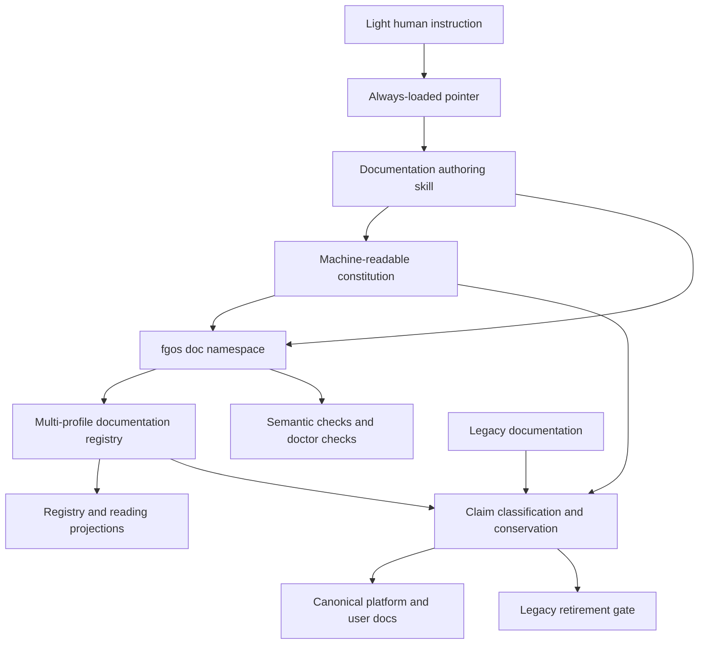
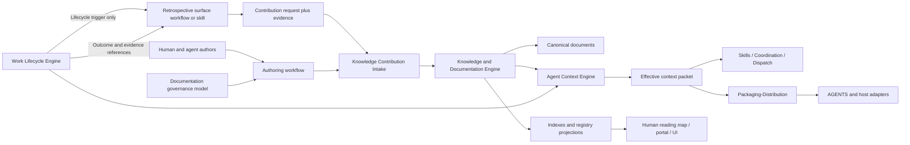

# Committed-content conservation review: root-alias-05

Author session: codex-session:24@2026-10-14
Decision author: codex-session:23@2026-10-14
Content commit: a125b4ec0ab4dc4717488c60f0dd305054c6f022
Entries: 54
Review status: pending

All shown source, target and decision bytes are bound to Content commit above, except explicitly pinned historical predecessors. This is a review of pending dispositions/navigation/accounting, without truth certification or authority promotion. Existing accepted source decisions are evidence only. Historical short digest fields in quoted accepted decision JSON stay verbatim; the full independently recomputed 64-hex native and shown digests accompany every unit. Each stored target prefix is checked for a unique native match in its owner, with the actual anchor checked separately.

## root-authorities-draft-0301

Entry kind: alias-accounting
Class: Judgment
Source digest: 69e48da70a1b128a6679cf4ae5efab1cd20be1137184b3c4271f5575c0718bed
Target digest: 28d464a3a28a6ae9aa62c5f496b3fd52c3719d042dae0ca24ddc1d4b6d860c84

```json
{
  "aliasId": "root-authorities-draft-0301",
  "fromPath": "docs/templates/vision.md#vision",
  "toOwner": "docs/platform/documentation/history/templates/vision.md",
  "toAnchor": "vision",
  "kind": "split",
  "evidenceRef": "plans/260925-documentation-authority-unification/reports/phase-06/review-5-mapped-root-conservation-02.md",
  "immutableRefs": [],
  "recordedAt": "2026-10-14"
}
```
```json
{
  "aliasId": "root-authorities-draft-0301",
  "claimId": "claim_07a6749be69305a6aa18ce2425f4582b",
  "sourcePath": "docs/templates/vision.md",
  "sourceAnchor": "vision",
  "sourceUnitDigest": "69e48da70a1b128a6679cf4ae5efab1cd20be1137184b3c4271f5575c0718bed",
  "targetOwner": "docs/platform/documentation/history/templates/vision.md",
  "targetNativeAnchor": "vision",
  "targetUnitDigest": "28d464a3a28a6ae9aa62c5f496b3fd52c3719d042dae0ca24ddc1d4b6d860c84",
  "targetBrowserAnchor": "vision",
  "reviewReport": "plans/260925-documentation-authority-unification/reports/phase-06/review-5-mapped-root-conservation-02.md",
  "reviewReportCommit": "729bea7588017b285553332d838543bedecd2605",
  "authoredBy": "codex-session:23@2026-10-14",
  "reviewStatus": "pending",
  "rationale": "Preview only: exact reviewed disposition identifies the owner; browser navigation uses a real containing heading while the native decision anchor/digest remain in this binding. Consumer files and the active alias table stay untouched. At cutover revalidate source/target bytes and independent review before activating this proposal."
}
```

Complete alias/retained source: `docs/templates/vision.md#vision`
Commit: a125b4ec0ab4dc4717488c60f0dd305054c6f022
Native unit SHA256: 69e48da70a1b128a6679cf4ae5efab1cd20be1137184b3c4271f5575c0718bed
Shown text SHA256: 3689744785145f5565a22490b0129410baffb25c18b200114b7abd4b554541c5

```text
# Vision: <Area>
```

Complete navigation destination (distinct from native decision target): `docs/platform/documentation/history/templates/vision.md#vision`
Commit: a125b4ec0ab4dc4717488c60f0dd305054c6f022
Native unit SHA256: 28d464a3a28a6ae9aa62c5f496b3fd52c3719d042dae0ca24ddc1d4b6d860c84
Shown text SHA256: 3689744785145f5565a22490b0129410baffb25c18b200114b7abd4b554541c5

```text
# Vision: <Area>
```

Complete navigation-source/destination diff:
```diff

```

### Existing decision evidence: claim_07a6749be69305a6aa18ce2425f4582b

```json
{
  "claimId": "claim_07a6749be69305a6aa18ce2425f4582b",
  "sourceUnitDigest": "69e48da70a1b128a6679cf4ae5efab1cd20be1137184b3c4271f5575c0718bed",
  "targetOwner": "docs/platform/documentation/history/templates/vision.md",
  "targetAnchor": "vision",
  "claimKind": "historical-context",
  "disposition": "archive-with-reason",
  "reviewStatus": "reviewed",
  "authoredBy": "codex-session:20@2026-10-14",
  "rationale": "Frozen root map assigns docs/templates/vision.md#vision to docs/platform/documentation/history/templates/vision.md#vision. Retain the complete source unit as non-canonical history; the source remains active/retained until cutover. Placeholder link tables are fenced verbatim as examples; every instruction and placeholder is retained. Full source/target text and diff are submitted for independent whole-unit conservation review; wrapping/header/relative-path changes grant no truth approval. No source retirement, promotion or component-boundary change.",
  "reviewNote": "Title heading kept verbatim; digest differs because the following block is now the candidate authority header, source header retained under Source Metadata and carried by 97c68529; rationale is generic but not false",
  "reviewedBy": "reviewer:claude-session:a4954387@2026-10-14",
  "reviewedAt": "2026-10-14",
  "reviewReport": "plans/260925-documentation-authority-unification/reports/phase-06/review-5-mapped-root-conservation-02.md",
  "reviewMode": "ordinary",
  "targetUnitDigest": "28d464a3a28a6ae9aa62c5f496b3fd52c3719d042dae0ca24ddc1d4b6d860c84",
  "targetAncestry": [],
  "reviewReportCommit": "729bea7588017b285553332d838543bedecd2605"
}
```

Complete native source: `docs/templates/vision.md#vision`
Commit: a125b4ec0ab4dc4717488c60f0dd305054c6f022
Native unit SHA256: 69e48da70a1b128a6679cf4ae5efab1cd20be1137184b3c4271f5575c0718bed
Shown text SHA256: 3689744785145f5565a22490b0129410baffb25c18b200114b7abd4b554541c5

```text
# Vision: <Area>
```

Complete native target: `docs/platform/documentation/history/templates/vision.md#vision`
Commit: a125b4ec0ab4dc4717488c60f0dd305054c6f022
Native unit SHA256: 28d464a3a28a6ae9aa62c5f496b3fd52c3719d042dae0ca24ddc1d4b6d860c84
Shown text SHA256: 3689744785145f5565a22490b0129410baffb25c18b200114b7abd4b554541c5

```text
# Vision: <Area>
```

```diff

```

This proposal remains pending. Existing reviewed source bindings are not resubmitted or overwritten.
## root-authorities-draft-0302

Entry kind: alias-accounting
Class: Judgment
Source digest: e008f4420e278caad8afa31028a0c49c1ae2422e2bb99bbdfab4c0bd433d94ab
Target digest: e008f4420e278caad8afa31028a0c49c1ae2422e2bb99bbdfab4c0bd433d94ab

```json
{
  "aliasId": "root-authorities-draft-0302",
  "fromPath": "docs/templates/vision.md#1-purpose",
  "toOwner": "docs/platform/documentation/history/templates/intent-preservation-ledger.md",
  "toAnchor": "1-purpose",
  "kind": "split",
  "evidenceRef": "plans/260925-documentation-authority-unification/reports/phase-06/review-5-mapped-root-conservation-02.md",
  "immutableRefs": [],
  "recordedAt": "2026-10-14"
}
```
```json
{
  "aliasId": "root-authorities-draft-0302",
  "claimId": "claim_fd36aa6d5ecde01def3d53c0007670ca",
  "sourcePath": "docs/templates/vision.md",
  "sourceAnchor": "1-purpose",
  "sourceUnitDigest": "e008f4420e278caad8afa31028a0c49c1ae2422e2bb99bbdfab4c0bd433d94ab",
  "targetOwner": "docs/platform/documentation/history/templates/intent-preservation-ledger.md",
  "targetNativeAnchor": "1-purpose",
  "targetUnitDigest": "e008f4420e278caad8afa31028a0c49c1ae2422e2bb99bbdfab4c0bd433d94ab",
  "targetBrowserAnchor": "1-purpose",
  "reviewReport": "plans/260925-documentation-authority-unification/reports/phase-06/review-5-mapped-root-conservation-02.md",
  "reviewReportCommit": "729bea7588017b285553332d838543bedecd2605",
  "authoredBy": "codex-session:23@2026-10-14",
  "reviewStatus": "pending",
  "rationale": "Preview only: exact reviewed disposition identifies the owner; browser navigation uses a real containing heading while the native decision anchor/digest remain in this binding. Consumer files and the active alias table stay untouched. At cutover revalidate source/target bytes and independent review before activating this proposal."
}
```

Complete alias/retained source: `docs/templates/vision.md#1-purpose`
Commit: a125b4ec0ab4dc4717488c60f0dd305054c6f022
Native unit SHA256: e008f4420e278caad8afa31028a0c49c1ae2422e2bb99bbdfab4c0bd433d94ab
Shown text SHA256: d554ba84b1559c01a9eb1628d110baa45b8e38e942fc3ac08a0a3bd32561b6c4

```text
## 1. Purpose
```

Complete navigation destination (distinct from native decision target): `docs/platform/documentation/history/templates/intent-preservation-ledger.md#1-purpose`
Commit: a125b4ec0ab4dc4717488c60f0dd305054c6f022
Native unit SHA256: e008f4420e278caad8afa31028a0c49c1ae2422e2bb99bbdfab4c0bd433d94ab
Shown text SHA256: d554ba84b1559c01a9eb1628d110baa45b8e38e942fc3ac08a0a3bd32561b6c4

```text
## 1. Purpose
```

Complete navigation-source/destination diff:
```diff

```

### Existing decision evidence: claim_fd36aa6d5ecde01def3d53c0007670ca

```json
{
  "claimId": "claim_fd36aa6d5ecde01def3d53c0007670ca",
  "sourceUnitDigest": "e008f4420e278caad8afa31028a0c49c1ae2422e2bb99bbdfab4c0bd433d94ab",
  "targetOwner": "docs/platform/documentation/history/templates/intent-preservation-ledger.md",
  "targetAnchor": "1-purpose",
  "claimKind": "historical-context",
  "disposition": "archive-with-reason",
  "reviewStatus": "reviewed",
  "authoredBy": "codex-session:20@2026-10-14",
  "rationale": "The whole empty template heading is byte-identical to claim_92eba2424b594a6bddea4f6ee0e2d82c; one shared history owner docs/platform/documentation/history/templates/intent-preservation-ledger.md#1-purpose conserves both units under the identical-unit rule. The full former template remains independently preserved at its mapped history path, including this empty heading. No behavioral assertion, truth certification or source retirement. Both source decisions stay pending.",
  "reviewNote": "Whole empty template heading identical (digest e008f442) to the ledger template heading, so both claims share ledger target 1-purpose under the identical-unit rule; vision.md own 1-purpose heading remains in the reverse candidate-unverified list at the same digest; rationale truthful though it does not name the source path",
  "reviewedBy": "reviewer:claude-session:a4954387@2026-10-14",
  "reviewedAt": "2026-10-14",
  "reviewReport": "plans/260925-documentation-authority-unification/reports/phase-06/review-5-mapped-root-conservation-02.md",
  "reviewMode": "ordinary",
  "targetUnitDigest": "e008f4420e278caad8afa31028a0c49c1ae2422e2bb99bbdfab4c0bd433d94ab",
  "targetAncestry": [
    "<Area> Intent Preservation Ledger"
  ],
  "reviewReportCommit": "729bea7588017b285553332d838543bedecd2605"
}
```

Complete native source: `docs/templates/vision.md#1-purpose`
Commit: a125b4ec0ab4dc4717488c60f0dd305054c6f022
Native unit SHA256: e008f4420e278caad8afa31028a0c49c1ae2422e2bb99bbdfab4c0bd433d94ab
Shown text SHA256: d554ba84b1559c01a9eb1628d110baa45b8e38e942fc3ac08a0a3bd32561b6c4

```text
## 1. Purpose
```

Complete native target: `docs/platform/documentation/history/templates/intent-preservation-ledger.md#1-purpose`
Commit: a125b4ec0ab4dc4717488c60f0dd305054c6f022
Native unit SHA256: e008f4420e278caad8afa31028a0c49c1ae2422e2bb99bbdfab4c0bd433d94ab
Shown text SHA256: d554ba84b1559c01a9eb1628d110baa45b8e38e942fc3ac08a0a3bd32561b6c4

```text
## 1. Purpose
```

```diff

```

This proposal remains pending. Existing reviewed source bindings are not resubmitted or overwritten.
## root-authorities-draft-0303

Entry kind: alias-accounting
Class: Judgment
Source digest: 6e102f95ce7de1743a17764020133983d1a561443c06691ccdc3d73d26197612
Target digest: 6e102f95ce7de1743a17764020133983d1a561443c06691ccdc3d73d26197612

```json
{
  "aliasId": "root-authorities-draft-0303",
  "fromPath": "docs/templates/vision.md#2-mission-fit",
  "toOwner": "docs/platform/documentation/history/templates/vision.md",
  "toAnchor": "2-mission-fit",
  "kind": "split",
  "evidenceRef": "plans/260925-documentation-authority-unification/reports/phase-06/review-5-mapped-root-conservation-02.md",
  "immutableRefs": [],
  "recordedAt": "2026-10-14"
}
```
```json
{
  "aliasId": "root-authorities-draft-0303",
  "claimId": "claim_47b0f20bb3b210336db5f9c4042ee52e",
  "sourcePath": "docs/templates/vision.md",
  "sourceAnchor": "2-mission-fit",
  "sourceUnitDigest": "6e102f95ce7de1743a17764020133983d1a561443c06691ccdc3d73d26197612",
  "targetOwner": "docs/platform/documentation/history/templates/vision.md",
  "targetNativeAnchor": "2-mission-fit",
  "targetUnitDigest": "6e102f95ce7de1743a17764020133983d1a561443c06691ccdc3d73d26197612",
  "targetBrowserAnchor": "2-mission-fit",
  "reviewReport": "plans/260925-documentation-authority-unification/reports/phase-06/review-5-mapped-root-conservation-02.md",
  "reviewReportCommit": "729bea7588017b285553332d838543bedecd2605",
  "authoredBy": "codex-session:23@2026-10-14",
  "reviewStatus": "pending",
  "rationale": "Preview only: exact reviewed disposition identifies the owner; browser navigation uses a real containing heading while the native decision anchor/digest remain in this binding. Consumer files and the active alias table stay untouched. At cutover revalidate source/target bytes and independent review before activating this proposal."
}
```

Complete alias/retained source: `docs/templates/vision.md#2-mission-fit`
Commit: a125b4ec0ab4dc4717488c60f0dd305054c6f022
Native unit SHA256: 6e102f95ce7de1743a17764020133983d1a561443c06691ccdc3d73d26197612
Shown text SHA256: 2134f7dbc87cac04d20bf5150a2c219c61204de492e0dc66450a366e5f891fb3

```text
## 2. Mission Fit
```

Complete navigation destination (distinct from native decision target): `docs/platform/documentation/history/templates/vision.md#2-mission-fit`
Commit: a125b4ec0ab4dc4717488c60f0dd305054c6f022
Native unit SHA256: 6e102f95ce7de1743a17764020133983d1a561443c06691ccdc3d73d26197612
Shown text SHA256: 2134f7dbc87cac04d20bf5150a2c219c61204de492e0dc66450a366e5f891fb3

```text
## 2. Mission Fit
```

Complete navigation-source/destination diff:
```diff

```

### Existing decision evidence: claim_47b0f20bb3b210336db5f9c4042ee52e

```json
{
  "claimId": "claim_47b0f20bb3b210336db5f9c4042ee52e",
  "sourceUnitDigest": "6e102f95ce7de1743a17764020133983d1a561443c06691ccdc3d73d26197612",
  "targetOwner": "docs/platform/documentation/history/templates/vision.md",
  "targetAnchor": "2-mission-fit",
  "claimKind": "historical-context",
  "disposition": "archive-with-reason",
  "reviewStatus": "reviewed",
  "authoredBy": "codex-session:20@2026-10-14",
  "rationale": "Frozen root map assigns docs/templates/vision.md#2-mission-fit to docs/platform/documentation/history/templates/vision.md#2-mission-fit. Retain the complete source unit as non-canonical history; the source remains active/retained until cutover. Placeholder link tables are fenced verbatim as examples; every instruction and placeholder is retained. Native full unit digests are equal. No source retirement, promotion or component-boundary change.",
  "reviewNote": "Unit digests equal and text byte-equal at vision.md#2-mission-fit (heading 2-mission-fit); recomputed from committed files at HEAD; kept as non-canonical history at the frozen-map owner; digests hand-recomputed in the seeded sample",
  "reviewedBy": "reviewer:claude-session:a4954387@2026-10-14",
  "reviewedAt": "2026-10-14",
  "reviewReport": "plans/260925-documentation-authority-unification/reports/phase-06/review-5-mapped-root-conservation-02.md",
  "reviewMode": "ordinary",
  "targetUnitDigest": "6e102f95ce7de1743a17764020133983d1a561443c06691ccdc3d73d26197612",
  "targetAncestry": [
    "Vision: <Area>"
  ],
  "reviewReportCommit": "729bea7588017b285553332d838543bedecd2605"
}
```

Complete native source: `docs/templates/vision.md#2-mission-fit`
Commit: a125b4ec0ab4dc4717488c60f0dd305054c6f022
Native unit SHA256: 6e102f95ce7de1743a17764020133983d1a561443c06691ccdc3d73d26197612
Shown text SHA256: 2134f7dbc87cac04d20bf5150a2c219c61204de492e0dc66450a366e5f891fb3

```text
## 2. Mission Fit
```

Complete native target: `docs/platform/documentation/history/templates/vision.md#2-mission-fit`
Commit: a125b4ec0ab4dc4717488c60f0dd305054c6f022
Native unit SHA256: 6e102f95ce7de1743a17764020133983d1a561443c06691ccdc3d73d26197612
Shown text SHA256: 2134f7dbc87cac04d20bf5150a2c219c61204de492e0dc66450a366e5f891fb3

```text
## 2. Mission Fit
```

```diff

```

This proposal remains pending. Existing reviewed source bindings are not resubmitted or overwritten.
## root-authorities-draft-0304

Entry kind: alias-accounting
Class: Judgment
Source digest: 2c83269a2e2c01a226c15e65f49ba57e8f24b6a76b5372173ad963803513dbc8
Target digest: 2c83269a2e2c01a226c15e65f49ba57e8f24b6a76b5372173ad963803513dbc8

```json
{
  "aliasId": "root-authorities-draft-0304",
  "fromPath": "docs/templates/vision.md#3-full-intended-shape",
  "toOwner": "docs/platform/documentation/history/templates/vision.md",
  "toAnchor": "3-full-intended-shape",
  "kind": "split",
  "evidenceRef": "plans/260925-documentation-authority-unification/reports/phase-06/review-5-mapped-root-conservation-02.md",
  "immutableRefs": [],
  "recordedAt": "2026-10-14"
}
```
```json
{
  "aliasId": "root-authorities-draft-0304",
  "claimId": "claim_6645662f1fbda88084ca672b0febb705",
  "sourcePath": "docs/templates/vision.md",
  "sourceAnchor": "3-full-intended-shape",
  "sourceUnitDigest": "2c83269a2e2c01a226c15e65f49ba57e8f24b6a76b5372173ad963803513dbc8",
  "targetOwner": "docs/platform/documentation/history/templates/vision.md",
  "targetNativeAnchor": "3-full-intended-shape",
  "targetUnitDigest": "2c83269a2e2c01a226c15e65f49ba57e8f24b6a76b5372173ad963803513dbc8",
  "targetBrowserAnchor": "3-full-intended-shape",
  "reviewReport": "plans/260925-documentation-authority-unification/reports/phase-06/review-5-mapped-root-conservation-02.md",
  "reviewReportCommit": "729bea7588017b285553332d838543bedecd2605",
  "authoredBy": "codex-session:23@2026-10-14",
  "reviewStatus": "pending",
  "rationale": "Preview only: exact reviewed disposition identifies the owner; browser navigation uses a real containing heading while the native decision anchor/digest remain in this binding. Consumer files and the active alias table stay untouched. At cutover revalidate source/target bytes and independent review before activating this proposal."
}
```

Complete alias/retained source: `docs/templates/vision.md#3-full-intended-shape`
Commit: a125b4ec0ab4dc4717488c60f0dd305054c6f022
Native unit SHA256: 2c83269a2e2c01a226c15e65f49ba57e8f24b6a76b5372173ad963803513dbc8
Shown text SHA256: 7dbce4de8eb0782609abaee5c848286492f692dbfd94c5f49580eaadb9194950

```text
## 3. Full Intended Shape
```

Complete navigation destination (distinct from native decision target): `docs/platform/documentation/history/templates/vision.md#3-full-intended-shape`
Commit: a125b4ec0ab4dc4717488c60f0dd305054c6f022
Native unit SHA256: 2c83269a2e2c01a226c15e65f49ba57e8f24b6a76b5372173ad963803513dbc8
Shown text SHA256: 7dbce4de8eb0782609abaee5c848286492f692dbfd94c5f49580eaadb9194950

```text
## 3. Full Intended Shape
```

Complete navigation-source/destination diff:
```diff

```

### Existing decision evidence: claim_6645662f1fbda88084ca672b0febb705

```json
{
  "claimId": "claim_6645662f1fbda88084ca672b0febb705",
  "sourceUnitDigest": "2c83269a2e2c01a226c15e65f49ba57e8f24b6a76b5372173ad963803513dbc8",
  "targetOwner": "docs/platform/documentation/history/templates/vision.md",
  "targetAnchor": "3-full-intended-shape",
  "claimKind": "historical-context",
  "disposition": "archive-with-reason",
  "reviewStatus": "reviewed",
  "authoredBy": "codex-session:20@2026-10-14",
  "rationale": "Frozen root map assigns docs/templates/vision.md#3-full-intended-shape to docs/platform/documentation/history/templates/vision.md#3-full-intended-shape. Retain the complete source unit as non-canonical history; the source remains active/retained until cutover. Placeholder link tables are fenced verbatim as examples; every instruction and placeholder is retained. Native full unit digests are equal. No source retirement, promotion or component-boundary change.",
  "reviewNote": "Unit digests equal and text byte-equal at vision.md#3-full-intended-shape (heading 3-full-intended-shape); recomputed from committed files at HEAD; kept as non-canonical history at the frozen-map owner",
  "reviewedBy": "reviewer:claude-session:a4954387@2026-10-14",
  "reviewedAt": "2026-10-14",
  "reviewReport": "plans/260925-documentation-authority-unification/reports/phase-06/review-5-mapped-root-conservation-02.md",
  "reviewMode": "ordinary",
  "targetUnitDigest": "2c83269a2e2c01a226c15e65f49ba57e8f24b6a76b5372173ad963803513dbc8",
  "targetAncestry": [
    "Vision: <Area>"
  ],
  "reviewReportCommit": "729bea7588017b285553332d838543bedecd2605"
}
```

Complete native source: `docs/templates/vision.md#3-full-intended-shape`
Commit: a125b4ec0ab4dc4717488c60f0dd305054c6f022
Native unit SHA256: 2c83269a2e2c01a226c15e65f49ba57e8f24b6a76b5372173ad963803513dbc8
Shown text SHA256: 7dbce4de8eb0782609abaee5c848286492f692dbfd94c5f49580eaadb9194950

```text
## 3. Full Intended Shape
```

Complete native target: `docs/platform/documentation/history/templates/vision.md#3-full-intended-shape`
Commit: a125b4ec0ab4dc4717488c60f0dd305054c6f022
Native unit SHA256: 2c83269a2e2c01a226c15e65f49ba57e8f24b6a76b5372173ad963803513dbc8
Shown text SHA256: 7dbce4de8eb0782609abaee5c848286492f692dbfd94c5f49580eaadb9194950

```text
## 3. Full Intended Shape
```

```diff

```

This proposal remains pending. Existing reviewed source bindings are not resubmitted or overwritten.
## root-authorities-draft-0305

Entry kind: alias-accounting
Class: Judgment
Source digest: 80b3bfe3f3e7602da62fa064d789383164e7eac1c3a0b60ada49e5c13f5e22f7
Target digest: 80b3bfe3f3e7602da62fa064d789383164e7eac1c3a0b60ada49e5c13f5e22f7

```json
{
  "aliasId": "root-authorities-draft-0305",
  "fromPath": "docs/templates/vision.md#4-non-scope",
  "toOwner": "docs/platform/documentation/history/templates/vision.md",
  "toAnchor": "4-non-scope",
  "kind": "split",
  "evidenceRef": "plans/260925-documentation-authority-unification/reports/phase-06/review-5-mapped-root-conservation-02.md",
  "immutableRefs": [],
  "recordedAt": "2026-10-14"
}
```
```json
{
  "aliasId": "root-authorities-draft-0305",
  "claimId": "claim_20bc110149a3bd2a2e649115d1658eb1",
  "sourcePath": "docs/templates/vision.md",
  "sourceAnchor": "4-non-scope",
  "sourceUnitDigest": "80b3bfe3f3e7602da62fa064d789383164e7eac1c3a0b60ada49e5c13f5e22f7",
  "targetOwner": "docs/platform/documentation/history/templates/vision.md",
  "targetNativeAnchor": "4-non-scope",
  "targetUnitDigest": "80b3bfe3f3e7602da62fa064d789383164e7eac1c3a0b60ada49e5c13f5e22f7",
  "targetBrowserAnchor": "4-non-scope",
  "reviewReport": "plans/260925-documentation-authority-unification/reports/phase-06/review-5-mapped-root-conservation-02.md",
  "reviewReportCommit": "729bea7588017b285553332d838543bedecd2605",
  "authoredBy": "codex-session:23@2026-10-14",
  "reviewStatus": "pending",
  "rationale": "Preview only: exact reviewed disposition identifies the owner; browser navigation uses a real containing heading while the native decision anchor/digest remain in this binding. Consumer files and the active alias table stay untouched. At cutover revalidate source/target bytes and independent review before activating this proposal."
}
```

Complete alias/retained source: `docs/templates/vision.md#4-non-scope`
Commit: a125b4ec0ab4dc4717488c60f0dd305054c6f022
Native unit SHA256: 80b3bfe3f3e7602da62fa064d789383164e7eac1c3a0b60ada49e5c13f5e22f7
Shown text SHA256: 928d0fc5255f22e9f7ba632bb55ebc7d6efb2da14eb8a03aaf12bd12f8aaa0a3

```text
## 4. Non-Scope
```

Complete navigation destination (distinct from native decision target): `docs/platform/documentation/history/templates/vision.md#4-non-scope`
Commit: a125b4ec0ab4dc4717488c60f0dd305054c6f022
Native unit SHA256: 80b3bfe3f3e7602da62fa064d789383164e7eac1c3a0b60ada49e5c13f5e22f7
Shown text SHA256: 928d0fc5255f22e9f7ba632bb55ebc7d6efb2da14eb8a03aaf12bd12f8aaa0a3

```text
## 4. Non-Scope
```

Complete navigation-source/destination diff:
```diff

```

### Existing decision evidence: claim_20bc110149a3bd2a2e649115d1658eb1

```json
{
  "claimId": "claim_20bc110149a3bd2a2e649115d1658eb1",
  "sourceUnitDigest": "80b3bfe3f3e7602da62fa064d789383164e7eac1c3a0b60ada49e5c13f5e22f7",
  "targetOwner": "docs/platform/documentation/history/templates/vision.md",
  "targetAnchor": "4-non-scope",
  "claimKind": "historical-context",
  "disposition": "archive-with-reason",
  "reviewStatus": "reviewed",
  "authoredBy": "codex-session:20@2026-10-14",
  "rationale": "Frozen root map assigns docs/templates/vision.md#4-non-scope to docs/platform/documentation/history/templates/vision.md#4-non-scope. Retain the complete source unit as non-canonical history; the source remains active/retained until cutover. Placeholder link tables are fenced verbatim as examples; every instruction and placeholder is retained. Native full unit digests are equal. No source retirement, promotion or component-boundary change.",
  "reviewNote": "Unit digests equal and text byte-equal at vision.md#4-non-scope (heading 4-non-scope); recomputed from committed files at HEAD; kept as non-canonical history at the frozen-map owner",
  "reviewedBy": "reviewer:claude-session:a4954387@2026-10-14",
  "reviewedAt": "2026-10-14",
  "reviewReport": "plans/260925-documentation-authority-unification/reports/phase-06/review-5-mapped-root-conservation-02.md",
  "reviewMode": "ordinary",
  "targetUnitDigest": "80b3bfe3f3e7602da62fa064d789383164e7eac1c3a0b60ada49e5c13f5e22f7",
  "targetAncestry": [
    "Vision: <Area>"
  ],
  "reviewReportCommit": "729bea7588017b285553332d838543bedecd2605"
}
```

Complete native source: `docs/templates/vision.md#4-non-scope`
Commit: a125b4ec0ab4dc4717488c60f0dd305054c6f022
Native unit SHA256: 80b3bfe3f3e7602da62fa064d789383164e7eac1c3a0b60ada49e5c13f5e22f7
Shown text SHA256: 928d0fc5255f22e9f7ba632bb55ebc7d6efb2da14eb8a03aaf12bd12f8aaa0a3

```text
## 4. Non-Scope
```

Complete native target: `docs/platform/documentation/history/templates/vision.md#4-non-scope`
Commit: a125b4ec0ab4dc4717488c60f0dd305054c6f022
Native unit SHA256: 80b3bfe3f3e7602da62fa064d789383164e7eac1c3a0b60ada49e5c13f5e22f7
Shown text SHA256: 928d0fc5255f22e9f7ba632bb55ebc7d6efb2da14eb8a03aaf12bd12f8aaa0a3

```text
## 4. Non-Scope
```

```diff

```

This proposal remains pending. Existing reviewed source bindings are not resubmitted or overwritten.
## root-authorities-draft-0306

Entry kind: alias-accounting
Class: Judgment
Source digest: 69b4d984ee2dc40c8cc198c5563bbcee4079f80ddffe63a0f43696c2ec87713e
Target digest: 69b4d984ee2dc40c8cc198c5563bbcee4079f80ddffe63a0f43696c2ec87713e

```json
{
  "aliasId": "root-authorities-draft-0306",
  "fromPath": "docs/templates/vision.md#5-product-priorities-and-trade-offs",
  "toOwner": "docs/platform/documentation/history/templates/vision.md",
  "toAnchor": "5-product-priorities-and-trade-offs",
  "kind": "split",
  "evidenceRef": "plans/260925-documentation-authority-unification/reports/phase-06/review-5-mapped-root-conservation-02.md",
  "immutableRefs": [],
  "recordedAt": "2026-10-14"
}
```
```json
{
  "aliasId": "root-authorities-draft-0306",
  "claimId": "claim_d519a77e315a8b80326ff96c6e9b69a0",
  "sourcePath": "docs/templates/vision.md",
  "sourceAnchor": "5-product-priorities-and-trade-offs",
  "sourceUnitDigest": "69b4d984ee2dc40c8cc198c5563bbcee4079f80ddffe63a0f43696c2ec87713e",
  "targetOwner": "docs/platform/documentation/history/templates/vision.md",
  "targetNativeAnchor": "5-product-priorities-and-trade-offs",
  "targetUnitDigest": "69b4d984ee2dc40c8cc198c5563bbcee4079f80ddffe63a0f43696c2ec87713e",
  "targetBrowserAnchor": "5-product-priorities-and-trade-offs",
  "reviewReport": "plans/260925-documentation-authority-unification/reports/phase-06/review-5-mapped-root-conservation-02.md",
  "reviewReportCommit": "729bea7588017b285553332d838543bedecd2605",
  "authoredBy": "codex-session:23@2026-10-14",
  "reviewStatus": "pending",
  "rationale": "Preview only: exact reviewed disposition identifies the owner; browser navigation uses a real containing heading while the native decision anchor/digest remain in this binding. Consumer files and the active alias table stay untouched. At cutover revalidate source/target bytes and independent review before activating this proposal."
}
```

Complete alias/retained source: `docs/templates/vision.md#5-product-priorities-and-trade-offs`
Commit: a125b4ec0ab4dc4717488c60f0dd305054c6f022
Native unit SHA256: 69b4d984ee2dc40c8cc198c5563bbcee4079f80ddffe63a0f43696c2ec87713e
Shown text SHA256: 5c515c36877969d15db3673c045d07e3f3d1e4840a021ab0240c66dd47ab4d28

```text
## 5. Product Priorities And Trade-Offs
```

Complete navigation destination (distinct from native decision target): `docs/platform/documentation/history/templates/vision.md#5-product-priorities-and-trade-offs`
Commit: a125b4ec0ab4dc4717488c60f0dd305054c6f022
Native unit SHA256: 69b4d984ee2dc40c8cc198c5563bbcee4079f80ddffe63a0f43696c2ec87713e
Shown text SHA256: 5c515c36877969d15db3673c045d07e3f3d1e4840a021ab0240c66dd47ab4d28

```text
## 5. Product Priorities And Trade-Offs
```

Complete navigation-source/destination diff:
```diff

```

### Existing decision evidence: claim_d519a77e315a8b80326ff96c6e9b69a0

```json
{
  "claimId": "claim_d519a77e315a8b80326ff96c6e9b69a0",
  "sourceUnitDigest": "69b4d984ee2dc40c8cc198c5563bbcee4079f80ddffe63a0f43696c2ec87713e",
  "targetOwner": "docs/platform/documentation/history/templates/vision.md",
  "targetAnchor": "5-product-priorities-and-trade-offs",
  "claimKind": "historical-context",
  "disposition": "archive-with-reason",
  "reviewStatus": "reviewed",
  "authoredBy": "codex-session:20@2026-10-14",
  "rationale": "Frozen root map assigns docs/templates/vision.md#5-product-priorities-and-trade-offs to docs/platform/documentation/history/templates/vision.md#5-product-priorities-and-trade-offs. Retain the complete source unit as non-canonical history; the source remains active/retained until cutover. Placeholder link tables are fenced verbatim as examples; every instruction and placeholder is retained. Native full unit digests are equal. No source retirement, promotion or component-boundary change.",
  "reviewNote": "Unit digests equal and text byte-equal at vision.md#5-product-priorities-and-trade-offs (heading 5-product-priorities-and-trade-offs); recomputed from committed files at HEAD; kept as non-canonical history at the frozen-map owner",
  "reviewedBy": "reviewer:claude-session:a4954387@2026-10-14",
  "reviewedAt": "2026-10-14",
  "reviewReport": "plans/260925-documentation-authority-unification/reports/phase-06/review-5-mapped-root-conservation-02.md",
  "reviewMode": "ordinary",
  "targetUnitDigest": "69b4d984ee2dc40c8cc198c5563bbcee4079f80ddffe63a0f43696c2ec87713e",
  "targetAncestry": [
    "Vision: <Area>"
  ],
  "reviewReportCommit": "729bea7588017b285553332d838543bedecd2605"
}
```

Complete native source: `docs/templates/vision.md#5-product-priorities-and-trade-offs`
Commit: a125b4ec0ab4dc4717488c60f0dd305054c6f022
Native unit SHA256: 69b4d984ee2dc40c8cc198c5563bbcee4079f80ddffe63a0f43696c2ec87713e
Shown text SHA256: 5c515c36877969d15db3673c045d07e3f3d1e4840a021ab0240c66dd47ab4d28

```text
## 5. Product Priorities And Trade-Offs
```

Complete native target: `docs/platform/documentation/history/templates/vision.md#5-product-priorities-and-trade-offs`
Commit: a125b4ec0ab4dc4717488c60f0dd305054c6f022
Native unit SHA256: 69b4d984ee2dc40c8cc198c5563bbcee4079f80ddffe63a0f43696c2ec87713e
Shown text SHA256: 5c515c36877969d15db3673c045d07e3f3d1e4840a021ab0240c66dd47ab4d28

```text
## 5. Product Priorities And Trade-Offs
```

```diff

```

This proposal remains pending. Existing reviewed source bindings are not resubmitted or overwritten.
## root-authorities-draft-0307

Entry kind: alias-accounting
Class: Judgment
Source digest: e46dcc90755604b137a0c662f380dc3aeaf25aca0cce01f19bc76fc9af118477
Target digest: e46dcc90755604b137a0c662f380dc3aeaf25aca0cce01f19bc76fc9af118477

```json
{
  "aliasId": "root-authorities-draft-0307",
  "fromPath": "docs/templates/vision.md#6-what-must-stay-true",
  "toOwner": "docs/platform/documentation/history/templates/vision.md",
  "toAnchor": "6-what-must-stay-true",
  "kind": "split",
  "evidenceRef": "plans/260925-documentation-authority-unification/reports/phase-06/review-5-mapped-root-conservation-02.md",
  "immutableRefs": [],
  "recordedAt": "2026-10-14"
}
```
```json
{
  "aliasId": "root-authorities-draft-0307",
  "claimId": "claim_f30f14a4fee5cb27d7e215d30751d1ea",
  "sourcePath": "docs/templates/vision.md",
  "sourceAnchor": "6-what-must-stay-true",
  "sourceUnitDigest": "e46dcc90755604b137a0c662f380dc3aeaf25aca0cce01f19bc76fc9af118477",
  "targetOwner": "docs/platform/documentation/history/templates/vision.md",
  "targetNativeAnchor": "6-what-must-stay-true",
  "targetUnitDigest": "e46dcc90755604b137a0c662f380dc3aeaf25aca0cce01f19bc76fc9af118477",
  "targetBrowserAnchor": "6-what-must-stay-true",
  "reviewReport": "plans/260925-documentation-authority-unification/reports/phase-06/review-5-mapped-root-conservation-02.md",
  "reviewReportCommit": "729bea7588017b285553332d838543bedecd2605",
  "authoredBy": "codex-session:23@2026-10-14",
  "reviewStatus": "pending",
  "rationale": "Preview only: exact reviewed disposition identifies the owner; browser navigation uses a real containing heading while the native decision anchor/digest remain in this binding. Consumer files and the active alias table stay untouched. At cutover revalidate source/target bytes and independent review before activating this proposal."
}
```

Complete alias/retained source: `docs/templates/vision.md#6-what-must-stay-true`
Commit: a125b4ec0ab4dc4717488c60f0dd305054c6f022
Native unit SHA256: e46dcc90755604b137a0c662f380dc3aeaf25aca0cce01f19bc76fc9af118477
Shown text SHA256: f5aa4bd1dd8f9abbcd66fd71999872a2e9fd7857f3c1d119f794d76c8711ad6c

```text
## 6. What Must Stay True
```

Complete navigation destination (distinct from native decision target): `docs/platform/documentation/history/templates/vision.md#6-what-must-stay-true`
Commit: a125b4ec0ab4dc4717488c60f0dd305054c6f022
Native unit SHA256: e46dcc90755604b137a0c662f380dc3aeaf25aca0cce01f19bc76fc9af118477
Shown text SHA256: f5aa4bd1dd8f9abbcd66fd71999872a2e9fd7857f3c1d119f794d76c8711ad6c

```text
## 6. What Must Stay True
```

Complete navigation-source/destination diff:
```diff

```

### Existing decision evidence: claim_f30f14a4fee5cb27d7e215d30751d1ea

```json
{
  "claimId": "claim_f30f14a4fee5cb27d7e215d30751d1ea",
  "sourceUnitDigest": "e46dcc90755604b137a0c662f380dc3aeaf25aca0cce01f19bc76fc9af118477",
  "targetOwner": "docs/platform/documentation/history/templates/vision.md",
  "targetAnchor": "6-what-must-stay-true",
  "claimKind": "historical-context",
  "disposition": "archive-with-reason",
  "reviewStatus": "reviewed",
  "authoredBy": "codex-session:20@2026-10-14",
  "rationale": "Frozen root map assigns docs/templates/vision.md#6-what-must-stay-true to docs/platform/documentation/history/templates/vision.md#6-what-must-stay-true. Retain the complete source unit as non-canonical history; the source remains active/retained until cutover. Placeholder link tables are fenced verbatim as examples; every instruction and placeholder is retained. Native full unit digests are equal. No source retirement, promotion or component-boundary change.",
  "reviewNote": "Unit digests equal and text byte-equal at vision.md#6-what-must-stay-true (heading 6-what-must-stay-true); recomputed from committed files at HEAD; kept as non-canonical history at the frozen-map owner",
  "reviewedBy": "reviewer:claude-session:a4954387@2026-10-14",
  "reviewedAt": "2026-10-14",
  "reviewReport": "plans/260925-documentation-authority-unification/reports/phase-06/review-5-mapped-root-conservation-02.md",
  "reviewMode": "ordinary",
  "targetUnitDigest": "e46dcc90755604b137a0c662f380dc3aeaf25aca0cce01f19bc76fc9af118477",
  "targetAncestry": [
    "Vision: <Area>"
  ],
  "reviewReportCommit": "729bea7588017b285553332d838543bedecd2605"
}
```

Complete native source: `docs/templates/vision.md#6-what-must-stay-true`
Commit: a125b4ec0ab4dc4717488c60f0dd305054c6f022
Native unit SHA256: e46dcc90755604b137a0c662f380dc3aeaf25aca0cce01f19bc76fc9af118477
Shown text SHA256: f5aa4bd1dd8f9abbcd66fd71999872a2e9fd7857f3c1d119f794d76c8711ad6c

```text
## 6. What Must Stay True
```

Complete native target: `docs/platform/documentation/history/templates/vision.md#6-what-must-stay-true`
Commit: a125b4ec0ab4dc4717488c60f0dd305054c6f022
Native unit SHA256: e46dcc90755604b137a0c662f380dc3aeaf25aca0cce01f19bc76fc9af118477
Shown text SHA256: f5aa4bd1dd8f9abbcd66fd71999872a2e9fd7857f3c1d119f794d76c8711ad6c

```text
## 6. What Must Stay True
```

```diff

```

This proposal remains pending. Existing reviewed source bindings are not resubmitted or overwritten.
## root-authorities-draft-0308

Entry kind: alias-accounting
Class: Judgment
Source digest: 660413549cc4189a96e8b239ca4cf4d5cacc5304723a1e9d0d70279fc61930b1
Target digest: 660413549cc4189a96e8b239ca4cf4d5cacc5304723a1e9d0d70279fc61930b1

```json
{
  "aliasId": "root-authorities-draft-0308",
  "fromPath": "docs/templates/vision.md#7-implementation-staging-notes",
  "toOwner": "docs/platform/documentation/history/templates/vision.md",
  "toAnchor": "7-implementation-staging-notes",
  "kind": "split",
  "evidenceRef": "plans/260925-documentation-authority-unification/reports/phase-06/review-5-mapped-root-conservation-02.md",
  "immutableRefs": [],
  "recordedAt": "2026-10-14"
}
```
```json
{
  "aliasId": "root-authorities-draft-0308",
  "claimId": "claim_a3a1c2a0aa732e9c30068537f058f374",
  "sourcePath": "docs/templates/vision.md",
  "sourceAnchor": "7-implementation-staging-notes",
  "sourceUnitDigest": "660413549cc4189a96e8b239ca4cf4d5cacc5304723a1e9d0d70279fc61930b1",
  "targetOwner": "docs/platform/documentation/history/templates/vision.md",
  "targetNativeAnchor": "7-implementation-staging-notes",
  "targetUnitDigest": "660413549cc4189a96e8b239ca4cf4d5cacc5304723a1e9d0d70279fc61930b1",
  "targetBrowserAnchor": "7-implementation-staging-notes",
  "reviewReport": "plans/260925-documentation-authority-unification/reports/phase-06/review-5-mapped-root-conservation-02.md",
  "reviewReportCommit": "729bea7588017b285553332d838543bedecd2605",
  "authoredBy": "codex-session:23@2026-10-14",
  "reviewStatus": "pending",
  "rationale": "Preview only: exact reviewed disposition identifies the owner; browser navigation uses a real containing heading while the native decision anchor/digest remain in this binding. Consumer files and the active alias table stay untouched. At cutover revalidate source/target bytes and independent review before activating this proposal."
}
```

Complete alias/retained source: `docs/templates/vision.md#7-implementation-staging-notes`
Commit: a125b4ec0ab4dc4717488c60f0dd305054c6f022
Native unit SHA256: 660413549cc4189a96e8b239ca4cf4d5cacc5304723a1e9d0d70279fc61930b1
Shown text SHA256: b4af425821c622aef15b9c2f7b127ac3124ffed3717bbfea6e9af1989349e221

```text
## 7. Implementation Staging Notes
```

Complete navigation destination (distinct from native decision target): `docs/platform/documentation/history/templates/vision.md#7-implementation-staging-notes`
Commit: a125b4ec0ab4dc4717488c60f0dd305054c6f022
Native unit SHA256: 660413549cc4189a96e8b239ca4cf4d5cacc5304723a1e9d0d70279fc61930b1
Shown text SHA256: b4af425821c622aef15b9c2f7b127ac3124ffed3717bbfea6e9af1989349e221

```text
## 7. Implementation Staging Notes
```

Complete navigation-source/destination diff:
```diff

```

### Existing decision evidence: claim_a3a1c2a0aa732e9c30068537f058f374

```json
{
  "claimId": "claim_a3a1c2a0aa732e9c30068537f058f374",
  "sourceUnitDigest": "660413549cc4189a96e8b239ca4cf4d5cacc5304723a1e9d0d70279fc61930b1",
  "targetOwner": "docs/platform/documentation/history/templates/vision.md",
  "targetAnchor": "7-implementation-staging-notes",
  "claimKind": "historical-context",
  "disposition": "archive-with-reason",
  "reviewStatus": "reviewed",
  "authoredBy": "codex-session:20@2026-10-14",
  "rationale": "Frozen root map assigns docs/templates/vision.md#7-implementation-staging-notes to docs/platform/documentation/history/templates/vision.md#7-implementation-staging-notes. Retain the complete source unit as non-canonical history; the source remains active/retained until cutover. Placeholder link tables are fenced verbatim as examples; every instruction and placeholder is retained. Native full unit digests are equal. No source retirement, promotion or component-boundary change.",
  "reviewNote": "Unit digests equal and text byte-equal at vision.md#7-implementation-staging-notes (heading 7-implementation-staging-notes); recomputed from committed files at HEAD; kept as non-canonical history at the frozen-map owner",
  "reviewedBy": "reviewer:claude-session:a4954387@2026-10-14",
  "reviewedAt": "2026-10-14",
  "reviewReport": "plans/260925-documentation-authority-unification/reports/phase-06/review-5-mapped-root-conservation-02.md",
  "reviewMode": "ordinary",
  "targetUnitDigest": "660413549cc4189a96e8b239ca4cf4d5cacc5304723a1e9d0d70279fc61930b1",
  "targetAncestry": [
    "Vision: <Area>"
  ],
  "reviewReportCommit": "729bea7588017b285553332d838543bedecd2605"
}
```

Complete native source: `docs/templates/vision.md#7-implementation-staging-notes`
Commit: a125b4ec0ab4dc4717488c60f0dd305054c6f022
Native unit SHA256: 660413549cc4189a96e8b239ca4cf4d5cacc5304723a1e9d0d70279fc61930b1
Shown text SHA256: b4af425821c622aef15b9c2f7b127ac3124ffed3717bbfea6e9af1989349e221

```text
## 7. Implementation Staging Notes
```

Complete native target: `docs/platform/documentation/history/templates/vision.md#7-implementation-staging-notes`
Commit: a125b4ec0ab4dc4717488c60f0dd305054c6f022
Native unit SHA256: 660413549cc4189a96e8b239ca4cf4d5cacc5304723a1e9d0d70279fc61930b1
Shown text SHA256: b4af425821c622aef15b9c2f7b127ac3124ffed3717bbfea6e9af1989349e221

```text
## 7. Implementation Staging Notes
```

```diff

```

This proposal remains pending. Existing reviewed source bindings are not resubmitted or overwritten.
## root-authorities-draft-0309

Entry kind: alias-accounting
Class: Judgment
Source digest: 65dcff8529e056d4cce8604571b0a088bb7b4d44bc388d9a04f0d7201a06c40c
Target digest: 2eed557c82fd634ab26e6fb2c448d67aeded765f3f60b4bc754ef85a6465109f

```json
{
  "aliasId": "root-authorities-draft-0309",
  "fromPath": "docs/templates/vision.md#8-related-files",
  "toOwner": "docs/platform/documentation/history/templates/vision.md",
  "toAnchor": "8-related-files",
  "kind": "split",
  "evidenceRef": "plans/260925-documentation-authority-unification/reports/phase-06/review-5-mapped-root-conservation-02.md",
  "immutableRefs": [],
  "recordedAt": "2026-10-14"
}
```
```json
{
  "aliasId": "root-authorities-draft-0309",
  "claimId": "claim_bceeb9c028624cb642deccaba86b2688",
  "sourcePath": "docs/templates/vision.md",
  "sourceAnchor": "8-related-files",
  "sourceUnitDigest": "65dcff8529e056d4cce8604571b0a088bb7b4d44bc388d9a04f0d7201a06c40c",
  "targetOwner": "docs/platform/documentation/history/templates/vision.md",
  "targetNativeAnchor": "8-related-files",
  "targetUnitDigest": "2eed557c82fd634ab26e6fb2c448d67aeded765f3f60b4bc754ef85a6465109f",
  "targetBrowserAnchor": "8-related-files",
  "reviewReport": "plans/260925-documentation-authority-unification/reports/phase-06/review-5-mapped-root-conservation-02.md",
  "reviewReportCommit": "729bea7588017b285553332d838543bedecd2605",
  "authoredBy": "codex-session:23@2026-10-14",
  "reviewStatus": "pending",
  "rationale": "Preview only: exact reviewed disposition identifies the owner; browser navigation uses a real containing heading while the native decision anchor/digest remain in this binding. Consumer files and the active alias table stay untouched. At cutover revalidate source/target bytes and independent review before activating this proposal."
}
```

Complete alias/retained source: `docs/templates/vision.md#8-related-files`
Commit: a125b4ec0ab4dc4717488c60f0dd305054c6f022
Native unit SHA256: 65dcff8529e056d4cce8604571b0a088bb7b4d44bc388d9a04f0d7201a06c40c
Shown text SHA256: fd5015107fa98e98fb378269ee0367a5226804c7e25ca007f8a50d12ae10c94d

```text
## 8. Related Files
```

Complete navigation destination (distinct from native decision target): `docs/platform/documentation/history/templates/vision.md#8-related-files`
Commit: a125b4ec0ab4dc4717488c60f0dd305054c6f022
Native unit SHA256: 2eed557c82fd634ab26e6fb2c448d67aeded765f3f60b4bc754ef85a6465109f
Shown text SHA256: fd5015107fa98e98fb378269ee0367a5226804c7e25ca007f8a50d12ae10c94d

```text
## 8. Related Files
```

Complete navigation-source/destination diff:
```diff

```

### Existing decision evidence: claim_bceeb9c028624cb642deccaba86b2688

```json
{
  "claimId": "claim_bceeb9c028624cb642deccaba86b2688",
  "sourceUnitDigest": "65dcff8529e056d4cce8604571b0a088bb7b4d44bc388d9a04f0d7201a06c40c",
  "targetOwner": "docs/platform/documentation/history/templates/vision.md",
  "targetAnchor": "8-related-files",
  "claimKind": "historical-context",
  "disposition": "archive-with-reason",
  "reviewStatus": "reviewed",
  "authoredBy": "codex-session:20@2026-10-14",
  "rationale": "Frozen root map assigns docs/templates/vision.md#8-related-files to docs/platform/documentation/history/templates/vision.md#8-related-files. Retain the complete source unit as non-canonical history; the source remains active/retained until cutover. Placeholder link tables are fenced verbatim as examples; every instruction and placeholder is retained. Full source/target text and diff are submitted for independent whole-unit conservation review; wrapping/header/relative-path changes grant no truth approval. No source retirement, promotion or component-boundary change.",
  "reviewNote": "Heading 8 Related Files of the vision template: digest differs only because its table block is now fenced; heading text and table verbatim; anchor exists",
  "reviewedBy": "reviewer:claude-session:a4954387@2026-10-14",
  "reviewedAt": "2026-10-14",
  "reviewReport": "plans/260925-documentation-authority-unification/reports/phase-06/review-5-mapped-root-conservation-02.md",
  "reviewMode": "ordinary",
  "targetUnitDigest": "2eed557c82fd634ab26e6fb2c448d67aeded765f3f60b4bc754ef85a6465109f",
  "targetAncestry": [
    "Vision: <Area>"
  ],
  "reviewReportCommit": "729bea7588017b285553332d838543bedecd2605"
}
```

Complete native source: `docs/templates/vision.md#8-related-files`
Commit: a125b4ec0ab4dc4717488c60f0dd305054c6f022
Native unit SHA256: 65dcff8529e056d4cce8604571b0a088bb7b4d44bc388d9a04f0d7201a06c40c
Shown text SHA256: fd5015107fa98e98fb378269ee0367a5226804c7e25ca007f8a50d12ae10c94d

```text
## 8. Related Files
```

Complete native target: `docs/platform/documentation/history/templates/vision.md#8-related-files`
Commit: a125b4ec0ab4dc4717488c60f0dd305054c6f022
Native unit SHA256: 2eed557c82fd634ab26e6fb2c448d67aeded765f3f60b4bc754ef85a6465109f
Shown text SHA256: fd5015107fa98e98fb378269ee0367a5226804c7e25ca007f8a50d12ae10c94d

```text
## 8. Related Files
```

```diff

```

This proposal remains pending. Existing reviewed source bindings are not resubmitted or overwritten.
## root-authorities-draft-0310

Entry kind: alias-accounting
Class: Judgment
Source digest: b058029179bae791d084a6881660adc3f64da7537d4880cd51421158f8e2b752
Target digest: 9e2a91f95c634839f69817e8d742bd37247f6ba9d6f7f3fd121dd9e4a9aa475a

```json
{
  "aliasId": "root-authorities-draft-0310",
  "fromPath": "docs/transitional-switchboard.md",
  "toOwner": "docs/platform/documentation/switchboard.md",
  "toAnchor": null,
  "kind": "moved",
  "evidenceRef": "plans/260925-documentation-authority-unification/ledger/decisions/s5-root-mapped-conservation.json",
  "immutableRefs": [],
  "recordedAt": "2026-10-14"
}
```
```json
{
  "aliasId": "root-authorities-draft-0310",
  "sourcePath": "docs/transitional-switchboard.md",
  "splitRouting": false,
  "ownerAlternatives": [
    "docs/platform/documentation/switchboard.md"
  ],
  "decisionClaimIds": [
    "claim_1119b2dd97f69a6989007656f3024c0e",
    "claim_e51c85537b1a96fe91d616bdb4a0285f",
    "claim_c7a1a6324416e9f92aee7d4113413152",
    "claim_0a99bbe4a6d154a27752c977b871c9a9",
    "claim_d7cc44a6d5d4a89e0f1e9d812214c4ec",
    "claim_6eff81834e4488efa255c48232451d1a",
    "claim_3a0662d27a8829517966d15cf279af44",
    "claim_a98d1362da7174ce651499049f44f2de",
    "claim_0e8c52a99156067ebad1bda2c5d63532",
    "claim_337ac8c09351c841eae612279299eb52",
    "claim_be508003873ccd504ecddda670e9bb48",
    "claim_1be7573f879e8eda05723b6d40b3b84e",
    "claim_e5cc66ff5930f04b7ebd9a8acbc52942"
  ],
  "authoredBy": "codex-session:23@2026-10-14",
  "reviewStatus": "pending",
  "rationale": "Preview only: exact reviewed disposition identifies the owner; browser navigation uses a real containing heading while the native decision anchor/digest remain in this binding. Consumer files and the active alias table stay untouched. At cutover revalidate source/target bytes and independent review before activating this proposal."
}
```

Complete alias/retained source: `docs/transitional-switchboard.md#(whole file)`
Commit: a125b4ec0ab4dc4717488c60f0dd305054c6f022
Native unit SHA256: not a native unit; full-file hash below
Shown text SHA256: b058029179bae791d084a6881660adc3f64da7537d4880cd51421158f8e2b752
Git blob: eb96f8d9e850f7c0781c1796d750645d0bb23e05

````text
# Transitional Documentation Authority Switchboard

```txt
Document type: Transitional switchboard
Audience: Human reviewer, architect, maintainer, implementer, agent
Purpose: Provide an explicit, non-speculative authority routing switchboard during documentation unification
Design status: Accepted (Phase 01)
Implementation: Implemented (Phase 01)
Provenance: Derived from plans/260925-documentation-authority-unification/current-authority-map-2026-09-25.md
Writer type: Human + agent coauthor
Canonical for: Platform documentation authority routing during transition
Use this when: You need to know which document owns a platform claim during migration
Do not use this for: Full future engine architecture or post-cutover canonical topology
Last reviewed: 2026-09-25
Related:
- `docs/reading-map.md`
- `docs/platform/README.md`
- `docs/doc-governance.md`
- `docs/platform/migration-authoring-rules.md`
- `plans/260925-documentation-authority-unification/plan.md`
```

This switchboard is the operative authority router for repository-local platform
documentation during the active unification migration. It stops authority split
and reader guesswork before atomic cutover.

## 1. Operating Invariants

1. **One claim has one canonical owner.** Summary documents link; they do not fork authority.
2. **`docs/platform/**` is the target topology, not yet the universal live authority.**
   Do not treat `docs/platform/**` as fully canonical across all areas. Currently, only
   Packaging-Distribution, Host Invocation Routing, and Agent Coordination have promoted portals,
   and each retains explicit legacy source delegations for detailed contracts, ADRs, or proofs.
   All other platform areas remain `legacy-current` under `docs/specs/**` or root documents.
3. **No guessing by file path, date, or bare metadata.**
   Readers and writers must not infer authority from a directory path, a newer git commit date,
   richer prose, or a bare `Canonical:` frontmatter string. Follow the explicit current route below.
4. **Never dual-author prose.**
   Do not write the same normative, behavioral, or architectural content in both legacy roots and
   candidate target documents. Update the declared current owner once, then record candidate impact.
5. **Phase status truth.**
   Phase 00 (truth reset) and Phase 01 (containment switchboard and ratchets) are completed;
   Phases 02–09 remain unauthorized. This switchboard does not promote, migrate, relocate, or
   delete any legacy source.

## 2. Area Authority Routes

| Area / surface | authorityStatus | fileClass | Current Route / Canonical Owner | Retained / Subordinate Sources | Role / Scope Summary |
|---|---|---|---|---|---|
| Platform laws | candidate | maintained-authority + retained-source + generated | `docs/platform-foundations.md` (authoritative text); enter at `docs/platform/platform-foundations.md` (candidate entry/summary) | `docs/specs/platform-foundations.md` (non-authority spec projection; binding source: `docs/platform-foundations.md`) | Complete binding wording, rationale, sources, and review thresholds are owned exclusively by `docs/platform-foundations.md`; generated projections never establish authority. |
| Platform vision and work lifecycle | candidate | maintained-authority + retained-source | `docs/work-item-lifecycle-vision.md` and `docs/platform-foundations.md` (retained sources/locked wording); enter at `docs/platform/vision.md` (candidate entry/navigation) | `docs/work-item-lifecycle-vision.md` | Target vision is candidate ("Yes, after review"); retained root docs own locked mission/priority wording. |
| Whole-system architecture and component boundaries | candidate | maintained-authority + retained-source | `docs/architecture-map.md` (full architecture map); enter at `docs/platform/component-boundary.md` (candidate boundary portal) | `docs/architect/component-boundary/**` | `docs/architecture-map.md` owns full architecture map; component-boundary entry routes to detailed sources under `docs/architect/component-boundary/`. |
| System overview | legacy-current | maintained-authority | `docs/specs/system-overview.md` | None | Live Area Map and Shared Entities sections remain the consolidated current cross-area spec. |
| Work state / work lifecycle engine | legacy-current | maintained-authority + retained-source | `docs/specs/work-state.md` | `docs/io-contract.md`, `docs/work-item-lifecycle-vision.md` | `docs/specs/work-state.md` owns core state, events, fsm, store, and envelope. `docs/io-contract.md` owns CLI I/O contract. Candidate route `docs/platform/work-state/**` (scope candidate-target): candidate target, not read by any reader; canonical route stays `docs/specs/work-state.md`. |
| Runner / dispatch / merge lifecycle | legacy-current | maintained-authority | `docs/specs/runner.md` | `docs/routing-handoff-contract.md` | `docs/specs/runner.md` owns runner loop, dispatch, merge gate, and worker log. Agent-to-agent boundary owned by `docs/routing-handoff-contract.md`. |
| Packaging-distribution | promoted | maintained-authority + retained-source | `docs/platform/packaging-distribution/README.md` | `docs/specs/distribution.md`, `docs/distribution-vision.md`, `docs/architect/packaging-distribution/**` | Portal owns active navigation and implementation-alignment; legacy specs are consulted only in roles assigned by portal. |
| Host invocation routing | promoted | maintained-authority + retained-source | `docs/platform/host-invocation-routing/README.md` | `docs/architect/host-invocation-routing/**` | Portal owns active navigation; retained sources under `docs/architect/host-invocation-routing/**` remain legacy-current only where not drained. |
| Agent coordination | promoted | maintained-authority + history-evidence | `docs/platform/agent-coordination/README.md` | `docs/architect/agent-coordination/**`, `docs/specs/runner.md` | Target portal owns navigation and status summary; exact accepted contracts, schemas, ADRs, and verification remain in `docs/architect/agent-coordination/**` until explicitly superseded. |
| Agent confinement | legacy-current | maintained-authority | `docs/specs/confinement-authority.md` | `src/runner/dispatch/confinement/**` | Spec owns runtime confinement contract, machine backend registry, and driver rules; verified by test suite. |
| Claude plugin surface | legacy-current | maintained-authority | `docs/specs/fgos-plugin.md` | `plugins/fgOS/**` | Spec owns slash-command wrappers and plugin manifest behavior. |
| Herdr gateway and web dashboard | legacy-current | maintained-authority | `docs/specs/herdr-web-dashboard.md` | `docs/operator-runbook-herdr-cockpit.md`, `docs/specs/runner.md` | Spec owns web dashboard client behavior; runbook owns cockpit operations. |
| End-user authoring, index, and knowledge registry | non-authority | maintained-authority (user profile) + generated | `docs/specs/enduser-docs-authoring.md`, `docs/specs/enduser-docs-index.md` | `docs/doc-registry.{md,json}`, `docs/knowledge/**` | Distinct user/end-user knowledge corpus; does not own platform authority. |
| Decision citation drift | legacy-current | maintained-authority | `docs/specs/decision-citation-drift.md` | `scripts/check-decision-citation-drift.mjs` | Spec owns citation drift detection invariants and baseline ratchet rules. |
| Distillery / reference learning | legacy-current | maintained-authority | `docs/specs/distillery.md` | `.agents/skills/distill/SKILL.md` | Spec owns bounded reference-learning behavior; skill owns operational surface. |
| Observe (metrics and friction) | legacy-current | maintained-authority | `docs/specs/observe.md` | `packages/observe/rust/**` | Spec owns observation behavior (metrics and friction); the Rust package owns the implementation. |
| Skills and domainization | legacy-current | maintained-authority + generated | `domains/<domain>/AGENTS.md`, `docs/architect/domainization/README.md`, canonical skills (`.agents/skills/**`, `core/skills/**`) | `plugins/fgOS/skills/**` (generated mirrors) | `domains/<domain>/AGENTS.md` owns domain-specific doctrine; canonical skill definitions live in `.agents/skills/` and `core/skills/`; generated mirrors are projections. |
| UI specification | legacy-current | maintained-authority | `docs/ui-spec/00-overview.md` (entry for `docs/ui-spec/**`) | Relevant area spec | Visual and UI layout contracts; functional behavior owned by area specs. |
| Coexistence | legacy-current | maintained-authority | `docs/coexistence.md` | `src/install/coexist.mjs` | Living doctrine for running alongside foreign agent harnesses. |
| Documentation system | legacy-current | maintained-authority + retained-source | `docs/doc-governance.md` (governance); `docs/reading-map.md` (reader routing); this switchboard (authority routing) | `docs/platform/proposals/documentation-system-unification.md` (long-horizon proposal), `plans/260925-documentation-authority-unification/plan.md` (migration plan) | Governance and routing documents are active authority; proposal is non-canonical architecture; plan is active migration. |

## 3. Root Document Routes

| Root document | authorityStatus | fileClass | Current Role / Route |
|---|---|---|---|
| `docs/README.md` | legacy-current | maintained-authority | Top-level documentation overview. |
| `docs/architecture-map.md` | legacy-current | maintained-authority | Full current system architecture map (v0.2, ADR0010). |
| `docs/backlog.md` | non-authority | generated | Product backlog projection from event-sourced PBI records. Do not edit manually. |
| `docs/coexistence.md` | legacy-current | maintained-authority | Living doctrine for non-interference with foreign agent harnesses. |
| `docs/distribution-vision.md` | non-authority | retained-source | Historical vision; superseded for active navigation by Packaging-Distribution portal. |
| `docs/doc-governance.md` | legacy-current | maintained-authority | Canonical documentation governance (types, authority, placement, lifecycle). |
| `docs/doc-registry.md` | non-authority | generated | Projection of end-user knowledge registry; does not own platform authority. |
| `docs/id-systems-audit.md` | non-authority | history-evidence | Audit and rationale for identifier systems; non-authority evidence. |
| `docs/io-contract.md` | legacy-current | maintained-authority | Canonical CLI/runner I/O envelope and exit code contract. |
| `docs/operator-runbook-herdr-cockpit.md` | legacy-current | maintained-authority | Supported operator procedures for herdr cockpit. |
| `docs/platform-foundations.md` | legacy-current | maintained-authority | Canonical platform operating laws (L1–L8). Target file is summary/entry. |
| `docs/reading-map.md` | legacy-current | maintained-authority | Top-level reader routing; links to this switchboard. |
| `docs/routing-handoff-contract.md` | legacy-current | maintained-authority | Canonical agent-to-agent handoff contract and trust boundary. |
| `docs/work-item-lifecycle-vision.md` | non-authority | retained-source | Directional foundation; active navigation starts at `docs/platform/vision.md`. |

## 4. Resolution Algorithm for Readers and Writers

1. **Identify the topic or claim** you need to read or update.
2. **Find the surface row** in Section 2 (Area Authority Routes) or Section 3 (Root Document Routes).
3. **If `authorityStatus` is `promoted`:**
   - Navigate to the promoted portal (`docs/platform/<area>/README.md`).
   - Follow the portal's explicit current-source mapping.
   - If the portal delegates the specific contract, ADR, or proof to a retained source, that retained source owns that claim.
4. **If `authorityStatus` is `legacy-current`:**
   - Navigate directly to the current canonical route listed in the table (typically `docs/specs/<area>.md` or root doc).
   - Do NOT attempt to read or author candidate files under `docs/platform/<area>/` for that topic.
5. **If `authorityStatus` is `candidate`:**
   - Enter at the target portal for orientation, but use the retained legacy source for binding claims.
   - Do not treat candidate text as binding authority until Phase 08 promotion.
6. **For authors during migration:**
   - Consult [docs/platform/migration-authoring-rules.md](platform/migration-authoring-rules.md).
   - Update only the single declared current owner.
   - Never dual-author.
   - Edits under legacy roots (`docs/specs`, `docs/architect`) require a reviewed exception in `scripts/check-legacy-docs-ratchet.exceptions.json`.

## 5. Related Files

| Relationship | File |
|---|---|
| reader orientation | [docs/reading-map.md](reading-map.md) |
| platform portal | [docs/platform/README.md](platform/README.md) |
| documentation governance | [docs/doc-governance.md](doc-governance.md) |
| migration authoring rules | [docs/platform/migration-authoring-rules.md](platform/migration-authoring-rules.md) |
| Phase 00 authority map (evidence) | [plans/260925-documentation-authority-unification/current-authority-map-2026-09-25.md](../plans/260925-documentation-authority-unification/current-authority-map-2026-09-25.md) |
| active unification plan | [plans/260925-documentation-authority-unification/plan.md](../plans/260925-documentation-authority-unification/plan.md) |
````

Complete navigation destination (distinct from native decision target): `docs/platform/documentation/switchboard.md#(whole file)`
Commit: a125b4ec0ab4dc4717488c60f0dd305054c6f022
Native unit SHA256: not a native unit; full-file hash below
Shown text SHA256: 9e2a91f95c634839f69817e8d742bd37247f6ba9d6f7f3fd121dd9e4a9aa475a
Git blob: 0ade7b8b46a9e07f86a738779ae0aff062beb85b

`````text
# Transitional Documentation Authority Switchboard

```txt
Document type: Switchboard doc
Audience: Documentation migration reviewer, maintainer, agent
Purpose: Preserve the mapped source as candidate material for conservation review
Design status: Candidate
Implementation: Historical source retained; current truth not certified
Provenance: docs/transitional-switchboard.md at ad2ca83e245bbd76c0d275cc30366457b26c8df3
Writer type: Agent draft writer
Canonical: No
Canonical for: None; candidate only
Use this when: Reviewing conservation of the mapped legacy source
Do not use this for: Current canonical authority or proof of implemented behavior
Last reviewed: 2026-10-14
Related:
- docs/transitional-switchboard.md
Supersedes: None; candidate only
Superseded by: None
```

This switchboard is the operative authority router for repository-local platform
documentation during the active unification migration. It stops authority split
and reader guesswork before atomic cutover.

## 1. Operating Invariants

1. **One claim has one canonical owner.** Summary documents link; they do not fork authority.
2. **`docs/platform/**` is the target topology, not yet the universal live authority.**
   Do not treat `docs/platform/**` as fully canonical across all areas. Currently, only
   Packaging-Distribution, Host Invocation Routing, and Agent Coordination have promoted portals,
   and each retains explicit legacy source delegations for detailed contracts, ADRs, or proofs.
   All other platform areas remain `legacy-current` under `docs/specs/**` or root documents.
3. **No guessing by file path, date, or bare metadata.**
   Readers and writers must not infer authority from a directory path, a newer git commit date,
   richer prose, or a bare `Canonical:` frontmatter string. Follow the explicit current route below.
4. **Never dual-author prose.**
   Do not write the same normative, behavioral, or architectural content in both legacy roots and
   candidate target documents. Update the declared current owner once, then record candidate impact.
5. **Phase status truth.**
   Phase 00 (truth reset) and Phase 01 (containment switchboard and ratchets) are completed;
   Phases 02–09 remain unauthorized. This switchboard does not promote, migrate, relocate, or
   delete any legacy source.

## 2. Area Authority Routes

| Area / surface | authorityStatus | fileClass | Current Route / Canonical Owner | Retained / Subordinate Sources | Role / Scope Summary |
|---|---|---|---|---|---|
| Platform laws | candidate | maintained-authority + retained-source + generated | `docs/platform-foundations.md` (authoritative text); enter at `docs/platform/platform-foundations.md` (candidate entry/summary) | `docs/specs/platform-foundations.md` (non-authority spec projection; binding source: `docs/platform-foundations.md`) | Complete binding wording, rationale, sources, and review thresholds are owned exclusively by `docs/platform-foundations.md`; generated projections never establish authority. |
| Platform vision and work lifecycle | candidate | maintained-authority + retained-source | `docs/work-item-lifecycle-vision.md` and `docs/platform-foundations.md` (retained sources/locked wording); enter at `docs/platform/vision.md` (candidate entry/navigation) | `docs/work-item-lifecycle-vision.md` | Target vision is candidate ("Yes, after review"); retained root docs own locked mission/priority wording. |
| Whole-system architecture and component boundaries | candidate | maintained-authority + retained-source | `docs/architecture-map.md` (full architecture map); enter at `docs/platform/component-boundary.md` (candidate boundary portal) | `docs/architect/component-boundary/**` | `docs/architecture-map.md` owns full architecture map; component-boundary entry routes to detailed sources under `docs/architect/component-boundary/`. |
| System overview | legacy-current | maintained-authority | `docs/specs/system-overview.md` | None | Live Area Map and Shared Entities sections remain the consolidated current cross-area spec. |
| Work state / work lifecycle engine | legacy-current | maintained-authority + retained-source | `docs/specs/work-state.md` | `docs/io-contract.md`, `docs/work-item-lifecycle-vision.md` | `docs/specs/work-state.md` owns core state, events, fsm, store, and envelope. `docs/io-contract.md` owns CLI I/O contract. Candidate route `docs/platform/work-state/**` (scope candidate-target): candidate target, not read by any reader; canonical route stays `docs/specs/work-state.md`. |
| Runner / dispatch / merge lifecycle | legacy-current | maintained-authority | `docs/specs/runner.md` | `docs/routing-handoff-contract.md` | `docs/specs/runner.md` owns runner loop, dispatch, merge gate, and worker log. Agent-to-agent boundary owned by `docs/routing-handoff-contract.md`. |
| Packaging-distribution | promoted | maintained-authority + retained-source | `docs/platform/packaging-distribution/README.md` | `docs/specs/distribution.md`, `docs/distribution-vision.md`, `docs/architect/packaging-distribution/**` | Portal owns active navigation and implementation-alignment; legacy specs are consulted only in roles assigned by portal. |
| Host invocation routing | promoted | maintained-authority + retained-source | `docs/platform/host-invocation-routing/README.md` | `docs/architect/host-invocation-routing/**` | Portal owns active navigation; retained sources under `docs/architect/host-invocation-routing/**` remain legacy-current only where not drained. |
| Agent coordination | promoted | maintained-authority + history-evidence | `docs/platform/agent-coordination/README.md` | `docs/architect/agent-coordination/**`, `docs/specs/runner.md` | Target portal owns navigation and status summary; exact accepted contracts, schemas, ADRs, and verification remain in `docs/architect/agent-coordination/**` until explicitly superseded. |
| Agent confinement | legacy-current | maintained-authority | `docs/specs/confinement-authority.md` | `src/runner/dispatch/confinement/**` | Spec owns runtime confinement contract, machine backend registry, and driver rules; verified by test suite. |
| Claude plugin surface | legacy-current | maintained-authority | `docs/specs/fgos-plugin.md` | `plugins/fgOS/**` | Spec owns slash-command wrappers and plugin manifest behavior. |
| Herdr gateway and web dashboard | legacy-current | maintained-authority | `docs/specs/herdr-web-dashboard.md` | `docs/operator-runbook-herdr-cockpit.md`, `docs/specs/runner.md` | Spec owns web dashboard client behavior; runbook owns cockpit operations. |
| End-user authoring, index, and knowledge registry | non-authority | maintained-authority (user profile) + generated | `docs/specs/enduser-docs-authoring.md`, `docs/specs/enduser-docs-index.md` | `docs/doc-registry.{md,json}`, `docs/knowledge/**` | Distinct user/end-user knowledge corpus; does not own platform authority. |
| Decision citation drift | legacy-current | maintained-authority | `docs/specs/decision-citation-drift.md` | `scripts/check-decision-citation-drift.mjs` | Spec owns citation drift detection invariants and baseline ratchet rules. |
| Distillery / reference learning | legacy-current | maintained-authority | `docs/specs/distillery.md` | `.agents/skills/distill/SKILL.md` | Spec owns bounded reference-learning behavior; skill owns operational surface. |
| Observe (metrics and friction) | legacy-current | maintained-authority | `docs/specs/observe.md` | `packages/observe/rust/**` | Spec owns observation behavior (metrics and friction); the Rust package owns the implementation. |
| Skills and domainization | legacy-current | maintained-authority + generated | `domains/<domain>/AGENTS.md`, `docs/architect/domainization/README.md`, canonical skills (`.agents/skills/**`, `core/skills/**`) | `plugins/fgOS/skills/**` (generated mirrors) | `domains/<domain>/AGENTS.md` owns domain-specific doctrine; canonical skill definitions live in `.agents/skills/` and `core/skills/`; generated mirrors are projections. |
| UI specification | legacy-current | maintained-authority | `docs/ui-spec/00-overview.md` (entry for `docs/ui-spec/**`) | Relevant area spec | Visual and UI layout contracts; functional behavior owned by area specs. |
| Coexistence | legacy-current | maintained-authority | `docs/coexistence.md` | `src/install/coexist.mjs` | Living doctrine for running alongside foreign agent harnesses. |
| Documentation system | legacy-current | maintained-authority + retained-source | `docs/doc-governance.md` (governance); `docs/reading-map.md` (reader routing); this switchboard (authority routing) | `docs/platform/proposals/documentation-system-unification.md` (long-horizon proposal), `plans/260925-documentation-authority-unification/plan.md` (migration plan) | Governance and routing documents are active authority; proposal is non-canonical architecture; plan is active migration. |

## 3. Root Document Routes

| Root document | authorityStatus | fileClass | Current Role / Route |
|---|---|---|---|
| `docs/README.md` | legacy-current | maintained-authority | Top-level documentation overview. |
| `docs/architecture-map.md` | legacy-current | maintained-authority | Full current system architecture map (v0.2, ADR0010). |
| `docs/backlog.md` | non-authority | generated | Product backlog projection from event-sourced PBI records. Do not edit manually. |
| `docs/coexistence.md` | legacy-current | maintained-authority | Living doctrine for non-interference with foreign agent harnesses. |
| `docs/distribution-vision.md` | non-authority | retained-source | Historical vision; superseded for active navigation by Packaging-Distribution portal. |
| `docs/doc-governance.md` | legacy-current | maintained-authority | Canonical documentation governance (types, authority, placement, lifecycle). |
| `docs/doc-registry.md` | non-authority | generated | Projection of end-user knowledge registry; does not own platform authority. |
| `docs/id-systems-audit.md` | non-authority | history-evidence | Audit and rationale for identifier systems; non-authority evidence. |
| `docs/io-contract.md` | legacy-current | maintained-authority | Canonical CLI/runner I/O envelope and exit code contract. |
| `docs/operator-runbook-herdr-cockpit.md` | legacy-current | maintained-authority | Supported operator procedures for herdr cockpit. |
| `docs/platform-foundations.md` | legacy-current | maintained-authority | Canonical platform operating laws (L1–L8). Target file is summary/entry. |
| `docs/reading-map.md` | legacy-current | maintained-authority | Top-level reader routing; links to this switchboard. |
| `docs/routing-handoff-contract.md` | legacy-current | maintained-authority | Canonical agent-to-agent handoff contract and trust boundary. |
| `docs/work-item-lifecycle-vision.md` | non-authority | retained-source | Directional foundation; active navigation starts at `docs/platform/vision.md`. |

## 4. Resolution Algorithm for Readers and Writers

1. **Identify the topic or claim** you need to read or update.
2. **Find the surface row** in Section 2 (Area Authority Routes) or Section 3 (Root Document Routes).
3. **If `authorityStatus` is `promoted`:**
   - Navigate to the promoted portal (`docs/platform/<area>/README.md`).
   - Follow the portal's explicit current-source mapping.
   - If the portal delegates the specific contract, ADR, or proof to a retained source, that retained source owns that claim.
4. **If `authorityStatus` is `legacy-current`:**
   - Navigate directly to the current canonical route listed in the table (typically `docs/specs/<area>.md` or root doc).
   - Do NOT attempt to read or author candidate files under `docs/platform/<area>/` for that topic.
5. **If `authorityStatus` is `candidate`:**
   - Enter at the target portal for orientation, but use the retained legacy source for binding claims.
   - Do not treat candidate text as binding authority until Phase 08 promotion.
6. **For authors during migration:**
   - Consult [docs/platform/migration-authoring-rules.md](../migration-authoring-rules.md).
   - Update only the single declared current owner.
   - Never dual-author.
   - Edits under legacy roots (`docs/specs`, `docs/architect`) require a reviewed exception in `scripts/check-legacy-docs-ratchet.exceptions.json`.

## 5. Related Files

| Relationship | File |
|---|---|
| reader orientation | [docs/reading-map.md](../../reading-map.md) |
| platform portal | [docs/platform/README.md](../README.md) |
| documentation governance | [docs/doc-governance.md](../../doc-governance.md) |
| migration authoring rules | [docs/platform/migration-authoring-rules.md](../migration-authoring-rules.md) |
| Phase 00 authority map (evidence) | [plans/260925-documentation-authority-unification/current-authority-map-2026-09-25.md](../../../plans/260925-documentation-authority-unification/current-authority-map-2026-09-25.md) |
| active unification plan | [plans/260925-documentation-authority-unification/plan.md](../../../plans/260925-documentation-authority-unification/plan.md) |


## Source Metadata (Added in candidate)

````text
```txt
Document type: Transitional switchboard
Audience: Human reviewer, architect, maintainer, implementer, agent
Purpose: Provide an explicit, non-speculative authority routing switchboard during documentation unification
Design status: Accepted (Phase 01)
Implementation: Implemented (Phase 01)
Provenance: Derived from plans/260925-documentation-authority-unification/current-authority-map-2026-09-25.md
Writer type: Human + agent coauthor
Canonical for: Platform documentation authority routing during transition
Use this when: You need to know which document owns a platform claim during migration
Do not use this for: Full future engine architecture or post-cutover canonical topology
Last reviewed: 2026-09-25
Related:
- `docs/reading-map.md`
- `docs/platform/README.md`
- `docs/doc-governance.md`
- `docs/platform/migration-authoring-rules.md`
- `plans/260925-documentation-authority-unification/plan.md`
```
````
`````

Complete navigation-source/destination diff:
`````diff
--- source
+++ target
@@ -1,23 +1,22 @@
 # Transitional Documentation Authority Switchboard
 
 ```txt
-Document type: Transitional switchboard
-Audience: Human reviewer, architect, maintainer, implementer, agent
-Purpose: Provide an explicit, non-speculative authority routing switchboard during documentation unification
-Design status: Accepted (Phase 01)
-Implementation: Implemented (Phase 01)
-Provenance: Derived from plans/260925-documentation-authority-unification/current-authority-map-2026-09-25.md
-Writer type: Human + agent coauthor
-Canonical for: Platform documentation authority routing during transition
-Use this when: You need to know which document owns a platform claim during migration
-Do not use this for: Full future engine architecture or post-cutover canonical topology
-Last reviewed: 2026-09-25
+Document type: Switchboard doc
+Audience: Documentation migration reviewer, maintainer, agent
+Purpose: Preserve the mapped source as candidate material for conservation review
+Design status: Candidate
+Implementation: Historical source retained; current truth not certified
+Provenance: docs/transitional-switchboard.md at ad2ca83e245bbd76c0d275cc30366457b26c8df3
+Writer type: Agent draft writer
+Canonical: No
+Canonical for: None; candidate only
+Use this when: Reviewing conservation of the mapped legacy source
+Do not use this for: Current canonical authority or proof of implemented behavior
+Last reviewed: 2026-10-14
 Related:
-- `docs/reading-map.md`
-- `docs/platform/README.md`
-- `docs/doc-governance.md`
-- `docs/platform/migration-authoring-rules.md`
-- `plans/260925-documentation-authority-unification/plan.md`
+- docs/transitional-switchboard.md
+Supersedes: None; candidate only
+Superseded by: None
 ```
 
 This switchboard is the operative authority router for repository-local platform
@@ -102,7 +101,7 @@
    - Enter at the target portal for orientation, but use the retained legacy source for binding claims.
    - Do not treat candidate text as binding authority until Phase 08 promotion.
 6. **For authors during migration:**
-   - Consult [docs/platform/migration-authoring-rules.md](platform/migration-authoring-rules.md).
+   - Consult [docs/platform/migration-authoring-rules.md](../migration-authoring-rules.md).
    - Update only the single declared current owner.
    - Never dual-author.
    - Edits under legacy roots (`docs/specs`, `docs/architect`) require a reviewed exception in `scripts/check-legacy-docs-ratchet.exceptions.json`.
@@ -111,9 +110,34 @@
 
 | Relationship | File |
 |---|---|
-| reader orientation | [docs/reading-map.md](reading-map.md) |
-| platform portal | [docs/platform/README.md](platform/README.md) |
-| documentation governance | [docs/doc-governance.md](doc-governance.md) |
-| migration authoring rules | [docs/platform/migration-authoring-rules.md](platform/migration-authoring-rules.md) |
-| Phase 00 authority map (evidence) | [plans/260925-documentation-authority-unification/current-authority-map-2026-09-25.md](../plans/260925-documentation-authority-unification/current-authority-map-2026-09-25.md) |
-| active unification plan | [plans/260925-documentation-authority-unification/plan.md](../plans/260925-documentation-authority-unification/plan.md) |
+| reader orientation | [docs/reading-map.md](../../reading-map.md) |
+| platform portal | [docs/platform/README.md](../README.md) |
+| documentation governance | [docs/doc-governance.md](../../doc-governance.md) |
+| migration authoring rules | [docs/platform/migration-authoring-rules.md](../migration-authoring-rules.md) |
+| Phase 00 authority map (evidence) | [plans/260925-documentation-authority-unification/current-authority-map-2026-09-25.md](../../../plans/260925-documentation-authority-unification/current-authority-map-2026-09-25.md) |
+| active unification plan | [plans/260925-documentation-authority-unification/plan.md](../../../plans/260925-documentation-authority-unification/plan.md) |
+
+
+## Source Metadata (Added in candidate)
+
+````text
+```txt
+Document type: Transitional switchboard
+Audience: Human reviewer, architect, maintainer, implementer, agent
+Purpose: Provide an explicit, non-speculative authority routing switchboard during documentation unification
+Design status: Accepted (Phase 01)
+Implementation: Implemented (Phase 01)
+Provenance: Derived from plans/260925-documentation-authority-unification/current-authority-map-2026-09-25.md
+Writer type: Human + agent coauthor
+Canonical for: Platform documentation authority routing during transition
+Use this when: You need to know which document owns a platform claim during migration
+Do not use this for: Full future engine architecture or post-cutover canonical topology
+Last reviewed: 2026-09-25
+Related:
+- `docs/reading-map.md`
+- `docs/platform/README.md`
+- `docs/doc-governance.md`
+- `docs/platform/migration-authoring-rules.md`
+- `plans/260925-documentation-authority-unification/plan.md`
+```
+````
`````

### Existing decision evidence: claim_1119b2dd97f69a6989007656f3024c0e

```json
{
  "claimId": "claim_1119b2dd97f69a6989007656f3024c0e",
  "sourceUnitDigest": "05ceed4ea474ac2fd15e0186a6f6faa0d394870ce824c7f8a84b88974375d321",
  "targetOwner": "docs/platform/documentation/switchboard.md",
  "targetAnchor": "transitional-documentation-authority-switchboard",
  "claimKind": "navigation",
  "disposition": "supersede",
  "reviewStatus": "reviewed",
  "authoredBy": "codex-session:20@2026-10-14",
  "rationale": "Frozen root map assigns docs/transitional-switchboard.md#transitional-documentation-authority-switchboard to docs/platform/documentation/switchboard.md#transitional-documentation-authority-switchboard. Carry the complete unit into its candidate switchboard doc owner. Full source/target text and diff are submitted for independent whole-unit conservation review; wrapping/header/relative-path changes grant no truth approval. No source retirement, promotion or component-boundary change.",
  "reviewNote": "Switchboard H1 heading unit: heading text is identical but its section payload (the metadata fence plus the router paragraph) differs because the target fence is now the candidate header; the original fence is carried verbatim in the Source Metadata block (next row) and the paragraph is byte-equal, so whole-unit coverage closes across rows 12 and 13. Supersede fits; the rationale only says header change, not that the payload differs, which is a wording nit.",
  "reviewedBy": "reviewer:claude-session:a4954387@2026-10-14",
  "reviewedAt": "2026-10-14",
  "reviewReport": "plans/260925-documentation-authority-unification/reports/phase-06/review-5-mapped-root-conservation-04.md",
  "reviewMode": "ordinary",
  "targetUnitDigest": "2790415a3398e7cee880cffffbc071ce70b7586af14923879403a93316c5252b",
  "targetAncestry": [],
  "reviewReportCommit": "729bea7588017b285553332d838543bedecd2605"
}
```

Complete native source: `docs/transitional-switchboard.md#transitional-documentation-authority-switchboard`
Commit: a125b4ec0ab4dc4717488c60f0dd305054c6f022
Native unit SHA256: 05ceed4ea474ac2fd15e0186a6f6faa0d394870ce824c7f8a84b88974375d321
Shown text SHA256: 2a2f02ff9953bf2df12b54005f9e30cd49ae9412a526f1ca2a80e3d6100575a8

```text
# Transitional Documentation Authority Switchboard
```

Complete native target: `docs/platform/documentation/switchboard.md#transitional-documentation-authority-switchboard`
Commit: a125b4ec0ab4dc4717488c60f0dd305054c6f022
Native unit SHA256: 2790415a3398e7cee880cffffbc071ce70b7586af14923879403a93316c5252b
Shown text SHA256: 2a2f02ff9953bf2df12b54005f9e30cd49ae9412a526f1ca2a80e3d6100575a8

```text
# Transitional Documentation Authority Switchboard
```

```diff

```

### Existing decision evidence: claim_e51c85537b1a96fe91d616bdb4a0285f

```json
{
  "claimId": "claim_e51c85537b1a96fe91d616bdb4a0285f",
  "sourceUnitDigest": "e2a02e8c8c3ff5d5c3158d08d6bf3c32aef0f5b60664e06c16851f36a9de1be5",
  "targetOwner": "docs/platform/documentation/switchboard.md",
  "targetAnchor": "unheaded-block-8",
  "claimKind": "navigation",
  "disposition": "supersede",
  "reviewStatus": "reviewed",
  "authoredBy": "codex-session:20@2026-10-14",
  "rationale": "Frozen root map assigns docs/transitional-switchboard.md#unheaded-block-1 to docs/platform/documentation/switchboard.md#unheaded-block-8. Carry the complete unit into its candidate switchboard doc owner. Original metadata is retained verbatim under Source Metadata (Added in candidate), separate from the candidate authority header. Full source/target text and diff are submitted for independent whole-unit conservation review; wrapping/header/relative-path changes grant no truth approval. No source retirement, promotion or component-boundary change.",
  "reviewNote": "Original authoring header (src 3-21) is inside target block 8 (123-143) wrapped in a four-backtick text fence under the labelled Source Metadata (Added in candidate) heading; I checked the source text is a contiguous substring of the target unit, so it is verbatim, only wrapped. Candidate header is the added block 1. Supersede with named successor is accurate.",
  "reviewedBy": "reviewer:claude-session:a4954387@2026-10-14",
  "reviewedAt": "2026-10-14",
  "reviewReport": "plans/260925-documentation-authority-unification/reports/phase-06/review-5-mapped-root-conservation-04.md",
  "reviewMode": "ordinary",
  "targetUnitDigest": "16ee370d4b3f4d43bf9336e6632212edc5a20859ba926b9cc222743471172d4b",
  "targetAncestry": [
    "Transitional Documentation Authority Switchboard",
    "Source Metadata (Added in candidate)"
  ],
  "reviewReportCommit": "729bea7588017b285553332d838543bedecd2605"
}
```

Complete native source: `docs/transitional-switchboard.md#unheaded-block-1`
Commit: a125b4ec0ab4dc4717488c60f0dd305054c6f022
Native unit SHA256: e2a02e8c8c3ff5d5c3158d08d6bf3c32aef0f5b60664e06c16851f36a9de1be5
Shown text SHA256: e2a02e8c8c3ff5d5c3158d08d6bf3c32aef0f5b60664e06c16851f36a9de1be5

````text
```txt
Document type: Transitional switchboard
Audience: Human reviewer, architect, maintainer, implementer, agent
Purpose: Provide an explicit, non-speculative authority routing switchboard during documentation unification
Design status: Accepted (Phase 01)
Implementation: Implemented (Phase 01)
Provenance: Derived from plans/260925-documentation-authority-unification/current-authority-map-2026-09-25.md
Writer type: Human + agent coauthor
Canonical for: Platform documentation authority routing during transition
Use this when: You need to know which document owns a platform claim during migration
Do not use this for: Full future engine architecture or post-cutover canonical topology
Last reviewed: 2026-09-25
Related:
- `docs/reading-map.md`
- `docs/platform/README.md`
- `docs/doc-governance.md`
- `docs/platform/migration-authoring-rules.md`
- `plans/260925-documentation-authority-unification/plan.md`
```
````

Complete native target: `docs/platform/documentation/switchboard.md#unheaded-block-8`
Commit: a125b4ec0ab4dc4717488c60f0dd305054c6f022
Native unit SHA256: 16ee370d4b3f4d43bf9336e6632212edc5a20859ba926b9cc222743471172d4b
Shown text SHA256: 16ee370d4b3f4d43bf9336e6632212edc5a20859ba926b9cc222743471172d4b

`````text
````text
```txt
Document type: Transitional switchboard
Audience: Human reviewer, architect, maintainer, implementer, agent
Purpose: Provide an explicit, non-speculative authority routing switchboard during documentation unification
Design status: Accepted (Phase 01)
Implementation: Implemented (Phase 01)
Provenance: Derived from plans/260925-documentation-authority-unification/current-authority-map-2026-09-25.md
Writer type: Human + agent coauthor
Canonical for: Platform documentation authority routing during transition
Use this when: You need to know which document owns a platform claim during migration
Do not use this for: Full future engine architecture or post-cutover canonical topology
Last reviewed: 2026-09-25
Related:
- `docs/reading-map.md`
- `docs/platform/README.md`
- `docs/doc-governance.md`
- `docs/platform/migration-authoring-rules.md`
- `plans/260925-documentation-authority-unification/plan.md`
```
````
`````

`````diff
--- source
+++ target
@@ -1,3 +1,4 @@
+````text
 ```txt
 Document type: Transitional switchboard
 Audience: Human reviewer, architect, maintainer, implementer, agent
@@ -16,4 +17,5 @@
 - `docs/doc-governance.md`
 - `docs/platform/migration-authoring-rules.md`
 - `plans/260925-documentation-authority-unification/plan.md`
-```
\ No newline at end of file
+```
+````
\ No newline at end of file
`````

### Existing decision evidence: claim_c7a1a6324416e9f92aee7d4113413152

```json
{
  "claimId": "claim_c7a1a6324416e9f92aee7d4113413152",
  "sourceUnitDigest": "dfd0315d706d69359ec37166314c3fe2f4934d1e0186c8bdf0c3780bed399869",
  "targetOwner": "docs/platform/documentation/switchboard.md",
  "targetAnchor": "unheaded-block-2",
  "claimKind": "navigation",
  "disposition": "move",
  "reviewStatus": "reviewed",
  "authoredBy": "codex-session:20@2026-10-14",
  "rationale": "Frozen root map assigns docs/transitional-switchboard.md#unheaded-block-2 to docs/platform/documentation/switchboard.md#unheaded-block-2. Carry the complete unit into its candidate switchboard doc owner. Native full unit digests are equal. No source retirement, promotion or component-boundary change.",
  "reviewNote": "Switchboard unheaded block 2 (router paragraph, src 23-25, tgt 22-24): byte-equal, digests equal; target line offset of -1 is explained by the shorter candidate header (18 vs 19 lines).",
  "reviewedBy": "reviewer:claude-session:a4954387@2026-10-14",
  "reviewedAt": "2026-10-14",
  "reviewReport": "plans/260925-documentation-authority-unification/reports/phase-06/review-5-mapped-root-conservation-04.md",
  "reviewMode": "ordinary",
  "targetUnitDigest": "dfd0315d706d69359ec37166314c3fe2f4934d1e0186c8bdf0c3780bed399869",
  "targetAncestry": [
    "Transitional Documentation Authority Switchboard"
  ],
  "reviewReportCommit": "729bea7588017b285553332d838543bedecd2605"
}
```

Complete native source: `docs/transitional-switchboard.md#unheaded-block-2`
Commit: a125b4ec0ab4dc4717488c60f0dd305054c6f022
Native unit SHA256: dfd0315d706d69359ec37166314c3fe2f4934d1e0186c8bdf0c3780bed399869
Shown text SHA256: dfd0315d706d69359ec37166314c3fe2f4934d1e0186c8bdf0c3780bed399869

```text
This switchboard is the operative authority router for repository-local platform
documentation during the active unification migration. It stops authority split
and reader guesswork before atomic cutover.
```

Complete native target: `docs/platform/documentation/switchboard.md#unheaded-block-2`
Commit: a125b4ec0ab4dc4717488c60f0dd305054c6f022
Native unit SHA256: dfd0315d706d69359ec37166314c3fe2f4934d1e0186c8bdf0c3780bed399869
Shown text SHA256: dfd0315d706d69359ec37166314c3fe2f4934d1e0186c8bdf0c3780bed399869

```text
This switchboard is the operative authority router for repository-local platform
documentation during the active unification migration. It stops authority split
and reader guesswork before atomic cutover.
```

```diff

```

### Existing decision evidence: claim_0a99bbe4a6d154a27752c977b871c9a9

```json
{
  "claimId": "claim_0a99bbe4a6d154a27752c977b871c9a9",
  "sourceUnitDigest": "9b45938c7be10262305a1cddadb915350f982fe0181808b954dcab61f89ea5ff",
  "targetOwner": "docs/platform/documentation/switchboard.md",
  "targetAnchor": "1-operating-invariants",
  "claimKind": "navigation",
  "disposition": "move",
  "reviewStatus": "reviewed",
  "authoredBy": "codex-session:20@2026-10-14",
  "rationale": "Frozen root map assigns docs/transitional-switchboard.md#1-operating-invariants to docs/platform/documentation/switchboard.md#1-operating-invariants. Carry the complete unit into its candidate switchboard doc owner. Native full unit digests are equal. No source retirement, promotion or component-boundary change.",
  "reviewNote": "Section 1 operating-invariants heading (src 27, tgt 26): 1312-char payload byte-equal incl. the Phase 08 and legacy-root wording; digests equal; move with the map owner documentation/switchboard.md.",
  "reviewedBy": "reviewer:claude-session:a4954387@2026-10-14",
  "reviewedAt": "2026-10-14",
  "reviewReport": "plans/260925-documentation-authority-unification/reports/phase-06/review-5-mapped-root-conservation-04.md",
  "reviewMode": "ordinary",
  "targetUnitDigest": "9b45938c7be10262305a1cddadb915350f982fe0181808b954dcab61f89ea5ff",
  "targetAncestry": [
    "Transitional Documentation Authority Switchboard"
  ],
  "reviewReportCommit": "729bea7588017b285553332d838543bedecd2605"
}
```

Complete native source: `docs/transitional-switchboard.md#1-operating-invariants`
Commit: a125b4ec0ab4dc4717488c60f0dd305054c6f022
Native unit SHA256: 9b45938c7be10262305a1cddadb915350f982fe0181808b954dcab61f89ea5ff
Shown text SHA256: 27ca984c5ecaf2ffc22ac74b7b292606b6487238a8cb10436d422fbff41a65a5

```text
## 1. Operating Invariants
```

Complete native target: `docs/platform/documentation/switchboard.md#1-operating-invariants`
Commit: a125b4ec0ab4dc4717488c60f0dd305054c6f022
Native unit SHA256: 9b45938c7be10262305a1cddadb915350f982fe0181808b954dcab61f89ea5ff
Shown text SHA256: 27ca984c5ecaf2ffc22ac74b7b292606b6487238a8cb10436d422fbff41a65a5

```text
## 1. Operating Invariants
```

```diff

```

### Existing decision evidence: claim_d7cc44a6d5d4a89e0f1e9d812214c4ec

```json
{
  "claimId": "claim_d7cc44a6d5d4a89e0f1e9d812214c4ec",
  "sourceUnitDigest": "483ff23c2fb5ee1ed30ace1aa06ce631274817a62e150b44774309a9d100e2bc",
  "targetOwner": "docs/platform/documentation/switchboard.md",
  "targetAnchor": "unheaded-block-3",
  "claimKind": "navigation",
  "disposition": "move",
  "reviewStatus": "reviewed",
  "authoredBy": "codex-session:20@2026-10-14",
  "rationale": "Frozen root map assigns docs/transitional-switchboard.md#unheaded-block-3 to docs/platform/documentation/switchboard.md#unheaded-block-3. Carry the complete unit into its candidate switchboard doc owner. Native full unit digests are equal. No source retirement, promotion or component-boundary change.",
  "reviewNote": "Unheaded block 3 (src 29-44, tgt 28-43): the invariants list is byte-equal, digests equal, and carries no markdown link so nothing was respelled.",
  "reviewedBy": "reviewer:claude-session:a4954387@2026-10-14",
  "reviewedAt": "2026-10-14",
  "reviewReport": "plans/260925-documentation-authority-unification/reports/phase-06/review-5-mapped-root-conservation-04.md",
  "reviewMode": "ordinary",
  "targetUnitDigest": "483ff23c2fb5ee1ed30ace1aa06ce631274817a62e150b44774309a9d100e2bc",
  "targetAncestry": [
    "Transitional Documentation Authority Switchboard",
    "1. Operating Invariants"
  ],
  "reviewReportCommit": "729bea7588017b285553332d838543bedecd2605"
}
```

Complete native source: `docs/transitional-switchboard.md#unheaded-block-3`
Commit: a125b4ec0ab4dc4717488c60f0dd305054c6f022
Native unit SHA256: 483ff23c2fb5ee1ed30ace1aa06ce631274817a62e150b44774309a9d100e2bc
Shown text SHA256: 483ff23c2fb5ee1ed30ace1aa06ce631274817a62e150b44774309a9d100e2bc

```text
1. **One claim has one canonical owner.** Summary documents link; they do not fork authority.
2. **`docs/platform/**` is the target topology, not yet the universal live authority.**
   Do not treat `docs/platform/**` as fully canonical across all areas. Currently, only
   Packaging-Distribution, Host Invocation Routing, and Agent Coordination have promoted portals,
   and each retains explicit legacy source delegations for detailed contracts, ADRs, or proofs.
   All other platform areas remain `legacy-current` under `docs/specs/**` or root documents.
3. **No guessing by file path, date, or bare metadata.**
   Readers and writers must not infer authority from a directory path, a newer git commit date,
   richer prose, or a bare `Canonical:` frontmatter string. Follow the explicit current route below.
4. **Never dual-author prose.**
   Do not write the same normative, behavioral, or architectural content in both legacy roots and
   candidate target documents. Update the declared current owner once, then record candidate impact.
5. **Phase status truth.**
   Phase 00 (truth reset) and Phase 01 (containment switchboard and ratchets) are completed;
   Phases 02–09 remain unauthorized. This switchboard does not promote, migrate, relocate, or
   delete any legacy source.
```

Complete native target: `docs/platform/documentation/switchboard.md#unheaded-block-3`
Commit: a125b4ec0ab4dc4717488c60f0dd305054c6f022
Native unit SHA256: 483ff23c2fb5ee1ed30ace1aa06ce631274817a62e150b44774309a9d100e2bc
Shown text SHA256: 483ff23c2fb5ee1ed30ace1aa06ce631274817a62e150b44774309a9d100e2bc

```text
1. **One claim has one canonical owner.** Summary documents link; they do not fork authority.
2. **`docs/platform/**` is the target topology, not yet the universal live authority.**
   Do not treat `docs/platform/**` as fully canonical across all areas. Currently, only
   Packaging-Distribution, Host Invocation Routing, and Agent Coordination have promoted portals,
   and each retains explicit legacy source delegations for detailed contracts, ADRs, or proofs.
   All other platform areas remain `legacy-current` under `docs/specs/**` or root documents.
3. **No guessing by file path, date, or bare metadata.**
   Readers and writers must not infer authority from a directory path, a newer git commit date,
   richer prose, or a bare `Canonical:` frontmatter string. Follow the explicit current route below.
4. **Never dual-author prose.**
   Do not write the same normative, behavioral, or architectural content in both legacy roots and
   candidate target documents. Update the declared current owner once, then record candidate impact.
5. **Phase status truth.**
   Phase 00 (truth reset) and Phase 01 (containment switchboard and ratchets) are completed;
   Phases 02–09 remain unauthorized. This switchboard does not promote, migrate, relocate, or
   delete any legacy source.
```

```diff

```

### Existing decision evidence: claim_6eff81834e4488efa255c48232451d1a

```json
{
  "claimId": "claim_6eff81834e4488efa255c48232451d1a",
  "sourceUnitDigest": "347f3774889e02abd3a83cf5abb83bcf97fbaf18127a06528eda7612cb39012c",
  "targetOwner": "docs/platform/documentation/switchboard.md",
  "targetAnchor": "2-area-authority-routes",
  "claimKind": "navigation",
  "disposition": "move",
  "reviewStatus": "reviewed",
  "authoredBy": "codex-session:20@2026-10-14",
  "rationale": "Frozen root map assigns docs/transitional-switchboard.md#2-area-authority-routes to docs/platform/documentation/switchboard.md#2-area-authority-routes. Carry the complete unit into its candidate switchboard doc owner. Native full unit digests are equal. No source retirement, promotion or component-boundary change.",
  "reviewNote": "Section 2 area-authority-routes heading (src 46, tgt 45): 6576-char payload (routing table) byte-equal; I grepped it for markdown links and found none, so the table is untouched; digests equal.",
  "reviewedBy": "reviewer:claude-session:a4954387@2026-10-14",
  "reviewedAt": "2026-10-14",
  "reviewReport": "plans/260925-documentation-authority-unification/reports/phase-06/review-5-mapped-root-conservation-04.md",
  "reviewMode": "ordinary",
  "targetUnitDigest": "347f3774889e02abd3a83cf5abb83bcf97fbaf18127a06528eda7612cb39012c",
  "targetAncestry": [
    "Transitional Documentation Authority Switchboard"
  ],
  "reviewReportCommit": "729bea7588017b285553332d838543bedecd2605"
}
```

Complete native source: `docs/transitional-switchboard.md#2-area-authority-routes`
Commit: a125b4ec0ab4dc4717488c60f0dd305054c6f022
Native unit SHA256: 347f3774889e02abd3a83cf5abb83bcf97fbaf18127a06528eda7612cb39012c
Shown text SHA256: 59df3e974577969e42585d940fc8ad3897b41c8c3bc8febe21ccae8e82d363b1

```text
## 2. Area Authority Routes
```

Complete native target: `docs/platform/documentation/switchboard.md#2-area-authority-routes`
Commit: a125b4ec0ab4dc4717488c60f0dd305054c6f022
Native unit SHA256: 347f3774889e02abd3a83cf5abb83bcf97fbaf18127a06528eda7612cb39012c
Shown text SHA256: 59df3e974577969e42585d940fc8ad3897b41c8c3bc8febe21ccae8e82d363b1

```text
## 2. Area Authority Routes
```

```diff

```

### Existing decision evidence: claim_3a0662d27a8829517966d15cf279af44

```json
{
  "claimId": "claim_3a0662d27a8829517966d15cf279af44",
  "sourceUnitDigest": "130d01325ca439a9c92832cb477fc845a32ef7d393c7b2d584dcf348ff298902",
  "targetOwner": "docs/platform/documentation/switchboard.md",
  "targetAnchor": "unheaded-block-4",
  "claimKind": "navigation",
  "disposition": "move",
  "reviewStatus": "reviewed",
  "authoredBy": "codex-session:20@2026-10-14",
  "rationale": "Frozen root map assigns docs/transitional-switchboard.md#unheaded-block-4 to docs/platform/documentation/switchboard.md#unheaded-block-4. Carry the complete unit into its candidate switchboard doc owner. Native full unit digests are equal. No source retirement, promotion or component-boundary change.",
  "reviewNote": "Unheaded block 4 (the area routes table, 22 lines, src 48-69, tgt 47-68) byte-equal. This block is the one whose predecessor is the pre-existing registry gap (see Switchboard historical gap row); this row binds the current unit under its own claim id, not the gap.",
  "reviewedBy": "reviewer:claude-session:a4954387@2026-10-14",
  "reviewedAt": "2026-10-14",
  "reviewReport": "plans/260925-documentation-authority-unification/reports/phase-06/review-5-mapped-root-conservation-04.md",
  "reviewMode": "ordinary",
  "targetUnitDigest": "130d01325ca439a9c92832cb477fc845a32ef7d393c7b2d584dcf348ff298902",
  "targetAncestry": [
    "Transitional Documentation Authority Switchboard",
    "2. Area Authority Routes"
  ],
  "reviewReportCommit": "729bea7588017b285553332d838543bedecd2605"
}
```

Complete native source: `docs/transitional-switchboard.md#unheaded-block-4`
Commit: a125b4ec0ab4dc4717488c60f0dd305054c6f022
Native unit SHA256: 130d01325ca439a9c92832cb477fc845a32ef7d393c7b2d584dcf348ff298902
Shown text SHA256: 130d01325ca439a9c92832cb477fc845a32ef7d393c7b2d584dcf348ff298902

```text
| Area / surface | authorityStatus | fileClass | Current Route / Canonical Owner | Retained / Subordinate Sources | Role / Scope Summary |
|---|---|---|---|---|---|
| Platform laws | candidate | maintained-authority + retained-source + generated | `docs/platform-foundations.md` (authoritative text); enter at `docs/platform/platform-foundations.md` (candidate entry/summary) | `docs/specs/platform-foundations.md` (non-authority spec projection; binding source: `docs/platform-foundations.md`) | Complete binding wording, rationale, sources, and review thresholds are owned exclusively by `docs/platform-foundations.md`; generated projections never establish authority. |
| Platform vision and work lifecycle | candidate | maintained-authority + retained-source | `docs/work-item-lifecycle-vision.md` and `docs/platform-foundations.md` (retained sources/locked wording); enter at `docs/platform/vision.md` (candidate entry/navigation) | `docs/work-item-lifecycle-vision.md` | Target vision is candidate ("Yes, after review"); retained root docs own locked mission/priority wording. |
| Whole-system architecture and component boundaries | candidate | maintained-authority + retained-source | `docs/architecture-map.md` (full architecture map); enter at `docs/platform/component-boundary.md` (candidate boundary portal) | `docs/architect/component-boundary/**` | `docs/architecture-map.md` owns full architecture map; component-boundary entry routes to detailed sources under `docs/architect/component-boundary/`. |
| System overview | legacy-current | maintained-authority | `docs/specs/system-overview.md` | None | Live Area Map and Shared Entities sections remain the consolidated current cross-area spec. |
| Work state / work lifecycle engine | legacy-current | maintained-authority + retained-source | `docs/specs/work-state.md` | `docs/io-contract.md`, `docs/work-item-lifecycle-vision.md` | `docs/specs/work-state.md` owns core state, events, fsm, store, and envelope. `docs/io-contract.md` owns CLI I/O contract. Candidate route `docs/platform/work-state/**` (scope candidate-target): candidate target, not read by any reader; canonical route stays `docs/specs/work-state.md`. |
| Runner / dispatch / merge lifecycle | legacy-current | maintained-authority | `docs/specs/runner.md` | `docs/routing-handoff-contract.md` | `docs/specs/runner.md` owns runner loop, dispatch, merge gate, and worker log. Agent-to-agent boundary owned by `docs/routing-handoff-contract.md`. |
| Packaging-distribution | promoted | maintained-authority + retained-source | `docs/platform/packaging-distribution/README.md` | `docs/specs/distribution.md`, `docs/distribution-vision.md`, `docs/architect/packaging-distribution/**` | Portal owns active navigation and implementation-alignment; legacy specs are consulted only in roles assigned by portal. |
| Host invocation routing | promoted | maintained-authority + retained-source | `docs/platform/host-invocation-routing/README.md` | `docs/architect/host-invocation-routing/**` | Portal owns active navigation; retained sources under `docs/architect/host-invocation-routing/**` remain legacy-current only where not drained. |
| Agent coordination | promoted | maintained-authority + history-evidence | `docs/platform/agent-coordination/README.md` | `docs/architect/agent-coordination/**`, `docs/specs/runner.md` | Target portal owns navigation and status summary; exact accepted contracts, schemas, ADRs, and verification remain in `docs/architect/agent-coordination/**` until explicitly superseded. |
| Agent confinement | legacy-current | maintained-authority | `docs/specs/confinement-authority.md` | `src/runner/dispatch/confinement/**` | Spec owns runtime confinement contract, machine backend registry, and driver rules; verified by test suite. |
| Claude plugin surface | legacy-current | maintained-authority | `docs/specs/fgos-plugin.md` | `plugins/fgOS/**` | Spec owns slash-command wrappers and plugin manifest behavior. |
| Herdr gateway and web dashboard | legacy-current | maintained-authority | `docs/specs/herdr-web-dashboard.md` | `docs/operator-runbook-herdr-cockpit.md`, `docs/specs/runner.md` | Spec owns web dashboard client behavior; runbook owns cockpit operations. |
| End-user authoring, index, and knowledge registry | non-authority | maintained-authority (user profile) + generated | `docs/specs/enduser-docs-authoring.md`, `docs/specs/enduser-docs-index.md` | `docs/doc-registry.{md,json}`, `docs/knowledge/**` | Distinct user/end-user knowledge corpus; does not own platform authority. |
| Decision citation drift | legacy-current | maintained-authority | `docs/specs/decision-citation-drift.md` | `scripts/check-decision-citation-drift.mjs` | Spec owns citation drift detection invariants and baseline ratchet rules. |
| Distillery / reference learning | legacy-current | maintained-authority | `docs/specs/distillery.md` | `.agents/skills/distill/SKILL.md` | Spec owns bounded reference-learning behavior; skill owns operational surface. |
| Observe (metrics and friction) | legacy-current | maintained-authority | `docs/specs/observe.md` | `packages/observe/rust/**` | Spec owns observation behavior (metrics and friction); the Rust package owns the implementation. |
| Skills and domainization | legacy-current | maintained-authority + generated | `domains/<domain>/AGENTS.md`, `docs/architect/domainization/README.md`, canonical skills (`.agents/skills/**`, `core/skills/**`) | `plugins/fgOS/skills/**` (generated mirrors) | `domains/<domain>/AGENTS.md` owns domain-specific doctrine; canonical skill definitions live in `.agents/skills/` and `core/skills/`; generated mirrors are projections. |
| UI specification | legacy-current | maintained-authority | `docs/ui-spec/00-overview.md` (entry for `docs/ui-spec/**`) | Relevant area spec | Visual and UI layout contracts; functional behavior owned by area specs. |
| Coexistence | legacy-current | maintained-authority | `docs/coexistence.md` | `src/install/coexist.mjs` | Living doctrine for running alongside foreign agent harnesses. |
| Documentation system | legacy-current | maintained-authority + retained-source | `docs/doc-governance.md` (governance); `docs/reading-map.md` (reader routing); this switchboard (authority routing) | `docs/platform/proposals/documentation-system-unification.md` (long-horizon proposal), `plans/260925-documentation-authority-unification/plan.md` (migration plan) | Governance and routing documents are active authority; proposal is non-canonical architecture; plan is active migration. |
```

Complete native target: `docs/platform/documentation/switchboard.md#unheaded-block-4`
Commit: a125b4ec0ab4dc4717488c60f0dd305054c6f022
Native unit SHA256: 130d01325ca439a9c92832cb477fc845a32ef7d393c7b2d584dcf348ff298902
Shown text SHA256: 130d01325ca439a9c92832cb477fc845a32ef7d393c7b2d584dcf348ff298902

```text
| Area / surface | authorityStatus | fileClass | Current Route / Canonical Owner | Retained / Subordinate Sources | Role / Scope Summary |
|---|---|---|---|---|---|
| Platform laws | candidate | maintained-authority + retained-source + generated | `docs/platform-foundations.md` (authoritative text); enter at `docs/platform/platform-foundations.md` (candidate entry/summary) | `docs/specs/platform-foundations.md` (non-authority spec projection; binding source: `docs/platform-foundations.md`) | Complete binding wording, rationale, sources, and review thresholds are owned exclusively by `docs/platform-foundations.md`; generated projections never establish authority. |
| Platform vision and work lifecycle | candidate | maintained-authority + retained-source | `docs/work-item-lifecycle-vision.md` and `docs/platform-foundations.md` (retained sources/locked wording); enter at `docs/platform/vision.md` (candidate entry/navigation) | `docs/work-item-lifecycle-vision.md` | Target vision is candidate ("Yes, after review"); retained root docs own locked mission/priority wording. |
| Whole-system architecture and component boundaries | candidate | maintained-authority + retained-source | `docs/architecture-map.md` (full architecture map); enter at `docs/platform/component-boundary.md` (candidate boundary portal) | `docs/architect/component-boundary/**` | `docs/architecture-map.md` owns full architecture map; component-boundary entry routes to detailed sources under `docs/architect/component-boundary/`. |
| System overview | legacy-current | maintained-authority | `docs/specs/system-overview.md` | None | Live Area Map and Shared Entities sections remain the consolidated current cross-area spec. |
| Work state / work lifecycle engine | legacy-current | maintained-authority + retained-source | `docs/specs/work-state.md` | `docs/io-contract.md`, `docs/work-item-lifecycle-vision.md` | `docs/specs/work-state.md` owns core state, events, fsm, store, and envelope. `docs/io-contract.md` owns CLI I/O contract. Candidate route `docs/platform/work-state/**` (scope candidate-target): candidate target, not read by any reader; canonical route stays `docs/specs/work-state.md`. |
| Runner / dispatch / merge lifecycle | legacy-current | maintained-authority | `docs/specs/runner.md` | `docs/routing-handoff-contract.md` | `docs/specs/runner.md` owns runner loop, dispatch, merge gate, and worker log. Agent-to-agent boundary owned by `docs/routing-handoff-contract.md`. |
| Packaging-distribution | promoted | maintained-authority + retained-source | `docs/platform/packaging-distribution/README.md` | `docs/specs/distribution.md`, `docs/distribution-vision.md`, `docs/architect/packaging-distribution/**` | Portal owns active navigation and implementation-alignment; legacy specs are consulted only in roles assigned by portal. |
| Host invocation routing | promoted | maintained-authority + retained-source | `docs/platform/host-invocation-routing/README.md` | `docs/architect/host-invocation-routing/**` | Portal owns active navigation; retained sources under `docs/architect/host-invocation-routing/**` remain legacy-current only where not drained. |
| Agent coordination | promoted | maintained-authority + history-evidence | `docs/platform/agent-coordination/README.md` | `docs/architect/agent-coordination/**`, `docs/specs/runner.md` | Target portal owns navigation and status summary; exact accepted contracts, schemas, ADRs, and verification remain in `docs/architect/agent-coordination/**` until explicitly superseded. |
| Agent confinement | legacy-current | maintained-authority | `docs/specs/confinement-authority.md` | `src/runner/dispatch/confinement/**` | Spec owns runtime confinement contract, machine backend registry, and driver rules; verified by test suite. |
| Claude plugin surface | legacy-current | maintained-authority | `docs/specs/fgos-plugin.md` | `plugins/fgOS/**` | Spec owns slash-command wrappers and plugin manifest behavior. |
| Herdr gateway and web dashboard | legacy-current | maintained-authority | `docs/specs/herdr-web-dashboard.md` | `docs/operator-runbook-herdr-cockpit.md`, `docs/specs/runner.md` | Spec owns web dashboard client behavior; runbook owns cockpit operations. |
| End-user authoring, index, and knowledge registry | non-authority | maintained-authority (user profile) + generated | `docs/specs/enduser-docs-authoring.md`, `docs/specs/enduser-docs-index.md` | `docs/doc-registry.{md,json}`, `docs/knowledge/**` | Distinct user/end-user knowledge corpus; does not own platform authority. |
| Decision citation drift | legacy-current | maintained-authority | `docs/specs/decision-citation-drift.md` | `scripts/check-decision-citation-drift.mjs` | Spec owns citation drift detection invariants and baseline ratchet rules. |
| Distillery / reference learning | legacy-current | maintained-authority | `docs/specs/distillery.md` | `.agents/skills/distill/SKILL.md` | Spec owns bounded reference-learning behavior; skill owns operational surface. |
| Observe (metrics and friction) | legacy-current | maintained-authority | `docs/specs/observe.md` | `packages/observe/rust/**` | Spec owns observation behavior (metrics and friction); the Rust package owns the implementation. |
| Skills and domainization | legacy-current | maintained-authority + generated | `domains/<domain>/AGENTS.md`, `docs/architect/domainization/README.md`, canonical skills (`.agents/skills/**`, `core/skills/**`) | `plugins/fgOS/skills/**` (generated mirrors) | `domains/<domain>/AGENTS.md` owns domain-specific doctrine; canonical skill definitions live in `.agents/skills/` and `core/skills/`; generated mirrors are projections. |
| UI specification | legacy-current | maintained-authority | `docs/ui-spec/00-overview.md` (entry for `docs/ui-spec/**`) | Relevant area spec | Visual and UI layout contracts; functional behavior owned by area specs. |
| Coexistence | legacy-current | maintained-authority | `docs/coexistence.md` | `src/install/coexist.mjs` | Living doctrine for running alongside foreign agent harnesses. |
| Documentation system | legacy-current | maintained-authority + retained-source | `docs/doc-governance.md` (governance); `docs/reading-map.md` (reader routing); this switchboard (authority routing) | `docs/platform/proposals/documentation-system-unification.md` (long-horizon proposal), `plans/260925-documentation-authority-unification/plan.md` (migration plan) | Governance and routing documents are active authority; proposal is non-canonical architecture; plan is active migration. |
```

```diff

```

### Existing decision evidence: claim_a98d1362da7174ce651499049f44f2de

```json
{
  "claimId": "claim_a98d1362da7174ce651499049f44f2de",
  "sourceUnitDigest": "e46992c6037eb6bec6de18d8f0b47cade6fea0eb2360b799c64662f01933aac0",
  "targetOwner": "docs/platform/documentation/switchboard.md",
  "targetAnchor": "3-root-document-routes",
  "claimKind": "navigation",
  "disposition": "move",
  "reviewStatus": "reviewed",
  "authoredBy": "codex-session:20@2026-10-14",
  "rationale": "Frozen root map assigns docs/transitional-switchboard.md#3-root-document-routes to docs/platform/documentation/switchboard.md#3-root-document-routes. Carry the complete unit into its candidate switchboard doc owner. Native full unit digests are equal. No source retirement, promotion or component-boundary change.",
  "reviewNote": "Section 3 root-document-routes heading (src 71, tgt 70): 2013-char payload byte-equal, no links; digests equal.",
  "reviewedBy": "reviewer:claude-session:a4954387@2026-10-14",
  "reviewedAt": "2026-10-14",
  "reviewReport": "plans/260925-documentation-authority-unification/reports/phase-06/review-5-mapped-root-conservation-04.md",
  "reviewMode": "ordinary",
  "targetUnitDigest": "e46992c6037eb6bec6de18d8f0b47cade6fea0eb2360b799c64662f01933aac0",
  "targetAncestry": [
    "Transitional Documentation Authority Switchboard"
  ],
  "reviewReportCommit": "729bea7588017b285553332d838543bedecd2605"
}
```

Complete native source: `docs/transitional-switchboard.md#3-root-document-routes`
Commit: a125b4ec0ab4dc4717488c60f0dd305054c6f022
Native unit SHA256: e46992c6037eb6bec6de18d8f0b47cade6fea0eb2360b799c64662f01933aac0
Shown text SHA256: 7f2ccff450fd845d6e3599d4e8560dec8bdce403af6ecabfe85062af86f7d677

```text
## 3. Root Document Routes
```

Complete native target: `docs/platform/documentation/switchboard.md#3-root-document-routes`
Commit: a125b4ec0ab4dc4717488c60f0dd305054c6f022
Native unit SHA256: e46992c6037eb6bec6de18d8f0b47cade6fea0eb2360b799c64662f01933aac0
Shown text SHA256: 7f2ccff450fd845d6e3599d4e8560dec8bdce403af6ecabfe85062af86f7d677

```text
## 3. Root Document Routes
```

```diff

```

### Existing decision evidence: claim_0e8c52a99156067ebad1bda2c5d63532

```json
{
  "claimId": "claim_0e8c52a99156067ebad1bda2c5d63532",
  "sourceUnitDigest": "478b035a4311b7f2a578cbd08ac4be552e1eebae3a016bec1791a3c396059cf7",
  "targetOwner": "docs/platform/documentation/switchboard.md",
  "targetAnchor": "unheaded-block-5",
  "claimKind": "navigation",
  "disposition": "move",
  "reviewStatus": "reviewed",
  "authoredBy": "codex-session:20@2026-10-14",
  "rationale": "Frozen root map assigns docs/transitional-switchboard.md#unheaded-block-5 to docs/platform/documentation/switchboard.md#unheaded-block-5. Carry the complete unit into its candidate switchboard doc owner. Native full unit digests are equal. No source retirement, promotion or component-boundary change.",
  "reviewNote": "Unheaded block 5 (root routes table, src 73-88, tgt 72-87) byte-equal; digests equal; no links.",
  "reviewedBy": "reviewer:claude-session:a4954387@2026-10-14",
  "reviewedAt": "2026-10-14",
  "reviewReport": "plans/260925-documentation-authority-unification/reports/phase-06/review-5-mapped-root-conservation-04.md",
  "reviewMode": "ordinary",
  "targetUnitDigest": "478b035a4311b7f2a578cbd08ac4be552e1eebae3a016bec1791a3c396059cf7",
  "targetAncestry": [
    "Transitional Documentation Authority Switchboard",
    "3. Root Document Routes"
  ],
  "reviewReportCommit": "729bea7588017b285553332d838543bedecd2605"
}
```

Complete native source: `docs/transitional-switchboard.md#unheaded-block-5`
Commit: a125b4ec0ab4dc4717488c60f0dd305054c6f022
Native unit SHA256: 478b035a4311b7f2a578cbd08ac4be552e1eebae3a016bec1791a3c396059cf7
Shown text SHA256: 478b035a4311b7f2a578cbd08ac4be552e1eebae3a016bec1791a3c396059cf7

```text
| Root document | authorityStatus | fileClass | Current Role / Route |
|---|---|---|---|
| `docs/README.md` | legacy-current | maintained-authority | Top-level documentation overview. |
| `docs/architecture-map.md` | legacy-current | maintained-authority | Full current system architecture map (v0.2, ADR0010). |
| `docs/backlog.md` | non-authority | generated | Product backlog projection from event-sourced PBI records. Do not edit manually. |
| `docs/coexistence.md` | legacy-current | maintained-authority | Living doctrine for non-interference with foreign agent harnesses. |
| `docs/distribution-vision.md` | non-authority | retained-source | Historical vision; superseded for active navigation by Packaging-Distribution portal. |
| `docs/doc-governance.md` | legacy-current | maintained-authority | Canonical documentation governance (types, authority, placement, lifecycle). |
| `docs/doc-registry.md` | non-authority | generated | Projection of end-user knowledge registry; does not own platform authority. |
| `docs/id-systems-audit.md` | non-authority | history-evidence | Audit and rationale for identifier systems; non-authority evidence. |
| `docs/io-contract.md` | legacy-current | maintained-authority | Canonical CLI/runner I/O envelope and exit code contract. |
| `docs/operator-runbook-herdr-cockpit.md` | legacy-current | maintained-authority | Supported operator procedures for herdr cockpit. |
| `docs/platform-foundations.md` | legacy-current | maintained-authority | Canonical platform operating laws (L1–L8). Target file is summary/entry. |
| `docs/reading-map.md` | legacy-current | maintained-authority | Top-level reader routing; links to this switchboard. |
| `docs/routing-handoff-contract.md` | legacy-current | maintained-authority | Canonical agent-to-agent handoff contract and trust boundary. |
| `docs/work-item-lifecycle-vision.md` | non-authority | retained-source | Directional foundation; active navigation starts at `docs/platform/vision.md`. |
```

Complete native target: `docs/platform/documentation/switchboard.md#unheaded-block-5`
Commit: a125b4ec0ab4dc4717488c60f0dd305054c6f022
Native unit SHA256: 478b035a4311b7f2a578cbd08ac4be552e1eebae3a016bec1791a3c396059cf7
Shown text SHA256: 478b035a4311b7f2a578cbd08ac4be552e1eebae3a016bec1791a3c396059cf7

```text
| Root document | authorityStatus | fileClass | Current Role / Route |
|---|---|---|---|
| `docs/README.md` | legacy-current | maintained-authority | Top-level documentation overview. |
| `docs/architecture-map.md` | legacy-current | maintained-authority | Full current system architecture map (v0.2, ADR0010). |
| `docs/backlog.md` | non-authority | generated | Product backlog projection from event-sourced PBI records. Do not edit manually. |
| `docs/coexistence.md` | legacy-current | maintained-authority | Living doctrine for non-interference with foreign agent harnesses. |
| `docs/distribution-vision.md` | non-authority | retained-source | Historical vision; superseded for active navigation by Packaging-Distribution portal. |
| `docs/doc-governance.md` | legacy-current | maintained-authority | Canonical documentation governance (types, authority, placement, lifecycle). |
| `docs/doc-registry.md` | non-authority | generated | Projection of end-user knowledge registry; does not own platform authority. |
| `docs/id-systems-audit.md` | non-authority | history-evidence | Audit and rationale for identifier systems; non-authority evidence. |
| `docs/io-contract.md` | legacy-current | maintained-authority | Canonical CLI/runner I/O envelope and exit code contract. |
| `docs/operator-runbook-herdr-cockpit.md` | legacy-current | maintained-authority | Supported operator procedures for herdr cockpit. |
| `docs/platform-foundations.md` | legacy-current | maintained-authority | Canonical platform operating laws (L1–L8). Target file is summary/entry. |
| `docs/reading-map.md` | legacy-current | maintained-authority | Top-level reader routing; links to this switchboard. |
| `docs/routing-handoff-contract.md` | legacy-current | maintained-authority | Canonical agent-to-agent handoff contract and trust boundary. |
| `docs/work-item-lifecycle-vision.md` | non-authority | retained-source | Directional foundation; active navigation starts at `docs/platform/vision.md`. |
```

```diff

```

### Existing decision evidence: claim_337ac8c09351c841eae612279299eb52

```json
{
  "claimId": "claim_337ac8c09351c841eae612279299eb52",
  "sourceUnitDigest": "5fed1d998b596d176f367ea242a30876d9b3eb2008943763347d72e1b5daf9eb",
  "targetOwner": "docs/platform/documentation/switchboard.md",
  "targetAnchor": "4-resolution-algorithm-for-readers-and-writers",
  "claimKind": "navigation",
  "disposition": "supersede",
  "reviewStatus": "reviewed",
  "authoredBy": "codex-session:20@2026-10-14",
  "rationale": "Frozen root map assigns docs/transitional-switchboard.md#4-resolution-algorithm-for-readers-and-writers to docs/platform/documentation/switchboard.md#4-resolution-algorithm-for-readers-and-writers. Carry the complete unit into its candidate switchboard doc owner. This unit includes 2 documented link spelling adjustment(s): [docs/platform/migration-authoring-rules.md](platform/migration-authoring-rules.md) becomes [docs/platform/migration-authoring-rules.md](../migration-authoring-rules.md) (Relative spelling changes only; original repository destination conserved.); [docs/platform/migration-authoring-rules.md](platform/migration-authoring-rules.md) becomes [docs/platform/migration-authoring-rules.md](../migration-authoring-rules.md) (Relative spelling changes only; original repository destination conserved.). Full source/target text and diff are submitted for independent whole-unit conservation review; wrapping/header/relative-path changes grant no truth approval. No source retirement, promotion or component-boundary change.",
  "reviewNote": "Section 4 resolution-algorithm heading (src 90, tgt 89): payload differs only by the one link [migration-authoring-rules](platform/migration-authoring-rules.md) -> (../migration-authoring-rules.md), both resolve to docs/platform/migration-authoring-rules.md (my path-normalising diff gives equal text). Rationale says 2 adjustments but the unit has 1; tool-generated listing repeats it, a count nit not a conservation defect.",
  "reviewedBy": "reviewer:claude-session:a4954387@2026-10-14",
  "reviewedAt": "2026-10-14",
  "reviewReport": "plans/260925-documentation-authority-unification/reports/phase-06/review-5-mapped-root-conservation-04.md",
  "reviewMode": "ordinary",
  "targetUnitDigest": "223371878b16c2d9f46034406f6367f06e028bf62ab898f631e939c96fa3b0cb",
  "targetAncestry": [
    "Transitional Documentation Authority Switchboard"
  ],
  "reviewReportCommit": "729bea7588017b285553332d838543bedecd2605"
}
```

Complete native source: `docs/transitional-switchboard.md#4-resolution-algorithm-for-readers-and-writers`
Commit: a125b4ec0ab4dc4717488c60f0dd305054c6f022
Native unit SHA256: 5fed1d998b596d176f367ea242a30876d9b3eb2008943763347d72e1b5daf9eb
Shown text SHA256: 5f78f9b61ebd03299f3acc07ee4545ad4ece0eed60cbffff78ccd9f8a6cc42c2

```text
## 4. Resolution Algorithm for Readers and Writers
```

Complete native target: `docs/platform/documentation/switchboard.md#4-resolution-algorithm-for-readers-and-writers`
Commit: a125b4ec0ab4dc4717488c60f0dd305054c6f022
Native unit SHA256: 223371878b16c2d9f46034406f6367f06e028bf62ab898f631e939c96fa3b0cb
Shown text SHA256: 5f78f9b61ebd03299f3acc07ee4545ad4ece0eed60cbffff78ccd9f8a6cc42c2

```text
## 4. Resolution Algorithm for Readers and Writers
```

```diff

```

### Existing decision evidence: claim_be508003873ccd504ecddda670e9bb48

```json
{
  "claimId": "claim_be508003873ccd504ecddda670e9bb48",
  "sourceUnitDigest": "93785930383e67688410031e9924bb29498dd336426af5896684c4bcde5aa471",
  "targetOwner": "docs/platform/documentation/switchboard.md",
  "targetAnchor": "unheaded-block-6",
  "claimKind": "navigation",
  "disposition": "supersede",
  "reviewStatus": "reviewed",
  "authoredBy": "codex-session:20@2026-10-14",
  "rationale": "Frozen root map assigns docs/transitional-switchboard.md#unheaded-block-6 to docs/platform/documentation/switchboard.md#unheaded-block-6. Carry the complete unit into its candidate switchboard doc owner. This unit includes 2 documented link spelling adjustment(s): [docs/platform/migration-authoring-rules.md](platform/migration-authoring-rules.md) becomes [docs/platform/migration-authoring-rules.md](../migration-authoring-rules.md) (Relative spelling changes only; original repository destination conserved.); [docs/platform/migration-authoring-rules.md](platform/migration-authoring-rules.md) becomes [docs/platform/migration-authoring-rules.md](../migration-authoring-rules.md) (Relative spelling changes only; original repository destination conserved.). Full source/target text and diff are submitted for independent whole-unit conservation review; wrapping/header/relative-path changes grant no truth approval. No source retirement, promotion or component-boundary change.",
  "reviewNote": "Unheaded block 6 (algorithm list, src 92-108, tgt 91-107): one link respelled platform/migration-authoring-rules.md -> ../migration-authoring-rules.md, same repository destination; every other line byte-equal. Rationale lists the link twice (says 2, actual 1), a count nit only.",
  "reviewedBy": "reviewer:claude-session:a4954387@2026-10-14",
  "reviewedAt": "2026-10-14",
  "reviewReport": "plans/260925-documentation-authority-unification/reports/phase-06/review-5-mapped-root-conservation-04.md",
  "reviewMode": "ordinary",
  "targetUnitDigest": "6c8ffa6b696bd0d9cd1f281a052d676ddb98751b0c16bf663c16ae53c67003b7",
  "targetAncestry": [
    "Transitional Documentation Authority Switchboard",
    "4. Resolution Algorithm for Readers and Writers"
  ],
  "reviewReportCommit": "729bea7588017b285553332d838543bedecd2605"
}
```

Complete native source: `docs/transitional-switchboard.md#unheaded-block-6`
Commit: a125b4ec0ab4dc4717488c60f0dd305054c6f022
Native unit SHA256: 93785930383e67688410031e9924bb29498dd336426af5896684c4bcde5aa471
Shown text SHA256: 93785930383e67688410031e9924bb29498dd336426af5896684c4bcde5aa471

```text
1. **Identify the topic or claim** you need to read or update.
2. **Find the surface row** in Section 2 (Area Authority Routes) or Section 3 (Root Document Routes).
3. **If `authorityStatus` is `promoted`:**
   - Navigate to the promoted portal (`docs/platform/<area>/README.md`).
   - Follow the portal's explicit current-source mapping.
   - If the portal delegates the specific contract, ADR, or proof to a retained source, that retained source owns that claim.
4. **If `authorityStatus` is `legacy-current`:**
   - Navigate directly to the current canonical route listed in the table (typically `docs/specs/<area>.md` or root doc).
   - Do NOT attempt to read or author candidate files under `docs/platform/<area>/` for that topic.
5. **If `authorityStatus` is `candidate`:**
   - Enter at the target portal for orientation, but use the retained legacy source for binding claims.
   - Do not treat candidate text as binding authority until Phase 08 promotion.
6. **For authors during migration:**
   - Consult [docs/platform/migration-authoring-rules.md](platform/migration-authoring-rules.md).
   - Update only the single declared current owner.
   - Never dual-author.
   - Edits under legacy roots (`docs/specs`, `docs/architect`) require a reviewed exception in `scripts/check-legacy-docs-ratchet.exceptions.json`.
```

Complete native target: `docs/platform/documentation/switchboard.md#unheaded-block-6`
Commit: a125b4ec0ab4dc4717488c60f0dd305054c6f022
Native unit SHA256: 6c8ffa6b696bd0d9cd1f281a052d676ddb98751b0c16bf663c16ae53c67003b7
Shown text SHA256: 6c8ffa6b696bd0d9cd1f281a052d676ddb98751b0c16bf663c16ae53c67003b7

```text
1. **Identify the topic or claim** you need to read or update.
2. **Find the surface row** in Section 2 (Area Authority Routes) or Section 3 (Root Document Routes).
3. **If `authorityStatus` is `promoted`:**
   - Navigate to the promoted portal (`docs/platform/<area>/README.md`).
   - Follow the portal's explicit current-source mapping.
   - If the portal delegates the specific contract, ADR, or proof to a retained source, that retained source owns that claim.
4. **If `authorityStatus` is `legacy-current`:**
   - Navigate directly to the current canonical route listed in the table (typically `docs/specs/<area>.md` or root doc).
   - Do NOT attempt to read or author candidate files under `docs/platform/<area>/` for that topic.
5. **If `authorityStatus` is `candidate`:**
   - Enter at the target portal for orientation, but use the retained legacy source for binding claims.
   - Do not treat candidate text as binding authority until Phase 08 promotion.
6. **For authors during migration:**
   - Consult [docs/platform/migration-authoring-rules.md](../migration-authoring-rules.md).
   - Update only the single declared current owner.
   - Never dual-author.
   - Edits under legacy roots (`docs/specs`, `docs/architect`) require a reviewed exception in `scripts/check-legacy-docs-ratchet.exceptions.json`.
```

```diff
--- source
+++ target
@@ -11,7 +11,7 @@
    - Enter at the target portal for orientation, but use the retained legacy source for binding claims.
    - Do not treat candidate text as binding authority until Phase 08 promotion.
 6. **For authors during migration:**
-   - Consult [docs/platform/migration-authoring-rules.md](platform/migration-authoring-rules.md).
+   - Consult [docs/platform/migration-authoring-rules.md](../migration-authoring-rules.md).
    - Update only the single declared current owner.
    - Never dual-author.
    - Edits under legacy roots (`docs/specs`, `docs/architect`) require a reviewed exception in `scripts/check-legacy-docs-ratchet.exceptions.json`.
\ No newline at end of file
```

### Existing decision evidence: claim_1be7573f879e8eda05723b6d40b3b84e

```json
{
  "claimId": "claim_1be7573f879e8eda05723b6d40b3b84e",
  "sourceUnitDigest": "12b28da343768f1576f3797fb78cc9f5e32b1875275d52d38a1b56ffd6a5d467",
  "targetOwner": "docs/platform/documentation/switchboard.md",
  "targetAnchor": "5-related-files",
  "claimKind": "navigation",
  "disposition": "supersede",
  "reviewStatus": "reviewed",
  "authoredBy": "codex-session:20@2026-10-14",
  "rationale": "Frozen root map assigns docs/transitional-switchboard.md#5-related-files to docs/platform/documentation/switchboard.md#5-related-files. Carry the complete unit into its candidate switchboard doc owner. This unit includes 7 documented link spelling adjustment(s): [docs/platform/migration-authoring-rules.md](platform/migration-authoring-rules.md) becomes [docs/platform/migration-authoring-rules.md](../migration-authoring-rules.md) (Relative spelling changes only; original repository destination conserved.); [docs/reading-map.md](reading-map.md) becomes [docs/reading-map.md](../../reading-map.md) (Relative spelling changes only; original repository destination conserved.); [docs/platform/README.md](platform/README.md) becomes [docs/platform/README.md](../README.md) (Relative spelling changes only; original repository destination conserved.); [docs/doc-governance.md](doc-governance.md) becomes [docs/doc-governance.md](../../doc-governance.md) (Relative spelling changes only; original repository destination conserved.); [docs/platform/migration-authoring-rules.md](platform/migration-authoring-rules.md) becomes [docs/platform/migration-authoring-rules.md](../migration-authoring-rules.md) (Relative spelling changes only; original repository destination conserved.); [plans/260925-documentation-authority-unification/current-authority-map-2026-09-25.md](../plans/260925-documentation-authority-unification/current-authority-map-2026-09-25.md) becomes [plans/260925-documentation-authority-unification/current-authority-map-2026-09-25.md](../../../plans/260925-documentation-authority-unification/current-authority-map-2026-09-25.md) (Relative spelling changes only; original repository destination conserved.); [plans/260925-documentation-authority-unification/plan.md](../plans/260925-documentation-authority-unification/plan.md) becomes [plans/260925-documentation-authority-unification/plan.md](../../../plans/260925-documentation-authority-unification/plan.md) (Relative spelling changes only; original repository destination conserved.). Full source/target text and diff are submitted for independent whole-unit conservation review; wrapping/header/relative-path changes grant no truth approval. No source retirement, promotion or component-boundary change.",
  "reviewNote": "Section 5 related-files heading (src 110, tgt 109): six table links respelled (reading-map, platform/README, doc-governance, migration-authoring-rules, two plans/ paths); all six resolve to the same repo files, rest byte-equal; hand-recomputed digests match (seeded sample). Rationale says 7 adjustments, unit has 6 (the extra is the block 6 link), count nit.",
  "reviewedBy": "reviewer:claude-session:a4954387@2026-10-14",
  "reviewedAt": "2026-10-14",
  "reviewReport": "plans/260925-documentation-authority-unification/reports/phase-06/review-5-mapped-root-conservation-04.md",
  "reviewMode": "ordinary",
  "targetUnitDigest": "2d0fdc58ccca8953ac6055bbba12e78356832d27d4750032b8b336c46ab5566d",
  "targetAncestry": [
    "Transitional Documentation Authority Switchboard"
  ],
  "reviewReportCommit": "729bea7588017b285553332d838543bedecd2605"
}
```

Complete native source: `docs/transitional-switchboard.md#5-related-files`
Commit: a125b4ec0ab4dc4717488c60f0dd305054c6f022
Native unit SHA256: 12b28da343768f1576f3797fb78cc9f5e32b1875275d52d38a1b56ffd6a5d467
Shown text SHA256: 05fd491a3ab4558ea61264fd3f3bd5bb0812e6aff8ddece90a41f0a9960d17e6

```text
## 5. Related Files
```

Complete native target: `docs/platform/documentation/switchboard.md#5-related-files`
Commit: a125b4ec0ab4dc4717488c60f0dd305054c6f022
Native unit SHA256: 2d0fdc58ccca8953ac6055bbba12e78356832d27d4750032b8b336c46ab5566d
Shown text SHA256: 05fd491a3ab4558ea61264fd3f3bd5bb0812e6aff8ddece90a41f0a9960d17e6

```text
## 5. Related Files
```

```diff

```

### Existing decision evidence: claim_e5cc66ff5930f04b7ebd9a8acbc52942

```json
{
  "claimId": "claim_e5cc66ff5930f04b7ebd9a8acbc52942",
  "sourceUnitDigest": "b6e2d59f4375e48f5ac79aa9807e336f672b11db5beb8b6b786512b62a782ef3",
  "targetOwner": "docs/platform/documentation/switchboard.md",
  "targetAnchor": "unheaded-block-7",
  "claimKind": "navigation",
  "disposition": "supersede",
  "reviewStatus": "reviewed",
  "authoredBy": "codex-session:20@2026-10-14",
  "rationale": "Frozen root map assigns docs/transitional-switchboard.md#unheaded-block-7 to docs/platform/documentation/switchboard.md#unheaded-block-7. Carry the complete unit into its candidate switchboard doc owner. This unit includes 7 documented link spelling adjustment(s): [docs/platform/migration-authoring-rules.md](platform/migration-authoring-rules.md) becomes [docs/platform/migration-authoring-rules.md](../migration-authoring-rules.md) (Relative spelling changes only; original repository destination conserved.); [docs/reading-map.md](reading-map.md) becomes [docs/reading-map.md](../../reading-map.md) (Relative spelling changes only; original repository destination conserved.); [docs/platform/README.md](platform/README.md) becomes [docs/platform/README.md](../README.md) (Relative spelling changes only; original repository destination conserved.); [docs/doc-governance.md](doc-governance.md) becomes [docs/doc-governance.md](../../doc-governance.md) (Relative spelling changes only; original repository destination conserved.); [docs/platform/migration-authoring-rules.md](platform/migration-authoring-rules.md) becomes [docs/platform/migration-authoring-rules.md](../migration-authoring-rules.md) (Relative spelling changes only; original repository destination conserved.); [plans/260925-documentation-authority-unification/current-authority-map-2026-09-25.md](../plans/260925-documentation-authority-unification/current-authority-map-2026-09-25.md) becomes [plans/260925-documentation-authority-unification/current-authority-map-2026-09-25.md](../../../plans/260925-documentation-authority-unification/current-authority-map-2026-09-25.md) (Relative spelling changes only; original repository destination conserved.); [plans/260925-documentation-authority-unification/plan.md](../plans/260925-documentation-authority-unification/plan.md) becomes [plans/260925-documentation-authority-unification/plan.md](../../../plans/260925-documentation-authority-unification/plan.md) (Relative spelling changes only; original repository destination conserved.). Full source/target text and diff are submitted for independent whole-unit conservation review; wrapping/header/relative-path changes grant no truth approval. No source retirement, promotion or component-boundary change.",
  "reviewNote": "Unheaded block 7 (related-files table, src 112-119, tgt 111-118): same six respellings, destinations preserved (../../../plans/... from docs/platform/documentation reaches repo-root plans/); other bytes equal; hand-recomputed digests match (seeded sample). Rationale count of 7 is one too high, nit.",
  "reviewedBy": "reviewer:claude-session:a4954387@2026-10-14",
  "reviewedAt": "2026-10-14",
  "reviewReport": "plans/260925-documentation-authority-unification/reports/phase-06/review-5-mapped-root-conservation-04.md",
  "reviewMode": "ordinary",
  "targetUnitDigest": "510e84f66628bea9a409aa79883aaa8f3c91fb99b30fd5131a1a92cca7e723fc",
  "targetAncestry": [
    "Transitional Documentation Authority Switchboard",
    "5. Related Files"
  ],
  "reviewReportCommit": "729bea7588017b285553332d838543bedecd2605"
}
```

Complete native source: `docs/transitional-switchboard.md#unheaded-block-7`
Commit: a125b4ec0ab4dc4717488c60f0dd305054c6f022
Native unit SHA256: b6e2d59f4375e48f5ac79aa9807e336f672b11db5beb8b6b786512b62a782ef3
Shown text SHA256: b6e2d59f4375e48f5ac79aa9807e336f672b11db5beb8b6b786512b62a782ef3

```text
| Relationship | File |
|---|---|
| reader orientation | [docs/reading-map.md](reading-map.md) |
| platform portal | [docs/platform/README.md](platform/README.md) |
| documentation governance | [docs/doc-governance.md](doc-governance.md) |
| migration authoring rules | [docs/platform/migration-authoring-rules.md](platform/migration-authoring-rules.md) |
| Phase 00 authority map (evidence) | [plans/260925-documentation-authority-unification/current-authority-map-2026-09-25.md](../plans/260925-documentation-authority-unification/current-authority-map-2026-09-25.md) |
| active unification plan | [plans/260925-documentation-authority-unification/plan.md](../plans/260925-documentation-authority-unification/plan.md) |
```

Complete native target: `docs/platform/documentation/switchboard.md#unheaded-block-7`
Commit: a125b4ec0ab4dc4717488c60f0dd305054c6f022
Native unit SHA256: 510e84f66628bea9a409aa79883aaa8f3c91fb99b30fd5131a1a92cca7e723fc
Shown text SHA256: 510e84f66628bea9a409aa79883aaa8f3c91fb99b30fd5131a1a92cca7e723fc

```text
| Relationship | File |
|---|---|
| reader orientation | [docs/reading-map.md](../../reading-map.md) |
| platform portal | [docs/platform/README.md](../README.md) |
| documentation governance | [docs/doc-governance.md](../../doc-governance.md) |
| migration authoring rules | [docs/platform/migration-authoring-rules.md](../migration-authoring-rules.md) |
| Phase 00 authority map (evidence) | [plans/260925-documentation-authority-unification/current-authority-map-2026-09-25.md](../../../plans/260925-documentation-authority-unification/current-authority-map-2026-09-25.md) |
| active unification plan | [plans/260925-documentation-authority-unification/plan.md](../../../plans/260925-documentation-authority-unification/plan.md) |
```

```diff
--- source
+++ target
@@ -1,8 +1,8 @@
 | Relationship | File |
 |---|---|
-| reader orientation | [docs/reading-map.md](reading-map.md) |
-| platform portal | [docs/platform/README.md](platform/README.md) |
-| documentation governance | [docs/doc-governance.md](doc-governance.md) |
-| migration authoring rules | [docs/platform/migration-authoring-rules.md](platform/migration-authoring-rules.md) |
-| Phase 00 authority map (evidence) | [plans/260925-documentation-authority-unification/current-authority-map-2026-09-25.md](../plans/260925-documentation-authority-unification/current-authority-map-2026-09-25.md) |
-| active unification plan | [plans/260925-documentation-authority-unification/plan.md](../plans/260925-documentation-authority-unification/plan.md) |
\ No newline at end of file
+| reader orientation | [docs/reading-map.md](../../reading-map.md) |
+| platform portal | [docs/platform/README.md](../README.md) |
+| documentation governance | [docs/doc-governance.md](../../doc-governance.md) |
+| migration authoring rules | [docs/platform/migration-authoring-rules.md](../migration-authoring-rules.md) |
+| Phase 00 authority map (evidence) | [plans/260925-documentation-authority-unification/current-authority-map-2026-09-25.md](../../../plans/260925-documentation-authority-unification/current-authority-map-2026-09-25.md) |
+| active unification plan | [plans/260925-documentation-authority-unification/plan.md](../../../plans/260925-documentation-authority-unification/plan.md) |
\ No newline at end of file
```

This proposal remains pending. Existing reviewed source bindings are not resubmitted or overwritten.
## root-authorities-draft-0311

Entry kind: alias-accounting
Class: Judgment
Source digest: 05ceed4ea474ac2fd15e0186a6f6faa0d394870ce824c7f8a84b88974375d321
Target digest: 2790415a3398e7cee880cffffbc071ce70b7586af14923879403a93316c5252b

```json
{
  "aliasId": "root-authorities-draft-0311",
  "fromPath": "docs/transitional-switchboard.md#transitional-documentation-authority-switchboard",
  "toOwner": "docs/platform/documentation/switchboard.md",
  "toAnchor": "transitional-documentation-authority-switchboard",
  "kind": "redirected",
  "evidenceRef": "plans/260925-documentation-authority-unification/reports/phase-06/review-5-mapped-root-conservation-04.md",
  "immutableRefs": [],
  "recordedAt": "2026-10-14"
}
```
```json
{
  "aliasId": "root-authorities-draft-0311",
  "claimId": "claim_1119b2dd97f69a6989007656f3024c0e",
  "sourcePath": "docs/transitional-switchboard.md",
  "sourceAnchor": "transitional-documentation-authority-switchboard",
  "sourceUnitDigest": "05ceed4ea474ac2fd15e0186a6f6faa0d394870ce824c7f8a84b88974375d321",
  "targetOwner": "docs/platform/documentation/switchboard.md",
  "targetNativeAnchor": "transitional-documentation-authority-switchboard",
  "targetUnitDigest": "2790415a3398e7cee880cffffbc071ce70b7586af14923879403a93316c5252b",
  "targetBrowserAnchor": "transitional-documentation-authority-switchboard",
  "reviewReport": "plans/260925-documentation-authority-unification/reports/phase-06/review-5-mapped-root-conservation-04.md",
  "reviewReportCommit": "729bea7588017b285553332d838543bedecd2605",
  "authoredBy": "codex-session:23@2026-10-14",
  "reviewStatus": "pending",
  "rationale": "Preview only: exact reviewed disposition identifies the owner; browser navigation uses a real containing heading while the native decision anchor/digest remain in this binding. Consumer files and the active alias table stay untouched. At cutover revalidate source/target bytes and independent review before activating this proposal."
}
```

Complete alias/retained source: `docs/transitional-switchboard.md#transitional-documentation-authority-switchboard`
Commit: a125b4ec0ab4dc4717488c60f0dd305054c6f022
Native unit SHA256: 05ceed4ea474ac2fd15e0186a6f6faa0d394870ce824c7f8a84b88974375d321
Shown text SHA256: 2a2f02ff9953bf2df12b54005f9e30cd49ae9412a526f1ca2a80e3d6100575a8

```text
# Transitional Documentation Authority Switchboard
```

Complete navigation destination (distinct from native decision target): `docs/platform/documentation/switchboard.md#transitional-documentation-authority-switchboard`
Commit: a125b4ec0ab4dc4717488c60f0dd305054c6f022
Native unit SHA256: 2790415a3398e7cee880cffffbc071ce70b7586af14923879403a93316c5252b
Shown text SHA256: 2a2f02ff9953bf2df12b54005f9e30cd49ae9412a526f1ca2a80e3d6100575a8

```text
# Transitional Documentation Authority Switchboard
```

Complete navigation-source/destination diff:
```diff

```

### Existing decision evidence: claim_1119b2dd97f69a6989007656f3024c0e

```json
{
  "claimId": "claim_1119b2dd97f69a6989007656f3024c0e",
  "sourceUnitDigest": "05ceed4ea474ac2fd15e0186a6f6faa0d394870ce824c7f8a84b88974375d321",
  "targetOwner": "docs/platform/documentation/switchboard.md",
  "targetAnchor": "transitional-documentation-authority-switchboard",
  "claimKind": "navigation",
  "disposition": "supersede",
  "reviewStatus": "reviewed",
  "authoredBy": "codex-session:20@2026-10-14",
  "rationale": "Frozen root map assigns docs/transitional-switchboard.md#transitional-documentation-authority-switchboard to docs/platform/documentation/switchboard.md#transitional-documentation-authority-switchboard. Carry the complete unit into its candidate switchboard doc owner. Full source/target text and diff are submitted for independent whole-unit conservation review; wrapping/header/relative-path changes grant no truth approval. No source retirement, promotion or component-boundary change.",
  "reviewNote": "Switchboard H1 heading unit: heading text is identical but its section payload (the metadata fence plus the router paragraph) differs because the target fence is now the candidate header; the original fence is carried verbatim in the Source Metadata block (next row) and the paragraph is byte-equal, so whole-unit coverage closes across rows 12 and 13. Supersede fits; the rationale only says header change, not that the payload differs, which is a wording nit.",
  "reviewedBy": "reviewer:claude-session:a4954387@2026-10-14",
  "reviewedAt": "2026-10-14",
  "reviewReport": "plans/260925-documentation-authority-unification/reports/phase-06/review-5-mapped-root-conservation-04.md",
  "reviewMode": "ordinary",
  "targetUnitDigest": "2790415a3398e7cee880cffffbc071ce70b7586af14923879403a93316c5252b",
  "targetAncestry": [],
  "reviewReportCommit": "729bea7588017b285553332d838543bedecd2605"
}
```

Complete native source: `docs/transitional-switchboard.md#transitional-documentation-authority-switchboard`
Commit: a125b4ec0ab4dc4717488c60f0dd305054c6f022
Native unit SHA256: 05ceed4ea474ac2fd15e0186a6f6faa0d394870ce824c7f8a84b88974375d321
Shown text SHA256: 2a2f02ff9953bf2df12b54005f9e30cd49ae9412a526f1ca2a80e3d6100575a8

```text
# Transitional Documentation Authority Switchboard
```

Complete native target: `docs/platform/documentation/switchboard.md#transitional-documentation-authority-switchboard`
Commit: a125b4ec0ab4dc4717488c60f0dd305054c6f022
Native unit SHA256: 2790415a3398e7cee880cffffbc071ce70b7586af14923879403a93316c5252b
Shown text SHA256: 2a2f02ff9953bf2df12b54005f9e30cd49ae9412a526f1ca2a80e3d6100575a8

```text
# Transitional Documentation Authority Switchboard
```

```diff

```

This proposal remains pending. Existing reviewed source bindings are not resubmitted or overwritten.
## root-authorities-draft-0312

Entry kind: alias-accounting
Class: Judgment
Source digest: 9b45938c7be10262305a1cddadb915350f982fe0181808b954dcab61f89ea5ff
Target digest: 9b45938c7be10262305a1cddadb915350f982fe0181808b954dcab61f89ea5ff

```json
{
  "aliasId": "root-authorities-draft-0312",
  "fromPath": "docs/transitional-switchboard.md#1-operating-invariants",
  "toOwner": "docs/platform/documentation/switchboard.md",
  "toAnchor": "1-operating-invariants",
  "kind": "redirected",
  "evidenceRef": "plans/260925-documentation-authority-unification/reports/phase-06/review-5-mapped-root-conservation-04.md",
  "immutableRefs": [],
  "recordedAt": "2026-10-14"
}
```
```json
{
  "aliasId": "root-authorities-draft-0312",
  "claimId": "claim_0a99bbe4a6d154a27752c977b871c9a9",
  "sourcePath": "docs/transitional-switchboard.md",
  "sourceAnchor": "1-operating-invariants",
  "sourceUnitDigest": "9b45938c7be10262305a1cddadb915350f982fe0181808b954dcab61f89ea5ff",
  "targetOwner": "docs/platform/documentation/switchboard.md",
  "targetNativeAnchor": "1-operating-invariants",
  "targetUnitDigest": "9b45938c7be10262305a1cddadb915350f982fe0181808b954dcab61f89ea5ff",
  "targetBrowserAnchor": "1-operating-invariants",
  "reviewReport": "plans/260925-documentation-authority-unification/reports/phase-06/review-5-mapped-root-conservation-04.md",
  "reviewReportCommit": "729bea7588017b285553332d838543bedecd2605",
  "authoredBy": "codex-session:23@2026-10-14",
  "reviewStatus": "pending",
  "rationale": "Preview only: exact reviewed disposition identifies the owner; browser navigation uses a real containing heading while the native decision anchor/digest remain in this binding. Consumer files and the active alias table stay untouched. At cutover revalidate source/target bytes and independent review before activating this proposal."
}
```

Complete alias/retained source: `docs/transitional-switchboard.md#1-operating-invariants`
Commit: a125b4ec0ab4dc4717488c60f0dd305054c6f022
Native unit SHA256: 9b45938c7be10262305a1cddadb915350f982fe0181808b954dcab61f89ea5ff
Shown text SHA256: 27ca984c5ecaf2ffc22ac74b7b292606b6487238a8cb10436d422fbff41a65a5

```text
## 1. Operating Invariants
```

Complete navigation destination (distinct from native decision target): `docs/platform/documentation/switchboard.md#1-operating-invariants`
Commit: a125b4ec0ab4dc4717488c60f0dd305054c6f022
Native unit SHA256: 9b45938c7be10262305a1cddadb915350f982fe0181808b954dcab61f89ea5ff
Shown text SHA256: 27ca984c5ecaf2ffc22ac74b7b292606b6487238a8cb10436d422fbff41a65a5

```text
## 1. Operating Invariants
```

Complete navigation-source/destination diff:
```diff

```

### Existing decision evidence: claim_0a99bbe4a6d154a27752c977b871c9a9

```json
{
  "claimId": "claim_0a99bbe4a6d154a27752c977b871c9a9",
  "sourceUnitDigest": "9b45938c7be10262305a1cddadb915350f982fe0181808b954dcab61f89ea5ff",
  "targetOwner": "docs/platform/documentation/switchboard.md",
  "targetAnchor": "1-operating-invariants",
  "claimKind": "navigation",
  "disposition": "move",
  "reviewStatus": "reviewed",
  "authoredBy": "codex-session:20@2026-10-14",
  "rationale": "Frozen root map assigns docs/transitional-switchboard.md#1-operating-invariants to docs/platform/documentation/switchboard.md#1-operating-invariants. Carry the complete unit into its candidate switchboard doc owner. Native full unit digests are equal. No source retirement, promotion or component-boundary change.",
  "reviewNote": "Section 1 operating-invariants heading (src 27, tgt 26): 1312-char payload byte-equal incl. the Phase 08 and legacy-root wording; digests equal; move with the map owner documentation/switchboard.md.",
  "reviewedBy": "reviewer:claude-session:a4954387@2026-10-14",
  "reviewedAt": "2026-10-14",
  "reviewReport": "plans/260925-documentation-authority-unification/reports/phase-06/review-5-mapped-root-conservation-04.md",
  "reviewMode": "ordinary",
  "targetUnitDigest": "9b45938c7be10262305a1cddadb915350f982fe0181808b954dcab61f89ea5ff",
  "targetAncestry": [
    "Transitional Documentation Authority Switchboard"
  ],
  "reviewReportCommit": "729bea7588017b285553332d838543bedecd2605"
}
```

Complete native source: `docs/transitional-switchboard.md#1-operating-invariants`
Commit: a125b4ec0ab4dc4717488c60f0dd305054c6f022
Native unit SHA256: 9b45938c7be10262305a1cddadb915350f982fe0181808b954dcab61f89ea5ff
Shown text SHA256: 27ca984c5ecaf2ffc22ac74b7b292606b6487238a8cb10436d422fbff41a65a5

```text
## 1. Operating Invariants
```

Complete native target: `docs/platform/documentation/switchboard.md#1-operating-invariants`
Commit: a125b4ec0ab4dc4717488c60f0dd305054c6f022
Native unit SHA256: 9b45938c7be10262305a1cddadb915350f982fe0181808b954dcab61f89ea5ff
Shown text SHA256: 27ca984c5ecaf2ffc22ac74b7b292606b6487238a8cb10436d422fbff41a65a5

```text
## 1. Operating Invariants
```

```diff

```

This proposal remains pending. Existing reviewed source bindings are not resubmitted or overwritten.
## root-authorities-draft-0313

Entry kind: alias-accounting
Class: Judgment
Source digest: 347f3774889e02abd3a83cf5abb83bcf97fbaf18127a06528eda7612cb39012c
Target digest: 347f3774889e02abd3a83cf5abb83bcf97fbaf18127a06528eda7612cb39012c

```json
{
  "aliasId": "root-authorities-draft-0313",
  "fromPath": "docs/transitional-switchboard.md#2-area-authority-routes",
  "toOwner": "docs/platform/documentation/switchboard.md",
  "toAnchor": "2-area-authority-routes",
  "kind": "redirected",
  "evidenceRef": "plans/260925-documentation-authority-unification/reports/phase-06/review-5-mapped-root-conservation-04.md",
  "immutableRefs": [],
  "recordedAt": "2026-10-14"
}
```
```json
{
  "aliasId": "root-authorities-draft-0313",
  "claimId": "claim_6eff81834e4488efa255c48232451d1a",
  "sourcePath": "docs/transitional-switchboard.md",
  "sourceAnchor": "2-area-authority-routes",
  "sourceUnitDigest": "347f3774889e02abd3a83cf5abb83bcf97fbaf18127a06528eda7612cb39012c",
  "targetOwner": "docs/platform/documentation/switchboard.md",
  "targetNativeAnchor": "2-area-authority-routes",
  "targetUnitDigest": "347f3774889e02abd3a83cf5abb83bcf97fbaf18127a06528eda7612cb39012c",
  "targetBrowserAnchor": "2-area-authority-routes",
  "reviewReport": "plans/260925-documentation-authority-unification/reports/phase-06/review-5-mapped-root-conservation-04.md",
  "reviewReportCommit": "729bea7588017b285553332d838543bedecd2605",
  "authoredBy": "codex-session:23@2026-10-14",
  "reviewStatus": "pending",
  "rationale": "Preview only: exact reviewed disposition identifies the owner; browser navigation uses a real containing heading while the native decision anchor/digest remain in this binding. Consumer files and the active alias table stay untouched. At cutover revalidate source/target bytes and independent review before activating this proposal."
}
```

Complete alias/retained source: `docs/transitional-switchboard.md#2-area-authority-routes`
Commit: a125b4ec0ab4dc4717488c60f0dd305054c6f022
Native unit SHA256: 347f3774889e02abd3a83cf5abb83bcf97fbaf18127a06528eda7612cb39012c
Shown text SHA256: 59df3e974577969e42585d940fc8ad3897b41c8c3bc8febe21ccae8e82d363b1

```text
## 2. Area Authority Routes
```

Complete navigation destination (distinct from native decision target): `docs/platform/documentation/switchboard.md#2-area-authority-routes`
Commit: a125b4ec0ab4dc4717488c60f0dd305054c6f022
Native unit SHA256: 347f3774889e02abd3a83cf5abb83bcf97fbaf18127a06528eda7612cb39012c
Shown text SHA256: 59df3e974577969e42585d940fc8ad3897b41c8c3bc8febe21ccae8e82d363b1

```text
## 2. Area Authority Routes
```

Complete navigation-source/destination diff:
```diff

```

### Existing decision evidence: claim_6eff81834e4488efa255c48232451d1a

```json
{
  "claimId": "claim_6eff81834e4488efa255c48232451d1a",
  "sourceUnitDigest": "347f3774889e02abd3a83cf5abb83bcf97fbaf18127a06528eda7612cb39012c",
  "targetOwner": "docs/platform/documentation/switchboard.md",
  "targetAnchor": "2-area-authority-routes",
  "claimKind": "navigation",
  "disposition": "move",
  "reviewStatus": "reviewed",
  "authoredBy": "codex-session:20@2026-10-14",
  "rationale": "Frozen root map assigns docs/transitional-switchboard.md#2-area-authority-routes to docs/platform/documentation/switchboard.md#2-area-authority-routes. Carry the complete unit into its candidate switchboard doc owner. Native full unit digests are equal. No source retirement, promotion or component-boundary change.",
  "reviewNote": "Section 2 area-authority-routes heading (src 46, tgt 45): 6576-char payload (routing table) byte-equal; I grepped it for markdown links and found none, so the table is untouched; digests equal.",
  "reviewedBy": "reviewer:claude-session:a4954387@2026-10-14",
  "reviewedAt": "2026-10-14",
  "reviewReport": "plans/260925-documentation-authority-unification/reports/phase-06/review-5-mapped-root-conservation-04.md",
  "reviewMode": "ordinary",
  "targetUnitDigest": "347f3774889e02abd3a83cf5abb83bcf97fbaf18127a06528eda7612cb39012c",
  "targetAncestry": [
    "Transitional Documentation Authority Switchboard"
  ],
  "reviewReportCommit": "729bea7588017b285553332d838543bedecd2605"
}
```

Complete native source: `docs/transitional-switchboard.md#2-area-authority-routes`
Commit: a125b4ec0ab4dc4717488c60f0dd305054c6f022
Native unit SHA256: 347f3774889e02abd3a83cf5abb83bcf97fbaf18127a06528eda7612cb39012c
Shown text SHA256: 59df3e974577969e42585d940fc8ad3897b41c8c3bc8febe21ccae8e82d363b1

```text
## 2. Area Authority Routes
```

Complete native target: `docs/platform/documentation/switchboard.md#2-area-authority-routes`
Commit: a125b4ec0ab4dc4717488c60f0dd305054c6f022
Native unit SHA256: 347f3774889e02abd3a83cf5abb83bcf97fbaf18127a06528eda7612cb39012c
Shown text SHA256: 59df3e974577969e42585d940fc8ad3897b41c8c3bc8febe21ccae8e82d363b1

```text
## 2. Area Authority Routes
```

```diff

```

This proposal remains pending. Existing reviewed source bindings are not resubmitted or overwritten.
## root-authorities-draft-0314

Entry kind: alias-accounting
Class: Judgment
Source digest: e46992c6037eb6bec6de18d8f0b47cade6fea0eb2360b799c64662f01933aac0
Target digest: e46992c6037eb6bec6de18d8f0b47cade6fea0eb2360b799c64662f01933aac0

```json
{
  "aliasId": "root-authorities-draft-0314",
  "fromPath": "docs/transitional-switchboard.md#3-root-document-routes",
  "toOwner": "docs/platform/documentation/switchboard.md",
  "toAnchor": "3-root-document-routes",
  "kind": "redirected",
  "evidenceRef": "plans/260925-documentation-authority-unification/reports/phase-06/review-5-mapped-root-conservation-04.md",
  "immutableRefs": [],
  "recordedAt": "2026-10-14"
}
```
```json
{
  "aliasId": "root-authorities-draft-0314",
  "claimId": "claim_a98d1362da7174ce651499049f44f2de",
  "sourcePath": "docs/transitional-switchboard.md",
  "sourceAnchor": "3-root-document-routes",
  "sourceUnitDigest": "e46992c6037eb6bec6de18d8f0b47cade6fea0eb2360b799c64662f01933aac0",
  "targetOwner": "docs/platform/documentation/switchboard.md",
  "targetNativeAnchor": "3-root-document-routes",
  "targetUnitDigest": "e46992c6037eb6bec6de18d8f0b47cade6fea0eb2360b799c64662f01933aac0",
  "targetBrowserAnchor": "3-root-document-routes",
  "reviewReport": "plans/260925-documentation-authority-unification/reports/phase-06/review-5-mapped-root-conservation-04.md",
  "reviewReportCommit": "729bea7588017b285553332d838543bedecd2605",
  "authoredBy": "codex-session:23@2026-10-14",
  "reviewStatus": "pending",
  "rationale": "Preview only: exact reviewed disposition identifies the owner; browser navigation uses a real containing heading while the native decision anchor/digest remain in this binding. Consumer files and the active alias table stay untouched. At cutover revalidate source/target bytes and independent review before activating this proposal."
}
```

Complete alias/retained source: `docs/transitional-switchboard.md#3-root-document-routes`
Commit: a125b4ec0ab4dc4717488c60f0dd305054c6f022
Native unit SHA256: e46992c6037eb6bec6de18d8f0b47cade6fea0eb2360b799c64662f01933aac0
Shown text SHA256: 7f2ccff450fd845d6e3599d4e8560dec8bdce403af6ecabfe85062af86f7d677

```text
## 3. Root Document Routes
```

Complete navigation destination (distinct from native decision target): `docs/platform/documentation/switchboard.md#3-root-document-routes`
Commit: a125b4ec0ab4dc4717488c60f0dd305054c6f022
Native unit SHA256: e46992c6037eb6bec6de18d8f0b47cade6fea0eb2360b799c64662f01933aac0
Shown text SHA256: 7f2ccff450fd845d6e3599d4e8560dec8bdce403af6ecabfe85062af86f7d677

```text
## 3. Root Document Routes
```

Complete navigation-source/destination diff:
```diff

```

### Existing decision evidence: claim_a98d1362da7174ce651499049f44f2de

```json
{
  "claimId": "claim_a98d1362da7174ce651499049f44f2de",
  "sourceUnitDigest": "e46992c6037eb6bec6de18d8f0b47cade6fea0eb2360b799c64662f01933aac0",
  "targetOwner": "docs/platform/documentation/switchboard.md",
  "targetAnchor": "3-root-document-routes",
  "claimKind": "navigation",
  "disposition": "move",
  "reviewStatus": "reviewed",
  "authoredBy": "codex-session:20@2026-10-14",
  "rationale": "Frozen root map assigns docs/transitional-switchboard.md#3-root-document-routes to docs/platform/documentation/switchboard.md#3-root-document-routes. Carry the complete unit into its candidate switchboard doc owner. Native full unit digests are equal. No source retirement, promotion or component-boundary change.",
  "reviewNote": "Section 3 root-document-routes heading (src 71, tgt 70): 2013-char payload byte-equal, no links; digests equal.",
  "reviewedBy": "reviewer:claude-session:a4954387@2026-10-14",
  "reviewedAt": "2026-10-14",
  "reviewReport": "plans/260925-documentation-authority-unification/reports/phase-06/review-5-mapped-root-conservation-04.md",
  "reviewMode": "ordinary",
  "targetUnitDigest": "e46992c6037eb6bec6de18d8f0b47cade6fea0eb2360b799c64662f01933aac0",
  "targetAncestry": [
    "Transitional Documentation Authority Switchboard"
  ],
  "reviewReportCommit": "729bea7588017b285553332d838543bedecd2605"
}
```

Complete native source: `docs/transitional-switchboard.md#3-root-document-routes`
Commit: a125b4ec0ab4dc4717488c60f0dd305054c6f022
Native unit SHA256: e46992c6037eb6bec6de18d8f0b47cade6fea0eb2360b799c64662f01933aac0
Shown text SHA256: 7f2ccff450fd845d6e3599d4e8560dec8bdce403af6ecabfe85062af86f7d677

```text
## 3. Root Document Routes
```

Complete native target: `docs/platform/documentation/switchboard.md#3-root-document-routes`
Commit: a125b4ec0ab4dc4717488c60f0dd305054c6f022
Native unit SHA256: e46992c6037eb6bec6de18d8f0b47cade6fea0eb2360b799c64662f01933aac0
Shown text SHA256: 7f2ccff450fd845d6e3599d4e8560dec8bdce403af6ecabfe85062af86f7d677

```text
## 3. Root Document Routes
```

```diff

```

This proposal remains pending. Existing reviewed source bindings are not resubmitted or overwritten.
## root-authorities-draft-0315

Entry kind: alias-accounting
Class: Judgment
Source digest: 5fed1d998b596d176f367ea242a30876d9b3eb2008943763347d72e1b5daf9eb
Target digest: 223371878b16c2d9f46034406f6367f06e028bf62ab898f631e939c96fa3b0cb

```json
{
  "aliasId": "root-authorities-draft-0315",
  "fromPath": "docs/transitional-switchboard.md#4-resolution-algorithm-for-readers-and-writers",
  "toOwner": "docs/platform/documentation/switchboard.md",
  "toAnchor": "4-resolution-algorithm-for-readers-and-writers",
  "kind": "redirected",
  "evidenceRef": "plans/260925-documentation-authority-unification/reports/phase-06/review-5-mapped-root-conservation-04.md",
  "immutableRefs": [],
  "recordedAt": "2026-10-14"
}
```
```json
{
  "aliasId": "root-authorities-draft-0315",
  "claimId": "claim_337ac8c09351c841eae612279299eb52",
  "sourcePath": "docs/transitional-switchboard.md",
  "sourceAnchor": "4-resolution-algorithm-for-readers-and-writers",
  "sourceUnitDigest": "5fed1d998b596d176f367ea242a30876d9b3eb2008943763347d72e1b5daf9eb",
  "targetOwner": "docs/platform/documentation/switchboard.md",
  "targetNativeAnchor": "4-resolution-algorithm-for-readers-and-writers",
  "targetUnitDigest": "223371878b16c2d9f46034406f6367f06e028bf62ab898f631e939c96fa3b0cb",
  "targetBrowserAnchor": "4-resolution-algorithm-for-readers-and-writers",
  "reviewReport": "plans/260925-documentation-authority-unification/reports/phase-06/review-5-mapped-root-conservation-04.md",
  "reviewReportCommit": "729bea7588017b285553332d838543bedecd2605",
  "authoredBy": "codex-session:23@2026-10-14",
  "reviewStatus": "pending",
  "rationale": "Preview only: exact reviewed disposition identifies the owner; browser navigation uses a real containing heading while the native decision anchor/digest remain in this binding. Consumer files and the active alias table stay untouched. At cutover revalidate source/target bytes and independent review before activating this proposal."
}
```

Complete alias/retained source: `docs/transitional-switchboard.md#4-resolution-algorithm-for-readers-and-writers`
Commit: a125b4ec0ab4dc4717488c60f0dd305054c6f022
Native unit SHA256: 5fed1d998b596d176f367ea242a30876d9b3eb2008943763347d72e1b5daf9eb
Shown text SHA256: 5f78f9b61ebd03299f3acc07ee4545ad4ece0eed60cbffff78ccd9f8a6cc42c2

```text
## 4. Resolution Algorithm for Readers and Writers
```

Complete navigation destination (distinct from native decision target): `docs/platform/documentation/switchboard.md#4-resolution-algorithm-for-readers-and-writers`
Commit: a125b4ec0ab4dc4717488c60f0dd305054c6f022
Native unit SHA256: 223371878b16c2d9f46034406f6367f06e028bf62ab898f631e939c96fa3b0cb
Shown text SHA256: 5f78f9b61ebd03299f3acc07ee4545ad4ece0eed60cbffff78ccd9f8a6cc42c2

```text
## 4. Resolution Algorithm for Readers and Writers
```

Complete navigation-source/destination diff:
```diff

```

### Existing decision evidence: claim_337ac8c09351c841eae612279299eb52

```json
{
  "claimId": "claim_337ac8c09351c841eae612279299eb52",
  "sourceUnitDigest": "5fed1d998b596d176f367ea242a30876d9b3eb2008943763347d72e1b5daf9eb",
  "targetOwner": "docs/platform/documentation/switchboard.md",
  "targetAnchor": "4-resolution-algorithm-for-readers-and-writers",
  "claimKind": "navigation",
  "disposition": "supersede",
  "reviewStatus": "reviewed",
  "authoredBy": "codex-session:20@2026-10-14",
  "rationale": "Frozen root map assigns docs/transitional-switchboard.md#4-resolution-algorithm-for-readers-and-writers to docs/platform/documentation/switchboard.md#4-resolution-algorithm-for-readers-and-writers. Carry the complete unit into its candidate switchboard doc owner. This unit includes 2 documented link spelling adjustment(s): [docs/platform/migration-authoring-rules.md](platform/migration-authoring-rules.md) becomes [docs/platform/migration-authoring-rules.md](../migration-authoring-rules.md) (Relative spelling changes only; original repository destination conserved.); [docs/platform/migration-authoring-rules.md](platform/migration-authoring-rules.md) becomes [docs/platform/migration-authoring-rules.md](../migration-authoring-rules.md) (Relative spelling changes only; original repository destination conserved.). Full source/target text and diff are submitted for independent whole-unit conservation review; wrapping/header/relative-path changes grant no truth approval. No source retirement, promotion or component-boundary change.",
  "reviewNote": "Section 4 resolution-algorithm heading (src 90, tgt 89): payload differs only by the one link [migration-authoring-rules](platform/migration-authoring-rules.md) -> (../migration-authoring-rules.md), both resolve to docs/platform/migration-authoring-rules.md (my path-normalising diff gives equal text). Rationale says 2 adjustments but the unit has 1; tool-generated listing repeats it, a count nit not a conservation defect.",
  "reviewedBy": "reviewer:claude-session:a4954387@2026-10-14",
  "reviewedAt": "2026-10-14",
  "reviewReport": "plans/260925-documentation-authority-unification/reports/phase-06/review-5-mapped-root-conservation-04.md",
  "reviewMode": "ordinary",
  "targetUnitDigest": "223371878b16c2d9f46034406f6367f06e028bf62ab898f631e939c96fa3b0cb",
  "targetAncestry": [
    "Transitional Documentation Authority Switchboard"
  ],
  "reviewReportCommit": "729bea7588017b285553332d838543bedecd2605"
}
```

Complete native source: `docs/transitional-switchboard.md#4-resolution-algorithm-for-readers-and-writers`
Commit: a125b4ec0ab4dc4717488c60f0dd305054c6f022
Native unit SHA256: 5fed1d998b596d176f367ea242a30876d9b3eb2008943763347d72e1b5daf9eb
Shown text SHA256: 5f78f9b61ebd03299f3acc07ee4545ad4ece0eed60cbffff78ccd9f8a6cc42c2

```text
## 4. Resolution Algorithm for Readers and Writers
```

Complete native target: `docs/platform/documentation/switchboard.md#4-resolution-algorithm-for-readers-and-writers`
Commit: a125b4ec0ab4dc4717488c60f0dd305054c6f022
Native unit SHA256: 223371878b16c2d9f46034406f6367f06e028bf62ab898f631e939c96fa3b0cb
Shown text SHA256: 5f78f9b61ebd03299f3acc07ee4545ad4ece0eed60cbffff78ccd9f8a6cc42c2

```text
## 4. Resolution Algorithm for Readers and Writers
```

```diff

```

This proposal remains pending. Existing reviewed source bindings are not resubmitted or overwritten.
## root-authorities-draft-0316

Entry kind: alias-accounting
Class: Judgment
Source digest: 12b28da343768f1576f3797fb78cc9f5e32b1875275d52d38a1b56ffd6a5d467
Target digest: 2d0fdc58ccca8953ac6055bbba12e78356832d27d4750032b8b336c46ab5566d

```json
{
  "aliasId": "root-authorities-draft-0316",
  "fromPath": "docs/transitional-switchboard.md#5-related-files",
  "toOwner": "docs/platform/documentation/switchboard.md",
  "toAnchor": "5-related-files",
  "kind": "redirected",
  "evidenceRef": "plans/260925-documentation-authority-unification/reports/phase-06/review-5-mapped-root-conservation-04.md",
  "immutableRefs": [],
  "recordedAt": "2026-10-14"
}
```
```json
{
  "aliasId": "root-authorities-draft-0316",
  "claimId": "claim_1be7573f879e8eda05723b6d40b3b84e",
  "sourcePath": "docs/transitional-switchboard.md",
  "sourceAnchor": "5-related-files",
  "sourceUnitDigest": "12b28da343768f1576f3797fb78cc9f5e32b1875275d52d38a1b56ffd6a5d467",
  "targetOwner": "docs/platform/documentation/switchboard.md",
  "targetNativeAnchor": "5-related-files",
  "targetUnitDigest": "2d0fdc58ccca8953ac6055bbba12e78356832d27d4750032b8b336c46ab5566d",
  "targetBrowserAnchor": "5-related-files",
  "reviewReport": "plans/260925-documentation-authority-unification/reports/phase-06/review-5-mapped-root-conservation-04.md",
  "reviewReportCommit": "729bea7588017b285553332d838543bedecd2605",
  "authoredBy": "codex-session:23@2026-10-14",
  "reviewStatus": "pending",
  "rationale": "Preview only: exact reviewed disposition identifies the owner; browser navigation uses a real containing heading while the native decision anchor/digest remain in this binding. Consumer files and the active alias table stay untouched. At cutover revalidate source/target bytes and independent review before activating this proposal."
}
```

Complete alias/retained source: `docs/transitional-switchboard.md#5-related-files`
Commit: a125b4ec0ab4dc4717488c60f0dd305054c6f022
Native unit SHA256: 12b28da343768f1576f3797fb78cc9f5e32b1875275d52d38a1b56ffd6a5d467
Shown text SHA256: 05fd491a3ab4558ea61264fd3f3bd5bb0812e6aff8ddece90a41f0a9960d17e6

```text
## 5. Related Files
```

Complete navigation destination (distinct from native decision target): `docs/platform/documentation/switchboard.md#5-related-files`
Commit: a125b4ec0ab4dc4717488c60f0dd305054c6f022
Native unit SHA256: 2d0fdc58ccca8953ac6055bbba12e78356832d27d4750032b8b336c46ab5566d
Shown text SHA256: 05fd491a3ab4558ea61264fd3f3bd5bb0812e6aff8ddece90a41f0a9960d17e6

```text
## 5. Related Files
```

Complete navigation-source/destination diff:
```diff

```

### Existing decision evidence: claim_1be7573f879e8eda05723b6d40b3b84e

```json
{
  "claimId": "claim_1be7573f879e8eda05723b6d40b3b84e",
  "sourceUnitDigest": "12b28da343768f1576f3797fb78cc9f5e32b1875275d52d38a1b56ffd6a5d467",
  "targetOwner": "docs/platform/documentation/switchboard.md",
  "targetAnchor": "5-related-files",
  "claimKind": "navigation",
  "disposition": "supersede",
  "reviewStatus": "reviewed",
  "authoredBy": "codex-session:20@2026-10-14",
  "rationale": "Frozen root map assigns docs/transitional-switchboard.md#5-related-files to docs/platform/documentation/switchboard.md#5-related-files. Carry the complete unit into its candidate switchboard doc owner. This unit includes 7 documented link spelling adjustment(s): [docs/platform/migration-authoring-rules.md](platform/migration-authoring-rules.md) becomes [docs/platform/migration-authoring-rules.md](../migration-authoring-rules.md) (Relative spelling changes only; original repository destination conserved.); [docs/reading-map.md](reading-map.md) becomes [docs/reading-map.md](../../reading-map.md) (Relative spelling changes only; original repository destination conserved.); [docs/platform/README.md](platform/README.md) becomes [docs/platform/README.md](../README.md) (Relative spelling changes only; original repository destination conserved.); [docs/doc-governance.md](doc-governance.md) becomes [docs/doc-governance.md](../../doc-governance.md) (Relative spelling changes only; original repository destination conserved.); [docs/platform/migration-authoring-rules.md](platform/migration-authoring-rules.md) becomes [docs/platform/migration-authoring-rules.md](../migration-authoring-rules.md) (Relative spelling changes only; original repository destination conserved.); [plans/260925-documentation-authority-unification/current-authority-map-2026-09-25.md](../plans/260925-documentation-authority-unification/current-authority-map-2026-09-25.md) becomes [plans/260925-documentation-authority-unification/current-authority-map-2026-09-25.md](../../../plans/260925-documentation-authority-unification/current-authority-map-2026-09-25.md) (Relative spelling changes only; original repository destination conserved.); [plans/260925-documentation-authority-unification/plan.md](../plans/260925-documentation-authority-unification/plan.md) becomes [plans/260925-documentation-authority-unification/plan.md](../../../plans/260925-documentation-authority-unification/plan.md) (Relative spelling changes only; original repository destination conserved.). Full source/target text and diff are submitted for independent whole-unit conservation review; wrapping/header/relative-path changes grant no truth approval. No source retirement, promotion or component-boundary change.",
  "reviewNote": "Section 5 related-files heading (src 110, tgt 109): six table links respelled (reading-map, platform/README, doc-governance, migration-authoring-rules, two plans/ paths); all six resolve to the same repo files, rest byte-equal; hand-recomputed digests match (seeded sample). Rationale says 7 adjustments, unit has 6 (the extra is the block 6 link), count nit.",
  "reviewedBy": "reviewer:claude-session:a4954387@2026-10-14",
  "reviewedAt": "2026-10-14",
  "reviewReport": "plans/260925-documentation-authority-unification/reports/phase-06/review-5-mapped-root-conservation-04.md",
  "reviewMode": "ordinary",
  "targetUnitDigest": "2d0fdc58ccca8953ac6055bbba12e78356832d27d4750032b8b336c46ab5566d",
  "targetAncestry": [
    "Transitional Documentation Authority Switchboard"
  ],
  "reviewReportCommit": "729bea7588017b285553332d838543bedecd2605"
}
```

Complete native source: `docs/transitional-switchboard.md#5-related-files`
Commit: a125b4ec0ab4dc4717488c60f0dd305054c6f022
Native unit SHA256: 12b28da343768f1576f3797fb78cc9f5e32b1875275d52d38a1b56ffd6a5d467
Shown text SHA256: 05fd491a3ab4558ea61264fd3f3bd5bb0812e6aff8ddece90a41f0a9960d17e6

```text
## 5. Related Files
```

Complete native target: `docs/platform/documentation/switchboard.md#5-related-files`
Commit: a125b4ec0ab4dc4717488c60f0dd305054c6f022
Native unit SHA256: 2d0fdc58ccca8953ac6055bbba12e78356832d27d4750032b8b336c46ab5566d
Shown text SHA256: 05fd491a3ab4558ea61264fd3f3bd5bb0812e6aff8ddece90a41f0a9960d17e6

```text
## 5. Related Files
```

```diff

```

This proposal remains pending. Existing reviewed source bindings are not resubmitted or overwritten.
## root-authorities-draft-0317

Entry kind: alias-accounting
Class: Judgment
Source digest: 8d99a9a9b60331f1100fa1aa314e0149411f29ace7c30d9c52837fbf16d084c1
Target digest: 347a50e8030788b2d0852665b0f90600069e8a820ddc14566b0dd57d5cdcb68e

```json
{
  "aliasId": "root-authorities-draft-0317",
  "fromPath": "docs/distribution-vision.md",
  "toOwner": "docs/platform/packaging-distribution/history/distribution-vision.md",
  "toAnchor": null,
  "kind": "moved",
  "evidenceRef": "plans/260925-documentation-authority-unification/ledger/decisions/s5-root-mapped-conservation.json",
  "immutableRefs": [],
  "recordedAt": "2026-10-14"
}
```
```json
{
  "aliasId": "root-authorities-draft-0317",
  "sourcePath": "docs/distribution-vision.md",
  "splitRouting": false,
  "ownerAlternatives": [
    "docs/platform/packaging-distribution/history/distribution-vision.md"
  ],
  "decisionClaimIds": [
    "claim_60329d1f27688d4a78c094951d5ac119",
    "claim_8e5a87cedeff99cfae48de4e8d8b166a",
    "claim_ca1d4e99958089ae33b304dbfa42e7ed",
    "claim_853f34cbff0d9d2b87f8b02ee06f4f39",
    "claim_4777347f1ce26d83ee5b5e73dc304ae0",
    "claim_bc505ae7ed821eea7f8bd10ca4305d9e",
    "claim_c859a74c1479db17ac092f3256da0ff9",
    "claim_76ba549bdef724715f89182e5c6a857d",
    "claim_efbc056ae6dd5e3cc8e5b2fc74999f39",
    "claim_3c6f625013597dea9c2f79660f49da77",
    "claim_4b4b3a7d29cd5ee1f3b3019c319793bc",
    "claim_c5435236564c1a23dbf76d4fb953ddd7",
    "claim_8763421acf8a60dd2abf323eec3aeb2e",
    "claim_2cc8c6f382b404821527c58a0be5ec74",
    "claim_6c925af4c4212fdfb244d75ff22a167f",
    "claim_1792344865944c5f3ef43462565860fb",
    "claim_4c2d6358d60ec83cdf29b227ae46d2de",
    "claim_901dcfdf5b862a22425519660d46cc56",
    "claim_a895e8e55881dfb157069587c5958b52",
    "claim_0090dd4f812e9b7062ee66812d590b68",
    "claim_a3b4633cea50df0a3571f34125ec8dde",
    "claim_ce139617087179974c213753d4bbf900"
  ],
  "authoredBy": "codex-session:23@2026-10-14",
  "reviewStatus": "pending",
  "rationale": "Preview only: exact reviewed disposition identifies the owner; browser navigation uses a real containing heading while the native decision anchor/digest remain in this binding. Consumer files and the active alias table stay untouched. At cutover revalidate source/target bytes and independent review before activating this proposal."
}
```

Complete alias/retained source: `docs/distribution-vision.md#(whole file)`
Commit: a125b4ec0ab4dc4717488c60f0dd305054c6f022
Native unit SHA256: not a native unit; full-file hash below
Shown text SHA256: 8d99a9a9b60331f1100fa1aa314e0149411f29ace7c30d9c52837fbf16d084c1
Git blob: b24b90aa815edd12d362d306eedf1da0759b38ae

````text
# Cài đặt / Setup / Doctor của fgOS — tầm nhìn nền tảng

```txt
Legacy status: Promoted source
Promoted to: docs/platform/packaging-distribution/vision.md
Current reader entry: docs/platform/packaging-distribution/README.md
Use this legacy file for: Historical wording, original rationale, and supersession trace
Do not use this legacy file for: Current implementation status or canonical area navigation
Last reviewed: 2026-09-13
```

**Trạng thái:** TẦM NHÌN / ĐỊNH HƯỚNG — chưa khoá thành luật (platform-foundations)
hay spec đầy đủ; nhiều điểm còn là câu hỏi mở kiến trúc. **Ngày:** 2026-08-01.
**Nguồn:** định hướng của chủ sản phẩm.

Tài liệu này ghi lại tầm nhìn cho mảng cài đặt/setup/doctor để không mất, và
làm khung cho backlog kế tiếp của mảng này. Nó mở rộng — không thay — spec
hiện có: `docs/specs/distribution.md` (area: distribution) và
`docs/coexistence.md` (doctrine chạy cạnh harness khác). Một số điểm dưới đây
**đảo ngược** một quyết định đã chốt trong distribution.md (nêu rõ ở §3).

## 1. Vì sao

fgOS đang được dogfood ngay trên chính repo tạo ra nó. Muốn tái sử dụng fgOS ở
project/máy khác (và cho người khác cài), đường cài đặt/setup/doctor phải
**ổn định** trước — không phải một tiện ích phụ, mà là hạ tầng nền cho việc
mảng còn lại của sản phẩm có tái dùng được hay không.

## 2. Bảy trụ cột của tầm nhìn

1. **Cài đặt không cần clone.** Người dùng lấy được `fgos`/`fgos-runner` mà
   không cần tự tay `git clone` repo nguồn trước.
2. **Hai cấp cài đặt: global hoặc project.** Cả hai cấp đều là cách cài hợp
   lệ, không cấp nào là "chính", cấp nào là "phụ".
3. **`setup`/`doctor` luôn tự sửa được mọi thứ cần để fgOS chạy tốt** —
   upgrade/update bản đã cài, init mới, VÀ fix mọi hạ tầng cần thiết + merge
   cấu hình mới vào cấu hình đã có + điền cấu hình còn thiếu. Không dừng ở
   "báo cáo rồi im" — phải tự sửa được, không chỉ chẩn đoán.
4. **Setup/config phải mở được cho module mới.** Bất kỳ chức năng/module mới
   nào cũng có đường chính thức để đăng ký thêm năng lực cấu hình của nó vào
   `setup`/`doctor` tổng — không phải mỗi module tự vá tay một chỗ riêng.
5. **Mọi thay đổi mới đều phải tự hỏi: có đụng cấu hình/config không? có cần
   hạ tầng đặc biệt nào cần setup hỗ trợ không?** Đây là một câu hỏi bắt buộc
   cho MỌI công việc trong project này, không riêng việc thuộc mảng
   cài đặt — xem §5 (gate áp dụng toàn project).
6. **Global và project không xung đột.** fgOS luôn nhận biết (aware) được cả
   hai cấp đang tồn tại; nếu project có cài fgOS riêng thì bộ ở project được
   ưu tiên vận hành, không có thì rơi về global; **cấu hình của project luôn
   ghi đè (overwrite) cấu hình global** — không phải hợp nhất mù hai bên.
   **Cập nhật 2026-08-01:** còn một CONTEXT THỨ 3 nằm ngoài cặp global/project
   — dev-checkout self-hosting (contributor phát triển CHÍNH fgOS qua
   `scripts/fgos-shell-integration.sh`, không cài đặt gì). Ba context này
   phải cùng "không xung đột" trên một máy, không chỉ hai. Xem §3 cho phát
   hiện thật (đọc code) về va chạm cụ thể giữa context này với global-install.
7. **CI/GitHub CI workflow là một phần của bộ setup.** CI giúp fgOS ổn định +
   sẵn sàng ngay khi cài, giảm bớt việc phải tự dò các ràng buộc môi trường
   ngay tại máy người dùng — kiểm trước ở CI thay vì để người dùng tự đụng.

## 3. Đối chiếu với quyết định đã chốt (distribution.md)

- **RUL11 (distribution.md) nói `fgos doctor --fix` chưa tồn tại, là
  "Deferred Idea có chủ đích", không phải gap.** Trụ cột 3 ở trên **đảo
  quyết định này** — chủ sản phẩm giờ muốn `doctor`/`setup` tự fix, không
  còn hoãn. Khi mảng này được thi công thật, RUL11 phải được sửa/supersede
  trong distribution.md (không sửa tại chỗ mà không ghi rõ lý do đảo).
- **Data Dictionary #7 (distribution.md)** liệt kê đúng 3 check cố định
  (`node-and-git`, `shell-integration-sourced`, `config-not-stale`) trong
  `src/setup/checks.mjs`. Trụ cột 4 đòi hỏi danh sách này trở thành
  **mở-rộng-được** (registry mà module khác tự thêm entry), không còn là
  literal 3 dòng cố định.
- **Trụ cột 6 (global vs project, không xung đột, project ghi đè global)**
  là khái niệm CHƯA có trong distribution.md lẫn coexistence.md hôm nay —
  cả hai tài liệu đó nói về "cài global hay project-local" (per install
  flags của người dùng, RUL không phân biệt hai cấp cùng tồn tại) và về
  "không giao thoa với harness KHÁC" (một công cụ điều phối khác, không phải
  hai bản fgOS). Đây là một khái niệm kiến trúc mới, chưa thiết kế.
- **Trụ cột 7 (CI như một phần của setup)** — repo hiện **chưa có
  `.github/workflows/`** nào; `test/install-packaging.test.mjs` là proof
  cục bộ duy nhất. CI thật (matrix OS/package-manager) là backlog mới.
- **Trụ cột 1 (không cần clone) và 2 (global/project)** phần lớn đã có sẵn
  qua `npm install -g github:vantt/forgent` (không đòi clone tay, install
  flags của người dùng tự chọn global/project) — coi như baseline đã đạt,
  chưa cần việc mới trừ khi có yêu cầu thêm đường cài khác (vd script cài
  một dòng, `npx`).
- **Context thứ 3 va chạm với global-install (xác nhận bằng đọc code thật,
  `scripts/fgos-shell-integration.sh:13-32`, 2026-08-01).** `_fgos_repo_root`
  resolve theo cwd MỖI LẦN GỌI qua `git rev-parse --git-common-dir`; `fgos`/
  `fgos-runner` là SHELL FUNCTION — function luôn thắng PATH binary cùng
  tên, không phân biệt cwd. Một contributor vừa source helper này (dev
  fgOS) vừa có `fgos` global-install (dùng cho project KHÁC, không phải
  forgent) trên cùng shell session: source helper **shadow chết global
  binary ở MỌI thư mục**; đứng trong project khác gõ `fgos`, root resolve ra
  được (project khác cũng là git repo) nhưng không có `bin/fgos.mjs` ở đó →
  lỗi Node xấu (`Cannot find module`), không phải lỗi rõ ràng như case
  "not a git repository" đã có (`test/scripts/fgos-shell-integration.test.mjs:38-94`
  chỉ phủ 2/3 case — case này chưa test, chưa xử lý). Đã loại trừ rủi ro sâu
  hơn (dev-HEAD code chạy nhầm lên data project khác, version/schema drift)
  — cơ chế chỉ resolve được khi root có `bin/fgos.mjs` thật (chỉ chính
  forgent hoặc clone/fork của nó), không bao giờ chạm data project khác dù
  đứng trong đó. Rủi ro thật CHỈ là shadow-and-break, không phải data
  corruption. Hướng fix kỹ thuật đề xuất (chưa quyết): function nên fallback
  `command fgos "$@"` (PATH binary thật) khi root resolve được nhưng KHÔNG
  có `bin/fgos.mjs` ở đó, thay vì lỗi xấu + shadow chết global install. Gộp
  vào scope `tsk-2ta` (không tách item riêng) — cùng trục "fgOS aware bao
  nhiêu context trên một máy".

## 4. Gate áp dụng toàn project (trụ cột 5)

Từ tầm nhìn này, `AGENTS.md` được bổ sung một gate ngắn: mọi việc (không chỉ
việc thuộc mảng distribution) đều tự hỏi có đụng config/cấu hình hay cần hạ
tầng setup riêng hay không trước khi coi là xong — xem `AGENTS.md`
`## Install/setup/doctor gate`.

## 5. Câu hỏi mở (chưa quyết — cần chốt khi tới lượt thi công)

1. **Hình dạng "registry mở-rộng-được" cho doctor checks/config defaults**
   (trụ cột 4): mỗi module tự khai một entry (check function + config default
   shape) rồi `checks.mjs`/`config-merge.mjs` chỉ duyệt qua registry đó? Hay
   một cơ chế khác (vd manifest file như `docs/architecture-manifest.json`)?
2. **Cơ chế "project ghi đè global"** (trụ cột 6): fgOS đọc config global ở
   đâu (`~/.fgos/config.json`? biến môi trường?) trước khi merge với config
   project? Việc "aware" hai cấp cùng tồn tại có cần một check `doctor` mới
   không?
2b. **Context thứ 3 (dev-checkout self-hosting) có nên fallback về PATH
   binary thật không** (trụ cột 6, phát hiện 2026-08-01, §3): fix
   `scripts/fgos-shell-integration.sh` để function fallback `command fgos`
   khi cwd không phải checkout forgent, hay chấp nhận đây là trade-off có
   chủ đích (như case linked-worktree đã "accepted as-is" trong
   `docs/specs/distribution.md` Edge Cases Settled) và chỉ cần document rõ
   cho contributor tự tránh source helper cùng lúc dùng global-install?
3. **`doctor --fix` làm được tới đâu** (trụ cột 3): fix mọi thứ `doctor`
   phát hiện, hay giới hạn một danh sách named-fixable ban đầu rồi mở rộng
   dần? (liên quan trực tiếp `tsk-2qz` — xem §7)
4. **CI workflow (trụ cột 7) kiểm gì**: chỉ chạy lại
   `test/install-packaging.test.mjs` trên matrix OS/package-manager, hay còn
   thêm kiểm khác (vd doctor chạy sạch trên máy CI mới tinh)?

## 6. Lộ trình triển khai — milestone/MVP chính thức (2026-08-01)

Năm work item ở §7 không độc lập ngang hàng — có thứ tự làm giảm rủi ro
làm-lại. Lộ trình giờ hình thức hóa qua cơ chế `goalTier`/`targets` sẵn có
của fgOS (tiền lệ: `tsk-u9k`, `worktree-in-out`), không chỉ nằm trong prose:

| Milestone (goalTier) | Targets | Trụ cột | Thứ tự |
|---|---|---|---|
| `tsk-3nx` — CI an toàn cho cài đặt | `tsk-49r` | 7 | Phase 0, độc lập, làm trước để có lưới an toàn |
| `tsk-4c05` — aware 3 context (global/project/dev-checkout self-hosting) | `tsk-2ta` | 6 | Phase 1, độc lập, nên chốt trước Phase 2 (không hard-block) |
| `tsk-3uj` — registry mở-rộng + doctor-fix thật | `tsk-2cs`, `tsk-2qz` | 3+4 | Phase 2+3, `tsk-2qz` mang `deps: [tsk-2cs]` thật |
| `tsk-2jc` — đóng spec distribution.md | `tsk-1qm` | — (settled learning) | Phase 4, `tsk-1qm` mang `deps: [tsk-2cs, tsk-2qz]` thật |

**MVP `tsk-4bc`** — "fgOS install/setup/doctor ổn định + tái dùng được" —
targets cả 4 milestone trên. Done khi cả 4 done.

**Giới hạn tooling đã xác nhận (đọc code thật):** `fgos rollup <id>` chỉ đọc
field `parent` (cây decompose), KHÔNG đọc `targets` (goalTier) — chạy
`fgos rollup tsk-4bc` trả về `0/0` dù targets đã gắn đúng. Theo dõi tiến độ
milestone/MVP này phải tự `fgos show <id>` rồi đối chiếu status từng target
bằng tay; không có lệnh rollup tự động cho goal-tier item ở thời điểm này.

Mỗi milestone vẫn phải qua `fgos-coding-exploring` cho từng target-item để
chốt câu hỏi mở tương ứng (§5) trước khi `fgos-coding-planning`/thi công —
chưa item nào được tự thi công thẳng.

## 7. Backlog liên quan

- `tsk-2qz` (done, `deps: [tsk-2cs]`) — thêm khả năng
  `fgos doctor` tự fix `.fgos/gate-bypass.json`; slice đầu tiên của trụ cột
  3, làm ĐÚNG như entry đầu tiên của registry `tsk-2cs`.
- `tsk-2cs` (done) — registry mở-rộng-được cho
  doctor-checks + config-defaults (trụ cột 4).
- `tsk-2ta` (done) — global/project config precedence +
  dev-checkout self-hosting awareness, gồm cả context thứ 3 (trụ cột 6).
- `tsk-49r` (done) — CI/GitHub Actions workflow như một
  phần của setup (trụ cột 7).
- `tsk-1qm` (done, `deps: [tsk-2cs, tsk-2qz]`) — đóng spec
  `docs/specs/distribution.md` (supersede RUL11 + Data Dictionary #7).
- `tsk-3nx`, `tsk-4c05`, `tsk-3uj`, `tsk-2jc` (goalTier `milestone`) +
  `tsk-4bc` (goalTier `mvp`) — xem bảng §6.
- `tsk-32b` (done) — Claude Code plugin skill set (`plugins/fgOS/skills/`)
  giờ đóng gói cả 14 coding-domain dev-skill (trước đó chỉ tồn tại ở
  `.claude/skills/`, khiến session ở repo khác cài fgOS thuần plugin gặp
  "Unknown skill" dù `plugin-skill-cli-reachable` báo CLI reachable bình
  thường); thêm doctor check `plugin-dev-skills-packaged` bắt thiếu-đồng-bộ
  trước khi release — xem `docs/specs/distribution.md` Data Dictionary #4b/#7.
````

Complete navigation destination (distinct from native decision target): `docs/platform/packaging-distribution/history/distribution-vision.md#(whole file)`
Commit: a125b4ec0ab4dc4717488c60f0dd305054c6f022
Native unit SHA256: not a native unit; full-file hash below
Shown text SHA256: 347a50e8030788b2d0852665b0f90600069e8a820ddc14566b0dd57d5cdcb68e
Git blob: ce9b71446d93efb82ecaa2e5ce58959a59e08171

````text
# Cài đặt / Setup / Doctor của fgOS — tầm nhìn nền tảng

```txt
Document type: History
Audience: Documentation migration reviewer, maintainer, agent
Purpose: Preserve the mapped source as candidate material for conservation review
Design status: Candidate
Implementation: Historical source retained; current truth not certified
Provenance: docs/distribution-vision.md at ad2ca83e245bbd76c0d275cc30366457b26c8df3
Writer type: Agent draft writer
Canonical: No
Canonical for: None; candidate only
Use this when: Reviewing conservation of the mapped legacy source
Do not use this for: Current canonical authority or proof of implemented behavior
Last reviewed: 2026-10-14
Related:
- docs/distribution-vision.md
Supersedes: None; candidate only
Superseded by: None
```

```txt
Legacy status: Promoted source
Promoted to: docs/platform/packaging-distribution/vision.md
Current reader entry: docs/platform/packaging-distribution/README.md
Use this legacy file for: Historical wording, original rationale, and supersession trace
Do not use this legacy file for: Current implementation status or canonical area navigation
Last reviewed: 2026-09-13
```

**Trạng thái:** TẦM NHÌN / ĐỊNH HƯỚNG — chưa khoá thành luật (platform-foundations)
hay spec đầy đủ; nhiều điểm còn là câu hỏi mở kiến trúc. **Ngày:** 2026-08-01.
**Nguồn:** định hướng của chủ sản phẩm.

Tài liệu này ghi lại tầm nhìn cho mảng cài đặt/setup/doctor để không mất, và
làm khung cho backlog kế tiếp của mảng này. Nó mở rộng — không thay — spec
hiện có: `docs/specs/distribution.md` (area: distribution) và
`docs/coexistence.md` (doctrine chạy cạnh harness khác). Một số điểm dưới đây
**đảo ngược** một quyết định đã chốt trong distribution.md (nêu rõ ở §3).

## 1. Vì sao

fgOS đang được dogfood ngay trên chính repo tạo ra nó. Muốn tái sử dụng fgOS ở
project/máy khác (và cho người khác cài), đường cài đặt/setup/doctor phải
**ổn định** trước — không phải một tiện ích phụ, mà là hạ tầng nền cho việc
mảng còn lại của sản phẩm có tái dùng được hay không.

## 2. Bảy trụ cột của tầm nhìn

1. **Cài đặt không cần clone.** Người dùng lấy được `fgos`/`fgos-runner` mà
   không cần tự tay `git clone` repo nguồn trước.
2. **Hai cấp cài đặt: global hoặc project.** Cả hai cấp đều là cách cài hợp
   lệ, không cấp nào là "chính", cấp nào là "phụ".
3. **`setup`/`doctor` luôn tự sửa được mọi thứ cần để fgOS chạy tốt** —
   upgrade/update bản đã cài, init mới, VÀ fix mọi hạ tầng cần thiết + merge
   cấu hình mới vào cấu hình đã có + điền cấu hình còn thiếu. Không dừng ở
   "báo cáo rồi im" — phải tự sửa được, không chỉ chẩn đoán.
4. **Setup/config phải mở được cho module mới.** Bất kỳ chức năng/module mới
   nào cũng có đường chính thức để đăng ký thêm năng lực cấu hình của nó vào
   `setup`/`doctor` tổng — không phải mỗi module tự vá tay một chỗ riêng.
5. **Mọi thay đổi mới đều phải tự hỏi: có đụng cấu hình/config không? có cần
   hạ tầng đặc biệt nào cần setup hỗ trợ không?** Đây là một câu hỏi bắt buộc
   cho MỌI công việc trong project này, không riêng việc thuộc mảng
   cài đặt — xem §5 (gate áp dụng toàn project).
6. **Global và project không xung đột.** fgOS luôn nhận biết (aware) được cả
   hai cấp đang tồn tại; nếu project có cài fgOS riêng thì bộ ở project được
   ưu tiên vận hành, không có thì rơi về global; **cấu hình của project luôn
   ghi đè (overwrite) cấu hình global** — không phải hợp nhất mù hai bên.
   **Cập nhật 2026-08-01:** còn một CONTEXT THỨ 3 nằm ngoài cặp global/project
   — dev-checkout self-hosting (contributor phát triển CHÍNH fgOS qua
   `scripts/fgos-shell-integration.sh`, không cài đặt gì). Ba context này
   phải cùng "không xung đột" trên một máy, không chỉ hai. Xem §3 cho phát
   hiện thật (đọc code) về va chạm cụ thể giữa context này với global-install.
7. **CI/GitHub CI workflow là một phần của bộ setup.** CI giúp fgOS ổn định +
   sẵn sàng ngay khi cài, giảm bớt việc phải tự dò các ràng buộc môi trường
   ngay tại máy người dùng — kiểm trước ở CI thay vì để người dùng tự đụng.

## 3. Đối chiếu với quyết định đã chốt (distribution.md)

- **RUL11 (distribution.md) nói `fgos doctor --fix` chưa tồn tại, là
  "Deferred Idea có chủ đích", không phải gap.** Trụ cột 3 ở trên **đảo
  quyết định này** — chủ sản phẩm giờ muốn `doctor`/`setup` tự fix, không
  còn hoãn. Khi mảng này được thi công thật, RUL11 phải được sửa/supersede
  trong distribution.md (không sửa tại chỗ mà không ghi rõ lý do đảo).
- **Data Dictionary #7 (distribution.md)** liệt kê đúng 3 check cố định
  (`node-and-git`, `shell-integration-sourced`, `config-not-stale`) trong
  `src/setup/checks.mjs`. Trụ cột 4 đòi hỏi danh sách này trở thành
  **mở-rộng-được** (registry mà module khác tự thêm entry), không còn là
  literal 3 dòng cố định.
- **Trụ cột 6 (global vs project, không xung đột, project ghi đè global)**
  là khái niệm CHƯA có trong distribution.md lẫn coexistence.md hôm nay —
  cả hai tài liệu đó nói về "cài global hay project-local" (per install
  flags của người dùng, RUL không phân biệt hai cấp cùng tồn tại) và về
  "không giao thoa với harness KHÁC" (một công cụ điều phối khác, không phải
  hai bản fgOS). Đây là một khái niệm kiến trúc mới, chưa thiết kế.
- **Trụ cột 7 (CI như một phần của setup)** — repo hiện **chưa có
  `.github/workflows/`** nào; `test/install-packaging.test.mjs` là proof
  cục bộ duy nhất. CI thật (matrix OS/package-manager) là backlog mới.
- **Trụ cột 1 (không cần clone) và 2 (global/project)** phần lớn đã có sẵn
  qua `npm install -g github:vantt/forgent` (không đòi clone tay, install
  flags của người dùng tự chọn global/project) — coi như baseline đã đạt,
  chưa cần việc mới trừ khi có yêu cầu thêm đường cài khác (vd script cài
  một dòng, `npx`).
- **Context thứ 3 va chạm với global-install (xác nhận bằng đọc code thật,
  `scripts/fgos-shell-integration.sh:13-32`, 2026-08-01).** `_fgos_repo_root`
  resolve theo cwd MỖI LẦN GỌI qua `git rev-parse --git-common-dir`; `fgos`/
  `fgos-runner` là SHELL FUNCTION — function luôn thắng PATH binary cùng
  tên, không phân biệt cwd. Một contributor vừa source helper này (dev
  fgOS) vừa có `fgos` global-install (dùng cho project KHÁC, không phải
  forgent) trên cùng shell session: source helper **shadow chết global
  binary ở MỌI thư mục**; đứng trong project khác gõ `fgos`, root resolve ra
  được (project khác cũng là git repo) nhưng không có `bin/fgos.mjs` ở đó →
  lỗi Node xấu (`Cannot find module`), không phải lỗi rõ ràng như case
  "not a git repository" đã có (`test/scripts/fgos-shell-integration.test.mjs:38-94`
  chỉ phủ 2/3 case — case này chưa test, chưa xử lý). Đã loại trừ rủi ro sâu
  hơn (dev-HEAD code chạy nhầm lên data project khác, version/schema drift)
  — cơ chế chỉ resolve được khi root có `bin/fgos.mjs` thật (chỉ chính
  forgent hoặc clone/fork của nó), không bao giờ chạm data project khác dù
  đứng trong đó. Rủi ro thật CHỈ là shadow-and-break, không phải data
  corruption. Hướng fix kỹ thuật đề xuất (chưa quyết): function nên fallback
  `command fgos "$@"` (PATH binary thật) khi root resolve được nhưng KHÔNG
  có `bin/fgos.mjs` ở đó, thay vì lỗi xấu + shadow chết global install. Gộp
  vào scope `tsk-2ta` (không tách item riêng) — cùng trục "fgOS aware bao
  nhiêu context trên một máy".

## 4. Gate áp dụng toàn project (trụ cột 5)

Từ tầm nhìn này, `AGENTS.md` được bổ sung một gate ngắn: mọi việc (không chỉ
việc thuộc mảng distribution) đều tự hỏi có đụng config/cấu hình hay cần hạ
tầng setup riêng hay không trước khi coi là xong — xem `AGENTS.md`
`## Install/setup/doctor gate`.

## 5. Câu hỏi mở (chưa quyết — cần chốt khi tới lượt thi công)

1. **Hình dạng "registry mở-rộng-được" cho doctor checks/config defaults**
   (trụ cột 4): mỗi module tự khai một entry (check function + config default
   shape) rồi `checks.mjs`/`config-merge.mjs` chỉ duyệt qua registry đó? Hay
   một cơ chế khác (vd manifest file như `docs/architecture-manifest.json`)?
2. **Cơ chế "project ghi đè global"** (trụ cột 6): fgOS đọc config global ở
   đâu (`~/.fgos/config.json`? biến môi trường?) trước khi merge với config
   project? Việc "aware" hai cấp cùng tồn tại có cần một check `doctor` mới
   không?
2b. **Context thứ 3 (dev-checkout self-hosting) có nên fallback về PATH
   binary thật không** (trụ cột 6, phát hiện 2026-08-01, §3): fix
   `scripts/fgos-shell-integration.sh` để function fallback `command fgos`
   khi cwd không phải checkout forgent, hay chấp nhận đây là trade-off có
   chủ đích (như case linked-worktree đã "accepted as-is" trong
   `docs/specs/distribution.md` Edge Cases Settled) và chỉ cần document rõ
   cho contributor tự tránh source helper cùng lúc dùng global-install?
3. **`doctor --fix` làm được tới đâu** (trụ cột 3): fix mọi thứ `doctor`
   phát hiện, hay giới hạn một danh sách named-fixable ban đầu rồi mở rộng
   dần? (liên quan trực tiếp `tsk-2qz` — xem §7)
4. **CI workflow (trụ cột 7) kiểm gì**: chỉ chạy lại
   `test/install-packaging.test.mjs` trên matrix OS/package-manager, hay còn
   thêm kiểm khác (vd doctor chạy sạch trên máy CI mới tinh)?

## 6. Lộ trình triển khai — milestone/MVP chính thức (2026-08-01)

Năm work item ở §7 không độc lập ngang hàng — có thứ tự làm giảm rủi ro
làm-lại. Lộ trình giờ hình thức hóa qua cơ chế `goalTier`/`targets` sẵn có
của fgOS (tiền lệ: `tsk-u9k`, `worktree-in-out`), không chỉ nằm trong prose:

| Milestone (goalTier) | Targets | Trụ cột | Thứ tự |
|---|---|---|---|
| `tsk-3nx` — CI an toàn cho cài đặt | `tsk-49r` | 7 | Phase 0, độc lập, làm trước để có lưới an toàn |
| `tsk-4c05` — aware 3 context (global/project/dev-checkout self-hosting) | `tsk-2ta` | 6 | Phase 1, độc lập, nên chốt trước Phase 2 (không hard-block) |
| `tsk-3uj` — registry mở-rộng + doctor-fix thật | `tsk-2cs`, `tsk-2qz` | 3+4 | Phase 2+3, `tsk-2qz` mang `deps: [tsk-2cs]` thật |
| `tsk-2jc` — đóng spec distribution.md | `tsk-1qm` | — (settled learning) | Phase 4, `tsk-1qm` mang `deps: [tsk-2cs, tsk-2qz]` thật |

**MVP `tsk-4bc`** — "fgOS install/setup/doctor ổn định + tái dùng được" —
targets cả 4 milestone trên. Done khi cả 4 done.

**Giới hạn tooling đã xác nhận (đọc code thật):** `fgos rollup <id>` chỉ đọc
field `parent` (cây decompose), KHÔNG đọc `targets` (goalTier) — chạy
`fgos rollup tsk-4bc` trả về `0/0` dù targets đã gắn đúng. Theo dõi tiến độ
milestone/MVP này phải tự `fgos show <id>` rồi đối chiếu status từng target
bằng tay; không có lệnh rollup tự động cho goal-tier item ở thời điểm này.

Mỗi milestone vẫn phải qua `fgos-coding-exploring` cho từng target-item để
chốt câu hỏi mở tương ứng (§5) trước khi `fgos-coding-planning`/thi công —
chưa item nào được tự thi công thẳng.

## 7. Backlog liên quan

- `tsk-2qz` (done, `deps: [tsk-2cs]`) — thêm khả năng
  `fgos doctor` tự fix `.fgos/gate-bypass.json`; slice đầu tiên của trụ cột
  3, làm ĐÚNG như entry đầu tiên của registry `tsk-2cs`.
- `tsk-2cs` (done) — registry mở-rộng-được cho
  doctor-checks + config-defaults (trụ cột 4).
- `tsk-2ta` (done) — global/project config precedence +
  dev-checkout self-hosting awareness, gồm cả context thứ 3 (trụ cột 6).
- `tsk-49r` (done) — CI/GitHub Actions workflow như một
  phần của setup (trụ cột 7).
- `tsk-1qm` (done, `deps: [tsk-2cs, tsk-2qz]`) — đóng spec
  `docs/specs/distribution.md` (supersede RUL11 + Data Dictionary #7).
- `tsk-3nx`, `tsk-4c05`, `tsk-3uj`, `tsk-2jc` (goalTier `milestone`) +
  `tsk-4bc` (goalTier `mvp`) — xem bảng §6.
- `tsk-32b` (done) — Claude Code plugin skill set (`plugins/fgOS/skills/`)
  giờ đóng gói cả 14 coding-domain dev-skill (trước đó chỉ tồn tại ở
  `.claude/skills/`, khiến session ở repo khác cài fgOS thuần plugin gặp
  "Unknown skill" dù `plugin-skill-cli-reachable` báo CLI reachable bình
  thường); thêm doctor check `plugin-dev-skills-packaged` bắt thiếu-đồng-bộ
  trước khi release — xem `docs/specs/distribution.md` Data Dictionary #4b/#7.
````

Complete navigation-source/destination diff:
````diff
--- source
+++ target
@@ -1,6 +1,25 @@
 # Cài đặt / Setup / Doctor của fgOS — tầm nhìn nền tảng
 
 ```txt
+Document type: History
+Audience: Documentation migration reviewer, maintainer, agent
+Purpose: Preserve the mapped source as candidate material for conservation review
+Design status: Candidate
+Implementation: Historical source retained; current truth not certified
+Provenance: docs/distribution-vision.md at ad2ca83e245bbd76c0d275cc30366457b26c8df3
+Writer type: Agent draft writer
+Canonical: No
+Canonical for: None; candidate only
+Use this when: Reviewing conservation of the mapped legacy source
+Do not use this for: Current canonical authority or proof of implemented behavior
+Last reviewed: 2026-10-14
+Related:
+- docs/distribution-vision.md
+Supersedes: None; candidate only
+Superseded by: None
+```
+
+```txt
 Legacy status: Promoted source
 Promoted to: docs/platform/packaging-distribution/vision.md
 Current reader entry: docs/platform/packaging-distribution/README.md
````

### Existing decision evidence: claim_60329d1f27688d4a78c094951d5ac119

```json
{
  "claimId": "claim_60329d1f27688d4a78c094951d5ac119",
  "sourceUnitDigest": "7925a22c5b9ca7992f7053732f7597773fa8efdfdb2d9a443a1ee090f772c7d0",
  "targetOwner": "docs/platform/packaging-distribution/history/distribution-vision.md",
  "targetAnchor": "cài-đặt-setup-doctor-của-fgos-tầm-nhìn-nền-tảng",
  "claimKind": "historical-context",
  "disposition": "archive-with-reason",
  "reviewStatus": "reviewed",
  "authoredBy": "codex-session:20@2026-10-14",
  "rationale": "Frozen root map assigns docs/distribution-vision.md#cài-đặt-setup-doctor-của-fgos-tầm-nhìn-nền-tảng to docs/platform/packaging-distribution/history/distribution-vision.md#cài-đặt-setup-doctor-của-fgos-tầm-nhìn-nền-tảng. Retain the complete source unit as non-canonical history; the source remains active/retained until cutover. Full source/target text and diff are submitted for independent whole-unit conservation review; wrapping/header/relative-path changes grant no truth approval. No source retirement, promotion or component-boundary change.",
  "reviewNote": "Heading \"# Cài đặt / Setup / Doctor của fgOS — tầm nhìn n\" (source 1-1, target 1-1) identical in level, title and full section payload, digests equal; body blocks carried by their own rows; Candidate header insertion only shifts lines.",
  "reviewedBy": "reviewer:claude-session:a4954387@2026-10-14",
  "reviewedAt": "2026-10-14",
  "reviewReport": "plans/260925-documentation-authority-unification/reports/phase-06/review-5-mapped-root-conservation-03.md",
  "reviewMode": "ordinary",
  "targetUnitDigest": "06fb53a3c6d19df7acef7ce97786b4304fb88eb4797869e216cf75ba31f52d80",
  "targetAncestry": [],
  "reviewReportCommit": "729bea7588017b285553332d838543bedecd2605"
}
```

Complete native source: `docs/distribution-vision.md#cài-đặt-setup-doctor-của-fgos-tầm-nhìn-nền-tảng`
Commit: a125b4ec0ab4dc4717488c60f0dd305054c6f022
Native unit SHA256: 7925a22c5b9ca7992f7053732f7597773fa8efdfdb2d9a443a1ee090f772c7d0
Shown text SHA256: f02a658891b4cd5c5a1e5fa7a43a28dd332f47dea38a85e66345f554ca6e9332

```text
# Cài đặt / Setup / Doctor của fgOS — tầm nhìn nền tảng
```

Complete native target: `docs/platform/packaging-distribution/history/distribution-vision.md#cài-đặt-setup-doctor-của-fgos-tầm-nhìn-nền-tảng`
Commit: a125b4ec0ab4dc4717488c60f0dd305054c6f022
Native unit SHA256: 06fb53a3c6d19df7acef7ce97786b4304fb88eb4797869e216cf75ba31f52d80
Shown text SHA256: f02a658891b4cd5c5a1e5fa7a43a28dd332f47dea38a85e66345f554ca6e9332

```text
# Cài đặt / Setup / Doctor của fgOS — tầm nhìn nền tảng
```

```diff

```

### Existing decision evidence: claim_8e5a87cedeff99cfae48de4e8d8b166a

````json
{
  "claimId": "claim_8e5a87cedeff99cfae48de4e8d8b166a",
  "sourceUnitDigest": "21b1a5518c252574eef4a55ae3c2b68e285f3a608dc36edce540d01169291822",
  "targetOwner": "docs/platform/packaging-distribution/history/distribution-vision.md",
  "targetAnchor": "unheaded-block-2",
  "claimKind": "historical-context",
  "disposition": "archive-with-reason",
  "reviewStatus": "reviewed",
  "authoredBy": "codex-session:20@2026-10-14",
  "rationale": "Frozen root map assigns docs/distribution-vision.md#unheaded-block-1 to docs/platform/packaging-distribution/history/distribution-vision.md#unheaded-block-2. Retain the complete source unit as non-canonical history; the source remains active/retained until cutover. Native full unit digests are equal. No source retirement, promotion or component-boundary change.",
  "reviewNote": "Block opening \"```txt Legacy status: Promoted source Promoted t\" (source 3-10, target 22-29) is the original Legacy status fence (Promoted source, Promoted to platform/packaging-distribution/vision.md, Last reviewed 2026-09-13) retained verbatim as required for history carriers, byte-identical to source after trim, digests equal; anchor unheaded-block-2 verified; archive-with-reason with kind historical-context fits and rationale is true. Digest hand-recomputed independently (seeded draw).",
  "reviewedBy": "reviewer:claude-session:a4954387@2026-10-14",
  "reviewedAt": "2026-10-14",
  "reviewReport": "plans/260925-documentation-authority-unification/reports/phase-06/review-5-mapped-root-conservation-03.md",
  "reviewMode": "ordinary",
  "targetUnitDigest": "21b1a5518c252574eef4a55ae3c2b68e285f3a608dc36edce540d01169291822",
  "targetAncestry": [
    "Cài đặt / Setup / Doctor của fgOS — tầm nhìn nền tảng"
  ],
  "reviewReportCommit": "729bea7588017b285553332d838543bedecd2605"
}
````

Complete native source: `docs/distribution-vision.md#unheaded-block-1`
Commit: a125b4ec0ab4dc4717488c60f0dd305054c6f022
Native unit SHA256: 21b1a5518c252574eef4a55ae3c2b68e285f3a608dc36edce540d01169291822
Shown text SHA256: 21b1a5518c252574eef4a55ae3c2b68e285f3a608dc36edce540d01169291822

````text
```txt
Legacy status: Promoted source
Promoted to: docs/platform/packaging-distribution/vision.md
Current reader entry: docs/platform/packaging-distribution/README.md
Use this legacy file for: Historical wording, original rationale, and supersession trace
Do not use this legacy file for: Current implementation status or canonical area navigation
Last reviewed: 2026-09-13
```
````

Complete native target: `docs/platform/packaging-distribution/history/distribution-vision.md#unheaded-block-2`
Commit: a125b4ec0ab4dc4717488c60f0dd305054c6f022
Native unit SHA256: 21b1a5518c252574eef4a55ae3c2b68e285f3a608dc36edce540d01169291822
Shown text SHA256: 21b1a5518c252574eef4a55ae3c2b68e285f3a608dc36edce540d01169291822

````text
```txt
Legacy status: Promoted source
Promoted to: docs/platform/packaging-distribution/vision.md
Current reader entry: docs/platform/packaging-distribution/README.md
Use this legacy file for: Historical wording, original rationale, and supersession trace
Do not use this legacy file for: Current implementation status or canonical area navigation
Last reviewed: 2026-09-13
```
````

```diff

```

### Existing decision evidence: claim_ca1d4e99958089ae33b304dbfa42e7ed

```json
{
  "claimId": "claim_ca1d4e99958089ae33b304dbfa42e7ed",
  "sourceUnitDigest": "e512a70add10d9c1732227124aa07cb5a15f48def15914877e8e033a857da9f0",
  "targetOwner": "docs/platform/packaging-distribution/history/distribution-vision.md",
  "targetAnchor": "unheaded-block-3",
  "claimKind": "historical-context",
  "disposition": "archive-with-reason",
  "reviewStatus": "reviewed",
  "authoredBy": "codex-session:20@2026-10-14",
  "rationale": "Frozen root map assigns docs/distribution-vision.md#unheaded-block-2 to docs/platform/packaging-distribution/history/distribution-vision.md#unheaded-block-3. Retain the complete source unit as non-canonical history; the source remains active/retained until cutover. Native full unit digests are equal. No source retirement, promotion or component-boundary change.",
  "reviewNote": "Block opening \"**Trạng thái:** TẦM NHÌN / ĐỊNH HƯỚNG — chưa kho\" (source 12-14, target 31-33) is byte-identical to source after trim, digests equal; anchor unheaded-block-3 verified; archive-with-reason with kind historical-context fits and rationale is true.",
  "reviewedBy": "reviewer:claude-session:a4954387@2026-10-14",
  "reviewedAt": "2026-10-14",
  "reviewReport": "plans/260925-documentation-authority-unification/reports/phase-06/review-5-mapped-root-conservation-03.md",
  "reviewMode": "ordinary",
  "targetUnitDigest": "e512a70add10d9c1732227124aa07cb5a15f48def15914877e8e033a857da9f0",
  "targetAncestry": [
    "Cài đặt / Setup / Doctor của fgOS — tầm nhìn nền tảng"
  ],
  "reviewReportCommit": "729bea7588017b285553332d838543bedecd2605"
}
```

Complete native source: `docs/distribution-vision.md#unheaded-block-2`
Commit: a125b4ec0ab4dc4717488c60f0dd305054c6f022
Native unit SHA256: e512a70add10d9c1732227124aa07cb5a15f48def15914877e8e033a857da9f0
Shown text SHA256: e512a70add10d9c1732227124aa07cb5a15f48def15914877e8e033a857da9f0

```text
**Trạng thái:** TẦM NHÌN / ĐỊNH HƯỚNG — chưa khoá thành luật (platform-foundations)
hay spec đầy đủ; nhiều điểm còn là câu hỏi mở kiến trúc. **Ngày:** 2026-08-01.
**Nguồn:** định hướng của chủ sản phẩm.
```

Complete native target: `docs/platform/packaging-distribution/history/distribution-vision.md#unheaded-block-3`
Commit: a125b4ec0ab4dc4717488c60f0dd305054c6f022
Native unit SHA256: e512a70add10d9c1732227124aa07cb5a15f48def15914877e8e033a857da9f0
Shown text SHA256: e512a70add10d9c1732227124aa07cb5a15f48def15914877e8e033a857da9f0

```text
**Trạng thái:** TẦM NHÌN / ĐỊNH HƯỚNG — chưa khoá thành luật (platform-foundations)
hay spec đầy đủ; nhiều điểm còn là câu hỏi mở kiến trúc. **Ngày:** 2026-08-01.
**Nguồn:** định hướng của chủ sản phẩm.
```

```diff

```

### Existing decision evidence: claim_853f34cbff0d9d2b87f8b02ee06f4f39

```json
{
  "claimId": "claim_853f34cbff0d9d2b87f8b02ee06f4f39",
  "sourceUnitDigest": "53eb117e67467159cfc251090d76b74ba765b1c838f8358732ef534aba995f2b",
  "targetOwner": "docs/platform/packaging-distribution/history/distribution-vision.md",
  "targetAnchor": "unheaded-block-4",
  "claimKind": "historical-context",
  "disposition": "archive-with-reason",
  "reviewStatus": "reviewed",
  "authoredBy": "codex-session:20@2026-10-14",
  "rationale": "Frozen root map assigns docs/distribution-vision.md#unheaded-block-3 to docs/platform/packaging-distribution/history/distribution-vision.md#unheaded-block-4. Retain the complete source unit as non-canonical history; the source remains active/retained until cutover. Native full unit digests are equal. No source retirement, promotion or component-boundary change.",
  "reviewNote": "Block opening \"Tài liệu này ghi lại tầm nhìn cho mảng cài đặt/s\" (source 16-20, target 35-39) is byte-identical to source after trim, digests equal; anchor unheaded-block-4 verified; archive-with-reason with kind historical-context fits and rationale is true.",
  "reviewedBy": "reviewer:claude-session:a4954387@2026-10-14",
  "reviewedAt": "2026-10-14",
  "reviewReport": "plans/260925-documentation-authority-unification/reports/phase-06/review-5-mapped-root-conservation-03.md",
  "reviewMode": "ordinary",
  "targetUnitDigest": "53eb117e67467159cfc251090d76b74ba765b1c838f8358732ef534aba995f2b",
  "targetAncestry": [
    "Cài đặt / Setup / Doctor của fgOS — tầm nhìn nền tảng"
  ],
  "reviewReportCommit": "729bea7588017b285553332d838543bedecd2605"
}
```

Complete native source: `docs/distribution-vision.md#unheaded-block-3`
Commit: a125b4ec0ab4dc4717488c60f0dd305054c6f022
Native unit SHA256: 53eb117e67467159cfc251090d76b74ba765b1c838f8358732ef534aba995f2b
Shown text SHA256: 53eb117e67467159cfc251090d76b74ba765b1c838f8358732ef534aba995f2b

```text
Tài liệu này ghi lại tầm nhìn cho mảng cài đặt/setup/doctor để không mất, và
làm khung cho backlog kế tiếp của mảng này. Nó mở rộng — không thay — spec
hiện có: `docs/specs/distribution.md` (area: distribution) và
`docs/coexistence.md` (doctrine chạy cạnh harness khác). Một số điểm dưới đây
**đảo ngược** một quyết định đã chốt trong distribution.md (nêu rõ ở §3).
```

Complete native target: `docs/platform/packaging-distribution/history/distribution-vision.md#unheaded-block-4`
Commit: a125b4ec0ab4dc4717488c60f0dd305054c6f022
Native unit SHA256: 53eb117e67467159cfc251090d76b74ba765b1c838f8358732ef534aba995f2b
Shown text SHA256: 53eb117e67467159cfc251090d76b74ba765b1c838f8358732ef534aba995f2b

```text
Tài liệu này ghi lại tầm nhìn cho mảng cài đặt/setup/doctor để không mất, và
làm khung cho backlog kế tiếp của mảng này. Nó mở rộng — không thay — spec
hiện có: `docs/specs/distribution.md` (area: distribution) và
`docs/coexistence.md` (doctrine chạy cạnh harness khác). Một số điểm dưới đây
**đảo ngược** một quyết định đã chốt trong distribution.md (nêu rõ ở §3).
```

```diff

```

### Existing decision evidence: claim_4777347f1ce26d83ee5b5e73dc304ae0

```json
{
  "claimId": "claim_4777347f1ce26d83ee5b5e73dc304ae0",
  "sourceUnitDigest": "0428e939eea773538c0a486dfc6c8ebedbe0e50602adef9b92cf61b1b36524ce",
  "targetOwner": "docs/platform/packaging-distribution/history/distribution-vision.md",
  "targetAnchor": "1-vì-sao",
  "claimKind": "historical-context",
  "disposition": "archive-with-reason",
  "reviewStatus": "reviewed",
  "authoredBy": "codex-session:20@2026-10-14",
  "rationale": "Frozen root map assigns docs/distribution-vision.md#1-vì-sao to docs/platform/packaging-distribution/history/distribution-vision.md#1-vì-sao. Retain the complete source unit as non-canonical history; the source remains active/retained until cutover. Native full unit digests are equal. No source retirement, promotion or component-boundary change.",
  "reviewNote": "Heading \"## 1. Vì sao\" (source 22-22, target 41-41) identical in level, title and full section payload, digests equal; body blocks carried by their own rows; Candidate header insertion only shifts lines. Digest hand-recomputed independently (seeded draw).",
  "reviewedBy": "reviewer:claude-session:a4954387@2026-10-14",
  "reviewedAt": "2026-10-14",
  "reviewReport": "plans/260925-documentation-authority-unification/reports/phase-06/review-5-mapped-root-conservation-03.md",
  "reviewMode": "ordinary",
  "targetUnitDigest": "0428e939eea773538c0a486dfc6c8ebedbe0e50602adef9b92cf61b1b36524ce",
  "targetAncestry": [
    "Cài đặt / Setup / Doctor của fgOS — tầm nhìn nền tảng"
  ],
  "reviewReportCommit": "729bea7588017b285553332d838543bedecd2605"
}
```

Complete native source: `docs/distribution-vision.md#1-vì-sao`
Commit: a125b4ec0ab4dc4717488c60f0dd305054c6f022
Native unit SHA256: 0428e939eea773538c0a486dfc6c8ebedbe0e50602adef9b92cf61b1b36524ce
Shown text SHA256: 74146110b98bba8379e1ab51ad630c2aa4237f6c82ed05ed0844491cde87a000

```text
## 1. Vì sao
```

Complete native target: `docs/platform/packaging-distribution/history/distribution-vision.md#1-vì-sao`
Commit: a125b4ec0ab4dc4717488c60f0dd305054c6f022
Native unit SHA256: 0428e939eea773538c0a486dfc6c8ebedbe0e50602adef9b92cf61b1b36524ce
Shown text SHA256: 74146110b98bba8379e1ab51ad630c2aa4237f6c82ed05ed0844491cde87a000

```text
## 1. Vì sao
```

```diff

```

### Existing decision evidence: claim_bc505ae7ed821eea7f8bd10ca4305d9e

```json
{
  "claimId": "claim_bc505ae7ed821eea7f8bd10ca4305d9e",
  "sourceUnitDigest": "ea373321d21ced4ebd772cf7935e59faa1f24fb4b28136b4a27e29ebe2a1bf24",
  "targetOwner": "docs/platform/packaging-distribution/history/distribution-vision.md",
  "targetAnchor": "unheaded-block-5",
  "claimKind": "historical-context",
  "disposition": "archive-with-reason",
  "reviewStatus": "reviewed",
  "authoredBy": "codex-session:20@2026-10-14",
  "rationale": "Frozen root map assigns docs/distribution-vision.md#unheaded-block-4 to docs/platform/packaging-distribution/history/distribution-vision.md#unheaded-block-5. Retain the complete source unit as non-canonical history; the source remains active/retained until cutover. Native full unit digests are equal. No source retirement, promotion or component-boundary change.",
  "reviewNote": "Block opening \"fgOS đang được dogfood ngay trên chính repo tạo\" (source 24-27, target 43-46) is byte-identical to source after trim, digests equal; anchor unheaded-block-5 verified; archive-with-reason with kind historical-context fits and rationale is true.",
  "reviewedBy": "reviewer:claude-session:a4954387@2026-10-14",
  "reviewedAt": "2026-10-14",
  "reviewReport": "plans/260925-documentation-authority-unification/reports/phase-06/review-5-mapped-root-conservation-03.md",
  "reviewMode": "ordinary",
  "targetUnitDigest": "ea373321d21ced4ebd772cf7935e59faa1f24fb4b28136b4a27e29ebe2a1bf24",
  "targetAncestry": [
    "Cài đặt / Setup / Doctor của fgOS — tầm nhìn nền tảng",
    "1. Vì sao"
  ],
  "reviewReportCommit": "729bea7588017b285553332d838543bedecd2605"
}
```

Complete native source: `docs/distribution-vision.md#unheaded-block-4`
Commit: a125b4ec0ab4dc4717488c60f0dd305054c6f022
Native unit SHA256: ea373321d21ced4ebd772cf7935e59faa1f24fb4b28136b4a27e29ebe2a1bf24
Shown text SHA256: ea373321d21ced4ebd772cf7935e59faa1f24fb4b28136b4a27e29ebe2a1bf24

```text
fgOS đang được dogfood ngay trên chính repo tạo ra nó. Muốn tái sử dụng fgOS ở
project/máy khác (và cho người khác cài), đường cài đặt/setup/doctor phải
**ổn định** trước — không phải một tiện ích phụ, mà là hạ tầng nền cho việc
mảng còn lại của sản phẩm có tái dùng được hay không.
```

Complete native target: `docs/platform/packaging-distribution/history/distribution-vision.md#unheaded-block-5`
Commit: a125b4ec0ab4dc4717488c60f0dd305054c6f022
Native unit SHA256: ea373321d21ced4ebd772cf7935e59faa1f24fb4b28136b4a27e29ebe2a1bf24
Shown text SHA256: ea373321d21ced4ebd772cf7935e59faa1f24fb4b28136b4a27e29ebe2a1bf24

```text
fgOS đang được dogfood ngay trên chính repo tạo ra nó. Muốn tái sử dụng fgOS ở
project/máy khác (và cho người khác cài), đường cài đặt/setup/doctor phải
**ổn định** trước — không phải một tiện ích phụ, mà là hạ tầng nền cho việc
mảng còn lại của sản phẩm có tái dùng được hay không.
```

```diff

```

### Existing decision evidence: claim_c859a74c1479db17ac092f3256da0ff9

```json
{
  "claimId": "claim_c859a74c1479db17ac092f3256da0ff9",
  "sourceUnitDigest": "5e88aa9af5b576fbcce76c81cc4f64e5e5fcd5383fb9ed7019eb2ee5fdc254cb",
  "targetOwner": "docs/platform/packaging-distribution/history/distribution-vision.md",
  "targetAnchor": "2-bảy-trụ-cột-của-tầm-nhìn",
  "claimKind": "historical-context",
  "disposition": "archive-with-reason",
  "reviewStatus": "reviewed",
  "authoredBy": "codex-session:20@2026-10-14",
  "rationale": "Frozen root map assigns docs/distribution-vision.md#2-bảy-trụ-cột-của-tầm-nhìn to docs/platform/packaging-distribution/history/distribution-vision.md#2-bảy-trụ-cột-của-tầm-nhìn. Retain the complete source unit as non-canonical history; the source remains active/retained until cutover. Native full unit digests are equal. No source retirement, promotion or component-boundary change.",
  "reviewNote": "Heading \"## 2. Bảy trụ cột của tầm nhìn\" (source 29-29, target 48-48) identical in level, title and full section payload, digests equal; body blocks carried by their own rows; Candidate header insertion only shifts lines.",
  "reviewedBy": "reviewer:claude-session:a4954387@2026-10-14",
  "reviewedAt": "2026-10-14",
  "reviewReport": "plans/260925-documentation-authority-unification/reports/phase-06/review-5-mapped-root-conservation-03.md",
  "reviewMode": "ordinary",
  "targetUnitDigest": "5e88aa9af5b576fbcce76c81cc4f64e5e5fcd5383fb9ed7019eb2ee5fdc254cb",
  "targetAncestry": [
    "Cài đặt / Setup / Doctor của fgOS — tầm nhìn nền tảng"
  ],
  "reviewReportCommit": "729bea7588017b285553332d838543bedecd2605"
}
```

Complete native source: `docs/distribution-vision.md#2-bảy-trụ-cột-của-tầm-nhìn`
Commit: a125b4ec0ab4dc4717488c60f0dd305054c6f022
Native unit SHA256: 5e88aa9af5b576fbcce76c81cc4f64e5e5fcd5383fb9ed7019eb2ee5fdc254cb
Shown text SHA256: 005da48b17b1b0dde6e508d2fef50950d7323314df7f82f74dc1e989962b1fa0

```text
## 2. Bảy trụ cột của tầm nhìn
```

Complete native target: `docs/platform/packaging-distribution/history/distribution-vision.md#2-bảy-trụ-cột-của-tầm-nhìn`
Commit: a125b4ec0ab4dc4717488c60f0dd305054c6f022
Native unit SHA256: 5e88aa9af5b576fbcce76c81cc4f64e5e5fcd5383fb9ed7019eb2ee5fdc254cb
Shown text SHA256: 005da48b17b1b0dde6e508d2fef50950d7323314df7f82f74dc1e989962b1fa0

```text
## 2. Bảy trụ cột của tầm nhìn
```

```diff

```

### Existing decision evidence: claim_76ba549bdef724715f89182e5c6a857d

```json
{
  "claimId": "claim_76ba549bdef724715f89182e5c6a857d",
  "sourceUnitDigest": "6a8d7e629b0c2c751e982db8a8790f1a19a0ab377523ea5c903e72608c9895ac",
  "targetOwner": "docs/platform/packaging-distribution/history/distribution-vision.md",
  "targetAnchor": "unheaded-block-6",
  "claimKind": "historical-context",
  "disposition": "archive-with-reason",
  "reviewStatus": "reviewed",
  "authoredBy": "codex-session:20@2026-10-14",
  "rationale": "Frozen root map assigns docs/distribution-vision.md#unheaded-block-5 to docs/platform/packaging-distribution/history/distribution-vision.md#unheaded-block-6. Retain the complete source unit as non-canonical history; the source remains active/retained until cutover. Native full unit digests are equal. No source retirement, promotion or component-boundary change.",
  "reviewNote": "Block opening \"1. **Cài đặt không cần clone.** Người dùng lấy đ\" (source 31-57, target 50-76) is byte-identical to source after trim, digests equal; anchor unheaded-block-6 verified; archive-with-reason with kind historical-context fits and rationale is true.",
  "reviewedBy": "reviewer:claude-session:a4954387@2026-10-14",
  "reviewedAt": "2026-10-14",
  "reviewReport": "plans/260925-documentation-authority-unification/reports/phase-06/review-5-mapped-root-conservation-03.md",
  "reviewMode": "ordinary",
  "targetUnitDigest": "6a8d7e629b0c2c751e982db8a8790f1a19a0ab377523ea5c903e72608c9895ac",
  "targetAncestry": [
    "Cài đặt / Setup / Doctor của fgOS — tầm nhìn nền tảng",
    "2. Bảy trụ cột của tầm nhìn"
  ],
  "reviewReportCommit": "729bea7588017b285553332d838543bedecd2605"
}
```

Complete native source: `docs/distribution-vision.md#unheaded-block-5`
Commit: a125b4ec0ab4dc4717488c60f0dd305054c6f022
Native unit SHA256: 6a8d7e629b0c2c751e982db8a8790f1a19a0ab377523ea5c903e72608c9895ac
Shown text SHA256: 6a8d7e629b0c2c751e982db8a8790f1a19a0ab377523ea5c903e72608c9895ac

```text
1. **Cài đặt không cần clone.** Người dùng lấy được `fgos`/`fgos-runner` mà
   không cần tự tay `git clone` repo nguồn trước.
2. **Hai cấp cài đặt: global hoặc project.** Cả hai cấp đều là cách cài hợp
   lệ, không cấp nào là "chính", cấp nào là "phụ".
3. **`setup`/`doctor` luôn tự sửa được mọi thứ cần để fgOS chạy tốt** —
   upgrade/update bản đã cài, init mới, VÀ fix mọi hạ tầng cần thiết + merge
   cấu hình mới vào cấu hình đã có + điền cấu hình còn thiếu. Không dừng ở
   "báo cáo rồi im" — phải tự sửa được, không chỉ chẩn đoán.
4. **Setup/config phải mở được cho module mới.** Bất kỳ chức năng/module mới
   nào cũng có đường chính thức để đăng ký thêm năng lực cấu hình của nó vào
   `setup`/`doctor` tổng — không phải mỗi module tự vá tay một chỗ riêng.
5. **Mọi thay đổi mới đều phải tự hỏi: có đụng cấu hình/config không? có cần
   hạ tầng đặc biệt nào cần setup hỗ trợ không?** Đây là một câu hỏi bắt buộc
   cho MỌI công việc trong project này, không riêng việc thuộc mảng
   cài đặt — xem §5 (gate áp dụng toàn project).
6. **Global và project không xung đột.** fgOS luôn nhận biết (aware) được cả
   hai cấp đang tồn tại; nếu project có cài fgOS riêng thì bộ ở project được
   ưu tiên vận hành, không có thì rơi về global; **cấu hình của project luôn
   ghi đè (overwrite) cấu hình global** — không phải hợp nhất mù hai bên.
   **Cập nhật 2026-08-01:** còn một CONTEXT THỨ 3 nằm ngoài cặp global/project
   — dev-checkout self-hosting (contributor phát triển CHÍNH fgOS qua
   `scripts/fgos-shell-integration.sh`, không cài đặt gì). Ba context này
   phải cùng "không xung đột" trên một máy, không chỉ hai. Xem §3 cho phát
   hiện thật (đọc code) về va chạm cụ thể giữa context này với global-install.
7. **CI/GitHub CI workflow là một phần của bộ setup.** CI giúp fgOS ổn định +
   sẵn sàng ngay khi cài, giảm bớt việc phải tự dò các ràng buộc môi trường
   ngay tại máy người dùng — kiểm trước ở CI thay vì để người dùng tự đụng.
```

Complete native target: `docs/platform/packaging-distribution/history/distribution-vision.md#unheaded-block-6`
Commit: a125b4ec0ab4dc4717488c60f0dd305054c6f022
Native unit SHA256: 6a8d7e629b0c2c751e982db8a8790f1a19a0ab377523ea5c903e72608c9895ac
Shown text SHA256: 6a8d7e629b0c2c751e982db8a8790f1a19a0ab377523ea5c903e72608c9895ac

```text
1. **Cài đặt không cần clone.** Người dùng lấy được `fgos`/`fgos-runner` mà
   không cần tự tay `git clone` repo nguồn trước.
2. **Hai cấp cài đặt: global hoặc project.** Cả hai cấp đều là cách cài hợp
   lệ, không cấp nào là "chính", cấp nào là "phụ".
3. **`setup`/`doctor` luôn tự sửa được mọi thứ cần để fgOS chạy tốt** —
   upgrade/update bản đã cài, init mới, VÀ fix mọi hạ tầng cần thiết + merge
   cấu hình mới vào cấu hình đã có + điền cấu hình còn thiếu. Không dừng ở
   "báo cáo rồi im" — phải tự sửa được, không chỉ chẩn đoán.
4. **Setup/config phải mở được cho module mới.** Bất kỳ chức năng/module mới
   nào cũng có đường chính thức để đăng ký thêm năng lực cấu hình của nó vào
   `setup`/`doctor` tổng — không phải mỗi module tự vá tay một chỗ riêng.
5. **Mọi thay đổi mới đều phải tự hỏi: có đụng cấu hình/config không? có cần
   hạ tầng đặc biệt nào cần setup hỗ trợ không?** Đây là một câu hỏi bắt buộc
   cho MỌI công việc trong project này, không riêng việc thuộc mảng
   cài đặt — xem §5 (gate áp dụng toàn project).
6. **Global và project không xung đột.** fgOS luôn nhận biết (aware) được cả
   hai cấp đang tồn tại; nếu project có cài fgOS riêng thì bộ ở project được
   ưu tiên vận hành, không có thì rơi về global; **cấu hình của project luôn
   ghi đè (overwrite) cấu hình global** — không phải hợp nhất mù hai bên.
   **Cập nhật 2026-08-01:** còn một CONTEXT THỨ 3 nằm ngoài cặp global/project
   — dev-checkout self-hosting (contributor phát triển CHÍNH fgOS qua
   `scripts/fgos-shell-integration.sh`, không cài đặt gì). Ba context này
   phải cùng "không xung đột" trên một máy, không chỉ hai. Xem §3 cho phát
   hiện thật (đọc code) về va chạm cụ thể giữa context này với global-install.
7. **CI/GitHub CI workflow là một phần của bộ setup.** CI giúp fgOS ổn định +
   sẵn sàng ngay khi cài, giảm bớt việc phải tự dò các ràng buộc môi trường
   ngay tại máy người dùng — kiểm trước ở CI thay vì để người dùng tự đụng.
```

```diff

```

### Existing decision evidence: claim_efbc056ae6dd5e3cc8e5b2fc74999f39

```json
{
  "claimId": "claim_efbc056ae6dd5e3cc8e5b2fc74999f39",
  "sourceUnitDigest": "9dc7b4527c081f3c7f3ab0fce956e5b12456b8611380cb613451bfbbeee290de",
  "targetOwner": "docs/platform/packaging-distribution/history/distribution-vision.md",
  "targetAnchor": "3-đối-chiếu-với-quyết-định-đã-chốt-distributionmd",
  "claimKind": "historical-context",
  "disposition": "archive-with-reason",
  "reviewStatus": "reviewed",
  "authoredBy": "codex-session:20@2026-10-14",
  "rationale": "Frozen root map assigns docs/distribution-vision.md#3-đối-chiếu-với-quyết-định-đã-chốt-distributionmd to docs/platform/packaging-distribution/history/distribution-vision.md#3-đối-chiếu-với-quyết-định-đã-chốt-distributionmd. Retain the complete source unit as non-canonical history; the source remains active/retained until cutover. Native full unit digests are equal. No source retirement, promotion or component-boundary change.",
  "reviewNote": "Heading \"## 3. Đối chiếu với quyết định đã chốt (distribu\" (source 59-59, target 78-78) identical in level, title and full section payload, digests equal; body blocks carried by their own rows; Candidate header insertion only shifts lines.",
  "reviewedBy": "reviewer:claude-session:a4954387@2026-10-14",
  "reviewedAt": "2026-10-14",
  "reviewReport": "plans/260925-documentation-authority-unification/reports/phase-06/review-5-mapped-root-conservation-03.md",
  "reviewMode": "ordinary",
  "targetUnitDigest": "9dc7b4527c081f3c7f3ab0fce956e5b12456b8611380cb613451bfbbeee290de",
  "targetAncestry": [
    "Cài đặt / Setup / Doctor của fgOS — tầm nhìn nền tảng"
  ],
  "reviewReportCommit": "729bea7588017b285553332d838543bedecd2605"
}
```

Complete native source: `docs/distribution-vision.md#3-đối-chiếu-với-quyết-định-đã-chốt-distributionmd`
Commit: a125b4ec0ab4dc4717488c60f0dd305054c6f022
Native unit SHA256: 9dc7b4527c081f3c7f3ab0fce956e5b12456b8611380cb613451bfbbeee290de
Shown text SHA256: 817d7c182c7747c5c392d967118fcde20fe63511abcf5a3d57c42b53778d478d

```text
## 3. Đối chiếu với quyết định đã chốt (distribution.md)
```

Complete native target: `docs/platform/packaging-distribution/history/distribution-vision.md#3-đối-chiếu-với-quyết-định-đã-chốt-distributionmd`
Commit: a125b4ec0ab4dc4717488c60f0dd305054c6f022
Native unit SHA256: 9dc7b4527c081f3c7f3ab0fce956e5b12456b8611380cb613451bfbbeee290de
Shown text SHA256: 817d7c182c7747c5c392d967118fcde20fe63511abcf5a3d57c42b53778d478d

```text
## 3. Đối chiếu với quyết định đã chốt (distribution.md)
```

```diff

```

### Existing decision evidence: claim_3c6f625013597dea9c2f79660f49da77

```json
{
  "claimId": "claim_3c6f625013597dea9c2f79660f49da77",
  "sourceUnitDigest": "b61c78b133e8ae6f417d572a809493861d033ea6f3ae32ed57493f22399b9a19",
  "targetOwner": "docs/platform/packaging-distribution/history/distribution-vision.md",
  "targetAnchor": "unheaded-block-7",
  "claimKind": "historical-context",
  "disposition": "archive-with-reason",
  "reviewStatus": "reviewed",
  "authoredBy": "codex-session:20@2026-10-14",
  "rationale": "Frozen root map assigns docs/distribution-vision.md#unheaded-block-6 to docs/platform/packaging-distribution/history/distribution-vision.md#unheaded-block-7. Retain the complete source unit as non-canonical history; the source remains active/retained until cutover. Native full unit digests are equal. No source retirement, promotion or component-boundary change.",
  "reviewNote": "Block opening \"- **RUL11 (distribution.md) nói `fgos doctor --f\" (source 61-105, target 80-124) is byte-identical to source after trim, digests equal; anchor unheaded-block-7 verified; archive-with-reason with kind historical-context fits and rationale is true.",
  "reviewedBy": "reviewer:claude-session:a4954387@2026-10-14",
  "reviewedAt": "2026-10-14",
  "reviewReport": "plans/260925-documentation-authority-unification/reports/phase-06/review-5-mapped-root-conservation-03.md",
  "reviewMode": "ordinary",
  "targetUnitDigest": "b61c78b133e8ae6f417d572a809493861d033ea6f3ae32ed57493f22399b9a19",
  "targetAncestry": [
    "Cài đặt / Setup / Doctor của fgOS — tầm nhìn nền tảng",
    "3. Đối chiếu với quyết định đã chốt (distribution.md)"
  ],
  "reviewReportCommit": "729bea7588017b285553332d838543bedecd2605"
}
```

Complete native source: `docs/distribution-vision.md#unheaded-block-6`
Commit: a125b4ec0ab4dc4717488c60f0dd305054c6f022
Native unit SHA256: b61c78b133e8ae6f417d572a809493861d033ea6f3ae32ed57493f22399b9a19
Shown text SHA256: b61c78b133e8ae6f417d572a809493861d033ea6f3ae32ed57493f22399b9a19

```text
- **RUL11 (distribution.md) nói `fgos doctor --fix` chưa tồn tại, là
  "Deferred Idea có chủ đích", không phải gap.** Trụ cột 3 ở trên **đảo
  quyết định này** — chủ sản phẩm giờ muốn `doctor`/`setup` tự fix, không
  còn hoãn. Khi mảng này được thi công thật, RUL11 phải được sửa/supersede
  trong distribution.md (không sửa tại chỗ mà không ghi rõ lý do đảo).
- **Data Dictionary #7 (distribution.md)** liệt kê đúng 3 check cố định
  (`node-and-git`, `shell-integration-sourced`, `config-not-stale`) trong
  `src/setup/checks.mjs`. Trụ cột 4 đòi hỏi danh sách này trở thành
  **mở-rộng-được** (registry mà module khác tự thêm entry), không còn là
  literal 3 dòng cố định.
- **Trụ cột 6 (global vs project, không xung đột, project ghi đè global)**
  là khái niệm CHƯA có trong distribution.md lẫn coexistence.md hôm nay —
  cả hai tài liệu đó nói về "cài global hay project-local" (per install
  flags của người dùng, RUL không phân biệt hai cấp cùng tồn tại) và về
  "không giao thoa với harness KHÁC" (một công cụ điều phối khác, không phải
  hai bản fgOS). Đây là một khái niệm kiến trúc mới, chưa thiết kế.
- **Trụ cột 7 (CI như một phần của setup)** — repo hiện **chưa có
  `.github/workflows/`** nào; `test/install-packaging.test.mjs` là proof
  cục bộ duy nhất. CI thật (matrix OS/package-manager) là backlog mới.
- **Trụ cột 1 (không cần clone) và 2 (global/project)** phần lớn đã có sẵn
  qua `npm install -g github:vantt/forgent` (không đòi clone tay, install
  flags của người dùng tự chọn global/project) — coi như baseline đã đạt,
  chưa cần việc mới trừ khi có yêu cầu thêm đường cài khác (vd script cài
  một dòng, `npx`).
- **Context thứ 3 va chạm với global-install (xác nhận bằng đọc code thật,
  `scripts/fgos-shell-integration.sh:13-32`, 2026-08-01).** `_fgos_repo_root`
  resolve theo cwd MỖI LẦN GỌI qua `git rev-parse --git-common-dir`; `fgos`/
  `fgos-runner` là SHELL FUNCTION — function luôn thắng PATH binary cùng
  tên, không phân biệt cwd. Một contributor vừa source helper này (dev
  fgOS) vừa có `fgos` global-install (dùng cho project KHÁC, không phải
  forgent) trên cùng shell session: source helper **shadow chết global
  binary ở MỌI thư mục**; đứng trong project khác gõ `fgos`, root resolve ra
  được (project khác cũng là git repo) nhưng không có `bin/fgos.mjs` ở đó →
  lỗi Node xấu (`Cannot find module`), không phải lỗi rõ ràng như case
  "not a git repository" đã có (`test/scripts/fgos-shell-integration.test.mjs:38-94`
  chỉ phủ 2/3 case — case này chưa test, chưa xử lý). Đã loại trừ rủi ro sâu
  hơn (dev-HEAD code chạy nhầm lên data project khác, version/schema drift)
  — cơ chế chỉ resolve được khi root có `bin/fgos.mjs` thật (chỉ chính
  forgent hoặc clone/fork của nó), không bao giờ chạm data project khác dù
  đứng trong đó. Rủi ro thật CHỈ là shadow-and-break, không phải data
  corruption. Hướng fix kỹ thuật đề xuất (chưa quyết): function nên fallback
  `command fgos "$@"` (PATH binary thật) khi root resolve được nhưng KHÔNG
  có `bin/fgos.mjs` ở đó, thay vì lỗi xấu + shadow chết global install. Gộp
  vào scope `tsk-2ta` (không tách item riêng) — cùng trục "fgOS aware bao
  nhiêu context trên một máy".
```

Complete native target: `docs/platform/packaging-distribution/history/distribution-vision.md#unheaded-block-7`
Commit: a125b4ec0ab4dc4717488c60f0dd305054c6f022
Native unit SHA256: b61c78b133e8ae6f417d572a809493861d033ea6f3ae32ed57493f22399b9a19
Shown text SHA256: b61c78b133e8ae6f417d572a809493861d033ea6f3ae32ed57493f22399b9a19

```text
- **RUL11 (distribution.md) nói `fgos doctor --fix` chưa tồn tại, là
  "Deferred Idea có chủ đích", không phải gap.** Trụ cột 3 ở trên **đảo
  quyết định này** — chủ sản phẩm giờ muốn `doctor`/`setup` tự fix, không
  còn hoãn. Khi mảng này được thi công thật, RUL11 phải được sửa/supersede
  trong distribution.md (không sửa tại chỗ mà không ghi rõ lý do đảo).
- **Data Dictionary #7 (distribution.md)** liệt kê đúng 3 check cố định
  (`node-and-git`, `shell-integration-sourced`, `config-not-stale`) trong
  `src/setup/checks.mjs`. Trụ cột 4 đòi hỏi danh sách này trở thành
  **mở-rộng-được** (registry mà module khác tự thêm entry), không còn là
  literal 3 dòng cố định.
- **Trụ cột 6 (global vs project, không xung đột, project ghi đè global)**
  là khái niệm CHƯA có trong distribution.md lẫn coexistence.md hôm nay —
  cả hai tài liệu đó nói về "cài global hay project-local" (per install
  flags của người dùng, RUL không phân biệt hai cấp cùng tồn tại) và về
  "không giao thoa với harness KHÁC" (một công cụ điều phối khác, không phải
  hai bản fgOS). Đây là một khái niệm kiến trúc mới, chưa thiết kế.
- **Trụ cột 7 (CI như một phần của setup)** — repo hiện **chưa có
  `.github/workflows/`** nào; `test/install-packaging.test.mjs` là proof
  cục bộ duy nhất. CI thật (matrix OS/package-manager) là backlog mới.
- **Trụ cột 1 (không cần clone) và 2 (global/project)** phần lớn đã có sẵn
  qua `npm install -g github:vantt/forgent` (không đòi clone tay, install
  flags của người dùng tự chọn global/project) — coi như baseline đã đạt,
  chưa cần việc mới trừ khi có yêu cầu thêm đường cài khác (vd script cài
  một dòng, `npx`).
- **Context thứ 3 va chạm với global-install (xác nhận bằng đọc code thật,
  `scripts/fgos-shell-integration.sh:13-32`, 2026-08-01).** `_fgos_repo_root`
  resolve theo cwd MỖI LẦN GỌI qua `git rev-parse --git-common-dir`; `fgos`/
  `fgos-runner` là SHELL FUNCTION — function luôn thắng PATH binary cùng
  tên, không phân biệt cwd. Một contributor vừa source helper này (dev
  fgOS) vừa có `fgos` global-install (dùng cho project KHÁC, không phải
  forgent) trên cùng shell session: source helper **shadow chết global
  binary ở MỌI thư mục**; đứng trong project khác gõ `fgos`, root resolve ra
  được (project khác cũng là git repo) nhưng không có `bin/fgos.mjs` ở đó →
  lỗi Node xấu (`Cannot find module`), không phải lỗi rõ ràng như case
  "not a git repository" đã có (`test/scripts/fgos-shell-integration.test.mjs:38-94`
  chỉ phủ 2/3 case — case này chưa test, chưa xử lý). Đã loại trừ rủi ro sâu
  hơn (dev-HEAD code chạy nhầm lên data project khác, version/schema drift)
  — cơ chế chỉ resolve được khi root có `bin/fgos.mjs` thật (chỉ chính
  forgent hoặc clone/fork của nó), không bao giờ chạm data project khác dù
  đứng trong đó. Rủi ro thật CHỈ là shadow-and-break, không phải data
  corruption. Hướng fix kỹ thuật đề xuất (chưa quyết): function nên fallback
  `command fgos "$@"` (PATH binary thật) khi root resolve được nhưng KHÔNG
  có `bin/fgos.mjs` ở đó, thay vì lỗi xấu + shadow chết global install. Gộp
  vào scope `tsk-2ta` (không tách item riêng) — cùng trục "fgOS aware bao
  nhiêu context trên một máy".
```

```diff

```

### Existing decision evidence: claim_4b4b3a7d29cd5ee1f3b3019c319793bc

```json
{
  "claimId": "claim_4b4b3a7d29cd5ee1f3b3019c319793bc",
  "sourceUnitDigest": "2a8e7c9323e9f3967ecd4fa06142b149683b7ea4bd0a716c511183dd3cab1dac",
  "targetOwner": "docs/platform/packaging-distribution/history/distribution-vision.md",
  "targetAnchor": "4-gate-áp-dụng-toàn-project-trụ-cột-5",
  "claimKind": "historical-context",
  "disposition": "archive-with-reason",
  "reviewStatus": "reviewed",
  "authoredBy": "codex-session:20@2026-10-14",
  "rationale": "Frozen root map assigns docs/distribution-vision.md#4-gate-áp-dụng-toàn-project-trụ-cột-5 to docs/platform/packaging-distribution/history/distribution-vision.md#4-gate-áp-dụng-toàn-project-trụ-cột-5. Retain the complete source unit as non-canonical history; the source remains active/retained until cutover. Native full unit digests are equal. No source retirement, promotion or component-boundary change.",
  "reviewNote": "Source docs/distribution-vision.md at HEAD blob b24b90a (matches frozen map pin); target history/distribution-vision.md is the map owner (history kind, archive-with-reason matches the template precedent). Section 4 heading (src 107, tgt 126): heading unit incl. its one-sentence payload is byte-equal, digests equal and hand-recomputed from the extractor formula; no links; anchor passes list-doc-anchors.",
  "reviewedBy": "reviewer:claude-session:a4954387@2026-10-14",
  "reviewedAt": "2026-10-14",
  "reviewReport": "plans/260925-documentation-authority-unification/reports/phase-06/review-5-mapped-root-conservation-04.md",
  "reviewMode": "ordinary",
  "targetUnitDigest": "2a8e7c9323e9f3967ecd4fa06142b149683b7ea4bd0a716c511183dd3cab1dac",
  "targetAncestry": [
    "Cài đặt / Setup / Doctor của fgOS — tầm nhìn nền tảng"
  ],
  "reviewReportCommit": "729bea7588017b285553332d838543bedecd2605"
}
```

Complete native source: `docs/distribution-vision.md#4-gate-áp-dụng-toàn-project-trụ-cột-5`
Commit: a125b4ec0ab4dc4717488c60f0dd305054c6f022
Native unit SHA256: 2a8e7c9323e9f3967ecd4fa06142b149683b7ea4bd0a716c511183dd3cab1dac
Shown text SHA256: ae9c322f00340bf23178a4a3b2c53831fdf003d6281ee595061dfb854bcc198d

```text
## 4. Gate áp dụng toàn project (trụ cột 5)
```

Complete native target: `docs/platform/packaging-distribution/history/distribution-vision.md#4-gate-áp-dụng-toàn-project-trụ-cột-5`
Commit: a125b4ec0ab4dc4717488c60f0dd305054c6f022
Native unit SHA256: 2a8e7c9323e9f3967ecd4fa06142b149683b7ea4bd0a716c511183dd3cab1dac
Shown text SHA256: ae9c322f00340bf23178a4a3b2c53831fdf003d6281ee595061dfb854bcc198d

```text
## 4. Gate áp dụng toàn project (trụ cột 5)
```

```diff

```

### Existing decision evidence: claim_c5435236564c1a23dbf76d4fb953ddd7

```json
{
  "claimId": "claim_c5435236564c1a23dbf76d4fb953ddd7",
  "sourceUnitDigest": "b10963559358c78dc7fb88af435e2e96823f064be55198d38d8bc09c44dd06b0",
  "targetOwner": "docs/platform/packaging-distribution/history/distribution-vision.md",
  "targetAnchor": "unheaded-block-8",
  "claimKind": "historical-context",
  "disposition": "archive-with-reason",
  "reviewStatus": "reviewed",
  "authoredBy": "codex-session:20@2026-10-14",
  "rationale": "Frozen root map assigns docs/distribution-vision.md#unheaded-block-7 to docs/platform/packaging-distribution/history/distribution-vision.md#unheaded-block-8. Retain the complete source unit as non-canonical history; the source remains active/retained until cutover. Native full unit digests are equal. No source retirement, promotion or component-boundary change.",
  "reviewNote": "Source docs/distribution-vision.md at HEAD blob b24b90a (matches frozen map pin); target history/distribution-vision.md is the map owner (history kind, archive-with-reason matches the template precedent). Unheaded block 7 -> 8 (src 109-112, tgt 128-131): the four-line AGENTS.md install/setup/doctor gate pointer is byte-equal; the +1 anchor shift is caused by the new candidate header block inserted as target block 1 (listed in the candidate-unverified list).",
  "reviewedBy": "reviewer:claude-session:a4954387@2026-10-14",
  "reviewedAt": "2026-10-14",
  "reviewReport": "plans/260925-documentation-authority-unification/reports/phase-06/review-5-mapped-root-conservation-04.md",
  "reviewMode": "ordinary",
  "targetUnitDigest": "b10963559358c78dc7fb88af435e2e96823f064be55198d38d8bc09c44dd06b0",
  "targetAncestry": [
    "Cài đặt / Setup / Doctor của fgOS — tầm nhìn nền tảng",
    "4. Gate áp dụng toàn project (trụ cột 5)"
  ],
  "reviewReportCommit": "729bea7588017b285553332d838543bedecd2605"
}
```

Complete native source: `docs/distribution-vision.md#unheaded-block-7`
Commit: a125b4ec0ab4dc4717488c60f0dd305054c6f022
Native unit SHA256: b10963559358c78dc7fb88af435e2e96823f064be55198d38d8bc09c44dd06b0
Shown text SHA256: b10963559358c78dc7fb88af435e2e96823f064be55198d38d8bc09c44dd06b0

```text
Từ tầm nhìn này, `AGENTS.md` được bổ sung một gate ngắn: mọi việc (không chỉ
việc thuộc mảng distribution) đều tự hỏi có đụng config/cấu hình hay cần hạ
tầng setup riêng hay không trước khi coi là xong — xem `AGENTS.md`
`## Install/setup/doctor gate`.
```

Complete native target: `docs/platform/packaging-distribution/history/distribution-vision.md#unheaded-block-8`
Commit: a125b4ec0ab4dc4717488c60f0dd305054c6f022
Native unit SHA256: b10963559358c78dc7fb88af435e2e96823f064be55198d38d8bc09c44dd06b0
Shown text SHA256: b10963559358c78dc7fb88af435e2e96823f064be55198d38d8bc09c44dd06b0

```text
Từ tầm nhìn này, `AGENTS.md` được bổ sung một gate ngắn: mọi việc (không chỉ
việc thuộc mảng distribution) đều tự hỏi có đụng config/cấu hình hay cần hạ
tầng setup riêng hay không trước khi coi là xong — xem `AGENTS.md`
`## Install/setup/doctor gate`.
```

```diff

```

### Existing decision evidence: claim_8763421acf8a60dd2abf323eec3aeb2e

```json
{
  "claimId": "claim_8763421acf8a60dd2abf323eec3aeb2e",
  "sourceUnitDigest": "2bab6478ebbb8ac5605c616efaf111842490f5b357c135ecac9096ed2bf4ee2f",
  "targetOwner": "docs/platform/packaging-distribution/history/distribution-vision.md",
  "targetAnchor": "5-câu-hỏi-mở-chưa-quyết-cần-chốt-khi-tới-lượt-thi-công",
  "claimKind": "historical-context",
  "disposition": "archive-with-reason",
  "reviewStatus": "reviewed",
  "authoredBy": "codex-session:20@2026-10-14",
  "rationale": "Frozen root map assigns docs/distribution-vision.md#5-câu-hỏi-mở-chưa-quyết-cần-chốt-khi-tới-lượt-thi-công to docs/platform/packaging-distribution/history/distribution-vision.md#5-câu-hỏi-mở-chưa-quyết-cần-chốt-khi-tới-lượt-thi-công. Retain the complete source unit as non-canonical history; the source remains active/retained until cutover. Native full unit digests are equal. No source retirement, promotion or component-boundary change.",
  "reviewNote": "Source docs/distribution-vision.md at HEAD blob b24b90a (matches frozen map pin); target history/distribution-vision.md is the map owner (history kind, archive-with-reason matches the template precedent). Section 5 open-questions heading (src 114, tgt 133): payload (numbered list of open questions, 1495 chars) byte-equal; digests equal; open-question status stays as the source states it, nothing resolved or edited.",
  "reviewedBy": "reviewer:claude-session:a4954387@2026-10-14",
  "reviewedAt": "2026-10-14",
  "reviewReport": "plans/260925-documentation-authority-unification/reports/phase-06/review-5-mapped-root-conservation-04.md",
  "reviewMode": "ordinary",
  "targetUnitDigest": "2bab6478ebbb8ac5605c616efaf111842490f5b357c135ecac9096ed2bf4ee2f",
  "targetAncestry": [
    "Cài đặt / Setup / Doctor của fgOS — tầm nhìn nền tảng"
  ],
  "reviewReportCommit": "729bea7588017b285553332d838543bedecd2605"
}
```

Complete native source: `docs/distribution-vision.md#5-câu-hỏi-mở-chưa-quyết-cần-chốt-khi-tới-lượt-thi-công`
Commit: a125b4ec0ab4dc4717488c60f0dd305054c6f022
Native unit SHA256: 2bab6478ebbb8ac5605c616efaf111842490f5b357c135ecac9096ed2bf4ee2f
Shown text SHA256: c74858dd03021b0ed7307b1b5dd946385db0747dac2c208bf4e3484536df12ab

```text
## 5. Câu hỏi mở (chưa quyết — cần chốt khi tới lượt thi công)
```

Complete native target: `docs/platform/packaging-distribution/history/distribution-vision.md#5-câu-hỏi-mở-chưa-quyết-cần-chốt-khi-tới-lượt-thi-công`
Commit: a125b4ec0ab4dc4717488c60f0dd305054c6f022
Native unit SHA256: 2bab6478ebbb8ac5605c616efaf111842490f5b357c135ecac9096ed2bf4ee2f
Shown text SHA256: c74858dd03021b0ed7307b1b5dd946385db0747dac2c208bf4e3484536df12ab

```text
## 5. Câu hỏi mở (chưa quyết — cần chốt khi tới lượt thi công)
```

```diff

```

### Existing decision evidence: claim_2cc8c6f382b404821527c58a0be5ec74

```json
{
  "claimId": "claim_2cc8c6f382b404821527c58a0be5ec74",
  "sourceUnitDigest": "7bbdea5c4cc5be5b68656424b1b84dfd092468d1c65b93735ddddc87d21bb8b9",
  "targetOwner": "docs/platform/packaging-distribution/history/distribution-vision.md",
  "targetAnchor": "unheaded-block-9",
  "claimKind": "historical-context",
  "disposition": "archive-with-reason",
  "reviewStatus": "reviewed",
  "authoredBy": "codex-session:20@2026-10-14",
  "rationale": "Frozen root map assigns docs/distribution-vision.md#unheaded-block-8 to docs/platform/packaging-distribution/history/distribution-vision.md#unheaded-block-9. Retain the complete source unit as non-canonical history; the source remains active/retained until cutover. Native full unit digests are equal. No source retirement, promotion or component-boundary change.",
  "reviewNote": "Source docs/distribution-vision.md at HEAD blob b24b90a (matches frozen map pin); target history/distribution-vision.md is the map owner (history kind, archive-with-reason matches the template precedent). Unheaded block 8 -> 9 (21 lines, the numbered open-questions list, src 116-136, tgt 135-155) byte-equal; hand-checked line range against the target file; no unlabelled addition around it.",
  "reviewedBy": "reviewer:claude-session:a4954387@2026-10-14",
  "reviewedAt": "2026-10-14",
  "reviewReport": "plans/260925-documentation-authority-unification/reports/phase-06/review-5-mapped-root-conservation-04.md",
  "reviewMode": "ordinary",
  "targetUnitDigest": "7bbdea5c4cc5be5b68656424b1b84dfd092468d1c65b93735ddddc87d21bb8b9",
  "targetAncestry": [
    "Cài đặt / Setup / Doctor của fgOS — tầm nhìn nền tảng",
    "5. Câu hỏi mở (chưa quyết — cần chốt khi tới lượt thi công)"
  ],
  "reviewReportCommit": "729bea7588017b285553332d838543bedecd2605"
}
```

Complete native source: `docs/distribution-vision.md#unheaded-block-8`
Commit: a125b4ec0ab4dc4717488c60f0dd305054c6f022
Native unit SHA256: 7bbdea5c4cc5be5b68656424b1b84dfd092468d1c65b93735ddddc87d21bb8b9
Shown text SHA256: 7bbdea5c4cc5be5b68656424b1b84dfd092468d1c65b93735ddddc87d21bb8b9

```text
1. **Hình dạng "registry mở-rộng-được" cho doctor checks/config defaults**
   (trụ cột 4): mỗi module tự khai một entry (check function + config default
   shape) rồi `checks.mjs`/`config-merge.mjs` chỉ duyệt qua registry đó? Hay
   một cơ chế khác (vd manifest file như `docs/architecture-manifest.json`)?
2. **Cơ chế "project ghi đè global"** (trụ cột 6): fgOS đọc config global ở
   đâu (`~/.fgos/config.json`? biến môi trường?) trước khi merge với config
   project? Việc "aware" hai cấp cùng tồn tại có cần một check `doctor` mới
   không?
2b. **Context thứ 3 (dev-checkout self-hosting) có nên fallback về PATH
   binary thật không** (trụ cột 6, phát hiện 2026-08-01, §3): fix
   `scripts/fgos-shell-integration.sh` để function fallback `command fgos`
   khi cwd không phải checkout forgent, hay chấp nhận đây là trade-off có
   chủ đích (như case linked-worktree đã "accepted as-is" trong
   `docs/specs/distribution.md` Edge Cases Settled) và chỉ cần document rõ
   cho contributor tự tránh source helper cùng lúc dùng global-install?
3. **`doctor --fix` làm được tới đâu** (trụ cột 3): fix mọi thứ `doctor`
   phát hiện, hay giới hạn một danh sách named-fixable ban đầu rồi mở rộng
   dần? (liên quan trực tiếp `tsk-2qz` — xem §7)
4. **CI workflow (trụ cột 7) kiểm gì**: chỉ chạy lại
   `test/install-packaging.test.mjs` trên matrix OS/package-manager, hay còn
   thêm kiểm khác (vd doctor chạy sạch trên máy CI mới tinh)?
```

Complete native target: `docs/platform/packaging-distribution/history/distribution-vision.md#unheaded-block-9`
Commit: a125b4ec0ab4dc4717488c60f0dd305054c6f022
Native unit SHA256: 7bbdea5c4cc5be5b68656424b1b84dfd092468d1c65b93735ddddc87d21bb8b9
Shown text SHA256: 7bbdea5c4cc5be5b68656424b1b84dfd092468d1c65b93735ddddc87d21bb8b9

```text
1. **Hình dạng "registry mở-rộng-được" cho doctor checks/config defaults**
   (trụ cột 4): mỗi module tự khai một entry (check function + config default
   shape) rồi `checks.mjs`/`config-merge.mjs` chỉ duyệt qua registry đó? Hay
   một cơ chế khác (vd manifest file như `docs/architecture-manifest.json`)?
2. **Cơ chế "project ghi đè global"** (trụ cột 6): fgOS đọc config global ở
   đâu (`~/.fgos/config.json`? biến môi trường?) trước khi merge với config
   project? Việc "aware" hai cấp cùng tồn tại có cần một check `doctor` mới
   không?
2b. **Context thứ 3 (dev-checkout self-hosting) có nên fallback về PATH
   binary thật không** (trụ cột 6, phát hiện 2026-08-01, §3): fix
   `scripts/fgos-shell-integration.sh` để function fallback `command fgos`
   khi cwd không phải checkout forgent, hay chấp nhận đây là trade-off có
   chủ đích (như case linked-worktree đã "accepted as-is" trong
   `docs/specs/distribution.md` Edge Cases Settled) và chỉ cần document rõ
   cho contributor tự tránh source helper cùng lúc dùng global-install?
3. **`doctor --fix` làm được tới đâu** (trụ cột 3): fix mọi thứ `doctor`
   phát hiện, hay giới hạn một danh sách named-fixable ban đầu rồi mở rộng
   dần? (liên quan trực tiếp `tsk-2qz` — xem §7)
4. **CI workflow (trụ cột 7) kiểm gì**: chỉ chạy lại
   `test/install-packaging.test.mjs` trên matrix OS/package-manager, hay còn
   thêm kiểm khác (vd doctor chạy sạch trên máy CI mới tinh)?
```

```diff

```

### Existing decision evidence: claim_6c925af4c4212fdfb244d75ff22a167f

```json
{
  "claimId": "claim_6c925af4c4212fdfb244d75ff22a167f",
  "sourceUnitDigest": "ad0b767809b6c2916e26d504553e801ae5c5b0fa110e5a3069f9447954ad35ac",
  "targetOwner": "docs/platform/packaging-distribution/history/distribution-vision.md",
  "targetAnchor": "6-lộ-trình-triển-khai-milestonemvp-chính-thức-2026-08-01",
  "claimKind": "historical-context",
  "disposition": "archive-with-reason",
  "reviewStatus": "reviewed",
  "authoredBy": "codex-session:20@2026-10-14",
  "rationale": "Frozen root map assigns docs/distribution-vision.md#6-lộ-trình-triển-khai-milestonemvp-chính-thức-2026-08-01 to docs/platform/packaging-distribution/history/distribution-vision.md#6-lộ-trình-triển-khai-milestonemvp-chính-thức-2026-08-01. Retain the complete source unit as non-canonical history; the source remains active/retained until cutover. Native full unit digests are equal. No source retirement, promotion or component-boundary change.",
  "reviewNote": "Source docs/distribution-vision.md at HEAD blob b24b90a (matches frozen map pin); target history/distribution-vision.md is the map owner (history kind, archive-with-reason matches the template precedent). Section 6 milestone/MVP roadmap heading (src 138, tgt 157): section payload with the dated 2026-08-01 roadmap text is byte-equal, so history framing is not weakened; digests equal.",
  "reviewedBy": "reviewer:claude-session:a4954387@2026-10-14",
  "reviewedAt": "2026-10-14",
  "reviewReport": "plans/260925-documentation-authority-unification/reports/phase-06/review-5-mapped-root-conservation-04.md",
  "reviewMode": "ordinary",
  "targetUnitDigest": "ad0b767809b6c2916e26d504553e801ae5c5b0fa110e5a3069f9447954ad35ac",
  "targetAncestry": [
    "Cài đặt / Setup / Doctor của fgOS — tầm nhìn nền tảng"
  ],
  "reviewReportCommit": "729bea7588017b285553332d838543bedecd2605"
}
```

Complete native source: `docs/distribution-vision.md#6-lộ-trình-triển-khai-milestonemvp-chính-thức-2026-08-01`
Commit: a125b4ec0ab4dc4717488c60f0dd305054c6f022
Native unit SHA256: ad0b767809b6c2916e26d504553e801ae5c5b0fa110e5a3069f9447954ad35ac
Shown text SHA256: 239ed90d051e9f79122b31374630cc346625c033015bf4ad9b3e8d9237e7db32

```text
## 6. Lộ trình triển khai — milestone/MVP chính thức (2026-08-01)
```

Complete native target: `docs/platform/packaging-distribution/history/distribution-vision.md#6-lộ-trình-triển-khai-milestonemvp-chính-thức-2026-08-01`
Commit: a125b4ec0ab4dc4717488c60f0dd305054c6f022
Native unit SHA256: ad0b767809b6c2916e26d504553e801ae5c5b0fa110e5a3069f9447954ad35ac
Shown text SHA256: 239ed90d051e9f79122b31374630cc346625c033015bf4ad9b3e8d9237e7db32

```text
## 6. Lộ trình triển khai — milestone/MVP chính thức (2026-08-01)
```

```diff

```

### Existing decision evidence: claim_1792344865944c5f3ef43462565860fb

```json
{
  "claimId": "claim_1792344865944c5f3ef43462565860fb",
  "sourceUnitDigest": "a89a041102d37451d97eb3eff440384ff5bc01e2c830034fe160f826448439f0",
  "targetOwner": "docs/platform/packaging-distribution/history/distribution-vision.md",
  "targetAnchor": "unheaded-block-10",
  "claimKind": "historical-context",
  "disposition": "archive-with-reason",
  "reviewStatus": "reviewed",
  "authoredBy": "codex-session:20@2026-10-14",
  "rationale": "Frozen root map assigns docs/distribution-vision.md#unheaded-block-9 to docs/platform/packaging-distribution/history/distribution-vision.md#unheaded-block-10. Retain the complete source unit as non-canonical history; the source remains active/retained until cutover. Native full unit digests are equal. No source retirement, promotion or component-boundary change.",
  "reviewNote": "Source docs/distribution-vision.md at HEAD blob b24b90a (matches frozen map pin); target history/distribution-vision.md is the map owner (history kind, archive-with-reason matches the template precedent). Unheaded block 9 -> 10 (src 140-142, tgt 159-161), the goalTier/targets paragraph, byte-equal; digests equal.",
  "reviewedBy": "reviewer:claude-session:a4954387@2026-10-14",
  "reviewedAt": "2026-10-14",
  "reviewReport": "plans/260925-documentation-authority-unification/reports/phase-06/review-5-mapped-root-conservation-04.md",
  "reviewMode": "ordinary",
  "targetUnitDigest": "a89a041102d37451d97eb3eff440384ff5bc01e2c830034fe160f826448439f0",
  "targetAncestry": [
    "Cài đặt / Setup / Doctor của fgOS — tầm nhìn nền tảng",
    "6. Lộ trình triển khai — milestone/MVP chính thức (2026-08-01)"
  ],
  "reviewReportCommit": "729bea7588017b285553332d838543bedecd2605"
}
```

Complete native source: `docs/distribution-vision.md#unheaded-block-9`
Commit: a125b4ec0ab4dc4717488c60f0dd305054c6f022
Native unit SHA256: a89a041102d37451d97eb3eff440384ff5bc01e2c830034fe160f826448439f0
Shown text SHA256: a89a041102d37451d97eb3eff440384ff5bc01e2c830034fe160f826448439f0

```text
Năm work item ở §7 không độc lập ngang hàng — có thứ tự làm giảm rủi ro
làm-lại. Lộ trình giờ hình thức hóa qua cơ chế `goalTier`/`targets` sẵn có
của fgOS (tiền lệ: `tsk-u9k`, `worktree-in-out`), không chỉ nằm trong prose:
```

Complete native target: `docs/platform/packaging-distribution/history/distribution-vision.md#unheaded-block-10`
Commit: a125b4ec0ab4dc4717488c60f0dd305054c6f022
Native unit SHA256: a89a041102d37451d97eb3eff440384ff5bc01e2c830034fe160f826448439f0
Shown text SHA256: a89a041102d37451d97eb3eff440384ff5bc01e2c830034fe160f826448439f0

```text
Năm work item ở §7 không độc lập ngang hàng — có thứ tự làm giảm rủi ro
làm-lại. Lộ trình giờ hình thức hóa qua cơ chế `goalTier`/`targets` sẵn có
của fgOS (tiền lệ: `tsk-u9k`, `worktree-in-out`), không chỉ nằm trong prose:
```

```diff

```

### Existing decision evidence: claim_4c2d6358d60ec83cdf29b227ae46d2de

```json
{
  "claimId": "claim_4c2d6358d60ec83cdf29b227ae46d2de",
  "sourceUnitDigest": "c1fba8ff9c97848a9b61c3e7291a66cd5d462e25bbab70d4e3fe9e699a063967",
  "targetOwner": "docs/platform/packaging-distribution/history/distribution-vision.md",
  "targetAnchor": "unheaded-block-11",
  "claimKind": "historical-context",
  "disposition": "archive-with-reason",
  "reviewStatus": "reviewed",
  "authoredBy": "codex-session:20@2026-10-14",
  "rationale": "Frozen root map assigns docs/distribution-vision.md#unheaded-block-10 to docs/platform/packaging-distribution/history/distribution-vision.md#unheaded-block-11. Retain the complete source unit as non-canonical history; the source remains active/retained until cutover. Native full unit digests are equal. No source retirement, promotion or component-boundary change.",
  "reviewNote": "Source docs/distribution-vision.md at HEAD blob b24b90a (matches frozen map pin); target history/distribution-vision.md is the map owner (history kind, archive-with-reason matches the template precedent). Unheaded block 10 -> 11 (milestone table, src 144-149, tgt 163-168) byte-equal including the tsk ids and phase order; digest recomputed by me from raw lines (seeded sample).",
  "reviewedBy": "reviewer:claude-session:a4954387@2026-10-14",
  "reviewedAt": "2026-10-14",
  "reviewReport": "plans/260925-documentation-authority-unification/reports/phase-06/review-5-mapped-root-conservation-04.md",
  "reviewMode": "ordinary",
  "targetUnitDigest": "c1fba8ff9c97848a9b61c3e7291a66cd5d462e25bbab70d4e3fe9e699a063967",
  "targetAncestry": [
    "Cài đặt / Setup / Doctor của fgOS — tầm nhìn nền tảng",
    "6. Lộ trình triển khai — milestone/MVP chính thức (2026-08-01)"
  ],
  "reviewReportCommit": "729bea7588017b285553332d838543bedecd2605"
}
```

Complete native source: `docs/distribution-vision.md#unheaded-block-10`
Commit: a125b4ec0ab4dc4717488c60f0dd305054c6f022
Native unit SHA256: c1fba8ff9c97848a9b61c3e7291a66cd5d462e25bbab70d4e3fe9e699a063967
Shown text SHA256: c1fba8ff9c97848a9b61c3e7291a66cd5d462e25bbab70d4e3fe9e699a063967

```text
| Milestone (goalTier) | Targets | Trụ cột | Thứ tự |
|---|---|---|---|
| `tsk-3nx` — CI an toàn cho cài đặt | `tsk-49r` | 7 | Phase 0, độc lập, làm trước để có lưới an toàn |
| `tsk-4c05` — aware 3 context (global/project/dev-checkout self-hosting) | `tsk-2ta` | 6 | Phase 1, độc lập, nên chốt trước Phase 2 (không hard-block) |
| `tsk-3uj` — registry mở-rộng + doctor-fix thật | `tsk-2cs`, `tsk-2qz` | 3+4 | Phase 2+3, `tsk-2qz` mang `deps: [tsk-2cs]` thật |
| `tsk-2jc` — đóng spec distribution.md | `tsk-1qm` | — (settled learning) | Phase 4, `tsk-1qm` mang `deps: [tsk-2cs, tsk-2qz]` thật |
```

Complete native target: `docs/platform/packaging-distribution/history/distribution-vision.md#unheaded-block-11`
Commit: a125b4ec0ab4dc4717488c60f0dd305054c6f022
Native unit SHA256: c1fba8ff9c97848a9b61c3e7291a66cd5d462e25bbab70d4e3fe9e699a063967
Shown text SHA256: c1fba8ff9c97848a9b61c3e7291a66cd5d462e25bbab70d4e3fe9e699a063967

```text
| Milestone (goalTier) | Targets | Trụ cột | Thứ tự |
|---|---|---|---|
| `tsk-3nx` — CI an toàn cho cài đặt | `tsk-49r` | 7 | Phase 0, độc lập, làm trước để có lưới an toàn |
| `tsk-4c05` — aware 3 context (global/project/dev-checkout self-hosting) | `tsk-2ta` | 6 | Phase 1, độc lập, nên chốt trước Phase 2 (không hard-block) |
| `tsk-3uj` — registry mở-rộng + doctor-fix thật | `tsk-2cs`, `tsk-2qz` | 3+4 | Phase 2+3, `tsk-2qz` mang `deps: [tsk-2cs]` thật |
| `tsk-2jc` — đóng spec distribution.md | `tsk-1qm` | — (settled learning) | Phase 4, `tsk-1qm` mang `deps: [tsk-2cs, tsk-2qz]` thật |
```

```diff

```

### Existing decision evidence: claim_901dcfdf5b862a22425519660d46cc56

```json
{
  "claimId": "claim_901dcfdf5b862a22425519660d46cc56",
  "sourceUnitDigest": "cfe5217af8882eb3afb1a6a66f48426eca756183f4336a7525dd6088f5771399",
  "targetOwner": "docs/platform/packaging-distribution/history/distribution-vision.md",
  "targetAnchor": "unheaded-block-12",
  "claimKind": "historical-context",
  "disposition": "archive-with-reason",
  "reviewStatus": "reviewed",
  "authoredBy": "codex-session:20@2026-10-14",
  "rationale": "Frozen root map assigns docs/distribution-vision.md#unheaded-block-11 to docs/platform/packaging-distribution/history/distribution-vision.md#unheaded-block-12. Retain the complete source unit as non-canonical history; the source remains active/retained until cutover. Native full unit digests are equal. No source retirement, promotion or component-boundary change.",
  "reviewNote": "Source docs/distribution-vision.md at HEAD blob b24b90a (matches frozen map pin); target history/distribution-vision.md is the map owner (history kind, archive-with-reason matches the template precedent). Unheaded block 11 -> 12 (the MVP tsk-4bc sentence, src 151-152, tgt 170-171) byte-equal; digests equal.",
  "reviewedBy": "reviewer:claude-session:a4954387@2026-10-14",
  "reviewedAt": "2026-10-14",
  "reviewReport": "plans/260925-documentation-authority-unification/reports/phase-06/review-5-mapped-root-conservation-04.md",
  "reviewMode": "ordinary",
  "targetUnitDigest": "cfe5217af8882eb3afb1a6a66f48426eca756183f4336a7525dd6088f5771399",
  "targetAncestry": [
    "Cài đặt / Setup / Doctor của fgOS — tầm nhìn nền tảng",
    "6. Lộ trình triển khai — milestone/MVP chính thức (2026-08-01)"
  ],
  "reviewReportCommit": "729bea7588017b285553332d838543bedecd2605"
}
```

Complete native source: `docs/distribution-vision.md#unheaded-block-11`
Commit: a125b4ec0ab4dc4717488c60f0dd305054c6f022
Native unit SHA256: cfe5217af8882eb3afb1a6a66f48426eca756183f4336a7525dd6088f5771399
Shown text SHA256: cfe5217af8882eb3afb1a6a66f48426eca756183f4336a7525dd6088f5771399

```text
**MVP `tsk-4bc`** — "fgOS install/setup/doctor ổn định + tái dùng được" —
targets cả 4 milestone trên. Done khi cả 4 done.
```

Complete native target: `docs/platform/packaging-distribution/history/distribution-vision.md#unheaded-block-12`
Commit: a125b4ec0ab4dc4717488c60f0dd305054c6f022
Native unit SHA256: cfe5217af8882eb3afb1a6a66f48426eca756183f4336a7525dd6088f5771399
Shown text SHA256: cfe5217af8882eb3afb1a6a66f48426eca756183f4336a7525dd6088f5771399

```text
**MVP `tsk-4bc`** — "fgOS install/setup/doctor ổn định + tái dùng được" —
targets cả 4 milestone trên. Done khi cả 4 done.
```

```diff

```

### Existing decision evidence: claim_a895e8e55881dfb157069587c5958b52

```json
{
  "claimId": "claim_a895e8e55881dfb157069587c5958b52",
  "sourceUnitDigest": "4bfacfa44ba0d601ef9a958d7b087dd56ea180b1e134051dba310a57025c31bc",
  "targetOwner": "docs/platform/packaging-distribution/history/distribution-vision.md",
  "targetAnchor": "unheaded-block-13",
  "claimKind": "historical-context",
  "disposition": "archive-with-reason",
  "reviewStatus": "reviewed",
  "authoredBy": "codex-session:20@2026-10-14",
  "rationale": "Frozen root map assigns docs/distribution-vision.md#unheaded-block-12 to docs/platform/packaging-distribution/history/distribution-vision.md#unheaded-block-13. Retain the complete source unit as non-canonical history; the source remains active/retained until cutover. Native full unit digests are equal. No source retirement, promotion or component-boundary change.",
  "reviewNote": "Source docs/distribution-vision.md at HEAD blob b24b90a (matches frozen map pin); target history/distribution-vision.md is the map owner (history kind, archive-with-reason matches the template precedent). Unheaded block 12 -> 13 (tooling-limit note about fgos rollup reading parent not targets, src 154-158, tgt 173-177) byte-equal; hand-recomputed digest matches (seeded sample).",
  "reviewedBy": "reviewer:claude-session:a4954387@2026-10-14",
  "reviewedAt": "2026-10-14",
  "reviewReport": "plans/260925-documentation-authority-unification/reports/phase-06/review-5-mapped-root-conservation-04.md",
  "reviewMode": "ordinary",
  "targetUnitDigest": "4bfacfa44ba0d601ef9a958d7b087dd56ea180b1e134051dba310a57025c31bc",
  "targetAncestry": [
    "Cài đặt / Setup / Doctor của fgOS — tầm nhìn nền tảng",
    "6. Lộ trình triển khai — milestone/MVP chính thức (2026-08-01)"
  ],
  "reviewReportCommit": "729bea7588017b285553332d838543bedecd2605"
}
```

Complete native source: `docs/distribution-vision.md#unheaded-block-12`
Commit: a125b4ec0ab4dc4717488c60f0dd305054c6f022
Native unit SHA256: 4bfacfa44ba0d601ef9a958d7b087dd56ea180b1e134051dba310a57025c31bc
Shown text SHA256: 4bfacfa44ba0d601ef9a958d7b087dd56ea180b1e134051dba310a57025c31bc

```text
**Giới hạn tooling đã xác nhận (đọc code thật):** `fgos rollup <id>` chỉ đọc
field `parent` (cây decompose), KHÔNG đọc `targets` (goalTier) — chạy
`fgos rollup tsk-4bc` trả về `0/0` dù targets đã gắn đúng. Theo dõi tiến độ
milestone/MVP này phải tự `fgos show <id>` rồi đối chiếu status từng target
bằng tay; không có lệnh rollup tự động cho goal-tier item ở thời điểm này.
```

Complete native target: `docs/platform/packaging-distribution/history/distribution-vision.md#unheaded-block-13`
Commit: a125b4ec0ab4dc4717488c60f0dd305054c6f022
Native unit SHA256: 4bfacfa44ba0d601ef9a958d7b087dd56ea180b1e134051dba310a57025c31bc
Shown text SHA256: 4bfacfa44ba0d601ef9a958d7b087dd56ea180b1e134051dba310a57025c31bc

```text
**Giới hạn tooling đã xác nhận (đọc code thật):** `fgos rollup <id>` chỉ đọc
field `parent` (cây decompose), KHÔNG đọc `targets` (goalTier) — chạy
`fgos rollup tsk-4bc` trả về `0/0` dù targets đã gắn đúng. Theo dõi tiến độ
milestone/MVP này phải tự `fgos show <id>` rồi đối chiếu status từng target
bằng tay; không có lệnh rollup tự động cho goal-tier item ở thời điểm này.
```

```diff

```

### Existing decision evidence: claim_0090dd4f812e9b7062ee66812d590b68

```json
{
  "claimId": "claim_0090dd4f812e9b7062ee66812d590b68",
  "sourceUnitDigest": "5ef1b77dfe9688b83a1b6debdfbd326120c172b454366287d8f58d2ac6bc7835",
  "targetOwner": "docs/platform/packaging-distribution/history/distribution-vision.md",
  "targetAnchor": "unheaded-block-14",
  "claimKind": "historical-context",
  "disposition": "archive-with-reason",
  "reviewStatus": "reviewed",
  "authoredBy": "codex-session:20@2026-10-14",
  "rationale": "Frozen root map assigns docs/distribution-vision.md#unheaded-block-13 to docs/platform/packaging-distribution/history/distribution-vision.md#unheaded-block-14. Retain the complete source unit as non-canonical history; the source remains active/retained until cutover. Native full unit digests are equal. No source retirement, promotion or component-boundary change.",
  "reviewNote": "Source docs/distribution-vision.md at HEAD blob b24b90a (matches frozen map pin); target history/distribution-vision.md is the map owner (history kind, archive-with-reason matches the template precedent). Unheaded block 13 -> 14 (src 160-162, tgt 179-181), the fgos-coding-exploring reminder, byte-equal; digests equal.",
  "reviewedBy": "reviewer:claude-session:a4954387@2026-10-14",
  "reviewedAt": "2026-10-14",
  "reviewReport": "plans/260925-documentation-authority-unification/reports/phase-06/review-5-mapped-root-conservation-04.md",
  "reviewMode": "ordinary",
  "targetUnitDigest": "5ef1b77dfe9688b83a1b6debdfbd326120c172b454366287d8f58d2ac6bc7835",
  "targetAncestry": [
    "Cài đặt / Setup / Doctor của fgOS — tầm nhìn nền tảng",
    "6. Lộ trình triển khai — milestone/MVP chính thức (2026-08-01)"
  ],
  "reviewReportCommit": "729bea7588017b285553332d838543bedecd2605"
}
```

Complete native source: `docs/distribution-vision.md#unheaded-block-13`
Commit: a125b4ec0ab4dc4717488c60f0dd305054c6f022
Native unit SHA256: 5ef1b77dfe9688b83a1b6debdfbd326120c172b454366287d8f58d2ac6bc7835
Shown text SHA256: 5ef1b77dfe9688b83a1b6debdfbd326120c172b454366287d8f58d2ac6bc7835

```text
Mỗi milestone vẫn phải qua `fgos-coding-exploring` cho từng target-item để
chốt câu hỏi mở tương ứng (§5) trước khi `fgos-coding-planning`/thi công —
chưa item nào được tự thi công thẳng.
```

Complete native target: `docs/platform/packaging-distribution/history/distribution-vision.md#unheaded-block-14`
Commit: a125b4ec0ab4dc4717488c60f0dd305054c6f022
Native unit SHA256: 5ef1b77dfe9688b83a1b6debdfbd326120c172b454366287d8f58d2ac6bc7835
Shown text SHA256: 5ef1b77dfe9688b83a1b6debdfbd326120c172b454366287d8f58d2ac6bc7835

```text
Mỗi milestone vẫn phải qua `fgos-coding-exploring` cho từng target-item để
chốt câu hỏi mở tương ứng (§5) trước khi `fgos-coding-planning`/thi công —
chưa item nào được tự thi công thẳng.
```

```diff

```

### Existing decision evidence: claim_a3b4633cea50df0a3571f34125ec8dde

```json
{
  "claimId": "claim_a3b4633cea50df0a3571f34125ec8dde",
  "sourceUnitDigest": "21c6abb7dbb9f52e7c5c3dda69d83a7536292e814bc3db0b091740be7ce8af14",
  "targetOwner": "docs/platform/packaging-distribution/history/distribution-vision.md",
  "targetAnchor": "7-backlog-liên-quan",
  "claimKind": "historical-context",
  "disposition": "archive-with-reason",
  "reviewStatus": "reviewed",
  "authoredBy": "codex-session:20@2026-10-14",
  "rationale": "Frozen root map assigns docs/distribution-vision.md#7-backlog-liên-quan to docs/platform/packaging-distribution/history/distribution-vision.md#7-backlog-liên-quan. Retain the complete source unit as non-canonical history; the source remains active/retained until cutover. Native full unit digests are equal. No source retirement, promotion or component-boundary change.",
  "reviewNote": "Source docs/distribution-vision.md at HEAD blob b24b90a (matches frozen map pin); target history/distribution-vision.md is the map owner (history kind, archive-with-reason matches the template precedent). Section 7 related-backlog heading (src 164, tgt 183): payload of tsk list (1210 chars) byte-equal; no links, so no respelling; digests equal.",
  "reviewedBy": "reviewer:claude-session:a4954387@2026-10-14",
  "reviewedAt": "2026-10-14",
  "reviewReport": "plans/260925-documentation-authority-unification/reports/phase-06/review-5-mapped-root-conservation-04.md",
  "reviewMode": "ordinary",
  "targetUnitDigest": "21c6abb7dbb9f52e7c5c3dda69d83a7536292e814bc3db0b091740be7ce8af14",
  "targetAncestry": [
    "Cài đặt / Setup / Doctor của fgOS — tầm nhìn nền tảng"
  ],
  "reviewReportCommit": "729bea7588017b285553332d838543bedecd2605"
}
```

Complete native source: `docs/distribution-vision.md#7-backlog-liên-quan`
Commit: a125b4ec0ab4dc4717488c60f0dd305054c6f022
Native unit SHA256: 21c6abb7dbb9f52e7c5c3dda69d83a7536292e814bc3db0b091740be7ce8af14
Shown text SHA256: cf00b01d7d3e61ea9afb78c2f082ae27592a3007cf4eda9e45f33b1de0a29ae0

```text
## 7. Backlog liên quan
```

Complete native target: `docs/platform/packaging-distribution/history/distribution-vision.md#7-backlog-liên-quan`
Commit: a125b4ec0ab4dc4717488c60f0dd305054c6f022
Native unit SHA256: 21c6abb7dbb9f52e7c5c3dda69d83a7536292e814bc3db0b091740be7ce8af14
Shown text SHA256: cf00b01d7d3e61ea9afb78c2f082ae27592a3007cf4eda9e45f33b1de0a29ae0

```text
## 7. Backlog liên quan
```

```diff

```

### Existing decision evidence: claim_ce139617087179974c213753d4bbf900

```json
{
  "claimId": "claim_ce139617087179974c213753d4bbf900",
  "sourceUnitDigest": "ee940e817df4ea6b36a8aef83e9aa2fe2f7aebfcc86c32f1137dd673acaa2acf",
  "targetOwner": "docs/platform/packaging-distribution/history/distribution-vision.md",
  "targetAnchor": "unheaded-block-15",
  "claimKind": "historical-context",
  "disposition": "archive-with-reason",
  "reviewStatus": "reviewed",
  "authoredBy": "codex-session:20@2026-10-14",
  "rationale": "Frozen root map assigns docs/distribution-vision.md#unheaded-block-14 to docs/platform/packaging-distribution/history/distribution-vision.md#unheaded-block-15. Retain the complete source unit as non-canonical history; the source remains active/retained until cutover. Native full unit digests are equal. No source retirement, promotion or component-boundary change.",
  "reviewNote": "Source docs/distribution-vision.md at HEAD blob b24b90a (matches frozen map pin); target history/distribution-vision.md is the map owner (history kind, archive-with-reason matches the template precedent). Unheaded block 14 -> 15 (backlog bullet list, src 166-184, tgt 185-203) byte-equal; this is the last source unit of the file, so with the other packs the whole file reaches the target in order.",
  "reviewedBy": "reviewer:claude-session:a4954387@2026-10-14",
  "reviewedAt": "2026-10-14",
  "reviewReport": "plans/260925-documentation-authority-unification/reports/phase-06/review-5-mapped-root-conservation-04.md",
  "reviewMode": "ordinary",
  "targetUnitDigest": "ee940e817df4ea6b36a8aef83e9aa2fe2f7aebfcc86c32f1137dd673acaa2acf",
  "targetAncestry": [
    "Cài đặt / Setup / Doctor của fgOS — tầm nhìn nền tảng",
    "7. Backlog liên quan"
  ],
  "reviewReportCommit": "729bea7588017b285553332d838543bedecd2605"
}
```

Complete native source: `docs/distribution-vision.md#unheaded-block-14`
Commit: a125b4ec0ab4dc4717488c60f0dd305054c6f022
Native unit SHA256: ee940e817df4ea6b36a8aef83e9aa2fe2f7aebfcc86c32f1137dd673acaa2acf
Shown text SHA256: ee940e817df4ea6b36a8aef83e9aa2fe2f7aebfcc86c32f1137dd673acaa2acf

```text
- `tsk-2qz` (done, `deps: [tsk-2cs]`) — thêm khả năng
  `fgos doctor` tự fix `.fgos/gate-bypass.json`; slice đầu tiên của trụ cột
  3, làm ĐÚNG như entry đầu tiên của registry `tsk-2cs`.
- `tsk-2cs` (done) — registry mở-rộng-được cho
  doctor-checks + config-defaults (trụ cột 4).
- `tsk-2ta` (done) — global/project config precedence +
  dev-checkout self-hosting awareness, gồm cả context thứ 3 (trụ cột 6).
- `tsk-49r` (done) — CI/GitHub Actions workflow như một
  phần của setup (trụ cột 7).
- `tsk-1qm` (done, `deps: [tsk-2cs, tsk-2qz]`) — đóng spec
  `docs/specs/distribution.md` (supersede RUL11 + Data Dictionary #7).
- `tsk-3nx`, `tsk-4c05`, `tsk-3uj`, `tsk-2jc` (goalTier `milestone`) +
  `tsk-4bc` (goalTier `mvp`) — xem bảng §6.
- `tsk-32b` (done) — Claude Code plugin skill set (`plugins/fgOS/skills/`)
  giờ đóng gói cả 14 coding-domain dev-skill (trước đó chỉ tồn tại ở
  `.claude/skills/`, khiến session ở repo khác cài fgOS thuần plugin gặp
  "Unknown skill" dù `plugin-skill-cli-reachable` báo CLI reachable bình
  thường); thêm doctor check `plugin-dev-skills-packaged` bắt thiếu-đồng-bộ
  trước khi release — xem `docs/specs/distribution.md` Data Dictionary #4b/#7.
```

Complete native target: `docs/platform/packaging-distribution/history/distribution-vision.md#unheaded-block-15`
Commit: a125b4ec0ab4dc4717488c60f0dd305054c6f022
Native unit SHA256: ee940e817df4ea6b36a8aef83e9aa2fe2f7aebfcc86c32f1137dd673acaa2acf
Shown text SHA256: ee940e817df4ea6b36a8aef83e9aa2fe2f7aebfcc86c32f1137dd673acaa2acf

```text
- `tsk-2qz` (done, `deps: [tsk-2cs]`) — thêm khả năng
  `fgos doctor` tự fix `.fgos/gate-bypass.json`; slice đầu tiên của trụ cột
  3, làm ĐÚNG như entry đầu tiên của registry `tsk-2cs`.
- `tsk-2cs` (done) — registry mở-rộng-được cho
  doctor-checks + config-defaults (trụ cột 4).
- `tsk-2ta` (done) — global/project config precedence +
  dev-checkout self-hosting awareness, gồm cả context thứ 3 (trụ cột 6).
- `tsk-49r` (done) — CI/GitHub Actions workflow như một
  phần của setup (trụ cột 7).
- `tsk-1qm` (done, `deps: [tsk-2cs, tsk-2qz]`) — đóng spec
  `docs/specs/distribution.md` (supersede RUL11 + Data Dictionary #7).
- `tsk-3nx`, `tsk-4c05`, `tsk-3uj`, `tsk-2jc` (goalTier `milestone`) +
  `tsk-4bc` (goalTier `mvp`) — xem bảng §6.
- `tsk-32b` (done) — Claude Code plugin skill set (`plugins/fgOS/skills/`)
  giờ đóng gói cả 14 coding-domain dev-skill (trước đó chỉ tồn tại ở
  `.claude/skills/`, khiến session ở repo khác cài fgOS thuần plugin gặp
  "Unknown skill" dù `plugin-skill-cli-reachable` báo CLI reachable bình
  thường); thêm doctor check `plugin-dev-skills-packaged` bắt thiếu-đồng-bộ
  trước khi release — xem `docs/specs/distribution.md` Data Dictionary #4b/#7.
```

```diff

```

This proposal remains pending. Existing reviewed source bindings are not resubmitted or overwritten.
## root-authorities-draft-0318

Entry kind: alias-accounting
Class: Judgment
Source digest: 7925a22c5b9ca7992f7053732f7597773fa8efdfdb2d9a443a1ee090f772c7d0
Target digest: 06fb53a3c6d19df7acef7ce97786b4304fb88eb4797869e216cf75ba31f52d80

```json
{
  "aliasId": "root-authorities-draft-0318",
  "fromPath": "docs/distribution-vision.md#cài-đặt-setup-doctor-của-fgos-tầm-nhìn-nền-tảng",
  "toOwner": "docs/platform/packaging-distribution/history/distribution-vision.md",
  "toAnchor": "cài-đặt-setup-doctor-của-fgos-tầm-nhìn-nền-tảng",
  "kind": "redirected",
  "evidenceRef": "plans/260925-documentation-authority-unification/reports/phase-06/review-5-mapped-root-conservation-03.md",
  "immutableRefs": [],
  "recordedAt": "2026-10-14"
}
```
```json
{
  "aliasId": "root-authorities-draft-0318",
  "claimId": "claim_60329d1f27688d4a78c094951d5ac119",
  "sourcePath": "docs/distribution-vision.md",
  "sourceAnchor": "cài-đặt-setup-doctor-của-fgos-tầm-nhìn-nền-tảng",
  "sourceUnitDigest": "7925a22c5b9ca7992f7053732f7597773fa8efdfdb2d9a443a1ee090f772c7d0",
  "targetOwner": "docs/platform/packaging-distribution/history/distribution-vision.md",
  "targetNativeAnchor": "cài-đặt-setup-doctor-của-fgos-tầm-nhìn-nền-tảng",
  "targetUnitDigest": "06fb53a3c6d19df7acef7ce97786b4304fb88eb4797869e216cf75ba31f52d80",
  "targetBrowserAnchor": "cài-đặt-setup-doctor-của-fgos-tầm-nhìn-nền-tảng",
  "reviewReport": "plans/260925-documentation-authority-unification/reports/phase-06/review-5-mapped-root-conservation-03.md",
  "reviewReportCommit": "729bea7588017b285553332d838543bedecd2605",
  "authoredBy": "codex-session:23@2026-10-14",
  "reviewStatus": "pending",
  "rationale": "Preview only: exact reviewed disposition identifies the owner; browser navigation uses a real containing heading while the native decision anchor/digest remain in this binding. Consumer files and the active alias table stay untouched. At cutover revalidate source/target bytes and independent review before activating this proposal."
}
```

Complete alias/retained source: `docs/distribution-vision.md#cài-đặt-setup-doctor-của-fgos-tầm-nhìn-nền-tảng`
Commit: a125b4ec0ab4dc4717488c60f0dd305054c6f022
Native unit SHA256: 7925a22c5b9ca7992f7053732f7597773fa8efdfdb2d9a443a1ee090f772c7d0
Shown text SHA256: f02a658891b4cd5c5a1e5fa7a43a28dd332f47dea38a85e66345f554ca6e9332

```text
# Cài đặt / Setup / Doctor của fgOS — tầm nhìn nền tảng
```

Complete navigation destination (distinct from native decision target): `docs/platform/packaging-distribution/history/distribution-vision.md#cài-đặt-setup-doctor-của-fgos-tầm-nhìn-nền-tảng`
Commit: a125b4ec0ab4dc4717488c60f0dd305054c6f022
Native unit SHA256: 06fb53a3c6d19df7acef7ce97786b4304fb88eb4797869e216cf75ba31f52d80
Shown text SHA256: f02a658891b4cd5c5a1e5fa7a43a28dd332f47dea38a85e66345f554ca6e9332

```text
# Cài đặt / Setup / Doctor của fgOS — tầm nhìn nền tảng
```

Complete navigation-source/destination diff:
```diff

```

### Existing decision evidence: claim_60329d1f27688d4a78c094951d5ac119

```json
{
  "claimId": "claim_60329d1f27688d4a78c094951d5ac119",
  "sourceUnitDigest": "7925a22c5b9ca7992f7053732f7597773fa8efdfdb2d9a443a1ee090f772c7d0",
  "targetOwner": "docs/platform/packaging-distribution/history/distribution-vision.md",
  "targetAnchor": "cài-đặt-setup-doctor-của-fgos-tầm-nhìn-nền-tảng",
  "claimKind": "historical-context",
  "disposition": "archive-with-reason",
  "reviewStatus": "reviewed",
  "authoredBy": "codex-session:20@2026-10-14",
  "rationale": "Frozen root map assigns docs/distribution-vision.md#cài-đặt-setup-doctor-của-fgos-tầm-nhìn-nền-tảng to docs/platform/packaging-distribution/history/distribution-vision.md#cài-đặt-setup-doctor-của-fgos-tầm-nhìn-nền-tảng. Retain the complete source unit as non-canonical history; the source remains active/retained until cutover. Full source/target text and diff are submitted for independent whole-unit conservation review; wrapping/header/relative-path changes grant no truth approval. No source retirement, promotion or component-boundary change.",
  "reviewNote": "Heading \"# Cài đặt / Setup / Doctor của fgOS — tầm nhìn n\" (source 1-1, target 1-1) identical in level, title and full section payload, digests equal; body blocks carried by their own rows; Candidate header insertion only shifts lines.",
  "reviewedBy": "reviewer:claude-session:a4954387@2026-10-14",
  "reviewedAt": "2026-10-14",
  "reviewReport": "plans/260925-documentation-authority-unification/reports/phase-06/review-5-mapped-root-conservation-03.md",
  "reviewMode": "ordinary",
  "targetUnitDigest": "06fb53a3c6d19df7acef7ce97786b4304fb88eb4797869e216cf75ba31f52d80",
  "targetAncestry": [],
  "reviewReportCommit": "729bea7588017b285553332d838543bedecd2605"
}
```

Complete native source: `docs/distribution-vision.md#cài-đặt-setup-doctor-của-fgos-tầm-nhìn-nền-tảng`
Commit: a125b4ec0ab4dc4717488c60f0dd305054c6f022
Native unit SHA256: 7925a22c5b9ca7992f7053732f7597773fa8efdfdb2d9a443a1ee090f772c7d0
Shown text SHA256: f02a658891b4cd5c5a1e5fa7a43a28dd332f47dea38a85e66345f554ca6e9332

```text
# Cài đặt / Setup / Doctor của fgOS — tầm nhìn nền tảng
```

Complete native target: `docs/platform/packaging-distribution/history/distribution-vision.md#cài-đặt-setup-doctor-của-fgos-tầm-nhìn-nền-tảng`
Commit: a125b4ec0ab4dc4717488c60f0dd305054c6f022
Native unit SHA256: 06fb53a3c6d19df7acef7ce97786b4304fb88eb4797869e216cf75ba31f52d80
Shown text SHA256: f02a658891b4cd5c5a1e5fa7a43a28dd332f47dea38a85e66345f554ca6e9332

```text
# Cài đặt / Setup / Doctor của fgOS — tầm nhìn nền tảng
```

```diff

```

This proposal remains pending. Existing reviewed source bindings are not resubmitted or overwritten.
## root-authorities-draft-0319

Entry kind: alias-accounting
Class: Judgment
Source digest: 0428e939eea773538c0a486dfc6c8ebedbe0e50602adef9b92cf61b1b36524ce
Target digest: 0428e939eea773538c0a486dfc6c8ebedbe0e50602adef9b92cf61b1b36524ce

```json
{
  "aliasId": "root-authorities-draft-0319",
  "fromPath": "docs/distribution-vision.md#1-vì-sao",
  "toOwner": "docs/platform/packaging-distribution/history/distribution-vision.md",
  "toAnchor": "1-vì-sao",
  "kind": "redirected",
  "evidenceRef": "plans/260925-documentation-authority-unification/reports/phase-06/review-5-mapped-root-conservation-03.md",
  "immutableRefs": [],
  "recordedAt": "2026-10-14"
}
```
```json
{
  "aliasId": "root-authorities-draft-0319",
  "claimId": "claim_4777347f1ce26d83ee5b5e73dc304ae0",
  "sourcePath": "docs/distribution-vision.md",
  "sourceAnchor": "1-vì-sao",
  "sourceUnitDigest": "0428e939eea773538c0a486dfc6c8ebedbe0e50602adef9b92cf61b1b36524ce",
  "targetOwner": "docs/platform/packaging-distribution/history/distribution-vision.md",
  "targetNativeAnchor": "1-vì-sao",
  "targetUnitDigest": "0428e939eea773538c0a486dfc6c8ebedbe0e50602adef9b92cf61b1b36524ce",
  "targetBrowserAnchor": "1-vì-sao",
  "reviewReport": "plans/260925-documentation-authority-unification/reports/phase-06/review-5-mapped-root-conservation-03.md",
  "reviewReportCommit": "729bea7588017b285553332d838543bedecd2605",
  "authoredBy": "codex-session:23@2026-10-14",
  "reviewStatus": "pending",
  "rationale": "Preview only: exact reviewed disposition identifies the owner; browser navigation uses a real containing heading while the native decision anchor/digest remain in this binding. Consumer files and the active alias table stay untouched. At cutover revalidate source/target bytes and independent review before activating this proposal."
}
```

Complete alias/retained source: `docs/distribution-vision.md#1-vì-sao`
Commit: a125b4ec0ab4dc4717488c60f0dd305054c6f022
Native unit SHA256: 0428e939eea773538c0a486dfc6c8ebedbe0e50602adef9b92cf61b1b36524ce
Shown text SHA256: 74146110b98bba8379e1ab51ad630c2aa4237f6c82ed05ed0844491cde87a000

```text
## 1. Vì sao
```

Complete navigation destination (distinct from native decision target): `docs/platform/packaging-distribution/history/distribution-vision.md#1-vì-sao`
Commit: a125b4ec0ab4dc4717488c60f0dd305054c6f022
Native unit SHA256: 0428e939eea773538c0a486dfc6c8ebedbe0e50602adef9b92cf61b1b36524ce
Shown text SHA256: 74146110b98bba8379e1ab51ad630c2aa4237f6c82ed05ed0844491cde87a000

```text
## 1. Vì sao
```

Complete navigation-source/destination diff:
```diff

```

### Existing decision evidence: claim_4777347f1ce26d83ee5b5e73dc304ae0

```json
{
  "claimId": "claim_4777347f1ce26d83ee5b5e73dc304ae0",
  "sourceUnitDigest": "0428e939eea773538c0a486dfc6c8ebedbe0e50602adef9b92cf61b1b36524ce",
  "targetOwner": "docs/platform/packaging-distribution/history/distribution-vision.md",
  "targetAnchor": "1-vì-sao",
  "claimKind": "historical-context",
  "disposition": "archive-with-reason",
  "reviewStatus": "reviewed",
  "authoredBy": "codex-session:20@2026-10-14",
  "rationale": "Frozen root map assigns docs/distribution-vision.md#1-vì-sao to docs/platform/packaging-distribution/history/distribution-vision.md#1-vì-sao. Retain the complete source unit as non-canonical history; the source remains active/retained until cutover. Native full unit digests are equal. No source retirement, promotion or component-boundary change.",
  "reviewNote": "Heading \"## 1. Vì sao\" (source 22-22, target 41-41) identical in level, title and full section payload, digests equal; body blocks carried by their own rows; Candidate header insertion only shifts lines. Digest hand-recomputed independently (seeded draw).",
  "reviewedBy": "reviewer:claude-session:a4954387@2026-10-14",
  "reviewedAt": "2026-10-14",
  "reviewReport": "plans/260925-documentation-authority-unification/reports/phase-06/review-5-mapped-root-conservation-03.md",
  "reviewMode": "ordinary",
  "targetUnitDigest": "0428e939eea773538c0a486dfc6c8ebedbe0e50602adef9b92cf61b1b36524ce",
  "targetAncestry": [
    "Cài đặt / Setup / Doctor của fgOS — tầm nhìn nền tảng"
  ],
  "reviewReportCommit": "729bea7588017b285553332d838543bedecd2605"
}
```

Complete native source: `docs/distribution-vision.md#1-vì-sao`
Commit: a125b4ec0ab4dc4717488c60f0dd305054c6f022
Native unit SHA256: 0428e939eea773538c0a486dfc6c8ebedbe0e50602adef9b92cf61b1b36524ce
Shown text SHA256: 74146110b98bba8379e1ab51ad630c2aa4237f6c82ed05ed0844491cde87a000

```text
## 1. Vì sao
```

Complete native target: `docs/platform/packaging-distribution/history/distribution-vision.md#1-vì-sao`
Commit: a125b4ec0ab4dc4717488c60f0dd305054c6f022
Native unit SHA256: 0428e939eea773538c0a486dfc6c8ebedbe0e50602adef9b92cf61b1b36524ce
Shown text SHA256: 74146110b98bba8379e1ab51ad630c2aa4237f6c82ed05ed0844491cde87a000

```text
## 1. Vì sao
```

```diff

```

This proposal remains pending. Existing reviewed source bindings are not resubmitted or overwritten.
## root-authorities-draft-0320

Entry kind: alias-accounting
Class: Judgment
Source digest: 5e88aa9af5b576fbcce76c81cc4f64e5e5fcd5383fb9ed7019eb2ee5fdc254cb
Target digest: 5e88aa9af5b576fbcce76c81cc4f64e5e5fcd5383fb9ed7019eb2ee5fdc254cb

```json
{
  "aliasId": "root-authorities-draft-0320",
  "fromPath": "docs/distribution-vision.md#2-bảy-trụ-cột-của-tầm-nhìn",
  "toOwner": "docs/platform/packaging-distribution/history/distribution-vision.md",
  "toAnchor": "2-bảy-trụ-cột-của-tầm-nhìn",
  "kind": "redirected",
  "evidenceRef": "plans/260925-documentation-authority-unification/reports/phase-06/review-5-mapped-root-conservation-03.md",
  "immutableRefs": [],
  "recordedAt": "2026-10-14"
}
```
```json
{
  "aliasId": "root-authorities-draft-0320",
  "claimId": "claim_c859a74c1479db17ac092f3256da0ff9",
  "sourcePath": "docs/distribution-vision.md",
  "sourceAnchor": "2-bảy-trụ-cột-của-tầm-nhìn",
  "sourceUnitDigest": "5e88aa9af5b576fbcce76c81cc4f64e5e5fcd5383fb9ed7019eb2ee5fdc254cb",
  "targetOwner": "docs/platform/packaging-distribution/history/distribution-vision.md",
  "targetNativeAnchor": "2-bảy-trụ-cột-của-tầm-nhìn",
  "targetUnitDigest": "5e88aa9af5b576fbcce76c81cc4f64e5e5fcd5383fb9ed7019eb2ee5fdc254cb",
  "targetBrowserAnchor": "2-bảy-trụ-cột-của-tầm-nhìn",
  "reviewReport": "plans/260925-documentation-authority-unification/reports/phase-06/review-5-mapped-root-conservation-03.md",
  "reviewReportCommit": "729bea7588017b285553332d838543bedecd2605",
  "authoredBy": "codex-session:23@2026-10-14",
  "reviewStatus": "pending",
  "rationale": "Preview only: exact reviewed disposition identifies the owner; browser navigation uses a real containing heading while the native decision anchor/digest remain in this binding. Consumer files and the active alias table stay untouched. At cutover revalidate source/target bytes and independent review before activating this proposal."
}
```

Complete alias/retained source: `docs/distribution-vision.md#2-bảy-trụ-cột-của-tầm-nhìn`
Commit: a125b4ec0ab4dc4717488c60f0dd305054c6f022
Native unit SHA256: 5e88aa9af5b576fbcce76c81cc4f64e5e5fcd5383fb9ed7019eb2ee5fdc254cb
Shown text SHA256: 005da48b17b1b0dde6e508d2fef50950d7323314df7f82f74dc1e989962b1fa0

```text
## 2. Bảy trụ cột của tầm nhìn
```

Complete navigation destination (distinct from native decision target): `docs/platform/packaging-distribution/history/distribution-vision.md#2-bảy-trụ-cột-của-tầm-nhìn`
Commit: a125b4ec0ab4dc4717488c60f0dd305054c6f022
Native unit SHA256: 5e88aa9af5b576fbcce76c81cc4f64e5e5fcd5383fb9ed7019eb2ee5fdc254cb
Shown text SHA256: 005da48b17b1b0dde6e508d2fef50950d7323314df7f82f74dc1e989962b1fa0

```text
## 2. Bảy trụ cột của tầm nhìn
```

Complete navigation-source/destination diff:
```diff

```

### Existing decision evidence: claim_c859a74c1479db17ac092f3256da0ff9

```json
{
  "claimId": "claim_c859a74c1479db17ac092f3256da0ff9",
  "sourceUnitDigest": "5e88aa9af5b576fbcce76c81cc4f64e5e5fcd5383fb9ed7019eb2ee5fdc254cb",
  "targetOwner": "docs/platform/packaging-distribution/history/distribution-vision.md",
  "targetAnchor": "2-bảy-trụ-cột-của-tầm-nhìn",
  "claimKind": "historical-context",
  "disposition": "archive-with-reason",
  "reviewStatus": "reviewed",
  "authoredBy": "codex-session:20@2026-10-14",
  "rationale": "Frozen root map assigns docs/distribution-vision.md#2-bảy-trụ-cột-của-tầm-nhìn to docs/platform/packaging-distribution/history/distribution-vision.md#2-bảy-trụ-cột-của-tầm-nhìn. Retain the complete source unit as non-canonical history; the source remains active/retained until cutover. Native full unit digests are equal. No source retirement, promotion or component-boundary change.",
  "reviewNote": "Heading \"## 2. Bảy trụ cột của tầm nhìn\" (source 29-29, target 48-48) identical in level, title and full section payload, digests equal; body blocks carried by their own rows; Candidate header insertion only shifts lines.",
  "reviewedBy": "reviewer:claude-session:a4954387@2026-10-14",
  "reviewedAt": "2026-10-14",
  "reviewReport": "plans/260925-documentation-authority-unification/reports/phase-06/review-5-mapped-root-conservation-03.md",
  "reviewMode": "ordinary",
  "targetUnitDigest": "5e88aa9af5b576fbcce76c81cc4f64e5e5fcd5383fb9ed7019eb2ee5fdc254cb",
  "targetAncestry": [
    "Cài đặt / Setup / Doctor của fgOS — tầm nhìn nền tảng"
  ],
  "reviewReportCommit": "729bea7588017b285553332d838543bedecd2605"
}
```

Complete native source: `docs/distribution-vision.md#2-bảy-trụ-cột-của-tầm-nhìn`
Commit: a125b4ec0ab4dc4717488c60f0dd305054c6f022
Native unit SHA256: 5e88aa9af5b576fbcce76c81cc4f64e5e5fcd5383fb9ed7019eb2ee5fdc254cb
Shown text SHA256: 005da48b17b1b0dde6e508d2fef50950d7323314df7f82f74dc1e989962b1fa0

```text
## 2. Bảy trụ cột của tầm nhìn
```

Complete native target: `docs/platform/packaging-distribution/history/distribution-vision.md#2-bảy-trụ-cột-của-tầm-nhìn`
Commit: a125b4ec0ab4dc4717488c60f0dd305054c6f022
Native unit SHA256: 5e88aa9af5b576fbcce76c81cc4f64e5e5fcd5383fb9ed7019eb2ee5fdc254cb
Shown text SHA256: 005da48b17b1b0dde6e508d2fef50950d7323314df7f82f74dc1e989962b1fa0

```text
## 2. Bảy trụ cột của tầm nhìn
```

```diff

```

This proposal remains pending. Existing reviewed source bindings are not resubmitted or overwritten.
## root-authorities-draft-0321

Entry kind: alias-accounting
Class: Judgment
Source digest: 9dc7b4527c081f3c7f3ab0fce956e5b12456b8611380cb613451bfbbeee290de
Target digest: 9dc7b4527c081f3c7f3ab0fce956e5b12456b8611380cb613451bfbbeee290de

```json
{
  "aliasId": "root-authorities-draft-0321",
  "fromPath": "docs/distribution-vision.md#3-đối-chiếu-với-quyết-định-đã-chốt-distributionmd",
  "toOwner": "docs/platform/packaging-distribution/history/distribution-vision.md",
  "toAnchor": "3-đối-chiếu-với-quyết-định-đã-chốt-distributionmd",
  "kind": "redirected",
  "evidenceRef": "plans/260925-documentation-authority-unification/reports/phase-06/review-5-mapped-root-conservation-03.md",
  "immutableRefs": [],
  "recordedAt": "2026-10-14"
}
```
```json
{
  "aliasId": "root-authorities-draft-0321",
  "claimId": "claim_efbc056ae6dd5e3cc8e5b2fc74999f39",
  "sourcePath": "docs/distribution-vision.md",
  "sourceAnchor": "3-đối-chiếu-với-quyết-định-đã-chốt-distributionmd",
  "sourceUnitDigest": "9dc7b4527c081f3c7f3ab0fce956e5b12456b8611380cb613451bfbbeee290de",
  "targetOwner": "docs/platform/packaging-distribution/history/distribution-vision.md",
  "targetNativeAnchor": "3-đối-chiếu-với-quyết-định-đã-chốt-distributionmd",
  "targetUnitDigest": "9dc7b4527c081f3c7f3ab0fce956e5b12456b8611380cb613451bfbbeee290de",
  "targetBrowserAnchor": "3-đối-chiếu-với-quyết-định-đã-chốt-distributionmd",
  "reviewReport": "plans/260925-documentation-authority-unification/reports/phase-06/review-5-mapped-root-conservation-03.md",
  "reviewReportCommit": "729bea7588017b285553332d838543bedecd2605",
  "authoredBy": "codex-session:23@2026-10-14",
  "reviewStatus": "pending",
  "rationale": "Preview only: exact reviewed disposition identifies the owner; browser navigation uses a real containing heading while the native decision anchor/digest remain in this binding. Consumer files and the active alias table stay untouched. At cutover revalidate source/target bytes and independent review before activating this proposal."
}
```

Complete alias/retained source: `docs/distribution-vision.md#3-đối-chiếu-với-quyết-định-đã-chốt-distributionmd`
Commit: a125b4ec0ab4dc4717488c60f0dd305054c6f022
Native unit SHA256: 9dc7b4527c081f3c7f3ab0fce956e5b12456b8611380cb613451bfbbeee290de
Shown text SHA256: 817d7c182c7747c5c392d967118fcde20fe63511abcf5a3d57c42b53778d478d

```text
## 3. Đối chiếu với quyết định đã chốt (distribution.md)
```

Complete navigation destination (distinct from native decision target): `docs/platform/packaging-distribution/history/distribution-vision.md#3-đối-chiếu-với-quyết-định-đã-chốt-distributionmd`
Commit: a125b4ec0ab4dc4717488c60f0dd305054c6f022
Native unit SHA256: 9dc7b4527c081f3c7f3ab0fce956e5b12456b8611380cb613451bfbbeee290de
Shown text SHA256: 817d7c182c7747c5c392d967118fcde20fe63511abcf5a3d57c42b53778d478d

```text
## 3. Đối chiếu với quyết định đã chốt (distribution.md)
```

Complete navigation-source/destination diff:
```diff

```

### Existing decision evidence: claim_efbc056ae6dd5e3cc8e5b2fc74999f39

```json
{
  "claimId": "claim_efbc056ae6dd5e3cc8e5b2fc74999f39",
  "sourceUnitDigest": "9dc7b4527c081f3c7f3ab0fce956e5b12456b8611380cb613451bfbbeee290de",
  "targetOwner": "docs/platform/packaging-distribution/history/distribution-vision.md",
  "targetAnchor": "3-đối-chiếu-với-quyết-định-đã-chốt-distributionmd",
  "claimKind": "historical-context",
  "disposition": "archive-with-reason",
  "reviewStatus": "reviewed",
  "authoredBy": "codex-session:20@2026-10-14",
  "rationale": "Frozen root map assigns docs/distribution-vision.md#3-đối-chiếu-với-quyết-định-đã-chốt-distributionmd to docs/platform/packaging-distribution/history/distribution-vision.md#3-đối-chiếu-với-quyết-định-đã-chốt-distributionmd. Retain the complete source unit as non-canonical history; the source remains active/retained until cutover. Native full unit digests are equal. No source retirement, promotion or component-boundary change.",
  "reviewNote": "Heading \"## 3. Đối chiếu với quyết định đã chốt (distribu\" (source 59-59, target 78-78) identical in level, title and full section payload, digests equal; body blocks carried by their own rows; Candidate header insertion only shifts lines.",
  "reviewedBy": "reviewer:claude-session:a4954387@2026-10-14",
  "reviewedAt": "2026-10-14",
  "reviewReport": "plans/260925-documentation-authority-unification/reports/phase-06/review-5-mapped-root-conservation-03.md",
  "reviewMode": "ordinary",
  "targetUnitDigest": "9dc7b4527c081f3c7f3ab0fce956e5b12456b8611380cb613451bfbbeee290de",
  "targetAncestry": [
    "Cài đặt / Setup / Doctor của fgOS — tầm nhìn nền tảng"
  ],
  "reviewReportCommit": "729bea7588017b285553332d838543bedecd2605"
}
```

Complete native source: `docs/distribution-vision.md#3-đối-chiếu-với-quyết-định-đã-chốt-distributionmd`
Commit: a125b4ec0ab4dc4717488c60f0dd305054c6f022
Native unit SHA256: 9dc7b4527c081f3c7f3ab0fce956e5b12456b8611380cb613451bfbbeee290de
Shown text SHA256: 817d7c182c7747c5c392d967118fcde20fe63511abcf5a3d57c42b53778d478d

```text
## 3. Đối chiếu với quyết định đã chốt (distribution.md)
```

Complete native target: `docs/platform/packaging-distribution/history/distribution-vision.md#3-đối-chiếu-với-quyết-định-đã-chốt-distributionmd`
Commit: a125b4ec0ab4dc4717488c60f0dd305054c6f022
Native unit SHA256: 9dc7b4527c081f3c7f3ab0fce956e5b12456b8611380cb613451bfbbeee290de
Shown text SHA256: 817d7c182c7747c5c392d967118fcde20fe63511abcf5a3d57c42b53778d478d

```text
## 3. Đối chiếu với quyết định đã chốt (distribution.md)
```

```diff

```

This proposal remains pending. Existing reviewed source bindings are not resubmitted or overwritten.
## root-authorities-draft-0322

Entry kind: alias-accounting
Class: Judgment
Source digest: 2a8e7c9323e9f3967ecd4fa06142b149683b7ea4bd0a716c511183dd3cab1dac
Target digest: 2a8e7c9323e9f3967ecd4fa06142b149683b7ea4bd0a716c511183dd3cab1dac

```json
{
  "aliasId": "root-authorities-draft-0322",
  "fromPath": "docs/distribution-vision.md#4-gate-áp-dụng-toàn-project-trụ-cột-5",
  "toOwner": "docs/platform/packaging-distribution/history/distribution-vision.md",
  "toAnchor": "4-gate-áp-dụng-toàn-project-trụ-cột-5",
  "kind": "redirected",
  "evidenceRef": "plans/260925-documentation-authority-unification/reports/phase-06/review-5-mapped-root-conservation-04.md",
  "immutableRefs": [],
  "recordedAt": "2026-10-14"
}
```
```json
{
  "aliasId": "root-authorities-draft-0322",
  "claimId": "claim_4b4b3a7d29cd5ee1f3b3019c319793bc",
  "sourcePath": "docs/distribution-vision.md",
  "sourceAnchor": "4-gate-áp-dụng-toàn-project-trụ-cột-5",
  "sourceUnitDigest": "2a8e7c9323e9f3967ecd4fa06142b149683b7ea4bd0a716c511183dd3cab1dac",
  "targetOwner": "docs/platform/packaging-distribution/history/distribution-vision.md",
  "targetNativeAnchor": "4-gate-áp-dụng-toàn-project-trụ-cột-5",
  "targetUnitDigest": "2a8e7c9323e9f3967ecd4fa06142b149683b7ea4bd0a716c511183dd3cab1dac",
  "targetBrowserAnchor": "4-gate-áp-dụng-toàn-project-trụ-cột-5",
  "reviewReport": "plans/260925-documentation-authority-unification/reports/phase-06/review-5-mapped-root-conservation-04.md",
  "reviewReportCommit": "729bea7588017b285553332d838543bedecd2605",
  "authoredBy": "codex-session:23@2026-10-14",
  "reviewStatus": "pending",
  "rationale": "Preview only: exact reviewed disposition identifies the owner; browser navigation uses a real containing heading while the native decision anchor/digest remain in this binding. Consumer files and the active alias table stay untouched. At cutover revalidate source/target bytes and independent review before activating this proposal."
}
```

Complete alias/retained source: `docs/distribution-vision.md#4-gate-áp-dụng-toàn-project-trụ-cột-5`
Commit: a125b4ec0ab4dc4717488c60f0dd305054c6f022
Native unit SHA256: 2a8e7c9323e9f3967ecd4fa06142b149683b7ea4bd0a716c511183dd3cab1dac
Shown text SHA256: ae9c322f00340bf23178a4a3b2c53831fdf003d6281ee595061dfb854bcc198d

```text
## 4. Gate áp dụng toàn project (trụ cột 5)
```

Complete navigation destination (distinct from native decision target): `docs/platform/packaging-distribution/history/distribution-vision.md#4-gate-áp-dụng-toàn-project-trụ-cột-5`
Commit: a125b4ec0ab4dc4717488c60f0dd305054c6f022
Native unit SHA256: 2a8e7c9323e9f3967ecd4fa06142b149683b7ea4bd0a716c511183dd3cab1dac
Shown text SHA256: ae9c322f00340bf23178a4a3b2c53831fdf003d6281ee595061dfb854bcc198d

```text
## 4. Gate áp dụng toàn project (trụ cột 5)
```

Complete navigation-source/destination diff:
```diff

```

### Existing decision evidence: claim_4b4b3a7d29cd5ee1f3b3019c319793bc

```json
{
  "claimId": "claim_4b4b3a7d29cd5ee1f3b3019c319793bc",
  "sourceUnitDigest": "2a8e7c9323e9f3967ecd4fa06142b149683b7ea4bd0a716c511183dd3cab1dac",
  "targetOwner": "docs/platform/packaging-distribution/history/distribution-vision.md",
  "targetAnchor": "4-gate-áp-dụng-toàn-project-trụ-cột-5",
  "claimKind": "historical-context",
  "disposition": "archive-with-reason",
  "reviewStatus": "reviewed",
  "authoredBy": "codex-session:20@2026-10-14",
  "rationale": "Frozen root map assigns docs/distribution-vision.md#4-gate-áp-dụng-toàn-project-trụ-cột-5 to docs/platform/packaging-distribution/history/distribution-vision.md#4-gate-áp-dụng-toàn-project-trụ-cột-5. Retain the complete source unit as non-canonical history; the source remains active/retained until cutover. Native full unit digests are equal. No source retirement, promotion or component-boundary change.",
  "reviewNote": "Source docs/distribution-vision.md at HEAD blob b24b90a (matches frozen map pin); target history/distribution-vision.md is the map owner (history kind, archive-with-reason matches the template precedent). Section 4 heading (src 107, tgt 126): heading unit incl. its one-sentence payload is byte-equal, digests equal and hand-recomputed from the extractor formula; no links; anchor passes list-doc-anchors.",
  "reviewedBy": "reviewer:claude-session:a4954387@2026-10-14",
  "reviewedAt": "2026-10-14",
  "reviewReport": "plans/260925-documentation-authority-unification/reports/phase-06/review-5-mapped-root-conservation-04.md",
  "reviewMode": "ordinary",
  "targetUnitDigest": "2a8e7c9323e9f3967ecd4fa06142b149683b7ea4bd0a716c511183dd3cab1dac",
  "targetAncestry": [
    "Cài đặt / Setup / Doctor của fgOS — tầm nhìn nền tảng"
  ],
  "reviewReportCommit": "729bea7588017b285553332d838543bedecd2605"
}
```

Complete native source: `docs/distribution-vision.md#4-gate-áp-dụng-toàn-project-trụ-cột-5`
Commit: a125b4ec0ab4dc4717488c60f0dd305054c6f022
Native unit SHA256: 2a8e7c9323e9f3967ecd4fa06142b149683b7ea4bd0a716c511183dd3cab1dac
Shown text SHA256: ae9c322f00340bf23178a4a3b2c53831fdf003d6281ee595061dfb854bcc198d

```text
## 4. Gate áp dụng toàn project (trụ cột 5)
```

Complete native target: `docs/platform/packaging-distribution/history/distribution-vision.md#4-gate-áp-dụng-toàn-project-trụ-cột-5`
Commit: a125b4ec0ab4dc4717488c60f0dd305054c6f022
Native unit SHA256: 2a8e7c9323e9f3967ecd4fa06142b149683b7ea4bd0a716c511183dd3cab1dac
Shown text SHA256: ae9c322f00340bf23178a4a3b2c53831fdf003d6281ee595061dfb854bcc198d

```text
## 4. Gate áp dụng toàn project (trụ cột 5)
```

```diff

```

This proposal remains pending. Existing reviewed source bindings are not resubmitted or overwritten.
## root-authorities-draft-0323

Entry kind: alias-accounting
Class: Judgment
Source digest: 2bab6478ebbb8ac5605c616efaf111842490f5b357c135ecac9096ed2bf4ee2f
Target digest: 2bab6478ebbb8ac5605c616efaf111842490f5b357c135ecac9096ed2bf4ee2f

```json
{
  "aliasId": "root-authorities-draft-0323",
  "fromPath": "docs/distribution-vision.md#5-câu-hỏi-mở-chưa-quyết-cần-chốt-khi-tới-lượt-thi-công",
  "toOwner": "docs/platform/packaging-distribution/history/distribution-vision.md",
  "toAnchor": "5-câu-hỏi-mở-chưa-quyết-cần-chốt-khi-tới-lượt-thi-công",
  "kind": "redirected",
  "evidenceRef": "plans/260925-documentation-authority-unification/reports/phase-06/review-5-mapped-root-conservation-04.md",
  "immutableRefs": [],
  "recordedAt": "2026-10-14"
}
```
```json
{
  "aliasId": "root-authorities-draft-0323",
  "claimId": "claim_8763421acf8a60dd2abf323eec3aeb2e",
  "sourcePath": "docs/distribution-vision.md",
  "sourceAnchor": "5-câu-hỏi-mở-chưa-quyết-cần-chốt-khi-tới-lượt-thi-công",
  "sourceUnitDigest": "2bab6478ebbb8ac5605c616efaf111842490f5b357c135ecac9096ed2bf4ee2f",
  "targetOwner": "docs/platform/packaging-distribution/history/distribution-vision.md",
  "targetNativeAnchor": "5-câu-hỏi-mở-chưa-quyết-cần-chốt-khi-tới-lượt-thi-công",
  "targetUnitDigest": "2bab6478ebbb8ac5605c616efaf111842490f5b357c135ecac9096ed2bf4ee2f",
  "targetBrowserAnchor": "5-câu-hỏi-mở-chưa-quyết-cần-chốt-khi-tới-lượt-thi-công",
  "reviewReport": "plans/260925-documentation-authority-unification/reports/phase-06/review-5-mapped-root-conservation-04.md",
  "reviewReportCommit": "729bea7588017b285553332d838543bedecd2605",
  "authoredBy": "codex-session:23@2026-10-14",
  "reviewStatus": "pending",
  "rationale": "Preview only: exact reviewed disposition identifies the owner; browser navigation uses a real containing heading while the native decision anchor/digest remain in this binding. Consumer files and the active alias table stay untouched. At cutover revalidate source/target bytes and independent review before activating this proposal."
}
```

Complete alias/retained source: `docs/distribution-vision.md#5-câu-hỏi-mở-chưa-quyết-cần-chốt-khi-tới-lượt-thi-công`
Commit: a125b4ec0ab4dc4717488c60f0dd305054c6f022
Native unit SHA256: 2bab6478ebbb8ac5605c616efaf111842490f5b357c135ecac9096ed2bf4ee2f
Shown text SHA256: c74858dd03021b0ed7307b1b5dd946385db0747dac2c208bf4e3484536df12ab

```text
## 5. Câu hỏi mở (chưa quyết — cần chốt khi tới lượt thi công)
```

Complete navigation destination (distinct from native decision target): `docs/platform/packaging-distribution/history/distribution-vision.md#5-câu-hỏi-mở-chưa-quyết-cần-chốt-khi-tới-lượt-thi-công`
Commit: a125b4ec0ab4dc4717488c60f0dd305054c6f022
Native unit SHA256: 2bab6478ebbb8ac5605c616efaf111842490f5b357c135ecac9096ed2bf4ee2f
Shown text SHA256: c74858dd03021b0ed7307b1b5dd946385db0747dac2c208bf4e3484536df12ab

```text
## 5. Câu hỏi mở (chưa quyết — cần chốt khi tới lượt thi công)
```

Complete navigation-source/destination diff:
```diff

```

### Existing decision evidence: claim_8763421acf8a60dd2abf323eec3aeb2e

```json
{
  "claimId": "claim_8763421acf8a60dd2abf323eec3aeb2e",
  "sourceUnitDigest": "2bab6478ebbb8ac5605c616efaf111842490f5b357c135ecac9096ed2bf4ee2f",
  "targetOwner": "docs/platform/packaging-distribution/history/distribution-vision.md",
  "targetAnchor": "5-câu-hỏi-mở-chưa-quyết-cần-chốt-khi-tới-lượt-thi-công",
  "claimKind": "historical-context",
  "disposition": "archive-with-reason",
  "reviewStatus": "reviewed",
  "authoredBy": "codex-session:20@2026-10-14",
  "rationale": "Frozen root map assigns docs/distribution-vision.md#5-câu-hỏi-mở-chưa-quyết-cần-chốt-khi-tới-lượt-thi-công to docs/platform/packaging-distribution/history/distribution-vision.md#5-câu-hỏi-mở-chưa-quyết-cần-chốt-khi-tới-lượt-thi-công. Retain the complete source unit as non-canonical history; the source remains active/retained until cutover. Native full unit digests are equal. No source retirement, promotion or component-boundary change.",
  "reviewNote": "Source docs/distribution-vision.md at HEAD blob b24b90a (matches frozen map pin); target history/distribution-vision.md is the map owner (history kind, archive-with-reason matches the template precedent). Section 5 open-questions heading (src 114, tgt 133): payload (numbered list of open questions, 1495 chars) byte-equal; digests equal; open-question status stays as the source states it, nothing resolved or edited.",
  "reviewedBy": "reviewer:claude-session:a4954387@2026-10-14",
  "reviewedAt": "2026-10-14",
  "reviewReport": "plans/260925-documentation-authority-unification/reports/phase-06/review-5-mapped-root-conservation-04.md",
  "reviewMode": "ordinary",
  "targetUnitDigest": "2bab6478ebbb8ac5605c616efaf111842490f5b357c135ecac9096ed2bf4ee2f",
  "targetAncestry": [
    "Cài đặt / Setup / Doctor của fgOS — tầm nhìn nền tảng"
  ],
  "reviewReportCommit": "729bea7588017b285553332d838543bedecd2605"
}
```

Complete native source: `docs/distribution-vision.md#5-câu-hỏi-mở-chưa-quyết-cần-chốt-khi-tới-lượt-thi-công`
Commit: a125b4ec0ab4dc4717488c60f0dd305054c6f022
Native unit SHA256: 2bab6478ebbb8ac5605c616efaf111842490f5b357c135ecac9096ed2bf4ee2f
Shown text SHA256: c74858dd03021b0ed7307b1b5dd946385db0747dac2c208bf4e3484536df12ab

```text
## 5. Câu hỏi mở (chưa quyết — cần chốt khi tới lượt thi công)
```

Complete native target: `docs/platform/packaging-distribution/history/distribution-vision.md#5-câu-hỏi-mở-chưa-quyết-cần-chốt-khi-tới-lượt-thi-công`
Commit: a125b4ec0ab4dc4717488c60f0dd305054c6f022
Native unit SHA256: 2bab6478ebbb8ac5605c616efaf111842490f5b357c135ecac9096ed2bf4ee2f
Shown text SHA256: c74858dd03021b0ed7307b1b5dd946385db0747dac2c208bf4e3484536df12ab

```text
## 5. Câu hỏi mở (chưa quyết — cần chốt khi tới lượt thi công)
```

```diff

```

This proposal remains pending. Existing reviewed source bindings are not resubmitted or overwritten.
## root-authorities-draft-0324

Entry kind: alias-accounting
Class: Judgment
Source digest: ad0b767809b6c2916e26d504553e801ae5c5b0fa110e5a3069f9447954ad35ac
Target digest: ad0b767809b6c2916e26d504553e801ae5c5b0fa110e5a3069f9447954ad35ac

```json
{
  "aliasId": "root-authorities-draft-0324",
  "fromPath": "docs/distribution-vision.md#6-lộ-trình-triển-khai-milestonemvp-chính-thức-2026-08-01",
  "toOwner": "docs/platform/packaging-distribution/history/distribution-vision.md",
  "toAnchor": "6-lộ-trình-triển-khai-milestonemvp-chính-thức-2026-08-01",
  "kind": "redirected",
  "evidenceRef": "plans/260925-documentation-authority-unification/reports/phase-06/review-5-mapped-root-conservation-04.md",
  "immutableRefs": [],
  "recordedAt": "2026-10-14"
}
```
```json
{
  "aliasId": "root-authorities-draft-0324",
  "claimId": "claim_6c925af4c4212fdfb244d75ff22a167f",
  "sourcePath": "docs/distribution-vision.md",
  "sourceAnchor": "6-lộ-trình-triển-khai-milestonemvp-chính-thức-2026-08-01",
  "sourceUnitDigest": "ad0b767809b6c2916e26d504553e801ae5c5b0fa110e5a3069f9447954ad35ac",
  "targetOwner": "docs/platform/packaging-distribution/history/distribution-vision.md",
  "targetNativeAnchor": "6-lộ-trình-triển-khai-milestonemvp-chính-thức-2026-08-01",
  "targetUnitDigest": "ad0b767809b6c2916e26d504553e801ae5c5b0fa110e5a3069f9447954ad35ac",
  "targetBrowserAnchor": "6-lộ-trình-triển-khai-milestonemvp-chính-thức-2026-08-01",
  "reviewReport": "plans/260925-documentation-authority-unification/reports/phase-06/review-5-mapped-root-conservation-04.md",
  "reviewReportCommit": "729bea7588017b285553332d838543bedecd2605",
  "authoredBy": "codex-session:23@2026-10-14",
  "reviewStatus": "pending",
  "rationale": "Preview only: exact reviewed disposition identifies the owner; browser navigation uses a real containing heading while the native decision anchor/digest remain in this binding. Consumer files and the active alias table stay untouched. At cutover revalidate source/target bytes and independent review before activating this proposal."
}
```

Complete alias/retained source: `docs/distribution-vision.md#6-lộ-trình-triển-khai-milestonemvp-chính-thức-2026-08-01`
Commit: a125b4ec0ab4dc4717488c60f0dd305054c6f022
Native unit SHA256: ad0b767809b6c2916e26d504553e801ae5c5b0fa110e5a3069f9447954ad35ac
Shown text SHA256: 239ed90d051e9f79122b31374630cc346625c033015bf4ad9b3e8d9237e7db32

```text
## 6. Lộ trình triển khai — milestone/MVP chính thức (2026-08-01)
```

Complete navigation destination (distinct from native decision target): `docs/platform/packaging-distribution/history/distribution-vision.md#6-lộ-trình-triển-khai-milestonemvp-chính-thức-2026-08-01`
Commit: a125b4ec0ab4dc4717488c60f0dd305054c6f022
Native unit SHA256: ad0b767809b6c2916e26d504553e801ae5c5b0fa110e5a3069f9447954ad35ac
Shown text SHA256: 239ed90d051e9f79122b31374630cc346625c033015bf4ad9b3e8d9237e7db32

```text
## 6. Lộ trình triển khai — milestone/MVP chính thức (2026-08-01)
```

Complete navigation-source/destination diff:
```diff

```

### Existing decision evidence: claim_6c925af4c4212fdfb244d75ff22a167f

```json
{
  "claimId": "claim_6c925af4c4212fdfb244d75ff22a167f",
  "sourceUnitDigest": "ad0b767809b6c2916e26d504553e801ae5c5b0fa110e5a3069f9447954ad35ac",
  "targetOwner": "docs/platform/packaging-distribution/history/distribution-vision.md",
  "targetAnchor": "6-lộ-trình-triển-khai-milestonemvp-chính-thức-2026-08-01",
  "claimKind": "historical-context",
  "disposition": "archive-with-reason",
  "reviewStatus": "reviewed",
  "authoredBy": "codex-session:20@2026-10-14",
  "rationale": "Frozen root map assigns docs/distribution-vision.md#6-lộ-trình-triển-khai-milestonemvp-chính-thức-2026-08-01 to docs/platform/packaging-distribution/history/distribution-vision.md#6-lộ-trình-triển-khai-milestonemvp-chính-thức-2026-08-01. Retain the complete source unit as non-canonical history; the source remains active/retained until cutover. Native full unit digests are equal. No source retirement, promotion or component-boundary change.",
  "reviewNote": "Source docs/distribution-vision.md at HEAD blob b24b90a (matches frozen map pin); target history/distribution-vision.md is the map owner (history kind, archive-with-reason matches the template precedent). Section 6 milestone/MVP roadmap heading (src 138, tgt 157): section payload with the dated 2026-08-01 roadmap text is byte-equal, so history framing is not weakened; digests equal.",
  "reviewedBy": "reviewer:claude-session:a4954387@2026-10-14",
  "reviewedAt": "2026-10-14",
  "reviewReport": "plans/260925-documentation-authority-unification/reports/phase-06/review-5-mapped-root-conservation-04.md",
  "reviewMode": "ordinary",
  "targetUnitDigest": "ad0b767809b6c2916e26d504553e801ae5c5b0fa110e5a3069f9447954ad35ac",
  "targetAncestry": [
    "Cài đặt / Setup / Doctor của fgOS — tầm nhìn nền tảng"
  ],
  "reviewReportCommit": "729bea7588017b285553332d838543bedecd2605"
}
```

Complete native source: `docs/distribution-vision.md#6-lộ-trình-triển-khai-milestonemvp-chính-thức-2026-08-01`
Commit: a125b4ec0ab4dc4717488c60f0dd305054c6f022
Native unit SHA256: ad0b767809b6c2916e26d504553e801ae5c5b0fa110e5a3069f9447954ad35ac
Shown text SHA256: 239ed90d051e9f79122b31374630cc346625c033015bf4ad9b3e8d9237e7db32

```text
## 6. Lộ trình triển khai — milestone/MVP chính thức (2026-08-01)
```

Complete native target: `docs/platform/packaging-distribution/history/distribution-vision.md#6-lộ-trình-triển-khai-milestonemvp-chính-thức-2026-08-01`
Commit: a125b4ec0ab4dc4717488c60f0dd305054c6f022
Native unit SHA256: ad0b767809b6c2916e26d504553e801ae5c5b0fa110e5a3069f9447954ad35ac
Shown text SHA256: 239ed90d051e9f79122b31374630cc346625c033015bf4ad9b3e8d9237e7db32

```text
## 6. Lộ trình triển khai — milestone/MVP chính thức (2026-08-01)
```

```diff

```

This proposal remains pending. Existing reviewed source bindings are not resubmitted or overwritten.
## root-authorities-draft-0325

Entry kind: alias-accounting
Class: Judgment
Source digest: 21c6abb7dbb9f52e7c5c3dda69d83a7536292e814bc3db0b091740be7ce8af14
Target digest: 21c6abb7dbb9f52e7c5c3dda69d83a7536292e814bc3db0b091740be7ce8af14

```json
{
  "aliasId": "root-authorities-draft-0325",
  "fromPath": "docs/distribution-vision.md#7-backlog-liên-quan",
  "toOwner": "docs/platform/packaging-distribution/history/distribution-vision.md",
  "toAnchor": "7-backlog-liên-quan",
  "kind": "redirected",
  "evidenceRef": "plans/260925-documentation-authority-unification/reports/phase-06/review-5-mapped-root-conservation-04.md",
  "immutableRefs": [],
  "recordedAt": "2026-10-14"
}
```
```json
{
  "aliasId": "root-authorities-draft-0325",
  "claimId": "claim_a3b4633cea50df0a3571f34125ec8dde",
  "sourcePath": "docs/distribution-vision.md",
  "sourceAnchor": "7-backlog-liên-quan",
  "sourceUnitDigest": "21c6abb7dbb9f52e7c5c3dda69d83a7536292e814bc3db0b091740be7ce8af14",
  "targetOwner": "docs/platform/packaging-distribution/history/distribution-vision.md",
  "targetNativeAnchor": "7-backlog-liên-quan",
  "targetUnitDigest": "21c6abb7dbb9f52e7c5c3dda69d83a7536292e814bc3db0b091740be7ce8af14",
  "targetBrowserAnchor": "7-backlog-liên-quan",
  "reviewReport": "plans/260925-documentation-authority-unification/reports/phase-06/review-5-mapped-root-conservation-04.md",
  "reviewReportCommit": "729bea7588017b285553332d838543bedecd2605",
  "authoredBy": "codex-session:23@2026-10-14",
  "reviewStatus": "pending",
  "rationale": "Preview only: exact reviewed disposition identifies the owner; browser navigation uses a real containing heading while the native decision anchor/digest remain in this binding. Consumer files and the active alias table stay untouched. At cutover revalidate source/target bytes and independent review before activating this proposal."
}
```

Complete alias/retained source: `docs/distribution-vision.md#7-backlog-liên-quan`
Commit: a125b4ec0ab4dc4717488c60f0dd305054c6f022
Native unit SHA256: 21c6abb7dbb9f52e7c5c3dda69d83a7536292e814bc3db0b091740be7ce8af14
Shown text SHA256: cf00b01d7d3e61ea9afb78c2f082ae27592a3007cf4eda9e45f33b1de0a29ae0

```text
## 7. Backlog liên quan
```

Complete navigation destination (distinct from native decision target): `docs/platform/packaging-distribution/history/distribution-vision.md#7-backlog-liên-quan`
Commit: a125b4ec0ab4dc4717488c60f0dd305054c6f022
Native unit SHA256: 21c6abb7dbb9f52e7c5c3dda69d83a7536292e814bc3db0b091740be7ce8af14
Shown text SHA256: cf00b01d7d3e61ea9afb78c2f082ae27592a3007cf4eda9e45f33b1de0a29ae0

```text
## 7. Backlog liên quan
```

Complete navigation-source/destination diff:
```diff

```

### Existing decision evidence: claim_a3b4633cea50df0a3571f34125ec8dde

```json
{
  "claimId": "claim_a3b4633cea50df0a3571f34125ec8dde",
  "sourceUnitDigest": "21c6abb7dbb9f52e7c5c3dda69d83a7536292e814bc3db0b091740be7ce8af14",
  "targetOwner": "docs/platform/packaging-distribution/history/distribution-vision.md",
  "targetAnchor": "7-backlog-liên-quan",
  "claimKind": "historical-context",
  "disposition": "archive-with-reason",
  "reviewStatus": "reviewed",
  "authoredBy": "codex-session:20@2026-10-14",
  "rationale": "Frozen root map assigns docs/distribution-vision.md#7-backlog-liên-quan to docs/platform/packaging-distribution/history/distribution-vision.md#7-backlog-liên-quan. Retain the complete source unit as non-canonical history; the source remains active/retained until cutover. Native full unit digests are equal. No source retirement, promotion or component-boundary change.",
  "reviewNote": "Source docs/distribution-vision.md at HEAD blob b24b90a (matches frozen map pin); target history/distribution-vision.md is the map owner (history kind, archive-with-reason matches the template precedent). Section 7 related-backlog heading (src 164, tgt 183): payload of tsk list (1210 chars) byte-equal; no links, so no respelling; digests equal.",
  "reviewedBy": "reviewer:claude-session:a4954387@2026-10-14",
  "reviewedAt": "2026-10-14",
  "reviewReport": "plans/260925-documentation-authority-unification/reports/phase-06/review-5-mapped-root-conservation-04.md",
  "reviewMode": "ordinary",
  "targetUnitDigest": "21c6abb7dbb9f52e7c5c3dda69d83a7536292e814bc3db0b091740be7ce8af14",
  "targetAncestry": [
    "Cài đặt / Setup / Doctor của fgOS — tầm nhìn nền tảng"
  ],
  "reviewReportCommit": "729bea7588017b285553332d838543bedecd2605"
}
```

Complete native source: `docs/distribution-vision.md#7-backlog-liên-quan`
Commit: a125b4ec0ab4dc4717488c60f0dd305054c6f022
Native unit SHA256: 21c6abb7dbb9f52e7c5c3dda69d83a7536292e814bc3db0b091740be7ce8af14
Shown text SHA256: cf00b01d7d3e61ea9afb78c2f082ae27592a3007cf4eda9e45f33b1de0a29ae0

```text
## 7. Backlog liên quan
```

Complete native target: `docs/platform/packaging-distribution/history/distribution-vision.md#7-backlog-liên-quan`
Commit: a125b4ec0ab4dc4717488c60f0dd305054c6f022
Native unit SHA256: 21c6abb7dbb9f52e7c5c3dda69d83a7536292e814bc3db0b091740be7ce8af14
Shown text SHA256: cf00b01d7d3e61ea9afb78c2f082ae27592a3007cf4eda9e45f33b1de0a29ae0

```text
## 7. Backlog liên quan
```

```diff

```

This proposal remains pending. Existing reviewed source bindings are not resubmitted or overwritten.
## root-authorities-draft-0326

Entry kind: alias-accounting
Class: Judgment
Source digest: c8d2d797b10ff41d841ef7234c49bed93744abd62b950f650ddb4cde58e20687
Target digest: 50a036a1cafbca9862192a0ba11927cc60aa9f5e35a26667e15175ff487e0161

```json
{
  "aliasId": "root-authorities-draft-0326",
  "fromPath": "docs/id-systems-audit.md",
  "toOwner": "docs/platform/documentation/history/id-systems-audit.md",
  "toAnchor": null,
  "kind": "moved",
  "evidenceRef": "plans/260925-documentation-authority-unification/ledger/decisions/s5-root-mapped-conservation.json",
  "immutableRefs": [],
  "recordedAt": "2026-10-14"
}
```
```json
{
  "aliasId": "root-authorities-draft-0326",
  "sourcePath": "docs/id-systems-audit.md",
  "splitRouting": false,
  "ownerAlternatives": [
    "docs/platform/documentation/history/id-systems-audit.md"
  ],
  "decisionClaimIds": [
    "claim_31da3484337f9291d10f1d7bfdbf98a1",
    "claim_2aea5b3660d8588c5287636f01a78ce2",
    "claim_35e86f81ee143f2e20aba15cfdb37b68",
    "claim_9e2d3f49be7a349869017a93b73120cc",
    "claim_151f5734d44df79cf8987d09dd4d598c",
    "claim_bec16cd0f24310a6419caff7453a715f",
    "claim_25d99c6c797c21efdd1d11ed7d70a87f",
    "claim_ee0bc5ddb9626281662430a0492cdccd",
    "claim_df26acdf7c7c6ad3a25c44486535c4b3",
    "claim_3661df6c69488b1ea9c596a2ffc65ff4",
    "claim_f3413d5462ad3f26c73d617c67279ced",
    "claim_f97af9d102a31ea32cd616380ccb8b0d",
    "claim_a59646397da7bacc57e6a456c0a64783",
    "claim_805724bfd8e552f9eeb65c177bc897f4",
    "claim_1d678e157bb78c2ff62818a7cd0b623e",
    "claim_23ea5352c89949156b0a32f14acc991e",
    "claim_20acd513f5587ec61c00cdcf8a695f1a",
    "claim_fb286f73967fbbefdf6e2d4cf60a94d0",
    "claim_caaf56bdd60adf0ad5a7de5a96b2e03a",
    "claim_8b30e37f66da1f54b9ccb52543c06b3f",
    "claim_4716bbd563e26aa2c4098334ca3f1aa3",
    "claim_6504152de7baf074041aa49bc24e24a2",
    "claim_d110505d877522e33bfd11a81effc141",
    "claim_e14bf4b7896771128b4d6e9454173b61",
    "claim_f4f418da7bf17ec37d90217f1108968a",
    "claim_df830959e53835a05abb22145b44f6e8",
    "claim_bbbc3c5de574380b7ad921d59d5e6188",
    "claim_e75b86087f09f65a60aa725afb863cd8",
    "claim_5d82d105535c6822672b28b4c4f0c03d",
    "claim_65828cbb70c075711ad1183135f0ff4e",
    "claim_dbcf57bec8a0f461b157c6e417432cf6",
    "claim_dab02d6084f479c503efe1d42a96633b"
  ],
  "authoredBy": "codex-session:23@2026-10-14",
  "reviewStatus": "pending",
  "rationale": "Preview only: exact reviewed disposition identifies the owner; browser navigation uses a real containing heading while the native decision anchor/digest remain in this binding. Consumer files and the active alias table stay untouched. At cutover revalidate source/target bytes and independent review before activating this proposal."
}
```

Complete alias/retained source: `docs/id-systems-audit.md#(whole file)`
Commit: a125b4ec0ab4dc4717488c60f0dd305054c6f022
Native unit SHA256: not a native unit; full-file hash below
Shown text SHA256: c8d2d797b10ff41d841ef7234c49bed93744abd62b950f650ddb4cde58e20687
Git blob: bc8f97705e2d38452b8d08faa8eaeaf3d7ee630b

```text
---
title: Audit loại-hình công việc & hệ đặt tên/đánh mã (STR47)
status: FINAL — mọi hệ đã chốt hướng; #1,#3,#4,#5,#6 đã migrate (STR53/55/57/56/54); #7-#10 chốt hướng "giữ nguyên/tài liệu hoá" tại record ADR0017
updated: 2026-07-27
kind: audit
decision: ADR0017
---

# Audit: loại-hình công việc + hệ đặt tên/đánh mã

Tài liệu này trả lời `docs/backlog.md` STR47. Bảng inventory trích thẳng từ
code/docs thật (file:line), không suy đoán. Mọi migration mà audit này chốt
hướng (#1, #3, #4, #5, #6) đã thi công xong qua STR53/STR55/STR57/STR56/STR54
(`docs/backlog.md`, mục Done/Declined). Các hệ còn lại của bee (#7-#10) chốt
hướng "giữ nguyên, chỉ tài liệu hoá ranh giới" — quyết định đầy đủ + bằng
chứng ở `docs/decisions/0017-dong-audit-he-id-ten-goi.md`.

## Bối cảnh (STR47)

> Audit thống nhất **loại-hình công việc** + **hệ đặt tên/đánh mã** đang chạy
> song song trong hệ thống — chưa có review nào gộp chung: (a) `kind`
> work-item; (b) nhiều hệ mã số tách biệt cùng sống mà chưa giải thích ranh
> giới ở một chỗ: P# tuần tự, D-hex, R#, C1-C9, cell-id `<feature>-N`; (c)
> tên feature kebab-case tự đặt tay.

`work.id` (#1) không nằm trong danh sách gốc của STR47 — phát hiện thêm trong
lúc thảo luận, gộp vào audit vì cùng loại vấn đề.

**Khung xét trọng số (thảo luận 2026-07-18):** decision `0004`
(`repo/docs/decisions/0004-pham-vi-va-non-goal.md`) đã khoá: fgOS chạy
**song song, không thay thế** harness phát triển (bee) cho tới khi chạm
"ngưỡng-có-tên". STR50 (`docs/backlog.md`) là chính bước mở ngưỡng đó — induct
skill-workflow của bee vào fgOS. Hệ quả: **hệ id của bee (#7-#10) là giàn
giáo TẠM THỜI** — dùng trong giai đoạn xây fgOS, không cần đầu tư sâu; **hệ
id của fgOS (#1-#6) là SẢN PHẨM VĨNH VIỄN**, và về sau chính fgOS (không cần
bee) sẽ phải tự sinh/tự đọc được các hệ này — đáng đầu tư kỹ hơn. Khung này
là căn cứ cho quyết định "giữ nguyên, chỉ tài liệu hoá" ở #7-#10 (xem §5).

## 1 · Bảng inventory (13 hệ — 6 của fgOS, 7 của bee)

### fgOS (sản phẩm — vĩnh viễn, đã migrate)

| # | Hệ | Định dạng ĐÃ SHIP | Migrate qua | Định nghĩa ở |
|---|---|---|---|---|
| 1 | `work.id` (Task — chính danh work item) | **`tsk-<hash>`** (gốc, chữ thường + gạch nối), **`tsk-<hash>-<n>`** (con, đệ quy theo lineage `parent`) — không còn slug title trong id | STR53 — done | `repo/src/intake/classify.mjs:115-128` (`generateId`), `repo/src/state/work.mjs:22` (`ID_PATTERN`), `repo/src/intake/decompose.mjs:245` (sinh id con) |
| 2 | `kind` work-item | enum tự do (bug/feature/chore/docs, mặc định `task`) | Không đổi | `repo/src/intake/classify.mjs:48-53,79-80` |
| 3 | `P<n>` → **Story** `STR<n>` (đổi tên khỏi "PBI") | `STR<n>` (vd `STR47`) | STR57 — done | `.claude/skills/bee-scribing/references/scribing-reference.md:293`; cột "Story" — `repo/docs/backlog.md` |
| 4 | ADR `NNNN-slug.md` | tên file đầy đủ giữ nguyên; trích dẫn rút gọn = `ADR<n>` (vd `ADR0013`), không bare số | STR55 — done | `repo/docs/decisions/0000-index.md:12-16` |
| 5 | `R#` business rule | `RUL<n>` (vd `RUL042`), không unique toàn cục — trích dẫn ngoài spec gốc kèm tên area (vd `RUL42 (runner)`) | STR56 — done (83 citation ở `runner.md`, 0 bare `R#` còn lại) | `repo/docs/specs/runner.md` |
| 6 | `C1`-`C9` contract | `CTR<n>` 3-digit zero-pad (vd `CTR009`) | STR54 — done, decision `ADR0015` | `repo/docs/architecture-map.md` §7 |

### bee (xưởng — giàn giáo tạm, giữ nguyên)

| # | Hệ | Định dạng hiện tại | Trạng thái | Định nghĩa ở |
|---|---|---|---|---|
| 7 | D-hex global (quyết định TOÀN XƯỞNG) | `randomUUID()`, trích 8-hex khi cite | ✅ Giữ nguyên — luật citation chốt tại §5 | `.bee/bin/lib/decisions.mjs:67,94,113` |
| 8 | `D<n>` local (quyết định CỤC BỘ 1 feature) | số nguyên nhỏ | ✅ Giữ nguyên — luật citation chốt tại §5 | `docs/history/<feature>/CONTEXT.md`, mẫu `.claude/skills/bee-exploring/references/context-template.md:4-6` |
| 9 | cell-id `<feature>-N` | quy ước, regex thật lỏng (`ID_PATTERN = /^[A-Za-z0-9][A-Za-z0-9._-]*$/`) | ✅ Giữ nguyên — convention-scoped, chưa từng va chạm thật | `.bee/bin/lib/cells.mjs:363` |
| 10 | feature slug (kebab) | free-text; unique tính bằng hiệu ứng phụ của `bee worktree new` (từ chối branch/dir đã tồn tại), không phải bằng format id | ✅ Giữ nguyên — cùng lý do #9 | `.bee/bin/lib/cells.mjs:594` (`FEATURE_SLUG_PATTERN`) |
| 11 | `P1`/`P2`/`P3` severity | enum 3 giá trị | ✅ Giữ nguyên — va chạm với #3 đã tự giải quyết vì #3 đổi thành `STR<n>` | `.claude/skills/bee-hive/templates/lib/command-registry.mjs:841` |
| 12 | Session id (đa phiên) | `randomUUID()` đầy đủ | ⏸ Không cần đổi — sổ sách vận hành thuần, không ai trích trong văn xuôi | `.bee/bin/lib/claims.mjs:78` (`createSession`) |
| 13 | Capture-stub id | `randomUUID()` đầy đủ | ⏸ Không cần đổi — cùng lý do #12 | `.bee/bin/lib/capture.mjs:64` |

## 1b · Chú giải tiền tố (prefix → chữ đầy đủ)

| Tiền tố | Chữ đầy đủ | #Hệ |
|---|---|---|
| `tsk-` | Task | 1 |
| `STR` | Story | 3 |
| `ADR` | Architecture Decision Record | 4 |
| `RUL` | Rule | 5 |
| `CTR` | Contract | 6 |

Tiền tố đã BAKE-IN type vào chính chuỗi id — tự khai type ở mọi nơi id
xuất hiện (chat, git diff, log), không phụ thuộc tầng hiển thị nhớ ghép nhãn
riêng (đúng lỗi mà bare `P<n>`/`R#`/`C#` cũ mắc phải). **Quy ước bổ sung cho
prose:** lần đầu nhắc 1 id trong một đoạn văn, viết kèm chữ đầy đủ — vd
"Story STR47", "Rule RUL42" — các lần nhắc sau trong cùng đoạn dùng tiền tố
đủ (không cần lặp chữ đầy đủ).

## 2 · Vì sao mỗi lựa chọn — 3 bằng chứng quyết định (không phải cảm tính)

- **`work.id` bỏ slug (#1):** `title` đã lưu sẵn thành field riêng, hiện lên
  ở mọi listing — id không cần lặp lại nó. Mẫu đã có sẵn trong hệ thống:
  Story/ADR/Rule đều tách "id ngắn" khỏi "mô tả dài" — `work.id` là hệ DUY
  NHẤT chưa theo mẫu đó (trước STR53).
- **Con dùng `tsk-<hash>-<n>`, không cần lo lệch dữ liệu:** field `parent`
  **KHÔNG nằm trong `EDITABLE_FIELDS`** (`src/state/store.mjs:184`: chỉ có
  `title, kind, risk, verify, tier, refs, deps`) — comment tại
  `store.mjs:232` xác nhận *"`parent` is NOT editable"*. Sinh 1 lần, không
  bao giờ đổi → nhét vào id con an toàn tuyệt đối, không có nguy cơ id nói
  một đằng, field nói một nẻo.
- **`tsk-` dùng CHUNG cho mọi `kind`, không tách `bug-<hash>`/`ftr-<hash>`...:**
  ngược lại với `parent`, **`kind` CÓ trong `EDITABLE_FIELDS`**
  (`store.mjs:184`) — sửa được qua `fgos edit`. Nếu tiền tố id mã hoá `kind`
  lúc tạo, sau khi `edit` đổi kind thì id nói dối vĩnh viễn (id bất biến,
  kind thì không). Cộng với decision `ADR0002` (mô hình phẳng — loại việc là 1
  field, không phải 1 shape id riêng) → `tsk-` phải đồng nhất.

## 3 · Nguyên tắc dùng khi cân nhắc đổi định dạng

Không phải hệ nào cũng cần tiền tố chữ riêng. Cần tiền tố tường minh khi id
bị trích dẫn rời khỏi ngữ cảnh gốc (không kèm file/cột) HOẶC hai hệ thật sự
trùng ký tự khi đọc cạnh nhau (đúng trường hợp #3 Story vs #11 severity —
đã xử bằng cách đổi #3 thành `STR<n>`).

## 4 · Trạng thái quyết định theo từng hệ (chốt — xem `docs/decisions/0017-dong-audit-he-id-ten-goi.md`)

| # | Hệ | Trạng thái |
|---|---|---|
| 1 | `work.id` → `tsk-<hash>` (+ `-<n>` con) | ✅ Đã migrate — STR53 |
| 2 | `kind` | ✅ Giữ nguyên |
| 3 | Story `P<n>` → `STR<n>` | ✅ Đã migrate — STR57 |
| 4 | ADR → `ADR<n>` khi rút gọn | ✅ Đã migrate — STR55 |
| 5 | `R#` → `RUL<n>` | ✅ Đã migrate — STR56 |
| 6 | `C#` → `CTR<n>` | ✅ Đã migrate — STR54, decision `ADR0015` |
| 7 | D-hex global | ✅ Giữ nguyên — luật citation §5 |
| 8 | `D<n>` local | ✅ Giữ nguyên — luật citation §5 |
| 9 | cell-id | ✅ Giữ nguyên |
| 10 | feature slug | ✅ Giữ nguyên |
| 11 | severity | ✅ Giữ nguyên |

Audit đóng: mọi row đã có trạng thái chốt, không còn row 🟡/⏸ chờ quyết
định. Quyết định + bằng chứng đầy đủ nằm ở `docs/decisions/0017-dong-audit-he-id-ten-goi.md`.

## 5 · #7 D-hex và #8 D-local — của lĩnh vực gì, ai dùng, và luật citation chốt

Cả hai đều là id của **1 câu quyết định** (không phải id của feature, PBI,
hay cell) — nhưng khác nhau ở **AI ghi / AI đọc / phạm vi bao xa**:

| | #8 D-local (`D<n>`) | #7 D-hex global |
|---|---|---|
| **Ghi khi nào** | Lúc bàn/khám phá **1 feature cụ thể** (bee-exploring), điền vào bảng "Locked Decisions" của CHÍNH file `CONTEXT.md` feature đó | Bất cứ lúc nào, bất cứ feature nào, bất cứ phase nào (explore/plan/execute/review) — qua lệnh `bee decisions log` |
| **Đọc bởi ai** | Chỉ người/agent làm TIẾP feature đó (cùng phiên hoặc phiên resume sau) — mở lại đúng file CONTEXT.md đó | Bất kỳ agent nào, feature KHÁC, sau này — tra cứu "chuyện này có ai quyết chưa" trên toàn xưởng |
| **Phạm vi** | 1 file duy nhất — không có sổ tra cứu chéo, không ai ngoài feature đó biết `D2` này là gì | Toàn bộ `.bee/decisions.jsonl` — sổ chung của cả xưởng, mọi feature cộng dồn vào 1 file |
| **Sống bao lâu** | Từ lúc feature mở tới lúc feature đóng (thực tế chỉ còn ý nghĩa trong lúc còn làm feature đó) | Vĩnh viễn, append-only, không xoá |
| **Ví dụ cụ thể** | "Lúc explore `work-graph-intelligence`, nhóm chốt D2: dùng typed-edge graph — chỉ ai đang làm feature này cần biết" | "Feature A (2026-07-10) chốt 'runner là người ghi duy nhất' — 2 tháng sau feature B không liên quan vẫn tra được câu này qua `.bee/decisions.jsonl` hoặc thấy trích trong 1 spec" |

Ẩn dụ ngắn: **D-local = sticky-note dán trong hồ sơ RIÊNG của 1 việc**
(không ai ngoài việc đó đọc); **D-hex = sổ nhật ký CHUNG của cả xưởng**
(ai cũng tra được, mọi việc đều ghi vào).

**ADR (#4) khác cả hai** — không phải "ai ghi lúc nào" mà là **bản tuyển
chọn tay**: 1 người (không phải máy) đọc lại D-hex, chọn RA những quyết định
product-facing đã chốt hẳn, viết lại thành văn xuôi chuẩn cho người NGOÀI
xưởng (không biết bee, không đọc được `.bee/`) hiểu được sản phẩm. Không
phải mọi D-hex đều thành ADR — `0000-index.md:40-64` liệt kê nhiều D-hex
"ngoài phạm vi" (không bao giờ lên ADR).

**Chốt (STR47, `docs/decisions/0017-dong-audit-he-id-ten-goi.md`):** #7 và #8 dùng chung chữ `D`
dù khác phạm vi — thay vì đổi tên (`L<n>`) hay bỏ hẳn bảng cục bộ, luật
được khoá là: **D-local KHÔNG BAO GIỜ được trích dẫn ngoài file `CONTEXT.md`
gốc của nó.** Chi phí migrate = 0 (không sửa `decisions.mjs`, không sửa
`CONTEXT.md` nào đang có); D-local vốn đã single-file trong thực tế, rủi ro
thật chỉ là kỷ luật trích dẫn — luật này đóng đúng rủi ro đó. Theo khung
§Bối-cảnh (bee = giàn giáo tạm), việc này không cần đầu tư sâu hơn.

## 6 · Câu hỏi đã đóng

Cả 5 câu hỏi mở của bản DRAFT 2026-07-18 đã chốt — xem `docs/decisions/0017-dong-audit-he-id-ten-goi.md` để có đầy đủ bằng chứng:

1. ~~`D<n>` local (#8) vs D-hex (#7) — chọn hướng nào?~~ → §5: luật citation, không rename.
2. ~~cell-id (#9) và feature slug (#10) — chưa bàn.~~ → §1, §4: giữ nguyên cả hai, convention-scoped đã đủ.
3. ~~Phụ lục boundary cuối cùng đặt ở đâu?~~ → `docs/architecture-map.md` (Phụ lục B), không phải `reading-map.md` (locator thuần, không host nội dung).
4. ~~`R#`→`RUL<n>` migration scope/sequencing?~~ → Moot — STR56 đã thi công xong.
5. ~~Đã đủ rõ để chuyển sang lập plan thi công chưa?~~ → Đã chuyển và đã xong: STR53/54/55/56/57/58 tất cả `done`.

---

Nguồn: `repo/docs/backlog.md` STR47 (+ STR53-STR58) + thảo luận 2026-07-18 +
đóng audit 2026-07-27 (`docs/decisions/0017-dong-audit-he-id-ten-goi.md`). Bằng chứng đọc trực
tiếp: `src/intake/classify.mjs`, `src/intake/decompose.mjs`,
`src/state/work.mjs`, `src/state/store.mjs`, `.bee/bin/lib/cells.mjs`,
`.bee/bin/lib/decisions.mjs`, `docs/architecture-map.md`,
`docs/specs/reading-map.md`, `docs/specs/runner.md`,
`docs/decisions/0000-index.md`, `docs/decisions/0004-pham-vi-va-non-goal.md`,
`.claude/skills/bee-*/references/*.md`, `.bee/decisions.jsonl`,
`.bee/backlog.jsonl`, và các `docs/history/*/CONTEXT.md` liên quan.
```

Complete navigation destination (distinct from native decision target): `docs/platform/documentation/history/id-systems-audit.md#(whole file)`
Commit: a125b4ec0ab4dc4717488c60f0dd305054c6f022
Native unit SHA256: not a native unit; full-file hash below
Shown text SHA256: 50a036a1cafbca9862192a0ba11927cc60aa9f5e35a26667e15175ff487e0161
Git blob: 5d1227f1b8d195300345a9b7ea05c94602735727

`````text
# Audit: loại-hình công việc + hệ đặt tên/đánh mã

```txt
Document type: History
Audience: Documentation migration reviewer, maintainer, agent
Purpose: Preserve the mapped source as candidate material for conservation review
Design status: Candidate
Implementation: Historical source retained; current truth not certified
Provenance: docs/id-systems-audit.md at ad2ca83e245bbd76c0d275cc30366457b26c8df3
Writer type: Agent draft writer
Canonical: No
Canonical for: None; candidate only
Use this when: Reviewing conservation of the mapped legacy source
Do not use this for: Current canonical authority or proof of implemented behavior
Last reviewed: 2026-10-14
Related:
- docs/id-systems-audit.md
Supersedes: None; candidate only
Superseded by: None
```

Tài liệu này trả lời `docs/backlog.md` STR47. Bảng inventory trích thẳng từ
code/docs thật (file:line), không suy đoán. Mọi migration mà audit này chốt
hướng (#1, #3, #4, #5, #6) đã thi công xong qua STR53/STR55/STR57/STR56/STR54
(`docs/backlog.md`, mục Done/Declined). Các hệ còn lại của bee (#7-#10) chốt
hướng "giữ nguyên, chỉ tài liệu hoá ranh giới" — quyết định đầy đủ + bằng
chứng ở `docs/decisions/0017-dong-audit-he-id-ten-goi.md`.

## Bối cảnh (STR47)

> Audit thống nhất **loại-hình công việc** + **hệ đặt tên/đánh mã** đang chạy
> song song trong hệ thống — chưa có review nào gộp chung: (a) `kind`
> work-item; (b) nhiều hệ mã số tách biệt cùng sống mà chưa giải thích ranh
> giới ở một chỗ: P# tuần tự, D-hex, R#, C1-C9, cell-id `<feature>-N`; (c)
> tên feature kebab-case tự đặt tay.

`work.id` (#1) không nằm trong danh sách gốc của STR47 — phát hiện thêm trong
lúc thảo luận, gộp vào audit vì cùng loại vấn đề.

**Khung xét trọng số (thảo luận 2026-07-18):** decision `0004`
(`repo/docs/decisions/0004-pham-vi-va-non-goal.md`) đã khoá: fgOS chạy
**song song, không thay thế** harness phát triển (bee) cho tới khi chạm
"ngưỡng-có-tên". STR50 (`docs/backlog.md`) là chính bước mở ngưỡng đó — induct
skill-workflow của bee vào fgOS. Hệ quả: **hệ id của bee (#7-#10) là giàn
giáo TẠM THỜI** — dùng trong giai đoạn xây fgOS, không cần đầu tư sâu; **hệ
id của fgOS (#1-#6) là SẢN PHẨM VĨNH VIỄN**, và về sau chính fgOS (không cần
bee) sẽ phải tự sinh/tự đọc được các hệ này — đáng đầu tư kỹ hơn. Khung này
là căn cứ cho quyết định "giữ nguyên, chỉ tài liệu hoá" ở #7-#10 (xem §5).

## 1 · Bảng inventory (13 hệ — 6 của fgOS, 7 của bee)

### fgOS (sản phẩm — vĩnh viễn, đã migrate)

| # | Hệ | Định dạng ĐÃ SHIP | Migrate qua | Định nghĩa ở |
|---|---|---|---|---|
| 1 | `work.id` (Task — chính danh work item) | **`tsk-<hash>`** (gốc, chữ thường + gạch nối), **`tsk-<hash>-<n>`** (con, đệ quy theo lineage `parent`) — không còn slug title trong id | STR53 — done | `repo/src/intake/classify.mjs:115-128` (`generateId`), `repo/src/state/work.mjs:22` (`ID_PATTERN`), `repo/src/intake/decompose.mjs:245` (sinh id con) |
| 2 | `kind` work-item | enum tự do (bug/feature/chore/docs, mặc định `task`) | Không đổi | `repo/src/intake/classify.mjs:48-53,79-80` |
| 3 | `P<n>` → **Story** `STR<n>` (đổi tên khỏi "PBI") | `STR<n>` (vd `STR47`) | STR57 — done | `.claude/skills/bee-scribing/references/scribing-reference.md:293`; cột "Story" — `repo/docs/backlog.md` |
| 4 | ADR `NNNN-slug.md` | tên file đầy đủ giữ nguyên; trích dẫn rút gọn = `ADR<n>` (vd `ADR0013`), không bare số | STR55 — done | `repo/docs/decisions/0000-index.md:12-16` |
| 5 | `R#` business rule | `RUL<n>` (vd `RUL042`), không unique toàn cục — trích dẫn ngoài spec gốc kèm tên area (vd `RUL42 (runner)`) | STR56 — done (83 citation ở `runner.md`, 0 bare `R#` còn lại) | `repo/docs/specs/runner.md` |
| 6 | `C1`-`C9` contract | `CTR<n>` 3-digit zero-pad (vd `CTR009`) | STR54 — done, decision `ADR0015` | `repo/docs/architecture-map.md` §7 |

### bee (xưởng — giàn giáo tạm, giữ nguyên)

| # | Hệ | Định dạng hiện tại | Trạng thái | Định nghĩa ở |
|---|---|---|---|---|
| 7 | D-hex global (quyết định TOÀN XƯỞNG) | `randomUUID()`, trích 8-hex khi cite | ✅ Giữ nguyên — luật citation chốt tại §5 | `.bee/bin/lib/decisions.mjs:67,94,113` |
| 8 | `D<n>` local (quyết định CỤC BỘ 1 feature) | số nguyên nhỏ | ✅ Giữ nguyên — luật citation chốt tại §5 | `docs/history/<feature>/CONTEXT.md`, mẫu `.claude/skills/bee-exploring/references/context-template.md:4-6` |
| 9 | cell-id `<feature>-N` | quy ước, regex thật lỏng (`ID_PATTERN = /^[A-Za-z0-9][A-Za-z0-9._-]*$/`) | ✅ Giữ nguyên — convention-scoped, chưa từng va chạm thật | `.bee/bin/lib/cells.mjs:363` |
| 10 | feature slug (kebab) | free-text; unique tính bằng hiệu ứng phụ của `bee worktree new` (từ chối branch/dir đã tồn tại), không phải bằng format id | ✅ Giữ nguyên — cùng lý do #9 | `.bee/bin/lib/cells.mjs:594` (`FEATURE_SLUG_PATTERN`) |
| 11 | `P1`/`P2`/`P3` severity | enum 3 giá trị | ✅ Giữ nguyên — va chạm với #3 đã tự giải quyết vì #3 đổi thành `STR<n>` | `.claude/skills/bee-hive/templates/lib/command-registry.mjs:841` |
| 12 | Session id (đa phiên) | `randomUUID()` đầy đủ | ⏸ Không cần đổi — sổ sách vận hành thuần, không ai trích trong văn xuôi | `.bee/bin/lib/claims.mjs:78` (`createSession`) |
| 13 | Capture-stub id | `randomUUID()` đầy đủ | ⏸ Không cần đổi — cùng lý do #12 | `.bee/bin/lib/capture.mjs:64` |

## 1b · Chú giải tiền tố (prefix → chữ đầy đủ)

| Tiền tố | Chữ đầy đủ | #Hệ |
|---|---|---|
| `tsk-` | Task | 1 |
| `STR` | Story | 3 |
| `ADR` | Architecture Decision Record | 4 |
| `RUL` | Rule | 5 |
| `CTR` | Contract | 6 |

Tiền tố đã BAKE-IN type vào chính chuỗi id — tự khai type ở mọi nơi id
xuất hiện (chat, git diff, log), không phụ thuộc tầng hiển thị nhớ ghép nhãn
riêng (đúng lỗi mà bare `P<n>`/`R#`/`C#` cũ mắc phải). **Quy ước bổ sung cho
prose:** lần đầu nhắc 1 id trong một đoạn văn, viết kèm chữ đầy đủ — vd
"Story STR47", "Rule RUL42" — các lần nhắc sau trong cùng đoạn dùng tiền tố
đủ (không cần lặp chữ đầy đủ).

## 2 · Vì sao mỗi lựa chọn — 3 bằng chứng quyết định (không phải cảm tính)

- **`work.id` bỏ slug (#1):** `title` đã lưu sẵn thành field riêng, hiện lên
  ở mọi listing — id không cần lặp lại nó. Mẫu đã có sẵn trong hệ thống:
  Story/ADR/Rule đều tách "id ngắn" khỏi "mô tả dài" — `work.id` là hệ DUY
  NHẤT chưa theo mẫu đó (trước STR53).
- **Con dùng `tsk-<hash>-<n>`, không cần lo lệch dữ liệu:** field `parent`
  **KHÔNG nằm trong `EDITABLE_FIELDS`** (`src/state/store.mjs:184`: chỉ có
  `title, kind, risk, verify, tier, refs, deps`) — comment tại
  `store.mjs:232` xác nhận *"`parent` is NOT editable"*. Sinh 1 lần, không
  bao giờ đổi → nhét vào id con an toàn tuyệt đối, không có nguy cơ id nói
  một đằng, field nói một nẻo.
- **`tsk-` dùng CHUNG cho mọi `kind`, không tách `bug-<hash>`/`ftr-<hash>`...:**
  ngược lại với `parent`, **`kind` CÓ trong `EDITABLE_FIELDS`**
  (`store.mjs:184`) — sửa được qua `fgos edit`. Nếu tiền tố id mã hoá `kind`
  lúc tạo, sau khi `edit` đổi kind thì id nói dối vĩnh viễn (id bất biến,
  kind thì không). Cộng với decision `ADR0002` (mô hình phẳng — loại việc là 1
  field, không phải 1 shape id riêng) → `tsk-` phải đồng nhất.

## 3 · Nguyên tắc dùng khi cân nhắc đổi định dạng

Không phải hệ nào cũng cần tiền tố chữ riêng. Cần tiền tố tường minh khi id
bị trích dẫn rời khỏi ngữ cảnh gốc (không kèm file/cột) HOẶC hai hệ thật sự
trùng ký tự khi đọc cạnh nhau (đúng trường hợp #3 Story vs #11 severity —
đã xử bằng cách đổi #3 thành `STR<n>`).

## 4 · Trạng thái quyết định theo từng hệ (chốt — xem `docs/decisions/0017-dong-audit-he-id-ten-goi.md`)

| # | Hệ | Trạng thái |
|---|---|---|
| 1 | `work.id` → `tsk-<hash>` (+ `-<n>` con) | ✅ Đã migrate — STR53 |
| 2 | `kind` | ✅ Giữ nguyên |
| 3 | Story `P<n>` → `STR<n>` | ✅ Đã migrate — STR57 |
| 4 | ADR → `ADR<n>` khi rút gọn | ✅ Đã migrate — STR55 |
| 5 | `R#` → `RUL<n>` | ✅ Đã migrate — STR56 |
| 6 | `C#` → `CTR<n>` | ✅ Đã migrate — STR54, decision `ADR0015` |
| 7 | D-hex global | ✅ Giữ nguyên — luật citation §5 |
| 8 | `D<n>` local | ✅ Giữ nguyên — luật citation §5 |
| 9 | cell-id | ✅ Giữ nguyên |
| 10 | feature slug | ✅ Giữ nguyên |
| 11 | severity | ✅ Giữ nguyên |

Audit đóng: mọi row đã có trạng thái chốt, không còn row 🟡/⏸ chờ quyết
định. Quyết định + bằng chứng đầy đủ nằm ở `docs/decisions/0017-dong-audit-he-id-ten-goi.md`.

## 5 · #7 D-hex và #8 D-local — của lĩnh vực gì, ai dùng, và luật citation chốt

Cả hai đều là id của **1 câu quyết định** (không phải id của feature, PBI,
hay cell) — nhưng khác nhau ở **AI ghi / AI đọc / phạm vi bao xa**:

| | #8 D-local (`D<n>`) | #7 D-hex global |
|---|---|---|
| **Ghi khi nào** | Lúc bàn/khám phá **1 feature cụ thể** (bee-exploring), điền vào bảng "Locked Decisions" của CHÍNH file `CONTEXT.md` feature đó | Bất cứ lúc nào, bất cứ feature nào, bất cứ phase nào (explore/plan/execute/review) — qua lệnh `bee decisions log` |
| **Đọc bởi ai** | Chỉ người/agent làm TIẾP feature đó (cùng phiên hoặc phiên resume sau) — mở lại đúng file CONTEXT.md đó | Bất kỳ agent nào, feature KHÁC, sau này — tra cứu "chuyện này có ai quyết chưa" trên toàn xưởng |
| **Phạm vi** | 1 file duy nhất — không có sổ tra cứu chéo, không ai ngoài feature đó biết `D2` này là gì | Toàn bộ `.bee/decisions.jsonl` — sổ chung của cả xưởng, mọi feature cộng dồn vào 1 file |
| **Sống bao lâu** | Từ lúc feature mở tới lúc feature đóng (thực tế chỉ còn ý nghĩa trong lúc còn làm feature đó) | Vĩnh viễn, append-only, không xoá |
| **Ví dụ cụ thể** | "Lúc explore `work-graph-intelligence`, nhóm chốt D2: dùng typed-edge graph — chỉ ai đang làm feature này cần biết" | "Feature A (2026-07-10) chốt 'runner là người ghi duy nhất' — 2 tháng sau feature B không liên quan vẫn tra được câu này qua `.bee/decisions.jsonl` hoặc thấy trích trong 1 spec" |

Ẩn dụ ngắn: **D-local = sticky-note dán trong hồ sơ RIÊNG của 1 việc**
(không ai ngoài việc đó đọc); **D-hex = sổ nhật ký CHUNG của cả xưởng**
(ai cũng tra được, mọi việc đều ghi vào).

**ADR (#4) khác cả hai** — không phải "ai ghi lúc nào" mà là **bản tuyển
chọn tay**: 1 người (không phải máy) đọc lại D-hex, chọn RA những quyết định
product-facing đã chốt hẳn, viết lại thành văn xuôi chuẩn cho người NGOÀI
xưởng (không biết bee, không đọc được `.bee/`) hiểu được sản phẩm. Không
phải mọi D-hex đều thành ADR — `0000-index.md:40-64` liệt kê nhiều D-hex
"ngoài phạm vi" (không bao giờ lên ADR).

**Chốt (STR47, `docs/decisions/0017-dong-audit-he-id-ten-goi.md`):** #7 và #8 dùng chung chữ `D`
dù khác phạm vi — thay vì đổi tên (`L<n>`) hay bỏ hẳn bảng cục bộ, luật
được khoá là: **D-local KHÔNG BAO GIỜ được trích dẫn ngoài file `CONTEXT.md`
gốc của nó.** Chi phí migrate = 0 (không sửa `decisions.mjs`, không sửa
`CONTEXT.md` nào đang có); D-local vốn đã single-file trong thực tế, rủi ro
thật chỉ là kỷ luật trích dẫn — luật này đóng đúng rủi ro đó. Theo khung
§Bối-cảnh (bee = giàn giáo tạm), việc này không cần đầu tư sâu hơn.

## 6 · Câu hỏi đã đóng

Cả 5 câu hỏi mở của bản DRAFT 2026-07-18 đã chốt — xem `docs/decisions/0017-dong-audit-he-id-ten-goi.md` để có đầy đủ bằng chứng:

1. ~~`D<n>` local (#8) vs D-hex (#7) — chọn hướng nào?~~ → §5: luật citation, không rename.
2. ~~cell-id (#9) và feature slug (#10) — chưa bàn.~~ → §1, §4: giữ nguyên cả hai, convention-scoped đã đủ.
3. ~~Phụ lục boundary cuối cùng đặt ở đâu?~~ → `docs/architecture-map.md` (Phụ lục B), không phải `reading-map.md` (locator thuần, không host nội dung).
4. ~~`R#`→`RUL<n>` migration scope/sequencing?~~ → Moot — STR56 đã thi công xong.
5. ~~Đã đủ rõ để chuyển sang lập plan thi công chưa?~~ → Đã chuyển và đã xong: STR53/54/55/56/57/58 tất cả `done`.

---

Nguồn: `repo/docs/backlog.md` STR47 (+ STR53-STR58) + thảo luận 2026-07-18 +
đóng audit 2026-07-27 (`docs/decisions/0017-dong-audit-he-id-ten-goi.md`). Bằng chứng đọc trực
tiếp: `src/intake/classify.mjs`, `src/intake/decompose.mjs`,
`src/state/work.mjs`, `src/state/store.mjs`, `.bee/bin/lib/cells.mjs`,
`.bee/bin/lib/decisions.mjs`, `docs/architecture-map.md`,
`docs/specs/reading-map.md`, `docs/specs/runner.md`,
`docs/decisions/0000-index.md`, `docs/decisions/0004-pham-vi-va-non-goal.md`,
`.claude/skills/bee-*/references/*.md`, `.bee/decisions.jsonl`,
`.bee/backlog.jsonl`, và các `docs/history/*/CONTEXT.md` liên quan.


## Source Metadata (Added in candidate)

````text
---
title: Audit loại-hình công việc & hệ đặt tên/đánh mã (STR47)
status: FINAL — mọi hệ đã chốt hướng; #1,#3,#4,#5,#6 đã migrate (STR53/55/57/56/54); #7-#10 chốt hướng "giữ nguyên/tài liệu hoá" tại record ADR0017
updated: 2026-07-27
kind: audit
decision: ADR0017
---
````
`````

Complete navigation-source/destination diff:
`````diff
--- source
+++ target
@@ -1,13 +1,24 @@
----
-title: Audit loại-hình công việc & hệ đặt tên/đánh mã (STR47)
-status: FINAL — mọi hệ đã chốt hướng; #1,#3,#4,#5,#6 đã migrate (STR53/55/57/56/54); #7-#10 chốt hướng "giữ nguyên/tài liệu hoá" tại record ADR0017
-updated: 2026-07-27
-kind: audit
-decision: ADR0017
----
-
 # Audit: loại-hình công việc + hệ đặt tên/đánh mã
 
+```txt
+Document type: History
+Audience: Documentation migration reviewer, maintainer, agent
+Purpose: Preserve the mapped source as candidate material for conservation review
+Design status: Candidate
+Implementation: Historical source retained; current truth not certified
+Provenance: docs/id-systems-audit.md at ad2ca83e245bbd76c0d275cc30366457b26c8df3
+Writer type: Agent draft writer
+Canonical: No
+Canonical for: None; candidate only
+Use this when: Reviewing conservation of the mapped legacy source
+Do not use this for: Current canonical authority or proof of implemented behavior
+Last reviewed: 2026-10-14
+Related:
+- docs/id-systems-audit.md
+Supersedes: None; candidate only
+Superseded by: None
+```
+
 Tài liệu này trả lời `docs/backlog.md` STR47. Bảng inventory trích thẳng từ
 code/docs thật (file:line), không suy đoán. Mọi migration mà audit này chốt
 hướng (#1, #3, #4, #5, #6) đã thi công xong qua STR53/STR55/STR57/STR56/STR54
@@ -176,3 +187,16 @@
 `docs/decisions/0000-index.md`, `docs/decisions/0004-pham-vi-va-non-goal.md`,
 `.claude/skills/bee-*/references/*.md`, `.bee/decisions.jsonl`,
 `.bee/backlog.jsonl`, và các `docs/history/*/CONTEXT.md` liên quan.
+
+
+## Source Metadata (Added in candidate)
+
+````text
+---
+title: Audit loại-hình công việc & hệ đặt tên/đánh mã (STR47)
+status: FINAL — mọi hệ đã chốt hướng; #1,#3,#4,#5,#6 đã migrate (STR53/55/57/56/54); #7-#10 chốt hướng "giữ nguyên/tài liệu hoá" tại record ADR0017
+updated: 2026-07-27
+kind: audit
+decision: ADR0017
+---
+````
`````

### Existing decision evidence: claim_31da3484337f9291d10f1d7bfdbf98a1

```json
{
  "claimId": "claim_31da3484337f9291d10f1d7bfdbf98a1",
  "sourceUnitDigest": "101ca24a4babcc80626fd5bdcd92a4abbe46c15d9183819af86f2faab75c5d8e",
  "targetOwner": "docs/platform/documentation/history/id-systems-audit.md",
  "targetAnchor": "unheaded-block-22",
  "claimKind": "historical-context",
  "disposition": "archive-with-reason",
  "reviewStatus": "reviewed",
  "authoredBy": "codex-session:20@2026-10-14",
  "rationale": "Frozen root map assigns docs/id-systems-audit.md#unheaded-block-1 to docs/platform/documentation/history/id-systems-audit.md#unheaded-block-22. Retain the complete source unit as non-canonical history; the source remains active/retained until cutover. Original metadata is retained verbatim under Source Metadata (Added in candidate), separate from the candidate authority header. Full source/target text and diff are submitted for independent whole-unit conservation review; wrapping/header/relative-path changes grant no truth approval. No source retirement, promotion or component-boundary change.",
  "reviewNote": "STR47 audit frontmatter (title/status FINAL/updated/kind/decision ADR0017) carried verbatim in a text fence under Source Metadata (Added in candidate) at unheaded-block-22; legacy status text kept intact; inner text byte-equal",
  "reviewedBy": "reviewer:claude-session:a4954387@2026-10-14",
  "reviewedAt": "2026-10-14",
  "reviewReport": "plans/260925-documentation-authority-unification/reports/phase-06/review-5-mapped-root-conservation-02.md",
  "reviewMode": "ordinary",
  "targetUnitDigest": "93d5681e33b3f1468d40e466af8f7ca9bd1d2775388690e9449d82a07905c41e",
  "targetAncestry": [
    "Audit: loại-hình công việc + hệ đặt tên/đánh mã",
    "Source Metadata (Added in candidate)"
  ],
  "reviewReportCommit": "729bea7588017b285553332d838543bedecd2605"
}
```

Complete native source: `docs/id-systems-audit.md#unheaded-block-1`
Commit: a125b4ec0ab4dc4717488c60f0dd305054c6f022
Native unit SHA256: 101ca24a4babcc80626fd5bdcd92a4abbe46c15d9183819af86f2faab75c5d8e
Shown text SHA256: 101ca24a4babcc80626fd5bdcd92a4abbe46c15d9183819af86f2faab75c5d8e

```text
---
title: Audit loại-hình công việc & hệ đặt tên/đánh mã (STR47)
status: FINAL — mọi hệ đã chốt hướng; #1,#3,#4,#5,#6 đã migrate (STR53/55/57/56/54); #7-#10 chốt hướng "giữ nguyên/tài liệu hoá" tại record ADR0017
updated: 2026-07-27
kind: audit
decision: ADR0017
---
```

Complete native target: `docs/platform/documentation/history/id-systems-audit.md#unheaded-block-22`
Commit: a125b4ec0ab4dc4717488c60f0dd305054c6f022
Native unit SHA256: 93d5681e33b3f1468d40e466af8f7ca9bd1d2775388690e9449d82a07905c41e
Shown text SHA256: 93d5681e33b3f1468d40e466af8f7ca9bd1d2775388690e9449d82a07905c41e

`````text
````text
---
title: Audit loại-hình công việc & hệ đặt tên/đánh mã (STR47)
status: FINAL — mọi hệ đã chốt hướng; #1,#3,#4,#5,#6 đã migrate (STR53/55/57/56/54); #7-#10 chốt hướng "giữ nguyên/tài liệu hoá" tại record ADR0017
updated: 2026-07-27
kind: audit
decision: ADR0017
---
````
`````

`````diff
--- source
+++ target
@@ -1,7 +1,9 @@
+````text
 ---
 title: Audit loại-hình công việc & hệ đặt tên/đánh mã (STR47)
 status: FINAL — mọi hệ đã chốt hướng; #1,#3,#4,#5,#6 đã migrate (STR53/55/57/56/54); #7-#10 chốt hướng "giữ nguyên/tài liệu hoá" tại record ADR0017
 updated: 2026-07-27
 kind: audit
 decision: ADR0017
----
\ No newline at end of file
+---
+````
\ No newline at end of file
`````

### Existing decision evidence: claim_2aea5b3660d8588c5287636f01a78ce2

```json
{
  "claimId": "claim_2aea5b3660d8588c5287636f01a78ce2",
  "sourceUnitDigest": "83db723622b27a7d83b0435ac1f692eabcb247aca79936bbc93d2602d2d6d1c7",
  "targetOwner": "docs/platform/documentation/history/id-systems-audit.md",
  "targetAnchor": "audit-loại-hình-công-việc-hệ-đặt-tênđánh-mã",
  "claimKind": "historical-context",
  "disposition": "archive-with-reason",
  "reviewStatus": "reviewed",
  "authoredBy": "codex-session:20@2026-10-14",
  "rationale": "Frozen root map assigns docs/id-systems-audit.md#audit-loại-hình-công-việc-hệ-đặt-tênđánh-mã to docs/platform/documentation/history/id-systems-audit.md#audit-loại-hình-công-việc-hệ-đặt-tênđánh-mã. Retain the complete source unit as non-canonical history; the source remains active/retained until cutover. Full source/target text and diff are submitted for independent whole-unit conservation review; wrapping/header/relative-path changes grant no truth approval. No source retirement, promotion or component-boundary change.",
  "reviewNote": "Audit H1 kept verbatim; digest differs only because the block after it is now the candidate header; the original frontmatter is conserved in 31da3484; rationale generic but not false",
  "reviewedBy": "reviewer:claude-session:a4954387@2026-10-14",
  "reviewedAt": "2026-10-14",
  "reviewReport": "plans/260925-documentation-authority-unification/reports/phase-06/review-5-mapped-root-conservation-02.md",
  "reviewMode": "ordinary",
  "targetUnitDigest": "6db014d964b2427f4309a52e657875aeb760d740d7f7fc29344683c2f49fea18",
  "targetAncestry": [],
  "reviewReportCommit": "729bea7588017b285553332d838543bedecd2605"
}
```

Complete native source: `docs/id-systems-audit.md#audit-loại-hình-công-việc-hệ-đặt-tênđánh-mã`
Commit: a125b4ec0ab4dc4717488c60f0dd305054c6f022
Native unit SHA256: 83db723622b27a7d83b0435ac1f692eabcb247aca79936bbc93d2602d2d6d1c7
Shown text SHA256: 40f3fa484eed7220da27f9fdc9472689b909fc19c025d3e6e3dc4ace9fc50349

```text
# Audit: loại-hình công việc + hệ đặt tên/đánh mã
```

Complete native target: `docs/platform/documentation/history/id-systems-audit.md#audit-loại-hình-công-việc-hệ-đặt-tênđánh-mã`
Commit: a125b4ec0ab4dc4717488c60f0dd305054c6f022
Native unit SHA256: 6db014d964b2427f4309a52e657875aeb760d740d7f7fc29344683c2f49fea18
Shown text SHA256: 40f3fa484eed7220da27f9fdc9472689b909fc19c025d3e6e3dc4ace9fc50349

```text
# Audit: loại-hình công việc + hệ đặt tên/đánh mã
```

```diff

```

### Existing decision evidence: claim_35e86f81ee143f2e20aba15cfdb37b68

```json
{
  "claimId": "claim_35e86f81ee143f2e20aba15cfdb37b68",
  "sourceUnitDigest": "11d382080aeaa76409bab5d5b51b697d49fe84f497cecaa4073697e71272a2ac",
  "targetOwner": "docs/platform/documentation/history/id-systems-audit.md",
  "targetAnchor": "unheaded-block-2",
  "claimKind": "historical-context",
  "disposition": "archive-with-reason",
  "reviewStatus": "reviewed",
  "authoredBy": "codex-session:20@2026-10-14",
  "rationale": "Frozen root map assigns docs/id-systems-audit.md#unheaded-block-2 to docs/platform/documentation/history/id-systems-audit.md#unheaded-block-2. Retain the complete source unit as non-canonical history; the source remains active/retained until cutover. Native full unit digests are equal. No source retirement, promotion or component-boundary change.",
  "reviewNote": "Unit digests equal and text byte-equal at id-systems-audit.md#unheaded-block-2 (block unheaded-block-2); recomputed from committed files at HEAD; kept as non-canonical history at the frozen-map owner",
  "reviewedBy": "reviewer:claude-session:a4954387@2026-10-14",
  "reviewedAt": "2026-10-14",
  "reviewReport": "plans/260925-documentation-authority-unification/reports/phase-06/review-5-mapped-root-conservation-02.md",
  "reviewMode": "ordinary",
  "targetUnitDigest": "11d382080aeaa76409bab5d5b51b697d49fe84f497cecaa4073697e71272a2ac",
  "targetAncestry": [
    "Audit: loại-hình công việc + hệ đặt tên/đánh mã"
  ],
  "reviewReportCommit": "729bea7588017b285553332d838543bedecd2605"
}
```

Complete native source: `docs/id-systems-audit.md#unheaded-block-2`
Commit: a125b4ec0ab4dc4717488c60f0dd305054c6f022
Native unit SHA256: 11d382080aeaa76409bab5d5b51b697d49fe84f497cecaa4073697e71272a2ac
Shown text SHA256: 11d382080aeaa76409bab5d5b51b697d49fe84f497cecaa4073697e71272a2ac

```text
Tài liệu này trả lời `docs/backlog.md` STR47. Bảng inventory trích thẳng từ
code/docs thật (file:line), không suy đoán. Mọi migration mà audit này chốt
hướng (#1, #3, #4, #5, #6) đã thi công xong qua STR53/STR55/STR57/STR56/STR54
(`docs/backlog.md`, mục Done/Declined). Các hệ còn lại của bee (#7-#10) chốt
hướng "giữ nguyên, chỉ tài liệu hoá ranh giới" — quyết định đầy đủ + bằng
chứng ở `docs/decisions/0017-dong-audit-he-id-ten-goi.md`.
```

Complete native target: `docs/platform/documentation/history/id-systems-audit.md#unheaded-block-2`
Commit: a125b4ec0ab4dc4717488c60f0dd305054c6f022
Native unit SHA256: 11d382080aeaa76409bab5d5b51b697d49fe84f497cecaa4073697e71272a2ac
Shown text SHA256: 11d382080aeaa76409bab5d5b51b697d49fe84f497cecaa4073697e71272a2ac

```text
Tài liệu này trả lời `docs/backlog.md` STR47. Bảng inventory trích thẳng từ
code/docs thật (file:line), không suy đoán. Mọi migration mà audit này chốt
hướng (#1, #3, #4, #5, #6) đã thi công xong qua STR53/STR55/STR57/STR56/STR54
(`docs/backlog.md`, mục Done/Declined). Các hệ còn lại của bee (#7-#10) chốt
hướng "giữ nguyên, chỉ tài liệu hoá ranh giới" — quyết định đầy đủ + bằng
chứng ở `docs/decisions/0017-dong-audit-he-id-ten-goi.md`.
```

```diff

```

### Existing decision evidence: claim_9e2d3f49be7a349869017a93b73120cc

```json
{
  "claimId": "claim_9e2d3f49be7a349869017a93b73120cc",
  "sourceUnitDigest": "3f34f9d14c4ecaa8482d9a90059902cebddfd83e5e82126037d43c4928e6468d",
  "targetOwner": "docs/platform/documentation/history/id-systems-audit.md",
  "targetAnchor": "bối-cảnh-str47",
  "claimKind": "historical-context",
  "disposition": "archive-with-reason",
  "reviewStatus": "reviewed",
  "authoredBy": "codex-session:20@2026-10-14",
  "rationale": "Frozen root map assigns docs/id-systems-audit.md#bối-cảnh-str47 to docs/platform/documentation/history/id-systems-audit.md#bối-cảnh-str47. Retain the complete source unit as non-canonical history; the source remains active/retained until cutover. Native full unit digests are equal. No source retirement, promotion or component-boundary change.",
  "reviewNote": "Unit digests equal and text byte-equal at id-systems-audit.md#bối-cảnh-str47 (heading bối-cảnh-str47); recomputed from committed files at HEAD; kept as non-canonical history at the frozen-map owner",
  "reviewedBy": "reviewer:claude-session:a4954387@2026-10-14",
  "reviewedAt": "2026-10-14",
  "reviewReport": "plans/260925-documentation-authority-unification/reports/phase-06/review-5-mapped-root-conservation-02.md",
  "reviewMode": "ordinary",
  "targetUnitDigest": "3f34f9d14c4ecaa8482d9a90059902cebddfd83e5e82126037d43c4928e6468d",
  "targetAncestry": [
    "Audit: loại-hình công việc + hệ đặt tên/đánh mã"
  ],
  "reviewReportCommit": "729bea7588017b285553332d838543bedecd2605"
}
```

Complete native source: `docs/id-systems-audit.md#bối-cảnh-str47`
Commit: a125b4ec0ab4dc4717488c60f0dd305054c6f022
Native unit SHA256: 3f34f9d14c4ecaa8482d9a90059902cebddfd83e5e82126037d43c4928e6468d
Shown text SHA256: 388bea83d49ebc4c6a30e9dffa43e995b7b6d6322fb1d682ffb84b189e508391

```text
## Bối cảnh (STR47)
```

Complete native target: `docs/platform/documentation/history/id-systems-audit.md#bối-cảnh-str47`
Commit: a125b4ec0ab4dc4717488c60f0dd305054c6f022
Native unit SHA256: 3f34f9d14c4ecaa8482d9a90059902cebddfd83e5e82126037d43c4928e6468d
Shown text SHA256: 388bea83d49ebc4c6a30e9dffa43e995b7b6d6322fb1d682ffb84b189e508391

```text
## Bối cảnh (STR47)
```

```diff

```

### Existing decision evidence: claim_151f5734d44df79cf8987d09dd4d598c

```json
{
  "claimId": "claim_151f5734d44df79cf8987d09dd4d598c",
  "sourceUnitDigest": "cb76d2bce7480169b75239a45cbe0be326a4d1b45f9900246ffedea3d98adab8",
  "targetOwner": "docs/platform/documentation/history/id-systems-audit.md",
  "targetAnchor": "unheaded-block-3",
  "claimKind": "historical-context",
  "disposition": "archive-with-reason",
  "reviewStatus": "reviewed",
  "authoredBy": "codex-session:20@2026-10-14",
  "rationale": "Frozen root map assigns docs/id-systems-audit.md#unheaded-block-3 to docs/platform/documentation/history/id-systems-audit.md#unheaded-block-3. Retain the complete source unit as non-canonical history; the source remains active/retained until cutover. Native full unit digests are equal. No source retirement, promotion or component-boundary change.",
  "reviewNote": "Unit digests equal and text byte-equal at id-systems-audit.md#unheaded-block-3 (block unheaded-block-3); recomputed from committed files at HEAD; kept as non-canonical history at the frozen-map owner; digests hand-recomputed in the seeded sample",
  "reviewedBy": "reviewer:claude-session:a4954387@2026-10-14",
  "reviewedAt": "2026-10-14",
  "reviewReport": "plans/260925-documentation-authority-unification/reports/phase-06/review-5-mapped-root-conservation-02.md",
  "reviewMode": "ordinary",
  "targetUnitDigest": "cb76d2bce7480169b75239a45cbe0be326a4d1b45f9900246ffedea3d98adab8",
  "targetAncestry": [
    "Audit: loại-hình công việc + hệ đặt tên/đánh mã",
    "Bối cảnh (STR47)"
  ],
  "reviewReportCommit": "729bea7588017b285553332d838543bedecd2605"
}
```

Complete native source: `docs/id-systems-audit.md#unheaded-block-3`
Commit: a125b4ec0ab4dc4717488c60f0dd305054c6f022
Native unit SHA256: cb76d2bce7480169b75239a45cbe0be326a4d1b45f9900246ffedea3d98adab8
Shown text SHA256: cb76d2bce7480169b75239a45cbe0be326a4d1b45f9900246ffedea3d98adab8

```text
> Audit thống nhất **loại-hình công việc** + **hệ đặt tên/đánh mã** đang chạy
> song song trong hệ thống — chưa có review nào gộp chung: (a) `kind`
> work-item; (b) nhiều hệ mã số tách biệt cùng sống mà chưa giải thích ranh
> giới ở một chỗ: P# tuần tự, D-hex, R#, C1-C9, cell-id `<feature>-N`; (c)
> tên feature kebab-case tự đặt tay.
```

Complete native target: `docs/platform/documentation/history/id-systems-audit.md#unheaded-block-3`
Commit: a125b4ec0ab4dc4717488c60f0dd305054c6f022
Native unit SHA256: cb76d2bce7480169b75239a45cbe0be326a4d1b45f9900246ffedea3d98adab8
Shown text SHA256: cb76d2bce7480169b75239a45cbe0be326a4d1b45f9900246ffedea3d98adab8

```text
> Audit thống nhất **loại-hình công việc** + **hệ đặt tên/đánh mã** đang chạy
> song song trong hệ thống — chưa có review nào gộp chung: (a) `kind`
> work-item; (b) nhiều hệ mã số tách biệt cùng sống mà chưa giải thích ranh
> giới ở một chỗ: P# tuần tự, D-hex, R#, C1-C9, cell-id `<feature>-N`; (c)
> tên feature kebab-case tự đặt tay.
```

```diff

```

### Existing decision evidence: claim_bec16cd0f24310a6419caff7453a715f

```json
{
  "claimId": "claim_bec16cd0f24310a6419caff7453a715f",
  "sourceUnitDigest": "faf7b44d78496b6ce6893b1f1bea7d0902f77ca8dc6446e53d276ce2f5be7ec4",
  "targetOwner": "docs/platform/documentation/history/id-systems-audit.md",
  "targetAnchor": "unheaded-block-4",
  "claimKind": "historical-context",
  "disposition": "archive-with-reason",
  "reviewStatus": "reviewed",
  "authoredBy": "codex-session:20@2026-10-14",
  "rationale": "Frozen root map assigns docs/id-systems-audit.md#unheaded-block-4 to docs/platform/documentation/history/id-systems-audit.md#unheaded-block-4. Retain the complete source unit as non-canonical history; the source remains active/retained until cutover. Native full unit digests are equal. No source retirement, promotion or component-boundary change.",
  "reviewNote": "Unit digests equal and text byte-equal at id-systems-audit.md#unheaded-block-4 (block unheaded-block-4); recomputed from committed files at HEAD; kept as non-canonical history at the frozen-map owner",
  "reviewedBy": "reviewer:claude-session:a4954387@2026-10-14",
  "reviewedAt": "2026-10-14",
  "reviewReport": "plans/260925-documentation-authority-unification/reports/phase-06/review-5-mapped-root-conservation-02.md",
  "reviewMode": "ordinary",
  "targetUnitDigest": "faf7b44d78496b6ce6893b1f1bea7d0902f77ca8dc6446e53d276ce2f5be7ec4",
  "targetAncestry": [
    "Audit: loại-hình công việc + hệ đặt tên/đánh mã",
    "Bối cảnh (STR47)"
  ],
  "reviewReportCommit": "729bea7588017b285553332d838543bedecd2605"
}
```

Complete native source: `docs/id-systems-audit.md#unheaded-block-4`
Commit: a125b4ec0ab4dc4717488c60f0dd305054c6f022
Native unit SHA256: faf7b44d78496b6ce6893b1f1bea7d0902f77ca8dc6446e53d276ce2f5be7ec4
Shown text SHA256: faf7b44d78496b6ce6893b1f1bea7d0902f77ca8dc6446e53d276ce2f5be7ec4

```text
`work.id` (#1) không nằm trong danh sách gốc của STR47 — phát hiện thêm trong
lúc thảo luận, gộp vào audit vì cùng loại vấn đề.
```

Complete native target: `docs/platform/documentation/history/id-systems-audit.md#unheaded-block-4`
Commit: a125b4ec0ab4dc4717488c60f0dd305054c6f022
Native unit SHA256: faf7b44d78496b6ce6893b1f1bea7d0902f77ca8dc6446e53d276ce2f5be7ec4
Shown text SHA256: faf7b44d78496b6ce6893b1f1bea7d0902f77ca8dc6446e53d276ce2f5be7ec4

```text
`work.id` (#1) không nằm trong danh sách gốc của STR47 — phát hiện thêm trong
lúc thảo luận, gộp vào audit vì cùng loại vấn đề.
```

```diff

```

### Existing decision evidence: claim_25d99c6c797c21efdd1d11ed7d70a87f

```json
{
  "claimId": "claim_25d99c6c797c21efdd1d11ed7d70a87f",
  "sourceUnitDigest": "3d3adc6c49927c4627f46dfc82178f2e337641b60932f73dd6847b5c7cdefc0c",
  "targetOwner": "docs/platform/documentation/history/id-systems-audit.md",
  "targetAnchor": "unheaded-block-5",
  "claimKind": "historical-context",
  "disposition": "archive-with-reason",
  "reviewStatus": "reviewed",
  "authoredBy": "codex-session:20@2026-10-14",
  "rationale": "Frozen root map assigns docs/id-systems-audit.md#unheaded-block-5 to docs/platform/documentation/history/id-systems-audit.md#unheaded-block-5. Retain the complete source unit as non-canonical history; the source remains active/retained until cutover. Native full unit digests are equal. No source retirement, promotion or component-boundary change.",
  "reviewNote": "Unit digests equal and text byte-equal at id-systems-audit.md#unheaded-block-5 (block unheaded-block-5); recomputed from committed files at HEAD; kept as non-canonical history at the frozen-map owner",
  "reviewedBy": "reviewer:claude-session:a4954387@2026-10-14",
  "reviewedAt": "2026-10-14",
  "reviewReport": "plans/260925-documentation-authority-unification/reports/phase-06/review-5-mapped-root-conservation-02.md",
  "reviewMode": "ordinary",
  "targetUnitDigest": "3d3adc6c49927c4627f46dfc82178f2e337641b60932f73dd6847b5c7cdefc0c",
  "targetAncestry": [
    "Audit: loại-hình công việc + hệ đặt tên/đánh mã",
    "Bối cảnh (STR47)"
  ],
  "reviewReportCommit": "729bea7588017b285553332d838543bedecd2605"
}
```

Complete native source: `docs/id-systems-audit.md#unheaded-block-5`
Commit: a125b4ec0ab4dc4717488c60f0dd305054c6f022
Native unit SHA256: 3d3adc6c49927c4627f46dfc82178f2e337641b60932f73dd6847b5c7cdefc0c
Shown text SHA256: 3d3adc6c49927c4627f46dfc82178f2e337641b60932f73dd6847b5c7cdefc0c

```text
**Khung xét trọng số (thảo luận 2026-07-18):** decision `0004`
(`repo/docs/decisions/0004-pham-vi-va-non-goal.md`) đã khoá: fgOS chạy
**song song, không thay thế** harness phát triển (bee) cho tới khi chạm
"ngưỡng-có-tên". STR50 (`docs/backlog.md`) là chính bước mở ngưỡng đó — induct
skill-workflow của bee vào fgOS. Hệ quả: **hệ id của bee (#7-#10) là giàn
giáo TẠM THỜI** — dùng trong giai đoạn xây fgOS, không cần đầu tư sâu; **hệ
id của fgOS (#1-#6) là SẢN PHẨM VĨNH VIỄN**, và về sau chính fgOS (không cần
bee) sẽ phải tự sinh/tự đọc được các hệ này — đáng đầu tư kỹ hơn. Khung này
là căn cứ cho quyết định "giữ nguyên, chỉ tài liệu hoá" ở #7-#10 (xem §5).
```

Complete native target: `docs/platform/documentation/history/id-systems-audit.md#unheaded-block-5`
Commit: a125b4ec0ab4dc4717488c60f0dd305054c6f022
Native unit SHA256: 3d3adc6c49927c4627f46dfc82178f2e337641b60932f73dd6847b5c7cdefc0c
Shown text SHA256: 3d3adc6c49927c4627f46dfc82178f2e337641b60932f73dd6847b5c7cdefc0c

```text
**Khung xét trọng số (thảo luận 2026-07-18):** decision `0004`
(`repo/docs/decisions/0004-pham-vi-va-non-goal.md`) đã khoá: fgOS chạy
**song song, không thay thế** harness phát triển (bee) cho tới khi chạm
"ngưỡng-có-tên". STR50 (`docs/backlog.md`) là chính bước mở ngưỡng đó — induct
skill-workflow của bee vào fgOS. Hệ quả: **hệ id của bee (#7-#10) là giàn
giáo TẠM THỜI** — dùng trong giai đoạn xây fgOS, không cần đầu tư sâu; **hệ
id của fgOS (#1-#6) là SẢN PHẨM VĨNH VIỄN**, và về sau chính fgOS (không cần
bee) sẽ phải tự sinh/tự đọc được các hệ này — đáng đầu tư kỹ hơn. Khung này
là căn cứ cho quyết định "giữ nguyên, chỉ tài liệu hoá" ở #7-#10 (xem §5).
```

```diff

```

### Existing decision evidence: claim_ee0bc5ddb9626281662430a0492cdccd

```json
{
  "claimId": "claim_ee0bc5ddb9626281662430a0492cdccd",
  "sourceUnitDigest": "ac18ddb7f9acf66f4c5fe7f01ecf7319fb4942a29bb33201b6dbdc6a57aeca34",
  "targetOwner": "docs/platform/documentation/history/id-systems-audit.md",
  "targetAnchor": "1-bảng-inventory-13-hệ-6-của-fgos-7-của-bee",
  "claimKind": "historical-context",
  "disposition": "archive-with-reason",
  "reviewStatus": "reviewed",
  "authoredBy": "codex-session:20@2026-10-14",
  "rationale": "Frozen root map assigns docs/id-systems-audit.md#1-bảng-inventory-13-hệ-6-của-fgos-7-của-bee to docs/platform/documentation/history/id-systems-audit.md#1-bảng-inventory-13-hệ-6-của-fgos-7-của-bee. Retain the complete source unit as non-canonical history; the source remains active/retained until cutover. Native full unit digests are equal. No source retirement, promotion or component-boundary change.",
  "reviewNote": "Unit digests equal and text byte-equal at id-systems-audit.md#1-bảng-inventory-13-hệ-6-của-fgos-7-của-bee (heading 1-bảng-inventory-13-hệ-6-của-fgos-7-của-bee); recomputed from committed files at HEAD; kept as non-canonical history at the frozen-map owner",
  "reviewedBy": "reviewer:claude-session:a4954387@2026-10-14",
  "reviewedAt": "2026-10-14",
  "reviewReport": "plans/260925-documentation-authority-unification/reports/phase-06/review-5-mapped-root-conservation-02.md",
  "reviewMode": "ordinary",
  "targetUnitDigest": "ac18ddb7f9acf66f4c5fe7f01ecf7319fb4942a29bb33201b6dbdc6a57aeca34",
  "targetAncestry": [
    "Audit: loại-hình công việc + hệ đặt tên/đánh mã"
  ],
  "reviewReportCommit": "729bea7588017b285553332d838543bedecd2605"
}
```

Complete native source: `docs/id-systems-audit.md#1-bảng-inventory-13-hệ-6-của-fgos-7-của-bee`
Commit: a125b4ec0ab4dc4717488c60f0dd305054c6f022
Native unit SHA256: ac18ddb7f9acf66f4c5fe7f01ecf7319fb4942a29bb33201b6dbdc6a57aeca34
Shown text SHA256: 1f41e39343054cbf95039ce80905c6535859c367c0e707f94a2b5d1b2194e567

```text
## 1 · Bảng inventory (13 hệ — 6 của fgOS, 7 của bee)
```

Complete native target: `docs/platform/documentation/history/id-systems-audit.md#1-bảng-inventory-13-hệ-6-của-fgos-7-của-bee`
Commit: a125b4ec0ab4dc4717488c60f0dd305054c6f022
Native unit SHA256: ac18ddb7f9acf66f4c5fe7f01ecf7319fb4942a29bb33201b6dbdc6a57aeca34
Shown text SHA256: 1f41e39343054cbf95039ce80905c6535859c367c0e707f94a2b5d1b2194e567

```text
## 1 · Bảng inventory (13 hệ — 6 của fgOS, 7 của bee)
```

```diff

```

### Existing decision evidence: claim_df26acdf7c7c6ad3a25c44486535c4b3

```json
{
  "claimId": "claim_df26acdf7c7c6ad3a25c44486535c4b3",
  "sourceUnitDigest": "6c6c50ac084317fde0e6286127fe1f8a62026a5c527ce8a0e954d28f7c05847b",
  "targetOwner": "docs/platform/documentation/history/id-systems-audit.md",
  "targetAnchor": "fgos-sản-phẩm-vĩnh-viễn-đã-migrate",
  "claimKind": "historical-context",
  "disposition": "archive-with-reason",
  "reviewStatus": "reviewed",
  "authoredBy": "codex-session:20@2026-10-14",
  "rationale": "Frozen root map assigns docs/id-systems-audit.md#fgos-sản-phẩm-vĩnh-viễn-đã-migrate to docs/platform/documentation/history/id-systems-audit.md#fgos-sản-phẩm-vĩnh-viễn-đã-migrate. Retain the complete source unit as non-canonical history; the source remains active/retained until cutover. Native full unit digests are equal. No source retirement, promotion or component-boundary change.",
  "reviewNote": "Unit digests equal and text byte-equal at id-systems-audit.md#fgos-sản-phẩm-vĩnh-viễn-đã-migrate (heading fgos-sản-phẩm-vĩnh-viễn-đã-migrate); recomputed from committed files at HEAD; kept as non-canonical history at the frozen-map owner",
  "reviewedBy": "reviewer:claude-session:a4954387@2026-10-14",
  "reviewedAt": "2026-10-14",
  "reviewReport": "plans/260925-documentation-authority-unification/reports/phase-06/review-5-mapped-root-conservation-02.md",
  "reviewMode": "ordinary",
  "targetUnitDigest": "6c6c50ac084317fde0e6286127fe1f8a62026a5c527ce8a0e954d28f7c05847b",
  "targetAncestry": [
    "Audit: loại-hình công việc + hệ đặt tên/đánh mã",
    "1 · Bảng inventory (13 hệ — 6 của fgOS, 7 của bee)"
  ],
  "reviewReportCommit": "729bea7588017b285553332d838543bedecd2605"
}
```

Complete native source: `docs/id-systems-audit.md#fgos-sản-phẩm-vĩnh-viễn-đã-migrate`
Commit: a125b4ec0ab4dc4717488c60f0dd305054c6f022
Native unit SHA256: 6c6c50ac084317fde0e6286127fe1f8a62026a5c527ce8a0e954d28f7c05847b
Shown text SHA256: 522d4e28f67c0b92dbafaea90cd525e1204a6e40cf4eb7367d254e5f95bcba45

```text
### fgOS (sản phẩm — vĩnh viễn, đã migrate)
```

Complete native target: `docs/platform/documentation/history/id-systems-audit.md#fgos-sản-phẩm-vĩnh-viễn-đã-migrate`
Commit: a125b4ec0ab4dc4717488c60f0dd305054c6f022
Native unit SHA256: 6c6c50ac084317fde0e6286127fe1f8a62026a5c527ce8a0e954d28f7c05847b
Shown text SHA256: 522d4e28f67c0b92dbafaea90cd525e1204a6e40cf4eb7367d254e5f95bcba45

```text
### fgOS (sản phẩm — vĩnh viễn, đã migrate)
```

```diff

```

### Existing decision evidence: claim_3661df6c69488b1ea9c596a2ffc65ff4

```json
{
  "claimId": "claim_3661df6c69488b1ea9c596a2ffc65ff4",
  "sourceUnitDigest": "84a87e70aac52e1b7cdf1d96a657c8d8482659e0e38af5ada4c3a63982e1f157",
  "targetOwner": "docs/platform/documentation/history/id-systems-audit.md",
  "targetAnchor": "unheaded-block-6",
  "claimKind": "historical-context",
  "disposition": "archive-with-reason",
  "reviewStatus": "reviewed",
  "authoredBy": "codex-session:20@2026-10-14",
  "rationale": "Frozen root map assigns docs/id-systems-audit.md#unheaded-block-6 to docs/platform/documentation/history/id-systems-audit.md#unheaded-block-6. Retain the complete source unit as non-canonical history; the source remains active/retained until cutover. Native full unit digests are equal. No source retirement, promotion or component-boundary change.",
  "reviewNote": "Unit digests equal and text byte-equal at id-systems-audit.md#unheaded-block-6 (block unheaded-block-6); recomputed from committed files at HEAD; kept as non-canonical history at the frozen-map owner",
  "reviewedBy": "reviewer:claude-session:a4954387@2026-10-14",
  "reviewedAt": "2026-10-14",
  "reviewReport": "plans/260925-documentation-authority-unification/reports/phase-06/review-5-mapped-root-conservation-02.md",
  "reviewMode": "ordinary",
  "targetUnitDigest": "84a87e70aac52e1b7cdf1d96a657c8d8482659e0e38af5ada4c3a63982e1f157",
  "targetAncestry": [
    "Audit: loại-hình công việc + hệ đặt tên/đánh mã",
    "1 · Bảng inventory (13 hệ — 6 của fgOS, 7 của bee)",
    "fgOS (sản phẩm — vĩnh viễn, đã migrate)"
  ],
  "reviewReportCommit": "729bea7588017b285553332d838543bedecd2605"
}
```

Complete native source: `docs/id-systems-audit.md#unheaded-block-6`
Commit: a125b4ec0ab4dc4717488c60f0dd305054c6f022
Native unit SHA256: 84a87e70aac52e1b7cdf1d96a657c8d8482659e0e38af5ada4c3a63982e1f157
Shown text SHA256: 84a87e70aac52e1b7cdf1d96a657c8d8482659e0e38af5ada4c3a63982e1f157

```text
| # | Hệ | Định dạng ĐÃ SHIP | Migrate qua | Định nghĩa ở |
|---|---|---|---|---|
| 1 | `work.id` (Task — chính danh work item) | **`tsk-<hash>`** (gốc, chữ thường + gạch nối), **`tsk-<hash>-<n>`** (con, đệ quy theo lineage `parent`) — không còn slug title trong id | STR53 — done | `repo/src/intake/classify.mjs:115-128` (`generateId`), `repo/src/state/work.mjs:22` (`ID_PATTERN`), `repo/src/intake/decompose.mjs:245` (sinh id con) |
| 2 | `kind` work-item | enum tự do (bug/feature/chore/docs, mặc định `task`) | Không đổi | `repo/src/intake/classify.mjs:48-53,79-80` |
| 3 | `P<n>` → **Story** `STR<n>` (đổi tên khỏi "PBI") | `STR<n>` (vd `STR47`) | STR57 — done | `.claude/skills/bee-scribing/references/scribing-reference.md:293`; cột "Story" — `repo/docs/backlog.md` |
| 4 | ADR `NNNN-slug.md` | tên file đầy đủ giữ nguyên; trích dẫn rút gọn = `ADR<n>` (vd `ADR0013`), không bare số | STR55 — done | `repo/docs/decisions/0000-index.md:12-16` |
| 5 | `R#` business rule | `RUL<n>` (vd `RUL042`), không unique toàn cục — trích dẫn ngoài spec gốc kèm tên area (vd `RUL42 (runner)`) | STR56 — done (83 citation ở `runner.md`, 0 bare `R#` còn lại) | `repo/docs/specs/runner.md` |
| 6 | `C1`-`C9` contract | `CTR<n>` 3-digit zero-pad (vd `CTR009`) | STR54 — done, decision `ADR0015` | `repo/docs/architecture-map.md` §7 |
```

Complete native target: `docs/platform/documentation/history/id-systems-audit.md#unheaded-block-6`
Commit: a125b4ec0ab4dc4717488c60f0dd305054c6f022
Native unit SHA256: 84a87e70aac52e1b7cdf1d96a657c8d8482659e0e38af5ada4c3a63982e1f157
Shown text SHA256: 84a87e70aac52e1b7cdf1d96a657c8d8482659e0e38af5ada4c3a63982e1f157

```text
| # | Hệ | Định dạng ĐÃ SHIP | Migrate qua | Định nghĩa ở |
|---|---|---|---|---|
| 1 | `work.id` (Task — chính danh work item) | **`tsk-<hash>`** (gốc, chữ thường + gạch nối), **`tsk-<hash>-<n>`** (con, đệ quy theo lineage `parent`) — không còn slug title trong id | STR53 — done | `repo/src/intake/classify.mjs:115-128` (`generateId`), `repo/src/state/work.mjs:22` (`ID_PATTERN`), `repo/src/intake/decompose.mjs:245` (sinh id con) |
| 2 | `kind` work-item | enum tự do (bug/feature/chore/docs, mặc định `task`) | Không đổi | `repo/src/intake/classify.mjs:48-53,79-80` |
| 3 | `P<n>` → **Story** `STR<n>` (đổi tên khỏi "PBI") | `STR<n>` (vd `STR47`) | STR57 — done | `.claude/skills/bee-scribing/references/scribing-reference.md:293`; cột "Story" — `repo/docs/backlog.md` |
| 4 | ADR `NNNN-slug.md` | tên file đầy đủ giữ nguyên; trích dẫn rút gọn = `ADR<n>` (vd `ADR0013`), không bare số | STR55 — done | `repo/docs/decisions/0000-index.md:12-16` |
| 5 | `R#` business rule | `RUL<n>` (vd `RUL042`), không unique toàn cục — trích dẫn ngoài spec gốc kèm tên area (vd `RUL42 (runner)`) | STR56 — done (83 citation ở `runner.md`, 0 bare `R#` còn lại) | `repo/docs/specs/runner.md` |
| 6 | `C1`-`C9` contract | `CTR<n>` 3-digit zero-pad (vd `CTR009`) | STR54 — done, decision `ADR0015` | `repo/docs/architecture-map.md` §7 |
```

```diff

```

### Existing decision evidence: claim_f3413d5462ad3f26c73d617c67279ced

```json
{
  "claimId": "claim_f3413d5462ad3f26c73d617c67279ced",
  "sourceUnitDigest": "3533f4a5a93811ebcf336c70764e89e32af1c93e33ae7047181ec1e7eea293a7",
  "targetOwner": "docs/platform/documentation/history/id-systems-audit.md",
  "targetAnchor": "bee-xưởng-giàn-giáo-tạm-giữ-nguyên",
  "claimKind": "historical-context",
  "disposition": "archive-with-reason",
  "reviewStatus": "reviewed",
  "authoredBy": "codex-session:20@2026-10-14",
  "rationale": "Frozen root map assigns docs/id-systems-audit.md#bee-xưởng-giàn-giáo-tạm-giữ-nguyên to docs/platform/documentation/history/id-systems-audit.md#bee-xưởng-giàn-giáo-tạm-giữ-nguyên. Retain the complete source unit as non-canonical history; the source remains active/retained until cutover. Native full unit digests are equal. No source retirement, promotion or component-boundary change.",
  "reviewNote": "Unit digests equal and text byte-equal at id-systems-audit.md#bee-xưởng-giàn-giáo-tạm-giữ-nguyên (heading bee-xưởng-giàn-giáo-tạm-giữ-nguyên); recomputed from committed files at HEAD; kept as non-canonical history at the frozen-map owner",
  "reviewedBy": "reviewer:claude-session:a4954387@2026-10-14",
  "reviewedAt": "2026-10-14",
  "reviewReport": "plans/260925-documentation-authority-unification/reports/phase-06/review-5-mapped-root-conservation-02.md",
  "reviewMode": "ordinary",
  "targetUnitDigest": "3533f4a5a93811ebcf336c70764e89e32af1c93e33ae7047181ec1e7eea293a7",
  "targetAncestry": [
    "Audit: loại-hình công việc + hệ đặt tên/đánh mã",
    "1 · Bảng inventory (13 hệ — 6 của fgOS, 7 của bee)"
  ],
  "reviewReportCommit": "729bea7588017b285553332d838543bedecd2605"
}
```

Complete native source: `docs/id-systems-audit.md#bee-xưởng-giàn-giáo-tạm-giữ-nguyên`
Commit: a125b4ec0ab4dc4717488c60f0dd305054c6f022
Native unit SHA256: 3533f4a5a93811ebcf336c70764e89e32af1c93e33ae7047181ec1e7eea293a7
Shown text SHA256: b3153f1f3a201179422c5ddcd1ff3beb84b040dde345e9c771b0417eee483b06

```text
### bee (xưởng — giàn giáo tạm, giữ nguyên)
```

Complete native target: `docs/platform/documentation/history/id-systems-audit.md#bee-xưởng-giàn-giáo-tạm-giữ-nguyên`
Commit: a125b4ec0ab4dc4717488c60f0dd305054c6f022
Native unit SHA256: 3533f4a5a93811ebcf336c70764e89e32af1c93e33ae7047181ec1e7eea293a7
Shown text SHA256: b3153f1f3a201179422c5ddcd1ff3beb84b040dde345e9c771b0417eee483b06

```text
### bee (xưởng — giàn giáo tạm, giữ nguyên)
```

```diff

```

### Existing decision evidence: claim_f97af9d102a31ea32cd616380ccb8b0d

```json
{
  "claimId": "claim_f97af9d102a31ea32cd616380ccb8b0d",
  "sourceUnitDigest": "471561edd7b46502006089e7284cd2e6316eac6e8ad3ac580e7aac41e148133b",
  "targetOwner": "docs/platform/documentation/history/id-systems-audit.md",
  "targetAnchor": "unheaded-block-7",
  "claimKind": "historical-context",
  "disposition": "archive-with-reason",
  "reviewStatus": "reviewed",
  "authoredBy": "codex-session:20@2026-10-14",
  "rationale": "Frozen root map assigns docs/id-systems-audit.md#unheaded-block-7 to docs/platform/documentation/history/id-systems-audit.md#unheaded-block-7. Retain the complete source unit as non-canonical history; the source remains active/retained until cutover. Native full unit digests are equal. No source retirement, promotion or component-boundary change.",
  "reviewNote": "Block opening \"/ # / Hệ / Định dạng hiện tại / Trạng thái / Địn\" (source 54-62, target 65-73) is byte-identical to source after trim, digests equal; anchor unheaded-block-7 verified; archive-with-reason with kind historical-context fits and rationale is true. Digest hand-recomputed independently (seeded draw).",
  "reviewedBy": "reviewer:claude-session:a4954387@2026-10-14",
  "reviewedAt": "2026-10-14",
  "reviewReport": "plans/260925-documentation-authority-unification/reports/phase-06/review-5-mapped-root-conservation-03.md",
  "reviewMode": "ordinary",
  "targetUnitDigest": "471561edd7b46502006089e7284cd2e6316eac6e8ad3ac580e7aac41e148133b",
  "targetAncestry": [
    "Audit: loại-hình công việc + hệ đặt tên/đánh mã",
    "1 · Bảng inventory (13 hệ — 6 của fgOS, 7 của bee)",
    "bee (xưởng — giàn giáo tạm, giữ nguyên)"
  ],
  "reviewReportCommit": "729bea7588017b285553332d838543bedecd2605"
}
```

Complete native source: `docs/id-systems-audit.md#unheaded-block-7`
Commit: a125b4ec0ab4dc4717488c60f0dd305054c6f022
Native unit SHA256: 471561edd7b46502006089e7284cd2e6316eac6e8ad3ac580e7aac41e148133b
Shown text SHA256: 471561edd7b46502006089e7284cd2e6316eac6e8ad3ac580e7aac41e148133b

```text
| # | Hệ | Định dạng hiện tại | Trạng thái | Định nghĩa ở |
|---|---|---|---|---|
| 7 | D-hex global (quyết định TOÀN XƯỞNG) | `randomUUID()`, trích 8-hex khi cite | ✅ Giữ nguyên — luật citation chốt tại §5 | `.bee/bin/lib/decisions.mjs:67,94,113` |
| 8 | `D<n>` local (quyết định CỤC BỘ 1 feature) | số nguyên nhỏ | ✅ Giữ nguyên — luật citation chốt tại §5 | `docs/history/<feature>/CONTEXT.md`, mẫu `.claude/skills/bee-exploring/references/context-template.md:4-6` |
| 9 | cell-id `<feature>-N` | quy ước, regex thật lỏng (`ID_PATTERN = /^[A-Za-z0-9][A-Za-z0-9._-]*$/`) | ✅ Giữ nguyên — convention-scoped, chưa từng va chạm thật | `.bee/bin/lib/cells.mjs:363` |
| 10 | feature slug (kebab) | free-text; unique tính bằng hiệu ứng phụ của `bee worktree new` (từ chối branch/dir đã tồn tại), không phải bằng format id | ✅ Giữ nguyên — cùng lý do #9 | `.bee/bin/lib/cells.mjs:594` (`FEATURE_SLUG_PATTERN`) |
| 11 | `P1`/`P2`/`P3` severity | enum 3 giá trị | ✅ Giữ nguyên — va chạm với #3 đã tự giải quyết vì #3 đổi thành `STR<n>` | `.claude/skills/bee-hive/templates/lib/command-registry.mjs:841` |
| 12 | Session id (đa phiên) | `randomUUID()` đầy đủ | ⏸ Không cần đổi — sổ sách vận hành thuần, không ai trích trong văn xuôi | `.bee/bin/lib/claims.mjs:78` (`createSession`) |
| 13 | Capture-stub id | `randomUUID()` đầy đủ | ⏸ Không cần đổi — cùng lý do #12 | `.bee/bin/lib/capture.mjs:64` |
```

Complete native target: `docs/platform/documentation/history/id-systems-audit.md#unheaded-block-7`
Commit: a125b4ec0ab4dc4717488c60f0dd305054c6f022
Native unit SHA256: 471561edd7b46502006089e7284cd2e6316eac6e8ad3ac580e7aac41e148133b
Shown text SHA256: 471561edd7b46502006089e7284cd2e6316eac6e8ad3ac580e7aac41e148133b

```text
| # | Hệ | Định dạng hiện tại | Trạng thái | Định nghĩa ở |
|---|---|---|---|---|
| 7 | D-hex global (quyết định TOÀN XƯỞNG) | `randomUUID()`, trích 8-hex khi cite | ✅ Giữ nguyên — luật citation chốt tại §5 | `.bee/bin/lib/decisions.mjs:67,94,113` |
| 8 | `D<n>` local (quyết định CỤC BỘ 1 feature) | số nguyên nhỏ | ✅ Giữ nguyên — luật citation chốt tại §5 | `docs/history/<feature>/CONTEXT.md`, mẫu `.claude/skills/bee-exploring/references/context-template.md:4-6` |
| 9 | cell-id `<feature>-N` | quy ước, regex thật lỏng (`ID_PATTERN = /^[A-Za-z0-9][A-Za-z0-9._-]*$/`) | ✅ Giữ nguyên — convention-scoped, chưa từng va chạm thật | `.bee/bin/lib/cells.mjs:363` |
| 10 | feature slug (kebab) | free-text; unique tính bằng hiệu ứng phụ của `bee worktree new` (từ chối branch/dir đã tồn tại), không phải bằng format id | ✅ Giữ nguyên — cùng lý do #9 | `.bee/bin/lib/cells.mjs:594` (`FEATURE_SLUG_PATTERN`) |
| 11 | `P1`/`P2`/`P3` severity | enum 3 giá trị | ✅ Giữ nguyên — va chạm với #3 đã tự giải quyết vì #3 đổi thành `STR<n>` | `.claude/skills/bee-hive/templates/lib/command-registry.mjs:841` |
| 12 | Session id (đa phiên) | `randomUUID()` đầy đủ | ⏸ Không cần đổi — sổ sách vận hành thuần, không ai trích trong văn xuôi | `.bee/bin/lib/claims.mjs:78` (`createSession`) |
| 13 | Capture-stub id | `randomUUID()` đầy đủ | ⏸ Không cần đổi — cùng lý do #12 | `.bee/bin/lib/capture.mjs:64` |
```

```diff

```

### Existing decision evidence: claim_a59646397da7bacc57e6a456c0a64783

```json
{
  "claimId": "claim_a59646397da7bacc57e6a456c0a64783",
  "sourceUnitDigest": "1dc9a951665ce941df8fc06467a68f68b4b5ddd0c8226bc9c138a50ffa650923",
  "targetOwner": "docs/platform/documentation/history/id-systems-audit.md",
  "targetAnchor": "1b-chú-giải-tiền-tố-prefix-chữ-đầy-đủ",
  "claimKind": "historical-context",
  "disposition": "archive-with-reason",
  "reviewStatus": "reviewed",
  "authoredBy": "codex-session:20@2026-10-14",
  "rationale": "Frozen root map assigns docs/id-systems-audit.md#1b-chú-giải-tiền-tố-prefix-chữ-đầy-đủ to docs/platform/documentation/history/id-systems-audit.md#1b-chú-giải-tiền-tố-prefix-chữ-đầy-đủ. Retain the complete source unit as non-canonical history; the source remains active/retained until cutover. Native full unit digests are equal. No source retirement, promotion or component-boundary change.",
  "reviewNote": "Heading \"## 1b · Chú giải tiền tố (prefix → chữ đầy đủ)\" (source 64-64, target 75-75) identical in level, title and full section payload, digests equal; body blocks carried by their own rows; Candidate header insertion only shifts lines.",
  "reviewedBy": "reviewer:claude-session:a4954387@2026-10-14",
  "reviewedAt": "2026-10-14",
  "reviewReport": "plans/260925-documentation-authority-unification/reports/phase-06/review-5-mapped-root-conservation-03.md",
  "reviewMode": "ordinary",
  "targetUnitDigest": "1dc9a951665ce941df8fc06467a68f68b4b5ddd0c8226bc9c138a50ffa650923",
  "targetAncestry": [
    "Audit: loại-hình công việc + hệ đặt tên/đánh mã"
  ],
  "reviewReportCommit": "729bea7588017b285553332d838543bedecd2605"
}
```

Complete native source: `docs/id-systems-audit.md#1b-chú-giải-tiền-tố-prefix-chữ-đầy-đủ`
Commit: a125b4ec0ab4dc4717488c60f0dd305054c6f022
Native unit SHA256: 1dc9a951665ce941df8fc06467a68f68b4b5ddd0c8226bc9c138a50ffa650923
Shown text SHA256: 4ee73ecec4635e1730c0664d661cc0cddbbcf84a0fcbfe6bf22a8e589fd501e2

```text
## 1b · Chú giải tiền tố (prefix → chữ đầy đủ)
```

Complete native target: `docs/platform/documentation/history/id-systems-audit.md#1b-chú-giải-tiền-tố-prefix-chữ-đầy-đủ`
Commit: a125b4ec0ab4dc4717488c60f0dd305054c6f022
Native unit SHA256: 1dc9a951665ce941df8fc06467a68f68b4b5ddd0c8226bc9c138a50ffa650923
Shown text SHA256: 4ee73ecec4635e1730c0664d661cc0cddbbcf84a0fcbfe6bf22a8e589fd501e2

```text
## 1b · Chú giải tiền tố (prefix → chữ đầy đủ)
```

```diff

```

### Existing decision evidence: claim_805724bfd8e552f9eeb65c177bc897f4

```json
{
  "claimId": "claim_805724bfd8e552f9eeb65c177bc897f4",
  "sourceUnitDigest": "a5623141e91cfce796888fcbf3e931047e6b43ef4781dc34c225cd9c90112eba",
  "targetOwner": "docs/platform/documentation/history/id-systems-audit.md",
  "targetAnchor": "unheaded-block-8",
  "claimKind": "historical-context",
  "disposition": "archive-with-reason",
  "reviewStatus": "reviewed",
  "authoredBy": "codex-session:20@2026-10-14",
  "rationale": "Frozen root map assigns docs/id-systems-audit.md#unheaded-block-8 to docs/platform/documentation/history/id-systems-audit.md#unheaded-block-8. Retain the complete source unit as non-canonical history; the source remains active/retained until cutover. Native full unit digests are equal. No source retirement, promotion or component-boundary change.",
  "reviewNote": "Block opening \"/ Tiền tố / Chữ đầy đủ / #Hệ / /---/---/---/ / `\" (source 66-72, target 77-83) is byte-identical to source after trim, digests equal; anchor unheaded-block-8 verified; archive-with-reason with kind historical-context fits and rationale is true.",
  "reviewedBy": "reviewer:claude-session:a4954387@2026-10-14",
  "reviewedAt": "2026-10-14",
  "reviewReport": "plans/260925-documentation-authority-unification/reports/phase-06/review-5-mapped-root-conservation-03.md",
  "reviewMode": "ordinary",
  "targetUnitDigest": "a5623141e91cfce796888fcbf3e931047e6b43ef4781dc34c225cd9c90112eba",
  "targetAncestry": [
    "Audit: loại-hình công việc + hệ đặt tên/đánh mã",
    "1b · Chú giải tiền tố (prefix → chữ đầy đủ)"
  ],
  "reviewReportCommit": "729bea7588017b285553332d838543bedecd2605"
}
```

Complete native source: `docs/id-systems-audit.md#unheaded-block-8`
Commit: a125b4ec0ab4dc4717488c60f0dd305054c6f022
Native unit SHA256: a5623141e91cfce796888fcbf3e931047e6b43ef4781dc34c225cd9c90112eba
Shown text SHA256: a5623141e91cfce796888fcbf3e931047e6b43ef4781dc34c225cd9c90112eba

```text
| Tiền tố | Chữ đầy đủ | #Hệ |
|---|---|---|
| `tsk-` | Task | 1 |
| `STR` | Story | 3 |
| `ADR` | Architecture Decision Record | 4 |
| `RUL` | Rule | 5 |
| `CTR` | Contract | 6 |
```

Complete native target: `docs/platform/documentation/history/id-systems-audit.md#unheaded-block-8`
Commit: a125b4ec0ab4dc4717488c60f0dd305054c6f022
Native unit SHA256: a5623141e91cfce796888fcbf3e931047e6b43ef4781dc34c225cd9c90112eba
Shown text SHA256: a5623141e91cfce796888fcbf3e931047e6b43ef4781dc34c225cd9c90112eba

```text
| Tiền tố | Chữ đầy đủ | #Hệ |
|---|---|---|
| `tsk-` | Task | 1 |
| `STR` | Story | 3 |
| `ADR` | Architecture Decision Record | 4 |
| `RUL` | Rule | 5 |
| `CTR` | Contract | 6 |
```

```diff

```

### Existing decision evidence: claim_1d678e157bb78c2ff62818a7cd0b623e

```json
{
  "claimId": "claim_1d678e157bb78c2ff62818a7cd0b623e",
  "sourceUnitDigest": "a08f7eeafb7f4e98ceac64c002dacc9d98d286a588b965d6c0a538194ee329ca",
  "targetOwner": "docs/platform/documentation/history/id-systems-audit.md",
  "targetAnchor": "unheaded-block-9",
  "claimKind": "historical-context",
  "disposition": "archive-with-reason",
  "reviewStatus": "reviewed",
  "authoredBy": "codex-session:20@2026-10-14",
  "rationale": "Frozen root map assigns docs/id-systems-audit.md#unheaded-block-9 to docs/platform/documentation/history/id-systems-audit.md#unheaded-block-9. Retain the complete source unit as non-canonical history; the source remains active/retained until cutover. Native full unit digests are equal. No source retirement, promotion or component-boundary change.",
  "reviewNote": "Block opening \"Tiền tố đã BAKE-IN type vào chính chuỗi id — tự\" (source 74-79, target 85-90) is byte-identical to source after trim, digests equal; anchor unheaded-block-9 verified; archive-with-reason with kind historical-context fits and rationale is true.",
  "reviewedBy": "reviewer:claude-session:a4954387@2026-10-14",
  "reviewedAt": "2026-10-14",
  "reviewReport": "plans/260925-documentation-authority-unification/reports/phase-06/review-5-mapped-root-conservation-03.md",
  "reviewMode": "ordinary",
  "targetUnitDigest": "a08f7eeafb7f4e98ceac64c002dacc9d98d286a588b965d6c0a538194ee329ca",
  "targetAncestry": [
    "Audit: loại-hình công việc + hệ đặt tên/đánh mã",
    "1b · Chú giải tiền tố (prefix → chữ đầy đủ)"
  ],
  "reviewReportCommit": "729bea7588017b285553332d838543bedecd2605"
}
```

Complete native source: `docs/id-systems-audit.md#unheaded-block-9`
Commit: a125b4ec0ab4dc4717488c60f0dd305054c6f022
Native unit SHA256: a08f7eeafb7f4e98ceac64c002dacc9d98d286a588b965d6c0a538194ee329ca
Shown text SHA256: a08f7eeafb7f4e98ceac64c002dacc9d98d286a588b965d6c0a538194ee329ca

```text
Tiền tố đã BAKE-IN type vào chính chuỗi id — tự khai type ở mọi nơi id
xuất hiện (chat, git diff, log), không phụ thuộc tầng hiển thị nhớ ghép nhãn
riêng (đúng lỗi mà bare `P<n>`/`R#`/`C#` cũ mắc phải). **Quy ước bổ sung cho
prose:** lần đầu nhắc 1 id trong một đoạn văn, viết kèm chữ đầy đủ — vd
"Story STR47", "Rule RUL42" — các lần nhắc sau trong cùng đoạn dùng tiền tố
đủ (không cần lặp chữ đầy đủ).
```

Complete native target: `docs/platform/documentation/history/id-systems-audit.md#unheaded-block-9`
Commit: a125b4ec0ab4dc4717488c60f0dd305054c6f022
Native unit SHA256: a08f7eeafb7f4e98ceac64c002dacc9d98d286a588b965d6c0a538194ee329ca
Shown text SHA256: a08f7eeafb7f4e98ceac64c002dacc9d98d286a588b965d6c0a538194ee329ca

```text
Tiền tố đã BAKE-IN type vào chính chuỗi id — tự khai type ở mọi nơi id
xuất hiện (chat, git diff, log), không phụ thuộc tầng hiển thị nhớ ghép nhãn
riêng (đúng lỗi mà bare `P<n>`/`R#`/`C#` cũ mắc phải). **Quy ước bổ sung cho
prose:** lần đầu nhắc 1 id trong một đoạn văn, viết kèm chữ đầy đủ — vd
"Story STR47", "Rule RUL42" — các lần nhắc sau trong cùng đoạn dùng tiền tố
đủ (không cần lặp chữ đầy đủ).
```

```diff

```

### Existing decision evidence: claim_23ea5352c89949156b0a32f14acc991e

```json
{
  "claimId": "claim_23ea5352c89949156b0a32f14acc991e",
  "sourceUnitDigest": "0101ef0c9974779507c59756ae156b2ce4c50c706b86833c7412ad7df7cfe943",
  "targetOwner": "docs/platform/documentation/history/id-systems-audit.md",
  "targetAnchor": "2-vì-sao-mỗi-lựa-chọn-3-bằng-chứng-quyết-định-không-phải-cảm-tính",
  "claimKind": "historical-context",
  "disposition": "archive-with-reason",
  "reviewStatus": "reviewed",
  "authoredBy": "codex-session:20@2026-10-14",
  "rationale": "Frozen root map assigns docs/id-systems-audit.md#2-vì-sao-mỗi-lựa-chọn-3-bằng-chứng-quyết-định-không-phải-cảm-tính to docs/platform/documentation/history/id-systems-audit.md#2-vì-sao-mỗi-lựa-chọn-3-bằng-chứng-quyết-định-không-phải-cảm-tính. Retain the complete source unit as non-canonical history; the source remains active/retained until cutover. Native full unit digests are equal. No source retirement, promotion or component-boundary change.",
  "reviewNote": "Heading \"## 2 · Vì sao mỗi lựa chọn — 3 bằng chứng quyết\" (source 81-81, target 92-92) identical in level, title and full section payload, digests equal; body blocks carried by their own rows; Candidate header insertion only shifts lines.",
  "reviewedBy": "reviewer:claude-session:a4954387@2026-10-14",
  "reviewedAt": "2026-10-14",
  "reviewReport": "plans/260925-documentation-authority-unification/reports/phase-06/review-5-mapped-root-conservation-03.md",
  "reviewMode": "ordinary",
  "targetUnitDigest": "0101ef0c9974779507c59756ae156b2ce4c50c706b86833c7412ad7df7cfe943",
  "targetAncestry": [
    "Audit: loại-hình công việc + hệ đặt tên/đánh mã"
  ],
  "reviewReportCommit": "729bea7588017b285553332d838543bedecd2605"
}
```

Complete native source: `docs/id-systems-audit.md#2-vì-sao-mỗi-lựa-chọn-3-bằng-chứng-quyết-định-không-phải-cảm-tính`
Commit: a125b4ec0ab4dc4717488c60f0dd305054c6f022
Native unit SHA256: 0101ef0c9974779507c59756ae156b2ce4c50c706b86833c7412ad7df7cfe943
Shown text SHA256: 92c96b443685db4520facc247e8148f4223200161cb2fe1b1897e6a8a68aed73

```text
## 2 · Vì sao mỗi lựa chọn — 3 bằng chứng quyết định (không phải cảm tính)
```

Complete native target: `docs/platform/documentation/history/id-systems-audit.md#2-vì-sao-mỗi-lựa-chọn-3-bằng-chứng-quyết-định-không-phải-cảm-tính`
Commit: a125b4ec0ab4dc4717488c60f0dd305054c6f022
Native unit SHA256: 0101ef0c9974779507c59756ae156b2ce4c50c706b86833c7412ad7df7cfe943
Shown text SHA256: 92c96b443685db4520facc247e8148f4223200161cb2fe1b1897e6a8a68aed73

```text
## 2 · Vì sao mỗi lựa chọn — 3 bằng chứng quyết định (không phải cảm tính)
```

```diff

```

### Existing decision evidence: claim_20acd513f5587ec61c00cdcf8a695f1a

```json
{
  "claimId": "claim_20acd513f5587ec61c00cdcf8a695f1a",
  "sourceUnitDigest": "d271a946720978b50c6594ff2c1dedb5e30fdc4a5ee77e73f3a768b398302ef5",
  "targetOwner": "docs/platform/documentation/history/id-systems-audit.md",
  "targetAnchor": "unheaded-block-10",
  "claimKind": "historical-context",
  "disposition": "archive-with-reason",
  "reviewStatus": "reviewed",
  "authoredBy": "codex-session:20@2026-10-14",
  "rationale": "Frozen root map assigns docs/id-systems-audit.md#unheaded-block-10 to docs/platform/documentation/history/id-systems-audit.md#unheaded-block-10. Retain the complete source unit as non-canonical history; the source remains active/retained until cutover. Native full unit digests are equal. No source retirement, promotion or component-boundary change.",
  "reviewNote": "Block opening \"- **`work.id` bỏ slug (#1):** `title` đã lưu sẵn\" (source 83-98, target 94-109) is byte-identical to source after trim, digests equal; anchor unheaded-block-10 verified; archive-with-reason with kind historical-context fits and rationale is true.",
  "reviewedBy": "reviewer:claude-session:a4954387@2026-10-14",
  "reviewedAt": "2026-10-14",
  "reviewReport": "plans/260925-documentation-authority-unification/reports/phase-06/review-5-mapped-root-conservation-03.md",
  "reviewMode": "ordinary",
  "targetUnitDigest": "d271a946720978b50c6594ff2c1dedb5e30fdc4a5ee77e73f3a768b398302ef5",
  "targetAncestry": [
    "Audit: loại-hình công việc + hệ đặt tên/đánh mã",
    "2 · Vì sao mỗi lựa chọn — 3 bằng chứng quyết định (không phải cảm tính)"
  ],
  "reviewReportCommit": "729bea7588017b285553332d838543bedecd2605"
}
```

Complete native source: `docs/id-systems-audit.md#unheaded-block-10`
Commit: a125b4ec0ab4dc4717488c60f0dd305054c6f022
Native unit SHA256: d271a946720978b50c6594ff2c1dedb5e30fdc4a5ee77e73f3a768b398302ef5
Shown text SHA256: d271a946720978b50c6594ff2c1dedb5e30fdc4a5ee77e73f3a768b398302ef5

```text
- **`work.id` bỏ slug (#1):** `title` đã lưu sẵn thành field riêng, hiện lên
  ở mọi listing — id không cần lặp lại nó. Mẫu đã có sẵn trong hệ thống:
  Story/ADR/Rule đều tách "id ngắn" khỏi "mô tả dài" — `work.id` là hệ DUY
  NHẤT chưa theo mẫu đó (trước STR53).
- **Con dùng `tsk-<hash>-<n>`, không cần lo lệch dữ liệu:** field `parent`
  **KHÔNG nằm trong `EDITABLE_FIELDS`** (`src/state/store.mjs:184`: chỉ có
  `title, kind, risk, verify, tier, refs, deps`) — comment tại
  `store.mjs:232` xác nhận *"`parent` is NOT editable"*. Sinh 1 lần, không
  bao giờ đổi → nhét vào id con an toàn tuyệt đối, không có nguy cơ id nói
  một đằng, field nói một nẻo.
- **`tsk-` dùng CHUNG cho mọi `kind`, không tách `bug-<hash>`/`ftr-<hash>`...:**
  ngược lại với `parent`, **`kind` CÓ trong `EDITABLE_FIELDS`**
  (`store.mjs:184`) — sửa được qua `fgos edit`. Nếu tiền tố id mã hoá `kind`
  lúc tạo, sau khi `edit` đổi kind thì id nói dối vĩnh viễn (id bất biến,
  kind thì không). Cộng với decision `ADR0002` (mô hình phẳng — loại việc là 1
  field, không phải 1 shape id riêng) → `tsk-` phải đồng nhất.
```

Complete native target: `docs/platform/documentation/history/id-systems-audit.md#unheaded-block-10`
Commit: a125b4ec0ab4dc4717488c60f0dd305054c6f022
Native unit SHA256: d271a946720978b50c6594ff2c1dedb5e30fdc4a5ee77e73f3a768b398302ef5
Shown text SHA256: d271a946720978b50c6594ff2c1dedb5e30fdc4a5ee77e73f3a768b398302ef5

```text
- **`work.id` bỏ slug (#1):** `title` đã lưu sẵn thành field riêng, hiện lên
  ở mọi listing — id không cần lặp lại nó. Mẫu đã có sẵn trong hệ thống:
  Story/ADR/Rule đều tách "id ngắn" khỏi "mô tả dài" — `work.id` là hệ DUY
  NHẤT chưa theo mẫu đó (trước STR53).
- **Con dùng `tsk-<hash>-<n>`, không cần lo lệch dữ liệu:** field `parent`
  **KHÔNG nằm trong `EDITABLE_FIELDS`** (`src/state/store.mjs:184`: chỉ có
  `title, kind, risk, verify, tier, refs, deps`) — comment tại
  `store.mjs:232` xác nhận *"`parent` is NOT editable"*. Sinh 1 lần, không
  bao giờ đổi → nhét vào id con an toàn tuyệt đối, không có nguy cơ id nói
  một đằng, field nói một nẻo.
- **`tsk-` dùng CHUNG cho mọi `kind`, không tách `bug-<hash>`/`ftr-<hash>`...:**
  ngược lại với `parent`, **`kind` CÓ trong `EDITABLE_FIELDS`**
  (`store.mjs:184`) — sửa được qua `fgos edit`. Nếu tiền tố id mã hoá `kind`
  lúc tạo, sau khi `edit` đổi kind thì id nói dối vĩnh viễn (id bất biến,
  kind thì không). Cộng với decision `ADR0002` (mô hình phẳng — loại việc là 1
  field, không phải 1 shape id riêng) → `tsk-` phải đồng nhất.
```

```diff

```

### Existing decision evidence: claim_fb286f73967fbbefdf6e2d4cf60a94d0

```json
{
  "claimId": "claim_fb286f73967fbbefdf6e2d4cf60a94d0",
  "sourceUnitDigest": "f1c8d3fde8d06d74b4a14e540d0be408fc436707291a11f3509dfbc5f63afb6e",
  "targetOwner": "docs/platform/documentation/history/id-systems-audit.md",
  "targetAnchor": "3-nguyên-tắc-dùng-khi-cân-nhắc-đổi-định-dạng",
  "claimKind": "historical-context",
  "disposition": "archive-with-reason",
  "reviewStatus": "reviewed",
  "authoredBy": "codex-session:20@2026-10-14",
  "rationale": "Frozen root map assigns docs/id-systems-audit.md#3-nguyên-tắc-dùng-khi-cân-nhắc-đổi-định-dạng to docs/platform/documentation/history/id-systems-audit.md#3-nguyên-tắc-dùng-khi-cân-nhắc-đổi-định-dạng. Retain the complete source unit as non-canonical history; the source remains active/retained until cutover. Native full unit digests are equal. No source retirement, promotion or component-boundary change.",
  "reviewNote": "Heading \"## 3 · Nguyên tắc dùng khi cân nhắc đổi định dạn\" (source 100-100, target 111-111) identical in level, title and full section payload, digests equal; body blocks carried by their own rows; Candidate header insertion only shifts lines.",
  "reviewedBy": "reviewer:claude-session:a4954387@2026-10-14",
  "reviewedAt": "2026-10-14",
  "reviewReport": "plans/260925-documentation-authority-unification/reports/phase-06/review-5-mapped-root-conservation-03.md",
  "reviewMode": "ordinary",
  "targetUnitDigest": "f1c8d3fde8d06d74b4a14e540d0be408fc436707291a11f3509dfbc5f63afb6e",
  "targetAncestry": [
    "Audit: loại-hình công việc + hệ đặt tên/đánh mã"
  ],
  "reviewReportCommit": "729bea7588017b285553332d838543bedecd2605"
}
```

Complete native source: `docs/id-systems-audit.md#3-nguyên-tắc-dùng-khi-cân-nhắc-đổi-định-dạng`
Commit: a125b4ec0ab4dc4717488c60f0dd305054c6f022
Native unit SHA256: f1c8d3fde8d06d74b4a14e540d0be408fc436707291a11f3509dfbc5f63afb6e
Shown text SHA256: 7041db85be563a426628baf1ec4d9f12dce6ffc3b53c8039b51801dd063eb504

```text
## 3 · Nguyên tắc dùng khi cân nhắc đổi định dạng
```

Complete native target: `docs/platform/documentation/history/id-systems-audit.md#3-nguyên-tắc-dùng-khi-cân-nhắc-đổi-định-dạng`
Commit: a125b4ec0ab4dc4717488c60f0dd305054c6f022
Native unit SHA256: f1c8d3fde8d06d74b4a14e540d0be408fc436707291a11f3509dfbc5f63afb6e
Shown text SHA256: 7041db85be563a426628baf1ec4d9f12dce6ffc3b53c8039b51801dd063eb504

```text
## 3 · Nguyên tắc dùng khi cân nhắc đổi định dạng
```

```diff

```

### Existing decision evidence: claim_caaf56bdd60adf0ad5a7de5a96b2e03a

```json
{
  "claimId": "claim_caaf56bdd60adf0ad5a7de5a96b2e03a",
  "sourceUnitDigest": "c0c8f8a6074736ef365c333fb50c5e3279aa11e1ee69dd3a1ee8b83fa0a20033",
  "targetOwner": "docs/platform/documentation/history/id-systems-audit.md",
  "targetAnchor": "unheaded-block-11",
  "claimKind": "historical-context",
  "disposition": "archive-with-reason",
  "reviewStatus": "reviewed",
  "authoredBy": "codex-session:20@2026-10-14",
  "rationale": "Frozen root map assigns docs/id-systems-audit.md#unheaded-block-11 to docs/platform/documentation/history/id-systems-audit.md#unheaded-block-11. Retain the complete source unit as non-canonical history; the source remains active/retained until cutover. Native full unit digests are equal. No source retirement, promotion or component-boundary change.",
  "reviewNote": "Block opening \"Không phải hệ nào cũng cần tiền tố chữ riêng. Cầ\" (source 102-105, target 113-116) is byte-identical to source after trim, digests equal; anchor unheaded-block-11 verified; archive-with-reason with kind historical-context fits and rationale is true.",
  "reviewedBy": "reviewer:claude-session:a4954387@2026-10-14",
  "reviewedAt": "2026-10-14",
  "reviewReport": "plans/260925-documentation-authority-unification/reports/phase-06/review-5-mapped-root-conservation-03.md",
  "reviewMode": "ordinary",
  "targetUnitDigest": "c0c8f8a6074736ef365c333fb50c5e3279aa11e1ee69dd3a1ee8b83fa0a20033",
  "targetAncestry": [
    "Audit: loại-hình công việc + hệ đặt tên/đánh mã",
    "3 · Nguyên tắc dùng khi cân nhắc đổi định dạng"
  ],
  "reviewReportCommit": "729bea7588017b285553332d838543bedecd2605"
}
```

Complete native source: `docs/id-systems-audit.md#unheaded-block-11`
Commit: a125b4ec0ab4dc4717488c60f0dd305054c6f022
Native unit SHA256: c0c8f8a6074736ef365c333fb50c5e3279aa11e1ee69dd3a1ee8b83fa0a20033
Shown text SHA256: c0c8f8a6074736ef365c333fb50c5e3279aa11e1ee69dd3a1ee8b83fa0a20033

```text
Không phải hệ nào cũng cần tiền tố chữ riêng. Cần tiền tố tường minh khi id
bị trích dẫn rời khỏi ngữ cảnh gốc (không kèm file/cột) HOẶC hai hệ thật sự
trùng ký tự khi đọc cạnh nhau (đúng trường hợp #3 Story vs #11 severity —
đã xử bằng cách đổi #3 thành `STR<n>`).
```

Complete native target: `docs/platform/documentation/history/id-systems-audit.md#unheaded-block-11`
Commit: a125b4ec0ab4dc4717488c60f0dd305054c6f022
Native unit SHA256: c0c8f8a6074736ef365c333fb50c5e3279aa11e1ee69dd3a1ee8b83fa0a20033
Shown text SHA256: c0c8f8a6074736ef365c333fb50c5e3279aa11e1ee69dd3a1ee8b83fa0a20033

```text
Không phải hệ nào cũng cần tiền tố chữ riêng. Cần tiền tố tường minh khi id
bị trích dẫn rời khỏi ngữ cảnh gốc (không kèm file/cột) HOẶC hai hệ thật sự
trùng ký tự khi đọc cạnh nhau (đúng trường hợp #3 Story vs #11 severity —
đã xử bằng cách đổi #3 thành `STR<n>`).
```

```diff

```

### Existing decision evidence: claim_8b30e37f66da1f54b9ccb52543c06b3f

```json
{
  "claimId": "claim_8b30e37f66da1f54b9ccb52543c06b3f",
  "sourceUnitDigest": "ce70d64fd0d54c56afb54ef3515012729072d003f3b36873c814c88039be4184",
  "targetOwner": "docs/platform/documentation/history/id-systems-audit.md",
  "targetAnchor": "4-trạng-thái-quyết-định-theo-từng-hệ-chốt-xem-docsdecisions0017-dong-audit-he-id-ten-goimd",
  "claimKind": "historical-context",
  "disposition": "archive-with-reason",
  "reviewStatus": "reviewed",
  "authoredBy": "codex-session:20@2026-10-14",
  "rationale": "Frozen root map assigns docs/id-systems-audit.md#4-trạng-thái-quyết-định-theo-từng-hệ-chốt-xem-docsdecisions0017-dong-audit-he-id-ten-goimd to docs/platform/documentation/history/id-systems-audit.md#4-trạng-thái-quyết-định-theo-từng-hệ-chốt-xem-docsdecisions0017-dong-audit-he-id-ten-goimd. Retain the complete source unit as non-canonical history; the source remains active/retained until cutover. Native full unit digests are equal. No source retirement, promotion or component-boundary change.",
  "reviewNote": "Heading \"## 4 · Trạng thái quyết định theo từng hệ (chốt\" (source 107-107, target 118-118) identical in level, title and full section payload, digests equal; body blocks carried by their own rows; Candidate header insertion only shifts lines.",
  "reviewedBy": "reviewer:claude-session:a4954387@2026-10-14",
  "reviewedAt": "2026-10-14",
  "reviewReport": "plans/260925-documentation-authority-unification/reports/phase-06/review-5-mapped-root-conservation-03.md",
  "reviewMode": "ordinary",
  "targetUnitDigest": "ce70d64fd0d54c56afb54ef3515012729072d003f3b36873c814c88039be4184",
  "targetAncestry": [
    "Audit: loại-hình công việc + hệ đặt tên/đánh mã"
  ],
  "reviewReportCommit": "729bea7588017b285553332d838543bedecd2605"
}
```

Complete native source: `docs/id-systems-audit.md#4-trạng-thái-quyết-định-theo-từng-hệ-chốt-xem-docsdecisions0017-dong-audit-he-id-ten-goimd`
Commit: a125b4ec0ab4dc4717488c60f0dd305054c6f022
Native unit SHA256: ce70d64fd0d54c56afb54ef3515012729072d003f3b36873c814c88039be4184
Shown text SHA256: 97abc5886518b4156f605483a6bb59620f634d2c1d69dee9546d40f96df9a1a0

```text
## 4 · Trạng thái quyết định theo từng hệ (chốt — xem `docs/decisions/0017-dong-audit-he-id-ten-goi.md`)
```

Complete native target: `docs/platform/documentation/history/id-systems-audit.md#4-trạng-thái-quyết-định-theo-từng-hệ-chốt-xem-docsdecisions0017-dong-audit-he-id-ten-goimd`
Commit: a125b4ec0ab4dc4717488c60f0dd305054c6f022
Native unit SHA256: ce70d64fd0d54c56afb54ef3515012729072d003f3b36873c814c88039be4184
Shown text SHA256: 97abc5886518b4156f605483a6bb59620f634d2c1d69dee9546d40f96df9a1a0

```text
## 4 · Trạng thái quyết định theo từng hệ (chốt — xem `docs/decisions/0017-dong-audit-he-id-ten-goi.md`)
```

```diff

```

### Existing decision evidence: claim_4716bbd563e26aa2c4098334ca3f1aa3

```json
{
  "claimId": "claim_4716bbd563e26aa2c4098334ca3f1aa3",
  "sourceUnitDigest": "7bad8fabbdcd3d3967ac4f33869fd016c888307edd833ab1e87e44a5488848a7",
  "targetOwner": "docs/platform/documentation/history/id-systems-audit.md",
  "targetAnchor": "unheaded-block-12",
  "claimKind": "historical-context",
  "disposition": "archive-with-reason",
  "reviewStatus": "reviewed",
  "authoredBy": "codex-session:20@2026-10-14",
  "rationale": "Frozen root map assigns docs/id-systems-audit.md#unheaded-block-12 to docs/platform/documentation/history/id-systems-audit.md#unheaded-block-12. Retain the complete source unit as non-canonical history; the source remains active/retained until cutover. Native full unit digests are equal. No source retirement, promotion or component-boundary change.",
  "reviewNote": "Block opening \"/ # / Hệ / Trạng thái / /---/---/---/ / 1 / `wor\" (source 109-121, target 120-132) is byte-identical to source after trim, digests equal; anchor unheaded-block-12 verified; archive-with-reason with kind historical-context fits and rationale is true.",
  "reviewedBy": "reviewer:claude-session:a4954387@2026-10-14",
  "reviewedAt": "2026-10-14",
  "reviewReport": "plans/260925-documentation-authority-unification/reports/phase-06/review-5-mapped-root-conservation-03.md",
  "reviewMode": "ordinary",
  "targetUnitDigest": "7bad8fabbdcd3d3967ac4f33869fd016c888307edd833ab1e87e44a5488848a7",
  "targetAncestry": [
    "Audit: loại-hình công việc + hệ đặt tên/đánh mã",
    "4 · Trạng thái quyết định theo từng hệ (chốt — xem `docs/decisions/0017-dong-audit-he-id-ten-goi.md`)"
  ],
  "reviewReportCommit": "729bea7588017b285553332d838543bedecd2605"
}
```

Complete native source: `docs/id-systems-audit.md#unheaded-block-12`
Commit: a125b4ec0ab4dc4717488c60f0dd305054c6f022
Native unit SHA256: 7bad8fabbdcd3d3967ac4f33869fd016c888307edd833ab1e87e44a5488848a7
Shown text SHA256: 7bad8fabbdcd3d3967ac4f33869fd016c888307edd833ab1e87e44a5488848a7

```text
| # | Hệ | Trạng thái |
|---|---|---|
| 1 | `work.id` → `tsk-<hash>` (+ `-<n>` con) | ✅ Đã migrate — STR53 |
| 2 | `kind` | ✅ Giữ nguyên |
| 3 | Story `P<n>` → `STR<n>` | ✅ Đã migrate — STR57 |
| 4 | ADR → `ADR<n>` khi rút gọn | ✅ Đã migrate — STR55 |
| 5 | `R#` → `RUL<n>` | ✅ Đã migrate — STR56 |
| 6 | `C#` → `CTR<n>` | ✅ Đã migrate — STR54, decision `ADR0015` |
| 7 | D-hex global | ✅ Giữ nguyên — luật citation §5 |
| 8 | `D<n>` local | ✅ Giữ nguyên — luật citation §5 |
| 9 | cell-id | ✅ Giữ nguyên |
| 10 | feature slug | ✅ Giữ nguyên |
| 11 | severity | ✅ Giữ nguyên |
```

Complete native target: `docs/platform/documentation/history/id-systems-audit.md#unheaded-block-12`
Commit: a125b4ec0ab4dc4717488c60f0dd305054c6f022
Native unit SHA256: 7bad8fabbdcd3d3967ac4f33869fd016c888307edd833ab1e87e44a5488848a7
Shown text SHA256: 7bad8fabbdcd3d3967ac4f33869fd016c888307edd833ab1e87e44a5488848a7

```text
| # | Hệ | Trạng thái |
|---|---|---|
| 1 | `work.id` → `tsk-<hash>` (+ `-<n>` con) | ✅ Đã migrate — STR53 |
| 2 | `kind` | ✅ Giữ nguyên |
| 3 | Story `P<n>` → `STR<n>` | ✅ Đã migrate — STR57 |
| 4 | ADR → `ADR<n>` khi rút gọn | ✅ Đã migrate — STR55 |
| 5 | `R#` → `RUL<n>` | ✅ Đã migrate — STR56 |
| 6 | `C#` → `CTR<n>` | ✅ Đã migrate — STR54, decision `ADR0015` |
| 7 | D-hex global | ✅ Giữ nguyên — luật citation §5 |
| 8 | `D<n>` local | ✅ Giữ nguyên — luật citation §5 |
| 9 | cell-id | ✅ Giữ nguyên |
| 10 | feature slug | ✅ Giữ nguyên |
| 11 | severity | ✅ Giữ nguyên |
```

```diff

```

### Existing decision evidence: claim_6504152de7baf074041aa49bc24e24a2

```json
{
  "claimId": "claim_6504152de7baf074041aa49bc24e24a2",
  "sourceUnitDigest": "fc8ef072789f63b2019979939dd6775cec84a36e89db37f29b28726565f557ed",
  "targetOwner": "docs/platform/documentation/history/id-systems-audit.md",
  "targetAnchor": "unheaded-block-13",
  "claimKind": "historical-context",
  "disposition": "archive-with-reason",
  "reviewStatus": "reviewed",
  "authoredBy": "codex-session:20@2026-10-14",
  "rationale": "Frozen root map assigns docs/id-systems-audit.md#unheaded-block-13 to docs/platform/documentation/history/id-systems-audit.md#unheaded-block-13. Retain the complete source unit as non-canonical history; the source remains active/retained until cutover. Native full unit digests are equal. No source retirement, promotion or component-boundary change.",
  "reviewNote": "Block opening \"Audit đóng: mọi row đã có trạng thái chốt, không\" (source 123-124, target 134-135) is byte-identical to source after trim, digests equal; anchor unheaded-block-13 verified; archive-with-reason with kind historical-context fits and rationale is true.",
  "reviewedBy": "reviewer:claude-session:a4954387@2026-10-14",
  "reviewedAt": "2026-10-14",
  "reviewReport": "plans/260925-documentation-authority-unification/reports/phase-06/review-5-mapped-root-conservation-03.md",
  "reviewMode": "ordinary",
  "targetUnitDigest": "fc8ef072789f63b2019979939dd6775cec84a36e89db37f29b28726565f557ed",
  "targetAncestry": [
    "Audit: loại-hình công việc + hệ đặt tên/đánh mã",
    "4 · Trạng thái quyết định theo từng hệ (chốt — xem `docs/decisions/0017-dong-audit-he-id-ten-goi.md`)"
  ],
  "reviewReportCommit": "729bea7588017b285553332d838543bedecd2605"
}
```

Complete native source: `docs/id-systems-audit.md#unheaded-block-13`
Commit: a125b4ec0ab4dc4717488c60f0dd305054c6f022
Native unit SHA256: fc8ef072789f63b2019979939dd6775cec84a36e89db37f29b28726565f557ed
Shown text SHA256: fc8ef072789f63b2019979939dd6775cec84a36e89db37f29b28726565f557ed

```text
Audit đóng: mọi row đã có trạng thái chốt, không còn row 🟡/⏸ chờ quyết
định. Quyết định + bằng chứng đầy đủ nằm ở `docs/decisions/0017-dong-audit-he-id-ten-goi.md`.
```

Complete native target: `docs/platform/documentation/history/id-systems-audit.md#unheaded-block-13`
Commit: a125b4ec0ab4dc4717488c60f0dd305054c6f022
Native unit SHA256: fc8ef072789f63b2019979939dd6775cec84a36e89db37f29b28726565f557ed
Shown text SHA256: fc8ef072789f63b2019979939dd6775cec84a36e89db37f29b28726565f557ed

```text
Audit đóng: mọi row đã có trạng thái chốt, không còn row 🟡/⏸ chờ quyết
định. Quyết định + bằng chứng đầy đủ nằm ở `docs/decisions/0017-dong-audit-he-id-ten-goi.md`.
```

```diff

```

### Existing decision evidence: claim_d110505d877522e33bfd11a81effc141

```json
{
  "claimId": "claim_d110505d877522e33bfd11a81effc141",
  "sourceUnitDigest": "3b7c5596e7cb831ddd5f4cbba55ae2ed2ec0de0a1a73fbd35aeb9a9583d7c703",
  "targetOwner": "docs/platform/documentation/history/id-systems-audit.md",
  "targetAnchor": "5-7-d-hex-và-8-d-local-của-lĩnh-vực-gì-ai-dùng-và-luật-citation-chốt",
  "claimKind": "historical-context",
  "disposition": "archive-with-reason",
  "reviewStatus": "reviewed",
  "authoredBy": "codex-session:20@2026-10-14",
  "rationale": "Frozen root map assigns docs/id-systems-audit.md#5-7-d-hex-và-8-d-local-của-lĩnh-vực-gì-ai-dùng-và-luật-citation-chốt to docs/platform/documentation/history/id-systems-audit.md#5-7-d-hex-và-8-d-local-của-lĩnh-vực-gì-ai-dùng-và-luật-citation-chốt. Retain the complete source unit as non-canonical history; the source remains active/retained until cutover. Native full unit digests are equal. No source retirement, promotion or component-boundary change.",
  "reviewNote": "Heading \"## 5 · #7 D-hex và #8 D-local — của lĩnh vực gì,\" (source 126-126, target 137-137) identical in level, title and full section payload, digests equal; body blocks carried by their own rows; Candidate header insertion only shifts lines.",
  "reviewedBy": "reviewer:claude-session:a4954387@2026-10-14",
  "reviewedAt": "2026-10-14",
  "reviewReport": "plans/260925-documentation-authority-unification/reports/phase-06/review-5-mapped-root-conservation-03.md",
  "reviewMode": "ordinary",
  "targetUnitDigest": "3b7c5596e7cb831ddd5f4cbba55ae2ed2ec0de0a1a73fbd35aeb9a9583d7c703",
  "targetAncestry": [
    "Audit: loại-hình công việc + hệ đặt tên/đánh mã"
  ],
  "reviewReportCommit": "729bea7588017b285553332d838543bedecd2605"
}
```

Complete native source: `docs/id-systems-audit.md#5-7-d-hex-và-8-d-local-của-lĩnh-vực-gì-ai-dùng-và-luật-citation-chốt`
Commit: a125b4ec0ab4dc4717488c60f0dd305054c6f022
Native unit SHA256: 3b7c5596e7cb831ddd5f4cbba55ae2ed2ec0de0a1a73fbd35aeb9a9583d7c703
Shown text SHA256: 68f86be4e2e082f52f6a2dd02e6f55419c8360c5198a9ec9f5dd2e1fa77a4995

```text
## 5 · #7 D-hex và #8 D-local — của lĩnh vực gì, ai dùng, và luật citation chốt
```

Complete native target: `docs/platform/documentation/history/id-systems-audit.md#5-7-d-hex-và-8-d-local-của-lĩnh-vực-gì-ai-dùng-và-luật-citation-chốt`
Commit: a125b4ec0ab4dc4717488c60f0dd305054c6f022
Native unit SHA256: 3b7c5596e7cb831ddd5f4cbba55ae2ed2ec0de0a1a73fbd35aeb9a9583d7c703
Shown text SHA256: 68f86be4e2e082f52f6a2dd02e6f55419c8360c5198a9ec9f5dd2e1fa77a4995

```text
## 5 · #7 D-hex và #8 D-local — của lĩnh vực gì, ai dùng, và luật citation chốt
```

```diff

```

### Existing decision evidence: claim_e14bf4b7896771128b4d6e9454173b61

```json
{
  "claimId": "claim_e14bf4b7896771128b4d6e9454173b61",
  "sourceUnitDigest": "503e53116fb3aad46b4e37e4526ee8343b636b56b208dd38495d22dad2fe155a",
  "targetOwner": "docs/platform/documentation/history/id-systems-audit.md",
  "targetAnchor": "unheaded-block-14",
  "claimKind": "historical-context",
  "disposition": "archive-with-reason",
  "reviewStatus": "reviewed",
  "authoredBy": "codex-session:20@2026-10-14",
  "rationale": "Frozen root map assigns docs/id-systems-audit.md#unheaded-block-14 to docs/platform/documentation/history/id-systems-audit.md#unheaded-block-14. Retain the complete source unit as non-canonical history; the source remains active/retained until cutover. Native full unit digests are equal. No source retirement, promotion or component-boundary change.",
  "reviewNote": "Block opening \"Cả hai đều là id của **1 câu quyết định** (không\" (source 128-129, target 139-140) is byte-identical to source after trim, digests equal; anchor unheaded-block-14 verified; archive-with-reason with kind historical-context fits and rationale is true. Digest hand-recomputed independently (seeded draw).",
  "reviewedBy": "reviewer:claude-session:a4954387@2026-10-14",
  "reviewedAt": "2026-10-14",
  "reviewReport": "plans/260925-documentation-authority-unification/reports/phase-06/review-5-mapped-root-conservation-03.md",
  "reviewMode": "ordinary",
  "targetUnitDigest": "503e53116fb3aad46b4e37e4526ee8343b636b56b208dd38495d22dad2fe155a",
  "targetAncestry": [
    "Audit: loại-hình công việc + hệ đặt tên/đánh mã",
    "5 · #7 D-hex và #8 D-local — của lĩnh vực gì, ai dùng, và luật citation chốt"
  ],
  "reviewReportCommit": "729bea7588017b285553332d838543bedecd2605"
}
```

Complete native source: `docs/id-systems-audit.md#unheaded-block-14`
Commit: a125b4ec0ab4dc4717488c60f0dd305054c6f022
Native unit SHA256: 503e53116fb3aad46b4e37e4526ee8343b636b56b208dd38495d22dad2fe155a
Shown text SHA256: 503e53116fb3aad46b4e37e4526ee8343b636b56b208dd38495d22dad2fe155a

```text
Cả hai đều là id của **1 câu quyết định** (không phải id của feature, PBI,
hay cell) — nhưng khác nhau ở **AI ghi / AI đọc / phạm vi bao xa**:
```

Complete native target: `docs/platform/documentation/history/id-systems-audit.md#unheaded-block-14`
Commit: a125b4ec0ab4dc4717488c60f0dd305054c6f022
Native unit SHA256: 503e53116fb3aad46b4e37e4526ee8343b636b56b208dd38495d22dad2fe155a
Shown text SHA256: 503e53116fb3aad46b4e37e4526ee8343b636b56b208dd38495d22dad2fe155a

```text
Cả hai đều là id của **1 câu quyết định** (không phải id của feature, PBI,
hay cell) — nhưng khác nhau ở **AI ghi / AI đọc / phạm vi bao xa**:
```

```diff

```

### Existing decision evidence: claim_f4f418da7bf17ec37d90217f1108968a

```json
{
  "claimId": "claim_f4f418da7bf17ec37d90217f1108968a",
  "sourceUnitDigest": "c426e2dfcf97737aafb9268a0ba7bfee8ce972184c7f8a4b76556af05495735f",
  "targetOwner": "docs/platform/documentation/history/id-systems-audit.md",
  "targetAnchor": "unheaded-block-15",
  "claimKind": "historical-context",
  "disposition": "archive-with-reason",
  "reviewStatus": "reviewed",
  "authoredBy": "codex-session:20@2026-10-14",
  "rationale": "Frozen root map assigns docs/id-systems-audit.md#unheaded-block-15 to docs/platform/documentation/history/id-systems-audit.md#unheaded-block-15. Retain the complete source unit as non-canonical history; the source remains active/retained until cutover. Native full unit digests are equal. No source retirement, promotion or component-boundary change.",
  "reviewNote": "Block opening \"/ / #8 D-local (`D<n>`) / #7 D-hex global / /---\" (source 131-137, target 142-148) is byte-identical to source after trim, digests equal; anchor unheaded-block-15 verified; archive-with-reason with kind historical-context fits and rationale is true.",
  "reviewedBy": "reviewer:claude-session:a4954387@2026-10-14",
  "reviewedAt": "2026-10-14",
  "reviewReport": "plans/260925-documentation-authority-unification/reports/phase-06/review-5-mapped-root-conservation-03.md",
  "reviewMode": "ordinary",
  "targetUnitDigest": "c426e2dfcf97737aafb9268a0ba7bfee8ce972184c7f8a4b76556af05495735f",
  "targetAncestry": [
    "Audit: loại-hình công việc + hệ đặt tên/đánh mã",
    "5 · #7 D-hex và #8 D-local — của lĩnh vực gì, ai dùng, và luật citation chốt"
  ],
  "reviewReportCommit": "729bea7588017b285553332d838543bedecd2605"
}
```

Complete native source: `docs/id-systems-audit.md#unheaded-block-15`
Commit: a125b4ec0ab4dc4717488c60f0dd305054c6f022
Native unit SHA256: c426e2dfcf97737aafb9268a0ba7bfee8ce972184c7f8a4b76556af05495735f
Shown text SHA256: c426e2dfcf97737aafb9268a0ba7bfee8ce972184c7f8a4b76556af05495735f

```text
| | #8 D-local (`D<n>`) | #7 D-hex global |
|---|---|---|
| **Ghi khi nào** | Lúc bàn/khám phá **1 feature cụ thể** (bee-exploring), điền vào bảng "Locked Decisions" của CHÍNH file `CONTEXT.md` feature đó | Bất cứ lúc nào, bất cứ feature nào, bất cứ phase nào (explore/plan/execute/review) — qua lệnh `bee decisions log` |
| **Đọc bởi ai** | Chỉ người/agent làm TIẾP feature đó (cùng phiên hoặc phiên resume sau) — mở lại đúng file CONTEXT.md đó | Bất kỳ agent nào, feature KHÁC, sau này — tra cứu "chuyện này có ai quyết chưa" trên toàn xưởng |
| **Phạm vi** | 1 file duy nhất — không có sổ tra cứu chéo, không ai ngoài feature đó biết `D2` này là gì | Toàn bộ `.bee/decisions.jsonl` — sổ chung của cả xưởng, mọi feature cộng dồn vào 1 file |
| **Sống bao lâu** | Từ lúc feature mở tới lúc feature đóng (thực tế chỉ còn ý nghĩa trong lúc còn làm feature đó) | Vĩnh viễn, append-only, không xoá |
| **Ví dụ cụ thể** | "Lúc explore `work-graph-intelligence`, nhóm chốt D2: dùng typed-edge graph — chỉ ai đang làm feature này cần biết" | "Feature A (2026-07-10) chốt 'runner là người ghi duy nhất' — 2 tháng sau feature B không liên quan vẫn tra được câu này qua `.bee/decisions.jsonl` hoặc thấy trích trong 1 spec" |
```

Complete native target: `docs/platform/documentation/history/id-systems-audit.md#unheaded-block-15`
Commit: a125b4ec0ab4dc4717488c60f0dd305054c6f022
Native unit SHA256: c426e2dfcf97737aafb9268a0ba7bfee8ce972184c7f8a4b76556af05495735f
Shown text SHA256: c426e2dfcf97737aafb9268a0ba7bfee8ce972184c7f8a4b76556af05495735f

```text
| | #8 D-local (`D<n>`) | #7 D-hex global |
|---|---|---|
| **Ghi khi nào** | Lúc bàn/khám phá **1 feature cụ thể** (bee-exploring), điền vào bảng "Locked Decisions" của CHÍNH file `CONTEXT.md` feature đó | Bất cứ lúc nào, bất cứ feature nào, bất cứ phase nào (explore/plan/execute/review) — qua lệnh `bee decisions log` |
| **Đọc bởi ai** | Chỉ người/agent làm TIẾP feature đó (cùng phiên hoặc phiên resume sau) — mở lại đúng file CONTEXT.md đó | Bất kỳ agent nào, feature KHÁC, sau này — tra cứu "chuyện này có ai quyết chưa" trên toàn xưởng |
| **Phạm vi** | 1 file duy nhất — không có sổ tra cứu chéo, không ai ngoài feature đó biết `D2` này là gì | Toàn bộ `.bee/decisions.jsonl` — sổ chung của cả xưởng, mọi feature cộng dồn vào 1 file |
| **Sống bao lâu** | Từ lúc feature mở tới lúc feature đóng (thực tế chỉ còn ý nghĩa trong lúc còn làm feature đó) | Vĩnh viễn, append-only, không xoá |
| **Ví dụ cụ thể** | "Lúc explore `work-graph-intelligence`, nhóm chốt D2: dùng typed-edge graph — chỉ ai đang làm feature này cần biết" | "Feature A (2026-07-10) chốt 'runner là người ghi duy nhất' — 2 tháng sau feature B không liên quan vẫn tra được câu này qua `.bee/decisions.jsonl` hoặc thấy trích trong 1 spec" |
```

```diff

```

### Existing decision evidence: claim_df830959e53835a05abb22145b44f6e8

```json
{
  "claimId": "claim_df830959e53835a05abb22145b44f6e8",
  "sourceUnitDigest": "ecf22253813b9fca0966571a9ce1b72a15e49e2acfd26bed53e4af6786069d9c",
  "targetOwner": "docs/platform/documentation/history/id-systems-audit.md",
  "targetAnchor": "unheaded-block-16",
  "claimKind": "historical-context",
  "disposition": "archive-with-reason",
  "reviewStatus": "reviewed",
  "authoredBy": "codex-session:20@2026-10-14",
  "rationale": "Frozen root map assigns docs/id-systems-audit.md#unheaded-block-16 to docs/platform/documentation/history/id-systems-audit.md#unheaded-block-16. Retain the complete source unit as non-canonical history; the source remains active/retained until cutover. Native full unit digests are equal. No source retirement, promotion or component-boundary change.",
  "reviewNote": "Block opening \"Ẩn dụ ngắn: **D-local = sticky-note dán trong hồ\" (source 139-141, target 150-152) is byte-identical to source after trim, digests equal; anchor unheaded-block-16 verified; archive-with-reason with kind historical-context fits and rationale is true.",
  "reviewedBy": "reviewer:claude-session:a4954387@2026-10-14",
  "reviewedAt": "2026-10-14",
  "reviewReport": "plans/260925-documentation-authority-unification/reports/phase-06/review-5-mapped-root-conservation-03.md",
  "reviewMode": "ordinary",
  "targetUnitDigest": "ecf22253813b9fca0966571a9ce1b72a15e49e2acfd26bed53e4af6786069d9c",
  "targetAncestry": [
    "Audit: loại-hình công việc + hệ đặt tên/đánh mã",
    "5 · #7 D-hex và #8 D-local — của lĩnh vực gì, ai dùng, và luật citation chốt"
  ],
  "reviewReportCommit": "729bea7588017b285553332d838543bedecd2605"
}
```

Complete native source: `docs/id-systems-audit.md#unheaded-block-16`
Commit: a125b4ec0ab4dc4717488c60f0dd305054c6f022
Native unit SHA256: ecf22253813b9fca0966571a9ce1b72a15e49e2acfd26bed53e4af6786069d9c
Shown text SHA256: ecf22253813b9fca0966571a9ce1b72a15e49e2acfd26bed53e4af6786069d9c

```text
Ẩn dụ ngắn: **D-local = sticky-note dán trong hồ sơ RIÊNG của 1 việc**
(không ai ngoài việc đó đọc); **D-hex = sổ nhật ký CHUNG của cả xưởng**
(ai cũng tra được, mọi việc đều ghi vào).
```

Complete native target: `docs/platform/documentation/history/id-systems-audit.md#unheaded-block-16`
Commit: a125b4ec0ab4dc4717488c60f0dd305054c6f022
Native unit SHA256: ecf22253813b9fca0966571a9ce1b72a15e49e2acfd26bed53e4af6786069d9c
Shown text SHA256: ecf22253813b9fca0966571a9ce1b72a15e49e2acfd26bed53e4af6786069d9c

```text
Ẩn dụ ngắn: **D-local = sticky-note dán trong hồ sơ RIÊNG của 1 việc**
(không ai ngoài việc đó đọc); **D-hex = sổ nhật ký CHUNG của cả xưởng**
(ai cũng tra được, mọi việc đều ghi vào).
```

```diff

```

### Existing decision evidence: claim_bbbc3c5de574380b7ad921d59d5e6188

```json
{
  "claimId": "claim_bbbc3c5de574380b7ad921d59d5e6188",
  "sourceUnitDigest": "c2450adadf0a168a04ddb63e83662dcc0f282febee65d5e138751115e4c8dbec",
  "targetOwner": "docs/platform/documentation/history/id-systems-audit.md",
  "targetAnchor": "unheaded-block-17",
  "claimKind": "historical-context",
  "disposition": "archive-with-reason",
  "reviewStatus": "reviewed",
  "authoredBy": "codex-session:20@2026-10-14",
  "rationale": "Frozen root map assigns docs/id-systems-audit.md#unheaded-block-17 to docs/platform/documentation/history/id-systems-audit.md#unheaded-block-17. Retain the complete source unit as non-canonical history; the source remains active/retained until cutover. Native full unit digests are equal. No source retirement, promotion or component-boundary change.",
  "reviewNote": "Block opening \"**ADR (#4) khác cả hai** — không phải \"ai ghi lú\" (source 143-148, target 154-159) is byte-identical to source after trim, digests equal; anchor unheaded-block-17 verified; archive-with-reason with kind historical-context fits and rationale is true. Digest hand-recomputed independently (seeded draw).",
  "reviewedBy": "reviewer:claude-session:a4954387@2026-10-14",
  "reviewedAt": "2026-10-14",
  "reviewReport": "plans/260925-documentation-authority-unification/reports/phase-06/review-5-mapped-root-conservation-03.md",
  "reviewMode": "ordinary",
  "targetUnitDigest": "c2450adadf0a168a04ddb63e83662dcc0f282febee65d5e138751115e4c8dbec",
  "targetAncestry": [
    "Audit: loại-hình công việc + hệ đặt tên/đánh mã",
    "5 · #7 D-hex và #8 D-local — của lĩnh vực gì, ai dùng, và luật citation chốt"
  ],
  "reviewReportCommit": "729bea7588017b285553332d838543bedecd2605"
}
```

Complete native source: `docs/id-systems-audit.md#unheaded-block-17`
Commit: a125b4ec0ab4dc4717488c60f0dd305054c6f022
Native unit SHA256: c2450adadf0a168a04ddb63e83662dcc0f282febee65d5e138751115e4c8dbec
Shown text SHA256: c2450adadf0a168a04ddb63e83662dcc0f282febee65d5e138751115e4c8dbec

```text
**ADR (#4) khác cả hai** — không phải "ai ghi lúc nào" mà là **bản tuyển
chọn tay**: 1 người (không phải máy) đọc lại D-hex, chọn RA những quyết định
product-facing đã chốt hẳn, viết lại thành văn xuôi chuẩn cho người NGOÀI
xưởng (không biết bee, không đọc được `.bee/`) hiểu được sản phẩm. Không
phải mọi D-hex đều thành ADR — `0000-index.md:40-64` liệt kê nhiều D-hex
"ngoài phạm vi" (không bao giờ lên ADR).
```

Complete native target: `docs/platform/documentation/history/id-systems-audit.md#unheaded-block-17`
Commit: a125b4ec0ab4dc4717488c60f0dd305054c6f022
Native unit SHA256: c2450adadf0a168a04ddb63e83662dcc0f282febee65d5e138751115e4c8dbec
Shown text SHA256: c2450adadf0a168a04ddb63e83662dcc0f282febee65d5e138751115e4c8dbec

```text
**ADR (#4) khác cả hai** — không phải "ai ghi lúc nào" mà là **bản tuyển
chọn tay**: 1 người (không phải máy) đọc lại D-hex, chọn RA những quyết định
product-facing đã chốt hẳn, viết lại thành văn xuôi chuẩn cho người NGOÀI
xưởng (không biết bee, không đọc được `.bee/`) hiểu được sản phẩm. Không
phải mọi D-hex đều thành ADR — `0000-index.md:40-64` liệt kê nhiều D-hex
"ngoài phạm vi" (không bao giờ lên ADR).
```

```diff

```

### Existing decision evidence: claim_e75b86087f09f65a60aa725afb863cd8

```json
{
  "claimId": "claim_e75b86087f09f65a60aa725afb863cd8",
  "sourceUnitDigest": "7b93bfa4feafbd3f8c428a890272bc613d95c22a249239d7caf416375be5ea53",
  "targetOwner": "docs/platform/documentation/history/id-systems-audit.md",
  "targetAnchor": "unheaded-block-18",
  "claimKind": "historical-context",
  "disposition": "archive-with-reason",
  "reviewStatus": "reviewed",
  "authoredBy": "codex-session:20@2026-10-14",
  "rationale": "Frozen root map assigns docs/id-systems-audit.md#unheaded-block-18 to docs/platform/documentation/history/id-systems-audit.md#unheaded-block-18. Retain the complete source unit as non-canonical history; the source remains active/retained until cutover. Native full unit digests are equal. No source retirement, promotion or component-boundary change.",
  "reviewNote": "Block opening \"**Chốt (STR47, `docs/decisions/0017-dong-audit-h\" (source 150-156, target 161-167) is byte-identical to source after trim, digests equal; anchor unheaded-block-18 verified; archive-with-reason with kind historical-context fits and rationale is true.",
  "reviewedBy": "reviewer:claude-session:a4954387@2026-10-14",
  "reviewedAt": "2026-10-14",
  "reviewReport": "plans/260925-documentation-authority-unification/reports/phase-06/review-5-mapped-root-conservation-03.md",
  "reviewMode": "ordinary",
  "targetUnitDigest": "7b93bfa4feafbd3f8c428a890272bc613d95c22a249239d7caf416375be5ea53",
  "targetAncestry": [
    "Audit: loại-hình công việc + hệ đặt tên/đánh mã",
    "5 · #7 D-hex và #8 D-local — của lĩnh vực gì, ai dùng, và luật citation chốt"
  ],
  "reviewReportCommit": "729bea7588017b285553332d838543bedecd2605"
}
```

Complete native source: `docs/id-systems-audit.md#unheaded-block-18`
Commit: a125b4ec0ab4dc4717488c60f0dd305054c6f022
Native unit SHA256: 7b93bfa4feafbd3f8c428a890272bc613d95c22a249239d7caf416375be5ea53
Shown text SHA256: 7b93bfa4feafbd3f8c428a890272bc613d95c22a249239d7caf416375be5ea53

```text
**Chốt (STR47, `docs/decisions/0017-dong-audit-he-id-ten-goi.md`):** #7 và #8 dùng chung chữ `D`
dù khác phạm vi — thay vì đổi tên (`L<n>`) hay bỏ hẳn bảng cục bộ, luật
được khoá là: **D-local KHÔNG BAO GIỜ được trích dẫn ngoài file `CONTEXT.md`
gốc của nó.** Chi phí migrate = 0 (không sửa `decisions.mjs`, không sửa
`CONTEXT.md` nào đang có); D-local vốn đã single-file trong thực tế, rủi ro
thật chỉ là kỷ luật trích dẫn — luật này đóng đúng rủi ro đó. Theo khung
§Bối-cảnh (bee = giàn giáo tạm), việc này không cần đầu tư sâu hơn.
```

Complete native target: `docs/platform/documentation/history/id-systems-audit.md#unheaded-block-18`
Commit: a125b4ec0ab4dc4717488c60f0dd305054c6f022
Native unit SHA256: 7b93bfa4feafbd3f8c428a890272bc613d95c22a249239d7caf416375be5ea53
Shown text SHA256: 7b93bfa4feafbd3f8c428a890272bc613d95c22a249239d7caf416375be5ea53

```text
**Chốt (STR47, `docs/decisions/0017-dong-audit-he-id-ten-goi.md`):** #7 và #8 dùng chung chữ `D`
dù khác phạm vi — thay vì đổi tên (`L<n>`) hay bỏ hẳn bảng cục bộ, luật
được khoá là: **D-local KHÔNG BAO GIỜ được trích dẫn ngoài file `CONTEXT.md`
gốc của nó.** Chi phí migrate = 0 (không sửa `decisions.mjs`, không sửa
`CONTEXT.md` nào đang có); D-local vốn đã single-file trong thực tế, rủi ro
thật chỉ là kỷ luật trích dẫn — luật này đóng đúng rủi ro đó. Theo khung
§Bối-cảnh (bee = giàn giáo tạm), việc này không cần đầu tư sâu hơn.
```

```diff

```

### Existing decision evidence: claim_5d82d105535c6822672b28b4c4f0c03d

```json
{
  "claimId": "claim_5d82d105535c6822672b28b4c4f0c03d",
  "sourceUnitDigest": "8eaef6f5a2ec819dad8de87b8bb9e15c0d105b3d993869bd088fe312b64c437e",
  "targetOwner": "docs/platform/documentation/history/id-systems-audit.md",
  "targetAnchor": "6-câu-hỏi-đã-đóng",
  "claimKind": "historical-context",
  "disposition": "archive-with-reason",
  "reviewStatus": "reviewed",
  "authoredBy": "codex-session:20@2026-10-14",
  "rationale": "Frozen root map assigns docs/id-systems-audit.md#6-câu-hỏi-đã-đóng to docs/platform/documentation/history/id-systems-audit.md#6-câu-hỏi-đã-đóng. Retain the complete source unit as non-canonical history; the source remains active/retained until cutover. Native full unit digests are equal. No source retirement, promotion or component-boundary change.",
  "reviewNote": "Heading \"## 6 · Câu hỏi đã đóng\" (source 158-158, target 169-169) identical in level, title and full section payload, digests equal; body blocks carried by their own rows; Candidate header insertion only shifts lines.",
  "reviewedBy": "reviewer:claude-session:a4954387@2026-10-14",
  "reviewedAt": "2026-10-14",
  "reviewReport": "plans/260925-documentation-authority-unification/reports/phase-06/review-5-mapped-root-conservation-03.md",
  "reviewMode": "ordinary",
  "targetUnitDigest": "8eaef6f5a2ec819dad8de87b8bb9e15c0d105b3d993869bd088fe312b64c437e",
  "targetAncestry": [
    "Audit: loại-hình công việc + hệ đặt tên/đánh mã"
  ],
  "reviewReportCommit": "729bea7588017b285553332d838543bedecd2605"
}
```

Complete native source: `docs/id-systems-audit.md#6-câu-hỏi-đã-đóng`
Commit: a125b4ec0ab4dc4717488c60f0dd305054c6f022
Native unit SHA256: 8eaef6f5a2ec819dad8de87b8bb9e15c0d105b3d993869bd088fe312b64c437e
Shown text SHA256: 6f95f7602454a9ec50ec724a047135a5893710f30ce6006cd52098463a00e96c

```text
## 6 · Câu hỏi đã đóng
```

Complete native target: `docs/platform/documentation/history/id-systems-audit.md#6-câu-hỏi-đã-đóng`
Commit: a125b4ec0ab4dc4717488c60f0dd305054c6f022
Native unit SHA256: 8eaef6f5a2ec819dad8de87b8bb9e15c0d105b3d993869bd088fe312b64c437e
Shown text SHA256: 6f95f7602454a9ec50ec724a047135a5893710f30ce6006cd52098463a00e96c

```text
## 6 · Câu hỏi đã đóng
```

```diff

```

### Existing decision evidence: claim_65828cbb70c075711ad1183135f0ff4e

```json
{
  "claimId": "claim_65828cbb70c075711ad1183135f0ff4e",
  "sourceUnitDigest": "76e725ec64de6f99f56b2a73c3369abc49f8e927259d32853c9fbefb4fe765c2",
  "targetOwner": "docs/platform/documentation/history/id-systems-audit.md",
  "targetAnchor": "unheaded-block-19",
  "claimKind": "historical-context",
  "disposition": "archive-with-reason",
  "reviewStatus": "reviewed",
  "authoredBy": "codex-session:20@2026-10-14",
  "rationale": "Frozen root map assigns docs/id-systems-audit.md#unheaded-block-19 to docs/platform/documentation/history/id-systems-audit.md#unheaded-block-19. Retain the complete source unit as non-canonical history; the source remains active/retained until cutover. Native full unit digests are equal. No source retirement, promotion or component-boundary change.",
  "reviewNote": "Block opening \"Cả 5 câu hỏi mở của bản DRAFT 2026-07-18 đã chốt\" (source 160-160, target 171-171) is byte-identical to source after trim, digests equal; anchor unheaded-block-19 verified; archive-with-reason with kind historical-context fits and rationale is true.",
  "reviewedBy": "reviewer:claude-session:a4954387@2026-10-14",
  "reviewedAt": "2026-10-14",
  "reviewReport": "plans/260925-documentation-authority-unification/reports/phase-06/review-5-mapped-root-conservation-03.md",
  "reviewMode": "ordinary",
  "targetUnitDigest": "76e725ec64de6f99f56b2a73c3369abc49f8e927259d32853c9fbefb4fe765c2",
  "targetAncestry": [
    "Audit: loại-hình công việc + hệ đặt tên/đánh mã",
    "6 · Câu hỏi đã đóng"
  ],
  "reviewReportCommit": "729bea7588017b285553332d838543bedecd2605"
}
```

Complete native source: `docs/id-systems-audit.md#unheaded-block-19`
Commit: a125b4ec0ab4dc4717488c60f0dd305054c6f022
Native unit SHA256: 76e725ec64de6f99f56b2a73c3369abc49f8e927259d32853c9fbefb4fe765c2
Shown text SHA256: 76e725ec64de6f99f56b2a73c3369abc49f8e927259d32853c9fbefb4fe765c2

```text
Cả 5 câu hỏi mở của bản DRAFT 2026-07-18 đã chốt — xem `docs/decisions/0017-dong-audit-he-id-ten-goi.md` để có đầy đủ bằng chứng:
```

Complete native target: `docs/platform/documentation/history/id-systems-audit.md#unheaded-block-19`
Commit: a125b4ec0ab4dc4717488c60f0dd305054c6f022
Native unit SHA256: 76e725ec64de6f99f56b2a73c3369abc49f8e927259d32853c9fbefb4fe765c2
Shown text SHA256: 76e725ec64de6f99f56b2a73c3369abc49f8e927259d32853c9fbefb4fe765c2

```text
Cả 5 câu hỏi mở của bản DRAFT 2026-07-18 đã chốt — xem `docs/decisions/0017-dong-audit-he-id-ten-goi.md` để có đầy đủ bằng chứng:
```

```diff

```

### Existing decision evidence: claim_dbcf57bec8a0f461b157c6e417432cf6

```json
{
  "claimId": "claim_dbcf57bec8a0f461b157c6e417432cf6",
  "sourceUnitDigest": "ed6bf9610ce7b6e78f84c9a9cf07aea85cf7926c4bef22f533b32db9e8915941",
  "targetOwner": "docs/platform/documentation/history/id-systems-audit.md",
  "targetAnchor": "unheaded-block-20",
  "claimKind": "historical-context",
  "disposition": "archive-with-reason",
  "reviewStatus": "reviewed",
  "authoredBy": "codex-session:20@2026-10-14",
  "rationale": "Frozen root map assigns docs/id-systems-audit.md#unheaded-block-20 to docs/platform/documentation/history/id-systems-audit.md#unheaded-block-20. Retain the complete source unit as non-canonical history; the source remains active/retained until cutover. Native full unit digests are equal. No source retirement, promotion or component-boundary change.",
  "reviewNote": "Block opening \"1. ~~`D<n>` local (#8) vs D-hex (#7) — chọn hướn\" (source 162-168, target 173-179) is byte-identical to source after trim, digests equal; anchor unheaded-block-20 verified; archive-with-reason with kind historical-context fits and rationale is true.",
  "reviewedBy": "reviewer:claude-session:a4954387@2026-10-14",
  "reviewedAt": "2026-10-14",
  "reviewReport": "plans/260925-documentation-authority-unification/reports/phase-06/review-5-mapped-root-conservation-03.md",
  "reviewMode": "ordinary",
  "targetUnitDigest": "ed6bf9610ce7b6e78f84c9a9cf07aea85cf7926c4bef22f533b32db9e8915941",
  "targetAncestry": [
    "Audit: loại-hình công việc + hệ đặt tên/đánh mã",
    "6 · Câu hỏi đã đóng"
  ],
  "reviewReportCommit": "729bea7588017b285553332d838543bedecd2605"
}
```

Complete native source: `docs/id-systems-audit.md#unheaded-block-20`
Commit: a125b4ec0ab4dc4717488c60f0dd305054c6f022
Native unit SHA256: ed6bf9610ce7b6e78f84c9a9cf07aea85cf7926c4bef22f533b32db9e8915941
Shown text SHA256: ed6bf9610ce7b6e78f84c9a9cf07aea85cf7926c4bef22f533b32db9e8915941

```text
1. ~~`D<n>` local (#8) vs D-hex (#7) — chọn hướng nào?~~ → §5: luật citation, không rename.
2. ~~cell-id (#9) và feature slug (#10) — chưa bàn.~~ → §1, §4: giữ nguyên cả hai, convention-scoped đã đủ.
3. ~~Phụ lục boundary cuối cùng đặt ở đâu?~~ → `docs/architecture-map.md` (Phụ lục B), không phải `reading-map.md` (locator thuần, không host nội dung).
4. ~~`R#`→`RUL<n>` migration scope/sequencing?~~ → Moot — STR56 đã thi công xong.
5. ~~Đã đủ rõ để chuyển sang lập plan thi công chưa?~~ → Đã chuyển và đã xong: STR53/54/55/56/57/58 tất cả `done`.

---
```

Complete native target: `docs/platform/documentation/history/id-systems-audit.md#unheaded-block-20`
Commit: a125b4ec0ab4dc4717488c60f0dd305054c6f022
Native unit SHA256: ed6bf9610ce7b6e78f84c9a9cf07aea85cf7926c4bef22f533b32db9e8915941
Shown text SHA256: ed6bf9610ce7b6e78f84c9a9cf07aea85cf7926c4bef22f533b32db9e8915941

```text
1. ~~`D<n>` local (#8) vs D-hex (#7) — chọn hướng nào?~~ → §5: luật citation, không rename.
2. ~~cell-id (#9) và feature slug (#10) — chưa bàn.~~ → §1, §4: giữ nguyên cả hai, convention-scoped đã đủ.
3. ~~Phụ lục boundary cuối cùng đặt ở đâu?~~ → `docs/architecture-map.md` (Phụ lục B), không phải `reading-map.md` (locator thuần, không host nội dung).
4. ~~`R#`→`RUL<n>` migration scope/sequencing?~~ → Moot — STR56 đã thi công xong.
5. ~~Đã đủ rõ để chuyển sang lập plan thi công chưa?~~ → Đã chuyển và đã xong: STR53/54/55/56/57/58 tất cả `done`.

---
```

```diff

```

### Existing decision evidence: claim_dab02d6084f479c503efe1d42a96633b

```json
{
  "claimId": "claim_dab02d6084f479c503efe1d42a96633b",
  "sourceUnitDigest": "620cc5608fb805e0e143e04503789e745079a925c02cd308abe8f3d5cd0f061b",
  "targetOwner": "docs/platform/documentation/history/id-systems-audit.md",
  "targetAnchor": "unheaded-block-21",
  "claimKind": "historical-context",
  "disposition": "archive-with-reason",
  "reviewStatus": "reviewed",
  "authoredBy": "codex-session:20@2026-10-14",
  "rationale": "Frozen root map assigns docs/id-systems-audit.md#unheaded-block-21 to docs/platform/documentation/history/id-systems-audit.md#unheaded-block-21. Retain the complete source unit as non-canonical history; the source remains active/retained until cutover. Native full unit digests are equal. No source retirement, promotion or component-boundary change.",
  "reviewNote": "Block opening \"Nguồn: `repo/docs/backlog.md` STR47 (+ STR53-STR\" (source 170-178, target 181-189) is byte-identical to source after trim, digests equal; anchor unheaded-block-21 verified; archive-with-reason with kind historical-context fits and rationale is true.",
  "reviewedBy": "reviewer:claude-session:a4954387@2026-10-14",
  "reviewedAt": "2026-10-14",
  "reviewReport": "plans/260925-documentation-authority-unification/reports/phase-06/review-5-mapped-root-conservation-03.md",
  "reviewMode": "ordinary",
  "targetUnitDigest": "620cc5608fb805e0e143e04503789e745079a925c02cd308abe8f3d5cd0f061b",
  "targetAncestry": [
    "Audit: loại-hình công việc + hệ đặt tên/đánh mã",
    "6 · Câu hỏi đã đóng"
  ],
  "reviewReportCommit": "729bea7588017b285553332d838543bedecd2605"
}
```

Complete native source: `docs/id-systems-audit.md#unheaded-block-21`
Commit: a125b4ec0ab4dc4717488c60f0dd305054c6f022
Native unit SHA256: 620cc5608fb805e0e143e04503789e745079a925c02cd308abe8f3d5cd0f061b
Shown text SHA256: 620cc5608fb805e0e143e04503789e745079a925c02cd308abe8f3d5cd0f061b

```text
Nguồn: `repo/docs/backlog.md` STR47 (+ STR53-STR58) + thảo luận 2026-07-18 +
đóng audit 2026-07-27 (`docs/decisions/0017-dong-audit-he-id-ten-goi.md`). Bằng chứng đọc trực
tiếp: `src/intake/classify.mjs`, `src/intake/decompose.mjs`,
`src/state/work.mjs`, `src/state/store.mjs`, `.bee/bin/lib/cells.mjs`,
`.bee/bin/lib/decisions.mjs`, `docs/architecture-map.md`,
`docs/specs/reading-map.md`, `docs/specs/runner.md`,
`docs/decisions/0000-index.md`, `docs/decisions/0004-pham-vi-va-non-goal.md`,
`.claude/skills/bee-*/references/*.md`, `.bee/decisions.jsonl`,
`.bee/backlog.jsonl`, và các `docs/history/*/CONTEXT.md` liên quan.
```

Complete native target: `docs/platform/documentation/history/id-systems-audit.md#unheaded-block-21`
Commit: a125b4ec0ab4dc4717488c60f0dd305054c6f022
Native unit SHA256: 620cc5608fb805e0e143e04503789e745079a925c02cd308abe8f3d5cd0f061b
Shown text SHA256: 620cc5608fb805e0e143e04503789e745079a925c02cd308abe8f3d5cd0f061b

```text
Nguồn: `repo/docs/backlog.md` STR47 (+ STR53-STR58) + thảo luận 2026-07-18 +
đóng audit 2026-07-27 (`docs/decisions/0017-dong-audit-he-id-ten-goi.md`). Bằng chứng đọc trực
tiếp: `src/intake/classify.mjs`, `src/intake/decompose.mjs`,
`src/state/work.mjs`, `src/state/store.mjs`, `.bee/bin/lib/cells.mjs`,
`.bee/bin/lib/decisions.mjs`, `docs/architecture-map.md`,
`docs/specs/reading-map.md`, `docs/specs/runner.md`,
`docs/decisions/0000-index.md`, `docs/decisions/0004-pham-vi-va-non-goal.md`,
`.claude/skills/bee-*/references/*.md`, `.bee/decisions.jsonl`,
`.bee/backlog.jsonl`, và các `docs/history/*/CONTEXT.md` liên quan.
```

```diff

```

This proposal remains pending. Existing reviewed source bindings are not resubmitted or overwritten.
## root-authorities-draft-0327

Entry kind: alias-accounting
Class: Judgment
Source digest: 83db723622b27a7d83b0435ac1f692eabcb247aca79936bbc93d2602d2d6d1c7
Target digest: 6db014d964b2427f4309a52e657875aeb760d740d7f7fc29344683c2f49fea18

```json
{
  "aliasId": "root-authorities-draft-0327",
  "fromPath": "docs/id-systems-audit.md#audit-loại-hình-công-việc-hệ-đặt-tênđánh-mã",
  "toOwner": "docs/platform/documentation/history/id-systems-audit.md",
  "toAnchor": "audit-loại-hình-công-việc-hệ-đặt-tênđánh-mã",
  "kind": "redirected",
  "evidenceRef": "plans/260925-documentation-authority-unification/reports/phase-06/review-5-mapped-root-conservation-02.md",
  "immutableRefs": [],
  "recordedAt": "2026-10-14"
}
```
```json
{
  "aliasId": "root-authorities-draft-0327",
  "claimId": "claim_2aea5b3660d8588c5287636f01a78ce2",
  "sourcePath": "docs/id-systems-audit.md",
  "sourceAnchor": "audit-loại-hình-công-việc-hệ-đặt-tênđánh-mã",
  "sourceUnitDigest": "83db723622b27a7d83b0435ac1f692eabcb247aca79936bbc93d2602d2d6d1c7",
  "targetOwner": "docs/platform/documentation/history/id-systems-audit.md",
  "targetNativeAnchor": "audit-loại-hình-công-việc-hệ-đặt-tênđánh-mã",
  "targetUnitDigest": "6db014d964b2427f4309a52e657875aeb760d740d7f7fc29344683c2f49fea18",
  "targetBrowserAnchor": "audit-loại-hình-công-việc-hệ-đặt-tênđánh-mã",
  "reviewReport": "plans/260925-documentation-authority-unification/reports/phase-06/review-5-mapped-root-conservation-02.md",
  "reviewReportCommit": "729bea7588017b285553332d838543bedecd2605",
  "authoredBy": "codex-session:23@2026-10-14",
  "reviewStatus": "pending",
  "rationale": "Preview only: exact reviewed disposition identifies the owner; browser navigation uses a real containing heading while the native decision anchor/digest remain in this binding. Consumer files and the active alias table stay untouched. At cutover revalidate source/target bytes and independent review before activating this proposal."
}
```

Complete alias/retained source: `docs/id-systems-audit.md#audit-loại-hình-công-việc-hệ-đặt-tênđánh-mã`
Commit: a125b4ec0ab4dc4717488c60f0dd305054c6f022
Native unit SHA256: 83db723622b27a7d83b0435ac1f692eabcb247aca79936bbc93d2602d2d6d1c7
Shown text SHA256: 40f3fa484eed7220da27f9fdc9472689b909fc19c025d3e6e3dc4ace9fc50349

```text
# Audit: loại-hình công việc + hệ đặt tên/đánh mã
```

Complete navigation destination (distinct from native decision target): `docs/platform/documentation/history/id-systems-audit.md#audit-loại-hình-công-việc-hệ-đặt-tênđánh-mã`
Commit: a125b4ec0ab4dc4717488c60f0dd305054c6f022
Native unit SHA256: 6db014d964b2427f4309a52e657875aeb760d740d7f7fc29344683c2f49fea18
Shown text SHA256: 40f3fa484eed7220da27f9fdc9472689b909fc19c025d3e6e3dc4ace9fc50349

```text
# Audit: loại-hình công việc + hệ đặt tên/đánh mã
```

Complete navigation-source/destination diff:
```diff

```

### Existing decision evidence: claim_2aea5b3660d8588c5287636f01a78ce2

```json
{
  "claimId": "claim_2aea5b3660d8588c5287636f01a78ce2",
  "sourceUnitDigest": "83db723622b27a7d83b0435ac1f692eabcb247aca79936bbc93d2602d2d6d1c7",
  "targetOwner": "docs/platform/documentation/history/id-systems-audit.md",
  "targetAnchor": "audit-loại-hình-công-việc-hệ-đặt-tênđánh-mã",
  "claimKind": "historical-context",
  "disposition": "archive-with-reason",
  "reviewStatus": "reviewed",
  "authoredBy": "codex-session:20@2026-10-14",
  "rationale": "Frozen root map assigns docs/id-systems-audit.md#audit-loại-hình-công-việc-hệ-đặt-tênđánh-mã to docs/platform/documentation/history/id-systems-audit.md#audit-loại-hình-công-việc-hệ-đặt-tênđánh-mã. Retain the complete source unit as non-canonical history; the source remains active/retained until cutover. Full source/target text and diff are submitted for independent whole-unit conservation review; wrapping/header/relative-path changes grant no truth approval. No source retirement, promotion or component-boundary change.",
  "reviewNote": "Audit H1 kept verbatim; digest differs only because the block after it is now the candidate header; the original frontmatter is conserved in 31da3484; rationale generic but not false",
  "reviewedBy": "reviewer:claude-session:a4954387@2026-10-14",
  "reviewedAt": "2026-10-14",
  "reviewReport": "plans/260925-documentation-authority-unification/reports/phase-06/review-5-mapped-root-conservation-02.md",
  "reviewMode": "ordinary",
  "targetUnitDigest": "6db014d964b2427f4309a52e657875aeb760d740d7f7fc29344683c2f49fea18",
  "targetAncestry": [],
  "reviewReportCommit": "729bea7588017b285553332d838543bedecd2605"
}
```

Complete native source: `docs/id-systems-audit.md#audit-loại-hình-công-việc-hệ-đặt-tênđánh-mã`
Commit: a125b4ec0ab4dc4717488c60f0dd305054c6f022
Native unit SHA256: 83db723622b27a7d83b0435ac1f692eabcb247aca79936bbc93d2602d2d6d1c7
Shown text SHA256: 40f3fa484eed7220da27f9fdc9472689b909fc19c025d3e6e3dc4ace9fc50349

```text
# Audit: loại-hình công việc + hệ đặt tên/đánh mã
```

Complete native target: `docs/platform/documentation/history/id-systems-audit.md#audit-loại-hình-công-việc-hệ-đặt-tênđánh-mã`
Commit: a125b4ec0ab4dc4717488c60f0dd305054c6f022
Native unit SHA256: 6db014d964b2427f4309a52e657875aeb760d740d7f7fc29344683c2f49fea18
Shown text SHA256: 40f3fa484eed7220da27f9fdc9472689b909fc19c025d3e6e3dc4ace9fc50349

```text
# Audit: loại-hình công việc + hệ đặt tên/đánh mã
```

```diff

```

This proposal remains pending. Existing reviewed source bindings are not resubmitted or overwritten.
## root-authorities-draft-0328

Entry kind: alias-accounting
Class: Judgment
Source digest: 3f34f9d14c4ecaa8482d9a90059902cebddfd83e5e82126037d43c4928e6468d
Target digest: 3f34f9d14c4ecaa8482d9a90059902cebddfd83e5e82126037d43c4928e6468d

```json
{
  "aliasId": "root-authorities-draft-0328",
  "fromPath": "docs/id-systems-audit.md#bối-cảnh-str47",
  "toOwner": "docs/platform/documentation/history/id-systems-audit.md",
  "toAnchor": "bối-cảnh-str47",
  "kind": "redirected",
  "evidenceRef": "plans/260925-documentation-authority-unification/reports/phase-06/review-5-mapped-root-conservation-02.md",
  "immutableRefs": [],
  "recordedAt": "2026-10-14"
}
```
```json
{
  "aliasId": "root-authorities-draft-0328",
  "claimId": "claim_9e2d3f49be7a349869017a93b73120cc",
  "sourcePath": "docs/id-systems-audit.md",
  "sourceAnchor": "bối-cảnh-str47",
  "sourceUnitDigest": "3f34f9d14c4ecaa8482d9a90059902cebddfd83e5e82126037d43c4928e6468d",
  "targetOwner": "docs/platform/documentation/history/id-systems-audit.md",
  "targetNativeAnchor": "bối-cảnh-str47",
  "targetUnitDigest": "3f34f9d14c4ecaa8482d9a90059902cebddfd83e5e82126037d43c4928e6468d",
  "targetBrowserAnchor": "bối-cảnh-str47",
  "reviewReport": "plans/260925-documentation-authority-unification/reports/phase-06/review-5-mapped-root-conservation-02.md",
  "reviewReportCommit": "729bea7588017b285553332d838543bedecd2605",
  "authoredBy": "codex-session:23@2026-10-14",
  "reviewStatus": "pending",
  "rationale": "Preview only: exact reviewed disposition identifies the owner; browser navigation uses a real containing heading while the native decision anchor/digest remain in this binding. Consumer files and the active alias table stay untouched. At cutover revalidate source/target bytes and independent review before activating this proposal."
}
```

Complete alias/retained source: `docs/id-systems-audit.md#bối-cảnh-str47`
Commit: a125b4ec0ab4dc4717488c60f0dd305054c6f022
Native unit SHA256: 3f34f9d14c4ecaa8482d9a90059902cebddfd83e5e82126037d43c4928e6468d
Shown text SHA256: 388bea83d49ebc4c6a30e9dffa43e995b7b6d6322fb1d682ffb84b189e508391

```text
## Bối cảnh (STR47)
```

Complete navigation destination (distinct from native decision target): `docs/platform/documentation/history/id-systems-audit.md#bối-cảnh-str47`
Commit: a125b4ec0ab4dc4717488c60f0dd305054c6f022
Native unit SHA256: 3f34f9d14c4ecaa8482d9a90059902cebddfd83e5e82126037d43c4928e6468d
Shown text SHA256: 388bea83d49ebc4c6a30e9dffa43e995b7b6d6322fb1d682ffb84b189e508391

```text
## Bối cảnh (STR47)
```

Complete navigation-source/destination diff:
```diff

```

### Existing decision evidence: claim_9e2d3f49be7a349869017a93b73120cc

```json
{
  "claimId": "claim_9e2d3f49be7a349869017a93b73120cc",
  "sourceUnitDigest": "3f34f9d14c4ecaa8482d9a90059902cebddfd83e5e82126037d43c4928e6468d",
  "targetOwner": "docs/platform/documentation/history/id-systems-audit.md",
  "targetAnchor": "bối-cảnh-str47",
  "claimKind": "historical-context",
  "disposition": "archive-with-reason",
  "reviewStatus": "reviewed",
  "authoredBy": "codex-session:20@2026-10-14",
  "rationale": "Frozen root map assigns docs/id-systems-audit.md#bối-cảnh-str47 to docs/platform/documentation/history/id-systems-audit.md#bối-cảnh-str47. Retain the complete source unit as non-canonical history; the source remains active/retained until cutover. Native full unit digests are equal. No source retirement, promotion or component-boundary change.",
  "reviewNote": "Unit digests equal and text byte-equal at id-systems-audit.md#bối-cảnh-str47 (heading bối-cảnh-str47); recomputed from committed files at HEAD; kept as non-canonical history at the frozen-map owner",
  "reviewedBy": "reviewer:claude-session:a4954387@2026-10-14",
  "reviewedAt": "2026-10-14",
  "reviewReport": "plans/260925-documentation-authority-unification/reports/phase-06/review-5-mapped-root-conservation-02.md",
  "reviewMode": "ordinary",
  "targetUnitDigest": "3f34f9d14c4ecaa8482d9a90059902cebddfd83e5e82126037d43c4928e6468d",
  "targetAncestry": [
    "Audit: loại-hình công việc + hệ đặt tên/đánh mã"
  ],
  "reviewReportCommit": "729bea7588017b285553332d838543bedecd2605"
}
```

Complete native source: `docs/id-systems-audit.md#bối-cảnh-str47`
Commit: a125b4ec0ab4dc4717488c60f0dd305054c6f022
Native unit SHA256: 3f34f9d14c4ecaa8482d9a90059902cebddfd83e5e82126037d43c4928e6468d
Shown text SHA256: 388bea83d49ebc4c6a30e9dffa43e995b7b6d6322fb1d682ffb84b189e508391

```text
## Bối cảnh (STR47)
```

Complete native target: `docs/platform/documentation/history/id-systems-audit.md#bối-cảnh-str47`
Commit: a125b4ec0ab4dc4717488c60f0dd305054c6f022
Native unit SHA256: 3f34f9d14c4ecaa8482d9a90059902cebddfd83e5e82126037d43c4928e6468d
Shown text SHA256: 388bea83d49ebc4c6a30e9dffa43e995b7b6d6322fb1d682ffb84b189e508391

```text
## Bối cảnh (STR47)
```

```diff

```

This proposal remains pending. Existing reviewed source bindings are not resubmitted or overwritten.
## root-authorities-draft-0329

Entry kind: alias-accounting
Class: Judgment
Source digest: ac18ddb7f9acf66f4c5fe7f01ecf7319fb4942a29bb33201b6dbdc6a57aeca34
Target digest: ac18ddb7f9acf66f4c5fe7f01ecf7319fb4942a29bb33201b6dbdc6a57aeca34

```json
{
  "aliasId": "root-authorities-draft-0329",
  "fromPath": "docs/id-systems-audit.md#1-bảng-inventory-13-hệ-6-của-fgos-7-của-bee",
  "toOwner": "docs/platform/documentation/history/id-systems-audit.md",
  "toAnchor": "1-bảng-inventory-13-hệ-6-của-fgos-7-của-bee",
  "kind": "redirected",
  "evidenceRef": "plans/260925-documentation-authority-unification/reports/phase-06/review-5-mapped-root-conservation-02.md",
  "immutableRefs": [],
  "recordedAt": "2026-10-14"
}
```
```json
{
  "aliasId": "root-authorities-draft-0329",
  "claimId": "claim_ee0bc5ddb9626281662430a0492cdccd",
  "sourcePath": "docs/id-systems-audit.md",
  "sourceAnchor": "1-bảng-inventory-13-hệ-6-của-fgos-7-của-bee",
  "sourceUnitDigest": "ac18ddb7f9acf66f4c5fe7f01ecf7319fb4942a29bb33201b6dbdc6a57aeca34",
  "targetOwner": "docs/platform/documentation/history/id-systems-audit.md",
  "targetNativeAnchor": "1-bảng-inventory-13-hệ-6-của-fgos-7-của-bee",
  "targetUnitDigest": "ac18ddb7f9acf66f4c5fe7f01ecf7319fb4942a29bb33201b6dbdc6a57aeca34",
  "targetBrowserAnchor": "1-bảng-inventory-13-hệ-6-của-fgos-7-của-bee",
  "reviewReport": "plans/260925-documentation-authority-unification/reports/phase-06/review-5-mapped-root-conservation-02.md",
  "reviewReportCommit": "729bea7588017b285553332d838543bedecd2605",
  "authoredBy": "codex-session:23@2026-10-14",
  "reviewStatus": "pending",
  "rationale": "Preview only: exact reviewed disposition identifies the owner; browser navigation uses a real containing heading while the native decision anchor/digest remain in this binding. Consumer files and the active alias table stay untouched. At cutover revalidate source/target bytes and independent review before activating this proposal."
}
```

Complete alias/retained source: `docs/id-systems-audit.md#1-bảng-inventory-13-hệ-6-của-fgos-7-của-bee`
Commit: a125b4ec0ab4dc4717488c60f0dd305054c6f022
Native unit SHA256: ac18ddb7f9acf66f4c5fe7f01ecf7319fb4942a29bb33201b6dbdc6a57aeca34
Shown text SHA256: 1f41e39343054cbf95039ce80905c6535859c367c0e707f94a2b5d1b2194e567

```text
## 1 · Bảng inventory (13 hệ — 6 của fgOS, 7 của bee)
```

Complete navigation destination (distinct from native decision target): `docs/platform/documentation/history/id-systems-audit.md#1-bảng-inventory-13-hệ-6-của-fgos-7-của-bee`
Commit: a125b4ec0ab4dc4717488c60f0dd305054c6f022
Native unit SHA256: ac18ddb7f9acf66f4c5fe7f01ecf7319fb4942a29bb33201b6dbdc6a57aeca34
Shown text SHA256: 1f41e39343054cbf95039ce80905c6535859c367c0e707f94a2b5d1b2194e567

```text
## 1 · Bảng inventory (13 hệ — 6 của fgOS, 7 của bee)
```

Complete navigation-source/destination diff:
```diff

```

### Existing decision evidence: claim_ee0bc5ddb9626281662430a0492cdccd

```json
{
  "claimId": "claim_ee0bc5ddb9626281662430a0492cdccd",
  "sourceUnitDigest": "ac18ddb7f9acf66f4c5fe7f01ecf7319fb4942a29bb33201b6dbdc6a57aeca34",
  "targetOwner": "docs/platform/documentation/history/id-systems-audit.md",
  "targetAnchor": "1-bảng-inventory-13-hệ-6-của-fgos-7-của-bee",
  "claimKind": "historical-context",
  "disposition": "archive-with-reason",
  "reviewStatus": "reviewed",
  "authoredBy": "codex-session:20@2026-10-14",
  "rationale": "Frozen root map assigns docs/id-systems-audit.md#1-bảng-inventory-13-hệ-6-của-fgos-7-của-bee to docs/platform/documentation/history/id-systems-audit.md#1-bảng-inventory-13-hệ-6-của-fgos-7-của-bee. Retain the complete source unit as non-canonical history; the source remains active/retained until cutover. Native full unit digests are equal. No source retirement, promotion or component-boundary change.",
  "reviewNote": "Unit digests equal and text byte-equal at id-systems-audit.md#1-bảng-inventory-13-hệ-6-của-fgos-7-của-bee (heading 1-bảng-inventory-13-hệ-6-của-fgos-7-của-bee); recomputed from committed files at HEAD; kept as non-canonical history at the frozen-map owner",
  "reviewedBy": "reviewer:claude-session:a4954387@2026-10-14",
  "reviewedAt": "2026-10-14",
  "reviewReport": "plans/260925-documentation-authority-unification/reports/phase-06/review-5-mapped-root-conservation-02.md",
  "reviewMode": "ordinary",
  "targetUnitDigest": "ac18ddb7f9acf66f4c5fe7f01ecf7319fb4942a29bb33201b6dbdc6a57aeca34",
  "targetAncestry": [
    "Audit: loại-hình công việc + hệ đặt tên/đánh mã"
  ],
  "reviewReportCommit": "729bea7588017b285553332d838543bedecd2605"
}
```

Complete native source: `docs/id-systems-audit.md#1-bảng-inventory-13-hệ-6-của-fgos-7-của-bee`
Commit: a125b4ec0ab4dc4717488c60f0dd305054c6f022
Native unit SHA256: ac18ddb7f9acf66f4c5fe7f01ecf7319fb4942a29bb33201b6dbdc6a57aeca34
Shown text SHA256: 1f41e39343054cbf95039ce80905c6535859c367c0e707f94a2b5d1b2194e567

```text
## 1 · Bảng inventory (13 hệ — 6 của fgOS, 7 của bee)
```

Complete native target: `docs/platform/documentation/history/id-systems-audit.md#1-bảng-inventory-13-hệ-6-của-fgos-7-của-bee`
Commit: a125b4ec0ab4dc4717488c60f0dd305054c6f022
Native unit SHA256: ac18ddb7f9acf66f4c5fe7f01ecf7319fb4942a29bb33201b6dbdc6a57aeca34
Shown text SHA256: 1f41e39343054cbf95039ce80905c6535859c367c0e707f94a2b5d1b2194e567

```text
## 1 · Bảng inventory (13 hệ — 6 của fgOS, 7 của bee)
```

```diff

```

This proposal remains pending. Existing reviewed source bindings are not resubmitted or overwritten.
## root-authorities-draft-0330

Entry kind: alias-accounting
Class: Judgment
Source digest: 6c6c50ac084317fde0e6286127fe1f8a62026a5c527ce8a0e954d28f7c05847b
Target digest: 6c6c50ac084317fde0e6286127fe1f8a62026a5c527ce8a0e954d28f7c05847b

```json
{
  "aliasId": "root-authorities-draft-0330",
  "fromPath": "docs/id-systems-audit.md#fgos-sản-phẩm-vĩnh-viễn-đã-migrate",
  "toOwner": "docs/platform/documentation/history/id-systems-audit.md",
  "toAnchor": "fgos-sản-phẩm-vĩnh-viễn-đã-migrate",
  "kind": "redirected",
  "evidenceRef": "plans/260925-documentation-authority-unification/reports/phase-06/review-5-mapped-root-conservation-02.md",
  "immutableRefs": [],
  "recordedAt": "2026-10-14"
}
```
```json
{
  "aliasId": "root-authorities-draft-0330",
  "claimId": "claim_df26acdf7c7c6ad3a25c44486535c4b3",
  "sourcePath": "docs/id-systems-audit.md",
  "sourceAnchor": "fgos-sản-phẩm-vĩnh-viễn-đã-migrate",
  "sourceUnitDigest": "6c6c50ac084317fde0e6286127fe1f8a62026a5c527ce8a0e954d28f7c05847b",
  "targetOwner": "docs/platform/documentation/history/id-systems-audit.md",
  "targetNativeAnchor": "fgos-sản-phẩm-vĩnh-viễn-đã-migrate",
  "targetUnitDigest": "6c6c50ac084317fde0e6286127fe1f8a62026a5c527ce8a0e954d28f7c05847b",
  "targetBrowserAnchor": "fgos-sản-phẩm-vĩnh-viễn-đã-migrate",
  "reviewReport": "plans/260925-documentation-authority-unification/reports/phase-06/review-5-mapped-root-conservation-02.md",
  "reviewReportCommit": "729bea7588017b285553332d838543bedecd2605",
  "authoredBy": "codex-session:23@2026-10-14",
  "reviewStatus": "pending",
  "rationale": "Preview only: exact reviewed disposition identifies the owner; browser navigation uses a real containing heading while the native decision anchor/digest remain in this binding. Consumer files and the active alias table stay untouched. At cutover revalidate source/target bytes and independent review before activating this proposal."
}
```

Complete alias/retained source: `docs/id-systems-audit.md#fgos-sản-phẩm-vĩnh-viễn-đã-migrate`
Commit: a125b4ec0ab4dc4717488c60f0dd305054c6f022
Native unit SHA256: 6c6c50ac084317fde0e6286127fe1f8a62026a5c527ce8a0e954d28f7c05847b
Shown text SHA256: 522d4e28f67c0b92dbafaea90cd525e1204a6e40cf4eb7367d254e5f95bcba45

```text
### fgOS (sản phẩm — vĩnh viễn, đã migrate)
```

Complete navigation destination (distinct from native decision target): `docs/platform/documentation/history/id-systems-audit.md#fgos-sản-phẩm-vĩnh-viễn-đã-migrate`
Commit: a125b4ec0ab4dc4717488c60f0dd305054c6f022
Native unit SHA256: 6c6c50ac084317fde0e6286127fe1f8a62026a5c527ce8a0e954d28f7c05847b
Shown text SHA256: 522d4e28f67c0b92dbafaea90cd525e1204a6e40cf4eb7367d254e5f95bcba45

```text
### fgOS (sản phẩm — vĩnh viễn, đã migrate)
```

Complete navigation-source/destination diff:
```diff

```

### Existing decision evidence: claim_df26acdf7c7c6ad3a25c44486535c4b3

```json
{
  "claimId": "claim_df26acdf7c7c6ad3a25c44486535c4b3",
  "sourceUnitDigest": "6c6c50ac084317fde0e6286127fe1f8a62026a5c527ce8a0e954d28f7c05847b",
  "targetOwner": "docs/platform/documentation/history/id-systems-audit.md",
  "targetAnchor": "fgos-sản-phẩm-vĩnh-viễn-đã-migrate",
  "claimKind": "historical-context",
  "disposition": "archive-with-reason",
  "reviewStatus": "reviewed",
  "authoredBy": "codex-session:20@2026-10-14",
  "rationale": "Frozen root map assigns docs/id-systems-audit.md#fgos-sản-phẩm-vĩnh-viễn-đã-migrate to docs/platform/documentation/history/id-systems-audit.md#fgos-sản-phẩm-vĩnh-viễn-đã-migrate. Retain the complete source unit as non-canonical history; the source remains active/retained until cutover. Native full unit digests are equal. No source retirement, promotion or component-boundary change.",
  "reviewNote": "Unit digests equal and text byte-equal at id-systems-audit.md#fgos-sản-phẩm-vĩnh-viễn-đã-migrate (heading fgos-sản-phẩm-vĩnh-viễn-đã-migrate); recomputed from committed files at HEAD; kept as non-canonical history at the frozen-map owner",
  "reviewedBy": "reviewer:claude-session:a4954387@2026-10-14",
  "reviewedAt": "2026-10-14",
  "reviewReport": "plans/260925-documentation-authority-unification/reports/phase-06/review-5-mapped-root-conservation-02.md",
  "reviewMode": "ordinary",
  "targetUnitDigest": "6c6c50ac084317fde0e6286127fe1f8a62026a5c527ce8a0e954d28f7c05847b",
  "targetAncestry": [
    "Audit: loại-hình công việc + hệ đặt tên/đánh mã",
    "1 · Bảng inventory (13 hệ — 6 của fgOS, 7 của bee)"
  ],
  "reviewReportCommit": "729bea7588017b285553332d838543bedecd2605"
}
```

Complete native source: `docs/id-systems-audit.md#fgos-sản-phẩm-vĩnh-viễn-đã-migrate`
Commit: a125b4ec0ab4dc4717488c60f0dd305054c6f022
Native unit SHA256: 6c6c50ac084317fde0e6286127fe1f8a62026a5c527ce8a0e954d28f7c05847b
Shown text SHA256: 522d4e28f67c0b92dbafaea90cd525e1204a6e40cf4eb7367d254e5f95bcba45

```text
### fgOS (sản phẩm — vĩnh viễn, đã migrate)
```

Complete native target: `docs/platform/documentation/history/id-systems-audit.md#fgos-sản-phẩm-vĩnh-viễn-đã-migrate`
Commit: a125b4ec0ab4dc4717488c60f0dd305054c6f022
Native unit SHA256: 6c6c50ac084317fde0e6286127fe1f8a62026a5c527ce8a0e954d28f7c05847b
Shown text SHA256: 522d4e28f67c0b92dbafaea90cd525e1204a6e40cf4eb7367d254e5f95bcba45

```text
### fgOS (sản phẩm — vĩnh viễn, đã migrate)
```

```diff

```

This proposal remains pending. Existing reviewed source bindings are not resubmitted or overwritten.
## root-authorities-draft-0331

Entry kind: alias-accounting
Class: Judgment
Source digest: 3533f4a5a93811ebcf336c70764e89e32af1c93e33ae7047181ec1e7eea293a7
Target digest: 3533f4a5a93811ebcf336c70764e89e32af1c93e33ae7047181ec1e7eea293a7

```json
{
  "aliasId": "root-authorities-draft-0331",
  "fromPath": "docs/id-systems-audit.md#bee-xưởng-giàn-giáo-tạm-giữ-nguyên",
  "toOwner": "docs/platform/documentation/history/id-systems-audit.md",
  "toAnchor": "bee-xưởng-giàn-giáo-tạm-giữ-nguyên",
  "kind": "redirected",
  "evidenceRef": "plans/260925-documentation-authority-unification/reports/phase-06/review-5-mapped-root-conservation-02.md",
  "immutableRefs": [],
  "recordedAt": "2026-10-14"
}
```
```json
{
  "aliasId": "root-authorities-draft-0331",
  "claimId": "claim_f3413d5462ad3f26c73d617c67279ced",
  "sourcePath": "docs/id-systems-audit.md",
  "sourceAnchor": "bee-xưởng-giàn-giáo-tạm-giữ-nguyên",
  "sourceUnitDigest": "3533f4a5a93811ebcf336c70764e89e32af1c93e33ae7047181ec1e7eea293a7",
  "targetOwner": "docs/platform/documentation/history/id-systems-audit.md",
  "targetNativeAnchor": "bee-xưởng-giàn-giáo-tạm-giữ-nguyên",
  "targetUnitDigest": "3533f4a5a93811ebcf336c70764e89e32af1c93e33ae7047181ec1e7eea293a7",
  "targetBrowserAnchor": "bee-xưởng-giàn-giáo-tạm-giữ-nguyên",
  "reviewReport": "plans/260925-documentation-authority-unification/reports/phase-06/review-5-mapped-root-conservation-02.md",
  "reviewReportCommit": "729bea7588017b285553332d838543bedecd2605",
  "authoredBy": "codex-session:23@2026-10-14",
  "reviewStatus": "pending",
  "rationale": "Preview only: exact reviewed disposition identifies the owner; browser navigation uses a real containing heading while the native decision anchor/digest remain in this binding. Consumer files and the active alias table stay untouched. At cutover revalidate source/target bytes and independent review before activating this proposal."
}
```

Complete alias/retained source: `docs/id-systems-audit.md#bee-xưởng-giàn-giáo-tạm-giữ-nguyên`
Commit: a125b4ec0ab4dc4717488c60f0dd305054c6f022
Native unit SHA256: 3533f4a5a93811ebcf336c70764e89e32af1c93e33ae7047181ec1e7eea293a7
Shown text SHA256: b3153f1f3a201179422c5ddcd1ff3beb84b040dde345e9c771b0417eee483b06

```text
### bee (xưởng — giàn giáo tạm, giữ nguyên)
```

Complete navigation destination (distinct from native decision target): `docs/platform/documentation/history/id-systems-audit.md#bee-xưởng-giàn-giáo-tạm-giữ-nguyên`
Commit: a125b4ec0ab4dc4717488c60f0dd305054c6f022
Native unit SHA256: 3533f4a5a93811ebcf336c70764e89e32af1c93e33ae7047181ec1e7eea293a7
Shown text SHA256: b3153f1f3a201179422c5ddcd1ff3beb84b040dde345e9c771b0417eee483b06

```text
### bee (xưởng — giàn giáo tạm, giữ nguyên)
```

Complete navigation-source/destination diff:
```diff

```

### Existing decision evidence: claim_f3413d5462ad3f26c73d617c67279ced

```json
{
  "claimId": "claim_f3413d5462ad3f26c73d617c67279ced",
  "sourceUnitDigest": "3533f4a5a93811ebcf336c70764e89e32af1c93e33ae7047181ec1e7eea293a7",
  "targetOwner": "docs/platform/documentation/history/id-systems-audit.md",
  "targetAnchor": "bee-xưởng-giàn-giáo-tạm-giữ-nguyên",
  "claimKind": "historical-context",
  "disposition": "archive-with-reason",
  "reviewStatus": "reviewed",
  "authoredBy": "codex-session:20@2026-10-14",
  "rationale": "Frozen root map assigns docs/id-systems-audit.md#bee-xưởng-giàn-giáo-tạm-giữ-nguyên to docs/platform/documentation/history/id-systems-audit.md#bee-xưởng-giàn-giáo-tạm-giữ-nguyên. Retain the complete source unit as non-canonical history; the source remains active/retained until cutover. Native full unit digests are equal. No source retirement, promotion or component-boundary change.",
  "reviewNote": "Unit digests equal and text byte-equal at id-systems-audit.md#bee-xưởng-giàn-giáo-tạm-giữ-nguyên (heading bee-xưởng-giàn-giáo-tạm-giữ-nguyên); recomputed from committed files at HEAD; kept as non-canonical history at the frozen-map owner",
  "reviewedBy": "reviewer:claude-session:a4954387@2026-10-14",
  "reviewedAt": "2026-10-14",
  "reviewReport": "plans/260925-documentation-authority-unification/reports/phase-06/review-5-mapped-root-conservation-02.md",
  "reviewMode": "ordinary",
  "targetUnitDigest": "3533f4a5a93811ebcf336c70764e89e32af1c93e33ae7047181ec1e7eea293a7",
  "targetAncestry": [
    "Audit: loại-hình công việc + hệ đặt tên/đánh mã",
    "1 · Bảng inventory (13 hệ — 6 của fgOS, 7 của bee)"
  ],
  "reviewReportCommit": "729bea7588017b285553332d838543bedecd2605"
}
```

Complete native source: `docs/id-systems-audit.md#bee-xưởng-giàn-giáo-tạm-giữ-nguyên`
Commit: a125b4ec0ab4dc4717488c60f0dd305054c6f022
Native unit SHA256: 3533f4a5a93811ebcf336c70764e89e32af1c93e33ae7047181ec1e7eea293a7
Shown text SHA256: b3153f1f3a201179422c5ddcd1ff3beb84b040dde345e9c771b0417eee483b06

```text
### bee (xưởng — giàn giáo tạm, giữ nguyên)
```

Complete native target: `docs/platform/documentation/history/id-systems-audit.md#bee-xưởng-giàn-giáo-tạm-giữ-nguyên`
Commit: a125b4ec0ab4dc4717488c60f0dd305054c6f022
Native unit SHA256: 3533f4a5a93811ebcf336c70764e89e32af1c93e33ae7047181ec1e7eea293a7
Shown text SHA256: b3153f1f3a201179422c5ddcd1ff3beb84b040dde345e9c771b0417eee483b06

```text
### bee (xưởng — giàn giáo tạm, giữ nguyên)
```

```diff

```

This proposal remains pending. Existing reviewed source bindings are not resubmitted or overwritten.
## root-authorities-draft-0332

Entry kind: alias-accounting
Class: Judgment
Source digest: 1dc9a951665ce941df8fc06467a68f68b4b5ddd0c8226bc9c138a50ffa650923
Target digest: 1dc9a951665ce941df8fc06467a68f68b4b5ddd0c8226bc9c138a50ffa650923

```json
{
  "aliasId": "root-authorities-draft-0332",
  "fromPath": "docs/id-systems-audit.md#1b-chú-giải-tiền-tố-prefix-chữ-đầy-đủ",
  "toOwner": "docs/platform/documentation/history/id-systems-audit.md",
  "toAnchor": "1b-chú-giải-tiền-tố-prefix-chữ-đầy-đủ",
  "kind": "redirected",
  "evidenceRef": "plans/260925-documentation-authority-unification/reports/phase-06/review-5-mapped-root-conservation-03.md",
  "immutableRefs": [],
  "recordedAt": "2026-10-14"
}
```
```json
{
  "aliasId": "root-authorities-draft-0332",
  "claimId": "claim_a59646397da7bacc57e6a456c0a64783",
  "sourcePath": "docs/id-systems-audit.md",
  "sourceAnchor": "1b-chú-giải-tiền-tố-prefix-chữ-đầy-đủ",
  "sourceUnitDigest": "1dc9a951665ce941df8fc06467a68f68b4b5ddd0c8226bc9c138a50ffa650923",
  "targetOwner": "docs/platform/documentation/history/id-systems-audit.md",
  "targetNativeAnchor": "1b-chú-giải-tiền-tố-prefix-chữ-đầy-đủ",
  "targetUnitDigest": "1dc9a951665ce941df8fc06467a68f68b4b5ddd0c8226bc9c138a50ffa650923",
  "targetBrowserAnchor": "1b-chú-giải-tiền-tố-prefix-chữ-đầy-đủ",
  "reviewReport": "plans/260925-documentation-authority-unification/reports/phase-06/review-5-mapped-root-conservation-03.md",
  "reviewReportCommit": "729bea7588017b285553332d838543bedecd2605",
  "authoredBy": "codex-session:23@2026-10-14",
  "reviewStatus": "pending",
  "rationale": "Preview only: exact reviewed disposition identifies the owner; browser navigation uses a real containing heading while the native decision anchor/digest remain in this binding. Consumer files and the active alias table stay untouched. At cutover revalidate source/target bytes and independent review before activating this proposal."
}
```

Complete alias/retained source: `docs/id-systems-audit.md#1b-chú-giải-tiền-tố-prefix-chữ-đầy-đủ`
Commit: a125b4ec0ab4dc4717488c60f0dd305054c6f022
Native unit SHA256: 1dc9a951665ce941df8fc06467a68f68b4b5ddd0c8226bc9c138a50ffa650923
Shown text SHA256: 4ee73ecec4635e1730c0664d661cc0cddbbcf84a0fcbfe6bf22a8e589fd501e2

```text
## 1b · Chú giải tiền tố (prefix → chữ đầy đủ)
```

Complete navigation destination (distinct from native decision target): `docs/platform/documentation/history/id-systems-audit.md#1b-chú-giải-tiền-tố-prefix-chữ-đầy-đủ`
Commit: a125b4ec0ab4dc4717488c60f0dd305054c6f022
Native unit SHA256: 1dc9a951665ce941df8fc06467a68f68b4b5ddd0c8226bc9c138a50ffa650923
Shown text SHA256: 4ee73ecec4635e1730c0664d661cc0cddbbcf84a0fcbfe6bf22a8e589fd501e2

```text
## 1b · Chú giải tiền tố (prefix → chữ đầy đủ)
```

Complete navigation-source/destination diff:
```diff

```

### Existing decision evidence: claim_a59646397da7bacc57e6a456c0a64783

```json
{
  "claimId": "claim_a59646397da7bacc57e6a456c0a64783",
  "sourceUnitDigest": "1dc9a951665ce941df8fc06467a68f68b4b5ddd0c8226bc9c138a50ffa650923",
  "targetOwner": "docs/platform/documentation/history/id-systems-audit.md",
  "targetAnchor": "1b-chú-giải-tiền-tố-prefix-chữ-đầy-đủ",
  "claimKind": "historical-context",
  "disposition": "archive-with-reason",
  "reviewStatus": "reviewed",
  "authoredBy": "codex-session:20@2026-10-14",
  "rationale": "Frozen root map assigns docs/id-systems-audit.md#1b-chú-giải-tiền-tố-prefix-chữ-đầy-đủ to docs/platform/documentation/history/id-systems-audit.md#1b-chú-giải-tiền-tố-prefix-chữ-đầy-đủ. Retain the complete source unit as non-canonical history; the source remains active/retained until cutover. Native full unit digests are equal. No source retirement, promotion or component-boundary change.",
  "reviewNote": "Heading \"## 1b · Chú giải tiền tố (prefix → chữ đầy đủ)\" (source 64-64, target 75-75) identical in level, title and full section payload, digests equal; body blocks carried by their own rows; Candidate header insertion only shifts lines.",
  "reviewedBy": "reviewer:claude-session:a4954387@2026-10-14",
  "reviewedAt": "2026-10-14",
  "reviewReport": "plans/260925-documentation-authority-unification/reports/phase-06/review-5-mapped-root-conservation-03.md",
  "reviewMode": "ordinary",
  "targetUnitDigest": "1dc9a951665ce941df8fc06467a68f68b4b5ddd0c8226bc9c138a50ffa650923",
  "targetAncestry": [
    "Audit: loại-hình công việc + hệ đặt tên/đánh mã"
  ],
  "reviewReportCommit": "729bea7588017b285553332d838543bedecd2605"
}
```

Complete native source: `docs/id-systems-audit.md#1b-chú-giải-tiền-tố-prefix-chữ-đầy-đủ`
Commit: a125b4ec0ab4dc4717488c60f0dd305054c6f022
Native unit SHA256: 1dc9a951665ce941df8fc06467a68f68b4b5ddd0c8226bc9c138a50ffa650923
Shown text SHA256: 4ee73ecec4635e1730c0664d661cc0cddbbcf84a0fcbfe6bf22a8e589fd501e2

```text
## 1b · Chú giải tiền tố (prefix → chữ đầy đủ)
```

Complete native target: `docs/platform/documentation/history/id-systems-audit.md#1b-chú-giải-tiền-tố-prefix-chữ-đầy-đủ`
Commit: a125b4ec0ab4dc4717488c60f0dd305054c6f022
Native unit SHA256: 1dc9a951665ce941df8fc06467a68f68b4b5ddd0c8226bc9c138a50ffa650923
Shown text SHA256: 4ee73ecec4635e1730c0664d661cc0cddbbcf84a0fcbfe6bf22a8e589fd501e2

```text
## 1b · Chú giải tiền tố (prefix → chữ đầy đủ)
```

```diff

```

This proposal remains pending. Existing reviewed source bindings are not resubmitted or overwritten.
## root-authorities-draft-0333

Entry kind: alias-accounting
Class: Judgment
Source digest: 0101ef0c9974779507c59756ae156b2ce4c50c706b86833c7412ad7df7cfe943
Target digest: 0101ef0c9974779507c59756ae156b2ce4c50c706b86833c7412ad7df7cfe943

```json
{
  "aliasId": "root-authorities-draft-0333",
  "fromPath": "docs/id-systems-audit.md#2-vì-sao-mỗi-lựa-chọn-3-bằng-chứng-quyết-định-không-phải-cảm-tính",
  "toOwner": "docs/platform/documentation/history/id-systems-audit.md",
  "toAnchor": "2-vì-sao-mỗi-lựa-chọn-3-bằng-chứng-quyết-định-không-phải-cảm-tính",
  "kind": "redirected",
  "evidenceRef": "plans/260925-documentation-authority-unification/reports/phase-06/review-5-mapped-root-conservation-03.md",
  "immutableRefs": [],
  "recordedAt": "2026-10-14"
}
```
```json
{
  "aliasId": "root-authorities-draft-0333",
  "claimId": "claim_23ea5352c89949156b0a32f14acc991e",
  "sourcePath": "docs/id-systems-audit.md",
  "sourceAnchor": "2-vì-sao-mỗi-lựa-chọn-3-bằng-chứng-quyết-định-không-phải-cảm-tính",
  "sourceUnitDigest": "0101ef0c9974779507c59756ae156b2ce4c50c706b86833c7412ad7df7cfe943",
  "targetOwner": "docs/platform/documentation/history/id-systems-audit.md",
  "targetNativeAnchor": "2-vì-sao-mỗi-lựa-chọn-3-bằng-chứng-quyết-định-không-phải-cảm-tính",
  "targetUnitDigest": "0101ef0c9974779507c59756ae156b2ce4c50c706b86833c7412ad7df7cfe943",
  "targetBrowserAnchor": "2-vì-sao-mỗi-lựa-chọn-3-bằng-chứng-quyết-định-không-phải-cảm-tính",
  "reviewReport": "plans/260925-documentation-authority-unification/reports/phase-06/review-5-mapped-root-conservation-03.md",
  "reviewReportCommit": "729bea7588017b285553332d838543bedecd2605",
  "authoredBy": "codex-session:23@2026-10-14",
  "reviewStatus": "pending",
  "rationale": "Preview only: exact reviewed disposition identifies the owner; browser navigation uses a real containing heading while the native decision anchor/digest remain in this binding. Consumer files and the active alias table stay untouched. At cutover revalidate source/target bytes and independent review before activating this proposal."
}
```

Complete alias/retained source: `docs/id-systems-audit.md#2-vì-sao-mỗi-lựa-chọn-3-bằng-chứng-quyết-định-không-phải-cảm-tính`
Commit: a125b4ec0ab4dc4717488c60f0dd305054c6f022
Native unit SHA256: 0101ef0c9974779507c59756ae156b2ce4c50c706b86833c7412ad7df7cfe943
Shown text SHA256: 92c96b443685db4520facc247e8148f4223200161cb2fe1b1897e6a8a68aed73

```text
## 2 · Vì sao mỗi lựa chọn — 3 bằng chứng quyết định (không phải cảm tính)
```

Complete navigation destination (distinct from native decision target): `docs/platform/documentation/history/id-systems-audit.md#2-vì-sao-mỗi-lựa-chọn-3-bằng-chứng-quyết-định-không-phải-cảm-tính`
Commit: a125b4ec0ab4dc4717488c60f0dd305054c6f022
Native unit SHA256: 0101ef0c9974779507c59756ae156b2ce4c50c706b86833c7412ad7df7cfe943
Shown text SHA256: 92c96b443685db4520facc247e8148f4223200161cb2fe1b1897e6a8a68aed73

```text
## 2 · Vì sao mỗi lựa chọn — 3 bằng chứng quyết định (không phải cảm tính)
```

Complete navigation-source/destination diff:
```diff

```

### Existing decision evidence: claim_23ea5352c89949156b0a32f14acc991e

```json
{
  "claimId": "claim_23ea5352c89949156b0a32f14acc991e",
  "sourceUnitDigest": "0101ef0c9974779507c59756ae156b2ce4c50c706b86833c7412ad7df7cfe943",
  "targetOwner": "docs/platform/documentation/history/id-systems-audit.md",
  "targetAnchor": "2-vì-sao-mỗi-lựa-chọn-3-bằng-chứng-quyết-định-không-phải-cảm-tính",
  "claimKind": "historical-context",
  "disposition": "archive-with-reason",
  "reviewStatus": "reviewed",
  "authoredBy": "codex-session:20@2026-10-14",
  "rationale": "Frozen root map assigns docs/id-systems-audit.md#2-vì-sao-mỗi-lựa-chọn-3-bằng-chứng-quyết-định-không-phải-cảm-tính to docs/platform/documentation/history/id-systems-audit.md#2-vì-sao-mỗi-lựa-chọn-3-bằng-chứng-quyết-định-không-phải-cảm-tính. Retain the complete source unit as non-canonical history; the source remains active/retained until cutover. Native full unit digests are equal. No source retirement, promotion or component-boundary change.",
  "reviewNote": "Heading \"## 2 · Vì sao mỗi lựa chọn — 3 bằng chứng quyết\" (source 81-81, target 92-92) identical in level, title and full section payload, digests equal; body blocks carried by their own rows; Candidate header insertion only shifts lines.",
  "reviewedBy": "reviewer:claude-session:a4954387@2026-10-14",
  "reviewedAt": "2026-10-14",
  "reviewReport": "plans/260925-documentation-authority-unification/reports/phase-06/review-5-mapped-root-conservation-03.md",
  "reviewMode": "ordinary",
  "targetUnitDigest": "0101ef0c9974779507c59756ae156b2ce4c50c706b86833c7412ad7df7cfe943",
  "targetAncestry": [
    "Audit: loại-hình công việc + hệ đặt tên/đánh mã"
  ],
  "reviewReportCommit": "729bea7588017b285553332d838543bedecd2605"
}
```

Complete native source: `docs/id-systems-audit.md#2-vì-sao-mỗi-lựa-chọn-3-bằng-chứng-quyết-định-không-phải-cảm-tính`
Commit: a125b4ec0ab4dc4717488c60f0dd305054c6f022
Native unit SHA256: 0101ef0c9974779507c59756ae156b2ce4c50c706b86833c7412ad7df7cfe943
Shown text SHA256: 92c96b443685db4520facc247e8148f4223200161cb2fe1b1897e6a8a68aed73

```text
## 2 · Vì sao mỗi lựa chọn — 3 bằng chứng quyết định (không phải cảm tính)
```

Complete native target: `docs/platform/documentation/history/id-systems-audit.md#2-vì-sao-mỗi-lựa-chọn-3-bằng-chứng-quyết-định-không-phải-cảm-tính`
Commit: a125b4ec0ab4dc4717488c60f0dd305054c6f022
Native unit SHA256: 0101ef0c9974779507c59756ae156b2ce4c50c706b86833c7412ad7df7cfe943
Shown text SHA256: 92c96b443685db4520facc247e8148f4223200161cb2fe1b1897e6a8a68aed73

```text
## 2 · Vì sao mỗi lựa chọn — 3 bằng chứng quyết định (không phải cảm tính)
```

```diff

```

This proposal remains pending. Existing reviewed source bindings are not resubmitted or overwritten.
## root-authorities-draft-0334

Entry kind: alias-accounting
Class: Judgment
Source digest: f1c8d3fde8d06d74b4a14e540d0be408fc436707291a11f3509dfbc5f63afb6e
Target digest: f1c8d3fde8d06d74b4a14e540d0be408fc436707291a11f3509dfbc5f63afb6e

```json
{
  "aliasId": "root-authorities-draft-0334",
  "fromPath": "docs/id-systems-audit.md#3-nguyên-tắc-dùng-khi-cân-nhắc-đổi-định-dạng",
  "toOwner": "docs/platform/documentation/history/id-systems-audit.md",
  "toAnchor": "3-nguyên-tắc-dùng-khi-cân-nhắc-đổi-định-dạng",
  "kind": "redirected",
  "evidenceRef": "plans/260925-documentation-authority-unification/reports/phase-06/review-5-mapped-root-conservation-03.md",
  "immutableRefs": [],
  "recordedAt": "2026-10-14"
}
```
```json
{
  "aliasId": "root-authorities-draft-0334",
  "claimId": "claim_fb286f73967fbbefdf6e2d4cf60a94d0",
  "sourcePath": "docs/id-systems-audit.md",
  "sourceAnchor": "3-nguyên-tắc-dùng-khi-cân-nhắc-đổi-định-dạng",
  "sourceUnitDigest": "f1c8d3fde8d06d74b4a14e540d0be408fc436707291a11f3509dfbc5f63afb6e",
  "targetOwner": "docs/platform/documentation/history/id-systems-audit.md",
  "targetNativeAnchor": "3-nguyên-tắc-dùng-khi-cân-nhắc-đổi-định-dạng",
  "targetUnitDigest": "f1c8d3fde8d06d74b4a14e540d0be408fc436707291a11f3509dfbc5f63afb6e",
  "targetBrowserAnchor": "3-nguyên-tắc-dùng-khi-cân-nhắc-đổi-định-dạng",
  "reviewReport": "plans/260925-documentation-authority-unification/reports/phase-06/review-5-mapped-root-conservation-03.md",
  "reviewReportCommit": "729bea7588017b285553332d838543bedecd2605",
  "authoredBy": "codex-session:23@2026-10-14",
  "reviewStatus": "pending",
  "rationale": "Preview only: exact reviewed disposition identifies the owner; browser navigation uses a real containing heading while the native decision anchor/digest remain in this binding. Consumer files and the active alias table stay untouched. At cutover revalidate source/target bytes and independent review before activating this proposal."
}
```

Complete alias/retained source: `docs/id-systems-audit.md#3-nguyên-tắc-dùng-khi-cân-nhắc-đổi-định-dạng`
Commit: a125b4ec0ab4dc4717488c60f0dd305054c6f022
Native unit SHA256: f1c8d3fde8d06d74b4a14e540d0be408fc436707291a11f3509dfbc5f63afb6e
Shown text SHA256: 7041db85be563a426628baf1ec4d9f12dce6ffc3b53c8039b51801dd063eb504

```text
## 3 · Nguyên tắc dùng khi cân nhắc đổi định dạng
```

Complete navigation destination (distinct from native decision target): `docs/platform/documentation/history/id-systems-audit.md#3-nguyên-tắc-dùng-khi-cân-nhắc-đổi-định-dạng`
Commit: a125b4ec0ab4dc4717488c60f0dd305054c6f022
Native unit SHA256: f1c8d3fde8d06d74b4a14e540d0be408fc436707291a11f3509dfbc5f63afb6e
Shown text SHA256: 7041db85be563a426628baf1ec4d9f12dce6ffc3b53c8039b51801dd063eb504

```text
## 3 · Nguyên tắc dùng khi cân nhắc đổi định dạng
```

Complete navigation-source/destination diff:
```diff

```

### Existing decision evidence: claim_fb286f73967fbbefdf6e2d4cf60a94d0

```json
{
  "claimId": "claim_fb286f73967fbbefdf6e2d4cf60a94d0",
  "sourceUnitDigest": "f1c8d3fde8d06d74b4a14e540d0be408fc436707291a11f3509dfbc5f63afb6e",
  "targetOwner": "docs/platform/documentation/history/id-systems-audit.md",
  "targetAnchor": "3-nguyên-tắc-dùng-khi-cân-nhắc-đổi-định-dạng",
  "claimKind": "historical-context",
  "disposition": "archive-with-reason",
  "reviewStatus": "reviewed",
  "authoredBy": "codex-session:20@2026-10-14",
  "rationale": "Frozen root map assigns docs/id-systems-audit.md#3-nguyên-tắc-dùng-khi-cân-nhắc-đổi-định-dạng to docs/platform/documentation/history/id-systems-audit.md#3-nguyên-tắc-dùng-khi-cân-nhắc-đổi-định-dạng. Retain the complete source unit as non-canonical history; the source remains active/retained until cutover. Native full unit digests are equal. No source retirement, promotion or component-boundary change.",
  "reviewNote": "Heading \"## 3 · Nguyên tắc dùng khi cân nhắc đổi định dạn\" (source 100-100, target 111-111) identical in level, title and full section payload, digests equal; body blocks carried by their own rows; Candidate header insertion only shifts lines.",
  "reviewedBy": "reviewer:claude-session:a4954387@2026-10-14",
  "reviewedAt": "2026-10-14",
  "reviewReport": "plans/260925-documentation-authority-unification/reports/phase-06/review-5-mapped-root-conservation-03.md",
  "reviewMode": "ordinary",
  "targetUnitDigest": "f1c8d3fde8d06d74b4a14e540d0be408fc436707291a11f3509dfbc5f63afb6e",
  "targetAncestry": [
    "Audit: loại-hình công việc + hệ đặt tên/đánh mã"
  ],
  "reviewReportCommit": "729bea7588017b285553332d838543bedecd2605"
}
```

Complete native source: `docs/id-systems-audit.md#3-nguyên-tắc-dùng-khi-cân-nhắc-đổi-định-dạng`
Commit: a125b4ec0ab4dc4717488c60f0dd305054c6f022
Native unit SHA256: f1c8d3fde8d06d74b4a14e540d0be408fc436707291a11f3509dfbc5f63afb6e
Shown text SHA256: 7041db85be563a426628baf1ec4d9f12dce6ffc3b53c8039b51801dd063eb504

```text
## 3 · Nguyên tắc dùng khi cân nhắc đổi định dạng
```

Complete native target: `docs/platform/documentation/history/id-systems-audit.md#3-nguyên-tắc-dùng-khi-cân-nhắc-đổi-định-dạng`
Commit: a125b4ec0ab4dc4717488c60f0dd305054c6f022
Native unit SHA256: f1c8d3fde8d06d74b4a14e540d0be408fc436707291a11f3509dfbc5f63afb6e
Shown text SHA256: 7041db85be563a426628baf1ec4d9f12dce6ffc3b53c8039b51801dd063eb504

```text
## 3 · Nguyên tắc dùng khi cân nhắc đổi định dạng
```

```diff

```

This proposal remains pending. Existing reviewed source bindings are not resubmitted or overwritten.
## root-authorities-draft-0335

Entry kind: alias-accounting
Class: Judgment
Source digest: ce70d64fd0d54c56afb54ef3515012729072d003f3b36873c814c88039be4184
Target digest: ce70d64fd0d54c56afb54ef3515012729072d003f3b36873c814c88039be4184

```json
{
  "aliasId": "root-authorities-draft-0335",
  "fromPath": "docs/id-systems-audit.md#4-trạng-thái-quyết-định-theo-từng-hệ-chốt-xem-docsdecisions0017-dong-audit-he-id-ten-goimd",
  "toOwner": "docs/platform/documentation/history/id-systems-audit.md",
  "toAnchor": "4-trạng-thái-quyết-định-theo-từng-hệ-chốt-xem-docsdecisions0017-dong-audit-he-id-ten-goimd",
  "kind": "redirected",
  "evidenceRef": "plans/260925-documentation-authority-unification/reports/phase-06/review-5-mapped-root-conservation-03.md",
  "immutableRefs": [],
  "recordedAt": "2026-10-14"
}
```
```json
{
  "aliasId": "root-authorities-draft-0335",
  "claimId": "claim_8b30e37f66da1f54b9ccb52543c06b3f",
  "sourcePath": "docs/id-systems-audit.md",
  "sourceAnchor": "4-trạng-thái-quyết-định-theo-từng-hệ-chốt-xem-docsdecisions0017-dong-audit-he-id-ten-goimd",
  "sourceUnitDigest": "ce70d64fd0d54c56afb54ef3515012729072d003f3b36873c814c88039be4184",
  "targetOwner": "docs/platform/documentation/history/id-systems-audit.md",
  "targetNativeAnchor": "4-trạng-thái-quyết-định-theo-từng-hệ-chốt-xem-docsdecisions0017-dong-audit-he-id-ten-goimd",
  "targetUnitDigest": "ce70d64fd0d54c56afb54ef3515012729072d003f3b36873c814c88039be4184",
  "targetBrowserAnchor": "4-trạng-thái-quyết-định-theo-từng-hệ-chốt-xem-docsdecisions0017-dong-audit-he-id-ten-goimd",
  "reviewReport": "plans/260925-documentation-authority-unification/reports/phase-06/review-5-mapped-root-conservation-03.md",
  "reviewReportCommit": "729bea7588017b285553332d838543bedecd2605",
  "authoredBy": "codex-session:23@2026-10-14",
  "reviewStatus": "pending",
  "rationale": "Preview only: exact reviewed disposition identifies the owner; browser navigation uses a real containing heading while the native decision anchor/digest remain in this binding. Consumer files and the active alias table stay untouched. At cutover revalidate source/target bytes and independent review before activating this proposal."
}
```

Complete alias/retained source: `docs/id-systems-audit.md#4-trạng-thái-quyết-định-theo-từng-hệ-chốt-xem-docsdecisions0017-dong-audit-he-id-ten-goimd`
Commit: a125b4ec0ab4dc4717488c60f0dd305054c6f022
Native unit SHA256: ce70d64fd0d54c56afb54ef3515012729072d003f3b36873c814c88039be4184
Shown text SHA256: 97abc5886518b4156f605483a6bb59620f634d2c1d69dee9546d40f96df9a1a0

```text
## 4 · Trạng thái quyết định theo từng hệ (chốt — xem `docs/decisions/0017-dong-audit-he-id-ten-goi.md`)
```

Complete navigation destination (distinct from native decision target): `docs/platform/documentation/history/id-systems-audit.md#4-trạng-thái-quyết-định-theo-từng-hệ-chốt-xem-docsdecisions0017-dong-audit-he-id-ten-goimd`
Commit: a125b4ec0ab4dc4717488c60f0dd305054c6f022
Native unit SHA256: ce70d64fd0d54c56afb54ef3515012729072d003f3b36873c814c88039be4184
Shown text SHA256: 97abc5886518b4156f605483a6bb59620f634d2c1d69dee9546d40f96df9a1a0

```text
## 4 · Trạng thái quyết định theo từng hệ (chốt — xem `docs/decisions/0017-dong-audit-he-id-ten-goi.md`)
```

Complete navigation-source/destination diff:
```diff

```

### Existing decision evidence: claim_8b30e37f66da1f54b9ccb52543c06b3f

```json
{
  "claimId": "claim_8b30e37f66da1f54b9ccb52543c06b3f",
  "sourceUnitDigest": "ce70d64fd0d54c56afb54ef3515012729072d003f3b36873c814c88039be4184",
  "targetOwner": "docs/platform/documentation/history/id-systems-audit.md",
  "targetAnchor": "4-trạng-thái-quyết-định-theo-từng-hệ-chốt-xem-docsdecisions0017-dong-audit-he-id-ten-goimd",
  "claimKind": "historical-context",
  "disposition": "archive-with-reason",
  "reviewStatus": "reviewed",
  "authoredBy": "codex-session:20@2026-10-14",
  "rationale": "Frozen root map assigns docs/id-systems-audit.md#4-trạng-thái-quyết-định-theo-từng-hệ-chốt-xem-docsdecisions0017-dong-audit-he-id-ten-goimd to docs/platform/documentation/history/id-systems-audit.md#4-trạng-thái-quyết-định-theo-từng-hệ-chốt-xem-docsdecisions0017-dong-audit-he-id-ten-goimd. Retain the complete source unit as non-canonical history; the source remains active/retained until cutover. Native full unit digests are equal. No source retirement, promotion or component-boundary change.",
  "reviewNote": "Heading \"## 4 · Trạng thái quyết định theo từng hệ (chốt\" (source 107-107, target 118-118) identical in level, title and full section payload, digests equal; body blocks carried by their own rows; Candidate header insertion only shifts lines.",
  "reviewedBy": "reviewer:claude-session:a4954387@2026-10-14",
  "reviewedAt": "2026-10-14",
  "reviewReport": "plans/260925-documentation-authority-unification/reports/phase-06/review-5-mapped-root-conservation-03.md",
  "reviewMode": "ordinary",
  "targetUnitDigest": "ce70d64fd0d54c56afb54ef3515012729072d003f3b36873c814c88039be4184",
  "targetAncestry": [
    "Audit: loại-hình công việc + hệ đặt tên/đánh mã"
  ],
  "reviewReportCommit": "729bea7588017b285553332d838543bedecd2605"
}
```

Complete native source: `docs/id-systems-audit.md#4-trạng-thái-quyết-định-theo-từng-hệ-chốt-xem-docsdecisions0017-dong-audit-he-id-ten-goimd`
Commit: a125b4ec0ab4dc4717488c60f0dd305054c6f022
Native unit SHA256: ce70d64fd0d54c56afb54ef3515012729072d003f3b36873c814c88039be4184
Shown text SHA256: 97abc5886518b4156f605483a6bb59620f634d2c1d69dee9546d40f96df9a1a0

```text
## 4 · Trạng thái quyết định theo từng hệ (chốt — xem `docs/decisions/0017-dong-audit-he-id-ten-goi.md`)
```

Complete native target: `docs/platform/documentation/history/id-systems-audit.md#4-trạng-thái-quyết-định-theo-từng-hệ-chốt-xem-docsdecisions0017-dong-audit-he-id-ten-goimd`
Commit: a125b4ec0ab4dc4717488c60f0dd305054c6f022
Native unit SHA256: ce70d64fd0d54c56afb54ef3515012729072d003f3b36873c814c88039be4184
Shown text SHA256: 97abc5886518b4156f605483a6bb59620f634d2c1d69dee9546d40f96df9a1a0

```text
## 4 · Trạng thái quyết định theo từng hệ (chốt — xem `docs/decisions/0017-dong-audit-he-id-ten-goi.md`)
```

```diff

```

This proposal remains pending. Existing reviewed source bindings are not resubmitted or overwritten.
## root-authorities-draft-0336

Entry kind: alias-accounting
Class: Judgment
Source digest: 3b7c5596e7cb831ddd5f4cbba55ae2ed2ec0de0a1a73fbd35aeb9a9583d7c703
Target digest: 3b7c5596e7cb831ddd5f4cbba55ae2ed2ec0de0a1a73fbd35aeb9a9583d7c703

```json
{
  "aliasId": "root-authorities-draft-0336",
  "fromPath": "docs/id-systems-audit.md#5-7-d-hex-và-8-d-local-của-lĩnh-vực-gì-ai-dùng-và-luật-citation-chốt",
  "toOwner": "docs/platform/documentation/history/id-systems-audit.md",
  "toAnchor": "5-7-d-hex-và-8-d-local-của-lĩnh-vực-gì-ai-dùng-và-luật-citation-chốt",
  "kind": "redirected",
  "evidenceRef": "plans/260925-documentation-authority-unification/reports/phase-06/review-5-mapped-root-conservation-03.md",
  "immutableRefs": [],
  "recordedAt": "2026-10-14"
}
```
```json
{
  "aliasId": "root-authorities-draft-0336",
  "claimId": "claim_d110505d877522e33bfd11a81effc141",
  "sourcePath": "docs/id-systems-audit.md",
  "sourceAnchor": "5-7-d-hex-và-8-d-local-của-lĩnh-vực-gì-ai-dùng-và-luật-citation-chốt",
  "sourceUnitDigest": "3b7c5596e7cb831ddd5f4cbba55ae2ed2ec0de0a1a73fbd35aeb9a9583d7c703",
  "targetOwner": "docs/platform/documentation/history/id-systems-audit.md",
  "targetNativeAnchor": "5-7-d-hex-và-8-d-local-của-lĩnh-vực-gì-ai-dùng-và-luật-citation-chốt",
  "targetUnitDigest": "3b7c5596e7cb831ddd5f4cbba55ae2ed2ec0de0a1a73fbd35aeb9a9583d7c703",
  "targetBrowserAnchor": "5-7-d-hex-và-8-d-local-của-lĩnh-vực-gì-ai-dùng-và-luật-citation-chốt",
  "reviewReport": "plans/260925-documentation-authority-unification/reports/phase-06/review-5-mapped-root-conservation-03.md",
  "reviewReportCommit": "729bea7588017b285553332d838543bedecd2605",
  "authoredBy": "codex-session:23@2026-10-14",
  "reviewStatus": "pending",
  "rationale": "Preview only: exact reviewed disposition identifies the owner; browser navigation uses a real containing heading while the native decision anchor/digest remain in this binding. Consumer files and the active alias table stay untouched. At cutover revalidate source/target bytes and independent review before activating this proposal."
}
```

Complete alias/retained source: `docs/id-systems-audit.md#5-7-d-hex-và-8-d-local-của-lĩnh-vực-gì-ai-dùng-và-luật-citation-chốt`
Commit: a125b4ec0ab4dc4717488c60f0dd305054c6f022
Native unit SHA256: 3b7c5596e7cb831ddd5f4cbba55ae2ed2ec0de0a1a73fbd35aeb9a9583d7c703
Shown text SHA256: 68f86be4e2e082f52f6a2dd02e6f55419c8360c5198a9ec9f5dd2e1fa77a4995

```text
## 5 · #7 D-hex và #8 D-local — của lĩnh vực gì, ai dùng, và luật citation chốt
```

Complete navigation destination (distinct from native decision target): `docs/platform/documentation/history/id-systems-audit.md#5-7-d-hex-và-8-d-local-của-lĩnh-vực-gì-ai-dùng-và-luật-citation-chốt`
Commit: a125b4ec0ab4dc4717488c60f0dd305054c6f022
Native unit SHA256: 3b7c5596e7cb831ddd5f4cbba55ae2ed2ec0de0a1a73fbd35aeb9a9583d7c703
Shown text SHA256: 68f86be4e2e082f52f6a2dd02e6f55419c8360c5198a9ec9f5dd2e1fa77a4995

```text
## 5 · #7 D-hex và #8 D-local — của lĩnh vực gì, ai dùng, và luật citation chốt
```

Complete navigation-source/destination diff:
```diff

```

### Existing decision evidence: claim_d110505d877522e33bfd11a81effc141

```json
{
  "claimId": "claim_d110505d877522e33bfd11a81effc141",
  "sourceUnitDigest": "3b7c5596e7cb831ddd5f4cbba55ae2ed2ec0de0a1a73fbd35aeb9a9583d7c703",
  "targetOwner": "docs/platform/documentation/history/id-systems-audit.md",
  "targetAnchor": "5-7-d-hex-và-8-d-local-của-lĩnh-vực-gì-ai-dùng-và-luật-citation-chốt",
  "claimKind": "historical-context",
  "disposition": "archive-with-reason",
  "reviewStatus": "reviewed",
  "authoredBy": "codex-session:20@2026-10-14",
  "rationale": "Frozen root map assigns docs/id-systems-audit.md#5-7-d-hex-và-8-d-local-của-lĩnh-vực-gì-ai-dùng-và-luật-citation-chốt to docs/platform/documentation/history/id-systems-audit.md#5-7-d-hex-và-8-d-local-của-lĩnh-vực-gì-ai-dùng-và-luật-citation-chốt. Retain the complete source unit as non-canonical history; the source remains active/retained until cutover. Native full unit digests are equal. No source retirement, promotion or component-boundary change.",
  "reviewNote": "Heading \"## 5 · #7 D-hex và #8 D-local — của lĩnh vực gì,\" (source 126-126, target 137-137) identical in level, title and full section payload, digests equal; body blocks carried by their own rows; Candidate header insertion only shifts lines.",
  "reviewedBy": "reviewer:claude-session:a4954387@2026-10-14",
  "reviewedAt": "2026-10-14",
  "reviewReport": "plans/260925-documentation-authority-unification/reports/phase-06/review-5-mapped-root-conservation-03.md",
  "reviewMode": "ordinary",
  "targetUnitDigest": "3b7c5596e7cb831ddd5f4cbba55ae2ed2ec0de0a1a73fbd35aeb9a9583d7c703",
  "targetAncestry": [
    "Audit: loại-hình công việc + hệ đặt tên/đánh mã"
  ],
  "reviewReportCommit": "729bea7588017b285553332d838543bedecd2605"
}
```

Complete native source: `docs/id-systems-audit.md#5-7-d-hex-và-8-d-local-của-lĩnh-vực-gì-ai-dùng-và-luật-citation-chốt`
Commit: a125b4ec0ab4dc4717488c60f0dd305054c6f022
Native unit SHA256: 3b7c5596e7cb831ddd5f4cbba55ae2ed2ec0de0a1a73fbd35aeb9a9583d7c703
Shown text SHA256: 68f86be4e2e082f52f6a2dd02e6f55419c8360c5198a9ec9f5dd2e1fa77a4995

```text
## 5 · #7 D-hex và #8 D-local — của lĩnh vực gì, ai dùng, và luật citation chốt
```

Complete native target: `docs/platform/documentation/history/id-systems-audit.md#5-7-d-hex-và-8-d-local-của-lĩnh-vực-gì-ai-dùng-và-luật-citation-chốt`
Commit: a125b4ec0ab4dc4717488c60f0dd305054c6f022
Native unit SHA256: 3b7c5596e7cb831ddd5f4cbba55ae2ed2ec0de0a1a73fbd35aeb9a9583d7c703
Shown text SHA256: 68f86be4e2e082f52f6a2dd02e6f55419c8360c5198a9ec9f5dd2e1fa77a4995

```text
## 5 · #7 D-hex và #8 D-local — của lĩnh vực gì, ai dùng, và luật citation chốt
```

```diff

```

This proposal remains pending. Existing reviewed source bindings are not resubmitted or overwritten.
## root-authorities-draft-0337

Entry kind: alias-accounting
Class: Judgment
Source digest: 8eaef6f5a2ec819dad8de87b8bb9e15c0d105b3d993869bd088fe312b64c437e
Target digest: 8eaef6f5a2ec819dad8de87b8bb9e15c0d105b3d993869bd088fe312b64c437e

```json
{
  "aliasId": "root-authorities-draft-0337",
  "fromPath": "docs/id-systems-audit.md#6-câu-hỏi-đã-đóng",
  "toOwner": "docs/platform/documentation/history/id-systems-audit.md",
  "toAnchor": "6-câu-hỏi-đã-đóng",
  "kind": "redirected",
  "evidenceRef": "plans/260925-documentation-authority-unification/reports/phase-06/review-5-mapped-root-conservation-03.md",
  "immutableRefs": [],
  "recordedAt": "2026-10-14"
}
```
```json
{
  "aliasId": "root-authorities-draft-0337",
  "claimId": "claim_5d82d105535c6822672b28b4c4f0c03d",
  "sourcePath": "docs/id-systems-audit.md",
  "sourceAnchor": "6-câu-hỏi-đã-đóng",
  "sourceUnitDigest": "8eaef6f5a2ec819dad8de87b8bb9e15c0d105b3d993869bd088fe312b64c437e",
  "targetOwner": "docs/platform/documentation/history/id-systems-audit.md",
  "targetNativeAnchor": "6-câu-hỏi-đã-đóng",
  "targetUnitDigest": "8eaef6f5a2ec819dad8de87b8bb9e15c0d105b3d993869bd088fe312b64c437e",
  "targetBrowserAnchor": "6-câu-hỏi-đã-đóng",
  "reviewReport": "plans/260925-documentation-authority-unification/reports/phase-06/review-5-mapped-root-conservation-03.md",
  "reviewReportCommit": "729bea7588017b285553332d838543bedecd2605",
  "authoredBy": "codex-session:23@2026-10-14",
  "reviewStatus": "pending",
  "rationale": "Preview only: exact reviewed disposition identifies the owner; browser navigation uses a real containing heading while the native decision anchor/digest remain in this binding. Consumer files and the active alias table stay untouched. At cutover revalidate source/target bytes and independent review before activating this proposal."
}
```

Complete alias/retained source: `docs/id-systems-audit.md#6-câu-hỏi-đã-đóng`
Commit: a125b4ec0ab4dc4717488c60f0dd305054c6f022
Native unit SHA256: 8eaef6f5a2ec819dad8de87b8bb9e15c0d105b3d993869bd088fe312b64c437e
Shown text SHA256: 6f95f7602454a9ec50ec724a047135a5893710f30ce6006cd52098463a00e96c

```text
## 6 · Câu hỏi đã đóng
```

Complete navigation destination (distinct from native decision target): `docs/platform/documentation/history/id-systems-audit.md#6-câu-hỏi-đã-đóng`
Commit: a125b4ec0ab4dc4717488c60f0dd305054c6f022
Native unit SHA256: 8eaef6f5a2ec819dad8de87b8bb9e15c0d105b3d993869bd088fe312b64c437e
Shown text SHA256: 6f95f7602454a9ec50ec724a047135a5893710f30ce6006cd52098463a00e96c

```text
## 6 · Câu hỏi đã đóng
```

Complete navigation-source/destination diff:
```diff

```

### Existing decision evidence: claim_5d82d105535c6822672b28b4c4f0c03d

```json
{
  "claimId": "claim_5d82d105535c6822672b28b4c4f0c03d",
  "sourceUnitDigest": "8eaef6f5a2ec819dad8de87b8bb9e15c0d105b3d993869bd088fe312b64c437e",
  "targetOwner": "docs/platform/documentation/history/id-systems-audit.md",
  "targetAnchor": "6-câu-hỏi-đã-đóng",
  "claimKind": "historical-context",
  "disposition": "archive-with-reason",
  "reviewStatus": "reviewed",
  "authoredBy": "codex-session:20@2026-10-14",
  "rationale": "Frozen root map assigns docs/id-systems-audit.md#6-câu-hỏi-đã-đóng to docs/platform/documentation/history/id-systems-audit.md#6-câu-hỏi-đã-đóng. Retain the complete source unit as non-canonical history; the source remains active/retained until cutover. Native full unit digests are equal. No source retirement, promotion or component-boundary change.",
  "reviewNote": "Heading \"## 6 · Câu hỏi đã đóng\" (source 158-158, target 169-169) identical in level, title and full section payload, digests equal; body blocks carried by their own rows; Candidate header insertion only shifts lines.",
  "reviewedBy": "reviewer:claude-session:a4954387@2026-10-14",
  "reviewedAt": "2026-10-14",
  "reviewReport": "plans/260925-documentation-authority-unification/reports/phase-06/review-5-mapped-root-conservation-03.md",
  "reviewMode": "ordinary",
  "targetUnitDigest": "8eaef6f5a2ec819dad8de87b8bb9e15c0d105b3d993869bd088fe312b64c437e",
  "targetAncestry": [
    "Audit: loại-hình công việc + hệ đặt tên/đánh mã"
  ],
  "reviewReportCommit": "729bea7588017b285553332d838543bedecd2605"
}
```

Complete native source: `docs/id-systems-audit.md#6-câu-hỏi-đã-đóng`
Commit: a125b4ec0ab4dc4717488c60f0dd305054c6f022
Native unit SHA256: 8eaef6f5a2ec819dad8de87b8bb9e15c0d105b3d993869bd088fe312b64c437e
Shown text SHA256: 6f95f7602454a9ec50ec724a047135a5893710f30ce6006cd52098463a00e96c

```text
## 6 · Câu hỏi đã đóng
```

Complete native target: `docs/platform/documentation/history/id-systems-audit.md#6-câu-hỏi-đã-đóng`
Commit: a125b4ec0ab4dc4717488c60f0dd305054c6f022
Native unit SHA256: 8eaef6f5a2ec819dad8de87b8bb9e15c0d105b3d993869bd088fe312b64c437e
Shown text SHA256: 6f95f7602454a9ec50ec724a047135a5893710f30ce6006cd52098463a00e96c

```text
## 6 · Câu hỏi đã đóng
```

```diff

```

This proposal remains pending. Existing reviewed source bindings are not resubmitted or overwritten.
## root-authorities-draft-0338

Entry kind: alias-accounting
Class: Judgment
Source digest: d4267552c03638faa76d826ba5f47677a7ee683e23f50e933d1705bb78b6cf08
Target digest: 46663f04172cb3777158e28c2214e1c8fb78ae37c4be6a524fbdc755e9cb6d00

```json
{
  "aliasId": "root-authorities-draft-0338",
  "fromPath": "docs/work-item-lifecycle-vision.md",
  "toOwner": "docs/platform/vision.md",
  "toAnchor": null,
  "kind": "moved",
  "evidenceRef": "plans/260925-documentation-authority-unification/ledger/decisions/s5-root-source-completion.json",
  "immutableRefs": [],
  "recordedAt": "2026-10-14"
}
```
```json
{
  "aliasId": "root-authorities-draft-0338",
  "sourcePath": "docs/work-item-lifecycle-vision.md",
  "splitRouting": false,
  "ownerAlternatives": [
    "docs/platform/vision.md"
  ],
  "decisionClaimIds": [
    "claim_51c4db831393875bf5c2b9a65dbfaae7",
    "claim_5bd737a7e4e3049616002f6dedbf2c53",
    "claim_4fe3f025c9caa788c5f9a46682146793",
    "claim_234cfd0f97573cb23852f7822b23b65c",
    "claim_84e30ba5903bdbc79ecb7e0bcd8c9b4c",
    "claim_bd6f6b8d469bf685b5b34bc81fd4d755",
    "claim_192c96a8aad6b5bb23383da735805673",
    "claim_25856ca74601abef51162fa1336661cd",
    "claim_32dee7826c373d464b4efa13b6b5135b",
    "claim_e3bf13cdd8a7ad2f68c0f917e388297d",
    "claim_eb680bbc71ad8e238b210449a5d62b5f",
    "claim_61b5b211cd33d2be1871ed589eda69af",
    "claim_4be980669c1d0b976cc8e1d7e140df22",
    "claim_8116a777ce8821f8e5e6abd644aa2f56",
    "claim_bd8d838ce4294b49b3a674383718a380",
    "claim_eb9ecb187e1d4d79d553c157e852e57d",
    "claim_a3179d366545a11e763b6da69d4aa728",
    "claim_b927ea09f5baef6db3f71fc1fa56c43b",
    "claim_328f8c31cf431aa1122b411eb2da7bab",
    "claim_01cec51e08c6924e05c263d28d1e303a",
    "claim_4d5c67adaadb4552a0879e92e2ca3690",
    "claim_29a458dda2e2bf7624ada68a74d28dbe",
    "claim_1dd1ac4b9a7204b124b48287966a697f",
    "claim_c0781c4ec30dbafb691a63d86e9e2668",
    "claim_45db468c617aaa882ba4aca00978f89e"
  ],
  "authoredBy": "codex-session:23@2026-10-14",
  "reviewStatus": "pending",
  "rationale": "Preview only: exact reviewed disposition identifies the owner; browser navigation uses a real containing heading while the native decision anchor/digest remain in this binding. Consumer files and the active alias table stay untouched. At cutover revalidate source/target bytes and independent review before activating this proposal."
}
```

Complete alias/retained source: `docs/work-item-lifecycle-vision.md#(whole file)`
Commit: a125b4ec0ab4dc4717488c60f0dd305054c6f022
Native unit SHA256: not a native unit; full-file hash below
Shown text SHA256: d4267552c03638faa76d826ba5f47677a7ee683e23f50e933d1705bb78b6cf08
Git blob: 2f672212ecb5b9f38aa900892534e76e1552e28c

````text
# Chu trình Work-Item của fgOS — tầm nhìn nền tảng

```txt
Legacy status: Vision source retained during migration
Promoted target entry: docs/platform/vision.md
Potential future area: docs/platform/work-state/ or docs/platform/work-lifecycle/
Use this legacy file for: Original work-item lifecycle direction and unresolved questions
Do not use this legacy file for: Current canonical platform navigation
Last reviewed: 2026-09-13
```

**Trạng thái:** TẦM NHÌN / ĐỊNH HƯỚNG — chưa khoá thành luật (platform-foundations) hay spec;
còn câu hỏi mở. **Ngày:** 2026-07-15. Nguồn: định hướng của chủ sản phẩm.

Tài liệu này ghi lại chu trình sống của một work-item để không mất, và làm khung cho các PBI
kế tiếp. Nó chưa phải hợp đồng thi hành — mọi bước chưa dựng đều là backlog.

## 1. Ý tưởng cốt lõi

fgOS **không phải** "runner headless không người". Nó là **pipeline bán-tự-động
(mixed-autonomy)**: tự động là mặc định, người xen vào ở những **cổng (gate) có điều kiện**, và
mức độ người-tham-gia **thay đổi theo giai đoạn** của work-item — không cố định.

Khác biệt cốt tử với bee: **bee chặn phiên chat ở mỗi gate**; fgOS biến gate thành **checkpoint
bất đồng bộ** mà hệ *đậu lại (park) và chờ người quay lại* — tuỳ chế độ intake. Người không phải
lúc nào cũng ngồi đợi.

## 2. Chu trình chung nền tảng (base workflow)

Mọi loại công việc chia sẻ MỘT chu trình xương sống; mỗi domain (coding, marketing, HR,
finance…) **kế thừa base và thêm stage riêng**:

1. **Init / Intake** — tiếp nhận vấn đề vào hệ thống.
2. **Làm rõ (Clarify)** — phân loại, khám phá ngữ cảnh, và (nếu cần) exploring cùng người.
3. **Chia việc (Divide)** — làm giàu ngữ cảnh + planning thành các item nhỏ độc lập, dependency
   rõ, đẩy vào queue.
4. **Thực thi (Execute)** — runner tự làm từng item; tạo PR; người review; hệ tự merge.
5. **Compound-learning** — học từ chính vận hành.

Domain **coding** thêm: context-discovery, PR lifecycle. Marketing/HR/finance sẽ thêm stage của
họ trên cùng base này. **Một base — nhiều domain-extension.**

## 3. Hai chế độ Intake

- **(a) Submit rồi rời đi (un-attended):** người nộp vấn đề rồi bỏ đi. Hệ ghi nhận + tự phân
  loại; các bước sau **đậu lại ở cổng-người khi cần và chờ người quay lại** (bất đồng bộ), không
  chặn một phiên sống.
- **(b) Submit và xử lý ngay (collaborate-now):** người nộp và muốn làm cùng; hệ tiếp tục
  tương tác để triển khai các bước, dừng ở cổng-người theo thời gian thực.

## 4. Chu trình coding (cụ thể hoá base cho coding)

1. Người đưa vấn đề vào (**intake**) — 2 chế độ (a)/(b).
2. Hệ **ghi nhận một work-item** và phân loại như thường.
3. Runner sơ khởi chạy **phân loại + context-discovery** (bước khởi đầu).
4. Task đơn giản, thuần, không phức tạp → mark **`ready`**; một runner khác pick để xử lý.
5. Task **chưa rõ + phức tạp**, cần định hướng cùng người → chuyển trạng thái **`need-exploring`**.
6. Kích hoạt bước **exploring** (giống bee).
7. Chốt xong → hệ tự **làm giàu context + planning** thành **n item nhỏ độc lập**, dependency rõ,
   chia nhỏ và đẩy vào **queue**. *(Câu hỏi mở: bước này chạy runner không-người-đợi, hay cần
   người ngồi đợi — xem §7.)*
8. Hệ tự **giải quyết các item** bằng runner.
9. **Tạo PR**.
10. **Người review PR** (cổng-người).
11. Hệ **tự merge PR**.

## 5. Bản đồ người-tham-gia (human-involvement map)

| Giai đoạn | Người tham gia? |
|---|---|
| 1 Intake / submit | **NGƯỜI** khởi tạo (2 chế độ) |
| 2 Ghi nhận + phân loại | Tự động |
| 3 Phân loại + context-discovery | Tự động (runner sơ khởi) |
| 4 Simple → `ready` → pick | Tự động |
| 5 Unclear → `need-exploring` | Tự động chuyển trạng thái |
| 6 Exploring | **NGƯỜI** (hoặc hoãn tới khi người quay lại nếu chế độ (a)) |
| 7 Enrich + planning → queue | Tự động — *có thể* cần **NGƯỜI** (câu hỏi mở) |
| 8 Execute item nhỏ | Tự động (runner) |
| 9 Tạo PR | Tự động |
| 10 Review PR | **NGƯỜI** (cổng) |
| 11 Merge PR | Tự động |

## 6. Ánh xạ Phase 1/2/3 hiện có vào chu trình

- **Phase 1 (state-layer)** + **Phase 2 (routing/runner)** = nền của stage **Thực thi**
  (work-state FSM, frontier, runner loop, recovery matrix).
- **Phase 3 (compound-learning)** = stage **Compound-learning**.
- **Chưa có (là backlog):** Intake (1-2), context-discovery + `need-exploring` + exploring
  trong-sản-phẩm (3,5,6), auto planning→queue (7), PR lifecycle (9-11), và mô hình
  base-workflow / domain-extension.

## 7. Câu hỏi mở (chưa quyết — cần chốt khi tới stage tương ứng)

1. **Bước 7 (planning) có cần người đợi không?** Một mặt exploring nên giải quyết hết khúc mắc;
   mặt khác chính lúc planning mới lộ khúc mắc → có thể cần một cổng-người ở đây. Chưa ngã ngũ.
2. **Workspace thực thi (bước 8-9):** mỗi item nhỏ một git worktree riêng, hay nhiều item chung
   một worktree?
3. **Độ hạt PR (bước 9):** mỗi item nhỏ một PR, hay gom mọi item nhỏ của một
   human-submitted-item thành một PR?

## 8. Ảnh hưởng tới "capture 2 kênh" (Phase 3 slice 2)

Chu trình này giải toả điểm mờ của slice 2: **capture bám vào các chuyển-trạng-thái của FSM
lifecycle, không phải "lượt chat"** — đúng thứ Phase 1/2 đã dựng.

- **Settlement (kênh 1)** = ghi tại các transition **ngã-ngũ**: quyết định lock ở exploring (6),
  PR duyệt (10), và các auto-transition. **Actor thay đổi theo stage** (người ở cổng, runner ở
  bước tự động). Dạng đầy đủ **chờ các stage này được dựng**; hiện chỉ có transition của
  work-state FSM (todo/doing/proposed/blocked/done).
- **Friction (kênh 2)** = ghi tại transition **thất bại** của bất kỳ bước tự động nào (execute,
  discovery…), runner **tự quy tội**. **Làm được ngay** — nhánh fail đã tồn tại (park/halt).

→ Củng cố hướng: slice 2 làm **friction trước** (độc lập, cần thật, không phụ thuộc stage chưa
dựng); settlement dạng đầy đủ theo sau khi các stage lifecycle (exploring/PR) được dựng.
````

Complete navigation destination (distinct from native decision target): `docs/platform/vision.md#(whole file)`
Commit: a125b4ec0ab4dc4717488c60f0dd305054c6f022
Native unit SHA256: not a native unit; full-file hash below
Shown text SHA256: 46663f04172cb3777158e28c2214e1c8fb78ae37c4be6a524fbdc755e9cb6d00
Git blob: 029dcccab452c873a900b1a7bfe81bb159b2abbf

````text
# Platform Vision

```txt
Document type: Platform vision
Audience: Human reviewer, architect, maintainer, agent
Purpose: State the whole-platform mission, direction, and non-scope for fgOS
Design status: Candidate
Implementation status: Partial
Canonical: No
Owner: Platform documentation
Source type: Promoted anchor from platform foundations, work-item lifecycle vision, and mission decisions
Last reviewed: 2026-09-13
Related:
- docs/platform/README.md
- docs/platform/platform-foundations.md
- docs/work-item-lifecycle-vision.md
- docs/platform-foundations.md
Implementation: Partial; carried source truth not certified
Provenance: docs/work-item-lifecycle-vision.md at f0efa3330a14d117ad89feba91bdb9b61d768339
Writer type: Agent draft writer
Canonical for: None until independent review and atomic cutover
Use this when: Reviewing the full mapped legacy source and its retained direction
Do not use this for: Proof that dated claims are currently implemented
Supersedes: None; candidate carriage only
Superseded by: None
```

## 1. Purpose

fgOS exists to make agent applications and business-base workflows faster, safer, more reusable, and less dependent on a human sitting in the loop.

This document is the whole-platform north star. Area visions, such as `docs/platform/packaging-distribution/vision.md`, should align with it.

The companion [intent-preservation-ledger.md](intent-preservation-ledger.md)
tracks parts of this direction that are only partially implemented or
deliberately deferred. A simplified implementation slice does not shrink this
vision unless an explicit decision says so.

## 2. Mission

fgOS exists to:

- develop other projects;
- run business-base workflows;
- provide reusable platform infrastructure for agent applications.

fgOS does not exist primarily to develop itself. Dogfooding inside this repo is necessary, but it is not the mission.

## 3. Product Priority

When trade-offs collide, use this order:

1. Ship faster for projects using fgOS.
2. Release humans from waiting, babysitting, and repetitive coordination.
3. Produce reproducibly verifiable results with evidence-linked documentation.
4. Polish after the definition of done is satisfied.

Lower priorities do not override higher priorities.

## 4. Operating Shape

The platform direction is:

```txt
human intent
  -> durable work/state
  -> domain-aware shaping and planning
  -> governed agent execution
  -> verifiable result
  -> retained learning
```

Humans should stay present for judgment, review, and direction. They should not need to manually preserve every useful design point or monitor every execution step.

## 5. Design Commitments

- Keep boundaries clear: component ownership, contract authority, and state writes must be explicit.
- Keep docs useful to humans: reading paths, implementation status, proof, and related links are part of system quality.
- Prefer extensible registries and contracts over hidden one-off behavior.
- Treat generated docs as projections, not new authority.
- Keep work restartable by a stranger agent with no chat history.

## 6. Related Anchors

| Need | Read |
| --- | --- |
| Preserved platform intent | [intent-preservation-ledger.md](intent-preservation-ledger.md) |
| Platform laws | [platform-foundations.md](platform-foundations.md) |
| Whole-system architecture | [architecture-map.md](architecture-map.md) |
| Component authority map | [component-boundary.md](component-boundary.md) |
| Documentation governance | [../doc-governance.md](../doc-governance.md) |
| Legacy full law source | [../platform-foundations.md](../platform-foundations.md) |


## Chu trình Work-Item của fgOS — tầm nhìn nền tảng

```txt
Legacy status: Vision source retained during migration
Promoted target entry: docs/platform/vision.md
Potential future area: docs/platform/work-state/ or docs/platform/work-lifecycle/
Use this legacy file for: Original work-item lifecycle direction and unresolved questions
Do not use this legacy file for: Current canonical platform navigation
Last reviewed: 2026-09-13
```

**Trạng thái:** TẦM NHÌN / ĐỊNH HƯỚNG — chưa khoá thành luật (platform-foundations) hay spec;
còn câu hỏi mở. **Ngày:** 2026-07-15. Nguồn: định hướng của chủ sản phẩm.

Tài liệu này ghi lại chu trình sống của một work-item để không mất, và làm khung cho các PBI
kế tiếp. Nó chưa phải hợp đồng thi hành — mọi bước chưa dựng đều là backlog.

### 1. Ý tưởng cốt lõi

fgOS **không phải** "runner headless không người". Nó là **pipeline bán-tự-động
(mixed-autonomy)**: tự động là mặc định, người xen vào ở những **cổng (gate) có điều kiện**, và
mức độ người-tham-gia **thay đổi theo giai đoạn** của work-item — không cố định.

Khác biệt cốt tử với bee: **bee chặn phiên chat ở mỗi gate**; fgOS biến gate thành **checkpoint
bất đồng bộ** mà hệ *đậu lại (park) và chờ người quay lại* — tuỳ chế độ intake. Người không phải
lúc nào cũng ngồi đợi.

### 2. Chu trình chung nền tảng (base workflow)

Mọi loại công việc chia sẻ MỘT chu trình xương sống; mỗi domain (coding, marketing, HR,
finance…) **kế thừa base và thêm stage riêng**:

1. **Init / Intake** — tiếp nhận vấn đề vào hệ thống.
2. **Làm rõ (Clarify)** — phân loại, khám phá ngữ cảnh, và (nếu cần) exploring cùng người.
3. **Chia việc (Divide)** — làm giàu ngữ cảnh + planning thành các item nhỏ độc lập, dependency
   rõ, đẩy vào queue.
4. **Thực thi (Execute)** — runner tự làm từng item; tạo PR; người review; hệ tự merge.
5. **Compound-learning** — học từ chính vận hành.

Domain **coding** thêm: context-discovery, PR lifecycle. Marketing/HR/finance sẽ thêm stage của
họ trên cùng base này. **Một base — nhiều domain-extension.**

### 3. Hai chế độ Intake

- **(a) Submit rồi rời đi (un-attended):** người nộp vấn đề rồi bỏ đi. Hệ ghi nhận + tự phân
  loại; các bước sau **đậu lại ở cổng-người khi cần và chờ người quay lại** (bất đồng bộ), không
  chặn một phiên sống.
- **(b) Submit và xử lý ngay (collaborate-now):** người nộp và muốn làm cùng; hệ tiếp tục
  tương tác để triển khai các bước, dừng ở cổng-người theo thời gian thực.

### 4. Chu trình coding (cụ thể hoá base cho coding)

1. Người đưa vấn đề vào (**intake**) — 2 chế độ (a)/(b).
2. Hệ **ghi nhận một work-item** và phân loại như thường.
3. Runner sơ khởi chạy **phân loại + context-discovery** (bước khởi đầu).
4. Task đơn giản, thuần, không phức tạp → mark **`ready`**; một runner khác pick để xử lý.
5. Task **chưa rõ + phức tạp**, cần định hướng cùng người → chuyển trạng thái **`need-exploring`**.
6. Kích hoạt bước **exploring** (giống bee).
7. Chốt xong → hệ tự **làm giàu context + planning** thành **n item nhỏ độc lập**, dependency rõ,
   chia nhỏ và đẩy vào **queue**. *(Câu hỏi mở: bước này chạy runner không-người-đợi, hay cần
   người ngồi đợi — xem §7.)*
8. Hệ tự **giải quyết các item** bằng runner.
9. **Tạo PR**.
10. **Người review PR** (cổng-người).
11. Hệ **tự merge PR**.

### 5. Bản đồ người-tham-gia (human-involvement map)

| Giai đoạn | Người tham gia? |
|---|---|
| 1 Intake / submit | **NGƯỜI** khởi tạo (2 chế độ) |
| 2 Ghi nhận + phân loại | Tự động |
| 3 Phân loại + context-discovery | Tự động (runner sơ khởi) |
| 4 Simple → `ready` → pick | Tự động |
| 5 Unclear → `need-exploring` | Tự động chuyển trạng thái |
| 6 Exploring | **NGƯỜI** (hoặc hoãn tới khi người quay lại nếu chế độ (a)) |
| 7 Enrich + planning → queue | Tự động — *có thể* cần **NGƯỜI** (câu hỏi mở) |
| 8 Execute item nhỏ | Tự động (runner) |
| 9 Tạo PR | Tự động |
| 10 Review PR | **NGƯỜI** (cổng) |
| 11 Merge PR | Tự động |

### 6. Ánh xạ Phase 1/2/3 hiện có vào chu trình

- **Phase 1 (state-layer)** + **Phase 2 (routing/runner)** = nền của stage **Thực thi**
  (work-state FSM, frontier, runner loop, recovery matrix).
- **Phase 3 (compound-learning)** = stage **Compound-learning**.
- **Chưa có (là backlog):** Intake (1-2), context-discovery + `need-exploring` + exploring
  trong-sản-phẩm (3,5,6), auto planning→queue (7), PR lifecycle (9-11), và mô hình
  base-workflow / domain-extension.

### 7. Câu hỏi mở (chưa quyết — cần chốt khi tới stage tương ứng)

1. **Bước 7 (planning) có cần người đợi không?** Một mặt exploring nên giải quyết hết khúc mắc;
   mặt khác chính lúc planning mới lộ khúc mắc → có thể cần một cổng-người ở đây. Chưa ngã ngũ.
2. **Workspace thực thi (bước 8-9):** mỗi item nhỏ một git worktree riêng, hay nhiều item chung
   một worktree?
3. **Độ hạt PR (bước 9):** mỗi item nhỏ một PR, hay gom mọi item nhỏ của một
   human-submitted-item thành một PR?

### 8. Ảnh hưởng tới "capture 2 kênh" (Phase 3 slice 2)

Chu trình này giải toả điểm mờ của slice 2: **capture bám vào các chuyển-trạng-thái của FSM
lifecycle, không phải "lượt chat"** — đúng thứ Phase 1/2 đã dựng.

- **Settlement (kênh 1)** = ghi tại các transition **ngã-ngũ**: quyết định lock ở exploring (6),
  PR duyệt (10), và các auto-transition. **Actor thay đổi theo stage** (người ở cổng, runner ở
  bước tự động). Dạng đầy đủ **chờ các stage này được dựng**; hiện chỉ có transition của
  work-state FSM (todo/doing/proposed/blocked/done).
- **Friction (kênh 2)** = ghi tại transition **thất bại** của bất kỳ bước tự động nào (execute,
  discovery…), runner **tự quy tội**. **Làm được ngay** — nhánh fail đã tồn tại (park/halt).

→ Củng cố hướng: slice 2 làm **friction trước** (độc lập, cần thật, không phụ thuộc stage chưa
dựng); settlement dạng đầy đủ theo sau khi các stage lifecycle (exploring/PR) được dựng.
````

Complete navigation-source/destination diff:
````diff
--- source
+++ target
@@ -1,4 +1,98 @@
-# Chu trình Work-Item của fgOS — tầm nhìn nền tảng
+# Platform Vision
+
+```txt
+Document type: Platform vision
+Audience: Human reviewer, architect, maintainer, agent
+Purpose: State the whole-platform mission, direction, and non-scope for fgOS
+Design status: Candidate
+Implementation status: Partial
+Canonical: No
+Owner: Platform documentation
+Source type: Promoted anchor from platform foundations, work-item lifecycle vision, and mission decisions
+Last reviewed: 2026-09-13
+Related:
+- docs/platform/README.md
+- docs/platform/platform-foundations.md
+- docs/work-item-lifecycle-vision.md
+- docs/platform-foundations.md
+Implementation: Partial; carried source truth not certified
+Provenance: docs/work-item-lifecycle-vision.md at f0efa3330a14d117ad89feba91bdb9b61d768339
+Writer type: Agent draft writer
+Canonical for: None until independent review and atomic cutover
+Use this when: Reviewing the full mapped legacy source and its retained direction
+Do not use this for: Proof that dated claims are currently implemented
+Supersedes: None; candidate carriage only
+Superseded by: None
+```
+
+## 1. Purpose
+
+fgOS exists to make agent applications and business-base workflows faster, safer, more reusable, and less dependent on a human sitting in the loop.
+
+This document is the whole-platform north star. Area visions, such as `docs/platform/packaging-distribution/vision.md`, should align with it.
+
+The companion [intent-preservation-ledger.md](intent-preservation-ledger.md)
+tracks parts of this direction that are only partially implemented or
+deliberately deferred. A simplified implementation slice does not shrink this
+vision unless an explicit decision says so.
+
+## 2. Mission
+
+fgOS exists to:
+
+- develop other projects;
+- run business-base workflows;
+- provide reusable platform infrastructure for agent applications.
+
+fgOS does not exist primarily to develop itself. Dogfooding inside this repo is necessary, but it is not the mission.
+
+## 3. Product Priority
+
+When trade-offs collide, use this order:
+
+1. Ship faster for projects using fgOS.
+2. Release humans from waiting, babysitting, and repetitive coordination.
+3. Produce reproducibly verifiable results with evidence-linked documentation.
+4. Polish after the definition of done is satisfied.
+
+Lower priorities do not override higher priorities.
+
+## 4. Operating Shape
+
+The platform direction is:
+
+```txt
+human intent
+  -> durable work/state
+  -> domain-aware shaping and planning
+  -> governed agent execution
+  -> verifiable result
+  -> retained learning
+```
+
+Humans should stay present for judgment, review, and direction. They should not need to manually preserve every useful design point or monitor every execution step.
+
+## 5. Design Commitments
+
+- Keep boundaries clear: component ownership, contract authority, and state writes must be explicit.
+- Keep docs useful to humans: reading paths, implementation status, proof, and related links are part of system quality.
+- Prefer extensible registries and contracts over hidden one-off behavior.
+- Treat generated docs as projections, not new authority.
+- Keep work restartable by a stranger agent with no chat history.
+
+## 6. Related Anchors
+
+| Need | Read |
+| --- | --- |
+| Preserved platform intent | [intent-preservation-ledger.md](intent-preservation-ledger.md) |
+| Platform laws | [platform-foundations.md](platform-foundations.md) |
+| Whole-system architecture | [architecture-map.md](architecture-map.md) |
+| Component authority map | [component-boundary.md](component-boundary.md) |
+| Documentation governance | [../doc-governance.md](../doc-governance.md) |
+| Legacy full law source | [../platform-foundations.md](../platform-foundations.md) |
+
+
+## Chu trình Work-Item của fgOS — tầm nhìn nền tảng
 
 ```txt
 Legacy status: Vision source retained during migration
@@ -15,7 +109,7 @@
 Tài liệu này ghi lại chu trình sống của một work-item để không mất, và làm khung cho các PBI
 kế tiếp. Nó chưa phải hợp đồng thi hành — mọi bước chưa dựng đều là backlog.
 
-## 1. Ý tưởng cốt lõi
+### 1. Ý tưởng cốt lõi
 
 fgOS **không phải** "runner headless không người". Nó là **pipeline bán-tự-động
 (mixed-autonomy)**: tự động là mặc định, người xen vào ở những **cổng (gate) có điều kiện**, và
@@ -25,7 +119,7 @@
 bất đồng bộ** mà hệ *đậu lại (park) và chờ người quay lại* — tuỳ chế độ intake. Người không phải
 lúc nào cũng ngồi đợi.
 
-## 2. Chu trình chung nền tảng (base workflow)
+### 2. Chu trình chung nền tảng (base workflow)
 
 Mọi loại công việc chia sẻ MỘT chu trình xương sống; mỗi domain (coding, marketing, HR,
 finance…) **kế thừa base và thêm stage riêng**:
@@ -40,7 +134,7 @@
 Domain **coding** thêm: context-discovery, PR lifecycle. Marketing/HR/finance sẽ thêm stage của
 họ trên cùng base này. **Một base — nhiều domain-extension.**
 
-## 3. Hai chế độ Intake
+### 3. Hai chế độ Intake
 
 - **(a) Submit rồi rời đi (un-attended):** người nộp vấn đề rồi bỏ đi. Hệ ghi nhận + tự phân
   loại; các bước sau **đậu lại ở cổng-người khi cần và chờ người quay lại** (bất đồng bộ), không
@@ -48,7 +142,7 @@
 - **(b) Submit và xử lý ngay (collaborate-now):** người nộp và muốn làm cùng; hệ tiếp tục
   tương tác để triển khai các bước, dừng ở cổng-người theo thời gian thực.
 
-## 4. Chu trình coding (cụ thể hoá base cho coding)
+### 4. Chu trình coding (cụ thể hoá base cho coding)
 
 1. Người đưa vấn đề vào (**intake**) — 2 chế độ (a)/(b).
 2. Hệ **ghi nhận một work-item** và phân loại như thường.
@@ -64,7 +158,7 @@
 10. **Người review PR** (cổng-người).
 11. Hệ **tự merge PR**.
 
-## 5. Bản đồ người-tham-gia (human-involvement map)
+### 5. Bản đồ người-tham-gia (human-involvement map)
 
 | Giai đoạn | Người tham gia? |
 |---|---|
@@ -80,7 +174,7 @@
 | 10 Review PR | **NGƯỜI** (cổng) |
 | 11 Merge PR | Tự động |
 
-## 6. Ánh xạ Phase 1/2/3 hiện có vào chu trình
+### 6. Ánh xạ Phase 1/2/3 hiện có vào chu trình
 
 - **Phase 1 (state-layer)** + **Phase 2 (routing/runner)** = nền của stage **Thực thi**
   (work-state FSM, frontier, runner loop, recovery matrix).
@@ -89,7 +183,7 @@
   trong-sản-phẩm (3,5,6), auto planning→queue (7), PR lifecycle (9-11), và mô hình
   base-workflow / domain-extension.
 
-## 7. Câu hỏi mở (chưa quyết — cần chốt khi tới stage tương ứng)
+### 7. Câu hỏi mở (chưa quyết — cần chốt khi tới stage tương ứng)
 
 1. **Bước 7 (planning) có cần người đợi không?** Một mặt exploring nên giải quyết hết khúc mắc;
    mặt khác chính lúc planning mới lộ khúc mắc → có thể cần một cổng-người ở đây. Chưa ngã ngũ.
@@ -98,7 +192,7 @@
 3. **Độ hạt PR (bước 9):** mỗi item nhỏ một PR, hay gom mọi item nhỏ của một
    human-submitted-item thành một PR?
 
-## 8. Ảnh hưởng tới "capture 2 kênh" (Phase 3 slice 2)
+### 8. Ảnh hưởng tới "capture 2 kênh" (Phase 3 slice 2)
 
 Chu trình này giải toả điểm mờ của slice 2: **capture bám vào các chuyển-trạng-thái của FSM
 lifecycle, không phải "lượt chat"** — đúng thứ Phase 1/2 đã dựng.
````

### Existing decision evidence: claim_51c4db831393875bf5c2b9a65dbfaae7

```json
{
  "claimId": "claim_51c4db831393875bf5c2b9a65dbfaae7",
  "sourceUnitDigest": "9bfd545c6185ace29f2f7fa6a14f33845fe5bb7f31925ebb51964d7fa72a08fe",
  "claimKind": "specification",
  "disposition": "supersede",
  "reviewStatus": "reviewed",
  "authoredBy": "codex-session:22@2026-10-14",
  "targetOwner": "docs/platform/vision.md",
  "targetAnchor": "chu-trình-work-item-của-fgos-tầm-nhìn-nền-tảng",
  "rationale": "Frozen root map assigns docs/work-item-lifecycle-vision.md#chu-trình-work-item-của-fgos-tầm-nhìn-nền-tảng to docs/platform/vision.md#chu-trình-work-item-của-fgos-tầm-nhìn-nền-tảng. The complete legacy source is added to its existing candidate owner; the earlier summary prose remains intact. Source heading depths shift by one to keep one H1; title, payload, law thresholds, dated claims and unresolved vision questions remain verbatim. This heading binds its complete unchanged following source payload at depth +1. This is conservation only, not truth approval, a changed locked law, source retirement or authority promotion.",
  "reviewNote": "deep: heading 'Chu trình Work-Item của fgOS — tầm nhìn ' level 1 to 2, work-item-lifecycle-vision.md L1-1 to vision.md L95-95; section text equals source with only heading depth shifted, payload digest equal, text, payload and following block carried unchanged; supersede fits the changed heading digest, anchor ok",
  "reviewedBy": "reviewer:claude-session:a4954387@2026-10-14",
  "reviewedAt": "2026-10-14",
  "reviewReport": "plans/260925-documentation-authority-unification/reports/phase-06/review-5-root-source-completion-01.md",
  "reviewMode": "ordinary",
  "targetUnitDigest": "b021e414de7f674190ffbd95cd923ae54caee8368f1af1b649a4926d88de1fec",
  "targetAncestry": [
    "Platform Vision"
  ],
  "reviewReportCommit": "9f087f37d134366bd2057af2fac831ed18a9b3c3"
}
```

Complete native source: `docs/work-item-lifecycle-vision.md#chu-trình-work-item-của-fgos-tầm-nhìn-nền-tảng`
Commit: a125b4ec0ab4dc4717488c60f0dd305054c6f022
Native unit SHA256: 9bfd545c6185ace29f2f7fa6a14f33845fe5bb7f31925ebb51964d7fa72a08fe
Shown text SHA256: 5b3abea8f69b8d9d14a5ca7b00f691f5ae457a286b5ce3aa4ad757acacd9b2fc

```text
# Chu trình Work-Item của fgOS — tầm nhìn nền tảng
```

Complete native target: `docs/platform/vision.md#chu-trình-work-item-của-fgos-tầm-nhìn-nền-tảng`
Commit: a125b4ec0ab4dc4717488c60f0dd305054c6f022
Native unit SHA256: b021e414de7f674190ffbd95cd923ae54caee8368f1af1b649a4926d88de1fec
Shown text SHA256: 7c0fef52919eabd0f648fe6ffe9c2ce12e09e40b103dff40af78c75d85392d17

```text
## Chu trình Work-Item của fgOS — tầm nhìn nền tảng
```

```diff
--- source
+++ target
@@ -1 +1 @@
-# Chu trình Work-Item của fgOS — tầm nhìn nền tảng
\ No newline at end of file
+## Chu trình Work-Item của fgOS — tầm nhìn nền tảng
\ No newline at end of file
```

### Existing decision evidence: claim_5bd737a7e4e3049616002f6dedbf2c53

```json
{
  "claimId": "claim_5bd737a7e4e3049616002f6dedbf2c53",
  "sourceUnitDigest": "1fcf006616d819b95f3c9bf50eda70bcbe36406bb8d2be60a0749700e5c11ee7",
  "claimKind": "specification",
  "disposition": "move",
  "reviewStatus": "reviewed",
  "authoredBy": "codex-session:22@2026-10-14",
  "targetOwner": "docs/platform/vision.md",
  "targetAnchor": "unheaded-block-15",
  "rationale": "Frozen root map assigns docs/work-item-lifecycle-vision.md#unheaded-block-1 to docs/platform/vision.md#unheaded-block-15. The complete legacy source is added to its existing candidate owner; the earlier summary prose remains intact. Source heading depths shift by one to keep one H1; title, payload, law thresholds, dated claims and unresolved vision questions remain verbatim. Full native source/target unit digests are equal; heading ancestry may differ. This is conservation only, not truth approval, a changed locked law, source retirement or authority promotion.",
  "reviewNote": "mechanical: specification block work-item-lifecycle-vision.md L3-10 to vision.md L97-104; digest recomputed equal, shard equals pack, anchor ok, offset 94 lines matches whole-file shift",
  "reviewedBy": "reviewer:claude-session:a4954387@2026-10-14",
  "reviewedAt": "2026-10-14",
  "reviewReport": "plans/260925-documentation-authority-unification/reports/phase-06/review-5-root-source-completion-01.md",
  "reviewMode": "ordinary",
  "targetUnitDigest": "1fcf006616d819b95f3c9bf50eda70bcbe36406bb8d2be60a0749700e5c11ee7",
  "targetAncestry": [
    "Platform Vision",
    "Chu trình Work-Item của fgOS — tầm nhìn nền tảng"
  ],
  "reviewReportCommit": "9f087f37d134366bd2057af2fac831ed18a9b3c3"
}
```

Complete native source: `docs/work-item-lifecycle-vision.md#unheaded-block-1`
Commit: a125b4ec0ab4dc4717488c60f0dd305054c6f022
Native unit SHA256: 1fcf006616d819b95f3c9bf50eda70bcbe36406bb8d2be60a0749700e5c11ee7
Shown text SHA256: 1fcf006616d819b95f3c9bf50eda70bcbe36406bb8d2be60a0749700e5c11ee7

````text
```txt
Legacy status: Vision source retained during migration
Promoted target entry: docs/platform/vision.md
Potential future area: docs/platform/work-state/ or docs/platform/work-lifecycle/
Use this legacy file for: Original work-item lifecycle direction and unresolved questions
Do not use this legacy file for: Current canonical platform navigation
Last reviewed: 2026-09-13
```
````

Complete native target: `docs/platform/vision.md#unheaded-block-15`
Commit: a125b4ec0ab4dc4717488c60f0dd305054c6f022
Native unit SHA256: 1fcf006616d819b95f3c9bf50eda70bcbe36406bb8d2be60a0749700e5c11ee7
Shown text SHA256: 1fcf006616d819b95f3c9bf50eda70bcbe36406bb8d2be60a0749700e5c11ee7

````text
```txt
Legacy status: Vision source retained during migration
Promoted target entry: docs/platform/vision.md
Potential future area: docs/platform/work-state/ or docs/platform/work-lifecycle/
Use this legacy file for: Original work-item lifecycle direction and unresolved questions
Do not use this legacy file for: Current canonical platform navigation
Last reviewed: 2026-09-13
```
````

```diff

```

### Existing decision evidence: claim_4fe3f025c9caa788c5f9a46682146793

```json
{
  "claimId": "claim_4fe3f025c9caa788c5f9a46682146793",
  "sourceUnitDigest": "39a2d681b9faf6d2009912b9d422923de31d8bf62cb70a934d043c8f203bc92b",
  "claimKind": "specification",
  "disposition": "move",
  "reviewStatus": "reviewed",
  "authoredBy": "codex-session:22@2026-10-14",
  "targetOwner": "docs/platform/vision.md",
  "targetAnchor": "unheaded-block-16",
  "rationale": "Frozen root map assigns docs/work-item-lifecycle-vision.md#unheaded-block-2 to docs/platform/vision.md#unheaded-block-16. The complete legacy source is added to its existing candidate owner; the earlier summary prose remains intact. Source heading depths shift by one to keep one H1; title, payload, law thresholds, dated claims and unresolved vision questions remain verbatim. Full native source/target unit digests are equal; heading ancestry may differ. This is conservation only, not truth approval, a changed locked law, source retirement or authority promotion.",
  "reviewNote": "mechanical: specification block work-item-lifecycle-vision.md L12-13 to vision.md L106-107; digest recomputed equal, shard equals pack, anchor ok, offset 94 lines matches whole-file shift",
  "reviewedBy": "reviewer:claude-session:a4954387@2026-10-14",
  "reviewedAt": "2026-10-14",
  "reviewReport": "plans/260925-documentation-authority-unification/reports/phase-06/review-5-root-source-completion-01.md",
  "reviewMode": "ordinary",
  "targetUnitDigest": "39a2d681b9faf6d2009912b9d422923de31d8bf62cb70a934d043c8f203bc92b",
  "targetAncestry": [
    "Platform Vision",
    "Chu trình Work-Item của fgOS — tầm nhìn nền tảng"
  ],
  "reviewReportCommit": "9f087f37d134366bd2057af2fac831ed18a9b3c3"
}
```

Complete native source: `docs/work-item-lifecycle-vision.md#unheaded-block-2`
Commit: a125b4ec0ab4dc4717488c60f0dd305054c6f022
Native unit SHA256: 39a2d681b9faf6d2009912b9d422923de31d8bf62cb70a934d043c8f203bc92b
Shown text SHA256: 39a2d681b9faf6d2009912b9d422923de31d8bf62cb70a934d043c8f203bc92b

```text
**Trạng thái:** TẦM NHÌN / ĐỊNH HƯỚNG — chưa khoá thành luật (platform-foundations) hay spec;
còn câu hỏi mở. **Ngày:** 2026-07-15. Nguồn: định hướng của chủ sản phẩm.
```

Complete native target: `docs/platform/vision.md#unheaded-block-16`
Commit: a125b4ec0ab4dc4717488c60f0dd305054c6f022
Native unit SHA256: 39a2d681b9faf6d2009912b9d422923de31d8bf62cb70a934d043c8f203bc92b
Shown text SHA256: 39a2d681b9faf6d2009912b9d422923de31d8bf62cb70a934d043c8f203bc92b

```text
**Trạng thái:** TẦM NHÌN / ĐỊNH HƯỚNG — chưa khoá thành luật (platform-foundations) hay spec;
còn câu hỏi mở. **Ngày:** 2026-07-15. Nguồn: định hướng của chủ sản phẩm.
```

```diff

```

### Existing decision evidence: claim_234cfd0f97573cb23852f7822b23b65c

```json
{
  "claimId": "claim_234cfd0f97573cb23852f7822b23b65c",
  "sourceUnitDigest": "e02516ed37296056336868cb69cf96afa00d7fe1aab05bbc83d6060e55175f6c",
  "claimKind": "specification",
  "disposition": "move",
  "reviewStatus": "reviewed",
  "authoredBy": "codex-session:22@2026-10-14",
  "targetOwner": "docs/platform/vision.md",
  "targetAnchor": "unheaded-block-17",
  "rationale": "Frozen root map assigns docs/work-item-lifecycle-vision.md#unheaded-block-3 to docs/platform/vision.md#unheaded-block-17. The complete legacy source is added to its existing candidate owner; the earlier summary prose remains intact. Source heading depths shift by one to keep one H1; title, payload, law thresholds, dated claims and unresolved vision questions remain verbatim. Full native source/target unit digests are equal; heading ancestry may differ. This is conservation only, not truth approval, a changed locked law, source retirement or authority promotion.",
  "reviewNote": "mechanical: specification block work-item-lifecycle-vision.md L15-16 to vision.md L109-110; digest recomputed equal, shard equals pack, anchor ok, offset 94 lines matches whole-file shift",
  "reviewedBy": "reviewer:claude-session:a4954387@2026-10-14",
  "reviewedAt": "2026-10-14",
  "reviewReport": "plans/260925-documentation-authority-unification/reports/phase-06/review-5-root-source-completion-01.md",
  "reviewMode": "ordinary",
  "targetUnitDigest": "e02516ed37296056336868cb69cf96afa00d7fe1aab05bbc83d6060e55175f6c",
  "targetAncestry": [
    "Platform Vision",
    "Chu trình Work-Item của fgOS — tầm nhìn nền tảng"
  ],
  "reviewReportCommit": "9f087f37d134366bd2057af2fac831ed18a9b3c3"
}
```

Complete native source: `docs/work-item-lifecycle-vision.md#unheaded-block-3`
Commit: a125b4ec0ab4dc4717488c60f0dd305054c6f022
Native unit SHA256: e02516ed37296056336868cb69cf96afa00d7fe1aab05bbc83d6060e55175f6c
Shown text SHA256: e02516ed37296056336868cb69cf96afa00d7fe1aab05bbc83d6060e55175f6c

```text
Tài liệu này ghi lại chu trình sống của một work-item để không mất, và làm khung cho các PBI
kế tiếp. Nó chưa phải hợp đồng thi hành — mọi bước chưa dựng đều là backlog.
```

Complete native target: `docs/platform/vision.md#unheaded-block-17`
Commit: a125b4ec0ab4dc4717488c60f0dd305054c6f022
Native unit SHA256: e02516ed37296056336868cb69cf96afa00d7fe1aab05bbc83d6060e55175f6c
Shown text SHA256: e02516ed37296056336868cb69cf96afa00d7fe1aab05bbc83d6060e55175f6c

```text
Tài liệu này ghi lại chu trình sống của một work-item để không mất, và làm khung cho các PBI
kế tiếp. Nó chưa phải hợp đồng thi hành — mọi bước chưa dựng đều là backlog.
```

```diff

```

### Existing decision evidence: claim_84e30ba5903bdbc79ecb7e0bcd8c9b4c

```json
{
  "claimId": "claim_84e30ba5903bdbc79ecb7e0bcd8c9b4c",
  "sourceUnitDigest": "c2449f4d9d41f8a1127f59fee96403ac1a7f881450a9faf895036c1a69667f0d",
  "claimKind": "specification",
  "disposition": "supersede",
  "reviewStatus": "reviewed",
  "authoredBy": "codex-session:22@2026-10-14",
  "targetOwner": "docs/platform/vision.md",
  "targetAnchor": "1-ý-tưởng-cốt-lõi",
  "rationale": "Frozen root map assigns docs/work-item-lifecycle-vision.md#1-ý-tưởng-cốt-lõi to docs/platform/vision.md#1-ý-tưởng-cốt-lõi. The complete legacy source is added to its existing candidate owner; the earlier summary prose remains intact. Source heading depths shift by one to keep one H1; title, payload, law thresholds, dated claims and unresolved vision questions remain verbatim. This heading binds its complete unchanged following source payload at depth +1. This is conservation only, not truth approval, a changed locked law, source retirement or authority promotion.",
  "reviewNote": "deep: heading '1. Ý tưởng cốt lõi' level 2 to 3, work-item-lifecycle-vision.md L18-18 to vision.md L112-112; section text equals source with only heading depth shifted, payload digest equal, text, payload and following block carried unchanged; supersede fits the changed heading digest, anchor ok",
  "reviewedBy": "reviewer:claude-session:a4954387@2026-10-14",
  "reviewedAt": "2026-10-14",
  "reviewReport": "plans/260925-documentation-authority-unification/reports/phase-06/review-5-root-source-completion-01.md",
  "reviewMode": "ordinary",
  "targetUnitDigest": "4c383ce51d57dc8f572aee24fca6b158aca0be9004290921385c8927346c7dc1",
  "targetAncestry": [
    "Platform Vision",
    "Chu trình Work-Item của fgOS — tầm nhìn nền tảng"
  ],
  "reviewReportCommit": "9f087f37d134366bd2057af2fac831ed18a9b3c3"
}
```

Complete native source: `docs/work-item-lifecycle-vision.md#1-ý-tưởng-cốt-lõi`
Commit: a125b4ec0ab4dc4717488c60f0dd305054c6f022
Native unit SHA256: c2449f4d9d41f8a1127f59fee96403ac1a7f881450a9faf895036c1a69667f0d
Shown text SHA256: bde170b9f866d717fd5dd88d364682f8343e10a9cd93889ac0a5d6b26365511a

```text
## 1. Ý tưởng cốt lõi
```

Complete native target: `docs/platform/vision.md#1-ý-tưởng-cốt-lõi`
Commit: a125b4ec0ab4dc4717488c60f0dd305054c6f022
Native unit SHA256: 4c383ce51d57dc8f572aee24fca6b158aca0be9004290921385c8927346c7dc1
Shown text SHA256: ad8b5c1682fb384b1ef1aec98c732e439e4ae0c2f02ecd2de767b9c4cba1a100

```text
### 1. Ý tưởng cốt lõi
```

```diff
--- source
+++ target
@@ -1 +1 @@
-## 1. Ý tưởng cốt lõi
\ No newline at end of file
+### 1. Ý tưởng cốt lõi
\ No newline at end of file
```

### Existing decision evidence: claim_bd6f6b8d469bf685b5b34bc81fd4d755

```json
{
  "claimId": "claim_bd6f6b8d469bf685b5b34bc81fd4d755",
  "sourceUnitDigest": "823a41ccd6698d68c84831bad5b682ada83bd6d205016021212b9ca6e75ef2e4",
  "claimKind": "specification",
  "disposition": "move",
  "reviewStatus": "reviewed",
  "authoredBy": "codex-session:22@2026-10-14",
  "targetOwner": "docs/platform/vision.md",
  "targetAnchor": "unheaded-block-18",
  "rationale": "Frozen root map assigns docs/work-item-lifecycle-vision.md#unheaded-block-4 to docs/platform/vision.md#unheaded-block-18. The complete legacy source is added to its existing candidate owner; the earlier summary prose remains intact. Source heading depths shift by one to keep one H1; title, payload, law thresholds, dated claims and unresolved vision questions remain verbatim. Full native source/target unit digests are equal; heading ancestry may differ. This is conservation only, not truth approval, a changed locked law, source retirement or authority promotion.",
  "reviewNote": "mechanical: specification block work-item-lifecycle-vision.md L20-22 to vision.md L114-116; digest recomputed equal, shard equals pack, anchor ok, offset 94 lines matches whole-file shift",
  "reviewedBy": "reviewer:claude-session:a4954387@2026-10-14",
  "reviewedAt": "2026-10-14",
  "reviewReport": "plans/260925-documentation-authority-unification/reports/phase-06/review-5-root-source-completion-01.md",
  "reviewMode": "ordinary",
  "targetUnitDigest": "823a41ccd6698d68c84831bad5b682ada83bd6d205016021212b9ca6e75ef2e4",
  "targetAncestry": [
    "Platform Vision",
    "Chu trình Work-Item của fgOS — tầm nhìn nền tảng",
    "1. Ý tưởng cốt lõi"
  ],
  "reviewReportCommit": "9f087f37d134366bd2057af2fac831ed18a9b3c3"
}
```

Complete native source: `docs/work-item-lifecycle-vision.md#unheaded-block-4`
Commit: a125b4ec0ab4dc4717488c60f0dd305054c6f022
Native unit SHA256: 823a41ccd6698d68c84831bad5b682ada83bd6d205016021212b9ca6e75ef2e4
Shown text SHA256: 823a41ccd6698d68c84831bad5b682ada83bd6d205016021212b9ca6e75ef2e4

```text
fgOS **không phải** "runner headless không người". Nó là **pipeline bán-tự-động
(mixed-autonomy)**: tự động là mặc định, người xen vào ở những **cổng (gate) có điều kiện**, và
mức độ người-tham-gia **thay đổi theo giai đoạn** của work-item — không cố định.
```

Complete native target: `docs/platform/vision.md#unheaded-block-18`
Commit: a125b4ec0ab4dc4717488c60f0dd305054c6f022
Native unit SHA256: 823a41ccd6698d68c84831bad5b682ada83bd6d205016021212b9ca6e75ef2e4
Shown text SHA256: 823a41ccd6698d68c84831bad5b682ada83bd6d205016021212b9ca6e75ef2e4

```text
fgOS **không phải** "runner headless không người". Nó là **pipeline bán-tự-động
(mixed-autonomy)**: tự động là mặc định, người xen vào ở những **cổng (gate) có điều kiện**, và
mức độ người-tham-gia **thay đổi theo giai đoạn** của work-item — không cố định.
```

```diff

```

### Existing decision evidence: claim_192c96a8aad6b5bb23383da735805673

```json
{
  "claimId": "claim_192c96a8aad6b5bb23383da735805673",
  "sourceUnitDigest": "0df1c3469f13d847fbc27694e65d4ba521c2a3ed160a24b0028539e2a1f582bb",
  "claimKind": "specification",
  "disposition": "move",
  "reviewStatus": "reviewed",
  "authoredBy": "codex-session:22@2026-10-14",
  "targetOwner": "docs/platform/vision.md",
  "targetAnchor": "unheaded-block-19",
  "rationale": "Frozen root map assigns docs/work-item-lifecycle-vision.md#unheaded-block-5 to docs/platform/vision.md#unheaded-block-19. The complete legacy source is added to its existing candidate owner; the earlier summary prose remains intact. Source heading depths shift by one to keep one H1; title, payload, law thresholds, dated claims and unresolved vision questions remain verbatim. Full native source/target unit digests are equal; heading ancestry may differ. This is conservation only, not truth approval, a changed locked law, source retirement or authority promotion.",
  "reviewNote": "mechanical: specification block work-item-lifecycle-vision.md L24-26 to vision.md L118-120; digest recomputed equal, shard equals pack, anchor ok, offset 94 lines matches whole-file shift",
  "reviewedBy": "reviewer:claude-session:a4954387@2026-10-14",
  "reviewedAt": "2026-10-14",
  "reviewReport": "plans/260925-documentation-authority-unification/reports/phase-06/review-5-root-source-completion-01.md",
  "reviewMode": "ordinary",
  "targetUnitDigest": "0df1c3469f13d847fbc27694e65d4ba521c2a3ed160a24b0028539e2a1f582bb",
  "targetAncestry": [
    "Platform Vision",
    "Chu trình Work-Item của fgOS — tầm nhìn nền tảng",
    "1. Ý tưởng cốt lõi"
  ],
  "reviewReportCommit": "9f087f37d134366bd2057af2fac831ed18a9b3c3"
}
```

Complete native source: `docs/work-item-lifecycle-vision.md#unheaded-block-5`
Commit: a125b4ec0ab4dc4717488c60f0dd305054c6f022
Native unit SHA256: 0df1c3469f13d847fbc27694e65d4ba521c2a3ed160a24b0028539e2a1f582bb
Shown text SHA256: 0df1c3469f13d847fbc27694e65d4ba521c2a3ed160a24b0028539e2a1f582bb

```text
Khác biệt cốt tử với bee: **bee chặn phiên chat ở mỗi gate**; fgOS biến gate thành **checkpoint
bất đồng bộ** mà hệ *đậu lại (park) và chờ người quay lại* — tuỳ chế độ intake. Người không phải
lúc nào cũng ngồi đợi.
```

Complete native target: `docs/platform/vision.md#unheaded-block-19`
Commit: a125b4ec0ab4dc4717488c60f0dd305054c6f022
Native unit SHA256: 0df1c3469f13d847fbc27694e65d4ba521c2a3ed160a24b0028539e2a1f582bb
Shown text SHA256: 0df1c3469f13d847fbc27694e65d4ba521c2a3ed160a24b0028539e2a1f582bb

```text
Khác biệt cốt tử với bee: **bee chặn phiên chat ở mỗi gate**; fgOS biến gate thành **checkpoint
bất đồng bộ** mà hệ *đậu lại (park) và chờ người quay lại* — tuỳ chế độ intake. Người không phải
lúc nào cũng ngồi đợi.
```

```diff

```

### Existing decision evidence: claim_25856ca74601abef51162fa1336661cd

```json
{
  "claimId": "claim_25856ca74601abef51162fa1336661cd",
  "sourceUnitDigest": "adf8cd1c4e640fce2d39f13c990455e10e092d79033a5cc18f8d599a369be6e4",
  "claimKind": "specification",
  "disposition": "supersede",
  "reviewStatus": "reviewed",
  "authoredBy": "codex-session:22@2026-10-14",
  "targetOwner": "docs/platform/vision.md",
  "targetAnchor": "2-chu-trình-chung-nền-tảng-base-workflow",
  "rationale": "Frozen root map assigns docs/work-item-lifecycle-vision.md#2-chu-trình-chung-nền-tảng-base-workflow to docs/platform/vision.md#2-chu-trình-chung-nền-tảng-base-workflow. The complete legacy source is added to its existing candidate owner; the earlier summary prose remains intact. Source heading depths shift by one to keep one H1; title, payload, law thresholds, dated claims and unresolved vision questions remain verbatim. This heading binds its complete unchanged following source payload at depth +1. This is conservation only, not truth approval, a changed locked law, source retirement or authority promotion.",
  "reviewNote": "deep: heading plus its full section at source lines 28-31 versus target lines 122-125; target equals source with only the heading depth +1 (whole-file line diff clean); both heading digests recomputed by hand from level, title, payload digest and following block and differ only by level (2 vs 3); anchor ok; five-stage base workflow list and the one-base-many-domains sentence carried word for word; supersede is right because the heading unit digest changes with its level.",
  "reviewedBy": "reviewer:claude-session:a4954387@2026-10-14",
  "reviewedAt": "2026-10-14",
  "reviewReport": "plans/260925-documentation-authority-unification/reports/phase-06/review-5-root-source-completion-02.md",
  "reviewMode": "ordinary",
  "targetUnitDigest": "462cec728e4f6e9a36949ac2ca364c7108c9d2e004040aa22fb2e61e21e9dbb2",
  "targetAncestry": [
    "Platform Vision",
    "Chu trình Work-Item của fgOS — tầm nhìn nền tảng"
  ],
  "reviewReportCommit": "9f087f37d134366bd2057af2fac831ed18a9b3c3"
}
```

Complete native source: `docs/work-item-lifecycle-vision.md#2-chu-trình-chung-nền-tảng-base-workflow`
Commit: a125b4ec0ab4dc4717488c60f0dd305054c6f022
Native unit SHA256: adf8cd1c4e640fce2d39f13c990455e10e092d79033a5cc18f8d599a369be6e4
Shown text SHA256: 506b84a42665f9bb0fc1c2c7b4525a4c3883bbba6a5a2e582e6f8e8cc8a06327

```text
## 2. Chu trình chung nền tảng (base workflow)
```

Complete native target: `docs/platform/vision.md#2-chu-trình-chung-nền-tảng-base-workflow`
Commit: a125b4ec0ab4dc4717488c60f0dd305054c6f022
Native unit SHA256: 462cec728e4f6e9a36949ac2ca364c7108c9d2e004040aa22fb2e61e21e9dbb2
Shown text SHA256: 79caf94d73632985b2211f6676a584b4acb8fb290a4d4258572b6b2c85bfe4d7

```text
### 2. Chu trình chung nền tảng (base workflow)
```

```diff
--- source
+++ target
@@ -1 +1 @@
-## 2. Chu trình chung nền tảng (base workflow)
\ No newline at end of file
+### 2. Chu trình chung nền tảng (base workflow)
\ No newline at end of file
```

### Existing decision evidence: claim_32dee7826c373d464b4efa13b6b5135b

```json
{
  "claimId": "claim_32dee7826c373d464b4efa13b6b5135b",
  "sourceUnitDigest": "8ccb6ca76a1fef51686027603807b932c04e6bfc63521b9b503afbb28a7899d2",
  "claimKind": "specification",
  "disposition": "move",
  "reviewStatus": "reviewed",
  "authoredBy": "codex-session:22@2026-10-14",
  "targetOwner": "docs/platform/vision.md",
  "targetAnchor": "unheaded-block-20",
  "rationale": "Frozen root map assigns docs/work-item-lifecycle-vision.md#unheaded-block-6 to docs/platform/vision.md#unheaded-block-20. The complete legacy source is added to its existing candidate owner; the earlier summary prose remains intact. Source heading depths shift by one to keep one H1; title, payload, law thresholds, dated claims and unresolved vision questions remain verbatim. Full native source/target unit digests are equal; heading ancestry may differ. This is conservation only, not truth approval, a changed locked law, source retirement or authority promotion.",
  "reviewNote": "deep: source unheaded-block-6 (lines 30-31) to vision.md unheaded-block-20 (124-125), the section 2 lead sentence; text equal in both directions, unit digest recomputed by hand as sha256 of the trimmed lines, same digest on both sides; ancestry differs only by the added Platform Vision parent heading, which is what Weak-exact reason says; anchor ok; no word added or dropped.",
  "reviewedBy": "reviewer:claude-session:a4954387@2026-10-14",
  "reviewedAt": "2026-10-14",
  "reviewReport": "plans/260925-documentation-authority-unification/reports/phase-06/review-5-root-source-completion-02.md",
  "reviewMode": "ordinary",
  "targetUnitDigest": "8ccb6ca76a1fef51686027603807b932c04e6bfc63521b9b503afbb28a7899d2",
  "targetAncestry": [
    "Platform Vision",
    "Chu trình Work-Item của fgOS — tầm nhìn nền tảng",
    "2. Chu trình chung nền tảng (base workflow)"
  ],
  "reviewReportCommit": "9f087f37d134366bd2057af2fac831ed18a9b3c3"
}
```

Complete native source: `docs/work-item-lifecycle-vision.md#unheaded-block-6`
Commit: a125b4ec0ab4dc4717488c60f0dd305054c6f022
Native unit SHA256: 8ccb6ca76a1fef51686027603807b932c04e6bfc63521b9b503afbb28a7899d2
Shown text SHA256: 8ccb6ca76a1fef51686027603807b932c04e6bfc63521b9b503afbb28a7899d2

```text
Mọi loại công việc chia sẻ MỘT chu trình xương sống; mỗi domain (coding, marketing, HR,
finance…) **kế thừa base và thêm stage riêng**:
```

Complete native target: `docs/platform/vision.md#unheaded-block-20`
Commit: a125b4ec0ab4dc4717488c60f0dd305054c6f022
Native unit SHA256: 8ccb6ca76a1fef51686027603807b932c04e6bfc63521b9b503afbb28a7899d2
Shown text SHA256: 8ccb6ca76a1fef51686027603807b932c04e6bfc63521b9b503afbb28a7899d2

```text
Mọi loại công việc chia sẻ MỘT chu trình xương sống; mỗi domain (coding, marketing, HR,
finance…) **kế thừa base và thêm stage riêng**:
```

```diff

```

### Existing decision evidence: claim_e3bf13cdd8a7ad2f68c0f917e388297d

```json
{
  "claimId": "claim_e3bf13cdd8a7ad2f68c0f917e388297d",
  "sourceUnitDigest": "148b3d406039a3547d25ff35cff9f22cbcdfffddf9204df0bbead2f63259249e",
  "claimKind": "specification",
  "disposition": "move",
  "reviewStatus": "reviewed",
  "authoredBy": "codex-session:22@2026-10-14",
  "targetOwner": "docs/platform/vision.md",
  "targetAnchor": "unheaded-block-21",
  "rationale": "Frozen root map assigns docs/work-item-lifecycle-vision.md#unheaded-block-7 to docs/platform/vision.md#unheaded-block-21. The complete legacy source is added to its existing candidate owner; the earlier summary prose remains intact. Source heading depths shift by one to keep one H1; title, payload, law thresholds, dated claims and unresolved vision questions remain verbatim. Full native source/target unit digests are equal; heading ancestry may differ. This is conservation only, not truth approval, a changed locked law, source retirement or authority promotion.",
  "reviewNote": "deep: source unheaded-block-7 (33-38) to unheaded-block-21 (127-132), the five-stage list; text equal in both directions, unit digest recomputed by hand as sha256 of the trimmed lines, same digest on both sides; ancestry differs only by the added Platform Vision parent heading, which is what Weak-exact reason says; anchor ok; no word added or dropped.",
  "reviewedBy": "reviewer:claude-session:a4954387@2026-10-14",
  "reviewedAt": "2026-10-14",
  "reviewReport": "plans/260925-documentation-authority-unification/reports/phase-06/review-5-root-source-completion-02.md",
  "reviewMode": "ordinary",
  "targetUnitDigest": "148b3d406039a3547d25ff35cff9f22cbcdfffddf9204df0bbead2f63259249e",
  "targetAncestry": [
    "Platform Vision",
    "Chu trình Work-Item của fgOS — tầm nhìn nền tảng",
    "2. Chu trình chung nền tảng (base workflow)"
  ],
  "reviewReportCommit": "9f087f37d134366bd2057af2fac831ed18a9b3c3"
}
```

Complete native source: `docs/work-item-lifecycle-vision.md#unheaded-block-7`
Commit: a125b4ec0ab4dc4717488c60f0dd305054c6f022
Native unit SHA256: 148b3d406039a3547d25ff35cff9f22cbcdfffddf9204df0bbead2f63259249e
Shown text SHA256: 148b3d406039a3547d25ff35cff9f22cbcdfffddf9204df0bbead2f63259249e

```text
1. **Init / Intake** — tiếp nhận vấn đề vào hệ thống.
2. **Làm rõ (Clarify)** — phân loại, khám phá ngữ cảnh, và (nếu cần) exploring cùng người.
3. **Chia việc (Divide)** — làm giàu ngữ cảnh + planning thành các item nhỏ độc lập, dependency
   rõ, đẩy vào queue.
4. **Thực thi (Execute)** — runner tự làm từng item; tạo PR; người review; hệ tự merge.
5. **Compound-learning** — học từ chính vận hành.
```

Complete native target: `docs/platform/vision.md#unheaded-block-21`
Commit: a125b4ec0ab4dc4717488c60f0dd305054c6f022
Native unit SHA256: 148b3d406039a3547d25ff35cff9f22cbcdfffddf9204df0bbead2f63259249e
Shown text SHA256: 148b3d406039a3547d25ff35cff9f22cbcdfffddf9204df0bbead2f63259249e

```text
1. **Init / Intake** — tiếp nhận vấn đề vào hệ thống.
2. **Làm rõ (Clarify)** — phân loại, khám phá ngữ cảnh, và (nếu cần) exploring cùng người.
3. **Chia việc (Divide)** — làm giàu ngữ cảnh + planning thành các item nhỏ độc lập, dependency
   rõ, đẩy vào queue.
4. **Thực thi (Execute)** — runner tự làm từng item; tạo PR; người review; hệ tự merge.
5. **Compound-learning** — học từ chính vận hành.
```

```diff

```

### Existing decision evidence: claim_eb680bbc71ad8e238b210449a5d62b5f

```json
{
  "claimId": "claim_eb680bbc71ad8e238b210449a5d62b5f",
  "sourceUnitDigest": "b8070b2c948fabc9f8a58187e74452dc6fa7671582674606523540397f93ce63",
  "claimKind": "specification",
  "disposition": "move",
  "reviewStatus": "reviewed",
  "authoredBy": "codex-session:22@2026-10-14",
  "targetOwner": "docs/platform/vision.md",
  "targetAnchor": "unheaded-block-22",
  "rationale": "Frozen root map assigns docs/work-item-lifecycle-vision.md#unheaded-block-8 to docs/platform/vision.md#unheaded-block-22. The complete legacy source is added to its existing candidate owner; the earlier summary prose remains intact. Source heading depths shift by one to keep one H1; title, payload, law thresholds, dated claims and unresolved vision questions remain verbatim. Full native source/target unit digests are equal; heading ancestry may differ. This is conservation only, not truth approval, a changed locked law, source retirement or authority promotion.",
  "reviewNote": "deep: source unheaded-block-8 (40-41) to unheaded-block-22 (134-135), the coding-adds sentence; text equal in both directions, unit digest recomputed by hand as sha256 of the trimmed lines, same digest on both sides; ancestry differs only by the added Platform Vision parent heading, which is what Weak-exact reason says; anchor ok; no word added or dropped.",
  "reviewedBy": "reviewer:claude-session:a4954387@2026-10-14",
  "reviewedAt": "2026-10-14",
  "reviewReport": "plans/260925-documentation-authority-unification/reports/phase-06/review-5-root-source-completion-02.md",
  "reviewMode": "ordinary",
  "targetUnitDigest": "b8070b2c948fabc9f8a58187e74452dc6fa7671582674606523540397f93ce63",
  "targetAncestry": [
    "Platform Vision",
    "Chu trình Work-Item của fgOS — tầm nhìn nền tảng",
    "2. Chu trình chung nền tảng (base workflow)"
  ],
  "reviewReportCommit": "9f087f37d134366bd2057af2fac831ed18a9b3c3"
}
```

Complete native source: `docs/work-item-lifecycle-vision.md#unheaded-block-8`
Commit: a125b4ec0ab4dc4717488c60f0dd305054c6f022
Native unit SHA256: b8070b2c948fabc9f8a58187e74452dc6fa7671582674606523540397f93ce63
Shown text SHA256: b8070b2c948fabc9f8a58187e74452dc6fa7671582674606523540397f93ce63

```text
Domain **coding** thêm: context-discovery, PR lifecycle. Marketing/HR/finance sẽ thêm stage của
họ trên cùng base này. **Một base — nhiều domain-extension.**
```

Complete native target: `docs/platform/vision.md#unheaded-block-22`
Commit: a125b4ec0ab4dc4717488c60f0dd305054c6f022
Native unit SHA256: b8070b2c948fabc9f8a58187e74452dc6fa7671582674606523540397f93ce63
Shown text SHA256: b8070b2c948fabc9f8a58187e74452dc6fa7671582674606523540397f93ce63

```text
Domain **coding** thêm: context-discovery, PR lifecycle. Marketing/HR/finance sẽ thêm stage của
họ trên cùng base này. **Một base — nhiều domain-extension.**
```

```diff

```

### Existing decision evidence: claim_61b5b211cd33d2be1871ed589eda69af

```json
{
  "claimId": "claim_61b5b211cd33d2be1871ed589eda69af",
  "sourceUnitDigest": "b7d1403425ea892eddcdb7cd76553057b1d788a55dd46b574a26fa763f78ab2f",
  "claimKind": "specification",
  "disposition": "supersede",
  "reviewStatus": "reviewed",
  "authoredBy": "codex-session:22@2026-10-14",
  "targetOwner": "docs/platform/vision.md",
  "targetAnchor": "3-hai-chế-độ-intake",
  "rationale": "Frozen root map assigns docs/work-item-lifecycle-vision.md#3-hai-chế-độ-intake to docs/platform/vision.md#3-hai-chế-độ-intake. The complete legacy source is added to its existing candidate owner; the earlier summary prose remains intact. Source heading depths shift by one to keep one H1; title, payload, law thresholds, dated claims and unresolved vision questions remain verbatim. This heading binds its complete unchanged following source payload at depth +1. This is conservation only, not truth approval, a changed locked law, source retirement or authority promotion.",
  "reviewNote": "deep: heading plus its full section at source lines 43-49 versus target lines 137-143; target equals source with only the heading depth +1 (whole-file line diff clean); both heading digests recomputed by hand from level, title, payload digest and following block and differ only by level (2 vs 3); anchor ok; both intake modes (a) unattended and (b) collaborate-now intact.",
  "reviewedBy": "reviewer:claude-session:a4954387@2026-10-14",
  "reviewedAt": "2026-10-14",
  "reviewReport": "plans/260925-documentation-authority-unification/reports/phase-06/review-5-root-source-completion-02.md",
  "reviewMode": "ordinary",
  "targetUnitDigest": "6ca51cbbb54d354c99d3d662338e0f772e1290864e60ea675f3c698393ddbf81",
  "targetAncestry": [
    "Platform Vision",
    "Chu trình Work-Item của fgOS — tầm nhìn nền tảng"
  ],
  "reviewReportCommit": "9f087f37d134366bd2057af2fac831ed18a9b3c3"
}
```

Complete native source: `docs/work-item-lifecycle-vision.md#3-hai-chế-độ-intake`
Commit: a125b4ec0ab4dc4717488c60f0dd305054c6f022
Native unit SHA256: b7d1403425ea892eddcdb7cd76553057b1d788a55dd46b574a26fa763f78ab2f
Shown text SHA256: bb9176394d624425b4c2216bfb845bb9c33af6cb63f8a335501ee8bf693e2e28

```text
## 3. Hai chế độ Intake
```

Complete native target: `docs/platform/vision.md#3-hai-chế-độ-intake`
Commit: a125b4ec0ab4dc4717488c60f0dd305054c6f022
Native unit SHA256: 6ca51cbbb54d354c99d3d662338e0f772e1290864e60ea675f3c698393ddbf81
Shown text SHA256: 48a50b8055326603b10e5d232f29a3c82d884278ae78394fafce016e0fd3ccc8

```text
### 3. Hai chế độ Intake
```

```diff
--- source
+++ target
@@ -1 +1 @@
-## 3. Hai chế độ Intake
\ No newline at end of file
+### 3. Hai chế độ Intake
\ No newline at end of file
```

### Existing decision evidence: claim_4be980669c1d0b976cc8e1d7e140df22

```json
{
  "claimId": "claim_4be980669c1d0b976cc8e1d7e140df22",
  "sourceUnitDigest": "4b0f3ddb074b9b7c03a796c4b351ad7b7f826403bba10abc7e0fecbe3ecee7f5",
  "claimKind": "specification",
  "disposition": "move",
  "reviewStatus": "reviewed",
  "authoredBy": "codex-session:22@2026-10-14",
  "targetOwner": "docs/platform/vision.md",
  "targetAnchor": "unheaded-block-23",
  "rationale": "Frozen root map assigns docs/work-item-lifecycle-vision.md#unheaded-block-9 to docs/platform/vision.md#unheaded-block-23. The complete legacy source is added to its existing candidate owner; the earlier summary prose remains intact. Source heading depths shift by one to keep one H1; title, payload, law thresholds, dated claims and unresolved vision questions remain verbatim. Full native source/target unit digests are equal; heading ancestry may differ. This is conservation only, not truth approval, a changed locked law, source retirement or authority promotion.",
  "reviewNote": "mechanical: source unheaded-block-9 (45-49) to unheaded-block-23 (139-143), the two intake modes list; digest recomputed by hand and equal on both sides, shard row equals pack row, anchor ok, text equal to source in the whole-file line diff; not read as a sampled row.",
  "reviewedBy": "reviewer:claude-session:a4954387@2026-10-14",
  "reviewedAt": "2026-10-14",
  "reviewReport": "plans/260925-documentation-authority-unification/reports/phase-06/review-5-root-source-completion-02.md",
  "reviewMode": "ordinary",
  "targetUnitDigest": "4b0f3ddb074b9b7c03a796c4b351ad7b7f826403bba10abc7e0fecbe3ecee7f5",
  "targetAncestry": [
    "Platform Vision",
    "Chu trình Work-Item của fgOS — tầm nhìn nền tảng",
    "3. Hai chế độ Intake"
  ],
  "reviewReportCommit": "9f087f37d134366bd2057af2fac831ed18a9b3c3"
}
```

Complete native source: `docs/work-item-lifecycle-vision.md#unheaded-block-9`
Commit: a125b4ec0ab4dc4717488c60f0dd305054c6f022
Native unit SHA256: 4b0f3ddb074b9b7c03a796c4b351ad7b7f826403bba10abc7e0fecbe3ecee7f5
Shown text SHA256: 4b0f3ddb074b9b7c03a796c4b351ad7b7f826403bba10abc7e0fecbe3ecee7f5

```text
- **(a) Submit rồi rời đi (un-attended):** người nộp vấn đề rồi bỏ đi. Hệ ghi nhận + tự phân
  loại; các bước sau **đậu lại ở cổng-người khi cần và chờ người quay lại** (bất đồng bộ), không
  chặn một phiên sống.
- **(b) Submit và xử lý ngay (collaborate-now):** người nộp và muốn làm cùng; hệ tiếp tục
  tương tác để triển khai các bước, dừng ở cổng-người theo thời gian thực.
```

Complete native target: `docs/platform/vision.md#unheaded-block-23`
Commit: a125b4ec0ab4dc4717488c60f0dd305054c6f022
Native unit SHA256: 4b0f3ddb074b9b7c03a796c4b351ad7b7f826403bba10abc7e0fecbe3ecee7f5
Shown text SHA256: 4b0f3ddb074b9b7c03a796c4b351ad7b7f826403bba10abc7e0fecbe3ecee7f5

```text
- **(a) Submit rồi rời đi (un-attended):** người nộp vấn đề rồi bỏ đi. Hệ ghi nhận + tự phân
  loại; các bước sau **đậu lại ở cổng-người khi cần và chờ người quay lại** (bất đồng bộ), không
  chặn một phiên sống.
- **(b) Submit và xử lý ngay (collaborate-now):** người nộp và muốn làm cùng; hệ tiếp tục
  tương tác để triển khai các bước, dừng ở cổng-người theo thời gian thực.
```

```diff

```

### Existing decision evidence: claim_8116a777ce8821f8e5e6abd644aa2f56

```json
{
  "claimId": "claim_8116a777ce8821f8e5e6abd644aa2f56",
  "sourceUnitDigest": "9ee5e7c70f7770e4c0cf18ee0112012d884f7daf9e408d1d920726c6683bb6a7",
  "claimKind": "specification",
  "disposition": "supersede",
  "reviewStatus": "reviewed",
  "authoredBy": "codex-session:22@2026-10-14",
  "targetOwner": "docs/platform/vision.md",
  "targetAnchor": "4-chu-trình-coding-cụ-thể-hoá-base-cho-coding",
  "rationale": "Frozen root map assigns docs/work-item-lifecycle-vision.md#4-chu-trình-coding-cụ-thể-hoá-base-cho-coding to docs/platform/vision.md#4-chu-trình-coding-cụ-thể-hoá-base-cho-coding. The complete legacy source is added to its existing candidate owner; the earlier summary prose remains intact. Source heading depths shift by one to keep one H1; title, payload, law thresholds, dated claims and unresolved vision questions remain verbatim. This heading binds its complete unchanged following source payload at depth +1. This is conservation only, not truth approval, a changed locked law, source retirement or authority promotion.",
  "reviewNote": "deep: heading plus its full section at source lines 51-65 versus target lines 145-159; target equals source with only the heading depth +1 (whole-file line diff clean); both heading digests recomputed by hand from level, title, payload digest and following block and differ only by level (2 vs 3); anchor ok; all 11 coding steps intact incl. the open-question pointer to section 7 and the need-exploring and ready states.",
  "reviewedBy": "reviewer:claude-session:a4954387@2026-10-14",
  "reviewedAt": "2026-10-14",
  "reviewReport": "plans/260925-documentation-authority-unification/reports/phase-06/review-5-root-source-completion-02.md",
  "reviewMode": "ordinary",
  "targetUnitDigest": "f70ffecf1a9eb9c041562853060ce9963e29dbd6751366f6762e17c18fbeaf76",
  "targetAncestry": [
    "Platform Vision",
    "Chu trình Work-Item của fgOS — tầm nhìn nền tảng"
  ],
  "reviewReportCommit": "9f087f37d134366bd2057af2fac831ed18a9b3c3"
}
```

Complete native source: `docs/work-item-lifecycle-vision.md#4-chu-trình-coding-cụ-thể-hoá-base-cho-coding`
Commit: a125b4ec0ab4dc4717488c60f0dd305054c6f022
Native unit SHA256: 9ee5e7c70f7770e4c0cf18ee0112012d884f7daf9e408d1d920726c6683bb6a7
Shown text SHA256: fdf43ddc028c93f9fdef28ecdac6f72d6b2abfd6fda0fc4d56c322bbc1892a52

```text
## 4. Chu trình coding (cụ thể hoá base cho coding)
```

Complete native target: `docs/platform/vision.md#4-chu-trình-coding-cụ-thể-hoá-base-cho-coding`
Commit: a125b4ec0ab4dc4717488c60f0dd305054c6f022
Native unit SHA256: f70ffecf1a9eb9c041562853060ce9963e29dbd6751366f6762e17c18fbeaf76
Shown text SHA256: dd30a59631d62a832c153b1a1949a176ff893063066f021164a03596689ca5f4

```text
### 4. Chu trình coding (cụ thể hoá base cho coding)
```

```diff
--- source
+++ target
@@ -1 +1 @@
-## 4. Chu trình coding (cụ thể hoá base cho coding)
\ No newline at end of file
+### 4. Chu trình coding (cụ thể hoá base cho coding)
\ No newline at end of file
```

### Existing decision evidence: claim_bd8d838ce4294b49b3a674383718a380

```json
{
  "claimId": "claim_bd8d838ce4294b49b3a674383718a380",
  "sourceUnitDigest": "e4b5970e98f2d83a3e9f4cb7496bd0f878cde92a34fb45c51f6253454b3757ea",
  "claimKind": "specification",
  "disposition": "move",
  "reviewStatus": "reviewed",
  "authoredBy": "codex-session:22@2026-10-14",
  "targetOwner": "docs/platform/vision.md",
  "targetAnchor": "unheaded-block-24",
  "rationale": "Frozen root map assigns docs/work-item-lifecycle-vision.md#unheaded-block-10 to docs/platform/vision.md#unheaded-block-24. The complete legacy source is added to its existing candidate owner; the earlier summary prose remains intact. Source heading depths shift by one to keep one H1; title, payload, law thresholds, dated claims and unresolved vision questions remain verbatim. Full native source/target unit digests are equal; heading ancestry may differ. This is conservation only, not truth approval, a changed locked law, source retirement or authority promotion.",
  "reviewNote": "deep: source unheaded-block-10 (53-65) to unheaded-block-24 (147-159), the 11 coding steps; text equal in both directions, unit digest recomputed by hand as sha256 of the trimmed lines, same digest on both sides; ancestry differs only by the added Platform Vision parent heading, which is what Weak-exact reason says; anchor ok; no word added or dropped.",
  "reviewedBy": "reviewer:claude-session:a4954387@2026-10-14",
  "reviewedAt": "2026-10-14",
  "reviewReport": "plans/260925-documentation-authority-unification/reports/phase-06/review-5-root-source-completion-02.md",
  "reviewMode": "ordinary",
  "targetUnitDigest": "e4b5970e98f2d83a3e9f4cb7496bd0f878cde92a34fb45c51f6253454b3757ea",
  "targetAncestry": [
    "Platform Vision",
    "Chu trình Work-Item của fgOS — tầm nhìn nền tảng",
    "4. Chu trình coding (cụ thể hoá base cho coding)"
  ],
  "reviewReportCommit": "9f087f37d134366bd2057af2fac831ed18a9b3c3"
}
```

Complete native source: `docs/work-item-lifecycle-vision.md#unheaded-block-10`
Commit: a125b4ec0ab4dc4717488c60f0dd305054c6f022
Native unit SHA256: e4b5970e98f2d83a3e9f4cb7496bd0f878cde92a34fb45c51f6253454b3757ea
Shown text SHA256: e4b5970e98f2d83a3e9f4cb7496bd0f878cde92a34fb45c51f6253454b3757ea

```text
1. Người đưa vấn đề vào (**intake**) — 2 chế độ (a)/(b).
2. Hệ **ghi nhận một work-item** và phân loại như thường.
3. Runner sơ khởi chạy **phân loại + context-discovery** (bước khởi đầu).
4. Task đơn giản, thuần, không phức tạp → mark **`ready`**; một runner khác pick để xử lý.
5. Task **chưa rõ + phức tạp**, cần định hướng cùng người → chuyển trạng thái **`need-exploring`**.
6. Kích hoạt bước **exploring** (giống bee).
7. Chốt xong → hệ tự **làm giàu context + planning** thành **n item nhỏ độc lập**, dependency rõ,
   chia nhỏ và đẩy vào **queue**. *(Câu hỏi mở: bước này chạy runner không-người-đợi, hay cần
   người ngồi đợi — xem §7.)*
8. Hệ tự **giải quyết các item** bằng runner.
9. **Tạo PR**.
10. **Người review PR** (cổng-người).
11. Hệ **tự merge PR**.
```

Complete native target: `docs/platform/vision.md#unheaded-block-24`
Commit: a125b4ec0ab4dc4717488c60f0dd305054c6f022
Native unit SHA256: e4b5970e98f2d83a3e9f4cb7496bd0f878cde92a34fb45c51f6253454b3757ea
Shown text SHA256: e4b5970e98f2d83a3e9f4cb7496bd0f878cde92a34fb45c51f6253454b3757ea

```text
1. Người đưa vấn đề vào (**intake**) — 2 chế độ (a)/(b).
2. Hệ **ghi nhận một work-item** và phân loại như thường.
3. Runner sơ khởi chạy **phân loại + context-discovery** (bước khởi đầu).
4. Task đơn giản, thuần, không phức tạp → mark **`ready`**; một runner khác pick để xử lý.
5. Task **chưa rõ + phức tạp**, cần định hướng cùng người → chuyển trạng thái **`need-exploring`**.
6. Kích hoạt bước **exploring** (giống bee).
7. Chốt xong → hệ tự **làm giàu context + planning** thành **n item nhỏ độc lập**, dependency rõ,
   chia nhỏ và đẩy vào **queue**. *(Câu hỏi mở: bước này chạy runner không-người-đợi, hay cần
   người ngồi đợi — xem §7.)*
8. Hệ tự **giải quyết các item** bằng runner.
9. **Tạo PR**.
10. **Người review PR** (cổng-người).
11. Hệ **tự merge PR**.
```

```diff

```

### Existing decision evidence: claim_eb9ecb187e1d4d79d553c157e852e57d

```json
{
  "claimId": "claim_eb9ecb187e1d4d79d553c157e852e57d",
  "sourceUnitDigest": "619ebf21fa52684f8f2659a98e89631346c958772d156650a2f4e7f9796e5889",
  "claimKind": "specification",
  "disposition": "supersede",
  "reviewStatus": "reviewed",
  "authoredBy": "codex-session:22@2026-10-14",
  "targetOwner": "docs/platform/vision.md",
  "targetAnchor": "5-bản-đồ-người-tham-gia-human-involvement-map",
  "rationale": "Frozen root map assigns docs/work-item-lifecycle-vision.md#5-bản-đồ-người-tham-gia-human-involvement-map to docs/platform/vision.md#5-bản-đồ-người-tham-gia-human-involvement-map. The complete legacy source is added to its existing candidate owner; the earlier summary prose remains intact. Source heading depths shift by one to keep one H1; title, payload, law thresholds, dated claims and unresolved vision questions remain verbatim. This heading binds its complete unchanged following source payload at depth +1. This is conservation only, not truth approval, a changed locked law, source retirement or authority promotion.",
  "reviewNote": "deep: heading plus its full section at source lines 67-81 versus target lines 161-175; target equals source with only the heading depth +1 (whole-file line diff clean); both heading digests recomputed by hand from level, title, payload digest and following block and differ only by level (2 vs 3); anchor ok; 11-row human-involvement table intact, the row-7 maybe-human wording included.",
  "reviewedBy": "reviewer:claude-session:a4954387@2026-10-14",
  "reviewedAt": "2026-10-14",
  "reviewReport": "plans/260925-documentation-authority-unification/reports/phase-06/review-5-root-source-completion-02.md",
  "reviewMode": "ordinary",
  "targetUnitDigest": "ff2ec54e319197c751c83fc0bf4330fefac68dc44c896ee1906705051d5670b4",
  "targetAncestry": [
    "Platform Vision",
    "Chu trình Work-Item của fgOS — tầm nhìn nền tảng"
  ],
  "reviewReportCommit": "9f087f37d134366bd2057af2fac831ed18a9b3c3"
}
```

Complete native source: `docs/work-item-lifecycle-vision.md#5-bản-đồ-người-tham-gia-human-involvement-map`
Commit: a125b4ec0ab4dc4717488c60f0dd305054c6f022
Native unit SHA256: 619ebf21fa52684f8f2659a98e89631346c958772d156650a2f4e7f9796e5889
Shown text SHA256: 89220dbaa27b9a77c031202634197191267d54530c3259cc0b3934d7353c9afa

```text
## 5. Bản đồ người-tham-gia (human-involvement map)
```

Complete native target: `docs/platform/vision.md#5-bản-đồ-người-tham-gia-human-involvement-map`
Commit: a125b4ec0ab4dc4717488c60f0dd305054c6f022
Native unit SHA256: ff2ec54e319197c751c83fc0bf4330fefac68dc44c896ee1906705051d5670b4
Shown text SHA256: 61af14e884914378ed95a66a6b041144e7c68df8d9a2d832561496f6c7144bb8

```text
### 5. Bản đồ người-tham-gia (human-involvement map)
```

```diff
--- source
+++ target
@@ -1 +1 @@
-## 5. Bản đồ người-tham-gia (human-involvement map)
\ No newline at end of file
+### 5. Bản đồ người-tham-gia (human-involvement map)
\ No newline at end of file
```

### Existing decision evidence: claim_a3179d366545a11e763b6da69d4aa728

```json
{
  "claimId": "claim_a3179d366545a11e763b6da69d4aa728",
  "sourceUnitDigest": "0d786b5dc117745c1dcaa3c0936a20e33dac711ecd205f3950975e47fef31b12",
  "claimKind": "specification",
  "disposition": "move",
  "reviewStatus": "reviewed",
  "authoredBy": "codex-session:22@2026-10-14",
  "targetOwner": "docs/platform/vision.md",
  "targetAnchor": "unheaded-block-25",
  "rationale": "Frozen root map assigns docs/work-item-lifecycle-vision.md#unheaded-block-11 to docs/platform/vision.md#unheaded-block-25. The complete legacy source is added to its existing candidate owner; the earlier summary prose remains intact. Source heading depths shift by one to keep one H1; title, payload, law thresholds, dated claims and unresolved vision questions remain verbatim. Full native source/target unit digests are equal; heading ancestry may differ. This is conservation only, not truth approval, a changed locked law, source retirement or authority promotion.",
  "reviewNote": "deep: source unheaded-block-11 (69-81) to unheaded-block-25 (163-175), the involvement table; text equal in both directions, unit digest recomputed by hand as sha256 of the trimmed lines, same digest on both sides; ancestry differs only by the added Platform Vision parent heading, which is what Weak-exact reason says; anchor ok; no word added or dropped.",
  "reviewedBy": "reviewer:claude-session:a4954387@2026-10-14",
  "reviewedAt": "2026-10-14",
  "reviewReport": "plans/260925-documentation-authority-unification/reports/phase-06/review-5-root-source-completion-02.md",
  "reviewMode": "ordinary",
  "targetUnitDigest": "0d786b5dc117745c1dcaa3c0936a20e33dac711ecd205f3950975e47fef31b12",
  "targetAncestry": [
    "Platform Vision",
    "Chu trình Work-Item của fgOS — tầm nhìn nền tảng",
    "5. Bản đồ người-tham-gia (human-involvement map)"
  ],
  "reviewReportCommit": "9f087f37d134366bd2057af2fac831ed18a9b3c3"
}
```

Complete native source: `docs/work-item-lifecycle-vision.md#unheaded-block-11`
Commit: a125b4ec0ab4dc4717488c60f0dd305054c6f022
Native unit SHA256: 0d786b5dc117745c1dcaa3c0936a20e33dac711ecd205f3950975e47fef31b12
Shown text SHA256: 0d786b5dc117745c1dcaa3c0936a20e33dac711ecd205f3950975e47fef31b12

```text
| Giai đoạn | Người tham gia? |
|---|---|
| 1 Intake / submit | **NGƯỜI** khởi tạo (2 chế độ) |
| 2 Ghi nhận + phân loại | Tự động |
| 3 Phân loại + context-discovery | Tự động (runner sơ khởi) |
| 4 Simple → `ready` → pick | Tự động |
| 5 Unclear → `need-exploring` | Tự động chuyển trạng thái |
| 6 Exploring | **NGƯỜI** (hoặc hoãn tới khi người quay lại nếu chế độ (a)) |
| 7 Enrich + planning → queue | Tự động — *có thể* cần **NGƯỜI** (câu hỏi mở) |
| 8 Execute item nhỏ | Tự động (runner) |
| 9 Tạo PR | Tự động |
| 10 Review PR | **NGƯỜI** (cổng) |
| 11 Merge PR | Tự động |
```

Complete native target: `docs/platform/vision.md#unheaded-block-25`
Commit: a125b4ec0ab4dc4717488c60f0dd305054c6f022
Native unit SHA256: 0d786b5dc117745c1dcaa3c0936a20e33dac711ecd205f3950975e47fef31b12
Shown text SHA256: 0d786b5dc117745c1dcaa3c0936a20e33dac711ecd205f3950975e47fef31b12

```text
| Giai đoạn | Người tham gia? |
|---|---|
| 1 Intake / submit | **NGƯỜI** khởi tạo (2 chế độ) |
| 2 Ghi nhận + phân loại | Tự động |
| 3 Phân loại + context-discovery | Tự động (runner sơ khởi) |
| 4 Simple → `ready` → pick | Tự động |
| 5 Unclear → `need-exploring` | Tự động chuyển trạng thái |
| 6 Exploring | **NGƯỜI** (hoặc hoãn tới khi người quay lại nếu chế độ (a)) |
| 7 Enrich + planning → queue | Tự động — *có thể* cần **NGƯỜI** (câu hỏi mở) |
| 8 Execute item nhỏ | Tự động (runner) |
| 9 Tạo PR | Tự động |
| 10 Review PR | **NGƯỜI** (cổng) |
| 11 Merge PR | Tự động |
```

```diff

```

### Existing decision evidence: claim_b927ea09f5baef6db3f71fc1fa56c43b

```json
{
  "claimId": "claim_b927ea09f5baef6db3f71fc1fa56c43b",
  "sourceUnitDigest": "fde1e396073c969ed946ff59c7aaa21b9ab472ab9183c9961055c943686c7def",
  "claimKind": "specification",
  "disposition": "supersede",
  "reviewStatus": "reviewed",
  "authoredBy": "codex-session:22@2026-10-14",
  "targetOwner": "docs/platform/vision.md",
  "targetAnchor": "6-ánh-xạ-phase-123-hiện-có-vào-chu-trình",
  "rationale": "Frozen root map assigns docs/work-item-lifecycle-vision.md#6-ánh-xạ-phase-123-hiện-có-vào-chu-trình to docs/platform/vision.md#6-ánh-xạ-phase-123-hiện-có-vào-chu-trình. The complete legacy source is added to its existing candidate owner; the earlier summary prose remains intact. Source heading depths shift by one to keep one H1; title, payload, law thresholds, dated claims and unresolved vision questions remain verbatim. This heading binds its complete unchanged following source payload at depth +1. This is conservation only, not truth approval, a changed locked law, source retirement or authority promotion.",
  "reviewNote": "deep: heading plus its full section at source lines 83-90 versus target lines 177-184; target equals source with only the heading depth +1 (whole-file line diff clean); both heading digests recomputed by hand from level, title, payload digest and following block and differ only by level (2 vs 3); anchor ok; Phase 1/2/3 mapping and the not-yet-built backlog list intact; no status claim added or dropped.",
  "reviewedBy": "reviewer:claude-session:a4954387@2026-10-14",
  "reviewedAt": "2026-10-14",
  "reviewReport": "plans/260925-documentation-authority-unification/reports/phase-06/review-5-root-source-completion-02.md",
  "reviewMode": "ordinary",
  "targetUnitDigest": "60740db37bd20ae8f1514663a2b56de90a881bd4ae7cd9c3cb0a139ea493560f",
  "targetAncestry": [
    "Platform Vision",
    "Chu trình Work-Item của fgOS — tầm nhìn nền tảng"
  ],
  "reviewReportCommit": "9f087f37d134366bd2057af2fac831ed18a9b3c3"
}
```

Complete native source: `docs/work-item-lifecycle-vision.md#6-ánh-xạ-phase-123-hiện-có-vào-chu-trình`
Commit: a125b4ec0ab4dc4717488c60f0dd305054c6f022
Native unit SHA256: fde1e396073c969ed946ff59c7aaa21b9ab472ab9183c9961055c943686c7def
Shown text SHA256: 1960da3200f3090a34858f06876f9ff9c82924d046c18bae3d70437a57fddef5

```text
## 6. Ánh xạ Phase 1/2/3 hiện có vào chu trình
```

Complete native target: `docs/platform/vision.md#6-ánh-xạ-phase-123-hiện-có-vào-chu-trình`
Commit: a125b4ec0ab4dc4717488c60f0dd305054c6f022
Native unit SHA256: 60740db37bd20ae8f1514663a2b56de90a881bd4ae7cd9c3cb0a139ea493560f
Shown text SHA256: 9c8dcfca3004b77de88bd38cf00afffb43a274382079d59eb93d3e070efdb4fa

```text
### 6. Ánh xạ Phase 1/2/3 hiện có vào chu trình
```

```diff
--- source
+++ target
@@ -1 +1 @@
-## 6. Ánh xạ Phase 1/2/3 hiện có vào chu trình
\ No newline at end of file
+### 6. Ánh xạ Phase 1/2/3 hiện có vào chu trình
\ No newline at end of file
```

### Existing decision evidence: claim_328f8c31cf431aa1122b411eb2da7bab

```json
{
  "claimId": "claim_328f8c31cf431aa1122b411eb2da7bab",
  "sourceUnitDigest": "672345732b93d34f1504aea4a190f39fff21621357529e7178b85a0650ba7459",
  "claimKind": "specification",
  "disposition": "move",
  "reviewStatus": "reviewed",
  "authoredBy": "codex-session:22@2026-10-14",
  "targetOwner": "docs/platform/vision.md",
  "targetAnchor": "unheaded-block-26",
  "rationale": "Frozen root map assigns docs/work-item-lifecycle-vision.md#unheaded-block-12 to docs/platform/vision.md#unheaded-block-26. The complete legacy source is added to its existing candidate owner; the earlier summary prose remains intact. Source heading depths shift by one to keep one H1; title, payload, law thresholds, dated claims and unresolved vision questions remain verbatim. Full native source/target unit digests are equal; heading ancestry may differ. This is conservation only, not truth approval, a changed locked law, source retirement or authority promotion.",
  "reviewNote": "deep: source unheaded-block-12 (85-90) to unheaded-block-26 (179-184), the phase mapping bullets; text equal in both directions, unit digest recomputed by hand as sha256 of the trimmed lines, same digest on both sides; ancestry differs only by the added Platform Vision parent heading, which is what Weak-exact reason says; anchor ok; no word added or dropped.",
  "reviewedBy": "reviewer:claude-session:a4954387@2026-10-14",
  "reviewedAt": "2026-10-14",
  "reviewReport": "plans/260925-documentation-authority-unification/reports/phase-06/review-5-root-source-completion-02.md",
  "reviewMode": "ordinary",
  "targetUnitDigest": "672345732b93d34f1504aea4a190f39fff21621357529e7178b85a0650ba7459",
  "targetAncestry": [
    "Platform Vision",
    "Chu trình Work-Item của fgOS — tầm nhìn nền tảng",
    "6. Ánh xạ Phase 1/2/3 hiện có vào chu trình"
  ],
  "reviewReportCommit": "9f087f37d134366bd2057af2fac831ed18a9b3c3"
}
```

Complete native source: `docs/work-item-lifecycle-vision.md#unheaded-block-12`
Commit: a125b4ec0ab4dc4717488c60f0dd305054c6f022
Native unit SHA256: 672345732b93d34f1504aea4a190f39fff21621357529e7178b85a0650ba7459
Shown text SHA256: 672345732b93d34f1504aea4a190f39fff21621357529e7178b85a0650ba7459

```text
- **Phase 1 (state-layer)** + **Phase 2 (routing/runner)** = nền của stage **Thực thi**
  (work-state FSM, frontier, runner loop, recovery matrix).
- **Phase 3 (compound-learning)** = stage **Compound-learning**.
- **Chưa có (là backlog):** Intake (1-2), context-discovery + `need-exploring` + exploring
  trong-sản-phẩm (3,5,6), auto planning→queue (7), PR lifecycle (9-11), và mô hình
  base-workflow / domain-extension.
```

Complete native target: `docs/platform/vision.md#unheaded-block-26`
Commit: a125b4ec0ab4dc4717488c60f0dd305054c6f022
Native unit SHA256: 672345732b93d34f1504aea4a190f39fff21621357529e7178b85a0650ba7459
Shown text SHA256: 672345732b93d34f1504aea4a190f39fff21621357529e7178b85a0650ba7459

```text
- **Phase 1 (state-layer)** + **Phase 2 (routing/runner)** = nền của stage **Thực thi**
  (work-state FSM, frontier, runner loop, recovery matrix).
- **Phase 3 (compound-learning)** = stage **Compound-learning**.
- **Chưa có (là backlog):** Intake (1-2), context-discovery + `need-exploring` + exploring
  trong-sản-phẩm (3,5,6), auto planning→queue (7), PR lifecycle (9-11), và mô hình
  base-workflow / domain-extension.
```

```diff

```

### Existing decision evidence: claim_01cec51e08c6924e05c263d28d1e303a

```json
{
  "claimId": "claim_01cec51e08c6924e05c263d28d1e303a",
  "sourceUnitDigest": "40ae23313bf17a2b39a0b3f5cb6e0596acc0869b61c0427b93f5a0ee5c5bb5b1",
  "claimKind": "specification",
  "disposition": "supersede",
  "reviewStatus": "reviewed",
  "authoredBy": "codex-session:22@2026-10-14",
  "targetOwner": "docs/platform/vision.md",
  "targetAnchor": "7-câu-hỏi-mở-chưa-quyết-cần-chốt-khi-tới-stage-tương-ứng",
  "rationale": "Frozen root map assigns docs/work-item-lifecycle-vision.md#7-câu-hỏi-mở-chưa-quyết-cần-chốt-khi-tới-stage-tương-ứng to docs/platform/vision.md#7-câu-hỏi-mở-chưa-quyết-cần-chốt-khi-tới-stage-tương-ứng. The complete legacy source is added to its existing candidate owner; the earlier summary prose remains intact. Source heading depths shift by one to keep one H1; title, payload, law thresholds, dated claims and unresolved vision questions remain verbatim. This heading binds its complete unchanged following source payload at depth +1. This is conservation only, not truth approval, a changed locked law, source retirement or authority promotion.",
  "reviewNote": "deep: heading plus its full section at source lines 92-99 versus target lines 186-193; target equals source with only the heading depth +1 (whole-file line diff clean); both heading digests recomputed by hand from level, title, payload digest and following block and differ only by level (2 vs 3); anchor ok; the three open questions stay open and unresolved (planning human gate, worktree per item, PR granularity); nothing closed by the carry.",
  "reviewedBy": "reviewer:claude-session:a4954387@2026-10-14",
  "reviewedAt": "2026-10-14",
  "reviewReport": "plans/260925-documentation-authority-unification/reports/phase-06/review-5-root-source-completion-02.md",
  "reviewMode": "ordinary",
  "targetUnitDigest": "ade213e6731f71df4adce7304edb1f18610c068dabbc68403871d0515edf74f7",
  "targetAncestry": [
    "Platform Vision",
    "Chu trình Work-Item của fgOS — tầm nhìn nền tảng"
  ],
  "reviewReportCommit": "9f087f37d134366bd2057af2fac831ed18a9b3c3"
}
```

Complete native source: `docs/work-item-lifecycle-vision.md#7-câu-hỏi-mở-chưa-quyết-cần-chốt-khi-tới-stage-tương-ứng`
Commit: a125b4ec0ab4dc4717488c60f0dd305054c6f022
Native unit SHA256: 40ae23313bf17a2b39a0b3f5cb6e0596acc0869b61c0427b93f5a0ee5c5bb5b1
Shown text SHA256: 89ce3f672d33d9f5d299d7e76526c833aacadfadeb583973b10c81e5fe8ae3e7

```text
## 7. Câu hỏi mở (chưa quyết — cần chốt khi tới stage tương ứng)
```

Complete native target: `docs/platform/vision.md#7-câu-hỏi-mở-chưa-quyết-cần-chốt-khi-tới-stage-tương-ứng`
Commit: a125b4ec0ab4dc4717488c60f0dd305054c6f022
Native unit SHA256: ade213e6731f71df4adce7304edb1f18610c068dabbc68403871d0515edf74f7
Shown text SHA256: c22aa707eec4ca9248d4110c1cef70f757ed0dbb9e56b631ed3da01e3c0f8baa

```text
### 7. Câu hỏi mở (chưa quyết — cần chốt khi tới stage tương ứng)
```

```diff
--- source
+++ target
@@ -1 +1 @@
-## 7. Câu hỏi mở (chưa quyết — cần chốt khi tới stage tương ứng)
\ No newline at end of file
+### 7. Câu hỏi mở (chưa quyết — cần chốt khi tới stage tương ứng)
\ No newline at end of file
```

### Existing decision evidence: claim_4d5c67adaadb4552a0879e92e2ca3690

```json
{
  "claimId": "claim_4d5c67adaadb4552a0879e92e2ca3690",
  "sourceUnitDigest": "f570e39ac9c0dcc0a393e34d33121a6c2c235c756b1af526037111496d773709",
  "claimKind": "specification",
  "disposition": "move",
  "reviewStatus": "reviewed",
  "authoredBy": "codex-session:22@2026-10-14",
  "targetOwner": "docs/platform/vision.md",
  "targetAnchor": "unheaded-block-27",
  "rationale": "Frozen root map assigns docs/work-item-lifecycle-vision.md#unheaded-block-13 to docs/platform/vision.md#unheaded-block-27. The complete legacy source is added to its existing candidate owner; the earlier summary prose remains intact. Source heading depths shift by one to keep one H1; title, payload, law thresholds, dated claims and unresolved vision questions remain verbatim. Full native source/target unit digests are equal; heading ancestry may differ. This is conservation only, not truth approval, a changed locked law, source retirement or authority promotion.",
  "reviewNote": "mechanical: source unheaded-block-13 (94-99) to unheaded-block-27 (188-193), the three open questions; digest recomputed by hand and equal on both sides, shard row equals pack row, anchor ok, text equal to source in the whole-file line diff; not read as a sampled row.",
  "reviewedBy": "reviewer:claude-session:a4954387@2026-10-14",
  "reviewedAt": "2026-10-14",
  "reviewReport": "plans/260925-documentation-authority-unification/reports/phase-06/review-5-root-source-completion-02.md",
  "reviewMode": "ordinary",
  "targetUnitDigest": "f570e39ac9c0dcc0a393e34d33121a6c2c235c756b1af526037111496d773709",
  "targetAncestry": [
    "Platform Vision",
    "Chu trình Work-Item của fgOS — tầm nhìn nền tảng",
    "7. Câu hỏi mở (chưa quyết — cần chốt khi tới stage tương ứng)"
  ],
  "reviewReportCommit": "9f087f37d134366bd2057af2fac831ed18a9b3c3"
}
```

Complete native source: `docs/work-item-lifecycle-vision.md#unheaded-block-13`
Commit: a125b4ec0ab4dc4717488c60f0dd305054c6f022
Native unit SHA256: f570e39ac9c0dcc0a393e34d33121a6c2c235c756b1af526037111496d773709
Shown text SHA256: f570e39ac9c0dcc0a393e34d33121a6c2c235c756b1af526037111496d773709

```text
1. **Bước 7 (planning) có cần người đợi không?** Một mặt exploring nên giải quyết hết khúc mắc;
   mặt khác chính lúc planning mới lộ khúc mắc → có thể cần một cổng-người ở đây. Chưa ngã ngũ.
2. **Workspace thực thi (bước 8-9):** mỗi item nhỏ một git worktree riêng, hay nhiều item chung
   một worktree?
3. **Độ hạt PR (bước 9):** mỗi item nhỏ một PR, hay gom mọi item nhỏ của một
   human-submitted-item thành một PR?
```

Complete native target: `docs/platform/vision.md#unheaded-block-27`
Commit: a125b4ec0ab4dc4717488c60f0dd305054c6f022
Native unit SHA256: f570e39ac9c0dcc0a393e34d33121a6c2c235c756b1af526037111496d773709
Shown text SHA256: f570e39ac9c0dcc0a393e34d33121a6c2c235c756b1af526037111496d773709

```text
1. **Bước 7 (planning) có cần người đợi không?** Một mặt exploring nên giải quyết hết khúc mắc;
   mặt khác chính lúc planning mới lộ khúc mắc → có thể cần một cổng-người ở đây. Chưa ngã ngũ.
2. **Workspace thực thi (bước 8-9):** mỗi item nhỏ một git worktree riêng, hay nhiều item chung
   một worktree?
3. **Độ hạt PR (bước 9):** mỗi item nhỏ một PR, hay gom mọi item nhỏ của một
   human-submitted-item thành một PR?
```

```diff

```

### Existing decision evidence: claim_29a458dda2e2bf7624ada68a74d28dbe

```json
{
  "claimId": "claim_29a458dda2e2bf7624ada68a74d28dbe",
  "sourceUnitDigest": "307fd73e6f31c1b541110ba85668b8a4c4e63415dd0a237ba3932420a21e3471",
  "claimKind": "specification",
  "disposition": "supersede",
  "reviewStatus": "reviewed",
  "authoredBy": "codex-session:22@2026-10-14",
  "targetOwner": "docs/platform/vision.md",
  "targetAnchor": "8-ảnh-hưởng-tới-capture-2-kênh-phase-3-slice-2",
  "rationale": "Frozen root map assigns docs/work-item-lifecycle-vision.md#8-ảnh-hưởng-tới-capture-2-kênh-phase-3-slice-2 to docs/platform/vision.md#8-ảnh-hưởng-tới-capture-2-kênh-phase-3-slice-2. The complete legacy source is added to its existing candidate owner; the earlier summary prose remains intact. Source heading depths shift by one to keep one H1; title, payload, law thresholds, dated claims and unresolved vision questions remain verbatim. This heading binds its complete unchanged following source payload at depth +1. This is conservation only, not truth approval, a changed locked law, source retirement or authority promotion.",
  "reviewNote": "deep: heading plus its full section at source lines 101-114 versus target lines 195-208; target equals source with only the heading depth +1 (whole-file line diff clean); both heading digests recomputed by hand from level, title, payload digest and following block and differ only by level (2 vs 3); anchor ok; capture two-channel section with settlement/friction wording intact through end of file; target ends at the same last line.",
  "reviewedBy": "reviewer:claude-session:a4954387@2026-10-14",
  "reviewedAt": "2026-10-14",
  "reviewReport": "plans/260925-documentation-authority-unification/reports/phase-06/review-5-root-source-completion-02.md",
  "reviewMode": "ordinary",
  "targetUnitDigest": "4eb54c36037c0944addf1c6b6ef995dc0d623be4a2b71fd71b58ca9b8d54ba72",
  "targetAncestry": [
    "Platform Vision",
    "Chu trình Work-Item của fgOS — tầm nhìn nền tảng"
  ],
  "reviewReportCommit": "9f087f37d134366bd2057af2fac831ed18a9b3c3"
}
```

Complete native source: `docs/work-item-lifecycle-vision.md#8-ảnh-hưởng-tới-capture-2-kênh-phase-3-slice-2`
Commit: a125b4ec0ab4dc4717488c60f0dd305054c6f022
Native unit SHA256: 307fd73e6f31c1b541110ba85668b8a4c4e63415dd0a237ba3932420a21e3471
Shown text SHA256: 20ec99cdabd4539a53e9a06d137a113fffe8446bdca1163e9e3b9ee54821df0b

```text
## 8. Ảnh hưởng tới "capture 2 kênh" (Phase 3 slice 2)
```

Complete native target: `docs/platform/vision.md#8-ảnh-hưởng-tới-capture-2-kênh-phase-3-slice-2`
Commit: a125b4ec0ab4dc4717488c60f0dd305054c6f022
Native unit SHA256: 4eb54c36037c0944addf1c6b6ef995dc0d623be4a2b71fd71b58ca9b8d54ba72
Shown text SHA256: 81af8a7e5bec172c4eca123571bbf894022b4e79a3e23de0849bdb17077b580a

```text
### 8. Ảnh hưởng tới "capture 2 kênh" (Phase 3 slice 2)
```

```diff
--- source
+++ target
@@ -1 +1 @@
-## 8. Ảnh hưởng tới "capture 2 kênh" (Phase 3 slice 2)
\ No newline at end of file
+### 8. Ảnh hưởng tới "capture 2 kênh" (Phase 3 slice 2)
\ No newline at end of file
```

### Existing decision evidence: claim_1dd1ac4b9a7204b124b48287966a697f

```json
{
  "claimId": "claim_1dd1ac4b9a7204b124b48287966a697f",
  "sourceUnitDigest": "c1183579f67e4b81a05a89a2c2f0c501291f4b02fe6e6d07acfcd1904a7beabf",
  "claimKind": "specification",
  "disposition": "move",
  "reviewStatus": "reviewed",
  "authoredBy": "codex-session:22@2026-10-14",
  "targetOwner": "docs/platform/vision.md",
  "targetAnchor": "unheaded-block-28",
  "rationale": "Frozen root map assigns docs/work-item-lifecycle-vision.md#unheaded-block-14 to docs/platform/vision.md#unheaded-block-28. The complete legacy source is added to its existing candidate owner; the earlier summary prose remains intact. Source heading depths shift by one to keep one H1; title, payload, law thresholds, dated claims and unresolved vision questions remain verbatim. Full native source/target unit digests are equal; heading ancestry may differ. This is conservation only, not truth approval, a changed locked law, source retirement or authority promotion.",
  "reviewNote": "deep: source unheaded-block-14 (103-104) to unheaded-block-28 (197-198), the capture lead paragraph; text equal in both directions, unit digest recomputed by hand as sha256 of the trimmed lines, same digest on both sides; ancestry differs only by the added Platform Vision parent heading, which is what Weak-exact reason says; anchor ok; no word added or dropped.",
  "reviewedBy": "reviewer:claude-session:a4954387@2026-10-14",
  "reviewedAt": "2026-10-14",
  "reviewReport": "plans/260925-documentation-authority-unification/reports/phase-06/review-5-root-source-completion-02.md",
  "reviewMode": "ordinary",
  "targetUnitDigest": "c1183579f67e4b81a05a89a2c2f0c501291f4b02fe6e6d07acfcd1904a7beabf",
  "targetAncestry": [
    "Platform Vision",
    "Chu trình Work-Item của fgOS — tầm nhìn nền tảng",
    "8. Ảnh hưởng tới \"capture 2 kênh\" (Phase 3 slice 2)"
  ],
  "reviewReportCommit": "9f087f37d134366bd2057af2fac831ed18a9b3c3"
}
```

Complete native source: `docs/work-item-lifecycle-vision.md#unheaded-block-14`
Commit: a125b4ec0ab4dc4717488c60f0dd305054c6f022
Native unit SHA256: c1183579f67e4b81a05a89a2c2f0c501291f4b02fe6e6d07acfcd1904a7beabf
Shown text SHA256: c1183579f67e4b81a05a89a2c2f0c501291f4b02fe6e6d07acfcd1904a7beabf

```text
Chu trình này giải toả điểm mờ của slice 2: **capture bám vào các chuyển-trạng-thái của FSM
lifecycle, không phải "lượt chat"** — đúng thứ Phase 1/2 đã dựng.
```

Complete native target: `docs/platform/vision.md#unheaded-block-28`
Commit: a125b4ec0ab4dc4717488c60f0dd305054c6f022
Native unit SHA256: c1183579f67e4b81a05a89a2c2f0c501291f4b02fe6e6d07acfcd1904a7beabf
Shown text SHA256: c1183579f67e4b81a05a89a2c2f0c501291f4b02fe6e6d07acfcd1904a7beabf

```text
Chu trình này giải toả điểm mờ của slice 2: **capture bám vào các chuyển-trạng-thái của FSM
lifecycle, không phải "lượt chat"** — đúng thứ Phase 1/2 đã dựng.
```

```diff

```

### Existing decision evidence: claim_c0781c4ec30dbafb691a63d86e9e2668

```json
{
  "claimId": "claim_c0781c4ec30dbafb691a63d86e9e2668",
  "sourceUnitDigest": "05b9c508d627aca1823c679270b8167e40d2d05ed69900620c8596f48d9dea60",
  "claimKind": "specification",
  "disposition": "move",
  "reviewStatus": "reviewed",
  "authoredBy": "codex-session:22@2026-10-14",
  "targetOwner": "docs/platform/vision.md",
  "targetAnchor": "unheaded-block-29",
  "rationale": "Frozen root map assigns docs/work-item-lifecycle-vision.md#unheaded-block-15 to docs/platform/vision.md#unheaded-block-29. The complete legacy source is added to its existing candidate owner; the earlier summary prose remains intact. Source heading depths shift by one to keep one H1; title, payload, law thresholds, dated claims and unresolved vision questions remain verbatim. Full native source/target unit digests are equal; heading ancestry may differ. This is conservation only, not truth approval, a changed locked law, source retirement or authority promotion.",
  "reviewNote": "deep: source unheaded-block-15 (106-111) to unheaded-block-29 (200-205), the settlement and friction bullets; text equal in both directions, unit digest recomputed by hand as sha256 of the trimmed lines, same digest on both sides; ancestry differs only by the added Platform Vision parent heading, which is what Weak-exact reason says; anchor ok; no word added or dropped.",
  "reviewedBy": "reviewer:claude-session:a4954387@2026-10-14",
  "reviewedAt": "2026-10-14",
  "reviewReport": "plans/260925-documentation-authority-unification/reports/phase-06/review-5-root-source-completion-02.md",
  "reviewMode": "ordinary",
  "targetUnitDigest": "05b9c508d627aca1823c679270b8167e40d2d05ed69900620c8596f48d9dea60",
  "targetAncestry": [
    "Platform Vision",
    "Chu trình Work-Item của fgOS — tầm nhìn nền tảng",
    "8. Ảnh hưởng tới \"capture 2 kênh\" (Phase 3 slice 2)"
  ],
  "reviewReportCommit": "9f087f37d134366bd2057af2fac831ed18a9b3c3"
}
```

Complete native source: `docs/work-item-lifecycle-vision.md#unheaded-block-15`
Commit: a125b4ec0ab4dc4717488c60f0dd305054c6f022
Native unit SHA256: 05b9c508d627aca1823c679270b8167e40d2d05ed69900620c8596f48d9dea60
Shown text SHA256: 05b9c508d627aca1823c679270b8167e40d2d05ed69900620c8596f48d9dea60

```text
- **Settlement (kênh 1)** = ghi tại các transition **ngã-ngũ**: quyết định lock ở exploring (6),
  PR duyệt (10), và các auto-transition. **Actor thay đổi theo stage** (người ở cổng, runner ở
  bước tự động). Dạng đầy đủ **chờ các stage này được dựng**; hiện chỉ có transition của
  work-state FSM (todo/doing/proposed/blocked/done).
- **Friction (kênh 2)** = ghi tại transition **thất bại** của bất kỳ bước tự động nào (execute,
  discovery…), runner **tự quy tội**. **Làm được ngay** — nhánh fail đã tồn tại (park/halt).
```

Complete native target: `docs/platform/vision.md#unheaded-block-29`
Commit: a125b4ec0ab4dc4717488c60f0dd305054c6f022
Native unit SHA256: 05b9c508d627aca1823c679270b8167e40d2d05ed69900620c8596f48d9dea60
Shown text SHA256: 05b9c508d627aca1823c679270b8167e40d2d05ed69900620c8596f48d9dea60

```text
- **Settlement (kênh 1)** = ghi tại các transition **ngã-ngũ**: quyết định lock ở exploring (6),
  PR duyệt (10), và các auto-transition. **Actor thay đổi theo stage** (người ở cổng, runner ở
  bước tự động). Dạng đầy đủ **chờ các stage này được dựng**; hiện chỉ có transition của
  work-state FSM (todo/doing/proposed/blocked/done).
- **Friction (kênh 2)** = ghi tại transition **thất bại** của bất kỳ bước tự động nào (execute,
  discovery…), runner **tự quy tội**. **Làm được ngay** — nhánh fail đã tồn tại (park/halt).
```

```diff

```

### Existing decision evidence: claim_45db468c617aaa882ba4aca00978f89e

```json
{
  "claimId": "claim_45db468c617aaa882ba4aca00978f89e",
  "sourceUnitDigest": "bbb754f410d5c011ee0b8641a6f792a607d8234ac8fe3a5beb96486fa0d5c4ad",
  "claimKind": "specification",
  "disposition": "move",
  "reviewStatus": "reviewed",
  "authoredBy": "codex-session:22@2026-10-14",
  "targetOwner": "docs/platform/vision.md",
  "targetAnchor": "unheaded-block-30",
  "rationale": "Frozen root map assigns docs/work-item-lifecycle-vision.md#unheaded-block-16 to docs/platform/vision.md#unheaded-block-30. The complete legacy source is added to its existing candidate owner; the earlier summary prose remains intact. Source heading depths shift by one to keep one H1; title, payload, law thresholds, dated claims and unresolved vision questions remain verbatim. Full native source/target unit digests are equal; heading ancestry may differ. This is conservation only, not truth approval, a changed locked law, source retirement or authority promotion.",
  "reviewNote": "deep: source unheaded-block-16 (113-114) to unheaded-block-30 (207-208), the closing friction-first sentence; text equal in both directions, unit digest recomputed by hand as sha256 of the trimmed lines, same digest on both sides; ancestry differs only by the added Platform Vision parent heading, which is what Weak-exact reason says; anchor ok; no word added or dropped.",
  "reviewedBy": "reviewer:claude-session:a4954387@2026-10-14",
  "reviewedAt": "2026-10-14",
  "reviewReport": "plans/260925-documentation-authority-unification/reports/phase-06/review-5-root-source-completion-02.md",
  "reviewMode": "ordinary",
  "targetUnitDigest": "bbb754f410d5c011ee0b8641a6f792a607d8234ac8fe3a5beb96486fa0d5c4ad",
  "targetAncestry": [
    "Platform Vision",
    "Chu trình Work-Item của fgOS — tầm nhìn nền tảng",
    "8. Ảnh hưởng tới \"capture 2 kênh\" (Phase 3 slice 2)"
  ],
  "reviewReportCommit": "9f087f37d134366bd2057af2fac831ed18a9b3c3"
}
```

Complete native source: `docs/work-item-lifecycle-vision.md#unheaded-block-16`
Commit: a125b4ec0ab4dc4717488c60f0dd305054c6f022
Native unit SHA256: bbb754f410d5c011ee0b8641a6f792a607d8234ac8fe3a5beb96486fa0d5c4ad
Shown text SHA256: bbb754f410d5c011ee0b8641a6f792a607d8234ac8fe3a5beb96486fa0d5c4ad

```text
→ Củng cố hướng: slice 2 làm **friction trước** (độc lập, cần thật, không phụ thuộc stage chưa
dựng); settlement dạng đầy đủ theo sau khi các stage lifecycle (exploring/PR) được dựng.
```

Complete native target: `docs/platform/vision.md#unheaded-block-30`
Commit: a125b4ec0ab4dc4717488c60f0dd305054c6f022
Native unit SHA256: bbb754f410d5c011ee0b8641a6f792a607d8234ac8fe3a5beb96486fa0d5c4ad
Shown text SHA256: bbb754f410d5c011ee0b8641a6f792a607d8234ac8fe3a5beb96486fa0d5c4ad

```text
→ Củng cố hướng: slice 2 làm **friction trước** (độc lập, cần thật, không phụ thuộc stage chưa
dựng); settlement dạng đầy đủ theo sau khi các stage lifecycle (exploring/PR) được dựng.
```

```diff

```

This proposal remains pending. Existing reviewed source bindings are not resubmitted or overwritten.
## root-authorities-draft-0339

Entry kind: alias-accounting
Class: Judgment
Source digest: 9bfd545c6185ace29f2f7fa6a14f33845fe5bb7f31925ebb51964d7fa72a08fe
Target digest: b021e414de7f674190ffbd95cd923ae54caee8368f1af1b649a4926d88de1fec

```json
{
  "aliasId": "root-authorities-draft-0339",
  "fromPath": "docs/work-item-lifecycle-vision.md#chu-trình-work-item-của-fgos-tầm-nhìn-nền-tảng",
  "toOwner": "docs/platform/vision.md",
  "toAnchor": "chu-trình-work-item-của-fgos-tầm-nhìn-nền-tảng",
  "kind": "redirected",
  "evidenceRef": "plans/260925-documentation-authority-unification/reports/phase-06/review-5-root-source-completion-01.md",
  "immutableRefs": [],
  "recordedAt": "2026-10-14"
}
```
```json
{
  "aliasId": "root-authorities-draft-0339",
  "claimId": "claim_51c4db831393875bf5c2b9a65dbfaae7",
  "sourcePath": "docs/work-item-lifecycle-vision.md",
  "sourceAnchor": "chu-trình-work-item-của-fgos-tầm-nhìn-nền-tảng",
  "sourceUnitDigest": "9bfd545c6185ace29f2f7fa6a14f33845fe5bb7f31925ebb51964d7fa72a08fe",
  "targetOwner": "docs/platform/vision.md",
  "targetNativeAnchor": "chu-trình-work-item-của-fgos-tầm-nhìn-nền-tảng",
  "targetUnitDigest": "b021e414de7f674190ffbd95cd923ae54caee8368f1af1b649a4926d88de1fec",
  "targetBrowserAnchor": "chu-trình-work-item-của-fgos-tầm-nhìn-nền-tảng",
  "reviewReport": "plans/260925-documentation-authority-unification/reports/phase-06/review-5-root-source-completion-01.md",
  "reviewReportCommit": "9f087f37d134366bd2057af2fac831ed18a9b3c3",
  "authoredBy": "codex-session:23@2026-10-14",
  "reviewStatus": "pending",
  "rationale": "Preview only: exact reviewed disposition identifies the owner; browser navigation uses a real containing heading while the native decision anchor/digest remain in this binding. Consumer files and the active alias table stay untouched. At cutover revalidate source/target bytes and independent review before activating this proposal."
}
```

Complete alias/retained source: `docs/work-item-lifecycle-vision.md#chu-trình-work-item-của-fgos-tầm-nhìn-nền-tảng`
Commit: a125b4ec0ab4dc4717488c60f0dd305054c6f022
Native unit SHA256: 9bfd545c6185ace29f2f7fa6a14f33845fe5bb7f31925ebb51964d7fa72a08fe
Shown text SHA256: 5b3abea8f69b8d9d14a5ca7b00f691f5ae457a286b5ce3aa4ad757acacd9b2fc

```text
# Chu trình Work-Item của fgOS — tầm nhìn nền tảng
```

Complete navigation destination (distinct from native decision target): `docs/platform/vision.md#chu-trình-work-item-của-fgos-tầm-nhìn-nền-tảng`
Commit: a125b4ec0ab4dc4717488c60f0dd305054c6f022
Native unit SHA256: b021e414de7f674190ffbd95cd923ae54caee8368f1af1b649a4926d88de1fec
Shown text SHA256: 7c0fef52919eabd0f648fe6ffe9c2ce12e09e40b103dff40af78c75d85392d17

```text
## Chu trình Work-Item của fgOS — tầm nhìn nền tảng
```

Complete navigation-source/destination diff:
```diff
--- source
+++ target
@@ -1 +1 @@
-# Chu trình Work-Item của fgOS — tầm nhìn nền tảng
\ No newline at end of file
+## Chu trình Work-Item của fgOS — tầm nhìn nền tảng
\ No newline at end of file
```

### Existing decision evidence: claim_51c4db831393875bf5c2b9a65dbfaae7

```json
{
  "claimId": "claim_51c4db831393875bf5c2b9a65dbfaae7",
  "sourceUnitDigest": "9bfd545c6185ace29f2f7fa6a14f33845fe5bb7f31925ebb51964d7fa72a08fe",
  "claimKind": "specification",
  "disposition": "supersede",
  "reviewStatus": "reviewed",
  "authoredBy": "codex-session:22@2026-10-14",
  "targetOwner": "docs/platform/vision.md",
  "targetAnchor": "chu-trình-work-item-của-fgos-tầm-nhìn-nền-tảng",
  "rationale": "Frozen root map assigns docs/work-item-lifecycle-vision.md#chu-trình-work-item-của-fgos-tầm-nhìn-nền-tảng to docs/platform/vision.md#chu-trình-work-item-của-fgos-tầm-nhìn-nền-tảng. The complete legacy source is added to its existing candidate owner; the earlier summary prose remains intact. Source heading depths shift by one to keep one H1; title, payload, law thresholds, dated claims and unresolved vision questions remain verbatim. This heading binds its complete unchanged following source payload at depth +1. This is conservation only, not truth approval, a changed locked law, source retirement or authority promotion.",
  "reviewNote": "deep: heading 'Chu trình Work-Item của fgOS — tầm nhìn ' level 1 to 2, work-item-lifecycle-vision.md L1-1 to vision.md L95-95; section text equals source with only heading depth shifted, payload digest equal, text, payload and following block carried unchanged; supersede fits the changed heading digest, anchor ok",
  "reviewedBy": "reviewer:claude-session:a4954387@2026-10-14",
  "reviewedAt": "2026-10-14",
  "reviewReport": "plans/260925-documentation-authority-unification/reports/phase-06/review-5-root-source-completion-01.md",
  "reviewMode": "ordinary",
  "targetUnitDigest": "b021e414de7f674190ffbd95cd923ae54caee8368f1af1b649a4926d88de1fec",
  "targetAncestry": [
    "Platform Vision"
  ],
  "reviewReportCommit": "9f087f37d134366bd2057af2fac831ed18a9b3c3"
}
```

Complete native source: `docs/work-item-lifecycle-vision.md#chu-trình-work-item-của-fgos-tầm-nhìn-nền-tảng`
Commit: a125b4ec0ab4dc4717488c60f0dd305054c6f022
Native unit SHA256: 9bfd545c6185ace29f2f7fa6a14f33845fe5bb7f31925ebb51964d7fa72a08fe
Shown text SHA256: 5b3abea8f69b8d9d14a5ca7b00f691f5ae457a286b5ce3aa4ad757acacd9b2fc

```text
# Chu trình Work-Item của fgOS — tầm nhìn nền tảng
```

Complete native target: `docs/platform/vision.md#chu-trình-work-item-của-fgos-tầm-nhìn-nền-tảng`
Commit: a125b4ec0ab4dc4717488c60f0dd305054c6f022
Native unit SHA256: b021e414de7f674190ffbd95cd923ae54caee8368f1af1b649a4926d88de1fec
Shown text SHA256: 7c0fef52919eabd0f648fe6ffe9c2ce12e09e40b103dff40af78c75d85392d17

```text
## Chu trình Work-Item của fgOS — tầm nhìn nền tảng
```

```diff
--- source
+++ target
@@ -1 +1 @@
-# Chu trình Work-Item của fgOS — tầm nhìn nền tảng
\ No newline at end of file
+## Chu trình Work-Item của fgOS — tầm nhìn nền tảng
\ No newline at end of file
```

This proposal remains pending. Existing reviewed source bindings are not resubmitted or overwritten.
## root-authorities-draft-0340

Entry kind: alias-accounting
Class: Judgment
Source digest: c2449f4d9d41f8a1127f59fee96403ac1a7f881450a9faf895036c1a69667f0d
Target digest: 4c383ce51d57dc8f572aee24fca6b158aca0be9004290921385c8927346c7dc1

```json
{
  "aliasId": "root-authorities-draft-0340",
  "fromPath": "docs/work-item-lifecycle-vision.md#1-ý-tưởng-cốt-lõi",
  "toOwner": "docs/platform/vision.md",
  "toAnchor": "1-ý-tưởng-cốt-lõi",
  "kind": "redirected",
  "evidenceRef": "plans/260925-documentation-authority-unification/reports/phase-06/review-5-root-source-completion-01.md",
  "immutableRefs": [],
  "recordedAt": "2026-10-14"
}
```
```json
{
  "aliasId": "root-authorities-draft-0340",
  "claimId": "claim_84e30ba5903bdbc79ecb7e0bcd8c9b4c",
  "sourcePath": "docs/work-item-lifecycle-vision.md",
  "sourceAnchor": "1-ý-tưởng-cốt-lõi",
  "sourceUnitDigest": "c2449f4d9d41f8a1127f59fee96403ac1a7f881450a9faf895036c1a69667f0d",
  "targetOwner": "docs/platform/vision.md",
  "targetNativeAnchor": "1-ý-tưởng-cốt-lõi",
  "targetUnitDigest": "4c383ce51d57dc8f572aee24fca6b158aca0be9004290921385c8927346c7dc1",
  "targetBrowserAnchor": "1-ý-tưởng-cốt-lõi",
  "reviewReport": "plans/260925-documentation-authority-unification/reports/phase-06/review-5-root-source-completion-01.md",
  "reviewReportCommit": "9f087f37d134366bd2057af2fac831ed18a9b3c3",
  "authoredBy": "codex-session:23@2026-10-14",
  "reviewStatus": "pending",
  "rationale": "Preview only: exact reviewed disposition identifies the owner; browser navigation uses a real containing heading while the native decision anchor/digest remain in this binding. Consumer files and the active alias table stay untouched. At cutover revalidate source/target bytes and independent review before activating this proposal."
}
```

Complete alias/retained source: `docs/work-item-lifecycle-vision.md#1-ý-tưởng-cốt-lõi`
Commit: a125b4ec0ab4dc4717488c60f0dd305054c6f022
Native unit SHA256: c2449f4d9d41f8a1127f59fee96403ac1a7f881450a9faf895036c1a69667f0d
Shown text SHA256: bde170b9f866d717fd5dd88d364682f8343e10a9cd93889ac0a5d6b26365511a

```text
## 1. Ý tưởng cốt lõi
```

Complete navigation destination (distinct from native decision target): `docs/platform/vision.md#1-ý-tưởng-cốt-lõi`
Commit: a125b4ec0ab4dc4717488c60f0dd305054c6f022
Native unit SHA256: 4c383ce51d57dc8f572aee24fca6b158aca0be9004290921385c8927346c7dc1
Shown text SHA256: ad8b5c1682fb384b1ef1aec98c732e439e4ae0c2f02ecd2de767b9c4cba1a100

```text
### 1. Ý tưởng cốt lõi
```

Complete navigation-source/destination diff:
```diff
--- source
+++ target
@@ -1 +1 @@
-## 1. Ý tưởng cốt lõi
\ No newline at end of file
+### 1. Ý tưởng cốt lõi
\ No newline at end of file
```

### Existing decision evidence: claim_84e30ba5903bdbc79ecb7e0bcd8c9b4c

```json
{
  "claimId": "claim_84e30ba5903bdbc79ecb7e0bcd8c9b4c",
  "sourceUnitDigest": "c2449f4d9d41f8a1127f59fee96403ac1a7f881450a9faf895036c1a69667f0d",
  "claimKind": "specification",
  "disposition": "supersede",
  "reviewStatus": "reviewed",
  "authoredBy": "codex-session:22@2026-10-14",
  "targetOwner": "docs/platform/vision.md",
  "targetAnchor": "1-ý-tưởng-cốt-lõi",
  "rationale": "Frozen root map assigns docs/work-item-lifecycle-vision.md#1-ý-tưởng-cốt-lõi to docs/platform/vision.md#1-ý-tưởng-cốt-lõi. The complete legacy source is added to its existing candidate owner; the earlier summary prose remains intact. Source heading depths shift by one to keep one H1; title, payload, law thresholds, dated claims and unresolved vision questions remain verbatim. This heading binds its complete unchanged following source payload at depth +1. This is conservation only, not truth approval, a changed locked law, source retirement or authority promotion.",
  "reviewNote": "deep: heading '1. Ý tưởng cốt lõi' level 2 to 3, work-item-lifecycle-vision.md L18-18 to vision.md L112-112; section text equals source with only heading depth shifted, payload digest equal, text, payload and following block carried unchanged; supersede fits the changed heading digest, anchor ok",
  "reviewedBy": "reviewer:claude-session:a4954387@2026-10-14",
  "reviewedAt": "2026-10-14",
  "reviewReport": "plans/260925-documentation-authority-unification/reports/phase-06/review-5-root-source-completion-01.md",
  "reviewMode": "ordinary",
  "targetUnitDigest": "4c383ce51d57dc8f572aee24fca6b158aca0be9004290921385c8927346c7dc1",
  "targetAncestry": [
    "Platform Vision",
    "Chu trình Work-Item của fgOS — tầm nhìn nền tảng"
  ],
  "reviewReportCommit": "9f087f37d134366bd2057af2fac831ed18a9b3c3"
}
```

Complete native source: `docs/work-item-lifecycle-vision.md#1-ý-tưởng-cốt-lõi`
Commit: a125b4ec0ab4dc4717488c60f0dd305054c6f022
Native unit SHA256: c2449f4d9d41f8a1127f59fee96403ac1a7f881450a9faf895036c1a69667f0d
Shown text SHA256: bde170b9f866d717fd5dd88d364682f8343e10a9cd93889ac0a5d6b26365511a

```text
## 1. Ý tưởng cốt lõi
```

Complete native target: `docs/platform/vision.md#1-ý-tưởng-cốt-lõi`
Commit: a125b4ec0ab4dc4717488c60f0dd305054c6f022
Native unit SHA256: 4c383ce51d57dc8f572aee24fca6b158aca0be9004290921385c8927346c7dc1
Shown text SHA256: ad8b5c1682fb384b1ef1aec98c732e439e4ae0c2f02ecd2de767b9c4cba1a100

```text
### 1. Ý tưởng cốt lõi
```

```diff
--- source
+++ target
@@ -1 +1 @@
-## 1. Ý tưởng cốt lõi
\ No newline at end of file
+### 1. Ý tưởng cốt lõi
\ No newline at end of file
```

This proposal remains pending. Existing reviewed source bindings are not resubmitted or overwritten.
## root-authorities-draft-0341

Entry kind: alias-accounting
Class: Judgment
Source digest: adf8cd1c4e640fce2d39f13c990455e10e092d79033a5cc18f8d599a369be6e4
Target digest: 462cec728e4f6e9a36949ac2ca364c7108c9d2e004040aa22fb2e61e21e9dbb2

```json
{
  "aliasId": "root-authorities-draft-0341",
  "fromPath": "docs/work-item-lifecycle-vision.md#2-chu-trình-chung-nền-tảng-base-workflow",
  "toOwner": "docs/platform/vision.md",
  "toAnchor": "2-chu-trình-chung-nền-tảng-base-workflow",
  "kind": "redirected",
  "evidenceRef": "plans/260925-documentation-authority-unification/reports/phase-06/review-5-root-source-completion-02.md",
  "immutableRefs": [],
  "recordedAt": "2026-10-14"
}
```
```json
{
  "aliasId": "root-authorities-draft-0341",
  "claimId": "claim_25856ca74601abef51162fa1336661cd",
  "sourcePath": "docs/work-item-lifecycle-vision.md",
  "sourceAnchor": "2-chu-trình-chung-nền-tảng-base-workflow",
  "sourceUnitDigest": "adf8cd1c4e640fce2d39f13c990455e10e092d79033a5cc18f8d599a369be6e4",
  "targetOwner": "docs/platform/vision.md",
  "targetNativeAnchor": "2-chu-trình-chung-nền-tảng-base-workflow",
  "targetUnitDigest": "462cec728e4f6e9a36949ac2ca364c7108c9d2e004040aa22fb2e61e21e9dbb2",
  "targetBrowserAnchor": "2-chu-trình-chung-nền-tảng-base-workflow",
  "reviewReport": "plans/260925-documentation-authority-unification/reports/phase-06/review-5-root-source-completion-02.md",
  "reviewReportCommit": "9f087f37d134366bd2057af2fac831ed18a9b3c3",
  "authoredBy": "codex-session:23@2026-10-14",
  "reviewStatus": "pending",
  "rationale": "Preview only: exact reviewed disposition identifies the owner; browser navigation uses a real containing heading while the native decision anchor/digest remain in this binding. Consumer files and the active alias table stay untouched. At cutover revalidate source/target bytes and independent review before activating this proposal."
}
```

Complete alias/retained source: `docs/work-item-lifecycle-vision.md#2-chu-trình-chung-nền-tảng-base-workflow`
Commit: a125b4ec0ab4dc4717488c60f0dd305054c6f022
Native unit SHA256: adf8cd1c4e640fce2d39f13c990455e10e092d79033a5cc18f8d599a369be6e4
Shown text SHA256: 506b84a42665f9bb0fc1c2c7b4525a4c3883bbba6a5a2e582e6f8e8cc8a06327

```text
## 2. Chu trình chung nền tảng (base workflow)
```

Complete navigation destination (distinct from native decision target): `docs/platform/vision.md#2-chu-trình-chung-nền-tảng-base-workflow`
Commit: a125b4ec0ab4dc4717488c60f0dd305054c6f022
Native unit SHA256: 462cec728e4f6e9a36949ac2ca364c7108c9d2e004040aa22fb2e61e21e9dbb2
Shown text SHA256: 79caf94d73632985b2211f6676a584b4acb8fb290a4d4258572b6b2c85bfe4d7

```text
### 2. Chu trình chung nền tảng (base workflow)
```

Complete navigation-source/destination diff:
```diff
--- source
+++ target
@@ -1 +1 @@
-## 2. Chu trình chung nền tảng (base workflow)
\ No newline at end of file
+### 2. Chu trình chung nền tảng (base workflow)
\ No newline at end of file
```

### Existing decision evidence: claim_25856ca74601abef51162fa1336661cd

```json
{
  "claimId": "claim_25856ca74601abef51162fa1336661cd",
  "sourceUnitDigest": "adf8cd1c4e640fce2d39f13c990455e10e092d79033a5cc18f8d599a369be6e4",
  "claimKind": "specification",
  "disposition": "supersede",
  "reviewStatus": "reviewed",
  "authoredBy": "codex-session:22@2026-10-14",
  "targetOwner": "docs/platform/vision.md",
  "targetAnchor": "2-chu-trình-chung-nền-tảng-base-workflow",
  "rationale": "Frozen root map assigns docs/work-item-lifecycle-vision.md#2-chu-trình-chung-nền-tảng-base-workflow to docs/platform/vision.md#2-chu-trình-chung-nền-tảng-base-workflow. The complete legacy source is added to its existing candidate owner; the earlier summary prose remains intact. Source heading depths shift by one to keep one H1; title, payload, law thresholds, dated claims and unresolved vision questions remain verbatim. This heading binds its complete unchanged following source payload at depth +1. This is conservation only, not truth approval, a changed locked law, source retirement or authority promotion.",
  "reviewNote": "deep: heading plus its full section at source lines 28-31 versus target lines 122-125; target equals source with only the heading depth +1 (whole-file line diff clean); both heading digests recomputed by hand from level, title, payload digest and following block and differ only by level (2 vs 3); anchor ok; five-stage base workflow list and the one-base-many-domains sentence carried word for word; supersede is right because the heading unit digest changes with its level.",
  "reviewedBy": "reviewer:claude-session:a4954387@2026-10-14",
  "reviewedAt": "2026-10-14",
  "reviewReport": "plans/260925-documentation-authority-unification/reports/phase-06/review-5-root-source-completion-02.md",
  "reviewMode": "ordinary",
  "targetUnitDigest": "462cec728e4f6e9a36949ac2ca364c7108c9d2e004040aa22fb2e61e21e9dbb2",
  "targetAncestry": [
    "Platform Vision",
    "Chu trình Work-Item của fgOS — tầm nhìn nền tảng"
  ],
  "reviewReportCommit": "9f087f37d134366bd2057af2fac831ed18a9b3c3"
}
```

Complete native source: `docs/work-item-lifecycle-vision.md#2-chu-trình-chung-nền-tảng-base-workflow`
Commit: a125b4ec0ab4dc4717488c60f0dd305054c6f022
Native unit SHA256: adf8cd1c4e640fce2d39f13c990455e10e092d79033a5cc18f8d599a369be6e4
Shown text SHA256: 506b84a42665f9bb0fc1c2c7b4525a4c3883bbba6a5a2e582e6f8e8cc8a06327

```text
## 2. Chu trình chung nền tảng (base workflow)
```

Complete native target: `docs/platform/vision.md#2-chu-trình-chung-nền-tảng-base-workflow`
Commit: a125b4ec0ab4dc4717488c60f0dd305054c6f022
Native unit SHA256: 462cec728e4f6e9a36949ac2ca364c7108c9d2e004040aa22fb2e61e21e9dbb2
Shown text SHA256: 79caf94d73632985b2211f6676a584b4acb8fb290a4d4258572b6b2c85bfe4d7

```text
### 2. Chu trình chung nền tảng (base workflow)
```

```diff
--- source
+++ target
@@ -1 +1 @@
-## 2. Chu trình chung nền tảng (base workflow)
\ No newline at end of file
+### 2. Chu trình chung nền tảng (base workflow)
\ No newline at end of file
```

This proposal remains pending. Existing reviewed source bindings are not resubmitted or overwritten.
## root-authorities-draft-0342

Entry kind: alias-accounting
Class: Judgment
Source digest: b7d1403425ea892eddcdb7cd76553057b1d788a55dd46b574a26fa763f78ab2f
Target digest: 6ca51cbbb54d354c99d3d662338e0f772e1290864e60ea675f3c698393ddbf81

```json
{
  "aliasId": "root-authorities-draft-0342",
  "fromPath": "docs/work-item-lifecycle-vision.md#3-hai-chế-độ-intake",
  "toOwner": "docs/platform/vision.md",
  "toAnchor": "3-hai-chế-độ-intake",
  "kind": "redirected",
  "evidenceRef": "plans/260925-documentation-authority-unification/reports/phase-06/review-5-root-source-completion-02.md",
  "immutableRefs": [],
  "recordedAt": "2026-10-14"
}
```
```json
{
  "aliasId": "root-authorities-draft-0342",
  "claimId": "claim_61b5b211cd33d2be1871ed589eda69af",
  "sourcePath": "docs/work-item-lifecycle-vision.md",
  "sourceAnchor": "3-hai-chế-độ-intake",
  "sourceUnitDigest": "b7d1403425ea892eddcdb7cd76553057b1d788a55dd46b574a26fa763f78ab2f",
  "targetOwner": "docs/platform/vision.md",
  "targetNativeAnchor": "3-hai-chế-độ-intake",
  "targetUnitDigest": "6ca51cbbb54d354c99d3d662338e0f772e1290864e60ea675f3c698393ddbf81",
  "targetBrowserAnchor": "3-hai-chế-độ-intake",
  "reviewReport": "plans/260925-documentation-authority-unification/reports/phase-06/review-5-root-source-completion-02.md",
  "reviewReportCommit": "9f087f37d134366bd2057af2fac831ed18a9b3c3",
  "authoredBy": "codex-session:23@2026-10-14",
  "reviewStatus": "pending",
  "rationale": "Preview only: exact reviewed disposition identifies the owner; browser navigation uses a real containing heading while the native decision anchor/digest remain in this binding. Consumer files and the active alias table stay untouched. At cutover revalidate source/target bytes and independent review before activating this proposal."
}
```

Complete alias/retained source: `docs/work-item-lifecycle-vision.md#3-hai-chế-độ-intake`
Commit: a125b4ec0ab4dc4717488c60f0dd305054c6f022
Native unit SHA256: b7d1403425ea892eddcdb7cd76553057b1d788a55dd46b574a26fa763f78ab2f
Shown text SHA256: bb9176394d624425b4c2216bfb845bb9c33af6cb63f8a335501ee8bf693e2e28

```text
## 3. Hai chế độ Intake
```

Complete navigation destination (distinct from native decision target): `docs/platform/vision.md#3-hai-chế-độ-intake`
Commit: a125b4ec0ab4dc4717488c60f0dd305054c6f022
Native unit SHA256: 6ca51cbbb54d354c99d3d662338e0f772e1290864e60ea675f3c698393ddbf81
Shown text SHA256: 48a50b8055326603b10e5d232f29a3c82d884278ae78394fafce016e0fd3ccc8

```text
### 3. Hai chế độ Intake
```

Complete navigation-source/destination diff:
```diff
--- source
+++ target
@@ -1 +1 @@
-## 3. Hai chế độ Intake
\ No newline at end of file
+### 3. Hai chế độ Intake
\ No newline at end of file
```

### Existing decision evidence: claim_61b5b211cd33d2be1871ed589eda69af

```json
{
  "claimId": "claim_61b5b211cd33d2be1871ed589eda69af",
  "sourceUnitDigest": "b7d1403425ea892eddcdb7cd76553057b1d788a55dd46b574a26fa763f78ab2f",
  "claimKind": "specification",
  "disposition": "supersede",
  "reviewStatus": "reviewed",
  "authoredBy": "codex-session:22@2026-10-14",
  "targetOwner": "docs/platform/vision.md",
  "targetAnchor": "3-hai-chế-độ-intake",
  "rationale": "Frozen root map assigns docs/work-item-lifecycle-vision.md#3-hai-chế-độ-intake to docs/platform/vision.md#3-hai-chế-độ-intake. The complete legacy source is added to its existing candidate owner; the earlier summary prose remains intact. Source heading depths shift by one to keep one H1; title, payload, law thresholds, dated claims and unresolved vision questions remain verbatim. This heading binds its complete unchanged following source payload at depth +1. This is conservation only, not truth approval, a changed locked law, source retirement or authority promotion.",
  "reviewNote": "deep: heading plus its full section at source lines 43-49 versus target lines 137-143; target equals source with only the heading depth +1 (whole-file line diff clean); both heading digests recomputed by hand from level, title, payload digest and following block and differ only by level (2 vs 3); anchor ok; both intake modes (a) unattended and (b) collaborate-now intact.",
  "reviewedBy": "reviewer:claude-session:a4954387@2026-10-14",
  "reviewedAt": "2026-10-14",
  "reviewReport": "plans/260925-documentation-authority-unification/reports/phase-06/review-5-root-source-completion-02.md",
  "reviewMode": "ordinary",
  "targetUnitDigest": "6ca51cbbb54d354c99d3d662338e0f772e1290864e60ea675f3c698393ddbf81",
  "targetAncestry": [
    "Platform Vision",
    "Chu trình Work-Item của fgOS — tầm nhìn nền tảng"
  ],
  "reviewReportCommit": "9f087f37d134366bd2057af2fac831ed18a9b3c3"
}
```

Complete native source: `docs/work-item-lifecycle-vision.md#3-hai-chế-độ-intake`
Commit: a125b4ec0ab4dc4717488c60f0dd305054c6f022
Native unit SHA256: b7d1403425ea892eddcdb7cd76553057b1d788a55dd46b574a26fa763f78ab2f
Shown text SHA256: bb9176394d624425b4c2216bfb845bb9c33af6cb63f8a335501ee8bf693e2e28

```text
## 3. Hai chế độ Intake
```

Complete native target: `docs/platform/vision.md#3-hai-chế-độ-intake`
Commit: a125b4ec0ab4dc4717488c60f0dd305054c6f022
Native unit SHA256: 6ca51cbbb54d354c99d3d662338e0f772e1290864e60ea675f3c698393ddbf81
Shown text SHA256: 48a50b8055326603b10e5d232f29a3c82d884278ae78394fafce016e0fd3ccc8

```text
### 3. Hai chế độ Intake
```

```diff
--- source
+++ target
@@ -1 +1 @@
-## 3. Hai chế độ Intake
\ No newline at end of file
+### 3. Hai chế độ Intake
\ No newline at end of file
```

This proposal remains pending. Existing reviewed source bindings are not resubmitted or overwritten.
## root-authorities-draft-0343

Entry kind: alias-accounting
Class: Judgment
Source digest: 9ee5e7c70f7770e4c0cf18ee0112012d884f7daf9e408d1d920726c6683bb6a7
Target digest: f70ffecf1a9eb9c041562853060ce9963e29dbd6751366f6762e17c18fbeaf76

```json
{
  "aliasId": "root-authorities-draft-0343",
  "fromPath": "docs/work-item-lifecycle-vision.md#4-chu-trình-coding-cụ-thể-hoá-base-cho-coding",
  "toOwner": "docs/platform/vision.md",
  "toAnchor": "4-chu-trình-coding-cụ-thể-hoá-base-cho-coding",
  "kind": "redirected",
  "evidenceRef": "plans/260925-documentation-authority-unification/reports/phase-06/review-5-root-source-completion-02.md",
  "immutableRefs": [],
  "recordedAt": "2026-10-14"
}
```
```json
{
  "aliasId": "root-authorities-draft-0343",
  "claimId": "claim_8116a777ce8821f8e5e6abd644aa2f56",
  "sourcePath": "docs/work-item-lifecycle-vision.md",
  "sourceAnchor": "4-chu-trình-coding-cụ-thể-hoá-base-cho-coding",
  "sourceUnitDigest": "9ee5e7c70f7770e4c0cf18ee0112012d884f7daf9e408d1d920726c6683bb6a7",
  "targetOwner": "docs/platform/vision.md",
  "targetNativeAnchor": "4-chu-trình-coding-cụ-thể-hoá-base-cho-coding",
  "targetUnitDigest": "f70ffecf1a9eb9c041562853060ce9963e29dbd6751366f6762e17c18fbeaf76",
  "targetBrowserAnchor": "4-chu-trình-coding-cụ-thể-hoá-base-cho-coding",
  "reviewReport": "plans/260925-documentation-authority-unification/reports/phase-06/review-5-root-source-completion-02.md",
  "reviewReportCommit": "9f087f37d134366bd2057af2fac831ed18a9b3c3",
  "authoredBy": "codex-session:23@2026-10-14",
  "reviewStatus": "pending",
  "rationale": "Preview only: exact reviewed disposition identifies the owner; browser navigation uses a real containing heading while the native decision anchor/digest remain in this binding. Consumer files and the active alias table stay untouched. At cutover revalidate source/target bytes and independent review before activating this proposal."
}
```

Complete alias/retained source: `docs/work-item-lifecycle-vision.md#4-chu-trình-coding-cụ-thể-hoá-base-cho-coding`
Commit: a125b4ec0ab4dc4717488c60f0dd305054c6f022
Native unit SHA256: 9ee5e7c70f7770e4c0cf18ee0112012d884f7daf9e408d1d920726c6683bb6a7
Shown text SHA256: fdf43ddc028c93f9fdef28ecdac6f72d6b2abfd6fda0fc4d56c322bbc1892a52

```text
## 4. Chu trình coding (cụ thể hoá base cho coding)
```

Complete navigation destination (distinct from native decision target): `docs/platform/vision.md#4-chu-trình-coding-cụ-thể-hoá-base-cho-coding`
Commit: a125b4ec0ab4dc4717488c60f0dd305054c6f022
Native unit SHA256: f70ffecf1a9eb9c041562853060ce9963e29dbd6751366f6762e17c18fbeaf76
Shown text SHA256: dd30a59631d62a832c153b1a1949a176ff893063066f021164a03596689ca5f4

```text
### 4. Chu trình coding (cụ thể hoá base cho coding)
```

Complete navigation-source/destination diff:
```diff
--- source
+++ target
@@ -1 +1 @@
-## 4. Chu trình coding (cụ thể hoá base cho coding)
\ No newline at end of file
+### 4. Chu trình coding (cụ thể hoá base cho coding)
\ No newline at end of file
```

### Existing decision evidence: claim_8116a777ce8821f8e5e6abd644aa2f56

```json
{
  "claimId": "claim_8116a777ce8821f8e5e6abd644aa2f56",
  "sourceUnitDigest": "9ee5e7c70f7770e4c0cf18ee0112012d884f7daf9e408d1d920726c6683bb6a7",
  "claimKind": "specification",
  "disposition": "supersede",
  "reviewStatus": "reviewed",
  "authoredBy": "codex-session:22@2026-10-14",
  "targetOwner": "docs/platform/vision.md",
  "targetAnchor": "4-chu-trình-coding-cụ-thể-hoá-base-cho-coding",
  "rationale": "Frozen root map assigns docs/work-item-lifecycle-vision.md#4-chu-trình-coding-cụ-thể-hoá-base-cho-coding to docs/platform/vision.md#4-chu-trình-coding-cụ-thể-hoá-base-cho-coding. The complete legacy source is added to its existing candidate owner; the earlier summary prose remains intact. Source heading depths shift by one to keep one H1; title, payload, law thresholds, dated claims and unresolved vision questions remain verbatim. This heading binds its complete unchanged following source payload at depth +1. This is conservation only, not truth approval, a changed locked law, source retirement or authority promotion.",
  "reviewNote": "deep: heading plus its full section at source lines 51-65 versus target lines 145-159; target equals source with only the heading depth +1 (whole-file line diff clean); both heading digests recomputed by hand from level, title, payload digest and following block and differ only by level (2 vs 3); anchor ok; all 11 coding steps intact incl. the open-question pointer to section 7 and the need-exploring and ready states.",
  "reviewedBy": "reviewer:claude-session:a4954387@2026-10-14",
  "reviewedAt": "2026-10-14",
  "reviewReport": "plans/260925-documentation-authority-unification/reports/phase-06/review-5-root-source-completion-02.md",
  "reviewMode": "ordinary",
  "targetUnitDigest": "f70ffecf1a9eb9c041562853060ce9963e29dbd6751366f6762e17c18fbeaf76",
  "targetAncestry": [
    "Platform Vision",
    "Chu trình Work-Item của fgOS — tầm nhìn nền tảng"
  ],
  "reviewReportCommit": "9f087f37d134366bd2057af2fac831ed18a9b3c3"
}
```

Complete native source: `docs/work-item-lifecycle-vision.md#4-chu-trình-coding-cụ-thể-hoá-base-cho-coding`
Commit: a125b4ec0ab4dc4717488c60f0dd305054c6f022
Native unit SHA256: 9ee5e7c70f7770e4c0cf18ee0112012d884f7daf9e408d1d920726c6683bb6a7
Shown text SHA256: fdf43ddc028c93f9fdef28ecdac6f72d6b2abfd6fda0fc4d56c322bbc1892a52

```text
## 4. Chu trình coding (cụ thể hoá base cho coding)
```

Complete native target: `docs/platform/vision.md#4-chu-trình-coding-cụ-thể-hoá-base-cho-coding`
Commit: a125b4ec0ab4dc4717488c60f0dd305054c6f022
Native unit SHA256: f70ffecf1a9eb9c041562853060ce9963e29dbd6751366f6762e17c18fbeaf76
Shown text SHA256: dd30a59631d62a832c153b1a1949a176ff893063066f021164a03596689ca5f4

```text
### 4. Chu trình coding (cụ thể hoá base cho coding)
```

```diff
--- source
+++ target
@@ -1 +1 @@
-## 4. Chu trình coding (cụ thể hoá base cho coding)
\ No newline at end of file
+### 4. Chu trình coding (cụ thể hoá base cho coding)
\ No newline at end of file
```

This proposal remains pending. Existing reviewed source bindings are not resubmitted or overwritten.
## root-authorities-draft-0344

Entry kind: alias-accounting
Class: Judgment
Source digest: 619ebf21fa52684f8f2659a98e89631346c958772d156650a2f4e7f9796e5889
Target digest: ff2ec54e319197c751c83fc0bf4330fefac68dc44c896ee1906705051d5670b4

```json
{
  "aliasId": "root-authorities-draft-0344",
  "fromPath": "docs/work-item-lifecycle-vision.md#5-bản-đồ-người-tham-gia-human-involvement-map",
  "toOwner": "docs/platform/vision.md",
  "toAnchor": "5-bản-đồ-người-tham-gia-human-involvement-map",
  "kind": "redirected",
  "evidenceRef": "plans/260925-documentation-authority-unification/reports/phase-06/review-5-root-source-completion-02.md",
  "immutableRefs": [],
  "recordedAt": "2026-10-14"
}
```
```json
{
  "aliasId": "root-authorities-draft-0344",
  "claimId": "claim_eb9ecb187e1d4d79d553c157e852e57d",
  "sourcePath": "docs/work-item-lifecycle-vision.md",
  "sourceAnchor": "5-bản-đồ-người-tham-gia-human-involvement-map",
  "sourceUnitDigest": "619ebf21fa52684f8f2659a98e89631346c958772d156650a2f4e7f9796e5889",
  "targetOwner": "docs/platform/vision.md",
  "targetNativeAnchor": "5-bản-đồ-người-tham-gia-human-involvement-map",
  "targetUnitDigest": "ff2ec54e319197c751c83fc0bf4330fefac68dc44c896ee1906705051d5670b4",
  "targetBrowserAnchor": "5-bản-đồ-người-tham-gia-human-involvement-map",
  "reviewReport": "plans/260925-documentation-authority-unification/reports/phase-06/review-5-root-source-completion-02.md",
  "reviewReportCommit": "9f087f37d134366bd2057af2fac831ed18a9b3c3",
  "authoredBy": "codex-session:23@2026-10-14",
  "reviewStatus": "pending",
  "rationale": "Preview only: exact reviewed disposition identifies the owner; browser navigation uses a real containing heading while the native decision anchor/digest remain in this binding. Consumer files and the active alias table stay untouched. At cutover revalidate source/target bytes and independent review before activating this proposal."
}
```

Complete alias/retained source: `docs/work-item-lifecycle-vision.md#5-bản-đồ-người-tham-gia-human-involvement-map`
Commit: a125b4ec0ab4dc4717488c60f0dd305054c6f022
Native unit SHA256: 619ebf21fa52684f8f2659a98e89631346c958772d156650a2f4e7f9796e5889
Shown text SHA256: 89220dbaa27b9a77c031202634197191267d54530c3259cc0b3934d7353c9afa

```text
## 5. Bản đồ người-tham-gia (human-involvement map)
```

Complete navigation destination (distinct from native decision target): `docs/platform/vision.md#5-bản-đồ-người-tham-gia-human-involvement-map`
Commit: a125b4ec0ab4dc4717488c60f0dd305054c6f022
Native unit SHA256: ff2ec54e319197c751c83fc0bf4330fefac68dc44c896ee1906705051d5670b4
Shown text SHA256: 61af14e884914378ed95a66a6b041144e7c68df8d9a2d832561496f6c7144bb8

```text
### 5. Bản đồ người-tham-gia (human-involvement map)
```

Complete navigation-source/destination diff:
```diff
--- source
+++ target
@@ -1 +1 @@
-## 5. Bản đồ người-tham-gia (human-involvement map)
\ No newline at end of file
+### 5. Bản đồ người-tham-gia (human-involvement map)
\ No newline at end of file
```

### Existing decision evidence: claim_eb9ecb187e1d4d79d553c157e852e57d

```json
{
  "claimId": "claim_eb9ecb187e1d4d79d553c157e852e57d",
  "sourceUnitDigest": "619ebf21fa52684f8f2659a98e89631346c958772d156650a2f4e7f9796e5889",
  "claimKind": "specification",
  "disposition": "supersede",
  "reviewStatus": "reviewed",
  "authoredBy": "codex-session:22@2026-10-14",
  "targetOwner": "docs/platform/vision.md",
  "targetAnchor": "5-bản-đồ-người-tham-gia-human-involvement-map",
  "rationale": "Frozen root map assigns docs/work-item-lifecycle-vision.md#5-bản-đồ-người-tham-gia-human-involvement-map to docs/platform/vision.md#5-bản-đồ-người-tham-gia-human-involvement-map. The complete legacy source is added to its existing candidate owner; the earlier summary prose remains intact. Source heading depths shift by one to keep one H1; title, payload, law thresholds, dated claims and unresolved vision questions remain verbatim. This heading binds its complete unchanged following source payload at depth +1. This is conservation only, not truth approval, a changed locked law, source retirement or authority promotion.",
  "reviewNote": "deep: heading plus its full section at source lines 67-81 versus target lines 161-175; target equals source with only the heading depth +1 (whole-file line diff clean); both heading digests recomputed by hand from level, title, payload digest and following block and differ only by level (2 vs 3); anchor ok; 11-row human-involvement table intact, the row-7 maybe-human wording included.",
  "reviewedBy": "reviewer:claude-session:a4954387@2026-10-14",
  "reviewedAt": "2026-10-14",
  "reviewReport": "plans/260925-documentation-authority-unification/reports/phase-06/review-5-root-source-completion-02.md",
  "reviewMode": "ordinary",
  "targetUnitDigest": "ff2ec54e319197c751c83fc0bf4330fefac68dc44c896ee1906705051d5670b4",
  "targetAncestry": [
    "Platform Vision",
    "Chu trình Work-Item của fgOS — tầm nhìn nền tảng"
  ],
  "reviewReportCommit": "9f087f37d134366bd2057af2fac831ed18a9b3c3"
}
```

Complete native source: `docs/work-item-lifecycle-vision.md#5-bản-đồ-người-tham-gia-human-involvement-map`
Commit: a125b4ec0ab4dc4717488c60f0dd305054c6f022
Native unit SHA256: 619ebf21fa52684f8f2659a98e89631346c958772d156650a2f4e7f9796e5889
Shown text SHA256: 89220dbaa27b9a77c031202634197191267d54530c3259cc0b3934d7353c9afa

```text
## 5. Bản đồ người-tham-gia (human-involvement map)
```

Complete native target: `docs/platform/vision.md#5-bản-đồ-người-tham-gia-human-involvement-map`
Commit: a125b4ec0ab4dc4717488c60f0dd305054c6f022
Native unit SHA256: ff2ec54e319197c751c83fc0bf4330fefac68dc44c896ee1906705051d5670b4
Shown text SHA256: 61af14e884914378ed95a66a6b041144e7c68df8d9a2d832561496f6c7144bb8

```text
### 5. Bản đồ người-tham-gia (human-involvement map)
```

```diff
--- source
+++ target
@@ -1 +1 @@
-## 5. Bản đồ người-tham-gia (human-involvement map)
\ No newline at end of file
+### 5. Bản đồ người-tham-gia (human-involvement map)
\ No newline at end of file
```

This proposal remains pending. Existing reviewed source bindings are not resubmitted or overwritten.
## root-authorities-draft-0345

Entry kind: alias-accounting
Class: Judgment
Source digest: fde1e396073c969ed946ff59c7aaa21b9ab472ab9183c9961055c943686c7def
Target digest: 60740db37bd20ae8f1514663a2b56de90a881bd4ae7cd9c3cb0a139ea493560f

```json
{
  "aliasId": "root-authorities-draft-0345",
  "fromPath": "docs/work-item-lifecycle-vision.md#6-ánh-xạ-phase-123-hiện-có-vào-chu-trình",
  "toOwner": "docs/platform/vision.md",
  "toAnchor": "6-ánh-xạ-phase-123-hiện-có-vào-chu-trình",
  "kind": "redirected",
  "evidenceRef": "plans/260925-documentation-authority-unification/reports/phase-06/review-5-root-source-completion-02.md",
  "immutableRefs": [],
  "recordedAt": "2026-10-14"
}
```
```json
{
  "aliasId": "root-authorities-draft-0345",
  "claimId": "claim_b927ea09f5baef6db3f71fc1fa56c43b",
  "sourcePath": "docs/work-item-lifecycle-vision.md",
  "sourceAnchor": "6-ánh-xạ-phase-123-hiện-có-vào-chu-trình",
  "sourceUnitDigest": "fde1e396073c969ed946ff59c7aaa21b9ab472ab9183c9961055c943686c7def",
  "targetOwner": "docs/platform/vision.md",
  "targetNativeAnchor": "6-ánh-xạ-phase-123-hiện-có-vào-chu-trình",
  "targetUnitDigest": "60740db37bd20ae8f1514663a2b56de90a881bd4ae7cd9c3cb0a139ea493560f",
  "targetBrowserAnchor": "6-ánh-xạ-phase-123-hiện-có-vào-chu-trình",
  "reviewReport": "plans/260925-documentation-authority-unification/reports/phase-06/review-5-root-source-completion-02.md",
  "reviewReportCommit": "9f087f37d134366bd2057af2fac831ed18a9b3c3",
  "authoredBy": "codex-session:23@2026-10-14",
  "reviewStatus": "pending",
  "rationale": "Preview only: exact reviewed disposition identifies the owner; browser navigation uses a real containing heading while the native decision anchor/digest remain in this binding. Consumer files and the active alias table stay untouched. At cutover revalidate source/target bytes and independent review before activating this proposal."
}
```

Complete alias/retained source: `docs/work-item-lifecycle-vision.md#6-ánh-xạ-phase-123-hiện-có-vào-chu-trình`
Commit: a125b4ec0ab4dc4717488c60f0dd305054c6f022
Native unit SHA256: fde1e396073c969ed946ff59c7aaa21b9ab472ab9183c9961055c943686c7def
Shown text SHA256: 1960da3200f3090a34858f06876f9ff9c82924d046c18bae3d70437a57fddef5

```text
## 6. Ánh xạ Phase 1/2/3 hiện có vào chu trình
```

Complete navigation destination (distinct from native decision target): `docs/platform/vision.md#6-ánh-xạ-phase-123-hiện-có-vào-chu-trình`
Commit: a125b4ec0ab4dc4717488c60f0dd305054c6f022
Native unit SHA256: 60740db37bd20ae8f1514663a2b56de90a881bd4ae7cd9c3cb0a139ea493560f
Shown text SHA256: 9c8dcfca3004b77de88bd38cf00afffb43a274382079d59eb93d3e070efdb4fa

```text
### 6. Ánh xạ Phase 1/2/3 hiện có vào chu trình
```

Complete navigation-source/destination diff:
```diff
--- source
+++ target
@@ -1 +1 @@
-## 6. Ánh xạ Phase 1/2/3 hiện có vào chu trình
\ No newline at end of file
+### 6. Ánh xạ Phase 1/2/3 hiện có vào chu trình
\ No newline at end of file
```

### Existing decision evidence: claim_b927ea09f5baef6db3f71fc1fa56c43b

```json
{
  "claimId": "claim_b927ea09f5baef6db3f71fc1fa56c43b",
  "sourceUnitDigest": "fde1e396073c969ed946ff59c7aaa21b9ab472ab9183c9961055c943686c7def",
  "claimKind": "specification",
  "disposition": "supersede",
  "reviewStatus": "reviewed",
  "authoredBy": "codex-session:22@2026-10-14",
  "targetOwner": "docs/platform/vision.md",
  "targetAnchor": "6-ánh-xạ-phase-123-hiện-có-vào-chu-trình",
  "rationale": "Frozen root map assigns docs/work-item-lifecycle-vision.md#6-ánh-xạ-phase-123-hiện-có-vào-chu-trình to docs/platform/vision.md#6-ánh-xạ-phase-123-hiện-có-vào-chu-trình. The complete legacy source is added to its existing candidate owner; the earlier summary prose remains intact. Source heading depths shift by one to keep one H1; title, payload, law thresholds, dated claims and unresolved vision questions remain verbatim. This heading binds its complete unchanged following source payload at depth +1. This is conservation only, not truth approval, a changed locked law, source retirement or authority promotion.",
  "reviewNote": "deep: heading plus its full section at source lines 83-90 versus target lines 177-184; target equals source with only the heading depth +1 (whole-file line diff clean); both heading digests recomputed by hand from level, title, payload digest and following block and differ only by level (2 vs 3); anchor ok; Phase 1/2/3 mapping and the not-yet-built backlog list intact; no status claim added or dropped.",
  "reviewedBy": "reviewer:claude-session:a4954387@2026-10-14",
  "reviewedAt": "2026-10-14",
  "reviewReport": "plans/260925-documentation-authority-unification/reports/phase-06/review-5-root-source-completion-02.md",
  "reviewMode": "ordinary",
  "targetUnitDigest": "60740db37bd20ae8f1514663a2b56de90a881bd4ae7cd9c3cb0a139ea493560f",
  "targetAncestry": [
    "Platform Vision",
    "Chu trình Work-Item của fgOS — tầm nhìn nền tảng"
  ],
  "reviewReportCommit": "9f087f37d134366bd2057af2fac831ed18a9b3c3"
}
```

Complete native source: `docs/work-item-lifecycle-vision.md#6-ánh-xạ-phase-123-hiện-có-vào-chu-trình`
Commit: a125b4ec0ab4dc4717488c60f0dd305054c6f022
Native unit SHA256: fde1e396073c969ed946ff59c7aaa21b9ab472ab9183c9961055c943686c7def
Shown text SHA256: 1960da3200f3090a34858f06876f9ff9c82924d046c18bae3d70437a57fddef5

```text
## 6. Ánh xạ Phase 1/2/3 hiện có vào chu trình
```

Complete native target: `docs/platform/vision.md#6-ánh-xạ-phase-123-hiện-có-vào-chu-trình`
Commit: a125b4ec0ab4dc4717488c60f0dd305054c6f022
Native unit SHA256: 60740db37bd20ae8f1514663a2b56de90a881bd4ae7cd9c3cb0a139ea493560f
Shown text SHA256: 9c8dcfca3004b77de88bd38cf00afffb43a274382079d59eb93d3e070efdb4fa

```text
### 6. Ánh xạ Phase 1/2/3 hiện có vào chu trình
```

```diff
--- source
+++ target
@@ -1 +1 @@
-## 6. Ánh xạ Phase 1/2/3 hiện có vào chu trình
\ No newline at end of file
+### 6. Ánh xạ Phase 1/2/3 hiện có vào chu trình
\ No newline at end of file
```

This proposal remains pending. Existing reviewed source bindings are not resubmitted or overwritten.
## root-authorities-draft-0346

Entry kind: alias-accounting
Class: Judgment
Source digest: 40ae23313bf17a2b39a0b3f5cb6e0596acc0869b61c0427b93f5a0ee5c5bb5b1
Target digest: ade213e6731f71df4adce7304edb1f18610c068dabbc68403871d0515edf74f7

```json
{
  "aliasId": "root-authorities-draft-0346",
  "fromPath": "docs/work-item-lifecycle-vision.md#7-câu-hỏi-mở-chưa-quyết-cần-chốt-khi-tới-stage-tương-ứng",
  "toOwner": "docs/platform/vision.md",
  "toAnchor": "7-câu-hỏi-mở-chưa-quyết-cần-chốt-khi-tới-stage-tương-ứng",
  "kind": "redirected",
  "evidenceRef": "plans/260925-documentation-authority-unification/reports/phase-06/review-5-root-source-completion-02.md",
  "immutableRefs": [],
  "recordedAt": "2026-10-14"
}
```
```json
{
  "aliasId": "root-authorities-draft-0346",
  "claimId": "claim_01cec51e08c6924e05c263d28d1e303a",
  "sourcePath": "docs/work-item-lifecycle-vision.md",
  "sourceAnchor": "7-câu-hỏi-mở-chưa-quyết-cần-chốt-khi-tới-stage-tương-ứng",
  "sourceUnitDigest": "40ae23313bf17a2b39a0b3f5cb6e0596acc0869b61c0427b93f5a0ee5c5bb5b1",
  "targetOwner": "docs/platform/vision.md",
  "targetNativeAnchor": "7-câu-hỏi-mở-chưa-quyết-cần-chốt-khi-tới-stage-tương-ứng",
  "targetUnitDigest": "ade213e6731f71df4adce7304edb1f18610c068dabbc68403871d0515edf74f7",
  "targetBrowserAnchor": "7-câu-hỏi-mở-chưa-quyết-cần-chốt-khi-tới-stage-tương-ứng",
  "reviewReport": "plans/260925-documentation-authority-unification/reports/phase-06/review-5-root-source-completion-02.md",
  "reviewReportCommit": "9f087f37d134366bd2057af2fac831ed18a9b3c3",
  "authoredBy": "codex-session:23@2026-10-14",
  "reviewStatus": "pending",
  "rationale": "Preview only: exact reviewed disposition identifies the owner; browser navigation uses a real containing heading while the native decision anchor/digest remain in this binding. Consumer files and the active alias table stay untouched. At cutover revalidate source/target bytes and independent review before activating this proposal."
}
```

Complete alias/retained source: `docs/work-item-lifecycle-vision.md#7-câu-hỏi-mở-chưa-quyết-cần-chốt-khi-tới-stage-tương-ứng`
Commit: a125b4ec0ab4dc4717488c60f0dd305054c6f022
Native unit SHA256: 40ae23313bf17a2b39a0b3f5cb6e0596acc0869b61c0427b93f5a0ee5c5bb5b1
Shown text SHA256: 89ce3f672d33d9f5d299d7e76526c833aacadfadeb583973b10c81e5fe8ae3e7

```text
## 7. Câu hỏi mở (chưa quyết — cần chốt khi tới stage tương ứng)
```

Complete navigation destination (distinct from native decision target): `docs/platform/vision.md#7-câu-hỏi-mở-chưa-quyết-cần-chốt-khi-tới-stage-tương-ứng`
Commit: a125b4ec0ab4dc4717488c60f0dd305054c6f022
Native unit SHA256: ade213e6731f71df4adce7304edb1f18610c068dabbc68403871d0515edf74f7
Shown text SHA256: c22aa707eec4ca9248d4110c1cef70f757ed0dbb9e56b631ed3da01e3c0f8baa

```text
### 7. Câu hỏi mở (chưa quyết — cần chốt khi tới stage tương ứng)
```

Complete navigation-source/destination diff:
```diff
--- source
+++ target
@@ -1 +1 @@
-## 7. Câu hỏi mở (chưa quyết — cần chốt khi tới stage tương ứng)
\ No newline at end of file
+### 7. Câu hỏi mở (chưa quyết — cần chốt khi tới stage tương ứng)
\ No newline at end of file
```

### Existing decision evidence: claim_01cec51e08c6924e05c263d28d1e303a

```json
{
  "claimId": "claim_01cec51e08c6924e05c263d28d1e303a",
  "sourceUnitDigest": "40ae23313bf17a2b39a0b3f5cb6e0596acc0869b61c0427b93f5a0ee5c5bb5b1",
  "claimKind": "specification",
  "disposition": "supersede",
  "reviewStatus": "reviewed",
  "authoredBy": "codex-session:22@2026-10-14",
  "targetOwner": "docs/platform/vision.md",
  "targetAnchor": "7-câu-hỏi-mở-chưa-quyết-cần-chốt-khi-tới-stage-tương-ứng",
  "rationale": "Frozen root map assigns docs/work-item-lifecycle-vision.md#7-câu-hỏi-mở-chưa-quyết-cần-chốt-khi-tới-stage-tương-ứng to docs/platform/vision.md#7-câu-hỏi-mở-chưa-quyết-cần-chốt-khi-tới-stage-tương-ứng. The complete legacy source is added to its existing candidate owner; the earlier summary prose remains intact. Source heading depths shift by one to keep one H1; title, payload, law thresholds, dated claims and unresolved vision questions remain verbatim. This heading binds its complete unchanged following source payload at depth +1. This is conservation only, not truth approval, a changed locked law, source retirement or authority promotion.",
  "reviewNote": "deep: heading plus its full section at source lines 92-99 versus target lines 186-193; target equals source with only the heading depth +1 (whole-file line diff clean); both heading digests recomputed by hand from level, title, payload digest and following block and differ only by level (2 vs 3); anchor ok; the three open questions stay open and unresolved (planning human gate, worktree per item, PR granularity); nothing closed by the carry.",
  "reviewedBy": "reviewer:claude-session:a4954387@2026-10-14",
  "reviewedAt": "2026-10-14",
  "reviewReport": "plans/260925-documentation-authority-unification/reports/phase-06/review-5-root-source-completion-02.md",
  "reviewMode": "ordinary",
  "targetUnitDigest": "ade213e6731f71df4adce7304edb1f18610c068dabbc68403871d0515edf74f7",
  "targetAncestry": [
    "Platform Vision",
    "Chu trình Work-Item của fgOS — tầm nhìn nền tảng"
  ],
  "reviewReportCommit": "9f087f37d134366bd2057af2fac831ed18a9b3c3"
}
```

Complete native source: `docs/work-item-lifecycle-vision.md#7-câu-hỏi-mở-chưa-quyết-cần-chốt-khi-tới-stage-tương-ứng`
Commit: a125b4ec0ab4dc4717488c60f0dd305054c6f022
Native unit SHA256: 40ae23313bf17a2b39a0b3f5cb6e0596acc0869b61c0427b93f5a0ee5c5bb5b1
Shown text SHA256: 89ce3f672d33d9f5d299d7e76526c833aacadfadeb583973b10c81e5fe8ae3e7

```text
## 7. Câu hỏi mở (chưa quyết — cần chốt khi tới stage tương ứng)
```

Complete native target: `docs/platform/vision.md#7-câu-hỏi-mở-chưa-quyết-cần-chốt-khi-tới-stage-tương-ứng`
Commit: a125b4ec0ab4dc4717488c60f0dd305054c6f022
Native unit SHA256: ade213e6731f71df4adce7304edb1f18610c068dabbc68403871d0515edf74f7
Shown text SHA256: c22aa707eec4ca9248d4110c1cef70f757ed0dbb9e56b631ed3da01e3c0f8baa

```text
### 7. Câu hỏi mở (chưa quyết — cần chốt khi tới stage tương ứng)
```

```diff
--- source
+++ target
@@ -1 +1 @@
-## 7. Câu hỏi mở (chưa quyết — cần chốt khi tới stage tương ứng)
\ No newline at end of file
+### 7. Câu hỏi mở (chưa quyết — cần chốt khi tới stage tương ứng)
\ No newline at end of file
```

This proposal remains pending. Existing reviewed source bindings are not resubmitted or overwritten.
## root-authorities-draft-0347

Entry kind: alias-accounting
Class: Judgment
Source digest: 307fd73e6f31c1b541110ba85668b8a4c4e63415dd0a237ba3932420a21e3471
Target digest: 4eb54c36037c0944addf1c6b6ef995dc0d623be4a2b71fd71b58ca9b8d54ba72

```json
{
  "aliasId": "root-authorities-draft-0347",
  "fromPath": "docs/work-item-lifecycle-vision.md#8-ảnh-hưởng-tới-capture-2-kênh-phase-3-slice-2",
  "toOwner": "docs/platform/vision.md",
  "toAnchor": "8-ảnh-hưởng-tới-capture-2-kênh-phase-3-slice-2",
  "kind": "redirected",
  "evidenceRef": "plans/260925-documentation-authority-unification/reports/phase-06/review-5-root-source-completion-02.md",
  "immutableRefs": [],
  "recordedAt": "2026-10-14"
}
```
```json
{
  "aliasId": "root-authorities-draft-0347",
  "claimId": "claim_29a458dda2e2bf7624ada68a74d28dbe",
  "sourcePath": "docs/work-item-lifecycle-vision.md",
  "sourceAnchor": "8-ảnh-hưởng-tới-capture-2-kênh-phase-3-slice-2",
  "sourceUnitDigest": "307fd73e6f31c1b541110ba85668b8a4c4e63415dd0a237ba3932420a21e3471",
  "targetOwner": "docs/platform/vision.md",
  "targetNativeAnchor": "8-ảnh-hưởng-tới-capture-2-kênh-phase-3-slice-2",
  "targetUnitDigest": "4eb54c36037c0944addf1c6b6ef995dc0d623be4a2b71fd71b58ca9b8d54ba72",
  "targetBrowserAnchor": "8-ảnh-hưởng-tới-capture-2-kênh-phase-3-slice-2",
  "reviewReport": "plans/260925-documentation-authority-unification/reports/phase-06/review-5-root-source-completion-02.md",
  "reviewReportCommit": "9f087f37d134366bd2057af2fac831ed18a9b3c3",
  "authoredBy": "codex-session:23@2026-10-14",
  "reviewStatus": "pending",
  "rationale": "Preview only: exact reviewed disposition identifies the owner; browser navigation uses a real containing heading while the native decision anchor/digest remain in this binding. Consumer files and the active alias table stay untouched. At cutover revalidate source/target bytes and independent review before activating this proposal."
}
```

Complete alias/retained source: `docs/work-item-lifecycle-vision.md#8-ảnh-hưởng-tới-capture-2-kênh-phase-3-slice-2`
Commit: a125b4ec0ab4dc4717488c60f0dd305054c6f022
Native unit SHA256: 307fd73e6f31c1b541110ba85668b8a4c4e63415dd0a237ba3932420a21e3471
Shown text SHA256: 20ec99cdabd4539a53e9a06d137a113fffe8446bdca1163e9e3b9ee54821df0b

```text
## 8. Ảnh hưởng tới "capture 2 kênh" (Phase 3 slice 2)
```

Complete navigation destination (distinct from native decision target): `docs/platform/vision.md#8-ảnh-hưởng-tới-capture-2-kênh-phase-3-slice-2`
Commit: a125b4ec0ab4dc4717488c60f0dd305054c6f022
Native unit SHA256: 4eb54c36037c0944addf1c6b6ef995dc0d623be4a2b71fd71b58ca9b8d54ba72
Shown text SHA256: 81af8a7e5bec172c4eca123571bbf894022b4e79a3e23de0849bdb17077b580a

```text
### 8. Ảnh hưởng tới "capture 2 kênh" (Phase 3 slice 2)
```

Complete navigation-source/destination diff:
```diff
--- source
+++ target
@@ -1 +1 @@
-## 8. Ảnh hưởng tới "capture 2 kênh" (Phase 3 slice 2)
\ No newline at end of file
+### 8. Ảnh hưởng tới "capture 2 kênh" (Phase 3 slice 2)
\ No newline at end of file
```

### Existing decision evidence: claim_29a458dda2e2bf7624ada68a74d28dbe

```json
{
  "claimId": "claim_29a458dda2e2bf7624ada68a74d28dbe",
  "sourceUnitDigest": "307fd73e6f31c1b541110ba85668b8a4c4e63415dd0a237ba3932420a21e3471",
  "claimKind": "specification",
  "disposition": "supersede",
  "reviewStatus": "reviewed",
  "authoredBy": "codex-session:22@2026-10-14",
  "targetOwner": "docs/platform/vision.md",
  "targetAnchor": "8-ảnh-hưởng-tới-capture-2-kênh-phase-3-slice-2",
  "rationale": "Frozen root map assigns docs/work-item-lifecycle-vision.md#8-ảnh-hưởng-tới-capture-2-kênh-phase-3-slice-2 to docs/platform/vision.md#8-ảnh-hưởng-tới-capture-2-kênh-phase-3-slice-2. The complete legacy source is added to its existing candidate owner; the earlier summary prose remains intact. Source heading depths shift by one to keep one H1; title, payload, law thresholds, dated claims and unresolved vision questions remain verbatim. This heading binds its complete unchanged following source payload at depth +1. This is conservation only, not truth approval, a changed locked law, source retirement or authority promotion.",
  "reviewNote": "deep: heading plus its full section at source lines 101-114 versus target lines 195-208; target equals source with only the heading depth +1 (whole-file line diff clean); both heading digests recomputed by hand from level, title, payload digest and following block and differ only by level (2 vs 3); anchor ok; capture two-channel section with settlement/friction wording intact through end of file; target ends at the same last line.",
  "reviewedBy": "reviewer:claude-session:a4954387@2026-10-14",
  "reviewedAt": "2026-10-14",
  "reviewReport": "plans/260925-documentation-authority-unification/reports/phase-06/review-5-root-source-completion-02.md",
  "reviewMode": "ordinary",
  "targetUnitDigest": "4eb54c36037c0944addf1c6b6ef995dc0d623be4a2b71fd71b58ca9b8d54ba72",
  "targetAncestry": [
    "Platform Vision",
    "Chu trình Work-Item của fgOS — tầm nhìn nền tảng"
  ],
  "reviewReportCommit": "9f087f37d134366bd2057af2fac831ed18a9b3c3"
}
```

Complete native source: `docs/work-item-lifecycle-vision.md#8-ảnh-hưởng-tới-capture-2-kênh-phase-3-slice-2`
Commit: a125b4ec0ab4dc4717488c60f0dd305054c6f022
Native unit SHA256: 307fd73e6f31c1b541110ba85668b8a4c4e63415dd0a237ba3932420a21e3471
Shown text SHA256: 20ec99cdabd4539a53e9a06d137a113fffe8446bdca1163e9e3b9ee54821df0b

```text
## 8. Ảnh hưởng tới "capture 2 kênh" (Phase 3 slice 2)
```

Complete native target: `docs/platform/vision.md#8-ảnh-hưởng-tới-capture-2-kênh-phase-3-slice-2`
Commit: a125b4ec0ab4dc4717488c60f0dd305054c6f022
Native unit SHA256: 4eb54c36037c0944addf1c6b6ef995dc0d623be4a2b71fd71b58ca9b8d54ba72
Shown text SHA256: 81af8a7e5bec172c4eca123571bbf894022b4e79a3e23de0849bdb17077b580a

```text
### 8. Ảnh hưởng tới "capture 2 kênh" (Phase 3 slice 2)
```

```diff
--- source
+++ target
@@ -1 +1 @@
-## 8. Ảnh hưởng tới "capture 2 kênh" (Phase 3 slice 2)
\ No newline at end of file
+### 8. Ảnh hưởng tới "capture 2 kênh" (Phase 3 slice 2)
\ No newline at end of file
```

This proposal remains pending. Existing reviewed source bindings are not resubmitted or overwritten.
## retained-path-01

Entry kind: retained-path-accounting
Class: Judgment
Source digest: aeba8c2c451e1857f6145081e3d4e82a6a081867a40bf73687aa4bed9acc1844
Target digest: absent

```json
{
  "path": "docs/doc-registry.json",
  "authoredBy": "codex-session:23@2026-10-14",
  "reviewStatus": "pending",
  "action": "retain-path-no-alias",
  "rationale": "Frozen root-map non-platform/retained exception: no reviewed platform target exists. Keep the original lookup; do not fabricate source-to-self proof or a platform alias. Generated backlog decisions still need independent review.",
  "claimIds": [
    "claim_1ac3dcd4a11d62a3397b6563d1e0a386"
  ]
}
```
```json
{
  "sourcePath": "docs/doc-registry.json"
}
```

Complete alias/retained source: `docs/doc-registry.json#(whole file)`
Commit: a125b4ec0ab4dc4717488c60f0dd305054c6f022
Native unit SHA256: not a native unit; full-file hash below
Shown text SHA256: aeba8c2c451e1857f6145081e3d4e82a6a081867a40bf73687aa4bed9acc1844
Git blob: 345d9f48f88b93ef7cb46c2baaf08456fc69e1f4

```text
{
  "topics": [
    {
      "topicId": "how-to-add-a-changelog-md-entry-for-a-user-visible-change",
      "purposeSlug": "how-to-add-a-changelog-md-entry-for-a-user-visible-change",
      "purposeTitle": "How to add a CHANGELOG.md entry for a user-visible change",
      "entities": [],
      "status": "active",
      "lineage": null,
      "createdAt": "2026-08-26T00:16:10.633Z",
      "updatedAt": "2026-08-26T00:16:10.633Z"
    },
    {
      "topicId": "how-to-add-a-drift-guard-for-cli-registry-help-prose",
      "purposeSlug": "how-to-add-a-drift-guard-for-cli-registry-help-prose",
      "purposeTitle": "How to add a drift guard for CLI registry help prose",
      "entities": [],
      "status": "active",
      "lineage": null,
      "createdAt": "2026-08-26T00:16:11.217Z",
      "updatedAt": "2026-08-26T00:16:11.217Z"
    },
    {
      "topicId": "how-to-add-a-new-createworktree-call-site-without-hand-writing-cleanup",
      "purposeSlug": "how-to-add-a-new-createworktree-call-site-without-hand-writi",
      "purposeTitle": "How to add a new `createWorktree` call site without hand-writing cleanup",
      "entities": [
        "worktree",
        "choke-point"
      ],
      "status": "active",
      "lineage": {
        "renamedFrom": "how-to-add-a-new-createworktree-call-site-without-hand-writing-cleanup"
      },
      "createdAt": "2026-08-26T00:16:11.806Z",
      "updatedAt": "2026-08-27T07:11:50.033Z"
    },
    {
      "topicId": "add-a-new-npm-dependency-to-forgent",
      "purposeSlug": "add-a-new-npm-dependency-to-forgent",
      "purposeTitle": "Add a new npm dependency to forgent",
      "entities": [],
      "status": "active",
      "lineage": null,
      "createdAt": "2026-08-26T00:16:12.381Z",
      "updatedAt": "2026-08-26T00:16:12.381Z"
    },
    {
      "topicId": "add-a-read-only-fgos-verb-and-its-plugin-skill",
      "purposeSlug": "add-a-read-only-fgos-verb-and-its-plugin-skill",
      "purposeTitle": "Add a read-only fgOS verb and its plugin skill",
      "entities": [],
      "status": "active",
      "lineage": null,
      "createdAt": "2026-08-26T00:16:12.959Z",
      "updatedAt": "2026-08-26T00:16:12.959Z"
    },
    {
      "topicId": "how-to-grant-a-nested-claude-p-executor-call-its-own-scoped-allowedtools",
      "purposeSlug": "how-to-grant-a-nested-claude-p-executor-call-its-own-scoped",
      "purposeTitle": "How to grant a nested `claude -p` executor call its own scoped `allowedTools`",
      "entities": [
        "runner",
        "judge-executor",
        "allowedTools",
        "security"
      ],
      "status": "active",
      "lineage": {
        "renamedFrom": "how-to-grant-a-nested-claude-p-executor-call-its-own-scoped-allowedtools"
      },
      "createdAt": "2026-08-26T00:16:13.536Z",
      "updatedAt": "2026-08-27T07:12:18.873Z"
    },
    {
      "topicId": "add-a-single-item-id-filter-to-an-existing-list-style-verb",
      "purposeSlug": "add-a-single-item-id-filter-to-an-existing-list-style-verb",
      "purposeTitle": "Add a single-item `--id` filter to an existing `list`-style verb",
      "entities": [],
      "status": "active",
      "lineage": null,
      "createdAt": "2026-08-26T00:16:14.113Z",
      "updatedAt": "2026-08-26T00:16:14.113Z"
    },
    {
      "topicId": "add-a-stateful-fgos-verb-group-with-a-local-status-overlay",
      "purposeSlug": "add-a-stateful-fgos-verb-group-with-a-local-status-overlay",
      "purposeTitle": "Add a stateful fgOS verb-group with a local status overlay",
      "entities": [],
      "status": "active",
      "lineage": null,
      "createdAt": "2026-08-26T00:16:14.675Z",
      "updatedAt": "2026-08-26T00:16:14.675Z"
    },
    {
      "topicId": "how-to-advance-a-work-item-through-clarify-and-decompose-with-discover-decompose",
      "purposeSlug": "how-to-advance-a-work-item-through-clarify-and-decompose-wit",
      "purposeTitle": "How to advance a work item through `clarify` and `decompose` with `discover`/`decompose`",
      "entities": [
        "discover",
        "decompose",
        "clarify",
        "verbs"
      ],
      "status": "active",
      "lineage": {
        "renamedFrom": "how-to-advance-a-work-item-through-clarify-and-decompose-with-discover-decompose"
      },
      "createdAt": "2026-08-26T00:16:15.241Z",
      "updatedAt": "2026-08-27T07:12:19.258Z"
    },
    {
      "topicId": "how-to-avoid-a-hung-verify-command-on-fgos-return-approve-catchup",
      "purposeSlug": "how-to-avoid-a-hung-verify-command-on-fgos-return-approve-ca",
      "purposeTitle": "How to avoid a hung `verify` command on `fgos return`/`approve`/`catchup`",
      "entities": [],
      "status": "active",
      "lineage": {
        "renamedFrom": "how-to-avoid-a-hung-verify-command-on-fgos-return-approve-catchup"
      },
      "createdAt": "2026-08-26T00:16:15.795Z",
      "updatedAt": "2026-08-27T07:12:19.678Z"
    },
    {
      "topicId": "avoid-a-vacuous-pass-from-node-test-test-name-pattern",
      "purposeSlug": "avoid-a-vacuous-pass-from-node-test-test-name-pattern",
      "purposeTitle": "Avoid a vacuous pass from `node --test --test-name-pattern`",
      "entities": [],
      "status": "active",
      "lineage": null,
      "createdAt": "2026-08-26T00:16:16.389Z",
      "updatedAt": "2026-08-26T00:16:16.389Z"
    },
    {
      "topicId": "how-to-branch-fgos-coding-driving-s-claim-step-by-a-domain-s-worktreebacked-flag",
      "purposeSlug": "how-to-branch-fgos-coding-driving-s-claim-step-by-a-domain-s",
      "purposeTitle": "How to branch fgos-coding-driving's claim step by a domain's worktreeBacked flag",
      "entities": [],
      "status": "active",
      "lineage": {
        "renamedFrom": "how-to-branch-fgos-coding-driving-s-claim-step-by-a-domain-s-worktreebacked-flag"
      },
      "createdAt": "2026-08-26T00:16:16.972Z",
      "updatedAt": "2026-08-27T07:12:20.115Z"
    },
    {
      "topicId": "how-to-check-main-checkout-lock-status-before-retrying",
      "purposeSlug": "how-to-check-main-checkout-lock-status-before-retrying",
      "purposeTitle": "How to check main-checkout-lock status before retrying",
      "entities": [],
      "status": "active",
      "lineage": null,
      "createdAt": "2026-08-26T00:16:17.569Z",
      "updatedAt": "2026-08-26T00:16:17.569Z"
    },
    {
      "topicId": "how-to-check-a-root-item-s-progress-with-fgos-rollup",
      "purposeSlug": "how-to-check-a-root-item-s-progress-with-fgos-rollup",
      "purposeTitle": "How to check a root item's progress with `fgos rollup`",
      "entities": [],
      "status": "active",
      "lineage": null,
      "createdAt": "2026-08-26T00:16:18.138Z",
      "updatedAt": "2026-08-26T00:16:18.138Z"
    },
    {
      "topicId": "how-to-check-whether-a-suspected-racing-mechanism-ever-actually-fired-before-fixing-it",
      "purposeSlug": "how-to-check-whether-a-suspected-racing-mechanism-ever-actua",
      "purposeTitle": "How to check whether a suspected racing mechanism ever actually fired, before fixing it",
      "entities": [],
      "status": "active",
      "lineage": {
        "renamedFrom": "how-to-check-whether-a-suspected-racing-mechanism-ever-actually-fired-before-fixing-it"
      },
      "createdAt": "2026-08-26T00:16:18.707Z",
      "updatedAt": "2026-08-27T07:12:20.539Z"
    },
    {
      "topicId": "how-to-claim-an-item-that-is-still-at-stage-clarify-or-decompose",
      "purposeSlug": "how-to-claim-an-item-that-is-still-at-stage-clarify-or-decom",
      "purposeTitle": "How to claim an item that is still at stage `clarify` or `decompose`",
      "entities": [],
      "status": "active",
      "lineage": {
        "renamedFrom": "how-to-claim-an-item-that-is-still-at-stage-clarify-or-decompose"
      },
      "createdAt": "2026-08-26T00:16:19.296Z",
      "updatedAt": "2026-08-27T07:12:21.000Z"
    },
    {
      "topicId": "how-to-clear-a-stuck-fgos-main-checkout-lock",
      "purposeSlug": "how-to-clear-a-stuck-fgos-main-checkout-lock",
      "purposeTitle": "How to clear a stuck `.fgos/main-checkout.lock`",
      "entities": [],
      "status": "active",
      "lineage": null,
      "createdAt": "2026-08-26T00:16:19.865Z",
      "updatedAt": "2026-08-26T00:16:19.865Z"
    },
    {
      "topicId": "close-out-a-decomposed-root-item-after-all-its-children-are-done",
      "purposeSlug": "close-out-a-decomposed-root-item-after-all-its-children-are",
      "purposeTitle": "Close out a decomposed root item after all its children are done",
      "entities": [],
      "status": "active",
      "lineage": {
        "renamedFrom": "close-out-a-decomposed-root-item-after-all-its-children-are-done"
      },
      "createdAt": "2026-08-26T00:16:20.442Z",
      "updatedAt": "2026-08-27T07:12:21.410Z"
    },
    {
      "topicId": "how-to-close-out-a-goaltier-milestone-mvp-item-once-all-its-targets-are-done",
      "purposeSlug": "how-to-close-out-a-goaltier-milestone-mvp-item-once-all-its",
      "purposeTitle": "How to close out a goalTier milestone/MVP item once all its targets are done",
      "entities": [],
      "status": "active",
      "lineage": {
        "renamedFrom": "how-to-close-out-a-goaltier-milestone-mvp-item-once-all-its-targets-are-done"
      },
      "createdAt": "2026-08-26T00:16:21.010Z",
      "updatedAt": "2026-08-27T07:12:21.821Z"
    },
    {
      "topicId": "how-to-close-out-a-work-item-whose-real-work-was-already-done-before-this-claim",
      "purposeSlug": "how-to-close-out-a-work-item-whose-real-work-was-already-don",
      "purposeTitle": "How to close out a work item whose real work was already done before this claim",
      "entities": [],
      "status": "active",
      "lineage": {
        "renamedFrom": "how-to-close-out-a-work-item-whose-real-work-was-already-done-before-this-claim"
      },
      "createdAt": "2026-08-26T00:16:21.607Z",
      "updatedAt": "2026-08-27T07:12:22.246Z"
    },
    {
      "topicId": "how-to-compute-a-parallel-dispatch-wave-schedule",
      "purposeSlug": "how-to-compute-a-parallel-dispatch-wave-schedule",
      "purposeTitle": "How to compute a parallel dispatch wave schedule",
      "entities": [],
      "status": "active",
      "lineage": null,
      "createdAt": "2026-08-26T00:16:22.169Z",
      "updatedAt": "2026-08-26T00:16:22.169Z"
    },
    {
      "topicId": "how-to-configure-a-executor-to-dispatch-via-a-named-agent-instead-of-a-raw-command",
      "purposeSlug": "how-to-configure-a-executor-to-dispatch-via-a-named-agent-in",
      "purposeTitle": "How to configure a executor to dispatch via a named agent instead of a raw command",
      "entities": [],
      "status": "active",
      "lineage": {
        "renamedFrom": "how-to-configure-a-executor-to-dispatch-via-a-named-agent-instead-of-a-raw-command"
      },
      "createdAt": "2026-08-26T00:16:22.748Z",
      "updatedAt": "2026-08-27T07:12:22.686Z"
    },
    {
      "topicId": "how-to-continue-when-a-root-item-decomposes-into-children-mid-session",
      "purposeSlug": "how-to-continue-when-a-root-item-decomposes-into-children-mi",
      "purposeTitle": "How to continue when a root item decomposes into children mid-session",
      "entities": [],
      "status": "active",
      "lineage": {
        "renamedFrom": "how-to-continue-when-a-root-item-decomposes-into-children-mid-session"
      },
      "createdAt": "2026-08-26T00:16:23.331Z",
      "updatedAt": "2026-08-27T07:12:23.140Z"
    },
    {
      "topicId": "how-to-cut-a-fgos-release-tag",
      "purposeSlug": "how-to-cut-a-fgos-release-tag",
      "purposeTitle": "How to cut a fgOS release tag",
      "entities": [],
      "status": "active",
      "lineage": null,
      "createdAt": "2026-08-26T00:16:23.898Z",
      "updatedAt": "2026-08-26T00:16:23.898Z"
    },
    {
      "topicId": "how-to-declare-footprint-when-fgos-coding-planning-splits-an-item",
      "purposeSlug": "how-to-declare-footprint-when-fgos-coding-planning-splits-an",
      "purposeTitle": "How to declare `--footprint` when `fgos-coding-planning` splits an item",
      "entities": [],
      "status": "active",
      "lineage": {
        "renamedFrom": "how-to-declare-footprint-when-fgos-coding-planning-splits-an-item"
      },
      "createdAt": "2026-08-26T00:16:24.487Z",
      "updatedAt": "2026-08-27T07:12:23.584Z"
    },
    {
      "topicId": "how-to-diagnose-a-fgos-return-blocked-by-a-verify-failure-unrelated-to-your-change",
      "purposeSlug": "how-to-diagnose-a-fgos-return-blocked-by-a-verify-failure-un",
      "purposeTitle": "How to diagnose a `fgos return` blocked by a verify failure unrelated to your change",
      "entities": [],
      "status": "active",
      "lineage": {
        "renamedFrom": "how-to-diagnose-a-fgos-return-blocked-by-a-verify-failure-unrelated-to-your-change"
      },
      "createdAt": "2026-08-26T00:16:25.095Z",
      "updatedAt": "2026-08-27T07:12:24.033Z"
    },
    {
      "topicId": "how-to-diagnose-an-fgos-approve-blocked-by-verify-fail-post-merge",
      "purposeSlug": "how-to-diagnose-an-fgos-approve-blocked-by-verify-fail-post",
      "purposeTitle": "How to diagnose an `fgos approve` blocked by `verify-fail-post-merge`",
      "entities": [],
      "status": "active",
      "lineage": {
        "renamedFrom": "how-to-diagnose-an-fgos-approve-blocked-by-verify-fail-post-merge"
      },
      "createdAt": "2026-08-26T00:16:25.655Z",
      "updatedAt": "2026-08-27T07:12:24.491Z"
    },
    {
      "topicId": "how-to-label-a-herdr-pane-with-the-claimed-task-from-a-chrome-only-fgos-skill",
      "purposeSlug": "how-to-label-a-herdr-pane-with-the-claimed-task-from-a-chrom",
      "purposeTitle": "How to: label a herdr pane with the claimed task from a chrome-only fgOS skill",
      "entities": [],
      "status": "active",
      "lineage": {
        "renamedFrom": "how-to-label-a-herdr-pane-with-the-claimed-task-from-a-chrome-only-fgos-skill"
      },
      "createdAt": "2026-08-26T00:16:26.247Z",
      "updatedAt": "2026-08-27T07:12:24.945Z"
    },
    {
      "topicId": "how-to-find-every-caller-before-making-a-cli-flag-required",
      "purposeSlug": "how-to-find-every-caller-before-making-a-cli-flag-required",
      "purposeTitle": "How to find every caller before making a CLI flag required",
      "entities": [],
      "status": "active",
      "lineage": null,
      "createdAt": "2026-08-26T00:16:26.811Z",
      "updatedAt": "2026-08-26T00:16:26.811Z"
    },
    {
      "topicId": "fix-a-pre-existing-item-that-keeps-re-asking-an-already-answered-clarify-question",
      "purposeSlug": "fix-a-pre-existing-item-that-keeps-re-asking-an-already-answ",
      "purposeTitle": "Fix a pre-existing item that keeps re-asking an already-answered clarify question",
      "entities": [],
      "status": "active",
      "lineage": {
        "renamedFrom": "fix-a-pre-existing-item-that-keeps-re-asking-an-already-answered-clarify-question"
      },
      "createdAt": "2026-08-26T00:16:27.434Z",
      "updatedAt": "2026-08-27T07:12:25.381Z"
    },
    {
      "topicId": "how-to-fix-a-verify-command-that-mixes-prose-with-a-real-command",
      "purposeSlug": "how-to-fix-a-verify-command-that-mixes-prose-with-a-real-com",
      "purposeTitle": "How to fix a verify command that mixes prose with a real command",
      "entities": [],
      "status": "active",
      "lineage": {
        "renamedFrom": "how-to-fix-a-verify-command-that-mixes-prose-with-a-real-command"
      },
      "createdAt": "2026-08-26T00:16:28.037Z",
      "updatedAt": "2026-08-27T07:12:25.808Z"
    },
    {
      "topicId": "fix-dead-fgos-shell-rc-source-lines",
      "purposeSlug": "fix-dead-fgos-shell-rc-source-lines",
      "purposeTitle": "Fix dead fgOS shell-rc source lines",
      "entities": [],
      "status": "active",
      "lineage": null,
      "createdAt": "2026-08-26T00:16:28.602Z",
      "updatedAt": "2026-08-26T00:16:28.602Z"
    },
    {
      "topicId": "how-to-fix-a-fgos-write-rejected-merge-block-on-a-fgos-change",
      "purposeSlug": "how-to-fix-a-fgos-write-rejected-merge-block-on-a-fgos-chang",
      "purposeTitle": "How to fix a `fgos-write-rejected` merge block on a `.fgos/` change",
      "entities": [],
      "status": "active",
      "lineage": {
        "renamedFrom": "how-to-fix-a-fgos-write-rejected-merge-block-on-a-fgos-change"
      },
      "createdAt": "2026-08-26T00:16:29.193Z",
      "updatedAt": "2026-08-27T07:12:26.231Z"
    },
    {
      "topicId": "fix-a-project-skill-that-skill-reports-as-unknown-skill",
      "purposeSlug": "fix-a-project-skill-that-skill-reports-as-unknown-skill",
      "purposeTitle": "Fix a project skill that `Skill()` reports as \"Unknown skill\"",
      "entities": [],
      "status": "active",
      "lineage": null,
      "createdAt": "2026-08-26T00:16:29.821Z",
      "updatedAt": "2026-08-26T00:16:29.821Z"
    },
    {
      "topicId": "how-to-extract-a-judge-only-retry-helper-into-a-executor-agnostic-one",
      "purposeSlug": "how-to-extract-a-judge-only-retry-helper-into-a-executor-agn",
      "purposeTitle": "How to extract a judge-only retry helper into a executor-agnostic one",
      "entities": [
        "judge-executor",
        "retry",
        "executor-dispatch",
        "runner",
        "escalation"
      ],
      "status": "active",
      "lineage": {
        "renamedFrom": "how-to-extract-a-judge-only-retry-helper-into-a-executor-agnostic-one"
      },
      "createdAt": "2026-08-26T00:16:30.439Z",
      "updatedAt": "2026-08-27T07:12:26.660Z"
    },
    {
      "topicId": "how-to-hand-a-material-context-md-gap-back-from-fgos-coding-planning-to-fgos-coding-exploring",
      "purposeSlug": "how-to-hand-a-material-context-md-gap-back-from-fgos-coding",
      "purposeTitle": "How to hand a material CONTEXT.md gap back from fgos-coding-planning to fgos-coding-exploring",
      "entities": [
        "fgos-coding-planning",
        "fgos-coding-exploring",
        "decompose",
        "clarify",
        "context-md",
        "hand-back"
      ],
      "status": "active",
      "lineage": {
        "renamedFrom": "how-to-hand-a-material-context-md-gap-back-from-fgos-coding-planning-to-fgos-coding-exploring"
      },
      "createdAt": "2026-08-26T00:16:31.013Z",
      "updatedAt": "2026-08-27T07:12:27.081Z"
    },
    {
      "topicId": "how-to-close-a-duplicate-superseded-or-admin-decided-work-item",
      "purposeSlug": "how-to-close-a-duplicate-superseded-or-admin-decided-work-it",
      "purposeTitle": "How to close a duplicate, superseded, or admin-decided work item",
      "entities": [],
      "status": "active",
      "lineage": {
        "renamedFrom": "how-to-close-a-duplicate-superseded-or-admin-decided-work-item"
      },
      "createdAt": "2026-08-26T00:16:31.611Z",
      "updatedAt": "2026-08-27T07:12:27.508Z"
    },
    {
      "topicId": "how-to-hold-an-open-ended-design-brainstorm-with-fgos-coding-shaping",
      "purposeSlug": "how-to-hold-an-open-ended-design-brainstorm-with-fgos-coding",
      "purposeTitle": "How to hold an open-ended design brainstorm with `fgos-coding-shaping`",
      "entities": [
        "fgos-coding-shaping",
        "discussion",
        "brainstorm",
        "clarify"
      ],
      "status": "active",
      "lineage": {
        "renamedFrom": "how-to-hold-an-open-ended-design-brainstorm-with-fgos-coding-shaping"
      },
      "createdAt": "2026-08-26T00:16:32.183Z",
      "updatedAt": "2026-08-27T07:12:27.924Z"
    },
    {
      "topicId": "how-to-get-the-fgos-claude-code-plugin-installed-via-fgos-doctor",
      "purposeSlug": "how-to-get-the-fgos-claude-code-plugin-installed-via-fgos-do",
      "purposeTitle": "How to get the fgOS Claude Code plugin installed via `fgos doctor`",
      "entities": [],
      "status": "active",
      "lineage": {
        "renamedFrom": "how-to-get-the-fgos-claude-code-plugin-installed-via-fgos-doctor"
      },
      "createdAt": "2026-08-26T00:16:32.783Z",
      "updatedAt": "2026-08-27T07:12:28.337Z"
    },
    {
      "topicId": "keep-a-real-fs-writing-integration-test-from-leaving-a-tracked-file-dirty",
      "purposeSlug": "keep-a-real-fs-writing-integration-test-from-leaving-a-track",
      "purposeTitle": "Keep a real-fs-writing integration test from leaving a tracked file dirty",
      "entities": [],
      "status": "active",
      "lineage": {
        "renamedFrom": "keep-a-real-fs-writing-integration-test-from-leaving-a-tracked-file-dirty"
      },
      "createdAt": "2026-08-26T00:16:33.391Z",
      "updatedAt": "2026-08-27T07:12:28.752Z"
    },
    {
      "topicId": "how-to-land-a-work-item-s-branch-into-main-when-its-status-already-reads-delivered-but-the-branch-was-never-actually-merged",
      "purposeSlug": "how-to-land-a-work-item-s-branch-into-main-when-its-status-a",
      "purposeTitle": "how to land a work item's branch into main when its status already reads delivered but the branch was never actually merged",
      "entities": [
        "delivered",
        "orphaned-branch",
        "land",
        "approve",
        "status-machine"
      ],
      "status": "active",
      "lineage": {
        "renamedFrom": "how-to-land-a-work-item-s-branch-into-main-when-its-status-already-reads-delivered-but-the-branch-was-never-actually-merged"
      },
      "createdAt": "2026-08-26T00:16:33.969Z",
      "updatedAt": "2026-08-27T07:12:29.159Z"
    },
    {
      "topicId": "launch-claude-in-a-new-herdr-pane-from-a-plugin",
      "purposeSlug": "launch-claude-in-a-new-herdr-pane-from-a-plugin",
      "purposeTitle": "Launch claude in a new herdr pane from a plugin",
      "entities": [],
      "status": "active",
      "lineage": null,
      "createdAt": "2026-08-26T00:16:34.593Z",
      "updatedAt": "2026-08-26T00:16:34.593Z"
    },
    {
      "topicId": "make-a-fail-safe-catch-block-visible-without-breaking-it",
      "purposeSlug": "make-a-fail-safe-catch-block-visible-without-breaking-it",
      "purposeTitle": "Make a fail-safe catch block visible without breaking it",
      "entities": [],
      "status": "active",
      "lineage": null,
      "createdAt": "2026-08-26T00:16:35.233Z",
      "updatedAt": "2026-08-26T00:16:35.233Z"
    },
    {
      "topicId": "make-a-hardcoded-stage-check-domain-aware-via-stageforstep",
      "purposeSlug": "make-a-hardcoded-stage-check-domain-aware-via-stageforstep",
      "purposeTitle": "Make a hardcoded stage check domain-aware via `stageForStep`",
      "entities": [],
      "status": "active",
      "lineage": null,
      "createdAt": "2026-08-26T00:16:35.830Z",
      "updatedAt": "2026-08-26T00:16:35.830Z"
    },
    {
      "topicId": "how-to-pass-a-caller-supplied-verdict-to-fgos-discover-fgos-plan",
      "purposeSlug": "how-to-pass-a-caller-supplied-verdict-to-fgos-discover-fgos",
      "purposeTitle": "How to pass a caller-supplied verdict to `fgos discover`/`fgos plan`",
      "entities": [],
      "status": "active",
      "lineage": {
        "renamedFrom": "how-to-pass-a-caller-supplied-verdict-to-fgos-discover-fgos-plan"
      },
      "createdAt": "2026-08-26T00:16:36.442Z",
      "updatedAt": "2026-08-27T07:12:29.596Z"
    },
    {
      "topicId": "poll-fgos-cli-data-from-a-rust-plugin",
      "purposeSlug": "poll-fgos-cli-data-from-a-rust-plugin",
      "purposeTitle": "Poll fgOS CLI data from a Rust plugin",
      "entities": [],
      "status": "active",
      "lineage": null,
      "createdAt": "2026-08-26T00:16:37.036Z",
      "updatedAt": "2026-08-26T00:16:37.036Z"
    },
    {
      "topicId": "how-to-preserve-shell-escapes-when-transcribing-a-verify-command",
      "purposeSlug": "how-to-preserve-shell-escapes-when-transcribing-a-verify-com",
      "purposeTitle": "How to preserve shell escapes when transcribing a verify command",
      "entities": [],
      "status": "active",
      "lineage": {
        "renamedFrom": "how-to-preserve-shell-escapes-when-transcribing-a-verify-command"
      },
      "createdAt": "2026-08-26T00:16:37.632Z",
      "updatedAt": "2026-08-27T07:12:30.029Z"
    },
    {
      "topicId": "how-to-process-the-next-clarify-decompose-item-with-fgos-discover-next",
      "purposeSlug": "how-to-process-the-next-clarify-decompose-item-with-fgos-dis",
      "purposeTitle": "How to process the next clarify/decompose item with `/fgOS:discover-next`",
      "entities": [],
      "status": "active",
      "lineage": {
        "renamedFrom": "how-to-process-the-next-clarify-decompose-item-with-fgos-discover-next"
      },
      "createdAt": "2026-08-26T00:16:38.211Z",
      "updatedAt": "2026-08-27T07:12:30.449Z"
    },
    {
      "topicId": "produce-failing-test-first-proof-for-an-iron-law-gated-diff",
      "purposeSlug": "produce-failing-test-first-proof-for-an-iron-law-gated-diff",
      "purposeTitle": "Produce failing-test-first proof for an Iron Law-gated diff",
      "entities": [],
      "status": "active",
      "lineage": null,
      "createdAt": "2026-08-26T00:16:38.816Z",
      "updatedAt": "2026-08-26T00:16:38.816Z"
    },
    {
      "topicId": "how-to-read-a-critical-impact-analysis-result-before-treating-it-as-a-real-blocker",
      "purposeSlug": "how-to-read-a-critical-impact-analysis-result-before-treatin",
      "purposeTitle": "How to read a CRITICAL impact-analysis result before treating it as a real blocker",
      "entities": [],
      "status": "active",
      "lineage": {
        "renamedFrom": "how-to-read-a-critical-impact-analysis-result-before-treating-it-as-a-real-blocker"
      },
      "createdAt": "2026-08-26T00:16:39.472Z",
      "updatedAt": "2026-08-27T07:12:30.871Z"
    },
    {
      "topicId": "how-to-recognize-a-claude-code-hook-enoent-posix-spawn-bin-sh-failure",
      "purposeSlug": "how-to-recognize-a-claude-code-hook-enoent-posix-spawn-bin-s",
      "purposeTitle": "How to recognize a Claude Code hook `ENOENT posix_spawn '/bin/sh'` failure",
      "entities": [
        "claude-code",
        "hooks"
      ],
      "status": "active",
      "lineage": {
        "renamedFrom": "how-to-recognize-a-claude-code-hook-enoent-posix-spawn-bin-sh-failure"
      },
      "createdAt": "2026-08-26T00:16:40.050Z",
      "updatedAt": "2026-08-27T07:12:31.289Z"
    },
    {
      "topicId": "how-to-reconcile-a-blocked-item-after-a-leaf-into-root-merge-race",
      "purposeSlug": "how-to-reconcile-a-blocked-item-after-a-leaf-into-root-merge",
      "purposeTitle": "How to reconcile a blocked item after a leaf-into-root merge race",
      "entities": [],
      "status": "active",
      "lineage": {
        "renamedFrom": "how-to-reconcile-a-blocked-item-after-a-leaf-into-root-merge-race"
      },
      "createdAt": "2026-08-26T00:16:40.627Z",
      "updatedAt": "2026-08-27T07:12:31.718Z"
    },
    {
      "topicId": "reconcile-a-strategic-backlog-row-against-real-execution-state",
      "purposeSlug": "reconcile-a-strategic-backlog-row-against-real-execution-sta",
      "purposeTitle": "Reconcile a strategic backlog row against real execution state",
      "entities": [],
      "status": "active",
      "lineage": {
        "renamedFrom": "reconcile-a-strategic-backlog-row-against-real-execution-state"
      },
      "createdAt": "2026-08-26T00:16:41.263Z",
      "updatedAt": "2026-08-27T07:12:32.154Z"
    },
    {
      "topicId": "how-to-reconstruct-fgos-tracking-state-after-an-operator-mistake-discards-fgos-events-jsonl-mid-session",
      "purposeSlug": "how-to-reconstruct-fgos-tracking-state-after-an-operator-mis",
      "purposeTitle": "How to reconstruct fgOS tracking state after an operator mistake discards `.fgos/events.jsonl` mid-session",
      "entities": [],
      "status": "active",
      "lineage": {
        "renamedFrom": "how-to-reconstruct-fgos-tracking-state-after-an-operator-mistake-discards-fgos-events-jsonl-mid-session"
      },
      "createdAt": "2026-08-26T00:16:41.864Z",
      "updatedAt": "2026-08-27T07:12:32.592Z"
    },
    {
      "topicId": "how-to-recover-a-blocked-item-with-fgos-catchup-from-inside-its-own-worktree",
      "purposeSlug": "how-to-recover-a-blocked-item-with-fgos-catchup-from-inside",
      "purposeTitle": "How to recover a `blocked` item with `fgos catchup` from inside its own worktree",
      "entities": [
        "catchup",
        "worktree",
        "blocked",
        "verify-fail-post-merge"
      ],
      "status": "active",
      "lineage": {
        "renamedFrom": "how-to-recover-a-blocked-item-with-fgos-catchup-from-inside-its-own-worktree"
      },
      "createdAt": "2026-08-26T00:16:42.481Z",
      "updatedAt": "2026-08-27T07:12:33.002Z"
    },
    {
      "topicId": "how-to-recover-a-blocked-merge-conflict-item-when-fgos-catchup-itself-can-t-reconcile-it",
      "purposeSlug": "how-to-recover-a-blocked-merge-conflict-item-when-fgos-catch",
      "purposeTitle": "How to recover a blocked merge-conflict item when `fgos catchup` itself can't reconcile it",
      "entities": [],
      "status": "active",
      "lineage": {
        "renamedFrom": "how-to-recover-a-blocked-merge-conflict-item-when-fgos-catchup-itself-can-t-reconcile-it"
      },
      "createdAt": "2026-08-26T00:16:43.098Z",
      "updatedAt": "2026-08-27T07:12:33.412Z"
    },
    {
      "topicId": "how-to-recover-a-stuck-doing-claim-after-a-worktree-creation-failure",
      "purposeSlug": "how-to-recover-a-stuck-doing-claim-after-a-worktree-creation",
      "purposeTitle": "How to recover a stuck `doing` claim after a worktree-creation failure",
      "entities": [
        "worktree",
        "claim"
      ],
      "status": "active",
      "lineage": {
        "renamedFrom": "how-to-recover-a-stuck-doing-claim-after-a-worktree-creation-failure"
      },
      "createdAt": "2026-08-26T00:16:43.692Z",
      "updatedAt": "2026-08-27T07:12:33.830Z"
    },
    {
      "topicId": "how-to-recover-fgos-approve-fgos-sync-root-from-inside-a-worktree-with-trust-dir",
      "purposeSlug": "how-to-recover-fgos-approve-fgos-sync-root-from-inside-a-wor",
      "purposeTitle": "How to recover `fgos approve`/`fgos sync-root` from inside a worktree with `--trust-dir`",
      "entities": [],
      "status": "active",
      "lineage": {
        "renamedFrom": "how-to-recover-fgos-approve-fgos-sync-root-from-inside-a-worktree-with-trust-dir"
      },
      "createdAt": "2026-08-26T00:16:44.288Z",
      "updatedAt": "2026-08-27T07:12:34.259Z"
    },
    {
      "topicId": "merge-loop-and-merge-next-self-run-fgos-catchup-on-a-merge-conflict-block-reason-instead-of-parking-to-ask-a-person",
      "purposeSlug": "merge-loop-and-merge-next-self-run-fgos-catchup-on-a-merge-c",
      "purposeTitle": "merge-loop and merge-next self-run fgos catchup on a merge-conflict block reason instead of parking to ask a person",
      "entities": [
        "merge-loop",
        "merge-next",
        "catchup",
        "merge-conflict"
      ],
      "status": "active",
      "lineage": {
        "renamedFrom": "merge-loop-and-merge-next-self-run-fgos-catchup-on-a-merge-conflict-block-reason-instead-of-parking-to-ask-a-person"
      },
      "createdAt": "2026-08-26T00:16:44.928Z",
      "updatedAt": "2026-08-27T07:12:34.691Z"
    },
    {
      "topicId": "how-to-register-a-fixable-doctor-check-in-fgos",
      "purposeSlug": "how-to-register-a-fixable-doctor-check-in-fgos",
      "purposeTitle": "How to register a fixable doctor check in fgOS",
      "entities": [],
      "status": "active",
      "lineage": null,
      "createdAt": "2026-08-26T00:16:45.530Z",
      "updatedAt": "2026-08-26T00:16:45.530Z"
    },
    {
      "topicId": "how-to-resolve-an-fgos-approve-merge-conflict-caused-by-two-branches-claiming-the-same-decision-id",
      "purposeSlug": "how-to-resolve-an-fgos-approve-merge-conflict-caused-by-two",
      "purposeTitle": "How to resolve an `fgos approve` merge-conflict caused by two branches claiming the same decision ID",
      "entities": [],
      "status": "active",
      "lineage": {
        "renamedFrom": "how-to-resolve-an-fgos-approve-merge-conflict-caused-by-two-branches-claiming-the-same-decision-id"
      },
      "createdAt": "2026-08-26T00:16:46.138Z",
      "updatedAt": "2026-08-27T07:12:35.110Z"
    },
    {
      "topicId": "how-to-resolve-ambiguous-multi-target-errors-from-an-impact-analysis-provider",
      "purposeSlug": "how-to-resolve-ambiguous-multi-target-errors-from-an-impact",
      "purposeTitle": "How to resolve ambiguous multi-target errors from an impact-analysis provider",
      "entities": [],
      "status": "active",
      "lineage": {
        "renamedFrom": "how-to-resolve-ambiguous-multi-target-errors-from-an-impact-analysis-provider"
      },
      "createdAt": "2026-08-26T00:16:46.758Z",
      "updatedAt": "2026-08-27T07:12:35.539Z"
    },
    {
      "topicId": "how-to-resolve-a-git-merge-conflict-on-fgos-events-jsonl-without-breaking-seq-contiguity",
      "purposeSlug": "how-to-resolve-a-git-merge-conflict-on-fgos-events-jsonl-wit",
      "purposeTitle": "How to resolve a git merge conflict on `.fgos/events.jsonl` without breaking seq contiguity",
      "entities": [],
      "status": "active",
      "lineage": {
        "renamedFrom": "how-to-resolve-a-git-merge-conflict-on-fgos-events-jsonl-without-breaking-seq-contiguity"
      },
      "createdAt": "2026-08-26T00:16:47.397Z",
      "updatedAt": "2026-08-27T07:12:35.962Z"
    },
    {
      "topicId": "how-to-respond-when-fgos-doctor-reports-a-shared-fgos-events-jsonl-truncation",
      "purposeSlug": "how-to-respond-when-fgos-doctor-reports-a-shared-fgos-events",
      "purposeTitle": "How to respond when `fgos doctor` reports a shared `.fgos/events.jsonl` truncation",
      "entities": [],
      "status": "active",
      "lineage": {
        "renamedFrom": "how-to-respond-when-fgos-doctor-reports-a-shared-fgos-events-jsonl-truncation"
      },
      "createdAt": "2026-08-26T00:16:48.032Z",
      "updatedAt": "2026-08-27T07:12:36.379Z"
    },
    {
      "topicId": "how-to-reuse-the-shared-executor-dispatch-fallback-fragment-in-a-new-skill",
      "purposeSlug": "how-to-reuse-the-shared-executor-dispatch-fallback-fragment",
      "purposeTitle": "How to reuse the shared executor-dispatch-fallback fragment in a new skill",
      "entities": [],
      "status": "active",
      "lineage": {
        "renamedFrom": "how-to-reuse-the-shared-executor-dispatch-fallback-fragment-in-a-new-skill"
      },
      "createdAt": "2026-08-26T00:16:48.668Z",
      "updatedAt": "2026-08-27T07:12:36.803Z"
    },
    {
      "topicId": "how-to-run-a-state-writing-fgos-verb-from-inside-a-picked-worktree",
      "purposeSlug": "how-to-run-a-state-writing-fgos-verb-from-inside-a-picked-wo",
      "purposeTitle": "How to run a state-writing `fgos` verb from inside a picked worktree",
      "entities": [],
      "status": "active",
      "lineage": {
        "renamedFrom": "how-to-run-a-state-writing-fgos-verb-from-inside-a-picked-worktree"
      },
      "createdAt": "2026-08-26T00:16:49.257Z",
      "updatedAt": "2026-08-27T07:12:37.244Z"
    },
    {
      "topicId": "how-to-safely-git-reset-hard-the-main-checkout",
      "purposeSlug": "how-to-safely-git-reset-hard-the-main-checkout",
      "purposeTitle": "How to safely `git reset --hard` the main checkout",
      "entities": [],
      "status": "active",
      "lineage": null,
      "createdAt": "2026-08-26T00:16:49.863Z",
      "updatedAt": "2026-08-26T00:16:49.863Z"
    },
    {
      "topicId": "scaffold-and-link-a-herdr-plugin",
      "purposeSlug": "scaffold-and-link-a-herdr-plugin",
      "purposeTitle": "Scaffold and link a herdr plugin",
      "entities": [],
      "status": "active",
      "lineage": null,
      "createdAt": "2026-08-26T00:16:50.456Z",
      "updatedAt": "2026-08-26T00:16:50.456Z"
    },
    {
      "topicId": "how-to-see-done-items-in-fgos-list-fgos-triage",
      "purposeSlug": "how-to-see-done-items-in-fgos-list-fgos-triage",
      "purposeTitle": "How to see done items in `fgos list` / `fgos triage`",
      "entities": [],
      "status": "active",
      "lineage": null,
      "createdAt": "2026-08-26T00:16:51.031Z",
      "updatedAt": "2026-08-26T00:16:51.031Z"
    },
    {
      "topicId": "how-to-self-resolve-a-merge-block-reported-as-verify-timeout-post-merge-integration-drift-or-merge-failed-unclassified-and-what-the-narrowed-same-id-twice-stop-rule-now-covers",
      "purposeSlug": "how-to-self-resolve-a-merge-block-reported-as-verify-timeout",
      "purposeTitle": "how to self-resolve a merge block reported as verify-timeout-post-merge, integration-drift, or merge-failed-unclassified, and what the narrowed same-id-twice stop rule now covers",
      "entities": [
        "merge",
        "catchup",
        "playbook",
        "verify-timeout",
        "integration-drift"
      ],
      "status": "active",
      "lineage": {
        "renamedFrom": "how-to-self-resolve-a-merge-block-reported-as-verify-timeout-post-merge-integration-drift-or-merge-failed-unclassified-and-what-the-narrowed-same-id-twice-stop-rule-now-covers"
      },
      "createdAt": "2026-08-26T00:16:51.629Z",
      "updatedAt": "2026-08-27T07:12:37.670Z"
    },
    {
      "topicId": "set-or-clear-a-work-item-s-parent-lineage-via-cli",
      "purposeSlug": "set-or-clear-a-work-item-s-parent-lineage-via-cli",
      "purposeTitle": "Set or clear a work item's `parent` lineage via CLI",
      "entities": [],
      "status": "active",
      "lineage": null,
      "createdAt": "2026-08-26T00:16:52.228Z",
      "updatedAt": "2026-08-26T00:16:52.228Z"
    },
    {
      "topicId": "how-to-smoke-test-fgos-coding-implement-with-a-trivial-verify-true-item",
      "purposeSlug": "how-to-smoke-test-fgos-coding-implement-with-a-trivial-verif",
      "purposeTitle": "How to smoke-test fgos-coding-implement with a trivial verify=true item",
      "entities": [],
      "status": "active",
      "lineage": {
        "renamedFrom": "how-to-smoke-test-fgos-coding-implement-with-a-trivial-verify-true-item"
      },
      "createdAt": "2026-08-26T00:16:52.832Z",
      "updatedAt": "2026-08-27T07:12:38.090Z"
    },
    {
      "topicId": "submit-a-work-item-with-a-known-verify-command",
      "purposeSlug": "submit-a-work-item-with-a-known-verify-command",
      "purposeTitle": "Submit a work item with a known verify command",
      "entities": [],
      "status": "active",
      "lineage": null,
      "createdAt": "2026-08-26T00:16:53.416Z",
      "updatedAt": "2026-08-26T00:16:53.416Z"
    },
    {
      "topicId": "how-to-sweep-the-clarify-decompose-backlog-with-fgos-discover-loop",
      "purposeSlug": "how-to-sweep-the-clarify-decompose-backlog-with-fgos-discove",
      "purposeTitle": "How to sweep the clarify/decompose backlog with `/fgOS:discover-loop`",
      "entities": [],
      "status": "active",
      "lineage": {
        "renamedFrom": "how-to-sweep-the-clarify-decompose-backlog-with-fgos-discover-loop"
      },
      "createdAt": "2026-08-26T00:16:53.993Z",
      "updatedAt": "2026-08-27T07:12:38.525Z"
    },
    {
      "topicId": "sync-an-fgos-item-whose-fix-already-shipped-outside-the-normal-claim-return-approve-lifecycle",
      "purposeSlug": "sync-an-fgos-item-whose-fix-already-shipped-outside-the-norm",
      "purposeTitle": "Sync an fgOS item whose fix already shipped outside the normal claim/return/approve lifecycle",
      "entities": [
        "lifecycle",
        "guardrail-bypass",
        "main-checkout",
        "take",
        "return"
      ],
      "status": "active",
      "lineage": {
        "renamedFrom": "sync-an-fgos-item-whose-fix-already-shipped-outside-the-normal-claim-return-approve-lifecycle"
      },
      "createdAt": "2026-08-26T00:16:54.578Z",
      "updatedAt": "2026-08-27T07:12:38.943Z"
    },
    {
      "topicId": "how-to-tell-a-stale-worktree-index-apart-from-real-uncommitted-work",
      "purposeSlug": "how-to-tell-a-stale-worktree-index-apart-from-real-uncommitt",
      "purposeTitle": "How to tell a stale worktree index apart from real uncommitted work",
      "entities": [],
      "status": "active",
      "lineage": {
        "renamedFrom": "how-to-tell-a-stale-worktree-index-apart-from-real-uncommitted-work"
      },
      "createdAt": "2026-08-26T00:16:55.161Z",
      "updatedAt": "2026-08-27T07:12:39.357Z"
    },
    {
      "topicId": "how-to-unify-two-independently-written-working-tree-clean-checks-into-one-scope-parameterized-function",
      "purposeSlug": "how-to-unify-two-independently-written-working-tree-clean-ch",
      "purposeTitle": "How to unify two independently-written working-tree-clean checks into one scope-parameterized function",
      "entities": [],
      "status": "active",
      "lineage": {
        "renamedFrom": "how-to-unify-two-independently-written-working-tree-clean-checks-into-one-scope-parameterized-function"
      },
      "createdAt": "2026-08-26T00:16:55.774Z",
      "updatedAt": "2026-08-27T07:12:39.789Z"
    },
    {
      "topicId": "reverse-fgos-setup-s-wiring-with-fgos-uninstall",
      "purposeSlug": "reverse-fgos-setup-s-wiring-with-fgos-uninstall",
      "purposeTitle": "Reverse `fgos setup`'s wiring with `fgos uninstall`",
      "entities": [],
      "status": "active",
      "lineage": null,
      "createdAt": "2026-08-26T00:16:56.406Z",
      "updatedAt": "2026-08-26T00:16:56.406Z"
    },
    {
      "topicId": "use-force-to-clear-a-red-first-verify-disagreement-at-clarify",
      "purposeSlug": "use-force-to-clear-a-red-first-verify-disagreement-at-clarif",
      "purposeTitle": "Use `--force` to clear a red-first verify disagreement at clarify",
      "entities": [
        "clarify",
        "discover",
        "force",
        "verify",
        "red-first",
        "behavior_change"
      ],
      "status": "active",
      "lineage": {
        "renamedFrom": "use-force-to-clear-a-red-first-verify-disagreement-at-clarify"
      },
      "createdAt": "2026-08-26T00:16:56.984Z",
      "updatedAt": "2026-08-27T07:12:40.212Z"
    },
    {
      "topicId": "how-to-verify-every-citer-before-retiring-a-shared-skill-fragment",
      "purposeSlug": "how-to-verify-every-citer-before-retiring-a-shared-skill-fra",
      "purposeTitle": "How to verify every citer before retiring a shared skill fragment",
      "entities": [],
      "status": "active",
      "lineage": {
        "renamedFrom": "how-to-verify-every-citer-before-retiring-a-shared-skill-fragment"
      },
      "createdAt": "2026-08-26T00:16:57.574Z",
      "updatedAt": "2026-08-27T07:12:40.662Z"
    },
    {
      "topicId": "how-to-verify-herdr-cockpit-reuses-its-existing-tab-instead-of-overwriting-yours",
      "purposeSlug": "how-to-verify-herdr-cockpit-reuses-its-existing-tab-instead",
      "purposeTitle": "How to verify herdr cockpit reuses its existing tab instead of overwriting yours",
      "entities": [],
      "status": "active",
      "lineage": {
        "renamedFrom": "how-to-verify-herdr-cockpit-reuses-its-existing-tab-instead-of-overwriting-yours"
      },
      "createdAt": "2026-08-26T00:16:58.198Z",
      "updatedAt": "2026-08-27T07:12:41.106Z"
    },
    {
      "topicId": "how-to-wait-out-a-genuinely-active-main-checkout-lock-holder",
      "purposeSlug": "how-to-wait-out-a-genuinely-active-main-checkout-lock-holder",
      "purposeTitle": "How to wait out a genuinely active main-checkout lock holder",
      "entities": [],
      "status": "active",
      "lineage": null,
      "createdAt": "2026-08-26T00:16:58.812Z",
      "updatedAt": "2026-08-26T00:16:58.812Z"
    },
    {
      "topicId": "how-to-wire-a-headless-function-through-an-agent-executor-executor",
      "purposeSlug": "how-to-wire-a-headless-function-through-an-agent-executor-ex",
      "purposeTitle": "How to wire a headless function through an agent-executor executor",
      "entities": [],
      "status": "active",
      "lineage": {
        "renamedFrom": "how-to-wire-a-headless-function-through-an-agent-executor-executor"
      },
      "createdAt": "2026-08-26T00:16:59.425Z",
      "updatedAt": "2026-08-27T07:12:41.560Z"
    },
    {
      "topicId": "how-to-wire-a-skill-through-the-dispatch-decision",
      "purposeSlug": "how-to-wire-a-skill-through-the-dispatch-decision",
      "purposeTitle": "How to wire a skill through the dispatch decision",
      "entities": [],
      "status": "active",
      "lineage": null,
      "createdAt": "2026-08-26T00:17:00.003Z",
      "updatedAt": "2026-08-26T00:17:00.003Z"
    },
    {
      "topicId": "how-to-wire-a-skill-to-an-executor-by-purpose-not-by-name",
      "purposeSlug": "how-to-wire-a-skill-to-an-executor-by-purpose-not-by-name",
      "purposeTitle": "How to wire a skill to an executor by purpose, not by name",
      "entities": [],
      "status": "active",
      "lineage": null,
      "createdAt": "2026-08-26T00:17:00.599Z",
      "updatedAt": "2026-08-26T00:17:00.599Z"
    },
    {
      "topicId": "how-to-wire-an-existing-skill-s-inline-reasoning-step-through-an-agent-executor-executor",
      "purposeSlug": "how-to-wire-an-existing-skill-s-inline-reasoning-step-throug",
      "purposeTitle": "How to wire an existing skill's inline-reasoning step through an agent-executor executor",
      "entities": [],
      "status": "active",
      "lineage": {
        "renamedFrom": "how-to-wire-an-existing-skill-s-inline-reasoning-step-through-an-agent-executor-executor"
      },
      "createdAt": "2026-08-26T00:17:01.190Z",
      "updatedAt": "2026-08-27T07:12:42.013Z"
    },
    {
      "topicId": "how-to-write-a-doctor-check-that-detects-real-shell-function-breakage-not-just-text-presence",
      "purposeSlug": "how-to-write-a-doctor-check-that-detects-real-shell-function",
      "purposeTitle": "How to write a doctor check that detects real shell-function breakage, not just text presence",
      "entities": [],
      "status": "active",
      "lineage": {
        "renamedFrom": "how-to-write-a-doctor-check-that-detects-real-shell-function-breakage-not-just-text-presence"
      },
      "createdAt": "2026-08-26T00:17:01.795Z",
      "updatedAt": "2026-08-27T07:12:42.481Z"
    },
    {
      "topicId": "how-to-write-a-task-spec",
      "purposeSlug": "how-to-write-a-task-spec",
      "purposeTitle": "How to write a task-spec",
      "entities": [],
      "status": "active",
      "lineage": null,
      "createdAt": "2026-08-26T00:17:02.391Z",
      "updatedAt": "2026-08-26T00:17:02.391Z"
    },
    {
      "topicId": "vi-t-verify-cho-m-t-item-thay-i-skill-prose",
      "purposeSlug": "vi-t-verify-cho-m-t-item-thay-i-skill-prose",
      "purposeTitle": "Viết verify cho một item thay đổi skill prose",
      "entities": [],
      "status": "active",
      "lineage": null,
      "createdAt": "2026-08-26T00:17:02.999Z",
      "updatedAt": "2026-08-26T00:17:02.999Z"
    },
    {
      "topicId": "a-decision-doc-can-be-superseded-twice-superseded-by-becomes-a-list",
      "purposeSlug": "a-decision-doc-can-be-superseded-twice-superseded-by-becomes",
      "purposeTitle": "A decision doc can be superseded twice — superseded_by becomes a list",
      "entities": [],
      "status": "active",
      "lineage": {
        "renamedFrom": "a-decision-doc-can-be-superseded-twice-superseded-by-becomes-a-list"
      },
      "createdAt": "2026-08-26T00:17:03.605Z",
      "updatedAt": "2026-08-27T07:12:42.931Z"
    },
    {
      "topicId": "why-work-acceptance-gets-a-narrow-write-time-evidence-traceability-check",
      "purposeSlug": "why-work-acceptance-gets-a-narrow-write-time-evidence-tracea",
      "purposeTitle": "Why `work.acceptance` gets a narrow write-time evidence-traceability check",
      "entities": [],
      "status": "active",
      "lineage": {
        "renamedFrom": "why-work-acceptance-gets-a-narrow-write-time-evidence-traceability-check"
      },
      "createdAt": "2026-08-26T00:17:04.201Z",
      "updatedAt": "2026-08-27T07:12:43.364Z"
    },
    {
      "topicId": "why-executor-aware-backend-dispatch-exists",
      "purposeSlug": "why-executor-aware-backend-dispatch-exists",
      "purposeTitle": "Why executor-aware backend dispatch exists",
      "entities": [],
      "status": "active",
      "lineage": null,
      "createdAt": "2026-08-26T00:17:04.846Z",
      "updatedAt": "2026-08-26T00:17:04.846Z"
    },
    {
      "topicId": "fgos-approve-s-verify-only-mode-checks-the-current-cwd-not-the-item-s-real-branch",
      "purposeSlug": "fgos-approve-s-verify-only-mode-checks-the-current-cwd-not-t",
      "purposeTitle": "`fgos approve`'s \"verify-only\" mode checks the current cwd, not the item's real branch",
      "entities": [],
      "status": "active",
      "lineage": {
        "renamedFrom": "fgos-approve-s-verify-only-mode-checks-the-current-cwd-not-the-item-s-real-branch"
      },
      "createdAt": "2026-08-26T00:17:05.437Z",
      "updatedAt": "2026-08-27T07:12:43.805Z"
    },
    {
      "topicId": "auto-decompose-can-drop-a-locked-decision-from-every-child-s-footprint",
      "purposeSlug": "auto-decompose-can-drop-a-locked-decision-from-every-child-s",
      "purposeTitle": "Auto-decompose can drop a locked decision from every child's footprint",
      "entities": [],
      "status": "active",
      "lineage": {
        "renamedFrom": "auto-decompose-can-drop-a-locked-decision-from-every-child-s-footprint"
      },
      "createdAt": "2026-08-26T00:17:06.014Z",
      "updatedAt": "2026-08-27T07:12:44.254Z"
    },
    {
      "topicId": "why-malformed-cli-invocations-now-leave-a-provenance-trace",
      "purposeSlug": "why-malformed-cli-invocations-now-leave-a-provenance-trace",
      "purposeTitle": "Why malformed CLI invocations now leave a provenance trace",
      "entities": [],
      "status": "active",
      "lineage": null,
      "createdAt": "2026-08-26T00:17:06.600Z",
      "updatedAt": "2026-08-26T00:17:06.600Z"
    },
    {
      "topicId": "the-coding-classify-intake-executor-s-full-lifecycle-created-never-wired-retired-as-dead-config",
      "purposeSlug": "the-coding-classify-intake-executor-s-full-lifecycle-created",
      "purposeTitle": "The coding-classify-intake executor's full lifecycle — created, never wired, retired as dead config",
      "entities": [],
      "status": "active",
      "lineage": {
        "renamedFrom": "the-coding-classify-intake-executor-s-full-lifecycle-created-never-wired-retired-as-dead-config"
      },
      "createdAt": "2026-08-26T00:17:07.200Z",
      "updatedAt": "2026-08-27T07:12:44.670Z"
    },
    {
      "topicId": "why-context-md-enforcement-is-scoped-to-b-or-c-and-why-it-s-hard",
      "purposeSlug": "why-context-md-enforcement-is-scoped-to-b-or-c-and-why-it-s",
      "purposeTitle": "Why CONTEXT.md enforcement is scoped to (b) OR (c), and why it's hard",
      "entities": [],
      "status": "active",
      "lineage": {
        "renamedFrom": "why-context-md-enforcement-is-scoped-to-b-or-c-and-why-it-s-hard"
      },
      "createdAt": "2026-08-26T00:17:07.820Z",
      "updatedAt": "2026-08-27T07:12:45.085Z"
    },
    {
      "topicId": "why-decisions-already-locked-and-approved-by-a-person-still-had-to-be-restated-to-the-engine-s-own-clarify-judge",
      "purposeSlug": "why-decisions-already-locked-and-approved-by-a-person-still",
      "purposeTitle": "Why decisions already locked and approved by a person still had to be restated to the engine's own clarify judge",
      "entities": [],
      "status": "active",
      "lineage": {
        "renamedFrom": "why-decisions-already-locked-and-approved-by-a-person-still-had-to-be-restated-to-the-engine-s-own-clarify-judge"
      },
      "createdAt": "2026-08-26T00:17:08.418Z",
      "updatedAt": "2026-08-27T07:12:45.504Z"
    },
    {
      "topicId": "why-a-work-branch-must-never-be-git-checkout-d-directly-on-the-main-checkout",
      "purposeSlug": "why-a-work-branch-must-never-be-git-checkout-d-directly-on-t",
      "purposeTitle": "Why a work branch must never be `git checkout`'d directly on the main checkout",
      "entities": [],
      "status": "active",
      "lineage": {
        "renamedFrom": "why-a-work-branch-must-never-be-git-checkout-d-directly-on-the-main-checkout"
      },
      "createdAt": "2026-08-26T00:17:08.997Z",
      "updatedAt": "2026-08-27T07:12:45.934Z"
    },
    {
      "topicId": "why-discover-loop-s-pool-ordering-and-stop-rules-diverge-from-merge-loop-s",
      "purposeSlug": "why-discover-loop-s-pool-ordering-and-stop-rules-diverge-fro",
      "purposeTitle": "Why discover-loop's pool ordering and stop rules diverge from merge-loop's",
      "entities": [],
      "status": "active",
      "lineage": {
        "renamedFrom": "why-discover-loop-s-pool-ordering-and-stop-rules-diverge-from-merge-loop-s"
      },
      "createdAt": "2026-08-26T00:17:09.585Z",
      "updatedAt": "2026-08-27T07:12:46.374Z"
    },
    {
      "topicId": "why-fgos-discover-could-overwrite-an-already-locked-verify-command",
      "purposeSlug": "why-fgos-discover-could-overwrite-an-already-locked-verify-c",
      "purposeTitle": "Why `fgos discover` could overwrite an already-locked `verify` command",
      "entities": [],
      "status": "active",
      "lineage": {
        "renamedFrom": "why-fgos-discover-could-overwrite-an-already-locked-verify-command"
      },
      "createdAt": "2026-08-26T00:17:10.165Z",
      "updatedAt": "2026-08-27T07:12:46.805Z"
    },
    {
      "topicId": "why-dispatch-binding-moved-from-name-keying-to-needs-for-capability-declaration",
      "purposeSlug": "why-dispatch-binding-moved-from-name-keying-to-needs-for-cap",
      "purposeTitle": "Why dispatch binding moved from name-keying to needs/for capability declaration",
      "entities": [],
      "status": "active",
      "lineage": {
        "renamedFrom": "why-dispatch-binding-moved-from-name-keying-to-needs-for-capability-declaration"
      },
      "createdAt": "2026-08-26T00:17:10.766Z",
      "updatedAt": "2026-08-27T07:12:47.238Z"
    },
    {
      "topicId": "why-the-dispatch-gate-widened-to-kind-task-and-mechanism-values-renamed-to-process-location",
      "purposeSlug": "why-the-dispatch-gate-widened-to-kind-task-and-mechanism-val",
      "purposeTitle": "Why the dispatch gate widened to `kind !== 'task'` and mechanism values renamed to process location",
      "entities": [],
      "status": "active",
      "lineage": {
        "renamedFrom": "why-the-dispatch-gate-widened-to-kind-task-and-mechanism-values-renamed-to-process-location"
      },
      "createdAt": "2026-08-26T00:17:11.385Z",
      "updatedAt": "2026-08-27T07:12:47.669Z"
    },
    {
      "topicId": "why-disposable-worktrees-need-their-own-dependency-install",
      "purposeSlug": "why-disposable-worktrees-need-their-own-dependency-install",
      "purposeTitle": "Why disposable worktrees need their own dependency install",
      "entities": [],
      "status": "active",
      "lineage": null,
      "createdAt": "2026-08-26T00:17:11.986Z",
      "updatedAt": "2026-08-26T00:17:11.986Z"
    },
    {
      "topicId": "why-docs-index-preserves-a-doc-s-prior-id-when-the-store-is-unreachable",
      "purposeSlug": "why-docs-index-preserves-a-doc-s-prior-id-when-the-store-is",
      "purposeTitle": "Why `docs-index` preserves a doc's prior id when the store is unreachable",
      "entities": [],
      "status": "active",
      "lineage": {
        "renamedFrom": "why-docs-index-preserves-a-doc-s-prior-id-when-the-store-is-unreachable"
      },
      "createdAt": "2026-08-26T00:17:12.572Z",
      "updatedAt": "2026-08-27T07:12:48.094Z"
    },
    {
      "topicId": "how-fgos-s-event-log-is-allowed-to-evolve-without-breaking-replay",
      "purposeSlug": "how-fgos-s-event-log-is-allowed-to-evolve-without-breaking-r",
      "purposeTitle": "How fgOS's event log is allowed to evolve without breaking replay",
      "entities": [
        "event-log",
        "replay",
        "state-layer",
        "backward-compat"
      ],
      "status": "active",
      "lineage": {
        "renamedFrom": "how-fgos-s-event-log-is-allowed-to-evolve-without-breaking-replay"
      },
      "createdAt": "2026-08-26T00:17:13.186Z",
      "updatedAt": "2026-08-27T07:12:48.529Z"
    },
    {
      "topicId": "why-fgos-events-jsonl-can-silently-lose-lines-under-concurrent-session-writes",
      "purposeSlug": "why-fgos-events-jsonl-can-silently-lose-lines-under-concurre",
      "purposeTitle": "Why `.fgos/events.jsonl` can silently lose lines under concurrent session writes",
      "entities": [],
      "status": "active",
      "lineage": {
        "renamedFrom": "why-fgos-events-jsonl-can-silently-lose-lines-under-concurrent-session-writes"
      },
      "createdAt": "2026-08-26T00:17:13.835Z",
      "updatedAt": "2026-08-27T07:12:48.960Z"
    },
    {
      "topicId": "why-executor-dispatch-audits-record-command-alongside-provider",
      "purposeSlug": "why-executor-dispatch-audits-record-command-alongside-provid",
      "purposeTitle": "Why executor.dispatch audits record command alongside provider",
      "entities": [],
      "status": "active",
      "lineage": {
        "renamedFrom": "why-executor-dispatch-audits-record-command-alongside-provider"
      },
      "createdAt": "2026-08-26T00:17:14.430Z",
      "updatedAt": "2026-08-27T07:12:49.387Z"
    },
    {
      "topicId": "explanatory-prose-can-outlive-the-locked-decision-that-superseded-it",
      "purposeSlug": "explanatory-prose-can-outlive-the-locked-decision-that-super",
      "purposeTitle": "Explanatory prose can outlive the locked decision that superseded it",
      "entities": [],
      "status": "active",
      "lineage": {
        "renamedFrom": "explanatory-prose-can-outlive-the-locked-decision-that-superseded-it"
      },
      "createdAt": "2026-08-26T00:17:15.007Z",
      "updatedAt": "2026-08-27T07:12:49.821Z"
    },
    {
      "topicId": "why-fgos-s-automatic-capture-records-the-what-but-not-the-why",
      "purposeSlug": "why-fgos-s-automatic-capture-records-the-what-but-not-the-wh",
      "purposeTitle": "Why fgOS's automatic capture records the what, but not the why",
      "entities": [],
      "status": "active",
      "lineage": {
        "renamedFrom": "why-fgos-s-automatic-capture-records-the-what-but-not-the-why"
      },
      "createdAt": "2026-08-26T00:17:15.605Z",
      "updatedAt": "2026-08-27T07:12:50.245Z"
    },
    {
      "topicId": "why-fgos-keeps-growing-the-same-decision-logic-in-more-than-one-place",
      "purposeSlug": "why-fgos-keeps-growing-the-same-decision-logic-in-more-than",
      "purposeTitle": "Why fgOS keeps growing the same decision logic in more than one place",
      "entities": [
        "choke-point",
        "claim",
        "worktree",
        "verify"
      ],
      "status": "active",
      "lineage": {
        "renamedFrom": "why-fgos-keeps-growing-the-same-decision-logic-in-more-than-one-place"
      },
      "createdAt": "2026-08-26T00:17:16.305Z",
      "updatedAt": "2026-08-27T07:12:50.681Z"
    },
    {
      "topicId": "fgos-cook-worktree-claim-before-drive",
      "purposeSlug": "fgos-cook-worktree-claim-before-drive",
      "purposeTitle": "fgos-cook worktree-claim-before-drive",
      "entities": [
        "cook",
        "worktree",
        "claim-timing",
        "fgos-coding-driving",
        "branch-isolation"
      ],
      "status": "active",
      "lineage": null,
      "createdAt": "2026-08-26T00:17:16.939Z",
      "updatedAt": "2026-08-26T00:17:16.939Z"
    },
    {
      "topicId": "fgos-discover-claim-via-pick-not-take",
      "purposeSlug": "fgos-discover-claim-via-pick-not-take",
      "purposeTitle": "fgos-discover claim-via-pick-not-take",
      "entities": [
        "discover",
        "worktree",
        "claim-timing",
        "fgos-coding-driving",
        "branch-isolation"
      ],
      "status": "active",
      "lineage": null,
      "createdAt": "2026-08-26T00:17:17.548Z",
      "updatedAt": "2026-08-26T00:17:17.548Z"
    },
    {
      "topicId": "why-fgos-discover-now-trusts-a-locked-context-md-instead-of-blindly-re-judging",
      "purposeSlug": "why-fgos-discover-now-trusts-a-locked-context-md-instead-of",
      "purposeTitle": "Why `fgos discover` now trusts a locked CONTEXT.md instead of blindly re-judging",
      "entities": [],
      "status": "active",
      "lineage": {
        "renamedFrom": "why-fgos-discover-now-trusts-a-locked-context-md-instead-of-blindly-re-judging"
      },
      "createdAt": "2026-08-26T00:17:18.191Z",
      "updatedAt": "2026-08-27T07:12:51.101Z"
    },
    {
      "topicId": "explanation-when-the-engine-s-own-auto-generated-verify-is-wrong",
      "purposeSlug": "explanation-when-the-engine-s-own-auto-generated-verify-is-w",
      "purposeTitle": "Explanation: when the engine's own auto-generated verify is wrong",
      "entities": [],
      "status": "active",
      "lineage": {
        "renamedFrom": "explanation-when-the-engine-s-own-auto-generated-verify-is-wrong"
      },
      "createdAt": "2026-08-26T00:17:18.781Z",
      "updatedAt": "2026-08-27T07:12:51.531Z"
    },
    {
      "topicId": "fgos-researching-s-d2-fan-out-rule-verified-live-on-a-real-dogfood-run",
      "purposeSlug": "fgos-researching-s-d2-fan-out-rule-verified-live-on-a-real-d",
      "purposeTitle": "fgos-researching's D2 fan-out rule, verified live on a real dogfood run",
      "entities": [],
      "status": "active",
      "lineage": {
        "renamedFrom": "fgos-researching-s-d2-fan-out-rule-verified-live-on-a-real-dogfood-run"
      },
      "createdAt": "2026-08-26T00:17:19.375Z",
      "updatedAt": "2026-08-27T07:12:51.957Z"
    },
    {
      "topicId": "why-fgos-retro-loop-restores-the-compound-verb-instead-of-inventing-a-new-one",
      "purposeSlug": "why-fgos-retro-loop-restores-the-compound-verb-instead-of-in",
      "purposeTitle": "Why `/fgOS:retro-loop` restores the `compound` verb instead of inventing a new one",
      "entities": [],
      "status": "active",
      "lineage": {
        "renamedFrom": "why-fgos-retro-loop-restores-the-compound-verb-instead-of-inventing-a-new-one"
      },
      "createdAt": "2026-08-26T00:17:19.972Z",
      "updatedAt": "2026-08-27T07:12:52.394Z"
    },
    {
      "topicId": "explanation-fgos-return-runs-verify-as-a-literal-shell-command-a-placeholder-string-is-not-special-cased",
      "purposeSlug": "explanation-fgos-return-runs-verify-as-a-literal-shell-comma",
      "purposeTitle": "Explanation: `fgos return` runs `verify` as a literal shell command — a placeholder string is not special-cased",
      "entities": [],
      "status": "active",
      "lineage": {
        "renamedFrom": "explanation-fgos-return-runs-verify-as-a-literal-shell-command-a-placeholder-string-is-not-special-cased"
      },
      "createdAt": "2026-08-26T00:17:20.561Z",
      "updatedAt": "2026-08-27T07:12:52.835Z"
    },
    {
      "topicId": "whether-fgos-uninstall-remove-package-can-reliably-remove-its-own-package-which-package-managers-platforms-it-covers-and-how-it-handles-an-unconfirmed-install-method",
      "purposeSlug": "whether-fgos-uninstall-remove-package-can-reliably-remove-it",
      "purposeTitle": "whether fgos uninstall --remove-package can reliably remove its own package, which package managers/platforms it covers, and how it handles an unconfirmed install method",
      "entities": [
        "uninstall",
        "npm",
        "package-manager",
        "self-removal"
      ],
      "status": "active",
      "lineage": {
        "renamedFrom": "whether-fgos-uninstall-remove-package-can-reliably-remove-its-own-package-which-package-managers-platforms-it-covers-and-how-it-handles-an-unconfirmed-install-method"
      },
      "createdAt": "2026-08-26T00:17:21.184Z",
      "updatedAt": "2026-08-27T07:12:53.276Z"
    },
    {
      "topicId": "why-fgos-uninstall-shipped-as-two-pieces",
      "purposeSlug": "why-fgos-uninstall-shipped-as-two-pieces",
      "purposeTitle": "Why `fgos uninstall` shipped as two pieces",
      "entities": [],
      "status": "active",
      "lineage": null,
      "createdAt": "2026-08-26T00:17:21.823Z",
      "updatedAt": "2026-08-26T00:17:21.823Z"
    },
    {
      "topicId": "friction-and-decision-events-are-real-storytelling-material-once-boilerplate-is-filtered",
      "purposeSlug": "friction-and-decision-events-are-real-storytelling-material",
      "purposeTitle": "Friction and decision events are real storytelling material, once boilerplate is filtered",
      "entities": [],
      "status": "active",
      "lineage": {
        "renamedFrom": "friction-and-decision-events-are-real-storytelling-material-once-boilerplate-is-filtered"
      },
      "createdAt": "2026-08-26T00:17:22.466Z",
      "updatedAt": "2026-08-27T07:12:53.710Z"
    },
    {
      "topicId": "fsm-refusal-messages-now-name-a-remedy-and-wontfix-gains-an-awaiting-human-door",
      "purposeSlug": "fsm-refusal-messages-now-name-a-remedy-and-wontfix-gains-an",
      "purposeTitle": "FSM refusal messages now name a remedy, and `wontfix` gains an `awaiting-human` door",
      "entities": [],
      "status": "active",
      "lineage": {
        "renamedFrom": "fsm-refusal-messages-now-name-a-remedy-and-wontfix-gains-an-awaiting-human-door"
      },
      "createdAt": "2026-08-26T00:17:23.088Z",
      "updatedAt": "2026-08-27T07:12:54.142Z"
    },
    {
      "topicId": "why-gate-bypass-is-shaped-the-way-it-is",
      "purposeSlug": "why-gate-bypass-is-shaped-the-way-it-is",
      "purposeTitle": "Why gate-bypass is shaped the way it is",
      "entities": [],
      "status": "active",
      "lineage": null,
      "createdAt": "2026-08-26T00:17:23.687Z",
      "updatedAt": "2026-08-26T00:17:23.687Z"
    },
    {
      "topicId": "why-a-gate-dialogue-keeps-the-agent-s-checkpoint-separate-from-the-human-s-answer",
      "purposeSlug": "why-a-gate-dialogue-keeps-the-agent-s-checkpoint-separate-fr",
      "purposeTitle": "Why a gate dialogue keeps the agent's checkpoint separate from the human's answer",
      "entities": [],
      "status": "active",
      "lineage": {
        "renamedFrom": "why-a-gate-dialogue-keeps-the-agent-s-checkpoint-separate-from-the-human-s-answer"
      },
      "createdAt": "2026-08-26T00:17:24.287Z",
      "updatedAt": "2026-08-27T07:12:54.575Z"
    },
    {
      "topicId": "global-config-merge-reuses-the-existing-fill-missing-only-primitive",
      "purposeSlug": "global-config-merge-reuses-the-existing-fill-missing-only-pr",
      "purposeTitle": "Global config merge reuses the existing fill-missing-only primitive",
      "entities": [],
      "status": "active",
      "lineage": {
        "renamedFrom": "global-config-merge-reuses-the-existing-fill-missing-only-primitive"
      },
      "createdAt": "2026-08-26T00:17:24.875Z",
      "updatedAt": "2026-08-27T07:12:55.006Z"
    },
    {
      "topicId": "why-fgos-fgos-runner-died-in-every-agent-shell",
      "purposeSlug": "why-fgos-fgos-runner-died-in-every-agent-shell",
      "purposeTitle": "Why `fgos()`/`fgos-runner()` died in every agent shell",
      "entities": [],
      "status": "active",
      "lineage": null,
      "createdAt": "2026-08-26T00:17:25.475Z",
      "updatedAt": "2026-08-26T00:17:25.475Z"
    },
    {
      "topicId": "why-herdr-s-dashboard-lists-became-real-tables-and-why-in-process-widened",
      "purposeSlug": "why-herdr-s-dashboard-lists-became-real-tables-and-why-in-pr",
      "purposeTitle": "Why herdr's dashboard lists became real tables, and why \"in process\" widened",
      "entities": [],
      "status": "active",
      "lineage": {
        "renamedFrom": "why-herdr-s-dashboard-lists-became-real-tables-and-why-in-process-widened"
      },
      "createdAt": "2026-08-26T00:17:26.159Z",
      "updatedAt": "2026-08-27T07:12:55.444Z"
    },
    {
      "topicId": "why-the-herdr-fgos-dashboard-shipped-as-three-sequential-children-and-what-surfaced-along-the-way",
      "purposeSlug": "why-the-herdr-fgos-dashboard-shipped-as-three-sequential-chi",
      "purposeTitle": "Why the herdr fgOS dashboard shipped as three sequential children, and what surfaced along the way",
      "entities": [],
      "status": "active",
      "lineage": {
        "renamedFrom": "why-the-herdr-fgos-dashboard-shipped-as-three-sequential-children-and-what-surfaced-along-the-way"
      },
      "createdAt": "2026-08-26T00:17:26.817Z",
      "updatedAt": "2026-08-27T07:12:55.881Z"
    },
    {
      "topicId": "why-a-work-item-s-id-is-tsk-hash-not-a-bare-hash",
      "purposeSlug": "why-a-work-item-s-id-is-tsk-hash-not-a-bare-hash",
      "purposeTitle": "Why a work item's id is TSK<hash>, not a bare hash",
      "entities": [
        "id-generation",
        "work-item",
        "id-systems"
      ],
      "status": "active",
      "lineage": null,
      "createdAt": "2026-08-26T00:17:27.420Z",
      "updatedAt": "2026-08-26T00:17:27.420Z"
    },
    {
      "topicId": "why-workflow-prose-gates-on-a-capability-query-not-a-hardcoded-tool-name",
      "purposeSlug": "why-workflow-prose-gates-on-a-capability-query-not-a-hardcod",
      "purposeTitle": "Why workflow prose gates on a capability query, not a hardcoded tool name",
      "entities": [],
      "status": "active",
      "lineage": {
        "renamedFrom": "why-workflow-prose-gates-on-a-capability-query-not-a-hardcoded-tool-name"
      },
      "createdAt": "2026-08-26T00:17:28.058Z",
      "updatedAt": "2026-08-27T07:12:56.299Z"
    },
    {
      "topicId": "why-intake-classification-moved-to-after-clarify-and-back-to-the-owning-domain",
      "purposeSlug": "why-intake-classification-moved-to-after-clarify-and-back-to",
      "purposeTitle": "Why intake classification moved to after clarify, and back to the owning domain",
      "entities": [],
      "status": "active",
      "lineage": {
        "renamedFrom": "why-intake-classification-moved-to-after-clarify-and-back-to-the-owning-domain"
      },
      "createdAt": "2026-08-26T00:17:28.702Z",
      "updatedAt": "2026-08-27T07:12:56.735Z"
    },
    {
      "topicId": "why-the-iron-law-evidence-contract-gathers-proof-but-never-acknowledges",
      "purposeSlug": "why-the-iron-law-evidence-contract-gathers-proof-but-never-a",
      "purposeTitle": "Why the Iron Law evidence contract gathers proof but never acknowledges",
      "entities": [],
      "status": "active",
      "lineage": {
        "renamedFrom": "why-the-iron-law-evidence-contract-gathers-proof-but-never-acknowledges"
      },
      "createdAt": "2026-08-26T00:17:29.316Z",
      "updatedAt": "2026-08-27T07:12:57.168Z"
    },
    {
      "topicId": "why-judgediscovery-judgedecompose-run-a-second-independent-judge-pass-on-verify",
      "purposeSlug": "why-judgediscovery-judgedecompose-run-a-second-independent-j",
      "purposeTitle": "Why judgeDiscovery/judgeDecompose run a second, independent judge pass on `verify`",
      "entities": [],
      "status": "active",
      "lineage": {
        "renamedFrom": "why-judgediscovery-judgedecompose-run-a-second-independent-judge-pass-on-verify"
      },
      "createdAt": "2026-08-26T00:17:29.907Z",
      "updatedAt": "2026-08-27T07:12:57.601Z"
    },
    {
      "topicId": "judging-real-test-duplication-vs-superficially-similar-tests",
      "purposeSlug": "judging-real-test-duplication-vs-superficially-similar-tests",
      "purposeTitle": "Judging real test duplication vs. superficially-similar tests",
      "entities": [],
      "status": "active",
      "lineage": null,
      "createdAt": "2026-08-26T00:17:30.507Z",
      "updatedAt": "2026-08-26T00:17:30.507Z"
    },
    {
      "topicId": "why-keywordriskgate-now-skips-the-heavy-risk-ask-when-a-verdict-cites-a-locked-decision",
      "purposeSlug": "why-keywordriskgate-now-skips-the-heavy-risk-ask-when-a-verd",
      "purposeTitle": "Why `keywordRiskGate` now skips the heavy-risk ask when a verdict cites a locked decision",
      "entities": [],
      "status": "active",
      "lineage": {
        "renamedFrom": "why-keywordriskgate-now-skips-the-heavy-risk-ask-when-a-verdict-cites-a-locked-decision"
      },
      "createdAt": "2026-08-26T00:17:31.125Z",
      "updatedAt": "2026-08-27T07:12:58.015Z"
    },
    {
      "topicId": "fgos-s-layered-architecture-is-a-live-tested-invariant-not-a-diagram",
      "purposeSlug": "fgos-s-layered-architecture-is-a-live-tested-invariant-not-a",
      "purposeTitle": "fgOS's layered architecture is a live, tested invariant — not a diagram",
      "entities": [
        "architecture",
        "layering",
        "module-boundaries"
      ],
      "status": "active",
      "lineage": {
        "renamedFrom": "fgos-s-layered-architecture-is-a-live-tested-invariant-not-a-diagram"
      },
      "createdAt": "2026-08-26T00:17:31.747Z",
      "updatedAt": "2026-08-27T07:12:58.445Z"
    },
    {
      "topicId": "why-fgos-add-now-caps-a-work-item-s-id-at-30-characters",
      "purposeSlug": "why-fgos-add-now-caps-a-work-item-s-id-at-30-characters",
      "purposeTitle": "Why `fgos add` now caps a work item's id at 30 characters",
      "entities": [],
      "status": "active",
      "lineage": null,
      "createdAt": "2026-08-26T00:17:32.400Z",
      "updatedAt": "2026-08-26T00:17:32.400Z"
    },
    {
      "topicId": "why-acquiremaincheckoutlock-s-release-on-exit-is-opt-in-never-the-default",
      "purposeSlug": "why-acquiremaincheckoutlock-s-release-on-exit-is-opt-in-neve",
      "purposeTitle": "Why `acquireMainCheckoutLock`'s release-on-exit is opt-in, never the default",
      "entities": [],
      "status": "active",
      "lineage": {
        "renamedFrom": "why-acquiremaincheckoutlock-s-release-on-exit-is-opt-in-never-the-default"
      },
      "createdAt": "2026-08-26T00:17:33.007Z",
      "updatedAt": "2026-08-27T07:12:58.882Z"
    },
    {
      "topicId": "why-fgos-main-checkout-lock-could-report-ambiguous-with-no-real-contention",
      "purposeSlug": "why-fgos-main-checkout-lock-could-report-ambiguous-with-no-r",
      "purposeTitle": "Why `.fgos/main-checkout.lock` could report AMBIGUOUS with no real contention",
      "entities": [],
      "status": "active",
      "lineage": {
        "renamedFrom": "why-fgos-main-checkout-lock-could-report-ambiguous-with-no-real-contention"
      },
      "createdAt": "2026-08-26T00:17:33.600Z",
      "updatedAt": "2026-08-27T07:12:59.310Z"
    },
    {
      "topicId": "why-the-decision-id-collision-auto-resolver-only-trusts-a-shared-link-target-not-a-shared-id-to-detect-an-edit-dispute",
      "purposeSlug": "why-the-decision-id-collision-auto-resolver-only-trusts-a-sh",
      "purposeTitle": "Why the decision-ID-collision auto-resolver only trusts a shared link target, not a shared id, to detect an edit dispute",
      "entities": [],
      "status": "active",
      "lineage": {
        "renamedFrom": "why-the-decision-id-collision-auto-resolver-only-trusts-a-shared-link-target-not-a-shared-id-to-detect-an-edit-dispute"
      },
      "createdAt": "2026-08-26T00:17:34.230Z",
      "updatedAt": "2026-08-27T07:12:59.749Z"
    },
    {
      "topicId": "why-mergerunneritem-now-checks-ancestry-before-attempting-a-merge",
      "purposeSlug": "why-mergerunneritem-now-checks-ancestry-before-attempting-a",
      "purposeTitle": "Why `mergeRunnerItem` now checks ancestry before attempting a merge",
      "entities": [],
      "status": "active",
      "lineage": {
        "renamedFrom": "why-mergerunneritem-now-checks-ancestry-before-attempting-a-merge"
      },
      "createdAt": "2026-08-26T00:17:34.818Z",
      "updatedAt": "2026-08-27T07:13:00.188Z"
    },
    {
      "topicId": "why-merge-loop-self-diagnoses-only-verify-fail-post-merge-never-anything-else-before-counting-a-block",
      "purposeSlug": "why-merge-loop-self-diagnoses-only-verify-fail-post-merge-ne",
      "purposeTitle": "Why merge-loop self-diagnoses only verify-fail-post-merge, never anything else, before counting a block",
      "entities": [],
      "status": "active",
      "lineage": {
        "renamedFrom": "why-merge-loop-self-diagnoses-only-verify-fail-post-merge-never-anything-else-before-counting-a-block"
      },
      "createdAt": "2026-08-26T00:17:35.456Z",
      "updatedAt": "2026-08-27T07:13:00.640Z"
    },
    {
      "topicId": "tsk-3mv-feature-summary-teaching-merge-loop-to-self-resolve-the-two-block-reasons-that-already-had-a-proven-playbook",
      "purposeSlug": "tsk-3mv-feature-summary-teaching-merge-loop-to-self-resolve",
      "purposeTitle": "tsk-3mv feature summary — teaching merge-loop to self-resolve the two block reasons that already had a proven playbook",
      "entities": [],
      "status": "active",
      "lineage": {
        "renamedFrom": "tsk-3mv-feature-summary-teaching-merge-loop-to-self-resolve-the-two-block-reasons-that-already-had-a-proven-playbook"
      },
      "createdAt": "2026-08-26T00:17:36.088Z",
      "updatedAt": "2026-08-27T07:13:01.065Z"
    },
    {
      "topicId": "why-register-a-finished-item-into-the-merge-list-needs-no-new-code",
      "purposeSlug": "why-register-a-finished-item-into-the-merge-list-needs-no-ne",
      "purposeTitle": "Why \"register a finished item into the merge list\" needs no new code",
      "entities": [],
      "status": "active",
      "lineage": {
        "renamedFrom": "why-register-a-finished-item-into-the-merge-list-needs-no-new-code"
      },
      "createdAt": "2026-08-26T00:17:36.752Z",
      "updatedAt": "2026-08-27T07:13:01.488Z"
    },
    {
      "topicId": "why-status-splits-into-status-statuscategory-only-for-the-front-segment-of-the-lifecycle",
      "purposeSlug": "why-status-splits-into-status-statuscategory-only-for-the-fr",
      "purposeTitle": "Why status splits into status + statusCategory only for the front segment of the lifecycle",
      "entities": [
        "work-item",
        "status",
        "statusCategory",
        "domain-model",
        "multi-domain"
      ],
      "status": "active",
      "lineage": {
        "renamedFrom": "why-status-splits-into-status-statuscategory-only-for-the-front-segment-of-the-lifecycle"
      },
      "createdAt": "2026-08-26T00:17:37.404Z",
      "updatedAt": "2026-08-27T07:13:01.905Z"
    },
    {
      "topicId": "why-reclaiming-an-orphaned-worktree-checkout-must-check-for-live-uncommitted-work-first",
      "purposeSlug": "why-reclaiming-an-orphaned-worktree-checkout-must-check-for",
      "purposeTitle": "Why reclaiming an orphaned worktree checkout must check for live uncommitted work first",
      "entities": [],
      "status": "active",
      "lineage": {
        "renamedFrom": "why-reclaiming-an-orphaned-worktree-checkout-must-check-for-live-uncommitted-work-first"
      },
      "createdAt": "2026-08-26T00:17:38.051Z",
      "updatedAt": "2026-08-27T07:13:02.324Z"
    },
    {
      "topicId": "why-a-leaf-claim-can-now-be-refused-and-why-status-done-already-proves-the-merge-happened",
      "purposeSlug": "why-a-leaf-claim-can-now-be-refused-and-why-status-done-alre",
      "purposeTitle": "Why a leaf claim can now be refused, and why status:done already proves the merge happened",
      "entities": [
        "claim",
        "pick",
        "leaf",
        "worktree",
        "baseRef",
        "deps"
      ],
      "status": "active",
      "lineage": {
        "renamedFrom": "why-a-leaf-claim-can-now-be-refused-and-why-status-done-already-proves-the-merge-happened"
      },
      "createdAt": "2026-08-26T00:17:38.670Z",
      "updatedAt": "2026-08-27T07:13:02.771Z"
    },
    {
      "topicId": "why-plugin-skills-need-a-cli-path-fallback",
      "purposeSlug": "why-plugin-skills-need-a-cli-path-fallback",
      "purposeTitle": "Why plugin skills need a CLI path fallback",
      "entities": [],
      "status": "active",
      "lineage": null,
      "createdAt": "2026-08-26T00:17:39.252Z",
      "updatedAt": "2026-08-26T00:17:39.252Z"
    },
    {
      "topicId": "why-a-work-item-whose-whole-content-is-a-fgos-state-mutation-can-t-close-through-fgos-return-approve",
      "purposeSlug": "why-a-work-item-whose-whole-content-is-a-fgos-state-mutation",
      "purposeTitle": "Why a work item whose whole content is a `.fgos/` state mutation can't close through `fgos return`/`approve`",
      "entities": [],
      "status": "active",
      "lineage": {
        "renamedFrom": "why-a-work-item-whose-whole-content-is-a-fgos-state-mutation-can-t-close-through-fgos-return-approve"
      },
      "createdAt": "2026-08-26T00:17:39.832Z",
      "updatedAt": "2026-08-27T07:13:03.193Z"
    },
    {
      "topicId": "design-safeguards-in-fgos-s-runner-anti-loop-breakers-model-judgment-fail-safes-and-guard-ordering",
      "purposeSlug": "design-safeguards-in-fgos-s-runner-anti-loop-breakers-model",
      "purposeTitle": "Design safeguards in fgOS's runner — anti-loop breakers, model-judgment fail-safes, and guard ordering",
      "entities": [
        "runner",
        "anti-loop",
        "guard-ordering",
        "execution-safety"
      ],
      "status": "active",
      "lineage": {
        "renamedFrom": "design-safeguards-in-fgos-s-runner-anti-loop-breakers-model-judgment-fail-safes-and-guard-ordering"
      },
      "createdAt": "2026-08-26T00:17:40.440Z",
      "updatedAt": "2026-08-27T07:13:03.616Z"
    },
    {
      "topicId": "how-fgos-isolates-concurrent-sessions-and-why-the-event-log-s-write-door-blocks-instead-of-backing-off",
      "purposeSlug": "how-fgos-isolates-concurrent-sessions-and-why-the-event-log",
      "purposeTitle": "How fgOS isolates concurrent sessions, and why the event log's write door blocks instead of backing off",
      "entities": [
        "multi-session",
        "concurrency",
        "worktree",
        "crash-recovery"
      ],
      "status": "active",
      "lineage": {
        "renamedFrom": "how-fgos-isolates-concurrent-sessions-and-why-the-event-log-s-write-door-blocks-instead-of-backing-off"
      },
      "createdAt": "2026-08-26T00:17:41.053Z",
      "updatedAt": "2026-08-27T07:13:04.042Z"
    },
    {
      "topicId": "shell-fallback-detection-needs-type-p-not-command-v",
      "purposeSlug": "shell-fallback-detection-needs-type-p-not-command-v",
      "purposeTitle": "Shell fallback detection needs `type -P`, not `command -v`",
      "entities": [],
      "status": "active",
      "lineage": null,
      "createdAt": "2026-08-26T00:17:41.657Z",
      "updatedAt": "2026-08-26T00:17:41.657Z"
    },
    {
      "topicId": "spec-docs-drift-silently-when-only-the-code-has-an-exact-match-test",
      "purposeSlug": "spec-docs-drift-silently-when-only-the-code-has-an-exact-mat",
      "purposeTitle": "Spec docs drift silently when only the code has an exact-match test",
      "entities": [],
      "status": "active",
      "lineage": {
        "renamedFrom": "spec-docs-drift-silently-when-only-the-code-has-an-exact-match-test"
      },
      "createdAt": "2026-08-26T00:17:42.247Z",
      "updatedAt": "2026-08-27T07:13:04.455Z"
    },
    {
      "topicId": "why-state-decisions-splits-engine-bookkeeping-from-design-decisions-and-how-the-canonical-decision-projection-docs-decisions-index-md-docs-specs-area-md-narrative-is-wired-onto-that-same-clean-zone-with-no-second-store",
      "purposeSlug": "why-state-decisions-splits-engine-bookkeeping-from-design-de",
      "purposeTitle": "why state.decisions splits engine bookkeeping from design decisions, and how the canonical decision projection (docs/decisions/index.md, docs/specs/<area>.md narrative) is wired onto that same clean zone with no second store",
      "entities": [],
      "status": "active",
      "lineage": {
        "renamedFrom": "why-state-decisions-splits-engine-bookkeeping-from-design-decisions-and-how-the-canonical-decision-projection-docs-decisions-index-md-docs-specs-area-md-narrative-is-wired-onto-that-same-clean-zone-with-no-second-store"
      },
      "createdAt": "2026-08-26T00:17:42.846Z",
      "updatedAt": "2026-08-27T07:13:04.887Z"
    },
    {
      "topicId": "keeping-a-multi-file-small-edit-item-unsplit-because-each-child-s-worktree-merge-gate-lifecycle-overhead-would-exceed-the-actual-edit-work",
      "purposeSlug": "keeping-a-multi-file-small-edit-item-unsplit-because-each-ch",
      "purposeTitle": "keeping a multi-file small-edit item unsplit because each child's worktree/merge-gate lifecycle overhead would exceed the actual edit work",
      "entities": [
        "decompose",
        "planning",
        "footprint",
        "lifecycle-cost"
      ],
      "status": "active",
      "lineage": {
        "renamedFrom": "keeping-a-multi-file-small-edit-item-unsplit-because-each-child-s-worktree-merge-gate-lifecycle-overhead-would-exceed-the-actual-edit-work"
      },
      "createdAt": "2026-08-26T00:17:43.463Z",
      "updatedAt": "2026-08-27T07:13:05.319Z"
    },
    {
      "topicId": "why-a-work-item-title-s-object-action-scope-rule-lives-in-the-submitting-skills-not-just-the-decompose-prompt",
      "purposeSlug": "why-a-work-item-title-s-object-action-scope-rule-lives-in-th",
      "purposeTitle": "Why a work item title's \"object + action + scope\" rule lives in the submitting skills, not just the decompose prompt",
      "entities": [],
      "status": "active",
      "lineage": {
        "renamedFrom": "why-a-work-item-title-s-object-action-scope-rule-lives-in-the-submitting-skills-not-just-the-decompose-prompt"
      },
      "createdAt": "2026-08-26T00:17:44.093Z",
      "updatedAt": "2026-08-27T07:13:05.760Z"
    },
    {
      "topicId": "tool-registry-capability-lookup-is-a-prose-contract-not-compiled-logic",
      "purposeSlug": "tool-registry-capability-lookup-is-a-prose-contract-not-comp",
      "purposeTitle": "Tool-registry: capability lookup is a prose contract, not compiled logic",
      "entities": [],
      "status": "active",
      "lineage": {
        "renamedFrom": "tool-registry-capability-lookup-is-a-prose-contract-not-compiled-logic"
      },
      "createdAt": "2026-08-26T00:17:44.714Z",
      "updatedAt": "2026-08-27T07:13:06.194Z"
    },
    {
      "topicId": "why-a-clean-npm-test-run-missed-16-edge-gaps-after-the-lifecycle-rebuild",
      "purposeSlug": "why-a-clean-npm-test-run-missed-16-edge-gaps-after-the-lifec",
      "purposeTitle": "Why a clean `npm test` run missed 16 edge gaps after the lifecycle rebuild",
      "entities": [],
      "status": "active",
      "lineage": {
        "renamedFrom": "why-a-clean-npm-test-run-missed-16-edge-gaps-after-the-lifecycle-rebuild"
      },
      "createdAt": "2026-08-26T00:17:45.299Z",
      "updatedAt": "2026-08-27T07:13:06.612Z"
    },
    {
      "topicId": "why-fgos-registers-a-doctor-check-confirming-every-stage-name-across-all-of-a-domain-s-registered-workflows-resolves-to-a-real-skillmap-entry",
      "purposeSlug": "why-fgos-registers-a-doctor-check-confirming-every-stage-nam",
      "purposeTitle": "why fgOS registers a doctor check confirming every stage name across ALL of a domain's registered workflows resolves to a real skillMap entry",
      "entities": [],
      "status": "active",
      "lineage": {
        "renamedFrom": "why-fgos-registers-a-doctor-check-confirming-every-stage-name-across-all-of-a-domain-s-registered-workflows-resolves-to-a-real-skillmap-entry"
      },
      "createdAt": "2026-08-26T00:17:45.879Z",
      "updatedAt": "2026-08-27T07:13:07.032Z"
    },
    {
      "topicId": "why-fgos-now-gates-a-risk-heavy-item-from-reaching-delivered-when-it-has-no-plan-md-and-why-the-two-historical-violations-that-surfaced-this-gap-were-left-uncorrected",
      "purposeSlug": "why-fgos-now-gates-a-risk-heavy-item-from-reaching-delivered",
      "purposeTitle": "why fgOS now gates a risk:heavy item from reaching delivered when it has no plan.md, and why the two historical violations that surfaced this gap were left uncorrected",
      "entities": [
        "risk",
        "plan-md",
        "iron-law",
        "delivered",
        "governance"
      ],
      "status": "active",
      "lineage": {
        "renamedFrom": "why-fgos-now-gates-a-risk-heavy-item-from-reaching-delivered-when-it-has-no-plan-md-and-why-the-two-historical-violations-that-surfaced-this-gap-were-left-uncorrected"
      },
      "createdAt": "2026-08-26T00:17:46.475Z",
      "updatedAt": "2026-08-27T07:13:07.477Z"
    },
    {
      "topicId": "why-a-leaf-to-root-approve-no-longer-requires-the-shared-main-checkout-to-be-clean-while-a-root-to-main-approve-still-does",
      "purposeSlug": "why-a-leaf-to-root-approve-no-longer-requires-the-shared-mai",
      "purposeTitle": "why a leaf-to-root approve no longer requires the shared main checkout to be clean, while a root-to-main approve still does",
      "entities": [
        "approve",
        "merge",
        "clean-tree",
        "worktree-isolation"
      ],
      "status": "active",
      "lineage": {
        "renamedFrom": "why-a-leaf-to-root-approve-no-longer-requires-the-shared-main-checkout-to-be-clean-while-a-root-to-main-approve-still-does"
      },
      "createdAt": "2026-08-26T00:17:47.070Z",
      "updatedAt": "2026-08-27T07:13:07.908Z"
    },
    {
      "topicId": "why-resolveplan-s-decompose-verdict-no-longer-treats-the-presence-of-any-one-child-as-proof-the-whole-split-already-completed",
      "purposeSlug": "why-resolveplan-s-decompose-verdict-no-longer-treats-the-pre",
      "purposeTitle": "why resolvePlan's decompose verdict no longer treats the presence of any one child as proof the whole split already completed",
      "entities": [
        "resolvePlan",
        "decompose",
        "footprint-overlap",
        "atomicity"
      ],
      "status": "active",
      "lineage": {
        "renamedFrom": "why-resolveplan-s-decompose-verdict-no-longer-treats-the-presence-of-any-one-child-as-proof-the-whole-split-already-completed"
      },
      "createdAt": "2026-08-26T00:17:47.699Z",
      "updatedAt": "2026-08-27T07:13:08.332Z"
    },
    {
      "topicId": "why-a-per-stage-exception-in-the-driver-meant-that-stage-had-no-owner",
      "purposeSlug": "why-a-per-stage-exception-in-the-driver-meant-that-stage-had",
      "purposeTitle": "Why a per-stage exception in the driver meant that stage had no owner",
      "entities": [],
      "status": "active",
      "lineage": {
        "renamedFrom": "why-a-per-stage-exception-in-the-driver-meant-that-stage-had-no-owner"
      },
      "createdAt": "2026-08-26T00:17:48.324Z",
      "updatedAt": "2026-08-27T07:13:08.771Z"
    },
    {
      "topicId": "why-a-retired-stage-name-sometimes-keeps-a-drain-only-alias",
      "purposeSlug": "why-a-retired-stage-name-sometimes-keeps-a-drain-only-alias",
      "purposeTitle": "Why a retired stage name sometimes keeps a drain-only alias",
      "entities": [],
      "status": "active",
      "lineage": null,
      "createdAt": "2026-08-26T00:17:48.914Z",
      "updatedAt": "2026-08-26T00:17:48.914Z"
    },
    {
      "topicId": "why-the-tsk-51m-root-iron-law-evidence-file-recorded-a-test-count-lower-than-any-of-its-own-children-why-the-fix-is-an-addendum-rather-than-an-edit-and-the-general-stale-worktree-index-guard-this-incident-led-to",
      "purposeSlug": "why-the-tsk-51m-root-iron-law-evidence-file-recorded-a-test",
      "purposeTitle": "why the tsk-51m root Iron Law evidence file recorded a test count lower than any of its own children, why the fix is an addendum rather than an edit, and the general stale-worktree-index guard this incident led to",
      "entities": [
        "iron-law",
        "evidence",
        "worktree",
        "addendum"
      ],
      "status": "active",
      "lineage": {
        "renamedFrom": "why-the-tsk-51m-root-iron-law-evidence-file-recorded-a-test-count-lower-than-any-of-its-own-children-why-the-fix-is-an-addendum-rather-than-an-edit-and-the-general-stale-worktree-index-guard-this-incident-led-to"
      },
      "createdAt": "2026-08-26T00:17:49.499Z",
      "updatedAt": "2026-08-27T07:13:09.198Z"
    },
    {
      "topicId": "why-a-verify-command-cannot-itself-mutate-live-work-state",
      "purposeSlug": "why-a-verify-command-cannot-itself-mutate-live-work-state",
      "purposeTitle": "Why a `verify` command cannot itself mutate live work state",
      "entities": [],
      "status": "active",
      "lineage": null,
      "createdAt": "2026-08-26T00:17:50.084Z",
      "updatedAt": "2026-08-26T00:17:50.084Z"
    },
    {
      "topicId": "why-locking-a-new-risk-kind-vocabulary-didn-t-fix-the-68-items-already-on-disk",
      "purposeSlug": "why-locking-a-new-risk-kind-vocabulary-didn-t-fix-the-68-ite",
      "purposeTitle": "Why locking a new risk/kind vocabulary didn't fix the 68 items already on disk",
      "entities": [],
      "status": "active",
      "lineage": {
        "renamedFrom": "why-locking-a-new-risk-kind-vocabulary-didn-t-fix-the-68-items-already-on-disk"
      },
      "createdAt": "2026-08-26T00:17:50.733Z",
      "updatedAt": "2026-08-27T07:13:09.625Z"
    },
    {
      "topicId": "why-abortmergeifpossible-checks-merge-head-before-aborting",
      "purposeSlug": "why-abortmergeifpossible-checks-merge-head-before-aborting",
      "purposeTitle": "Why `abortMergeIfPossible` checks `MERGE_HEAD` before aborting",
      "entities": [],
      "status": "active",
      "lineage": null,
      "createdAt": "2026-08-26T00:17:51.396Z",
      "updatedAt": "2026-08-26T00:17:51.396Z"
    },
    {
      "topicId": "why-the-agy-cli-executor-needs-new-project-in-its-invocation-args-the-real-incident-that-surfaced-the-cwd-bug-and-why-agy-dispatch-still-isn-t-considered-fully-reliable-even-after-that-fix",
      "purposeSlug": "why-the-agy-cli-executor-needs-new-project-in-its-invocation",
      "purposeTitle": "why the agy CLI executor needs --new-project in its invocation args, the real incident that surfaced the cwd bug, and why agy dispatch still isn't considered fully reliable even after that fix",
      "entities": [],
      "status": "active",
      "lineage": {
        "renamedFrom": "why-the-agy-cli-executor-needs-new-project-in-its-invocation-args-the-real-incident-that-surfaced-the-cwd-bug-and-why-agy-dispatch-still-isn-t-considered-fully-reliable-even-after-that-fix"
      },
      "createdAt": "2026-08-26T00:17:52.012Z",
      "updatedAt": "2026-08-27T07:13:10.039Z"
    },
    {
      "topicId": "why-an-is-ancestor-of-main-verify-check-can-never-pass-through-fgos-approve",
      "purposeSlug": "why-an-is-ancestor-of-main-verify-check-can-never-pass-throu",
      "purposeTitle": "Why an `is-ancestor-of-main` verify check can never pass through `fgos approve`",
      "entities": [],
      "status": "active",
      "lineage": {
        "renamedFrom": "why-an-is-ancestor-of-main-verify-check-can-never-pass-through-fgos-approve"
      },
      "createdAt": "2026-08-26T00:17:52.636Z",
      "updatedAt": "2026-08-27T07:13:10.466Z"
    },
    {
      "topicId": "why-approve-blocks-closing-a-milestone-with-drifted-targets",
      "purposeSlug": "why-approve-blocks-closing-a-milestone-with-drifted-targets",
      "purposeTitle": "Why `approve` blocks closing a milestone with drifted targets",
      "entities": [],
      "status": "active",
      "lineage": null,
      "createdAt": "2026-08-26T00:17:53.257Z",
      "updatedAt": "2026-08-26T00:17:53.257Z"
    },
    {
      "topicId": "why-approve-checks-acceptance-evidence-before-merging-not-after",
      "purposeSlug": "why-approve-checks-acceptance-evidence-before-merging-not-af",
      "purposeTitle": "Why `approve` checks acceptance evidence before merging, not after",
      "entities": [],
      "status": "active",
      "lineage": {
        "renamedFrom": "why-approve-checks-acceptance-evidence-before-merging-not-after"
      },
      "createdAt": "2026-08-26T00:17:53.856Z",
      "updatedAt": "2026-08-27T07:13:10.909Z"
    },
    {
      "topicId": "why-approve-logs-post-success-movework-faults-outside-events-lock",
      "purposeSlug": "why-approve-logs-post-success-movework-faults-outside-events",
      "purposeTitle": "Why `approve` logs post-success `moveWork` faults outside `events.lock`",
      "entities": [],
      "status": "active",
      "lineage": {
        "renamedFrom": "why-approve-logs-post-success-movework-faults-outside-events-lock"
      },
      "createdAt": "2026-08-26T00:17:54.488Z",
      "updatedAt": "2026-08-27T07:13:11.333Z"
    },
    {
      "topicId": "why-fgos-approve-refuses-a-leaf-merging-into-an-already-resolved-root",
      "purposeSlug": "why-fgos-approve-refuses-a-leaf-merging-into-an-already-reso",
      "purposeTitle": "Why `fgos approve` refuses a leaf merging into an already-resolved root",
      "entities": [],
      "status": "active",
      "lineage": {
        "renamedFrom": "why-fgos-approve-refuses-a-leaf-merging-into-an-already-resolved-root"
      },
      "createdAt": "2026-08-26T00:17:55.079Z",
      "updatedAt": "2026-08-27T07:13:11.772Z"
    },
    {
      "topicId": "why-approve-s-iron-law-gate-scopes-changedfiles-to-the-leaf-s-own-root",
      "purposeSlug": "why-approve-s-iron-law-gate-scopes-changedfiles-to-the-leaf",
      "purposeTitle": "Why `approve`'s Iron Law gate scopes `changedFiles` to the leaf's own root",
      "entities": [],
      "status": "active",
      "lineage": {
        "renamedFrom": "why-approve-s-iron-law-gate-scopes-changedfiles-to-the-leaf-s-own-root"
      },
      "createdAt": "2026-08-26T00:17:55.684Z",
      "updatedAt": "2026-08-27T07:13:12.202Z"
    },
    {
      "topicId": "why-auto-decompose-children-now-carry-action-read-first-directive-prose",
      "purposeSlug": "why-auto-decompose-children-now-carry-action-read-first-dire",
      "purposeTitle": "Why auto-decompose children now carry `action` + `read_first` directive prose",
      "entities": [],
      "status": "active",
      "lineage": {
        "renamedFrom": "why-auto-decompose-children-now-carry-action-read-first-directive-prose"
      },
      "createdAt": "2026-08-26T00:17:56.280Z",
      "updatedAt": "2026-08-27T07:13:12.637Z"
    },
    {
      "topicId": "why-auto-launched-herdr-panes-must-be-labeled-before-spawning-claude-unlike-person-triggered-ones",
      "purposeSlug": "why-auto-launched-herdr-panes-must-be-labeled-before-spawnin",
      "purposeTitle": "Why auto-launched herdr panes must be labeled before spawning `claude`, unlike person-triggered ones",
      "entities": [],
      "status": "active",
      "lineage": {
        "renamedFrom": "why-auto-launched-herdr-panes-must-be-labeled-before-spawning-claude-unlike-person-triggered-ones"
      },
      "createdAt": "2026-08-26T00:17:56.930Z",
      "updatedAt": "2026-08-27T07:13:13.063Z"
    },
    {
      "topicId": "why-awaiting-approval-became-an-overridable-ceiling-not-a-hard-stop",
      "purposeSlug": "why-awaiting-approval-became-an-overridable-ceiling-not-a-ha",
      "purposeTitle": "Why `awaiting-approval` became an overridable ceiling, not a hard stop",
      "entities": [],
      "status": "active",
      "lineage": {
        "renamedFrom": "why-awaiting-approval-became-an-overridable-ceiling-not-a-hard-stop"
      },
      "createdAt": "2026-08-26T00:17:57.574Z",
      "updatedAt": "2026-08-27T07:13:13.493Z"
    },
    {
      "topicId": "why-backlog-is-a-new-global-status-before-todo-not-a-domain-relabel",
      "purposeSlug": "why-backlog-is-a-new-global-status-before-todo-not-a-domain",
      "purposeTitle": "Why `backlog` is a new global status before `todo`, not a domain relabel",
      "entities": [],
      "status": "active",
      "lineage": {
        "renamedFrom": "why-backlog-is-a-new-global-status-before-todo-not-a-domain-relabel"
      },
      "createdAt": "2026-08-26T00:17:58.171Z",
      "updatedAt": "2026-08-27T07:13:13.934Z"
    },
    {
      "topicId": "why-bee-prefixed-identifiers-became-fgos-prefixed-and-some-didn-t",
      "purposeSlug": "why-bee-prefixed-identifiers-became-fgos-prefixed-and-some-d",
      "purposeTitle": "Why `BEE_`-prefixed identifiers became `FGOS_`-prefixed (and some didn't)",
      "entities": [],
      "status": "active",
      "lineage": {
        "renamedFrom": "why-bee-prefixed-identifiers-became-fgos-prefixed-and-some-didn-t"
      },
      "createdAt": "2026-08-26T00:17:58.772Z",
      "updatedAt": "2026-08-27T07:13:14.361Z"
    },
    {
      "topicId": "why-runner-config-splits-capability-curated-vocab-executor-named-registry-of-how-a-capability-is-fulfilled-and-capacity-the-for-purpose-lookup-binding-into-three-distinct-concepts-instead-of-the-two-overlapping-ones-tool-registry-s-free-text-capability-dispatch-mjs-s-closed-enum-purpose-that-existed-before",
      "purposeSlug": "why-runner-config-splits-capability-curated-vocab-executor-n",
      "purposeTitle": "why runner config splits capability (curated vocab), executor (named registry of how a capability is fulfilled), and capacity (the for-purpose lookup binding) into three distinct concepts instead of the two overlapping ones (tool-registry's free-text capability, dispatch.mjs's closed-enum purpose) that existed before",
      "entities": [],
      "status": "active",
      "lineage": {
        "renamedFrom": "why-runner-config-splits-capability-curated-vocab-executor-named-registry-of-how-a-capability-is-fulfilled-and-capacity-the-for-purpose-lookup-binding-into-three-distinct-concepts-instead-of-the-two-overlapping-ones-tool-registry-s-free-text-capability-dispatch-mjs-s-closed-enum-purpose-that-existed-before"
      },
      "createdAt": "2026-08-26T00:17:59.408Z",
      "updatedAt": "2026-08-27T07:13:14.802Z"
    },
    {
      "topicId": "why-decide-for-execute-for-impact-analysis-reported-unavailable-despite-a-registered-gitnexus-capacity-and-how-the-for-capability-field-split-was-unified",
      "purposeSlug": "why-decide-for-execute-for-impact-analysis-reported-unavaila",
      "purposeTitle": "why decide --for/execute --for impact-analysis reported unavailable despite a registered gitnexus capacity, and how the for/capability field split was unified",
      "entities": [
        "dispatch",
        "capacity",
        "mcp",
        "impact-analysis",
        "capability-gate"
      ],
      "status": "active",
      "lineage": {
        "renamedFrom": "why-decide-for-execute-for-impact-analysis-reported-unavailable-despite-a-registered-gitnexus-capacity-and-how-the-for-capability-field-split-was-unified"
      },
      "createdAt": "2026-08-26T00:18:00.023Z",
      "updatedAt": "2026-08-27T07:13:15.229Z"
    },
    {
      "topicId": "why-fgos-catchup-needed-its-own-already-caught-up-guard",
      "purposeSlug": "why-fgos-catchup-needed-its-own-already-caught-up-guard",
      "purposeTitle": "Why `fgos catchup` needed its own already-caught-up guard",
      "entities": [],
      "status": "active",
      "lineage": null,
      "createdAt": "2026-08-26T00:18:00.621Z",
      "updatedAt": "2026-08-26T00:18:00.621Z"
    },
    {
      "topicId": "why-checkmergestillresolves-can-false-positive-after-a-root-branch-prune",
      "purposeSlug": "why-checkmergestillresolves-can-false-positive-after-a-root",
      "purposeTitle": "Why `checkMergeStillResolves` can false-positive after a root branch prune",
      "entities": [],
      "status": "active",
      "lineage": {
        "renamedFrom": "why-checkmergestillresolves-can-false-positive-after-a-root-branch-prune"
      },
      "createdAt": "2026-08-26T00:18:01.213Z",
      "updatedAt": "2026-08-27T07:13:15.667Z"
    },
    {
      "topicId": "why-claimwork-s-cas-reread-stays-while-its-one-redundant-full-log-read-was-deduped",
      "purposeSlug": "why-claimwork-s-cas-reread-stays-while-its-one-redundant-ful",
      "purposeTitle": "Why `claimWork`'s CAS reread stays while its one redundant full-log read was deduped",
      "entities": [
        "state",
        "replay",
        "claim-port",
        "performance"
      ],
      "status": "active",
      "lineage": {
        "renamedFrom": "why-claimwork-s-cas-reread-stays-while-its-one-redundant-full-log-read-was-deduped"
      },
      "createdAt": "2026-08-26T00:18:01.834Z",
      "updatedAt": "2026-08-27T07:13:16.090Z"
    },
    {
      "topicId": "why-clarify-split-into-clarify-discovery-and-exploring",
      "purposeSlug": "why-clarify-split-into-clarify-discovery-and-exploring",
      "purposeTitle": "Why `clarify` split into `clarify`, `discovery`, and `exploring`",
      "entities": [],
      "status": "active",
      "lineage": null,
      "createdAt": "2026-08-26T00:18:02.447Z",
      "updatedAt": "2026-08-26T00:18:02.447Z"
    },
    {
      "topicId": "why-cleanup-loop-has-no-iteration-cap-unlike-discover-loop",
      "purposeSlug": "why-cleanup-loop-has-no-iteration-cap-unlike-discover-loop",
      "purposeTitle": "Why `cleanup-loop` has no iteration cap, unlike `discover-loop`",
      "entities": [],
      "status": "active",
      "lineage": null,
      "createdAt": "2026-08-26T00:18:03.068Z",
      "updatedAt": "2026-08-26T00:18:03.068Z"
    },
    {
      "topicId": "why-fgos-cleanup-next-keeps-exit-code-classification-instead-of-a-driver-call",
      "purposeSlug": "why-fgos-cleanup-next-keeps-exit-code-classification-instead",
      "purposeTitle": "Why `/fgOS:cleanup-next` keeps exit-code classification instead of a driver call",
      "entities": [],
      "status": "active",
      "lineage": {
        "renamedFrom": "why-fgos-cleanup-next-keeps-exit-code-classification-instead-of-a-driver-call"
      },
      "createdAt": "2026-08-26T00:18:03.721Z",
      "updatedAt": "2026-08-27T07:13:16.528Z"
    },
    {
      "topicId": "why-the-herdr-web-dashboard-gateway-s-cloudflare-access-jwt-support-is-an-additive-second-credential-layer-on-top-of-the-existing-bearer-token-never-a-replacement-for-it-and-why-every-auth-failure-returns-an-identical-blind-404",
      "purposeSlug": "why-the-herdr-web-dashboard-gateway-s-cloudflare-access-jwt",
      "purposeTitle": "why the herdr web dashboard gateway's Cloudflare Access JWT support is an additive second credential layer on top of the existing Bearer token, never a replacement for it, and why every auth failure returns an identical blind 404",
      "entities": [],
      "status": "active",
      "lineage": {
        "renamedFrom": "why-the-herdr-web-dashboard-gateway-s-cloudflare-access-jwt-support-is-an-additive-second-credential-layer-on-top-of-the-existing-bearer-token-never-a-replacement-for-it-and-why-every-auth-failure-returns-an-identical-blind-404"
      },
      "createdAt": "2026-08-26T00:18:04.376Z",
      "updatedAt": "2026-08-27T07:13:16.953Z"
    },
    {
      "topicId": "coding-domain-s-role-holder-axis-handoff-verb-task-spec-skill-knowledge-context-ontology-and-workflow-hierarchy-design-decisions",
      "purposeSlug": "coding-domain-s-role-holder-axis-handoff-verb-task-spec-skil",
      "purposeTitle": "coding domain's role/holder axis, handoff verb, task-spec/skill/knowledge/context ontology, and workflow hierarchy design decisions",
      "entities": [],
      "status": "active",
      "lineage": {
        "renamedFrom": "coding-domain-s-role-holder-axis-handoff-verb-task-spec-skill-knowledge-context-ontology-and-workflow-hierarchy-design-decisions"
      },
      "createdAt": "2026-08-26T00:18:05.030Z",
      "updatedAt": "2026-08-27T07:13:17.388Z"
    },
    {
      "topicId": "why-fgos-s-concurrency-tests-batch-spawned-processes-to-reduce-peak-events-lock-contention-instead-of-scaling-the-lock-timeout-budget",
      "purposeSlug": "why-fgos-s-concurrency-tests-batch-spawned-processes-to-redu",
      "purposeTitle": "why fgOS's concurrency tests batch spawned processes to reduce peak events.lock contention instead of scaling the lock-timeout budget",
      "entities": [
        "testing",
        "concurrency",
        "flake",
        "events-lock",
        "contention"
      ],
      "status": "active",
      "lineage": {
        "renamedFrom": "why-fgos-s-concurrency-tests-batch-spawned-processes-to-reduce-peak-events-lock-contention-instead-of-scaling-the-lock-timeout-budget"
      },
      "createdAt": "2026-08-26T00:18:05.641Z",
      "updatedAt": "2026-08-27T07:13:17.823Z"
    },
    {
      "topicId": "why-cook-and-pick-were-retrofitted-to-call-fgos-coding-driving",
      "purposeSlug": "why-cook-and-pick-were-retrofitted-to-call-fgos-coding-drivi",
      "purposeTitle": "Why `cook` and `pick` were retrofitted to call `fgos-coding-driving`",
      "entities": [],
      "status": "active",
      "lineage": {
        "renamedFrom": "why-cook-and-pick-were-retrofitted-to-call-fgos-coding-driving"
      },
      "createdAt": "2026-08-26T00:18:06.253Z",
      "updatedAt": "2026-08-27T07:13:18.259Z"
    },
    {
      "topicId": "why-cook-s-never-auto-approve-prose-lost-to-gate-bypass",
      "purposeSlug": "why-cook-s-never-auto-approve-prose-lost-to-gate-bypass",
      "purposeTitle": "Why cook's \"never auto-approve\" prose lost to gate-bypass",
      "entities": [
        "cook",
        "gate-bypass",
        "fgos-coding-exploring",
        "fgos-coding-planning",
        "fgos-coding-validating"
      ],
      "status": "active",
      "lineage": null,
      "createdAt": "2026-08-26T00:18:06.847Z",
      "updatedAt": "2026-08-26T00:18:06.847Z"
    },
    {
      "topicId": "why-a-session-driven-root-s-fgw-rootid-branch-may-not-exist-yet-at-merge-time-and-every-call-site-that-needed-its-own-fallback-for-it",
      "purposeSlug": "why-a-session-driven-root-s-fgw-rootid-branch-may-not-exist",
      "purposeTitle": "why a session-driven root's fgw/<rootId> branch may not exist yet at merge time, and every call site that needed its own fallback for it",
      "entities": [
        "merge",
        "worktree",
        "branch-creation",
        "session-driven-dispatch"
      ],
      "status": "active",
      "lineage": {
        "renamedFrom": "why-a-session-driven-root-s-fgw-rootid-branch-may-not-exist-yet-at-merge-time-and-every-call-site-that-needed-its-own-fallback-for-it"
      },
      "createdAt": "2026-08-26T00:18:07.445Z",
      "updatedAt": "2026-08-27T07:13:18.689Z"
    },
    {
      "topicId": "why-decompose-checks-footprint-overlap-before-creating-children",
      "purposeSlug": "why-decompose-checks-footprint-overlap-before-creating-child",
      "purposeTitle": "Why `decompose` checks footprint overlap before creating children",
      "entities": [],
      "status": "active",
      "lineage": {
        "renamedFrom": "why-decompose-checks-footprint-overlap-before-creating-children"
      },
      "createdAt": "2026-08-26T00:18:08.062Z",
      "updatedAt": "2026-08-27T07:13:19.105Z"
    },
    {
      "topicId": "why-decompose-s-skip-and-advance-is-narrower-than-discovery-s",
      "purposeSlug": "why-decompose-s-skip-and-advance-is-narrower-than-discovery",
      "purposeTitle": "Why `decompose`'s skip-and-advance is narrower than `discovery`'s",
      "entities": [],
      "status": "active",
      "lineage": {
        "renamedFrom": "why-decompose-s-skip-and-advance-is-narrower-than-discovery-s"
      },
      "createdAt": "2026-08-26T00:18:08.673Z",
      "updatedAt": "2026-08-27T07:13:19.532Z"
    },
    {
      "topicId": "why-fgos-started-recording-mergedsha-and-mergedinto-on-the-delivered-work-move-event-instead-of-inferring-merge-status-from-git-ancestry",
      "purposeSlug": "why-fgos-started-recording-mergedsha-and-mergedinto-on-the-d",
      "purposeTitle": "why fgOS started recording mergedSha and mergedInto on the delivered work.move event instead of inferring merge status from git ancestry",
      "entities": [
        "delivered",
        "provenance",
        "merge",
        "events",
        "iron-law"
      ],
      "status": "active",
      "lineage": {
        "renamedFrom": "why-fgos-started-recording-mergedsha-and-mergedinto-on-the-delivered-work-move-event-instead-of-inferring-merge-status-from-git-ancestry"
      },
      "createdAt": "2026-08-26T00:18:09.283Z",
      "updatedAt": "2026-08-27T07:13:19.966Z"
    },
    {
      "topicId": "why-fgos-discover-next-shrank-to-a-picker",
      "purposeSlug": "why-fgos-discover-next-shrank-to-a-picker",
      "purposeTitle": "Why `/fgOS:discover-next` shrank to a picker",
      "entities": [],
      "status": "active",
      "lineage": null,
      "createdAt": "2026-08-26T00:18:09.870Z",
      "updatedAt": "2026-08-26T00:18:09.870Z"
    },
    {
      "topicId": "why-discover-was-rewritten-as-a-clean-enrich-self-research-recipe",
      "purposeSlug": "why-discover-was-rewritten-as-a-clean-enrich-self-research-r",
      "purposeTitle": "Why `discover` was rewritten as a clean/enrich/self-research recipe",
      "entities": [],
      "status": "active",
      "lineage": {
        "renamedFrom": "why-discover-was-rewritten-as-a-clean-enrich-self-research-recipe"
      },
      "createdAt": "2026-08-26T00:18:10.476Z",
      "updatedAt": "2026-08-27T07:13:20.397Z"
    },
    {
      "topicId": "why-every-agent-task-tool-dispatch-is-enforced-through-a-pretooluse-hook-that-runs-dispatch-mjs-decide-itself-why-the-hook-self-invokes-decide-instead-of-tracking-whether-the-caller-already-did-why-needs-soul-exists-why-decide-reports-configured-true-false-instead-of-throwing-why-resolve-was-retired-in-favor-of-decide-execute-and-why-mcp-tool-access-is-a-hand-back-rather-than-a-second-client-dispatch-mjs-opens-itself",
      "purposeSlug": "why-every-agent-task-tool-dispatch-is-enforced-through-a-pre",
      "purposeTitle": "why every Agent/Task-tool dispatch is enforced through a PreToolUse hook that runs dispatch.mjs decide itself, why the hook self-invokes decide instead of tracking whether the caller already did, why --needs-soul exists, why decide reports configured:true|false instead of throwing, why resolve was retired in favor of decide/execute, and why MCP tool access is a hand-back rather than a second client dispatch.mjs opens itself",
      "entities": [],
      "status": "active",
      "lineage": {
        "renamedFrom": "why-every-agent-task-tool-dispatch-is-enforced-through-a-pretooluse-hook-that-runs-dispatch-mjs-decide-itself-why-the-hook-self-invokes-decide-instead-of-tracking-whether-the-caller-already-did-why-needs-soul-exists-why-decide-reports-configured-true-false-instead-of-throwing-why-resolve-was-retired-in-favor-of-decide-execute-and-why-mcp-tool-access-is-a-hand-back-rather-than-a-second-client-dispatch-mjs-opens-itself"
      },
      "createdAt": "2026-08-26T00:18:11.125Z",
      "updatedAt": "2026-08-27T07:13:20.825Z"
    },
    {
      "topicId": "why-src-runner-dispatch-mjs-s-capacity-executor-layer-was-redesigned-around-task-as-the-unifying-concept-and-the-12-locked-decisions-behind-that-redesign",
      "purposeSlug": "why-src-runner-dispatch-mjs-s-capacity-executor-layer-was-re",
      "purposeTitle": "why src/runner/dispatch.mjs's capacity/executor layer was redesigned around \"task\" as the unifying concept, and the 12 locked decisions behind that redesign",
      "entities": [
        "dispatch",
        "executor",
        "capacity",
        "task-dispatch-unification"
      ],
      "status": "active",
      "lineage": {
        "renamedFrom": "why-src-runner-dispatch-mjs-s-capacity-executor-layer-was-redesigned-around-task-as-the-unifying-concept-and-the-12-locked-decisions-behind-that-redesign"
      },
      "createdAt": "2026-08-26T00:18:11.719Z",
      "updatedAt": "2026-08-27T07:13:21.240Z"
    },
    {
      "topicId": "why-doctor-checks-are-documented-as-an-open-registry-not-a-fixed-list",
      "purposeSlug": "why-doctor-checks-are-documented-as-an-open-registry-not-a-f",
      "purposeTitle": "Why doctor checks are documented as an open registry, not a fixed list",
      "entities": [],
      "status": "active",
      "lineage": {
        "renamedFrom": "why-doctor-checks-are-documented-as-an-open-registry-not-a-fixed-list"
      },
      "createdAt": "2026-08-26T00:18:12.338Z",
      "updatedAt": "2026-08-27T07:13:21.666Z"
    },
    {
      "topicId": "why-fgos-doctor-s-checktoolregistryconfigured-now-reports-failure-for-a-degraded-impact-analysis-tool-instead-of-passed-true",
      "purposeSlug": "why-fgos-doctor-s-checktoolregistryconfigured-now-reports-fa",
      "purposeTitle": "why fgos doctor's checkToolRegistryConfigured now reports failure for a degraded impact-analysis tool instead of passed:true",
      "entities": [
        "doctor",
        "impact-analysis",
        "gitnexus",
        "tool-registry",
        "capability-gate"
      ],
      "status": "active",
      "lineage": {
        "renamedFrom": "why-fgos-doctor-s-checktoolregistryconfigured-now-reports-failure-for-a-degraded-impact-analysis-tool-instead-of-passed-true"
      },
      "createdAt": "2026-08-26T00:18:12.937Z",
      "updatedAt": "2026-08-27T07:13:22.084Z"
    },
    {
      "topicId": "why-fgos-doctor-setup-uninstall-resolve-the-real-main-checkout-instead-of-process-cwd-and-why-every-config-check-used-to-lie-from-inside-a-linked-worktree",
      "purposeSlug": "why-fgos-doctor-setup-uninstall-resolve-the-real-main-checko",
      "purposeTitle": "why fgos doctor/setup/uninstall resolve the real main checkout instead of process.cwd(), and why every config check used to lie from inside a linked worktree",
      "entities": [
        "doctor",
        "setup",
        "uninstall",
        "worktree",
        "dir-resolution"
      ],
      "status": "active",
      "lineage": {
        "renamedFrom": "why-fgos-doctor-setup-uninstall-resolve-the-real-main-checkout-instead-of-process-cwd-and-why-every-config-check-used-to-lie-from-inside-a-linked-worktree"
      },
      "createdAt": "2026-08-26T00:18:13.517Z",
      "updatedAt": "2026-08-27T07:13:22.515Z"
    },
    {
      "topicId": "why-a-single-done-status-split-into-delivered-retrospective-cleanup-done",
      "purposeSlug": "why-a-single-done-status-split-into-delivered-retrospective",
      "purposeTitle": "Why a single `done` status split into delivered → retrospective → cleanup → done",
      "entities": [
        "work-item",
        "status",
        "lifecycle",
        "delivered",
        "retrospective",
        "cleanup",
        "done"
      ],
      "status": "active",
      "lineage": {
        "renamedFrom": "why-a-single-done-status-split-into-delivered-retrospective-cleanup-done"
      },
      "createdAt": "2026-08-26T00:18:14.122Z",
      "updatedAt": "2026-08-27T07:13:22.951Z"
    },
    {
      "topicId": "why-execution-fan-out-reuses-computeschedule-not-selectwave-and-stays-a-capability-not-an-entry-point",
      "purposeSlug": "why-execution-fan-out-reuses-computeschedule-not-selectwave",
      "purposeTitle": "Why execution fan-out reuses `computeSchedule`, not `selectWave`, and stays a capability, not an entry point",
      "entities": [],
      "status": "active",
      "lineage": {
        "renamedFrom": "why-execution-fan-out-reuses-computeschedule-not-selectwave-and-stays-a-capability-not-an-entry-point"
      },
      "createdAt": "2026-08-26T00:18:14.743Z",
      "updatedAt": "2026-08-27T07:13:23.387Z"
    },
    {
      "topicId": "why-fgos-fanout-treats-a-dispatched-agent-s-worktree-isolation-refusal-as-a-recoverable-race-instead-of-lowering-its-batch-cap-or-serializing-dispatch",
      "purposeSlug": "why-fgos-fanout-treats-a-dispatched-agent-s-worktree-isolati",
      "purposeTitle": "why fgos-fanout treats a dispatched Agent's worktree-isolation refusal as a recoverable race instead of lowering its batch cap or serializing dispatch",
      "entities": [
        "fgos-fanout",
        "worktree",
        "isolation",
        "concurrency",
        "harness"
      ],
      "status": "active",
      "lineage": {
        "renamedFrom": "why-fgos-fanout-treats-a-dispatched-agent-s-worktree-isolation-refusal-as-a-recoverable-race-instead-of-lowering-its-batch-cap-or-serializing-dispatch"
      },
      "createdAt": "2026-08-26T00:18:15.342Z",
      "updatedAt": "2026-08-27T07:13:23.822Z"
    },
    {
      "topicId": "why-fgos-add-items-landed-permanently-at-stage-executing-with-no-path-back",
      "purposeSlug": "why-fgos-add-items-landed-permanently-at-stage-executing-wit",
      "purposeTitle": "Why `fgos add` items landed permanently at stage `executing`, with no path back",
      "entities": [],
      "status": "active",
      "lineage": {
        "renamedFrom": "why-fgos-add-items-landed-permanently-at-stage-executing-with-no-path-back"
      },
      "createdAt": "2026-08-26T00:18:15.922Z",
      "updatedAt": "2026-08-27T07:13:24.255Z"
    },
    {
      "topicId": "why-fgos-added-sync-root-and-drift-detection",
      "purposeSlug": "why-fgos-added-sync-root-and-drift-detection",
      "purposeTitle": "Why fgOS added `sync-root` and drift detection",
      "entities": [],
      "status": "active",
      "lineage": null,
      "createdAt": "2026-08-26T00:18:16.526Z",
      "updatedAt": "2026-08-26T00:18:16.526Z"
    },
    {
      "topicId": "why-fgos-answer-s-real-resume-behavior-is-statusatask-rather-than-always-todo-and-why-its-cli-help-text-was-corrected-to-match",
      "purposeSlug": "why-fgos-answer-s-real-resume-behavior-is-statusatask-rather",
      "purposeTitle": "why fgos answer's real resume behavior is statusAtAsk rather than always todo, and why its CLI help text was corrected to match",
      "entities": [
        "fgos-answer",
        "awaiting-human",
        "claim-lock",
        "cli-help"
      ],
      "status": "active",
      "lineage": {
        "renamedFrom": "why-fgos-answer-s-real-resume-behavior-is-statusatask-rather-than-always-todo-and-why-its-cli-help-text-was-corrected-to-match"
      },
      "createdAt": "2026-08-26T00:18:17.122Z",
      "updatedAt": "2026-08-27T07:13:24.694Z"
    },
    {
      "topicId": "why-fgos-approve-distinguishes-a-pre-existing-merge-head-from-its-own-conflict",
      "purposeSlug": "why-fgos-approve-distinguishes-a-pre-existing-merge-head-fro",
      "purposeTitle": "Why `fgos approve` distinguishes a pre-existing `MERGE_HEAD` from its own conflict",
      "entities": [],
      "status": "active",
      "lineage": {
        "renamedFrom": "why-fgos-approve-distinguishes-a-pre-existing-merge-head-from-its-own-conflict"
      },
      "createdAt": "2026-08-26T00:18:17.713Z",
      "updatedAt": "2026-08-27T07:13:25.131Z"
    },
    {
      "topicId": "why-fgos-install-setup-resolves-the-fgos-binary-through-a-3-tier-cached-scheme-and-why-skill-materialization-no-longer-depends-on-the-claude-cli-or-plugin-marketplace",
      "purposeSlug": "why-fgos-install-setup-resolves-the-fgos-binary-through-a-3",
      "purposeTitle": "why fgOS install/setup resolves the fgos binary through a 3-tier cached scheme, and why skill materialization no longer depends on the claude CLI or plugin marketplace",
      "entities": [
        "distribution",
        "install",
        "setup",
        "doctor",
        "skill-materialization",
        "external-project"
      ],
      "status": "active",
      "lineage": {
        "renamedFrom": "why-fgos-install-setup-resolves-the-fgos-binary-through-a-3-tier-cached-scheme-and-why-skill-materialization-no-longer-depends-on-the-claude-cli-or-plugin-marketplace"
      },
      "createdAt": "2026-08-26T00:18:18.332Z",
      "updatedAt": "2026-08-27T07:13:25.565Z"
    },
    {
      "topicId": "why-fgos-checks-repo-invariants-at-return-and-merge-instead-of-running-the-full-test-suite",
      "purposeSlug": "why-fgos-checks-repo-invariants-at-return-and-merge-instead",
      "purposeTitle": "Why `fgos` checks repo invariants at `return` and merge instead of running the full test suite",
      "entities": [
        "return",
        "approve",
        "merge",
        "verify",
        "invariant-check",
        "setup",
        "doctor"
      ],
      "status": "active",
      "lineage": {
        "renamedFrom": "why-fgos-checks-repo-invariants-at-return-and-merge-instead-of-running-the-full-test-suite"
      },
      "createdAt": "2026-08-26T00:18:18.951Z",
      "updatedAt": "2026-08-27T07:13:25.994Z"
    },
    {
      "topicId": "why-fgos-s-d-id-rul-id-adr-citations-must-carry-a-one-line-gloss-alongside-the-bare-id-why-the-enforcement-extends-the-existing-decision-citation-drift-script-rather-than-adding-a-new-one-and-why-it-ships-as-a-checked-in-baseline-ratchet",
      "purposeSlug": "why-fgos-s-d-id-rul-id-adr-citations-must-carry-a-one-line-g",
      "purposeTitle": "why fgOS's D-ID/RUL-ID/ADR citations must carry a one-line gloss alongside the bare id, why the enforcement extends the existing decision-citation-drift script rather than adding a new one, and why it ships as a checked-in baseline ratchet",
      "entities": [],
      "status": "active",
      "lineage": {
        "renamedFrom": "why-fgos-s-d-id-rul-id-adr-citations-must-carry-a-one-line-gloss-alongside-the-bare-id-why-the-enforcement-extends-the-existing-decision-citation-drift-script-rather-than-adding-a-new-one-and-why-it-ships-as-a-checked-in-baseline-ratchet"
      },
      "createdAt": "2026-08-26T00:18:19.532Z",
      "updatedAt": "2026-08-27T07:13:26.443Z"
    },
    {
      "topicId": "why-fgos-coding-driving-s-title-description-print-lives-in-one-shared-place",
      "purposeSlug": "why-fgos-coding-driving-s-title-description-print-lives-in-o",
      "purposeTitle": "Why `fgos-coding-driving`'s title/description print lives in one shared place",
      "entities": [
        "fgos-coding-driving",
        "pick",
        "interactive",
        "transparency-law"
      ],
      "status": "active",
      "lineage": {
        "renamedFrom": "why-fgos-coding-driving-s-title-description-print-lives-in-one-shared-place"
      },
      "createdAt": "2026-08-26T00:18:20.125Z",
      "updatedAt": "2026-08-27T07:13:26.892Z"
    },
    {
      "topicId": "why-a-pass-through-non-split-item-s-designed-proof-surface-command-is-synced-onto-work-verify-by-fgos-coding-planning-and-why-the-fix-is-skill-prose-rather-than-an-engine-change",
      "purposeSlug": "why-a-pass-through-non-split-item-s-designed-proof-surface-c",
      "purposeTitle": "why a pass-through (non-split) item's designed proof-surface command is synced onto work.verify by fgos-coding-planning, and why the fix is skill prose rather than an engine change",
      "entities": [
        "fgos-coding-planning",
        "verify",
        "plan-mjs",
        "placeholder"
      ],
      "status": "active",
      "lineage": {
        "renamedFrom": "why-a-pass-through-non-split-item-s-designed-proof-surface-command-is-synced-onto-work-verify-by-fgos-coding-planning-and-why-the-fix-is-skill-prose-rather-than-an-engine-change"
      },
      "createdAt": "2026-08-26T00:18:20.722Z",
      "updatedAt": "2026-08-27T07:13:27.330Z"
    },
    {
      "topicId": "why-fgos-coding-planning-writes-docsref-immediately-after-creating-a-new-docs-history-feature-dir-for-a-clear-discovery-item-instead-of-only-reading-docsref-the-way-its-bootstrap-step-normally-does",
      "purposeSlug": "why-fgos-coding-planning-writes-docsref-immediately-after-cr",
      "purposeTitle": "why fgos-coding-planning writes docsRef immediately after creating a new docs/history/<feature>/ dir for a clear-discovery item, instead of only reading docsRef the way its Bootstrap step normally does",
      "entities": [],
      "status": "active",
      "lineage": {
        "renamedFrom": "why-fgos-coding-planning-writes-docsref-immediately-after-creating-a-new-docs-history-feature-dir-for-a-clear-discovery-item-instead-of-only-reading-docsref-the-way-its-bootstrap-step-normally-does"
      },
      "createdAt": "2026-08-26T00:18:21.332Z",
      "updatedAt": "2026-08-27T07:13:27.768Z"
    },
    {
      "topicId": "why-fgos-coding-compounding-s-retrospective-synthesis-commit-step-refuses-when-merge-head-is-already-set-the-5-real-historical-instances-that-motivated-it-and-each-instance-s-own-per-item-audit-outcome",
      "purposeSlug": "why-fgos-coding-compounding-s-retrospective-synthesis-commit",
      "purposeTitle": "why fgos-coding-compounding's retrospective-synthesis commit step refuses when MERGE_HEAD is already set, the 5 real historical instances that motivated it, and each instance's own per-item audit outcome",
      "entities": [
        "fgos-coding-compounding",
        "merge-head",
        "retrospective-synthesis",
        "audit"
      ],
      "status": "active",
      "lineage": {
        "renamedFrom": "why-fgos-coding-compounding-s-retrospective-synthesis-commit-step-refuses-when-merge-head-is-already-set-the-5-real-historical-instances-that-motivated-it-and-each-instance-s-own-per-item-audit-outcome"
      },
      "createdAt": "2026-08-26T00:18:21.921Z",
      "updatedAt": "2026-08-27T07:13:28.191Z"
    },
    {
      "topicId": "why-fgos-discover-embeds-repo-layout-in-its-verify-proposal-prompt",
      "purposeSlug": "why-fgos-discover-embeds-repo-layout-in-its-verify-proposal",
      "purposeTitle": "Why `fgos discover` embeds repo layout in its verify-proposal prompt",
      "entities": [],
      "status": "active",
      "lineage": {
        "renamedFrom": "why-fgos-discover-embeds-repo-layout-in-its-verify-proposal-prompt"
      },
      "createdAt": "2026-08-26T00:18:22.497Z",
      "updatedAt": "2026-08-27T07:13:28.622Z"
    },
    {
      "topicId": "why-fgos-dispatch-splits-into-gather-packets-with-a-second-exec-packet-shape-kept-gated",
      "purposeSlug": "why-fgos-dispatch-splits-into-gather-packets-with-a-second-e",
      "purposeTitle": "Why fgOS dispatch splits into gather packets, with a second exec-packet shape kept gated",
      "entities": [],
      "status": "active",
      "lineage": {
        "renamedFrom": "why-fgos-dispatch-splits-into-gather-packets-with-a-second-exec-packet-shape-kept-gated"
      },
      "createdAt": "2026-08-26T00:18:23.103Z",
      "updatedAt": "2026-08-27T07:13:29.072Z"
    },
    {
      "topicId": "why-fgos-install-moved-from-always-pulling-main-head-to-a-tag-pinned-semver-release-and-how-tags-get-cut",
      "purposeSlug": "why-fgos-install-moved-from-always-pulling-main-head-to-a-ta",
      "purposeTitle": "why fgOS install moved from always pulling main HEAD to a tag-pinned semver release, and how tags get cut",
      "entities": [
        "distribution",
        "semver",
        "release",
        "install"
      ],
      "status": "active",
      "lineage": {
        "renamedFrom": "why-fgos-install-moved-from-always-pulling-main-head-to-a-tag-pinned-semver-release-and-how-tags-get-cut"
      },
      "createdAt": "2026-08-26T00:18:23.699Z",
      "updatedAt": "2026-08-27T07:13:29.505Z"
    },
    {
      "topicId": "why-fgos-merge-now-refuses-outside-the-main-checkout",
      "purposeSlug": "why-fgos-merge-now-refuses-outside-the-main-checkout",
      "purposeTitle": "Why `fgos merge` now refuses outside the main checkout",
      "entities": [],
      "status": "active",
      "lineage": null,
      "createdAt": "2026-08-26T00:18:24.345Z",
      "updatedAt": "2026-08-26T00:18:24.345Z"
    },
    {
      "topicId": "why-fgos-s-merge-safety-work-shipped-as-ten-items-under-one-milestone",
      "purposeSlug": "why-fgos-s-merge-safety-work-shipped-as-ten-items-under-one",
      "purposeTitle": "Why fgOS's merge safety work shipped as ten items under one milestone",
      "entities": [
        "merge",
        "approve",
        "main-checkout-lock",
        "multi-session",
        "milestone"
      ],
      "status": "active",
      "lineage": {
        "renamedFrom": "why-fgos-s-merge-safety-work-shipped-as-ten-items-under-one-milestone"
      },
      "createdAt": "2026-08-26T00:18:24.958Z",
      "updatedAt": "2026-08-27T07:13:29.933Z"
    },
    {
      "topicId": "why-fgos-move-to-awaiting-approval-refuses-a-doing-item-without-skip-return-guard",
      "purposeSlug": "why-fgos-move-to-awaiting-approval-refuses-a-doing-item-with",
      "purposeTitle": "Why `fgos move --to awaiting-approval` refuses a `doing` item without `--skip-return-guard`",
      "entities": [],
      "status": "active",
      "lineage": {
        "renamedFrom": "why-fgos-move-to-awaiting-approval-refuses-a-doing-item-without-skip-return-guard"
      },
      "createdAt": "2026-08-26T00:18:25.558Z",
      "updatedAt": "2026-08-27T07:13:30.358Z"
    },
    {
      "topicId": "why-fgos-coding-planning-s-mode-gate-moved-to-fgos-routing-and-gate-traceability-stayed-inline",
      "purposeSlug": "why-fgos-coding-planning-s-mode-gate-moved-to-fgos-routing-a",
      "purposeTitle": "Why fgos-coding-planning's mode gate moved to fgos-routing, and gate traceability stayed inline",
      "entities": [
        "fgos-coding-planning",
        "fgos-routing",
        "mode-gate",
        "triage-before-load",
        "gate-traceability"
      ],
      "status": "active",
      "lineage": {
        "renamedFrom": "why-fgos-coding-planning-s-mode-gate-moved-to-fgos-routing-and-gate-traceability-stayed-inline"
      },
      "createdAt": "2026-08-26T00:18:26.164Z",
      "updatedAt": "2026-08-27T07:13:30.784Z"
    },
    {
      "topicId": "why-fgos-added-a-pre-commit-guard-refusing-a-staged-deletion-under-fgos-and-why-git-stash-on-the-main-checkout-is-a-separate-named-hazard",
      "purposeSlug": "why-fgos-added-a-pre-commit-guard-refusing-a-staged-deletion",
      "purposeTitle": "why fgOS added a pre-commit guard refusing a staged deletion under .fgos/, and why git stash on the main checkout is a separate named hazard",
      "entities": [
        "fgos",
        "git",
        "pre-commit",
        "worktree",
        "events-jsonl",
        "stash"
      ],
      "status": "active",
      "lineage": {
        "renamedFrom": "why-fgos-added-a-pre-commit-guard-refusing-a-staged-deletion-under-fgos-and-why-git-stash-on-the-main-checkout-is-a-separate-named-hazard"
      },
      "createdAt": "2026-08-26T00:18:26.787Z",
      "updatedAt": "2026-08-27T07:13:31.209Z"
    },
    {
      "topicId": "why-fgos-retired-fgos-runner-json-entirely-instead-of-fixing-its-fallback-chain",
      "purposeSlug": "why-fgos-retired-fgos-runner-json-entirely-instead-of-fixing",
      "purposeTitle": "Why fgOS retired `.fgos-runner.json` entirely instead of fixing its fallback chain",
      "entities": [],
      "status": "active",
      "lineage": {
        "renamedFrom": "why-fgos-retired-fgos-runner-json-entirely-instead-of-fixing-its-fallback-chain"
      },
      "createdAt": "2026-08-26T00:18:27.397Z",
      "updatedAt": "2026-08-27T07:13:31.636Z"
    },
    {
      "topicId": "why-fgos-review-crashed-with-enobufs-on-very-stale-branch-diffs",
      "purposeSlug": "why-fgos-review-crashed-with-enobufs-on-very-stale-branch-di",
      "purposeTitle": "Why `fgos review` crashed with ENOBUFS on very stale branch diffs",
      "entities": [],
      "status": "active",
      "lineage": {
        "renamedFrom": "why-fgos-review-crashed-with-enobufs-on-very-stale-branch-diffs"
      },
      "createdAt": "2026-08-26T00:18:28.010Z",
      "updatedAt": "2026-08-27T07:13:32.060Z"
    },
    {
      "topicId": "why-fgos-treats-self-development-as-a-bounded-lane-with-its-own-gate-not-the-default-mission-and-where-the-full-mechanism-narrative-lives",
      "purposeSlug": "why-fgos-treats-self-development-as-a-bounded-lane-with-its",
      "purposeTitle": "why fgOS treats self-development as a bounded lane with its own gate, not the default mission, and where the full mechanism narrative lives",
      "entities": [],
      "status": "active",
      "lineage": {
        "renamedFrom": "why-fgos-treats-self-development-as-a-bounded-lane-with-its-own-gate-not-the-default-mission-and-where-the-full-mechanism-narrative-lives"
      },
      "createdAt": "2026-08-26T00:18:28.609Z",
      "updatedAt": "2026-08-27T07:13:32.488Z"
    },
    {
      "topicId": "why-fgos-s-coding-domain-skills-were-rewritten-to-a-300-line-skill-md-references-md-shape-why-citation-rules-differ-between-product-shippable-skill-files-and-process-build-time-docs-and-the-safety-net-used-while-doing-a-mass-skill-prose-rewrite",
      "purposeSlug": "why-fgos-s-coding-domain-skills-were-rewritten-to-a-300-line",
      "purposeTitle": "why fgOS's coding-domain skills were rewritten to a 300-line SKILL.md + references/*.md shape, why citation rules differ between product/shippable skill files and process/build-time docs, and the safety net used while doing a mass skill-prose rewrite",
      "entities": [],
      "status": "active",
      "lineage": {
        "renamedFrom": "why-fgos-s-coding-domain-skills-were-rewritten-to-a-300-line-skill-md-references-md-shape-why-citation-rules-differ-between-product-shippable-skill-files-and-process-build-time-docs-and-the-safety-net-used-while-doing-a-mass-skill-prose-rewrite"
      },
      "createdAt": "2026-08-26T00:18:29.261Z",
      "updatedAt": "2026-08-27T07:13:32.912Z"
    },
    {
      "topicId": "why-fgos-unlock-s-error-message-stopped-claiming-a-live-session-it-never-checked",
      "purposeSlug": "why-fgos-unlock-s-error-message-stopped-claiming-a-live-sess",
      "purposeTitle": "Why `fgos unlock`'s error message stopped claiming a live session it never checked",
      "entities": [
        "main-checkout-lock",
        "unlock",
        "string-identity",
        "ttl"
      ],
      "status": "active",
      "lineage": {
        "renamedFrom": "why-fgos-unlock-s-error-message-stopped-claiming-a-live-session-it-never-checked"
      },
      "createdAt": "2026-08-26T00:18:29.879Z",
      "updatedAt": "2026-08-27T07:13:33.330Z"
    },
    {
      "topicId": "why-gate-approval-was-separated-from-move-next",
      "purposeSlug": "why-gate-approval-was-separated-from-move-next",
      "purposeTitle": "Why gate approval was separated from move-next",
      "entities": [],
      "status": "active",
      "lineage": null,
      "createdAt": "2026-08-26T00:18:30.491Z",
      "updatedAt": "2026-08-26T00:18:30.491Z"
    },
    {
      "topicId": "why-fgos-requires-a-gate-ask-question-to-restate-its-own-context-and-problem-why-that-requirement-got-real-machine-enforcement-and-why-the-enforcement-targets-structural-completeness-rather-than-citation-format",
      "purposeSlug": "why-fgos-requires-a-gate-ask-question-to-restate-its-own-con",
      "purposeTitle": "why fgOS requires a gate/ask question to restate its own context and problem, why that requirement got real machine enforcement, and why the enforcement targets structural completeness rather than citation format",
      "entities": [
        "gate",
        "ask",
        "question-quality",
        "markdown",
        "STR71"
      ],
      "status": "active",
      "lineage": {
        "renamedFrom": "why-fgos-requires-a-gate-ask-question-to-restate-its-own-context-and-problem-why-that-requirement-got-real-machine-enforcement-and-why-the-enforcement-targets-structural-completeness-rather-than-citation-format"
      },
      "createdAt": "2026-08-26T00:18:31.171Z",
      "updatedAt": "2026-08-27T07:13:33.766Z"
    },
    {
      "topicId": "why-heavy-keywords-matching-moved-from-substring-to-word-boundary",
      "purposeSlug": "why-heavy-keywords-matching-moved-from-substring-to-word-bou",
      "purposeTitle": "Why `HEAVY_KEYWORDS` matching moved from substring to word-boundary",
      "entities": [],
      "status": "active",
      "lineage": {
        "renamedFrom": "why-heavy-keywords-matching-moved-from-substring-to-word-boundary"
      },
      "createdAt": "2026-08-26T00:18:31.784Z",
      "updatedAt": "2026-08-27T07:13:34.192Z"
    },
    {
      "topicId": "why-herdr-cockpit-stacked-worker-launches-into-a-single-reused-pane-and-relaunched-its-discovery-worker-during-boot",
      "purposeSlug": "why-herdr-cockpit-stacked-worker-launches-into-a-single-reus",
      "purposeTitle": "why herdr cockpit stacked worker launches into a single reused pane and relaunched its discovery worker during boot",
      "entities": [
        "herdr",
        "pane",
        "launch-guard",
        "boot-window"
      ],
      "status": "active",
      "lineage": {
        "renamedFrom": "why-herdr-cockpit-stacked-worker-launches-into-a-single-reused-pane-and-relaunched-its-discovery-worker-during-boot"
      },
      "createdAt": "2026-08-26T00:18:32.410Z",
      "updatedAt": "2026-08-27T07:13:34.621Z"
    },
    {
      "topicId": "why-herdr-plugin-s-discover-pane-launches-always-pass-autoclose",
      "purposeSlug": "why-herdr-plugin-s-discover-pane-launches-always-pass-autocl",
      "purposeTitle": "Why herdr-plugin's discover pane launches always pass `--autoClose`",
      "entities": [
        "herdr-plugin",
        "discover",
        "autoclose",
        "terminal-close"
      ],
      "status": "active",
      "lineage": {
        "renamedFrom": "why-herdr-plugin-s-discover-pane-launches-always-pass-autoclose"
      },
      "createdAt": "2026-08-26T00:18:33.012Z",
      "updatedAt": "2026-08-27T07:13:35.041Z"
    },
    {
      "topicId": "why-a-real-trip-and-acknowledge-event-recordironlawacknowledge-is-recorded-when-acknowledge-iron-law-is-actually-used-to-pass-a-merge-distinct-from-the-existing-warn-level-skip-record",
      "purposeSlug": "why-a-real-trip-and-acknowledge-event-recordironlawacknowled",
      "purposeTitle": "why a real trip-and-acknowledge event (recordIronLawAcknowledge) is recorded when --acknowledge-iron-law is actually used to pass a merge, distinct from the existing warn-level skip record",
      "entities": [],
      "status": "active",
      "lineage": {
        "renamedFrom": "why-a-real-trip-and-acknowledge-event-recordironlawacknowledge-is-recorded-when-acknowledge-iron-law-is-actually-used-to-pass-a-merge-distinct-from-the-existing-warn-level-skip-record"
      },
      "createdAt": "2026-08-26T00:18:33.675Z",
      "updatedAt": "2026-08-27T07:13:35.462Z"
    },
    {
      "topicId": "why-isdepsandlineageready-uses-resolved-statuses-not-just-done",
      "purposeSlug": "why-isdepsandlineageready-uses-resolved-statuses-not-just-do",
      "purposeTitle": "Why `isDepsAndLineageReady` uses `RESOLVED_STATUSES`, not just `done`",
      "entities": [],
      "status": "active",
      "lineage": {
        "renamedFrom": "why-isdepsandlineageready-uses-resolved-statuses-not-just-done"
      },
      "createdAt": "2026-08-26T00:18:34.326Z",
      "updatedAt": "2026-08-27T07:13:35.896Z"
    },
    {
      "topicId": "why-the-live-events-jsonl-corrupted-and-why-the-fix-needed-a-split",
      "purposeSlug": "why-the-live-events-jsonl-corrupted-and-why-the-fix-needed-a",
      "purposeTitle": "Why the live events.jsonl corrupted, and why the fix needed a split",
      "entities": [],
      "status": "active",
      "lineage": {
        "renamedFrom": "why-the-live-events-jsonl-corrupted-and-why-the-fix-needed-a-split"
      },
      "createdAt": "2026-08-26T00:18:34.929Z",
      "updatedAt": "2026-08-27T07:13:36.313Z"
    },
    {
      "topicId": "why-the-locked-decisions-heading-contract-between-plan-mjs-s-reader-and-fgos-coding-exploring-s-writer-silently-fails-open-on-a-non-literal-heading-and-why-the-fix-widens-the-writer-adds-a-loud-test-instead-of-loosening-the-reader-s-regex",
      "purposeSlug": "why-the-locked-decisions-heading-contract-between-plan-mjs-s",
      "purposeTitle": "why the \"## Locked decisions\" heading contract between plan.mjs's reader and fgos-coding-exploring's writer silently fails open on a non-literal heading, and why the fix widens the writer/adds a loud test instead of loosening the reader's regex",
      "entities": [],
      "status": "active",
      "lineage": {
        "renamedFrom": "why-the-locked-decisions-heading-contract-between-plan-mjs-s-reader-and-fgos-coding-exploring-s-writer-silently-fails-open-on-a-non-literal-heading-and-why-the-fix-widens-the-writer-adds-a-loud-test-instead-of-loosening-the-reader-s-regex"
      },
      "createdAt": "2026-08-26T00:18:35.536Z",
      "updatedAt": "2026-08-27T07:13:36.747Z"
    },
    {
      "topicId": "why-main-checkout-hook-wired-reported-a-false-negative-on-an-absolute-core-hookspath",
      "purposeSlug": "why-main-checkout-hook-wired-reported-a-false-negative-on-an",
      "purposeTitle": "Why `main-checkout-hook-wired` reported a false negative on an absolute `core.hooksPath`",
      "entities": [],
      "status": "active",
      "lineage": {
        "renamedFrom": "why-main-checkout-hook-wired-reported-a-false-negative-on-an-absolute-core-hookspath"
      },
      "createdAt": "2026-08-26T00:18:36.172Z",
      "updatedAt": "2026-08-27T07:13:37.176Z"
    },
    {
      "topicId": "why-merge-s-ephemeral-worktree-checks-out-a-scratch-ref-not-the-real-branch-name",
      "purposeSlug": "why-merge-s-ephemeral-worktree-checks-out-a-scratch-ref-not",
      "purposeTitle": "Why merge's ephemeral worktree checks out a scratch ref, not the real branch name",
      "entities": [],
      "status": "active",
      "lineage": {
        "renamedFrom": "why-merge-s-ephemeral-worktree-checks-out-a-scratch-ref-not-the-real-branch-name"
      },
      "createdAt": "2026-08-26T00:18:36.817Z",
      "updatedAt": "2026-08-27T07:13:37.610Z"
    },
    {
      "topicId": "why-fgos-merge-loop-tsk-1sm-recurses-into-loop-not-ck-loop",
      "purposeSlug": "why-fgos-merge-loop-tsk-1sm-recurses-into-loop-not-ck-loop",
      "purposeTitle": "Why `/fgOS:merge-loop` (`tsk-1sm`) recurses into `loop`, not `ck-loop`",
      "entities": [],
      "status": "active",
      "lineage": null,
      "createdAt": "2026-08-26T00:18:37.414Z",
      "updatedAt": "2026-08-26T00:18:37.414Z"
    },
    {
      "topicId": "why-fgos-sync-root-fgos-merge-next-and-fgos-review-resolve-cli-flags-verify-timeout-wait-pr-lazily-after-their-own-use-case-guards-instead-of-eagerly-in-the-cli-adapter-the-tsk-49i-2-flag-parsing-move-regression-family",
      "purposeSlug": "why-fgos-sync-root-fgos-merge-next-and-fgos-review-resolve-c",
      "purposeTitle": "why fgos sync-root, fgos merge next, and fgos review resolve CLI flags (verify timeout, --wait, --pr) lazily, after their own use-case guards, instead of eagerly in the CLI adapter — the tsk-49i-2 flag-parsing-move regression family",
      "entities": [],
      "status": "active",
      "lineage": {
        "renamedFrom": "why-fgos-sync-root-fgos-merge-next-and-fgos-review-resolve-cli-flags-verify-timeout-wait-pr-lazily-after-their-own-use-case-guards-instead-of-eagerly-in-the-cli-adapter-the-tsk-49i-2-flag-parsing-move-regression-family"
      },
      "createdAt": "2026-08-26T00:18:38.022Z",
      "updatedAt": "2026-08-27T07:13:38.029Z"
    },
    {
      "topicId": "why-fgos-merge-next-now-auto-syncs-a-clean-blockedonsync-root",
      "purposeSlug": "why-fgos-merge-next-now-auto-syncs-a-clean-blockedonsync-roo",
      "purposeTitle": "Why `fgos merge next` now auto-syncs a clean `blockedOnSync` root",
      "entities": [],
      "status": "active",
      "lineage": {
        "renamedFrom": "why-fgos-merge-next-now-auto-syncs-a-clean-blockedonsync-root"
      },
      "createdAt": "2026-08-26T00:18:38.676Z",
      "updatedAt": "2026-08-27T07:13:38.452Z"
    },
    {
      "topicId": "why-merge-standardization-tsk-4j9-reuses-existing-mechanisms-instead-of-building-new-ones",
      "purposeSlug": "why-merge-standardization-tsk-4j9-reuses-existing-mechanisms",
      "purposeTitle": "Why merge-standardization (`tsk-4j9`) reuses existing mechanisms instead of building new ones",
      "entities": [],
      "status": "active",
      "lineage": {
        "renamedFrom": "why-merge-standardization-tsk-4j9-reuses-existing-mechanisms-instead-of-building-new-ones"
      },
      "createdAt": "2026-08-26T00:18:39.290Z",
      "updatedAt": "2026-08-27T07:13:38.876Z"
    },
    {
      "topicId": "why-fgos-merge-throughput-bottlenecked-despite-parallel-dispatch-and-the-merge-target-ref-queue-design-that-replaced-a-hard-concurrency-cap",
      "purposeSlug": "why-fgos-merge-throughput-bottlenecked-despite-parallel-disp",
      "purposeTitle": "why fgOS merge throughput bottlenecked despite parallel dispatch, and the merge target-ref queue design that replaced a hard concurrency cap",
      "entities": [
        "merge",
        "throughput",
        "iron-law",
        "main-checkout-lock",
        "clean-tree"
      ],
      "status": "active",
      "lineage": {
        "renamedFrom": "why-fgos-merge-throughput-bottlenecked-despite-parallel-dispatch-and-the-merge-target-ref-queue-design-that-replaced-a-hard-concurrency-cap"
      },
      "createdAt": "2026-08-26T00:18:39.926Z",
      "updatedAt": "2026-08-27T07:13:39.324Z"
    },
    {
      "topicId": "why-mergereadiness-excludes-superseded-items",
      "purposeSlug": "why-mergereadiness-excludes-superseded-items",
      "purposeTitle": "Why `mergeReadiness` excludes superseded items",
      "entities": [],
      "status": "active",
      "lineage": null,
      "createdAt": "2026-08-26T00:18:40.561Z",
      "updatedAt": "2026-08-26T00:18:40.561Z"
    },
    {
      "topicId": "why-mergerunneritem-s-commit-failure-error-now-carries-git-s-real-stderr",
      "purposeSlug": "why-mergerunneritem-s-commit-failure-error-now-carries-git-s",
      "purposeTitle": "Why `mergeRunnerItem`'s commit-failure error now carries git's real stderr",
      "entities": [
        "merge",
        "approve",
        "error-handling",
        "diagnosability"
      ],
      "status": "active",
      "lineage": {
        "renamedFrom": "why-mergerunneritem-s-commit-failure-error-now-carries-git-s-real-stderr"
      },
      "createdAt": "2026-08-26T00:18:41.181Z",
      "updatedAt": "2026-08-27T07:13:39.758Z"
    },
    {
      "topicId": "why-mergerunneritem-returns-merge-failed-unclassified-instead-of-crashing",
      "purposeSlug": "why-mergerunneritem-returns-merge-failed-unclassified-instea",
      "purposeTitle": "Why `mergeRunnerItem` returns `merge-failed-unclassified` instead of crashing",
      "entities": [],
      "status": "active",
      "lineage": {
        "renamedFrom": "why-mergerunneritem-returns-merge-failed-unclassified-instead-of-crashing"
      },
      "createdAt": "2026-08-26T00:18:41.784Z",
      "updatedAt": "2026-08-27T07:13:40.173Z"
    },
    {
      "topicId": "why-mergerunneritem-takes-a-separate-lockroot-param",
      "purposeSlug": "why-mergerunneritem-takes-a-separate-lockroot-param",
      "purposeTitle": "Why `mergeRunnerItem` takes a separate `lockRoot` param",
      "entities": [],
      "status": "active",
      "lineage": null,
      "createdAt": "2026-08-26T00:18:42.383Z",
      "updatedAt": "2026-08-26T00:18:42.383Z"
    },
    {
      "topicId": "why-mergerunneritem-s-already-merged-fast-path-checks-content-not-just-ancestry",
      "purposeSlug": "why-mergerunneritem-s-already-merged-fast-path-checks-conten",
      "purposeTitle": "Why `mergeRunnerItem`'s already-merged fast path checks content, not just ancestry",
      "entities": [],
      "status": "active",
      "lineage": {
        "renamedFrom": "why-mergerunneritem-s-already-merged-fast-path-checks-content-not-just-ancestry"
      },
      "createdAt": "2026-08-26T00:18:43.004Z",
      "updatedAt": "2026-08-27T07:13:40.607Z"
    },
    {
      "topicId": "why-mergesets-groups-conflicts-instead-of-dropping-them-from-ready",
      "purposeSlug": "why-mergesets-groups-conflicts-instead-of-dropping-them-from",
      "purposeTitle": "Why `mergeSets` groups conflicts instead of dropping them from `ready`",
      "entities": [],
      "status": "active",
      "lineage": {
        "renamedFrom": "why-mergesets-groups-conflicts-instead-of-dropping-them-from-ready"
      },
      "createdAt": "2026-08-26T00:18:43.655Z",
      "updatedAt": "2026-08-27T07:13:41.024Z"
    },
    {
      "topicId": "why-mergetree-groups-by-parent-and-sorts-recursively-by-blocks",
      "purposeSlug": "why-mergetree-groups-by-parent-and-sorts-recursively-by-bloc",
      "purposeTitle": "Why `mergeTree` groups by parent and sorts recursively by `blocks`",
      "entities": [],
      "status": "active",
      "lineage": {
        "renamedFrom": "why-mergetree-groups-by-parent-and-sorts-recursively-by-blocks"
      },
      "createdAt": "2026-08-26T00:18:44.281Z",
      "updatedAt": "2026-08-27T07:13:41.451Z"
    },
    {
      "topicId": "why-fgos-move-gained-an-answer-flag-closing-the-last-unreachable-edge-out-of-awaiting-human",
      "purposeSlug": "why-fgos-move-gained-an-answer-flag-closing-the-last-unreach",
      "purposeTitle": "why fgos move gained an --answer flag, closing the last unreachable edge out of awaiting-human",
      "entities": [
        "move",
        "status-fsm",
        "awaiting-human",
        "wontfix"
      ],
      "status": "active",
      "lineage": {
        "renamedFrom": "why-fgos-move-gained-an-answer-flag-closing-the-last-unreachable-edge-out-of-awaiting-human"
      },
      "createdAt": "2026-08-26T00:18:44.913Z",
      "updatedAt": "2026-08-27T07:13:41.879Z"
    },
    {
      "topicId": "why-fgos-refreshes-a-work-item-s-branch-base-at-pick-time-when-the-branch-has-no-commits-of-its-own-and-never-when-it-does",
      "purposeSlug": "why-fgos-refreshes-a-work-item-s-branch-base-at-pick-time-wh",
      "purposeTitle": "why fgOS refreshes a work item's branch base at pick time when the branch has no commits of its own, and never when it does",
      "entities": [
        "pick",
        "worktree",
        "baseRef",
        "decompose",
        "staleness"
      ],
      "status": "active",
      "lineage": {
        "renamedFrom": "why-fgos-refreshes-a-work-item-s-branch-base-at-pick-time-when-the-branch-has-no-commits-of-its-own-and-never-when-it-does"
      },
      "createdAt": "2026-08-26T00:18:45.580Z",
      "updatedAt": "2026-08-27T07:13:42.302Z"
    },
    {
      "topicId": "why-plan-mjs-s-refined-pass-skips-its-priority-write-when-a-human-override-decision-exists",
      "purposeSlug": "why-plan-mjs-s-refined-pass-skips-its-priority-write-when-a",
      "purposeTitle": "Why `plan.mjs`'s refined pass skips its priority write when a human override decision exists",
      "entities": [],
      "status": "active",
      "lineage": {
        "renamedFrom": "why-plan-mjs-s-refined-pass-skips-its-priority-write-when-a-human-override-decision-exists"
      },
      "createdAt": "2026-08-26T00:18:46.194Z",
      "updatedAt": "2026-08-27T07:13:42.732Z"
    },
    {
      "topicId": "why-fgos-coding-planning-and-fgos-coding-validating-merged-their-two-approval-gates-into-one-and-how-that-one-gate-decides-when-to-ask-a-person-versus-proceed",
      "purposeSlug": "why-fgos-coding-planning-and-fgos-coding-validating-merged-t",
      "purposeTitle": "why fgos-coding-planning and fgos-coding-validating merged their two approval gates into one, and how that one gate decides when to ask a person versus proceed",
      "entities": [
        "fgos-coding-planning",
        "fgos-coding-validating",
        "gate",
        "gate-bypass",
        "human-release"
      ],
      "status": "active",
      "lineage": {
        "renamedFrom": "why-fgos-coding-planning-and-fgos-coding-validating-merged-their-two-approval-gates-into-one-and-how-that-one-gate-decides-when-to-ask-a-person-versus-proceed"
      },
      "createdAt": "2026-08-26T00:18:46.799Z",
      "updatedAt": "2026-08-27T07:13:43.153Z"
    },
    {
      "topicId": "why-a-repo-that-only-installs-fgos-as-a-claude-code-plugin-got-unknown-skill-errors-and-why-the-fix-is-a-third-enforced-mirror-rather-than-a-runtime-fallback",
      "purposeSlug": "why-a-repo-that-only-installs-fgos-as-a-claude-code-plugin-g",
      "purposeTitle": "why a repo that only installs fgOS as a Claude Code plugin got Unknown skill errors, and why the fix is a third enforced mirror rather than a runtime fallback",
      "entities": [
        "distribution",
        "plugin",
        "skills",
        "mirror",
        "packaging"
      ],
      "status": "active",
      "lineage": {
        "renamedFrom": "why-a-repo-that-only-installs-fgos-as-a-claude-code-plugin-got-unknown-skill-errors-and-why-the-fix-is-a-third-enforced-mirror-rather-than-a-runtime-fallback"
      },
      "createdAt": "2026-08-26T00:18:47.386Z",
      "updatedAt": "2026-08-27T07:13:43.581Z"
    },
    {
      "topicId": "why-fgos-detects-post-land-drift-among-sibling-leaves-by-intersecting-real-git-changed-paths-instead-of-triggering-mass-catchup-or-comparing-declared-footprints",
      "purposeSlug": "why-fgos-detects-post-land-drift-among-sibling-leaves-by-int",
      "purposeTitle": "why fgOS detects post-land drift among sibling leaves by intersecting real git changed-paths instead of triggering mass catchup or comparing declared footprints",
      "entities": [
        "merge",
        "drift",
        "footprint",
        "catchup",
        "changedFiles"
      ],
      "status": "active",
      "lineage": {
        "renamedFrom": "why-fgos-detects-post-land-drift-among-sibling-leaves-by-intersecting-real-git-changed-paths-instead-of-triggering-mass-catchup-or-comparing-declared-footprints"
      },
      "createdAt": "2026-08-26T00:18:48.047Z",
      "updatedAt": "2026-08-27T07:13:44.003Z"
    },
    {
      "topicId": "why-ppidof-bounds-its-ps-call-with-a-200ms-timeout",
      "purposeSlug": "why-ppidof-bounds-its-ps-call-with-a-200ms-timeout",
      "purposeTitle": "Why `ppidOf` bounds its `ps` call with a 200ms timeout",
      "entities": [
        "state",
        "session-identity",
        "events-lock",
        "concurrency"
      ],
      "status": "active",
      "lineage": null,
      "createdAt": "2026-08-26T00:18:48.674Z",
      "updatedAt": "2026-08-26T00:18:48.674Z"
    },
    {
      "topicId": "why-promote-engine-merges-members-instead-of-rebasing-them",
      "purposeSlug": "why-promote-engine-merges-members-instead-of-rebasing-them",
      "purposeTitle": "Why `promote-engine` merges members instead of rebasing them",
      "entities": [],
      "status": "active",
      "lineage": null,
      "createdAt": "2026-08-26T00:18:49.336Z",
      "updatedAt": "2026-08-26T00:18:49.336Z"
    },
    {
      "topicId": "why-promote-preflight-uses-git-merge-tree-instead-of-a-real-merge",
      "purposeSlug": "why-promote-preflight-uses-git-merge-tree-instead-of-a-real",
      "purposeTitle": "Why `promote-preflight` uses `git merge-tree` instead of a real merge",
      "entities": [],
      "status": "active",
      "lineage": {
        "renamedFrom": "why-promote-preflight-uses-git-merge-tree-instead-of-a-real-merge"
      },
      "createdAt": "2026-08-26T00:18:49.992Z",
      "updatedAt": "2026-08-27T07:13:44.430Z"
    },
    {
      "topicId": "why-promote-to-component-reports-merged-parent-rejected-separately",
      "purposeSlug": "why-promote-to-component-reports-merged-parent-rejected-sepa",
      "purposeTitle": "Why `promote-to-component` reports `merged-parent-rejected` separately",
      "entities": [],
      "status": "active",
      "lineage": {
        "renamedFrom": "why-promote-to-component-reports-merged-parent-rejected-separately"
      },
      "createdAt": "2026-08-26T00:18:50.590Z",
      "updatedAt": "2026-08-27T07:13:44.854Z"
    },
    {
      "topicId": "why-promote-to-component-restructures-git-before-writing-parent-state",
      "purposeSlug": "why-promote-to-component-restructures-git-before-writing-par",
      "purposeTitle": "Why `promote-to-component` restructures git before writing parent state",
      "entities": [],
      "status": "active",
      "lineage": {
        "renamedFrom": "why-promote-to-component-restructures-git-before-writing-parent-state"
      },
      "createdAt": "2026-08-26T00:18:51.205Z",
      "updatedAt": "2026-08-27T07:13:45.268Z"
    },
    {
      "topicId": "why-reclaimorphanedcheckout-refuses-a-checkout-the-calling-session-is-live-inside",
      "purposeSlug": "why-reclaimorphanedcheckout-refuses-a-checkout-the-calling-s",
      "purposeTitle": "Why `reclaimOrphanedCheckout` refuses a checkout the calling session is live inside",
      "entities": [],
      "status": "active",
      "lineage": {
        "renamedFrom": "why-reclaimorphanedcheckout-refuses-a-checkout-the-calling-session-is-live-inside"
      },
      "createdAt": "2026-08-26T00:18:51.811Z",
      "updatedAt": "2026-08-27T07:13:45.702Z"
    },
    {
      "topicId": "why-resolvediscovery-guards-re-parking-an-already-parked-item",
      "purposeSlug": "why-resolvediscovery-guards-re-parking-an-already-parked-ite",
      "purposeTitle": "Why `resolveDiscovery` guards re-parking an already-parked item",
      "entities": [],
      "status": "active",
      "lineage": {
        "renamedFrom": "why-resolvediscovery-guards-re-parking-an-already-parked-item"
      },
      "createdAt": "2026-08-26T00:18:52.419Z",
      "updatedAt": "2026-08-27T07:13:46.118Z"
    },
    {
      "topicId": "why-resolveplan-s-pass-through-path-now-checks-planapproveverify-before-executing",
      "purposeSlug": "why-resolveplan-s-pass-through-path-now-checks-planapproveve",
      "purposeTitle": "Why `resolvePlan`'s pass-through path now checks `planApproveVerify` before `executing`",
      "entities": [],
      "status": "active",
      "lineage": {
        "renamedFrom": "why-resolveplan-s-pass-through-path-now-checks-planapproveverify-before-executing"
      },
      "createdAt": "2026-08-26T00:18:53.023Z",
      "updatedAt": "2026-08-27T07:13:46.547Z"
    },
    {
      "topicId": "why-fgos-retro-next-shrank-to-a-launcher",
      "purposeSlug": "why-fgos-retro-next-shrank-to-a-launcher",
      "purposeTitle": "Why `/fgOS:retro-next` shrank to a launcher",
      "entities": [],
      "status": "active",
      "lineage": null,
      "createdAt": "2026-08-26T00:18:53.611Z",
      "updatedAt": "2026-08-26T00:18:53.611Z"
    },
    {
      "topicId": "why-retrospective-documents-vanished-on-orphaned-branches",
      "purposeSlug": "why-retrospective-documents-vanished-on-orphaned-branches",
      "purposeTitle": "Why retrospective documents vanished on orphaned branches",
      "entities": [],
      "status": "active",
      "lineage": null,
      "createdAt": "2026-08-26T00:18:54.201Z",
      "updatedAt": "2026-08-26T00:18:54.201Z"
    },
    {
      "topicId": "why-return-s-blocked-friction-hint-checks-real-output-not-the-verify-command-string",
      "purposeSlug": "why-return-s-blocked-friction-hint-checks-real-output-not-th",
      "purposeTitle": "Why `return`'s blocked-friction hint checks real output, not the verify command string",
      "entities": [
        "return",
        "friction",
        "goal-check",
        "adr0020",
        "worktree"
      ],
      "status": "active",
      "lineage": {
        "renamedFrom": "why-return-s-blocked-friction-hint-checks-real-output-not-the-verify-command-string"
      },
      "createdAt": "2026-08-26T00:18:54.800Z",
      "updatedAt": "2026-08-27T07:13:46.974Z"
    },
    {
      "topicId": "why-session-claim-liveness-measures-worktree-activity-not-pid-or-event-log-age",
      "purposeSlug": "why-session-claim-liveness-measures-worktree-activity-not-pi",
      "purposeTitle": "Why session-claim liveness measures worktree activity, not PID or event-log age",
      "entities": [],
      "status": "active",
      "lineage": {
        "renamedFrom": "why-session-claim-liveness-measures-worktree-activity-not-pid-or-event-log-age"
      },
      "createdAt": "2026-08-26T00:18:55.411Z",
      "updatedAt": "2026-08-27T07:13:47.411Z"
    },
    {
      "topicId": "why-fgos-coding-driving-s-pick-through-approve-skills-instruct-leaving-the-worktree-before-approve-and-why-they-call-the-fgos-shell-wrapper-instead-of-a-compound-root-command",
      "purposeSlug": "why-fgos-coding-driving-s-pick-through-approve-skills-instru",
      "purposeTitle": "why fgos-coding-driving's pick-through-approve skills instruct leaving the worktree before approve, and why they call the fgos shell wrapper instead of a compound root=$(...) command",
      "entities": [
        "worktree",
        "isolation-guard",
        "approve",
        "pick",
        "main-checkout"
      ],
      "status": "active",
      "lineage": {
        "renamedFrom": "why-fgos-coding-driving-s-pick-through-approve-skills-instruct-leaving-the-worktree-before-approve-and-why-they-call-the-fgos-shell-wrapper-instead-of-a-compound-root-command"
      },
      "createdAt": "2026-08-26T00:18:56.001Z",
      "updatedAt": "2026-08-27T07:13:47.841Z"
    },
    {
      "topicId": "why-splitting-test-files-hits-a-floor-and-why-narrowing-verify-never-helped",
      "purposeSlug": "why-splitting-test-files-hits-a-floor-and-why-narrowing-veri",
      "purposeTitle": "Why splitting test files hits a floor, and why narrowing verify never helped",
      "entities": [],
      "status": "active",
      "lineage": {
        "renamedFrom": "why-splitting-test-files-hits-a-floor-and-why-narrowing-verify-never-helped"
      },
      "createdAt": "2026-08-26T00:18:56.585Z",
      "updatedAt": "2026-08-27T07:13:48.267Z"
    },
    {
      "topicId": "why-stage-skills-forbid-ad-hoc-task-agent-delegation-for-their-own-reasoning",
      "purposeSlug": "why-stage-skills-forbid-ad-hoc-task-agent-delegation-for-the",
      "purposeTitle": "Why stage-skills forbid ad hoc Task/Agent delegation for their own reasoning",
      "entities": [],
      "status": "active",
      "lineage": {
        "renamedFrom": "why-stage-skills-forbid-ad-hoc-task-agent-delegation-for-their-own-reasoning"
      },
      "createdAt": "2026-08-26T00:18:57.174Z",
      "updatedAt": "2026-08-27T07:13:48.701Z"
    },
    {
      "topicId": "why-fgos-cut-specific-state-runner-import-edges-consolidated-the-iron-law-check-and-started-extracting-bin-fgos-mjs-s-inline-verb-logic-into-a-src-verbs-domain-verb-mjs-use-case-layer",
      "purposeSlug": "why-fgos-cut-specific-state-runner-import-edges-consolidated",
      "purposeTitle": "why fgOS cut specific state<->runner import edges, consolidated the Iron Law check, and started extracting bin/fgos.mjs's inline verb logic into a src/verbs/<domain>/<verb>.mjs use-case layer",
      "entities": [
        "architecture",
        "module-boundary",
        "state",
        "runner",
        "iron-law",
        "cli"
      ],
      "status": "active",
      "lineage": {
        "renamedFrom": "why-fgos-cut-specific-state-runner-import-edges-consolidated-the-iron-law-check-and-started-extracting-bin-fgos-mjs-s-inline-verb-logic-into-a-src-verbs-domain-verb-mjs-use-case-layer"
      },
      "createdAt": "2026-08-26T00:18:57.787Z",
      "updatedAt": "2026-08-27T07:13:49.122Z"
    },
    {
      "topicId": "why-state-json-became-an-incrementally-read-snapshot",
      "purposeSlug": "why-state-json-became-an-incrementally-read-snapshot",
      "purposeTitle": "Why `state.json` became an incrementally-read snapshot",
      "entities": [
        "state",
        "replay",
        "store",
        "performance",
        "events-jsonl"
      ],
      "status": "active",
      "lineage": null,
      "createdAt": "2026-08-26T00:18:58.410Z",
      "updatedAt": "2026-08-26T00:18:58.410Z"
    },
    {
      "topicId": "why-state-json-s-write-became-atomic-while-its-lock-scope-claim-turned-out-already-fixed",
      "purposeSlug": "why-state-json-s-write-became-atomic-while-its-lock-scope-cl",
      "purposeTitle": "Why `state.json`'s write became atomic while its lock-scope claim turned out already fixed",
      "entities": [
        "state",
        "replay",
        "store",
        "atomic-write",
        "events-lock"
      ],
      "status": "active",
      "lineage": {
        "renamedFrom": "why-state-json-s-write-became-atomic-while-its-lock-scope-claim-turned-out-already-fixed"
      },
      "createdAt": "2026-08-26T00:18:59.004Z",
      "updatedAt": "2026-08-27T07:13:49.547Z"
    },
    {
      "topicId": "why-the-decision-code-check-ratchets-against-a-baseline-instead-of-blocking-everything",
      "purposeSlug": "why-the-decision-code-check-ratchets-against-a-baseline-inst",
      "purposeTitle": "Why the decision-code check ratchets against a baseline instead of blocking everything",
      "entities": [
        "decision-codes",
        "verify",
        "test-conventions",
        "ratchet"
      ],
      "status": "active",
      "lineage": {
        "renamedFrom": "why-the-decision-code-check-ratchets-against-a-baseline-instead-of-blocking-everything"
      },
      "createdAt": "2026-08-26T00:18:59.591Z",
      "updatedAt": "2026-08-27T07:13:49.978Z"
    },
    {
      "topicId": "why-docs-enduser-docs-index-json-needed-a-doctor-check-not-just-a-regenerate-skill",
      "purposeSlug": "why-docs-enduser-docs-index-json-needed-a-doctor-check-not-j",
      "purposeTitle": "Why `docs/enduser-docs-index.json` needed a doctor check, not just a regenerate skill",
      "entities": [],
      "status": "active",
      "lineage": {
        "renamedFrom": "why-docs-enduser-docs-index-json-needed-a-doctor-check-not-just-a-regenerate-skill"
      },
      "createdAt": "2026-08-26T00:19:00.199Z",
      "updatedAt": "2026-08-27T07:13:50.414Z"
    },
    {
      "topicId": "why-the-fgos-interface-daemon-combines-gateway-and-orchestrator-into-one-process-why-it-never-links-the-core-lib-in-process-and-how-its-rest-rpc-and-future-mcp-surfaces-are-scoped",
      "purposeSlug": "why-the-fgos-interface-daemon-combines-gateway-and-orchestra",
      "purposeTitle": "why the fgOS interface daemon combines gateway and orchestrator into one process, why it never links the core lib in-process, and how its REST/RPC and future MCP surfaces are scoped",
      "entities": [
        "interface-daemon",
        "gateway",
        "orchestrator",
        "herdr",
        "mcp",
        "distribution"
      ],
      "status": "active",
      "lineage": {
        "renamedFrom": "why-the-fgos-interface-daemon-combines-gateway-and-orchestrator-into-one-process-why-it-never-links-the-core-lib-in-process-and-how-its-rest-rpc-and-future-mcp-surfaces-are-scoped"
      },
      "createdAt": "2026-08-26T00:19:00.806Z",
      "updatedAt": "2026-08-27T07:13:50.845Z"
    },
    {
      "topicId": "why-the-gateway-s-patch-work-id-edit-route-uses-patch-semantics-reads-its-accepted-fields-from-editable-fields-instead-of-hardcoding-a-list-and-passes-fgos-edit-s-own-refusal-to-the-client-verbatim-instead-of-re-validating",
      "purposeSlug": "why-the-gateway-s-patch-work-id-edit-route-uses-patch-semant",
      "purposeTitle": "why the gateway's PATCH /work/{id} edit route uses PATCH semantics, reads its accepted fields from EDITABLE_FIELDS instead of hardcoding a list, and passes fgos edit's own refusal to the client verbatim instead of re-validating",
      "entities": [],
      "status": "active",
      "lineage": {
        "renamedFrom": "why-the-gateway-s-patch-work-id-edit-route-uses-patch-semantics-reads-its-accepted-fields-from-editable-fields-instead-of-hardcoding-a-list-and-passes-fgos-edit-s-own-refusal-to-the-client-verbatim-instead-of-re-validating"
      },
      "createdAt": "2026-08-26T00:19:01.408Z",
      "updatedAt": "2026-08-27T07:13:51.267Z"
    },
    {
      "topicId": "why-the-herdr-web-dashboard-s-architecture-moved-from-a-standalone-embedded-webserver-to-a-static-bundle-served-by-the-existing-gateway-and-the-security-lifecycle-decisions-that-survived-the-realignment",
      "purposeSlug": "why-the-herdr-web-dashboard-s-architecture-moved-from-a-stan",
      "purposeTitle": "why the herdr web dashboard's architecture moved from a standalone embedded webserver to a static bundle served by the existing gateway, and the security/lifecycle decisions that survived the realignment",
      "entities": [
        "herdr",
        "web-dashboard",
        "gateway",
        "realignment",
        "auth"
      ],
      "status": "active",
      "lineage": {
        "renamedFrom": "why-the-herdr-web-dashboard-s-architecture-moved-from-a-standalone-embedded-webserver-to-a-static-bundle-served-by-the-existing-gateway-and-the-security-lifecycle-decisions-that-survived-the-realignment"
      },
      "createdAt": "2026-08-26T00:19:01.998Z",
      "updatedAt": "2026-08-27T07:13:51.703Z"
    },
    {
      "topicId": "why-the-install-packaging-e2e-test-replaced-a-byte-identical-before-after-fgos-snapshot-diff-with-a-leaked-path-scan",
      "purposeSlug": "why-the-install-packaging-e2e-test-replaced-a-byte-identical",
      "purposeTitle": "why the install-packaging e2e test replaced a byte-identical before/after .fgos snapshot diff with a leaked-path scan",
      "entities": [
        "testing",
        "e2e",
        "install-packaging",
        "concurrency",
        "flake"
      ],
      "status": "active",
      "lineage": {
        "renamedFrom": "why-the-install-packaging-e2e-test-replaced-a-byte-identical-before-after-fgos-snapshot-diff-with-a-leaked-path-scan"
      },
      "createdAt": "2026-08-26T00:19:02.578Z",
      "updatedAt": "2026-08-27T07:13:52.127Z"
    },
    {
      "topicId": "why-the-iron-law-gate-only-runs-at-the-trunk-merge-boundary-why-it-s-ask-warn-not-a-bypass-field-and-why-one-fgos-approve-skill-wraps-both-approve-and-sync-root",
      "purposeSlug": "why-the-iron-law-gate-only-runs-at-the-trunk-merge-boundary",
      "purposeTitle": "why the Iron Law gate only runs at the trunk merge boundary, why it's ask/warn (not a bypass field), and why one /fgOS:approve skill wraps both approve and sync-root",
      "entities": [
        "iron-law",
        "merge",
        "gate",
        "human-ux",
        "approve"
      ],
      "status": "active",
      "lineage": {
        "renamedFrom": "why-the-iron-law-gate-only-runs-at-the-trunk-merge-boundary-why-it-s-ask-warn-not-a-bypass-field-and-why-one-fgos-approve-skill-wraps-both-approve-and-sync-root"
      },
      "createdAt": "2026-08-26T00:19:03.180Z",
      "updatedAt": "2026-08-27T07:13:52.573Z"
    },
    {
      "topicId": "why-the-judge-discovery-judge-decompose-capacity-entries-were-deleted-from-fgos-config-json",
      "purposeSlug": "why-the-judge-discovery-judge-decompose-capacity-entries-wer",
      "purposeTitle": "why the judge-discovery/judge-decompose capacity entries were deleted from .fgos/config.json",
      "entities": [
        "dispatch",
        "judge",
        "native-first-dispatch",
        "cleanup"
      ],
      "status": "active",
      "lineage": {
        "renamedFrom": "why-the-judge-discovery-judge-decompose-capacity-entries-were-deleted-from-fgos-config-json"
      },
      "createdAt": "2026-08-26T00:19:03.775Z",
      "updatedAt": "2026-08-27T07:13:52.992Z"
    },
    {
      "topicId": "why-the-launcher-vocabulary-word-guard-was-retired-right-after-tsk-1s5-fixed-it",
      "purposeSlug": "why-the-launcher-vocabulary-word-guard-was-retired-right-aft",
      "purposeTitle": "Why the launcher-vocabulary word guard was retired right after `tsk-1s5` fixed it",
      "entities": [],
      "status": "active",
      "lineage": {
        "renamedFrom": "why-the-launcher-vocabulary-word-guard-was-retired-right-after-tsk-1s5-fixed-it"
      },
      "createdAt": "2026-08-26T00:19:04.380Z",
      "updatedAt": "2026-08-27T07:13:53.415Z"
    },
    {
      "topicId": "why-the-main-checkout-lock-hook-used-to-block-worktree-commits-it-had-no-reason-to-touch",
      "purposeSlug": "why-the-main-checkout-lock-hook-used-to-block-worktree-commi",
      "purposeTitle": "Why the main-checkout-lock hook used to block worktree commits it had no reason to touch",
      "entities": [],
      "status": "active",
      "lineage": {
        "renamedFrom": "why-the-main-checkout-lock-hook-used-to-block-worktree-commits-it-had-no-reason-to-touch"
      },
      "createdAt": "2026-08-26T00:19:04.971Z",
      "updatedAt": "2026-08-27T07:13:53.846Z"
    },
    {
      "topicId": "why-the-main-checkout-lock-needs-a-heartbeat-during-merge-verify",
      "purposeSlug": "why-the-main-checkout-lock-needs-a-heartbeat-during-merge-ve",
      "purposeTitle": "Why the main-checkout lock needs a heartbeat during merge verify",
      "entities": [],
      "status": "active",
      "lineage": {
        "renamedFrom": "why-the-main-checkout-lock-needs-a-heartbeat-during-merge-verify"
      },
      "createdAt": "2026-08-26T00:19:05.556Z",
      "updatedAt": "2026-08-27T07:13:54.259Z"
    },
    {
      "topicId": "why-withmergetargetslot-passes-allowselfrecognition-false-while-main-checkout-lock-keeps-self-recognition-enabled",
      "purposeSlug": "why-withmergetargetslot-passes-allowselfrecognition-false-wh",
      "purposeTitle": "why withMergeTargetSlot passes allowSelfRecognition false while main-checkout.lock keeps self-recognition enabled",
      "entities": [
        "merge",
        "lock",
        "self-recognition",
        "concurrency",
        "session-identity"
      ],
      "status": "active",
      "lineage": {
        "renamedFrom": "why-withmergetargetslot-passes-allowselfrecognition-false-while-main-checkout-lock-keeps-self-recognition-enabled"
      },
      "createdAt": "2026-08-26T00:19:06.148Z",
      "updatedAt": "2026-08-27T07:13:54.692Z"
    },
    {
      "topicId": "why-the-pre-commit-hook-got-its-own-shorter-main-checkout-lock-ttl",
      "purposeSlug": "why-the-pre-commit-hook-got-its-own-shorter-main-checkout-lo",
      "purposeTitle": "Why the pre-commit hook got its own shorter main-checkout-lock TTL",
      "entities": [],
      "status": "active",
      "lineage": {
        "renamedFrom": "why-the-pre-commit-hook-got-its-own-shorter-main-checkout-lock-ttl"
      },
      "createdAt": "2026-08-26T00:19:06.743Z",
      "updatedAt": "2026-08-27T07:13:55.124Z"
    },
    {
      "topicId": "why-checkretrospectivecontent-s-cleanup-to-done-gate-reads-outcome-decision-fields-the-way-it-does-and-which-engine-written-decisions-it-must-exclude",
      "purposeSlug": "why-checkretrospectivecontent-s-cleanup-to-done-gate-reads-o",
      "purposeTitle": "why checkRetrospectiveContent's cleanup-to-done gate reads outcome/decision fields the way it does, and which engine-written decisions it must exclude",
      "entities": [
        "retrospective",
        "cleanup-gate",
        "engine-decision",
        "kind"
      ],
      "status": "active",
      "lineage": {
        "renamedFrom": "why-checkretrospectivecontent-s-cleanup-to-done-gate-reads-outcome-decision-fields-the-way-it-does-and-which-engine-written-decisions-it-must-exclude"
      },
      "createdAt": "2026-08-26T00:19:07.356Z",
      "updatedAt": "2026-08-27T07:13:55.556Z"
    },
    {
      "topicId": "why-the-stage-axis-driving-loop-and-status-axis-pool-sweep-stay-separate-decision-got-superseded",
      "purposeSlug": "why-the-stage-axis-driving-loop-and-status-axis-pool-sweep-s",
      "purposeTitle": "Why the \"stage-axis driving loop and status-axis pool-sweep stay separate\" decision got superseded",
      "entities": [],
      "status": "active",
      "lineage": {
        "renamedFrom": "why-the-stage-axis-driving-loop-and-status-axis-pool-sweep-stay-separate-decision-got-superseded"
      },
      "createdAt": "2026-08-26T00:19:07.958Z",
      "updatedAt": "2026-08-27T07:13:55.981Z"
    },
    {
      "topicId": "why-the-verify-fail-post-merge-playbook-s-retry-step-moves-a-blocked-item-to-awaiting-approval-rather-than-a-non-existent-proposed-status",
      "purposeSlug": "why-the-verify-fail-post-merge-playbook-s-retry-step-moves-a",
      "purposeTitle": "why the verify-fail-post-merge playbook's retry step moves a blocked item to awaiting-approval rather than a non-existent proposed status",
      "entities": [
        "merge-loop",
        "status-fsm",
        "playbook",
        "prose-fix"
      ],
      "status": "active",
      "lineage": {
        "renamedFrom": "why-the-verify-fail-post-merge-playbook-s-retry-step-moves-a-blocked-item-to-awaiting-approval-rather-than-a-non-existent-proposed-status"
      },
      "createdAt": "2026-08-26T00:19:08.565Z",
      "updatedAt": "2026-08-27T07:13:56.412Z"
    },
    {
      "topicId": "why-fgos-moved-the-full-verify-run-from-the-merge-lock-s-outbound-land-side-to-catchup-s-inbound-gate-so-a-landed-merge-s-own-critical-section-only-needs-a-fast-forward",
      "purposeSlug": "why-fgos-moved-the-full-verify-run-from-the-merge-lock-s-out",
      "purposeTitle": "why fgOS moved the full verify run from the merge lock's outbound (land) side to catchup's inbound gate, so a landed merge's own critical section only needs a fast-forward",
      "entities": [
        "merge",
        "verify",
        "main-checkout-lock",
        "catchup",
        "fast-forward"
      ],
      "status": "active",
      "lineage": {
        "renamedFrom": "why-fgos-moved-the-full-verify-run-from-the-merge-lock-s-outbound-land-side-to-catchup-s-inbound-gate-so-a-landed-merge-s-own-critical-section-only-needs-a-fast-forward"
      },
      "createdAt": "2026-08-26T00:19:09.225Z",
      "updatedAt": "2026-08-27T07:13:56.850Z"
    },
    {
      "topicId": "windows-npm-install-g-prefix-has-no-lib-or-bin-subfolder",
      "purposeSlug": "windows-npm-install-g-prefix-has-no-lib-or-bin-subfolder",
      "purposeTitle": "Windows `npm install -g --prefix` has no `lib` or `bin` subfolder",
      "entities": [],
      "status": "active",
      "lineage": null,
      "createdAt": "2026-08-26T00:19:09.826Z",
      "updatedAt": "2026-08-26T00:19:09.826Z"
    },
    {
      "topicId": "why-wontfix-had-to-join-done-at-every-is-this-resolved-check-site",
      "purposeSlug": "why-wontfix-had-to-join-done-at-every-is-this-resolved-check",
      "purposeTitle": "Why `wontfix` had to join `done` at every \"is this resolved?\" check site",
      "entities": [],
      "status": "active",
      "lineage": {
        "renamedFrom": "why-wontfix-had-to-join-done-at-every-is-this-resolved-check-site"
      },
      "createdAt": "2026-08-26T00:19:10.474Z",
      "updatedAt": "2026-08-27T07:13:57.272Z"
    },
    {
      "topicId": "why-the-work-item-lifecycle-keeps-status-and-stage-separate-and-what-extending-it-costs",
      "purposeSlug": "why-the-work-item-lifecycle-keeps-status-and-stage-separate",
      "purposeTitle": "Why the work-item lifecycle keeps status and stage separate, and what extending it costs",
      "entities": [
        "work-item",
        "fsm",
        "lifecycle",
        "domain-model"
      ],
      "status": "active",
      "lineage": {
        "renamedFrom": "why-the-work-item-lifecycle-keeps-status-and-stage-separate-and-what-extending-it-costs"
      },
      "createdAt": "2026-08-26T00:19:11.126Z",
      "updatedAt": "2026-08-27T07:13:57.701Z"
    },
    {
      "topicId": "why-work-item-titles-get-a-100-character-ceiling-at-the-store-layer",
      "purposeSlug": "why-work-item-titles-get-a-100-character-ceiling-at-the-stor",
      "purposeTitle": "Why work-item titles get a 100-character ceiling at the store layer",
      "entities": [],
      "status": "active",
      "lineage": {
        "renamedFrom": "why-work-item-titles-get-a-100-character-ceiling-at-the-store-layer"
      },
      "createdAt": "2026-08-26T00:19:11.731Z",
      "updatedAt": "2026-08-27T07:13:58.123Z"
    },
    {
      "topicId": "worker-slot-concept-and-engine-wide-worker-occupancy-ceiling-shared-by-herdr-plugin-fgos-runner-fgos-fanout",
      "purposeSlug": "worker-slot-concept-and-engine-wide-worker-occupancy-ceiling",
      "purposeTitle": "worker slot concept and engine-wide worker occupancy ceiling shared by herdr-plugin, fgos-runner, fgos-fanout",
      "entities": [
        "worker-slot",
        "occupancy",
        "herdr-plugin",
        "fgos-runner",
        "fgos-fanout",
        "ceiling"
      ],
      "status": "active",
      "lineage": {
        "renamedFrom": "worker-slot-concept-and-engine-wide-worker-occupancy-ceiling-shared-by-herdr-plugin-fgos-runner-fgos-fanout"
      },
      "createdAt": "2026-08-26T00:19:12.329Z",
      "updatedAt": "2026-08-27T07:13:58.553Z"
    },
    {
      "topicId": "worktree-dispatch-attestation-level-1-advisory-only-never-a-gate",
      "purposeSlug": "worktree-dispatch-attestation-level-1-advisory-only-never-a",
      "purposeTitle": "Worktree-dispatch attestation, level 1: advisory-only, never a gate",
      "entities": [],
      "status": "active",
      "lineage": {
        "renamedFrom": "worktree-dispatch-attestation-level-1-advisory-only-never-a-gate"
      },
      "createdAt": "2026-08-26T00:19:12.967Z",
      "updatedAt": "2026-08-27T07:13:58.983Z"
    },
    {
      "topicId": "why-fgos-worktrees-block-fgos-instead-of-locking-or-copying-it",
      "purposeSlug": "why-fgos-worktrees-block-fgos-instead-of-locking-or-copying",
      "purposeTitle": "Why fgOS worktrees block `.fgos/` instead of locking or copying it",
      "entities": [],
      "status": "active",
      "lineage": {
        "renamedFrom": "why-fgos-worktrees-block-fgos-instead-of-locking-or-copying-it"
      },
      "createdAt": "2026-08-26T00:19:13.602Z",
      "updatedAt": "2026-08-27T07:13:59.407Z"
    },
    {
      "topicId": "the-schema-shape-of-the-backlog-work-item-status-statuses-transitions-and-statuslabels-wiring",
      "purposeSlug": "the-schema-shape-of-the-backlog-work-item-status-statuses-tr",
      "purposeTitle": "the schema shape of the backlog work-item status — STATUSES, TRANSITIONS, and statusLabels wiring",
      "entities": [
        "status-fsm",
        "backlog",
        "work-item",
        "schema"
      ],
      "status": "active",
      "lineage": {
        "renamedFrom": "the-schema-shape-of-the-backlog-work-item-status-statuses-transitions-and-statuslabels-wiring"
      },
      "createdAt": "2026-08-26T00:19:14.239Z",
      "updatedAt": "2026-08-27T07:13:59.846Z"
    },
    {
      "topicId": "picknextdiscoveritem-s-real-sort-key-order",
      "purposeSlug": "picknextdiscoveritem-s-real-sort-key-order",
      "purposeTitle": "`pickNextDiscoverItem`'s real sort-key order",
      "entities": [],
      "status": "active",
      "lineage": null,
      "createdAt": "2026-08-26T00:19:14.865Z",
      "updatedAt": "2026-08-26T00:19:14.865Z"
    },
    {
      "topicId": "driftstatus-s-real-return-shape",
      "purposeSlug": "driftstatus-s-real-return-shape",
      "purposeTitle": "`driftStatus`'s real return shape",
      "entities": [],
      "status": "active",
      "lineage": null,
      "createdAt": "2026-08-26T00:19:15.495Z",
      "updatedAt": "2026-08-26T00:19:15.495Z"
    },
    {
      "topicId": "executor-cross-provider-governance",
      "purposeSlug": "executor-cross-provider-governance",
      "purposeTitle": "executor cross-provider governance",
      "entities": [],
      "status": "active",
      "lineage": null,
      "createdAt": "2026-08-26T00:19:16.115Z",
      "updatedAt": "2026-08-26T00:19:16.115Z"
    },
    {
      "topicId": "fgos-choke-point-survey-ranked-priority-table",
      "purposeSlug": "fgos-choke-point-survey-ranked-priority-table",
      "purposeTitle": "fgOS choke-point survey — ranked priority table",
      "entities": [],
      "status": "active",
      "lineage": null,
      "createdAt": "2026-08-26T00:19:16.741Z",
      "updatedAt": "2026-08-26T00:19:16.741Z"
    },
    {
      "topicId": "the-fgos-gateway-http-json-api-contract-ctr010-its-scope-and-where-the-spec-lives",
      "purposeSlug": "the-fgos-gateway-http-json-api-contract-ctr010-its-scope-and",
      "purposeTitle": "the fgOS gateway HTTP+JSON API contract — CTR010, its scope, and where the spec lives",
      "entities": [
        "gateway",
        "openapi",
        "contract",
        "interface-daemon"
      ],
      "status": "active",
      "lineage": {
        "renamedFrom": "the-fgos-gateway-http-json-api-contract-ctr010-its-scope-and-where-the-spec-lives"
      },
      "createdAt": "2026-08-26T00:19:17.346Z",
      "updatedAt": "2026-08-27T07:14:00.267Z"
    },
    {
      "topicId": "fgos-list-s-side-log-scoping",
      "purposeSlug": "fgos-list-s-side-log-scoping",
      "purposeTitle": "`fgos list`'s side-log scoping",
      "entities": [
        "list",
        "pagination",
        "cli"
      ],
      "status": "active",
      "lineage": null,
      "createdAt": "2026-08-26T00:19:17.977Z",
      "updatedAt": "2026-08-26T00:19:17.977Z"
    },
    {
      "topicId": "fgos-participant-contract-what-it-takes-to-be-a-full-participant-in-any-language",
      "purposeSlug": "fgos-participant-contract-what-it-takes-to-be-a-full-partici",
      "purposeTitle": "fgOS participant contract — what it takes to be a full participant in any language",
      "entities": [],
      "status": "active",
      "lineage": {
        "renamedFrom": "fgos-participant-contract-what-it-takes-to-be-a-full-participant-in-any-language"
      },
      "createdAt": "2026-08-26T00:19:18.614Z",
      "updatedAt": "2026-08-27T07:14:00.695Z"
    },
    {
      "topicId": "fgos-show-id-output-fields",
      "purposeSlug": "fgos-show-id-output-fields",
      "purposeTitle": "`fgos show <id>` output fields",
      "entities": [],
      "status": "active",
      "lineage": null,
      "createdAt": "2026-08-26T00:19:19.212Z",
      "updatedAt": "2026-08-26T00:19:19.212Z"
    },
    {
      "topicId": "fgos-slots-cli-verb-output-shape-and-the-worker-slot-ceiling-gate-inside-claimwork",
      "purposeSlug": "fgos-slots-cli-verb-output-shape-and-the-worker-slot-ceiling",
      "purposeTitle": "fgos slots CLI verb output shape and the worker-slot ceiling gate inside claimWork",
      "entities": [
        "cli",
        "worker-slots",
        "occupancy",
        "ceiling",
        "claimWork"
      ],
      "status": "active",
      "lineage": {
        "renamedFrom": "fgos-slots-cli-verb-output-shape-and-the-worker-slot-ceiling-gate-inside-claimwork"
      },
      "createdAt": "2026-08-26T00:19:19.828Z",
      "updatedAt": "2026-08-27T07:14:01.120Z"
    },
    {
      "topicId": "fgos-sync-root-s-real-guards-and-outcome-shape",
      "purposeSlug": "fgos-sync-root-s-real-guards-and-outcome-shape",
      "purposeTitle": "`fgos sync-root`'s real guards and outcome shape",
      "entities": [],
      "status": "active",
      "lineage": null,
      "createdAt": "2026-08-26T00:19:20.454Z",
      "updatedAt": "2026-08-26T00:19:20.454Z"
    },
    {
      "topicId": "fgos-version-cli-verb-output-shape-and-the-cli-version-visible-doctor-check",
      "purposeSlug": "fgos-version-cli-verb-output-shape-and-the-cli-version-visib",
      "purposeTitle": "fgos version CLI verb output shape and the cli-version-visible doctor check",
      "entities": [
        "cli",
        "version",
        "doctor",
        "install"
      ],
      "status": "active",
      "lineage": {
        "renamedFrom": "fgos-version-cli-verb-output-shape-and-the-cli-version-visible-doctor-check"
      },
      "createdAt": "2026-08-26T00:19:21.071Z",
      "updatedAt": "2026-08-27T07:14:01.553Z"
    },
    {
      "topicId": "forgentx-repo-s-tool-registry-configuration",
      "purposeSlug": "forgentx-repo-s-tool-registry-configuration",
      "purposeTitle": "forgentX repo's tool-registry configuration",
      "entities": [],
      "status": "active",
      "lineage": null,
      "createdAt": "2026-08-26T00:19:21.705Z",
      "updatedAt": "2026-08-26T00:19:21.705Z"
    },
    {
      "topicId": "gate-bypass-config",
      "purposeSlug": "gate-bypass-config",
      "purposeTitle": "Gate-bypass config",
      "entities": [],
      "status": "active",
      "lineage": null,
      "createdAt": "2026-08-26T00:19:22.342Z",
      "updatedAt": "2026-08-26T00:19:22.342Z"
    },
    {
      "topicId": "the-9-findings-from-the-2026-08-14-haiku-scan-fable-code-review-audit-of-fgos-s-gateway-subsystem-rest-rpc-mcp-surface-and-which-work-item-tracks-each",
      "purposeSlug": "the-9-findings-from-the-2026-08-14-haiku-scan-fable-code-rev",
      "purposeTitle": "the 9 findings from the 2026-08-14 haiku-scan + fable code-review audit of fgOS's gateway subsystem (REST/RPC + MCP surface), and which work item tracks each",
      "entities": [
        "audit",
        "gateway",
        "mcp",
        "interface-daemon",
        "code-review"
      ],
      "status": "active",
      "lineage": {
        "renamedFrom": "the-9-findings-from-the-2026-08-14-haiku-scan-fable-code-review-audit-of-fgos-s-gateway-subsystem-rest-rpc-mcp-surface-and-which-work-item-tracks-each"
      },
      "createdAt": "2026-08-26T00:19:22.983Z",
      "updatedAt": "2026-08-27T07:14:01.981Z"
    },
    {
      "topicId": "herdr-plugin-dashboard-layout-work-items-panel-action-queue-boxes",
      "purposeSlug": "herdr-plugin-dashboard-layout-work-items-panel-action-queue",
      "purposeTitle": "herdr-plugin dashboard layout: work-items panel + action-queue boxes",
      "entities": [],
      "status": "active",
      "lineage": {
        "renamedFrom": "herdr-plugin-dashboard-layout-work-items-panel-action-queue-boxes"
      },
      "createdAt": "2026-08-26T00:19:23.608Z",
      "updatedAt": "2026-08-27T07:14:02.413Z"
    },
    {
      "topicId": "herdr-web-dashboard-layout-userflow-and-visual-language",
      "purposeSlug": "herdr-web-dashboard-layout-userflow-and-visual-language",
      "purposeTitle": "herdr web dashboard: layout, userflow and visual language",
      "entities": [],
      "status": "active",
      "lineage": null,
      "createdAt": "2026-08-26T00:19:24.202Z",
      "updatedAt": "2026-08-26T00:19:24.202Z"
    },
    {
      "topicId": "which-stitch-generated-design-export-maps-to-which-real-react-component-in-the-herdr-web-dashboard-and-what-each-component-covers",
      "purposeSlug": "which-stitch-generated-design-export-maps-to-which-real-reac",
      "purposeTitle": "which stitch-generated design export maps to which real React component in the herdr web dashboard, and what each component covers",
      "entities": [],
      "status": "active",
      "lineage": {
        "renamedFrom": "which-stitch-generated-design-export-maps-to-which-real-react-component-in-the-herdr-web-dashboard-and-what-each-component-covers"
      },
      "createdAt": "2026-08-26T00:19:24.807Z",
      "updatedAt": "2026-08-27T07:14:02.850Z"
    },
    {
      "topicId": "judge-fail-safe-debug-log",
      "purposeSlug": "judge-fail-safe-debug-log",
      "purposeTitle": "judge fail-safe debug log",
      "entities": [],
      "status": "active",
      "lineage": null,
      "createdAt": "2026-08-26T00:19:25.419Z",
      "updatedAt": "2026-08-26T00:19:25.419Z"
    },
    {
      "topicId": "work-item-priority-calculated-formula-and-intent-s-retirement",
      "purposeSlug": "work-item-priority-calculated-formula-and-intent-s-retiremen",
      "purposeTitle": "Work-item `priority`: calculated formula, and `intent`'s retirement",
      "entities": [],
      "status": "active",
      "lineage": {
        "renamedFrom": "work-item-priority-calculated-formula-and-intent-s-retirement"
      },
      "createdAt": "2026-08-26T00:19:26.051Z",
      "updatedAt": "2026-08-27T07:14:03.269Z"
    },
    {
      "topicId": "rankimpact-s-real-sort-key-order",
      "purposeSlug": "rankimpact-s-real-sort-key-order",
      "purposeTitle": "`rankImpact`'s real sort-key order",
      "entities": [],
      "status": "active",
      "lineage": null,
      "createdAt": "2026-08-26T00:19:26.690Z",
      "updatedAt": "2026-08-26T00:19:26.690Z"
    },
    {
      "topicId": "recordgateapprove-s-real-contract",
      "purposeSlug": "recordgateapprove-s-real-contract",
      "purposeTitle": "`recordGateApprove`'s real contract",
      "entities": [],
      "status": "active",
      "lineage": null,
      "createdAt": "2026-08-26T00:19:27.289Z",
      "updatedAt": "2026-08-26T00:19:27.289Z"
    },
    {
      "topicId": "state-machine-module-file-names",
      "purposeSlug": "state-machine-module-file-names",
      "purposeTitle": "State-machine module file names",
      "entities": [
        "state",
        "fsm",
        "naming"
      ],
      "status": "active",
      "lineage": null,
      "createdAt": "2026-08-26T00:19:27.903Z",
      "updatedAt": "2026-08-26T00:19:27.903Z"
    },
    {
      "topicId": "test-suite-legibility-dedup-cleanup-before-after-numbers",
      "purposeSlug": "test-suite-legibility-dedup-cleanup-before-after-numbers",
      "purposeTitle": "Test suite legibility/dedup cleanup — before/after numbers",
      "entities": [],
      "status": "active",
      "lineage": null,
      "createdAt": "2026-08-26T00:19:28.546Z",
      "updatedAt": "2026-08-26T00:19:28.546Z"
    },
    {
      "topicId": "fgos-triage-table-columns",
      "purposeSlug": "fgos-triage-table-columns",
      "purposeTitle": "`/fgOS:triage` table columns",
      "entities": [],
      "status": "active",
      "lineage": null,
      "createdAt": "2026-08-26T00:19:29.177Z",
      "updatedAt": "2026-08-26T00:19:29.177Z"
    },
    {
      "topicId": "verify-cost-audit-real-pick-return-approve-cycle-counts",
      "purposeSlug": "verify-cost-audit-real-pick-return-approve-cycle-counts",
      "purposeTitle": "Verify-cost audit: real pick/return/approve cycle counts",
      "entities": [],
      "status": "active",
      "lineage": null,
      "createdAt": "2026-08-26T00:19:29.805Z",
      "updatedAt": "2026-08-26T00:19:29.805Z"
    },
    {
      "topicId": "work-item-pipeline-stages-verbs-actors-handoffs",
      "purposeSlug": "work-item-pipeline-stages-verbs-actors-handoffs",
      "purposeTitle": "Work-item pipeline: stages, verbs, actors, handoffs",
      "entities": [],
      "status": "active",
      "lineage": null,
      "createdAt": "2026-08-26T00:19:30.397Z",
      "updatedAt": "2026-08-26T00:19:30.397Z"
    },
    {
      "topicId": "the-9-findings-from-the-2026-08-14-fable-code-review-audit-of-fgos-s-worktree-claim-merge-cleanup-lifecycle-and-which-work-item-tracks-each",
      "purposeSlug": "the-9-findings-from-the-2026-08-14-fable-code-review-audit-o",
      "purposeTitle": "the 9 findings from the 2026-08-14 fable code-review audit of fgOS's worktree claim/merge/cleanup lifecycle, and which work item tracks each",
      "entities": [
        "audit",
        "worktree",
        "merge",
        "lifecycle",
        "code-review"
      ],
      "status": "active",
      "lineage": {
        "renamedFrom": "the-9-findings-from-the-2026-08-14-fable-code-review-audit-of-fgos-s-worktree-claim-merge-cleanup-lifecycle-and-which-work-item-tracks-each"
      },
      "createdAt": "2026-08-26T00:19:30.995Z",
      "updatedAt": "2026-08-27T07:14:03.703Z"
    },
    {
      "topicId": "walking-a-heavy-fgos-item-through-exploring-a-3-child-split-and-done",
      "purposeSlug": "walking-a-heavy-fgos-item-through-exploring-a-3-child-split",
      "purposeTitle": "Walking a heavy fgOS item through exploring, a 3-child split, and done",
      "entities": [],
      "status": "active",
      "lineage": {
        "renamedFrom": "walking-a-heavy-fgos-item-through-exploring-a-3-child-split-and-done"
      },
      "createdAt": "2026-08-26T00:19:31.600Z",
      "updatedAt": "2026-08-27T07:14:04.129Z"
    },
    {
      "topicId": "decisions-index",
      "purposeSlug": "decisions-index",
      "purposeTitle": "Decisions index",
      "entities": [],
      "status": "active",
      "lineage": null,
      "createdAt": "2026-08-26T00:19:32.209Z",
      "updatedAt": "2026-08-26T00:19:32.209Z"
    },
    {
      "topicId": "executor-dispatch-manual-log-gap",
      "purposeSlug": "executor-dispatch-manual-log-gap",
      "purposeTitle": "Executor dispatch manual in-session logging gap",
      "entities": [],
      "status": "active",
      "lineage": null,
      "createdAt": "2026-09-03T09:31:18.471Z",
      "updatedAt": "2026-09-03T09:31:18.471Z"
    },
    {
      "topicId": "worktree-guard-refuses-compound-dispatch",
      "purposeSlug": "worktree-guard-refuses-compound-dispatch",
      "purposeTitle": "Worktree-isolation guard refuses compound dispatch command",
      "entities": [],
      "status": "active",
      "lineage": null,
      "createdAt": "2026-09-03T09:35:11.029Z",
      "updatedAt": "2026-09-03T09:35:11.029Z"
    },
    {
      "topicId": "enduser-docs-index-orphan-detection",
      "purposeSlug": "enduser-docs-index-orphan-detection",
      "purposeTitle": "enduser-docs-index-stale doctor check gains orphan detection",
      "entities": [],
      "status": "active",
      "lineage": null,
      "createdAt": "2026-09-03T09:38:40.707Z",
      "updatedAt": "2026-09-03T09:38:40.707Z"
    },
    {
      "topicId": "dispatch-activation-and-handoff-redesign",
      "purposeSlug": "dispatch-activation-and-handoff-redesign",
      "purposeTitle": "Dispatch activation and handoff redesign",
      "entities": [],
      "status": "active",
      "lineage": null,
      "createdAt": "2026-09-03T09:44:47.804Z",
      "updatedAt": "2026-09-03T09:44:47.804Z"
    },
    {
      "topicId": "dispatch-module-boundaries",
      "purposeSlug": "dispatch-module-boundaries",
      "purposeTitle": "src/runner/dispatch module boundaries",
      "entities": [],
      "status": "active",
      "lineage": null,
      "createdAt": "2026-09-03T09:47:42.550Z",
      "updatedAt": "2026-09-03T09:47:42.550Z"
    },
    {
      "topicId": "coding-worker-contract-shape",
      "purposeSlug": "coding-worker-contract-shape",
      "purposeTitle": "coding-worker-contract.md shape and proof history",
      "entities": [],
      "status": "active",
      "lineage": null,
      "createdAt": "2026-09-03T09:50:42.168Z",
      "updatedAt": "2026-09-03T09:50:42.168Z"
    },
    {
      "topicId": "runner-capabilities-advise-execute-slots",
      "purposeSlug": "runner-capabilities-advise-execute-slots",
      "purposeTitle": "runner.capabilities advise/execute slots",
      "entities": [],
      "status": "active",
      "lineage": null,
      "createdAt": "2026-09-03T09:53:41.264Z",
      "updatedAt": "2026-09-03T09:53:41.264Z"
    },
    {
      "topicId": "agy-permission-denylist-not-allowlist",
      "purposeSlug": "agy-permission-denylist-not-allowlist",
      "purposeTitle": "agy replaced --dangerously-skip-permissions with a denylist, not an allowlist",
      "entities": [],
      "status": "active",
      "lineage": null,
      "createdAt": "2026-09-03T09:57:37.194Z",
      "updatedAt": "2026-09-03T09:57:37.194Z"
    },
    {
      "topicId": "citation-baseline-cleanup-calibration-slice",
      "purposeSlug": "citation-baseline-cleanup-calibration-slice",
      "purposeTitle": "1788-finding citation baseline cleanup, calibration-slice scoping",
      "entities": [],
      "status": "active",
      "lineage": null,
      "createdAt": "2026-09-03T10:00:22.218Z",
      "updatedAt": "2026-09-03T10:00:22.218Z"
    },
    {
      "topicId": "pi-runtime-capacity",
      "purposeSlug": "pi-runtime-capacity",
      "purposeTitle": "pi as an fgOS executor runtime capacity",
      "entities": [],
      "status": "active",
      "lineage": null,
      "createdAt": "2026-09-03T10:04:14.121Z",
      "updatedAt": "2026-09-03T10:04:14.121Z"
    },
    {
      "topicId": "rul11-tum-lum-doctrine",
      "purposeSlug": "rul11-tum-lum-doctrine",
      "purposeTitle": "RUL11 tùm lum doctrine and anchor phrase",
      "entities": [],
      "status": "active",
      "lineage": null,
      "createdAt": "2026-09-03T10:06:31.857Z",
      "updatedAt": "2026-09-03T10:06:31.857Z"
    },
    {
      "topicId": "codebase-scatter-consolidation-roadmap",
      "purposeSlug": "codebase-scatter-consolidation-roadmap",
      "purposeTitle": "codebase scatter consolidation roadmap (RUL11 applied beyond dispatch)",
      "entities": [],
      "status": "active",
      "lineage": null,
      "createdAt": "2026-09-03T10:09:42.555Z",
      "updatedAt": "2026-09-03T10:09:42.555Z"
    },
    {
      "topicId": "fix-bare-citation-findings",
      "purposeSlug": "fix-bare-citation-findings",
      "purposeTitle": "how to fix a bare-citation finding",
      "entities": [],
      "status": "active",
      "lineage": null,
      "createdAt": "2026-09-03T10:12:43.340Z",
      "updatedAt": "2026-09-03T10:12:43.340Z"
    },
    {
      "topicId": "fgos-edit-role-flag",
      "purposeSlug": "fgos-edit-role-flag",
      "purposeTitle": "fgos edit's --role human|session flag",
      "entities": [],
      "status": "active",
      "lineage": null,
      "createdAt": "2026-09-03T10:15:47.420Z",
      "updatedAt": "2026-09-03T10:15:47.420Z"
    },
    {
      "topicId": "dispatch-redesign-batch-final-verify",
      "purposeSlug": "dispatch-redesign-batch-final-verify",
      "purposeTitle": "dispatch-redesign batch final verify pass findings",
      "entities": [],
      "status": "active",
      "lineage": null,
      "createdAt": "2026-09-03T10:18:50.411Z",
      "updatedAt": "2026-09-03T10:18:50.411Z"
    },
    {
      "topicId": "codex-bypass-executor",
      "purposeSlug": "codex-bypass-executor",
      "purposeTitle": "codex CLI wired as a bypass-all executor",
      "entities": [],
      "status": "active",
      "lineage": null,
      "createdAt": "2026-09-03T10:21:40.599Z",
      "updatedAt": "2026-09-03T10:21:40.599Z"
    },
    {
      "topicId": "citation-drift-backlog-scope-split-with-tsk-56w",
      "purposeSlug": "citation-drift-backlog-scope-split-with-tsk-56w",
      "purposeTitle": "tsk-2sp scope narrowed to disjoint split with tsk-56w",
      "entities": [],
      "status": "active",
      "lineage": null,
      "createdAt": "2026-09-03T10:24:41.310Z",
      "updatedAt": "2026-09-03T10:24:41.310Z"
    },
    {
      "topicId": "claude-named-executor",
      "purposeSlug": "claude-named-executor",
      "purposeTitle": "claude registered as a named runner.executors entry",
      "entities": [],
      "status": "active",
      "lineage": null,
      "createdAt": "2026-09-03T10:27:46.234Z",
      "updatedAt": "2026-09-03T10:27:46.234Z"
    },
    {
      "topicId": "fix-d-local-outside-home-findings",
      "purposeSlug": "fix-d-local-outside-home-findings",
      "purposeTitle": "how to fix a d-local-outside-home finding",
      "entities": [],
      "status": "active",
      "lineage": null,
      "createdAt": "2026-09-03T10:30:31.271Z",
      "updatedAt": "2026-09-03T10:30:31.271Z"
    },
    {
      "topicId": "citation-drift-runner-md-cleanup",
      "purposeSlug": "citation-drift-runner-md-cleanup",
      "purposeTitle": "citation-format cleanup applied to docs/specs/runner.md",
      "entities": [],
      "status": "active",
      "lineage": null,
      "createdAt": "2026-09-03T10:33:35.386Z",
      "updatedAt": "2026-09-03T10:33:35.386Z"
    },
    {
      "topicId": "citation-drift-remaining-docs-cleanup",
      "purposeSlug": "citation-drift-remaining-docs-cleanup",
      "purposeTitle": "citation-format cleanup applied to the remaining docs/*.md files",
      "entities": [],
      "status": "active",
      "lineage": null,
      "createdAt": "2026-09-03T10:35:22.157Z",
      "updatedAt": "2026-09-03T10:35:22.157Z"
    },
    {
      "topicId": "claude-executor-d4-proof-test-red",
      "purposeSlug": "claude-executor-d4-proof-test-red",
      "purposeTitle": "claude executor D4 proof-test RED finding",
      "entities": [],
      "status": "active",
      "lineage": null,
      "createdAt": "2026-09-03T10:37:30.581Z",
      "updatedAt": "2026-09-03T10:37:30.581Z"
    },
    {
      "topicId": "claude-executor-rtk-hook-root-cause",
      "purposeSlug": "claude-executor-rtk-hook-root-cause",
      "purposeTitle": "tsk-1dsr traces tsk-1jt's RED finding to a machine-local rtk hook",
      "entities": [],
      "status": "active",
      "lineage": null,
      "createdAt": "2026-09-03T10:40:15.159Z",
      "updatedAt": "2026-09-03T10:40:15.159Z"
    },
    {
      "topicId": "skill-prose-cleanup-design",
      "purposeSlug": "skill-prose-cleanup-design",
      "purposeTitle": "fgOS skill prose cleanup: SKILL.md/references split, citation-boundary-by-role",
      "entities": [],
      "status": "active",
      "lineage": null,
      "createdAt": "2026-09-03T10:43:09.090Z",
      "updatedAt": "2026-09-03T10:43:09.090Z"
    },
    {
      "topicId": "skill-prose-cleanup-fgos-fanout",
      "purposeSlug": "skill-prose-cleanup-fgos-fanout",
      "purposeTitle": "fgos-fanout SKILL.md/references split",
      "entities": [],
      "status": "active",
      "lineage": null,
      "createdAt": "2026-09-03T10:45:20.892Z",
      "updatedAt": "2026-09-03T10:45:20.892Z"
    },
    {
      "topicId": "skill-prose-cleanup-fgos-coding-exploring",
      "purposeSlug": "skill-prose-cleanup-fgos-coding-exploring",
      "purposeTitle": "fgos-coding-exploring SKILL.md/references split",
      "entities": [],
      "status": "active",
      "lineage": null,
      "createdAt": "2026-09-03T10:47:23.094Z",
      "updatedAt": "2026-09-03T10:47:23.094Z"
    },
    {
      "topicId": "skill-prose-cleanup-fgos-coding-planning",
      "purposeSlug": "skill-prose-cleanup-fgos-coding-planning",
      "purposeTitle": "fgos-coding-planning SKILL.md/references split",
      "entities": [],
      "status": "active",
      "lineage": null,
      "createdAt": "2026-09-03T10:49:20.433Z",
      "updatedAt": "2026-09-03T10:49:20.433Z"
    },
    {
      "topicId": "skill-prose-cleanup-fgos-coding-validating",
      "purposeSlug": "skill-prose-cleanup-fgos-coding-validating",
      "purposeTitle": "fgos-coding-validating SKILL.md/references split",
      "entities": [],
      "status": "active",
      "lineage": null,
      "createdAt": "2026-09-03T10:51:16.217Z",
      "updatedAt": "2026-09-03T10:51:16.217Z"
    },
    {
      "topicId": "skill-prose-cleanup-fgos-coding-implement",
      "purposeSlug": "skill-prose-cleanup-fgos-coding-implement",
      "purposeTitle": "fgos-coding-implement SKILL.md/references split",
      "entities": [],
      "status": "active",
      "lineage": null,
      "createdAt": "2026-09-03T10:53:24.923Z",
      "updatedAt": "2026-09-03T10:53:24.923Z"
    },
    {
      "topicId": "skill-prose-cleanup-merge-loop",
      "purposeSlug": "skill-prose-cleanup-merge-loop",
      "purposeTitle": "merge-loop SKILL.md/references split",
      "entities": [],
      "status": "active",
      "lineage": null,
      "createdAt": "2026-09-03T10:55:16.375Z",
      "updatedAt": "2026-09-03T10:55:16.375Z"
    },
    {
      "topicId": "skill-prose-cleanup-cli-fallback-dedupe",
      "purposeSlug": "skill-prose-cleanup-cli-fallback-dedupe",
      "purposeTitle": "23 skill CLI-wrapper boilerplate consolidated to _shared/",
      "entities": [],
      "status": "active",
      "lineage": null,
      "createdAt": "2026-09-03T10:57:17.307Z",
      "updatedAt": "2026-09-03T10:57:17.307Z"
    },
    {
      "topicId": "skill-prose-cleanup-remaining-bare-citations",
      "purposeSlug": "skill-prose-cleanup-remaining-bare-citations",
      "purposeTitle": "remaining bare citations cleaned: fgos-routing, approve, pick",
      "entities": [],
      "status": "active",
      "lineage": null,
      "createdAt": "2026-09-03T10:59:16.906Z",
      "updatedAt": "2026-09-03T10:59:16.906Z"
    },
    {
      "topicId": "rul11-anchor-test-citation-gloss-update",
      "purposeSlug": "rul11-anchor-test-citation-gloss-update",
      "purposeTitle": "RUL11 anchor-phrase test updated for a glossed ADR0036 citation",
      "entities": [],
      "status": "active",
      "lineage": null,
      "createdAt": "2026-09-03T11:01:30.888Z",
      "updatedAt": "2026-09-03T11:01:30.888Z"
    },
    {
      "topicId": "skill-prose-cleanup-smoke-tests",
      "purposeSlug": "skill-prose-cleanup-smoke-tests",
      "purposeTitle": "tsk-56w's smoke-test QA pass, per-skill throwaway chores",
      "entities": [],
      "status": "active",
      "lineage": null,
      "createdAt": "2026-09-03T11:03:58.815Z",
      "updatedAt": "2026-09-03T11:03:58.815Z"
    },
    {
      "topicId": "capabilities-prefer-symmetry-removed",
      "purposeSlug": "capabilities-prefer-symmetry-removed",
      "purposeTitle": "removed the capabilities.prefer <-> executor.for symmetry requirement",
      "entities": [],
      "status": "active",
      "lineage": null,
      "createdAt": "2026-09-03T11:06:43.062Z",
      "updatedAt": "2026-09-03T11:06:43.062Z"
    },
    {
      "topicId": "dispatch-execute-concurrency-guard",
      "purposeSlug": "dispatch-execute-concurrency-guard",
      "purposeTitle": "dispatch execute per-item concurrency guard (dispatch-in-flight lock)",
      "entities": [],
      "status": "active",
      "lineage": null,
      "createdAt": "2026-09-03T11:21:36.239Z",
      "updatedAt": "2026-09-03T11:21:36.239Z"
    },
    {
      "topicId": "worktree-isolation-existing-path-hazard",
      "purposeSlug": "worktree-isolation-existing-path-hazard",
      "purposeTitle": "worktree isolation: pinned-agent EnterWorktree(existing path) stays broken, out-of-process sidesteps it",
      "entities": [],
      "status": "active",
      "lineage": null,
      "createdAt": "2026-09-03T11:24:48.499Z",
      "updatedAt": "2026-09-03T11:24:48.499Z"
    },
    {
      "topicId": "fgos-fanout-out-of-process-dispatch",
      "purposeSlug": "fgos-fanout-out-of-process-dispatch",
      "purposeTitle": "fgos-fanout gained a real out-of-process firing path",
      "entities": [],
      "status": "active",
      "lineage": null,
      "createdAt": "2026-09-03T11:28:43.560Z",
      "updatedAt": "2026-09-03T11:28:43.560Z"
    },
    {
      "topicId": "fgos-faults-read-surface",
      "purposeSlug": "fgos-faults-read-surface",
      "purposeTitle": "fgos faults read surface for the invocation-fault side log",
      "entities": [],
      "status": "active",
      "lineage": null,
      "createdAt": "2026-09-03T11:31:43.601Z",
      "updatedAt": "2026-09-03T11:31:43.601Z"
    },
    {
      "topicId": "gate-bypass-keyword-floor-false-positives",
      "purposeSlug": "gate-bypass-keyword-floor-false-positives",
      "purposeTitle": "gate-bypass keyword floor false positives fixed",
      "entities": [],
      "status": "active",
      "lineage": null,
      "createdAt": "2026-09-03T11:34:52.012Z",
      "updatedAt": "2026-09-03T11:34:52.012Z"
    },
    {
      "topicId": "mergedsha-missing-unreproduced-race",
      "purposeSlug": "mergedsha-missing-unreproduced-race",
      "purposeTitle": "mergedSha missing on a real delivered event, unreproduced, diagnostic logging added",
      "entities": [],
      "status": "active",
      "lineage": null,
      "createdAt": "2026-09-03T11:37:52.347Z",
      "updatedAt": "2026-09-03T11:37:52.347Z"
    },
    {
      "topicId": "fanout-proof-agy-demo",
      "purposeSlug": "fanout-proof-agy-demo",
      "purposeTitle": "fanout-proof-agy demo: two independent pieces for testing fgos-fanout concurrent dispatch",
      "entities": [],
      "status": "active",
      "lineage": null,
      "createdAt": "2026-09-03T11:41:05.944Z",
      "updatedAt": "2026-09-03T11:41:05.944Z"
    },
    {
      "topicId": "core-foundation-domain-boundary",
      "purposeSlug": "core-foundation-domain-boundary",
      "purposeTitle": "fgOS core/ vs domains/<name>/ architecture split",
      "entities": [],
      "status": "active",
      "lineage": null,
      "createdAt": "2026-09-03T11:48:04.427Z",
      "updatedAt": "2026-09-03T11:48:04.427Z"
    },
    {
      "topicId": "build-skills-mirror-dev-skills-into-plugin",
      "purposeSlug": "build-skills-mirror-dev-skills-into-plugin",
      "purposeTitle": "npm run build:skills automates .agents/skills to plugins/fgOS/skills sync",
      "entities": [],
      "status": "active",
      "lineage": null,
      "createdAt": "2026-09-03T11:50:46.674Z",
      "updatedAt": "2026-09-03T11:50:46.674Z"
    },
    {
      "topicId": "worktree-manual-merge-fgos-blob-safety-net",
      "purposeSlug": "worktree-manual-merge-fgos-blob-safety-net",
      "purposeTitle": "manual merge conflict resolution can silently revert .fgos/ blobs, now mechanically guarded",
      "entities": [],
      "status": "active",
      "lineage": null,
      "createdAt": "2026-09-03T11:54:54.992Z",
      "updatedAt": "2026-09-03T11:54:54.992Z"
    },
    {
      "topicId": "dispatch-verify-run-once-cadence",
      "purposeSlug": "dispatch-verify-run-once-cadence",
      "purposeTitle": "verify-cadence rule added, root cause not fully confirmed",
      "entities": [],
      "status": "active",
      "lineage": null,
      "createdAt": "2026-09-03T11:58:55.524Z",
      "updatedAt": "2026-09-03T11:58:55.524Z"
    },
    {
      "topicId": "write-wrapper-script-shared-helper",
      "purposeSlug": "write-wrapper-script-shared-helper",
      "purposeTitle": "scripts/write-wrapper-script.mjs replaces hand-rolled dispatch wrapper .sh files",
      "entities": [],
      "status": "active",
      "lineage": null,
      "createdAt": "2026-09-03T12:01:59.360Z",
      "updatedAt": "2026-09-03T12:01:59.360Z"
    },
    {
      "topicId": "fanout-execute-consolidation",
      "purposeSlug": "fanout-execute-consolidation",
      "purposeTitle": "fanout-execute-consolidation",
      "entities": [],
      "status": "active",
      "lineage": null,
      "createdAt": "2026-09-03T12:07:29.657Z",
      "updatedAt": "2026-09-03T12:07:29.657Z"
    },
    {
      "topicId": "dispatch-execute-prompt-file-flag",
      "purposeSlug": "dispatch-execute-prompt-file-flag",
      "purposeTitle": "dispatch-execute-prompt-file-flag",
      "entities": [],
      "status": "active",
      "lineage": null,
      "createdAt": "2026-09-03T12:50:30.627Z",
      "updatedAt": "2026-09-03T12:50:30.627Z"
    },
    {
      "topicId": "expr-eval-chain-passthrough-vs-split",
      "purposeSlug": "expr-eval-chain-passthrough-vs-split",
      "purposeTitle": "expr-eval-chain-passthrough-vs-split",
      "entities": [],
      "status": "active",
      "lineage": null,
      "createdAt": "2026-09-03T12:52:54.351Z",
      "updatedAt": "2026-09-03T12:52:54.351Z"
    },
    {
      "topicId": "tsk-397-post-merge-review-remediation",
      "purposeSlug": "tsk-397-post-merge-review-remediation",
      "purposeTitle": "tsk-397-post-merge-review-remediation",
      "entities": [],
      "status": "active",
      "lineage": null,
      "createdAt": "2026-09-03T12:55:55.875Z",
      "updatedAt": "2026-09-03T12:55:55.875Z"
    },
    {
      "topicId": "state-write-single-stringify",
      "purposeSlug": "state-write-single-stringify",
      "purposeTitle": "state-write-single-stringify",
      "entities": [],
      "status": "active",
      "lineage": null,
      "createdAt": "2026-09-03T13:18:34.861Z",
      "updatedAt": "2026-09-03T13:18:34.861Z"
    },
    {
      "topicId": "fanout-batch-background-execution-and-orphan-recovery",
      "purposeSlug": "fanout-batch-background-execution-and-orphan-recovery",
      "purposeTitle": "fanout-batch-background-execution-and-orphan-recovery",
      "entities": [],
      "status": "active",
      "lineage": null,
      "createdAt": "2026-09-03T13:21:33.201Z",
      "updatedAt": "2026-09-03T13:21:33.201Z"
    },
    {
      "topicId": "dispatch-execute-unsignaled-outcome",
      "purposeSlug": "dispatch-execute-unsignaled-outcome",
      "purposeTitle": "dispatch-execute-unsignaled-outcome",
      "entities": [],
      "status": "active",
      "lineage": null,
      "createdAt": "2026-09-03T13:24:31.781Z",
      "updatedAt": "2026-09-03T13:24:31.781Z"
    },
    {
      "topicId": "return-approve-background-execution-guidance",
      "purposeSlug": "return-approve-background-execution-guidance",
      "purposeTitle": "return-approve-background-execution-guidance",
      "entities": [],
      "status": "active",
      "lineage": null,
      "createdAt": "2026-09-03T13:27:33.649Z",
      "updatedAt": "2026-09-03T13:27:33.649Z"
    },
    {
      "topicId": "postland-drift-notify-consumer",
      "purposeSlug": "postland-drift-notify-consumer",
      "purposeTitle": "postland-drift-notify-consumer",
      "entities": [],
      "status": "active",
      "lineage": null,
      "createdAt": "2026-09-03T13:30:33.280Z",
      "updatedAt": "2026-09-03T13:30:33.280Z"
    },
    {
      "topicId": "list-id-callthreads-leak-fix",
      "purposeSlug": "list-id-callthreads-leak-fix",
      "purposeTitle": "list-id-callthreads-leak-fix",
      "entities": [],
      "status": "active",
      "lineage": null,
      "createdAt": "2026-09-03T13:33:27.712Z",
      "updatedAt": "2026-09-03T13:33:27.712Z"
    },
    {
      "topicId": "list-id-fields-flag-lightweight-projection",
      "purposeSlug": "list-id-fields-flag-lightweight-projection",
      "purposeTitle": "list-id-fields-flag-lightweight-projection",
      "entities": [],
      "status": "active",
      "lineage": null,
      "createdAt": "2026-09-03T13:35:33.570Z",
      "updatedAt": "2026-09-03T13:35:33.570Z"
    },
    {
      "topicId": "dispatch-waiting-rule-end-turn-no-tool-call",
      "purposeSlug": "dispatch-waiting-rule-end-turn-no-tool-call",
      "purposeTitle": "dispatch-waiting-rule-end-turn-no-tool-call",
      "entities": [],
      "status": "active",
      "lineage": null,
      "createdAt": "2026-09-03T13:39:16.282Z",
      "updatedAt": "2026-09-03T13:39:16.282Z"
    },
    {
      "topicId": "merge-next-inline-approve-invocation",
      "purposeSlug": "merge-next-inline-approve-invocation",
      "purposeTitle": "merge-next-inline-approve-invocation",
      "entities": [],
      "status": "active",
      "lineage": null,
      "createdAt": "2026-09-03T13:41:33.535Z",
      "updatedAt": "2026-09-03T13:41:33.535Z"
    },
    {
      "topicId": "wontfix-worktree-reclaim-startup-reap",
      "purposeSlug": "wontfix-worktree-reclaim-startup-reap",
      "purposeTitle": "wontfix-worktree-reclaim-startup-reap",
      "entities": [],
      "status": "active",
      "lineage": null,
      "createdAt": "2026-09-03T13:44:42.844Z",
      "updatedAt": "2026-09-03T13:44:42.844Z"
    },
    {
      "topicId": "root-resolution-two-call-split-propagation",
      "purposeSlug": "root-resolution-two-call-split-propagation",
      "purposeTitle": "root-resolution-two-call-split-propagation",
      "entities": [],
      "status": "active",
      "lineage": null,
      "createdAt": "2026-09-03T13:47:34.467Z",
      "updatedAt": "2026-09-03T13:47:34.467Z"
    },
    {
      "topicId": "events-jsonl-concurrent-data-loss-investigation",
      "purposeSlug": "events-jsonl-concurrent-data-loss-investigation",
      "purposeTitle": "events-jsonl-concurrent-data-loss-investigation",
      "entities": [],
      "status": "active",
      "lineage": null,
      "createdAt": "2026-09-03T13:51:15.922Z",
      "updatedAt": "2026-09-03T13:51:15.922Z"
    },
    {
      "topicId": "events-jsonl-opportunistic-truncation-check",
      "purposeSlug": "events-jsonl-opportunistic-truncation-check",
      "purposeTitle": "events-jsonl-opportunistic-truncation-check",
      "entities": [],
      "status": "active",
      "lineage": null,
      "createdAt": "2026-09-03T13:54:43.679Z",
      "updatedAt": "2026-09-03T13:54:43.679Z"
    },
    {
      "topicId": "dispatch-execute-repo-root-cwd-separation",
      "purposeSlug": "dispatch-execute-repo-root-cwd-separation",
      "purposeTitle": "dispatch-execute-repo-root-cwd-separation",
      "entities": [],
      "status": "active",
      "lineage": null,
      "createdAt": "2026-09-03T13:57:34.544Z",
      "updatedAt": "2026-09-03T13:57:34.544Z"
    },
    {
      "topicId": "gitignore-docs-history-reverify",
      "purposeSlug": "gitignore-docs-history-reverify",
      "purposeTitle": "gitignore-docs-history-reverify",
      "entities": [],
      "status": "active",
      "lineage": null,
      "createdAt": "2026-09-03T13:59:51.074Z",
      "updatedAt": "2026-09-03T13:59:51.074Z"
    },
    {
      "topicId": "retro-next-shared-driving",
      "purposeSlug": "retro-next-shared-driving",
      "purposeTitle": "retro-next-shared-driving",
      "entities": [],
      "status": "active",
      "lineage": null,
      "createdAt": "2026-09-03T14:03:37.041Z",
      "updatedAt": "2026-09-03T14:03:37.041Z"
    },
    {
      "topicId": "discover-stage-graph-post-audit-cleanup",
      "purposeSlug": "discover-stage-graph-post-audit-cleanup",
      "purposeTitle": "discover-stage-graph-post-audit-cleanup",
      "entities": [],
      "status": "active",
      "lineage": null,
      "createdAt": "2026-09-03T14:06:45.237Z",
      "updatedAt": "2026-09-03T14:06:45.237Z"
    },
    {
      "topicId": "approve-lock-lost-mid-merge-guard",
      "purposeSlug": "approve-lock-lost-mid-merge-guard",
      "purposeTitle": "approve-lock-lost-mid-merge-guard",
      "entities": [],
      "status": "active",
      "lineage": null,
      "createdAt": "2026-09-03T14:09:40.388Z",
      "updatedAt": "2026-09-03T14:09:40.388Z"
    },
    {
      "topicId": "driving-loop-worktree-resync-on-reentry",
      "purposeSlug": "driving-loop-worktree-resync-on-reentry",
      "purposeTitle": "driving-loop-worktree-resync-on-reentry",
      "entities": [],
      "status": "active",
      "lineage": null,
      "createdAt": "2026-09-03T14:12:47.529Z",
      "updatedAt": "2026-09-03T14:12:47.529Z"
    },
    {
      "topicId": "dispatch-buildprompt-docsref-pointer",
      "purposeSlug": "dispatch-buildprompt-docsref-pointer",
      "purposeTitle": "dispatch-buildprompt-docsref-pointer",
      "entities": [],
      "status": "active",
      "lineage": null,
      "createdAt": "2026-09-03T14:15:37.395Z",
      "updatedAt": "2026-09-03T14:15:37.395Z"
    },
    {
      "topicId": "spawnworker-idletimeout-flaky-test-margin",
      "purposeSlug": "spawnworker-idletimeout-flaky-test-margin",
      "purposeTitle": "spawnworker-idletimeout-flaky-test-margin",
      "entities": [],
      "status": "active",
      "lineage": null,
      "createdAt": "2026-09-03T14:18:34.247Z",
      "updatedAt": "2026-09-03T14:18:34.247Z"
    },
    {
      "topicId": "session-identity-3hop-walk-flaky-test",
      "purposeSlug": "session-identity-3hop-walk-flaky-test",
      "purposeTitle": "session-identity-3hop-walk-flaky-test",
      "entities": [],
      "status": "active",
      "lineage": null,
      "createdAt": "2026-09-03T14:21:42.147Z",
      "updatedAt": "2026-09-03T14:21:42.147Z"
    },
    {
      "topicId": "catchup-self-recovery-shared-reference",
      "purposeSlug": "catchup-self-recovery-shared-reference",
      "purposeTitle": "catchup-self-recovery-shared-reference",
      "entities": [],
      "status": "active",
      "lineage": null,
      "createdAt": "2026-09-03T14:24:37.230Z",
      "updatedAt": "2026-09-03T14:24:37.230Z"
    },
    {
      "topicId": "merged-tree-verified-disjoint-main-advance",
      "purposeSlug": "merged-tree-verified-disjoint-main-advance",
      "purposeTitle": "merged-tree-verified-disjoint-main-advance",
      "entities": [],
      "status": "active",
      "lineage": null,
      "createdAt": "2026-09-03T14:27:36.731Z",
      "updatedAt": "2026-09-03T14:27:36.731Z"
    },
    {
      "topicId": "unsignaled-detection-backtick-false-positive",
      "purposeSlug": "unsignaled-detection-backtick-false-positive",
      "purposeTitle": "unsignaled-detection-backtick-false-positive",
      "entities": [],
      "status": "active",
      "lineage": null,
      "createdAt": "2026-09-03T14:30:30.103Z",
      "updatedAt": "2026-09-03T14:30:30.103Z"
    },
    {
      "topicId": "discovered-work-risk-kind-vocabulary-coercion",
      "purposeSlug": "discovered-work-risk-kind-vocabulary-coercion",
      "purposeTitle": "discovered-work-risk-kind-vocabulary-coercion",
      "entities": [],
      "status": "active",
      "lineage": null,
      "createdAt": "2026-09-03T14:33:42.245Z",
      "updatedAt": "2026-09-03T14:33:42.245Z"
    },
    {
      "topicId": "fgos-return-skip-redundant-verify",
      "purposeSlug": "fgos-return-skip-redundant-verify",
      "purposeTitle": "fgos-return-skip-redundant-verify",
      "entities": [],
      "status": "active",
      "lineage": null,
      "createdAt": "2026-09-03T14:37:00.931Z",
      "updatedAt": "2026-09-03T14:37:00.931Z"
    },
    {
      "topicId": "mode-gate-tiny-small-skip-load",
      "purposeSlug": "mode-gate-tiny-small-skip-load",
      "purposeTitle": "mode-gate-tiny-small-skip-load",
      "entities": [],
      "status": "active",
      "lineage": null,
      "createdAt": "2026-09-03T14:39:54.333Z",
      "updatedAt": "2026-09-03T14:39:54.333Z"
    },
    {
      "topicId": "fgos-write-rejected-structural-deadlock",
      "purposeSlug": "fgos-write-rejected-structural-deadlock",
      "purposeTitle": "fgos-write-rejected-structural-deadlock",
      "entities": [],
      "status": "active",
      "lineage": null,
      "createdAt": "2026-09-03T14:42:52.943Z",
      "updatedAt": "2026-09-03T14:42:52.943Z"
    },
    {
      "topicId": "routing-orient-stale-postdelivery-advisory",
      "purposeSlug": "routing-orient-stale-postdelivery-advisory",
      "purposeTitle": "routing-orient-stale-postdelivery-advisory",
      "entities": [],
      "status": "active",
      "lineage": null,
      "createdAt": "2026-09-03T14:45:50.586Z",
      "updatedAt": "2026-09-03T14:45:50.586Z"
    },
    {
      "topicId": "planning-passthrough-action-footprint-sync",
      "purposeSlug": "planning-passthrough-action-footprint-sync",
      "purposeTitle": "planning-passthrough-action-footprint-sync",
      "entities": [],
      "status": "active",
      "lineage": null,
      "createdAt": "2026-09-03T14:48:38.794Z",
      "updatedAt": "2026-09-03T14:48:38.794Z"
    },
    {
      "topicId": "no-stuck-merge-abort-doctor-check",
      "purposeSlug": "no-stuck-merge-abort-doctor-check",
      "purposeTitle": "no-stuck-merge-abort-doctor-check",
      "entities": [],
      "status": "active",
      "lineage": null,
      "createdAt": "2026-09-03T14:51:42.527Z",
      "updatedAt": "2026-09-03T14:51:42.527Z"
    },
    {
      "topicId": "opportunistic-checks-test-regression-fgos-oet",
      "purposeSlug": "opportunistic-checks-test-regression-fgos-oet",
      "purposeTitle": "opportunistic-checks-test-regression-fgos-oet",
      "entities": [],
      "status": "active",
      "lineage": null,
      "createdAt": "2026-09-03T14:54:50.094Z",
      "updatedAt": "2026-09-03T14:54:50.094Z"
    },
    {
      "topicId": "loop-descendant-dedup-false-premise",
      "purposeSlug": "loop-descendant-dedup-false-premise",
      "purposeTitle": "loop-descendant-dedup-false-premise",
      "entities": [],
      "status": "active",
      "lineage": null,
      "createdAt": "2026-09-03T14:57:45.622Z",
      "updatedAt": "2026-09-03T14:57:45.622Z"
    },
    {
      "topicId": "approve-owns-self-recovery-merge-loop-thin-caller",
      "purposeSlug": "approve-owns-self-recovery-merge-loop-thin-caller",
      "purposeTitle": "approve-owns-self-recovery-merge-loop-thin-caller",
      "entities": [],
      "status": "active",
      "lineage": null,
      "createdAt": "2026-09-03T15:00:05.406Z",
      "updatedAt": "2026-09-03T15:00:05.406Z"
    },
    {
      "topicId": "cleanup-harness-checkmerge-blind-spots",
      "purposeSlug": "cleanup-harness-checkmerge-blind-spots",
      "purposeTitle": "cleanup-harness-checkmerge-blind-spots",
      "entities": [],
      "status": "active",
      "lineage": null,
      "createdAt": "2026-09-03T15:02:49.813Z",
      "updatedAt": "2026-09-03T15:02:49.813Z"
    },
    {
      "topicId": "opportunistic-checks-regression-root-cause-bisection",
      "purposeSlug": "opportunistic-checks-regression-root-cause-bisection",
      "purposeTitle": "opportunistic-checks-regression-root-cause-bisection",
      "entities": [],
      "status": "active",
      "lineage": null,
      "createdAt": "2026-09-03T15:05:42.698Z",
      "updatedAt": "2026-09-03T15:05:42.698Z"
    },
    {
      "topicId": "resolve-park-reason-verb",
      "purposeSlug": "resolve-park-reason-verb",
      "purposeTitle": "resolve-park-reason-verb",
      "entities": [],
      "status": "active",
      "lineage": null,
      "createdAt": "2026-09-03T15:08:42.390Z",
      "updatedAt": "2026-09-03T15:08:42.390Z"
    },
    {
      "topicId": "eventlog-guard-fail-closed-event-count-checkpoint",
      "purposeSlug": "eventlog-guard-fail-closed-event-count-checkpoint",
      "purposeTitle": "eventlog-guard-fail-closed-event-count-checkpoint",
      "entities": [],
      "status": "active",
      "lineage": null,
      "createdAt": "2026-09-03T15:11:41.298Z",
      "updatedAt": "2026-09-03T15:11:41.298Z"
    },
    {
      "topicId": "partial-claim-event-loss-covered-by-tsk-1vc",
      "purposeSlug": "partial-claim-event-loss-covered-by-tsk-1vc",
      "purposeTitle": "partial-claim-event-loss-covered-by-tsk-1vc",
      "entities": [],
      "status": "active",
      "lineage": null,
      "createdAt": "2026-09-03T15:14:49.190Z",
      "updatedAt": "2026-09-03T15:14:49.190Z"
    },
    {
      "topicId": "precommit-fgos-content-precedence-guard",
      "purposeSlug": "precommit-fgos-content-precedence-guard",
      "purposeTitle": "precommit-fgos-content-precedence-guard",
      "entities": [],
      "status": "active",
      "lineage": null,
      "createdAt": "2026-09-03T15:21:02.221Z",
      "updatedAt": "2026-09-03T15:21:02.221Z"
    },
    {
      "topicId": "eventlog-tier-a-multifile-content-hash-redesign",
      "purposeSlug": "eventlog-tier-a-multifile-content-hash-redesign",
      "purposeTitle": "eventlog-tier-a-multifile-content-hash-redesign",
      "entities": [],
      "status": "active",
      "lineage": null,
      "createdAt": "2026-09-03T15:29:21.160Z",
      "updatedAt": "2026-09-03T15:29:21.160Z"
    },
    {
      "topicId": "planning-split-root-verify-sync",
      "purposeSlug": "planning-split-root-verify-sync",
      "purposeTitle": "planning-split-root-verify-sync",
      "entities": [],
      "status": "active",
      "lineage": null,
      "createdAt": "2026-09-03T15:31:50.244Z",
      "updatedAt": "2026-09-03T15:31:50.244Z"
    },
    {
      "topicId": "lock-wait-self-vs-other-holder-identity",
      "purposeSlug": "lock-wait-self-vs-other-holder-identity",
      "purposeTitle": "lock-wait-self-vs-other-holder-identity",
      "entities": [],
      "status": "active",
      "lineage": null,
      "createdAt": "2026-09-03T15:34:40.665Z",
      "updatedAt": "2026-09-03T15:34:40.665Z"
    },
    {
      "topicId": "checkpoint-commit-self-collides-own-lock-holder",
      "purposeSlug": "checkpoint-commit-self-collides-own-lock-holder",
      "purposeTitle": "checkpoint-commit-self-collides-own-lock-holder",
      "entities": [],
      "status": "active",
      "lineage": null,
      "createdAt": "2026-09-03T15:37:13.320Z",
      "updatedAt": "2026-09-03T15:37:13.320Z"
    },
    {
      "topicId": "driving-pane-rename-resolved-path",
      "purposeSlug": "driving-pane-rename-resolved-path",
      "purposeTitle": "driving-pane-rename-resolved-path",
      "entities": [],
      "status": "active",
      "lineage": null,
      "createdAt": "2026-09-03T15:39:52.105Z",
      "updatedAt": "2026-09-03T15:39:52.105Z"
    },
    {
      "topicId": "sync-root-outcome-guard-citation-and-lock-lost-coverage",
      "purposeSlug": "sync-root-outcome-guard-citation-and-lock-lost-coverage",
      "purposeTitle": "sync-root-outcome-guard-citation-and-lock-lost-coverage",
      "entities": [],
      "status": "active",
      "lineage": null,
      "createdAt": "2026-09-03T15:42:52.636Z",
      "updatedAt": "2026-09-03T15:42:52.636Z"
    },
    {
      "topicId": "dispatch-execute-lost-uncommitted-paths-warning",
      "purposeSlug": "dispatch-execute-lost-uncommitted-paths-warning",
      "purposeTitle": "dispatch-execute-lost-uncommitted-paths-warning",
      "entities": [],
      "status": "active",
      "lineage": null,
      "createdAt": "2026-09-03T15:49:45.596Z",
      "updatedAt": "2026-09-03T15:49:45.596Z"
    },
    {
      "topicId": "loop-family-scheduleWakeup-self-reference-gap",
      "purposeSlug": "loop-family-scheduleWakeup-self-reference-gap",
      "purposeTitle": "loop-family-scheduleWakeup-self-reference-gap",
      "entities": [],
      "status": "active",
      "lineage": null,
      "createdAt": "2026-09-03T15:52:18.374Z",
      "updatedAt": "2026-09-03T15:52:18.374Z"
    },
    {
      "topicId": "eventlog-sweep-checkpoint-redesign",
      "purposeSlug": "eventlog-sweep-checkpoint-redesign",
      "purposeTitle": "eventlog-sweep-checkpoint-redesign",
      "entities": [],
      "status": "active",
      "lineage": null,
      "createdAt": "2026-09-03T15:55:25.562Z",
      "updatedAt": "2026-09-03T15:55:25.562Z"
    },
    {
      "topicId": "claim-ambiguous-lock-inline-self-heal",
      "purposeSlug": "claim-ambiguous-lock-inline-self-heal",
      "purposeTitle": "claim-ambiguous-lock-inline-self-heal",
      "entities": [],
      "status": "active",
      "lineage": null,
      "createdAt": "2026-09-03T16:10:18.065Z",
      "updatedAt": "2026-09-03T16:10:18.065Z"
    },
    {
      "topicId": "dispatch-attestation-level-2-enforcement-halt",
      "purposeSlug": "dispatch-attestation-level-2-enforcement-halt",
      "purposeTitle": "dispatch-attestation-level-2-enforcement-halt",
      "entities": [],
      "status": "active",
      "lineage": null,
      "createdAt": "2026-09-03T16:13:01.682Z",
      "updatedAt": "2026-09-03T16:13:01.682Z"
    },
    {
      "topicId": "catchup-manual-merge-fgos-write-rejected-deadlock",
      "purposeSlug": "catchup-manual-merge-fgos-write-rejected-deadlock",
      "purposeTitle": "catchup-manual-merge-fgos-write-rejected-deadlock",
      "entities": [],
      "status": "active",
      "lineage": null,
      "createdAt": "2026-09-03T16:20:35.911Z",
      "updatedAt": "2026-09-03T16:20:35.911Z"
    },
    {
      "topicId": "return-ephemeral-worktree-fgos-strip",
      "purposeSlug": "return-ephemeral-worktree-fgos-strip",
      "purposeTitle": "return-ephemeral-worktree-fgos-strip",
      "entities": [],
      "status": "active",
      "lineage": null,
      "createdAt": "2026-09-03T16:22:49.582Z",
      "updatedAt": "2026-09-03T16:22:49.582Z"
    },
    {
      "topicId": "noise-only-paths-truncation-guard-exemption",
      "purposeSlug": "noise-only-paths-truncation-guard-exemption",
      "purposeTitle": "noise-only-paths-truncation-guard-exemption",
      "entities": [],
      "status": "active",
      "lineage": null,
      "createdAt": "2026-09-03T16:25:42.447Z",
      "updatedAt": "2026-09-03T16:25:42.447Z"
    },
    {
      "topicId": "general-verb-events-baseline-write-verified-fixed",
      "purposeSlug": "general-verb-events-baseline-write-verified-fixed",
      "purposeTitle": "general-verb-events-baseline-write-verified-fixed",
      "entities": [],
      "status": "active",
      "lineage": null,
      "createdAt": "2026-09-03T16:33:02.503Z",
      "updatedAt": "2026-09-03T16:33:02.503Z"
    },
    {
      "topicId": "test-suite-wallclock-file-split",
      "purposeSlug": "test-suite-wallclock-file-split",
      "purposeTitle": "test-suite-wallclock-file-split",
      "entities": [],
      "status": "active",
      "lineage": null,
      "createdAt": "2026-09-03T16:39:08.364Z",
      "updatedAt": "2026-09-03T16:39:08.364Z"
    },
    {
      "topicId": "submit-deps-direction-blocked-vs-superseded",
      "purposeSlug": "submit-deps-direction-blocked-vs-superseded",
      "purposeTitle": "submit-deps-direction-blocked-vs-superseded",
      "entities": [],
      "status": "active",
      "lineage": null,
      "createdAt": "2026-09-03T16:41:51.092Z",
      "updatedAt": "2026-09-03T16:41:51.092Z"
    },
    {
      "topicId": "fanout-batch-concurrent-dispatch",
      "purposeSlug": "fanout-batch-concurrent-dispatch",
      "purposeTitle": "fanout-batch-concurrent-dispatch",
      "entities": [],
      "status": "active",
      "lineage": null,
      "createdAt": "2026-09-03T16:48:00.069Z",
      "updatedAt": "2026-09-03T16:48:00.069Z"
    },
    {
      "topicId": "worker-prompt-iron-law-evidence-timing",
      "purposeSlug": "worker-prompt-iron-law-evidence-timing",
      "purposeTitle": "worker-prompt-iron-law-evidence-timing",
      "entities": [],
      "status": "active",
      "lineage": null,
      "createdAt": "2026-09-04T03:14:59.556Z",
      "updatedAt": "2026-09-04T03:14:59.556Z"
    },
    {
      "topicId": "iron-law-classification-recipe-path",
      "purposeSlug": "iron-law-classification-recipe-path",
      "purposeTitle": "iron-law-classification-recipe-path",
      "entities": [],
      "status": "active",
      "lineage": null,
      "createdAt": "2026-09-04T03:19:44.654Z",
      "updatedAt": "2026-09-04T03:19:44.654Z"
    },
    {
      "topicId": "sync-root-error-propagation",
      "purposeSlug": "sync-root-error-propagation",
      "purposeTitle": "sync-root-error-propagation",
      "entities": [],
      "status": "active",
      "lineage": null,
      "createdAt": "2026-09-04T03:23:39.546Z",
      "updatedAt": "2026-09-04T03:23:39.546Z"
    },
    {
      "topicId": "worker-prompt-inline-completion-signal",
      "purposeSlug": "worker-prompt-inline-completion-signal",
      "purposeTitle": "worker-prompt-inline-completion-signal",
      "entities": [],
      "status": "active",
      "lineage": null,
      "createdAt": "2026-09-04T03:26:49.851Z",
      "updatedAt": "2026-09-04T03:26:49.851Z"
    },
    {
      "topicId": "footprint-diff-research-md-noise",
      "purposeSlug": "footprint-diff-research-md-noise",
      "purposeTitle": "footprint-diff-research-md-noise",
      "entities": [],
      "status": "active",
      "lineage": null,
      "createdAt": "2026-09-04T03:29:40.062Z",
      "updatedAt": "2026-09-04T03:29:40.062Z"
    },
    {
      "topicId": "write-rejected-trust-branchheadattake",
      "purposeSlug": "write-rejected-trust-branchheadattake",
      "purposeTitle": "write-rejected-trust-branchheadattake",
      "entities": [],
      "status": "active",
      "lineage": null,
      "createdAt": "2026-09-04T03:32:53.681Z",
      "updatedAt": "2026-09-04T03:32:53.681Z"
    },
    {
      "topicId": "dispatch-config-cache-scope-narrowed",
      "purposeSlug": "dispatch-config-cache-scope-narrowed",
      "purposeTitle": "dispatch-config-cache-scope-narrowed",
      "entities": [],
      "status": "active",
      "lineage": null,
      "createdAt": "2026-09-04T03:35:44.295Z",
      "updatedAt": "2026-09-04T03:35:44.295Z"
    },
    {
      "topicId": "fanout-batch-per-child-sync-spawn-and-listwork",
      "purposeSlug": "fanout-batch-per-child-sync-spawn-and-listwork",
      "purposeTitle": "fanout-batch-per-child-sync-spawn-and-listwork",
      "entities": [],
      "status": "active",
      "lineage": null,
      "createdAt": "2026-09-04T03:38:53.233Z",
      "updatedAt": "2026-09-04T03:38:53.233Z"
    },
    {
      "topicId": "main-checkout-lock-scope-audit",
      "purposeSlug": "main-checkout-lock-scope-audit",
      "purposeTitle": "main-checkout-lock-scope-audit",
      "entities": [],
      "status": "active",
      "lineage": null,
      "createdAt": "2026-09-04T03:41:41.505Z",
      "updatedAt": "2026-09-04T03:41:41.505Z"
    },
    {
      "topicId": "d3-goal-check-rationale-trace",
      "purposeSlug": "d3-goal-check-rationale-trace",
      "purposeTitle": "d3-goal-check-rationale-trace",
      "entities": [],
      "status": "active",
      "lineage": null,
      "createdAt": "2026-09-04T03:44:44.411Z",
      "updatedAt": "2026-09-04T03:44:44.411Z"
    },
    {
      "topicId": "main-checkout-lock-release-early-compound-cleanup",
      "purposeSlug": "main-checkout-lock-release-early-compound-cleanup",
      "purposeTitle": "main-checkout-lock-release-early-compound-cleanup",
      "entities": [],
      "status": "active",
      "lineage": null,
      "createdAt": "2026-09-04T03:47:44.422Z",
      "updatedAt": "2026-09-04T03:47:44.422Z"
    },
    {
      "topicId": "write-rejected-no-diff-check",
      "purposeSlug": "write-rejected-no-diff-check",
      "purposeTitle": "write-rejected-no-diff-check",
      "entities": [],
      "status": "active",
      "lineage": null,
      "createdAt": "2026-09-04T03:50:40.021Z",
      "updatedAt": "2026-09-04T03:50:40.021Z"
    },
    {
      "topicId": "glm-openrouter-executor",
      "purposeSlug": "glm-openrouter-executor",
      "purposeTitle": "glm-openrouter-executor",
      "entities": [],
      "status": "active",
      "lineage": null,
      "createdAt": "2026-09-04T03:53:53.352Z",
      "updatedAt": "2026-09-04T03:53:53.352Z"
    },
    {
      "topicId": "catchup-spurious-not-uptodate-merge-refusal",
      "purposeSlug": "catchup-spurious-not-uptodate-merge-refusal",
      "purposeTitle": "catchup-spurious-not-uptodate-merge-refusal",
      "entities": [],
      "status": "active",
      "lineage": null,
      "createdAt": "2026-09-04T03:56:53.763Z",
      "updatedAt": "2026-09-04T03:56:53.763Z"
    },
    {
      "topicId": "restore-verifiedsha-docs-on-main",
      "purposeSlug": "restore-verifiedsha-docs-on-main",
      "purposeTitle": "restore-verifiedsha-docs-on-main",
      "entities": [],
      "status": "active",
      "lineage": null,
      "createdAt": "2026-09-04T04:08:59.585Z",
      "updatedAt": "2026-09-04T04:08:59.585Z"
    },
    {
      "topicId": "compound-learn-artifact-registry",
      "purposeSlug": "compound-learn-artifact-registry",
      "purposeTitle": "compound-learn-artifact-registry",
      "entities": [],
      "status": "active",
      "lineage": null,
      "createdAt": "2026-09-04T04:12:47.878Z",
      "updatedAt": "2026-09-04T04:12:47.878Z"
    },
    {
      "topicId": "fgos-preflight-verb",
      "purposeSlug": "fgos-preflight-verb",
      "purposeTitle": "fgos-preflight-verb",
      "entities": [],
      "status": "active",
      "lineage": null,
      "createdAt": "2026-09-04T04:15:40.542Z",
      "updatedAt": "2026-09-04T04:15:40.542Z"
    },
    {
      "topicId": "catchup-movework-reopens-fgos-divergence",
      "purposeSlug": "catchup-movework-reopens-fgos-divergence",
      "purposeTitle": "catchup-movework-reopens-fgos-divergence",
      "entities": [],
      "status": "active",
      "lineage": null,
      "createdAt": "2026-09-04T04:18:49.871Z",
      "updatedAt": "2026-09-04T04:18:49.871Z"
    },
    {
      "topicId": "branch-content-mismatch-fgos-exclusion",
      "purposeSlug": "branch-content-mismatch-fgos-exclusion",
      "purposeTitle": "branch-content-mismatch-fgos-exclusion",
      "entities": [],
      "status": "active",
      "lineage": null,
      "createdAt": "2026-09-04T04:21:47.613Z",
      "updatedAt": "2026-09-04T04:21:47.613Z"
    },
    {
      "topicId": "fgos-lifecycle-tracking-concurrent-desync",
      "purposeSlug": "fgos-lifecycle-tracking-concurrent-desync",
      "purposeTitle": "fgos-lifecycle-tracking-concurrent-desync",
      "entities": [],
      "status": "active",
      "lineage": null,
      "createdAt": "2026-09-04T04:24:52.599Z",
      "updatedAt": "2026-09-04T04:24:52.599Z"
    },
    {
      "topicId": "runtime-claim-doing-separation",
      "purposeSlug": "runtime-claim-doing-separation",
      "purposeTitle": "runtime-claim-doing-separation",
      "entities": [],
      "status": "active",
      "lineage": null,
      "createdAt": "2026-09-04T04:27:49.804Z",
      "updatedAt": "2026-09-04T04:27:49.804Z"
    },
    {
      "topicId": "fgos-gateway-lifecycle-verb",
      "purposeSlug": "fgos-gateway-lifecycle-verb",
      "purposeTitle": "fgos-gateway-lifecycle-verb",
      "entities": [],
      "status": "active",
      "lineage": null,
      "createdAt": "2026-09-04T04:31:43.591Z",
      "updatedAt": "2026-09-04T04:31:43.591Z"
    },
    {
      "topicId": "dispatch-plan-protocol-redesign",
      "purposeSlug": "dispatch-plan-protocol-redesign",
      "purposeTitle": "dispatch-plan-protocol-redesign",
      "entities": [],
      "status": "active",
      "lineage": null,
      "createdAt": "2026-09-04T04:34:48.237Z",
      "updatedAt": "2026-09-04T04:34:48.237Z"
    },
    {
      "topicId": "decide-for-prefer-fix-and-dispatchplan-minimal",
      "purposeSlug": "decide-for-prefer-fix-and-dispatchplan-minimal",
      "purposeTitle": "decide-for-prefer-fix-and-dispatchplan-minimal",
      "entities": [],
      "status": "active",
      "lineage": null,
      "createdAt": "2026-09-04T04:37:43.273Z",
      "updatedAt": "2026-09-04T04:37:43.273Z"
    },
    {
      "topicId": "cross-provider-egress-governance",
      "purposeSlug": "cross-provider-egress-governance",
      "purposeTitle": "cross-provider-egress-governance",
      "entities": [],
      "status": "active",
      "lineage": null,
      "createdAt": "2026-09-04T04:40:40.770Z",
      "updatedAt": "2026-09-04T04:40:40.770Z"
    },
    {
      "topicId": "herdr-spawn-adapter-fresh-pane",
      "purposeSlug": "herdr-spawn-adapter-fresh-pane",
      "purposeTitle": "herdr-spawn-adapter-fresh-pane",
      "entities": [],
      "status": "active",
      "lineage": null,
      "createdAt": "2026-09-04T04:45:35.248Z",
      "updatedAt": "2026-09-04T04:45:35.248Z"
    },
    {
      "topicId": "settleclaim-revision-drift-self-caused",
      "purposeSlug": "settleclaim-revision-drift-self-caused",
      "purposeTitle": "settleclaim-revision-drift-self-caused",
      "entities": [],
      "status": "active",
      "lineage": null,
      "createdAt": "2026-09-04T05:16:57.139Z",
      "updatedAt": "2026-09-04T05:16:57.139Z"
    },
    {
      "topicId": "d0026-native-first-dispatch-narrative-reconciliation",
      "purposeSlug": "d0026-native-first-dispatch-narrative-reconciliation",
      "purposeTitle": "d0026-native-first-dispatch-narrative-reconciliation",
      "entities": [],
      "status": "active",
      "lineage": null,
      "createdAt": "2026-09-04T05:25:49.146Z",
      "updatedAt": "2026-09-04T05:25:49.146Z"
    },
    {
      "topicId": "assert-plan-evidence-current-tree-fallback",
      "purposeSlug": "assert-plan-evidence-current-tree-fallback",
      "purposeTitle": "assertPlanEvidence current-tree fallback for branch-less heavy-risk items",
      "entities": [],
      "status": "active",
      "lineage": null,
      "createdAt": "2026-09-04T06:48:07.851Z",
      "updatedAt": "2026-09-04T06:48:07.851Z"
    },
    {
      "topicId": "extract-dispatch-result-normalization-ladder",
      "purposeSlug": "extract-dispatch-result-normalization-ladder",
      "purposeTitle": "Extracting the dispatch result normalization ladder into its own pure helper",
      "entities": [],
      "status": "active",
      "lineage": null,
      "createdAt": "2026-09-04T06:58:57.007Z",
      "updatedAt": "2026-09-04T06:58:57.007Z"
    },
    {
      "topicId": "dispatch-result-confidence-reader",
      "purposeSlug": "dispatch-result-confidence-reader",
      "purposeTitle": "dispatch-result-confidence-reader",
      "entities": [],
      "status": "active",
      "lineage": null,
      "createdAt": "2026-09-04T07:07:51.969Z",
      "updatedAt": "2026-09-04T07:07:51.969Z"
    },
    {
      "topicId": "herdr-orchestrator-terminology-boundary",
      "purposeSlug": "herdr-orchestrator-terminology-boundary",
      "purposeTitle": "Herdr's PaneOrchestrator vocabulary vs fgOS's dispatch orchestrator glossary",
      "entities": [],
      "status": "active",
      "lineage": null,
      "createdAt": "2026-09-04T07:11:18.256Z",
      "updatedAt": "2026-09-04T07:11:18.256Z"
    },
    {
      "topicId": "main-checkout-reset-ancestor-commit-loss-guard",
      "purposeSlug": "main-checkout-reset-ancestor-commit-loss-guard",
      "purposeTitle": "main-checkout-reset guard's ancestor/commit-loss check",
      "entities": [],
      "status": "active",
      "lineage": null,
      "createdAt": "2026-09-04T07:15:08.535Z",
      "updatedAt": "2026-09-04T07:15:08.535Z"
    },
    {
      "topicId": "orphaned-runtime-claim-recovery-unclaim-verb",
      "purposeSlug": "orphaned-runtime-claim-recovery-unclaim-verb",
      "purposeTitle": "orphaned-runtime-claim-recovery-unclaim-verb",
      "entities": [],
      "status": "active",
      "lineage": null,
      "createdAt": "2026-09-04T07:43:55.172Z",
      "updatedAt": "2026-09-04T07:43:55.172Z"
    },
    {
      "topicId": "submit-dependency-scan-delivered-blindspot",
      "purposeSlug": "submit-dependency-scan-delivered-blindspot",
      "purposeTitle": "submit-dependency-scan-delivered-blindspot",
      "entities": [],
      "status": "active",
      "lineage": null,
      "createdAt": "2026-09-04T07:56:00.410Z",
      "updatedAt": "2026-09-04T07:56:00.410Z"
    },
    {
      "topicId": "approve-cas-mismatch-block",
      "purposeSlug": "approve-cas-mismatch-block",
      "purposeTitle": "approve-cas-mismatch-block",
      "entities": [],
      "status": "active",
      "lineage": null,
      "createdAt": "2026-09-04T08:06:17.395Z",
      "updatedAt": "2026-09-04T08:06:17.395Z"
    },
    {
      "topicId": "why-hook-registrations-guard-against-gitignored-scripts",
      "purposeSlug": "why-hook-registrations-guard-against-gitignored-scripts",
      "purposeTitle": "Why .claude/settings.json hook registrations guard against a gitignored hooks script",
      "entities": [
        "hooks",
        "worktree",
        "settings.json",
        "dispatch"
      ],
      "status": "active",
      "lineage": null,
      "createdAt": "2026-09-11T14:59:15.717Z",
      "updatedAt": "2026-09-11T14:59:15.717Z"
    }
  ],
  "docs": [
    {
      "docId": "how-to-add-a-changelog-md-entry-for-a-user-visible-change:add-a-changelog-entry-for-a-user-visible-change",
      "topicId": "how-to-add-a-changelog-md-entry-for-a-user-visible-change",
      "role": "add-a-changelog-entry-for-a-user-visible-change",
      "framework": "diataxis",
      "mode": "how-to",
      "docLifecycle": "provisional",
      "currentPath": "docs/knowledge/how-to-add-a-changelog-md-entry-for-a-user-visible-change/add-a-changelog-entry-for-a-user-visible-change.md",
      "aliases": [
        "docs/how-to/add-a-changelog-entry-for-a-user-visible-change.md",
        "docs/how-to-add-a-changelog-md-entry-for-a-user-visible-change/add-a-changelog-entry-for-a-user-visible-change.md"
      ],
      "sourceCaptureIds": [
        "docs/how-to/add-a-changelog-entry-for-a-user-visible-change.md",
        "smoke-test-tsk-1uj"
      ],
      "createdAt": "2026-08-26T00:16:10.924Z",
      "updatedAt": "2026-08-27T08:15:48.776Z"
    },
    {
      "docId": "how-to-add-a-drift-guard-for-cli-registry-help-prose:add-a-drift-guard-for-cli-registry-help-prose",
      "topicId": "how-to-add-a-drift-guard-for-cli-registry-help-prose",
      "role": "add-a-drift-guard-for-cli-registry-help-prose",
      "framework": "diataxis",
      "mode": "how-to",
      "docLifecycle": "provisional",
      "currentPath": "docs/knowledge/how-to-add-a-drift-guard-for-cli-registry-help-prose/add-a-drift-guard-for-cli-registry-help-prose.md",
      "aliases": [
        "docs/how-to/add-a-drift-guard-for-cli-registry-help-prose.md",
        "docs/how-to-add-a-drift-guard-for-cli-registry-help-prose/add-a-drift-guard-for-cli-registry-help-prose.md"
      ],
      "sourceCaptureIds": [
        "docs/how-to/add-a-drift-guard-for-cli-registry-help-prose.md"
      ],
      "createdAt": "2026-08-26T00:16:11.516Z",
      "updatedAt": "2026-08-27T08:15:50.522Z"
    },
    {
      "docId": "how-to-add-a-new-createworktree-call-site-without-hand-writing-cleanup:add-a-new-createworktree-call-site",
      "topicId": "how-to-add-a-new-createworktree-call-site-without-hand-writing-cleanup",
      "role": "add-a-new-createworktree-call-site",
      "framework": "diataxis",
      "mode": "how-to",
      "docLifecycle": "provisional",
      "currentPath": "docs/knowledge/how-to-add-a-new-createworktree-call-site-without-hand-writi/add-a-new-createworktree-call-site.md",
      "aliases": [
        "docs/how-to/add-a-new-createworktree-call-site.md",
        "docs/how-to-add-a-new-createworktree-call-site-without-hand-writing-cleanup/add-a-new-createworktree-call-site.md"
      ],
      "sourceCaptureIds": [
        "docs/how-to/add-a-new-createworktree-call-site.md"
      ],
      "createdAt": "2026-08-26T00:16:12.081Z",
      "updatedAt": "2026-08-27T08:15:52.231Z"
    },
    {
      "docId": "add-a-new-npm-dependency-to-forgent:add-a-new-npm-dependency-to-forgent",
      "topicId": "add-a-new-npm-dependency-to-forgent",
      "role": "add-a-new-npm-dependency-to-forgent",
      "framework": "diataxis",
      "mode": "how-to",
      "docLifecycle": "provisional",
      "currentPath": "docs/knowledge/add-a-new-npm-dependency-to-forgent/add-a-new-npm-dependency-to-forgent.md",
      "aliases": [
        "docs/how-to/add-a-new-npm-dependency-to-forgent.md",
        "docs/add-a-new-npm-dependency-to-forgent/add-a-new-npm-dependency-to-forgent.md"
      ],
      "sourceCaptureIds": [
        "docs/how-to/add-a-new-npm-dependency-to-forgent.md"
      ],
      "createdAt": "2026-08-26T00:16:12.675Z",
      "updatedAt": "2026-08-27T08:16:00.846Z"
    },
    {
      "docId": "add-a-read-only-fgos-verb-and-its-plugin-skill:add-a-read-only-fgos-verb-and-plugin-skill",
      "topicId": "add-a-read-only-fgos-verb-and-its-plugin-skill",
      "role": "add-a-read-only-fgos-verb-and-plugin-skill",
      "framework": "diataxis",
      "mode": "how-to",
      "docLifecycle": "provisional",
      "currentPath": "docs/knowledge/add-a-read-only-fgos-verb-and-its-plugin-skill/add-a-read-only-fgos-verb-and-plugin-skill.md",
      "aliases": [
        "docs/how-to/add-a-read-only-fgos-verb-and-plugin-skill.md",
        "docs/add-a-read-only-fgos-verb-and-its-plugin-skill/add-a-read-only-fgos-verb-and-plugin-skill.md"
      ],
      "sourceCaptureIds": [
        "docs/how-to/add-a-read-only-fgos-verb-and-plugin-skill.md"
      ],
      "createdAt": "2026-08-26T00:16:13.253Z",
      "updatedAt": "2026-08-27T08:16:07.001Z"
    },
    {
      "docId": "how-to-grant-a-nested-claude-p-executor-call-its-own-scoped-allowedtools:add-a-scoped-allowedtools-override-for-a-nested-executor-call",
      "topicId": "how-to-grant-a-nested-claude-p-executor-call-its-own-scoped-allowedtools",
      "role": "add-a-scoped-allowedtools-override-for-a-nested-executor-call",
      "framework": "diataxis",
      "mode": "how-to",
      "docLifecycle": "provisional",
      "currentPath": "docs/knowledge/how-to-grant-a-nested-claude-p-executor-call-its-own-scoped/add-a-scoped-allowedtools-override-for-a-nested-executor-call.md",
      "aliases": [
        "docs/how-to/add-a-scoped-allowedtools-override-for-a-nested-executor-call.md",
        "docs/how-to-grant-a-nested-claude-p-executor-call-its-own-scoped-allowedtools/add-a-scoped-allowedtools-override-for-a-nested-executor-call.md"
      ],
      "sourceCaptureIds": [
        "docs/how-to/add-a-scoped-allowedtools-override-for-a-nested-executor-call.md"
      ],
      "createdAt": "2026-08-26T00:16:13.817Z",
      "updatedAt": "2026-08-27T08:16:09.586Z"
    },
    {
      "docId": "add-a-single-item-id-filter-to-an-existing-list-style-verb:add-a-single-item-id-filter-to-an-existing-list-verb",
      "topicId": "add-a-single-item-id-filter-to-an-existing-list-style-verb",
      "role": "add-a-single-item-id-filter-to-an-existing-list-verb",
      "framework": "diataxis",
      "mode": "how-to",
      "docLifecycle": "provisional",
      "currentPath": "docs/knowledge/add-a-single-item-id-filter-to-an-existing-list-style-verb/add-a-single-item-id-filter-to-an-existing-list-verb.md",
      "aliases": [
        "docs/how-to/add-a-single-item-id-filter-to-an-existing-list-verb.md",
        "docs/add-a-single-item-id-filter-to-an-existing-list-style-verb/add-a-single-item-id-filter-to-an-existing-list-verb.md"
      ],
      "sourceCaptureIds": [
        "docs/how-to/add-a-single-item-id-filter-to-an-existing-list-verb.md"
      ],
      "createdAt": "2026-08-26T00:16:14.398Z",
      "updatedAt": "2026-08-27T08:16:11.934Z"
    },
    {
      "docId": "add-a-stateful-fgos-verb-group-with-a-local-status-overlay:add-a-stateful-fgos-verb-group-with-a-local-status-overlay",
      "topicId": "add-a-stateful-fgos-verb-group-with-a-local-status-overlay",
      "role": "add-a-stateful-fgos-verb-group-with-a-local-status-overlay",
      "framework": "diataxis",
      "mode": "how-to",
      "docLifecycle": "provisional",
      "currentPath": "docs/knowledge/add-a-stateful-fgos-verb-group-with-a-local-status-overlay/add-a-stateful-fgos-verb-group-with-a-local-status-overlay.md",
      "aliases": [
        "docs/how-to/add-a-stateful-fgos-verb-group-with-a-local-status-overlay.md",
        "docs/add-a-stateful-fgos-verb-group-with-a-local-status-overlay/add-a-stateful-fgos-verb-group-with-a-local-status-overlay.md"
      ],
      "sourceCaptureIds": [
        "docs/how-to/add-a-stateful-fgos-verb-group-with-a-local-status-overlay.md"
      ],
      "createdAt": "2026-08-26T00:16:14.950Z",
      "updatedAt": "2026-08-27T08:16:14.565Z"
    },
    {
      "docId": "how-to-advance-a-work-item-through-clarify-and-decompose-with-discover-decompose:advance-a-clarify-or-decompose-stage-item-with-discover-decompose",
      "topicId": "how-to-advance-a-work-item-through-clarify-and-decompose-with-discover-decompose",
      "role": "advance-a-clarify-or-decompose-stage-item-with-discover-decompose",
      "framework": "diataxis",
      "mode": "how-to",
      "docLifecycle": "provisional",
      "currentPath": "docs/knowledge/how-to-advance-a-work-item-through-clarify-and-decompose-wit/advance-a-clarify-or-decompose-stage-item-with-discover-decompose.md",
      "aliases": [
        "docs/how-to/advance-a-clarify-or-decompose-stage-item-with-discover-decompose.md",
        "docs/how-to-advance-a-work-item-through-clarify-and-decompose-with-discover-decompose/advance-a-clarify-or-decompose-stage-item-with-discover-decompose.md"
      ],
      "sourceCaptureIds": [
        "docs/how-to/advance-a-clarify-or-decompose-stage-item-with-discover-decompose.md"
      ],
      "createdAt": "2026-08-26T00:16:15.519Z",
      "updatedAt": "2026-08-27T08:16:22.733Z"
    },
    {
      "docId": "how-to-avoid-a-hung-verify-command-on-fgos-return-approve-catchup:avoid-a-hung-verify-on-return-approve-catchup",
      "topicId": "how-to-avoid-a-hung-verify-command-on-fgos-return-approve-catchup",
      "role": "avoid-a-hung-verify-on-return-approve-catchup",
      "framework": "diataxis",
      "mode": "how-to",
      "docLifecycle": "provisional",
      "currentPath": "docs/knowledge/how-to-avoid-a-hung-verify-command-on-fgos-return-approve-ca/avoid-a-hung-verify-on-return-approve-catchup.md",
      "aliases": [
        "docs/how-to/avoid-a-hung-verify-on-return-approve-catchup.md",
        "docs/how-to-avoid-a-hung-verify-command-on-fgos-return-approve-catchup/avoid-a-hung-verify-on-return-approve-catchup.md"
      ],
      "sourceCaptureIds": [
        "docs/how-to/avoid-a-hung-verify-on-return-approve-catchup.md"
      ],
      "createdAt": "2026-08-26T00:16:16.093Z",
      "updatedAt": "2026-08-27T08:18:31.901Z"
    },
    {
      "docId": "avoid-a-vacuous-pass-from-node-test-test-name-pattern:avoid-vacuous-pass-with-node-test-test-name-pattern",
      "topicId": "avoid-a-vacuous-pass-from-node-test-test-name-pattern",
      "role": "avoid-vacuous-pass-with-node-test-test-name-pattern",
      "framework": "diataxis",
      "mode": "how-to",
      "docLifecycle": "provisional",
      "currentPath": "docs/knowledge/avoid-a-vacuous-pass-from-node-test-test-name-pattern/avoid-vacuous-pass-with-node-test-test-name-pattern.md",
      "aliases": [
        "docs/how-to/avoid-vacuous-pass-with-node-test-test-name-pattern.md",
        "docs/avoid-a-vacuous-pass-from-node-test-test-name-pattern/avoid-vacuous-pass-with-node-test-test-name-pattern.md"
      ],
      "sourceCaptureIds": [
        "docs/how-to/avoid-vacuous-pass-with-node-test-test-name-pattern.md"
      ],
      "createdAt": "2026-08-26T00:16:16.680Z",
      "updatedAt": "2026-08-27T08:18:34.866Z"
    },
    {
      "docId": "how-to-branch-fgos-coding-driving-s-claim-step-by-a-domain-s-worktreebacked-flag:branch-fgos-coding-driving-claim-step-by-domain-worktreebacked",
      "topicId": "how-to-branch-fgos-coding-driving-s-claim-step-by-a-domain-s-worktreebacked-flag",
      "role": "branch-fgos-coding-driving-claim-step-by-domain-worktreebacked",
      "framework": "diataxis",
      "mode": "how-to",
      "docLifecycle": "provisional",
      "currentPath": "docs/knowledge/how-to-branch-fgos-coding-driving-s-claim-step-by-a-domain-s/branch-fgos-coding-driving-claim-step-by-domain-worktreebacked.md",
      "aliases": [
        "docs/how-to/branch-fgos-coding-driving-claim-step-by-domain-worktreebacked.md",
        "docs/how-to-branch-fgos-coding-driving-s-claim-step-by-a-domain-s-worktreebacked-flag/branch-fgos-coding-driving-claim-step-by-domain-worktreebacked.md"
      ],
      "sourceCaptureIds": [
        "docs/how-to/branch-fgos-coding-driving-claim-step-by-domain-worktreebacked.md"
      ],
      "createdAt": "2026-08-26T00:16:17.273Z",
      "updatedAt": "2026-08-27T08:18:37.923Z"
    },
    {
      "docId": "how-to-check-main-checkout-lock-status-before-retrying:check-main-checkout-lock-status-before-retrying",
      "topicId": "how-to-check-main-checkout-lock-status-before-retrying",
      "role": "check-main-checkout-lock-status-before-retrying",
      "framework": "diataxis",
      "mode": "how-to",
      "docLifecycle": "provisional",
      "currentPath": "docs/knowledge/how-to-check-main-checkout-lock-status-before-retrying/check-main-checkout-lock-status-before-retrying.md",
      "aliases": [
        "docs/how-to/check-main-checkout-lock-status-before-retrying.md",
        "docs/how-to-check-main-checkout-lock-status-before-retrying/check-main-checkout-lock-status-before-retrying.md"
      ],
      "sourceCaptureIds": [
        "docs/how-to/check-main-checkout-lock-status-before-retrying.md"
      ],
      "createdAt": "2026-08-26T00:16:17.846Z",
      "updatedAt": "2026-08-27T08:18:48.882Z"
    },
    {
      "docId": "how-to-check-a-root-item-s-progress-with-fgos-rollup:check-rollup-progress",
      "topicId": "how-to-check-a-root-item-s-progress-with-fgos-rollup",
      "role": "check-rollup-progress",
      "framework": "diataxis",
      "mode": "how-to",
      "docLifecycle": "provisional",
      "currentPath": "docs/knowledge/how-to-check-a-root-item-s-progress-with-fgos-rollup/check-rollup-progress.md",
      "aliases": [
        "docs/how-to/check-rollup-progress.md",
        "docs/how-to-check-a-root-item-s-progress-with-fgos-rollup/check-rollup-progress.md"
      ],
      "sourceCaptureIds": [
        "docs/how-to/check-rollup-progress.md"
      ],
      "createdAt": "2026-08-26T00:16:18.431Z",
      "updatedAt": "2026-08-27T08:18:51.303Z"
    },
    {
      "docId": "how-to-check-whether-a-suspected-racing-mechanism-ever-actually-fired-before-fixing-it:check-whether-a-suspected-mechanism-ever-fired-before-fixing-it",
      "topicId": "how-to-check-whether-a-suspected-racing-mechanism-ever-actually-fired-before-fixing-it",
      "role": "check-whether-a-suspected-mechanism-ever-fired-before-fixing-it",
      "framework": "diataxis",
      "mode": "how-to",
      "docLifecycle": "provisional",
      "currentPath": "docs/knowledge/how-to-check-whether-a-suspected-racing-mechanism-ever-actua/check-whether-a-suspected-mechanism-ever-fired-before-fixing-it.md",
      "aliases": [
        "docs/how-to/check-whether-a-suspected-mechanism-ever-fired-before-fixing-it.md",
        "docs/how-to-check-whether-a-suspected-racing-mechanism-ever-actually-fired-before-fixing-it/check-whether-a-suspected-mechanism-ever-fired-before-fixing-it.md"
      ],
      "sourceCaptureIds": [
        "docs/how-to/check-whether-a-suspected-mechanism-ever-fired-before-fixing-it.md"
      ],
      "createdAt": "2026-08-26T00:16:19.005Z",
      "updatedAt": "2026-08-27T08:18:53.789Z"
    },
    {
      "docId": "how-to-claim-an-item-that-is-still-at-stage-clarify-or-decompose:claim-a-clarify-or-decompose-stage-item",
      "topicId": "how-to-claim-an-item-that-is-still-at-stage-clarify-or-decompose",
      "role": "claim-a-clarify-or-decompose-stage-item",
      "framework": "diataxis",
      "mode": "how-to",
      "docLifecycle": "provisional",
      "currentPath": "docs/knowledge/how-to-claim-an-item-that-is-still-at-stage-clarify-or-decom/claim-a-clarify-or-decompose-stage-item.md",
      "aliases": [
        "docs/how-to/claim-a-clarify-or-decompose-stage-item.md",
        "docs/how-to-claim-an-item-that-is-still-at-stage-clarify-or-decompose/claim-a-clarify-or-decompose-stage-item.md"
      ],
      "sourceCaptureIds": [
        "docs/how-to/claim-a-clarify-or-decompose-stage-item.md"
      ],
      "createdAt": "2026-08-26T00:16:19.584Z",
      "updatedAt": "2026-08-27T08:18:56.095Z"
    },
    {
      "docId": "how-to-clear-a-stuck-fgos-main-checkout-lock:clear-a-stuck-main-checkout-lock",
      "topicId": "how-to-clear-a-stuck-fgos-main-checkout-lock",
      "role": "clear-a-stuck-main-checkout-lock",
      "framework": "diataxis",
      "mode": "how-to",
      "docLifecycle": "provisional",
      "currentPath": "docs/knowledge/how-to-clear-a-stuck-fgos-main-checkout-lock/clear-a-stuck-main-checkout-lock.md",
      "aliases": [
        "docs/how-to/clear-a-stuck-main-checkout-lock.md",
        "docs/how-to-clear-a-stuck-fgos-main-checkout-lock/clear-a-stuck-main-checkout-lock.md"
      ],
      "sourceCaptureIds": [
        "docs/how-to/clear-a-stuck-main-checkout-lock.md"
      ],
      "createdAt": "2026-08-26T00:16:20.160Z",
      "updatedAt": "2026-08-27T08:18:58.879Z"
    },
    {
      "docId": "close-out-a-decomposed-root-item-after-all-its-children-are-done:close-out-a-decomposed-root-item-after-all-children-are-done",
      "topicId": "close-out-a-decomposed-root-item-after-all-its-children-are-done",
      "role": "close-out-a-decomposed-root-item-after-all-children-are-done",
      "framework": "diataxis",
      "mode": "how-to",
      "docLifecycle": "provisional",
      "currentPath": "docs/knowledge/close-out-a-decomposed-root-item-after-all-its-children-are/close-out-a-decomposed-root-item-after-all-children-are-done.md",
      "aliases": [
        "docs/how-to/close-out-a-decomposed-root-item-after-all-children-are-done.md",
        "docs/close-out-a-decomposed-root-item-after-all-its-children-are-done/close-out-a-decomposed-root-item-after-all-children-are-done.md"
      ],
      "sourceCaptureIds": [
        "docs/how-to/close-out-a-decomposed-root-item-after-all-children-are-done.md"
      ],
      "createdAt": "2026-08-26T00:16:20.719Z",
      "updatedAt": "2026-08-27T08:19:07.223Z"
    },
    {
      "docId": "how-to-close-out-a-goaltier-milestone-mvp-item-once-all-its-targets-are-done:close-out-a-goaltier-milestone-after-all-targets-are-done",
      "topicId": "how-to-close-out-a-goaltier-milestone-mvp-item-once-all-its-targets-are-done",
      "role": "close-out-a-goaltier-milestone-after-all-targets-are-done",
      "framework": "diataxis",
      "mode": "how-to",
      "docLifecycle": "provisional",
      "currentPath": "docs/knowledge/how-to-close-out-a-goaltier-milestone-mvp-item-once-all-its/close-out-a-goaltier-milestone-after-all-targets-are-done.md",
      "aliases": [
        "docs/how-to/close-out-a-goaltier-milestone-after-all-targets-are-done.md",
        "docs/how-to-close-out-a-goaltier-milestone-mvp-item-once-all-its-targets-are-done/close-out-a-goaltier-milestone-after-all-targets-are-done.md"
      ],
      "sourceCaptureIds": [
        "docs/how-to/close-out-a-goaltier-milestone-after-all-targets-are-done.md"
      ],
      "createdAt": "2026-08-26T00:16:21.313Z",
      "updatedAt": "2026-08-27T08:19:13.256Z"
    },
    {
      "docId": "how-to-close-out-a-work-item-whose-real-work-was-already-done-before-this-claim:close-out-a-work-item-already-done-before-claim",
      "topicId": "how-to-close-out-a-work-item-whose-real-work-was-already-done-before-this-claim",
      "role": "close-out-a-work-item-already-done-before-claim",
      "framework": "diataxis",
      "mode": "how-to",
      "docLifecycle": "provisional",
      "currentPath": "docs/knowledge/how-to-close-out-a-work-item-whose-real-work-was-already-don/close-out-a-work-item-already-done-before-claim.md",
      "aliases": [
        "docs/how-to/close-out-a-work-item-already-done-before-claim.md",
        "docs/how-to-close-out-a-work-item-whose-real-work-was-already-done-before-this-claim/close-out-a-work-item-already-done-before-claim.md"
      ],
      "sourceCaptureIds": [
        "docs/how-to/close-out-a-work-item-already-done-before-claim.md"
      ],
      "createdAt": "2026-08-26T00:16:21.879Z",
      "updatedAt": "2026-08-27T08:19:16.322Z"
    },
    {
      "docId": "how-to-compute-a-parallel-dispatch-wave-schedule:compute-a-parallel-dispatch-wave-schedule",
      "topicId": "how-to-compute-a-parallel-dispatch-wave-schedule",
      "role": "compute-a-parallel-dispatch-wave-schedule",
      "framework": "diataxis",
      "mode": "how-to",
      "docLifecycle": "provisional",
      "currentPath": "docs/knowledge/how-to-compute-a-parallel-dispatch-wave-schedule/compute-a-parallel-dispatch-wave-schedule.md",
      "aliases": [
        "docs/how-to/compute-a-parallel-dispatch-wave-schedule.md",
        "docs/how-to-compute-a-parallel-dispatch-wave-schedule/compute-a-parallel-dispatch-wave-schedule.md"
      ],
      "sourceCaptureIds": [
        "docs/how-to/compute-a-parallel-dispatch-wave-schedule.md"
      ],
      "createdAt": "2026-08-26T00:16:22.449Z",
      "updatedAt": "2026-08-27T08:19:18.994Z"
    },
    {
      "docId": "how-to-configure-a-executor-to-dispatch-via-a-named-agent-instead-of-a-raw-command:configure-an-executor-to-dispatch-via-a-named-agent",
      "topicId": "how-to-configure-a-executor-to-dispatch-via-a-named-agent-instead-of-a-raw-command",
      "role": "configure-an-executor-to-dispatch-via-a-named-agent",
      "framework": "diataxis",
      "mode": "how-to",
      "docLifecycle": "provisional",
      "currentPath": "docs/knowledge/how-to-configure-a-executor-to-dispatch-via-a-named-agent-in/configure-an-executor-to-dispatch-via-a-named-agent.md",
      "aliases": [
        "docs/how-to/configure-a-capacity-to-dispatch-via-a-named-agent.md",
        "docs/how-to/configure-an-executor-to-dispatch-via-a-named-agent.md",
        "docs/how-to-configure-a-executor-to-dispatch-via-a-named-agent-instead-of-a-raw-command/configure-an-executor-to-dispatch-via-a-named-agent.md"
      ],
      "sourceCaptureIds": [
        "docs/how-to/configure-an-executor-to-dispatch-via-a-named-agent.md"
      ],
      "createdAt": "2026-08-26T00:16:23.043Z",
      "updatedAt": "2026-08-27T08:19:21.930Z"
    },
    {
      "docId": "how-to-continue-when-a-root-item-decomposes-into-children-mid-session:continue-after-root-decomposes-mid-session",
      "topicId": "how-to-continue-when-a-root-item-decomposes-into-children-mid-session",
      "role": "continue-after-root-decomposes-mid-session",
      "framework": "diataxis",
      "mode": "how-to",
      "docLifecycle": "provisional",
      "currentPath": "docs/knowledge/how-to-continue-when-a-root-item-decomposes-into-children-mi/continue-after-root-decomposes-mid-session.md",
      "aliases": [
        "docs/how-to/continue-after-root-decomposes-mid-session.md",
        "docs/how-to-continue-when-a-root-item-decomposes-into-children-mid-session/continue-after-root-decomposes-mid-session.md"
      ],
      "sourceCaptureIds": [
        "docs/how-to/continue-after-root-decomposes-mid-session.md"
      ],
      "createdAt": "2026-08-26T00:16:23.610Z",
      "updatedAt": "2026-08-27T08:19:24.671Z"
    },
    {
      "docId": "how-to-cut-a-fgos-release-tag:cut-a-fgos-release-tag",
      "topicId": "how-to-cut-a-fgos-release-tag",
      "role": "cut-a-fgos-release-tag",
      "framework": "diataxis",
      "mode": "how-to",
      "docLifecycle": "provisional",
      "currentPath": "docs/knowledge/how-to-cut-a-fgos-release-tag/cut-a-fgos-release-tag.md",
      "aliases": [
        "docs/how-to/cut-a-fgos-release-tag.md",
        "docs/how-to-cut-a-fgos-release-tag/cut-a-fgos-release-tag.md"
      ],
      "sourceCaptureIds": [
        "docs/how-to/cut-a-fgos-release-tag.md"
      ],
      "createdAt": "2026-08-26T00:16:24.186Z",
      "updatedAt": "2026-08-27T08:19:28.091Z"
    },
    {
      "docId": "how-to-declare-footprint-when-fgos-coding-planning-splits-an-item:declare-footprint-when-fgos-planning-splits-an-item",
      "topicId": "how-to-declare-footprint-when-fgos-coding-planning-splits-an-item",
      "role": "declare-footprint-when-fgos-planning-splits-an-item",
      "framework": "diataxis",
      "mode": "how-to",
      "docLifecycle": "provisional",
      "currentPath": "docs/knowledge/how-to-declare-footprint-when-fgos-coding-planning-splits-an/declare-footprint-when-fgos-planning-splits-an-item.md",
      "aliases": [
        "docs/how-to/declare-footprint-when-fgos-planning-splits-an-item.md",
        "docs/how-to-declare-footprint-when-fgos-coding-planning-splits-an-item/declare-footprint-when-fgos-planning-splits-an-item.md"
      ],
      "sourceCaptureIds": [
        "docs/how-to/declare-footprint-when-fgos-planning-splits-an-item.md"
      ],
      "createdAt": "2026-08-26T00:16:24.788Z",
      "updatedAt": "2026-08-27T08:19:30.676Z"
    },
    {
      "docId": "how-to-diagnose-a-fgos-return-blocked-by-a-verify-failure-unrelated-to-your-change:diagnose-a-blocked-return-from-an-unrelated-verify-failure",
      "topicId": "how-to-diagnose-a-fgos-return-blocked-by-a-verify-failure-unrelated-to-your-change",
      "role": "diagnose-a-blocked-return-from-an-unrelated-verify-failure",
      "framework": "diataxis",
      "mode": "how-to",
      "docLifecycle": "provisional",
      "currentPath": "docs/knowledge/how-to-diagnose-a-fgos-return-blocked-by-a-verify-failure-un/diagnose-a-blocked-return-from-an-unrelated-verify-failure.md",
      "aliases": [
        "docs/how-to/diagnose-a-blocked-return-from-an-unrelated-verify-failure.md",
        "docs/how-to-diagnose-a-fgos-return-blocked-by-a-verify-failure-unrelated-to-your-change/diagnose-a-blocked-return-from-an-unrelated-verify-failure.md"
      ],
      "sourceCaptureIds": [
        "docs/how-to/diagnose-a-blocked-return-from-an-unrelated-verify-failure.md"
      ],
      "createdAt": "2026-08-26T00:16:25.376Z",
      "updatedAt": "2026-08-27T08:19:33.946Z"
    },
    {
      "docId": "how-to-diagnose-an-fgos-approve-blocked-by-verify-fail-post-merge:diagnose-a-verify-fail-post-merge-block-on-approve",
      "topicId": "how-to-diagnose-an-fgos-approve-blocked-by-verify-fail-post-merge",
      "role": "diagnose-a-verify-fail-post-merge-block-on-approve",
      "framework": "diataxis",
      "mode": "how-to",
      "docLifecycle": "provisional",
      "currentPath": "docs/knowledge/how-to-diagnose-an-fgos-approve-blocked-by-verify-fail-post/diagnose-a-verify-fail-post-merge-block-on-approve.md",
      "aliases": [
        "docs/how-to/diagnose-a-verify-fail-post-merge-block-on-approve.md",
        "docs/how-to-diagnose-an-fgos-approve-blocked-by-verify-fail-post-merge/diagnose-a-verify-fail-post-merge-block-on-approve.md"
      ],
      "sourceCaptureIds": [
        "docs/how-to/diagnose-a-verify-fail-post-merge-block-on-approve.md"
      ],
      "createdAt": "2026-08-26T00:16:25.947Z",
      "updatedAt": "2026-08-27T08:19:43.161Z"
    },
    {
      "docId": "how-to-label-a-herdr-pane-with-the-claimed-task-from-a-chrome-only-fgos-skill:fgos-terminal-pane-rename",
      "topicId": "how-to-label-a-herdr-pane-with-the-claimed-task-from-a-chrome-only-fgos-skill",
      "role": "fgos-terminal-pane-rename",
      "framework": "diataxis",
      "mode": "how-to",
      "docLifecycle": "provisional",
      "currentPath": "docs/knowledge/how-to-label-a-herdr-pane-with-the-claimed-task-from-a-chrom/fgos-terminal-pane-rename.md",
      "aliases": [
        "docs/how-to/fgos-terminal-pane-rename.md",
        "docs/how-to-label-a-herdr-pane-with-the-claimed-task-from-a-chrome-only-fgos-skill/fgos-terminal-pane-rename.md"
      ],
      "sourceCaptureIds": [
        "docs/how-to/fgos-terminal-pane-rename.md"
      ],
      "createdAt": "2026-08-26T00:16:26.535Z",
      "updatedAt": "2026-08-27T08:19:46.087Z"
    },
    {
      "docId": "how-to-find-every-caller-before-making-a-cli-flag-required:find-every-caller-before-requiring-a-cli-flag",
      "topicId": "how-to-find-every-caller-before-making-a-cli-flag-required",
      "role": "find-every-caller-before-requiring-a-cli-flag",
      "framework": "diataxis",
      "mode": "how-to",
      "docLifecycle": "provisional",
      "currentPath": "docs/knowledge/how-to-find-every-caller-before-making-a-cli-flag-required/find-every-caller-before-requiring-a-cli-flag.md",
      "aliases": [
        "docs/how-to/find-every-caller-before-requiring-a-cli-flag.md",
        "docs/how-to-find-every-caller-before-making-a-cli-flag-required/find-every-caller-before-requiring-a-cli-flag.md"
      ],
      "sourceCaptureIds": [
        "docs/how-to/find-every-caller-before-requiring-a-cli-flag.md"
      ],
      "createdAt": "2026-08-26T00:16:27.128Z",
      "updatedAt": "2026-08-27T08:19:49.300Z"
    },
    {
      "docId": "fix-a-pre-existing-item-that-keeps-re-asking-an-already-answered-clarify-question:fix-a-pre-existing-item-that-keeps-re-asking-an-already-answered-clarify-question",
      "topicId": "fix-a-pre-existing-item-that-keeps-re-asking-an-already-answered-clarify-question",
      "role": "fix-a-pre-existing-item-that-keeps-re-asking-an-already-answered-clarify-question",
      "framework": "diataxis",
      "mode": "how-to",
      "docLifecycle": "provisional",
      "currentPath": "docs/knowledge/fix-a-pre-existing-item-that-keeps-re-asking-an-already-answ/fix-a-pre-existing-item-that-keeps-re-asking-an-already-answered-clarify-question.md",
      "aliases": [
        "docs/how-to/fix-a-pre-existing-item-that-keeps-re-asking-an-already-answered-clarify-question.md",
        "docs/fix-a-pre-existing-item-that-keeps-re-asking-an-already-answered-clarify-question/fix-a-pre-existing-item-that-keeps-re-asking-an-already-answered-clarify-question.md"
      ],
      "sourceCaptureIds": [
        "docs/how-to/fix-a-pre-existing-item-that-keeps-re-asking-an-already-answered-clarify-question.md"
      ],
      "createdAt": "2026-08-26T00:16:27.742Z",
      "updatedAt": "2026-08-27T08:19:51.526Z"
    },
    {
      "docId": "how-to-fix-a-verify-command-that-mixes-prose-with-a-real-command:fix-a-verify-command-broken-by-mixed-in-prose",
      "topicId": "how-to-fix-a-verify-command-that-mixes-prose-with-a-real-command",
      "role": "fix-a-verify-command-broken-by-mixed-in-prose",
      "framework": "diataxis",
      "mode": "how-to",
      "docLifecycle": "provisional",
      "currentPath": "docs/knowledge/how-to-fix-a-verify-command-that-mixes-prose-with-a-real-com/fix-a-verify-command-broken-by-mixed-in-prose.md",
      "aliases": [
        "docs/how-to/fix-a-verify-command-broken-by-mixed-in-prose.md",
        "docs/how-to-fix-a-verify-command-that-mixes-prose-with-a-real-command/fix-a-verify-command-broken-by-mixed-in-prose.md"
      ],
      "sourceCaptureIds": [
        "docs/how-to/fix-a-verify-command-broken-by-mixed-in-prose.md"
      ],
      "createdAt": "2026-08-26T00:16:28.323Z",
      "updatedAt": "2026-08-27T08:19:56.108Z"
    },
    {
      "docId": "fix-dead-fgos-shell-rc-source-lines:fix-dead-fgos-shell-rc-source-lines",
      "topicId": "fix-dead-fgos-shell-rc-source-lines",
      "role": "fix-dead-fgos-shell-rc-source-lines",
      "framework": "diataxis",
      "mode": "how-to",
      "docLifecycle": "provisional",
      "currentPath": "docs/knowledge/fix-dead-fgos-shell-rc-source-lines/fix-dead-fgos-shell-rc-source-lines.md",
      "aliases": [
        "docs/how-to/fix-dead-fgos-shell-rc-source-lines.md",
        "docs/fix-dead-fgos-shell-rc-source-lines/fix-dead-fgos-shell-rc-source-lines.md"
      ],
      "sourceCaptureIds": [
        "docs/how-to/fix-dead-fgos-shell-rc-source-lines.md"
      ],
      "createdAt": "2026-08-26T00:16:28.894Z",
      "updatedAt": "2026-08-27T08:19:58.468Z"
    },
    {
      "docId": "how-to-fix-a-fgos-write-rejected-merge-block-on-a-fgos-change:fix-fgos-write-rejected-merge-block",
      "topicId": "how-to-fix-a-fgos-write-rejected-merge-block-on-a-fgos-change",
      "role": "fix-fgos-write-rejected-merge-block",
      "framework": "diataxis",
      "mode": "how-to",
      "docLifecycle": "provisional",
      "currentPath": "docs/knowledge/how-to-fix-a-fgos-write-rejected-merge-block-on-a-fgos-chang/fix-fgos-write-rejected-merge-block.md",
      "aliases": [
        "docs/how-to/fix-fgos-write-rejected-merge-block.md",
        "docs/how-to-fix-a-fgos-write-rejected-merge-block-on-a-fgos-change/fix-fgos-write-rejected-merge-block.md"
      ],
      "sourceCaptureIds": [
        "docs/how-to/fix-fgos-write-rejected-merge-block.md"
      ],
      "createdAt": "2026-08-26T00:16:29.502Z",
      "updatedAt": "2026-08-27T08:20:00.703Z"
    },
    {
      "docId": "fix-a-project-skill-that-skill-reports-as-unknown-skill:fix-invisible-nested-project-skills",
      "topicId": "fix-a-project-skill-that-skill-reports-as-unknown-skill",
      "role": "fix-invisible-nested-project-skills",
      "framework": "diataxis",
      "mode": "how-to",
      "docLifecycle": "provisional",
      "currentPath": "docs/knowledge/fix-a-project-skill-that-skill-reports-as-unknown-skill/fix-invisible-nested-project-skills.md",
      "aliases": [
        "docs/how-to/fix-invisible-nested-project-skills.md",
        "docs/fix-a-project-skill-that-skill-reports-as-unknown-skill/fix-invisible-nested-project-skills.md"
      ],
      "sourceCaptureIds": [
        "docs/how-to/fix-invisible-nested-project-skills.md"
      ],
      "createdAt": "2026-08-26T00:16:30.154Z",
      "updatedAt": "2026-08-27T08:20:03.143Z"
    },
    {
      "docId": "how-to-extract-a-judge-only-retry-helper-into-a-executor-agnostic-one:generalize-a-judge-retry-helper-for-any-executor-dispatch",
      "topicId": "how-to-extract-a-judge-only-retry-helper-into-a-executor-agnostic-one",
      "role": "generalize-a-judge-retry-helper-for-any-executor-dispatch",
      "framework": "diataxis",
      "mode": "how-to",
      "docLifecycle": "provisional",
      "currentPath": "docs/knowledge/how-to-extract-a-judge-only-retry-helper-into-a-executor-agn/generalize-a-judge-retry-helper-for-any-executor-dispatch.md",
      "aliases": [
        "docs/how-to/generalize-a-judge-retry-helper-for-any-capacity-dispatch.md",
        "docs/how-to/generalize-a-judge-retry-helper-for-any-executor-dispatch.md",
        "docs/how-to-extract-a-judge-only-retry-helper-into-a-executor-agnostic-one/generalize-a-judge-retry-helper-for-any-executor-dispatch.md"
      ],
      "sourceCaptureIds": [
        "docs/how-to/generalize-a-judge-retry-helper-for-any-executor-dispatch.md"
      ],
      "createdAt": "2026-08-26T00:16:30.718Z",
      "updatedAt": "2026-08-27T08:20:05.486Z"
    },
    {
      "docId": "how-to-hand-a-material-context-md-gap-back-from-fgos-coding-planning-to-fgos-coding-exploring:hand-back-a-material-context-gap-during-planning",
      "topicId": "how-to-hand-a-material-context-md-gap-back-from-fgos-coding-planning-to-fgos-coding-exploring",
      "role": "hand-back-a-material-context-gap-during-planning",
      "framework": "diataxis",
      "mode": "how-to",
      "docLifecycle": "provisional",
      "currentPath": "docs/knowledge/how-to-hand-a-material-context-md-gap-back-from-fgos-coding/hand-back-a-material-context-gap-during-planning.md",
      "aliases": [
        "docs/how-to/hand-back-a-material-context-gap-during-planning.md",
        "docs/how-to-hand-a-material-context-md-gap-back-from-fgos-coding-planning-to-fgos-coding-exploring/hand-back-a-material-context-gap-during-planning.md"
      ],
      "sourceCaptureIds": [
        "docs/how-to/hand-back-a-material-context-gap-during-planning.md"
      ],
      "createdAt": "2026-08-26T00:16:31.317Z",
      "updatedAt": "2026-08-27T08:20:07.658Z"
    },
    {
      "docId": "how-to-close-a-duplicate-superseded-or-admin-decided-work-item:handle-a-duplicate-work-item",
      "topicId": "how-to-close-a-duplicate-superseded-or-admin-decided-work-item",
      "role": "handle-a-duplicate-work-item",
      "framework": "diataxis",
      "mode": "how-to",
      "docLifecycle": "provisional",
      "currentPath": "docs/knowledge/how-to-close-a-duplicate-superseded-or-admin-decided-work-it/handle-a-duplicate-work-item.md",
      "aliases": [
        "docs/how-to/handle-a-duplicate-work-item.md",
        "docs/how-to-close-a-duplicate-superseded-or-admin-decided-work-item/handle-a-duplicate-work-item.md"
      ],
      "sourceCaptureIds": [
        "docs/how-to/handle-a-duplicate-work-item.md"
      ],
      "createdAt": "2026-08-26T00:16:31.891Z",
      "updatedAt": "2026-08-27T08:20:10.287Z"
    },
    {
      "docId": "how-to-hold-an-open-ended-design-brainstorm-with-fgos-coding-shaping:hold-an-open-ended-design-brainstorm-with-fgos-coding-shaping",
      "topicId": "how-to-hold-an-open-ended-design-brainstorm-with-fgos-coding-shaping",
      "role": "hold-an-open-ended-design-brainstorm-with-fgos-coding-shaping",
      "framework": "diataxis",
      "mode": "how-to",
      "docLifecycle": "provisional",
      "currentPath": "docs/knowledge/how-to-hold-an-open-ended-design-brainstorm-with-fgos-coding/hold-an-open-ended-design-brainstorm-with-fgos-coding-shaping.md",
      "aliases": [
        "docs/how-to/hold-an-open-ended-design-brainstorm-with-fgos-coding-shaping.md",
        "docs/how-to-hold-an-open-ended-design-brainstorm-with-fgos-coding-shaping/hold-an-open-ended-design-brainstorm-with-fgos-coding-shaping.md"
      ],
      "sourceCaptureIds": [
        "docs/how-to/hold-an-open-ended-design-brainstorm-with-fgos-coding-shaping.md"
      ],
      "createdAt": "2026-08-26T00:16:32.472Z",
      "updatedAt": "2026-08-27T08:20:12.499Z"
    },
    {
      "docId": "how-to-get-the-fgos-claude-code-plugin-installed-via-fgos-doctor:install-the-fgos-claude-code-plugin-via-doctor",
      "topicId": "how-to-get-the-fgos-claude-code-plugin-installed-via-fgos-doctor",
      "role": "install-the-fgos-claude-code-plugin-via-doctor",
      "framework": "diataxis",
      "mode": "how-to",
      "docLifecycle": "provisional",
      "currentPath": "docs/knowledge/how-to-get-the-fgos-claude-code-plugin-installed-via-fgos-do/install-the-fgos-claude-code-plugin-via-doctor.md",
      "aliases": [
        "docs/how-to/install-the-fgos-claude-code-plugin-via-doctor.md",
        "docs/how-to-get-the-fgos-claude-code-plugin-installed-via-fgos-doctor/install-the-fgos-claude-code-plugin-via-doctor.md"
      ],
      "sourceCaptureIds": [
        "docs/how-to/install-the-fgos-claude-code-plugin-via-doctor.md"
      ],
      "createdAt": "2026-08-26T00:16:33.101Z",
      "updatedAt": "2026-08-27T08:20:14.327Z"
    },
    {
      "docId": "keep-a-real-fs-writing-integration-test-from-leaving-a-tracked-file-dirty:keep-a-real-fs-writing-integration-test-from-leaving-a-tracked-file-dirty",
      "topicId": "keep-a-real-fs-writing-integration-test-from-leaving-a-tracked-file-dirty",
      "role": "keep-a-real-fs-writing-integration-test-from-leaving-a-tracked-file-dirty",
      "framework": "diataxis",
      "mode": "how-to",
      "docLifecycle": "provisional",
      "currentPath": "docs/knowledge/keep-a-real-fs-writing-integration-test-from-leaving-a-track/keep-a-real-fs-writing-integration-test-from-leaving-a-tracked-file-dirty.md",
      "aliases": [
        "docs/how-to/keep-a-real-fs-writing-integration-test-from-leaving-a-tracked-file-dirty.md",
        "docs/keep-a-real-fs-writing-integration-test-from-leaving-a-tracked-file-dirty/keep-a-real-fs-writing-integration-test-from-leaving-a-tracked-file-dirty.md"
      ],
      "sourceCaptureIds": [
        "docs/how-to/keep-a-real-fs-writing-integration-test-from-leaving-a-tracked-file-dirty.md"
      ],
      "createdAt": "2026-08-26T00:16:33.668Z",
      "updatedAt": "2026-08-27T08:20:17.027Z"
    },
    {
      "docId": "how-to-land-a-work-item-s-branch-into-main-when-its-status-already-reads-delivered-but-the-branch-was-never-actually-merged:land-a-delivered-item-whose-branch-was-never-actually-merged",
      "topicId": "how-to-land-a-work-item-s-branch-into-main-when-its-status-already-reads-delivered-but-the-branch-was-never-actually-merged",
      "role": "land-a-delivered-item-whose-branch-was-never-actually-merged",
      "framework": "diataxis",
      "mode": "how-to",
      "docLifecycle": "provisional",
      "currentPath": "docs/knowledge/how-to-land-a-work-item-s-branch-into-main-when-its-status-a/land-a-delivered-item-whose-branch-was-never-actually-merged.md",
      "aliases": [
        "docs/how-to/land-a-delivered-item-whose-branch-was-never-actually-merged.md",
        "docs/how-to-land-a-work-item-s-branch-into-main-when-its-status-already-reads-delivered-but-the-branch-was-never-actually-merged/land-a-delivered-item-whose-branch-was-never-actually-merged.md"
      ],
      "sourceCaptureIds": [
        "docs/how-to/land-a-delivered-item-whose-branch-was-never-actually-merged.md"
      ],
      "createdAt": "2026-08-26T00:16:34.288Z",
      "updatedAt": "2026-08-27T08:20:19.353Z"
    },
    {
      "docId": "launch-claude-in-a-new-herdr-pane-from-a-plugin:launch-claude-in-a-new-herdr-pane-from-a-plugin",
      "topicId": "launch-claude-in-a-new-herdr-pane-from-a-plugin",
      "role": "launch-claude-in-a-new-herdr-pane-from-a-plugin",
      "framework": "diataxis",
      "mode": "how-to",
      "docLifecycle": "provisional",
      "currentPath": "docs/knowledge/launch-claude-in-a-new-herdr-pane-from-a-plugin/launch-claude-in-a-new-herdr-pane-from-a-plugin.md",
      "aliases": [
        "docs/how-to/launch-claude-in-a-new-herdr-pane-from-a-plugin.md",
        "docs/launch-claude-in-a-new-herdr-pane-from-a-plugin/launch-claude-in-a-new-herdr-pane-from-a-plugin.md"
      ],
      "sourceCaptureIds": [
        "docs/how-to/launch-claude-in-a-new-herdr-pane-from-a-plugin.md"
      ],
      "createdAt": "2026-08-26T00:16:34.904Z",
      "updatedAt": "2026-08-27T08:20:21.945Z"
    },
    {
      "docId": "make-a-fail-safe-catch-block-visible-without-breaking-it:make-a-fail-safe-catch-block-visible-without-breaking-it",
      "topicId": "make-a-fail-safe-catch-block-visible-without-breaking-it",
      "role": "make-a-fail-safe-catch-block-visible-without-breaking-it",
      "framework": "diataxis",
      "mode": "how-to",
      "docLifecycle": "provisional",
      "currentPath": "docs/knowledge/make-a-fail-safe-catch-block-visible-without-breaking-it/make-a-fail-safe-catch-block-visible-without-breaking-it.md",
      "aliases": [
        "docs/how-to/make-a-fail-safe-catch-block-visible-without-breaking-it.md",
        "docs/make-a-fail-safe-catch-block-visible-without-breaking-it/make-a-fail-safe-catch-block-visible-without-breaking-it.md"
      ],
      "sourceCaptureIds": [
        "docs/how-to/make-a-fail-safe-catch-block-visible-without-breaking-it.md"
      ],
      "createdAt": "2026-08-26T00:16:35.540Z",
      "updatedAt": "2026-08-27T08:20:24.560Z"
    },
    {
      "docId": "make-a-hardcoded-stage-check-domain-aware-via-stageforstep:make-discover-decompose-domain-aware-via-stageforstep",
      "topicId": "make-a-hardcoded-stage-check-domain-aware-via-stageforstep",
      "role": "make-discover-decompose-domain-aware-via-stageforstep",
      "framework": "diataxis",
      "mode": "how-to",
      "docLifecycle": "provisional",
      "currentPath": "docs/knowledge/make-a-hardcoded-stage-check-domain-aware-via-stageforstep/make-discover-decompose-domain-aware-via-stageforstep.md",
      "aliases": [
        "docs/how-to/make-discover-decompose-domain-aware-via-stageforstep.md",
        "docs/make-a-hardcoded-stage-check-domain-aware-via-stageforstep/make-discover-decompose-domain-aware-via-stageforstep.md"
      ],
      "sourceCaptureIds": [
        "docs/how-to/make-discover-decompose-domain-aware-via-stageforstep.md"
      ],
      "createdAt": "2026-08-26T00:16:36.132Z",
      "updatedAt": "2026-08-27T08:20:26.723Z"
    },
    {
      "docId": "how-to-pass-a-caller-supplied-verdict-to-fgos-discover-fgos-plan:pass-a-caller-supplied-verdict-to-discover-or-decompose",
      "topicId": "how-to-pass-a-caller-supplied-verdict-to-fgos-discover-fgos-plan",
      "role": "pass-a-caller-supplied-verdict-to-discover-or-decompose",
      "framework": "diataxis",
      "mode": "how-to",
      "docLifecycle": "provisional",
      "currentPath": "docs/knowledge/how-to-pass-a-caller-supplied-verdict-to-fgos-discover-fgos/pass-a-caller-supplied-verdict-to-discover-or-decompose.md",
      "aliases": [
        "docs/how-to/pass-a-caller-supplied-verdict-to-discover-or-decompose.md",
        "docs/how-to-pass-a-caller-supplied-verdict-to-fgos-discover-fgos-plan/pass-a-caller-supplied-verdict-to-discover-or-decompose.md"
      ],
      "sourceCaptureIds": [
        "docs/how-to/pass-a-caller-supplied-verdict-to-discover-or-decompose.md"
      ],
      "createdAt": "2026-08-26T00:16:36.742Z",
      "updatedAt": "2026-08-27T08:20:29.043Z"
    },
    {
      "docId": "poll-fgos-cli-data-from-a-rust-plugin:poll-fgos-cli-data-from-a-rust-plugin",
      "topicId": "poll-fgos-cli-data-from-a-rust-plugin",
      "role": "poll-fgos-cli-data-from-a-rust-plugin",
      "framework": "diataxis",
      "mode": "how-to",
      "docLifecycle": "provisional",
      "currentPath": "docs/knowledge/poll-fgos-cli-data-from-a-rust-plugin/poll-fgos-cli-data-from-a-rust-plugin.md",
      "aliases": [
        "docs/how-to/poll-fgos-cli-data-from-a-rust-plugin.md",
        "docs/poll-fgos-cli-data-from-a-rust-plugin/poll-fgos-cli-data-from-a-rust-plugin.md"
      ],
      "sourceCaptureIds": [
        "docs/how-to/poll-fgos-cli-data-from-a-rust-plugin.md"
      ],
      "createdAt": "2026-08-26T00:16:37.334Z",
      "updatedAt": "2026-08-27T08:20:30.896Z"
    },
    {
      "docId": "how-to-preserve-shell-escapes-when-transcribing-a-verify-command:preserve-shell-escapes-when-transcribing-a-verify-command",
      "topicId": "how-to-preserve-shell-escapes-when-transcribing-a-verify-command",
      "role": "preserve-shell-escapes-when-transcribing-a-verify-command",
      "framework": "diataxis",
      "mode": "how-to",
      "docLifecycle": "provisional",
      "currentPath": "docs/knowledge/how-to-preserve-shell-escapes-when-transcribing-a-verify-com/preserve-shell-escapes-when-transcribing-a-verify-command.md",
      "aliases": [
        "docs/how-to/preserve-shell-escapes-when-transcribing-a-verify-command.md",
        "docs/how-to-preserve-shell-escapes-when-transcribing-a-verify-command/preserve-shell-escapes-when-transcribing-a-verify-command.md"
      ],
      "sourceCaptureIds": [
        "docs/how-to/preserve-shell-escapes-when-transcribing-a-verify-command.md"
      ],
      "createdAt": "2026-08-26T00:16:37.913Z",
      "updatedAt": "2026-08-27T08:20:32.445Z"
    },
    {
      "docId": "how-to-process-the-next-clarify-decompose-item-with-fgos-discover-next:process-the-next-clarify-or-decompose-item-with-discover-next",
      "topicId": "how-to-process-the-next-clarify-decompose-item-with-fgos-discover-next",
      "role": "process-the-next-clarify-or-decompose-item-with-discover-next",
      "framework": "diataxis",
      "mode": "how-to",
      "docLifecycle": "provisional",
      "currentPath": "docs/knowledge/how-to-process-the-next-clarify-decompose-item-with-fgos-dis/process-the-next-clarify-or-decompose-item-with-discover-next.md",
      "aliases": [
        "docs/how-to/process-the-next-clarify-or-decompose-item-with-discover-next.md",
        "docs/how-to-process-the-next-clarify-decompose-item-with-fgos-discover-next/process-the-next-clarify-or-decompose-item-with-discover-next.md"
      ],
      "sourceCaptureIds": [
        "docs/how-to/process-the-next-clarify-or-decompose-item-with-discover-next.md"
      ],
      "createdAt": "2026-08-26T00:16:38.517Z",
      "updatedAt": "2026-08-27T08:20:33.932Z"
    },
    {
      "docId": "produce-failing-test-first-proof-for-an-iron-law-gated-diff:produce-failing-test-first-proof-for-an-iron-law-gated-diff",
      "topicId": "produce-failing-test-first-proof-for-an-iron-law-gated-diff",
      "role": "produce-failing-test-first-proof-for-an-iron-law-gated-diff",
      "framework": "diataxis",
      "mode": "how-to",
      "docLifecycle": "provisional",
      "currentPath": "docs/knowledge/produce-failing-test-first-proof-for-an-iron-law-gated-diff/produce-failing-test-first-proof-for-an-iron-law-gated-diff.md",
      "aliases": [
        "docs/how-to/produce-failing-test-first-proof-for-an-iron-law-gated-diff.md",
        "docs/produce-failing-test-first-proof-for-an-iron-law-gated-diff/produce-failing-test-first-proof-for-an-iron-law-gated-diff.md"
      ],
      "sourceCaptureIds": [
        "docs/how-to/produce-failing-test-first-proof-for-an-iron-law-gated-diff.md"
      ],
      "createdAt": "2026-08-26T00:16:39.153Z",
      "updatedAt": "2026-08-27T08:20:35.202Z"
    },
    {
      "docId": "how-to-read-a-critical-impact-analysis-result-before-treating-it-as-a-real-blocker:read-a-critical-impact-analysis-result-before-treating-it-as-a-blocker",
      "topicId": "how-to-read-a-critical-impact-analysis-result-before-treating-it-as-a-real-blocker",
      "role": "read-a-critical-impact-analysis-result-before-treating-it-as-a-blocker",
      "framework": "diataxis",
      "mode": "how-to",
      "docLifecycle": "provisional",
      "currentPath": "docs/knowledge/how-to-read-a-critical-impact-analysis-result-before-treatin/read-a-critical-impact-analysis-result-before-treating-it-as-a-blocker.md",
      "aliases": [
        "docs/how-to/read-a-critical-impact-analysis-result-before-treating-it-as-a-blocker.md",
        "docs/how-to-read-a-critical-impact-analysis-result-before-treating-it-as-a-real-blocker/read-a-critical-impact-analysis-result-before-treating-it-as-a-blocker.md"
      ],
      "sourceCaptureIds": [
        "docs/how-to/read-a-critical-impact-analysis-result-before-treating-it-as-a-blocker.md"
      ],
      "createdAt": "2026-08-26T00:16:39.762Z",
      "updatedAt": "2026-08-27T08:20:36.605Z"
    },
    {
      "docId": "how-to-recognize-a-claude-code-hook-enoent-posix-spawn-bin-sh-failure:recognize-a-claude-code-hook-spawn-enoent-failure",
      "topicId": "how-to-recognize-a-claude-code-hook-enoent-posix-spawn-bin-sh-failure",
      "role": "recognize-a-claude-code-hook-spawn-enoent-failure",
      "framework": "diataxis",
      "mode": "how-to",
      "docLifecycle": "provisional",
      "currentPath": "docs/knowledge/how-to-recognize-a-claude-code-hook-enoent-posix-spawn-bin-s/recognize-a-claude-code-hook-spawn-enoent-failure.md",
      "aliases": [
        "docs/how-to/recognize-a-claude-code-hook-spawn-enoent-failure.md",
        "docs/how-to-recognize-a-claude-code-hook-enoent-posix-spawn-bin-sh-failure/recognize-a-claude-code-hook-spawn-enoent-failure.md"
      ],
      "sourceCaptureIds": [
        "docs/how-to/recognize-a-claude-code-hook-spawn-enoent-failure.md"
      ],
      "createdAt": "2026-08-26T00:16:40.339Z",
      "updatedAt": "2026-08-27T08:20:38.281Z"
    },
    {
      "docId": "how-to-reconcile-a-blocked-item-after-a-leaf-into-root-merge-race:reconcile-a-blocked-item-after-a-leaf-into-root-merge-race",
      "topicId": "how-to-reconcile-a-blocked-item-after-a-leaf-into-root-merge-race",
      "role": "reconcile-a-blocked-item-after-a-leaf-into-root-merge-race",
      "framework": "diataxis",
      "mode": "how-to",
      "docLifecycle": "provisional",
      "currentPath": "docs/knowledge/how-to-reconcile-a-blocked-item-after-a-leaf-into-root-merge/reconcile-a-blocked-item-after-a-leaf-into-root-merge-race.md",
      "aliases": [
        "docs/how-to/reconcile-a-blocked-item-after-a-leaf-into-root-merge-race.md",
        "docs/how-to-reconcile-a-blocked-item-after-a-leaf-into-root-merge-race/reconcile-a-blocked-item-after-a-leaf-into-root-merge-race.md"
      ],
      "sourceCaptureIds": [
        "docs/how-to/reconcile-a-blocked-item-after-a-leaf-into-root-merge-race.md"
      ],
      "createdAt": "2026-08-26T00:16:40.909Z",
      "updatedAt": "2026-08-27T08:20:40.124Z"
    },
    {
      "docId": "reconcile-a-strategic-backlog-row-against-real-execution-state:reconcile-a-strategic-backlog-row-against-real-execution-state",
      "topicId": "reconcile-a-strategic-backlog-row-against-real-execution-state",
      "role": "reconcile-a-strategic-backlog-row-against-real-execution-state",
      "framework": "diataxis",
      "mode": "how-to",
      "docLifecycle": "provisional",
      "currentPath": "docs/knowledge/reconcile-a-strategic-backlog-row-against-real-execution-sta/reconcile-a-strategic-backlog-row-against-real-execution-state.md",
      "aliases": [
        "docs/how-to/reconcile-a-strategic-backlog-row-against-real-execution-state.md",
        "docs/reconcile-a-strategic-backlog-row-against-real-execution-state/reconcile-a-strategic-backlog-row-against-real-execution-state.md"
      ],
      "sourceCaptureIds": [
        "docs/how-to/reconcile-a-strategic-backlog-row-against-real-execution-state.md"
      ],
      "createdAt": "2026-08-26T00:16:41.581Z",
      "updatedAt": "2026-08-27T08:20:41.623Z"
    },
    {
      "docId": "how-to-reconstruct-fgos-tracking-state-after-an-operator-mistake-discards-fgos-events-jsonl-mid-session:reconstruct-fgos-tracking-state-after-an-operator-mistake-discards-events-jsonl",
      "topicId": "how-to-reconstruct-fgos-tracking-state-after-an-operator-mistake-discards-fgos-events-jsonl-mid-session",
      "role": "reconstruct-fgos-tracking-state-after-an-operator-mistake-discards-events-jsonl",
      "framework": "diataxis",
      "mode": "how-to",
      "docLifecycle": "provisional",
      "currentPath": "docs/knowledge/how-to-reconstruct-fgos-tracking-state-after-an-operator-mis/reconstruct-fgos-tracking-state-after-an-operator-mistake-discards-events-jsonl.md",
      "aliases": [
        "docs/how-to/reconstruct-fgos-tracking-state-after-an-operator-mistake-discards-events-jsonl.md",
        "docs/how-to-reconstruct-fgos-tracking-state-after-an-operator-mistake-discards-fgos-events-jsonl-mid-session/reconstruct-fgos-tracking-state-after-an-operator-mistake-discards-events-jsonl.md"
      ],
      "sourceCaptureIds": [
        "docs/how-to/reconstruct-fgos-tracking-state-after-an-operator-mistake-discards-events-jsonl.md"
      ],
      "createdAt": "2026-08-26T00:16:42.169Z",
      "updatedAt": "2026-08-27T08:20:43.524Z"
    },
    {
      "docId": "how-to-recover-a-blocked-item-with-fgos-catchup-from-inside-its-own-worktree:recover-a-blocked-item-with-fgos-catchup-from-inside-its-own-worktree",
      "topicId": "how-to-recover-a-blocked-item-with-fgos-catchup-from-inside-its-own-worktree",
      "role": "recover-a-blocked-item-with-fgos-catchup-from-inside-its-own-worktree",
      "framework": "diataxis",
      "mode": "how-to",
      "docLifecycle": "provisional",
      "currentPath": "docs/knowledge/how-to-recover-a-blocked-item-with-fgos-catchup-from-inside/recover-a-blocked-item-with-fgos-catchup-from-inside-its-own-worktree.md",
      "aliases": [
        "docs/how-to/recover-a-blocked-item-with-fgos-catchup-from-inside-its-own-worktree.md",
        "docs/how-to-recover-a-blocked-item-with-fgos-catchup-from-inside-its-own-worktree/recover-a-blocked-item-with-fgos-catchup-from-inside-its-own-worktree.md"
      ],
      "sourceCaptureIds": [
        "docs/how-to/recover-a-blocked-item-with-fgos-catchup-from-inside-its-own-worktree.md"
      ],
      "createdAt": "2026-08-26T00:16:42.797Z",
      "updatedAt": "2026-08-27T08:20:45.057Z"
    },
    {
      "docId": "how-to-recover-a-blocked-merge-conflict-item-when-fgos-catchup-itself-can-t-reconcile-it:recover-a-blocked-merge-conflict-when-catchup-cannot-reconcile-it",
      "topicId": "how-to-recover-a-blocked-merge-conflict-item-when-fgos-catchup-itself-can-t-reconcile-it",
      "role": "recover-a-blocked-merge-conflict-when-catchup-cannot-reconcile-it",
      "framework": "diataxis",
      "mode": "how-to",
      "docLifecycle": "provisional",
      "currentPath": "docs/knowledge/how-to-recover-a-blocked-merge-conflict-item-when-fgos-catch/recover-a-blocked-merge-conflict-when-catchup-cannot-reconcile-it.md",
      "aliases": [
        "docs/how-to/recover-a-blocked-merge-conflict-when-catchup-cannot-reconcile-it.md",
        "docs/how-to-recover-a-blocked-merge-conflict-item-when-fgos-catchup-itself-can-t-reconcile-it/recover-a-blocked-merge-conflict-when-catchup-cannot-reconcile-it.md"
      ],
      "sourceCaptureIds": [
        "docs/how-to/recover-a-blocked-merge-conflict-when-catchup-cannot-reconcile-it.md"
      ],
      "createdAt": "2026-08-26T00:16:43.406Z",
      "updatedAt": "2026-08-27T08:20:46.791Z"
    },
    {
      "docId": "how-to-recover-a-stuck-doing-claim-after-a-worktree-creation-failure:recover-a-stuck-doing-claim-after-worktree-creation-failure",
      "topicId": "how-to-recover-a-stuck-doing-claim-after-a-worktree-creation-failure",
      "role": "recover-a-stuck-doing-claim-after-worktree-creation-failure",
      "framework": "diataxis",
      "mode": "how-to",
      "docLifecycle": "provisional",
      "currentPath": "docs/knowledge/how-to-recover-a-stuck-doing-claim-after-a-worktree-creation/recover-a-stuck-doing-claim-after-worktree-creation-failure.md",
      "aliases": [
        "docs/how-to/recover-a-stuck-doing-claim-after-worktree-creation-failure.md",
        "docs/how-to-recover-a-stuck-doing-claim-after-a-worktree-creation-failure/recover-a-stuck-doing-claim-after-worktree-creation-failure.md"
      ],
      "sourceCaptureIds": [
        "docs/how-to/recover-a-stuck-doing-claim-after-worktree-creation-failure.md"
      ],
      "createdAt": "2026-08-26T00:16:43.975Z",
      "updatedAt": "2026-08-27T08:20:48.138Z"
    },
    {
      "docId": "how-to-recover-fgos-approve-fgos-sync-root-from-inside-a-worktree-with-trust-dir:recover-approve-sync-root-from-inside-a-worktree-with-trust-dir",
      "topicId": "how-to-recover-fgos-approve-fgos-sync-root-from-inside-a-worktree-with-trust-dir",
      "role": "recover-approve-sync-root-from-inside-a-worktree-with-trust-dir",
      "framework": "diataxis",
      "mode": "how-to",
      "docLifecycle": "provisional",
      "currentPath": "docs/knowledge/how-to-recover-fgos-approve-fgos-sync-root-from-inside-a-wor/recover-approve-sync-root-from-inside-a-worktree-with-trust-dir.md",
      "aliases": [
        "docs/how-to/recover-approve-sync-root-from-inside-a-worktree-with-trust-dir.md",
        "docs/how-to-recover-fgos-approve-fgos-sync-root-from-inside-a-worktree-with-trust-dir/recover-approve-sync-root-from-inside-a-worktree-with-trust-dir.md"
      ],
      "sourceCaptureIds": [
        "docs/how-to/recover-approve-sync-root-from-inside-a-worktree-with-trust-dir.md"
      ],
      "createdAt": "2026-08-26T00:16:44.615Z",
      "updatedAt": "2026-08-27T08:20:49.536Z"
    },
    {
      "docId": "merge-loop-and-merge-next-self-run-fgos-catchup-on-a-merge-conflict-block-reason-instead-of-parking-to-ask-a-person:recover-from-a-merge-loop-merge-conflict-block-by-running-fgos-catchup",
      "topicId": "merge-loop-and-merge-next-self-run-fgos-catchup-on-a-merge-conflict-block-reason-instead-of-parking-to-ask-a-person",
      "role": "recover-from-a-merge-loop-merge-conflict-block-by-running-fgos-catchup",
      "framework": "diataxis",
      "mode": "how-to",
      "docLifecycle": "provisional",
      "currentPath": "docs/knowledge/merge-loop-and-merge-next-self-run-fgos-catchup-on-a-merge-c/recover-from-a-merge-loop-merge-conflict-block-by-running-fgos-catchup.md",
      "aliases": [
        "docs/how-to/recover-from-a-merge-loop-merge-conflict-block-by-running-fgos-catchup.md",
        "docs/merge-loop-and-merge-next-self-run-fgos-catchup-on-a-merge-conflict-block-reason-instead-of-parking-to-ask-a-person/recover-from-a-merge-loop-merge-conflict-block-by-running-fgos-catchup.md"
      ],
      "sourceCaptureIds": [
        "docs/how-to/recover-from-a-merge-loop-merge-conflict-block-by-running-fgos-catchup.md"
      ],
      "createdAt": "2026-08-26T00:16:45.231Z",
      "updatedAt": "2026-08-27T08:20:51.079Z"
    },
    {
      "docId": "how-to-register-a-fixable-doctor-check-in-fgos:register-a-fixable-doctor-check-in-fgos",
      "topicId": "how-to-register-a-fixable-doctor-check-in-fgos",
      "role": "register-a-fixable-doctor-check-in-fgos",
      "framework": "diataxis",
      "mode": "how-to",
      "docLifecycle": "provisional",
      "currentPath": "docs/knowledge/how-to-register-a-fixable-doctor-check-in-fgos/register-a-fixable-doctor-check-in-fgos.md",
      "aliases": [
        "docs/how-to/register-a-fixable-doctor-check-in-fgos.md",
        "docs/how-to-register-a-fixable-doctor-check-in-fgos/register-a-fixable-doctor-check-in-fgos.md"
      ],
      "sourceCaptureIds": [
        "docs/how-to/register-a-fixable-doctor-check-in-fgos.md"
      ],
      "createdAt": "2026-08-26T00:16:45.823Z",
      "updatedAt": "2026-08-27T08:20:52.510Z"
    },
    {
      "docId": "how-to-resolve-an-fgos-approve-merge-conflict-caused-by-two-branches-claiming-the-same-decision-id:resolve-a-decision-id-collision-merge-conflict-on-approve",
      "topicId": "how-to-resolve-an-fgos-approve-merge-conflict-caused-by-two-branches-claiming-the-same-decision-id",
      "role": "resolve-a-decision-id-collision-merge-conflict-on-approve",
      "framework": "diataxis",
      "mode": "how-to",
      "docLifecycle": "provisional",
      "currentPath": "docs/knowledge/how-to-resolve-an-fgos-approve-merge-conflict-caused-by-two/resolve-a-decision-id-collision-merge-conflict-on-approve.md",
      "aliases": [
        "docs/how-to/resolve-a-decision-id-collision-merge-conflict-on-approve.md",
        "docs/how-to-resolve-an-fgos-approve-merge-conflict-caused-by-two-branches-claiming-the-same-decision-id/resolve-a-decision-id-collision-merge-conflict-on-approve.md"
      ],
      "sourceCaptureIds": [
        "docs/how-to/resolve-a-decision-id-collision-merge-conflict-on-approve.md"
      ],
      "createdAt": "2026-08-26T00:16:46.455Z",
      "updatedAt": "2026-08-27T08:20:54.552Z"
    },
    {
      "docId": "how-to-resolve-ambiguous-multi-target-errors-from-an-impact-analysis-provider:resolve-ambiguous-multi-target-errors-from-an-impact-analysis-provider",
      "topicId": "how-to-resolve-ambiguous-multi-target-errors-from-an-impact-analysis-provider",
      "role": "resolve-ambiguous-multi-target-errors-from-an-impact-analysis-provider",
      "framework": "diataxis",
      "mode": "how-to",
      "docLifecycle": "provisional",
      "currentPath": "docs/knowledge/how-to-resolve-ambiguous-multi-target-errors-from-an-impact/resolve-ambiguous-multi-target-errors-from-an-impact-analysis-provider.md",
      "aliases": [
        "docs/how-to/resolve-ambiguous-multi-target-errors-from-an-impact-analysis-provider.md",
        "docs/how-to-resolve-ambiguous-multi-target-errors-from-an-impact-analysis-provider/resolve-ambiguous-multi-target-errors-from-an-impact-analysis-provider.md"
      ],
      "sourceCaptureIds": [
        "docs/how-to/resolve-ambiguous-multi-target-errors-from-an-impact-analysis-provider.md"
      ],
      "createdAt": "2026-08-26T00:16:47.075Z",
      "updatedAt": "2026-08-27T08:20:58.794Z"
    },
    {
      "docId": "how-to-resolve-a-git-merge-conflict-on-fgos-events-jsonl-without-breaking-seq-contiguity:resolve-an-events-jsonl-merge-conflict",
      "topicId": "how-to-resolve-a-git-merge-conflict-on-fgos-events-jsonl-without-breaking-seq-contiguity",
      "role": "resolve-an-events-jsonl-merge-conflict",
      "framework": "diataxis",
      "mode": "how-to",
      "docLifecycle": "provisional",
      "currentPath": "docs/knowledge/how-to-resolve-a-git-merge-conflict-on-fgos-events-jsonl-wit/resolve-an-events-jsonl-merge-conflict.md",
      "aliases": [
        "docs/how-to/resolve-an-events-jsonl-merge-conflict.md",
        "docs/how-to-resolve-a-git-merge-conflict-on-fgos-events-jsonl-without-breaking-seq-contiguity/resolve-an-events-jsonl-merge-conflict.md"
      ],
      "sourceCaptureIds": [
        "docs/how-to/resolve-an-events-jsonl-merge-conflict.md"
      ],
      "createdAt": "2026-08-26T00:16:47.713Z",
      "updatedAt": "2026-08-27T08:21:00.148Z"
    },
    {
      "docId": "how-to-respond-when-fgos-doctor-reports-a-shared-fgos-events-jsonl-truncation:resolve-an-events-jsonl-truncation",
      "topicId": "how-to-respond-when-fgos-doctor-reports-a-shared-fgos-events-jsonl-truncation",
      "role": "resolve-an-events-jsonl-truncation",
      "framework": "diataxis",
      "mode": "how-to",
      "docLifecycle": "provisional",
      "currentPath": "docs/knowledge/how-to-respond-when-fgos-doctor-reports-a-shared-fgos-events/resolve-an-events-jsonl-truncation.md",
      "aliases": [
        "docs/how-to/resolve-an-events-jsonl-truncation.md",
        "docs/how-to-respond-when-fgos-doctor-reports-a-shared-fgos-events-jsonl-truncation/resolve-an-events-jsonl-truncation.md"
      ],
      "sourceCaptureIds": [
        "docs/how-to/resolve-an-events-jsonl-truncation.md"
      ],
      "createdAt": "2026-08-26T00:16:48.357Z",
      "updatedAt": "2026-08-27T08:21:01.370Z"
    },
    {
      "docId": "how-to-reuse-the-shared-executor-dispatch-fallback-fragment-in-a-new-skill:reuse-the-shared-executor-dispatch-fallback-fragment",
      "topicId": "how-to-reuse-the-shared-executor-dispatch-fallback-fragment-in-a-new-skill",
      "role": "reuse-the-shared-executor-dispatch-fallback-fragment",
      "framework": "diataxis",
      "mode": "how-to",
      "docLifecycle": "provisional",
      "currentPath": "docs/knowledge/how-to-reuse-the-shared-executor-dispatch-fallback-fragment/reuse-the-shared-executor-dispatch-fallback-fragment.md",
      "aliases": [
        "docs/how-to/reuse-the-shared-capacity-dispatch-fallback-fragment.md",
        "docs/how-to/reuse-the-shared-executor-dispatch-fallback-fragment.md",
        "docs/how-to-reuse-the-shared-executor-dispatch-fallback-fragment-in-a-new-skill/reuse-the-shared-executor-dispatch-fallback-fragment.md"
      ],
      "sourceCaptureIds": [
        "docs/how-to/reuse-the-shared-executor-dispatch-fallback-fragment.md"
      ],
      "createdAt": "2026-08-26T00:16:48.955Z",
      "updatedAt": "2026-08-27T08:21:02.745Z"
    },
    {
      "docId": "how-to-run-a-state-writing-fgos-verb-from-inside-a-picked-worktree:run-a-state-verb-from-inside-a-worktree",
      "topicId": "how-to-run-a-state-writing-fgos-verb-from-inside-a-picked-worktree",
      "role": "run-a-state-verb-from-inside-a-worktree",
      "framework": "diataxis",
      "mode": "how-to",
      "docLifecycle": "provisional",
      "currentPath": "docs/knowledge/how-to-run-a-state-writing-fgos-verb-from-inside-a-picked-wo/run-a-state-verb-from-inside-a-worktree.md",
      "aliases": [
        "docs/how-to/run-a-state-verb-from-inside-a-worktree.md",
        "docs/how-to-run-a-state-writing-fgos-verb-from-inside-a-picked-worktree/run-a-state-verb-from-inside-a-worktree.md"
      ],
      "sourceCaptureIds": [
        "docs/how-to/run-a-state-verb-from-inside-a-worktree.md"
      ],
      "createdAt": "2026-08-26T00:16:49.570Z",
      "updatedAt": "2026-08-27T08:21:04.113Z"
    },
    {
      "docId": "how-to-safely-git-reset-hard-the-main-checkout:safely-reset-the-main-checkout",
      "topicId": "how-to-safely-git-reset-hard-the-main-checkout",
      "role": "safely-reset-the-main-checkout",
      "framework": "diataxis",
      "mode": "how-to",
      "docLifecycle": "provisional",
      "currentPath": "docs/knowledge/how-to-safely-git-reset-hard-the-main-checkout/safely-reset-the-main-checkout.md",
      "aliases": [
        "docs/how-to/safely-reset-the-main-checkout.md",
        "docs/how-to-safely-git-reset-hard-the-main-checkout/safely-reset-the-main-checkout.md"
      ],
      "sourceCaptureIds": [
        "docs/how-to/safely-reset-the-main-checkout.md"
      ],
      "createdAt": "2026-08-26T00:16:50.158Z",
      "updatedAt": "2026-08-27T08:21:05.695Z"
    },
    {
      "docId": "scaffold-and-link-a-herdr-plugin:scaffold-and-link-a-herdr-plugin",
      "topicId": "scaffold-and-link-a-herdr-plugin",
      "role": "scaffold-and-link-a-herdr-plugin",
      "framework": "diataxis",
      "mode": "how-to",
      "docLifecycle": "provisional",
      "currentPath": "docs/knowledge/scaffold-and-link-a-herdr-plugin/scaffold-and-link-a-herdr-plugin.md",
      "aliases": [
        "docs/how-to/scaffold-and-link-a-herdr-plugin.md",
        "docs/scaffold-and-link-a-herdr-plugin/scaffold-and-link-a-herdr-plugin.md"
      ],
      "sourceCaptureIds": [
        "docs/how-to/scaffold-and-link-a-herdr-plugin.md"
      ],
      "createdAt": "2026-08-26T00:16:50.742Z",
      "updatedAt": "2026-08-27T08:21:06.854Z"
    },
    {
      "docId": "how-to-see-done-items-in-fgos-list-fgos-triage:see-done-items-in-list-and-triage",
      "topicId": "how-to-see-done-items-in-fgos-list-fgos-triage",
      "role": "see-done-items-in-list-and-triage",
      "framework": "diataxis",
      "mode": "how-to",
      "docLifecycle": "provisional",
      "currentPath": "docs/knowledge/how-to-see-done-items-in-fgos-list-fgos-triage/see-done-items-in-list-and-triage.md",
      "aliases": [
        "docs/how-to/see-done-items-in-list-and-triage.md",
        "docs/how-to-see-done-items-in-fgos-list-fgos-triage/see-done-items-in-list-and-triage.md"
      ],
      "sourceCaptureIds": [
        "docs/how-to/see-done-items-in-list-and-triage.md"
      ],
      "createdAt": "2026-08-26T00:16:51.331Z",
      "updatedAt": "2026-08-27T08:21:08.371Z"
    },
    {
      "docId": "how-to-self-resolve-a-merge-block-reported-as-verify-timeout-post-merge-integration-drift-or-merge-failed-unclassified-and-what-the-narrowed-same-id-twice-stop-rule-now-covers:self-resolve-verify-timeout-integration-drift-and-unclassified-merge-failures",
      "topicId": "how-to-self-resolve-a-merge-block-reported-as-verify-timeout-post-merge-integration-drift-or-merge-failed-unclassified-and-what-the-narrowed-same-id-twice-stop-rule-now-covers",
      "role": "self-resolve-verify-timeout-integration-drift-and-unclassified-merge-failures",
      "framework": "diataxis",
      "mode": "how-to",
      "docLifecycle": "provisional",
      "currentPath": "docs/knowledge/how-to-self-resolve-a-merge-block-reported-as-verify-timeout/self-resolve-verify-timeout-integration-drift-and-unclassified-merge-failures.md",
      "aliases": [
        "docs/how-to/self-resolve-verify-timeout-integration-drift-and-unclassified-merge-failures.md",
        "docs/how-to-self-resolve-a-merge-block-reported-as-verify-timeout-post-merge-integration-drift-or-merge-failed-unclassified-and-what-the-narrowed-same-id-twice-stop-rule-now-covers/self-resolve-verify-timeout-integration-drift-and-unclassified-merge-failures.md"
      ],
      "sourceCaptureIds": [
        "docs/how-to/self-resolve-verify-timeout-integration-drift-and-unclassified-merge-failures.md"
      ],
      "createdAt": "2026-08-26T00:16:51.922Z",
      "updatedAt": "2026-08-27T08:21:09.856Z"
    },
    {
      "docId": "set-or-clear-a-work-item-s-parent-lineage-via-cli:set-or-clear-a-work-items-parent-lineage-via-cli",
      "topicId": "set-or-clear-a-work-item-s-parent-lineage-via-cli",
      "role": "set-or-clear-a-work-items-parent-lineage-via-cli",
      "framework": "diataxis",
      "mode": "how-to",
      "docLifecycle": "provisional",
      "currentPath": "docs/knowledge/set-or-clear-a-work-item-s-parent-lineage-via-cli/set-or-clear-a-work-items-parent-lineage-via-cli.md",
      "aliases": [
        "docs/how-to/set-or-clear-a-work-items-parent-lineage-via-cli.md",
        "docs/set-or-clear-a-work-item-s-parent-lineage-via-cli/set-or-clear-a-work-items-parent-lineage-via-cli.md"
      ],
      "sourceCaptureIds": [
        "docs/how-to/set-or-clear-a-work-items-parent-lineage-via-cli.md"
      ],
      "createdAt": "2026-08-26T00:16:52.537Z",
      "updatedAt": "2026-08-27T08:21:11.100Z"
    },
    {
      "docId": "how-to-smoke-test-fgos-coding-implement-with-a-trivial-verify-true-item:smoke-test-fgos-code-implement-with-a-trivial-item",
      "topicId": "how-to-smoke-test-fgos-coding-implement-with-a-trivial-verify-true-item",
      "role": "smoke-test-fgos-code-implement-with-a-trivial-item",
      "framework": "diataxis",
      "mode": "how-to",
      "docLifecycle": "provisional",
      "currentPath": "docs/knowledge/how-to-smoke-test-fgos-coding-implement-with-a-trivial-verif/smoke-test-fgos-code-implement-with-a-trivial-item.md",
      "aliases": [
        "docs/how-to/smoke-test-fgos-executing-with-a-trivial-item.md",
        "docs/how-to/smoke-test-fgos-code-implement-with-a-trivial-item.md",
        "docs/how-to-smoke-test-fgos-coding-implement-with-a-trivial-verify-true-item/smoke-test-fgos-code-implement-with-a-trivial-item.md"
      ],
      "sourceCaptureIds": [
        "docs/how-to/smoke-test-fgos-code-implement-with-a-trivial-item.md"
      ],
      "createdAt": "2026-08-26T00:16:53.119Z",
      "updatedAt": "2026-08-27T08:21:12.331Z"
    },
    {
      "docId": "submit-a-work-item-with-a-known-verify-command:submit-a-work-item-with-a-known-verify-command",
      "topicId": "submit-a-work-item-with-a-known-verify-command",
      "role": "submit-a-work-item-with-a-known-verify-command",
      "framework": "diataxis",
      "mode": "how-to",
      "docLifecycle": "provisional",
      "currentPath": "docs/knowledge/submit-a-work-item-with-a-known-verify-command/submit-a-work-item-with-a-known-verify-command.md",
      "aliases": [
        "docs/how-to/submit-a-work-item-with-a-known-verify-command.md",
        "docs/submit-a-work-item-with-a-known-verify-command/submit-a-work-item-with-a-known-verify-command.md"
      ],
      "sourceCaptureIds": [
        "docs/how-to/submit-a-work-item-with-a-known-verify-command.md"
      ],
      "createdAt": "2026-08-26T00:16:53.704Z",
      "updatedAt": "2026-08-27T08:21:13.600Z"
    },
    {
      "docId": "how-to-sweep-the-clarify-decompose-backlog-with-fgos-discover-loop:sweep-the-clarify-decompose-backlog-with-discover-loop",
      "topicId": "how-to-sweep-the-clarify-decompose-backlog-with-fgos-discover-loop",
      "role": "sweep-the-clarify-decompose-backlog-with-discover-loop",
      "framework": "diataxis",
      "mode": "how-to",
      "docLifecycle": "provisional",
      "currentPath": "docs/knowledge/how-to-sweep-the-clarify-decompose-backlog-with-fgos-discove/sweep-the-clarify-decompose-backlog-with-discover-loop.md",
      "aliases": [
        "docs/how-to/sweep-the-clarify-decompose-backlog-with-discover-loop.md",
        "docs/how-to-sweep-the-clarify-decompose-backlog-with-fgos-discover-loop/sweep-the-clarify-decompose-backlog-with-discover-loop.md"
      ],
      "sourceCaptureIds": [
        "docs/how-to/sweep-the-clarify-decompose-backlog-with-discover-loop.md"
      ],
      "createdAt": "2026-08-26T00:16:54.291Z",
      "updatedAt": "2026-08-27T08:21:14.681Z"
    },
    {
      "docId": "sync-an-fgos-item-whose-fix-already-shipped-outside-the-normal-claim-return-approve-lifecycle:sync-a-fgos-item-whose-fix-already-shipped-outside-the-normal-lifecycle",
      "topicId": "sync-an-fgos-item-whose-fix-already-shipped-outside-the-normal-claim-return-approve-lifecycle",
      "role": "sync-a-fgos-item-whose-fix-already-shipped-outside-the-normal-lifecycle",
      "framework": "diataxis",
      "mode": "how-to",
      "docLifecycle": "provisional",
      "currentPath": "docs/knowledge/sync-an-fgos-item-whose-fix-already-shipped-outside-the-norm/sync-a-fgos-item-whose-fix-already-shipped-outside-the-normal-lifecycle.md",
      "aliases": [
        "docs/how-to/sync-a-fgos-item-whose-fix-already-shipped-outside-the-normal-lifecycle.md",
        "docs/sync-an-fgos-item-whose-fix-already-shipped-outside-the-normal-claim-return-approve-lifecycle/sync-a-fgos-item-whose-fix-already-shipped-outside-the-normal-lifecycle.md"
      ],
      "sourceCaptureIds": [
        "docs/how-to/sync-a-fgos-item-whose-fix-already-shipped-outside-the-normal-lifecycle.md"
      ],
      "createdAt": "2026-08-26T00:16:54.862Z",
      "updatedAt": "2026-08-27T08:21:15.945Z"
    },
    {
      "docId": "how-to-tell-a-stale-worktree-index-apart-from-real-uncommitted-work:tell-a-stale-worktree-index-apart-from-real-uncommitted-work",
      "topicId": "how-to-tell-a-stale-worktree-index-apart-from-real-uncommitted-work",
      "role": "tell-a-stale-worktree-index-apart-from-real-uncommitted-work",
      "framework": "diataxis",
      "mode": "how-to",
      "docLifecycle": "provisional",
      "currentPath": "docs/knowledge/how-to-tell-a-stale-worktree-index-apart-from-real-uncommitt/tell-a-stale-worktree-index-apart-from-real-uncommitted-work.md",
      "aliases": [
        "docs/how-to/tell-a-stale-worktree-index-apart-from-real-uncommitted-work.md",
        "docs/how-to-tell-a-stale-worktree-index-apart-from-real-uncommitted-work/tell-a-stale-worktree-index-apart-from-real-uncommitted-work.md"
      ],
      "sourceCaptureIds": [
        "docs/how-to/tell-a-stale-worktree-index-apart-from-real-uncommitted-work.md"
      ],
      "createdAt": "2026-08-26T00:16:55.472Z",
      "updatedAt": "2026-08-27T08:21:17.527Z"
    },
    {
      "docId": "how-to-unify-two-independently-written-working-tree-clean-checks-into-one-scope-parameterized-function:unify-a-duplicated-clean-tree-check-across-return-and-approve",
      "topicId": "how-to-unify-two-independently-written-working-tree-clean-checks-into-one-scope-parameterized-function",
      "role": "unify-a-duplicated-clean-tree-check-across-return-and-approve",
      "framework": "diataxis",
      "mode": "how-to",
      "docLifecycle": "provisional",
      "currentPath": "docs/knowledge/how-to-unify-two-independently-written-working-tree-clean-ch/unify-a-duplicated-clean-tree-check-across-return-and-approve.md",
      "aliases": [
        "docs/how-to/unify-a-duplicated-clean-tree-check-across-return-and-approve.md",
        "docs/how-to-unify-two-independently-written-working-tree-clean-checks-into-one-scope-parameterized-function/unify-a-duplicated-clean-tree-check-across-return-and-approve.md"
      ],
      "sourceCaptureIds": [
        "docs/how-to/unify-a-duplicated-clean-tree-check-across-return-and-approve.md"
      ],
      "createdAt": "2026-08-26T00:16:56.091Z",
      "updatedAt": "2026-08-27T08:21:19.901Z"
    },
    {
      "docId": "reverse-fgos-setup-s-wiring-with-fgos-uninstall:uninstall-fgos-wiring",
      "topicId": "reverse-fgos-setup-s-wiring-with-fgos-uninstall",
      "role": "uninstall-fgos-wiring",
      "framework": "diataxis",
      "mode": "how-to",
      "docLifecycle": "provisional",
      "currentPath": "docs/knowledge/reverse-fgos-setup-s-wiring-with-fgos-uninstall/uninstall-fgos-wiring.md",
      "aliases": [
        "docs/how-to/uninstall-fgos-wiring.md",
        "docs/reverse-fgos-setup-s-wiring-with-fgos-uninstall/uninstall-fgos-wiring.md"
      ],
      "sourceCaptureIds": [
        "docs/how-to/uninstall-fgos-wiring.md"
      ],
      "createdAt": "2026-08-26T00:16:56.697Z",
      "updatedAt": "2026-08-27T08:21:22.397Z"
    },
    {
      "docId": "use-force-to-clear-a-red-first-verify-disagreement-at-clarify:use-force-to-clear-a-red-first-verify-disagreement-at-clarify",
      "topicId": "use-force-to-clear-a-red-first-verify-disagreement-at-clarify",
      "role": "use-force-to-clear-a-red-first-verify-disagreement-at-clarify",
      "framework": "diataxis",
      "mode": "how-to",
      "docLifecycle": "provisional",
      "currentPath": "docs/knowledge/use-force-to-clear-a-red-first-verify-disagreement-at-clarif/use-force-to-clear-a-red-first-verify-disagreement-at-clarify.md",
      "aliases": [
        "docs/how-to/use-force-to-clear-a-red-first-verify-disagreement-at-clarify.md",
        "docs/use-force-to-clear-a-red-first-verify-disagreement-at-clarify/use-force-to-clear-a-red-first-verify-disagreement-at-clarify.md"
      ],
      "sourceCaptureIds": [
        "docs/how-to/use-force-to-clear-a-red-first-verify-disagreement-at-clarify.md"
      ],
      "createdAt": "2026-08-26T00:16:57.283Z",
      "updatedAt": "2026-08-27T08:21:25.303Z"
    },
    {
      "docId": "how-to-verify-every-citer-before-retiring-a-shared-skill-fragment:verify-every-citer-before-retiring-a-shared-skill-fragment",
      "topicId": "how-to-verify-every-citer-before-retiring-a-shared-skill-fragment",
      "role": "verify-every-citer-before-retiring-a-shared-skill-fragment",
      "framework": "diataxis",
      "mode": "how-to",
      "docLifecycle": "provisional",
      "currentPath": "docs/knowledge/how-to-verify-every-citer-before-retiring-a-shared-skill-fra/verify-every-citer-before-retiring-a-shared-skill-fragment.md",
      "aliases": [
        "docs/how-to/verify-every-citer-before-retiring-a-shared-skill-fragment.md",
        "docs/how-to-verify-every-citer-before-retiring-a-shared-skill-fragment/verify-every-citer-before-retiring-a-shared-skill-fragment.md"
      ],
      "sourceCaptureIds": [
        "docs/how-to/verify-every-citer-before-retiring-a-shared-skill-fragment.md"
      ],
      "createdAt": "2026-08-26T00:16:57.869Z",
      "updatedAt": "2026-08-27T08:21:27.531Z"
    },
    {
      "docId": "how-to-verify-herdr-cockpit-reuses-its-existing-tab-instead-of-overwriting-yours:verify-herdr-cockpit-reuses-existing-tab-instead-of-losing-one",
      "topicId": "how-to-verify-herdr-cockpit-reuses-its-existing-tab-instead-of-overwriting-yours",
      "role": "verify-herdr-cockpit-reuses-existing-tab-instead-of-losing-one",
      "framework": "diataxis",
      "mode": "how-to",
      "docLifecycle": "provisional",
      "currentPath": "docs/knowledge/how-to-verify-herdr-cockpit-reuses-its-existing-tab-instead/verify-herdr-cockpit-reuses-existing-tab-instead-of-losing-one.md",
      "aliases": [
        "docs/how-to/verify-herdr-cockpit-reuses-existing-tab-instead-of-losing-one.md",
        "docs/how-to-verify-herdr-cockpit-reuses-its-existing-tab-instead-of-overwriting-yours/verify-herdr-cockpit-reuses-existing-tab-instead-of-losing-one.md"
      ],
      "sourceCaptureIds": [
        "docs/how-to/verify-herdr-cockpit-reuses-existing-tab-instead-of-losing-one.md"
      ],
      "createdAt": "2026-08-26T00:16:58.510Z",
      "updatedAt": "2026-08-27T08:21:29.970Z"
    },
    {
      "docId": "how-to-wait-out-a-genuinely-active-main-checkout-lock-holder:wait-out-an-active-main-checkout-lock-holder",
      "topicId": "how-to-wait-out-a-genuinely-active-main-checkout-lock-holder",
      "role": "wait-out-an-active-main-checkout-lock-holder",
      "framework": "diataxis",
      "mode": "how-to",
      "docLifecycle": "provisional",
      "currentPath": "docs/knowledge/how-to-wait-out-a-genuinely-active-main-checkout-lock-holder/wait-out-an-active-main-checkout-lock-holder.md",
      "aliases": [
        "docs/how-to/wait-out-an-active-main-checkout-lock-holder.md",
        "docs/how-to-wait-out-a-genuinely-active-main-checkout-lock-holder/wait-out-an-active-main-checkout-lock-holder.md"
      ],
      "sourceCaptureIds": [
        "docs/how-to/wait-out-an-active-main-checkout-lock-holder.md"
      ],
      "createdAt": "2026-08-26T00:16:59.118Z",
      "updatedAt": "2026-08-27T08:21:32.463Z"
    },
    {
      "docId": "how-to-wire-a-headless-function-through-an-agent-executor-executor:wire-a-headless-function-through-an-agent-executor-executor",
      "topicId": "how-to-wire-a-headless-function-through-an-agent-executor-executor",
      "role": "wire-a-headless-function-through-an-agent-executor-executor",
      "framework": "diataxis",
      "mode": "how-to",
      "docLifecycle": "provisional",
      "currentPath": "docs/knowledge/how-to-wire-a-headless-function-through-an-agent-executor-ex/wire-a-headless-function-through-an-agent-executor-executor.md",
      "aliases": [
        "docs/how-to/wire-a-headless-function-through-an-agent-executor-capacity.md",
        "docs/how-to/wire-a-headless-function-through-an-agent-executor-executor.md",
        "docs/how-to-wire-a-headless-function-through-an-agent-executor-executor/wire-a-headless-function-through-an-agent-executor-executor.md"
      ],
      "sourceCaptureIds": [
        "docs/how-to/wire-a-headless-function-through-an-agent-executor-executor.md"
      ],
      "createdAt": "2026-08-26T00:16:59.715Z",
      "updatedAt": "2026-08-27T08:21:35.144Z"
    },
    {
      "docId": "how-to-wire-a-skill-through-the-dispatch-decision:wire-a-skill-through-the-native-vs-cli-spawn-dispatch-decision",
      "topicId": "how-to-wire-a-skill-through-the-dispatch-decision",
      "role": "wire-a-skill-through-the-native-vs-cli-spawn-dispatch-decision",
      "framework": "diataxis",
      "mode": "how-to",
      "docLifecycle": "provisional",
      "currentPath": "docs/knowledge/how-to-wire-a-skill-through-the-dispatch-decision/wire-a-skill-through-the-native-vs-cli-spawn-dispatch-decision.md",
      "aliases": [
        "docs/how-to/wire-a-skill-through-the-native-vs-cli-spawn-dispatch-decision.md",
        "docs/how-to-wire-a-skill-through-the-dispatch-decision/wire-a-skill-through-the-native-vs-cli-spawn-dispatch-decision.md"
      ],
      "sourceCaptureIds": [
        "docs/how-to/wire-a-skill-through-the-native-vs-cli-spawn-dispatch-decision.md"
      ],
      "createdAt": "2026-08-26T00:17:00.306Z",
      "updatedAt": "2026-08-27T08:21:37.346Z"
    },
    {
      "docId": "how-to-wire-a-skill-to-an-executor-by-purpose-not-by-name:wire-a-skill-to-an-executor-by-purpose-not-name",
      "topicId": "how-to-wire-a-skill-to-an-executor-by-purpose-not-by-name",
      "role": "wire-a-skill-to-an-executor-by-purpose-not-name",
      "framework": "diataxis",
      "mode": "how-to",
      "docLifecycle": "provisional",
      "currentPath": "docs/knowledge/how-to-wire-a-skill-to-an-executor-by-purpose-not-by-name/wire-a-skill-to-an-executor-by-purpose-not-name.md",
      "aliases": [
        "docs/how-to/wire-a-skill-to-a-capacity-by-purpose-not-name.md",
        "docs/how-to/wire-a-skill-to-an-executor-by-purpose-not-name.md",
        "docs/how-to-wire-a-skill-to-an-executor-by-purpose-not-by-name/wire-a-skill-to-an-executor-by-purpose-not-name.md"
      ],
      "sourceCaptureIds": [
        "docs/how-to/wire-a-skill-to-an-executor-by-purpose-not-name.md"
      ],
      "createdAt": "2026-08-26T00:17:00.883Z",
      "updatedAt": "2026-08-27T08:21:39.897Z"
    },
    {
      "docId": "how-to-wire-an-existing-skill-s-inline-reasoning-step-through-an-agent-executor-executor:wire-a-skills-classify-step-through-an-agent-executor-executor",
      "topicId": "how-to-wire-an-existing-skill-s-inline-reasoning-step-through-an-agent-executor-executor",
      "role": "wire-a-skills-classify-step-through-an-agent-executor-executor",
      "framework": "diataxis",
      "mode": "how-to",
      "docLifecycle": "provisional",
      "currentPath": "docs/knowledge/how-to-wire-an-existing-skill-s-inline-reasoning-step-throug/wire-a-skills-classify-step-through-an-agent-executor-executor.md",
      "aliases": [
        "docs/how-to/wire-a-skills-classify-step-through-an-agent-executor-capacity.md",
        "docs/how-to/wire-a-skills-classify-step-through-an-agent-executor-executor.md",
        "docs/how-to-wire-an-existing-skill-s-inline-reasoning-step-through-an-agent-executor-executor/wire-a-skills-classify-step-through-an-agent-executor-executor.md"
      ],
      "sourceCaptureIds": [
        "docs/how-to/wire-a-skills-classify-step-through-an-agent-executor-executor.md"
      ],
      "createdAt": "2026-08-26T00:17:01.504Z",
      "updatedAt": "2026-08-27T08:21:41.504Z"
    },
    {
      "docId": "how-to-write-a-doctor-check-that-detects-real-shell-function-breakage-not-just-text-presence:write-a-doctor-check-that-detects-real-shell-function-breakage",
      "topicId": "how-to-write-a-doctor-check-that-detects-real-shell-function-breakage-not-just-text-presence",
      "role": "write-a-doctor-check-that-detects-real-shell-function-breakage",
      "framework": "diataxis",
      "mode": "how-to",
      "docLifecycle": "provisional",
      "currentPath": "docs/knowledge/how-to-write-a-doctor-check-that-detects-real-shell-function/write-a-doctor-check-that-detects-real-shell-function-breakage.md",
      "aliases": [
        "docs/how-to/write-a-doctor-check-that-detects-real-shell-function-breakage.md",
        "docs/how-to-write-a-doctor-check-that-detects-real-shell-function-breakage-not-just-text-presence/write-a-doctor-check-that-detects-real-shell-function-breakage.md"
      ],
      "sourceCaptureIds": [
        "docs/how-to/write-a-doctor-check-that-detects-real-shell-function-breakage.md"
      ],
      "createdAt": "2026-08-26T00:17:02.089Z",
      "updatedAt": "2026-08-27T08:21:43.485Z"
    },
    {
      "docId": "how-to-write-a-task-spec:write-a-task-spec",
      "topicId": "how-to-write-a-task-spec",
      "role": "write-a-task-spec",
      "framework": "diataxis",
      "mode": "how-to",
      "docLifecycle": "provisional",
      "currentPath": "docs/knowledge/how-to-write-a-task-spec/write-a-task-spec.md",
      "aliases": [
        "docs/how-to/write-a-task-spec.md",
        "docs/how-to-write-a-task-spec/write-a-task-spec.md"
      ],
      "sourceCaptureIds": [
        "docs/how-to/write-a-task-spec.md"
      ],
      "createdAt": "2026-08-26T00:17:02.698Z",
      "updatedAt": "2026-08-27T08:21:44.768Z"
    },
    {
      "docId": "vi-t-verify-cho-m-t-item-thay-i-skill-prose:write-verify-for-a-skill-prose-change",
      "topicId": "vi-t-verify-cho-m-t-item-thay-i-skill-prose",
      "role": "write-verify-for-a-skill-prose-change",
      "framework": "diataxis",
      "mode": "how-to",
      "docLifecycle": "provisional",
      "currentPath": "docs/knowledge/vi-t-verify-cho-m-t-item-thay-i-skill-prose/write-verify-for-a-skill-prose-change.md",
      "aliases": [
        "docs/how-to/write-verify-for-a-skill-prose-change.md",
        "docs/vi-t-verify-cho-m-t-item-thay-i-skill-prose/write-verify-for-a-skill-prose-change.md"
      ],
      "sourceCaptureIds": [
        "docs/how-to/write-verify-for-a-skill-prose-change.md"
      ],
      "createdAt": "2026-08-26T00:17:03.306Z",
      "updatedAt": "2026-08-27T08:21:47.856Z"
    },
    {
      "docId": "a-decision-doc-can-be-superseded-twice-superseded-by-becomes-a-list:a-decision-doc-can-be-superseded-twice-superseded-by-becomes-a-list",
      "topicId": "a-decision-doc-can-be-superseded-twice-superseded-by-becomes-a-list",
      "role": "a-decision-doc-can-be-superseded-twice-superseded-by-becomes-a-list",
      "framework": "diataxis",
      "mode": "explanation",
      "docLifecycle": "provisional",
      "currentPath": "docs/knowledge/a-decision-doc-can-be-superseded-twice-superseded-by-becomes/a-decision-doc-can-be-superseded-twice-superseded-by-becomes-a-list.md",
      "aliases": [
        "docs/explanation/a-decision-doc-can-be-superseded-twice-superseded-by-becomes-a-list.md",
        "docs/a-decision-doc-can-be-superseded-twice-superseded-by-becomes-a-list/a-decision-doc-can-be-superseded-twice-superseded-by-becomes-a-list.md"
      ],
      "sourceCaptureIds": [
        "docs/explanation/a-decision-doc-can-be-superseded-twice-superseded-by-becomes-a-list.md"
      ],
      "createdAt": "2026-08-26T00:17:03.900Z",
      "updatedAt": "2026-08-27T08:21:49.591Z"
    },
    {
      "docId": "why-work-acceptance-gets-a-narrow-write-time-evidence-traceability-check:acceptance-evidence-traceability-gate",
      "topicId": "why-work-acceptance-gets-a-narrow-write-time-evidence-traceability-check",
      "role": "acceptance-evidence-traceability-gate",
      "framework": "diataxis",
      "mode": "explanation",
      "docLifecycle": "provisional",
      "currentPath": "docs/knowledge/why-work-acceptance-gets-a-narrow-write-time-evidence-tracea/acceptance-evidence-traceability-gate.md",
      "aliases": [
        "docs/explanation/acceptance-evidence-traceability-gate.md",
        "docs/why-work-acceptance-gets-a-narrow-write-time-evidence-traceability-check/acceptance-evidence-traceability-gate.md"
      ],
      "sourceCaptureIds": [
        "docs/explanation/acceptance-evidence-traceability-gate.md"
      ],
      "createdAt": "2026-08-26T00:17:04.535Z",
      "updatedAt": "2026-08-27T08:21:51.973Z"
    },
    {
      "docId": "why-executor-aware-backend-dispatch-exists:agent-executor-executor-aware-dispatch",
      "topicId": "why-executor-aware-backend-dispatch-exists",
      "role": "agent-executor-executor-aware-dispatch",
      "framework": "diataxis",
      "mode": "explanation",
      "docLifecycle": "provisional",
      "currentPath": "docs/knowledge/why-executor-aware-backend-dispatch-exists/agent-executor-executor-aware-dispatch.md",
      "aliases": [
        "docs/explanation/agent-executor-capacity-aware-dispatch.md",
        "docs/explanation/agent-executor-executor-aware-dispatch.md",
        "docs/why-executor-aware-backend-dispatch-exists/agent-executor-executor-aware-dispatch.md"
      ],
      "sourceCaptureIds": [
        "docs/explanation/agent-executor-executor-aware-dispatch.md"
      ],
      "createdAt": "2026-08-26T00:17:05.130Z",
      "updatedAt": "2026-08-27T08:21:54.082Z"
    },
    {
      "docId": "fgos-approve-s-verify-only-mode-checks-the-current-cwd-not-the-item-s-real-branch:approve-verify-only-mode-checks-cwd-not-the-items-real-branch",
      "topicId": "fgos-approve-s-verify-only-mode-checks-the-current-cwd-not-the-item-s-real-branch",
      "role": "approve-verify-only-mode-checks-cwd-not-the-items-real-branch",
      "framework": "diataxis",
      "mode": "explanation",
      "docLifecycle": "provisional",
      "currentPath": "docs/knowledge/fgos-approve-s-verify-only-mode-checks-the-current-cwd-not-t/approve-verify-only-mode-checks-cwd-not-the-items-real-branch.md",
      "aliases": [
        "docs/explanation/approve-verify-only-mode-checks-cwd-not-the-items-real-branch.md",
        "docs/fgos-approve-s-verify-only-mode-checks-the-current-cwd-not-the-item-s-real-branch/approve-verify-only-mode-checks-cwd-not-the-items-real-branch.md"
      ],
      "sourceCaptureIds": [
        "docs/explanation/approve-verify-only-mode-checks-cwd-not-the-items-real-branch.md"
      ],
      "createdAt": "2026-08-26T00:17:05.726Z",
      "updatedAt": "2026-08-27T08:21:56.482Z"
    },
    {
      "docId": "auto-decompose-can-drop-a-locked-decision-from-every-child-s-footprint:auto-decompose-can-drop-a-locked-decision-from-every-childs-footprint",
      "topicId": "auto-decompose-can-drop-a-locked-decision-from-every-child-s-footprint",
      "role": "auto-decompose-can-drop-a-locked-decision-from-every-childs-footprint",
      "framework": "diataxis",
      "mode": "explanation",
      "docLifecycle": "provisional",
      "currentPath": "docs/knowledge/auto-decompose-can-drop-a-locked-decision-from-every-child-s/auto-decompose-can-drop-a-locked-decision-from-every-childs-footprint.md",
      "aliases": [
        "docs/explanation/auto-decompose-can-drop-a-locked-decision-from-every-childs-footprint.md",
        "docs/auto-decompose-can-drop-a-locked-decision-from-every-child-s-footprint/auto-decompose-can-drop-a-locked-decision-from-every-childs-footprint.md"
      ],
      "sourceCaptureIds": [
        "docs/explanation/auto-decompose-can-drop-a-locked-decision-from-every-childs-footprint.md"
      ],
      "createdAt": "2026-08-26T00:17:06.313Z",
      "updatedAt": "2026-08-27T08:21:58.593Z"
    },
    {
      "docId": "why-malformed-cli-invocations-now-leave-a-provenance-trace:cli-invocation-fault-provenance",
      "topicId": "why-malformed-cli-invocations-now-leave-a-provenance-trace",
      "role": "cli-invocation-fault-provenance",
      "framework": "diataxis",
      "mode": "explanation",
      "docLifecycle": "provisional",
      "currentPath": "docs/knowledge/why-malformed-cli-invocations-now-leave-a-provenance-trace/cli-invocation-fault-provenance.md",
      "aliases": [
        "docs/explanation/cli-invocation-fault-provenance.md",
        "docs/why-malformed-cli-invocations-now-leave-a-provenance-trace/cli-invocation-fault-provenance.md"
      ],
      "sourceCaptureIds": [
        "docs/explanation/cli-invocation-fault-provenance.md"
      ],
      "createdAt": "2026-08-26T00:17:06.887Z",
      "updatedAt": "2026-08-27T08:22:00.889Z"
    },
    {
      "docId": "the-coding-classify-intake-executor-s-full-lifecycle-created-never-wired-retired-as-dead-config:coding-classify-intake-executor-lifecycle-created-then-retired-as-dead-config",
      "topicId": "the-coding-classify-intake-executor-s-full-lifecycle-created-never-wired-retired-as-dead-config",
      "role": "coding-classify-intake-executor-lifecycle-created-then-retired-as-dead-config",
      "framework": "diataxis",
      "mode": "explanation",
      "docLifecycle": "provisional",
      "currentPath": "docs/knowledge/the-coding-classify-intake-executor-s-full-lifecycle-created/coding-classify-intake-executor-lifecycle-created-then-retired-as-dead-config.md",
      "aliases": [
        "docs/explanation/coding-classify-intake-capacity-lifecycle-created-then-retired-as-dead-config.md",
        "docs/explanation/coding-classify-intake-executor-lifecycle-created-then-retired-as-dead-config.md",
        "docs/the-coding-classify-intake-executor-s-full-lifecycle-created-never-wired-retired-as-dead-config/coding-classify-intake-executor-lifecycle-created-then-retired-as-dead-config.md"
      ],
      "sourceCaptureIds": [
        "docs/explanation/coding-classify-intake-executor-lifecycle-created-then-retired-as-dead-config.md"
      ],
      "createdAt": "2026-08-26T00:17:07.514Z",
      "updatedAt": "2026-08-27T08:22:03.153Z"
    },
    {
      "docId": "why-context-md-enforcement-is-scoped-to-b-or-c-and-why-it-s-hard:context-md-enforcement-scope",
      "topicId": "why-context-md-enforcement-is-scoped-to-b-or-c-and-why-it-s-hard",
      "role": "context-md-enforcement-scope",
      "framework": "diataxis",
      "mode": "explanation",
      "docLifecycle": "provisional",
      "currentPath": "docs/knowledge/why-context-md-enforcement-is-scoped-to-b-or-c-and-why-it-s/context-md-enforcement-scope.md",
      "aliases": [
        "docs/explanation/context-md-enforcement-scope.md",
        "docs/why-context-md-enforcement-is-scoped-to-b-or-c-and-why-it-s-hard/context-md-enforcement-scope.md"
      ],
      "sourceCaptureIds": [
        "docs/explanation/context-md-enforcement-scope.md"
      ],
      "createdAt": "2026-08-26T00:17:08.120Z",
      "updatedAt": "2026-08-27T08:22:05.341Z"
    },
    {
      "docId": "why-decisions-already-locked-and-approved-by-a-person-still-had-to-be-restated-to-the-engine-s-own-clarify-judge:decision-record",
      "topicId": "why-decisions-already-locked-and-approved-by-a-person-still-had-to-be-restated-to-the-engine-s-own-clarify-judge",
      "role": "decision-record",
      "framework": "diataxis",
      "mode": "explanation",
      "docLifecycle": "provisional",
      "currentPath": "docs/knowledge/why-decisions-already-locked-and-approved-by-a-person-still/decision-record.md",
      "aliases": [
        "docs/explanation/decisions-locked-with-a-person-still-need-restating-to-the-machine-judge.md",
        "docs/why-decisions-already-locked-and-approved-by-a-person-still-had-to-be-restated-to-the-engine-s-own-clarify-judge/decision-record.md"
      ],
      "sourceCaptureIds": [
        "docs/explanation/decisions-locked-with-a-person-still-need-restating-to-the-machine-judge.md"
      ],
      "createdAt": "2026-08-26T00:17:08.706Z",
      "updatedAt": "2026-08-27T08:22:07.323Z"
    },
    {
      "docId": "why-a-work-branch-must-never-be-git-checkout-d-directly-on-the-main-checkout:direct-branch-checkout-on-main-checkout-instead-of-worktree",
      "topicId": "why-a-work-branch-must-never-be-git-checkout-d-directly-on-the-main-checkout",
      "role": "direct-branch-checkout-on-main-checkout-instead-of-worktree",
      "framework": "diataxis",
      "mode": "explanation",
      "docLifecycle": "provisional",
      "currentPath": "docs/knowledge/why-a-work-branch-must-never-be-git-checkout-d-directly-on-t/direct-branch-checkout-on-main-checkout-instead-of-worktree.md",
      "aliases": [
        "docs/explanation/direct-branch-checkout-on-main-checkout-instead-of-worktree.md",
        "docs/why-a-work-branch-must-never-be-git-checkout-d-directly-on-the-main-checkout/direct-branch-checkout-on-main-checkout-instead-of-worktree.md"
      ],
      "sourceCaptureIds": [
        "docs/explanation/direct-branch-checkout-on-main-checkout-instead-of-worktree.md"
      ],
      "createdAt": "2026-08-26T00:17:09.294Z",
      "updatedAt": "2026-08-27T08:22:09.385Z"
    },
    {
      "docId": "why-discover-loop-s-pool-ordering-and-stop-rules-diverge-from-merge-loop-s:discover-loop-pool-ordering-and-stop-rules",
      "topicId": "why-discover-loop-s-pool-ordering-and-stop-rules-diverge-from-merge-loop-s",
      "role": "discover-loop-pool-ordering-and-stop-rules",
      "framework": "diataxis",
      "mode": "explanation",
      "docLifecycle": "provisional",
      "currentPath": "docs/knowledge/why-discover-loop-s-pool-ordering-and-stop-rules-diverge-fro/discover-loop-pool-ordering-and-stop-rules.md",
      "aliases": [
        "docs/explanation/discover-loop-pool-ordering-and-stop-rules.md",
        "docs/why-discover-loop-s-pool-ordering-and-stop-rules-diverge-from-merge-loop-s/discover-loop-pool-ordering-and-stop-rules.md"
      ],
      "sourceCaptureIds": [
        "docs/explanation/discover-loop-pool-ordering-and-stop-rules.md"
      ],
      "createdAt": "2026-08-26T00:17:09.868Z",
      "updatedAt": "2026-08-27T08:22:11.408Z"
    },
    {
      "docId": "why-fgos-discover-could-overwrite-an-already-locked-verify-command:discovery-decompose-reporoot-verify-overwrite",
      "topicId": "why-fgos-discover-could-overwrite-an-already-locked-verify-command",
      "role": "discovery-decompose-reporoot-verify-overwrite",
      "framework": "diataxis",
      "mode": "explanation",
      "docLifecycle": "provisional",
      "currentPath": "docs/knowledge/why-fgos-discover-could-overwrite-an-already-locked-verify-c/discovery-decompose-reporoot-verify-overwrite.md",
      "aliases": [
        "docs/explanation/discovery-decompose-reporoot-verify-overwrite.md",
        "docs/why-fgos-discover-could-overwrite-an-already-locked-verify-command/discovery-decompose-reporoot-verify-overwrite.md"
      ],
      "sourceCaptureIds": [
        "docs/explanation/discovery-decompose-reporoot-verify-overwrite.md"
      ],
      "createdAt": "2026-08-26T00:17:10.478Z",
      "updatedAt": "2026-08-27T08:22:13.762Z"
    },
    {
      "docId": "why-dispatch-binding-moved-from-name-keying-to-needs-for-capability-declaration:dispatch-binding-moves-from-name-keying-to-needs-for-capability-declaration",
      "topicId": "why-dispatch-binding-moved-from-name-keying-to-needs-for-capability-declaration",
      "role": "dispatch-binding-moves-from-name-keying-to-needs-for-capability-declaration",
      "framework": "diataxis",
      "mode": "explanation",
      "docLifecycle": "provisional",
      "currentPath": "docs/knowledge/why-dispatch-binding-moved-from-name-keying-to-needs-for-cap/dispatch-binding-moves-from-name-keying-to-needs-for-capability-declaration.md",
      "aliases": [
        "docs/explanation/dispatch-binding-moves-from-name-keying-to-needs-for-capability-declaration.md",
        "docs/why-dispatch-binding-moved-from-name-keying-to-needs-for-capability-declaration/dispatch-binding-moves-from-name-keying-to-needs-for-capability-declaration.md"
      ],
      "sourceCaptureIds": [
        "docs/explanation/dispatch-binding-moves-from-name-keying-to-needs-for-capability-declaration.md"
      ],
      "createdAt": "2026-08-26T00:17:11.059Z",
      "updatedAt": "2026-08-27T08:22:16.497Z"
    },
    {
      "docId": "why-the-dispatch-gate-widened-to-kind-task-and-mechanism-values-renamed-to-process-location:dispatch-gate-widens-to-kind-not-task-and-mechanism-renames-to-process-location",
      "topicId": "why-the-dispatch-gate-widened-to-kind-task-and-mechanism-values-renamed-to-process-location",
      "role": "dispatch-gate-widens-to-kind-not-task-and-mechanism-renames-to-process-location",
      "framework": "diataxis",
      "mode": "explanation",
      "docLifecycle": "provisional",
      "currentPath": "docs/knowledge/why-the-dispatch-gate-widened-to-kind-task-and-mechanism-val/dispatch-gate-widens-to-kind-not-task-and-mechanism-renames-to-process-location.md",
      "aliases": [
        "docs/explanation/dispatch-gate-widens-to-kind-not-task-and-mechanism-renames-to-process-location.md",
        "docs/why-the-dispatch-gate-widened-to-kind-task-and-mechanism-values-renamed-to-process-location/dispatch-gate-widens-to-kind-not-task-and-mechanism-renames-to-process-location.md"
      ],
      "sourceCaptureIds": [
        "docs/explanation/dispatch-gate-widens-to-kind-not-task-and-mechanism-renames-to-process-location.md"
      ],
      "createdAt": "2026-08-26T00:17:11.697Z",
      "updatedAt": "2026-08-27T08:22:22.861Z"
    },
    {
      "docId": "why-disposable-worktrees-need-their-own-dependency-install:disposable-worktree-dependency-provisioning",
      "topicId": "why-disposable-worktrees-need-their-own-dependency-install",
      "role": "disposable-worktree-dependency-provisioning",
      "framework": "diataxis",
      "mode": "explanation",
      "docLifecycle": "provisional",
      "currentPath": "docs/knowledge/why-disposable-worktrees-need-their-own-dependency-install/disposable-worktree-dependency-provisioning.md",
      "aliases": [
        "docs/explanation/disposable-worktree-dependency-provisioning.md",
        "docs/why-disposable-worktrees-need-their-own-dependency-install/disposable-worktree-dependency-provisioning.md"
      ],
      "sourceCaptureIds": [
        "docs/explanation/disposable-worktree-dependency-provisioning.md"
      ],
      "createdAt": "2026-08-26T00:17:12.284Z",
      "updatedAt": "2026-08-27T08:22:24.700Z"
    },
    {
      "docId": "why-docs-index-preserves-a-doc-s-prior-id-when-the-store-is-unreachable:docs-index-preserves-prior-id-when-the-store-is-unreachable",
      "topicId": "why-docs-index-preserves-a-doc-s-prior-id-when-the-store-is-unreachable",
      "role": "docs-index-preserves-prior-id-when-the-store-is-unreachable",
      "framework": "diataxis",
      "mode": "explanation",
      "docLifecycle": "provisional",
      "currentPath": "docs/knowledge/why-docs-index-preserves-a-doc-s-prior-id-when-the-store-is/docs-index-preserves-prior-id-when-the-store-is-unreachable.md",
      "aliases": [
        "docs/explanation/docs-index-preserves-prior-id-when-the-store-is-unreachable.md",
        "docs/why-docs-index-preserves-a-doc-s-prior-id-when-the-store-is-unreachable/docs-index-preserves-prior-id-when-the-store-is-unreachable.md"
      ],
      "sourceCaptureIds": [
        "docs/explanation/docs-index-preserves-prior-id-when-the-store-is-unreachable.md"
      ],
      "createdAt": "2026-08-26T00:17:12.879Z",
      "updatedAt": "2026-08-27T08:22:27.081Z"
    },
    {
      "docId": "how-fgos-s-event-log-is-allowed-to-evolve-without-breaking-replay:event-log-evolution-discipline",
      "topicId": "how-fgos-s-event-log-is-allowed-to-evolve-without-breaking-replay",
      "role": "event-log-evolution-discipline",
      "framework": "diataxis",
      "mode": "explanation",
      "docLifecycle": "provisional",
      "currentPath": "docs/knowledge/how-fgos-s-event-log-is-allowed-to-evolve-without-breaking-r/event-log-evolution-discipline.md",
      "aliases": [
        "docs/explanation/event-log-evolution-discipline.md",
        "docs/how-fgos-s-event-log-is-allowed-to-evolve-without-breaking-replay/event-log-evolution-discipline.md"
      ],
      "sourceCaptureIds": [
        "docs/explanation/event-log-evolution-discipline.md"
      ],
      "createdAt": "2026-08-26T00:17:13.522Z",
      "updatedAt": "2026-08-27T08:22:29.313Z"
    },
    {
      "docId": "why-fgos-events-jsonl-can-silently-lose-lines-under-concurrent-session-writes:events-jsonl-lost-update-race-under-concurrent-session-writes",
      "topicId": "why-fgos-events-jsonl-can-silently-lose-lines-under-concurrent-session-writes",
      "role": "events-jsonl-lost-update-race-under-concurrent-session-writes",
      "framework": "diataxis",
      "mode": "explanation",
      "docLifecycle": "provisional",
      "currentPath": "docs/knowledge/why-fgos-events-jsonl-can-silently-lose-lines-under-concurre/events-jsonl-lost-update-race-under-concurrent-session-writes.md",
      "aliases": [
        "docs/explanation/events-jsonl-lost-update-race-under-concurrent-session-writes.md",
        "docs/why-fgos-events-jsonl-can-silently-lose-lines-under-concurrent-session-writes/events-jsonl-lost-update-race-under-concurrent-session-writes.md"
      ],
      "sourceCaptureIds": [
        "docs/explanation/events-jsonl-lost-update-race-under-concurrent-session-writes.md"
      ],
      "createdAt": "2026-08-26T00:17:14.125Z",
      "updatedAt": "2026-08-27T08:22:31.601Z"
    },
    {
      "docId": "why-executor-dispatch-audits-record-command-alongside-provider:executor-dispatch-audit-records-command-not-just-provider-label",
      "topicId": "why-executor-dispatch-audits-record-command-alongside-provider",
      "role": "executor-dispatch-audit-records-command-not-just-provider-label",
      "framework": "diataxis",
      "mode": "explanation",
      "docLifecycle": "provisional",
      "currentPath": "docs/knowledge/why-executor-dispatch-audits-record-command-alongside-provid/executor-dispatch-audit-records-command-not-just-provider-label.md",
      "aliases": [
        "docs/explanation/capacity-dispatch-audit-records-command-not-just-provider-label.md",
        "docs/explanation/executor-dispatch-audit-records-command-not-just-provider-label.md",
        "docs/why-executor-dispatch-audits-record-command-alongside-provider/executor-dispatch-audit-records-command-not-just-provider-label.md"
      ],
      "sourceCaptureIds": [
        "docs/explanation/executor-dispatch-audit-records-command-not-just-provider-label.md"
      ],
      "createdAt": "2026-08-26T00:17:14.720Z",
      "updatedAt": "2026-08-27T08:22:33.702Z"
    },
    {
      "docId": "explanatory-prose-can-outlive-the-locked-decision-that-superseded-it:explanatory-prose-can-outlive-the-locked-decision-that-superseded-it",
      "topicId": "explanatory-prose-can-outlive-the-locked-decision-that-superseded-it",
      "role": "explanatory-prose-can-outlive-the-locked-decision-that-superseded-it",
      "framework": "diataxis",
      "mode": "explanation",
      "docLifecycle": "provisional",
      "currentPath": "docs/knowledge/explanatory-prose-can-outlive-the-locked-decision-that-super/explanatory-prose-can-outlive-the-locked-decision-that-superseded-it.md",
      "aliases": [
        "docs/explanation/explanatory-prose-can-outlive-the-locked-decision-that-superseded-it.md",
        "docs/explanatory-prose-can-outlive-the-locked-decision-that-superseded-it/explanatory-prose-can-outlive-the-locked-decision-that-superseded-it.md"
      ],
      "sourceCaptureIds": [
        "docs/explanation/explanatory-prose-can-outlive-the-locked-decision-that-superseded-it.md"
      ],
      "createdAt": "2026-08-26T00:17:15.307Z",
      "updatedAt": "2026-08-27T08:22:35.863Z"
    },
    {
      "docId": "why-fgos-s-automatic-capture-records-the-what-but-not-the-why:fgos-capture-points-and-the-why-gap",
      "topicId": "why-fgos-s-automatic-capture-records-the-what-but-not-the-why",
      "role": "fgos-capture-points-and-the-why-gap",
      "framework": "diataxis",
      "mode": "explanation",
      "docLifecycle": "provisional",
      "currentPath": "docs/knowledge/why-fgos-s-automatic-capture-records-the-what-but-not-the-wh/fgos-capture-points-and-the-why-gap.md",
      "aliases": [
        "docs/explanation/fgos-capture-points-and-the-why-gap.md",
        "docs/why-fgos-s-automatic-capture-records-the-what-but-not-the-why/fgos-capture-points-and-the-why-gap.md"
      ],
      "sourceCaptureIds": [
        "docs/explanation/fgos-capture-points-and-the-why-gap.md"
      ],
      "createdAt": "2026-08-26T00:17:15.922Z",
      "updatedAt": "2026-08-27T08:22:38.483Z"
    },
    {
      "docId": "why-fgos-keeps-growing-the-same-decision-logic-in-more-than-one-place:fgos-choke-point-pattern",
      "topicId": "why-fgos-keeps-growing-the-same-decision-logic-in-more-than-one-place",
      "role": "fgos-choke-point-pattern",
      "framework": "diataxis",
      "mode": "explanation",
      "docLifecycle": "provisional",
      "currentPath": "docs/knowledge/why-fgos-keeps-growing-the-same-decision-logic-in-more-than/fgos-choke-point-pattern.md",
      "aliases": [
        "docs/explanation/fgos-choke-point-pattern.md",
        "docs/why-fgos-keeps-growing-the-same-decision-logic-in-more-than-one-place/fgos-choke-point-pattern.md"
      ],
      "sourceCaptureIds": [
        "docs/explanation/fgos-choke-point-pattern.md"
      ],
      "createdAt": "2026-08-26T00:17:16.630Z",
      "updatedAt": "2026-08-27T08:23:44.010Z"
    },
    {
      "docId": "fgos-cook-worktree-claim-before-drive:fgos-cook-worktree-claim-before-drive",
      "topicId": "fgos-cook-worktree-claim-before-drive",
      "role": "fgos-cook-worktree-claim-before-drive",
      "framework": "diataxis",
      "mode": "explanation",
      "docLifecycle": "provisional",
      "currentPath": "docs/knowledge/fgos-cook-worktree-claim-before-drive/fgos-cook-worktree-claim-before-drive.md",
      "aliases": [
        "docs/explanation/fgos-cook-worktree-claim-before-drive.md",
        "docs/fgos-cook-worktree-claim-before-drive/fgos-cook-worktree-claim-before-drive.md"
      ],
      "sourceCaptureIds": [
        "docs/explanation/fgos-cook-worktree-claim-before-drive.md"
      ],
      "createdAt": "2026-08-26T00:17:17.246Z",
      "updatedAt": "2026-08-27T08:23:46.493Z"
    },
    {
      "docId": "fgos-discover-claim-via-pick-not-take:fgos-discover-claim-via-pick-not-take",
      "topicId": "fgos-discover-claim-via-pick-not-take",
      "role": "fgos-discover-claim-via-pick-not-take",
      "framework": "diataxis",
      "mode": "explanation",
      "docLifecycle": "provisional",
      "currentPath": "docs/knowledge/fgos-discover-claim-via-pick-not-take/fgos-discover-claim-via-pick-not-take.md",
      "aliases": [
        "docs/explanation/fgos-discover-claim-via-pick-not-take.md",
        "docs/fgos-discover-claim-via-pick-not-take/fgos-discover-claim-via-pick-not-take.md"
      ],
      "sourceCaptureIds": [
        "docs/explanation/fgos-discover-claim-via-pick-not-take.md"
      ],
      "createdAt": "2026-08-26T00:17:17.876Z",
      "updatedAt": "2026-08-27T08:23:48.312Z"
    },
    {
      "docId": "why-fgos-discover-now-trusts-a-locked-context-md-instead-of-blindly-re-judging:fgos-discover-trusts-a-locked-context-instead-of-blind-rejudging",
      "topicId": "why-fgos-discover-now-trusts-a-locked-context-md-instead-of-blindly-re-judging",
      "role": "fgos-discover-trusts-a-locked-context-instead-of-blind-rejudging",
      "framework": "diataxis",
      "mode": "explanation",
      "docLifecycle": "provisional",
      "currentPath": "docs/knowledge/why-fgos-discover-now-trusts-a-locked-context-md-instead-of/fgos-discover-trusts-a-locked-context-instead-of-blind-rejudging.md",
      "aliases": [
        "docs/explanation/fgos-discover-trusts-a-locked-context-instead-of-blind-rejudging.md",
        "docs/why-fgos-discover-now-trusts-a-locked-context-md-instead-of-blindly-re-judging/fgos-discover-trusts-a-locked-context-instead-of-blind-rejudging.md"
      ],
      "sourceCaptureIds": [
        "docs/explanation/fgos-discover-trusts-a-locked-context-instead-of-blind-rejudging.md"
      ],
      "createdAt": "2026-08-26T00:17:18.490Z",
      "updatedAt": "2026-08-27T08:23:50.056Z"
    },
    {
      "docId": "explanation-when-the-engine-s-own-auto-generated-verify-is-wrong:fgos-discover-verify-path-drift",
      "topicId": "explanation-when-the-engine-s-own-auto-generated-verify-is-wrong",
      "role": "fgos-discover-verify-path-drift",
      "framework": "diataxis",
      "mode": "explanation",
      "docLifecycle": "provisional",
      "currentPath": "docs/knowledge/explanation-when-the-engine-s-own-auto-generated-verify-is-w/fgos-discover-verify-path-drift.md",
      "aliases": [
        "docs/explanation/fgos-discover-verify-path-drift.md",
        "docs/explanation-when-the-engine-s-own-auto-generated-verify-is-wrong/fgos-discover-verify-path-drift.md"
      ],
      "sourceCaptureIds": [
        "docs/explanation/fgos-discover-verify-path-drift.md"
      ],
      "createdAt": "2026-08-26T00:17:19.074Z",
      "updatedAt": "2026-08-27T08:23:52.027Z"
    },
    {
      "docId": "fgos-researching-s-d2-fan-out-rule-verified-live-on-a-real-dogfood-run:fgos-researching-d2-fanout-verified-live",
      "topicId": "fgos-researching-s-d2-fan-out-rule-verified-live-on-a-real-dogfood-run",
      "role": "fgos-researching-d2-fanout-verified-live",
      "framework": "diataxis",
      "mode": "explanation",
      "docLifecycle": "provisional",
      "currentPath": "docs/knowledge/fgos-researching-s-d2-fan-out-rule-verified-live-on-a-real-d/fgos-researching-d2-fanout-verified-live.md",
      "aliases": [
        "docs/explanation/fgos-researching-d2-fanout-verified-live.md",
        "docs/fgos-researching-s-d2-fan-out-rule-verified-live-on-a-real-dogfood-run/fgos-researching-d2-fanout-verified-live.md"
      ],
      "sourceCaptureIds": [
        "docs/explanation/fgos-researching-d2-fanout-verified-live.md"
      ],
      "createdAt": "2026-08-26T00:17:19.680Z",
      "updatedAt": "2026-08-27T08:23:54.770Z"
    },
    {
      "docId": "why-fgos-retro-loop-restores-the-compound-verb-instead-of-inventing-a-new-one:fgos-retro-loop-and-the-restored-compound-verb",
      "topicId": "why-fgos-retro-loop-restores-the-compound-verb-instead-of-inventing-a-new-one",
      "role": "fgos-retro-loop-and-the-restored-compound-verb",
      "framework": "diataxis",
      "mode": "explanation",
      "docLifecycle": "provisional",
      "currentPath": "docs/knowledge/why-fgos-retro-loop-restores-the-compound-verb-instead-of-in/fgos-retro-loop-and-the-restored-compound-verb.md",
      "aliases": [
        "docs/explanation/fgos-retro-loop-and-the-restored-compound-verb.md",
        "docs/why-fgos-retro-loop-restores-the-compound-verb-instead-of-inventing-a-new-one/fgos-retro-loop-and-the-restored-compound-verb.md"
      ],
      "sourceCaptureIds": [
        "docs/explanation/fgos-retro-loop-and-the-restored-compound-verb.md"
      ],
      "createdAt": "2026-08-26T00:17:20.264Z",
      "updatedAt": "2026-08-27T08:23:57.435Z"
    },
    {
      "docId": "explanation-fgos-return-runs-verify-as-a-literal-shell-command-a-placeholder-string-is-not-special-cased:fgos-return-executes-verify-as-a-literal-shell-command",
      "topicId": "explanation-fgos-return-runs-verify-as-a-literal-shell-command-a-placeholder-string-is-not-special-cased",
      "role": "fgos-return-executes-verify-as-a-literal-shell-command",
      "framework": "diataxis",
      "mode": "explanation",
      "docLifecycle": "provisional",
      "currentPath": "docs/knowledge/explanation-fgos-return-runs-verify-as-a-literal-shell-comma/fgos-return-executes-verify-as-a-literal-shell-command.md",
      "aliases": [
        "docs/explanation/fgos-return-executes-verify-as-a-literal-shell-command.md",
        "docs/explanation-fgos-return-runs-verify-as-a-literal-shell-command-a-placeholder-string-is-not-special-cased/fgos-return-executes-verify-as-a-literal-shell-command.md"
      ],
      "sourceCaptureIds": [
        "docs/explanation/fgos-return-executes-verify-as-a-literal-shell-command.md"
      ],
      "createdAt": "2026-08-26T00:17:20.872Z",
      "updatedAt": "2026-08-27T08:24:00.239Z"
    },
    {
      "docId": "whether-fgos-uninstall-remove-package-can-reliably-remove-its-own-package-which-package-managers-platforms-it-covers-and-how-it-handles-an-unconfirmed-install-method:fgos-self-uninstall-package-removal-spike",
      "topicId": "whether-fgos-uninstall-remove-package-can-reliably-remove-its-own-package-which-package-managers-platforms-it-covers-and-how-it-handles-an-unconfirmed-install-method",
      "role": "fgos-self-uninstall-package-removal-spike",
      "framework": "diataxis",
      "mode": "explanation",
      "docLifecycle": "provisional",
      "currentPath": "docs/knowledge/whether-fgos-uninstall-remove-package-can-reliably-remove-it/fgos-self-uninstall-package-removal-spike.md",
      "aliases": [
        "docs/explanation/fgos-self-uninstall-package-removal-spike.md",
        "docs/whether-fgos-uninstall-remove-package-can-reliably-remove-its-own-package-which-package-managers-platforms-it-covers-and-how-it-handles-an-unconfirmed-install-method/fgos-self-uninstall-package-removal-spike.md"
      ],
      "sourceCaptureIds": [
        "docs/explanation/fgos-self-uninstall-package-removal-spike.md"
      ],
      "createdAt": "2026-08-26T00:17:21.513Z",
      "updatedAt": "2026-08-27T08:24:03.044Z"
    },
    {
      "docId": "why-fgos-uninstall-shipped-as-two-pieces:fgos-uninstall-feature-overview",
      "topicId": "why-fgos-uninstall-shipped-as-two-pieces",
      "role": "fgos-uninstall-feature-overview",
      "framework": "diataxis",
      "mode": "explanation",
      "docLifecycle": "provisional",
      "currentPath": "docs/knowledge/why-fgos-uninstall-shipped-as-two-pieces/fgos-uninstall-feature-overview.md",
      "aliases": [
        "docs/explanation/fgos-uninstall-feature-overview.md",
        "docs/why-fgos-uninstall-shipped-as-two-pieces/fgos-uninstall-feature-overview.md"
      ],
      "sourceCaptureIds": [
        "docs/explanation/fgos-uninstall-feature-overview.md"
      ],
      "createdAt": "2026-08-26T00:17:22.137Z",
      "updatedAt": "2026-08-27T08:24:05.305Z"
    },
    {
      "docId": "friction-and-decision-events-are-real-storytelling-material-once-boilerplate-is-filtered:friction-and-decision-events-are-real-storytelling-material-once-boilerplate-is-filtered",
      "topicId": "friction-and-decision-events-are-real-storytelling-material-once-boilerplate-is-filtered",
      "role": "friction-and-decision-events-are-real-storytelling-material-once-boilerplate-is-filtered",
      "framework": "diataxis",
      "mode": "explanation",
      "docLifecycle": "provisional",
      "currentPath": "docs/knowledge/friction-and-decision-events-are-real-storytelling-material/friction-and-decision-events-are-real-storytelling-material-once-boilerplate-is-filtered.md",
      "aliases": [
        "docs/explanation/friction-and-decision-events-are-real-storytelling-material-once-boilerplate-is-filtered.md",
        "docs/friction-and-decision-events-are-real-storytelling-material-once-boilerplate-is-filtered/friction-and-decision-events-are-real-storytelling-material-once-boilerplate-is-filtered.md"
      ],
      "sourceCaptureIds": [
        "docs/explanation/friction-and-decision-events-are-real-storytelling-material-once-boilerplate-is-filtered.md"
      ],
      "createdAt": "2026-08-26T00:17:22.793Z",
      "updatedAt": "2026-08-27T08:24:07.134Z"
    },
    {
      "docId": "fsm-refusal-messages-now-name-a-remedy-and-wontfix-gains-an-awaiting-human-door:fsm-refusal-messages-name-a-remedy-and-wontfix-gains-an-awaiting-human-door",
      "topicId": "fsm-refusal-messages-now-name-a-remedy-and-wontfix-gains-an-awaiting-human-door",
      "role": "fsm-refusal-messages-name-a-remedy-and-wontfix-gains-an-awaiting-human-door",
      "framework": "diataxis",
      "mode": "explanation",
      "docLifecycle": "provisional",
      "currentPath": "docs/knowledge/fsm-refusal-messages-now-name-a-remedy-and-wontfix-gains-an/fsm-refusal-messages-name-a-remedy-and-wontfix-gains-an-awaiting-human-door.md",
      "aliases": [
        "docs/explanation/fsm-refusal-messages-name-a-remedy-and-wontfix-gains-an-awaiting-human-door.md",
        "docs/fsm-refusal-messages-now-name-a-remedy-and-wontfix-gains-an-awaiting-human-door/fsm-refusal-messages-name-a-remedy-and-wontfix-gains-an-awaiting-human-door.md"
      ],
      "sourceCaptureIds": [
        "docs/explanation/fsm-refusal-messages-name-a-remedy-and-wontfix-gains-an-awaiting-human-door.md"
      ],
      "createdAt": "2026-08-26T00:17:23.386Z",
      "updatedAt": "2026-08-27T08:24:08.735Z"
    },
    {
      "docId": "why-gate-bypass-is-shaped-the-way-it-is:gate-bypass-design",
      "topicId": "why-gate-bypass-is-shaped-the-way-it-is",
      "role": "gate-bypass-design",
      "framework": "diataxis",
      "mode": "explanation",
      "docLifecycle": "provisional",
      "currentPath": "docs/knowledge/why-gate-bypass-is-shaped-the-way-it-is/gate-bypass-design.md",
      "aliases": [
        "docs/explanation/gate-bypass-design.md",
        "docs/why-gate-bypass-is-shaped-the-way-it-is/gate-bypass-design.md"
      ],
      "sourceCaptureIds": [
        "docs/explanation/gate-bypass-design.md"
      ],
      "createdAt": "2026-08-26T00:17:23.992Z",
      "updatedAt": "2026-08-27T08:24:11.442Z"
    },
    {
      "docId": "why-a-gate-dialogue-keeps-the-agent-s-checkpoint-separate-from-the-human-s-answer:gate-checkpoint-vs-answer-separation",
      "topicId": "why-a-gate-dialogue-keeps-the-agent-s-checkpoint-separate-from-the-human-s-answer",
      "role": "gate-checkpoint-vs-answer-separation",
      "framework": "diataxis",
      "mode": "explanation",
      "docLifecycle": "provisional",
      "currentPath": "docs/knowledge/why-a-gate-dialogue-keeps-the-agent-s-checkpoint-separate-fr/gate-checkpoint-vs-answer-separation.md",
      "aliases": [
        "docs/explanation/gate-checkpoint-vs-answer-separation.md",
        "docs/why-a-gate-dialogue-keeps-the-agent-s-checkpoint-separate-from-the-human-s-answer/gate-checkpoint-vs-answer-separation.md"
      ],
      "sourceCaptureIds": [
        "docs/explanation/gate-checkpoint-vs-answer-separation.md"
      ],
      "createdAt": "2026-08-26T00:17:24.587Z",
      "updatedAt": "2026-08-27T08:24:13.394Z"
    },
    {
      "docId": "global-config-merge-reuses-the-existing-fill-missing-only-primitive:global-config-merge-reuses-fill-missing-only-primitive",
      "topicId": "global-config-merge-reuses-the-existing-fill-missing-only-primitive",
      "role": "global-config-merge-reuses-fill-missing-only-primitive",
      "framework": "diataxis",
      "mode": "explanation",
      "docLifecycle": "provisional",
      "currentPath": "docs/knowledge/global-config-merge-reuses-the-existing-fill-missing-only-pr/global-config-merge-reuses-fill-missing-only-primitive.md",
      "aliases": [
        "docs/explanation/global-config-merge-reuses-fill-missing-only-primitive.md",
        "docs/global-config-merge-reuses-the-existing-fill-missing-only-primitive/global-config-merge-reuses-fill-missing-only-primitive.md"
      ],
      "sourceCaptureIds": [
        "docs/explanation/global-config-merge-reuses-fill-missing-only-primitive.md"
      ],
      "createdAt": "2026-08-26T00:17:25.161Z",
      "updatedAt": "2026-08-27T08:24:15.812Z"
    },
    {
      "docId": "why-fgos-fgos-runner-died-in-every-agent-shell:harness-shell-snapshot-strips-underscore-prefixed-helper-functions",
      "topicId": "why-fgos-fgos-runner-died-in-every-agent-shell",
      "role": "harness-shell-snapshot-strips-underscore-prefixed-helper-functions",
      "framework": "diataxis",
      "mode": "explanation",
      "docLifecycle": "provisional",
      "currentPath": "docs/knowledge/why-fgos-fgos-runner-died-in-every-agent-shell/harness-shell-snapshot-strips-underscore-prefixed-helper-functions.md",
      "aliases": [
        "docs/explanation/harness-shell-snapshot-strips-underscore-prefixed-helper-functions.md",
        "docs/why-fgos-fgos-runner-died-in-every-agent-shell/harness-shell-snapshot-strips-underscore-prefixed-helper-functions.md"
      ],
      "sourceCaptureIds": [
        "docs/explanation/harness-shell-snapshot-strips-underscore-prefixed-helper-functions.md"
      ],
      "createdAt": "2026-08-26T00:17:25.813Z",
      "updatedAt": "2026-08-27T08:24:18.106Z"
    },
    {
      "docId": "why-herdr-s-dashboard-lists-became-real-tables-and-why-in-process-widened:herdr-dashboard-table-view-scope-and-sort",
      "topicId": "why-herdr-s-dashboard-lists-became-real-tables-and-why-in-process-widened",
      "role": "herdr-dashboard-table-view-scope-and-sort",
      "framework": "diataxis",
      "mode": "explanation",
      "docLifecycle": "provisional",
      "currentPath": "docs/knowledge/why-herdr-s-dashboard-lists-became-real-tables-and-why-in-pr/herdr-dashboard-table-view-scope-and-sort.md",
      "aliases": [
        "docs/explanation/herdr-dashboard-table-view-scope-and-sort.md",
        "docs/why-herdr-s-dashboard-lists-became-real-tables-and-why-in-process-widened/herdr-dashboard-table-view-scope-and-sort.md"
      ],
      "sourceCaptureIds": [
        "docs/explanation/herdr-dashboard-table-view-scope-and-sort.md"
      ],
      "createdAt": "2026-08-26T00:17:26.478Z",
      "updatedAt": "2026-08-27T08:24:20.161Z"
    },
    {
      "docId": "why-the-herdr-fgos-dashboard-shipped-as-three-sequential-children-and-what-surfaced-along-the-way:herdr-fgos-dashboard-three-piece-build",
      "topicId": "why-the-herdr-fgos-dashboard-shipped-as-three-sequential-children-and-what-surfaced-along-the-way",
      "role": "herdr-fgos-dashboard-three-piece-build",
      "framework": "diataxis",
      "mode": "explanation",
      "docLifecycle": "provisional",
      "currentPath": "docs/knowledge/why-the-herdr-fgos-dashboard-shipped-as-three-sequential-chi/herdr-fgos-dashboard-three-piece-build.md",
      "aliases": [
        "docs/explanation/herdr-fgos-dashboard-three-piece-build.md",
        "docs/why-the-herdr-fgos-dashboard-shipped-as-three-sequential-children-and-what-surfaced-along-the-way/herdr-fgos-dashboard-three-piece-build.md"
      ],
      "sourceCaptureIds": [
        "docs/explanation/herdr-fgos-dashboard-three-piece-build.md"
      ],
      "createdAt": "2026-08-26T00:17:27.126Z",
      "updatedAt": "2026-08-27T08:24:21.819Z"
    },
    {
      "docId": "why-a-work-item-s-id-is-tsk-hash-not-a-bare-hash:id-generation-design",
      "topicId": "why-a-work-item-s-id-is-tsk-hash-not-a-bare-hash",
      "role": "id-generation-design",
      "framework": "diataxis",
      "mode": "explanation",
      "docLifecycle": "provisional",
      "currentPath": "docs/knowledge/why-a-work-item-s-id-is-tsk-hash-not-a-bare-hash/id-generation-design.md",
      "aliases": [
        "docs/explanation/id-generation-design.md",
        "docs/why-a-work-item-s-id-is-tsk-hash-not-a-bare-hash/id-generation-design.md"
      ],
      "sourceCaptureIds": [
        "docs/explanation/id-generation-design.md"
      ],
      "createdAt": "2026-08-26T00:17:27.724Z",
      "updatedAt": "2026-08-27T08:24:27.547Z"
    },
    {
      "docId": "why-workflow-prose-gates-on-a-capability-query-not-a-hardcoded-tool-name:impact-analysis-capability-gate-replaces-hardcoded-gitnexus",
      "topicId": "why-workflow-prose-gates-on-a-capability-query-not-a-hardcoded-tool-name",
      "role": "impact-analysis-capability-gate-replaces-hardcoded-gitnexus",
      "framework": "diataxis",
      "mode": "explanation",
      "docLifecycle": "provisional",
      "currentPath": "docs/knowledge/why-workflow-prose-gates-on-a-capability-query-not-a-hardcod/impact-analysis-capability-gate-replaces-hardcoded-gitnexus.md",
      "aliases": [
        "docs/explanation/impact-analysis-capability-gate-replaces-hardcoded-gitnexus.md",
        "docs/why-workflow-prose-gates-on-a-capability-query-not-a-hardcoded-tool-name/impact-analysis-capability-gate-replaces-hardcoded-gitnexus.md"
      ],
      "sourceCaptureIds": [
        "docs/explanation/impact-analysis-capability-gate-replaces-hardcoded-gitnexus.md"
      ],
      "createdAt": "2026-08-26T00:17:28.392Z",
      "updatedAt": "2026-08-27T08:24:29.744Z"
    },
    {
      "docId": "why-intake-classification-moved-to-after-clarify-and-back-to-the-owning-domain:intake-classification-moves-after-clarify-and-back-to-the-owning-domain",
      "topicId": "why-intake-classification-moved-to-after-clarify-and-back-to-the-owning-domain",
      "role": "intake-classification-moves-after-clarify-and-back-to-the-owning-domain",
      "framework": "diataxis",
      "mode": "explanation",
      "docLifecycle": "provisional",
      "currentPath": "docs/knowledge/why-intake-classification-moved-to-after-clarify-and-back-to/intake-classification-moves-after-clarify-and-back-to-the-owning-domain.md",
      "aliases": [
        "docs/explanation/intake-classification-moves-after-clarify-and-back-to-the-owning-domain.md",
        "docs/why-intake-classification-moved-to-after-clarify-and-back-to-the-owning-domain/intake-classification-moves-after-clarify-and-back-to-the-owning-domain.md"
      ],
      "sourceCaptureIds": [
        "docs/explanation/intake-classification-moves-after-clarify-and-back-to-the-owning-domain.md"
      ],
      "createdAt": "2026-08-26T00:17:29.021Z",
      "updatedAt": "2026-08-27T08:25:29.777Z"
    },
    {
      "docId": "why-the-iron-law-evidence-contract-gathers-proof-but-never-acknowledges:iron-law-evidence-contract-stays-human-gated",
      "topicId": "why-the-iron-law-evidence-contract-gathers-proof-but-never-acknowledges",
      "role": "iron-law-evidence-contract-stays-human-gated",
      "framework": "diataxis",
      "mode": "explanation",
      "docLifecycle": "provisional",
      "currentPath": "docs/knowledge/why-the-iron-law-evidence-contract-gathers-proof-but-never-a/iron-law-evidence-contract-stays-human-gated.md",
      "aliases": [
        "docs/explanation/iron-law-evidence-contract-stays-human-gated.md",
        "docs/why-the-iron-law-evidence-contract-gathers-proof-but-never-acknowledges/iron-law-evidence-contract-stays-human-gated.md"
      ],
      "sourceCaptureIds": [
        "docs/explanation/iron-law-evidence-contract-stays-human-gated.md"
      ],
      "createdAt": "2026-08-26T00:17:29.607Z",
      "updatedAt": "2026-08-27T08:25:30.972Z"
    },
    {
      "docId": "why-judgediscovery-judgedecompose-run-a-second-independent-judge-pass-on-verify:judge-verdict-second-pass-semantic-check",
      "topicId": "why-judgediscovery-judgedecompose-run-a-second-independent-judge-pass-on-verify",
      "role": "judge-verdict-second-pass-semantic-check",
      "framework": "diataxis",
      "mode": "explanation",
      "docLifecycle": "provisional",
      "currentPath": "docs/knowledge/why-judgediscovery-judgedecompose-run-a-second-independent-j/judge-verdict-second-pass-semantic-check.md",
      "aliases": [
        "docs/explanation/judge-verdict-second-pass-semantic-check.md",
        "docs/why-judgediscovery-judgedecompose-run-a-second-independent-judge-pass-on-verify/judge-verdict-second-pass-semantic-check.md"
      ],
      "sourceCaptureIds": [
        "docs/explanation/judge-verdict-second-pass-semantic-check.md"
      ],
      "createdAt": "2026-08-26T00:17:30.201Z",
      "updatedAt": "2026-08-27T08:25:32.149Z"
    },
    {
      "docId": "judging-real-test-duplication-vs-superficially-similar-tests:judging-real-test-duplication",
      "topicId": "judging-real-test-duplication-vs-superficially-similar-tests",
      "role": "judging-real-test-duplication",
      "framework": "diataxis",
      "mode": "explanation",
      "docLifecycle": "provisional",
      "currentPath": "docs/knowledge/judging-real-test-duplication-vs-superficially-similar-tests/judging-real-test-duplication.md",
      "aliases": [
        "docs/explanation/judging-real-test-duplication.md",
        "docs/judging-real-test-duplication-vs-superficially-similar-tests/judging-real-test-duplication.md"
      ],
      "sourceCaptureIds": [
        "docs/explanation/judging-real-test-duplication.md"
      ],
      "createdAt": "2026-08-26T00:17:30.830Z",
      "updatedAt": "2026-08-27T08:25:33.310Z"
    },
    {
      "docId": "why-keywordriskgate-now-skips-the-heavy-risk-ask-when-a-verdict-cites-a-locked-decision:keywordriskgate-skips-when-verdict-cites-a-locked-decision",
      "topicId": "why-keywordriskgate-now-skips-the-heavy-risk-ask-when-a-verdict-cites-a-locked-decision",
      "role": "keywordriskgate-skips-when-verdict-cites-a-locked-decision",
      "framework": "diataxis",
      "mode": "explanation",
      "docLifecycle": "provisional",
      "currentPath": "docs/knowledge/why-keywordriskgate-now-skips-the-heavy-risk-ask-when-a-verd/keywordriskgate-skips-when-verdict-cites-a-locked-decision.md",
      "aliases": [
        "docs/explanation/keywordriskgate-skips-when-verdict-cites-a-locked-decision.md",
        "docs/why-keywordriskgate-now-skips-the-heavy-risk-ask-when-a-verdict-cites-a-locked-decision/keywordriskgate-skips-when-verdict-cites-a-locked-decision.md"
      ],
      "sourceCaptureIds": [
        "docs/explanation/keywordriskgate-skips-when-verdict-cites-a-locked-decision.md"
      ],
      "createdAt": "2026-08-26T00:17:31.417Z",
      "updatedAt": "2026-08-27T08:25:34.360Z"
    },
    {
      "docId": "fgos-s-layered-architecture-is-a-live-tested-invariant-not-a-diagram:layered-architecture-invariant",
      "topicId": "fgos-s-layered-architecture-is-a-live-tested-invariant-not-a-diagram",
      "role": "layered-architecture-invariant",
      "framework": "diataxis",
      "mode": "explanation",
      "docLifecycle": "provisional",
      "currentPath": "docs/knowledge/fgos-s-layered-architecture-is-a-live-tested-invariant-not-a/layered-architecture-invariant.md",
      "aliases": [
        "docs/explanation/layered-architecture-invariant.md",
        "docs/fgos-s-layered-architecture-is-a-live-tested-invariant-not-a-diagram/layered-architecture-invariant.md"
      ],
      "sourceCaptureIds": [
        "docs/explanation/layered-architecture-invariant.md"
      ],
      "createdAt": "2026-08-26T00:17:32.090Z",
      "updatedAt": "2026-08-27T08:25:35.749Z"
    },
    {
      "docId": "why-fgos-add-now-caps-a-work-item-s-id-at-30-characters:long-work-item-ids-max-length-guard",
      "topicId": "why-fgos-add-now-caps-a-work-item-s-id-at-30-characters",
      "role": "long-work-item-ids-max-length-guard",
      "framework": "diataxis",
      "mode": "explanation",
      "docLifecycle": "provisional",
      "currentPath": "docs/knowledge/why-fgos-add-now-caps-a-work-item-s-id-at-30-characters/long-work-item-ids-max-length-guard.md",
      "aliases": [
        "docs/explanation/long-work-item-ids-max-length-guard.md",
        "docs/why-fgos-add-now-caps-a-work-item-s-id-at-30-characters/long-work-item-ids-max-length-guard.md"
      ],
      "sourceCaptureIds": [
        "docs/explanation/long-work-item-ids-max-length-guard.md"
      ],
      "createdAt": "2026-08-26T00:17:32.698Z",
      "updatedAt": "2026-08-27T08:25:37.229Z"
    },
    {
      "docId": "why-acquiremaincheckoutlock-s-release-on-exit-is-opt-in-never-the-default:main-checkout-lock-release-on-exit-opt-in",
      "topicId": "why-acquiremaincheckoutlock-s-release-on-exit-is-opt-in-never-the-default",
      "role": "main-checkout-lock-release-on-exit-opt-in",
      "framework": "diataxis",
      "mode": "explanation",
      "docLifecycle": "provisional",
      "currentPath": "docs/knowledge/why-acquiremaincheckoutlock-s-release-on-exit-is-opt-in-neve/main-checkout-lock-release-on-exit-opt-in.md",
      "aliases": [
        "docs/explanation/main-checkout-lock-release-on-exit-opt-in.md",
        "docs/why-acquiremaincheckoutlock-s-release-on-exit-is-opt-in-never-the-default/main-checkout-lock-release-on-exit-opt-in.md"
      ],
      "sourceCaptureIds": [
        "docs/explanation/main-checkout-lock-release-on-exit-opt-in.md"
      ],
      "createdAt": "2026-08-26T00:17:33.300Z",
      "updatedAt": "2026-08-27T08:25:38.199Z"
    },
    {
      "docId": "why-fgos-main-checkout-lock-could-report-ambiguous-with-no-real-contention:main-checkout-lock-toctou-race",
      "topicId": "why-fgos-main-checkout-lock-could-report-ambiguous-with-no-real-contention",
      "role": "main-checkout-lock-toctou-race",
      "framework": "diataxis",
      "mode": "explanation",
      "docLifecycle": "provisional",
      "currentPath": "docs/knowledge/why-fgos-main-checkout-lock-could-report-ambiguous-with-no-r/main-checkout-lock-toctou-race.md",
      "aliases": [
        "docs/explanation/main-checkout-lock-toctou-race.md",
        "docs/why-fgos-main-checkout-lock-could-report-ambiguous-with-no-real-contention/main-checkout-lock-toctou-race.md"
      ],
      "sourceCaptureIds": [
        "docs/explanation/main-checkout-lock-toctou-race.md"
      ],
      "createdAt": "2026-08-26T00:17:33.929Z",
      "updatedAt": "2026-08-27T08:25:39.400Z"
    },
    {
      "docId": "why-the-decision-id-collision-auto-resolver-only-trusts-a-shared-link-target-not-a-shared-id-to-detect-an-edit-dispute:merge-auto-resolves-decision-id-collision",
      "topicId": "why-the-decision-id-collision-auto-resolver-only-trusts-a-shared-link-target-not-a-shared-id-to-detect-an-edit-dispute",
      "role": "merge-auto-resolves-decision-id-collision",
      "framework": "diataxis",
      "mode": "explanation",
      "docLifecycle": "provisional",
      "currentPath": "docs/knowledge/why-the-decision-id-collision-auto-resolver-only-trusts-a-sh/merge-auto-resolves-decision-id-collision.md",
      "aliases": [
        "docs/explanation/merge-auto-resolves-decision-id-collision.md",
        "docs/why-the-decision-id-collision-auto-resolver-only-trusts-a-shared-link-target-not-a-shared-id-to-detect-an-edit-dispute/merge-auto-resolves-decision-id-collision.md"
      ],
      "sourceCaptureIds": [
        "docs/explanation/merge-auto-resolves-decision-id-collision.md"
      ],
      "createdAt": "2026-08-26T00:17:34.520Z",
      "updatedAt": "2026-08-27T08:25:40.441Z"
    },
    {
      "docId": "why-mergerunneritem-now-checks-ancestry-before-attempting-a-merge:merge-idempotent-on-already-merged-branch",
      "topicId": "why-mergerunneritem-now-checks-ancestry-before-attempting-a-merge",
      "role": "merge-idempotent-on-already-merged-branch",
      "framework": "diataxis",
      "mode": "explanation",
      "docLifecycle": "provisional",
      "currentPath": "docs/knowledge/why-mergerunneritem-now-checks-ancestry-before-attempting-a/merge-idempotent-on-already-merged-branch.md",
      "aliases": [
        "docs/explanation/merge-idempotent-on-already-merged-branch.md",
        "docs/why-mergerunneritem-now-checks-ancestry-before-attempting-a-merge/merge-idempotent-on-already-merged-branch.md"
      ],
      "sourceCaptureIds": [
        "docs/explanation/merge-idempotent-on-already-merged-branch.md"
      ],
      "createdAt": "2026-08-26T00:17:35.128Z",
      "updatedAt": "2026-08-27T08:25:41.513Z"
    },
    {
      "docId": "why-merge-loop-self-diagnoses-only-verify-fail-post-merge-never-anything-else-before-counting-a-block:merge-loop-self-diagnoses-verify-fail-post-merge",
      "topicId": "why-merge-loop-self-diagnoses-only-verify-fail-post-merge-never-anything-else-before-counting-a-block",
      "role": "merge-loop-self-diagnoses-verify-fail-post-merge",
      "framework": "diataxis",
      "mode": "explanation",
      "docLifecycle": "provisional",
      "currentPath": "docs/knowledge/why-merge-loop-self-diagnoses-only-verify-fail-post-merge-ne/merge-loop-self-diagnoses-verify-fail-post-merge.md",
      "aliases": [
        "docs/explanation/merge-loop-self-diagnoses-verify-fail-post-merge.md",
        "docs/why-merge-loop-self-diagnoses-only-verify-fail-post-merge-never-anything-else-before-counting-a-block/merge-loop-self-diagnoses-verify-fail-post-merge.md"
      ],
      "sourceCaptureIds": [
        "docs/explanation/merge-loop-self-diagnoses-verify-fail-post-merge.md"
      ],
      "createdAt": "2026-08-26T00:17:35.769Z",
      "updatedAt": "2026-08-27T08:25:42.607Z"
    },
    {
      "docId": "tsk-3mv-feature-summary-teaching-merge-loop-to-self-resolve-the-two-block-reasons-that-already-had-a-proven-playbook:merge-loop-self-resolve-feature-summary",
      "topicId": "tsk-3mv-feature-summary-teaching-merge-loop-to-self-resolve-the-two-block-reasons-that-already-had-a-proven-playbook",
      "role": "merge-loop-self-resolve-feature-summary",
      "framework": "diataxis",
      "mode": "explanation",
      "docLifecycle": "provisional",
      "currentPath": "docs/knowledge/tsk-3mv-feature-summary-teaching-merge-loop-to-self-resolve/merge-loop-self-resolve-feature-summary.md",
      "aliases": [
        "docs/explanation/merge-loop-self-resolve-feature-summary.md",
        "docs/tsk-3mv-feature-summary-teaching-merge-loop-to-self-resolve-the-two-block-reasons-that-already-had-a-proven-playbook/merge-loop-self-resolve-feature-summary.md"
      ],
      "sourceCaptureIds": [
        "docs/explanation/merge-loop-self-resolve-feature-summary.md"
      ],
      "createdAt": "2026-08-26T00:17:36.419Z",
      "updatedAt": "2026-08-27T08:25:43.783Z"
    },
    {
      "docId": "why-register-a-finished-item-into-the-merge-list-needs-no-new-code:merge-ready-registration-is-already-idempotent",
      "topicId": "why-register-a-finished-item-into-the-merge-list-needs-no-new-code",
      "role": "merge-ready-registration-is-already-idempotent",
      "framework": "diataxis",
      "mode": "explanation",
      "docLifecycle": "provisional",
      "currentPath": "docs/knowledge/why-register-a-finished-item-into-the-merge-list-needs-no-ne/merge-ready-registration-is-already-idempotent.md",
      "aliases": [
        "docs/explanation/merge-ready-registration-is-already-idempotent.md",
        "docs/why-register-a-finished-item-into-the-merge-list-needs-no-new-code/merge-ready-registration-is-already-idempotent.md"
      ],
      "sourceCaptureIds": [
        "docs/explanation/merge-ready-registration-is-already-idempotent.md"
      ],
      "createdAt": "2026-08-26T00:17:37.089Z",
      "updatedAt": "2026-08-27T08:25:44.960Z"
    },
    {
      "docId": "why-status-splits-into-status-statuscategory-only-for-the-front-segment-of-the-lifecycle:multi-domain-status-category-schema",
      "topicId": "why-status-splits-into-status-statuscategory-only-for-the-front-segment-of-the-lifecycle",
      "role": "multi-domain-status-category-schema",
      "framework": "diataxis",
      "mode": "explanation",
      "docLifecycle": "provisional",
      "currentPath": "docs/knowledge/why-status-splits-into-status-statuscategory-only-for-the-fr/multi-domain-status-category-schema.md",
      "aliases": [
        "docs/explanation/multi-domain-status-category-schema.md",
        "docs/why-status-splits-into-status-statuscategory-only-for-the-front-segment-of-the-lifecycle/multi-domain-status-category-schema.md"
      ],
      "sourceCaptureIds": [
        "docs/explanation/multi-domain-status-category-schema.md"
      ],
      "createdAt": "2026-08-26T00:17:37.723Z",
      "updatedAt": "2026-08-27T08:25:48.506Z"
    },
    {
      "docId": "why-reclaiming-an-orphaned-worktree-checkout-must-check-for-live-uncommitted-work-first:orphaned-worktree-reclaim-must-check-for-live-uncommitted-work",
      "topicId": "why-reclaiming-an-orphaned-worktree-checkout-must-check-for-live-uncommitted-work-first",
      "role": "orphaned-worktree-reclaim-must-check-for-live-uncommitted-work",
      "framework": "diataxis",
      "mode": "explanation",
      "docLifecycle": "provisional",
      "currentPath": "docs/knowledge/why-reclaiming-an-orphaned-worktree-checkout-must-check-for/orphaned-worktree-reclaim-must-check-for-live-uncommitted-work.md",
      "aliases": [
        "docs/explanation/orphaned-worktree-reclaim-must-check-for-live-uncommitted-work.md",
        "docs/why-reclaiming-an-orphaned-worktree-checkout-must-check-for-live-uncommitted-work-first/orphaned-worktree-reclaim-must-check-for-live-uncommitted-work.md"
      ],
      "sourceCaptureIds": [
        "docs/explanation/orphaned-worktree-reclaim-must-check-for-live-uncommitted-work.md"
      ],
      "createdAt": "2026-08-26T00:17:38.379Z",
      "updatedAt": "2026-08-27T08:25:51.310Z"
    },
    {
      "docId": "why-a-leaf-claim-can-now-be-refused-and-why-status-done-already-proves-the-merge-happened:pick-leaf-fork-and-sibling-merge-guard",
      "topicId": "why-a-leaf-claim-can-now-be-refused-and-why-status-done-already-proves-the-merge-happened",
      "role": "pick-leaf-fork-and-sibling-merge-guard",
      "framework": "diataxis",
      "mode": "explanation",
      "docLifecycle": "provisional",
      "currentPath": "docs/knowledge/why-a-leaf-claim-can-now-be-refused-and-why-status-done-alre/pick-leaf-fork-and-sibling-merge-guard.md",
      "aliases": [
        "docs/explanation/pick-leaf-fork-and-sibling-merge-guard.md",
        "docs/why-a-leaf-claim-can-now-be-refused-and-why-status-done-already-proves-the-merge-happened/pick-leaf-fork-and-sibling-merge-guard.md"
      ],
      "sourceCaptureIds": [
        "docs/explanation/pick-leaf-fork-and-sibling-merge-guard.md"
      ],
      "createdAt": "2026-08-26T00:17:38.954Z",
      "updatedAt": "2026-08-27T08:25:52.733Z"
    },
    {
      "docId": "why-plugin-skills-need-a-cli-path-fallback:plugin-skill-cli-path-resolution-fallback",
      "topicId": "why-plugin-skills-need-a-cli-path-fallback",
      "role": "plugin-skill-cli-path-resolution-fallback",
      "framework": "diataxis",
      "mode": "explanation",
      "docLifecycle": "provisional",
      "currentPath": "docs/knowledge/why-plugin-skills-need-a-cli-path-fallback/plugin-skill-cli-path-resolution-fallback.md",
      "aliases": [
        "docs/explanation/plugin-skill-cli-path-resolution-fallback.md",
        "docs/why-plugin-skills-need-a-cli-path-fallback/plugin-skill-cli-path-resolution-fallback.md"
      ],
      "sourceCaptureIds": [
        "docs/explanation/plugin-skill-cli-path-resolution-fallback.md"
      ],
      "createdAt": "2026-08-26T00:17:39.539Z",
      "updatedAt": "2026-08-27T08:25:53.656Z"
    },
    {
      "docId": "why-a-work-item-whose-whole-content-is-a-fgos-state-mutation-can-t-close-through-fgos-return-approve:pure-fgos-state-items-cannot-close-through-return",
      "topicId": "why-a-work-item-whose-whole-content-is-a-fgos-state-mutation-can-t-close-through-fgos-return-approve",
      "role": "pure-fgos-state-items-cannot-close-through-return",
      "framework": "diataxis",
      "mode": "explanation",
      "docLifecycle": "provisional",
      "currentPath": "docs/knowledge/why-a-work-item-whose-whole-content-is-a-fgos-state-mutation/pure-fgos-state-items-cannot-close-through-return.md",
      "aliases": [
        "docs/explanation/pure-fgos-state-items-cannot-close-through-return.md",
        "docs/why-a-work-item-whose-whole-content-is-a-fgos-state-mutation-can-t-close-through-fgos-return-approve/pure-fgos-state-items-cannot-close-through-return.md"
      ],
      "sourceCaptureIds": [
        "docs/explanation/pure-fgos-state-items-cannot-close-through-return.md"
      ],
      "createdAt": "2026-08-26T00:17:40.140Z",
      "updatedAt": "2026-08-27T08:25:54.860Z"
    },
    {
      "docId": "design-safeguards-in-fgos-s-runner-anti-loop-breakers-model-judgment-fail-safes-and-guard-ordering:runner-execution-safety",
      "topicId": "design-safeguards-in-fgos-s-runner-anti-loop-breakers-model-judgment-fail-safes-and-guard-ordering",
      "role": "runner-execution-safety",
      "framework": "diataxis",
      "mode": "explanation",
      "docLifecycle": "provisional",
      "currentPath": "docs/knowledge/design-safeguards-in-fgos-s-runner-anti-loop-breakers-model/runner-execution-safety.md",
      "aliases": [
        "docs/explanation/runner-execution-safety.md",
        "docs/design-safeguards-in-fgos-s-runner-anti-loop-breakers-model-judgment-fail-safes-and-guard-ordering/runner-execution-safety.md"
      ],
      "sourceCaptureIds": [
        "docs/explanation/runner-execution-safety.md"
      ],
      "createdAt": "2026-08-26T00:17:40.743Z",
      "updatedAt": "2026-08-27T08:25:56.246Z"
    },
    {
      "docId": "how-fgos-isolates-concurrent-sessions-and-why-the-event-log-s-write-door-blocks-instead-of-backing-off:session-isolation-and-concurrency",
      "topicId": "how-fgos-isolates-concurrent-sessions-and-why-the-event-log-s-write-door-blocks-instead-of-backing-off",
      "role": "session-isolation-and-concurrency",
      "framework": "diataxis",
      "mode": "explanation",
      "docLifecycle": "provisional",
      "currentPath": "docs/knowledge/how-fgos-isolates-concurrent-sessions-and-why-the-event-log/session-isolation-and-concurrency.md",
      "aliases": [
        "docs/explanation/session-isolation-and-concurrency.md",
        "docs/how-fgos-isolates-concurrent-sessions-and-why-the-event-log-s-write-door-blocks-instead-of-backing-off/session-isolation-and-concurrency.md"
      ],
      "sourceCaptureIds": [
        "docs/explanation/session-isolation-and-concurrency.md"
      ],
      "createdAt": "2026-08-26T00:17:41.368Z",
      "updatedAt": "2026-08-27T08:25:57.418Z"
    },
    {
      "docId": "shell-fallback-detection-needs-type-p-not-command-v:shell-fallback-detection-needs-type-p-not-command-v",
      "topicId": "shell-fallback-detection-needs-type-p-not-command-v",
      "role": "shell-fallback-detection-needs-type-p-not-command-v",
      "framework": "diataxis",
      "mode": "explanation",
      "docLifecycle": "provisional",
      "currentPath": "docs/knowledge/shell-fallback-detection-needs-type-p-not-command-v/shell-fallback-detection-needs-type-p-not-command-v.md",
      "aliases": [
        "docs/explanation/shell-fallback-detection-needs-type-p-not-command-v.md",
        "docs/shell-fallback-detection-needs-type-p-not-command-v/shell-fallback-detection-needs-type-p-not-command-v.md"
      ],
      "sourceCaptureIds": [
        "docs/explanation/shell-fallback-detection-needs-type-p-not-command-v.md"
      ],
      "createdAt": "2026-08-26T00:17:41.948Z",
      "updatedAt": "2026-08-27T08:25:58.655Z"
    },
    {
      "docId": "spec-docs-drift-silently-when-only-the-code-has-an-exact-match-test:spec-docs-drift-silently-when-only-code-has-an-exact-match-test",
      "topicId": "spec-docs-drift-silently-when-only-the-code-has-an-exact-match-test",
      "role": "spec-docs-drift-silently-when-only-code-has-an-exact-match-test",
      "framework": "diataxis",
      "mode": "explanation",
      "docLifecycle": "provisional",
      "currentPath": "docs/knowledge/spec-docs-drift-silently-when-only-the-code-has-an-exact-mat/spec-docs-drift-silently-when-only-code-has-an-exact-match-test.md",
      "aliases": [
        "docs/explanation/spec-docs-drift-silently-when-only-code-has-an-exact-match-test.md",
        "docs/spec-docs-drift-silently-when-only-the-code-has-an-exact-match-test/spec-docs-drift-silently-when-only-code-has-an-exact-match-test.md"
      ],
      "sourceCaptureIds": [
        "docs/explanation/spec-docs-drift-silently-when-only-code-has-an-exact-match-test.md"
      ],
      "createdAt": "2026-08-26T00:17:42.542Z",
      "updatedAt": "2026-08-27T08:25:59.841Z"
    },
    {
      "docId": "why-state-decisions-splits-engine-bookkeeping-from-design-decisions-and-how-the-canonical-decision-projection-docs-decisions-index-md-docs-specs-area-md-narrative-is-wired-onto-that-same-clean-zone-with-no-second-store:decision-record",
      "topicId": "why-state-decisions-splits-engine-bookkeeping-from-design-decisions-and-how-the-canonical-decision-projection-docs-decisions-index-md-docs-specs-area-md-narrative-is-wired-onto-that-same-clean-zone-with-no-second-store",
      "role": "decision-record",
      "framework": "diataxis",
      "mode": "explanation",
      "docLifecycle": "provisional",
      "currentPath": "docs/knowledge/why-state-decisions-splits-engine-bookkeeping-from-design-de/decision-record.md",
      "aliases": [
        "docs/explanation/state-decisions-splits-engine-bookkeeping-from-cited-design-decisions.md",
        "docs/why-state-decisions-splits-engine-bookkeeping-from-design-decisions-and-how-the-canonical-decision-projection-docs-decisions-index-md-docs-specs-area-md-narrative-is-wired-onto-that-same-clean-zone-with-no-second-store/decision-record.md"
      ],
      "sourceCaptureIds": [
        "docs/explanation/state-decisions-splits-engine-bookkeeping-from-cited-design-decisions.md"
      ],
      "createdAt": "2026-08-26T00:17:43.169Z",
      "updatedAt": "2026-08-27T08:26:01.095Z"
    },
    {
      "docId": "keeping-a-multi-file-small-edit-item-unsplit-because-each-child-s-worktree-merge-gate-lifecycle-overhead-would-exceed-the-actual-edit-work:tiny-multi-file-edits-stay-one-item-when-split-overhead-exceeds-the-work",
      "topicId": "keeping-a-multi-file-small-edit-item-unsplit-because-each-child-s-worktree-merge-gate-lifecycle-overhead-would-exceed-the-actual-edit-work",
      "role": "tiny-multi-file-edits-stay-one-item-when-split-overhead-exceeds-the-work",
      "framework": "diataxis",
      "mode": "explanation",
      "docLifecycle": "provisional",
      "currentPath": "docs/knowledge/keeping-a-multi-file-small-edit-item-unsplit-because-each-ch/tiny-multi-file-edits-stay-one-item-when-split-overhead-exceeds-the-work.md",
      "aliases": [
        "docs/explanation/tiny-multi-file-edits-stay-one-item-when-split-overhead-exceeds-the-work.md",
        "docs/keeping-a-multi-file-small-edit-item-unsplit-because-each-child-s-worktree-merge-gate-lifecycle-overhead-would-exceed-the-actual-edit-work/tiny-multi-file-edits-stay-one-item-when-split-overhead-exceeds-the-work.md"
      ],
      "sourceCaptureIds": [
        "docs/explanation/tiny-multi-file-edits-stay-one-item-when-split-overhead-exceeds-the-work.md"
      ],
      "createdAt": "2026-08-26T00:17:43.765Z",
      "updatedAt": "2026-08-27T08:26:02.145Z"
    },
    {
      "docId": "why-a-work-item-title-s-object-action-scope-rule-lives-in-the-submitting-skills-not-just-the-decompose-prompt:title-semantic-contract-lives-in-submitting-skills",
      "topicId": "why-a-work-item-title-s-object-action-scope-rule-lives-in-the-submitting-skills-not-just-the-decompose-prompt",
      "role": "title-semantic-contract-lives-in-submitting-skills",
      "framework": "diataxis",
      "mode": "explanation",
      "docLifecycle": "provisional",
      "currentPath": "docs/knowledge/why-a-work-item-title-s-object-action-scope-rule-lives-in-th/title-semantic-contract-lives-in-submitting-skills.md",
      "aliases": [
        "docs/explanation/title-semantic-contract-lives-in-submitting-skills.md",
        "docs/why-a-work-item-title-s-object-action-scope-rule-lives-in-the-submitting-skills-not-just-the-decompose-prompt/title-semantic-contract-lives-in-submitting-skills.md"
      ],
      "sourceCaptureIds": [
        "docs/explanation/title-semantic-contract-lives-in-submitting-skills.md"
      ],
      "createdAt": "2026-08-26T00:17:44.422Z",
      "updatedAt": "2026-08-27T08:26:03.097Z"
    },
    {
      "docId": "tool-registry-capability-lookup-is-a-prose-contract-not-compiled-logic:tool-registry-capability-is-a-prose-contract-not-compiled-logic",
      "topicId": "tool-registry-capability-lookup-is-a-prose-contract-not-compiled-logic",
      "role": "tool-registry-capability-is-a-prose-contract-not-compiled-logic",
      "framework": "diataxis",
      "mode": "explanation",
      "docLifecycle": "provisional",
      "currentPath": "docs/knowledge/tool-registry-capability-lookup-is-a-prose-contract-not-comp/tool-registry-capability-is-a-prose-contract-not-compiled-logic.md",
      "aliases": [
        "docs/explanation/tool-registry-capability-is-a-prose-contract-not-compiled-logic.md",
        "docs/tool-registry-capability-lookup-is-a-prose-contract-not-compiled-logic/tool-registry-capability-is-a-prose-contract-not-compiled-logic.md"
      ],
      "sourceCaptureIds": [
        "docs/explanation/tool-registry-capability-is-a-prose-contract-not-compiled-logic.md"
      ],
      "createdAt": "2026-08-26T00:17:45.005Z",
      "updatedAt": "2026-08-27T08:26:04.051Z"
    },
    {
      "docId": "why-a-clean-npm-test-run-missed-16-edge-gaps-after-the-lifecycle-rebuild:why-a-clean-npm-test-run-missed-16-edge-gaps-after-the-lifecycle-rebuild",
      "topicId": "why-a-clean-npm-test-run-missed-16-edge-gaps-after-the-lifecycle-rebuild",
      "role": "why-a-clean-npm-test-run-missed-16-edge-gaps-after-the-lifecycle-rebuild",
      "framework": "diataxis",
      "mode": "explanation",
      "docLifecycle": "provisional",
      "currentPath": "docs/knowledge/why-a-clean-npm-test-run-missed-16-edge-gaps-after-the-lifec/why-a-clean-npm-test-run-missed-16-edge-gaps-after-the-lifecycle-rebuild.md",
      "aliases": [
        "docs/explanation/why-a-clean-npm-test-run-missed-16-edge-gaps-after-the-lifecycle-rebuild.md",
        "docs/why-a-clean-npm-test-run-missed-16-edge-gaps-after-the-lifecycle-rebuild/why-a-clean-npm-test-run-missed-16-edge-gaps-after-the-lifecycle-rebuild.md"
      ],
      "sourceCaptureIds": [
        "docs/explanation/why-a-clean-npm-test-run-missed-16-edge-gaps-after-the-lifecycle-rebuild.md"
      ],
      "createdAt": "2026-08-26T00:17:45.588Z",
      "updatedAt": "2026-08-27T08:26:05.143Z"
    },
    {
      "docId": "why-fgos-registers-a-doctor-check-confirming-every-stage-name-across-all-of-a-domain-s-registered-workflows-resolves-to-a-real-skillmap-entry:why-a-doctor-check-verifies-every-workflow-stage-has-a-skillmap-owner",
      "topicId": "why-fgos-registers-a-doctor-check-confirming-every-stage-name-across-all-of-a-domain-s-registered-workflows-resolves-to-a-real-skillmap-entry",
      "role": "why-a-doctor-check-verifies-every-workflow-stage-has-a-skillmap-owner",
      "framework": "diataxis",
      "mode": "explanation",
      "docLifecycle": "provisional",
      "currentPath": "docs/knowledge/why-fgos-registers-a-doctor-check-confirming-every-stage-nam/why-a-doctor-check-verifies-every-workflow-stage-has-a-skillmap-owner.md",
      "aliases": [
        "docs/explanation/why-a-doctor-check-verifies-every-workflow-stage-has-a-skillmap-owner.md",
        "docs/why-fgos-registers-a-doctor-check-confirming-every-stage-name-across-all-of-a-domain-s-registered-workflows-resolves-to-a-real-skillmap-entry/why-a-doctor-check-verifies-every-workflow-stage-has-a-skillmap-owner.md"
      ],
      "sourceCaptureIds": [
        "docs/explanation/why-a-doctor-check-verifies-every-workflow-stage-has-a-skillmap-owner.md"
      ],
      "createdAt": "2026-08-26T00:17:46.180Z",
      "updatedAt": "2026-08-27T08:26:06.124Z"
    },
    {
      "docId": "why-fgos-now-gates-a-risk-heavy-item-from-reaching-delivered-when-it-has-no-plan-md-and-why-the-two-historical-violations-that-surfaced-this-gap-were-left-uncorrected:why-a-heavy-risk-item-can-no-longer-reach-delivered-without-a-plan-md",
      "topicId": "why-fgos-now-gates-a-risk-heavy-item-from-reaching-delivered-when-it-has-no-plan-md-and-why-the-two-historical-violations-that-surfaced-this-gap-were-left-uncorrected",
      "role": "why-a-heavy-risk-item-can-no-longer-reach-delivered-without-a-plan-md",
      "framework": "diataxis",
      "mode": "explanation",
      "docLifecycle": "provisional",
      "currentPath": "docs/knowledge/why-fgos-now-gates-a-risk-heavy-item-from-reaching-delivered/why-a-heavy-risk-item-can-no-longer-reach-delivered-without-a-plan-md.md",
      "aliases": [
        "docs/explanation/why-a-heavy-risk-item-can-no-longer-reach-delivered-without-a-plan-md.md",
        "docs/why-fgos-now-gates-a-risk-heavy-item-from-reaching-delivered-when-it-has-no-plan-md-and-why-the-two-historical-violations-that-surfaced-this-gap-were-left-uncorrected/why-a-heavy-risk-item-can-no-longer-reach-delivered-without-a-plan-md.md"
      ],
      "sourceCaptureIds": [
        "docs/explanation/why-a-heavy-risk-item-can-no-longer-reach-delivered-without-a-plan-md.md"
      ],
      "createdAt": "2026-08-26T00:17:46.765Z",
      "updatedAt": "2026-08-27T08:26:07.219Z"
    },
    {
      "docId": "why-a-leaf-to-root-approve-no-longer-requires-the-shared-main-checkout-to-be-clean-while-a-root-to-main-approve-still-does:why-a-leaf-to-root-approve-no-longer-gates-on-the-shared-checkout-being-clean",
      "topicId": "why-a-leaf-to-root-approve-no-longer-requires-the-shared-main-checkout-to-be-clean-while-a-root-to-main-approve-still-does",
      "role": "why-a-leaf-to-root-approve-no-longer-gates-on-the-shared-checkout-being-clean",
      "framework": "diataxis",
      "mode": "explanation",
      "docLifecycle": "provisional",
      "currentPath": "docs/knowledge/why-a-leaf-to-root-approve-no-longer-requires-the-shared-mai/why-a-leaf-to-root-approve-no-longer-gates-on-the-shared-checkout-being-clean.md",
      "aliases": [
        "docs/explanation/why-a-leaf-to-root-approve-no-longer-gates-on-the-shared-checkout-being-clean.md",
        "docs/why-a-leaf-to-root-approve-no-longer-requires-the-shared-main-checkout-to-be-clean-while-a-root-to-main-approve-still-does/why-a-leaf-to-root-approve-no-longer-gates-on-the-shared-checkout-being-clean.md"
      ],
      "sourceCaptureIds": [
        "docs/explanation/why-a-leaf-to-root-approve-no-longer-gates-on-the-shared-checkout-being-clean.md"
      ],
      "createdAt": "2026-08-26T00:17:47.387Z",
      "updatedAt": "2026-08-27T08:26:08.218Z"
    },
    {
      "docId": "why-resolveplan-s-decompose-verdict-no-longer-treats-the-presence-of-any-one-child-as-proof-the-whole-split-already-completed:why-a-partially-materialized-decompose-no-longer-locks-out-the-remaining-children",
      "topicId": "why-resolveplan-s-decompose-verdict-no-longer-treats-the-presence-of-any-one-child-as-proof-the-whole-split-already-completed",
      "role": "why-a-partially-materialized-decompose-no-longer-locks-out-the-remaining-children",
      "framework": "diataxis",
      "mode": "explanation",
      "docLifecycle": "provisional",
      "currentPath": "docs/knowledge/why-resolveplan-s-decompose-verdict-no-longer-treats-the-pre/why-a-partially-materialized-decompose-no-longer-locks-out-the-remaining-children.md",
      "aliases": [
        "docs/explanation/why-a-partially-materialized-decompose-no-longer-locks-out-the-remaining-children.md",
        "docs/why-resolveplan-s-decompose-verdict-no-longer-treats-the-presence-of-any-one-child-as-proof-the-whole-split-already-completed/why-a-partially-materialized-decompose-no-longer-locks-out-the-remaining-children.md"
      ],
      "sourceCaptureIds": [
        "docs/explanation/why-a-partially-materialized-decompose-no-longer-locks-out-the-remaining-children.md"
      ],
      "createdAt": "2026-08-26T00:17:48.008Z",
      "updatedAt": "2026-08-27T08:26:09.410Z"
    },
    {
      "docId": "why-a-per-stage-exception-in-the-driver-meant-that-stage-had-no-owner:why-a-per-stage-exception-in-the-driver-meant-that-stage-had-no-owner",
      "topicId": "why-a-per-stage-exception-in-the-driver-meant-that-stage-had-no-owner",
      "role": "why-a-per-stage-exception-in-the-driver-meant-that-stage-had-no-owner",
      "framework": "diataxis",
      "mode": "explanation",
      "docLifecycle": "provisional",
      "currentPath": "docs/knowledge/why-a-per-stage-exception-in-the-driver-meant-that-stage-had/why-a-per-stage-exception-in-the-driver-meant-that-stage-had-no-owner.md",
      "aliases": [
        "docs/explanation/why-a-per-stage-exception-in-the-driver-meant-that-stage-had-no-owner.md",
        "docs/why-a-per-stage-exception-in-the-driver-meant-that-stage-had-no-owner/why-a-per-stage-exception-in-the-driver-meant-that-stage-had-no-owner.md"
      ],
      "sourceCaptureIds": [
        "docs/explanation/why-a-per-stage-exception-in-the-driver-meant-that-stage-had-no-owner.md"
      ],
      "createdAt": "2026-08-26T00:17:48.626Z",
      "updatedAt": "2026-08-27T08:26:10.497Z"
    },
    {
      "docId": "why-a-retired-stage-name-sometimes-keeps-a-drain-only-alias:why-a-retired-stage-name-sometimes-keeps-a-drain-only-alias",
      "topicId": "why-a-retired-stage-name-sometimes-keeps-a-drain-only-alias",
      "role": "why-a-retired-stage-name-sometimes-keeps-a-drain-only-alias",
      "framework": "diataxis",
      "mode": "explanation",
      "docLifecycle": "provisional",
      "currentPath": "docs/knowledge/why-a-retired-stage-name-sometimes-keeps-a-drain-only-alias/why-a-retired-stage-name-sometimes-keeps-a-drain-only-alias.md",
      "aliases": [
        "docs/explanation/why-a-retired-stage-name-sometimes-keeps-a-drain-only-alias.md",
        "docs/why-a-retired-stage-name-sometimes-keeps-a-drain-only-alias/why-a-retired-stage-name-sometimes-keeps-a-drain-only-alias.md"
      ],
      "sourceCaptureIds": [
        "docs/explanation/why-a-retired-stage-name-sometimes-keeps-a-drain-only-alias.md"
      ],
      "createdAt": "2026-08-26T00:17:49.210Z",
      "updatedAt": "2026-08-27T08:26:11.657Z"
    },
    {
      "docId": "why-the-tsk-51m-root-iron-law-evidence-file-recorded-a-test-count-lower-than-any-of-its-own-children-why-the-fix-is-an-addendum-rather-than-an-edit-and-the-general-stale-worktree-index-guard-this-incident-led-to:why-a-stale-worktree-index-produced-a-wrong-iron-law-test-count",
      "topicId": "why-the-tsk-51m-root-iron-law-evidence-file-recorded-a-test-count-lower-than-any-of-its-own-children-why-the-fix-is-an-addendum-rather-than-an-edit-and-the-general-stale-worktree-index-guard-this-incident-led-to",
      "role": "why-a-stale-worktree-index-produced-a-wrong-iron-law-test-count",
      "framework": "diataxis",
      "mode": "explanation",
      "docLifecycle": "provisional",
      "currentPath": "docs/knowledge/why-the-tsk-51m-root-iron-law-evidence-file-recorded-a-test/why-a-stale-worktree-index-produced-a-wrong-iron-law-test-count.md",
      "aliases": [
        "docs/explanation/why-a-stale-worktree-index-produced-a-wrong-iron-law-test-count.md",
        "docs/why-the-tsk-51m-root-iron-law-evidence-file-recorded-a-test-count-lower-than-any-of-its-own-children-why-the-fix-is-an-addendum-rather-than-an-edit-and-the-general-stale-worktree-index-guard-this-incident-led-to/why-a-stale-worktree-index-produced-a-wrong-iron-law-test-count.md"
      ],
      "sourceCaptureIds": [
        "docs/explanation/why-a-stale-worktree-index-produced-a-wrong-iron-law-test-count.md"
      ],
      "createdAt": "2026-08-26T00:17:49.783Z",
      "updatedAt": "2026-08-27T08:26:12.663Z"
    },
    {
      "docId": "why-a-verify-command-cannot-itself-mutate-live-work-state:why-a-verify-command-cannot-mutate-live-work-state",
      "topicId": "why-a-verify-command-cannot-itself-mutate-live-work-state",
      "role": "why-a-verify-command-cannot-mutate-live-work-state",
      "framework": "diataxis",
      "mode": "explanation",
      "docLifecycle": "provisional",
      "currentPath": "docs/knowledge/why-a-verify-command-cannot-itself-mutate-live-work-state/why-a-verify-command-cannot-mutate-live-work-state.md",
      "aliases": [
        "docs/explanation/why-a-verify-command-cannot-mutate-live-work-state.md",
        "docs/why-a-verify-command-cannot-itself-mutate-live-work-state/why-a-verify-command-cannot-mutate-live-work-state.md"
      ],
      "sourceCaptureIds": [
        "docs/explanation/why-a-verify-command-cannot-mutate-live-work-state.md"
      ],
      "createdAt": "2026-08-26T00:17:50.415Z",
      "updatedAt": "2026-08-27T08:26:13.610Z"
    },
    {
      "docId": "why-locking-a-new-risk-kind-vocabulary-didn-t-fix-the-68-items-already-on-disk:why-a-vocabulary-lock-alone-cant-fix-grandfathered-risk-and-kind-values",
      "topicId": "why-locking-a-new-risk-kind-vocabulary-didn-t-fix-the-68-items-already-on-disk",
      "role": "why-a-vocabulary-lock-alone-cant-fix-grandfathered-risk-and-kind-values",
      "framework": "diataxis",
      "mode": "explanation",
      "docLifecycle": "provisional",
      "currentPath": "docs/knowledge/why-locking-a-new-risk-kind-vocabulary-didn-t-fix-the-68-ite/why-a-vocabulary-lock-alone-cant-fix-grandfathered-risk-and-kind-values.md",
      "aliases": [
        "docs/explanation/why-a-vocabulary-lock-alone-cant-fix-grandfathered-risk-and-kind-values.md",
        "docs/why-locking-a-new-risk-kind-vocabulary-didn-t-fix-the-68-items-already-on-disk/why-a-vocabulary-lock-alone-cant-fix-grandfathered-risk-and-kind-values.md"
      ],
      "sourceCaptureIds": [
        "docs/explanation/why-a-vocabulary-lock-alone-cant-fix-grandfathered-risk-and-kind-values.md"
      ],
      "createdAt": "2026-08-26T00:17:51.030Z",
      "updatedAt": "2026-08-27T08:26:14.384Z"
    },
    {
      "docId": "why-abortmergeifpossible-checks-merge-head-before-aborting:why-abortmergeifpossible-checks-merge-head-before-aborting",
      "topicId": "why-abortmergeifpossible-checks-merge-head-before-aborting",
      "role": "why-abortmergeifpossible-checks-merge-head-before-aborting",
      "framework": "diataxis",
      "mode": "explanation",
      "docLifecycle": "provisional",
      "currentPath": "docs/knowledge/why-abortmergeifpossible-checks-merge-head-before-aborting/why-abortmergeifpossible-checks-merge-head-before-aborting.md",
      "aliases": [
        "docs/explanation/why-abortmergeifpossible-checks-merge-head-before-aborting.md",
        "docs/why-abortmergeifpossible-checks-merge-head-before-aborting/why-abortmergeifpossible-checks-merge-head-before-aborting.md"
      ],
      "sourceCaptureIds": [
        "docs/explanation/why-abortmergeifpossible-checks-merge-head-before-aborting.md"
      ],
      "createdAt": "2026-08-26T00:17:51.708Z",
      "updatedAt": "2026-08-27T08:26:15.012Z"
    },
    {
      "docId": "why-the-agy-cli-executor-needs-new-project-in-its-invocation-args-the-real-incident-that-surfaced-the-cwd-bug-and-why-agy-dispatch-still-isn-t-considered-fully-reliable-even-after-that-fix:why-agy-dispatch-needed-new-project-and-still-isnt-fully-reliable",
      "topicId": "why-the-agy-cli-executor-needs-new-project-in-its-invocation-args-the-real-incident-that-surfaced-the-cwd-bug-and-why-agy-dispatch-still-isn-t-considered-fully-reliable-even-after-that-fix",
      "role": "why-agy-dispatch-needed-new-project-and-still-isnt-fully-reliable",
      "framework": "diataxis",
      "mode": "explanation",
      "docLifecycle": "provisional",
      "currentPath": "docs/knowledge/why-the-agy-cli-executor-needs-new-project-in-its-invocation/why-agy-dispatch-needed-new-project-and-still-isnt-fully-reliable.md",
      "aliases": [
        "docs/explanation/why-agy-dispatch-needed-new-project-and-still-isnt-fully-reliable.md",
        "docs/why-the-agy-cli-executor-needs-new-project-in-its-invocation-args-the-real-incident-that-surfaced-the-cwd-bug-and-why-agy-dispatch-still-isn-t-considered-fully-reliable-even-after-that-fix/why-agy-dispatch-needed-new-project-and-still-isnt-fully-reliable.md"
      ],
      "sourceCaptureIds": [
        "docs/explanation/why-agy-dispatch-needed-new-project-and-still-isnt-fully-reliable.md"
      ],
      "createdAt": "2026-08-26T00:17:52.316Z",
      "updatedAt": "2026-08-27T08:26:15.630Z"
    },
    {
      "docId": "why-an-is-ancestor-of-main-verify-check-can-never-pass-through-fgos-approve:why-an-is-ancestor-of-main-verify-check-can-never-pass-through-fgos-approve",
      "topicId": "why-an-is-ancestor-of-main-verify-check-can-never-pass-through-fgos-approve",
      "role": "why-an-is-ancestor-of-main-verify-check-can-never-pass-through-fgos-approve",
      "framework": "diataxis",
      "mode": "explanation",
      "docLifecycle": "provisional",
      "currentPath": "docs/knowledge/why-an-is-ancestor-of-main-verify-check-can-never-pass-throu/why-an-is-ancestor-of-main-verify-check-can-never-pass-through-fgos-approve.md",
      "aliases": [
        "docs/explanation/why-an-is-ancestor-of-main-verify-check-can-never-pass-through-fgos-approve.md",
        "docs/why-an-is-ancestor-of-main-verify-check-can-never-pass-through-fgos-approve/why-an-is-ancestor-of-main-verify-check-can-never-pass-through-fgos-approve.md"
      ],
      "sourceCaptureIds": [
        "docs/explanation/why-an-is-ancestor-of-main-verify-check-can-never-pass-through-fgos-approve.md"
      ],
      "createdAt": "2026-08-26T00:17:52.952Z",
      "updatedAt": "2026-08-27T08:26:16.276Z"
    },
    {
      "docId": "why-approve-blocks-closing-a-milestone-with-drifted-targets:why-approve-blocks-closing-a-milestone-with-drifted-targets",
      "topicId": "why-approve-blocks-closing-a-milestone-with-drifted-targets",
      "role": "why-approve-blocks-closing-a-milestone-with-drifted-targets",
      "framework": "diataxis",
      "mode": "explanation",
      "docLifecycle": "provisional",
      "currentPath": "docs/knowledge/why-approve-blocks-closing-a-milestone-with-drifted-targets/why-approve-blocks-closing-a-milestone-with-drifted-targets.md",
      "aliases": [
        "docs/explanation/why-approve-blocks-closing-a-milestone-with-drifted-targets.md",
        "docs/why-approve-blocks-closing-a-milestone-with-drifted-targets/why-approve-blocks-closing-a-milestone-with-drifted-targets.md"
      ],
      "sourceCaptureIds": [
        "docs/explanation/why-approve-blocks-closing-a-milestone-with-drifted-targets.md"
      ],
      "createdAt": "2026-08-26T00:17:53.567Z",
      "updatedAt": "2026-08-27T08:26:16.953Z"
    },
    {
      "docId": "why-approve-checks-acceptance-evidence-before-merging-not-after:why-approve-checks-acceptance-evidence-before-merging-not-after",
      "topicId": "why-approve-checks-acceptance-evidence-before-merging-not-after",
      "role": "why-approve-checks-acceptance-evidence-before-merging-not-after",
      "framework": "diataxis",
      "mode": "explanation",
      "docLifecycle": "provisional",
      "currentPath": "docs/knowledge/why-approve-checks-acceptance-evidence-before-merging-not-af/why-approve-checks-acceptance-evidence-before-merging-not-after.md",
      "aliases": [
        "docs/explanation/why-approve-checks-acceptance-evidence-before-merging-not-after.md",
        "docs/why-approve-checks-acceptance-evidence-before-merging-not-after/why-approve-checks-acceptance-evidence-before-merging-not-after.md"
      ],
      "sourceCaptureIds": [
        "docs/explanation/why-approve-checks-acceptance-evidence-before-merging-not-after.md"
      ],
      "createdAt": "2026-08-26T00:17:54.168Z",
      "updatedAt": "2026-08-27T08:26:17.702Z"
    },
    {
      "docId": "why-approve-logs-post-success-movework-faults-outside-events-lock:why-approve-logs-post-success-movework-faults-outside-events-lock",
      "topicId": "why-approve-logs-post-success-movework-faults-outside-events-lock",
      "role": "why-approve-logs-post-success-movework-faults-outside-events-lock",
      "framework": "diataxis",
      "mode": "explanation",
      "docLifecycle": "provisional",
      "currentPath": "docs/knowledge/why-approve-logs-post-success-movework-faults-outside-events/why-approve-logs-post-success-movework-faults-outside-events-lock.md",
      "aliases": [
        "docs/explanation/why-approve-logs-post-success-movework-faults-outside-events-lock.md",
        "docs/why-approve-logs-post-success-movework-faults-outside-events-lock/why-approve-logs-post-success-movework-faults-outside-events-lock.md"
      ],
      "sourceCaptureIds": [
        "docs/explanation/why-approve-logs-post-success-movework-faults-outside-events-lock.md"
      ],
      "createdAt": "2026-08-26T00:17:54.780Z",
      "updatedAt": "2026-08-27T08:26:18.379Z"
    },
    {
      "docId": "why-fgos-approve-refuses-a-leaf-merging-into-an-already-resolved-root:why-approve-refuses-a-leaf-merging-into-an-already-resolved-root",
      "topicId": "why-fgos-approve-refuses-a-leaf-merging-into-an-already-resolved-root",
      "role": "why-approve-refuses-a-leaf-merging-into-an-already-resolved-root",
      "framework": "diataxis",
      "mode": "explanation",
      "docLifecycle": "provisional",
      "currentPath": "docs/knowledge/why-fgos-approve-refuses-a-leaf-merging-into-an-already-reso/why-approve-refuses-a-leaf-merging-into-an-already-resolved-root.md",
      "aliases": [
        "docs/explanation/why-approve-refuses-a-leaf-merging-into-an-already-resolved-root.md",
        "docs/why-fgos-approve-refuses-a-leaf-merging-into-an-already-resolved-root/why-approve-refuses-a-leaf-merging-into-an-already-resolved-root.md"
      ],
      "sourceCaptureIds": [
        "docs/explanation/why-approve-refuses-a-leaf-merging-into-an-already-resolved-root.md"
      ],
      "createdAt": "2026-08-26T00:17:55.387Z",
      "updatedAt": "2026-08-27T08:26:18.950Z"
    },
    {
      "docId": "why-approve-s-iron-law-gate-scopes-changedfiles-to-the-leaf-s-own-root:why-approves-iron-law-gate-scopes-changedfiles-to-the-leafs-own-root",
      "topicId": "why-approve-s-iron-law-gate-scopes-changedfiles-to-the-leaf-s-own-root",
      "role": "why-approves-iron-law-gate-scopes-changedfiles-to-the-leafs-own-root",
      "framework": "diataxis",
      "mode": "explanation",
      "docLifecycle": "provisional",
      "currentPath": "docs/knowledge/why-approve-s-iron-law-gate-scopes-changedfiles-to-the-leaf/why-approves-iron-law-gate-scopes-changedfiles-to-the-leafs-own-root.md",
      "aliases": [
        "docs/explanation/why-approves-iron-law-gate-scopes-changedfiles-to-the-leafs-own-root.md",
        "docs/why-approve-s-iron-law-gate-scopes-changedfiles-to-the-leaf-s-own-root/why-approves-iron-law-gate-scopes-changedfiles-to-the-leafs-own-root.md"
      ],
      "sourceCaptureIds": [
        "docs/explanation/why-approves-iron-law-gate-scopes-changedfiles-to-the-leafs-own-root.md"
      ],
      "createdAt": "2026-08-26T00:17:55.974Z",
      "updatedAt": "2026-08-27T08:26:19.695Z"
    },
    {
      "docId": "why-auto-decompose-children-now-carry-action-read-first-directive-prose:why-auto-decompose-children-carry-action-and-read-first-directive-prose",
      "topicId": "why-auto-decompose-children-now-carry-action-read-first-directive-prose",
      "role": "why-auto-decompose-children-carry-action-and-read-first-directive-prose",
      "framework": "diataxis",
      "mode": "explanation",
      "docLifecycle": "provisional",
      "currentPath": "docs/knowledge/why-auto-decompose-children-now-carry-action-read-first-dire/why-auto-decompose-children-carry-action-and-read-first-directive-prose.md",
      "aliases": [
        "docs/explanation/why-auto-decompose-children-carry-action-and-read-first-directive-prose.md",
        "docs/why-auto-decompose-children-now-carry-action-read-first-directive-prose/why-auto-decompose-children-carry-action-and-read-first-directive-prose.md"
      ],
      "sourceCaptureIds": [
        "docs/explanation/why-auto-decompose-children-carry-action-and-read-first-directive-prose.md"
      ],
      "createdAt": "2026-08-26T00:17:56.606Z",
      "updatedAt": "2026-08-27T08:26:20.418Z"
    },
    {
      "docId": "why-auto-launched-herdr-panes-must-be-labeled-before-spawning-claude-unlike-person-triggered-ones:why-auto-launched-herdr-panes-must-be-labeled-before-spawning-claude",
      "topicId": "why-auto-launched-herdr-panes-must-be-labeled-before-spawning-claude-unlike-person-triggered-ones",
      "role": "why-auto-launched-herdr-panes-must-be-labeled-before-spawning-claude",
      "framework": "diataxis",
      "mode": "explanation",
      "docLifecycle": "provisional",
      "currentPath": "docs/knowledge/why-auto-launched-herdr-panes-must-be-labeled-before-spawnin/why-auto-launched-herdr-panes-must-be-labeled-before-spawning-claude.md",
      "aliases": [
        "docs/explanation/why-auto-launched-herdr-panes-must-be-labeled-before-spawning-claude.md",
        "docs/why-auto-launched-herdr-panes-must-be-labeled-before-spawning-claude-unlike-person-triggered-ones/why-auto-launched-herdr-panes-must-be-labeled-before-spawning-claude.md"
      ],
      "sourceCaptureIds": [
        "docs/explanation/why-auto-launched-herdr-panes-must-be-labeled-before-spawning-claude.md"
      ],
      "createdAt": "2026-08-26T00:17:57.262Z",
      "updatedAt": "2026-08-27T08:26:21.103Z"
    },
    {
      "docId": "why-awaiting-approval-became-an-overridable-ceiling-not-a-hard-stop:why-awaiting-approval-became-an-overridable-ceiling",
      "topicId": "why-awaiting-approval-became-an-overridable-ceiling-not-a-hard-stop",
      "role": "why-awaiting-approval-became-an-overridable-ceiling",
      "framework": "diataxis",
      "mode": "explanation",
      "docLifecycle": "provisional",
      "currentPath": "docs/knowledge/why-awaiting-approval-became-an-overridable-ceiling-not-a-ha/why-awaiting-approval-became-an-overridable-ceiling.md",
      "aliases": [
        "docs/explanation/why-awaiting-approval-became-an-overridable-ceiling.md",
        "docs/why-awaiting-approval-became-an-overridable-ceiling-not-a-hard-stop/why-awaiting-approval-became-an-overridable-ceiling.md"
      ],
      "sourceCaptureIds": [
        "docs/explanation/why-awaiting-approval-became-an-overridable-ceiling.md"
      ],
      "createdAt": "2026-08-26T00:17:57.881Z",
      "updatedAt": "2026-08-27T08:26:21.737Z"
    },
    {
      "docId": "why-backlog-is-a-new-global-status-before-todo-not-a-domain-relabel:why-backlog-is-a-new-global-status-before-todo-not-a-domain-relabel",
      "topicId": "why-backlog-is-a-new-global-status-before-todo-not-a-domain-relabel",
      "role": "why-backlog-is-a-new-global-status-before-todo-not-a-domain-relabel",
      "framework": "diataxis",
      "mode": "explanation",
      "docLifecycle": "provisional",
      "currentPath": "docs/knowledge/why-backlog-is-a-new-global-status-before-todo-not-a-domain/why-backlog-is-a-new-global-status-before-todo-not-a-domain-relabel.md",
      "aliases": [
        "docs/explanation/why-backlog-is-a-new-global-status-before-todo-not-a-domain-relabel.md",
        "docs/why-backlog-is-a-new-global-status-before-todo-not-a-domain-relabel/why-backlog-is-a-new-global-status-before-todo-not-a-domain-relabel.md"
      ],
      "sourceCaptureIds": [
        "docs/explanation/why-backlog-is-a-new-global-status-before-todo-not-a-domain-relabel.md"
      ],
      "createdAt": "2026-08-26T00:17:58.473Z",
      "updatedAt": "2026-08-27T08:26:22.356Z"
    },
    {
      "docId": "why-bee-prefixed-identifiers-became-fgos-prefixed-and-some-didn-t:why-bee-prefixed-identifiers-became-fgos-prefixed",
      "topicId": "why-bee-prefixed-identifiers-became-fgos-prefixed-and-some-didn-t",
      "role": "why-bee-prefixed-identifiers-became-fgos-prefixed",
      "framework": "diataxis",
      "mode": "explanation",
      "docLifecycle": "provisional",
      "currentPath": "docs/knowledge/why-bee-prefixed-identifiers-became-fgos-prefixed-and-some-d/why-bee-prefixed-identifiers-became-fgos-prefixed.md",
      "aliases": [
        "docs/explanation/why-bee-prefixed-identifiers-became-fgos-prefixed.md",
        "docs/why-bee-prefixed-identifiers-became-fgos-prefixed-and-some-didn-t/why-bee-prefixed-identifiers-became-fgos-prefixed.md"
      ],
      "sourceCaptureIds": [
        "docs/explanation/why-bee-prefixed-identifiers-became-fgos-prefixed.md"
      ],
      "createdAt": "2026-08-26T00:17:59.084Z",
      "updatedAt": "2026-08-27T08:26:23.046Z"
    },
    {
      "docId": "why-runner-config-splits-capability-curated-vocab-executor-named-registry-of-how-a-capability-is-fulfilled-and-capacity-the-for-purpose-lookup-binding-into-three-distinct-concepts-instead-of-the-two-overlapping-ones-tool-registry-s-free-text-capability-dispatch-mjs-s-closed-enum-purpose-that-existed-before:why-capability-executor-and-capacity-are-three-separate-concepts",
      "topicId": "why-runner-config-splits-capability-curated-vocab-executor-named-registry-of-how-a-capability-is-fulfilled-and-capacity-the-for-purpose-lookup-binding-into-three-distinct-concepts-instead-of-the-two-overlapping-ones-tool-registry-s-free-text-capability-dispatch-mjs-s-closed-enum-purpose-that-existed-before",
      "role": "why-capability-executor-and-capacity-are-three-separate-concepts",
      "framework": "diataxis",
      "mode": "explanation",
      "docLifecycle": "provisional",
      "currentPath": "docs/knowledge/why-runner-config-splits-capability-curated-vocab-executor-n/why-capability-executor-and-capacity-are-three-separate-concepts.md",
      "aliases": [
        "docs/explanation/why-capability-executor-and-capacity-are-three-separate-concepts.md"
      ],
      "sourceCaptureIds": [
        "docs/explanation/why-capability-executor-and-capacity-are-three-separate-concepts.md"
      ],
      "createdAt": "2026-08-26T00:17:59.719Z",
      "updatedAt": "2026-08-27T08:26:23.833Z"
    },
    {
      "docId": "why-decide-for-execute-for-impact-analysis-reported-unavailable-despite-a-registered-gitnexus-capacity-and-how-the-for-capability-field-split-was-unified:why-capacity-for-and-capability-fields-were-unified-and-mcp-tools-get-a-hand-back",
      "topicId": "why-decide-for-execute-for-impact-analysis-reported-unavailable-despite-a-registered-gitnexus-capacity-and-how-the-for-capability-field-split-was-unified",
      "role": "why-capacity-for-and-capability-fields-were-unified-and-mcp-tools-get-a-hand-back",
      "framework": "diataxis",
      "mode": "explanation",
      "docLifecycle": "provisional",
      "currentPath": "docs/knowledge/why-decide-for-execute-for-impact-analysis-reported-unavaila/why-capacity-for-and-capability-fields-were-unified-and-mcp-tools-get-a-hand-back.md",
      "aliases": [
        "docs/explanation/why-capacity-for-and-capability-fields-were-unified-and-mcp-tools-get-a-hand-back.md"
      ],
      "sourceCaptureIds": [
        "docs/explanation/why-capacity-for-and-capability-fields-were-unified-and-mcp-tools-get-a-hand-back.md"
      ],
      "createdAt": "2026-08-26T00:18:00.314Z",
      "updatedAt": "2026-08-27T08:26:24.402Z"
    },
    {
      "docId": "why-fgos-catchup-needed-its-own-already-caught-up-guard:why-catchup-needed-its-own-already-caught-up-guard",
      "topicId": "why-fgos-catchup-needed-its-own-already-caught-up-guard",
      "role": "why-catchup-needed-its-own-already-caught-up-guard",
      "framework": "diataxis",
      "mode": "explanation",
      "docLifecycle": "provisional",
      "currentPath": "docs/knowledge/why-fgos-catchup-needed-its-own-already-caught-up-guard/why-catchup-needed-its-own-already-caught-up-guard.md",
      "aliases": [
        "docs/explanation/why-catchup-needed-its-own-already-caught-up-guard.md"
      ],
      "sourceCaptureIds": [
        "docs/explanation/why-catchup-needed-its-own-already-caught-up-guard.md"
      ],
      "createdAt": "2026-08-26T00:18:00.915Z",
      "updatedAt": "2026-08-27T08:26:25.029Z"
    },
    {
      "docId": "why-checkmergestillresolves-can-false-positive-after-a-root-branch-prune:why-checkmergestillresolves-can-false-positive-after-a-root-branch-prune",
      "topicId": "why-checkmergestillresolves-can-false-positive-after-a-root-branch-prune",
      "role": "why-checkmergestillresolves-can-false-positive-after-a-root-branch-prune",
      "framework": "diataxis",
      "mode": "explanation",
      "docLifecycle": "provisional",
      "currentPath": "docs/knowledge/why-checkmergestillresolves-can-false-positive-after-a-root/why-checkmergestillresolves-can-false-positive-after-a-root-branch-prune.md",
      "aliases": [
        "docs/explanation/why-checkmergestillresolves-can-false-positive-after-a-root-branch-prune.md"
      ],
      "sourceCaptureIds": [
        "docs/explanation/why-checkmergestillresolves-can-false-positive-after-a-root-branch-prune.md"
      ],
      "createdAt": "2026-08-26T00:18:01.527Z",
      "updatedAt": "2026-08-27T08:26:25.632Z"
    },
    {
      "docId": "why-claimwork-s-cas-reread-stays-while-its-one-redundant-full-log-read-was-deduped:why-claimworks-cas-reread-stays-while-its-redundant-full-log-read-was-deduped",
      "topicId": "why-claimwork-s-cas-reread-stays-while-its-one-redundant-full-log-read-was-deduped",
      "role": "why-claimworks-cas-reread-stays-while-its-redundant-full-log-read-was-deduped",
      "framework": "diataxis",
      "mode": "explanation",
      "docLifecycle": "provisional",
      "currentPath": "docs/knowledge/why-claimwork-s-cas-reread-stays-while-its-one-redundant-ful/why-claimworks-cas-reread-stays-while-its-redundant-full-log-read-was-deduped.md",
      "aliases": [
        "docs/explanation/why-claimworks-cas-reread-stays-while-its-redundant-full-log-read-was-deduped.md"
      ],
      "sourceCaptureIds": [
        "docs/explanation/why-claimworks-cas-reread-stays-while-its-redundant-full-log-read-was-deduped.md"
      ],
      "createdAt": "2026-08-26T00:18:02.133Z",
      "updatedAt": "2026-08-27T08:26:26.424Z"
    },
    {
      "docId": "why-clarify-split-into-clarify-discovery-and-exploring:why-clarify-split-into-clarify-discovery-and-exploring",
      "topicId": "why-clarify-split-into-clarify-discovery-and-exploring",
      "role": "why-clarify-split-into-clarify-discovery-and-exploring",
      "framework": "diataxis",
      "mode": "explanation",
      "docLifecycle": "provisional",
      "currentPath": "docs/knowledge/why-clarify-split-into-clarify-discovery-and-exploring/why-clarify-split-into-clarify-discovery-and-exploring.md",
      "aliases": [
        "docs/explanation/why-clarify-split-into-clarify-discovery-and-exploring.md"
      ],
      "sourceCaptureIds": [
        "docs/explanation/why-clarify-split-into-clarify-discovery-and-exploring.md"
      ],
      "createdAt": "2026-08-26T00:18:02.762Z",
      "updatedAt": "2026-08-27T08:26:28.136Z"
    },
    {
      "docId": "why-cleanup-loop-has-no-iteration-cap-unlike-discover-loop:why-cleanup-loop-has-no-iteration-cap-unlike-discover-loop",
      "topicId": "why-cleanup-loop-has-no-iteration-cap-unlike-discover-loop",
      "role": "why-cleanup-loop-has-no-iteration-cap-unlike-discover-loop",
      "framework": "diataxis",
      "mode": "explanation",
      "docLifecycle": "provisional",
      "currentPath": "docs/knowledge/why-cleanup-loop-has-no-iteration-cap-unlike-discover-loop/why-cleanup-loop-has-no-iteration-cap-unlike-discover-loop.md",
      "aliases": [
        "docs/explanation/why-cleanup-loop-has-no-iteration-cap-unlike-discover-loop.md"
      ],
      "sourceCaptureIds": [
        "docs/explanation/why-cleanup-loop-has-no-iteration-cap-unlike-discover-loop.md"
      ],
      "createdAt": "2026-08-26T00:18:03.376Z",
      "updatedAt": "2026-08-27T08:26:31.211Z"
    },
    {
      "docId": "why-fgos-cleanup-next-keeps-exit-code-classification-instead-of-a-driver-call:why-cleanup-next-keeps-exit-code-classification-instead-of-a-driver-call",
      "topicId": "why-fgos-cleanup-next-keeps-exit-code-classification-instead-of-a-driver-call",
      "role": "why-cleanup-next-keeps-exit-code-classification-instead-of-a-driver-call",
      "framework": "diataxis",
      "mode": "explanation",
      "docLifecycle": "provisional",
      "currentPath": "docs/knowledge/why-fgos-cleanup-next-keeps-exit-code-classification-instead/why-cleanup-next-keeps-exit-code-classification-instead-of-a-driver-call.md",
      "aliases": [
        "docs/explanation/why-cleanup-next-keeps-exit-code-classification-instead-of-a-driver-call.md"
      ],
      "sourceCaptureIds": [
        "docs/explanation/why-cleanup-next-keeps-exit-code-classification-instead-of-a-driver-call.md"
      ],
      "createdAt": "2026-08-26T00:18:04.058Z",
      "updatedAt": "2026-08-27T08:26:33.196Z"
    },
    {
      "docId": "why-the-herdr-web-dashboard-gateway-s-cloudflare-access-jwt-support-is-an-additive-second-credential-layer-on-top-of-the-existing-bearer-token-never-a-replacement-for-it-and-why-every-auth-failure-returns-an-identical-blind-404:why-cloudflare-access-is-an-additive-second-auth-layer-not-a-replacement",
      "topicId": "why-the-herdr-web-dashboard-gateway-s-cloudflare-access-jwt-support-is-an-additive-second-credential-layer-on-top-of-the-existing-bearer-token-never-a-replacement-for-it-and-why-every-auth-failure-returns-an-identical-blind-404",
      "role": "why-cloudflare-access-is-an-additive-second-auth-layer-not-a-replacement",
      "framework": "diataxis",
      "mode": "explanation",
      "docLifecycle": "provisional",
      "currentPath": "docs/knowledge/why-the-herdr-web-dashboard-gateway-s-cloudflare-access-jwt/why-cloudflare-access-is-an-additive-second-auth-layer-not-a-replacement.md",
      "aliases": [
        "docs/explanation/why-cloudflare-access-is-an-additive-second-auth-layer-not-a-replacement.md"
      ],
      "sourceCaptureIds": [
        "docs/explanation/why-cloudflare-access-is-an-additive-second-auth-layer-not-a-replacement.md"
      ],
      "createdAt": "2026-08-26T00:18:04.709Z",
      "updatedAt": "2026-08-27T08:26:34.063Z"
    },
    {
      "docId": "coding-domain-s-role-holder-axis-handoff-verb-task-spec-skill-knowledge-context-ontology-and-workflow-hierarchy-design-decisions:why-coding-domain-has-a-role-holder-axis-and-task-spec-ontology",
      "topicId": "coding-domain-s-role-holder-axis-handoff-verb-task-spec-skill-knowledge-context-ontology-and-workflow-hierarchy-design-decisions",
      "role": "why-coding-domain-has-a-role-holder-axis-and-task-spec-ontology",
      "framework": "diataxis",
      "mode": "explanation",
      "docLifecycle": "provisional",
      "currentPath": "docs/knowledge/coding-domain-s-role-holder-axis-handoff-verb-task-spec-skil/why-coding-domain-has-a-role-holder-axis-and-task-spec-ontology.md",
      "aliases": [
        "docs/explanation/why-coding-domain-has-a-role-holder-axis-and-task-spec-ontology.md"
      ],
      "sourceCaptureIds": [
        "docs/explanation/why-coding-domain-has-a-role-holder-axis-and-task-spec-ontology.md",
        "tsk-gli"
      ],
      "createdAt": "2026-08-26T00:18:05.329Z",
      "updatedAt": "2026-09-04T05:29:17.087Z"
    },
    {
      "docId": "why-fgos-s-concurrency-tests-batch-spawned-processes-to-reduce-peak-events-lock-contention-instead-of-scaling-the-lock-timeout-budget:why-concurrency-tests-batch-processes-instead-of-a-fixed-lock-timeout",
      "topicId": "why-fgos-s-concurrency-tests-batch-spawned-processes-to-reduce-peak-events-lock-contention-instead-of-scaling-the-lock-timeout-budget",
      "role": "why-concurrency-tests-batch-processes-instead-of-a-fixed-lock-timeout",
      "framework": "diataxis",
      "mode": "explanation",
      "docLifecycle": "provisional",
      "currentPath": "docs/knowledge/why-fgos-s-concurrency-tests-batch-spawned-processes-to-redu/why-concurrency-tests-batch-processes-instead-of-a-fixed-lock-timeout.md",
      "aliases": [
        "docs/explanation/why-concurrency-tests-batch-processes-instead-of-a-fixed-lock-timeout.md"
      ],
      "sourceCaptureIds": [
        "docs/explanation/why-concurrency-tests-batch-processes-instead-of-a-fixed-lock-timeout.md"
      ],
      "createdAt": "2026-08-26T00:18:05.958Z",
      "updatedAt": "2026-08-27T08:26:35.062Z"
    },
    {
      "docId": "why-cook-and-pick-were-retrofitted-to-call-fgos-coding-driving:why-cook-and-pick-were-retrofitted-to-call-fgos-coding-driving",
      "topicId": "why-cook-and-pick-were-retrofitted-to-call-fgos-coding-driving",
      "role": "why-cook-and-pick-were-retrofitted-to-call-fgos-coding-driving",
      "framework": "diataxis",
      "mode": "explanation",
      "docLifecycle": "provisional",
      "currentPath": "docs/knowledge/why-cook-and-pick-were-retrofitted-to-call-fgos-coding-drivi/why-cook-and-pick-were-retrofitted-to-call-fgos-coding-driving.md",
      "aliases": [
        "docs/explanation/why-cook-and-pick-were-retrofitted-to-call-fgos-coding-driving.md"
      ],
      "sourceCaptureIds": [
        "docs/explanation/why-cook-and-pick-were-retrofitted-to-call-fgos-coding-driving.md"
      ],
      "createdAt": "2026-08-26T00:18:06.545Z",
      "updatedAt": "2026-08-27T08:26:35.580Z"
    },
    {
      "docId": "why-cook-s-never-auto-approve-prose-lost-to-gate-bypass:why-cooks-never-auto-approve-prose-lost-to-gate-bypass",
      "topicId": "why-cook-s-never-auto-approve-prose-lost-to-gate-bypass",
      "role": "why-cooks-never-auto-approve-prose-lost-to-gate-bypass",
      "framework": "diataxis",
      "mode": "explanation",
      "docLifecycle": "provisional",
      "currentPath": "docs/knowledge/why-cook-s-never-auto-approve-prose-lost-to-gate-bypass/why-cooks-never-auto-approve-prose-lost-to-gate-bypass.md",
      "aliases": [
        "docs/explanation/why-cooks-never-auto-approve-prose-lost-to-gate-bypass.md"
      ],
      "sourceCaptureIds": [
        "docs/explanation/why-cooks-never-auto-approve-prose-lost-to-gate-bypass.md"
      ],
      "createdAt": "2026-08-26T00:18:07.144Z",
      "updatedAt": "2026-08-27T08:26:36.073Z"
    },
    {
      "docId": "why-a-session-driven-root-s-fgw-rootid-branch-may-not-exist-yet-at-merge-time-and-every-call-site-that-needed-its-own-fallback-for-it:why-createdetachedmergeworktree-crashed-for-session-driven-roots",
      "topicId": "why-a-session-driven-root-s-fgw-rootid-branch-may-not-exist-yet-at-merge-time-and-every-call-site-that-needed-its-own-fallback-for-it",
      "role": "why-createdetachedmergeworktree-crashed-for-session-driven-roots",
      "framework": "diataxis",
      "mode": "explanation",
      "docLifecycle": "provisional",
      "currentPath": "docs/knowledge/why-a-session-driven-root-s-fgw-rootid-branch-may-not-exist/why-createdetachedmergeworktree-crashed-for-session-driven-roots.md",
      "aliases": [
        "docs/explanation/why-createdetachedmergeworktree-crashed-for-session-driven-roots.md"
      ],
      "sourceCaptureIds": [
        "docs/explanation/why-createdetachedmergeworktree-crashed-for-session-driven-roots.md"
      ],
      "createdAt": "2026-08-26T00:18:07.754Z",
      "updatedAt": "2026-08-27T08:26:36.564Z"
    },
    {
      "docId": "why-decompose-checks-footprint-overlap-before-creating-children:why-decompose-checks-footprint-overlap-before-creating-children",
      "topicId": "why-decompose-checks-footprint-overlap-before-creating-children",
      "role": "why-decompose-checks-footprint-overlap-before-creating-children",
      "framework": "diataxis",
      "mode": "explanation",
      "docLifecycle": "provisional",
      "currentPath": "docs/knowledge/why-decompose-checks-footprint-overlap-before-creating-child/why-decompose-checks-footprint-overlap-before-creating-children.md",
      "aliases": [
        "docs/explanation/why-decompose-checks-footprint-overlap-before-creating-children.md"
      ],
      "sourceCaptureIds": [
        "docs/explanation/why-decompose-checks-footprint-overlap-before-creating-children.md"
      ],
      "createdAt": "2026-08-26T00:18:08.365Z",
      "updatedAt": "2026-08-27T08:26:37.046Z"
    },
    {
      "docId": "why-decompose-s-skip-and-advance-is-narrower-than-discovery-s:why-decomposes-skip-and-advance-is-narrower-than-discoverys",
      "topicId": "why-decompose-s-skip-and-advance-is-narrower-than-discovery-s",
      "role": "why-decomposes-skip-and-advance-is-narrower-than-discoverys",
      "framework": "diataxis",
      "mode": "explanation",
      "docLifecycle": "provisional",
      "currentPath": "docs/knowledge/why-decompose-s-skip-and-advance-is-narrower-than-discovery/why-decomposes-skip-and-advance-is-narrower-than-discoverys.md",
      "aliases": [
        "docs/explanation/why-decomposes-skip-and-advance-is-narrower-than-discoverys.md"
      ],
      "sourceCaptureIds": [
        "docs/explanation/why-decomposes-skip-and-advance-is-narrower-than-discoverys.md"
      ],
      "createdAt": "2026-08-26T00:18:08.991Z",
      "updatedAt": "2026-08-27T08:26:37.530Z"
    },
    {
      "docId": "why-fgos-started-recording-mergedsha-and-mergedinto-on-the-delivered-work-move-event-instead-of-inferring-merge-status-from-git-ancestry:why-delivered-events-now-record-real-merge-provenance-instead-of-being-inferred",
      "topicId": "why-fgos-started-recording-mergedsha-and-mergedinto-on-the-delivered-work-move-event-instead-of-inferring-merge-status-from-git-ancestry",
      "role": "why-delivered-events-now-record-real-merge-provenance-instead-of-being-inferred",
      "framework": "diataxis",
      "mode": "explanation",
      "docLifecycle": "provisional",
      "currentPath": "docs/knowledge/why-fgos-started-recording-mergedsha-and-mergedinto-on-the-d/why-delivered-events-now-record-real-merge-provenance-instead-of-being-inferred.md",
      "aliases": [
        "docs/explanation/why-delivered-events-now-record-real-merge-provenance-instead-of-being-inferred.md"
      ],
      "sourceCaptureIds": [
        "docs/explanation/why-delivered-events-now-record-real-merge-provenance-instead-of-being-inferred.md"
      ],
      "createdAt": "2026-08-26T00:18:09.571Z",
      "updatedAt": "2026-08-27T08:26:38.008Z"
    },
    {
      "docId": "why-fgos-discover-next-shrank-to-a-picker:why-discover-next-shrank-to-a-picker",
      "topicId": "why-fgos-discover-next-shrank-to-a-picker",
      "role": "why-discover-next-shrank-to-a-picker",
      "framework": "diataxis",
      "mode": "explanation",
      "docLifecycle": "provisional",
      "currentPath": "docs/knowledge/why-fgos-discover-next-shrank-to-a-picker/why-discover-next-shrank-to-a-picker.md",
      "aliases": [
        "docs/explanation/why-discover-next-shrank-to-a-picker.md"
      ],
      "sourceCaptureIds": [
        "docs/explanation/why-discover-next-shrank-to-a-picker.md"
      ],
      "createdAt": "2026-08-26T00:18:10.184Z",
      "updatedAt": "2026-08-27T08:26:38.500Z"
    },
    {
      "docId": "why-discover-was-rewritten-as-a-clean-enrich-self-research-recipe:why-discover-was-rewritten-as-a-clean-enrich-self-research-recipe",
      "topicId": "why-discover-was-rewritten-as-a-clean-enrich-self-research-recipe",
      "role": "why-discover-was-rewritten-as-a-clean-enrich-self-research-recipe",
      "framework": "diataxis",
      "mode": "explanation",
      "docLifecycle": "provisional",
      "currentPath": "docs/knowledge/why-discover-was-rewritten-as-a-clean-enrich-self-research-r/why-discover-was-rewritten-as-a-clean-enrich-self-research-recipe.md",
      "aliases": [
        "docs/explanation/why-discover-was-rewritten-as-a-clean-enrich-self-research-recipe.md"
      ],
      "sourceCaptureIds": [
        "docs/explanation/why-discover-was-rewritten-as-a-clean-enrich-self-research-recipe.md"
      ],
      "createdAt": "2026-08-26T00:18:10.781Z",
      "updatedAt": "2026-08-27T08:26:38.977Z"
    },
    {
      "docId": "why-every-agent-task-tool-dispatch-is-enforced-through-a-pretooluse-hook-that-runs-dispatch-mjs-decide-itself-why-the-hook-self-invokes-decide-instead-of-tracking-whether-the-caller-already-did-why-needs-soul-exists-why-decide-reports-configured-true-false-instead-of-throwing-why-resolve-was-retired-in-favor-of-decide-execute-and-why-mcp-tool-access-is-a-hand-back-rather-than-a-second-client-dispatch-mjs-opens-itself:why-dispatch-decide-is-a-hard-hook-enforced-gate-not-a-convention",
      "topicId": "why-every-agent-task-tool-dispatch-is-enforced-through-a-pretooluse-hook-that-runs-dispatch-mjs-decide-itself-why-the-hook-self-invokes-decide-instead-of-tracking-whether-the-caller-already-did-why-needs-soul-exists-why-decide-reports-configured-true-false-instead-of-throwing-why-resolve-was-retired-in-favor-of-decide-execute-and-why-mcp-tool-access-is-a-hand-back-rather-than-a-second-client-dispatch-mjs-opens-itself",
      "role": "why-dispatch-decide-is-a-hard-hook-enforced-gate-not-a-convention",
      "framework": "diataxis",
      "mode": "explanation",
      "docLifecycle": "provisional",
      "currentPath": "docs/knowledge/why-every-agent-task-tool-dispatch-is-enforced-through-a-pre/why-dispatch-decide-is-a-hard-hook-enforced-gate-not-a-convention.md",
      "aliases": [
        "docs/explanation/why-dispatch-decide-is-a-hard-hook-enforced-gate-not-a-convention.md"
      ],
      "sourceCaptureIds": [
        "docs/explanation/why-dispatch-decide-is-a-hard-hook-enforced-gate-not-a-convention.md"
      ],
      "createdAt": "2026-08-26T00:18:11.420Z",
      "updatedAt": "2026-08-27T08:26:39.480Z"
    },
    {
      "docId": "why-src-runner-dispatch-mjs-s-capacity-executor-layer-was-redesigned-around-task-as-the-unifying-concept-and-the-12-locked-decisions-behind-that-redesign:why-dispatch-mjs-was-redesigned-around-task-not-agent-capacity",
      "topicId": "why-src-runner-dispatch-mjs-s-capacity-executor-layer-was-redesigned-around-task-as-the-unifying-concept-and-the-12-locked-decisions-behind-that-redesign",
      "role": "why-dispatch-mjs-was-redesigned-around-task-not-agent-capacity",
      "framework": "diataxis",
      "mode": "explanation",
      "docLifecycle": "provisional",
      "currentPath": "docs/knowledge/why-src-runner-dispatch-mjs-s-capacity-executor-layer-was-re/why-dispatch-mjs-was-redesigned-around-task-not-agent-capacity.md",
      "aliases": [
        "docs/explanation/why-dispatch-mjs-was-redesigned-around-task-not-agent-capacity.md"
      ],
      "sourceCaptureIds": [
        "docs/explanation/why-dispatch-mjs-was-redesigned-around-task-not-agent-capacity.md"
      ],
      "createdAt": "2026-08-26T00:18:12.034Z",
      "updatedAt": "2026-08-27T08:26:39.961Z"
    },
    {
      "docId": "why-doctor-checks-are-documented-as-an-open-registry-not-a-fixed-list:why-doctor-checks-are-documented-as-an-open-registry-not-a-fixed-list",
      "topicId": "why-doctor-checks-are-documented-as-an-open-registry-not-a-fixed-list",
      "role": "why-doctor-checks-are-documented-as-an-open-registry-not-a-fixed-list",
      "framework": "diataxis",
      "mode": "explanation",
      "docLifecycle": "provisional",
      "currentPath": "docs/knowledge/why-doctor-checks-are-documented-as-an-open-registry-not-a-f/why-doctor-checks-are-documented-as-an-open-registry-not-a-fixed-list.md",
      "aliases": [
        "docs/explanation/why-doctor-checks-are-documented-as-an-open-registry-not-a-fixed-list.md"
      ],
      "sourceCaptureIds": [
        "docs/explanation/why-doctor-checks-are-documented-as-an-open-registry-not-a-fixed-list.md"
      ],
      "createdAt": "2026-08-26T00:18:12.627Z",
      "updatedAt": "2026-08-27T08:26:40.446Z"
    },
    {
      "docId": "why-fgos-doctor-s-checktoolregistryconfigured-now-reports-failure-for-a-degraded-impact-analysis-tool-instead-of-passed-true:why-doctor-now-fails-on-a-degraded-impact-analysis-tool-instead-of-passing",
      "topicId": "why-fgos-doctor-s-checktoolregistryconfigured-now-reports-failure-for-a-degraded-impact-analysis-tool-instead-of-passed-true",
      "role": "why-doctor-now-fails-on-a-degraded-impact-analysis-tool-instead-of-passing",
      "framework": "diataxis",
      "mode": "explanation",
      "docLifecycle": "provisional",
      "currentPath": "docs/knowledge/why-fgos-doctor-s-checktoolregistryconfigured-now-reports-fa/why-doctor-now-fails-on-a-degraded-impact-analysis-tool-instead-of-passing.md",
      "aliases": [
        "docs/explanation/why-doctor-now-fails-on-a-degraded-impact-analysis-tool-instead-of-passing.md"
      ],
      "sourceCaptureIds": [
        "docs/explanation/why-doctor-now-fails-on-a-degraded-impact-analysis-tool-instead-of-passing.md"
      ],
      "createdAt": "2026-08-26T00:18:13.225Z",
      "updatedAt": "2026-08-27T08:26:40.924Z"
    },
    {
      "docId": "why-fgos-doctor-setup-uninstall-resolve-the-real-main-checkout-instead-of-process-cwd-and-why-every-config-check-used-to-lie-from-inside-a-linked-worktree:why-doctor-setup-and-uninstall-had-to-resolve-the-real-main-checkout-not-raw-cwd",
      "topicId": "why-fgos-doctor-setup-uninstall-resolve-the-real-main-checkout-instead-of-process-cwd-and-why-every-config-check-used-to-lie-from-inside-a-linked-worktree",
      "role": "why-doctor-setup-and-uninstall-had-to-resolve-the-real-main-checkout-not-raw-cwd",
      "framework": "diataxis",
      "mode": "explanation",
      "docLifecycle": "provisional",
      "currentPath": "docs/knowledge/why-fgos-doctor-setup-uninstall-resolve-the-real-main-checko/why-doctor-setup-and-uninstall-had-to-resolve-the-real-main-checkout-not-raw-cwd.md",
      "aliases": [
        "docs/explanation/why-doctor-setup-and-uninstall-had-to-resolve-the-real-main-checkout-not-raw-cwd.md"
      ],
      "sourceCaptureIds": [
        "docs/explanation/why-doctor-setup-and-uninstall-had-to-resolve-the-real-main-checkout-not-raw-cwd.md"
      ],
      "createdAt": "2026-08-26T00:18:13.819Z",
      "updatedAt": "2026-08-27T08:26:41.431Z"
    },
    {
      "docId": "why-a-single-done-status-split-into-delivered-retrospective-cleanup-done:why-done-split-into-delivered-retrospective-cleanup-done",
      "topicId": "why-a-single-done-status-split-into-delivered-retrospective-cleanup-done",
      "role": "why-done-split-into-delivered-retrospective-cleanup-done",
      "framework": "diataxis",
      "mode": "explanation",
      "docLifecycle": "provisional",
      "currentPath": "docs/knowledge/why-a-single-done-status-split-into-delivered-retrospective/why-done-split-into-delivered-retrospective-cleanup-done.md",
      "aliases": [
        "docs/explanation/why-done-split-into-delivered-retrospective-cleanup-done.md"
      ],
      "sourceCaptureIds": [
        "docs/explanation/why-done-split-into-delivered-retrospective-cleanup-done.md"
      ],
      "createdAt": "2026-08-26T00:18:14.439Z",
      "updatedAt": "2026-08-27T08:26:41.882Z"
    },
    {
      "docId": "why-execution-fan-out-reuses-computeschedule-not-selectwave-and-stays-a-capability-not-an-entry-point:why-execution-fan-out-reuses-computeschedule-instead-of-selectwave",
      "topicId": "why-execution-fan-out-reuses-computeschedule-not-selectwave-and-stays-a-capability-not-an-entry-point",
      "role": "why-execution-fan-out-reuses-computeschedule-instead-of-selectwave",
      "framework": "diataxis",
      "mode": "explanation",
      "docLifecycle": "provisional",
      "currentPath": "docs/knowledge/why-execution-fan-out-reuses-computeschedule-not-selectwave/why-execution-fan-out-reuses-computeschedule-instead-of-selectwave.md",
      "aliases": [
        "docs/explanation/why-execution-fan-out-reuses-computeschedule-instead-of-selectwave.md"
      ],
      "sourceCaptureIds": [
        "docs/explanation/why-execution-fan-out-reuses-computeschedule-instead-of-selectwave.md"
      ],
      "createdAt": "2026-08-26T00:18:15.050Z",
      "updatedAt": "2026-08-27T08:26:42.317Z"
    },
    {
      "docId": "why-fgos-fanout-treats-a-dispatched-agent-s-worktree-isolation-refusal-as-a-recoverable-race-instead-of-lowering-its-batch-cap-or-serializing-dispatch:why-fanouts-worktree-isolation-race-is-a-recoverable-self-heal-not-a-lowered-batch-cap",
      "topicId": "why-fgos-fanout-treats-a-dispatched-agent-s-worktree-isolation-refusal-as-a-recoverable-race-instead-of-lowering-its-batch-cap-or-serializing-dispatch",
      "role": "why-fanouts-worktree-isolation-race-is-a-recoverable-self-heal-not-a-lowered-batch-cap",
      "framework": "diataxis",
      "mode": "explanation",
      "docLifecycle": "provisional",
      "currentPath": "docs/knowledge/why-fgos-fanout-treats-a-dispatched-agent-s-worktree-isolati/why-fanouts-worktree-isolation-race-is-a-recoverable-self-heal-not-a-lowered-batch-cap.md",
      "aliases": [
        "docs/explanation/why-fanouts-worktree-isolation-race-is-a-recoverable-self-heal-not-a-lowered-batch-cap.md"
      ],
      "sourceCaptureIds": [
        "docs/explanation/why-fanouts-worktree-isolation-race-is-a-recoverable-self-heal-not-a-lowered-batch-cap.md"
      ],
      "createdAt": "2026-08-26T00:18:15.629Z",
      "updatedAt": "2026-08-27T08:26:42.763Z"
    },
    {
      "docId": "why-fgos-add-items-landed-permanently-at-stage-executing-with-no-path-back:why-fgos-add-defaulted-new-items-to-stage-executing-with-no-way-back",
      "topicId": "why-fgos-add-items-landed-permanently-at-stage-executing-with-no-path-back",
      "role": "why-fgos-add-defaulted-new-items-to-stage-executing-with-no-way-back",
      "framework": "diataxis",
      "mode": "explanation",
      "docLifecycle": "provisional",
      "currentPath": "docs/knowledge/why-fgos-add-items-landed-permanently-at-stage-executing-wit/why-fgos-add-defaulted-new-items-to-stage-executing-with-no-way-back.md",
      "aliases": [
        "docs/explanation/why-fgos-add-defaulted-new-items-to-stage-executing-with-no-way-back.md"
      ],
      "sourceCaptureIds": [
        "docs/explanation/why-fgos-add-defaulted-new-items-to-stage-executing-with-no-way-back.md"
      ],
      "createdAt": "2026-08-26T00:18:16.209Z",
      "updatedAt": "2026-08-27T08:26:43.198Z"
    },
    {
      "docId": "why-fgos-added-sync-root-and-drift-detection:why-fgos-added-sync-root-and-drift-detection",
      "topicId": "why-fgos-added-sync-root-and-drift-detection",
      "role": "why-fgos-added-sync-root-and-drift-detection",
      "framework": "diataxis",
      "mode": "explanation",
      "docLifecycle": "provisional",
      "currentPath": "docs/knowledge/why-fgos-added-sync-root-and-drift-detection/why-fgos-added-sync-root-and-drift-detection.md",
      "aliases": [
        "docs/explanation/why-fgos-added-sync-root-and-drift-detection.md"
      ],
      "sourceCaptureIds": [
        "docs/explanation/why-fgos-added-sync-root-and-drift-detection.md"
      ],
      "createdAt": "2026-08-26T00:18:16.833Z",
      "updatedAt": "2026-08-27T08:26:43.641Z"
    },
    {
      "docId": "why-fgos-answer-s-real-resume-behavior-is-statusatask-rather-than-always-todo-and-why-its-cli-help-text-was-corrected-to-match:why-fgos-answer-resumes-to-statusatask-not-always-todo",
      "topicId": "why-fgos-answer-s-real-resume-behavior-is-statusatask-rather-than-always-todo-and-why-its-cli-help-text-was-corrected-to-match",
      "role": "why-fgos-answer-resumes-to-statusatask-not-always-todo",
      "framework": "diataxis",
      "mode": "explanation",
      "docLifecycle": "provisional",
      "currentPath": "docs/knowledge/why-fgos-answer-s-real-resume-behavior-is-statusatask-rather/why-fgos-answer-resumes-to-statusatask-not-always-todo.md",
      "aliases": [
        "docs/explanation/why-fgos-answer-resumes-to-statusatask-not-always-todo.md"
      ],
      "sourceCaptureIds": [
        "docs/explanation/why-fgos-answer-resumes-to-statusatask-not-always-todo.md"
      ],
      "createdAt": "2026-08-26T00:18:17.415Z",
      "updatedAt": "2026-08-27T08:26:44.076Z"
    },
    {
      "docId": "why-fgos-approve-distinguishes-a-pre-existing-merge-head-from-its-own-conflict:why-fgos-approve-distinguishes-a-pre-existing-merge-head-from-its-own-conflict",
      "topicId": "why-fgos-approve-distinguishes-a-pre-existing-merge-head-from-its-own-conflict",
      "role": "why-fgos-approve-distinguishes-a-pre-existing-merge-head-from-its-own-conflict",
      "framework": "diataxis",
      "mode": "explanation",
      "docLifecycle": "provisional",
      "currentPath": "docs/knowledge/why-fgos-approve-distinguishes-a-pre-existing-merge-head-fro/why-fgos-approve-distinguishes-a-pre-existing-merge-head-from-its-own-conflict.md",
      "aliases": [
        "docs/explanation/why-fgos-approve-distinguishes-a-pre-existing-merge-head-from-its-own-conflict.md"
      ],
      "sourceCaptureIds": [
        "docs/explanation/why-fgos-approve-distinguishes-a-pre-existing-merge-head-from-its-own-conflict.md"
      ],
      "createdAt": "2026-08-26T00:18:18.033Z",
      "updatedAt": "2026-08-27T08:26:44.522Z"
    },
    {
      "docId": "why-fgos-install-setup-resolves-the-fgos-binary-through-a-3-tier-cached-scheme-and-why-skill-materialization-no-longer-depends-on-the-claude-cli-or-plugin-marketplace:why-fgos-bin-and-skill-distribution-needed-a-3-tier-self-healing-resolution",
      "topicId": "why-fgos-install-setup-resolves-the-fgos-binary-through-a-3-tier-cached-scheme-and-why-skill-materialization-no-longer-depends-on-the-claude-cli-or-plugin-marketplace",
      "role": "why-fgos-bin-and-skill-distribution-needed-a-3-tier-self-healing-resolution",
      "framework": "diataxis",
      "mode": "explanation",
      "docLifecycle": "provisional",
      "currentPath": "docs/knowledge/why-fgos-install-setup-resolves-the-fgos-binary-through-a-3/why-fgos-bin-and-skill-distribution-needed-a-3-tier-self-healing-resolution.md",
      "aliases": [
        "docs/explanation/why-fgos-bin-and-skill-distribution-needed-a-3-tier-self-healing-resolution.md"
      ],
      "sourceCaptureIds": [
        "docs/explanation/why-fgos-bin-and-skill-distribution-needed-a-3-tier-self-healing-resolution.md"
      ],
      "createdAt": "2026-08-26T00:18:18.631Z",
      "updatedAt": "2026-08-27T08:26:44.951Z"
    },
    {
      "docId": "why-fgos-checks-repo-invariants-at-return-and-merge-instead-of-running-the-full-test-suite:why-fgos-checks-repo-invariants-at-return-and-merge-instead-of-the-full-test-suite",
      "topicId": "why-fgos-checks-repo-invariants-at-return-and-merge-instead-of-running-the-full-test-suite",
      "role": "why-fgos-checks-repo-invariants-at-return-and-merge-instead-of-the-full-test-suite",
      "framework": "diataxis",
      "mode": "explanation",
      "docLifecycle": "provisional",
      "currentPath": "docs/knowledge/why-fgos-checks-repo-invariants-at-return-and-merge-instead/why-fgos-checks-repo-invariants-at-return-and-merge-instead-of-the-full-test-suite.md",
      "aliases": [
        "docs/explanation/why-fgos-checks-repo-invariants-at-return-and-merge-instead-of-the-full-test-suite.md"
      ],
      "sourceCaptureIds": [
        "docs/explanation/why-fgos-checks-repo-invariants-at-return-and-merge-instead-of-the-full-test-suite.md"
      ],
      "createdAt": "2026-08-26T00:18:19.241Z",
      "updatedAt": "2026-08-27T08:26:45.391Z"
    },
    {
      "docId": "why-fgos-s-d-id-rul-id-adr-citations-must-carry-a-one-line-gloss-alongside-the-bare-id-why-the-enforcement-extends-the-existing-decision-citation-drift-script-rather-than-adding-a-new-one-and-why-it-ships-as-a-checked-in-baseline-ratchet:why-fgos-citations-carry-a-gloss-and-check-mechanically",
      "topicId": "why-fgos-s-d-id-rul-id-adr-citations-must-carry-a-one-line-gloss-alongside-the-bare-id-why-the-enforcement-extends-the-existing-decision-citation-drift-script-rather-than-adding-a-new-one-and-why-it-ships-as-a-checked-in-baseline-ratchet",
      "role": "why-fgos-citations-carry-a-gloss-and-check-mechanically",
      "framework": "diataxis",
      "mode": "explanation",
      "docLifecycle": "provisional",
      "currentPath": "docs/knowledge/why-fgos-s-d-id-rul-id-adr-citations-must-carry-a-one-line-g/why-fgos-citations-carry-a-gloss-and-check-mechanically.md",
      "aliases": [
        "docs/explanation/why-fgos-citations-carry-a-gloss-and-check-mechanically.md"
      ],
      "sourceCaptureIds": [
        "docs/explanation/why-fgos-citations-carry-a-gloss-and-check-mechanically.md"
      ],
      "createdAt": "2026-08-26T00:18:19.832Z",
      "updatedAt": "2026-08-27T08:26:45.787Z"
    },
    {
      "docId": "why-fgos-coding-driving-s-title-description-print-lives-in-one-shared-place:why-fgos-coding-drivings-title-description-print-lives-in-one-shared-place",
      "topicId": "why-fgos-coding-driving-s-title-description-print-lives-in-one-shared-place",
      "role": "why-fgos-coding-drivings-title-description-print-lives-in-one-shared-place",
      "framework": "diataxis",
      "mode": "explanation",
      "docLifecycle": "provisional",
      "currentPath": "docs/knowledge/why-fgos-coding-driving-s-title-description-print-lives-in-o/why-fgos-coding-drivings-title-description-print-lives-in-one-shared-place.md",
      "aliases": [
        "docs/explanation/why-fgos-coding-drivings-title-description-print-lives-in-one-shared-place.md"
      ],
      "sourceCaptureIds": [
        "docs/explanation/why-fgos-coding-drivings-title-description-print-lives-in-one-shared-place.md"
      ],
      "createdAt": "2026-08-26T00:18:20.418Z",
      "updatedAt": "2026-08-27T08:26:46.183Z"
    },
    {
      "docId": "why-a-pass-through-non-split-item-s-designed-proof-surface-command-is-synced-onto-work-verify-by-fgos-coding-planning-and-why-the-fix-is-skill-prose-rather-than-an-engine-change:why-fgos-coding-planning-writes-a-pass-through-items-real-verify-before-handoff",
      "topicId": "why-a-pass-through-non-split-item-s-designed-proof-surface-command-is-synced-onto-work-verify-by-fgos-coding-planning-and-why-the-fix-is-skill-prose-rather-than-an-engine-change",
      "role": "why-fgos-coding-planning-writes-a-pass-through-items-real-verify-before-handoff",
      "framework": "diataxis",
      "mode": "explanation",
      "docLifecycle": "provisional",
      "currentPath": "docs/knowledge/why-a-pass-through-non-split-item-s-designed-proof-surface-c/why-fgos-coding-planning-writes-a-pass-through-items-real-verify-before-handoff.md",
      "aliases": [
        "docs/explanation/why-fgos-coding-planning-writes-a-pass-through-items-real-verify-before-handoff.md"
      ],
      "sourceCaptureIds": [
        "docs/explanation/why-fgos-coding-planning-writes-a-pass-through-items-real-verify-before-handoff.md"
      ],
      "createdAt": "2026-08-26T00:18:21.034Z",
      "updatedAt": "2026-08-27T08:26:46.566Z"
    },
    {
      "docId": "why-fgos-coding-planning-writes-docsref-immediately-after-creating-a-new-docs-history-feature-dir-for-a-clear-discovery-item-instead-of-only-reading-docsref-the-way-its-bootstrap-step-normally-does:why-fgos-coding-planning-writes-docsref-when-it-self-creates-a-feature-dir",
      "topicId": "why-fgos-coding-planning-writes-docsref-immediately-after-creating-a-new-docs-history-feature-dir-for-a-clear-discovery-item-instead-of-only-reading-docsref-the-way-its-bootstrap-step-normally-does",
      "role": "why-fgos-coding-planning-writes-docsref-when-it-self-creates-a-feature-dir",
      "framework": "diataxis",
      "mode": "explanation",
      "docLifecycle": "provisional",
      "currentPath": "docs/knowledge/why-fgos-coding-planning-writes-docsref-immediately-after-cr/why-fgos-coding-planning-writes-docsref-when-it-self-creates-a-feature-dir.md",
      "aliases": [
        "docs/explanation/why-fgos-coding-planning-writes-docsref-when-it-self-creates-a-feature-dir.md"
      ],
      "sourceCaptureIds": [
        "docs/explanation/why-fgos-coding-planning-writes-docsref-when-it-self-creates-a-feature-dir.md"
      ],
      "createdAt": "2026-08-26T00:18:21.624Z",
      "updatedAt": "2026-08-27T08:26:46.964Z"
    },
    {
      "docId": "why-fgos-coding-compounding-s-retrospective-synthesis-commit-step-refuses-when-merge-head-is-already-set-the-5-real-historical-instances-that-motivated-it-and-each-instance-s-own-per-item-audit-outcome:why-fgos-compounding-refuses-to-commit-when-merge-head-is-set",
      "topicId": "why-fgos-coding-compounding-s-retrospective-synthesis-commit-step-refuses-when-merge-head-is-already-set-the-5-real-historical-instances-that-motivated-it-and-each-instance-s-own-per-item-audit-outcome",
      "role": "why-fgos-compounding-refuses-to-commit-when-merge-head-is-set",
      "framework": "diataxis",
      "mode": "explanation",
      "docLifecycle": "provisional",
      "currentPath": "docs/knowledge/why-fgos-coding-compounding-s-retrospective-synthesis-commit/why-fgos-compounding-refuses-to-commit-when-merge-head-is-set.md",
      "aliases": [
        "docs/explanation/why-fgos-compounding-refuses-to-commit-when-merge-head-is-set.md"
      ],
      "sourceCaptureIds": [
        "docs/explanation/why-fgos-compounding-refuses-to-commit-when-merge-head-is-set.md"
      ],
      "createdAt": "2026-08-26T00:18:22.207Z",
      "updatedAt": "2026-08-27T08:26:47.350Z"
    },
    {
      "docId": "why-fgos-discover-embeds-repo-layout-in-its-verify-proposal-prompt:why-fgos-discover-embeds-repo-layout-in-its-verify-proposal-prompt",
      "topicId": "why-fgos-discover-embeds-repo-layout-in-its-verify-proposal-prompt",
      "role": "why-fgos-discover-embeds-repo-layout-in-its-verify-proposal-prompt",
      "framework": "diataxis",
      "mode": "explanation",
      "docLifecycle": "provisional",
      "currentPath": "docs/knowledge/why-fgos-discover-embeds-repo-layout-in-its-verify-proposal/why-fgos-discover-embeds-repo-layout-in-its-verify-proposal-prompt.md",
      "aliases": [
        "docs/explanation/why-fgos-discover-embeds-repo-layout-in-its-verify-proposal-prompt.md"
      ],
      "sourceCaptureIds": [
        "docs/explanation/why-fgos-discover-embeds-repo-layout-in-its-verify-proposal-prompt.md"
      ],
      "createdAt": "2026-08-26T00:18:22.806Z",
      "updatedAt": "2026-08-27T08:26:47.732Z"
    },
    {
      "docId": "why-fgos-dispatch-splits-into-gather-packets-with-a-second-exec-packet-shape-kept-gated:why-fgos-dispatch-splits-into-gather-packets-and-a-gated-exec-packet",
      "topicId": "why-fgos-dispatch-splits-into-gather-packets-with-a-second-exec-packet-shape-kept-gated",
      "role": "why-fgos-dispatch-splits-into-gather-packets-and-a-gated-exec-packet",
      "framework": "diataxis",
      "mode": "explanation",
      "docLifecycle": "provisional",
      "currentPath": "docs/knowledge/why-fgos-dispatch-splits-into-gather-packets-with-a-second-e/why-fgos-dispatch-splits-into-gather-packets-and-a-gated-exec-packet.md",
      "aliases": [
        "docs/explanation/why-fgos-dispatch-splits-into-gather-packets-and-a-gated-exec-packet.md"
      ],
      "sourceCaptureIds": [
        "docs/explanation/why-fgos-dispatch-splits-into-gather-packets-and-a-gated-exec-packet.md"
      ],
      "createdAt": "2026-08-26T00:18:23.397Z",
      "updatedAt": "2026-08-27T08:26:48.107Z"
    },
    {
      "docId": "why-fgos-install-moved-from-always-pulling-main-head-to-a-tag-pinned-semver-release-and-how-tags-get-cut:why-fgos-install-is-pinned-to-a-semver-tag-instead-of-main-head",
      "topicId": "why-fgos-install-moved-from-always-pulling-main-head-to-a-tag-pinned-semver-release-and-how-tags-get-cut",
      "role": "why-fgos-install-is-pinned-to-a-semver-tag-instead-of-main-head",
      "framework": "diataxis",
      "mode": "explanation",
      "docLifecycle": "provisional",
      "currentPath": "docs/knowledge/why-fgos-install-moved-from-always-pulling-main-head-to-a-ta/why-fgos-install-is-pinned-to-a-semver-tag-instead-of-main-head.md",
      "aliases": [
        "docs/explanation/why-fgos-install-is-pinned-to-a-semver-tag-instead-of-main-head.md"
      ],
      "sourceCaptureIds": [
        "docs/explanation/why-fgos-install-is-pinned-to-a-semver-tag-instead-of-main-head.md"
      ],
      "createdAt": "2026-08-26T00:18:24.019Z",
      "updatedAt": "2026-08-27T08:26:48.490Z"
    },
    {
      "docId": "why-fgos-merge-now-refuses-outside-the-main-checkout:why-fgos-merge-now-refuses-outside-the-main-checkout",
      "topicId": "why-fgos-merge-now-refuses-outside-the-main-checkout",
      "role": "why-fgos-merge-now-refuses-outside-the-main-checkout",
      "framework": "diataxis",
      "mode": "explanation",
      "docLifecycle": "provisional",
      "currentPath": "docs/knowledge/why-fgos-merge-now-refuses-outside-the-main-checkout/why-fgos-merge-now-refuses-outside-the-main-checkout.md",
      "aliases": [
        "docs/explanation/why-fgos-merge-now-refuses-outside-the-main-checkout.md"
      ],
      "sourceCaptureIds": [
        "docs/explanation/why-fgos-merge-now-refuses-outside-the-main-checkout.md"
      ],
      "createdAt": "2026-08-26T00:18:24.657Z",
      "updatedAt": "2026-08-27T08:26:48.862Z"
    },
    {
      "docId": "why-fgos-s-merge-safety-work-shipped-as-ten-items-under-one-milestone:why-fgos-merge-safety-shipped-as-ten-items-under-one-milestone",
      "topicId": "why-fgos-s-merge-safety-work-shipped-as-ten-items-under-one-milestone",
      "role": "why-fgos-merge-safety-shipped-as-ten-items-under-one-milestone",
      "framework": "diataxis",
      "mode": "explanation",
      "docLifecycle": "provisional",
      "currentPath": "docs/knowledge/why-fgos-s-merge-safety-work-shipped-as-ten-items-under-one/why-fgos-merge-safety-shipped-as-ten-items-under-one-milestone.md",
      "aliases": [
        "docs/explanation/why-fgos-merge-safety-shipped-as-ten-items-under-one-milestone.md"
      ],
      "sourceCaptureIds": [
        "docs/explanation/why-fgos-merge-safety-shipped-as-ten-items-under-one-milestone.md"
      ],
      "createdAt": "2026-08-26T00:18:25.252Z",
      "updatedAt": "2026-08-27T08:26:49.249Z"
    },
    {
      "docId": "why-fgos-move-to-awaiting-approval-refuses-a-doing-item-without-skip-return-guard:why-fgos-move-refuses-awaiting-approval-from-doing-without-skip-return-guard",
      "topicId": "why-fgos-move-to-awaiting-approval-refuses-a-doing-item-without-skip-return-guard",
      "role": "why-fgos-move-refuses-awaiting-approval-from-doing-without-skip-return-guard",
      "framework": "diataxis",
      "mode": "explanation",
      "docLifecycle": "provisional",
      "currentPath": "docs/knowledge/why-fgos-move-to-awaiting-approval-refuses-a-doing-item-with/why-fgos-move-refuses-awaiting-approval-from-doing-without-skip-return-guard.md",
      "aliases": [
        "docs/explanation/why-fgos-move-refuses-awaiting-approval-from-doing-without-skip-return-guard.md"
      ],
      "sourceCaptureIds": [
        "docs/explanation/why-fgos-move-refuses-awaiting-approval-from-doing-without-skip-return-guard.md"
      ],
      "createdAt": "2026-08-26T00:18:25.861Z",
      "updatedAt": "2026-08-27T08:26:49.685Z"
    },
    {
      "docId": "why-fgos-coding-planning-s-mode-gate-moved-to-fgos-routing-and-gate-traceability-stayed-inline:why-fgos-planning-moved-mode-gate-to-fgos-routing",
      "topicId": "why-fgos-coding-planning-s-mode-gate-moved-to-fgos-routing-and-gate-traceability-stayed-inline",
      "role": "why-fgos-planning-moved-mode-gate-to-fgos-routing",
      "framework": "diataxis",
      "mode": "explanation",
      "docLifecycle": "provisional",
      "currentPath": "docs/knowledge/why-fgos-coding-planning-s-mode-gate-moved-to-fgos-routing-a/why-fgos-planning-moved-mode-gate-to-fgos-routing.md",
      "aliases": [
        "docs/explanation/why-fgos-planning-moved-mode-gate-to-fgos-routing.md"
      ],
      "sourceCaptureIds": [
        "docs/explanation/why-fgos-planning-moved-mode-gate-to-fgos-routing.md"
      ],
      "createdAt": "2026-08-26T00:18:26.481Z",
      "updatedAt": "2026-08-27T08:26:50.066Z"
    },
    {
      "docId": "why-fgos-added-a-pre-commit-guard-refusing-a-staged-deletion-under-fgos-and-why-git-stash-on-the-main-checkout-is-a-separate-named-hazard:why-fgos-refuses-a-staged-fgos-deletion-at-commit-time",
      "topicId": "why-fgos-added-a-pre-commit-guard-refusing-a-staged-deletion-under-fgos-and-why-git-stash-on-the-main-checkout-is-a-separate-named-hazard",
      "role": "why-fgos-refuses-a-staged-fgos-deletion-at-commit-time",
      "framework": "diataxis",
      "mode": "explanation",
      "docLifecycle": "provisional",
      "currentPath": "docs/knowledge/why-fgos-added-a-pre-commit-guard-refusing-a-staged-deletion/why-fgos-refuses-a-staged-fgos-deletion-at-commit-time.md",
      "aliases": [
        "docs/explanation/why-fgos-refuses-a-staged-fgos-deletion-at-commit-time.md"
      ],
      "sourceCaptureIds": [
        "docs/explanation/why-fgos-refuses-a-staged-fgos-deletion-at-commit-time.md"
      ],
      "createdAt": "2026-08-26T00:18:27.100Z",
      "updatedAt": "2026-08-27T08:26:50.463Z"
    },
    {
      "docId": "why-fgos-retired-fgos-runner-json-entirely-instead-of-fixing-its-fallback-chain:why-fgos-retired-the-fgos-runner-json-legacy-config-fallback",
      "topicId": "why-fgos-retired-fgos-runner-json-entirely-instead-of-fixing-its-fallback-chain",
      "role": "why-fgos-retired-the-fgos-runner-json-legacy-config-fallback",
      "framework": "diataxis",
      "mode": "explanation",
      "docLifecycle": "provisional",
      "currentPath": "docs/knowledge/why-fgos-retired-fgos-runner-json-entirely-instead-of-fixing/why-fgos-retired-the-fgos-runner-json-legacy-config-fallback.md",
      "aliases": [
        "docs/explanation/why-fgos-retired-the-fgos-runner-json-legacy-config-fallback.md"
      ],
      "sourceCaptureIds": [
        "docs/explanation/why-fgos-retired-the-fgos-runner-json-legacy-config-fallback.md"
      ],
      "createdAt": "2026-08-26T00:18:27.690Z",
      "updatedAt": "2026-08-27T08:26:50.871Z"
    },
    {
      "docId": "why-fgos-review-crashed-with-enobufs-on-very-stale-branch-diffs:why-fgos-review-crashed-with-enobufs-on-stale-branch-diffs",
      "topicId": "why-fgos-review-crashed-with-enobufs-on-very-stale-branch-diffs",
      "role": "why-fgos-review-crashed-with-enobufs-on-stale-branch-diffs",
      "framework": "diataxis",
      "mode": "explanation",
      "docLifecycle": "provisional",
      "currentPath": "docs/knowledge/why-fgos-review-crashed-with-enobufs-on-very-stale-branch-di/why-fgos-review-crashed-with-enobufs-on-stale-branch-diffs.md",
      "aliases": [
        "docs/explanation/why-fgos-review-crashed-with-enobufs-on-stale-branch-diffs.md"
      ],
      "sourceCaptureIds": [
        "docs/explanation/why-fgos-review-crashed-with-enobufs-on-stale-branch-diffs.md"
      ],
      "createdAt": "2026-08-26T00:18:28.309Z",
      "updatedAt": "2026-08-27T08:26:51.252Z"
    },
    {
      "docId": "why-fgos-treats-self-development-as-a-bounded-lane-with-its-own-gate-not-the-default-mission-and-where-the-full-mechanism-narrative-lives:why-fgos-self-development-is-not-the-default-mission",
      "topicId": "why-fgos-treats-self-development-as-a-bounded-lane-with-its-own-gate-not-the-default-mission-and-where-the-full-mechanism-narrative-lives",
      "role": "why-fgos-self-development-is-not-the-default-mission",
      "framework": "diataxis",
      "mode": "explanation",
      "docLifecycle": "provisional",
      "currentPath": "docs/knowledge/why-fgos-treats-self-development-as-a-bounded-lane-with-its/why-fgos-self-development-is-not-the-default-mission.md",
      "aliases": [
        "docs/explanation/why-fgos-self-development-is-not-the-default-mission.md"
      ],
      "sourceCaptureIds": [
        "docs/explanation/why-fgos-self-development-is-not-the-default-mission.md"
      ],
      "createdAt": "2026-08-26T00:18:28.935Z",
      "updatedAt": "2026-08-27T08:26:51.643Z"
    },
    {
      "docId": "why-fgos-s-coding-domain-skills-were-rewritten-to-a-300-line-skill-md-references-md-shape-why-citation-rules-differ-between-product-shippable-skill-files-and-process-build-time-docs-and-the-safety-net-used-while-doing-a-mass-skill-prose-rewrite:why-fgos-skills-split-into-skillmd-plus-references-under-300-lines",
      "topicId": "why-fgos-s-coding-domain-skills-were-rewritten-to-a-300-line-skill-md-references-md-shape-why-citation-rules-differ-between-product-shippable-skill-files-and-process-build-time-docs-and-the-safety-net-used-while-doing-a-mass-skill-prose-rewrite",
      "role": "why-fgos-skills-split-into-skillmd-plus-references-under-300-lines",
      "framework": "diataxis",
      "mode": "reference",
      "docLifecycle": "provisional",
      "currentPath": "docs/knowledge/why-fgos-s-coding-domain-skills-were-rewritten-to-a-300-line/why-fgos-skills-split-into-skillmd-plus-references-under-300-lines.md",
      "aliases": [
        "docs/explanation/why-fgos-skills-split-into-skillmd-plus-references-under-300-lines.md"
      ],
      "sourceCaptureIds": [
        "docs/explanation/why-fgos-skills-split-into-skillmd-plus-references-under-300-lines.md"
      ],
      "createdAt": "2026-08-26T00:18:29.574Z",
      "updatedAt": "2026-08-27T08:26:52.030Z"
    },
    {
      "docId": "why-fgos-unlock-s-error-message-stopped-claiming-a-live-session-it-never-checked:why-fgos-unlocks-error-message-stopped-claiming-a-live-session-it-never-checked",
      "topicId": "why-fgos-unlock-s-error-message-stopped-claiming-a-live-session-it-never-checked",
      "role": "why-fgos-unlocks-error-message-stopped-claiming-a-live-session-it-never-checked",
      "framework": "diataxis",
      "mode": "explanation",
      "docLifecycle": "provisional",
      "currentPath": "docs/knowledge/why-fgos-unlock-s-error-message-stopped-claiming-a-live-sess/why-fgos-unlocks-error-message-stopped-claiming-a-live-session-it-never-checked.md",
      "aliases": [
        "docs/explanation/why-fgos-unlocks-error-message-stopped-claiming-a-live-session-it-never-checked.md"
      ],
      "sourceCaptureIds": [
        "docs/explanation/why-fgos-unlocks-error-message-stopped-claiming-a-live-session-it-never-checked.md"
      ],
      "createdAt": "2026-08-26T00:18:30.190Z",
      "updatedAt": "2026-08-27T08:26:52.412Z"
    },
    {
      "docId": "why-gate-approval-was-separated-from-move-next:why-gate-approval-was-separated-from-move-next",
      "topicId": "why-gate-approval-was-separated-from-move-next",
      "role": "why-gate-approval-was-separated-from-move-next",
      "framework": "diataxis",
      "mode": "explanation",
      "docLifecycle": "provisional",
      "currentPath": "docs/knowledge/why-gate-approval-was-separated-from-move-next/why-gate-approval-was-separated-from-move-next.md",
      "aliases": [
        "docs/explanation/why-gate-approval-was-separated-from-move-next.md"
      ],
      "sourceCaptureIds": [
        "docs/explanation/why-gate-approval-was-separated-from-move-next.md"
      ],
      "createdAt": "2026-08-26T00:18:30.823Z",
      "updatedAt": "2026-08-27T08:26:52.790Z"
    },
    {
      "docId": "why-fgos-requires-a-gate-ask-question-to-restate-its-own-context-and-problem-why-that-requirement-got-real-machine-enforcement-and-why-the-enforcement-targets-structural-completeness-rather-than-citation-format:why-gate-questions-must-be-self-sufficient-and-mechanically-checked-for-it",
      "topicId": "why-fgos-requires-a-gate-ask-question-to-restate-its-own-context-and-problem-why-that-requirement-got-real-machine-enforcement-and-why-the-enforcement-targets-structural-completeness-rather-than-citation-format",
      "role": "why-gate-questions-must-be-self-sufficient-and-mechanically-checked-for-it",
      "framework": "diataxis",
      "mode": "explanation",
      "docLifecycle": "provisional",
      "currentPath": "docs/knowledge/why-fgos-requires-a-gate-ask-question-to-restate-its-own-con/why-gate-questions-must-be-self-sufficient-and-mechanically-checked-for-it.md",
      "aliases": [
        "docs/explanation/why-gate-questions-must-be-self-sufficient-and-mechanically-checked-for-it.md"
      ],
      "sourceCaptureIds": [
        "docs/explanation/why-gate-questions-must-be-self-sufficient-and-mechanically-checked-for-it.md"
      ],
      "createdAt": "2026-08-26T00:18:31.475Z",
      "updatedAt": "2026-08-27T08:26:53.176Z"
    },
    {
      "docId": "why-heavy-keywords-matching-moved-from-substring-to-word-boundary:why-heavy-keywords-matching-moved-to-word-boundaries",
      "topicId": "why-heavy-keywords-matching-moved-from-substring-to-word-boundary",
      "role": "why-heavy-keywords-matching-moved-to-word-boundaries",
      "framework": "diataxis",
      "mode": "explanation",
      "docLifecycle": "provisional",
      "currentPath": "docs/knowledge/why-heavy-keywords-matching-moved-from-substring-to-word-bou/why-heavy-keywords-matching-moved-to-word-boundaries.md",
      "aliases": [
        "docs/explanation/why-heavy-keywords-matching-moved-to-word-boundaries.md"
      ],
      "sourceCaptureIds": [
        "docs/explanation/why-heavy-keywords-matching-moved-to-word-boundaries.md"
      ],
      "createdAt": "2026-08-26T00:18:32.107Z",
      "updatedAt": "2026-08-27T08:26:53.564Z"
    },
    {
      "docId": "why-herdr-cockpit-stacked-worker-launches-into-a-single-reused-pane-and-relaunched-its-discovery-worker-during-boot:why-herdr-cockpit-stacked-worker-launches-into-one-pane",
      "topicId": "why-herdr-cockpit-stacked-worker-launches-into-a-single-reused-pane-and-relaunched-its-discovery-worker-during-boot",
      "role": "why-herdr-cockpit-stacked-worker-launches-into-one-pane",
      "framework": "diataxis",
      "mode": "explanation",
      "docLifecycle": "provisional",
      "currentPath": "docs/knowledge/why-herdr-cockpit-stacked-worker-launches-into-a-single-reus/why-herdr-cockpit-stacked-worker-launches-into-one-pane.md",
      "aliases": [
        "docs/explanation/why-herdr-cockpit-stacked-worker-launches-into-one-pane.md"
      ],
      "sourceCaptureIds": [
        "docs/explanation/why-herdr-cockpit-stacked-worker-launches-into-one-pane.md"
      ],
      "createdAt": "2026-08-26T00:18:32.701Z",
      "updatedAt": "2026-08-27T08:26:53.940Z"
    },
    {
      "docId": "why-herdr-plugin-s-discover-pane-launches-always-pass-autoclose:why-herdr-plugins-discover-pane-launches-always-pass-autoclose",
      "topicId": "why-herdr-plugin-s-discover-pane-launches-always-pass-autoclose",
      "role": "why-herdr-plugins-discover-pane-launches-always-pass-autoclose",
      "framework": "diataxis",
      "mode": "explanation",
      "docLifecycle": "provisional",
      "currentPath": "docs/knowledge/why-herdr-plugin-s-discover-pane-launches-always-pass-autocl/why-herdr-plugins-discover-pane-launches-always-pass-autoclose.md",
      "aliases": [
        "docs/explanation/why-herdr-plugins-discover-pane-launches-always-pass-autoclose.md"
      ],
      "sourceCaptureIds": [
        "docs/explanation/why-herdr-plugins-discover-pane-launches-always-pass-autoclose.md"
      ],
      "createdAt": "2026-08-26T00:18:33.363Z",
      "updatedAt": "2026-08-27T08:26:54.317Z"
    },
    {
      "docId": "why-a-real-trip-and-acknowledge-event-recordironlawacknowledge-is-recorded-when-acknowledge-iron-law-is-actually-used-to-pass-a-merge-distinct-from-the-existing-warn-level-skip-record:why-iron-law-acknowledge-writes-its-own-event-not-just-a-warn-log",
      "topicId": "why-a-real-trip-and-acknowledge-event-recordironlawacknowledge-is-recorded-when-acknowledge-iron-law-is-actually-used-to-pass-a-merge-distinct-from-the-existing-warn-level-skip-record",
      "role": "why-iron-law-acknowledge-writes-its-own-event-not-just-a-warn-log",
      "framework": "diataxis",
      "mode": "explanation",
      "docLifecycle": "provisional",
      "currentPath": "docs/knowledge/why-a-real-trip-and-acknowledge-event-recordironlawacknowled/why-iron-law-acknowledge-writes-its-own-event-not-just-a-warn-log.md",
      "aliases": [
        "docs/explanation/why-iron-law-acknowledge-writes-its-own-event-not-just-a-warn-log.md"
      ],
      "sourceCaptureIds": [
        "docs/explanation/why-iron-law-acknowledge-writes-its-own-event-not-just-a-warn-log.md"
      ],
      "createdAt": "2026-08-26T00:18:33.999Z",
      "updatedAt": "2026-08-27T08:26:54.704Z"
    },
    {
      "docId": "why-isdepsandlineageready-uses-resolved-statuses-not-just-done:why-isdepsandlineageready-uses-resolved-statuses-not-just-done",
      "topicId": "why-isdepsandlineageready-uses-resolved-statuses-not-just-done",
      "role": "why-isdepsandlineageready-uses-resolved-statuses-not-just-done",
      "framework": "diataxis",
      "mode": "explanation",
      "docLifecycle": "provisional",
      "currentPath": "docs/knowledge/why-isdepsandlineageready-uses-resolved-statuses-not-just-do/why-isdepsandlineageready-uses-resolved-statuses-not-just-done.md",
      "aliases": [
        "docs/explanation/why-isdepsandlineageready-uses-resolved-statuses-not-just-done.md"
      ],
      "sourceCaptureIds": [
        "docs/explanation/why-isdepsandlineageready-uses-resolved-statuses-not-just-done.md"
      ],
      "createdAt": "2026-08-26T00:18:34.621Z",
      "updatedAt": "2026-08-27T08:26:55.096Z"
    },
    {
      "docId": "why-the-live-events-jsonl-corrupted-and-why-the-fix-needed-a-split:why-live-events-jsonl-corrupted-and-how-it-was-fixed",
      "topicId": "why-the-live-events-jsonl-corrupted-and-why-the-fix-needed-a-split",
      "role": "why-live-events-jsonl-corrupted-and-how-it-was-fixed",
      "framework": "diataxis",
      "mode": "explanation",
      "docLifecycle": "provisional",
      "currentPath": "docs/knowledge/why-the-live-events-jsonl-corrupted-and-why-the-fix-needed-a/why-live-events-jsonl-corrupted-and-how-it-was-fixed.md",
      "aliases": [
        "docs/explanation/why-live-events-jsonl-corrupted-and-how-it-was-fixed.md"
      ],
      "sourceCaptureIds": [
        "docs/explanation/why-live-events-jsonl-corrupted-and-how-it-was-fixed.md"
      ],
      "createdAt": "2026-08-26T00:18:35.237Z",
      "updatedAt": "2026-08-27T08:26:55.480Z"
    },
    {
      "docId": "why-the-locked-decisions-heading-contract-between-plan-mjs-s-reader-and-fgos-coding-exploring-s-writer-silently-fails-open-on-a-non-literal-heading-and-why-the-fix-widens-the-writer-adds-a-loud-test-instead-of-loosening-the-reader-s-regex:decision-record",
      "topicId": "why-the-locked-decisions-heading-contract-between-plan-mjs-s-reader-and-fgos-coding-exploring-s-writer-silently-fails-open-on-a-non-literal-heading-and-why-the-fix-widens-the-writer-adds-a-loud-test-instead-of-loosening-the-reader-s-regex",
      "role": "decision-record",
      "framework": "diataxis",
      "mode": "explanation",
      "docLifecycle": "provisional",
      "currentPath": "docs/knowledge/why-the-locked-decisions-heading-contract-between-plan-mjs-s/decision-record.md",
      "aliases": [
        "docs/explanation/why-locked-decisions-heading-contract-fails-open-not-closed.md"
      ],
      "sourceCaptureIds": [
        "docs/explanation/why-locked-decisions-heading-contract-fails-open-not-closed.md"
      ],
      "createdAt": "2026-08-26T00:18:35.838Z",
      "updatedAt": "2026-08-27T08:26:55.861Z"
    },
    {
      "docId": "why-main-checkout-hook-wired-reported-a-false-negative-on-an-absolute-core-hookspath:why-main-checkout-hook-wired-compared-raw-strings-instead-of-resolved-paths",
      "topicId": "why-main-checkout-hook-wired-reported-a-false-negative-on-an-absolute-core-hookspath",
      "role": "why-main-checkout-hook-wired-compared-raw-strings-instead-of-resolved-paths",
      "framework": "diataxis",
      "mode": "explanation",
      "docLifecycle": "provisional",
      "currentPath": "docs/knowledge/why-main-checkout-hook-wired-reported-a-false-negative-on-an/why-main-checkout-hook-wired-compared-raw-strings-instead-of-resolved-paths.md",
      "aliases": [
        "docs/explanation/why-main-checkout-hook-wired-compared-raw-strings-instead-of-resolved-paths.md"
      ],
      "sourceCaptureIds": [
        "docs/explanation/why-main-checkout-hook-wired-compared-raw-strings-instead-of-resolved-paths.md"
      ],
      "createdAt": "2026-08-26T00:18:36.521Z",
      "updatedAt": "2026-08-27T08:26:56.238Z"
    },
    {
      "docId": "why-merge-s-ephemeral-worktree-checks-out-a-scratch-ref-not-the-real-branch-name:why-merge-checks-out-a-scratch-ref-instead-of-the-real-branch-name",
      "topicId": "why-merge-s-ephemeral-worktree-checks-out-a-scratch-ref-not-the-real-branch-name",
      "role": "why-merge-checks-out-a-scratch-ref-instead-of-the-real-branch-name",
      "framework": "diataxis",
      "mode": "explanation",
      "docLifecycle": "provisional",
      "currentPath": "docs/knowledge/why-merge-s-ephemeral-worktree-checks-out-a-scratch-ref-not/why-merge-checks-out-a-scratch-ref-instead-of-the-real-branch-name.md",
      "aliases": [
        "docs/explanation/why-merge-checks-out-a-scratch-ref-instead-of-the-real-branch-name.md"
      ],
      "sourceCaptureIds": [
        "docs/explanation/why-merge-checks-out-a-scratch-ref-instead-of-the-real-branch-name.md"
      ],
      "createdAt": "2026-08-26T00:18:37.108Z",
      "updatedAt": "2026-08-27T08:26:56.626Z"
    },
    {
      "docId": "why-fgos-merge-loop-tsk-1sm-recurses-into-loop-not-ck-loop:why-merge-loop-recurses-into-loop-not-ck-loop",
      "topicId": "why-fgos-merge-loop-tsk-1sm-recurses-into-loop-not-ck-loop",
      "role": "why-merge-loop-recurses-into-loop-not-ck-loop",
      "framework": "diataxis",
      "mode": "explanation",
      "docLifecycle": "provisional",
      "currentPath": "docs/knowledge/why-fgos-merge-loop-tsk-1sm-recurses-into-loop-not-ck-loop/why-merge-loop-recurses-into-loop-not-ck-loop.md",
      "aliases": [
        "docs/explanation/why-merge-loop-recurses-into-loop-not-ck-loop.md"
      ],
      "sourceCaptureIds": [
        "docs/explanation/why-merge-loop-recurses-into-loop-not-ck-loop.md"
      ],
      "createdAt": "2026-08-26T00:18:37.708Z",
      "updatedAt": "2026-08-27T08:26:57.006Z"
    },
    {
      "docId": "why-fgos-sync-root-fgos-merge-next-and-fgos-review-resolve-cli-flags-verify-timeout-wait-pr-lazily-after-their-own-use-case-guards-instead-of-eagerly-in-the-cli-adapter-the-tsk-49i-2-flag-parsing-move-regression-family:why-merge-next-and-sync-root-resolve-verify-timeout-after-their-guards",
      "topicId": "why-fgos-sync-root-fgos-merge-next-and-fgos-review-resolve-cli-flags-verify-timeout-wait-pr-lazily-after-their-own-use-case-guards-instead-of-eagerly-in-the-cli-adapter-the-tsk-49i-2-flag-parsing-move-regression-family",
      "role": "why-merge-next-and-sync-root-resolve-verify-timeout-after-their-guards",
      "framework": "diataxis",
      "mode": "explanation",
      "docLifecycle": "provisional",
      "currentPath": "docs/knowledge/why-fgos-sync-root-fgos-merge-next-and-fgos-review-resolve-c/why-merge-next-and-sync-root-resolve-verify-timeout-after-their-guards.md",
      "aliases": [
        "docs/explanation/why-merge-next-and-sync-root-resolve-verify-timeout-after-their-guards.md"
      ],
      "sourceCaptureIds": [
        "docs/explanation/why-merge-next-and-sync-root-resolve-verify-timeout-after-their-guards.md"
      ],
      "createdAt": "2026-08-26T00:18:38.357Z",
      "updatedAt": "2026-08-27T08:26:57.401Z"
    },
    {
      "docId": "why-fgos-merge-next-now-auto-syncs-a-clean-blockedonsync-root:why-merge-next-auto-syncs-blockedonsync-roots",
      "topicId": "why-fgos-merge-next-now-auto-syncs-a-clean-blockedonsync-root",
      "role": "why-merge-next-auto-syncs-blockedonsync-roots",
      "framework": "diataxis",
      "mode": "explanation",
      "docLifecycle": "provisional",
      "currentPath": "docs/knowledge/why-fgos-merge-next-now-auto-syncs-a-clean-blockedonsync-roo/why-merge-next-auto-syncs-blockedonsync-roots.md",
      "aliases": [
        "docs/explanation/why-merge-next-auto-syncs-blockedonsync-roots.md"
      ],
      "sourceCaptureIds": [
        "docs/explanation/why-merge-next-auto-syncs-blockedonsync-roots.md"
      ],
      "createdAt": "2026-08-26T00:18:38.970Z",
      "updatedAt": "2026-08-27T08:26:57.784Z"
    },
    {
      "docId": "why-merge-standardization-tsk-4j9-reuses-existing-mechanisms-instead-of-building-new-ones:why-merge-standardization-reuses-existing-mechanisms",
      "topicId": "why-merge-standardization-tsk-4j9-reuses-existing-mechanisms-instead-of-building-new-ones",
      "role": "why-merge-standardization-reuses-existing-mechanisms",
      "framework": "diataxis",
      "mode": "explanation",
      "docLifecycle": "provisional",
      "currentPath": "docs/knowledge/why-merge-standardization-tsk-4j9-reuses-existing-mechanisms/why-merge-standardization-reuses-existing-mechanisms.md",
      "aliases": [
        "docs/explanation/why-merge-standardization-reuses-existing-mechanisms.md"
      ],
      "sourceCaptureIds": [
        "docs/explanation/why-merge-standardization-reuses-existing-mechanisms.md"
      ],
      "createdAt": "2026-08-26T00:18:39.604Z",
      "updatedAt": "2026-08-27T08:26:58.161Z"
    },
    {
      "docId": "why-fgos-merge-throughput-bottlenecked-despite-parallel-dispatch-and-the-merge-target-ref-queue-design-that-replaced-a-hard-concurrency-cap:why-merge-was-a-single-lane-funnel-under-a-16-lane-dispatch-pipeline",
      "topicId": "why-fgos-merge-throughput-bottlenecked-despite-parallel-dispatch-and-the-merge-target-ref-queue-design-that-replaced-a-hard-concurrency-cap",
      "role": "why-merge-was-a-single-lane-funnel-under-a-16-lane-dispatch-pipeline",
      "framework": "diataxis",
      "mode": "explanation",
      "docLifecycle": "provisional",
      "currentPath": "docs/knowledge/why-fgos-merge-throughput-bottlenecked-despite-parallel-disp/why-merge-was-a-single-lane-funnel-under-a-16-lane-dispatch-pipeline.md",
      "aliases": [
        "docs/explanation/why-merge-was-a-single-lane-funnel-under-a-16-lane-dispatch-pipeline.md"
      ],
      "sourceCaptureIds": [
        "docs/explanation/why-merge-was-a-single-lane-funnel-under-a-16-lane-dispatch-pipeline.md"
      ],
      "createdAt": "2026-08-26T00:18:40.256Z",
      "updatedAt": "2026-08-27T08:26:58.537Z"
    },
    {
      "docId": "why-mergereadiness-excludes-superseded-items:why-mergereadiness-excludes-superseded-items",
      "topicId": "why-mergereadiness-excludes-superseded-items",
      "role": "why-mergereadiness-excludes-superseded-items",
      "framework": "diataxis",
      "mode": "explanation",
      "docLifecycle": "provisional",
      "currentPath": "docs/knowledge/why-mergereadiness-excludes-superseded-items/why-mergereadiness-excludes-superseded-items.md",
      "aliases": [
        "docs/explanation/why-mergereadiness-excludes-superseded-items.md"
      ],
      "sourceCaptureIds": [
        "docs/explanation/why-mergereadiness-excludes-superseded-items.md"
      ],
      "createdAt": "2026-08-26T00:18:40.893Z",
      "updatedAt": "2026-08-27T08:26:58.906Z"
    },
    {
      "docId": "why-mergerunneritem-s-commit-failure-error-now-carries-git-s-real-stderr:why-mergeruneritems-commit-failure-error-now-carries-gits-real-stderr",
      "topicId": "why-mergerunneritem-s-commit-failure-error-now-carries-git-s-real-stderr",
      "role": "why-mergeruneritems-commit-failure-error-now-carries-gits-real-stderr",
      "framework": "diataxis",
      "mode": "explanation",
      "docLifecycle": "provisional",
      "currentPath": "docs/knowledge/why-mergerunneritem-s-commit-failure-error-now-carries-git-s/why-mergeruneritems-commit-failure-error-now-carries-gits-real-stderr.md",
      "aliases": [
        "docs/explanation/why-mergeruneritems-commit-failure-error-now-carries-gits-real-stderr.md"
      ],
      "sourceCaptureIds": [
        "docs/explanation/why-mergeruneritems-commit-failure-error-now-carries-gits-real-stderr.md"
      ],
      "createdAt": "2026-08-26T00:18:41.489Z",
      "updatedAt": "2026-08-27T08:26:59.296Z"
    },
    {
      "docId": "why-mergerunneritem-returns-merge-failed-unclassified-instead-of-crashing:why-mergerunneritem-returns-merge-failed-unclassified-instead-of-crashing",
      "topicId": "why-mergerunneritem-returns-merge-failed-unclassified-instead-of-crashing",
      "role": "why-mergerunneritem-returns-merge-failed-unclassified-instead-of-crashing",
      "framework": "diataxis",
      "mode": "explanation",
      "docLifecycle": "provisional",
      "currentPath": "docs/knowledge/why-mergerunneritem-returns-merge-failed-unclassified-instea/why-mergerunneritem-returns-merge-failed-unclassified-instead-of-crashing.md",
      "aliases": [
        "docs/explanation/why-mergerunneritem-returns-merge-failed-unclassified-instead-of-crashing.md"
      ],
      "sourceCaptureIds": [
        "docs/explanation/why-mergerunneritem-returns-merge-failed-unclassified-instead-of-crashing.md"
      ],
      "createdAt": "2026-08-26T00:18:42.073Z",
      "updatedAt": "2026-08-27T08:26:59.700Z"
    },
    {
      "docId": "why-mergerunneritem-takes-a-separate-lockroot-param:why-mergerunneritem-takes-a-separate-lockroot-param",
      "topicId": "why-mergerunneritem-takes-a-separate-lockroot-param",
      "role": "why-mergerunneritem-takes-a-separate-lockroot-param",
      "framework": "diataxis",
      "mode": "explanation",
      "docLifecycle": "provisional",
      "currentPath": "docs/knowledge/why-mergerunneritem-takes-a-separate-lockroot-param/why-mergerunneritem-takes-a-separate-lockroot-param.md",
      "aliases": [
        "docs/explanation/why-mergerunneritem-takes-a-separate-lockroot-param.md"
      ],
      "sourceCaptureIds": [
        "docs/explanation/why-mergerunneritem-takes-a-separate-lockroot-param.md"
      ],
      "createdAt": "2026-08-26T00:18:42.702Z",
      "updatedAt": "2026-08-27T08:27:00.075Z"
    },
    {
      "docId": "why-mergerunneritem-s-already-merged-fast-path-checks-content-not-just-ancestry:why-mergerunneritems-already-merged-fast-path-checks-content-not-just-ancestry",
      "topicId": "why-mergerunneritem-s-already-merged-fast-path-checks-content-not-just-ancestry",
      "role": "why-mergerunneritems-already-merged-fast-path-checks-content-not-just-ancestry",
      "framework": "diataxis",
      "mode": "explanation",
      "docLifecycle": "provisional",
      "currentPath": "docs/knowledge/why-mergerunneritem-s-already-merged-fast-path-checks-conten/why-mergerunneritems-already-merged-fast-path-checks-content-not-just-ancestry.md",
      "aliases": [
        "docs/explanation/why-mergerunneritems-already-merged-fast-path-checks-content-not-just-ancestry.md"
      ],
      "sourceCaptureIds": [
        "docs/explanation/why-mergerunneritems-already-merged-fast-path-checks-content-not-just-ancestry.md"
      ],
      "createdAt": "2026-08-26T00:18:43.321Z",
      "updatedAt": "2026-08-27T08:27:00.454Z"
    },
    {
      "docId": "why-mergesets-groups-conflicts-instead-of-dropping-them-from-ready:why-mergesets-groups-conflicts-instead-of-dropping-them-from-ready",
      "topicId": "why-mergesets-groups-conflicts-instead-of-dropping-them-from-ready",
      "role": "why-mergesets-groups-conflicts-instead-of-dropping-them-from-ready",
      "framework": "diataxis",
      "mode": "explanation",
      "docLifecycle": "provisional",
      "currentPath": "docs/knowledge/why-mergesets-groups-conflicts-instead-of-dropping-them-from/why-mergesets-groups-conflicts-instead-of-dropping-them-from-ready.md",
      "aliases": [
        "docs/explanation/why-mergesets-groups-conflicts-instead-of-dropping-them-from-ready.md"
      ],
      "sourceCaptureIds": [
        "docs/explanation/why-mergesets-groups-conflicts-instead-of-dropping-them-from-ready.md"
      ],
      "createdAt": "2026-08-26T00:18:43.959Z",
      "updatedAt": "2026-08-27T08:27:00.833Z"
    },
    {
      "docId": "why-mergetree-groups-by-parent-and-sorts-recursively-by-blocks:why-mergetree-groups-by-parent-and-sorts-recursively-by-blocks",
      "topicId": "why-mergetree-groups-by-parent-and-sorts-recursively-by-blocks",
      "role": "why-mergetree-groups-by-parent-and-sorts-recursively-by-blocks",
      "framework": "diataxis",
      "mode": "explanation",
      "docLifecycle": "provisional",
      "currentPath": "docs/knowledge/why-mergetree-groups-by-parent-and-sorts-recursively-by-bloc/why-mergetree-groups-by-parent-and-sorts-recursively-by-blocks.md",
      "aliases": [
        "docs/explanation/why-mergetree-groups-by-parent-and-sorts-recursively-by-blocks.md"
      ],
      "sourceCaptureIds": [
        "docs/explanation/why-mergetree-groups-by-parent-and-sorts-recursively-by-blocks.md"
      ],
      "createdAt": "2026-08-26T00:18:44.610Z",
      "updatedAt": "2026-08-27T08:27:01.211Z"
    },
    {
      "docId": "why-fgos-move-gained-an-answer-flag-closing-the-last-unreachable-edge-out-of-awaiting-human:why-move-needed-an-answer-flag-to-reach-wontfix-from-awaiting-human",
      "topicId": "why-fgos-move-gained-an-answer-flag-closing-the-last-unreachable-edge-out-of-awaiting-human",
      "role": "why-move-needed-an-answer-flag-to-reach-wontfix-from-awaiting-human",
      "framework": "diataxis",
      "mode": "explanation",
      "docLifecycle": "provisional",
      "currentPath": "docs/knowledge/why-fgos-move-gained-an-answer-flag-closing-the-last-unreach/why-move-needed-an-answer-flag-to-reach-wontfix-from-awaiting-human.md",
      "aliases": [
        "docs/explanation/why-move-needed-an-answer-flag-to-reach-wontfix-from-awaiting-human.md"
      ],
      "sourceCaptureIds": [
        "docs/explanation/why-move-needed-an-answer-flag-to-reach-wontfix-from-awaiting-human.md"
      ],
      "createdAt": "2026-08-26T00:18:45.253Z",
      "updatedAt": "2026-08-27T08:27:01.596Z"
    },
    {
      "docId": "why-fgos-refreshes-a-work-item-s-branch-base-at-pick-time-when-the-branch-has-no-commits-of-its-own-and-never-when-it-does:why-pick-refreshes-a-commitless-branchs-base-but-never-touches-a-worked-one",
      "topicId": "why-fgos-refreshes-a-work-item-s-branch-base-at-pick-time-when-the-branch-has-no-commits-of-its-own-and-never-when-it-does",
      "role": "why-pick-refreshes-a-commitless-branchs-base-but-never-touches-a-worked-one",
      "framework": "diataxis",
      "mode": "explanation",
      "docLifecycle": "provisional",
      "currentPath": "docs/knowledge/why-fgos-refreshes-a-work-item-s-branch-base-at-pick-time-wh/why-pick-refreshes-a-commitless-branchs-base-but-never-touches-a-worked-one.md",
      "aliases": [
        "docs/explanation/why-pick-refreshes-a-commitless-branchs-base-but-never-touches-a-worked-one.md"
      ],
      "sourceCaptureIds": [
        "docs/explanation/why-pick-refreshes-a-commitless-branchs-base-but-never-touches-a-worked-one.md"
      ],
      "createdAt": "2026-08-26T00:18:45.902Z",
      "updatedAt": "2026-08-27T08:27:01.981Z"
    },
    {
      "docId": "why-plan-mjs-s-refined-pass-skips-its-priority-write-when-a-human-override-decision-exists:why-plan-mjs-refined-pass-skips-priority-when-a-human-override-decision-exists",
      "topicId": "why-plan-mjs-s-refined-pass-skips-its-priority-write-when-a-human-override-decision-exists",
      "role": "why-plan-mjs-refined-pass-skips-priority-when-a-human-override-decision-exists",
      "framework": "diataxis",
      "mode": "explanation",
      "docLifecycle": "provisional",
      "currentPath": "docs/knowledge/why-plan-mjs-s-refined-pass-skips-its-priority-write-when-a/why-plan-mjs-refined-pass-skips-priority-when-a-human-override-decision-exists.md",
      "aliases": [
        "docs/explanation/why-plan-mjs-refined-pass-skips-priority-when-a-human-override-decision-exists.md"
      ],
      "sourceCaptureIds": [
        "docs/explanation/why-plan-mjs-refined-pass-skips-priority-when-a-human-override-decision-exists.md"
      ],
      "createdAt": "2026-08-26T00:18:46.489Z",
      "updatedAt": "2026-08-27T08:27:02.361Z"
    },
    {
      "docId": "why-fgos-coding-planning-and-fgos-coding-validating-merged-their-two-approval-gates-into-one-and-how-that-one-gate-decides-when-to-ask-a-person-versus-proceed:why-planning-and-validating-collapsed-into-one-co-adjustment-gate",
      "topicId": "why-fgos-coding-planning-and-fgos-coding-validating-merged-their-two-approval-gates-into-one-and-how-that-one-gate-decides-when-to-ask-a-person-versus-proceed",
      "role": "why-planning-and-validating-collapsed-into-one-co-adjustment-gate",
      "framework": "diataxis",
      "mode": "explanation",
      "docLifecycle": "provisional",
      "currentPath": "docs/knowledge/why-fgos-coding-planning-and-fgos-coding-validating-merged-t/why-planning-and-validating-collapsed-into-one-co-adjustment-gate.md",
      "aliases": [
        "docs/explanation/why-planning-and-validating-collapsed-into-one-co-adjustment-gate.md"
      ],
      "sourceCaptureIds": [
        "docs/explanation/why-planning-and-validating-collapsed-into-one-co-adjustment-gate.md"
      ],
      "createdAt": "2026-08-26T00:18:47.092Z",
      "updatedAt": "2026-08-27T08:27:02.733Z"
    },
    {
      "docId": "why-a-repo-that-only-installs-fgos-as-a-claude-code-plugin-got-unknown-skill-errors-and-why-the-fix-is-a-third-enforced-mirror-rather-than-a-runtime-fallback:why-plugin-only-installs-could-not-reach-fgoss-coding-domain-dev-skills",
      "topicId": "why-a-repo-that-only-installs-fgos-as-a-claude-code-plugin-got-unknown-skill-errors-and-why-the-fix-is-a-third-enforced-mirror-rather-than-a-runtime-fallback",
      "role": "why-plugin-only-installs-could-not-reach-fgoss-coding-domain-dev-skills",
      "framework": "diataxis",
      "mode": "explanation",
      "docLifecycle": "provisional",
      "currentPath": "docs/knowledge/why-a-repo-that-only-installs-fgos-as-a-claude-code-plugin-g/why-plugin-only-installs-could-not-reach-fgoss-coding-domain-dev-skills.md",
      "aliases": [
        "docs/explanation/why-plugin-only-installs-could-not-reach-fgoss-coding-domain-dev-skills.md"
      ],
      "sourceCaptureIds": [
        "docs/explanation/why-plugin-only-installs-could-not-reach-fgoss-coding-domain-dev-skills.md"
      ],
      "createdAt": "2026-08-26T00:18:47.713Z",
      "updatedAt": "2026-08-27T08:27:03.108Z"
    },
    {
      "docId": "why-fgos-detects-post-land-drift-among-sibling-leaves-by-intersecting-real-git-changed-paths-instead-of-triggering-mass-catchup-or-comparing-declared-footprints:why-post-land-drift-detection-intersects-real-changed-paths-not-declared-footprint",
      "topicId": "why-fgos-detects-post-land-drift-among-sibling-leaves-by-intersecting-real-git-changed-paths-instead-of-triggering-mass-catchup-or-comparing-declared-footprints",
      "role": "why-post-land-drift-detection-intersects-real-changed-paths-not-declared-footprint",
      "framework": "diataxis",
      "mode": "explanation",
      "docLifecycle": "provisional",
      "currentPath": "docs/knowledge/why-fgos-detects-post-land-drift-among-sibling-leaves-by-int/why-post-land-drift-detection-intersects-real-changed-paths-not-declared-footprint.md",
      "aliases": [
        "docs/explanation/why-post-land-drift-detection-intersects-real-changed-paths-not-declared-footprint.md"
      ],
      "sourceCaptureIds": [
        "docs/explanation/why-post-land-drift-detection-intersects-real-changed-paths-not-declared-footprint.md"
      ],
      "createdAt": "2026-08-26T00:18:48.342Z",
      "updatedAt": "2026-08-27T08:27:03.499Z"
    },
    {
      "docId": "why-ppidof-bounds-its-ps-call-with-a-200ms-timeout:why-ppidof-bounds-its-ps-call-with-a-200ms-timeout",
      "topicId": "why-ppidof-bounds-its-ps-call-with-a-200ms-timeout",
      "role": "why-ppidof-bounds-its-ps-call-with-a-200ms-timeout",
      "framework": "diataxis",
      "mode": "explanation",
      "docLifecycle": "provisional",
      "currentPath": "docs/knowledge/why-ppidof-bounds-its-ps-call-with-a-200ms-timeout/why-ppidof-bounds-its-ps-call-with-a-200ms-timeout.md",
      "aliases": [
        "docs/explanation/why-ppidof-bounds-its-ps-call-with-a-200ms-timeout.md"
      ],
      "sourceCaptureIds": [
        "docs/explanation/why-ppidof-bounds-its-ps-call-with-a-200ms-timeout.md"
      ],
      "createdAt": "2026-08-26T00:18:49.026Z",
      "updatedAt": "2026-08-27T08:27:03.897Z"
    },
    {
      "docId": "why-promote-engine-merges-members-instead-of-rebasing-them:why-promote-engine-merges-members-instead-of-rebasing-them",
      "topicId": "why-promote-engine-merges-members-instead-of-rebasing-them",
      "role": "why-promote-engine-merges-members-instead-of-rebasing-them",
      "framework": "diataxis",
      "mode": "explanation",
      "docLifecycle": "provisional",
      "currentPath": "docs/knowledge/why-promote-engine-merges-members-instead-of-rebasing-them/why-promote-engine-merges-members-instead-of-rebasing-them.md",
      "aliases": [
        "docs/explanation/why-promote-engine-merges-members-instead-of-rebasing-them.md"
      ],
      "sourceCaptureIds": [
        "docs/explanation/why-promote-engine-merges-members-instead-of-rebasing-them.md"
      ],
      "createdAt": "2026-08-26T00:18:49.662Z",
      "updatedAt": "2026-08-27T08:27:04.277Z"
    },
    {
      "docId": "why-promote-preflight-uses-git-merge-tree-instead-of-a-real-merge:why-promote-preflight-uses-git-merge-tree-instead-of-a-real-merge",
      "topicId": "why-promote-preflight-uses-git-merge-tree-instead-of-a-real-merge",
      "role": "why-promote-preflight-uses-git-merge-tree-instead-of-a-real-merge",
      "framework": "diataxis",
      "mode": "explanation",
      "docLifecycle": "provisional",
      "currentPath": "docs/knowledge/why-promote-preflight-uses-git-merge-tree-instead-of-a-real/why-promote-preflight-uses-git-merge-tree-instead-of-a-real-merge.md",
      "aliases": [
        "docs/explanation/why-promote-preflight-uses-git-merge-tree-instead-of-a-real-merge.md"
      ],
      "sourceCaptureIds": [
        "docs/explanation/why-promote-preflight-uses-git-merge-tree-instead-of-a-real-merge.md"
      ],
      "createdAt": "2026-08-26T00:18:50.297Z",
      "updatedAt": "2026-08-27T08:27:04.663Z"
    },
    {
      "docId": "why-promote-to-component-reports-merged-parent-rejected-separately:why-promote-to-component-reports-merged-parent-rejected-separately",
      "topicId": "why-promote-to-component-reports-merged-parent-rejected-separately",
      "role": "why-promote-to-component-reports-merged-parent-rejected-separately",
      "framework": "diataxis",
      "mode": "explanation",
      "docLifecycle": "provisional",
      "currentPath": "docs/knowledge/why-promote-to-component-reports-merged-parent-rejected-sepa/why-promote-to-component-reports-merged-parent-rejected-separately.md",
      "aliases": [
        "docs/explanation/why-promote-to-component-reports-merged-parent-rejected-separately.md"
      ],
      "sourceCaptureIds": [
        "docs/explanation/why-promote-to-component-reports-merged-parent-rejected-separately.md"
      ],
      "createdAt": "2026-08-26T00:18:50.912Z",
      "updatedAt": "2026-08-27T08:27:05.045Z"
    },
    {
      "docId": "why-promote-to-component-restructures-git-before-writing-parent-state:why-promote-to-component-restructures-git-before-writing-parent-state",
      "topicId": "why-promote-to-component-restructures-git-before-writing-parent-state",
      "role": "why-promote-to-component-restructures-git-before-writing-parent-state",
      "framework": "diataxis",
      "mode": "explanation",
      "docLifecycle": "provisional",
      "currentPath": "docs/knowledge/why-promote-to-component-restructures-git-before-writing-par/why-promote-to-component-restructures-git-before-writing-parent-state.md",
      "aliases": [
        "docs/explanation/why-promote-to-component-restructures-git-before-writing-parent-state.md"
      ],
      "sourceCaptureIds": [
        "docs/explanation/why-promote-to-component-restructures-git-before-writing-parent-state.md"
      ],
      "createdAt": "2026-08-26T00:18:51.506Z",
      "updatedAt": "2026-08-27T08:27:05.608Z"
    },
    {
      "docId": "why-reclaimorphanedcheckout-refuses-a-checkout-the-calling-session-is-live-inside:why-reclaimorphanedcheckout-refuses-a-live-session-worktree",
      "topicId": "why-reclaimorphanedcheckout-refuses-a-checkout-the-calling-session-is-live-inside",
      "role": "why-reclaimorphanedcheckout-refuses-a-live-session-worktree",
      "framework": "diataxis",
      "mode": "explanation",
      "docLifecycle": "provisional",
      "currentPath": "docs/knowledge/why-reclaimorphanedcheckout-refuses-a-checkout-the-calling-s/why-reclaimorphanedcheckout-refuses-a-live-session-worktree.md",
      "aliases": [
        "docs/explanation/why-reclaimorphanedcheckout-refuses-a-live-session-worktree.md"
      ],
      "sourceCaptureIds": [
        "docs/explanation/why-reclaimorphanedcheckout-refuses-a-live-session-worktree.md"
      ],
      "createdAt": "2026-08-26T00:18:52.122Z",
      "updatedAt": "2026-08-27T08:27:05.985Z"
    },
    {
      "docId": "why-resolvediscovery-guards-re-parking-an-already-parked-item:why-resolvediscovery-guards-re-parking-an-already-parked-item",
      "topicId": "why-resolvediscovery-guards-re-parking-an-already-parked-item",
      "role": "why-resolvediscovery-guards-re-parking-an-already-parked-item",
      "framework": "diataxis",
      "mode": "explanation",
      "docLifecycle": "provisional",
      "currentPath": "docs/knowledge/why-resolvediscovery-guards-re-parking-an-already-parked-ite/why-resolvediscovery-guards-re-parking-an-already-parked-item.md",
      "aliases": [
        "docs/explanation/why-resolvediscovery-guards-re-parking-an-already-parked-item.md"
      ],
      "sourceCaptureIds": [
        "docs/explanation/why-resolvediscovery-guards-re-parking-an-already-parked-item.md"
      ],
      "createdAt": "2026-08-26T00:18:52.712Z",
      "updatedAt": "2026-08-27T08:27:06.362Z"
    },
    {
      "docId": "why-resolveplan-s-pass-through-path-now-checks-planapproveverify-before-executing:why-resolveplans-pass-through-path-now-checks-planapproveverify-before-executing",
      "topicId": "why-resolveplan-s-pass-through-path-now-checks-planapproveverify-before-executing",
      "role": "why-resolveplans-pass-through-path-now-checks-planapproveverify-before-executing",
      "framework": "diataxis",
      "mode": "explanation",
      "docLifecycle": "provisional",
      "currentPath": "docs/knowledge/why-resolveplan-s-pass-through-path-now-checks-planapproveve/why-resolveplans-pass-through-path-now-checks-planapproveverify-before-executing.md",
      "aliases": [
        "docs/explanation/why-resolveplans-pass-through-path-now-checks-planapproveverify-before-executing.md"
      ],
      "sourceCaptureIds": [
        "docs/explanation/why-resolveplans-pass-through-path-now-checks-planapproveverify-before-executing.md"
      ],
      "createdAt": "2026-08-26T00:18:53.319Z",
      "updatedAt": "2026-08-27T08:27:06.746Z"
    },
    {
      "docId": "why-fgos-retro-next-shrank-to-a-launcher:why-retro-next-shrank-to-a-launcher",
      "topicId": "why-fgos-retro-next-shrank-to-a-launcher",
      "role": "why-retro-next-shrank-to-a-launcher",
      "framework": "diataxis",
      "mode": "explanation",
      "docLifecycle": "provisional",
      "currentPath": "docs/knowledge/why-fgos-retro-next-shrank-to-a-launcher/why-retro-next-shrank-to-a-launcher.md",
      "aliases": [
        "docs/explanation/why-retro-next-shrank-to-a-launcher.md"
      ],
      "sourceCaptureIds": [
        "docs/explanation/why-retro-next-shrank-to-a-launcher.md"
      ],
      "createdAt": "2026-08-26T00:18:53.911Z",
      "updatedAt": "2026-08-27T08:27:07.120Z"
    },
    {
      "docId": "why-retrospective-documents-vanished-on-orphaned-branches:why-retrospective-documents-vanished-on-orphaned-branches",
      "topicId": "why-retrospective-documents-vanished-on-orphaned-branches",
      "role": "why-retrospective-documents-vanished-on-orphaned-branches",
      "framework": "diataxis",
      "mode": "explanation",
      "docLifecycle": "provisional",
      "currentPath": "docs/knowledge/why-retrospective-documents-vanished-on-orphaned-branches/why-retrospective-documents-vanished-on-orphaned-branches.md",
      "aliases": [
        "docs/explanation/why-retrospective-documents-vanished-on-orphaned-branches.md"
      ],
      "sourceCaptureIds": [
        "docs/explanation/why-retrospective-documents-vanished-on-orphaned-branches.md"
      ],
      "createdAt": "2026-08-26T00:18:54.497Z",
      "updatedAt": "2026-08-27T08:27:07.516Z"
    },
    {
      "docId": "why-return-s-blocked-friction-hint-checks-real-output-not-the-verify-command-string:why-returns-blocked-friction-hints-at-a-fgos-dependent-verify-by-output-not-string-match",
      "topicId": "why-return-s-blocked-friction-hint-checks-real-output-not-the-verify-command-string",
      "role": "why-returns-blocked-friction-hints-at-a-fgos-dependent-verify-by-output-not-string-match",
      "framework": "diataxis",
      "mode": "explanation",
      "docLifecycle": "provisional",
      "currentPath": "docs/knowledge/why-return-s-blocked-friction-hint-checks-real-output-not-th/why-returns-blocked-friction-hints-at-a-fgos-dependent-verify-by-output-not-string-match.md",
      "aliases": [
        "docs/explanation/why-returns-blocked-friction-hints-at-a-fgos-dependent-verify-by-output-not-string-match.md"
      ],
      "sourceCaptureIds": [
        "docs/explanation/why-returns-blocked-friction-hints-at-a-fgos-dependent-verify-by-output-not-string-match.md"
      ],
      "createdAt": "2026-08-26T00:18:55.109Z",
      "updatedAt": "2026-08-27T08:27:07.905Z"
    },
    {
      "docId": "why-session-claim-liveness-measures-worktree-activity-not-pid-or-event-log-age:why-session-claim-liveness-reuses-worktree-activity-not-pid-or-event-age",
      "topicId": "why-session-claim-liveness-measures-worktree-activity-not-pid-or-event-log-age",
      "role": "why-session-claim-liveness-reuses-worktree-activity-not-pid-or-event-age",
      "framework": "diataxis",
      "mode": "explanation",
      "docLifecycle": "provisional",
      "currentPath": "docs/knowledge/why-session-claim-liveness-measures-worktree-activity-not-pi/why-session-claim-liveness-reuses-worktree-activity-not-pid-or-event-age.md",
      "aliases": [
        "docs/explanation/why-session-claim-liveness-reuses-worktree-activity-not-pid-or-event-age.md"
      ],
      "sourceCaptureIds": [
        "docs/explanation/why-session-claim-liveness-reuses-worktree-activity-not-pid-or-event-age.md"
      ],
      "createdAt": "2026-08-26T00:18:55.701Z",
      "updatedAt": "2026-08-27T08:27:08.285Z"
    },
    {
      "docId": "why-fgos-coding-driving-s-pick-through-approve-skills-instruct-leaving-the-worktree-before-approve-and-why-they-call-the-fgos-shell-wrapper-instead-of-a-compound-root-command:why-skill-prose-had-to-match-the-worktree-isolated-environment-it-runs-in",
      "topicId": "why-fgos-coding-driving-s-pick-through-approve-skills-instruct-leaving-the-worktree-before-approve-and-why-they-call-the-fgos-shell-wrapper-instead-of-a-compound-root-command",
      "role": "why-skill-prose-had-to-match-the-worktree-isolated-environment-it-runs-in",
      "framework": "diataxis",
      "mode": "explanation",
      "docLifecycle": "provisional",
      "currentPath": "docs/knowledge/why-fgos-coding-driving-s-pick-through-approve-skills-instru/why-skill-prose-had-to-match-the-worktree-isolated-environment-it-runs-in.md",
      "aliases": [
        "docs/explanation/why-skill-prose-had-to-match-the-worktree-isolated-environment-it-runs-in.md"
      ],
      "sourceCaptureIds": [
        "docs/explanation/why-skill-prose-had-to-match-the-worktree-isolated-environment-it-runs-in.md"
      ],
      "createdAt": "2026-08-26T00:18:56.293Z",
      "updatedAt": "2026-08-27T08:27:08.703Z"
    },
    {
      "docId": "why-splitting-test-files-hits-a-floor-and-why-narrowing-verify-never-helped:why-splitting-test-files-hits-a-floor-and-narrowing-verify-never-helped",
      "topicId": "why-splitting-test-files-hits-a-floor-and-why-narrowing-verify-never-helped",
      "role": "why-splitting-test-files-hits-a-floor-and-narrowing-verify-never-helped",
      "framework": "diataxis",
      "mode": "explanation",
      "docLifecycle": "provisional",
      "currentPath": "docs/knowledge/why-splitting-test-files-hits-a-floor-and-why-narrowing-veri/why-splitting-test-files-hits-a-floor-and-narrowing-verify-never-helped.md",
      "aliases": [
        "docs/explanation/why-splitting-test-files-hits-a-floor-and-narrowing-verify-never-helped.md"
      ],
      "sourceCaptureIds": [
        "docs/explanation/why-splitting-test-files-hits-a-floor-and-narrowing-verify-never-helped.md"
      ],
      "createdAt": "2026-08-26T00:18:56.884Z",
      "updatedAt": "2026-08-27T08:27:09.088Z"
    },
    {
      "docId": "why-stage-skills-forbid-ad-hoc-task-agent-delegation-for-their-own-reasoning:why-stage-skills-forbid-ad-hoc-task-delegation-for-their-own-reasoning",
      "topicId": "why-stage-skills-forbid-ad-hoc-task-agent-delegation-for-their-own-reasoning",
      "role": "why-stage-skills-forbid-ad-hoc-task-delegation-for-their-own-reasoning",
      "framework": "diataxis",
      "mode": "explanation",
      "docLifecycle": "provisional",
      "currentPath": "docs/knowledge/why-stage-skills-forbid-ad-hoc-task-agent-delegation-for-the/why-stage-skills-forbid-ad-hoc-task-delegation-for-their-own-reasoning.md",
      "aliases": [
        "docs/explanation/why-stage-skills-forbid-ad-hoc-task-delegation-for-their-own-reasoning.md"
      ],
      "sourceCaptureIds": [
        "docs/explanation/why-stage-skills-forbid-ad-hoc-task-delegation-for-their-own-reasoning.md"
      ],
      "createdAt": "2026-08-26T00:18:57.473Z",
      "updatedAt": "2026-08-27T08:27:09.483Z"
    },
    {
      "docId": "why-fgos-cut-specific-state-runner-import-edges-consolidated-the-iron-law-check-and-started-extracting-bin-fgos-mjs-s-inline-verb-logic-into-a-src-verbs-domain-verb-mjs-use-case-layer:why-state-and-runner-import-edges-were-cut-and-cli-logic-moved-to-a-use-case-layer",
      "topicId": "why-fgos-cut-specific-state-runner-import-edges-consolidated-the-iron-law-check-and-started-extracting-bin-fgos-mjs-s-inline-verb-logic-into-a-src-verbs-domain-verb-mjs-use-case-layer",
      "role": "why-state-and-runner-import-edges-were-cut-and-cli-logic-moved-to-a-use-case-layer",
      "framework": "diataxis",
      "mode": "explanation",
      "docLifecycle": "provisional",
      "currentPath": "docs/knowledge/why-fgos-cut-specific-state-runner-import-edges-consolidated/why-state-and-runner-import-edges-were-cut-and-cli-logic-moved-to-a-use-case-layer.md",
      "aliases": [
        "docs/explanation/why-state-and-runner-import-edges-were-cut-and-cli-logic-moved-to-a-use-case-layer.md"
      ],
      "sourceCaptureIds": [
        "docs/explanation/why-state-and-runner-import-edges-were-cut-and-cli-logic-moved-to-a-use-case-layer.md"
      ],
      "createdAt": "2026-08-26T00:18:58.116Z",
      "updatedAt": "2026-08-27T08:27:09.866Z"
    },
    {
      "docId": "why-state-json-became-an-incrementally-read-snapshot:why-state-json-became-an-incrementally-read-snapshot",
      "topicId": "why-state-json-became-an-incrementally-read-snapshot",
      "role": "why-state-json-became-an-incrementally-read-snapshot",
      "framework": "diataxis",
      "mode": "explanation",
      "docLifecycle": "provisional",
      "currentPath": "docs/knowledge/why-state-json-became-an-incrementally-read-snapshot/why-state-json-became-an-incrementally-read-snapshot.md",
      "aliases": [
        "docs/explanation/why-state-json-became-an-incrementally-read-snapshot.md"
      ],
      "sourceCaptureIds": [
        "docs/explanation/why-state-json-became-an-incrementally-read-snapshot.md"
      ],
      "createdAt": "2026-08-26T00:18:58.705Z",
      "updatedAt": "2026-08-27T08:27:10.247Z"
    },
    {
      "docId": "why-state-json-s-write-became-atomic-while-its-lock-scope-claim-turned-out-already-fixed:why-state-json-writes-became-atomic-while-its-lock-scope-claim-turned-out-already-fixed",
      "topicId": "why-state-json-s-write-became-atomic-while-its-lock-scope-claim-turned-out-already-fixed",
      "role": "why-state-json-writes-became-atomic-while-its-lock-scope-claim-turned-out-already-fixed",
      "framework": "diataxis",
      "mode": "explanation",
      "docLifecycle": "provisional",
      "currentPath": "docs/knowledge/why-state-json-s-write-became-atomic-while-its-lock-scope-cl/why-state-json-writes-became-atomic-while-its-lock-scope-claim-turned-out-already-fixed.md",
      "aliases": [
        "docs/explanation/why-state-json-writes-became-atomic-while-its-lock-scope-claim-turned-out-already-fixed.md"
      ],
      "sourceCaptureIds": [
        "docs/explanation/why-state-json-writes-became-atomic-while-its-lock-scope-claim-turned-out-already-fixed.md"
      ],
      "createdAt": "2026-08-26T00:18:59.293Z",
      "updatedAt": "2026-08-27T08:27:10.636Z"
    },
    {
      "docId": "why-the-decision-code-check-ratchets-against-a-baseline-instead-of-blocking-everything:why-the-decision-code-check-ratchets-against-a-baseline-instead-of-blocking-everything",
      "topicId": "why-the-decision-code-check-ratchets-against-a-baseline-instead-of-blocking-everything",
      "role": "why-the-decision-code-check-ratchets-against-a-baseline-instead-of-blocking-everything",
      "framework": "diataxis",
      "mode": "explanation",
      "docLifecycle": "provisional",
      "currentPath": "docs/knowledge/why-the-decision-code-check-ratchets-against-a-baseline-inst/why-the-decision-code-check-ratchets-against-a-baseline-instead-of-blocking-everything.md",
      "aliases": [
        "docs/explanation/why-the-decision-code-check-ratchets-against-a-baseline-instead-of-blocking-everything.md"
      ],
      "sourceCaptureIds": [
        "docs/explanation/why-the-decision-code-check-ratchets-against-a-baseline-instead-of-blocking-everything.md"
      ],
      "createdAt": "2026-08-26T00:18:59.900Z",
      "updatedAt": "2026-08-27T08:27:11.019Z"
    },
    {
      "docId": "why-docs-enduser-docs-index-json-needed-a-doctor-check-not-just-a-regenerate-skill:why-the-enduser-docs-index-needed-a-doctor-check-not-just-a-regenerate-skill",
      "topicId": "why-docs-enduser-docs-index-json-needed-a-doctor-check-not-just-a-regenerate-skill",
      "role": "why-the-enduser-docs-index-needed-a-doctor-check-not-just-a-regenerate-skill",
      "framework": "diataxis",
      "mode": "explanation",
      "docLifecycle": "provisional",
      "currentPath": "docs/knowledge/why-docs-enduser-docs-index-json-needed-a-doctor-check-not-j/why-the-enduser-docs-index-needed-a-doctor-check-not-just-a-regenerate-skill.md",
      "aliases": [
        "docs/explanation/why-the-enduser-docs-index-needed-a-doctor-check-not-just-a-regenerate-skill.md"
      ],
      "sourceCaptureIds": [
        "docs/explanation/why-the-enduser-docs-index-needed-a-doctor-check-not-just-a-regenerate-skill.md"
      ],
      "createdAt": "2026-08-26T00:19:00.506Z",
      "updatedAt": "2026-08-27T08:27:11.395Z"
    },
    {
      "docId": "why-the-fgos-interface-daemon-combines-gateway-and-orchestrator-into-one-process-why-it-never-links-the-core-lib-in-process-and-how-its-rest-rpc-and-future-mcp-surfaces-are-scoped:why-the-fgos-interface-daemon-is-one-process-that-only-ever-shells-out-to-the-cli",
      "topicId": "why-the-fgos-interface-daemon-combines-gateway-and-orchestrator-into-one-process-why-it-never-links-the-core-lib-in-process-and-how-its-rest-rpc-and-future-mcp-surfaces-are-scoped",
      "role": "why-the-fgos-interface-daemon-is-one-process-that-only-ever-shells-out-to-the-cli",
      "framework": "diataxis",
      "mode": "explanation",
      "docLifecycle": "provisional",
      "currentPath": "docs/knowledge/why-the-fgos-interface-daemon-combines-gateway-and-orchestra/why-the-fgos-interface-daemon-is-one-process-that-only-ever-shells-out-to-the-cli.md",
      "aliases": [
        "docs/explanation/why-the-fgos-interface-daemon-is-one-process-that-only-ever-shells-out-to-the-cli.md"
      ],
      "sourceCaptureIds": [
        "docs/explanation/why-the-fgos-interface-daemon-is-one-process-that-only-ever-shells-out-to-the-cli.md"
      ],
      "createdAt": "2026-08-26T00:19:01.113Z",
      "updatedAt": "2026-08-27T08:27:11.772Z"
    },
    {
      "docId": "why-the-gateway-s-patch-work-id-edit-route-uses-patch-semantics-reads-its-accepted-fields-from-editable-fields-instead-of-hardcoding-a-list-and-passes-fgos-edit-s-own-refusal-to-the-client-verbatim-instead-of-re-validating:why-the-gateway-edit-route-reuses-editable-fields-and-passes-through-fgos-edits-refusal",
      "topicId": "why-the-gateway-s-patch-work-id-edit-route-uses-patch-semantics-reads-its-accepted-fields-from-editable-fields-instead-of-hardcoding-a-list-and-passes-fgos-edit-s-own-refusal-to-the-client-verbatim-instead-of-re-validating",
      "role": "why-the-gateway-edit-route-reuses-editable-fields-and-passes-through-fgos-edits-refusal",
      "framework": "diataxis",
      "mode": "explanation",
      "docLifecycle": "provisional",
      "currentPath": "docs/knowledge/why-the-gateway-s-patch-work-id-edit-route-uses-patch-semant/why-the-gateway-edit-route-reuses-editable-fields-and-passes-through-fgos-edits-refusal.md",
      "aliases": [
        "docs/explanation/why-the-gateway-edit-route-reuses-editable-fields-and-passes-through-fgos-edits-refusal.md"
      ],
      "sourceCaptureIds": [
        "docs/explanation/why-the-gateway-edit-route-reuses-editable-fields-and-passes-through-fgos-edits-refusal.md"
      ],
      "createdAt": "2026-08-26T00:19:01.701Z",
      "updatedAt": "2026-08-27T08:27:12.153Z"
    },
    {
      "docId": "why-the-herdr-web-dashboard-s-architecture-moved-from-a-standalone-embedded-webserver-to-a-static-bundle-served-by-the-existing-gateway-and-the-security-lifecycle-decisions-that-survived-the-realignment:why-the-herdr-web-dashboard-became-a-static-client-of-the-gateway-not-its-own-server",
      "topicId": "why-the-herdr-web-dashboard-s-architecture-moved-from-a-standalone-embedded-webserver-to-a-static-bundle-served-by-the-existing-gateway-and-the-security-lifecycle-decisions-that-survived-the-realignment",
      "role": "why-the-herdr-web-dashboard-became-a-static-client-of-the-gateway-not-its-own-server",
      "framework": "diataxis",
      "mode": "explanation",
      "docLifecycle": "provisional",
      "currentPath": "docs/knowledge/why-the-herdr-web-dashboard-s-architecture-moved-from-a-stan/why-the-herdr-web-dashboard-became-a-static-client-of-the-gateway-not-its-own-server.md",
      "aliases": [
        "docs/explanation/why-the-herdr-web-dashboard-became-a-static-client-of-the-gateway-not-its-own-server.md"
      ],
      "sourceCaptureIds": [
        "docs/explanation/why-the-herdr-web-dashboard-became-a-static-client-of-the-gateway-not-its-own-server.md"
      ],
      "createdAt": "2026-08-26T00:19:02.288Z",
      "updatedAt": "2026-08-27T08:27:12.542Z"
    },
    {
      "docId": "why-the-install-packaging-e2e-test-replaced-a-byte-identical-before-after-fgos-snapshot-diff-with-a-leaked-path-scan:why-the-install-packaging-e2e-test-checks-for-leaked-paths-not-a-byte-identical-fgos-snapshot",
      "topicId": "why-the-install-packaging-e2e-test-replaced-a-byte-identical-before-after-fgos-snapshot-diff-with-a-leaked-path-scan",
      "role": "why-the-install-packaging-e2e-test-checks-for-leaked-paths-not-a-byte-identical-fgos-snapshot",
      "framework": "diataxis",
      "mode": "explanation",
      "docLifecycle": "provisional",
      "currentPath": "docs/knowledge/why-the-install-packaging-e2e-test-replaced-a-byte-identical/why-the-install-packaging-e2e-test-checks-for-leaked-paths-not-a-byte-identical-fgos-snapshot.md",
      "aliases": [
        "docs/explanation/why-the-install-packaging-e2e-test-checks-for-leaked-paths-not-a-byte-identical-fgos-snapshot.md"
      ],
      "sourceCaptureIds": [
        "docs/explanation/why-the-install-packaging-e2e-test-checks-for-leaked-paths-not-a-byte-identical-fgos-snapshot.md"
      ],
      "createdAt": "2026-08-26T00:19:02.883Z",
      "updatedAt": "2026-08-27T08:27:12.952Z"
    },
    {
      "docId": "why-the-iron-law-gate-only-runs-at-the-trunk-merge-boundary-why-it-s-ask-warn-not-a-bypass-field-and-why-one-fgos-approve-skill-wraps-both-approve-and-sync-root:why-the-iron-law-gate-only-fires-at-the-trunk-boundary",
      "topicId": "why-the-iron-law-gate-only-runs-at-the-trunk-merge-boundary-why-it-s-ask-warn-not-a-bypass-field-and-why-one-fgos-approve-skill-wraps-both-approve-and-sync-root",
      "role": "why-the-iron-law-gate-only-fires-at-the-trunk-boundary",
      "framework": "diataxis",
      "mode": "explanation",
      "docLifecycle": "provisional",
      "currentPath": "docs/knowledge/why-the-iron-law-gate-only-runs-at-the-trunk-merge-boundary/why-the-iron-law-gate-only-fires-at-the-trunk-boundary.md",
      "aliases": [
        "docs/explanation/why-the-iron-law-gate-only-fires-at-the-trunk-boundary.md"
      ],
      "sourceCaptureIds": [
        "docs/explanation/why-the-iron-law-gate-only-fires-at-the-trunk-boundary.md"
      ],
      "createdAt": "2026-08-26T00:19:03.472Z",
      "updatedAt": "2026-08-27T08:27:13.335Z"
    },
    {
      "docId": "why-the-judge-discovery-judge-decompose-capacity-entries-were-deleted-from-fgos-config-json:why-the-judge-discovery-and-judge-decompose-capacities-were-removed",
      "topicId": "why-the-judge-discovery-judge-decompose-capacity-entries-were-deleted-from-fgos-config-json",
      "role": "why-the-judge-discovery-and-judge-decompose-capacities-were-removed",
      "framework": "diataxis",
      "mode": "explanation",
      "docLifecycle": "provisional",
      "currentPath": "docs/knowledge/why-the-judge-discovery-judge-decompose-capacity-entries-wer/why-the-judge-discovery-and-judge-decompose-capacities-were-removed.md",
      "aliases": [
        "docs/explanation/why-the-judge-discovery-and-judge-decompose-capacities-were-removed.md"
      ],
      "sourceCaptureIds": [
        "docs/explanation/why-the-judge-discovery-and-judge-decompose-capacities-were-removed.md"
      ],
      "createdAt": "2026-08-26T00:19:04.083Z",
      "updatedAt": "2026-08-27T08:27:13.727Z"
    },
    {
      "docId": "why-the-launcher-vocabulary-word-guard-was-retired-right-after-tsk-1s5-fixed-it:why-the-launcher-vocabulary-word-guard-was-retired-right-after-tsk-1s5-fixed-it",
      "topicId": "why-the-launcher-vocabulary-word-guard-was-retired-right-after-tsk-1s5-fixed-it",
      "role": "why-the-launcher-vocabulary-word-guard-was-retired-right-after-tsk-1s5-fixed-it",
      "framework": "diataxis",
      "mode": "explanation",
      "docLifecycle": "provisional",
      "currentPath": "docs/knowledge/why-the-launcher-vocabulary-word-guard-was-retired-right-aft/why-the-launcher-vocabulary-word-guard-was-retired-right-after-tsk-1s5-fixed-it.md",
      "aliases": [
        "docs/explanation/why-the-launcher-vocabulary-word-guard-was-retired-right-after-tsk-1s5-fixed-it.md"
      ],
      "sourceCaptureIds": [
        "docs/explanation/why-the-launcher-vocabulary-word-guard-was-retired-right-after-tsk-1s5-fixed-it.md",
        "tsk-4ah"
      ],
      "createdAt": "2026-08-26T00:19:04.671Z",
      "updatedAt": "2026-09-04T05:23:26.274Z"
    },
    {
      "docId": "why-the-main-checkout-lock-hook-used-to-block-worktree-commits-it-had-no-reason-to-touch:why-the-main-checkout-lock-hook-used-to-block-worktree-commits",
      "topicId": "why-the-main-checkout-lock-hook-used-to-block-worktree-commits-it-had-no-reason-to-touch",
      "role": "why-the-main-checkout-lock-hook-used-to-block-worktree-commits",
      "framework": "diataxis",
      "mode": "explanation",
      "docLifecycle": "provisional",
      "currentPath": "docs/knowledge/why-the-main-checkout-lock-hook-used-to-block-worktree-commi/why-the-main-checkout-lock-hook-used-to-block-worktree-commits.md",
      "aliases": [
        "docs/explanation/why-the-main-checkout-lock-hook-used-to-block-worktree-commits.md"
      ],
      "sourceCaptureIds": [
        "docs/explanation/why-the-main-checkout-lock-hook-used-to-block-worktree-commits.md"
      ],
      "createdAt": "2026-08-26T00:19:05.264Z",
      "updatedAt": "2026-08-27T08:27:14.507Z"
    },
    {
      "docId": "why-the-main-checkout-lock-needs-a-heartbeat-during-merge-verify:why-the-main-checkout-lock-needs-a-heartbeat-during-merge-verify",
      "topicId": "why-the-main-checkout-lock-needs-a-heartbeat-during-merge-verify",
      "role": "why-the-main-checkout-lock-needs-a-heartbeat-during-merge-verify",
      "framework": "diataxis",
      "mode": "explanation",
      "docLifecycle": "provisional",
      "currentPath": "docs/knowledge/why-the-main-checkout-lock-needs-a-heartbeat-during-merge-ve/why-the-main-checkout-lock-needs-a-heartbeat-during-merge-verify.md",
      "aliases": [
        "docs/explanation/why-the-main-checkout-lock-needs-a-heartbeat-during-merge-verify.md"
      ],
      "sourceCaptureIds": [
        "docs/explanation/why-the-main-checkout-lock-needs-a-heartbeat-during-merge-verify.md"
      ],
      "createdAt": "2026-08-26T00:19:05.857Z",
      "updatedAt": "2026-08-27T08:27:14.887Z"
    },
    {
      "docId": "why-withmergetargetslot-passes-allowselfrecognition-false-while-main-checkout-lock-keeps-self-recognition-enabled:why-the-merge-target-ref-slot-disabled-lock-self-recognition",
      "topicId": "why-withmergetargetslot-passes-allowselfrecognition-false-while-main-checkout-lock-keeps-self-recognition-enabled",
      "role": "why-the-merge-target-ref-slot-disabled-lock-self-recognition",
      "framework": "diataxis",
      "mode": "explanation",
      "docLifecycle": "provisional",
      "currentPath": "docs/knowledge/why-withmergetargetslot-passes-allowselfrecognition-false-wh/why-the-merge-target-ref-slot-disabled-lock-self-recognition.md",
      "aliases": [
        "docs/explanation/why-the-merge-target-ref-slot-disabled-lock-self-recognition.md"
      ],
      "sourceCaptureIds": [
        "docs/explanation/why-the-merge-target-ref-slot-disabled-lock-self-recognition.md"
      ],
      "createdAt": "2026-08-26T00:19:06.441Z",
      "updatedAt": "2026-08-27T08:27:15.270Z"
    },
    {
      "docId": "why-the-pre-commit-hook-got-its-own-shorter-main-checkout-lock-ttl:why-the-pre-commit-hook-got-its-own-shorter-lock-ttl",
      "topicId": "why-the-pre-commit-hook-got-its-own-shorter-main-checkout-lock-ttl",
      "role": "why-the-pre-commit-hook-got-its-own-shorter-lock-ttl",
      "framework": "diataxis",
      "mode": "explanation",
      "docLifecycle": "provisional",
      "currentPath": "docs/knowledge/why-the-pre-commit-hook-got-its-own-shorter-main-checkout-lo/why-the-pre-commit-hook-got-its-own-shorter-lock-ttl.md",
      "aliases": [
        "docs/explanation/why-the-pre-commit-hook-got-its-own-shorter-lock-ttl.md"
      ],
      "sourceCaptureIds": [
        "docs/explanation/why-the-pre-commit-hook-got-its-own-shorter-lock-ttl.md"
      ],
      "createdAt": "2026-08-26T00:19:07.057Z",
      "updatedAt": "2026-08-27T08:27:15.657Z"
    },
    {
      "docId": "why-checkretrospectivecontent-s-cleanup-to-done-gate-reads-outcome-decision-fields-the-way-it-does-and-which-engine-written-decisions-it-must-exclude:why-the-retrospective-content-gate-checked-the-wrong-fields",
      "topicId": "why-checkretrospectivecontent-s-cleanup-to-done-gate-reads-outcome-decision-fields-the-way-it-does-and-which-engine-written-decisions-it-must-exclude",
      "role": "why-the-retrospective-content-gate-checked-the-wrong-fields",
      "framework": "diataxis",
      "mode": "explanation",
      "docLifecycle": "provisional",
      "currentPath": "docs/knowledge/why-checkretrospectivecontent-s-cleanup-to-done-gate-reads-o/why-the-retrospective-content-gate-checked-the-wrong-fields.md",
      "aliases": [
        "docs/explanation/why-the-retrospective-content-gate-checked-the-wrong-fields.md"
      ],
      "sourceCaptureIds": [
        "docs/explanation/why-the-retrospective-content-gate-checked-the-wrong-fields.md"
      ],
      "createdAt": "2026-08-26T00:19:07.647Z",
      "updatedAt": "2026-08-27T08:27:16.072Z"
    },
    {
      "docId": "why-the-stage-axis-driving-loop-and-status-axis-pool-sweep-stay-separate-decision-got-superseded:why-the-stage-status-driving-split-decision-got-superseded",
      "topicId": "why-the-stage-axis-driving-loop-and-status-axis-pool-sweep-stay-separate-decision-got-superseded",
      "role": "why-the-stage-status-driving-split-decision-got-superseded",
      "framework": "diataxis",
      "mode": "explanation",
      "docLifecycle": "provisional",
      "currentPath": "docs/knowledge/why-the-stage-axis-driving-loop-and-status-axis-pool-sweep-s/why-the-stage-status-driving-split-decision-got-superseded.md",
      "aliases": [
        "docs/explanation/why-the-stage-status-driving-split-decision-got-superseded.md"
      ],
      "sourceCaptureIds": [
        "docs/explanation/why-the-stage-status-driving-split-decision-got-superseded.md"
      ],
      "createdAt": "2026-08-26T00:19:08.257Z",
      "updatedAt": "2026-08-27T08:27:16.463Z"
    },
    {
      "docId": "why-the-verify-fail-post-merge-playbook-s-retry-step-moves-a-blocked-item-to-awaiting-approval-rather-than-a-non-existent-proposed-status:why-the-verify-fail-post-merge-playbook-retries-through-awaiting-approval-not-proposed",
      "topicId": "why-the-verify-fail-post-merge-playbook-s-retry-step-moves-a-blocked-item-to-awaiting-approval-rather-than-a-non-existent-proposed-status",
      "role": "why-the-verify-fail-post-merge-playbook-retries-through-awaiting-approval-not-proposed",
      "framework": "diataxis",
      "mode": "explanation",
      "docLifecycle": "provisional",
      "currentPath": "docs/knowledge/why-the-verify-fail-post-merge-playbook-s-retry-step-moves-a/why-the-verify-fail-post-merge-playbook-retries-through-awaiting-approval-not-proposed.md",
      "aliases": [
        "docs/explanation/why-the-verify-fail-post-merge-playbook-retries-through-awaiting-approval-not-proposed.md"
      ],
      "sourceCaptureIds": [
        "docs/explanation/why-the-verify-fail-post-merge-playbook-retries-through-awaiting-approval-not-proposed.md"
      ],
      "createdAt": "2026-08-26T00:19:08.900Z",
      "updatedAt": "2026-08-27T08:27:16.839Z"
    },
    {
      "docId": "why-fgos-moved-the-full-verify-run-from-the-merge-lock-s-outbound-land-side-to-catchup-s-inbound-gate-so-a-landed-merge-s-own-critical-section-only-needs-a-fast-forward:why-verify-moved-from-the-merge-lock-to-catchups-inbound-gate",
      "topicId": "why-fgos-moved-the-full-verify-run-from-the-merge-lock-s-outbound-land-side-to-catchup-s-inbound-gate-so-a-landed-merge-s-own-critical-section-only-needs-a-fast-forward",
      "role": "why-verify-moved-from-the-merge-lock-to-catchups-inbound-gate",
      "framework": "diataxis",
      "mode": "explanation",
      "docLifecycle": "provisional",
      "currentPath": "docs/knowledge/why-fgos-moved-the-full-verify-run-from-the-merge-lock-s-out/why-verify-moved-from-the-merge-lock-to-catchups-inbound-gate.md",
      "aliases": [
        "docs/explanation/why-verify-moved-from-the-merge-lock-to-catchups-inbound-gate.md"
      ],
      "sourceCaptureIds": [
        "docs/explanation/why-verify-moved-from-the-merge-lock-to-catchups-inbound-gate.md"
      ],
      "createdAt": "2026-08-26T00:19:09.519Z",
      "updatedAt": "2026-08-27T08:27:17.216Z"
    },
    {
      "docId": "windows-npm-install-g-prefix-has-no-lib-or-bin-subfolder:windows-npm-global-install-has-no-lib-or-bin-subfolder",
      "topicId": "windows-npm-install-g-prefix-has-no-lib-or-bin-subfolder",
      "role": "windows-npm-global-install-has-no-lib-or-bin-subfolder",
      "framework": "diataxis",
      "mode": "explanation",
      "docLifecycle": "provisional",
      "currentPath": "docs/knowledge/windows-npm-install-g-prefix-has-no-lib-or-bin-subfolder/windows-npm-global-install-has-no-lib-or-bin-subfolder.md",
      "aliases": [
        "docs/explanation/windows-npm-global-install-has-no-lib-or-bin-subfolder.md"
      ],
      "sourceCaptureIds": [
        "docs/explanation/windows-npm-global-install-has-no-lib-or-bin-subfolder.md"
      ],
      "createdAt": "2026-08-26T00:19:10.150Z",
      "updatedAt": "2026-08-27T08:27:17.632Z"
    },
    {
      "docId": "why-wontfix-had-to-join-done-at-every-is-this-resolved-check-site:wontfix-terminal-status-filter-consistency",
      "topicId": "why-wontfix-had-to-join-done-at-every-is-this-resolved-check-site",
      "role": "wontfix-terminal-status-filter-consistency",
      "framework": "diataxis",
      "mode": "explanation",
      "docLifecycle": "provisional",
      "currentPath": "docs/knowledge/why-wontfix-had-to-join-done-at-every-is-this-resolved-check/wontfix-terminal-status-filter-consistency.md",
      "aliases": [
        "docs/explanation/wontfix-terminal-status-filter-consistency.md"
      ],
      "sourceCaptureIds": [
        "docs/explanation/wontfix-terminal-status-filter-consistency.md"
      ],
      "createdAt": "2026-08-26T00:19:10.795Z",
      "updatedAt": "2026-08-27T08:27:18.013Z"
    },
    {
      "docId": "why-the-work-item-lifecycle-keeps-status-and-stage-separate-and-what-extending-it-costs:work-item-lifecycle-and-domain-model",
      "topicId": "why-the-work-item-lifecycle-keeps-status-and-stage-separate-and-what-extending-it-costs",
      "role": "work-item-lifecycle-and-domain-model",
      "framework": "diataxis",
      "mode": "explanation",
      "docLifecycle": "provisional",
      "currentPath": "docs/knowledge/why-the-work-item-lifecycle-keeps-status-and-stage-separate/work-item-lifecycle-and-domain-model.md",
      "aliases": [
        "docs/explanation/work-item-lifecycle-and-domain-model.md"
      ],
      "sourceCaptureIds": [
        "docs/explanation/work-item-lifecycle-and-domain-model.md"
      ],
      "createdAt": "2026-08-26T00:19:11.434Z",
      "updatedAt": "2026-08-27T08:27:18.400Z"
    },
    {
      "docId": "why-work-item-titles-get-a-100-character-ceiling-at-the-store-layer:work-item-title-length-ceiling",
      "topicId": "why-work-item-titles-get-a-100-character-ceiling-at-the-store-layer",
      "role": "work-item-title-length-ceiling",
      "framework": "diataxis",
      "mode": "explanation",
      "docLifecycle": "provisional",
      "currentPath": "docs/knowledge/why-work-item-titles-get-a-100-character-ceiling-at-the-stor/work-item-title-length-ceiling.md",
      "aliases": [
        "docs/explanation/work-item-title-length-ceiling.md"
      ],
      "sourceCaptureIds": [
        "docs/explanation/work-item-title-length-ceiling.md"
      ],
      "createdAt": "2026-08-26T00:19:12.033Z",
      "updatedAt": "2026-08-27T08:27:18.789Z"
    },
    {
      "docId": "worker-slot-concept-and-engine-wide-worker-occupancy-ceiling-shared-by-herdr-plugin-fgos-runner-fgos-fanout:worker-slot-is-the-engine-owned-occupancy-unit-across-every-launcher",
      "topicId": "worker-slot-concept-and-engine-wide-worker-occupancy-ceiling-shared-by-herdr-plugin-fgos-runner-fgos-fanout",
      "role": "worker-slot-is-the-engine-owned-occupancy-unit-across-every-launcher",
      "framework": "diataxis",
      "mode": "explanation",
      "docLifecycle": "provisional",
      "currentPath": "docs/knowledge/worker-slot-concept-and-engine-wide-worker-occupancy-ceiling/worker-slot-is-the-engine-owned-occupancy-unit-across-every-launcher.md",
      "aliases": [
        "docs/explanation/worker-slot-is-the-engine-owned-occupancy-unit-across-every-launcher.md"
      ],
      "sourceCaptureIds": [
        "docs/explanation/worker-slot-is-the-engine-owned-occupancy-unit-across-every-launcher.md"
      ],
      "createdAt": "2026-08-26T00:19:12.635Z",
      "updatedAt": "2026-08-27T08:27:19.190Z"
    },
    {
      "docId": "worktree-dispatch-attestation-level-1-advisory-only-never-a-gate:worktree-dispatch-attestation-level-1-advisory-only",
      "topicId": "worktree-dispatch-attestation-level-1-advisory-only-never-a-gate",
      "role": "worktree-dispatch-attestation-level-1-advisory-only",
      "framework": "diataxis",
      "mode": "explanation",
      "docLifecycle": "provisional",
      "currentPath": "docs/knowledge/worktree-dispatch-attestation-level-1-advisory-only-never-a/worktree-dispatch-attestation-level-1-advisory-only.md",
      "aliases": [
        "docs/explanation/worktree-dispatch-attestation-level-1-advisory-only.md"
      ],
      "sourceCaptureIds": [
        "docs/explanation/worktree-dispatch-attestation-level-1-advisory-only.md"
      ],
      "createdAt": "2026-08-26T00:19:13.288Z",
      "updatedAt": "2026-08-27T08:27:19.589Z"
    },
    {
      "docId": "why-fgos-worktrees-block-fgos-instead-of-locking-or-copying-it:worktree-isolation-axis-decision",
      "topicId": "why-fgos-worktrees-block-fgos-instead-of-locking-or-copying-it",
      "role": "worktree-isolation-axis-decision",
      "framework": "diataxis",
      "mode": "explanation",
      "docLifecycle": "provisional",
      "currentPath": "docs/knowledge/why-fgos-worktrees-block-fgos-instead-of-locking-or-copying/worktree-isolation-axis-decision.md",
      "aliases": [
        "docs/explanation/worktree-isolation-axis-decision.md"
      ],
      "sourceCaptureIds": [
        "docs/explanation/worktree-isolation-axis-decision.md"
      ],
      "createdAt": "2026-08-26T00:19:13.926Z",
      "updatedAt": "2026-08-27T08:27:19.981Z"
    },
    {
      "docId": "the-schema-shape-of-the-backlog-work-item-status-statuses-transitions-and-statuslabels-wiring:backlog-status-schema",
      "topicId": "the-schema-shape-of-the-backlog-work-item-status-statuses-transitions-and-statuslabels-wiring",
      "role": "backlog-status-schema",
      "framework": "diataxis",
      "mode": "reference",
      "docLifecycle": "provisional",
      "currentPath": "docs/knowledge/the-schema-shape-of-the-backlog-work-item-status-statuses-tr/backlog-status-schema.md",
      "aliases": [
        "docs/reference/backlog-status-schema.md"
      ],
      "sourceCaptureIds": [
        "docs/reference/backlog-status-schema.md"
      ],
      "createdAt": "2026-08-26T00:19:14.553Z",
      "updatedAt": "2026-08-27T08:27:20.392Z"
    },
    {
      "docId": "picknextdiscoveritem-s-real-sort-key-order:discover-pool-pick-next-sort-key-order",
      "topicId": "picknextdiscoveritem-s-real-sort-key-order",
      "role": "discover-pool-pick-next-sort-key-order",
      "framework": "diataxis",
      "mode": "reference",
      "docLifecycle": "provisional",
      "currentPath": "docs/knowledge/picknextdiscoveritem-s-real-sort-key-order/discover-pool-pick-next-sort-key-order.md",
      "aliases": [
        "docs/reference/discover-pool-pick-next-sort-key-order.md"
      ],
      "sourceCaptureIds": [
        "docs/reference/discover-pool-pick-next-sort-key-order.md"
      ],
      "createdAt": "2026-08-26T00:19:15.192Z",
      "updatedAt": "2026-08-27T08:27:20.785Z"
    },
    {
      "docId": "driftstatus-s-real-return-shape:drift-status-return-shape",
      "topicId": "driftstatus-s-real-return-shape",
      "role": "drift-status-return-shape",
      "framework": "diataxis",
      "mode": "reference",
      "docLifecycle": "provisional",
      "currentPath": "docs/knowledge/driftstatus-s-real-return-shape/drift-status-return-shape.md",
      "aliases": [
        "docs/reference/drift-status-return-shape.md"
      ],
      "sourceCaptureIds": [
        "docs/reference/drift-status-return-shape.md"
      ],
      "createdAt": "2026-08-26T00:19:15.797Z",
      "updatedAt": "2026-08-27T08:27:21.166Z"
    },
    {
      "docId": "executor-cross-provider-governance:executor-cross-provider-governance",
      "topicId": "executor-cross-provider-governance",
      "role": "executor-cross-provider-governance",
      "framework": "diataxis",
      "mode": "reference",
      "docLifecycle": "provisional",
      "currentPath": "docs/knowledge/executor-cross-provider-governance/executor-cross-provider-governance.md",
      "aliases": [
        "docs/reference/capacity-cross-provider-governance.md",
        "docs/reference/executor-cross-provider-governance.md"
      ],
      "sourceCaptureIds": [
        "docs/reference/executor-cross-provider-governance.md"
      ],
      "createdAt": "2026-08-26T00:19:16.432Z",
      "updatedAt": "2026-08-27T08:27:21.553Z"
    },
    {
      "docId": "fgos-choke-point-survey-ranked-priority-table:fgos-choke-point-ranked-priority",
      "topicId": "fgos-choke-point-survey-ranked-priority-table",
      "role": "fgos-choke-point-ranked-priority",
      "framework": "diataxis",
      "mode": "reference",
      "docLifecycle": "provisional",
      "currentPath": "docs/knowledge/fgos-choke-point-survey-ranked-priority-table/fgos-choke-point-ranked-priority.md",
      "aliases": [
        "docs/reference/fgos-choke-point-ranked-priority.md"
      ],
      "sourceCaptureIds": [
        "docs/reference/fgos-choke-point-ranked-priority.md"
      ],
      "createdAt": "2026-08-26T00:19:17.037Z",
      "updatedAt": "2026-08-27T08:27:21.950Z"
    },
    {
      "docId": "the-fgos-gateway-http-json-api-contract-ctr010-its-scope-and-where-the-spec-lives:fgos-gateway-api-ctr010",
      "topicId": "the-fgos-gateway-http-json-api-contract-ctr010-its-scope-and-where-the-spec-lives",
      "role": "fgos-gateway-api-ctr010",
      "framework": "diataxis",
      "mode": "reference",
      "docLifecycle": "provisional",
      "currentPath": "docs/knowledge/the-fgos-gateway-http-json-api-contract-ctr010-its-scope-and/fgos-gateway-api-ctr010.md",
      "aliases": [
        "docs/reference/fgos-gateway-api-ctr010.md"
      ],
      "sourceCaptureIds": [
        "docs/reference/fgos-gateway-api-ctr010.md"
      ],
      "createdAt": "2026-08-26T00:19:17.654Z",
      "updatedAt": "2026-08-27T08:27:22.380Z"
    },
    {
      "docId": "fgos-list-s-side-log-scoping:fgos-list-side-log-scoping",
      "topicId": "fgos-list-s-side-log-scoping",
      "role": "fgos-list-side-log-scoping",
      "framework": "diataxis",
      "mode": "reference",
      "docLifecycle": "provisional",
      "currentPath": "docs/knowledge/fgos-list-s-side-log-scoping/fgos-list-side-log-scoping.md",
      "aliases": [
        "docs/reference/fgos-list-side-log-scoping.md"
      ],
      "sourceCaptureIds": [
        "docs/reference/fgos-list-side-log-scoping.md"
      ],
      "createdAt": "2026-08-26T00:19:18.312Z",
      "updatedAt": "2026-08-27T08:27:22.789Z"
    },
    {
      "docId": "fgos-participant-contract-what-it-takes-to-be-a-full-participant-in-any-language:fgos-participant-contract",
      "topicId": "fgos-participant-contract-what-it-takes-to-be-a-full-participant-in-any-language",
      "role": "fgos-participant-contract",
      "framework": "diataxis",
      "mode": "reference",
      "docLifecycle": "provisional",
      "currentPath": "docs/knowledge/fgos-participant-contract-what-it-takes-to-be-a-full-partici/fgos-participant-contract.md",
      "aliases": [
        "docs/reference/fgos-participant-contract.md"
      ],
      "sourceCaptureIds": [
        "docs/reference/fgos-participant-contract.md"
      ],
      "createdAt": "2026-08-26T00:19:18.909Z",
      "updatedAt": "2026-08-27T08:27:23.221Z"
    },
    {
      "docId": "fgos-show-id-output-fields:fgos-show-verb-output-fields",
      "topicId": "fgos-show-id-output-fields",
      "role": "fgos-show-verb-output-fields",
      "framework": "diataxis",
      "mode": "reference",
      "docLifecycle": "provisional",
      "currentPath": "docs/knowledge/fgos-show-id-output-fields/fgos-show-verb-output-fields.md",
      "aliases": [
        "docs/reference/fgos-show-verb-output-fields.md"
      ],
      "sourceCaptureIds": [
        "docs/reference/fgos-show-verb-output-fields.md"
      ],
      "createdAt": "2026-08-26T00:19:19.530Z",
      "updatedAt": "2026-08-27T08:27:23.629Z"
    },
    {
      "docId": "fgos-slots-cli-verb-output-shape-and-the-worker-slot-ceiling-gate-inside-claimwork:fgos-slots-verb-output-fields",
      "topicId": "fgos-slots-cli-verb-output-shape-and-the-worker-slot-ceiling-gate-inside-claimwork",
      "role": "fgos-slots-verb-output-fields",
      "framework": "diataxis",
      "mode": "reference",
      "docLifecycle": "provisional",
      "currentPath": "docs/knowledge/fgos-slots-cli-verb-output-shape-and-the-worker-slot-ceiling/fgos-slots-verb-output-fields.md",
      "aliases": [
        "docs/reference/fgos-slots-verb-output-fields.md"
      ],
      "sourceCaptureIds": [
        "docs/reference/fgos-slots-verb-output-fields.md"
      ],
      "createdAt": "2026-08-26T00:19:20.129Z",
      "updatedAt": "2026-08-27T08:27:24.011Z"
    },
    {
      "docId": "fgos-sync-root-s-real-guards-and-outcome-shape:fgos-sync-root-outcome-shape",
      "topicId": "fgos-sync-root-s-real-guards-and-outcome-shape",
      "role": "fgos-sync-root-outcome-shape",
      "framework": "diataxis",
      "mode": "reference",
      "docLifecycle": "provisional",
      "currentPath": "docs/knowledge/fgos-sync-root-s-real-guards-and-outcome-shape/fgos-sync-root-outcome-shape.md",
      "aliases": [
        "docs/reference/fgos-sync-root-outcome-shape.md"
      ],
      "sourceCaptureIds": [
        "docs/reference/fgos-sync-root-outcome-shape.md"
      ],
      "createdAt": "2026-08-26T00:19:20.771Z",
      "updatedAt": "2026-08-27T08:27:24.398Z"
    },
    {
      "docId": "fgos-version-cli-verb-output-shape-and-the-cli-version-visible-doctor-check:fgos-version-verb-output-fields",
      "topicId": "fgos-version-cli-verb-output-shape-and-the-cli-version-visible-doctor-check",
      "role": "fgos-version-verb-output-fields",
      "framework": "diataxis",
      "mode": "reference",
      "docLifecycle": "provisional",
      "currentPath": "docs/knowledge/fgos-version-cli-verb-output-shape-and-the-cli-version-visib/fgos-version-verb-output-fields.md",
      "aliases": [
        "docs/reference/fgos-version-verb-output-fields.md"
      ],
      "sourceCaptureIds": [
        "docs/reference/fgos-version-verb-output-fields.md"
      ],
      "createdAt": "2026-08-26T00:19:21.399Z",
      "updatedAt": "2026-08-27T08:27:24.784Z"
    },
    {
      "docId": "forgentx-repo-s-tool-registry-configuration:forgentx-tool-registry-configuration",
      "topicId": "forgentx-repo-s-tool-registry-configuration",
      "role": "forgentx-tool-registry-configuration",
      "framework": "diataxis",
      "mode": "reference",
      "docLifecycle": "provisional",
      "currentPath": "docs/knowledge/forgentx-repo-s-tool-registry-configuration/forgentx-tool-registry-configuration.md",
      "aliases": [
        "docs/reference/forgentx-tool-registry-configuration.md"
      ],
      "sourceCaptureIds": [
        "docs/reference/forgentx-tool-registry-configuration.md"
      ],
      "createdAt": "2026-08-26T00:19:22.007Z",
      "updatedAt": "2026-08-27T08:27:25.164Z"
    },
    {
      "docId": "gate-bypass-config:gate-bypass-config",
      "topicId": "gate-bypass-config",
      "role": "gate-bypass-config",
      "framework": "diataxis",
      "mode": "reference",
      "docLifecycle": "provisional",
      "currentPath": "docs/knowledge/gate-bypass-config/gate-bypass-config.md",
      "aliases": [
        "docs/reference/gate-bypass-config.md"
      ],
      "sourceCaptureIds": [
        "docs/reference/gate-bypass-config.md"
      ],
      "createdAt": "2026-08-26T00:19:22.657Z",
      "updatedAt": "2026-08-27T08:27:25.560Z"
    },
    {
      "docId": "the-9-findings-from-the-2026-08-14-haiku-scan-fable-code-review-audit-of-fgos-s-gateway-subsystem-rest-rpc-mcp-surface-and-which-work-item-tracks-each:gateway-subsystem-audit-260814-findings",
      "topicId": "the-9-findings-from-the-2026-08-14-haiku-scan-fable-code-review-audit-of-fgos-s-gateway-subsystem-rest-rpc-mcp-surface-and-which-work-item-tracks-each",
      "role": "gateway-subsystem-audit-260814-findings",
      "framework": "diataxis",
      "mode": "reference",
      "docLifecycle": "provisional",
      "currentPath": "docs/knowledge/the-9-findings-from-the-2026-08-14-haiku-scan-fable-code-rev/gateway-subsystem-audit-260814-findings.md",
      "aliases": [
        "docs/reference/gateway-subsystem-audit-260814-findings.md"
      ],
      "sourceCaptureIds": [
        "docs/reference/gateway-subsystem-audit-260814-findings.md"
      ],
      "createdAt": "2026-08-26T00:19:23.299Z",
      "updatedAt": "2026-08-27T08:27:25.941Z"
    },
    {
      "docId": "herdr-plugin-dashboard-layout-work-items-panel-action-queue-boxes:herdr-dashboard-layout-and-action-queues",
      "topicId": "herdr-plugin-dashboard-layout-work-items-panel-action-queue-boxes",
      "role": "herdr-dashboard-layout-and-action-queues",
      "framework": "diataxis",
      "mode": "reference",
      "docLifecycle": "provisional",
      "currentPath": "docs/knowledge/herdr-plugin-dashboard-layout-work-items-panel-action-queue/herdr-dashboard-layout-and-action-queues.md",
      "aliases": [
        "docs/reference/herdr-dashboard-layout-and-action-queues.md"
      ],
      "sourceCaptureIds": [
        "docs/reference/herdr-dashboard-layout-and-action-queues.md"
      ],
      "createdAt": "2026-08-26T00:19:23.908Z",
      "updatedAt": "2026-08-27T08:27:26.322Z"
    },
    {
      "docId": "herdr-web-dashboard-layout-userflow-and-visual-language:herdr-web-dashboard-layout",
      "topicId": "herdr-web-dashboard-layout-userflow-and-visual-language",
      "role": "herdr-web-dashboard-layout",
      "framework": "diataxis",
      "mode": "reference",
      "docLifecycle": "provisional",
      "currentPath": "docs/knowledge/herdr-web-dashboard-layout-userflow-and-visual-language/herdr-web-dashboard-layout.md",
      "aliases": [
        "docs/reference/herdr-web-dashboard-layout.md"
      ],
      "sourceCaptureIds": [
        "docs/reference/herdr-web-dashboard-layout.md"
      ],
      "createdAt": "2026-08-26T00:19:24.513Z",
      "updatedAt": "2026-08-27T08:27:26.735Z"
    },
    {
      "docId": "which-stitch-generated-design-export-maps-to-which-real-react-component-in-the-herdr-web-dashboard-and-what-each-component-covers:herdr-web-dashboard-stitch-export-to-component-map",
      "topicId": "which-stitch-generated-design-export-maps-to-which-real-react-component-in-the-herdr-web-dashboard-and-what-each-component-covers",
      "role": "herdr-web-dashboard-stitch-export-to-component-map",
      "framework": "diataxis",
      "mode": "reference",
      "docLifecycle": "provisional",
      "currentPath": "docs/knowledge/which-stitch-generated-design-export-maps-to-which-real-reac/herdr-web-dashboard-stitch-export-to-component-map.md",
      "aliases": [
        "docs/reference/herdr-web-dashboard-stitch-export-to-component-map.md"
      ],
      "sourceCaptureIds": [
        "docs/reference/herdr-web-dashboard-stitch-export-to-component-map.md"
      ],
      "createdAt": "2026-08-26T00:19:25.105Z",
      "updatedAt": "2026-08-27T08:27:27.110Z"
    },
    {
      "docId": "judge-fail-safe-debug-log:judge-fail-safe-debug-log-fields",
      "topicId": "judge-fail-safe-debug-log",
      "role": "judge-fail-safe-debug-log-fields",
      "framework": "diataxis",
      "mode": "reference",
      "docLifecycle": "provisional",
      "currentPath": "docs/knowledge/judge-fail-safe-debug-log/judge-fail-safe-debug-log-fields.md",
      "aliases": [
        "docs/reference/judge-fail-safe-debug-log-fields.md"
      ],
      "sourceCaptureIds": [
        "docs/reference/judge-fail-safe-debug-log-fields.md"
      ],
      "createdAt": "2026-08-26T00:19:25.740Z",
      "updatedAt": "2026-08-27T08:27:27.496Z"
    },
    {
      "docId": "work-item-priority-calculated-formula-and-intent-s-retirement:priority-formula-and-intent-retirement",
      "topicId": "work-item-priority-calculated-formula-and-intent-s-retirement",
      "role": "priority-formula-and-intent-retirement",
      "framework": "diataxis",
      "mode": "reference",
      "docLifecycle": "provisional",
      "currentPath": "docs/knowledge/work-item-priority-calculated-formula-and-intent-s-retiremen/priority-formula-and-intent-retirement.md",
      "aliases": [
        "docs/reference/priority-formula-and-intent-retirement.md"
      ],
      "sourceCaptureIds": [
        "docs/reference/priority-formula-and-intent-retirement.md"
      ],
      "createdAt": "2026-08-26T00:19:26.383Z",
      "updatedAt": "2026-08-27T08:27:27.876Z"
    },
    {
      "docId": "rankimpact-s-real-sort-key-order:rankimpact-sort-key-order",
      "topicId": "rankimpact-s-real-sort-key-order",
      "role": "rankimpact-sort-key-order",
      "framework": "diataxis",
      "mode": "reference",
      "docLifecycle": "provisional",
      "currentPath": "docs/knowledge/rankimpact-s-real-sort-key-order/rankimpact-sort-key-order.md",
      "aliases": [
        "docs/reference/rankimpact-sort-key-order.md"
      ],
      "sourceCaptureIds": [
        "docs/reference/rankimpact-sort-key-order.md"
      ],
      "createdAt": "2026-08-26T00:19:26.991Z",
      "updatedAt": "2026-08-27T08:27:28.263Z"
    },
    {
      "docId": "recordgateapprove-s-real-contract:recordgateapprove-contract",
      "topicId": "recordgateapprove-s-real-contract",
      "role": "recordgateapprove-contract",
      "framework": "diataxis",
      "mode": "reference",
      "docLifecycle": "provisional",
      "currentPath": "docs/knowledge/recordgateapprove-s-real-contract/recordgateapprove-contract.md",
      "aliases": [
        "docs/reference/recordgateapprove-contract.md"
      ],
      "sourceCaptureIds": [
        "docs/reference/recordgateapprove-contract.md"
      ],
      "createdAt": "2026-08-26T00:19:27.600Z",
      "updatedAt": "2026-08-27T08:27:28.650Z"
    },
    {
      "docId": "state-machine-module-file-names:state-machine-module-file-names",
      "topicId": "state-machine-module-file-names",
      "role": "state-machine-module-file-names",
      "framework": "diataxis",
      "mode": "reference",
      "docLifecycle": "provisional",
      "currentPath": "docs/knowledge/state-machine-module-file-names/state-machine-module-file-names.md",
      "aliases": [
        "docs/reference/state-machine-module-file-names.md"
      ],
      "sourceCaptureIds": [
        "docs/reference/state-machine-module-file-names.md"
      ],
      "createdAt": "2026-08-26T00:19:28.215Z",
      "updatedAt": "2026-08-27T08:27:29.019Z"
    },
    {
      "docId": "test-suite-legibility-dedup-cleanup-before-after-numbers:test-suite-legibility-cleanup-numbers",
      "topicId": "test-suite-legibility-dedup-cleanup-before-after-numbers",
      "role": "test-suite-legibility-cleanup-numbers",
      "framework": "diataxis",
      "mode": "reference",
      "docLifecycle": "provisional",
      "currentPath": "docs/knowledge/test-suite-legibility-dedup-cleanup-before-after-numbers/test-suite-legibility-cleanup-numbers.md",
      "aliases": [
        "docs/reference/test-suite-legibility-cleanup-numbers.md"
      ],
      "sourceCaptureIds": [
        "docs/reference/test-suite-legibility-cleanup-numbers.md"
      ],
      "createdAt": "2026-08-26T00:19:28.881Z",
      "updatedAt": "2026-08-27T08:27:29.408Z"
    },
    {
      "docId": "fgos-triage-table-columns:triage-table-columns",
      "topicId": "fgos-triage-table-columns",
      "role": "triage-table-columns",
      "framework": "diataxis",
      "mode": "reference",
      "docLifecycle": "provisional",
      "currentPath": "docs/knowledge/fgos-triage-table-columns/triage-table-columns.md",
      "aliases": [
        "docs/reference/triage-table-columns.md"
      ],
      "sourceCaptureIds": [
        "docs/reference/triage-table-columns.md"
      ],
      "createdAt": "2026-08-26T00:19:29.487Z",
      "updatedAt": "2026-08-27T08:27:29.795Z"
    },
    {
      "docId": "verify-cost-audit-real-pick-return-approve-cycle-counts:verify-cost-audit-pick-return-approve-cycle-counts",
      "topicId": "verify-cost-audit-real-pick-return-approve-cycle-counts",
      "role": "verify-cost-audit-pick-return-approve-cycle-counts",
      "framework": "diataxis",
      "mode": "reference",
      "docLifecycle": "provisional",
      "currentPath": "docs/knowledge/verify-cost-audit-real-pick-return-approve-cycle-counts/verify-cost-audit-pick-return-approve-cycle-counts.md",
      "aliases": [
        "docs/reference/verify-cost-audit-pick-return-approve-cycle-counts.md"
      ],
      "sourceCaptureIds": [
        "docs/reference/verify-cost-audit-pick-return-approve-cycle-counts.md"
      ],
      "createdAt": "2026-08-26T00:19:30.098Z",
      "updatedAt": "2026-08-27T08:27:30.178Z"
    },
    {
      "docId": "work-item-pipeline-stages-verbs-actors-handoffs:work-item-pipeline-stages-verbs-and-handoffs",
      "topicId": "work-item-pipeline-stages-verbs-actors-handoffs",
      "role": "work-item-pipeline-stages-verbs-and-handoffs",
      "framework": "diataxis",
      "mode": "reference",
      "docLifecycle": "provisional",
      "currentPath": "docs/knowledge/work-item-pipeline-stages-verbs-actors-handoffs/work-item-pipeline-stages-verbs-and-handoffs.md",
      "aliases": [
        "docs/reference/work-item-pipeline-stages-verbs-and-handoffs.md"
      ],
      "sourceCaptureIds": [
        "docs/reference/work-item-pipeline-stages-verbs-and-handoffs.md"
      ],
      "createdAt": "2026-08-26T00:19:30.701Z",
      "updatedAt": "2026-08-27T08:27:30.582Z"
    },
    {
      "docId": "the-9-findings-from-the-2026-08-14-fable-code-review-audit-of-fgos-s-worktree-claim-merge-cleanup-lifecycle-and-which-work-item-tracks-each:worktree-merge-lifecycle-audit-260814-findings",
      "topicId": "the-9-findings-from-the-2026-08-14-fable-code-review-audit-of-fgos-s-worktree-claim-merge-cleanup-lifecycle-and-which-work-item-tracks-each",
      "role": "worktree-merge-lifecycle-audit-260814-findings",
      "framework": "diataxis",
      "mode": "reference",
      "docLifecycle": "provisional",
      "currentPath": "docs/knowledge/the-9-findings-from-the-2026-08-14-fable-code-review-audit-o/worktree-merge-lifecycle-audit-260814-findings.md",
      "aliases": [
        "docs/reference/worktree-merge-lifecycle-audit-260814-findings.md"
      ],
      "sourceCaptureIds": [
        "docs/reference/worktree-merge-lifecycle-audit-260814-findings.md"
      ],
      "createdAt": "2026-08-26T00:19:31.293Z",
      "updatedAt": "2026-08-27T08:27:30.964Z"
    },
    {
      "docId": "walking-a-heavy-fgos-item-through-exploring-a-3-child-split-and-done:walking-a-heavy-item-through-a-3-child-split",
      "topicId": "walking-a-heavy-fgos-item-through-exploring-a-3-child-split-and-done",
      "role": "walking-a-heavy-item-through-a-3-child-split",
      "framework": "diataxis",
      "mode": "tutorial",
      "docLifecycle": "provisional",
      "currentPath": "docs/knowledge/walking-a-heavy-fgos-item-through-exploring-a-3-child-split/walking-a-heavy-item-through-a-3-child-split.md",
      "aliases": [
        "docs/tutorials/walking-a-heavy-item-through-a-3-child-split.md"
      ],
      "sourceCaptureIds": [
        "docs/tutorials/walking-a-heavy-item-through-a-3-child-split.md"
      ],
      "createdAt": "2026-08-26T00:19:31.916Z",
      "updatedAt": "2026-08-27T08:27:31.355Z"
    },
    {
      "docId": "decisions-index:decision-record",
      "topicId": "decisions-index",
      "role": "decision-record",
      "framework": "diataxis",
      "mode": "explanation",
      "docLifecycle": "provisional",
      "currentPath": "docs/knowledge/decisions-index/decision-record.md",
      "aliases": [
        "docs/decisions/index.md"
      ],
      "sourceCaptureIds": [
        "docs/decisions/index.md"
      ],
      "createdAt": "2026-08-26T00:19:32.515Z",
      "updatedAt": "2026-08-27T08:27:31.744Z"
    },
    {
      "docId": "executor-dispatch-manual-log-gap:why-step-b5-was-added",
      "topicId": "executor-dispatch-manual-log-gap",
      "role": "why-step-b5-was-added",
      "framework": "diataxis",
      "mode": "explanation",
      "docLifecycle": "active",
      "currentPath": "docs/explanation/executor-dispatch-manual-log-gap-and-step-b5-fix.md",
      "aliases": [],
      "sourceCaptureIds": [
        "tsk-3kl"
      ],
      "createdAt": "2026-09-03T09:31:24.511Z",
      "updatedAt": "2026-09-03T09:32:06.900Z"
    },
    {
      "docId": "worktree-guard-refuses-compound-dispatch:wrapper-script-mitigation",
      "topicId": "worktree-guard-refuses-compound-dispatch",
      "role": "wrapper-script-mitigation",
      "framework": "diataxis",
      "mode": "how-to",
      "docLifecycle": "active",
      "currentPath": "docs/how-to/handle-worktree-guard-refusal-of-compound-dispatch-command.md",
      "aliases": [],
      "sourceCaptureIds": [
        "tsk-38w"
      ],
      "createdAt": "2026-09-03T09:35:16.798Z",
      "updatedAt": "2026-09-03T09:35:46.935Z"
    },
    {
      "docId": "enduser-docs-index-orphan-detection:why-check-was-one-directional",
      "topicId": "enduser-docs-index-orphan-detection",
      "role": "why-check-was-one-directional",
      "framework": "diataxis",
      "mode": "explanation",
      "docLifecycle": "active",
      "currentPath": "docs/explanation/enduser-docs-index-stale-orphan-detection-gap.md",
      "aliases": [],
      "sourceCaptureIds": [
        "tsk-uky"
      ],
      "createdAt": "2026-09-03T09:38:41.667Z",
      "updatedAt": "2026-09-03T09:39:12.546Z"
    },
    {
      "docId": "dispatch-activation-and-handoff-redesign:why-and-what-changed",
      "topicId": "dispatch-activation-and-handoff-redesign",
      "role": "why-and-what-changed",
      "framework": "diataxis",
      "mode": "explanation",
      "docLifecycle": "active",
      "currentPath": "docs/explanation/dispatch-activation-and-handoff-redesign.md",
      "aliases": [],
      "sourceCaptureIds": [
        "tsk-2uf"
      ],
      "createdAt": "2026-09-03T09:44:53.047Z",
      "updatedAt": "2026-09-03T09:45:44.106Z"
    },
    {
      "docId": "dispatch-module-boundaries:what-lives-in-each-file",
      "topicId": "dispatch-module-boundaries",
      "role": "what-lives-in-each-file",
      "framework": "diataxis",
      "mode": "reference",
      "docLifecycle": "active",
      "currentPath": "docs/reference/dispatch-module-boundaries.md",
      "aliases": [],
      "sourceCaptureIds": [
        "tsk-2uf-1"
      ],
      "createdAt": "2026-09-03T09:47:43.204Z",
      "updatedAt": "2026-09-03T09:48:08.338Z"
    },
    {
      "docId": "coding-worker-contract-shape:two-layer-shape-and-cross-provider-proof",
      "topicId": "coding-worker-contract-shape",
      "role": "two-layer-shape-and-cross-provider-proof",
      "framework": "diataxis",
      "mode": "reference",
      "docLifecycle": "active",
      "currentPath": "docs/reference/coding-worker-contract-shape.md",
      "aliases": [],
      "sourceCaptureIds": [
        "tsk-2uf-2"
      ],
      "createdAt": "2026-09-03T09:50:50.785Z",
      "updatedAt": "2026-09-03T09:51:30.836Z"
    },
    {
      "docId": "runner-capabilities-advise-execute-slots:how-the-slots-got-filled",
      "topicId": "runner-capabilities-advise-execute-slots",
      "role": "how-the-slots-got-filled",
      "framework": "diataxis",
      "mode": "reference",
      "docLifecycle": "active",
      "currentPath": "docs/reference/runner-capabilities-advise-execute-slots.md",
      "aliases": [],
      "sourceCaptureIds": [
        "tsk-2uf-3"
      ],
      "createdAt": "2026-09-03T09:53:41.989Z",
      "updatedAt": "2026-09-03T09:54:14.110Z"
    },
    {
      "docId": "agy-permission-denylist-not-allowlist:why-denylist-not-allowlist",
      "topicId": "agy-permission-denylist-not-allowlist",
      "role": "why-denylist-not-allowlist",
      "framework": "diataxis",
      "mode": "explanation",
      "docLifecycle": "active",
      "currentPath": "docs/explanation/agy-permission-denylist-not-allowlist.md",
      "aliases": [],
      "sourceCaptureIds": [
        "tsk-1xm"
      ],
      "createdAt": "2026-09-03T09:57:38.265Z",
      "updatedAt": "2026-09-03T09:58:12.863Z"
    },
    {
      "docId": "citation-baseline-cleanup-calibration-slice:status-and-scoping-lesson",
      "topicId": "citation-baseline-cleanup-calibration-slice",
      "role": "status-and-scoping-lesson",
      "framework": "diataxis",
      "mode": "explanation",
      "docLifecycle": "active",
      "currentPath": "docs/explanation/citation-baseline-cleanup-calibration-slice.md",
      "aliases": [],
      "sourceCaptureIds": [
        "tsk-2yu"
      ],
      "createdAt": "2026-09-03T10:00:23.528Z",
      "updatedAt": "2026-09-03T10:01:00.344Z"
    },
    {
      "docId": "pi-runtime-capacity:what-pi-solves-and-the-anthropic-usage-cap-gotcha",
      "topicId": "pi-runtime-capacity",
      "role": "what-pi-solves-and-the-anthropic-usage-cap-gotcha",
      "framework": "diataxis",
      "mode": "explanation",
      "docLifecycle": "active",
      "currentPath": "docs/explanation/pi-runtime-capacity.md",
      "aliases": [],
      "sourceCaptureIds": [
        "tsk-47r"
      ],
      "createdAt": "2026-09-03T10:04:14.601Z",
      "updatedAt": "2026-09-03T10:04:43.568Z"
    },
    {
      "docId": "rul11-tum-lum-doctrine:why-and-the-anchor-phrase-mechanism",
      "topicId": "rul11-tum-lum-doctrine",
      "role": "why-and-the-anchor-phrase-mechanism",
      "framework": "diataxis",
      "mode": "explanation",
      "docLifecycle": "active",
      "currentPath": "docs/explanation/rul11-tum-lum-doctrine.md",
      "aliases": [],
      "sourceCaptureIds": [
        "tsk-7u7"
      ],
      "createdAt": "2026-09-03T10:06:32.332Z",
      "updatedAt": "2026-09-03T10:06:57.511Z"
    },
    {
      "docId": "codebase-scatter-consolidation-roadmap:ranked-files-and-what-not-to-consolidate",
      "topicId": "codebase-scatter-consolidation-roadmap",
      "role": "ranked-files-and-what-not-to-consolidate",
      "framework": "diataxis",
      "mode": "reference",
      "docLifecycle": "active",
      "currentPath": "docs/reference/codebase-scatter-consolidation-roadmap.md",
      "aliases": [],
      "sourceCaptureIds": [
        "tsk-3wl5"
      ],
      "createdAt": "2026-09-03T10:09:43.026Z",
      "updatedAt": "2026-09-03T10:10:14.174Z"
    },
    {
      "docId": "fix-bare-citation-findings:add-a-one-line-gloss",
      "topicId": "fix-bare-citation-findings",
      "role": "add-a-one-line-gloss",
      "framework": "diataxis",
      "mode": "how-to",
      "docLifecycle": "active",
      "currentPath": "docs/how-to/fix-bare-citation-findings.md",
      "aliases": [],
      "sourceCaptureIds": [
        "tsk-2yu-1"
      ],
      "createdAt": "2026-09-03T10:12:43.823Z",
      "updatedAt": "2026-09-03T10:13:10.704Z"
    },
    {
      "docId": "fgos-edit-role-flag:why-default-stays-human",
      "topicId": "fgos-edit-role-flag",
      "role": "why-default-stays-human",
      "framework": "diataxis",
      "mode": "explanation",
      "docLifecycle": "active",
      "currentPath": "docs/explanation/fgos-edit-role-flag.md",
      "aliases": [],
      "sourceCaptureIds": [
        "tsk-34o"
      ],
      "createdAt": "2026-09-03T10:15:47.886Z",
      "updatedAt": "2026-09-03T10:16:10.990Z"
    },
    {
      "docId": "dispatch-redesign-batch-final-verify:decision-verb-fix-and-open-worker-boundary-gap",
      "topicId": "dispatch-redesign-batch-final-verify",
      "role": "decision-verb-fix-and-open-worker-boundary-gap",
      "framework": "diataxis",
      "mode": "explanation",
      "docLifecycle": "active",
      "currentPath": "docs/explanation/dispatch-redesign-batch-final-verify.md",
      "aliases": [],
      "sourceCaptureIds": [
        "tsk-4wv"
      ],
      "createdAt": "2026-09-03T10:18:50.866Z",
      "updatedAt": "2026-09-03T10:19:18.780Z"
    },
    {
      "docId": "codex-bypass-executor:why-workspace-write-cant-work-and-the-tradeoff",
      "topicId": "codex-bypass-executor",
      "role": "why-workspace-write-cant-work-and-the-tradeoff",
      "framework": "diataxis",
      "mode": "explanation",
      "docLifecycle": "active",
      "currentPath": "docs/explanation/codex-bypass-executor.md",
      "aliases": [],
      "sourceCaptureIds": [
        "tsk-3tkc"
      ],
      "createdAt": "2026-09-03T10:21:41.095Z",
      "updatedAt": "2026-09-03T10:22:08.970Z"
    },
    {
      "docId": "citation-drift-backlog-scope-split-with-tsk-56w:why-children-3-and-4-were-retired-wontfix",
      "topicId": "citation-drift-backlog-scope-split-with-tsk-56w",
      "role": "why-children-3-and-4-were-retired-wontfix",
      "framework": "diataxis",
      "mode": "explanation",
      "docLifecycle": "active",
      "currentPath": "docs/explanation/citation-drift-backlog-scope-split-with-tsk-56w.md",
      "aliases": [],
      "sourceCaptureIds": [
        "tsk-2sp"
      ],
      "createdAt": "2026-09-03T10:24:41.901Z",
      "updatedAt": "2026-09-03T10:25:06.518Z"
    },
    {
      "docId": "claude-named-executor:why-no-cross-provider-flags",
      "topicId": "claude-named-executor",
      "role": "why-no-cross-provider-flags",
      "framework": "diataxis",
      "mode": "reference",
      "docLifecycle": "active",
      "currentPath": "docs/reference/claude-named-executor.md",
      "aliases": [],
      "sourceCaptureIds": [
        "tsk-1cn"
      ],
      "createdAt": "2026-09-03T10:27:46.705Z",
      "updatedAt": "2026-09-03T10:28:10.676Z"
    },
    {
      "docId": "fix-d-local-outside-home-findings:inline-or-delete-the-d-id",
      "topicId": "fix-d-local-outside-home-findings",
      "role": "inline-or-delete-the-d-id",
      "framework": "diataxis",
      "mode": "how-to",
      "docLifecycle": "active",
      "currentPath": "docs/how-to/fix-d-local-outside-home-findings.md",
      "aliases": [],
      "sourceCaptureIds": [
        "tsk-2sp-1"
      ],
      "createdAt": "2026-09-03T10:30:33.136Z",
      "updatedAt": "2026-09-03T10:31:04.600Z"
    },
    {
      "docId": "citation-drift-runner-md-cleanup:summary",
      "topicId": "citation-drift-runner-md-cleanup",
      "role": "summary",
      "framework": "diataxis",
      "mode": "explanation",
      "docLifecycle": "active",
      "currentPath": "docs/explanation/citation-drift-runner-md-cleanup.md",
      "aliases": [],
      "sourceCaptureIds": [
        "tsk-2sp-2"
      ],
      "createdAt": "2026-09-03T10:33:35.814Z",
      "updatedAt": "2026-09-03T10:33:52.806Z"
    },
    {
      "docId": "citation-drift-remaining-docs-cleanup:summary",
      "topicId": "citation-drift-remaining-docs-cleanup",
      "role": "summary",
      "framework": "diataxis",
      "mode": "explanation",
      "docLifecycle": "active",
      "currentPath": "docs/explanation/citation-drift-remaining-docs-cleanup.md",
      "aliases": [],
      "sourceCaptureIds": [
        "tsk-2sp-5"
      ],
      "createdAt": "2026-09-03T10:35:22.634Z",
      "updatedAt": "2026-09-03T10:35:39.818Z"
    },
    {
      "docId": "claude-executor-d4-proof-test-red:summary",
      "topicId": "claude-executor-d4-proof-test-red",
      "role": "summary",
      "framework": "diataxis",
      "mode": "explanation",
      "docLifecycle": "active",
      "currentPath": "docs/explanation/claude-executor-d4-proof-test-red.md",
      "aliases": [],
      "sourceCaptureIds": [
        "tsk-1jt"
      ],
      "createdAt": "2026-09-03T10:37:32.259Z",
      "updatedAt": "2026-09-03T10:37:55.227Z"
    },
    {
      "docId": "claude-executor-rtk-hook-root-cause:summary",
      "topicId": "claude-executor-rtk-hook-root-cause",
      "role": "summary",
      "framework": "diataxis",
      "mode": "explanation",
      "docLifecycle": "active",
      "currentPath": "docs/explanation/claude-executor-rtk-hook-root-cause.md",
      "aliases": [],
      "sourceCaptureIds": [
        "tsk-1dsr"
      ],
      "createdAt": "2026-09-03T10:40:15.613Z",
      "updatedAt": "2026-09-03T10:40:37.043Z"
    },
    {
      "docId": "skill-prose-cleanup-design:the-6-locked-decisions-and-qa-process",
      "topicId": "skill-prose-cleanup-design",
      "role": "the-6-locked-decisions-and-qa-process",
      "framework": "diataxis",
      "mode": "explanation",
      "docLifecycle": "active",
      "currentPath": "docs/explanation/skill-prose-cleanup-design.md",
      "aliases": [],
      "sourceCaptureIds": [
        "tsk-56w-1"
      ],
      "createdAt": "2026-09-03T10:43:10.785Z",
      "updatedAt": "2026-09-03T10:43:49.896Z"
    },
    {
      "docId": "skill-prose-cleanup-fgos-fanout:summary",
      "topicId": "skill-prose-cleanup-fgos-fanout",
      "role": "summary",
      "framework": "diataxis",
      "mode": "explanation",
      "docLifecycle": "active",
      "currentPath": "docs/explanation/skill-prose-cleanup-fgos-fanout.md",
      "aliases": [],
      "sourceCaptureIds": [
        "tsk-56w-2"
      ],
      "createdAt": "2026-09-03T10:45:22.365Z",
      "updatedAt": "2026-09-03T10:45:42.787Z"
    },
    {
      "docId": "skill-prose-cleanup-fgos-coding-exploring:summary",
      "topicId": "skill-prose-cleanup-fgos-coding-exploring",
      "role": "summary",
      "framework": "diataxis",
      "mode": "explanation",
      "docLifecycle": "active",
      "currentPath": "docs/explanation/skill-prose-cleanup-fgos-coding-exploring.md",
      "aliases": [],
      "sourceCaptureIds": [
        "tsk-56w-3"
      ],
      "createdAt": "2026-09-03T10:47:25.955Z",
      "updatedAt": "2026-09-03T10:47:49.875Z"
    },
    {
      "docId": "skill-prose-cleanup-fgos-coding-planning:summary",
      "topicId": "skill-prose-cleanup-fgos-coding-planning",
      "role": "summary",
      "framework": "diataxis",
      "mode": "explanation",
      "docLifecycle": "active",
      "currentPath": "docs/explanation/skill-prose-cleanup-fgos-coding-planning.md",
      "aliases": [],
      "sourceCaptureIds": [
        "tsk-56w-4"
      ],
      "createdAt": "2026-09-03T10:49:21.858Z",
      "updatedAt": "2026-09-03T10:49:41.881Z"
    },
    {
      "docId": "skill-prose-cleanup-fgos-coding-validating:summary",
      "topicId": "skill-prose-cleanup-fgos-coding-validating",
      "role": "summary",
      "framework": "diataxis",
      "mode": "explanation",
      "docLifecycle": "active",
      "currentPath": "docs/explanation/skill-prose-cleanup-fgos-coding-validating.md",
      "aliases": [],
      "sourceCaptureIds": [
        "tsk-56w-5"
      ],
      "createdAt": "2026-09-03T10:51:16.720Z",
      "updatedAt": "2026-09-03T10:51:33.180Z"
    },
    {
      "docId": "skill-prose-cleanup-fgos-coding-implement:summary",
      "topicId": "skill-prose-cleanup-fgos-coding-implement",
      "role": "summary",
      "framework": "diataxis",
      "mode": "explanation",
      "docLifecycle": "active",
      "currentPath": "docs/explanation/skill-prose-cleanup-fgos-coding-implement.md",
      "aliases": [],
      "sourceCaptureIds": [
        "tsk-56w-6"
      ],
      "createdAt": "2026-09-03T10:53:25.424Z",
      "updatedAt": "2026-09-03T10:53:42.066Z"
    },
    {
      "docId": "skill-prose-cleanup-merge-loop:summary",
      "topicId": "skill-prose-cleanup-merge-loop",
      "role": "summary",
      "framework": "diataxis",
      "mode": "explanation",
      "docLifecycle": "active",
      "currentPath": "docs/explanation/skill-prose-cleanup-merge-loop.md",
      "aliases": [],
      "sourceCaptureIds": [
        "tsk-56w-7"
      ],
      "createdAt": "2026-09-03T10:55:16.871Z",
      "updatedAt": "2026-09-03T10:55:34.137Z"
    },
    {
      "docId": "skill-prose-cleanup-cli-fallback-dedupe:summary",
      "topicId": "skill-prose-cleanup-cli-fallback-dedupe",
      "role": "summary",
      "framework": "diataxis",
      "mode": "explanation",
      "docLifecycle": "active",
      "currentPath": "docs/explanation/skill-prose-cleanup-cli-fallback-dedupe.md",
      "aliases": [],
      "sourceCaptureIds": [
        "tsk-56w-8"
      ],
      "createdAt": "2026-09-03T10:57:17.803Z",
      "updatedAt": "2026-09-03T10:57:33.488Z"
    },
    {
      "docId": "skill-prose-cleanup-remaining-bare-citations:summary",
      "topicId": "skill-prose-cleanup-remaining-bare-citations",
      "role": "summary",
      "framework": "diataxis",
      "mode": "explanation",
      "docLifecycle": "active",
      "currentPath": "docs/explanation/skill-prose-cleanup-remaining-bare-citations.md",
      "aliases": [],
      "sourceCaptureIds": [
        "tsk-56w-9"
      ],
      "createdAt": "2026-09-03T10:59:17.392Z",
      "updatedAt": "2026-09-03T10:59:34.345Z"
    },
    {
      "docId": "rul11-anchor-test-citation-gloss-update:summary",
      "topicId": "rul11-anchor-test-citation-gloss-update",
      "role": "summary",
      "framework": "diataxis",
      "mode": "explanation",
      "docLifecycle": "active",
      "currentPath": "docs/explanation/rul11-anchor-test-citation-gloss-update.md",
      "aliases": [],
      "sourceCaptureIds": [
        "tsk-3uw4"
      ],
      "createdAt": "2026-09-03T11:01:31.363Z",
      "updatedAt": "2026-09-03T11:01:54.767Z"
    },
    {
      "docId": "skill-prose-cleanup-smoke-tests:summary",
      "topicId": "skill-prose-cleanup-smoke-tests",
      "role": "summary",
      "framework": "diataxis",
      "mode": "explanation",
      "docLifecycle": "active",
      "currentPath": "docs/explanation/skill-prose-cleanup-smoke-tests.md",
      "aliases": [],
      "sourceCaptureIds": [
        "smoke-tsk-56w-1",
        "smoke-tsk-56w-2-child",
        "smoke-tsk-56w-3",
        "smoke-tsk-56w-4",
        "smoke-tsk-56w-5",
        "smoke-tsk-56w-6",
        "smoke-tsk-56w-9"
      ],
      "createdAt": "2026-09-03T11:04:00.468Z",
      "updatedAt": "2026-09-03T11:19:17.624Z"
    },
    {
      "docId": "capabilities-prefer-symmetry-removed:why-and-how-it-happened",
      "topicId": "capabilities-prefer-symmetry-removed",
      "role": "why-and-how-it-happened",
      "framework": "diataxis",
      "mode": "explanation",
      "docLifecycle": "active",
      "currentPath": "docs/explanation/capabilities-prefer-symmetry-removed.md",
      "aliases": [],
      "sourceCaptureIds": [
        "tsk-1ai"
      ],
      "createdAt": "2026-09-03T11:06:43.581Z",
      "updatedAt": "2026-09-03T11:07:09.227Z"
    },
    {
      "docId": "dispatch-execute-concurrency-guard:why-and-how",
      "topicId": "dispatch-execute-concurrency-guard",
      "role": "why-and-how",
      "framework": "diataxis",
      "mode": "explanation",
      "docLifecycle": "active",
      "currentPath": "docs/explanation/dispatch-execute-concurrency-guard.md",
      "aliases": [],
      "sourceCaptureIds": [
        "tsk-64hk"
      ],
      "createdAt": "2026-09-03T11:21:37.931Z",
      "updatedAt": "2026-09-03T11:22:08.216Z"
    },
    {
      "docId": "worktree-isolation-existing-path-hazard:the-precise-failure-mode-and-the-fix-that-works",
      "topicId": "worktree-isolation-existing-path-hazard",
      "role": "the-precise-failure-mode-and-the-fix-that-works",
      "framework": "diataxis",
      "mode": "explanation",
      "docLifecycle": "active",
      "currentPath": "docs/explanation/worktree-isolation-existing-path-hazard.md",
      "aliases": [],
      "sourceCaptureIds": [
        "tsk-u87"
      ],
      "createdAt": "2026-09-03T11:24:48.970Z",
      "updatedAt": "2026-09-03T11:25:25.487Z"
    },
    {
      "docId": "fgos-fanout-out-of-process-dispatch:why-and-what-shipped",
      "topicId": "fgos-fanout-out-of-process-dispatch",
      "role": "why-and-what-shipped",
      "framework": "diataxis",
      "mode": "explanation",
      "docLifecycle": "active",
      "currentPath": "docs/explanation/fgos-fanout-out-of-process-dispatch.md",
      "aliases": [],
      "sourceCaptureIds": [
        "tsk-4bq"
      ],
      "createdAt": "2026-09-03T11:28:44.018Z",
      "updatedAt": "2026-09-03T11:29:12.781Z"
    },
    {
      "docId": "fgos-faults-read-surface:what-it-is-and-what-it-covers",
      "topicId": "fgos-faults-read-surface",
      "role": "what-it-is-and-what-it-covers",
      "framework": "diataxis",
      "mode": "reference",
      "docLifecycle": "active",
      "currentPath": "docs/reference/fgos-faults-read-surface.md",
      "aliases": [],
      "sourceCaptureIds": [
        "tsk-1wdf"
      ],
      "createdAt": "2026-09-03T11:31:44.123Z",
      "updatedAt": "2026-09-03T11:32:07.561Z"
    },
    {
      "docId": "gate-bypass-keyword-floor-false-positives:three-real-false-positives-and-the-fixes",
      "topicId": "gate-bypass-keyword-floor-false-positives",
      "role": "three-real-false-positives-and-the-fixes",
      "framework": "diataxis",
      "mode": "explanation",
      "docLifecycle": "active",
      "currentPath": "docs/explanation/gate-bypass-keyword-floor-false-positives.md",
      "aliases": [],
      "sourceCaptureIds": [
        "tsk-4gr"
      ],
      "createdAt": "2026-09-03T11:34:52.524Z",
      "updatedAt": "2026-09-03T11:35:20.358Z"
    },
    {
      "docId": "mergedsha-missing-unreproduced-race:what-was-tried-and-where-to-look-next",
      "topicId": "mergedsha-missing-unreproduced-race",
      "role": "what-was-tried-and-where-to-look-next",
      "framework": "diataxis",
      "mode": "explanation",
      "docLifecycle": "active",
      "currentPath": "docs/explanation/mergedsha-missing-unreproduced-race.md",
      "aliases": [],
      "sourceCaptureIds": [
        "tsk-64o"
      ],
      "createdAt": "2026-09-03T11:37:52.884Z",
      "updatedAt": "2026-09-03T11:38:26.241Z"
    },
    {
      "docId": "fanout-proof-agy-demo:purpose-and-shape",
      "topicId": "fanout-proof-agy-demo",
      "role": "purpose-and-shape",
      "framework": "diataxis",
      "mode": "explanation",
      "docLifecycle": "active",
      "currentPath": "docs/explanation/fanout-proof-agy-demo.md",
      "aliases": [],
      "sourceCaptureIds": [
        "tsk-17h",
        "tsk-17h-1",
        "tsk-17h-2"
      ],
      "createdAt": "2026-09-03T11:41:09.898Z",
      "updatedAt": "2026-09-03T11:45:18.160Z"
    },
    {
      "docId": "core-foundation-domain-boundary:the-locked-decisions-and-end-state",
      "topicId": "core-foundation-domain-boundary",
      "role": "the-locked-decisions-and-end-state",
      "framework": "diataxis",
      "mode": "explanation",
      "docLifecycle": "active",
      "currentPath": "docs/explanation/core-foundation-domain-boundary.md",
      "aliases": [],
      "sourceCaptureIds": [
        "tsk-397",
        "tsk-397-1",
        "tsk-397-2",
        "tsk-397-3",
        "tsk-397-4",
        "tsk-397-5",
        "tsk-397-6",
        "tsk-397-7",
        "tsk-397-8",
        "tsk-397-9",
        "tsk-397-10",
        "tsk-397-11",
        "tsk-397-12",
        "tsk-397-13",
        "tsk-397-14",
        "tsk-397-15"
      ],
      "createdAt": "2026-09-03T11:48:04.930Z",
      "updatedAt": "2026-09-03T12:48:26.515Z"
    },
    {
      "docId": "build-skills-mirror-dev-skills-into-plugin:why-and-what-it-does",
      "topicId": "build-skills-mirror-dev-skills-into-plugin",
      "role": "why-and-what-it-does",
      "framework": "diataxis",
      "mode": "explanation",
      "docLifecycle": "active",
      "currentPath": "docs/explanation/build-skills-mirror-dev-skills-into-plugin.md",
      "aliases": [],
      "sourceCaptureIds": [
        "tsk-5zi"
      ],
      "createdAt": "2026-09-03T11:50:48.558Z",
      "updatedAt": "2026-09-03T11:51:15.237Z"
    },
    {
      "docId": "worktree-manual-merge-fgos-blob-safety-net:the-incident-and-the-pre-commit-guard",
      "topicId": "worktree-manual-merge-fgos-blob-safety-net",
      "role": "the-incident-and-the-pre-commit-guard",
      "framework": "diataxis",
      "mode": "explanation",
      "docLifecycle": "active",
      "currentPath": "docs/explanation/worktree-manual-merge-fgos-blob-safety-net.md",
      "aliases": [],
      "sourceCaptureIds": [
        "tsk-5pb"
      ],
      "createdAt": "2026-09-03T11:54:56.661Z",
      "updatedAt": "2026-09-03T11:56:04.608Z"
    },
    {
      "docId": "dispatch-verify-run-once-cadence:the-finding-the-fix-and-the-open-a-b-test",
      "topicId": "dispatch-verify-run-once-cadence",
      "role": "the-finding-the-fix-and-the-open-a-b-test",
      "framework": "diataxis",
      "mode": "explanation",
      "docLifecycle": "active",
      "currentPath": "docs/explanation/dispatch-verify-run-once-cadence.md",
      "aliases": [],
      "sourceCaptureIds": [
        "tsk-2ky"
      ],
      "createdAt": "2026-09-03T11:58:57.269Z",
      "updatedAt": "2026-09-03T11:59:33.164Z"
    },
    {
      "docId": "write-wrapper-script-shared-helper:how-to-use-it",
      "topicId": "write-wrapper-script-shared-helper",
      "role": "how-to-use-it",
      "framework": "diataxis",
      "mode": "how-to",
      "docLifecycle": "active",
      "currentPath": "docs/how-to/write-wrapper-script-for-worktree-guard-refusal.md",
      "aliases": [],
      "sourceCaptureIds": [
        "tsk-37l"
      ],
      "createdAt": "2026-09-03T12:01:59.826Z",
      "updatedAt": "2026-09-03T12:02:24.563Z"
    },
    {
      "docId": "fanout-execute-consolidation:overview",
      "topicId": "fanout-execute-consolidation",
      "role": "overview",
      "framework": "diataxis",
      "mode": "explanation",
      "docLifecycle": "active",
      "currentPath": "docs/explanation/fanout-execute-consolidation.md",
      "aliases": [],
      "sourceCaptureIds": [
        "tsk-3av"
      ],
      "createdAt": "2026-09-03T12:07:34.302Z",
      "updatedAt": "2026-09-03T12:08:02.328Z"
    },
    {
      "docId": "dispatch-execute-prompt-file-flag:overview",
      "topicId": "dispatch-execute-prompt-file-flag",
      "role": "overview",
      "framework": "diataxis",
      "mode": "explanation",
      "docLifecycle": "active",
      "currentPath": "docs/explanation/dispatch-execute-prompt-file-flag.md",
      "aliases": [],
      "sourceCaptureIds": [
        "tsk-3ps"
      ],
      "createdAt": "2026-09-03T12:50:31.108Z",
      "updatedAt": "2026-09-03T12:50:50.189Z"
    },
    {
      "docId": "expr-eval-chain-passthrough-vs-split:overview",
      "topicId": "expr-eval-chain-passthrough-vs-split",
      "role": "overview",
      "framework": "diataxis",
      "mode": "explanation",
      "docLifecycle": "active",
      "currentPath": "docs/explanation/expr-eval-chain-passthrough-vs-split.md",
      "aliases": [],
      "sourceCaptureIds": [
        "tsk-2ua"
      ],
      "createdAt": "2026-09-03T12:52:54.831Z",
      "updatedAt": "2026-09-03T12:53:14.246Z"
    },
    {
      "docId": "tsk-397-post-merge-review-remediation:overview",
      "topicId": "tsk-397-post-merge-review-remediation",
      "role": "overview",
      "framework": "diataxis",
      "mode": "explanation",
      "docLifecycle": "active",
      "currentPath": "docs/explanation/tsk-397-post-merge-review-remediation.md",
      "aliases": [],
      "sourceCaptureIds": [
        "tsk-3ti",
        "tsk-3ti-1",
        "tsk-3ti-2",
        "tsk-3ti-3",
        "tsk-3ti-4",
        "tsk-3ti-5",
        "tsk-3ti-6",
        "tsk-3ti-7",
        "tsk-3ti-8",
        "tsk-3ti-9",
        "tsk-3ti-10"
      ],
      "createdAt": "2026-09-03T12:55:56.355Z",
      "updatedAt": "2026-09-03T13:16:17.799Z"
    },
    {
      "docId": "state-write-single-stringify:overview",
      "topicId": "state-write-single-stringify",
      "role": "overview",
      "framework": "diataxis",
      "mode": "explanation",
      "docLifecycle": "active",
      "currentPath": "docs/explanation/state-write-single-stringify.md",
      "aliases": [],
      "sourceCaptureIds": [
        "tsk-37d"
      ],
      "createdAt": "2026-09-03T13:18:35.328Z",
      "updatedAt": "2026-09-03T13:18:56.824Z"
    },
    {
      "docId": "fanout-batch-background-execution-and-orphan-recovery:overview",
      "topicId": "fanout-batch-background-execution-and-orphan-recovery",
      "role": "overview",
      "framework": "diataxis",
      "mode": "explanation",
      "docLifecycle": "active",
      "currentPath": "docs/explanation/fanout-batch-background-execution-and-orphan-recovery.md",
      "aliases": [],
      "sourceCaptureIds": [
        "tsk-vuj"
      ],
      "createdAt": "2026-09-03T13:21:33.665Z",
      "updatedAt": "2026-09-03T13:21:58.625Z"
    },
    {
      "docId": "dispatch-execute-unsignaled-outcome:overview",
      "topicId": "dispatch-execute-unsignaled-outcome",
      "role": "overview",
      "framework": "diataxis",
      "mode": "explanation",
      "docLifecycle": "active",
      "currentPath": "docs/explanation/dispatch-execute-unsignaled-outcome.md",
      "aliases": [],
      "sourceCaptureIds": [
        "tsk-4oq"
      ],
      "createdAt": "2026-09-03T13:24:32.253Z",
      "updatedAt": "2026-09-03T13:24:54.255Z"
    },
    {
      "docId": "return-approve-background-execution-guidance:overview",
      "topicId": "return-approve-background-execution-guidance",
      "role": "overview",
      "framework": "diataxis",
      "mode": "explanation",
      "docLifecycle": "active",
      "currentPath": "docs/explanation/return-approve-background-execution-guidance.md",
      "aliases": [],
      "sourceCaptureIds": [
        "tsk-1uf"
      ],
      "createdAt": "2026-09-03T13:27:34.109Z",
      "updatedAt": "2026-09-03T13:27:52.416Z"
    },
    {
      "docId": "postland-drift-notify-consumer:overview",
      "topicId": "postland-drift-notify-consumer",
      "role": "overview",
      "framework": "diataxis",
      "mode": "explanation",
      "docLifecycle": "active",
      "currentPath": "docs/explanation/postland-drift-notify-consumer.md",
      "aliases": [],
      "sourceCaptureIds": [
        "tsk-1el"
      ],
      "createdAt": "2026-09-03T13:30:33.746Z",
      "updatedAt": "2026-09-03T13:30:57.540Z"
    },
    {
      "docId": "list-id-callthreads-leak-fix:overview",
      "topicId": "list-id-callthreads-leak-fix",
      "role": "overview",
      "framework": "diataxis",
      "mode": "explanation",
      "docLifecycle": "active",
      "currentPath": "docs/explanation/list-id-callthreads-leak-fix.md",
      "aliases": [],
      "sourceCaptureIds": [
        "tsk-5dnt"
      ],
      "createdAt": "2026-09-03T13:33:28.172Z",
      "updatedAt": "2026-09-03T13:33:48.588Z"
    },
    {
      "docId": "list-id-fields-flag-lightweight-projection:overview",
      "topicId": "list-id-fields-flag-lightweight-projection",
      "role": "overview",
      "framework": "diataxis",
      "mode": "explanation",
      "docLifecycle": "active",
      "currentPath": "docs/explanation/list-id-fields-flag-lightweight-projection.md",
      "aliases": [],
      "sourceCaptureIds": [
        "tsk-4zr"
      ],
      "createdAt": "2026-09-03T13:35:34.065Z",
      "updatedAt": "2026-09-03T13:36:01.796Z"
    },
    {
      "docId": "dispatch-waiting-rule-end-turn-no-tool-call:overview",
      "topicId": "dispatch-waiting-rule-end-turn-no-tool-call",
      "role": "overview",
      "framework": "diataxis",
      "mode": "explanation",
      "docLifecycle": "active",
      "currentPath": "docs/explanation/dispatch-waiting-rule-end-turn-no-tool-call.md",
      "aliases": [],
      "sourceCaptureIds": [
        "tsk-3f9k"
      ],
      "createdAt": "2026-09-03T13:39:16.745Z",
      "updatedAt": "2026-09-03T13:39:42.098Z"
    },
    {
      "docId": "merge-next-inline-approve-invocation:overview",
      "topicId": "merge-next-inline-approve-invocation",
      "role": "overview",
      "framework": "diataxis",
      "mode": "explanation",
      "docLifecycle": "active",
      "currentPath": "docs/explanation/merge-next-inline-approve-invocation.md",
      "aliases": [],
      "sourceCaptureIds": [
        "tsk-ut6"
      ],
      "createdAt": "2026-09-03T13:41:34.008Z",
      "updatedAt": "2026-09-03T13:41:56.426Z"
    },
    {
      "docId": "wontfix-worktree-reclaim-startup-reap:overview",
      "topicId": "wontfix-worktree-reclaim-startup-reap",
      "role": "overview",
      "framework": "diataxis",
      "mode": "explanation",
      "docLifecycle": "active",
      "currentPath": "docs/explanation/wontfix-worktree-reclaim-startup-reap.md",
      "aliases": [],
      "sourceCaptureIds": [
        "tsk-3of"
      ],
      "createdAt": "2026-09-03T13:44:43.310Z",
      "updatedAt": "2026-09-03T13:45:05.834Z"
    },
    {
      "docId": "root-resolution-two-call-split-propagation:overview",
      "topicId": "root-resolution-two-call-split-propagation",
      "role": "overview",
      "framework": "diataxis",
      "mode": "explanation",
      "docLifecycle": "active",
      "currentPath": "docs/explanation/root-resolution-two-call-split-propagation.md",
      "aliases": [],
      "sourceCaptureIds": [
        "tsk-jyn"
      ],
      "createdAt": "2026-09-03T13:47:34.944Z",
      "updatedAt": "2026-09-03T13:47:56.123Z"
    },
    {
      "docId": "events-jsonl-concurrent-data-loss-investigation:overview",
      "topicId": "events-jsonl-concurrent-data-loss-investigation",
      "role": "overview",
      "framework": "diataxis",
      "mode": "explanation",
      "docLifecycle": "active",
      "currentPath": "docs/explanation/events-jsonl-concurrent-data-loss-investigation.md",
      "aliases": [],
      "sourceCaptureIds": [
        "tsk-24e"
      ],
      "createdAt": "2026-09-03T13:51:16.430Z",
      "updatedAt": "2026-09-03T13:51:50.550Z"
    },
    {
      "docId": "events-jsonl-opportunistic-truncation-check:overview",
      "topicId": "events-jsonl-opportunistic-truncation-check",
      "role": "overview",
      "framework": "diataxis",
      "mode": "explanation",
      "docLifecycle": "active",
      "currentPath": "docs/explanation/events-jsonl-opportunistic-truncation-check.md",
      "aliases": [],
      "sourceCaptureIds": [
        "tsk-1ji",
        "tsk-46v",
        "tsk-myq"
      ],
      "createdAt": "2026-09-03T13:54:44.131Z",
      "updatedAt": "2026-09-04T07:53:25.893Z"
    },
    {
      "docId": "dispatch-execute-repo-root-cwd-separation:overview",
      "topicId": "dispatch-execute-repo-root-cwd-separation",
      "role": "overview",
      "framework": "diataxis",
      "mode": "explanation",
      "docLifecycle": "active",
      "currentPath": "docs/explanation/dispatch-execute-repo-root-cwd-separation.md",
      "aliases": [],
      "sourceCaptureIds": [
        "tsk-43z",
        "tsk-322",
        "tsk-22bm"
      ],
      "createdAt": "2026-09-03T13:57:35.006Z",
      "updatedAt": "2026-09-04T07:34:58.053Z"
    },
    {
      "docId": "gitignore-docs-history-reverify:overview",
      "topicId": "gitignore-docs-history-reverify",
      "role": "overview",
      "framework": "diataxis",
      "mode": "explanation",
      "docLifecycle": "active",
      "currentPath": "docs/explanation/gitignore-docs-history-reverify.md",
      "aliases": [],
      "sourceCaptureIds": [
        "tsk-2gw"
      ],
      "createdAt": "2026-09-03T13:59:51.532Z",
      "updatedAt": "2026-09-03T14:00:10.782Z"
    },
    {
      "docId": "retro-next-shared-driving:overview",
      "topicId": "retro-next-shared-driving",
      "role": "overview",
      "framework": "diataxis",
      "mode": "explanation",
      "docLifecycle": "active",
      "currentPath": "docs/explanation/retro-next-shared-driving.md",
      "aliases": [],
      "sourceCaptureIds": [
        "tsk-3cx"
      ],
      "createdAt": "2026-09-03T14:03:37.494Z",
      "updatedAt": "2026-09-03T14:04:07.187Z"
    },
    {
      "docId": "discover-stage-graph-post-audit-cleanup:overview",
      "topicId": "discover-stage-graph-post-audit-cleanup",
      "role": "overview",
      "framework": "diataxis",
      "mode": "explanation",
      "docLifecycle": "active",
      "currentPath": "docs/explanation/discover-stage-graph-post-audit-cleanup.md",
      "aliases": [],
      "sourceCaptureIds": [
        "tsk-5sr"
      ],
      "createdAt": "2026-09-03T14:06:45.696Z",
      "updatedAt": "2026-09-03T14:07:26.913Z"
    },
    {
      "docId": "approve-lock-lost-mid-merge-guard:overview",
      "topicId": "approve-lock-lost-mid-merge-guard",
      "role": "overview",
      "framework": "diataxis",
      "mode": "explanation",
      "docLifecycle": "active",
      "currentPath": "docs/explanation/approve-lock-lost-mid-merge-guard.md",
      "aliases": [],
      "sourceCaptureIds": [
        "tsk-2qp"
      ],
      "createdAt": "2026-09-03T14:09:40.843Z",
      "updatedAt": "2026-09-03T14:10:05.011Z"
    },
    {
      "docId": "driving-loop-worktree-resync-on-reentry:overview",
      "topicId": "driving-loop-worktree-resync-on-reentry",
      "role": "overview",
      "framework": "diataxis",
      "mode": "explanation",
      "docLifecycle": "active",
      "currentPath": "docs/explanation/driving-loop-worktree-resync-on-reentry.md",
      "aliases": [],
      "sourceCaptureIds": [
        "tsk-4gc"
      ],
      "createdAt": "2026-09-03T14:12:47.980Z",
      "updatedAt": "2026-09-03T14:13:08.049Z"
    },
    {
      "docId": "dispatch-buildprompt-docsref-pointer:overview",
      "topicId": "dispatch-buildprompt-docsref-pointer",
      "role": "overview",
      "framework": "diataxis",
      "mode": "explanation",
      "docLifecycle": "active",
      "currentPath": "docs/explanation/dispatch-buildprompt-docsref-pointer.md",
      "aliases": [],
      "sourceCaptureIds": [
        "tsk-2ux"
      ],
      "createdAt": "2026-09-03T14:15:37.851Z",
      "updatedAt": "2026-09-03T14:15:59.527Z"
    },
    {
      "docId": "spawnworker-idletimeout-flaky-test-margin:overview",
      "topicId": "spawnworker-idletimeout-flaky-test-margin",
      "role": "overview",
      "framework": "diataxis",
      "mode": "explanation",
      "docLifecycle": "active",
      "currentPath": "docs/explanation/spawnworker-idletimeout-flaky-test-margin.md",
      "aliases": [],
      "sourceCaptureIds": [
        "tsk-2y1"
      ],
      "createdAt": "2026-09-03T14:18:34.698Z",
      "updatedAt": "2026-09-03T14:18:54.790Z"
    },
    {
      "docId": "session-identity-3hop-walk-flaky-test:overview",
      "topicId": "session-identity-3hop-walk-flaky-test",
      "role": "overview",
      "framework": "diataxis",
      "mode": "explanation",
      "docLifecycle": "active",
      "currentPath": "docs/explanation/session-identity-3hop-walk-flaky-test.md",
      "aliases": [],
      "sourceCaptureIds": [
        "tsk-5n6"
      ],
      "createdAt": "2026-09-03T14:21:42.603Z",
      "updatedAt": "2026-09-03T14:22:07.518Z"
    },
    {
      "docId": "catchup-self-recovery-shared-reference:overview",
      "topicId": "catchup-self-recovery-shared-reference",
      "role": "overview",
      "framework": "diataxis",
      "mode": "explanation",
      "docLifecycle": "active",
      "currentPath": "docs/explanation/catchup-self-recovery-shared-reference.md",
      "aliases": [],
      "sourceCaptureIds": [
        "tsk-c5u"
      ],
      "createdAt": "2026-09-03T14:24:37.687Z",
      "updatedAt": "2026-09-03T14:25:01.363Z"
    },
    {
      "docId": "merged-tree-verified-disjoint-main-advance:overview",
      "topicId": "merged-tree-verified-disjoint-main-advance",
      "role": "overview",
      "framework": "diataxis",
      "mode": "explanation",
      "docLifecycle": "active",
      "currentPath": "docs/explanation/merged-tree-verified-disjoint-main-advance.md",
      "aliases": [],
      "sourceCaptureIds": [
        "tsk-2lq"
      ],
      "createdAt": "2026-09-03T14:27:37.194Z",
      "updatedAt": "2026-09-03T14:28:02.591Z"
    },
    {
      "docId": "unsignaled-detection-backtick-false-positive:overview",
      "topicId": "unsignaled-detection-backtick-false-positive",
      "role": "overview",
      "framework": "diataxis",
      "mode": "explanation",
      "docLifecycle": "active",
      "currentPath": "docs/explanation/unsignaled-detection-backtick-false-positive.md",
      "aliases": [],
      "sourceCaptureIds": [
        "tsk-5gd"
      ],
      "createdAt": "2026-09-03T14:30:30.561Z",
      "updatedAt": "2026-09-03T14:30:53.690Z"
    },
    {
      "docId": "discovered-work-risk-kind-vocabulary-coercion:overview",
      "topicId": "discovered-work-risk-kind-vocabulary-coercion",
      "role": "overview",
      "framework": "diataxis",
      "mode": "explanation",
      "docLifecycle": "active",
      "currentPath": "docs/explanation/discovered-work-risk-kind-vocabulary-coercion.md",
      "aliases": [],
      "sourceCaptureIds": [
        "tsk-2ck"
      ],
      "createdAt": "2026-09-03T14:33:42.694Z",
      "updatedAt": "2026-09-03T14:34:05.896Z"
    },
    {
      "docId": "fgos-return-skip-redundant-verify:overview",
      "topicId": "fgos-return-skip-redundant-verify",
      "role": "overview",
      "framework": "diataxis",
      "mode": "explanation",
      "docLifecycle": "active",
      "currentPath": "docs/explanation/fgos-return-skip-redundant-verify.md",
      "aliases": [],
      "sourceCaptureIds": [
        "tsk-6al"
      ],
      "createdAt": "2026-09-03T14:37:01.407Z",
      "updatedAt": "2026-09-03T14:37:26.833Z"
    },
    {
      "docId": "mode-gate-tiny-small-skip-load:overview",
      "topicId": "mode-gate-tiny-small-skip-load",
      "role": "overview",
      "framework": "diataxis",
      "mode": "explanation",
      "docLifecycle": "active",
      "currentPath": "docs/explanation/mode-gate-tiny-small-skip-load.md",
      "aliases": [],
      "sourceCaptureIds": [
        "tsk-2yog"
      ],
      "createdAt": "2026-09-03T14:39:54.796Z",
      "updatedAt": "2026-09-03T14:40:22.632Z"
    },
    {
      "docId": "fgos-write-rejected-structural-deadlock:overview",
      "topicId": "fgos-write-rejected-structural-deadlock",
      "role": "overview",
      "framework": "diataxis",
      "mode": "explanation",
      "docLifecycle": "active",
      "currentPath": "docs/explanation/fgos-write-rejected-structural-deadlock.md",
      "aliases": [],
      "sourceCaptureIds": [
        "tsk-2f6"
      ],
      "createdAt": "2026-09-03T14:42:53.453Z",
      "updatedAt": "2026-09-03T14:43:18.728Z"
    },
    {
      "docId": "routing-orient-stale-postdelivery-advisory:overview",
      "topicId": "routing-orient-stale-postdelivery-advisory",
      "role": "overview",
      "framework": "diataxis",
      "mode": "explanation",
      "docLifecycle": "active",
      "currentPath": "docs/explanation/routing-orient-stale-postdelivery-advisory.md",
      "aliases": [],
      "sourceCaptureIds": [
        "tsk-4dk-2"
      ],
      "createdAt": "2026-09-03T14:45:51.051Z",
      "updatedAt": "2026-09-03T14:46:11.958Z"
    },
    {
      "docId": "planning-passthrough-action-footprint-sync:overview",
      "topicId": "planning-passthrough-action-footprint-sync",
      "role": "overview",
      "framework": "diataxis",
      "mode": "explanation",
      "docLifecycle": "active",
      "currentPath": "docs/explanation/planning-passthrough-action-footprint-sync.md",
      "aliases": [],
      "sourceCaptureIds": [
        "tsk-3hp"
      ],
      "createdAt": "2026-09-03T14:48:39.262Z",
      "updatedAt": "2026-09-03T14:49:00.363Z"
    },
    {
      "docId": "no-stuck-merge-abort-doctor-check:overview",
      "topicId": "no-stuck-merge-abort-doctor-check",
      "role": "overview",
      "framework": "diataxis",
      "mode": "explanation",
      "docLifecycle": "active",
      "currentPath": "docs/explanation/no-stuck-merge-abort-doctor-check.md",
      "aliases": [],
      "sourceCaptureIds": [
        "tsk-40a",
        "tsk-22b"
      ],
      "createdAt": "2026-09-03T14:51:42.980Z",
      "updatedAt": "2026-09-03T15:45:39.170Z"
    },
    {
      "docId": "opportunistic-checks-test-regression-fgos-oet:overview",
      "topicId": "opportunistic-checks-test-regression-fgos-oet",
      "role": "overview",
      "framework": "diataxis",
      "mode": "explanation",
      "docLifecycle": "active",
      "currentPath": "docs/explanation/opportunistic-checks-test-regression-fgos-oet.md",
      "aliases": [],
      "sourceCaptureIds": [
        "tsk-5k1"
      ],
      "createdAt": "2026-09-03T14:54:50.576Z",
      "updatedAt": "2026-09-03T14:55:14.944Z"
    },
    {
      "docId": "loop-descendant-dedup-false-premise:overview",
      "topicId": "loop-descendant-dedup-false-premise",
      "role": "overview",
      "framework": "diataxis",
      "mode": "explanation",
      "docLifecycle": "active",
      "currentPath": "docs/explanation/loop-descendant-dedup-false-premise.md",
      "aliases": [],
      "sourceCaptureIds": [
        "tsk-3ofc"
      ],
      "createdAt": "2026-09-03T14:57:46.088Z",
      "updatedAt": "2026-09-03T14:58:09.941Z"
    },
    {
      "docId": "approve-owns-self-recovery-merge-loop-thin-caller:overview",
      "topicId": "approve-owns-self-recovery-merge-loop-thin-caller",
      "role": "overview",
      "framework": "diataxis",
      "mode": "explanation",
      "docLifecycle": "active",
      "currentPath": "docs/explanation/approve-owns-self-recovery-merge-loop-thin-caller.md",
      "aliases": [],
      "sourceCaptureIds": [
        "tsk-6av"
      ],
      "createdAt": "2026-09-03T15:00:05.880Z",
      "updatedAt": "2026-09-03T15:00:31.227Z"
    },
    {
      "docId": "cleanup-harness-checkmerge-blind-spots:overview",
      "topicId": "cleanup-harness-checkmerge-blind-spots",
      "role": "overview",
      "framework": "diataxis",
      "mode": "explanation",
      "docLifecycle": "active",
      "currentPath": "docs/explanation/cleanup-harness-checkmerge-blind-spots.md",
      "aliases": [],
      "sourceCaptureIds": [
        "tsk-2jz"
      ],
      "createdAt": "2026-09-03T15:02:50.272Z",
      "updatedAt": "2026-09-03T15:03:20.049Z"
    },
    {
      "docId": "opportunistic-checks-regression-root-cause-bisection:overview",
      "topicId": "opportunistic-checks-regression-root-cause-bisection",
      "role": "overview",
      "framework": "diataxis",
      "mode": "explanation",
      "docLifecycle": "active",
      "currentPath": "docs/explanation/opportunistic-checks-regression-root-cause-bisection.md",
      "aliases": [],
      "sourceCaptureIds": [
        "tsk-oet"
      ],
      "createdAt": "2026-09-03T15:05:43.165Z",
      "updatedAt": "2026-09-03T15:06:13.678Z"
    },
    {
      "docId": "resolve-park-reason-verb:overview",
      "topicId": "resolve-park-reason-verb",
      "role": "overview",
      "framework": "diataxis",
      "mode": "explanation",
      "docLifecycle": "active",
      "currentPath": "docs/explanation/resolve-park-reason-verb.md",
      "aliases": [],
      "sourceCaptureIds": [
        "tsk-3hks"
      ],
      "createdAt": "2026-09-03T15:08:42.868Z",
      "updatedAt": "2026-09-03T15:09:06.473Z"
    },
    {
      "docId": "eventlog-guard-fail-closed-event-count-checkpoint:overview",
      "topicId": "eventlog-guard-fail-closed-event-count-checkpoint",
      "role": "overview",
      "framework": "diataxis",
      "mode": "explanation",
      "docLifecycle": "active",
      "currentPath": "docs/explanation/eventlog-guard-fail-closed-event-count-checkpoint.md",
      "aliases": [],
      "sourceCaptureIds": [
        "tsk-1vc",
        "tsk-1vc-1",
        "tsk-1vc-2",
        "tsk-1vc-3"
      ],
      "createdAt": "2026-09-03T15:11:41.785Z",
      "updatedAt": "2026-09-03T15:26:19.629Z"
    },
    {
      "docId": "partial-claim-event-loss-covered-by-tsk-1vc:overview",
      "topicId": "partial-claim-event-loss-covered-by-tsk-1vc",
      "role": "overview",
      "framework": "diataxis",
      "mode": "explanation",
      "docLifecycle": "active",
      "currentPath": "docs/explanation/partial-claim-event-loss-covered-by-tsk-1vc.md",
      "aliases": [],
      "sourceCaptureIds": [
        "tsk-4te"
      ],
      "createdAt": "2026-09-03T15:14:49.696Z",
      "updatedAt": "2026-09-03T15:15:15.946Z"
    },
    {
      "docId": "precommit-fgos-content-precedence-guard:overview",
      "topicId": "precommit-fgos-content-precedence-guard",
      "role": "overview",
      "framework": "diataxis",
      "mode": "explanation",
      "docLifecycle": "active",
      "currentPath": "docs/explanation/pre-commit-fgos-content-precedence-guard.md",
      "aliases": [],
      "sourceCaptureIds": [
        "tsk-1i3"
      ],
      "createdAt": "2026-09-03T15:21:02.680Z",
      "updatedAt": "2026-09-03T15:21:19.506Z"
    },
    {
      "docId": "eventlog-tier-a-multifile-content-hash-redesign:overview",
      "topicId": "eventlog-tier-a-multifile-content-hash-redesign",
      "role": "overview",
      "framework": "diataxis",
      "mode": "explanation",
      "docLifecycle": "active",
      "currentPath": "docs/explanation/eventlog-tier-a-multifile-content-hash-redesign.md",
      "aliases": [],
      "sourceCaptureIds": [
        "tsk-3ve",
        "tsk-3ve-1",
        "tsk-3ve-2",
        "tsk-3ve-3",
        "tsk-3ve-4",
        "tsk-3ve-5",
        "tsk-3ve-6"
      ],
      "createdAt": "2026-09-03T15:29:21.617Z",
      "updatedAt": "2026-09-03T16:07:19.599Z"
    },
    {
      "docId": "planning-split-root-verify-sync:overview",
      "topicId": "planning-split-root-verify-sync",
      "role": "overview",
      "framework": "diataxis",
      "mode": "explanation",
      "docLifecycle": "active",
      "currentPath": "docs/explanation/planning-split-root-verify-sync.md",
      "aliases": [],
      "sourceCaptureIds": [
        "tsk-13g"
      ],
      "createdAt": "2026-09-03T15:31:50.726Z",
      "updatedAt": "2026-09-03T15:31:55.813Z"
    },
    {
      "docId": "lock-wait-self-vs-other-holder-identity:overview",
      "topicId": "lock-wait-self-vs-other-holder-identity",
      "role": "overview",
      "framework": "diataxis",
      "mode": "explanation",
      "docLifecycle": "active",
      "currentPath": "docs/explanation/lock-wait-self-vs-other-holder-identity.md",
      "aliases": [],
      "sourceCaptureIds": [
        "tsk-6uc",
        "tsk-6ci"
      ],
      "createdAt": "2026-09-03T15:34:41.125Z",
      "updatedAt": "2026-09-03T16:45:01.715Z"
    },
    {
      "docId": "checkpoint-commit-self-collides-own-lock-holder:overview",
      "topicId": "checkpoint-commit-self-collides-own-lock-holder",
      "role": "overview",
      "framework": "diataxis",
      "mode": "explanation",
      "docLifecycle": "active",
      "currentPath": "docs/explanation/checkpoint-commit-self-collides-own-lock-holder.md",
      "aliases": [],
      "sourceCaptureIds": [
        "tsk-32v"
      ],
      "createdAt": "2026-09-03T15:37:13.771Z",
      "updatedAt": "2026-09-03T15:37:19.068Z"
    },
    {
      "docId": "driving-pane-rename-resolved-path:overview",
      "topicId": "driving-pane-rename-resolved-path",
      "role": "overview",
      "framework": "diataxis",
      "mode": "explanation",
      "docLifecycle": "active",
      "currentPath": "docs/explanation/driving-pane-rename-resolved-path.md",
      "aliases": [],
      "sourceCaptureIds": [
        "tsk-1ml"
      ],
      "createdAt": "2026-09-03T15:39:52.609Z",
      "updatedAt": "2026-09-03T15:39:57.918Z"
    },
    {
      "docId": "sync-root-outcome-guard-citation-and-lock-lost-coverage:overview",
      "topicId": "sync-root-outcome-guard-citation-and-lock-lost-coverage",
      "role": "overview",
      "framework": "diataxis",
      "mode": "explanation",
      "docLifecycle": "active",
      "currentPath": "docs/explanation/sync-root-outcome-guard-citation-and-lock-lost-coverage.md",
      "aliases": [],
      "sourceCaptureIds": [
        "tsk-3df",
        "tsk-12o"
      ],
      "createdAt": "2026-09-03T15:42:53.135Z",
      "updatedAt": "2026-09-03T15:47:37.672Z"
    },
    {
      "docId": "dispatch-execute-lost-uncommitted-paths-warning:overview",
      "topicId": "dispatch-execute-lost-uncommitted-paths-warning",
      "role": "overview",
      "framework": "diataxis",
      "mode": "explanation",
      "docLifecycle": "active",
      "currentPath": "docs/explanation/dispatch-execute-lost-uncommitted-paths-warning.md",
      "aliases": [],
      "sourceCaptureIds": [
        "tsk-3bh"
      ],
      "createdAt": "2026-09-03T15:49:46.052Z",
      "updatedAt": "2026-09-03T15:49:51.485Z"
    },
    {
      "docId": "loop-family-scheduleWakeup-self-reference-gap:overview",
      "topicId": "loop-family-scheduleWakeup-self-reference-gap",
      "role": "overview",
      "framework": "diataxis",
      "mode": "explanation",
      "docLifecycle": "active",
      "currentPath": "docs/explanation/loop-family-scheduleWakeup-self-reference-gap.md",
      "aliases": [],
      "sourceCaptureIds": [
        "tsk-3qo"
      ],
      "createdAt": "2026-09-03T15:52:18.822Z",
      "updatedAt": "2026-09-03T15:52:24.194Z"
    },
    {
      "docId": "eventlog-sweep-checkpoint-redesign:overview",
      "topicId": "eventlog-sweep-checkpoint-redesign",
      "role": "overview",
      "framework": "diataxis",
      "mode": "explanation",
      "docLifecycle": "active",
      "currentPath": "docs/explanation/eventlog-sweep-checkpoint-redesign.md",
      "aliases": [],
      "sourceCaptureIds": [
        "tsk-3tp",
        "tsk-3tp-1",
        "tsk-3tp-2"
      ],
      "createdAt": "2026-09-03T15:55:26.018Z",
      "updatedAt": "2026-09-03T16:17:18.745Z"
    },
    {
      "docId": "claim-ambiguous-lock-inline-self-heal:overview",
      "topicId": "claim-ambiguous-lock-inline-self-heal",
      "role": "overview",
      "framework": "diataxis",
      "mode": "explanation",
      "docLifecycle": "active",
      "currentPath": "docs/explanation/claim-ambiguous-lock-inline-self-heal.md",
      "aliases": [],
      "sourceCaptureIds": [
        "tsk-2l8"
      ],
      "createdAt": "2026-09-03T16:10:18.527Z",
      "updatedAt": "2026-09-03T16:10:23.996Z"
    },
    {
      "docId": "dispatch-attestation-level-2-enforcement-halt:overview",
      "topicId": "dispatch-attestation-level-2-enforcement-halt",
      "role": "overview",
      "framework": "diataxis",
      "mode": "explanation",
      "docLifecycle": "active",
      "currentPath": "docs/explanation/dispatch-attestation-level-2-enforcement-halt.md",
      "aliases": [],
      "sourceCaptureIds": [
        "tsk-34o5"
      ],
      "createdAt": "2026-09-03T16:13:02.137Z",
      "updatedAt": "2026-09-03T16:13:07.772Z"
    },
    {
      "docId": "catchup-manual-merge-fgos-write-rejected-deadlock:overview",
      "topicId": "catchup-manual-merge-fgos-write-rejected-deadlock",
      "role": "overview",
      "framework": "diataxis",
      "mode": "explanation",
      "docLifecycle": "active",
      "currentPath": "docs/explanation/catchup-manual-merge-fgos-write-rejected-deadlock.md",
      "aliases": [],
      "sourceCaptureIds": [
        "tsk-2xg",
        "tsk-1wk",
        "tsk-4gi",
        "tsk-2ep"
      ],
      "createdAt": "2026-09-03T16:20:36.375Z",
      "updatedAt": "2026-09-03T16:36:35.849Z"
    },
    {
      "docId": "return-ephemeral-worktree-fgos-strip:overview",
      "topicId": "return-ephemeral-worktree-fgos-strip",
      "role": "overview",
      "framework": "diataxis",
      "mode": "explanation",
      "docLifecycle": "active",
      "currentPath": "docs/explanation/return-ephemeral-worktree-fgos-strip.md",
      "aliases": [],
      "sourceCaptureIds": [
        "tsk-26r"
      ],
      "createdAt": "2026-09-03T16:22:50.028Z",
      "updatedAt": "2026-09-03T16:22:55.919Z"
    },
    {
      "docId": "noise-only-paths-truncation-guard-exemption:overview",
      "topicId": "noise-only-paths-truncation-guard-exemption",
      "role": "overview",
      "framework": "diataxis",
      "mode": "explanation",
      "docLifecycle": "active",
      "currentPath": "docs/explanation/noise-only-paths-truncation-guard-exemption.md",
      "aliases": [],
      "sourceCaptureIds": [
        "tsk-vim"
      ],
      "createdAt": "2026-09-03T16:25:42.902Z",
      "updatedAt": "2026-09-03T16:25:49.589Z"
    },
    {
      "docId": "general-verb-events-baseline-write-verified-fixed:overview",
      "topicId": "general-verb-events-baseline-write-verified-fixed",
      "role": "overview",
      "framework": "diataxis",
      "mode": "explanation",
      "docLifecycle": "active",
      "currentPath": "docs/explanation/general-verb-events-baseline-write-verified-fixed.md",
      "aliases": [],
      "sourceCaptureIds": [
        "tsk-1t2"
      ],
      "createdAt": "2026-09-03T16:33:02.977Z",
      "updatedAt": "2026-09-03T16:33:08.743Z"
    },
    {
      "docId": "test-suite-wallclock-file-split:overview",
      "topicId": "test-suite-wallclock-file-split",
      "role": "overview",
      "framework": "diataxis",
      "mode": "explanation",
      "docLifecycle": "active",
      "currentPath": "docs/explanation/test-suite-wallclock-file-split.md",
      "aliases": [],
      "sourceCaptureIds": [
        "tsk-25b"
      ],
      "createdAt": "2026-09-03T16:39:08.876Z",
      "updatedAt": "2026-09-03T16:39:14.916Z"
    },
    {
      "docId": "submit-deps-direction-blocked-vs-superseded:overview",
      "topicId": "submit-deps-direction-blocked-vs-superseded",
      "role": "overview",
      "framework": "diataxis",
      "mode": "explanation",
      "docLifecycle": "active",
      "currentPath": "docs/explanation/submit-deps-direction-blocked-vs-superseded.md",
      "aliases": [],
      "sourceCaptureIds": [
        "tsk-2tmk"
      ],
      "createdAt": "2026-09-03T16:41:51.638Z",
      "updatedAt": "2026-09-03T16:41:57.586Z"
    },
    {
      "docId": "fanout-batch-concurrent-dispatch:overview",
      "topicId": "fanout-batch-concurrent-dispatch",
      "role": "overview",
      "framework": "diataxis",
      "mode": "explanation",
      "docLifecycle": "active",
      "currentPath": "docs/explanation/fanout-batch-concurrent-dispatch.md",
      "aliases": [],
      "sourceCaptureIds": [
        "tsk-5v3"
      ],
      "createdAt": "2026-09-03T16:48:01.772Z",
      "updatedAt": "2026-09-03T16:48:12.985Z"
    },
    {
      "docId": "worker-prompt-iron-law-evidence-timing:overview",
      "topicId": "worker-prompt-iron-law-evidence-timing",
      "role": "overview",
      "framework": "diataxis",
      "mode": "explanation",
      "docLifecycle": "active",
      "currentPath": "docs/explanation/worker-prompt-iron-law-evidence-timing.md",
      "aliases": [],
      "sourceCaptureIds": [
        "tsk-3ys"
      ],
      "createdAt": "2026-09-04T03:15:04.409Z",
      "updatedAt": "2026-09-04T03:15:50.065Z"
    },
    {
      "docId": "iron-law-classification-recipe-path:overview",
      "topicId": "iron-law-classification-recipe-path",
      "role": "overview",
      "framework": "diataxis",
      "mode": "explanation",
      "docLifecycle": "active",
      "currentPath": "docs/explanation/iron-law-classification-recipe-path.md",
      "aliases": [],
      "sourceCaptureIds": [
        "tsk-ri8"
      ],
      "createdAt": "2026-09-04T03:19:50.791Z",
      "updatedAt": "2026-09-04T03:20:44.917Z"
    },
    {
      "docId": "sync-root-error-propagation:overview",
      "topicId": "sync-root-error-propagation",
      "role": "overview",
      "framework": "diataxis",
      "mode": "explanation",
      "docLifecycle": "active",
      "currentPath": "docs/explanation/sync-root-error-propagation.md",
      "aliases": [],
      "sourceCaptureIds": [
        "tsk-3tv"
      ],
      "createdAt": "2026-09-04T03:23:40.212Z",
      "updatedAt": "2026-09-04T03:24:10.070Z"
    },
    {
      "docId": "worker-prompt-inline-completion-signal:overview",
      "topicId": "worker-prompt-inline-completion-signal",
      "role": "overview",
      "framework": "diataxis",
      "mode": "explanation",
      "docLifecycle": "active",
      "currentPath": "docs/explanation/worker-prompt-inline-completion-signal.md",
      "aliases": [],
      "sourceCaptureIds": [
        "tsk-3km"
      ],
      "createdAt": "2026-09-04T03:26:51.898Z",
      "updatedAt": "2026-09-04T03:27:35.938Z"
    },
    {
      "docId": "footprint-diff-research-md-noise:overview",
      "topicId": "footprint-diff-research-md-noise",
      "role": "overview",
      "framework": "diataxis",
      "mode": "explanation",
      "docLifecycle": "active",
      "currentPath": "docs/explanation/footprint-diff-research-md-noise.md",
      "aliases": [],
      "sourceCaptureIds": [
        "tsk-67o"
      ],
      "createdAt": "2026-09-04T03:29:40.740Z",
      "updatedAt": "2026-09-04T03:30:18.549Z"
    },
    {
      "docId": "write-rejected-trust-branchheadattake:overview",
      "topicId": "write-rejected-trust-branchheadattake",
      "role": "overview",
      "framework": "diataxis",
      "mode": "explanation",
      "docLifecycle": "active",
      "currentPath": "docs/explanation/write-rejected-trust-branchheadattake.md",
      "aliases": [],
      "sourceCaptureIds": [
        "tsk-4s6"
      ],
      "createdAt": "2026-09-04T03:32:54.236Z",
      "updatedAt": "2026-09-04T03:33:26.859Z"
    },
    {
      "docId": "dispatch-config-cache-scope-narrowed:overview",
      "topicId": "dispatch-config-cache-scope-narrowed",
      "role": "overview",
      "framework": "diataxis",
      "mode": "explanation",
      "docLifecycle": "active",
      "currentPath": "docs/explanation/dispatch-config-cache-scope-narrowed.md",
      "aliases": [],
      "sourceCaptureIds": [
        "tsk-4sr"
      ],
      "createdAt": "2026-09-04T03:35:44.830Z",
      "updatedAt": "2026-09-04T03:36:22.651Z"
    },
    {
      "docId": "fanout-batch-per-child-sync-spawn-and-listwork:overview",
      "topicId": "fanout-batch-per-child-sync-spawn-and-listwork",
      "role": "overview",
      "framework": "diataxis",
      "mode": "explanation",
      "docLifecycle": "active",
      "currentPath": "docs/explanation/fanout-batch-per-child-sync-spawn-and-listwork.md",
      "aliases": [],
      "sourceCaptureIds": [
        "tsk-2ewi"
      ],
      "createdAt": "2026-09-04T03:38:53.795Z",
      "updatedAt": "2026-09-04T03:39:35.848Z"
    },
    {
      "docId": "main-checkout-lock-scope-audit:overview",
      "topicId": "main-checkout-lock-scope-audit",
      "role": "overview",
      "framework": "diataxis",
      "mode": "explanation",
      "docLifecycle": "active",
      "currentPath": "docs/explanation/main-checkout-lock-scope-audit.md",
      "aliases": [],
      "sourceCaptureIds": [
        "tsk-2e7"
      ],
      "createdAt": "2026-09-04T03:41:42.039Z",
      "updatedAt": "2026-09-04T03:42:06.738Z"
    },
    {
      "docId": "d3-goal-check-rationale-trace:overview",
      "topicId": "d3-goal-check-rationale-trace",
      "role": "overview",
      "framework": "diataxis",
      "mode": "explanation",
      "docLifecycle": "active",
      "currentPath": "docs/explanation/d3-goal-check-rationale-trace.md",
      "aliases": [],
      "sourceCaptureIds": [
        "tsk-3i6"
      ],
      "createdAt": "2026-09-04T03:44:44.979Z",
      "updatedAt": "2026-09-04T03:45:18.808Z"
    },
    {
      "docId": "main-checkout-lock-release-early-compound-cleanup:overview",
      "topicId": "main-checkout-lock-release-early-compound-cleanup",
      "role": "overview",
      "framework": "diataxis",
      "mode": "explanation",
      "docLifecycle": "active",
      "currentPath": "docs/explanation/main-checkout-lock-release-early-compound-cleanup.md",
      "aliases": [],
      "sourceCaptureIds": [
        "tsk-5zv"
      ],
      "createdAt": "2026-09-04T03:47:44.998Z",
      "updatedAt": "2026-09-04T03:48:26.825Z"
    },
    {
      "docId": "write-rejected-no-diff-check:overview",
      "topicId": "write-rejected-no-diff-check",
      "role": "overview",
      "framework": "diataxis",
      "mode": "explanation",
      "docLifecycle": "active",
      "currentPath": "docs/explanation/write-rejected-no-diff-check.md",
      "aliases": [],
      "sourceCaptureIds": [
        "tsk-198"
      ],
      "createdAt": "2026-09-04T03:50:40.602Z",
      "updatedAt": "2026-09-04T03:51:15.902Z"
    },
    {
      "docId": "glm-openrouter-executor:overview",
      "topicId": "glm-openrouter-executor",
      "role": "overview",
      "framework": "diataxis",
      "mode": "explanation",
      "docLifecycle": "active",
      "currentPath": "docs/explanation/glm-openrouter-executor.md",
      "aliases": [],
      "sourceCaptureIds": [
        "tsk-gb3",
        "tsk-3gr"
      ],
      "createdAt": "2026-09-04T03:53:53.899Z",
      "updatedAt": "2026-09-04T04:00:57.620Z"
    },
    {
      "docId": "catchup-spurious-not-uptodate-merge-refusal:overview",
      "topicId": "catchup-spurious-not-uptodate-merge-refusal",
      "role": "overview",
      "framework": "diataxis",
      "mode": "explanation",
      "docLifecycle": "active",
      "currentPath": "docs/explanation/catchup-spurious-not-uptodate-merge-refusal.md",
      "aliases": [],
      "sourceCaptureIds": [
        "tsk-5et"
      ],
      "createdAt": "2026-09-04T03:56:54.302Z",
      "updatedAt": "2026-09-04T03:57:42.336Z"
    },
    {
      "docId": "restore-verifiedsha-docs-on-main:overview",
      "topicId": "restore-verifiedsha-docs-on-main",
      "role": "overview",
      "framework": "diataxis",
      "mode": "explanation",
      "docLifecycle": "active",
      "currentPath": "docs/explanation/restore-verifiedsha-docs-on-main.md",
      "aliases": [],
      "sourceCaptureIds": [
        "tsk-os6"
      ],
      "createdAt": "2026-09-04T04:09:00.309Z",
      "updatedAt": "2026-09-04T04:09:25.651Z"
    },
    {
      "docId": "compound-learn-artifact-registry:overview",
      "topicId": "compound-learn-artifact-registry",
      "role": "overview",
      "framework": "diataxis",
      "mode": "explanation",
      "docLifecycle": "active",
      "currentPath": "docs/explanation/compound-learn-artifact-registry.md",
      "aliases": [],
      "sourceCaptureIds": [
        "tsk-28x",
        "tsk-28x-1",
        "tsk-28x-2",
        "tsk-28x-3",
        "tsk-28x-4",
        "tsk-28x-5",
        "tsk-28x-6",
        "tsk-28x-7",
        "tsk-28x-8",
        "tsk-28x-9",
        "tsk-28x-10",
        "tsk-28x-11",
        "tsk-28x-12",
        "tsk-3uc",
        "tsk-1uj",
        "tsk-ozk",
        "tsk-5mh",
        "tsk-43q"
      ],
      "createdAt": "2026-09-04T04:12:48.433Z",
      "updatedAt": "2026-09-04T08:14:59.565Z"
    },
    {
      "docId": "fgos-preflight-verb:overview",
      "topicId": "fgos-preflight-verb",
      "role": "overview",
      "framework": "diataxis",
      "mode": "explanation",
      "docLifecycle": "active",
      "currentPath": "docs/explanation/fgos-preflight-verb.md",
      "aliases": [],
      "sourceCaptureIds": [
        "tsk-4e1"
      ],
      "createdAt": "2026-09-04T04:15:41.113Z",
      "updatedAt": "2026-09-04T04:16:06.113Z"
    },
    {
      "docId": "catchup-movework-reopens-fgos-divergence:overview",
      "topicId": "catchup-movework-reopens-fgos-divergence",
      "role": "overview",
      "framework": "diataxis",
      "mode": "explanation",
      "docLifecycle": "active",
      "currentPath": "docs/explanation/catchup-movework-reopens-fgos-divergence.md",
      "aliases": [],
      "sourceCaptureIds": [
        "tsk-tr9"
      ],
      "createdAt": "2026-09-04T04:18:50.423Z",
      "updatedAt": "2026-09-04T04:19:18.483Z"
    },
    {
      "docId": "branch-content-mismatch-fgos-exclusion:overview",
      "topicId": "branch-content-mismatch-fgos-exclusion",
      "role": "overview",
      "framework": "diataxis",
      "mode": "explanation",
      "docLifecycle": "active",
      "currentPath": "docs/explanation/branch-content-mismatch-fgos-exclusion.md",
      "aliases": [],
      "sourceCaptureIds": [
        "tsk-52p"
      ],
      "createdAt": "2026-09-04T04:21:48.164Z",
      "updatedAt": "2026-09-04T04:22:17.628Z"
    },
    {
      "docId": "fgos-lifecycle-tracking-concurrent-desync:overview",
      "topicId": "fgos-lifecycle-tracking-concurrent-desync",
      "role": "overview",
      "framework": "diataxis",
      "mode": "explanation",
      "docLifecycle": "active",
      "currentPath": "docs/explanation/fgos-lifecycle-tracking-concurrent-desync.md",
      "aliases": [],
      "sourceCaptureIds": [
        "tsk-38i"
      ],
      "createdAt": "2026-09-04T04:24:53.160Z",
      "updatedAt": "2026-09-04T04:25:24.205Z"
    },
    {
      "docId": "runtime-claim-doing-separation:overview",
      "topicId": "runtime-claim-doing-separation",
      "role": "overview",
      "framework": "diataxis",
      "mode": "explanation",
      "docLifecycle": "active",
      "currentPath": "docs/explanation/runtime-claim-doing-separation.md",
      "aliases": [],
      "sourceCaptureIds": [
        "tsk-40m",
        "tsk-1sl",
        "tsk-4kn",
        "tsk-4lh"
      ],
      "createdAt": "2026-09-04T04:27:50.381Z",
      "updatedAt": "2026-09-04T07:59:57.177Z"
    },
    {
      "docId": "fgos-gateway-lifecycle-verb:overview",
      "topicId": "fgos-gateway-lifecycle-verb",
      "role": "overview",
      "framework": "diataxis",
      "mode": "explanation",
      "docLifecycle": "active",
      "currentPath": "docs/explanation/fgos-gateway-lifecycle-verb.md",
      "aliases": [],
      "sourceCaptureIds": [
        "tsk-31v",
        "tsk-2n2"
      ],
      "createdAt": "2026-09-04T04:31:44.158Z",
      "updatedAt": "2026-09-04T05:13:55.031Z"
    },
    {
      "docId": "dispatch-plan-protocol-redesign:overview",
      "topicId": "dispatch-plan-protocol-redesign",
      "role": "overview",
      "framework": "diataxis",
      "mode": "explanation",
      "docLifecycle": "active",
      "currentPath": "docs/explanation/dispatch-plan-protocol-redesign.md",
      "aliases": [],
      "sourceCaptureIds": [
        "tsk-5x7",
        "tsk-3rn"
      ],
      "createdAt": "2026-09-04T04:34:48.813Z",
      "updatedAt": "2026-09-04T07:38:03.872Z"
    },
    {
      "docId": "decide-for-prefer-fix-and-dispatchplan-minimal:overview",
      "topicId": "decide-for-prefer-fix-and-dispatchplan-minimal",
      "role": "overview",
      "framework": "diataxis",
      "mode": "explanation",
      "docLifecycle": "active",
      "currentPath": "docs/explanation/decide-for-prefer-fix-and-dispatchplan-minimal.md",
      "aliases": [],
      "sourceCaptureIds": [
        "tsk-5x7-1",
        "tsk-4jo"
      ],
      "createdAt": "2026-09-04T04:37:43.865Z",
      "updatedAt": "2026-09-04T07:04:53.298Z"
    },
    {
      "docId": "cross-provider-egress-governance:overview",
      "topicId": "cross-provider-egress-governance",
      "role": "overview",
      "framework": "diataxis",
      "mode": "explanation",
      "docLifecycle": "active",
      "currentPath": "docs/explanation/cross-provider-egress-governance.md",
      "aliases": [],
      "sourceCaptureIds": [
        "tsk-5x7-2"
      ],
      "createdAt": "2026-09-04T04:40:41.346Z",
      "updatedAt": "2026-09-04T04:41:13.413Z"
    },
    {
      "docId": "herdr-spawn-adapter-fresh-pane:overview",
      "topicId": "herdr-spawn-adapter-fresh-pane",
      "role": "overview",
      "framework": "diataxis",
      "mode": "explanation",
      "docLifecycle": "active",
      "currentPath": "docs/explanation/herdr-spawn-adapter-fresh-pane.md",
      "aliases": [],
      "sourceCaptureIds": [
        "tsk-5x7-3",
        "tsk-5jl",
        "tsk-2ii",
        "tsk-10j",
        "tsk-4zi",
        "tsk-2rr",
        "tsk-5cr",
        "tsk-r81",
        "tsk-by0"
      ],
      "createdAt": "2026-09-04T04:45:37.226Z",
      "updatedAt": "2026-09-04T07:47:01.811Z"
    },
    {
      "docId": "settleclaim-revision-drift-self-caused:overview",
      "topicId": "settleclaim-revision-drift-self-caused",
      "role": "overview",
      "framework": "diataxis",
      "mode": "explanation",
      "docLifecycle": "active",
      "currentPath": "docs/explanation/settleclaim-revision-drift-self-caused.md",
      "aliases": [],
      "sourceCaptureIds": [
        "tsk-1hq",
        "tsk-1ht",
        "tsk-2uh",
        "tsk-1sr"
      ],
      "createdAt": "2026-09-04T05:16:57.707Z",
      "updatedAt": "2026-09-04T07:23:10.705Z"
    },
    {
      "docId": "d0026-native-first-dispatch-narrative-reconciliation:overview",
      "topicId": "d0026-native-first-dispatch-narrative-reconciliation",
      "role": "overview",
      "framework": "diataxis",
      "mode": "explanation",
      "docLifecycle": "active",
      "currentPath": "docs/explanation/d0026-native-first-dispatch-narrative-reconciliation.md",
      "aliases": [],
      "sourceCaptureIds": [
        "tsk-17m",
        "tsk-4he",
        "tsk-1dd"
      ],
      "createdAt": "2026-09-04T05:25:51.821Z",
      "updatedAt": "2026-09-04T07:49:51.574Z"
    },
    {
      "docId": "assert-plan-evidence-current-tree-fallback:overview",
      "topicId": "assert-plan-evidence-current-tree-fallback",
      "role": "overview",
      "framework": "diataxis",
      "mode": "explanation",
      "docLifecycle": "active",
      "currentPath": "docs/explanation/assert-plan-evidence-current-tree-fallback.md",
      "aliases": [],
      "sourceCaptureIds": [
        "tsk-2jg"
      ],
      "createdAt": "2026-09-04T06:48:13.289Z",
      "updatedAt": "2026-09-04T06:48:53.009Z"
    },
    {
      "docId": "extract-dispatch-result-normalization-ladder:overview",
      "topicId": "extract-dispatch-result-normalization-ladder",
      "role": "overview",
      "framework": "diataxis",
      "mode": "explanation",
      "docLifecycle": "active",
      "currentPath": "docs/explanation/dispatch-result-normalization-ladder-extraction.md",
      "aliases": [],
      "sourceCaptureIds": [
        "tsk-2tr"
      ],
      "createdAt": "2026-09-04T06:59:02.055Z",
      "updatedAt": "2026-09-04T06:59:32.433Z"
    },
    {
      "docId": "dispatch-result-confidence-reader:overview",
      "topicId": "dispatch-result-confidence-reader",
      "role": "overview",
      "framework": "diataxis",
      "mode": "explanation",
      "docLifecycle": "active",
      "currentPath": "docs/explanation/dispatch-result-confidence-reader.md",
      "aliases": [],
      "sourceCaptureIds": [
        "tsk-1g6"
      ],
      "createdAt": "2026-09-04T07:07:55.037Z",
      "updatedAt": "2026-09-04T07:08:29.417Z"
    },
    {
      "docId": "herdr-orchestrator-terminology-boundary:overview",
      "topicId": "herdr-orchestrator-terminology-boundary",
      "role": "overview",
      "framework": "diataxis",
      "mode": "explanation",
      "docLifecycle": "active",
      "currentPath": "docs/explanation/herdr-orchestrator-terminology-boundary.md",
      "aliases": [],
      "sourceCaptureIds": [
        "tsk-10n"
      ],
      "createdAt": "2026-09-04T07:11:22.426Z",
      "updatedAt": "2026-09-04T07:11:54.110Z"
    },
    {
      "docId": "main-checkout-reset-ancestor-commit-loss-guard:overview",
      "topicId": "main-checkout-reset-ancestor-commit-loss-guard",
      "role": "overview",
      "framework": "diataxis",
      "mode": "explanation",
      "docLifecycle": "active",
      "currentPath": "docs/explanation/main-checkout-reset-ancestor-commit-loss-guard.md",
      "aliases": [],
      "sourceCaptureIds": [
        "tsk-1ck"
      ],
      "createdAt": "2026-09-04T07:15:12.018Z",
      "updatedAt": "2026-09-04T07:15:47.146Z"
    },
    {
      "docId": "orphaned-runtime-claim-recovery-unclaim-verb:overview",
      "topicId": "orphaned-runtime-claim-recovery-unclaim-verb",
      "role": "overview",
      "framework": "diataxis",
      "mode": "explanation",
      "docLifecycle": "active",
      "currentPath": "docs/explanation/orphaned-runtime-claim-recovery-unclaim-verb.md",
      "aliases": [],
      "sourceCaptureIds": [
        "tsk-uio"
      ],
      "createdAt": "2026-09-04T07:44:00.039Z",
      "updatedAt": "2026-09-04T07:44:36.547Z"
    },
    {
      "docId": "submit-dependency-scan-delivered-blindspot:overview",
      "topicId": "submit-dependency-scan-delivered-blindspot",
      "role": "overview",
      "framework": "diataxis",
      "mode": "explanation",
      "docLifecycle": "active",
      "currentPath": "docs/explanation/submit-dependency-scan-delivered-blindspot.md",
      "aliases": [],
      "sourceCaptureIds": [
        "tsk-68j"
      ],
      "createdAt": "2026-09-04T07:56:04.889Z",
      "updatedAt": "2026-09-04T07:56:37.650Z"
    },
    {
      "docId": "approve-cas-mismatch-block:overview",
      "topicId": "approve-cas-mismatch-block",
      "role": "overview",
      "framework": "diataxis",
      "mode": "explanation",
      "docLifecycle": "active",
      "currentPath": "docs/explanation/approve-cas-mismatch-block.md",
      "aliases": [],
      "sourceCaptureIds": [
        "tsk-4p6"
      ],
      "createdAt": "2026-09-04T08:06:23.595Z",
      "updatedAt": "2026-09-04T08:07:23.055Z"
    },
    {
      "docId": "why-hook-registrations-guard-against-gitignored-scripts:hook-registration-guard",
      "topicId": "why-hook-registrations-guard-against-gitignored-scripts",
      "role": "hook-registration-guard",
      "framework": "diataxis",
      "mode": "explanation",
      "docLifecycle": "active",
      "currentPath": "docs/knowledge/why-hook-registrations-guard-against-gitignored-scripts/hook-registration-guard.md",
      "aliases": [],
      "sourceCaptureIds": [
        "tsk-hem"
      ],
      "createdAt": "2026-09-11T14:59:22.475Z",
      "updatedAt": "2026-09-11T15:00:24.173Z"
    }
  ]
}
```

Complete navigation destination (distinct from native decision target): absent. No target or same-unit digest is invented.

### Existing decision evidence: claim_1ac3dcd4a11d62a3397b6563d1e0a386

```json
{
  "claimId": "claim_1ac3dcd4a11d62a3397b6563d1e0a386",
  "sourceUnitDigest": "aeba8c2c451e1857f6145081e3d4e82a6a081867a40bf73687aa4bed9acc1844",
  "claimKind": "navigation",
  "disposition": "reclassify-out-of-platform-scope",
  "reviewStatus": "reviewed",
  "authoredBy": "codex-session:17@2026-10-14",
  "rationale": "The frozen root-authorities map assigns docs/doc-registry.json to the retained user-knowledge exception. This complete JSON unit is the topic/document registry of end-user knowledge, outside maintained platform authority; retain the file untouched and reclassify out of platform scope. No candidate-to-itself carry, deletion, new platform owner or truth approval.",
  "reviewNote": "Registry unit retained in place: sha256 of docs/doc-registry.json at c8b2d948d equals the source digest and blob 345d9f48 equals the frozen-map pin; file byte-identical at HEAD; map row says reclassify-out-of-platform-scope with no carrier; disposition needs no target and no copy exists in docs/platform; rationale is true.",
  "reviewedBy": "reviewer:claude-session:a4954387@2026-10-14",
  "reviewedAt": "2026-10-14",
  "reviewReport": "plans/260925-documentation-authority-unification/reports/phase-06/review-5-root-authorities-governance-b.md",
  "reviewMode": "ordinary",
  "reviewReportCommit": "563247893e1b8fd795c43d611fd1d5ed28d150b5"
}
```

Complete native source: `docs/doc-registry.json#file-block`
Commit: a125b4ec0ab4dc4717488c60f0dd305054c6f022
Native unit SHA256: aeba8c2c451e1857f6145081e3d4e82a6a081867a40bf73687aa4bed9acc1844
Shown text SHA256: 1eef75ad1fddb91c033e30fab19025515d67139b9931dd95d664036305e328e9

```text
{
  "topics": [
    {
      "topicId": "how-to-add-a-changelog-md-entry-for-a-user-visible-change",
      "purposeSlug": "how-to-add-a-changelog-md-entry-for-a-user-visible-change",
      "purposeTitle": "How to add a CHANGELOG.md entry for a user-visible change",
      "entities": [],
      "status": "active",
      "lineage": null,
      "createdAt": "2026-08-26T00:16:10.633Z",
      "updatedAt": "2026-08-26T00:16:10.633Z"
    },
    {
      "topicId": "how-to-add-a-drift-guard-for-cli-registry-help-prose",
      "purposeSlug": "how-to-add-a-drift-guard-for-cli-registry-help-prose",
      "purposeTitle": "How to add a drift guard for CLI registry help prose",
      "entities": [],
      "status": "active",
      "lineage": null,
      "createdAt": "2026-08-26T00:16:11.217Z",
      "updatedAt": "2026-08-26T00:16:11.217Z"
    },
    {
      "topicId": "how-to-add-a-new-createworktree-call-site-without-hand-writing-cleanup",
      "purposeSlug": "how-to-add-a-new-createworktree-call-site-without-hand-writi",
      "purposeTitle": "How to add a new `createWorktree` call site without hand-writing cleanup",
      "entities": [
        "worktree",
        "choke-point"
      ],
      "status": "active",
      "lineage": {
        "renamedFrom": "how-to-add-a-new-createworktree-call-site-without-hand-writing-cleanup"
      },
      "createdAt": "2026-08-26T00:16:11.806Z",
      "updatedAt": "2026-08-27T07:11:50.033Z"
    },
    {
      "topicId": "add-a-new-npm-dependency-to-forgent",
      "purposeSlug": "add-a-new-npm-dependency-to-forgent",
      "purposeTitle": "Add a new npm dependency to forgent",
      "entities": [],
      "status": "active",
      "lineage": null,
      "createdAt": "2026-08-26T00:16:12.381Z",
      "updatedAt": "2026-08-26T00:16:12.381Z"
    },
    {
      "topicId": "add-a-read-only-fgos-verb-and-its-plugin-skill",
      "purposeSlug": "add-a-read-only-fgos-verb-and-its-plugin-skill",
      "purposeTitle": "Add a read-only fgOS verb and its plugin skill",
      "entities": [],
      "status": "active",
      "lineage": null,
      "createdAt": "2026-08-26T00:16:12.959Z",
      "updatedAt": "2026-08-26T00:16:12.959Z"
    },
    {
      "topicId": "how-to-grant-a-nested-claude-p-executor-call-its-own-scoped-allowedtools",
      "purposeSlug": "how-to-grant-a-nested-claude-p-executor-call-its-own-scoped",
      "purposeTitle": "How to grant a nested `claude -p` executor call its own scoped `allowedTools`",
      "entities": [
        "runner",
        "judge-executor",
        "allowedTools",
        "security"
      ],
      "status": "active",
      "lineage": {
        "renamedFrom": "how-to-grant-a-nested-claude-p-executor-call-its-own-scoped-allowedtools"
      },
      "createdAt": "2026-08-26T00:16:13.536Z",
      "updatedAt": "2026-08-27T07:12:18.873Z"
    },
    {
      "topicId": "add-a-single-item-id-filter-to-an-existing-list-style-verb",
      "purposeSlug": "add-a-single-item-id-filter-to-an-existing-list-style-verb",
      "purposeTitle": "Add a single-item `--id` filter to an existing `list`-style verb",
      "entities": [],
      "status": "active",
      "lineage": null,
      "createdAt": "2026-08-26T00:16:14.113Z",
      "updatedAt": "2026-08-26T00:16:14.113Z"
    },
    {
      "topicId": "add-a-stateful-fgos-verb-group-with-a-local-status-overlay",
      "purposeSlug": "add-a-stateful-fgos-verb-group-with-a-local-status-overlay",
      "purposeTitle": "Add a stateful fgOS verb-group with a local status overlay",
      "entities": [],
      "status": "active",
      "lineage": null,
      "createdAt": "2026-08-26T00:16:14.675Z",
      "updatedAt": "2026-08-26T00:16:14.675Z"
    },
    {
      "topicId": "how-to-advance-a-work-item-through-clarify-and-decompose-with-discover-decompose",
      "purposeSlug": "how-to-advance-a-work-item-through-clarify-and-decompose-wit",
      "purposeTitle": "How to advance a work item through `clarify` and `decompose` with `discover`/`decompose`",
      "entities": [
        "discover",
        "decompose",
        "clarify",
        "verbs"
      ],
      "status": "active",
      "lineage": {
        "renamedFrom": "how-to-advance-a-work-item-through-clarify-and-decompose-with-discover-decompose"
      },
      "createdAt": "2026-08-26T00:16:15.241Z",
      "updatedAt": "2026-08-27T07:12:19.258Z"
    },
    {
      "topicId": "how-to-avoid-a-hung-verify-command-on-fgos-return-approve-catchup",
      "purposeSlug": "how-to-avoid-a-hung-verify-command-on-fgos-return-approve-ca",
      "purposeTitle": "How to avoid a hung `verify` command on `fgos return`/`approve`/`catchup`",
      "entities": [],
      "status": "active",
      "lineage": {
        "renamedFrom": "how-to-avoid-a-hung-verify-command-on-fgos-return-approve-catchup"
      },
      "createdAt": "2026-08-26T00:16:15.795Z",
      "updatedAt": "2026-08-27T07:12:19.678Z"
    },
    {
      "topicId": "avoid-a-vacuous-pass-from-node-test-test-name-pattern",
      "purposeSlug": "avoid-a-vacuous-pass-from-node-test-test-name-pattern",
      "purposeTitle": "Avoid a vacuous pass from `node --test --test-name-pattern`",
      "entities": [],
      "status": "active",
      "lineage": null,
      "createdAt": "2026-08-26T00:16:16.389Z",
      "updatedAt": "2026-08-26T00:16:16.389Z"
    },
    {
      "topicId": "how-to-branch-fgos-coding-driving-s-claim-step-by-a-domain-s-worktreebacked-flag",
      "purposeSlug": "how-to-branch-fgos-coding-driving-s-claim-step-by-a-domain-s",
      "purposeTitle": "How to branch fgos-coding-driving's claim step by a domain's worktreeBacked flag",
      "entities": [],
      "status": "active",
      "lineage": {
        "renamedFrom": "how-to-branch-fgos-coding-driving-s-claim-step-by-a-domain-s-worktreebacked-flag"
      },
      "createdAt": "2026-08-26T00:16:16.972Z",
      "updatedAt": "2026-08-27T07:12:20.115Z"
    },
    {
      "topicId": "how-to-check-main-checkout-lock-status-before-retrying",
      "purposeSlug": "how-to-check-main-checkout-lock-status-before-retrying",
      "purposeTitle": "How to check main-checkout-lock status before retrying",
      "entities": [],
      "status": "active",
      "lineage": null,
      "createdAt": "2026-08-26T00:16:17.569Z",
      "updatedAt": "2026-08-26T00:16:17.569Z"
    },
    {
      "topicId": "how-to-check-a-root-item-s-progress-with-fgos-rollup",
      "purposeSlug": "how-to-check-a-root-item-s-progress-with-fgos-rollup",
      "purposeTitle": "How to check a root item's progress with `fgos rollup`",
      "entities": [],
      "status": "active",
      "lineage": null,
      "createdAt": "2026-08-26T00:16:18.138Z",
      "updatedAt": "2026-08-26T00:16:18.138Z"
    },
    {
      "topicId": "how-to-check-whether-a-suspected-racing-mechanism-ever-actually-fired-before-fixing-it",
      "purposeSlug": "how-to-check-whether-a-suspected-racing-mechanism-ever-actua",
      "purposeTitle": "How to check whether a suspected racing mechanism ever actually fired, before fixing it",
      "entities": [],
      "status": "active",
      "lineage": {
        "renamedFrom": "how-to-check-whether-a-suspected-racing-mechanism-ever-actually-fired-before-fixing-it"
      },
      "createdAt": "2026-08-26T00:16:18.707Z",
      "updatedAt": "2026-08-27T07:12:20.539Z"
    },
    {
      "topicId": "how-to-claim-an-item-that-is-still-at-stage-clarify-or-decompose",
      "purposeSlug": "how-to-claim-an-item-that-is-still-at-stage-clarify-or-decom",
      "purposeTitle": "How to claim an item that is still at stage `clarify` or `decompose`",
      "entities": [],
      "status": "active",
      "lineage": {
        "renamedFrom": "how-to-claim-an-item-that-is-still-at-stage-clarify-or-decompose"
      },
      "createdAt": "2026-08-26T00:16:19.296Z",
      "updatedAt": "2026-08-27T07:12:21.000Z"
    },
    {
      "topicId": "how-to-clear-a-stuck-fgos-main-checkout-lock",
      "purposeSlug": "how-to-clear-a-stuck-fgos-main-checkout-lock",
      "purposeTitle": "How to clear a stuck `.fgos/main-checkout.lock`",
      "entities": [],
      "status": "active",
      "lineage": null,
      "createdAt": "2026-08-26T00:16:19.865Z",
      "updatedAt": "2026-08-26T00:16:19.865Z"
    },
    {
      "topicId": "close-out-a-decomposed-root-item-after-all-its-children-are-done",
      "purposeSlug": "close-out-a-decomposed-root-item-after-all-its-children-are",
      "purposeTitle": "Close out a decomposed root item after all its children are done",
      "entities": [],
      "status": "active",
      "lineage": {
        "renamedFrom": "close-out-a-decomposed-root-item-after-all-its-children-are-done"
      },
      "createdAt": "2026-08-26T00:16:20.442Z",
      "updatedAt": "2026-08-27T07:12:21.410Z"
    },
    {
      "topicId": "how-to-close-out-a-goaltier-milestone-mvp-item-once-all-its-targets-are-done",
      "purposeSlug": "how-to-close-out-a-goaltier-milestone-mvp-item-once-all-its",
      "purposeTitle": "How to close out a goalTier milestone/MVP item once all its targets are done",
      "entities": [],
      "status": "active",
      "lineage": {
        "renamedFrom": "how-to-close-out-a-goaltier-milestone-mvp-item-once-all-its-targets-are-done"
      },
      "createdAt": "2026-08-26T00:16:21.010Z",
      "updatedAt": "2026-08-27T07:12:21.821Z"
    },
    {
      "topicId": "how-to-close-out-a-work-item-whose-real-work-was-already-done-before-this-claim",
      "purposeSlug": "how-to-close-out-a-work-item-whose-real-work-was-already-don",
      "purposeTitle": "How to close out a work item whose real work was already done before this claim",
      "entities": [],
      "status": "active",
      "lineage": {
        "renamedFrom": "how-to-close-out-a-work-item-whose-real-work-was-already-done-before-this-claim"
      },
      "createdAt": "2026-08-26T00:16:21.607Z",
      "updatedAt": "2026-08-27T07:12:22.246Z"
    },
    {
      "topicId": "how-to-compute-a-parallel-dispatch-wave-schedule",
      "purposeSlug": "how-to-compute-a-parallel-dispatch-wave-schedule",
      "purposeTitle": "How to compute a parallel dispatch wave schedule",
      "entities": [],
      "status": "active",
      "lineage": null,
      "createdAt": "2026-08-26T00:16:22.169Z",
      "updatedAt": "2026-08-26T00:16:22.169Z"
    },
    {
      "topicId": "how-to-configure-a-executor-to-dispatch-via-a-named-agent-instead-of-a-raw-command",
      "purposeSlug": "how-to-configure-a-executor-to-dispatch-via-a-named-agent-in",
      "purposeTitle": "How to configure a executor to dispatch via a named agent instead of a raw command",
      "entities": [],
      "status": "active",
      "lineage": {
        "renamedFrom": "how-to-configure-a-executor-to-dispatch-via-a-named-agent-instead-of-a-raw-command"
      },
      "createdAt": "2026-08-26T00:16:22.748Z",
      "updatedAt": "2026-08-27T07:12:22.686Z"
    },
    {
      "topicId": "how-to-continue-when-a-root-item-decomposes-into-children-mid-session",
      "purposeSlug": "how-to-continue-when-a-root-item-decomposes-into-children-mi",
      "purposeTitle": "How to continue when a root item decomposes into children mid-session",
      "entities": [],
      "status": "active",
      "lineage": {
        "renamedFrom": "how-to-continue-when-a-root-item-decomposes-into-children-mid-session"
      },
      "createdAt": "2026-08-26T00:16:23.331Z",
      "updatedAt": "2026-08-27T07:12:23.140Z"
    },
    {
      "topicId": "how-to-cut-a-fgos-release-tag",
      "purposeSlug": "how-to-cut-a-fgos-release-tag",
      "purposeTitle": "How to cut a fgOS release tag",
      "entities": [],
      "status": "active",
      "lineage": null,
      "createdAt": "2026-08-26T00:16:23.898Z",
      "updatedAt": "2026-08-26T00:16:23.898Z"
    },
    {
      "topicId": "how-to-declare-footprint-when-fgos-coding-planning-splits-an-item",
      "purposeSlug": "how-to-declare-footprint-when-fgos-coding-planning-splits-an",
      "purposeTitle": "How to declare `--footprint` when `fgos-coding-planning` splits an item",
      "entities": [],
      "status": "active",
      "lineage": {
        "renamedFrom": "how-to-declare-footprint-when-fgos-coding-planning-splits-an-item"
      },
      "createdAt": "2026-08-26T00:16:24.487Z",
      "updatedAt": "2026-08-27T07:12:23.584Z"
    },
    {
      "topicId": "how-to-diagnose-a-fgos-return-blocked-by-a-verify-failure-unrelated-to-your-change",
      "purposeSlug": "how-to-diagnose-a-fgos-return-blocked-by-a-verify-failure-un",
      "purposeTitle": "How to diagnose a `fgos return` blocked by a verify failure unrelated to your change",
      "entities": [],
      "status": "active",
      "lineage": {
        "renamedFrom": "how-to-diagnose-a-fgos-return-blocked-by-a-verify-failure-unrelated-to-your-change"
      },
      "createdAt": "2026-08-26T00:16:25.095Z",
      "updatedAt": "2026-08-27T07:12:24.033Z"
    },
    {
      "topicId": "how-to-diagnose-an-fgos-approve-blocked-by-verify-fail-post-merge",
      "purposeSlug": "how-to-diagnose-an-fgos-approve-blocked-by-verify-fail-post",
      "purposeTitle": "How to diagnose an `fgos approve` blocked by `verify-fail-post-merge`",
      "entities": [],
      "status": "active",
      "lineage": {
        "renamedFrom": "how-to-diagnose-an-fgos-approve-blocked-by-verify-fail-post-merge"
      },
      "createdAt": "2026-08-26T00:16:25.655Z",
      "updatedAt": "2026-08-27T07:12:24.491Z"
    },
    {
      "topicId": "how-to-label-a-herdr-pane-with-the-claimed-task-from-a-chrome-only-fgos-skill",
      "purposeSlug": "how-to-label-a-herdr-pane-with-the-claimed-task-from-a-chrom",
      "purposeTitle": "How to: label a herdr pane with the claimed task from a chrome-only fgOS skill",
      "entities": [],
      "status": "active",
      "lineage": {
        "renamedFrom": "how-to-label-a-herdr-pane-with-the-claimed-task-from-a-chrome-only-fgos-skill"
      },
      "createdAt": "2026-08-26T00:16:26.247Z",
      "updatedAt": "2026-08-27T07:12:24.945Z"
    },
    {
      "topicId": "how-to-find-every-caller-before-making-a-cli-flag-required",
      "purposeSlug": "how-to-find-every-caller-before-making-a-cli-flag-required",
      "purposeTitle": "How to find every caller before making a CLI flag required",
      "entities": [],
      "status": "active",
      "lineage": null,
      "createdAt": "2026-08-26T00:16:26.811Z",
      "updatedAt": "2026-08-26T00:16:26.811Z"
    },
    {
      "topicId": "fix-a-pre-existing-item-that-keeps-re-asking-an-already-answered-clarify-question",
      "purposeSlug": "fix-a-pre-existing-item-that-keeps-re-asking-an-already-answ",
      "purposeTitle": "Fix a pre-existing item that keeps re-asking an already-answered clarify question",
      "entities": [],
      "status": "active",
      "lineage": {
        "renamedFrom": "fix-a-pre-existing-item-that-keeps-re-asking-an-already-answered-clarify-question"
      },
      "createdAt": "2026-08-26T00:16:27.434Z",
      "updatedAt": "2026-08-27T07:12:25.381Z"
    },
    {
      "topicId": "how-to-fix-a-verify-command-that-mixes-prose-with-a-real-command",
      "purposeSlug": "how-to-fix-a-verify-command-that-mixes-prose-with-a-real-com",
      "purposeTitle": "How to fix a verify command that mixes prose with a real command",
      "entities": [],
      "status": "active",
      "lineage": {
        "renamedFrom": "how-to-fix-a-verify-command-that-mixes-prose-with-a-real-command"
      },
      "createdAt": "2026-08-26T00:16:28.037Z",
      "updatedAt": "2026-08-27T07:12:25.808Z"
    },
    {
      "topicId": "fix-dead-fgos-shell-rc-source-lines",
      "purposeSlug": "fix-dead-fgos-shell-rc-source-lines",
      "purposeTitle": "Fix dead fgOS shell-rc source lines",
      "entities": [],
      "status": "active",
      "lineage": null,
      "createdAt": "2026-08-26T00:16:28.602Z",
      "updatedAt": "2026-08-26T00:16:28.602Z"
    },
    {
      "topicId": "how-to-fix-a-fgos-write-rejected-merge-block-on-a-fgos-change",
      "purposeSlug": "how-to-fix-a-fgos-write-rejected-merge-block-on-a-fgos-chang",
      "purposeTitle": "How to fix a `fgos-write-rejected` merge block on a `.fgos/` change",
      "entities": [],
      "status": "active",
      "lineage": {
        "renamedFrom": "how-to-fix-a-fgos-write-rejected-merge-block-on-a-fgos-change"
      },
      "createdAt": "2026-08-26T00:16:29.193Z",
      "updatedAt": "2026-08-27T07:12:26.231Z"
    },
    {
      "topicId": "fix-a-project-skill-that-skill-reports-as-unknown-skill",
      "purposeSlug": "fix-a-project-skill-that-skill-reports-as-unknown-skill",
      "purposeTitle": "Fix a project skill that `Skill()` reports as \"Unknown skill\"",
      "entities": [],
      "status": "active",
      "lineage": null,
      "createdAt": "2026-08-26T00:16:29.821Z",
      "updatedAt": "2026-08-26T00:16:29.821Z"
    },
    {
      "topicId": "how-to-extract-a-judge-only-retry-helper-into-a-executor-agnostic-one",
      "purposeSlug": "how-to-extract-a-judge-only-retry-helper-into-a-executor-agn",
      "purposeTitle": "How to extract a judge-only retry helper into a executor-agnostic one",
      "entities": [
        "judge-executor",
        "retry",
        "executor-dispatch",
        "runner",
        "escalation"
      ],
      "status": "active",
      "lineage": {
        "renamedFrom": "how-to-extract-a-judge-only-retry-helper-into-a-executor-agnostic-one"
      },
      "createdAt": "2026-08-26T00:16:30.439Z",
      "updatedAt": "2026-08-27T07:12:26.660Z"
    },
    {
      "topicId": "how-to-hand-a-material-context-md-gap-back-from-fgos-coding-planning-to-fgos-coding-exploring",
      "purposeSlug": "how-to-hand-a-material-context-md-gap-back-from-fgos-coding",
      "purposeTitle": "How to hand a material CONTEXT.md gap back from fgos-coding-planning to fgos-coding-exploring",
      "entities": [
        "fgos-coding-planning",
        "fgos-coding-exploring",
        "decompose",
        "clarify",
        "context-md",
        "hand-back"
      ],
      "status": "active",
      "lineage": {
        "renamedFrom": "how-to-hand-a-material-context-md-gap-back-from-fgos-coding-planning-to-fgos-coding-exploring"
      },
      "createdAt": "2026-08-26T00:16:31.013Z",
      "updatedAt": "2026-08-27T07:12:27.081Z"
    },
    {
      "topicId": "how-to-close-a-duplicate-superseded-or-admin-decided-work-item",
      "purposeSlug": "how-to-close-a-duplicate-superseded-or-admin-decided-work-it",
      "purposeTitle": "How to close a duplicate, superseded, or admin-decided work item",
      "entities": [],
      "status": "active",
      "lineage": {
        "renamedFrom": "how-to-close-a-duplicate-superseded-or-admin-decided-work-item"
      },
      "createdAt": "2026-08-26T00:16:31.611Z",
      "updatedAt": "2026-08-27T07:12:27.508Z"
    },
    {
      "topicId": "how-to-hold-an-open-ended-design-brainstorm-with-fgos-coding-shaping",
      "purposeSlug": "how-to-hold-an-open-ended-design-brainstorm-with-fgos-coding",
      "purposeTitle": "How to hold an open-ended design brainstorm with `fgos-coding-shaping`",
      "entities": [
        "fgos-coding-shaping",
        "discussion",
        "brainstorm",
        "clarify"
      ],
      "status": "active",
      "lineage": {
        "renamedFrom": "how-to-hold-an-open-ended-design-brainstorm-with-fgos-coding-shaping"
      },
      "createdAt": "2026-08-26T00:16:32.183Z",
      "updatedAt": "2026-08-27T07:12:27.924Z"
    },
    {
      "topicId": "how-to-get-the-fgos-claude-code-plugin-installed-via-fgos-doctor",
      "purposeSlug": "how-to-get-the-fgos-claude-code-plugin-installed-via-fgos-do",
      "purposeTitle": "How to get the fgOS Claude Code plugin installed via `fgos doctor`",
      "entities": [],
      "status": "active",
      "lineage": {
        "renamedFrom": "how-to-get-the-fgos-claude-code-plugin-installed-via-fgos-doctor"
      },
      "createdAt": "2026-08-26T00:16:32.783Z",
      "updatedAt": "2026-08-27T07:12:28.337Z"
    },
    {
      "topicId": "keep-a-real-fs-writing-integration-test-from-leaving-a-tracked-file-dirty",
      "purposeSlug": "keep-a-real-fs-writing-integration-test-from-leaving-a-track",
      "purposeTitle": "Keep a real-fs-writing integration test from leaving a tracked file dirty",
      "entities": [],
      "status": "active",
      "lineage": {
        "renamedFrom": "keep-a-real-fs-writing-integration-test-from-leaving-a-tracked-file-dirty"
      },
      "createdAt": "2026-08-26T00:16:33.391Z",
      "updatedAt": "2026-08-27T07:12:28.752Z"
    },
    {
      "topicId": "how-to-land-a-work-item-s-branch-into-main-when-its-status-already-reads-delivered-but-the-branch-was-never-actually-merged",
      "purposeSlug": "how-to-land-a-work-item-s-branch-into-main-when-its-status-a",
      "purposeTitle": "how to land a work item's branch into main when its status already reads delivered but the branch was never actually merged",
      "entities": [
        "delivered",
        "orphaned-branch",
        "land",
        "approve",
        "status-machine"
      ],
      "status": "active",
      "lineage": {
        "renamedFrom": "how-to-land-a-work-item-s-branch-into-main-when-its-status-already-reads-delivered-but-the-branch-was-never-actually-merged"
      },
      "createdAt": "2026-08-26T00:16:33.969Z",
      "updatedAt": "2026-08-27T07:12:29.159Z"
    },
    {
      "topicId": "launch-claude-in-a-new-herdr-pane-from-a-plugin",
      "purposeSlug": "launch-claude-in-a-new-herdr-pane-from-a-plugin",
      "purposeTitle": "Launch claude in a new herdr pane from a plugin",
      "entities": [],
      "status": "active",
      "lineage": null,
      "createdAt": "2026-08-26T00:16:34.593Z",
      "updatedAt": "2026-08-26T00:16:34.593Z"
    },
    {
      "topicId": "make-a-fail-safe-catch-block-visible-without-breaking-it",
      "purposeSlug": "make-a-fail-safe-catch-block-visible-without-breaking-it",
      "purposeTitle": "Make a fail-safe catch block visible without breaking it",
      "entities": [],
      "status": "active",
      "lineage": null,
      "createdAt": "2026-08-26T00:16:35.233Z",
      "updatedAt": "2026-08-26T00:16:35.233Z"
    },
    {
      "topicId": "make-a-hardcoded-stage-check-domain-aware-via-stageforstep",
      "purposeSlug": "make-a-hardcoded-stage-check-domain-aware-via-stageforstep",
      "purposeTitle": "Make a hardcoded stage check domain-aware via `stageForStep`",
      "entities": [],
      "status": "active",
      "lineage": null,
      "createdAt": "2026-08-26T00:16:35.830Z",
      "updatedAt": "2026-08-26T00:16:35.830Z"
    },
    {
      "topicId": "how-to-pass-a-caller-supplied-verdict-to-fgos-discover-fgos-plan",
      "purposeSlug": "how-to-pass-a-caller-supplied-verdict-to-fgos-discover-fgos",
      "purposeTitle": "How to pass a caller-supplied verdict to `fgos discover`/`fgos plan`",
      "entities": [],
      "status": "active",
      "lineage": {
        "renamedFrom": "how-to-pass-a-caller-supplied-verdict-to-fgos-discover-fgos-plan"
      },
      "createdAt": "2026-08-26T00:16:36.442Z",
      "updatedAt": "2026-08-27T07:12:29.596Z"
    },
    {
      "topicId": "poll-fgos-cli-data-from-a-rust-plugin",
      "purposeSlug": "poll-fgos-cli-data-from-a-rust-plugin",
      "purposeTitle": "Poll fgOS CLI data from a Rust plugin",
      "entities": [],
      "status": "active",
      "lineage": null,
      "createdAt": "2026-08-26T00:16:37.036Z",
      "updatedAt": "2026-08-26T00:16:37.036Z"
    },
    {
      "topicId": "how-to-preserve-shell-escapes-when-transcribing-a-verify-command",
      "purposeSlug": "how-to-preserve-shell-escapes-when-transcribing-a-verify-com",
      "purposeTitle": "How to preserve shell escapes when transcribing a verify command",
      "entities": [],
      "status": "active",
      "lineage": {
        "renamedFrom": "how-to-preserve-shell-escapes-when-transcribing-a-verify-command"
      },
      "createdAt": "2026-08-26T00:16:37.632Z",
      "updatedAt": "2026-08-27T07:12:30.029Z"
    },
    {
      "topicId": "how-to-process-the-next-clarify-decompose-item-with-fgos-discover-next",
      "purposeSlug": "how-to-process-the-next-clarify-decompose-item-with-fgos-dis",
      "purposeTitle": "How to process the next clarify/decompose item with `/fgOS:discover-next`",
      "entities": [],
      "status": "active",
      "lineage": {
        "renamedFrom": "how-to-process-the-next-clarify-decompose-item-with-fgos-discover-next"
      },
      "createdAt": "2026-08-26T00:16:38.211Z",
      "updatedAt": "2026-08-27T07:12:30.449Z"
    },
    {
      "topicId": "produce-failing-test-first-proof-for-an-iron-law-gated-diff",
      "purposeSlug": "produce-failing-test-first-proof-for-an-iron-law-gated-diff",
      "purposeTitle": "Produce failing-test-first proof for an Iron Law-gated diff",
      "entities": [],
      "status": "active",
      "lineage": null,
      "createdAt": "2026-08-26T00:16:38.816Z",
      "updatedAt": "2026-08-26T00:16:38.816Z"
    },
    {
      "topicId": "how-to-read-a-critical-impact-analysis-result-before-treating-it-as-a-real-blocker",
      "purposeSlug": "how-to-read-a-critical-impact-analysis-result-before-treatin",
      "purposeTitle": "How to read a CRITICAL impact-analysis result before treating it as a real blocker",
      "entities": [],
      "status": "active",
      "lineage": {
        "renamedFrom": "how-to-read-a-critical-impact-analysis-result-before-treating-it-as-a-real-blocker"
      },
      "createdAt": "2026-08-26T00:16:39.472Z",
      "updatedAt": "2026-08-27T07:12:30.871Z"
    },
    {
      "topicId": "how-to-recognize-a-claude-code-hook-enoent-posix-spawn-bin-sh-failure",
      "purposeSlug": "how-to-recognize-a-claude-code-hook-enoent-posix-spawn-bin-s",
      "purposeTitle": "How to recognize a Claude Code hook `ENOENT posix_spawn '/bin/sh'` failure",
      "entities": [
        "claude-code",
        "hooks"
      ],
      "status": "active",
      "lineage": {
        "renamedFrom": "how-to-recognize-a-claude-code-hook-enoent-posix-spawn-bin-sh-failure"
      },
      "createdAt": "2026-08-26T00:16:40.050Z",
      "updatedAt": "2026-08-27T07:12:31.289Z"
    },
    {
      "topicId": "how-to-reconcile-a-blocked-item-after-a-leaf-into-root-merge-race",
      "purposeSlug": "how-to-reconcile-a-blocked-item-after-a-leaf-into-root-merge",
      "purposeTitle": "How to reconcile a blocked item after a leaf-into-root merge race",
      "entities": [],
      "status": "active",
      "lineage": {
        "renamedFrom": "how-to-reconcile-a-blocked-item-after-a-leaf-into-root-merge-race"
      },
      "createdAt": "2026-08-26T00:16:40.627Z",
      "updatedAt": "2026-08-27T07:12:31.718Z"
    },
    {
      "topicId": "reconcile-a-strategic-backlog-row-against-real-execution-state",
      "purposeSlug": "reconcile-a-strategic-backlog-row-against-real-execution-sta",
      "purposeTitle": "Reconcile a strategic backlog row against real execution state",
      "entities": [],
      "status": "active",
      "lineage": {
        "renamedFrom": "reconcile-a-strategic-backlog-row-against-real-execution-state"
      },
      "createdAt": "2026-08-26T00:16:41.263Z",
      "updatedAt": "2026-08-27T07:12:32.154Z"
    },
    {
      "topicId": "how-to-reconstruct-fgos-tracking-state-after-an-operator-mistake-discards-fgos-events-jsonl-mid-session",
      "purposeSlug": "how-to-reconstruct-fgos-tracking-state-after-an-operator-mis",
      "purposeTitle": "How to reconstruct fgOS tracking state after an operator mistake discards `.fgos/events.jsonl` mid-session",
      "entities": [],
      "status": "active",
      "lineage": {
        "renamedFrom": "how-to-reconstruct-fgos-tracking-state-after-an-operator-mistake-discards-fgos-events-jsonl-mid-session"
      },
      "createdAt": "2026-08-26T00:16:41.864Z",
      "updatedAt": "2026-08-27T07:12:32.592Z"
    },
    {
      "topicId": "how-to-recover-a-blocked-item-with-fgos-catchup-from-inside-its-own-worktree",
      "purposeSlug": "how-to-recover-a-blocked-item-with-fgos-catchup-from-inside",
      "purposeTitle": "How to recover a `blocked` item with `fgos catchup` from inside its own worktree",
      "entities": [
        "catchup",
        "worktree",
        "blocked",
        "verify-fail-post-merge"
      ],
      "status": "active",
      "lineage": {
        "renamedFrom": "how-to-recover-a-blocked-item-with-fgos-catchup-from-inside-its-own-worktree"
      },
      "createdAt": "2026-08-26T00:16:42.481Z",
      "updatedAt": "2026-08-27T07:12:33.002Z"
    },
    {
      "topicId": "how-to-recover-a-blocked-merge-conflict-item-when-fgos-catchup-itself-can-t-reconcile-it",
      "purposeSlug": "how-to-recover-a-blocked-merge-conflict-item-when-fgos-catch",
      "purposeTitle": "How to recover a blocked merge-conflict item when `fgos catchup` itself can't reconcile it",
      "entities": [],
      "status": "active",
      "lineage": {
        "renamedFrom": "how-to-recover-a-blocked-merge-conflict-item-when-fgos-catchup-itself-can-t-reconcile-it"
      },
      "createdAt": "2026-08-26T00:16:43.098Z",
      "updatedAt": "2026-08-27T07:12:33.412Z"
    },
    {
      "topicId": "how-to-recover-a-stuck-doing-claim-after-a-worktree-creation-failure",
      "purposeSlug": "how-to-recover-a-stuck-doing-claim-after-a-worktree-creation",
      "purposeTitle": "How to recover a stuck `doing` claim after a worktree-creation failure",
      "entities": [
        "worktree",
        "claim"
      ],
      "status": "active",
      "lineage": {
        "renamedFrom": "how-to-recover-a-stuck-doing-claim-after-a-worktree-creation-failure"
      },
      "createdAt": "2026-08-26T00:16:43.692Z",
      "updatedAt": "2026-08-27T07:12:33.830Z"
    },
    {
      "topicId": "how-to-recover-fgos-approve-fgos-sync-root-from-inside-a-worktree-with-trust-dir",
      "purposeSlug": "how-to-recover-fgos-approve-fgos-sync-root-from-inside-a-wor",
      "purposeTitle": "How to recover `fgos approve`/`fgos sync-root` from inside a worktree with `--trust-dir`",
      "entities": [],
      "status": "active",
      "lineage": {
        "renamedFrom": "how-to-recover-fgos-approve-fgos-sync-root-from-inside-a-worktree-with-trust-dir"
      },
      "createdAt": "2026-08-26T00:16:44.288Z",
      "updatedAt": "2026-08-27T07:12:34.259Z"
    },
    {
      "topicId": "merge-loop-and-merge-next-self-run-fgos-catchup-on-a-merge-conflict-block-reason-instead-of-parking-to-ask-a-person",
      "purposeSlug": "merge-loop-and-merge-next-self-run-fgos-catchup-on-a-merge-c",
      "purposeTitle": "merge-loop and merge-next self-run fgos catchup on a merge-conflict block reason instead of parking to ask a person",
      "entities": [
        "merge-loop",
        "merge-next",
        "catchup",
        "merge-conflict"
      ],
      "status": "active",
      "lineage": {
        "renamedFrom": "merge-loop-and-merge-next-self-run-fgos-catchup-on-a-merge-conflict-block-reason-instead-of-parking-to-ask-a-person"
      },
      "createdAt": "2026-08-26T00:16:44.928Z",
      "updatedAt": "2026-08-27T07:12:34.691Z"
    },
    {
      "topicId": "how-to-register-a-fixable-doctor-check-in-fgos",
      "purposeSlug": "how-to-register-a-fixable-doctor-check-in-fgos",
      "purposeTitle": "How to register a fixable doctor check in fgOS",
      "entities": [],
      "status": "active",
      "lineage": null,
      "createdAt": "2026-08-26T00:16:45.530Z",
      "updatedAt": "2026-08-26T00:16:45.530Z"
    },
    {
      "topicId": "how-to-resolve-an-fgos-approve-merge-conflict-caused-by-two-branches-claiming-the-same-decision-id",
      "purposeSlug": "how-to-resolve-an-fgos-approve-merge-conflict-caused-by-two",
      "purposeTitle": "How to resolve an `fgos approve` merge-conflict caused by two branches claiming the same decision ID",
      "entities": [],
      "status": "active",
      "lineage": {
        "renamedFrom": "how-to-resolve-an-fgos-approve-merge-conflict-caused-by-two-branches-claiming-the-same-decision-id"
      },
      "createdAt": "2026-08-26T00:16:46.138Z",
      "updatedAt": "2026-08-27T07:12:35.110Z"
    },
    {
      "topicId": "how-to-resolve-ambiguous-multi-target-errors-from-an-impact-analysis-provider",
      "purposeSlug": "how-to-resolve-ambiguous-multi-target-errors-from-an-impact",
      "purposeTitle": "How to resolve ambiguous multi-target errors from an impact-analysis provider",
      "entities": [],
      "status": "active",
      "lineage": {
        "renamedFrom": "how-to-resolve-ambiguous-multi-target-errors-from-an-impact-analysis-provider"
      },
      "createdAt": "2026-08-26T00:16:46.758Z",
      "updatedAt": "2026-08-27T07:12:35.539Z"
    },
    {
      "topicId": "how-to-resolve-a-git-merge-conflict-on-fgos-events-jsonl-without-breaking-seq-contiguity",
      "purposeSlug": "how-to-resolve-a-git-merge-conflict-on-fgos-events-jsonl-wit",
      "purposeTitle": "How to resolve a git merge conflict on `.fgos/events.jsonl` without breaking seq contiguity",
      "entities": [],
      "status": "active",
      "lineage": {
        "renamedFrom": "how-to-resolve-a-git-merge-conflict-on-fgos-events-jsonl-without-breaking-seq-contiguity"
      },
      "createdAt": "2026-08-26T00:16:47.397Z",
      "updatedAt": "2026-08-27T07:12:35.962Z"
    },
    {
      "topicId": "how-to-respond-when-fgos-doctor-reports-a-shared-fgos-events-jsonl-truncation",
      "purposeSlug": "how-to-respond-when-fgos-doctor-reports-a-shared-fgos-events",
      "purposeTitle": "How to respond when `fgos doctor` reports a shared `.fgos/events.jsonl` truncation",
      "entities": [],
      "status": "active",
      "lineage": {
        "renamedFrom": "how-to-respond-when-fgos-doctor-reports-a-shared-fgos-events-jsonl-truncation"
      },
      "createdAt": "2026-08-26T00:16:48.032Z",
      "updatedAt": "2026-08-27T07:12:36.379Z"
    },
    {
      "topicId": "how-to-reuse-the-shared-executor-dispatch-fallback-fragment-in-a-new-skill",
      "purposeSlug": "how-to-reuse-the-shared-executor-dispatch-fallback-fragment",
      "purposeTitle": "How to reuse the shared executor-dispatch-fallback fragment in a new skill",
      "entities": [],
      "status": "active",
      "lineage": {
        "renamedFrom": "how-to-reuse-the-shared-executor-dispatch-fallback-fragment-in-a-new-skill"
      },
      "createdAt": "2026-08-26T00:16:48.668Z",
      "updatedAt": "2026-08-27T07:12:36.803Z"
    },
    {
      "topicId": "how-to-run-a-state-writing-fgos-verb-from-inside-a-picked-worktree",
      "purposeSlug": "how-to-run-a-state-writing-fgos-verb-from-inside-a-picked-wo",
      "purposeTitle": "How to run a state-writing `fgos` verb from inside a picked worktree",
      "entities": [],
      "status": "active",
      "lineage": {
        "renamedFrom": "how-to-run-a-state-writing-fgos-verb-from-inside-a-picked-worktree"
      },
      "createdAt": "2026-08-26T00:16:49.257Z",
      "updatedAt": "2026-08-27T07:12:37.244Z"
    },
    {
      "topicId": "how-to-safely-git-reset-hard-the-main-checkout",
      "purposeSlug": "how-to-safely-git-reset-hard-the-main-checkout",
      "purposeTitle": "How to safely `git reset --hard` the main checkout",
      "entities": [],
      "status": "active",
      "lineage": null,
      "createdAt": "2026-08-26T00:16:49.863Z",
      "updatedAt": "2026-08-26T00:16:49.863Z"
    },
    {
      "topicId": "scaffold-and-link-a-herdr-plugin",
      "purposeSlug": "scaffold-and-link-a-herdr-plugin",
      "purposeTitle": "Scaffold and link a herdr plugin",
      "entities": [],
      "status": "active",
      "lineage": null,
      "createdAt": "2026-08-26T00:16:50.456Z",
      "updatedAt": "2026-08-26T00:16:50.456Z"
    },
    {
      "topicId": "how-to-see-done-items-in-fgos-list-fgos-triage",
      "purposeSlug": "how-to-see-done-items-in-fgos-list-fgos-triage",
      "purposeTitle": "How to see done items in `fgos list` / `fgos triage`",
      "entities": [],
      "status": "active",
      "lineage": null,
      "createdAt": "2026-08-26T00:16:51.031Z",
      "updatedAt": "2026-08-26T00:16:51.031Z"
    },
    {
      "topicId": "how-to-self-resolve-a-merge-block-reported-as-verify-timeout-post-merge-integration-drift-or-merge-failed-unclassified-and-what-the-narrowed-same-id-twice-stop-rule-now-covers",
      "purposeSlug": "how-to-self-resolve-a-merge-block-reported-as-verify-timeout",
      "purposeTitle": "how to self-resolve a merge block reported as verify-timeout-post-merge, integration-drift, or merge-failed-unclassified, and what the narrowed same-id-twice stop rule now covers",
      "entities": [
        "merge",
        "catchup",
        "playbook",
        "verify-timeout",
        "integration-drift"
      ],
      "status": "active",
      "lineage": {
        "renamedFrom": "how-to-self-resolve-a-merge-block-reported-as-verify-timeout-post-merge-integration-drift-or-merge-failed-unclassified-and-what-the-narrowed-same-id-twice-stop-rule-now-covers"
      },
      "createdAt": "2026-08-26T00:16:51.629Z",
      "updatedAt": "2026-08-27T07:12:37.670Z"
    },
    {
      "topicId": "set-or-clear-a-work-item-s-parent-lineage-via-cli",
      "purposeSlug": "set-or-clear-a-work-item-s-parent-lineage-via-cli",
      "purposeTitle": "Set or clear a work item's `parent` lineage via CLI",
      "entities": [],
      "status": "active",
      "lineage": null,
      "createdAt": "2026-08-26T00:16:52.228Z",
      "updatedAt": "2026-08-26T00:16:52.228Z"
    },
    {
      "topicId": "how-to-smoke-test-fgos-coding-implement-with-a-trivial-verify-true-item",
      "purposeSlug": "how-to-smoke-test-fgos-coding-implement-with-a-trivial-verif",
      "purposeTitle": "How to smoke-test fgos-coding-implement with a trivial verify=true item",
      "entities": [],
      "status": "active",
      "lineage": {
        "renamedFrom": "how-to-smoke-test-fgos-coding-implement-with-a-trivial-verify-true-item"
      },
      "createdAt": "2026-08-26T00:16:52.832Z",
      "updatedAt": "2026-08-27T07:12:38.090Z"
    },
    {
      "topicId": "submit-a-work-item-with-a-known-verify-command",
      "purposeSlug": "submit-a-work-item-with-a-known-verify-command",
      "purposeTitle": "Submit a work item with a known verify command",
      "entities": [],
      "status": "active",
      "lineage": null,
      "createdAt": "2026-08-26T00:16:53.416Z",
      "updatedAt": "2026-08-26T00:16:53.416Z"
    },
    {
      "topicId": "how-to-sweep-the-clarify-decompose-backlog-with-fgos-discover-loop",
      "purposeSlug": "how-to-sweep-the-clarify-decompose-backlog-with-fgos-discove",
      "purposeTitle": "How to sweep the clarify/decompose backlog with `/fgOS:discover-loop`",
      "entities": [],
      "status": "active",
      "lineage": {
        "renamedFrom": "how-to-sweep-the-clarify-decompose-backlog-with-fgos-discover-loop"
      },
      "createdAt": "2026-08-26T00:16:53.993Z",
      "updatedAt": "2026-08-27T07:12:38.525Z"
    },
    {
      "topicId": "sync-an-fgos-item-whose-fix-already-shipped-outside-the-normal-claim-return-approve-lifecycle",
      "purposeSlug": "sync-an-fgos-item-whose-fix-already-shipped-outside-the-norm",
      "purposeTitle": "Sync an fgOS item whose fix already shipped outside the normal claim/return/approve lifecycle",
      "entities": [
        "lifecycle",
        "guardrail-bypass",
        "main-checkout",
        "take",
        "return"
      ],
      "status": "active",
      "lineage": {
        "renamedFrom": "sync-an-fgos-item-whose-fix-already-shipped-outside-the-normal-claim-return-approve-lifecycle"
      },
      "createdAt": "2026-08-26T00:16:54.578Z",
      "updatedAt": "2026-08-27T07:12:38.943Z"
    },
    {
      "topicId": "how-to-tell-a-stale-worktree-index-apart-from-real-uncommitted-work",
      "purposeSlug": "how-to-tell-a-stale-worktree-index-apart-from-real-uncommitt",
      "purposeTitle": "How to tell a stale worktree index apart from real uncommitted work",
      "entities": [],
      "status": "active",
      "lineage": {
        "renamedFrom": "how-to-tell-a-stale-worktree-index-apart-from-real-uncommitted-work"
      },
      "createdAt": "2026-08-26T00:16:55.161Z",
      "updatedAt": "2026-08-27T07:12:39.357Z"
    },
    {
      "topicId": "how-to-unify-two-independently-written-working-tree-clean-checks-into-one-scope-parameterized-function",
      "purposeSlug": "how-to-unify-two-independently-written-working-tree-clean-ch",
      "purposeTitle": "How to unify two independently-written working-tree-clean checks into one scope-parameterized function",
      "entities": [],
      "status": "active",
      "lineage": {
        "renamedFrom": "how-to-unify-two-independently-written-working-tree-clean-checks-into-one-scope-parameterized-function"
      },
      "createdAt": "2026-08-26T00:16:55.774Z",
      "updatedAt": "2026-08-27T07:12:39.789Z"
    },
    {
      "topicId": "reverse-fgos-setup-s-wiring-with-fgos-uninstall",
      "purposeSlug": "reverse-fgos-setup-s-wiring-with-fgos-uninstall",
      "purposeTitle": "Reverse `fgos setup`'s wiring with `fgos uninstall`",
      "entities": [],
      "status": "active",
      "lineage": null,
      "createdAt": "2026-08-26T00:16:56.406Z",
      "updatedAt": "2026-08-26T00:16:56.406Z"
    },
    {
      "topicId": "use-force-to-clear-a-red-first-verify-disagreement-at-clarify",
      "purposeSlug": "use-force-to-clear-a-red-first-verify-disagreement-at-clarif",
      "purposeTitle": "Use `--force` to clear a red-first verify disagreement at clarify",
      "entities": [
        "clarify",
        "discover",
        "force",
        "verify",
        "red-first",
        "behavior_change"
      ],
      "status": "active",
      "lineage": {
        "renamedFrom": "use-force-to-clear-a-red-first-verify-disagreement-at-clarify"
      },
      "createdAt": "2026-08-26T00:16:56.984Z",
      "updatedAt": "2026-08-27T07:12:40.212Z"
    },
    {
      "topicId": "how-to-verify-every-citer-before-retiring-a-shared-skill-fragment",
      "purposeSlug": "how-to-verify-every-citer-before-retiring-a-shared-skill-fra",
      "purposeTitle": "How to verify every citer before retiring a shared skill fragment",
      "entities": [],
      "status": "active",
      "lineage": {
        "renamedFrom": "how-to-verify-every-citer-before-retiring-a-shared-skill-fragment"
      },
      "createdAt": "2026-08-26T00:16:57.574Z",
      "updatedAt": "2026-08-27T07:12:40.662Z"
    },
    {
      "topicId": "how-to-verify-herdr-cockpit-reuses-its-existing-tab-instead-of-overwriting-yours",
      "purposeSlug": "how-to-verify-herdr-cockpit-reuses-its-existing-tab-instead",
      "purposeTitle": "How to verify herdr cockpit reuses its existing tab instead of overwriting yours",
      "entities": [],
      "status": "active",
      "lineage": {
        "renamedFrom": "how-to-verify-herdr-cockpit-reuses-its-existing-tab-instead-of-overwriting-yours"
      },
      "createdAt": "2026-08-26T00:16:58.198Z",
      "updatedAt": "2026-08-27T07:12:41.106Z"
    },
    {
      "topicId": "how-to-wait-out-a-genuinely-active-main-checkout-lock-holder",
      "purposeSlug": "how-to-wait-out-a-genuinely-active-main-checkout-lock-holder",
      "purposeTitle": "How to wait out a genuinely active main-checkout lock holder",
      "entities": [],
      "status": "active",
      "lineage": null,
      "createdAt": "2026-08-26T00:16:58.812Z",
      "updatedAt": "2026-08-26T00:16:58.812Z"
    },
    {
      "topicId": "how-to-wire-a-headless-function-through-an-agent-executor-executor",
      "purposeSlug": "how-to-wire-a-headless-function-through-an-agent-executor-ex",
      "purposeTitle": "How to wire a headless function through an agent-executor executor",
      "entities": [],
      "status": "active",
      "lineage": {
        "renamedFrom": "how-to-wire-a-headless-function-through-an-agent-executor-executor"
      },
      "createdAt": "2026-08-26T00:16:59.425Z",
      "updatedAt": "2026-08-27T07:12:41.560Z"
    },
    {
      "topicId": "how-to-wire-a-skill-through-the-dispatch-decision",
      "purposeSlug": "how-to-wire-a-skill-through-the-dispatch-decision",
      "purposeTitle": "How to wire a skill through the dispatch decision",
      "entities": [],
      "status": "active",
      "lineage": null,
      "createdAt": "2026-08-26T00:17:00.003Z",
      "updatedAt": "2026-08-26T00:17:00.003Z"
    },
    {
      "topicId": "how-to-wire-a-skill-to-an-executor-by-purpose-not-by-name",
      "purposeSlug": "how-to-wire-a-skill-to-an-executor-by-purpose-not-by-name",
      "purposeTitle": "How to wire a skill to an executor by purpose, not by name",
      "entities": [],
      "status": "active",
      "lineage": null,
      "createdAt": "2026-08-26T00:17:00.599Z",
      "updatedAt": "2026-08-26T00:17:00.599Z"
    },
    {
      "topicId": "how-to-wire-an-existing-skill-s-inline-reasoning-step-through-an-agent-executor-executor",
      "purposeSlug": "how-to-wire-an-existing-skill-s-inline-reasoning-step-throug",
      "purposeTitle": "How to wire an existing skill's inline-reasoning step through an agent-executor executor",
      "entities": [],
      "status": "active",
      "lineage": {
        "renamedFrom": "how-to-wire-an-existing-skill-s-inline-reasoning-step-through-an-agent-executor-executor"
      },
      "createdAt": "2026-08-26T00:17:01.190Z",
      "updatedAt": "2026-08-27T07:12:42.013Z"
    },
    {
      "topicId": "how-to-write-a-doctor-check-that-detects-real-shell-function-breakage-not-just-text-presence",
      "purposeSlug": "how-to-write-a-doctor-check-that-detects-real-shell-function",
      "purposeTitle": "How to write a doctor check that detects real shell-function breakage, not just text presence",
      "entities": [],
      "status": "active",
      "lineage": {
        "renamedFrom": "how-to-write-a-doctor-check-that-detects-real-shell-function-breakage-not-just-text-presence"
      },
      "createdAt": "2026-08-26T00:17:01.795Z",
      "updatedAt": "2026-08-27T07:12:42.481Z"
    },
    {
      "topicId": "how-to-write-a-task-spec",
      "purposeSlug": "how-to-write-a-task-spec",
      "purposeTitle": "How to write a task-spec",
      "entities": [],
      "status": "active",
      "lineage": null,
      "createdAt": "2026-08-26T00:17:02.391Z",
      "updatedAt": "2026-08-26T00:17:02.391Z"
    },
    {
      "topicId": "vi-t-verify-cho-m-t-item-thay-i-skill-prose",
      "purposeSlug": "vi-t-verify-cho-m-t-item-thay-i-skill-prose",
      "purposeTitle": "Viết verify cho một item thay đổi skill prose",
      "entities": [],
      "status": "active",
      "lineage": null,
      "createdAt": "2026-08-26T00:17:02.999Z",
      "updatedAt": "2026-08-26T00:17:02.999Z"
    },
    {
      "topicId": "a-decision-doc-can-be-superseded-twice-superseded-by-becomes-a-list",
      "purposeSlug": "a-decision-doc-can-be-superseded-twice-superseded-by-becomes",
      "purposeTitle": "A decision doc can be superseded twice — superseded_by becomes a list",
      "entities": [],
      "status": "active",
      "lineage": {
        "renamedFrom": "a-decision-doc-can-be-superseded-twice-superseded-by-becomes-a-list"
      },
      "createdAt": "2026-08-26T00:17:03.605Z",
      "updatedAt": "2026-08-27T07:12:42.931Z"
    },
    {
      "topicId": "why-work-acceptance-gets-a-narrow-write-time-evidence-traceability-check",
      "purposeSlug": "why-work-acceptance-gets-a-narrow-write-time-evidence-tracea",
      "purposeTitle": "Why `work.acceptance` gets a narrow write-time evidence-traceability check",
      "entities": [],
      "status": "active",
      "lineage": {
        "renamedFrom": "why-work-acceptance-gets-a-narrow-write-time-evidence-traceability-check"
      },
      "createdAt": "2026-08-26T00:17:04.201Z",
      "updatedAt": "2026-08-27T07:12:43.364Z"
    },
    {
      "topicId": "why-executor-aware-backend-dispatch-exists",
      "purposeSlug": "why-executor-aware-backend-dispatch-exists",
      "purposeTitle": "Why executor-aware backend dispatch exists",
      "entities": [],
      "status": "active",
      "lineage": null,
      "createdAt": "2026-08-26T00:17:04.846Z",
      "updatedAt": "2026-08-26T00:17:04.846Z"
    },
    {
      "topicId": "fgos-approve-s-verify-only-mode-checks-the-current-cwd-not-the-item-s-real-branch",
      "purposeSlug": "fgos-approve-s-verify-only-mode-checks-the-current-cwd-not-t",
      "purposeTitle": "`fgos approve`'s \"verify-only\" mode checks the current cwd, not the item's real branch",
      "entities": [],
      "status": "active",
      "lineage": {
        "renamedFrom": "fgos-approve-s-verify-only-mode-checks-the-current-cwd-not-the-item-s-real-branch"
      },
      "createdAt": "2026-08-26T00:17:05.437Z",
      "updatedAt": "2026-08-27T07:12:43.805Z"
    },
    {
      "topicId": "auto-decompose-can-drop-a-locked-decision-from-every-child-s-footprint",
      "purposeSlug": "auto-decompose-can-drop-a-locked-decision-from-every-child-s",
      "purposeTitle": "Auto-decompose can drop a locked decision from every child's footprint",
      "entities": [],
      "status": "active",
      "lineage": {
        "renamedFrom": "auto-decompose-can-drop-a-locked-decision-from-every-child-s-footprint"
      },
      "createdAt": "2026-08-26T00:17:06.014Z",
      "updatedAt": "2026-08-27T07:12:44.254Z"
    },
    {
      "topicId": "why-malformed-cli-invocations-now-leave-a-provenance-trace",
      "purposeSlug": "why-malformed-cli-invocations-now-leave-a-provenance-trace",
      "purposeTitle": "Why malformed CLI invocations now leave a provenance trace",
      "entities": [],
      "status": "active",
      "lineage": null,
      "createdAt": "2026-08-26T00:17:06.600Z",
      "updatedAt": "2026-08-26T00:17:06.600Z"
    },
    {
      "topicId": "the-coding-classify-intake-executor-s-full-lifecycle-created-never-wired-retired-as-dead-config",
      "purposeSlug": "the-coding-classify-intake-executor-s-full-lifecycle-created",
      "purposeTitle": "The coding-classify-intake executor's full lifecycle — created, never wired, retired as dead config",
      "entities": [],
      "status": "active",
      "lineage": {
        "renamedFrom": "the-coding-classify-intake-executor-s-full-lifecycle-created-never-wired-retired-as-dead-config"
      },
      "createdAt": "2026-08-26T00:17:07.200Z",
      "updatedAt": "2026-08-27T07:12:44.670Z"
    },
    {
      "topicId": "why-context-md-enforcement-is-scoped-to-b-or-c-and-why-it-s-hard",
      "purposeSlug": "why-context-md-enforcement-is-scoped-to-b-or-c-and-why-it-s",
      "purposeTitle": "Why CONTEXT.md enforcement is scoped to (b) OR (c), and why it's hard",
      "entities": [],
      "status": "active",
      "lineage": {
        "renamedFrom": "why-context-md-enforcement-is-scoped-to-b-or-c-and-why-it-s-hard"
      },
      "createdAt": "2026-08-26T00:17:07.820Z",
      "updatedAt": "2026-08-27T07:12:45.085Z"
    },
    {
      "topicId": "why-decisions-already-locked-and-approved-by-a-person-still-had-to-be-restated-to-the-engine-s-own-clarify-judge",
      "purposeSlug": "why-decisions-already-locked-and-approved-by-a-person-still",
      "purposeTitle": "Why decisions already locked and approved by a person still had to be restated to the engine's own clarify judge",
      "entities": [],
      "status": "active",
      "lineage": {
        "renamedFrom": "why-decisions-already-locked-and-approved-by-a-person-still-had-to-be-restated-to-the-engine-s-own-clarify-judge"
      },
      "createdAt": "2026-08-26T00:17:08.418Z",
      "updatedAt": "2026-08-27T07:12:45.504Z"
    },
    {
      "topicId": "why-a-work-branch-must-never-be-git-checkout-d-directly-on-the-main-checkout",
      "purposeSlug": "why-a-work-branch-must-never-be-git-checkout-d-directly-on-t",
      "purposeTitle": "Why a work branch must never be `git checkout`'d directly on the main checkout",
      "entities": [],
      "status": "active",
      "lineage": {
        "renamedFrom": "why-a-work-branch-must-never-be-git-checkout-d-directly-on-the-main-checkout"
      },
      "createdAt": "2026-08-26T00:17:08.997Z",
      "updatedAt": "2026-08-27T07:12:45.934Z"
    },
    {
      "topicId": "why-discover-loop-s-pool-ordering-and-stop-rules-diverge-from-merge-loop-s",
      "purposeSlug": "why-discover-loop-s-pool-ordering-and-stop-rules-diverge-fro",
      "purposeTitle": "Why discover-loop's pool ordering and stop rules diverge from merge-loop's",
      "entities": [],
      "status": "active",
      "lineage": {
        "renamedFrom": "why-discover-loop-s-pool-ordering-and-stop-rules-diverge-from-merge-loop-s"
      },
      "createdAt": "2026-08-26T00:17:09.585Z",
      "updatedAt": "2026-08-27T07:12:46.374Z"
    },
    {
      "topicId": "why-fgos-discover-could-overwrite-an-already-locked-verify-command",
      "purposeSlug": "why-fgos-discover-could-overwrite-an-already-locked-verify-c",
      "purposeTitle": "Why `fgos discover` could overwrite an already-locked `verify` command",
      "entities": [],
      "status": "active",
      "lineage": {
        "renamedFrom": "why-fgos-discover-could-overwrite-an-already-locked-verify-command"
      },
      "createdAt": "2026-08-26T00:17:10.165Z",
      "updatedAt": "2026-08-27T07:12:46.805Z"
    },
    {
      "topicId": "why-dispatch-binding-moved-from-name-keying-to-needs-for-capability-declaration",
      "purposeSlug": "why-dispatch-binding-moved-from-name-keying-to-needs-for-cap",
      "purposeTitle": "Why dispatch binding moved from name-keying to needs/for capability declaration",
      "entities": [],
      "status": "active",
      "lineage": {
        "renamedFrom": "why-dispatch-binding-moved-from-name-keying-to-needs-for-capability-declaration"
      },
      "createdAt": "2026-08-26T00:17:10.766Z",
      "updatedAt": "2026-08-27T07:12:47.238Z"
    },
    {
      "topicId": "why-the-dispatch-gate-widened-to-kind-task-and-mechanism-values-renamed-to-process-location",
      "purposeSlug": "why-the-dispatch-gate-widened-to-kind-task-and-mechanism-val",
      "purposeTitle": "Why the dispatch gate widened to `kind !== 'task'` and mechanism values renamed to process location",
      "entities": [],
      "status": "active",
      "lineage": {
        "renamedFrom": "why-the-dispatch-gate-widened-to-kind-task-and-mechanism-values-renamed-to-process-location"
      },
      "createdAt": "2026-08-26T00:17:11.385Z",
      "updatedAt": "2026-08-27T07:12:47.669Z"
    },
    {
      "topicId": "why-disposable-worktrees-need-their-own-dependency-install",
      "purposeSlug": "why-disposable-worktrees-need-their-own-dependency-install",
      "purposeTitle": "Why disposable worktrees need their own dependency install",
      "entities": [],
      "status": "active",
      "lineage": null,
      "createdAt": "2026-08-26T00:17:11.986Z",
      "updatedAt": "2026-08-26T00:17:11.986Z"
    },
    {
      "topicId": "why-docs-index-preserves-a-doc-s-prior-id-when-the-store-is-unreachable",
      "purposeSlug": "why-docs-index-preserves-a-doc-s-prior-id-when-the-store-is",
      "purposeTitle": "Why `docs-index` preserves a doc's prior id when the store is unreachable",
      "entities": [],
      "status": "active",
      "lineage": {
        "renamedFrom": "why-docs-index-preserves-a-doc-s-prior-id-when-the-store-is-unreachable"
      },
      "createdAt": "2026-08-26T00:17:12.572Z",
      "updatedAt": "2026-08-27T07:12:48.094Z"
    },
    {
      "topicId": "how-fgos-s-event-log-is-allowed-to-evolve-without-breaking-replay",
      "purposeSlug": "how-fgos-s-event-log-is-allowed-to-evolve-without-breaking-r",
      "purposeTitle": "How fgOS's event log is allowed to evolve without breaking replay",
      "entities": [
        "event-log",
        "replay",
        "state-layer",
        "backward-compat"
      ],
      "status": "active",
      "lineage": {
        "renamedFrom": "how-fgos-s-event-log-is-allowed-to-evolve-without-breaking-replay"
      },
      "createdAt": "2026-08-26T00:17:13.186Z",
      "updatedAt": "2026-08-27T07:12:48.529Z"
    },
    {
      "topicId": "why-fgos-events-jsonl-can-silently-lose-lines-under-concurrent-session-writes",
      "purposeSlug": "why-fgos-events-jsonl-can-silently-lose-lines-under-concurre",
      "purposeTitle": "Why `.fgos/events.jsonl` can silently lose lines under concurrent session writes",
      "entities": [],
      "status": "active",
      "lineage": {
        "renamedFrom": "why-fgos-events-jsonl-can-silently-lose-lines-under-concurrent-session-writes"
      },
      "createdAt": "2026-08-26T00:17:13.835Z",
      "updatedAt": "2026-08-27T07:12:48.960Z"
    },
    {
      "topicId": "why-executor-dispatch-audits-record-command-alongside-provider",
      "purposeSlug": "why-executor-dispatch-audits-record-command-alongside-provid",
      "purposeTitle": "Why executor.dispatch audits record command alongside provider",
      "entities": [],
      "status": "active",
      "lineage": {
        "renamedFrom": "why-executor-dispatch-audits-record-command-alongside-provider"
      },
      "createdAt": "2026-08-26T00:17:14.430Z",
      "updatedAt": "2026-08-27T07:12:49.387Z"
    },
    {
      "topicId": "explanatory-prose-can-outlive-the-locked-decision-that-superseded-it",
      "purposeSlug": "explanatory-prose-can-outlive-the-locked-decision-that-super",
      "purposeTitle": "Explanatory prose can outlive the locked decision that superseded it",
      "entities": [],
      "status": "active",
      "lineage": {
        "renamedFrom": "explanatory-prose-can-outlive-the-locked-decision-that-superseded-it"
      },
      "createdAt": "2026-08-26T00:17:15.007Z",
      "updatedAt": "2026-08-27T07:12:49.821Z"
    },
    {
      "topicId": "why-fgos-s-automatic-capture-records-the-what-but-not-the-why",
      "purposeSlug": "why-fgos-s-automatic-capture-records-the-what-but-not-the-wh",
      "purposeTitle": "Why fgOS's automatic capture records the what, but not the why",
      "entities": [],
      "status": "active",
      "lineage": {
        "renamedFrom": "why-fgos-s-automatic-capture-records-the-what-but-not-the-why"
      },
      "createdAt": "2026-08-26T00:17:15.605Z",
      "updatedAt": "2026-08-27T07:12:50.245Z"
    },
    {
      "topicId": "why-fgos-keeps-growing-the-same-decision-logic-in-more-than-one-place",
      "purposeSlug": "why-fgos-keeps-growing-the-same-decision-logic-in-more-than",
      "purposeTitle": "Why fgOS keeps growing the same decision logic in more than one place",
      "entities": [
        "choke-point",
        "claim",
        "worktree",
        "verify"
      ],
      "status": "active",
      "lineage": {
        "renamedFrom": "why-fgos-keeps-growing-the-same-decision-logic-in-more-than-one-place"
      },
      "createdAt": "2026-08-26T00:17:16.305Z",
      "updatedAt": "2026-08-27T07:12:50.681Z"
    },
    {
      "topicId": "fgos-cook-worktree-claim-before-drive",
      "purposeSlug": "fgos-cook-worktree-claim-before-drive",
      "purposeTitle": "fgos-cook worktree-claim-before-drive",
      "entities": [
        "cook",
        "worktree",
        "claim-timing",
        "fgos-coding-driving",
        "branch-isolation"
      ],
      "status": "active",
      "lineage": null,
      "createdAt": "2026-08-26T00:17:16.939Z",
      "updatedAt": "2026-08-26T00:17:16.939Z"
    },
    {
      "topicId": "fgos-discover-claim-via-pick-not-take",
      "purposeSlug": "fgos-discover-claim-via-pick-not-take",
      "purposeTitle": "fgos-discover claim-via-pick-not-take",
      "entities": [
        "discover",
        "worktree",
        "claim-timing",
        "fgos-coding-driving",
        "branch-isolation"
      ],
      "status": "active",
      "lineage": null,
      "createdAt": "2026-08-26T00:17:17.548Z",
      "updatedAt": "2026-08-26T00:17:17.548Z"
    },
    {
      "topicId": "why-fgos-discover-now-trusts-a-locked-context-md-instead-of-blindly-re-judging",
      "purposeSlug": "why-fgos-discover-now-trusts-a-locked-context-md-instead-of",
      "purposeTitle": "Why `fgos discover` now trusts a locked CONTEXT.md instead of blindly re-judging",
      "entities": [],
      "status": "active",
      "lineage": {
        "renamedFrom": "why-fgos-discover-now-trusts-a-locked-context-md-instead-of-blindly-re-judging"
      },
      "createdAt": "2026-08-26T00:17:18.191Z",
      "updatedAt": "2026-08-27T07:12:51.101Z"
    },
    {
      "topicId": "explanation-when-the-engine-s-own-auto-generated-verify-is-wrong",
      "purposeSlug": "explanation-when-the-engine-s-own-auto-generated-verify-is-w",
      "purposeTitle": "Explanation: when the engine's own auto-generated verify is wrong",
      "entities": [],
      "status": "active",
      "lineage": {
        "renamedFrom": "explanation-when-the-engine-s-own-auto-generated-verify-is-wrong"
      },
      "createdAt": "2026-08-26T00:17:18.781Z",
      "updatedAt": "2026-08-27T07:12:51.531Z"
    },
    {
      "topicId": "fgos-researching-s-d2-fan-out-rule-verified-live-on-a-real-dogfood-run",
      "purposeSlug": "fgos-researching-s-d2-fan-out-rule-verified-live-on-a-real-d",
      "purposeTitle": "fgos-researching's D2 fan-out rule, verified live on a real dogfood run",
      "entities": [],
      "status": "active",
      "lineage": {
        "renamedFrom": "fgos-researching-s-d2-fan-out-rule-verified-live-on-a-real-dogfood-run"
      },
      "createdAt": "2026-08-26T00:17:19.375Z",
      "updatedAt": "2026-08-27T07:12:51.957Z"
    },
    {
      "topicId": "why-fgos-retro-loop-restores-the-compound-verb-instead-of-inventing-a-new-one",
      "purposeSlug": "why-fgos-retro-loop-restores-the-compound-verb-instead-of-in",
      "purposeTitle": "Why `/fgOS:retro-loop` restores the `compound` verb instead of inventing a new one",
      "entities": [],
      "status": "active",
      "lineage": {
        "renamedFrom": "why-fgos-retro-loop-restores-the-compound-verb-instead-of-inventing-a-new-one"
      },
      "createdAt": "2026-08-26T00:17:19.972Z",
      "updatedAt": "2026-08-27T07:12:52.394Z"
    },
    {
      "topicId": "explanation-fgos-return-runs-verify-as-a-literal-shell-command-a-placeholder-string-is-not-special-cased",
      "purposeSlug": "explanation-fgos-return-runs-verify-as-a-literal-shell-comma",
      "purposeTitle": "Explanation: `fgos return` runs `verify` as a literal shell command — a placeholder string is not special-cased",
      "entities": [],
      "status": "active",
      "lineage": {
        "renamedFrom": "explanation-fgos-return-runs-verify-as-a-literal-shell-command-a-placeholder-string-is-not-special-cased"
      },
      "createdAt": "2026-08-26T00:17:20.561Z",
      "updatedAt": "2026-08-27T07:12:52.835Z"
    },
    {
      "topicId": "whether-fgos-uninstall-remove-package-can-reliably-remove-its-own-package-which-package-managers-platforms-it-covers-and-how-it-handles-an-unconfirmed-install-method",
      "purposeSlug": "whether-fgos-uninstall-remove-package-can-reliably-remove-it",
      "purposeTitle": "whether fgos uninstall --remove-package can reliably remove its own package, which package managers/platforms it covers, and how it handles an unconfirmed install method",
      "entities": [
        "uninstall",
        "npm",
        "package-manager",
        "self-removal"
      ],
      "status": "active",
      "lineage": {
        "renamedFrom": "whether-fgos-uninstall-remove-package-can-reliably-remove-its-own-package-which-package-managers-platforms-it-covers-and-how-it-handles-an-unconfirmed-install-method"
      },
      "createdAt": "2026-08-26T00:17:21.184Z",
      "updatedAt": "2026-08-27T07:12:53.276Z"
    },
    {
      "topicId": "why-fgos-uninstall-shipped-as-two-pieces",
      "purposeSlug": "why-fgos-uninstall-shipped-as-two-pieces",
      "purposeTitle": "Why `fgos uninstall` shipped as two pieces",
      "entities": [],
      "status": "active",
      "lineage": null,
      "createdAt": "2026-08-26T00:17:21.823Z",
      "updatedAt": "2026-08-26T00:17:21.823Z"
    },
    {
      "topicId": "friction-and-decision-events-are-real-storytelling-material-once-boilerplate-is-filtered",
      "purposeSlug": "friction-and-decision-events-are-real-storytelling-material",
      "purposeTitle": "Friction and decision events are real storytelling material, once boilerplate is filtered",
      "entities": [],
      "status": "active",
      "lineage": {
        "renamedFrom": "friction-and-decision-events-are-real-storytelling-material-once-boilerplate-is-filtered"
      },
      "createdAt": "2026-08-26T00:17:22.466Z",
      "updatedAt": "2026-08-27T07:12:53.710Z"
    },
    {
      "topicId": "fsm-refusal-messages-now-name-a-remedy-and-wontfix-gains-an-awaiting-human-door",
      "purposeSlug": "fsm-refusal-messages-now-name-a-remedy-and-wontfix-gains-an",
      "purposeTitle": "FSM refusal messages now name a remedy, and `wontfix` gains an `awaiting-human` door",
      "entities": [],
      "status": "active",
      "lineage": {
        "renamedFrom": "fsm-refusal-messages-now-name-a-remedy-and-wontfix-gains-an-awaiting-human-door"
      },
      "createdAt": "2026-08-26T00:17:23.088Z",
      "updatedAt": "2026-08-27T07:12:54.142Z"
    },
    {
      "topicId": "why-gate-bypass-is-shaped-the-way-it-is",
      "purposeSlug": "why-gate-bypass-is-shaped-the-way-it-is",
      "purposeTitle": "Why gate-bypass is shaped the way it is",
      "entities": [],
      "status": "active",
      "lineage": null,
      "createdAt": "2026-08-26T00:17:23.687Z",
      "updatedAt": "2026-08-26T00:17:23.687Z"
    },
    {
      "topicId": "why-a-gate-dialogue-keeps-the-agent-s-checkpoint-separate-from-the-human-s-answer",
      "purposeSlug": "why-a-gate-dialogue-keeps-the-agent-s-checkpoint-separate-fr",
      "purposeTitle": "Why a gate dialogue keeps the agent's checkpoint separate from the human's answer",
      "entities": [],
      "status": "active",
      "lineage": {
        "renamedFrom": "why-a-gate-dialogue-keeps-the-agent-s-checkpoint-separate-from-the-human-s-answer"
      },
      "createdAt": "2026-08-26T00:17:24.287Z",
      "updatedAt": "2026-08-27T07:12:54.575Z"
    },
    {
      "topicId": "global-config-merge-reuses-the-existing-fill-missing-only-primitive",
      "purposeSlug": "global-config-merge-reuses-the-existing-fill-missing-only-pr",
      "purposeTitle": "Global config merge reuses the existing fill-missing-only primitive",
      "entities": [],
      "status": "active",
      "lineage": {
        "renamedFrom": "global-config-merge-reuses-the-existing-fill-missing-only-primitive"
      },
      "createdAt": "2026-08-26T00:17:24.875Z",
      "updatedAt": "2026-08-27T07:12:55.006Z"
    },
    {
      "topicId": "why-fgos-fgos-runner-died-in-every-agent-shell",
      "purposeSlug": "why-fgos-fgos-runner-died-in-every-agent-shell",
      "purposeTitle": "Why `fgos()`/`fgos-runner()` died in every agent shell",
      "entities": [],
      "status": "active",
      "lineage": null,
      "createdAt": "2026-08-26T00:17:25.475Z",
      "updatedAt": "2026-08-26T00:17:25.475Z"
    },
    {
      "topicId": "why-herdr-s-dashboard-lists-became-real-tables-and-why-in-process-widened",
      "purposeSlug": "why-herdr-s-dashboard-lists-became-real-tables-and-why-in-pr",
      "purposeTitle": "Why herdr's dashboard lists became real tables, and why \"in process\" widened",
      "entities": [],
      "status": "active",
      "lineage": {
        "renamedFrom": "why-herdr-s-dashboard-lists-became-real-tables-and-why-in-process-widened"
      },
      "createdAt": "2026-08-26T00:17:26.159Z",
      "updatedAt": "2026-08-27T07:12:55.444Z"
    },
    {
      "topicId": "why-the-herdr-fgos-dashboard-shipped-as-three-sequential-children-and-what-surfaced-along-the-way",
      "purposeSlug": "why-the-herdr-fgos-dashboard-shipped-as-three-sequential-chi",
      "purposeTitle": "Why the herdr fgOS dashboard shipped as three sequential children, and what surfaced along the way",
      "entities": [],
      "status": "active",
      "lineage": {
        "renamedFrom": "why-the-herdr-fgos-dashboard-shipped-as-three-sequential-children-and-what-surfaced-along-the-way"
      },
      "createdAt": "2026-08-26T00:17:26.817Z",
      "updatedAt": "2026-08-27T07:12:55.881Z"
    },
    {
      "topicId": "why-a-work-item-s-id-is-tsk-hash-not-a-bare-hash",
      "purposeSlug": "why-a-work-item-s-id-is-tsk-hash-not-a-bare-hash",
      "purposeTitle": "Why a work item's id is TSK<hash>, not a bare hash",
      "entities": [
        "id-generation",
        "work-item",
        "id-systems"
      ],
      "status": "active",
      "lineage": null,
      "createdAt": "2026-08-26T00:17:27.420Z",
      "updatedAt": "2026-08-26T00:17:27.420Z"
    },
    {
      "topicId": "why-workflow-prose-gates-on-a-capability-query-not-a-hardcoded-tool-name",
      "purposeSlug": "why-workflow-prose-gates-on-a-capability-query-not-a-hardcod",
      "purposeTitle": "Why workflow prose gates on a capability query, not a hardcoded tool name",
      "entities": [],
      "status": "active",
      "lineage": {
        "renamedFrom": "why-workflow-prose-gates-on-a-capability-query-not-a-hardcoded-tool-name"
      },
      "createdAt": "2026-08-26T00:17:28.058Z",
      "updatedAt": "2026-08-27T07:12:56.299Z"
    },
    {
      "topicId": "why-intake-classification-moved-to-after-clarify-and-back-to-the-owning-domain",
      "purposeSlug": "why-intake-classification-moved-to-after-clarify-and-back-to",
      "purposeTitle": "Why intake classification moved to after clarify, and back to the owning domain",
      "entities": [],
      "status": "active",
      "lineage": {
        "renamedFrom": "why-intake-classification-moved-to-after-clarify-and-back-to-the-owning-domain"
      },
      "createdAt": "2026-08-26T00:17:28.702Z",
      "updatedAt": "2026-08-27T07:12:56.735Z"
    },
    {
      "topicId": "why-the-iron-law-evidence-contract-gathers-proof-but-never-acknowledges",
      "purposeSlug": "why-the-iron-law-evidence-contract-gathers-proof-but-never-a",
      "purposeTitle": "Why the Iron Law evidence contract gathers proof but never acknowledges",
      "entities": [],
      "status": "active",
      "lineage": {
        "renamedFrom": "why-the-iron-law-evidence-contract-gathers-proof-but-never-acknowledges"
      },
      "createdAt": "2026-08-26T00:17:29.316Z",
      "updatedAt": "2026-08-27T07:12:57.168Z"
    },
    {
      "topicId": "why-judgediscovery-judgedecompose-run-a-second-independent-judge-pass-on-verify",
      "purposeSlug": "why-judgediscovery-judgedecompose-run-a-second-independent-j",
      "purposeTitle": "Why judgeDiscovery/judgeDecompose run a second, independent judge pass on `verify`",
      "entities": [],
      "status": "active",
      "lineage": {
        "renamedFrom": "why-judgediscovery-judgedecompose-run-a-second-independent-judge-pass-on-verify"
      },
      "createdAt": "2026-08-26T00:17:29.907Z",
      "updatedAt": "2026-08-27T07:12:57.601Z"
    },
    {
      "topicId": "judging-real-test-duplication-vs-superficially-similar-tests",
      "purposeSlug": "judging-real-test-duplication-vs-superficially-similar-tests",
      "purposeTitle": "Judging real test duplication vs. superficially-similar tests",
      "entities": [],
      "status": "active",
      "lineage": null,
      "createdAt": "2026-08-26T00:17:30.507Z",
      "updatedAt": "2026-08-26T00:17:30.507Z"
    },
    {
      "topicId": "why-keywordriskgate-now-skips-the-heavy-risk-ask-when-a-verdict-cites-a-locked-decision",
      "purposeSlug": "why-keywordriskgate-now-skips-the-heavy-risk-ask-when-a-verd",
      "purposeTitle": "Why `keywordRiskGate` now skips the heavy-risk ask when a verdict cites a locked decision",
      "entities": [],
      "status": "active",
      "lineage": {
        "renamedFrom": "why-keywordriskgate-now-skips-the-heavy-risk-ask-when-a-verdict-cites-a-locked-decision"
      },
      "createdAt": "2026-08-26T00:17:31.125Z",
      "updatedAt": "2026-08-27T07:12:58.015Z"
    },
    {
      "topicId": "fgos-s-layered-architecture-is-a-live-tested-invariant-not-a-diagram",
      "purposeSlug": "fgos-s-layered-architecture-is-a-live-tested-invariant-not-a",
      "purposeTitle": "fgOS's layered architecture is a live, tested invariant — not a diagram",
      "entities": [
        "architecture",
        "layering",
        "module-boundaries"
      ],
      "status": "active",
      "lineage": {
        "renamedFrom": "fgos-s-layered-architecture-is-a-live-tested-invariant-not-a-diagram"
      },
      "createdAt": "2026-08-26T00:17:31.747Z",
      "updatedAt": "2026-08-27T07:12:58.445Z"
    },
    {
      "topicId": "why-fgos-add-now-caps-a-work-item-s-id-at-30-characters",
      "purposeSlug": "why-fgos-add-now-caps-a-work-item-s-id-at-30-characters",
      "purposeTitle": "Why `fgos add` now caps a work item's id at 30 characters",
      "entities": [],
      "status": "active",
      "lineage": null,
      "createdAt": "2026-08-26T00:17:32.400Z",
      "updatedAt": "2026-08-26T00:17:32.400Z"
    },
    {
      "topicId": "why-acquiremaincheckoutlock-s-release-on-exit-is-opt-in-never-the-default",
      "purposeSlug": "why-acquiremaincheckoutlock-s-release-on-exit-is-opt-in-neve",
      "purposeTitle": "Why `acquireMainCheckoutLock`'s release-on-exit is opt-in, never the default",
      "entities": [],
      "status": "active",
      "lineage": {
        "renamedFrom": "why-acquiremaincheckoutlock-s-release-on-exit-is-opt-in-never-the-default"
      },
      "createdAt": "2026-08-26T00:17:33.007Z",
      "updatedAt": "2026-08-27T07:12:58.882Z"
    },
    {
      "topicId": "why-fgos-main-checkout-lock-could-report-ambiguous-with-no-real-contention",
      "purposeSlug": "why-fgos-main-checkout-lock-could-report-ambiguous-with-no-r",
      "purposeTitle": "Why `.fgos/main-checkout.lock` could report AMBIGUOUS with no real contention",
      "entities": [],
      "status": "active",
      "lineage": {
        "renamedFrom": "why-fgos-main-checkout-lock-could-report-ambiguous-with-no-real-contention"
      },
      "createdAt": "2026-08-26T00:17:33.600Z",
      "updatedAt": "2026-08-27T07:12:59.310Z"
    },
    {
      "topicId": "why-the-decision-id-collision-auto-resolver-only-trusts-a-shared-link-target-not-a-shared-id-to-detect-an-edit-dispute",
      "purposeSlug": "why-the-decision-id-collision-auto-resolver-only-trusts-a-sh",
      "purposeTitle": "Why the decision-ID-collision auto-resolver only trusts a shared link target, not a shared id, to detect an edit dispute",
      "entities": [],
      "status": "active",
      "lineage": {
        "renamedFrom": "why-the-decision-id-collision-auto-resolver-only-trusts-a-shared-link-target-not-a-shared-id-to-detect-an-edit-dispute"
      },
      "createdAt": "2026-08-26T00:17:34.230Z",
      "updatedAt": "2026-08-27T07:12:59.749Z"
    },
    {
      "topicId": "why-mergerunneritem-now-checks-ancestry-before-attempting-a-merge",
      "purposeSlug": "why-mergerunneritem-now-checks-ancestry-before-attempting-a",
      "purposeTitle": "Why `mergeRunnerItem` now checks ancestry before attempting a merge",
      "entities": [],
      "status": "active",
      "lineage": {
        "renamedFrom": "why-mergerunneritem-now-checks-ancestry-before-attempting-a-merge"
      },
      "createdAt": "2026-08-26T00:17:34.818Z",
      "updatedAt": "2026-08-27T07:13:00.188Z"
    },
    {
      "topicId": "why-merge-loop-self-diagnoses-only-verify-fail-post-merge-never-anything-else-before-counting-a-block",
      "purposeSlug": "why-merge-loop-self-diagnoses-only-verify-fail-post-merge-ne",
      "purposeTitle": "Why merge-loop self-diagnoses only verify-fail-post-merge, never anything else, before counting a block",
      "entities": [],
      "status": "active",
      "lineage": {
        "renamedFrom": "why-merge-loop-self-diagnoses-only-verify-fail-post-merge-never-anything-else-before-counting-a-block"
      },
      "createdAt": "2026-08-26T00:17:35.456Z",
      "updatedAt": "2026-08-27T07:13:00.640Z"
    },
    {
      "topicId": "tsk-3mv-feature-summary-teaching-merge-loop-to-self-resolve-the-two-block-reasons-that-already-had-a-proven-playbook",
      "purposeSlug": "tsk-3mv-feature-summary-teaching-merge-loop-to-self-resolve",
      "purposeTitle": "tsk-3mv feature summary — teaching merge-loop to self-resolve the two block reasons that already had a proven playbook",
      "entities": [],
      "status": "active",
      "lineage": {
        "renamedFrom": "tsk-3mv-feature-summary-teaching-merge-loop-to-self-resolve-the-two-block-reasons-that-already-had-a-proven-playbook"
      },
      "createdAt": "2026-08-26T00:17:36.088Z",
      "updatedAt": "2026-08-27T07:13:01.065Z"
    },
    {
      "topicId": "why-register-a-finished-item-into-the-merge-list-needs-no-new-code",
      "purposeSlug": "why-register-a-finished-item-into-the-merge-list-needs-no-ne",
      "purposeTitle": "Why \"register a finished item into the merge list\" needs no new code",
      "entities": [],
      "status": "active",
      "lineage": {
        "renamedFrom": "why-register-a-finished-item-into-the-merge-list-needs-no-new-code"
      },
      "createdAt": "2026-08-26T00:17:36.752Z",
      "updatedAt": "2026-08-27T07:13:01.488Z"
    },
    {
      "topicId": "why-status-splits-into-status-statuscategory-only-for-the-front-segment-of-the-lifecycle",
      "purposeSlug": "why-status-splits-into-status-statuscategory-only-for-the-fr",
      "purposeTitle": "Why status splits into status + statusCategory only for the front segment of the lifecycle",
      "entities": [
        "work-item",
        "status",
        "statusCategory",
        "domain-model",
        "multi-domain"
      ],
      "status": "active",
      "lineage": {
        "renamedFrom": "why-status-splits-into-status-statuscategory-only-for-the-front-segment-of-the-lifecycle"
      },
      "createdAt": "2026-08-26T00:17:37.404Z",
      "updatedAt": "2026-08-27T07:13:01.905Z"
    },
    {
      "topicId": "why-reclaiming-an-orphaned-worktree-checkout-must-check-for-live-uncommitted-work-first",
      "purposeSlug": "why-reclaiming-an-orphaned-worktree-checkout-must-check-for",
      "purposeTitle": "Why reclaiming an orphaned worktree checkout must check for live uncommitted work first",
      "entities": [],
      "status": "active",
      "lineage": {
        "renamedFrom": "why-reclaiming-an-orphaned-worktree-checkout-must-check-for-live-uncommitted-work-first"
      },
      "createdAt": "2026-08-26T00:17:38.051Z",
      "updatedAt": "2026-08-27T07:13:02.324Z"
    },
    {
      "topicId": "why-a-leaf-claim-can-now-be-refused-and-why-status-done-already-proves-the-merge-happened",
      "purposeSlug": "why-a-leaf-claim-can-now-be-refused-and-why-status-done-alre",
      "purposeTitle": "Why a leaf claim can now be refused, and why status:done already proves the merge happened",
      "entities": [
        "claim",
        "pick",
        "leaf",
        "worktree",
        "baseRef",
        "deps"
      ],
      "status": "active",
      "lineage": {
        "renamedFrom": "why-a-leaf-claim-can-now-be-refused-and-why-status-done-already-proves-the-merge-happened"
      },
      "createdAt": "2026-08-26T00:17:38.670Z",
      "updatedAt": "2026-08-27T07:13:02.771Z"
    },
    {
      "topicId": "why-plugin-skills-need-a-cli-path-fallback",
      "purposeSlug": "why-plugin-skills-need-a-cli-path-fallback",
      "purposeTitle": "Why plugin skills need a CLI path fallback",
      "entities": [],
      "status": "active",
      "lineage": null,
      "createdAt": "2026-08-26T00:17:39.252Z",
      "updatedAt": "2026-08-26T00:17:39.252Z"
    },
    {
      "topicId": "why-a-work-item-whose-whole-content-is-a-fgos-state-mutation-can-t-close-through-fgos-return-approve",
      "purposeSlug": "why-a-work-item-whose-whole-content-is-a-fgos-state-mutation",
      "purposeTitle": "Why a work item whose whole content is a `.fgos/` state mutation can't close through `fgos return`/`approve`",
      "entities": [],
      "status": "active",
      "lineage": {
        "renamedFrom": "why-a-work-item-whose-whole-content-is-a-fgos-state-mutation-can-t-close-through-fgos-return-approve"
      },
      "createdAt": "2026-08-26T00:17:39.832Z",
      "updatedAt": "2026-08-27T07:13:03.193Z"
    },
    {
      "topicId": "design-safeguards-in-fgos-s-runner-anti-loop-breakers-model-judgment-fail-safes-and-guard-ordering",
      "purposeSlug": "design-safeguards-in-fgos-s-runner-anti-loop-breakers-model",
      "purposeTitle": "Design safeguards in fgOS's runner — anti-loop breakers, model-judgment fail-safes, and guard ordering",
      "entities": [
        "runner",
        "anti-loop",
        "guard-ordering",
        "execution-safety"
      ],
      "status": "active",
      "lineage": {
        "renamedFrom": "design-safeguards-in-fgos-s-runner-anti-loop-breakers-model-judgment-fail-safes-and-guard-ordering"
      },
      "createdAt": "2026-08-26T00:17:40.440Z",
      "updatedAt": "2026-08-27T07:13:03.616Z"
    },
    {
      "topicId": "how-fgos-isolates-concurrent-sessions-and-why-the-event-log-s-write-door-blocks-instead-of-backing-off",
      "purposeSlug": "how-fgos-isolates-concurrent-sessions-and-why-the-event-log",
      "purposeTitle": "How fgOS isolates concurrent sessions, and why the event log's write door blocks instead of backing off",
      "entities": [
        "multi-session",
        "concurrency",
        "worktree",
        "crash-recovery"
      ],
      "status": "active",
      "lineage": {
        "renamedFrom": "how-fgos-isolates-concurrent-sessions-and-why-the-event-log-s-write-door-blocks-instead-of-backing-off"
      },
      "createdAt": "2026-08-26T00:17:41.053Z",
      "updatedAt": "2026-08-27T07:13:04.042Z"
    },
    {
      "topicId": "shell-fallback-detection-needs-type-p-not-command-v",
      "purposeSlug": "shell-fallback-detection-needs-type-p-not-command-v",
      "purposeTitle": "Shell fallback detection needs `type -P`, not `command -v`",
      "entities": [],
      "status": "active",
      "lineage": null,
      "createdAt": "2026-08-26T00:17:41.657Z",
      "updatedAt": "2026-08-26T00:17:41.657Z"
    },
    {
      "topicId": "spec-docs-drift-silently-when-only-the-code-has-an-exact-match-test",
      "purposeSlug": "spec-docs-drift-silently-when-only-the-code-has-an-exact-mat",
      "purposeTitle": "Spec docs drift silently when only the code has an exact-match test",
      "entities": [],
      "status": "active",
      "lineage": {
        "renamedFrom": "spec-docs-drift-silently-when-only-the-code-has-an-exact-match-test"
      },
      "createdAt": "2026-08-26T00:17:42.247Z",
      "updatedAt": "2026-08-27T07:13:04.455Z"
    },
    {
      "topicId": "why-state-decisions-splits-engine-bookkeeping-from-design-decisions-and-how-the-canonical-decision-projection-docs-decisions-index-md-docs-specs-area-md-narrative-is-wired-onto-that-same-clean-zone-with-no-second-store",
      "purposeSlug": "why-state-decisions-splits-engine-bookkeeping-from-design-de",
      "purposeTitle": "why state.decisions splits engine bookkeeping from design decisions, and how the canonical decision projection (docs/decisions/index.md, docs/specs/<area>.md narrative) is wired onto that same clean zone with no second store",
      "entities": [],
      "status": "active",
      "lineage": {
        "renamedFrom": "why-state-decisions-splits-engine-bookkeeping-from-design-decisions-and-how-the-canonical-decision-projection-docs-decisions-index-md-docs-specs-area-md-narrative-is-wired-onto-that-same-clean-zone-with-no-second-store"
      },
      "createdAt": "2026-08-26T00:17:42.846Z",
      "updatedAt": "2026-08-27T07:13:04.887Z"
    },
    {
      "topicId": "keeping-a-multi-file-small-edit-item-unsplit-because-each-child-s-worktree-merge-gate-lifecycle-overhead-would-exceed-the-actual-edit-work",
      "purposeSlug": "keeping-a-multi-file-small-edit-item-unsplit-because-each-ch",
      "purposeTitle": "keeping a multi-file small-edit item unsplit because each child's worktree/merge-gate lifecycle overhead would exceed the actual edit work",
      "entities": [
        "decompose",
        "planning",
        "footprint",
        "lifecycle-cost"
      ],
      "status": "active",
      "lineage": {
        "renamedFrom": "keeping-a-multi-file-small-edit-item-unsplit-because-each-child-s-worktree-merge-gate-lifecycle-overhead-would-exceed-the-actual-edit-work"
      },
      "createdAt": "2026-08-26T00:17:43.463Z",
      "updatedAt": "2026-08-27T07:13:05.319Z"
    },
    {
      "topicId": "why-a-work-item-title-s-object-action-scope-rule-lives-in-the-submitting-skills-not-just-the-decompose-prompt",
      "purposeSlug": "why-a-work-item-title-s-object-action-scope-rule-lives-in-th",
      "purposeTitle": "Why a work item title's \"object + action + scope\" rule lives in the submitting skills, not just the decompose prompt",
      "entities": [],
      "status": "active",
      "lineage": {
        "renamedFrom": "why-a-work-item-title-s-object-action-scope-rule-lives-in-the-submitting-skills-not-just-the-decompose-prompt"
      },
      "createdAt": "2026-08-26T00:17:44.093Z",
      "updatedAt": "2026-08-27T07:13:05.760Z"
    },
    {
      "topicId": "tool-registry-capability-lookup-is-a-prose-contract-not-compiled-logic",
      "purposeSlug": "tool-registry-capability-lookup-is-a-prose-contract-not-comp",
      "purposeTitle": "Tool-registry: capability lookup is a prose contract, not compiled logic",
      "entities": [],
      "status": "active",
      "lineage": {
        "renamedFrom": "tool-registry-capability-lookup-is-a-prose-contract-not-compiled-logic"
      },
      "createdAt": "2026-08-26T00:17:44.714Z",
      "updatedAt": "2026-08-27T07:13:06.194Z"
    },
    {
      "topicId": "why-a-clean-npm-test-run-missed-16-edge-gaps-after-the-lifecycle-rebuild",
      "purposeSlug": "why-a-clean-npm-test-run-missed-16-edge-gaps-after-the-lifec",
      "purposeTitle": "Why a clean `npm test` run missed 16 edge gaps after the lifecycle rebuild",
      "entities": [],
      "status": "active",
      "lineage": {
        "renamedFrom": "why-a-clean-npm-test-run-missed-16-edge-gaps-after-the-lifecycle-rebuild"
      },
      "createdAt": "2026-08-26T00:17:45.299Z",
      "updatedAt": "2026-08-27T07:13:06.612Z"
    },
    {
      "topicId": "why-fgos-registers-a-doctor-check-confirming-every-stage-name-across-all-of-a-domain-s-registered-workflows-resolves-to-a-real-skillmap-entry",
      "purposeSlug": "why-fgos-registers-a-doctor-check-confirming-every-stage-nam",
      "purposeTitle": "why fgOS registers a doctor check confirming every stage name across ALL of a domain's registered workflows resolves to a real skillMap entry",
      "entities": [],
      "status": "active",
      "lineage": {
        "renamedFrom": "why-fgos-registers-a-doctor-check-confirming-every-stage-name-across-all-of-a-domain-s-registered-workflows-resolves-to-a-real-skillmap-entry"
      },
      "createdAt": "2026-08-26T00:17:45.879Z",
      "updatedAt": "2026-08-27T07:13:07.032Z"
    },
    {
      "topicId": "why-fgos-now-gates-a-risk-heavy-item-from-reaching-delivered-when-it-has-no-plan-md-and-why-the-two-historical-violations-that-surfaced-this-gap-were-left-uncorrected",
      "purposeSlug": "why-fgos-now-gates-a-risk-heavy-item-from-reaching-delivered",
      "purposeTitle": "why fgOS now gates a risk:heavy item from reaching delivered when it has no plan.md, and why the two historical violations that surfaced this gap were left uncorrected",
      "entities": [
        "risk",
        "plan-md",
        "iron-law",
        "delivered",
        "governance"
      ],
      "status": "active",
      "lineage": {
        "renamedFrom": "why-fgos-now-gates-a-risk-heavy-item-from-reaching-delivered-when-it-has-no-plan-md-and-why-the-two-historical-violations-that-surfaced-this-gap-were-left-uncorrected"
      },
      "createdAt": "2026-08-26T00:17:46.475Z",
      "updatedAt": "2026-08-27T07:13:07.477Z"
    },
    {
      "topicId": "why-a-leaf-to-root-approve-no-longer-requires-the-shared-main-checkout-to-be-clean-while-a-root-to-main-approve-still-does",
      "purposeSlug": "why-a-leaf-to-root-approve-no-longer-requires-the-shared-mai",
      "purposeTitle": "why a leaf-to-root approve no longer requires the shared main checkout to be clean, while a root-to-main approve still does",
      "entities": [
        "approve",
        "merge",
        "clean-tree",
        "worktree-isolation"
      ],
      "status": "active",
      "lineage": {
        "renamedFrom": "why-a-leaf-to-root-approve-no-longer-requires-the-shared-main-checkout-to-be-clean-while-a-root-to-main-approve-still-does"
      },
      "createdAt": "2026-08-26T00:17:47.070Z",
      "updatedAt": "2026-08-27T07:13:07.908Z"
    },
    {
      "topicId": "why-resolveplan-s-decompose-verdict-no-longer-treats-the-presence-of-any-one-child-as-proof-the-whole-split-already-completed",
      "purposeSlug": "why-resolveplan-s-decompose-verdict-no-longer-treats-the-pre",
      "purposeTitle": "why resolvePlan's decompose verdict no longer treats the presence of any one child as proof the whole split already completed",
      "entities": [
        "resolvePlan",
        "decompose",
        "footprint-overlap",
        "atomicity"
      ],
      "status": "active",
      "lineage": {
        "renamedFrom": "why-resolveplan-s-decompose-verdict-no-longer-treats-the-presence-of-any-one-child-as-proof-the-whole-split-already-completed"
      },
      "createdAt": "2026-08-26T00:17:47.699Z",
      "updatedAt": "2026-08-27T07:13:08.332Z"
    },
    {
      "topicId": "why-a-per-stage-exception-in-the-driver-meant-that-stage-had-no-owner",
      "purposeSlug": "why-a-per-stage-exception-in-the-driver-meant-that-stage-had",
      "purposeTitle": "Why a per-stage exception in the driver meant that stage had no owner",
      "entities": [],
      "status": "active",
      "lineage": {
        "renamedFrom": "why-a-per-stage-exception-in-the-driver-meant-that-stage-had-no-owner"
      },
      "createdAt": "2026-08-26T00:17:48.324Z",
      "updatedAt": "2026-08-27T07:13:08.771Z"
    },
    {
      "topicId": "why-a-retired-stage-name-sometimes-keeps-a-drain-only-alias",
      "purposeSlug": "why-a-retired-stage-name-sometimes-keeps-a-drain-only-alias",
      "purposeTitle": "Why a retired stage name sometimes keeps a drain-only alias",
      "entities": [],
      "status": "active",
      "lineage": null,
      "createdAt": "2026-08-26T00:17:48.914Z",
      "updatedAt": "2026-08-26T00:17:48.914Z"
    },
    {
      "topicId": "why-the-tsk-51m-root-iron-law-evidence-file-recorded-a-test-count-lower-than-any-of-its-own-children-why-the-fix-is-an-addendum-rather-than-an-edit-and-the-general-stale-worktree-index-guard-this-incident-led-to",
      "purposeSlug": "why-the-tsk-51m-root-iron-law-evidence-file-recorded-a-test",
      "purposeTitle": "why the tsk-51m root Iron Law evidence file recorded a test count lower than any of its own children, why the fix is an addendum rather than an edit, and the general stale-worktree-index guard this incident led to",
      "entities": [
        "iron-law",
        "evidence",
        "worktree",
        "addendum"
      ],
      "status": "active",
      "lineage": {
        "renamedFrom": "why-the-tsk-51m-root-iron-law-evidence-file-recorded-a-test-count-lower-than-any-of-its-own-children-why-the-fix-is-an-addendum-rather-than-an-edit-and-the-general-stale-worktree-index-guard-this-incident-led-to"
      },
      "createdAt": "2026-08-26T00:17:49.499Z",
      "updatedAt": "2026-08-27T07:13:09.198Z"
    },
    {
      "topicId": "why-a-verify-command-cannot-itself-mutate-live-work-state",
      "purposeSlug": "why-a-verify-command-cannot-itself-mutate-live-work-state",
      "purposeTitle": "Why a `verify` command cannot itself mutate live work state",
      "entities": [],
      "status": "active",
      "lineage": null,
      "createdAt": "2026-08-26T00:17:50.084Z",
      "updatedAt": "2026-08-26T00:17:50.084Z"
    },
    {
      "topicId": "why-locking-a-new-risk-kind-vocabulary-didn-t-fix-the-68-items-already-on-disk",
      "purposeSlug": "why-locking-a-new-risk-kind-vocabulary-didn-t-fix-the-68-ite",
      "purposeTitle": "Why locking a new risk/kind vocabulary didn't fix the 68 items already on disk",
      "entities": [],
      "status": "active",
      "lineage": {
        "renamedFrom": "why-locking-a-new-risk-kind-vocabulary-didn-t-fix-the-68-items-already-on-disk"
      },
      "createdAt": "2026-08-26T00:17:50.733Z",
      "updatedAt": "2026-08-27T07:13:09.625Z"
    },
    {
      "topicId": "why-abortmergeifpossible-checks-merge-head-before-aborting",
      "purposeSlug": "why-abortmergeifpossible-checks-merge-head-before-aborting",
      "purposeTitle": "Why `abortMergeIfPossible` checks `MERGE_HEAD` before aborting",
      "entities": [],
      "status": "active",
      "lineage": null,
      "createdAt": "2026-08-26T00:17:51.396Z",
      "updatedAt": "2026-08-26T00:17:51.396Z"
    },
    {
      "topicId": "why-the-agy-cli-executor-needs-new-project-in-its-invocation-args-the-real-incident-that-surfaced-the-cwd-bug-and-why-agy-dispatch-still-isn-t-considered-fully-reliable-even-after-that-fix",
      "purposeSlug": "why-the-agy-cli-executor-needs-new-project-in-its-invocation",
      "purposeTitle": "why the agy CLI executor needs --new-project in its invocation args, the real incident that surfaced the cwd bug, and why agy dispatch still isn't considered fully reliable even after that fix",
      "entities": [],
      "status": "active",
      "lineage": {
        "renamedFrom": "why-the-agy-cli-executor-needs-new-project-in-its-invocation-args-the-real-incident-that-surfaced-the-cwd-bug-and-why-agy-dispatch-still-isn-t-considered-fully-reliable-even-after-that-fix"
      },
      "createdAt": "2026-08-26T00:17:52.012Z",
      "updatedAt": "2026-08-27T07:13:10.039Z"
    },
    {
      "topicId": "why-an-is-ancestor-of-main-verify-check-can-never-pass-through-fgos-approve",
      "purposeSlug": "why-an-is-ancestor-of-main-verify-check-can-never-pass-throu",
      "purposeTitle": "Why an `is-ancestor-of-main` verify check can never pass through `fgos approve`",
      "entities": [],
      "status": "active",
      "lineage": {
        "renamedFrom": "why-an-is-ancestor-of-main-verify-check-can-never-pass-through-fgos-approve"
      },
      "createdAt": "2026-08-26T00:17:52.636Z",
      "updatedAt": "2026-08-27T07:13:10.466Z"
    },
    {
      "topicId": "why-approve-blocks-closing-a-milestone-with-drifted-targets",
      "purposeSlug": "why-approve-blocks-closing-a-milestone-with-drifted-targets",
      "purposeTitle": "Why `approve` blocks closing a milestone with drifted targets",
      "entities": [],
      "status": "active",
      "lineage": null,
      "createdAt": "2026-08-26T00:17:53.257Z",
      "updatedAt": "2026-08-26T00:17:53.257Z"
    },
    {
      "topicId": "why-approve-checks-acceptance-evidence-before-merging-not-after",
      "purposeSlug": "why-approve-checks-acceptance-evidence-before-merging-not-af",
      "purposeTitle": "Why `approve` checks acceptance evidence before merging, not after",
      "entities": [],
      "status": "active",
      "lineage": {
        "renamedFrom": "why-approve-checks-acceptance-evidence-before-merging-not-after"
      },
      "createdAt": "2026-08-26T00:17:53.856Z",
      "updatedAt": "2026-08-27T07:13:10.909Z"
    },
    {
      "topicId": "why-approve-logs-post-success-movework-faults-outside-events-lock",
      "purposeSlug": "why-approve-logs-post-success-movework-faults-outside-events",
      "purposeTitle": "Why `approve` logs post-success `moveWork` faults outside `events.lock`",
      "entities": [],
      "status": "active",
      "lineage": {
        "renamedFrom": "why-approve-logs-post-success-movework-faults-outside-events-lock"
      },
      "createdAt": "2026-08-26T00:17:54.488Z",
      "updatedAt": "2026-08-27T07:13:11.333Z"
    },
    {
      "topicId": "why-fgos-approve-refuses-a-leaf-merging-into-an-already-resolved-root",
      "purposeSlug": "why-fgos-approve-refuses-a-leaf-merging-into-an-already-reso",
      "purposeTitle": "Why `fgos approve` refuses a leaf merging into an already-resolved root",
      "entities": [],
      "status": "active",
      "lineage": {
        "renamedFrom": "why-fgos-approve-refuses-a-leaf-merging-into-an-already-resolved-root"
      },
      "createdAt": "2026-08-26T00:17:55.079Z",
      "updatedAt": "2026-08-27T07:13:11.772Z"
    },
    {
      "topicId": "why-approve-s-iron-law-gate-scopes-changedfiles-to-the-leaf-s-own-root",
      "purposeSlug": "why-approve-s-iron-law-gate-scopes-changedfiles-to-the-leaf",
      "purposeTitle": "Why `approve`'s Iron Law gate scopes `changedFiles` to the leaf's own root",
      "entities": [],
      "status": "active",
      "lineage": {
        "renamedFrom": "why-approve-s-iron-law-gate-scopes-changedfiles-to-the-leaf-s-own-root"
      },
      "createdAt": "2026-08-26T00:17:55.684Z",
      "updatedAt": "2026-08-27T07:13:12.202Z"
    },
    {
      "topicId": "why-auto-decompose-children-now-carry-action-read-first-directive-prose",
      "purposeSlug": "why-auto-decompose-children-now-carry-action-read-first-dire",
      "purposeTitle": "Why auto-decompose children now carry `action` + `read_first` directive prose",
      "entities": [],
      "status": "active",
      "lineage": {
        "renamedFrom": "why-auto-decompose-children-now-carry-action-read-first-directive-prose"
      },
      "createdAt": "2026-08-26T00:17:56.280Z",
      "updatedAt": "2026-08-27T07:13:12.637Z"
    },
    {
      "topicId": "why-auto-launched-herdr-panes-must-be-labeled-before-spawning-claude-unlike-person-triggered-ones",
      "purposeSlug": "why-auto-launched-herdr-panes-must-be-labeled-before-spawnin",
      "purposeTitle": "Why auto-launched herdr panes must be labeled before spawning `claude`, unlike person-triggered ones",
      "entities": [],
      "status": "active",
      "lineage": {
        "renamedFrom": "why-auto-launched-herdr-panes-must-be-labeled-before-spawning-claude-unlike-person-triggered-ones"
      },
      "createdAt": "2026-08-26T00:17:56.930Z",
      "updatedAt": "2026-08-27T07:13:13.063Z"
    },
    {
      "topicId": "why-awaiting-approval-became-an-overridable-ceiling-not-a-hard-stop",
      "purposeSlug": "why-awaiting-approval-became-an-overridable-ceiling-not-a-ha",
      "purposeTitle": "Why `awaiting-approval` became an overridable ceiling, not a hard stop",
      "entities": [],
      "status": "active",
      "lineage": {
        "renamedFrom": "why-awaiting-approval-became-an-overridable-ceiling-not-a-hard-stop"
      },
      "createdAt": "2026-08-26T00:17:57.574Z",
      "updatedAt": "2026-08-27T07:13:13.493Z"
    },
    {
      "topicId": "why-backlog-is-a-new-global-status-before-todo-not-a-domain-relabel",
      "purposeSlug": "why-backlog-is-a-new-global-status-before-todo-not-a-domain",
      "purposeTitle": "Why `backlog` is a new global status before `todo`, not a domain relabel",
      "entities": [],
      "status": "active",
      "lineage": {
        "renamedFrom": "why-backlog-is-a-new-global-status-before-todo-not-a-domain-relabel"
      },
      "createdAt": "2026-08-26T00:17:58.171Z",
      "updatedAt": "2026-08-27T07:13:13.934Z"
    },
    {
      "topicId": "why-bee-prefixed-identifiers-became-fgos-prefixed-and-some-didn-t",
      "purposeSlug": "why-bee-prefixed-identifiers-became-fgos-prefixed-and-some-d",
      "purposeTitle": "Why `BEE_`-prefixed identifiers became `FGOS_`-prefixed (and some didn't)",
      "entities": [],
      "status": "active",
      "lineage": {
        "renamedFrom": "why-bee-prefixed-identifiers-became-fgos-prefixed-and-some-didn-t"
      },
      "createdAt": "2026-08-26T00:17:58.772Z",
      "updatedAt": "2026-08-27T07:13:14.361Z"
    },
    {
      "topicId": "why-runner-config-splits-capability-curated-vocab-executor-named-registry-of-how-a-capability-is-fulfilled-and-capacity-the-for-purpose-lookup-binding-into-three-distinct-concepts-instead-of-the-two-overlapping-ones-tool-registry-s-free-text-capability-dispatch-mjs-s-closed-enum-purpose-that-existed-before",
      "purposeSlug": "why-runner-config-splits-capability-curated-vocab-executor-n",
      "purposeTitle": "why runner config splits capability (curated vocab), executor (named registry of how a capability is fulfilled), and capacity (the for-purpose lookup binding) into three distinct concepts instead of the two overlapping ones (tool-registry's free-text capability, dispatch.mjs's closed-enum purpose) that existed before",
      "entities": [],
      "status": "active",
      "lineage": {
        "renamedFrom": "why-runner-config-splits-capability-curated-vocab-executor-named-registry-of-how-a-capability-is-fulfilled-and-capacity-the-for-purpose-lookup-binding-into-three-distinct-concepts-instead-of-the-two-overlapping-ones-tool-registry-s-free-text-capability-dispatch-mjs-s-closed-enum-purpose-that-existed-before"
      },
      "createdAt": "2026-08-26T00:17:59.408Z",
      "updatedAt": "2026-08-27T07:13:14.802Z"
    },
    {
      "topicId": "why-decide-for-execute-for-impact-analysis-reported-unavailable-despite-a-registered-gitnexus-capacity-and-how-the-for-capability-field-split-was-unified",
      "purposeSlug": "why-decide-for-execute-for-impact-analysis-reported-unavaila",
      "purposeTitle": "why decide --for/execute --for impact-analysis reported unavailable despite a registered gitnexus capacity, and how the for/capability field split was unified",
      "entities": [
        "dispatch",
        "capacity",
        "mcp",
        "impact-analysis",
        "capability-gate"
      ],
      "status": "active",
      "lineage": {
        "renamedFrom": "why-decide-for-execute-for-impact-analysis-reported-unavailable-despite-a-registered-gitnexus-capacity-and-how-the-for-capability-field-split-was-unified"
      },
      "createdAt": "2026-08-26T00:18:00.023Z",
      "updatedAt": "2026-08-27T07:13:15.229Z"
    },
    {
      "topicId": "why-fgos-catchup-needed-its-own-already-caught-up-guard",
      "purposeSlug": "why-fgos-catchup-needed-its-own-already-caught-up-guard",
      "purposeTitle": "Why `fgos catchup` needed its own already-caught-up guard",
      "entities": [],
      "status": "active",
      "lineage": null,
      "createdAt": "2026-08-26T00:18:00.621Z",
      "updatedAt": "2026-08-26T00:18:00.621Z"
    },
    {
      "topicId": "why-checkmergestillresolves-can-false-positive-after-a-root-branch-prune",
      "purposeSlug": "why-checkmergestillresolves-can-false-positive-after-a-root",
      "purposeTitle": "Why `checkMergeStillResolves` can false-positive after a root branch prune",
      "entities": [],
      "status": "active",
      "lineage": {
        "renamedFrom": "why-checkmergestillresolves-can-false-positive-after-a-root-branch-prune"
      },
      "createdAt": "2026-08-26T00:18:01.213Z",
      "updatedAt": "2026-08-27T07:13:15.667Z"
    },
    {
      "topicId": "why-claimwork-s-cas-reread-stays-while-its-one-redundant-full-log-read-was-deduped",
      "purposeSlug": "why-claimwork-s-cas-reread-stays-while-its-one-redundant-ful",
      "purposeTitle": "Why `claimWork`'s CAS reread stays while its one redundant full-log read was deduped",
      "entities": [
        "state",
        "replay",
        "claim-port",
        "performance"
      ],
      "status": "active",
      "lineage": {
        "renamedFrom": "why-claimwork-s-cas-reread-stays-while-its-one-redundant-full-log-read-was-deduped"
      },
      "createdAt": "2026-08-26T00:18:01.834Z",
      "updatedAt": "2026-08-27T07:13:16.090Z"
    },
    {
      "topicId": "why-clarify-split-into-clarify-discovery-and-exploring",
      "purposeSlug": "why-clarify-split-into-clarify-discovery-and-exploring",
      "purposeTitle": "Why `clarify` split into `clarify`, `discovery`, and `exploring`",
      "entities": [],
      "status": "active",
      "lineage": null,
      "createdAt": "2026-08-26T00:18:02.447Z",
      "updatedAt": "2026-08-26T00:18:02.447Z"
    },
    {
      "topicId": "why-cleanup-loop-has-no-iteration-cap-unlike-discover-loop",
      "purposeSlug": "why-cleanup-loop-has-no-iteration-cap-unlike-discover-loop",
      "purposeTitle": "Why `cleanup-loop` has no iteration cap, unlike `discover-loop`",
      "entities": [],
      "status": "active",
      "lineage": null,
      "createdAt": "2026-08-26T00:18:03.068Z",
      "updatedAt": "2026-08-26T00:18:03.068Z"
    },
    {
      "topicId": "why-fgos-cleanup-next-keeps-exit-code-classification-instead-of-a-driver-call",
      "purposeSlug": "why-fgos-cleanup-next-keeps-exit-code-classification-instead",
      "purposeTitle": "Why `/fgOS:cleanup-next` keeps exit-code classification instead of a driver call",
      "entities": [],
      "status": "active",
      "lineage": {
        "renamedFrom": "why-fgos-cleanup-next-keeps-exit-code-classification-instead-of-a-driver-call"
      },
      "createdAt": "2026-08-26T00:18:03.721Z",
      "updatedAt": "2026-08-27T07:13:16.528Z"
    },
    {
      "topicId": "why-the-herdr-web-dashboard-gateway-s-cloudflare-access-jwt-support-is-an-additive-second-credential-layer-on-top-of-the-existing-bearer-token-never-a-replacement-for-it-and-why-every-auth-failure-returns-an-identical-blind-404",
      "purposeSlug": "why-the-herdr-web-dashboard-gateway-s-cloudflare-access-jwt",
      "purposeTitle": "why the herdr web dashboard gateway's Cloudflare Access JWT support is an additive second credential layer on top of the existing Bearer token, never a replacement for it, and why every auth failure returns an identical blind 404",
      "entities": [],
      "status": "active",
      "lineage": {
        "renamedFrom": "why-the-herdr-web-dashboard-gateway-s-cloudflare-access-jwt-support-is-an-additive-second-credential-layer-on-top-of-the-existing-bearer-token-never-a-replacement-for-it-and-why-every-auth-failure-returns-an-identical-blind-404"
      },
      "createdAt": "2026-08-26T00:18:04.376Z",
      "updatedAt": "2026-08-27T07:13:16.953Z"
    },
    {
      "topicId": "coding-domain-s-role-holder-axis-handoff-verb-task-spec-skill-knowledge-context-ontology-and-workflow-hierarchy-design-decisions",
      "purposeSlug": "coding-domain-s-role-holder-axis-handoff-verb-task-spec-skil",
      "purposeTitle": "coding domain's role/holder axis, handoff verb, task-spec/skill/knowledge/context ontology, and workflow hierarchy design decisions",
      "entities": [],
      "status": "active",
      "lineage": {
        "renamedFrom": "coding-domain-s-role-holder-axis-handoff-verb-task-spec-skill-knowledge-context-ontology-and-workflow-hierarchy-design-decisions"
      },
      "createdAt": "2026-08-26T00:18:05.030Z",
      "updatedAt": "2026-08-27T07:13:17.388Z"
    },
    {
      "topicId": "why-fgos-s-concurrency-tests-batch-spawned-processes-to-reduce-peak-events-lock-contention-instead-of-scaling-the-lock-timeout-budget",
      "purposeSlug": "why-fgos-s-concurrency-tests-batch-spawned-processes-to-redu",
      "purposeTitle": "why fgOS's concurrency tests batch spawned processes to reduce peak events.lock contention instead of scaling the lock-timeout budget",
      "entities": [
        "testing",
        "concurrency",
        "flake",
        "events-lock",
        "contention"
      ],
      "status": "active",
      "lineage": {
        "renamedFrom": "why-fgos-s-concurrency-tests-batch-spawned-processes-to-reduce-peak-events-lock-contention-instead-of-scaling-the-lock-timeout-budget"
      },
      "createdAt": "2026-08-26T00:18:05.641Z",
      "updatedAt": "2026-08-27T07:13:17.823Z"
    },
    {
      "topicId": "why-cook-and-pick-were-retrofitted-to-call-fgos-coding-driving",
      "purposeSlug": "why-cook-and-pick-were-retrofitted-to-call-fgos-coding-drivi",
      "purposeTitle": "Why `cook` and `pick` were retrofitted to call `fgos-coding-driving`",
      "entities": [],
      "status": "active",
      "lineage": {
        "renamedFrom": "why-cook-and-pick-were-retrofitted-to-call-fgos-coding-driving"
      },
      "createdAt": "2026-08-26T00:18:06.253Z",
      "updatedAt": "2026-08-27T07:13:18.259Z"
    },
    {
      "topicId": "why-cook-s-never-auto-approve-prose-lost-to-gate-bypass",
      "purposeSlug": "why-cook-s-never-auto-approve-prose-lost-to-gate-bypass",
      "purposeTitle": "Why cook's \"never auto-approve\" prose lost to gate-bypass",
      "entities": [
        "cook",
        "gate-bypass",
        "fgos-coding-exploring",
        "fgos-coding-planning",
        "fgos-coding-validating"
      ],
      "status": "active",
      "lineage": null,
      "createdAt": "2026-08-26T00:18:06.847Z",
      "updatedAt": "2026-08-26T00:18:06.847Z"
    },
    {
      "topicId": "why-a-session-driven-root-s-fgw-rootid-branch-may-not-exist-yet-at-merge-time-and-every-call-site-that-needed-its-own-fallback-for-it",
      "purposeSlug": "why-a-session-driven-root-s-fgw-rootid-branch-may-not-exist",
      "purposeTitle": "why a session-driven root's fgw/<rootId> branch may not exist yet at merge time, and every call site that needed its own fallback for it",
      "entities": [
        "merge",
        "worktree",
        "branch-creation",
        "session-driven-dispatch"
      ],
      "status": "active",
      "lineage": {
        "renamedFrom": "why-a-session-driven-root-s-fgw-rootid-branch-may-not-exist-yet-at-merge-time-and-every-call-site-that-needed-its-own-fallback-for-it"
      },
      "createdAt": "2026-08-26T00:18:07.445Z",
      "updatedAt": "2026-08-27T07:13:18.689Z"
    },
    {
      "topicId": "why-decompose-checks-footprint-overlap-before-creating-children",
      "purposeSlug": "why-decompose-checks-footprint-overlap-before-creating-child",
      "purposeTitle": "Why `decompose` checks footprint overlap before creating children",
      "entities": [],
      "status": "active",
      "lineage": {
        "renamedFrom": "why-decompose-checks-footprint-overlap-before-creating-children"
      },
      "createdAt": "2026-08-26T00:18:08.062Z",
      "updatedAt": "2026-08-27T07:13:19.105Z"
    },
    {
      "topicId": "why-decompose-s-skip-and-advance-is-narrower-than-discovery-s",
      "purposeSlug": "why-decompose-s-skip-and-advance-is-narrower-than-discovery",
      "purposeTitle": "Why `decompose`'s skip-and-advance is narrower than `discovery`'s",
      "entities": [],
      "status": "active",
      "lineage": {
        "renamedFrom": "why-decompose-s-skip-and-advance-is-narrower-than-discovery-s"
      },
      "createdAt": "2026-08-26T00:18:08.673Z",
      "updatedAt": "2026-08-27T07:13:19.532Z"
    },
    {
      "topicId": "why-fgos-started-recording-mergedsha-and-mergedinto-on-the-delivered-work-move-event-instead-of-inferring-merge-status-from-git-ancestry",
      "purposeSlug": "why-fgos-started-recording-mergedsha-and-mergedinto-on-the-d",
      "purposeTitle": "why fgOS started recording mergedSha and mergedInto on the delivered work.move event instead of inferring merge status from git ancestry",
      "entities": [
        "delivered",
        "provenance",
        "merge",
        "events",
        "iron-law"
      ],
      "status": "active",
      "lineage": {
        "renamedFrom": "why-fgos-started-recording-mergedsha-and-mergedinto-on-the-delivered-work-move-event-instead-of-inferring-merge-status-from-git-ancestry"
      },
      "createdAt": "2026-08-26T00:18:09.283Z",
      "updatedAt": "2026-08-27T07:13:19.966Z"
    },
    {
      "topicId": "why-fgos-discover-next-shrank-to-a-picker",
      "purposeSlug": "why-fgos-discover-next-shrank-to-a-picker",
      "purposeTitle": "Why `/fgOS:discover-next` shrank to a picker",
      "entities": [],
      "status": "active",
      "lineage": null,
      "createdAt": "2026-08-26T00:18:09.870Z",
      "updatedAt": "2026-08-26T00:18:09.870Z"
    },
    {
      "topicId": "why-discover-was-rewritten-as-a-clean-enrich-self-research-recipe",
      "purposeSlug": "why-discover-was-rewritten-as-a-clean-enrich-self-research-r",
      "purposeTitle": "Why `discover` was rewritten as a clean/enrich/self-research recipe",
      "entities": [],
      "status": "active",
      "lineage": {
        "renamedFrom": "why-discover-was-rewritten-as-a-clean-enrich-self-research-recipe"
      },
      "createdAt": "2026-08-26T00:18:10.476Z",
      "updatedAt": "2026-08-27T07:13:20.397Z"
    },
    {
      "topicId": "why-every-agent-task-tool-dispatch-is-enforced-through-a-pretooluse-hook-that-runs-dispatch-mjs-decide-itself-why-the-hook-self-invokes-decide-instead-of-tracking-whether-the-caller-already-did-why-needs-soul-exists-why-decide-reports-configured-true-false-instead-of-throwing-why-resolve-was-retired-in-favor-of-decide-execute-and-why-mcp-tool-access-is-a-hand-back-rather-than-a-second-client-dispatch-mjs-opens-itself",
      "purposeSlug": "why-every-agent-task-tool-dispatch-is-enforced-through-a-pre",
      "purposeTitle": "why every Agent/Task-tool dispatch is enforced through a PreToolUse hook that runs dispatch.mjs decide itself, why the hook self-invokes decide instead of tracking whether the caller already did, why --needs-soul exists, why decide reports configured:true|false instead of throwing, why resolve was retired in favor of decide/execute, and why MCP tool access is a hand-back rather than a second client dispatch.mjs opens itself",
      "entities": [],
      "status": "active",
      "lineage": {
        "renamedFrom": "why-every-agent-task-tool-dispatch-is-enforced-through-a-pretooluse-hook-that-runs-dispatch-mjs-decide-itself-why-the-hook-self-invokes-decide-instead-of-tracking-whether-the-caller-already-did-why-needs-soul-exists-why-decide-reports-configured-true-false-instead-of-throwing-why-resolve-was-retired-in-favor-of-decide-execute-and-why-mcp-tool-access-is-a-hand-back-rather-than-a-second-client-dispatch-mjs-opens-itself"
      },
      "createdAt": "2026-08-26T00:18:11.125Z",
      "updatedAt": "2026-08-27T07:13:20.825Z"
    },
    {
      "topicId": "why-src-runner-dispatch-mjs-s-capacity-executor-layer-was-redesigned-around-task-as-the-unifying-concept-and-the-12-locked-decisions-behind-that-redesign",
      "purposeSlug": "why-src-runner-dispatch-mjs-s-capacity-executor-layer-was-re",
      "purposeTitle": "why src/runner/dispatch.mjs's capacity/executor layer was redesigned around \"task\" as the unifying concept, and the 12 locked decisions behind that redesign",
      "entities": [
        "dispatch",
        "executor",
        "capacity",
        "task-dispatch-unification"
      ],
      "status": "active",
      "lineage": {
        "renamedFrom": "why-src-runner-dispatch-mjs-s-capacity-executor-layer-was-redesigned-around-task-as-the-unifying-concept-and-the-12-locked-decisions-behind-that-redesign"
      },
      "createdAt": "2026-08-26T00:18:11.719Z",
      "updatedAt": "2026-08-27T07:13:21.240Z"
    },
    {
      "topicId": "why-doctor-checks-are-documented-as-an-open-registry-not-a-fixed-list",
      "purposeSlug": "why-doctor-checks-are-documented-as-an-open-registry-not-a-f",
      "purposeTitle": "Why doctor checks are documented as an open registry, not a fixed list",
      "entities": [],
      "status": "active",
      "lineage": {
        "renamedFrom": "why-doctor-checks-are-documented-as-an-open-registry-not-a-fixed-list"
      },
      "createdAt": "2026-08-26T00:18:12.338Z",
      "updatedAt": "2026-08-27T07:13:21.666Z"
    },
    {
      "topicId": "why-fgos-doctor-s-checktoolregistryconfigured-now-reports-failure-for-a-degraded-impact-analysis-tool-instead-of-passed-true",
      "purposeSlug": "why-fgos-doctor-s-checktoolregistryconfigured-now-reports-fa",
      "purposeTitle": "why fgos doctor's checkToolRegistryConfigured now reports failure for a degraded impact-analysis tool instead of passed:true",
      "entities": [
        "doctor",
        "impact-analysis",
        "gitnexus",
        "tool-registry",
        "capability-gate"
      ],
      "status": "active",
      "lineage": {
        "renamedFrom": "why-fgos-doctor-s-checktoolregistryconfigured-now-reports-failure-for-a-degraded-impact-analysis-tool-instead-of-passed-true"
      },
      "createdAt": "2026-08-26T00:18:12.937Z",
      "updatedAt": "2026-08-27T07:13:22.084Z"
    },
    {
      "topicId": "why-fgos-doctor-setup-uninstall-resolve-the-real-main-checkout-instead-of-process-cwd-and-why-every-config-check-used-to-lie-from-inside-a-linked-worktree",
      "purposeSlug": "why-fgos-doctor-setup-uninstall-resolve-the-real-main-checko",
      "purposeTitle": "why fgos doctor/setup/uninstall resolve the real main checkout instead of process.cwd(), and why every config check used to lie from inside a linked worktree",
      "entities": [
        "doctor",
        "setup",
        "uninstall",
        "worktree",
        "dir-resolution"
      ],
      "status": "active",
      "lineage": {
        "renamedFrom": "why-fgos-doctor-setup-uninstall-resolve-the-real-main-checkout-instead-of-process-cwd-and-why-every-config-check-used-to-lie-from-inside-a-linked-worktree"
      },
      "createdAt": "2026-08-26T00:18:13.517Z",
      "updatedAt": "2026-08-27T07:13:22.515Z"
    },
    {
      "topicId": "why-a-single-done-status-split-into-delivered-retrospective-cleanup-done",
      "purposeSlug": "why-a-single-done-status-split-into-delivered-retrospective",
      "purposeTitle": "Why a single `done` status split into delivered → retrospective → cleanup → done",
      "entities": [
        "work-item",
        "status",
        "lifecycle",
        "delivered",
        "retrospective",
        "cleanup",
        "done"
      ],
      "status": "active",
      "lineage": {
        "renamedFrom": "why-a-single-done-status-split-into-delivered-retrospective-cleanup-done"
      },
      "createdAt": "2026-08-26T00:18:14.122Z",
      "updatedAt": "2026-08-27T07:13:22.951Z"
    },
    {
      "topicId": "why-execution-fan-out-reuses-computeschedule-not-selectwave-and-stays-a-capability-not-an-entry-point",
      "purposeSlug": "why-execution-fan-out-reuses-computeschedule-not-selectwave",
      "purposeTitle": "Why execution fan-out reuses `computeSchedule`, not `selectWave`, and stays a capability, not an entry point",
      "entities": [],
      "status": "active",
      "lineage": {
        "renamedFrom": "why-execution-fan-out-reuses-computeschedule-not-selectwave-and-stays-a-capability-not-an-entry-point"
      },
      "createdAt": "2026-08-26T00:18:14.743Z",
      "updatedAt": "2026-08-27T07:13:23.387Z"
    },
    {
      "topicId": "why-fgos-fanout-treats-a-dispatched-agent-s-worktree-isolation-refusal-as-a-recoverable-race-instead-of-lowering-its-batch-cap-or-serializing-dispatch",
      "purposeSlug": "why-fgos-fanout-treats-a-dispatched-agent-s-worktree-isolati",
      "purposeTitle": "why fgos-fanout treats a dispatched Agent's worktree-isolation refusal as a recoverable race instead of lowering its batch cap or serializing dispatch",
      "entities": [
        "fgos-fanout",
        "worktree",
        "isolation",
        "concurrency",
        "harness"
      ],
      "status": "active",
      "lineage": {
        "renamedFrom": "why-fgos-fanout-treats-a-dispatched-agent-s-worktree-isolation-refusal-as-a-recoverable-race-instead-of-lowering-its-batch-cap-or-serializing-dispatch"
      },
      "createdAt": "2026-08-26T00:18:15.342Z",
      "updatedAt": "2026-08-27T07:13:23.822Z"
    },
    {
      "topicId": "why-fgos-add-items-landed-permanently-at-stage-executing-with-no-path-back",
      "purposeSlug": "why-fgos-add-items-landed-permanently-at-stage-executing-wit",
      "purposeTitle": "Why `fgos add` items landed permanently at stage `executing`, with no path back",
      "entities": [],
      "status": "active",
      "lineage": {
        "renamedFrom": "why-fgos-add-items-landed-permanently-at-stage-executing-with-no-path-back"
      },
      "createdAt": "2026-08-26T00:18:15.922Z",
      "updatedAt": "2026-08-27T07:13:24.255Z"
    },
    {
      "topicId": "why-fgos-added-sync-root-and-drift-detection",
      "purposeSlug": "why-fgos-added-sync-root-and-drift-detection",
      "purposeTitle": "Why fgOS added `sync-root` and drift detection",
      "entities": [],
      "status": "active",
      "lineage": null,
      "createdAt": "2026-08-26T00:18:16.526Z",
      "updatedAt": "2026-08-26T00:18:16.526Z"
    },
    {
      "topicId": "why-fgos-answer-s-real-resume-behavior-is-statusatask-rather-than-always-todo-and-why-its-cli-help-text-was-corrected-to-match",
      "purposeSlug": "why-fgos-answer-s-real-resume-behavior-is-statusatask-rather",
      "purposeTitle": "why fgos answer's real resume behavior is statusAtAsk rather than always todo, and why its CLI help text was corrected to match",
      "entities": [
        "fgos-answer",
        "awaiting-human",
        "claim-lock",
        "cli-help"
      ],
      "status": "active",
      "lineage": {
        "renamedFrom": "why-fgos-answer-s-real-resume-behavior-is-statusatask-rather-than-always-todo-and-why-its-cli-help-text-was-corrected-to-match"
      },
      "createdAt": "2026-08-26T00:18:17.122Z",
      "updatedAt": "2026-08-27T07:13:24.694Z"
    },
    {
      "topicId": "why-fgos-approve-distinguishes-a-pre-existing-merge-head-from-its-own-conflict",
      "purposeSlug": "why-fgos-approve-distinguishes-a-pre-existing-merge-head-fro",
      "purposeTitle": "Why `fgos approve` distinguishes a pre-existing `MERGE_HEAD` from its own conflict",
      "entities": [],
      "status": "active",
      "lineage": {
        "renamedFrom": "why-fgos-approve-distinguishes-a-pre-existing-merge-head-from-its-own-conflict"
      },
      "createdAt": "2026-08-26T00:18:17.713Z",
      "updatedAt": "2026-08-27T07:13:25.131Z"
    },
    {
      "topicId": "why-fgos-install-setup-resolves-the-fgos-binary-through-a-3-tier-cached-scheme-and-why-skill-materialization-no-longer-depends-on-the-claude-cli-or-plugin-marketplace",
      "purposeSlug": "why-fgos-install-setup-resolves-the-fgos-binary-through-a-3",
      "purposeTitle": "why fgOS install/setup resolves the fgos binary through a 3-tier cached scheme, and why skill materialization no longer depends on the claude CLI or plugin marketplace",
      "entities": [
        "distribution",
        "install",
        "setup",
        "doctor",
        "skill-materialization",
        "external-project"
      ],
      "status": "active",
      "lineage": {
        "renamedFrom": "why-fgos-install-setup-resolves-the-fgos-binary-through-a-3-tier-cached-scheme-and-why-skill-materialization-no-longer-depends-on-the-claude-cli-or-plugin-marketplace"
      },
      "createdAt": "2026-08-26T00:18:18.332Z",
      "updatedAt": "2026-08-27T07:13:25.565Z"
    },
    {
      "topicId": "why-fgos-checks-repo-invariants-at-return-and-merge-instead-of-running-the-full-test-suite",
      "purposeSlug": "why-fgos-checks-repo-invariants-at-return-and-merge-instead",
      "purposeTitle": "Why `fgos` checks repo invariants at `return` and merge instead of running the full test suite",
      "entities": [
        "return",
        "approve",
        "merge",
        "verify",
        "invariant-check",
        "setup",
        "doctor"
      ],
      "status": "active",
      "lineage": {
        "renamedFrom": "why-fgos-checks-repo-invariants-at-return-and-merge-instead-of-running-the-full-test-suite"
      },
      "createdAt": "2026-08-26T00:18:18.951Z",
      "updatedAt": "2026-08-27T07:13:25.994Z"
    },
    {
      "topicId": "why-fgos-s-d-id-rul-id-adr-citations-must-carry-a-one-line-gloss-alongside-the-bare-id-why-the-enforcement-extends-the-existing-decision-citation-drift-script-rather-than-adding-a-new-one-and-why-it-ships-as-a-checked-in-baseline-ratchet",
      "purposeSlug": "why-fgos-s-d-id-rul-id-adr-citations-must-carry-a-one-line-g",
      "purposeTitle": "why fgOS's D-ID/RUL-ID/ADR citations must carry a one-line gloss alongside the bare id, why the enforcement extends the existing decision-citation-drift script rather than adding a new one, and why it ships as a checked-in baseline ratchet",
      "entities": [],
      "status": "active",
      "lineage": {
        "renamedFrom": "why-fgos-s-d-id-rul-id-adr-citations-must-carry-a-one-line-gloss-alongside-the-bare-id-why-the-enforcement-extends-the-existing-decision-citation-drift-script-rather-than-adding-a-new-one-and-why-it-ships-as-a-checked-in-baseline-ratchet"
      },
      "createdAt": "2026-08-26T00:18:19.532Z",
      "updatedAt": "2026-08-27T07:13:26.443Z"
    },
    {
      "topicId": "why-fgos-coding-driving-s-title-description-print-lives-in-one-shared-place",
      "purposeSlug": "why-fgos-coding-driving-s-title-description-print-lives-in-o",
      "purposeTitle": "Why `fgos-coding-driving`'s title/description print lives in one shared place",
      "entities": [
        "fgos-coding-driving",
        "pick",
        "interactive",
        "transparency-law"
      ],
      "status": "active",
      "lineage": {
        "renamedFrom": "why-fgos-coding-driving-s-title-description-print-lives-in-one-shared-place"
      },
      "createdAt": "2026-08-26T00:18:20.125Z",
      "updatedAt": "2026-08-27T07:13:26.892Z"
    },
    {
      "topicId": "why-a-pass-through-non-split-item-s-designed-proof-surface-command-is-synced-onto-work-verify-by-fgos-coding-planning-and-why-the-fix-is-skill-prose-rather-than-an-engine-change",
      "purposeSlug": "why-a-pass-through-non-split-item-s-designed-proof-surface-c",
      "purposeTitle": "why a pass-through (non-split) item's designed proof-surface command is synced onto work.verify by fgos-coding-planning, and why the fix is skill prose rather than an engine change",
      "entities": [
        "fgos-coding-planning",
        "verify",
        "plan-mjs",
        "placeholder"
      ],
      "status": "active",
      "lineage": {
        "renamedFrom": "why-a-pass-through-non-split-item-s-designed-proof-surface-command-is-synced-onto-work-verify-by-fgos-coding-planning-and-why-the-fix-is-skill-prose-rather-than-an-engine-change"
      },
      "createdAt": "2026-08-26T00:18:20.722Z",
      "updatedAt": "2026-08-27T07:13:27.330Z"
    },
    {
      "topicId": "why-fgos-coding-planning-writes-docsref-immediately-after-creating-a-new-docs-history-feature-dir-for-a-clear-discovery-item-instead-of-only-reading-docsref-the-way-its-bootstrap-step-normally-does",
      "purposeSlug": "why-fgos-coding-planning-writes-docsref-immediately-after-cr",
      "purposeTitle": "why fgos-coding-planning writes docsRef immediately after creating a new docs/history/<feature>/ dir for a clear-discovery item, instead of only reading docsRef the way its Bootstrap step normally does",
      "entities": [],
      "status": "active",
      "lineage": {
        "renamedFrom": "why-fgos-coding-planning-writes-docsref-immediately-after-creating-a-new-docs-history-feature-dir-for-a-clear-discovery-item-instead-of-only-reading-docsref-the-way-its-bootstrap-step-normally-does"
      },
      "createdAt": "2026-08-26T00:18:21.332Z",
      "updatedAt": "2026-08-27T07:13:27.768Z"
    },
    {
      "topicId": "why-fgos-coding-compounding-s-retrospective-synthesis-commit-step-refuses-when-merge-head-is-already-set-the-5-real-historical-instances-that-motivated-it-and-each-instance-s-own-per-item-audit-outcome",
      "purposeSlug": "why-fgos-coding-compounding-s-retrospective-synthesis-commit",
      "purposeTitle": "why fgos-coding-compounding's retrospective-synthesis commit step refuses when MERGE_HEAD is already set, the 5 real historical instances that motivated it, and each instance's own per-item audit outcome",
      "entities": [
        "fgos-coding-compounding",
        "merge-head",
        "retrospective-synthesis",
        "audit"
      ],
      "status": "active",
      "lineage": {
        "renamedFrom": "why-fgos-coding-compounding-s-retrospective-synthesis-commit-step-refuses-when-merge-head-is-already-set-the-5-real-historical-instances-that-motivated-it-and-each-instance-s-own-per-item-audit-outcome"
      },
      "createdAt": "2026-08-26T00:18:21.921Z",
      "updatedAt": "2026-08-27T07:13:28.191Z"
    },
    {
      "topicId": "why-fgos-discover-embeds-repo-layout-in-its-verify-proposal-prompt",
      "purposeSlug": "why-fgos-discover-embeds-repo-layout-in-its-verify-proposal",
      "purposeTitle": "Why `fgos discover` embeds repo layout in its verify-proposal prompt",
      "entities": [],
      "status": "active",
      "lineage": {
        "renamedFrom": "why-fgos-discover-embeds-repo-layout-in-its-verify-proposal-prompt"
      },
      "createdAt": "2026-08-26T00:18:22.497Z",
      "updatedAt": "2026-08-27T07:13:28.622Z"
    },
    {
      "topicId": "why-fgos-dispatch-splits-into-gather-packets-with-a-second-exec-packet-shape-kept-gated",
      "purposeSlug": "why-fgos-dispatch-splits-into-gather-packets-with-a-second-e",
      "purposeTitle": "Why fgOS dispatch splits into gather packets, with a second exec-packet shape kept gated",
      "entities": [],
      "status": "active",
      "lineage": {
        "renamedFrom": "why-fgos-dispatch-splits-into-gather-packets-with-a-second-exec-packet-shape-kept-gated"
      },
      "createdAt": "2026-08-26T00:18:23.103Z",
      "updatedAt": "2026-08-27T07:13:29.072Z"
    },
    {
      "topicId": "why-fgos-install-moved-from-always-pulling-main-head-to-a-tag-pinned-semver-release-and-how-tags-get-cut",
      "purposeSlug": "why-fgos-install-moved-from-always-pulling-main-head-to-a-ta",
      "purposeTitle": "why fgOS install moved from always pulling main HEAD to a tag-pinned semver release, and how tags get cut",
      "entities": [
        "distribution",
        "semver",
        "release",
        "install"
      ],
      "status": "active",
      "lineage": {
        "renamedFrom": "why-fgos-install-moved-from-always-pulling-main-head-to-a-tag-pinned-semver-release-and-how-tags-get-cut"
      },
      "createdAt": "2026-08-26T00:18:23.699Z",
      "updatedAt": "2026-08-27T07:13:29.505Z"
    },
    {
      "topicId": "why-fgos-merge-now-refuses-outside-the-main-checkout",
      "purposeSlug": "why-fgos-merge-now-refuses-outside-the-main-checkout",
      "purposeTitle": "Why `fgos merge` now refuses outside the main checkout",
      "entities": [],
      "status": "active",
      "lineage": null,
      "createdAt": "2026-08-26T00:18:24.345Z",
      "updatedAt": "2026-08-26T00:18:24.345Z"
    },
    {
      "topicId": "why-fgos-s-merge-safety-work-shipped-as-ten-items-under-one-milestone",
      "purposeSlug": "why-fgos-s-merge-safety-work-shipped-as-ten-items-under-one",
      "purposeTitle": "Why fgOS's merge safety work shipped as ten items under one milestone",
      "entities": [
        "merge",
        "approve",
        "main-checkout-lock",
        "multi-session",
        "milestone"
      ],
      "status": "active",
      "lineage": {
        "renamedFrom": "why-fgos-s-merge-safety-work-shipped-as-ten-items-under-one-milestone"
      },
      "createdAt": "2026-08-26T00:18:24.958Z",
      "updatedAt": "2026-08-27T07:13:29.933Z"
    },
    {
      "topicId": "why-fgos-move-to-awaiting-approval-refuses-a-doing-item-without-skip-return-guard",
      "purposeSlug": "why-fgos-move-to-awaiting-approval-refuses-a-doing-item-with",
      "purposeTitle": "Why `fgos move --to awaiting-approval` refuses a `doing` item without `--skip-return-guard`",
      "entities": [],
      "status": "active",
      "lineage": {
        "renamedFrom": "why-fgos-move-to-awaiting-approval-refuses-a-doing-item-without-skip-return-guard"
      },
      "createdAt": "2026-08-26T00:18:25.558Z",
      "updatedAt": "2026-08-27T07:13:30.358Z"
    },
    {
      "topicId": "why-fgos-coding-planning-s-mode-gate-moved-to-fgos-routing-and-gate-traceability-stayed-inline",
      "purposeSlug": "why-fgos-coding-planning-s-mode-gate-moved-to-fgos-routing-a",
      "purposeTitle": "Why fgos-coding-planning's mode gate moved to fgos-routing, and gate traceability stayed inline",
      "entities": [
        "fgos-coding-planning",
        "fgos-routing",
        "mode-gate",
        "triage-before-load",
        "gate-traceability"
      ],
      "status": "active",
      "lineage": {
        "renamedFrom": "why-fgos-coding-planning-s-mode-gate-moved-to-fgos-routing-and-gate-traceability-stayed-inline"
      },
      "createdAt": "2026-08-26T00:18:26.164Z",
      "updatedAt": "2026-08-27T07:13:30.784Z"
    },
    {
      "topicId": "why-fgos-added-a-pre-commit-guard-refusing-a-staged-deletion-under-fgos-and-why-git-stash-on-the-main-checkout-is-a-separate-named-hazard",
      "purposeSlug": "why-fgos-added-a-pre-commit-guard-refusing-a-staged-deletion",
      "purposeTitle": "why fgOS added a pre-commit guard refusing a staged deletion under .fgos/, and why git stash on the main checkout is a separate named hazard",
      "entities": [
        "fgos",
        "git",
        "pre-commit",
        "worktree",
        "events-jsonl",
        "stash"
      ],
      "status": "active",
      "lineage": {
        "renamedFrom": "why-fgos-added-a-pre-commit-guard-refusing-a-staged-deletion-under-fgos-and-why-git-stash-on-the-main-checkout-is-a-separate-named-hazard"
      },
      "createdAt": "2026-08-26T00:18:26.787Z",
      "updatedAt": "2026-08-27T07:13:31.209Z"
    },
    {
      "topicId": "why-fgos-retired-fgos-runner-json-entirely-instead-of-fixing-its-fallback-chain",
      "purposeSlug": "why-fgos-retired-fgos-runner-json-entirely-instead-of-fixing",
      "purposeTitle": "Why fgOS retired `.fgos-runner.json` entirely instead of fixing its fallback chain",
      "entities": [],
      "status": "active",
      "lineage": {
        "renamedFrom": "why-fgos-retired-fgos-runner-json-entirely-instead-of-fixing-its-fallback-chain"
      },
      "createdAt": "2026-08-26T00:18:27.397Z",
      "updatedAt": "2026-08-27T07:13:31.636Z"
    },
    {
      "topicId": "why-fgos-review-crashed-with-enobufs-on-very-stale-branch-diffs",
      "purposeSlug": "why-fgos-review-crashed-with-enobufs-on-very-stale-branch-di",
      "purposeTitle": "Why `fgos review` crashed with ENOBUFS on very stale branch diffs",
      "entities": [],
      "status": "active",
      "lineage": {
        "renamedFrom": "why-fgos-review-crashed-with-enobufs-on-very-stale-branch-diffs"
      },
      "createdAt": "2026-08-26T00:18:28.010Z",
      "updatedAt": "2026-08-27T07:13:32.060Z"
    },
    {
      "topicId": "why-fgos-treats-self-development-as-a-bounded-lane-with-its-own-gate-not-the-default-mission-and-where-the-full-mechanism-narrative-lives",
      "purposeSlug": "why-fgos-treats-self-development-as-a-bounded-lane-with-its",
      "purposeTitle": "why fgOS treats self-development as a bounded lane with its own gate, not the default mission, and where the full mechanism narrative lives",
      "entities": [],
      "status": "active",
      "lineage": {
        "renamedFrom": "why-fgos-treats-self-development-as-a-bounded-lane-with-its-own-gate-not-the-default-mission-and-where-the-full-mechanism-narrative-lives"
      },
      "createdAt": "2026-08-26T00:18:28.609Z",
      "updatedAt": "2026-08-27T07:13:32.488Z"
    },
    {
      "topicId": "why-fgos-s-coding-domain-skills-were-rewritten-to-a-300-line-skill-md-references-md-shape-why-citation-rules-differ-between-product-shippable-skill-files-and-process-build-time-docs-and-the-safety-net-used-while-doing-a-mass-skill-prose-rewrite",
      "purposeSlug": "why-fgos-s-coding-domain-skills-were-rewritten-to-a-300-line",
      "purposeTitle": "why fgOS's coding-domain skills were rewritten to a 300-line SKILL.md + references/*.md shape, why citation rules differ between product/shippable skill files and process/build-time docs, and the safety net used while doing a mass skill-prose rewrite",
      "entities": [],
      "status": "active",
      "lineage": {
        "renamedFrom": "why-fgos-s-coding-domain-skills-were-rewritten-to-a-300-line-skill-md-references-md-shape-why-citation-rules-differ-between-product-shippable-skill-files-and-process-build-time-docs-and-the-safety-net-used-while-doing-a-mass-skill-prose-rewrite"
      },
      "createdAt": "2026-08-26T00:18:29.261Z",
      "updatedAt": "2026-08-27T07:13:32.912Z"
    },
    {
      "topicId": "why-fgos-unlock-s-error-message-stopped-claiming-a-live-session-it-never-checked",
      "purposeSlug": "why-fgos-unlock-s-error-message-stopped-claiming-a-live-sess",
      "purposeTitle": "Why `fgos unlock`'s error message stopped claiming a live session it never checked",
      "entities": [
        "main-checkout-lock",
        "unlock",
        "string-identity",
        "ttl"
      ],
      "status": "active",
      "lineage": {
        "renamedFrom": "why-fgos-unlock-s-error-message-stopped-claiming-a-live-session-it-never-checked"
      },
      "createdAt": "2026-08-26T00:18:29.879Z",
      "updatedAt": "2026-08-27T07:13:33.330Z"
    },
    {
      "topicId": "why-gate-approval-was-separated-from-move-next",
      "purposeSlug": "why-gate-approval-was-separated-from-move-next",
      "purposeTitle": "Why gate approval was separated from move-next",
      "entities": [],
      "status": "active",
      "lineage": null,
      "createdAt": "2026-08-26T00:18:30.491Z",
      "updatedAt": "2026-08-26T00:18:30.491Z"
    },
    {
      "topicId": "why-fgos-requires-a-gate-ask-question-to-restate-its-own-context-and-problem-why-that-requirement-got-real-machine-enforcement-and-why-the-enforcement-targets-structural-completeness-rather-than-citation-format",
      "purposeSlug": "why-fgos-requires-a-gate-ask-question-to-restate-its-own-con",
      "purposeTitle": "why fgOS requires a gate/ask question to restate its own context and problem, why that requirement got real machine enforcement, and why the enforcement targets structural completeness rather than citation format",
      "entities": [
        "gate",
        "ask",
        "question-quality",
        "markdown",
        "STR71"
      ],
      "status": "active",
      "lineage": {
        "renamedFrom": "why-fgos-requires-a-gate-ask-question-to-restate-its-own-context-and-problem-why-that-requirement-got-real-machine-enforcement-and-why-the-enforcement-targets-structural-completeness-rather-than-citation-format"
      },
      "createdAt": "2026-08-26T00:18:31.171Z",
      "updatedAt": "2026-08-27T07:13:33.766Z"
    },
    {
      "topicId": "why-heavy-keywords-matching-moved-from-substring-to-word-boundary",
      "purposeSlug": "why-heavy-keywords-matching-moved-from-substring-to-word-bou",
      "purposeTitle": "Why `HEAVY_KEYWORDS` matching moved from substring to word-boundary",
      "entities": [],
      "status": "active",
      "lineage": {
        "renamedFrom": "why-heavy-keywords-matching-moved-from-substring-to-word-boundary"
      },
      "createdAt": "2026-08-26T00:18:31.784Z",
      "updatedAt": "2026-08-27T07:13:34.192Z"
    },
    {
      "topicId": "why-herdr-cockpit-stacked-worker-launches-into-a-single-reused-pane-and-relaunched-its-discovery-worker-during-boot",
      "purposeSlug": "why-herdr-cockpit-stacked-worker-launches-into-a-single-reus",
      "purposeTitle": "why herdr cockpit stacked worker launches into a single reused pane and relaunched its discovery worker during boot",
      "entities": [
        "herdr",
        "pane",
        "launch-guard",
        "boot-window"
      ],
      "status": "active",
      "lineage": {
        "renamedFrom": "why-herdr-cockpit-stacked-worker-launches-into-a-single-reused-pane-and-relaunched-its-discovery-worker-during-boot"
      },
      "createdAt": "2026-08-26T00:18:32.410Z",
      "updatedAt": "2026-08-27T07:13:34.621Z"
    },
    {
      "topicId": "why-herdr-plugin-s-discover-pane-launches-always-pass-autoclose",
      "purposeSlug": "why-herdr-plugin-s-discover-pane-launches-always-pass-autocl",
      "purposeTitle": "Why herdr-plugin's discover pane launches always pass `--autoClose`",
      "entities": [
        "herdr-plugin",
        "discover",
        "autoclose",
        "terminal-close"
      ],
      "status": "active",
      "lineage": {
        "renamedFrom": "why-herdr-plugin-s-discover-pane-launches-always-pass-autoclose"
      },
      "createdAt": "2026-08-26T00:18:33.012Z",
      "updatedAt": "2026-08-27T07:13:35.041Z"
    },
    {
      "topicId": "why-a-real-trip-and-acknowledge-event-recordironlawacknowledge-is-recorded-when-acknowledge-iron-law-is-actually-used-to-pass-a-merge-distinct-from-the-existing-warn-level-skip-record",
      "purposeSlug": "why-a-real-trip-and-acknowledge-event-recordironlawacknowled",
      "purposeTitle": "why a real trip-and-acknowledge event (recordIronLawAcknowledge) is recorded when --acknowledge-iron-law is actually used to pass a merge, distinct from the existing warn-level skip record",
      "entities": [],
      "status": "active",
      "lineage": {
        "renamedFrom": "why-a-real-trip-and-acknowledge-event-recordironlawacknowledge-is-recorded-when-acknowledge-iron-law-is-actually-used-to-pass-a-merge-distinct-from-the-existing-warn-level-skip-record"
      },
      "createdAt": "2026-08-26T00:18:33.675Z",
      "updatedAt": "2026-08-27T07:13:35.462Z"
    },
    {
      "topicId": "why-isdepsandlineageready-uses-resolved-statuses-not-just-done",
      "purposeSlug": "why-isdepsandlineageready-uses-resolved-statuses-not-just-do",
      "purposeTitle": "Why `isDepsAndLineageReady` uses `RESOLVED_STATUSES`, not just `done`",
      "entities": [],
      "status": "active",
      "lineage": {
        "renamedFrom": "why-isdepsandlineageready-uses-resolved-statuses-not-just-done"
      },
      "createdAt": "2026-08-26T00:18:34.326Z",
      "updatedAt": "2026-08-27T07:13:35.896Z"
    },
    {
      "topicId": "why-the-live-events-jsonl-corrupted-and-why-the-fix-needed-a-split",
      "purposeSlug": "why-the-live-events-jsonl-corrupted-and-why-the-fix-needed-a",
      "purposeTitle": "Why the live events.jsonl corrupted, and why the fix needed a split",
      "entities": [],
      "status": "active",
      "lineage": {
        "renamedFrom": "why-the-live-events-jsonl-corrupted-and-why-the-fix-needed-a-split"
      },
      "createdAt": "2026-08-26T00:18:34.929Z",
      "updatedAt": "2026-08-27T07:13:36.313Z"
    },
    {
      "topicId": "why-the-locked-decisions-heading-contract-between-plan-mjs-s-reader-and-fgos-coding-exploring-s-writer-silently-fails-open-on-a-non-literal-heading-and-why-the-fix-widens-the-writer-adds-a-loud-test-instead-of-loosening-the-reader-s-regex",
      "purposeSlug": "why-the-locked-decisions-heading-contract-between-plan-mjs-s",
      "purposeTitle": "why the \"## Locked decisions\" heading contract between plan.mjs's reader and fgos-coding-exploring's writer silently fails open on a non-literal heading, and why the fix widens the writer/adds a loud test instead of loosening the reader's regex",
      "entities": [],
      "status": "active",
      "lineage": {
        "renamedFrom": "why-the-locked-decisions-heading-contract-between-plan-mjs-s-reader-and-fgos-coding-exploring-s-writer-silently-fails-open-on-a-non-literal-heading-and-why-the-fix-widens-the-writer-adds-a-loud-test-instead-of-loosening-the-reader-s-regex"
      },
      "createdAt": "2026-08-26T00:18:35.536Z",
      "updatedAt": "2026-08-27T07:13:36.747Z"
    },
    {
      "topicId": "why-main-checkout-hook-wired-reported-a-false-negative-on-an-absolute-core-hookspath",
      "purposeSlug": "why-main-checkout-hook-wired-reported-a-false-negative-on-an",
      "purposeTitle": "Why `main-checkout-hook-wired` reported a false negative on an absolute `core.hooksPath`",
      "entities": [],
      "status": "active",
      "lineage": {
        "renamedFrom": "why-main-checkout-hook-wired-reported-a-false-negative-on-an-absolute-core-hookspath"
      },
      "createdAt": "2026-08-26T00:18:36.172Z",
      "updatedAt": "2026-08-27T07:13:37.176Z"
    },
    {
      "topicId": "why-merge-s-ephemeral-worktree-checks-out-a-scratch-ref-not-the-real-branch-name",
      "purposeSlug": "why-merge-s-ephemeral-worktree-checks-out-a-scratch-ref-not",
      "purposeTitle": "Why merge's ephemeral worktree checks out a scratch ref, not the real branch name",
      "entities": [],
      "status": "active",
      "lineage": {
        "renamedFrom": "why-merge-s-ephemeral-worktree-checks-out-a-scratch-ref-not-the-real-branch-name"
      },
      "createdAt": "2026-08-26T00:18:36.817Z",
      "updatedAt": "2026-08-27T07:13:37.610Z"
    },
    {
      "topicId": "why-fgos-merge-loop-tsk-1sm-recurses-into-loop-not-ck-loop",
      "purposeSlug": "why-fgos-merge-loop-tsk-1sm-recurses-into-loop-not-ck-loop",
      "purposeTitle": "Why `/fgOS:merge-loop` (`tsk-1sm`) recurses into `loop`, not `ck-loop`",
      "entities": [],
      "status": "active",
      "lineage": null,
      "createdAt": "2026-08-26T00:18:37.414Z",
      "updatedAt": "2026-08-26T00:18:37.414Z"
    },
    {
      "topicId": "why-fgos-sync-root-fgos-merge-next-and-fgos-review-resolve-cli-flags-verify-timeout-wait-pr-lazily-after-their-own-use-case-guards-instead-of-eagerly-in-the-cli-adapter-the-tsk-49i-2-flag-parsing-move-regression-family",
      "purposeSlug": "why-fgos-sync-root-fgos-merge-next-and-fgos-review-resolve-c",
      "purposeTitle": "why fgos sync-root, fgos merge next, and fgos review resolve CLI flags (verify timeout, --wait, --pr) lazily, after their own use-case guards, instead of eagerly in the CLI adapter — the tsk-49i-2 flag-parsing-move regression family",
      "entities": [],
      "status": "active",
      "lineage": {
        "renamedFrom": "why-fgos-sync-root-fgos-merge-next-and-fgos-review-resolve-cli-flags-verify-timeout-wait-pr-lazily-after-their-own-use-case-guards-instead-of-eagerly-in-the-cli-adapter-the-tsk-49i-2-flag-parsing-move-regression-family"
      },
      "createdAt": "2026-08-26T00:18:38.022Z",
      "updatedAt": "2026-08-27T07:13:38.029Z"
    },
    {
      "topicId": "why-fgos-merge-next-now-auto-syncs-a-clean-blockedonsync-root",
      "purposeSlug": "why-fgos-merge-next-now-auto-syncs-a-clean-blockedonsync-roo",
      "purposeTitle": "Why `fgos merge next` now auto-syncs a clean `blockedOnSync` root",
      "entities": [],
      "status": "active",
      "lineage": {
        "renamedFrom": "why-fgos-merge-next-now-auto-syncs-a-clean-blockedonsync-root"
      },
      "createdAt": "2026-08-26T00:18:38.676Z",
      "updatedAt": "2026-08-27T07:13:38.452Z"
    },
    {
      "topicId": "why-merge-standardization-tsk-4j9-reuses-existing-mechanisms-instead-of-building-new-ones",
      "purposeSlug": "why-merge-standardization-tsk-4j9-reuses-existing-mechanisms",
      "purposeTitle": "Why merge-standardization (`tsk-4j9`) reuses existing mechanisms instead of building new ones",
      "entities": [],
      "status": "active",
      "lineage": {
        "renamedFrom": "why-merge-standardization-tsk-4j9-reuses-existing-mechanisms-instead-of-building-new-ones"
      },
      "createdAt": "2026-08-26T00:18:39.290Z",
      "updatedAt": "2026-08-27T07:13:38.876Z"
    },
    {
      "topicId": "why-fgos-merge-throughput-bottlenecked-despite-parallel-dispatch-and-the-merge-target-ref-queue-design-that-replaced-a-hard-concurrency-cap",
      "purposeSlug": "why-fgos-merge-throughput-bottlenecked-despite-parallel-disp",
      "purposeTitle": "why fgOS merge throughput bottlenecked despite parallel dispatch, and the merge target-ref queue design that replaced a hard concurrency cap",
      "entities": [
        "merge",
        "throughput",
        "iron-law",
        "main-checkout-lock",
        "clean-tree"
      ],
      "status": "active",
      "lineage": {
        "renamedFrom": "why-fgos-merge-throughput-bottlenecked-despite-parallel-dispatch-and-the-merge-target-ref-queue-design-that-replaced-a-hard-concurrency-cap"
      },
      "createdAt": "2026-08-26T00:18:39.926Z",
      "updatedAt": "2026-08-27T07:13:39.324Z"
    },
    {
      "topicId": "why-mergereadiness-excludes-superseded-items",
      "purposeSlug": "why-mergereadiness-excludes-superseded-items",
      "purposeTitle": "Why `mergeReadiness` excludes superseded items",
      "entities": [],
      "status": "active",
      "lineage": null,
      "createdAt": "2026-08-26T00:18:40.561Z",
      "updatedAt": "2026-08-26T00:18:40.561Z"
    },
    {
      "topicId": "why-mergerunneritem-s-commit-failure-error-now-carries-git-s-real-stderr",
      "purposeSlug": "why-mergerunneritem-s-commit-failure-error-now-carries-git-s",
      "purposeTitle": "Why `mergeRunnerItem`'s commit-failure error now carries git's real stderr",
      "entities": [
        "merge",
        "approve",
        "error-handling",
        "diagnosability"
      ],
      "status": "active",
      "lineage": {
        "renamedFrom": "why-mergerunneritem-s-commit-failure-error-now-carries-git-s-real-stderr"
      },
      "createdAt": "2026-08-26T00:18:41.181Z",
      "updatedAt": "2026-08-27T07:13:39.758Z"
    },
    {
      "topicId": "why-mergerunneritem-returns-merge-failed-unclassified-instead-of-crashing",
      "purposeSlug": "why-mergerunneritem-returns-merge-failed-unclassified-instea",
      "purposeTitle": "Why `mergeRunnerItem` returns `merge-failed-unclassified` instead of crashing",
      "entities": [],
      "status": "active",
      "lineage": {
        "renamedFrom": "why-mergerunneritem-returns-merge-failed-unclassified-instead-of-crashing"
      },
      "createdAt": "2026-08-26T00:18:41.784Z",
      "updatedAt": "2026-08-27T07:13:40.173Z"
    },
    {
      "topicId": "why-mergerunneritem-takes-a-separate-lockroot-param",
      "purposeSlug": "why-mergerunneritem-takes-a-separate-lockroot-param",
      "purposeTitle": "Why `mergeRunnerItem` takes a separate `lockRoot` param",
      "entities": [],
      "status": "active",
      "lineage": null,
      "createdAt": "2026-08-26T00:18:42.383Z",
      "updatedAt": "2026-08-26T00:18:42.383Z"
    },
    {
      "topicId": "why-mergerunneritem-s-already-merged-fast-path-checks-content-not-just-ancestry",
      "purposeSlug": "why-mergerunneritem-s-already-merged-fast-path-checks-conten",
      "purposeTitle": "Why `mergeRunnerItem`'s already-merged fast path checks content, not just ancestry",
      "entities": [],
      "status": "active",
      "lineage": {
        "renamedFrom": "why-mergerunneritem-s-already-merged-fast-path-checks-content-not-just-ancestry"
      },
      "createdAt": "2026-08-26T00:18:43.004Z",
      "updatedAt": "2026-08-27T07:13:40.607Z"
    },
    {
      "topicId": "why-mergesets-groups-conflicts-instead-of-dropping-them-from-ready",
      "purposeSlug": "why-mergesets-groups-conflicts-instead-of-dropping-them-from",
      "purposeTitle": "Why `mergeSets` groups conflicts instead of dropping them from `ready`",
      "entities": [],
      "status": "active",
      "lineage": {
        "renamedFrom": "why-mergesets-groups-conflicts-instead-of-dropping-them-from-ready"
      },
      "createdAt": "2026-08-26T00:18:43.655Z",
      "updatedAt": "2026-08-27T07:13:41.024Z"
    },
    {
      "topicId": "why-mergetree-groups-by-parent-and-sorts-recursively-by-blocks",
      "purposeSlug": "why-mergetree-groups-by-parent-and-sorts-recursively-by-bloc",
      "purposeTitle": "Why `mergeTree` groups by parent and sorts recursively by `blocks`",
      "entities": [],
      "status": "active",
      "lineage": {
        "renamedFrom": "why-mergetree-groups-by-parent-and-sorts-recursively-by-blocks"
      },
      "createdAt": "2026-08-26T00:18:44.281Z",
      "updatedAt": "2026-08-27T07:13:41.451Z"
    },
    {
      "topicId": "why-fgos-move-gained-an-answer-flag-closing-the-last-unreachable-edge-out-of-awaiting-human",
      "purposeSlug": "why-fgos-move-gained-an-answer-flag-closing-the-last-unreach",
      "purposeTitle": "why fgos move gained an --answer flag, closing the last unreachable edge out of awaiting-human",
      "entities": [
        "move",
        "status-fsm",
        "awaiting-human",
        "wontfix"
      ],
      "status": "active",
      "lineage": {
        "renamedFrom": "why-fgos-move-gained-an-answer-flag-closing-the-last-unreachable-edge-out-of-awaiting-human"
      },
      "createdAt": "2026-08-26T00:18:44.913Z",
      "updatedAt": "2026-08-27T07:13:41.879Z"
    },
    {
      "topicId": "why-fgos-refreshes-a-work-item-s-branch-base-at-pick-time-when-the-branch-has-no-commits-of-its-own-and-never-when-it-does",
      "purposeSlug": "why-fgos-refreshes-a-work-item-s-branch-base-at-pick-time-wh",
      "purposeTitle": "why fgOS refreshes a work item's branch base at pick time when the branch has no commits of its own, and never when it does",
      "entities": [
        "pick",
        "worktree",
        "baseRef",
        "decompose",
        "staleness"
      ],
      "status": "active",
      "lineage": {
        "renamedFrom": "why-fgos-refreshes-a-work-item-s-branch-base-at-pick-time-when-the-branch-has-no-commits-of-its-own-and-never-when-it-does"
      },
      "createdAt": "2026-08-26T00:18:45.580Z",
      "updatedAt": "2026-08-27T07:13:42.302Z"
    },
    {
      "topicId": "why-plan-mjs-s-refined-pass-skips-its-priority-write-when-a-human-override-decision-exists",
      "purposeSlug": "why-plan-mjs-s-refined-pass-skips-its-priority-write-when-a",
      "purposeTitle": "Why `plan.mjs`'s refined pass skips its priority write when a human override decision exists",
      "entities": [],
      "status": "active",
      "lineage": {
        "renamedFrom": "why-plan-mjs-s-refined-pass-skips-its-priority-write-when-a-human-override-decision-exists"
      },
      "createdAt": "2026-08-26T00:18:46.194Z",
      "updatedAt": "2026-08-27T07:13:42.732Z"
    },
    {
      "topicId": "why-fgos-coding-planning-and-fgos-coding-validating-merged-their-two-approval-gates-into-one-and-how-that-one-gate-decides-when-to-ask-a-person-versus-proceed",
      "purposeSlug": "why-fgos-coding-planning-and-fgos-coding-validating-merged-t",
      "purposeTitle": "why fgos-coding-planning and fgos-coding-validating merged their two approval gates into one, and how that one gate decides when to ask a person versus proceed",
      "entities": [
        "fgos-coding-planning",
        "fgos-coding-validating",
        "gate",
        "gate-bypass",
        "human-release"
      ],
      "status": "active",
      "lineage": {
        "renamedFrom": "why-fgos-coding-planning-and-fgos-coding-validating-merged-their-two-approval-gates-into-one-and-how-that-one-gate-decides-when-to-ask-a-person-versus-proceed"
      },
      "createdAt": "2026-08-26T00:18:46.799Z",
      "updatedAt": "2026-08-27T07:13:43.153Z"
    },
    {
      "topicId": "why-a-repo-that-only-installs-fgos-as-a-claude-code-plugin-got-unknown-skill-errors-and-why-the-fix-is-a-third-enforced-mirror-rather-than-a-runtime-fallback",
      "purposeSlug": "why-a-repo-that-only-installs-fgos-as-a-claude-code-plugin-g",
      "purposeTitle": "why a repo that only installs fgOS as a Claude Code plugin got Unknown skill errors, and why the fix is a third enforced mirror rather than a runtime fallback",
      "entities": [
        "distribution",
        "plugin",
        "skills",
        "mirror",
        "packaging"
      ],
      "status": "active",
      "lineage": {
        "renamedFrom": "why-a-repo-that-only-installs-fgos-as-a-claude-code-plugin-got-unknown-skill-errors-and-why-the-fix-is-a-third-enforced-mirror-rather-than-a-runtime-fallback"
      },
      "createdAt": "2026-08-26T00:18:47.386Z",
      "updatedAt": "2026-08-27T07:13:43.581Z"
    },
    {
      "topicId": "why-fgos-detects-post-land-drift-among-sibling-leaves-by-intersecting-real-git-changed-paths-instead-of-triggering-mass-catchup-or-comparing-declared-footprints",
      "purposeSlug": "why-fgos-detects-post-land-drift-among-sibling-leaves-by-int",
      "purposeTitle": "why fgOS detects post-land drift among sibling leaves by intersecting real git changed-paths instead of triggering mass catchup or comparing declared footprints",
      "entities": [
        "merge",
        "drift",
        "footprint",
        "catchup",
        "changedFiles"
      ],
      "status": "active",
      "lineage": {
        "renamedFrom": "why-fgos-detects-post-land-drift-among-sibling-leaves-by-intersecting-real-git-changed-paths-instead-of-triggering-mass-catchup-or-comparing-declared-footprints"
      },
      "createdAt": "2026-08-26T00:18:48.047Z",
      "updatedAt": "2026-08-27T07:13:44.003Z"
    },
    {
      "topicId": "why-ppidof-bounds-its-ps-call-with-a-200ms-timeout",
      "purposeSlug": "why-ppidof-bounds-its-ps-call-with-a-200ms-timeout",
      "purposeTitle": "Why `ppidOf` bounds its `ps` call with a 200ms timeout",
      "entities": [
        "state",
        "session-identity",
        "events-lock",
        "concurrency"
      ],
      "status": "active",
      "lineage": null,
      "createdAt": "2026-08-26T00:18:48.674Z",
      "updatedAt": "2026-08-26T00:18:48.674Z"
    },
    {
      "topicId": "why-promote-engine-merges-members-instead-of-rebasing-them",
      "purposeSlug": "why-promote-engine-merges-members-instead-of-rebasing-them",
      "purposeTitle": "Why `promote-engine` merges members instead of rebasing them",
      "entities": [],
      "status": "active",
      "lineage": null,
      "createdAt": "2026-08-26T00:18:49.336Z",
      "updatedAt": "2026-08-26T00:18:49.336Z"
    },
    {
      "topicId": "why-promote-preflight-uses-git-merge-tree-instead-of-a-real-merge",
      "purposeSlug": "why-promote-preflight-uses-git-merge-tree-instead-of-a-real",
      "purposeTitle": "Why `promote-preflight` uses `git merge-tree` instead of a real merge",
      "entities": [],
      "status": "active",
      "lineage": {
        "renamedFrom": "why-promote-preflight-uses-git-merge-tree-instead-of-a-real-merge"
      },
      "createdAt": "2026-08-26T00:18:49.992Z",
      "updatedAt": "2026-08-27T07:13:44.430Z"
    },
    {
      "topicId": "why-promote-to-component-reports-merged-parent-rejected-separately",
      "purposeSlug": "why-promote-to-component-reports-merged-parent-rejected-sepa",
      "purposeTitle": "Why `promote-to-component` reports `merged-parent-rejected` separately",
      "entities": [],
      "status": "active",
      "lineage": {
        "renamedFrom": "why-promote-to-component-reports-merged-parent-rejected-separately"
      },
      "createdAt": "2026-08-26T00:18:50.590Z",
      "updatedAt": "2026-08-27T07:13:44.854Z"
    },
    {
      "topicId": "why-promote-to-component-restructures-git-before-writing-parent-state",
      "purposeSlug": "why-promote-to-component-restructures-git-before-writing-par",
      "purposeTitle": "Why `promote-to-component` restructures git before writing parent state",
      "entities": [],
      "status": "active",
      "lineage": {
        "renamedFrom": "why-promote-to-component-restructures-git-before-writing-parent-state"
      },
      "createdAt": "2026-08-26T00:18:51.205Z",
      "updatedAt": "2026-08-27T07:13:45.268Z"
    },
    {
      "topicId": "why-reclaimorphanedcheckout-refuses-a-checkout-the-calling-session-is-live-inside",
      "purposeSlug": "why-reclaimorphanedcheckout-refuses-a-checkout-the-calling-s",
      "purposeTitle": "Why `reclaimOrphanedCheckout` refuses a checkout the calling session is live inside",
      "entities": [],
      "status": "active",
      "lineage": {
        "renamedFrom": "why-reclaimorphanedcheckout-refuses-a-checkout-the-calling-session-is-live-inside"
      },
      "createdAt": "2026-08-26T00:18:51.811Z",
      "updatedAt": "2026-08-27T07:13:45.702Z"
    },
    {
      "topicId": "why-resolvediscovery-guards-re-parking-an-already-parked-item",
      "purposeSlug": "why-resolvediscovery-guards-re-parking-an-already-parked-ite",
      "purposeTitle": "Why `resolveDiscovery` guards re-parking an already-parked item",
      "entities": [],
      "status": "active",
      "lineage": {
        "renamedFrom": "why-resolvediscovery-guards-re-parking-an-already-parked-item"
      },
      "createdAt": "2026-08-26T00:18:52.419Z",
      "updatedAt": "2026-08-27T07:13:46.118Z"
    },
    {
      "topicId": "why-resolveplan-s-pass-through-path-now-checks-planapproveverify-before-executing",
      "purposeSlug": "why-resolveplan-s-pass-through-path-now-checks-planapproveve",
      "purposeTitle": "Why `resolvePlan`'s pass-through path now checks `planApproveVerify` before `executing`",
      "entities": [],
      "status": "active",
      "lineage": {
        "renamedFrom": "why-resolveplan-s-pass-through-path-now-checks-planapproveverify-before-executing"
      },
      "createdAt": "2026-08-26T00:18:53.023Z",
      "updatedAt": "2026-08-27T07:13:46.547Z"
    },
    {
      "topicId": "why-fgos-retro-next-shrank-to-a-launcher",
      "purposeSlug": "why-fgos-retro-next-shrank-to-a-launcher",
      "purposeTitle": "Why `/fgOS:retro-next` shrank to a launcher",
      "entities": [],
      "status": "active",
      "lineage": null,
      "createdAt": "2026-08-26T00:18:53.611Z",
      "updatedAt": "2026-08-26T00:18:53.611Z"
    },
    {
      "topicId": "why-retrospective-documents-vanished-on-orphaned-branches",
      "purposeSlug": "why-retrospective-documents-vanished-on-orphaned-branches",
      "purposeTitle": "Why retrospective documents vanished on orphaned branches",
      "entities": [],
      "status": "active",
      "lineage": null,
      "createdAt": "2026-08-26T00:18:54.201Z",
      "updatedAt": "2026-08-26T00:18:54.201Z"
    },
    {
      "topicId": "why-return-s-blocked-friction-hint-checks-real-output-not-the-verify-command-string",
      "purposeSlug": "why-return-s-blocked-friction-hint-checks-real-output-not-th",
      "purposeTitle": "Why `return`'s blocked-friction hint checks real output, not the verify command string",
      "entities": [
        "return",
        "friction",
        "goal-check",
        "adr0020",
        "worktree"
      ],
      "status": "active",
      "lineage": {
        "renamedFrom": "why-return-s-blocked-friction-hint-checks-real-output-not-the-verify-command-string"
      },
      "createdAt": "2026-08-26T00:18:54.800Z",
      "updatedAt": "2026-08-27T07:13:46.974Z"
    },
    {
      "topicId": "why-session-claim-liveness-measures-worktree-activity-not-pid-or-event-log-age",
      "purposeSlug": "why-session-claim-liveness-measures-worktree-activity-not-pi",
      "purposeTitle": "Why session-claim liveness measures worktree activity, not PID or event-log age",
      "entities": [],
      "status": "active",
      "lineage": {
        "renamedFrom": "why-session-claim-liveness-measures-worktree-activity-not-pid-or-event-log-age"
      },
      "createdAt": "2026-08-26T00:18:55.411Z",
      "updatedAt": "2026-08-27T07:13:47.411Z"
    },
    {
      "topicId": "why-fgos-coding-driving-s-pick-through-approve-skills-instruct-leaving-the-worktree-before-approve-and-why-they-call-the-fgos-shell-wrapper-instead-of-a-compound-root-command",
      "purposeSlug": "why-fgos-coding-driving-s-pick-through-approve-skills-instru",
      "purposeTitle": "why fgos-coding-driving's pick-through-approve skills instruct leaving the worktree before approve, and why they call the fgos shell wrapper instead of a compound root=$(...) command",
      "entities": [
        "worktree",
        "isolation-guard",
        "approve",
        "pick",
        "main-checkout"
      ],
      "status": "active",
      "lineage": {
        "renamedFrom": "why-fgos-coding-driving-s-pick-through-approve-skills-instruct-leaving-the-worktree-before-approve-and-why-they-call-the-fgos-shell-wrapper-instead-of-a-compound-root-command"
      },
      "createdAt": "2026-08-26T00:18:56.001Z",
      "updatedAt": "2026-08-27T07:13:47.841Z"
    },
    {
      "topicId": "why-splitting-test-files-hits-a-floor-and-why-narrowing-verify-never-helped",
      "purposeSlug": "why-splitting-test-files-hits-a-floor-and-why-narrowing-veri",
      "purposeTitle": "Why splitting test files hits a floor, and why narrowing verify never helped",
      "entities": [],
      "status": "active",
      "lineage": {
        "renamedFrom": "why-splitting-test-files-hits-a-floor-and-why-narrowing-verify-never-helped"
      },
      "createdAt": "2026-08-26T00:18:56.585Z",
      "updatedAt": "2026-08-27T07:13:48.267Z"
    },
    {
      "topicId": "why-stage-skills-forbid-ad-hoc-task-agent-delegation-for-their-own-reasoning",
      "purposeSlug": "why-stage-skills-forbid-ad-hoc-task-agent-delegation-for-the",
      "purposeTitle": "Why stage-skills forbid ad hoc Task/Agent delegation for their own reasoning",
      "entities": [],
      "status": "active",
      "lineage": {
        "renamedFrom": "why-stage-skills-forbid-ad-hoc-task-agent-delegation-for-their-own-reasoning"
      },
      "createdAt": "2026-08-26T00:18:57.174Z",
      "updatedAt": "2026-08-27T07:13:48.701Z"
    },
    {
      "topicId": "why-fgos-cut-specific-state-runner-import-edges-consolidated-the-iron-law-check-and-started-extracting-bin-fgos-mjs-s-inline-verb-logic-into-a-src-verbs-domain-verb-mjs-use-case-layer",
      "purposeSlug": "why-fgos-cut-specific-state-runner-import-edges-consolidated",
      "purposeTitle": "why fgOS cut specific state<->runner import edges, consolidated the Iron Law check, and started extracting bin/fgos.mjs's inline verb logic into a src/verbs/<domain>/<verb>.mjs use-case layer",
      "entities": [
        "architecture",
        "module-boundary",
        "state",
        "runner",
        "iron-law",
        "cli"
      ],
      "status": "active",
      "lineage": {
        "renamedFrom": "why-fgos-cut-specific-state-runner-import-edges-consolidated-the-iron-law-check-and-started-extracting-bin-fgos-mjs-s-inline-verb-logic-into-a-src-verbs-domain-verb-mjs-use-case-layer"
      },
      "createdAt": "2026-08-26T00:18:57.787Z",
      "updatedAt": "2026-08-27T07:13:49.122Z"
    },
    {
      "topicId": "why-state-json-became-an-incrementally-read-snapshot",
      "purposeSlug": "why-state-json-became-an-incrementally-read-snapshot",
      "purposeTitle": "Why `state.json` became an incrementally-read snapshot",
      "entities": [
        "state",
        "replay",
        "store",
        "performance",
        "events-jsonl"
      ],
      "status": "active",
      "lineage": null,
      "createdAt": "2026-08-26T00:18:58.410Z",
      "updatedAt": "2026-08-26T00:18:58.410Z"
    },
    {
      "topicId": "why-state-json-s-write-became-atomic-while-its-lock-scope-claim-turned-out-already-fixed",
      "purposeSlug": "why-state-json-s-write-became-atomic-while-its-lock-scope-cl",
      "purposeTitle": "Why `state.json`'s write became atomic while its lock-scope claim turned out already fixed",
      "entities": [
        "state",
        "replay",
        "store",
        "atomic-write",
        "events-lock"
      ],
      "status": "active",
      "lineage": {
        "renamedFrom": "why-state-json-s-write-became-atomic-while-its-lock-scope-claim-turned-out-already-fixed"
      },
      "createdAt": "2026-08-26T00:18:59.004Z",
      "updatedAt": "2026-08-27T07:13:49.547Z"
    },
    {
      "topicId": "why-the-decision-code-check-ratchets-against-a-baseline-instead-of-blocking-everything",
      "purposeSlug": "why-the-decision-code-check-ratchets-against-a-baseline-inst",
      "purposeTitle": "Why the decision-code check ratchets against a baseline instead of blocking everything",
      "entities": [
        "decision-codes",
        "verify",
        "test-conventions",
        "ratchet"
      ],
      "status": "active",
      "lineage": {
        "renamedFrom": "why-the-decision-code-check-ratchets-against-a-baseline-instead-of-blocking-everything"
      },
      "createdAt": "2026-08-26T00:18:59.591Z",
      "updatedAt": "2026-08-27T07:13:49.978Z"
    },
    {
      "topicId": "why-docs-enduser-docs-index-json-needed-a-doctor-check-not-just-a-regenerate-skill",
      "purposeSlug": "why-docs-enduser-docs-index-json-needed-a-doctor-check-not-j",
      "purposeTitle": "Why `docs/enduser-docs-index.json` needed a doctor check, not just a regenerate skill",
      "entities": [],
      "status": "active",
      "lineage": {
        "renamedFrom": "why-docs-enduser-docs-index-json-needed-a-doctor-check-not-just-a-regenerate-skill"
      },
      "createdAt": "2026-08-26T00:19:00.199Z",
      "updatedAt": "2026-08-27T07:13:50.414Z"
    },
    {
      "topicId": "why-the-fgos-interface-daemon-combines-gateway-and-orchestrator-into-one-process-why-it-never-links-the-core-lib-in-process-and-how-its-rest-rpc-and-future-mcp-surfaces-are-scoped",
      "purposeSlug": "why-the-fgos-interface-daemon-combines-gateway-and-orchestra",
      "purposeTitle": "why the fgOS interface daemon combines gateway and orchestrator into one process, why it never links the core lib in-process, and how its REST/RPC and future MCP surfaces are scoped",
      "entities": [
        "interface-daemon",
        "gateway",
        "orchestrator",
        "herdr",
        "mcp",
        "distribution"
      ],
      "status": "active",
      "lineage": {
        "renamedFrom": "why-the-fgos-interface-daemon-combines-gateway-and-orchestrator-into-one-process-why-it-never-links-the-core-lib-in-process-and-how-its-rest-rpc-and-future-mcp-surfaces-are-scoped"
      },
      "createdAt": "2026-08-26T00:19:00.806Z",
      "updatedAt": "2026-08-27T07:13:50.845Z"
    },
    {
      "topicId": "why-the-gateway-s-patch-work-id-edit-route-uses-patch-semantics-reads-its-accepted-fields-from-editable-fields-instead-of-hardcoding-a-list-and-passes-fgos-edit-s-own-refusal-to-the-client-verbatim-instead-of-re-validating",
      "purposeSlug": "why-the-gateway-s-patch-work-id-edit-route-uses-patch-semant",
      "purposeTitle": "why the gateway's PATCH /work/{id} edit route uses PATCH semantics, reads its accepted fields from EDITABLE_FIELDS instead of hardcoding a list, and passes fgos edit's own refusal to the client verbatim instead of re-validating",
      "entities": [],
      "status": "active",
      "lineage": {
        "renamedFrom": "why-the-gateway-s-patch-work-id-edit-route-uses-patch-semantics-reads-its-accepted-fields-from-editable-fields-instead-of-hardcoding-a-list-and-passes-fgos-edit-s-own-refusal-to-the-client-verbatim-instead-of-re-validating"
      },
      "createdAt": "2026-08-26T00:19:01.408Z",
      "updatedAt": "2026-08-27T07:13:51.267Z"
    },
    {
      "topicId": "why-the-herdr-web-dashboard-s-architecture-moved-from-a-standalone-embedded-webserver-to-a-static-bundle-served-by-the-existing-gateway-and-the-security-lifecycle-decisions-that-survived-the-realignment",
      "purposeSlug": "why-the-herdr-web-dashboard-s-architecture-moved-from-a-stan",
      "purposeTitle": "why the herdr web dashboard's architecture moved from a standalone embedded webserver to a static bundle served by the existing gateway, and the security/lifecycle decisions that survived the realignment",
      "entities": [
        "herdr",
        "web-dashboard",
        "gateway",
        "realignment",
        "auth"
      ],
      "status": "active",
      "lineage": {
        "renamedFrom": "why-the-herdr-web-dashboard-s-architecture-moved-from-a-standalone-embedded-webserver-to-a-static-bundle-served-by-the-existing-gateway-and-the-security-lifecycle-decisions-that-survived-the-realignment"
      },
      "createdAt": "2026-08-26T00:19:01.998Z",
      "updatedAt": "2026-08-27T07:13:51.703Z"
    },
    {
      "topicId": "why-the-install-packaging-e2e-test-replaced-a-byte-identical-before-after-fgos-snapshot-diff-with-a-leaked-path-scan",
      "purposeSlug": "why-the-install-packaging-e2e-test-replaced-a-byte-identical",
      "purposeTitle": "why the install-packaging e2e test replaced a byte-identical before/after .fgos snapshot diff with a leaked-path scan",
      "entities": [
        "testing",
        "e2e",
        "install-packaging",
        "concurrency",
        "flake"
      ],
      "status": "active",
      "lineage": {
        "renamedFrom": "why-the-install-packaging-e2e-test-replaced-a-byte-identical-before-after-fgos-snapshot-diff-with-a-leaked-path-scan"
      },
      "createdAt": "2026-08-26T00:19:02.578Z",
      "updatedAt": "2026-08-27T07:13:52.127Z"
    },
    {
      "topicId": "why-the-iron-law-gate-only-runs-at-the-trunk-merge-boundary-why-it-s-ask-warn-not-a-bypass-field-and-why-one-fgos-approve-skill-wraps-both-approve-and-sync-root",
      "purposeSlug": "why-the-iron-law-gate-only-runs-at-the-trunk-merge-boundary",
      "purposeTitle": "why the Iron Law gate only runs at the trunk merge boundary, why it's ask/warn (not a bypass field), and why one /fgOS:approve skill wraps both approve and sync-root",
      "entities": [
        "iron-law",
        "merge",
        "gate",
        "human-ux",
        "approve"
      ],
      "status": "active",
      "lineage": {
        "renamedFrom": "why-the-iron-law-gate-only-runs-at-the-trunk-merge-boundary-why-it-s-ask-warn-not-a-bypass-field-and-why-one-fgos-approve-skill-wraps-both-approve-and-sync-root"
      },
      "createdAt": "2026-08-26T00:19:03.180Z",
      "updatedAt": "2026-08-27T07:13:52.573Z"
    },
    {
      "topicId": "why-the-judge-discovery-judge-decompose-capacity-entries-were-deleted-from-fgos-config-json",
      "purposeSlug": "why-the-judge-discovery-judge-decompose-capacity-entries-wer",
      "purposeTitle": "why the judge-discovery/judge-decompose capacity entries were deleted from .fgos/config.json",
      "entities": [
        "dispatch",
        "judge",
        "native-first-dispatch",
        "cleanup"
      ],
      "status": "active",
      "lineage": {
        "renamedFrom": "why-the-judge-discovery-judge-decompose-capacity-entries-were-deleted-from-fgos-config-json"
      },
      "createdAt": "2026-08-26T00:19:03.775Z",
      "updatedAt": "2026-08-27T07:13:52.992Z"
    },
    {
      "topicId": "why-the-launcher-vocabulary-word-guard-was-retired-right-after-tsk-1s5-fixed-it",
      "purposeSlug": "why-the-launcher-vocabulary-word-guard-was-retired-right-aft",
      "purposeTitle": "Why the launcher-vocabulary word guard was retired right after `tsk-1s5` fixed it",
      "entities": [],
      "status": "active",
      "lineage": {
        "renamedFrom": "why-the-launcher-vocabulary-word-guard-was-retired-right-after-tsk-1s5-fixed-it"
      },
      "createdAt": "2026-08-26T00:19:04.380Z",
      "updatedAt": "2026-08-27T07:13:53.415Z"
    },
    {
      "topicId": "why-the-main-checkout-lock-hook-used-to-block-worktree-commits-it-had-no-reason-to-touch",
      "purposeSlug": "why-the-main-checkout-lock-hook-used-to-block-worktree-commi",
      "purposeTitle": "Why the main-checkout-lock hook used to block worktree commits it had no reason to touch",
      "entities": [],
      "status": "active",
      "lineage": {
        "renamedFrom": "why-the-main-checkout-lock-hook-used-to-block-worktree-commits-it-had-no-reason-to-touch"
      },
      "createdAt": "2026-08-26T00:19:04.971Z",
      "updatedAt": "2026-08-27T07:13:53.846Z"
    },
    {
      "topicId": "why-the-main-checkout-lock-needs-a-heartbeat-during-merge-verify",
      "purposeSlug": "why-the-main-checkout-lock-needs-a-heartbeat-during-merge-ve",
      "purposeTitle": "Why the main-checkout lock needs a heartbeat during merge verify",
      "entities": [],
      "status": "active",
      "lineage": {
        "renamedFrom": "why-the-main-checkout-lock-needs-a-heartbeat-during-merge-verify"
      },
      "createdAt": "2026-08-26T00:19:05.556Z",
      "updatedAt": "2026-08-27T07:13:54.259Z"
    },
    {
      "topicId": "why-withmergetargetslot-passes-allowselfrecognition-false-while-main-checkout-lock-keeps-self-recognition-enabled",
      "purposeSlug": "why-withmergetargetslot-passes-allowselfrecognition-false-wh",
      "purposeTitle": "why withMergeTargetSlot passes allowSelfRecognition false while main-checkout.lock keeps self-recognition enabled",
      "entities": [
        "merge",
        "lock",
        "self-recognition",
        "concurrency",
        "session-identity"
      ],
      "status": "active",
      "lineage": {
        "renamedFrom": "why-withmergetargetslot-passes-allowselfrecognition-false-while-main-checkout-lock-keeps-self-recognition-enabled"
      },
      "createdAt": "2026-08-26T00:19:06.148Z",
      "updatedAt": "2026-08-27T07:13:54.692Z"
    },
    {
      "topicId": "why-the-pre-commit-hook-got-its-own-shorter-main-checkout-lock-ttl",
      "purposeSlug": "why-the-pre-commit-hook-got-its-own-shorter-main-checkout-lo",
      "purposeTitle": "Why the pre-commit hook got its own shorter main-checkout-lock TTL",
      "entities": [],
      "status": "active",
      "lineage": {
        "renamedFrom": "why-the-pre-commit-hook-got-its-own-shorter-main-checkout-lock-ttl"
      },
      "createdAt": "2026-08-26T00:19:06.743Z",
      "updatedAt": "2026-08-27T07:13:55.124Z"
    },
    {
      "topicId": "why-checkretrospectivecontent-s-cleanup-to-done-gate-reads-outcome-decision-fields-the-way-it-does-and-which-engine-written-decisions-it-must-exclude",
      "purposeSlug": "why-checkretrospectivecontent-s-cleanup-to-done-gate-reads-o",
      "purposeTitle": "why checkRetrospectiveContent's cleanup-to-done gate reads outcome/decision fields the way it does, and which engine-written decisions it must exclude",
      "entities": [
        "retrospective",
        "cleanup-gate",
        "engine-decision",
        "kind"
      ],
      "status": "active",
      "lineage": {
        "renamedFrom": "why-checkretrospectivecontent-s-cleanup-to-done-gate-reads-outcome-decision-fields-the-way-it-does-and-which-engine-written-decisions-it-must-exclude"
      },
      "createdAt": "2026-08-26T00:19:07.356Z",
      "updatedAt": "2026-08-27T07:13:55.556Z"
    },
    {
      "topicId": "why-the-stage-axis-driving-loop-and-status-axis-pool-sweep-stay-separate-decision-got-superseded",
      "purposeSlug": "why-the-stage-axis-driving-loop-and-status-axis-pool-sweep-s",
      "purposeTitle": "Why the \"stage-axis driving loop and status-axis pool-sweep stay separate\" decision got superseded",
      "entities": [],
      "status": "active",
      "lineage": {
        "renamedFrom": "why-the-stage-axis-driving-loop-and-status-axis-pool-sweep-stay-separate-decision-got-superseded"
      },
      "createdAt": "2026-08-26T00:19:07.958Z",
      "updatedAt": "2026-08-27T07:13:55.981Z"
    },
    {
      "topicId": "why-the-verify-fail-post-merge-playbook-s-retry-step-moves-a-blocked-item-to-awaiting-approval-rather-than-a-non-existent-proposed-status",
      "purposeSlug": "why-the-verify-fail-post-merge-playbook-s-retry-step-moves-a",
      "purposeTitle": "why the verify-fail-post-merge playbook's retry step moves a blocked item to awaiting-approval rather than a non-existent proposed status",
      "entities": [
        "merge-loop",
        "status-fsm",
        "playbook",
        "prose-fix"
      ],
      "status": "active",
      "lineage": {
        "renamedFrom": "why-the-verify-fail-post-merge-playbook-s-retry-step-moves-a-blocked-item-to-awaiting-approval-rather-than-a-non-existent-proposed-status"
      },
      "createdAt": "2026-08-26T00:19:08.565Z",
      "updatedAt": "2026-08-27T07:13:56.412Z"
    },
    {
      "topicId": "why-fgos-moved-the-full-verify-run-from-the-merge-lock-s-outbound-land-side-to-catchup-s-inbound-gate-so-a-landed-merge-s-own-critical-section-only-needs-a-fast-forward",
      "purposeSlug": "why-fgos-moved-the-full-verify-run-from-the-merge-lock-s-out",
      "purposeTitle": "why fgOS moved the full verify run from the merge lock's outbound (land) side to catchup's inbound gate, so a landed merge's own critical section only needs a fast-forward",
      "entities": [
        "merge",
        "verify",
        "main-checkout-lock",
        "catchup",
        "fast-forward"
      ],
      "status": "active",
      "lineage": {
        "renamedFrom": "why-fgos-moved-the-full-verify-run-from-the-merge-lock-s-outbound-land-side-to-catchup-s-inbound-gate-so-a-landed-merge-s-own-critical-section-only-needs-a-fast-forward"
      },
      "createdAt": "2026-08-26T00:19:09.225Z",
      "updatedAt": "2026-08-27T07:13:56.850Z"
    },
    {
      "topicId": "windows-npm-install-g-prefix-has-no-lib-or-bin-subfolder",
      "purposeSlug": "windows-npm-install-g-prefix-has-no-lib-or-bin-subfolder",
      "purposeTitle": "Windows `npm install -g --prefix` has no `lib` or `bin` subfolder",
      "entities": [],
      "status": "active",
      "lineage": null,
      "createdAt": "2026-08-26T00:19:09.826Z",
      "updatedAt": "2026-08-26T00:19:09.826Z"
    },
    {
      "topicId": "why-wontfix-had-to-join-done-at-every-is-this-resolved-check-site",
      "purposeSlug": "why-wontfix-had-to-join-done-at-every-is-this-resolved-check",
      "purposeTitle": "Why `wontfix` had to join `done` at every \"is this resolved?\" check site",
      "entities": [],
      "status": "active",
      "lineage": {
        "renamedFrom": "why-wontfix-had-to-join-done-at-every-is-this-resolved-check-site"
      },
      "createdAt": "2026-08-26T00:19:10.474Z",
      "updatedAt": "2026-08-27T07:13:57.272Z"
    },
    {
      "topicId": "why-the-work-item-lifecycle-keeps-status-and-stage-separate-and-what-extending-it-costs",
      "purposeSlug": "why-the-work-item-lifecycle-keeps-status-and-stage-separate",
      "purposeTitle": "Why the work-item lifecycle keeps status and stage separate, and what extending it costs",
      "entities": [
        "work-item",
        "fsm",
        "lifecycle",
        "domain-model"
      ],
      "status": "active",
      "lineage": {
        "renamedFrom": "why-the-work-item-lifecycle-keeps-status-and-stage-separate-and-what-extending-it-costs"
      },
      "createdAt": "2026-08-26T00:19:11.126Z",
      "updatedAt": "2026-08-27T07:13:57.701Z"
    },
    {
      "topicId": "why-work-item-titles-get-a-100-character-ceiling-at-the-store-layer",
      "purposeSlug": "why-work-item-titles-get-a-100-character-ceiling-at-the-stor",
      "purposeTitle": "Why work-item titles get a 100-character ceiling at the store layer",
      "entities": [],
      "status": "active",
      "lineage": {
        "renamedFrom": "why-work-item-titles-get-a-100-character-ceiling-at-the-store-layer"
      },
      "createdAt": "2026-08-26T00:19:11.731Z",
      "updatedAt": "2026-08-27T07:13:58.123Z"
    },
    {
      "topicId": "worker-slot-concept-and-engine-wide-worker-occupancy-ceiling-shared-by-herdr-plugin-fgos-runner-fgos-fanout",
      "purposeSlug": "worker-slot-concept-and-engine-wide-worker-occupancy-ceiling",
      "purposeTitle": "worker slot concept and engine-wide worker occupancy ceiling shared by herdr-plugin, fgos-runner, fgos-fanout",
      "entities": [
        "worker-slot",
        "occupancy",
        "herdr-plugin",
        "fgos-runner",
        "fgos-fanout",
        "ceiling"
      ],
      "status": "active",
      "lineage": {
        "renamedFrom": "worker-slot-concept-and-engine-wide-worker-occupancy-ceiling-shared-by-herdr-plugin-fgos-runner-fgos-fanout"
      },
      "createdAt": "2026-08-26T00:19:12.329Z",
      "updatedAt": "2026-08-27T07:13:58.553Z"
    },
    {
      "topicId": "worktree-dispatch-attestation-level-1-advisory-only-never-a-gate",
      "purposeSlug": "worktree-dispatch-attestation-level-1-advisory-only-never-a",
      "purposeTitle": "Worktree-dispatch attestation, level 1: advisory-only, never a gate",
      "entities": [],
      "status": "active",
      "lineage": {
        "renamedFrom": "worktree-dispatch-attestation-level-1-advisory-only-never-a-gate"
      },
      "createdAt": "2026-08-26T00:19:12.967Z",
      "updatedAt": "2026-08-27T07:13:58.983Z"
    },
    {
      "topicId": "why-fgos-worktrees-block-fgos-instead-of-locking-or-copying-it",
      "purposeSlug": "why-fgos-worktrees-block-fgos-instead-of-locking-or-copying",
      "purposeTitle": "Why fgOS worktrees block `.fgos/` instead of locking or copying it",
      "entities": [],
      "status": "active",
      "lineage": {
        "renamedFrom": "why-fgos-worktrees-block-fgos-instead-of-locking-or-copying-it"
      },
      "createdAt": "2026-08-26T00:19:13.602Z",
      "updatedAt": "2026-08-27T07:13:59.407Z"
    },
    {
      "topicId": "the-schema-shape-of-the-backlog-work-item-status-statuses-transitions-and-statuslabels-wiring",
      "purposeSlug": "the-schema-shape-of-the-backlog-work-item-status-statuses-tr",
      "purposeTitle": "the schema shape of the backlog work-item status — STATUSES, TRANSITIONS, and statusLabels wiring",
      "entities": [
        "status-fsm",
        "backlog",
        "work-item",
        "schema"
      ],
      "status": "active",
      "lineage": {
        "renamedFrom": "the-schema-shape-of-the-backlog-work-item-status-statuses-transitions-and-statuslabels-wiring"
      },
      "createdAt": "2026-08-26T00:19:14.239Z",
      "updatedAt": "2026-08-27T07:13:59.846Z"
    },
    {
      "topicId": "picknextdiscoveritem-s-real-sort-key-order",
      "purposeSlug": "picknextdiscoveritem-s-real-sort-key-order",
      "purposeTitle": "`pickNextDiscoverItem`'s real sort-key order",
      "entities": [],
      "status": "active",
      "lineage": null,
      "createdAt": "2026-08-26T00:19:14.865Z",
      "updatedAt": "2026-08-26T00:19:14.865Z"
    },
    {
      "topicId": "driftstatus-s-real-return-shape",
      "purposeSlug": "driftstatus-s-real-return-shape",
      "purposeTitle": "`driftStatus`'s real return shape",
      "entities": [],
      "status": "active",
      "lineage": null,
      "createdAt": "2026-08-26T00:19:15.495Z",
      "updatedAt": "2026-08-26T00:19:15.495Z"
    },
    {
      "topicId": "executor-cross-provider-governance",
      "purposeSlug": "executor-cross-provider-governance",
      "purposeTitle": "executor cross-provider governance",
      "entities": [],
      "status": "active",
      "lineage": null,
      "createdAt": "2026-08-26T00:19:16.115Z",
      "updatedAt": "2026-08-26T00:19:16.115Z"
    },
    {
      "topicId": "fgos-choke-point-survey-ranked-priority-table",
      "purposeSlug": "fgos-choke-point-survey-ranked-priority-table",
      "purposeTitle": "fgOS choke-point survey — ranked priority table",
      "entities": [],
      "status": "active",
      "lineage": null,
      "createdAt": "2026-08-26T00:19:16.741Z",
      "updatedAt": "2026-08-26T00:19:16.741Z"
    },
    {
      "topicId": "the-fgos-gateway-http-json-api-contract-ctr010-its-scope-and-where-the-spec-lives",
      "purposeSlug": "the-fgos-gateway-http-json-api-contract-ctr010-its-scope-and",
      "purposeTitle": "the fgOS gateway HTTP+JSON API contract — CTR010, its scope, and where the spec lives",
      "entities": [
        "gateway",
        "openapi",
        "contract",
        "interface-daemon"
      ],
      "status": "active",
      "lineage": {
        "renamedFrom": "the-fgos-gateway-http-json-api-contract-ctr010-its-scope-and-where-the-spec-lives"
      },
      "createdAt": "2026-08-26T00:19:17.346Z",
      "updatedAt": "2026-08-27T07:14:00.267Z"
    },
    {
      "topicId": "fgos-list-s-side-log-scoping",
      "purposeSlug": "fgos-list-s-side-log-scoping",
      "purposeTitle": "`fgos list`'s side-log scoping",
      "entities": [
        "list",
        "pagination",
        "cli"
      ],
      "status": "active",
      "lineage": null,
      "createdAt": "2026-08-26T00:19:17.977Z",
      "updatedAt": "2026-08-26T00:19:17.977Z"
    },
    {
      "topicId": "fgos-participant-contract-what-it-takes-to-be-a-full-participant-in-any-language",
      "purposeSlug": "fgos-participant-contract-what-it-takes-to-be-a-full-partici",
      "purposeTitle": "fgOS participant contract — what it takes to be a full participant in any language",
      "entities": [],
      "status": "active",
      "lineage": {
        "renamedFrom": "fgos-participant-contract-what-it-takes-to-be-a-full-participant-in-any-language"
      },
      "createdAt": "2026-08-26T00:19:18.614Z",
      "updatedAt": "2026-08-27T07:14:00.695Z"
    },
    {
      "topicId": "fgos-show-id-output-fields",
      "purposeSlug": "fgos-show-id-output-fields",
      "purposeTitle": "`fgos show <id>` output fields",
      "entities": [],
      "status": "active",
      "lineage": null,
      "createdAt": "2026-08-26T00:19:19.212Z",
      "updatedAt": "2026-08-26T00:19:19.212Z"
    },
    {
      "topicId": "fgos-slots-cli-verb-output-shape-and-the-worker-slot-ceiling-gate-inside-claimwork",
      "purposeSlug": "fgos-slots-cli-verb-output-shape-and-the-worker-slot-ceiling",
      "purposeTitle": "fgos slots CLI verb output shape and the worker-slot ceiling gate inside claimWork",
      "entities": [
        "cli",
        "worker-slots",
        "occupancy",
        "ceiling",
        "claimWork"
      ],
      "status": "active",
      "lineage": {
        "renamedFrom": "fgos-slots-cli-verb-output-shape-and-the-worker-slot-ceiling-gate-inside-claimwork"
      },
      "createdAt": "2026-08-26T00:19:19.828Z",
      "updatedAt": "2026-08-27T07:14:01.120Z"
    },
    {
      "topicId": "fgos-sync-root-s-real-guards-and-outcome-shape",
      "purposeSlug": "fgos-sync-root-s-real-guards-and-outcome-shape",
      "purposeTitle": "`fgos sync-root`'s real guards and outcome shape",
      "entities": [],
      "status": "active",
      "lineage": null,
      "createdAt": "2026-08-26T00:19:20.454Z",
      "updatedAt": "2026-08-26T00:19:20.454Z"
    },
    {
      "topicId": "fgos-version-cli-verb-output-shape-and-the-cli-version-visible-doctor-check",
      "purposeSlug": "fgos-version-cli-verb-output-shape-and-the-cli-version-visib",
      "purposeTitle": "fgos version CLI verb output shape and the cli-version-visible doctor check",
      "entities": [
        "cli",
        "version",
        "doctor",
        "install"
      ],
      "status": "active",
      "lineage": {
        "renamedFrom": "fgos-version-cli-verb-output-shape-and-the-cli-version-visible-doctor-check"
      },
      "createdAt": "2026-08-26T00:19:21.071Z",
      "updatedAt": "2026-08-27T07:14:01.553Z"
    },
    {
      "topicId": "forgentx-repo-s-tool-registry-configuration",
      "purposeSlug": "forgentx-repo-s-tool-registry-configuration",
      "purposeTitle": "forgentX repo's tool-registry configuration",
      "entities": [],
      "status": "active",
      "lineage": null,
      "createdAt": "2026-08-26T00:19:21.705Z",
      "updatedAt": "2026-08-26T00:19:21.705Z"
    },
    {
      "topicId": "gate-bypass-config",
      "purposeSlug": "gate-bypass-config",
      "purposeTitle": "Gate-bypass config",
      "entities": [],
      "status": "active",
      "lineage": null,
      "createdAt": "2026-08-26T00:19:22.342Z",
      "updatedAt": "2026-08-26T00:19:22.342Z"
    },
    {
      "topicId": "the-9-findings-from-the-2026-08-14-haiku-scan-fable-code-review-audit-of-fgos-s-gateway-subsystem-rest-rpc-mcp-surface-and-which-work-item-tracks-each",
      "purposeSlug": "the-9-findings-from-the-2026-08-14-haiku-scan-fable-code-rev",
      "purposeTitle": "the 9 findings from the 2026-08-14 haiku-scan + fable code-review audit of fgOS's gateway subsystem (REST/RPC + MCP surface), and which work item tracks each",
      "entities": [
        "audit",
        "gateway",
        "mcp",
        "interface-daemon",
        "code-review"
      ],
      "status": "active",
      "lineage": {
        "renamedFrom": "the-9-findings-from-the-2026-08-14-haiku-scan-fable-code-review-audit-of-fgos-s-gateway-subsystem-rest-rpc-mcp-surface-and-which-work-item-tracks-each"
      },
      "createdAt": "2026-08-26T00:19:22.983Z",
      "updatedAt": "2026-08-27T07:14:01.981Z"
    },
    {
      "topicId": "herdr-plugin-dashboard-layout-work-items-panel-action-queue-boxes",
      "purposeSlug": "herdr-plugin-dashboard-layout-work-items-panel-action-queue",
      "purposeTitle": "herdr-plugin dashboard layout: work-items panel + action-queue boxes",
      "entities": [],
      "status": "active",
      "lineage": {
        "renamedFrom": "herdr-plugin-dashboard-layout-work-items-panel-action-queue-boxes"
      },
      "createdAt": "2026-08-26T00:19:23.608Z",
      "updatedAt": "2026-08-27T07:14:02.413Z"
    },
    {
      "topicId": "herdr-web-dashboard-layout-userflow-and-visual-language",
      "purposeSlug": "herdr-web-dashboard-layout-userflow-and-visual-language",
      "purposeTitle": "herdr web dashboard: layout, userflow and visual language",
      "entities": [],
      "status": "active",
      "lineage": null,
      "createdAt": "2026-08-26T00:19:24.202Z",
      "updatedAt": "2026-08-26T00:19:24.202Z"
    },
    {
      "topicId": "which-stitch-generated-design-export-maps-to-which-real-react-component-in-the-herdr-web-dashboard-and-what-each-component-covers",
      "purposeSlug": "which-stitch-generated-design-export-maps-to-which-real-reac",
      "purposeTitle": "which stitch-generated design export maps to which real React component in the herdr web dashboard, and what each component covers",
      "entities": [],
      "status": "active",
      "lineage": {
        "renamedFrom": "which-stitch-generated-design-export-maps-to-which-real-react-component-in-the-herdr-web-dashboard-and-what-each-component-covers"
      },
      "createdAt": "2026-08-26T00:19:24.807Z",
      "updatedAt": "2026-08-27T07:14:02.850Z"
    },
    {
      "topicId": "judge-fail-safe-debug-log",
      "purposeSlug": "judge-fail-safe-debug-log",
      "purposeTitle": "judge fail-safe debug log",
      "entities": [],
      "status": "active",
      "lineage": null,
      "createdAt": "2026-08-26T00:19:25.419Z",
      "updatedAt": "2026-08-26T00:19:25.419Z"
    },
    {
      "topicId": "work-item-priority-calculated-formula-and-intent-s-retirement",
      "purposeSlug": "work-item-priority-calculated-formula-and-intent-s-retiremen",
      "purposeTitle": "Work-item `priority`: calculated formula, and `intent`'s retirement",
      "entities": [],
      "status": "active",
      "lineage": {
        "renamedFrom": "work-item-priority-calculated-formula-and-intent-s-retirement"
      },
      "createdAt": "2026-08-26T00:19:26.051Z",
      "updatedAt": "2026-08-27T07:14:03.269Z"
    },
    {
      "topicId": "rankimpact-s-real-sort-key-order",
      "purposeSlug": "rankimpact-s-real-sort-key-order",
      "purposeTitle": "`rankImpact`'s real sort-key order",
      "entities": [],
      "status": "active",
      "lineage": null,
      "createdAt": "2026-08-26T00:19:26.690Z",
      "updatedAt": "2026-08-26T00:19:26.690Z"
    },
    {
      "topicId": "recordgateapprove-s-real-contract",
      "purposeSlug": "recordgateapprove-s-real-contract",
      "purposeTitle": "`recordGateApprove`'s real contract",
      "entities": [],
      "status": "active",
      "lineage": null,
      "createdAt": "2026-08-26T00:19:27.289Z",
      "updatedAt": "2026-08-26T00:19:27.289Z"
    },
    {
      "topicId": "state-machine-module-file-names",
      "purposeSlug": "state-machine-module-file-names",
      "purposeTitle": "State-machine module file names",
      "entities": [
        "state",
        "fsm",
        "naming"
      ],
      "status": "active",
      "lineage": null,
      "createdAt": "2026-08-26T00:19:27.903Z",
      "updatedAt": "2026-08-26T00:19:27.903Z"
    },
    {
      "topicId": "test-suite-legibility-dedup-cleanup-before-after-numbers",
      "purposeSlug": "test-suite-legibility-dedup-cleanup-before-after-numbers",
      "purposeTitle": "Test suite legibility/dedup cleanup — before/after numbers",
      "entities": [],
      "status": "active",
      "lineage": null,
      "createdAt": "2026-08-26T00:19:28.546Z",
      "updatedAt": "2026-08-26T00:19:28.546Z"
    },
    {
      "topicId": "fgos-triage-table-columns",
      "purposeSlug": "fgos-triage-table-columns",
      "purposeTitle": "`/fgOS:triage` table columns",
      "entities": [],
      "status": "active",
      "lineage": null,
      "createdAt": "2026-08-26T00:19:29.177Z",
      "updatedAt": "2026-08-26T00:19:29.177Z"
    },
    {
      "topicId": "verify-cost-audit-real-pick-return-approve-cycle-counts",
      "purposeSlug": "verify-cost-audit-real-pick-return-approve-cycle-counts",
      "purposeTitle": "Verify-cost audit: real pick/return/approve cycle counts",
      "entities": [],
      "status": "active",
      "lineage": null,
      "createdAt": "2026-08-26T00:19:29.805Z",
      "updatedAt": "2026-08-26T00:19:29.805Z"
    },
    {
      "topicId": "work-item-pipeline-stages-verbs-actors-handoffs",
      "purposeSlug": "work-item-pipeline-stages-verbs-actors-handoffs",
      "purposeTitle": "Work-item pipeline: stages, verbs, actors, handoffs",
      "entities": [],
      "status": "active",
      "lineage": null,
      "createdAt": "2026-08-26T00:19:30.397Z",
      "updatedAt": "2026-08-26T00:19:30.397Z"
    },
    {
      "topicId": "the-9-findings-from-the-2026-08-14-fable-code-review-audit-of-fgos-s-worktree-claim-merge-cleanup-lifecycle-and-which-work-item-tracks-each",
      "purposeSlug": "the-9-findings-from-the-2026-08-14-fable-code-review-audit-o",
      "purposeTitle": "the 9 findings from the 2026-08-14 fable code-review audit of fgOS's worktree claim/merge/cleanup lifecycle, and which work item tracks each",
      "entities": [
        "audit",
        "worktree",
        "merge",
        "lifecycle",
        "code-review"
      ],
      "status": "active",
      "lineage": {
        "renamedFrom": "the-9-findings-from-the-2026-08-14-fable-code-review-audit-of-fgos-s-worktree-claim-merge-cleanup-lifecycle-and-which-work-item-tracks-each"
      },
      "createdAt": "2026-08-26T00:19:30.995Z",
      "updatedAt": "2026-08-27T07:14:03.703Z"
    },
    {
      "topicId": "walking-a-heavy-fgos-item-through-exploring-a-3-child-split-and-done",
      "purposeSlug": "walking-a-heavy-fgos-item-through-exploring-a-3-child-split",
      "purposeTitle": "Walking a heavy fgOS item through exploring, a 3-child split, and done",
      "entities": [],
      "status": "active",
      "lineage": {
        "renamedFrom": "walking-a-heavy-fgos-item-through-exploring-a-3-child-split-and-done"
      },
      "createdAt": "2026-08-26T00:19:31.600Z",
      "updatedAt": "2026-08-27T07:14:04.129Z"
    },
    {
      "topicId": "decisions-index",
      "purposeSlug": "decisions-index",
      "purposeTitle": "Decisions index",
      "entities": [],
      "status": "active",
      "lineage": null,
      "createdAt": "2026-08-26T00:19:32.209Z",
      "updatedAt": "2026-08-26T00:19:32.209Z"
    },
    {
      "topicId": "executor-dispatch-manual-log-gap",
      "purposeSlug": "executor-dispatch-manual-log-gap",
      "purposeTitle": "Executor dispatch manual in-session logging gap",
      "entities": [],
      "status": "active",
      "lineage": null,
      "createdAt": "2026-09-03T09:31:18.471Z",
      "updatedAt": "2026-09-03T09:31:18.471Z"
    },
    {
      "topicId": "worktree-guard-refuses-compound-dispatch",
      "purposeSlug": "worktree-guard-refuses-compound-dispatch",
      "purposeTitle": "Worktree-isolation guard refuses compound dispatch command",
      "entities": [],
      "status": "active",
      "lineage": null,
      "createdAt": "2026-09-03T09:35:11.029Z",
      "updatedAt": "2026-09-03T09:35:11.029Z"
    },
    {
      "topicId": "enduser-docs-index-orphan-detection",
      "purposeSlug": "enduser-docs-index-orphan-detection",
      "purposeTitle": "enduser-docs-index-stale doctor check gains orphan detection",
      "entities": [],
      "status": "active",
      "lineage": null,
      "createdAt": "2026-09-03T09:38:40.707Z",
      "updatedAt": "2026-09-03T09:38:40.707Z"
    },
    {
      "topicId": "dispatch-activation-and-handoff-redesign",
      "purposeSlug": "dispatch-activation-and-handoff-redesign",
      "purposeTitle": "Dispatch activation and handoff redesign",
      "entities": [],
      "status": "active",
      "lineage": null,
      "createdAt": "2026-09-03T09:44:47.804Z",
      "updatedAt": "2026-09-03T09:44:47.804Z"
    },
    {
      "topicId": "dispatch-module-boundaries",
      "purposeSlug": "dispatch-module-boundaries",
      "purposeTitle": "src/runner/dispatch module boundaries",
      "entities": [],
      "status": "active",
      "lineage": null,
      "createdAt": "2026-09-03T09:47:42.550Z",
      "updatedAt": "2026-09-03T09:47:42.550Z"
    },
    {
      "topicId": "coding-worker-contract-shape",
      "purposeSlug": "coding-worker-contract-shape",
      "purposeTitle": "coding-worker-contract.md shape and proof history",
      "entities": [],
      "status": "active",
      "lineage": null,
      "createdAt": "2026-09-03T09:50:42.168Z",
      "updatedAt": "2026-09-03T09:50:42.168Z"
    },
    {
      "topicId": "runner-capabilities-advise-execute-slots",
      "purposeSlug": "runner-capabilities-advise-execute-slots",
      "purposeTitle": "runner.capabilities advise/execute slots",
      "entities": [],
      "status": "active",
      "lineage": null,
      "createdAt": "2026-09-03T09:53:41.264Z",
      "updatedAt": "2026-09-03T09:53:41.264Z"
    },
    {
      "topicId": "agy-permission-denylist-not-allowlist",
      "purposeSlug": "agy-permission-denylist-not-allowlist",
      "purposeTitle": "agy replaced --dangerously-skip-permissions with a denylist, not an allowlist",
      "entities": [],
      "status": "active",
      "lineage": null,
      "createdAt": "2026-09-03T09:57:37.194Z",
      "updatedAt": "2026-09-03T09:57:37.194Z"
    },
    {
      "topicId": "citation-baseline-cleanup-calibration-slice",
      "purposeSlug": "citation-baseline-cleanup-calibration-slice",
      "purposeTitle": "1788-finding citation baseline cleanup, calibration-slice scoping",
      "entities": [],
      "status": "active",
      "lineage": null,
      "createdAt": "2026-09-03T10:00:22.218Z",
      "updatedAt": "2026-09-03T10:00:22.218Z"
    },
    {
      "topicId": "pi-runtime-capacity",
      "purposeSlug": "pi-runtime-capacity",
      "purposeTitle": "pi as an fgOS executor runtime capacity",
      "entities": [],
      "status": "active",
      "lineage": null,
      "createdAt": "2026-09-03T10:04:14.121Z",
      "updatedAt": "2026-09-03T10:04:14.121Z"
    },
    {
      "topicId": "rul11-tum-lum-doctrine",
      "purposeSlug": "rul11-tum-lum-doctrine",
      "purposeTitle": "RUL11 tùm lum doctrine and anchor phrase",
      "entities": [],
      "status": "active",
      "lineage": null,
      "createdAt": "2026-09-03T10:06:31.857Z",
      "updatedAt": "2026-09-03T10:06:31.857Z"
    },
    {
      "topicId": "codebase-scatter-consolidation-roadmap",
      "purposeSlug": "codebase-scatter-consolidation-roadmap",
      "purposeTitle": "codebase scatter consolidation roadmap (RUL11 applied beyond dispatch)",
      "entities": [],
      "status": "active",
      "lineage": null,
      "createdAt": "2026-09-03T10:09:42.555Z",
      "updatedAt": "2026-09-03T10:09:42.555Z"
    },
    {
      "topicId": "fix-bare-citation-findings",
      "purposeSlug": "fix-bare-citation-findings",
      "purposeTitle": "how to fix a bare-citation finding",
      "entities": [],
      "status": "active",
      "lineage": null,
      "createdAt": "2026-09-03T10:12:43.340Z",
      "updatedAt": "2026-09-03T10:12:43.340Z"
    },
    {
      "topicId": "fgos-edit-role-flag",
      "purposeSlug": "fgos-edit-role-flag",
      "purposeTitle": "fgos edit's --role human|session flag",
      "entities": [],
      "status": "active",
      "lineage": null,
      "createdAt": "2026-09-03T10:15:47.420Z",
      "updatedAt": "2026-09-03T10:15:47.420Z"
    },
    {
      "topicId": "dispatch-redesign-batch-final-verify",
      "purposeSlug": "dispatch-redesign-batch-final-verify",
      "purposeTitle": "dispatch-redesign batch final verify pass findings",
      "entities": [],
      "status": "active",
      "lineage": null,
      "createdAt": "2026-09-03T10:18:50.411Z",
      "updatedAt": "2026-09-03T10:18:50.411Z"
    },
    {
      "topicId": "codex-bypass-executor",
      "purposeSlug": "codex-bypass-executor",
      "purposeTitle": "codex CLI wired as a bypass-all executor",
      "entities": [],
      "status": "active",
      "lineage": null,
      "createdAt": "2026-09-03T10:21:40.599Z",
      "updatedAt": "2026-09-03T10:21:40.599Z"
    },
    {
      "topicId": "citation-drift-backlog-scope-split-with-tsk-56w",
      "purposeSlug": "citation-drift-backlog-scope-split-with-tsk-56w",
      "purposeTitle": "tsk-2sp scope narrowed to disjoint split with tsk-56w",
      "entities": [],
      "status": "active",
      "lineage": null,
      "createdAt": "2026-09-03T10:24:41.310Z",
      "updatedAt": "2026-09-03T10:24:41.310Z"
    },
    {
      "topicId": "claude-named-executor",
      "purposeSlug": "claude-named-executor",
      "purposeTitle": "claude registered as a named runner.executors entry",
      "entities": [],
      "status": "active",
      "lineage": null,
      "createdAt": "2026-09-03T10:27:46.234Z",
      "updatedAt": "2026-09-03T10:27:46.234Z"
    },
    {
      "topicId": "fix-d-local-outside-home-findings",
      "purposeSlug": "fix-d-local-outside-home-findings",
      "purposeTitle": "how to fix a d-local-outside-home finding",
      "entities": [],
      "status": "active",
      "lineage": null,
      "createdAt": "2026-09-03T10:30:31.271Z",
      "updatedAt": "2026-09-03T10:30:31.271Z"
    },
    {
      "topicId": "citation-drift-runner-md-cleanup",
      "purposeSlug": "citation-drift-runner-md-cleanup",
      "purposeTitle": "citation-format cleanup applied to docs/specs/runner.md",
      "entities": [],
      "status": "active",
      "lineage": null,
      "createdAt": "2026-09-03T10:33:35.386Z",
      "updatedAt": "2026-09-03T10:33:35.386Z"
    },
    {
      "topicId": "citation-drift-remaining-docs-cleanup",
      "purposeSlug": "citation-drift-remaining-docs-cleanup",
      "purposeTitle": "citation-format cleanup applied to the remaining docs/*.md files",
      "entities": [],
      "status": "active",
      "lineage": null,
      "createdAt": "2026-09-03T10:35:22.157Z",
      "updatedAt": "2026-09-03T10:35:22.157Z"
    },
    {
      "topicId": "claude-executor-d4-proof-test-red",
      "purposeSlug": "claude-executor-d4-proof-test-red",
      "purposeTitle": "claude executor D4 proof-test RED finding",
      "entities": [],
      "status": "active",
      "lineage": null,
      "createdAt": "2026-09-03T10:37:30.581Z",
      "updatedAt": "2026-09-03T10:37:30.581Z"
    },
    {
      "topicId": "claude-executor-rtk-hook-root-cause",
      "purposeSlug": "claude-executor-rtk-hook-root-cause",
      "purposeTitle": "tsk-1dsr traces tsk-1jt's RED finding to a machine-local rtk hook",
      "entities": [],
      "status": "active",
      "lineage": null,
      "createdAt": "2026-09-03T10:40:15.159Z",
      "updatedAt": "2026-09-03T10:40:15.159Z"
    },
    {
      "topicId": "skill-prose-cleanup-design",
      "purposeSlug": "skill-prose-cleanup-design",
      "purposeTitle": "fgOS skill prose cleanup: SKILL.md/references split, citation-boundary-by-role",
      "entities": [],
      "status": "active",
      "lineage": null,
      "createdAt": "2026-09-03T10:43:09.090Z",
      "updatedAt": "2026-09-03T10:43:09.090Z"
    },
    {
      "topicId": "skill-prose-cleanup-fgos-fanout",
      "purposeSlug": "skill-prose-cleanup-fgos-fanout",
      "purposeTitle": "fgos-fanout SKILL.md/references split",
      "entities": [],
      "status": "active",
      "lineage": null,
      "createdAt": "2026-09-03T10:45:20.892Z",
      "updatedAt": "2026-09-03T10:45:20.892Z"
    },
    {
      "topicId": "skill-prose-cleanup-fgos-coding-exploring",
      "purposeSlug": "skill-prose-cleanup-fgos-coding-exploring",
      "purposeTitle": "fgos-coding-exploring SKILL.md/references split",
      "entities": [],
      "status": "active",
      "lineage": null,
      "createdAt": "2026-09-03T10:47:23.094Z",
      "updatedAt": "2026-09-03T10:47:23.094Z"
    },
    {
      "topicId": "skill-prose-cleanup-fgos-coding-planning",
      "purposeSlug": "skill-prose-cleanup-fgos-coding-planning",
      "purposeTitle": "fgos-coding-planning SKILL.md/references split",
      "entities": [],
      "status": "active",
      "lineage": null,
      "createdAt": "2026-09-03T10:49:20.433Z",
      "updatedAt": "2026-09-03T10:49:20.433Z"
    },
    {
      "topicId": "skill-prose-cleanup-fgos-coding-validating",
      "purposeSlug": "skill-prose-cleanup-fgos-coding-validating",
      "purposeTitle": "fgos-coding-validating SKILL.md/references split",
      "entities": [],
      "status": "active",
      "lineage": null,
      "createdAt": "2026-09-03T10:51:16.217Z",
      "updatedAt": "2026-09-03T10:51:16.217Z"
    },
    {
      "topicId": "skill-prose-cleanup-fgos-coding-implement",
      "purposeSlug": "skill-prose-cleanup-fgos-coding-implement",
      "purposeTitle": "fgos-coding-implement SKILL.md/references split",
      "entities": [],
      "status": "active",
      "lineage": null,
      "createdAt": "2026-09-03T10:53:24.923Z",
      "updatedAt": "2026-09-03T10:53:24.923Z"
    },
    {
      "topicId": "skill-prose-cleanup-merge-loop",
      "purposeSlug": "skill-prose-cleanup-merge-loop",
      "purposeTitle": "merge-loop SKILL.md/references split",
      "entities": [],
      "status": "active",
      "lineage": null,
      "createdAt": "2026-09-03T10:55:16.375Z",
      "updatedAt": "2026-09-03T10:55:16.375Z"
    },
    {
      "topicId": "skill-prose-cleanup-cli-fallback-dedupe",
      "purposeSlug": "skill-prose-cleanup-cli-fallback-dedupe",
      "purposeTitle": "23 skill CLI-wrapper boilerplate consolidated to _shared/",
      "entities": [],
      "status": "active",
      "lineage": null,
      "createdAt": "2026-09-03T10:57:17.307Z",
      "updatedAt": "2026-09-03T10:57:17.307Z"
    },
    {
      "topicId": "skill-prose-cleanup-remaining-bare-citations",
      "purposeSlug": "skill-prose-cleanup-remaining-bare-citations",
      "purposeTitle": "remaining bare citations cleaned: fgos-routing, approve, pick",
      "entities": [],
      "status": "active",
      "lineage": null,
      "createdAt": "2026-09-03T10:59:16.906Z",
      "updatedAt": "2026-09-03T10:59:16.906Z"
    },
    {
      "topicId": "rul11-anchor-test-citation-gloss-update",
      "purposeSlug": "rul11-anchor-test-citation-gloss-update",
      "purposeTitle": "RUL11 anchor-phrase test updated for a glossed ADR0036 citation",
      "entities": [],
      "status": "active",
      "lineage": null,
      "createdAt": "2026-09-03T11:01:30.888Z",
      "updatedAt": "2026-09-03T11:01:30.888Z"
    },
    {
      "topicId": "skill-prose-cleanup-smoke-tests",
      "purposeSlug": "skill-prose-cleanup-smoke-tests",
      "purposeTitle": "tsk-56w's smoke-test QA pass, per-skill throwaway chores",
      "entities": [],
      "status": "active",
      "lineage": null,
      "createdAt": "2026-09-03T11:03:58.815Z",
      "updatedAt": "2026-09-03T11:03:58.815Z"
    },
    {
      "topicId": "capabilities-prefer-symmetry-removed",
      "purposeSlug": "capabilities-prefer-symmetry-removed",
      "purposeTitle": "removed the capabilities.prefer <-> executor.for symmetry requirement",
      "entities": [],
      "status": "active",
      "lineage": null,
      "createdAt": "2026-09-03T11:06:43.062Z",
      "updatedAt": "2026-09-03T11:06:43.062Z"
    },
    {
      "topicId": "dispatch-execute-concurrency-guard",
      "purposeSlug": "dispatch-execute-concurrency-guard",
      "purposeTitle": "dispatch execute per-item concurrency guard (dispatch-in-flight lock)",
      "entities": [],
      "status": "active",
      "lineage": null,
      "createdAt": "2026-09-03T11:21:36.239Z",
      "updatedAt": "2026-09-03T11:21:36.239Z"
    },
    {
      "topicId": "worktree-isolation-existing-path-hazard",
      "purposeSlug": "worktree-isolation-existing-path-hazard",
      "purposeTitle": "worktree isolation: pinned-agent EnterWorktree(existing path) stays broken, out-of-process sidesteps it",
      "entities": [],
      "status": "active",
      "lineage": null,
      "createdAt": "2026-09-03T11:24:48.499Z",
      "updatedAt": "2026-09-03T11:24:48.499Z"
    },
    {
      "topicId": "fgos-fanout-out-of-process-dispatch",
      "purposeSlug": "fgos-fanout-out-of-process-dispatch",
      "purposeTitle": "fgos-fanout gained a real out-of-process firing path",
      "entities": [],
      "status": "active",
      "lineage": null,
      "createdAt": "2026-09-03T11:28:43.560Z",
      "updatedAt": "2026-09-03T11:28:43.560Z"
    },
    {
      "topicId": "fgos-faults-read-surface",
      "purposeSlug": "fgos-faults-read-surface",
      "purposeTitle": "fgos faults read surface for the invocation-fault side log",
      "entities": [],
      "status": "active",
      "lineage": null,
      "createdAt": "2026-09-03T11:31:43.601Z",
      "updatedAt": "2026-09-03T11:31:43.601Z"
    },
    {
      "topicId": "gate-bypass-keyword-floor-false-positives",
      "purposeSlug": "gate-bypass-keyword-floor-false-positives",
      "purposeTitle": "gate-bypass keyword floor false positives fixed",
      "entities": [],
      "status": "active",
      "lineage": null,
      "createdAt": "2026-09-03T11:34:52.012Z",
      "updatedAt": "2026-09-03T11:34:52.012Z"
    },
    {
      "topicId": "mergedsha-missing-unreproduced-race",
      "purposeSlug": "mergedsha-missing-unreproduced-race",
      "purposeTitle": "mergedSha missing on a real delivered event, unreproduced, diagnostic logging added",
      "entities": [],
      "status": "active",
      "lineage": null,
      "createdAt": "2026-09-03T11:37:52.347Z",
      "updatedAt": "2026-09-03T11:37:52.347Z"
    },
    {
      "topicId": "fanout-proof-agy-demo",
      "purposeSlug": "fanout-proof-agy-demo",
      "purposeTitle": "fanout-proof-agy demo: two independent pieces for testing fgos-fanout concurrent dispatch",
      "entities": [],
      "status": "active",
      "lineage": null,
      "createdAt": "2026-09-03T11:41:05.944Z",
      "updatedAt": "2026-09-03T11:41:05.944Z"
    },
    {
      "topicId": "core-foundation-domain-boundary",
      "purposeSlug": "core-foundation-domain-boundary",
      "purposeTitle": "fgOS core/ vs domains/<name>/ architecture split",
      "entities": [],
      "status": "active",
      "lineage": null,
      "createdAt": "2026-09-03T11:48:04.427Z",
      "updatedAt": "2026-09-03T11:48:04.427Z"
    },
    {
      "topicId": "build-skills-mirror-dev-skills-into-plugin",
      "purposeSlug": "build-skills-mirror-dev-skills-into-plugin",
      "purposeTitle": "npm run build:skills automates .agents/skills to plugins/fgOS/skills sync",
      "entities": [],
      "status": "active",
      "lineage": null,
      "createdAt": "2026-09-03T11:50:46.674Z",
      "updatedAt": "2026-09-03T11:50:46.674Z"
    },
    {
      "topicId": "worktree-manual-merge-fgos-blob-safety-net",
      "purposeSlug": "worktree-manual-merge-fgos-blob-safety-net",
      "purposeTitle": "manual merge conflict resolution can silently revert .fgos/ blobs, now mechanically guarded",
      "entities": [],
      "status": "active",
      "lineage": null,
      "createdAt": "2026-09-03T11:54:54.992Z",
      "updatedAt": "2026-09-03T11:54:54.992Z"
    },
    {
      "topicId": "dispatch-verify-run-once-cadence",
      "purposeSlug": "dispatch-verify-run-once-cadence",
      "purposeTitle": "verify-cadence rule added, root cause not fully confirmed",
      "entities": [],
      "status": "active",
      "lineage": null,
      "createdAt": "2026-09-03T11:58:55.524Z",
      "updatedAt": "2026-09-03T11:58:55.524Z"
    },
    {
      "topicId": "write-wrapper-script-shared-helper",
      "purposeSlug": "write-wrapper-script-shared-helper",
      "purposeTitle": "scripts/write-wrapper-script.mjs replaces hand-rolled dispatch wrapper .sh files",
      "entities": [],
      "status": "active",
      "lineage": null,
      "createdAt": "2026-09-03T12:01:59.360Z",
      "updatedAt": "2026-09-03T12:01:59.360Z"
    },
    {
      "topicId": "fanout-execute-consolidation",
      "purposeSlug": "fanout-execute-consolidation",
      "purposeTitle": "fanout-execute-consolidation",
      "entities": [],
      "status": "active",
      "lineage": null,
      "createdAt": "2026-09-03T12:07:29.657Z",
      "updatedAt": "2026-09-03T12:07:29.657Z"
    },
    {
      "topicId": "dispatch-execute-prompt-file-flag",
      "purposeSlug": "dispatch-execute-prompt-file-flag",
      "purposeTitle": "dispatch-execute-prompt-file-flag",
      "entities": [],
      "status": "active",
      "lineage": null,
      "createdAt": "2026-09-03T12:50:30.627Z",
      "updatedAt": "2026-09-03T12:50:30.627Z"
    },
    {
      "topicId": "expr-eval-chain-passthrough-vs-split",
      "purposeSlug": "expr-eval-chain-passthrough-vs-split",
      "purposeTitle": "expr-eval-chain-passthrough-vs-split",
      "entities": [],
      "status": "active",
      "lineage": null,
      "createdAt": "2026-09-03T12:52:54.351Z",
      "updatedAt": "2026-09-03T12:52:54.351Z"
    },
    {
      "topicId": "tsk-397-post-merge-review-remediation",
      "purposeSlug": "tsk-397-post-merge-review-remediation",
      "purposeTitle": "tsk-397-post-merge-review-remediation",
      "entities": [],
      "status": "active",
      "lineage": null,
      "createdAt": "2026-09-03T12:55:55.875Z",
      "updatedAt": "2026-09-03T12:55:55.875Z"
    },
    {
      "topicId": "state-write-single-stringify",
      "purposeSlug": "state-write-single-stringify",
      "purposeTitle": "state-write-single-stringify",
      "entities": [],
      "status": "active",
      "lineage": null,
      "createdAt": "2026-09-03T13:18:34.861Z",
      "updatedAt": "2026-09-03T13:18:34.861Z"
    },
    {
      "topicId": "fanout-batch-background-execution-and-orphan-recovery",
      "purposeSlug": "fanout-batch-background-execution-and-orphan-recovery",
      "purposeTitle": "fanout-batch-background-execution-and-orphan-recovery",
      "entities": [],
      "status": "active",
      "lineage": null,
      "createdAt": "2026-09-03T13:21:33.201Z",
      "updatedAt": "2026-09-03T13:21:33.201Z"
    },
    {
      "topicId": "dispatch-execute-unsignaled-outcome",
      "purposeSlug": "dispatch-execute-unsignaled-outcome",
      "purposeTitle": "dispatch-execute-unsignaled-outcome",
      "entities": [],
      "status": "active",
      "lineage": null,
      "createdAt": "2026-09-03T13:24:31.781Z",
      "updatedAt": "2026-09-03T13:24:31.781Z"
    },
    {
      "topicId": "return-approve-background-execution-guidance",
      "purposeSlug": "return-approve-background-execution-guidance",
      "purposeTitle": "return-approve-background-execution-guidance",
      "entities": [],
      "status": "active",
      "lineage": null,
      "createdAt": "2026-09-03T13:27:33.649Z",
      "updatedAt": "2026-09-03T13:27:33.649Z"
    },
    {
      "topicId": "postland-drift-notify-consumer",
      "purposeSlug": "postland-drift-notify-consumer",
      "purposeTitle": "postland-drift-notify-consumer",
      "entities": [],
      "status": "active",
      "lineage": null,
      "createdAt": "2026-09-03T13:30:33.280Z",
      "updatedAt": "2026-09-03T13:30:33.280Z"
    },
    {
      "topicId": "list-id-callthreads-leak-fix",
      "purposeSlug": "list-id-callthreads-leak-fix",
      "purposeTitle": "list-id-callthreads-leak-fix",
      "entities": [],
      "status": "active",
      "lineage": null,
      "createdAt": "2026-09-03T13:33:27.712Z",
      "updatedAt": "2026-09-03T13:33:27.712Z"
    },
    {
      "topicId": "list-id-fields-flag-lightweight-projection",
      "purposeSlug": "list-id-fields-flag-lightweight-projection",
      "purposeTitle": "list-id-fields-flag-lightweight-projection",
      "entities": [],
      "status": "active",
      "lineage": null,
      "createdAt": "2026-09-03T13:35:33.570Z",
      "updatedAt": "2026-09-03T13:35:33.570Z"
    },
    {
      "topicId": "dispatch-waiting-rule-end-turn-no-tool-call",
      "purposeSlug": "dispatch-waiting-rule-end-turn-no-tool-call",
      "purposeTitle": "dispatch-waiting-rule-end-turn-no-tool-call",
      "entities": [],
      "status": "active",
      "lineage": null,
      "createdAt": "2026-09-03T13:39:16.282Z",
      "updatedAt": "2026-09-03T13:39:16.282Z"
    },
    {
      "topicId": "merge-next-inline-approve-invocation",
      "purposeSlug": "merge-next-inline-approve-invocation",
      "purposeTitle": "merge-next-inline-approve-invocation",
      "entities": [],
      "status": "active",
      "lineage": null,
      "createdAt": "2026-09-03T13:41:33.535Z",
      "updatedAt": "2026-09-03T13:41:33.535Z"
    },
    {
      "topicId": "wontfix-worktree-reclaim-startup-reap",
      "purposeSlug": "wontfix-worktree-reclaim-startup-reap",
      "purposeTitle": "wontfix-worktree-reclaim-startup-reap",
      "entities": [],
      "status": "active",
      "lineage": null,
      "createdAt": "2026-09-03T13:44:42.844Z",
      "updatedAt": "2026-09-03T13:44:42.844Z"
    },
    {
      "topicId": "root-resolution-two-call-split-propagation",
      "purposeSlug": "root-resolution-two-call-split-propagation",
      "purposeTitle": "root-resolution-two-call-split-propagation",
      "entities": [],
      "status": "active",
      "lineage": null,
      "createdAt": "2026-09-03T13:47:34.467Z",
      "updatedAt": "2026-09-03T13:47:34.467Z"
    },
    {
      "topicId": "events-jsonl-concurrent-data-loss-investigation",
      "purposeSlug": "events-jsonl-concurrent-data-loss-investigation",
      "purposeTitle": "events-jsonl-concurrent-data-loss-investigation",
      "entities": [],
      "status": "active",
      "lineage": null,
      "createdAt": "2026-09-03T13:51:15.922Z",
      "updatedAt": "2026-09-03T13:51:15.922Z"
    },
    {
      "topicId": "events-jsonl-opportunistic-truncation-check",
      "purposeSlug": "events-jsonl-opportunistic-truncation-check",
      "purposeTitle": "events-jsonl-opportunistic-truncation-check",
      "entities": [],
      "status": "active",
      "lineage": null,
      "createdAt": "2026-09-03T13:54:43.679Z",
      "updatedAt": "2026-09-03T13:54:43.679Z"
    },
    {
      "topicId": "dispatch-execute-repo-root-cwd-separation",
      "purposeSlug": "dispatch-execute-repo-root-cwd-separation",
      "purposeTitle": "dispatch-execute-repo-root-cwd-separation",
      "entities": [],
      "status": "active",
      "lineage": null,
      "createdAt": "2026-09-03T13:57:34.544Z",
      "updatedAt": "2026-09-03T13:57:34.544Z"
    },
    {
      "topicId": "gitignore-docs-history-reverify",
      "purposeSlug": "gitignore-docs-history-reverify",
      "purposeTitle": "gitignore-docs-history-reverify",
      "entities": [],
      "status": "active",
      "lineage": null,
      "createdAt": "2026-09-03T13:59:51.074Z",
      "updatedAt": "2026-09-03T13:59:51.074Z"
    },
    {
      "topicId": "retro-next-shared-driving",
      "purposeSlug": "retro-next-shared-driving",
      "purposeTitle": "retro-next-shared-driving",
      "entities": [],
      "status": "active",
      "lineage": null,
      "createdAt": "2026-09-03T14:03:37.041Z",
      "updatedAt": "2026-09-03T14:03:37.041Z"
    },
    {
      "topicId": "discover-stage-graph-post-audit-cleanup",
      "purposeSlug": "discover-stage-graph-post-audit-cleanup",
      "purposeTitle": "discover-stage-graph-post-audit-cleanup",
      "entities": [],
      "status": "active",
      "lineage": null,
      "createdAt": "2026-09-03T14:06:45.237Z",
      "updatedAt": "2026-09-03T14:06:45.237Z"
    },
    {
      "topicId": "approve-lock-lost-mid-merge-guard",
      "purposeSlug": "approve-lock-lost-mid-merge-guard",
      "purposeTitle": "approve-lock-lost-mid-merge-guard",
      "entities": [],
      "status": "active",
      "lineage": null,
      "createdAt": "2026-09-03T14:09:40.388Z",
      "updatedAt": "2026-09-03T14:09:40.388Z"
    },
    {
      "topicId": "driving-loop-worktree-resync-on-reentry",
      "purposeSlug": "driving-loop-worktree-resync-on-reentry",
      "purposeTitle": "driving-loop-worktree-resync-on-reentry",
      "entities": [],
      "status": "active",
      "lineage": null,
      "createdAt": "2026-09-03T14:12:47.529Z",
      "updatedAt": "2026-09-03T14:12:47.529Z"
    },
    {
      "topicId": "dispatch-buildprompt-docsref-pointer",
      "purposeSlug": "dispatch-buildprompt-docsref-pointer",
      "purposeTitle": "dispatch-buildprompt-docsref-pointer",
      "entities": [],
      "status": "active",
      "lineage": null,
      "createdAt": "2026-09-03T14:15:37.395Z",
      "updatedAt": "2026-09-03T14:15:37.395Z"
    },
    {
      "topicId": "spawnworker-idletimeout-flaky-test-margin",
      "purposeSlug": "spawnworker-idletimeout-flaky-test-margin",
      "purposeTitle": "spawnworker-idletimeout-flaky-test-margin",
      "entities": [],
      "status": "active",
      "lineage": null,
      "createdAt": "2026-09-03T14:18:34.247Z",
      "updatedAt": "2026-09-03T14:18:34.247Z"
    },
    {
      "topicId": "session-identity-3hop-walk-flaky-test",
      "purposeSlug": "session-identity-3hop-walk-flaky-test",
      "purposeTitle": "session-identity-3hop-walk-flaky-test",
      "entities": [],
      "status": "active",
      "lineage": null,
      "createdAt": "2026-09-03T14:21:42.147Z",
      "updatedAt": "2026-09-03T14:21:42.147Z"
    },
    {
      "topicId": "catchup-self-recovery-shared-reference",
      "purposeSlug": "catchup-self-recovery-shared-reference",
      "purposeTitle": "catchup-self-recovery-shared-reference",
      "entities": [],
      "status": "active",
      "lineage": null,
      "createdAt": "2026-09-03T14:24:37.230Z",
      "updatedAt": "2026-09-03T14:24:37.230Z"
    },
    {
      "topicId": "merged-tree-verified-disjoint-main-advance",
      "purposeSlug": "merged-tree-verified-disjoint-main-advance",
      "purposeTitle": "merged-tree-verified-disjoint-main-advance",
      "entities": [],
      "status": "active",
      "lineage": null,
      "createdAt": "2026-09-03T14:27:36.731Z",
      "updatedAt": "2026-09-03T14:27:36.731Z"
    },
    {
      "topicId": "unsignaled-detection-backtick-false-positive",
      "purposeSlug": "unsignaled-detection-backtick-false-positive",
      "purposeTitle": "unsignaled-detection-backtick-false-positive",
      "entities": [],
      "status": "active",
      "lineage": null,
      "createdAt": "2026-09-03T14:30:30.103Z",
      "updatedAt": "2026-09-03T14:30:30.103Z"
    },
    {
      "topicId": "discovered-work-risk-kind-vocabulary-coercion",
      "purposeSlug": "discovered-work-risk-kind-vocabulary-coercion",
      "purposeTitle": "discovered-work-risk-kind-vocabulary-coercion",
      "entities": [],
      "status": "active",
      "lineage": null,
      "createdAt": "2026-09-03T14:33:42.245Z",
      "updatedAt": "2026-09-03T14:33:42.245Z"
    },
    {
      "topicId": "fgos-return-skip-redundant-verify",
      "purposeSlug": "fgos-return-skip-redundant-verify",
      "purposeTitle": "fgos-return-skip-redundant-verify",
      "entities": [],
      "status": "active",
      "lineage": null,
      "createdAt": "2026-09-03T14:37:00.931Z",
      "updatedAt": "2026-09-03T14:37:00.931Z"
    },
    {
      "topicId": "mode-gate-tiny-small-skip-load",
      "purposeSlug": "mode-gate-tiny-small-skip-load",
      "purposeTitle": "mode-gate-tiny-small-skip-load",
      "entities": [],
      "status": "active",
      "lineage": null,
      "createdAt": "2026-09-03T14:39:54.333Z",
      "updatedAt": "2026-09-03T14:39:54.333Z"
    },
    {
      "topicId": "fgos-write-rejected-structural-deadlock",
      "purposeSlug": "fgos-write-rejected-structural-deadlock",
      "purposeTitle": "fgos-write-rejected-structural-deadlock",
      "entities": [],
      "status": "active",
      "lineage": null,
      "createdAt": "2026-09-03T14:42:52.943Z",
      "updatedAt": "2026-09-03T14:42:52.943Z"
    },
    {
      "topicId": "routing-orient-stale-postdelivery-advisory",
      "purposeSlug": "routing-orient-stale-postdelivery-advisory",
      "purposeTitle": "routing-orient-stale-postdelivery-advisory",
      "entities": [],
      "status": "active",
      "lineage": null,
      "createdAt": "2026-09-03T14:45:50.586Z",
      "updatedAt": "2026-09-03T14:45:50.586Z"
    },
    {
      "topicId": "planning-passthrough-action-footprint-sync",
      "purposeSlug": "planning-passthrough-action-footprint-sync",
      "purposeTitle": "planning-passthrough-action-footprint-sync",
      "entities": [],
      "status": "active",
      "lineage": null,
      "createdAt": "2026-09-03T14:48:38.794Z",
      "updatedAt": "2026-09-03T14:48:38.794Z"
    },
    {
      "topicId": "no-stuck-merge-abort-doctor-check",
      "purposeSlug": "no-stuck-merge-abort-doctor-check",
      "purposeTitle": "no-stuck-merge-abort-doctor-check",
      "entities": [],
      "status": "active",
      "lineage": null,
      "createdAt": "2026-09-03T14:51:42.527Z",
      "updatedAt": "2026-09-03T14:51:42.527Z"
    },
    {
      "topicId": "opportunistic-checks-test-regression-fgos-oet",
      "purposeSlug": "opportunistic-checks-test-regression-fgos-oet",
      "purposeTitle": "opportunistic-checks-test-regression-fgos-oet",
      "entities": [],
      "status": "active",
      "lineage": null,
      "createdAt": "2026-09-03T14:54:50.094Z",
      "updatedAt": "2026-09-03T14:54:50.094Z"
    },
    {
      "topicId": "loop-descendant-dedup-false-premise",
      "purposeSlug": "loop-descendant-dedup-false-premise",
      "purposeTitle": "loop-descendant-dedup-false-premise",
      "entities": [],
      "status": "active",
      "lineage": null,
      "createdAt": "2026-09-03T14:57:45.622Z",
      "updatedAt": "2026-09-03T14:57:45.622Z"
    },
    {
      "topicId": "approve-owns-self-recovery-merge-loop-thin-caller",
      "purposeSlug": "approve-owns-self-recovery-merge-loop-thin-caller",
      "purposeTitle": "approve-owns-self-recovery-merge-loop-thin-caller",
      "entities": [],
      "status": "active",
      "lineage": null,
      "createdAt": "2026-09-03T15:00:05.406Z",
      "updatedAt": "2026-09-03T15:00:05.406Z"
    },
    {
      "topicId": "cleanup-harness-checkmerge-blind-spots",
      "purposeSlug": "cleanup-harness-checkmerge-blind-spots",
      "purposeTitle": "cleanup-harness-checkmerge-blind-spots",
      "entities": [],
      "status": "active",
      "lineage": null,
      "createdAt": "2026-09-03T15:02:49.813Z",
      "updatedAt": "2026-09-03T15:02:49.813Z"
    },
    {
      "topicId": "opportunistic-checks-regression-root-cause-bisection",
      "purposeSlug": "opportunistic-checks-regression-root-cause-bisection",
      "purposeTitle": "opportunistic-checks-regression-root-cause-bisection",
      "entities": [],
      "status": "active",
      "lineage": null,
      "createdAt": "2026-09-03T15:05:42.698Z",
      "updatedAt": "2026-09-03T15:05:42.698Z"
    },
    {
      "topicId": "resolve-park-reason-verb",
      "purposeSlug": "resolve-park-reason-verb",
      "purposeTitle": "resolve-park-reason-verb",
      "entities": [],
      "status": "active",
      "lineage": null,
      "createdAt": "2026-09-03T15:08:42.390Z",
      "updatedAt": "2026-09-03T15:08:42.390Z"
    },
    {
      "topicId": "eventlog-guard-fail-closed-event-count-checkpoint",
      "purposeSlug": "eventlog-guard-fail-closed-event-count-checkpoint",
      "purposeTitle": "eventlog-guard-fail-closed-event-count-checkpoint",
      "entities": [],
      "status": "active",
      "lineage": null,
      "createdAt": "2026-09-03T15:11:41.298Z",
      "updatedAt": "2026-09-03T15:11:41.298Z"
    },
    {
      "topicId": "partial-claim-event-loss-covered-by-tsk-1vc",
      "purposeSlug": "partial-claim-event-loss-covered-by-tsk-1vc",
      "purposeTitle": "partial-claim-event-loss-covered-by-tsk-1vc",
      "entities": [],
      "status": "active",
      "lineage": null,
      "createdAt": "2026-09-03T15:14:49.190Z",
      "updatedAt": "2026-09-03T15:14:49.190Z"
    },
    {
      "topicId": "precommit-fgos-content-precedence-guard",
      "purposeSlug": "precommit-fgos-content-precedence-guard",
      "purposeTitle": "precommit-fgos-content-precedence-guard",
      "entities": [],
      "status": "active",
      "lineage": null,
      "createdAt": "2026-09-03T15:21:02.221Z",
      "updatedAt": "2026-09-03T15:21:02.221Z"
    },
    {
      "topicId": "eventlog-tier-a-multifile-content-hash-redesign",
      "purposeSlug": "eventlog-tier-a-multifile-content-hash-redesign",
      "purposeTitle": "eventlog-tier-a-multifile-content-hash-redesign",
      "entities": [],
      "status": "active",
      "lineage": null,
      "createdAt": "2026-09-03T15:29:21.160Z",
      "updatedAt": "2026-09-03T15:29:21.160Z"
    },
    {
      "topicId": "planning-split-root-verify-sync",
      "purposeSlug": "planning-split-root-verify-sync",
      "purposeTitle": "planning-split-root-verify-sync",
      "entities": [],
      "status": "active",
      "lineage": null,
      "createdAt": "2026-09-03T15:31:50.244Z",
      "updatedAt": "2026-09-03T15:31:50.244Z"
    },
    {
      "topicId": "lock-wait-self-vs-other-holder-identity",
      "purposeSlug": "lock-wait-self-vs-other-holder-identity",
      "purposeTitle": "lock-wait-self-vs-other-holder-identity",
      "entities": [],
      "status": "active",
      "lineage": null,
      "createdAt": "2026-09-03T15:34:40.665Z",
      "updatedAt": "2026-09-03T15:34:40.665Z"
    },
    {
      "topicId": "checkpoint-commit-self-collides-own-lock-holder",
      "purposeSlug": "checkpoint-commit-self-collides-own-lock-holder",
      "purposeTitle": "checkpoint-commit-self-collides-own-lock-holder",
      "entities": [],
      "status": "active",
      "lineage": null,
      "createdAt": "2026-09-03T15:37:13.320Z",
      "updatedAt": "2026-09-03T15:37:13.320Z"
    },
    {
      "topicId": "driving-pane-rename-resolved-path",
      "purposeSlug": "driving-pane-rename-resolved-path",
      "purposeTitle": "driving-pane-rename-resolved-path",
      "entities": [],
      "status": "active",
      "lineage": null,
      "createdAt": "2026-09-03T15:39:52.105Z",
      "updatedAt": "2026-09-03T15:39:52.105Z"
    },
    {
      "topicId": "sync-root-outcome-guard-citation-and-lock-lost-coverage",
      "purposeSlug": "sync-root-outcome-guard-citation-and-lock-lost-coverage",
      "purposeTitle": "sync-root-outcome-guard-citation-and-lock-lost-coverage",
      "entities": [],
      "status": "active",
      "lineage": null,
      "createdAt": "2026-09-03T15:42:52.636Z",
      "updatedAt": "2026-09-03T15:42:52.636Z"
    },
    {
      "topicId": "dispatch-execute-lost-uncommitted-paths-warning",
      "purposeSlug": "dispatch-execute-lost-uncommitted-paths-warning",
      "purposeTitle": "dispatch-execute-lost-uncommitted-paths-warning",
      "entities": [],
      "status": "active",
      "lineage": null,
      "createdAt": "2026-09-03T15:49:45.596Z",
      "updatedAt": "2026-09-03T15:49:45.596Z"
    },
    {
      "topicId": "loop-family-scheduleWakeup-self-reference-gap",
      "purposeSlug": "loop-family-scheduleWakeup-self-reference-gap",
      "purposeTitle": "loop-family-scheduleWakeup-self-reference-gap",
      "entities": [],
      "status": "active",
      "lineage": null,
      "createdAt": "2026-09-03T15:52:18.374Z",
      "updatedAt": "2026-09-03T15:52:18.374Z"
    },
    {
      "topicId": "eventlog-sweep-checkpoint-redesign",
      "purposeSlug": "eventlog-sweep-checkpoint-redesign",
      "purposeTitle": "eventlog-sweep-checkpoint-redesign",
      "entities": [],
      "status": "active",
      "lineage": null,
      "createdAt": "2026-09-03T15:55:25.562Z",
      "updatedAt": "2026-09-03T15:55:25.562Z"
    },
    {
      "topicId": "claim-ambiguous-lock-inline-self-heal",
      "purposeSlug": "claim-ambiguous-lock-inline-self-heal",
      "purposeTitle": "claim-ambiguous-lock-inline-self-heal",
      "entities": [],
      "status": "active",
      "lineage": null,
      "createdAt": "2026-09-03T16:10:18.065Z",
      "updatedAt": "2026-09-03T16:10:18.065Z"
    },
    {
      "topicId": "dispatch-attestation-level-2-enforcement-halt",
      "purposeSlug": "dispatch-attestation-level-2-enforcement-halt",
      "purposeTitle": "dispatch-attestation-level-2-enforcement-halt",
      "entities": [],
      "status": "active",
      "lineage": null,
      "createdAt": "2026-09-03T16:13:01.682Z",
      "updatedAt": "2026-09-03T16:13:01.682Z"
    },
    {
      "topicId": "catchup-manual-merge-fgos-write-rejected-deadlock",
      "purposeSlug": "catchup-manual-merge-fgos-write-rejected-deadlock",
      "purposeTitle": "catchup-manual-merge-fgos-write-rejected-deadlock",
      "entities": [],
      "status": "active",
      "lineage": null,
      "createdAt": "2026-09-03T16:20:35.911Z",
      "updatedAt": "2026-09-03T16:20:35.911Z"
    },
    {
      "topicId": "return-ephemeral-worktree-fgos-strip",
      "purposeSlug": "return-ephemeral-worktree-fgos-strip",
      "purposeTitle": "return-ephemeral-worktree-fgos-strip",
      "entities": [],
      "status": "active",
      "lineage": null,
      "createdAt": "2026-09-03T16:22:49.582Z",
      "updatedAt": "2026-09-03T16:22:49.582Z"
    },
    {
      "topicId": "noise-only-paths-truncation-guard-exemption",
      "purposeSlug": "noise-only-paths-truncation-guard-exemption",
      "purposeTitle": "noise-only-paths-truncation-guard-exemption",
      "entities": [],
      "status": "active",
      "lineage": null,
      "createdAt": "2026-09-03T16:25:42.447Z",
      "updatedAt": "2026-09-03T16:25:42.447Z"
    },
    {
      "topicId": "general-verb-events-baseline-write-verified-fixed",
      "purposeSlug": "general-verb-events-baseline-write-verified-fixed",
      "purposeTitle": "general-verb-events-baseline-write-verified-fixed",
      "entities": [],
      "status": "active",
      "lineage": null,
      "createdAt": "2026-09-03T16:33:02.503Z",
      "updatedAt": "2026-09-03T16:33:02.503Z"
    },
    {
      "topicId": "test-suite-wallclock-file-split",
      "purposeSlug": "test-suite-wallclock-file-split",
      "purposeTitle": "test-suite-wallclock-file-split",
      "entities": [],
      "status": "active",
      "lineage": null,
      "createdAt": "2026-09-03T16:39:08.364Z",
      "updatedAt": "2026-09-03T16:39:08.364Z"
    },
    {
      "topicId": "submit-deps-direction-blocked-vs-superseded",
      "purposeSlug": "submit-deps-direction-blocked-vs-superseded",
      "purposeTitle": "submit-deps-direction-blocked-vs-superseded",
      "entities": [],
      "status": "active",
      "lineage": null,
      "createdAt": "2026-09-03T16:41:51.092Z",
      "updatedAt": "2026-09-03T16:41:51.092Z"
    },
    {
      "topicId": "fanout-batch-concurrent-dispatch",
      "purposeSlug": "fanout-batch-concurrent-dispatch",
      "purposeTitle": "fanout-batch-concurrent-dispatch",
      "entities": [],
      "status": "active",
      "lineage": null,
      "createdAt": "2026-09-03T16:48:00.069Z",
      "updatedAt": "2026-09-03T16:48:00.069Z"
    },
    {
      "topicId": "worker-prompt-iron-law-evidence-timing",
      "purposeSlug": "worker-prompt-iron-law-evidence-timing",
      "purposeTitle": "worker-prompt-iron-law-evidence-timing",
      "entities": [],
      "status": "active",
      "lineage": null,
      "createdAt": "2026-09-04T03:14:59.556Z",
      "updatedAt": "2026-09-04T03:14:59.556Z"
    },
    {
      "topicId": "iron-law-classification-recipe-path",
      "purposeSlug": "iron-law-classification-recipe-path",
      "purposeTitle": "iron-law-classification-recipe-path",
      "entities": [],
      "status": "active",
      "lineage": null,
      "createdAt": "2026-09-04T03:19:44.654Z",
      "updatedAt": "2026-09-04T03:19:44.654Z"
    },
    {
      "topicId": "sync-root-error-propagation",
      "purposeSlug": "sync-root-error-propagation",
      "purposeTitle": "sync-root-error-propagation",
      "entities": [],
      "status": "active",
      "lineage": null,
      "createdAt": "2026-09-04T03:23:39.546Z",
      "updatedAt": "2026-09-04T03:23:39.546Z"
    },
    {
      "topicId": "worker-prompt-inline-completion-signal",
      "purposeSlug": "worker-prompt-inline-completion-signal",
      "purposeTitle": "worker-prompt-inline-completion-signal",
      "entities": [],
      "status": "active",
      "lineage": null,
      "createdAt": "2026-09-04T03:26:49.851Z",
      "updatedAt": "2026-09-04T03:26:49.851Z"
    },
    {
      "topicId": "footprint-diff-research-md-noise",
      "purposeSlug": "footprint-diff-research-md-noise",
      "purposeTitle": "footprint-diff-research-md-noise",
      "entities": [],
      "status": "active",
      "lineage": null,
      "createdAt": "2026-09-04T03:29:40.062Z",
      "updatedAt": "2026-09-04T03:29:40.062Z"
    },
    {
      "topicId": "write-rejected-trust-branchheadattake",
      "purposeSlug": "write-rejected-trust-branchheadattake",
      "purposeTitle": "write-rejected-trust-branchheadattake",
      "entities": [],
      "status": "active",
      "lineage": null,
      "createdAt": "2026-09-04T03:32:53.681Z",
      "updatedAt": "2026-09-04T03:32:53.681Z"
    },
    {
      "topicId": "dispatch-config-cache-scope-narrowed",
      "purposeSlug": "dispatch-config-cache-scope-narrowed",
      "purposeTitle": "dispatch-config-cache-scope-narrowed",
      "entities": [],
      "status": "active",
      "lineage": null,
      "createdAt": "2026-09-04T03:35:44.295Z",
      "updatedAt": "2026-09-04T03:35:44.295Z"
    },
    {
      "topicId": "fanout-batch-per-child-sync-spawn-and-listwork",
      "purposeSlug": "fanout-batch-per-child-sync-spawn-and-listwork",
      "purposeTitle": "fanout-batch-per-child-sync-spawn-and-listwork",
      "entities": [],
      "status": "active",
      "lineage": null,
      "createdAt": "2026-09-04T03:38:53.233Z",
      "updatedAt": "2026-09-04T03:38:53.233Z"
    },
    {
      "topicId": "main-checkout-lock-scope-audit",
      "purposeSlug": "main-checkout-lock-scope-audit",
      "purposeTitle": "main-checkout-lock-scope-audit",
      "entities": [],
      "status": "active",
      "lineage": null,
      "createdAt": "2026-09-04T03:41:41.505Z",
      "updatedAt": "2026-09-04T03:41:41.505Z"
    },
    {
      "topicId": "d3-goal-check-rationale-trace",
      "purposeSlug": "d3-goal-check-rationale-trace",
      "purposeTitle": "d3-goal-check-rationale-trace",
      "entities": [],
      "status": "active",
      "lineage": null,
      "createdAt": "2026-09-04T03:44:44.411Z",
      "updatedAt": "2026-09-04T03:44:44.411Z"
    },
    {
      "topicId": "main-checkout-lock-release-early-compound-cleanup",
      "purposeSlug": "main-checkout-lock-release-early-compound-cleanup",
      "purposeTitle": "main-checkout-lock-release-early-compound-cleanup",
      "entities": [],
      "status": "active",
      "lineage": null,
      "createdAt": "2026-09-04T03:47:44.422Z",
      "updatedAt": "2026-09-04T03:47:44.422Z"
    },
    {
      "topicId": "write-rejected-no-diff-check",
      "purposeSlug": "write-rejected-no-diff-check",
      "purposeTitle": "write-rejected-no-diff-check",
      "entities": [],
      "status": "active",
      "lineage": null,
      "createdAt": "2026-09-04T03:50:40.021Z",
      "updatedAt": "2026-09-04T03:50:40.021Z"
    },
    {
      "topicId": "glm-openrouter-executor",
      "purposeSlug": "glm-openrouter-executor",
      "purposeTitle": "glm-openrouter-executor",
      "entities": [],
      "status": "active",
      "lineage": null,
      "createdAt": "2026-09-04T03:53:53.352Z",
      "updatedAt": "2026-09-04T03:53:53.352Z"
    },
    {
      "topicId": "catchup-spurious-not-uptodate-merge-refusal",
      "purposeSlug": "catchup-spurious-not-uptodate-merge-refusal",
      "purposeTitle": "catchup-spurious-not-uptodate-merge-refusal",
      "entities": [],
      "status": "active",
      "lineage": null,
      "createdAt": "2026-09-04T03:56:53.763Z",
      "updatedAt": "2026-09-04T03:56:53.763Z"
    },
    {
      "topicId": "restore-verifiedsha-docs-on-main",
      "purposeSlug": "restore-verifiedsha-docs-on-main",
      "purposeTitle": "restore-verifiedsha-docs-on-main",
      "entities": [],
      "status": "active",
      "lineage": null,
      "createdAt": "2026-09-04T04:08:59.585Z",
      "updatedAt": "2026-09-04T04:08:59.585Z"
    },
    {
      "topicId": "compound-learn-artifact-registry",
      "purposeSlug": "compound-learn-artifact-registry",
      "purposeTitle": "compound-learn-artifact-registry",
      "entities": [],
      "status": "active",
      "lineage": null,
      "createdAt": "2026-09-04T04:12:47.878Z",
      "updatedAt": "2026-09-04T04:12:47.878Z"
    },
    {
      "topicId": "fgos-preflight-verb",
      "purposeSlug": "fgos-preflight-verb",
      "purposeTitle": "fgos-preflight-verb",
      "entities": [],
      "status": "active",
      "lineage": null,
      "createdAt": "2026-09-04T04:15:40.542Z",
      "updatedAt": "2026-09-04T04:15:40.542Z"
    },
    {
      "topicId": "catchup-movework-reopens-fgos-divergence",
      "purposeSlug": "catchup-movework-reopens-fgos-divergence",
      "purposeTitle": "catchup-movework-reopens-fgos-divergence",
      "entities": [],
      "status": "active",
      "lineage": null,
      "createdAt": "2026-09-04T04:18:49.871Z",
      "updatedAt": "2026-09-04T04:18:49.871Z"
    },
    {
      "topicId": "branch-content-mismatch-fgos-exclusion",
      "purposeSlug": "branch-content-mismatch-fgos-exclusion",
      "purposeTitle": "branch-content-mismatch-fgos-exclusion",
      "entities": [],
      "status": "active",
      "lineage": null,
      "createdAt": "2026-09-04T04:21:47.613Z",
      "updatedAt": "2026-09-04T04:21:47.613Z"
    },
    {
      "topicId": "fgos-lifecycle-tracking-concurrent-desync",
      "purposeSlug": "fgos-lifecycle-tracking-concurrent-desync",
      "purposeTitle": "fgos-lifecycle-tracking-concurrent-desync",
      "entities": [],
      "status": "active",
      "lineage": null,
      "createdAt": "2026-09-04T04:24:52.599Z",
      "updatedAt": "2026-09-04T04:24:52.599Z"
    },
    {
      "topicId": "runtime-claim-doing-separation",
      "purposeSlug": "runtime-claim-doing-separation",
      "purposeTitle": "runtime-claim-doing-separation",
      "entities": [],
      "status": "active",
      "lineage": null,
      "createdAt": "2026-09-04T04:27:49.804Z",
      "updatedAt": "2026-09-04T04:27:49.804Z"
    },
    {
      "topicId": "fgos-gateway-lifecycle-verb",
      "purposeSlug": "fgos-gateway-lifecycle-verb",
      "purposeTitle": "fgos-gateway-lifecycle-verb",
      "entities": [],
      "status": "active",
      "lineage": null,
      "createdAt": "2026-09-04T04:31:43.591Z",
      "updatedAt": "2026-09-04T04:31:43.591Z"
    },
    {
      "topicId": "dispatch-plan-protocol-redesign",
      "purposeSlug": "dispatch-plan-protocol-redesign",
      "purposeTitle": "dispatch-plan-protocol-redesign",
      "entities": [],
      "status": "active",
      "lineage": null,
      "createdAt": "2026-09-04T04:34:48.237Z",
      "updatedAt": "2026-09-04T04:34:48.237Z"
    },
    {
      "topicId": "decide-for-prefer-fix-and-dispatchplan-minimal",
      "purposeSlug": "decide-for-prefer-fix-and-dispatchplan-minimal",
      "purposeTitle": "decide-for-prefer-fix-and-dispatchplan-minimal",
      "entities": [],
      "status": "active",
      "lineage": null,
      "createdAt": "2026-09-04T04:37:43.273Z",
      "updatedAt": "2026-09-04T04:37:43.273Z"
    },
    {
      "topicId": "cross-provider-egress-governance",
      "purposeSlug": "cross-provider-egress-governance",
      "purposeTitle": "cross-provider-egress-governance",
      "entities": [],
      "status": "active",
      "lineage": null,
      "createdAt": "2026-09-04T04:40:40.770Z",
      "updatedAt": "2026-09-04T04:40:40.770Z"
    },
    {
      "topicId": "herdr-spawn-adapter-fresh-pane",
      "purposeSlug": "herdr-spawn-adapter-fresh-pane",
      "purposeTitle": "herdr-spawn-adapter-fresh-pane",
      "entities": [],
      "status": "active",
      "lineage": null,
      "createdAt": "2026-09-04T04:45:35.248Z",
      "updatedAt": "2026-09-04T04:45:35.248Z"
    },
    {
      "topicId": "settleclaim-revision-drift-self-caused",
      "purposeSlug": "settleclaim-revision-drift-self-caused",
      "purposeTitle": "settleclaim-revision-drift-self-caused",
      "entities": [],
      "status": "active",
      "lineage": null,
      "createdAt": "2026-09-04T05:16:57.139Z",
      "updatedAt": "2026-09-04T05:16:57.139Z"
    },
    {
      "topicId": "d0026-native-first-dispatch-narrative-reconciliation",
      "purposeSlug": "d0026-native-first-dispatch-narrative-reconciliation",
      "purposeTitle": "d0026-native-first-dispatch-narrative-reconciliation",
      "entities": [],
      "status": "active",
      "lineage": null,
      "createdAt": "2026-09-04T05:25:49.146Z",
      "updatedAt": "2026-09-04T05:25:49.146Z"
    },
    {
      "topicId": "assert-plan-evidence-current-tree-fallback",
      "purposeSlug": "assert-plan-evidence-current-tree-fallback",
      "purposeTitle": "assertPlanEvidence current-tree fallback for branch-less heavy-risk items",
      "entities": [],
      "status": "active",
      "lineage": null,
      "createdAt": "2026-09-04T06:48:07.851Z",
      "updatedAt": "2026-09-04T06:48:07.851Z"
    },
    {
      "topicId": "extract-dispatch-result-normalization-ladder",
      "purposeSlug": "extract-dispatch-result-normalization-ladder",
      "purposeTitle": "Extracting the dispatch result normalization ladder into its own pure helper",
      "entities": [],
      "status": "active",
      "lineage": null,
      "createdAt": "2026-09-04T06:58:57.007Z",
      "updatedAt": "2026-09-04T06:58:57.007Z"
    },
    {
      "topicId": "dispatch-result-confidence-reader",
      "purposeSlug": "dispatch-result-confidence-reader",
      "purposeTitle": "dispatch-result-confidence-reader",
      "entities": [],
      "status": "active",
      "lineage": null,
      "createdAt": "2026-09-04T07:07:51.969Z",
      "updatedAt": "2026-09-04T07:07:51.969Z"
    },
    {
      "topicId": "herdr-orchestrator-terminology-boundary",
      "purposeSlug": "herdr-orchestrator-terminology-boundary",
      "purposeTitle": "Herdr's PaneOrchestrator vocabulary vs fgOS's dispatch orchestrator glossary",
      "entities": [],
      "status": "active",
      "lineage": null,
      "createdAt": "2026-09-04T07:11:18.256Z",
      "updatedAt": "2026-09-04T07:11:18.256Z"
    },
    {
      "topicId": "main-checkout-reset-ancestor-commit-loss-guard",
      "purposeSlug": "main-checkout-reset-ancestor-commit-loss-guard",
      "purposeTitle": "main-checkout-reset guard's ancestor/commit-loss check",
      "entities": [],
      "status": "active",
      "lineage": null,
      "createdAt": "2026-09-04T07:15:08.535Z",
      "updatedAt": "2026-09-04T07:15:08.535Z"
    },
    {
      "topicId": "orphaned-runtime-claim-recovery-unclaim-verb",
      "purposeSlug": "orphaned-runtime-claim-recovery-unclaim-verb",
      "purposeTitle": "orphaned-runtime-claim-recovery-unclaim-verb",
      "entities": [],
      "status": "active",
      "lineage": null,
      "createdAt": "2026-09-04T07:43:55.172Z",
      "updatedAt": "2026-09-04T07:43:55.172Z"
    },
    {
      "topicId": "submit-dependency-scan-delivered-blindspot",
      "purposeSlug": "submit-dependency-scan-delivered-blindspot",
      "purposeTitle": "submit-dependency-scan-delivered-blindspot",
      "entities": [],
      "status": "active",
      "lineage": null,
      "createdAt": "2026-09-04T07:56:00.410Z",
      "updatedAt": "2026-09-04T07:56:00.410Z"
    },
    {
      "topicId": "approve-cas-mismatch-block",
      "purposeSlug": "approve-cas-mismatch-block",
      "purposeTitle": "approve-cas-mismatch-block",
      "entities": [],
      "status": "active",
      "lineage": null,
      "createdAt": "2026-09-04T08:06:17.395Z",
      "updatedAt": "2026-09-04T08:06:17.395Z"
    },
    {
      "topicId": "why-hook-registrations-guard-against-gitignored-scripts",
      "purposeSlug": "why-hook-registrations-guard-against-gitignored-scripts",
      "purposeTitle": "Why .claude/settings.json hook registrations guard against a gitignored hooks script",
      "entities": [
        "hooks",
        "worktree",
        "settings.json",
        "dispatch"
      ],
      "status": "active",
      "lineage": null,
      "createdAt": "2026-09-11T14:59:15.717Z",
      "updatedAt": "2026-09-11T14:59:15.717Z"
    }
  ],
  "docs": [
    {
      "docId": "how-to-add-a-changelog-md-entry-for-a-user-visible-change:add-a-changelog-entry-for-a-user-visible-change",
      "topicId": "how-to-add-a-changelog-md-entry-for-a-user-visible-change",
      "role": "add-a-changelog-entry-for-a-user-visible-change",
      "framework": "diataxis",
      "mode": "how-to",
      "docLifecycle": "provisional",
      "currentPath": "docs/knowledge/how-to-add-a-changelog-md-entry-for-a-user-visible-change/add-a-changelog-entry-for-a-user-visible-change.md",
      "aliases": [
        "docs/how-to/add-a-changelog-entry-for-a-user-visible-change.md",
        "docs/how-to-add-a-changelog-md-entry-for-a-user-visible-change/add-a-changelog-entry-for-a-user-visible-change.md"
      ],
      "sourceCaptureIds": [
        "docs/how-to/add-a-changelog-entry-for-a-user-visible-change.md",
        "smoke-test-tsk-1uj"
      ],
      "createdAt": "2026-08-26T00:16:10.924Z",
      "updatedAt": "2026-08-27T08:15:48.776Z"
    },
    {
      "docId": "how-to-add-a-drift-guard-for-cli-registry-help-prose:add-a-drift-guard-for-cli-registry-help-prose",
      "topicId": "how-to-add-a-drift-guard-for-cli-registry-help-prose",
      "role": "add-a-drift-guard-for-cli-registry-help-prose",
      "framework": "diataxis",
      "mode": "how-to",
      "docLifecycle": "provisional",
      "currentPath": "docs/knowledge/how-to-add-a-drift-guard-for-cli-registry-help-prose/add-a-drift-guard-for-cli-registry-help-prose.md",
      "aliases": [
        "docs/how-to/add-a-drift-guard-for-cli-registry-help-prose.md",
        "docs/how-to-add-a-drift-guard-for-cli-registry-help-prose/add-a-drift-guard-for-cli-registry-help-prose.md"
      ],
      "sourceCaptureIds": [
        "docs/how-to/add-a-drift-guard-for-cli-registry-help-prose.md"
      ],
      "createdAt": "2026-08-26T00:16:11.516Z",
      "updatedAt": "2026-08-27T08:15:50.522Z"
    },
    {
      "docId": "how-to-add-a-new-createworktree-call-site-without-hand-writing-cleanup:add-a-new-createworktree-call-site",
      "topicId": "how-to-add-a-new-createworktree-call-site-without-hand-writing-cleanup",
      "role": "add-a-new-createworktree-call-site",
      "framework": "diataxis",
      "mode": "how-to",
      "docLifecycle": "provisional",
      "currentPath": "docs/knowledge/how-to-add-a-new-createworktree-call-site-without-hand-writi/add-a-new-createworktree-call-site.md",
      "aliases": [
        "docs/how-to/add-a-new-createworktree-call-site.md",
        "docs/how-to-add-a-new-createworktree-call-site-without-hand-writing-cleanup/add-a-new-createworktree-call-site.md"
      ],
      "sourceCaptureIds": [
        "docs/how-to/add-a-new-createworktree-call-site.md"
      ],
      "createdAt": "2026-08-26T00:16:12.081Z",
      "updatedAt": "2026-08-27T08:15:52.231Z"
    },
    {
      "docId": "add-a-new-npm-dependency-to-forgent:add-a-new-npm-dependency-to-forgent",
      "topicId": "add-a-new-npm-dependency-to-forgent",
      "role": "add-a-new-npm-dependency-to-forgent",
      "framework": "diataxis",
      "mode": "how-to",
      "docLifecycle": "provisional",
      "currentPath": "docs/knowledge/add-a-new-npm-dependency-to-forgent/add-a-new-npm-dependency-to-forgent.md",
      "aliases": [
        "docs/how-to/add-a-new-npm-dependency-to-forgent.md",
        "docs/add-a-new-npm-dependency-to-forgent/add-a-new-npm-dependency-to-forgent.md"
      ],
      "sourceCaptureIds": [
        "docs/how-to/add-a-new-npm-dependency-to-forgent.md"
      ],
      "createdAt": "2026-08-26T00:16:12.675Z",
      "updatedAt": "2026-08-27T08:16:00.846Z"
    },
    {
      "docId": "add-a-read-only-fgos-verb-and-its-plugin-skill:add-a-read-only-fgos-verb-and-plugin-skill",
      "topicId": "add-a-read-only-fgos-verb-and-its-plugin-skill",
      "role": "add-a-read-only-fgos-verb-and-plugin-skill",
      "framework": "diataxis",
      "mode": "how-to",
      "docLifecycle": "provisional",
      "currentPath": "docs/knowledge/add-a-read-only-fgos-verb-and-its-plugin-skill/add-a-read-only-fgos-verb-and-plugin-skill.md",
      "aliases": [
        "docs/how-to/add-a-read-only-fgos-verb-and-plugin-skill.md",
        "docs/add-a-read-only-fgos-verb-and-its-plugin-skill/add-a-read-only-fgos-verb-and-plugin-skill.md"
      ],
      "sourceCaptureIds": [
        "docs/how-to/add-a-read-only-fgos-verb-and-plugin-skill.md"
      ],
      "createdAt": "2026-08-26T00:16:13.253Z",
      "updatedAt": "2026-08-27T08:16:07.001Z"
    },
    {
      "docId": "how-to-grant-a-nested-claude-p-executor-call-its-own-scoped-allowedtools:add-a-scoped-allowedtools-override-for-a-nested-executor-call",
      "topicId": "how-to-grant-a-nested-claude-p-executor-call-its-own-scoped-allowedtools",
      "role": "add-a-scoped-allowedtools-override-for-a-nested-executor-call",
      "framework": "diataxis",
      "mode": "how-to",
      "docLifecycle": "provisional",
      "currentPath": "docs/knowledge/how-to-grant-a-nested-claude-p-executor-call-its-own-scoped/add-a-scoped-allowedtools-override-for-a-nested-executor-call.md",
      "aliases": [
        "docs/how-to/add-a-scoped-allowedtools-override-for-a-nested-executor-call.md",
        "docs/how-to-grant-a-nested-claude-p-executor-call-its-own-scoped-allowedtools/add-a-scoped-allowedtools-override-for-a-nested-executor-call.md"
      ],
      "sourceCaptureIds": [
        "docs/how-to/add-a-scoped-allowedtools-override-for-a-nested-executor-call.md"
      ],
      "createdAt": "2026-08-26T00:16:13.817Z",
      "updatedAt": "2026-08-27T08:16:09.586Z"
    },
    {
      "docId": "add-a-single-item-id-filter-to-an-existing-list-style-verb:add-a-single-item-id-filter-to-an-existing-list-verb",
      "topicId": "add-a-single-item-id-filter-to-an-existing-list-style-verb",
      "role": "add-a-single-item-id-filter-to-an-existing-list-verb",
      "framework": "diataxis",
      "mode": "how-to",
      "docLifecycle": "provisional",
      "currentPath": "docs/knowledge/add-a-single-item-id-filter-to-an-existing-list-style-verb/add-a-single-item-id-filter-to-an-existing-list-verb.md",
      "aliases": [
        "docs/how-to/add-a-single-item-id-filter-to-an-existing-list-verb.md",
        "docs/add-a-single-item-id-filter-to-an-existing-list-style-verb/add-a-single-item-id-filter-to-an-existing-list-verb.md"
      ],
      "sourceCaptureIds": [
        "docs/how-to/add-a-single-item-id-filter-to-an-existing-list-verb.md"
      ],
      "createdAt": "2026-08-26T00:16:14.398Z",
      "updatedAt": "2026-08-27T08:16:11.934Z"
    },
    {
      "docId": "add-a-stateful-fgos-verb-group-with-a-local-status-overlay:add-a-stateful-fgos-verb-group-with-a-local-status-overlay",
      "topicId": "add-a-stateful-fgos-verb-group-with-a-local-status-overlay",
      "role": "add-a-stateful-fgos-verb-group-with-a-local-status-overlay",
      "framework": "diataxis",
      "mode": "how-to",
      "docLifecycle": "provisional",
      "currentPath": "docs/knowledge/add-a-stateful-fgos-verb-group-with-a-local-status-overlay/add-a-stateful-fgos-verb-group-with-a-local-status-overlay.md",
      "aliases": [
        "docs/how-to/add-a-stateful-fgos-verb-group-with-a-local-status-overlay.md",
        "docs/add-a-stateful-fgos-verb-group-with-a-local-status-overlay/add-a-stateful-fgos-verb-group-with-a-local-status-overlay.md"
      ],
      "sourceCaptureIds": [
        "docs/how-to/add-a-stateful-fgos-verb-group-with-a-local-status-overlay.md"
      ],
      "createdAt": "2026-08-26T00:16:14.950Z",
      "updatedAt": "2026-08-27T08:16:14.565Z"
    },
    {
      "docId": "how-to-advance-a-work-item-through-clarify-and-decompose-with-discover-decompose:advance-a-clarify-or-decompose-stage-item-with-discover-decompose",
      "topicId": "how-to-advance-a-work-item-through-clarify-and-decompose-with-discover-decompose",
      "role": "advance-a-clarify-or-decompose-stage-item-with-discover-decompose",
      "framework": "diataxis",
      "mode": "how-to",
      "docLifecycle": "provisional",
      "currentPath": "docs/knowledge/how-to-advance-a-work-item-through-clarify-and-decompose-wit/advance-a-clarify-or-decompose-stage-item-with-discover-decompose.md",
      "aliases": [
        "docs/how-to/advance-a-clarify-or-decompose-stage-item-with-discover-decompose.md",
        "docs/how-to-advance-a-work-item-through-clarify-and-decompose-with-discover-decompose/advance-a-clarify-or-decompose-stage-item-with-discover-decompose.md"
      ],
      "sourceCaptureIds": [
        "docs/how-to/advance-a-clarify-or-decompose-stage-item-with-discover-decompose.md"
      ],
      "createdAt": "2026-08-26T00:16:15.519Z",
      "updatedAt": "2026-08-27T08:16:22.733Z"
    },
    {
      "docId": "how-to-avoid-a-hung-verify-command-on-fgos-return-approve-catchup:avoid-a-hung-verify-on-return-approve-catchup",
      "topicId": "how-to-avoid-a-hung-verify-command-on-fgos-return-approve-catchup",
      "role": "avoid-a-hung-verify-on-return-approve-catchup",
      "framework": "diataxis",
      "mode": "how-to",
      "docLifecycle": "provisional",
      "currentPath": "docs/knowledge/how-to-avoid-a-hung-verify-command-on-fgos-return-approve-ca/avoid-a-hung-verify-on-return-approve-catchup.md",
      "aliases": [
        "docs/how-to/avoid-a-hung-verify-on-return-approve-catchup.md",
        "docs/how-to-avoid-a-hung-verify-command-on-fgos-return-approve-catchup/avoid-a-hung-verify-on-return-approve-catchup.md"
      ],
      "sourceCaptureIds": [
        "docs/how-to/avoid-a-hung-verify-on-return-approve-catchup.md"
      ],
      "createdAt": "2026-08-26T00:16:16.093Z",
      "updatedAt": "2026-08-27T08:18:31.901Z"
    },
    {
      "docId": "avoid-a-vacuous-pass-from-node-test-test-name-pattern:avoid-vacuous-pass-with-node-test-test-name-pattern",
      "topicId": "avoid-a-vacuous-pass-from-node-test-test-name-pattern",
      "role": "avoid-vacuous-pass-with-node-test-test-name-pattern",
      "framework": "diataxis",
      "mode": "how-to",
      "docLifecycle": "provisional",
      "currentPath": "docs/knowledge/avoid-a-vacuous-pass-from-node-test-test-name-pattern/avoid-vacuous-pass-with-node-test-test-name-pattern.md",
      "aliases": [
        "docs/how-to/avoid-vacuous-pass-with-node-test-test-name-pattern.md",
        "docs/avoid-a-vacuous-pass-from-node-test-test-name-pattern/avoid-vacuous-pass-with-node-test-test-name-pattern.md"
      ],
      "sourceCaptureIds": [
        "docs/how-to/avoid-vacuous-pass-with-node-test-test-name-pattern.md"
      ],
      "createdAt": "2026-08-26T00:16:16.680Z",
      "updatedAt": "2026-08-27T08:18:34.866Z"
    },
    {
      "docId": "how-to-branch-fgos-coding-driving-s-claim-step-by-a-domain-s-worktreebacked-flag:branch-fgos-coding-driving-claim-step-by-domain-worktreebacked",
      "topicId": "how-to-branch-fgos-coding-driving-s-claim-step-by-a-domain-s-worktreebacked-flag",
      "role": "branch-fgos-coding-driving-claim-step-by-domain-worktreebacked",
      "framework": "diataxis",
      "mode": "how-to",
      "docLifecycle": "provisional",
      "currentPath": "docs/knowledge/how-to-branch-fgos-coding-driving-s-claim-step-by-a-domain-s/branch-fgos-coding-driving-claim-step-by-domain-worktreebacked.md",
      "aliases": [
        "docs/how-to/branch-fgos-coding-driving-claim-step-by-domain-worktreebacked.md",
        "docs/how-to-branch-fgos-coding-driving-s-claim-step-by-a-domain-s-worktreebacked-flag/branch-fgos-coding-driving-claim-step-by-domain-worktreebacked.md"
      ],
      "sourceCaptureIds": [
        "docs/how-to/branch-fgos-coding-driving-claim-step-by-domain-worktreebacked.md"
      ],
      "createdAt": "2026-08-26T00:16:17.273Z",
      "updatedAt": "2026-08-27T08:18:37.923Z"
    },
    {
      "docId": "how-to-check-main-checkout-lock-status-before-retrying:check-main-checkout-lock-status-before-retrying",
      "topicId": "how-to-check-main-checkout-lock-status-before-retrying",
      "role": "check-main-checkout-lock-status-before-retrying",
      "framework": "diataxis",
      "mode": "how-to",
      "docLifecycle": "provisional",
      "currentPath": "docs/knowledge/how-to-check-main-checkout-lock-status-before-retrying/check-main-checkout-lock-status-before-retrying.md",
      "aliases": [
        "docs/how-to/check-main-checkout-lock-status-before-retrying.md",
        "docs/how-to-check-main-checkout-lock-status-before-retrying/check-main-checkout-lock-status-before-retrying.md"
      ],
      "sourceCaptureIds": [
        "docs/how-to/check-main-checkout-lock-status-before-retrying.md"
      ],
      "createdAt": "2026-08-26T00:16:17.846Z",
      "updatedAt": "2026-08-27T08:18:48.882Z"
    },
    {
      "docId": "how-to-check-a-root-item-s-progress-with-fgos-rollup:check-rollup-progress",
      "topicId": "how-to-check-a-root-item-s-progress-with-fgos-rollup",
      "role": "check-rollup-progress",
      "framework": "diataxis",
      "mode": "how-to",
      "docLifecycle": "provisional",
      "currentPath": "docs/knowledge/how-to-check-a-root-item-s-progress-with-fgos-rollup/check-rollup-progress.md",
      "aliases": [
        "docs/how-to/check-rollup-progress.md",
        "docs/how-to-check-a-root-item-s-progress-with-fgos-rollup/check-rollup-progress.md"
      ],
      "sourceCaptureIds": [
        "docs/how-to/check-rollup-progress.md"
      ],
      "createdAt": "2026-08-26T00:16:18.431Z",
      "updatedAt": "2026-08-27T08:18:51.303Z"
    },
    {
      "docId": "how-to-check-whether-a-suspected-racing-mechanism-ever-actually-fired-before-fixing-it:check-whether-a-suspected-mechanism-ever-fired-before-fixing-it",
      "topicId": "how-to-check-whether-a-suspected-racing-mechanism-ever-actually-fired-before-fixing-it",
      "role": "check-whether-a-suspected-mechanism-ever-fired-before-fixing-it",
      "framework": "diataxis",
      "mode": "how-to",
      "docLifecycle": "provisional",
      "currentPath": "docs/knowledge/how-to-check-whether-a-suspected-racing-mechanism-ever-actua/check-whether-a-suspected-mechanism-ever-fired-before-fixing-it.md",
      "aliases": [
        "docs/how-to/check-whether-a-suspected-mechanism-ever-fired-before-fixing-it.md",
        "docs/how-to-check-whether-a-suspected-racing-mechanism-ever-actually-fired-before-fixing-it/check-whether-a-suspected-mechanism-ever-fired-before-fixing-it.md"
      ],
      "sourceCaptureIds": [
        "docs/how-to/check-whether-a-suspected-mechanism-ever-fired-before-fixing-it.md"
      ],
      "createdAt": "2026-08-26T00:16:19.005Z",
      "updatedAt": "2026-08-27T08:18:53.789Z"
    },
    {
      "docId": "how-to-claim-an-item-that-is-still-at-stage-clarify-or-decompose:claim-a-clarify-or-decompose-stage-item",
      "topicId": "how-to-claim-an-item-that-is-still-at-stage-clarify-or-decompose",
      "role": "claim-a-clarify-or-decompose-stage-item",
      "framework": "diataxis",
      "mode": "how-to",
      "docLifecycle": "provisional",
      "currentPath": "docs/knowledge/how-to-claim-an-item-that-is-still-at-stage-clarify-or-decom/claim-a-clarify-or-decompose-stage-item.md",
      "aliases": [
        "docs/how-to/claim-a-clarify-or-decompose-stage-item.md",
        "docs/how-to-claim-an-item-that-is-still-at-stage-clarify-or-decompose/claim-a-clarify-or-decompose-stage-item.md"
      ],
      "sourceCaptureIds": [
        "docs/how-to/claim-a-clarify-or-decompose-stage-item.md"
      ],
      "createdAt": "2026-08-26T00:16:19.584Z",
      "updatedAt": "2026-08-27T08:18:56.095Z"
    },
    {
      "docId": "how-to-clear-a-stuck-fgos-main-checkout-lock:clear-a-stuck-main-checkout-lock",
      "topicId": "how-to-clear-a-stuck-fgos-main-checkout-lock",
      "role": "clear-a-stuck-main-checkout-lock",
      "framework": "diataxis",
      "mode": "how-to",
      "docLifecycle": "provisional",
      "currentPath": "docs/knowledge/how-to-clear-a-stuck-fgos-main-checkout-lock/clear-a-stuck-main-checkout-lock.md",
      "aliases": [
        "docs/how-to/clear-a-stuck-main-checkout-lock.md",
        "docs/how-to-clear-a-stuck-fgos-main-checkout-lock/clear-a-stuck-main-checkout-lock.md"
      ],
      "sourceCaptureIds": [
        "docs/how-to/clear-a-stuck-main-checkout-lock.md"
      ],
      "createdAt": "2026-08-26T00:16:20.160Z",
      "updatedAt": "2026-08-27T08:18:58.879Z"
    },
    {
      "docId": "close-out-a-decomposed-root-item-after-all-its-children-are-done:close-out-a-decomposed-root-item-after-all-children-are-done",
      "topicId": "close-out-a-decomposed-root-item-after-all-its-children-are-done",
      "role": "close-out-a-decomposed-root-item-after-all-children-are-done",
      "framework": "diataxis",
      "mode": "how-to",
      "docLifecycle": "provisional",
      "currentPath": "docs/knowledge/close-out-a-decomposed-root-item-after-all-its-children-are/close-out-a-decomposed-root-item-after-all-children-are-done.md",
      "aliases": [
        "docs/how-to/close-out-a-decomposed-root-item-after-all-children-are-done.md",
        "docs/close-out-a-decomposed-root-item-after-all-its-children-are-done/close-out-a-decomposed-root-item-after-all-children-are-done.md"
      ],
      "sourceCaptureIds": [
        "docs/how-to/close-out-a-decomposed-root-item-after-all-children-are-done.md"
      ],
      "createdAt": "2026-08-26T00:16:20.719Z",
      "updatedAt": "2026-08-27T08:19:07.223Z"
    },
    {
      "docId": "how-to-close-out-a-goaltier-milestone-mvp-item-once-all-its-targets-are-done:close-out-a-goaltier-milestone-after-all-targets-are-done",
      "topicId": "how-to-close-out-a-goaltier-milestone-mvp-item-once-all-its-targets-are-done",
      "role": "close-out-a-goaltier-milestone-after-all-targets-are-done",
      "framework": "diataxis",
      "mode": "how-to",
      "docLifecycle": "provisional",
      "currentPath": "docs/knowledge/how-to-close-out-a-goaltier-milestone-mvp-item-once-all-its/close-out-a-goaltier-milestone-after-all-targets-are-done.md",
      "aliases": [
        "docs/how-to/close-out-a-goaltier-milestone-after-all-targets-are-done.md",
        "docs/how-to-close-out-a-goaltier-milestone-mvp-item-once-all-its-targets-are-done/close-out-a-goaltier-milestone-after-all-targets-are-done.md"
      ],
      "sourceCaptureIds": [
        "docs/how-to/close-out-a-goaltier-milestone-after-all-targets-are-done.md"
      ],
      "createdAt": "2026-08-26T00:16:21.313Z",
      "updatedAt": "2026-08-27T08:19:13.256Z"
    },
    {
      "docId": "how-to-close-out-a-work-item-whose-real-work-was-already-done-before-this-claim:close-out-a-work-item-already-done-before-claim",
      "topicId": "how-to-close-out-a-work-item-whose-real-work-was-already-done-before-this-claim",
      "role": "close-out-a-work-item-already-done-before-claim",
      "framework": "diataxis",
      "mode": "how-to",
      "docLifecycle": "provisional",
      "currentPath": "docs/knowledge/how-to-close-out-a-work-item-whose-real-work-was-already-don/close-out-a-work-item-already-done-before-claim.md",
      "aliases": [
        "docs/how-to/close-out-a-work-item-already-done-before-claim.md",
        "docs/how-to-close-out-a-work-item-whose-real-work-was-already-done-before-this-claim/close-out-a-work-item-already-done-before-claim.md"
      ],
      "sourceCaptureIds": [
        "docs/how-to/close-out-a-work-item-already-done-before-claim.md"
      ],
      "createdAt": "2026-08-26T00:16:21.879Z",
      "updatedAt": "2026-08-27T08:19:16.322Z"
    },
    {
      "docId": "how-to-compute-a-parallel-dispatch-wave-schedule:compute-a-parallel-dispatch-wave-schedule",
      "topicId": "how-to-compute-a-parallel-dispatch-wave-schedule",
      "role": "compute-a-parallel-dispatch-wave-schedule",
      "framework": "diataxis",
      "mode": "how-to",
      "docLifecycle": "provisional",
      "currentPath": "docs/knowledge/how-to-compute-a-parallel-dispatch-wave-schedule/compute-a-parallel-dispatch-wave-schedule.md",
      "aliases": [
        "docs/how-to/compute-a-parallel-dispatch-wave-schedule.md",
        "docs/how-to-compute-a-parallel-dispatch-wave-schedule/compute-a-parallel-dispatch-wave-schedule.md"
      ],
      "sourceCaptureIds": [
        "docs/how-to/compute-a-parallel-dispatch-wave-schedule.md"
      ],
      "createdAt": "2026-08-26T00:16:22.449Z",
      "updatedAt": "2026-08-27T08:19:18.994Z"
    },
    {
      "docId": "how-to-configure-a-executor-to-dispatch-via-a-named-agent-instead-of-a-raw-command:configure-an-executor-to-dispatch-via-a-named-agent",
      "topicId": "how-to-configure-a-executor-to-dispatch-via-a-named-agent-instead-of-a-raw-command",
      "role": "configure-an-executor-to-dispatch-via-a-named-agent",
      "framework": "diataxis",
      "mode": "how-to",
      "docLifecycle": "provisional",
      "currentPath": "docs/knowledge/how-to-configure-a-executor-to-dispatch-via-a-named-agent-in/configure-an-executor-to-dispatch-via-a-named-agent.md",
      "aliases": [
        "docs/how-to/configure-a-capacity-to-dispatch-via-a-named-agent.md",
        "docs/how-to/configure-an-executor-to-dispatch-via-a-named-agent.md",
        "docs/how-to-configure-a-executor-to-dispatch-via-a-named-agent-instead-of-a-raw-command/configure-an-executor-to-dispatch-via-a-named-agent.md"
      ],
      "sourceCaptureIds": [
        "docs/how-to/configure-an-executor-to-dispatch-via-a-named-agent.md"
      ],
      "createdAt": "2026-08-26T00:16:23.043Z",
      "updatedAt": "2026-08-27T08:19:21.930Z"
    },
    {
      "docId": "how-to-continue-when-a-root-item-decomposes-into-children-mid-session:continue-after-root-decomposes-mid-session",
      "topicId": "how-to-continue-when-a-root-item-decomposes-into-children-mid-session",
      "role": "continue-after-root-decomposes-mid-session",
      "framework": "diataxis",
      "mode": "how-to",
      "docLifecycle": "provisional",
      "currentPath": "docs/knowledge/how-to-continue-when-a-root-item-decomposes-into-children-mi/continue-after-root-decomposes-mid-session.md",
      "aliases": [
        "docs/how-to/continue-after-root-decomposes-mid-session.md",
        "docs/how-to-continue-when-a-root-item-decomposes-into-children-mid-session/continue-after-root-decomposes-mid-session.md"
      ],
      "sourceCaptureIds": [
        "docs/how-to/continue-after-root-decomposes-mid-session.md"
      ],
      "createdAt": "2026-08-26T00:16:23.610Z",
      "updatedAt": "2026-08-27T08:19:24.671Z"
    },
    {
      "docId": "how-to-cut-a-fgos-release-tag:cut-a-fgos-release-tag",
      "topicId": "how-to-cut-a-fgos-release-tag",
      "role": "cut-a-fgos-release-tag",
      "framework": "diataxis",
      "mode": "how-to",
      "docLifecycle": "provisional",
      "currentPath": "docs/knowledge/how-to-cut-a-fgos-release-tag/cut-a-fgos-release-tag.md",
      "aliases": [
        "docs/how-to/cut-a-fgos-release-tag.md",
        "docs/how-to-cut-a-fgos-release-tag/cut-a-fgos-release-tag.md"
      ],
      "sourceCaptureIds": [
        "docs/how-to/cut-a-fgos-release-tag.md"
      ],
      "createdAt": "2026-08-26T00:16:24.186Z",
      "updatedAt": "2026-08-27T08:19:28.091Z"
    },
    {
      "docId": "how-to-declare-footprint-when-fgos-coding-planning-splits-an-item:declare-footprint-when-fgos-planning-splits-an-item",
      "topicId": "how-to-declare-footprint-when-fgos-coding-planning-splits-an-item",
      "role": "declare-footprint-when-fgos-planning-splits-an-item",
      "framework": "diataxis",
      "mode": "how-to",
      "docLifecycle": "provisional",
      "currentPath": "docs/knowledge/how-to-declare-footprint-when-fgos-coding-planning-splits-an/declare-footprint-when-fgos-planning-splits-an-item.md",
      "aliases": [
        "docs/how-to/declare-footprint-when-fgos-planning-splits-an-item.md",
        "docs/how-to-declare-footprint-when-fgos-coding-planning-splits-an-item/declare-footprint-when-fgos-planning-splits-an-item.md"
      ],
      "sourceCaptureIds": [
        "docs/how-to/declare-footprint-when-fgos-planning-splits-an-item.md"
      ],
      "createdAt": "2026-08-26T00:16:24.788Z",
      "updatedAt": "2026-08-27T08:19:30.676Z"
    },
    {
      "docId": "how-to-diagnose-a-fgos-return-blocked-by-a-verify-failure-unrelated-to-your-change:diagnose-a-blocked-return-from-an-unrelated-verify-failure",
      "topicId": "how-to-diagnose-a-fgos-return-blocked-by-a-verify-failure-unrelated-to-your-change",
      "role": "diagnose-a-blocked-return-from-an-unrelated-verify-failure",
      "framework": "diataxis",
      "mode": "how-to",
      "docLifecycle": "provisional",
      "currentPath": "docs/knowledge/how-to-diagnose-a-fgos-return-blocked-by-a-verify-failure-un/diagnose-a-blocked-return-from-an-unrelated-verify-failure.md",
      "aliases": [
        "docs/how-to/diagnose-a-blocked-return-from-an-unrelated-verify-failure.md",
        "docs/how-to-diagnose-a-fgos-return-blocked-by-a-verify-failure-unrelated-to-your-change/diagnose-a-blocked-return-from-an-unrelated-verify-failure.md"
      ],
      "sourceCaptureIds": [
        "docs/how-to/diagnose-a-blocked-return-from-an-unrelated-verify-failure.md"
      ],
      "createdAt": "2026-08-26T00:16:25.376Z",
      "updatedAt": "2026-08-27T08:19:33.946Z"
    },
    {
      "docId": "how-to-diagnose-an-fgos-approve-blocked-by-verify-fail-post-merge:diagnose-a-verify-fail-post-merge-block-on-approve",
      "topicId": "how-to-diagnose-an-fgos-approve-blocked-by-verify-fail-post-merge",
      "role": "diagnose-a-verify-fail-post-merge-block-on-approve",
      "framework": "diataxis",
      "mode": "how-to",
      "docLifecycle": "provisional",
      "currentPath": "docs/knowledge/how-to-diagnose-an-fgos-approve-blocked-by-verify-fail-post/diagnose-a-verify-fail-post-merge-block-on-approve.md",
      "aliases": [
        "docs/how-to/diagnose-a-verify-fail-post-merge-block-on-approve.md",
        "docs/how-to-diagnose-an-fgos-approve-blocked-by-verify-fail-post-merge/diagnose-a-verify-fail-post-merge-block-on-approve.md"
      ],
      "sourceCaptureIds": [
        "docs/how-to/diagnose-a-verify-fail-post-merge-block-on-approve.md"
      ],
      "createdAt": "2026-08-26T00:16:25.947Z",
      "updatedAt": "2026-08-27T08:19:43.161Z"
    },
    {
      "docId": "how-to-label-a-herdr-pane-with-the-claimed-task-from-a-chrome-only-fgos-skill:fgos-terminal-pane-rename",
      "topicId": "how-to-label-a-herdr-pane-with-the-claimed-task-from-a-chrome-only-fgos-skill",
      "role": "fgos-terminal-pane-rename",
      "framework": "diataxis",
      "mode": "how-to",
      "docLifecycle": "provisional",
      "currentPath": "docs/knowledge/how-to-label-a-herdr-pane-with-the-claimed-task-from-a-chrom/fgos-terminal-pane-rename.md",
      "aliases": [
        "docs/how-to/fgos-terminal-pane-rename.md",
        "docs/how-to-label-a-herdr-pane-with-the-claimed-task-from-a-chrome-only-fgos-skill/fgos-terminal-pane-rename.md"
      ],
      "sourceCaptureIds": [
        "docs/how-to/fgos-terminal-pane-rename.md"
      ],
      "createdAt": "2026-08-26T00:16:26.535Z",
      "updatedAt": "2026-08-27T08:19:46.087Z"
    },
    {
      "docId": "how-to-find-every-caller-before-making-a-cli-flag-required:find-every-caller-before-requiring-a-cli-flag",
      "topicId": "how-to-find-every-caller-before-making-a-cli-flag-required",
      "role": "find-every-caller-before-requiring-a-cli-flag",
      "framework": "diataxis",
      "mode": "how-to",
      "docLifecycle": "provisional",
      "currentPath": "docs/knowledge/how-to-find-every-caller-before-making-a-cli-flag-required/find-every-caller-before-requiring-a-cli-flag.md",
      "aliases": [
        "docs/how-to/find-every-caller-before-requiring-a-cli-flag.md",
        "docs/how-to-find-every-caller-before-making-a-cli-flag-required/find-every-caller-before-requiring-a-cli-flag.md"
      ],
      "sourceCaptureIds": [
        "docs/how-to/find-every-caller-before-requiring-a-cli-flag.md"
      ],
      "createdAt": "2026-08-26T00:16:27.128Z",
      "updatedAt": "2026-08-27T08:19:49.300Z"
    },
    {
      "docId": "fix-a-pre-existing-item-that-keeps-re-asking-an-already-answered-clarify-question:fix-a-pre-existing-item-that-keeps-re-asking-an-already-answered-clarify-question",
      "topicId": "fix-a-pre-existing-item-that-keeps-re-asking-an-already-answered-clarify-question",
      "role": "fix-a-pre-existing-item-that-keeps-re-asking-an-already-answered-clarify-question",
      "framework": "diataxis",
      "mode": "how-to",
      "docLifecycle": "provisional",
      "currentPath": "docs/knowledge/fix-a-pre-existing-item-that-keeps-re-asking-an-already-answ/fix-a-pre-existing-item-that-keeps-re-asking-an-already-answered-clarify-question.md",
      "aliases": [
        "docs/how-to/fix-a-pre-existing-item-that-keeps-re-asking-an-already-answered-clarify-question.md",
        "docs/fix-a-pre-existing-item-that-keeps-re-asking-an-already-answered-clarify-question/fix-a-pre-existing-item-that-keeps-re-asking-an-already-answered-clarify-question.md"
      ],
      "sourceCaptureIds": [
        "docs/how-to/fix-a-pre-existing-item-that-keeps-re-asking-an-already-answered-clarify-question.md"
      ],
      "createdAt": "2026-08-26T00:16:27.742Z",
      "updatedAt": "2026-08-27T08:19:51.526Z"
    },
    {
      "docId": "how-to-fix-a-verify-command-that-mixes-prose-with-a-real-command:fix-a-verify-command-broken-by-mixed-in-prose",
      "topicId": "how-to-fix-a-verify-command-that-mixes-prose-with-a-real-command",
      "role": "fix-a-verify-command-broken-by-mixed-in-prose",
      "framework": "diataxis",
      "mode": "how-to",
      "docLifecycle": "provisional",
      "currentPath": "docs/knowledge/how-to-fix-a-verify-command-that-mixes-prose-with-a-real-com/fix-a-verify-command-broken-by-mixed-in-prose.md",
      "aliases": [
        "docs/how-to/fix-a-verify-command-broken-by-mixed-in-prose.md",
        "docs/how-to-fix-a-verify-command-that-mixes-prose-with-a-real-command/fix-a-verify-command-broken-by-mixed-in-prose.md"
      ],
      "sourceCaptureIds": [
        "docs/how-to/fix-a-verify-command-broken-by-mixed-in-prose.md"
      ],
      "createdAt": "2026-08-26T00:16:28.323Z",
      "updatedAt": "2026-08-27T08:19:56.108Z"
    },
    {
      "docId": "fix-dead-fgos-shell-rc-source-lines:fix-dead-fgos-shell-rc-source-lines",
      "topicId": "fix-dead-fgos-shell-rc-source-lines",
      "role": "fix-dead-fgos-shell-rc-source-lines",
      "framework": "diataxis",
      "mode": "how-to",
      "docLifecycle": "provisional",
      "currentPath": "docs/knowledge/fix-dead-fgos-shell-rc-source-lines/fix-dead-fgos-shell-rc-source-lines.md",
      "aliases": [
        "docs/how-to/fix-dead-fgos-shell-rc-source-lines.md",
        "docs/fix-dead-fgos-shell-rc-source-lines/fix-dead-fgos-shell-rc-source-lines.md"
      ],
      "sourceCaptureIds": [
        "docs/how-to/fix-dead-fgos-shell-rc-source-lines.md"
      ],
      "createdAt": "2026-08-26T00:16:28.894Z",
      "updatedAt": "2026-08-27T08:19:58.468Z"
    },
    {
      "docId": "how-to-fix-a-fgos-write-rejected-merge-block-on-a-fgos-change:fix-fgos-write-rejected-merge-block",
      "topicId": "how-to-fix-a-fgos-write-rejected-merge-block-on-a-fgos-change",
      "role": "fix-fgos-write-rejected-merge-block",
      "framework": "diataxis",
      "mode": "how-to",
      "docLifecycle": "provisional",
      "currentPath": "docs/knowledge/how-to-fix-a-fgos-write-rejected-merge-block-on-a-fgos-chang/fix-fgos-write-rejected-merge-block.md",
      "aliases": [
        "docs/how-to/fix-fgos-write-rejected-merge-block.md",
        "docs/how-to-fix-a-fgos-write-rejected-merge-block-on-a-fgos-change/fix-fgos-write-rejected-merge-block.md"
      ],
      "sourceCaptureIds": [
        "docs/how-to/fix-fgos-write-rejected-merge-block.md"
      ],
      "createdAt": "2026-08-26T00:16:29.502Z",
      "updatedAt": "2026-08-27T08:20:00.703Z"
    },
    {
      "docId": "fix-a-project-skill-that-skill-reports-as-unknown-skill:fix-invisible-nested-project-skills",
      "topicId": "fix-a-project-skill-that-skill-reports-as-unknown-skill",
      "role": "fix-invisible-nested-project-skills",
      "framework": "diataxis",
      "mode": "how-to",
      "docLifecycle": "provisional",
      "currentPath": "docs/knowledge/fix-a-project-skill-that-skill-reports-as-unknown-skill/fix-invisible-nested-project-skills.md",
      "aliases": [
        "docs/how-to/fix-invisible-nested-project-skills.md",
        "docs/fix-a-project-skill-that-skill-reports-as-unknown-skill/fix-invisible-nested-project-skills.md"
      ],
      "sourceCaptureIds": [
        "docs/how-to/fix-invisible-nested-project-skills.md"
      ],
      "createdAt": "2026-08-26T00:16:30.154Z",
      "updatedAt": "2026-08-27T08:20:03.143Z"
    },
    {
      "docId": "how-to-extract-a-judge-only-retry-helper-into-a-executor-agnostic-one:generalize-a-judge-retry-helper-for-any-executor-dispatch",
      "topicId": "how-to-extract-a-judge-only-retry-helper-into-a-executor-agnostic-one",
      "role": "generalize-a-judge-retry-helper-for-any-executor-dispatch",
      "framework": "diataxis",
      "mode": "how-to",
      "docLifecycle": "provisional",
      "currentPath": "docs/knowledge/how-to-extract-a-judge-only-retry-helper-into-a-executor-agn/generalize-a-judge-retry-helper-for-any-executor-dispatch.md",
      "aliases": [
        "docs/how-to/generalize-a-judge-retry-helper-for-any-capacity-dispatch.md",
        "docs/how-to/generalize-a-judge-retry-helper-for-any-executor-dispatch.md",
        "docs/how-to-extract-a-judge-only-retry-helper-into-a-executor-agnostic-one/generalize-a-judge-retry-helper-for-any-executor-dispatch.md"
      ],
      "sourceCaptureIds": [
        "docs/how-to/generalize-a-judge-retry-helper-for-any-executor-dispatch.md"
      ],
      "createdAt": "2026-08-26T00:16:30.718Z",
      "updatedAt": "2026-08-27T08:20:05.486Z"
    },
    {
      "docId": "how-to-hand-a-material-context-md-gap-back-from-fgos-coding-planning-to-fgos-coding-exploring:hand-back-a-material-context-gap-during-planning",
      "topicId": "how-to-hand-a-material-context-md-gap-back-from-fgos-coding-planning-to-fgos-coding-exploring",
      "role": "hand-back-a-material-context-gap-during-planning",
      "framework": "diataxis",
      "mode": "how-to",
      "docLifecycle": "provisional",
      "currentPath": "docs/knowledge/how-to-hand-a-material-context-md-gap-back-from-fgos-coding/hand-back-a-material-context-gap-during-planning.md",
      "aliases": [
        "docs/how-to/hand-back-a-material-context-gap-during-planning.md",
        "docs/how-to-hand-a-material-context-md-gap-back-from-fgos-coding-planning-to-fgos-coding-exploring/hand-back-a-material-context-gap-during-planning.md"
      ],
      "sourceCaptureIds": [
        "docs/how-to/hand-back-a-material-context-gap-during-planning.md"
      ],
      "createdAt": "2026-08-26T00:16:31.317Z",
      "updatedAt": "2026-08-27T08:20:07.658Z"
    },
    {
      "docId": "how-to-close-a-duplicate-superseded-or-admin-decided-work-item:handle-a-duplicate-work-item",
      "topicId": "how-to-close-a-duplicate-superseded-or-admin-decided-work-item",
      "role": "handle-a-duplicate-work-item",
      "framework": "diataxis",
      "mode": "how-to",
      "docLifecycle": "provisional",
      "currentPath": "docs/knowledge/how-to-close-a-duplicate-superseded-or-admin-decided-work-it/handle-a-duplicate-work-item.md",
      "aliases": [
        "docs/how-to/handle-a-duplicate-work-item.md",
        "docs/how-to-close-a-duplicate-superseded-or-admin-decided-work-item/handle-a-duplicate-work-item.md"
      ],
      "sourceCaptureIds": [
        "docs/how-to/handle-a-duplicate-work-item.md"
      ],
      "createdAt": "2026-08-26T00:16:31.891Z",
      "updatedAt": "2026-08-27T08:20:10.287Z"
    },
    {
      "docId": "how-to-hold-an-open-ended-design-brainstorm-with-fgos-coding-shaping:hold-an-open-ended-design-brainstorm-with-fgos-coding-shaping",
      "topicId": "how-to-hold-an-open-ended-design-brainstorm-with-fgos-coding-shaping",
      "role": "hold-an-open-ended-design-brainstorm-with-fgos-coding-shaping",
      "framework": "diataxis",
      "mode": "how-to",
      "docLifecycle": "provisional",
      "currentPath": "docs/knowledge/how-to-hold-an-open-ended-design-brainstorm-with-fgos-coding/hold-an-open-ended-design-brainstorm-with-fgos-coding-shaping.md",
      "aliases": [
        "docs/how-to/hold-an-open-ended-design-brainstorm-with-fgos-coding-shaping.md",
        "docs/how-to-hold-an-open-ended-design-brainstorm-with-fgos-coding-shaping/hold-an-open-ended-design-brainstorm-with-fgos-coding-shaping.md"
      ],
      "sourceCaptureIds": [
        "docs/how-to/hold-an-open-ended-design-brainstorm-with-fgos-coding-shaping.md"
      ],
      "createdAt": "2026-08-26T00:16:32.472Z",
      "updatedAt": "2026-08-27T08:20:12.499Z"
    },
    {
      "docId": "how-to-get-the-fgos-claude-code-plugin-installed-via-fgos-doctor:install-the-fgos-claude-code-plugin-via-doctor",
      "topicId": "how-to-get-the-fgos-claude-code-plugin-installed-via-fgos-doctor",
      "role": "install-the-fgos-claude-code-plugin-via-doctor",
      "framework": "diataxis",
      "mode": "how-to",
      "docLifecycle": "provisional",
      "currentPath": "docs/knowledge/how-to-get-the-fgos-claude-code-plugin-installed-via-fgos-do/install-the-fgos-claude-code-plugin-via-doctor.md",
      "aliases": [
        "docs/how-to/install-the-fgos-claude-code-plugin-via-doctor.md",
        "docs/how-to-get-the-fgos-claude-code-plugin-installed-via-fgos-doctor/install-the-fgos-claude-code-plugin-via-doctor.md"
      ],
      "sourceCaptureIds": [
        "docs/how-to/install-the-fgos-claude-code-plugin-via-doctor.md"
      ],
      "createdAt": "2026-08-26T00:16:33.101Z",
      "updatedAt": "2026-08-27T08:20:14.327Z"
    },
    {
      "docId": "keep-a-real-fs-writing-integration-test-from-leaving-a-tracked-file-dirty:keep-a-real-fs-writing-integration-test-from-leaving-a-tracked-file-dirty",
      "topicId": "keep-a-real-fs-writing-integration-test-from-leaving-a-tracked-file-dirty",
      "role": "keep-a-real-fs-writing-integration-test-from-leaving-a-tracked-file-dirty",
      "framework": "diataxis",
      "mode": "how-to",
      "docLifecycle": "provisional",
      "currentPath": "docs/knowledge/keep-a-real-fs-writing-integration-test-from-leaving-a-track/keep-a-real-fs-writing-integration-test-from-leaving-a-tracked-file-dirty.md",
      "aliases": [
        "docs/how-to/keep-a-real-fs-writing-integration-test-from-leaving-a-tracked-file-dirty.md",
        "docs/keep-a-real-fs-writing-integration-test-from-leaving-a-tracked-file-dirty/keep-a-real-fs-writing-integration-test-from-leaving-a-tracked-file-dirty.md"
      ],
      "sourceCaptureIds": [
        "docs/how-to/keep-a-real-fs-writing-integration-test-from-leaving-a-tracked-file-dirty.md"
      ],
      "createdAt": "2026-08-26T00:16:33.668Z",
      "updatedAt": "2026-08-27T08:20:17.027Z"
    },
    {
      "docId": "how-to-land-a-work-item-s-branch-into-main-when-its-status-already-reads-delivered-but-the-branch-was-never-actually-merged:land-a-delivered-item-whose-branch-was-never-actually-merged",
      "topicId": "how-to-land-a-work-item-s-branch-into-main-when-its-status-already-reads-delivered-but-the-branch-was-never-actually-merged",
      "role": "land-a-delivered-item-whose-branch-was-never-actually-merged",
      "framework": "diataxis",
      "mode": "how-to",
      "docLifecycle": "provisional",
      "currentPath": "docs/knowledge/how-to-land-a-work-item-s-branch-into-main-when-its-status-a/land-a-delivered-item-whose-branch-was-never-actually-merged.md",
      "aliases": [
        "docs/how-to/land-a-delivered-item-whose-branch-was-never-actually-merged.md",
        "docs/how-to-land-a-work-item-s-branch-into-main-when-its-status-already-reads-delivered-but-the-branch-was-never-actually-merged/land-a-delivered-item-whose-branch-was-never-actually-merged.md"
      ],
      "sourceCaptureIds": [
        "docs/how-to/land-a-delivered-item-whose-branch-was-never-actually-merged.md"
      ],
      "createdAt": "2026-08-26T00:16:34.288Z",
      "updatedAt": "2026-08-27T08:20:19.353Z"
    },
    {
      "docId": "launch-claude-in-a-new-herdr-pane-from-a-plugin:launch-claude-in-a-new-herdr-pane-from-a-plugin",
      "topicId": "launch-claude-in-a-new-herdr-pane-from-a-plugin",
      "role": "launch-claude-in-a-new-herdr-pane-from-a-plugin",
      "framework": "diataxis",
      "mode": "how-to",
      "docLifecycle": "provisional",
      "currentPath": "docs/knowledge/launch-claude-in-a-new-herdr-pane-from-a-plugin/launch-claude-in-a-new-herdr-pane-from-a-plugin.md",
      "aliases": [
        "docs/how-to/launch-claude-in-a-new-herdr-pane-from-a-plugin.md",
        "docs/launch-claude-in-a-new-herdr-pane-from-a-plugin/launch-claude-in-a-new-herdr-pane-from-a-plugin.md"
      ],
      "sourceCaptureIds": [
        "docs/how-to/launch-claude-in-a-new-herdr-pane-from-a-plugin.md"
      ],
      "createdAt": "2026-08-26T00:16:34.904Z",
      "updatedAt": "2026-08-27T08:20:21.945Z"
    },
    {
      "docId": "make-a-fail-safe-catch-block-visible-without-breaking-it:make-a-fail-safe-catch-block-visible-without-breaking-it",
      "topicId": "make-a-fail-safe-catch-block-visible-without-breaking-it",
      "role": "make-a-fail-safe-catch-block-visible-without-breaking-it",
      "framework": "diataxis",
      "mode": "how-to",
      "docLifecycle": "provisional",
      "currentPath": "docs/knowledge/make-a-fail-safe-catch-block-visible-without-breaking-it/make-a-fail-safe-catch-block-visible-without-breaking-it.md",
      "aliases": [
        "docs/how-to/make-a-fail-safe-catch-block-visible-without-breaking-it.md",
        "docs/make-a-fail-safe-catch-block-visible-without-breaking-it/make-a-fail-safe-catch-block-visible-without-breaking-it.md"
      ],
      "sourceCaptureIds": [
        "docs/how-to/make-a-fail-safe-catch-block-visible-without-breaking-it.md"
      ],
      "createdAt": "2026-08-26T00:16:35.540Z",
      "updatedAt": "2026-08-27T08:20:24.560Z"
    },
    {
      "docId": "make-a-hardcoded-stage-check-domain-aware-via-stageforstep:make-discover-decompose-domain-aware-via-stageforstep",
      "topicId": "make-a-hardcoded-stage-check-domain-aware-via-stageforstep",
      "role": "make-discover-decompose-domain-aware-via-stageforstep",
      "framework": "diataxis",
      "mode": "how-to",
      "docLifecycle": "provisional",
      "currentPath": "docs/knowledge/make-a-hardcoded-stage-check-domain-aware-via-stageforstep/make-discover-decompose-domain-aware-via-stageforstep.md",
      "aliases": [
        "docs/how-to/make-discover-decompose-domain-aware-via-stageforstep.md",
        "docs/make-a-hardcoded-stage-check-domain-aware-via-stageforstep/make-discover-decompose-domain-aware-via-stageforstep.md"
      ],
      "sourceCaptureIds": [
        "docs/how-to/make-discover-decompose-domain-aware-via-stageforstep.md"
      ],
      "createdAt": "2026-08-26T00:16:36.132Z",
      "updatedAt": "2026-08-27T08:20:26.723Z"
    },
    {
      "docId": "how-to-pass-a-caller-supplied-verdict-to-fgos-discover-fgos-plan:pass-a-caller-supplied-verdict-to-discover-or-decompose",
      "topicId": "how-to-pass-a-caller-supplied-verdict-to-fgos-discover-fgos-plan",
      "role": "pass-a-caller-supplied-verdict-to-discover-or-decompose",
      "framework": "diataxis",
      "mode": "how-to",
      "docLifecycle": "provisional",
      "currentPath": "docs/knowledge/how-to-pass-a-caller-supplied-verdict-to-fgos-discover-fgos/pass-a-caller-supplied-verdict-to-discover-or-decompose.md",
      "aliases": [
        "docs/how-to/pass-a-caller-supplied-verdict-to-discover-or-decompose.md",
        "docs/how-to-pass-a-caller-supplied-verdict-to-fgos-discover-fgos-plan/pass-a-caller-supplied-verdict-to-discover-or-decompose.md"
      ],
      "sourceCaptureIds": [
        "docs/how-to/pass-a-caller-supplied-verdict-to-discover-or-decompose.md"
      ],
      "createdAt": "2026-08-26T00:16:36.742Z",
      "updatedAt": "2026-08-27T08:20:29.043Z"
    },
    {
      "docId": "poll-fgos-cli-data-from-a-rust-plugin:poll-fgos-cli-data-from-a-rust-plugin",
      "topicId": "poll-fgos-cli-data-from-a-rust-plugin",
      "role": "poll-fgos-cli-data-from-a-rust-plugin",
      "framework": "diataxis",
      "mode": "how-to",
      "docLifecycle": "provisional",
      "currentPath": "docs/knowledge/poll-fgos-cli-data-from-a-rust-plugin/poll-fgos-cli-data-from-a-rust-plugin.md",
      "aliases": [
        "docs/how-to/poll-fgos-cli-data-from-a-rust-plugin.md",
        "docs/poll-fgos-cli-data-from-a-rust-plugin/poll-fgos-cli-data-from-a-rust-plugin.md"
      ],
      "sourceCaptureIds": [
        "docs/how-to/poll-fgos-cli-data-from-a-rust-plugin.md"
      ],
      "createdAt": "2026-08-26T00:16:37.334Z",
      "updatedAt": "2026-08-27T08:20:30.896Z"
    },
    {
      "docId": "how-to-preserve-shell-escapes-when-transcribing-a-verify-command:preserve-shell-escapes-when-transcribing-a-verify-command",
      "topicId": "how-to-preserve-shell-escapes-when-transcribing-a-verify-command",
      "role": "preserve-shell-escapes-when-transcribing-a-verify-command",
      "framework": "diataxis",
      "mode": "how-to",
      "docLifecycle": "provisional",
      "currentPath": "docs/knowledge/how-to-preserve-shell-escapes-when-transcribing-a-verify-com/preserve-shell-escapes-when-transcribing-a-verify-command.md",
      "aliases": [
        "docs/how-to/preserve-shell-escapes-when-transcribing-a-verify-command.md",
        "docs/how-to-preserve-shell-escapes-when-transcribing-a-verify-command/preserve-shell-escapes-when-transcribing-a-verify-command.md"
      ],
      "sourceCaptureIds": [
        "docs/how-to/preserve-shell-escapes-when-transcribing-a-verify-command.md"
      ],
      "createdAt": "2026-08-26T00:16:37.913Z",
      "updatedAt": "2026-08-27T08:20:32.445Z"
    },
    {
      "docId": "how-to-process-the-next-clarify-decompose-item-with-fgos-discover-next:process-the-next-clarify-or-decompose-item-with-discover-next",
      "topicId": "how-to-process-the-next-clarify-decompose-item-with-fgos-discover-next",
      "role": "process-the-next-clarify-or-decompose-item-with-discover-next",
      "framework": "diataxis",
      "mode": "how-to",
      "docLifecycle": "provisional",
      "currentPath": "docs/knowledge/how-to-process-the-next-clarify-decompose-item-with-fgos-dis/process-the-next-clarify-or-decompose-item-with-discover-next.md",
      "aliases": [
        "docs/how-to/process-the-next-clarify-or-decompose-item-with-discover-next.md",
        "docs/how-to-process-the-next-clarify-decompose-item-with-fgos-discover-next/process-the-next-clarify-or-decompose-item-with-discover-next.md"
      ],
      "sourceCaptureIds": [
        "docs/how-to/process-the-next-clarify-or-decompose-item-with-discover-next.md"
      ],
      "createdAt": "2026-08-26T00:16:38.517Z",
      "updatedAt": "2026-08-27T08:20:33.932Z"
    },
    {
      "docId": "produce-failing-test-first-proof-for-an-iron-law-gated-diff:produce-failing-test-first-proof-for-an-iron-law-gated-diff",
      "topicId": "produce-failing-test-first-proof-for-an-iron-law-gated-diff",
      "role": "produce-failing-test-first-proof-for-an-iron-law-gated-diff",
      "framework": "diataxis",
      "mode": "how-to",
      "docLifecycle": "provisional",
      "currentPath": "docs/knowledge/produce-failing-test-first-proof-for-an-iron-law-gated-diff/produce-failing-test-first-proof-for-an-iron-law-gated-diff.md",
      "aliases": [
        "docs/how-to/produce-failing-test-first-proof-for-an-iron-law-gated-diff.md",
        "docs/produce-failing-test-first-proof-for-an-iron-law-gated-diff/produce-failing-test-first-proof-for-an-iron-law-gated-diff.md"
      ],
      "sourceCaptureIds": [
        "docs/how-to/produce-failing-test-first-proof-for-an-iron-law-gated-diff.md"
      ],
      "createdAt": "2026-08-26T00:16:39.153Z",
      "updatedAt": "2026-08-27T08:20:35.202Z"
    },
    {
      "docId": "how-to-read-a-critical-impact-analysis-result-before-treating-it-as-a-real-blocker:read-a-critical-impact-analysis-result-before-treating-it-as-a-blocker",
      "topicId": "how-to-read-a-critical-impact-analysis-result-before-treating-it-as-a-real-blocker",
      "role": "read-a-critical-impact-analysis-result-before-treating-it-as-a-blocker",
      "framework": "diataxis",
      "mode": "how-to",
      "docLifecycle": "provisional",
      "currentPath": "docs/knowledge/how-to-read-a-critical-impact-analysis-result-before-treatin/read-a-critical-impact-analysis-result-before-treating-it-as-a-blocker.md",
      "aliases": [
        "docs/how-to/read-a-critical-impact-analysis-result-before-treating-it-as-a-blocker.md",
        "docs/how-to-read-a-critical-impact-analysis-result-before-treating-it-as-a-real-blocker/read-a-critical-impact-analysis-result-before-treating-it-as-a-blocker.md"
      ],
      "sourceCaptureIds": [
        "docs/how-to/read-a-critical-impact-analysis-result-before-treating-it-as-a-blocker.md"
      ],
      "createdAt": "2026-08-26T00:16:39.762Z",
      "updatedAt": "2026-08-27T08:20:36.605Z"
    },
    {
      "docId": "how-to-recognize-a-claude-code-hook-enoent-posix-spawn-bin-sh-failure:recognize-a-claude-code-hook-spawn-enoent-failure",
      "topicId": "how-to-recognize-a-claude-code-hook-enoent-posix-spawn-bin-sh-failure",
      "role": "recognize-a-claude-code-hook-spawn-enoent-failure",
      "framework": "diataxis",
      "mode": "how-to",
      "docLifecycle": "provisional",
      "currentPath": "docs/knowledge/how-to-recognize-a-claude-code-hook-enoent-posix-spawn-bin-s/recognize-a-claude-code-hook-spawn-enoent-failure.md",
      "aliases": [
        "docs/how-to/recognize-a-claude-code-hook-spawn-enoent-failure.md",
        "docs/how-to-recognize-a-claude-code-hook-enoent-posix-spawn-bin-sh-failure/recognize-a-claude-code-hook-spawn-enoent-failure.md"
      ],
      "sourceCaptureIds": [
        "docs/how-to/recognize-a-claude-code-hook-spawn-enoent-failure.md"
      ],
      "createdAt": "2026-08-26T00:16:40.339Z",
      "updatedAt": "2026-08-27T08:20:38.281Z"
    },
    {
      "docId": "how-to-reconcile-a-blocked-item-after-a-leaf-into-root-merge-race:reconcile-a-blocked-item-after-a-leaf-into-root-merge-race",
      "topicId": "how-to-reconcile-a-blocked-item-after-a-leaf-into-root-merge-race",
      "role": "reconcile-a-blocked-item-after-a-leaf-into-root-merge-race",
      "framework": "diataxis",
      "mode": "how-to",
      "docLifecycle": "provisional",
      "currentPath": "docs/knowledge/how-to-reconcile-a-blocked-item-after-a-leaf-into-root-merge/reconcile-a-blocked-item-after-a-leaf-into-root-merge-race.md",
      "aliases": [
        "docs/how-to/reconcile-a-blocked-item-after-a-leaf-into-root-merge-race.md",
        "docs/how-to-reconcile-a-blocked-item-after-a-leaf-into-root-merge-race/reconcile-a-blocked-item-after-a-leaf-into-root-merge-race.md"
      ],
      "sourceCaptureIds": [
        "docs/how-to/reconcile-a-blocked-item-after-a-leaf-into-root-merge-race.md"
      ],
      "createdAt": "2026-08-26T00:16:40.909Z",
      "updatedAt": "2026-08-27T08:20:40.124Z"
    },
    {
      "docId": "reconcile-a-strategic-backlog-row-against-real-execution-state:reconcile-a-strategic-backlog-row-against-real-execution-state",
      "topicId": "reconcile-a-strategic-backlog-row-against-real-execution-state",
      "role": "reconcile-a-strategic-backlog-row-against-real-execution-state",
      "framework": "diataxis",
      "mode": "how-to",
      "docLifecycle": "provisional",
      "currentPath": "docs/knowledge/reconcile-a-strategic-backlog-row-against-real-execution-sta/reconcile-a-strategic-backlog-row-against-real-execution-state.md",
      "aliases": [
        "docs/how-to/reconcile-a-strategic-backlog-row-against-real-execution-state.md",
        "docs/reconcile-a-strategic-backlog-row-against-real-execution-state/reconcile-a-strategic-backlog-row-against-real-execution-state.md"
      ],
      "sourceCaptureIds": [
        "docs/how-to/reconcile-a-strategic-backlog-row-against-real-execution-state.md"
      ],
      "createdAt": "2026-08-26T00:16:41.581Z",
      "updatedAt": "2026-08-27T08:20:41.623Z"
    },
    {
      "docId": "how-to-reconstruct-fgos-tracking-state-after-an-operator-mistake-discards-fgos-events-jsonl-mid-session:reconstruct-fgos-tracking-state-after-an-operator-mistake-discards-events-jsonl",
      "topicId": "how-to-reconstruct-fgos-tracking-state-after-an-operator-mistake-discards-fgos-events-jsonl-mid-session",
      "role": "reconstruct-fgos-tracking-state-after-an-operator-mistake-discards-events-jsonl",
      "framework": "diataxis",
      "mode": "how-to",
      "docLifecycle": "provisional",
      "currentPath": "docs/knowledge/how-to-reconstruct-fgos-tracking-state-after-an-operator-mis/reconstruct-fgos-tracking-state-after-an-operator-mistake-discards-events-jsonl.md",
      "aliases": [
        "docs/how-to/reconstruct-fgos-tracking-state-after-an-operator-mistake-discards-events-jsonl.md",
        "docs/how-to-reconstruct-fgos-tracking-state-after-an-operator-mistake-discards-fgos-events-jsonl-mid-session/reconstruct-fgos-tracking-state-after-an-operator-mistake-discards-events-jsonl.md"
      ],
      "sourceCaptureIds": [
        "docs/how-to/reconstruct-fgos-tracking-state-after-an-operator-mistake-discards-events-jsonl.md"
      ],
      "createdAt": "2026-08-26T00:16:42.169Z",
      "updatedAt": "2026-08-27T08:20:43.524Z"
    },
    {
      "docId": "how-to-recover-a-blocked-item-with-fgos-catchup-from-inside-its-own-worktree:recover-a-blocked-item-with-fgos-catchup-from-inside-its-own-worktree",
      "topicId": "how-to-recover-a-blocked-item-with-fgos-catchup-from-inside-its-own-worktree",
      "role": "recover-a-blocked-item-with-fgos-catchup-from-inside-its-own-worktree",
      "framework": "diataxis",
      "mode": "how-to",
      "docLifecycle": "provisional",
      "currentPath": "docs/knowledge/how-to-recover-a-blocked-item-with-fgos-catchup-from-inside/recover-a-blocked-item-with-fgos-catchup-from-inside-its-own-worktree.md",
      "aliases": [
        "docs/how-to/recover-a-blocked-item-with-fgos-catchup-from-inside-its-own-worktree.md",
        "docs/how-to-recover-a-blocked-item-with-fgos-catchup-from-inside-its-own-worktree/recover-a-blocked-item-with-fgos-catchup-from-inside-its-own-worktree.md"
      ],
      "sourceCaptureIds": [
        "docs/how-to/recover-a-blocked-item-with-fgos-catchup-from-inside-its-own-worktree.md"
      ],
      "createdAt": "2026-08-26T00:16:42.797Z",
      "updatedAt": "2026-08-27T08:20:45.057Z"
    },
    {
      "docId": "how-to-recover-a-blocked-merge-conflict-item-when-fgos-catchup-itself-can-t-reconcile-it:recover-a-blocked-merge-conflict-when-catchup-cannot-reconcile-it",
      "topicId": "how-to-recover-a-blocked-merge-conflict-item-when-fgos-catchup-itself-can-t-reconcile-it",
      "role": "recover-a-blocked-merge-conflict-when-catchup-cannot-reconcile-it",
      "framework": "diataxis",
      "mode": "how-to",
      "docLifecycle": "provisional",
      "currentPath": "docs/knowledge/how-to-recover-a-blocked-merge-conflict-item-when-fgos-catch/recover-a-blocked-merge-conflict-when-catchup-cannot-reconcile-it.md",
      "aliases": [
        "docs/how-to/recover-a-blocked-merge-conflict-when-catchup-cannot-reconcile-it.md",
        "docs/how-to-recover-a-blocked-merge-conflict-item-when-fgos-catchup-itself-can-t-reconcile-it/recover-a-blocked-merge-conflict-when-catchup-cannot-reconcile-it.md"
      ],
      "sourceCaptureIds": [
        "docs/how-to/recover-a-blocked-merge-conflict-when-catchup-cannot-reconcile-it.md"
      ],
      "createdAt": "2026-08-26T00:16:43.406Z",
      "updatedAt": "2026-08-27T08:20:46.791Z"
    },
    {
      "docId": "how-to-recover-a-stuck-doing-claim-after-a-worktree-creation-failure:recover-a-stuck-doing-claim-after-worktree-creation-failure",
      "topicId": "how-to-recover-a-stuck-doing-claim-after-a-worktree-creation-failure",
      "role": "recover-a-stuck-doing-claim-after-worktree-creation-failure",
      "framework": "diataxis",
      "mode": "how-to",
      "docLifecycle": "provisional",
      "currentPath": "docs/knowledge/how-to-recover-a-stuck-doing-claim-after-a-worktree-creation/recover-a-stuck-doing-claim-after-worktree-creation-failure.md",
      "aliases": [
        "docs/how-to/recover-a-stuck-doing-claim-after-worktree-creation-failure.md",
        "docs/how-to-recover-a-stuck-doing-claim-after-a-worktree-creation-failure/recover-a-stuck-doing-claim-after-worktree-creation-failure.md"
      ],
      "sourceCaptureIds": [
        "docs/how-to/recover-a-stuck-doing-claim-after-worktree-creation-failure.md"
      ],
      "createdAt": "2026-08-26T00:16:43.975Z",
      "updatedAt": "2026-08-27T08:20:48.138Z"
    },
    {
      "docId": "how-to-recover-fgos-approve-fgos-sync-root-from-inside-a-worktree-with-trust-dir:recover-approve-sync-root-from-inside-a-worktree-with-trust-dir",
      "topicId": "how-to-recover-fgos-approve-fgos-sync-root-from-inside-a-worktree-with-trust-dir",
      "role": "recover-approve-sync-root-from-inside-a-worktree-with-trust-dir",
      "framework": "diataxis",
      "mode": "how-to",
      "docLifecycle": "provisional",
      "currentPath": "docs/knowledge/how-to-recover-fgos-approve-fgos-sync-root-from-inside-a-wor/recover-approve-sync-root-from-inside-a-worktree-with-trust-dir.md",
      "aliases": [
        "docs/how-to/recover-approve-sync-root-from-inside-a-worktree-with-trust-dir.md",
        "docs/how-to-recover-fgos-approve-fgos-sync-root-from-inside-a-worktree-with-trust-dir/recover-approve-sync-root-from-inside-a-worktree-with-trust-dir.md"
      ],
      "sourceCaptureIds": [
        "docs/how-to/recover-approve-sync-root-from-inside-a-worktree-with-trust-dir.md"
      ],
      "createdAt": "2026-08-26T00:16:44.615Z",
      "updatedAt": "2026-08-27T08:20:49.536Z"
    },
    {
      "docId": "merge-loop-and-merge-next-self-run-fgos-catchup-on-a-merge-conflict-block-reason-instead-of-parking-to-ask-a-person:recover-from-a-merge-loop-merge-conflict-block-by-running-fgos-catchup",
      "topicId": "merge-loop-and-merge-next-self-run-fgos-catchup-on-a-merge-conflict-block-reason-instead-of-parking-to-ask-a-person",
      "role": "recover-from-a-merge-loop-merge-conflict-block-by-running-fgos-catchup",
      "framework": "diataxis",
      "mode": "how-to",
      "docLifecycle": "provisional",
      "currentPath": "docs/knowledge/merge-loop-and-merge-next-self-run-fgos-catchup-on-a-merge-c/recover-from-a-merge-loop-merge-conflict-block-by-running-fgos-catchup.md",
      "aliases": [
        "docs/how-to/recover-from-a-merge-loop-merge-conflict-block-by-running-fgos-catchup.md",
        "docs/merge-loop-and-merge-next-self-run-fgos-catchup-on-a-merge-conflict-block-reason-instead-of-parking-to-ask-a-person/recover-from-a-merge-loop-merge-conflict-block-by-running-fgos-catchup.md"
      ],
      "sourceCaptureIds": [
        "docs/how-to/recover-from-a-merge-loop-merge-conflict-block-by-running-fgos-catchup.md"
      ],
      "createdAt": "2026-08-26T00:16:45.231Z",
      "updatedAt": "2026-08-27T08:20:51.079Z"
    },
    {
      "docId": "how-to-register-a-fixable-doctor-check-in-fgos:register-a-fixable-doctor-check-in-fgos",
      "topicId": "how-to-register-a-fixable-doctor-check-in-fgos",
      "role": "register-a-fixable-doctor-check-in-fgos",
      "framework": "diataxis",
      "mode": "how-to",
      "docLifecycle": "provisional",
      "currentPath": "docs/knowledge/how-to-register-a-fixable-doctor-check-in-fgos/register-a-fixable-doctor-check-in-fgos.md",
      "aliases": [
        "docs/how-to/register-a-fixable-doctor-check-in-fgos.md",
        "docs/how-to-register-a-fixable-doctor-check-in-fgos/register-a-fixable-doctor-check-in-fgos.md"
      ],
      "sourceCaptureIds": [
        "docs/how-to/register-a-fixable-doctor-check-in-fgos.md"
      ],
      "createdAt": "2026-08-26T00:16:45.823Z",
      "updatedAt": "2026-08-27T08:20:52.510Z"
    },
    {
      "docId": "how-to-resolve-an-fgos-approve-merge-conflict-caused-by-two-branches-claiming-the-same-decision-id:resolve-a-decision-id-collision-merge-conflict-on-approve",
      "topicId": "how-to-resolve-an-fgos-approve-merge-conflict-caused-by-two-branches-claiming-the-same-decision-id",
      "role": "resolve-a-decision-id-collision-merge-conflict-on-approve",
      "framework": "diataxis",
      "mode": "how-to",
      "docLifecycle": "provisional",
      "currentPath": "docs/knowledge/how-to-resolve-an-fgos-approve-merge-conflict-caused-by-two/resolve-a-decision-id-collision-merge-conflict-on-approve.md",
      "aliases": [
        "docs/how-to/resolve-a-decision-id-collision-merge-conflict-on-approve.md",
        "docs/how-to-resolve-an-fgos-approve-merge-conflict-caused-by-two-branches-claiming-the-same-decision-id/resolve-a-decision-id-collision-merge-conflict-on-approve.md"
      ],
      "sourceCaptureIds": [
        "docs/how-to/resolve-a-decision-id-collision-merge-conflict-on-approve.md"
      ],
      "createdAt": "2026-08-26T00:16:46.455Z",
      "updatedAt": "2026-08-27T08:20:54.552Z"
    },
    {
      "docId": "how-to-resolve-ambiguous-multi-target-errors-from-an-impact-analysis-provider:resolve-ambiguous-multi-target-errors-from-an-impact-analysis-provider",
      "topicId": "how-to-resolve-ambiguous-multi-target-errors-from-an-impact-analysis-provider",
      "role": "resolve-ambiguous-multi-target-errors-from-an-impact-analysis-provider",
      "framework": "diataxis",
      "mode": "how-to",
      "docLifecycle": "provisional",
      "currentPath": "docs/knowledge/how-to-resolve-ambiguous-multi-target-errors-from-an-impact/resolve-ambiguous-multi-target-errors-from-an-impact-analysis-provider.md",
      "aliases": [
        "docs/how-to/resolve-ambiguous-multi-target-errors-from-an-impact-analysis-provider.md",
        "docs/how-to-resolve-ambiguous-multi-target-errors-from-an-impact-analysis-provider/resolve-ambiguous-multi-target-errors-from-an-impact-analysis-provider.md"
      ],
      "sourceCaptureIds": [
        "docs/how-to/resolve-ambiguous-multi-target-errors-from-an-impact-analysis-provider.md"
      ],
      "createdAt": "2026-08-26T00:16:47.075Z",
      "updatedAt": "2026-08-27T08:20:58.794Z"
    },
    {
      "docId": "how-to-resolve-a-git-merge-conflict-on-fgos-events-jsonl-without-breaking-seq-contiguity:resolve-an-events-jsonl-merge-conflict",
      "topicId": "how-to-resolve-a-git-merge-conflict-on-fgos-events-jsonl-without-breaking-seq-contiguity",
      "role": "resolve-an-events-jsonl-merge-conflict",
      "framework": "diataxis",
      "mode": "how-to",
      "docLifecycle": "provisional",
      "currentPath": "docs/knowledge/how-to-resolve-a-git-merge-conflict-on-fgos-events-jsonl-wit/resolve-an-events-jsonl-merge-conflict.md",
      "aliases": [
        "docs/how-to/resolve-an-events-jsonl-merge-conflict.md",
        "docs/how-to-resolve-a-git-merge-conflict-on-fgos-events-jsonl-without-breaking-seq-contiguity/resolve-an-events-jsonl-merge-conflict.md"
      ],
      "sourceCaptureIds": [
        "docs/how-to/resolve-an-events-jsonl-merge-conflict.md"
      ],
      "createdAt": "2026-08-26T00:16:47.713Z",
      "updatedAt": "2026-08-27T08:21:00.148Z"
    },
    {
      "docId": "how-to-respond-when-fgos-doctor-reports-a-shared-fgos-events-jsonl-truncation:resolve-an-events-jsonl-truncation",
      "topicId": "how-to-respond-when-fgos-doctor-reports-a-shared-fgos-events-jsonl-truncation",
      "role": "resolve-an-events-jsonl-truncation",
      "framework": "diataxis",
      "mode": "how-to",
      "docLifecycle": "provisional",
      "currentPath": "docs/knowledge/how-to-respond-when-fgos-doctor-reports-a-shared-fgos-events/resolve-an-events-jsonl-truncation.md",
      "aliases": [
        "docs/how-to/resolve-an-events-jsonl-truncation.md",
        "docs/how-to-respond-when-fgos-doctor-reports-a-shared-fgos-events-jsonl-truncation/resolve-an-events-jsonl-truncation.md"
      ],
      "sourceCaptureIds": [
        "docs/how-to/resolve-an-events-jsonl-truncation.md"
      ],
      "createdAt": "2026-08-26T00:16:48.357Z",
      "updatedAt": "2026-08-27T08:21:01.370Z"
    },
    {
      "docId": "how-to-reuse-the-shared-executor-dispatch-fallback-fragment-in-a-new-skill:reuse-the-shared-executor-dispatch-fallback-fragment",
      "topicId": "how-to-reuse-the-shared-executor-dispatch-fallback-fragment-in-a-new-skill",
      "role": "reuse-the-shared-executor-dispatch-fallback-fragment",
      "framework": "diataxis",
      "mode": "how-to",
      "docLifecycle": "provisional",
      "currentPath": "docs/knowledge/how-to-reuse-the-shared-executor-dispatch-fallback-fragment/reuse-the-shared-executor-dispatch-fallback-fragment.md",
      "aliases": [
        "docs/how-to/reuse-the-shared-capacity-dispatch-fallback-fragment.md",
        "docs/how-to/reuse-the-shared-executor-dispatch-fallback-fragment.md",
        "docs/how-to-reuse-the-shared-executor-dispatch-fallback-fragment-in-a-new-skill/reuse-the-shared-executor-dispatch-fallback-fragment.md"
      ],
      "sourceCaptureIds": [
        "docs/how-to/reuse-the-shared-executor-dispatch-fallback-fragment.md"
      ],
      "createdAt": "2026-08-26T00:16:48.955Z",
      "updatedAt": "2026-08-27T08:21:02.745Z"
    },
    {
      "docId": "how-to-run-a-state-writing-fgos-verb-from-inside-a-picked-worktree:run-a-state-verb-from-inside-a-worktree",
      "topicId": "how-to-run-a-state-writing-fgos-verb-from-inside-a-picked-worktree",
      "role": "run-a-state-verb-from-inside-a-worktree",
      "framework": "diataxis",
      "mode": "how-to",
      "docLifecycle": "provisional",
      "currentPath": "docs/knowledge/how-to-run-a-state-writing-fgos-verb-from-inside-a-picked-wo/run-a-state-verb-from-inside-a-worktree.md",
      "aliases": [
        "docs/how-to/run-a-state-verb-from-inside-a-worktree.md",
        "docs/how-to-run-a-state-writing-fgos-verb-from-inside-a-picked-worktree/run-a-state-verb-from-inside-a-worktree.md"
      ],
      "sourceCaptureIds": [
        "docs/how-to/run-a-state-verb-from-inside-a-worktree.md"
      ],
      "createdAt": "2026-08-26T00:16:49.570Z",
      "updatedAt": "2026-08-27T08:21:04.113Z"
    },
    {
      "docId": "how-to-safely-git-reset-hard-the-main-checkout:safely-reset-the-main-checkout",
      "topicId": "how-to-safely-git-reset-hard-the-main-checkout",
      "role": "safely-reset-the-main-checkout",
      "framework": "diataxis",
      "mode": "how-to",
      "docLifecycle": "provisional",
      "currentPath": "docs/knowledge/how-to-safely-git-reset-hard-the-main-checkout/safely-reset-the-main-checkout.md",
      "aliases": [
        "docs/how-to/safely-reset-the-main-checkout.md",
        "docs/how-to-safely-git-reset-hard-the-main-checkout/safely-reset-the-main-checkout.md"
      ],
      "sourceCaptureIds": [
        "docs/how-to/safely-reset-the-main-checkout.md"
      ],
      "createdAt": "2026-08-26T00:16:50.158Z",
      "updatedAt": "2026-08-27T08:21:05.695Z"
    },
    {
      "docId": "scaffold-and-link-a-herdr-plugin:scaffold-and-link-a-herdr-plugin",
      "topicId": "scaffold-and-link-a-herdr-plugin",
      "role": "scaffold-and-link-a-herdr-plugin",
      "framework": "diataxis",
      "mode": "how-to",
      "docLifecycle": "provisional",
      "currentPath": "docs/knowledge/scaffold-and-link-a-herdr-plugin/scaffold-and-link-a-herdr-plugin.md",
      "aliases": [
        "docs/how-to/scaffold-and-link-a-herdr-plugin.md",
        "docs/scaffold-and-link-a-herdr-plugin/scaffold-and-link-a-herdr-plugin.md"
      ],
      "sourceCaptureIds": [
        "docs/how-to/scaffold-and-link-a-herdr-plugin.md"
      ],
      "createdAt": "2026-08-26T00:16:50.742Z",
      "updatedAt": "2026-08-27T08:21:06.854Z"
    },
    {
      "docId": "how-to-see-done-items-in-fgos-list-fgos-triage:see-done-items-in-list-and-triage",
      "topicId": "how-to-see-done-items-in-fgos-list-fgos-triage",
      "role": "see-done-items-in-list-and-triage",
      "framework": "diataxis",
      "mode": "how-to",
      "docLifecycle": "provisional",
      "currentPath": "docs/knowledge/how-to-see-done-items-in-fgos-list-fgos-triage/see-done-items-in-list-and-triage.md",
      "aliases": [
        "docs/how-to/see-done-items-in-list-and-triage.md",
        "docs/how-to-see-done-items-in-fgos-list-fgos-triage/see-done-items-in-list-and-triage.md"
      ],
      "sourceCaptureIds": [
        "docs/how-to/see-done-items-in-list-and-triage.md"
      ],
      "createdAt": "2026-08-26T00:16:51.331Z",
      "updatedAt": "2026-08-27T08:21:08.371Z"
    },
    {
      "docId": "how-to-self-resolve-a-merge-block-reported-as-verify-timeout-post-merge-integration-drift-or-merge-failed-unclassified-and-what-the-narrowed-same-id-twice-stop-rule-now-covers:self-resolve-verify-timeout-integration-drift-and-unclassified-merge-failures",
      "topicId": "how-to-self-resolve-a-merge-block-reported-as-verify-timeout-post-merge-integration-drift-or-merge-failed-unclassified-and-what-the-narrowed-same-id-twice-stop-rule-now-covers",
      "role": "self-resolve-verify-timeout-integration-drift-and-unclassified-merge-failures",
      "framework": "diataxis",
      "mode": "how-to",
      "docLifecycle": "provisional",
      "currentPath": "docs/knowledge/how-to-self-resolve-a-merge-block-reported-as-verify-timeout/self-resolve-verify-timeout-integration-drift-and-unclassified-merge-failures.md",
      "aliases": [
        "docs/how-to/self-resolve-verify-timeout-integration-drift-and-unclassified-merge-failures.md",
        "docs/how-to-self-resolve-a-merge-block-reported-as-verify-timeout-post-merge-integration-drift-or-merge-failed-unclassified-and-what-the-narrowed-same-id-twice-stop-rule-now-covers/self-resolve-verify-timeout-integration-drift-and-unclassified-merge-failures.md"
      ],
      "sourceCaptureIds": [
        "docs/how-to/self-resolve-verify-timeout-integration-drift-and-unclassified-merge-failures.md"
      ],
      "createdAt": "2026-08-26T00:16:51.922Z",
      "updatedAt": "2026-08-27T08:21:09.856Z"
    },
    {
      "docId": "set-or-clear-a-work-item-s-parent-lineage-via-cli:set-or-clear-a-work-items-parent-lineage-via-cli",
      "topicId": "set-or-clear-a-work-item-s-parent-lineage-via-cli",
      "role": "set-or-clear-a-work-items-parent-lineage-via-cli",
      "framework": "diataxis",
      "mode": "how-to",
      "docLifecycle": "provisional",
      "currentPath": "docs/knowledge/set-or-clear-a-work-item-s-parent-lineage-via-cli/set-or-clear-a-work-items-parent-lineage-via-cli.md",
      "aliases": [
        "docs/how-to/set-or-clear-a-work-items-parent-lineage-via-cli.md",
        "docs/set-or-clear-a-work-item-s-parent-lineage-via-cli/set-or-clear-a-work-items-parent-lineage-via-cli.md"
      ],
      "sourceCaptureIds": [
        "docs/how-to/set-or-clear-a-work-items-parent-lineage-via-cli.md"
      ],
      "createdAt": "2026-08-26T00:16:52.537Z",
      "updatedAt": "2026-08-27T08:21:11.100Z"
    },
    {
      "docId": "how-to-smoke-test-fgos-coding-implement-with-a-trivial-verify-true-item:smoke-test-fgos-code-implement-with-a-trivial-item",
      "topicId": "how-to-smoke-test-fgos-coding-implement-with-a-trivial-verify-true-item",
      "role": "smoke-test-fgos-code-implement-with-a-trivial-item",
      "framework": "diataxis",
      "mode": "how-to",
      "docLifecycle": "provisional",
      "currentPath": "docs/knowledge/how-to-smoke-test-fgos-coding-implement-with-a-trivial-verif/smoke-test-fgos-code-implement-with-a-trivial-item.md",
      "aliases": [
        "docs/how-to/smoke-test-fgos-executing-with-a-trivial-item.md",
        "docs/how-to/smoke-test-fgos-code-implement-with-a-trivial-item.md",
        "docs/how-to-smoke-test-fgos-coding-implement-with-a-trivial-verify-true-item/smoke-test-fgos-code-implement-with-a-trivial-item.md"
      ],
      "sourceCaptureIds": [
        "docs/how-to/smoke-test-fgos-code-implement-with-a-trivial-item.md"
      ],
      "createdAt": "2026-08-26T00:16:53.119Z",
      "updatedAt": "2026-08-27T08:21:12.331Z"
    },
    {
      "docId": "submit-a-work-item-with-a-known-verify-command:submit-a-work-item-with-a-known-verify-command",
      "topicId": "submit-a-work-item-with-a-known-verify-command",
      "role": "submit-a-work-item-with-a-known-verify-command",
      "framework": "diataxis",
      "mode": "how-to",
      "docLifecycle": "provisional",
      "currentPath": "docs/knowledge/submit-a-work-item-with-a-known-verify-command/submit-a-work-item-with-a-known-verify-command.md",
      "aliases": [
        "docs/how-to/submit-a-work-item-with-a-known-verify-command.md",
        "docs/submit-a-work-item-with-a-known-verify-command/submit-a-work-item-with-a-known-verify-command.md"
      ],
      "sourceCaptureIds": [
        "docs/how-to/submit-a-work-item-with-a-known-verify-command.md"
      ],
      "createdAt": "2026-08-26T00:16:53.704Z",
      "updatedAt": "2026-08-27T08:21:13.600Z"
    },
    {
      "docId": "how-to-sweep-the-clarify-decompose-backlog-with-fgos-discover-loop:sweep-the-clarify-decompose-backlog-with-discover-loop",
      "topicId": "how-to-sweep-the-clarify-decompose-backlog-with-fgos-discover-loop",
      "role": "sweep-the-clarify-decompose-backlog-with-discover-loop",
      "framework": "diataxis",
      "mode": "how-to",
      "docLifecycle": "provisional",
      "currentPath": "docs/knowledge/how-to-sweep-the-clarify-decompose-backlog-with-fgos-discove/sweep-the-clarify-decompose-backlog-with-discover-loop.md",
      "aliases": [
        "docs/how-to/sweep-the-clarify-decompose-backlog-with-discover-loop.md",
        "docs/how-to-sweep-the-clarify-decompose-backlog-with-fgos-discover-loop/sweep-the-clarify-decompose-backlog-with-discover-loop.md"
      ],
      "sourceCaptureIds": [
        "docs/how-to/sweep-the-clarify-decompose-backlog-with-discover-loop.md"
      ],
      "createdAt": "2026-08-26T00:16:54.291Z",
      "updatedAt": "2026-08-27T08:21:14.681Z"
    },
    {
      "docId": "sync-an-fgos-item-whose-fix-already-shipped-outside-the-normal-claim-return-approve-lifecycle:sync-a-fgos-item-whose-fix-already-shipped-outside-the-normal-lifecycle",
      "topicId": "sync-an-fgos-item-whose-fix-already-shipped-outside-the-normal-claim-return-approve-lifecycle",
      "role": "sync-a-fgos-item-whose-fix-already-shipped-outside-the-normal-lifecycle",
      "framework": "diataxis",
      "mode": "how-to",
      "docLifecycle": "provisional",
      "currentPath": "docs/knowledge/sync-an-fgos-item-whose-fix-already-shipped-outside-the-norm/sync-a-fgos-item-whose-fix-already-shipped-outside-the-normal-lifecycle.md",
      "aliases": [
        "docs/how-to/sync-a-fgos-item-whose-fix-already-shipped-outside-the-normal-lifecycle.md",
        "docs/sync-an-fgos-item-whose-fix-already-shipped-outside-the-normal-claim-return-approve-lifecycle/sync-a-fgos-item-whose-fix-already-shipped-outside-the-normal-lifecycle.md"
      ],
      "sourceCaptureIds": [
        "docs/how-to/sync-a-fgos-item-whose-fix-already-shipped-outside-the-normal-lifecycle.md"
      ],
      "createdAt": "2026-08-26T00:16:54.862Z",
      "updatedAt": "2026-08-27T08:21:15.945Z"
    },
    {
      "docId": "how-to-tell-a-stale-worktree-index-apart-from-real-uncommitted-work:tell-a-stale-worktree-index-apart-from-real-uncommitted-work",
      "topicId": "how-to-tell-a-stale-worktree-index-apart-from-real-uncommitted-work",
      "role": "tell-a-stale-worktree-index-apart-from-real-uncommitted-work",
      "framework": "diataxis",
      "mode": "how-to",
      "docLifecycle": "provisional",
      "currentPath": "docs/knowledge/how-to-tell-a-stale-worktree-index-apart-from-real-uncommitt/tell-a-stale-worktree-index-apart-from-real-uncommitted-work.md",
      "aliases": [
        "docs/how-to/tell-a-stale-worktree-index-apart-from-real-uncommitted-work.md",
        "docs/how-to-tell-a-stale-worktree-index-apart-from-real-uncommitted-work/tell-a-stale-worktree-index-apart-from-real-uncommitted-work.md"
      ],
      "sourceCaptureIds": [
        "docs/how-to/tell-a-stale-worktree-index-apart-from-real-uncommitted-work.md"
      ],
      "createdAt": "2026-08-26T00:16:55.472Z",
      "updatedAt": "2026-08-27T08:21:17.527Z"
    },
    {
      "docId": "how-to-unify-two-independently-written-working-tree-clean-checks-into-one-scope-parameterized-function:unify-a-duplicated-clean-tree-check-across-return-and-approve",
      "topicId": "how-to-unify-two-independently-written-working-tree-clean-checks-into-one-scope-parameterized-function",
      "role": "unify-a-duplicated-clean-tree-check-across-return-and-approve",
      "framework": "diataxis",
      "mode": "how-to",
      "docLifecycle": "provisional",
      "currentPath": "docs/knowledge/how-to-unify-two-independently-written-working-tree-clean-ch/unify-a-duplicated-clean-tree-check-across-return-and-approve.md",
      "aliases": [
        "docs/how-to/unify-a-duplicated-clean-tree-check-across-return-and-approve.md",
        "docs/how-to-unify-two-independently-written-working-tree-clean-checks-into-one-scope-parameterized-function/unify-a-duplicated-clean-tree-check-across-return-and-approve.md"
      ],
      "sourceCaptureIds": [
        "docs/how-to/unify-a-duplicated-clean-tree-check-across-return-and-approve.md"
      ],
      "createdAt": "2026-08-26T00:16:56.091Z",
      "updatedAt": "2026-08-27T08:21:19.901Z"
    },
    {
      "docId": "reverse-fgos-setup-s-wiring-with-fgos-uninstall:uninstall-fgos-wiring",
      "topicId": "reverse-fgos-setup-s-wiring-with-fgos-uninstall",
      "role": "uninstall-fgos-wiring",
      "framework": "diataxis",
      "mode": "how-to",
      "docLifecycle": "provisional",
      "currentPath": "docs/knowledge/reverse-fgos-setup-s-wiring-with-fgos-uninstall/uninstall-fgos-wiring.md",
      "aliases": [
        "docs/how-to/uninstall-fgos-wiring.md",
        "docs/reverse-fgos-setup-s-wiring-with-fgos-uninstall/uninstall-fgos-wiring.md"
      ],
      "sourceCaptureIds": [
        "docs/how-to/uninstall-fgos-wiring.md"
      ],
      "createdAt": "2026-08-26T00:16:56.697Z",
      "updatedAt": "2026-08-27T08:21:22.397Z"
    },
    {
      "docId": "use-force-to-clear-a-red-first-verify-disagreement-at-clarify:use-force-to-clear-a-red-first-verify-disagreement-at-clarify",
      "topicId": "use-force-to-clear-a-red-first-verify-disagreement-at-clarify",
      "role": "use-force-to-clear-a-red-first-verify-disagreement-at-clarify",
      "framework": "diataxis",
      "mode": "how-to",
      "docLifecycle": "provisional",
      "currentPath": "docs/knowledge/use-force-to-clear-a-red-first-verify-disagreement-at-clarif/use-force-to-clear-a-red-first-verify-disagreement-at-clarify.md",
      "aliases": [
        "docs/how-to/use-force-to-clear-a-red-first-verify-disagreement-at-clarify.md",
        "docs/use-force-to-clear-a-red-first-verify-disagreement-at-clarify/use-force-to-clear-a-red-first-verify-disagreement-at-clarify.md"
      ],
      "sourceCaptureIds": [
        "docs/how-to/use-force-to-clear-a-red-first-verify-disagreement-at-clarify.md"
      ],
      "createdAt": "2026-08-26T00:16:57.283Z",
      "updatedAt": "2026-08-27T08:21:25.303Z"
    },
    {
      "docId": "how-to-verify-every-citer-before-retiring-a-shared-skill-fragment:verify-every-citer-before-retiring-a-shared-skill-fragment",
      "topicId": "how-to-verify-every-citer-before-retiring-a-shared-skill-fragment",
      "role": "verify-every-citer-before-retiring-a-shared-skill-fragment",
      "framework": "diataxis",
      "mode": "how-to",
      "docLifecycle": "provisional",
      "currentPath": "docs/knowledge/how-to-verify-every-citer-before-retiring-a-shared-skill-fra/verify-every-citer-before-retiring-a-shared-skill-fragment.md",
      "aliases": [
        "docs/how-to/verify-every-citer-before-retiring-a-shared-skill-fragment.md",
        "docs/how-to-verify-every-citer-before-retiring-a-shared-skill-fragment/verify-every-citer-before-retiring-a-shared-skill-fragment.md"
      ],
      "sourceCaptureIds": [
        "docs/how-to/verify-every-citer-before-retiring-a-shared-skill-fragment.md"
      ],
      "createdAt": "2026-08-26T00:16:57.869Z",
      "updatedAt": "2026-08-27T08:21:27.531Z"
    },
    {
      "docId": "how-to-verify-herdr-cockpit-reuses-its-existing-tab-instead-of-overwriting-yours:verify-herdr-cockpit-reuses-existing-tab-instead-of-losing-one",
      "topicId": "how-to-verify-herdr-cockpit-reuses-its-existing-tab-instead-of-overwriting-yours",
      "role": "verify-herdr-cockpit-reuses-existing-tab-instead-of-losing-one",
      "framework": "diataxis",
      "mode": "how-to",
      "docLifecycle": "provisional",
      "currentPath": "docs/knowledge/how-to-verify-herdr-cockpit-reuses-its-existing-tab-instead/verify-herdr-cockpit-reuses-existing-tab-instead-of-losing-one.md",
      "aliases": [
        "docs/how-to/verify-herdr-cockpit-reuses-existing-tab-instead-of-losing-one.md",
        "docs/how-to-verify-herdr-cockpit-reuses-its-existing-tab-instead-of-overwriting-yours/verify-herdr-cockpit-reuses-existing-tab-instead-of-losing-one.md"
      ],
      "sourceCaptureIds": [
        "docs/how-to/verify-herdr-cockpit-reuses-existing-tab-instead-of-losing-one.md"
      ],
      "createdAt": "2026-08-26T00:16:58.510Z",
      "updatedAt": "2026-08-27T08:21:29.970Z"
    },
    {
      "docId": "how-to-wait-out-a-genuinely-active-main-checkout-lock-holder:wait-out-an-active-main-checkout-lock-holder",
      "topicId": "how-to-wait-out-a-genuinely-active-main-checkout-lock-holder",
      "role": "wait-out-an-active-main-checkout-lock-holder",
      "framework": "diataxis",
      "mode": "how-to",
      "docLifecycle": "provisional",
      "currentPath": "docs/knowledge/how-to-wait-out-a-genuinely-active-main-checkout-lock-holder/wait-out-an-active-main-checkout-lock-holder.md",
      "aliases": [
        "docs/how-to/wait-out-an-active-main-checkout-lock-holder.md",
        "docs/how-to-wait-out-a-genuinely-active-main-checkout-lock-holder/wait-out-an-active-main-checkout-lock-holder.md"
      ],
      "sourceCaptureIds": [
        "docs/how-to/wait-out-an-active-main-checkout-lock-holder.md"
      ],
      "createdAt": "2026-08-26T00:16:59.118Z",
      "updatedAt": "2026-08-27T08:21:32.463Z"
    },
    {
      "docId": "how-to-wire-a-headless-function-through-an-agent-executor-executor:wire-a-headless-function-through-an-agent-executor-executor",
      "topicId": "how-to-wire-a-headless-function-through-an-agent-executor-executor",
      "role": "wire-a-headless-function-through-an-agent-executor-executor",
      "framework": "diataxis",
      "mode": "how-to",
      "docLifecycle": "provisional",
      "currentPath": "docs/knowledge/how-to-wire-a-headless-function-through-an-agent-executor-ex/wire-a-headless-function-through-an-agent-executor-executor.md",
      "aliases": [
        "docs/how-to/wire-a-headless-function-through-an-agent-executor-capacity.md",
        "docs/how-to/wire-a-headless-function-through-an-agent-executor-executor.md",
        "docs/how-to-wire-a-headless-function-through-an-agent-executor-executor/wire-a-headless-function-through-an-agent-executor-executor.md"
      ],
      "sourceCaptureIds": [
        "docs/how-to/wire-a-headless-function-through-an-agent-executor-executor.md"
      ],
      "createdAt": "2026-08-26T00:16:59.715Z",
      "updatedAt": "2026-08-27T08:21:35.144Z"
    },
    {
      "docId": "how-to-wire-a-skill-through-the-dispatch-decision:wire-a-skill-through-the-native-vs-cli-spawn-dispatch-decision",
      "topicId": "how-to-wire-a-skill-through-the-dispatch-decision",
      "role": "wire-a-skill-through-the-native-vs-cli-spawn-dispatch-decision",
      "framework": "diataxis",
      "mode": "how-to",
      "docLifecycle": "provisional",
      "currentPath": "docs/knowledge/how-to-wire-a-skill-through-the-dispatch-decision/wire-a-skill-through-the-native-vs-cli-spawn-dispatch-decision.md",
      "aliases": [
        "docs/how-to/wire-a-skill-through-the-native-vs-cli-spawn-dispatch-decision.md",
        "docs/how-to-wire-a-skill-through-the-dispatch-decision/wire-a-skill-through-the-native-vs-cli-spawn-dispatch-decision.md"
      ],
      "sourceCaptureIds": [
        "docs/how-to/wire-a-skill-through-the-native-vs-cli-spawn-dispatch-decision.md"
      ],
      "createdAt": "2026-08-26T00:17:00.306Z",
      "updatedAt": "2026-08-27T08:21:37.346Z"
    },
    {
      "docId": "how-to-wire-a-skill-to-an-executor-by-purpose-not-by-name:wire-a-skill-to-an-executor-by-purpose-not-name",
      "topicId": "how-to-wire-a-skill-to-an-executor-by-purpose-not-by-name",
      "role": "wire-a-skill-to-an-executor-by-purpose-not-name",
      "framework": "diataxis",
      "mode": "how-to",
      "docLifecycle": "provisional",
      "currentPath": "docs/knowledge/how-to-wire-a-skill-to-an-executor-by-purpose-not-by-name/wire-a-skill-to-an-executor-by-purpose-not-name.md",
      "aliases": [
        "docs/how-to/wire-a-skill-to-a-capacity-by-purpose-not-name.md",
        "docs/how-to/wire-a-skill-to-an-executor-by-purpose-not-name.md",
        "docs/how-to-wire-a-skill-to-an-executor-by-purpose-not-by-name/wire-a-skill-to-an-executor-by-purpose-not-name.md"
      ],
      "sourceCaptureIds": [
        "docs/how-to/wire-a-skill-to-an-executor-by-purpose-not-name.md"
      ],
      "createdAt": "2026-08-26T00:17:00.883Z",
      "updatedAt": "2026-08-27T08:21:39.897Z"
    },
    {
      "docId": "how-to-wire-an-existing-skill-s-inline-reasoning-step-through-an-agent-executor-executor:wire-a-skills-classify-step-through-an-agent-executor-executor",
      "topicId": "how-to-wire-an-existing-skill-s-inline-reasoning-step-through-an-agent-executor-executor",
      "role": "wire-a-skills-classify-step-through-an-agent-executor-executor",
      "framework": "diataxis",
      "mode": "how-to",
      "docLifecycle": "provisional",
      "currentPath": "docs/knowledge/how-to-wire-an-existing-skill-s-inline-reasoning-step-throug/wire-a-skills-classify-step-through-an-agent-executor-executor.md",
      "aliases": [
        "docs/how-to/wire-a-skills-classify-step-through-an-agent-executor-capacity.md",
        "docs/how-to/wire-a-skills-classify-step-through-an-agent-executor-executor.md",
        "docs/how-to-wire-an-existing-skill-s-inline-reasoning-step-through-an-agent-executor-executor/wire-a-skills-classify-step-through-an-agent-executor-executor.md"
      ],
      "sourceCaptureIds": [
        "docs/how-to/wire-a-skills-classify-step-through-an-agent-executor-executor.md"
      ],
      "createdAt": "2026-08-26T00:17:01.504Z",
      "updatedAt": "2026-08-27T08:21:41.504Z"
    },
    {
      "docId": "how-to-write-a-doctor-check-that-detects-real-shell-function-breakage-not-just-text-presence:write-a-doctor-check-that-detects-real-shell-function-breakage",
      "topicId": "how-to-write-a-doctor-check-that-detects-real-shell-function-breakage-not-just-text-presence",
      "role": "write-a-doctor-check-that-detects-real-shell-function-breakage",
      "framework": "diataxis",
      "mode": "how-to",
      "docLifecycle": "provisional",
      "currentPath": "docs/knowledge/how-to-write-a-doctor-check-that-detects-real-shell-function/write-a-doctor-check-that-detects-real-shell-function-breakage.md",
      "aliases": [
        "docs/how-to/write-a-doctor-check-that-detects-real-shell-function-breakage.md",
        "docs/how-to-write-a-doctor-check-that-detects-real-shell-function-breakage-not-just-text-presence/write-a-doctor-check-that-detects-real-shell-function-breakage.md"
      ],
      "sourceCaptureIds": [
        "docs/how-to/write-a-doctor-check-that-detects-real-shell-function-breakage.md"
      ],
      "createdAt": "2026-08-26T00:17:02.089Z",
      "updatedAt": "2026-08-27T08:21:43.485Z"
    },
    {
      "docId": "how-to-write-a-task-spec:write-a-task-spec",
      "topicId": "how-to-write-a-task-spec",
      "role": "write-a-task-spec",
      "framework": "diataxis",
      "mode": "how-to",
      "docLifecycle": "provisional",
      "currentPath": "docs/knowledge/how-to-write-a-task-spec/write-a-task-spec.md",
      "aliases": [
        "docs/how-to/write-a-task-spec.md",
        "docs/how-to-write-a-task-spec/write-a-task-spec.md"
      ],
      "sourceCaptureIds": [
        "docs/how-to/write-a-task-spec.md"
      ],
      "createdAt": "2026-08-26T00:17:02.698Z",
      "updatedAt": "2026-08-27T08:21:44.768Z"
    },
    {
      "docId": "vi-t-verify-cho-m-t-item-thay-i-skill-prose:write-verify-for-a-skill-prose-change",
      "topicId": "vi-t-verify-cho-m-t-item-thay-i-skill-prose",
      "role": "write-verify-for-a-skill-prose-change",
      "framework": "diataxis",
      "mode": "how-to",
      "docLifecycle": "provisional",
      "currentPath": "docs/knowledge/vi-t-verify-cho-m-t-item-thay-i-skill-prose/write-verify-for-a-skill-prose-change.md",
      "aliases": [
        "docs/how-to/write-verify-for-a-skill-prose-change.md",
        "docs/vi-t-verify-cho-m-t-item-thay-i-skill-prose/write-verify-for-a-skill-prose-change.md"
      ],
      "sourceCaptureIds": [
        "docs/how-to/write-verify-for-a-skill-prose-change.md"
      ],
      "createdAt": "2026-08-26T00:17:03.306Z",
      "updatedAt": "2026-08-27T08:21:47.856Z"
    },
    {
      "docId": "a-decision-doc-can-be-superseded-twice-superseded-by-becomes-a-list:a-decision-doc-can-be-superseded-twice-superseded-by-becomes-a-list",
      "topicId": "a-decision-doc-can-be-superseded-twice-superseded-by-becomes-a-list",
      "role": "a-decision-doc-can-be-superseded-twice-superseded-by-becomes-a-list",
      "framework": "diataxis",
      "mode": "explanation",
      "docLifecycle": "provisional",
      "currentPath": "docs/knowledge/a-decision-doc-can-be-superseded-twice-superseded-by-becomes/a-decision-doc-can-be-superseded-twice-superseded-by-becomes-a-list.md",
      "aliases": [
        "docs/explanation/a-decision-doc-can-be-superseded-twice-superseded-by-becomes-a-list.md",
        "docs/a-decision-doc-can-be-superseded-twice-superseded-by-becomes-a-list/a-decision-doc-can-be-superseded-twice-superseded-by-becomes-a-list.md"
      ],
      "sourceCaptureIds": [
        "docs/explanation/a-decision-doc-can-be-superseded-twice-superseded-by-becomes-a-list.md"
      ],
      "createdAt": "2026-08-26T00:17:03.900Z",
      "updatedAt": "2026-08-27T08:21:49.591Z"
    },
    {
      "docId": "why-work-acceptance-gets-a-narrow-write-time-evidence-traceability-check:acceptance-evidence-traceability-gate",
      "topicId": "why-work-acceptance-gets-a-narrow-write-time-evidence-traceability-check",
      "role": "acceptance-evidence-traceability-gate",
      "framework": "diataxis",
      "mode": "explanation",
      "docLifecycle": "provisional",
      "currentPath": "docs/knowledge/why-work-acceptance-gets-a-narrow-write-time-evidence-tracea/acceptance-evidence-traceability-gate.md",
      "aliases": [
        "docs/explanation/acceptance-evidence-traceability-gate.md",
        "docs/why-work-acceptance-gets-a-narrow-write-time-evidence-traceability-check/acceptance-evidence-traceability-gate.md"
      ],
      "sourceCaptureIds": [
        "docs/explanation/acceptance-evidence-traceability-gate.md"
      ],
      "createdAt": "2026-08-26T00:17:04.535Z",
      "updatedAt": "2026-08-27T08:21:51.973Z"
    },
    {
      "docId": "why-executor-aware-backend-dispatch-exists:agent-executor-executor-aware-dispatch",
      "topicId": "why-executor-aware-backend-dispatch-exists",
      "role": "agent-executor-executor-aware-dispatch",
      "framework": "diataxis",
      "mode": "explanation",
      "docLifecycle": "provisional",
      "currentPath": "docs/knowledge/why-executor-aware-backend-dispatch-exists/agent-executor-executor-aware-dispatch.md",
      "aliases": [
        "docs/explanation/agent-executor-capacity-aware-dispatch.md",
        "docs/explanation/agent-executor-executor-aware-dispatch.md",
        "docs/why-executor-aware-backend-dispatch-exists/agent-executor-executor-aware-dispatch.md"
      ],
      "sourceCaptureIds": [
        "docs/explanation/agent-executor-executor-aware-dispatch.md"
      ],
      "createdAt": "2026-08-26T00:17:05.130Z",
      "updatedAt": "2026-08-27T08:21:54.082Z"
    },
    {
      "docId": "fgos-approve-s-verify-only-mode-checks-the-current-cwd-not-the-item-s-real-branch:approve-verify-only-mode-checks-cwd-not-the-items-real-branch",
      "topicId": "fgos-approve-s-verify-only-mode-checks-the-current-cwd-not-the-item-s-real-branch",
      "role": "approve-verify-only-mode-checks-cwd-not-the-items-real-branch",
      "framework": "diataxis",
      "mode": "explanation",
      "docLifecycle": "provisional",
      "currentPath": "docs/knowledge/fgos-approve-s-verify-only-mode-checks-the-current-cwd-not-t/approve-verify-only-mode-checks-cwd-not-the-items-real-branch.md",
      "aliases": [
        "docs/explanation/approve-verify-only-mode-checks-cwd-not-the-items-real-branch.md",
        "docs/fgos-approve-s-verify-only-mode-checks-the-current-cwd-not-the-item-s-real-branch/approve-verify-only-mode-checks-cwd-not-the-items-real-branch.md"
      ],
      "sourceCaptureIds": [
        "docs/explanation/approve-verify-only-mode-checks-cwd-not-the-items-real-branch.md"
      ],
      "createdAt": "2026-08-26T00:17:05.726Z",
      "updatedAt": "2026-08-27T08:21:56.482Z"
    },
    {
      "docId": "auto-decompose-can-drop-a-locked-decision-from-every-child-s-footprint:auto-decompose-can-drop-a-locked-decision-from-every-childs-footprint",
      "topicId": "auto-decompose-can-drop-a-locked-decision-from-every-child-s-footprint",
      "role": "auto-decompose-can-drop-a-locked-decision-from-every-childs-footprint",
      "framework": "diataxis",
      "mode": "explanation",
      "docLifecycle": "provisional",
      "currentPath": "docs/knowledge/auto-decompose-can-drop-a-locked-decision-from-every-child-s/auto-decompose-can-drop-a-locked-decision-from-every-childs-footprint.md",
      "aliases": [
        "docs/explanation/auto-decompose-can-drop-a-locked-decision-from-every-childs-footprint.md",
        "docs/auto-decompose-can-drop-a-locked-decision-from-every-child-s-footprint/auto-decompose-can-drop-a-locked-decision-from-every-childs-footprint.md"
      ],
      "sourceCaptureIds": [
        "docs/explanation/auto-decompose-can-drop-a-locked-decision-from-every-childs-footprint.md"
      ],
      "createdAt": "2026-08-26T00:17:06.313Z",
      "updatedAt": "2026-08-27T08:21:58.593Z"
    },
    {
      "docId": "why-malformed-cli-invocations-now-leave-a-provenance-trace:cli-invocation-fault-provenance",
      "topicId": "why-malformed-cli-invocations-now-leave-a-provenance-trace",
      "role": "cli-invocation-fault-provenance",
      "framework": "diataxis",
      "mode": "explanation",
      "docLifecycle": "provisional",
      "currentPath": "docs/knowledge/why-malformed-cli-invocations-now-leave-a-provenance-trace/cli-invocation-fault-provenance.md",
      "aliases": [
        "docs/explanation/cli-invocation-fault-provenance.md",
        "docs/why-malformed-cli-invocations-now-leave-a-provenance-trace/cli-invocation-fault-provenance.md"
      ],
      "sourceCaptureIds": [
        "docs/explanation/cli-invocation-fault-provenance.md"
      ],
      "createdAt": "2026-08-26T00:17:06.887Z",
      "updatedAt": "2026-08-27T08:22:00.889Z"
    },
    {
      "docId": "the-coding-classify-intake-executor-s-full-lifecycle-created-never-wired-retired-as-dead-config:coding-classify-intake-executor-lifecycle-created-then-retired-as-dead-config",
      "topicId": "the-coding-classify-intake-executor-s-full-lifecycle-created-never-wired-retired-as-dead-config",
      "role": "coding-classify-intake-executor-lifecycle-created-then-retired-as-dead-config",
      "framework": "diataxis",
      "mode": "explanation",
      "docLifecycle": "provisional",
      "currentPath": "docs/knowledge/the-coding-classify-intake-executor-s-full-lifecycle-created/coding-classify-intake-executor-lifecycle-created-then-retired-as-dead-config.md",
      "aliases": [
        "docs/explanation/coding-classify-intake-capacity-lifecycle-created-then-retired-as-dead-config.md",
        "docs/explanation/coding-classify-intake-executor-lifecycle-created-then-retired-as-dead-config.md",
        "docs/the-coding-classify-intake-executor-s-full-lifecycle-created-never-wired-retired-as-dead-config/coding-classify-intake-executor-lifecycle-created-then-retired-as-dead-config.md"
      ],
      "sourceCaptureIds": [
        "docs/explanation/coding-classify-intake-executor-lifecycle-created-then-retired-as-dead-config.md"
      ],
      "createdAt": "2026-08-26T00:17:07.514Z",
      "updatedAt": "2026-08-27T08:22:03.153Z"
    },
    {
      "docId": "why-context-md-enforcement-is-scoped-to-b-or-c-and-why-it-s-hard:context-md-enforcement-scope",
      "topicId": "why-context-md-enforcement-is-scoped-to-b-or-c-and-why-it-s-hard",
      "role": "context-md-enforcement-scope",
      "framework": "diataxis",
      "mode": "explanation",
      "docLifecycle": "provisional",
      "currentPath": "docs/knowledge/why-context-md-enforcement-is-scoped-to-b-or-c-and-why-it-s/context-md-enforcement-scope.md",
      "aliases": [
        "docs/explanation/context-md-enforcement-scope.md",
        "docs/why-context-md-enforcement-is-scoped-to-b-or-c-and-why-it-s-hard/context-md-enforcement-scope.md"
      ],
      "sourceCaptureIds": [
        "docs/explanation/context-md-enforcement-scope.md"
      ],
      "createdAt": "2026-08-26T00:17:08.120Z",
      "updatedAt": "2026-08-27T08:22:05.341Z"
    },
    {
      "docId": "why-decisions-already-locked-and-approved-by-a-person-still-had-to-be-restated-to-the-engine-s-own-clarify-judge:decision-record",
      "topicId": "why-decisions-already-locked-and-approved-by-a-person-still-had-to-be-restated-to-the-engine-s-own-clarify-judge",
      "role": "decision-record",
      "framework": "diataxis",
      "mode": "explanation",
      "docLifecycle": "provisional",
      "currentPath": "docs/knowledge/why-decisions-already-locked-and-approved-by-a-person-still/decision-record.md",
      "aliases": [
        "docs/explanation/decisions-locked-with-a-person-still-need-restating-to-the-machine-judge.md",
        "docs/why-decisions-already-locked-and-approved-by-a-person-still-had-to-be-restated-to-the-engine-s-own-clarify-judge/decision-record.md"
      ],
      "sourceCaptureIds": [
        "docs/explanation/decisions-locked-with-a-person-still-need-restating-to-the-machine-judge.md"
      ],
      "createdAt": "2026-08-26T00:17:08.706Z",
      "updatedAt": "2026-08-27T08:22:07.323Z"
    },
    {
      "docId": "why-a-work-branch-must-never-be-git-checkout-d-directly-on-the-main-checkout:direct-branch-checkout-on-main-checkout-instead-of-worktree",
      "topicId": "why-a-work-branch-must-never-be-git-checkout-d-directly-on-the-main-checkout",
      "role": "direct-branch-checkout-on-main-checkout-instead-of-worktree",
      "framework": "diataxis",
      "mode": "explanation",
      "docLifecycle": "provisional",
      "currentPath": "docs/knowledge/why-a-work-branch-must-never-be-git-checkout-d-directly-on-t/direct-branch-checkout-on-main-checkout-instead-of-worktree.md",
      "aliases": [
        "docs/explanation/direct-branch-checkout-on-main-checkout-instead-of-worktree.md",
        "docs/why-a-work-branch-must-never-be-git-checkout-d-directly-on-the-main-checkout/direct-branch-checkout-on-main-checkout-instead-of-worktree.md"
      ],
      "sourceCaptureIds": [
        "docs/explanation/direct-branch-checkout-on-main-checkout-instead-of-worktree.md"
      ],
      "createdAt": "2026-08-26T00:17:09.294Z",
      "updatedAt": "2026-08-27T08:22:09.385Z"
    },
    {
      "docId": "why-discover-loop-s-pool-ordering-and-stop-rules-diverge-from-merge-loop-s:discover-loop-pool-ordering-and-stop-rules",
      "topicId": "why-discover-loop-s-pool-ordering-and-stop-rules-diverge-from-merge-loop-s",
      "role": "discover-loop-pool-ordering-and-stop-rules",
      "framework": "diataxis",
      "mode": "explanation",
      "docLifecycle": "provisional",
      "currentPath": "docs/knowledge/why-discover-loop-s-pool-ordering-and-stop-rules-diverge-fro/discover-loop-pool-ordering-and-stop-rules.md",
      "aliases": [
        "docs/explanation/discover-loop-pool-ordering-and-stop-rules.md",
        "docs/why-discover-loop-s-pool-ordering-and-stop-rules-diverge-from-merge-loop-s/discover-loop-pool-ordering-and-stop-rules.md"
      ],
      "sourceCaptureIds": [
        "docs/explanation/discover-loop-pool-ordering-and-stop-rules.md"
      ],
      "createdAt": "2026-08-26T00:17:09.868Z",
      "updatedAt": "2026-08-27T08:22:11.408Z"
    },
    {
      "docId": "why-fgos-discover-could-overwrite-an-already-locked-verify-command:discovery-decompose-reporoot-verify-overwrite",
      "topicId": "why-fgos-discover-could-overwrite-an-already-locked-verify-command",
      "role": "discovery-decompose-reporoot-verify-overwrite",
      "framework": "diataxis",
      "mode": "explanation",
      "docLifecycle": "provisional",
      "currentPath": "docs/knowledge/why-fgos-discover-could-overwrite-an-already-locked-verify-c/discovery-decompose-reporoot-verify-overwrite.md",
      "aliases": [
        "docs/explanation/discovery-decompose-reporoot-verify-overwrite.md",
        "docs/why-fgos-discover-could-overwrite-an-already-locked-verify-command/discovery-decompose-reporoot-verify-overwrite.md"
      ],
      "sourceCaptureIds": [
        "docs/explanation/discovery-decompose-reporoot-verify-overwrite.md"
      ],
      "createdAt": "2026-08-26T00:17:10.478Z",
      "updatedAt": "2026-08-27T08:22:13.762Z"
    },
    {
      "docId": "why-dispatch-binding-moved-from-name-keying-to-needs-for-capability-declaration:dispatch-binding-moves-from-name-keying-to-needs-for-capability-declaration",
      "topicId": "why-dispatch-binding-moved-from-name-keying-to-needs-for-capability-declaration",
      "role": "dispatch-binding-moves-from-name-keying-to-needs-for-capability-declaration",
      "framework": "diataxis",
      "mode": "explanation",
      "docLifecycle": "provisional",
      "currentPath": "docs/knowledge/why-dispatch-binding-moved-from-name-keying-to-needs-for-cap/dispatch-binding-moves-from-name-keying-to-needs-for-capability-declaration.md",
      "aliases": [
        "docs/explanation/dispatch-binding-moves-from-name-keying-to-needs-for-capability-declaration.md",
        "docs/why-dispatch-binding-moved-from-name-keying-to-needs-for-capability-declaration/dispatch-binding-moves-from-name-keying-to-needs-for-capability-declaration.md"
      ],
      "sourceCaptureIds": [
        "docs/explanation/dispatch-binding-moves-from-name-keying-to-needs-for-capability-declaration.md"
      ],
      "createdAt": "2026-08-26T00:17:11.059Z",
      "updatedAt": "2026-08-27T08:22:16.497Z"
    },
    {
      "docId": "why-the-dispatch-gate-widened-to-kind-task-and-mechanism-values-renamed-to-process-location:dispatch-gate-widens-to-kind-not-task-and-mechanism-renames-to-process-location",
      "topicId": "why-the-dispatch-gate-widened-to-kind-task-and-mechanism-values-renamed-to-process-location",
      "role": "dispatch-gate-widens-to-kind-not-task-and-mechanism-renames-to-process-location",
      "framework": "diataxis",
      "mode": "explanation",
      "docLifecycle": "provisional",
      "currentPath": "docs/knowledge/why-the-dispatch-gate-widened-to-kind-task-and-mechanism-val/dispatch-gate-widens-to-kind-not-task-and-mechanism-renames-to-process-location.md",
      "aliases": [
        "docs/explanation/dispatch-gate-widens-to-kind-not-task-and-mechanism-renames-to-process-location.md",
        "docs/why-the-dispatch-gate-widened-to-kind-task-and-mechanism-values-renamed-to-process-location/dispatch-gate-widens-to-kind-not-task-and-mechanism-renames-to-process-location.md"
      ],
      "sourceCaptureIds": [
        "docs/explanation/dispatch-gate-widens-to-kind-not-task-and-mechanism-renames-to-process-location.md"
      ],
      "createdAt": "2026-08-26T00:17:11.697Z",
      "updatedAt": "2026-08-27T08:22:22.861Z"
    },
    {
      "docId": "why-disposable-worktrees-need-their-own-dependency-install:disposable-worktree-dependency-provisioning",
      "topicId": "why-disposable-worktrees-need-their-own-dependency-install",
      "role": "disposable-worktree-dependency-provisioning",
      "framework": "diataxis",
      "mode": "explanation",
      "docLifecycle": "provisional",
      "currentPath": "docs/knowledge/why-disposable-worktrees-need-their-own-dependency-install/disposable-worktree-dependency-provisioning.md",
      "aliases": [
        "docs/explanation/disposable-worktree-dependency-provisioning.md",
        "docs/why-disposable-worktrees-need-their-own-dependency-install/disposable-worktree-dependency-provisioning.md"
      ],
      "sourceCaptureIds": [
        "docs/explanation/disposable-worktree-dependency-provisioning.md"
      ],
      "createdAt": "2026-08-26T00:17:12.284Z",
      "updatedAt": "2026-08-27T08:22:24.700Z"
    },
    {
      "docId": "why-docs-index-preserves-a-doc-s-prior-id-when-the-store-is-unreachable:docs-index-preserves-prior-id-when-the-store-is-unreachable",
      "topicId": "why-docs-index-preserves-a-doc-s-prior-id-when-the-store-is-unreachable",
      "role": "docs-index-preserves-prior-id-when-the-store-is-unreachable",
      "framework": "diataxis",
      "mode": "explanation",
      "docLifecycle": "provisional",
      "currentPath": "docs/knowledge/why-docs-index-preserves-a-doc-s-prior-id-when-the-store-is/docs-index-preserves-prior-id-when-the-store-is-unreachable.md",
      "aliases": [
        "docs/explanation/docs-index-preserves-prior-id-when-the-store-is-unreachable.md",
        "docs/why-docs-index-preserves-a-doc-s-prior-id-when-the-store-is-unreachable/docs-index-preserves-prior-id-when-the-store-is-unreachable.md"
      ],
      "sourceCaptureIds": [
        "docs/explanation/docs-index-preserves-prior-id-when-the-store-is-unreachable.md"
      ],
      "createdAt": "2026-08-26T00:17:12.879Z",
      "updatedAt": "2026-08-27T08:22:27.081Z"
    },
    {
      "docId": "how-fgos-s-event-log-is-allowed-to-evolve-without-breaking-replay:event-log-evolution-discipline",
      "topicId": "how-fgos-s-event-log-is-allowed-to-evolve-without-breaking-replay",
      "role": "event-log-evolution-discipline",
      "framework": "diataxis",
      "mode": "explanation",
      "docLifecycle": "provisional",
      "currentPath": "docs/knowledge/how-fgos-s-event-log-is-allowed-to-evolve-without-breaking-r/event-log-evolution-discipline.md",
      "aliases": [
        "docs/explanation/event-log-evolution-discipline.md",
        "docs/how-fgos-s-event-log-is-allowed-to-evolve-without-breaking-replay/event-log-evolution-discipline.md"
      ],
      "sourceCaptureIds": [
        "docs/explanation/event-log-evolution-discipline.md"
      ],
      "createdAt": "2026-08-26T00:17:13.522Z",
      "updatedAt": "2026-08-27T08:22:29.313Z"
    },
    {
      "docId": "why-fgos-events-jsonl-can-silently-lose-lines-under-concurrent-session-writes:events-jsonl-lost-update-race-under-concurrent-session-writes",
      "topicId": "why-fgos-events-jsonl-can-silently-lose-lines-under-concurrent-session-writes",
      "role": "events-jsonl-lost-update-race-under-concurrent-session-writes",
      "framework": "diataxis",
      "mode": "explanation",
      "docLifecycle": "provisional",
      "currentPath": "docs/knowledge/why-fgos-events-jsonl-can-silently-lose-lines-under-concurre/events-jsonl-lost-update-race-under-concurrent-session-writes.md",
      "aliases": [
        "docs/explanation/events-jsonl-lost-update-race-under-concurrent-session-writes.md",
        "docs/why-fgos-events-jsonl-can-silently-lose-lines-under-concurrent-session-writes/events-jsonl-lost-update-race-under-concurrent-session-writes.md"
      ],
      "sourceCaptureIds": [
        "docs/explanation/events-jsonl-lost-update-race-under-concurrent-session-writes.md"
      ],
      "createdAt": "2026-08-26T00:17:14.125Z",
      "updatedAt": "2026-08-27T08:22:31.601Z"
    },
    {
      "docId": "why-executor-dispatch-audits-record-command-alongside-provider:executor-dispatch-audit-records-command-not-just-provider-label",
      "topicId": "why-executor-dispatch-audits-record-command-alongside-provider",
      "role": "executor-dispatch-audit-records-command-not-just-provider-label",
      "framework": "diataxis",
      "mode": "explanation",
      "docLifecycle": "provisional",
      "currentPath": "docs/knowledge/why-executor-dispatch-audits-record-command-alongside-provid/executor-dispatch-audit-records-command-not-just-provider-label.md",
      "aliases": [
        "docs/explanation/capacity-dispatch-audit-records-command-not-just-provider-label.md",
        "docs/explanation/executor-dispatch-audit-records-command-not-just-provider-label.md",
        "docs/why-executor-dispatch-audits-record-command-alongside-provider/executor-dispatch-audit-records-command-not-just-provider-label.md"
      ],
      "sourceCaptureIds": [
        "docs/explanation/executor-dispatch-audit-records-command-not-just-provider-label.md"
      ],
      "createdAt": "2026-08-26T00:17:14.720Z",
      "updatedAt": "2026-08-27T08:22:33.702Z"
    },
    {
      "docId": "explanatory-prose-can-outlive-the-locked-decision-that-superseded-it:explanatory-prose-can-outlive-the-locked-decision-that-superseded-it",
      "topicId": "explanatory-prose-can-outlive-the-locked-decision-that-superseded-it",
      "role": "explanatory-prose-can-outlive-the-locked-decision-that-superseded-it",
      "framework": "diataxis",
      "mode": "explanation",
      "docLifecycle": "provisional",
      "currentPath": "docs/knowledge/explanatory-prose-can-outlive-the-locked-decision-that-super/explanatory-prose-can-outlive-the-locked-decision-that-superseded-it.md",
      "aliases": [
        "docs/explanation/explanatory-prose-can-outlive-the-locked-decision-that-superseded-it.md",
        "docs/explanatory-prose-can-outlive-the-locked-decision-that-superseded-it/explanatory-prose-can-outlive-the-locked-decision-that-superseded-it.md"
      ],
      "sourceCaptureIds": [
        "docs/explanation/explanatory-prose-can-outlive-the-locked-decision-that-superseded-it.md"
      ],
      "createdAt": "2026-08-26T00:17:15.307Z",
      "updatedAt": "2026-08-27T08:22:35.863Z"
    },
    {
      "docId": "why-fgos-s-automatic-capture-records-the-what-but-not-the-why:fgos-capture-points-and-the-why-gap",
      "topicId": "why-fgos-s-automatic-capture-records-the-what-but-not-the-why",
      "role": "fgos-capture-points-and-the-why-gap",
      "framework": "diataxis",
      "mode": "explanation",
      "docLifecycle": "provisional",
      "currentPath": "docs/knowledge/why-fgos-s-automatic-capture-records-the-what-but-not-the-wh/fgos-capture-points-and-the-why-gap.md",
      "aliases": [
        "docs/explanation/fgos-capture-points-and-the-why-gap.md",
        "docs/why-fgos-s-automatic-capture-records-the-what-but-not-the-why/fgos-capture-points-and-the-why-gap.md"
      ],
      "sourceCaptureIds": [
        "docs/explanation/fgos-capture-points-and-the-why-gap.md"
      ],
      "createdAt": "2026-08-26T00:17:15.922Z",
      "updatedAt": "2026-08-27T08:22:38.483Z"
    },
    {
      "docId": "why-fgos-keeps-growing-the-same-decision-logic-in-more-than-one-place:fgos-choke-point-pattern",
      "topicId": "why-fgos-keeps-growing-the-same-decision-logic-in-more-than-one-place",
      "role": "fgos-choke-point-pattern",
      "framework": "diataxis",
      "mode": "explanation",
      "docLifecycle": "provisional",
      "currentPath": "docs/knowledge/why-fgos-keeps-growing-the-same-decision-logic-in-more-than/fgos-choke-point-pattern.md",
      "aliases": [
        "docs/explanation/fgos-choke-point-pattern.md",
        "docs/why-fgos-keeps-growing-the-same-decision-logic-in-more-than-one-place/fgos-choke-point-pattern.md"
      ],
      "sourceCaptureIds": [
        "docs/explanation/fgos-choke-point-pattern.md"
      ],
      "createdAt": "2026-08-26T00:17:16.630Z",
      "updatedAt": "2026-08-27T08:23:44.010Z"
    },
    {
      "docId": "fgos-cook-worktree-claim-before-drive:fgos-cook-worktree-claim-before-drive",
      "topicId": "fgos-cook-worktree-claim-before-drive",
      "role": "fgos-cook-worktree-claim-before-drive",
      "framework": "diataxis",
      "mode": "explanation",
      "docLifecycle": "provisional",
      "currentPath": "docs/knowledge/fgos-cook-worktree-claim-before-drive/fgos-cook-worktree-claim-before-drive.md",
      "aliases": [
        "docs/explanation/fgos-cook-worktree-claim-before-drive.md",
        "docs/fgos-cook-worktree-claim-before-drive/fgos-cook-worktree-claim-before-drive.md"
      ],
      "sourceCaptureIds": [
        "docs/explanation/fgos-cook-worktree-claim-before-drive.md"
      ],
      "createdAt": "2026-08-26T00:17:17.246Z",
      "updatedAt": "2026-08-27T08:23:46.493Z"
    },
    {
      "docId": "fgos-discover-claim-via-pick-not-take:fgos-discover-claim-via-pick-not-take",
      "topicId": "fgos-discover-claim-via-pick-not-take",
      "role": "fgos-discover-claim-via-pick-not-take",
      "framework": "diataxis",
      "mode": "explanation",
      "docLifecycle": "provisional",
      "currentPath": "docs/knowledge/fgos-discover-claim-via-pick-not-take/fgos-discover-claim-via-pick-not-take.md",
      "aliases": [
        "docs/explanation/fgos-discover-claim-via-pick-not-take.md",
        "docs/fgos-discover-claim-via-pick-not-take/fgos-discover-claim-via-pick-not-take.md"
      ],
      "sourceCaptureIds": [
        "docs/explanation/fgos-discover-claim-via-pick-not-take.md"
      ],
      "createdAt": "2026-08-26T00:17:17.876Z",
      "updatedAt": "2026-08-27T08:23:48.312Z"
    },
    {
      "docId": "why-fgos-discover-now-trusts-a-locked-context-md-instead-of-blindly-re-judging:fgos-discover-trusts-a-locked-context-instead-of-blind-rejudging",
      "topicId": "why-fgos-discover-now-trusts-a-locked-context-md-instead-of-blindly-re-judging",
      "role": "fgos-discover-trusts-a-locked-context-instead-of-blind-rejudging",
      "framework": "diataxis",
      "mode": "explanation",
      "docLifecycle": "provisional",
      "currentPath": "docs/knowledge/why-fgos-discover-now-trusts-a-locked-context-md-instead-of/fgos-discover-trusts-a-locked-context-instead-of-blind-rejudging.md",
      "aliases": [
        "docs/explanation/fgos-discover-trusts-a-locked-context-instead-of-blind-rejudging.md",
        "docs/why-fgos-discover-now-trusts-a-locked-context-md-instead-of-blindly-re-judging/fgos-discover-trusts-a-locked-context-instead-of-blind-rejudging.md"
      ],
      "sourceCaptureIds": [
        "docs/explanation/fgos-discover-trusts-a-locked-context-instead-of-blind-rejudging.md"
      ],
      "createdAt": "2026-08-26T00:17:18.490Z",
      "updatedAt": "2026-08-27T08:23:50.056Z"
    },
    {
      "docId": "explanation-when-the-engine-s-own-auto-generated-verify-is-wrong:fgos-discover-verify-path-drift",
      "topicId": "explanation-when-the-engine-s-own-auto-generated-verify-is-wrong",
      "role": "fgos-discover-verify-path-drift",
      "framework": "diataxis",
      "mode": "explanation",
      "docLifecycle": "provisional",
      "currentPath": "docs/knowledge/explanation-when-the-engine-s-own-auto-generated-verify-is-w/fgos-discover-verify-path-drift.md",
      "aliases": [
        "docs/explanation/fgos-discover-verify-path-drift.md",
        "docs/explanation-when-the-engine-s-own-auto-generated-verify-is-wrong/fgos-discover-verify-path-drift.md"
      ],
      "sourceCaptureIds": [
        "docs/explanation/fgos-discover-verify-path-drift.md"
      ],
      "createdAt": "2026-08-26T00:17:19.074Z",
      "updatedAt": "2026-08-27T08:23:52.027Z"
    },
    {
      "docId": "fgos-researching-s-d2-fan-out-rule-verified-live-on-a-real-dogfood-run:fgos-researching-d2-fanout-verified-live",
      "topicId": "fgos-researching-s-d2-fan-out-rule-verified-live-on-a-real-dogfood-run",
      "role": "fgos-researching-d2-fanout-verified-live",
      "framework": "diataxis",
      "mode": "explanation",
      "docLifecycle": "provisional",
      "currentPath": "docs/knowledge/fgos-researching-s-d2-fan-out-rule-verified-live-on-a-real-d/fgos-researching-d2-fanout-verified-live.md",
      "aliases": [
        "docs/explanation/fgos-researching-d2-fanout-verified-live.md",
        "docs/fgos-researching-s-d2-fan-out-rule-verified-live-on-a-real-dogfood-run/fgos-researching-d2-fanout-verified-live.md"
      ],
      "sourceCaptureIds": [
        "docs/explanation/fgos-researching-d2-fanout-verified-live.md"
      ],
      "createdAt": "2026-08-26T00:17:19.680Z",
      "updatedAt": "2026-08-27T08:23:54.770Z"
    },
    {
      "docId": "why-fgos-retro-loop-restores-the-compound-verb-instead-of-inventing-a-new-one:fgos-retro-loop-and-the-restored-compound-verb",
      "topicId": "why-fgos-retro-loop-restores-the-compound-verb-instead-of-inventing-a-new-one",
      "role": "fgos-retro-loop-and-the-restored-compound-verb",
      "framework": "diataxis",
      "mode": "explanation",
      "docLifecycle": "provisional",
      "currentPath": "docs/knowledge/why-fgos-retro-loop-restores-the-compound-verb-instead-of-in/fgos-retro-loop-and-the-restored-compound-verb.md",
      "aliases": [
        "docs/explanation/fgos-retro-loop-and-the-restored-compound-verb.md",
        "docs/why-fgos-retro-loop-restores-the-compound-verb-instead-of-inventing-a-new-one/fgos-retro-loop-and-the-restored-compound-verb.md"
      ],
      "sourceCaptureIds": [
        "docs/explanation/fgos-retro-loop-and-the-restored-compound-verb.md"
      ],
      "createdAt": "2026-08-26T00:17:20.264Z",
      "updatedAt": "2026-08-27T08:23:57.435Z"
    },
    {
      "docId": "explanation-fgos-return-runs-verify-as-a-literal-shell-command-a-placeholder-string-is-not-special-cased:fgos-return-executes-verify-as-a-literal-shell-command",
      "topicId": "explanation-fgos-return-runs-verify-as-a-literal-shell-command-a-placeholder-string-is-not-special-cased",
      "role": "fgos-return-executes-verify-as-a-literal-shell-command",
      "framework": "diataxis",
      "mode": "explanation",
      "docLifecycle": "provisional",
      "currentPath": "docs/knowledge/explanation-fgos-return-runs-verify-as-a-literal-shell-comma/fgos-return-executes-verify-as-a-literal-shell-command.md",
      "aliases": [
        "docs/explanation/fgos-return-executes-verify-as-a-literal-shell-command.md",
        "docs/explanation-fgos-return-runs-verify-as-a-literal-shell-command-a-placeholder-string-is-not-special-cased/fgos-return-executes-verify-as-a-literal-shell-command.md"
      ],
      "sourceCaptureIds": [
        "docs/explanation/fgos-return-executes-verify-as-a-literal-shell-command.md"
      ],
      "createdAt": "2026-08-26T00:17:20.872Z",
      "updatedAt": "2026-08-27T08:24:00.239Z"
    },
    {
      "docId": "whether-fgos-uninstall-remove-package-can-reliably-remove-its-own-package-which-package-managers-platforms-it-covers-and-how-it-handles-an-unconfirmed-install-method:fgos-self-uninstall-package-removal-spike",
      "topicId": "whether-fgos-uninstall-remove-package-can-reliably-remove-its-own-package-which-package-managers-platforms-it-covers-and-how-it-handles-an-unconfirmed-install-method",
      "role": "fgos-self-uninstall-package-removal-spike",
      "framework": "diataxis",
      "mode": "explanation",
      "docLifecycle": "provisional",
      "currentPath": "docs/knowledge/whether-fgos-uninstall-remove-package-can-reliably-remove-it/fgos-self-uninstall-package-removal-spike.md",
      "aliases": [
        "docs/explanation/fgos-self-uninstall-package-removal-spike.md",
        "docs/whether-fgos-uninstall-remove-package-can-reliably-remove-its-own-package-which-package-managers-platforms-it-covers-and-how-it-handles-an-unconfirmed-install-method/fgos-self-uninstall-package-removal-spike.md"
      ],
      "sourceCaptureIds": [
        "docs/explanation/fgos-self-uninstall-package-removal-spike.md"
      ],
      "createdAt": "2026-08-26T00:17:21.513Z",
      "updatedAt": "2026-08-27T08:24:03.044Z"
    },
    {
      "docId": "why-fgos-uninstall-shipped-as-two-pieces:fgos-uninstall-feature-overview",
      "topicId": "why-fgos-uninstall-shipped-as-two-pieces",
      "role": "fgos-uninstall-feature-overview",
      "framework": "diataxis",
      "mode": "explanation",
      "docLifecycle": "provisional",
      "currentPath": "docs/knowledge/why-fgos-uninstall-shipped-as-two-pieces/fgos-uninstall-feature-overview.md",
      "aliases": [
        "docs/explanation/fgos-uninstall-feature-overview.md",
        "docs/why-fgos-uninstall-shipped-as-two-pieces/fgos-uninstall-feature-overview.md"
      ],
      "sourceCaptureIds": [
        "docs/explanation/fgos-uninstall-feature-overview.md"
      ],
      "createdAt": "2026-08-26T00:17:22.137Z",
      "updatedAt": "2026-08-27T08:24:05.305Z"
    },
    {
      "docId": "friction-and-decision-events-are-real-storytelling-material-once-boilerplate-is-filtered:friction-and-decision-events-are-real-storytelling-material-once-boilerplate-is-filtered",
      "topicId": "friction-and-decision-events-are-real-storytelling-material-once-boilerplate-is-filtered",
      "role": "friction-and-decision-events-are-real-storytelling-material-once-boilerplate-is-filtered",
      "framework": "diataxis",
      "mode": "explanation",
      "docLifecycle": "provisional",
      "currentPath": "docs/knowledge/friction-and-decision-events-are-real-storytelling-material/friction-and-decision-events-are-real-storytelling-material-once-boilerplate-is-filtered.md",
      "aliases": [
        "docs/explanation/friction-and-decision-events-are-real-storytelling-material-once-boilerplate-is-filtered.md",
        "docs/friction-and-decision-events-are-real-storytelling-material-once-boilerplate-is-filtered/friction-and-decision-events-are-real-storytelling-material-once-boilerplate-is-filtered.md"
      ],
      "sourceCaptureIds": [
        "docs/explanation/friction-and-decision-events-are-real-storytelling-material-once-boilerplate-is-filtered.md"
      ],
      "createdAt": "2026-08-26T00:17:22.793Z",
      "updatedAt": "2026-08-27T08:24:07.134Z"
    },
    {
      "docId": "fsm-refusal-messages-now-name-a-remedy-and-wontfix-gains-an-awaiting-human-door:fsm-refusal-messages-name-a-remedy-and-wontfix-gains-an-awaiting-human-door",
      "topicId": "fsm-refusal-messages-now-name-a-remedy-and-wontfix-gains-an-awaiting-human-door",
      "role": "fsm-refusal-messages-name-a-remedy-and-wontfix-gains-an-awaiting-human-door",
      "framework": "diataxis",
      "mode": "explanation",
      "docLifecycle": "provisional",
      "currentPath": "docs/knowledge/fsm-refusal-messages-now-name-a-remedy-and-wontfix-gains-an/fsm-refusal-messages-name-a-remedy-and-wontfix-gains-an-awaiting-human-door.md",
      "aliases": [
        "docs/explanation/fsm-refusal-messages-name-a-remedy-and-wontfix-gains-an-awaiting-human-door.md",
        "docs/fsm-refusal-messages-now-name-a-remedy-and-wontfix-gains-an-awaiting-human-door/fsm-refusal-messages-name-a-remedy-and-wontfix-gains-an-awaiting-human-door.md"
      ],
      "sourceCaptureIds": [
        "docs/explanation/fsm-refusal-messages-name-a-remedy-and-wontfix-gains-an-awaiting-human-door.md"
      ],
      "createdAt": "2026-08-26T00:17:23.386Z",
      "updatedAt": "2026-08-27T08:24:08.735Z"
    },
    {
      "docId": "why-gate-bypass-is-shaped-the-way-it-is:gate-bypass-design",
      "topicId": "why-gate-bypass-is-shaped-the-way-it-is",
      "role": "gate-bypass-design",
      "framework": "diataxis",
      "mode": "explanation",
      "docLifecycle": "provisional",
      "currentPath": "docs/knowledge/why-gate-bypass-is-shaped-the-way-it-is/gate-bypass-design.md",
      "aliases": [
        "docs/explanation/gate-bypass-design.md",
        "docs/why-gate-bypass-is-shaped-the-way-it-is/gate-bypass-design.md"
      ],
      "sourceCaptureIds": [
        "docs/explanation/gate-bypass-design.md"
      ],
      "createdAt": "2026-08-26T00:17:23.992Z",
      "updatedAt": "2026-08-27T08:24:11.442Z"
    },
    {
      "docId": "why-a-gate-dialogue-keeps-the-agent-s-checkpoint-separate-from-the-human-s-answer:gate-checkpoint-vs-answer-separation",
      "topicId": "why-a-gate-dialogue-keeps-the-agent-s-checkpoint-separate-from-the-human-s-answer",
      "role": "gate-checkpoint-vs-answer-separation",
      "framework": "diataxis",
      "mode": "explanation",
      "docLifecycle": "provisional",
      "currentPath": "docs/knowledge/why-a-gate-dialogue-keeps-the-agent-s-checkpoint-separate-fr/gate-checkpoint-vs-answer-separation.md",
      "aliases": [
        "docs/explanation/gate-checkpoint-vs-answer-separation.md",
        "docs/why-a-gate-dialogue-keeps-the-agent-s-checkpoint-separate-from-the-human-s-answer/gate-checkpoint-vs-answer-separation.md"
      ],
      "sourceCaptureIds": [
        "docs/explanation/gate-checkpoint-vs-answer-separation.md"
      ],
      "createdAt": "2026-08-26T00:17:24.587Z",
      "updatedAt": "2026-08-27T08:24:13.394Z"
    },
    {
      "docId": "global-config-merge-reuses-the-existing-fill-missing-only-primitive:global-config-merge-reuses-fill-missing-only-primitive",
      "topicId": "global-config-merge-reuses-the-existing-fill-missing-only-primitive",
      "role": "global-config-merge-reuses-fill-missing-only-primitive",
      "framework": "diataxis",
      "mode": "explanation",
      "docLifecycle": "provisional",
      "currentPath": "docs/knowledge/global-config-merge-reuses-the-existing-fill-missing-only-pr/global-config-merge-reuses-fill-missing-only-primitive.md",
      "aliases": [
        "docs/explanation/global-config-merge-reuses-fill-missing-only-primitive.md",
        "docs/global-config-merge-reuses-the-existing-fill-missing-only-primitive/global-config-merge-reuses-fill-missing-only-primitive.md"
      ],
      "sourceCaptureIds": [
        "docs/explanation/global-config-merge-reuses-fill-missing-only-primitive.md"
      ],
      "createdAt": "2026-08-26T00:17:25.161Z",
      "updatedAt": "2026-08-27T08:24:15.812Z"
    },
    {
      "docId": "why-fgos-fgos-runner-died-in-every-agent-shell:harness-shell-snapshot-strips-underscore-prefixed-helper-functions",
      "topicId": "why-fgos-fgos-runner-died-in-every-agent-shell",
      "role": "harness-shell-snapshot-strips-underscore-prefixed-helper-functions",
      "framework": "diataxis",
      "mode": "explanation",
      "docLifecycle": "provisional",
      "currentPath": "docs/knowledge/why-fgos-fgos-runner-died-in-every-agent-shell/harness-shell-snapshot-strips-underscore-prefixed-helper-functions.md",
      "aliases": [
        "docs/explanation/harness-shell-snapshot-strips-underscore-prefixed-helper-functions.md",
        "docs/why-fgos-fgos-runner-died-in-every-agent-shell/harness-shell-snapshot-strips-underscore-prefixed-helper-functions.md"
      ],
      "sourceCaptureIds": [
        "docs/explanation/harness-shell-snapshot-strips-underscore-prefixed-helper-functions.md"
      ],
      "createdAt": "2026-08-26T00:17:25.813Z",
      "updatedAt": "2026-08-27T08:24:18.106Z"
    },
    {
      "docId": "why-herdr-s-dashboard-lists-became-real-tables-and-why-in-process-widened:herdr-dashboard-table-view-scope-and-sort",
      "topicId": "why-herdr-s-dashboard-lists-became-real-tables-and-why-in-process-widened",
      "role": "herdr-dashboard-table-view-scope-and-sort",
      "framework": "diataxis",
      "mode": "explanation",
      "docLifecycle": "provisional",
      "currentPath": "docs/knowledge/why-herdr-s-dashboard-lists-became-real-tables-and-why-in-pr/herdr-dashboard-table-view-scope-and-sort.md",
      "aliases": [
        "docs/explanation/herdr-dashboard-table-view-scope-and-sort.md",
        "docs/why-herdr-s-dashboard-lists-became-real-tables-and-why-in-process-widened/herdr-dashboard-table-view-scope-and-sort.md"
      ],
      "sourceCaptureIds": [
        "docs/explanation/herdr-dashboard-table-view-scope-and-sort.md"
      ],
      "createdAt": "2026-08-26T00:17:26.478Z",
      "updatedAt": "2026-08-27T08:24:20.161Z"
    },
    {
      "docId": "why-the-herdr-fgos-dashboard-shipped-as-three-sequential-children-and-what-surfaced-along-the-way:herdr-fgos-dashboard-three-piece-build",
      "topicId": "why-the-herdr-fgos-dashboard-shipped-as-three-sequential-children-and-what-surfaced-along-the-way",
      "role": "herdr-fgos-dashboard-three-piece-build",
      "framework": "diataxis",
      "mode": "explanation",
      "docLifecycle": "provisional",
      "currentPath": "docs/knowledge/why-the-herdr-fgos-dashboard-shipped-as-three-sequential-chi/herdr-fgos-dashboard-three-piece-build.md",
      "aliases": [
        "docs/explanation/herdr-fgos-dashboard-three-piece-build.md",
        "docs/why-the-herdr-fgos-dashboard-shipped-as-three-sequential-children-and-what-surfaced-along-the-way/herdr-fgos-dashboard-three-piece-build.md"
      ],
      "sourceCaptureIds": [
        "docs/explanation/herdr-fgos-dashboard-three-piece-build.md"
      ],
      "createdAt": "2026-08-26T00:17:27.126Z",
      "updatedAt": "2026-08-27T08:24:21.819Z"
    },
    {
      "docId": "why-a-work-item-s-id-is-tsk-hash-not-a-bare-hash:id-generation-design",
      "topicId": "why-a-work-item-s-id-is-tsk-hash-not-a-bare-hash",
      "role": "id-generation-design",
      "framework": "diataxis",
      "mode": "explanation",
      "docLifecycle": "provisional",
      "currentPath": "docs/knowledge/why-a-work-item-s-id-is-tsk-hash-not-a-bare-hash/id-generation-design.md",
      "aliases": [
        "docs/explanation/id-generation-design.md",
        "docs/why-a-work-item-s-id-is-tsk-hash-not-a-bare-hash/id-generation-design.md"
      ],
      "sourceCaptureIds": [
        "docs/explanation/id-generation-design.md"
      ],
      "createdAt": "2026-08-26T00:17:27.724Z",
      "updatedAt": "2026-08-27T08:24:27.547Z"
    },
    {
      "docId": "why-workflow-prose-gates-on-a-capability-query-not-a-hardcoded-tool-name:impact-analysis-capability-gate-replaces-hardcoded-gitnexus",
      "topicId": "why-workflow-prose-gates-on-a-capability-query-not-a-hardcoded-tool-name",
      "role": "impact-analysis-capability-gate-replaces-hardcoded-gitnexus",
      "framework": "diataxis",
      "mode": "explanation",
      "docLifecycle": "provisional",
      "currentPath": "docs/knowledge/why-workflow-prose-gates-on-a-capability-query-not-a-hardcod/impact-analysis-capability-gate-replaces-hardcoded-gitnexus.md",
      "aliases": [
        "docs/explanation/impact-analysis-capability-gate-replaces-hardcoded-gitnexus.md",
        "docs/why-workflow-prose-gates-on-a-capability-query-not-a-hardcoded-tool-name/impact-analysis-capability-gate-replaces-hardcoded-gitnexus.md"
      ],
      "sourceCaptureIds": [
        "docs/explanation/impact-analysis-capability-gate-replaces-hardcoded-gitnexus.md"
      ],
      "createdAt": "2026-08-26T00:17:28.392Z",
      "updatedAt": "2026-08-27T08:24:29.744Z"
    },
    {
      "docId": "why-intake-classification-moved-to-after-clarify-and-back-to-the-owning-domain:intake-classification-moves-after-clarify-and-back-to-the-owning-domain",
      "topicId": "why-intake-classification-moved-to-after-clarify-and-back-to-the-owning-domain",
      "role": "intake-classification-moves-after-clarify-and-back-to-the-owning-domain",
      "framework": "diataxis",
      "mode": "explanation",
      "docLifecycle": "provisional",
      "currentPath": "docs/knowledge/why-intake-classification-moved-to-after-clarify-and-back-to/intake-classification-moves-after-clarify-and-back-to-the-owning-domain.md",
      "aliases": [
        "docs/explanation/intake-classification-moves-after-clarify-and-back-to-the-owning-domain.md",
        "docs/why-intake-classification-moved-to-after-clarify-and-back-to-the-owning-domain/intake-classification-moves-after-clarify-and-back-to-the-owning-domain.md"
      ],
      "sourceCaptureIds": [
        "docs/explanation/intake-classification-moves-after-clarify-and-back-to-the-owning-domain.md"
      ],
      "createdAt": "2026-08-26T00:17:29.021Z",
      "updatedAt": "2026-08-27T08:25:29.777Z"
    },
    {
      "docId": "why-the-iron-law-evidence-contract-gathers-proof-but-never-acknowledges:iron-law-evidence-contract-stays-human-gated",
      "topicId": "why-the-iron-law-evidence-contract-gathers-proof-but-never-acknowledges",
      "role": "iron-law-evidence-contract-stays-human-gated",
      "framework": "diataxis",
      "mode": "explanation",
      "docLifecycle": "provisional",
      "currentPath": "docs/knowledge/why-the-iron-law-evidence-contract-gathers-proof-but-never-a/iron-law-evidence-contract-stays-human-gated.md",
      "aliases": [
        "docs/explanation/iron-law-evidence-contract-stays-human-gated.md",
        "docs/why-the-iron-law-evidence-contract-gathers-proof-but-never-acknowledges/iron-law-evidence-contract-stays-human-gated.md"
      ],
      "sourceCaptureIds": [
        "docs/explanation/iron-law-evidence-contract-stays-human-gated.md"
      ],
      "createdAt": "2026-08-26T00:17:29.607Z",
      "updatedAt": "2026-08-27T08:25:30.972Z"
    },
    {
      "docId": "why-judgediscovery-judgedecompose-run-a-second-independent-judge-pass-on-verify:judge-verdict-second-pass-semantic-check",
      "topicId": "why-judgediscovery-judgedecompose-run-a-second-independent-judge-pass-on-verify",
      "role": "judge-verdict-second-pass-semantic-check",
      "framework": "diataxis",
      "mode": "explanation",
      "docLifecycle": "provisional",
      "currentPath": "docs/knowledge/why-judgediscovery-judgedecompose-run-a-second-independent-j/judge-verdict-second-pass-semantic-check.md",
      "aliases": [
        "docs/explanation/judge-verdict-second-pass-semantic-check.md",
        "docs/why-judgediscovery-judgedecompose-run-a-second-independent-judge-pass-on-verify/judge-verdict-second-pass-semantic-check.md"
      ],
      "sourceCaptureIds": [
        "docs/explanation/judge-verdict-second-pass-semantic-check.md"
      ],
      "createdAt": "2026-08-26T00:17:30.201Z",
      "updatedAt": "2026-08-27T08:25:32.149Z"
    },
    {
      "docId": "judging-real-test-duplication-vs-superficially-similar-tests:judging-real-test-duplication",
      "topicId": "judging-real-test-duplication-vs-superficially-similar-tests",
      "role": "judging-real-test-duplication",
      "framework": "diataxis",
      "mode": "explanation",
      "docLifecycle": "provisional",
      "currentPath": "docs/knowledge/judging-real-test-duplication-vs-superficially-similar-tests/judging-real-test-duplication.md",
      "aliases": [
        "docs/explanation/judging-real-test-duplication.md",
        "docs/judging-real-test-duplication-vs-superficially-similar-tests/judging-real-test-duplication.md"
      ],
      "sourceCaptureIds": [
        "docs/explanation/judging-real-test-duplication.md"
      ],
      "createdAt": "2026-08-26T00:17:30.830Z",
      "updatedAt": "2026-08-27T08:25:33.310Z"
    },
    {
      "docId": "why-keywordriskgate-now-skips-the-heavy-risk-ask-when-a-verdict-cites-a-locked-decision:keywordriskgate-skips-when-verdict-cites-a-locked-decision",
      "topicId": "why-keywordriskgate-now-skips-the-heavy-risk-ask-when-a-verdict-cites-a-locked-decision",
      "role": "keywordriskgate-skips-when-verdict-cites-a-locked-decision",
      "framework": "diataxis",
      "mode": "explanation",
      "docLifecycle": "provisional",
      "currentPath": "docs/knowledge/why-keywordriskgate-now-skips-the-heavy-risk-ask-when-a-verd/keywordriskgate-skips-when-verdict-cites-a-locked-decision.md",
      "aliases": [
        "docs/explanation/keywordriskgate-skips-when-verdict-cites-a-locked-decision.md",
        "docs/why-keywordriskgate-now-skips-the-heavy-risk-ask-when-a-verdict-cites-a-locked-decision/keywordriskgate-skips-when-verdict-cites-a-locked-decision.md"
      ],
      "sourceCaptureIds": [
        "docs/explanation/keywordriskgate-skips-when-verdict-cites-a-locked-decision.md"
      ],
      "createdAt": "2026-08-26T00:17:31.417Z",
      "updatedAt": "2026-08-27T08:25:34.360Z"
    },
    {
      "docId": "fgos-s-layered-architecture-is-a-live-tested-invariant-not-a-diagram:layered-architecture-invariant",
      "topicId": "fgos-s-layered-architecture-is-a-live-tested-invariant-not-a-diagram",
      "role": "layered-architecture-invariant",
      "framework": "diataxis",
      "mode": "explanation",
      "docLifecycle": "provisional",
      "currentPath": "docs/knowledge/fgos-s-layered-architecture-is-a-live-tested-invariant-not-a/layered-architecture-invariant.md",
      "aliases": [
        "docs/explanation/layered-architecture-invariant.md",
        "docs/fgos-s-layered-architecture-is-a-live-tested-invariant-not-a-diagram/layered-architecture-invariant.md"
      ],
      "sourceCaptureIds": [
        "docs/explanation/layered-architecture-invariant.md"
      ],
      "createdAt": "2026-08-26T00:17:32.090Z",
      "updatedAt": "2026-08-27T08:25:35.749Z"
    },
    {
      "docId": "why-fgos-add-now-caps-a-work-item-s-id-at-30-characters:long-work-item-ids-max-length-guard",
      "topicId": "why-fgos-add-now-caps-a-work-item-s-id-at-30-characters",
      "role": "long-work-item-ids-max-length-guard",
      "framework": "diataxis",
      "mode": "explanation",
      "docLifecycle": "provisional",
      "currentPath": "docs/knowledge/why-fgos-add-now-caps-a-work-item-s-id-at-30-characters/long-work-item-ids-max-length-guard.md",
      "aliases": [
        "docs/explanation/long-work-item-ids-max-length-guard.md",
        "docs/why-fgos-add-now-caps-a-work-item-s-id-at-30-characters/long-work-item-ids-max-length-guard.md"
      ],
      "sourceCaptureIds": [
        "docs/explanation/long-work-item-ids-max-length-guard.md"
      ],
      "createdAt": "2026-08-26T00:17:32.698Z",
      "updatedAt": "2026-08-27T08:25:37.229Z"
    },
    {
      "docId": "why-acquiremaincheckoutlock-s-release-on-exit-is-opt-in-never-the-default:main-checkout-lock-release-on-exit-opt-in",
      "topicId": "why-acquiremaincheckoutlock-s-release-on-exit-is-opt-in-never-the-default",
      "role": "main-checkout-lock-release-on-exit-opt-in",
      "framework": "diataxis",
      "mode": "explanation",
      "docLifecycle": "provisional",
      "currentPath": "docs/knowledge/why-acquiremaincheckoutlock-s-release-on-exit-is-opt-in-neve/main-checkout-lock-release-on-exit-opt-in.md",
      "aliases": [
        "docs/explanation/main-checkout-lock-release-on-exit-opt-in.md",
        "docs/why-acquiremaincheckoutlock-s-release-on-exit-is-opt-in-never-the-default/main-checkout-lock-release-on-exit-opt-in.md"
      ],
      "sourceCaptureIds": [
        "docs/explanation/main-checkout-lock-release-on-exit-opt-in.md"
      ],
      "createdAt": "2026-08-26T00:17:33.300Z",
      "updatedAt": "2026-08-27T08:25:38.199Z"
    },
    {
      "docId": "why-fgos-main-checkout-lock-could-report-ambiguous-with-no-real-contention:main-checkout-lock-toctou-race",
      "topicId": "why-fgos-main-checkout-lock-could-report-ambiguous-with-no-real-contention",
      "role": "main-checkout-lock-toctou-race",
      "framework": "diataxis",
      "mode": "explanation",
      "docLifecycle": "provisional",
      "currentPath": "docs/knowledge/why-fgos-main-checkout-lock-could-report-ambiguous-with-no-r/main-checkout-lock-toctou-race.md",
      "aliases": [
        "docs/explanation/main-checkout-lock-toctou-race.md",
        "docs/why-fgos-main-checkout-lock-could-report-ambiguous-with-no-real-contention/main-checkout-lock-toctou-race.md"
      ],
      "sourceCaptureIds": [
        "docs/explanation/main-checkout-lock-toctou-race.md"
      ],
      "createdAt": "2026-08-26T00:17:33.929Z",
      "updatedAt": "2026-08-27T08:25:39.400Z"
    },
    {
      "docId": "why-the-decision-id-collision-auto-resolver-only-trusts-a-shared-link-target-not-a-shared-id-to-detect-an-edit-dispute:merge-auto-resolves-decision-id-collision",
      "topicId": "why-the-decision-id-collision-auto-resolver-only-trusts-a-shared-link-target-not-a-shared-id-to-detect-an-edit-dispute",
      "role": "merge-auto-resolves-decision-id-collision",
      "framework": "diataxis",
      "mode": "explanation",
      "docLifecycle": "provisional",
      "currentPath": "docs/knowledge/why-the-decision-id-collision-auto-resolver-only-trusts-a-sh/merge-auto-resolves-decision-id-collision.md",
      "aliases": [
        "docs/explanation/merge-auto-resolves-decision-id-collision.md",
        "docs/why-the-decision-id-collision-auto-resolver-only-trusts-a-shared-link-target-not-a-shared-id-to-detect-an-edit-dispute/merge-auto-resolves-decision-id-collision.md"
      ],
      "sourceCaptureIds": [
        "docs/explanation/merge-auto-resolves-decision-id-collision.md"
      ],
      "createdAt": "2026-08-26T00:17:34.520Z",
      "updatedAt": "2026-08-27T08:25:40.441Z"
    },
    {
      "docId": "why-mergerunneritem-now-checks-ancestry-before-attempting-a-merge:merge-idempotent-on-already-merged-branch",
      "topicId": "why-mergerunneritem-now-checks-ancestry-before-attempting-a-merge",
      "role": "merge-idempotent-on-already-merged-branch",
      "framework": "diataxis",
      "mode": "explanation",
      "docLifecycle": "provisional",
      "currentPath": "docs/knowledge/why-mergerunneritem-now-checks-ancestry-before-attempting-a/merge-idempotent-on-already-merged-branch.md",
      "aliases": [
        "docs/explanation/merge-idempotent-on-already-merged-branch.md",
        "docs/why-mergerunneritem-now-checks-ancestry-before-attempting-a-merge/merge-idempotent-on-already-merged-branch.md"
      ],
      "sourceCaptureIds": [
        "docs/explanation/merge-idempotent-on-already-merged-branch.md"
      ],
      "createdAt": "2026-08-26T00:17:35.128Z",
      "updatedAt": "2026-08-27T08:25:41.513Z"
    },
    {
      "docId": "why-merge-loop-self-diagnoses-only-verify-fail-post-merge-never-anything-else-before-counting-a-block:merge-loop-self-diagnoses-verify-fail-post-merge",
      "topicId": "why-merge-loop-self-diagnoses-only-verify-fail-post-merge-never-anything-else-before-counting-a-block",
      "role": "merge-loop-self-diagnoses-verify-fail-post-merge",
      "framework": "diataxis",
      "mode": "explanation",
      "docLifecycle": "provisional",
      "currentPath": "docs/knowledge/why-merge-loop-self-diagnoses-only-verify-fail-post-merge-ne/merge-loop-self-diagnoses-verify-fail-post-merge.md",
      "aliases": [
        "docs/explanation/merge-loop-self-diagnoses-verify-fail-post-merge.md",
        "docs/why-merge-loop-self-diagnoses-only-verify-fail-post-merge-never-anything-else-before-counting-a-block/merge-loop-self-diagnoses-verify-fail-post-merge.md"
      ],
      "sourceCaptureIds": [
        "docs/explanation/merge-loop-self-diagnoses-verify-fail-post-merge.md"
      ],
      "createdAt": "2026-08-26T00:17:35.769Z",
      "updatedAt": "2026-08-27T08:25:42.607Z"
    },
    {
      "docId": "tsk-3mv-feature-summary-teaching-merge-loop-to-self-resolve-the-two-block-reasons-that-already-had-a-proven-playbook:merge-loop-self-resolve-feature-summary",
      "topicId": "tsk-3mv-feature-summary-teaching-merge-loop-to-self-resolve-the-two-block-reasons-that-already-had-a-proven-playbook",
      "role": "merge-loop-self-resolve-feature-summary",
      "framework": "diataxis",
      "mode": "explanation",
      "docLifecycle": "provisional",
      "currentPath": "docs/knowledge/tsk-3mv-feature-summary-teaching-merge-loop-to-self-resolve/merge-loop-self-resolve-feature-summary.md",
      "aliases": [
        "docs/explanation/merge-loop-self-resolve-feature-summary.md",
        "docs/tsk-3mv-feature-summary-teaching-merge-loop-to-self-resolve-the-two-block-reasons-that-already-had-a-proven-playbook/merge-loop-self-resolve-feature-summary.md"
      ],
      "sourceCaptureIds": [
        "docs/explanation/merge-loop-self-resolve-feature-summary.md"
      ],
      "createdAt": "2026-08-26T00:17:36.419Z",
      "updatedAt": "2026-08-27T08:25:43.783Z"
    },
    {
      "docId": "why-register-a-finished-item-into-the-merge-list-needs-no-new-code:merge-ready-registration-is-already-idempotent",
      "topicId": "why-register-a-finished-item-into-the-merge-list-needs-no-new-code",
      "role": "merge-ready-registration-is-already-idempotent",
      "framework": "diataxis",
      "mode": "explanation",
      "docLifecycle": "provisional",
      "currentPath": "docs/knowledge/why-register-a-finished-item-into-the-merge-list-needs-no-ne/merge-ready-registration-is-already-idempotent.md",
      "aliases": [
        "docs/explanation/merge-ready-registration-is-already-idempotent.md",
        "docs/why-register-a-finished-item-into-the-merge-list-needs-no-new-code/merge-ready-registration-is-already-idempotent.md"
      ],
      "sourceCaptureIds": [
        "docs/explanation/merge-ready-registration-is-already-idempotent.md"
      ],
      "createdAt": "2026-08-26T00:17:37.089Z",
      "updatedAt": "2026-08-27T08:25:44.960Z"
    },
    {
      "docId": "why-status-splits-into-status-statuscategory-only-for-the-front-segment-of-the-lifecycle:multi-domain-status-category-schema",
      "topicId": "why-status-splits-into-status-statuscategory-only-for-the-front-segment-of-the-lifecycle",
      "role": "multi-domain-status-category-schema",
      "framework": "diataxis",
      "mode": "explanation",
      "docLifecycle": "provisional",
      "currentPath": "docs/knowledge/why-status-splits-into-status-statuscategory-only-for-the-fr/multi-domain-status-category-schema.md",
      "aliases": [
        "docs/explanation/multi-domain-status-category-schema.md",
        "docs/why-status-splits-into-status-statuscategory-only-for-the-front-segment-of-the-lifecycle/multi-domain-status-category-schema.md"
      ],
      "sourceCaptureIds": [
        "docs/explanation/multi-domain-status-category-schema.md"
      ],
      "createdAt": "2026-08-26T00:17:37.723Z",
      "updatedAt": "2026-08-27T08:25:48.506Z"
    },
    {
      "docId": "why-reclaiming-an-orphaned-worktree-checkout-must-check-for-live-uncommitted-work-first:orphaned-worktree-reclaim-must-check-for-live-uncommitted-work",
      "topicId": "why-reclaiming-an-orphaned-worktree-checkout-must-check-for-live-uncommitted-work-first",
      "role": "orphaned-worktree-reclaim-must-check-for-live-uncommitted-work",
      "framework": "diataxis",
      "mode": "explanation",
      "docLifecycle": "provisional",
      "currentPath": "docs/knowledge/why-reclaiming-an-orphaned-worktree-checkout-must-check-for/orphaned-worktree-reclaim-must-check-for-live-uncommitted-work.md",
      "aliases": [
        "docs/explanation/orphaned-worktree-reclaim-must-check-for-live-uncommitted-work.md",
        "docs/why-reclaiming-an-orphaned-worktree-checkout-must-check-for-live-uncommitted-work-first/orphaned-worktree-reclaim-must-check-for-live-uncommitted-work.md"
      ],
      "sourceCaptureIds": [
        "docs/explanation/orphaned-worktree-reclaim-must-check-for-live-uncommitted-work.md"
      ],
      "createdAt": "2026-08-26T00:17:38.379Z",
      "updatedAt": "2026-08-27T08:25:51.310Z"
    },
    {
      "docId": "why-a-leaf-claim-can-now-be-refused-and-why-status-done-already-proves-the-merge-happened:pick-leaf-fork-and-sibling-merge-guard",
      "topicId": "why-a-leaf-claim-can-now-be-refused-and-why-status-done-already-proves-the-merge-happened",
      "role": "pick-leaf-fork-and-sibling-merge-guard",
      "framework": "diataxis",
      "mode": "explanation",
      "docLifecycle": "provisional",
      "currentPath": "docs/knowledge/why-a-leaf-claim-can-now-be-refused-and-why-status-done-alre/pick-leaf-fork-and-sibling-merge-guard.md",
      "aliases": [
        "docs/explanation/pick-leaf-fork-and-sibling-merge-guard.md",
        "docs/why-a-leaf-claim-can-now-be-refused-and-why-status-done-already-proves-the-merge-happened/pick-leaf-fork-and-sibling-merge-guard.md"
      ],
      "sourceCaptureIds": [
        "docs/explanation/pick-leaf-fork-and-sibling-merge-guard.md"
      ],
      "createdAt": "2026-08-26T00:17:38.954Z",
      "updatedAt": "2026-08-27T08:25:52.733Z"
    },
    {
      "docId": "why-plugin-skills-need-a-cli-path-fallback:plugin-skill-cli-path-resolution-fallback",
      "topicId": "why-plugin-skills-need-a-cli-path-fallback",
      "role": "plugin-skill-cli-path-resolution-fallback",
      "framework": "diataxis",
      "mode": "explanation",
      "docLifecycle": "provisional",
      "currentPath": "docs/knowledge/why-plugin-skills-need-a-cli-path-fallback/plugin-skill-cli-path-resolution-fallback.md",
      "aliases": [
        "docs/explanation/plugin-skill-cli-path-resolution-fallback.md",
        "docs/why-plugin-skills-need-a-cli-path-fallback/plugin-skill-cli-path-resolution-fallback.md"
      ],
      "sourceCaptureIds": [
        "docs/explanation/plugin-skill-cli-path-resolution-fallback.md"
      ],
      "createdAt": "2026-08-26T00:17:39.539Z",
      "updatedAt": "2026-08-27T08:25:53.656Z"
    },
    {
      "docId": "why-a-work-item-whose-whole-content-is-a-fgos-state-mutation-can-t-close-through-fgos-return-approve:pure-fgos-state-items-cannot-close-through-return",
      "topicId": "why-a-work-item-whose-whole-content-is-a-fgos-state-mutation-can-t-close-through-fgos-return-approve",
      "role": "pure-fgos-state-items-cannot-close-through-return",
      "framework": "diataxis",
      "mode": "explanation",
      "docLifecycle": "provisional",
      "currentPath": "docs/knowledge/why-a-work-item-whose-whole-content-is-a-fgos-state-mutation/pure-fgos-state-items-cannot-close-through-return.md",
      "aliases": [
        "docs/explanation/pure-fgos-state-items-cannot-close-through-return.md",
        "docs/why-a-work-item-whose-whole-content-is-a-fgos-state-mutation-can-t-close-through-fgos-return-approve/pure-fgos-state-items-cannot-close-through-return.md"
      ],
      "sourceCaptureIds": [
        "docs/explanation/pure-fgos-state-items-cannot-close-through-return.md"
      ],
      "createdAt": "2026-08-26T00:17:40.140Z",
      "updatedAt": "2026-08-27T08:25:54.860Z"
    },
    {
      "docId": "design-safeguards-in-fgos-s-runner-anti-loop-breakers-model-judgment-fail-safes-and-guard-ordering:runner-execution-safety",
      "topicId": "design-safeguards-in-fgos-s-runner-anti-loop-breakers-model-judgment-fail-safes-and-guard-ordering",
      "role": "runner-execution-safety",
      "framework": "diataxis",
      "mode": "explanation",
      "docLifecycle": "provisional",
      "currentPath": "docs/knowledge/design-safeguards-in-fgos-s-runner-anti-loop-breakers-model/runner-execution-safety.md",
      "aliases": [
        "docs/explanation/runner-execution-safety.md",
        "docs/design-safeguards-in-fgos-s-runner-anti-loop-breakers-model-judgment-fail-safes-and-guard-ordering/runner-execution-safety.md"
      ],
      "sourceCaptureIds": [
        "docs/explanation/runner-execution-safety.md"
      ],
      "createdAt": "2026-08-26T00:17:40.743Z",
      "updatedAt": "2026-08-27T08:25:56.246Z"
    },
    {
      "docId": "how-fgos-isolates-concurrent-sessions-and-why-the-event-log-s-write-door-blocks-instead-of-backing-off:session-isolation-and-concurrency",
      "topicId": "how-fgos-isolates-concurrent-sessions-and-why-the-event-log-s-write-door-blocks-instead-of-backing-off",
      "role": "session-isolation-and-concurrency",
      "framework": "diataxis",
      "mode": "explanation",
      "docLifecycle": "provisional",
      "currentPath": "docs/knowledge/how-fgos-isolates-concurrent-sessions-and-why-the-event-log/session-isolation-and-concurrency.md",
      "aliases": [
        "docs/explanation/session-isolation-and-concurrency.md",
        "docs/how-fgos-isolates-concurrent-sessions-and-why-the-event-log-s-write-door-blocks-instead-of-backing-off/session-isolation-and-concurrency.md"
      ],
      "sourceCaptureIds": [
        "docs/explanation/session-isolation-and-concurrency.md"
      ],
      "createdAt": "2026-08-26T00:17:41.368Z",
      "updatedAt": "2026-08-27T08:25:57.418Z"
    },
    {
      "docId": "shell-fallback-detection-needs-type-p-not-command-v:shell-fallback-detection-needs-type-p-not-command-v",
      "topicId": "shell-fallback-detection-needs-type-p-not-command-v",
      "role": "shell-fallback-detection-needs-type-p-not-command-v",
      "framework": "diataxis",
      "mode": "explanation",
      "docLifecycle": "provisional",
      "currentPath": "docs/knowledge/shell-fallback-detection-needs-type-p-not-command-v/shell-fallback-detection-needs-type-p-not-command-v.md",
      "aliases": [
        "docs/explanation/shell-fallback-detection-needs-type-p-not-command-v.md",
        "docs/shell-fallback-detection-needs-type-p-not-command-v/shell-fallback-detection-needs-type-p-not-command-v.md"
      ],
      "sourceCaptureIds": [
        "docs/explanation/shell-fallback-detection-needs-type-p-not-command-v.md"
      ],
      "createdAt": "2026-08-26T00:17:41.948Z",
      "updatedAt": "2026-08-27T08:25:58.655Z"
    },
    {
      "docId": "spec-docs-drift-silently-when-only-the-code-has-an-exact-match-test:spec-docs-drift-silently-when-only-code-has-an-exact-match-test",
      "topicId": "spec-docs-drift-silently-when-only-the-code-has-an-exact-match-test",
      "role": "spec-docs-drift-silently-when-only-code-has-an-exact-match-test",
      "framework": "diataxis",
      "mode": "explanation",
      "docLifecycle": "provisional",
      "currentPath": "docs/knowledge/spec-docs-drift-silently-when-only-the-code-has-an-exact-mat/spec-docs-drift-silently-when-only-code-has-an-exact-match-test.md",
      "aliases": [
        "docs/explanation/spec-docs-drift-silently-when-only-code-has-an-exact-match-test.md",
        "docs/spec-docs-drift-silently-when-only-the-code-has-an-exact-match-test/spec-docs-drift-silently-when-only-code-has-an-exact-match-test.md"
      ],
      "sourceCaptureIds": [
        "docs/explanation/spec-docs-drift-silently-when-only-code-has-an-exact-match-test.md"
      ],
      "createdAt": "2026-08-26T00:17:42.542Z",
      "updatedAt": "2026-08-27T08:25:59.841Z"
    },
    {
      "docId": "why-state-decisions-splits-engine-bookkeeping-from-design-decisions-and-how-the-canonical-decision-projection-docs-decisions-index-md-docs-specs-area-md-narrative-is-wired-onto-that-same-clean-zone-with-no-second-store:decision-record",
      "topicId": "why-state-decisions-splits-engine-bookkeeping-from-design-decisions-and-how-the-canonical-decision-projection-docs-decisions-index-md-docs-specs-area-md-narrative-is-wired-onto-that-same-clean-zone-with-no-second-store",
      "role": "decision-record",
      "framework": "diataxis",
      "mode": "explanation",
      "docLifecycle": "provisional",
      "currentPath": "docs/knowledge/why-state-decisions-splits-engine-bookkeeping-from-design-de/decision-record.md",
      "aliases": [
        "docs/explanation/state-decisions-splits-engine-bookkeeping-from-cited-design-decisions.md",
        "docs/why-state-decisions-splits-engine-bookkeeping-from-design-decisions-and-how-the-canonical-decision-projection-docs-decisions-index-md-docs-specs-area-md-narrative-is-wired-onto-that-same-clean-zone-with-no-second-store/decision-record.md"
      ],
      "sourceCaptureIds": [
        "docs/explanation/state-decisions-splits-engine-bookkeeping-from-cited-design-decisions.md"
      ],
      "createdAt": "2026-08-26T00:17:43.169Z",
      "updatedAt": "2026-08-27T08:26:01.095Z"
    },
    {
      "docId": "keeping-a-multi-file-small-edit-item-unsplit-because-each-child-s-worktree-merge-gate-lifecycle-overhead-would-exceed-the-actual-edit-work:tiny-multi-file-edits-stay-one-item-when-split-overhead-exceeds-the-work",
      "topicId": "keeping-a-multi-file-small-edit-item-unsplit-because-each-child-s-worktree-merge-gate-lifecycle-overhead-would-exceed-the-actual-edit-work",
      "role": "tiny-multi-file-edits-stay-one-item-when-split-overhead-exceeds-the-work",
      "framework": "diataxis",
      "mode": "explanation",
      "docLifecycle": "provisional",
      "currentPath": "docs/knowledge/keeping-a-multi-file-small-edit-item-unsplit-because-each-ch/tiny-multi-file-edits-stay-one-item-when-split-overhead-exceeds-the-work.md",
      "aliases": [
        "docs/explanation/tiny-multi-file-edits-stay-one-item-when-split-overhead-exceeds-the-work.md",
        "docs/keeping-a-multi-file-small-edit-item-unsplit-because-each-child-s-worktree-merge-gate-lifecycle-overhead-would-exceed-the-actual-edit-work/tiny-multi-file-edits-stay-one-item-when-split-overhead-exceeds-the-work.md"
      ],
      "sourceCaptureIds": [
        "docs/explanation/tiny-multi-file-edits-stay-one-item-when-split-overhead-exceeds-the-work.md"
      ],
      "createdAt": "2026-08-26T00:17:43.765Z",
      "updatedAt": "2026-08-27T08:26:02.145Z"
    },
    {
      "docId": "why-a-work-item-title-s-object-action-scope-rule-lives-in-the-submitting-skills-not-just-the-decompose-prompt:title-semantic-contract-lives-in-submitting-skills",
      "topicId": "why-a-work-item-title-s-object-action-scope-rule-lives-in-the-submitting-skills-not-just-the-decompose-prompt",
      "role": "title-semantic-contract-lives-in-submitting-skills",
      "framework": "diataxis",
      "mode": "explanation",
      "docLifecycle": "provisional",
      "currentPath": "docs/knowledge/why-a-work-item-title-s-object-action-scope-rule-lives-in-th/title-semantic-contract-lives-in-submitting-skills.md",
      "aliases": [
        "docs/explanation/title-semantic-contract-lives-in-submitting-skills.md",
        "docs/why-a-work-item-title-s-object-action-scope-rule-lives-in-the-submitting-skills-not-just-the-decompose-prompt/title-semantic-contract-lives-in-submitting-skills.md"
      ],
      "sourceCaptureIds": [
        "docs/explanation/title-semantic-contract-lives-in-submitting-skills.md"
      ],
      "createdAt": "2026-08-26T00:17:44.422Z",
      "updatedAt": "2026-08-27T08:26:03.097Z"
    },
    {
      "docId": "tool-registry-capability-lookup-is-a-prose-contract-not-compiled-logic:tool-registry-capability-is-a-prose-contract-not-compiled-logic",
      "topicId": "tool-registry-capability-lookup-is-a-prose-contract-not-compiled-logic",
      "role": "tool-registry-capability-is-a-prose-contract-not-compiled-logic",
      "framework": "diataxis",
      "mode": "explanation",
      "docLifecycle": "provisional",
      "currentPath": "docs/knowledge/tool-registry-capability-lookup-is-a-prose-contract-not-comp/tool-registry-capability-is-a-prose-contract-not-compiled-logic.md",
      "aliases": [
        "docs/explanation/tool-registry-capability-is-a-prose-contract-not-compiled-logic.md",
        "docs/tool-registry-capability-lookup-is-a-prose-contract-not-compiled-logic/tool-registry-capability-is-a-prose-contract-not-compiled-logic.md"
      ],
      "sourceCaptureIds": [
        "docs/explanation/tool-registry-capability-is-a-prose-contract-not-compiled-logic.md"
      ],
      "createdAt": "2026-08-26T00:17:45.005Z",
      "updatedAt": "2026-08-27T08:26:04.051Z"
    },
    {
      "docId": "why-a-clean-npm-test-run-missed-16-edge-gaps-after-the-lifecycle-rebuild:why-a-clean-npm-test-run-missed-16-edge-gaps-after-the-lifecycle-rebuild",
      "topicId": "why-a-clean-npm-test-run-missed-16-edge-gaps-after-the-lifecycle-rebuild",
      "role": "why-a-clean-npm-test-run-missed-16-edge-gaps-after-the-lifecycle-rebuild",
      "framework": "diataxis",
      "mode": "explanation",
      "docLifecycle": "provisional",
      "currentPath": "docs/knowledge/why-a-clean-npm-test-run-missed-16-edge-gaps-after-the-lifec/why-a-clean-npm-test-run-missed-16-edge-gaps-after-the-lifecycle-rebuild.md",
      "aliases": [
        "docs/explanation/why-a-clean-npm-test-run-missed-16-edge-gaps-after-the-lifecycle-rebuild.md",
        "docs/why-a-clean-npm-test-run-missed-16-edge-gaps-after-the-lifecycle-rebuild/why-a-clean-npm-test-run-missed-16-edge-gaps-after-the-lifecycle-rebuild.md"
      ],
      "sourceCaptureIds": [
        "docs/explanation/why-a-clean-npm-test-run-missed-16-edge-gaps-after-the-lifecycle-rebuild.md"
      ],
      "createdAt": "2026-08-26T00:17:45.588Z",
      "updatedAt": "2026-08-27T08:26:05.143Z"
    },
    {
      "docId": "why-fgos-registers-a-doctor-check-confirming-every-stage-name-across-all-of-a-domain-s-registered-workflows-resolves-to-a-real-skillmap-entry:why-a-doctor-check-verifies-every-workflow-stage-has-a-skillmap-owner",
      "topicId": "why-fgos-registers-a-doctor-check-confirming-every-stage-name-across-all-of-a-domain-s-registered-workflows-resolves-to-a-real-skillmap-entry",
      "role": "why-a-doctor-check-verifies-every-workflow-stage-has-a-skillmap-owner",
      "framework": "diataxis",
      "mode": "explanation",
      "docLifecycle": "provisional",
      "currentPath": "docs/knowledge/why-fgos-registers-a-doctor-check-confirming-every-stage-nam/why-a-doctor-check-verifies-every-workflow-stage-has-a-skillmap-owner.md",
      "aliases": [
        "docs/explanation/why-a-doctor-check-verifies-every-workflow-stage-has-a-skillmap-owner.md",
        "docs/why-fgos-registers-a-doctor-check-confirming-every-stage-name-across-all-of-a-domain-s-registered-workflows-resolves-to-a-real-skillmap-entry/why-a-doctor-check-verifies-every-workflow-stage-has-a-skillmap-owner.md"
      ],
      "sourceCaptureIds": [
        "docs/explanation/why-a-doctor-check-verifies-every-workflow-stage-has-a-skillmap-owner.md"
      ],
      "createdAt": "2026-08-26T00:17:46.180Z",
      "updatedAt": "2026-08-27T08:26:06.124Z"
    },
    {
      "docId": "why-fgos-now-gates-a-risk-heavy-item-from-reaching-delivered-when-it-has-no-plan-md-and-why-the-two-historical-violations-that-surfaced-this-gap-were-left-uncorrected:why-a-heavy-risk-item-can-no-longer-reach-delivered-without-a-plan-md",
      "topicId": "why-fgos-now-gates-a-risk-heavy-item-from-reaching-delivered-when-it-has-no-plan-md-and-why-the-two-historical-violations-that-surfaced-this-gap-were-left-uncorrected",
      "role": "why-a-heavy-risk-item-can-no-longer-reach-delivered-without-a-plan-md",
      "framework": "diataxis",
      "mode": "explanation",
      "docLifecycle": "provisional",
      "currentPath": "docs/knowledge/why-fgos-now-gates-a-risk-heavy-item-from-reaching-delivered/why-a-heavy-risk-item-can-no-longer-reach-delivered-without-a-plan-md.md",
      "aliases": [
        "docs/explanation/why-a-heavy-risk-item-can-no-longer-reach-delivered-without-a-plan-md.md",
        "docs/why-fgos-now-gates-a-risk-heavy-item-from-reaching-delivered-when-it-has-no-plan-md-and-why-the-two-historical-violations-that-surfaced-this-gap-were-left-uncorrected/why-a-heavy-risk-item-can-no-longer-reach-delivered-without-a-plan-md.md"
      ],
      "sourceCaptureIds": [
        "docs/explanation/why-a-heavy-risk-item-can-no-longer-reach-delivered-without-a-plan-md.md"
      ],
      "createdAt": "2026-08-26T00:17:46.765Z",
      "updatedAt": "2026-08-27T08:26:07.219Z"
    },
    {
      "docId": "why-a-leaf-to-root-approve-no-longer-requires-the-shared-main-checkout-to-be-clean-while-a-root-to-main-approve-still-does:why-a-leaf-to-root-approve-no-longer-gates-on-the-shared-checkout-being-clean",
      "topicId": "why-a-leaf-to-root-approve-no-longer-requires-the-shared-main-checkout-to-be-clean-while-a-root-to-main-approve-still-does",
      "role": "why-a-leaf-to-root-approve-no-longer-gates-on-the-shared-checkout-being-clean",
      "framework": "diataxis",
      "mode": "explanation",
      "docLifecycle": "provisional",
      "currentPath": "docs/knowledge/why-a-leaf-to-root-approve-no-longer-requires-the-shared-mai/why-a-leaf-to-root-approve-no-longer-gates-on-the-shared-checkout-being-clean.md",
      "aliases": [
        "docs/explanation/why-a-leaf-to-root-approve-no-longer-gates-on-the-shared-checkout-being-clean.md",
        "docs/why-a-leaf-to-root-approve-no-longer-requires-the-shared-main-checkout-to-be-clean-while-a-root-to-main-approve-still-does/why-a-leaf-to-root-approve-no-longer-gates-on-the-shared-checkout-being-clean.md"
      ],
      "sourceCaptureIds": [
        "docs/explanation/why-a-leaf-to-root-approve-no-longer-gates-on-the-shared-checkout-being-clean.md"
      ],
      "createdAt": "2026-08-26T00:17:47.387Z",
      "updatedAt": "2026-08-27T08:26:08.218Z"
    },
    {
      "docId": "why-resolveplan-s-decompose-verdict-no-longer-treats-the-presence-of-any-one-child-as-proof-the-whole-split-already-completed:why-a-partially-materialized-decompose-no-longer-locks-out-the-remaining-children",
      "topicId": "why-resolveplan-s-decompose-verdict-no-longer-treats-the-presence-of-any-one-child-as-proof-the-whole-split-already-completed",
      "role": "why-a-partially-materialized-decompose-no-longer-locks-out-the-remaining-children",
      "framework": "diataxis",
      "mode": "explanation",
      "docLifecycle": "provisional",
      "currentPath": "docs/knowledge/why-resolveplan-s-decompose-verdict-no-longer-treats-the-pre/why-a-partially-materialized-decompose-no-longer-locks-out-the-remaining-children.md",
      "aliases": [
        "docs/explanation/why-a-partially-materialized-decompose-no-longer-locks-out-the-remaining-children.md",
        "docs/why-resolveplan-s-decompose-verdict-no-longer-treats-the-presence-of-any-one-child-as-proof-the-whole-split-already-completed/why-a-partially-materialized-decompose-no-longer-locks-out-the-remaining-children.md"
      ],
      "sourceCaptureIds": [
        "docs/explanation/why-a-partially-materialized-decompose-no-longer-locks-out-the-remaining-children.md"
      ],
      "createdAt": "2026-08-26T00:17:48.008Z",
      "updatedAt": "2026-08-27T08:26:09.410Z"
    },
    {
      "docId": "why-a-per-stage-exception-in-the-driver-meant-that-stage-had-no-owner:why-a-per-stage-exception-in-the-driver-meant-that-stage-had-no-owner",
      "topicId": "why-a-per-stage-exception-in-the-driver-meant-that-stage-had-no-owner",
      "role": "why-a-per-stage-exception-in-the-driver-meant-that-stage-had-no-owner",
      "framework": "diataxis",
      "mode": "explanation",
      "docLifecycle": "provisional",
      "currentPath": "docs/knowledge/why-a-per-stage-exception-in-the-driver-meant-that-stage-had/why-a-per-stage-exception-in-the-driver-meant-that-stage-had-no-owner.md",
      "aliases": [
        "docs/explanation/why-a-per-stage-exception-in-the-driver-meant-that-stage-had-no-owner.md",
        "docs/why-a-per-stage-exception-in-the-driver-meant-that-stage-had-no-owner/why-a-per-stage-exception-in-the-driver-meant-that-stage-had-no-owner.md"
      ],
      "sourceCaptureIds": [
        "docs/explanation/why-a-per-stage-exception-in-the-driver-meant-that-stage-had-no-owner.md"
      ],
      "createdAt": "2026-08-26T00:17:48.626Z",
      "updatedAt": "2026-08-27T08:26:10.497Z"
    },
    {
      "docId": "why-a-retired-stage-name-sometimes-keeps-a-drain-only-alias:why-a-retired-stage-name-sometimes-keeps-a-drain-only-alias",
      "topicId": "why-a-retired-stage-name-sometimes-keeps-a-drain-only-alias",
      "role": "why-a-retired-stage-name-sometimes-keeps-a-drain-only-alias",
      "framework": "diataxis",
      "mode": "explanation",
      "docLifecycle": "provisional",
      "currentPath": "docs/knowledge/why-a-retired-stage-name-sometimes-keeps-a-drain-only-alias/why-a-retired-stage-name-sometimes-keeps-a-drain-only-alias.md",
      "aliases": [
        "docs/explanation/why-a-retired-stage-name-sometimes-keeps-a-drain-only-alias.md",
        "docs/why-a-retired-stage-name-sometimes-keeps-a-drain-only-alias/why-a-retired-stage-name-sometimes-keeps-a-drain-only-alias.md"
      ],
      "sourceCaptureIds": [
        "docs/explanation/why-a-retired-stage-name-sometimes-keeps-a-drain-only-alias.md"
      ],
      "createdAt": "2026-08-26T00:17:49.210Z",
      "updatedAt": "2026-08-27T08:26:11.657Z"
    },
    {
      "docId": "why-the-tsk-51m-root-iron-law-evidence-file-recorded-a-test-count-lower-than-any-of-its-own-children-why-the-fix-is-an-addendum-rather-than-an-edit-and-the-general-stale-worktree-index-guard-this-incident-led-to:why-a-stale-worktree-index-produced-a-wrong-iron-law-test-count",
      "topicId": "why-the-tsk-51m-root-iron-law-evidence-file-recorded-a-test-count-lower-than-any-of-its-own-children-why-the-fix-is-an-addendum-rather-than-an-edit-and-the-general-stale-worktree-index-guard-this-incident-led-to",
      "role": "why-a-stale-worktree-index-produced-a-wrong-iron-law-test-count",
      "framework": "diataxis",
      "mode": "explanation",
      "docLifecycle": "provisional",
      "currentPath": "docs/knowledge/why-the-tsk-51m-root-iron-law-evidence-file-recorded-a-test/why-a-stale-worktree-index-produced-a-wrong-iron-law-test-count.md",
      "aliases": [
        "docs/explanation/why-a-stale-worktree-index-produced-a-wrong-iron-law-test-count.md",
        "docs/why-the-tsk-51m-root-iron-law-evidence-file-recorded-a-test-count-lower-than-any-of-its-own-children-why-the-fix-is-an-addendum-rather-than-an-edit-and-the-general-stale-worktree-index-guard-this-incident-led-to/why-a-stale-worktree-index-produced-a-wrong-iron-law-test-count.md"
      ],
      "sourceCaptureIds": [
        "docs/explanation/why-a-stale-worktree-index-produced-a-wrong-iron-law-test-count.md"
      ],
      "createdAt": "2026-08-26T00:17:49.783Z",
      "updatedAt": "2026-08-27T08:26:12.663Z"
    },
    {
      "docId": "why-a-verify-command-cannot-itself-mutate-live-work-state:why-a-verify-command-cannot-mutate-live-work-state",
      "topicId": "why-a-verify-command-cannot-itself-mutate-live-work-state",
      "role": "why-a-verify-command-cannot-mutate-live-work-state",
      "framework": "diataxis",
      "mode": "explanation",
      "docLifecycle": "provisional",
      "currentPath": "docs/knowledge/why-a-verify-command-cannot-itself-mutate-live-work-state/why-a-verify-command-cannot-mutate-live-work-state.md",
      "aliases": [
        "docs/explanation/why-a-verify-command-cannot-mutate-live-work-state.md",
        "docs/why-a-verify-command-cannot-itself-mutate-live-work-state/why-a-verify-command-cannot-mutate-live-work-state.md"
      ],
      "sourceCaptureIds": [
        "docs/explanation/why-a-verify-command-cannot-mutate-live-work-state.md"
      ],
      "createdAt": "2026-08-26T00:17:50.415Z",
      "updatedAt": "2026-08-27T08:26:13.610Z"
    },
    {
      "docId": "why-locking-a-new-risk-kind-vocabulary-didn-t-fix-the-68-items-already-on-disk:why-a-vocabulary-lock-alone-cant-fix-grandfathered-risk-and-kind-values",
      "topicId": "why-locking-a-new-risk-kind-vocabulary-didn-t-fix-the-68-items-already-on-disk",
      "role": "why-a-vocabulary-lock-alone-cant-fix-grandfathered-risk-and-kind-values",
      "framework": "diataxis",
      "mode": "explanation",
      "docLifecycle": "provisional",
      "currentPath": "docs/knowledge/why-locking-a-new-risk-kind-vocabulary-didn-t-fix-the-68-ite/why-a-vocabulary-lock-alone-cant-fix-grandfathered-risk-and-kind-values.md",
      "aliases": [
        "docs/explanation/why-a-vocabulary-lock-alone-cant-fix-grandfathered-risk-and-kind-values.md",
        "docs/why-locking-a-new-risk-kind-vocabulary-didn-t-fix-the-68-items-already-on-disk/why-a-vocabulary-lock-alone-cant-fix-grandfathered-risk-and-kind-values.md"
      ],
      "sourceCaptureIds": [
        "docs/explanation/why-a-vocabulary-lock-alone-cant-fix-grandfathered-risk-and-kind-values.md"
      ],
      "createdAt": "2026-08-26T00:17:51.030Z",
      "updatedAt": "2026-08-27T08:26:14.384Z"
    },
    {
      "docId": "why-abortmergeifpossible-checks-merge-head-before-aborting:why-abortmergeifpossible-checks-merge-head-before-aborting",
      "topicId": "why-abortmergeifpossible-checks-merge-head-before-aborting",
      "role": "why-abortmergeifpossible-checks-merge-head-before-aborting",
      "framework": "diataxis",
      "mode": "explanation",
      "docLifecycle": "provisional",
      "currentPath": "docs/knowledge/why-abortmergeifpossible-checks-merge-head-before-aborting/why-abortmergeifpossible-checks-merge-head-before-aborting.md",
      "aliases": [
        "docs/explanation/why-abortmergeifpossible-checks-merge-head-before-aborting.md",
        "docs/why-abortmergeifpossible-checks-merge-head-before-aborting/why-abortmergeifpossible-checks-merge-head-before-aborting.md"
      ],
      "sourceCaptureIds": [
        "docs/explanation/why-abortmergeifpossible-checks-merge-head-before-aborting.md"
      ],
      "createdAt": "2026-08-26T00:17:51.708Z",
      "updatedAt": "2026-08-27T08:26:15.012Z"
    },
    {
      "docId": "why-the-agy-cli-executor-needs-new-project-in-its-invocation-args-the-real-incident-that-surfaced-the-cwd-bug-and-why-agy-dispatch-still-isn-t-considered-fully-reliable-even-after-that-fix:why-agy-dispatch-needed-new-project-and-still-isnt-fully-reliable",
      "topicId": "why-the-agy-cli-executor-needs-new-project-in-its-invocation-args-the-real-incident-that-surfaced-the-cwd-bug-and-why-agy-dispatch-still-isn-t-considered-fully-reliable-even-after-that-fix",
      "role": "why-agy-dispatch-needed-new-project-and-still-isnt-fully-reliable",
      "framework": "diataxis",
      "mode": "explanation",
      "docLifecycle": "provisional",
      "currentPath": "docs/knowledge/why-the-agy-cli-executor-needs-new-project-in-its-invocation/why-agy-dispatch-needed-new-project-and-still-isnt-fully-reliable.md",
      "aliases": [
        "docs/explanation/why-agy-dispatch-needed-new-project-and-still-isnt-fully-reliable.md",
        "docs/why-the-agy-cli-executor-needs-new-project-in-its-invocation-args-the-real-incident-that-surfaced-the-cwd-bug-and-why-agy-dispatch-still-isn-t-considered-fully-reliable-even-after-that-fix/why-agy-dispatch-needed-new-project-and-still-isnt-fully-reliable.md"
      ],
      "sourceCaptureIds": [
        "docs/explanation/why-agy-dispatch-needed-new-project-and-still-isnt-fully-reliable.md"
      ],
      "createdAt": "2026-08-26T00:17:52.316Z",
      "updatedAt": "2026-08-27T08:26:15.630Z"
    },
    {
      "docId": "why-an-is-ancestor-of-main-verify-check-can-never-pass-through-fgos-approve:why-an-is-ancestor-of-main-verify-check-can-never-pass-through-fgos-approve",
      "topicId": "why-an-is-ancestor-of-main-verify-check-can-never-pass-through-fgos-approve",
      "role": "why-an-is-ancestor-of-main-verify-check-can-never-pass-through-fgos-approve",
      "framework": "diataxis",
      "mode": "explanation",
      "docLifecycle": "provisional",
      "currentPath": "docs/knowledge/why-an-is-ancestor-of-main-verify-check-can-never-pass-throu/why-an-is-ancestor-of-main-verify-check-can-never-pass-through-fgos-approve.md",
      "aliases": [
        "docs/explanation/why-an-is-ancestor-of-main-verify-check-can-never-pass-through-fgos-approve.md",
        "docs/why-an-is-ancestor-of-main-verify-check-can-never-pass-through-fgos-approve/why-an-is-ancestor-of-main-verify-check-can-never-pass-through-fgos-approve.md"
      ],
      "sourceCaptureIds": [
        "docs/explanation/why-an-is-ancestor-of-main-verify-check-can-never-pass-through-fgos-approve.md"
      ],
      "createdAt": "2026-08-26T00:17:52.952Z",
      "updatedAt": "2026-08-27T08:26:16.276Z"
    },
    {
      "docId": "why-approve-blocks-closing-a-milestone-with-drifted-targets:why-approve-blocks-closing-a-milestone-with-drifted-targets",
      "topicId": "why-approve-blocks-closing-a-milestone-with-drifted-targets",
      "role": "why-approve-blocks-closing-a-milestone-with-drifted-targets",
      "framework": "diataxis",
      "mode": "explanation",
      "docLifecycle": "provisional",
      "currentPath": "docs/knowledge/why-approve-blocks-closing-a-milestone-with-drifted-targets/why-approve-blocks-closing-a-milestone-with-drifted-targets.md",
      "aliases": [
        "docs/explanation/why-approve-blocks-closing-a-milestone-with-drifted-targets.md",
        "docs/why-approve-blocks-closing-a-milestone-with-drifted-targets/why-approve-blocks-closing-a-milestone-with-drifted-targets.md"
      ],
      "sourceCaptureIds": [
        "docs/explanation/why-approve-blocks-closing-a-milestone-with-drifted-targets.md"
      ],
      "createdAt": "2026-08-26T00:17:53.567Z",
      "updatedAt": "2026-08-27T08:26:16.953Z"
    },
    {
      "docId": "why-approve-checks-acceptance-evidence-before-merging-not-after:why-approve-checks-acceptance-evidence-before-merging-not-after",
      "topicId": "why-approve-checks-acceptance-evidence-before-merging-not-after",
      "role": "why-approve-checks-acceptance-evidence-before-merging-not-after",
      "framework": "diataxis",
      "mode": "explanation",
      "docLifecycle": "provisional",
      "currentPath": "docs/knowledge/why-approve-checks-acceptance-evidence-before-merging-not-af/why-approve-checks-acceptance-evidence-before-merging-not-after.md",
      "aliases": [
        "docs/explanation/why-approve-checks-acceptance-evidence-before-merging-not-after.md",
        "docs/why-approve-checks-acceptance-evidence-before-merging-not-after/why-approve-checks-acceptance-evidence-before-merging-not-after.md"
      ],
      "sourceCaptureIds": [
        "docs/explanation/why-approve-checks-acceptance-evidence-before-merging-not-after.md"
      ],
      "createdAt": "2026-08-26T00:17:54.168Z",
      "updatedAt": "2026-08-27T08:26:17.702Z"
    },
    {
      "docId": "why-approve-logs-post-success-movework-faults-outside-events-lock:why-approve-logs-post-success-movework-faults-outside-events-lock",
      "topicId": "why-approve-logs-post-success-movework-faults-outside-events-lock",
      "role": "why-approve-logs-post-success-movework-faults-outside-events-lock",
      "framework": "diataxis",
      "mode": "explanation",
      "docLifecycle": "provisional",
      "currentPath": "docs/knowledge/why-approve-logs-post-success-movework-faults-outside-events/why-approve-logs-post-success-movework-faults-outside-events-lock.md",
      "aliases": [
        "docs/explanation/why-approve-logs-post-success-movework-faults-outside-events-lock.md",
        "docs/why-approve-logs-post-success-movework-faults-outside-events-lock/why-approve-logs-post-success-movework-faults-outside-events-lock.md"
      ],
      "sourceCaptureIds": [
        "docs/explanation/why-approve-logs-post-success-movework-faults-outside-events-lock.md"
      ],
      "createdAt": "2026-08-26T00:17:54.780Z",
      "updatedAt": "2026-08-27T08:26:18.379Z"
    },
    {
      "docId": "why-fgos-approve-refuses-a-leaf-merging-into-an-already-resolved-root:why-approve-refuses-a-leaf-merging-into-an-already-resolved-root",
      "topicId": "why-fgos-approve-refuses-a-leaf-merging-into-an-already-resolved-root",
      "role": "why-approve-refuses-a-leaf-merging-into-an-already-resolved-root",
      "framework": "diataxis",
      "mode": "explanation",
      "docLifecycle": "provisional",
      "currentPath": "docs/knowledge/why-fgos-approve-refuses-a-leaf-merging-into-an-already-reso/why-approve-refuses-a-leaf-merging-into-an-already-resolved-root.md",
      "aliases": [
        "docs/explanation/why-approve-refuses-a-leaf-merging-into-an-already-resolved-root.md",
        "docs/why-fgos-approve-refuses-a-leaf-merging-into-an-already-resolved-root/why-approve-refuses-a-leaf-merging-into-an-already-resolved-root.md"
      ],
      "sourceCaptureIds": [
        "docs/explanation/why-approve-refuses-a-leaf-merging-into-an-already-resolved-root.md"
      ],
      "createdAt": "2026-08-26T00:17:55.387Z",
      "updatedAt": "2026-08-27T08:26:18.950Z"
    },
    {
      "docId": "why-approve-s-iron-law-gate-scopes-changedfiles-to-the-leaf-s-own-root:why-approves-iron-law-gate-scopes-changedfiles-to-the-leafs-own-root",
      "topicId": "why-approve-s-iron-law-gate-scopes-changedfiles-to-the-leaf-s-own-root",
      "role": "why-approves-iron-law-gate-scopes-changedfiles-to-the-leafs-own-root",
      "framework": "diataxis",
      "mode": "explanation",
      "docLifecycle": "provisional",
      "currentPath": "docs/knowledge/why-approve-s-iron-law-gate-scopes-changedfiles-to-the-leaf/why-approves-iron-law-gate-scopes-changedfiles-to-the-leafs-own-root.md",
      "aliases": [
        "docs/explanation/why-approves-iron-law-gate-scopes-changedfiles-to-the-leafs-own-root.md",
        "docs/why-approve-s-iron-law-gate-scopes-changedfiles-to-the-leaf-s-own-root/why-approves-iron-law-gate-scopes-changedfiles-to-the-leafs-own-root.md"
      ],
      "sourceCaptureIds": [
        "docs/explanation/why-approves-iron-law-gate-scopes-changedfiles-to-the-leafs-own-root.md"
      ],
      "createdAt": "2026-08-26T00:17:55.974Z",
      "updatedAt": "2026-08-27T08:26:19.695Z"
    },
    {
      "docId": "why-auto-decompose-children-now-carry-action-read-first-directive-prose:why-auto-decompose-children-carry-action-and-read-first-directive-prose",
      "topicId": "why-auto-decompose-children-now-carry-action-read-first-directive-prose",
      "role": "why-auto-decompose-children-carry-action-and-read-first-directive-prose",
      "framework": "diataxis",
      "mode": "explanation",
      "docLifecycle": "provisional",
      "currentPath": "docs/knowledge/why-auto-decompose-children-now-carry-action-read-first-dire/why-auto-decompose-children-carry-action-and-read-first-directive-prose.md",
      "aliases": [
        "docs/explanation/why-auto-decompose-children-carry-action-and-read-first-directive-prose.md",
        "docs/why-auto-decompose-children-now-carry-action-read-first-directive-prose/why-auto-decompose-children-carry-action-and-read-first-directive-prose.md"
      ],
      "sourceCaptureIds": [
        "docs/explanation/why-auto-decompose-children-carry-action-and-read-first-directive-prose.md"
      ],
      "createdAt": "2026-08-26T00:17:56.606Z",
      "updatedAt": "2026-08-27T08:26:20.418Z"
    },
    {
      "docId": "why-auto-launched-herdr-panes-must-be-labeled-before-spawning-claude-unlike-person-triggered-ones:why-auto-launched-herdr-panes-must-be-labeled-before-spawning-claude",
      "topicId": "why-auto-launched-herdr-panes-must-be-labeled-before-spawning-claude-unlike-person-triggered-ones",
      "role": "why-auto-launched-herdr-panes-must-be-labeled-before-spawning-claude",
      "framework": "diataxis",
      "mode": "explanation",
      "docLifecycle": "provisional",
      "currentPath": "docs/knowledge/why-auto-launched-herdr-panes-must-be-labeled-before-spawnin/why-auto-launched-herdr-panes-must-be-labeled-before-spawning-claude.md",
      "aliases": [
        "docs/explanation/why-auto-launched-herdr-panes-must-be-labeled-before-spawning-claude.md",
        "docs/why-auto-launched-herdr-panes-must-be-labeled-before-spawning-claude-unlike-person-triggered-ones/why-auto-launched-herdr-panes-must-be-labeled-before-spawning-claude.md"
      ],
      "sourceCaptureIds": [
        "docs/explanation/why-auto-launched-herdr-panes-must-be-labeled-before-spawning-claude.md"
      ],
      "createdAt": "2026-08-26T00:17:57.262Z",
      "updatedAt": "2026-08-27T08:26:21.103Z"
    },
    {
      "docId": "why-awaiting-approval-became-an-overridable-ceiling-not-a-hard-stop:why-awaiting-approval-became-an-overridable-ceiling",
      "topicId": "why-awaiting-approval-became-an-overridable-ceiling-not-a-hard-stop",
      "role": "why-awaiting-approval-became-an-overridable-ceiling",
      "framework": "diataxis",
      "mode": "explanation",
      "docLifecycle": "provisional",
      "currentPath": "docs/knowledge/why-awaiting-approval-became-an-overridable-ceiling-not-a-ha/why-awaiting-approval-became-an-overridable-ceiling.md",
      "aliases": [
        "docs/explanation/why-awaiting-approval-became-an-overridable-ceiling.md",
        "docs/why-awaiting-approval-became-an-overridable-ceiling-not-a-hard-stop/why-awaiting-approval-became-an-overridable-ceiling.md"
      ],
      "sourceCaptureIds": [
        "docs/explanation/why-awaiting-approval-became-an-overridable-ceiling.md"
      ],
      "createdAt": "2026-08-26T00:17:57.881Z",
      "updatedAt": "2026-08-27T08:26:21.737Z"
    },
    {
      "docId": "why-backlog-is-a-new-global-status-before-todo-not-a-domain-relabel:why-backlog-is-a-new-global-status-before-todo-not-a-domain-relabel",
      "topicId": "why-backlog-is-a-new-global-status-before-todo-not-a-domain-relabel",
      "role": "why-backlog-is-a-new-global-status-before-todo-not-a-domain-relabel",
      "framework": "diataxis",
      "mode": "explanation",
      "docLifecycle": "provisional",
      "currentPath": "docs/knowledge/why-backlog-is-a-new-global-status-before-todo-not-a-domain/why-backlog-is-a-new-global-status-before-todo-not-a-domain-relabel.md",
      "aliases": [
        "docs/explanation/why-backlog-is-a-new-global-status-before-todo-not-a-domain-relabel.md",
        "docs/why-backlog-is-a-new-global-status-before-todo-not-a-domain-relabel/why-backlog-is-a-new-global-status-before-todo-not-a-domain-relabel.md"
      ],
      "sourceCaptureIds": [
        "docs/explanation/why-backlog-is-a-new-global-status-before-todo-not-a-domain-relabel.md"
      ],
      "createdAt": "2026-08-26T00:17:58.473Z",
      "updatedAt": "2026-08-27T08:26:22.356Z"
    },
    {
      "docId": "why-bee-prefixed-identifiers-became-fgos-prefixed-and-some-didn-t:why-bee-prefixed-identifiers-became-fgos-prefixed",
      "topicId": "why-bee-prefixed-identifiers-became-fgos-prefixed-and-some-didn-t",
      "role": "why-bee-prefixed-identifiers-became-fgos-prefixed",
      "framework": "diataxis",
      "mode": "explanation",
      "docLifecycle": "provisional",
      "currentPath": "docs/knowledge/why-bee-prefixed-identifiers-became-fgos-prefixed-and-some-d/why-bee-prefixed-identifiers-became-fgos-prefixed.md",
      "aliases": [
        "docs/explanation/why-bee-prefixed-identifiers-became-fgos-prefixed.md",
        "docs/why-bee-prefixed-identifiers-became-fgos-prefixed-and-some-didn-t/why-bee-prefixed-identifiers-became-fgos-prefixed.md"
      ],
      "sourceCaptureIds": [
        "docs/explanation/why-bee-prefixed-identifiers-became-fgos-prefixed.md"
      ],
      "createdAt": "2026-08-26T00:17:59.084Z",
      "updatedAt": "2026-08-27T08:26:23.046Z"
    },
    {
      "docId": "why-runner-config-splits-capability-curated-vocab-executor-named-registry-of-how-a-capability-is-fulfilled-and-capacity-the-for-purpose-lookup-binding-into-three-distinct-concepts-instead-of-the-two-overlapping-ones-tool-registry-s-free-text-capability-dispatch-mjs-s-closed-enum-purpose-that-existed-before:why-capability-executor-and-capacity-are-three-separate-concepts",
      "topicId": "why-runner-config-splits-capability-curated-vocab-executor-named-registry-of-how-a-capability-is-fulfilled-and-capacity-the-for-purpose-lookup-binding-into-three-distinct-concepts-instead-of-the-two-overlapping-ones-tool-registry-s-free-text-capability-dispatch-mjs-s-closed-enum-purpose-that-existed-before",
      "role": "why-capability-executor-and-capacity-are-three-separate-concepts",
      "framework": "diataxis",
      "mode": "explanation",
      "docLifecycle": "provisional",
      "currentPath": "docs/knowledge/why-runner-config-splits-capability-curated-vocab-executor-n/why-capability-executor-and-capacity-are-three-separate-concepts.md",
      "aliases": [
        "docs/explanation/why-capability-executor-and-capacity-are-three-separate-concepts.md"
      ],
      "sourceCaptureIds": [
        "docs/explanation/why-capability-executor-and-capacity-are-three-separate-concepts.md"
      ],
      "createdAt": "2026-08-26T00:17:59.719Z",
      "updatedAt": "2026-08-27T08:26:23.833Z"
    },
    {
      "docId": "why-decide-for-execute-for-impact-analysis-reported-unavailable-despite-a-registered-gitnexus-capacity-and-how-the-for-capability-field-split-was-unified:why-capacity-for-and-capability-fields-were-unified-and-mcp-tools-get-a-hand-back",
      "topicId": "why-decide-for-execute-for-impact-analysis-reported-unavailable-despite-a-registered-gitnexus-capacity-and-how-the-for-capability-field-split-was-unified",
      "role": "why-capacity-for-and-capability-fields-were-unified-and-mcp-tools-get-a-hand-back",
      "framework": "diataxis",
      "mode": "explanation",
      "docLifecycle": "provisional",
      "currentPath": "docs/knowledge/why-decide-for-execute-for-impact-analysis-reported-unavaila/why-capacity-for-and-capability-fields-were-unified-and-mcp-tools-get-a-hand-back.md",
      "aliases": [
        "docs/explanation/why-capacity-for-and-capability-fields-were-unified-and-mcp-tools-get-a-hand-back.md"
      ],
      "sourceCaptureIds": [
        "docs/explanation/why-capacity-for-and-capability-fields-were-unified-and-mcp-tools-get-a-hand-back.md"
      ],
      "createdAt": "2026-08-26T00:18:00.314Z",
      "updatedAt": "2026-08-27T08:26:24.402Z"
    },
    {
      "docId": "why-fgos-catchup-needed-its-own-already-caught-up-guard:why-catchup-needed-its-own-already-caught-up-guard",
      "topicId": "why-fgos-catchup-needed-its-own-already-caught-up-guard",
      "role": "why-catchup-needed-its-own-already-caught-up-guard",
      "framework": "diataxis",
      "mode": "explanation",
      "docLifecycle": "provisional",
      "currentPath": "docs/knowledge/why-fgos-catchup-needed-its-own-already-caught-up-guard/why-catchup-needed-its-own-already-caught-up-guard.md",
      "aliases": [
        "docs/explanation/why-catchup-needed-its-own-already-caught-up-guard.md"
      ],
      "sourceCaptureIds": [
        "docs/explanation/why-catchup-needed-its-own-already-caught-up-guard.md"
      ],
      "createdAt": "2026-08-26T00:18:00.915Z",
      "updatedAt": "2026-08-27T08:26:25.029Z"
    },
    {
      "docId": "why-checkmergestillresolves-can-false-positive-after-a-root-branch-prune:why-checkmergestillresolves-can-false-positive-after-a-root-branch-prune",
      "topicId": "why-checkmergestillresolves-can-false-positive-after-a-root-branch-prune",
      "role": "why-checkmergestillresolves-can-false-positive-after-a-root-branch-prune",
      "framework": "diataxis",
      "mode": "explanation",
      "docLifecycle": "provisional",
      "currentPath": "docs/knowledge/why-checkmergestillresolves-can-false-positive-after-a-root/why-checkmergestillresolves-can-false-positive-after-a-root-branch-prune.md",
      "aliases": [
        "docs/explanation/why-checkmergestillresolves-can-false-positive-after-a-root-branch-prune.md"
      ],
      "sourceCaptureIds": [
        "docs/explanation/why-checkmergestillresolves-can-false-positive-after-a-root-branch-prune.md"
      ],
      "createdAt": "2026-08-26T00:18:01.527Z",
      "updatedAt": "2026-08-27T08:26:25.632Z"
    },
    {
      "docId": "why-claimwork-s-cas-reread-stays-while-its-one-redundant-full-log-read-was-deduped:why-claimworks-cas-reread-stays-while-its-redundant-full-log-read-was-deduped",
      "topicId": "why-claimwork-s-cas-reread-stays-while-its-one-redundant-full-log-read-was-deduped",
      "role": "why-claimworks-cas-reread-stays-while-its-redundant-full-log-read-was-deduped",
      "framework": "diataxis",
      "mode": "explanation",
      "docLifecycle": "provisional",
      "currentPath": "docs/knowledge/why-claimwork-s-cas-reread-stays-while-its-one-redundant-ful/why-claimworks-cas-reread-stays-while-its-redundant-full-log-read-was-deduped.md",
      "aliases": [
        "docs/explanation/why-claimworks-cas-reread-stays-while-its-redundant-full-log-read-was-deduped.md"
      ],
      "sourceCaptureIds": [
        "docs/explanation/why-claimworks-cas-reread-stays-while-its-redundant-full-log-read-was-deduped.md"
      ],
      "createdAt": "2026-08-26T00:18:02.133Z",
      "updatedAt": "2026-08-27T08:26:26.424Z"
    },
    {
      "docId": "why-clarify-split-into-clarify-discovery-and-exploring:why-clarify-split-into-clarify-discovery-and-exploring",
      "topicId": "why-clarify-split-into-clarify-discovery-and-exploring",
      "role": "why-clarify-split-into-clarify-discovery-and-exploring",
      "framework": "diataxis",
      "mode": "explanation",
      "docLifecycle": "provisional",
      "currentPath": "docs/knowledge/why-clarify-split-into-clarify-discovery-and-exploring/why-clarify-split-into-clarify-discovery-and-exploring.md",
      "aliases": [
        "docs/explanation/why-clarify-split-into-clarify-discovery-and-exploring.md"
      ],
      "sourceCaptureIds": [
        "docs/explanation/why-clarify-split-into-clarify-discovery-and-exploring.md"
      ],
      "createdAt": "2026-08-26T00:18:02.762Z",
      "updatedAt": "2026-08-27T08:26:28.136Z"
    },
    {
      "docId": "why-cleanup-loop-has-no-iteration-cap-unlike-discover-loop:why-cleanup-loop-has-no-iteration-cap-unlike-discover-loop",
      "topicId": "why-cleanup-loop-has-no-iteration-cap-unlike-discover-loop",
      "role": "why-cleanup-loop-has-no-iteration-cap-unlike-discover-loop",
      "framework": "diataxis",
      "mode": "explanation",
      "docLifecycle": "provisional",
      "currentPath": "docs/knowledge/why-cleanup-loop-has-no-iteration-cap-unlike-discover-loop/why-cleanup-loop-has-no-iteration-cap-unlike-discover-loop.md",
      "aliases": [
        "docs/explanation/why-cleanup-loop-has-no-iteration-cap-unlike-discover-loop.md"
      ],
      "sourceCaptureIds": [
        "docs/explanation/why-cleanup-loop-has-no-iteration-cap-unlike-discover-loop.md"
      ],
      "createdAt": "2026-08-26T00:18:03.376Z",
      "updatedAt": "2026-08-27T08:26:31.211Z"
    },
    {
      "docId": "why-fgos-cleanup-next-keeps-exit-code-classification-instead-of-a-driver-call:why-cleanup-next-keeps-exit-code-classification-instead-of-a-driver-call",
      "topicId": "why-fgos-cleanup-next-keeps-exit-code-classification-instead-of-a-driver-call",
      "role": "why-cleanup-next-keeps-exit-code-classification-instead-of-a-driver-call",
      "framework": "diataxis",
      "mode": "explanation",
      "docLifecycle": "provisional",
      "currentPath": "docs/knowledge/why-fgos-cleanup-next-keeps-exit-code-classification-instead/why-cleanup-next-keeps-exit-code-classification-instead-of-a-driver-call.md",
      "aliases": [
        "docs/explanation/why-cleanup-next-keeps-exit-code-classification-instead-of-a-driver-call.md"
      ],
      "sourceCaptureIds": [
        "docs/explanation/why-cleanup-next-keeps-exit-code-classification-instead-of-a-driver-call.md"
      ],
      "createdAt": "2026-08-26T00:18:04.058Z",
      "updatedAt": "2026-08-27T08:26:33.196Z"
    },
    {
      "docId": "why-the-herdr-web-dashboard-gateway-s-cloudflare-access-jwt-support-is-an-additive-second-credential-layer-on-top-of-the-existing-bearer-token-never-a-replacement-for-it-and-why-every-auth-failure-returns-an-identical-blind-404:why-cloudflare-access-is-an-additive-second-auth-layer-not-a-replacement",
      "topicId": "why-the-herdr-web-dashboard-gateway-s-cloudflare-access-jwt-support-is-an-additive-second-credential-layer-on-top-of-the-existing-bearer-token-never-a-replacement-for-it-and-why-every-auth-failure-returns-an-identical-blind-404",
      "role": "why-cloudflare-access-is-an-additive-second-auth-layer-not-a-replacement",
      "framework": "diataxis",
      "mode": "explanation",
      "docLifecycle": "provisional",
      "currentPath": "docs/knowledge/why-the-herdr-web-dashboard-gateway-s-cloudflare-access-jwt/why-cloudflare-access-is-an-additive-second-auth-layer-not-a-replacement.md",
      "aliases": [
        "docs/explanation/why-cloudflare-access-is-an-additive-second-auth-layer-not-a-replacement.md"
      ],
      "sourceCaptureIds": [
        "docs/explanation/why-cloudflare-access-is-an-additive-second-auth-layer-not-a-replacement.md"
      ],
      "createdAt": "2026-08-26T00:18:04.709Z",
      "updatedAt": "2026-08-27T08:26:34.063Z"
    },
    {
      "docId": "coding-domain-s-role-holder-axis-handoff-verb-task-spec-skill-knowledge-context-ontology-and-workflow-hierarchy-design-decisions:why-coding-domain-has-a-role-holder-axis-and-task-spec-ontology",
      "topicId": "coding-domain-s-role-holder-axis-handoff-verb-task-spec-skill-knowledge-context-ontology-and-workflow-hierarchy-design-decisions",
      "role": "why-coding-domain-has-a-role-holder-axis-and-task-spec-ontology",
      "framework": "diataxis",
      "mode": "explanation",
      "docLifecycle": "provisional",
      "currentPath": "docs/knowledge/coding-domain-s-role-holder-axis-handoff-verb-task-spec-skil/why-coding-domain-has-a-role-holder-axis-and-task-spec-ontology.md",
      "aliases": [
        "docs/explanation/why-coding-domain-has-a-role-holder-axis-and-task-spec-ontology.md"
      ],
      "sourceCaptureIds": [
        "docs/explanation/why-coding-domain-has-a-role-holder-axis-and-task-spec-ontology.md",
        "tsk-gli"
      ],
      "createdAt": "2026-08-26T00:18:05.329Z",
      "updatedAt": "2026-09-04T05:29:17.087Z"
    },
    {
      "docId": "why-fgos-s-concurrency-tests-batch-spawned-processes-to-reduce-peak-events-lock-contention-instead-of-scaling-the-lock-timeout-budget:why-concurrency-tests-batch-processes-instead-of-a-fixed-lock-timeout",
      "topicId": "why-fgos-s-concurrency-tests-batch-spawned-processes-to-reduce-peak-events-lock-contention-instead-of-scaling-the-lock-timeout-budget",
      "role": "why-concurrency-tests-batch-processes-instead-of-a-fixed-lock-timeout",
      "framework": "diataxis",
      "mode": "explanation",
      "docLifecycle": "provisional",
      "currentPath": "docs/knowledge/why-fgos-s-concurrency-tests-batch-spawned-processes-to-redu/why-concurrency-tests-batch-processes-instead-of-a-fixed-lock-timeout.md",
      "aliases": [
        "docs/explanation/why-concurrency-tests-batch-processes-instead-of-a-fixed-lock-timeout.md"
      ],
      "sourceCaptureIds": [
        "docs/explanation/why-concurrency-tests-batch-processes-instead-of-a-fixed-lock-timeout.md"
      ],
      "createdAt": "2026-08-26T00:18:05.958Z",
      "updatedAt": "2026-08-27T08:26:35.062Z"
    },
    {
      "docId": "why-cook-and-pick-were-retrofitted-to-call-fgos-coding-driving:why-cook-and-pick-were-retrofitted-to-call-fgos-coding-driving",
      "topicId": "why-cook-and-pick-were-retrofitted-to-call-fgos-coding-driving",
      "role": "why-cook-and-pick-were-retrofitted-to-call-fgos-coding-driving",
      "framework": "diataxis",
      "mode": "explanation",
      "docLifecycle": "provisional",
      "currentPath": "docs/knowledge/why-cook-and-pick-were-retrofitted-to-call-fgos-coding-drivi/why-cook-and-pick-were-retrofitted-to-call-fgos-coding-driving.md",
      "aliases": [
        "docs/explanation/why-cook-and-pick-were-retrofitted-to-call-fgos-coding-driving.md"
      ],
      "sourceCaptureIds": [
        "docs/explanation/why-cook-and-pick-were-retrofitted-to-call-fgos-coding-driving.md"
      ],
      "createdAt": "2026-08-26T00:18:06.545Z",
      "updatedAt": "2026-08-27T08:26:35.580Z"
    },
    {
      "docId": "why-cook-s-never-auto-approve-prose-lost-to-gate-bypass:why-cooks-never-auto-approve-prose-lost-to-gate-bypass",
      "topicId": "why-cook-s-never-auto-approve-prose-lost-to-gate-bypass",
      "role": "why-cooks-never-auto-approve-prose-lost-to-gate-bypass",
      "framework": "diataxis",
      "mode": "explanation",
      "docLifecycle": "provisional",
      "currentPath": "docs/knowledge/why-cook-s-never-auto-approve-prose-lost-to-gate-bypass/why-cooks-never-auto-approve-prose-lost-to-gate-bypass.md",
      "aliases": [
        "docs/explanation/why-cooks-never-auto-approve-prose-lost-to-gate-bypass.md"
      ],
      "sourceCaptureIds": [
        "docs/explanation/why-cooks-never-auto-approve-prose-lost-to-gate-bypass.md"
      ],
      "createdAt": "2026-08-26T00:18:07.144Z",
      "updatedAt": "2026-08-27T08:26:36.073Z"
    },
    {
      "docId": "why-a-session-driven-root-s-fgw-rootid-branch-may-not-exist-yet-at-merge-time-and-every-call-site-that-needed-its-own-fallback-for-it:why-createdetachedmergeworktree-crashed-for-session-driven-roots",
      "topicId": "why-a-session-driven-root-s-fgw-rootid-branch-may-not-exist-yet-at-merge-time-and-every-call-site-that-needed-its-own-fallback-for-it",
      "role": "why-createdetachedmergeworktree-crashed-for-session-driven-roots",
      "framework": "diataxis",
      "mode": "explanation",
      "docLifecycle": "provisional",
      "currentPath": "docs/knowledge/why-a-session-driven-root-s-fgw-rootid-branch-may-not-exist/why-createdetachedmergeworktree-crashed-for-session-driven-roots.md",
      "aliases": [
        "docs/explanation/why-createdetachedmergeworktree-crashed-for-session-driven-roots.md"
      ],
      "sourceCaptureIds": [
        "docs/explanation/why-createdetachedmergeworktree-crashed-for-session-driven-roots.md"
      ],
      "createdAt": "2026-08-26T00:18:07.754Z",
      "updatedAt": "2026-08-27T08:26:36.564Z"
    },
    {
      "docId": "why-decompose-checks-footprint-overlap-before-creating-children:why-decompose-checks-footprint-overlap-before-creating-children",
      "topicId": "why-decompose-checks-footprint-overlap-before-creating-children",
      "role": "why-decompose-checks-footprint-overlap-before-creating-children",
      "framework": "diataxis",
      "mode": "explanation",
      "docLifecycle": "provisional",
      "currentPath": "docs/knowledge/why-decompose-checks-footprint-overlap-before-creating-child/why-decompose-checks-footprint-overlap-before-creating-children.md",
      "aliases": [
        "docs/explanation/why-decompose-checks-footprint-overlap-before-creating-children.md"
      ],
      "sourceCaptureIds": [
        "docs/explanation/why-decompose-checks-footprint-overlap-before-creating-children.md"
      ],
      "createdAt": "2026-08-26T00:18:08.365Z",
      "updatedAt": "2026-08-27T08:26:37.046Z"
    },
    {
      "docId": "why-decompose-s-skip-and-advance-is-narrower-than-discovery-s:why-decomposes-skip-and-advance-is-narrower-than-discoverys",
      "topicId": "why-decompose-s-skip-and-advance-is-narrower-than-discovery-s",
      "role": "why-decomposes-skip-and-advance-is-narrower-than-discoverys",
      "framework": "diataxis",
      "mode": "explanation",
      "docLifecycle": "provisional",
      "currentPath": "docs/knowledge/why-decompose-s-skip-and-advance-is-narrower-than-discovery/why-decomposes-skip-and-advance-is-narrower-than-discoverys.md",
      "aliases": [
        "docs/explanation/why-decomposes-skip-and-advance-is-narrower-than-discoverys.md"
      ],
      "sourceCaptureIds": [
        "docs/explanation/why-decomposes-skip-and-advance-is-narrower-than-discoverys.md"
      ],
      "createdAt": "2026-08-26T00:18:08.991Z",
      "updatedAt": "2026-08-27T08:26:37.530Z"
    },
    {
      "docId": "why-fgos-started-recording-mergedsha-and-mergedinto-on-the-delivered-work-move-event-instead-of-inferring-merge-status-from-git-ancestry:why-delivered-events-now-record-real-merge-provenance-instead-of-being-inferred",
      "topicId": "why-fgos-started-recording-mergedsha-and-mergedinto-on-the-delivered-work-move-event-instead-of-inferring-merge-status-from-git-ancestry",
      "role": "why-delivered-events-now-record-real-merge-provenance-instead-of-being-inferred",
      "framework": "diataxis",
      "mode": "explanation",
      "docLifecycle": "provisional",
      "currentPath": "docs/knowledge/why-fgos-started-recording-mergedsha-and-mergedinto-on-the-d/why-delivered-events-now-record-real-merge-provenance-instead-of-being-inferred.md",
      "aliases": [
        "docs/explanation/why-delivered-events-now-record-real-merge-provenance-instead-of-being-inferred.md"
      ],
      "sourceCaptureIds": [
        "docs/explanation/why-delivered-events-now-record-real-merge-provenance-instead-of-being-inferred.md"
      ],
      "createdAt": "2026-08-26T00:18:09.571Z",
      "updatedAt": "2026-08-27T08:26:38.008Z"
    },
    {
      "docId": "why-fgos-discover-next-shrank-to-a-picker:why-discover-next-shrank-to-a-picker",
      "topicId": "why-fgos-discover-next-shrank-to-a-picker",
      "role": "why-discover-next-shrank-to-a-picker",
      "framework": "diataxis",
      "mode": "explanation",
      "docLifecycle": "provisional",
      "currentPath": "docs/knowledge/why-fgos-discover-next-shrank-to-a-picker/why-discover-next-shrank-to-a-picker.md",
      "aliases": [
        "docs/explanation/why-discover-next-shrank-to-a-picker.md"
      ],
      "sourceCaptureIds": [
        "docs/explanation/why-discover-next-shrank-to-a-picker.md"
      ],
      "createdAt": "2026-08-26T00:18:10.184Z",
      "updatedAt": "2026-08-27T08:26:38.500Z"
    },
    {
      "docId": "why-discover-was-rewritten-as-a-clean-enrich-self-research-recipe:why-discover-was-rewritten-as-a-clean-enrich-self-research-recipe",
      "topicId": "why-discover-was-rewritten-as-a-clean-enrich-self-research-recipe",
      "role": "why-discover-was-rewritten-as-a-clean-enrich-self-research-recipe",
      "framework": "diataxis",
      "mode": "explanation",
      "docLifecycle": "provisional",
      "currentPath": "docs/knowledge/why-discover-was-rewritten-as-a-clean-enrich-self-research-r/why-discover-was-rewritten-as-a-clean-enrich-self-research-recipe.md",
      "aliases": [
        "docs/explanation/why-discover-was-rewritten-as-a-clean-enrich-self-research-recipe.md"
      ],
      "sourceCaptureIds": [
        "docs/explanation/why-discover-was-rewritten-as-a-clean-enrich-self-research-recipe.md"
      ],
      "createdAt": "2026-08-26T00:18:10.781Z",
      "updatedAt": "2026-08-27T08:26:38.977Z"
    },
    {
      "docId": "why-every-agent-task-tool-dispatch-is-enforced-through-a-pretooluse-hook-that-runs-dispatch-mjs-decide-itself-why-the-hook-self-invokes-decide-instead-of-tracking-whether-the-caller-already-did-why-needs-soul-exists-why-decide-reports-configured-true-false-instead-of-throwing-why-resolve-was-retired-in-favor-of-decide-execute-and-why-mcp-tool-access-is-a-hand-back-rather-than-a-second-client-dispatch-mjs-opens-itself:why-dispatch-decide-is-a-hard-hook-enforced-gate-not-a-convention",
      "topicId": "why-every-agent-task-tool-dispatch-is-enforced-through-a-pretooluse-hook-that-runs-dispatch-mjs-decide-itself-why-the-hook-self-invokes-decide-instead-of-tracking-whether-the-caller-already-did-why-needs-soul-exists-why-decide-reports-configured-true-false-instead-of-throwing-why-resolve-was-retired-in-favor-of-decide-execute-and-why-mcp-tool-access-is-a-hand-back-rather-than-a-second-client-dispatch-mjs-opens-itself",
      "role": "why-dispatch-decide-is-a-hard-hook-enforced-gate-not-a-convention",
      "framework": "diataxis",
      "mode": "explanation",
      "docLifecycle": "provisional",
      "currentPath": "docs/knowledge/why-every-agent-task-tool-dispatch-is-enforced-through-a-pre/why-dispatch-decide-is-a-hard-hook-enforced-gate-not-a-convention.md",
      "aliases": [
        "docs/explanation/why-dispatch-decide-is-a-hard-hook-enforced-gate-not-a-convention.md"
      ],
      "sourceCaptureIds": [
        "docs/explanation/why-dispatch-decide-is-a-hard-hook-enforced-gate-not-a-convention.md"
      ],
      "createdAt": "2026-08-26T00:18:11.420Z",
      "updatedAt": "2026-08-27T08:26:39.480Z"
    },
    {
      "docId": "why-src-runner-dispatch-mjs-s-capacity-executor-layer-was-redesigned-around-task-as-the-unifying-concept-and-the-12-locked-decisions-behind-that-redesign:why-dispatch-mjs-was-redesigned-around-task-not-agent-capacity",
      "topicId": "why-src-runner-dispatch-mjs-s-capacity-executor-layer-was-redesigned-around-task-as-the-unifying-concept-and-the-12-locked-decisions-behind-that-redesign",
      "role": "why-dispatch-mjs-was-redesigned-around-task-not-agent-capacity",
      "framework": "diataxis",
      "mode": "explanation",
      "docLifecycle": "provisional",
      "currentPath": "docs/knowledge/why-src-runner-dispatch-mjs-s-capacity-executor-layer-was-re/why-dispatch-mjs-was-redesigned-around-task-not-agent-capacity.md",
      "aliases": [
        "docs/explanation/why-dispatch-mjs-was-redesigned-around-task-not-agent-capacity.md"
      ],
      "sourceCaptureIds": [
        "docs/explanation/why-dispatch-mjs-was-redesigned-around-task-not-agent-capacity.md"
      ],
      "createdAt": "2026-08-26T00:18:12.034Z",
      "updatedAt": "2026-08-27T08:26:39.961Z"
    },
    {
      "docId": "why-doctor-checks-are-documented-as-an-open-registry-not-a-fixed-list:why-doctor-checks-are-documented-as-an-open-registry-not-a-fixed-list",
      "topicId": "why-doctor-checks-are-documented-as-an-open-registry-not-a-fixed-list",
      "role": "why-doctor-checks-are-documented-as-an-open-registry-not-a-fixed-list",
      "framework": "diataxis",
      "mode": "explanation",
      "docLifecycle": "provisional",
      "currentPath": "docs/knowledge/why-doctor-checks-are-documented-as-an-open-registry-not-a-f/why-doctor-checks-are-documented-as-an-open-registry-not-a-fixed-list.md",
      "aliases": [
        "docs/explanation/why-doctor-checks-are-documented-as-an-open-registry-not-a-fixed-list.md"
      ],
      "sourceCaptureIds": [
        "docs/explanation/why-doctor-checks-are-documented-as-an-open-registry-not-a-fixed-list.md"
      ],
      "createdAt": "2026-08-26T00:18:12.627Z",
      "updatedAt": "2026-08-27T08:26:40.446Z"
    },
    {
      "docId": "why-fgos-doctor-s-checktoolregistryconfigured-now-reports-failure-for-a-degraded-impact-analysis-tool-instead-of-passed-true:why-doctor-now-fails-on-a-degraded-impact-analysis-tool-instead-of-passing",
      "topicId": "why-fgos-doctor-s-checktoolregistryconfigured-now-reports-failure-for-a-degraded-impact-analysis-tool-instead-of-passed-true",
      "role": "why-doctor-now-fails-on-a-degraded-impact-analysis-tool-instead-of-passing",
      "framework": "diataxis",
      "mode": "explanation",
      "docLifecycle": "provisional",
      "currentPath": "docs/knowledge/why-fgos-doctor-s-checktoolregistryconfigured-now-reports-fa/why-doctor-now-fails-on-a-degraded-impact-analysis-tool-instead-of-passing.md",
      "aliases": [
        "docs/explanation/why-doctor-now-fails-on-a-degraded-impact-analysis-tool-instead-of-passing.md"
      ],
      "sourceCaptureIds": [
        "docs/explanation/why-doctor-now-fails-on-a-degraded-impact-analysis-tool-instead-of-passing.md"
      ],
      "createdAt": "2026-08-26T00:18:13.225Z",
      "updatedAt": "2026-08-27T08:26:40.924Z"
    },
    {
      "docId": "why-fgos-doctor-setup-uninstall-resolve-the-real-main-checkout-instead-of-process-cwd-and-why-every-config-check-used-to-lie-from-inside-a-linked-worktree:why-doctor-setup-and-uninstall-had-to-resolve-the-real-main-checkout-not-raw-cwd",
      "topicId": "why-fgos-doctor-setup-uninstall-resolve-the-real-main-checkout-instead-of-process-cwd-and-why-every-config-check-used-to-lie-from-inside-a-linked-worktree",
      "role": "why-doctor-setup-and-uninstall-had-to-resolve-the-real-main-checkout-not-raw-cwd",
      "framework": "diataxis",
      "mode": "explanation",
      "docLifecycle": "provisional",
      "currentPath": "docs/knowledge/why-fgos-doctor-setup-uninstall-resolve-the-real-main-checko/why-doctor-setup-and-uninstall-had-to-resolve-the-real-main-checkout-not-raw-cwd.md",
      "aliases": [
        "docs/explanation/why-doctor-setup-and-uninstall-had-to-resolve-the-real-main-checkout-not-raw-cwd.md"
      ],
      "sourceCaptureIds": [
        "docs/explanation/why-doctor-setup-and-uninstall-had-to-resolve-the-real-main-checkout-not-raw-cwd.md"
      ],
      "createdAt": "2026-08-26T00:18:13.819Z",
      "updatedAt": "2026-08-27T08:26:41.431Z"
    },
    {
      "docId": "why-a-single-done-status-split-into-delivered-retrospective-cleanup-done:why-done-split-into-delivered-retrospective-cleanup-done",
      "topicId": "why-a-single-done-status-split-into-delivered-retrospective-cleanup-done",
      "role": "why-done-split-into-delivered-retrospective-cleanup-done",
      "framework": "diataxis",
      "mode": "explanation",
      "docLifecycle": "provisional",
      "currentPath": "docs/knowledge/why-a-single-done-status-split-into-delivered-retrospective/why-done-split-into-delivered-retrospective-cleanup-done.md",
      "aliases": [
        "docs/explanation/why-done-split-into-delivered-retrospective-cleanup-done.md"
      ],
      "sourceCaptureIds": [
        "docs/explanation/why-done-split-into-delivered-retrospective-cleanup-done.md"
      ],
      "createdAt": "2026-08-26T00:18:14.439Z",
      "updatedAt": "2026-08-27T08:26:41.882Z"
    },
    {
      "docId": "why-execution-fan-out-reuses-computeschedule-not-selectwave-and-stays-a-capability-not-an-entry-point:why-execution-fan-out-reuses-computeschedule-instead-of-selectwave",
      "topicId": "why-execution-fan-out-reuses-computeschedule-not-selectwave-and-stays-a-capability-not-an-entry-point",
      "role": "why-execution-fan-out-reuses-computeschedule-instead-of-selectwave",
      "framework": "diataxis",
      "mode": "explanation",
      "docLifecycle": "provisional",
      "currentPath": "docs/knowledge/why-execution-fan-out-reuses-computeschedule-not-selectwave/why-execution-fan-out-reuses-computeschedule-instead-of-selectwave.md",
      "aliases": [
        "docs/explanation/why-execution-fan-out-reuses-computeschedule-instead-of-selectwave.md"
      ],
      "sourceCaptureIds": [
        "docs/explanation/why-execution-fan-out-reuses-computeschedule-instead-of-selectwave.md"
      ],
      "createdAt": "2026-08-26T00:18:15.050Z",
      "updatedAt": "2026-08-27T08:26:42.317Z"
    },
    {
      "docId": "why-fgos-fanout-treats-a-dispatched-agent-s-worktree-isolation-refusal-as-a-recoverable-race-instead-of-lowering-its-batch-cap-or-serializing-dispatch:why-fanouts-worktree-isolation-race-is-a-recoverable-self-heal-not-a-lowered-batch-cap",
      "topicId": "why-fgos-fanout-treats-a-dispatched-agent-s-worktree-isolation-refusal-as-a-recoverable-race-instead-of-lowering-its-batch-cap-or-serializing-dispatch",
      "role": "why-fanouts-worktree-isolation-race-is-a-recoverable-self-heal-not-a-lowered-batch-cap",
      "framework": "diataxis",
      "mode": "explanation",
      "docLifecycle": "provisional",
      "currentPath": "docs/knowledge/why-fgos-fanout-treats-a-dispatched-agent-s-worktree-isolati/why-fanouts-worktree-isolation-race-is-a-recoverable-self-heal-not-a-lowered-batch-cap.md",
      "aliases": [
        "docs/explanation/why-fanouts-worktree-isolation-race-is-a-recoverable-self-heal-not-a-lowered-batch-cap.md"
      ],
      "sourceCaptureIds": [
        "docs/explanation/why-fanouts-worktree-isolation-race-is-a-recoverable-self-heal-not-a-lowered-batch-cap.md"
      ],
      "createdAt": "2026-08-26T00:18:15.629Z",
      "updatedAt": "2026-08-27T08:26:42.763Z"
    },
    {
      "docId": "why-fgos-add-items-landed-permanently-at-stage-executing-with-no-path-back:why-fgos-add-defaulted-new-items-to-stage-executing-with-no-way-back",
      "topicId": "why-fgos-add-items-landed-permanently-at-stage-executing-with-no-path-back",
      "role": "why-fgos-add-defaulted-new-items-to-stage-executing-with-no-way-back",
      "framework": "diataxis",
      "mode": "explanation",
      "docLifecycle": "provisional",
      "currentPath": "docs/knowledge/why-fgos-add-items-landed-permanently-at-stage-executing-wit/why-fgos-add-defaulted-new-items-to-stage-executing-with-no-way-back.md",
      "aliases": [
        "docs/explanation/why-fgos-add-defaulted-new-items-to-stage-executing-with-no-way-back.md"
      ],
      "sourceCaptureIds": [
        "docs/explanation/why-fgos-add-defaulted-new-items-to-stage-executing-with-no-way-back.md"
      ],
      "createdAt": "2026-08-26T00:18:16.209Z",
      "updatedAt": "2026-08-27T08:26:43.198Z"
    },
    {
      "docId": "why-fgos-added-sync-root-and-drift-detection:why-fgos-added-sync-root-and-drift-detection",
      "topicId": "why-fgos-added-sync-root-and-drift-detection",
      "role": "why-fgos-added-sync-root-and-drift-detection",
      "framework": "diataxis",
      "mode": "explanation",
      "docLifecycle": "provisional",
      "currentPath": "docs/knowledge/why-fgos-added-sync-root-and-drift-detection/why-fgos-added-sync-root-and-drift-detection.md",
      "aliases": [
        "docs/explanation/why-fgos-added-sync-root-and-drift-detection.md"
      ],
      "sourceCaptureIds": [
        "docs/explanation/why-fgos-added-sync-root-and-drift-detection.md"
      ],
      "createdAt": "2026-08-26T00:18:16.833Z",
      "updatedAt": "2026-08-27T08:26:43.641Z"
    },
    {
      "docId": "why-fgos-answer-s-real-resume-behavior-is-statusatask-rather-than-always-todo-and-why-its-cli-help-text-was-corrected-to-match:why-fgos-answer-resumes-to-statusatask-not-always-todo",
      "topicId": "why-fgos-answer-s-real-resume-behavior-is-statusatask-rather-than-always-todo-and-why-its-cli-help-text-was-corrected-to-match",
      "role": "why-fgos-answer-resumes-to-statusatask-not-always-todo",
      "framework": "diataxis",
      "mode": "explanation",
      "docLifecycle": "provisional",
      "currentPath": "docs/knowledge/why-fgos-answer-s-real-resume-behavior-is-statusatask-rather/why-fgos-answer-resumes-to-statusatask-not-always-todo.md",
      "aliases": [
        "docs/explanation/why-fgos-answer-resumes-to-statusatask-not-always-todo.md"
      ],
      "sourceCaptureIds": [
        "docs/explanation/why-fgos-answer-resumes-to-statusatask-not-always-todo.md"
      ],
      "createdAt": "2026-08-26T00:18:17.415Z",
      "updatedAt": "2026-08-27T08:26:44.076Z"
    },
    {
      "docId": "why-fgos-approve-distinguishes-a-pre-existing-merge-head-from-its-own-conflict:why-fgos-approve-distinguishes-a-pre-existing-merge-head-from-its-own-conflict",
      "topicId": "why-fgos-approve-distinguishes-a-pre-existing-merge-head-from-its-own-conflict",
      "role": "why-fgos-approve-distinguishes-a-pre-existing-merge-head-from-its-own-conflict",
      "framework": "diataxis",
      "mode": "explanation",
      "docLifecycle": "provisional",
      "currentPath": "docs/knowledge/why-fgos-approve-distinguishes-a-pre-existing-merge-head-fro/why-fgos-approve-distinguishes-a-pre-existing-merge-head-from-its-own-conflict.md",
      "aliases": [
        "docs/explanation/why-fgos-approve-distinguishes-a-pre-existing-merge-head-from-its-own-conflict.md"
      ],
      "sourceCaptureIds": [
        "docs/explanation/why-fgos-approve-distinguishes-a-pre-existing-merge-head-from-its-own-conflict.md"
      ],
      "createdAt": "2026-08-26T00:18:18.033Z",
      "updatedAt": "2026-08-27T08:26:44.522Z"
    },
    {
      "docId": "why-fgos-install-setup-resolves-the-fgos-binary-through-a-3-tier-cached-scheme-and-why-skill-materialization-no-longer-depends-on-the-claude-cli-or-plugin-marketplace:why-fgos-bin-and-skill-distribution-needed-a-3-tier-self-healing-resolution",
      "topicId": "why-fgos-install-setup-resolves-the-fgos-binary-through-a-3-tier-cached-scheme-and-why-skill-materialization-no-longer-depends-on-the-claude-cli-or-plugin-marketplace",
      "role": "why-fgos-bin-and-skill-distribution-needed-a-3-tier-self-healing-resolution",
      "framework": "diataxis",
      "mode": "explanation",
      "docLifecycle": "provisional",
      "currentPath": "docs/knowledge/why-fgos-install-setup-resolves-the-fgos-binary-through-a-3/why-fgos-bin-and-skill-distribution-needed-a-3-tier-self-healing-resolution.md",
      "aliases": [
        "docs/explanation/why-fgos-bin-and-skill-distribution-needed-a-3-tier-self-healing-resolution.md"
      ],
      "sourceCaptureIds": [
        "docs/explanation/why-fgos-bin-and-skill-distribution-needed-a-3-tier-self-healing-resolution.md"
      ],
      "createdAt": "2026-08-26T00:18:18.631Z",
      "updatedAt": "2026-08-27T08:26:44.951Z"
    },
    {
      "docId": "why-fgos-checks-repo-invariants-at-return-and-merge-instead-of-running-the-full-test-suite:why-fgos-checks-repo-invariants-at-return-and-merge-instead-of-the-full-test-suite",
      "topicId": "why-fgos-checks-repo-invariants-at-return-and-merge-instead-of-running-the-full-test-suite",
      "role": "why-fgos-checks-repo-invariants-at-return-and-merge-instead-of-the-full-test-suite",
      "framework": "diataxis",
      "mode": "explanation",
      "docLifecycle": "provisional",
      "currentPath": "docs/knowledge/why-fgos-checks-repo-invariants-at-return-and-merge-instead/why-fgos-checks-repo-invariants-at-return-and-merge-instead-of-the-full-test-suite.md",
      "aliases": [
        "docs/explanation/why-fgos-checks-repo-invariants-at-return-and-merge-instead-of-the-full-test-suite.md"
      ],
      "sourceCaptureIds": [
        "docs/explanation/why-fgos-checks-repo-invariants-at-return-and-merge-instead-of-the-full-test-suite.md"
      ],
      "createdAt": "2026-08-26T00:18:19.241Z",
      "updatedAt": "2026-08-27T08:26:45.391Z"
    },
    {
      "docId": "why-fgos-s-d-id-rul-id-adr-citations-must-carry-a-one-line-gloss-alongside-the-bare-id-why-the-enforcement-extends-the-existing-decision-citation-drift-script-rather-than-adding-a-new-one-and-why-it-ships-as-a-checked-in-baseline-ratchet:why-fgos-citations-carry-a-gloss-and-check-mechanically",
      "topicId": "why-fgos-s-d-id-rul-id-adr-citations-must-carry-a-one-line-gloss-alongside-the-bare-id-why-the-enforcement-extends-the-existing-decision-citation-drift-script-rather-than-adding-a-new-one-and-why-it-ships-as-a-checked-in-baseline-ratchet",
      "role": "why-fgos-citations-carry-a-gloss-and-check-mechanically",
      "framework": "diataxis",
      "mode": "explanation",
      "docLifecycle": "provisional",
      "currentPath": "docs/knowledge/why-fgos-s-d-id-rul-id-adr-citations-must-carry-a-one-line-g/why-fgos-citations-carry-a-gloss-and-check-mechanically.md",
      "aliases": [
        "docs/explanation/why-fgos-citations-carry-a-gloss-and-check-mechanically.md"
      ],
      "sourceCaptureIds": [
        "docs/explanation/why-fgos-citations-carry-a-gloss-and-check-mechanically.md"
      ],
      "createdAt": "2026-08-26T00:18:19.832Z",
      "updatedAt": "2026-08-27T08:26:45.787Z"
    },
    {
      "docId": "why-fgos-coding-driving-s-title-description-print-lives-in-one-shared-place:why-fgos-coding-drivings-title-description-print-lives-in-one-shared-place",
      "topicId": "why-fgos-coding-driving-s-title-description-print-lives-in-one-shared-place",
      "role": "why-fgos-coding-drivings-title-description-print-lives-in-one-shared-place",
      "framework": "diataxis",
      "mode": "explanation",
      "docLifecycle": "provisional",
      "currentPath": "docs/knowledge/why-fgos-coding-driving-s-title-description-print-lives-in-o/why-fgos-coding-drivings-title-description-print-lives-in-one-shared-place.md",
      "aliases": [
        "docs/explanation/why-fgos-coding-drivings-title-description-print-lives-in-one-shared-place.md"
      ],
      "sourceCaptureIds": [
        "docs/explanation/why-fgos-coding-drivings-title-description-print-lives-in-one-shared-place.md"
      ],
      "createdAt": "2026-08-26T00:18:20.418Z",
      "updatedAt": "2026-08-27T08:26:46.183Z"
    },
    {
      "docId": "why-a-pass-through-non-split-item-s-designed-proof-surface-command-is-synced-onto-work-verify-by-fgos-coding-planning-and-why-the-fix-is-skill-prose-rather-than-an-engine-change:why-fgos-coding-planning-writes-a-pass-through-items-real-verify-before-handoff",
      "topicId": "why-a-pass-through-non-split-item-s-designed-proof-surface-command-is-synced-onto-work-verify-by-fgos-coding-planning-and-why-the-fix-is-skill-prose-rather-than-an-engine-change",
      "role": "why-fgos-coding-planning-writes-a-pass-through-items-real-verify-before-handoff",
      "framework": "diataxis",
      "mode": "explanation",
      "docLifecycle": "provisional",
      "currentPath": "docs/knowledge/why-a-pass-through-non-split-item-s-designed-proof-surface-c/why-fgos-coding-planning-writes-a-pass-through-items-real-verify-before-handoff.md",
      "aliases": [
        "docs/explanation/why-fgos-coding-planning-writes-a-pass-through-items-real-verify-before-handoff.md"
      ],
      "sourceCaptureIds": [
        "docs/explanation/why-fgos-coding-planning-writes-a-pass-through-items-real-verify-before-handoff.md"
      ],
      "createdAt": "2026-08-26T00:18:21.034Z",
      "updatedAt": "2026-08-27T08:26:46.566Z"
    },
    {
      "docId": "why-fgos-coding-planning-writes-docsref-immediately-after-creating-a-new-docs-history-feature-dir-for-a-clear-discovery-item-instead-of-only-reading-docsref-the-way-its-bootstrap-step-normally-does:why-fgos-coding-planning-writes-docsref-when-it-self-creates-a-feature-dir",
      "topicId": "why-fgos-coding-planning-writes-docsref-immediately-after-creating-a-new-docs-history-feature-dir-for-a-clear-discovery-item-instead-of-only-reading-docsref-the-way-its-bootstrap-step-normally-does",
      "role": "why-fgos-coding-planning-writes-docsref-when-it-self-creates-a-feature-dir",
      "framework": "diataxis",
      "mode": "explanation",
      "docLifecycle": "provisional",
      "currentPath": "docs/knowledge/why-fgos-coding-planning-writes-docsref-immediately-after-cr/why-fgos-coding-planning-writes-docsref-when-it-self-creates-a-feature-dir.md",
      "aliases": [
        "docs/explanation/why-fgos-coding-planning-writes-docsref-when-it-self-creates-a-feature-dir.md"
      ],
      "sourceCaptureIds": [
        "docs/explanation/why-fgos-coding-planning-writes-docsref-when-it-self-creates-a-feature-dir.md"
      ],
      "createdAt": "2026-08-26T00:18:21.624Z",
      "updatedAt": "2026-08-27T08:26:46.964Z"
    },
    {
      "docId": "why-fgos-coding-compounding-s-retrospective-synthesis-commit-step-refuses-when-merge-head-is-already-set-the-5-real-historical-instances-that-motivated-it-and-each-instance-s-own-per-item-audit-outcome:why-fgos-compounding-refuses-to-commit-when-merge-head-is-set",
      "topicId": "why-fgos-coding-compounding-s-retrospective-synthesis-commit-step-refuses-when-merge-head-is-already-set-the-5-real-historical-instances-that-motivated-it-and-each-instance-s-own-per-item-audit-outcome",
      "role": "why-fgos-compounding-refuses-to-commit-when-merge-head-is-set",
      "framework": "diataxis",
      "mode": "explanation",
      "docLifecycle": "provisional",
      "currentPath": "docs/knowledge/why-fgos-coding-compounding-s-retrospective-synthesis-commit/why-fgos-compounding-refuses-to-commit-when-merge-head-is-set.md",
      "aliases": [
        "docs/explanation/why-fgos-compounding-refuses-to-commit-when-merge-head-is-set.md"
      ],
      "sourceCaptureIds": [
        "docs/explanation/why-fgos-compounding-refuses-to-commit-when-merge-head-is-set.md"
      ],
      "createdAt": "2026-08-26T00:18:22.207Z",
      "updatedAt": "2026-08-27T08:26:47.350Z"
    },
    {
      "docId": "why-fgos-discover-embeds-repo-layout-in-its-verify-proposal-prompt:why-fgos-discover-embeds-repo-layout-in-its-verify-proposal-prompt",
      "topicId": "why-fgos-discover-embeds-repo-layout-in-its-verify-proposal-prompt",
      "role": "why-fgos-discover-embeds-repo-layout-in-its-verify-proposal-prompt",
      "framework": "diataxis",
      "mode": "explanation",
      "docLifecycle": "provisional",
      "currentPath": "docs/knowledge/why-fgos-discover-embeds-repo-layout-in-its-verify-proposal/why-fgos-discover-embeds-repo-layout-in-its-verify-proposal-prompt.md",
      "aliases": [
        "docs/explanation/why-fgos-discover-embeds-repo-layout-in-its-verify-proposal-prompt.md"
      ],
      "sourceCaptureIds": [
        "docs/explanation/why-fgos-discover-embeds-repo-layout-in-its-verify-proposal-prompt.md"
      ],
      "createdAt": "2026-08-26T00:18:22.806Z",
      "updatedAt": "2026-08-27T08:26:47.732Z"
    },
    {
      "docId": "why-fgos-dispatch-splits-into-gather-packets-with-a-second-exec-packet-shape-kept-gated:why-fgos-dispatch-splits-into-gather-packets-and-a-gated-exec-packet",
      "topicId": "why-fgos-dispatch-splits-into-gather-packets-with-a-second-exec-packet-shape-kept-gated",
      "role": "why-fgos-dispatch-splits-into-gather-packets-and-a-gated-exec-packet",
      "framework": "diataxis",
      "mode": "explanation",
      "docLifecycle": "provisional",
      "currentPath": "docs/knowledge/why-fgos-dispatch-splits-into-gather-packets-with-a-second-e/why-fgos-dispatch-splits-into-gather-packets-and-a-gated-exec-packet.md",
      "aliases": [
        "docs/explanation/why-fgos-dispatch-splits-into-gather-packets-and-a-gated-exec-packet.md"
      ],
      "sourceCaptureIds": [
        "docs/explanation/why-fgos-dispatch-splits-into-gather-packets-and-a-gated-exec-packet.md"
      ],
      "createdAt": "2026-08-26T00:18:23.397Z",
      "updatedAt": "2026-08-27T08:26:48.107Z"
    },
    {
      "docId": "why-fgos-install-moved-from-always-pulling-main-head-to-a-tag-pinned-semver-release-and-how-tags-get-cut:why-fgos-install-is-pinned-to-a-semver-tag-instead-of-main-head",
      "topicId": "why-fgos-install-moved-from-always-pulling-main-head-to-a-tag-pinned-semver-release-and-how-tags-get-cut",
      "role": "why-fgos-install-is-pinned-to-a-semver-tag-instead-of-main-head",
      "framework": "diataxis",
      "mode": "explanation",
      "docLifecycle": "provisional",
      "currentPath": "docs/knowledge/why-fgos-install-moved-from-always-pulling-main-head-to-a-ta/why-fgos-install-is-pinned-to-a-semver-tag-instead-of-main-head.md",
      "aliases": [
        "docs/explanation/why-fgos-install-is-pinned-to-a-semver-tag-instead-of-main-head.md"
      ],
      "sourceCaptureIds": [
        "docs/explanation/why-fgos-install-is-pinned-to-a-semver-tag-instead-of-main-head.md"
      ],
      "createdAt": "2026-08-26T00:18:24.019Z",
      "updatedAt": "2026-08-27T08:26:48.490Z"
    },
    {
      "docId": "why-fgos-merge-now-refuses-outside-the-main-checkout:why-fgos-merge-now-refuses-outside-the-main-checkout",
      "topicId": "why-fgos-merge-now-refuses-outside-the-main-checkout",
      "role": "why-fgos-merge-now-refuses-outside-the-main-checkout",
      "framework": "diataxis",
      "mode": "explanation",
      "docLifecycle": "provisional",
      "currentPath": "docs/knowledge/why-fgos-merge-now-refuses-outside-the-main-checkout/why-fgos-merge-now-refuses-outside-the-main-checkout.md",
      "aliases": [
        "docs/explanation/why-fgos-merge-now-refuses-outside-the-main-checkout.md"
      ],
      "sourceCaptureIds": [
        "docs/explanation/why-fgos-merge-now-refuses-outside-the-main-checkout.md"
      ],
      "createdAt": "2026-08-26T00:18:24.657Z",
      "updatedAt": "2026-08-27T08:26:48.862Z"
    },
    {
      "docId": "why-fgos-s-merge-safety-work-shipped-as-ten-items-under-one-milestone:why-fgos-merge-safety-shipped-as-ten-items-under-one-milestone",
      "topicId": "why-fgos-s-merge-safety-work-shipped-as-ten-items-under-one-milestone",
      "role": "why-fgos-merge-safety-shipped-as-ten-items-under-one-milestone",
      "framework": "diataxis",
      "mode": "explanation",
      "docLifecycle": "provisional",
      "currentPath": "docs/knowledge/why-fgos-s-merge-safety-work-shipped-as-ten-items-under-one/why-fgos-merge-safety-shipped-as-ten-items-under-one-milestone.md",
      "aliases": [
        "docs/explanation/why-fgos-merge-safety-shipped-as-ten-items-under-one-milestone.md"
      ],
      "sourceCaptureIds": [
        "docs/explanation/why-fgos-merge-safety-shipped-as-ten-items-under-one-milestone.md"
      ],
      "createdAt": "2026-08-26T00:18:25.252Z",
      "updatedAt": "2026-08-27T08:26:49.249Z"
    },
    {
      "docId": "why-fgos-move-to-awaiting-approval-refuses-a-doing-item-without-skip-return-guard:why-fgos-move-refuses-awaiting-approval-from-doing-without-skip-return-guard",
      "topicId": "why-fgos-move-to-awaiting-approval-refuses-a-doing-item-without-skip-return-guard",
      "role": "why-fgos-move-refuses-awaiting-approval-from-doing-without-skip-return-guard",
      "framework": "diataxis",
      "mode": "explanation",
      "docLifecycle": "provisional",
      "currentPath": "docs/knowledge/why-fgos-move-to-awaiting-approval-refuses-a-doing-item-with/why-fgos-move-refuses-awaiting-approval-from-doing-without-skip-return-guard.md",
      "aliases": [
        "docs/explanation/why-fgos-move-refuses-awaiting-approval-from-doing-without-skip-return-guard.md"
      ],
      "sourceCaptureIds": [
        "docs/explanation/why-fgos-move-refuses-awaiting-approval-from-doing-without-skip-return-guard.md"
      ],
      "createdAt": "2026-08-26T00:18:25.861Z",
      "updatedAt": "2026-08-27T08:26:49.685Z"
    },
    {
      "docId": "why-fgos-coding-planning-s-mode-gate-moved-to-fgos-routing-and-gate-traceability-stayed-inline:why-fgos-planning-moved-mode-gate-to-fgos-routing",
      "topicId": "why-fgos-coding-planning-s-mode-gate-moved-to-fgos-routing-and-gate-traceability-stayed-inline",
      "role": "why-fgos-planning-moved-mode-gate-to-fgos-routing",
      "framework": "diataxis",
      "mode": "explanation",
      "docLifecycle": "provisional",
      "currentPath": "docs/knowledge/why-fgos-coding-planning-s-mode-gate-moved-to-fgos-routing-a/why-fgos-planning-moved-mode-gate-to-fgos-routing.md",
      "aliases": [
        "docs/explanation/why-fgos-planning-moved-mode-gate-to-fgos-routing.md"
      ],
      "sourceCaptureIds": [
        "docs/explanation/why-fgos-planning-moved-mode-gate-to-fgos-routing.md"
      ],
      "createdAt": "2026-08-26T00:18:26.481Z",
      "updatedAt": "2026-08-27T08:26:50.066Z"
    },
    {
      "docId": "why-fgos-added-a-pre-commit-guard-refusing-a-staged-deletion-under-fgos-and-why-git-stash-on-the-main-checkout-is-a-separate-named-hazard:why-fgos-refuses-a-staged-fgos-deletion-at-commit-time",
      "topicId": "why-fgos-added-a-pre-commit-guard-refusing-a-staged-deletion-under-fgos-and-why-git-stash-on-the-main-checkout-is-a-separate-named-hazard",
      "role": "why-fgos-refuses-a-staged-fgos-deletion-at-commit-time",
      "framework": "diataxis",
      "mode": "explanation",
      "docLifecycle": "provisional",
      "currentPath": "docs/knowledge/why-fgos-added-a-pre-commit-guard-refusing-a-staged-deletion/why-fgos-refuses-a-staged-fgos-deletion-at-commit-time.md",
      "aliases": [
        "docs/explanation/why-fgos-refuses-a-staged-fgos-deletion-at-commit-time.md"
      ],
      "sourceCaptureIds": [
        "docs/explanation/why-fgos-refuses-a-staged-fgos-deletion-at-commit-time.md"
      ],
      "createdAt": "2026-08-26T00:18:27.100Z",
      "updatedAt": "2026-08-27T08:26:50.463Z"
    },
    {
      "docId": "why-fgos-retired-fgos-runner-json-entirely-instead-of-fixing-its-fallback-chain:why-fgos-retired-the-fgos-runner-json-legacy-config-fallback",
      "topicId": "why-fgos-retired-fgos-runner-json-entirely-instead-of-fixing-its-fallback-chain",
      "role": "why-fgos-retired-the-fgos-runner-json-legacy-config-fallback",
      "framework": "diataxis",
      "mode": "explanation",
      "docLifecycle": "provisional",
      "currentPath": "docs/knowledge/why-fgos-retired-fgos-runner-json-entirely-instead-of-fixing/why-fgos-retired-the-fgos-runner-json-legacy-config-fallback.md",
      "aliases": [
        "docs/explanation/why-fgos-retired-the-fgos-runner-json-legacy-config-fallback.md"
      ],
      "sourceCaptureIds": [
        "docs/explanation/why-fgos-retired-the-fgos-runner-json-legacy-config-fallback.md"
      ],
      "createdAt": "2026-08-26T00:18:27.690Z",
      "updatedAt": "2026-08-27T08:26:50.871Z"
    },
    {
      "docId": "why-fgos-review-crashed-with-enobufs-on-very-stale-branch-diffs:why-fgos-review-crashed-with-enobufs-on-stale-branch-diffs",
      "topicId": "why-fgos-review-crashed-with-enobufs-on-very-stale-branch-diffs",
      "role": "why-fgos-review-crashed-with-enobufs-on-stale-branch-diffs",
      "framework": "diataxis",
      "mode": "explanation",
      "docLifecycle": "provisional",
      "currentPath": "docs/knowledge/why-fgos-review-crashed-with-enobufs-on-very-stale-branch-di/why-fgos-review-crashed-with-enobufs-on-stale-branch-diffs.md",
      "aliases": [
        "docs/explanation/why-fgos-review-crashed-with-enobufs-on-stale-branch-diffs.md"
      ],
      "sourceCaptureIds": [
        "docs/explanation/why-fgos-review-crashed-with-enobufs-on-stale-branch-diffs.md"
      ],
      "createdAt": "2026-08-26T00:18:28.309Z",
      "updatedAt": "2026-08-27T08:26:51.252Z"
    },
    {
      "docId": "why-fgos-treats-self-development-as-a-bounded-lane-with-its-own-gate-not-the-default-mission-and-where-the-full-mechanism-narrative-lives:why-fgos-self-development-is-not-the-default-mission",
      "topicId": "why-fgos-treats-self-development-as-a-bounded-lane-with-its-own-gate-not-the-default-mission-and-where-the-full-mechanism-narrative-lives",
      "role": "why-fgos-self-development-is-not-the-default-mission",
      "framework": "diataxis",
      "mode": "explanation",
      "docLifecycle": "provisional",
      "currentPath": "docs/knowledge/why-fgos-treats-self-development-as-a-bounded-lane-with-its/why-fgos-self-development-is-not-the-default-mission.md",
      "aliases": [
        "docs/explanation/why-fgos-self-development-is-not-the-default-mission.md"
      ],
      "sourceCaptureIds": [
        "docs/explanation/why-fgos-self-development-is-not-the-default-mission.md"
      ],
      "createdAt": "2026-08-26T00:18:28.935Z",
      "updatedAt": "2026-08-27T08:26:51.643Z"
    },
    {
      "docId": "why-fgos-s-coding-domain-skills-were-rewritten-to-a-300-line-skill-md-references-md-shape-why-citation-rules-differ-between-product-shippable-skill-files-and-process-build-time-docs-and-the-safety-net-used-while-doing-a-mass-skill-prose-rewrite:why-fgos-skills-split-into-skillmd-plus-references-under-300-lines",
      "topicId": "why-fgos-s-coding-domain-skills-were-rewritten-to-a-300-line-skill-md-references-md-shape-why-citation-rules-differ-between-product-shippable-skill-files-and-process-build-time-docs-and-the-safety-net-used-while-doing-a-mass-skill-prose-rewrite",
      "role": "why-fgos-skills-split-into-skillmd-plus-references-under-300-lines",
      "framework": "diataxis",
      "mode": "reference",
      "docLifecycle": "provisional",
      "currentPath": "docs/knowledge/why-fgos-s-coding-domain-skills-were-rewritten-to-a-300-line/why-fgos-skills-split-into-skillmd-plus-references-under-300-lines.md",
      "aliases": [
        "docs/explanation/why-fgos-skills-split-into-skillmd-plus-references-under-300-lines.md"
      ],
      "sourceCaptureIds": [
        "docs/explanation/why-fgos-skills-split-into-skillmd-plus-references-under-300-lines.md"
      ],
      "createdAt": "2026-08-26T00:18:29.574Z",
      "updatedAt": "2026-08-27T08:26:52.030Z"
    },
    {
      "docId": "why-fgos-unlock-s-error-message-stopped-claiming-a-live-session-it-never-checked:why-fgos-unlocks-error-message-stopped-claiming-a-live-session-it-never-checked",
      "topicId": "why-fgos-unlock-s-error-message-stopped-claiming-a-live-session-it-never-checked",
      "role": "why-fgos-unlocks-error-message-stopped-claiming-a-live-session-it-never-checked",
      "framework": "diataxis",
      "mode": "explanation",
      "docLifecycle": "provisional",
      "currentPath": "docs/knowledge/why-fgos-unlock-s-error-message-stopped-claiming-a-live-sess/why-fgos-unlocks-error-message-stopped-claiming-a-live-session-it-never-checked.md",
      "aliases": [
        "docs/explanation/why-fgos-unlocks-error-message-stopped-claiming-a-live-session-it-never-checked.md"
      ],
      "sourceCaptureIds": [
        "docs/explanation/why-fgos-unlocks-error-message-stopped-claiming-a-live-session-it-never-checked.md"
      ],
      "createdAt": "2026-08-26T00:18:30.190Z",
      "updatedAt": "2026-08-27T08:26:52.412Z"
    },
    {
      "docId": "why-gate-approval-was-separated-from-move-next:why-gate-approval-was-separated-from-move-next",
      "topicId": "why-gate-approval-was-separated-from-move-next",
      "role": "why-gate-approval-was-separated-from-move-next",
      "framework": "diataxis",
      "mode": "explanation",
      "docLifecycle": "provisional",
      "currentPath": "docs/knowledge/why-gate-approval-was-separated-from-move-next/why-gate-approval-was-separated-from-move-next.md",
      "aliases": [
        "docs/explanation/why-gate-approval-was-separated-from-move-next.md"
      ],
      "sourceCaptureIds": [
        "docs/explanation/why-gate-approval-was-separated-from-move-next.md"
      ],
      "createdAt": "2026-08-26T00:18:30.823Z",
      "updatedAt": "2026-08-27T08:26:52.790Z"
    },
    {
      "docId": "why-fgos-requires-a-gate-ask-question-to-restate-its-own-context-and-problem-why-that-requirement-got-real-machine-enforcement-and-why-the-enforcement-targets-structural-completeness-rather-than-citation-format:why-gate-questions-must-be-self-sufficient-and-mechanically-checked-for-it",
      "topicId": "why-fgos-requires-a-gate-ask-question-to-restate-its-own-context-and-problem-why-that-requirement-got-real-machine-enforcement-and-why-the-enforcement-targets-structural-completeness-rather-than-citation-format",
      "role": "why-gate-questions-must-be-self-sufficient-and-mechanically-checked-for-it",
      "framework": "diataxis",
      "mode": "explanation",
      "docLifecycle": "provisional",
      "currentPath": "docs/knowledge/why-fgos-requires-a-gate-ask-question-to-restate-its-own-con/why-gate-questions-must-be-self-sufficient-and-mechanically-checked-for-it.md",
      "aliases": [
        "docs/explanation/why-gate-questions-must-be-self-sufficient-and-mechanically-checked-for-it.md"
      ],
      "sourceCaptureIds": [
        "docs/explanation/why-gate-questions-must-be-self-sufficient-and-mechanically-checked-for-it.md"
      ],
      "createdAt": "2026-08-26T00:18:31.475Z",
      "updatedAt": "2026-08-27T08:26:53.176Z"
    },
    {
      "docId": "why-heavy-keywords-matching-moved-from-substring-to-word-boundary:why-heavy-keywords-matching-moved-to-word-boundaries",
      "topicId": "why-heavy-keywords-matching-moved-from-substring-to-word-boundary",
      "role": "why-heavy-keywords-matching-moved-to-word-boundaries",
      "framework": "diataxis",
      "mode": "explanation",
      "docLifecycle": "provisional",
      "currentPath": "docs/knowledge/why-heavy-keywords-matching-moved-from-substring-to-word-bou/why-heavy-keywords-matching-moved-to-word-boundaries.md",
      "aliases": [
        "docs/explanation/why-heavy-keywords-matching-moved-to-word-boundaries.md"
      ],
      "sourceCaptureIds": [
        "docs/explanation/why-heavy-keywords-matching-moved-to-word-boundaries.md"
      ],
      "createdAt": "2026-08-26T00:18:32.107Z",
      "updatedAt": "2026-08-27T08:26:53.564Z"
    },
    {
      "docId": "why-herdr-cockpit-stacked-worker-launches-into-a-single-reused-pane-and-relaunched-its-discovery-worker-during-boot:why-herdr-cockpit-stacked-worker-launches-into-one-pane",
      "topicId": "why-herdr-cockpit-stacked-worker-launches-into-a-single-reused-pane-and-relaunched-its-discovery-worker-during-boot",
      "role": "why-herdr-cockpit-stacked-worker-launches-into-one-pane",
      "framework": "diataxis",
      "mode": "explanation",
      "docLifecycle": "provisional",
      "currentPath": "docs/knowledge/why-herdr-cockpit-stacked-worker-launches-into-a-single-reus/why-herdr-cockpit-stacked-worker-launches-into-one-pane.md",
      "aliases": [
        "docs/explanation/why-herdr-cockpit-stacked-worker-launches-into-one-pane.md"
      ],
      "sourceCaptureIds": [
        "docs/explanation/why-herdr-cockpit-stacked-worker-launches-into-one-pane.md"
      ],
      "createdAt": "2026-08-26T00:18:32.701Z",
      "updatedAt": "2026-08-27T08:26:53.940Z"
    },
    {
      "docId": "why-herdr-plugin-s-discover-pane-launches-always-pass-autoclose:why-herdr-plugins-discover-pane-launches-always-pass-autoclose",
      "topicId": "why-herdr-plugin-s-discover-pane-launches-always-pass-autoclose",
      "role": "why-herdr-plugins-discover-pane-launches-always-pass-autoclose",
      "framework": "diataxis",
      "mode": "explanation",
      "docLifecycle": "provisional",
      "currentPath": "docs/knowledge/why-herdr-plugin-s-discover-pane-launches-always-pass-autocl/why-herdr-plugins-discover-pane-launches-always-pass-autoclose.md",
      "aliases": [
        "docs/explanation/why-herdr-plugins-discover-pane-launches-always-pass-autoclose.md"
      ],
      "sourceCaptureIds": [
        "docs/explanation/why-herdr-plugins-discover-pane-launches-always-pass-autoclose.md"
      ],
      "createdAt": "2026-08-26T00:18:33.363Z",
      "updatedAt": "2026-08-27T08:26:54.317Z"
    },
    {
      "docId": "why-a-real-trip-and-acknowledge-event-recordironlawacknowledge-is-recorded-when-acknowledge-iron-law-is-actually-used-to-pass-a-merge-distinct-from-the-existing-warn-level-skip-record:why-iron-law-acknowledge-writes-its-own-event-not-just-a-warn-log",
      "topicId": "why-a-real-trip-and-acknowledge-event-recordironlawacknowledge-is-recorded-when-acknowledge-iron-law-is-actually-used-to-pass-a-merge-distinct-from-the-existing-warn-level-skip-record",
      "role": "why-iron-law-acknowledge-writes-its-own-event-not-just-a-warn-log",
      "framework": "diataxis",
      "mode": "explanation",
      "docLifecycle": "provisional",
      "currentPath": "docs/knowledge/why-a-real-trip-and-acknowledge-event-recordironlawacknowled/why-iron-law-acknowledge-writes-its-own-event-not-just-a-warn-log.md",
      "aliases": [
        "docs/explanation/why-iron-law-acknowledge-writes-its-own-event-not-just-a-warn-log.md"
      ],
      "sourceCaptureIds": [
        "docs/explanation/why-iron-law-acknowledge-writes-its-own-event-not-just-a-warn-log.md"
      ],
      "createdAt": "2026-08-26T00:18:33.999Z",
      "updatedAt": "2026-08-27T08:26:54.704Z"
    },
    {
      "docId": "why-isdepsandlineageready-uses-resolved-statuses-not-just-done:why-isdepsandlineageready-uses-resolved-statuses-not-just-done",
      "topicId": "why-isdepsandlineageready-uses-resolved-statuses-not-just-done",
      "role": "why-isdepsandlineageready-uses-resolved-statuses-not-just-done",
      "framework": "diataxis",
      "mode": "explanation",
      "docLifecycle": "provisional",
      "currentPath": "docs/knowledge/why-isdepsandlineageready-uses-resolved-statuses-not-just-do/why-isdepsandlineageready-uses-resolved-statuses-not-just-done.md",
      "aliases": [
        "docs/explanation/why-isdepsandlineageready-uses-resolved-statuses-not-just-done.md"
      ],
      "sourceCaptureIds": [
        "docs/explanation/why-isdepsandlineageready-uses-resolved-statuses-not-just-done.md"
      ],
      "createdAt": "2026-08-26T00:18:34.621Z",
      "updatedAt": "2026-08-27T08:26:55.096Z"
    },
    {
      "docId": "why-the-live-events-jsonl-corrupted-and-why-the-fix-needed-a-split:why-live-events-jsonl-corrupted-and-how-it-was-fixed",
      "topicId": "why-the-live-events-jsonl-corrupted-and-why-the-fix-needed-a-split",
      "role": "why-live-events-jsonl-corrupted-and-how-it-was-fixed",
      "framework": "diataxis",
      "mode": "explanation",
      "docLifecycle": "provisional",
      "currentPath": "docs/knowledge/why-the-live-events-jsonl-corrupted-and-why-the-fix-needed-a/why-live-events-jsonl-corrupted-and-how-it-was-fixed.md",
      "aliases": [
        "docs/explanation/why-live-events-jsonl-corrupted-and-how-it-was-fixed.md"
      ],
      "sourceCaptureIds": [
        "docs/explanation/why-live-events-jsonl-corrupted-and-how-it-was-fixed.md"
      ],
      "createdAt": "2026-08-26T00:18:35.237Z",
      "updatedAt": "2026-08-27T08:26:55.480Z"
    },
    {
      "docId": "why-the-locked-decisions-heading-contract-between-plan-mjs-s-reader-and-fgos-coding-exploring-s-writer-silently-fails-open-on-a-non-literal-heading-and-why-the-fix-widens-the-writer-adds-a-loud-test-instead-of-loosening-the-reader-s-regex:decision-record",
      "topicId": "why-the-locked-decisions-heading-contract-between-plan-mjs-s-reader-and-fgos-coding-exploring-s-writer-silently-fails-open-on-a-non-literal-heading-and-why-the-fix-widens-the-writer-adds-a-loud-test-instead-of-loosening-the-reader-s-regex",
      "role": "decision-record",
      "framework": "diataxis",
      "mode": "explanation",
      "docLifecycle": "provisional",
      "currentPath": "docs/knowledge/why-the-locked-decisions-heading-contract-between-plan-mjs-s/decision-record.md",
      "aliases": [
        "docs/explanation/why-locked-decisions-heading-contract-fails-open-not-closed.md"
      ],
      "sourceCaptureIds": [
        "docs/explanation/why-locked-decisions-heading-contract-fails-open-not-closed.md"
      ],
      "createdAt": "2026-08-26T00:18:35.838Z",
      "updatedAt": "2026-08-27T08:26:55.861Z"
    },
    {
      "docId": "why-main-checkout-hook-wired-reported-a-false-negative-on-an-absolute-core-hookspath:why-main-checkout-hook-wired-compared-raw-strings-instead-of-resolved-paths",
      "topicId": "why-main-checkout-hook-wired-reported-a-false-negative-on-an-absolute-core-hookspath",
      "role": "why-main-checkout-hook-wired-compared-raw-strings-instead-of-resolved-paths",
      "framework": "diataxis",
      "mode": "explanation",
      "docLifecycle": "provisional",
      "currentPath": "docs/knowledge/why-main-checkout-hook-wired-reported-a-false-negative-on-an/why-main-checkout-hook-wired-compared-raw-strings-instead-of-resolved-paths.md",
      "aliases": [
        "docs/explanation/why-main-checkout-hook-wired-compared-raw-strings-instead-of-resolved-paths.md"
      ],
      "sourceCaptureIds": [
        "docs/explanation/why-main-checkout-hook-wired-compared-raw-strings-instead-of-resolved-paths.md"
      ],
      "createdAt": "2026-08-26T00:18:36.521Z",
      "updatedAt": "2026-08-27T08:26:56.238Z"
    },
    {
      "docId": "why-merge-s-ephemeral-worktree-checks-out-a-scratch-ref-not-the-real-branch-name:why-merge-checks-out-a-scratch-ref-instead-of-the-real-branch-name",
      "topicId": "why-merge-s-ephemeral-worktree-checks-out-a-scratch-ref-not-the-real-branch-name",
      "role": "why-merge-checks-out-a-scratch-ref-instead-of-the-real-branch-name",
      "framework": "diataxis",
      "mode": "explanation",
      "docLifecycle": "provisional",
      "currentPath": "docs/knowledge/why-merge-s-ephemeral-worktree-checks-out-a-scratch-ref-not/why-merge-checks-out-a-scratch-ref-instead-of-the-real-branch-name.md",
      "aliases": [
        "docs/explanation/why-merge-checks-out-a-scratch-ref-instead-of-the-real-branch-name.md"
      ],
      "sourceCaptureIds": [
        "docs/explanation/why-merge-checks-out-a-scratch-ref-instead-of-the-real-branch-name.md"
      ],
      "createdAt": "2026-08-26T00:18:37.108Z",
      "updatedAt": "2026-08-27T08:26:56.626Z"
    },
    {
      "docId": "why-fgos-merge-loop-tsk-1sm-recurses-into-loop-not-ck-loop:why-merge-loop-recurses-into-loop-not-ck-loop",
      "topicId": "why-fgos-merge-loop-tsk-1sm-recurses-into-loop-not-ck-loop",
      "role": "why-merge-loop-recurses-into-loop-not-ck-loop",
      "framework": "diataxis",
      "mode": "explanation",
      "docLifecycle": "provisional",
      "currentPath": "docs/knowledge/why-fgos-merge-loop-tsk-1sm-recurses-into-loop-not-ck-loop/why-merge-loop-recurses-into-loop-not-ck-loop.md",
      "aliases": [
        "docs/explanation/why-merge-loop-recurses-into-loop-not-ck-loop.md"
      ],
      "sourceCaptureIds": [
        "docs/explanation/why-merge-loop-recurses-into-loop-not-ck-loop.md"
      ],
      "createdAt": "2026-08-26T00:18:37.708Z",
      "updatedAt": "2026-08-27T08:26:57.006Z"
    },
    {
      "docId": "why-fgos-sync-root-fgos-merge-next-and-fgos-review-resolve-cli-flags-verify-timeout-wait-pr-lazily-after-their-own-use-case-guards-instead-of-eagerly-in-the-cli-adapter-the-tsk-49i-2-flag-parsing-move-regression-family:why-merge-next-and-sync-root-resolve-verify-timeout-after-their-guards",
      "topicId": "why-fgos-sync-root-fgos-merge-next-and-fgos-review-resolve-cli-flags-verify-timeout-wait-pr-lazily-after-their-own-use-case-guards-instead-of-eagerly-in-the-cli-adapter-the-tsk-49i-2-flag-parsing-move-regression-family",
      "role": "why-merge-next-and-sync-root-resolve-verify-timeout-after-their-guards",
      "framework": "diataxis",
      "mode": "explanation",
      "docLifecycle": "provisional",
      "currentPath": "docs/knowledge/why-fgos-sync-root-fgos-merge-next-and-fgos-review-resolve-c/why-merge-next-and-sync-root-resolve-verify-timeout-after-their-guards.md",
      "aliases": [
        "docs/explanation/why-merge-next-and-sync-root-resolve-verify-timeout-after-their-guards.md"
      ],
      "sourceCaptureIds": [
        "docs/explanation/why-merge-next-and-sync-root-resolve-verify-timeout-after-their-guards.md"
      ],
      "createdAt": "2026-08-26T00:18:38.357Z",
      "updatedAt": "2026-08-27T08:26:57.401Z"
    },
    {
      "docId": "why-fgos-merge-next-now-auto-syncs-a-clean-blockedonsync-root:why-merge-next-auto-syncs-blockedonsync-roots",
      "topicId": "why-fgos-merge-next-now-auto-syncs-a-clean-blockedonsync-root",
      "role": "why-merge-next-auto-syncs-blockedonsync-roots",
      "framework": "diataxis",
      "mode": "explanation",
      "docLifecycle": "provisional",
      "currentPath": "docs/knowledge/why-fgos-merge-next-now-auto-syncs-a-clean-blockedonsync-roo/why-merge-next-auto-syncs-blockedonsync-roots.md",
      "aliases": [
        "docs/explanation/why-merge-next-auto-syncs-blockedonsync-roots.md"
      ],
      "sourceCaptureIds": [
        "docs/explanation/why-merge-next-auto-syncs-blockedonsync-roots.md"
      ],
      "createdAt": "2026-08-26T00:18:38.970Z",
      "updatedAt": "2026-08-27T08:26:57.784Z"
    },
    {
      "docId": "why-merge-standardization-tsk-4j9-reuses-existing-mechanisms-instead-of-building-new-ones:why-merge-standardization-reuses-existing-mechanisms",
      "topicId": "why-merge-standardization-tsk-4j9-reuses-existing-mechanisms-instead-of-building-new-ones",
      "role": "why-merge-standardization-reuses-existing-mechanisms",
      "framework": "diataxis",
      "mode": "explanation",
      "docLifecycle": "provisional",
      "currentPath": "docs/knowledge/why-merge-standardization-tsk-4j9-reuses-existing-mechanisms/why-merge-standardization-reuses-existing-mechanisms.md",
      "aliases": [
        "docs/explanation/why-merge-standardization-reuses-existing-mechanisms.md"
      ],
      "sourceCaptureIds": [
        "docs/explanation/why-merge-standardization-reuses-existing-mechanisms.md"
      ],
      "createdAt": "2026-08-26T00:18:39.604Z",
      "updatedAt": "2026-08-27T08:26:58.161Z"
    },
    {
      "docId": "why-fgos-merge-throughput-bottlenecked-despite-parallel-dispatch-and-the-merge-target-ref-queue-design-that-replaced-a-hard-concurrency-cap:why-merge-was-a-single-lane-funnel-under-a-16-lane-dispatch-pipeline",
      "topicId": "why-fgos-merge-throughput-bottlenecked-despite-parallel-dispatch-and-the-merge-target-ref-queue-design-that-replaced-a-hard-concurrency-cap",
      "role": "why-merge-was-a-single-lane-funnel-under-a-16-lane-dispatch-pipeline",
      "framework": "diataxis",
      "mode": "explanation",
      "docLifecycle": "provisional",
      "currentPath": "docs/knowledge/why-fgos-merge-throughput-bottlenecked-despite-parallel-disp/why-merge-was-a-single-lane-funnel-under-a-16-lane-dispatch-pipeline.md",
      "aliases": [
        "docs/explanation/why-merge-was-a-single-lane-funnel-under-a-16-lane-dispatch-pipeline.md"
      ],
      "sourceCaptureIds": [
        "docs/explanation/why-merge-was-a-single-lane-funnel-under-a-16-lane-dispatch-pipeline.md"
      ],
      "createdAt": "2026-08-26T00:18:40.256Z",
      "updatedAt": "2026-08-27T08:26:58.537Z"
    },
    {
      "docId": "why-mergereadiness-excludes-superseded-items:why-mergereadiness-excludes-superseded-items",
      "topicId": "why-mergereadiness-excludes-superseded-items",
      "role": "why-mergereadiness-excludes-superseded-items",
      "framework": "diataxis",
      "mode": "explanation",
      "docLifecycle": "provisional",
      "currentPath": "docs/knowledge/why-mergereadiness-excludes-superseded-items/why-mergereadiness-excludes-superseded-items.md",
      "aliases": [
        "docs/explanation/why-mergereadiness-excludes-superseded-items.md"
      ],
      "sourceCaptureIds": [
        "docs/explanation/why-mergereadiness-excludes-superseded-items.md"
      ],
      "createdAt": "2026-08-26T00:18:40.893Z",
      "updatedAt": "2026-08-27T08:26:58.906Z"
    },
    {
      "docId": "why-mergerunneritem-s-commit-failure-error-now-carries-git-s-real-stderr:why-mergeruneritems-commit-failure-error-now-carries-gits-real-stderr",
      "topicId": "why-mergerunneritem-s-commit-failure-error-now-carries-git-s-real-stderr",
      "role": "why-mergeruneritems-commit-failure-error-now-carries-gits-real-stderr",
      "framework": "diataxis",
      "mode": "explanation",
      "docLifecycle": "provisional",
      "currentPath": "docs/knowledge/why-mergerunneritem-s-commit-failure-error-now-carries-git-s/why-mergeruneritems-commit-failure-error-now-carries-gits-real-stderr.md",
      "aliases": [
        "docs/explanation/why-mergeruneritems-commit-failure-error-now-carries-gits-real-stderr.md"
      ],
      "sourceCaptureIds": [
        "docs/explanation/why-mergeruneritems-commit-failure-error-now-carries-gits-real-stderr.md"
      ],
      "createdAt": "2026-08-26T00:18:41.489Z",
      "updatedAt": "2026-08-27T08:26:59.296Z"
    },
    {
      "docId": "why-mergerunneritem-returns-merge-failed-unclassified-instead-of-crashing:why-mergerunneritem-returns-merge-failed-unclassified-instead-of-crashing",
      "topicId": "why-mergerunneritem-returns-merge-failed-unclassified-instead-of-crashing",
      "role": "why-mergerunneritem-returns-merge-failed-unclassified-instead-of-crashing",
      "framework": "diataxis",
      "mode": "explanation",
      "docLifecycle": "provisional",
      "currentPath": "docs/knowledge/why-mergerunneritem-returns-merge-failed-unclassified-instea/why-mergerunneritem-returns-merge-failed-unclassified-instead-of-crashing.md",
      "aliases": [
        "docs/explanation/why-mergerunneritem-returns-merge-failed-unclassified-instead-of-crashing.md"
      ],
      "sourceCaptureIds": [
        "docs/explanation/why-mergerunneritem-returns-merge-failed-unclassified-instead-of-crashing.md"
      ],
      "createdAt": "2026-08-26T00:18:42.073Z",
      "updatedAt": "2026-08-27T08:26:59.700Z"
    },
    {
      "docId": "why-mergerunneritem-takes-a-separate-lockroot-param:why-mergerunneritem-takes-a-separate-lockroot-param",
      "topicId": "why-mergerunneritem-takes-a-separate-lockroot-param",
      "role": "why-mergerunneritem-takes-a-separate-lockroot-param",
      "framework": "diataxis",
      "mode": "explanation",
      "docLifecycle": "provisional",
      "currentPath": "docs/knowledge/why-mergerunneritem-takes-a-separate-lockroot-param/why-mergerunneritem-takes-a-separate-lockroot-param.md",
      "aliases": [
        "docs/explanation/why-mergerunneritem-takes-a-separate-lockroot-param.md"
      ],
      "sourceCaptureIds": [
        "docs/explanation/why-mergerunneritem-takes-a-separate-lockroot-param.md"
      ],
      "createdAt": "2026-08-26T00:18:42.702Z",
      "updatedAt": "2026-08-27T08:27:00.075Z"
    },
    {
      "docId": "why-mergerunneritem-s-already-merged-fast-path-checks-content-not-just-ancestry:why-mergerunneritems-already-merged-fast-path-checks-content-not-just-ancestry",
      "topicId": "why-mergerunneritem-s-already-merged-fast-path-checks-content-not-just-ancestry",
      "role": "why-mergerunneritems-already-merged-fast-path-checks-content-not-just-ancestry",
      "framework": "diataxis",
      "mode": "explanation",
      "docLifecycle": "provisional",
      "currentPath": "docs/knowledge/why-mergerunneritem-s-already-merged-fast-path-checks-conten/why-mergerunneritems-already-merged-fast-path-checks-content-not-just-ancestry.md",
      "aliases": [
        "docs/explanation/why-mergerunneritems-already-merged-fast-path-checks-content-not-just-ancestry.md"
      ],
      "sourceCaptureIds": [
        "docs/explanation/why-mergerunneritems-already-merged-fast-path-checks-content-not-just-ancestry.md"
      ],
      "createdAt": "2026-08-26T00:18:43.321Z",
      "updatedAt": "2026-08-27T08:27:00.454Z"
    },
    {
      "docId": "why-mergesets-groups-conflicts-instead-of-dropping-them-from-ready:why-mergesets-groups-conflicts-instead-of-dropping-them-from-ready",
      "topicId": "why-mergesets-groups-conflicts-instead-of-dropping-them-from-ready",
      "role": "why-mergesets-groups-conflicts-instead-of-dropping-them-from-ready",
      "framework": "diataxis",
      "mode": "explanation",
      "docLifecycle": "provisional",
      "currentPath": "docs/knowledge/why-mergesets-groups-conflicts-instead-of-dropping-them-from/why-mergesets-groups-conflicts-instead-of-dropping-them-from-ready.md",
      "aliases": [
        "docs/explanation/why-mergesets-groups-conflicts-instead-of-dropping-them-from-ready.md"
      ],
      "sourceCaptureIds": [
        "docs/explanation/why-mergesets-groups-conflicts-instead-of-dropping-them-from-ready.md"
      ],
      "createdAt": "2026-08-26T00:18:43.959Z",
      "updatedAt": "2026-08-27T08:27:00.833Z"
    },
    {
      "docId": "why-mergetree-groups-by-parent-and-sorts-recursively-by-blocks:why-mergetree-groups-by-parent-and-sorts-recursively-by-blocks",
      "topicId": "why-mergetree-groups-by-parent-and-sorts-recursively-by-blocks",
      "role": "why-mergetree-groups-by-parent-and-sorts-recursively-by-blocks",
      "framework": "diataxis",
      "mode": "explanation",
      "docLifecycle": "provisional",
      "currentPath": "docs/knowledge/why-mergetree-groups-by-parent-and-sorts-recursively-by-bloc/why-mergetree-groups-by-parent-and-sorts-recursively-by-blocks.md",
      "aliases": [
        "docs/explanation/why-mergetree-groups-by-parent-and-sorts-recursively-by-blocks.md"
      ],
      "sourceCaptureIds": [
        "docs/explanation/why-mergetree-groups-by-parent-and-sorts-recursively-by-blocks.md"
      ],
      "createdAt": "2026-08-26T00:18:44.610Z",
      "updatedAt": "2026-08-27T08:27:01.211Z"
    },
    {
      "docId": "why-fgos-move-gained-an-answer-flag-closing-the-last-unreachable-edge-out-of-awaiting-human:why-move-needed-an-answer-flag-to-reach-wontfix-from-awaiting-human",
      "topicId": "why-fgos-move-gained-an-answer-flag-closing-the-last-unreachable-edge-out-of-awaiting-human",
      "role": "why-move-needed-an-answer-flag-to-reach-wontfix-from-awaiting-human",
      "framework": "diataxis",
      "mode": "explanation",
      "docLifecycle": "provisional",
      "currentPath": "docs/knowledge/why-fgos-move-gained-an-answer-flag-closing-the-last-unreach/why-move-needed-an-answer-flag-to-reach-wontfix-from-awaiting-human.md",
      "aliases": [
        "docs/explanation/why-move-needed-an-answer-flag-to-reach-wontfix-from-awaiting-human.md"
      ],
      "sourceCaptureIds": [
        "docs/explanation/why-move-needed-an-answer-flag-to-reach-wontfix-from-awaiting-human.md"
      ],
      "createdAt": "2026-08-26T00:18:45.253Z",
      "updatedAt": "2026-08-27T08:27:01.596Z"
    },
    {
      "docId": "why-fgos-refreshes-a-work-item-s-branch-base-at-pick-time-when-the-branch-has-no-commits-of-its-own-and-never-when-it-does:why-pick-refreshes-a-commitless-branchs-base-but-never-touches-a-worked-one",
      "topicId": "why-fgos-refreshes-a-work-item-s-branch-base-at-pick-time-when-the-branch-has-no-commits-of-its-own-and-never-when-it-does",
      "role": "why-pick-refreshes-a-commitless-branchs-base-but-never-touches-a-worked-one",
      "framework": "diataxis",
      "mode": "explanation",
      "docLifecycle": "provisional",
      "currentPath": "docs/knowledge/why-fgos-refreshes-a-work-item-s-branch-base-at-pick-time-wh/why-pick-refreshes-a-commitless-branchs-base-but-never-touches-a-worked-one.md",
      "aliases": [
        "docs/explanation/why-pick-refreshes-a-commitless-branchs-base-but-never-touches-a-worked-one.md"
      ],
      "sourceCaptureIds": [
        "docs/explanation/why-pick-refreshes-a-commitless-branchs-base-but-never-touches-a-worked-one.md"
      ],
      "createdAt": "2026-08-26T00:18:45.902Z",
      "updatedAt": "2026-08-27T08:27:01.981Z"
    },
    {
      "docId": "why-plan-mjs-s-refined-pass-skips-its-priority-write-when-a-human-override-decision-exists:why-plan-mjs-refined-pass-skips-priority-when-a-human-override-decision-exists",
      "topicId": "why-plan-mjs-s-refined-pass-skips-its-priority-write-when-a-human-override-decision-exists",
      "role": "why-plan-mjs-refined-pass-skips-priority-when-a-human-override-decision-exists",
      "framework": "diataxis",
      "mode": "explanation",
      "docLifecycle": "provisional",
      "currentPath": "docs/knowledge/why-plan-mjs-s-refined-pass-skips-its-priority-write-when-a/why-plan-mjs-refined-pass-skips-priority-when-a-human-override-decision-exists.md",
      "aliases": [
        "docs/explanation/why-plan-mjs-refined-pass-skips-priority-when-a-human-override-decision-exists.md"
      ],
      "sourceCaptureIds": [
        "docs/explanation/why-plan-mjs-refined-pass-skips-priority-when-a-human-override-decision-exists.md"
      ],
      "createdAt": "2026-08-26T00:18:46.489Z",
      "updatedAt": "2026-08-27T08:27:02.361Z"
    },
    {
      "docId": "why-fgos-coding-planning-and-fgos-coding-validating-merged-their-two-approval-gates-into-one-and-how-that-one-gate-decides-when-to-ask-a-person-versus-proceed:why-planning-and-validating-collapsed-into-one-co-adjustment-gate",
      "topicId": "why-fgos-coding-planning-and-fgos-coding-validating-merged-their-two-approval-gates-into-one-and-how-that-one-gate-decides-when-to-ask-a-person-versus-proceed",
      "role": "why-planning-and-validating-collapsed-into-one-co-adjustment-gate",
      "framework": "diataxis",
      "mode": "explanation",
      "docLifecycle": "provisional",
      "currentPath": "docs/knowledge/why-fgos-coding-planning-and-fgos-coding-validating-merged-t/why-planning-and-validating-collapsed-into-one-co-adjustment-gate.md",
      "aliases": [
        "docs/explanation/why-planning-and-validating-collapsed-into-one-co-adjustment-gate.md"
      ],
      "sourceCaptureIds": [
        "docs/explanation/why-planning-and-validating-collapsed-into-one-co-adjustment-gate.md"
      ],
      "createdAt": "2026-08-26T00:18:47.092Z",
      "updatedAt": "2026-08-27T08:27:02.733Z"
    },
    {
      "docId": "why-a-repo-that-only-installs-fgos-as-a-claude-code-plugin-got-unknown-skill-errors-and-why-the-fix-is-a-third-enforced-mirror-rather-than-a-runtime-fallback:why-plugin-only-installs-could-not-reach-fgoss-coding-domain-dev-skills",
      "topicId": "why-a-repo-that-only-installs-fgos-as-a-claude-code-plugin-got-unknown-skill-errors-and-why-the-fix-is-a-third-enforced-mirror-rather-than-a-runtime-fallback",
      "role": "why-plugin-only-installs-could-not-reach-fgoss-coding-domain-dev-skills",
      "framework": "diataxis",
      "mode": "explanation",
      "docLifecycle": "provisional",
      "currentPath": "docs/knowledge/why-a-repo-that-only-installs-fgos-as-a-claude-code-plugin-g/why-plugin-only-installs-could-not-reach-fgoss-coding-domain-dev-skills.md",
      "aliases": [
        "docs/explanation/why-plugin-only-installs-could-not-reach-fgoss-coding-domain-dev-skills.md"
      ],
      "sourceCaptureIds": [
        "docs/explanation/why-plugin-only-installs-could-not-reach-fgoss-coding-domain-dev-skills.md"
      ],
      "createdAt": "2026-08-26T00:18:47.713Z",
      "updatedAt": "2026-08-27T08:27:03.108Z"
    },
    {
      "docId": "why-fgos-detects-post-land-drift-among-sibling-leaves-by-intersecting-real-git-changed-paths-instead-of-triggering-mass-catchup-or-comparing-declared-footprints:why-post-land-drift-detection-intersects-real-changed-paths-not-declared-footprint",
      "topicId": "why-fgos-detects-post-land-drift-among-sibling-leaves-by-intersecting-real-git-changed-paths-instead-of-triggering-mass-catchup-or-comparing-declared-footprints",
      "role": "why-post-land-drift-detection-intersects-real-changed-paths-not-declared-footprint",
      "framework": "diataxis",
      "mode": "explanation",
      "docLifecycle": "provisional",
      "currentPath": "docs/knowledge/why-fgos-detects-post-land-drift-among-sibling-leaves-by-int/why-post-land-drift-detection-intersects-real-changed-paths-not-declared-footprint.md",
      "aliases": [
        "docs/explanation/why-post-land-drift-detection-intersects-real-changed-paths-not-declared-footprint.md"
      ],
      "sourceCaptureIds": [
        "docs/explanation/why-post-land-drift-detection-intersects-real-changed-paths-not-declared-footprint.md"
      ],
      "createdAt": "2026-08-26T00:18:48.342Z",
      "updatedAt": "2026-08-27T08:27:03.499Z"
    },
    {
      "docId": "why-ppidof-bounds-its-ps-call-with-a-200ms-timeout:why-ppidof-bounds-its-ps-call-with-a-200ms-timeout",
      "topicId": "why-ppidof-bounds-its-ps-call-with-a-200ms-timeout",
      "role": "why-ppidof-bounds-its-ps-call-with-a-200ms-timeout",
      "framework": "diataxis",
      "mode": "explanation",
      "docLifecycle": "provisional",
      "currentPath": "docs/knowledge/why-ppidof-bounds-its-ps-call-with-a-200ms-timeout/why-ppidof-bounds-its-ps-call-with-a-200ms-timeout.md",
      "aliases": [
        "docs/explanation/why-ppidof-bounds-its-ps-call-with-a-200ms-timeout.md"
      ],
      "sourceCaptureIds": [
        "docs/explanation/why-ppidof-bounds-its-ps-call-with-a-200ms-timeout.md"
      ],
      "createdAt": "2026-08-26T00:18:49.026Z",
      "updatedAt": "2026-08-27T08:27:03.897Z"
    },
    {
      "docId": "why-promote-engine-merges-members-instead-of-rebasing-them:why-promote-engine-merges-members-instead-of-rebasing-them",
      "topicId": "why-promote-engine-merges-members-instead-of-rebasing-them",
      "role": "why-promote-engine-merges-members-instead-of-rebasing-them",
      "framework": "diataxis",
      "mode": "explanation",
      "docLifecycle": "provisional",
      "currentPath": "docs/knowledge/why-promote-engine-merges-members-instead-of-rebasing-them/why-promote-engine-merges-members-instead-of-rebasing-them.md",
      "aliases": [
        "docs/explanation/why-promote-engine-merges-members-instead-of-rebasing-them.md"
      ],
      "sourceCaptureIds": [
        "docs/explanation/why-promote-engine-merges-members-instead-of-rebasing-them.md"
      ],
      "createdAt": "2026-08-26T00:18:49.662Z",
      "updatedAt": "2026-08-27T08:27:04.277Z"
    },
    {
      "docId": "why-promote-preflight-uses-git-merge-tree-instead-of-a-real-merge:why-promote-preflight-uses-git-merge-tree-instead-of-a-real-merge",
      "topicId": "why-promote-preflight-uses-git-merge-tree-instead-of-a-real-merge",
      "role": "why-promote-preflight-uses-git-merge-tree-instead-of-a-real-merge",
      "framework": "diataxis",
      "mode": "explanation",
      "docLifecycle": "provisional",
      "currentPath": "docs/knowledge/why-promote-preflight-uses-git-merge-tree-instead-of-a-real/why-promote-preflight-uses-git-merge-tree-instead-of-a-real-merge.md",
      "aliases": [
        "docs/explanation/why-promote-preflight-uses-git-merge-tree-instead-of-a-real-merge.md"
      ],
      "sourceCaptureIds": [
        "docs/explanation/why-promote-preflight-uses-git-merge-tree-instead-of-a-real-merge.md"
      ],
      "createdAt": "2026-08-26T00:18:50.297Z",
      "updatedAt": "2026-08-27T08:27:04.663Z"
    },
    {
      "docId": "why-promote-to-component-reports-merged-parent-rejected-separately:why-promote-to-component-reports-merged-parent-rejected-separately",
      "topicId": "why-promote-to-component-reports-merged-parent-rejected-separately",
      "role": "why-promote-to-component-reports-merged-parent-rejected-separately",
      "framework": "diataxis",
      "mode": "explanation",
      "docLifecycle": "provisional",
      "currentPath": "docs/knowledge/why-promote-to-component-reports-merged-parent-rejected-sepa/why-promote-to-component-reports-merged-parent-rejected-separately.md",
      "aliases": [
        "docs/explanation/why-promote-to-component-reports-merged-parent-rejected-separately.md"
      ],
      "sourceCaptureIds": [
        "docs/explanation/why-promote-to-component-reports-merged-parent-rejected-separately.md"
      ],
      "createdAt": "2026-08-26T00:18:50.912Z",
      "updatedAt": "2026-08-27T08:27:05.045Z"
    },
    {
      "docId": "why-promote-to-component-restructures-git-before-writing-parent-state:why-promote-to-component-restructures-git-before-writing-parent-state",
      "topicId": "why-promote-to-component-restructures-git-before-writing-parent-state",
      "role": "why-promote-to-component-restructures-git-before-writing-parent-state",
      "framework": "diataxis",
      "mode": "explanation",
      "docLifecycle": "provisional",
      "currentPath": "docs/knowledge/why-promote-to-component-restructures-git-before-writing-par/why-promote-to-component-restructures-git-before-writing-parent-state.md",
      "aliases": [
        "docs/explanation/why-promote-to-component-restructures-git-before-writing-parent-state.md"
      ],
      "sourceCaptureIds": [
        "docs/explanation/why-promote-to-component-restructures-git-before-writing-parent-state.md"
      ],
      "createdAt": "2026-08-26T00:18:51.506Z",
      "updatedAt": "2026-08-27T08:27:05.608Z"
    },
    {
      "docId": "why-reclaimorphanedcheckout-refuses-a-checkout-the-calling-session-is-live-inside:why-reclaimorphanedcheckout-refuses-a-live-session-worktree",
      "topicId": "why-reclaimorphanedcheckout-refuses-a-checkout-the-calling-session-is-live-inside",
      "role": "why-reclaimorphanedcheckout-refuses-a-live-session-worktree",
      "framework": "diataxis",
      "mode": "explanation",
      "docLifecycle": "provisional",
      "currentPath": "docs/knowledge/why-reclaimorphanedcheckout-refuses-a-checkout-the-calling-s/why-reclaimorphanedcheckout-refuses-a-live-session-worktree.md",
      "aliases": [
        "docs/explanation/why-reclaimorphanedcheckout-refuses-a-live-session-worktree.md"
      ],
      "sourceCaptureIds": [
        "docs/explanation/why-reclaimorphanedcheckout-refuses-a-live-session-worktree.md"
      ],
      "createdAt": "2026-08-26T00:18:52.122Z",
      "updatedAt": "2026-08-27T08:27:05.985Z"
    },
    {
      "docId": "why-resolvediscovery-guards-re-parking-an-already-parked-item:why-resolvediscovery-guards-re-parking-an-already-parked-item",
      "topicId": "why-resolvediscovery-guards-re-parking-an-already-parked-item",
      "role": "why-resolvediscovery-guards-re-parking-an-already-parked-item",
      "framework": "diataxis",
      "mode": "explanation",
      "docLifecycle": "provisional",
      "currentPath": "docs/knowledge/why-resolvediscovery-guards-re-parking-an-already-parked-ite/why-resolvediscovery-guards-re-parking-an-already-parked-item.md",
      "aliases": [
        "docs/explanation/why-resolvediscovery-guards-re-parking-an-already-parked-item.md"
      ],
      "sourceCaptureIds": [
        "docs/explanation/why-resolvediscovery-guards-re-parking-an-already-parked-item.md"
      ],
      "createdAt": "2026-08-26T00:18:52.712Z",
      "updatedAt": "2026-08-27T08:27:06.362Z"
    },
    {
      "docId": "why-resolveplan-s-pass-through-path-now-checks-planapproveverify-before-executing:why-resolveplans-pass-through-path-now-checks-planapproveverify-before-executing",
      "topicId": "why-resolveplan-s-pass-through-path-now-checks-planapproveverify-before-executing",
      "role": "why-resolveplans-pass-through-path-now-checks-planapproveverify-before-executing",
      "framework": "diataxis",
      "mode": "explanation",
      "docLifecycle": "provisional",
      "currentPath": "docs/knowledge/why-resolveplan-s-pass-through-path-now-checks-planapproveve/why-resolveplans-pass-through-path-now-checks-planapproveverify-before-executing.md",
      "aliases": [
        "docs/explanation/why-resolveplans-pass-through-path-now-checks-planapproveverify-before-executing.md"
      ],
      "sourceCaptureIds": [
        "docs/explanation/why-resolveplans-pass-through-path-now-checks-planapproveverify-before-executing.md"
      ],
      "createdAt": "2026-08-26T00:18:53.319Z",
      "updatedAt": "2026-08-27T08:27:06.746Z"
    },
    {
      "docId": "why-fgos-retro-next-shrank-to-a-launcher:why-retro-next-shrank-to-a-launcher",
      "topicId": "why-fgos-retro-next-shrank-to-a-launcher",
      "role": "why-retro-next-shrank-to-a-launcher",
      "framework": "diataxis",
      "mode": "explanation",
      "docLifecycle": "provisional",
      "currentPath": "docs/knowledge/why-fgos-retro-next-shrank-to-a-launcher/why-retro-next-shrank-to-a-launcher.md",
      "aliases": [
        "docs/explanation/why-retro-next-shrank-to-a-launcher.md"
      ],
      "sourceCaptureIds": [
        "docs/explanation/why-retro-next-shrank-to-a-launcher.md"
      ],
      "createdAt": "2026-08-26T00:18:53.911Z",
      "updatedAt": "2026-08-27T08:27:07.120Z"
    },
    {
      "docId": "why-retrospective-documents-vanished-on-orphaned-branches:why-retrospective-documents-vanished-on-orphaned-branches",
      "topicId": "why-retrospective-documents-vanished-on-orphaned-branches",
      "role": "why-retrospective-documents-vanished-on-orphaned-branches",
      "framework": "diataxis",
      "mode": "explanation",
      "docLifecycle": "provisional",
      "currentPath": "docs/knowledge/why-retrospective-documents-vanished-on-orphaned-branches/why-retrospective-documents-vanished-on-orphaned-branches.md",
      "aliases": [
        "docs/explanation/why-retrospective-documents-vanished-on-orphaned-branches.md"
      ],
      "sourceCaptureIds": [
        "docs/explanation/why-retrospective-documents-vanished-on-orphaned-branches.md"
      ],
      "createdAt": "2026-08-26T00:18:54.497Z",
      "updatedAt": "2026-08-27T08:27:07.516Z"
    },
    {
      "docId": "why-return-s-blocked-friction-hint-checks-real-output-not-the-verify-command-string:why-returns-blocked-friction-hints-at-a-fgos-dependent-verify-by-output-not-string-match",
      "topicId": "why-return-s-blocked-friction-hint-checks-real-output-not-the-verify-command-string",
      "role": "why-returns-blocked-friction-hints-at-a-fgos-dependent-verify-by-output-not-string-match",
      "framework": "diataxis",
      "mode": "explanation",
      "docLifecycle": "provisional",
      "currentPath": "docs/knowledge/why-return-s-blocked-friction-hint-checks-real-output-not-th/why-returns-blocked-friction-hints-at-a-fgos-dependent-verify-by-output-not-string-match.md",
      "aliases": [
        "docs/explanation/why-returns-blocked-friction-hints-at-a-fgos-dependent-verify-by-output-not-string-match.md"
      ],
      "sourceCaptureIds": [
        "docs/explanation/why-returns-blocked-friction-hints-at-a-fgos-dependent-verify-by-output-not-string-match.md"
      ],
      "createdAt": "2026-08-26T00:18:55.109Z",
      "updatedAt": "2026-08-27T08:27:07.905Z"
    },
    {
      "docId": "why-session-claim-liveness-measures-worktree-activity-not-pid-or-event-log-age:why-session-claim-liveness-reuses-worktree-activity-not-pid-or-event-age",
      "topicId": "why-session-claim-liveness-measures-worktree-activity-not-pid-or-event-log-age",
      "role": "why-session-claim-liveness-reuses-worktree-activity-not-pid-or-event-age",
      "framework": "diataxis",
      "mode": "explanation",
      "docLifecycle": "provisional",
      "currentPath": "docs/knowledge/why-session-claim-liveness-measures-worktree-activity-not-pi/why-session-claim-liveness-reuses-worktree-activity-not-pid-or-event-age.md",
      "aliases": [
        "docs/explanation/why-session-claim-liveness-reuses-worktree-activity-not-pid-or-event-age.md"
      ],
      "sourceCaptureIds": [
        "docs/explanation/why-session-claim-liveness-reuses-worktree-activity-not-pid-or-event-age.md"
      ],
      "createdAt": "2026-08-26T00:18:55.701Z",
      "updatedAt": "2026-08-27T08:27:08.285Z"
    },
    {
      "docId": "why-fgos-coding-driving-s-pick-through-approve-skills-instruct-leaving-the-worktree-before-approve-and-why-they-call-the-fgos-shell-wrapper-instead-of-a-compound-root-command:why-skill-prose-had-to-match-the-worktree-isolated-environment-it-runs-in",
      "topicId": "why-fgos-coding-driving-s-pick-through-approve-skills-instruct-leaving-the-worktree-before-approve-and-why-they-call-the-fgos-shell-wrapper-instead-of-a-compound-root-command",
      "role": "why-skill-prose-had-to-match-the-worktree-isolated-environment-it-runs-in",
      "framework": "diataxis",
      "mode": "explanation",
      "docLifecycle": "provisional",
      "currentPath": "docs/knowledge/why-fgos-coding-driving-s-pick-through-approve-skills-instru/why-skill-prose-had-to-match-the-worktree-isolated-environment-it-runs-in.md",
      "aliases": [
        "docs/explanation/why-skill-prose-had-to-match-the-worktree-isolated-environment-it-runs-in.md"
      ],
      "sourceCaptureIds": [
        "docs/explanation/why-skill-prose-had-to-match-the-worktree-isolated-environment-it-runs-in.md"
      ],
      "createdAt": "2026-08-26T00:18:56.293Z",
      "updatedAt": "2026-08-27T08:27:08.703Z"
    },
    {
      "docId": "why-splitting-test-files-hits-a-floor-and-why-narrowing-verify-never-helped:why-splitting-test-files-hits-a-floor-and-narrowing-verify-never-helped",
      "topicId": "why-splitting-test-files-hits-a-floor-and-why-narrowing-verify-never-helped",
      "role": "why-splitting-test-files-hits-a-floor-and-narrowing-verify-never-helped",
      "framework": "diataxis",
      "mode": "explanation",
      "docLifecycle": "provisional",
      "currentPath": "docs/knowledge/why-splitting-test-files-hits-a-floor-and-why-narrowing-veri/why-splitting-test-files-hits-a-floor-and-narrowing-verify-never-helped.md",
      "aliases": [
        "docs/explanation/why-splitting-test-files-hits-a-floor-and-narrowing-verify-never-helped.md"
      ],
      "sourceCaptureIds": [
        "docs/explanation/why-splitting-test-files-hits-a-floor-and-narrowing-verify-never-helped.md"
      ],
      "createdAt": "2026-08-26T00:18:56.884Z",
      "updatedAt": "2026-08-27T08:27:09.088Z"
    },
    {
      "docId": "why-stage-skills-forbid-ad-hoc-task-agent-delegation-for-their-own-reasoning:why-stage-skills-forbid-ad-hoc-task-delegation-for-their-own-reasoning",
      "topicId": "why-stage-skills-forbid-ad-hoc-task-agent-delegation-for-their-own-reasoning",
      "role": "why-stage-skills-forbid-ad-hoc-task-delegation-for-their-own-reasoning",
      "framework": "diataxis",
      "mode": "explanation",
      "docLifecycle": "provisional",
      "currentPath": "docs/knowledge/why-stage-skills-forbid-ad-hoc-task-agent-delegation-for-the/why-stage-skills-forbid-ad-hoc-task-delegation-for-their-own-reasoning.md",
      "aliases": [
        "docs/explanation/why-stage-skills-forbid-ad-hoc-task-delegation-for-their-own-reasoning.md"
      ],
      "sourceCaptureIds": [
        "docs/explanation/why-stage-skills-forbid-ad-hoc-task-delegation-for-their-own-reasoning.md"
      ],
      "createdAt": "2026-08-26T00:18:57.473Z",
      "updatedAt": "2026-08-27T08:27:09.483Z"
    },
    {
      "docId": "why-fgos-cut-specific-state-runner-import-edges-consolidated-the-iron-law-check-and-started-extracting-bin-fgos-mjs-s-inline-verb-logic-into-a-src-verbs-domain-verb-mjs-use-case-layer:why-state-and-runner-import-edges-were-cut-and-cli-logic-moved-to-a-use-case-layer",
      "topicId": "why-fgos-cut-specific-state-runner-import-edges-consolidated-the-iron-law-check-and-started-extracting-bin-fgos-mjs-s-inline-verb-logic-into-a-src-verbs-domain-verb-mjs-use-case-layer",
      "role": "why-state-and-runner-import-edges-were-cut-and-cli-logic-moved-to-a-use-case-layer",
      "framework": "diataxis",
      "mode": "explanation",
      "docLifecycle": "provisional",
      "currentPath": "docs/knowledge/why-fgos-cut-specific-state-runner-import-edges-consolidated/why-state-and-runner-import-edges-were-cut-and-cli-logic-moved-to-a-use-case-layer.md",
      "aliases": [
        "docs/explanation/why-state-and-runner-import-edges-were-cut-and-cli-logic-moved-to-a-use-case-layer.md"
      ],
      "sourceCaptureIds": [
        "docs/explanation/why-state-and-runner-import-edges-were-cut-and-cli-logic-moved-to-a-use-case-layer.md"
      ],
      "createdAt": "2026-08-26T00:18:58.116Z",
      "updatedAt": "2026-08-27T08:27:09.866Z"
    },
    {
      "docId": "why-state-json-became-an-incrementally-read-snapshot:why-state-json-became-an-incrementally-read-snapshot",
      "topicId": "why-state-json-became-an-incrementally-read-snapshot",
      "role": "why-state-json-became-an-incrementally-read-snapshot",
      "framework": "diataxis",
      "mode": "explanation",
      "docLifecycle": "provisional",
      "currentPath": "docs/knowledge/why-state-json-became-an-incrementally-read-snapshot/why-state-json-became-an-incrementally-read-snapshot.md",
      "aliases": [
        "docs/explanation/why-state-json-became-an-incrementally-read-snapshot.md"
      ],
      "sourceCaptureIds": [
        "docs/explanation/why-state-json-became-an-incrementally-read-snapshot.md"
      ],
      "createdAt": "2026-08-26T00:18:58.705Z",
      "updatedAt": "2026-08-27T08:27:10.247Z"
    },
    {
      "docId": "why-state-json-s-write-became-atomic-while-its-lock-scope-claim-turned-out-already-fixed:why-state-json-writes-became-atomic-while-its-lock-scope-claim-turned-out-already-fixed",
      "topicId": "why-state-json-s-write-became-atomic-while-its-lock-scope-claim-turned-out-already-fixed",
      "role": "why-state-json-writes-became-atomic-while-its-lock-scope-claim-turned-out-already-fixed",
      "framework": "diataxis",
      "mode": "explanation",
      "docLifecycle": "provisional",
      "currentPath": "docs/knowledge/why-state-json-s-write-became-atomic-while-its-lock-scope-cl/why-state-json-writes-became-atomic-while-its-lock-scope-claim-turned-out-already-fixed.md",
      "aliases": [
        "docs/explanation/why-state-json-writes-became-atomic-while-its-lock-scope-claim-turned-out-already-fixed.md"
      ],
      "sourceCaptureIds": [
        "docs/explanation/why-state-json-writes-became-atomic-while-its-lock-scope-claim-turned-out-already-fixed.md"
      ],
      "createdAt": "2026-08-26T00:18:59.293Z",
      "updatedAt": "2026-08-27T08:27:10.636Z"
    },
    {
      "docId": "why-the-decision-code-check-ratchets-against-a-baseline-instead-of-blocking-everything:why-the-decision-code-check-ratchets-against-a-baseline-instead-of-blocking-everything",
      "topicId": "why-the-decision-code-check-ratchets-against-a-baseline-instead-of-blocking-everything",
      "role": "why-the-decision-code-check-ratchets-against-a-baseline-instead-of-blocking-everything",
      "framework": "diataxis",
      "mode": "explanation",
      "docLifecycle": "provisional",
      "currentPath": "docs/knowledge/why-the-decision-code-check-ratchets-against-a-baseline-inst/why-the-decision-code-check-ratchets-against-a-baseline-instead-of-blocking-everything.md",
      "aliases": [
        "docs/explanation/why-the-decision-code-check-ratchets-against-a-baseline-instead-of-blocking-everything.md"
      ],
      "sourceCaptureIds": [
        "docs/explanation/why-the-decision-code-check-ratchets-against-a-baseline-instead-of-blocking-everything.md"
      ],
      "createdAt": "2026-08-26T00:18:59.900Z",
      "updatedAt": "2026-08-27T08:27:11.019Z"
    },
    {
      "docId": "why-docs-enduser-docs-index-json-needed-a-doctor-check-not-just-a-regenerate-skill:why-the-enduser-docs-index-needed-a-doctor-check-not-just-a-regenerate-skill",
      "topicId": "why-docs-enduser-docs-index-json-needed-a-doctor-check-not-just-a-regenerate-skill",
      "role": "why-the-enduser-docs-index-needed-a-doctor-check-not-just-a-regenerate-skill",
      "framework": "diataxis",
      "mode": "explanation",
      "docLifecycle": "provisional",
      "currentPath": "docs/knowledge/why-docs-enduser-docs-index-json-needed-a-doctor-check-not-j/why-the-enduser-docs-index-needed-a-doctor-check-not-just-a-regenerate-skill.md",
      "aliases": [
        "docs/explanation/why-the-enduser-docs-index-needed-a-doctor-check-not-just-a-regenerate-skill.md"
      ],
      "sourceCaptureIds": [
        "docs/explanation/why-the-enduser-docs-index-needed-a-doctor-check-not-just-a-regenerate-skill.md"
      ],
      "createdAt": "2026-08-26T00:19:00.506Z",
      "updatedAt": "2026-08-27T08:27:11.395Z"
    },
    {
      "docId": "why-the-fgos-interface-daemon-combines-gateway-and-orchestrator-into-one-process-why-it-never-links-the-core-lib-in-process-and-how-its-rest-rpc-and-future-mcp-surfaces-are-scoped:why-the-fgos-interface-daemon-is-one-process-that-only-ever-shells-out-to-the-cli",
      "topicId": "why-the-fgos-interface-daemon-combines-gateway-and-orchestrator-into-one-process-why-it-never-links-the-core-lib-in-process-and-how-its-rest-rpc-and-future-mcp-surfaces-are-scoped",
      "role": "why-the-fgos-interface-daemon-is-one-process-that-only-ever-shells-out-to-the-cli",
      "framework": "diataxis",
      "mode": "explanation",
      "docLifecycle": "provisional",
      "currentPath": "docs/knowledge/why-the-fgos-interface-daemon-combines-gateway-and-orchestra/why-the-fgos-interface-daemon-is-one-process-that-only-ever-shells-out-to-the-cli.md",
      "aliases": [
        "docs/explanation/why-the-fgos-interface-daemon-is-one-process-that-only-ever-shells-out-to-the-cli.md"
      ],
      "sourceCaptureIds": [
        "docs/explanation/why-the-fgos-interface-daemon-is-one-process-that-only-ever-shells-out-to-the-cli.md"
      ],
      "createdAt": "2026-08-26T00:19:01.113Z",
      "updatedAt": "2026-08-27T08:27:11.772Z"
    },
    {
      "docId": "why-the-gateway-s-patch-work-id-edit-route-uses-patch-semantics-reads-its-accepted-fields-from-editable-fields-instead-of-hardcoding-a-list-and-passes-fgos-edit-s-own-refusal-to-the-client-verbatim-instead-of-re-validating:why-the-gateway-edit-route-reuses-editable-fields-and-passes-through-fgos-edits-refusal",
      "topicId": "why-the-gateway-s-patch-work-id-edit-route-uses-patch-semantics-reads-its-accepted-fields-from-editable-fields-instead-of-hardcoding-a-list-and-passes-fgos-edit-s-own-refusal-to-the-client-verbatim-instead-of-re-validating",
      "role": "why-the-gateway-edit-route-reuses-editable-fields-and-passes-through-fgos-edits-refusal",
      "framework": "diataxis",
      "mode": "explanation",
      "docLifecycle": "provisional",
      "currentPath": "docs/knowledge/why-the-gateway-s-patch-work-id-edit-route-uses-patch-semant/why-the-gateway-edit-route-reuses-editable-fields-and-passes-through-fgos-edits-refusal.md",
      "aliases": [
        "docs/explanation/why-the-gateway-edit-route-reuses-editable-fields-and-passes-through-fgos-edits-refusal.md"
      ],
      "sourceCaptureIds": [
        "docs/explanation/why-the-gateway-edit-route-reuses-editable-fields-and-passes-through-fgos-edits-refusal.md"
      ],
      "createdAt": "2026-08-26T00:19:01.701Z",
      "updatedAt": "2026-08-27T08:27:12.153Z"
    },
    {
      "docId": "why-the-herdr-web-dashboard-s-architecture-moved-from-a-standalone-embedded-webserver-to-a-static-bundle-served-by-the-existing-gateway-and-the-security-lifecycle-decisions-that-survived-the-realignment:why-the-herdr-web-dashboard-became-a-static-client-of-the-gateway-not-its-own-server",
      "topicId": "why-the-herdr-web-dashboard-s-architecture-moved-from-a-standalone-embedded-webserver-to-a-static-bundle-served-by-the-existing-gateway-and-the-security-lifecycle-decisions-that-survived-the-realignment",
      "role": "why-the-herdr-web-dashboard-became-a-static-client-of-the-gateway-not-its-own-server",
      "framework": "diataxis",
      "mode": "explanation",
      "docLifecycle": "provisional",
      "currentPath": "docs/knowledge/why-the-herdr-web-dashboard-s-architecture-moved-from-a-stan/why-the-herdr-web-dashboard-became-a-static-client-of-the-gateway-not-its-own-server.md",
      "aliases": [
        "docs/explanation/why-the-herdr-web-dashboard-became-a-static-client-of-the-gateway-not-its-own-server.md"
      ],
      "sourceCaptureIds": [
        "docs/explanation/why-the-herdr-web-dashboard-became-a-static-client-of-the-gateway-not-its-own-server.md"
      ],
      "createdAt": "2026-08-26T00:19:02.288Z",
      "updatedAt": "2026-08-27T08:27:12.542Z"
    },
    {
      "docId": "why-the-install-packaging-e2e-test-replaced-a-byte-identical-before-after-fgos-snapshot-diff-with-a-leaked-path-scan:why-the-install-packaging-e2e-test-checks-for-leaked-paths-not-a-byte-identical-fgos-snapshot",
      "topicId": "why-the-install-packaging-e2e-test-replaced-a-byte-identical-before-after-fgos-snapshot-diff-with-a-leaked-path-scan",
      "role": "why-the-install-packaging-e2e-test-checks-for-leaked-paths-not-a-byte-identical-fgos-snapshot",
      "framework": "diataxis",
      "mode": "explanation",
      "docLifecycle": "provisional",
      "currentPath": "docs/knowledge/why-the-install-packaging-e2e-test-replaced-a-byte-identical/why-the-install-packaging-e2e-test-checks-for-leaked-paths-not-a-byte-identical-fgos-snapshot.md",
      "aliases": [
        "docs/explanation/why-the-install-packaging-e2e-test-checks-for-leaked-paths-not-a-byte-identical-fgos-snapshot.md"
      ],
      "sourceCaptureIds": [
        "docs/explanation/why-the-install-packaging-e2e-test-checks-for-leaked-paths-not-a-byte-identical-fgos-snapshot.md"
      ],
      "createdAt": "2026-08-26T00:19:02.883Z",
      "updatedAt": "2026-08-27T08:27:12.952Z"
    },
    {
      "docId": "why-the-iron-law-gate-only-runs-at-the-trunk-merge-boundary-why-it-s-ask-warn-not-a-bypass-field-and-why-one-fgos-approve-skill-wraps-both-approve-and-sync-root:why-the-iron-law-gate-only-fires-at-the-trunk-boundary",
      "topicId": "why-the-iron-law-gate-only-runs-at-the-trunk-merge-boundary-why-it-s-ask-warn-not-a-bypass-field-and-why-one-fgos-approve-skill-wraps-both-approve-and-sync-root",
      "role": "why-the-iron-law-gate-only-fires-at-the-trunk-boundary",
      "framework": "diataxis",
      "mode": "explanation",
      "docLifecycle": "provisional",
      "currentPath": "docs/knowledge/why-the-iron-law-gate-only-runs-at-the-trunk-merge-boundary/why-the-iron-law-gate-only-fires-at-the-trunk-boundary.md",
      "aliases": [
        "docs/explanation/why-the-iron-law-gate-only-fires-at-the-trunk-boundary.md"
      ],
      "sourceCaptureIds": [
        "docs/explanation/why-the-iron-law-gate-only-fires-at-the-trunk-boundary.md"
      ],
      "createdAt": "2026-08-26T00:19:03.472Z",
      "updatedAt": "2026-08-27T08:27:13.335Z"
    },
    {
      "docId": "why-the-judge-discovery-judge-decompose-capacity-entries-were-deleted-from-fgos-config-json:why-the-judge-discovery-and-judge-decompose-capacities-were-removed",
      "topicId": "why-the-judge-discovery-judge-decompose-capacity-entries-were-deleted-from-fgos-config-json",
      "role": "why-the-judge-discovery-and-judge-decompose-capacities-were-removed",
      "framework": "diataxis",
      "mode": "explanation",
      "docLifecycle": "provisional",
      "currentPath": "docs/knowledge/why-the-judge-discovery-judge-decompose-capacity-entries-wer/why-the-judge-discovery-and-judge-decompose-capacities-were-removed.md",
      "aliases": [
        "docs/explanation/why-the-judge-discovery-and-judge-decompose-capacities-were-removed.md"
      ],
      "sourceCaptureIds": [
        "docs/explanation/why-the-judge-discovery-and-judge-decompose-capacities-were-removed.md"
      ],
      "createdAt": "2026-08-26T00:19:04.083Z",
      "updatedAt": "2026-08-27T08:27:13.727Z"
    },
    {
      "docId": "why-the-launcher-vocabulary-word-guard-was-retired-right-after-tsk-1s5-fixed-it:why-the-launcher-vocabulary-word-guard-was-retired-right-after-tsk-1s5-fixed-it",
      "topicId": "why-the-launcher-vocabulary-word-guard-was-retired-right-after-tsk-1s5-fixed-it",
      "role": "why-the-launcher-vocabulary-word-guard-was-retired-right-after-tsk-1s5-fixed-it",
      "framework": "diataxis",
      "mode": "explanation",
      "docLifecycle": "provisional",
      "currentPath": "docs/knowledge/why-the-launcher-vocabulary-word-guard-was-retired-right-aft/why-the-launcher-vocabulary-word-guard-was-retired-right-after-tsk-1s5-fixed-it.md",
      "aliases": [
        "docs/explanation/why-the-launcher-vocabulary-word-guard-was-retired-right-after-tsk-1s5-fixed-it.md"
      ],
      "sourceCaptureIds": [
        "docs/explanation/why-the-launcher-vocabulary-word-guard-was-retired-right-after-tsk-1s5-fixed-it.md",
        "tsk-4ah"
      ],
      "createdAt": "2026-08-26T00:19:04.671Z",
      "updatedAt": "2026-09-04T05:23:26.274Z"
    },
    {
      "docId": "why-the-main-checkout-lock-hook-used-to-block-worktree-commits-it-had-no-reason-to-touch:why-the-main-checkout-lock-hook-used-to-block-worktree-commits",
      "topicId": "why-the-main-checkout-lock-hook-used-to-block-worktree-commits-it-had-no-reason-to-touch",
      "role": "why-the-main-checkout-lock-hook-used-to-block-worktree-commits",
      "framework": "diataxis",
      "mode": "explanation",
      "docLifecycle": "provisional",
      "currentPath": "docs/knowledge/why-the-main-checkout-lock-hook-used-to-block-worktree-commi/why-the-main-checkout-lock-hook-used-to-block-worktree-commits.md",
      "aliases": [
        "docs/explanation/why-the-main-checkout-lock-hook-used-to-block-worktree-commits.md"
      ],
      "sourceCaptureIds": [
        "docs/explanation/why-the-main-checkout-lock-hook-used-to-block-worktree-commits.md"
      ],
      "createdAt": "2026-08-26T00:19:05.264Z",
      "updatedAt": "2026-08-27T08:27:14.507Z"
    },
    {
      "docId": "why-the-main-checkout-lock-needs-a-heartbeat-during-merge-verify:why-the-main-checkout-lock-needs-a-heartbeat-during-merge-verify",
      "topicId": "why-the-main-checkout-lock-needs-a-heartbeat-during-merge-verify",
      "role": "why-the-main-checkout-lock-needs-a-heartbeat-during-merge-verify",
      "framework": "diataxis",
      "mode": "explanation",
      "docLifecycle": "provisional",
      "currentPath": "docs/knowledge/why-the-main-checkout-lock-needs-a-heartbeat-during-merge-ve/why-the-main-checkout-lock-needs-a-heartbeat-during-merge-verify.md",
      "aliases": [
        "docs/explanation/why-the-main-checkout-lock-needs-a-heartbeat-during-merge-verify.md"
      ],
      "sourceCaptureIds": [
        "docs/explanation/why-the-main-checkout-lock-needs-a-heartbeat-during-merge-verify.md"
      ],
      "createdAt": "2026-08-26T00:19:05.857Z",
      "updatedAt": "2026-08-27T08:27:14.887Z"
    },
    {
      "docId": "why-withmergetargetslot-passes-allowselfrecognition-false-while-main-checkout-lock-keeps-self-recognition-enabled:why-the-merge-target-ref-slot-disabled-lock-self-recognition",
      "topicId": "why-withmergetargetslot-passes-allowselfrecognition-false-while-main-checkout-lock-keeps-self-recognition-enabled",
      "role": "why-the-merge-target-ref-slot-disabled-lock-self-recognition",
      "framework": "diataxis",
      "mode": "explanation",
      "docLifecycle": "provisional",
      "currentPath": "docs/knowledge/why-withmergetargetslot-passes-allowselfrecognition-false-wh/why-the-merge-target-ref-slot-disabled-lock-self-recognition.md",
      "aliases": [
        "docs/explanation/why-the-merge-target-ref-slot-disabled-lock-self-recognition.md"
      ],
      "sourceCaptureIds": [
        "docs/explanation/why-the-merge-target-ref-slot-disabled-lock-self-recognition.md"
      ],
      "createdAt": "2026-08-26T00:19:06.441Z",
      "updatedAt": "2026-08-27T08:27:15.270Z"
    },
    {
      "docId": "why-the-pre-commit-hook-got-its-own-shorter-main-checkout-lock-ttl:why-the-pre-commit-hook-got-its-own-shorter-lock-ttl",
      "topicId": "why-the-pre-commit-hook-got-its-own-shorter-main-checkout-lock-ttl",
      "role": "why-the-pre-commit-hook-got-its-own-shorter-lock-ttl",
      "framework": "diataxis",
      "mode": "explanation",
      "docLifecycle": "provisional",
      "currentPath": "docs/knowledge/why-the-pre-commit-hook-got-its-own-shorter-main-checkout-lo/why-the-pre-commit-hook-got-its-own-shorter-lock-ttl.md",
      "aliases": [
        "docs/explanation/why-the-pre-commit-hook-got-its-own-shorter-lock-ttl.md"
      ],
      "sourceCaptureIds": [
        "docs/explanation/why-the-pre-commit-hook-got-its-own-shorter-lock-ttl.md"
      ],
      "createdAt": "2026-08-26T00:19:07.057Z",
      "updatedAt": "2026-08-27T08:27:15.657Z"
    },
    {
      "docId": "why-checkretrospectivecontent-s-cleanup-to-done-gate-reads-outcome-decision-fields-the-way-it-does-and-which-engine-written-decisions-it-must-exclude:why-the-retrospective-content-gate-checked-the-wrong-fields",
      "topicId": "why-checkretrospectivecontent-s-cleanup-to-done-gate-reads-outcome-decision-fields-the-way-it-does-and-which-engine-written-decisions-it-must-exclude",
      "role": "why-the-retrospective-content-gate-checked-the-wrong-fields",
      "framework": "diataxis",
      "mode": "explanation",
      "docLifecycle": "provisional",
      "currentPath": "docs/knowledge/why-checkretrospectivecontent-s-cleanup-to-done-gate-reads-o/why-the-retrospective-content-gate-checked-the-wrong-fields.md",
      "aliases": [
        "docs/explanation/why-the-retrospective-content-gate-checked-the-wrong-fields.md"
      ],
      "sourceCaptureIds": [
        "docs/explanation/why-the-retrospective-content-gate-checked-the-wrong-fields.md"
      ],
      "createdAt": "2026-08-26T00:19:07.647Z",
      "updatedAt": "2026-08-27T08:27:16.072Z"
    },
    {
      "docId": "why-the-stage-axis-driving-loop-and-status-axis-pool-sweep-stay-separate-decision-got-superseded:why-the-stage-status-driving-split-decision-got-superseded",
      "topicId": "why-the-stage-axis-driving-loop-and-status-axis-pool-sweep-stay-separate-decision-got-superseded",
      "role": "why-the-stage-status-driving-split-decision-got-superseded",
      "framework": "diataxis",
      "mode": "explanation",
      "docLifecycle": "provisional",
      "currentPath": "docs/knowledge/why-the-stage-axis-driving-loop-and-status-axis-pool-sweep-s/why-the-stage-status-driving-split-decision-got-superseded.md",
      "aliases": [
        "docs/explanation/why-the-stage-status-driving-split-decision-got-superseded.md"
      ],
      "sourceCaptureIds": [
        "docs/explanation/why-the-stage-status-driving-split-decision-got-superseded.md"
      ],
      "createdAt": "2026-08-26T00:19:08.257Z",
      "updatedAt": "2026-08-27T08:27:16.463Z"
    },
    {
      "docId": "why-the-verify-fail-post-merge-playbook-s-retry-step-moves-a-blocked-item-to-awaiting-approval-rather-than-a-non-existent-proposed-status:why-the-verify-fail-post-merge-playbook-retries-through-awaiting-approval-not-proposed",
      "topicId": "why-the-verify-fail-post-merge-playbook-s-retry-step-moves-a-blocked-item-to-awaiting-approval-rather-than-a-non-existent-proposed-status",
      "role": "why-the-verify-fail-post-merge-playbook-retries-through-awaiting-approval-not-proposed",
      "framework": "diataxis",
      "mode": "explanation",
      "docLifecycle": "provisional",
      "currentPath": "docs/knowledge/why-the-verify-fail-post-merge-playbook-s-retry-step-moves-a/why-the-verify-fail-post-merge-playbook-retries-through-awaiting-approval-not-proposed.md",
      "aliases": [
        "docs/explanation/why-the-verify-fail-post-merge-playbook-retries-through-awaiting-approval-not-proposed.md"
      ],
      "sourceCaptureIds": [
        "docs/explanation/why-the-verify-fail-post-merge-playbook-retries-through-awaiting-approval-not-proposed.md"
      ],
      "createdAt": "2026-08-26T00:19:08.900Z",
      "updatedAt": "2026-08-27T08:27:16.839Z"
    },
    {
      "docId": "why-fgos-moved-the-full-verify-run-from-the-merge-lock-s-outbound-land-side-to-catchup-s-inbound-gate-so-a-landed-merge-s-own-critical-section-only-needs-a-fast-forward:why-verify-moved-from-the-merge-lock-to-catchups-inbound-gate",
      "topicId": "why-fgos-moved-the-full-verify-run-from-the-merge-lock-s-outbound-land-side-to-catchup-s-inbound-gate-so-a-landed-merge-s-own-critical-section-only-needs-a-fast-forward",
      "role": "why-verify-moved-from-the-merge-lock-to-catchups-inbound-gate",
      "framework": "diataxis",
      "mode": "explanation",
      "docLifecycle": "provisional",
      "currentPath": "docs/knowledge/why-fgos-moved-the-full-verify-run-from-the-merge-lock-s-out/why-verify-moved-from-the-merge-lock-to-catchups-inbound-gate.md",
      "aliases": [
        "docs/explanation/why-verify-moved-from-the-merge-lock-to-catchups-inbound-gate.md"
      ],
      "sourceCaptureIds": [
        "docs/explanation/why-verify-moved-from-the-merge-lock-to-catchups-inbound-gate.md"
      ],
      "createdAt": "2026-08-26T00:19:09.519Z",
      "updatedAt": "2026-08-27T08:27:17.216Z"
    },
    {
      "docId": "windows-npm-install-g-prefix-has-no-lib-or-bin-subfolder:windows-npm-global-install-has-no-lib-or-bin-subfolder",
      "topicId": "windows-npm-install-g-prefix-has-no-lib-or-bin-subfolder",
      "role": "windows-npm-global-install-has-no-lib-or-bin-subfolder",
      "framework": "diataxis",
      "mode": "explanation",
      "docLifecycle": "provisional",
      "currentPath": "docs/knowledge/windows-npm-install-g-prefix-has-no-lib-or-bin-subfolder/windows-npm-global-install-has-no-lib-or-bin-subfolder.md",
      "aliases": [
        "docs/explanation/windows-npm-global-install-has-no-lib-or-bin-subfolder.md"
      ],
      "sourceCaptureIds": [
        "docs/explanation/windows-npm-global-install-has-no-lib-or-bin-subfolder.md"
      ],
      "createdAt": "2026-08-26T00:19:10.150Z",
      "updatedAt": "2026-08-27T08:27:17.632Z"
    },
    {
      "docId": "why-wontfix-had-to-join-done-at-every-is-this-resolved-check-site:wontfix-terminal-status-filter-consistency",
      "topicId": "why-wontfix-had-to-join-done-at-every-is-this-resolved-check-site",
      "role": "wontfix-terminal-status-filter-consistency",
      "framework": "diataxis",
      "mode": "explanation",
      "docLifecycle": "provisional",
      "currentPath": "docs/knowledge/why-wontfix-had-to-join-done-at-every-is-this-resolved-check/wontfix-terminal-status-filter-consistency.md",
      "aliases": [
        "docs/explanation/wontfix-terminal-status-filter-consistency.md"
      ],
      "sourceCaptureIds": [
        "docs/explanation/wontfix-terminal-status-filter-consistency.md"
      ],
      "createdAt": "2026-08-26T00:19:10.795Z",
      "updatedAt": "2026-08-27T08:27:18.013Z"
    },
    {
      "docId": "why-the-work-item-lifecycle-keeps-status-and-stage-separate-and-what-extending-it-costs:work-item-lifecycle-and-domain-model",
      "topicId": "why-the-work-item-lifecycle-keeps-status-and-stage-separate-and-what-extending-it-costs",
      "role": "work-item-lifecycle-and-domain-model",
      "framework": "diataxis",
      "mode": "explanation",
      "docLifecycle": "provisional",
      "currentPath": "docs/knowledge/why-the-work-item-lifecycle-keeps-status-and-stage-separate/work-item-lifecycle-and-domain-model.md",
      "aliases": [
        "docs/explanation/work-item-lifecycle-and-domain-model.md"
      ],
      "sourceCaptureIds": [
        "docs/explanation/work-item-lifecycle-and-domain-model.md"
      ],
      "createdAt": "2026-08-26T00:19:11.434Z",
      "updatedAt": "2026-08-27T08:27:18.400Z"
    },
    {
      "docId": "why-work-item-titles-get-a-100-character-ceiling-at-the-store-layer:work-item-title-length-ceiling",
      "topicId": "why-work-item-titles-get-a-100-character-ceiling-at-the-store-layer",
      "role": "work-item-title-length-ceiling",
      "framework": "diataxis",
      "mode": "explanation",
      "docLifecycle": "provisional",
      "currentPath": "docs/knowledge/why-work-item-titles-get-a-100-character-ceiling-at-the-stor/work-item-title-length-ceiling.md",
      "aliases": [
        "docs/explanation/work-item-title-length-ceiling.md"
      ],
      "sourceCaptureIds": [
        "docs/explanation/work-item-title-length-ceiling.md"
      ],
      "createdAt": "2026-08-26T00:19:12.033Z",
      "updatedAt": "2026-08-27T08:27:18.789Z"
    },
    {
      "docId": "worker-slot-concept-and-engine-wide-worker-occupancy-ceiling-shared-by-herdr-plugin-fgos-runner-fgos-fanout:worker-slot-is-the-engine-owned-occupancy-unit-across-every-launcher",
      "topicId": "worker-slot-concept-and-engine-wide-worker-occupancy-ceiling-shared-by-herdr-plugin-fgos-runner-fgos-fanout",
      "role": "worker-slot-is-the-engine-owned-occupancy-unit-across-every-launcher",
      "framework": "diataxis",
      "mode": "explanation",
      "docLifecycle": "provisional",
      "currentPath": "docs/knowledge/worker-slot-concept-and-engine-wide-worker-occupancy-ceiling/worker-slot-is-the-engine-owned-occupancy-unit-across-every-launcher.md",
      "aliases": [
        "docs/explanation/worker-slot-is-the-engine-owned-occupancy-unit-across-every-launcher.md"
      ],
      "sourceCaptureIds": [
        "docs/explanation/worker-slot-is-the-engine-owned-occupancy-unit-across-every-launcher.md"
      ],
      "createdAt": "2026-08-26T00:19:12.635Z",
      "updatedAt": "2026-08-27T08:27:19.190Z"
    },
    {
      "docId": "worktree-dispatch-attestation-level-1-advisory-only-never-a-gate:worktree-dispatch-attestation-level-1-advisory-only",
      "topicId": "worktree-dispatch-attestation-level-1-advisory-only-never-a-gate",
      "role": "worktree-dispatch-attestation-level-1-advisory-only",
      "framework": "diataxis",
      "mode": "explanation",
      "docLifecycle": "provisional",
      "currentPath": "docs/knowledge/worktree-dispatch-attestation-level-1-advisory-only-never-a/worktree-dispatch-attestation-level-1-advisory-only.md",
      "aliases": [
        "docs/explanation/worktree-dispatch-attestation-level-1-advisory-only.md"
      ],
      "sourceCaptureIds": [
        "docs/explanation/worktree-dispatch-attestation-level-1-advisory-only.md"
      ],
      "createdAt": "2026-08-26T00:19:13.288Z",
      "updatedAt": "2026-08-27T08:27:19.589Z"
    },
    {
      "docId": "why-fgos-worktrees-block-fgos-instead-of-locking-or-copying-it:worktree-isolation-axis-decision",
      "topicId": "why-fgos-worktrees-block-fgos-instead-of-locking-or-copying-it",
      "role": "worktree-isolation-axis-decision",
      "framework": "diataxis",
      "mode": "explanation",
      "docLifecycle": "provisional",
      "currentPath": "docs/knowledge/why-fgos-worktrees-block-fgos-instead-of-locking-or-copying/worktree-isolation-axis-decision.md",
      "aliases": [
        "docs/explanation/worktree-isolation-axis-decision.md"
      ],
      "sourceCaptureIds": [
        "docs/explanation/worktree-isolation-axis-decision.md"
      ],
      "createdAt": "2026-08-26T00:19:13.926Z",
      "updatedAt": "2026-08-27T08:27:19.981Z"
    },
    {
      "docId": "the-schema-shape-of-the-backlog-work-item-status-statuses-transitions-and-statuslabels-wiring:backlog-status-schema",
      "topicId": "the-schema-shape-of-the-backlog-work-item-status-statuses-transitions-and-statuslabels-wiring",
      "role": "backlog-status-schema",
      "framework": "diataxis",
      "mode": "reference",
      "docLifecycle": "provisional",
      "currentPath": "docs/knowledge/the-schema-shape-of-the-backlog-work-item-status-statuses-tr/backlog-status-schema.md",
      "aliases": [
        "docs/reference/backlog-status-schema.md"
      ],
      "sourceCaptureIds": [
        "docs/reference/backlog-status-schema.md"
      ],
      "createdAt": "2026-08-26T00:19:14.553Z",
      "updatedAt": "2026-08-27T08:27:20.392Z"
    },
    {
      "docId": "picknextdiscoveritem-s-real-sort-key-order:discover-pool-pick-next-sort-key-order",
      "topicId": "picknextdiscoveritem-s-real-sort-key-order",
      "role": "discover-pool-pick-next-sort-key-order",
      "framework": "diataxis",
      "mode": "reference",
      "docLifecycle": "provisional",
      "currentPath": "docs/knowledge/picknextdiscoveritem-s-real-sort-key-order/discover-pool-pick-next-sort-key-order.md",
      "aliases": [
        "docs/reference/discover-pool-pick-next-sort-key-order.md"
      ],
      "sourceCaptureIds": [
        "docs/reference/discover-pool-pick-next-sort-key-order.md"
      ],
      "createdAt": "2026-08-26T00:19:15.192Z",
      "updatedAt": "2026-08-27T08:27:20.785Z"
    },
    {
      "docId": "driftstatus-s-real-return-shape:drift-status-return-shape",
      "topicId": "driftstatus-s-real-return-shape",
      "role": "drift-status-return-shape",
      "framework": "diataxis",
      "mode": "reference",
      "docLifecycle": "provisional",
      "currentPath": "docs/knowledge/driftstatus-s-real-return-shape/drift-status-return-shape.md",
      "aliases": [
        "docs/reference/drift-status-return-shape.md"
      ],
      "sourceCaptureIds": [
        "docs/reference/drift-status-return-shape.md"
      ],
      "createdAt": "2026-08-26T00:19:15.797Z",
      "updatedAt": "2026-08-27T08:27:21.166Z"
    },
    {
      "docId": "executor-cross-provider-governance:executor-cross-provider-governance",
      "topicId": "executor-cross-provider-governance",
      "role": "executor-cross-provider-governance",
      "framework": "diataxis",
      "mode": "reference",
      "docLifecycle": "provisional",
      "currentPath": "docs/knowledge/executor-cross-provider-governance/executor-cross-provider-governance.md",
      "aliases": [
        "docs/reference/capacity-cross-provider-governance.md",
        "docs/reference/executor-cross-provider-governance.md"
      ],
      "sourceCaptureIds": [
        "docs/reference/executor-cross-provider-governance.md"
      ],
      "createdAt": "2026-08-26T00:19:16.432Z",
      "updatedAt": "2026-08-27T08:27:21.553Z"
    },
    {
      "docId": "fgos-choke-point-survey-ranked-priority-table:fgos-choke-point-ranked-priority",
      "topicId": "fgos-choke-point-survey-ranked-priority-table",
      "role": "fgos-choke-point-ranked-priority",
      "framework": "diataxis",
      "mode": "reference",
      "docLifecycle": "provisional",
      "currentPath": "docs/knowledge/fgos-choke-point-survey-ranked-priority-table/fgos-choke-point-ranked-priority.md",
      "aliases": [
        "docs/reference/fgos-choke-point-ranked-priority.md"
      ],
      "sourceCaptureIds": [
        "docs/reference/fgos-choke-point-ranked-priority.md"
      ],
      "createdAt": "2026-08-26T00:19:17.037Z",
      "updatedAt": "2026-08-27T08:27:21.950Z"
    },
    {
      "docId": "the-fgos-gateway-http-json-api-contract-ctr010-its-scope-and-where-the-spec-lives:fgos-gateway-api-ctr010",
      "topicId": "the-fgos-gateway-http-json-api-contract-ctr010-its-scope-and-where-the-spec-lives",
      "role": "fgos-gateway-api-ctr010",
      "framework": "diataxis",
      "mode": "reference",
      "docLifecycle": "provisional",
      "currentPath": "docs/knowledge/the-fgos-gateway-http-json-api-contract-ctr010-its-scope-and/fgos-gateway-api-ctr010.md",
      "aliases": [
        "docs/reference/fgos-gateway-api-ctr010.md"
      ],
      "sourceCaptureIds": [
        "docs/reference/fgos-gateway-api-ctr010.md"
      ],
      "createdAt": "2026-08-26T00:19:17.654Z",
      "updatedAt": "2026-08-27T08:27:22.380Z"
    },
    {
      "docId": "fgos-list-s-side-log-scoping:fgos-list-side-log-scoping",
      "topicId": "fgos-list-s-side-log-scoping",
      "role": "fgos-list-side-log-scoping",
      "framework": "diataxis",
      "mode": "reference",
      "docLifecycle": "provisional",
      "currentPath": "docs/knowledge/fgos-list-s-side-log-scoping/fgos-list-side-log-scoping.md",
      "aliases": [
        "docs/reference/fgos-list-side-log-scoping.md"
      ],
      "sourceCaptureIds": [
        "docs/reference/fgos-list-side-log-scoping.md"
      ],
      "createdAt": "2026-08-26T00:19:18.312Z",
      "updatedAt": "2026-08-27T08:27:22.789Z"
    },
    {
      "docId": "fgos-participant-contract-what-it-takes-to-be-a-full-participant-in-any-language:fgos-participant-contract",
      "topicId": "fgos-participant-contract-what-it-takes-to-be-a-full-participant-in-any-language",
      "role": "fgos-participant-contract",
      "framework": "diataxis",
      "mode": "reference",
      "docLifecycle": "provisional",
      "currentPath": "docs/knowledge/fgos-participant-contract-what-it-takes-to-be-a-full-partici/fgos-participant-contract.md",
      "aliases": [
        "docs/reference/fgos-participant-contract.md"
      ],
      "sourceCaptureIds": [
        "docs/reference/fgos-participant-contract.md"
      ],
      "createdAt": "2026-08-26T00:19:18.909Z",
      "updatedAt": "2026-08-27T08:27:23.221Z"
    },
    {
      "docId": "fgos-show-id-output-fields:fgos-show-verb-output-fields",
      "topicId": "fgos-show-id-output-fields",
      "role": "fgos-show-verb-output-fields",
      "framework": "diataxis",
      "mode": "reference",
      "docLifecycle": "provisional",
      "currentPath": "docs/knowledge/fgos-show-id-output-fields/fgos-show-verb-output-fields.md",
      "aliases": [
        "docs/reference/fgos-show-verb-output-fields.md"
      ],
      "sourceCaptureIds": [
        "docs/reference/fgos-show-verb-output-fields.md"
      ],
      "createdAt": "2026-08-26T00:19:19.530Z",
      "updatedAt": "2026-08-27T08:27:23.629Z"
    },
    {
      "docId": "fgos-slots-cli-verb-output-shape-and-the-worker-slot-ceiling-gate-inside-claimwork:fgos-slots-verb-output-fields",
      "topicId": "fgos-slots-cli-verb-output-shape-and-the-worker-slot-ceiling-gate-inside-claimwork",
      "role": "fgos-slots-verb-output-fields",
      "framework": "diataxis",
      "mode": "reference",
      "docLifecycle": "provisional",
      "currentPath": "docs/knowledge/fgos-slots-cli-verb-output-shape-and-the-worker-slot-ceiling/fgos-slots-verb-output-fields.md",
      "aliases": [
        "docs/reference/fgos-slots-verb-output-fields.md"
      ],
      "sourceCaptureIds": [
        "docs/reference/fgos-slots-verb-output-fields.md"
      ],
      "createdAt": "2026-08-26T00:19:20.129Z",
      "updatedAt": "2026-08-27T08:27:24.011Z"
    },
    {
      "docId": "fgos-sync-root-s-real-guards-and-outcome-shape:fgos-sync-root-outcome-shape",
      "topicId": "fgos-sync-root-s-real-guards-and-outcome-shape",
      "role": "fgos-sync-root-outcome-shape",
      "framework": "diataxis",
      "mode": "reference",
      "docLifecycle": "provisional",
      "currentPath": "docs/knowledge/fgos-sync-root-s-real-guards-and-outcome-shape/fgos-sync-root-outcome-shape.md",
      "aliases": [
        "docs/reference/fgos-sync-root-outcome-shape.md"
      ],
      "sourceCaptureIds": [
        "docs/reference/fgos-sync-root-outcome-shape.md"
      ],
      "createdAt": "2026-08-26T00:19:20.771Z",
      "updatedAt": "2026-08-27T08:27:24.398Z"
    },
    {
      "docId": "fgos-version-cli-verb-output-shape-and-the-cli-version-visible-doctor-check:fgos-version-verb-output-fields",
      "topicId": "fgos-version-cli-verb-output-shape-and-the-cli-version-visible-doctor-check",
      "role": "fgos-version-verb-output-fields",
      "framework": "diataxis",
      "mode": "reference",
      "docLifecycle": "provisional",
      "currentPath": "docs/knowledge/fgos-version-cli-verb-output-shape-and-the-cli-version-visib/fgos-version-verb-output-fields.md",
      "aliases": [
        "docs/reference/fgos-version-verb-output-fields.md"
      ],
      "sourceCaptureIds": [
        "docs/reference/fgos-version-verb-output-fields.md"
      ],
      "createdAt": "2026-08-26T00:19:21.399Z",
      "updatedAt": "2026-08-27T08:27:24.784Z"
    },
    {
      "docId": "forgentx-repo-s-tool-registry-configuration:forgentx-tool-registry-configuration",
      "topicId": "forgentx-repo-s-tool-registry-configuration",
      "role": "forgentx-tool-registry-configuration",
      "framework": "diataxis",
      "mode": "reference",
      "docLifecycle": "provisional",
      "currentPath": "docs/knowledge/forgentx-repo-s-tool-registry-configuration/forgentx-tool-registry-configuration.md",
      "aliases": [
        "docs/reference/forgentx-tool-registry-configuration.md"
      ],
      "sourceCaptureIds": [
        "docs/reference/forgentx-tool-registry-configuration.md"
      ],
      "createdAt": "2026-08-26T00:19:22.007Z",
      "updatedAt": "2026-08-27T08:27:25.164Z"
    },
    {
      "docId": "gate-bypass-config:gate-bypass-config",
      "topicId": "gate-bypass-config",
      "role": "gate-bypass-config",
      "framework": "diataxis",
      "mode": "reference",
      "docLifecycle": "provisional",
      "currentPath": "docs/knowledge/gate-bypass-config/gate-bypass-config.md",
      "aliases": [
        "docs/reference/gate-bypass-config.md"
      ],
      "sourceCaptureIds": [
        "docs/reference/gate-bypass-config.md"
      ],
      "createdAt": "2026-08-26T00:19:22.657Z",
      "updatedAt": "2026-08-27T08:27:25.560Z"
    },
    {
      "docId": "the-9-findings-from-the-2026-08-14-haiku-scan-fable-code-review-audit-of-fgos-s-gateway-subsystem-rest-rpc-mcp-surface-and-which-work-item-tracks-each:gateway-subsystem-audit-260814-findings",
      "topicId": "the-9-findings-from-the-2026-08-14-haiku-scan-fable-code-review-audit-of-fgos-s-gateway-subsystem-rest-rpc-mcp-surface-and-which-work-item-tracks-each",
      "role": "gateway-subsystem-audit-260814-findings",
      "framework": "diataxis",
      "mode": "reference",
      "docLifecycle": "provisional",
      "currentPath": "docs/knowledge/the-9-findings-from-the-2026-08-14-haiku-scan-fable-code-rev/gateway-subsystem-audit-260814-findings.md",
      "aliases": [
        "docs/reference/gateway-subsystem-audit-260814-findings.md"
      ],
      "sourceCaptureIds": [
        "docs/reference/gateway-subsystem-audit-260814-findings.md"
      ],
      "createdAt": "2026-08-26T00:19:23.299Z",
      "updatedAt": "2026-08-27T08:27:25.941Z"
    },
    {
      "docId": "herdr-plugin-dashboard-layout-work-items-panel-action-queue-boxes:herdr-dashboard-layout-and-action-queues",
      "topicId": "herdr-plugin-dashboard-layout-work-items-panel-action-queue-boxes",
      "role": "herdr-dashboard-layout-and-action-queues",
      "framework": "diataxis",
      "mode": "reference",
      "docLifecycle": "provisional",
      "currentPath": "docs/knowledge/herdr-plugin-dashboard-layout-work-items-panel-action-queue/herdr-dashboard-layout-and-action-queues.md",
      "aliases": [
        "docs/reference/herdr-dashboard-layout-and-action-queues.md"
      ],
      "sourceCaptureIds": [
        "docs/reference/herdr-dashboard-layout-and-action-queues.md"
      ],
      "createdAt": "2026-08-26T00:19:23.908Z",
      "updatedAt": "2026-08-27T08:27:26.322Z"
    },
    {
      "docId": "herdr-web-dashboard-layout-userflow-and-visual-language:herdr-web-dashboard-layout",
      "topicId": "herdr-web-dashboard-layout-userflow-and-visual-language",
      "role": "herdr-web-dashboard-layout",
      "framework": "diataxis",
      "mode": "reference",
      "docLifecycle": "provisional",
      "currentPath": "docs/knowledge/herdr-web-dashboard-layout-userflow-and-visual-language/herdr-web-dashboard-layout.md",
      "aliases": [
        "docs/reference/herdr-web-dashboard-layout.md"
      ],
      "sourceCaptureIds": [
        "docs/reference/herdr-web-dashboard-layout.md"
      ],
      "createdAt": "2026-08-26T00:19:24.513Z",
      "updatedAt": "2026-08-27T08:27:26.735Z"
    },
    {
      "docId": "which-stitch-generated-design-export-maps-to-which-real-react-component-in-the-herdr-web-dashboard-and-what-each-component-covers:herdr-web-dashboard-stitch-export-to-component-map",
      "topicId": "which-stitch-generated-design-export-maps-to-which-real-react-component-in-the-herdr-web-dashboard-and-what-each-component-covers",
      "role": "herdr-web-dashboard-stitch-export-to-component-map",
      "framework": "diataxis",
      "mode": "reference",
      "docLifecycle": "provisional",
      "currentPath": "docs/knowledge/which-stitch-generated-design-export-maps-to-which-real-reac/herdr-web-dashboard-stitch-export-to-component-map.md",
      "aliases": [
        "docs/reference/herdr-web-dashboard-stitch-export-to-component-map.md"
      ],
      "sourceCaptureIds": [
        "docs/reference/herdr-web-dashboard-stitch-export-to-component-map.md"
      ],
      "createdAt": "2026-08-26T00:19:25.105Z",
      "updatedAt": "2026-08-27T08:27:27.110Z"
    },
    {
      "docId": "judge-fail-safe-debug-log:judge-fail-safe-debug-log-fields",
      "topicId": "judge-fail-safe-debug-log",
      "role": "judge-fail-safe-debug-log-fields",
      "framework": "diataxis",
      "mode": "reference",
      "docLifecycle": "provisional",
      "currentPath": "docs/knowledge/judge-fail-safe-debug-log/judge-fail-safe-debug-log-fields.md",
      "aliases": [
        "docs/reference/judge-fail-safe-debug-log-fields.md"
      ],
      "sourceCaptureIds": [
        "docs/reference/judge-fail-safe-debug-log-fields.md"
      ],
      "createdAt": "2026-08-26T00:19:25.740Z",
      "updatedAt": "2026-08-27T08:27:27.496Z"
    },
    {
      "docId": "work-item-priority-calculated-formula-and-intent-s-retirement:priority-formula-and-intent-retirement",
      "topicId": "work-item-priority-calculated-formula-and-intent-s-retirement",
      "role": "priority-formula-and-intent-retirement",
      "framework": "diataxis",
      "mode": "reference",
      "docLifecycle": "provisional",
      "currentPath": "docs/knowledge/work-item-priority-calculated-formula-and-intent-s-retiremen/priority-formula-and-intent-retirement.md",
      "aliases": [
        "docs/reference/priority-formula-and-intent-retirement.md"
      ],
      "sourceCaptureIds": [
        "docs/reference/priority-formula-and-intent-retirement.md"
      ],
      "createdAt": "2026-08-26T00:19:26.383Z",
      "updatedAt": "2026-08-27T08:27:27.876Z"
    },
    {
      "docId": "rankimpact-s-real-sort-key-order:rankimpact-sort-key-order",
      "topicId": "rankimpact-s-real-sort-key-order",
      "role": "rankimpact-sort-key-order",
      "framework": "diataxis",
      "mode": "reference",
      "docLifecycle": "provisional",
      "currentPath": "docs/knowledge/rankimpact-s-real-sort-key-order/rankimpact-sort-key-order.md",
      "aliases": [
        "docs/reference/rankimpact-sort-key-order.md"
      ],
      "sourceCaptureIds": [
        "docs/reference/rankimpact-sort-key-order.md"
      ],
      "createdAt": "2026-08-26T00:19:26.991Z",
      "updatedAt": "2026-08-27T08:27:28.263Z"
    },
    {
      "docId": "recordgateapprove-s-real-contract:recordgateapprove-contract",
      "topicId": "recordgateapprove-s-real-contract",
      "role": "recordgateapprove-contract",
      "framework": "diataxis",
      "mode": "reference",
      "docLifecycle": "provisional",
      "currentPath": "docs/knowledge/recordgateapprove-s-real-contract/recordgateapprove-contract.md",
      "aliases": [
        "docs/reference/recordgateapprove-contract.md"
      ],
      "sourceCaptureIds": [
        "docs/reference/recordgateapprove-contract.md"
      ],
      "createdAt": "2026-08-26T00:19:27.600Z",
      "updatedAt": "2026-08-27T08:27:28.650Z"
    },
    {
      "docId": "state-machine-module-file-names:state-machine-module-file-names",
      "topicId": "state-machine-module-file-names",
      "role": "state-machine-module-file-names",
      "framework": "diataxis",
      "mode": "reference",
      "docLifecycle": "provisional",
      "currentPath": "docs/knowledge/state-machine-module-file-names/state-machine-module-file-names.md",
      "aliases": [
        "docs/reference/state-machine-module-file-names.md"
      ],
      "sourceCaptureIds": [
        "docs/reference/state-machine-module-file-names.md"
      ],
      "createdAt": "2026-08-26T00:19:28.215Z",
      "updatedAt": "2026-08-27T08:27:29.019Z"
    },
    {
      "docId": "test-suite-legibility-dedup-cleanup-before-after-numbers:test-suite-legibility-cleanup-numbers",
      "topicId": "test-suite-legibility-dedup-cleanup-before-after-numbers",
      "role": "test-suite-legibility-cleanup-numbers",
      "framework": "diataxis",
      "mode": "reference",
      "docLifecycle": "provisional",
      "currentPath": "docs/knowledge/test-suite-legibility-dedup-cleanup-before-after-numbers/test-suite-legibility-cleanup-numbers.md",
      "aliases": [
        "docs/reference/test-suite-legibility-cleanup-numbers.md"
      ],
      "sourceCaptureIds": [
        "docs/reference/test-suite-legibility-cleanup-numbers.md"
      ],
      "createdAt": "2026-08-26T00:19:28.881Z",
      "updatedAt": "2026-08-27T08:27:29.408Z"
    },
    {
      "docId": "fgos-triage-table-columns:triage-table-columns",
      "topicId": "fgos-triage-table-columns",
      "role": "triage-table-columns",
      "framework": "diataxis",
      "mode": "reference",
      "docLifecycle": "provisional",
      "currentPath": "docs/knowledge/fgos-triage-table-columns/triage-table-columns.md",
      "aliases": [
        "docs/reference/triage-table-columns.md"
      ],
      "sourceCaptureIds": [
        "docs/reference/triage-table-columns.md"
      ],
      "createdAt": "2026-08-26T00:19:29.487Z",
      "updatedAt": "2026-08-27T08:27:29.795Z"
    },
    {
      "docId": "verify-cost-audit-real-pick-return-approve-cycle-counts:verify-cost-audit-pick-return-approve-cycle-counts",
      "topicId": "verify-cost-audit-real-pick-return-approve-cycle-counts",
      "role": "verify-cost-audit-pick-return-approve-cycle-counts",
      "framework": "diataxis",
      "mode": "reference",
      "docLifecycle": "provisional",
      "currentPath": "docs/knowledge/verify-cost-audit-real-pick-return-approve-cycle-counts/verify-cost-audit-pick-return-approve-cycle-counts.md",
      "aliases": [
        "docs/reference/verify-cost-audit-pick-return-approve-cycle-counts.md"
      ],
      "sourceCaptureIds": [
        "docs/reference/verify-cost-audit-pick-return-approve-cycle-counts.md"
      ],
      "createdAt": "2026-08-26T00:19:30.098Z",
      "updatedAt": "2026-08-27T08:27:30.178Z"
    },
    {
      "docId": "work-item-pipeline-stages-verbs-actors-handoffs:work-item-pipeline-stages-verbs-and-handoffs",
      "topicId": "work-item-pipeline-stages-verbs-actors-handoffs",
      "role": "work-item-pipeline-stages-verbs-and-handoffs",
      "framework": "diataxis",
      "mode": "reference",
      "docLifecycle": "provisional",
      "currentPath": "docs/knowledge/work-item-pipeline-stages-verbs-actors-handoffs/work-item-pipeline-stages-verbs-and-handoffs.md",
      "aliases": [
        "docs/reference/work-item-pipeline-stages-verbs-and-handoffs.md"
      ],
      "sourceCaptureIds": [
        "docs/reference/work-item-pipeline-stages-verbs-and-handoffs.md"
      ],
      "createdAt": "2026-08-26T00:19:30.701Z",
      "updatedAt": "2026-08-27T08:27:30.582Z"
    },
    {
      "docId": "the-9-findings-from-the-2026-08-14-fable-code-review-audit-of-fgos-s-worktree-claim-merge-cleanup-lifecycle-and-which-work-item-tracks-each:worktree-merge-lifecycle-audit-260814-findings",
      "topicId": "the-9-findings-from-the-2026-08-14-fable-code-review-audit-of-fgos-s-worktree-claim-merge-cleanup-lifecycle-and-which-work-item-tracks-each",
      "role": "worktree-merge-lifecycle-audit-260814-findings",
      "framework": "diataxis",
      "mode": "reference",
      "docLifecycle": "provisional",
      "currentPath": "docs/knowledge/the-9-findings-from-the-2026-08-14-fable-code-review-audit-o/worktree-merge-lifecycle-audit-260814-findings.md",
      "aliases": [
        "docs/reference/worktree-merge-lifecycle-audit-260814-findings.md"
      ],
      "sourceCaptureIds": [
        "docs/reference/worktree-merge-lifecycle-audit-260814-findings.md"
      ],
      "createdAt": "2026-08-26T00:19:31.293Z",
      "updatedAt": "2026-08-27T08:27:30.964Z"
    },
    {
      "docId": "walking-a-heavy-fgos-item-through-exploring-a-3-child-split-and-done:walking-a-heavy-item-through-a-3-child-split",
      "topicId": "walking-a-heavy-fgos-item-through-exploring-a-3-child-split-and-done",
      "role": "walking-a-heavy-item-through-a-3-child-split",
      "framework": "diataxis",
      "mode": "tutorial",
      "docLifecycle": "provisional",
      "currentPath": "docs/knowledge/walking-a-heavy-fgos-item-through-exploring-a-3-child-split/walking-a-heavy-item-through-a-3-child-split.md",
      "aliases": [
        "docs/tutorials/walking-a-heavy-item-through-a-3-child-split.md"
      ],
      "sourceCaptureIds": [
        "docs/tutorials/walking-a-heavy-item-through-a-3-child-split.md"
      ],
      "createdAt": "2026-08-26T00:19:31.916Z",
      "updatedAt": "2026-08-27T08:27:31.355Z"
    },
    {
      "docId": "decisions-index:decision-record",
      "topicId": "decisions-index",
      "role": "decision-record",
      "framework": "diataxis",
      "mode": "explanation",
      "docLifecycle": "provisional",
      "currentPath": "docs/knowledge/decisions-index/decision-record.md",
      "aliases": [
        "docs/decisions/index.md"
      ],
      "sourceCaptureIds": [
        "docs/decisions/index.md"
      ],
      "createdAt": "2026-08-26T00:19:32.515Z",
      "updatedAt": "2026-08-27T08:27:31.744Z"
    },
    {
      "docId": "executor-dispatch-manual-log-gap:why-step-b5-was-added",
      "topicId": "executor-dispatch-manual-log-gap",
      "role": "why-step-b5-was-added",
      "framework": "diataxis",
      "mode": "explanation",
      "docLifecycle": "active",
      "currentPath": "docs/explanation/executor-dispatch-manual-log-gap-and-step-b5-fix.md",
      "aliases": [],
      "sourceCaptureIds": [
        "tsk-3kl"
      ],
      "createdAt": "2026-09-03T09:31:24.511Z",
      "updatedAt": "2026-09-03T09:32:06.900Z"
    },
    {
      "docId": "worktree-guard-refuses-compound-dispatch:wrapper-script-mitigation",
      "topicId": "worktree-guard-refuses-compound-dispatch",
      "role": "wrapper-script-mitigation",
      "framework": "diataxis",
      "mode": "how-to",
      "docLifecycle": "active",
      "currentPath": "docs/how-to/handle-worktree-guard-refusal-of-compound-dispatch-command.md",
      "aliases": [],
      "sourceCaptureIds": [
        "tsk-38w"
      ],
      "createdAt": "2026-09-03T09:35:16.798Z",
      "updatedAt": "2026-09-03T09:35:46.935Z"
    },
    {
      "docId": "enduser-docs-index-orphan-detection:why-check-was-one-directional",
      "topicId": "enduser-docs-index-orphan-detection",
      "role": "why-check-was-one-directional",
      "framework": "diataxis",
      "mode": "explanation",
      "docLifecycle": "active",
      "currentPath": "docs/explanation/enduser-docs-index-stale-orphan-detection-gap.md",
      "aliases": [],
      "sourceCaptureIds": [
        "tsk-uky"
      ],
      "createdAt": "2026-09-03T09:38:41.667Z",
      "updatedAt": "2026-09-03T09:39:12.546Z"
    },
    {
      "docId": "dispatch-activation-and-handoff-redesign:why-and-what-changed",
      "topicId": "dispatch-activation-and-handoff-redesign",
      "role": "why-and-what-changed",
      "framework": "diataxis",
      "mode": "explanation",
      "docLifecycle": "active",
      "currentPath": "docs/explanation/dispatch-activation-and-handoff-redesign.md",
      "aliases": [],
      "sourceCaptureIds": [
        "tsk-2uf"
      ],
      "createdAt": "2026-09-03T09:44:53.047Z",
      "updatedAt": "2026-09-03T09:45:44.106Z"
    },
    {
      "docId": "dispatch-module-boundaries:what-lives-in-each-file",
      "topicId": "dispatch-module-boundaries",
      "role": "what-lives-in-each-file",
      "framework": "diataxis",
      "mode": "reference",
      "docLifecycle": "active",
      "currentPath": "docs/reference/dispatch-module-boundaries.md",
      "aliases": [],
      "sourceCaptureIds": [
        "tsk-2uf-1"
      ],
      "createdAt": "2026-09-03T09:47:43.204Z",
      "updatedAt": "2026-09-03T09:48:08.338Z"
    },
    {
      "docId": "coding-worker-contract-shape:two-layer-shape-and-cross-provider-proof",
      "topicId": "coding-worker-contract-shape",
      "role": "two-layer-shape-and-cross-provider-proof",
      "framework": "diataxis",
      "mode": "reference",
      "docLifecycle": "active",
      "currentPath": "docs/reference/coding-worker-contract-shape.md",
      "aliases": [],
      "sourceCaptureIds": [
        "tsk-2uf-2"
      ],
      "createdAt": "2026-09-03T09:50:50.785Z",
      "updatedAt": "2026-09-03T09:51:30.836Z"
    },
    {
      "docId": "runner-capabilities-advise-execute-slots:how-the-slots-got-filled",
      "topicId": "runner-capabilities-advise-execute-slots",
      "role": "how-the-slots-got-filled",
      "framework": "diataxis",
      "mode": "reference",
      "docLifecycle": "active",
      "currentPath": "docs/reference/runner-capabilities-advise-execute-slots.md",
      "aliases": [],
      "sourceCaptureIds": [
        "tsk-2uf-3"
      ],
      "createdAt": "2026-09-03T09:53:41.989Z",
      "updatedAt": "2026-09-03T09:54:14.110Z"
    },
    {
      "docId": "agy-permission-denylist-not-allowlist:why-denylist-not-allowlist",
      "topicId": "agy-permission-denylist-not-allowlist",
      "role": "why-denylist-not-allowlist",
      "framework": "diataxis",
      "mode": "explanation",
      "docLifecycle": "active",
      "currentPath": "docs/explanation/agy-permission-denylist-not-allowlist.md",
      "aliases": [],
      "sourceCaptureIds": [
        "tsk-1xm"
      ],
      "createdAt": "2026-09-03T09:57:38.265Z",
      "updatedAt": "2026-09-03T09:58:12.863Z"
    },
    {
      "docId": "citation-baseline-cleanup-calibration-slice:status-and-scoping-lesson",
      "topicId": "citation-baseline-cleanup-calibration-slice",
      "role": "status-and-scoping-lesson",
      "framework": "diataxis",
      "mode": "explanation",
      "docLifecycle": "active",
      "currentPath": "docs/explanation/citation-baseline-cleanup-calibration-slice.md",
      "aliases": [],
      "sourceCaptureIds": [
        "tsk-2yu"
      ],
      "createdAt": "2026-09-03T10:00:23.528Z",
      "updatedAt": "2026-09-03T10:01:00.344Z"
    },
    {
      "docId": "pi-runtime-capacity:what-pi-solves-and-the-anthropic-usage-cap-gotcha",
      "topicId": "pi-runtime-capacity",
      "role": "what-pi-solves-and-the-anthropic-usage-cap-gotcha",
      "framework": "diataxis",
      "mode": "explanation",
      "docLifecycle": "active",
      "currentPath": "docs/explanation/pi-runtime-capacity.md",
      "aliases": [],
      "sourceCaptureIds": [
        "tsk-47r"
      ],
      "createdAt": "2026-09-03T10:04:14.601Z",
      "updatedAt": "2026-09-03T10:04:43.568Z"
    },
    {
      "docId": "rul11-tum-lum-doctrine:why-and-the-anchor-phrase-mechanism",
      "topicId": "rul11-tum-lum-doctrine",
      "role": "why-and-the-anchor-phrase-mechanism",
      "framework": "diataxis",
      "mode": "explanation",
      "docLifecycle": "active",
      "currentPath": "docs/explanation/rul11-tum-lum-doctrine.md",
      "aliases": [],
      "sourceCaptureIds": [
        "tsk-7u7"
      ],
      "createdAt": "2026-09-03T10:06:32.332Z",
      "updatedAt": "2026-09-03T10:06:57.511Z"
    },
    {
      "docId": "codebase-scatter-consolidation-roadmap:ranked-files-and-what-not-to-consolidate",
      "topicId": "codebase-scatter-consolidation-roadmap",
      "role": "ranked-files-and-what-not-to-consolidate",
      "framework": "diataxis",
      "mode": "reference",
      "docLifecycle": "active",
      "currentPath": "docs/reference/codebase-scatter-consolidation-roadmap.md",
      "aliases": [],
      "sourceCaptureIds": [
        "tsk-3wl5"
      ],
      "createdAt": "2026-09-03T10:09:43.026Z",
      "updatedAt": "2026-09-03T10:10:14.174Z"
    },
    {
      "docId": "fix-bare-citation-findings:add-a-one-line-gloss",
      "topicId": "fix-bare-citation-findings",
      "role": "add-a-one-line-gloss",
      "framework": "diataxis",
      "mode": "how-to",
      "docLifecycle": "active",
      "currentPath": "docs/how-to/fix-bare-citation-findings.md",
      "aliases": [],
      "sourceCaptureIds": [
        "tsk-2yu-1"
      ],
      "createdAt": "2026-09-03T10:12:43.823Z",
      "updatedAt": "2026-09-03T10:13:10.704Z"
    },
    {
      "docId": "fgos-edit-role-flag:why-default-stays-human",
      "topicId": "fgos-edit-role-flag",
      "role": "why-default-stays-human",
      "framework": "diataxis",
      "mode": "explanation",
      "docLifecycle": "active",
      "currentPath": "docs/explanation/fgos-edit-role-flag.md",
      "aliases": [],
      "sourceCaptureIds": [
        "tsk-34o"
      ],
      "createdAt": "2026-09-03T10:15:47.886Z",
      "updatedAt": "2026-09-03T10:16:10.990Z"
    },
    {
      "docId": "dispatch-redesign-batch-final-verify:decision-verb-fix-and-open-worker-boundary-gap",
      "topicId": "dispatch-redesign-batch-final-verify",
      "role": "decision-verb-fix-and-open-worker-boundary-gap",
      "framework": "diataxis",
      "mode": "explanation",
      "docLifecycle": "active",
      "currentPath": "docs/explanation/dispatch-redesign-batch-final-verify.md",
      "aliases": [],
      "sourceCaptureIds": [
        "tsk-4wv"
      ],
      "createdAt": "2026-09-03T10:18:50.866Z",
      "updatedAt": "2026-09-03T10:19:18.780Z"
    },
    {
      "docId": "codex-bypass-executor:why-workspace-write-cant-work-and-the-tradeoff",
      "topicId": "codex-bypass-executor",
      "role": "why-workspace-write-cant-work-and-the-tradeoff",
      "framework": "diataxis",
      "mode": "explanation",
      "docLifecycle": "active",
      "currentPath": "docs/explanation/codex-bypass-executor.md",
      "aliases": [],
      "sourceCaptureIds": [
        "tsk-3tkc"
      ],
      "createdAt": "2026-09-03T10:21:41.095Z",
      "updatedAt": "2026-09-03T10:22:08.970Z"
    },
    {
      "docId": "citation-drift-backlog-scope-split-with-tsk-56w:why-children-3-and-4-were-retired-wontfix",
      "topicId": "citation-drift-backlog-scope-split-with-tsk-56w",
      "role": "why-children-3-and-4-were-retired-wontfix",
      "framework": "diataxis",
      "mode": "explanation",
      "docLifecycle": "active",
      "currentPath": "docs/explanation/citation-drift-backlog-scope-split-with-tsk-56w.md",
      "aliases": [],
      "sourceCaptureIds": [
        "tsk-2sp"
      ],
      "createdAt": "2026-09-03T10:24:41.901Z",
      "updatedAt": "2026-09-03T10:25:06.518Z"
    },
    {
      "docId": "claude-named-executor:why-no-cross-provider-flags",
      "topicId": "claude-named-executor",
      "role": "why-no-cross-provider-flags",
      "framework": "diataxis",
      "mode": "reference",
      "docLifecycle": "active",
      "currentPath": "docs/reference/claude-named-executor.md",
      "aliases": [],
      "sourceCaptureIds": [
        "tsk-1cn"
      ],
      "createdAt": "2026-09-03T10:27:46.705Z",
      "updatedAt": "2026-09-03T10:28:10.676Z"
    },
    {
      "docId": "fix-d-local-outside-home-findings:inline-or-delete-the-d-id",
      "topicId": "fix-d-local-outside-home-findings",
      "role": "inline-or-delete-the-d-id",
      "framework": "diataxis",
      "mode": "how-to",
      "docLifecycle": "active",
      "currentPath": "docs/how-to/fix-d-local-outside-home-findings.md",
      "aliases": [],
      "sourceCaptureIds": [
        "tsk-2sp-1"
      ],
      "createdAt": "2026-09-03T10:30:33.136Z",
      "updatedAt": "2026-09-03T10:31:04.600Z"
    },
    {
      "docId": "citation-drift-runner-md-cleanup:summary",
      "topicId": "citation-drift-runner-md-cleanup",
      "role": "summary",
      "framework": "diataxis",
      "mode": "explanation",
      "docLifecycle": "active",
      "currentPath": "docs/explanation/citation-drift-runner-md-cleanup.md",
      "aliases": [],
      "sourceCaptureIds": [
        "tsk-2sp-2"
      ],
      "createdAt": "2026-09-03T10:33:35.814Z",
      "updatedAt": "2026-09-03T10:33:52.806Z"
    },
    {
      "docId": "citation-drift-remaining-docs-cleanup:summary",
      "topicId": "citation-drift-remaining-docs-cleanup",
      "role": "summary",
      "framework": "diataxis",
      "mode": "explanation",
      "docLifecycle": "active",
      "currentPath": "docs/explanation/citation-drift-remaining-docs-cleanup.md",
      "aliases": [],
      "sourceCaptureIds": [
        "tsk-2sp-5"
      ],
      "createdAt": "2026-09-03T10:35:22.634Z",
      "updatedAt": "2026-09-03T10:35:39.818Z"
    },
    {
      "docId": "claude-executor-d4-proof-test-red:summary",
      "topicId": "claude-executor-d4-proof-test-red",
      "role": "summary",
      "framework": "diataxis",
      "mode": "explanation",
      "docLifecycle": "active",
      "currentPath": "docs/explanation/claude-executor-d4-proof-test-red.md",
      "aliases": [],
      "sourceCaptureIds": [
        "tsk-1jt"
      ],
      "createdAt": "2026-09-03T10:37:32.259Z",
      "updatedAt": "2026-09-03T10:37:55.227Z"
    },
    {
      "docId": "claude-executor-rtk-hook-root-cause:summary",
      "topicId": "claude-executor-rtk-hook-root-cause",
      "role": "summary",
      "framework": "diataxis",
      "mode": "explanation",
      "docLifecycle": "active",
      "currentPath": "docs/explanation/claude-executor-rtk-hook-root-cause.md",
      "aliases": [],
      "sourceCaptureIds": [
        "tsk-1dsr"
      ],
      "createdAt": "2026-09-03T10:40:15.613Z",
      "updatedAt": "2026-09-03T10:40:37.043Z"
    },
    {
      "docId": "skill-prose-cleanup-design:the-6-locked-decisions-and-qa-process",
      "topicId": "skill-prose-cleanup-design",
      "role": "the-6-locked-decisions-and-qa-process",
      "framework": "diataxis",
      "mode": "explanation",
      "docLifecycle": "active",
      "currentPath": "docs/explanation/skill-prose-cleanup-design.md",
      "aliases": [],
      "sourceCaptureIds": [
        "tsk-56w-1"
      ],
      "createdAt": "2026-09-03T10:43:10.785Z",
      "updatedAt": "2026-09-03T10:43:49.896Z"
    },
    {
      "docId": "skill-prose-cleanup-fgos-fanout:summary",
      "topicId": "skill-prose-cleanup-fgos-fanout",
      "role": "summary",
      "framework": "diataxis",
      "mode": "explanation",
      "docLifecycle": "active",
      "currentPath": "docs/explanation/skill-prose-cleanup-fgos-fanout.md",
      "aliases": [],
      "sourceCaptureIds": [
        "tsk-56w-2"
      ],
      "createdAt": "2026-09-03T10:45:22.365Z",
      "updatedAt": "2026-09-03T10:45:42.787Z"
    },
    {
      "docId": "skill-prose-cleanup-fgos-coding-exploring:summary",
      "topicId": "skill-prose-cleanup-fgos-coding-exploring",
      "role": "summary",
      "framework": "diataxis",
      "mode": "explanation",
      "docLifecycle": "active",
      "currentPath": "docs/explanation/skill-prose-cleanup-fgos-coding-exploring.md",
      "aliases": [],
      "sourceCaptureIds": [
        "tsk-56w-3"
      ],
      "createdAt": "2026-09-03T10:47:25.955Z",
      "updatedAt": "2026-09-03T10:47:49.875Z"
    },
    {
      "docId": "skill-prose-cleanup-fgos-coding-planning:summary",
      "topicId": "skill-prose-cleanup-fgos-coding-planning",
      "role": "summary",
      "framework": "diataxis",
      "mode": "explanation",
      "docLifecycle": "active",
      "currentPath": "docs/explanation/skill-prose-cleanup-fgos-coding-planning.md",
      "aliases": [],
      "sourceCaptureIds": [
        "tsk-56w-4"
      ],
      "createdAt": "2026-09-03T10:49:21.858Z",
      "updatedAt": "2026-09-03T10:49:41.881Z"
    },
    {
      "docId": "skill-prose-cleanup-fgos-coding-validating:summary",
      "topicId": "skill-prose-cleanup-fgos-coding-validating",
      "role": "summary",
      "framework": "diataxis",
      "mode": "explanation",
      "docLifecycle": "active",
      "currentPath": "docs/explanation/skill-prose-cleanup-fgos-coding-validating.md",
      "aliases": [],
      "sourceCaptureIds": [
        "tsk-56w-5"
      ],
      "createdAt": "2026-09-03T10:51:16.720Z",
      "updatedAt": "2026-09-03T10:51:33.180Z"
    },
    {
      "docId": "skill-prose-cleanup-fgos-coding-implement:summary",
      "topicId": "skill-prose-cleanup-fgos-coding-implement",
      "role": "summary",
      "framework": "diataxis",
      "mode": "explanation",
      "docLifecycle": "active",
      "currentPath": "docs/explanation/skill-prose-cleanup-fgos-coding-implement.md",
      "aliases": [],
      "sourceCaptureIds": [
        "tsk-56w-6"
      ],
      "createdAt": "2026-09-03T10:53:25.424Z",
      "updatedAt": "2026-09-03T10:53:42.066Z"
    },
    {
      "docId": "skill-prose-cleanup-merge-loop:summary",
      "topicId": "skill-prose-cleanup-merge-loop",
      "role": "summary",
      "framework": "diataxis",
      "mode": "explanation",
      "docLifecycle": "active",
      "currentPath": "docs/explanation/skill-prose-cleanup-merge-loop.md",
      "aliases": [],
      "sourceCaptureIds": [
        "tsk-56w-7"
      ],
      "createdAt": "2026-09-03T10:55:16.871Z",
      "updatedAt": "2026-09-03T10:55:34.137Z"
    },
    {
      "docId": "skill-prose-cleanup-cli-fallback-dedupe:summary",
      "topicId": "skill-prose-cleanup-cli-fallback-dedupe",
      "role": "summary",
      "framework": "diataxis",
      "mode": "explanation",
      "docLifecycle": "active",
      "currentPath": "docs/explanation/skill-prose-cleanup-cli-fallback-dedupe.md",
      "aliases": [],
      "sourceCaptureIds": [
        "tsk-56w-8"
      ],
      "createdAt": "2026-09-03T10:57:17.803Z",
      "updatedAt": "2026-09-03T10:57:33.488Z"
    },
    {
      "docId": "skill-prose-cleanup-remaining-bare-citations:summary",
      "topicId": "skill-prose-cleanup-remaining-bare-citations",
      "role": "summary",
      "framework": "diataxis",
      "mode": "explanation",
      "docLifecycle": "active",
      "currentPath": "docs/explanation/skill-prose-cleanup-remaining-bare-citations.md",
      "aliases": [],
      "sourceCaptureIds": [
        "tsk-56w-9"
      ],
      "createdAt": "2026-09-03T10:59:17.392Z",
      "updatedAt": "2026-09-03T10:59:34.345Z"
    },
    {
      "docId": "rul11-anchor-test-citation-gloss-update:summary",
      "topicId": "rul11-anchor-test-citation-gloss-update",
      "role": "summary",
      "framework": "diataxis",
      "mode": "explanation",
      "docLifecycle": "active",
      "currentPath": "docs/explanation/rul11-anchor-test-citation-gloss-update.md",
      "aliases": [],
      "sourceCaptureIds": [
        "tsk-3uw4"
      ],
      "createdAt": "2026-09-03T11:01:31.363Z",
      "updatedAt": "2026-09-03T11:01:54.767Z"
    },
    {
      "docId": "skill-prose-cleanup-smoke-tests:summary",
      "topicId": "skill-prose-cleanup-smoke-tests",
      "role": "summary",
      "framework": "diataxis",
      "mode": "explanation",
      "docLifecycle": "active",
      "currentPath": "docs/explanation/skill-prose-cleanup-smoke-tests.md",
      "aliases": [],
      "sourceCaptureIds": [
        "smoke-tsk-56w-1",
        "smoke-tsk-56w-2-child",
        "smoke-tsk-56w-3",
        "smoke-tsk-56w-4",
        "smoke-tsk-56w-5",
        "smoke-tsk-56w-6",
        "smoke-tsk-56w-9"
      ],
      "createdAt": "2026-09-03T11:04:00.468Z",
      "updatedAt": "2026-09-03T11:19:17.624Z"
    },
    {
      "docId": "capabilities-prefer-symmetry-removed:why-and-how-it-happened",
      "topicId": "capabilities-prefer-symmetry-removed",
      "role": "why-and-how-it-happened",
      "framework": "diataxis",
      "mode": "explanation",
      "docLifecycle": "active",
      "currentPath": "docs/explanation/capabilities-prefer-symmetry-removed.md",
      "aliases": [],
      "sourceCaptureIds": [
        "tsk-1ai"
      ],
      "createdAt": "2026-09-03T11:06:43.581Z",
      "updatedAt": "2026-09-03T11:07:09.227Z"
    },
    {
      "docId": "dispatch-execute-concurrency-guard:why-and-how",
      "topicId": "dispatch-execute-concurrency-guard",
      "role": "why-and-how",
      "framework": "diataxis",
      "mode": "explanation",
      "docLifecycle": "active",
      "currentPath": "docs/explanation/dispatch-execute-concurrency-guard.md",
      "aliases": [],
      "sourceCaptureIds": [
        "tsk-64hk"
      ],
      "createdAt": "2026-09-03T11:21:37.931Z",
      "updatedAt": "2026-09-03T11:22:08.216Z"
    },
    {
      "docId": "worktree-isolation-existing-path-hazard:the-precise-failure-mode-and-the-fix-that-works",
      "topicId": "worktree-isolation-existing-path-hazard",
      "role": "the-precise-failure-mode-and-the-fix-that-works",
      "framework": "diataxis",
      "mode": "explanation",
      "docLifecycle": "active",
      "currentPath": "docs/explanation/worktree-isolation-existing-path-hazard.md",
      "aliases": [],
      "sourceCaptureIds": [
        "tsk-u87"
      ],
      "createdAt": "2026-09-03T11:24:48.970Z",
      "updatedAt": "2026-09-03T11:25:25.487Z"
    },
    {
      "docId": "fgos-fanout-out-of-process-dispatch:why-and-what-shipped",
      "topicId": "fgos-fanout-out-of-process-dispatch",
      "role": "why-and-what-shipped",
      "framework": "diataxis",
      "mode": "explanation",
      "docLifecycle": "active",
      "currentPath": "docs/explanation/fgos-fanout-out-of-process-dispatch.md",
      "aliases": [],
      "sourceCaptureIds": [
        "tsk-4bq"
      ],
      "createdAt": "2026-09-03T11:28:44.018Z",
      "updatedAt": "2026-09-03T11:29:12.781Z"
    },
    {
      "docId": "fgos-faults-read-surface:what-it-is-and-what-it-covers",
      "topicId": "fgos-faults-read-surface",
      "role": "what-it-is-and-what-it-covers",
      "framework": "diataxis",
      "mode": "reference",
      "docLifecycle": "active",
      "currentPath": "docs/reference/fgos-faults-read-surface.md",
      "aliases": [],
      "sourceCaptureIds": [
        "tsk-1wdf"
      ],
      "createdAt": "2026-09-03T11:31:44.123Z",
      "updatedAt": "2026-09-03T11:32:07.561Z"
    },
    {
      "docId": "gate-bypass-keyword-floor-false-positives:three-real-false-positives-and-the-fixes",
      "topicId": "gate-bypass-keyword-floor-false-positives",
      "role": "three-real-false-positives-and-the-fixes",
      "framework": "diataxis",
      "mode": "explanation",
      "docLifecycle": "active",
      "currentPath": "docs/explanation/gate-bypass-keyword-floor-false-positives.md",
      "aliases": [],
      "sourceCaptureIds": [
        "tsk-4gr"
      ],
      "createdAt": "2026-09-03T11:34:52.524Z",
      "updatedAt": "2026-09-03T11:35:20.358Z"
    },
    {
      "docId": "mergedsha-missing-unreproduced-race:what-was-tried-and-where-to-look-next",
      "topicId": "mergedsha-missing-unreproduced-race",
      "role": "what-was-tried-and-where-to-look-next",
      "framework": "diataxis",
      "mode": "explanation",
      "docLifecycle": "active",
      "currentPath": "docs/explanation/mergedsha-missing-unreproduced-race.md",
      "aliases": [],
      "sourceCaptureIds": [
        "tsk-64o"
      ],
      "createdAt": "2026-09-03T11:37:52.884Z",
      "updatedAt": "2026-09-03T11:38:26.241Z"
    },
    {
      "docId": "fanout-proof-agy-demo:purpose-and-shape",
      "topicId": "fanout-proof-agy-demo",
      "role": "purpose-and-shape",
      "framework": "diataxis",
      "mode": "explanation",
      "docLifecycle": "active",
      "currentPath": "docs/explanation/fanout-proof-agy-demo.md",
      "aliases": [],
      "sourceCaptureIds": [
        "tsk-17h",
        "tsk-17h-1",
        "tsk-17h-2"
      ],
      "createdAt": "2026-09-03T11:41:09.898Z",
      "updatedAt": "2026-09-03T11:45:18.160Z"
    },
    {
      "docId": "core-foundation-domain-boundary:the-locked-decisions-and-end-state",
      "topicId": "core-foundation-domain-boundary",
      "role": "the-locked-decisions-and-end-state",
      "framework": "diataxis",
      "mode": "explanation",
      "docLifecycle": "active",
      "currentPath": "docs/explanation/core-foundation-domain-boundary.md",
      "aliases": [],
      "sourceCaptureIds": [
        "tsk-397",
        "tsk-397-1",
        "tsk-397-2",
        "tsk-397-3",
        "tsk-397-4",
        "tsk-397-5",
        "tsk-397-6",
        "tsk-397-7",
        "tsk-397-8",
        "tsk-397-9",
        "tsk-397-10",
        "tsk-397-11",
        "tsk-397-12",
        "tsk-397-13",
        "tsk-397-14",
        "tsk-397-15"
      ],
      "createdAt": "2026-09-03T11:48:04.930Z",
      "updatedAt": "2026-09-03T12:48:26.515Z"
    },
    {
      "docId": "build-skills-mirror-dev-skills-into-plugin:why-and-what-it-does",
      "topicId": "build-skills-mirror-dev-skills-into-plugin",
      "role": "why-and-what-it-does",
      "framework": "diataxis",
      "mode": "explanation",
      "docLifecycle": "active",
      "currentPath": "docs/explanation/build-skills-mirror-dev-skills-into-plugin.md",
      "aliases": [],
      "sourceCaptureIds": [
        "tsk-5zi"
      ],
      "createdAt": "2026-09-03T11:50:48.558Z",
      "updatedAt": "2026-09-03T11:51:15.237Z"
    },
    {
      "docId": "worktree-manual-merge-fgos-blob-safety-net:the-incident-and-the-pre-commit-guard",
      "topicId": "worktree-manual-merge-fgos-blob-safety-net",
      "role": "the-incident-and-the-pre-commit-guard",
      "framework": "diataxis",
      "mode": "explanation",
      "docLifecycle": "active",
      "currentPath": "docs/explanation/worktree-manual-merge-fgos-blob-safety-net.md",
      "aliases": [],
      "sourceCaptureIds": [
        "tsk-5pb"
      ],
      "createdAt": "2026-09-03T11:54:56.661Z",
      "updatedAt": "2026-09-03T11:56:04.608Z"
    },
    {
      "docId": "dispatch-verify-run-once-cadence:the-finding-the-fix-and-the-open-a-b-test",
      "topicId": "dispatch-verify-run-once-cadence",
      "role": "the-finding-the-fix-and-the-open-a-b-test",
      "framework": "diataxis",
      "mode": "explanation",
      "docLifecycle": "active",
      "currentPath": "docs/explanation/dispatch-verify-run-once-cadence.md",
      "aliases": [],
      "sourceCaptureIds": [
        "tsk-2ky"
      ],
      "createdAt": "2026-09-03T11:58:57.269Z",
      "updatedAt": "2026-09-03T11:59:33.164Z"
    },
    {
      "docId": "write-wrapper-script-shared-helper:how-to-use-it",
      "topicId": "write-wrapper-script-shared-helper",
      "role": "how-to-use-it",
      "framework": "diataxis",
      "mode": "how-to",
      "docLifecycle": "active",
      "currentPath": "docs/how-to/write-wrapper-script-for-worktree-guard-refusal.md",
      "aliases": [],
      "sourceCaptureIds": [
        "tsk-37l"
      ],
      "createdAt": "2026-09-03T12:01:59.826Z",
      "updatedAt": "2026-09-03T12:02:24.563Z"
    },
    {
      "docId": "fanout-execute-consolidation:overview",
      "topicId": "fanout-execute-consolidation",
      "role": "overview",
      "framework": "diataxis",
      "mode": "explanation",
      "docLifecycle": "active",
      "currentPath": "docs/explanation/fanout-execute-consolidation.md",
      "aliases": [],
      "sourceCaptureIds": [
        "tsk-3av"
      ],
      "createdAt": "2026-09-03T12:07:34.302Z",
      "updatedAt": "2026-09-03T12:08:02.328Z"
    },
    {
      "docId": "dispatch-execute-prompt-file-flag:overview",
      "topicId": "dispatch-execute-prompt-file-flag",
      "role": "overview",
      "framework": "diataxis",
      "mode": "explanation",
      "docLifecycle": "active",
      "currentPath": "docs/explanation/dispatch-execute-prompt-file-flag.md",
      "aliases": [],
      "sourceCaptureIds": [
        "tsk-3ps"
      ],
      "createdAt": "2026-09-03T12:50:31.108Z",
      "updatedAt": "2026-09-03T12:50:50.189Z"
    },
    {
      "docId": "expr-eval-chain-passthrough-vs-split:overview",
      "topicId": "expr-eval-chain-passthrough-vs-split",
      "role": "overview",
      "framework": "diataxis",
      "mode": "explanation",
      "docLifecycle": "active",
      "currentPath": "docs/explanation/expr-eval-chain-passthrough-vs-split.md",
      "aliases": [],
      "sourceCaptureIds": [
        "tsk-2ua"
      ],
      "createdAt": "2026-09-03T12:52:54.831Z",
      "updatedAt": "2026-09-03T12:53:14.246Z"
    },
    {
      "docId": "tsk-397-post-merge-review-remediation:overview",
      "topicId": "tsk-397-post-merge-review-remediation",
      "role": "overview",
      "framework": "diataxis",
      "mode": "explanation",
      "docLifecycle": "active",
      "currentPath": "docs/explanation/tsk-397-post-merge-review-remediation.md",
      "aliases": [],
      "sourceCaptureIds": [
        "tsk-3ti",
        "tsk-3ti-1",
        "tsk-3ti-2",
        "tsk-3ti-3",
        "tsk-3ti-4",
        "tsk-3ti-5",
        "tsk-3ti-6",
        "tsk-3ti-7",
        "tsk-3ti-8",
        "tsk-3ti-9",
        "tsk-3ti-10"
      ],
      "createdAt": "2026-09-03T12:55:56.355Z",
      "updatedAt": "2026-09-03T13:16:17.799Z"
    },
    {
      "docId": "state-write-single-stringify:overview",
      "topicId": "state-write-single-stringify",
      "role": "overview",
      "framework": "diataxis",
      "mode": "explanation",
      "docLifecycle": "active",
      "currentPath": "docs/explanation/state-write-single-stringify.md",
      "aliases": [],
      "sourceCaptureIds": [
        "tsk-37d"
      ],
      "createdAt": "2026-09-03T13:18:35.328Z",
      "updatedAt": "2026-09-03T13:18:56.824Z"
    },
    {
      "docId": "fanout-batch-background-execution-and-orphan-recovery:overview",
      "topicId": "fanout-batch-background-execution-and-orphan-recovery",
      "role": "overview",
      "framework": "diataxis",
      "mode": "explanation",
      "docLifecycle": "active",
      "currentPath": "docs/explanation/fanout-batch-background-execution-and-orphan-recovery.md",
      "aliases": [],
      "sourceCaptureIds": [
        "tsk-vuj"
      ],
      "createdAt": "2026-09-03T13:21:33.665Z",
      "updatedAt": "2026-09-03T13:21:58.625Z"
    },
    {
      "docId": "dispatch-execute-unsignaled-outcome:overview",
      "topicId": "dispatch-execute-unsignaled-outcome",
      "role": "overview",
      "framework": "diataxis",
      "mode": "explanation",
      "docLifecycle": "active",
      "currentPath": "docs/explanation/dispatch-execute-unsignaled-outcome.md",
      "aliases": [],
      "sourceCaptureIds": [
        "tsk-4oq"
      ],
      "createdAt": "2026-09-03T13:24:32.253Z",
      "updatedAt": "2026-09-03T13:24:54.255Z"
    },
    {
      "docId": "return-approve-background-execution-guidance:overview",
      "topicId": "return-approve-background-execution-guidance",
      "role": "overview",
      "framework": "diataxis",
      "mode": "explanation",
      "docLifecycle": "active",
      "currentPath": "docs/explanation/return-approve-background-execution-guidance.md",
      "aliases": [],
      "sourceCaptureIds": [
        "tsk-1uf"
      ],
      "createdAt": "2026-09-03T13:27:34.109Z",
      "updatedAt": "2026-09-03T13:27:52.416Z"
    },
    {
      "docId": "postland-drift-notify-consumer:overview",
      "topicId": "postland-drift-notify-consumer",
      "role": "overview",
      "framework": "diataxis",
      "mode": "explanation",
      "docLifecycle": "active",
      "currentPath": "docs/explanation/postland-drift-notify-consumer.md",
      "aliases": [],
      "sourceCaptureIds": [
        "tsk-1el"
      ],
      "createdAt": "2026-09-03T13:30:33.746Z",
      "updatedAt": "2026-09-03T13:30:57.540Z"
    },
    {
      "docId": "list-id-callthreads-leak-fix:overview",
      "topicId": "list-id-callthreads-leak-fix",
      "role": "overview",
      "framework": "diataxis",
      "mode": "explanation",
      "docLifecycle": "active",
      "currentPath": "docs/explanation/list-id-callthreads-leak-fix.md",
      "aliases": [],
      "sourceCaptureIds": [
        "tsk-5dnt"
      ],
      "createdAt": "2026-09-03T13:33:28.172Z",
      "updatedAt": "2026-09-03T13:33:48.588Z"
    },
    {
      "docId": "list-id-fields-flag-lightweight-projection:overview",
      "topicId": "list-id-fields-flag-lightweight-projection",
      "role": "overview",
      "framework": "diataxis",
      "mode": "explanation",
      "docLifecycle": "active",
      "currentPath": "docs/explanation/list-id-fields-flag-lightweight-projection.md",
      "aliases": [],
      "sourceCaptureIds": [
        "tsk-4zr"
      ],
      "createdAt": "2026-09-03T13:35:34.065Z",
      "updatedAt": "2026-09-03T13:36:01.796Z"
    },
    {
      "docId": "dispatch-waiting-rule-end-turn-no-tool-call:overview",
      "topicId": "dispatch-waiting-rule-end-turn-no-tool-call",
      "role": "overview",
      "framework": "diataxis",
      "mode": "explanation",
      "docLifecycle": "active",
      "currentPath": "docs/explanation/dispatch-waiting-rule-end-turn-no-tool-call.md",
      "aliases": [],
      "sourceCaptureIds": [
        "tsk-3f9k"
      ],
      "createdAt": "2026-09-03T13:39:16.745Z",
      "updatedAt": "2026-09-03T13:39:42.098Z"
    },
    {
      "docId": "merge-next-inline-approve-invocation:overview",
      "topicId": "merge-next-inline-approve-invocation",
      "role": "overview",
      "framework": "diataxis",
      "mode": "explanation",
      "docLifecycle": "active",
      "currentPath": "docs/explanation/merge-next-inline-approve-invocation.md",
      "aliases": [],
      "sourceCaptureIds": [
        "tsk-ut6"
      ],
      "createdAt": "2026-09-03T13:41:34.008Z",
      "updatedAt": "2026-09-03T13:41:56.426Z"
    },
    {
      "docId": "wontfix-worktree-reclaim-startup-reap:overview",
      "topicId": "wontfix-worktree-reclaim-startup-reap",
      "role": "overview",
      "framework": "diataxis",
      "mode": "explanation",
      "docLifecycle": "active",
      "currentPath": "docs/explanation/wontfix-worktree-reclaim-startup-reap.md",
      "aliases": [],
      "sourceCaptureIds": [
        "tsk-3of"
      ],
      "createdAt": "2026-09-03T13:44:43.310Z",
      "updatedAt": "2026-09-03T13:45:05.834Z"
    },
    {
      "docId": "root-resolution-two-call-split-propagation:overview",
      "topicId": "root-resolution-two-call-split-propagation",
      "role": "overview",
      "framework": "diataxis",
      "mode": "explanation",
      "docLifecycle": "active",
      "currentPath": "docs/explanation/root-resolution-two-call-split-propagation.md",
      "aliases": [],
      "sourceCaptureIds": [
        "tsk-jyn"
      ],
      "createdAt": "2026-09-03T13:47:34.944Z",
      "updatedAt": "2026-09-03T13:47:56.123Z"
    },
    {
      "docId": "events-jsonl-concurrent-data-loss-investigation:overview",
      "topicId": "events-jsonl-concurrent-data-loss-investigation",
      "role": "overview",
      "framework": "diataxis",
      "mode": "explanation",
      "docLifecycle": "active",
      "currentPath": "docs/explanation/events-jsonl-concurrent-data-loss-investigation.md",
      "aliases": [],
      "sourceCaptureIds": [
        "tsk-24e"
      ],
      "createdAt": "2026-09-03T13:51:16.430Z",
      "updatedAt": "2026-09-03T13:51:50.550Z"
    },
    {
      "docId": "events-jsonl-opportunistic-truncation-check:overview",
      "topicId": "events-jsonl-opportunistic-truncation-check",
      "role": "overview",
      "framework": "diataxis",
      "mode": "explanation",
      "docLifecycle": "active",
      "currentPath": "docs/explanation/events-jsonl-opportunistic-truncation-check.md",
      "aliases": [],
      "sourceCaptureIds": [
        "tsk-1ji",
        "tsk-46v",
        "tsk-myq"
      ],
      "createdAt": "2026-09-03T13:54:44.131Z",
      "updatedAt": "2026-09-04T07:53:25.893Z"
    },
    {
      "docId": "dispatch-execute-repo-root-cwd-separation:overview",
      "topicId": "dispatch-execute-repo-root-cwd-separation",
      "role": "overview",
      "framework": "diataxis",
      "mode": "explanation",
      "docLifecycle": "active",
      "currentPath": "docs/explanation/dispatch-execute-repo-root-cwd-separation.md",
      "aliases": [],
      "sourceCaptureIds": [
        "tsk-43z",
        "tsk-322",
        "tsk-22bm"
      ],
      "createdAt": "2026-09-03T13:57:35.006Z",
      "updatedAt": "2026-09-04T07:34:58.053Z"
    },
    {
      "docId": "gitignore-docs-history-reverify:overview",
      "topicId": "gitignore-docs-history-reverify",
      "role": "overview",
      "framework": "diataxis",
      "mode": "explanation",
      "docLifecycle": "active",
      "currentPath": "docs/explanation/gitignore-docs-history-reverify.md",
      "aliases": [],
      "sourceCaptureIds": [
        "tsk-2gw"
      ],
      "createdAt": "2026-09-03T13:59:51.532Z",
      "updatedAt": "2026-09-03T14:00:10.782Z"
    },
    {
      "docId": "retro-next-shared-driving:overview",
      "topicId": "retro-next-shared-driving",
      "role": "overview",
      "framework": "diataxis",
      "mode": "explanation",
      "docLifecycle": "active",
      "currentPath": "docs/explanation/retro-next-shared-driving.md",
      "aliases": [],
      "sourceCaptureIds": [
        "tsk-3cx"
      ],
      "createdAt": "2026-09-03T14:03:37.494Z",
      "updatedAt": "2026-09-03T14:04:07.187Z"
    },
    {
      "docId": "discover-stage-graph-post-audit-cleanup:overview",
      "topicId": "discover-stage-graph-post-audit-cleanup",
      "role": "overview",
      "framework": "diataxis",
      "mode": "explanation",
      "docLifecycle": "active",
      "currentPath": "docs/explanation/discover-stage-graph-post-audit-cleanup.md",
      "aliases": [],
      "sourceCaptureIds": [
        "tsk-5sr"
      ],
      "createdAt": "2026-09-03T14:06:45.696Z",
      "updatedAt": "2026-09-03T14:07:26.913Z"
    },
    {
      "docId": "approve-lock-lost-mid-merge-guard:overview",
      "topicId": "approve-lock-lost-mid-merge-guard",
      "role": "overview",
      "framework": "diataxis",
      "mode": "explanation",
      "docLifecycle": "active",
      "currentPath": "docs/explanation/approve-lock-lost-mid-merge-guard.md",
      "aliases": [],
      "sourceCaptureIds": [
        "tsk-2qp"
      ],
      "createdAt": "2026-09-03T14:09:40.843Z",
      "updatedAt": "2026-09-03T14:10:05.011Z"
    },
    {
      "docId": "driving-loop-worktree-resync-on-reentry:overview",
      "topicId": "driving-loop-worktree-resync-on-reentry",
      "role": "overview",
      "framework": "diataxis",
      "mode": "explanation",
      "docLifecycle": "active",
      "currentPath": "docs/explanation/driving-loop-worktree-resync-on-reentry.md",
      "aliases": [],
      "sourceCaptureIds": [
        "tsk-4gc"
      ],
      "createdAt": "2026-09-03T14:12:47.980Z",
      "updatedAt": "2026-09-03T14:13:08.049Z"
    },
    {
      "docId": "dispatch-buildprompt-docsref-pointer:overview",
      "topicId": "dispatch-buildprompt-docsref-pointer",
      "role": "overview",
      "framework": "diataxis",
      "mode": "explanation",
      "docLifecycle": "active",
      "currentPath": "docs/explanation/dispatch-buildprompt-docsref-pointer.md",
      "aliases": [],
      "sourceCaptureIds": [
        "tsk-2ux"
      ],
      "createdAt": "2026-09-03T14:15:37.851Z",
      "updatedAt": "2026-09-03T14:15:59.527Z"
    },
    {
      "docId": "spawnworker-idletimeout-flaky-test-margin:overview",
      "topicId": "spawnworker-idletimeout-flaky-test-margin",
      "role": "overview",
      "framework": "diataxis",
      "mode": "explanation",
      "docLifecycle": "active",
      "currentPath": "docs/explanation/spawnworker-idletimeout-flaky-test-margin.md",
      "aliases": [],
      "sourceCaptureIds": [
        "tsk-2y1"
      ],
      "createdAt": "2026-09-03T14:18:34.698Z",
      "updatedAt": "2026-09-03T14:18:54.790Z"
    },
    {
      "docId": "session-identity-3hop-walk-flaky-test:overview",
      "topicId": "session-identity-3hop-walk-flaky-test",
      "role": "overview",
      "framework": "diataxis",
      "mode": "explanation",
      "docLifecycle": "active",
      "currentPath": "docs/explanation/session-identity-3hop-walk-flaky-test.md",
      "aliases": [],
      "sourceCaptureIds": [
        "tsk-5n6"
      ],
      "createdAt": "2026-09-03T14:21:42.603Z",
      "updatedAt": "2026-09-03T14:22:07.518Z"
    },
    {
      "docId": "catchup-self-recovery-shared-reference:overview",
      "topicId": "catchup-self-recovery-shared-reference",
      "role": "overview",
      "framework": "diataxis",
      "mode": "explanation",
      "docLifecycle": "active",
      "currentPath": "docs/explanation/catchup-self-recovery-shared-reference.md",
      "aliases": [],
      "sourceCaptureIds": [
        "tsk-c5u"
      ],
      "createdAt": "2026-09-03T14:24:37.687Z",
      "updatedAt": "2026-09-03T14:25:01.363Z"
    },
    {
      "docId": "merged-tree-verified-disjoint-main-advance:overview",
      "topicId": "merged-tree-verified-disjoint-main-advance",
      "role": "overview",
      "framework": "diataxis",
      "mode": "explanation",
      "docLifecycle": "active",
      "currentPath": "docs/explanation/merged-tree-verified-disjoint-main-advance.md",
      "aliases": [],
      "sourceCaptureIds": [
        "tsk-2lq"
      ],
      "createdAt": "2026-09-03T14:27:37.194Z",
      "updatedAt": "2026-09-03T14:28:02.591Z"
    },
    {
      "docId": "unsignaled-detection-backtick-false-positive:overview",
      "topicId": "unsignaled-detection-backtick-false-positive",
      "role": "overview",
      "framework": "diataxis",
      "mode": "explanation",
      "docLifecycle": "active",
      "currentPath": "docs/explanation/unsignaled-detection-backtick-false-positive.md",
      "aliases": [],
      "sourceCaptureIds": [
        "tsk-5gd"
      ],
      "createdAt": "2026-09-03T14:30:30.561Z",
      "updatedAt": "2026-09-03T14:30:53.690Z"
    },
    {
      "docId": "discovered-work-risk-kind-vocabulary-coercion:overview",
      "topicId": "discovered-work-risk-kind-vocabulary-coercion",
      "role": "overview",
      "framework": "diataxis",
      "mode": "explanation",
      "docLifecycle": "active",
      "currentPath": "docs/explanation/discovered-work-risk-kind-vocabulary-coercion.md",
      "aliases": [],
      "sourceCaptureIds": [
        "tsk-2ck"
      ],
      "createdAt": "2026-09-03T14:33:42.694Z",
      "updatedAt": "2026-09-03T14:34:05.896Z"
    },
    {
      "docId": "fgos-return-skip-redundant-verify:overview",
      "topicId": "fgos-return-skip-redundant-verify",
      "role": "overview",
      "framework": "diataxis",
      "mode": "explanation",
      "docLifecycle": "active",
      "currentPath": "docs/explanation/fgos-return-skip-redundant-verify.md",
      "aliases": [],
      "sourceCaptureIds": [
        "tsk-6al"
      ],
      "createdAt": "2026-09-03T14:37:01.407Z",
      "updatedAt": "2026-09-03T14:37:26.833Z"
    },
    {
      "docId": "mode-gate-tiny-small-skip-load:overview",
      "topicId": "mode-gate-tiny-small-skip-load",
      "role": "overview",
      "framework": "diataxis",
      "mode": "explanation",
      "docLifecycle": "active",
      "currentPath": "docs/explanation/mode-gate-tiny-small-skip-load.md",
      "aliases": [],
      "sourceCaptureIds": [
        "tsk-2yog"
      ],
      "createdAt": "2026-09-03T14:39:54.796Z",
      "updatedAt": "2026-09-03T14:40:22.632Z"
    },
    {
      "docId": "fgos-write-rejected-structural-deadlock:overview",
      "topicId": "fgos-write-rejected-structural-deadlock",
      "role": "overview",
      "framework": "diataxis",
      "mode": "explanation",
      "docLifecycle": "active",
      "currentPath": "docs/explanation/fgos-write-rejected-structural-deadlock.md",
      "aliases": [],
      "sourceCaptureIds": [
        "tsk-2f6"
      ],
      "createdAt": "2026-09-03T14:42:53.453Z",
      "updatedAt": "2026-09-03T14:43:18.728Z"
    },
    {
      "docId": "routing-orient-stale-postdelivery-advisory:overview",
      "topicId": "routing-orient-stale-postdelivery-advisory",
      "role": "overview",
      "framework": "diataxis",
      "mode": "explanation",
      "docLifecycle": "active",
      "currentPath": "docs/explanation/routing-orient-stale-postdelivery-advisory.md",
      "aliases": [],
      "sourceCaptureIds": [
        "tsk-4dk-2"
      ],
      "createdAt": "2026-09-03T14:45:51.051Z",
      "updatedAt": "2026-09-03T14:46:11.958Z"
    },
    {
      "docId": "planning-passthrough-action-footprint-sync:overview",
      "topicId": "planning-passthrough-action-footprint-sync",
      "role": "overview",
      "framework": "diataxis",
      "mode": "explanation",
      "docLifecycle": "active",
      "currentPath": "docs/explanation/planning-passthrough-action-footprint-sync.md",
      "aliases": [],
      "sourceCaptureIds": [
        "tsk-3hp"
      ],
      "createdAt": "2026-09-03T14:48:39.262Z",
      "updatedAt": "2026-09-03T14:49:00.363Z"
    },
    {
      "docId": "no-stuck-merge-abort-doctor-check:overview",
      "topicId": "no-stuck-merge-abort-doctor-check",
      "role": "overview",
      "framework": "diataxis",
      "mode": "explanation",
      "docLifecycle": "active",
      "currentPath": "docs/explanation/no-stuck-merge-abort-doctor-check.md",
      "aliases": [],
      "sourceCaptureIds": [
        "tsk-40a",
        "tsk-22b"
      ],
      "createdAt": "2026-09-03T14:51:42.980Z",
      "updatedAt": "2026-09-03T15:45:39.170Z"
    },
    {
      "docId": "opportunistic-checks-test-regression-fgos-oet:overview",
      "topicId": "opportunistic-checks-test-regression-fgos-oet",
      "role": "overview",
      "framework": "diataxis",
      "mode": "explanation",
      "docLifecycle": "active",
      "currentPath": "docs/explanation/opportunistic-checks-test-regression-fgos-oet.md",
      "aliases": [],
      "sourceCaptureIds": [
        "tsk-5k1"
      ],
      "createdAt": "2026-09-03T14:54:50.576Z",
      "updatedAt": "2026-09-03T14:55:14.944Z"
    },
    {
      "docId": "loop-descendant-dedup-false-premise:overview",
      "topicId": "loop-descendant-dedup-false-premise",
      "role": "overview",
      "framework": "diataxis",
      "mode": "explanation",
      "docLifecycle": "active",
      "currentPath": "docs/explanation/loop-descendant-dedup-false-premise.md",
      "aliases": [],
      "sourceCaptureIds": [
        "tsk-3ofc"
      ],
      "createdAt": "2026-09-03T14:57:46.088Z",
      "updatedAt": "2026-09-03T14:58:09.941Z"
    },
    {
      "docId": "approve-owns-self-recovery-merge-loop-thin-caller:overview",
      "topicId": "approve-owns-self-recovery-merge-loop-thin-caller",
      "role": "overview",
      "framework": "diataxis",
      "mode": "explanation",
      "docLifecycle": "active",
      "currentPath": "docs/explanation/approve-owns-self-recovery-merge-loop-thin-caller.md",
      "aliases": [],
      "sourceCaptureIds": [
        "tsk-6av"
      ],
      "createdAt": "2026-09-03T15:00:05.880Z",
      "updatedAt": "2026-09-03T15:00:31.227Z"
    },
    {
      "docId": "cleanup-harness-checkmerge-blind-spots:overview",
      "topicId": "cleanup-harness-checkmerge-blind-spots",
      "role": "overview",
      "framework": "diataxis",
      "mode": "explanation",
      "docLifecycle": "active",
      "currentPath": "docs/explanation/cleanup-harness-checkmerge-blind-spots.md",
      "aliases": [],
      "sourceCaptureIds": [
        "tsk-2jz"
      ],
      "createdAt": "2026-09-03T15:02:50.272Z",
      "updatedAt": "2026-09-03T15:03:20.049Z"
    },
    {
      "docId": "opportunistic-checks-regression-root-cause-bisection:overview",
      "topicId": "opportunistic-checks-regression-root-cause-bisection",
      "role": "overview",
      "framework": "diataxis",
      "mode": "explanation",
      "docLifecycle": "active",
      "currentPath": "docs/explanation/opportunistic-checks-regression-root-cause-bisection.md",
      "aliases": [],
      "sourceCaptureIds": [
        "tsk-oet"
      ],
      "createdAt": "2026-09-03T15:05:43.165Z",
      "updatedAt": "2026-09-03T15:06:13.678Z"
    },
    {
      "docId": "resolve-park-reason-verb:overview",
      "topicId": "resolve-park-reason-verb",
      "role": "overview",
      "framework": "diataxis",
      "mode": "explanation",
      "docLifecycle": "active",
      "currentPath": "docs/explanation/resolve-park-reason-verb.md",
      "aliases": [],
      "sourceCaptureIds": [
        "tsk-3hks"
      ],
      "createdAt": "2026-09-03T15:08:42.868Z",
      "updatedAt": "2026-09-03T15:09:06.473Z"
    },
    {
      "docId": "eventlog-guard-fail-closed-event-count-checkpoint:overview",
      "topicId": "eventlog-guard-fail-closed-event-count-checkpoint",
      "role": "overview",
      "framework": "diataxis",
      "mode": "explanation",
      "docLifecycle": "active",
      "currentPath": "docs/explanation/eventlog-guard-fail-closed-event-count-checkpoint.md",
      "aliases": [],
      "sourceCaptureIds": [
        "tsk-1vc",
        "tsk-1vc-1",
        "tsk-1vc-2",
        "tsk-1vc-3"
      ],
      "createdAt": "2026-09-03T15:11:41.785Z",
      "updatedAt": "2026-09-03T15:26:19.629Z"
    },
    {
      "docId": "partial-claim-event-loss-covered-by-tsk-1vc:overview",
      "topicId": "partial-claim-event-loss-covered-by-tsk-1vc",
      "role": "overview",
      "framework": "diataxis",
      "mode": "explanation",
      "docLifecycle": "active",
      "currentPath": "docs/explanation/partial-claim-event-loss-covered-by-tsk-1vc.md",
      "aliases": [],
      "sourceCaptureIds": [
        "tsk-4te"
      ],
      "createdAt": "2026-09-03T15:14:49.696Z",
      "updatedAt": "2026-09-03T15:15:15.946Z"
    },
    {
      "docId": "precommit-fgos-content-precedence-guard:overview",
      "topicId": "precommit-fgos-content-precedence-guard",
      "role": "overview",
      "framework": "diataxis",
      "mode": "explanation",
      "docLifecycle": "active",
      "currentPath": "docs/explanation/pre-commit-fgos-content-precedence-guard.md",
      "aliases": [],
      "sourceCaptureIds": [
        "tsk-1i3"
      ],
      "createdAt": "2026-09-03T15:21:02.680Z",
      "updatedAt": "2026-09-03T15:21:19.506Z"
    },
    {
      "docId": "eventlog-tier-a-multifile-content-hash-redesign:overview",
      "topicId": "eventlog-tier-a-multifile-content-hash-redesign",
      "role": "overview",
      "framework": "diataxis",
      "mode": "explanation",
      "docLifecycle": "active",
      "currentPath": "docs/explanation/eventlog-tier-a-multifile-content-hash-redesign.md",
      "aliases": [],
      "sourceCaptureIds": [
        "tsk-3ve",
        "tsk-3ve-1",
        "tsk-3ve-2",
        "tsk-3ve-3",
        "tsk-3ve-4",
        "tsk-3ve-5",
        "tsk-3ve-6"
      ],
      "createdAt": "2026-09-03T15:29:21.617Z",
      "updatedAt": "2026-09-03T16:07:19.599Z"
    },
    {
      "docId": "planning-split-root-verify-sync:overview",
      "topicId": "planning-split-root-verify-sync",
      "role": "overview",
      "framework": "diataxis",
      "mode": "explanation",
      "docLifecycle": "active",
      "currentPath": "docs/explanation/planning-split-root-verify-sync.md",
      "aliases": [],
      "sourceCaptureIds": [
        "tsk-13g"
      ],
      "createdAt": "2026-09-03T15:31:50.726Z",
      "updatedAt": "2026-09-03T15:31:55.813Z"
    },
    {
      "docId": "lock-wait-self-vs-other-holder-identity:overview",
      "topicId": "lock-wait-self-vs-other-holder-identity",
      "role": "overview",
      "framework": "diataxis",
      "mode": "explanation",
      "docLifecycle": "active",
      "currentPath": "docs/explanation/lock-wait-self-vs-other-holder-identity.md",
      "aliases": [],
      "sourceCaptureIds": [
        "tsk-6uc",
        "tsk-6ci"
      ],
      "createdAt": "2026-09-03T15:34:41.125Z",
      "updatedAt": "2026-09-03T16:45:01.715Z"
    },
    {
      "docId": "checkpoint-commit-self-collides-own-lock-holder:overview",
      "topicId": "checkpoint-commit-self-collides-own-lock-holder",
      "role": "overview",
      "framework": "diataxis",
      "mode": "explanation",
      "docLifecycle": "active",
      "currentPath": "docs/explanation/checkpoint-commit-self-collides-own-lock-holder.md",
      "aliases": [],
      "sourceCaptureIds": [
        "tsk-32v"
      ],
      "createdAt": "2026-09-03T15:37:13.771Z",
      "updatedAt": "2026-09-03T15:37:19.068Z"
    },
    {
      "docId": "driving-pane-rename-resolved-path:overview",
      "topicId": "driving-pane-rename-resolved-path",
      "role": "overview",
      "framework": "diataxis",
      "mode": "explanation",
      "docLifecycle": "active",
      "currentPath": "docs/explanation/driving-pane-rename-resolved-path.md",
      "aliases": [],
      "sourceCaptureIds": [
        "tsk-1ml"
      ],
      "createdAt": "2026-09-03T15:39:52.609Z",
      "updatedAt": "2026-09-03T15:39:57.918Z"
    },
    {
      "docId": "sync-root-outcome-guard-citation-and-lock-lost-coverage:overview",
      "topicId": "sync-root-outcome-guard-citation-and-lock-lost-coverage",
      "role": "overview",
      "framework": "diataxis",
      "mode": "explanation",
      "docLifecycle": "active",
      "currentPath": "docs/explanation/sync-root-outcome-guard-citation-and-lock-lost-coverage.md",
      "aliases": [],
      "sourceCaptureIds": [
        "tsk-3df",
        "tsk-12o"
      ],
      "createdAt": "2026-09-03T15:42:53.135Z",
      "updatedAt": "2026-09-03T15:47:37.672Z"
    },
    {
      "docId": "dispatch-execute-lost-uncommitted-paths-warning:overview",
      "topicId": "dispatch-execute-lost-uncommitted-paths-warning",
      "role": "overview",
      "framework": "diataxis",
      "mode": "explanation",
      "docLifecycle": "active",
      "currentPath": "docs/explanation/dispatch-execute-lost-uncommitted-paths-warning.md",
      "aliases": [],
      "sourceCaptureIds": [
        "tsk-3bh"
      ],
      "createdAt": "2026-09-03T15:49:46.052Z",
      "updatedAt": "2026-09-03T15:49:51.485Z"
    },
    {
      "docId": "loop-family-scheduleWakeup-self-reference-gap:overview",
      "topicId": "loop-family-scheduleWakeup-self-reference-gap",
      "role": "overview",
      "framework": "diataxis",
      "mode": "explanation",
      "docLifecycle": "active",
      "currentPath": "docs/explanation/loop-family-scheduleWakeup-self-reference-gap.md",
      "aliases": [],
      "sourceCaptureIds": [
        "tsk-3qo"
      ],
      "createdAt": "2026-09-03T15:52:18.822Z",
      "updatedAt": "2026-09-03T15:52:24.194Z"
    },
    {
      "docId": "eventlog-sweep-checkpoint-redesign:overview",
      "topicId": "eventlog-sweep-checkpoint-redesign",
      "role": "overview",
      "framework": "diataxis",
      "mode": "explanation",
      "docLifecycle": "active",
      "currentPath": "docs/explanation/eventlog-sweep-checkpoint-redesign.md",
      "aliases": [],
      "sourceCaptureIds": [
        "tsk-3tp",
        "tsk-3tp-1",
        "tsk-3tp-2"
      ],
      "createdAt": "2026-09-03T15:55:26.018Z",
      "updatedAt": "2026-09-03T16:17:18.745Z"
    },
    {
      "docId": "claim-ambiguous-lock-inline-self-heal:overview",
      "topicId": "claim-ambiguous-lock-inline-self-heal",
      "role": "overview",
      "framework": "diataxis",
      "mode": "explanation",
      "docLifecycle": "active",
      "currentPath": "docs/explanation/claim-ambiguous-lock-inline-self-heal.md",
      "aliases": [],
      "sourceCaptureIds": [
        "tsk-2l8"
      ],
      "createdAt": "2026-09-03T16:10:18.527Z",
      "updatedAt": "2026-09-03T16:10:23.996Z"
    },
    {
      "docId": "dispatch-attestation-level-2-enforcement-halt:overview",
      "topicId": "dispatch-attestation-level-2-enforcement-halt",
      "role": "overview",
      "framework": "diataxis",
      "mode": "explanation",
      "docLifecycle": "active",
      "currentPath": "docs/explanation/dispatch-attestation-level-2-enforcement-halt.md",
      "aliases": [],
      "sourceCaptureIds": [
        "tsk-34o5"
      ],
      "createdAt": "2026-09-03T16:13:02.137Z",
      "updatedAt": "2026-09-03T16:13:07.772Z"
    },
    {
      "docId": "catchup-manual-merge-fgos-write-rejected-deadlock:overview",
      "topicId": "catchup-manual-merge-fgos-write-rejected-deadlock",
      "role": "overview",
      "framework": "diataxis",
      "mode": "explanation",
      "docLifecycle": "active",
      "currentPath": "docs/explanation/catchup-manual-merge-fgos-write-rejected-deadlock.md",
      "aliases": [],
      "sourceCaptureIds": [
        "tsk-2xg",
        "tsk-1wk",
        "tsk-4gi",
        "tsk-2ep"
      ],
      "createdAt": "2026-09-03T16:20:36.375Z",
      "updatedAt": "2026-09-03T16:36:35.849Z"
    },
    {
      "docId": "return-ephemeral-worktree-fgos-strip:overview",
      "topicId": "return-ephemeral-worktree-fgos-strip",
      "role": "overview",
      "framework": "diataxis",
      "mode": "explanation",
      "docLifecycle": "active",
      "currentPath": "docs/explanation/return-ephemeral-worktree-fgos-strip.md",
      "aliases": [],
      "sourceCaptureIds": [
        "tsk-26r"
      ],
      "createdAt": "2026-09-03T16:22:50.028Z",
      "updatedAt": "2026-09-03T16:22:55.919Z"
    },
    {
      "docId": "noise-only-paths-truncation-guard-exemption:overview",
      "topicId": "noise-only-paths-truncation-guard-exemption",
      "role": "overview",
      "framework": "diataxis",
      "mode": "explanation",
      "docLifecycle": "active",
      "currentPath": "docs/explanation/noise-only-paths-truncation-guard-exemption.md",
      "aliases": [],
      "sourceCaptureIds": [
        "tsk-vim"
      ],
      "createdAt": "2026-09-03T16:25:42.902Z",
      "updatedAt": "2026-09-03T16:25:49.589Z"
    },
    {
      "docId": "general-verb-events-baseline-write-verified-fixed:overview",
      "topicId": "general-verb-events-baseline-write-verified-fixed",
      "role": "overview",
      "framework": "diataxis",
      "mode": "explanation",
      "docLifecycle": "active",
      "currentPath": "docs/explanation/general-verb-events-baseline-write-verified-fixed.md",
      "aliases": [],
      "sourceCaptureIds": [
        "tsk-1t2"
      ],
      "createdAt": "2026-09-03T16:33:02.977Z",
      "updatedAt": "2026-09-03T16:33:08.743Z"
    },
    {
      "docId": "test-suite-wallclock-file-split:overview",
      "topicId": "test-suite-wallclock-file-split",
      "role": "overview",
      "framework": "diataxis",
      "mode": "explanation",
      "docLifecycle": "active",
      "currentPath": "docs/explanation/test-suite-wallclock-file-split.md",
      "aliases": [],
      "sourceCaptureIds": [
        "tsk-25b"
      ],
      "createdAt": "2026-09-03T16:39:08.876Z",
      "updatedAt": "2026-09-03T16:39:14.916Z"
    },
    {
      "docId": "submit-deps-direction-blocked-vs-superseded:overview",
      "topicId": "submit-deps-direction-blocked-vs-superseded",
      "role": "overview",
      "framework": "diataxis",
      "mode": "explanation",
      "docLifecycle": "active",
      "currentPath": "docs/explanation/submit-deps-direction-blocked-vs-superseded.md",
      "aliases": [],
      "sourceCaptureIds": [
        "tsk-2tmk"
      ],
      "createdAt": "2026-09-03T16:41:51.638Z",
      "updatedAt": "2026-09-03T16:41:57.586Z"
    },
    {
      "docId": "fanout-batch-concurrent-dispatch:overview",
      "topicId": "fanout-batch-concurrent-dispatch",
      "role": "overview",
      "framework": "diataxis",
      "mode": "explanation",
      "docLifecycle": "active",
      "currentPath": "docs/explanation/fanout-batch-concurrent-dispatch.md",
      "aliases": [],
      "sourceCaptureIds": [
        "tsk-5v3"
      ],
      "createdAt": "2026-09-03T16:48:01.772Z",
      "updatedAt": "2026-09-03T16:48:12.985Z"
    },
    {
      "docId": "worker-prompt-iron-law-evidence-timing:overview",
      "topicId": "worker-prompt-iron-law-evidence-timing",
      "role": "overview",
      "framework": "diataxis",
      "mode": "explanation",
      "docLifecycle": "active",
      "currentPath": "docs/explanation/worker-prompt-iron-law-evidence-timing.md",
      "aliases": [],
      "sourceCaptureIds": [
        "tsk-3ys"
      ],
      "createdAt": "2026-09-04T03:15:04.409Z",
      "updatedAt": "2026-09-04T03:15:50.065Z"
    },
    {
      "docId": "iron-law-classification-recipe-path:overview",
      "topicId": "iron-law-classification-recipe-path",
      "role": "overview",
      "framework": "diataxis",
      "mode": "explanation",
      "docLifecycle": "active",
      "currentPath": "docs/explanation/iron-law-classification-recipe-path.md",
      "aliases": [],
      "sourceCaptureIds": [
        "tsk-ri8"
      ],
      "createdAt": "2026-09-04T03:19:50.791Z",
      "updatedAt": "2026-09-04T03:20:44.917Z"
    },
    {
      "docId": "sync-root-error-propagation:overview",
      "topicId": "sync-root-error-propagation",
      "role": "overview",
      "framework": "diataxis",
      "mode": "explanation",
      "docLifecycle": "active",
      "currentPath": "docs/explanation/sync-root-error-propagation.md",
      "aliases": [],
      "sourceCaptureIds": [
        "tsk-3tv"
      ],
      "createdAt": "2026-09-04T03:23:40.212Z",
      "updatedAt": "2026-09-04T03:24:10.070Z"
    },
    {
      "docId": "worker-prompt-inline-completion-signal:overview",
      "topicId": "worker-prompt-inline-completion-signal",
      "role": "overview",
      "framework": "diataxis",
      "mode": "explanation",
      "docLifecycle": "active",
      "currentPath": "docs/explanation/worker-prompt-inline-completion-signal.md",
      "aliases": [],
      "sourceCaptureIds": [
        "tsk-3km"
      ],
      "createdAt": "2026-09-04T03:26:51.898Z",
      "updatedAt": "2026-09-04T03:27:35.938Z"
    },
    {
      "docId": "footprint-diff-research-md-noise:overview",
      "topicId": "footprint-diff-research-md-noise",
      "role": "overview",
      "framework": "diataxis",
      "mode": "explanation",
      "docLifecycle": "active",
      "currentPath": "docs/explanation/footprint-diff-research-md-noise.md",
      "aliases": [],
      "sourceCaptureIds": [
        "tsk-67o"
      ],
      "createdAt": "2026-09-04T03:29:40.740Z",
      "updatedAt": "2026-09-04T03:30:18.549Z"
    },
    {
      "docId": "write-rejected-trust-branchheadattake:overview",
      "topicId": "write-rejected-trust-branchheadattake",
      "role": "overview",
      "framework": "diataxis",
      "mode": "explanation",
      "docLifecycle": "active",
      "currentPath": "docs/explanation/write-rejected-trust-branchheadattake.md",
      "aliases": [],
      "sourceCaptureIds": [
        "tsk-4s6"
      ],
      "createdAt": "2026-09-04T03:32:54.236Z",
      "updatedAt": "2026-09-04T03:33:26.859Z"
    },
    {
      "docId": "dispatch-config-cache-scope-narrowed:overview",
      "topicId": "dispatch-config-cache-scope-narrowed",
      "role": "overview",
      "framework": "diataxis",
      "mode": "explanation",
      "docLifecycle": "active",
      "currentPath": "docs/explanation/dispatch-config-cache-scope-narrowed.md",
      "aliases": [],
      "sourceCaptureIds": [
        "tsk-4sr"
      ],
      "createdAt": "2026-09-04T03:35:44.830Z",
      "updatedAt": "2026-09-04T03:36:22.651Z"
    },
    {
      "docId": "fanout-batch-per-child-sync-spawn-and-listwork:overview",
      "topicId": "fanout-batch-per-child-sync-spawn-and-listwork",
      "role": "overview",
      "framework": "diataxis",
      "mode": "explanation",
      "docLifecycle": "active",
      "currentPath": "docs/explanation/fanout-batch-per-child-sync-spawn-and-listwork.md",
      "aliases": [],
      "sourceCaptureIds": [
        "tsk-2ewi"
      ],
      "createdAt": "2026-09-04T03:38:53.795Z",
      "updatedAt": "2026-09-04T03:39:35.848Z"
    },
    {
      "docId": "main-checkout-lock-scope-audit:overview",
      "topicId": "main-checkout-lock-scope-audit",
      "role": "overview",
      "framework": "diataxis",
      "mode": "explanation",
      "docLifecycle": "active",
      "currentPath": "docs/explanation/main-checkout-lock-scope-audit.md",
      "aliases": [],
      "sourceCaptureIds": [
        "tsk-2e7"
      ],
      "createdAt": "2026-09-04T03:41:42.039Z",
      "updatedAt": "2026-09-04T03:42:06.738Z"
    },
    {
      "docId": "d3-goal-check-rationale-trace:overview",
      "topicId": "d3-goal-check-rationale-trace",
      "role": "overview",
      "framework": "diataxis",
      "mode": "explanation",
      "docLifecycle": "active",
      "currentPath": "docs/explanation/d3-goal-check-rationale-trace.md",
      "aliases": [],
      "sourceCaptureIds": [
        "tsk-3i6"
      ],
      "createdAt": "2026-09-04T03:44:44.979Z",
      "updatedAt": "2026-09-04T03:45:18.808Z"
    },
    {
      "docId": "main-checkout-lock-release-early-compound-cleanup:overview",
      "topicId": "main-checkout-lock-release-early-compound-cleanup",
      "role": "overview",
      "framework": "diataxis",
      "mode": "explanation",
      "docLifecycle": "active",
      "currentPath": "docs/explanation/main-checkout-lock-release-early-compound-cleanup.md",
      "aliases": [],
      "sourceCaptureIds": [
        "tsk-5zv"
      ],
      "createdAt": "2026-09-04T03:47:44.998Z",
      "updatedAt": "2026-09-04T03:48:26.825Z"
    },
    {
      "docId": "write-rejected-no-diff-check:overview",
      "topicId": "write-rejected-no-diff-check",
      "role": "overview",
      "framework": "diataxis",
      "mode": "explanation",
      "docLifecycle": "active",
      "currentPath": "docs/explanation/write-rejected-no-diff-check.md",
      "aliases": [],
      "sourceCaptureIds": [
        "tsk-198"
      ],
      "createdAt": "2026-09-04T03:50:40.602Z",
      "updatedAt": "2026-09-04T03:51:15.902Z"
    },
    {
      "docId": "glm-openrouter-executor:overview",
      "topicId": "glm-openrouter-executor",
      "role": "overview",
      "framework": "diataxis",
      "mode": "explanation",
      "docLifecycle": "active",
      "currentPath": "docs/explanation/glm-openrouter-executor.md",
      "aliases": [],
      "sourceCaptureIds": [
        "tsk-gb3",
        "tsk-3gr"
      ],
      "createdAt": "2026-09-04T03:53:53.899Z",
      "updatedAt": "2026-09-04T04:00:57.620Z"
    },
    {
      "docId": "catchup-spurious-not-uptodate-merge-refusal:overview",
      "topicId": "catchup-spurious-not-uptodate-merge-refusal",
      "role": "overview",
      "framework": "diataxis",
      "mode": "explanation",
      "docLifecycle": "active",
      "currentPath": "docs/explanation/catchup-spurious-not-uptodate-merge-refusal.md",
      "aliases": [],
      "sourceCaptureIds": [
        "tsk-5et"
      ],
      "createdAt": "2026-09-04T03:56:54.302Z",
      "updatedAt": "2026-09-04T03:57:42.336Z"
    },
    {
      "docId": "restore-verifiedsha-docs-on-main:overview",
      "topicId": "restore-verifiedsha-docs-on-main",
      "role": "overview",
      "framework": "diataxis",
      "mode": "explanation",
      "docLifecycle": "active",
      "currentPath": "docs/explanation/restore-verifiedsha-docs-on-main.md",
      "aliases": [],
      "sourceCaptureIds": [
        "tsk-os6"
      ],
      "createdAt": "2026-09-04T04:09:00.309Z",
      "updatedAt": "2026-09-04T04:09:25.651Z"
    },
    {
      "docId": "compound-learn-artifact-registry:overview",
      "topicId": "compound-learn-artifact-registry",
      "role": "overview",
      "framework": "diataxis",
      "mode": "explanation",
      "docLifecycle": "active",
      "currentPath": "docs/explanation/compound-learn-artifact-registry.md",
      "aliases": [],
      "sourceCaptureIds": [
        "tsk-28x",
        "tsk-28x-1",
        "tsk-28x-2",
        "tsk-28x-3",
        "tsk-28x-4",
        "tsk-28x-5",
        "tsk-28x-6",
        "tsk-28x-7",
        "tsk-28x-8",
        "tsk-28x-9",
        "tsk-28x-10",
        "tsk-28x-11",
        "tsk-28x-12",
        "tsk-3uc",
        "tsk-1uj",
        "tsk-ozk",
        "tsk-5mh",
        "tsk-43q"
      ],
      "createdAt": "2026-09-04T04:12:48.433Z",
      "updatedAt": "2026-09-04T08:14:59.565Z"
    },
    {
      "docId": "fgos-preflight-verb:overview",
      "topicId": "fgos-preflight-verb",
      "role": "overview",
      "framework": "diataxis",
      "mode": "explanation",
      "docLifecycle": "active",
      "currentPath": "docs/explanation/fgos-preflight-verb.md",
      "aliases": [],
      "sourceCaptureIds": [
        "tsk-4e1"
      ],
      "createdAt": "2026-09-04T04:15:41.113Z",
      "updatedAt": "2026-09-04T04:16:06.113Z"
    },
    {
      "docId": "catchup-movework-reopens-fgos-divergence:overview",
      "topicId": "catchup-movework-reopens-fgos-divergence",
      "role": "overview",
      "framework": "diataxis",
      "mode": "explanation",
      "docLifecycle": "active",
      "currentPath": "docs/explanation/catchup-movework-reopens-fgos-divergence.md",
      "aliases": [],
      "sourceCaptureIds": [
        "tsk-tr9"
      ],
      "createdAt": "2026-09-04T04:18:50.423Z",
      "updatedAt": "2026-09-04T04:19:18.483Z"
    },
    {
      "docId": "branch-content-mismatch-fgos-exclusion:overview",
      "topicId": "branch-content-mismatch-fgos-exclusion",
      "role": "overview",
      "framework": "diataxis",
      "mode": "explanation",
      "docLifecycle": "active",
      "currentPath": "docs/explanation/branch-content-mismatch-fgos-exclusion.md",
      "aliases": [],
      "sourceCaptureIds": [
        "tsk-52p"
      ],
      "createdAt": "2026-09-04T04:21:48.164Z",
      "updatedAt": "2026-09-04T04:22:17.628Z"
    },
    {
      "docId": "fgos-lifecycle-tracking-concurrent-desync:overview",
      "topicId": "fgos-lifecycle-tracking-concurrent-desync",
      "role": "overview",
      "framework": "diataxis",
      "mode": "explanation",
      "docLifecycle": "active",
      "currentPath": "docs/explanation/fgos-lifecycle-tracking-concurrent-desync.md",
      "aliases": [],
      "sourceCaptureIds": [
        "tsk-38i"
      ],
      "createdAt": "2026-09-04T04:24:53.160Z",
      "updatedAt": "2026-09-04T04:25:24.205Z"
    },
    {
      "docId": "runtime-claim-doing-separation:overview",
      "topicId": "runtime-claim-doing-separation",
      "role": "overview",
      "framework": "diataxis",
      "mode": "explanation",
      "docLifecycle": "active",
      "currentPath": "docs/explanation/runtime-claim-doing-separation.md",
      "aliases": [],
      "sourceCaptureIds": [
        "tsk-40m",
        "tsk-1sl",
        "tsk-4kn",
        "tsk-4lh"
      ],
      "createdAt": "2026-09-04T04:27:50.381Z",
      "updatedAt": "2026-09-04T07:59:57.177Z"
    },
    {
      "docId": "fgos-gateway-lifecycle-verb:overview",
      "topicId": "fgos-gateway-lifecycle-verb",
      "role": "overview",
      "framework": "diataxis",
      "mode": "explanation",
      "docLifecycle": "active",
      "currentPath": "docs/explanation/fgos-gateway-lifecycle-verb.md",
      "aliases": [],
      "sourceCaptureIds": [
        "tsk-31v",
        "tsk-2n2"
      ],
      "createdAt": "2026-09-04T04:31:44.158Z",
      "updatedAt": "2026-09-04T05:13:55.031Z"
    },
    {
      "docId": "dispatch-plan-protocol-redesign:overview",
      "topicId": "dispatch-plan-protocol-redesign",
      "role": "overview",
      "framework": "diataxis",
      "mode": "explanation",
      "docLifecycle": "active",
      "currentPath": "docs/explanation/dispatch-plan-protocol-redesign.md",
      "aliases": [],
      "sourceCaptureIds": [
        "tsk-5x7",
        "tsk-3rn"
      ],
      "createdAt": "2026-09-04T04:34:48.813Z",
      "updatedAt": "2026-09-04T07:38:03.872Z"
    },
    {
      "docId": "decide-for-prefer-fix-and-dispatchplan-minimal:overview",
      "topicId": "decide-for-prefer-fix-and-dispatchplan-minimal",
      "role": "overview",
      "framework": "diataxis",
      "mode": "explanation",
      "docLifecycle": "active",
      "currentPath": "docs/explanation/decide-for-prefer-fix-and-dispatchplan-minimal.md",
      "aliases": [],
      "sourceCaptureIds": [
        "tsk-5x7-1",
        "tsk-4jo"
      ],
      "createdAt": "2026-09-04T04:37:43.865Z",
      "updatedAt": "2026-09-04T07:04:53.298Z"
    },
    {
      "docId": "cross-provider-egress-governance:overview",
      "topicId": "cross-provider-egress-governance",
      "role": "overview",
      "framework": "diataxis",
      "mode": "explanation",
      "docLifecycle": "active",
      "currentPath": "docs/explanation/cross-provider-egress-governance.md",
      "aliases": [],
      "sourceCaptureIds": [
        "tsk-5x7-2"
      ],
      "createdAt": "2026-09-04T04:40:41.346Z",
      "updatedAt": "2026-09-04T04:41:13.413Z"
    },
    {
      "docId": "herdr-spawn-adapter-fresh-pane:overview",
      "topicId": "herdr-spawn-adapter-fresh-pane",
      "role": "overview",
      "framework": "diataxis",
      "mode": "explanation",
      "docLifecycle": "active",
      "currentPath": "docs/explanation/herdr-spawn-adapter-fresh-pane.md",
      "aliases": [],
      "sourceCaptureIds": [
        "tsk-5x7-3",
        "tsk-5jl",
        "tsk-2ii",
        "tsk-10j",
        "tsk-4zi",
        "tsk-2rr",
        "tsk-5cr",
        "tsk-r81",
        "tsk-by0"
      ],
      "createdAt": "2026-09-04T04:45:37.226Z",
      "updatedAt": "2026-09-04T07:47:01.811Z"
    },
    {
      "docId": "settleclaim-revision-drift-self-caused:overview",
      "topicId": "settleclaim-revision-drift-self-caused",
      "role": "overview",
      "framework": "diataxis",
      "mode": "explanation",
      "docLifecycle": "active",
      "currentPath": "docs/explanation/settleclaim-revision-drift-self-caused.md",
      "aliases": [],
      "sourceCaptureIds": [
        "tsk-1hq",
        "tsk-1ht",
        "tsk-2uh",
        "tsk-1sr"
      ],
      "createdAt": "2026-09-04T05:16:57.707Z",
      "updatedAt": "2026-09-04T07:23:10.705Z"
    },
    {
      "docId": "d0026-native-first-dispatch-narrative-reconciliation:overview",
      "topicId": "d0026-native-first-dispatch-narrative-reconciliation",
      "role": "overview",
      "framework": "diataxis",
      "mode": "explanation",
      "docLifecycle": "active",
      "currentPath": "docs/explanation/d0026-native-first-dispatch-narrative-reconciliation.md",
      "aliases": [],
      "sourceCaptureIds": [
        "tsk-17m",
        "tsk-4he",
        "tsk-1dd"
      ],
      "createdAt": "2026-09-04T05:25:51.821Z",
      "updatedAt": "2026-09-04T07:49:51.574Z"
    },
    {
      "docId": "assert-plan-evidence-current-tree-fallback:overview",
      "topicId": "assert-plan-evidence-current-tree-fallback",
      "role": "overview",
      "framework": "diataxis",
      "mode": "explanation",
      "docLifecycle": "active",
      "currentPath": "docs/explanation/assert-plan-evidence-current-tree-fallback.md",
      "aliases": [],
      "sourceCaptureIds": [
        "tsk-2jg"
      ],
      "createdAt": "2026-09-04T06:48:13.289Z",
      "updatedAt": "2026-09-04T06:48:53.009Z"
    },
    {
      "docId": "extract-dispatch-result-normalization-ladder:overview",
      "topicId": "extract-dispatch-result-normalization-ladder",
      "role": "overview",
      "framework": "diataxis",
      "mode": "explanation",
      "docLifecycle": "active",
      "currentPath": "docs/explanation/dispatch-result-normalization-ladder-extraction.md",
      "aliases": [],
      "sourceCaptureIds": [
        "tsk-2tr"
      ],
      "createdAt": "2026-09-04T06:59:02.055Z",
      "updatedAt": "2026-09-04T06:59:32.433Z"
    },
    {
      "docId": "dispatch-result-confidence-reader:overview",
      "topicId": "dispatch-result-confidence-reader",
      "role": "overview",
      "framework": "diataxis",
      "mode": "explanation",
      "docLifecycle": "active",
      "currentPath": "docs/explanation/dispatch-result-confidence-reader.md",
      "aliases": [],
      "sourceCaptureIds": [
        "tsk-1g6"
      ],
      "createdAt": "2026-09-04T07:07:55.037Z",
      "updatedAt": "2026-09-04T07:08:29.417Z"
    },
    {
      "docId": "herdr-orchestrator-terminology-boundary:overview",
      "topicId": "herdr-orchestrator-terminology-boundary",
      "role": "overview",
      "framework": "diataxis",
      "mode": "explanation",
      "docLifecycle": "active",
      "currentPath": "docs/explanation/herdr-orchestrator-terminology-boundary.md",
      "aliases": [],
      "sourceCaptureIds": [
        "tsk-10n"
      ],
      "createdAt": "2026-09-04T07:11:22.426Z",
      "updatedAt": "2026-09-04T07:11:54.110Z"
    },
    {
      "docId": "main-checkout-reset-ancestor-commit-loss-guard:overview",
      "topicId": "main-checkout-reset-ancestor-commit-loss-guard",
      "role": "overview",
      "framework": "diataxis",
      "mode": "explanation",
      "docLifecycle": "active",
      "currentPath": "docs/explanation/main-checkout-reset-ancestor-commit-loss-guard.md",
      "aliases": [],
      "sourceCaptureIds": [
        "tsk-1ck"
      ],
      "createdAt": "2026-09-04T07:15:12.018Z",
      "updatedAt": "2026-09-04T07:15:47.146Z"
    },
    {
      "docId": "orphaned-runtime-claim-recovery-unclaim-verb:overview",
      "topicId": "orphaned-runtime-claim-recovery-unclaim-verb",
      "role": "overview",
      "framework": "diataxis",
      "mode": "explanation",
      "docLifecycle": "active",
      "currentPath": "docs/explanation/orphaned-runtime-claim-recovery-unclaim-verb.md",
      "aliases": [],
      "sourceCaptureIds": [
        "tsk-uio"
      ],
      "createdAt": "2026-09-04T07:44:00.039Z",
      "updatedAt": "2026-09-04T07:44:36.547Z"
    },
    {
      "docId": "submit-dependency-scan-delivered-blindspot:overview",
      "topicId": "submit-dependency-scan-delivered-blindspot",
      "role": "overview",
      "framework": "diataxis",
      "mode": "explanation",
      "docLifecycle": "active",
      "currentPath": "docs/explanation/submit-dependency-scan-delivered-blindspot.md",
      "aliases": [],
      "sourceCaptureIds": [
        "tsk-68j"
      ],
      "createdAt": "2026-09-04T07:56:04.889Z",
      "updatedAt": "2026-09-04T07:56:37.650Z"
    },
    {
      "docId": "approve-cas-mismatch-block:overview",
      "topicId": "approve-cas-mismatch-block",
      "role": "overview",
      "framework": "diataxis",
      "mode": "explanation",
      "docLifecycle": "active",
      "currentPath": "docs/explanation/approve-cas-mismatch-block.md",
      "aliases": [],
      "sourceCaptureIds": [
        "tsk-4p6"
      ],
      "createdAt": "2026-09-04T08:06:23.595Z",
      "updatedAt": "2026-09-04T08:07:23.055Z"
    },
    {
      "docId": "why-hook-registrations-guard-against-gitignored-scripts:hook-registration-guard",
      "topicId": "why-hook-registrations-guard-against-gitignored-scripts",
      "role": "hook-registration-guard",
      "framework": "diataxis",
      "mode": "explanation",
      "docLifecycle": "active",
      "currentPath": "docs/knowledge/why-hook-registrations-guard-against-gitignored-scripts/hook-registration-guard.md",
      "aliases": [],
      "sourceCaptureIds": [
        "tsk-hem"
      ],
      "createdAt": "2026-09-11T14:59:22.475Z",
      "updatedAt": "2026-09-11T15:00:24.173Z"
    }
  ]
}
```

This proposal remains pending. Existing reviewed source bindings are not resubmitted or overwritten.
## retained-path-02

Entry kind: retained-path-accounting
Class: Judgment
Source digest: f063f0831dc51b8b8ac4f5b2b9d46724799a12d6fcd9328ff832782cc3c45945
Target digest: absent

```json
{
  "path": "docs/reading-map.md",
  "authoredBy": "codex-session:23@2026-10-14",
  "reviewStatus": "pending",
  "action": "retain-path-no-alias",
  "rationale": "Frozen root-map non-platform/retained exception: no reviewed platform target exists. Keep the original lookup; do not fabricate source-to-self proof or a platform alias. Generated backlog decisions still need independent review.",
  "claimIds": [
    "claim_5e39467512dc05bfe6e3b4a96c660d6c",
    "claim_e4f918a9c970f2189cd7e18f8f84a913",
    "claim_ad83c507f4d4462cd63564650a4a6eb1",
    "claim_9c8387207fd0c025e7d643a97625a71d",
    "claim_218d4b42e8ea4b5f0cdc071b33fa3f54",
    "claim_1e5ecc4e20cef96967146f3761fda801",
    "claim_9f3bc5c1ca7c32932659482eb68cc29a",
    "claim_a49b7b90f6a13f62993aa9d14d5c24f7",
    "claim_9d0bafaacfee5148b39a3156a0a5f8d1",
    "claim_35693d291d0364cf6240c012c13db1bb",
    "claim_e9eee782494e6d9ec45438157a458734",
    "claim_0b3124726d7edcc4fc21a9078bf0e8ba",
    "claim_ea010ec8402427bd8ef0c54682fc6352",
    "claim_b67f94e5b6f7602adcbb12f24d7851ec",
    "claim_429788edc51073d766f9f2ec836ec299",
    "claim_a96de8ec140065ec4436aba78cd25b6e",
    "claim_d6925154469d622e7c516be121672e83",
    "claim_b335cf54ae6e770be41e11575adafbfb",
    "claim_52d2abecd42b090299f3bea435fcee35",
    "claim_06b9660ff802e6e02db73e19c091da3f",
    "claim_f38b8380d1b2da4f7e4ba72af1c006aa",
    "claim_aad6d095624ef67fd09cb8c0cc89fd97",
    "claim_c3b29b18751a7153eb574a571a8a1009"
  ]
}
```
```json
{
  "sourcePath": "docs/reading-map.md"
}
```

Complete alias/retained source: `docs/reading-map.md#(whole file)`
Commit: a125b4ec0ab4dc4717488c60f0dd305054c6f022
Native unit SHA256: not a native unit; full-file hash below
Shown text SHA256: f063f0831dc51b8b8ac4f5b2b9d46724799a12d6fcd9328ff832782cc3c45945
Git blob: 251c2f0957d679dfb9f6d4f98d50a86a05862f28

````text
# Documentation Reading Map

```txt
Document type: Reading map
Audience: Human reviewer, maintainer, implementer, agent
Purpose: Tell readers what to read first by purpose
Design status: Accepted
Implementation: Partial
Provenance: Promoted from documentation-system redesign
Writer type: Human + agent coauthor
Canonical for: Documentation entry routing
Use this when: You need to decide which fgOS docs to read first
Do not use this for: Documentation governance or complete file inventory
Last reviewed: 2026-09-25
Related:
- `docs/doc-governance.md`
- `docs/transitional-switchboard.md`
- `docs/platform/README.md`
- `docs/specs/reading-map.md`
```

This map is a reader route, not a complete inventory. The legacy
`docs/specs/reading-map.md` remains the detailed product/source map during
migration.

## 1. Start Here

| Need | Read |
|---|---|
| Understand documentation rules | [doc-governance.md](doc-governance.md) |
| Resolve authority during transition | [transitional-switchboard.md](transitional-switchboard.md) |
| Understand platform-wide docs | [platform/README.md](platform/README.md) |
| Understand packaging, install, activation, setup, and doctor | [platform/packaging-distribution/README.md](platform/packaging-distribution/README.md) |
| Understand current legacy source map | [specs/reading-map.md](specs/reading-map.md) |
| Shape a new multi-round design | Create or update a discussion scratchpad |
| Understand an area | `docs/platform/<area>/README.md`, or current legacy `docs/specs/<area>.md` during migration |

## 2. Reader Journeys

### 2.1. New Human Reviewer

1. `docs/README.md`
2. `docs/platform/README.md`
3. The relevant `docs/platform/<area>/README.md`
4. `spec.md`
5. Architecture, contracts, decisions, and verification as linked by the area
   README.

### 2.2. Implementer Or Agent

1. `docs/doc-governance.md`
2. `docs/platform/README.md`
3. Area README.
4. Area `spec.md`.
5. Relevant contracts.
6. Verification expectations.

### 2.3. Architecture Shaping

1. Area README and current spec.
2. Related platform anchors such as `vision.md`, `platform-foundations.md`,
   `architecture-map.md`, and `component-boundary.md`.
3. Existing architecture and decisions.
4. Discussion scratchpad for active shaping.
5. Promotion into canonical docs after review.

### 2.4. User-facing Documentation

Use Diataxis-style user docs:

```txt
docs/user/tutorials/
docs/user/how-to/
docs/user/reference/
docs/user/explanation/
```

During migration, the existing roots remain active:

```txt
docs/tutorials/
docs/how-to/
docs/reference/
docs/explanation/
```

## 3. Transitional Note

The target structure is being introduced incrementally. When both legacy and
target docs exist, **do not infer authority from path, newer date, richer prose,
or more confident wording**. Follow the explicit current-source mapping in the
platform/area portal and surface any conflict. A target document marked partial
or candidate does not outrank a declared legacy/current source merely because it
lives under `docs/platform/**`.

The operative transitional authority switchboard is
[transitional-switchboard.md](transitional-switchboard.md).
The verified Phase 00 snapshot is
[current-authority-map-2026-09-25.md](../plans/260925-documentation-authority-unification/current-authority-map-2026-09-25.md).
It records the explicit current route for every known area and root Markdown
surface; the switchboard operationalizes that route.

The full-horizon design is
[documentation-system-unification.md](platform/proposals/documentation-system-unification.md).
The proposed near-term authority migration is
[plan.md](../plans/260925-documentation-authority-unification/plan.md). Phase
00–02 are completed; Phases 03–09 remain unauthorized, and this plan's existence
does not authorize migration or cutover.

## 4. Related Files

| Relationship | File |
|---|---|
| governs documentation system | [doc-governance.md](doc-governance.md) |
| operative transitional switchboard | [transitional-switchboard.md](transitional-switchboard.md) |
| platform portal | [platform/README.md](platform/README.md) |
| legacy/current detailed source map | [specs/reading-map.md](specs/reading-map.md) |
| verified transitional authority snapshot | [current-authority-map-2026-09-25.md](../plans/260925-documentation-authority-unification/current-authority-map-2026-09-25.md) |
| full-horizon documentation-system proposal | [platform/proposals/documentation-system-unification.md](platform/proposals/documentation-system-unification.md) |
| preserved future documentation intents | [platform/intent-preservation-ledger.md](platform/intent-preservation-ledger.md) |
````

Complete navigation destination (distinct from native decision target): absent. No target or same-unit digest is invented.

### Existing decision evidence: claim_5e39467512dc05bfe6e3b4a96c660d6c

```json
{
  "claimId": "claim_5e39467512dc05bfe6e3b4a96c660d6c",
  "sourceUnitDigest": "82e97a857539eea9e5f20bb9b1f5cdfc6209f68afcdf604502c2b3d70ca448be",
  "claimKind": "navigation",
  "disposition": "reclassify-out-of-platform-scope",
  "reviewStatus": "reviewed",
  "authoredBy": "codex-session:21@2026-10-14",
  "rationale": "Frozen map/constitution retain docs/reading-map.md as the sole repository-wide navigation singleton outside platform topology. This unit of docs/reading-map.md#documentation-reading-map is navigation, not a platform behavioral owner. Preserve it in place; the detailed legacy docs/specs/reading-map.md is still retained during migration and may retire only after the reviewed navigation merge/consumer rewrite at cutover. No reader edit, retirement or source-to-itself carry proof is claimed.",
  "reviewNote": "mechanical: full digest recomputed by script, anchor reading-map.md#documentation-reading-map exists, shard row equals pack row, source blob equals frozen pin, disposition reclassify-out-of-platform-scope is allowed by the map row",
  "reviewedBy": "reviewer:claude-session:a4954387@2026-10-14",
  "reviewedAt": "2026-10-14",
  "reviewReport": "plans/260925-documentation-authority-unification/reports/phase-06/review-5-root-retained-conservation.md",
  "reviewMode": "ordinary",
  "reviewReportCommit": "c3895c140e9fa02a4a5b9e9649049b1a906c6601"
}
```

Complete native source: `docs/reading-map.md#documentation-reading-map`
Commit: a125b4ec0ab4dc4717488c60f0dd305054c6f022
Native unit SHA256: 82e97a857539eea9e5f20bb9b1f5cdfc6209f68afcdf604502c2b3d70ca448be
Shown text SHA256: 57d32a9e29d5d316e5e6957ecd1dedd77104da5601ce221b9305aff71b9ef9d3

```text
# Documentation Reading Map
```

### Existing decision evidence: claim_e4f918a9c970f2189cd7e18f8f84a913

```json
{
  "claimId": "claim_e4f918a9c970f2189cd7e18f8f84a913",
  "sourceUnitDigest": "4b06a227179cdf05a3c4cbfae70c9ffb6aa2be702a226872f61f38c7bfefc79c",
  "claimKind": "navigation",
  "disposition": "reclassify-out-of-platform-scope",
  "reviewStatus": "reviewed",
  "authoredBy": "codex-session:21@2026-10-14",
  "rationale": "Frozen map/constitution retain docs/reading-map.md as the sole repository-wide navigation singleton outside platform topology. This unit of docs/reading-map.md#unheaded-block-1 is navigation, not a platform behavioral owner. Preserve it in place; the detailed legacy docs/specs/reading-map.md is still retained during migration and may retire only after the reviewed navigation merge/consumer rewrite at cutover. No reader edit, retirement or source-to-itself carry proof is claimed.",
  "reviewNote": "mechanical: full digest recomputed by script, anchor reading-map.md#unheaded-block-1 exists, shard row equals pack row, source blob equals frozen pin, disposition reclassify-out-of-platform-scope is allowed by the map row; digest also hand-recomputed in Python",
  "reviewedBy": "reviewer:claude-session:a4954387@2026-10-14",
  "reviewedAt": "2026-10-14",
  "reviewReport": "plans/260925-documentation-authority-unification/reports/phase-06/review-5-root-retained-conservation.md",
  "reviewMode": "ordinary",
  "reviewReportCommit": "c3895c140e9fa02a4a5b9e9649049b1a906c6601"
}
```

Complete native source: `docs/reading-map.md#unheaded-block-1`
Commit: a125b4ec0ab4dc4717488c60f0dd305054c6f022
Native unit SHA256: 4b06a227179cdf05a3c4cbfae70c9ffb6aa2be702a226872f61f38c7bfefc79c
Shown text SHA256: 4b06a227179cdf05a3c4cbfae70c9ffb6aa2be702a226872f61f38c7bfefc79c

````text
```txt
Document type: Reading map
Audience: Human reviewer, maintainer, implementer, agent
Purpose: Tell readers what to read first by purpose
Design status: Accepted
Implementation: Partial
Provenance: Promoted from documentation-system redesign
Writer type: Human + agent coauthor
Canonical for: Documentation entry routing
Use this when: You need to decide which fgOS docs to read first
Do not use this for: Documentation governance or complete file inventory
Last reviewed: 2026-09-25
Related:
- `docs/doc-governance.md`
- `docs/transitional-switchboard.md`
- `docs/platform/README.md`
- `docs/specs/reading-map.md`
```
````

### Existing decision evidence: claim_ad83c507f4d4462cd63564650a4a6eb1

```json
{
  "claimId": "claim_ad83c507f4d4462cd63564650a4a6eb1",
  "sourceUnitDigest": "44e917a93a892200ff690378f7fc239851ed0777ac931253feacf4efb68e6e87",
  "claimKind": "navigation",
  "disposition": "reclassify-out-of-platform-scope",
  "reviewStatus": "reviewed",
  "authoredBy": "codex-session:21@2026-10-14",
  "rationale": "Frozen map/constitution retain docs/reading-map.md as the sole repository-wide navigation singleton outside platform topology. This unit of docs/reading-map.md#unheaded-block-2 is navigation, not a platform behavioral owner. Preserve it in place; the detailed legacy docs/specs/reading-map.md is still retained during migration and may retire only after the reviewed navigation merge/consumer rewrite at cutover. No reader edit, retirement or source-to-itself carry proof is claimed.",
  "reviewNote": "mechanical: full digest recomputed by script, anchor reading-map.md#unheaded-block-2 exists, shard row equals pack row, source blob equals frozen pin, disposition reclassify-out-of-platform-scope is allowed by the map row",
  "reviewedBy": "reviewer:claude-session:a4954387@2026-10-14",
  "reviewedAt": "2026-10-14",
  "reviewReport": "plans/260925-documentation-authority-unification/reports/phase-06/review-5-root-retained-conservation.md",
  "reviewMode": "ordinary",
  "reviewReportCommit": "c3895c140e9fa02a4a5b9e9649049b1a906c6601"
}
```

Complete native source: `docs/reading-map.md#unheaded-block-2`
Commit: a125b4ec0ab4dc4717488c60f0dd305054c6f022
Native unit SHA256: 44e917a93a892200ff690378f7fc239851ed0777ac931253feacf4efb68e6e87
Shown text SHA256: 44e917a93a892200ff690378f7fc239851ed0777ac931253feacf4efb68e6e87

```text
This map is a reader route, not a complete inventory. The legacy
`docs/specs/reading-map.md` remains the detailed product/source map during
migration.
```

### Existing decision evidence: claim_9c8387207fd0c025e7d643a97625a71d

```json
{
  "claimId": "claim_9c8387207fd0c025e7d643a97625a71d",
  "sourceUnitDigest": "a0c63d891be180aae3488da0c2035081f03d1e001bfd24499eabee67e7621d4b",
  "claimKind": "navigation",
  "disposition": "reclassify-out-of-platform-scope",
  "reviewStatus": "reviewed",
  "authoredBy": "codex-session:21@2026-10-14",
  "rationale": "Frozen map/constitution retain docs/reading-map.md as the sole repository-wide navigation singleton outside platform topology. This unit of docs/reading-map.md#1-start-here is navigation, not a platform behavioral owner. Preserve it in place; the detailed legacy docs/specs/reading-map.md is still retained during migration and may retire only after the reviewed navigation merge/consumer rewrite at cutover. No reader edit, retirement or source-to-itself carry proof is claimed.",
  "reviewNote": "mechanical: full digest recomputed by script, anchor reading-map.md#1-start-here exists, shard row equals pack row, source blob equals frozen pin, disposition reclassify-out-of-platform-scope is allowed by the map row",
  "reviewedBy": "reviewer:claude-session:a4954387@2026-10-14",
  "reviewedAt": "2026-10-14",
  "reviewReport": "plans/260925-documentation-authority-unification/reports/phase-06/review-5-root-retained-conservation.md",
  "reviewMode": "ordinary",
  "reviewReportCommit": "c3895c140e9fa02a4a5b9e9649049b1a906c6601"
}
```

Complete native source: `docs/reading-map.md#1-start-here`
Commit: a125b4ec0ab4dc4717488c60f0dd305054c6f022
Native unit SHA256: a0c63d891be180aae3488da0c2035081f03d1e001bfd24499eabee67e7621d4b
Shown text SHA256: ae9cedc705577c0834002cda5bd8ba0d91253dd3ba161adc71df496af26ecad9

```text
## 1. Start Here
```

### Existing decision evidence: claim_218d4b42e8ea4b5f0cdc071b33fa3f54

```json
{
  "claimId": "claim_218d4b42e8ea4b5f0cdc071b33fa3f54",
  "sourceUnitDigest": "8a6a408d2e92d032e23faf4951c3dd36fbeb9d26d32aefb613038924916f8a7d",
  "claimKind": "navigation",
  "disposition": "reclassify-out-of-platform-scope",
  "reviewStatus": "reviewed",
  "authoredBy": "codex-session:21@2026-10-14",
  "rationale": "Frozen map/constitution retain docs/reading-map.md as the sole repository-wide navigation singleton outside platform topology. This unit of docs/reading-map.md#unheaded-block-3 is navigation, not a platform behavioral owner. Preserve it in place; the detailed legacy docs/specs/reading-map.md is still retained during migration and may retire only after the reviewed navigation merge/consumer rewrite at cutover. No reader edit, retirement or source-to-itself carry proof is claimed.",
  "reviewNote": "mechanical: full digest recomputed by script, anchor reading-map.md#unheaded-block-3 exists, shard row equals pack row, source blob equals frozen pin, disposition reclassify-out-of-platform-scope is allowed by the map row; digest also hand-recomputed in Python",
  "reviewedBy": "reviewer:claude-session:a4954387@2026-10-14",
  "reviewedAt": "2026-10-14",
  "reviewReport": "plans/260925-documentation-authority-unification/reports/phase-06/review-5-root-retained-conservation.md",
  "reviewMode": "ordinary",
  "reviewReportCommit": "c3895c140e9fa02a4a5b9e9649049b1a906c6601"
}
```

Complete native source: `docs/reading-map.md#unheaded-block-3`
Commit: a125b4ec0ab4dc4717488c60f0dd305054c6f022
Native unit SHA256: 8a6a408d2e92d032e23faf4951c3dd36fbeb9d26d32aefb613038924916f8a7d
Shown text SHA256: 8a6a408d2e92d032e23faf4951c3dd36fbeb9d26d32aefb613038924916f8a7d

```text
| Need | Read |
|---|---|
| Understand documentation rules | [doc-governance.md](doc-governance.md) |
| Resolve authority during transition | [transitional-switchboard.md](transitional-switchboard.md) |
| Understand platform-wide docs | [platform/README.md](platform/README.md) |
| Understand packaging, install, activation, setup, and doctor | [platform/packaging-distribution/README.md](platform/packaging-distribution/README.md) |
| Understand current legacy source map | [specs/reading-map.md](specs/reading-map.md) |
| Shape a new multi-round design | Create or update a discussion scratchpad |
| Understand an area | `docs/platform/<area>/README.md`, or current legacy `docs/specs/<area>.md` during migration |
```

### Existing decision evidence: claim_1e5ecc4e20cef96967146f3761fda801

```json
{
  "claimId": "claim_1e5ecc4e20cef96967146f3761fda801",
  "sourceUnitDigest": "96345e374984abe574d8ddd477d9192ca294b044173bb0382c997d26bf9bb698",
  "claimKind": "navigation",
  "disposition": "reclassify-out-of-platform-scope",
  "reviewStatus": "reviewed",
  "authoredBy": "codex-session:21@2026-10-14",
  "rationale": "Frozen map/constitution retain docs/reading-map.md as the sole repository-wide navigation singleton outside platform topology. This unit of docs/reading-map.md#2-reader-journeys is navigation, not a platform behavioral owner. Preserve it in place; the detailed legacy docs/specs/reading-map.md is still retained during migration and may retire only after the reviewed navigation merge/consumer rewrite at cutover. No reader edit, retirement or source-to-itself carry proof is claimed.",
  "reviewNote": "deep: docs/reading-map.md H2 '2. Reader Journeys' heading unit; navigation heading, file stays byte-identical (blob 251c2f09), rationale (navigation not a behavioral owner) true; also mechanical checks passed",
  "reviewedBy": "reviewer:claude-session:a4954387@2026-10-14",
  "reviewedAt": "2026-10-14",
  "reviewReport": "plans/260925-documentation-authority-unification/reports/phase-06/review-5-root-retained-conservation.md",
  "reviewMode": "ordinary",
  "reviewReportCommit": "c3895c140e9fa02a4a5b9e9649049b1a906c6601"
}
```

Complete native source: `docs/reading-map.md#2-reader-journeys`
Commit: a125b4ec0ab4dc4717488c60f0dd305054c6f022
Native unit SHA256: 96345e374984abe574d8ddd477d9192ca294b044173bb0382c997d26bf9bb698
Shown text SHA256: 696b14280b7691b1afd62f66f6c68cbc4f44fb875639d0ca3f0576f4987a28c9

```text
## 2. Reader Journeys
```

### Existing decision evidence: claim_9f3bc5c1ca7c32932659482eb68cc29a

```json
{
  "claimId": "claim_9f3bc5c1ca7c32932659482eb68cc29a",
  "sourceUnitDigest": "b33414b48d3d0a55fd21c51b2737870b217c9fc2f15f2f6fa97d3f714e580fa3",
  "claimKind": "navigation",
  "disposition": "reclassify-out-of-platform-scope",
  "reviewStatus": "reviewed",
  "authoredBy": "codex-session:21@2026-10-14",
  "rationale": "Frozen map/constitution retain docs/reading-map.md as the sole repository-wide navigation singleton outside platform topology. This unit of docs/reading-map.md#21-new-human-reviewer is navigation, not a platform behavioral owner. Preserve it in place; the detailed legacy docs/specs/reading-map.md is still retained during migration and may retire only after the reviewed navigation merge/consumer rewrite at cutover. No reader edit, retirement or source-to-itself carry proof is claimed.",
  "reviewNote": "mechanical: full digest recomputed by script, anchor reading-map.md#21-new-human-reviewer exists, shard row equals pack row, source blob equals frozen pin, disposition reclassify-out-of-platform-scope is allowed by the map row",
  "reviewedBy": "reviewer:claude-session:a4954387@2026-10-14",
  "reviewedAt": "2026-10-14",
  "reviewReport": "plans/260925-documentation-authority-unification/reports/phase-06/review-5-root-retained-conservation.md",
  "reviewMode": "ordinary",
  "reviewReportCommit": "c3895c140e9fa02a4a5b9e9649049b1a906c6601"
}
```

Complete native source: `docs/reading-map.md#21-new-human-reviewer`
Commit: a125b4ec0ab4dc4717488c60f0dd305054c6f022
Native unit SHA256: b33414b48d3d0a55fd21c51b2737870b217c9fc2f15f2f6fa97d3f714e580fa3
Shown text SHA256: 07d109c75d1f36c01a7abe31f32c68bcbdc85e95cd3046e8010f8027e7211359

```text
### 2.1. New Human Reviewer
```

### Existing decision evidence: claim_a49b7b90f6a13f62993aa9d14d5c24f7

```json
{
  "claimId": "claim_a49b7b90f6a13f62993aa9d14d5c24f7",
  "sourceUnitDigest": "46c01df9230521b9c0ecd305824bf579e4f0b733687d3e79794b236981c6e426",
  "claimKind": "navigation",
  "disposition": "reclassify-out-of-platform-scope",
  "reviewStatus": "reviewed",
  "authoredBy": "codex-session:21@2026-10-14",
  "rationale": "Frozen map/constitution retain docs/reading-map.md as the sole repository-wide navigation singleton outside platform topology. This unit of docs/reading-map.md#unheaded-block-4 is navigation, not a platform behavioral owner. Preserve it in place; the detailed legacy docs/specs/reading-map.md is still retained during migration and may retire only after the reviewed navigation merge/consumer rewrite at cutover. No reader edit, retirement or source-to-itself carry proof is claimed.",
  "reviewNote": "deep: docs/reading-map.md L42-47 numbered reader journey for a new reviewer; pure navigation, retained, rationale true; also mechanical checks passed",
  "reviewedBy": "reviewer:claude-session:a4954387@2026-10-14",
  "reviewedAt": "2026-10-14",
  "reviewReport": "plans/260925-documentation-authority-unification/reports/phase-06/review-5-root-retained-conservation.md",
  "reviewMode": "ordinary",
  "reviewReportCommit": "c3895c140e9fa02a4a5b9e9649049b1a906c6601"
}
```

Complete native source: `docs/reading-map.md#unheaded-block-4`
Commit: a125b4ec0ab4dc4717488c60f0dd305054c6f022
Native unit SHA256: 46c01df9230521b9c0ecd305824bf579e4f0b733687d3e79794b236981c6e426
Shown text SHA256: 46c01df9230521b9c0ecd305824bf579e4f0b733687d3e79794b236981c6e426

```text
1. `docs/README.md`
2. `docs/platform/README.md`
3. The relevant `docs/platform/<area>/README.md`
4. `spec.md`
5. Architecture, contracts, decisions, and verification as linked by the area
   README.
```

### Existing decision evidence: claim_9d0bafaacfee5148b39a3156a0a5f8d1

```json
{
  "claimId": "claim_9d0bafaacfee5148b39a3156a0a5f8d1",
  "sourceUnitDigest": "a7ed3aeab3ac921c7c333d2c1ecf4316a05b12d3dd1c2d991c94337d3d0f6613",
  "claimKind": "navigation",
  "disposition": "reclassify-out-of-platform-scope",
  "reviewStatus": "reviewed",
  "authoredBy": "codex-session:21@2026-10-14",
  "rationale": "Frozen map/constitution retain docs/reading-map.md as the sole repository-wide navigation singleton outside platform topology. This unit of docs/reading-map.md#22-implementer-or-agent is navigation, not a platform behavioral owner. Preserve it in place; the detailed legacy docs/specs/reading-map.md is still retained during migration and may retire only after the reviewed navigation merge/consumer rewrite at cutover. No reader edit, retirement or source-to-itself carry proof is claimed.",
  "reviewNote": "mechanical: full digest recomputed by script, anchor reading-map.md#22-implementer-or-agent exists, shard row equals pack row, source blob equals frozen pin, disposition reclassify-out-of-platform-scope is allowed by the map row",
  "reviewedBy": "reviewer:claude-session:a4954387@2026-10-14",
  "reviewedAt": "2026-10-14",
  "reviewReport": "plans/260925-documentation-authority-unification/reports/phase-06/review-5-root-retained-conservation.md",
  "reviewMode": "ordinary",
  "reviewReportCommit": "c3895c140e9fa02a4a5b9e9649049b1a906c6601"
}
```

Complete native source: `docs/reading-map.md#22-implementer-or-agent`
Commit: a125b4ec0ab4dc4717488c60f0dd305054c6f022
Native unit SHA256: a7ed3aeab3ac921c7c333d2c1ecf4316a05b12d3dd1c2d991c94337d3d0f6613
Shown text SHA256: f8c98570b0b1fc8c53ef3c0a636170264d7442f4cb9aeaf33dcc072328829caa

```text
### 2.2. Implementer Or Agent
```

### Existing decision evidence: claim_35693d291d0364cf6240c012c13db1bb

```json
{
  "claimId": "claim_35693d291d0364cf6240c012c13db1bb",
  "sourceUnitDigest": "7ece1e5076f7c1d29fb8a60fa20191a8ffb30a9bc02a19340b691eed70a8ea18",
  "claimKind": "navigation",
  "disposition": "reclassify-out-of-platform-scope",
  "reviewStatus": "reviewed",
  "authoredBy": "codex-session:21@2026-10-14",
  "rationale": "Frozen map/constitution retain docs/reading-map.md as the sole repository-wide navigation singleton outside platform topology. This unit of docs/reading-map.md#unheaded-block-5 is navigation, not a platform behavioral owner. Preserve it in place; the detailed legacy docs/specs/reading-map.md is still retained during migration and may retire only after the reviewed navigation merge/consumer rewrite at cutover. No reader edit, retirement or source-to-itself carry proof is claimed.",
  "reviewNote": "mechanical: full digest recomputed by script, anchor reading-map.md#unheaded-block-5 exists, shard row equals pack row, source blob equals frozen pin, disposition reclassify-out-of-platform-scope is allowed by the map row",
  "reviewedBy": "reviewer:claude-session:a4954387@2026-10-14",
  "reviewedAt": "2026-10-14",
  "reviewReport": "plans/260925-documentation-authority-unification/reports/phase-06/review-5-root-retained-conservation.md",
  "reviewMode": "ordinary",
  "reviewReportCommit": "c3895c140e9fa02a4a5b9e9649049b1a906c6601"
}
```

Complete native source: `docs/reading-map.md#unheaded-block-5`
Commit: a125b4ec0ab4dc4717488c60f0dd305054c6f022
Native unit SHA256: 7ece1e5076f7c1d29fb8a60fa20191a8ffb30a9bc02a19340b691eed70a8ea18
Shown text SHA256: 7ece1e5076f7c1d29fb8a60fa20191a8ffb30a9bc02a19340b691eed70a8ea18

```text
1. `docs/doc-governance.md`
2. `docs/platform/README.md`
3. Area README.
4. Area `spec.md`.
5. Relevant contracts.
6. Verification expectations.
```

### Existing decision evidence: claim_e9eee782494e6d9ec45438157a458734

```json
{
  "claimId": "claim_e9eee782494e6d9ec45438157a458734",
  "sourceUnitDigest": "b5111b0133bc31c46c45b33f5a56d9271045b083069a11581c268d7a3d11200d",
  "claimKind": "navigation",
  "disposition": "reclassify-out-of-platform-scope",
  "reviewStatus": "reviewed",
  "authoredBy": "codex-session:21@2026-10-14",
  "rationale": "Frozen map/constitution retain docs/reading-map.md as the sole repository-wide navigation singleton outside platform topology. This unit of docs/reading-map.md#23-architecture-shaping is navigation, not a platform behavioral owner. Preserve it in place; the detailed legacy docs/specs/reading-map.md is still retained during migration and may retire only after the reviewed navigation merge/consumer rewrite at cutover. No reader edit, retirement or source-to-itself carry proof is claimed.",
  "reviewNote": "mechanical: full digest recomputed by script, anchor reading-map.md#23-architecture-shaping exists, shard row equals pack row, source blob equals frozen pin, disposition reclassify-out-of-platform-scope is allowed by the map row",
  "reviewedBy": "reviewer:claude-session:a4954387@2026-10-14",
  "reviewedAt": "2026-10-14",
  "reviewReport": "plans/260925-documentation-authority-unification/reports/phase-06/review-5-root-retained-conservation.md",
  "reviewMode": "ordinary",
  "reviewReportCommit": "c3895c140e9fa02a4a5b9e9649049b1a906c6601"
}
```

Complete native source: `docs/reading-map.md#23-architecture-shaping`
Commit: a125b4ec0ab4dc4717488c60f0dd305054c6f022
Native unit SHA256: b5111b0133bc31c46c45b33f5a56d9271045b083069a11581c268d7a3d11200d
Shown text SHA256: 6968bc3bbbe518d4dde4400cd35816f2a71cf7b6a4c6b72c7b98226d295660d6

```text
### 2.3. Architecture Shaping
```

### Existing decision evidence: claim_0b3124726d7edcc4fc21a9078bf0e8ba

```json
{
  "claimId": "claim_0b3124726d7edcc4fc21a9078bf0e8ba",
  "sourceUnitDigest": "18db35596b413505e9698f65d331fbd4e21450b33216df24ac463a23973bc497",
  "claimKind": "navigation",
  "disposition": "reclassify-out-of-platform-scope",
  "reviewStatus": "reviewed",
  "authoredBy": "codex-session:21@2026-10-14",
  "rationale": "Frozen map/constitution retain docs/reading-map.md as the sole repository-wide navigation singleton outside platform topology. This unit of docs/reading-map.md#unheaded-block-6 is navigation, not a platform behavioral owner. Preserve it in place; the detailed legacy docs/specs/reading-map.md is still retained during migration and may retire only after the reviewed navigation merge/consumer rewrite at cutover. No reader edit, retirement or source-to-itself carry proof is claimed.",
  "reviewNote": "mechanical: full digest recomputed by script, anchor reading-map.md#unheaded-block-6 exists, shard row equals pack row, source blob equals frozen pin, disposition reclassify-out-of-platform-scope is allowed by the map row",
  "reviewedBy": "reviewer:claude-session:a4954387@2026-10-14",
  "reviewedAt": "2026-10-14",
  "reviewReport": "plans/260925-documentation-authority-unification/reports/phase-06/review-5-root-retained-conservation.md",
  "reviewMode": "ordinary",
  "reviewReportCommit": "c3895c140e9fa02a4a5b9e9649049b1a906c6601"
}
```

Complete native source: `docs/reading-map.md#unheaded-block-6`
Commit: a125b4ec0ab4dc4717488c60f0dd305054c6f022
Native unit SHA256: 18db35596b413505e9698f65d331fbd4e21450b33216df24ac463a23973bc497
Shown text SHA256: 18db35596b413505e9698f65d331fbd4e21450b33216df24ac463a23973bc497

```text
1. Area README and current spec.
2. Related platform anchors such as `vision.md`, `platform-foundations.md`,
   `architecture-map.md`, and `component-boundary.md`.
3. Existing architecture and decisions.
4. Discussion scratchpad for active shaping.
5. Promotion into canonical docs after review.
```

### Existing decision evidence: claim_ea010ec8402427bd8ef0c54682fc6352

```json
{
  "claimId": "claim_ea010ec8402427bd8ef0c54682fc6352",
  "sourceUnitDigest": "a8da305d404f20296a0d9bfe03dc4b16873787034ecaac1b1b36f3bfee4f6a8e",
  "claimKind": "navigation",
  "disposition": "reclassify-out-of-platform-scope",
  "reviewStatus": "reviewed",
  "authoredBy": "codex-session:21@2026-10-14",
  "rationale": "Frozen map/constitution retain docs/reading-map.md as the sole repository-wide navigation singleton outside platform topology. This unit of docs/reading-map.md#24-user-facing-documentation is navigation, not a platform behavioral owner. Preserve it in place; the detailed legacy docs/specs/reading-map.md is still retained during migration and may retire only after the reviewed navigation merge/consumer rewrite at cutover. No reader edit, retirement or source-to-itself carry proof is claimed.",
  "reviewNote": "mechanical: full digest recomputed by script, anchor reading-map.md#24-user-facing-documentation exists, shard row equals pack row, source blob equals frozen pin, disposition reclassify-out-of-platform-scope is allowed by the map row",
  "reviewedBy": "reviewer:claude-session:a4954387@2026-10-14",
  "reviewedAt": "2026-10-14",
  "reviewReport": "plans/260925-documentation-authority-unification/reports/phase-06/review-5-root-retained-conservation.md",
  "reviewMode": "ordinary",
  "reviewReportCommit": "c3895c140e9fa02a4a5b9e9649049b1a906c6601"
}
```

Complete native source: `docs/reading-map.md#24-user-facing-documentation`
Commit: a125b4ec0ab4dc4717488c60f0dd305054c6f022
Native unit SHA256: a8da305d404f20296a0d9bfe03dc4b16873787034ecaac1b1b36f3bfee4f6a8e
Shown text SHA256: 7ebb375ad18f67b4e94c7b9ec5e201c20449cdd582602b65ba4e3714ad40ca3b

```text
### 2.4. User-facing Documentation
```

### Existing decision evidence: claim_b67f94e5b6f7602adcbb12f24d7851ec

```json
{
  "claimId": "claim_b67f94e5b6f7602adcbb12f24d7851ec",
  "sourceUnitDigest": "cd7a6b6132bfda342e0acd7f958b9a155c61c7a74919f54f292ced6308364560",
  "claimKind": "navigation",
  "disposition": "reclassify-out-of-platform-scope",
  "reviewStatus": "reviewed",
  "authoredBy": "codex-session:21@2026-10-14",
  "rationale": "Frozen map/constitution retain docs/reading-map.md as the sole repository-wide navigation singleton outside platform topology. This unit of docs/reading-map.md#unheaded-block-7 is navigation, not a platform behavioral owner. Preserve it in place; the detailed legacy docs/specs/reading-map.md is still retained during migration and may retire only after the reviewed navigation merge/consumer rewrite at cutover. No reader edit, retirement or source-to-itself carry proof is claimed.",
  "reviewNote": "mechanical: full digest recomputed by script, anchor reading-map.md#unheaded-block-7 exists, shard row equals pack row, source blob equals frozen pin, disposition reclassify-out-of-platform-scope is allowed by the map row",
  "reviewedBy": "reviewer:claude-session:a4954387@2026-10-14",
  "reviewedAt": "2026-10-14",
  "reviewReport": "plans/260925-documentation-authority-unification/reports/phase-06/review-5-root-retained-conservation.md",
  "reviewMode": "ordinary",
  "reviewReportCommit": "c3895c140e9fa02a4a5b9e9649049b1a906c6601"
}
```

Complete native source: `docs/reading-map.md#unheaded-block-7`
Commit: a125b4ec0ab4dc4717488c60f0dd305054c6f022
Native unit SHA256: cd7a6b6132bfda342e0acd7f958b9a155c61c7a74919f54f292ced6308364560
Shown text SHA256: cd7a6b6132bfda342e0acd7f958b9a155c61c7a74919f54f292ced6308364560

```text
Use Diataxis-style user docs:
```

### Existing decision evidence: claim_429788edc51073d766f9f2ec836ec299

```json
{
  "claimId": "claim_429788edc51073d766f9f2ec836ec299",
  "sourceUnitDigest": "318ca0567f95fdec51b4835e58d447f231f95f1fbecf62381cdff7731f22875e",
  "claimKind": "navigation",
  "disposition": "reclassify-out-of-platform-scope",
  "reviewStatus": "reviewed",
  "authoredBy": "codex-session:21@2026-10-14",
  "rationale": "Frozen map/constitution retain docs/reading-map.md as the sole repository-wide navigation singleton outside platform topology. This unit of docs/reading-map.md#unheaded-block-8 is navigation, not a platform behavioral owner. Preserve it in place; the detailed legacy docs/specs/reading-map.md is still retained during migration and may retire only after the reviewed navigation merge/consumer rewrite at cutover. No reader edit, retirement or source-to-itself carry proof is claimed.",
  "reviewNote": "deep: docs/reading-map.md L71-76 txt fence listing docs/user quadrant directories; navigation target paths, retained, rationale true; also mechanical checks passed",
  "reviewedBy": "reviewer:claude-session:a4954387@2026-10-14",
  "reviewedAt": "2026-10-14",
  "reviewReport": "plans/260925-documentation-authority-unification/reports/phase-06/review-5-root-retained-conservation.md",
  "reviewMode": "ordinary",
  "reviewReportCommit": "c3895c140e9fa02a4a5b9e9649049b1a906c6601"
}
```

Complete native source: `docs/reading-map.md#unheaded-block-8`
Commit: a125b4ec0ab4dc4717488c60f0dd305054c6f022
Native unit SHA256: 318ca0567f95fdec51b4835e58d447f231f95f1fbecf62381cdff7731f22875e
Shown text SHA256: 318ca0567f95fdec51b4835e58d447f231f95f1fbecf62381cdff7731f22875e

````text
```txt
docs/user/tutorials/
docs/user/how-to/
docs/user/reference/
docs/user/explanation/
```
````

### Existing decision evidence: claim_a96de8ec140065ec4436aba78cd25b6e

```json
{
  "claimId": "claim_a96de8ec140065ec4436aba78cd25b6e",
  "sourceUnitDigest": "19bd9d6f7ab46094cdd3030e11629bcd33a0451fe75e4b679cedfbb70bd6e3f4",
  "claimKind": "navigation",
  "disposition": "reclassify-out-of-platform-scope",
  "reviewStatus": "reviewed",
  "authoredBy": "codex-session:21@2026-10-14",
  "rationale": "Frozen map/constitution retain docs/reading-map.md as the sole repository-wide navigation singleton outside platform topology. This unit of docs/reading-map.md#unheaded-block-9 is navigation, not a platform behavioral owner. Preserve it in place; the detailed legacy docs/specs/reading-map.md is still retained during migration and may retire only after the reviewed navigation merge/consumer rewrite at cutover. No reader edit, retirement or source-to-itself carry proof is claimed.",
  "reviewNote": "deep: docs/reading-map.md L78 line 'During migration, the existing roots remain active:' introducing the legacy root list; routing prose, retained in place, rationale true; also mechanical checks passed",
  "reviewedBy": "reviewer:claude-session:a4954387@2026-10-14",
  "reviewedAt": "2026-10-14",
  "reviewReport": "plans/260925-documentation-authority-unification/reports/phase-06/review-5-root-retained-conservation.md",
  "reviewMode": "ordinary",
  "reviewReportCommit": "c3895c140e9fa02a4a5b9e9649049b1a906c6601"
}
```

Complete native source: `docs/reading-map.md#unheaded-block-9`
Commit: a125b4ec0ab4dc4717488c60f0dd305054c6f022
Native unit SHA256: 19bd9d6f7ab46094cdd3030e11629bcd33a0451fe75e4b679cedfbb70bd6e3f4
Shown text SHA256: 19bd9d6f7ab46094cdd3030e11629bcd33a0451fe75e4b679cedfbb70bd6e3f4

```text
During migration, the existing roots remain active:
```

### Existing decision evidence: claim_d6925154469d622e7c516be121672e83

```json
{
  "claimId": "claim_d6925154469d622e7c516be121672e83",
  "sourceUnitDigest": "1f6591c2bec0012268ef9687e469beccdafc880e0ce50291761f6e567f0e6824",
  "claimKind": "navigation",
  "disposition": "reclassify-out-of-platform-scope",
  "reviewStatus": "reviewed",
  "authoredBy": "codex-session:21@2026-10-14",
  "rationale": "Frozen map/constitution retain docs/reading-map.md as the sole repository-wide navigation singleton outside platform topology. This unit of docs/reading-map.md#unheaded-block-10 is navigation, not a platform behavioral owner. Preserve it in place; the detailed legacy docs/specs/reading-map.md is still retained during migration and may retire only after the reviewed navigation merge/consumer rewrite at cutover. No reader edit, retirement or source-to-itself carry proof is claimed.",
  "reviewNote": "deep: docs/reading-map.md L80-85 txt fence listing legacy docs quadrant roots; navigation, retained, rationale true; also mechanical checks passed",
  "reviewedBy": "reviewer:claude-session:a4954387@2026-10-14",
  "reviewedAt": "2026-10-14",
  "reviewReport": "plans/260925-documentation-authority-unification/reports/phase-06/review-5-root-retained-conservation.md",
  "reviewMode": "ordinary",
  "reviewReportCommit": "c3895c140e9fa02a4a5b9e9649049b1a906c6601"
}
```

Complete native source: `docs/reading-map.md#unheaded-block-10`
Commit: a125b4ec0ab4dc4717488c60f0dd305054c6f022
Native unit SHA256: 1f6591c2bec0012268ef9687e469beccdafc880e0ce50291761f6e567f0e6824
Shown text SHA256: 1f6591c2bec0012268ef9687e469beccdafc880e0ce50291761f6e567f0e6824

````text
```txt
docs/tutorials/
docs/how-to/
docs/reference/
docs/explanation/
```
````

### Existing decision evidence: claim_b335cf54ae6e770be41e11575adafbfb

```json
{
  "claimId": "claim_b335cf54ae6e770be41e11575adafbfb",
  "sourceUnitDigest": "583b5c2eea25033388d0593f54d3df27684dc86df34458a2e96d2f09e9e84fbc",
  "claimKind": "navigation",
  "disposition": "reclassify-out-of-platform-scope",
  "reviewStatus": "reviewed",
  "authoredBy": "codex-session:21@2026-10-14",
  "rationale": "Frozen map/constitution retain docs/reading-map.md as the sole repository-wide navigation singleton outside platform topology. This unit of docs/reading-map.md#3-transitional-note is navigation, not a platform behavioral owner. Preserve it in place; the detailed legacy docs/specs/reading-map.md is still retained during migration and may retire only after the reviewed navigation merge/consumer rewrite at cutover. No reader edit, retirement or source-to-itself carry proof is claimed.",
  "reviewNote": "mechanical: full digest recomputed by script, anchor reading-map.md#3-transitional-note exists, shard row equals pack row, source blob equals frozen pin, disposition reclassify-out-of-platform-scope is allowed by the map row",
  "reviewedBy": "reviewer:claude-session:a4954387@2026-10-14",
  "reviewedAt": "2026-10-14",
  "reviewReport": "plans/260925-documentation-authority-unification/reports/phase-06/review-5-root-retained-conservation.md",
  "reviewMode": "ordinary",
  "reviewReportCommit": "c3895c140e9fa02a4a5b9e9649049b1a906c6601"
}
```

Complete native source: `docs/reading-map.md#3-transitional-note`
Commit: a125b4ec0ab4dc4717488c60f0dd305054c6f022
Native unit SHA256: 583b5c2eea25033388d0593f54d3df27684dc86df34458a2e96d2f09e9e84fbc
Shown text SHA256: ad1cf00b195a4aa6679d81a3bb3ca93419eba45a3f0012c796c78191105aeac8

```text
## 3. Transitional Note
```

### Existing decision evidence: claim_52d2abecd42b090299f3bea435fcee35

```json
{
  "claimId": "claim_52d2abecd42b090299f3bea435fcee35",
  "sourceUnitDigest": "21392871e06d08a55fcd10a5b43014ea220f4c062126342283ae53242adf82fb",
  "claimKind": "navigation",
  "disposition": "reclassify-out-of-platform-scope",
  "reviewStatus": "reviewed",
  "authoredBy": "codex-session:21@2026-10-14",
  "rationale": "Frozen map/constitution retain docs/reading-map.md as the sole repository-wide navigation singleton outside platform topology. This unit of docs/reading-map.md#unheaded-block-11 is navigation, not a platform behavioral owner. Preserve it in place; the detailed legacy docs/specs/reading-map.md is still retained during migration and may retire only after the reviewed navigation merge/consumer rewrite at cutover. No reader edit, retirement or source-to-itself carry proof is claimed.",
  "reviewNote": "mechanical: full digest recomputed by script, anchor reading-map.md#unheaded-block-11 exists, shard row equals pack row, source blob equals frozen pin, disposition reclassify-out-of-platform-scope is allowed by the map row",
  "reviewedBy": "reviewer:claude-session:a4954387@2026-10-14",
  "reviewedAt": "2026-10-14",
  "reviewReport": "plans/260925-documentation-authority-unification/reports/phase-06/review-5-root-retained-conservation.md",
  "reviewMode": "ordinary",
  "reviewReportCommit": "c3895c140e9fa02a4a5b9e9649049b1a906c6601"
}
```

Complete native source: `docs/reading-map.md#unheaded-block-11`
Commit: a125b4ec0ab4dc4717488c60f0dd305054c6f022
Native unit SHA256: 21392871e06d08a55fcd10a5b43014ea220f4c062126342283ae53242adf82fb
Shown text SHA256: 21392871e06d08a55fcd10a5b43014ea220f4c062126342283ae53242adf82fb

```text
The target structure is being introduced incrementally. When both legacy and
target docs exist, **do not infer authority from path, newer date, richer prose,
or more confident wording**. Follow the explicit current-source mapping in the
platform/area portal and surface any conflict. A target document marked partial
or candidate does not outrank a declared legacy/current source merely because it
lives under `docs/platform/**`.
```

### Existing decision evidence: claim_06b9660ff802e6e02db73e19c091da3f

```json
{
  "claimId": "claim_06b9660ff802e6e02db73e19c091da3f",
  "sourceUnitDigest": "85e4b18f596feb2782fea90d4f36ccbe860be91a2e8a531b0d5db2f72617a332",
  "claimKind": "navigation",
  "disposition": "reclassify-out-of-platform-scope",
  "reviewStatus": "reviewed",
  "authoredBy": "codex-session:21@2026-10-14",
  "rationale": "Frozen map/constitution retain docs/reading-map.md as the sole repository-wide navigation singleton outside platform topology. This unit of docs/reading-map.md#unheaded-block-12 is navigation, not a platform behavioral owner. Preserve it in place; the detailed legacy docs/specs/reading-map.md is still retained during migration and may retire only after the reviewed navigation merge/consumer rewrite at cutover. No reader edit, retirement or source-to-itself carry proof is claimed.",
  "reviewNote": "mechanical: full digest recomputed by script, anchor reading-map.md#unheaded-block-12 exists, shard row equals pack row, source blob equals frozen pin, disposition reclassify-out-of-platform-scope is allowed by the map row",
  "reviewedBy": "reviewer:claude-session:a4954387@2026-10-14",
  "reviewedAt": "2026-10-14",
  "reviewReport": "plans/260925-documentation-authority-unification/reports/phase-06/review-5-root-retained-conservation.md",
  "reviewMode": "ordinary",
  "reviewReportCommit": "c3895c140e9fa02a4a5b9e9649049b1a906c6601"
}
```

Complete native source: `docs/reading-map.md#unheaded-block-12`
Commit: a125b4ec0ab4dc4717488c60f0dd305054c6f022
Native unit SHA256: 85e4b18f596feb2782fea90d4f36ccbe860be91a2e8a531b0d5db2f72617a332
Shown text SHA256: 85e4b18f596feb2782fea90d4f36ccbe860be91a2e8a531b0d5db2f72617a332

```text
The operative transitional authority switchboard is
[transitional-switchboard.md](transitional-switchboard.md).
The verified Phase 00 snapshot is
[current-authority-map-2026-09-25.md](../plans/260925-documentation-authority-unification/current-authority-map-2026-09-25.md).
It records the explicit current route for every known area and root Markdown
surface; the switchboard operationalizes that route.
```

### Existing decision evidence: claim_f38b8380d1b2da4f7e4ba72af1c006aa

```json
{
  "claimId": "claim_f38b8380d1b2da4f7e4ba72af1c006aa",
  "sourceUnitDigest": "26a9a26f25e2f65368a0fe61ef93b4e668db8e264a7e2b568cf935c3d491ec67",
  "claimKind": "navigation",
  "disposition": "reclassify-out-of-platform-scope",
  "reviewStatus": "reviewed",
  "authoredBy": "codex-session:21@2026-10-14",
  "rationale": "Frozen map/constitution retain docs/reading-map.md as the sole repository-wide navigation singleton outside platform topology. This unit of docs/reading-map.md#unheaded-block-13 is navigation, not a platform behavioral owner. Preserve it in place; the detailed legacy docs/specs/reading-map.md is still retained during migration and may retire only after the reviewed navigation merge/consumer rewrite at cutover. No reader edit, retirement or source-to-itself carry proof is claimed.",
  "reviewNote": "mechanical: full digest recomputed by script, anchor reading-map.md#unheaded-block-13 exists, shard row equals pack row, source blob equals frozen pin, disposition reclassify-out-of-platform-scope is allowed by the map row; digest also hand-recomputed in Python",
  "reviewedBy": "reviewer:claude-session:a4954387@2026-10-14",
  "reviewedAt": "2026-10-14",
  "reviewReport": "plans/260925-documentation-authority-unification/reports/phase-06/review-5-root-retained-conservation.md",
  "reviewMode": "ordinary",
  "reviewReportCommit": "c3895c140e9fa02a4a5b9e9649049b1a906c6601"
}
```

Complete native source: `docs/reading-map.md#unheaded-block-13`
Commit: a125b4ec0ab4dc4717488c60f0dd305054c6f022
Native unit SHA256: 26a9a26f25e2f65368a0fe61ef93b4e668db8e264a7e2b568cf935c3d491ec67
Shown text SHA256: 26a9a26f25e2f65368a0fe61ef93b4e668db8e264a7e2b568cf935c3d491ec67

```text
The full-horizon design is
[documentation-system-unification.md](platform/proposals/documentation-system-unification.md).
The proposed near-term authority migration is
[plan.md](../plans/260925-documentation-authority-unification/plan.md). Phase
00–02 are completed; Phases 03–09 remain unauthorized, and this plan's existence
does not authorize migration or cutover.
```

### Existing decision evidence: claim_aad6d095624ef67fd09cb8c0cc89fd97

```json
{
  "claimId": "claim_aad6d095624ef67fd09cb8c0cc89fd97",
  "sourceUnitDigest": "1a1310d64283efdeff2184dff92272d4fbc8ddc1b75d2746b8e7550f42577c90",
  "claimKind": "navigation",
  "disposition": "reclassify-out-of-platform-scope",
  "reviewStatus": "reviewed",
  "authoredBy": "codex-session:21@2026-10-14",
  "rationale": "Frozen map/constitution retain docs/reading-map.md as the sole repository-wide navigation singleton outside platform topology. This unit of docs/reading-map.md#4-related-files is navigation, not a platform behavioral owner. Preserve it in place; the detailed legacy docs/specs/reading-map.md is still retained during migration and may retire only after the reviewed navigation merge/consumer rewrite at cutover. No reader edit, retirement or source-to-itself carry proof is claimed.",
  "reviewNote": "mechanical: full digest recomputed by script, anchor reading-map.md#4-related-files exists, shard row equals pack row, source blob equals frozen pin, disposition reclassify-out-of-platform-scope is allowed by the map row",
  "reviewedBy": "reviewer:claude-session:a4954387@2026-10-14",
  "reviewedAt": "2026-10-14",
  "reviewReport": "plans/260925-documentation-authority-unification/reports/phase-06/review-5-root-retained-conservation.md",
  "reviewMode": "ordinary",
  "reviewReportCommit": "c3895c140e9fa02a4a5b9e9649049b1a906c6601"
}
```

Complete native source: `docs/reading-map.md#4-related-files`
Commit: a125b4ec0ab4dc4717488c60f0dd305054c6f022
Native unit SHA256: 1a1310d64283efdeff2184dff92272d4fbc8ddc1b75d2746b8e7550f42577c90
Shown text SHA256: 3b84f5d481d3bd5cee5db98b64df49445c25801d4763175e1edcc4a01788230e

```text
## 4. Related Files
```

### Existing decision evidence: claim_c3b29b18751a7153eb574a571a8a1009

```json
{
  "claimId": "claim_c3b29b18751a7153eb574a571a8a1009",
  "sourceUnitDigest": "e43f4177f48b53c47017f865260dd121d2a54ab56cf22270a4d698ca0b648e02",
  "claimKind": "navigation",
  "disposition": "reclassify-out-of-platform-scope",
  "reviewStatus": "reviewed",
  "authoredBy": "codex-session:21@2026-10-14",
  "rationale": "Frozen map/constitution retain docs/reading-map.md as the sole repository-wide navigation singleton outside platform topology. This unit of docs/reading-map.md#unheaded-block-14 is navigation, not a platform behavioral owner. Preserve it in place; the detailed legacy docs/specs/reading-map.md is still retained during migration and may retire only after the reviewed navigation merge/consumer rewrite at cutover. No reader edit, retirement or source-to-itself carry proof is claimed.",
  "reviewNote": "mechanical: full digest recomputed by script, anchor reading-map.md#unheaded-block-14 exists, shard row equals pack row, source blob equals frozen pin, disposition reclassify-out-of-platform-scope is allowed by the map row",
  "reviewedBy": "reviewer:claude-session:a4954387@2026-10-14",
  "reviewedAt": "2026-10-14",
  "reviewReport": "plans/260925-documentation-authority-unification/reports/phase-06/review-5-root-retained-conservation.md",
  "reviewMode": "ordinary",
  "reviewReportCommit": "c3895c140e9fa02a4a5b9e9649049b1a906c6601"
}
```

Complete native source: `docs/reading-map.md#unheaded-block-14`
Commit: a125b4ec0ab4dc4717488c60f0dd305054c6f022
Native unit SHA256: e43f4177f48b53c47017f865260dd121d2a54ab56cf22270a4d698ca0b648e02
Shown text SHA256: e43f4177f48b53c47017f865260dd121d2a54ab56cf22270a4d698ca0b648e02

```text
| Relationship | File |
|---|---|
| governs documentation system | [doc-governance.md](doc-governance.md) |
| operative transitional switchboard | [transitional-switchboard.md](transitional-switchboard.md) |
| platform portal | [platform/README.md](platform/README.md) |
| legacy/current detailed source map | [specs/reading-map.md](specs/reading-map.md) |
| verified transitional authority snapshot | [current-authority-map-2026-09-25.md](../plans/260925-documentation-authority-unification/current-authority-map-2026-09-25.md) |
| full-horizon documentation-system proposal | [platform/proposals/documentation-system-unification.md](platform/proposals/documentation-system-unification.md) |
| preserved future documentation intents | [platform/intent-preservation-ledger.md](platform/intent-preservation-ledger.md) |
```

This proposal remains pending. Existing reviewed source bindings are not resubmitted or overwritten.
## retained-path-03

Entry kind: retained-path-accounting
Class: Judgment
Source digest: 106bc093aed5bd272cc54d6c520e433ec081a1937c21f1c0bf2e5f4abd7d3efa
Target digest: absent

```json
{
  "path": "docs/specs/reading-map.md",
  "authoredBy": "codex-session:23@2026-10-14",
  "reviewStatus": "pending",
  "action": "retain-path-no-alias",
  "rationale": "Retained navigation merge obligation: the reviewed source decisions retain historical reading-map units without platform targets. Queue a navigation merge into the approved singleton docs/reading-map.md at cutover; the platform alias schema cannot target that non-platform singleton. Keep current lookup and record this explicit no-alias reason.",
  "claimIds": [
    "claim_8e290abbe8f1344bf8f19c997da11921",
    "claim_587566a4401b92c909e862d72aad4af0",
    "claim_bdfe277773eef55558042590ce9590af"
  ]
}
```
```json
{
  "sourcePath": "docs/specs/reading-map.md"
}
```

Complete alias/retained source: `docs/specs/reading-map.md#(whole file)`
Commit: a125b4ec0ab4dc4717488c60f0dd305054c6f022
Native unit SHA256: not a native unit; full-file hash below
Shown text SHA256: 106bc093aed5bd272cc54d6c520e433ec081a1937c21f1c0bf2e5f4abd7d3efa
Git blob: 5e9672783636989b40c3f8818e20dc8dc03cb067

```text
# Reading Map (sản phẩm)

> **Quy tắc chuyển tiếp hiện hành:** bắt đầu ở `docs/reading-map.md` và `docs/platform/README.md`
> (hoặc tra cứu nhanh tại `docs/transitional-switchboard.md`), rồi dùng mapping current-source tường minh của
> portal area. Không suy authority từ path, ngày review, độ chi tiết, hoặc
> riêng metadata `Canonical:`. Bảng kiểm chứng Phase 00 sống tại
> `plans/260925-documentation-authority-unification/current-authority-map-2026-09-25.md`;
> bảng đó không promote, migrate hay retire source nào. Phase 00 và Phase 01 đã
> hoàn tất; Phase 02–09 vẫn chưa được authorize.

- `docs/platform-foundations.md` — văn bản gốc 8 luật nền platform (L1–L8); spec: docs/specs/platform-foundations.md
- `docs/backlog.md` — product backlog (PBI rows, scribing-owned)
- `docs/architecture-map.md` — bản chuẩn kiến trúc (v0.2, record ADR0010 (bản đồ kiến trúc là bản chuẩn)): 5 tầng + 2 lớp phủ, sổ component + sổ contract (CTR001–CTR009), nghi thức thẻ-căn-cước-trước-code
- `docs/work-item-lifecycle-vision.md` — tầm nhìn nền tảng: chu trình sống của work-item (mixed-autonomy, base-workflow + domain-extension); khung cho các PBI STR14-STR18
- `docs/platform/packaging-distribution/README.md` — portal hiện hành cho packaging/distribution: `fgctl` bootstrap/init/repair/upgrade, workspace activation, doctor/fix readiness, legacy Node compatibility, skill/instruction projections. Khi mục này mâu thuẫn với `docs/specs/distribution.md`, đọc portal + implementation-alignment trước; `docs/specs/distribution.md` hiện là legacy/generated-curated source trong lúc migration.
- `docs/distribution-vision.md` — tầm nhìn nền tảng lịch sử: cài đặt/setup/doctor ổn định + tái dùng được (không cần clone, global/project không xung đột — project ghi đè global, doctor/setup tự fix hạ tầng + merge config thiếu, module mới tự đăng ký năng lực config, CI như một phần của setup); đã được promote/supersede từng phần vào `docs/platform/packaging-distribution/vision.md`.
- `docs/specs/` — state layer: area spec + system-overview + bản đồ này
- `docs/routing-handoff-contract.md` — hợp đồng handoff agent↔agent + ranh giới tin cậy
- `docs/io-contract.md` — hợp đồng giao tiếp VÀO/RA của cửa CLI + bề mặt stdout `fgos-runner` (str46-io-contract): danh tính `writer`/`role`, envelope `fgos.v1` + ngoại lệ có lý do, exit-code một nguồn, sổ verb (`touchesState`/`externalEffect`/`paginated`/`multiValueFormat`), version token, ranh giới ngoài (STR38/STR48/STR83)
- `docs/coexistence.md` — doctrine chạy cạnh một harness agent khác (record ADR0009 (chống giao thoa lúc cài — fgOS khi cài không giao thoa tiến trình với harness khác)): lãnh địa, một-nhạc-trưởng-mỗi-phiên, nhường-nhịn lúc `init`, manifest `.fgos/coexistence.json`, Known Gaps chưa flip; `src/install/coexist.mjs` — cài đặt detection + manifest (read-only, không đè)
- `package.json` (`version`, `files`, `bin.fgos`, `bin.fgos-runner`) + `README.md` (mục `## Install`) — cài `fgos` VÀ `fgos-runner` từ ngoài source repo qua GitHub install, cả hai executable ngay sau cài; `test/install-packaging.test.mjs` — proof e2e (pack → install → chạy từ project ngoài, gồm cả hai binary); spec: docs/specs/distribution.md
- `scripts/fgos-shell-integration.sh` — dev checkout shell helper (STR87 first slice): hàm `fgos`/`fgos-runner` tự resolve root qua `git rev-parse --git-common-dir` (worktree-safe), source từ shell profile của contributor, không cài đặt gì; test: `test/scripts/fgos-shell-integration.test.mjs`; spec: docs/specs/distribution.md §Dev checkout shell helpers
- `src/setup/` (`ansi.mjs`, `config-merge.mjs`, `shell-rc.mjs`, `checks.mjs`) + `bin/fgos.mjs`'s current legacy `setup`/`doctor` verbs + `src/cli/command-registry.mjs` entries — doctor/fix registry and legacy setup compatibility: `doctor` chẩn đoán read-only, `doctor --fix` chạy registered fixes, current Node `fgos setup` vẫn tồn tại nhưng target architecture supersedes onboarding bằng `fgctl init` + local `fgos init` / `fgos doctor --fix` / `fgos doctor`; manifest: `docs/architecture-manifest.json`; test: `test/setup/*.test.mjs`; current portal: `docs/platform/packaging-distribution/README.md`; legacy spec: docs/specs/distribution.md §Setup, §Doctor
- `docs/decisions/` — hồ sơ quyết định dài hạn cho người ngoài (decision records); từ str64-backfill, mỗi record còn mang đầu-mô-tả OKF-style (loại/tiêu đề/nhãn/thời điểm/móc-liên-kết-nguồn, xem `frontmatter.mjs` dòng dưới) và được `fgos docs-index` công nhận là vị trí thay thế của ngăn `explanation` (R10, spec: docs/specs/enduser-docs-index.md) — thân ADR không đổi, chỉ thêm đầu-mô-tả; lưu ý `orchestrator` là pinned term đã đổi nghĩa giữa chừng (0026→0028 nghĩa cũ "launcher", 0029 nghĩa mới "tầng hợp thành T0"; xem chuỗi quyết định tại `docs/decisions/index.md` dòng 28-32)
- `scripts/check-decision-citation-drift.mjs` + `test/scripts/check-decision-citation-drift.test.mjs` — quét `docs/backlog.md` + `docs/specs/*.md` tìm dòng còn trích một quyết định đã bị supersede mà không nhắc quyết định thay thế trên cùng dòng (STR72 CoS clause 2, PBI p-2d71dfc3); chỉ phát hiện, không tự sửa; spec: docs/specs/decision-citation-drift.md
- `scripts/check-decision-codes.mjs` + `test/scripts/check-decision-codes.test.mjs` — quét `test/**/*.test.mjs` tìm tên test còn nhúng mã quyết định nội bộ (str##/D#/RUL##/STR##/tsk-xxx) thay vì mô tả bất biến bằng lời thường (review-audit-self-decision.md mục Stable Code Artifacts); chặn (ratchet) chỉ vi phạm MỚI so với `scripts/check-decision-codes.baseline.json` đã chốt, không chặn ngược nợ cũ; `npm test` tự chạy qua glob `test/**/*.test.mjs`, không hook riêng
- `docs/id-systems-audit.md` — audit + quyết định hình dạng mọi hệ id/mã đang sống trong hệ thống (work.id/kind/Story/ADR/Rule/Contract phía fgOS; D-hex/D-local/cell-id/feature-slug/severity phía bee) — nguồn cho `work.id`'s `tsk-<hash>` và các migration STR53-STR58 (tất cả đã `done`); boundary appendix: `docs/architecture-map.md` Phụ lục B
- `bin/fgos.mjs` — CLI một cửa của work-state; chạy `node bin/fgos.mjs <verb>`; gồm verb `edit` — sửa đè các trường (title/kind/risk/verify/tier/refs/deps/acceptance/priority/intent — str7-str8-priority-intent) trên một item đã có, cùng cửa ghi CTR002 như `add`/`move`; gồm verb `take`/`return` — cửa pull giao–nhận việc cho tác nhân ngoài runner; gồm verb `pick` — cửa pull GỘP `take` + dựng workspace (`createWorktree`), role cố định `session`, không cờ `--role` (theo str83-fgos-slash-commands); gồm verb `review`/`approve`/`reject` — cổng duyệt PR nội bộ, một cổng cho mọi đề xuất `awaiting-approval`, nay leaf-vs-root-aware (con nhập vào nhánh của gốc, gốc nhập vào cây chính); `review`/`approve` nay chấp nhận thêm `--github [--pr <n>]` — vận chuyển thay thế CÙNG cổng duyệt qua GitHub thay vì diff/merge cục bộ (chỉ nguồn runner, theo github-adapter, spec: docs/specs/runner.md); gồm verb `catchup` — đồng bộ lại một việc đỗ vì gãy nhập/trôi tích hợp (spec: docs/specs/runner.md); gồm verb `session` (`start`/`end`/`list`) — vòng đời phiên checkout đa-phiên tùy chọn, mỗi phiên một worktree detached-HEAD cho cây nguồn, dùng chung MỘT kho `.fgos/` qua symlink (spec: docs/specs/runner.md); spec: docs/specs/work-state.md
- `src/state/` — lõi work-state: events (nhật ký; `appendEvent` nay khóa liên-tiến-trình `.fgos/events.lock`, per fgos-multi-session-checkout Epic 3/STR35 — xem spec Work-State RUL10 (tiền đề có ngưỡng — một người ghi tại một thời điểm; multi-agent ghi đồng thời qua `.fgos/events.lock`)), work (schema — STATUSES + STAGES + field `parent` lineage + field `domain`), fsm (bảng chuyển status + CAS), stage (bảng chuyển stage + CAS, chiều vĩ mô song song fsm; cạnh chuyển-stage tra theo domain của item — `coding`: `discovery → exploring → planning → executing`, trong đó phán-quyết `clear` ở `discovery` bỏ qua `exploring` để sang thẳng `planning` còn `unclear` đi qua `exploring`; tên `decompose` vẫn còn nhưng chỉ là bí danh legacy chỉ-để-rút-cạn (không việc MỚI nào vào được nữa); `synthetic`: một stage, không cạnh nào), domains (sổ đăng ký domain — stage list + step-mapping base-workflow + cạnh-chuyển mỗi domain; `coding` + ba domain minh họa/thử-nghiệm `synthetic` (đúng một stage), `triage`, `fixture-marketing`; base-workflow-model STR18, hoàn tất S1+S2), replay (fold), frontier (truy vấn sẵn-sàng — lọc theo status, stage domain-aware, VÀ lineage qua `parent`), dep-graph (dò chu trình trên `deps` — bất biến phi-chu-trình tại cửa ghi, per work-graph-intelligence S1), store (chủ ghi duy nhất + readRawEvents), envelope (phong bì output CTR001, `wrapEnvelope` — nay bọc MỌI verb ở một cửa in trong `bin/fgos.mjs main()`, STR37; spec: docs/specs/work-state.md §envelope)
- `src/cli/command-registry.mjs` — sổ verb máy-đọc của CLI (STR37, kernel, thuần dữ liệu): `SCHEMA_VERSION` + `COMMAND_REGISTRY` (mọi verb với `{name, invoke, description, parameters, examples, access read|mutation, deprecated}`); `bin/fgos.mjs` `--help [--json]` sinh sổ từ đây; test chống-lệch `test/cli/fgos-manifest.test.mjs`; spec: docs/specs/work-state.md §sổ verb
- `src/intake/classify.mjs` — logic thuần của `fgos submit`: deriveTitle, classify (tier/kind/risk cơ học), generateId (`tsk-<hash>` chống trùng, STR53)
- `src/intake/discovery.mjs` — context-discovery của stage `discovery` (stage đầu tiên của domain `coding`): `resolveDiscovery` (đọc-phán-ghi, dùng chung bởi verb `discover` và vòng tự hành) ĐÒI phán-quyết do người gọi cấp — judge lồng `judgeDiscovery` đã rút; phán-quyết `clear` chuyển item sang stage `planning`, `unclear` sang `exploring`
- `src/intake/plan.mjs` — phán chia-việc của stage `planning`: `resolvePlan` (đọc-phán-ghi, dùng chung bởi verb `plan` và vòng tự hành khi item ở stage `planning`, hoặc ở bí danh legacy `decompose`) ĐÒI phán-quyết do người gọi cấp — judge lồng `judgeDecompose` đã rút, cùng lý do `judgeDiscovery` rút; sinh con qua lineage `parent`, không qua `deps`
- `domains/coding/AGENTS.md` `## fgOS Workflow` + `.claude/skills/` (`.agents/skills/` mirror byte-identical) — lớp hướng dẫn P50: entry skill (`fgos-routing`) + skill giai đoạn (`fgos-coding-discovering`/`fgos-coding-exploring`/`fgos-coding-planning`/`fgos-coding-validating`/`fgos-coding-implement`/`fgos-coding-knowledge`) trỏ một phiên tự mở tới đúng skill theo `stage` của item; từ str89-fgos-domain-skills, tra cứu này domain-pluggable — đọc trường `domain` + `stage` của item rồi tra qua `skillForStage`/`getDomain` (`src/state/workflow-stage-graphs.mjs`), không còn giả định ngầm domain `coding`; `fgos-routing` nay có hàng khoá theo **status** `retrospective → fgos-coding-knowledge` (skill tổng hợp cấp nhãn Diataxis + soạn tài liệu người-dùng-cuối) — stage `compound-learn` đã rút, việc tổng hợp nó từng canh nay là việc của status `retrospective`; skill ĐỘC LẬP `fgos-submit-assist` (str51-llm-assist-classify) đã rút (tsk-6ar) — `/fgOS:submit` bước 6 (`plugins/fgOS/skills/submit/SKILL.md`) nay tự chạy clarify+classify trong cùng phiên sống, cùng việc mà skill đó từng làm nhưng trên bản mô tả SẠCH hơn; spec: docs/specs/work-state.md §RUL60 (hành vi), docs/specs/runner.md (lớp hướng dẫn)
- `plugins/fgOS/` (`.claude-plugin/plugin.json` + `skills/<verb>/SKILL.md`) — bề mặt slash-command `/fgOS:<verb>` cho Claude Code, 12 verb wrapper (submit, pick, move, return, ask, answer, ready, stale, rollup, check, graph, conflicts), mỗi verb một wrapper one-door-write qua `bin/fgos.mjs <verb>`; spec: docs/specs/fgos-plugin.md
- `apps/fgos-gateway/` + `apps/fgos-gateway/web/` — fgos gateway (REST, MCP, bundle web dashboard nhúng sẵn; vòng đời `fgos gateway`) và bề mặt web dashboard: client trình duyệt ĐỘC LẬP (không phải code máy chủ trong gateway, theo tsk-7l9 + decision 0014); `herdr-dashboard/` là plugin herdr (TUI trong pane), `packages/herdr-fgos-common/rust` là adapter CLI fgos dùng chung của cả hai, gọi API REST/RPC của gateway từ ngoài; ba màn đọc (taskboard, task-detail, câu hỏi cần trả lời — phủ cả kênh `ask` lẫn `gate-approve`) cộng các hành động ghi đi qua verb một-cửa-ghi của fgOS (`answer`/`approve`/`add`/`edit`/`move`), không có đường ghi thứ hai; bật mặc định, port 8788, token bắt buộc; spec: docs/specs/herdr-web-dashboard.md (lớp UI/wireframe: docs/reference/herdr-web-dashboard-layout.md)
- `docs/how-to/`, `docs/tutorials/`, `docs/reference/`, `docs/explanation/` — tài liệu NGƯỜI-DÙNG-CUỐI theo bốn quadrant Diataxis (audience-facing, khác `docs/specs/` là BA-reference nội bộ); sinh bởi kỹ năng `fgos-coding-knowledge` ở status `retrospective` (grow-or-create một tài liệu SỐNG mỗi đường dẫn: gom mọi capture qua `fgos doc-sources` rồi tích luỹ không mất, ngăn Diataxis là trục cấu trúc duy nhất — write-side, spec: docs/specs/enduser-docs-authoring.md), quadrant khớp `docType` capture; `docs/explanation/` từ str64-backfill còn có 6 tài liệu chưng cất từ critical-patterns.md (learnings vận hành bee thật sự thuộc tiến trình hình thành fgOS); chỉ mục đọc-theo-tag máy-đọc-được: `docs/enduser-docs-index.json` (sinh bởi verb `fgos docs-index` / kỹ năng `fgos-indexing`, thay cho việc liệt-kê-tay từng tài liệu — supersedes con trỏ văn xuôi cũ, theo compound-learn-enduser-docs; ngăn `explanation` còn quét thêm `docs/decisions/` làm vị trí thay thế, theo str64-backfill); spec read-side: docs/specs/enduser-docs-index.md
- `src/runner/` + `bin/fgos-runner.mjs` — vòng tự hành (loop/dispatch/worktree/recovery/anti-loop/write-queue/root-affinity); `loop.mjs`'s `runWatch` + `write-queue.mjs`'s `onCommit` — chế độ `--watch` bền, tín hiệu-cơ-học + nghỉ dự phòng, ghép `runOnce` không đổi làm hộp đen (str7-str8-priority-intent, spec: docs/specs/runner.md §RUL53 (`--watch` — vòng cầm-giao bền, dừng chỉ khi có tín hiệu tường minh)); loop giao việc theo mẻ song song có giới hạn hai tầng (cấu hình `parallel` trong `.fgos/config.json`'s `runner` section, theo tsk-5vf), giữ quyền-sở-hữu-gốc trong một lượt chạy, quét làm-rõ rồi quét chia-việc trước mọi dispatch thi công; gặt-lại bỏ qua claim của cửa pull (`claimRole` human/session); `dispatch.mjs`'s executor là port có tên CTR009 v2 (`EXECUTOR_ADAPTERS`, per-tier qua config's `executors`, STR41), `ensureRunnerConfigForDir` tự sinh cấu hình mặc định tại `.fgos/config.json` khi vắng mặt (không áp dụng cho `--config` tường minh, str76-runner-bootstrap; tsk-5hv xoá hẳn fallback về file flat legacy cũ) và prompt worker được tách sang `prompt-templates.mjs` + `prompt-templates/*.txt` (chọn template qua bảng cơ học kind/tier/domain, substitution `{placeholder}` thuần, log dispatch kèm tên+hash template, STR49); `goal-check.mjs` — hàm goal-check dùng chung giữa vòng tự hành và verb `return`; `write-queue.mjs` — cửa ghi tuần tự giữ một-người-ghi dưới song song; `root-affinity.mjs` — quyền-sở-hữu-gốc, giữ mọi con của một gốc chung một chủ trong một lượt chạy; `resolveRepoRoot` nay còn xác nhận HEAD repo resolve được trước khi runner claim bất kỳ item nào (fail-fast, str86-runner-headless-git D ecfd0d1a); config: `.fgos/config.json`'s `runner` section (tự sinh khi vắng mặt tại đường mặc định, nguồn config duy nhất kể từ tsk-5hv); spec: docs/specs/runner.md
- `docs/specs/confinement-authority.md` + `src/runner/dispatch/confinement/` — Agent Confinement Authority: runtime one-door confinement enforcement (`executeThroughConfinement`), machine backend registry `~/.fgos/confinement-backends.json`, local `bwrap` v1 driver with 8 falsification probes, required fail-closed checks, attestation storage (`confinement-attestation.v1`), herdr convergence with shared `evaluateBypassPairing`, setup defaults and doctor checks; spec: docs/specs/confinement-authority.md Pane herdr confine cho agent không phải claude (codex/agy/pi): công thức private-home + account inventory + lịch sử các commit đã đi qua (và vì sao từng bị quên) ở §13.1.
- `docs/architect/README.md` + `docs/architect/architecture-intent.md` + `docs/architect/domainization/README.md` — portal architect-level, registry intention xuyên-khu-vực, và deep-dive domainization (core đóng vs `domains/<name>/` adapter mở: manifest/workflow YAML, task-spec, skill, knowledge, doctrine, agent, resolver, enforcement); active thread đầu tiên giữ intent mở rộng fgOS từ fan-out/fan-in + artifact mediation thành năng lực group-thinking/problem-solving rộng hơn (Delphi/NGT/RFC/adversarial/master-coordinator), giữ `group-cognition-framework.yaml` isolation-heavy không bị nới ngầm; liên quan Step 09 group-thinking substrate, Step 10 coding-domain adoption, component authority boundary map, và Domain Components And Extension Layer
- `src/workflow/` (`definition.mjs`, `runner.mjs`, `step-fsm.mjs`) + `core/workflows/*.yaml` — Workflow engine (Request-to-Run P3a/P4): DAG steps, human gates, dependency scheduling, runner integration; spec: `docs/specs/runner.md`
- `src/runner/execution/` (`unit.mjs`, `bind.mjs`, `run.mjs`, `patterns/`) — Execution Core (Request-to-Run P1/P2/P4): Unit (hợp đồng dữ liệu duy nhất), `bind()` (chọn executor 5 mức), `fgos run` (cửa chạy mới, herdr mặc định), CollaborationPattern (`solo`, `reviewed`, `panel` + presets `consult`, `research-fan-out`, `rfc`, `code-change`); spec: `docs/specs/runner.md`
- `docs/architect/agent-coordination/` — thiết kế agent-coordination lịch sử (đã thu hồi ở P4 per D-0050, thay bằng Workflow runner và Execution Core); `README.md` là portal ghi nhận chuyển tiếp; `contracts/` lưu giữ hợp đồng lịch sử (`coordination-session.md`, `flow-definition.md`).
- `docs/architect/host-invocation-routing/` — kiến trúc định tuyến và host runtime Rust (5 tệp: `host-invocation-provider-routing.md` — hợp đồng kernel canonical OperationRequest/ProviderOutcome, pure Router, InvocationService; `legacy-cli-transition.md` — chiến lược exec payload Node với parity harness và descriptor command-routes; `external-provider-protocol.md` — giao thức external provider R2; `node-to-rust-component-migration.md` — lộ trình chuyển dịch component từ Node sang Rust; `rust-cli-and-proof-components-plan.md` — kế hoạch triển khai Rust CLI host và proof components); spec: docs/specs/distribution.md
- `src/runner/merge.mjs` — cơ chế cổng duyệt PR nội bộ (`classifySource`/`reviewDiff`/`mergeRunnerItem`/`cleanupMergedBranch`), dùng bởi `bin/fgos.mjs` verb `review`/`approve`/`reject`, nay tham số hóa được nhánh đích (cây chính hoặc nhánh của gốc — cây nhánh tích hợp); `catchup` (bin/fgos.mjs) dùng lại cùng cơ chế git cho cả tầng con→gốc lẫn gốc→cây chính; `isMainWorktree` (STR44) — chặn cấu trúc (không dựa sổ đăng ký session) xác nhận `cwd` LÀ worktree chính trước khi `approve` merge/verify, bắt cả worktree tay không đăng ký qua `fgos session start` — cùng `detectTrunk` nay ở `src/runner/worktree.mjs` (theo tsk-49i), không còn ở file này; spec: docs/specs/runner.md
- `src/verbs/<domain>/<verb>.mjs` — tầng use-case của CLI (theo tsk-49i): logic nghiệp vụ của một verb, chữ ký thống nhất `<verb>UseCase(ctx, options)` — `ctx` là thứ adapter tính từ môi trường (`{dir, cwd?, repoRoot?}`, use-case KHÔNG BAO GIỜ tự đọc `process.cwd()`/`process.env`/argv), `options` là flag đã parse; trả đúng payload `fgos.v1` (bọc envelope + map exit-code vẫn ở `bin/fgos.mjs`), refusal vẫn `throw StoreError`. Cụm đầu tiên: `src/verbs/merge/` (`merge`/`approve`/`review`/`sync-root`/`catchup`/`reject`/`promote-to-component`) — `bin/fgos.mjs` cho 7 verb này nay chỉ parse args, tính `repoRoot` theo chính sách RIÊNG của từng verb, gọi một hàm use-case. Không ngụ ý migrate 7 file use-case-rank sẵn có (`runner/loop.mjs`, `intake/*`, `setup/*`, `state/cursor.mjs`); spec: docs/specs/runner.md
- `src/report/item-trace.mjs` — trace outcome/friction của MỘT item, đọc thuần trên view (`collectOutcomeEntry`/`collectFrictionData`/`collectReviewTrace`); dùng chung bởi `review` (use-case) và `check`/`show`/`doc-sources`/`evolve` (`bin/fgos.mjs`); spec: docs/specs/runner.md
- `src/runner/github-adapter.mjs` — vận chuyển GitHub thuần cho cổng duyệt PR nội bộ (`createGitHubPR`/`viewGitHubPRStatus`/`mergeGitHubPR`/`classifyGhFailure`, shell ra `gh` CLI thật, layer infra), dùng bởi `bin/fgos.mjs` verb `review`/`approve --github`; spec: docs/specs/runner.md
- `src/runner/worker-log.mjs` — cửa ghi DUY NHẤT cho bản ghi output cục bộ của trợ lý (`.fgos/logs/<id>.log`, git-ignored): `appendWorkerLog` — khối kết-cục cuối, gọi bởi `loop.mjs` sau mỗi lượt dispatch; `appendWorkerLogChunk` — live tee từng chunk stdout/stderr khi đến (STR39), gọi bởi `dispatch.mjs`'s `spawnWorker` qua `opts.onChunk`; spec: docs/specs/runner.md
- `src/runner/session.mjs` — vòng đời phiên checkout đa-phiên tùy chọn (fgos-multi-session-checkout, STR35): `createSession`/`endSession`/`listSessions`/`reclaimOrphanedSessions`, worktree detached-HEAD mỗi phiên (`git worktree add --detach`), `.fgos` symlink dùng chung (KHÔNG BAO GIỜ sao chép), sổ `.fgos/sessions.json` canh bởi `.fgos/sessions.lock` riêng; dùng bởi `bin/fgos.mjs` verb `session`; spec: docs/specs/runner.md
- `packages/observe/rust/src/metrics_cli/entropy.rs` — tín hiệu entropy-trend + đếm compounding (thuần, đọc trên view work-state), surfaced qua `fgos metrics entropy`; spec: docs/specs/runner.md
- `src/report/enduser-index.mjs` — bộ sinh CHỈ MỤC đọc-theo-tag tài liệu người-dùng-cuối (thuần, không I/O — mirror `entropy.mjs`): `QUADRANTS`, bảng nguồn-sự-thật `QUADRANT_META` (quadrant→{purpose,audience}), `QUADRANT_DIR_ALIASES` (quadrant→vị trí thay thế trên đĩa, theo str64-backfill; hiện `explanation`→`['decisions']`), `findSourceCaptureId` (gom một, cho chỉ mục), `findSourceCaptureIds` (gom mọi capture của một đường dẫn, cho `doc-sources`), `buildEnduserIndex`; I/O + verb `fgos docs-index` (quét cả thư mục chính lẫn `QUADRANT_DIR_ALIASES`, ghi manifest `docs/enduser-docs-index.json`) và verb `fgos doc-sources <docPath>` (gom nguồn của một đường dẫn) sống ở `bin/fgos.mjs`, cả hai quyền `read`; vận hành chỉ mục: kỹ năng `fgos-indexing`; spec: docs/specs/enduser-docs-index.md
- `src/report/frontmatter.mjs` — bộ đọc/ghi đầu-mô-tả OKF-style của mỗi tài liệu người-dùng-cuối (thuần, không I/O, không phụ thuộc thư viện ngoài — theo str64-backfill): `parseFrontmatter`/`renderFrontmatter` (loại/tiêu đề/nhãn/thời điểm/móc-liên-kết-nguồn); tách biệt với bộ sinh chỉ mục — đầu-mô-tả là bản sao ghi-lúc-soạn, KHÔNG phải nguồn thẩm quyền của linkage; spec: docs/specs/enduser-docs-index.md
- `src/evolve/candidates.mjs` — Gate A candidate ranking cho vòng tự cải thiện (self-improve loop, STR13 Slice 1): thuần, đọc trên view work-state, dùng lại `entropy.mjs`'s `listUnsettledFrictionsByWork`/`WEIGHTS.frictionUnsettled` (không tự định nghĩa lại); surfaced qua `fgos evolve` (liệt kê + `--pick <id>`, hai bước, không stdin); spec: docs/specs/runner.md
- `src/state/impact.mjs` — backlog-triage impact ranking (STR21, cửa 2 của triage — tách bạch khỏi STR14 intake-triage): thuần, xếp hạng item CHƯA `done` theo `blocks` (số item khác chưa `done` liệt kê nó trong `deps`); surfaced qua `fgos triage`; spec: docs/specs/work-state.md
- `src/state/awaiting-context.mjs` — neo gốc cho cổng chờ-người (str61-chat-context-continuity): thuần, đọc trên view work-state, tính `{parent, changedSinceAsk?}` cho một item `awaiting-human` có `parent` mỗi lần đọc (không lưu trữ); surfaced qua `fgos list`'s khóa cộng thêm `awaitingContext`; spec: docs/specs/work-state.md §RUL45 (awaitingContext — neo gốc cho cổng chờ-người, dẫn xuất đọc-thời-điểm)
- `src/intake/risk-keywords.mjs` — nguồn duy nhất của `HEAVY_KEYWORDS` (self-improve loop STR13 Slice 2, kernel layer, dùng chung giữa `classify.mjs` và `iron-law.mjs`); spec: docs/specs/runner.md
- `src/evolve/iron-law.mjs` — Iron Law risk classifier cho vòng tự cải thiện (self-improve loop, STR13 Slice 2): thuần, chưa có call site (Slice 3 wiring); spec: docs/specs/runner.md
- `docs/specs/observe.md` — spec thành phần Observe (đo lường `fgos metrics` và ghi nhận `fgos friction` trọn sang Rust); source: `packages/observe/rust`, contracts: `packages/observe/contracts/`, store `.fgos/observe/`. `metrics discussions` đọc summary do Node Execution ghi (`src/runner/execution/unit-summary.mjs`, `packages/run-result/contracts/unit-summary.read.v2.json`), `metrics eval` ghi journal `.fgos/observe/evals/`. Rubric: `docs/reference/discussion-quality-rubric.md`; cách so sánh mù: `docs/how-to/compare-discussion-setups-with-metrics-eval.md`.
- `test/` — node:test suite (`npm test`, 2970 test): smoke + state + cli + runner + report + e2e (rebuild-determinism, runner-loop — gồm kịch bản cửa pull S2-pull + con fork từ tip nhánh gốc, pr-gate — 4 kịch bản trọn vòng review/approve/reject, dispatch song song thật với cửa sổ chồng-lấn đo được); benchmark ngoài suite (F4) tại `docs/history/phase-3-compound-learning/reports/f4-benchmark.md`
- `scripts/run-test-canary.mjs` (`npm run test:canary -- <file...>`) + `scripts/test-select.mjs` (`npm run test:related -- --explain`, plus `test:related:shadow` for evidence-gathering; manifest: `test/test-ownership.mjs`) — additive fast test-feedback doors, `npm test` unchanged/authoritative either way; how-to: `docs/how-to/use-fast-test-feedback-commands.md`; plan: `plans/260920-immediate-test-feedback-reduction/plan.md`
- `.fgos/events.jsonl` — nhật ký sự kiện work-state (truth, committed); `.fgos/state.json` là view gitignored; `.fgos/logs/<id>.log` — bản ghi output cục bộ của trợ lý theo từng việc, gitignored (spec: docs/specs/runner.md)
- `AGENTS.md`, `CLAUDE.md` — doctrine layer nạp mọi phiên agent (bản sản phẩm — thuần forgent)
```

Complete navigation destination (distinct from native decision target): absent. No target or same-unit digest is invented.

### Existing decision evidence: claim_8e290abbe8f1344bf8f19c997da11921

```json
{
  "claimId": "claim_8e290abbe8f1344bf8f19c997da11921",
  "sourceUnitDigest": "e8958f94f79cb31f51d08b6d774fa7b6e3ba2d70c5d4b4fe508b2d562fef9fcb",
  "claimKind": "navigation",
  "disposition": "reclassify-out-of-platform-scope",
  "reviewStatus": "reviewed",
  "authoredBy": "codex-session:21@2026-10-14",
  "rationale": "Frozen map/constitution retain docs/reading-map.md as the sole repository-wide navigation singleton outside platform topology. This unit of docs/specs/reading-map.md#reading-map-sản-phẩm is navigation, not a platform behavioral owner. Preserve it in place; the detailed legacy docs/specs/reading-map.md is still retained during migration and may retire only after the reviewed navigation merge/consumer rewrite at cutover. No reader edit, retirement or source-to-itself carry proof is claimed.",
  "reviewNote": "mechanical: full digest recomputed by script, anchor specs/reading-map.md#reading-map-sản-phẩm exists, shard row equals pack row, source blob equals frozen pin, disposition reclassify-out-of-platform-scope is allowed by the map row",
  "reviewedBy": "reviewer:claude-session:a4954387@2026-10-14",
  "reviewedAt": "2026-10-14",
  "reviewReport": "plans/260925-documentation-authority-unification/reports/phase-06/review-5-root-retained-conservation.md",
  "reviewMode": "ordinary",
  "reviewReportCommit": "c3895c140e9fa02a4a5b9e9649049b1a906c6601"
}
```

Complete native source: `docs/specs/reading-map.md#reading-map-sản-phẩm`
Commit: a125b4ec0ab4dc4717488c60f0dd305054c6f022
Native unit SHA256: e8958f94f79cb31f51d08b6d774fa7b6e3ba2d70c5d4b4fe508b2d562fef9fcb
Shown text SHA256: 676f7ef05296501f9f28565d65b477a6b61399a90a9957455cf4443c072f35fd

```text
# Reading Map (sản phẩm)
```

### Existing decision evidence: claim_587566a4401b92c909e862d72aad4af0

```json
{
  "claimId": "claim_587566a4401b92c909e862d72aad4af0",
  "sourceUnitDigest": "db75e0b3a3bb12f6da1feaaf6321eede85a208e6c93dcf82978ee26618a79196",
  "claimKind": "navigation",
  "disposition": "reclassify-out-of-platform-scope",
  "reviewStatus": "reviewed",
  "authoredBy": "codex-session:21@2026-10-14",
  "rationale": "Frozen map/constitution retain docs/reading-map.md as the sole repository-wide navigation singleton outside platform topology. This unit of docs/specs/reading-map.md#unheaded-block-1 is navigation, not a platform behavioral owner. Preserve it in place; the detailed legacy docs/specs/reading-map.md is still retained during migration and may retire only after the reviewed navigation merge/consumer rewrite at cutover. No reader edit, retirement or source-to-itself carry proof is claimed.",
  "reviewNote": "mechanical: full digest recomputed by script, anchor specs/reading-map.md#unheaded-block-1 exists, shard row equals pack row, source blob equals frozen pin, disposition reclassify-out-of-platform-scope is allowed by the map row",
  "reviewedBy": "reviewer:claude-session:a4954387@2026-10-14",
  "reviewedAt": "2026-10-14",
  "reviewReport": "plans/260925-documentation-authority-unification/reports/phase-06/review-5-root-retained-conservation.md",
  "reviewMode": "ordinary",
  "reviewReportCommit": "c3895c140e9fa02a4a5b9e9649049b1a906c6601"
}
```

Complete native source: `docs/specs/reading-map.md#unheaded-block-1`
Commit: a125b4ec0ab4dc4717488c60f0dd305054c6f022
Native unit SHA256: db75e0b3a3bb12f6da1feaaf6321eede85a208e6c93dcf82978ee26618a79196
Shown text SHA256: db75e0b3a3bb12f6da1feaaf6321eede85a208e6c93dcf82978ee26618a79196

```text
> **Quy tắc chuyển tiếp hiện hành:** bắt đầu ở `docs/reading-map.md` và `docs/platform/README.md`
> (hoặc tra cứu nhanh tại `docs/transitional-switchboard.md`), rồi dùng mapping current-source tường minh của
> portal area. Không suy authority từ path, ngày review, độ chi tiết, hoặc
> riêng metadata `Canonical:`. Bảng kiểm chứng Phase 00 sống tại
> `plans/260925-documentation-authority-unification/current-authority-map-2026-09-25.md`;
> bảng đó không promote, migrate hay retire source nào. Phase 00 và Phase 01 đã
> hoàn tất; Phase 02–09 vẫn chưa được authorize.
```

### Existing decision evidence: claim_bdfe277773eef55558042590ce9590af

```json
{
  "claimId": "claim_bdfe277773eef55558042590ce9590af",
  "sourceUnitDigest": "f3bcb9045712152762754f78ad2524c9e8bfe13c6d2818f145d021bfb3ded9c4",
  "claimKind": "navigation",
  "disposition": "reclassify-out-of-platform-scope",
  "reviewStatus": "reviewed",
  "authoredBy": "codex-session:21@2026-10-14",
  "rationale": "Frozen map/constitution retain docs/reading-map.md as the sole repository-wide navigation singleton outside platform topology. This unit of docs/specs/reading-map.md#unheaded-block-2 is navigation, not a platform behavioral owner. Preserve it in place; the detailed legacy docs/specs/reading-map.md is still retained during migration and may retire only after the reviewed navigation merge/consumer rewrite at cutover. No reader edit, retirement or source-to-itself carry proof is claimed.",
  "reviewNote": "mechanical: full digest recomputed by script, anchor specs/reading-map.md#unheaded-block-2 exists, shard row equals pack row, source blob equals frozen pin, disposition reclassify-out-of-platform-scope is allowed by the map row",
  "reviewedBy": "reviewer:claude-session:a4954387@2026-10-14",
  "reviewedAt": "2026-10-14",
  "reviewReport": "plans/260925-documentation-authority-unification/reports/phase-06/review-5-root-retained-conservation.md",
  "reviewMode": "ordinary",
  "reviewReportCommit": "c3895c140e9fa02a4a5b9e9649049b1a906c6601"
}
```

Complete native source: `docs/specs/reading-map.md#unheaded-block-2`
Commit: a125b4ec0ab4dc4717488c60f0dd305054c6f022
Native unit SHA256: f3bcb9045712152762754f78ad2524c9e8bfe13c6d2818f145d021bfb3ded9c4
Shown text SHA256: f3bcb9045712152762754f78ad2524c9e8bfe13c6d2818f145d021bfb3ded9c4

```text
- `docs/platform-foundations.md` — văn bản gốc 8 luật nền platform (L1–L8); spec: docs/specs/platform-foundations.md
- `docs/backlog.md` — product backlog (PBI rows, scribing-owned)
- `docs/architecture-map.md` — bản chuẩn kiến trúc (v0.2, record ADR0010 (bản đồ kiến trúc là bản chuẩn)): 5 tầng + 2 lớp phủ, sổ component + sổ contract (CTR001–CTR009), nghi thức thẻ-căn-cước-trước-code
- `docs/work-item-lifecycle-vision.md` — tầm nhìn nền tảng: chu trình sống của work-item (mixed-autonomy, base-workflow + domain-extension); khung cho các PBI STR14-STR18
- `docs/platform/packaging-distribution/README.md` — portal hiện hành cho packaging/distribution: `fgctl` bootstrap/init/repair/upgrade, workspace activation, doctor/fix readiness, legacy Node compatibility, skill/instruction projections. Khi mục này mâu thuẫn với `docs/specs/distribution.md`, đọc portal + implementation-alignment trước; `docs/specs/distribution.md` hiện là legacy/generated-curated source trong lúc migration.
- `docs/distribution-vision.md` — tầm nhìn nền tảng lịch sử: cài đặt/setup/doctor ổn định + tái dùng được (không cần clone, global/project không xung đột — project ghi đè global, doctor/setup tự fix hạ tầng + merge config thiếu, module mới tự đăng ký năng lực config, CI như một phần của setup); đã được promote/supersede từng phần vào `docs/platform/packaging-distribution/vision.md`.
- `docs/specs/` — state layer: area spec + system-overview + bản đồ này
- `docs/routing-handoff-contract.md` — hợp đồng handoff agent↔agent + ranh giới tin cậy
- `docs/io-contract.md` — hợp đồng giao tiếp VÀO/RA của cửa CLI + bề mặt stdout `fgos-runner` (str46-io-contract): danh tính `writer`/`role`, envelope `fgos.v1` + ngoại lệ có lý do, exit-code một nguồn, sổ verb (`touchesState`/`externalEffect`/`paginated`/`multiValueFormat`), version token, ranh giới ngoài (STR38/STR48/STR83)
- `docs/coexistence.md` — doctrine chạy cạnh một harness agent khác (record ADR0009 (chống giao thoa lúc cài — fgOS khi cài không giao thoa tiến trình với harness khác)): lãnh địa, một-nhạc-trưởng-mỗi-phiên, nhường-nhịn lúc `init`, manifest `.fgos/coexistence.json`, Known Gaps chưa flip; `src/install/coexist.mjs` — cài đặt detection + manifest (read-only, không đè)
- `package.json` (`version`, `files`, `bin.fgos`, `bin.fgos-runner`) + `README.md` (mục `## Install`) — cài `fgos` VÀ `fgos-runner` từ ngoài source repo qua GitHub install, cả hai executable ngay sau cài; `test/install-packaging.test.mjs` — proof e2e (pack → install → chạy từ project ngoài, gồm cả hai binary); spec: docs/specs/distribution.md
- `scripts/fgos-shell-integration.sh` — dev checkout shell helper (STR87 first slice): hàm `fgos`/`fgos-runner` tự resolve root qua `git rev-parse --git-common-dir` (worktree-safe), source từ shell profile của contributor, không cài đặt gì; test: `test/scripts/fgos-shell-integration.test.mjs`; spec: docs/specs/distribution.md §Dev checkout shell helpers
- `src/setup/` (`ansi.mjs`, `config-merge.mjs`, `shell-rc.mjs`, `checks.mjs`) + `bin/fgos.mjs`'s current legacy `setup`/`doctor` verbs + `src/cli/command-registry.mjs` entries — doctor/fix registry and legacy setup compatibility: `doctor` chẩn đoán read-only, `doctor --fix` chạy registered fixes, current Node `fgos setup` vẫn tồn tại nhưng target architecture supersedes onboarding bằng `fgctl init` + local `fgos init` / `fgos doctor --fix` / `fgos doctor`; manifest: `docs/architecture-manifest.json`; test: `test/setup/*.test.mjs`; current portal: `docs/platform/packaging-distribution/README.md`; legacy spec: docs/specs/distribution.md §Setup, §Doctor
- `docs/decisions/` — hồ sơ quyết định dài hạn cho người ngoài (decision records); từ str64-backfill, mỗi record còn mang đầu-mô-tả OKF-style (loại/tiêu đề/nhãn/thời điểm/móc-liên-kết-nguồn, xem `frontmatter.mjs` dòng dưới) và được `fgos docs-index` công nhận là vị trí thay thế của ngăn `explanation` (R10, spec: docs/specs/enduser-docs-index.md) — thân ADR không đổi, chỉ thêm đầu-mô-tả; lưu ý `orchestrator` là pinned term đã đổi nghĩa giữa chừng (0026→0028 nghĩa cũ "launcher", 0029 nghĩa mới "tầng hợp thành T0"; xem chuỗi quyết định tại `docs/decisions/index.md` dòng 28-32)
- `scripts/check-decision-citation-drift.mjs` + `test/scripts/check-decision-citation-drift.test.mjs` — quét `docs/backlog.md` + `docs/specs/*.md` tìm dòng còn trích một quyết định đã bị supersede mà không nhắc quyết định thay thế trên cùng dòng (STR72 CoS clause 2, PBI p-2d71dfc3); chỉ phát hiện, không tự sửa; spec: docs/specs/decision-citation-drift.md
- `scripts/check-decision-codes.mjs` + `test/scripts/check-decision-codes.test.mjs` — quét `test/**/*.test.mjs` tìm tên test còn nhúng mã quyết định nội bộ (str##/D#/RUL##/STR##/tsk-xxx) thay vì mô tả bất biến bằng lời thường (review-audit-self-decision.md mục Stable Code Artifacts); chặn (ratchet) chỉ vi phạm MỚI so với `scripts/check-decision-codes.baseline.json` đã chốt, không chặn ngược nợ cũ; `npm test` tự chạy qua glob `test/**/*.test.mjs`, không hook riêng
- `docs/id-systems-audit.md` — audit + quyết định hình dạng mọi hệ id/mã đang sống trong hệ thống (work.id/kind/Story/ADR/Rule/Contract phía fgOS; D-hex/D-local/cell-id/feature-slug/severity phía bee) — nguồn cho `work.id`'s `tsk-<hash>` và các migration STR53-STR58 (tất cả đã `done`); boundary appendix: `docs/architecture-map.md` Phụ lục B
- `bin/fgos.mjs` — CLI một cửa của work-state; chạy `node bin/fgos.mjs <verb>`; gồm verb `edit` — sửa đè các trường (title/kind/risk/verify/tier/refs/deps/acceptance/priority/intent — str7-str8-priority-intent) trên một item đã có, cùng cửa ghi CTR002 như `add`/`move`; gồm verb `take`/`return` — cửa pull giao–nhận việc cho tác nhân ngoài runner; gồm verb `pick` — cửa pull GỘP `take` + dựng workspace (`createWorktree`), role cố định `session`, không cờ `--role` (theo str83-fgos-slash-commands); gồm verb `review`/`approve`/`reject` — cổng duyệt PR nội bộ, một cổng cho mọi đề xuất `awaiting-approval`, nay leaf-vs-root-aware (con nhập vào nhánh của gốc, gốc nhập vào cây chính); `review`/`approve` nay chấp nhận thêm `--github [--pr <n>]` — vận chuyển thay thế CÙNG cổng duyệt qua GitHub thay vì diff/merge cục bộ (chỉ nguồn runner, theo github-adapter, spec: docs/specs/runner.md); gồm verb `catchup` — đồng bộ lại một việc đỗ vì gãy nhập/trôi tích hợp (spec: docs/specs/runner.md); gồm verb `session` (`start`/`end`/`list`) — vòng đời phiên checkout đa-phiên tùy chọn, mỗi phiên một worktree detached-HEAD cho cây nguồn, dùng chung MỘT kho `.fgos/` qua symlink (spec: docs/specs/runner.md); spec: docs/specs/work-state.md
- `src/state/` — lõi work-state: events (nhật ký; `appendEvent` nay khóa liên-tiến-trình `.fgos/events.lock`, per fgos-multi-session-checkout Epic 3/STR35 — xem spec Work-State RUL10 (tiền đề có ngưỡng — một người ghi tại một thời điểm; multi-agent ghi đồng thời qua `.fgos/events.lock`)), work (schema — STATUSES + STAGES + field `parent` lineage + field `domain`), fsm (bảng chuyển status + CAS), stage (bảng chuyển stage + CAS, chiều vĩ mô song song fsm; cạnh chuyển-stage tra theo domain của item — `coding`: `discovery → exploring → planning → executing`, trong đó phán-quyết `clear` ở `discovery` bỏ qua `exploring` để sang thẳng `planning` còn `unclear` đi qua `exploring`; tên `decompose` vẫn còn nhưng chỉ là bí danh legacy chỉ-để-rút-cạn (không việc MỚI nào vào được nữa); `synthetic`: một stage, không cạnh nào), domains (sổ đăng ký domain — stage list + step-mapping base-workflow + cạnh-chuyển mỗi domain; `coding` + ba domain minh họa/thử-nghiệm `synthetic` (đúng một stage), `triage`, `fixture-marketing`; base-workflow-model STR18, hoàn tất S1+S2), replay (fold), frontier (truy vấn sẵn-sàng — lọc theo status, stage domain-aware, VÀ lineage qua `parent`), dep-graph (dò chu trình trên `deps` — bất biến phi-chu-trình tại cửa ghi, per work-graph-intelligence S1), store (chủ ghi duy nhất + readRawEvents), envelope (phong bì output CTR001, `wrapEnvelope` — nay bọc MỌI verb ở một cửa in trong `bin/fgos.mjs main()`, STR37; spec: docs/specs/work-state.md §envelope)
- `src/cli/command-registry.mjs` — sổ verb máy-đọc của CLI (STR37, kernel, thuần dữ liệu): `SCHEMA_VERSION` + `COMMAND_REGISTRY` (mọi verb với `{name, invoke, description, parameters, examples, access read|mutation, deprecated}`); `bin/fgos.mjs` `--help [--json]` sinh sổ từ đây; test chống-lệch `test/cli/fgos-manifest.test.mjs`; spec: docs/specs/work-state.md §sổ verb
- `src/intake/classify.mjs` — logic thuần của `fgos submit`: deriveTitle, classify (tier/kind/risk cơ học), generateId (`tsk-<hash>` chống trùng, STR53)
- `src/intake/discovery.mjs` — context-discovery của stage `discovery` (stage đầu tiên của domain `coding`): `resolveDiscovery` (đọc-phán-ghi, dùng chung bởi verb `discover` và vòng tự hành) ĐÒI phán-quyết do người gọi cấp — judge lồng `judgeDiscovery` đã rút; phán-quyết `clear` chuyển item sang stage `planning`, `unclear` sang `exploring`
- `src/intake/plan.mjs` — phán chia-việc của stage `planning`: `resolvePlan` (đọc-phán-ghi, dùng chung bởi verb `plan` và vòng tự hành khi item ở stage `planning`, hoặc ở bí danh legacy `decompose`) ĐÒI phán-quyết do người gọi cấp — judge lồng `judgeDecompose` đã rút, cùng lý do `judgeDiscovery` rút; sinh con qua lineage `parent`, không qua `deps`
- `domains/coding/AGENTS.md` `## fgOS Workflow` + `.claude/skills/` (`.agents/skills/` mirror byte-identical) — lớp hướng dẫn P50: entry skill (`fgos-routing`) + skill giai đoạn (`fgos-coding-discovering`/`fgos-coding-exploring`/`fgos-coding-planning`/`fgos-coding-validating`/`fgos-coding-implement`/`fgos-coding-knowledge`) trỏ một phiên tự mở tới đúng skill theo `stage` của item; từ str89-fgos-domain-skills, tra cứu này domain-pluggable — đọc trường `domain` + `stage` của item rồi tra qua `skillForStage`/`getDomain` (`src/state/workflow-stage-graphs.mjs`), không còn giả định ngầm domain `coding`; `fgos-routing` nay có hàng khoá theo **status** `retrospective → fgos-coding-knowledge` (skill tổng hợp cấp nhãn Diataxis + soạn tài liệu người-dùng-cuối) — stage `compound-learn` đã rút, việc tổng hợp nó từng canh nay là việc của status `retrospective`; skill ĐỘC LẬP `fgos-submit-assist` (str51-llm-assist-classify) đã rút (tsk-6ar) — `/fgOS:submit` bước 6 (`plugins/fgOS/skills/submit/SKILL.md`) nay tự chạy clarify+classify trong cùng phiên sống, cùng việc mà skill đó từng làm nhưng trên bản mô tả SẠCH hơn; spec: docs/specs/work-state.md §RUL60 (hành vi), docs/specs/runner.md (lớp hướng dẫn)
- `plugins/fgOS/` (`.claude-plugin/plugin.json` + `skills/<verb>/SKILL.md`) — bề mặt slash-command `/fgOS:<verb>` cho Claude Code, 12 verb wrapper (submit, pick, move, return, ask, answer, ready, stale, rollup, check, graph, conflicts), mỗi verb một wrapper one-door-write qua `bin/fgos.mjs <verb>`; spec: docs/specs/fgos-plugin.md
- `apps/fgos-gateway/` + `apps/fgos-gateway/web/` — fgos gateway (REST, MCP, bundle web dashboard nhúng sẵn; vòng đời `fgos gateway`) và bề mặt web dashboard: client trình duyệt ĐỘC LẬP (không phải code máy chủ trong gateway, theo tsk-7l9 + decision 0014); `herdr-dashboard/` là plugin herdr (TUI trong pane), `packages/herdr-fgos-common/rust` là adapter CLI fgos dùng chung của cả hai, gọi API REST/RPC của gateway từ ngoài; ba màn đọc (taskboard, task-detail, câu hỏi cần trả lời — phủ cả kênh `ask` lẫn `gate-approve`) cộng các hành động ghi đi qua verb một-cửa-ghi của fgOS (`answer`/`approve`/`add`/`edit`/`move`), không có đường ghi thứ hai; bật mặc định, port 8788, token bắt buộc; spec: docs/specs/herdr-web-dashboard.md (lớp UI/wireframe: docs/reference/herdr-web-dashboard-layout.md)
- `docs/how-to/`, `docs/tutorials/`, `docs/reference/`, `docs/explanation/` — tài liệu NGƯỜI-DÙNG-CUỐI theo bốn quadrant Diataxis (audience-facing, khác `docs/specs/` là BA-reference nội bộ); sinh bởi kỹ năng `fgos-coding-knowledge` ở status `retrospective` (grow-or-create một tài liệu SỐNG mỗi đường dẫn: gom mọi capture qua `fgos doc-sources` rồi tích luỹ không mất, ngăn Diataxis là trục cấu trúc duy nhất — write-side, spec: docs/specs/enduser-docs-authoring.md), quadrant khớp `docType` capture; `docs/explanation/` từ str64-backfill còn có 6 tài liệu chưng cất từ critical-patterns.md (learnings vận hành bee thật sự thuộc tiến trình hình thành fgOS); chỉ mục đọc-theo-tag máy-đọc-được: `docs/enduser-docs-index.json` (sinh bởi verb `fgos docs-index` / kỹ năng `fgos-indexing`, thay cho việc liệt-kê-tay từng tài liệu — supersedes con trỏ văn xuôi cũ, theo compound-learn-enduser-docs; ngăn `explanation` còn quét thêm `docs/decisions/` làm vị trí thay thế, theo str64-backfill); spec read-side: docs/specs/enduser-docs-index.md
- `src/runner/` + `bin/fgos-runner.mjs` — vòng tự hành (loop/dispatch/worktree/recovery/anti-loop/write-queue/root-affinity); `loop.mjs`'s `runWatch` + `write-queue.mjs`'s `onCommit` — chế độ `--watch` bền, tín hiệu-cơ-học + nghỉ dự phòng, ghép `runOnce` không đổi làm hộp đen (str7-str8-priority-intent, spec: docs/specs/runner.md §RUL53 (`--watch` — vòng cầm-giao bền, dừng chỉ khi có tín hiệu tường minh)); loop giao việc theo mẻ song song có giới hạn hai tầng (cấu hình `parallel` trong `.fgos/config.json`'s `runner` section, theo tsk-5vf), giữ quyền-sở-hữu-gốc trong một lượt chạy, quét làm-rõ rồi quét chia-việc trước mọi dispatch thi công; gặt-lại bỏ qua claim của cửa pull (`claimRole` human/session); `dispatch.mjs`'s executor là port có tên CTR009 v2 (`EXECUTOR_ADAPTERS`, per-tier qua config's `executors`, STR41), `ensureRunnerConfigForDir` tự sinh cấu hình mặc định tại `.fgos/config.json` khi vắng mặt (không áp dụng cho `--config` tường minh, str76-runner-bootstrap; tsk-5hv xoá hẳn fallback về file flat legacy cũ) và prompt worker được tách sang `prompt-templates.mjs` + `prompt-templates/*.txt` (chọn template qua bảng cơ học kind/tier/domain, substitution `{placeholder}` thuần, log dispatch kèm tên+hash template, STR49); `goal-check.mjs` — hàm goal-check dùng chung giữa vòng tự hành và verb `return`; `write-queue.mjs` — cửa ghi tuần tự giữ một-người-ghi dưới song song; `root-affinity.mjs` — quyền-sở-hữu-gốc, giữ mọi con của một gốc chung một chủ trong một lượt chạy; `resolveRepoRoot` nay còn xác nhận HEAD repo resolve được trước khi runner claim bất kỳ item nào (fail-fast, str86-runner-headless-git D ecfd0d1a); config: `.fgos/config.json`'s `runner` section (tự sinh khi vắng mặt tại đường mặc định, nguồn config duy nhất kể từ tsk-5hv); spec: docs/specs/runner.md
- `docs/specs/confinement-authority.md` + `src/runner/dispatch/confinement/` — Agent Confinement Authority: runtime one-door confinement enforcement (`executeThroughConfinement`), machine backend registry `~/.fgos/confinement-backends.json`, local `bwrap` v1 driver with 8 falsification probes, required fail-closed checks, attestation storage (`confinement-attestation.v1`), herdr convergence with shared `evaluateBypassPairing`, setup defaults and doctor checks; spec: docs/specs/confinement-authority.md Pane herdr confine cho agent không phải claude (codex/agy/pi): công thức private-home + account inventory + lịch sử các commit đã đi qua (và vì sao từng bị quên) ở §13.1.
- `docs/architect/README.md` + `docs/architect/architecture-intent.md` + `docs/architect/domainization/README.md` — portal architect-level, registry intention xuyên-khu-vực, và deep-dive domainization (core đóng vs `domains/<name>/` adapter mở: manifest/workflow YAML, task-spec, skill, knowledge, doctrine, agent, resolver, enforcement); active thread đầu tiên giữ intent mở rộng fgOS từ fan-out/fan-in + artifact mediation thành năng lực group-thinking/problem-solving rộng hơn (Delphi/NGT/RFC/adversarial/master-coordinator), giữ `group-cognition-framework.yaml` isolation-heavy không bị nới ngầm; liên quan Step 09 group-thinking substrate, Step 10 coding-domain adoption, component authority boundary map, và Domain Components And Extension Layer
- `src/workflow/` (`definition.mjs`, `runner.mjs`, `step-fsm.mjs`) + `core/workflows/*.yaml` — Workflow engine (Request-to-Run P3a/P4): DAG steps, human gates, dependency scheduling, runner integration; spec: `docs/specs/runner.md`
- `src/runner/execution/` (`unit.mjs`, `bind.mjs`, `run.mjs`, `patterns/`) — Execution Core (Request-to-Run P1/P2/P4): Unit (hợp đồng dữ liệu duy nhất), `bind()` (chọn executor 5 mức), `fgos run` (cửa chạy mới, herdr mặc định), CollaborationPattern (`solo`, `reviewed`, `panel` + presets `consult`, `research-fan-out`, `rfc`, `code-change`); spec: `docs/specs/runner.md`
- `docs/architect/agent-coordination/` — thiết kế agent-coordination lịch sử (đã thu hồi ở P4 per D-0050, thay bằng Workflow runner và Execution Core); `README.md` là portal ghi nhận chuyển tiếp; `contracts/` lưu giữ hợp đồng lịch sử (`coordination-session.md`, `flow-definition.md`).
- `docs/architect/host-invocation-routing/` — kiến trúc định tuyến và host runtime Rust (5 tệp: `host-invocation-provider-routing.md` — hợp đồng kernel canonical OperationRequest/ProviderOutcome, pure Router, InvocationService; `legacy-cli-transition.md` — chiến lược exec payload Node với parity harness và descriptor command-routes; `external-provider-protocol.md` — giao thức external provider R2; `node-to-rust-component-migration.md` — lộ trình chuyển dịch component từ Node sang Rust; `rust-cli-and-proof-components-plan.md` — kế hoạch triển khai Rust CLI host và proof components); spec: docs/specs/distribution.md
- `src/runner/merge.mjs` — cơ chế cổng duyệt PR nội bộ (`classifySource`/`reviewDiff`/`mergeRunnerItem`/`cleanupMergedBranch`), dùng bởi `bin/fgos.mjs` verb `review`/`approve`/`reject`, nay tham số hóa được nhánh đích (cây chính hoặc nhánh của gốc — cây nhánh tích hợp); `catchup` (bin/fgos.mjs) dùng lại cùng cơ chế git cho cả tầng con→gốc lẫn gốc→cây chính; `isMainWorktree` (STR44) — chặn cấu trúc (không dựa sổ đăng ký session) xác nhận `cwd` LÀ worktree chính trước khi `approve` merge/verify, bắt cả worktree tay không đăng ký qua `fgos session start` — cùng `detectTrunk` nay ở `src/runner/worktree.mjs` (theo tsk-49i), không còn ở file này; spec: docs/specs/runner.md
- `src/verbs/<domain>/<verb>.mjs` — tầng use-case của CLI (theo tsk-49i): logic nghiệp vụ của một verb, chữ ký thống nhất `<verb>UseCase(ctx, options)` — `ctx` là thứ adapter tính từ môi trường (`{dir, cwd?, repoRoot?}`, use-case KHÔNG BAO GIỜ tự đọc `process.cwd()`/`process.env`/argv), `options` là flag đã parse; trả đúng payload `fgos.v1` (bọc envelope + map exit-code vẫn ở `bin/fgos.mjs`), refusal vẫn `throw StoreError`. Cụm đầu tiên: `src/verbs/merge/` (`merge`/`approve`/`review`/`sync-root`/`catchup`/`reject`/`promote-to-component`) — `bin/fgos.mjs` cho 7 verb này nay chỉ parse args, tính `repoRoot` theo chính sách RIÊNG của từng verb, gọi một hàm use-case. Không ngụ ý migrate 7 file use-case-rank sẵn có (`runner/loop.mjs`, `intake/*`, `setup/*`, `state/cursor.mjs`); spec: docs/specs/runner.md
- `src/report/item-trace.mjs` — trace outcome/friction của MỘT item, đọc thuần trên view (`collectOutcomeEntry`/`collectFrictionData`/`collectReviewTrace`); dùng chung bởi `review` (use-case) và `check`/`show`/`doc-sources`/`evolve` (`bin/fgos.mjs`); spec: docs/specs/runner.md
- `src/runner/github-adapter.mjs` — vận chuyển GitHub thuần cho cổng duyệt PR nội bộ (`createGitHubPR`/`viewGitHubPRStatus`/`mergeGitHubPR`/`classifyGhFailure`, shell ra `gh` CLI thật, layer infra), dùng bởi `bin/fgos.mjs` verb `review`/`approve --github`; spec: docs/specs/runner.md
- `src/runner/worker-log.mjs` — cửa ghi DUY NHẤT cho bản ghi output cục bộ của trợ lý (`.fgos/logs/<id>.log`, git-ignored): `appendWorkerLog` — khối kết-cục cuối, gọi bởi `loop.mjs` sau mỗi lượt dispatch; `appendWorkerLogChunk` — live tee từng chunk stdout/stderr khi đến (STR39), gọi bởi `dispatch.mjs`'s `spawnWorker` qua `opts.onChunk`; spec: docs/specs/runner.md
- `src/runner/session.mjs` — vòng đời phiên checkout đa-phiên tùy chọn (fgos-multi-session-checkout, STR35): `createSession`/`endSession`/`listSessions`/`reclaimOrphanedSessions`, worktree detached-HEAD mỗi phiên (`git worktree add --detach`), `.fgos` symlink dùng chung (KHÔNG BAO GIỜ sao chép), sổ `.fgos/sessions.json` canh bởi `.fgos/sessions.lock` riêng; dùng bởi `bin/fgos.mjs` verb `session`; spec: docs/specs/runner.md
- `packages/observe/rust/src/metrics_cli/entropy.rs` — tín hiệu entropy-trend + đếm compounding (thuần, đọc trên view work-state), surfaced qua `fgos metrics entropy`; spec: docs/specs/runner.md
- `src/report/enduser-index.mjs` — bộ sinh CHỈ MỤC đọc-theo-tag tài liệu người-dùng-cuối (thuần, không I/O — mirror `entropy.mjs`): `QUADRANTS`, bảng nguồn-sự-thật `QUADRANT_META` (quadrant→{purpose,audience}), `QUADRANT_DIR_ALIASES` (quadrant→vị trí thay thế trên đĩa, theo str64-backfill; hiện `explanation`→`['decisions']`), `findSourceCaptureId` (gom một, cho chỉ mục), `findSourceCaptureIds` (gom mọi capture của một đường dẫn, cho `doc-sources`), `buildEnduserIndex`; I/O + verb `fgos docs-index` (quét cả thư mục chính lẫn `QUADRANT_DIR_ALIASES`, ghi manifest `docs/enduser-docs-index.json`) và verb `fgos doc-sources <docPath>` (gom nguồn của một đường dẫn) sống ở `bin/fgos.mjs`, cả hai quyền `read`; vận hành chỉ mục: kỹ năng `fgos-indexing`; spec: docs/specs/enduser-docs-index.md
- `src/report/frontmatter.mjs` — bộ đọc/ghi đầu-mô-tả OKF-style của mỗi tài liệu người-dùng-cuối (thuần, không I/O, không phụ thuộc thư viện ngoài — theo str64-backfill): `parseFrontmatter`/`renderFrontmatter` (loại/tiêu đề/nhãn/thời điểm/móc-liên-kết-nguồn); tách biệt với bộ sinh chỉ mục — đầu-mô-tả là bản sao ghi-lúc-soạn, KHÔNG phải nguồn thẩm quyền của linkage; spec: docs/specs/enduser-docs-index.md
- `src/evolve/candidates.mjs` — Gate A candidate ranking cho vòng tự cải thiện (self-improve loop, STR13 Slice 1): thuần, đọc trên view work-state, dùng lại `entropy.mjs`'s `listUnsettledFrictionsByWork`/`WEIGHTS.frictionUnsettled` (không tự định nghĩa lại); surfaced qua `fgos evolve` (liệt kê + `--pick <id>`, hai bước, không stdin); spec: docs/specs/runner.md
- `src/state/impact.mjs` — backlog-triage impact ranking (STR21, cửa 2 của triage — tách bạch khỏi STR14 intake-triage): thuần, xếp hạng item CHƯA `done` theo `blocks` (số item khác chưa `done` liệt kê nó trong `deps`); surfaced qua `fgos triage`; spec: docs/specs/work-state.md
- `src/state/awaiting-context.mjs` — neo gốc cho cổng chờ-người (str61-chat-context-continuity): thuần, đọc trên view work-state, tính `{parent, changedSinceAsk?}` cho một item `awaiting-human` có `parent` mỗi lần đọc (không lưu trữ); surfaced qua `fgos list`'s khóa cộng thêm `awaitingContext`; spec: docs/specs/work-state.md §RUL45 (awaitingContext — neo gốc cho cổng chờ-người, dẫn xuất đọc-thời-điểm)
- `src/intake/risk-keywords.mjs` — nguồn duy nhất của `HEAVY_KEYWORDS` (self-improve loop STR13 Slice 2, kernel layer, dùng chung giữa `classify.mjs` và `iron-law.mjs`); spec: docs/specs/runner.md
- `src/evolve/iron-law.mjs` — Iron Law risk classifier cho vòng tự cải thiện (self-improve loop, STR13 Slice 2): thuần, chưa có call site (Slice 3 wiring); spec: docs/specs/runner.md
- `docs/specs/observe.md` — spec thành phần Observe (đo lường `fgos metrics` và ghi nhận `fgos friction` trọn sang Rust); source: `packages/observe/rust`, contracts: `packages/observe/contracts/`, store `.fgos/observe/`. `metrics discussions` đọc summary do Node Execution ghi (`src/runner/execution/unit-summary.mjs`, `packages/run-result/contracts/unit-summary.read.v2.json`), `metrics eval` ghi journal `.fgos/observe/evals/`. Rubric: `docs/reference/discussion-quality-rubric.md`; cách so sánh mù: `docs/how-to/compare-discussion-setups-with-metrics-eval.md`.
- `test/` — node:test suite (`npm test`, 2970 test): smoke + state + cli + runner + report + e2e (rebuild-determinism, runner-loop — gồm kịch bản cửa pull S2-pull + con fork từ tip nhánh gốc, pr-gate — 4 kịch bản trọn vòng review/approve/reject, dispatch song song thật với cửa sổ chồng-lấn đo được); benchmark ngoài suite (F4) tại `docs/history/phase-3-compound-learning/reports/f4-benchmark.md`
- `scripts/run-test-canary.mjs` (`npm run test:canary -- <file...>`) + `scripts/test-select.mjs` (`npm run test:related -- --explain`, plus `test:related:shadow` for evidence-gathering; manifest: `test/test-ownership.mjs`) — additive fast test-feedback doors, `npm test` unchanged/authoritative either way; how-to: `docs/how-to/use-fast-test-feedback-commands.md`; plan: `plans/260920-immediate-test-feedback-reduction/plan.md`
- `.fgos/events.jsonl` — nhật ký sự kiện work-state (truth, committed); `.fgos/state.json` là view gitignored; `.fgos/logs/<id>.log` — bản ghi output cục bộ của trợ lý theo từng việc, gitignored (spec: docs/specs/runner.md)
- `AGENTS.md`, `CLAUDE.md` — doctrine layer nạp mọi phiên agent (bản sản phẩm — thuần forgent)
```

This proposal remains pending. Existing reviewed source bindings are not resubmitted or overwritten.
## retained-path-04

Entry kind: retained-path-accounting
Class: Judgment
Source digest: 29ea4aab53013f1f5f474ace8d2ec35566fc41c36a0d12b9f642e69320e3e8d6
Target digest: absent

```json
{
  "path": "docs/user/README.md",
  "authoredBy": "codex-session:23@2026-10-14",
  "reviewStatus": "pending",
  "action": "retain-path-no-alias",
  "rationale": "Frozen root-map non-platform/retained exception: no reviewed platform target exists. Keep the original lookup; do not fabricate source-to-self proof or a platform alias. Generated backlog decisions still need independent review.",
  "claimIds": [
    "claim_637a4e43b0da52e0925c64c0ec9b1647",
    "claim_bf54f09cd76b40dce5bb0c7ca2e38fc7",
    "claim_01a923cb28cac05c7896422d07c3c11f",
    "claim_ecefb56ff29adc37074cec0af7f36312",
    "claim_ee85a9e312493fde5fa5dfcf8b3eb573"
  ]
}
```
```json
{
  "sourcePath": "docs/user/README.md"
}
```

Complete alias/retained source: `docs/user/README.md#(whole file)`
Commit: a125b4ec0ab4dc4717488c60f0dd305054c6f022
Native unit SHA256: not a native unit; full-file hash below
Shown text SHA256: 29ea4aab53013f1f5f474ace8d2ec35566fc41c36a0d12b9f642e69320e3e8d6
Git blob: 8fdeba9324e66beb0ddc1d83ca5651290173874e

````text
# User Documentation

```txt
Document type: User docs portal
Audience: fgOS user, maintainer, agent
Purpose: Route user-facing documentation by reader need
Design status: Accepted
Implementation: Partial
Provenance: Promoted from documentation-system redesign
Writer type: Human + agent coauthor
Canonical for: Target user-facing documentation structure
Use this when: You need tutorials, how-to guides, reference, or explanation
Do not use this for: Internal platform authority or implementation contracts
Last reviewed: 2026-09-13
Related:
- `docs/doc-governance.md`
- `docs/README.md`
```

fgOS user-facing docs follow Diataxis:

| Need | Target path | Current active path during migration |
|---|---|---|
| Learn by doing | `docs/user/tutorials/` | `docs/tutorials/` |
| Complete a task | `docs/user/how-to/` | `docs/how-to/` |
| Look up facts | `docs/user/reference/` | `docs/reference/` |
| Understand concepts | `docs/user/explanation/` | `docs/explanation/` |

During migration, existing user-doc roots remain active. New or moved user docs
should follow the target `docs/user/**` structure once the migration plan is
approved.
````

Complete navigation destination (distinct from native decision target): absent. No target or same-unit digest is invented.

### Existing decision evidence: claim_637a4e43b0da52e0925c64c0ec9b1647

```json
{
  "claimId": "claim_637a4e43b0da52e0925c64c0ec9b1647",
  "sourceUnitDigest": "5d77147e582614f661f2c566ddedcd4b4b362d719ce7241a06341e93f41f0245",
  "claimKind": "navigation",
  "disposition": "reclassify-out-of-platform-scope",
  "reviewStatus": "reviewed",
  "authoredBy": "codex-session:18@2026-10-14",
  "rationale": "Frozen root map records the user-facing documentation portal outside internal platform authority. The complete source stays byte-identical at docs/user/README.md, including Diataxis paths and migration clauses; no carrier or cutover is created.",
  "reviewNote": "Source unit user-documentation (lines 1-1) of docs/user/README.md; docs/user/README.md blob 8fdeba93 is identical at map pin fd6c9ab9e and HEAD with no diff and no carrier; unit digest recomputed equal; out-of-scope reclassification matches the map row and the vocabulary entry (no target owner); claimKind navigation is loose for the migration clause but harmless.",
  "reviewedBy": "reviewer:claude-session:a4954387@2026-10-14",
  "reviewedAt": "2026-10-14",
  "reviewReport": "plans/260925-documentation-authority-unification/reports/phase-06/review-5-root-authorities-templates.md",
  "reviewMode": "ordinary",
  "reviewReportCommit": "18962827a371c629b91475e6b2540a998fa30e9a"
}
```

Complete native source: `docs/user/README.md#user-documentation`
Commit: a125b4ec0ab4dc4717488c60f0dd305054c6f022
Native unit SHA256: 5d77147e582614f661f2c566ddedcd4b4b362d719ce7241a06341e93f41f0245
Shown text SHA256: 065d9ac6a2da3491d4e4917488e67ee8685f26da1184323dce81f8baab5c4042

```text
# User Documentation
```

### Existing decision evidence: claim_bf54f09cd76b40dce5bb0c7ca2e38fc7

```json
{
  "claimId": "claim_bf54f09cd76b40dce5bb0c7ca2e38fc7",
  "sourceUnitDigest": "a556158440f7895f126babe0dcedd7e43df6b9402aac503d32b57d6a6f0d42e4",
  "claimKind": "navigation",
  "disposition": "reclassify-out-of-platform-scope",
  "reviewStatus": "reviewed",
  "authoredBy": "codex-session:18@2026-10-14",
  "rationale": "Frozen root map records the user-facing documentation portal outside internal platform authority. The complete source stays byte-identical at docs/user/README.md, including Diataxis paths and migration clauses; no carrier or cutover is created.",
  "reviewNote": "Source unit unheaded-block-1 (lines 3-18) of docs/user/README.md; docs/user/README.md blob 8fdeba93 is identical at map pin fd6c9ab9e and HEAD with no diff and no carrier; unit digest recomputed equal; out-of-scope reclassification matches the map row and the vocabulary entry (no target owner); claimKind navigation is loose for the migration clause but harmless.",
  "reviewedBy": "reviewer:claude-session:a4954387@2026-10-14",
  "reviewedAt": "2026-10-14",
  "reviewReport": "plans/260925-documentation-authority-unification/reports/phase-06/review-5-root-authorities-templates.md",
  "reviewMode": "ordinary",
  "reviewReportCommit": "18962827a371c629b91475e6b2540a998fa30e9a"
}
```

Complete native source: `docs/user/README.md#unheaded-block-1`
Commit: a125b4ec0ab4dc4717488c60f0dd305054c6f022
Native unit SHA256: a556158440f7895f126babe0dcedd7e43df6b9402aac503d32b57d6a6f0d42e4
Shown text SHA256: a556158440f7895f126babe0dcedd7e43df6b9402aac503d32b57d6a6f0d42e4

````text
```txt
Document type: User docs portal
Audience: fgOS user, maintainer, agent
Purpose: Route user-facing documentation by reader need
Design status: Accepted
Implementation: Partial
Provenance: Promoted from documentation-system redesign
Writer type: Human + agent coauthor
Canonical for: Target user-facing documentation structure
Use this when: You need tutorials, how-to guides, reference, or explanation
Do not use this for: Internal platform authority or implementation contracts
Last reviewed: 2026-09-13
Related:
- `docs/doc-governance.md`
- `docs/README.md`
```
````

### Existing decision evidence: claim_01a923cb28cac05c7896422d07c3c11f

```json
{
  "claimId": "claim_01a923cb28cac05c7896422d07c3c11f",
  "sourceUnitDigest": "5865bfc2f8364f935ef44c56fec270055b30fe47db42a011ca2dae9b91557bfe",
  "claimKind": "navigation",
  "disposition": "reclassify-out-of-platform-scope",
  "reviewStatus": "reviewed",
  "authoredBy": "codex-session:18@2026-10-14",
  "rationale": "Frozen root map records the user-facing documentation portal outside internal platform authority. The complete source stays byte-identical at docs/user/README.md, including Diataxis paths and migration clauses; no carrier or cutover is created.",
  "reviewNote": "Source unit unheaded-block-2 (lines 20-20) of docs/user/README.md; docs/user/README.md blob 8fdeba93 is identical at map pin fd6c9ab9e and HEAD with no diff and no carrier; unit digest recomputed equal; out-of-scope reclassification matches the map row and the vocabulary entry (no target owner); claimKind navigation is loose for the migration clause but harmless.",
  "reviewedBy": "reviewer:claude-session:a4954387@2026-10-14",
  "reviewedAt": "2026-10-14",
  "reviewReport": "plans/260925-documentation-authority-unification/reports/phase-06/review-5-root-authorities-templates.md",
  "reviewMode": "ordinary",
  "reviewReportCommit": "18962827a371c629b91475e6b2540a998fa30e9a"
}
```

Complete native source: `docs/user/README.md#unheaded-block-2`
Commit: a125b4ec0ab4dc4717488c60f0dd305054c6f022
Native unit SHA256: 5865bfc2f8364f935ef44c56fec270055b30fe47db42a011ca2dae9b91557bfe
Shown text SHA256: 5865bfc2f8364f935ef44c56fec270055b30fe47db42a011ca2dae9b91557bfe

```text
fgOS user-facing docs follow Diataxis:
```

### Existing decision evidence: claim_ecefb56ff29adc37074cec0af7f36312

```json
{
  "claimId": "claim_ecefb56ff29adc37074cec0af7f36312",
  "sourceUnitDigest": "782ad0d8d8b9bebd7baabcaecb18ac84d2a9c660dd85b1d8ea5455e87bd5a4f8",
  "claimKind": "navigation",
  "disposition": "reclassify-out-of-platform-scope",
  "reviewStatus": "reviewed",
  "authoredBy": "codex-session:18@2026-10-14",
  "rationale": "Frozen root map records the user-facing documentation portal outside internal platform authority. The complete source stays byte-identical at docs/user/README.md, including Diataxis paths and migration clauses; no carrier or cutover is created.",
  "reviewNote": "Source unit unheaded-block-3 (lines 22-27) of docs/user/README.md; docs/user/README.md blob 8fdeba93 is identical at map pin fd6c9ab9e and HEAD with no diff and no carrier; unit digest recomputed equal; out-of-scope reclassification matches the map row and the vocabulary entry (no target owner); claimKind navigation is loose for the migration clause but harmless.",
  "reviewedBy": "reviewer:claude-session:a4954387@2026-10-14",
  "reviewedAt": "2026-10-14",
  "reviewReport": "plans/260925-documentation-authority-unification/reports/phase-06/review-5-root-authorities-templates.md",
  "reviewMode": "ordinary",
  "reviewReportCommit": "18962827a371c629b91475e6b2540a998fa30e9a"
}
```

Complete native source: `docs/user/README.md#unheaded-block-3`
Commit: a125b4ec0ab4dc4717488c60f0dd305054c6f022
Native unit SHA256: 782ad0d8d8b9bebd7baabcaecb18ac84d2a9c660dd85b1d8ea5455e87bd5a4f8
Shown text SHA256: 782ad0d8d8b9bebd7baabcaecb18ac84d2a9c660dd85b1d8ea5455e87bd5a4f8

```text
| Need | Target path | Current active path during migration |
|---|---|---|
| Learn by doing | `docs/user/tutorials/` | `docs/tutorials/` |
| Complete a task | `docs/user/how-to/` | `docs/how-to/` |
| Look up facts | `docs/user/reference/` | `docs/reference/` |
| Understand concepts | `docs/user/explanation/` | `docs/explanation/` |
```

### Existing decision evidence: claim_ee85a9e312493fde5fa5dfcf8b3eb573

```json
{
  "claimId": "claim_ee85a9e312493fde5fa5dfcf8b3eb573",
  "sourceUnitDigest": "6d5ef0e9fd38ab9de5b8bbb92f352e17a9232c8182e4298939aa23ccce892548",
  "claimKind": "navigation",
  "disposition": "reclassify-out-of-platform-scope",
  "reviewStatus": "reviewed",
  "authoredBy": "codex-session:18@2026-10-14",
  "rationale": "Frozen root map records the user-facing documentation portal outside internal platform authority. The complete source stays byte-identical at docs/user/README.md, including Diataxis paths and migration clauses; no carrier or cutover is created.",
  "reviewNote": "Source unit unheaded-block-4 (lines 29-31) of docs/user/README.md; docs/user/README.md blob 8fdeba93 is identical at map pin fd6c9ab9e and HEAD with no diff and no carrier; unit digest recomputed equal; out-of-scope reclassification matches the map row and the vocabulary entry (no target owner); block 4 is the migration clause (existing roots stay active), labelled navigation; accepted because the text is untouched.",
  "reviewedBy": "reviewer:claude-session:a4954387@2026-10-14",
  "reviewedAt": "2026-10-14",
  "reviewReport": "plans/260925-documentation-authority-unification/reports/phase-06/review-5-root-authorities-templates.md",
  "reviewMode": "ordinary",
  "reviewReportCommit": "a5b13d6dfdad6400b8230f22a6e0f19060df5e41"
}
```

Complete native source: `docs/user/README.md#unheaded-block-4`
Commit: a125b4ec0ab4dc4717488c60f0dd305054c6f022
Native unit SHA256: 6d5ef0e9fd38ab9de5b8bbb92f352e17a9232c8182e4298939aa23ccce892548
Shown text SHA256: 6d5ef0e9fd38ab9de5b8bbb92f352e17a9232c8182e4298939aa23ccce892548

```text
During migration, existing user-doc roots remain active. New or moved user docs
should follow the target `docs/user/**` structure once the migration plan is
approved.
```

This proposal remains pending. Existing reviewed source bindings are not resubmitted or overwritten.
## retained-path-05

Entry kind: retained-path-accounting
Class: Judgment
Source digest: b714ae95d0d7b2f263b9f64c3291a7c2e1ede5b95d8cee1836e99c380c9d193d
Target digest: absent

```json
{
  "path": "docs/backlog.md",
  "authoredBy": "codex-session:23@2026-10-14",
  "reviewStatus": "pending",
  "action": "retain-path-no-alias",
  "rationale": "Frozen root-map non-platform/retained exception: no reviewed platform target exists. Keep the original lookup; do not fabricate source-to-self proof or a platform alias. Generated backlog decisions still need independent review.",
  "claimIds": [
    "claim_f0b2a4079764d68b1102ddddb08776ce",
    "claim_c295c4c899afa37544bda841421c92e4",
    "claim_d7660c15ae6c2d2e7d610c1aa571101c",
    "claim_743cde02b9562c5f8e4724512ee6fc8f",
    "claim_56db2b3b7a6258289e1ab13f5c69d47f"
  ]
}
```
```json
{
  "sourcePath": "docs/backlog.md"
}
```

Complete alias/retained source: `docs/backlog.md#(whole file)`
Commit: a125b4ec0ab4dc4717488c60f0dd305054c6f022
Native unit SHA256: not a native unit; full-file hash below
Shown text SHA256: b714ae95d0d7b2f263b9f64c3291a7c2e1ede5b95d8cee1836e99c380c9d193d
Git blob: 62aaf1a547aca2e9819e0165098edbf51eaf3d5e

```text
# Product Backlog

<!--
GENERATED FILE — do not hand-edit.
Rendered by `bee backlog render` from event-sourced PBI records in .bee/backlog.jsonl (per backlog-unification).
Regenerate: `bee backlog render --write`. Check freshness: `bee backlog render --check`.
Deterministic: byte-identical for the same backlog.jsonl contents — status-grouped, id-sorted entries, LF endings,
never a generation timestamp or any other wall-clock value.
-->

| ID | Story | CoS | Status | Feature |
|----|-------|-----|--------|---------|
| tsk-p7-shadow-binders | Retire the two remaining self-verifying shadow binders in `src/runner/dispatch/placement-policy.mjs` (`resolveVerifiedPlacementModel`) and `src/runner/dispatch/provider-adapter.mjs` (`resolveVerifiedProviderArgs`) — dispatch-engine-liveness-hardening Phase 7 (C1) investigated both and found real, if now near-zero, historical production divergence (not near-zero for two OTHER shadow binders in the same audit finding, which Phase 7 already deleted outright since their own two sides always called the identical primitive with identical inputs). Kept these two in shadow mode rather than retiring, with durable local telemetry added (`recordShadowBinderDivergence`, `.fgos/dispatch/shadow-binder-divergence.jsonl`, surfaced by the `shadow-binder-divergence` doctor check) so a future retirement decision has real evidence instead of the ephemeral-stderr-only visibility this phase found (had to manually grep ~800 historical `.fgos/assignments/*/runs/*/stderr.log` files to find the one real divergence window this phase traced). Target: 2026-10-31, or sooner once enough durable telemetry accumulates to re-evaluate. Enumerated divergence classes still open, each needing a decided winner + a matrix test in `test/runner/placement-policy-matrix-coverage.test.mjs`/`test/runner/provider-adapter.test.mjs` before flipping: (a) `resolveVerifiedPlacementModel` — an executor with no declared `providerModel` defaults to `claude`'s model table on the legacy side (`resolve.mjs`'s `modelForTier`) but derives its real family via `deriveProviderFamily` on the PlacementPolicy side; (b) `resolveVerifiedPlacementModel` — an `executors.<id>.model` literal is read by PlacementPolicy's `buildPlacementPolicyCandidate` but ignored by the legacy `modelForTier` formula (masked today only because `cli.mjs`'s `executeExecutorCli` re-applies `executor?.model` as an explicit override after the binder returns; NOT masked in `spawnWorker`, a real live gap); (d) `resolveVerifiedPlacementModel`/C3's `cfg.models` dual-keying — with no `cfg.modelPolicies` table present, the legacy path reads `cfg.models` keyed by WORK tier (light/standard/heavy) while `resolvePolicyTierModel` reads the SAME field keyed by POLICY tier (lightweight/standard/.../critical); real production config always declares `modelPolicies` today (confirmed: `.fgos/config.json` has both `modelPolicies` and a flat `models` key), so this is dormant for this repo's own dispatch but live for any consuming project whose config omits `modelPolicies`; (i) `resolveVerifiedProviderArgs` — an executor's args template with no `{model}` placeholder and no literal `--model` gets `--model <resolved>` appended by `ClaudeProviderAdapter.render()` but nothing appended by the legacy string-substitution path (the ONLY class with real historical production evidence: 126 confirmed real divergences, all dated 2026-09-18, root-caused to a since-fixed `.fgos/config.json` args-template gap — re-verified empirically against every currently-registered production claude-family executor invocation on 2026-09-29: 0/5 diverge today); (ii) `resolveVerifiedProviderArgs` — a combined `--model=value` argv form (not the separate `'--model', 'value'` token pair every currently-registered executor actually uses) would not be detected by the adapter's `renderedArgs.includes('--model')` check, causing a spurious double `--model` append; unexercised by any currently-registered executor, but a real gap the adapter's own check needs a `startsWith('--model=')` branch to close before that specific binder could ever be made unconditionally authoritative. | Each of the 5 enumerated classes above has a decided winner (legacy or PlacementPolicy/ProviderAdapter) backed by a real matrix test, OR the `cfg.models` dual-keying gap (class d) is fixed directly; once all classes are closed, `resolveVerifiedPlacementModel`/`resolveVerifiedProviderArgs` retire the same way the other two shadow binders already did in this same phase (call the target function directly, delete the legacy fallback computation) | proposed | dispatch-engine-liveness-hardening |
| STR73 | **Done-flip của PBI phải KIỂM từng mệnh đề CoS thực-giao, không chỉ "feature tham chiếu đã đóng" — nếu không, PBI có CoS rộng hơn scope feature bị mark `done` NON (premature)** (đào tận gốc 2026-07-21 từ ca STR64). **Bằng chứng cơ chế:** luật done-flip của bee trigger theo FEATURE-đóng + khớp-row, KHÔNG theo CoS-thỏa: `bee-scribing/SKILL.md:94` — *"when this scribing run closes a feature that matches a backlog row, flip that row to `done`"*; `bee-compounding/SKILL.md:81` — *"backlog done-flip specifically remains prose-ruled"*. Cột `CoS` (định nghĩa `scribing-reference.md:297` = "the one-line acceptance signal") **tồn tại nhưng KHÔNG bao giờ được đối chiếu** với artifact thực-giao trước khi flip. **Hệ quả cụ thể:** STR64 CoS đòi 3 mệnh đề (taxonomy + tag capture-time + *"≥1 tài liệu end-user tích luỹ qua ĐÚNG skill export"*); feature `compound-learn-enduser-docs` chỉ giao acceptance HẸP của CONTEXT ("≥1 doc tại capture-time") — một SUBSET; done-flip đánh đồng "feature tham chiếu PBI đã xong" = "PBI thỏa CoS" và mark `done` khi bước 3 (export skill) + bước 4 (backfill) chưa có. **Anh em STR72:** cùng lỗi gốc — tin tín hiệu cục bộ (feature-close) mà không reconcile ngược về nguồn thẩm quyền (PBI-CoS). **Áp fgOS y hệt:** cổng `done` fgOS (FSM compound-learn) ép item qua stage nhưng KHÔNG kiểm acceptance/CoS của chính item; một parent có thể `done` khi mới thỏa một phần con/CoS → cùng bug premature-done. **Đề xuất (bee-exploring shape chi tiết):** (1) done-flip đối chiếu TỪNG mệnh đề CoS với artifact thực-giao (evidence-linked), chỉ flip `done` khi mọi mệnh đề thỏa; thỏa một phần → giữ `in-flight` + liệt kê mệnh đề còn thiếu; (2) khi feature-acceptance (CONTEXT) HẸP hơn PBI-CoS, buộc khai rõ "feature này giao slice X của PBI", cấm auto-equate feature-done = PBI-done; (3) trong fgOS: cổng `done` của item kiểm acceptance/CoS của chính item, không chỉ FSM-stage. | Một PBI chỉ được flip `done` khi mọi mệnh đề CoS có evidence thực-giao; CoS thỏa một phần giữ `in-flight` và liệt kê phần thiếu; feature giao subset của PBI phải khai rõ slice, không đóng cả PBI. Dogfood: STR64 không tự flip `done` khi bước 3/4 chưa có | in-flight | — |
| p-09351985 | **Tách core verb-logic thành lib gọi được độc lập CLI** — prerequisite móng mà decision 0014 nêu ("tách core (verb-logic) thành lib gọi được độc lập CLI — hôm nay logic nằm trong CLI thì kéo ra, CLI thành client mỏng"). Refactor nội bộ thuần, KHÔNG đổi hành vi; đường ghi single-door (CTR002) và lock giữ nguyên. Tách khỏi STR46 khi mở exploring 2026-07-27 vì verify của nó khác hẳn phần hợp đồng in/out (tương đương hành vi, không phải hình dạng contract). Đứng dưới mọi consumer sau: daemon (STR48) không link lib theo 0014, nhưng TUI local và code cùng-tiến-trình thì có. | Verb-logic gọi được từ code Node mà không spawn CLI; CLI trở thành client mỏng của chính lib đó; toàn bộ test hiện có xanh không sửa một assertion nào (chứng minh không đổi hành vi) | proposed | — |
| p-28dd950c | Multi-focus: support more than one simultaneously active goal, each with its own goal-scoped ranking | A user can declare 2+ active goals (e.g. per-epic milestones) at once and get separate (or explicitly merged) goal-scoped rankings per goal, building on STR67's single-focus design | proposed | — |
| p-2a39f940 | Neither fgOS trigger path (interactive pick, headless runner) reaches an MVP2-equivalent outcome on its own terms — different failure shapes, not equivalent | Case 1 (interactive /fgOS:pick, tsk-57u, docs/history/mvp2-scope-test-infra/reports/case-1-interactive.md) reaches all three literal artifacts -- green verify (23 pass/0 fail), a real commit (4f501f1) on the item's own fgw/tsk-57u branch, and a clean worktree teardown -- but fgos return's fresh-claim path measures only the ORIGINAL checkout's HEAD, never the fgw/<id> branch pick itself created, so return structurally refuses to register the completed work and the item is stuck at awaiting-human instead of proposed/done. Case 2 (headless fgos-runner --once, docs/history/mvp2-scope-test-infra/reports/case-2-headless.md) never reaches ANY of the three artifacts: fgos-runner.mjs resolves repoRoot via git rev-parse --show-toplevel with no override flag/env, dogfood-fixture is not its own git repo, so a real --once invocation would claim and dispatch real forgent work off the live repo/.fgos/state.json (8 real items) -- confirmed unsafe twice, never invoked for real. Fix scope: (a) fgos return's branch-aware path (bin/fgos.mjs:1306) must also accept a first, ordinary interactive pick's fgw/<id> branch, not only a re-claimed already-blocked item's branchHeadAtTake; (b) fgos-runner needs a cwd-rooted root override (e.g. --root/FGOS_ROOT) parallel to the fgos.mjs verbs' existing process.cwd()-derived isolation, so the headless trigger can be pointed at a testbed instead of always resolving through git toplevel. Done when both cases can independently reach green verify + commit on own branch + clean teardown AND the engine registers completion (proposed/done), proven by re-running this feature's two live cases. | proposed | mvp2-scope-test-infra |
| p-51f4eb7e | **Bù version token cho CTR006 (routing-handoff)** — decision 0011 bắt mọi contract mang `<name>/v<N>`; CTR006 khai "designed — spec đầy đủ, chưa có code implement" (architecture-map.md:350) và `routing-handoff-contract.md` không mang field version nào. Để NGOÀI biên STR46 khi chốt exploring 2026-07-27: dán version lên thứ chưa chạy là đóng dấu cho giả định, không phải cho hành vi. Làm khi CTR006 có code thật, cùng lượt với lần implement đầu tiên. | CTR006 mang version token đúng khuôn 0011, và token đó đối chiếu được với code đang chạy chứ không chỉ với spec | proposed | — |
| p-782e25aa | STR46 buoc merge: viet lai kho fgos-test-drive tu ngoai worktree str46 | Kho /home/vantt/projects/fgos-test-drive/.fgos KHONG viet duoc tu worktree str46: write guard tu choi moi duong dan khong nam gon trong worktree vat ly (da do bang probe that, khong phai suy doan). Vi vay no roi khoi lat 1 cung ly do da doi kho song ra. Pham vi: events.jsonl 26 dong, 12 dong mang ten cu, 0 dang predicted long, tat ca deu mang truong version. Kho la mot repo git nhung .fgos KHONG duoc theo doi nen khong co nghia vu commit. Dung script scripts/migrate-actor-to-role.mjs (cell str46-io-contract-r3-6), chay --dry-run truoc, backup ra ngoai thu muc kho. Sau do chay lai ban chieu bang cach dat thu muc lam viec VAO chinh kho do roi goi bin/fgos.mjs rebuild - fgos lay kho tu process.cwd() va KHONG co co --dir nao, nen goi tu cho khac se nham vao kho sai. Xong: log khong con ten cu, khong con dong khai version 2, moi dong parse duoc, 26 dong, seq lien tuc. Chay cung dip voi PBI p-b822cf9f (kho song), tu mot noi co quyen ghi ca hai. | proposed | str46-io-contract |
| p-88b4ae1e | Audit every reservations release / releaseHolds call site for the same missing-session-filter gap xwh-3 fixed at one call site | Every call site that scopes a cross-worktree hold release derives and passes session (or documents why it legitimately cannot), not just cell -- confirmed via code read across the whole .bee/bin tree, not just handleReservationsRelease | proposed | — |
| p-99592f2a | anti-loop suy ra co-nguoi-can-thiep tu su-kien-mang-vai-nguoi, va dai dien do suy thoai dan | anti-loop.mjs:88-93 dung dieu kien vai la human VA co answer hoac reason lam dai dien cho cau hoi that su la co nguoi can thiep khong. Dai dien do chi dung khi gia tri human chi xuat hien o cho nguoi that su quyet dinh. STR46 lam human xuat hien o nhung canh ma nguoi chi go lenh con may moi la thu quyet dinh (park tu dong trong return va approve), va STR46 phai them mot gia tri vai thu tu (system) chi de tranh dai dien nay. Moi lan gan vai len nhieu canh hon thi dai dien lai suy thoai them. Viec can lam: thay dai dien bang mot dau hieu tuong minh tren chinh su kien (vi du mot co human-intervention) thay vi suy ra tu vai. CHAM RUL29 (cong chong-lap reset theo can thiep nguoi cuoi cung, per-item, executing-phase-only) nen phai co quyet dinh rieng, khong sua qua cua sau tu mot feature khac. | proposed | str46-io-contract |
| p-b822cf9f | STR46 buoc merge: viet lai kho .fgos song tu checkout chinh, cung luc ma moi dap xuong main | Chay tu /home/vantt/projects/forgent/repo (checkout chinh), KHONG tu worktree str46 - o day .fgos la symlink va cac file cua no bao la da xoa. Dieu kien tien quyet: khong phien nao khac dang ghi (kiem .fgos/sessions.json va .fgos/events.lock truoc khi bat dau). Dung script scripts/migrate-actor-to-role.mjs do cell str46-io-contract-r3-6 tao ra, chay --dry-run truoc. Pham vi mot kho: chi events.jsonl (111 dong, 54 mang ten cu, 5 trong so do la dang predicted long); state.json dung lai bang fgos rebuild, khong sua tay; coexistence.json va entropy-history.jsonl mang 0 ten cu nen ngoai pham vi. Sau khi xong: log khong con ten cu, khong con dong khai version 2, moi dong parse duoc, so dong van la 111, seq lien tuc. Ba file duoc theo doi trong checkout chinh (coexistence.json, entropy-history.jsonl, events.jsonl) nam trong dung mot commit voi lan merge. TUYET DOI khong cham repo/test/fixtures/phase1-events.jsonl. Can mien tru pre-release cua ban ghi 0017 (cell str46-io-contract-r3-1) da ton tai truoc khi chay. | proposed | str46-io-contract |
| p-bb89e653 | resolveHoldTopology ignores its own root argument, always resolves holder from process.cwd() -- candidate mechanism for cross-worktree holder collisions | resolveHoldTopology(root) resolves holder identity from the passed root, not unconditionally process.cwd() -- fixes every caller of the function, not just reservations release; a regression test proves a call with root != process.cwd() resolves the correct worktree-specific holder | proposed | — |
| p-c3a41d07 | Bind the confinement ownership marker to its herdr pane when the pane is created, not only on failure. Today the marker gets `paneId` and `herdrSession` late (`src/runner/dispatch/confinement/cleanup.mjs:72-81`, `confinement/authority.mjs:1172`), so a controller that dies between pane creation and the late write leaves a live worker's private home looking like an orphan to the reaper. Left out of dispatch-worker-hygiene-and-recovery phase 03 under its descope rule (more than 25 lines of plumbing to reach the bind handle from the round). Open it when a reaper deletion of a live worker's home is observed, or when that plumbing is touched anyway. | A worker's ownership marker carries its pane and session from the moment the pane exists; a test kills the controller after the split and shows the reaper keeps the home until the pane closes | proposed | dispatch-worker-hygiene-and-recovery |
| p-c7e90b52 | OMP and Pi extension hook commands still resolve from the session cwd. The codex and agy hook files were moved to an absolute shim path; a relative hook command run from a directory without `.fgos/installation` exits 127 and the worker's tools are blocked. Open it when an OMP or Pi worker is seen blocked by a failing hook, or when those hook files are next generated by `fgos setup`. | OMP and Pi hook commands are written with the absolute shim path like the codex and agy ones, and a test runs the hook from an unrelated cwd without exit 127 | proposed | dispatch-worker-hygiene-and-recovery |
| p-cf1280a6 | A codex council seat in a worktree without project hooks stopped at `Continue anyway? [y/N]` once (council-lite, 2026-10-09); not reproduced, cause unknown. A failed round that closes its pane now keeps the last 40 screen lines in its failure record, so the next occurrence has evidence. Open it when it recurs: read the `screen` field of the failure record, find what asked, then decide the fix. | The dialog's full text is captured from a real recurrence and the seat no longer stops on it, proven by one named run | proposed | dispatch-worker-hygiene-and-recovery |
| p-dc785743 | bee write-guard's control-root resolution races against concurrent sessions for git/write checks in a worktree | A worktree session's own git add/commit/Edit calls resolve the intake-gate phase check against ITS OWN .bee store consistently -- never transiently against another concurrent session's control-root state (observed: two independent str92 swarming workers, and the orchestrator itself, each hit a spurious 'phase: compounding-complete' / 'phase: idle' denial while this worktree's own bee.mjs status correctly showed phase=swarming; retrying, or invoking git via a node subprocess instead of a literal git Bash command, worked around it every time without disabling any guard). Root-caused during str92 (2026-07-26): likely a resolveContext/controlRoot race under concurrent multi-session load, not a cwd-pin bug (ruled out by at least one worker whose pwd/bee status were confirmed correct at the moment of the false denial). | proposed | str92 |
| STR27 | Orchestrator service tầng fleet: registry worker + heartbeat + push assignment + lease/liveness + capacity + giao thức/auth cho worker từ xa — đắp TRÊN cùng event log (per stage-decompose: pull là móng, không đập lại) | Chỉ mở khi có nhu cầu fleet thật (worker từ xa/luôn-bật); thiết kế đứng trên log + claim sẵn có | proposed | — |
| STR36 | Metric riêng cho từng fix của vòng evolving (per STR13), chỉ mở khi entropy-trend chứng minh không đủ nhạy ở quy mô 1 fix/lần | Có điểm số đo được trước/sau một fix đơn lẻ, độc lập với entropy-trend tổng | proposed | — |
| STR38 | Human-UI listener (web/chat) trên đất Host Adapter (D b2d18cc7): translator nhận transport (HTTP/chat) → dịch sang verb → spawn `fgos <verb>` → đọc envelope + exit code; kèm identity gate "ai được nói verb nào" trước khi dịch xuống CTR001 (trust invariant dispatch.mjs: `verify` chạy như shell — intake nguồn chưa kiểm là injection vector); KHÔNG fgos-serve in-process khi CTR002 một-cửa-ghi còn per-process; chiều ra tạm poll list/catchup + so data_hash, CTR008 attention envelope chờ lực kéo thật. Đứng trên STR37. **Chốt qua thảo luận RUL42 (STANCE trí-tuệ-giao-việc — picker luôn cơ học, trí tuệ chỉ vào qua field ghi sẵn hoặc cửa pull take/return) (runner) (per bàn STR42, 2026-07-17):** STR38 bao gồm một verb chat cho người GỢI Ý priority/intent (phục vụ STR7/STR8) — verb này ghi một field GỢI Ý, KHÔNG PHẢI field cuối cùng; bộ não thông minh ở giai đoạn planning/scoring (clarify/decompose hôm nay, STR7/STR8 mai sau) đọc gợi ý này làm một tín hiệu đầu vào rồi TỰ quyết field cuối qua cửa ghi chuẩn — có thể theo đúng gợi ý hoặc đổi khác nếu thấy hợp lý hơn, nhưng gợi ý luôn được cân nhắc, không bao giờ bị bỏ qua và không bao giờ tự nó là giá trị cuối. Giữ đúng RUL42 (runner: STANCE trí-tuệ-giao-việc — đúng một actor ghi field cuối, picker vẫn cơ học) | Một người dùng qua web/chat submit được vấn đề, trả lời ask, duyệt approve/reject, VÀ gợi ý priority/intent cho một item — tất cả qua verb CTR001, không đường ghi riêng; caller chưa xác danh không gọi được verb mutation; gợi ý priority/intent của người được planning-stage đọc và cân nhắc (không tự động trở thành field cuối) | proposed | — |
| STR48 | **Kênh attention/push ("cần bạn") như một subsystem có delivery-semantics** — tách từ STR46 vì chiều-ra chủ động KHÔNG phải bolt-on mà là hệ con riêng, đòn bẩy UX cao nhất + rủi ro cao nhất. Phải chốt 5 thuộc tính: **at-least-once** (item chờ lâu chắc chắn người được ping, không rơi), **dedup** (một gate không ping N lần), **routing** (người/thiết bị/kênh nào), **ack** (đã xem chưa), **escalation** (không đáp trong ngưỡng → ping lại / đổi kênh / đổi người). Sống ở **CONSUMER daemon** (poll data_hash STR37 / tail log STR39 + giữ kênh outbound), **core fgOS vẫn passive** — đây là chỗ hiện thực hoá "không bị động" mà lõi KHÔNG mọc organ push nội tại. Đứng trên STR46 (contract in/out), STR39 (log substrate), STR37 (poll rẻ). Reference pattern: airemote notify (at-least-once, watcher-fed) trên herdr-gateway; herdr `notification.show`. | Một spec kênh attention nêu rõ 5 thuộc tính (at-least-once/dedup/routing/ack/escalation); một "cần bạn" thật của item chờ-người được giao ĐÚNG-MỘT-LẦN tới người, có ack, không đáp trong ngưỡng thì escalate đúng — chứng minh trên item thật, core không thêm trạng thái push nội tại | proposed | — |
| STR52 | **Domain thứ hai THẬT: marketing** (nêu ra 2026-07-18 trong lúc bàn STR50) — invalidate tiền đề trước đó ("hiện chỉ có 1 domain thực"): người dùng có sẵn workflow marketing ở MỘT PROJECT KHÁC và muốn điều phối marketing qua fgOS. Hạ tầng kernel đã chứng minh đa-domain chạy được về nguyên tắc (domain `synthetic` sống song song `coding` hôm nay, STR18 base-workflow+domain-extension đã done), nhưng marketing THẬT còn thiếu: (a) registry entry riêng trong `domains.mjs` (stages/stepMap/transitions cho chu trình marketing, khác `clarify/decompose/executing`), (b) retrofit `discovery.mjs`/`decompose.mjs` — hai module này đang hardcode literal stage-name của coding, domain khác vào `clarify`/`decompose` sẽ bị ghi đè sai (cảnh báo đã có sẵn trong comment `domains.mjs:29-34`), (c) bộ skill nội dung riêng cho domain-extension "marketing" (song song bộ STR50 đang trích cho coding, KHÔNG phải `fgos-routing` — module đó domain-agnostic, không cần đổi), (d) STR51 mở rộng thêm field `domain` vào output classify (chỗ nối tự nhiên — cùng cơ chế, chỉ thêm 1 field). **CÂU HỎI SCOPE CHƯA TRẢ LỜI (quan trọng, quyết định đây là 1 feature hay 2):** project marketing kia dùng CHUNG một store/event-log với fgOS hiện tại (khác domain field trên cùng một hệ), hay là một CÀI ĐẶT fgOS RIÊNG cho project đó? Khuyến nghị: không gộp vào STR50 đang chạy (đã khoá scope hẹp cho coding, mode standard, đang thực thi) — mở feature riêng qua bee-hive/bee-exploring khi câu hỏi scope trên có câu trả lời. | Một decision record trả lời rõ câu hỏi scope (chung store hay cài đặt riêng); nếu chung store: registry entry `marketing` thật + retrofit discovery/decompose + bộ skill marketing chạy được một case study thật, domain `coding` không bị ảnh hưởng | proposed | — |
| STR62 | **Sibling-aware / agent-driven on-demand cross-item context** (deferred idea từ STR61 exploring, 2026-07-19): hai option bị loại ở STR61's own parent-only decision — (a) tự động kèm cả sibling (không chỉ parent) khi trả lời gate người, (b) agent tự quyết kéo thêm bối cảnh cha/sibling động thay vì cố định. Cả hai cần khái niệm "sibling" mới trong data model (hiện chỉ có `parent`/`deps`/`blocks`, `work-state.md:864`) — không xây bây giờ, chỉ mở lại nếu baseline "parent-only" của STR61 chứng minh không đủ trong thực tế | Chưa xác định — chờ bằng chứng thiếu-bối-cảnh thật từ STR61 chạy production trước khi chốt CoS | proposed | — |
| STR69b | **Vệt event gần nhất + diff giàu hơn khi người quay lại gate (cần chốt lại STR61's own "material" decision trước)** — nửa còn lại của STR69. Khác STR69a ở chỗ có thiết kế thật cần chốt: nới `MATERIAL_FIELDS` (`repo/src/state/awaiting-context.mjs:15`, hiện chỉ `title`/`status`) và chọn bao nhiêu event chạm TRỰC TIẾP vào STR61's own "material" decision ("chỉ báo khi thay đổi ảnh hưởng câu hỏi/trả lời gốc, im lặng nếu không") — nới bộ trường = nới định nghĩa "material" mà quyết định đó cố tình giữ hẹp. Cũng là lớp validity-check cho STR70a (changed-since làm lộ leaning stale). Vẫn thuần read-projection, không lật STR46's own foundational decision; scope đợt đầu KHÔNG gồm sibling (trần parent-only). | Người mở lại item awaiting-human phiên mới thấy vệt event gần nhất + diff parent giàu hơn; quyết định nới/không-nới `MATERIAL_FIELDS` ghi lại có lý do đối chiếu STR61's own "material" decision | proposed | — |
| STR70a | **Checkpoint distillate + record chốt 3-phần lên gate (fgOS core, KHÔNG bị chặn)** — nửa không-vướng của STR70 (tách 2026-07-21, per `docs/history/gate-dialogue-continuity/CONTEXT.md`'s locked decisions). Verb non-transitioning ghi distillate {câu hỏi diễn giải lại, options + trục so sánh, leaning + lý do quote nguyên văn người, đã-loại, còn-treo} lên `gates[id]`, LWW, chiếu qua `awaitingContext`; verb DÙNG CHUNG người/agent — nhưng ĐIỀU KIỆN TIÊN QUYẾT là fold `actor` vào gate record (hiện `gates[id]` chỉ giữ `ask`/`answer`/`parentSnapshotAtAsk`, KHÔNG actor — `repo/src/state/replay.mjs:126-134`) để phân biệt note-người vs tóm-tắt-agent. Record bền lúc chốt nở thành CẤU TRÚC 3 phần: vì-sao / mốc-trao-đổi / đánh-đổi (không còn `reason` một dòng). Tiền lệ verb non-transitioning đã có: `decision`/`outcome` (`repo/docs/specs/work-state.md:647-675`). Đều là fact bền hợp core, KHÔNG lật STR46's own foundational decision. | `awaitingContext` mang distillate + record 3-phần; `actor` chiếu vào gate phân biệt được nguồn; distillate human-overridable, chỉ `answer` authoritative | proposed | — |
| STR70b | **Raw backstop cho cuộc bàn ở gate — CHỜ Q1 (chưa có nhà hợp lệ)** — nửa bị-chặn của STR70. Giữ lượt thô để khi người phủ định distillate thì đưa lại nguyên văn, drop khi chốt. Đào 2026-07-21 (`CONTEXT.md` Q1) LOẠI O1 (raw thành event core): log fgOS append-only bất khả xâm phạm (L3 `platform-foundations.md:73-74`; RUL11 (tiến hóa schema) `work-state.md`; KHÔNG cơ chế redact/prune/TTL nào trong `repo/src`) → "drop khi chốt" bất khả thi. Còn lại: O2 (kho phụ trong core, không phải log) vướng L1 (`platform-foundations.md:17-20` — mọi dữ liệu bền phải là log HOẶC state; raw không thuộc ô nào) ⇒ phải mở L1; O3 (daemon-consumer) đúng nhà theo decision `0014` nhưng lớp đó CHƯA TỒN TẠI (không file daemon/consumer trong `repo/src`\|`repo/bin`; STR46/STR48 còn proposed). HOÃN có chủ đích: quyết bằng số đo thật (người phủ định distillate bao nhiêu lần) chứ không suy luận; luồng phủ định không gãy khi thiếu raw vì distillate vốn không-authoritative. | Q1 chốt được nhà cho raw (O2 mở L1 / O3 chờ consumer) dựa trên tần suất phủ định thực tế; tới lúc đó STR70b nằm chờ, không chặn STR70a | proposed | — |
| STR71 | **Chất lượng câu hỏi gate (ask self-sufficiency, phòng ngừa — bổ trợ STR70a)** — người trả lời gate thường "không rõ nó đang hỏi gì", phải mở một vòng chat chỉ-để-hiểu-câu-hỏi trước khi bàn nội dung. Giải phòng-ngừa: cell viết `ask` đủ tự-đứng (kèm context để câu hỏi hiểu được ngay). KHÔNG thay STR70a (tư vấn/so sánh vẫn cần chat dù câu hỏi rõ); chỉ cắt phần vòng exploring bị đốt để giải mã câu hỏi. Chưa ưu tiên đợt đầu. | Một gate mới mang câu hỏi người đọc-hiểu-ngay, không phải hỏi lại "đang hỏi gì"; đo bằng giảm số lượt làm-rõ-câu-hỏi trước khi vào nội dung | proposed | — |
| STR80 | **Trang trí thêm quy ước OKF cho enduser-docs-index: `index.md` mỗi ngăn (progressive disclosure) + `log.md` lịch sử đổi theo ngày** (nêu ra 2026-07-22 lúc bàn str64-backfill, deferred idea của CONTEXT.md area này) — hiện chỉ mục máy-đọc (`docs/enduser-docs-index.json`) là bảng tra duy nhất; một `index.md` per-thư-mục cho người/agent duyệt nhẹ một ngăn mà không cần load cả manifest. Chưa cần ngay — chỉ đáng làm khi số tài liệu mỗi ngăn tăng thật (hiện `explanation` mới 23 mục, `how-to` 1 mục) | Mỗi thư mục `docs/<quadrant>/` có `index.md` liệt kê + mô tả ngắn các tài liệu trong đó; không đổi hành vi chỉ mục JSON hiện có | proposed | — |
| STR81 | **Kiểm tra lệch giữa đầu-mô-tả (frontmatter) và log cho `enduser-docs-index`** (nêu ra 2026-07-22, deferred idea của str64-backfill) — `móc-liên-kết-nguồn` trong đầu-mô-tả mỗi tài liệu là bản sao ghi-lúc-soạn, không phải nguồn thẩm quyền (log qua `fgos doc-sources` mới là nguồn thật); nếu một tài liệu được liên kết lại sau khi đầu-mô-tả đã ghi, hai bên có thể lệch mà không ai biết. Chưa xây — ưu tiên thấp, chỉ cần khi quan sát thấy lệch thật | Một lượt kiểm (khả dĩ trong bee-grooming) phát hiện tài liệu có `móc-liên-kết-nguồn` khác với kết quả `fgos doc-sources` cho cùng đường dẫn, báo cáo rõ ràng — không tự sửa | proposed | — |
| p-4b7dd2ed | `fgos-coding-exploring/SKILL.md` đòi commit CONTEXT.md lên nhánh `fgw/<id>` trước khi gọi `fgos discover` ("uncommitted CONTEXT.md invisible tới phiên re-claim sau"), nhưng `.gitignore:45` loại trừ TOÀN BỘ `/docs/history/` — CONTEXT.md không bao giờ commit được như luật đòi. Phát hiện dogfood thật (decision 0018, scenario `expr-eval-chain`, item `tsk-1wd`, 2026-07-28) khi chạy làm-rõ thật lần đầu qua `fgos-coding-exploring`. **Đã fix tại `fgw/tsk-1wd` (commit `ffd211a`)** — un-ignore `/docs/history/` (+3 path liên đới cùng gốc). **Đã xác minh lại + đóng vòng qua fgOS (tsk-2gw, 2026-08-21)**: `.gitignore` hiện tại (main) xác nhận không còn loại trừ `docs/history/` (`git check-ignore` sạch trên `docs/history/*/CONTEXT.md`/`plan.md`/`RESEARCH.md`, tự động hoá tại `test/setup/gitignore-docs-history-not-excluded.test.mjs`); bằng chứng sống thêm cùng đêm: `tsk-1i3`'s own `CONTEXT.md`/`plan.md`/`RESEARCH.md` commit sạch lên `fgw/tsk-1i3` không trở ngại gì. | `.gitignore` và luật commit của `fgos-coding-exploring` nhất quán với nhau — hoặc bỏ `/docs/history/` khỏi `.gitignore` (cho phép commit CONTEXT.md thật), hoặc sửa luật skill để không đòi commit (đổi nơi lưu / chấp nhận local-only tường minh); chọn một, áp dụng, dogfood xác nhận CONTEXT.md sống sót qua một lượt re-claim — **ĐÃ ĐẠT, xem tsk-2gw** | proposed | — |
| p-af05e742 | `fgos discover`'s context-discovery judgment (`buildDiscoveryPrompt`, `src/intake/discovery.mjs:113-137`) đòi model "đề xuất một lệnh `verify` chạy được thật" nhưng KHÔNG đưa bất kỳ thông tin cwd/cấu trúc thư mục repo nào vào prompt (chỉ title/description/refs/deps/graph-context/QA history) — model không thể biết verify chạy từ đâu (`goal-check.mjs`: `spawn(item.verify, {cwd: repoRoot của worktree})`) hay một feature nằm trong nested package (vd `dogfood-fixture/`, có `test/` + `package.json` riêng) cần prefix path. Phát hiện dogfood thật (decision 0018, item `tsk-1wd`, 2026-07-28, `fgos-coding-validating`): verdict `clear=true` gắn `verify: "node --test test/expr/*.test.mjs"`, chạy từ cwd thật ra `no matches found` (exit 1) vì thiếu prefix `dogfood-fixture/`. Systemic — tái diễn cho BẤT KỲ item nào có file trong subdirectory/nested package, không riêng cách diễn đạt item này. | `buildDiscoveryPrompt` (và anh em split-work judgment tương tự nếu có) đưa vào prompt đủ ngữ cảnh cwd/layout để model đề xuất `verify` đúng path chạy-được — vd cây thư mục top-level + package.json con nào tồn tại; test dogfood chứng minh một item nested-package nhận `verify` đúng ngay từ discover, không cần sửa tay sau ở `fgos-coding-validating` | proposed | — |
| p-4c81ca74 | `fgos plan`'s split-work judgment (`buildDecomposePrompt`, `src/intake/plan.mjs`, cơ chế LLM thật qua nested `claude -p` — không phải mechanical) chỉ nhận title/kind/risk/verify/refs/deps — KHÔNG BAO GIỜ đọc `work.description` (đầy đủ, không cắt) VÀ KHÔNG BAO GIỜ đọc `docsRef`-trỏ CONTEXT.md/plan.md mà `fgos-coding-exploring`/`fgos-coding-planning` vừa khoá. Phát hiện dogfood thật (decision 0018, item `tsk-1wd`, 2026-07-28): `title` bị cắt giữa câu lúc submit (dừng ngay trước phần evaluate/evaluateExpr/precedence); split-work model chỉ thấy tiêu đề cụt, tự bịa kiến trúc AST (`parse(tokens)` → `evaluate(ast)`) hoàn toàn khác 3 hàm đã khoá trong CONTEXT.md (`tokenize`→`evaluate(tokens)`→`evaluateExpr(string)`, không AST). `discovery.mjs` (stage `discovery`) có cùng lỗ hổng gốc (không đọc docsRef), CHƯA sửa ở đây — chỉ split-work judgment được reproduce+fix trực tiếp. **Đã fix tại `fgw/tsk-1wd`**: `buildDecomposePrompt` giờ nhận thêm `description` đầy đủ + nội dung CONTEXT.md/plan.md (đọc best-effort qua `docsRef`, không lỗi nếu thiếu); test suite 1463/1463 xanh sau sửa. 3 con sai (`tsk-1wd-1/2/3`, đã tạo trước khi phát hiện) được sửa tay qua `fgos edit` để khớp lại plan đã khoá. | `buildDecomposePrompt` (đã fix) + xét áp cùng pattern cho `buildDiscoveryPrompt`/`discovery.mjs` (chưa fix, cùng lỗ hổng); dogfood xác nhận một item nested-decision (CONTEXT.md/plan.md có nội dung khác title) nhận split-work verdict khớp quyết định đã khoá, không tự bịa kiến trúc khác | proposed | — |
| p-810b034e | Ý tưởng nêu ra lúc điều tra `p-4c81ca74` (2026-07-28, dogfood `tsk-1wd`): `bin/fgos.mjs` là cửa CLI duy nhất cho mọi verb, nhưng KHÔNG có tầng kiểm cú pháp/đầu vào chung nào ghi lại NƠI GỌI SAI khi một lời gọi verb bị sai (thiếu flag bắt buộc, id không hợp lệ, cwd sai khiến verb đọc nhầm store — như `p-af05e742`/`p-4c81ca74` từng gặp) — lỗi hiện chỉ trồi lên như StoreError/exit-code tại điểm gọi, KHÔNG có provenance (session nào, skill nào, lệnh gốc nào) được ghi lại để soi lại sau. Khác root cause với `p-af05e742` (đó là thiếu ngữ cảnh TRONG prompt gửi model, không phải cú pháp gọi binary sai) — tách riêng theo đúng ranh giới root cause. Chưa rõ hình dạng cụ thể (guard wrapper quanh spawn? log riêng caller-id vào `.fgos/`? convention đặt tên session/skill để tự khai báo?) — cần `fgos-coding-exploring` thật cho item này trước khi thi công, không tự quyết kiến trúc ở đây. | Một quyết định rõ hình dạng cơ chế kiểm-đầu-vào (nếu làm) + bằng chứng dogfood: một lời gọi verb sai cú pháp/cwd được ghi lại kèm nơi gọi (session/skill/lệnh gốc), không chỉ lỗi exit-code trần tại điểm gọi | proposed | — |
| p-58f890f3 | Case A (phiên tương tác, `/fgOS:pick` + `EnterWorktree`) không có hướng dẫn cho trường hợp root decompose ra children, mỗi con cần worktree/nhánh RIÊNG (`fgw/<child-id>`), NGAY TRONG CÙNG một phiên đang đứng sẵn trong worktree của root. Phát hiện dogfood thật (decision 0018, item `tsk-1wd`→`tsk-1wd-1`, 2026-07-28): phiên đã `EnterWorktree` vào `fgw/tsk-1wd` (root, lần 1, OK); `pick tsk-1wd-1` tạo tree con `fgw/tsk-1wd-1` thành công (fgOS-side, không lỗi), nhưng `EnterWorktree` LẦN 2 vào tree đó bị harness từ chối — "`/home/vantt/projects/forgentX/.claude/worktrees` does not exist, so `<path>` cannot be a worktree managed by Claude Code" (khác thông báo STR83 "refuses to chain" đã biết cho root-pick, đây là root cause riêng: fgOS tạo worktree ở `/tmp/fgos-worktrees/`, không phải dưới `.claude/worktrees/` mà harness đòi cho một lần switch THỨ HAI trở đi). Scenario doc + `pick`/`fgos-routing` skill chỉ cảnh báo về giới hạn 1-lớp (root không được nested sẵn trong tree khác) — KHÔNG hề nhắc gì tới việc chính root TỰ decompose ra children cần tree riêng trong lúc phiên đang sống. Case B (headless `fgos-runner --once`) không dính lỗi này — mỗi item dispatch ở tiến trình riêng, không có khái niệm phiên-đang-đứng-trong-tree-nào. Workaround dùng tạm: thao tác trực tiếp qua Bash/absolute-path vào tree con thay vì `EnterWorktree`, không dùng cơ chế switch của harness. | Case A's skill doc (pick/fgos-routing/hoặc scenario doc riêng) nói rõ: khi root decompose ra children, phiên hiện tại làm gì tiếp — mở phiên mới mỗi con (đúng chuẩn), hay có đường chính thức nào khác (di chuyển bằng path trực tiếp, hay `.claude/worktrees`-hoá worktree của fgOS); dogfood xác nhận một item multi-child chạy hết Case A mà không cần workaround thủ công | proposed | — |
| p-26c4a4fd | `pick` (`bin/fgos.mjs`, case `'pick'`, ~dòng 1248-1303) tạo worktree mới cho MỌI item (root lẫn leaf) luôn fork từ `currentHead(repoRoot)` (main) — KHÔNG có phân biệt leaf-vs-root base-branch như `review`/`approve` đã có sẵn: `approve` cho leaf (`resolveRoot(id) !== id`) merge branch con vào `fgw/<rootId>` qua ephemeral worktree đứng trên `fgw/<rootId>`, KHÔNG BAO GIỜ main trực tiếp (`bin/fgos.mjs:1704-1721`); `review` cũng diff leaf so với `branchNameFor(rootId)`, không phải trunk (`bin/fgos.mjs:1525-1532`, comment tự ghi "leaf-vs-root split"). `pick` không áp cùng pattern này. Phát hiện dogfood thật (decision 0018, item `tsk-1wd`→`tsk-1wd-3`, 2026-07-28): `tsk-1wd-3` (`evaluateExpr`, `deps: ["tsk-1wd-2"]`, `parent: tsk-1wd`) cần `import` cả `tokenize.mjs` (từ `tsk-1wd-1`) lẫn `evaluate.mjs` (từ `tsk-1wd-2`), nhưng nhánh `fgw/tsk-1wd-3` (fork từ main) không có file nào của hai anh em — vì cả hai còn ở `fgw/tsk-1wd-1`/`fgw/tsk-1wd-2` riêng, CHƯA approve/merge vào `fgw/tsk-1wd`, và dù có approve rồi thì `pick` vẫn fork `tsk-1wd-3` từ main chứ không phải từ `fgw/tsk-1wd`. Đúng model đã có ở `approve`/`review`: integration LUÔN đi qua cha (`fgw/<rootId>`), không bao giờ sibling-to-sibling, không bao giờ main cho tới khi root tự merge. Workaround thủ công: `approve` từng con xong theo `deps` order rồi `git merge fgw/<rootId>` vào worktree con tiếp theo trước khi code. | `pick` áp cùng leaf-vs-root logic `resolveRoot`/`branchNameFor(rootId)` đã có ở `review`/`approve`: fork worktree của một leaf từ `fgw/<rootId>` (branch cha) thay vì main; dogfood xác nhận một chain nhiều con phụ thuộc nhau (`deps`) build được liên tục qua `pick` mà không cần merge tay | proposed | — |
| p-73d99989 | **[NGHIÊM TRỌNG — rủi ro mất dữ liệu thật]** `reclaimOrphanedCheckout` (`src/runner/worktree.mjs:130-161`) force-remove (`git worktree remove --force`) BẤT KỲ checkout nào đang tồn tại của một branch, không hề kiểm tra checkout đó có thật sự "orphaned" (bị bỏ hoang) hay đang là một session/worktree SỐNG đang được dùng. `createWorktree` gọi hàm này bất cứ khi nào `branchExists(...)===true` (nhánh "reused"). `approve` cho một leaf item tạo ephemeral worktree đứng trên `fgw/<rootId>` để merge (`createWorktree(repoRoot, rootId, {})`, `bin/fgos.mjs:1721`) — NẾU `fgw/<rootId>` đã có checkout sống (chính là worktree người/phiên đang đứng làm việc thật), lệnh `approve` một CON sẽ ÂM THẦM XOÁ SẠCH worktree của CHA đang sống, không cảnh báo, không hỏi. Phát hiện dogfood thật (decision 0018, item `tsk-1wd`, 2026-07-28): chạy `approve tsk-1wd-1` (một leaf), worktree gốc `/tmp/fgos-worktrees/tsk-1wd-lVclki` — nơi cả phiên này đang đứng làm việc `tsk-1wd` từ đầu — biến mất ngay sau lệnh, phát hiện tình cờ lúc `ls /tmp/fgos-worktrees/` để tìm file khác. May mắn: mọi commit đã nằm trên `fgw/tsk-1wd` (8 commit, xác nhận nguyên vẹn qua `git log`) nên không mất code thật, chỉ mất thư mục checkout (khôi phục ngay bằng `git worktree add` mới). Nếu phiên CHƯA commit tại thời điểm đó, đây sẽ là mất trắng thật. | `reclaimOrphanedCheckout` phải phân biệt được checkout thật-sự-orphan (không tiến trình nào sống trong đó, ví dụ tra registry phiên như `approve`'s multi-session guard đã làm ở chỗ khác, `bin/fgos.mjs:1591-1617`) với checkout đang có phiên/session sống — chỉ force-remove trường hợp đầu; dogfood xác nhận `approve` một leaf KHÔNG xoá worktree gốc đang có phiên sống, kể cả khi branch cha đó "reused" | proposed | — |
| p-b91d487a | `mergeRunnerItem` (`src/runner/merge.mjs:293-322`) không có kiểm "đã merge sẵn rồi" trước khi thử `git commit --no-edit` sau `git merge --no-commit --no-ff`: nếu nhánh con ĐÃ được merge vào nhánh cha từ một lượt `approve` trước (thành công tới bước merge nhưng lỗi ở bước SAU đó — vd `p-73d99989`'s tình huống, hoặc bất kỳ lỗi nào khác xảy ra sau merge-commit nhưng trước status-move `done`), `git merge --no-commit --no-ff` lần sau là no-op (không gì để merge), verify vẫn chạy qua vì code đã có sẵn, nhưng `git commit --no-edit` chết vì "nothing to commit" — approve ném lỗi `MergeError` mập mờ ("verify passed but git commit failed") thay vì nhận ra merge đã xong và tiến thẳng qua bước status-move. Phát hiện dogfood thật (decision 0018, item `tsk-1wd-1`, 2026-07-28): lượt `approve` đầu tiên merge THÀNH CÔNG (`c90c5bb` lên `fgw/tsk-1wd`, xác nhận qua `git log`) nhưng chết ở bước status-move `done` vì thiếu stage `compound-learn` (lỗi độc lập, xem chú thích); chạy `fgos compound tsk-1wd-1` xong rồi approve LẦN 2 thì dính đúng lỗi này — không có đường retry sạch, phải tự tay `fgos move` qua trạng thái `done` để gỡ. Hệ quả chung: BẤT KỲ lỗi nào xảy ra sau khi merge-commit đã landed nhưng trước status-move hoàn tất đều khiến item kẹt vĩnh viễn ở retry — không riêng tình huống compound-learn cụ thể này. | `mergeRunnerItem` kiểm nhánh con đã w-merged-vào-cha chưa (vd `git merge-base --is-ancestor <branch> HEAD`) trước khi thử merge; nếu đã merge sẵn, coi như `outcome: 'merged'` luôn (idempotent), không thử commit lại; dogfood xác nhận `approve` retry sau một lỗi hậu-merge (bất kỳ nguyên nhân nào) tự phục hồi sạch, không cần `fgos move` tay | proposed | — |
| p-e6425aa9 | 5 follow-up đặt tên lúc đóng track `dispatch-engine-liveness-hardening` (2026-09-29, plan.md's "Explicitly deferred" list, mục 2-6 — mục 1/shadow-binders đã có row riêng `tsk-p7-shadow-binders`): (a) `--force-new-attempt` chưa từng được wire vào một CLI flag thật; (b) chưa có test SIGKILL-probe riêng cho `isHerdrSpawnRunStillWorking` (bộ test herdr hiện có chỉ chứng minh không regression, không tái hiện đúng lớp bug đó); (c) `providerCapacityIsRunWorkerAlive` (lease reclaim) có cùng điểm mù cli-spawn-only cho herdr-spawn mà M1 từng có trước Phase 8a — cùng lớp gap, chỗ gọi khác, chưa sửa; (d) một race có sẵn, không liên quan, trong cơ chế tự-heal "assignment-created event has no assignmentRefs entry" của `replay.mjs`, phát hiện lúc stress-test Phase 5 (tái hiện y hệt trên main trước Phase 5, xác nhận không phải regression của track này); (e) tài liệu/CLI-help còn trỏ tới action `clear-assignment-claim` đã bị retire (Phase 5), chưa quét sạch. | Mỗi mục trong 5 mục có quyết định sửa thật hoặc ghi rõ won't-fix: `--force-new-attempt` có CLI flag thật; có test SIGKILL-probe cho `isHerdrSpawnRunStillWorking`; điểm mù herdr-spawn của `providerCapacityIsRunWorkerAlive` được đóng (hoặc ghi rõ vì sao ngoài scope); race của `replay.mjs` được sửa hoặc tách file riêng; hết tham chiếu `clear-assignment-claim` còn sót | proposed | dispatch-engine-liveness-hardening |
| p-3c7681b8 | Test rò rỉ fixture directory phiên coordination thật vào `.fgos/coordination/sessions/` sống của repo thay vì một tmp dir cô lập (quan sát 2026-09-29 lúc điều tra doctor check `coordination-sessions-closed`: 506 phiên "active" quá 7 ngày, một phần lớn là rác test). Một số trace về code đã fix từ 2026-09-05; một phiên khác trace về code CHƯA TỪNG commit vào git (chạy tay/WIP) — root cause tản mát, không phải một bug đơn sửa được một lần. Đã thảo luận mục tiêu với user (2026-09-29) nhưng CHƯA chốt: ưu tiên (1) chặn rò rỉ tương lai bằng test-isolation guard hay (2) dọn rác lịch sử trước — câu hỏi còn treo, chưa trả lời. | Quyết định scope (guard / dọn / cả hai) + phần đã chọn được làm: fixture phiên coordination mới của test không bao giờ đụng `.fgos/coordination/sessions/` thật, và/hoặc rác phiên lịch sử được dọn an toàn | proposed | dispatch-engine-liveness-hardening |
| p-36af7086 | `research-260929-1203-herdr-cook-plan-vs-fgos-dispatch-coordination.md` đề xuất chạy thật một plan 3-4 phase qua cả `thieung/herdr-cook-plan` lẫn engine dispatch/coordination riêng của fgOS trên MỘT PROJECT NGOÀI repo này (đúng mission #1/#2, D-ADR0035 (ranh giới sứ mệnh fgOS) trong `docs/platform-foundations.md` — fgOS tồn tại để phát triển project khác, không phải tự phát triển chính nó), để so sánh throughput/friction thật thay vì chỉ so code tĩnh. Chưa bắt đầu. | Một plan thật (3-4 phase) chạy xong trọn vẹn một lượt qua `herdr-cook-plan` và một lượt qua chính engine fgOS, trên cùng một project ngoài; có ghi chú so sánh friction/throughput cụ thể, không chỉ lý thuyết | proposed | — |

## Done / Declined

- [p-2d71dfc3] fgOS: detect backlog-row/spec citing a since-superseded decision (STR72 CoS clause 2 -- not covered by p-9fb81485) — done
- [p-52601a01] Chuẩn bị điều kiện (scope + hạ tầng test) để chạy real test cho cột mốc MVP2 của fgOS, mở rộng sau decision 0016 — done
- [p-9fb81485] fgOS: build automated detection check for supersede-without-backward-pointer (follow-up to STR72) — done
- [p-aa00ed92] Fix false version-drift failure in bee upgrade verification when bee and plugin versions already match — done
- [p-f86134a0] fgOS split-children creation has no footprint carry-through (decompose.mjs verdict.children / bin/fgos.mjs add both lack a footprint slot for parent-linked items) — done
- [p-fgos-session-gc] fgos session pool has no PID-liveness check, letting dead sessions accumulate and false-positive-trip repo/'s pre-commit concurrency guard — done
- [STR1] forgent tự quản work-state của chính nó qua tầng state/FSM (Phase 1: store zero-dep, transition có precondition, single-door, CAS, decisions event-sourced) — done
- [STR10] Install/coexistence story của fgOS: cài vào project/global không giao thoa tiến trình với harness khác (doctrine scope lãnh địa, hook gate theo path, một-nhạc-trưởng-mỗi-phiên, phát hiện marker harness khác lúc cài) — done
- [STR11] Ly khai bee (xưởng, gốc) ↔ forgent (sản phẩm, ./repo): artifacts hai bên tách tuyệt đối, release sạch không rác — done
- [STR12] Export chưng cất sử ký sản phẩm: sinh decision-records/changelog vào docs/decisions/ của forgent từ hồ sơ xưởng (per repo-divorce) — done
- [STR13] Evolving loop human-gated (F5): tự-sửa 2-gate (Gate A chọn / Gate B duyệt diff), explicit-accept-per-item, Iron Law cho skill sửa hệ, push never automatic — done
- [STR14] Stage Intake: người submit vấn đề, 2 chế độ (a) un-attended rồi bỏ đi / (b) collaborate-now; hệ ghi nhận + auto-classify work-item (per work-item-lifecycle-vision.md §3-4 bước 1-2) — done
- [STR15] Stage Làm-rõ: runner sơ khởi chạy phân loại + context-discovery; task đơn giản → `ready`, task phức tạp → `need-exploring` rồi kích hoạt exploring trong-sản-phẩm (lifecycle §4 bước 3,5,6) — done
- [STR16] Stage Chia-việc: auto làm giàu context + planning, decompose thành n item nhỏ độc lập (dependency rõ) đẩy vào queue (lifecycle §4 bước 7; câu hỏi mở: có cổng-người ở planning không). Ràng buộc đã khóa từ stage-clarify: item con mang field `parent` (lineage, không field `origin` riêng); item gốc là mỏ neo chú ý người, không dispatch khi con dang dở; deps giữ nguyên nghĩa chặn, tách khỏi parent; id con dùng chung generateId — done
- [STR17] Stage PR lifecycle: tạo PR từ nhánh đề xuất, cổng review người, auto-merge khi duyệt sạch (lifecycle §4 bước 9-11; gồm STR9). Câu hỏi mở: worktree-mỗi-item vs chung, PR-mỗi-item vs gom-theo-human-submit — done
- [STR18] Mô hình base-workflow + domain-extension: một chu trình chung nền tảng (init→làm rõ→chia việc→thực thi→compound-learn) mà coding/marketing/HR/finance kế thừa và thêm stage riêng (work-item-lifecycle-vision.md §2) — done
- [STR19] Async human-gate primitive: work-item đậu chờ người quyết (state `awaiting-human`), ghi 'chờ gì', resume khi người trả lời — bất đồng bộ, không chặn; spine dùng lại cho mọi cổng-người của lifecycle (work-item-lifecycle-vision.md). Không làm intake/exploring stage — chỉ primitive — done
- [STR2] Routing trên state (Phase 2): frontier sẵn-sàng thành lệnh, chain handoff, recovery matrix + anti-loop, runner tuần tự — done
- [STR20] Registry-manifest máy-đọc cho architecture-map + script 2 phép kiểm trong verify: (a) chiều import một-chiều-xuống theo nhà đã khai, (b) đủ sổ — mọi file src/** bin/** có row (architecture-map §9.3, record ADR0010 (bản đồ kiến trúc là bản chuẩn); đứng trước S2-friction) — done
- [STR21] Backlog-triage (cửa 2 của triage, phân biệt với STR14 intake-triage = cửa 1): forgent cần một cửa quyết "việc nào nổi lên chú ý" (impact/value ranking) tách bạch khỏi "việc này rủi ro/lane gì" — hiện chưa có (per deep-dive work-item-management.md:106, đúc kết từ beads-viewer-rust ranking) — done
- [STR22] Số phận verb `add`: đã hạ cấp khỏi câu chuyện public (per stage-clarify — submit là cửa công khai duy nhất; id tự đặt phá nhất quán id tự sinh); quyết xóa hẳn hay giữ làm bề mặt nội bộ cho test/tooling — done
- [STR23] Verb update/edit field công khai cho work-item (ghi đè kind/risk do classify gợi ý, sửa verify tay...) — "luôn ghi đè được" (per stage-intake) hiện chưa có bề mặt CLI nào thực hiện được — done
- [STR24] Rollup view theo "bộ" (per stage-clarify): human hỏi "việc tôi nộp tới đâu rồi" — xem item gốc + tiến độ hậu duệ (n/m xong), dựa trên field parent (STR16 dựng) — done
- [STR25] Mốc dogfood tự-phát-triển: dùng fgos tại xưởng điều phối phát triển chính fgos sản phẩm (thay vai bee hiện tại — xưởng điều phối, `./repo` là đối tượng). Điều kiện tối thiểu: STR16 + STR17 khép kín vòng giao việc→nghiệm thu; STR10 coexistence trước khi chạy thật trong xưởng đang có bee. Bee chủ động báo người dùng khi đủ điều kiện (standing request 2026-07-16, kiểm tại mỗi feature close) — done
- [STR26] Cửa pull giao–nhận việc (take/return): tác nhân ngoài runner (người/phiên/runner khác) nhận đúng một item từ queue qua claim CAS, trả kết quả qua cửa event; runner vẫn tự dispatch khi không ai cầm — mô hình hóa attend/unattend (per stage-decompose) — done
- [STR28] GitHub adapter cho PR lifecycle: transport remote (tạo PR thật, duyệt trên web, auto-merge qua API) đứng trên CÙNG cổng duyệt nội bộ của STR17 (per pr-lifecycle — local-first, adapter chỉ đổi transport) — done
- [STR29] Packaging/install thật của fgOS (npm/global/copy-bin): câu chuyện phân phối đứng trên nền coexistence STR10 (per install-coexistence — đợt STR10 chỉ chạy-tại-chỗ) — done
- [STR3] Compound-learning trên routing (Phase 3): vòng predicted→actual, capture 2 kênh, entropy-trend, evolving human-gated — done
- [STR30] Discovery prompt đủ ngữ cảnh: buildDiscoveryPrompt (src/intake/discovery.mjs) hiện chỉ đưa title-cắt/kind/risk/refs/deps — THIẾU description đầy đủ + toàn bộ ask/answer history (gates) + discovery history → vòng làm-rõ không hội tụ, hỏi lặp rồi fail-safe park (dogfood STR25 run-1 phát hiện, 2026-07-16) — done
- [STR31] Worker execution thật cho dogfood: run-2 (2026-07-17) worker được dispatch nhưng nhánh fgw rỗng (aheadCount 0, verify-miss ×2 → parked đúng luật) — điều tra executor config/worker prompt của dispatch cho task implementation thật (model nào, prompt đủ chưa, timeout, làm sao thấy log worker) — done
- [STR32] Persist log worker dispatch (observability): hiện output worker chỉ console-tail per luật security-panel (loop.mjs output-discipline — KHÔNG persist vào path committed); muốn log file .fgos/logs cần SUPERSEDE quyết định đó tường minh + gitignore + một cửa ghi (single-door .fgos) + đính stdout vào DispatchError cho timeout/spawn-fail (plan-checker STR31 B1/W1/W2 đã map đủ ràng buộc) — done
- [STR33] Feedback người tới worker: prompt worker (buildPrompt) thiếu answer từ gates + lý do reject mới nhất → vòng reject không hội tụ (run-3: reject kèm yêu cầu test, worker round-2 no-op vì không thấy lý do); kiểm fold `reason` trên work.move (đường destructure — critical pattern fold-allowlist) — done
- [STR34] Anti-loop vs vòng người: (a) reject/answer của NGƯỜI hiện ăn cùng ngân sách visit với vòng lỗi → item bị park 3/3 TRƯỚC khi worker kịp thấy lý do reject (run-4); (b) item nhánh-runner bị anti-loop park xong thì KHÔNG còn cửa công khai nào cho người hoàn tất đề xuất (pull-door đo main, không hợp việc trên nhánh; classifier cũng chặn đẩy tay — đúng tinh thần). Thiết kế: can thiệp người (answer/reject) làm mới/mở rộng ngân sách visit? verb người-tiếp-quản-nhánh? — done
- [STR35] fgos multi-session trên CÙNG checkout (dogfood run-6, 2026-07-17, phiên khác đang chạy STR32 song song lần đầu tiên): (a) `isWorkingTreeClean` của `approve`/`return` không phân biệt "bẩn của phiên nào" — một phiên khác merge song song có thể chặn approve của phiên này 2 lần liền; (b) soát diff nhánh runner trước khi hỏi người approve mà diff thẳng với ref `main` đang di chuyển (thay vì `git merge-base`) tạo báo động giả khi có phiên khác merge song song — run-6 tự gây 1 reject oan vì lỗi này — done
- [STR37] Chuẩn hóa entry cho multi-surface (D b2d18cc7): (a) envelope fgos.v1 trên MỌI verb — hoàn tất vế envelope của CTR001 (hiện chỉ submit/discover có; các verb còn lại in chữ thường, UI nào bám vào cũng là bám regex); (b) verb manifest máy-đọc `fgos --help --json` trả `{verb, params, mô tả, read/mutation}` để listener/UI sinh form-lệnh thay vì hard-code (tiền lệ: bee.mjs --help --json) — done
- [STR39] Xem live output worker (D 644916a4): (a) tee stdout/stderr của worker TỪNG CHUNK vào `.fgos/logs/<id>.log` ngay khi đến — qua đúng cửa worker-log (một-cửa của worker-dispatch-log), giữ nguyên khối kết-cục cuối (timeout/hỏng-spawn vẫn bắt được, resolve trên exit không đổi) → `tail -f` thành cửa sổ xem live per-item, N worker song song không giẫm dòng nhau; (b) tùy chọn stream-json qua executor args trong config runner — thuần Host Adapter, zero code. File log live là chất nền cho chiều-ra của STR38 (UI tail + đẩy) — done
- [STR4] Distillery lên state layer làm consumer thứ hai (porting lifecycle thành FSM) — done
- [STR40] Chế độ vận hành qua herdr (D d3dbe7f5, supersedes ef6ed305 — chốt 2026-07-18, user xác nhận đổi tmux→herdr vì operator thật đã dùng sẵn herdr): phiên herdr chuẩn 4 pane — (1) runner loop `while … fgos-runner --once … sleep` (đứng trên runner.lock + idempotent, không cần flag mới), (2) `tail -F` log live per-item (đứng trên STR39), (3) cửa người submit/answer/review/approve/reject, (4) dashboard poll `fgos list` + chuông chờ-người gộp một pane (`herdr notification show` native, đúng một lần mỗi lượt việc mới vào `awaiting-human`). **LUẬT CỨNG:** herdr chỉ làm chrome — không bao giờ gọi `agent start`/đọc `agent_status` làm tín hiệu quyết định. Đa pane chung checkout đòi STR35 đóng (đã đóng) — done
- [STR41] Per-tier executor + executor port hexagonal-lite (D a4fe4c2b): (a) config runner cho MỖI TIER khai executor riêng `{command, args}` — light/standard/heavy cắm CLI khác nhau trong CÙNG một lượt drain; tier không khai riêng rơi về executor chung (config cũ chạy nguyên, backward-compat); (b) dispatch nâng CTR009 từ "mẫu spawn" thành interface executor CÓ TÊN (CTR009 v2) với adapter — hôm nay đúng một adapter `cli-spawn` (argv, shell:false, hành xử giữ nguyên); adapter `rpc/app-server` (vd codex app-server giao tiếp RPC, không phải CLI) chỉ xây khi có nhu cầu cắm thật — mua cái TÊN của bậc trừu tượng, chưa mua bậc — done
- [STR42] Kiểm định "sự thông minh của giao việc nằm ở đâu": audit ranh giới planner-vs-orchestrator và chốt bằng decision record — hiện loop là cỗ máy CƠ HỌC (FIFO theo seq, tier→model tra bảng, ngân sách visit, ma trận recovery — không gọi LLM nào trong vòng chọn-giao), trí tuệ nằm ở BIÊN stage (clarify/discovery + decompose gọi model, classify intake cơ học); quyết giữ đạo lý "orchestrator ngu — trí tuệ ở biên" hay cho phép thông minh vào vòng chọn việc, và nếu vào thì qua cửa nào — done
- [STR43] Work-graph metrics surface (D f176c18a, dưới stance RUL42 (STANCE trí-tuệ-giao-việc — picker cơ học vĩnh viễn) (runner)): một verb đọc-thuần trả metrics graph CƠ HỌC fold từ event log — unblock-set transitive, critical path/depth, connected-components (mấy mũi song song độc lập), chuỗi kẹt/stale-blocked — qua envelope; consumer KÉP: khóa sort tương lai của picker (STR7, vẫn tra bảng — không phạm RUL42 (STANCE trí-tuệ-giao-việc — picker cơ học vĩnh viễn) (runner)) + digest cho planner-brain (STR8, LLM hết phải đếm cạnh). Chất liệu distillery ĐÃ ĐÀO, tham khảo bắt buộc khi planning: bvr transparent-triage 8 thành phần giải trình được + greedy-submodular top-k-unblock + what-if + connected-components=parallel-tracks (`docs/distillery/sources/beads-viewer-rust.md` xưởng); beads 10-loại dependency + unified cycle detection (`docs/distillery/sources/beads.md`); graph-drift 6 trục làm health gate; five-tier eligibility stack (`docs/distillery/deep-dives/work-item-management.md` §4 — fgOS đang tier 1-2, STR43+STR7+STR8 leo tier 3-4) — done
- [STR44] Approve session-nesting guard (STR35 Epic 2) chỉ nhận diện worktree đăng ký qua `fgos session start` — một `git worktree add` thủ công, không qua registry, vẫn lọt đúng nguy cơ pull/legacy false-verification (goal-check chạy trên code cũ, báo "verified on main") một cách âm thầm — done
- [STR45] `.fgos/events.lock` (STR35 Epic 3) chỉ đóng đua trùng-seq tại chính `appendEvent` — không làm các thao tác đọc-sửa-ghi cấp cao ở `store.mjs` (kiểm id-đã-tồn-tại của `addWork`, CAS `expectedStatus` của `moveWork`) nguyên tử liên-tiến-trình; hai lệnh `fgos` tương tác song song trên CÙNG một id vẫn có thể mỗi bên qua tiền-kiểm cũ rồi ghi hai sự kiện hợp-lệ-nhưng-mâu-thuẫn — done
- [STR46] **Hợp đồng giao tiếp VÀO/RA của fgOS như một bề mặt I/O hạng nhất** — review chặt + hợp nhất các mảnh in/out đang rải rác theo từng stage thành MỘT hợp đồng mạch lạc, để bất kỳ transport nào (terminal, pane, chat, web, thứ chưa nghĩ ra) cắm vào đồng nhất và fgOS **chủ động được cả chiều ra**, không chỉ bị poll (chống "bị động"). Hiện trạng cần soát: chiều VÀO đã có cửa chuẩn (verb/CTR001, Host Adapter `b2d18cc7`, listener STR38) nhưng đường vào rải theo stage (submit STR14, answer/async-human-gate STR19, pull-door take/return STR26); chiều RA đang **bị động** — envelope + poll list/catchup + data_hash (STR37), log worker STR39, còn **đẩy/khởi-xướng (attention-envelope CTR008) thì deferred "chờ lực kéo"**. Việc: kiểm toàn bộ điểm in/out, chốt một hợp đồng in-out **tự-mô-tả** (vào=verb/CTR001 + identity gate; ra=envelope + attention/CTR008 push + self-description để thêm surface là dịch-transport→verb + đọc-envelope, không đường ghi riêng), và **nâng chiều-ra/khởi-xướng thành hạng nhất** thay vì phần phụ. **Câu hỏi CỬA-CHUẨN (escalate 2026-07-18, trong scope review):** bản thân "cửa chuẩn giao tiếp với người" CHƯA CHẮC là CLI-verb-spawn hôm nay — spawn-rồi-chết về bản chất không giữ kết nối để đẩy, nên "bị động" là hệ quả TẤT YẾU của model này, không phải bug. Ba mô hình phải cân: (1) CLI-spawn = cửa (b2d18cc7 hiện tại); (2) một **daemon nuôi MỘT cửa protocol chuẩn máy-đọc — không phải UI** (socket/JSON-RPC/MCP) để CLI+UI+remote đều là client, push/stream/remote thành bản chất — đây đúng là kiến trúc INTERFACE của herdr (không phải runtime của nó); (3) core-library + adapter mỏng (hợp STR41 executor-port), daemon chỉ bật khi cần remote/push. **CHỐT hướng 2026-07-18: model (3), Ở MỨC INTERFACE.** Contract chuẩn = **SCHEMA event-log + giao thức append/read/subscribe** (fgOS đã event-sourced), **KHÔNG phải một lib link được**. **Lib chỉ là CLIENT tham chiếu (Node) của contract đó**, không phải bản thân contract → daemon/UI-backend có thể viết bằng ngôn ngữ khác miễn nói đúng log-format (chống Node-monoculture, hợp mục tiêu substrate đa-app). CLI = adapter local dùng lib; daemon = consumer (xem chốt dưới); CLI standalone chạy đủ. **Chỉ code CÙNG-TIẾN-TRÌNH (CLI, TUI local) mới gọi lib TRỰC TIẾP; mọi UI web/mobile/remote KHÔNG chạm lib — chúng là client của CỬA MẠNG do daemon phơi ra → daemon là điều kiện CẦN cho bất kỳ UI ngoài terminal.** **Prerequisite móng:** tách core (verb-logic) thành lib gọi được độc lập CLI — refactor nội bộ, không đổi hành vi. **Phạm vi quyết định này CHỈ là interface (hình dạng cửa); tầng OWNER — ai ghi, đồng thời, lock CTR002, nguyên-tử STR45 — là layer RIÊNG, CHƯA xét ở đây.** **CHỐT thêm 2026-07-18: daemon RA KHỎI core — là CONSUMER giao tiếp QUA CLI** (`spawn fgos <verb>` cho ghi + poll `fgos list`/`rollup` + data_hash cho chiều-ra), KHÔNG link lib. Hệ quả: daemon thừa hưởng identity-gate + validation + single-door-lock của CLI miễn phí, không chế được đường ghi mới → **b2d18cc7 (Host-Adapter) được GIỮ + FULFILL, KHÔNG bị siêu-việt** (daemon chính là "lực kéo" mà CTR008 chờ) → **không cần decision-record-phá-luật.** Push nằm ở consumer sống-lâu (poll rẻ + giữ kênh outbound); core fgOS vẫn passive (chỉ CLI+log). Đây là **airemote tổng quát hoá** (consumer spawn-verb + poll + bridge remote). Sub-choice deferrable: poll-qua-CLI (đơn giản, một đường — nghiêng cái này trước) vs tail-event-log (push tức thì nhưng khoá log-format). CHỈ nếu sau muốn daemon **link-lib in-process** (3b) mới đụng b2d18cc7 → khi đó mới cần record. Kèm: **CLI tự nó phải chuẩn hoá lại** (verb surface + envelope + exit-code + self-describing schema) dù chọn model nào. Reference kiến trúc cửa đã có trong distill: `herdr:socket-api-control-surface`, `herdr:self-describing-protocol-schema`, `herdr:session-snapshot-bootstrap-rpc`. **Trước mắt (increment đầu, không chờ contract xong):** giao tiếp trực tiếp qua terminal/agent + vài pane thiết kế riêng show trạng thái work-item; nói với terminal-agent "vào tiến trình trả lời item X" / "vào exploring item X" rồi chat tiếp — chat modal item-scoped là client ĐẦU TIÊN của cổng. Là móng nằm DƯỚI STR38/STR39/STR40 và mọi UI sau; đứng trên STR37. Chất liệu distill tham khảo: `docs/distillery/deep-dives/herdr-vs-tmux-observation.md` (xưởng — vì sao surface là client của cổng, không phải runtime), airemote (path-allowlist/send-confirm cho bề mặt chat-untrusted) — done
- [STR47] Audit thống nhất **loại-hình công việc** + **hệ đặt tên/đánh mã** đang chạy song song trong hệ thống — chưa có review nào gộp chung: (a) `kind` work-item (`classify.mjs`: bug/feature/chore/docs, mặc định `task`) — đủ chưa, thiếu loại nào (vd spike, review); (b) nhiều hệ mã số tách biệt cùng sống mà chưa giải thích ranh giới ở một chỗ: P# tuần tự (docs/backlog.md, PBI sản phẩm), D-hex (decision record, per-feature CONTEXT.md + `.bee/decisions.jsonl`), R# (rule trong docs/specs/runner.md), C1-C9 (contract trong architecture-map.md), cell-id `<feature>-N` (bee); (c) tên feature kebab-case tự đặt tay, không qua cửa sinh id nào — dễ trùng/lệch nghĩa khi hai việc đặt tên gần nhau — done
- [STR49] **Tách prompt worker thành file template riêng + registry agent-type** (thảo luận 2026-07-18): `buildPrompt` (dispatch.mjs) hiện hard-code chuỗi trong code — tune câu chữ phải sửa code; tách ra file template versioned trong repo để review/diff/tune prompt như tài liệu. Chọn template qua **bảng tra cơ học** kind/tier/domain → file (cùng họ bảng tra tier→model, hợp RUL42 (STANCE trí-tuệ-giao-việc — picker cơ học vĩnh viễn) (runner) — không LLM trong vòng chọn; cùng hướng STR41 per-tier executor + STR18 domain registry). Prompt mỏng thành: định danh vai (agent type) + trỏ skill cần dùng + data item — worker chạy trong worktree của repo nên **tự nạp được skill** từ thư mục skill của repo. **Hai điều kiện giữ từ thiết kế hiện tại:** (1) substitution vẫn `{placeholder}` string-replace thuần, KHÔNG template engine có logic — giữ guarantee `shell:false` + prompt đoán-trước-được; (2) template là artifact có golden-file test (item mẫu → prompt kỳ vọng). Log dispatch (STR32/STR39) ghi kèm tên + hash template đã dùng để trace "worker sai vì prompt version nào" — done
- [STR5] Xem xét thay bee bằng state layer của forgent — chỉ mở khi forgent đạt F3 (ngưỡng tên, per phase-1-state-layer) — done
- [STR50] **Extract/induct bộ skill-workflow kiểu bee vào fgOS — bee gốc GIỮ NGUYÊN, không modify** (thảo luận 2026-07-18; là STR5 mở lại đúng hẹn — per bee-fgos-decision: "mở lại khi STR35 đóng", STR35 đã đóng): fgOS có xương sống cơ học mạnh (event-sourced, single-door, CAS, goal-check không-tin-lời, anti-loop, session worktree) nhưng trí tuệ workflow mỏng (3 điểm biên headless one-shot); bee có workflow trí-tuệ-giàu (exploring/planning/validating/reviewing nhiều vòng, gate) trên nền JSON + kỷ luật. Việc: **trích/chưng cất bộ skill workflow vào fgOS như một layer sản phẩm** (induct vào repo fgOS, KHÔNG sửa bee đang chạy ở xưởng), bản inducted đi qua cửa chính danh: phiên skill-based `take`/`return` (STR26 — RUL42 (STANCE trí-tuệ-giao-việc — picker cơ học vĩnh viễn) (runner) ghi rõ cửa pull là ngoại lệ chính danh cho trí tuệ vào hệ) làm bề mặt nhận-trả việc; gate-người map vào `awaiting-human` + ask/answer (STR19); cell ≈ work-item con mang `parent` (STR16); goal-check vẫn tự verify. **Một cửa ghi duy nhất:** bản inducted KHÔNG mang sổ state song song kiểu `.bee/` — work-item state chỉ qua verb CTR001/CTR002. **Kèm vòng học liên tục:** đăng ký bee làm **reference source của distillery** (delta scan theo cursor) — theo dõi bee tiến hóa ở xưởng để bản inducted học tiếp từ nó, không phải chép-một-lần-rồi-lệch — done
- [STR51] Skill LLM-assist trước `submit`: nhận text tự do kiểu "thêm vào backlog: làm X", chạy một LLM đơn giản để gợi ý phân loại (tier/kind/domain/risk) rồi mới gọi `fgos submit`/`add` với field đã điền — thay vì chỉ có `classify.mjs` cơ học (đếm từ khoá) và `--domain` thủ công (fold-về-coding nếu bỏ qua, `domains.mjs:81-90`) như hiện nay. Không phạm RUL42 (STANCE trí-tuệ-giao-việc — picker cơ học vĩnh viễn) (runner) (stance STR42, decision `f69951df`): đi qua đúng cửa field-trên-item — skill TỰ GHI field đã suy luận qua verb chuẩn, giống hệt một người tự tay truyền `--domain`/`--risk`, không phải orchestrator/picker gọi LLM trong vòng chọn-giao. Cân nhắc khi thiết kế: `submit` hôm nay không có flag override cho tier/kind/risk (chỉ `add` có) — có thể cần thêm override flags cho `submit`, hoặc skill route qua `add`. Khác STR8 (intent-scoring — chấm priority SAU khi item đã tồn tại, dùng graph metrics) và khác p50-workflow-induct's own domain-classifier decision (domain-classifier thông minh, deferred tới khi có domain thứ hai thật) — STR51 rộng hơn decision đó (gồm cả tier/kind/risk, không chỉ domain) và là một SKILL client-side, không phải thay đổi trong picker/orchestrator. Nêu ra 2026-07-18 trong lúc bàn p50-workflow-induct; không thuộc scope STR50. **Chốt 2026-07-18 (bàn cùng ngày với STR50): gộp vào Phase 2 (skill authoring) của p50-workflow-induct thay vì tách phase riêng — thiết kế đúng (skill ở tầng gọi trước submit, không sửa lõi) không đụng external-provider vào core code nên không đổi mode `standard` của STR50.** — done
- [STR53] **`work.id` bỏ slug-title, đổi sang `TSK<hash>`** (chốt tại `docs/id-systems-audit.md` §1/§2, thảo luận 2026-07-18, làm ĐẦU TIÊN trong nhóm STR53-STR58 — độc lập kỹ thuật, không phụ thuộc STR54-STR58): `generateId()` (`classify.mjs:124`) hiện sinh `slugify(title,≤40 ký tự)+hash` — dài, gần như chép nguyên title (ví dụ thật 44 ký tự trong `.fgos/events.jsonl`). Đổi thành hash-only ngắn (base36 6-8 ký tự), giữ nguyên cơ chế chống trùng đã có. Con (sinh qua `decompose.mjs:245`) dùng `<parentId>-<n>` (n = thứ tự trong lứa con, đệ quy theo `parent` — an toàn tuyệt đối vì `parent` KHÔNG nằm trong `EDITABLE_FIELDS`, `store.mjs:184,232`, không bao giờ đổi sau khi tạo). `TSK` dùng CHUNG cho mọi `kind` — KHÔNG mã hoá kind vào tiền tố, vì `kind` CÓ trong `EDITABLE_FIELDS` (sửa được qua `fgos edit`), mã hoá vào id bất biến sẽ khiến id nói dối sau khi edit; cũng khớp decision ADR0002 (flat work-item model — one item kind, one FSM, loại việc là field, không phải shape id riêng). id CŨ trong log giữ nguyên, không backfill (bất biến). Muốn hiển thị dễ hiểu (đọc nhanh là việc gì) thì ghép slug(title) lúc RENDER (CLI list/trích dẫn), không lưu vào id. — done
- [STR54] **`C1`-`C9` contract → `CTR<n>`** (chốt tại `docs/id-systems-audit.md`, làm SỚM trong nhóm docs-rename — rẻ nhất, dùng để validate mẫu tiền tố trước khi làm STR56/STR57 tốn hơn): đổi bảng registry `architecture-map.md` §7 (`:330-340`) + mermaid diagram liên quan + mọi chỗ trích (`reading-map.md`, các spec) từ `C1..C9` sang `CTR1..CTR9`, qua decision record + version bump theo đúng luật riêng của map (`architecture-map.md:436-437`) — done
- [STR55] **Chuẩn hoá trích dẫn rút gọn ADR → `ADR<n>`** (chốt tại `docs/id-systems-audit.md`, làm cùng đợt rẻ với STR54): tên file đầy đủ `NNNN-slug.md` giữ nguyên, không đổi; mọi trích dẫn RÚT GỌN trong văn xuôi (hiện có chỗ viết bare số, ví dụ "0013") đổi thành ADR0013 (kênh báo-cáo-không-ghi cho discovered-from). `docs/decisions/0000-index.md` ghi rõ quy ước trích dẫn mới — done
- [STR56] **`R#` business rule → `RUL<n>`** (chốt tại `docs/id-systems-audit.md`, làm SAU STR54/STR55 để mẫu tiền tố đã chạy trơn): `runner.md` (R1-R43) + 4 spec khác đang có `R#` riêng (`platform-foundations.md`, `distribution.md`, `work-state.md`, và spec còn lại) đều đổi tiền tố. Bước đầu BẮT BUỘC: liệt kê ĐỦ mọi chỗ `R[0-9]+` xuất hiện (định nghĩa lẫn trích dẫn) trước khi đổi, không chỉ sửa định nghĩa gốc — đây là migration có quy mô, không phải rename 1 chỗ. `R#` vẫn KHÔNG unique toàn cục sau đổi tên (mỗi spec tự đếm riêng) — trích dẫn NGOÀI spec gốc phải kèm tên area (vd `RUL42 (STANCE trí-tuệ-giao-việc) (runner)`) — done
- [STR57] **Story (đổi tên khỏi "PBI") `P<n>` → `STR<n>`** (chốt tại `docs/id-systems-audit.md`, làm SAU CÙNG trong nhóm docs-rename — rủi ro/chi phí cao nhất, đụng ID đang SỐNG): đổi ID mọi dòng `docs/backlog.md` hiện có (P1..P52) sang `STR<n>` giữ nguyên số, cập nhật quy ước sinh id tại `.claude/skills/bee-scribing/references/scribing-reference.md:297,303`, quét mọi trích dẫn "P<n>" trong `docs/specs/*.md`, `docs/architecture-map.md`, `docs/history/*/CONTEXT.md` đổi theo. Giải quyết dứt điểm va chạm ký tự với severity `P1/P2/P3` (không cần đổi severity, xem `docs/id-systems-audit.md` #11) — done
- [STR58] **Script `next-doc-id` cho họ "next free integer thủ công"** (Story/Rule/ADR — chốt tại `docs/id-systems-audit.md`, mục gen-id; KHÔNG chặn STR53-STR57, làm sau hoặc song song): tránh trùng khi 2 phiên cùng tự tay chọn số kế tiếp. Đặt trong `repo/scripts/` (fgOS tự sở hữu, không đặt trong bee — theo khung "fgOS tự vận hành" trong `docs/id-systems-audit.md` §Bối cảnh, decision ADR0004 (phạm vi & non-goal — domain đầu là work-state của chính forgent) + STR50), 1 script tham số hoá đọc 1 file + pattern, trả số free kế tiếp; KHÔNG áp dụng cho CTR001-CTR009 (chỉ 9 slot cố định, không cần) — done
- [STR59] **Sample project nhỏ để test khả năng vận hành thật của fgOS** (nêu ra 2026-07-18, trước khi tiếp tục STR50) — STR25 đã dogfood một lần bằng chính backlog/repo forgent làm test subject (2 item thật đi trọn vòng, `docs/history/dogfood-p25-run1/`); STR50 Phase 3 cũng cần một case-study thật nhưng đang deferred tới khi Phase 1+2 của STR50 xong (`docs/history/p50-workflow-induct/plan.md` Gate 2 #3). Việc: chốt qua bee-exploring xem sample project này target cái gì (fgOS hiện tại đã ship, hay layer skill-induction STR50 tương lai, hay cả hai), sống ở đâu (fixture trong `repo/`, repo riêng disposable, hay tái dùng chính repo forgent kiểu STR25), và có phải regression fixture bền hay chỉ chứng minh một lần. **Chốt 2026-07-18 (bee-exploring, `docs/history/fgos-sample-testbed/CONTEXT.md`):** cả hai target tuần tự (fgOS hôm nay trước, layer skill STR50 sau khi ship); fixture riêng trong `repo/`, không tái dùng backlog thật; regression fixture bền, giữ lại; Pass 2 của fixture này CHÍNH LÀ case-study STR50 Phase 3 đang deferred (một fixture, hai CoS) — done
- [STR6] Fan-out song song N worker trên frontier — done
- [STR60] **Bug thật: `fgos return`'s working-tree-cleanliness check (`isFgosOnlyStatusLine`, `bin/fgos.mjs`/`src/runner/merge.mjs`) chỉ loại trừ status line có tiền tố `.fgos/` literal** — tìm ra qua dogfood STR59 (cell `fgos-sample-testbed-2`, 2026-07-18): khi cwd nằm trong một thư mục con của repo git thật (vd `repo/dogfood-fixture/`, không phải root), `git status` báo path theo dạng `<subdir>/.fgos/...` (tương đối với git top-level thật), không phải `.fgos/...` — nên exclusion không bao giờ khớp, và `return` liên tục từ chối "working tree not clean" dù state store của chính nó vừa tự sinh ra. Workaround đã dùng (không sửa source fgOS): commit kèm luôn các file `.fgos/*` tự sinh của fixture trong cùng commit với code change. **Mở rộng phát hiện (cell `fgos-sample-testbed-5`, item `divide`, cùng ngày):** gate này KHÔNG chỉ vướng bởi leftover `.fgos/*` — `isWorkingTreeClean` scan `git status` của TOÀN BỘ repo thật (`repo/`), không giới hạn trong cwd/subdirectory đang chạy, nên BẤT KỲ file nào khác trong `repo/` đang uncommitted (ví dụ `docs/backlog.md` do orchestrator sửa song song) cũng chặn `return` y hệt. Phạm vi bug rộng hơn ban đầu: không phải riêng `.fgos/` path-prefix, mà là toàn bộ cleanliness-check chưa cwd-scope đúng cho một fixture nằm trong subdirectory — done
- [STR61] **Context continuity cho chat-in-the-middle & ngắt quãng dài khi item bị chia async** (nêu ra 2026-07-19, kèm 2 câu hỏi mở của người dùng khi cung cấp thêm input cho STR38/STR46): (1) work item bị chia nhỏ thành task con độc lập (async) — bối cảnh trao đổi người-hệ thống có bị giới hạn theo từng task con, không gộp được bối cảnh parent/sibling khi cần hỏi-đáp người; (2) trao đổi ngắt quãng dài (người trả lời rồi vắng nhiều giờ mới quay lại) — giữ session/bối cảnh trọn vẹn thế nào để chất lượng trao đổi không giảm. Người dùng tự nhận KHÔNG vướng ở cổng giao tiếp/transport (STR46/STR38 — cho là không phức tạp), CHỈ vướng ở lớp NỘI DUNG bối cảnh chảy QUA cổng đó — STR61 tách riêng đúng ranh giới này. Liên quan STR19 (async-human-gate: item đậu `awaiting-human`, câu hỏi/trả lời là một cặp ghi log, không timeout, không có khái niệm session/transcript) và STR48 (attention channel sống ở daemon-consumer, core vẫn passive). Chưa có khái niệm "sibling" trong data model hiện tại (`work-state.md:864` chỉ có `parent`/`deps`/`blocks`) — cần chốt qua exploring. **Chốt qua bee-exploring 2026-07-19 (`docs/history/str61-chat-context-continuity/CONTEXT.md`):** bối cảnh dựng lại từ state/log mỗi lần đọc, không lưu transcript; tự động kèm đúng 1 cấp cha (không sibling); chỉ báo "đã đổi" khi thay đổi ảnh hưởng câu hỏi/trả lời gốc, im lặng nếu không — done
- [STR63] **Frozen-judge tương đương cho fgOS** (nêu ra 2026-07-20, lúc so sánh kiến trúc bee↔fgOS) — fgOS đã có `footprintOverlap`/`footprintConflicts` (work-graph-intelligence S9, `graph-metrics.mjs:371`, `store.mjs:587`) ngừa xung đột GIỮA 2 work-item TRƯỚC dispatch (so `footprint` tự khai của item A với item B, gợi ý sequence/hoist/re-slice). Bee's frozen-judge (`cells.mjs:679-750`) giải bài toán KHÁC, bổ sung chứ không trùng: kiểm SAU khi return xong, MỘT item có tự ý đụng nhóm file nhạy cảm (test/CI/lockfile/manifest) NGOÀI phạm vi `footprint` đã khai của CHÍNH nó không — fgOS hiện chưa có lớp này — done
- [STR64] **[fgOS work — per decision `df90b761`, KHÔNG phải bee-tooling; mọi tham chiếu `bee-*`/`scribing`/`compounding`/`docs-manager` dưới đây là NGUỒN DISTILL, không phải đích sửa — xem compound-learn-enduser-docs's own decision on this]** **Reconcile map:** "scribing+compounding" → khâu compound-learn của fgOS; "skill export/docs-manager/documentation-management.md" → skill export/tích luỹ đọc-theo-tag của fgOS (CHƯA xây). **Đã giao (feature compound-learn-enduser-docs, ~slice 1-2, reviewed):** bước (1) taxonomy Diataxis + bước (2) tag `docType` capture-time + 1 doc how-to thật. **CÒN LẠI (lý do reopen từ `done`, per STR73 premature-done + decision `f5f7f6d3`):** bước (3) skill export/tích luỹ đọc-theo-tag (soát `docs-manager`/`documentation-management.md` trước khi viết mới, YAGNI) + bước (4) backfill; mới 1/4 quadrant (how-to). **[bước-3 shape locked 2026-07-21, decision `1d336d8a` / CONTEXT's locked decisions]:** bước-3 giao **INDEX đọc-theo-tag** (machine-readable, key theo quadrant + purpose/audience + source-capture linkage), KHÔNG gộp/viết lại doc; docs-manager/ck:docs/documentation-management.md đã soát — không tái dùng được, build skill fgOS mới. CoS bậc-3 diễn giải lại + **user-accepted**: index đóng bước-3, phần gộp tài liệu ("gộp sống") là slice sau. **Row KHÔNG flip `done` chỉ vì xong bước-3** (per STR73). — nguyên văn ticket gốc (design reference): **Compound-learn embodiment (p50-workflow-induct slice 2) + tài liệu hướng end-user** — p50-workflow-induct's own decision đã defer "compound-learn" sang slice 2 từ đầu. Đào sâu `bee-compounding`/`bee-scribing`/`feedback.mjs` (2026-07-20) cho thấy bee có input cơ học ổn (CONTEXT/plan/report/cell-trace) và output "spec hiện trạng" ổn (`docs/specs/`, việc của scribing), nhưng **thiếu hẳn trục tài liệu HƯỚNG END-USER** (installation guide/runbook/usage/domain-knowledge/workflow-guide/Q&A) — bee chỉ phân loại theo trục kỹ sư (`pattern/decision/failure`). Đề xuất, người dùng đã đồng ý toàn bộ 2026-07-20, xếp theo impact: (1) chốt taxonomy trước — map vào khung **Diataxis** (Tutorial/How-to/Reference/Explanation) thay vì bịa danh sách riêng; (2) gắn tag phân loại NGAY tại khâu `scribing`+`compounding` lúc ghi nhận (field nhỏ thêm vào, không xây cơ chế mới) — tránh dồn nợ raw-chưa-phân-loại; (3) SAU ĐÓ mới xây skill export/tích luỹ đọc theo tag — soát lại `docs-manager` agent + skill `docs`/`documentation-management.md` đã có trước khi viết mới (YAGNI); (4) backfill nội dung cũ (critical-patterns.md, docs/decisions/) ưu tiên thấp nhất — done
- [STR65] **Worktree isolation cho phiên bee song song trong cùng checkout** (điều tra tận gốc 2026-07-20, xuất phát từ 3 lần commit lạ `"worker: output.txt"` đè mất dòng `docsRef` trong `bin/fgos.mjs` giữa lúc p50-workflow-induct Phase 2 thi công) — xác nhận bằng transcript trực tiếp (`~/.claude/projects/.../d728e552-....jsonl`, 2026-07-19 17:41:46): KHÔNG phải bee tự động (bee không có cơ chế tự git-commit), KHÔNG phải bug test suite (`test/runner/loop.test.mjs:29` cô lập đúng qua `fs.mkdtempSync`), KHÔNG phải tiến trình lạ trên máy (ps/cron/systemd đã kiểm, không có gì chạm checkout) — là **3 phiên bee ĐỘC LẬP chạy thật, song song, trong CÙNG một checkout**: `fgos-sample-testbed` (dispatch `fixture-worker-multiply`/`builder-fgos-sample-testbed-1`), `str60-fgos-return-cleanliness-fix`, `p50-workflow-induct`. Cơ chế: race trên `.git/index` dùng chung — đúng critical-pattern đã ghi ngày 20260718 ("git-add-scope": broad add/commit quét nhầm thay đổi chưa commit của phiên khác). AGENTS.md rule 14 đã có paved road (`bee worktree new --feature <slug>`) nhưng không phiên nào trong 3 phiên trên dùng. **Thêm bằng chứng (2026-07-20, grooming p50-workflow-induct):** một occurrence khác cùng nguyên nhân gốc, filed riêng làm review-finding #1 của p50-workflow-induct's review (đóng làm duplicate của STR65 này, không fix riêng) — 2 sự cố cụ thể có SHA: commit `b63c530` âm thầm nuốt một sửa test của cell này vào commit đã amend của phiên khác; commit `d2fd615` xoá mất 7 dòng vừa commit (docsRef wiring trong `bin/fgos.mjs`), gây regression 2 test CLI. Chi tiết đầy đủ: `.bee/backlog.jsonl` (title "worker: output.txt" auto-commits, 2026-07-19T10:40:40Z). **Escalation count (grooming failure-analysis, 2026-07-20):** đây KHÔNG phải sự cố hiếm — đếm được 12 occurrence riêng biệt trong `.bee/backlog.jsonl`, leo thang P3→P2→P1 trải dài 2026-07-17 tới 2026-07-19 (reservation bị giữ bởi phiên khác, `state.json` bị race, `git add -A`/`git commit -- <pathspec>` quét nhầm 487 file của phiên khác, subagent tự commit dù được dặn để nguyên, v.v.). Nghi vấn thêm: test flaky lặp lại ở `test/state/events.test.mjs`'s concurrent-OS-process seq test (thấy lại 2026-07-20 trong groom-cleanup-1, "pass khi chạy riêng/pass lại lần 2" — ĐÃ bị kết luận là flaky nhưng KHÔNG được đối chiếu với STR65) có thể là canary của chính race này, không phải flaky thuần. Cơ chế fix đã tồn tại từ 2026-07-17 (`fgos-multi-session-checkout`, `bee worktree new --feature <slug>`) — vấn đề còn lại là KHÔNG CÓ GÌ ép buộc dùng nó, không phải thiếu cơ chế. **Scope quyết định 2026-07-23:** cả 3 sự cố có SHA đều là race trên `repo/`'s `.git/index` (decision `af7d1dc1`, `scope: "repo"`), không phải workshop's `.git` — nên fix vòng này scope vào fgOS side (`bin/fgos.mjs`/runner: phát hiện phiên khác đang live cùng `repo/` checkout, chặn/guard commit trần); bee-core enforcement (`bee worktree new` ép `--with-companion` khi đụng `repo/`) tách thành backlog item riêng, không block STR65 — done
- [STR66] **Rename `src/state/domains.mjs` → `workflow-stage-graphs.mjs`** (nêu ra 2026-07-20, lúc bạn đọc thấy naming "domain" dễ nhầm với domain nghiệp vụ) — file thực chất là registry stage+transition-graph theo loại việc (`coding`/`synthetic`), không phải "domain" theo nghĩa DDD. Đã cân nhắc `workflow-shapes.mjs` vs `workflow-stage-graphs.mjs`, chọn vế sau vì cạnh chuyển-trạng-thái (transitions) là phần chính, không chỉ danh sách stage — tên phải nói rõ có "graph". Việc rename thật đụng mọi nơi import (`work.mjs`, `frontier.mjs`, `loop.mjs`, `stage.mjs`) — refactor thật, chưa làm, chỉ ghi nhận — done
- [STR67] **Goal-directed planning: người dùng khai MVP/milestone, fgOS tự sắp xếp việc hướng tới nó nhanh nhất** (nêu ra + escalate 2026-07-20, trong lúc bàn P50 và soạn câu MVP nháp cho chính fgOS) — KHÔNG phải thói quen roadmap nội bộ của team fgOS, mà là **tính năng sản phẩm cấp cho người dùng cuối**: một người dùng fgOS xây agent app của họ tự khai mục tiêu (MVP/milestone) của dự án HỌ, và fgOS tự sắp xếp/ưu tiên backlog hướng tới mục tiêu đó nhanh nhất — câu MVP nháp của chính fgOS (`docs/history/p50-workflow-induct/reports/...` artifact 2026-07-20) trở thành ca dogfood ĐẦU TIÊN của chính tính năng này, không phải một quyết định nội bộ rời rạc. **Đã có building block liên quan** trong `work-graph-intelligence` (`src/state/graph-metrics.mjs`): `criticalPath(view)` (chuỗi phụ thuộc dài nhất, số bước tối thiểu) và `greedyTopUnblock(view, k)` (greedy xếp hạng việc chưa xong theo mức mở-khoá, thuật toán submodular-cover) — cả hai hiện tính trên TOÀN BỘ graph ("mở khoá mọi thứ"); tính năng mới cần biến thể SCOPED THEO GOAL (chỉ xếp hạng việc nằm trên đường tới một target đã khai, không phải mọi thứ). Cần bee-exploring riêng trước khi shape — còn gray-area thật: "goal" là work-item hay entity mới? liên hệ thế nào với dep-graph/parent hiện có? — done
- [STR68] **`discovery.mjs`'s judge call can return prose instead of JSON when nested inside an already-running dispatched worker session, causing a spurious `awaiting-human` fail-safe park** (phát hiện 2026-07-20, trong p50-workflow-induct Phase 3 case-study, item `tsk-5gc` trong `dogfood-fixture`) — `judgeDiscovery` (`src/intake/discovery.mjs`) spawn `claude -p {prompt} --model {model} ...` (theo `.fgos-runner.json`) và bắt buộc stdout `JSON.parse` được thành `{clear: boolean, ...}`; bất kỳ lỗi nào (exit khác 0, timeout, stdout không parse được) đều gộp vào cùng fail-safe `{clear:false, question: DEFAULT_UNCLEAR_QUESTION}` — đúng thiết kế "không bao giờ coi phán đoán không chắc là pass" (module's own fail-safe comment). Nhưng khi lệnh `claude -p` này được gọi TỪ BÊN TRONG một phiên Claude subagent đã đang chạy (dispatched worker), model con đôi khi trả lời bằng văn xuôi thay vì JSON thuần (tái hiện thủ công, read-only: `claude -p "Reply with exactly this JSON..." --model sonnet ...` trả về văn xuôi từ chối, không phải JSON) — item hoàn toàn rõ ràng (`power(base, exponent)`, linear, không mơ hồ) vẫn bị park `awaiting-human` oan, không phải vì item thật sự mơ hồ mà vì lớp gọi lồng-nhau không ổn định. Full evidence: `docs/history/p50-workflow-induct/reports/p50-workflow-induct-6.md` §6 (Root-cause diagnostic) — done
- [STR69a] **Chiếu nguyên văn `ask` vào `awaitingContext` (gần như free, dọn đường STR70a)** — tách từ STR69 (2026-07-21, per `docs/history/gate-dialogue-continuity/CONTEXT.md`'s locked decisions). Dữ liệu ĐÃ lưu sẵn: `gates[id].ask` (`repo/src/state/replay.mjs:130-132`), và `computeAwaitingContext` (`repo/src/state/awaiting-context.mjs:49-73`) đã đọc đúng `view.gates[id]` để tính `changedSinceAsk` nhưng bỏ qua `ask` nằm ngay cạnh. Không dữ liệu mới, không verb/event/contract mới, KHÔNG đụng STR61's own "material" decision. Bước đầu tiên của cụm, làm trước STR70a. — done
- [STR7] Trường priority cho frontier ordering. **Chốt qua thảo luận RUL42 (STANCE trí-tuệ-giao-việc — picker cơ học vĩnh viễn) (runner) (per STR38, 2026-07-17):** khi STR38 tồn tại, priority có thể nhận một GỢI Ý từ người qua chat — STR7's thiết kế đọc gợi ý đó làm một tín hiệu đầu vào (không phải field cuối áp thẳng) khi tính field priority thật — done
- [STR72] **Decision-supersession phải đồng bộ NGƯỢC về artifact nguồn (ticket/backlog/spec/CONTEXT), không chỉ ghi decision-log — nếu không, framing đã-bị-supersede tái xuất và tái sinh kết luận sai** (đào tận gốc 2026-07-21 từ hiện tượng "mọi phiên đọc STR64 là bee-tooling dù đã chốt fgOS"). **Root cause:** khi một quyết định đổi chiều (supersede), thay đổi rơi vào decision-log NHƯNG không lan về artifact nguồn đã gieo quyết định gốc — dòng STR64 trong `backlog.md` vẫn viết như bee-tooling, nên mọi phiên vào bằng entry-point tự nhiên (ticket ở mặt chữ) tái-suy kết luận cũ; bản sửa (`df90b761`) nằm ở artifact RIÊNG (log) họ không đối chiếu, và ban đầu còn chỉ "narrated in prose", chưa gọi CLI verb → chuỗi decision máy-đọc còn không thấy supersession một thời gian (phải tới `27052dd7` mới formal). Source cũ là attractor mạnh hơn một correction chôn trong log. **Áp cho fgOS y hệt:** một work-item đổi framing mà ticket/`docs/specs` không cập nhật → phiên fgOS tái-suy kết luận cũ; đây là năng lực compound-engineering fgOS phải có, không chỉ vá bee. **Đề xuất (cần bee-exploring shape chi tiết):** (1) supersede kèm bước bắt buộc "reconcile source artifacts" — cập nhật/đánh dấu ticket/backlog/spec/CONTEXT mà decision-bị-supersede đã trích; (2) hoặc backlog-row/spec mang con trỏ tới decision cai-quản, để người đọc thấy inline "framing dòng này đã bị supersede bởi X"; (3) consistency-check (grooming) phát hiện row/spec mâu thuẫn với một active decision đã supersede framing gốc; (4) supersede LUÔN qua CLI verb máy-đọc, không chỉ prose. — done
- [STR74] **Lưới an toàn chặn test-leak artifact bị commit (belt cho STR75, cắt cơ chế clobber STR65 nhanh)** (2026-07-21). Bổ sung `repo/.gitignore`: `output.txt`, `*-output.txt` (bọc họ fixture `worker-output.txt`/`synth-output.txt`/`coding-output.txt`), `.fgos/sessions.json` (ephemeral runtime, cùng lớp `.fgos/state.json` đã ignore); và `git rm --cached output.txt` (rác đang tracked từ `595db87`, không xoá logic). Chỉ là lưới — KHÔNG thay STR75 (fix gốc cô lập cwd); và không chặn được nếu code `git add` đúng tên file, chỉ chặn kiểu quét rộng `git add -A` (đúng cơ chế clobber STR65). — done
- [STR76] **[MVP-BLOCKER · P1, DONE] Sau khi cài bản shipped, KHÔNG có đường discoverable-qua-PATH để khởi động vòng tự hành — người mới submit 1 request KHÔNG BAO GIỜ nhận lại code merge được (autonomous loop never starts)** (tìm ra 2026-07-21 qua đo gap MVP 0016; cả desk-audit lẫn live dry-run npm-install-thật đâm CÙNG bức tường). Cụ thể: `package.json` `bin` chỉ map `fgos` (KHÔNG có entry `fgos-runner`); `fgos init` KHÔNG sinh `.fgos-runner.json`; bước doc chỉ dẫn `fgos discover <id>` chết `ENOENT .fgos-runner.json`, không có hướng khắc phục nào được doc (`bin/fgos.mjs:530-542,633-634`; `docs/history/mvp-gap-measure/reports/dry-run-findings.md:129-156`). KHÔNG phải "loop kẹt cần người gỡ" — tệ hơn: loop KHÔNG TỚI ĐƯỢC chỗ con người có thể can thiệp. — done
- [STR77] **[MVP doc gap · P2] `fgos submit --help` mâu thuẫn hành vi shipped** (đo gap MVP 2026-07-21) — help ghi `required: --text` (một flag) nhưng arg thật là POSITIONAL (`fgos submit "<description>"`) — `src/cli/command-registry.mjs:69,74`, `bin/fgos.mjs:610,1897`. Người mới tự sửa qua error string, nhưng doc-shipped vẫn sai. — done
- [STR78] **[MVP doc gap · P2] Link "Documentation" trong README CHẾT trong gói npm shipped** (đo gap MVP 2026-07-21, live dry-run bắt — desk-audit không thấy vì đọc in-repo chứ không phải tarball) — `package.json` `files` allowlist (`bin`,`src`,`README.md`,`LICENSE`) loại `docs/` + `.agents/`, nên mọi doc README trỏ tới KHÔNG ship (`docs/history/mvp-gap-measure/reports/dry-run-findings.md:166-170`). Người lạ mở link → không có file. — done
- [STR79] **[MVP doc gap · P2] `--help` không nhất quán theo subcommand** (đo gap MVP 2026-07-21) — `submit`/`discover`/`take --help` exit 4 + báo lỗi một dòng thay vì help thật; `init --help` lặng lẽ bỏ qua flag và rerun init (exit 0) (`dry-run-findings.md:160-165`). `--help` không phải đường khám phá đáng tin cho người mới. — done
- [STR8] Intent-scoring + signal-driven chaining (hướng đã chốt từ consult). **Chốt qua thảo luận RUL42 (STANCE trí-tuệ-giao-việc — picker cơ học vĩnh viễn) (runner) (per STR38, 2026-07-17):** khi STR38 tồn tại, intent có thể nhận một GỢI Ý từ người qua chat — STR8's thiết kế đọc gợi ý đó làm một tín hiệu đầu vào (không phải field cuối áp thẳng) khi tính intent-score thật — done
- [STR82] **Auto-detect CLI trợ lý có sẵn trên máy làm executor mặc định cho `.fgos-runner.json` tự sinh, thay vì luôn giả định `claude`** (nêu ra 2026-07-22, deferred idea của str76-runner-bootstrap) — str76-runner-bootstrap's own decision khoá `claude` làm executor mặc định vì thiếu bằng chứng thật về người dùng không-Claude; ý tưởng auto-detect (`command -v claude`/`command -v codex`/... rồi điền template tương ứng, rơi về placeholder báo-lỗi-rõ nếu không tìm thấy CLI nào) đã bị loại ở vòng explore đầu vì thêm logic detect cần bảo trì danh sách CLI biết trước, và MVP giả định đối tượng dùng đã có sẵn Claude Code. Chỉ đáng làm khi có bằng chứng dogfood thật cho thấy người dùng thật đang chạy trên CLI khác `claude` và chạm lỗi "command not found" ở bước dispatch — done
- [STR83] **Slash-command surface (`/fgOS:submit`, `/fgOS:pick`) cho người ngồi trong AI terminal (Claude Code)** (nêu ra 2026-07-23, người dùng chỉ ra hôm nay phải tự gõ `fgos submit "..."` như một shell comment) — thay vì tay gõ CLI, `/fgOS:submit <text>` dịch xuống đúng verb `submit` sẵn có (`src/cli/command-registry.mjs:64`, tự phân loại tier/kind/risk + sinh id, per CTR001 một-cửa-ghi) KHÔNG mở đường ghi riêng; điểm MỚI so với `submit` hôm nay: trước khi gọi verb, đối chiếu text với các item đang có trong view (`fgos list`/`.fgos` state) để GỢI Ý `deps` khi mô tả rõ ràng phụ thuộc một item đã tồn tại — người xác nhận gợi ý trước khi ghi (rủi ro suy luận sai; không tự động áp, cùng nguyên tắc RUL42 (STANCE trí-tuệ-giao-việc) "gợi ý là input, không phải field cuối" mà STR7/STR8/STR38 đã chốt). `/fgOS:pick [id]` claim một item `ready` (frontier.mjs hoặc `fgos take`), rồi tự `createWorktree` (`src/runner/worktree.mjs`, hạ tầng ĐÃ CÓ cho runner) và chuyển phiên làm việc sang path đó, chạy tới khi item xong — cùng pattern dispatch-vào-worktree-mới mà `bee-herding` đã chứng minh cho backlog nội bộ của bee, áp lại cho backlog `.fgos` của người dùng cuối fgOS. **Liên quan trực tiếp STR38** (Human-UI listener: "increment đầu, không chờ contract xong — giao tiếp trực tiếp qua terminal/agent... chat modal item-scoped là client ĐẦU TIÊN của cổng") — feature này CHÍNH LÀ một hiện-thực cụ thể của increment đó, không phải ý mới; và **STR46** (hợp đồng in/out hạng nhất mọi transport cắm vào) là tầng trên nếu contract đó xong trước — cả hai vẫn `proposed`, chưa xây, nên feature này có thể đứng độc lập trước, không bắt buộc chờ. Cần bee-exploring riêng trước khi shape — gray-area thật: "chạy tới khi xong" của `/fgOS:pick` nghĩa là gì (một cell hay nhiều? review/approve gate ở đâu, ai là actor ghi field cuối khi agent trong worktree tự gọi verb — giữ đúng-một-actor theo RUL42 (STANCE trí-tuệ-giao-việc)?); và gợi-ý-dep tự động cần UX xác nhận cụ thể ra sao trước khi ghi `deps` — done
- [STR84] **bee-core: ép `bee worktree new` dùng `--with-companion` (hoặc từ chối) khi phiên sắp đụng `repo/`** (tách ra 2026-07-23 từ STR65 — scope quyết định: STR65 vòng này chỉ sửa fgOS side; phần bee-core `isConcurrentMode()` (`.bee/bin/lib/claims.mjs`) đã có tín hiệu phiên-khác-đang-live nhưng `bee-write-guard.mjs` chưa dùng nó để chặn ghi trần vào `repo/` dùng chung — cần beegog (bee-core), không phải file vendored/hash-tracked trong workshop này) — done
- [STR85] **`worktree-companion` mount (symlink `repo` + `.bee/companion-session.json`, backed bởi fgOS session dưới `/tmp/fgos-sessions/<id>/`) tự biến mất giữa phiên, không có `rm` nào trong transcript** (ghi nhận 2026-07-23 từ 2 friction độc lập trong `.bee/backlog.jsonl`: str77-79-doc-gap-fixes 2026-07-22T14:58 — symlink+marker mất, dữ liệu `/tmp` còn nguyên; str76-runner-bootstrap-e5 2026-07-23T05:42 — nặng hơn, cả target `/tmp/fgos-sessions/<id>/` cũng mất) — root cause CHƯA xác định (nghi: `/tmp` TTL/cleanup sweep, race với phiên worktree khác, hoặc lifecycle của chính cơ chế `fgos session`/`src/runner/worktree.mjs`). Đi kèm 2 friction phụ tái hiện cùng mount (bounded, có thể tách cell riêng khi ai đó nhận việc): `commands.verify`'s distill-check step vỡ vì `../` relative từ trong symlink leo lên `/tmp/fgos-sessions/` thay vì workshop root; workshop `.gitignore`'s `repo/` (dir-only) không match symlink tên `repo` (`git check-ignore -v repo` xác nhận exit 1). (Friction thứ 3 — bee-write-guard.mjs thiếu companion-marker awareness — đã fix ở commit `0c30cf4`, rút khỏi scope item này.) Cùng họ scope-split với STR65/STR84: có thể là bee-core (beegog) hoặc fgOS runner session lifecycle (`repo/src/runner/`), chưa biết trước khi root-cause. Context đầy đủ: `docs/history/worktree-companion-mount-ephemeral/CONTEXT.md` — done
- [STR86] **`fgos-runner` crash ngay lần chạy đầu trên project mới: `git worktree add` chết vì repo chưa có commit nào (`HEAD` không resolve)** (ghi nhận 2026-07-23 từ friction `.bee/backlog.jsonl` ts `2026-07-23T07:12:51.773Z`, layer `runner`) — người dùng báo: trong một project fresh-init, `fgos-runner --once` lỗi ngay: `git worktree add -b fgw/<id> <path>` trả `fatal: Not a valid object name: 'HEAD'`. Root cause: repo chưa từng commit nên `HEAD` không resolve, mà `git worktree add -b <branch> <path>` cần một start-point hợp lệ. **Bằng chứng thật (2026-07-23, task `tsk-2rl5`):** claim `todo -> doing` thành công, nhưng cả 2 lần thử đều fail y hệt (`worktree-fail` attempt 1 và attempt 2, kể cả sau khi retry với worktree/branch mới) — chứng minh retry KHÔNG tự hồi phục được điều kiện này (branch reuse không đổi việc `HEAD` vẫn không resolve) — runner đốt 2 attempt rồi `parked` item thay vì phát hiện sớm. Chưa có message hướng dẫn rõ nguyên nhân, người dùng phải tự đoán "chạy `git commit` trước". **Cần quyết định trước khi shape:** fgos-runner nên tự tạo initial commit (nếu quy ước project cho phép) hay chỉ fail sớm với message rõ "cần `git commit` trước khi chạy runner" — gray-area thật, cần chốt trước khi vào planning. **Hướng thêm (2026-07-23, người dùng gợi ý khi review item này):** thay vì (chỉ) chặn ở runner lúc fail, cân nhắc chặn SỚM HƠN ở `fgos init` — sau khi init xong, chủ động báo người dùng tự `git commit` nếu repo còn HEAD-less, thay vì để runner mới phát hiện ở lần chạy đầu. Hai hướng (init-time nudge vs runner-time detect-and-fail vs runner auto-commit) không loại trừ nhau, cần cân nhắc chung khi shape. — done
- [STR87] **fgOS install/setup chưa thuận tiện & thiếu chuyên nghiệp** (đề xuất người dùng 2026-07-23, ghi nhận từ proposal `.bee/backlog.jsonl` ts `2026-07-23T13:56:59.000Z`, layer `install`) — hiện chưa có install script tập trung xử lý tốt custom settings đa dạng, merge default settings mới vào settings hiện có của user, hay tự chẩn đoán môi trường (`doctor`). **Cần quyết định trước khi shape:** có nên viết lại install script bằng Rust hoặc Go để có UX tốt hơn và dễ handle nhiều platform/shell (bash/zsh) hơn shell script thuần — gray-area thật, ngôn ngữ cuối CHƯA chốt, cần cân nhắc ở bee-exploring/bee-planning. **First slice (không chờ quyết Rust/Go):** cập nhật phần bash để TỰ TÍNH ra path của fgos bin bằng đúng logic `git rev-parse --path-format=absolute --git-common-dir` (bee.mjs đã dùng logic này) để chạy đúng dù đứng ở đâu trong repo, kể cả trong worktree; ví dụ tham chiếu (zsh function) người dùng đưa ra: `bee() { local common_dir; if ! common_dir=$(git rev-parse --path-format=absolute --git-common-dir 2>/dev/null); then return 1; fi; node "$(dirname "$common_dir")/.bee/bin/bee.mjs" "$@"; }`. — done
- [STR88] **Bộ plugin `/fgOS:*` mới bọc 2/31 verb (`submit`, `pick`) — thêm vài verb wrapper mới cho tiện thao tác/theo dõi/kiểm tra, không cần phủ hết** (đề xuất người dùng 2026-07-23) — quét `node repo/bin/fgos.mjs --help` ra đủ 31 verb CLI, nhóm theo chức năng: **thao tác/mutation (20):** `init, add, submit✓, discover, move, compound, edit, ask, answer, decision, rebuild, repair, take, pick✓, return, review, approve, reject, catchup, evolve, session`; **theo dõi/read (5):** `list, ready, stale, rollup, triage`; **kiểm tra/read (6):** `check, graph, conflicts, docs-index, doc-sources`. Chỉ `submit` và `pick` có wrapper `/fgOS:*` hiện nay (`repo/plugins/fgOS/skills/{submit,pick}/SKILL.md`) — mọi verb khác người dùng phải tự gõ `node repo/bin/fgos.mjs <verb>` trần, không qua plugin. **Yêu cầu người dùng:** thêm verb wrapper mới, giới hạn ở 3 nhóm chức năng thao tác/theo dõi/kiểm tra — KHÔNG cần bao phủ đầy đủ 31 verb. **Danh sách verb cần làm (đã chốt với người dùng 2026-07-23, 10 verb):** thao tác — `move, return, ask, answer`; theo dõi — `ready, stale, rollup`; kiểm tra — `check, graph, conflicts`. — done
- [STR89] **Foundation-core skill (`fgos-routing` + chuỗi con) chưa domain-pluggable; ô `executing` hoàn toàn chưa có skill** (thảo luận 2026-07-23, tiếp nối STR50/STR18/STR52) — `fgos-routing` (`.claude/skills/fgos-routing/SKILL.md:79-83`) tự thú nhận "never decides which domain an item belongs to... the only domain this induction targets [is coding]"; bảng route-by-stage của nó (`:62-68`) bỏ trống đúng ô `executing`: "no skill to load here — mechanical build/verify/return path". Trong khi đó `src/state/workflow-stage-graphs.mjs` (STR18, done) đã chứng minh hạ tầng FSM đa-domain chạy được (`coding` 4-stage + `synthetic` minh hoạ song song) — chỉ thiếu tầng SKILL tương ứng theo domain, đúng cái STR52 (marketing domain thật) sẽ cần. Việc: (1) domain-pluggable hoá `fgos-routing` — đọc `item.domain`, tra `DOMAINS` registry, chọn đúng bộ skill theo domain thay vì hardcode coding; (2) xây skill mới lấp ô `executing` cho domain `coding`/software-dev trước (nội dung distill TAY — không tự động — từ kỷ luật implement→verify→cap của `bee-executing`, qua skill `distill` đã có); (3) domain `marketing` làm SAU, cùng khuôn, khi STR52's câu hỏi scope (chung store hay cài riêng) đã trả lời — không chặn slice software-dev. Người dùng xác nhận thứ tự: software-dev trước, marketing sau; và xác nhận cách distill: chủ động làm tay qua skill `distill`, chưa cần tự động hoá. **Ghi nhận thêm (audit 2026-07-23, finding #2):** `fgos-validating/SKILL.md` diễn đạt cạnh `decompose`→`executing` như một quy luật phổ quát, không check `transitions` registry của domain đang xử lý — an toàn hôm nay vì CAS (`stage.mjs`) chặn move bất hợp lệ ở tầng engine và domain `synthetic` (transitions rỗng) không có stage `decompose` nên chưa reachable, nhưng khi domain `marketing` (việc (3) trên) có `decompose` với transitions khác, `fgos-validating` cần cập nhật để không còn giả định cạnh này là phổ quát — đưa vào scope khi shape việc (3). — done
- [STR9] Merge tự động đề xuất của worker khi review sạch — done
- [STR90] **`/fgOS:pick` (plugin, STR88) chỉ shell thẳng `fgos.mjs pick`, không mang trí tuệ của `fgos-routing`** (thảo luận 2026-07-23, refine STR83) — `plugins/fgOS/skills/pick/SKILL.md:27-31` action step là đúng một dòng `node ${CLAUDE_PROJECT_DIR}/repo/bin/fgos.mjs pick $ARGUMENTS`, không nạp `fgos-routing`/`fgos-exploring`/`fgos-planning`/`fgos-validating` — trong khi `.claude/skills/fgos-routing/SKILL.md` (STR50 induction) đã là đúng chuỗi orient→claim→route-by-stage→work→return mà một phiên dev-fgOS nội bộ dùng hôm nay. Kết quả: người ngồi trong project khác (dùng plugin `/fgOS:*` đã ship) claim xong bị bỏ lại tự improvise, không theo cùng kịch bản mà `fgos-runner` (headless) hay một phiên dev-fgOS nội bộ nhận được. Việc: đổi `/fgOS:pick` để nạp `fgos-routing` (bản domain-pluggable hoá ở STR89) ngay sau khi claim, thay vì dừng lại sau dòng shell CLI — giải luôn gray-area STR83 tự flag ("chạy tới khi xong nghĩa là gì? review/gate ở đâu?"): trả lời là "chạy đúng theo state machine mà `fgos-routing`+chuỗi stage-skill định nghĩa, dừng đúng gate mà skill đang tải quy định", không phải một vòng lặp mới. Không cần đổi tên verb — giữ `/fgOS:pick`, không thêm `/fgOS:claim` (một việc, một tên, theo DRY). — done
- [STR91] **Runner headless (`fgos-runner`) chưa trỏ vào cùng nguồn skill với phiên tương tác — hoàn thiện phần "agent-type + tự nạp skill" mà STR49 để treo** (thảo luận 2026-07-23) — `dispatch.mjs`/`prompt-templates.mjs` (STR49, done) đã tách prompt thành template + bảng tra kind/tier/domain→file, nhưng dòng backlog STR49 tự ghi: "Agent-type + tự nạp skill" trong Story vẫn là hướng tương lai, chưa nằm trong CoS đã chốt vòng này. Prompt runner hôm nay (`worker-prompt-default.txt`) vẫn nhồi toàn văn Goal/Description/Worktree/Verify, không trỏ tới skill file nào. Việc: mở rộng bảng tra của `prompt-templates.mjs` để render prompt MỎNG ("bạn là agent-type X, load skill tại `repo/skills/<stage>/SKILL.md`" — cùng skill file mà STR89/STR90 dùng cho domain/stage đó), subprocess `claude -p` tự đọc skill trong chính worktree nó đang đứng (đã có checkout). Giữ nguyên 2 điều kiện khoá của STR49 (substitution thuần `{placeholder}`, không template-engine có logic; golden-file test). Kết quả cuối: `fgos-runner` (headless, spawn subprocess) và `/fgOS:pick` (interactive, STR90) HỘI TỤ vào đúng MỘT nguồn skill — khác nhau đúng một chỗ: ai nạp prompt (subprocess mới hay chính phiên đang mở). — done
- [STR92] **Audit 2026-07-23: 6 skill `.claude/skills/*` + 12 plugin `plugins/fgOS/skills/*` chưa tận dụng hết năng lực cơ học fgOS đã có sẵn** (quét thật `node bin/fgos.mjs --help` (31 verb) + đọc toàn bộ 18 SKILL.md, đối chiếu). **Load-bearing nhất:** (1) `fgos-planning` (`SKILL.md:69-96`, bước "Approach" + "Decide the split") không hề gọi `fgos graph` — `src/state/graph-metrics.mjs`'s `criticalPath`/`greedyTopUnblock` tính sẵn thứ tự phụ thuộc dài nhất + xếp hạng unblock, nhưng skill tự đoán thứ tự bằng judgment thuần thay vì đọc từ graph. (2) Bước split (`SKILL.md:82-90`) tạo item con qua `parent` nhưng KHÔNG set `--footprint` — item vừa tách là cặp dễ đụng file nhau nhất, nhưng thiếu footprint thì `fgos conflicts` không có gì để so. (3) `fgos-exploring` khoá quyết định chỉ ghi vào `CONTEXT.md`, không bao giờ gọi `fgos decision --text "..."` (verb log-native, `bin/fgos.mjs:816-819`) — quyết định khoá ở đây KHÔNG xuất hiện trong `view.decisions`/`fgos list` cho bất kỳ ai đọc máy thay vì grep doc. **Nhẹ hơn:** (4) `plugins/fgOS/skills/graph/SKILL.md:4-9,48-53` mô tả thiếu — `graphMetrics()` trả về cả `criticalPath`/`topUnblock`/`staleBlocked` nhưng wrapper chỉ nhắc tới component/what-if, khiến agent theo skill này báo cáo thiếu đúng JSON nó vừa lấy về. (5) `fgos-routing`'s Orient (`SKILL.md:19-27`) chỉ đọc `list`/`ready`, chưa nhắc `triage`/`stale`/`rollup` dù mô tả skill có nhận câu hỏi "what should I work on next" mà `triage` trả lời trực tiếp. **Sạch, không cần sửa:** `fgos-validating`, `fgos-compounding`, `fgos-indexing`, cả 12 plugin verb-wrapper (verb/flag khớp đúng, không lệch tên). **Không phải gap (informational):** `init/discover/edit/rebuild/repair/review/approve/reject/catchup/evolve/session` chưa được skill nào nhắc tới — đây là verb admin/engine-internal hoặc dành cho người, không phải lỗ hổng. — done
- [STR93] **`fgos-exploring` không đọc lại phán quyết đã lưu của `judgeDiscovery` trước khi tự phán lại clarity; nhãn "decompose early/late" của `fgos-routing` trùng tên ngẫu nhiên với `judgeDecompose`, nên đổi cho rõ** (audit 2026-07-23, tiếp nối STR50/induction). **Việc chính (load-bearing):** `judgeDiscovery` (`src/intake/discovery.mjs:129-157`) trả `{clear, question?, verify?}`, lưu vào `view.discovery[id]` qua `addDiscovery` (`:187`) — nhưng `fgos-exploring/SKILL.md` không hề đọc lại discovery record này trước khi tự đặt câu hỏi Socratic từ đầu; `fgos-routing`'s "Precedence" (`:85-95`) chỉ coi judge là trọng tài khi TRANH CHẤP, không phải input đầu vào cho suy luận — hệ quả: skill có thể tự sinh câu hỏi khác, mâu thuẫn với câu hỏi máy đã hỏi, tốn vòng hỏi-người thừa. **Việc phụ (naming, bounded, không đổi hành vi/FSM):** `fgos-routing`'s routing table dùng nhãn "decompose, early" / "decompose, late" — trùng tên ngẫu nhiên với `judgeDecompose` (khác trục hoàn toàn: routing table quyết route tới `fgos-planning` hay `fgos-validating`; `judgeDecompose` quyết pass-through/split/need-human/invalid — xác nhận không phải cùng một giá trị tính ra, chỉ trùng chữ). **Người dùng chốt 2026-07-23:** đổi nhãn thành **"decompose — shaping"** (→ `fgos-planning`) / **"decompose — proving"** (→ `fgos-validating`), khớp cách STR50's case-study đã mô tả (decompose(planning→validating)), không đổi stage data value `decompose`. — done
- [STR94] **`pnpm add -g github:vantt/forgent` fails: `ERR_PNPM_GIT_DEP_PREPARE_NOT_ALLOWED`** (renumbered from STR88 -- ID collision found at merge time: main's own STR88, from a separate unpushed session, is an unrelated fgOS-plugin verb-wrapper feature. Feature slug `str88-fgos-pnpm-lifecycle` in `docs/history/` and bee decisions is unchanged, internal-only.) (ghi nhận 2026-07-23 từ friction `.bee/backlog.jsonl`, layer `install`, người dùng báo lỗi thật + đồng chốt root cause với một phiên agent khác) — `package.json`'s `scripts.prepare` chạy `node scripts/install-git-hooks.mjs`; script này đã no-op an toàn khi không có thư mục git metadata (`repo/scripts/install-git-hooks.mjs:8-20`, đã xác nhận đúng) — **lỗi không nằm ở logic script**. pnpm 10+ (qua `allowBuilds`) chặn CHẠY bất kỳ lifecycle script nào của một git-hosted dependency trước khi chạy nó, bất kể script đó làm gì — nên mọi user dùng `pnpm add -g github:vantt/forgent` đều dính `ERR_PNPM_GIT_DEP_PREPARE_NOT_ALLOWED`, phải tự sửa `allowBuilds` trong `pnpm-workspace.yaml` mới cài được. Tái diễn với MỌI lần cài qua pnpm, không phải lỗi môi trường một lần; nhiều khả năng cũng ảnh hưởng các package manager strict khác (vd yarn PnP sau này) theo cùng cơ chế. **Fix đề xuất (đã thống nhất, per `str88-fgos-pnpm-lifecycle`):** bỏ `prepare` khỏi lifecycle tự động trong `package.json`; thêm `scripts.setup:hooks` (cùng lệnh) làm việc dev thủ công chạy 1 lần sau khi clone; thêm test chống-hồi-quy khẳng định `package.json` không còn `prepare` — loại bỏ hẳn trigger cho MỌI package manager, không riêng pnpm. Trade-off: contributor phải tự nhớ chạy lệnh setup 1 lần sau clone, đổi lại loại bỏ hoàn toàn friction cài đặt cho mọi người dùng cài qua git. Liên quan trực tiếp STR87 (cùng vùng install/setup) nhưng tách riêng vì đây là bug thật đang chặn cài đặt, cần fix độc lập, không chờ câu hỏi Rust-vs-Go của STR87. — done
- [p-22c1a345] bee-core (beegog): reorder companion-mount teardown in 'bee worktree merge' to run after its dirty-tree checks, and add a liveness/occupancy check before destroying a companion mount — declined
- [p-52815b3f] Extend fgos-runner startup preflight gate with clean-worktree, git-version, and disk-space checks — declined
- [p-6a7ef170] bee write-guard's idle-gate phase check reads readConfig(root) instead of readConfig(controlRoot) for companion-mounted paths (guards.mjs ~line 1041) — declined
- [STR75] **Cô lập cwd của test e2e/runner để fixture không rò rỉ vào working tree repo thật (FIX GỐC của STR65 "worker: output.txt")** (truy ra 2026-07-21 khi test `fgos session`). **Root cause đã xác định:** các test dựng "worker giả" ghi `output.txt`="produced by worker" rồi runner commit nó — `test/e2e/{runner-loop,pr-gate,self-improve-loop,synthetic-domain}.test.mjs` + `test/runner/{loop,worktree}.test.mjs` (`writeCommittingExecutor`/`commitOnWorktree`, đường dẫn tương đối theo cwd). Khi cwd không cô lập chặt, artifact rơi vào `repo/` thật; lịch sử `git log -- output.txt` chứng minh tái diễn: `30a9277 worker: output.txt` → `87c8a39 chore: remove ... accidental e2e-fixture artifact` → `595db87 worker: output.txt` (thêm lại). Đây là nguồn "worker: output.txt" auto-commit mà STR65 từng ghi "source chưa xác định". **Đề xuất (bee-exploring/small shape):** mọi test tạo artifact/commit trong temp/throwaway checkout riêng (mkdtemp) và tự dọn; hoặc runner-trong-test bị chặn commit ra ngoài worktree được cấp. — declined
```

Complete navigation destination (distinct from native decision target): absent. No target or same-unit digest is invented.

### Existing decision evidence: claim_f0b2a4079764d68b1102ddddb08776ce

```json
{
  "claimId": "claim_f0b2a4079764d68b1102ddddb08776ce",
  "sourceUnitDigest": "800732106a25d1de145c1e71fdda4347cf26f60d8625771d1f42c540228cfc0a",
  "claimKind": "navigation",
  "disposition": "regenerate-from-source",
  "targetOwner": null,
  "targetAnchor": null,
  "reviewStatus": "pending",
  "authoredBy": "codex-session:23@2026-10-14",
  "rationale": "The complete product-backlog unit is part of the non-authority generated product-backlog projection. Its header names bee backlog render and the event-sourced PBI input; the frozen root map retains the backlog outside platform authority. Keep the projection at its existing path and regenerate through its owning source workflow when that workflow changes, rather than hand-copying PBI statuses into a candidate spec or treating an exact source-to-itself match as carriage. Full current text and native digest are supplied for independent disposition review. This approves no renderer run, underlying store freshness, historical status truth, retirement, reader cutover or platform promotion."
}
```

Complete native source: `docs/backlog.md#product-backlog`
Commit: a125b4ec0ab4dc4717488c60f0dd305054c6f022
Native unit SHA256: 800732106a25d1de145c1e71fdda4347cf26f60d8625771d1f42c540228cfc0a
Shown text SHA256: 6e13c64dc30c3b9b902c77b16a2aeddf27b522cde936f7b957f9730024bef3f8

```text
# Product Backlog
```

### Existing decision evidence: claim_c295c4c899afa37544bda841421c92e4

```json
{
  "claimId": "claim_c295c4c899afa37544bda841421c92e4",
  "sourceUnitDigest": "8311fcb74e3e13baa695bd62a6077eaba69a7a78ecf0448414e4f240a345188a",
  "claimKind": "procedure",
  "disposition": "regenerate-from-source",
  "targetOwner": null,
  "targetAnchor": null,
  "reviewStatus": "pending",
  "authoredBy": "codex-session:23@2026-10-14",
  "rationale": "The complete unheaded-block-1 unit is part of the non-authority generated product-backlog projection. Its header names bee backlog render and the event-sourced PBI input; the frozen root map retains the backlog outside platform authority. Keep the projection at its existing path and regenerate through its owning source workflow when that workflow changes, rather than hand-copying PBI statuses into a candidate spec or treating an exact source-to-itself match as carriage. Full current text and native digest are supplied for independent disposition review. This approves no renderer run, underlying store freshness, historical status truth, retirement, reader cutover or platform promotion."
}
```

Complete native source: `docs/backlog.md#unheaded-block-1`
Commit: a125b4ec0ab4dc4717488c60f0dd305054c6f022
Native unit SHA256: 8311fcb74e3e13baa695bd62a6077eaba69a7a78ecf0448414e4f240a345188a
Shown text SHA256: 8311fcb74e3e13baa695bd62a6077eaba69a7a78ecf0448414e4f240a345188a

```text
<!--
GENERATED FILE — do not hand-edit.
Rendered by `bee backlog render` from event-sourced PBI records in .bee/backlog.jsonl (per backlog-unification).
Regenerate: `bee backlog render --write`. Check freshness: `bee backlog render --check`.
Deterministic: byte-identical for the same backlog.jsonl contents — status-grouped, id-sorted entries, LF endings,
never a generation timestamp or any other wall-clock value.
-->
```

### Existing decision evidence: claim_d7660c15ae6c2d2e7d610c1aa571101c

```json
{
  "claimId": "claim_d7660c15ae6c2d2e7d610c1aa571101c",
  "sourceUnitDigest": "57afbc488deb465cf96541393acb2cef97bed4c9acdea33bec65ef009c0c9a86",
  "claimKind": "historical-context",
  "disposition": "regenerate-from-source",
  "targetOwner": null,
  "targetAnchor": null,
  "reviewStatus": "pending",
  "authoredBy": "codex-session:23@2026-10-14",
  "rationale": "The complete unheaded-block-2 unit is part of the non-authority generated product-backlog projection. Its header names bee backlog render and the event-sourced PBI input; the frozen root map retains the backlog outside platform authority. Keep the projection at its existing path and regenerate through its owning source workflow when that workflow changes, rather than hand-copying PBI statuses into a candidate spec or treating an exact source-to-itself match as carriage. Full current text and native digest are supplied for independent disposition review. This approves no renderer run, underlying store freshness, historical status truth, retirement, reader cutover or platform promotion."
}
```

Complete native source: `docs/backlog.md#unheaded-block-2`
Commit: a125b4ec0ab4dc4717488c60f0dd305054c6f022
Native unit SHA256: 57afbc488deb465cf96541393acb2cef97bed4c9acdea33bec65ef009c0c9a86
Shown text SHA256: 57afbc488deb465cf96541393acb2cef97bed4c9acdea33bec65ef009c0c9a86

```text
| ID | Story | CoS | Status | Feature |
|----|-------|-----|--------|---------|
| tsk-p7-shadow-binders | Retire the two remaining self-verifying shadow binders in `src/runner/dispatch/placement-policy.mjs` (`resolveVerifiedPlacementModel`) and `src/runner/dispatch/provider-adapter.mjs` (`resolveVerifiedProviderArgs`) — dispatch-engine-liveness-hardening Phase 7 (C1) investigated both and found real, if now near-zero, historical production divergence (not near-zero for two OTHER shadow binders in the same audit finding, which Phase 7 already deleted outright since their own two sides always called the identical primitive with identical inputs). Kept these two in shadow mode rather than retiring, with durable local telemetry added (`recordShadowBinderDivergence`, `.fgos/dispatch/shadow-binder-divergence.jsonl`, surfaced by the `shadow-binder-divergence` doctor check) so a future retirement decision has real evidence instead of the ephemeral-stderr-only visibility this phase found (had to manually grep ~800 historical `.fgos/assignments/*/runs/*/stderr.log` files to find the one real divergence window this phase traced). Target: 2026-10-31, or sooner once enough durable telemetry accumulates to re-evaluate. Enumerated divergence classes still open, each needing a decided winner + a matrix test in `test/runner/placement-policy-matrix-coverage.test.mjs`/`test/runner/provider-adapter.test.mjs` before flipping: (a) `resolveVerifiedPlacementModel` — an executor with no declared `providerModel` defaults to `claude`'s model table on the legacy side (`resolve.mjs`'s `modelForTier`) but derives its real family via `deriveProviderFamily` on the PlacementPolicy side; (b) `resolveVerifiedPlacementModel` — an `executors.<id>.model` literal is read by PlacementPolicy's `buildPlacementPolicyCandidate` but ignored by the legacy `modelForTier` formula (masked today only because `cli.mjs`'s `executeExecutorCli` re-applies `executor?.model` as an explicit override after the binder returns; NOT masked in `spawnWorker`, a real live gap); (d) `resolveVerifiedPlacementModel`/C3's `cfg.models` dual-keying — with no `cfg.modelPolicies` table present, the legacy path reads `cfg.models` keyed by WORK tier (light/standard/heavy) while `resolvePolicyTierModel` reads the SAME field keyed by POLICY tier (lightweight/standard/.../critical); real production config always declares `modelPolicies` today (confirmed: `.fgos/config.json` has both `modelPolicies` and a flat `models` key), so this is dormant for this repo's own dispatch but live for any consuming project whose config omits `modelPolicies`; (i) `resolveVerifiedProviderArgs` — an executor's args template with no `{model}` placeholder and no literal `--model` gets `--model <resolved>` appended by `ClaudeProviderAdapter.render()` but nothing appended by the legacy string-substitution path (the ONLY class with real historical production evidence: 126 confirmed real divergences, all dated 2026-09-18, root-caused to a since-fixed `.fgos/config.json` args-template gap — re-verified empirically against every currently-registered production claude-family executor invocation on 2026-09-29: 0/5 diverge today); (ii) `resolveVerifiedProviderArgs` — a combined `--model=value` argv form (not the separate `'--model', 'value'` token pair every currently-registered executor actually uses) would not be detected by the adapter's `renderedArgs.includes('--model')` check, causing a spurious double `--model` append; unexercised by any currently-registered executor, but a real gap the adapter's own check needs a `startsWith('--model=')` branch to close before that specific binder could ever be made unconditionally authoritative. | Each of the 5 enumerated classes above has a decided winner (legacy or PlacementPolicy/ProviderAdapter) backed by a real matrix test, OR the `cfg.models` dual-keying gap (class d) is fixed directly; once all classes are closed, `resolveVerifiedPlacementModel`/`resolveVerifiedProviderArgs` retire the same way the other two shadow binders already did in this same phase (call the target function directly, delete the legacy fallback computation) | proposed | dispatch-engine-liveness-hardening |
| STR73 | **Done-flip của PBI phải KIỂM từng mệnh đề CoS thực-giao, không chỉ "feature tham chiếu đã đóng" — nếu không, PBI có CoS rộng hơn scope feature bị mark `done` NON (premature)** (đào tận gốc 2026-07-21 từ ca STR64). **Bằng chứng cơ chế:** luật done-flip của bee trigger theo FEATURE-đóng + khớp-row, KHÔNG theo CoS-thỏa: `bee-scribing/SKILL.md:94` — *"when this scribing run closes a feature that matches a backlog row, flip that row to `done`"*; `bee-compounding/SKILL.md:81` — *"backlog done-flip specifically remains prose-ruled"*. Cột `CoS` (định nghĩa `scribing-reference.md:297` = "the one-line acceptance signal") **tồn tại nhưng KHÔNG bao giờ được đối chiếu** với artifact thực-giao trước khi flip. **Hệ quả cụ thể:** STR64 CoS đòi 3 mệnh đề (taxonomy + tag capture-time + *"≥1 tài liệu end-user tích luỹ qua ĐÚNG skill export"*); feature `compound-learn-enduser-docs` chỉ giao acceptance HẸP của CONTEXT ("≥1 doc tại capture-time") — một SUBSET; done-flip đánh đồng "feature tham chiếu PBI đã xong" = "PBI thỏa CoS" và mark `done` khi bước 3 (export skill) + bước 4 (backfill) chưa có. **Anh em STR72:** cùng lỗi gốc — tin tín hiệu cục bộ (feature-close) mà không reconcile ngược về nguồn thẩm quyền (PBI-CoS). **Áp fgOS y hệt:** cổng `done` fgOS (FSM compound-learn) ép item qua stage nhưng KHÔNG kiểm acceptance/CoS của chính item; một parent có thể `done` khi mới thỏa một phần con/CoS → cùng bug premature-done. **Đề xuất (bee-exploring shape chi tiết):** (1) done-flip đối chiếu TỪNG mệnh đề CoS với artifact thực-giao (evidence-linked), chỉ flip `done` khi mọi mệnh đề thỏa; thỏa một phần → giữ `in-flight` + liệt kê mệnh đề còn thiếu; (2) khi feature-acceptance (CONTEXT) HẸP hơn PBI-CoS, buộc khai rõ "feature này giao slice X của PBI", cấm auto-equate feature-done = PBI-done; (3) trong fgOS: cổng `done` của item kiểm acceptance/CoS của chính item, không chỉ FSM-stage. | Một PBI chỉ được flip `done` khi mọi mệnh đề CoS có evidence thực-giao; CoS thỏa một phần giữ `in-flight` và liệt kê phần thiếu; feature giao subset của PBI phải khai rõ slice, không đóng cả PBI. Dogfood: STR64 không tự flip `done` khi bước 3/4 chưa có | in-flight | — |
| p-09351985 | **Tách core verb-logic thành lib gọi được độc lập CLI** — prerequisite móng mà decision 0014 nêu ("tách core (verb-logic) thành lib gọi được độc lập CLI — hôm nay logic nằm trong CLI thì kéo ra, CLI thành client mỏng"). Refactor nội bộ thuần, KHÔNG đổi hành vi; đường ghi single-door (CTR002) và lock giữ nguyên. Tách khỏi STR46 khi mở exploring 2026-07-27 vì verify của nó khác hẳn phần hợp đồng in/out (tương đương hành vi, không phải hình dạng contract). Đứng dưới mọi consumer sau: daemon (STR48) không link lib theo 0014, nhưng TUI local và code cùng-tiến-trình thì có. | Verb-logic gọi được từ code Node mà không spawn CLI; CLI trở thành client mỏng của chính lib đó; toàn bộ test hiện có xanh không sửa một assertion nào (chứng minh không đổi hành vi) | proposed | — |
| p-28dd950c | Multi-focus: support more than one simultaneously active goal, each with its own goal-scoped ranking | A user can declare 2+ active goals (e.g. per-epic milestones) at once and get separate (or explicitly merged) goal-scoped rankings per goal, building on STR67's single-focus design | proposed | — |
| p-2a39f940 | Neither fgOS trigger path (interactive pick, headless runner) reaches an MVP2-equivalent outcome on its own terms — different failure shapes, not equivalent | Case 1 (interactive /fgOS:pick, tsk-57u, docs/history/mvp2-scope-test-infra/reports/case-1-interactive.md) reaches all three literal artifacts -- green verify (23 pass/0 fail), a real commit (4f501f1) on the item's own fgw/tsk-57u branch, and a clean worktree teardown -- but fgos return's fresh-claim path measures only the ORIGINAL checkout's HEAD, never the fgw/<id> branch pick itself created, so return structurally refuses to register the completed work and the item is stuck at awaiting-human instead of proposed/done. Case 2 (headless fgos-runner --once, docs/history/mvp2-scope-test-infra/reports/case-2-headless.md) never reaches ANY of the three artifacts: fgos-runner.mjs resolves repoRoot via git rev-parse --show-toplevel with no override flag/env, dogfood-fixture is not its own git repo, so a real --once invocation would claim and dispatch real forgent work off the live repo/.fgos/state.json (8 real items) -- confirmed unsafe twice, never invoked for real. Fix scope: (a) fgos return's branch-aware path (bin/fgos.mjs:1306) must also accept a first, ordinary interactive pick's fgw/<id> branch, not only a re-claimed already-blocked item's branchHeadAtTake; (b) fgos-runner needs a cwd-rooted root override (e.g. --root/FGOS_ROOT) parallel to the fgos.mjs verbs' existing process.cwd()-derived isolation, so the headless trigger can be pointed at a testbed instead of always resolving through git toplevel. Done when both cases can independently reach green verify + commit on own branch + clean teardown AND the engine registers completion (proposed/done), proven by re-running this feature's two live cases. | proposed | mvp2-scope-test-infra |
| p-51f4eb7e | **Bù version token cho CTR006 (routing-handoff)** — decision 0011 bắt mọi contract mang `<name>/v<N>`; CTR006 khai "designed — spec đầy đủ, chưa có code implement" (architecture-map.md:350) và `routing-handoff-contract.md` không mang field version nào. Để NGOÀI biên STR46 khi chốt exploring 2026-07-27: dán version lên thứ chưa chạy là đóng dấu cho giả định, không phải cho hành vi. Làm khi CTR006 có code thật, cùng lượt với lần implement đầu tiên. | CTR006 mang version token đúng khuôn 0011, và token đó đối chiếu được với code đang chạy chứ không chỉ với spec | proposed | — |
| p-782e25aa | STR46 buoc merge: viet lai kho fgos-test-drive tu ngoai worktree str46 | Kho /home/vantt/projects/fgos-test-drive/.fgos KHONG viet duoc tu worktree str46: write guard tu choi moi duong dan khong nam gon trong worktree vat ly (da do bang probe that, khong phai suy doan). Vi vay no roi khoi lat 1 cung ly do da doi kho song ra. Pham vi: events.jsonl 26 dong, 12 dong mang ten cu, 0 dang predicted long, tat ca deu mang truong version. Kho la mot repo git nhung .fgos KHONG duoc theo doi nen khong co nghia vu commit. Dung script scripts/migrate-actor-to-role.mjs (cell str46-io-contract-r3-6), chay --dry-run truoc, backup ra ngoai thu muc kho. Sau do chay lai ban chieu bang cach dat thu muc lam viec VAO chinh kho do roi goi bin/fgos.mjs rebuild - fgos lay kho tu process.cwd() va KHONG co co --dir nao, nen goi tu cho khac se nham vao kho sai. Xong: log khong con ten cu, khong con dong khai version 2, moi dong parse duoc, 26 dong, seq lien tuc. Chay cung dip voi PBI p-b822cf9f (kho song), tu mot noi co quyen ghi ca hai. | proposed | str46-io-contract |
| p-88b4ae1e | Audit every reservations release / releaseHolds call site for the same missing-session-filter gap xwh-3 fixed at one call site | Every call site that scopes a cross-worktree hold release derives and passes session (or documents why it legitimately cannot), not just cell -- confirmed via code read across the whole .bee/bin tree, not just handleReservationsRelease | proposed | — |
| p-99592f2a | anti-loop suy ra co-nguoi-can-thiep tu su-kien-mang-vai-nguoi, va dai dien do suy thoai dan | anti-loop.mjs:88-93 dung dieu kien vai la human VA co answer hoac reason lam dai dien cho cau hoi that su la co nguoi can thiep khong. Dai dien do chi dung khi gia tri human chi xuat hien o cho nguoi that su quyet dinh. STR46 lam human xuat hien o nhung canh ma nguoi chi go lenh con may moi la thu quyet dinh (park tu dong trong return va approve), va STR46 phai them mot gia tri vai thu tu (system) chi de tranh dai dien nay. Moi lan gan vai len nhieu canh hon thi dai dien lai suy thoai them. Viec can lam: thay dai dien bang mot dau hieu tuong minh tren chinh su kien (vi du mot co human-intervention) thay vi suy ra tu vai. CHAM RUL29 (cong chong-lap reset theo can thiep nguoi cuoi cung, per-item, executing-phase-only) nen phai co quyet dinh rieng, khong sua qua cua sau tu mot feature khac. | proposed | str46-io-contract |
| p-b822cf9f | STR46 buoc merge: viet lai kho .fgos song tu checkout chinh, cung luc ma moi dap xuong main | Chay tu /home/vantt/projects/forgent/repo (checkout chinh), KHONG tu worktree str46 - o day .fgos la symlink va cac file cua no bao la da xoa. Dieu kien tien quyet: khong phien nao khac dang ghi (kiem .fgos/sessions.json va .fgos/events.lock truoc khi bat dau). Dung script scripts/migrate-actor-to-role.mjs do cell str46-io-contract-r3-6 tao ra, chay --dry-run truoc. Pham vi mot kho: chi events.jsonl (111 dong, 54 mang ten cu, 5 trong so do la dang predicted long); state.json dung lai bang fgos rebuild, khong sua tay; coexistence.json va entropy-history.jsonl mang 0 ten cu nen ngoai pham vi. Sau khi xong: log khong con ten cu, khong con dong khai version 2, moi dong parse duoc, so dong van la 111, seq lien tuc. Ba file duoc theo doi trong checkout chinh (coexistence.json, entropy-history.jsonl, events.jsonl) nam trong dung mot commit voi lan merge. TUYET DOI khong cham repo/test/fixtures/phase1-events.jsonl. Can mien tru pre-release cua ban ghi 0017 (cell str46-io-contract-r3-1) da ton tai truoc khi chay. | proposed | str46-io-contract |
| p-bb89e653 | resolveHoldTopology ignores its own root argument, always resolves holder from process.cwd() -- candidate mechanism for cross-worktree holder collisions | resolveHoldTopology(root) resolves holder identity from the passed root, not unconditionally process.cwd() -- fixes every caller of the function, not just reservations release; a regression test proves a call with root != process.cwd() resolves the correct worktree-specific holder | proposed | — |
| p-c3a41d07 | Bind the confinement ownership marker to its herdr pane when the pane is created, not only on failure. Today the marker gets `paneId` and `herdrSession` late (`src/runner/dispatch/confinement/cleanup.mjs:72-81`, `confinement/authority.mjs:1172`), so a controller that dies between pane creation and the late write leaves a live worker's private home looking like an orphan to the reaper. Left out of dispatch-worker-hygiene-and-recovery phase 03 under its descope rule (more than 25 lines of plumbing to reach the bind handle from the round). Open it when a reaper deletion of a live worker's home is observed, or when that plumbing is touched anyway. | A worker's ownership marker carries its pane and session from the moment the pane exists; a test kills the controller after the split and shows the reaper keeps the home until the pane closes | proposed | dispatch-worker-hygiene-and-recovery |
| p-c7e90b52 | OMP and Pi extension hook commands still resolve from the session cwd. The codex and agy hook files were moved to an absolute shim path; a relative hook command run from a directory without `.fgos/installation` exits 127 and the worker's tools are blocked. Open it when an OMP or Pi worker is seen blocked by a failing hook, or when those hook files are next generated by `fgos setup`. | OMP and Pi hook commands are written with the absolute shim path like the codex and agy ones, and a test runs the hook from an unrelated cwd without exit 127 | proposed | dispatch-worker-hygiene-and-recovery |
| p-cf1280a6 | A codex council seat in a worktree without project hooks stopped at `Continue anyway? [y/N]` once (council-lite, 2026-10-09); not reproduced, cause unknown. A failed round that closes its pane now keeps the last 40 screen lines in its failure record, so the next occurrence has evidence. Open it when it recurs: read the `screen` field of the failure record, find what asked, then decide the fix. | The dialog's full text is captured from a real recurrence and the seat no longer stops on it, proven by one named run | proposed | dispatch-worker-hygiene-and-recovery |
| p-dc785743 | bee write-guard's control-root resolution races against concurrent sessions for git/write checks in a worktree | A worktree session's own git add/commit/Edit calls resolve the intake-gate phase check against ITS OWN .bee store consistently -- never transiently against another concurrent session's control-root state (observed: two independent str92 swarming workers, and the orchestrator itself, each hit a spurious 'phase: compounding-complete' / 'phase: idle' denial while this worktree's own bee.mjs status correctly showed phase=swarming; retrying, or invoking git via a node subprocess instead of a literal git Bash command, worked around it every time without disabling any guard). Root-caused during str92 (2026-07-26): likely a resolveContext/controlRoot race under concurrent multi-session load, not a cwd-pin bug (ruled out by at least one worker whose pwd/bee status were confirmed correct at the moment of the false denial). | proposed | str92 |
| STR27 | Orchestrator service tầng fleet: registry worker + heartbeat + push assignment + lease/liveness + capacity + giao thức/auth cho worker từ xa — đắp TRÊN cùng event log (per stage-decompose: pull là móng, không đập lại) | Chỉ mở khi có nhu cầu fleet thật (worker từ xa/luôn-bật); thiết kế đứng trên log + claim sẵn có | proposed | — |
| STR36 | Metric riêng cho từng fix của vòng evolving (per STR13), chỉ mở khi entropy-trend chứng minh không đủ nhạy ở quy mô 1 fix/lần | Có điểm số đo được trước/sau một fix đơn lẻ, độc lập với entropy-trend tổng | proposed | — |
| STR38 | Human-UI listener (web/chat) trên đất Host Adapter (D b2d18cc7): translator nhận transport (HTTP/chat) → dịch sang verb → spawn `fgos <verb>` → đọc envelope + exit code; kèm identity gate "ai được nói verb nào" trước khi dịch xuống CTR001 (trust invariant dispatch.mjs: `verify` chạy như shell — intake nguồn chưa kiểm là injection vector); KHÔNG fgos-serve in-process khi CTR002 một-cửa-ghi còn per-process; chiều ra tạm poll list/catchup + so data_hash, CTR008 attention envelope chờ lực kéo thật. Đứng trên STR37. **Chốt qua thảo luận RUL42 (STANCE trí-tuệ-giao-việc — picker luôn cơ học, trí tuệ chỉ vào qua field ghi sẵn hoặc cửa pull take/return) (runner) (per bàn STR42, 2026-07-17):** STR38 bao gồm một verb chat cho người GỢI Ý priority/intent (phục vụ STR7/STR8) — verb này ghi một field GỢI Ý, KHÔNG PHẢI field cuối cùng; bộ não thông minh ở giai đoạn planning/scoring (clarify/decompose hôm nay, STR7/STR8 mai sau) đọc gợi ý này làm một tín hiệu đầu vào rồi TỰ quyết field cuối qua cửa ghi chuẩn — có thể theo đúng gợi ý hoặc đổi khác nếu thấy hợp lý hơn, nhưng gợi ý luôn được cân nhắc, không bao giờ bị bỏ qua và không bao giờ tự nó là giá trị cuối. Giữ đúng RUL42 (runner: STANCE trí-tuệ-giao-việc — đúng một actor ghi field cuối, picker vẫn cơ học) | Một người dùng qua web/chat submit được vấn đề, trả lời ask, duyệt approve/reject, VÀ gợi ý priority/intent cho một item — tất cả qua verb CTR001, không đường ghi riêng; caller chưa xác danh không gọi được verb mutation; gợi ý priority/intent của người được planning-stage đọc và cân nhắc (không tự động trở thành field cuối) | proposed | — |
| STR48 | **Kênh attention/push ("cần bạn") như một subsystem có delivery-semantics** — tách từ STR46 vì chiều-ra chủ động KHÔNG phải bolt-on mà là hệ con riêng, đòn bẩy UX cao nhất + rủi ro cao nhất. Phải chốt 5 thuộc tính: **at-least-once** (item chờ lâu chắc chắn người được ping, không rơi), **dedup** (một gate không ping N lần), **routing** (người/thiết bị/kênh nào), **ack** (đã xem chưa), **escalation** (không đáp trong ngưỡng → ping lại / đổi kênh / đổi người). Sống ở **CONSUMER daemon** (poll data_hash STR37 / tail log STR39 + giữ kênh outbound), **core fgOS vẫn passive** — đây là chỗ hiện thực hoá "không bị động" mà lõi KHÔNG mọc organ push nội tại. Đứng trên STR46 (contract in/out), STR39 (log substrate), STR37 (poll rẻ). Reference pattern: airemote notify (at-least-once, watcher-fed) trên herdr-gateway; herdr `notification.show`. | Một spec kênh attention nêu rõ 5 thuộc tính (at-least-once/dedup/routing/ack/escalation); một "cần bạn" thật của item chờ-người được giao ĐÚNG-MỘT-LẦN tới người, có ack, không đáp trong ngưỡng thì escalate đúng — chứng minh trên item thật, core không thêm trạng thái push nội tại | proposed | — |
| STR52 | **Domain thứ hai THẬT: marketing** (nêu ra 2026-07-18 trong lúc bàn STR50) — invalidate tiền đề trước đó ("hiện chỉ có 1 domain thực"): người dùng có sẵn workflow marketing ở MỘT PROJECT KHÁC và muốn điều phối marketing qua fgOS. Hạ tầng kernel đã chứng minh đa-domain chạy được về nguyên tắc (domain `synthetic` sống song song `coding` hôm nay, STR18 base-workflow+domain-extension đã done), nhưng marketing THẬT còn thiếu: (a) registry entry riêng trong `domains.mjs` (stages/stepMap/transitions cho chu trình marketing, khác `clarify/decompose/executing`), (b) retrofit `discovery.mjs`/`decompose.mjs` — hai module này đang hardcode literal stage-name của coding, domain khác vào `clarify`/`decompose` sẽ bị ghi đè sai (cảnh báo đã có sẵn trong comment `domains.mjs:29-34`), (c) bộ skill nội dung riêng cho domain-extension "marketing" (song song bộ STR50 đang trích cho coding, KHÔNG phải `fgos-routing` — module đó domain-agnostic, không cần đổi), (d) STR51 mở rộng thêm field `domain` vào output classify (chỗ nối tự nhiên — cùng cơ chế, chỉ thêm 1 field). **CÂU HỎI SCOPE CHƯA TRẢ LỜI (quan trọng, quyết định đây là 1 feature hay 2):** project marketing kia dùng CHUNG một store/event-log với fgOS hiện tại (khác domain field trên cùng một hệ), hay là một CÀI ĐẶT fgOS RIÊNG cho project đó? Khuyến nghị: không gộp vào STR50 đang chạy (đã khoá scope hẹp cho coding, mode standard, đang thực thi) — mở feature riêng qua bee-hive/bee-exploring khi câu hỏi scope trên có câu trả lời. | Một decision record trả lời rõ câu hỏi scope (chung store hay cài đặt riêng); nếu chung store: registry entry `marketing` thật + retrofit discovery/decompose + bộ skill marketing chạy được một case study thật, domain `coding` không bị ảnh hưởng | proposed | — |
| STR62 | **Sibling-aware / agent-driven on-demand cross-item context** (deferred idea từ STR61 exploring, 2026-07-19): hai option bị loại ở STR61's own parent-only decision — (a) tự động kèm cả sibling (không chỉ parent) khi trả lời gate người, (b) agent tự quyết kéo thêm bối cảnh cha/sibling động thay vì cố định. Cả hai cần khái niệm "sibling" mới trong data model (hiện chỉ có `parent`/`deps`/`blocks`, `work-state.md:864`) — không xây bây giờ, chỉ mở lại nếu baseline "parent-only" của STR61 chứng minh không đủ trong thực tế | Chưa xác định — chờ bằng chứng thiếu-bối-cảnh thật từ STR61 chạy production trước khi chốt CoS | proposed | — |
| STR69b | **Vệt event gần nhất + diff giàu hơn khi người quay lại gate (cần chốt lại STR61's own "material" decision trước)** — nửa còn lại của STR69. Khác STR69a ở chỗ có thiết kế thật cần chốt: nới `MATERIAL_FIELDS` (`repo/src/state/awaiting-context.mjs:15`, hiện chỉ `title`/`status`) và chọn bao nhiêu event chạm TRỰC TIẾP vào STR61's own "material" decision ("chỉ báo khi thay đổi ảnh hưởng câu hỏi/trả lời gốc, im lặng nếu không") — nới bộ trường = nới định nghĩa "material" mà quyết định đó cố tình giữ hẹp. Cũng là lớp validity-check cho STR70a (changed-since làm lộ leaning stale). Vẫn thuần read-projection, không lật STR46's own foundational decision; scope đợt đầu KHÔNG gồm sibling (trần parent-only). | Người mở lại item awaiting-human phiên mới thấy vệt event gần nhất + diff parent giàu hơn; quyết định nới/không-nới `MATERIAL_FIELDS` ghi lại có lý do đối chiếu STR61's own "material" decision | proposed | — |
| STR70a | **Checkpoint distillate + record chốt 3-phần lên gate (fgOS core, KHÔNG bị chặn)** — nửa không-vướng của STR70 (tách 2026-07-21, per `docs/history/gate-dialogue-continuity/CONTEXT.md`'s locked decisions). Verb non-transitioning ghi distillate {câu hỏi diễn giải lại, options + trục so sánh, leaning + lý do quote nguyên văn người, đã-loại, còn-treo} lên `gates[id]`, LWW, chiếu qua `awaitingContext`; verb DÙNG CHUNG người/agent — nhưng ĐIỀU KIỆN TIÊN QUYẾT là fold `actor` vào gate record (hiện `gates[id]` chỉ giữ `ask`/`answer`/`parentSnapshotAtAsk`, KHÔNG actor — `repo/src/state/replay.mjs:126-134`) để phân biệt note-người vs tóm-tắt-agent. Record bền lúc chốt nở thành CẤU TRÚC 3 phần: vì-sao / mốc-trao-đổi / đánh-đổi (không còn `reason` một dòng). Tiền lệ verb non-transitioning đã có: `decision`/`outcome` (`repo/docs/specs/work-state.md:647-675`). Đều là fact bền hợp core, KHÔNG lật STR46's own foundational decision. | `awaitingContext` mang distillate + record 3-phần; `actor` chiếu vào gate phân biệt được nguồn; distillate human-overridable, chỉ `answer` authoritative | proposed | — |
| STR70b | **Raw backstop cho cuộc bàn ở gate — CHỜ Q1 (chưa có nhà hợp lệ)** — nửa bị-chặn của STR70. Giữ lượt thô để khi người phủ định distillate thì đưa lại nguyên văn, drop khi chốt. Đào 2026-07-21 (`CONTEXT.md` Q1) LOẠI O1 (raw thành event core): log fgOS append-only bất khả xâm phạm (L3 `platform-foundations.md:73-74`; RUL11 (tiến hóa schema) `work-state.md`; KHÔNG cơ chế redact/prune/TTL nào trong `repo/src`) → "drop khi chốt" bất khả thi. Còn lại: O2 (kho phụ trong core, không phải log) vướng L1 (`platform-foundations.md:17-20` — mọi dữ liệu bền phải là log HOẶC state; raw không thuộc ô nào) ⇒ phải mở L1; O3 (daemon-consumer) đúng nhà theo decision `0014` nhưng lớp đó CHƯA TỒN TẠI (không file daemon/consumer trong `repo/src`\|`repo/bin`; STR46/STR48 còn proposed). HOÃN có chủ đích: quyết bằng số đo thật (người phủ định distillate bao nhiêu lần) chứ không suy luận; luồng phủ định không gãy khi thiếu raw vì distillate vốn không-authoritative. | Q1 chốt được nhà cho raw (O2 mở L1 / O3 chờ consumer) dựa trên tần suất phủ định thực tế; tới lúc đó STR70b nằm chờ, không chặn STR70a | proposed | — |
| STR71 | **Chất lượng câu hỏi gate (ask self-sufficiency, phòng ngừa — bổ trợ STR70a)** — người trả lời gate thường "không rõ nó đang hỏi gì", phải mở một vòng chat chỉ-để-hiểu-câu-hỏi trước khi bàn nội dung. Giải phòng-ngừa: cell viết `ask` đủ tự-đứng (kèm context để câu hỏi hiểu được ngay). KHÔNG thay STR70a (tư vấn/so sánh vẫn cần chat dù câu hỏi rõ); chỉ cắt phần vòng exploring bị đốt để giải mã câu hỏi. Chưa ưu tiên đợt đầu. | Một gate mới mang câu hỏi người đọc-hiểu-ngay, không phải hỏi lại "đang hỏi gì"; đo bằng giảm số lượt làm-rõ-câu-hỏi trước khi vào nội dung | proposed | — |
| STR80 | **Trang trí thêm quy ước OKF cho enduser-docs-index: `index.md` mỗi ngăn (progressive disclosure) + `log.md` lịch sử đổi theo ngày** (nêu ra 2026-07-22 lúc bàn str64-backfill, deferred idea của CONTEXT.md area này) — hiện chỉ mục máy-đọc (`docs/enduser-docs-index.json`) là bảng tra duy nhất; một `index.md` per-thư-mục cho người/agent duyệt nhẹ một ngăn mà không cần load cả manifest. Chưa cần ngay — chỉ đáng làm khi số tài liệu mỗi ngăn tăng thật (hiện `explanation` mới 23 mục, `how-to` 1 mục) | Mỗi thư mục `docs/<quadrant>/` có `index.md` liệt kê + mô tả ngắn các tài liệu trong đó; không đổi hành vi chỉ mục JSON hiện có | proposed | — |
| STR81 | **Kiểm tra lệch giữa đầu-mô-tả (frontmatter) và log cho `enduser-docs-index`** (nêu ra 2026-07-22, deferred idea của str64-backfill) — `móc-liên-kết-nguồn` trong đầu-mô-tả mỗi tài liệu là bản sao ghi-lúc-soạn, không phải nguồn thẩm quyền (log qua `fgos doc-sources` mới là nguồn thật); nếu một tài liệu được liên kết lại sau khi đầu-mô-tả đã ghi, hai bên có thể lệch mà không ai biết. Chưa xây — ưu tiên thấp, chỉ cần khi quan sát thấy lệch thật | Một lượt kiểm (khả dĩ trong bee-grooming) phát hiện tài liệu có `móc-liên-kết-nguồn` khác với kết quả `fgos doc-sources` cho cùng đường dẫn, báo cáo rõ ràng — không tự sửa | proposed | — |
| p-4b7dd2ed | `fgos-coding-exploring/SKILL.md` đòi commit CONTEXT.md lên nhánh `fgw/<id>` trước khi gọi `fgos discover` ("uncommitted CONTEXT.md invisible tới phiên re-claim sau"), nhưng `.gitignore:45` loại trừ TOÀN BỘ `/docs/history/` — CONTEXT.md không bao giờ commit được như luật đòi. Phát hiện dogfood thật (decision 0018, scenario `expr-eval-chain`, item `tsk-1wd`, 2026-07-28) khi chạy làm-rõ thật lần đầu qua `fgos-coding-exploring`. **Đã fix tại `fgw/tsk-1wd` (commit `ffd211a`)** — un-ignore `/docs/history/` (+3 path liên đới cùng gốc). **Đã xác minh lại + đóng vòng qua fgOS (tsk-2gw, 2026-08-21)**: `.gitignore` hiện tại (main) xác nhận không còn loại trừ `docs/history/` (`git check-ignore` sạch trên `docs/history/*/CONTEXT.md`/`plan.md`/`RESEARCH.md`, tự động hoá tại `test/setup/gitignore-docs-history-not-excluded.test.mjs`); bằng chứng sống thêm cùng đêm: `tsk-1i3`'s own `CONTEXT.md`/`plan.md`/`RESEARCH.md` commit sạch lên `fgw/tsk-1i3` không trở ngại gì. | `.gitignore` và luật commit của `fgos-coding-exploring` nhất quán với nhau — hoặc bỏ `/docs/history/` khỏi `.gitignore` (cho phép commit CONTEXT.md thật), hoặc sửa luật skill để không đòi commit (đổi nơi lưu / chấp nhận local-only tường minh); chọn một, áp dụng, dogfood xác nhận CONTEXT.md sống sót qua một lượt re-claim — **ĐÃ ĐẠT, xem tsk-2gw** | proposed | — |
| p-af05e742 | `fgos discover`'s context-discovery judgment (`buildDiscoveryPrompt`, `src/intake/discovery.mjs:113-137`) đòi model "đề xuất một lệnh `verify` chạy được thật" nhưng KHÔNG đưa bất kỳ thông tin cwd/cấu trúc thư mục repo nào vào prompt (chỉ title/description/refs/deps/graph-context/QA history) — model không thể biết verify chạy từ đâu (`goal-check.mjs`: `spawn(item.verify, {cwd: repoRoot của worktree})`) hay một feature nằm trong nested package (vd `dogfood-fixture/`, có `test/` + `package.json` riêng) cần prefix path. Phát hiện dogfood thật (decision 0018, item `tsk-1wd`, 2026-07-28, `fgos-coding-validating`): verdict `clear=true` gắn `verify: "node --test test/expr/*.test.mjs"`, chạy từ cwd thật ra `no matches found` (exit 1) vì thiếu prefix `dogfood-fixture/`. Systemic — tái diễn cho BẤT KỲ item nào có file trong subdirectory/nested package, không riêng cách diễn đạt item này. | `buildDiscoveryPrompt` (và anh em split-work judgment tương tự nếu có) đưa vào prompt đủ ngữ cảnh cwd/layout để model đề xuất `verify` đúng path chạy-được — vd cây thư mục top-level + package.json con nào tồn tại; test dogfood chứng minh một item nested-package nhận `verify` đúng ngay từ discover, không cần sửa tay sau ở `fgos-coding-validating` | proposed | — |
| p-4c81ca74 | `fgos plan`'s split-work judgment (`buildDecomposePrompt`, `src/intake/plan.mjs`, cơ chế LLM thật qua nested `claude -p` — không phải mechanical) chỉ nhận title/kind/risk/verify/refs/deps — KHÔNG BAO GIỜ đọc `work.description` (đầy đủ, không cắt) VÀ KHÔNG BAO GIỜ đọc `docsRef`-trỏ CONTEXT.md/plan.md mà `fgos-coding-exploring`/`fgos-coding-planning` vừa khoá. Phát hiện dogfood thật (decision 0018, item `tsk-1wd`, 2026-07-28): `title` bị cắt giữa câu lúc submit (dừng ngay trước phần evaluate/evaluateExpr/precedence); split-work model chỉ thấy tiêu đề cụt, tự bịa kiến trúc AST (`parse(tokens)` → `evaluate(ast)`) hoàn toàn khác 3 hàm đã khoá trong CONTEXT.md (`tokenize`→`evaluate(tokens)`→`evaluateExpr(string)`, không AST). `discovery.mjs` (stage `discovery`) có cùng lỗ hổng gốc (không đọc docsRef), CHƯA sửa ở đây — chỉ split-work judgment được reproduce+fix trực tiếp. **Đã fix tại `fgw/tsk-1wd`**: `buildDecomposePrompt` giờ nhận thêm `description` đầy đủ + nội dung CONTEXT.md/plan.md (đọc best-effort qua `docsRef`, không lỗi nếu thiếu); test suite 1463/1463 xanh sau sửa. 3 con sai (`tsk-1wd-1/2/3`, đã tạo trước khi phát hiện) được sửa tay qua `fgos edit` để khớp lại plan đã khoá. | `buildDecomposePrompt` (đã fix) + xét áp cùng pattern cho `buildDiscoveryPrompt`/`discovery.mjs` (chưa fix, cùng lỗ hổng); dogfood xác nhận một item nested-decision (CONTEXT.md/plan.md có nội dung khác title) nhận split-work verdict khớp quyết định đã khoá, không tự bịa kiến trúc khác | proposed | — |
| p-810b034e | Ý tưởng nêu ra lúc điều tra `p-4c81ca74` (2026-07-28, dogfood `tsk-1wd`): `bin/fgos.mjs` là cửa CLI duy nhất cho mọi verb, nhưng KHÔNG có tầng kiểm cú pháp/đầu vào chung nào ghi lại NƠI GỌI SAI khi một lời gọi verb bị sai (thiếu flag bắt buộc, id không hợp lệ, cwd sai khiến verb đọc nhầm store — như `p-af05e742`/`p-4c81ca74` từng gặp) — lỗi hiện chỉ trồi lên như StoreError/exit-code tại điểm gọi, KHÔNG có provenance (session nào, skill nào, lệnh gốc nào) được ghi lại để soi lại sau. Khác root cause với `p-af05e742` (đó là thiếu ngữ cảnh TRONG prompt gửi model, không phải cú pháp gọi binary sai) — tách riêng theo đúng ranh giới root cause. Chưa rõ hình dạng cụ thể (guard wrapper quanh spawn? log riêng caller-id vào `.fgos/`? convention đặt tên session/skill để tự khai báo?) — cần `fgos-coding-exploring` thật cho item này trước khi thi công, không tự quyết kiến trúc ở đây. | Một quyết định rõ hình dạng cơ chế kiểm-đầu-vào (nếu làm) + bằng chứng dogfood: một lời gọi verb sai cú pháp/cwd được ghi lại kèm nơi gọi (session/skill/lệnh gốc), không chỉ lỗi exit-code trần tại điểm gọi | proposed | — |
| p-58f890f3 | Case A (phiên tương tác, `/fgOS:pick` + `EnterWorktree`) không có hướng dẫn cho trường hợp root decompose ra children, mỗi con cần worktree/nhánh RIÊNG (`fgw/<child-id>`), NGAY TRONG CÙNG một phiên đang đứng sẵn trong worktree của root. Phát hiện dogfood thật (decision 0018, item `tsk-1wd`→`tsk-1wd-1`, 2026-07-28): phiên đã `EnterWorktree` vào `fgw/tsk-1wd` (root, lần 1, OK); `pick tsk-1wd-1` tạo tree con `fgw/tsk-1wd-1` thành công (fgOS-side, không lỗi), nhưng `EnterWorktree` LẦN 2 vào tree đó bị harness từ chối — "`/home/vantt/projects/forgentX/.claude/worktrees` does not exist, so `<path>` cannot be a worktree managed by Claude Code" (khác thông báo STR83 "refuses to chain" đã biết cho root-pick, đây là root cause riêng: fgOS tạo worktree ở `/tmp/fgos-worktrees/`, không phải dưới `.claude/worktrees/` mà harness đòi cho một lần switch THỨ HAI trở đi). Scenario doc + `pick`/`fgos-routing` skill chỉ cảnh báo về giới hạn 1-lớp (root không được nested sẵn trong tree khác) — KHÔNG hề nhắc gì tới việc chính root TỰ decompose ra children cần tree riêng trong lúc phiên đang sống. Case B (headless `fgos-runner --once`) không dính lỗi này — mỗi item dispatch ở tiến trình riêng, không có khái niệm phiên-đang-đứng-trong-tree-nào. Workaround dùng tạm: thao tác trực tiếp qua Bash/absolute-path vào tree con thay vì `EnterWorktree`, không dùng cơ chế switch của harness. | Case A's skill doc (pick/fgos-routing/hoặc scenario doc riêng) nói rõ: khi root decompose ra children, phiên hiện tại làm gì tiếp — mở phiên mới mỗi con (đúng chuẩn), hay có đường chính thức nào khác (di chuyển bằng path trực tiếp, hay `.claude/worktrees`-hoá worktree của fgOS); dogfood xác nhận một item multi-child chạy hết Case A mà không cần workaround thủ công | proposed | — |
| p-26c4a4fd | `pick` (`bin/fgos.mjs`, case `'pick'`, ~dòng 1248-1303) tạo worktree mới cho MỌI item (root lẫn leaf) luôn fork từ `currentHead(repoRoot)` (main) — KHÔNG có phân biệt leaf-vs-root base-branch như `review`/`approve` đã có sẵn: `approve` cho leaf (`resolveRoot(id) !== id`) merge branch con vào `fgw/<rootId>` qua ephemeral worktree đứng trên `fgw/<rootId>`, KHÔNG BAO GIỜ main trực tiếp (`bin/fgos.mjs:1704-1721`); `review` cũng diff leaf so với `branchNameFor(rootId)`, không phải trunk (`bin/fgos.mjs:1525-1532`, comment tự ghi "leaf-vs-root split"). `pick` không áp cùng pattern này. Phát hiện dogfood thật (decision 0018, item `tsk-1wd`→`tsk-1wd-3`, 2026-07-28): `tsk-1wd-3` (`evaluateExpr`, `deps: ["tsk-1wd-2"]`, `parent: tsk-1wd`) cần `import` cả `tokenize.mjs` (từ `tsk-1wd-1`) lẫn `evaluate.mjs` (từ `tsk-1wd-2`), nhưng nhánh `fgw/tsk-1wd-3` (fork từ main) không có file nào của hai anh em — vì cả hai còn ở `fgw/tsk-1wd-1`/`fgw/tsk-1wd-2` riêng, CHƯA approve/merge vào `fgw/tsk-1wd`, và dù có approve rồi thì `pick` vẫn fork `tsk-1wd-3` từ main chứ không phải từ `fgw/tsk-1wd`. Đúng model đã có ở `approve`/`review`: integration LUÔN đi qua cha (`fgw/<rootId>`), không bao giờ sibling-to-sibling, không bao giờ main cho tới khi root tự merge. Workaround thủ công: `approve` từng con xong theo `deps` order rồi `git merge fgw/<rootId>` vào worktree con tiếp theo trước khi code. | `pick` áp cùng leaf-vs-root logic `resolveRoot`/`branchNameFor(rootId)` đã có ở `review`/`approve`: fork worktree của một leaf từ `fgw/<rootId>` (branch cha) thay vì main; dogfood xác nhận một chain nhiều con phụ thuộc nhau (`deps`) build được liên tục qua `pick` mà không cần merge tay | proposed | — |
| p-73d99989 | **[NGHIÊM TRỌNG — rủi ro mất dữ liệu thật]** `reclaimOrphanedCheckout` (`src/runner/worktree.mjs:130-161`) force-remove (`git worktree remove --force`) BẤT KỲ checkout nào đang tồn tại của một branch, không hề kiểm tra checkout đó có thật sự "orphaned" (bị bỏ hoang) hay đang là một session/worktree SỐNG đang được dùng. `createWorktree` gọi hàm này bất cứ khi nào `branchExists(...)===true` (nhánh "reused"). `approve` cho một leaf item tạo ephemeral worktree đứng trên `fgw/<rootId>` để merge (`createWorktree(repoRoot, rootId, {})`, `bin/fgos.mjs:1721`) — NẾU `fgw/<rootId>` đã có checkout sống (chính là worktree người/phiên đang đứng làm việc thật), lệnh `approve` một CON sẽ ÂM THẦM XOÁ SẠCH worktree của CHA đang sống, không cảnh báo, không hỏi. Phát hiện dogfood thật (decision 0018, item `tsk-1wd`, 2026-07-28): chạy `approve tsk-1wd-1` (một leaf), worktree gốc `/tmp/fgos-worktrees/tsk-1wd-lVclki` — nơi cả phiên này đang đứng làm việc `tsk-1wd` từ đầu — biến mất ngay sau lệnh, phát hiện tình cờ lúc `ls /tmp/fgos-worktrees/` để tìm file khác. May mắn: mọi commit đã nằm trên `fgw/tsk-1wd` (8 commit, xác nhận nguyên vẹn qua `git log`) nên không mất code thật, chỉ mất thư mục checkout (khôi phục ngay bằng `git worktree add` mới). Nếu phiên CHƯA commit tại thời điểm đó, đây sẽ là mất trắng thật. | `reclaimOrphanedCheckout` phải phân biệt được checkout thật-sự-orphan (không tiến trình nào sống trong đó, ví dụ tra registry phiên như `approve`'s multi-session guard đã làm ở chỗ khác, `bin/fgos.mjs:1591-1617`) với checkout đang có phiên/session sống — chỉ force-remove trường hợp đầu; dogfood xác nhận `approve` một leaf KHÔNG xoá worktree gốc đang có phiên sống, kể cả khi branch cha đó "reused" | proposed | — |
| p-b91d487a | `mergeRunnerItem` (`src/runner/merge.mjs:293-322`) không có kiểm "đã merge sẵn rồi" trước khi thử `git commit --no-edit` sau `git merge --no-commit --no-ff`: nếu nhánh con ĐÃ được merge vào nhánh cha từ một lượt `approve` trước (thành công tới bước merge nhưng lỗi ở bước SAU đó — vd `p-73d99989`'s tình huống, hoặc bất kỳ lỗi nào khác xảy ra sau merge-commit nhưng trước status-move `done`), `git merge --no-commit --no-ff` lần sau là no-op (không gì để merge), verify vẫn chạy qua vì code đã có sẵn, nhưng `git commit --no-edit` chết vì "nothing to commit" — approve ném lỗi `MergeError` mập mờ ("verify passed but git commit failed") thay vì nhận ra merge đã xong và tiến thẳng qua bước status-move. Phát hiện dogfood thật (decision 0018, item `tsk-1wd-1`, 2026-07-28): lượt `approve` đầu tiên merge THÀNH CÔNG (`c90c5bb` lên `fgw/tsk-1wd`, xác nhận qua `git log`) nhưng chết ở bước status-move `done` vì thiếu stage `compound-learn` (lỗi độc lập, xem chú thích); chạy `fgos compound tsk-1wd-1` xong rồi approve LẦN 2 thì dính đúng lỗi này — không có đường retry sạch, phải tự tay `fgos move` qua trạng thái `done` để gỡ. Hệ quả chung: BẤT KỲ lỗi nào xảy ra sau khi merge-commit đã landed nhưng trước status-move hoàn tất đều khiến item kẹt vĩnh viễn ở retry — không riêng tình huống compound-learn cụ thể này. | `mergeRunnerItem` kiểm nhánh con đã w-merged-vào-cha chưa (vd `git merge-base --is-ancestor <branch> HEAD`) trước khi thử merge; nếu đã merge sẵn, coi như `outcome: 'merged'` luôn (idempotent), không thử commit lại; dogfood xác nhận `approve` retry sau một lỗi hậu-merge (bất kỳ nguyên nhân nào) tự phục hồi sạch, không cần `fgos move` tay | proposed | — |
| p-e6425aa9 | 5 follow-up đặt tên lúc đóng track `dispatch-engine-liveness-hardening` (2026-09-29, plan.md's "Explicitly deferred" list, mục 2-6 — mục 1/shadow-binders đã có row riêng `tsk-p7-shadow-binders`): (a) `--force-new-attempt` chưa từng được wire vào một CLI flag thật; (b) chưa có test SIGKILL-probe riêng cho `isHerdrSpawnRunStillWorking` (bộ test herdr hiện có chỉ chứng minh không regression, không tái hiện đúng lớp bug đó); (c) `providerCapacityIsRunWorkerAlive` (lease reclaim) có cùng điểm mù cli-spawn-only cho herdr-spawn mà M1 từng có trước Phase 8a — cùng lớp gap, chỗ gọi khác, chưa sửa; (d) một race có sẵn, không liên quan, trong cơ chế tự-heal "assignment-created event has no assignmentRefs entry" của `replay.mjs`, phát hiện lúc stress-test Phase 5 (tái hiện y hệt trên main trước Phase 5, xác nhận không phải regression của track này); (e) tài liệu/CLI-help còn trỏ tới action `clear-assignment-claim` đã bị retire (Phase 5), chưa quét sạch. | Mỗi mục trong 5 mục có quyết định sửa thật hoặc ghi rõ won't-fix: `--force-new-attempt` có CLI flag thật; có test SIGKILL-probe cho `isHerdrSpawnRunStillWorking`; điểm mù herdr-spawn của `providerCapacityIsRunWorkerAlive` được đóng (hoặc ghi rõ vì sao ngoài scope); race của `replay.mjs` được sửa hoặc tách file riêng; hết tham chiếu `clear-assignment-claim` còn sót | proposed | dispatch-engine-liveness-hardening |
| p-3c7681b8 | Test rò rỉ fixture directory phiên coordination thật vào `.fgos/coordination/sessions/` sống của repo thay vì một tmp dir cô lập (quan sát 2026-09-29 lúc điều tra doctor check `coordination-sessions-closed`: 506 phiên "active" quá 7 ngày, một phần lớn là rác test). Một số trace về code đã fix từ 2026-09-05; một phiên khác trace về code CHƯA TỪNG commit vào git (chạy tay/WIP) — root cause tản mát, không phải một bug đơn sửa được một lần. Đã thảo luận mục tiêu với user (2026-09-29) nhưng CHƯA chốt: ưu tiên (1) chặn rò rỉ tương lai bằng test-isolation guard hay (2) dọn rác lịch sử trước — câu hỏi còn treo, chưa trả lời. | Quyết định scope (guard / dọn / cả hai) + phần đã chọn được làm: fixture phiên coordination mới của test không bao giờ đụng `.fgos/coordination/sessions/` thật, và/hoặc rác phiên lịch sử được dọn an toàn | proposed | dispatch-engine-liveness-hardening |
| p-36af7086 | `research-260929-1203-herdr-cook-plan-vs-fgos-dispatch-coordination.md` đề xuất chạy thật một plan 3-4 phase qua cả `thieung/herdr-cook-plan` lẫn engine dispatch/coordination riêng của fgOS trên MỘT PROJECT NGOÀI repo này (đúng mission #1/#2, D-ADR0035 (ranh giới sứ mệnh fgOS) trong `docs/platform-foundations.md` — fgOS tồn tại để phát triển project khác, không phải tự phát triển chính nó), để so sánh throughput/friction thật thay vì chỉ so code tĩnh. Chưa bắt đầu. | Một plan thật (3-4 phase) chạy xong trọn vẹn một lượt qua `herdr-cook-plan` và một lượt qua chính engine fgOS, trên cùng một project ngoài; có ghi chú so sánh friction/throughput cụ thể, không chỉ lý thuyết | proposed | — |
```

### Existing decision evidence: claim_743cde02b9562c5f8e4724512ee6fc8f

```json
{
  "claimId": "claim_743cde02b9562c5f8e4724512ee6fc8f",
  "sourceUnitDigest": "10c0d318f58b298007a8542c4f027f45383236691ef788a521c249c3a49f398c",
  "claimKind": "navigation",
  "disposition": "regenerate-from-source",
  "targetOwner": null,
  "targetAnchor": null,
  "reviewStatus": "pending",
  "authoredBy": "codex-session:23@2026-10-14",
  "rationale": "The complete done-declined unit is part of the non-authority generated product-backlog projection. Its header names bee backlog render and the event-sourced PBI input; the frozen root map retains the backlog outside platform authority. Keep the projection at its existing path and regenerate through its owning source workflow when that workflow changes, rather than hand-copying PBI statuses into a candidate spec or treating an exact source-to-itself match as carriage. Full current text and native digest are supplied for independent disposition review. This approves no renderer run, underlying store freshness, historical status truth, retirement, reader cutover or platform promotion."
}
```

Complete native source: `docs/backlog.md#done-declined`
Commit: a125b4ec0ab4dc4717488c60f0dd305054c6f022
Native unit SHA256: 10c0d318f58b298007a8542c4f027f45383236691ef788a521c249c3a49f398c
Shown text SHA256: 11155086138d3d4435b3dea010808d59f800d09c9c373f841e19161f05e09800

```text
## Done / Declined
```

### Existing decision evidence: claim_56db2b3b7a6258289e1ab13f5c69d47f

```json
{
  "claimId": "claim_56db2b3b7a6258289e1ab13f5c69d47f",
  "sourceUnitDigest": "2d178e51f8fe1a5c85ac2d34c157fbfda0cf33be4f71ddd9edcf39898e154861",
  "claimKind": "historical-context",
  "disposition": "regenerate-from-source",
  "targetOwner": null,
  "targetAnchor": null,
  "reviewStatus": "pending",
  "authoredBy": "codex-session:23@2026-10-14",
  "rationale": "The complete unheaded-block-3 unit is part of the non-authority generated product-backlog projection. Its header names bee backlog render and the event-sourced PBI input; the frozen root map retains the backlog outside platform authority. Keep the projection at its existing path and regenerate through its owning source workflow when that workflow changes, rather than hand-copying PBI statuses into a candidate spec or treating an exact source-to-itself match as carriage. Full current text and native digest are supplied for independent disposition review. This approves no renderer run, underlying store freshness, historical status truth, retirement, reader cutover or platform promotion."
}
```

Complete native source: `docs/backlog.md#unheaded-block-3`
Commit: a125b4ec0ab4dc4717488c60f0dd305054c6f022
Native unit SHA256: 2d178e51f8fe1a5c85ac2d34c157fbfda0cf33be4f71ddd9edcf39898e154861
Shown text SHA256: 2d178e51f8fe1a5c85ac2d34c157fbfda0cf33be4f71ddd9edcf39898e154861

```text
- [p-2d71dfc3] fgOS: detect backlog-row/spec citing a since-superseded decision (STR72 CoS clause 2 -- not covered by p-9fb81485) — done
- [p-52601a01] Chuẩn bị điều kiện (scope + hạ tầng test) để chạy real test cho cột mốc MVP2 của fgOS, mở rộng sau decision 0016 — done
- [p-9fb81485] fgOS: build automated detection check for supersede-without-backward-pointer (follow-up to STR72) — done
- [p-aa00ed92] Fix false version-drift failure in bee upgrade verification when bee and plugin versions already match — done
- [p-f86134a0] fgOS split-children creation has no footprint carry-through (decompose.mjs verdict.children / bin/fgos.mjs add both lack a footprint slot for parent-linked items) — done
- [p-fgos-session-gc] fgos session pool has no PID-liveness check, letting dead sessions accumulate and false-positive-trip repo/'s pre-commit concurrency guard — done
- [STR1] forgent tự quản work-state của chính nó qua tầng state/FSM (Phase 1: store zero-dep, transition có precondition, single-door, CAS, decisions event-sourced) — done
- [STR10] Install/coexistence story của fgOS: cài vào project/global không giao thoa tiến trình với harness khác (doctrine scope lãnh địa, hook gate theo path, một-nhạc-trưởng-mỗi-phiên, phát hiện marker harness khác lúc cài) — done
- [STR11] Ly khai bee (xưởng, gốc) ↔ forgent (sản phẩm, ./repo): artifacts hai bên tách tuyệt đối, release sạch không rác — done
- [STR12] Export chưng cất sử ký sản phẩm: sinh decision-records/changelog vào docs/decisions/ của forgent từ hồ sơ xưởng (per repo-divorce) — done
- [STR13] Evolving loop human-gated (F5): tự-sửa 2-gate (Gate A chọn / Gate B duyệt diff), explicit-accept-per-item, Iron Law cho skill sửa hệ, push never automatic — done
- [STR14] Stage Intake: người submit vấn đề, 2 chế độ (a) un-attended rồi bỏ đi / (b) collaborate-now; hệ ghi nhận + auto-classify work-item (per work-item-lifecycle-vision.md §3-4 bước 1-2) — done
- [STR15] Stage Làm-rõ: runner sơ khởi chạy phân loại + context-discovery; task đơn giản → `ready`, task phức tạp → `need-exploring` rồi kích hoạt exploring trong-sản-phẩm (lifecycle §4 bước 3,5,6) — done
- [STR16] Stage Chia-việc: auto làm giàu context + planning, decompose thành n item nhỏ độc lập (dependency rõ) đẩy vào queue (lifecycle §4 bước 7; câu hỏi mở: có cổng-người ở planning không). Ràng buộc đã khóa từ stage-clarify: item con mang field `parent` (lineage, không field `origin` riêng); item gốc là mỏ neo chú ý người, không dispatch khi con dang dở; deps giữ nguyên nghĩa chặn, tách khỏi parent; id con dùng chung generateId — done
- [STR17] Stage PR lifecycle: tạo PR từ nhánh đề xuất, cổng review người, auto-merge khi duyệt sạch (lifecycle §4 bước 9-11; gồm STR9). Câu hỏi mở: worktree-mỗi-item vs chung, PR-mỗi-item vs gom-theo-human-submit — done
- [STR18] Mô hình base-workflow + domain-extension: một chu trình chung nền tảng (init→làm rõ→chia việc→thực thi→compound-learn) mà coding/marketing/HR/finance kế thừa và thêm stage riêng (work-item-lifecycle-vision.md §2) — done
- [STR19] Async human-gate primitive: work-item đậu chờ người quyết (state `awaiting-human`), ghi 'chờ gì', resume khi người trả lời — bất đồng bộ, không chặn; spine dùng lại cho mọi cổng-người của lifecycle (work-item-lifecycle-vision.md). Không làm intake/exploring stage — chỉ primitive — done
- [STR2] Routing trên state (Phase 2): frontier sẵn-sàng thành lệnh, chain handoff, recovery matrix + anti-loop, runner tuần tự — done
- [STR20] Registry-manifest máy-đọc cho architecture-map + script 2 phép kiểm trong verify: (a) chiều import một-chiều-xuống theo nhà đã khai, (b) đủ sổ — mọi file src/** bin/** có row (architecture-map §9.3, record ADR0010 (bản đồ kiến trúc là bản chuẩn); đứng trước S2-friction) — done
- [STR21] Backlog-triage (cửa 2 của triage, phân biệt với STR14 intake-triage = cửa 1): forgent cần một cửa quyết "việc nào nổi lên chú ý" (impact/value ranking) tách bạch khỏi "việc này rủi ro/lane gì" — hiện chưa có (per deep-dive work-item-management.md:106, đúc kết từ beads-viewer-rust ranking) — done
- [STR22] Số phận verb `add`: đã hạ cấp khỏi câu chuyện public (per stage-clarify — submit là cửa công khai duy nhất; id tự đặt phá nhất quán id tự sinh); quyết xóa hẳn hay giữ làm bề mặt nội bộ cho test/tooling — done
- [STR23] Verb update/edit field công khai cho work-item (ghi đè kind/risk do classify gợi ý, sửa verify tay...) — "luôn ghi đè được" (per stage-intake) hiện chưa có bề mặt CLI nào thực hiện được — done
- [STR24] Rollup view theo "bộ" (per stage-clarify): human hỏi "việc tôi nộp tới đâu rồi" — xem item gốc + tiến độ hậu duệ (n/m xong), dựa trên field parent (STR16 dựng) — done
- [STR25] Mốc dogfood tự-phát-triển: dùng fgos tại xưởng điều phối phát triển chính fgos sản phẩm (thay vai bee hiện tại — xưởng điều phối, `./repo` là đối tượng). Điều kiện tối thiểu: STR16 + STR17 khép kín vòng giao việc→nghiệm thu; STR10 coexistence trước khi chạy thật trong xưởng đang có bee. Bee chủ động báo người dùng khi đủ điều kiện (standing request 2026-07-16, kiểm tại mỗi feature close) — done
- [STR26] Cửa pull giao–nhận việc (take/return): tác nhân ngoài runner (người/phiên/runner khác) nhận đúng một item từ queue qua claim CAS, trả kết quả qua cửa event; runner vẫn tự dispatch khi không ai cầm — mô hình hóa attend/unattend (per stage-decompose) — done
- [STR28] GitHub adapter cho PR lifecycle: transport remote (tạo PR thật, duyệt trên web, auto-merge qua API) đứng trên CÙNG cổng duyệt nội bộ của STR17 (per pr-lifecycle — local-first, adapter chỉ đổi transport) — done
- [STR29] Packaging/install thật của fgOS (npm/global/copy-bin): câu chuyện phân phối đứng trên nền coexistence STR10 (per install-coexistence — đợt STR10 chỉ chạy-tại-chỗ) — done
- [STR3] Compound-learning trên routing (Phase 3): vòng predicted→actual, capture 2 kênh, entropy-trend, evolving human-gated — done
- [STR30] Discovery prompt đủ ngữ cảnh: buildDiscoveryPrompt (src/intake/discovery.mjs) hiện chỉ đưa title-cắt/kind/risk/refs/deps — THIẾU description đầy đủ + toàn bộ ask/answer history (gates) + discovery history → vòng làm-rõ không hội tụ, hỏi lặp rồi fail-safe park (dogfood STR25 run-1 phát hiện, 2026-07-16) — done
- [STR31] Worker execution thật cho dogfood: run-2 (2026-07-17) worker được dispatch nhưng nhánh fgw rỗng (aheadCount 0, verify-miss ×2 → parked đúng luật) — điều tra executor config/worker prompt của dispatch cho task implementation thật (model nào, prompt đủ chưa, timeout, làm sao thấy log worker) — done
- [STR32] Persist log worker dispatch (observability): hiện output worker chỉ console-tail per luật security-panel (loop.mjs output-discipline — KHÔNG persist vào path committed); muốn log file .fgos/logs cần SUPERSEDE quyết định đó tường minh + gitignore + một cửa ghi (single-door .fgos) + đính stdout vào DispatchError cho timeout/spawn-fail (plan-checker STR31 B1/W1/W2 đã map đủ ràng buộc) — done
- [STR33] Feedback người tới worker: prompt worker (buildPrompt) thiếu answer từ gates + lý do reject mới nhất → vòng reject không hội tụ (run-3: reject kèm yêu cầu test, worker round-2 no-op vì không thấy lý do); kiểm fold `reason` trên work.move (đường destructure — critical pattern fold-allowlist) — done
- [STR34] Anti-loop vs vòng người: (a) reject/answer của NGƯỜI hiện ăn cùng ngân sách visit với vòng lỗi → item bị park 3/3 TRƯỚC khi worker kịp thấy lý do reject (run-4); (b) item nhánh-runner bị anti-loop park xong thì KHÔNG còn cửa công khai nào cho người hoàn tất đề xuất (pull-door đo main, không hợp việc trên nhánh; classifier cũng chặn đẩy tay — đúng tinh thần). Thiết kế: can thiệp người (answer/reject) làm mới/mở rộng ngân sách visit? verb người-tiếp-quản-nhánh? — done
- [STR35] fgos multi-session trên CÙNG checkout (dogfood run-6, 2026-07-17, phiên khác đang chạy STR32 song song lần đầu tiên): (a) `isWorkingTreeClean` của `approve`/`return` không phân biệt "bẩn của phiên nào" — một phiên khác merge song song có thể chặn approve của phiên này 2 lần liền; (b) soát diff nhánh runner trước khi hỏi người approve mà diff thẳng với ref `main` đang di chuyển (thay vì `git merge-base`) tạo báo động giả khi có phiên khác merge song song — run-6 tự gây 1 reject oan vì lỗi này — done
- [STR37] Chuẩn hóa entry cho multi-surface (D b2d18cc7): (a) envelope fgos.v1 trên MỌI verb — hoàn tất vế envelope của CTR001 (hiện chỉ submit/discover có; các verb còn lại in chữ thường, UI nào bám vào cũng là bám regex); (b) verb manifest máy-đọc `fgos --help --json` trả `{verb, params, mô tả, read/mutation}` để listener/UI sinh form-lệnh thay vì hard-code (tiền lệ: bee.mjs --help --json) — done
- [STR39] Xem live output worker (D 644916a4): (a) tee stdout/stderr của worker TỪNG CHUNK vào `.fgos/logs/<id>.log` ngay khi đến — qua đúng cửa worker-log (một-cửa của worker-dispatch-log), giữ nguyên khối kết-cục cuối (timeout/hỏng-spawn vẫn bắt được, resolve trên exit không đổi) → `tail -f` thành cửa sổ xem live per-item, N worker song song không giẫm dòng nhau; (b) tùy chọn stream-json qua executor args trong config runner — thuần Host Adapter, zero code. File log live là chất nền cho chiều-ra của STR38 (UI tail + đẩy) — done
- [STR4] Distillery lên state layer làm consumer thứ hai (porting lifecycle thành FSM) — done
- [STR40] Chế độ vận hành qua herdr (D d3dbe7f5, supersedes ef6ed305 — chốt 2026-07-18, user xác nhận đổi tmux→herdr vì operator thật đã dùng sẵn herdr): phiên herdr chuẩn 4 pane — (1) runner loop `while … fgos-runner --once … sleep` (đứng trên runner.lock + idempotent, không cần flag mới), (2) `tail -F` log live per-item (đứng trên STR39), (3) cửa người submit/answer/review/approve/reject, (4) dashboard poll `fgos list` + chuông chờ-người gộp một pane (`herdr notification show` native, đúng một lần mỗi lượt việc mới vào `awaiting-human`). **LUẬT CỨNG:** herdr chỉ làm chrome — không bao giờ gọi `agent start`/đọc `agent_status` làm tín hiệu quyết định. Đa pane chung checkout đòi STR35 đóng (đã đóng) — done
- [STR41] Per-tier executor + executor port hexagonal-lite (D a4fe4c2b): (a) config runner cho MỖI TIER khai executor riêng `{command, args}` — light/standard/heavy cắm CLI khác nhau trong CÙNG một lượt drain; tier không khai riêng rơi về executor chung (config cũ chạy nguyên, backward-compat); (b) dispatch nâng CTR009 từ "mẫu spawn" thành interface executor CÓ TÊN (CTR009 v2) với adapter — hôm nay đúng một adapter `cli-spawn` (argv, shell:false, hành xử giữ nguyên); adapter `rpc/app-server` (vd codex app-server giao tiếp RPC, không phải CLI) chỉ xây khi có nhu cầu cắm thật — mua cái TÊN của bậc trừu tượng, chưa mua bậc — done
- [STR42] Kiểm định "sự thông minh của giao việc nằm ở đâu": audit ranh giới planner-vs-orchestrator và chốt bằng decision record — hiện loop là cỗ máy CƠ HỌC (FIFO theo seq, tier→model tra bảng, ngân sách visit, ma trận recovery — không gọi LLM nào trong vòng chọn-giao), trí tuệ nằm ở BIÊN stage (clarify/discovery + decompose gọi model, classify intake cơ học); quyết giữ đạo lý "orchestrator ngu — trí tuệ ở biên" hay cho phép thông minh vào vòng chọn việc, và nếu vào thì qua cửa nào — done
- [STR43] Work-graph metrics surface (D f176c18a, dưới stance RUL42 (STANCE trí-tuệ-giao-việc — picker cơ học vĩnh viễn) (runner)): một verb đọc-thuần trả metrics graph CƠ HỌC fold từ event log — unblock-set transitive, critical path/depth, connected-components (mấy mũi song song độc lập), chuỗi kẹt/stale-blocked — qua envelope; consumer KÉP: khóa sort tương lai của picker (STR7, vẫn tra bảng — không phạm RUL42 (STANCE trí-tuệ-giao-việc — picker cơ học vĩnh viễn) (runner)) + digest cho planner-brain (STR8, LLM hết phải đếm cạnh). Chất liệu distillery ĐÃ ĐÀO, tham khảo bắt buộc khi planning: bvr transparent-triage 8 thành phần giải trình được + greedy-submodular top-k-unblock + what-if + connected-components=parallel-tracks (`docs/distillery/sources/beads-viewer-rust.md` xưởng); beads 10-loại dependency + unified cycle detection (`docs/distillery/sources/beads.md`); graph-drift 6 trục làm health gate; five-tier eligibility stack (`docs/distillery/deep-dives/work-item-management.md` §4 — fgOS đang tier 1-2, STR43+STR7+STR8 leo tier 3-4) — done
- [STR44] Approve session-nesting guard (STR35 Epic 2) chỉ nhận diện worktree đăng ký qua `fgos session start` — một `git worktree add` thủ công, không qua registry, vẫn lọt đúng nguy cơ pull/legacy false-verification (goal-check chạy trên code cũ, báo "verified on main") một cách âm thầm — done
- [STR45] `.fgos/events.lock` (STR35 Epic 3) chỉ đóng đua trùng-seq tại chính `appendEvent` — không làm các thao tác đọc-sửa-ghi cấp cao ở `store.mjs` (kiểm id-đã-tồn-tại của `addWork`, CAS `expectedStatus` của `moveWork`) nguyên tử liên-tiến-trình; hai lệnh `fgos` tương tác song song trên CÙNG một id vẫn có thể mỗi bên qua tiền-kiểm cũ rồi ghi hai sự kiện hợp-lệ-nhưng-mâu-thuẫn — done
- [STR46] **Hợp đồng giao tiếp VÀO/RA của fgOS như một bề mặt I/O hạng nhất** — review chặt + hợp nhất các mảnh in/out đang rải rác theo từng stage thành MỘT hợp đồng mạch lạc, để bất kỳ transport nào (terminal, pane, chat, web, thứ chưa nghĩ ra) cắm vào đồng nhất và fgOS **chủ động được cả chiều ra**, không chỉ bị poll (chống "bị động"). Hiện trạng cần soát: chiều VÀO đã có cửa chuẩn (verb/CTR001, Host Adapter `b2d18cc7`, listener STR38) nhưng đường vào rải theo stage (submit STR14, answer/async-human-gate STR19, pull-door take/return STR26); chiều RA đang **bị động** — envelope + poll list/catchup + data_hash (STR37), log worker STR39, còn **đẩy/khởi-xướng (attention-envelope CTR008) thì deferred "chờ lực kéo"**. Việc: kiểm toàn bộ điểm in/out, chốt một hợp đồng in-out **tự-mô-tả** (vào=verb/CTR001 + identity gate; ra=envelope + attention/CTR008 push + self-description để thêm surface là dịch-transport→verb + đọc-envelope, không đường ghi riêng), và **nâng chiều-ra/khởi-xướng thành hạng nhất** thay vì phần phụ. **Câu hỏi CỬA-CHUẨN (escalate 2026-07-18, trong scope review):** bản thân "cửa chuẩn giao tiếp với người" CHƯA CHẮC là CLI-verb-spawn hôm nay — spawn-rồi-chết về bản chất không giữ kết nối để đẩy, nên "bị động" là hệ quả TẤT YẾU của model này, không phải bug. Ba mô hình phải cân: (1) CLI-spawn = cửa (b2d18cc7 hiện tại); (2) một **daemon nuôi MỘT cửa protocol chuẩn máy-đọc — không phải UI** (socket/JSON-RPC/MCP) để CLI+UI+remote đều là client, push/stream/remote thành bản chất — đây đúng là kiến trúc INTERFACE của herdr (không phải runtime của nó); (3) core-library + adapter mỏng (hợp STR41 executor-port), daemon chỉ bật khi cần remote/push. **CHỐT hướng 2026-07-18: model (3), Ở MỨC INTERFACE.** Contract chuẩn = **SCHEMA event-log + giao thức append/read/subscribe** (fgOS đã event-sourced), **KHÔNG phải một lib link được**. **Lib chỉ là CLIENT tham chiếu (Node) của contract đó**, không phải bản thân contract → daemon/UI-backend có thể viết bằng ngôn ngữ khác miễn nói đúng log-format (chống Node-monoculture, hợp mục tiêu substrate đa-app). CLI = adapter local dùng lib; daemon = consumer (xem chốt dưới); CLI standalone chạy đủ. **Chỉ code CÙNG-TIẾN-TRÌNH (CLI, TUI local) mới gọi lib TRỰC TIẾP; mọi UI web/mobile/remote KHÔNG chạm lib — chúng là client của CỬA MẠNG do daemon phơi ra → daemon là điều kiện CẦN cho bất kỳ UI ngoài terminal.** **Prerequisite móng:** tách core (verb-logic) thành lib gọi được độc lập CLI — refactor nội bộ, không đổi hành vi. **Phạm vi quyết định này CHỈ là interface (hình dạng cửa); tầng OWNER — ai ghi, đồng thời, lock CTR002, nguyên-tử STR45 — là layer RIÊNG, CHƯA xét ở đây.** **CHỐT thêm 2026-07-18: daemon RA KHỎI core — là CONSUMER giao tiếp QUA CLI** (`spawn fgos <verb>` cho ghi + poll `fgos list`/`rollup` + data_hash cho chiều-ra), KHÔNG link lib. Hệ quả: daemon thừa hưởng identity-gate + validation + single-door-lock của CLI miễn phí, không chế được đường ghi mới → **b2d18cc7 (Host-Adapter) được GIỮ + FULFILL, KHÔNG bị siêu-việt** (daemon chính là "lực kéo" mà CTR008 chờ) → **không cần decision-record-phá-luật.** Push nằm ở consumer sống-lâu (poll rẻ + giữ kênh outbound); core fgOS vẫn passive (chỉ CLI+log). Đây là **airemote tổng quát hoá** (consumer spawn-verb + poll + bridge remote). Sub-choice deferrable: poll-qua-CLI (đơn giản, một đường — nghiêng cái này trước) vs tail-event-log (push tức thì nhưng khoá log-format). CHỈ nếu sau muốn daemon **link-lib in-process** (3b) mới đụng b2d18cc7 → khi đó mới cần record. Kèm: **CLI tự nó phải chuẩn hoá lại** (verb surface + envelope + exit-code + self-describing schema) dù chọn model nào. Reference kiến trúc cửa đã có trong distill: `herdr:socket-api-control-surface`, `herdr:self-describing-protocol-schema`, `herdr:session-snapshot-bootstrap-rpc`. **Trước mắt (increment đầu, không chờ contract xong):** giao tiếp trực tiếp qua terminal/agent + vài pane thiết kế riêng show trạng thái work-item; nói với terminal-agent "vào tiến trình trả lời item X" / "vào exploring item X" rồi chat tiếp — chat modal item-scoped là client ĐẦU TIÊN của cổng. Là móng nằm DƯỚI STR38/STR39/STR40 và mọi UI sau; đứng trên STR37. Chất liệu distill tham khảo: `docs/distillery/deep-dives/herdr-vs-tmux-observation.md` (xưởng — vì sao surface là client của cổng, không phải runtime), airemote (path-allowlist/send-confirm cho bề mặt chat-untrusted) — done
- [STR47] Audit thống nhất **loại-hình công việc** + **hệ đặt tên/đánh mã** đang chạy song song trong hệ thống — chưa có review nào gộp chung: (a) `kind` work-item (`classify.mjs`: bug/feature/chore/docs, mặc định `task`) — đủ chưa, thiếu loại nào (vd spike, review); (b) nhiều hệ mã số tách biệt cùng sống mà chưa giải thích ranh giới ở một chỗ: P# tuần tự (docs/backlog.md, PBI sản phẩm), D-hex (decision record, per-feature CONTEXT.md + `.bee/decisions.jsonl`), R# (rule trong docs/specs/runner.md), C1-C9 (contract trong architecture-map.md), cell-id `<feature>-N` (bee); (c) tên feature kebab-case tự đặt tay, không qua cửa sinh id nào — dễ trùng/lệch nghĩa khi hai việc đặt tên gần nhau — done
- [STR49] **Tách prompt worker thành file template riêng + registry agent-type** (thảo luận 2026-07-18): `buildPrompt` (dispatch.mjs) hiện hard-code chuỗi trong code — tune câu chữ phải sửa code; tách ra file template versioned trong repo để review/diff/tune prompt như tài liệu. Chọn template qua **bảng tra cơ học** kind/tier/domain → file (cùng họ bảng tra tier→model, hợp RUL42 (STANCE trí-tuệ-giao-việc — picker cơ học vĩnh viễn) (runner) — không LLM trong vòng chọn; cùng hướng STR41 per-tier executor + STR18 domain registry). Prompt mỏng thành: định danh vai (agent type) + trỏ skill cần dùng + data item — worker chạy trong worktree của repo nên **tự nạp được skill** từ thư mục skill của repo. **Hai điều kiện giữ từ thiết kế hiện tại:** (1) substitution vẫn `{placeholder}` string-replace thuần, KHÔNG template engine có logic — giữ guarantee `shell:false` + prompt đoán-trước-được; (2) template là artifact có golden-file test (item mẫu → prompt kỳ vọng). Log dispatch (STR32/STR39) ghi kèm tên + hash template đã dùng để trace "worker sai vì prompt version nào" — done
- [STR5] Xem xét thay bee bằng state layer của forgent — chỉ mở khi forgent đạt F3 (ngưỡng tên, per phase-1-state-layer) — done
- [STR50] **Extract/induct bộ skill-workflow kiểu bee vào fgOS — bee gốc GIỮ NGUYÊN, không modify** (thảo luận 2026-07-18; là STR5 mở lại đúng hẹn — per bee-fgos-decision: "mở lại khi STR35 đóng", STR35 đã đóng): fgOS có xương sống cơ học mạnh (event-sourced, single-door, CAS, goal-check không-tin-lời, anti-loop, session worktree) nhưng trí tuệ workflow mỏng (3 điểm biên headless one-shot); bee có workflow trí-tuệ-giàu (exploring/planning/validating/reviewing nhiều vòng, gate) trên nền JSON + kỷ luật. Việc: **trích/chưng cất bộ skill workflow vào fgOS như một layer sản phẩm** (induct vào repo fgOS, KHÔNG sửa bee đang chạy ở xưởng), bản inducted đi qua cửa chính danh: phiên skill-based `take`/`return` (STR26 — RUL42 (STANCE trí-tuệ-giao-việc — picker cơ học vĩnh viễn) (runner) ghi rõ cửa pull là ngoại lệ chính danh cho trí tuệ vào hệ) làm bề mặt nhận-trả việc; gate-người map vào `awaiting-human` + ask/answer (STR19); cell ≈ work-item con mang `parent` (STR16); goal-check vẫn tự verify. **Một cửa ghi duy nhất:** bản inducted KHÔNG mang sổ state song song kiểu `.bee/` — work-item state chỉ qua verb CTR001/CTR002. **Kèm vòng học liên tục:** đăng ký bee làm **reference source của distillery** (delta scan theo cursor) — theo dõi bee tiến hóa ở xưởng để bản inducted học tiếp từ nó, không phải chép-một-lần-rồi-lệch — done
- [STR51] Skill LLM-assist trước `submit`: nhận text tự do kiểu "thêm vào backlog: làm X", chạy một LLM đơn giản để gợi ý phân loại (tier/kind/domain/risk) rồi mới gọi `fgos submit`/`add` với field đã điền — thay vì chỉ có `classify.mjs` cơ học (đếm từ khoá) và `--domain` thủ công (fold-về-coding nếu bỏ qua, `domains.mjs:81-90`) như hiện nay. Không phạm RUL42 (STANCE trí-tuệ-giao-việc — picker cơ học vĩnh viễn) (runner) (stance STR42, decision `f69951df`): đi qua đúng cửa field-trên-item — skill TỰ GHI field đã suy luận qua verb chuẩn, giống hệt một người tự tay truyền `--domain`/`--risk`, không phải orchestrator/picker gọi LLM trong vòng chọn-giao. Cân nhắc khi thiết kế: `submit` hôm nay không có flag override cho tier/kind/risk (chỉ `add` có) — có thể cần thêm override flags cho `submit`, hoặc skill route qua `add`. Khác STR8 (intent-scoring — chấm priority SAU khi item đã tồn tại, dùng graph metrics) và khác p50-workflow-induct's own domain-classifier decision (domain-classifier thông minh, deferred tới khi có domain thứ hai thật) — STR51 rộng hơn decision đó (gồm cả tier/kind/risk, không chỉ domain) và là một SKILL client-side, không phải thay đổi trong picker/orchestrator. Nêu ra 2026-07-18 trong lúc bàn p50-workflow-induct; không thuộc scope STR50. **Chốt 2026-07-18 (bàn cùng ngày với STR50): gộp vào Phase 2 (skill authoring) của p50-workflow-induct thay vì tách phase riêng — thiết kế đúng (skill ở tầng gọi trước submit, không sửa lõi) không đụng external-provider vào core code nên không đổi mode `standard` của STR50.** — done
- [STR53] **`work.id` bỏ slug-title, đổi sang `TSK<hash>`** (chốt tại `docs/id-systems-audit.md` §1/§2, thảo luận 2026-07-18, làm ĐẦU TIÊN trong nhóm STR53-STR58 — độc lập kỹ thuật, không phụ thuộc STR54-STR58): `generateId()` (`classify.mjs:124`) hiện sinh `slugify(title,≤40 ký tự)+hash` — dài, gần như chép nguyên title (ví dụ thật 44 ký tự trong `.fgos/events.jsonl`). Đổi thành hash-only ngắn (base36 6-8 ký tự), giữ nguyên cơ chế chống trùng đã có. Con (sinh qua `decompose.mjs:245`) dùng `<parentId>-<n>` (n = thứ tự trong lứa con, đệ quy theo `parent` — an toàn tuyệt đối vì `parent` KHÔNG nằm trong `EDITABLE_FIELDS`, `store.mjs:184,232`, không bao giờ đổi sau khi tạo). `TSK` dùng CHUNG cho mọi `kind` — KHÔNG mã hoá kind vào tiền tố, vì `kind` CÓ trong `EDITABLE_FIELDS` (sửa được qua `fgos edit`), mã hoá vào id bất biến sẽ khiến id nói dối sau khi edit; cũng khớp decision ADR0002 (flat work-item model — one item kind, one FSM, loại việc là field, không phải shape id riêng). id CŨ trong log giữ nguyên, không backfill (bất biến). Muốn hiển thị dễ hiểu (đọc nhanh là việc gì) thì ghép slug(title) lúc RENDER (CLI list/trích dẫn), không lưu vào id. — done
- [STR54] **`C1`-`C9` contract → `CTR<n>`** (chốt tại `docs/id-systems-audit.md`, làm SỚM trong nhóm docs-rename — rẻ nhất, dùng để validate mẫu tiền tố trước khi làm STR56/STR57 tốn hơn): đổi bảng registry `architecture-map.md` §7 (`:330-340`) + mermaid diagram liên quan + mọi chỗ trích (`reading-map.md`, các spec) từ `C1..C9` sang `CTR1..CTR9`, qua decision record + version bump theo đúng luật riêng của map (`architecture-map.md:436-437`) — done
- [STR55] **Chuẩn hoá trích dẫn rút gọn ADR → `ADR<n>`** (chốt tại `docs/id-systems-audit.md`, làm cùng đợt rẻ với STR54): tên file đầy đủ `NNNN-slug.md` giữ nguyên, không đổi; mọi trích dẫn RÚT GỌN trong văn xuôi (hiện có chỗ viết bare số, ví dụ "0013") đổi thành ADR0013 (kênh báo-cáo-không-ghi cho discovered-from). `docs/decisions/0000-index.md` ghi rõ quy ước trích dẫn mới — done
- [STR56] **`R#` business rule → `RUL<n>`** (chốt tại `docs/id-systems-audit.md`, làm SAU STR54/STR55 để mẫu tiền tố đã chạy trơn): `runner.md` (R1-R43) + 4 spec khác đang có `R#` riêng (`platform-foundations.md`, `distribution.md`, `work-state.md`, và spec còn lại) đều đổi tiền tố. Bước đầu BẮT BUỘC: liệt kê ĐỦ mọi chỗ `R[0-9]+` xuất hiện (định nghĩa lẫn trích dẫn) trước khi đổi, không chỉ sửa định nghĩa gốc — đây là migration có quy mô, không phải rename 1 chỗ. `R#` vẫn KHÔNG unique toàn cục sau đổi tên (mỗi spec tự đếm riêng) — trích dẫn NGOÀI spec gốc phải kèm tên area (vd `RUL42 (STANCE trí-tuệ-giao-việc) (runner)`) — done
- [STR57] **Story (đổi tên khỏi "PBI") `P<n>` → `STR<n>`** (chốt tại `docs/id-systems-audit.md`, làm SAU CÙNG trong nhóm docs-rename — rủi ro/chi phí cao nhất, đụng ID đang SỐNG): đổi ID mọi dòng `docs/backlog.md` hiện có (P1..P52) sang `STR<n>` giữ nguyên số, cập nhật quy ước sinh id tại `.claude/skills/bee-scribing/references/scribing-reference.md:297,303`, quét mọi trích dẫn "P<n>" trong `docs/specs/*.md`, `docs/architecture-map.md`, `docs/history/*/CONTEXT.md` đổi theo. Giải quyết dứt điểm va chạm ký tự với severity `P1/P2/P3` (không cần đổi severity, xem `docs/id-systems-audit.md` #11) — done
- [STR58] **Script `next-doc-id` cho họ "next free integer thủ công"** (Story/Rule/ADR — chốt tại `docs/id-systems-audit.md`, mục gen-id; KHÔNG chặn STR53-STR57, làm sau hoặc song song): tránh trùng khi 2 phiên cùng tự tay chọn số kế tiếp. Đặt trong `repo/scripts/` (fgOS tự sở hữu, không đặt trong bee — theo khung "fgOS tự vận hành" trong `docs/id-systems-audit.md` §Bối cảnh, decision ADR0004 (phạm vi & non-goal — domain đầu là work-state của chính forgent) + STR50), 1 script tham số hoá đọc 1 file + pattern, trả số free kế tiếp; KHÔNG áp dụng cho CTR001-CTR009 (chỉ 9 slot cố định, không cần) — done
- [STR59] **Sample project nhỏ để test khả năng vận hành thật của fgOS** (nêu ra 2026-07-18, trước khi tiếp tục STR50) — STR25 đã dogfood một lần bằng chính backlog/repo forgent làm test subject (2 item thật đi trọn vòng, `docs/history/dogfood-p25-run1/`); STR50 Phase 3 cũng cần một case-study thật nhưng đang deferred tới khi Phase 1+2 của STR50 xong (`docs/history/p50-workflow-induct/plan.md` Gate 2 #3). Việc: chốt qua bee-exploring xem sample project này target cái gì (fgOS hiện tại đã ship, hay layer skill-induction STR50 tương lai, hay cả hai), sống ở đâu (fixture trong `repo/`, repo riêng disposable, hay tái dùng chính repo forgent kiểu STR25), và có phải regression fixture bền hay chỉ chứng minh một lần. **Chốt 2026-07-18 (bee-exploring, `docs/history/fgos-sample-testbed/CONTEXT.md`):** cả hai target tuần tự (fgOS hôm nay trước, layer skill STR50 sau khi ship); fixture riêng trong `repo/`, không tái dùng backlog thật; regression fixture bền, giữ lại; Pass 2 của fixture này CHÍNH LÀ case-study STR50 Phase 3 đang deferred (một fixture, hai CoS) — done
- [STR6] Fan-out song song N worker trên frontier — done
- [STR60] **Bug thật: `fgos return`'s working-tree-cleanliness check (`isFgosOnlyStatusLine`, `bin/fgos.mjs`/`src/runner/merge.mjs`) chỉ loại trừ status line có tiền tố `.fgos/` literal** — tìm ra qua dogfood STR59 (cell `fgos-sample-testbed-2`, 2026-07-18): khi cwd nằm trong một thư mục con của repo git thật (vd `repo/dogfood-fixture/`, không phải root), `git status` báo path theo dạng `<subdir>/.fgos/...` (tương đối với git top-level thật), không phải `.fgos/...` — nên exclusion không bao giờ khớp, và `return` liên tục từ chối "working tree not clean" dù state store của chính nó vừa tự sinh ra. Workaround đã dùng (không sửa source fgOS): commit kèm luôn các file `.fgos/*` tự sinh của fixture trong cùng commit với code change. **Mở rộng phát hiện (cell `fgos-sample-testbed-5`, item `divide`, cùng ngày):** gate này KHÔNG chỉ vướng bởi leftover `.fgos/*` — `isWorkingTreeClean` scan `git status` của TOÀN BỘ repo thật (`repo/`), không giới hạn trong cwd/subdirectory đang chạy, nên BẤT KỲ file nào khác trong `repo/` đang uncommitted (ví dụ `docs/backlog.md` do orchestrator sửa song song) cũng chặn `return` y hệt. Phạm vi bug rộng hơn ban đầu: không phải riêng `.fgos/` path-prefix, mà là toàn bộ cleanliness-check chưa cwd-scope đúng cho một fixture nằm trong subdirectory — done
- [STR61] **Context continuity cho chat-in-the-middle & ngắt quãng dài khi item bị chia async** (nêu ra 2026-07-19, kèm 2 câu hỏi mở của người dùng khi cung cấp thêm input cho STR38/STR46): (1) work item bị chia nhỏ thành task con độc lập (async) — bối cảnh trao đổi người-hệ thống có bị giới hạn theo từng task con, không gộp được bối cảnh parent/sibling khi cần hỏi-đáp người; (2) trao đổi ngắt quãng dài (người trả lời rồi vắng nhiều giờ mới quay lại) — giữ session/bối cảnh trọn vẹn thế nào để chất lượng trao đổi không giảm. Người dùng tự nhận KHÔNG vướng ở cổng giao tiếp/transport (STR46/STR38 — cho là không phức tạp), CHỈ vướng ở lớp NỘI DUNG bối cảnh chảy QUA cổng đó — STR61 tách riêng đúng ranh giới này. Liên quan STR19 (async-human-gate: item đậu `awaiting-human`, câu hỏi/trả lời là một cặp ghi log, không timeout, không có khái niệm session/transcript) và STR48 (attention channel sống ở daemon-consumer, core vẫn passive). Chưa có khái niệm "sibling" trong data model hiện tại (`work-state.md:864` chỉ có `parent`/`deps`/`blocks`) — cần chốt qua exploring. **Chốt qua bee-exploring 2026-07-19 (`docs/history/str61-chat-context-continuity/CONTEXT.md`):** bối cảnh dựng lại từ state/log mỗi lần đọc, không lưu transcript; tự động kèm đúng 1 cấp cha (không sibling); chỉ báo "đã đổi" khi thay đổi ảnh hưởng câu hỏi/trả lời gốc, im lặng nếu không — done
- [STR63] **Frozen-judge tương đương cho fgOS** (nêu ra 2026-07-20, lúc so sánh kiến trúc bee↔fgOS) — fgOS đã có `footprintOverlap`/`footprintConflicts` (work-graph-intelligence S9, `graph-metrics.mjs:371`, `store.mjs:587`) ngừa xung đột GIỮA 2 work-item TRƯỚC dispatch (so `footprint` tự khai của item A với item B, gợi ý sequence/hoist/re-slice). Bee's frozen-judge (`cells.mjs:679-750`) giải bài toán KHÁC, bổ sung chứ không trùng: kiểm SAU khi return xong, MỘT item có tự ý đụng nhóm file nhạy cảm (test/CI/lockfile/manifest) NGOÀI phạm vi `footprint` đã khai của CHÍNH nó không — fgOS hiện chưa có lớp này — done
- [STR64] **[fgOS work — per decision `df90b761`, KHÔNG phải bee-tooling; mọi tham chiếu `bee-*`/`scribing`/`compounding`/`docs-manager` dưới đây là NGUỒN DISTILL, không phải đích sửa — xem compound-learn-enduser-docs's own decision on this]** **Reconcile map:** "scribing+compounding" → khâu compound-learn của fgOS; "skill export/docs-manager/documentation-management.md" → skill export/tích luỹ đọc-theo-tag của fgOS (CHƯA xây). **Đã giao (feature compound-learn-enduser-docs, ~slice 1-2, reviewed):** bước (1) taxonomy Diataxis + bước (2) tag `docType` capture-time + 1 doc how-to thật. **CÒN LẠI (lý do reopen từ `done`, per STR73 premature-done + decision `f5f7f6d3`):** bước (3) skill export/tích luỹ đọc-theo-tag (soát `docs-manager`/`documentation-management.md` trước khi viết mới, YAGNI) + bước (4) backfill; mới 1/4 quadrant (how-to). **[bước-3 shape locked 2026-07-21, decision `1d336d8a` / CONTEXT's locked decisions]:** bước-3 giao **INDEX đọc-theo-tag** (machine-readable, key theo quadrant + purpose/audience + source-capture linkage), KHÔNG gộp/viết lại doc; docs-manager/ck:docs/documentation-management.md đã soát — không tái dùng được, build skill fgOS mới. CoS bậc-3 diễn giải lại + **user-accepted**: index đóng bước-3, phần gộp tài liệu ("gộp sống") là slice sau. **Row KHÔNG flip `done` chỉ vì xong bước-3** (per STR73). — nguyên văn ticket gốc (design reference): **Compound-learn embodiment (p50-workflow-induct slice 2) + tài liệu hướng end-user** — p50-workflow-induct's own decision đã defer "compound-learn" sang slice 2 từ đầu. Đào sâu `bee-compounding`/`bee-scribing`/`feedback.mjs` (2026-07-20) cho thấy bee có input cơ học ổn (CONTEXT/plan/report/cell-trace) và output "spec hiện trạng" ổn (`docs/specs/`, việc của scribing), nhưng **thiếu hẳn trục tài liệu HƯỚNG END-USER** (installation guide/runbook/usage/domain-knowledge/workflow-guide/Q&A) — bee chỉ phân loại theo trục kỹ sư (`pattern/decision/failure`). Đề xuất, người dùng đã đồng ý toàn bộ 2026-07-20, xếp theo impact: (1) chốt taxonomy trước — map vào khung **Diataxis** (Tutorial/How-to/Reference/Explanation) thay vì bịa danh sách riêng; (2) gắn tag phân loại NGAY tại khâu `scribing`+`compounding` lúc ghi nhận (field nhỏ thêm vào, không xây cơ chế mới) — tránh dồn nợ raw-chưa-phân-loại; (3) SAU ĐÓ mới xây skill export/tích luỹ đọc theo tag — soát lại `docs-manager` agent + skill `docs`/`documentation-management.md` đã có trước khi viết mới (YAGNI); (4) backfill nội dung cũ (critical-patterns.md, docs/decisions/) ưu tiên thấp nhất — done
- [STR65] **Worktree isolation cho phiên bee song song trong cùng checkout** (điều tra tận gốc 2026-07-20, xuất phát từ 3 lần commit lạ `"worker: output.txt"` đè mất dòng `docsRef` trong `bin/fgos.mjs` giữa lúc p50-workflow-induct Phase 2 thi công) — xác nhận bằng transcript trực tiếp (`~/.claude/projects/.../d728e552-....jsonl`, 2026-07-19 17:41:46): KHÔNG phải bee tự động (bee không có cơ chế tự git-commit), KHÔNG phải bug test suite (`test/runner/loop.test.mjs:29` cô lập đúng qua `fs.mkdtempSync`), KHÔNG phải tiến trình lạ trên máy (ps/cron/systemd đã kiểm, không có gì chạm checkout) — là **3 phiên bee ĐỘC LẬP chạy thật, song song, trong CÙNG một checkout**: `fgos-sample-testbed` (dispatch `fixture-worker-multiply`/`builder-fgos-sample-testbed-1`), `str60-fgos-return-cleanliness-fix`, `p50-workflow-induct`. Cơ chế: race trên `.git/index` dùng chung — đúng critical-pattern đã ghi ngày 20260718 ("git-add-scope": broad add/commit quét nhầm thay đổi chưa commit của phiên khác). AGENTS.md rule 14 đã có paved road (`bee worktree new --feature <slug>`) nhưng không phiên nào trong 3 phiên trên dùng. **Thêm bằng chứng (2026-07-20, grooming p50-workflow-induct):** một occurrence khác cùng nguyên nhân gốc, filed riêng làm review-finding #1 của p50-workflow-induct's review (đóng làm duplicate của STR65 này, không fix riêng) — 2 sự cố cụ thể có SHA: commit `b63c530` âm thầm nuốt một sửa test của cell này vào commit đã amend của phiên khác; commit `d2fd615` xoá mất 7 dòng vừa commit (docsRef wiring trong `bin/fgos.mjs`), gây regression 2 test CLI. Chi tiết đầy đủ: `.bee/backlog.jsonl` (title "worker: output.txt" auto-commits, 2026-07-19T10:40:40Z). **Escalation count (grooming failure-analysis, 2026-07-20):** đây KHÔNG phải sự cố hiếm — đếm được 12 occurrence riêng biệt trong `.bee/backlog.jsonl`, leo thang P3→P2→P1 trải dài 2026-07-17 tới 2026-07-19 (reservation bị giữ bởi phiên khác, `state.json` bị race, `git add -A`/`git commit -- <pathspec>` quét nhầm 487 file của phiên khác, subagent tự commit dù được dặn để nguyên, v.v.). Nghi vấn thêm: test flaky lặp lại ở `test/state/events.test.mjs`'s concurrent-OS-process seq test (thấy lại 2026-07-20 trong groom-cleanup-1, "pass khi chạy riêng/pass lại lần 2" — ĐÃ bị kết luận là flaky nhưng KHÔNG được đối chiếu với STR65) có thể là canary của chính race này, không phải flaky thuần. Cơ chế fix đã tồn tại từ 2026-07-17 (`fgos-multi-session-checkout`, `bee worktree new --feature <slug>`) — vấn đề còn lại là KHÔNG CÓ GÌ ép buộc dùng nó, không phải thiếu cơ chế. **Scope quyết định 2026-07-23:** cả 3 sự cố có SHA đều là race trên `repo/`'s `.git/index` (decision `af7d1dc1`, `scope: "repo"`), không phải workshop's `.git` — nên fix vòng này scope vào fgOS side (`bin/fgos.mjs`/runner: phát hiện phiên khác đang live cùng `repo/` checkout, chặn/guard commit trần); bee-core enforcement (`bee worktree new` ép `--with-companion` khi đụng `repo/`) tách thành backlog item riêng, không block STR65 — done
- [STR66] **Rename `src/state/domains.mjs` → `workflow-stage-graphs.mjs`** (nêu ra 2026-07-20, lúc bạn đọc thấy naming "domain" dễ nhầm với domain nghiệp vụ) — file thực chất là registry stage+transition-graph theo loại việc (`coding`/`synthetic`), không phải "domain" theo nghĩa DDD. Đã cân nhắc `workflow-shapes.mjs` vs `workflow-stage-graphs.mjs`, chọn vế sau vì cạnh chuyển-trạng-thái (transitions) là phần chính, không chỉ danh sách stage — tên phải nói rõ có "graph". Việc rename thật đụng mọi nơi import (`work.mjs`, `frontier.mjs`, `loop.mjs`, `stage.mjs`) — refactor thật, chưa làm, chỉ ghi nhận — done
- [STR67] **Goal-directed planning: người dùng khai MVP/milestone, fgOS tự sắp xếp việc hướng tới nó nhanh nhất** (nêu ra + escalate 2026-07-20, trong lúc bàn P50 và soạn câu MVP nháp cho chính fgOS) — KHÔNG phải thói quen roadmap nội bộ của team fgOS, mà là **tính năng sản phẩm cấp cho người dùng cuối**: một người dùng fgOS xây agent app của họ tự khai mục tiêu (MVP/milestone) của dự án HỌ, và fgOS tự sắp xếp/ưu tiên backlog hướng tới mục tiêu đó nhanh nhất — câu MVP nháp của chính fgOS (`docs/history/p50-workflow-induct/reports/...` artifact 2026-07-20) trở thành ca dogfood ĐẦU TIÊN của chính tính năng này, không phải một quyết định nội bộ rời rạc. **Đã có building block liên quan** trong `work-graph-intelligence` (`src/state/graph-metrics.mjs`): `criticalPath(view)` (chuỗi phụ thuộc dài nhất, số bước tối thiểu) và `greedyTopUnblock(view, k)` (greedy xếp hạng việc chưa xong theo mức mở-khoá, thuật toán submodular-cover) — cả hai hiện tính trên TOÀN BỘ graph ("mở khoá mọi thứ"); tính năng mới cần biến thể SCOPED THEO GOAL (chỉ xếp hạng việc nằm trên đường tới một target đã khai, không phải mọi thứ). Cần bee-exploring riêng trước khi shape — còn gray-area thật: "goal" là work-item hay entity mới? liên hệ thế nào với dep-graph/parent hiện có? — done
- [STR68] **`discovery.mjs`'s judge call can return prose instead of JSON when nested inside an already-running dispatched worker session, causing a spurious `awaiting-human` fail-safe park** (phát hiện 2026-07-20, trong p50-workflow-induct Phase 3 case-study, item `tsk-5gc` trong `dogfood-fixture`) — `judgeDiscovery` (`src/intake/discovery.mjs`) spawn `claude -p {prompt} --model {model} ...` (theo `.fgos-runner.json`) và bắt buộc stdout `JSON.parse` được thành `{clear: boolean, ...}`; bất kỳ lỗi nào (exit khác 0, timeout, stdout không parse được) đều gộp vào cùng fail-safe `{clear:false, question: DEFAULT_UNCLEAR_QUESTION}` — đúng thiết kế "không bao giờ coi phán đoán không chắc là pass" (module's own fail-safe comment). Nhưng khi lệnh `claude -p` này được gọi TỪ BÊN TRONG một phiên Claude subagent đã đang chạy (dispatched worker), model con đôi khi trả lời bằng văn xuôi thay vì JSON thuần (tái hiện thủ công, read-only: `claude -p "Reply with exactly this JSON..." --model sonnet ...` trả về văn xuôi từ chối, không phải JSON) — item hoàn toàn rõ ràng (`power(base, exponent)`, linear, không mơ hồ) vẫn bị park `awaiting-human` oan, không phải vì item thật sự mơ hồ mà vì lớp gọi lồng-nhau không ổn định. Full evidence: `docs/history/p50-workflow-induct/reports/p50-workflow-induct-6.md` §6 (Root-cause diagnostic) — done
- [STR69a] **Chiếu nguyên văn `ask` vào `awaitingContext` (gần như free, dọn đường STR70a)** — tách từ STR69 (2026-07-21, per `docs/history/gate-dialogue-continuity/CONTEXT.md`'s locked decisions). Dữ liệu ĐÃ lưu sẵn: `gates[id].ask` (`repo/src/state/replay.mjs:130-132`), và `computeAwaitingContext` (`repo/src/state/awaiting-context.mjs:49-73`) đã đọc đúng `view.gates[id]` để tính `changedSinceAsk` nhưng bỏ qua `ask` nằm ngay cạnh. Không dữ liệu mới, không verb/event/contract mới, KHÔNG đụng STR61's own "material" decision. Bước đầu tiên của cụm, làm trước STR70a. — done
- [STR7] Trường priority cho frontier ordering. **Chốt qua thảo luận RUL42 (STANCE trí-tuệ-giao-việc — picker cơ học vĩnh viễn) (runner) (per STR38, 2026-07-17):** khi STR38 tồn tại, priority có thể nhận một GỢI Ý từ người qua chat — STR7's thiết kế đọc gợi ý đó làm một tín hiệu đầu vào (không phải field cuối áp thẳng) khi tính field priority thật — done
- [STR72] **Decision-supersession phải đồng bộ NGƯỢC về artifact nguồn (ticket/backlog/spec/CONTEXT), không chỉ ghi decision-log — nếu không, framing đã-bị-supersede tái xuất và tái sinh kết luận sai** (đào tận gốc 2026-07-21 từ hiện tượng "mọi phiên đọc STR64 là bee-tooling dù đã chốt fgOS"). **Root cause:** khi một quyết định đổi chiều (supersede), thay đổi rơi vào decision-log NHƯNG không lan về artifact nguồn đã gieo quyết định gốc — dòng STR64 trong `backlog.md` vẫn viết như bee-tooling, nên mọi phiên vào bằng entry-point tự nhiên (ticket ở mặt chữ) tái-suy kết luận cũ; bản sửa (`df90b761`) nằm ở artifact RIÊNG (log) họ không đối chiếu, và ban đầu còn chỉ "narrated in prose", chưa gọi CLI verb → chuỗi decision máy-đọc còn không thấy supersession một thời gian (phải tới `27052dd7` mới formal). Source cũ là attractor mạnh hơn một correction chôn trong log. **Áp cho fgOS y hệt:** một work-item đổi framing mà ticket/`docs/specs` không cập nhật → phiên fgOS tái-suy kết luận cũ; đây là năng lực compound-engineering fgOS phải có, không chỉ vá bee. **Đề xuất (cần bee-exploring shape chi tiết):** (1) supersede kèm bước bắt buộc "reconcile source artifacts" — cập nhật/đánh dấu ticket/backlog/spec/CONTEXT mà decision-bị-supersede đã trích; (2) hoặc backlog-row/spec mang con trỏ tới decision cai-quản, để người đọc thấy inline "framing dòng này đã bị supersede bởi X"; (3) consistency-check (grooming) phát hiện row/spec mâu thuẫn với một active decision đã supersede framing gốc; (4) supersede LUÔN qua CLI verb máy-đọc, không chỉ prose. — done
- [STR74] **Lưới an toàn chặn test-leak artifact bị commit (belt cho STR75, cắt cơ chế clobber STR65 nhanh)** (2026-07-21). Bổ sung `repo/.gitignore`: `output.txt`, `*-output.txt` (bọc họ fixture `worker-output.txt`/`synth-output.txt`/`coding-output.txt`), `.fgos/sessions.json` (ephemeral runtime, cùng lớp `.fgos/state.json` đã ignore); và `git rm --cached output.txt` (rác đang tracked từ `595db87`, không xoá logic). Chỉ là lưới — KHÔNG thay STR75 (fix gốc cô lập cwd); và không chặn được nếu code `git add` đúng tên file, chỉ chặn kiểu quét rộng `git add -A` (đúng cơ chế clobber STR65). — done
- [STR76] **[MVP-BLOCKER · P1, DONE] Sau khi cài bản shipped, KHÔNG có đường discoverable-qua-PATH để khởi động vòng tự hành — người mới submit 1 request KHÔNG BAO GIỜ nhận lại code merge được (autonomous loop never starts)** (tìm ra 2026-07-21 qua đo gap MVP 0016; cả desk-audit lẫn live dry-run npm-install-thật đâm CÙNG bức tường). Cụ thể: `package.json` `bin` chỉ map `fgos` (KHÔNG có entry `fgos-runner`); `fgos init` KHÔNG sinh `.fgos-runner.json`; bước doc chỉ dẫn `fgos discover <id>` chết `ENOENT .fgos-runner.json`, không có hướng khắc phục nào được doc (`bin/fgos.mjs:530-542,633-634`; `docs/history/mvp-gap-measure/reports/dry-run-findings.md:129-156`). KHÔNG phải "loop kẹt cần người gỡ" — tệ hơn: loop KHÔNG TỚI ĐƯỢC chỗ con người có thể can thiệp. — done
- [STR77] **[MVP doc gap · P2] `fgos submit --help` mâu thuẫn hành vi shipped** (đo gap MVP 2026-07-21) — help ghi `required: --text` (một flag) nhưng arg thật là POSITIONAL (`fgos submit "<description>"`) — `src/cli/command-registry.mjs:69,74`, `bin/fgos.mjs:610,1897`. Người mới tự sửa qua error string, nhưng doc-shipped vẫn sai. — done
- [STR78] **[MVP doc gap · P2] Link "Documentation" trong README CHẾT trong gói npm shipped** (đo gap MVP 2026-07-21, live dry-run bắt — desk-audit không thấy vì đọc in-repo chứ không phải tarball) — `package.json` `files` allowlist (`bin`,`src`,`README.md`,`LICENSE`) loại `docs/` + `.agents/`, nên mọi doc README trỏ tới KHÔNG ship (`docs/history/mvp-gap-measure/reports/dry-run-findings.md:166-170`). Người lạ mở link → không có file. — done
- [STR79] **[MVP doc gap · P2] `--help` không nhất quán theo subcommand** (đo gap MVP 2026-07-21) — `submit`/`discover`/`take --help` exit 4 + báo lỗi một dòng thay vì help thật; `init --help` lặng lẽ bỏ qua flag và rerun init (exit 0) (`dry-run-findings.md:160-165`). `--help` không phải đường khám phá đáng tin cho người mới. — done
- [STR8] Intent-scoring + signal-driven chaining (hướng đã chốt từ consult). **Chốt qua thảo luận RUL42 (STANCE trí-tuệ-giao-việc — picker cơ học vĩnh viễn) (runner) (per STR38, 2026-07-17):** khi STR38 tồn tại, intent có thể nhận một GỢI Ý từ người qua chat — STR8's thiết kế đọc gợi ý đó làm một tín hiệu đầu vào (không phải field cuối áp thẳng) khi tính intent-score thật — done
- [STR82] **Auto-detect CLI trợ lý có sẵn trên máy làm executor mặc định cho `.fgos-runner.json` tự sinh, thay vì luôn giả định `claude`** (nêu ra 2026-07-22, deferred idea của str76-runner-bootstrap) — str76-runner-bootstrap's own decision khoá `claude` làm executor mặc định vì thiếu bằng chứng thật về người dùng không-Claude; ý tưởng auto-detect (`command -v claude`/`command -v codex`/... rồi điền template tương ứng, rơi về placeholder báo-lỗi-rõ nếu không tìm thấy CLI nào) đã bị loại ở vòng explore đầu vì thêm logic detect cần bảo trì danh sách CLI biết trước, và MVP giả định đối tượng dùng đã có sẵn Claude Code. Chỉ đáng làm khi có bằng chứng dogfood thật cho thấy người dùng thật đang chạy trên CLI khác `claude` và chạm lỗi "command not found" ở bước dispatch — done
- [STR83] **Slash-command surface (`/fgOS:submit`, `/fgOS:pick`) cho người ngồi trong AI terminal (Claude Code)** (nêu ra 2026-07-23, người dùng chỉ ra hôm nay phải tự gõ `fgos submit "..."` như một shell comment) — thay vì tay gõ CLI, `/fgOS:submit <text>` dịch xuống đúng verb `submit` sẵn có (`src/cli/command-registry.mjs:64`, tự phân loại tier/kind/risk + sinh id, per CTR001 một-cửa-ghi) KHÔNG mở đường ghi riêng; điểm MỚI so với `submit` hôm nay: trước khi gọi verb, đối chiếu text với các item đang có trong view (`fgos list`/`.fgos` state) để GỢI Ý `deps` khi mô tả rõ ràng phụ thuộc một item đã tồn tại — người xác nhận gợi ý trước khi ghi (rủi ro suy luận sai; không tự động áp, cùng nguyên tắc RUL42 (STANCE trí-tuệ-giao-việc) "gợi ý là input, không phải field cuối" mà STR7/STR8/STR38 đã chốt). `/fgOS:pick [id]` claim một item `ready` (frontier.mjs hoặc `fgos take`), rồi tự `createWorktree` (`src/runner/worktree.mjs`, hạ tầng ĐÃ CÓ cho runner) và chuyển phiên làm việc sang path đó, chạy tới khi item xong — cùng pattern dispatch-vào-worktree-mới mà `bee-herding` đã chứng minh cho backlog nội bộ của bee, áp lại cho backlog `.fgos` của người dùng cuối fgOS. **Liên quan trực tiếp STR38** (Human-UI listener: "increment đầu, không chờ contract xong — giao tiếp trực tiếp qua terminal/agent... chat modal item-scoped là client ĐẦU TIÊN của cổng") — feature này CHÍNH LÀ một hiện-thực cụ thể của increment đó, không phải ý mới; và **STR46** (hợp đồng in/out hạng nhất mọi transport cắm vào) là tầng trên nếu contract đó xong trước — cả hai vẫn `proposed`, chưa xây, nên feature này có thể đứng độc lập trước, không bắt buộc chờ. Cần bee-exploring riêng trước khi shape — gray-area thật: "chạy tới khi xong" của `/fgOS:pick` nghĩa là gì (một cell hay nhiều? review/approve gate ở đâu, ai là actor ghi field cuối khi agent trong worktree tự gọi verb — giữ đúng-một-actor theo RUL42 (STANCE trí-tuệ-giao-việc)?); và gợi-ý-dep tự động cần UX xác nhận cụ thể ra sao trước khi ghi `deps` — done
- [STR84] **bee-core: ép `bee worktree new` dùng `--with-companion` (hoặc từ chối) khi phiên sắp đụng `repo/`** (tách ra 2026-07-23 từ STR65 — scope quyết định: STR65 vòng này chỉ sửa fgOS side; phần bee-core `isConcurrentMode()` (`.bee/bin/lib/claims.mjs`) đã có tín hiệu phiên-khác-đang-live nhưng `bee-write-guard.mjs` chưa dùng nó để chặn ghi trần vào `repo/` dùng chung — cần beegog (bee-core), không phải file vendored/hash-tracked trong workshop này) — done
- [STR85] **`worktree-companion` mount (symlink `repo` + `.bee/companion-session.json`, backed bởi fgOS session dưới `/tmp/fgos-sessions/<id>/`) tự biến mất giữa phiên, không có `rm` nào trong transcript** (ghi nhận 2026-07-23 từ 2 friction độc lập trong `.bee/backlog.jsonl`: str77-79-doc-gap-fixes 2026-07-22T14:58 — symlink+marker mất, dữ liệu `/tmp` còn nguyên; str76-runner-bootstrap-e5 2026-07-23T05:42 — nặng hơn, cả target `/tmp/fgos-sessions/<id>/` cũng mất) — root cause CHƯA xác định (nghi: `/tmp` TTL/cleanup sweep, race với phiên worktree khác, hoặc lifecycle của chính cơ chế `fgos session`/`src/runner/worktree.mjs`). Đi kèm 2 friction phụ tái hiện cùng mount (bounded, có thể tách cell riêng khi ai đó nhận việc): `commands.verify`'s distill-check step vỡ vì `../` relative từ trong symlink leo lên `/tmp/fgos-sessions/` thay vì workshop root; workshop `.gitignore`'s `repo/` (dir-only) không match symlink tên `repo` (`git check-ignore -v repo` xác nhận exit 1). (Friction thứ 3 — bee-write-guard.mjs thiếu companion-marker awareness — đã fix ở commit `0c30cf4`, rút khỏi scope item này.) Cùng họ scope-split với STR65/STR84: có thể là bee-core (beegog) hoặc fgOS runner session lifecycle (`repo/src/runner/`), chưa biết trước khi root-cause. Context đầy đủ: `docs/history/worktree-companion-mount-ephemeral/CONTEXT.md` — done
- [STR86] **`fgos-runner` crash ngay lần chạy đầu trên project mới: `git worktree add` chết vì repo chưa có commit nào (`HEAD` không resolve)** (ghi nhận 2026-07-23 từ friction `.bee/backlog.jsonl` ts `2026-07-23T07:12:51.773Z`, layer `runner`) — người dùng báo: trong một project fresh-init, `fgos-runner --once` lỗi ngay: `git worktree add -b fgw/<id> <path>` trả `fatal: Not a valid object name: 'HEAD'`. Root cause: repo chưa từng commit nên `HEAD` không resolve, mà `git worktree add -b <branch> <path>` cần một start-point hợp lệ. **Bằng chứng thật (2026-07-23, task `tsk-2rl5`):** claim `todo -> doing` thành công, nhưng cả 2 lần thử đều fail y hệt (`worktree-fail` attempt 1 và attempt 2, kể cả sau khi retry với worktree/branch mới) — chứng minh retry KHÔNG tự hồi phục được điều kiện này (branch reuse không đổi việc `HEAD` vẫn không resolve) — runner đốt 2 attempt rồi `parked` item thay vì phát hiện sớm. Chưa có message hướng dẫn rõ nguyên nhân, người dùng phải tự đoán "chạy `git commit` trước". **Cần quyết định trước khi shape:** fgos-runner nên tự tạo initial commit (nếu quy ước project cho phép) hay chỉ fail sớm với message rõ "cần `git commit` trước khi chạy runner" — gray-area thật, cần chốt trước khi vào planning. **Hướng thêm (2026-07-23, người dùng gợi ý khi review item này):** thay vì (chỉ) chặn ở runner lúc fail, cân nhắc chặn SỚM HƠN ở `fgos init` — sau khi init xong, chủ động báo người dùng tự `git commit` nếu repo còn HEAD-less, thay vì để runner mới phát hiện ở lần chạy đầu. Hai hướng (init-time nudge vs runner-time detect-and-fail vs runner auto-commit) không loại trừ nhau, cần cân nhắc chung khi shape. — done
- [STR87] **fgOS install/setup chưa thuận tiện & thiếu chuyên nghiệp** (đề xuất người dùng 2026-07-23, ghi nhận từ proposal `.bee/backlog.jsonl` ts `2026-07-23T13:56:59.000Z`, layer `install`) — hiện chưa có install script tập trung xử lý tốt custom settings đa dạng, merge default settings mới vào settings hiện có của user, hay tự chẩn đoán môi trường (`doctor`). **Cần quyết định trước khi shape:** có nên viết lại install script bằng Rust hoặc Go để có UX tốt hơn và dễ handle nhiều platform/shell (bash/zsh) hơn shell script thuần — gray-area thật, ngôn ngữ cuối CHƯA chốt, cần cân nhắc ở bee-exploring/bee-planning. **First slice (không chờ quyết Rust/Go):** cập nhật phần bash để TỰ TÍNH ra path của fgos bin bằng đúng logic `git rev-parse --path-format=absolute --git-common-dir` (bee.mjs đã dùng logic này) để chạy đúng dù đứng ở đâu trong repo, kể cả trong worktree; ví dụ tham chiếu (zsh function) người dùng đưa ra: `bee() { local common_dir; if ! common_dir=$(git rev-parse --path-format=absolute --git-common-dir 2>/dev/null); then return 1; fi; node "$(dirname "$common_dir")/.bee/bin/bee.mjs" "$@"; }`. — done
- [STR88] **Bộ plugin `/fgOS:*` mới bọc 2/31 verb (`submit`, `pick`) — thêm vài verb wrapper mới cho tiện thao tác/theo dõi/kiểm tra, không cần phủ hết** (đề xuất người dùng 2026-07-23) — quét `node repo/bin/fgos.mjs --help` ra đủ 31 verb CLI, nhóm theo chức năng: **thao tác/mutation (20):** `init, add, submit✓, discover, move, compound, edit, ask, answer, decision, rebuild, repair, take, pick✓, return, review, approve, reject, catchup, evolve, session`; **theo dõi/read (5):** `list, ready, stale, rollup, triage`; **kiểm tra/read (6):** `check, graph, conflicts, docs-index, doc-sources`. Chỉ `submit` và `pick` có wrapper `/fgOS:*` hiện nay (`repo/plugins/fgOS/skills/{submit,pick}/SKILL.md`) — mọi verb khác người dùng phải tự gõ `node repo/bin/fgos.mjs <verb>` trần, không qua plugin. **Yêu cầu người dùng:** thêm verb wrapper mới, giới hạn ở 3 nhóm chức năng thao tác/theo dõi/kiểm tra — KHÔNG cần bao phủ đầy đủ 31 verb. **Danh sách verb cần làm (đã chốt với người dùng 2026-07-23, 10 verb):** thao tác — `move, return, ask, answer`; theo dõi — `ready, stale, rollup`; kiểm tra — `check, graph, conflicts`. — done
- [STR89] **Foundation-core skill (`fgos-routing` + chuỗi con) chưa domain-pluggable; ô `executing` hoàn toàn chưa có skill** (thảo luận 2026-07-23, tiếp nối STR50/STR18/STR52) — `fgos-routing` (`.claude/skills/fgos-routing/SKILL.md:79-83`) tự thú nhận "never decides which domain an item belongs to... the only domain this induction targets [is coding]"; bảng route-by-stage của nó (`:62-68`) bỏ trống đúng ô `executing`: "no skill to load here — mechanical build/verify/return path". Trong khi đó `src/state/workflow-stage-graphs.mjs` (STR18, done) đã chứng minh hạ tầng FSM đa-domain chạy được (`coding` 4-stage + `synthetic` minh hoạ song song) — chỉ thiếu tầng SKILL tương ứng theo domain, đúng cái STR52 (marketing domain thật) sẽ cần. Việc: (1) domain-pluggable hoá `fgos-routing` — đọc `item.domain`, tra `DOMAINS` registry, chọn đúng bộ skill theo domain thay vì hardcode coding; (2) xây skill mới lấp ô `executing` cho domain `coding`/software-dev trước (nội dung distill TAY — không tự động — từ kỷ luật implement→verify→cap của `bee-executing`, qua skill `distill` đã có); (3) domain `marketing` làm SAU, cùng khuôn, khi STR52's câu hỏi scope (chung store hay cài riêng) đã trả lời — không chặn slice software-dev. Người dùng xác nhận thứ tự: software-dev trước, marketing sau; và xác nhận cách distill: chủ động làm tay qua skill `distill`, chưa cần tự động hoá. **Ghi nhận thêm (audit 2026-07-23, finding #2):** `fgos-validating/SKILL.md` diễn đạt cạnh `decompose`→`executing` như một quy luật phổ quát, không check `transitions` registry của domain đang xử lý — an toàn hôm nay vì CAS (`stage.mjs`) chặn move bất hợp lệ ở tầng engine và domain `synthetic` (transitions rỗng) không có stage `decompose` nên chưa reachable, nhưng khi domain `marketing` (việc (3) trên) có `decompose` với transitions khác, `fgos-validating` cần cập nhật để không còn giả định cạnh này là phổ quát — đưa vào scope khi shape việc (3). — done
- [STR9] Merge tự động đề xuất của worker khi review sạch — done
- [STR90] **`/fgOS:pick` (plugin, STR88) chỉ shell thẳng `fgos.mjs pick`, không mang trí tuệ của `fgos-routing`** (thảo luận 2026-07-23, refine STR83) — `plugins/fgOS/skills/pick/SKILL.md:27-31` action step là đúng một dòng `node ${CLAUDE_PROJECT_DIR}/repo/bin/fgos.mjs pick $ARGUMENTS`, không nạp `fgos-routing`/`fgos-exploring`/`fgos-planning`/`fgos-validating` — trong khi `.claude/skills/fgos-routing/SKILL.md` (STR50 induction) đã là đúng chuỗi orient→claim→route-by-stage→work→return mà một phiên dev-fgOS nội bộ dùng hôm nay. Kết quả: người ngồi trong project khác (dùng plugin `/fgOS:*` đã ship) claim xong bị bỏ lại tự improvise, không theo cùng kịch bản mà `fgos-runner` (headless) hay một phiên dev-fgOS nội bộ nhận được. Việc: đổi `/fgOS:pick` để nạp `fgos-routing` (bản domain-pluggable hoá ở STR89) ngay sau khi claim, thay vì dừng lại sau dòng shell CLI — giải luôn gray-area STR83 tự flag ("chạy tới khi xong nghĩa là gì? review/gate ở đâu?"): trả lời là "chạy đúng theo state machine mà `fgos-routing`+chuỗi stage-skill định nghĩa, dừng đúng gate mà skill đang tải quy định", không phải một vòng lặp mới. Không cần đổi tên verb — giữ `/fgOS:pick`, không thêm `/fgOS:claim` (một việc, một tên, theo DRY). — done
- [STR91] **Runner headless (`fgos-runner`) chưa trỏ vào cùng nguồn skill với phiên tương tác — hoàn thiện phần "agent-type + tự nạp skill" mà STR49 để treo** (thảo luận 2026-07-23) — `dispatch.mjs`/`prompt-templates.mjs` (STR49, done) đã tách prompt thành template + bảng tra kind/tier/domain→file, nhưng dòng backlog STR49 tự ghi: "Agent-type + tự nạp skill" trong Story vẫn là hướng tương lai, chưa nằm trong CoS đã chốt vòng này. Prompt runner hôm nay (`worker-prompt-default.txt`) vẫn nhồi toàn văn Goal/Description/Worktree/Verify, không trỏ tới skill file nào. Việc: mở rộng bảng tra của `prompt-templates.mjs` để render prompt MỎNG ("bạn là agent-type X, load skill tại `repo/skills/<stage>/SKILL.md`" — cùng skill file mà STR89/STR90 dùng cho domain/stage đó), subprocess `claude -p` tự đọc skill trong chính worktree nó đang đứng (đã có checkout). Giữ nguyên 2 điều kiện khoá của STR49 (substitution thuần `{placeholder}`, không template-engine có logic; golden-file test). Kết quả cuối: `fgos-runner` (headless, spawn subprocess) và `/fgOS:pick` (interactive, STR90) HỘI TỤ vào đúng MỘT nguồn skill — khác nhau đúng một chỗ: ai nạp prompt (subprocess mới hay chính phiên đang mở). — done
- [STR92] **Audit 2026-07-23: 6 skill `.claude/skills/*` + 12 plugin `plugins/fgOS/skills/*` chưa tận dụng hết năng lực cơ học fgOS đã có sẵn** (quét thật `node bin/fgos.mjs --help` (31 verb) + đọc toàn bộ 18 SKILL.md, đối chiếu). **Load-bearing nhất:** (1) `fgos-planning` (`SKILL.md:69-96`, bước "Approach" + "Decide the split") không hề gọi `fgos graph` — `src/state/graph-metrics.mjs`'s `criticalPath`/`greedyTopUnblock` tính sẵn thứ tự phụ thuộc dài nhất + xếp hạng unblock, nhưng skill tự đoán thứ tự bằng judgment thuần thay vì đọc từ graph. (2) Bước split (`SKILL.md:82-90`) tạo item con qua `parent` nhưng KHÔNG set `--footprint` — item vừa tách là cặp dễ đụng file nhau nhất, nhưng thiếu footprint thì `fgos conflicts` không có gì để so. (3) `fgos-exploring` khoá quyết định chỉ ghi vào `CONTEXT.md`, không bao giờ gọi `fgos decision --text "..."` (verb log-native, `bin/fgos.mjs:816-819`) — quyết định khoá ở đây KHÔNG xuất hiện trong `view.decisions`/`fgos list` cho bất kỳ ai đọc máy thay vì grep doc. **Nhẹ hơn:** (4) `plugins/fgOS/skills/graph/SKILL.md:4-9,48-53` mô tả thiếu — `graphMetrics()` trả về cả `criticalPath`/`topUnblock`/`staleBlocked` nhưng wrapper chỉ nhắc tới component/what-if, khiến agent theo skill này báo cáo thiếu đúng JSON nó vừa lấy về. (5) `fgos-routing`'s Orient (`SKILL.md:19-27`) chỉ đọc `list`/`ready`, chưa nhắc `triage`/`stale`/`rollup` dù mô tả skill có nhận câu hỏi "what should I work on next" mà `triage` trả lời trực tiếp. **Sạch, không cần sửa:** `fgos-validating`, `fgos-compounding`, `fgos-indexing`, cả 12 plugin verb-wrapper (verb/flag khớp đúng, không lệch tên). **Không phải gap (informational):** `init/discover/edit/rebuild/repair/review/approve/reject/catchup/evolve/session` chưa được skill nào nhắc tới — đây là verb admin/engine-internal hoặc dành cho người, không phải lỗ hổng. — done
- [STR93] **`fgos-exploring` không đọc lại phán quyết đã lưu của `judgeDiscovery` trước khi tự phán lại clarity; nhãn "decompose early/late" của `fgos-routing` trùng tên ngẫu nhiên với `judgeDecompose`, nên đổi cho rõ** (audit 2026-07-23, tiếp nối STR50/induction). **Việc chính (load-bearing):** `judgeDiscovery` (`src/intake/discovery.mjs:129-157`) trả `{clear, question?, verify?}`, lưu vào `view.discovery[id]` qua `addDiscovery` (`:187`) — nhưng `fgos-exploring/SKILL.md` không hề đọc lại discovery record này trước khi tự đặt câu hỏi Socratic từ đầu; `fgos-routing`'s "Precedence" (`:85-95`) chỉ coi judge là trọng tài khi TRANH CHẤP, không phải input đầu vào cho suy luận — hệ quả: skill có thể tự sinh câu hỏi khác, mâu thuẫn với câu hỏi máy đã hỏi, tốn vòng hỏi-người thừa. **Việc phụ (naming, bounded, không đổi hành vi/FSM):** `fgos-routing`'s routing table dùng nhãn "decompose, early" / "decompose, late" — trùng tên ngẫu nhiên với `judgeDecompose` (khác trục hoàn toàn: routing table quyết route tới `fgos-planning` hay `fgos-validating`; `judgeDecompose` quyết pass-through/split/need-human/invalid — xác nhận không phải cùng một giá trị tính ra, chỉ trùng chữ). **Người dùng chốt 2026-07-23:** đổi nhãn thành **"decompose — shaping"** (→ `fgos-planning`) / **"decompose — proving"** (→ `fgos-validating`), khớp cách STR50's case-study đã mô tả (decompose(planning→validating)), không đổi stage data value `decompose`. — done
- [STR94] **`pnpm add -g github:vantt/forgent` fails: `ERR_PNPM_GIT_DEP_PREPARE_NOT_ALLOWED`** (renumbered from STR88 -- ID collision found at merge time: main's own STR88, from a separate unpushed session, is an unrelated fgOS-plugin verb-wrapper feature. Feature slug `str88-fgos-pnpm-lifecycle` in `docs/history/` and bee decisions is unchanged, internal-only.) (ghi nhận 2026-07-23 từ friction `.bee/backlog.jsonl`, layer `install`, người dùng báo lỗi thật + đồng chốt root cause với một phiên agent khác) — `package.json`'s `scripts.prepare` chạy `node scripts/install-git-hooks.mjs`; script này đã no-op an toàn khi không có thư mục git metadata (`repo/scripts/install-git-hooks.mjs:8-20`, đã xác nhận đúng) — **lỗi không nằm ở logic script**. pnpm 10+ (qua `allowBuilds`) chặn CHẠY bất kỳ lifecycle script nào của một git-hosted dependency trước khi chạy nó, bất kể script đó làm gì — nên mọi user dùng `pnpm add -g github:vantt/forgent` đều dính `ERR_PNPM_GIT_DEP_PREPARE_NOT_ALLOWED`, phải tự sửa `allowBuilds` trong `pnpm-workspace.yaml` mới cài được. Tái diễn với MỌI lần cài qua pnpm, không phải lỗi môi trường một lần; nhiều khả năng cũng ảnh hưởng các package manager strict khác (vd yarn PnP sau này) theo cùng cơ chế. **Fix đề xuất (đã thống nhất, per `str88-fgos-pnpm-lifecycle`):** bỏ `prepare` khỏi lifecycle tự động trong `package.json`; thêm `scripts.setup:hooks` (cùng lệnh) làm việc dev thủ công chạy 1 lần sau khi clone; thêm test chống-hồi-quy khẳng định `package.json` không còn `prepare` — loại bỏ hẳn trigger cho MỌI package manager, không riêng pnpm. Trade-off: contributor phải tự nhớ chạy lệnh setup 1 lần sau clone, đổi lại loại bỏ hoàn toàn friction cài đặt cho mọi người dùng cài qua git. Liên quan trực tiếp STR87 (cùng vùng install/setup) nhưng tách riêng vì đây là bug thật đang chặn cài đặt, cần fix độc lập, không chờ câu hỏi Rust-vs-Go của STR87. — done
- [p-22c1a345] bee-core (beegog): reorder companion-mount teardown in 'bee worktree merge' to run after its dirty-tree checks, and add a liveness/occupancy check before destroying a companion mount — declined
- [p-52815b3f] Extend fgos-runner startup preflight gate with clean-worktree, git-version, and disk-space checks — declined
- [p-6a7ef170] bee write-guard's idle-gate phase check reads readConfig(root) instead of readConfig(controlRoot) for companion-mounted paths (guards.mjs ~line 1041) — declined
- [STR75] **Cô lập cwd của test e2e/runner để fixture không rò rỉ vào working tree repo thật (FIX GỐC của STR65 "worker: output.txt")** (truy ra 2026-07-21 khi test `fgos session`). **Root cause đã xác định:** các test dựng "worker giả" ghi `output.txt`="produced by worker" rồi runner commit nó — `test/e2e/{runner-loop,pr-gate,self-improve-loop,synthetic-domain}.test.mjs` + `test/runner/{loop,worktree}.test.mjs` (`writeCommittingExecutor`/`commitOnWorktree`, đường dẫn tương đối theo cwd). Khi cwd không cô lập chặt, artifact rơi vào `repo/` thật; lịch sử `git log -- output.txt` chứng minh tái diễn: `30a9277 worker: output.txt` → `87c8a39 chore: remove ... accidental e2e-fixture artifact` → `595db87 worker: output.txt` (thêm lại). Đây là nguồn "worker: output.txt" auto-commit mà STR65 từng ghi "source chưa xác định". **Đề xuất (bee-exploring/small shape):** mọi test tạo artifact/commit trong temp/throwaway checkout riêng (mkdtemp) và tự dọn; hoặc runner-trong-test bị chặn commit ra ngoài worktree được cấp. — declined
```

This proposal remains pending. Existing reviewed source bindings are not resubmitted or overwritten.
## retained-path-06

Entry kind: retained-path-accounting
Class: Judgment
Source digest: 2ed9005ac755ea48408d791a0783c23ed61b3678358152e7164ea9c22b98d88f
Target digest: absent

```json
{
  "path": "docs/platform/proposals/documentation-system-unification.md",
  "authoredBy": "codex-session:23@2026-10-14",
  "reviewStatus": "pending",
  "action": "retain-path-no-alias",
  "rationale": "Frozen root-map non-platform/retained exception: no reviewed platform target exists. Keep the original lookup; do not fabricate source-to-self proof or a platform alias. Generated backlog decisions still need independent review.",
  "claimIds": [
    "claim_5bd3c22115aa03554a9321bbdd93d518",
    "claim_edc94e3e27bbbb2890cf4d7ab50827ca",
    "claim_249e32f351bda11c2f869c0060c024bb",
    "claim_a764b2b96b9439766cbcc519af988893",
    "claim_1f12e2dcff3eddf28e74280af1bfaa75",
    "claim_d826963dfc14fdb8731a83bedbb843c8",
    "claim_5815b1e0b30471fe4a07f02c1656e79f",
    "claim_e18fa9aef3ce87a09592daf404cca517",
    "claim_7a76875fb28b4a2c8f812d83f30e8a70",
    "claim_5f508548ea6592c6f5065286711181f7",
    "claim_f99920569f3401cc3aab466ebab99589",
    "claim_422a5613984762c4f83a8fdada331c28",
    "claim_2d6be6a5fab4b43bf96e1f389bacabf5",
    "claim_eafc5552d37d6f1d6770f5cd63b62f74",
    "claim_02b5afb142e5b800a68c406d40cfe4ab",
    "claim_a475bfb2de863c23c3a1e77357f129be",
    "claim_a6e94349126116aea975e855e70d4f3c",
    "claim_4b938e571093f110cbe3864ea1463c35",
    "claim_e79273a6717efeaeddb29e7ffbd082b9",
    "claim_2d4590ea661b5f7473a415fa40ae49a7",
    "claim_648cee9d0afc31ea654c87b23d8cdb3e",
    "claim_3bd0e3e54893e6106f4204994592f7f9",
    "claim_5b8fbebe12e2c89c01c598adeed1378e",
    "claim_3478db87f5921980627c4725cacf5e67",
    "claim_bdffa8989b982641cd1a515686c2d7c5",
    "claim_76c7235748b4d81a9766d3b7a2748086",
    "claim_397a7d5418ad3c02740c7963006418cf",
    "claim_2f78005c023bdf71f259753297bcb740",
    "claim_062444f4a750d7cd3d99f044edf5a558",
    "claim_6cf08941de1a254cbd5ef4b7f4b6944a",
    "claim_08f10e3688fac4cb0ff6bef19c925f66",
    "claim_a07987817ed1170f1d0e12c74a2cf47b",
    "claim_ae7312bf0a4da24a71b906e873acabbb",
    "claim_5b10ddbd797e69524903d231e2a9e871",
    "claim_8ca36cf7aeaab79b65774b29c3525a1c",
    "claim_c4671615202257c2678db7c4441f76d2",
    "claim_f88782e175387eef131fadd152d93fd4",
    "claim_0b2c08486f5947994849e6358c1586b8",
    "claim_e7a507ae76fe5120a008b938b12bf559",
    "claim_89dc4177e59e0525e9eb70ec1eb9d4d4",
    "claim_c9e62492dcf4e6b04216313b649e62af",
    "claim_5d85bc63ad337b8335ad8858e6b178c7",
    "claim_b1b2961a2a3dffb7495088795de96afc",
    "claim_0b776e87b3de9addf34368d2640f8352",
    "claim_b244d3adea04fef9ac40b29b670bc456",
    "claim_99e49b0cddb7df11dfa742363893006d",
    "claim_09fcb0fd356fb90c03cf84d991b3c3a7",
    "claim_cb8ea7403eab2285d7fe8e41601b780e",
    "claim_cceae70b591cc8d0a12150571ce89c8d",
    "claim_1c420c40e2af6792d1b7d06317e25156",
    "claim_b9a133115a9112f841d776b94db0177f",
    "claim_caabfa82d5245b954c00d29a894d4b37",
    "claim_a92caf9d53172648be0e7c17ee47e53e",
    "claim_05b59f166f1098f854765d300cf6c3c1",
    "claim_10e9f310b4684e9f90098d96ebcf2512",
    "claim_dcb3f43af9ec5a04defcb9cd440d63da",
    "claim_590bdc3cab3097f498826870f77537db",
    "claim_c8cfb9029cdff98a532b3fd610903269",
    "claim_36d88bb11f6da781b6b8d747b0906ab0",
    "claim_537d8a64d12858524f08fa3ddb869c7a",
    "claim_62f45ff4f000fefdaa58b22fb470da07",
    "claim_a2ba0b20631e85346a359c3e84e87146",
    "claim_a47e985236d9b78b00a68f05d16aeaeb",
    "claim_7c8e381b28d83156aeb20b57460af9da",
    "claim_e2bae3afb302a324ac2c7d76d5ca061d",
    "claim_28a4de845ac326b9e95f59bf455a74c0",
    "claim_a878fd8ccdcb4fc9352d85e3836eb955",
    "claim_f98741ec21c1331569ed2e19e34929c5",
    "claim_0b51207cb1cf01f22958793901fbc60f",
    "claim_2d127c975195c99e119c482703604d93",
    "claim_1bb72552416f65b0c061e0bdc245f793",
    "claim_35f61a4df4987727fa3c03007bfd98db",
    "claim_e8fe639c8484ca32dc90ab91a34dc8f2",
    "claim_532b7aa8298dae4397f514ac8609a5e1",
    "claim_5f49b601aa8745fbc6a79d6d000dea1c",
    "claim_4d0848d63e81dd8bbd5da12766de0078",
    "claim_9d1f68bfc23d3f4f410a67e4eb2d24e1",
    "claim_c1c06183c888c84b4cba75310d3202b4",
    "claim_8aeed2d1ca641df65df49e93a0204e0d",
    "claim_27b411616bbc1720ee6b63b49e0e9f6b",
    "claim_728f820bc03c651e158d6f94e4bdaad6",
    "claim_61fc89ab5b10e5284f898e766e155384",
    "claim_b8632145d961ea51e6fe8793369ba718",
    "claim_e7092f2ce7f544fd93ac28970271f415",
    "claim_241e6dc3d1ecd0fc1d18a2c3bfb7b5d2",
    "claim_49e8dfa791ac2028dab26f63410c8c88",
    "claim_3278fe886264a6bd21ca500952a41b10",
    "claim_1712c4e12e7103d9c498520ff9944dac",
    "claim_feb2d0f01a681ec1509602bf941effa2",
    "claim_f6d5a98f7622e5ccdce5a26bcefc4741",
    "claim_c5b2308653b81a6779a2c664f2dac401",
    "claim_4b7ef6279036bba613322911fb43572c",
    "claim_5fc2d47188521e436babc480cbbf7ebf",
    "claim_e34913b2086b992db1df68457994f327",
    "claim_d27c09fa1dcb27383b73fb8a774db879",
    "claim_aaaa1260d601882391736fdd8a977767",
    "claim_e0f573100368f5f3d59f31b74e2ed5a5",
    "claim_f5e48ab618535bf3fff06b7cc4832520",
    "claim_4a5fdbb81aaaeb053ffb8ac5716fbd5e",
    "claim_729b7a5ed0df53624dfa7cdbebc10a5b",
    "claim_5e175669c2997a0ebabb8e88048c5e57",
    "claim_2375dccd6587bf2aaa2d9aa17ee4f8c9",
    "claim_dea3e06a8716226f8f25c5b01982b4db",
    "claim_8696b3d46c61f0a631656d6619732771",
    "claim_4539a06cdf8333746ad6bce11585beec",
    "claim_018c023455ef971d56034386a0ba12ff",
    "claim_822207b8b86bc32abcc4150a0ab15872",
    "claim_2407de422e3a2f9009eb409a1b6fdfbc",
    "claim_dc00790b74b231f933bb863f3c34e126",
    "claim_b51281b06e758e54ee96628534478e32",
    "claim_65b871b2da895febb00eb77a8226e370",
    "claim_2b4c5357b6836191574cc956c864505f",
    "claim_5efb988e847690127e03b4aebbc934f5",
    "claim_8419838b30713424bc046cf0c7a7ca62",
    "claim_141b5954500b6e58c4b7267cca95e0e5",
    "claim_7ad75024d6d5da8b503260e5d439d547",
    "claim_501b4f6057a8cfef27a7cd7b7f9a3fd7",
    "claim_b92ec2dc43b100facea7b2992e050908",
    "claim_8119760da1ad2f60f042ebfaa4d03d23",
    "claim_e0157366155a6611d14dd86de1c81ede",
    "claim_f5b8f8538e50d36e9c3968bb4c0ff4e6",
    "claim_c43fe73c31c85d7838c9ef402aba8c6c",
    "claim_3750e37f90586795c90a9d0c2e77f3bd",
    "claim_87dcaf624b39216621816bf6accd6a0b",
    "claim_5412e08af8b79d15c6e061c3aea2dfe0",
    "claim_2b48c25fa2eeec344a82d07f9b1ab296",
    "claim_a6b1fe714901f797ae217306e94d20bb",
    "claim_0b82190d807e4d46d8cba0d9926d706a",
    "claim_5c81116543e3ab32514d9ce9c3cc32d8",
    "claim_9c9496c7d6f5c4ab14e93141098030ef",
    "claim_0e97c044a051b8a41fdad572dce9f87e",
    "claim_21c7afed1a730d654788303a4e42ab6c",
    "claim_ce4d9ea0b70c923138d652cc75143452",
    "claim_0a3dd990f162b32ed27febebe4e6d4a5",
    "claim_8a9b550ed555ce26bcaad11fbc3e668f",
    "claim_eeb2e0f97af67517d92f68a5dca4b396",
    "claim_338fb0fb19d196c311de77b381f40afd",
    "claim_5290207ab5bb5b444d7336e3c6759bae",
    "claim_c3e25044d0f71ac47cddbca7c3c16410",
    "claim_506d638ba1b45d2b6b021fbb2e9df0e8",
    "claim_f3dd46fe14b819e3360595b9dda66dd3",
    "claim_12b4e578f6947b03b72c8e18314359f2",
    "claim_256fa26144bc1af582f179e956176e3b",
    "claim_51d9c63fd58f5a53962d81e423e2f22e",
    "claim_e8716c9e287de0d862f4ec87c6f84966",
    "claim_25f73d15ffe5bca8fec896066e8d24c3",
    "claim_fdb17e2bf80553ebd5e6e4dbe9f3cfe7",
    "claim_612ab12a669e4e7746156f4211ec893f",
    "claim_b875023cc8cc645edad501eac5f37655",
    "claim_cac3b2fb52a3bafb9ce70f74e3c2442c",
    "claim_043de4355697b8e0b32241b608b3a125",
    "claim_fb18ac614eadf5a2633db2f297fa2c40",
    "claim_17edf6f226b8742312d21ac536a94da0",
    "claim_cd1b1dbbcec3bfbc65fa97a47d8d1c2a",
    "claim_71cfd89d3d30b1057935afe59daf0c65",
    "claim_9e47da92d6218b60c17536cd97e30e8b",
    "claim_dbec46bf72ce7d3d5b173a71716b90cc",
    "claim_26c4d268aed1800598e03ed798cafb61",
    "claim_6e148a67de9e425174e044b77ed77ed2",
    "claim_913f5b34af7e7960ed211b6bd51edcfa",
    "claim_bf918e3fe663292e48ed5daa7dac4f92",
    "claim_08ff9b87f5f913bd00fe10f9b9a77102",
    "claim_e88bca0427811643fde386872f1b8bbf",
    "claim_836f591ff4b6072449829e5af2ff25c5",
    "claim_d3c73d7889da12b7f04ad1ec89eb2175",
    "claim_068c449249702387deaf471d8021e3b3",
    "claim_a93d1ed4a4a369382c84edec7ef849af",
    "claim_fdcbf34ad27147d647f3bcdfa25cbf9c",
    "claim_32f3e7a0f4c79ca4322d62c20421bf7f",
    "claim_484861b133d8f52a6364e8a037c3973b",
    "claim_a7ee304d367eda509c02314977a6ff66",
    "claim_1dc6cd78ca23a5a1a637e52878e0d587",
    "claim_16a20fb701b1ce42b8e5c9946cf75d37",
    "claim_36418462c7b93e7e054db80e743e3c8f",
    "claim_f6984b846a1bb5d0406657fd749e27c1",
    "claim_a9c20c4d5d2beac91225e0434508b52b",
    "claim_2a67291b5b6019daf8a8b0dd2c7b4832",
    "claim_eff15d1be5d9971d9e7d3a78157e6e50",
    "claim_bd287ae8887e4aeff6e35db1e16e7101",
    "claim_e7c59452b47573f6e547eea9bb8ec3ef",
    "claim_f42200f6155114141cfa8c9c6f813f44",
    "claim_ff1af829c46b0c2c01eeebbb45608915",
    "claim_6f60827e0b39a41fb3f0773749d6487b",
    "claim_3a81abab2982d3a60860ed1980584600",
    "claim_2b5f20d7990ccedd2c6b84f16002d3e7",
    "claim_1572083afadd9e7ef8cc6799aeeef525",
    "claim_51e17cee43c25800029aa0c11aba0805",
    "claim_7932aa42db2209617c6a4ebb821154a4",
    "claim_b09e2c7e797384b5f2709d0d6a60db41",
    "claim_a0344721533d84e64d2db7c49bef3dc1",
    "claim_201bb057cc35872147ad61c9b709e8e2",
    "claim_c6cbe7a0ff08ae7527cca1d4c9f76722",
    "claim_5fc814feedd1f6b0113812cf6d72cca6",
    "claim_8d84bc4a5ea5c6bb58e814c8df46a623",
    "claim_6bf95ce309250de673cbf3373b3c7024",
    "claim_de09df02bda39fb8f2935e363dfc0548",
    "claim_2047cc016364760abcd38f21e912b858",
    "claim_60c5c8932ffd88d36facd181b66fe477"
  ]
}
```
```json
{
  "sourcePath": "docs/platform/proposals/documentation-system-unification.md"
}
```

Complete alias/retained source: `docs/platform/proposals/documentation-system-unification.md#(whole file)`
Commit: a125b4ec0ab4dc4717488c60f0dd305054c6f022
Native unit SHA256: not a native unit; full-file hash below
Shown text SHA256: 2ed9005ac755ea48408d791a0783c23ed61b3678358152e7164ea9c22b98d88f
Git blob: 39700f5adc8e088b73292984f6191c0bb849c682

````text
# Proposal: Unified Documentation Operating System

```txt
Document type: Proposal
Audience: Human reviewer, platform architect, maintainer, documentation agent
Purpose: Preserve the proposed unification of fgOS documentation governance, authoring, registry, migration, and retirement
Design status: Proposed
Implementation: Existing end-user registry foundation; platform-authority unification not implemented
Provenance: Human + agent coauthor
Writer type: Human + agent coauthor
Canonical for: nothing until accepted and promoted
Use this when: Continuing the documentation-system discussion or evaluating its implementation shape
Do not use this for: Current documentation authority or current product behavior
Last reviewed: 2026-09-25
Related:
- `../../doc-governance.md`
- `../../reading-map.md`
- `../README.md`
- `../../../plans/260925-documentation-authority-unification/plan.md`
- `../../../plans/260825-1841-knowledge-registry/plan.md`
- `../../architect/documentation-system-design.md`
- `../../architect/knowledge-registry-redesign.md`
```

This proposal preserves the complete discussion so it can continue without chat
history. It is deliberately non-canonical. Current authority remains with the
existing governance and current source documents until this proposal is accepted,
implemented, verified, and promoted.

## 0. How To Use This Proposal

This document is the **full-horizon architecture**, not one executable plan. It
holds three horizons together so near-term delivery does not erase the intended
system:

| Horizon | Outcome | Relationship to current work |
|---|---|---|
| H1 — Platform authority unification | End the active split between `docs/platform/**` and legacy/current `docs/specs/**` + `docs/architect/**`; switch all platform readers/writers in one cutover | Active priority; execution plan: `plans/260925-documentation-authority-unification/plan.md` |
| H2 — Knowledge and Documentation Engine | Generalize the existing end-user registry into the durable multi-profile authority for documents, claims, decisions, provenance, graph relationships, and read models | Preserved future architecture; maintenance MVP begins after H1 cutover |
| H3 — Agent Context Engine | Compile instructions, effective decisions, and budgeted task-scoped reading plans from canonical authority | Preserved future architecture; never a blocker for H1 |

The already-implemented `tsk-28x` twelve-phase plan is historical foundation,
not this proposal's implementation plan. It lives at
`plans/260825-1841-knowledge-registry/` and covers the end-user
knowledge/Diataxis registry whose code foundation landed at commit
`5c948d2a4`. Enforcement flipped at `6cce97ab3` on 2026-08-27 before the 332
`tsk-5mh` migration commits later that day; projections were regenerated at
`1c6aa7a4`. Its historical path `plans/260825-1841-knowledge-registry/` is
preserved, and current-state corrections live beside it rather than rewriting
its historical phase files. It must not be renamed to imply a whole-platform engine or interpreted
as completion of the future Knowledge and Documentation Engine.

### 0.1. Immediate problem statement

The hot problem is simpler than the full architecture: fgOS has fragmented
platform authority across `docs/platform/**`, `docs/specs/**`,
`docs/architect/**`, and root authority documents. Some areas have already been
promoted independently while others remain candidate or legacy/current, so this
is not a clean two-tree starting state. The first success is one explicit
platform authority model and route, not a completed knowledge platform.

### 0.2. Sequence law

```text
minimum migration control plane
→ claim-conserving candidate transformation
→ repository-wide authority cutover
→ maintenance system
→ dynamic agent context
```

“Content before tooling” means do not build the full engine before learning from
the corpus. It does not permit bulk rewriting without inventory identity,
disposition, conservation, legacy-growth containment, and rollback proof.

### 0.3. Non-preclusion law

A near-term slice may defer an H2/H3 capability only when it records:

- the preserved intent;
- what the current slice implements;
- what the slice must not preclude;
- an objective revisit trigger;
- evidence or a source pointer.

Omission, implementation inconvenience, or absence from the active plan does not
supersede this proposal. Preserved commitments are projected into
`docs/platform/intent-preservation-ledger.md`.

## 1. Problem

fgOS already has substantial documentation doctrine and tooling, but the system
is split across canonical targets, legacy-current trees, end-user knowledge
machinery, templates, instructions, and generated projections. An agent asked to
“write the architecture doc” must still reconstruct the workflow: classify the
claim, find its owner, choose a type and path, locate a template, update related
links and proof, regenerate projections, and determine which checks apply.

The intended improvement must do more than make new documents easier to author.
Every retained detail in `docs/specs/**` and `docs/architect/**` must be migrated
to the new system. Those legacy trees must then be retired and removed; they must
not remain indefinitely as compatibility or “legacy-current” sources. Legacy
root-level user-documentation directories must likewise converge on one final
layout.

## 2. Existing Foundations

### 2.1. Governance and templates

The repository already defines:

- human presence: a reader can understand and challenge the system without chat;
- one claim, one owner;
- provenance is not authority;
- generated output never outranks its source;
- separate authority for vision, spec, architecture, contract, decision,
  verification, proposal, discussion, history, and generated documents;
- discussion promotion and drainage;
- intent preservation when implementation narrows a larger design;
- one H1, numbered sections for maintained canonical documents, and deliberate
  links forming a reading graph;
- eleven templates for the main maintained document types.

The primary current sources are `docs/doc-governance.md`,
`docs/reading-map.md`, `docs/platform/README.md`, and `docs/templates/**`.

### 2.2. Existing CLI and registry

The current implementation is more than a simple index. It includes:

- an event-sourced topic/document registry;
- stable document identity;
- lifecycle `reserved -> provisional -> active -> superseded|retired`;
- one active document per `(topicId, role)` slot;
- current paths, aliases, supersession chains, topic lineage, and capture links;
- safe path validation;
- current/old-path resolution;
- machine and human registry projections;
- classifier, bootstrap, canary, migration dry-run/apply, and conservation tools;
- doctor checks for stale projections, duplicate active slots, broken aliases,
  missing current paths, source reachability, conservation, provisional age,
  topic size, and role usage.

Existing public surfaces include:

```sh
fgos topic register|split|merge|rename|retire
fgos doc reserve|register|mark-rendered|move-path|promote|demote|supersede|retire
fgos knowledge status|attest
fgos doc-registry
fgos docs-index
fgos doc-sources
```

Existing implementation anchors include:

- `src/state/knowledge-registry.mjs`;
- `src/report/knowledge-resolver.mjs`;
- `src/report/knowledge-projection.mjs`;
- `scripts/knowledge-classifier.mjs`;
- `scripts/knowledge-bootstrap.mjs`;
- `scripts/knowledge-migration.mjs`;
- `scripts/knowledge-canary.mjs`;
- knowledge/doc checks in `src/setup/registrations.mjs`.

### 2.3. Where the current implementation does not fit

The current registry is designed around end-user knowledge:

- only the `diataxis` framework is registered;
- modes are tutorial, how-to, reference, and explanation;
- the classifier scans only user-facing quadrant roots and decisions;
- target paths are shaped as `docs/knowledge/<purpose>/<role>.md`;
- identity emphasizes topic and role;
- it does not model platform area, subcomponent, document type, authority kind,
  singleton versus collection cardinality, required sections, templates, or
  typed relationships;
- its migration assumes a much narrower source-to-target relationship than the
  mixed claims found in `docs/specs/**` and `docs/architect/**`.

Therefore the existing subsystem is the correct lifecycle and migration
foundation, but it cannot be applied unchanged to platform documentation.

## 3. Proposed End State

### 3.1. One canonical documentation topology

```text
docs/
├── README.md
├── doc-governance.md
├── reading-map.md
├── templates/
├── platform/
│   ├── README.md
│   ├── vision.md
│   ├── platform-foundations.md
│   ├── architecture-map.md
│   ├── component-boundary.md
│   ├── intent-preservation-ledger.md
│   ├── contracts/
│   ├── decisions/
│   ├── verification/
│   ├── history/
│   └── <area>/
│       ├── README.md
│       ├── vision.md
│       ├── intent-preservation-ledger.md
│       ├── spec.md
│       ├── subcomponents/
│       ├── architecture/
│       ├── contracts/
│       ├── decisions/
│       ├── verification/
│       ├── operations/
│       ├── proposals/
│       └── history/
├── user/
│   ├── README.md
│   ├── tutorials/
│   ├── how-to/
│   ├── reference/
│   └── explanation/
├── generated/
├── knowledge/
└── history/
```

The continuing roles of top-level `knowledge/` and `history/` require a final
decision. The non-negotiable outcome is that `docs/specs/**`,
`docs/architect/**`, and legacy root-level user quadrants do not remain active
documentation systems after cutover.

### 3.2. Authority by claim kind

Authority should be determined by the claim being sought, not a single linear
precedence list:

| Question | Canonical owner |
|---|---|
| What direction is intended? | Vision |
| What is currently true? | Spec |
| What exact obligation applies? | Contract |
| Why does the system have this shape? | Architecture |
| What choice was made or superseded? | Decision / ADR |
| What proves the claim? | Verification |
| Where should a reader go next? | Portal / reading map |
| What is a derived view? | Generated projection |
| What is preserved old context? | History |

Area-local governance may add stricter constraints through a declared extension
mechanism, but must not silently redefine global precedence.

### 3.3. Independent classification axes

The constitution must not collapse every concern into one `type` enum. A
maintained document needs four independent classification axes:

| Axis | Question answered |
|---|---|
| `documentType` | What kind of governed artifact is this? |
| `purpose` | What job does it help a reader perform? |
| `audience` | Who is expected to use it? |
| `authorityKind` | What kind of claim may it establish? |

`documentType` is singular. `purpose`, `audience`, and `authorityKind` may be
plural within combinations allowed by the constitution.

How content was created is not a stable classification axis. A living spec can
start in human-agent discussion, later receive evidence-based agent synthesis,
then be corrected manually or migrated. Reducing that history to one mutable
`creationProcess` field would become false; accumulating values would lose which
change came from which workflow and evidence.

Production history is therefore modeled separately:

| Concern | Model |
|---|---|
| How the document first appeared | Stable `originKind` provenance |
| How each later change happened | Append-only contribution event |
| What makes the resulting claim canonical | `authorityPolicy` plus evidence and approval gates |

Initial `originKind` values may include `human-authored`,
`collaborative-shaped`, `work-synthesized`, `migrated`, and `generated`.
`originKind` never grants authority and does not change when the document is
later updated through another workflow.

Contribution events should record at least the document, contribution kind,
actor, source/evidence, changed claims, timestamp, and approval when required.
Candidate contribution kinds include `direct-curation`, `discussion-promotion`,
`post-work-synthesis`, `retrospective-learning`, `migration`,
`generated-projection`, and `corrective-maintenance`.

```yaml
eventType: doc.claims-promoted
docId: agent-coordination:architecture:runtime-model
contributionKind: discussion-promotion
sourceDocs: [docs/platform/agent-coordination/history/runtime-redesign.md]
decisionIds: [AC-D014]
changedClaims: [runtime-ownership-boundary]
approvedBy: {kind: human}
```

```yaml
eventType: doc.content-contributed
docId: runner:spec
contributionKind: post-work-synthesis
sourceIds: [tsk-123]
evidence: [src/runner/dispatch.mjs, test/runner/dispatch.test.mjs]
changedClaims: [runner-dispatch-fallback]
actor: {kind: agent}
```

The Markdown header should remain compact. It may expose `Origin`, current
authority policy, provenance, and last review, while full contribution history
stays in the event-sourced registry and is projected through read commands.

## 4. Proposed Operating Architecture



### 4.1. Canonical prose governance

`docs/doc-governance.md` remains the human-readable authority explaining the
rules and rationale. The proposal must not create a second prose constitution.

### 4.2. Machine-readable documentation constitution

A manifest such as `docs/doc-types.yaml` should define, per profile and type:

- authority kind;
- canonical placement;
- singleton or collection cardinality;
- required metadata and sections;
- allowed lifecycle states and transitions;
- required typed relationships;
- promotion and retirement rules;
- template;
- applicable semantic checks;
- generator and freshness rules for derived artifacts.

It should also register valid `purpose`, `audience`, and `authorityKind`
vocabularies and their allowed combinations. Per document type and claim kind,
it defines `authorityPolicy`: the evidence, compatibility review, human approval,
or source-derived regeneration required before a contribution becomes canonical.

This manifest is the shared contract for the authoring skill, CLI, validator,
migration tooling, and projections. It complements rather than replaces the
human-readable governance.

### 4.3. Existing registry generalized by profile

The existing registry should evolve into a multi-profile documentation registry,
not be replaced by a parallel registry.

```text
knowledge profile:
  framework = diataxis
  modes = tutorial | how-to | reference | explanation
  identity emphasizes topic + role

platform-docs profile:
  types = portal | vision | intent-ledger | spec | architecture |
          contract | decision | verification | proposal | discussion |
          operations | history | generated
  identity emphasizes platform/area/subcomponent + type + scope
  authorityKind and cardinality are explicit
```

Existing lifecycle, event sourcing, aliases, supersession, capture linkage,
resolver, projections, and conservation mechanisms should be reused. Fields such
as `framework` and `mode` become profile-specific rather than mandatory for all
documents.

An illustrative platform registry row is:

```yaml
docId: runner:spec
profile: platform-docs
area: runner
subcomponent: null
docType: spec
authorityKind: current-state
cardinality: singleton
currentPath: docs/platform/runner/spec.md
aliases:
  - docs/specs/runner.md
docLifecycle: active
sourcePaths:
  - docs/specs/runner.md
```

### 4.4. One authoring door

The always-loaded instruction should contain only a stable pointer:

> When creating, changing, moving, or retiring maintained documentation, use the
> documentation authoring skill; do not choose a type, path, template, or skip
> documentation checks independently.

The detailed rules remain in governance, constitution, and skill resources so
they do not drift inside every generated AGENTS file.

The skill performs:

```text
classify intent and claims
→ resolve profile, area, type, and canonical owner
→ find the existing document slot
→ choose grow/create/discuss/promote/supersede/retire
→ scaffold or edit
→ update links, evidence, and intent implications
→ run semantic checks
→ regenerate projections
→ preview when required
→ report disposition and proof
```

The authoring door routes by intended contribution workflow as well as document
type. A request to discuss and shape architecture opens a non-canonical
discussion and later promotes stable claims. Completion of real work may trigger
post-work synthesis from actual diff, decisions, tests, captures, and outcomes.
Both paths share classification, registry, validation, and promotion
infrastructure, but canonicality is decided by `authorityPolicy`, not by whether
a human or agent produced the prose.

It should refuse free-form canonical paths, duplicate owners, direct edits to
generated files, accepted claims written only into discussion, and current-state
claims stored only as architectural rationale.

### 4.5. Extend the existing CLI namespace

Keep all existing lifecycle verbs. Add authoring and migration behavior under
the existing `fgos doc` namespace:

```sh
fgos doc classify <path-or-intent>
fgos doc new --type <type> --area <area> [--subcomponent <name>]
fgos doc check [--changed | <paths...>]
fgos doc inventory
fgos doc migrate --inventory <path> [--dry-run | --apply]
fgos doc retirement-check
```

`fgos docs-index` remains the discovery index for user-facing Diataxis docs.
`fgos doc-registry` remains the whole registry projection. `fgos doctor` checks
environment/configuration/projection health; `fgos doc check` checks document
semantics and changed content.

The semantic checker should understand file classes and validate only applicable
rules. Candidate checks include:

- one H1 and numbered maintained sections;
- required metadata and sections;
- allowed placement and cardinality;
- broken or missing typed links;
- duplicate claim ownership;
- generated-file immutability and freshness;
- decision supersession consistency;
- component-boundary declaration;
- intent-ledger impact;
- registry and index freshness;
- preview requirement for long, tabular, Mermaid, or multi-file documents.

Raw proof logs, requests, and result payloads must not be linted as maintained
canonical prose.

### 4.6. Distilled agent read surface

The canonical documentation graph is too large to load for every agent action.
Requiring every agent to read the full governance, platform, area, contract,
decision, and history corpus would waste tokens and wall time while increasing
the chance that obsolete context is mistaken for current instruction. The system
therefore needs a generated, progressively disclosed agent read surface.

This is not a new authority layer. It is a projection compiled from canonical
instruction sources, active rules, effective decisions, and documentation
registry relationships. Every projected statement retains a source pointer and
freshness digest; missing or ambiguous authority fails projection rather than
being summarized by guesswork.

The repository already has part of this foundation:

- `src/setup/instruction-registry.mjs` discovers canonical instruction units;
- `src/setup/instruction-composition.mjs` composes laws, boundaries, procedures,
  preferences, host adapters, refinement, override, conflict, and supersession;
- `src/setup/instruction-projections.mjs` materializes an effective-set JSON and
  a managed `AGENTS.md` block with a projection ledger;
- setup/doctor detects and repairs stale instruction projections;
- `fgos decision-index` generates a deterministic decision history projection;
- skills carry detailed procedures that can be loaded only when triggered.

This foundation is implemented but not yet sufficient as the complete agent read
surface. The current repo effective set contains only the platform-laws unit;
domain instructions are not a repo-scoped task packet; the decision index is a
chronological history that still displays superseded and partially superseded
decisions; and there is no generated, area/task-scoped packet with an explicit
token budget.

The target should use progressive disclosure:

| Level | Content | Default loading |
|---|---|---|
| L0 — Trigger | Tiny standing directives telling the agent which skill/door to use | Always loaded |
| L1 — Effective brief | Applicable prose instructions, RULES, boundaries, and active decision conclusions | Loaded for the selected repo/domain/area/task scope |
| L2 — Scoped context packet | Relevant current spec/contract summaries, ownership, verification expectations, and exact deep links | Loaded when a task is classified or claimed |
| L3 — Canonical source | Full specs, architecture, contracts, decisions, and guides | Read on demand when detail is required |
| L4 — History and evidence | Superseded ADRs, discussions, migrations, raw proof, and audit trail | Read only for rationale, dispute, or forensic work |

L1 must distinguish three compiled sections rather than flattening them into one
summary:

1. **Prose instructions** — concise operating guidance and routing pointers.
2. **RULES** — enforceable laws, boundaries, procedures, and prohibitions with
   their force and owner preserved.
3. **Effective decisions** — the current conclusion for each decision scope after
   supersession, with a pointer to the full decision chain.

The effective-decision view must not delete decision history. It hides inactive
ancestors from the default brief while retaining a trace such as:

```text
current decision → supersedes/partially supersedes → prior decisions → evidence
```

Partial supersession requires claim- or clause-level modeling. A document-level
“latest ADR wins” rule is unsafe when a newer decision replaces only terminology
or one constraint while leaving the rest of an older decision active.

The projection compiler should select content using registry metadata and real
task context: target repo/domain/component/area/subcomponent, document authority,
changed paths or declared footprint, skill/command, and host. Selection must be
deterministic and inspectable: an agent or maintainer can ask why a rule or
decision was included, excluded, or considered superseded.

Each effective brief or context packet should declare:

- target scope and host;
- source document/decision/instruction IDs;
- source and effective-set digests;
- generated time and freshness check;
- token or byte budget;
- omitted sections with links for deeper reading;
- conflicts or unresolved supersession, which fail closed rather than silently
  choosing one text.

The desired outcome is not “the agent never reads detailed docs.” It is that the
agent starts with a small, current, unambiguous execution surface and follows
typed links into canonical detail or history only when the task requires it.

#### 4.6.1. Static human map versus dynamic agent reading plan

`docs/reading-map.md` should remain a small human portal: it answers where a
person starts and how the documentation system is organized. It should not be
the payload every agent receives, and it should not attempt to enumerate every
area, contract, decision, proof, or source path. A large static map duplicates
the registry, becomes stale, and spends agent context before the task is known.

For agents, replace “read the reading map” with a dynamic reading-plan compiler.
Given real task context, it returns the smallest sufficient ordered set of
instruction fragments, current claims, source sections, and deeper links.

```text
Task intent + operation + stage + domain/area + affected paths + audience
    -> scope resolver
    -> applicable instruction/rule composition
    -> active decision reduction
    -> document-graph traversal
    -> budgeted reading plan
```

The reading plan is a manifest, not another prose document. A candidate surface
is:

```sh
fgos doc context \
  --for implement \
  --area runner \
  --paths src/runner/dispatch.mjs,test/runner/dispatch.test.mjs \
  --stage executing \
  --budget 6000
```

Its result separates:

| Bucket | Meaning |
|---|---|
| `mustRead` | Sources required before the requested operation is safe or valid |
| `inlineBrief` | Small current instruction/rule/decision content injected directly |
| `readOnDemand` | Canonical detail linked for a likely branch of the work |
| `historyOnDemand` | Superseded decisions and evidence needed only for rationale or dispute |
| `excluded` | Candidates omitted because they are irrelevant, superseded, lower authority, or outside budget, with reasons |

Selection should be deterministic before semantic ranking. Hard inclusion comes
from authority and declared relationships: applicable laws/boundaries,
document-authoring rules when docs are touched, the owning area and current spec,
contracts whose owned/consumed edges intersect the change, active decisions for
those scopes, and declared verification obligations. Semantic similarity may
rank optional material but must not decide whether a normative rule applies.

The graph needs typed edges such as `owns`, `constrains`, `implements`,
`consumes`, `evidencedBy`, `supersedes`, `refines`, `routesTo`, and
`appliesToPath`. The registry and constitution provide nodes and policy; the
dynamic resolver walks only the edges relevant to the requested operation.

Budgeting must degrade by depth, not by arbitrary truncation:

1. Never omit applicable laws, authority boundaries, or exact contracts solely
   to meet a budget; fail and request a larger budget if the mandatory set is too
   large.
2. Inline conclusions and precise section anchors before full documents.
3. Drop optional explanation and history before current spec or contract detail.
4. Report every omitted candidate and the link by which it can be loaded later.

The plan should be expandable during execution. When an agent encounters a new
component, contract, decision ID, or ambiguity, it asks for a delta packet rather
than recompiling or rereading the whole corpus:

```sh
fgos doc context --continue <context-id> --add-scope <scope-or-path>
```

Each packet records its input fingerprint, selected source digests, effective
decision revision, budget, and selection reasons. This makes context use
reproducible and lets doctor/CI detect a stale packet or a rule that was wrongly
omitted.

### 4.7. Proposed component and authority map

The system should not become one oversized “Documentation Registry” component.
Two enduring runtime authorities are materially different and should remain
separate: the authority that records governed knowledge and documentation, and
the authority that compiles the minimum applicable context for an agent action.

#### 4.7.1. Knowledge and Documentation Engine

Recommended top-level name: **Knowledge and Documentation Engine**. Remove
“Learning” from the existing component name: learning workflows produce
knowledge contributions, but they must not own document identity, canonicality,
or publication state.

This component owns durable documentation knowledge:

- document identity and lifecycle;
- claim identity and canonical owner;
- document type, purpose, audience, and authority-kind vocabulary;
- typed documentation graph relationships;
- contribution provenance and evidence links;
- decision records and claim/clause-level supersession graph;
- aliases and legacy-path lineage;
- generated registry and index read models.

Its subcomponents are:

| Subcomponent | Owns | Must not own |
|---|---|---|
| Documentation Governance Model | Constitution, valid vocabularies, authority and cardinality policies, placement rules | Runtime task selection or host rendering |
| Documentation Registry | Document slots, lifecycle, paths, aliases, contribution events, source reachability | Prose content or workflow decisions |
| Claim and Decision Registry | Claim identity, decision provenance, full/partial supersession, effective/inactive status | Agent prompt assembly |
| Documentation Graph | Typed relationships between documents, claims, areas, contracts, evidence, code scopes, and decisions | Semantic authority inferred only from similarity |
| Documentation Read Models | Human/machine registry projections, discovery indexes, source/history lookup | New authority or hand-authored policy |

The existing `src/state/knowledge-registry.mjs`, knowledge resolver/projection,
decision state/projection, end-user index, and future constitution belong on this
side of the boundary after consolidation.

#### 4.7.2. Agent Context Engine

Recommended top-level name: **Agent Context Engine**. “Instruction Projection”
is too narrow because the target combines instructions, enforceable rules,
effective decisions, document ownership, current specs/contracts, and budgeted
reading plans.

This component owns derived, task-scoped context selection:

- instruction source registry and semantic composition;
- applicable law/boundary/procedure resolution;
- effective-decision reduction for a requested scope;
- deterministic document-graph traversal;
- mandatory versus optional reading classification;
- context budgeting and progressive disclosure;
- delta expansion of a prior context packet;
- inclusion/exclusion explanations and source digests;
- immutable context-packet manifests.

It never owns canonical documentation, decisions, claims, or work state. It reads
those authorities and emits a derived packet. It must fail closed on unresolved
authority conflicts or an over-budget mandatory set.

Suggested subcomponents:

| Subcomponent | Owns |
|---|---|
| Instruction Composer | Laws, boundaries, procedures, preferences, refinement, conflict, supersession |
| Effective Decision Reducer | Current claim conclusions plus trace pointers into decision history |
| Reading Plan Compiler | Scope/path/operation traversal over the documentation graph |
| Context Budgeter | Mandatory-set protection, inline/deep-link choices, staged/delta packets |
| Context Explainability | Why-included, why-excluded, source/freshness fingerprint |

The existing instruction registry/composition code is the seed of this engine.
Its current location under `src/setup/` reflects the implemented projection path,
not the final semantic owner.

#### 4.7.3. Components and surfaces that consume these authorities

| Existing component/surface | Correct responsibility |
|---|---|
| Work Lifecycle Engine | Own work state and lifecycle transitions. At the configured lifecycle point it emits a trigger/eligibility signal for retrospective; it does not know how retrospective is performed or what knowledge it produces |
| Retrospective workflow/skill | A surface-level orchestrator that reacts to the lifecycle trigger, reads work outcomes and evidence through public contracts, synthesizes candidate learning, and submits a knowledge-contribution request |
| Knowledge Contribution Intake | A use-case boundary inside the Knowledge and Documentation Engine: validate, deduplicate, classify, route, and gate contribution requests before the canonical owner is changed |
| Documentation Registry | Record append-only contribution events and provenance such as `post-work-synthesis`, `retrospective-learning`, and `corrective-maintenance` |
| Agent Context Engine | Project only accepted, effective knowledge into agent briefs and context packets; pending retrospective material is excluded by default |
| Domain skills | Orchestrate authoring/review workflows using public documentation and context contracts |
| Host and Surface Layer | Expose `fgos doc *`, context-query, registry-query, and preview commands; contains no documentation policy |
| Packaging-Distribution | Discover/install canonical instruction sources, render effective packets into host-specific files, own projection ledger and repair; does not decide semantic composition |
| Setup/Doctor | Aggregate component-provided health checks and fixes; does not reimplement validation logic |
| Agent Coordination / Dispatch | Consumes bounded context packets; does not select or silently broaden their authority scope |
| UI / documentation portal | Presents registry/read-model data; never becomes a source of truth |

The existing **Learning / Retrospective** component is therefore retired as a
top-level authority, but its capability is not removed. Its responsibilities are
split by the truth each responsibility changes:

- the Work Lifecycle Engine exposes only the lifecycle point and trigger;
- retrospective orchestration remains a replaceable surface workflow/skill,
  outside the Work Engine;
- contribution intake, provenance, promotion, and canonical routing move to the
  Knowledge and Documentation Engine;
- delivery of accepted learning to agents moves to the Agent Context Engine;
- end-user documentation synthesis remains an authoring workflow/skill rather
  than becoming another knowledge store.

There must be no independent `learning docs` corpus. Before promotion, a learning
is a candidate plus evidence in the work/contribution log. After promotion, its
durable claim lives only in the correct canonical owner: spec, architecture,
contract, rule, decision, verification, or user documentation.

The Work Engine must not import retrospective policy, prompt logic, document
taxonomy, or contribution semantics. Its contract ends after exposing the work
identity, lifecycle state, outcome/evidence references, and trigger. The
retrospective workflow may evolve, be replaced, or be disabled without changing
the Work Engine's state model.

#### 4.7.4. Capabilities, not permanent components

The following should not become new top-level components:

- **Documentation authoring** is a use-case/orchestration capability over the
  Knowledge and Documentation Engine, not a separate truth owner.
- **Semantic linting** is conformance logic owned by the governance model and
  exposed through CLI/doctor/CI, not a standalone platform authority.
- **Migration and retirement** is a temporary program/tooling capability. It
  reads legacy sources, writes through registry/document contracts, produces
  conservation evidence, then is retired or reduced to generic import tooling.
- **Reading map** is a human-facing portal/read model, not an engine.
- **Templates** are governed assets selected by constitution, not a component.
- **CLI commands** and **skills** are adapters/workflows, not owners of truth.

#### 4.7.5. Authority flow



Write authority remains one-directional:

- authoring and retrospective workflows request documented mutations through
  Knowledge Contribution Intake;
- retrospective output remains non-canonical until the applicable authority
  policy and evidence/approval gates pass;
- only that engine records document/claim/decision lifecycle truth;
- Agent Context reads those truths and writes only derived context packets;
- Packaging-Distribution materializes packets but cannot change their semantics;
- consumers never write back into either authority through a generated view.

### 4.8. Lessons Preserved From OKF v0.2

OKF v0.2 is useful as an interchange and metadata reference, not as a replacement
for fgOS authority governance. The future Knowledge and Documentation Engine
should preserve these lessons:

1. **Independent metadata families.** Source provenance, initial origin,
   generation, verification, lifecycle, freshness, and canonical authority are
   separate axes. `verified` is a trust signal, never automatic promotion.
2. **Stable source identity.** Per-claim attribution joins through stable source
   ids, never positional array indexes that an agent rewrite can reorder.
3. **Objective credibility signals.** Record source author, usage window,
   modification time, and other evidence facts; consumers may derive trust, but
   the registry should not freeze one subjective credibility score as truth.
4. **Two-level conformance.** A small permissive interchange floor accepts
   unknown types/keys and missing optional families; maintained fgOS profiles
   then apply stricter placement, authority, cardinality, and semantic rules.
5. **Progressive indexes are projections.** Directory indexes can improve human
   and agent navigation but remain generated read models with freshness/source
   links, never authority.
6. **Executable proof has two timescales.** Document verification establishes
   that a definition matches policy; per-run attestation establishes that one
   result used the sanctioned computation. The model is worth preserving, but
   OKF's deferred receipt wire format, attester ABI, sandbox, and runtime must
   not enter the platform-authority cutover critical path.
7. **External enrichment is bounded.** Explicit seeds, allowed scope/hosts, and
   hard budgets belong at the tool boundary. Fetched content is evidence/data,
   never instruction.

Near-term migration consumes only stable source ids, source/evidence lineage,
and the distinction between verification and authority. The richer metadata and
proof contract belong to H2 after cutover.

## 5. Migration and Retirement

### 5.1. Migrate claims, not merely files

A legacy file may mix current behavior, rationale, normative obligations,
decisions, proposals, proof, and obsolete material. Each retained claim needs one
canonical owner. Each source file needs one file-level disposition.

Allowed dispositions include:

```text
moved
merged
extracted
superseded
archived-with-reason
deleted-as-duplicate
deleted-as-obsolete
```

`copied` is not a valid disposition because it creates two authorities.

The platform migration must support one source yielding multiple claims and
multiple sources feeding one canonical target. This requires a richer
conservation model than the existing knowledge migration's largely
one-source/one-target shape.

### 5.2. Legacy mapping principles

Content from `docs/specs/**` is generally routed by claim:

- current behavior to an area or subcomponent `spec.md`;
- cross-area overview to platform architecture and boundary maps;
- exact obligations to contracts;
- rationale to architecture;
- decisions to the appropriate decision surface;
- proof to verification;
- obsolete or duplicate material to deletion with recorded reason.

Content from `docs/architect/**` must first be classified because the tree mixes
accepted architecture, discussion, proposal, roadmap, migration plans,
implementation records, and proof. It must not be bulk-moved into a new
`architecture/` directory.

History is not a dumping ground. Archive only rationale, proof, or discussion
with durable audit or diagnostic value. Delete redundant drafts, obsolete
checklists, and generated noise after their dispositions are proven.

### 5.3. One-system migration sequence

This repository has already attempted a documentation migration that left two
documentation systems operating together. That outcome is explicit negative
evidence for this design. A reorganized tree is not a successful migration if
agents, people, instructions, tooling, or links must still choose between old
and new authorities.

The migration therefore uses one platform-authority cutover, preceded by a
minimum control plane rather than the complete future engine:

1. Correct planning semantics: distinguish the historical implemented registry,
   the active authority-unification plan, this full-horizon proposal, and the
   intent ledger.
2. Define the **minimum** constitution needed for migration: claim kinds,
   placement, cardinality, disposition, conflict handling, and promotion/
   retirement gates. Rich contribution/context policy is not a prerequisite.
3. Inventory all legacy sources and claims without changing their current
   authority; establish stable source ids, a conservation ledger, and a ratchet
   against unreviewed legacy growth.
4. Build the target corpus in a dedicated migration branch. During preparation
   it is candidate material, not a second canonical system.
5. Pilot the transformation and review method on one small, stable,
   representative area; do not choose the largest or fastest-moving area merely
   because it is familiar. Correct the method, then apply it to every area.
6. Complete claim conservation, cross-area consistency review, fresh-reader
   review, links, entry points, and consumer rewrites for the whole platform
   corpus.
7. In one atomic platform-authority cutover, promote the target corpus, switch
   every platform reader and writer, and delete maintained authority under
   `docs/specs/**`, `docs/architect/**`, and superseded compatibility paths.
8. Resolve user-doc topology through its own declared profile and gate. Legacy
   user roots must still converge before the whole documentation-unification
   program can claim completion, but they are not silently folded into platform
   authority or allowed to block an otherwise-ready platform cutover without an
   explicit decision.
9. Enable the minimum enforcement that prevents any retired path or competing
   authority from returning.
10. Develop the multi-profile registry, authoring, linting, contribution, and
    context harnesses incrementally against the one live platform system.

Content preparation may proceed area by area for tractability. Authority
cutover may not. Until the repository-wide gate passes, the legacy corpus is
the live authority and the target corpus is explicitly a migration candidate.
After the gate passes, only the target corpus is live and the legacy physical
roots no longer exist.

The same cutover applies to the old Learning / Retrospective component:

1. Inventory every trigger, capture, skill, command, registry field, projection,
   and document path currently owned by it.
2. Reduce Work ownership to lifecycle state plus a retrospective trigger;
   implement retrospective orchestration as a surface workflow/skill, move
   contribution state and promotion behavior to Knowledge and Documentation,
   and move effective delivery to Agent Context.
3. Preserve useful historical provenance through contribution events and
   aliases.
4. Update callers and generated instructions to use the new contracts.
5. Delete the old component, compatibility paths, and any parallel learning-doc
   store after the migration gate passes.

Compatibility may exist only as a bounded migration adapter. For example,
`fgos-coding-knowledge` may temporarily invoke the new contribution contract,
but it must not remain a second authority. Its eventual name should describe
the action, such as `knowledge-contribution` or
`retrospective-contribution`.

No area is declared migrated independently. There must be no phase in which old
and new documents are co-equal current authorities, nor a stable branch in
which different areas use different documentation systems.

The harness is allowed to mature after cutover; canonical documentation quality
is not. Moving a file into the new topology never makes it authoritative by
itself. Every promoted document must already meet the constitution, preserve or
explicitly dispose of legacy claims, resolve conflicts, and be understandable
without chat history.

### 5.4. Final retirement gate

Completion requires:

- no maintained files under `docs/specs/**` or `docs/architect/**`;
- no legacy root-level user quadrant directories;
- no inbound links, instructions, comments, generators, fixtures, or tests that
  treat legacy paths as authority;
- every legacy source and every retained claim accounted for;
- all live registry paths committed and resolvable;
- old physical files removed while registry aliases preserve lookup lineage;
- projections and indexes fresh;
- `docRegistry.enforce` enabled;
- semantic checks and the complete test suite green;
- a stranger agent able to author and navigate documentation without reading a
  legacy path or relying on chat history.

The gate must also search for semantic remnants, not only physical paths:

- old names and concepts still presented as current architecture;
- generated indexes or cached projections that continue to surface legacy
  authority;
- skills or prompts that tell agents to consult both systems;
- aliases that resolve lookup lineage but accidentally serve old content as
  current;
- archive/history pages that remain in normal reading routes;
- fallback behavior that silently recreates files under retired topology.

Any such remnant means the migration is incomplete. “Legacy but still usable”
is a second system and fails the gate.

## 6. Inventory Classification

The documentation inventory should expose three classes rather than one flat
list:

1. Maintained authority: portals, vision, specs, architecture, contracts,
   decisions, verification summaries, and operational guidance.
2. Generated projections: registries, indexes, manifests, and generated reports.
3. Evidence/history payloads: raw logs, requests, results, traces, and archived
   discussion.

The reading map routes maintained authority. Generated and evidence artifacts
are reached through explicit relationships when needed. This prevents hundreds
of proof files from becoming an agent's default reading set.

## 7. Non-goals and Failure Modes

- Do not build a second registry beside the existing event-sourced registry.
- Do not force platform documents into Diataxis modes.
- Do not place the complete governance manual in always-loaded instructions.
- Do not call migration complete while registry enforcement is disabled.
- Do not turn `history/` into a physical copy of the legacy trees.
- Do not preserve aliases as duplicate files; aliases are registry lookup keys.
- Do not blindly move whole legacy files when their claims have different owners.
- Do not make formatting checks indiscriminately scan raw proof artifacts.
- Do not retain `docs/specs/**` or `docs/architect/**` as compatibility sources
  after final cutover.

## 8. Open Questions

1. Should the implementation rename `knowledge-registry` internals or preserve
   internal names while exposing a generalized documentation-registry contract?
2. What exact registry identity represents area, subcomponent, type, scope, and
   role without making document IDs path-derived?
3. What is the final authority/conflict algorithm when Vision, Decision, Contract,
   and Spec appear to disagree?
4. Which local governance extensions are permitted, and how are they validated?
5. What exact types remain singleton at platform, area, and subcomponent levels?
6. What is the final role of top-level `docs/knowledge/` and `docs/history/`?
7. Where do platform-wide proposals live before acceptance?
8. Which historical artifacts are required for audit, and which should be
   deleted after migration?
9. Should one authoring skill own the whole flow or route to smaller specialized
   skills?
10. When is mdview preview mandatory, and what preview evidence is retained?
11. How should claim-level migration review be represented so humans can approve
    large but mechanically generated disposition sets efficiently?
12. At what migration boundary can `docRegistry.enforce` safely switch from false
    to true without allowing new legacy paths or blocking unmigrated areas?
13. Which claim kinds may an evidence-complete `post-work-synthesis`
    contribution activate automatically, and which require human approval or a
    decision record regardless of document type?
14. What minimum event schema lets the registry attribute changed claims,
    evidence, actor, approval, and source workflow without turning every prose
    document into an embedded audit log?
15. What is the smallest useful L1 effective brief, and what token/byte budget
    should be enforced per repo, domain, area, and task packet?
16. How should partial decision supersession identify surviving versus retired
    claims without requiring an agent to reread the whole ADR chain?
17. Which task-context signals are trustworthy inputs to projection selection:
    area, subcomponent, changed paths, declared footprint, skill, command, or a
    combination?
18. Which typed document-graph edges are mandatory for deterministic routing,
    and which optional semantic-ranking signals are useful without becoming an
    authority oracle?
19. What happens when the mandatory reading set exceeds the caller's context
    budget: refuse, split the operation, or provide a staged mandatory packet?

## 9. Horizon-Aligned Work Breakdown

This is a design decomposition, not an active work plan. Only H1 is currently
represented by an execution-ready candidate plan.

### 9.1. H1 — Platform authority unification (active priority)

Execution plan: `plans/260925-documentation-authority-unification/plan.md`.

1. Correct artifact semantics and transitional routing.
2. Establish a minimum migration constitution and legacy-growth containment.
3. Build the repository-wide source/claim inventory and conservation ledger.
4. Pilot candidate transformation on one small, stable representative area.
5. Transform every platform area as non-canonical candidate material.
6. Perform cross-area consistency, fresh-reader, link, entry-point, and consumer
   review.
7. Atomically promote `docs/platform/**`, switch all platform readers/writers,
   delete legacy platform authority, and enable minimum anti-regression checks.
8. Stabilize with the smallest maintenance MVP that prevents recurrence.

### 9.2. H2 — Knowledge and Documentation Engine (preserved follow-on)

1. Generalize the existing registry by profile rather than creating a parallel
   store.
2. Add full document/claim/decision identity, contribution events, typed graph
   relationships, authority policies, and claim-level supersession.
3. Consolidate user-facing documentation topology under an explicit profile and
   retire remaining legacy user roots.
4. Build the full authoring skill/CLI, scaffold, semantic checks, projections,
   freshness, and richer doctor/CI enforcement.
5. Retire temporary migration tooling after generic import/conservation needs are
   extracted.

### 9.3. H3 — Agent Context Engine (preserved independent component)

1. Build the effective-decision reducer with full/partial supersession traces.
2. Build deterministic graph traversal and the dynamic reading-plan compiler.
3. Add mandatory-set protection, token/byte budgeting, progressive disclosure,
   source digests, freshness, and inclusion/exclusion explanations.
4. Add delta context expansion and host-specific instruction materialization.
5. Integrate bounded context consumption into skills, coordination, and dispatch
   without transferring canonical authority to those consumers.

### 9.4. Dependency rule

H2 and H3 may research or prototype interfaces before H1 completes, but neither
may become a blocker for H1 or establish a second live documentation authority.
H3 consumes H2/canonical outputs; it never defines their truth.

## 10. Acceptance Standard for the Eventual Design

The eventual system is successful when a person can say “write or update the
documentation for this change” and an agent, without prior chat context, can:

1. discover the mandatory authoring door;
2. identify the claim type and canonical owner;
3. grow an existing document instead of creating a duplicate;
4. choose the correct path and template;
5. preserve vision, contracts, decisions, evidence, and source lineage;
6. validate semantics and structure with one documented command;
7. regenerate projections and preview when required;
8. complete the work without reading `docs/specs/**` or `docs/architect/**`;
9. begin from a bounded effective brief containing only applicable current
   instructions, rules, and decision conclusions;
10. trace any projected conclusion into canonical detail and, when needed, its
    complete decision or evidence history;
11. prove that no legacy authority or dependency remains.
````

Complete navigation destination (distinct from native decision target): absent. No target or same-unit digest is invented.

### Existing decision evidence: claim_5bd3c22115aa03554a9321bbdd93d518

```json
{
  "claimId": "claim_5bd3c22115aa03554a9321bbdd93d518",
  "sourceUnitDigest": "11d27fedde0b057aa8b8f62c24bfee5daaea16a1b72017822a451bbe9e35ddb2",
  "claimKind": "historical-context",
  "disposition": "retain-as-evidence",
  "reviewStatus": "reviewed",
  "authoredBy": "codex-session:21@2026-10-14",
  "rationale": "Frozen map retains the already-in-topology non-canonical proposal at its existing path. Preserve this complete source unit unchanged as evidence of the proposed design; no source-to-itself carry proof, acceptance, authority change or truth certification is claimed. Source docs/platform/proposals/documentation-system-unification.md#proposal-unified-documentation-operating-system remains byte-identical.",
  "reviewNote": "deep: H1 'Proposal: Unified Documentation Operating System' with its section (Proposed status, 'Canonical for: nothing until accepted and promoted'); it is a true non-authority proposal, retention is untouched and the rationale claims no acceptance; also mechanical checks passed",
  "reviewedBy": "reviewer:claude-session:a4954387@2026-10-14",
  "reviewedAt": "2026-10-14",
  "reviewReport": "plans/260925-documentation-authority-unification/reports/phase-06/review-5-root-retained-conservation.md",
  "reviewMode": "ordinary",
  "reviewReportCommit": "c3895c140e9fa02a4a5b9e9649049b1a906c6601"
}
```

Complete native source: `docs/platform/proposals/documentation-system-unification.md#proposal-unified-documentation-operating-system`
Commit: a125b4ec0ab4dc4717488c60f0dd305054c6f022
Native unit SHA256: 11d27fedde0b057aa8b8f62c24bfee5daaea16a1b72017822a451bbe9e35ddb2
Shown text SHA256: 3d1028130644393fefd5f0d36c94af40594f30ae5718399dde83eeb9367767a6

```text
# Proposal: Unified Documentation Operating System
```

### Existing decision evidence: claim_edc94e3e27bbbb2890cf4d7ab50827ca

```json
{
  "claimId": "claim_edc94e3e27bbbb2890cf4d7ab50827ca",
  "sourceUnitDigest": "41500ca4a62304f8f479c9ffb8e4ef7f4b4e9ad16fd1faf30831779f7ffa5dd2",
  "claimKind": "historical-context",
  "disposition": "retain-as-evidence",
  "reviewStatus": "reviewed",
  "authoredBy": "codex-session:21@2026-10-14",
  "rationale": "Frozen map retains the already-in-topology non-canonical proposal at its existing path. Preserve this complete source unit unchanged as evidence of the proposed design; no source-to-itself carry proof, acceptance, authority change or truth certification is claimed. Source docs/platform/proposals/documentation-system-unification.md#unheaded-block-1 remains byte-identical.",
  "reviewNote": "deep: L3-23 metadata fence stating Design status Proposed and Canonical for nothing until accepted; this block is itself the evidence the file is non-authority, retained verbatim, rationale true; also mechanical checks passed",
  "reviewedBy": "reviewer:claude-session:a4954387@2026-10-14",
  "reviewedAt": "2026-10-14",
  "reviewReport": "plans/260925-documentation-authority-unification/reports/phase-06/review-5-root-retained-conservation.md",
  "reviewMode": "ordinary",
  "reviewReportCommit": "c3895c140e9fa02a4a5b9e9649049b1a906c6601"
}
```

Complete native source: `docs/platform/proposals/documentation-system-unification.md#unheaded-block-1`
Commit: a125b4ec0ab4dc4717488c60f0dd305054c6f022
Native unit SHA256: 41500ca4a62304f8f479c9ffb8e4ef7f4b4e9ad16fd1faf30831779f7ffa5dd2
Shown text SHA256: 41500ca4a62304f8f479c9ffb8e4ef7f4b4e9ad16fd1faf30831779f7ffa5dd2

````text
```txt
Document type: Proposal
Audience: Human reviewer, platform architect, maintainer, documentation agent
Purpose: Preserve the proposed unification of fgOS documentation governance, authoring, registry, migration, and retirement
Design status: Proposed
Implementation: Existing end-user registry foundation; platform-authority unification not implemented
Provenance: Human + agent coauthor
Writer type: Human + agent coauthor
Canonical for: nothing until accepted and promoted
Use this when: Continuing the documentation-system discussion or evaluating its implementation shape
Do not use this for: Current documentation authority or current product behavior
Last reviewed: 2026-09-25
Related:
- `../../doc-governance.md`
- `../../reading-map.md`
- `../README.md`
- `../../../plans/260925-documentation-authority-unification/plan.md`
- `../../../plans/260825-1841-knowledge-registry/plan.md`
- `../../architect/documentation-system-design.md`
- `../../architect/knowledge-registry-redesign.md`
```
````

### Existing decision evidence: claim_249e32f351bda11c2f869c0060c024bb

```json
{
  "claimId": "claim_249e32f351bda11c2f869c0060c024bb",
  "sourceUnitDigest": "c9945ccd126c5a0fd589283ae07cf46d30f2ced2d08d553267c9210c4ebef0e7",
  "claimKind": "historical-context",
  "disposition": "retain-as-evidence",
  "reviewStatus": "reviewed",
  "authoredBy": "codex-session:21@2026-10-14",
  "rationale": "Frozen map retains the already-in-topology non-canonical proposal at its existing path. Preserve this complete source unit unchanged as evidence of the proposed design; no source-to-itself carry proof, acceptance, authority change or truth certification is claimed. Source docs/platform/proposals/documentation-system-unification.md#unheaded-block-2 remains byte-identical.",
  "reviewNote": "mechanical: full digest recomputed by script, anchor documentation-system-unification.md#unheaded-block-2 exists, shard row equals pack row, source blob equals frozen pin, disposition retain-as-evidence is allowed by the map row",
  "reviewedBy": "reviewer:claude-session:a4954387@2026-10-14",
  "reviewedAt": "2026-10-14",
  "reviewReport": "plans/260925-documentation-authority-unification/reports/phase-06/review-5-root-retained-conservation.md",
  "reviewMode": "ordinary",
  "reviewReportCommit": "c3895c140e9fa02a4a5b9e9649049b1a906c6601"
}
```

Complete native source: `docs/platform/proposals/documentation-system-unification.md#unheaded-block-2`
Commit: a125b4ec0ab4dc4717488c60f0dd305054c6f022
Native unit SHA256: c9945ccd126c5a0fd589283ae07cf46d30f2ced2d08d553267c9210c4ebef0e7
Shown text SHA256: c9945ccd126c5a0fd589283ae07cf46d30f2ced2d08d553267c9210c4ebef0e7

```text
This proposal preserves the complete discussion so it can continue without chat
history. It is deliberately non-canonical. Current authority remains with the
existing governance and current source documents until this proposal is accepted,
implemented, verified, and promoted.
```

### Existing decision evidence: claim_a764b2b96b9439766cbcc519af988893

```json
{
  "claimId": "claim_a764b2b96b9439766cbcc519af988893",
  "sourceUnitDigest": "df759c915a483d85f1de4b53cd8bcae7a78d0bee832a14d5ebd812ccc09e4e37",
  "claimKind": "procedure",
  "disposition": "retain-as-evidence",
  "reviewStatus": "reviewed",
  "authoredBy": "codex-session:21@2026-10-14",
  "rationale": "Frozen map retains the already-in-topology non-canonical proposal at its existing path. Preserve this complete source unit unchanged as evidence of the proposed design; no source-to-itself carry proof, acceptance, authority change or truth certification is claimed. Source docs/platform/proposals/documentation-system-unification.md#0-how-to-use-this-proposal remains byte-identical.",
  "reviewNote": "mechanical: full digest recomputed by script, anchor documentation-system-unification.md#0-how-to-use-this-proposal exists, shard row equals pack row, source blob equals frozen pin, disposition retain-as-evidence is allowed by the map row",
  "reviewedBy": "reviewer:claude-session:a4954387@2026-10-14",
  "reviewedAt": "2026-10-14",
  "reviewReport": "plans/260925-documentation-authority-unification/reports/phase-06/review-5-root-retained-conservation.md",
  "reviewMode": "ordinary",
  "reviewReportCommit": "c3895c140e9fa02a4a5b9e9649049b1a906c6601"
}
```

Complete native source: `docs/platform/proposals/documentation-system-unification.md#0-how-to-use-this-proposal`
Commit: a125b4ec0ab4dc4717488c60f0dd305054c6f022
Native unit SHA256: df759c915a483d85f1de4b53cd8bcae7a78d0bee832a14d5ebd812ccc09e4e37
Shown text SHA256: aaeced9263d2505c0205385e8d840f8312eb4a35c68772cb73a319f652803943

```text
## 0. How To Use This Proposal
```

### Existing decision evidence: claim_1f12e2dcff3eddf28e74280af1bfaa75

```json
{
  "claimId": "claim_1f12e2dcff3eddf28e74280af1bfaa75",
  "sourceUnitDigest": "813b142b551b9e60568b368399072d141497e6b1b3e9d30dda929c82f9cc978b",
  "claimKind": "architecture",
  "disposition": "retain-as-evidence",
  "reviewStatus": "reviewed",
  "authoredBy": "codex-session:21@2026-10-14",
  "rationale": "Frozen map retains the already-in-topology non-canonical proposal at its existing path. Preserve this complete source unit unchanged as evidence of the proposed design; no source-to-itself carry proof, acceptance, authority change or truth certification is claimed. Source docs/platform/proposals/documentation-system-unification.md#unheaded-block-3 remains byte-identical.",
  "reviewNote": "mechanical: full digest recomputed by script, anchor documentation-system-unification.md#unheaded-block-3 exists, shard row equals pack row, source blob equals frozen pin, disposition retain-as-evidence is allowed by the map row",
  "reviewedBy": "reviewer:claude-session:a4954387@2026-10-14",
  "reviewedAt": "2026-10-14",
  "reviewReport": "plans/260925-documentation-authority-unification/reports/phase-06/review-5-root-retained-conservation.md",
  "reviewMode": "ordinary",
  "reviewReportCommit": "c3895c140e9fa02a4a5b9e9649049b1a906c6601"
}
```

Complete native source: `docs/platform/proposals/documentation-system-unification.md#unheaded-block-3`
Commit: a125b4ec0ab4dc4717488c60f0dd305054c6f022
Native unit SHA256: 813b142b551b9e60568b368399072d141497e6b1b3e9d30dda929c82f9cc978b
Shown text SHA256: 813b142b551b9e60568b368399072d141497e6b1b3e9d30dda929c82f9cc978b

```text
This document is the **full-horizon architecture**, not one executable plan. It
holds three horizons together so near-term delivery does not erase the intended
system:
```

### Existing decision evidence: claim_d826963dfc14fdb8731a83bedbb843c8

```json
{
  "claimId": "claim_d826963dfc14fdb8731a83bedbb843c8",
  "sourceUnitDigest": "3b5b1a2b3b09cc7a962ee366a2a93002b02a00974ce14c5a8cbfa25f32b11cc7",
  "claimKind": "historical-context",
  "disposition": "retain-as-evidence",
  "reviewStatus": "reviewed",
  "authoredBy": "codex-session:21@2026-10-14",
  "rationale": "Frozen map retains the already-in-topology non-canonical proposal at its existing path. Preserve this complete source unit unchanged as evidence of the proposed design; no source-to-itself carry proof, acceptance, authority change or truth certification is claimed. Source docs/platform/proposals/documentation-system-unification.md#unheaded-block-4 remains byte-identical.",
  "reviewNote": "deep: L36-40 horizon table H1-H3 with its 'preserved future architecture' labels; proposal content, retained untouched, rationale makes no false claim; also mechanical checks passed",
  "reviewedBy": "reviewer:claude-session:a4954387@2026-10-14",
  "reviewedAt": "2026-10-14",
  "reviewReport": "plans/260925-documentation-authority-unification/reports/phase-06/review-5-root-retained-conservation.md",
  "reviewMode": "ordinary",
  "reviewReportCommit": "c3895c140e9fa02a4a5b9e9649049b1a906c6601"
}
```

Complete native source: `docs/platform/proposals/documentation-system-unification.md#unheaded-block-4`
Commit: a125b4ec0ab4dc4717488c60f0dd305054c6f022
Native unit SHA256: 3b5b1a2b3b09cc7a962ee366a2a93002b02a00974ce14c5a8cbfa25f32b11cc7
Shown text SHA256: 3b5b1a2b3b09cc7a962ee366a2a93002b02a00974ce14c5a8cbfa25f32b11cc7

```text
| Horizon | Outcome | Relationship to current work |
|---|---|---|
| H1 — Platform authority unification | End the active split between `docs/platform/**` and legacy/current `docs/specs/**` + `docs/architect/**`; switch all platform readers/writers in one cutover | Active priority; execution plan: `plans/260925-documentation-authority-unification/plan.md` |
| H2 — Knowledge and Documentation Engine | Generalize the existing end-user registry into the durable multi-profile authority for documents, claims, decisions, provenance, graph relationships, and read models | Preserved future architecture; maintenance MVP begins after H1 cutover |
| H3 — Agent Context Engine | Compile instructions, effective decisions, and budgeted task-scoped reading plans from canonical authority | Preserved future architecture; never a blocker for H1 |
```

### Existing decision evidence: claim_5815b1e0b30471fe4a07f02c1656e79f

```json
{
  "claimId": "claim_5815b1e0b30471fe4a07f02c1656e79f",
  "sourceUnitDigest": "17b673b775af84377154cb5485aeeb1ea1eee02dd0bb40ea2a35619ec103e9c2",
  "claimKind": "historical-context",
  "disposition": "retain-as-evidence",
  "reviewStatus": "reviewed",
  "authoredBy": "codex-session:21@2026-10-14",
  "rationale": "Frozen map retains the already-in-topology non-canonical proposal at its existing path. Preserve this complete source unit unchanged as evidence of the proposed design; no source-to-itself carry proof, acceptance, authority change or truth certification is claimed. Source docs/platform/proposals/documentation-system-unification.md#unheaded-block-5 remains byte-identical.",
  "reviewNote": "mechanical: full digest recomputed by script, anchor documentation-system-unification.md#unheaded-block-5 exists, shard row equals pack row, source blob equals frozen pin, disposition retain-as-evidence is allowed by the map row",
  "reviewedBy": "reviewer:claude-session:a4954387@2026-10-14",
  "reviewedAt": "2026-10-14",
  "reviewReport": "plans/260925-documentation-authority-unification/reports/phase-06/review-5-root-retained-conservation.md",
  "reviewMode": "ordinary",
  "reviewReportCommit": "c3895c140e9fa02a4a5b9e9649049b1a906c6601"
}
```

Complete native source: `docs/platform/proposals/documentation-system-unification.md#unheaded-block-5`
Commit: a125b4ec0ab4dc4717488c60f0dd305054c6f022
Native unit SHA256: 17b673b775af84377154cb5485aeeb1ea1eee02dd0bb40ea2a35619ec103e9c2
Shown text SHA256: 17b673b775af84377154cb5485aeeb1ea1eee02dd0bb40ea2a35619ec103e9c2

```text
The already-implemented `tsk-28x` twelve-phase plan is historical foundation,
not this proposal's implementation plan. It lives at
`plans/260825-1841-knowledge-registry/` and covers the end-user
knowledge/Diataxis registry whose code foundation landed at commit
`5c948d2a4`. Enforcement flipped at `6cce97ab3` on 2026-08-27 before the 332
`tsk-5mh` migration commits later that day; projections were regenerated at
`1c6aa7a4`. Its historical path `plans/260825-1841-knowledge-registry/` is
preserved, and current-state corrections live beside it rather than rewriting
its historical phase files. It must not be renamed to imply a whole-platform engine or interpreted
as completion of the future Knowledge and Documentation Engine.
```

### Existing decision evidence: claim_e18fa9aef3ce87a09592daf404cca517

```json
{
  "claimId": "claim_e18fa9aef3ce87a09592daf404cca517",
  "sourceUnitDigest": "c1fbc48cd103895621c63a045ee72e8fc1c81d5749752df57ada2f78ba4539ec",
  "claimKind": "historical-context",
  "disposition": "retain-as-evidence",
  "reviewStatus": "reviewed",
  "authoredBy": "codex-session:21@2026-10-14",
  "rationale": "Frozen map retains the already-in-topology non-canonical proposal at its existing path. Preserve this complete source unit unchanged as evidence of the proposed design; no source-to-itself carry proof, acceptance, authority change or truth certification is claimed. Source docs/platform/proposals/documentation-system-unification.md#01-immediate-problem-statement remains byte-identical.",
  "reviewNote": "mechanical: full digest recomputed by script, anchor documentation-system-unification.md#01-immediate-problem-statement exists, shard row equals pack row, source blob equals frozen pin, disposition retain-as-evidence is allowed by the map row",
  "reviewedBy": "reviewer:claude-session:a4954387@2026-10-14",
  "reviewedAt": "2026-10-14",
  "reviewReport": "plans/260925-documentation-authority-unification/reports/phase-06/review-5-root-retained-conservation.md",
  "reviewMode": "ordinary",
  "reviewReportCommit": "c3895c140e9fa02a4a5b9e9649049b1a906c6601"
}
```

Complete native source: `docs/platform/proposals/documentation-system-unification.md#01-immediate-problem-statement`
Commit: a125b4ec0ab4dc4717488c60f0dd305054c6f022
Native unit SHA256: c1fbc48cd103895621c63a045ee72e8fc1c81d5749752df57ada2f78ba4539ec
Shown text SHA256: cb1308be7d89091b63acfaf8efccab0cd2ed4605eee70185f6a108e9a25500b1

```text
### 0.1. Immediate problem statement
```

### Existing decision evidence: claim_7a76875fb28b4a2c8f812d83f30e8a70

```json
{
  "claimId": "claim_7a76875fb28b4a2c8f812d83f30e8a70",
  "sourceUnitDigest": "d31b0b03f3dbe72d1c0e1e6b4ec9f995427cfb7537356ba4138e5c62acb49187",
  "claimKind": "architecture",
  "disposition": "retain-as-evidence",
  "reviewStatus": "reviewed",
  "authoredBy": "codex-session:21@2026-10-14",
  "rationale": "Frozen map retains the already-in-topology non-canonical proposal at its existing path. Preserve this complete source unit unchanged as evidence of the proposed design; no source-to-itself carry proof, acceptance, authority change or truth certification is claimed. Source docs/platform/proposals/documentation-system-unification.md#unheaded-block-6 remains byte-identical.",
  "reviewNote": "mechanical: full digest recomputed by script, anchor documentation-system-unification.md#unheaded-block-6 exists, shard row equals pack row, source blob equals frozen pin, disposition retain-as-evidence is allowed by the map row",
  "reviewedBy": "reviewer:claude-session:a4954387@2026-10-14",
  "reviewedAt": "2026-10-14",
  "reviewReport": "plans/260925-documentation-authority-unification/reports/phase-06/review-5-root-retained-conservation.md",
  "reviewMode": "ordinary",
  "reviewReportCommit": "c3895c140e9fa02a4a5b9e9649049b1a906c6601"
}
```

Complete native source: `docs/platform/proposals/documentation-system-unification.md#unheaded-block-6`
Commit: a125b4ec0ab4dc4717488c60f0dd305054c6f022
Native unit SHA256: d31b0b03f3dbe72d1c0e1e6b4ec9f995427cfb7537356ba4138e5c62acb49187
Shown text SHA256: d31b0b03f3dbe72d1c0e1e6b4ec9f995427cfb7537356ba4138e5c62acb49187

```text
The hot problem is simpler than the full architecture: fgOS has fragmented
platform authority across `docs/platform/**`, `docs/specs/**`,
`docs/architect/**`, and root authority documents. Some areas have already been
promoted independently while others remain candidate or legacy/current, so this
is not a clean two-tree starting state. The first success is one explicit
platform authority model and route, not a completed knowledge platform.
```

### Existing decision evidence: claim_5f508548ea6592c6f5065286711181f7

```json
{
  "claimId": "claim_5f508548ea6592c6f5065286711181f7",
  "sourceUnitDigest": "a2387e90429adb92eba092ef138030f91420c8a56cf6f8020b84d593e6fe2f3d",
  "claimKind": "historical-context",
  "disposition": "retain-as-evidence",
  "reviewStatus": "reviewed",
  "authoredBy": "codex-session:21@2026-10-14",
  "rationale": "Frozen map retains the already-in-topology non-canonical proposal at its existing path. Preserve this complete source unit unchanged as evidence of the proposed design; no source-to-itself carry proof, acceptance, authority change or truth certification is claimed. Source docs/platform/proposals/documentation-system-unification.md#02-sequence-law remains byte-identical.",
  "reviewNote": "mechanical: full digest recomputed by script, anchor documentation-system-unification.md#02-sequence-law exists, shard row equals pack row, source blob equals frozen pin, disposition retain-as-evidence is allowed by the map row",
  "reviewedBy": "reviewer:claude-session:a4954387@2026-10-14",
  "reviewedAt": "2026-10-14",
  "reviewReport": "plans/260925-documentation-authority-unification/reports/phase-06/review-5-root-retained-conservation.md",
  "reviewMode": "ordinary",
  "reviewReportCommit": "c3895c140e9fa02a4a5b9e9649049b1a906c6601"
}
```

Complete native source: `docs/platform/proposals/documentation-system-unification.md#02-sequence-law`
Commit: a125b4ec0ab4dc4717488c60f0dd305054c6f022
Native unit SHA256: a2387e90429adb92eba092ef138030f91420c8a56cf6f8020b84d593e6fe2f3d
Shown text SHA256: ab5fb5e048f1ef65b9fded7097e6d9525c2e45ca3b43f2f65965102a5d3d540c

```text
### 0.2. Sequence law
```

### Existing decision evidence: claim_f99920569f3401cc3aab466ebab99589

```json
{
  "claimId": "claim_f99920569f3401cc3aab466ebab99589",
  "sourceUnitDigest": "19378c0c1607cb23975d64d7b604830395d729aa5c9d2e21bd4f7d31757aec9c",
  "claimKind": "historical-context",
  "disposition": "retain-as-evidence",
  "reviewStatus": "reviewed",
  "authoredBy": "codex-session:21@2026-10-14",
  "rationale": "Frozen map retains the already-in-topology non-canonical proposal at its existing path. Preserve this complete source unit unchanged as evidence of the proposed design; no source-to-itself carry proof, acceptance, authority change or truth certification is claimed. Source docs/platform/proposals/documentation-system-unification.md#unheaded-block-7 remains byte-identical.",
  "reviewNote": "mechanical: full digest recomputed by script, anchor documentation-system-unification.md#unheaded-block-7 exists, shard row equals pack row, source blob equals frozen pin, disposition retain-as-evidence is allowed by the map row",
  "reviewedBy": "reviewer:claude-session:a4954387@2026-10-14",
  "reviewedAt": "2026-10-14",
  "reviewReport": "plans/260925-documentation-authority-unification/reports/phase-06/review-5-root-retained-conservation.md",
  "reviewMode": "ordinary",
  "reviewReportCommit": "c3895c140e9fa02a4a5b9e9649049b1a906c6601"
}
```

Complete native source: `docs/platform/proposals/documentation-system-unification.md#unheaded-block-7`
Commit: a125b4ec0ab4dc4717488c60f0dd305054c6f022
Native unit SHA256: 19378c0c1607cb23975d64d7b604830395d729aa5c9d2e21bd4f7d31757aec9c
Shown text SHA256: 19378c0c1607cb23975d64d7b604830395d729aa5c9d2e21bd4f7d31757aec9c

````text
```text
minimum migration control plane
→ claim-conserving candidate transformation
→ repository-wide authority cutover
→ maintenance system
→ dynamic agent context
```
````

### Existing decision evidence: claim_422a5613984762c4f83a8fdada331c28

```json
{
  "claimId": "claim_422a5613984762c4f83a8fdada331c28",
  "sourceUnitDigest": "01cdc3e39f2cf88e5ce0c8e3f52cf433caefc6238680a6096e025d114c85bad4",
  "claimKind": "historical-context",
  "disposition": "retain-as-evidence",
  "reviewStatus": "reviewed",
  "authoredBy": "codex-session:21@2026-10-14",
  "rationale": "Frozen map retains the already-in-topology non-canonical proposal at its existing path. Preserve this complete source unit unchanged as evidence of the proposed design; no source-to-itself carry proof, acceptance, authority change or truth certification is claimed. Source docs/platform/proposals/documentation-system-unification.md#unheaded-block-8 remains byte-identical.",
  "reviewNote": "mechanical: full digest recomputed by script, anchor documentation-system-unification.md#unheaded-block-8 exists, shard row equals pack row, source blob equals frozen pin, disposition retain-as-evidence is allowed by the map row",
  "reviewedBy": "reviewer:claude-session:a4954387@2026-10-14",
  "reviewedAt": "2026-10-14",
  "reviewReport": "plans/260925-documentation-authority-unification/reports/phase-06/review-5-root-retained-conservation.md",
  "reviewMode": "ordinary",
  "reviewReportCommit": "c3895c140e9fa02a4a5b9e9649049b1a906c6601"
}
```

Complete native source: `docs/platform/proposals/documentation-system-unification.md#unheaded-block-8`
Commit: a125b4ec0ab4dc4717488c60f0dd305054c6f022
Native unit SHA256: 01cdc3e39f2cf88e5ce0c8e3f52cf433caefc6238680a6096e025d114c85bad4
Shown text SHA256: 01cdc3e39f2cf88e5ce0c8e3f52cf433caefc6238680a6096e025d114c85bad4

```text
“Content before tooling” means do not build the full engine before learning from
the corpus. It does not permit bulk rewriting without inventory identity,
disposition, conservation, legacy-growth containment, and rollback proof.
```

### Existing decision evidence: claim_2d6be6a5fab4b43bf96e1f389bacabf5

```json
{
  "claimId": "claim_2d6be6a5fab4b43bf96e1f389bacabf5",
  "sourceUnitDigest": "e4b52cc75e04b6ff81120cb905da5d39967ef167aaa886aa8b8adc563d63c991",
  "claimKind": "historical-context",
  "disposition": "retain-as-evidence",
  "reviewStatus": "reviewed",
  "authoredBy": "codex-session:21@2026-10-14",
  "rationale": "Frozen map retains the already-in-topology non-canonical proposal at its existing path. Preserve this complete source unit unchanged as evidence of the proposed design; no source-to-itself carry proof, acceptance, authority change or truth certification is claimed. Source docs/platform/proposals/documentation-system-unification.md#03-non-preclusion-law remains byte-identical.",
  "reviewNote": "mechanical: full digest recomputed by script, anchor documentation-system-unification.md#03-non-preclusion-law exists, shard row equals pack row, source blob equals frozen pin, disposition retain-as-evidence is allowed by the map row",
  "reviewedBy": "reviewer:claude-session:a4954387@2026-10-14",
  "reviewedAt": "2026-10-14",
  "reviewReport": "plans/260925-documentation-authority-unification/reports/phase-06/review-5-root-retained-conservation.md",
  "reviewMode": "ordinary",
  "reviewReportCommit": "c3895c140e9fa02a4a5b9e9649049b1a906c6601"
}
```

Complete native source: `docs/platform/proposals/documentation-system-unification.md#03-non-preclusion-law`
Commit: a125b4ec0ab4dc4717488c60f0dd305054c6f022
Native unit SHA256: e4b52cc75e04b6ff81120cb905da5d39967ef167aaa886aa8b8adc563d63c991
Shown text SHA256: b6bf9ca1a05e4360683200670705323d238c7b669ca08e700462ff77f3ad2cc4

```text
### 0.3. Non-preclusion law
```

### Existing decision evidence: claim_eafc5552d37d6f1d6770f5cd63b62f74

```json
{
  "claimId": "claim_eafc5552d37d6f1d6770f5cd63b62f74",
  "sourceUnitDigest": "2be80ad3b63067d6f093db67da11acbd249b09825685a029574efd76a5839af8",
  "claimKind": "historical-context",
  "disposition": "retain-as-evidence",
  "reviewStatus": "reviewed",
  "authoredBy": "codex-session:21@2026-10-14",
  "rationale": "Frozen map retains the already-in-topology non-canonical proposal at its existing path. Preserve this complete source unit unchanged as evidence of the proposed design; no source-to-itself carry proof, acceptance, authority change or truth certification is claimed. Source docs/platform/proposals/documentation-system-unification.md#unheaded-block-9 remains byte-identical.",
  "reviewNote": "mechanical: full digest recomputed by script, anchor documentation-system-unification.md#unheaded-block-9 exists, shard row equals pack row, source blob equals frozen pin, disposition retain-as-evidence is allowed by the map row",
  "reviewedBy": "reviewer:claude-session:a4954387@2026-10-14",
  "reviewedAt": "2026-10-14",
  "reviewReport": "plans/260925-documentation-authority-unification/reports/phase-06/review-5-root-retained-conservation.md",
  "reviewMode": "ordinary",
  "reviewReportCommit": "c3895c140e9fa02a4a5b9e9649049b1a906c6601"
}
```

Complete native source: `docs/platform/proposals/documentation-system-unification.md#unheaded-block-9`
Commit: a125b4ec0ab4dc4717488c60f0dd305054c6f022
Native unit SHA256: 2be80ad3b63067d6f093db67da11acbd249b09825685a029574efd76a5839af8
Shown text SHA256: 2be80ad3b63067d6f093db67da11acbd249b09825685a029574efd76a5839af8

```text
A near-term slice may defer an H2/H3 capability only when it records:
```

### Existing decision evidence: claim_02b5afb142e5b800a68c406d40cfe4ab

```json
{
  "claimId": "claim_02b5afb142e5b800a68c406d40cfe4ab",
  "sourceUnitDigest": "1fa0542bbf43b1f7c06805abec72f17322bd52aa565208b9db07cce9f654204d",
  "claimKind": "verification",
  "disposition": "retain-as-evidence",
  "reviewStatus": "reviewed",
  "authoredBy": "codex-session:21@2026-10-14",
  "rationale": "Frozen map retains the already-in-topology non-canonical proposal at its existing path. Preserve this complete source unit unchanged as evidence of the proposed design; no source-to-itself carry proof, acceptance, authority change or truth certification is claimed. Source docs/platform/proposals/documentation-system-unification.md#unheaded-block-10 remains byte-identical.",
  "reviewNote": "mechanical: full digest recomputed by script, anchor documentation-system-unification.md#unheaded-block-10 exists, shard row equals pack row, source blob equals frozen pin, disposition retain-as-evidence is allowed by the map row",
  "reviewedBy": "reviewer:claude-session:a4954387@2026-10-14",
  "reviewedAt": "2026-10-14",
  "reviewReport": "plans/260925-documentation-authority-unification/reports/phase-06/review-5-root-retained-conservation.md",
  "reviewMode": "ordinary",
  "reviewReportCommit": "c3895c140e9fa02a4a5b9e9649049b1a906c6601"
}
```

Complete native source: `docs/platform/proposals/documentation-system-unification.md#unheaded-block-10`
Commit: a125b4ec0ab4dc4717488c60f0dd305054c6f022
Native unit SHA256: 1fa0542bbf43b1f7c06805abec72f17322bd52aa565208b9db07cce9f654204d
Shown text SHA256: 1fa0542bbf43b1f7c06805abec72f17322bd52aa565208b9db07cce9f654204d

```text
- the preserved intent;
- what the current slice implements;
- what the slice must not preclude;
- an objective revisit trigger;
- evidence or a source pointer.
```

### Existing decision evidence: claim_a475bfb2de863c23c3a1e77357f129be

```json
{
  "claimId": "claim_a475bfb2de863c23c3a1e77357f129be",
  "sourceUnitDigest": "444494308f2810ba529df859a2aa2059ce92f0d883d800cfb7c9c6dd407a08cc",
  "claimKind": "vision",
  "disposition": "retain-as-evidence",
  "reviewStatus": "reviewed",
  "authoredBy": "codex-session:21@2026-10-14",
  "rationale": "Frozen map retains the already-in-topology non-canonical proposal at its existing path. Preserve this complete source unit unchanged as evidence of the proposed design; no source-to-itself carry proof, acceptance, authority change or truth certification is claimed. Source docs/platform/proposals/documentation-system-unification.md#unheaded-block-11 remains byte-identical.",
  "reviewNote": "mechanical: full digest recomputed by script, anchor documentation-system-unification.md#unheaded-block-11 exists, shard row equals pack row, source blob equals frozen pin, disposition retain-as-evidence is allowed by the map row",
  "reviewedBy": "reviewer:claude-session:a4954387@2026-10-14",
  "reviewedAt": "2026-10-14",
  "reviewReport": "plans/260925-documentation-authority-unification/reports/phase-06/review-5-root-retained-conservation.md",
  "reviewMode": "ordinary",
  "reviewReportCommit": "c3895c140e9fa02a4a5b9e9649049b1a906c6601"
}
```

Complete native source: `docs/platform/proposals/documentation-system-unification.md#unheaded-block-11`
Commit: a125b4ec0ab4dc4717488c60f0dd305054c6f022
Native unit SHA256: 444494308f2810ba529df859a2aa2059ce92f0d883d800cfb7c9c6dd407a08cc
Shown text SHA256: 444494308f2810ba529df859a2aa2059ce92f0d883d800cfb7c9c6dd407a08cc

```text
Omission, implementation inconvenience, or absence from the active plan does not
supersede this proposal. Preserved commitments are projected into
`docs/platform/intent-preservation-ledger.md`.
```

### Existing decision evidence: claim_a6e94349126116aea975e855e70d4f3c

```json
{
  "claimId": "claim_a6e94349126116aea975e855e70d4f3c",
  "sourceUnitDigest": "5c33a0db600802ff3d68355f073a343073e1006130b2a2498c2f85956c033735",
  "claimKind": "historical-context",
  "disposition": "retain-as-evidence",
  "reviewStatus": "reviewed",
  "authoredBy": "codex-session:21@2026-10-14",
  "rationale": "Frozen map retains the already-in-topology non-canonical proposal at its existing path. Preserve this complete source unit unchanged as evidence of the proposed design; no source-to-itself carry proof, acceptance, authority change or truth certification is claimed. Source docs/platform/proposals/documentation-system-unification.md#1-problem remains byte-identical.",
  "reviewNote": "mechanical: full digest recomputed by script, anchor documentation-system-unification.md#1-problem exists, shard row equals pack row, source blob equals frozen pin, disposition retain-as-evidence is allowed by the map row",
  "reviewedBy": "reviewer:claude-session:a4954387@2026-10-14",
  "reviewedAt": "2026-10-14",
  "reviewReport": "plans/260925-documentation-authority-unification/reports/phase-06/review-5-root-retained-conservation.md",
  "reviewMode": "ordinary",
  "reviewReportCommit": "c3895c140e9fa02a4a5b9e9649049b1a906c6601"
}
```

Complete native source: `docs/platform/proposals/documentation-system-unification.md#1-problem`
Commit: a125b4ec0ab4dc4717488c60f0dd305054c6f022
Native unit SHA256: 5c33a0db600802ff3d68355f073a343073e1006130b2a2498c2f85956c033735
Shown text SHA256: f01cbc0ea1ba1e43eb418f4c8b1178df4ba9053a9ba50daa2cc89c3e7ed4af0c

```text
## 1. Problem
```

### Existing decision evidence: claim_4b938e571093f110cbe3864ea1463c35

```json
{
  "claimId": "claim_4b938e571093f110cbe3864ea1463c35",
  "sourceUnitDigest": "1fb67da1c82054ddaf25b5ebfceb0927f1f82051ad393bd6be35a031693fe10c",
  "claimKind": "historical-context",
  "disposition": "retain-as-evidence",
  "reviewStatus": "reviewed",
  "authoredBy": "codex-session:21@2026-10-14",
  "rationale": "Frozen map retains the already-in-topology non-canonical proposal at its existing path. Preserve this complete source unit unchanged as evidence of the proposed design; no source-to-itself carry proof, acceptance, authority change or truth certification is claimed. Source docs/platform/proposals/documentation-system-unification.md#unheaded-block-12 remains byte-identical.",
  "reviewNote": "mechanical: full digest recomputed by script, anchor documentation-system-unification.md#unheaded-block-12 exists, shard row equals pack row, source blob equals frozen pin, disposition retain-as-evidence is allowed by the map row",
  "reviewedBy": "reviewer:claude-session:a4954387@2026-10-14",
  "reviewedAt": "2026-10-14",
  "reviewReport": "plans/260925-documentation-authority-unification/reports/phase-06/review-5-root-retained-conservation.md",
  "reviewMode": "ordinary",
  "reviewReportCommit": "c3895c140e9fa02a4a5b9e9649049b1a906c6601"
}
```

Complete native source: `docs/platform/proposals/documentation-system-unification.md#unheaded-block-12`
Commit: a125b4ec0ab4dc4717488c60f0dd305054c6f022
Native unit SHA256: 1fb67da1c82054ddaf25b5ebfceb0927f1f82051ad393bd6be35a031693fe10c
Shown text SHA256: 1fb67da1c82054ddaf25b5ebfceb0927f1f82051ad393bd6be35a031693fe10c

```text
fgOS already has substantial documentation doctrine and tooling, but the system
is split across canonical targets, legacy-current trees, end-user knowledge
machinery, templates, instructions, and generated projections. An agent asked to
“write the architecture doc” must still reconstruct the workflow: classify the
claim, find its owner, choose a type and path, locate a template, update related
links and proof, regenerate projections, and determine which checks apply.
```

### Existing decision evidence: claim_e79273a6717efeaeddb29e7ffbd082b9

```json
{
  "claimId": "claim_e79273a6717efeaeddb29e7ffbd082b9",
  "sourceUnitDigest": "8b9c715fa0bafb99f86f38bf643d8369c3562d889bb556779423b978217664bd",
  "claimKind": "historical-context",
  "disposition": "retain-as-evidence",
  "reviewStatus": "reviewed",
  "authoredBy": "codex-session:21@2026-10-14",
  "rationale": "Frozen map retains the already-in-topology non-canonical proposal at its existing path. Preserve this complete source unit unchanged as evidence of the proposed design; no source-to-itself carry proof, acceptance, authority change or truth certification is claimed. Source docs/platform/proposals/documentation-system-unification.md#unheaded-block-13 remains byte-identical.",
  "reviewNote": "mechanical: full digest recomputed by script, anchor documentation-system-unification.md#unheaded-block-13 exists, shard row equals pack row, source blob equals frozen pin, disposition retain-as-evidence is allowed by the map row",
  "reviewedBy": "reviewer:claude-session:a4954387@2026-10-14",
  "reviewedAt": "2026-10-14",
  "reviewReport": "plans/260925-documentation-authority-unification/reports/phase-06/review-5-root-retained-conservation.md",
  "reviewMode": "ordinary",
  "reviewReportCommit": "c3895c140e9fa02a4a5b9e9649049b1a906c6601"
}
```

Complete native source: `docs/platform/proposals/documentation-system-unification.md#unheaded-block-13`
Commit: a125b4ec0ab4dc4717488c60f0dd305054c6f022
Native unit SHA256: 8b9c715fa0bafb99f86f38bf643d8369c3562d889bb556779423b978217664bd
Shown text SHA256: 8b9c715fa0bafb99f86f38bf643d8369c3562d889bb556779423b978217664bd

```text
The intended improvement must do more than make new documents easier to author.
Every retained detail in `docs/specs/**` and `docs/architect/**` must be migrated
to the new system. Those legacy trees must then be retired and removed; they must
not remain indefinitely as compatibility or “legacy-current” sources. Legacy
root-level user-documentation directories must likewise converge on one final
layout.
```

### Existing decision evidence: claim_2d4590ea661b5f7473a415fa40ae49a7

```json
{
  "claimId": "claim_2d4590ea661b5f7473a415fa40ae49a7",
  "sourceUnitDigest": "67159956e453715e79a5eeb23b58d03a7762e4dadf95703e05dbee312b3bcdbc",
  "claimKind": "historical-context",
  "disposition": "retain-as-evidence",
  "reviewStatus": "reviewed",
  "authoredBy": "codex-session:21@2026-10-14",
  "rationale": "Frozen map retains the already-in-topology non-canonical proposal at its existing path. Preserve this complete source unit unchanged as evidence of the proposed design; no source-to-itself carry proof, acceptance, authority change or truth certification is claimed. Source docs/platform/proposals/documentation-system-unification.md#2-existing-foundations remains byte-identical.",
  "reviewNote": "deep: H2 '2. Existing Foundations' heading unit; describes existing foundations as context inside the proposal, retained verbatim, rationale does not certify the content; also mechanical checks passed",
  "reviewedBy": "reviewer:claude-session:a4954387@2026-10-14",
  "reviewedAt": "2026-10-14",
  "reviewReport": "plans/260925-documentation-authority-unification/reports/phase-06/review-5-root-retained-conservation.md",
  "reviewMode": "ordinary",
  "reviewReportCommit": "c3895c140e9fa02a4a5b9e9649049b1a906c6601"
}
```

Complete native source: `docs/platform/proposals/documentation-system-unification.md#2-existing-foundations`
Commit: a125b4ec0ab4dc4717488c60f0dd305054c6f022
Native unit SHA256: 67159956e453715e79a5eeb23b58d03a7762e4dadf95703e05dbee312b3bcdbc
Shown text SHA256: 4dceddb64b39a2b24fcb9ed61e33d21fd40d90ac09db16ef54b17c5f9fe57fc6

```text
## 2. Existing Foundations
```

### Existing decision evidence: claim_648cee9d0afc31ea654c87b23d8cdb3e

```json
{
  "claimId": "claim_648cee9d0afc31ea654c87b23d8cdb3e",
  "sourceUnitDigest": "1d718c0ded7e0ce710faced2757ba347154bc47c691c426a106a98177ec1da06",
  "claimKind": "historical-context",
  "disposition": "retain-as-evidence",
  "reviewStatus": "reviewed",
  "authoredBy": "codex-session:21@2026-10-14",
  "rationale": "Frozen map retains the already-in-topology non-canonical proposal at its existing path. Preserve this complete source unit unchanged as evidence of the proposed design; no source-to-itself carry proof, acceptance, authority change or truth certification is claimed. Source docs/platform/proposals/documentation-system-unification.md#21-governance-and-templates remains byte-identical.",
  "reviewNote": "mechanical: full digest recomputed by script, anchor documentation-system-unification.md#21-governance-and-templates exists, shard row equals pack row, source blob equals frozen pin, disposition retain-as-evidence is allowed by the map row; digest also hand-recomputed in Python",
  "reviewedBy": "reviewer:claude-session:a4954387@2026-10-14",
  "reviewedAt": "2026-10-14",
  "reviewReport": "plans/260925-documentation-authority-unification/reports/phase-06/review-5-root-retained-conservation.md",
  "reviewMode": "ordinary",
  "reviewReportCommit": "c3895c140e9fa02a4a5b9e9649049b1a906c6601"
}
```

Complete native source: `docs/platform/proposals/documentation-system-unification.md#21-governance-and-templates`
Commit: a125b4ec0ab4dc4717488c60f0dd305054c6f022
Native unit SHA256: 1d718c0ded7e0ce710faced2757ba347154bc47c691c426a106a98177ec1da06
Shown text SHA256: 8e489472e22cb7b75fe08aee736a093bb95fa5fd660aba6024daf36ff3f70625

```text
### 2.1. Governance and templates
```

### Existing decision evidence: claim_3bd0e3e54893e6106f4204994592f7f9

```json
{
  "claimId": "claim_3bd0e3e54893e6106f4204994592f7f9",
  "sourceUnitDigest": "5c52d0ca2004b370b8bd545a1208b9f38412764c4404ac88df216619fc7d15cd",
  "claimKind": "historical-context",
  "disposition": "retain-as-evidence",
  "reviewStatus": "reviewed",
  "authoredBy": "codex-session:21@2026-10-14",
  "rationale": "Frozen map retains the already-in-topology non-canonical proposal at its existing path. Preserve this complete source unit unchanged as evidence of the proposed design; no source-to-itself carry proof, acceptance, authority change or truth certification is claimed. Source docs/platform/proposals/documentation-system-unification.md#unheaded-block-14 remains byte-identical.",
  "reviewNote": "mechanical: full digest recomputed by script, anchor documentation-system-unification.md#unheaded-block-14 exists, shard row equals pack row, source blob equals frozen pin, disposition retain-as-evidence is allowed by the map row",
  "reviewedBy": "reviewer:claude-session:a4954387@2026-10-14",
  "reviewedAt": "2026-10-14",
  "reviewReport": "plans/260925-documentation-authority-unification/reports/phase-06/review-5-root-retained-conservation.md",
  "reviewMode": "ordinary",
  "reviewReportCommit": "c3895c140e9fa02a4a5b9e9649049b1a906c6601"
}
```

Complete native source: `docs/platform/proposals/documentation-system-unification.md#unheaded-block-14`
Commit: a125b4ec0ab4dc4717488c60f0dd305054c6f022
Native unit SHA256: 5c52d0ca2004b370b8bd545a1208b9f38412764c4404ac88df216619fc7d15cd
Shown text SHA256: 5c52d0ca2004b370b8bd545a1208b9f38412764c4404ac88df216619fc7d15cd

```text
The repository already defines:
```

### Existing decision evidence: claim_5b8fbebe12e2c89c01c598adeed1378e

```json
{
  "claimId": "claim_5b8fbebe12e2c89c01c598adeed1378e",
  "sourceUnitDigest": "4821cf9255eaf5d0fad3062b720ec6608310835714829e369ba123217b3caef8",
  "claimKind": "historical-context",
  "disposition": "retain-as-evidence",
  "reviewStatus": "reviewed",
  "authoredBy": "codex-session:21@2026-10-14",
  "rationale": "Frozen map retains the already-in-topology non-canonical proposal at its existing path. Preserve this complete source unit unchanged as evidence of the proposed design; no source-to-itself carry proof, acceptance, authority change or truth certification is claimed. Source docs/platform/proposals/documentation-system-unification.md#unheaded-block-15 remains byte-identical.",
  "reviewNote": "deep: L112-122 bullet list of design principles in the proposal; proposal-only wording, retained in place, nothing added elsewhere, rationale true; also mechanical checks passed",
  "reviewedBy": "reviewer:claude-session:a4954387@2026-10-14",
  "reviewedAt": "2026-10-14",
  "reviewReport": "plans/260925-documentation-authority-unification/reports/phase-06/review-5-root-retained-conservation.md",
  "reviewMode": "ordinary",
  "reviewReportCommit": "c3895c140e9fa02a4a5b9e9649049b1a906c6601"
}
```

Complete native source: `docs/platform/proposals/documentation-system-unification.md#unheaded-block-15`
Commit: a125b4ec0ab4dc4717488c60f0dd305054c6f022
Native unit SHA256: 4821cf9255eaf5d0fad3062b720ec6608310835714829e369ba123217b3caef8
Shown text SHA256: 4821cf9255eaf5d0fad3062b720ec6608310835714829e369ba123217b3caef8

```text
- human presence: a reader can understand and challenge the system without chat;
- one claim, one owner;
- provenance is not authority;
- generated output never outranks its source;
- separate authority for vision, spec, architecture, contract, decision,
  verification, proposal, discussion, history, and generated documents;
- discussion promotion and drainage;
- intent preservation when implementation narrows a larger design;
- one H1, numbered sections for maintained canonical documents, and deliberate
  links forming a reading graph;
- eleven templates for the main maintained document types.
```

### Existing decision evidence: claim_3478db87f5921980627c4725cacf5e67

```json
{
  "claimId": "claim_3478db87f5921980627c4725cacf5e67",
  "sourceUnitDigest": "dae319b6f4e30ec23df33bc6215b7a56b477781420b797e483681f5791591c95",
  "claimKind": "historical-context",
  "disposition": "retain-as-evidence",
  "reviewStatus": "reviewed",
  "authoredBy": "codex-session:21@2026-10-14",
  "rationale": "Frozen map retains the already-in-topology non-canonical proposal at its existing path. Preserve this complete source unit unchanged as evidence of the proposed design; no source-to-itself carry proof, acceptance, authority change or truth certification is claimed. Source docs/platform/proposals/documentation-system-unification.md#unheaded-block-16 remains byte-identical.",
  "reviewNote": "mechanical: full digest recomputed by script, anchor documentation-system-unification.md#unheaded-block-16 exists, shard row equals pack row, source blob equals frozen pin, disposition retain-as-evidence is allowed by the map row",
  "reviewedBy": "reviewer:claude-session:a4954387@2026-10-14",
  "reviewedAt": "2026-10-14",
  "reviewReport": "plans/260925-documentation-authority-unification/reports/phase-06/review-5-root-retained-conservation.md",
  "reviewMode": "ordinary",
  "reviewReportCommit": "c3895c140e9fa02a4a5b9e9649049b1a906c6601"
}
```

Complete native source: `docs/platform/proposals/documentation-system-unification.md#unheaded-block-16`
Commit: a125b4ec0ab4dc4717488c60f0dd305054c6f022
Native unit SHA256: dae319b6f4e30ec23df33bc6215b7a56b477781420b797e483681f5791591c95
Shown text SHA256: dae319b6f4e30ec23df33bc6215b7a56b477781420b797e483681f5791591c95

```text
The primary current sources are `docs/doc-governance.md`,
`docs/reading-map.md`, `docs/platform/README.md`, and `docs/templates/**`.
```

### Existing decision evidence: claim_bdffa8989b982641cd1a515686c2d7c5

```json
{
  "claimId": "claim_bdffa8989b982641cd1a515686c2d7c5",
  "sourceUnitDigest": "2c77a99c8c937390d9b45e79f661fdbaed72b98bfd4dd25716efe8fdeee00db3",
  "claimKind": "historical-context",
  "disposition": "retain-as-evidence",
  "reviewStatus": "reviewed",
  "authoredBy": "codex-session:21@2026-10-14",
  "rationale": "Frozen map retains the already-in-topology non-canonical proposal at its existing path. Preserve this complete source unit unchanged as evidence of the proposed design; no source-to-itself carry proof, acceptance, authority change or truth certification is claimed. Source docs/platform/proposals/documentation-system-unification.md#22-existing-cli-and-registry remains byte-identical.",
  "reviewNote": "mechanical: full digest recomputed by script, anchor documentation-system-unification.md#22-existing-cli-and-registry exists, shard row equals pack row, source blob equals frozen pin, disposition retain-as-evidence is allowed by the map row; digest also hand-recomputed in Python",
  "reviewedBy": "reviewer:claude-session:a4954387@2026-10-14",
  "reviewedAt": "2026-10-14",
  "reviewReport": "plans/260925-documentation-authority-unification/reports/phase-06/review-5-root-retained-conservation.md",
  "reviewMode": "ordinary",
  "reviewReportCommit": "c3895c140e9fa02a4a5b9e9649049b1a906c6601"
}
```

Complete native source: `docs/platform/proposals/documentation-system-unification.md#22-existing-cli-and-registry`
Commit: a125b4ec0ab4dc4717488c60f0dd305054c6f022
Native unit SHA256: 2c77a99c8c937390d9b45e79f661fdbaed72b98bfd4dd25716efe8fdeee00db3
Shown text SHA256: 8659a3c9a8a92aed2b54caef7606aabe6be10ccb7e05f763102dc40421fc2c55

```text
### 2.2. Existing CLI and registry
```

### Existing decision evidence: claim_76c7235748b4d81a9766d3b7a2748086

```json
{
  "claimId": "claim_76c7235748b4d81a9766d3b7a2748086",
  "sourceUnitDigest": "153cd57927950834e8aba744af4d9cbdf72bd77779eabed0bc39cc0d3e19cf81",
  "claimKind": "historical-context",
  "disposition": "retain-as-evidence",
  "reviewStatus": "reviewed",
  "authoredBy": "codex-session:21@2026-10-14",
  "rationale": "Frozen map retains the already-in-topology non-canonical proposal at its existing path. Preserve this complete source unit unchanged as evidence of the proposed design; no source-to-itself carry proof, acceptance, authority change or truth certification is claimed. Source docs/platform/proposals/documentation-system-unification.md#unheaded-block-17 remains byte-identical.",
  "reviewNote": "mechanical: full digest recomputed by script, anchor documentation-system-unification.md#unheaded-block-17 exists, shard row equals pack row, source blob equals frozen pin, disposition retain-as-evidence is allowed by the map row; digest also hand-recomputed in Python",
  "reviewedBy": "reviewer:claude-session:a4954387@2026-10-14",
  "reviewedAt": "2026-10-14",
  "reviewReport": "plans/260925-documentation-authority-unification/reports/phase-06/review-5-root-retained-conservation.md",
  "reviewMode": "ordinary",
  "reviewReportCommit": "c3895c140e9fa02a4a5b9e9649049b1a906c6601"
}
```

Complete native source: `docs/platform/proposals/documentation-system-unification.md#unheaded-block-17`
Commit: a125b4ec0ab4dc4717488c60f0dd305054c6f022
Native unit SHA256: 153cd57927950834e8aba744af4d9cbdf72bd77779eabed0bc39cc0d3e19cf81
Shown text SHA256: 153cd57927950834e8aba744af4d9cbdf72bd77779eabed0bc39cc0d3e19cf81

```text
The current implementation is more than a simple index. It includes:
```

### Existing decision evidence: claim_397a7d5418ad3c02740c7963006418cf

```json
{
  "claimId": "claim_397a7d5418ad3c02740c7963006418cf",
  "sourceUnitDigest": "d598971d8631b18191436cc3ae6680cd1e78de1986d6555cbc76cbab220cdae1",
  "claimKind": "specification",
  "disposition": "retain-as-evidence",
  "reviewStatus": "reviewed",
  "authoredBy": "codex-session:21@2026-10-14",
  "rationale": "Frozen map retains the already-in-topology non-canonical proposal at its existing path. Preserve this complete source unit unchanged as evidence of the proposed design; no source-to-itself carry proof, acceptance, authority change or truth certification is claimed. Source docs/platform/proposals/documentation-system-unification.md#unheaded-block-18 remains byte-identical.",
  "reviewNote": "mechanical: full digest recomputed by script, anchor documentation-system-unification.md#unheaded-block-18 exists, shard row equals pack row, source blob equals frozen pin, disposition retain-as-evidence is allowed by the map row",
  "reviewedBy": "reviewer:claude-session:a4954387@2026-10-14",
  "reviewedAt": "2026-10-14",
  "reviewReport": "plans/260925-documentation-authority-unification/reports/phase-06/review-5-root-retained-conservation.md",
  "reviewMode": "ordinary",
  "reviewReportCommit": "c3895c140e9fa02a4a5b9e9649049b1a906c6601"
}
```

Complete native source: `docs/platform/proposals/documentation-system-unification.md#unheaded-block-18`
Commit: a125b4ec0ab4dc4717488c60f0dd305054c6f022
Native unit SHA256: d598971d8631b18191436cc3ae6680cd1e78de1986d6555cbc76cbab220cdae1
Shown text SHA256: d598971d8631b18191436cc3ae6680cd1e78de1986d6555cbc76cbab220cdae1

```text
- an event-sourced topic/document registry;
- stable document identity;
- lifecycle `reserved -> provisional -> active -> superseded|retired`;
- one active document per `(topicId, role)` slot;
- current paths, aliases, supersession chains, topic lineage, and capture links;
- safe path validation;
- current/old-path resolution;
- machine and human registry projections;
- classifier, bootstrap, canary, migration dry-run/apply, and conservation tools;
- doctor checks for stale projections, duplicate active slots, broken aliases,
  missing current paths, source reachability, conservation, provisional age,
  topic size, and role usage.
```

### Existing decision evidence: claim_2f78005c023bdf71f259753297bcb740

```json
{
  "claimId": "claim_2f78005c023bdf71f259753297bcb740",
  "sourceUnitDigest": "5fcceca336e3c6269bb002bd7f5b0e3edfa181158c2db7c86e2a3db64c5d1883",
  "claimKind": "historical-context",
  "disposition": "retain-as-evidence",
  "reviewStatus": "reviewed",
  "authoredBy": "codex-session:21@2026-10-14",
  "rationale": "Frozen map retains the already-in-topology non-canonical proposal at its existing path. Preserve this complete source unit unchanged as evidence of the proposed design; no source-to-itself carry proof, acceptance, authority change or truth certification is claimed. Source docs/platform/proposals/documentation-system-unification.md#unheaded-block-19 remains byte-identical.",
  "reviewNote": "mechanical: full digest recomputed by script, anchor documentation-system-unification.md#unheaded-block-19 exists, shard row equals pack row, source blob equals frozen pin, disposition retain-as-evidence is allowed by the map row",
  "reviewedBy": "reviewer:claude-session:a4954387@2026-10-14",
  "reviewedAt": "2026-10-14",
  "reviewReport": "plans/260925-documentation-authority-unification/reports/phase-06/review-5-root-retained-conservation.md",
  "reviewMode": "ordinary",
  "reviewReportCommit": "c3895c140e9fa02a4a5b9e9649049b1a906c6601"
}
```

Complete native source: `docs/platform/proposals/documentation-system-unification.md#unheaded-block-19`
Commit: a125b4ec0ab4dc4717488c60f0dd305054c6f022
Native unit SHA256: 5fcceca336e3c6269bb002bd7f5b0e3edfa181158c2db7c86e2a3db64c5d1883
Shown text SHA256: 5fcceca336e3c6269bb002bd7f5b0e3edfa181158c2db7c86e2a3db64c5d1883

```text
Existing public surfaces include:
```

### Existing decision evidence: claim_062444f4a750d7cd3d99f044edf5a558

```json
{
  "claimId": "claim_062444f4a750d7cd3d99f044edf5a558",
  "sourceUnitDigest": "e9b70091b9817456b0d9d256fe3c7f0d94ef6f87ca32ac572caaaeacf8e4ead5",
  "claimKind": "historical-context",
  "disposition": "retain-as-evidence",
  "reviewStatus": "reviewed",
  "authoredBy": "codex-session:21@2026-10-14",
  "rationale": "Frozen map retains the already-in-topology non-canonical proposal at its existing path. Preserve this complete source unit unchanged as evidence of the proposed design; no source-to-itself carry proof, acceptance, authority change or truth certification is claimed. Source docs/platform/proposals/documentation-system-unification.md#unheaded-block-20 remains byte-identical.",
  "reviewNote": "mechanical: full digest recomputed by script, anchor documentation-system-unification.md#unheaded-block-20 exists, shard row equals pack row, source blob equals frozen pin, disposition retain-as-evidence is allowed by the map row",
  "reviewedBy": "reviewer:claude-session:a4954387@2026-10-14",
  "reviewedAt": "2026-10-14",
  "reviewReport": "plans/260925-documentation-authority-unification/reports/phase-06/review-5-root-retained-conservation.md",
  "reviewMode": "ordinary",
  "reviewReportCommit": "c3895c140e9fa02a4a5b9e9649049b1a906c6601"
}
```

Complete native source: `docs/platform/proposals/documentation-system-unification.md#unheaded-block-20`
Commit: a125b4ec0ab4dc4717488c60f0dd305054c6f022
Native unit SHA256: e9b70091b9817456b0d9d256fe3c7f0d94ef6f87ca32ac572caaaeacf8e4ead5
Shown text SHA256: e9b70091b9817456b0d9d256fe3c7f0d94ef6f87ca32ac572caaaeacf8e4ead5

````text
```sh
fgos topic register|split|merge|rename|retire
fgos doc reserve|register|mark-rendered|move-path|promote|demote|supersede|retire
fgos knowledge status|attest
fgos doc-registry
fgos docs-index
fgos doc-sources
```
````

### Existing decision evidence: claim_6cf08941de1a254cbd5ef4b7f4b6944a

```json
{
  "claimId": "claim_6cf08941de1a254cbd5ef4b7f4b6944a",
  "sourceUnitDigest": "038aba5cfa585ba85bd0a62eaf0bd72a1886b61774db89d10e1f1bb17c28fb83",
  "claimKind": "historical-context",
  "disposition": "retain-as-evidence",
  "reviewStatus": "reviewed",
  "authoredBy": "codex-session:21@2026-10-14",
  "rationale": "Frozen map retains the already-in-topology non-canonical proposal at its existing path. Preserve this complete source unit unchanged as evidence of the proposed design; no source-to-itself carry proof, acceptance, authority change or truth certification is claimed. Source docs/platform/proposals/documentation-system-unification.md#unheaded-block-21 remains byte-identical.",
  "reviewNote": "deep: L155 lead-in line 'Existing implementation anchors include:' directly before the list at L157-164; retained, no loss, rationale true; also mechanical checks passed",
  "reviewedBy": "reviewer:claude-session:a4954387@2026-10-14",
  "reviewedAt": "2026-10-14",
  "reviewReport": "plans/260925-documentation-authority-unification/reports/phase-06/review-5-root-retained-conservation.md",
  "reviewMode": "ordinary",
  "reviewReportCommit": "c3895c140e9fa02a4a5b9e9649049b1a906c6601"
}
```

Complete native source: `docs/platform/proposals/documentation-system-unification.md#unheaded-block-21`
Commit: a125b4ec0ab4dc4717488c60f0dd305054c6f022
Native unit SHA256: 038aba5cfa585ba85bd0a62eaf0bd72a1886b61774db89d10e1f1bb17c28fb83
Shown text SHA256: 038aba5cfa585ba85bd0a62eaf0bd72a1886b61774db89d10e1f1bb17c28fb83

```text
Existing implementation anchors include:
```

### Existing decision evidence: claim_08f10e3688fac4cb0ff6bef19c925f66

```json
{
  "claimId": "claim_08f10e3688fac4cb0ff6bef19c925f66",
  "sourceUnitDigest": "af7ab16ea31477911e6484b3284b09e317f9185cd51f58c78dbbac98686ddd63",
  "claimKind": "specification",
  "disposition": "retain-as-evidence",
  "reviewStatus": "reviewed",
  "authoredBy": "codex-session:21@2026-10-14",
  "rationale": "Frozen map retains the already-in-topology non-canonical proposal at its existing path. Preserve this complete source unit unchanged as evidence of the proposed design; no source-to-itself carry proof, acceptance, authority change or truth certification is claimed. Source docs/platform/proposals/documentation-system-unification.md#unheaded-block-22 remains byte-identical.",
  "reviewNote": "deep: L157-164 list of knowledge-registry code paths; kind specification but it is only a proposal evidence list, rationale says no truth certification which is correct since the paths are not checked here; also mechanical checks passed",
  "reviewedBy": "reviewer:claude-session:a4954387@2026-10-14",
  "reviewedAt": "2026-10-14",
  "reviewReport": "plans/260925-documentation-authority-unification/reports/phase-06/review-5-root-retained-conservation.md",
  "reviewMode": "ordinary",
  "reviewReportCommit": "c3895c140e9fa02a4a5b9e9649049b1a906c6601"
}
```

Complete native source: `docs/platform/proposals/documentation-system-unification.md#unheaded-block-22`
Commit: a125b4ec0ab4dc4717488c60f0dd305054c6f022
Native unit SHA256: af7ab16ea31477911e6484b3284b09e317f9185cd51f58c78dbbac98686ddd63
Shown text SHA256: af7ab16ea31477911e6484b3284b09e317f9185cd51f58c78dbbac98686ddd63

```text
- `src/state/knowledge-registry.mjs`;
- `src/report/knowledge-resolver.mjs`;
- `src/report/knowledge-projection.mjs`;
- `scripts/knowledge-classifier.mjs`;
- `scripts/knowledge-bootstrap.mjs`;
- `scripts/knowledge-migration.mjs`;
- `scripts/knowledge-canary.mjs`;
- knowledge/doc checks in `src/setup/registrations.mjs`.
```

### Existing decision evidence: claim_a07987817ed1170f1d0e12c74a2cf47b

```json
{
  "claimId": "claim_a07987817ed1170f1d0e12c74a2cf47b",
  "sourceUnitDigest": "1a1fb459edc1eb23e474362537a345d4f062ecc933b3f3a16af2650e1e84916f",
  "claimKind": "historical-context",
  "disposition": "retain-as-evidence",
  "reviewStatus": "reviewed",
  "authoredBy": "codex-session:21@2026-10-14",
  "rationale": "Frozen map retains the already-in-topology non-canonical proposal at its existing path. Preserve this complete source unit unchanged as evidence of the proposed design; no source-to-itself carry proof, acceptance, authority change or truth certification is claimed. Source docs/platform/proposals/documentation-system-unification.md#23-where-the-current-implementation-does-not-fit remains byte-identical.",
  "reviewNote": "mechanical: full digest recomputed by script, anchor documentation-system-unification.md#23-where-the-current-implementation-does-not-fit exists, shard row equals pack row, source blob equals frozen pin, disposition retain-as-evidence is allowed by the map row",
  "reviewedBy": "reviewer:claude-session:a4954387@2026-10-14",
  "reviewedAt": "2026-10-14",
  "reviewReport": "plans/260925-documentation-authority-unification/reports/phase-06/review-5-root-retained-conservation.md",
  "reviewMode": "ordinary",
  "reviewReportCommit": "c3895c140e9fa02a4a5b9e9649049b1a906c6601"
}
```

Complete native source: `docs/platform/proposals/documentation-system-unification.md#23-where-the-current-implementation-does-not-fit`
Commit: a125b4ec0ab4dc4717488c60f0dd305054c6f022
Native unit SHA256: 1a1fb459edc1eb23e474362537a345d4f062ecc933b3f3a16af2650e1e84916f
Shown text SHA256: e550d71610208c16cc83e351df99c255cb7d0c5e22b23aa0bf4859b3385afd2e

```text
### 2.3. Where the current implementation does not fit
```

### Existing decision evidence: claim_ae7312bf0a4da24a71b906e873acabbb

```json
{
  "claimId": "claim_ae7312bf0a4da24a71b906e873acabbb",
  "sourceUnitDigest": "6f12d7c4e0881cec00cd38f131dfab97638f78ae866e5d075f52abd2f1b0b4f3",
  "claimKind": "historical-context",
  "disposition": "retain-as-evidence",
  "reviewStatus": "reviewed",
  "authoredBy": "codex-session:21@2026-10-14",
  "rationale": "Frozen map retains the already-in-topology non-canonical proposal at its existing path. Preserve this complete source unit unchanged as evidence of the proposed design; no source-to-itself carry proof, acceptance, authority change or truth certification is claimed. Source docs/platform/proposals/documentation-system-unification.md#unheaded-block-23 remains byte-identical.",
  "reviewNote": "mechanical: full digest recomputed by script, anchor documentation-system-unification.md#unheaded-block-23 exists, shard row equals pack row, source blob equals frozen pin, disposition retain-as-evidence is allowed by the map row",
  "reviewedBy": "reviewer:claude-session:a4954387@2026-10-14",
  "reviewedAt": "2026-10-14",
  "reviewReport": "plans/260925-documentation-authority-unification/reports/phase-06/review-5-root-retained-conservation.md",
  "reviewMode": "ordinary",
  "reviewReportCommit": "c3895c140e9fa02a4a5b9e9649049b1a906c6601"
}
```

Complete native source: `docs/platform/proposals/documentation-system-unification.md#unheaded-block-23`
Commit: a125b4ec0ab4dc4717488c60f0dd305054c6f022
Native unit SHA256: 6f12d7c4e0881cec00cd38f131dfab97638f78ae866e5d075f52abd2f1b0b4f3
Shown text SHA256: 6f12d7c4e0881cec00cd38f131dfab97638f78ae866e5d075f52abd2f1b0b4f3

```text
The current registry is designed around end-user knowledge:
```

### Existing decision evidence: claim_5b10ddbd797e69524903d231e2a9e871

```json
{
  "claimId": "claim_5b10ddbd797e69524903d231e2a9e871",
  "sourceUnitDigest": "346cf13d12a1b660d427e145b9750a20d6d36d03b14287386efe693275cd25f2",
  "claimKind": "historical-context",
  "disposition": "retain-as-evidence",
  "reviewStatus": "reviewed",
  "authoredBy": "codex-session:21@2026-10-14",
  "rationale": "Frozen map retains the already-in-topology non-canonical proposal at its existing path. Preserve this complete source unit unchanged as evidence of the proposed design; no source-to-itself carry proof, acceptance, authority change or truth certification is claimed. Source docs/platform/proposals/documentation-system-unification.md#unheaded-block-24 remains byte-identical.",
  "reviewNote": "mechanical: full digest recomputed by script, anchor documentation-system-unification.md#unheaded-block-24 exists, shard row equals pack row, source blob equals frozen pin, disposition retain-as-evidence is allowed by the map row",
  "reviewedBy": "reviewer:claude-session:a4954387@2026-10-14",
  "reviewedAt": "2026-10-14",
  "reviewReport": "plans/260925-documentation-authority-unification/reports/phase-06/review-5-root-retained-conservation.md",
  "reviewMode": "ordinary",
  "reviewReportCommit": "c3895c140e9fa02a4a5b9e9649049b1a906c6601"
}
```

Complete native source: `docs/platform/proposals/documentation-system-unification.md#unheaded-block-24`
Commit: a125b4ec0ab4dc4717488c60f0dd305054c6f022
Native unit SHA256: 346cf13d12a1b660d427e145b9750a20d6d36d03b14287386efe693275cd25f2
Shown text SHA256: 346cf13d12a1b660d427e145b9750a20d6d36d03b14287386efe693275cd25f2

```text
- only the `diataxis` framework is registered;
- modes are tutorial, how-to, reference, and explanation;
- the classifier scans only user-facing quadrant roots and decisions;
- target paths are shaped as `docs/knowledge/<purpose>/<role>.md`;
- identity emphasizes topic and role;
- it does not model platform area, subcomponent, document type, authority kind,
  singleton versus collection cardinality, required sections, templates, or
  typed relationships;
- its migration assumes a much narrower source-to-target relationship than the
  mixed claims found in `docs/specs/**` and `docs/architect/**`.
```

### Existing decision evidence: claim_8ca36cf7aeaab79b65774b29c3525a1c

```json
{
  "claimId": "claim_8ca36cf7aeaab79b65774b29c3525a1c",
  "sourceUnitDigest": "16efe2411229947b78f037b6a5c6cb9dc4189f9844052d00101ae2005cba5798",
  "claimKind": "specification",
  "disposition": "retain-as-evidence",
  "reviewStatus": "reviewed",
  "authoredBy": "codex-session:21@2026-10-14",
  "rationale": "Frozen map retains the already-in-topology non-canonical proposal at its existing path. Preserve this complete source unit unchanged as evidence of the proposed design; no source-to-itself carry proof, acceptance, authority change or truth certification is claimed. Source docs/platform/proposals/documentation-system-unification.md#unheaded-block-25 remains byte-identical.",
  "reviewNote": "mechanical: full digest recomputed by script, anchor documentation-system-unification.md#unheaded-block-25 exists, shard row equals pack row, source blob equals frozen pin, disposition retain-as-evidence is allowed by the map row; digest also hand-recomputed in Python",
  "reviewedBy": "reviewer:claude-session:a4954387@2026-10-14",
  "reviewedAt": "2026-10-14",
  "reviewReport": "plans/260925-documentation-authority-unification/reports/phase-06/review-5-root-retained-conservation.md",
  "reviewMode": "ordinary",
  "reviewReportCommit": "c3895c140e9fa02a4a5b9e9649049b1a906c6601"
}
```

Complete native source: `docs/platform/proposals/documentation-system-unification.md#unheaded-block-25`
Commit: a125b4ec0ab4dc4717488c60f0dd305054c6f022
Native unit SHA256: 16efe2411229947b78f037b6a5c6cb9dc4189f9844052d00101ae2005cba5798
Shown text SHA256: 16efe2411229947b78f037b6a5c6cb9dc4189f9844052d00101ae2005cba5798

```text
Therefore the existing subsystem is the correct lifecycle and migration
foundation, but it cannot be applied unchanged to platform documentation.
```

### Existing decision evidence: claim_c4671615202257c2678db7c4441f76d2

```json
{
  "claimId": "claim_c4671615202257c2678db7c4441f76d2",
  "sourceUnitDigest": "3f3c86d3becfb48e65c917c8965fd0459e9918b3f0227639b042ad06a7bc0144",
  "claimKind": "specification",
  "disposition": "retain-as-evidence",
  "reviewStatus": "reviewed",
  "authoredBy": "codex-session:21@2026-10-14",
  "rationale": "Frozen map retains the already-in-topology non-canonical proposal at its existing path. Preserve this complete source unit unchanged as evidence of the proposed design; no source-to-itself carry proof, acceptance, authority change or truth certification is claimed. Source docs/platform/proposals/documentation-system-unification.md#3-proposed-end-state remains byte-identical.",
  "reviewNote": "mechanical: full digest recomputed by script, anchor documentation-system-unification.md#3-proposed-end-state exists, shard row equals pack row, source blob equals frozen pin, disposition retain-as-evidence is allowed by the map row",
  "reviewedBy": "reviewer:claude-session:a4954387@2026-10-14",
  "reviewedAt": "2026-10-14",
  "reviewReport": "plans/260925-documentation-authority-unification/reports/phase-06/review-5-root-retained-conservation.md",
  "reviewMode": "ordinary",
  "reviewReportCommit": "c3895c140e9fa02a4a5b9e9649049b1a906c6601"
}
```

Complete native source: `docs/platform/proposals/documentation-system-unification.md#3-proposed-end-state`
Commit: a125b4ec0ab4dc4717488c60f0dd305054c6f022
Native unit SHA256: 3f3c86d3becfb48e65c917c8965fd0459e9918b3f0227639b042ad06a7bc0144
Shown text SHA256: 39fe9bf85a0c9220c3db2a39bc39082b0ea8da0a43749438ae0cf955c3c5a3e3

```text
## 3. Proposed End State
```

### Existing decision evidence: claim_f88782e175387eef131fadd152d93fd4

```json
{
  "claimId": "claim_f88782e175387eef131fadd152d93fd4",
  "sourceUnitDigest": "5d9112dff3144fc23c48b39c636f238ef76b162b29f9f31cd85e48fb1e648339",
  "claimKind": "architecture",
  "disposition": "retain-as-evidence",
  "reviewStatus": "reviewed",
  "authoredBy": "codex-session:21@2026-10-14",
  "rationale": "Frozen map retains the already-in-topology non-canonical proposal at its existing path. Preserve this complete source unit unchanged as evidence of the proposed design; no source-to-itself carry proof, acceptance, authority change or truth certification is claimed. Source docs/platform/proposals/documentation-system-unification.md#31-one-canonical-documentation-topology remains byte-identical.",
  "reviewNote": "mechanical: full digest recomputed by script, anchor documentation-system-unification.md#31-one-canonical-documentation-topology exists, shard row equals pack row, source blob equals frozen pin, disposition retain-as-evidence is allowed by the map row",
  "reviewedBy": "reviewer:claude-session:a4954387@2026-10-14",
  "reviewedAt": "2026-10-14",
  "reviewReport": "plans/260925-documentation-authority-unification/reports/phase-06/review-5-root-retained-conservation.md",
  "reviewMode": "ordinary",
  "reviewReportCommit": "c3895c140e9fa02a4a5b9e9649049b1a906c6601"
}
```

Complete native source: `docs/platform/proposals/documentation-system-unification.md#31-one-canonical-documentation-topology`
Commit: a125b4ec0ab4dc4717488c60f0dd305054c6f022
Native unit SHA256: 5d9112dff3144fc23c48b39c636f238ef76b162b29f9f31cd85e48fb1e648339
Shown text SHA256: 1271d39c6ee95ab528f47bcae078dbaebda5c1b318061be2afbfcb90932a2f6c

```text
### 3.1. One canonical documentation topology
```

### Existing decision evidence: claim_0b2c08486f5947994849e6358c1586b8

```json
{
  "claimId": "claim_0b2c08486f5947994849e6358c1586b8",
  "sourceUnitDigest": "48018420a015acde1d43ea00aab20f89131d34df31b9d44289b310350f381900",
  "claimKind": "vision",
  "disposition": "retain-as-evidence",
  "reviewStatus": "reviewed",
  "authoredBy": "codex-session:21@2026-10-14",
  "rationale": "Frozen map retains the already-in-topology non-canonical proposal at its existing path. Preserve this complete source unit unchanged as evidence of the proposed design; no source-to-itself carry proof, acceptance, authority change or truth certification is claimed. Source docs/platform/proposals/documentation-system-unification.md#unheaded-block-26 remains byte-identical.",
  "reviewNote": "mechanical: full digest recomputed by script, anchor documentation-system-unification.md#unheaded-block-26 exists, shard row equals pack row, source blob equals frozen pin, disposition retain-as-evidence is allowed by the map row",
  "reviewedBy": "reviewer:claude-session:a4954387@2026-10-14",
  "reviewedAt": "2026-10-14",
  "reviewReport": "plans/260925-documentation-authority-unification/reports/phase-06/review-5-root-retained-conservation.md",
  "reviewMode": "ordinary",
  "reviewReportCommit": "c3895c140e9fa02a4a5b9e9649049b1a906c6601"
}
```

Complete native source: `docs/platform/proposals/documentation-system-unification.md#unheaded-block-26`
Commit: a125b4ec0ab4dc4717488c60f0dd305054c6f022
Native unit SHA256: 48018420a015acde1d43ea00aab20f89131d34df31b9d44289b310350f381900
Shown text SHA256: 48018420a015acde1d43ea00aab20f89131d34df31b9d44289b310350f381900

````text
```text
docs/
├── README.md
├── doc-governance.md
├── reading-map.md
├── templates/
├── platform/
│   ├── README.md
│   ├── vision.md
│   ├── platform-foundations.md
│   ├── architecture-map.md
│   ├── component-boundary.md
│   ├── intent-preservation-ledger.md
│   ├── contracts/
│   ├── decisions/
│   ├── verification/
│   ├── history/
│   └── <area>/
│       ├── README.md
│       ├── vision.md
│       ├── intent-preservation-ledger.md
│       ├── spec.md
│       ├── subcomponents/
│       ├── architecture/
│       ├── contracts/
│       ├── decisions/
│       ├── verification/
│       ├── operations/
│       ├── proposals/
│       └── history/
├── user/
│   ├── README.md
│   ├── tutorials/
│   ├── how-to/
│   ├── reference/
│   └── explanation/
├── generated/
├── knowledge/
└── history/
```
````

### Existing decision evidence: claim_e7a507ae76fe5120a008b938b12bf559

```json
{
  "claimId": "claim_e7a507ae76fe5120a008b938b12bf559",
  "sourceUnitDigest": "86bd643671b21a49ea299724628657c1373ac5b317acdc66a142bb4fd9ecc709",
  "claimKind": "decision",
  "disposition": "retain-as-evidence",
  "reviewStatus": "reviewed",
  "authoredBy": "codex-session:21@2026-10-14",
  "rationale": "Frozen map retains the already-in-topology non-canonical proposal at its existing path. Preserve this complete source unit unchanged as evidence of the proposed design; no source-to-itself carry proof, acceptance, authority change or truth certification is claimed. Source docs/platform/proposals/documentation-system-unification.md#unheaded-block-27 remains byte-identical.",
  "reviewNote": "mechanical: full digest recomputed by script, anchor documentation-system-unification.md#unheaded-block-27 exists, shard row equals pack row, source blob equals frozen pin, disposition retain-as-evidence is allowed by the map row",
  "reviewedBy": "reviewer:claude-session:a4954387@2026-10-14",
  "reviewedAt": "2026-10-14",
  "reviewReport": "plans/260925-documentation-authority-unification/reports/phase-06/review-5-root-retained-conservation.md",
  "reviewMode": "ordinary",
  "reviewReportCommit": "c3895c140e9fa02a4a5b9e9649049b1a906c6601"
}
```

Complete native source: `docs/platform/proposals/documentation-system-unification.md#unheaded-block-27`
Commit: a125b4ec0ab4dc4717488c60f0dd305054c6f022
Native unit SHA256: 86bd643671b21a49ea299724628657c1373ac5b317acdc66a142bb4fd9ecc709
Shown text SHA256: 86bd643671b21a49ea299724628657c1373ac5b317acdc66a142bb4fd9ecc709

```text
The continuing roles of top-level `knowledge/` and `history/` require a final
decision. The non-negotiable outcome is that `docs/specs/**`,
`docs/architect/**`, and legacy root-level user quadrants do not remain active
documentation systems after cutover.
```

### Existing decision evidence: claim_89dc4177e59e0525e9eb70ec1eb9d4d4

```json
{
  "claimId": "claim_89dc4177e59e0525e9eb70ec1eb9d4d4",
  "sourceUnitDigest": "9c67ed5d92b60e49ff32d2219097984a0ff8b83894b0fb81494c9f06a62cb25b",
  "claimKind": "historical-context",
  "disposition": "retain-as-evidence",
  "reviewStatus": "reviewed",
  "authoredBy": "codex-session:21@2026-10-14",
  "rationale": "Frozen map retains the already-in-topology non-canonical proposal at its existing path. Preserve this complete source unit unchanged as evidence of the proposed design; no source-to-itself carry proof, acceptance, authority change or truth certification is claimed. Source docs/platform/proposals/documentation-system-unification.md#32-authority-by-claim-kind remains byte-identical.",
  "reviewNote": "mechanical: full digest recomputed by script, anchor documentation-system-unification.md#32-authority-by-claim-kind exists, shard row equals pack row, source blob equals frozen pin, disposition retain-as-evidence is allowed by the map row",
  "reviewedBy": "reviewer:claude-session:a4954387@2026-10-14",
  "reviewedAt": "2026-10-14",
  "reviewReport": "plans/260925-documentation-authority-unification/reports/phase-06/review-5-root-retained-conservation.md",
  "reviewMode": "ordinary",
  "reviewReportCommit": "c3895c140e9fa02a4a5b9e9649049b1a906c6601"
}
```

Complete native source: `docs/platform/proposals/documentation-system-unification.md#32-authority-by-claim-kind`
Commit: a125b4ec0ab4dc4717488c60f0dd305054c6f022
Native unit SHA256: 9c67ed5d92b60e49ff32d2219097984a0ff8b83894b0fb81494c9f06a62cb25b
Shown text SHA256: 442df5222a84b2b7403ff7d5625b4c959df38069ce914c0d43e411d418c0f73e

```text
### 3.2. Authority by claim kind
```

### Existing decision evidence: claim_c9e62492dcf4e6b04216313b649e62af

```json
{
  "claimId": "claim_c9e62492dcf4e6b04216313b649e62af",
  "sourceUnitDigest": "3080e513e9253b07aacf24e551debcf47f49128b8b95f15b20c46cde5e2870d3",
  "claimKind": "historical-context",
  "disposition": "retain-as-evidence",
  "reviewStatus": "reviewed",
  "authoredBy": "codex-session:21@2026-10-14",
  "rationale": "Frozen map retains the already-in-topology non-canonical proposal at its existing path. Preserve this complete source unit unchanged as evidence of the proposed design; no source-to-itself carry proof, acceptance, authority change or truth certification is claimed. Source docs/platform/proposals/documentation-system-unification.md#unheaded-block-28 remains byte-identical.",
  "reviewNote": "mechanical: full digest recomputed by script, anchor documentation-system-unification.md#unheaded-block-28 exists, shard row equals pack row, source blob equals frozen pin, disposition retain-as-evidence is allowed by the map row",
  "reviewedBy": "reviewer:claude-session:a4954387@2026-10-14",
  "reviewedAt": "2026-10-14",
  "reviewReport": "plans/260925-documentation-authority-unification/reports/phase-06/review-5-root-retained-conservation.md",
  "reviewMode": "ordinary",
  "reviewReportCommit": "c3895c140e9fa02a4a5b9e9649049b1a906c6601"
}
```

Complete native source: `docs/platform/proposals/documentation-system-unification.md#unheaded-block-28`
Commit: a125b4ec0ab4dc4717488c60f0dd305054c6f022
Native unit SHA256: 3080e513e9253b07aacf24e551debcf47f49128b8b95f15b20c46cde5e2870d3
Shown text SHA256: 3080e513e9253b07aacf24e551debcf47f49128b8b95f15b20c46cde5e2870d3

```text
Authority should be determined by the claim being sought, not a single linear
precedence list:
```

### Existing decision evidence: claim_5d85bc63ad337b8335ad8858e6b178c7

```json
{
  "claimId": "claim_5d85bc63ad337b8335ad8858e6b178c7",
  "sourceUnitDigest": "0888713963db375d0f88b621c9b801261e3ace08438365e366b6ff909f121c85",
  "claimKind": "contract",
  "disposition": "retain-as-evidence",
  "reviewStatus": "reviewed",
  "authoredBy": "codex-session:21@2026-10-14",
  "rationale": "Frozen map retains the already-in-topology non-canonical proposal at its existing path. Preserve this complete source unit unchanged as evidence of the proposed design; no source-to-itself carry proof, acceptance, authority change or truth certification is claimed. Source docs/platform/proposals/documentation-system-unification.md#unheaded-block-29 remains byte-identical.",
  "reviewNote": "mechanical: full digest recomputed by script, anchor documentation-system-unification.md#unheaded-block-29 exists, shard row equals pack row, source blob equals frozen pin, disposition retain-as-evidence is allowed by the map row",
  "reviewedBy": "reviewer:claude-session:a4954387@2026-10-14",
  "reviewedAt": "2026-10-14",
  "reviewReport": "plans/260925-documentation-authority-unification/reports/phase-06/review-5-root-retained-conservation.md",
  "reviewMode": "ordinary",
  "reviewReportCommit": "c3895c140e9fa02a4a5b9e9649049b1a906c6601"
}
```

Complete native source: `docs/platform/proposals/documentation-system-unification.md#unheaded-block-29`
Commit: a125b4ec0ab4dc4717488c60f0dd305054c6f022
Native unit SHA256: 0888713963db375d0f88b621c9b801261e3ace08438365e366b6ff909f121c85
Shown text SHA256: 0888713963db375d0f88b621c9b801261e3ace08438365e366b6ff909f121c85

```text
| Question | Canonical owner |
|---|---|
| What direction is intended? | Vision |
| What is currently true? | Spec |
| What exact obligation applies? | Contract |
| Why does the system have this shape? | Architecture |
| What choice was made or superseded? | Decision / ADR |
| What proves the claim? | Verification |
| Where should a reader go next? | Portal / reading map |
| What is a derived view? | Generated projection |
| What is preserved old context? | History |
```

### Existing decision evidence: claim_b1b2961a2a3dffb7495088795de96afc

```json
{
  "claimId": "claim_b1b2961a2a3dffb7495088795de96afc",
  "sourceUnitDigest": "c885e0d6bd8def00d646ddcab61a509e02eaa0d33bea392da0e65e57bad06db2",
  "claimKind": "historical-context",
  "disposition": "retain-as-evidence",
  "reviewStatus": "reviewed",
  "authoredBy": "codex-session:21@2026-10-14",
  "rationale": "Frozen map retains the already-in-topology non-canonical proposal at its existing path. Preserve this complete source unit unchanged as evidence of the proposed design; no source-to-itself carry proof, acceptance, authority change or truth certification is claimed. Source docs/platform/proposals/documentation-system-unification.md#unheaded-block-30 remains byte-identical.",
  "reviewNote": "mechanical: full digest recomputed by script, anchor documentation-system-unification.md#unheaded-block-30 exists, shard row equals pack row, source blob equals frozen pin, disposition retain-as-evidence is allowed by the map row",
  "reviewedBy": "reviewer:claude-session:a4954387@2026-10-14",
  "reviewedAt": "2026-10-14",
  "reviewReport": "plans/260925-documentation-authority-unification/reports/phase-06/review-5-root-retained-conservation.md",
  "reviewMode": "ordinary",
  "reviewReportCommit": "c3895c140e9fa02a4a5b9e9649049b1a906c6601"
}
```

Complete native source: `docs/platform/proposals/documentation-system-unification.md#unheaded-block-30`
Commit: a125b4ec0ab4dc4717488c60f0dd305054c6f022
Native unit SHA256: c885e0d6bd8def00d646ddcab61a509e02eaa0d33bea392da0e65e57bad06db2
Shown text SHA256: c885e0d6bd8def00d646ddcab61a509e02eaa0d33bea392da0e65e57bad06db2

```text
Area-local governance may add stricter constraints through a declared extension
mechanism, but must not silently redefine global precedence.
```

### Existing decision evidence: claim_0b776e87b3de9addf34368d2640f8352

```json
{
  "claimId": "claim_0b776e87b3de9addf34368d2640f8352",
  "sourceUnitDigest": "0f90c26aac98d260fe3a3136235929919a96fe4bc8263d5925b814cbbdb6f1cc",
  "claimKind": "historical-context",
  "disposition": "retain-as-evidence",
  "reviewStatus": "reviewed",
  "authoredBy": "codex-session:21@2026-10-14",
  "rationale": "Frozen map retains the already-in-topology non-canonical proposal at its existing path. Preserve this complete source unit unchanged as evidence of the proposed design; no source-to-itself carry proof, acceptance, authority change or truth certification is claimed. Source docs/platform/proposals/documentation-system-unification.md#33-independent-classification-axes remains byte-identical.",
  "reviewNote": "deep: H3 '3.3 Independent classification axes' (heading unit, section digest covers its body); proposal heading, retained, rationale true; also mechanical checks passed",
  "reviewedBy": "reviewer:claude-session:a4954387@2026-10-14",
  "reviewedAt": "2026-10-14",
  "reviewReport": "plans/260925-documentation-authority-unification/reports/phase-06/review-5-root-retained-conservation.md",
  "reviewMode": "ordinary",
  "reviewReportCommit": "c3895c140e9fa02a4a5b9e9649049b1a906c6601"
}
```

Complete native source: `docs/platform/proposals/documentation-system-unification.md#33-independent-classification-axes`
Commit: a125b4ec0ab4dc4717488c60f0dd305054c6f022
Native unit SHA256: 0f90c26aac98d260fe3a3136235929919a96fe4bc8263d5925b814cbbdb6f1cc
Shown text SHA256: 715069d5c2336233bef190770162a36d8d638b2a0ea710bd866beebb04997145

```text
### 3.3. Independent classification axes
```

### Existing decision evidence: claim_b244d3adea04fef9ac40b29b670bc456

```json
{
  "claimId": "claim_b244d3adea04fef9ac40b29b670bc456",
  "sourceUnitDigest": "61f0053cbd845ff27358dd53f9d2fe34a683047182c8161955260c4ea3236e53",
  "claimKind": "historical-context",
  "disposition": "retain-as-evidence",
  "reviewStatus": "reviewed",
  "authoredBy": "codex-session:21@2026-10-14",
  "rationale": "Frozen map retains the already-in-topology non-canonical proposal at its existing path. Preserve this complete source unit unchanged as evidence of the proposed design; no source-to-itself carry proof, acceptance, authority change or truth certification is claimed. Source docs/platform/proposals/documentation-system-unification.md#unheaded-block-31 remains byte-identical.",
  "reviewNote": "mechanical: full digest recomputed by script, anchor documentation-system-unification.md#unheaded-block-31 exists, shard row equals pack row, source blob equals frozen pin, disposition retain-as-evidence is allowed by the map row",
  "reviewedBy": "reviewer:claude-session:a4954387@2026-10-14",
  "reviewedAt": "2026-10-14",
  "reviewReport": "plans/260925-documentation-authority-unification/reports/phase-06/review-5-root-retained-conservation.md",
  "reviewMode": "ordinary",
  "reviewReportCommit": "c3895c140e9fa02a4a5b9e9649049b1a906c6601"
}
```

Complete native source: `docs/platform/proposals/documentation-system-unification.md#unheaded-block-31`
Commit: a125b4ec0ab4dc4717488c60f0dd305054c6f022
Native unit SHA256: 61f0053cbd845ff27358dd53f9d2fe34a683047182c8161955260c4ea3236e53
Shown text SHA256: 61f0053cbd845ff27358dd53f9d2fe34a683047182c8161955260c4ea3236e53

```text
The constitution must not collapse every concern into one `type` enum. A
maintained document needs four independent classification axes:
```

### Existing decision evidence: claim_99e49b0cddb7df11dfa742363893006d

```json
{
  "claimId": "claim_99e49b0cddb7df11dfa742363893006d",
  "sourceUnitDigest": "fd01c4f01ec9cb3bb284687a6865af6417912d2cd4c09b26373998214d68c97f",
  "claimKind": "historical-context",
  "disposition": "retain-as-evidence",
  "reviewStatus": "reviewed",
  "authoredBy": "codex-session:21@2026-10-14",
  "rationale": "Frozen map retains the already-in-topology non-canonical proposal at its existing path. Preserve this complete source unit unchanged as evidence of the proposed design; no source-to-itself carry proof, acceptance, authority change or truth certification is claimed. Source docs/platform/proposals/documentation-system-unification.md#unheaded-block-32 remains byte-identical.",
  "reviewNote": "mechanical: full digest recomputed by script, anchor documentation-system-unification.md#unheaded-block-32 exists, shard row equals pack row, source blob equals frozen pin, disposition retain-as-evidence is allowed by the map row",
  "reviewedBy": "reviewer:claude-session:a4954387@2026-10-14",
  "reviewedAt": "2026-10-14",
  "reviewReport": "plans/260925-documentation-authority-unification/reports/phase-06/review-5-root-retained-conservation.md",
  "reviewMode": "ordinary",
  "reviewReportCommit": "c3895c140e9fa02a4a5b9e9649049b1a906c6601"
}
```

Complete native source: `docs/platform/proposals/documentation-system-unification.md#unheaded-block-32`
Commit: a125b4ec0ab4dc4717488c60f0dd305054c6f022
Native unit SHA256: fd01c4f01ec9cb3bb284687a6865af6417912d2cd4c09b26373998214d68c97f
Shown text SHA256: fd01c4f01ec9cb3bb284687a6865af6417912d2cd4c09b26373998214d68c97f

```text
| Axis | Question answered |
|---|---|
| `documentType` | What kind of governed artifact is this? |
| `purpose` | What job does it help a reader perform? |
| `audience` | Who is expected to use it? |
| `authorityKind` | What kind of claim may it establish? |
```

### Existing decision evidence: claim_09fcb0fd356fb90c03cf84d991b3c3a7

```json
{
  "claimId": "claim_09fcb0fd356fb90c03cf84d991b3c3a7",
  "sourceUnitDigest": "f078516267df0ea5707d17b8637475047215b92a8d8d8cf3c338235a8219da78",
  "claimKind": "historical-context",
  "disposition": "retain-as-evidence",
  "reviewStatus": "reviewed",
  "authoredBy": "codex-session:21@2026-10-14",
  "rationale": "Frozen map retains the already-in-topology non-canonical proposal at its existing path. Preserve this complete source unit unchanged as evidence of the proposed design; no source-to-itself carry proof, acceptance, authority change or truth certification is claimed. Source docs/platform/proposals/documentation-system-unification.md#unheaded-block-33 remains byte-identical.",
  "reviewNote": "mechanical: full digest recomputed by script, anchor documentation-system-unification.md#unheaded-block-33 exists, shard row equals pack row, source blob equals frozen pin, disposition retain-as-evidence is allowed by the map row",
  "reviewedBy": "reviewer:claude-session:a4954387@2026-10-14",
  "reviewedAt": "2026-10-14",
  "reviewReport": "plans/260925-documentation-authority-unification/reports/phase-06/review-5-root-retained-conservation.md",
  "reviewMode": "ordinary",
  "reviewReportCommit": "c3895c140e9fa02a4a5b9e9649049b1a906c6601"
}
```

Complete native source: `docs/platform/proposals/documentation-system-unification.md#unheaded-block-33`
Commit: a125b4ec0ab4dc4717488c60f0dd305054c6f022
Native unit SHA256: f078516267df0ea5707d17b8637475047215b92a8d8d8cf3c338235a8219da78
Shown text SHA256: f078516267df0ea5707d17b8637475047215b92a8d8d8cf3c338235a8219da78

```text
`documentType` is singular. `purpose`, `audience`, and `authorityKind` may be
plural within combinations allowed by the constitution.
```

### Existing decision evidence: claim_cb8ea7403eab2285d7fe8e41601b780e

```json
{
  "claimId": "claim_cb8ea7403eab2285d7fe8e41601b780e",
  "sourceUnitDigest": "d1de0895f83bbbfa42c07279e75a025b1244abe9f2c109d6f1664728a1e55c75",
  "claimKind": "specification",
  "disposition": "retain-as-evidence",
  "reviewStatus": "reviewed",
  "authoredBy": "codex-session:21@2026-10-14",
  "rationale": "Frozen map retains the already-in-topology non-canonical proposal at its existing path. Preserve this complete source unit unchanged as evidence of the proposed design; no source-to-itself carry proof, acceptance, authority change or truth certification is claimed. Source docs/platform/proposals/documentation-system-unification.md#unheaded-block-34 remains byte-identical.",
  "reviewNote": "mechanical: full digest recomputed by script, anchor documentation-system-unification.md#unheaded-block-34 exists, shard row equals pack row, source blob equals frozen pin, disposition retain-as-evidence is allowed by the map row",
  "reviewedBy": "reviewer:claude-session:a4954387@2026-10-14",
  "reviewedAt": "2026-10-14",
  "reviewReport": "plans/260925-documentation-authority-unification/reports/phase-06/review-5-root-retained-conservation.md",
  "reviewMode": "ordinary",
  "reviewReportCommit": "c3895c140e9fa02a4a5b9e9649049b1a906c6601"
}
```

Complete native source: `docs/platform/proposals/documentation-system-unification.md#unheaded-block-34`
Commit: a125b4ec0ab4dc4717488c60f0dd305054c6f022
Native unit SHA256: d1de0895f83bbbfa42c07279e75a025b1244abe9f2c109d6f1664728a1e55c75
Shown text SHA256: d1de0895f83bbbfa42c07279e75a025b1244abe9f2c109d6f1664728a1e55c75

```text
How content was created is not a stable classification axis. A living spec can
start in human-agent discussion, later receive evidence-based agent synthesis,
then be corrected manually or migrated. Reducing that history to one mutable
`creationProcess` field would become false; accumulating values would lose which
change came from which workflow and evidence.
```

### Existing decision evidence: claim_cceae70b591cc8d0a12150571ce89c8d

```json
{
  "claimId": "claim_cceae70b591cc8d0a12150571ce89c8d",
  "sourceUnitDigest": "5d93660b0377aa31875e805206ea81629c2c83cec16224974fbbfd1cf58e3122",
  "claimKind": "historical-context",
  "disposition": "retain-as-evidence",
  "reviewStatus": "reviewed",
  "authoredBy": "codex-session:21@2026-10-14",
  "rationale": "Frozen map retains the already-in-topology non-canonical proposal at its existing path. Preserve this complete source unit unchanged as evidence of the proposed design; no source-to-itself carry proof, acceptance, authority change or truth certification is claimed. Source docs/platform/proposals/documentation-system-unification.md#unheaded-block-35 remains byte-identical.",
  "reviewNote": "mechanical: full digest recomputed by script, anchor documentation-system-unification.md#unheaded-block-35 exists, shard row equals pack row, source blob equals frozen pin, disposition retain-as-evidence is allowed by the map row; digest also hand-recomputed in Python",
  "reviewedBy": "reviewer:claude-session:a4954387@2026-10-14",
  "reviewedAt": "2026-10-14",
  "reviewReport": "plans/260925-documentation-authority-unification/reports/phase-06/review-5-root-retained-conservation.md",
  "reviewMode": "ordinary",
  "reviewReportCommit": "c3895c140e9fa02a4a5b9e9649049b1a906c6601"
}
```

Complete native source: `docs/platform/proposals/documentation-system-unification.md#unheaded-block-35`
Commit: a125b4ec0ab4dc4717488c60f0dd305054c6f022
Native unit SHA256: 5d93660b0377aa31875e805206ea81629c2c83cec16224974fbbfd1cf58e3122
Shown text SHA256: 5d93660b0377aa31875e805206ea81629c2c83cec16224974fbbfd1cf58e3122

```text
Production history is therefore modeled separately:
```

### Existing decision evidence: claim_1c420c40e2af6792d1b7d06317e25156

```json
{
  "claimId": "claim_1c420c40e2af6792d1b7d06317e25156",
  "sourceUnitDigest": "f308caf563c50af587eaaf47c17aff2abb4cfe947cb9b8335639b1473d217dc4",
  "claimKind": "historical-context",
  "disposition": "retain-as-evidence",
  "reviewStatus": "reviewed",
  "authoredBy": "codex-session:21@2026-10-14",
  "rationale": "Frozen map retains the already-in-topology non-canonical proposal at its existing path. Preserve this complete source unit unchanged as evidence of the proposed design; no source-to-itself carry proof, acceptance, authority change or truth certification is claimed. Source docs/platform/proposals/documentation-system-unification.md#unheaded-block-36 remains byte-identical.",
  "reviewNote": "mechanical: full digest recomputed by script, anchor documentation-system-unification.md#unheaded-block-36 exists, shard row equals pack row, source blob equals frozen pin, disposition retain-as-evidence is allowed by the map row",
  "reviewedBy": "reviewer:claude-session:a4954387@2026-10-14",
  "reviewedAt": "2026-10-14",
  "reviewReport": "plans/260925-documentation-authority-unification/reports/phase-06/review-5-root-retained-conservation.md",
  "reviewMode": "ordinary",
  "reviewReportCommit": "c3895c140e9fa02a4a5b9e9649049b1a906c6601"
}
```

Complete native source: `docs/platform/proposals/documentation-system-unification.md#unheaded-block-36`
Commit: a125b4ec0ab4dc4717488c60f0dd305054c6f022
Native unit SHA256: f308caf563c50af587eaaf47c17aff2abb4cfe947cb9b8335639b1473d217dc4
Shown text SHA256: f308caf563c50af587eaaf47c17aff2abb4cfe947cb9b8335639b1473d217dc4

```text
| Concern | Model |
|---|---|
| How the document first appeared | Stable `originKind` provenance |
| How each later change happened | Append-only contribution event |
| What makes the resulting claim canonical | `authorityPolicy` plus evidence and approval gates |
```

### Existing decision evidence: claim_b9a133115a9112f841d776b94db0177f

```json
{
  "claimId": "claim_b9a133115a9112f841d776b94db0177f",
  "sourceUnitDigest": "35212b9473ffafd825a7fe0048a23a592a8a08446e7bac18e45e79b9c60e0ce3",
  "claimKind": "historical-context",
  "disposition": "retain-as-evidence",
  "reviewStatus": "reviewed",
  "authoredBy": "codex-session:21@2026-10-14",
  "rationale": "Frozen map retains the already-in-topology non-canonical proposal at its existing path. Preserve this complete source unit unchanged as evidence of the proposed design; no source-to-itself carry proof, acceptance, authority change or truth certification is claimed. Source docs/platform/proposals/documentation-system-unification.md#unheaded-block-37 remains byte-identical.",
  "reviewNote": "mechanical: full digest recomputed by script, anchor documentation-system-unification.md#unheaded-block-37 exists, shard row equals pack row, source blob equals frozen pin, disposition retain-as-evidence is allowed by the map row; digest also hand-recomputed in Python",
  "reviewedBy": "reviewer:claude-session:a4954387@2026-10-14",
  "reviewedAt": "2026-10-14",
  "reviewReport": "plans/260925-documentation-authority-unification/reports/phase-06/review-5-root-retained-conservation.md",
  "reviewMode": "ordinary",
  "reviewReportCommit": "c3895c140e9fa02a4a5b9e9649049b1a906c6601"
}
```

Complete native source: `docs/platform/proposals/documentation-system-unification.md#unheaded-block-37`
Commit: a125b4ec0ab4dc4717488c60f0dd305054c6f022
Native unit SHA256: 35212b9473ffafd825a7fe0048a23a592a8a08446e7bac18e45e79b9c60e0ce3
Shown text SHA256: 35212b9473ffafd825a7fe0048a23a592a8a08446e7bac18e45e79b9c60e0ce3

```text
Initial `originKind` values may include `human-authored`,
`collaborative-shaped`, `work-synthesized`, `migrated`, and `generated`.
`originKind` never grants authority and does not change when the document is
later updated through another workflow.
```

### Existing decision evidence: claim_caabfa82d5245b954c00d29a894d4b37

```json
{
  "claimId": "claim_caabfa82d5245b954c00d29a894d4b37",
  "sourceUnitDigest": "cd02f8bcccb75e8f8be5bfeaaaab0e4a437acdfbdbaa8933e6bce49b3aedccfc",
  "claimKind": "verification",
  "disposition": "retain-as-evidence",
  "reviewStatus": "reviewed",
  "authoredBy": "codex-session:21@2026-10-14",
  "rationale": "Frozen map retains the already-in-topology non-canonical proposal at its existing path. Preserve this complete source unit unchanged as evidence of the proposed design; no source-to-itself carry proof, acceptance, authority change or truth certification is claimed. Source docs/platform/proposals/documentation-system-unification.md#unheaded-block-38 remains byte-identical.",
  "reviewNote": "mechanical: full digest recomputed by script, anchor documentation-system-unification.md#unheaded-block-38 exists, shard row equals pack row, source blob equals frozen pin, disposition retain-as-evidence is allowed by the map row",
  "reviewedBy": "reviewer:claude-session:a4954387@2026-10-14",
  "reviewedAt": "2026-10-14",
  "reviewReport": "plans/260925-documentation-authority-unification/reports/phase-06/review-5-root-retained-conservation.md",
  "reviewMode": "ordinary",
  "reviewReportCommit": "c3895c140e9fa02a4a5b9e9649049b1a906c6601"
}
```

Complete native source: `docs/platform/proposals/documentation-system-unification.md#unheaded-block-38`
Commit: a125b4ec0ab4dc4717488c60f0dd305054c6f022
Native unit SHA256: cd02f8bcccb75e8f8be5bfeaaaab0e4a437acdfbdbaa8933e6bce49b3aedccfc
Shown text SHA256: cd02f8bcccb75e8f8be5bfeaaaab0e4a437acdfbdbaa8933e6bce49b3aedccfc

```text
Contribution events should record at least the document, contribution kind,
actor, source/evidence, changed claims, timestamp, and approval when required.
Candidate contribution kinds include `direct-curation`, `discussion-promotion`,
`post-work-synthesis`, `retrospective-learning`, `migration`,
`generated-projection`, and `corrective-maintenance`.
```

### Existing decision evidence: claim_a92caf9d53172648be0e7c17ee47e53e

```json
{
  "claimId": "claim_a92caf9d53172648be0e7c17ee47e53e",
  "sourceUnitDigest": "d46eb76239c46283dcaaff1253eda0200776541cc5b416e2a7c54ae6bbe6f352",
  "claimKind": "architecture",
  "disposition": "retain-as-evidence",
  "reviewStatus": "reviewed",
  "authoredBy": "codex-session:21@2026-10-14",
  "rationale": "Frozen map retains the already-in-topology non-canonical proposal at its existing path. Preserve this complete source unit unchanged as evidence of the proposed design; no source-to-itself carry proof, acceptance, authority change or truth certification is claimed. Source docs/platform/proposals/documentation-system-unification.md#unheaded-block-39 remains byte-identical.",
  "reviewNote": "mechanical: full digest recomputed by script, anchor documentation-system-unification.md#unheaded-block-39 exists, shard row equals pack row, source blob equals frozen pin, disposition retain-as-evidence is allowed by the map row",
  "reviewedBy": "reviewer:claude-session:a4954387@2026-10-14",
  "reviewedAt": "2026-10-14",
  "reviewReport": "plans/260925-documentation-authority-unification/reports/phase-06/review-5-root-retained-conservation.md",
  "reviewMode": "ordinary",
  "reviewReportCommit": "c3895c140e9fa02a4a5b9e9649049b1a906c6601"
}
```

Complete native source: `docs/platform/proposals/documentation-system-unification.md#unheaded-block-39`
Commit: a125b4ec0ab4dc4717488c60f0dd305054c6f022
Native unit SHA256: d46eb76239c46283dcaaff1253eda0200776541cc5b416e2a7c54ae6bbe6f352
Shown text SHA256: d46eb76239c46283dcaaff1253eda0200776541cc5b416e2a7c54ae6bbe6f352

````text
```yaml
eventType: doc.claims-promoted
docId: agent-coordination:architecture:runtime-model
contributionKind: discussion-promotion
sourceDocs: [docs/platform/agent-coordination/history/runtime-redesign.md]
decisionIds: [AC-D014]
changedClaims: [runtime-ownership-boundary]
approvedBy: {kind: human}
```
````

### Existing decision evidence: claim_05b59f166f1098f854765d300cf6c3c1

```json
{
  "claimId": "claim_05b59f166f1098f854765d300cf6c3c1",
  "sourceUnitDigest": "b203b38976a8a0dbe926980ff53383790f1660b0e61d833797570324018693ec",
  "claimKind": "specification",
  "disposition": "retain-as-evidence",
  "reviewStatus": "reviewed",
  "authoredBy": "codex-session:21@2026-10-14",
  "rationale": "Frozen map retains the already-in-topology non-canonical proposal at its existing path. Preserve this complete source unit unchanged as evidence of the proposed design; no source-to-itself carry proof, acceptance, authority change or truth certification is claimed. Source docs/platform/proposals/documentation-system-unification.md#unheaded-block-40 remains byte-identical.",
  "reviewNote": "mechanical: full digest recomputed by script, anchor documentation-system-unification.md#unheaded-block-40 exists, shard row equals pack row, source blob equals frozen pin, disposition retain-as-evidence is allowed by the map row",
  "reviewedBy": "reviewer:claude-session:a4954387@2026-10-14",
  "reviewedAt": "2026-10-14",
  "reviewReport": "plans/260925-documentation-authority-unification/reports/phase-06/review-5-root-retained-conservation.md",
  "reviewMode": "ordinary",
  "reviewReportCommit": "c3895c140e9fa02a4a5b9e9649049b1a906c6601"
}
```

Complete native source: `docs/platform/proposals/documentation-system-unification.md#unheaded-block-40`
Commit: a125b4ec0ab4dc4717488c60f0dd305054c6f022
Native unit SHA256: b203b38976a8a0dbe926980ff53383790f1660b0e61d833797570324018693ec
Shown text SHA256: b203b38976a8a0dbe926980ff53383790f1660b0e61d833797570324018693ec

````text
```yaml
eventType: doc.content-contributed
docId: runner:spec
contributionKind: post-work-synthesis
sourceIds: [tsk-123]
evidence: [src/runner/dispatch.mjs, test/runner/dispatch.test.mjs]
changedClaims: [runner-dispatch-fallback]
actor: {kind: agent}
```
````

### Existing decision evidence: claim_10e9f310b4684e9f90098d96ebcf2512

```json
{
  "claimId": "claim_10e9f310b4684e9f90098d96ebcf2512",
  "sourceUnitDigest": "900ed12134db5436f99ce4cd7e4c11652d93f17f3d334fd1006ec92647a724ad",
  "claimKind": "historical-context",
  "disposition": "retain-as-evidence",
  "reviewStatus": "reviewed",
  "authoredBy": "codex-session:21@2026-10-14",
  "rationale": "Frozen map retains the already-in-topology non-canonical proposal at its existing path. Preserve this complete source unit unchanged as evidence of the proposed design; no source-to-itself carry proof, acceptance, authority change or truth certification is claimed. Source docs/platform/proposals/documentation-system-unification.md#unheaded-block-41 remains byte-identical.",
  "reviewNote": "deep: L314-316 compact-header proposal text; proposed behavior only, retained in place, rationale true; also mechanical checks passed",
  "reviewedBy": "reviewer:claude-session:a4954387@2026-10-14",
  "reviewedAt": "2026-10-14",
  "reviewReport": "plans/260925-documentation-authority-unification/reports/phase-06/review-5-root-retained-conservation.md",
  "reviewMode": "ordinary",
  "reviewReportCommit": "c3895c140e9fa02a4a5b9e9649049b1a906c6601"
}
```

Complete native source: `docs/platform/proposals/documentation-system-unification.md#unheaded-block-41`
Commit: a125b4ec0ab4dc4717488c60f0dd305054c6f022
Native unit SHA256: 900ed12134db5436f99ce4cd7e4c11652d93f17f3d334fd1006ec92647a724ad
Shown text SHA256: 900ed12134db5436f99ce4cd7e4c11652d93f17f3d334fd1006ec92647a724ad

```text
The Markdown header should remain compact. It may expose `Origin`, current
authority policy, provenance, and last review, while full contribution history
stays in the event-sourced registry and is projected through read commands.
```

### Existing decision evidence: claim_dcb3f43af9ec5a04defcb9cd440d63da

```json
{
  "claimId": "claim_dcb3f43af9ec5a04defcb9cd440d63da",
  "sourceUnitDigest": "b9b71dfa0d7bf2444e48d68b203951f4a9e19c6d8d1c3fa3921aff870f73e60e",
  "claimKind": "architecture",
  "disposition": "retain-as-evidence",
  "reviewStatus": "reviewed",
  "authoredBy": "codex-session:21@2026-10-14",
  "rationale": "Frozen map retains the already-in-topology non-canonical proposal at its existing path. Preserve this complete source unit unchanged as evidence of the proposed design; no source-to-itself carry proof, acceptance, authority change or truth certification is claimed. Source docs/platform/proposals/documentation-system-unification.md#4-proposed-operating-architecture remains byte-identical.",
  "reviewNote": "mechanical: full digest recomputed by script, anchor documentation-system-unification.md#4-proposed-operating-architecture exists, shard row equals pack row, source blob equals frozen pin, disposition retain-as-evidence is allowed by the map row",
  "reviewedBy": "reviewer:claude-session:a4954387@2026-10-14",
  "reviewedAt": "2026-10-14",
  "reviewReport": "plans/260925-documentation-authority-unification/reports/phase-06/review-5-root-retained-conservation.md",
  "reviewMode": "ordinary",
  "reviewReportCommit": "c3895c140e9fa02a4a5b9e9649049b1a906c6601"
}
```

Complete native source: `docs/platform/proposals/documentation-system-unification.md#4-proposed-operating-architecture`
Commit: a125b4ec0ab4dc4717488c60f0dd305054c6f022
Native unit SHA256: b9b71dfa0d7bf2444e48d68b203951f4a9e19c6d8d1c3fa3921aff870f73e60e
Shown text SHA256: ca6434da453cd974626ddf6243f76830465cb76038726471a136230def4d5b4a

```text
## 4. Proposed Operating Architecture
```

### Existing decision evidence: claim_590bdc3cab3097f498826870f77537db

```json
{
  "claimId": "claim_590bdc3cab3097f498826870f77537db",
  "sourceUnitDigest": "9d52cc42cde59f10756ce9e4757800b5aed41c7ac98fc9f0f2971a1118ec99ec",
  "claimKind": "historical-context",
  "disposition": "retain-as-evidence",
  "reviewStatus": "reviewed",
  "authoredBy": "codex-session:21@2026-10-14",
  "rationale": "Frozen map retains the already-in-topology non-canonical proposal at its existing path. Preserve this complete source unit unchanged as evidence of the proposed design; no source-to-itself carry proof, acceptance, authority change or truth certification is claimed. Source docs/platform/proposals/documentation-system-unification.md#unheaded-block-42 remains byte-identical.",
  "reviewNote": "mechanical: full digest recomputed by script, anchor documentation-system-unification.md#unheaded-block-42 exists, shard row equals pack row, source blob equals frozen pin, disposition retain-as-evidence is allowed by the map row",
  "reviewedBy": "reviewer:claude-session:a4954387@2026-10-14",
  "reviewedAt": "2026-10-14",
  "reviewReport": "plans/260925-documentation-authority-unification/reports/phase-06/review-5-root-retained-conservation.md",
  "reviewMode": "ordinary",
  "reviewReportCommit": "c3895c140e9fa02a4a5b9e9649049b1a906c6601"
}
```

Complete native source: `docs/platform/proposals/documentation-system-unification.md#unheaded-block-42`
Commit: a125b4ec0ab4dc4717488c60f0dd305054c6f022
Native unit SHA256: 9d52cc42cde59f10756ce9e4757800b5aed41c7ac98fc9f0f2971a1118ec99ec
Shown text SHA256: 9d52cc42cde59f10756ce9e4757800b5aed41c7ac98fc9f0f2971a1118ec99ec

````text

````

### Existing decision evidence: claim_c8cfb9029cdff98a532b3fd610903269

```json
{
  "claimId": "claim_c8cfb9029cdff98a532b3fd610903269",
  "sourceUnitDigest": "a551e3e1cb80e18bc936a0819df446f635aeac27c0aab026b0c197d2830e5f92",
  "claimKind": "historical-context",
  "disposition": "retain-as-evidence",
  "reviewStatus": "reviewed",
  "authoredBy": "codex-session:21@2026-10-14",
  "rationale": "Frozen map retains the already-in-topology non-canonical proposal at its existing path. Preserve this complete source unit unchanged as evidence of the proposed design; no source-to-itself carry proof, acceptance, authority change or truth certification is claimed. Source docs/platform/proposals/documentation-system-unification.md#41-canonical-prose-governance remains byte-identical.",
  "reviewNote": "mechanical: full digest recomputed by script, anchor documentation-system-unification.md#41-canonical-prose-governance exists, shard row equals pack row, source blob equals frozen pin, disposition retain-as-evidence is allowed by the map row",
  "reviewedBy": "reviewer:claude-session:a4954387@2026-10-14",
  "reviewedAt": "2026-10-14",
  "reviewReport": "plans/260925-documentation-authority-unification/reports/phase-06/review-5-root-retained-conservation.md",
  "reviewMode": "ordinary",
  "reviewReportCommit": "c3895c140e9fa02a4a5b9e9649049b1a906c6601"
}
```

Complete native source: `docs/platform/proposals/documentation-system-unification.md#41-canonical-prose-governance`
Commit: a125b4ec0ab4dc4717488c60f0dd305054c6f022
Native unit SHA256: a551e3e1cb80e18bc936a0819df446f635aeac27c0aab026b0c197d2830e5f92
Shown text SHA256: 68f0453dd029ca46453a8a3660dc1ac426274f735cf74432a3e7243eda93b1f4

```text
### 4.1. Canonical prose governance
```

### Existing decision evidence: claim_36d88bb11f6da781b6b8d747b0906ab0

```json
{
  "claimId": "claim_36d88bb11f6da781b6b8d747b0906ab0",
  "sourceUnitDigest": "76a2788c0339e8ee30984f966e76d094ea57c60ae31de51a6c52ab00c8574ced",
  "claimKind": "historical-context",
  "disposition": "retain-as-evidence",
  "reviewStatus": "reviewed",
  "authoredBy": "codex-session:21@2026-10-14",
  "rationale": "Frozen map retains the already-in-topology non-canonical proposal at its existing path. Preserve this complete source unit unchanged as evidence of the proposed design; no source-to-itself carry proof, acceptance, authority change or truth certification is claimed. Source docs/platform/proposals/documentation-system-unification.md#unheaded-block-43 remains byte-identical.",
  "reviewNote": "mechanical: full digest recomputed by script, anchor documentation-system-unification.md#unheaded-block-43 exists, shard row equals pack row, source blob equals frozen pin, disposition retain-as-evidence is allowed by the map row",
  "reviewedBy": "reviewer:claude-session:a4954387@2026-10-14",
  "reviewedAt": "2026-10-14",
  "reviewReport": "plans/260925-documentation-authority-unification/reports/phase-06/review-5-root-retained-conservation.md",
  "reviewMode": "ordinary",
  "reviewReportCommit": "c3895c140e9fa02a4a5b9e9649049b1a906c6601"
}
```

Complete native source: `docs/platform/proposals/documentation-system-unification.md#unheaded-block-43`
Commit: a125b4ec0ab4dc4717488c60f0dd305054c6f022
Native unit SHA256: 76a2788c0339e8ee30984f966e76d094ea57c60ae31de51a6c52ab00c8574ced
Shown text SHA256: 76a2788c0339e8ee30984f966e76d094ea57c60ae31de51a6c52ab00c8574ced

```text
`docs/doc-governance.md` remains the human-readable authority explaining the
rules and rationale. The proposal must not create a second prose constitution.
```

### Existing decision evidence: claim_537d8a64d12858524f08fa3ddb869c7a

```json
{
  "claimId": "claim_537d8a64d12858524f08fa3ddb869c7a",
  "sourceUnitDigest": "61245608eccbd0a06163ffbc5e1223da23acf785b6603b0504296069e6e16c16",
  "claimKind": "historical-context",
  "disposition": "retain-as-evidence",
  "reviewStatus": "reviewed",
  "authoredBy": "codex-session:21@2026-10-14",
  "rationale": "Frozen map retains the already-in-topology non-canonical proposal at its existing path. Preserve this complete source unit unchanged as evidence of the proposed design; no source-to-itself carry proof, acceptance, authority change or truth certification is claimed. Source docs/platform/proposals/documentation-system-unification.md#42-machine-readable-documentation-constitution remains byte-identical.",
  "reviewNote": "mechanical: full digest recomputed by script, anchor documentation-system-unification.md#42-machine-readable-documentation-constitution exists, shard row equals pack row, source blob equals frozen pin, disposition retain-as-evidence is allowed by the map row",
  "reviewedBy": "reviewer:claude-session:a4954387@2026-10-14",
  "reviewedAt": "2026-10-14",
  "reviewReport": "plans/260925-documentation-authority-unification/reports/phase-06/review-5-root-retained-conservation.md",
  "reviewMode": "ordinary",
  "reviewReportCommit": "c3895c140e9fa02a4a5b9e9649049b1a906c6601"
}
```

Complete native source: `docs/platform/proposals/documentation-system-unification.md#42-machine-readable-documentation-constitution`
Commit: a125b4ec0ab4dc4717488c60f0dd305054c6f022
Native unit SHA256: 61245608eccbd0a06163ffbc5e1223da23acf785b6603b0504296069e6e16c16
Shown text SHA256: 9dcd26eb7e35526de98badfb587ac9baaacb31e47c97dc24cfbb72813e70e9be

```text
### 4.2. Machine-readable documentation constitution
```

### Existing decision evidence: claim_62f45ff4f000fefdaa58b22fb470da07

```json
{
  "claimId": "claim_62f45ff4f000fefdaa58b22fb470da07",
  "sourceUnitDigest": "2ce8bcf8b25ff1b19d0acc532d398287b1acc5df1ab1436990078ef5099c3dd7",
  "claimKind": "historical-context",
  "disposition": "retain-as-evidence",
  "reviewStatus": "reviewed",
  "authoredBy": "codex-session:21@2026-10-14",
  "rationale": "Frozen map retains the already-in-topology non-canonical proposal at its existing path. Preserve this complete source unit unchanged as evidence of the proposed design; no source-to-itself carry proof, acceptance, authority change or truth certification is claimed. Source docs/platform/proposals/documentation-system-unification.md#unheaded-block-44 remains byte-identical.",
  "reviewNote": "mechanical: full digest recomputed by script, anchor documentation-system-unification.md#unheaded-block-44 exists, shard row equals pack row, source blob equals frozen pin, disposition retain-as-evidence is allowed by the map row",
  "reviewedBy": "reviewer:claude-session:a4954387@2026-10-14",
  "reviewedAt": "2026-10-14",
  "reviewReport": "plans/260925-documentation-authority-unification/reports/phase-06/review-5-root-retained-conservation.md",
  "reviewMode": "ordinary",
  "reviewReportCommit": "c3895c140e9fa02a4a5b9e9649049b1a906c6601"
}
```

Complete native source: `docs/platform/proposals/documentation-system-unification.md#unheaded-block-44`
Commit: a125b4ec0ab4dc4717488c60f0dd305054c6f022
Native unit SHA256: 2ce8bcf8b25ff1b19d0acc532d398287b1acc5df1ab1436990078ef5099c3dd7
Shown text SHA256: 2ce8bcf8b25ff1b19d0acc532d398287b1acc5df1ab1436990078ef5099c3dd7

```text
A manifest such as `docs/doc-types.yaml` should define, per profile and type:
```

### Existing decision evidence: claim_a2ba0b20631e85346a359c3e84e87146

```json
{
  "claimId": "claim_a2ba0b20631e85346a359c3e84e87146",
  "sourceUnitDigest": "b0a0708757ecc51331c1e65b53c52321afce4803e12803e64aa1d8a44d034957",
  "claimKind": "specification",
  "disposition": "retain-as-evidence",
  "reviewStatus": "reviewed",
  "authoredBy": "codex-session:21@2026-10-14",
  "rationale": "Frozen map retains the already-in-topology non-canonical proposal at its existing path. Preserve this complete source unit unchanged as evidence of the proposed design; no source-to-itself carry proof, acceptance, authority change or truth certification is claimed. Source docs/platform/proposals/documentation-system-unification.md#unheaded-block-45 remains byte-identical.",
  "reviewNote": "mechanical: full digest recomputed by script, anchor documentation-system-unification.md#unheaded-block-45 exists, shard row equals pack row, source blob equals frozen pin, disposition retain-as-evidence is allowed by the map row",
  "reviewedBy": "reviewer:claude-session:a4954387@2026-10-14",
  "reviewedAt": "2026-10-14",
  "reviewReport": "plans/260925-documentation-authority-unification/reports/phase-06/review-5-root-retained-conservation.md",
  "reviewMode": "ordinary",
  "reviewReportCommit": "c3895c140e9fa02a4a5b9e9649049b1a906c6601"
}
```

Complete native source: `docs/platform/proposals/documentation-system-unification.md#unheaded-block-45`
Commit: a125b4ec0ab4dc4717488c60f0dd305054c6f022
Native unit SHA256: b0a0708757ecc51331c1e65b53c52321afce4803e12803e64aa1d8a44d034957
Shown text SHA256: b0a0708757ecc51331c1e65b53c52321afce4803e12803e64aa1d8a44d034957

```text
- authority kind;
- canonical placement;
- singleton or collection cardinality;
- required metadata and sections;
- allowed lifecycle states and transitions;
- required typed relationships;
- promotion and retirement rules;
- template;
- applicable semantic checks;
- generator and freshness rules for derived artifacts.
```

### Existing decision evidence: claim_a47e985236d9b78b00a68f05d16aeaeb

```json
{
  "claimId": "claim_a47e985236d9b78b00a68f05d16aeaeb",
  "sourceUnitDigest": "70056d0d5fe5466da3265f8659739d561b6445233e566d5b85be747637dc466d",
  "claimKind": "historical-context",
  "disposition": "retain-as-evidence",
  "reviewStatus": "reviewed",
  "authoredBy": "codex-session:21@2026-10-14",
  "rationale": "Frozen map retains the already-in-topology non-canonical proposal at its existing path. Preserve this complete source unit unchanged as evidence of the proposed design; no source-to-itself carry proof, acceptance, authority change or truth certification is claimed. Source docs/platform/proposals/documentation-system-unification.md#unheaded-block-46 remains byte-identical.",
  "reviewNote": "mechanical: full digest recomputed by script, anchor documentation-system-unification.md#unheaded-block-46 exists, shard row equals pack row, source blob equals frozen pin, disposition retain-as-evidence is allowed by the map row",
  "reviewedBy": "reviewer:claude-session:a4954387@2026-10-14",
  "reviewedAt": "2026-10-14",
  "reviewReport": "plans/260925-documentation-authority-unification/reports/phase-06/review-5-root-retained-conservation.md",
  "reviewMode": "ordinary",
  "reviewReportCommit": "c3895c140e9fa02a4a5b9e9649049b1a906c6601"
}
```

Complete native source: `docs/platform/proposals/documentation-system-unification.md#unheaded-block-46`
Commit: a125b4ec0ab4dc4717488c60f0dd305054c6f022
Native unit SHA256: 70056d0d5fe5466da3265f8659739d561b6445233e566d5b85be747637dc466d
Shown text SHA256: 70056d0d5fe5466da3265f8659739d561b6445233e566d5b85be747637dc466d

```text
It should also register valid `purpose`, `audience`, and `authorityKind`
vocabularies and their allowed combinations. Per document type and claim kind,
it defines `authorityPolicy`: the evidence, compatibility review, human approval,
or source-derived regeneration required before a contribution becomes canonical.
```

### Existing decision evidence: claim_7c8e381b28d83156aeb20b57460af9da

```json
{
  "claimId": "claim_7c8e381b28d83156aeb20b57460af9da",
  "sourceUnitDigest": "9156f514565ee3aed61254167e050a1acee0559e8a8c170b32a572fabfbfe76a",
  "claimKind": "contract",
  "disposition": "retain-as-evidence",
  "reviewStatus": "reviewed",
  "authoredBy": "codex-session:21@2026-10-14",
  "rationale": "Frozen map retains the already-in-topology non-canonical proposal at its existing path. Preserve this complete source unit unchanged as evidence of the proposed design; no source-to-itself carry proof, acceptance, authority change or truth certification is claimed. Source docs/platform/proposals/documentation-system-unification.md#unheaded-block-47 remains byte-identical.",
  "reviewNote": "deep: L362-364 sentence calling a manifest the shared contract; claim kind contract but the sentence is proposed design inside a non-canonical file, so retain-as-evidence fits and nothing is promoted; also mechanical checks passed",
  "reviewedBy": "reviewer:claude-session:a4954387@2026-10-14",
  "reviewedAt": "2026-10-14",
  "reviewReport": "plans/260925-documentation-authority-unification/reports/phase-06/review-5-root-retained-conservation.md",
  "reviewMode": "ordinary",
  "reviewReportCommit": "c3895c140e9fa02a4a5b9e9649049b1a906c6601"
}
```

Complete native source: `docs/platform/proposals/documentation-system-unification.md#unheaded-block-47`
Commit: a125b4ec0ab4dc4717488c60f0dd305054c6f022
Native unit SHA256: 9156f514565ee3aed61254167e050a1acee0559e8a8c170b32a572fabfbfe76a
Shown text SHA256: 9156f514565ee3aed61254167e050a1acee0559e8a8c170b32a572fabfbfe76a

```text
This manifest is the shared contract for the authoring skill, CLI, validator,
migration tooling, and projections. It complements rather than replaces the
human-readable governance.
```

### Existing decision evidence: claim_e2bae3afb302a324ac2c7d76d5ca061d

```json
{
  "claimId": "claim_e2bae3afb302a324ac2c7d76d5ca061d",
  "sourceUnitDigest": "934d212ad0a51549bce5c267873d314b8a868167b2704945a8f6594cd68d0515",
  "claimKind": "historical-context",
  "disposition": "retain-as-evidence",
  "reviewStatus": "reviewed",
  "authoredBy": "codex-session:21@2026-10-14",
  "rationale": "Frozen map retains the already-in-topology non-canonical proposal at its existing path. Preserve this complete source unit unchanged as evidence of the proposed design; no source-to-itself carry proof, acceptance, authority change or truth certification is claimed. Source docs/platform/proposals/documentation-system-unification.md#43-existing-registry-generalized-by-profile remains byte-identical.",
  "reviewNote": "mechanical: full digest recomputed by script, anchor documentation-system-unification.md#43-existing-registry-generalized-by-profile exists, shard row equals pack row, source blob equals frozen pin, disposition retain-as-evidence is allowed by the map row",
  "reviewedBy": "reviewer:claude-session:a4954387@2026-10-14",
  "reviewedAt": "2026-10-14",
  "reviewReport": "plans/260925-documentation-authority-unification/reports/phase-06/review-5-root-retained-conservation.md",
  "reviewMode": "ordinary",
  "reviewReportCommit": "c3895c140e9fa02a4a5b9e9649049b1a906c6601"
}
```

Complete native source: `docs/platform/proposals/documentation-system-unification.md#43-existing-registry-generalized-by-profile`
Commit: a125b4ec0ab4dc4717488c60f0dd305054c6f022
Native unit SHA256: 934d212ad0a51549bce5c267873d314b8a868167b2704945a8f6594cd68d0515
Shown text SHA256: f2adeb6c30f5ca1f2746b24b360cff8a972ee17b29219df808c7230176ef4c89

```text
### 4.3. Existing registry generalized by profile
```

### Existing decision evidence: claim_28a4de845ac326b9e95f59bf455a74c0

```json
{
  "claimId": "claim_28a4de845ac326b9e95f59bf455a74c0",
  "sourceUnitDigest": "e5af0ea170b2c0198088631c8bcaa13e818d0d23a125c392a14de9113c9b9aa2",
  "claimKind": "historical-context",
  "disposition": "retain-as-evidence",
  "reviewStatus": "reviewed",
  "authoredBy": "codex-session:21@2026-10-14",
  "rationale": "Frozen map retains the already-in-topology non-canonical proposal at its existing path. Preserve this complete source unit unchanged as evidence of the proposed design; no source-to-itself carry proof, acceptance, authority change or truth certification is claimed. Source docs/platform/proposals/documentation-system-unification.md#unheaded-block-48 remains byte-identical.",
  "reviewNote": "mechanical: full digest recomputed by script, anchor documentation-system-unification.md#unheaded-block-48 exists, shard row equals pack row, source blob equals frozen pin, disposition retain-as-evidence is allowed by the map row",
  "reviewedBy": "reviewer:claude-session:a4954387@2026-10-14",
  "reviewedAt": "2026-10-14",
  "reviewReport": "plans/260925-documentation-authority-unification/reports/phase-06/review-5-root-retained-conservation.md",
  "reviewMode": "ordinary",
  "reviewReportCommit": "c3895c140e9fa02a4a5b9e9649049b1a906c6601"
}
```

Complete native source: `docs/platform/proposals/documentation-system-unification.md#unheaded-block-48`
Commit: a125b4ec0ab4dc4717488c60f0dd305054c6f022
Native unit SHA256: e5af0ea170b2c0198088631c8bcaa13e818d0d23a125c392a14de9113c9b9aa2
Shown text SHA256: e5af0ea170b2c0198088631c8bcaa13e818d0d23a125c392a14de9113c9b9aa2

```text
The existing registry should evolve into a multi-profile documentation registry,
not be replaced by a parallel registry.
```

### Existing decision evidence: claim_a878fd8ccdcb4fc9352d85e3836eb955

```json
{
  "claimId": "claim_a878fd8ccdcb4fc9352d85e3836eb955",
  "sourceUnitDigest": "14b35c578db435e3857486912aeefe9d6712fed16977f89b004af8372a128019",
  "claimKind": "historical-context",
  "disposition": "retain-as-evidence",
  "reviewStatus": "reviewed",
  "authoredBy": "codex-session:21@2026-10-14",
  "rationale": "Frozen map retains the already-in-topology non-canonical proposal at its existing path. Preserve this complete source unit unchanged as evidence of the proposed design; no source-to-itself carry proof, acceptance, authority change or truth certification is claimed. Source docs/platform/proposals/documentation-system-unification.md#unheaded-block-49 remains byte-identical.",
  "reviewNote": "mechanical: full digest recomputed by script, anchor documentation-system-unification.md#unheaded-block-49 exists, shard row equals pack row, source blob equals frozen pin, disposition retain-as-evidence is allowed by the map row",
  "reviewedBy": "reviewer:claude-session:a4954387@2026-10-14",
  "reviewedAt": "2026-10-14",
  "reviewReport": "plans/260925-documentation-authority-unification/reports/phase-06/review-5-root-retained-conservation.md",
  "reviewMode": "ordinary",
  "reviewReportCommit": "c3895c140e9fa02a4a5b9e9649049b1a906c6601"
}
```

Complete native source: `docs/platform/proposals/documentation-system-unification.md#unheaded-block-49`
Commit: a125b4ec0ab4dc4717488c60f0dd305054c6f022
Native unit SHA256: 14b35c578db435e3857486912aeefe9d6712fed16977f89b004af8372a128019
Shown text SHA256: 14b35c578db435e3857486912aeefe9d6712fed16977f89b004af8372a128019

````text
```text
knowledge profile:
  framework = diataxis
  modes = tutorial | how-to | reference | explanation
  identity emphasizes topic + role

platform-docs profile:
  types = portal | vision | intent-ledger | spec | architecture |
          contract | decision | verification | proposal | discussion |
          operations | history | generated
  identity emphasizes platform/area/subcomponent + type + scope
  authorityKind and cardinality are explicit
```
````

### Existing decision evidence: claim_f98741ec21c1331569ed2e19e34929c5

```json
{
  "claimId": "claim_f98741ec21c1331569ed2e19e34929c5",
  "sourceUnitDigest": "8d595582e4cb2b4e36bfa36b86b6a6529ad4b79e8ddc1aeecb821599ed518cd9",
  "claimKind": "specification",
  "disposition": "retain-as-evidence",
  "reviewStatus": "reviewed",
  "authoredBy": "codex-session:21@2026-10-14",
  "rationale": "Frozen map retains the already-in-topology non-canonical proposal at its existing path. Preserve this complete source unit unchanged as evidence of the proposed design; no source-to-itself carry proof, acceptance, authority change or truth certification is claimed. Source docs/platform/proposals/documentation-system-unification.md#unheaded-block-50 remains byte-identical.",
  "reviewNote": "mechanical: full digest recomputed by script, anchor documentation-system-unification.md#unheaded-block-50 exists, shard row equals pack row, source blob equals frozen pin, disposition retain-as-evidence is allowed by the map row",
  "reviewedBy": "reviewer:claude-session:a4954387@2026-10-14",
  "reviewedAt": "2026-10-14",
  "reviewReport": "plans/260925-documentation-authority-unification/reports/phase-06/review-5-root-retained-conservation.md",
  "reviewMode": "ordinary",
  "reviewReportCommit": "c3895c140e9fa02a4a5b9e9649049b1a906c6601"
}
```

Complete native source: `docs/platform/proposals/documentation-system-unification.md#unheaded-block-50`
Commit: a125b4ec0ab4dc4717488c60f0dd305054c6f022
Native unit SHA256: 8d595582e4cb2b4e36bfa36b86b6a6529ad4b79e8ddc1aeecb821599ed518cd9
Shown text SHA256: 8d595582e4cb2b4e36bfa36b86b6a6529ad4b79e8ddc1aeecb821599ed518cd9

```text
Existing lifecycle, event sourcing, aliases, supersession, capture linkage,
resolver, projections, and conservation mechanisms should be reused. Fields such
as `framework` and `mode` become profile-specific rather than mandatory for all
documents.
```

### Existing decision evidence: claim_0b51207cb1cf01f22958793901fbc60f

```json
{
  "claimId": "claim_0b51207cb1cf01f22958793901fbc60f",
  "sourceUnitDigest": "06684ce6a5f3693c1222a3d4dce2b6aa419fd58f20a8a64bc4b5b48c7022ce25",
  "claimKind": "historical-context",
  "disposition": "retain-as-evidence",
  "reviewStatus": "reviewed",
  "authoredBy": "codex-session:21@2026-10-14",
  "rationale": "Frozen map retains the already-in-topology non-canonical proposal at its existing path. Preserve this complete source unit unchanged as evidence of the proposed design; no source-to-itself carry proof, acceptance, authority change or truth certification is claimed. Source docs/platform/proposals/documentation-system-unification.md#unheaded-block-51 remains byte-identical.",
  "reviewNote": "mechanical: full digest recomputed by script, anchor documentation-system-unification.md#unheaded-block-51 exists, shard row equals pack row, source blob equals frozen pin, disposition retain-as-evidence is allowed by the map row",
  "reviewedBy": "reviewer:claude-session:a4954387@2026-10-14",
  "reviewedAt": "2026-10-14",
  "reviewReport": "plans/260925-documentation-authority-unification/reports/phase-06/review-5-root-retained-conservation.md",
  "reviewMode": "ordinary",
  "reviewReportCommit": "c3895c140e9fa02a4a5b9e9649049b1a906c6601"
}
```

Complete native source: `docs/platform/proposals/documentation-system-unification.md#unheaded-block-51`
Commit: a125b4ec0ab4dc4717488c60f0dd305054c6f022
Native unit SHA256: 06684ce6a5f3693c1222a3d4dce2b6aa419fd58f20a8a64bc4b5b48c7022ce25
Shown text SHA256: 06684ce6a5f3693c1222a3d4dce2b6aa419fd58f20a8a64bc4b5b48c7022ce25

```text
An illustrative platform registry row is:
```

### Existing decision evidence: claim_2d127c975195c99e119c482703604d93

```json
{
  "claimId": "claim_2d127c975195c99e119c482703604d93",
  "sourceUnitDigest": "4ff77a09e25d96d54b3bb0472f9fd221ee74a3ebe8510d8bd244e5d4daea2a46",
  "claimKind": "specification",
  "disposition": "retain-as-evidence",
  "reviewStatus": "reviewed",
  "authoredBy": "codex-session:21@2026-10-14",
  "rationale": "Frozen map retains the already-in-topology non-canonical proposal at its existing path. Preserve this complete source unit unchanged as evidence of the proposed design; no source-to-itself carry proof, acceptance, authority change or truth certification is claimed. Source docs/platform/proposals/documentation-system-unification.md#unheaded-block-52 remains byte-identical.",
  "reviewNote": "mechanical: full digest recomputed by script, anchor documentation-system-unification.md#unheaded-block-52 exists, shard row equals pack row, source blob equals frozen pin, disposition retain-as-evidence is allowed by the map row",
  "reviewedBy": "reviewer:claude-session:a4954387@2026-10-14",
  "reviewedAt": "2026-10-14",
  "reviewReport": "plans/260925-documentation-authority-unification/reports/phase-06/review-5-root-retained-conservation.md",
  "reviewMode": "ordinary",
  "reviewReportCommit": "c3895c140e9fa02a4a5b9e9649049b1a906c6601"
}
```

Complete native source: `docs/platform/proposals/documentation-system-unification.md#unheaded-block-52`
Commit: a125b4ec0ab4dc4717488c60f0dd305054c6f022
Native unit SHA256: 4ff77a09e25d96d54b3bb0472f9fd221ee74a3ebe8510d8bd244e5d4daea2a46
Shown text SHA256: 4ff77a09e25d96d54b3bb0472f9fd221ee74a3ebe8510d8bd244e5d4daea2a46

````text
```yaml
docId: runner:spec
profile: platform-docs
area: runner
subcomponent: null
docType: spec
authorityKind: current-state
cardinality: singleton
currentPath: docs/platform/runner/spec.md
aliases:
  - docs/specs/runner.md
docLifecycle: active
sourcePaths:
  - docs/specs/runner.md
```
````

### Existing decision evidence: claim_1bb72552416f65b0c061e0bdc245f793

```json
{
  "claimId": "claim_1bb72552416f65b0c061e0bdc245f793",
  "sourceUnitDigest": "d5314e11b0e603edb5d7d83c0228a1fbe6c5e336c3d2255db66d8ed8b304f0e5",
  "claimKind": "historical-context",
  "disposition": "retain-as-evidence",
  "reviewStatus": "reviewed",
  "authoredBy": "codex-session:21@2026-10-14",
  "rationale": "Frozen map retains the already-in-topology non-canonical proposal at its existing path. Preserve this complete source unit unchanged as evidence of the proposed design; no source-to-itself carry proof, acceptance, authority change or truth certification is claimed. Source docs/platform/proposals/documentation-system-unification.md#44-one-authoring-door remains byte-identical.",
  "reviewNote": "mechanical: full digest recomputed by script, anchor documentation-system-unification.md#44-one-authoring-door exists, shard row equals pack row, source blob equals frozen pin, disposition retain-as-evidence is allowed by the map row; digest also hand-recomputed in Python",
  "reviewedBy": "reviewer:claude-session:a4954387@2026-10-14",
  "reviewedAt": "2026-10-14",
  "reviewReport": "plans/260925-documentation-authority-unification/reports/phase-06/review-5-root-retained-conservation.md",
  "reviewMode": "ordinary",
  "reviewReportCommit": "c3895c140e9fa02a4a5b9e9649049b1a906c6601"
}
```

Complete native source: `docs/platform/proposals/documentation-system-unification.md#44-one-authoring-door`
Commit: a125b4ec0ab4dc4717488c60f0dd305054c6f022
Native unit SHA256: d5314e11b0e603edb5d7d83c0228a1fbe6c5e336c3d2255db66d8ed8b304f0e5
Shown text SHA256: cb0254e121d4a0ca108d7f0bcd86ea91acb964d1c39bcefdf4846c5bd51fcbad

```text
### 4.4. One authoring door
```

### Existing decision evidence: claim_35f61a4df4987727fa3c03007bfd98db

```json
{
  "claimId": "claim_35f61a4df4987727fa3c03007bfd98db",
  "sourceUnitDigest": "9cfc86538927723809e337134fff46c7fe6299645be1d91d554aeb268c45adbb",
  "claimKind": "historical-context",
  "disposition": "retain-as-evidence",
  "reviewStatus": "reviewed",
  "authoredBy": "codex-session:21@2026-10-14",
  "rationale": "Frozen map retains the already-in-topology non-canonical proposal at its existing path. Preserve this complete source unit unchanged as evidence of the proposed design; no source-to-itself carry proof, acceptance, authority change or truth certification is claimed. Source docs/platform/proposals/documentation-system-unification.md#unheaded-block-53 remains byte-identical.",
  "reviewNote": "mechanical: full digest recomputed by script, anchor documentation-system-unification.md#unheaded-block-53 exists, shard row equals pack row, source blob equals frozen pin, disposition retain-as-evidence is allowed by the map row",
  "reviewedBy": "reviewer:claude-session:a4954387@2026-10-14",
  "reviewedAt": "2026-10-14",
  "reviewReport": "plans/260925-documentation-authority-unification/reports/phase-06/review-5-root-retained-conservation.md",
  "reviewMode": "ordinary",
  "reviewReportCommit": "c3895c140e9fa02a4a5b9e9649049b1a906c6601"
}
```

Complete native source: `docs/platform/proposals/documentation-system-unification.md#unheaded-block-53`
Commit: a125b4ec0ab4dc4717488c60f0dd305054c6f022
Native unit SHA256: 9cfc86538927723809e337134fff46c7fe6299645be1d91d554aeb268c45adbb
Shown text SHA256: 9cfc86538927723809e337134fff46c7fe6299645be1d91d554aeb268c45adbb

```text
The always-loaded instruction should contain only a stable pointer:
```

### Existing decision evidence: claim_e8fe639c8484ca32dc90ab91a34dc8f2

```json
{
  "claimId": "claim_e8fe639c8484ca32dc90ab91a34dc8f2",
  "sourceUnitDigest": "f0023429a7ce9aa6c36c3d3b6c822a0c8a775e9eec89b4b5a68c44fe064af7c2",
  "claimKind": "historical-context",
  "disposition": "retain-as-evidence",
  "reviewStatus": "reviewed",
  "authoredBy": "codex-session:21@2026-10-14",
  "rationale": "Frozen map retains the already-in-topology non-canonical proposal at its existing path. Preserve this complete source unit unchanged as evidence of the proposed design; no source-to-itself carry proof, acceptance, authority change or truth certification is claimed. Source docs/platform/proposals/documentation-system-unification.md#unheaded-block-54 remains byte-identical.",
  "reviewNote": "deep: L412-414 quoted AGENTS-line proposal text; proposed wording only, retained untouched, rationale true; also mechanical checks passed; digest also hand-recomputed in Python",
  "reviewedBy": "reviewer:claude-session:a4954387@2026-10-14",
  "reviewedAt": "2026-10-14",
  "reviewReport": "plans/260925-documentation-authority-unification/reports/phase-06/review-5-root-retained-conservation.md",
  "reviewMode": "ordinary",
  "reviewReportCommit": "c3895c140e9fa02a4a5b9e9649049b1a906c6601"
}
```

Complete native source: `docs/platform/proposals/documentation-system-unification.md#unheaded-block-54`
Commit: a125b4ec0ab4dc4717488c60f0dd305054c6f022
Native unit SHA256: f0023429a7ce9aa6c36c3d3b6c822a0c8a775e9eec89b4b5a68c44fe064af7c2
Shown text SHA256: f0023429a7ce9aa6c36c3d3b6c822a0c8a775e9eec89b4b5a68c44fe064af7c2

```text
> When creating, changing, moving, or retiring maintained documentation, use the
> documentation authoring skill; do not choose a type, path, template, or skip
> documentation checks independently.
```

### Existing decision evidence: claim_532b7aa8298dae4397f514ac8609a5e1

```json
{
  "claimId": "claim_532b7aa8298dae4397f514ac8609a5e1",
  "sourceUnitDigest": "538dc6f6c767802e344e847076d0556b5574d0d4dff874f517a487b57349fc32",
  "claimKind": "historical-context",
  "disposition": "retain-as-evidence",
  "reviewStatus": "reviewed",
  "authoredBy": "codex-session:21@2026-10-14",
  "rationale": "Frozen map retains the already-in-topology non-canonical proposal at its existing path. Preserve this complete source unit unchanged as evidence of the proposed design; no source-to-itself carry proof, acceptance, authority change or truth certification is claimed. Source docs/platform/proposals/documentation-system-unification.md#unheaded-block-55 remains byte-identical.",
  "reviewNote": "deep: L416-417 two-line statement that detailed rules stay in governance and skills; proposal prose with no authority force, retained, rationale true; also mechanical checks passed",
  "reviewedBy": "reviewer:claude-session:a4954387@2026-10-14",
  "reviewedAt": "2026-10-14",
  "reviewReport": "plans/260925-documentation-authority-unification/reports/phase-06/review-5-root-retained-conservation.md",
  "reviewMode": "ordinary",
  "reviewReportCommit": "c3895c140e9fa02a4a5b9e9649049b1a906c6601"
}
```

Complete native source: `docs/platform/proposals/documentation-system-unification.md#unheaded-block-55`
Commit: a125b4ec0ab4dc4717488c60f0dd305054c6f022
Native unit SHA256: 538dc6f6c767802e344e847076d0556b5574d0d4dff874f517a487b57349fc32
Shown text SHA256: 538dc6f6c767802e344e847076d0556b5574d0d4dff874f517a487b57349fc32

```text
The detailed rules remain in governance, constitution, and skill resources so
they do not drift inside every generated AGENTS file.
```

### Existing decision evidence: claim_5f49b601aa8745fbc6a79d6d000dea1c

```json
{
  "claimId": "claim_5f49b601aa8745fbc6a79d6d000dea1c",
  "sourceUnitDigest": "6ab99deb51dd6c65ef99e23b1bcfde1cc2a9a1bba61ddbc288b06f048b473377",
  "claimKind": "vision",
  "disposition": "retain-as-evidence",
  "reviewStatus": "reviewed",
  "authoredBy": "codex-session:21@2026-10-14",
  "rationale": "Frozen map retains the already-in-topology non-canonical proposal at its existing path. Preserve this complete source unit unchanged as evidence of the proposed design; no source-to-itself carry proof, acceptance, authority change or truth certification is claimed. Source docs/platform/proposals/documentation-system-unification.md#unheaded-block-56 remains byte-identical.",
  "reviewNote": "mechanical: full digest recomputed by script, anchor documentation-system-unification.md#unheaded-block-56 exists, shard row equals pack row, source blob equals frozen pin, disposition retain-as-evidence is allowed by the map row",
  "reviewedBy": "reviewer:claude-session:a4954387@2026-10-14",
  "reviewedAt": "2026-10-14",
  "reviewReport": "plans/260925-documentation-authority-unification/reports/phase-06/review-5-root-retained-conservation.md",
  "reviewMode": "ordinary",
  "reviewReportCommit": "c3895c140e9fa02a4a5b9e9649049b1a906c6601"
}
```

Complete native source: `docs/platform/proposals/documentation-system-unification.md#unheaded-block-56`
Commit: a125b4ec0ab4dc4717488c60f0dd305054c6f022
Native unit SHA256: 6ab99deb51dd6c65ef99e23b1bcfde1cc2a9a1bba61ddbc288b06f048b473377
Shown text SHA256: 6ab99deb51dd6c65ef99e23b1bcfde1cc2a9a1bba61ddbc288b06f048b473377

````text
The skill performs:

```text
classify intent and claims
→ resolve profile, area, type, and canonical owner
→ find the existing document slot
→ choose grow/create/discuss/promote/supersede/retire
→ scaffold or edit
→ update links, evidence, and intent implications
→ run semantic checks
→ regenerate projections
→ preview when required
→ report disposition and proof
```
````

### Existing decision evidence: claim_4d0848d63e81dd8bbd5da12766de0078

```json
{
  "claimId": "claim_4d0848d63e81dd8bbd5da12766de0078",
  "sourceUnitDigest": "d3ebe2ab547637b54a6ab88ac67964e2fc74fc30172883ca0ac8f76dc2e89f9d",
  "claimKind": "architecture",
  "disposition": "retain-as-evidence",
  "reviewStatus": "reviewed",
  "authoredBy": "codex-session:21@2026-10-14",
  "rationale": "Frozen map retains the already-in-topology non-canonical proposal at its existing path. Preserve this complete source unit unchanged as evidence of the proposed design; no source-to-itself carry proof, acceptance, authority change or truth certification is claimed. Source docs/platform/proposals/documentation-system-unification.md#unheaded-block-57 remains byte-identical.",
  "reviewNote": "mechanical: full digest recomputed by script, anchor documentation-system-unification.md#unheaded-block-57 exists, shard row equals pack row, source blob equals frozen pin, disposition retain-as-evidence is allowed by the map row",
  "reviewedBy": "reviewer:claude-session:a4954387@2026-10-14",
  "reviewedAt": "2026-10-14",
  "reviewReport": "plans/260925-documentation-authority-unification/reports/phase-06/review-5-root-retained-conservation.md",
  "reviewMode": "ordinary",
  "reviewReportCommit": "c3895c140e9fa02a4a5b9e9649049b1a906c6601"
}
```

Complete native source: `docs/platform/proposals/documentation-system-unification.md#unheaded-block-57`
Commit: a125b4ec0ab4dc4717488c60f0dd305054c6f022
Native unit SHA256: d3ebe2ab547637b54a6ab88ac67964e2fc74fc30172883ca0ac8f76dc2e89f9d
Shown text SHA256: d3ebe2ab547637b54a6ab88ac67964e2fc74fc30172883ca0ac8f76dc2e89f9d

```text
The authoring door routes by intended contribution workflow as well as document
type. A request to discuss and shape architecture opens a non-canonical
discussion and later promotes stable claims. Completion of real work may trigger
post-work synthesis from actual diff, decisions, tests, captures, and outcomes.
Both paths share classification, registry, validation, and promotion
infrastructure, but canonicality is decided by `authorityPolicy`, not by whether
a human or agent produced the prose.
```

### Existing decision evidence: claim_9d1f68bfc23d3f4f410a67e4eb2d24e1

```json
{
  "claimId": "claim_9d1f68bfc23d3f4f410a67e4eb2d24e1",
  "sourceUnitDigest": "c7474733496f3098e90e2cd11b51ff9cf83a9dfbc477a0a3ec847c676d05f57f",
  "claimKind": "specification",
  "disposition": "retain-as-evidence",
  "reviewStatus": "reviewed",
  "authoredBy": "codex-session:21@2026-10-14",
  "rationale": "Frozen map retains the already-in-topology non-canonical proposal at its existing path. Preserve this complete source unit unchanged as evidence of the proposed design; no source-to-itself carry proof, acceptance, authority change or truth certification is claimed. Source docs/platform/proposals/documentation-system-unification.md#unheaded-block-58 remains byte-identical.",
  "reviewNote": "mechanical: full digest recomputed by script, anchor documentation-system-unification.md#unheaded-block-58 exists, shard row equals pack row, source blob equals frozen pin, disposition retain-as-evidence is allowed by the map row",
  "reviewedBy": "reviewer:claude-session:a4954387@2026-10-14",
  "reviewedAt": "2026-10-14",
  "reviewReport": "plans/260925-documentation-authority-unification/reports/phase-06/review-5-root-retained-conservation.md",
  "reviewMode": "ordinary",
  "reviewReportCommit": "c3895c140e9fa02a4a5b9e9649049b1a906c6601"
}
```

Complete native source: `docs/platform/proposals/documentation-system-unification.md#unheaded-block-58`
Commit: a125b4ec0ab4dc4717488c60f0dd305054c6f022
Native unit SHA256: c7474733496f3098e90e2cd11b51ff9cf83a9dfbc477a0a3ec847c676d05f57f
Shown text SHA256: c7474733496f3098e90e2cd11b51ff9cf83a9dfbc477a0a3ec847c676d05f57f

```text
It should refuse free-form canonical paths, duplicate owners, direct edits to
generated files, accepted claims written only into discussion, and current-state
claims stored only as architectural rationale.
```

### Existing decision evidence: claim_c1c06183c888c84b4cba75310d3202b4

```json
{
  "claimId": "claim_c1c06183c888c84b4cba75310d3202b4",
  "sourceUnitDigest": "e67021ab88f2e624d4d83868f69797f8c3e6b6a34fb8eef01b2fde9ef20b63f5",
  "claimKind": "historical-context",
  "disposition": "retain-as-evidence",
  "reviewStatus": "reviewed",
  "authoredBy": "codex-session:21@2026-10-14",
  "rationale": "Frozen map retains the already-in-topology non-canonical proposal at its existing path. Preserve this complete source unit unchanged as evidence of the proposed design; no source-to-itself carry proof, acceptance, authority change or truth certification is claimed. Source docs/platform/proposals/documentation-system-unification.md#45-extend-the-existing-cli-namespace remains byte-identical.",
  "reviewNote": "mechanical: full digest recomputed by script, anchor documentation-system-unification.md#45-extend-the-existing-cli-namespace exists, shard row equals pack row, source blob equals frozen pin, disposition retain-as-evidence is allowed by the map row",
  "reviewedBy": "reviewer:claude-session:a4954387@2026-10-14",
  "reviewedAt": "2026-10-14",
  "reviewReport": "plans/260925-documentation-authority-unification/reports/phase-06/review-5-root-retained-conservation.md",
  "reviewMode": "ordinary",
  "reviewReportCommit": "c3895c140e9fa02a4a5b9e9649049b1a906c6601"
}
```

Complete native source: `docs/platform/proposals/documentation-system-unification.md#45-extend-the-existing-cli-namespace`
Commit: a125b4ec0ab4dc4717488c60f0dd305054c6f022
Native unit SHA256: e67021ab88f2e624d4d83868f69797f8c3e6b6a34fb8eef01b2fde9ef20b63f5
Shown text SHA256: bacb7b6544d54e01b4db9ec72ed4c054d2675638d5e2ab20b65ffa15a72ba2da

```text
### 4.5. Extend the existing CLI namespace
```

### Existing decision evidence: claim_8aeed2d1ca641df65df49e93a0204e0d

```json
{
  "claimId": "claim_8aeed2d1ca641df65df49e93a0204e0d",
  "sourceUnitDigest": "6b7c3e8ea826dc57363729d594579615e6de7e7e4211436c4bcacd6154c23941",
  "claimKind": "specification",
  "disposition": "retain-as-evidence",
  "reviewStatus": "reviewed",
  "authoredBy": "codex-session:21@2026-10-14",
  "rationale": "Frozen map retains the already-in-topology non-canonical proposal at its existing path. Preserve this complete source unit unchanged as evidence of the proposed design; no source-to-itself carry proof, acceptance, authority change or truth certification is claimed. Source docs/platform/proposals/documentation-system-unification.md#unheaded-block-59 remains byte-identical.",
  "reviewNote": "mechanical: full digest recomputed by script, anchor documentation-system-unification.md#unheaded-block-59 exists, shard row equals pack row, source blob equals frozen pin, disposition retain-as-evidence is allowed by the map row; digest also hand-recomputed in Python",
  "reviewedBy": "reviewer:claude-session:a4954387@2026-10-14",
  "reviewedAt": "2026-10-14",
  "reviewReport": "plans/260925-documentation-authority-unification/reports/phase-06/review-5-root-retained-conservation.md",
  "reviewMode": "ordinary",
  "reviewReportCommit": "c3895c140e9fa02a4a5b9e9649049b1a906c6601"
}
```

Complete native source: `docs/platform/proposals/documentation-system-unification.md#unheaded-block-59`
Commit: a125b4ec0ab4dc4717488c60f0dd305054c6f022
Native unit SHA256: 6b7c3e8ea826dc57363729d594579615e6de7e7e4211436c4bcacd6154c23941
Shown text SHA256: 6b7c3e8ea826dc57363729d594579615e6de7e7e4211436c4bcacd6154c23941

```text
Keep all existing lifecycle verbs. Add authoring and migration behavior under
the existing `fgos doc` namespace:
```

### Existing decision evidence: claim_27b411616bbc1720ee6b63b49e0e9f6b

```json
{
  "claimId": "claim_27b411616bbc1720ee6b63b49e0e9f6b",
  "sourceUnitDigest": "11e8de78d632f95a5e04f0a2fc9d80de237949aa4945f1a2c0ce129a241e394e",
  "claimKind": "vision",
  "disposition": "retain-as-evidence",
  "reviewStatus": "reviewed",
  "authoredBy": "codex-session:21@2026-10-14",
  "rationale": "Frozen map retains the already-in-topology non-canonical proposal at its existing path. Preserve this complete source unit unchanged as evidence of the proposed design; no source-to-itself carry proof, acceptance, authority change or truth certification is claimed. Source docs/platform/proposals/documentation-system-unification.md#unheaded-block-60 remains byte-identical.",
  "reviewNote": "mechanical: full digest recomputed by script, anchor documentation-system-unification.md#unheaded-block-60 exists, shard row equals pack row, source blob equals frozen pin, disposition retain-as-evidence is allowed by the map row",
  "reviewedBy": "reviewer:claude-session:a4954387@2026-10-14",
  "reviewedAt": "2026-10-14",
  "reviewReport": "plans/260925-documentation-authority-unification/reports/phase-06/review-5-root-retained-conservation.md",
  "reviewMode": "ordinary",
  "reviewReportCommit": "c3895c140e9fa02a4a5b9e9649049b1a906c6601"
}
```

Complete native source: `docs/platform/proposals/documentation-system-unification.md#unheaded-block-60`
Commit: a125b4ec0ab4dc4717488c60f0dd305054c6f022
Native unit SHA256: 11e8de78d632f95a5e04f0a2fc9d80de237949aa4945f1a2c0ce129a241e394e
Shown text SHA256: 11e8de78d632f95a5e04f0a2fc9d80de237949aa4945f1a2c0ce129a241e394e

````text
```sh
fgos doc classify <path-or-intent>
fgos doc new --type <type> --area <area> [--subcomponent <name>]
fgos doc check [--changed | <paths...>]
fgos doc inventory
fgos doc migrate --inventory <path> [--dry-run | --apply]
fgos doc retirement-check
```
````

### Existing decision evidence: claim_728f820bc03c651e158d6f94e4bdaad6

```json
{
  "claimId": "claim_728f820bc03c651e158d6f94e4bdaad6",
  "sourceUnitDigest": "f86f60b21a4d3b2e5d2618e32990e4978e6b7ef2a6fd3760b52e8ceaca6f6167",
  "claimKind": "historical-context",
  "disposition": "retain-as-evidence",
  "reviewStatus": "reviewed",
  "authoredBy": "codex-session:21@2026-10-14",
  "rationale": "Frozen map retains the already-in-topology non-canonical proposal at its existing path. Preserve this complete source unit unchanged as evidence of the proposed design; no source-to-itself carry proof, acceptance, authority change or truth certification is claimed. Source docs/platform/proposals/documentation-system-unification.md#unheaded-block-61 remains byte-identical.",
  "reviewNote": "mechanical: full digest recomputed by script, anchor documentation-system-unification.md#unheaded-block-61 exists, shard row equals pack row, source blob equals frozen pin, disposition retain-as-evidence is allowed by the map row",
  "reviewedBy": "reviewer:claude-session:a4954387@2026-10-14",
  "reviewedAt": "2026-10-14",
  "reviewReport": "plans/260925-documentation-authority-unification/reports/phase-06/review-5-root-retained-conservation.md",
  "reviewMode": "ordinary",
  "reviewReportCommit": "c3895c140e9fa02a4a5b9e9649049b1a906c6601"
}
```

Complete native source: `docs/platform/proposals/documentation-system-unification.md#unheaded-block-61`
Commit: a125b4ec0ab4dc4717488c60f0dd305054c6f022
Native unit SHA256: f86f60b21a4d3b2e5d2618e32990e4978e6b7ef2a6fd3760b52e8ceaca6f6167
Shown text SHA256: f86f60b21a4d3b2e5d2618e32990e4978e6b7ef2a6fd3760b52e8ceaca6f6167

```text
`fgos docs-index` remains the discovery index for user-facing Diataxis docs.
`fgos doc-registry` remains the whole registry projection. `fgos doctor` checks
environment/configuration/projection health; `fgos doc check` checks document
semantics and changed content.
```

### Existing decision evidence: claim_61fc89ab5b10e5284f898e766e155384

```json
{
  "claimId": "claim_61fc89ab5b10e5284f898e766e155384",
  "sourceUnitDigest": "3489605c4f76c4df24cf961b827f1f977b29b7d3805cdda06974392287b74b87",
  "claimKind": "historical-context",
  "disposition": "retain-as-evidence",
  "reviewStatus": "reviewed",
  "authoredBy": "codex-session:21@2026-10-14",
  "rationale": "Frozen map retains the already-in-topology non-canonical proposal at its existing path. Preserve this complete source unit unchanged as evidence of the proposed design; no source-to-itself carry proof, acceptance, authority change or truth certification is claimed. Source docs/platform/proposals/documentation-system-unification.md#unheaded-block-62 remains byte-identical.",
  "reviewNote": "deep: L465-466 lead-in to candidate checks; retained, rationale true; also mechanical checks passed",
  "reviewedBy": "reviewer:claude-session:a4954387@2026-10-14",
  "reviewedAt": "2026-10-14",
  "reviewReport": "plans/260925-documentation-authority-unification/reports/phase-06/review-5-root-retained-conservation.md",
  "reviewMode": "ordinary",
  "reviewReportCommit": "c3895c140e9fa02a4a5b9e9649049b1a906c6601"
}
```

Complete native source: `docs/platform/proposals/documentation-system-unification.md#unheaded-block-62`
Commit: a125b4ec0ab4dc4717488c60f0dd305054c6f022
Native unit SHA256: 3489605c4f76c4df24cf961b827f1f977b29b7d3805cdda06974392287b74b87
Shown text SHA256: 3489605c4f76c4df24cf961b827f1f977b29b7d3805cdda06974392287b74b87

```text
The semantic checker should understand file classes and validate only applicable
rules. Candidate checks include:
```

### Existing decision evidence: claim_b8632145d961ea51e6fe8793369ba718

```json
{
  "claimId": "claim_b8632145d961ea51e6fe8793369ba718",
  "sourceUnitDigest": "afdb4f5ff5bc5f89a22863ba23b032ae8538e2fc1731ed81a86833f058a92ff7",
  "claimKind": "historical-context",
  "disposition": "retain-as-evidence",
  "reviewStatus": "reviewed",
  "authoredBy": "codex-session:21@2026-10-14",
  "rationale": "Frozen map retains the already-in-topology non-canonical proposal at its existing path. Preserve this complete source unit unchanged as evidence of the proposed design; no source-to-itself carry proof, acceptance, authority change or truth certification is claimed. Source docs/platform/proposals/documentation-system-unification.md#unheaded-block-63 remains byte-identical.",
  "reviewNote": "deep: L468-478 candidate semantic checks list; proposal candidates not enforced rules, retained verbatim, rationale true; also mechanical checks passed; digest also hand-recomputed in Python",
  "reviewedBy": "reviewer:claude-session:a4954387@2026-10-14",
  "reviewedAt": "2026-10-14",
  "reviewReport": "plans/260925-documentation-authority-unification/reports/phase-06/review-5-root-retained-conservation.md",
  "reviewMode": "ordinary",
  "reviewReportCommit": "c3895c140e9fa02a4a5b9e9649049b1a906c6601"
}
```

Complete native source: `docs/platform/proposals/documentation-system-unification.md#unheaded-block-63`
Commit: a125b4ec0ab4dc4717488c60f0dd305054c6f022
Native unit SHA256: afdb4f5ff5bc5f89a22863ba23b032ae8538e2fc1731ed81a86833f058a92ff7
Shown text SHA256: afdb4f5ff5bc5f89a22863ba23b032ae8538e2fc1731ed81a86833f058a92ff7

```text
- one H1 and numbered maintained sections;
- required metadata and sections;
- allowed placement and cardinality;
- broken or missing typed links;
- duplicate claim ownership;
- generated-file immutability and freshness;
- decision supersession consistency;
- component-boundary declaration;
- intent-ledger impact;
- registry and index freshness;
- preview requirement for long, tabular, Mermaid, or multi-file documents.
```

### Existing decision evidence: claim_e7092f2ce7f544fd93ac28970271f415

```json
{
  "claimId": "claim_e7092f2ce7f544fd93ac28970271f415",
  "sourceUnitDigest": "566fe73efc56a6a19a28a1dd7cb4f98e84c9b8b1154d71b93bb91391c6a3d26a",
  "claimKind": "verification",
  "disposition": "retain-as-evidence",
  "reviewStatus": "reviewed",
  "authoredBy": "codex-session:21@2026-10-14",
  "rationale": "Frozen map retains the already-in-topology non-canonical proposal at its existing path. Preserve this complete source unit unchanged as evidence of the proposed design; no source-to-itself carry proof, acceptance, authority change or truth certification is claimed. Source docs/platform/proposals/documentation-system-unification.md#unheaded-block-64 remains byte-identical.",
  "reviewNote": "mechanical: full digest recomputed by script, anchor documentation-system-unification.md#unheaded-block-64 exists, shard row equals pack row, source blob equals frozen pin, disposition retain-as-evidence is allowed by the map row",
  "reviewedBy": "reviewer:claude-session:a4954387@2026-10-14",
  "reviewedAt": "2026-10-14",
  "reviewReport": "plans/260925-documentation-authority-unification/reports/phase-06/review-5-root-retained-conservation.md",
  "reviewMode": "ordinary",
  "reviewReportCommit": "c3895c140e9fa02a4a5b9e9649049b1a906c6601"
}
```

Complete native source: `docs/platform/proposals/documentation-system-unification.md#unheaded-block-64`
Commit: a125b4ec0ab4dc4717488c60f0dd305054c6f022
Native unit SHA256: 566fe73efc56a6a19a28a1dd7cb4f98e84c9b8b1154d71b93bb91391c6a3d26a
Shown text SHA256: 566fe73efc56a6a19a28a1dd7cb4f98e84c9b8b1154d71b93bb91391c6a3d26a

```text
Raw proof logs, requests, and result payloads must not be linted as maintained
canonical prose.
```

### Existing decision evidence: claim_241e6dc3d1ecd0fc1d18a2c3bfb7b5d2

```json
{
  "claimId": "claim_241e6dc3d1ecd0fc1d18a2c3bfb7b5d2",
  "sourceUnitDigest": "93526ec5239b4d744a1d545e6b3e51da9797b89710dc49cb337b5332e22fddcc",
  "claimKind": "historical-context",
  "disposition": "retain-as-evidence",
  "reviewStatus": "reviewed",
  "authoredBy": "codex-session:21@2026-10-14",
  "rationale": "Frozen map retains the already-in-topology non-canonical proposal at its existing path. Preserve this complete source unit unchanged as evidence of the proposed design; no source-to-itself carry proof, acceptance, authority change or truth certification is claimed. Source docs/platform/proposals/documentation-system-unification.md#46-distilled-agent-read-surface remains byte-identical.",
  "reviewNote": "mechanical: full digest recomputed by script, anchor documentation-system-unification.md#46-distilled-agent-read-surface exists, shard row equals pack row, source blob equals frozen pin, disposition retain-as-evidence is allowed by the map row",
  "reviewedBy": "reviewer:claude-session:a4954387@2026-10-14",
  "reviewedAt": "2026-10-14",
  "reviewReport": "plans/260925-documentation-authority-unification/reports/phase-06/review-5-root-retained-conservation.md",
  "reviewMode": "ordinary",
  "reviewReportCommit": "c3895c140e9fa02a4a5b9e9649049b1a906c6601"
}
```

Complete native source: `docs/platform/proposals/documentation-system-unification.md#46-distilled-agent-read-surface`
Commit: a125b4ec0ab4dc4717488c60f0dd305054c6f022
Native unit SHA256: 93526ec5239b4d744a1d545e6b3e51da9797b89710dc49cb337b5332e22fddcc
Shown text SHA256: 81e1168fb001b753bd423638b1cec61edba1f9a3476655275cdecec2b0123b66

```text
### 4.6. Distilled agent read surface
```

### Existing decision evidence: claim_49e8dfa791ac2028dab26f63410c8c88

```json
{
  "claimId": "claim_49e8dfa791ac2028dab26f63410c8c88",
  "sourceUnitDigest": "8a90425767c2ccd36cc76aeb9cabf083dc4276cdc931fed4ca2eca2cb518de54",
  "claimKind": "decision",
  "disposition": "retain-as-evidence",
  "reviewStatus": "reviewed",
  "authoredBy": "codex-session:21@2026-10-14",
  "rationale": "Frozen map retains the already-in-topology non-canonical proposal at its existing path. Preserve this complete source unit unchanged as evidence of the proposed design; no source-to-itself carry proof, acceptance, authority change or truth certification is claimed. Source docs/platform/proposals/documentation-system-unification.md#unheaded-block-65 remains byte-identical.",
  "reviewNote": "mechanical: full digest recomputed by script, anchor documentation-system-unification.md#unheaded-block-65 exists, shard row equals pack row, source blob equals frozen pin, disposition retain-as-evidence is allowed by the map row",
  "reviewedBy": "reviewer:claude-session:a4954387@2026-10-14",
  "reviewedAt": "2026-10-14",
  "reviewReport": "plans/260925-documentation-authority-unification/reports/phase-06/review-5-root-retained-conservation.md",
  "reviewMode": "ordinary",
  "reviewReportCommit": "c3895c140e9fa02a4a5b9e9649049b1a906c6601"
}
```

Complete native source: `docs/platform/proposals/documentation-system-unification.md#unheaded-block-65`
Commit: a125b4ec0ab4dc4717488c60f0dd305054c6f022
Native unit SHA256: 8a90425767c2ccd36cc76aeb9cabf083dc4276cdc931fed4ca2eca2cb518de54
Shown text SHA256: 8a90425767c2ccd36cc76aeb9cabf083dc4276cdc931fed4ca2eca2cb518de54

```text
The canonical documentation graph is too large to load for every agent action.
Requiring every agent to read the full governance, platform, area, contract,
decision, and history corpus would waste tokens and wall time while increasing
the chance that obsolete context is mistaken for current instruction. The system
therefore needs a generated, progressively disclosed agent read surface.
```

### Existing decision evidence: claim_3278fe886264a6bd21ca500952a41b10

```json
{
  "claimId": "claim_3278fe886264a6bd21ca500952a41b10",
  "sourceUnitDigest": "bc072522957cf8ccdf89815dacb61bf26f4b86d9a5e07de0e3b71edd674d8877",
  "claimKind": "historical-context",
  "disposition": "retain-as-evidence",
  "reviewStatus": "reviewed",
  "authoredBy": "codex-session:21@2026-10-14",
  "rationale": "Frozen map retains the already-in-topology non-canonical proposal at its existing path. Preserve this complete source unit unchanged as evidence of the proposed design; no source-to-itself carry proof, acceptance, authority change or truth certification is claimed. Source docs/platform/proposals/documentation-system-unification.md#unheaded-block-66 remains byte-identical.",
  "reviewNote": "mechanical: full digest recomputed by script, anchor documentation-system-unification.md#unheaded-block-66 exists, shard row equals pack row, source blob equals frozen pin, disposition retain-as-evidence is allowed by the map row",
  "reviewedBy": "reviewer:claude-session:a4954387@2026-10-14",
  "reviewedAt": "2026-10-14",
  "reviewReport": "plans/260925-documentation-authority-unification/reports/phase-06/review-5-root-retained-conservation.md",
  "reviewMode": "ordinary",
  "reviewReportCommit": "c3895c140e9fa02a4a5b9e9649049b1a906c6601"
}
```

Complete native source: `docs/platform/proposals/documentation-system-unification.md#unheaded-block-66`
Commit: a125b4ec0ab4dc4717488c60f0dd305054c6f022
Native unit SHA256: bc072522957cf8ccdf89815dacb61bf26f4b86d9a5e07de0e3b71edd674d8877
Shown text SHA256: bc072522957cf8ccdf89815dacb61bf26f4b86d9a5e07de0e3b71edd674d8877

```text
This is not a new authority layer. It is a projection compiled from canonical
instruction sources, active rules, effective decisions, and documentation
registry relationships. Every projected statement retains a source pointer and
freshness digest; missing or ambiguous authority fails projection rather than
being summarized by guesswork.
```

### Existing decision evidence: claim_1712c4e12e7103d9c498520ff9944dac

```json
{
  "claimId": "claim_1712c4e12e7103d9c498520ff9944dac",
  "sourceUnitDigest": "b6659af009c3a2701a42bf880ec5ed4da74a45e73f7f4ceee5c98294be5ca7ef",
  "claimKind": "historical-context",
  "disposition": "retain-as-evidence",
  "reviewStatus": "reviewed",
  "authoredBy": "codex-session:21@2026-10-14",
  "rationale": "Frozen map retains the already-in-topology non-canonical proposal at its existing path. Preserve this complete source unit unchanged as evidence of the proposed design; no source-to-itself carry proof, acceptance, authority change or truth certification is claimed. Source docs/platform/proposals/documentation-system-unification.md#unheaded-block-67 remains byte-identical.",
  "reviewNote": "mechanical: full digest recomputed by script, anchor documentation-system-unification.md#unheaded-block-67 exists, shard row equals pack row, source blob equals frozen pin, disposition retain-as-evidence is allowed by the map row",
  "reviewedBy": "reviewer:claude-session:a4954387@2026-10-14",
  "reviewedAt": "2026-10-14",
  "reviewReport": "plans/260925-documentation-authority-unification/reports/phase-06/review-5-root-retained-conservation.md",
  "reviewMode": "ordinary",
  "reviewReportCommit": "c3895c140e9fa02a4a5b9e9649049b1a906c6601"
}
```

Complete native source: `docs/platform/proposals/documentation-system-unification.md#unheaded-block-67`
Commit: a125b4ec0ab4dc4717488c60f0dd305054c6f022
Native unit SHA256: b6659af009c3a2701a42bf880ec5ed4da74a45e73f7f4ceee5c98294be5ca7ef
Shown text SHA256: b6659af009c3a2701a42bf880ec5ed4da74a45e73f7f4ceee5c98294be5ca7ef

```text
The repository already has part of this foundation:
```

### Existing decision evidence: claim_feb2d0f01a681ec1509602bf941effa2

```json
{
  "claimId": "claim_feb2d0f01a681ec1509602bf941effa2",
  "sourceUnitDigest": "b330e3de563a87e3a65d5d51e47fd5f4cd1daeab4cf56d00ba1625747d125c1f",
  "claimKind": "historical-context",
  "disposition": "retain-as-evidence",
  "reviewStatus": "reviewed",
  "authoredBy": "codex-session:21@2026-10-14",
  "rationale": "Frozen map retains the already-in-topology non-canonical proposal at its existing path. Preserve this complete source unit unchanged as evidence of the proposed design; no source-to-itself carry proof, acceptance, authority change or truth certification is claimed. Source docs/platform/proposals/documentation-system-unification.md#unheaded-block-68 remains byte-identical.",
  "reviewNote": "mechanical: full digest recomputed by script, anchor documentation-system-unification.md#unheaded-block-68 exists, shard row equals pack row, source blob equals frozen pin, disposition retain-as-evidence is allowed by the map row",
  "reviewedBy": "reviewer:claude-session:a4954387@2026-10-14",
  "reviewedAt": "2026-10-14",
  "reviewReport": "plans/260925-documentation-authority-unification/reports/phase-06/review-5-root-retained-conservation.md",
  "reviewMode": "ordinary",
  "reviewReportCommit": "c3895c140e9fa02a4a5b9e9649049b1a906c6601"
}
```

Complete native source: `docs/platform/proposals/documentation-system-unification.md#unheaded-block-68`
Commit: a125b4ec0ab4dc4717488c60f0dd305054c6f022
Native unit SHA256: b330e3de563a87e3a65d5d51e47fd5f4cd1daeab4cf56d00ba1625747d125c1f
Shown text SHA256: b330e3de563a87e3a65d5d51e47fd5f4cd1daeab4cf56d00ba1625747d125c1f

```text
- `src/setup/instruction-registry.mjs` discovers canonical instruction units;
- `src/setup/instruction-composition.mjs` composes laws, boundaries, procedures,
  preferences, host adapters, refinement, override, conflict, and supersession;
- `src/setup/instruction-projections.mjs` materializes an effective-set JSON and
  a managed `AGENTS.md` block with a projection ledger;
- setup/doctor detects and repairs stale instruction projections;
- `fgos decision-index` generates a deterministic decision history projection;
- skills carry detailed procedures that can be loaded only when triggered.
```

### Existing decision evidence: claim_f6d5a98f7622e5ccdce5a26bcefc4741

```json
{
  "claimId": "claim_f6d5a98f7622e5ccdce5a26bcefc4741",
  "sourceUnitDigest": "aacace03eeca9bb7bbf5c680c015e5bc71c8e3179ca2bce7eeca9eedce78580e",
  "claimKind": "historical-context",
  "disposition": "retain-as-evidence",
  "reviewStatus": "reviewed",
  "authoredBy": "codex-session:21@2026-10-14",
  "rationale": "Frozen map retains the already-in-topology non-canonical proposal at its existing path. Preserve this complete source unit unchanged as evidence of the proposed design; no source-to-itself carry proof, acceptance, authority change or truth certification is claimed. Source docs/platform/proposals/documentation-system-unification.md#unheaded-block-69 remains byte-identical.",
  "reviewNote": "mechanical: full digest recomputed by script, anchor documentation-system-unification.md#unheaded-block-69 exists, shard row equals pack row, source blob equals frozen pin, disposition retain-as-evidence is allowed by the map row",
  "reviewedBy": "reviewer:claude-session:a4954387@2026-10-14",
  "reviewedAt": "2026-10-14",
  "reviewReport": "plans/260925-documentation-authority-unification/reports/phase-06/review-5-root-retained-conservation.md",
  "reviewMode": "ordinary",
  "reviewReportCommit": "c3895c140e9fa02a4a5b9e9649049b1a906c6601"
}
```

Complete native source: `docs/platform/proposals/documentation-system-unification.md#unheaded-block-69`
Commit: a125b4ec0ab4dc4717488c60f0dd305054c6f022
Native unit SHA256: aacace03eeca9bb7bbf5c680c015e5bc71c8e3179ca2bce7eeca9eedce78580e
Shown text SHA256: aacace03eeca9bb7bbf5c680c015e5bc71c8e3179ca2bce7eeca9eedce78580e

```text
This foundation is implemented but not yet sufficient as the complete agent read
surface. The current repo effective set contains only the platform-laws unit;
domain instructions are not a repo-scoped task packet; the decision index is a
chronological history that still displays superseded and partially superseded
decisions; and there is no generated, area/task-scoped packet with an explicit
token budget.
```

### Existing decision evidence: claim_c5b2308653b81a6779a2c664f2dac401

```json
{
  "claimId": "claim_c5b2308653b81a6779a2c664f2dac401",
  "sourceUnitDigest": "08782cee5fccef18f36777e986fc2ba5a398d10d956b8f752ee743e52dea0298",
  "claimKind": "historical-context",
  "disposition": "retain-as-evidence",
  "reviewStatus": "reviewed",
  "authoredBy": "codex-session:21@2026-10-14",
  "rationale": "Frozen map retains the already-in-topology non-canonical proposal at its existing path. Preserve this complete source unit unchanged as evidence of the proposed design; no source-to-itself carry proof, acceptance, authority change or truth certification is claimed. Source docs/platform/proposals/documentation-system-unification.md#unheaded-block-70 remains byte-identical.",
  "reviewNote": "mechanical: full digest recomputed by script, anchor documentation-system-unification.md#unheaded-block-70 exists, shard row equals pack row, source blob equals frozen pin, disposition retain-as-evidence is allowed by the map row",
  "reviewedBy": "reviewer:claude-session:a4954387@2026-10-14",
  "reviewedAt": "2026-10-14",
  "reviewReport": "plans/260925-documentation-authority-unification/reports/phase-06/review-5-root-retained-conservation.md",
  "reviewMode": "ordinary",
  "reviewReportCommit": "c3895c140e9fa02a4a5b9e9649049b1a906c6601"
}
```

Complete native source: `docs/platform/proposals/documentation-system-unification.md#unheaded-block-70`
Commit: a125b4ec0ab4dc4717488c60f0dd305054c6f022
Native unit SHA256: 08782cee5fccef18f36777e986fc2ba5a398d10d956b8f752ee743e52dea0298
Shown text SHA256: 08782cee5fccef18f36777e986fc2ba5a398d10d956b8f752ee743e52dea0298

```text
The target should use progressive disclosure:
```

### Existing decision evidence: claim_4b7ef6279036bba613322911fb43572c

```json
{
  "claimId": "claim_4b7ef6279036bba613322911fb43572c",
  "sourceUnitDigest": "5a02a8bb7cc498be56a8ac969f737adc23d9b4a4dd63a8d8869cd07842a0d316",
  "claimKind": "historical-context",
  "disposition": "retain-as-evidence",
  "reviewStatus": "reviewed",
  "authoredBy": "codex-session:21@2026-10-14",
  "rationale": "Frozen map retains the already-in-topology non-canonical proposal at its existing path. Preserve this complete source unit unchanged as evidence of the proposed design; no source-to-itself carry proof, acceptance, authority change or truth certification is claimed. Source docs/platform/proposals/documentation-system-unification.md#unheaded-block-71 remains byte-identical.",
  "reviewNote": "mechanical: full digest recomputed by script, anchor documentation-system-unification.md#unheaded-block-71 exists, shard row equals pack row, source blob equals frozen pin, disposition retain-as-evidence is allowed by the map row",
  "reviewedBy": "reviewer:claude-session:a4954387@2026-10-14",
  "reviewedAt": "2026-10-14",
  "reviewReport": "plans/260925-documentation-authority-unification/reports/phase-06/review-5-root-retained-conservation.md",
  "reviewMode": "ordinary",
  "reviewReportCommit": "c3895c140e9fa02a4a5b9e9649049b1a906c6601"
}
```

Complete native source: `docs/platform/proposals/documentation-system-unification.md#unheaded-block-71`
Commit: a125b4ec0ab4dc4717488c60f0dd305054c6f022
Native unit SHA256: 5a02a8bb7cc498be56a8ac969f737adc23d9b4a4dd63a8d8869cd07842a0d316
Shown text SHA256: 5a02a8bb7cc498be56a8ac969f737adc23d9b4a4dd63a8d8869cd07842a0d316

```text
| Level | Content | Default loading |
|---|---|---|
| L0 — Trigger | Tiny standing directives telling the agent which skill/door to use | Always loaded |
| L1 — Effective brief | Applicable prose instructions, RULES, boundaries, and active decision conclusions | Loaded for the selected repo/domain/area/task scope |
| L2 — Scoped context packet | Relevant current spec/contract summaries, ownership, verification expectations, and exact deep links | Loaded when a task is classified or claimed |
| L3 — Canonical source | Full specs, architecture, contracts, decisions, and guides | Read on demand when detail is required |
| L4 — History and evidence | Superseded ADRs, discussions, migrations, raw proof, and audit trail | Read only for rationale, dispute, or forensic work |
```

### Existing decision evidence: claim_5fc2d47188521e436babc480cbbf7ebf

```json
{
  "claimId": "claim_5fc2d47188521e436babc480cbbf7ebf",
  "sourceUnitDigest": "45b0e8443726452d379796827fb10bb02ea803a84a062ca137a1331404258ddc",
  "claimKind": "historical-context",
  "disposition": "retain-as-evidence",
  "reviewStatus": "reviewed",
  "authoredBy": "codex-session:21@2026-10-14",
  "rationale": "Frozen map retains the already-in-topology non-canonical proposal at its existing path. Preserve this complete source unit unchanged as evidence of the proposed design; no source-to-itself carry proof, acceptance, authority change or truth certification is claimed. Source docs/platform/proposals/documentation-system-unification.md#unheaded-block-72 remains byte-identical.",
  "reviewNote": "mechanical: full digest recomputed by script, anchor documentation-system-unification.md#unheaded-block-72 exists, shard row equals pack row, source blob equals frozen pin, disposition retain-as-evidence is allowed by the map row",
  "reviewedBy": "reviewer:claude-session:a4954387@2026-10-14",
  "reviewedAt": "2026-10-14",
  "reviewReport": "plans/260925-documentation-authority-unification/reports/phase-06/review-5-root-retained-conservation.md",
  "reviewMode": "ordinary",
  "reviewReportCommit": "c3895c140e9fa02a4a5b9e9649049b1a906c6601"
}
```

Complete native source: `docs/platform/proposals/documentation-system-unification.md#unheaded-block-72`
Commit: a125b4ec0ab4dc4717488c60f0dd305054c6f022
Native unit SHA256: 45b0e8443726452d379796827fb10bb02ea803a84a062ca137a1331404258ddc
Shown text SHA256: 45b0e8443726452d379796827fb10bb02ea803a84a062ca137a1331404258ddc

```text
L1 must distinguish three compiled sections rather than flattening them into one
summary:
```

### Existing decision evidence: claim_e34913b2086b992db1df68457994f327

```json
{
  "claimId": "claim_e34913b2086b992db1df68457994f327",
  "sourceUnitDigest": "ddbcb53b1f15a4c348beb1aaf8860c55506276e42b10fd9155a834d03e767587",
  "claimKind": "historical-context",
  "disposition": "retain-as-evidence",
  "reviewStatus": "reviewed",
  "authoredBy": "codex-session:21@2026-10-14",
  "rationale": "Frozen map retains the already-in-topology non-canonical proposal at its existing path. Preserve this complete source unit unchanged as evidence of the proposed design; no source-to-itself carry proof, acceptance, authority change or truth certification is claimed. Source docs/platform/proposals/documentation-system-unification.md#unheaded-block-73 remains byte-identical.",
  "reviewNote": "mechanical: full digest recomputed by script, anchor documentation-system-unification.md#unheaded-block-73 exists, shard row equals pack row, source blob equals frozen pin, disposition retain-as-evidence is allowed by the map row; digest also hand-recomputed in Python",
  "reviewedBy": "reviewer:claude-session:a4954387@2026-10-14",
  "reviewedAt": "2026-10-14",
  "reviewReport": "plans/260925-documentation-authority-unification/reports/phase-06/review-5-root-retained-conservation.md",
  "reviewMode": "ordinary",
  "reviewReportCommit": "c3895c140e9fa02a4a5b9e9649049b1a906c6601"
}
```

Complete native source: `docs/platform/proposals/documentation-system-unification.md#unheaded-block-73`
Commit: a125b4ec0ab4dc4717488c60f0dd305054c6f022
Native unit SHA256: ddbcb53b1f15a4c348beb1aaf8860c55506276e42b10fd9155a834d03e767587
Shown text SHA256: ddbcb53b1f15a4c348beb1aaf8860c55506276e42b10fd9155a834d03e767587

```text
1. **Prose instructions** — concise operating guidance and routing pointers.
2. **RULES** — enforceable laws, boundaries, procedures, and prohibitions with
   their force and owner preserved.
3. **Effective decisions** — the current conclusion for each decision scope after
   supersession, with a pointer to the full decision chain.
```

### Existing decision evidence: claim_d27c09fa1dcb27383b73fb8a774db879

```json
{
  "claimId": "claim_d27c09fa1dcb27383b73fb8a774db879",
  "sourceUnitDigest": "6484f6dd24c118965efe15ae2ffacb7ec6056d328b32417ede56e31110019837",
  "claimKind": "decision",
  "disposition": "retain-as-evidence",
  "reviewStatus": "reviewed",
  "authoredBy": "codex-session:21@2026-10-14",
  "rationale": "Frozen map retains the already-in-topology non-canonical proposal at its existing path. Preserve this complete source unit unchanged as evidence of the proposed design; no source-to-itself carry proof, acceptance, authority change or truth certification is claimed. Source docs/platform/proposals/documentation-system-unification.md#unheaded-block-74 remains byte-identical.",
  "reviewNote": "mechanical: full digest recomputed by script, anchor documentation-system-unification.md#unheaded-block-74 exists, shard row equals pack row, source blob equals frozen pin, disposition retain-as-evidence is allowed by the map row; digest also hand-recomputed in Python",
  "reviewedBy": "reviewer:claude-session:a4954387@2026-10-14",
  "reviewedAt": "2026-10-14",
  "reviewReport": "plans/260925-documentation-authority-unification/reports/phase-06/review-5-root-retained-conservation.md",
  "reviewMode": "ordinary",
  "reviewReportCommit": "c3895c140e9fa02a4a5b9e9649049b1a906c6601"
}
```

Complete native source: `docs/platform/proposals/documentation-system-unification.md#unheaded-block-74`
Commit: a125b4ec0ab4dc4717488c60f0dd305054c6f022
Native unit SHA256: 6484f6dd24c118965efe15ae2ffacb7ec6056d328b32417ede56e31110019837
Shown text SHA256: 6484f6dd24c118965efe15ae2ffacb7ec6056d328b32417ede56e31110019837

```text
The effective-decision view must not delete decision history. It hides inactive
ancestors from the default brief while retaining a trace such as:
```

### Existing decision evidence: claim_aaaa1260d601882391736fdd8a977767

```json
{
  "claimId": "claim_aaaa1260d601882391736fdd8a977767",
  "sourceUnitDigest": "44d8a53ad2ba3c643ccceda5a822b47e87b7a8ab92f5657c49bc2c63137845ce",
  "claimKind": "decision",
  "disposition": "retain-as-evidence",
  "reviewStatus": "reviewed",
  "authoredBy": "codex-session:21@2026-10-14",
  "rationale": "Frozen map retains the already-in-topology non-canonical proposal at its existing path. Preserve this complete source unit unchanged as evidence of the proposed design; no source-to-itself carry proof, acceptance, authority change or truth certification is claimed. Source docs/platform/proposals/documentation-system-unification.md#unheaded-block-75 remains byte-identical.",
  "reviewNote": "mechanical: full digest recomputed by script, anchor documentation-system-unification.md#unheaded-block-75 exists, shard row equals pack row, source blob equals frozen pin, disposition retain-as-evidence is allowed by the map row",
  "reviewedBy": "reviewer:claude-session:a4954387@2026-10-14",
  "reviewedAt": "2026-10-14",
  "reviewReport": "plans/260925-documentation-authority-unification/reports/phase-06/review-5-root-retained-conservation.md",
  "reviewMode": "ordinary",
  "reviewReportCommit": "c3895c140e9fa02a4a5b9e9649049b1a906c6601"
}
```

Complete native source: `docs/platform/proposals/documentation-system-unification.md#unheaded-block-75`
Commit: a125b4ec0ab4dc4717488c60f0dd305054c6f022
Native unit SHA256: 44d8a53ad2ba3c643ccceda5a822b47e87b7a8ab92f5657c49bc2c63137845ce
Shown text SHA256: 44d8a53ad2ba3c643ccceda5a822b47e87b7a8ab92f5657c49bc2c63137845ce

````text
```text
current decision → supersedes/partially supersedes → prior decisions → evidence
```
````

### Existing decision evidence: claim_e0f573100368f5f3d59f31b74e2ed5a5

```json
{
  "claimId": "claim_e0f573100368f5f3d59f31b74e2ed5a5",
  "sourceUnitDigest": "f7cec73a4d110ce16ff5498a8632b77499f9153524b35b965556457b745f6e31",
  "claimKind": "decision",
  "disposition": "retain-as-evidence",
  "reviewStatus": "reviewed",
  "authoredBy": "codex-session:21@2026-10-14",
  "rationale": "Frozen map retains the already-in-topology non-canonical proposal at its existing path. Preserve this complete source unit unchanged as evidence of the proposed design; no source-to-itself carry proof, acceptance, authority change or truth certification is claimed. Source docs/platform/proposals/documentation-system-unification.md#unheaded-block-76 remains byte-identical.",
  "reviewNote": "deep: L541-543 partial-supersession argument; kind decision yet it sits in a proposal marked not accepted, so retaining as evidence matches the map and nothing is lost; also mechanical checks passed",
  "reviewedBy": "reviewer:claude-session:a4954387@2026-10-14",
  "reviewedAt": "2026-10-14",
  "reviewReport": "plans/260925-documentation-authority-unification/reports/phase-06/review-5-root-retained-conservation.md",
  "reviewMode": "ordinary",
  "reviewReportCommit": "c3895c140e9fa02a4a5b9e9649049b1a906c6601"
}
```

Complete native source: `docs/platform/proposals/documentation-system-unification.md#unheaded-block-76`
Commit: a125b4ec0ab4dc4717488c60f0dd305054c6f022
Native unit SHA256: f7cec73a4d110ce16ff5498a8632b77499f9153524b35b965556457b745f6e31
Shown text SHA256: f7cec73a4d110ce16ff5498a8632b77499f9153524b35b965556457b745f6e31

```text
Partial supersession requires claim- or clause-level modeling. A document-level
“latest ADR wins” rule is unsafe when a newer decision replaces only terminology
or one constraint while leaving the rest of an older decision active.
```

### Existing decision evidence: claim_f5e48ab618535bf3fff06b7cc4832520

```json
{
  "claimId": "claim_f5e48ab618535bf3fff06b7cc4832520",
  "sourceUnitDigest": "d8c35ce4c9110cdf789b0f347491256e3dfa3a36ff4c7689fcf8d8caaa2cf4f0",
  "claimKind": "architecture",
  "disposition": "retain-as-evidence",
  "reviewStatus": "reviewed",
  "authoredBy": "codex-session:21@2026-10-14",
  "rationale": "Frozen map retains the already-in-topology non-canonical proposal at its existing path. Preserve this complete source unit unchanged as evidence of the proposed design; no source-to-itself carry proof, acceptance, authority change or truth certification is claimed. Source docs/platform/proposals/documentation-system-unification.md#unheaded-block-77 remains byte-identical.",
  "reviewNote": "mechanical: full digest recomputed by script, anchor documentation-system-unification.md#unheaded-block-77 exists, shard row equals pack row, source blob equals frozen pin, disposition retain-as-evidence is allowed by the map row",
  "reviewedBy": "reviewer:claude-session:a4954387@2026-10-14",
  "reviewedAt": "2026-10-14",
  "reviewReport": "plans/260925-documentation-authority-unification/reports/phase-06/review-5-root-retained-conservation.md",
  "reviewMode": "ordinary",
  "reviewReportCommit": "c3895c140e9fa02a4a5b9e9649049b1a906c6601"
}
```

Complete native source: `docs/platform/proposals/documentation-system-unification.md#unheaded-block-77`
Commit: a125b4ec0ab4dc4717488c60f0dd305054c6f022
Native unit SHA256: d8c35ce4c9110cdf789b0f347491256e3dfa3a36ff4c7689fcf8d8caaa2cf4f0
Shown text SHA256: d8c35ce4c9110cdf789b0f347491256e3dfa3a36ff4c7689fcf8d8caaa2cf4f0

```text
The projection compiler should select content using registry metadata and real
task context: target repo/domain/component/area/subcomponent, document authority,
changed paths or declared footprint, skill/command, and host. Selection must be
deterministic and inspectable: an agent or maintainer can ask why a rule or
decision was included, excluded, or considered superseded.
```

### Existing decision evidence: claim_4a5fdbb81aaaeb053ffb8ac5716fbd5e

```json
{
  "claimId": "claim_4a5fdbb81aaaeb053ffb8ac5716fbd5e",
  "sourceUnitDigest": "eb45711df771b567638bf9de058da48d9eb713ed89362aa47086f32dd705c4a7",
  "claimKind": "historical-context",
  "disposition": "retain-as-evidence",
  "reviewStatus": "reviewed",
  "authoredBy": "codex-session:21@2026-10-14",
  "rationale": "Frozen map retains the already-in-topology non-canonical proposal at its existing path. Preserve this complete source unit unchanged as evidence of the proposed design; no source-to-itself carry proof, acceptance, authority change or truth certification is claimed. Source docs/platform/proposals/documentation-system-unification.md#unheaded-block-78 remains byte-identical.",
  "reviewNote": "mechanical: full digest recomputed by script, anchor documentation-system-unification.md#unheaded-block-78 exists, shard row equals pack row, source blob equals frozen pin, disposition retain-as-evidence is allowed by the map row; digest also hand-recomputed in Python",
  "reviewedBy": "reviewer:claude-session:a4954387@2026-10-14",
  "reviewedAt": "2026-10-14",
  "reviewReport": "plans/260925-documentation-authority-unification/reports/phase-06/review-5-root-retained-conservation.md",
  "reviewMode": "ordinary",
  "reviewReportCommit": "c3895c140e9fa02a4a5b9e9649049b1a906c6601"
}
```

Complete native source: `docs/platform/proposals/documentation-system-unification.md#unheaded-block-78`
Commit: a125b4ec0ab4dc4717488c60f0dd305054c6f022
Native unit SHA256: eb45711df771b567638bf9de058da48d9eb713ed89362aa47086f32dd705c4a7
Shown text SHA256: eb45711df771b567638bf9de058da48d9eb713ed89362aa47086f32dd705c4a7

```text
Each effective brief or context packet should declare:
```

### Existing decision evidence: claim_729b7a5ed0df53624dfa7cdbebc10a5b

```json
{
  "claimId": "claim_729b7a5ed0df53624dfa7cdbebc10a5b",
  "sourceUnitDigest": "a2975222a52b981fb08492c3a0d57176ff1647ce1e0ce1883628fcc7e60a7601",
  "claimKind": "decision",
  "disposition": "retain-as-evidence",
  "reviewStatus": "reviewed",
  "authoredBy": "codex-session:21@2026-10-14",
  "rationale": "Frozen map retains the already-in-topology non-canonical proposal at its existing path. Preserve this complete source unit unchanged as evidence of the proposed design; no source-to-itself carry proof, acceptance, authority change or truth certification is claimed. Source docs/platform/proposals/documentation-system-unification.md#unheaded-block-79 remains byte-identical.",
  "reviewNote": "mechanical: full digest recomputed by script, anchor documentation-system-unification.md#unheaded-block-79 exists, shard row equals pack row, source blob equals frozen pin, disposition retain-as-evidence is allowed by the map row",
  "reviewedBy": "reviewer:claude-session:a4954387@2026-10-14",
  "reviewedAt": "2026-10-14",
  "reviewReport": "plans/260925-documentation-authority-unification/reports/phase-06/review-5-root-retained-conservation.md",
  "reviewMode": "ordinary",
  "reviewReportCommit": "c3895c140e9fa02a4a5b9e9649049b1a906c6601"
}
```

Complete native source: `docs/platform/proposals/documentation-system-unification.md#unheaded-block-79`
Commit: a125b4ec0ab4dc4717488c60f0dd305054c6f022
Native unit SHA256: a2975222a52b981fb08492c3a0d57176ff1647ce1e0ce1883628fcc7e60a7601
Shown text SHA256: a2975222a52b981fb08492c3a0d57176ff1647ce1e0ce1883628fcc7e60a7601

```text
- target scope and host;
- source document/decision/instruction IDs;
- source and effective-set digests;
- generated time and freshness check;
- token or byte budget;
- omitted sections with links for deeper reading;
- conflicts or unresolved supersession, which fail closed rather than silently
  choosing one text.
```

### Existing decision evidence: claim_5e175669c2997a0ebabb8e88048c5e57

```json
{
  "claimId": "claim_5e175669c2997a0ebabb8e88048c5e57",
  "sourceUnitDigest": "fd3686d72fbbbdd499d312e151ed915074917c558202d2612b8089772b6dd388",
  "claimKind": "historical-context",
  "disposition": "retain-as-evidence",
  "reviewStatus": "reviewed",
  "authoredBy": "codex-session:21@2026-10-14",
  "rationale": "Frozen map retains the already-in-topology non-canonical proposal at its existing path. Preserve this complete source unit unchanged as evidence of the proposed design; no source-to-itself carry proof, acceptance, authority change or truth certification is claimed. Source docs/platform/proposals/documentation-system-unification.md#unheaded-block-80 remains byte-identical.",
  "reviewNote": "mechanical: full digest recomputed by script, anchor documentation-system-unification.md#unheaded-block-80 exists, shard row equals pack row, source blob equals frozen pin, disposition retain-as-evidence is allowed by the map row",
  "reviewedBy": "reviewer:claude-session:a4954387@2026-10-14",
  "reviewedAt": "2026-10-14",
  "reviewReport": "plans/260925-documentation-authority-unification/reports/phase-06/review-5-root-retained-conservation.md",
  "reviewMode": "ordinary",
  "reviewReportCommit": "c3895c140e9fa02a4a5b9e9649049b1a906c6601"
}
```

Complete native source: `docs/platform/proposals/documentation-system-unification.md#unheaded-block-80`
Commit: a125b4ec0ab4dc4717488c60f0dd305054c6f022
Native unit SHA256: fd3686d72fbbbdd499d312e151ed915074917c558202d2612b8089772b6dd388
Shown text SHA256: fd3686d72fbbbdd499d312e151ed915074917c558202d2612b8089772b6dd388

```text
The desired outcome is not “the agent never reads detailed docs.” It is that the
agent starts with a small, current, unambiguous execution surface and follows
typed links into canonical detail or history only when the task requires it.
```

### Existing decision evidence: claim_2375dccd6587bf2aaa2d9aa17ee4f8c9

```json
{
  "claimId": "claim_2375dccd6587bf2aaa2d9aa17ee4f8c9",
  "sourceUnitDigest": "62aa59d81f1d06c6fe31e84a491431af32c35f7e66f696582c72ab34607cfc2b",
  "claimKind": "historical-context",
  "disposition": "retain-as-evidence",
  "reviewStatus": "reviewed",
  "authoredBy": "codex-session:21@2026-10-14",
  "rationale": "Frozen map retains the already-in-topology non-canonical proposal at its existing path. Preserve this complete source unit unchanged as evidence of the proposed design; no source-to-itself carry proof, acceptance, authority change or truth certification is claimed. Source docs/platform/proposals/documentation-system-unification.md#461-static-human-map-versus-dynamic-agent-reading-plan remains byte-identical.",
  "reviewNote": "mechanical: full digest recomputed by script, anchor documentation-system-unification.md#461-static-human-map-versus-dynamic-agent-reading-plan exists, shard row equals pack row, source blob equals frozen pin, disposition retain-as-evidence is allowed by the map row",
  "reviewedBy": "reviewer:claude-session:a4954387@2026-10-14",
  "reviewedAt": "2026-10-14",
  "reviewReport": "plans/260925-documentation-authority-unification/reports/phase-06/review-5-root-retained-conservation.md",
  "reviewMode": "ordinary",
  "reviewReportCommit": "c3895c140e9fa02a4a5b9e9649049b1a906c6601"
}
```

Complete native source: `docs/platform/proposals/documentation-system-unification.md#461-static-human-map-versus-dynamic-agent-reading-plan`
Commit: a125b4ec0ab4dc4717488c60f0dd305054c6f022
Native unit SHA256: 62aa59d81f1d06c6fe31e84a491431af32c35f7e66f696582c72ab34607cfc2b
Shown text SHA256: 16be8bb05f27ec42f7686f412ee554953ff46adb8efeec68ffe4afc9ea310c48

```text
#### 4.6.1. Static human map versus dynamic agent reading plan
```

### Existing decision evidence: claim_dea3e06a8716226f8f25c5b01982b4db

```json
{
  "claimId": "claim_dea3e06a8716226f8f25c5b01982b4db",
  "sourceUnitDigest": "01c0e90f9c3d5a770c5b00447331c9d8250adf5fe5015f03c89cb8aa684332b4",
  "claimKind": "historical-context",
  "disposition": "retain-as-evidence",
  "reviewStatus": "reviewed",
  "authoredBy": "codex-session:21@2026-10-14",
  "rationale": "Frozen map retains the already-in-topology non-canonical proposal at its existing path. Preserve this complete source unit unchanged as evidence of the proposed design; no source-to-itself carry proof, acceptance, authority change or truth certification is claimed. Source docs/platform/proposals/documentation-system-unification.md#unheaded-block-81 remains byte-identical.",
  "reviewNote": "mechanical: full digest recomputed by script, anchor documentation-system-unification.md#unheaded-block-81 exists, shard row equals pack row, source blob equals frozen pin, disposition retain-as-evidence is allowed by the map row",
  "reviewedBy": "reviewer:claude-session:a4954387@2026-10-14",
  "reviewedAt": "2026-10-14",
  "reviewReport": "plans/260925-documentation-authority-unification/reports/phase-06/review-5-root-retained-conservation.md",
  "reviewMode": "ordinary",
  "reviewReportCommit": "c3895c140e9fa02a4a5b9e9649049b1a906c6601"
}
```

Complete native source: `docs/platform/proposals/documentation-system-unification.md#unheaded-block-81`
Commit: a125b4ec0ab4dc4717488c60f0dd305054c6f022
Native unit SHA256: 01c0e90f9c3d5a770c5b00447331c9d8250adf5fe5015f03c89cb8aa684332b4
Shown text SHA256: 01c0e90f9c3d5a770c5b00447331c9d8250adf5fe5015f03c89cb8aa684332b4

```text
`docs/reading-map.md` should remain a small human portal: it answers where a
person starts and how the documentation system is organized. It should not be
the payload every agent receives, and it should not attempt to enumerate every
area, contract, decision, proof, or source path. A large static map duplicates
the registry, becomes stale, and spends agent context before the task is known.
```

### Existing decision evidence: claim_8696b3d46c61f0a631656d6619732771

```json
{
  "claimId": "claim_8696b3d46c61f0a631656d6619732771",
  "sourceUnitDigest": "e7b9ce7e2dc6ad1d51945c37e822df265a0232f5e0b98b85f31e5d5870dd96c9",
  "claimKind": "historical-context",
  "disposition": "retain-as-evidence",
  "reviewStatus": "reviewed",
  "authoredBy": "codex-session:21@2026-10-14",
  "rationale": "Frozen map retains the already-in-topology non-canonical proposal at its existing path. Preserve this complete source unit unchanged as evidence of the proposed design; no source-to-itself carry proof, acceptance, authority change or truth certification is claimed. Source docs/platform/proposals/documentation-system-unification.md#unheaded-block-82 remains byte-identical.",
  "reviewNote": "mechanical: full digest recomputed by script, anchor documentation-system-unification.md#unheaded-block-82 exists, shard row equals pack row, source blob equals frozen pin, disposition retain-as-evidence is allowed by the map row",
  "reviewedBy": "reviewer:claude-session:a4954387@2026-10-14",
  "reviewedAt": "2026-10-14",
  "reviewReport": "plans/260925-documentation-authority-unification/reports/phase-06/review-5-root-retained-conservation.md",
  "reviewMode": "ordinary",
  "reviewReportCommit": "c3895c140e9fa02a4a5b9e9649049b1a906c6601"
}
```

Complete native source: `docs/platform/proposals/documentation-system-unification.md#unheaded-block-82`
Commit: a125b4ec0ab4dc4717488c60f0dd305054c6f022
Native unit SHA256: e7b9ce7e2dc6ad1d51945c37e822df265a0232f5e0b98b85f31e5d5870dd96c9
Shown text SHA256: e7b9ce7e2dc6ad1d51945c37e822df265a0232f5e0b98b85f31e5d5870dd96c9

```text
For agents, replace “read the reading map” with a dynamic reading-plan compiler.
Given real task context, it returns the smallest sufficient ordered set of
instruction fragments, current claims, source sections, and deeper links.
```

### Existing decision evidence: claim_4539a06cdf8333746ad6bce11585beec

```json
{
  "claimId": "claim_4539a06cdf8333746ad6bce11585beec",
  "sourceUnitDigest": "e0e374a3ef4887dfbf7dfdbae18e69a500eec508ffab262ca19c2dd5432c9c1c",
  "claimKind": "decision",
  "disposition": "retain-as-evidence",
  "reviewStatus": "reviewed",
  "authoredBy": "codex-session:21@2026-10-14",
  "rationale": "Frozen map retains the already-in-topology non-canonical proposal at its existing path. Preserve this complete source unit unchanged as evidence of the proposed design; no source-to-itself carry proof, acceptance, authority change or truth certification is claimed. Source docs/platform/proposals/documentation-system-unification.md#unheaded-block-83 remains byte-identical.",
  "reviewNote": "mechanical: full digest recomputed by script, anchor documentation-system-unification.md#unheaded-block-83 exists, shard row equals pack row, source blob equals frozen pin, disposition retain-as-evidence is allowed by the map row",
  "reviewedBy": "reviewer:claude-session:a4954387@2026-10-14",
  "reviewedAt": "2026-10-14",
  "reviewReport": "plans/260925-documentation-authority-unification/reports/phase-06/review-5-root-retained-conservation.md",
  "reviewMode": "ordinary",
  "reviewReportCommit": "c3895c140e9fa02a4a5b9e9649049b1a906c6601"
}
```

Complete native source: `docs/platform/proposals/documentation-system-unification.md#unheaded-block-83`
Commit: a125b4ec0ab4dc4717488c60f0dd305054c6f022
Native unit SHA256: e0e374a3ef4887dfbf7dfdbae18e69a500eec508ffab262ca19c2dd5432c9c1c
Shown text SHA256: e0e374a3ef4887dfbf7dfdbae18e69a500eec508ffab262ca19c2dd5432c9c1c

````text
```text
Task intent + operation + stage + domain/area + affected paths + audience
    -> scope resolver
    -> applicable instruction/rule composition
    -> active decision reduction
    -> document-graph traversal
    -> budgeted reading plan
```
````

### Existing decision evidence: claim_018c023455ef971d56034386a0ba12ff

```json
{
  "claimId": "claim_018c023455ef971d56034386a0ba12ff",
  "sourceUnitDigest": "065ababd86d321c34db01326079cf749e27a16cb90732962a8b5fcc4c9b7680f",
  "claimKind": "historical-context",
  "disposition": "retain-as-evidence",
  "reviewStatus": "reviewed",
  "authoredBy": "codex-session:21@2026-10-14",
  "rationale": "Frozen map retains the already-in-topology non-canonical proposal at its existing path. Preserve this complete source unit unchanged as evidence of the proposed design; no source-to-itself carry proof, acceptance, authority change or truth certification is claimed. Source docs/platform/proposals/documentation-system-unification.md#unheaded-block-84 remains byte-identical.",
  "reviewNote": "deep: L587-588 lead-in describing a candidate reading-plan surface; proposal wording, retained, rationale true; also mechanical checks passed; digest also hand-recomputed in Python",
  "reviewedBy": "reviewer:claude-session:a4954387@2026-10-14",
  "reviewedAt": "2026-10-14",
  "reviewReport": "plans/260925-documentation-authority-unification/reports/phase-06/review-5-root-retained-conservation.md",
  "reviewMode": "ordinary",
  "reviewReportCommit": "c3895c140e9fa02a4a5b9e9649049b1a906c6601"
}
```

Complete native source: `docs/platform/proposals/documentation-system-unification.md#unheaded-block-84`
Commit: a125b4ec0ab4dc4717488c60f0dd305054c6f022
Native unit SHA256: 065ababd86d321c34db01326079cf749e27a16cb90732962a8b5fcc4c9b7680f
Shown text SHA256: 065ababd86d321c34db01326079cf749e27a16cb90732962a8b5fcc4c9b7680f

```text
The reading plan is a manifest, not another prose document. A candidate surface
is:
```

### Existing decision evidence: claim_822207b8b86bc32abcc4150a0ab15872

```json
{
  "claimId": "claim_822207b8b86bc32abcc4150a0ab15872",
  "sourceUnitDigest": "f5f594495ae54b86f9f3656d0bfb4ff091b4ebb26eeebe0c989215a59b0a5f08",
  "claimKind": "verification",
  "disposition": "retain-as-evidence",
  "reviewStatus": "reviewed",
  "authoredBy": "codex-session:21@2026-10-14",
  "rationale": "Frozen map retains the already-in-topology non-canonical proposal at its existing path. Preserve this complete source unit unchanged as evidence of the proposed design; no source-to-itself carry proof, acceptance, authority change or truth certification is claimed. Source docs/platform/proposals/documentation-system-unification.md#unheaded-block-85 remains byte-identical.",
  "reviewNote": "deep: L590-597 sh fence showing an fgos doc context example; kind verification, but it is an illustrative proposed command in a non-canonical file, retained unchanged; also mechanical checks passed",
  "reviewedBy": "reviewer:claude-session:a4954387@2026-10-14",
  "reviewedAt": "2026-10-14",
  "reviewReport": "plans/260925-documentation-authority-unification/reports/phase-06/review-5-root-retained-conservation.md",
  "reviewMode": "ordinary",
  "reviewReportCommit": "c3895c140e9fa02a4a5b9e9649049b1a906c6601"
}
```

Complete native source: `docs/platform/proposals/documentation-system-unification.md#unheaded-block-85`
Commit: a125b4ec0ab4dc4717488c60f0dd305054c6f022
Native unit SHA256: f5f594495ae54b86f9f3656d0bfb4ff091b4ebb26eeebe0c989215a59b0a5f08
Shown text SHA256: f5f594495ae54b86f9f3656d0bfb4ff091b4ebb26eeebe0c989215a59b0a5f08

````text
```sh
fgos doc context \
  --for implement \
  --area runner \
  --paths src/runner/dispatch.mjs,test/runner/dispatch.test.mjs \
  --stage executing \
  --budget 6000
```
````

### Existing decision evidence: claim_2407de422e3a2f9009eb409a1b6fdfbc

```json
{
  "claimId": "claim_2407de422e3a2f9009eb409a1b6fdfbc",
  "sourceUnitDigest": "081cf9e87684e480c2a7e9b4713e530a443e29b552a34591487f6a9a764288eb",
  "claimKind": "historical-context",
  "disposition": "retain-as-evidence",
  "reviewStatus": "reviewed",
  "authoredBy": "codex-session:21@2026-10-14",
  "rationale": "Frozen map retains the already-in-topology non-canonical proposal at its existing path. Preserve this complete source unit unchanged as evidence of the proposed design; no source-to-itself carry proof, acceptance, authority change or truth certification is claimed. Source docs/platform/proposals/documentation-system-unification.md#unheaded-block-86 remains byte-identical.",
  "reviewNote": "mechanical: full digest recomputed by script, anchor documentation-system-unification.md#unheaded-block-86 exists, shard row equals pack row, source blob equals frozen pin, disposition retain-as-evidence is allowed by the map row",
  "reviewedBy": "reviewer:claude-session:a4954387@2026-10-14",
  "reviewedAt": "2026-10-14",
  "reviewReport": "plans/260925-documentation-authority-unification/reports/phase-06/review-5-root-retained-conservation.md",
  "reviewMode": "ordinary",
  "reviewReportCommit": "c3895c140e9fa02a4a5b9e9649049b1a906c6601"
}
```

Complete native source: `docs/platform/proposals/documentation-system-unification.md#unheaded-block-86`
Commit: a125b4ec0ab4dc4717488c60f0dd305054c6f022
Native unit SHA256: 081cf9e87684e480c2a7e9b4713e530a443e29b552a34591487f6a9a764288eb
Shown text SHA256: 081cf9e87684e480c2a7e9b4713e530a443e29b552a34591487f6a9a764288eb

```text
Its result separates:

| Bucket | Meaning |
|---|---|
| `mustRead` | Sources required before the requested operation is safe or valid |
| `inlineBrief` | Small current instruction/rule/decision content injected directly |
| `readOnDemand` | Canonical detail linked for a likely branch of the work |
| `historyOnDemand` | Superseded decisions and evidence needed only for rationale or dispute |
| `excluded` | Candidates omitted because they are irrelevant, superseded, lower authority, or outside budget, with reasons |
```

### Existing decision evidence: claim_dc00790b74b231f933bb863f3c34e126

```json
{
  "claimId": "claim_dc00790b74b231f933bb863f3c34e126",
  "sourceUnitDigest": "39f032308d369ea719662617e32ff269521c6284c6e40cd189e2b6a9e953ed83",
  "claimKind": "historical-context",
  "disposition": "retain-as-evidence",
  "reviewStatus": "reviewed",
  "authoredBy": "codex-session:21@2026-10-14",
  "rationale": "Frozen map retains the already-in-topology non-canonical proposal at its existing path. Preserve this complete source unit unchanged as evidence of the proposed design; no source-to-itself carry proof, acceptance, authority change or truth certification is claimed. Source docs/platform/proposals/documentation-system-unification.md#unheaded-block-87 remains byte-identical.",
  "reviewNote": "deep: L609-614 deterministic selection proposal; proposed behavior, retained verbatim, rationale true; also mechanical checks passed",
  "reviewedBy": "reviewer:claude-session:a4954387@2026-10-14",
  "reviewedAt": "2026-10-14",
  "reviewReport": "plans/260925-documentation-authority-unification/reports/phase-06/review-5-root-retained-conservation.md",
  "reviewMode": "ordinary",
  "reviewReportCommit": "c3895c140e9fa02a4a5b9e9649049b1a906c6601"
}
```

Complete native source: `docs/platform/proposals/documentation-system-unification.md#unheaded-block-87`
Commit: a125b4ec0ab4dc4717488c60f0dd305054c6f022
Native unit SHA256: 39f032308d369ea719662617e32ff269521c6284c6e40cd189e2b6a9e953ed83
Shown text SHA256: 39f032308d369ea719662617e32ff269521c6284c6e40cd189e2b6a9e953ed83

```text
Selection should be deterministic before semantic ranking. Hard inclusion comes
from authority and declared relationships: applicable laws/boundaries,
document-authoring rules when docs are touched, the owning area and current spec,
contracts whose owned/consumed edges intersect the change, active decisions for
those scopes, and declared verification obligations. Semantic similarity may
rank optional material but must not decide whether a normative rule applies.
```

### Existing decision evidence: claim_b51281b06e758e54ee96628534478e32

```json
{
  "claimId": "claim_b51281b06e758e54ee96628534478e32",
  "sourceUnitDigest": "5d8d8f3ec84ad05c28f692a49577bae5dbe3d2c19d28b84c67c4e6c0465f0d9d",
  "claimKind": "decision",
  "disposition": "retain-as-evidence",
  "reviewStatus": "reviewed",
  "authoredBy": "codex-session:21@2026-10-14",
  "rationale": "Frozen map retains the already-in-topology non-canonical proposal at its existing path. Preserve this complete source unit unchanged as evidence of the proposed design; no source-to-itself carry proof, acceptance, authority change or truth certification is claimed. Source docs/platform/proposals/documentation-system-unification.md#unheaded-block-88 remains byte-identical.",
  "reviewNote": "mechanical: full digest recomputed by script, anchor documentation-system-unification.md#unheaded-block-88 exists, shard row equals pack row, source blob equals frozen pin, disposition retain-as-evidence is allowed by the map row",
  "reviewedBy": "reviewer:claude-session:a4954387@2026-10-14",
  "reviewedAt": "2026-10-14",
  "reviewReport": "plans/260925-documentation-authority-unification/reports/phase-06/review-5-root-retained-conservation.md",
  "reviewMode": "ordinary",
  "reviewReportCommit": "c3895c140e9fa02a4a5b9e9649049b1a906c6601"
}
```

Complete native source: `docs/platform/proposals/documentation-system-unification.md#unheaded-block-88`
Commit: a125b4ec0ab4dc4717488c60f0dd305054c6f022
Native unit SHA256: 5d8d8f3ec84ad05c28f692a49577bae5dbe3d2c19d28b84c67c4e6c0465f0d9d
Shown text SHA256: 5d8d8f3ec84ad05c28f692a49577bae5dbe3d2c19d28b84c67c4e6c0465f0d9d

```text
The graph needs typed edges such as `owns`, `constrains`, `implements`,
`consumes`, `evidencedBy`, `supersedes`, `refines`, `routesTo`, and
`appliesToPath`. The registry and constitution provide nodes and policy; the
dynamic resolver walks only the edges relevant to the requested operation.
```

### Existing decision evidence: claim_65b871b2da895febb00eb77a8226e370

```json
{
  "claimId": "claim_65b871b2da895febb00eb77a8226e370",
  "sourceUnitDigest": "cf802ca70a533f9984a1bf04f8135b8d30676f9e3d57ea881e0a5ce01dbca520",
  "claimKind": "historical-context",
  "disposition": "retain-as-evidence",
  "reviewStatus": "reviewed",
  "authoredBy": "codex-session:21@2026-10-14",
  "rationale": "Frozen map retains the already-in-topology non-canonical proposal at its existing path. Preserve this complete source unit unchanged as evidence of the proposed design; no source-to-itself carry proof, acceptance, authority change or truth certification is claimed. Source docs/platform/proposals/documentation-system-unification.md#unheaded-block-89 remains byte-identical.",
  "reviewNote": "mechanical: full digest recomputed by script, anchor documentation-system-unification.md#unheaded-block-89 exists, shard row equals pack row, source blob equals frozen pin, disposition retain-as-evidence is allowed by the map row",
  "reviewedBy": "reviewer:claude-session:a4954387@2026-10-14",
  "reviewedAt": "2026-10-14",
  "reviewReport": "plans/260925-documentation-authority-unification/reports/phase-06/review-5-root-retained-conservation.md",
  "reviewMode": "ordinary",
  "reviewReportCommit": "c3895c140e9fa02a4a5b9e9649049b1a906c6601"
}
```

Complete native source: `docs/platform/proposals/documentation-system-unification.md#unheaded-block-89`
Commit: a125b4ec0ab4dc4717488c60f0dd305054c6f022
Native unit SHA256: cf802ca70a533f9984a1bf04f8135b8d30676f9e3d57ea881e0a5ce01dbca520
Shown text SHA256: cf802ca70a533f9984a1bf04f8135b8d30676f9e3d57ea881e0a5ce01dbca520

```text
Budgeting must degrade by depth, not by arbitrary truncation:
```

### Existing decision evidence: claim_2b4c5357b6836191574cc956c864505f

```json
{
  "claimId": "claim_2b4c5357b6836191574cc956c864505f",
  "sourceUnitDigest": "53cb7d1a5df0cd44254194ebebd778d94bd65e959c292ef0c794a11e9cc31ad7",
  "claimKind": "historical-context",
  "disposition": "retain-as-evidence",
  "reviewStatus": "reviewed",
  "authoredBy": "codex-session:21@2026-10-14",
  "rationale": "Frozen map retains the already-in-topology non-canonical proposal at its existing path. Preserve this complete source unit unchanged as evidence of the proposed design; no source-to-itself carry proof, acceptance, authority change or truth certification is claimed. Source docs/platform/proposals/documentation-system-unification.md#unheaded-block-90 remains byte-identical.",
  "reviewNote": "mechanical: full digest recomputed by script, anchor documentation-system-unification.md#unheaded-block-90 exists, shard row equals pack row, source blob equals frozen pin, disposition retain-as-evidence is allowed by the map row; digest also hand-recomputed in Python",
  "reviewedBy": "reviewer:claude-session:a4954387@2026-10-14",
  "reviewedAt": "2026-10-14",
  "reviewReport": "plans/260925-documentation-authority-unification/reports/phase-06/review-5-root-retained-conservation.md",
  "reviewMode": "ordinary",
  "reviewReportCommit": "c3895c140e9fa02a4a5b9e9649049b1a906c6601"
}
```

Complete native source: `docs/platform/proposals/documentation-system-unification.md#unheaded-block-90`
Commit: a125b4ec0ab4dc4717488c60f0dd305054c6f022
Native unit SHA256: 53cb7d1a5df0cd44254194ebebd778d94bd65e959c292ef0c794a11e9cc31ad7
Shown text SHA256: 53cb7d1a5df0cd44254194ebebd778d94bd65e959c292ef0c794a11e9cc31ad7

```text
1. Never omit applicable laws, authority boundaries, or exact contracts solely
   to meet a budget; fail and request a larger budget if the mandatory set is too
   large.
2. Inline conclusions and precise section anchors before full documents.
3. Drop optional explanation and history before current spec or contract detail.
4. Report every omitted candidate and the link by which it can be loaded later.
```

### Existing decision evidence: claim_5efb988e847690127e03b4aebbc934f5

```json
{
  "claimId": "claim_5efb988e847690127e03b4aebbc934f5",
  "sourceUnitDigest": "77317d41646e8e3d31e5b095c554200f0c1c1223f44388a2cbcf6abfed1363ce",
  "claimKind": "decision",
  "disposition": "retain-as-evidence",
  "reviewStatus": "reviewed",
  "authoredBy": "codex-session:21@2026-10-14",
  "rationale": "Frozen map retains the already-in-topology non-canonical proposal at its existing path. Preserve this complete source unit unchanged as evidence of the proposed design; no source-to-itself carry proof, acceptance, authority change or truth certification is claimed. Source docs/platform/proposals/documentation-system-unification.md#unheaded-block-91 remains byte-identical.",
  "reviewNote": "mechanical: full digest recomputed by script, anchor documentation-system-unification.md#unheaded-block-91 exists, shard row equals pack row, source blob equals frozen pin, disposition retain-as-evidence is allowed by the map row",
  "reviewedBy": "reviewer:claude-session:a4954387@2026-10-14",
  "reviewedAt": "2026-10-14",
  "reviewReport": "plans/260925-documentation-authority-unification/reports/phase-06/review-5-root-retained-conservation.md",
  "reviewMode": "ordinary",
  "reviewReportCommit": "c3895c140e9fa02a4a5b9e9649049b1a906c6601"
}
```

Complete native source: `docs/platform/proposals/documentation-system-unification.md#unheaded-block-91`
Commit: a125b4ec0ab4dc4717488c60f0dd305054c6f022
Native unit SHA256: 77317d41646e8e3d31e5b095c554200f0c1c1223f44388a2cbcf6abfed1363ce
Shown text SHA256: 77317d41646e8e3d31e5b095c554200f0c1c1223f44388a2cbcf6abfed1363ce

```text
The plan should be expandable during execution. When an agent encounters a new
component, contract, decision ID, or ambiguity, it asks for a delta packet rather
than recompiling or rereading the whole corpus:
```

### Existing decision evidence: claim_8419838b30713424bc046cf0c7a7ca62

```json
{
  "claimId": "claim_8419838b30713424bc046cf0c7a7ca62",
  "sourceUnitDigest": "104d3ffc6465f3cb2fa295d6310df8e81d26a586d8e562ca2f00aebf50970def",
  "claimKind": "historical-context",
  "disposition": "retain-as-evidence",
  "reviewStatus": "reviewed",
  "authoredBy": "codex-session:21@2026-10-14",
  "rationale": "Frozen map retains the already-in-topology non-canonical proposal at its existing path. Preserve this complete source unit unchanged as evidence of the proposed design; no source-to-itself carry proof, acceptance, authority change or truth certification is claimed. Source docs/platform/proposals/documentation-system-unification.md#unheaded-block-92 remains byte-identical.",
  "reviewNote": "mechanical: full digest recomputed by script, anchor documentation-system-unification.md#unheaded-block-92 exists, shard row equals pack row, source blob equals frozen pin, disposition retain-as-evidence is allowed by the map row; digest also hand-recomputed in Python",
  "reviewedBy": "reviewer:claude-session:a4954387@2026-10-14",
  "reviewedAt": "2026-10-14",
  "reviewReport": "plans/260925-documentation-authority-unification/reports/phase-06/review-5-root-retained-conservation.md",
  "reviewMode": "ordinary",
  "reviewReportCommit": "c3895c140e9fa02a4a5b9e9649049b1a906c6601"
}
```

Complete native source: `docs/platform/proposals/documentation-system-unification.md#unheaded-block-92`
Commit: a125b4ec0ab4dc4717488c60f0dd305054c6f022
Native unit SHA256: 104d3ffc6465f3cb2fa295d6310df8e81d26a586d8e562ca2f00aebf50970def
Shown text SHA256: 104d3ffc6465f3cb2fa295d6310df8e81d26a586d8e562ca2f00aebf50970def

````text
```sh
fgos doc context --continue <context-id> --add-scope <scope-or-path>
```
````

### Existing decision evidence: claim_141b5954500b6e58c4b7267cca95e0e5

```json
{
  "claimId": "claim_141b5954500b6e58c4b7267cca95e0e5",
  "sourceUnitDigest": "2a26e447a7b003400ba0d941d068d3029b4ef817d2a676f640a2f293487bc39f",
  "claimKind": "decision",
  "disposition": "retain-as-evidence",
  "reviewStatus": "reviewed",
  "authoredBy": "codex-session:21@2026-10-14",
  "rationale": "Frozen map retains the already-in-topology non-canonical proposal at its existing path. Preserve this complete source unit unchanged as evidence of the proposed design; no source-to-itself carry proof, acceptance, authority change or truth certification is claimed. Source docs/platform/proposals/documentation-system-unification.md#unheaded-block-93 remains byte-identical.",
  "reviewNote": "mechanical: full digest recomputed by script, anchor documentation-system-unification.md#unheaded-block-93 exists, shard row equals pack row, source blob equals frozen pin, disposition retain-as-evidence is allowed by the map row",
  "reviewedBy": "reviewer:claude-session:a4954387@2026-10-14",
  "reviewedAt": "2026-10-14",
  "reviewReport": "plans/260925-documentation-authority-unification/reports/phase-06/review-5-root-retained-conservation.md",
  "reviewMode": "ordinary",
  "reviewReportCommit": "c3895c140e9fa02a4a5b9e9649049b1a906c6601"
}
```

Complete native source: `docs/platform/proposals/documentation-system-unification.md#unheaded-block-93`
Commit: a125b4ec0ab4dc4717488c60f0dd305054c6f022
Native unit SHA256: 2a26e447a7b003400ba0d941d068d3029b4ef817d2a676f640a2f293487bc39f
Shown text SHA256: 2a26e447a7b003400ba0d941d068d3029b4ef817d2a676f640a2f293487bc39f

```text
Each packet records its input fingerprint, selected source digests, effective
decision revision, budget, and selection reasons. This makes context use
reproducible and lets doctor/CI detect a stale packet or a rule that was wrongly
omitted.
```

### Existing decision evidence: claim_7ad75024d6d5da8b503260e5d439d547

```json
{
  "claimId": "claim_7ad75024d6d5da8b503260e5d439d547",
  "sourceUnitDigest": "db807a7a627b90199540c42db8466c8d3228bafc527de62cc71be8f74dec283d",
  "claimKind": "architecture",
  "disposition": "retain-as-evidence",
  "reviewStatus": "reviewed",
  "authoredBy": "codex-session:21@2026-10-14",
  "rationale": "Frozen map retains the already-in-topology non-canonical proposal at its existing path. Preserve this complete source unit unchanged as evidence of the proposed design; no source-to-itself carry proof, acceptance, authority change or truth certification is claimed. Source docs/platform/proposals/documentation-system-unification.md#47-proposed-component-and-authority-map remains byte-identical.",
  "reviewNote": "mechanical: full digest recomputed by script, anchor documentation-system-unification.md#47-proposed-component-and-authority-map exists, shard row equals pack row, source blob equals frozen pin, disposition retain-as-evidence is allowed by the map row",
  "reviewedBy": "reviewer:claude-session:a4954387@2026-10-14",
  "reviewedAt": "2026-10-14",
  "reviewReport": "plans/260925-documentation-authority-unification/reports/phase-06/review-5-root-retained-conservation.md",
  "reviewMode": "ordinary",
  "reviewReportCommit": "c3895c140e9fa02a4a5b9e9649049b1a906c6601"
}
```

Complete native source: `docs/platform/proposals/documentation-system-unification.md#47-proposed-component-and-authority-map`
Commit: a125b4ec0ab4dc4717488c60f0dd305054c6f022
Native unit SHA256: db807a7a627b90199540c42db8466c8d3228bafc527de62cc71be8f74dec283d
Shown text SHA256: a364968aeb28e5dcbd86c6b1705c94df02a62132220f6fa480a3508d075c9359

```text
### 4.7. Proposed component and authority map
```

### Existing decision evidence: claim_501b4f6057a8cfef27a7cd7b7f9a3fd7

```json
{
  "claimId": "claim_501b4f6057a8cfef27a7cd7b7f9a3fd7",
  "sourceUnitDigest": "9b8d4699c12bf6c00ddd33a852a20e4338ebc51d767cb489e6f5bc5573c6bce3",
  "claimKind": "architecture",
  "disposition": "retain-as-evidence",
  "reviewStatus": "reviewed",
  "authoredBy": "codex-session:21@2026-10-14",
  "rationale": "Frozen map retains the already-in-topology non-canonical proposal at its existing path. Preserve this complete source unit unchanged as evidence of the proposed design; no source-to-itself carry proof, acceptance, authority change or truth certification is claimed. Source docs/platform/proposals/documentation-system-unification.md#unheaded-block-94 remains byte-identical.",
  "reviewNote": "mechanical: full digest recomputed by script, anchor documentation-system-unification.md#unheaded-block-94 exists, shard row equals pack row, source blob equals frozen pin, disposition retain-as-evidence is allowed by the map row",
  "reviewedBy": "reviewer:claude-session:a4954387@2026-10-14",
  "reviewedAt": "2026-10-14",
  "reviewReport": "plans/260925-documentation-authority-unification/reports/phase-06/review-5-root-retained-conservation.md",
  "reviewMode": "ordinary",
  "reviewReportCommit": "c3895c140e9fa02a4a5b9e9649049b1a906c6601"
}
```

Complete native source: `docs/platform/proposals/documentation-system-unification.md#unheaded-block-94`
Commit: a125b4ec0ab4dc4717488c60f0dd305054c6f022
Native unit SHA256: 9b8d4699c12bf6c00ddd33a852a20e4338ebc51d767cb489e6f5bc5573c6bce3
Shown text SHA256: 9b8d4699c12bf6c00ddd33a852a20e4338ebc51d767cb489e6f5bc5573c6bce3

```text
The system should not become one oversized “Documentation Registry” component.
Two enduring runtime authorities are materially different and should remain
separate: the authority that records governed knowledge and documentation, and
the authority that compiles the minimum applicable context for an agent action.
```

### Existing decision evidence: claim_b92ec2dc43b100facea7b2992e050908

```json
{
  "claimId": "claim_b92ec2dc43b100facea7b2992e050908",
  "sourceUnitDigest": "9e6648c5c895fa7734866f9e32493745bf8e8e44d8932bd2096c05872e992007",
  "claimKind": "historical-context",
  "disposition": "retain-as-evidence",
  "reviewStatus": "reviewed",
  "authoredBy": "codex-session:21@2026-10-14",
  "rationale": "Frozen map retains the already-in-topology non-canonical proposal at its existing path. Preserve this complete source unit unchanged as evidence of the proposed design; no source-to-itself carry proof, acceptance, authority change or truth certification is claimed. Source docs/platform/proposals/documentation-system-unification.md#471-knowledge-and-documentation-engine remains byte-identical.",
  "reviewNote": "mechanical: full digest recomputed by script, anchor documentation-system-unification.md#471-knowledge-and-documentation-engine exists, shard row equals pack row, source blob equals frozen pin, disposition retain-as-evidence is allowed by the map row",
  "reviewedBy": "reviewer:claude-session:a4954387@2026-10-14",
  "reviewedAt": "2026-10-14",
  "reviewReport": "plans/260925-documentation-authority-unification/reports/phase-06/review-5-root-retained-conservation.md",
  "reviewMode": "ordinary",
  "reviewReportCommit": "c3895c140e9fa02a4a5b9e9649049b1a906c6601"
}
```

Complete native source: `docs/platform/proposals/documentation-system-unification.md#471-knowledge-and-documentation-engine`
Commit: a125b4ec0ab4dc4717488c60f0dd305054c6f022
Native unit SHA256: 9e6648c5c895fa7734866f9e32493745bf8e8e44d8932bd2096c05872e992007
Shown text SHA256: a566cd05ae4f030958dec82fc40ad6fc6e2fe7409a479d164ae36aca53163962

```text
#### 4.7.1. Knowledge and Documentation Engine
```

### Existing decision evidence: claim_8119760da1ad2f60f042ebfaa4d03d23

```json
{
  "claimId": "claim_8119760da1ad2f60f042ebfaa4d03d23",
  "sourceUnitDigest": "a94c2cee0c1e6474208d3c751148e13b9f56ee89970129478554feb83dfa1d7b",
  "claimKind": "architecture",
  "disposition": "retain-as-evidence",
  "reviewStatus": "reviewed",
  "authoredBy": "codex-session:21@2026-10-14",
  "rationale": "Frozen map retains the already-in-topology non-canonical proposal at its existing path. Preserve this complete source unit unchanged as evidence of the proposed design; no source-to-itself carry proof, acceptance, authority change or truth certification is claimed. Source docs/platform/proposals/documentation-system-unification.md#unheaded-block-95 remains byte-identical.",
  "reviewNote": "deep: L652-655 recommended top-level name proposal; kind architecture but explicitly a recommendation in the proposal, retained, nothing added; also mechanical checks passed",
  "reviewedBy": "reviewer:claude-session:a4954387@2026-10-14",
  "reviewedAt": "2026-10-14",
  "reviewReport": "plans/260925-documentation-authority-unification/reports/phase-06/review-5-root-retained-conservation.md",
  "reviewMode": "ordinary",
  "reviewReportCommit": "c3895c140e9fa02a4a5b9e9649049b1a906c6601"
}
```

Complete native source: `docs/platform/proposals/documentation-system-unification.md#unheaded-block-95`
Commit: a125b4ec0ab4dc4717488c60f0dd305054c6f022
Native unit SHA256: a94c2cee0c1e6474208d3c751148e13b9f56ee89970129478554feb83dfa1d7b
Shown text SHA256: a94c2cee0c1e6474208d3c751148e13b9f56ee89970129478554feb83dfa1d7b

```text
Recommended top-level name: **Knowledge and Documentation Engine**. Remove
“Learning” from the existing component name: learning workflows produce
knowledge contributions, but they must not own document identity, canonicality,
or publication state.
```

### Existing decision evidence: claim_e0157366155a6611d14dd86de1c81ede

```json
{
  "claimId": "claim_e0157366155a6611d14dd86de1c81ede",
  "sourceUnitDigest": "beab56732fc8493fe0001d635a9dbcbb8b7a445dd20111c982b505b0a57b9025",
  "claimKind": "architecture",
  "disposition": "retain-as-evidence",
  "reviewStatus": "reviewed",
  "authoredBy": "codex-session:21@2026-10-14",
  "rationale": "Frozen map retains the already-in-topology non-canonical proposal at its existing path. Preserve this complete source unit unchanged as evidence of the proposed design; no source-to-itself carry proof, acceptance, authority change or truth certification is claimed. Source docs/platform/proposals/documentation-system-unification.md#unheaded-block-96 remains byte-identical.",
  "reviewNote": "mechanical: full digest recomputed by script, anchor documentation-system-unification.md#unheaded-block-96 exists, shard row equals pack row, source blob equals frozen pin, disposition retain-as-evidence is allowed by the map row; digest also hand-recomputed in Python",
  "reviewedBy": "reviewer:claude-session:a4954387@2026-10-14",
  "reviewedAt": "2026-10-14",
  "reviewReport": "plans/260925-documentation-authority-unification/reports/phase-06/review-5-root-retained-conservation.md",
  "reviewMode": "ordinary",
  "reviewReportCommit": "c3895c140e9fa02a4a5b9e9649049b1a906c6601"
}
```

Complete native source: `docs/platform/proposals/documentation-system-unification.md#unheaded-block-96`
Commit: a125b4ec0ab4dc4717488c60f0dd305054c6f022
Native unit SHA256: beab56732fc8493fe0001d635a9dbcbb8b7a445dd20111c982b505b0a57b9025
Shown text SHA256: beab56732fc8493fe0001d635a9dbcbb8b7a445dd20111c982b505b0a57b9025

```text
This component owns durable documentation knowledge:
```

### Existing decision evidence: claim_f5b8f8538e50d36e9c3968bb4c0ff4e6

```json
{
  "claimId": "claim_f5b8f8538e50d36e9c3968bb4c0ff4e6",
  "sourceUnitDigest": "3a3412492e63c241c48482e616f0b65aa1af03ffe35553bf8a1a1a18389293ba",
  "claimKind": "specification",
  "disposition": "retain-as-evidence",
  "reviewStatus": "reviewed",
  "authoredBy": "codex-session:21@2026-10-14",
  "rationale": "Frozen map retains the already-in-topology non-canonical proposal at its existing path. Preserve this complete source unit unchanged as evidence of the proposed design; no source-to-itself carry proof, acceptance, authority change or truth certification is claimed. Source docs/platform/proposals/documentation-system-unification.md#unheaded-block-97 remains byte-identical.",
  "reviewNote": "mechanical: full digest recomputed by script, anchor documentation-system-unification.md#unheaded-block-97 exists, shard row equals pack row, source blob equals frozen pin, disposition retain-as-evidence is allowed by the map row",
  "reviewedBy": "reviewer:claude-session:a4954387@2026-10-14",
  "reviewedAt": "2026-10-14",
  "reviewReport": "plans/260925-documentation-authority-unification/reports/phase-06/review-5-root-retained-conservation.md",
  "reviewMode": "ordinary",
  "reviewReportCommit": "c3895c140e9fa02a4a5b9e9649049b1a906c6601"
}
```

Complete native source: `docs/platform/proposals/documentation-system-unification.md#unheaded-block-97`
Commit: a125b4ec0ab4dc4717488c60f0dd305054c6f022
Native unit SHA256: 3a3412492e63c241c48482e616f0b65aa1af03ffe35553bf8a1a1a18389293ba
Shown text SHA256: 3a3412492e63c241c48482e616f0b65aa1af03ffe35553bf8a1a1a18389293ba

```text
- document identity and lifecycle;
- claim identity and canonical owner;
- document type, purpose, audience, and authority-kind vocabulary;
- typed documentation graph relationships;
- contribution provenance and evidence links;
- decision records and claim/clause-level supersession graph;
- aliases and legacy-path lineage;
- generated registry and index read models.
```

### Existing decision evidence: claim_c43fe73c31c85d7838c9ef402aba8c6c

```json
{
  "claimId": "claim_c43fe73c31c85d7838c9ef402aba8c6c",
  "sourceUnitDigest": "e001e092d8fb4d0203f9e83cb2725ee9df1420a84efac3d091eb79841ebf7a4b",
  "claimKind": "historical-context",
  "disposition": "retain-as-evidence",
  "reviewStatus": "reviewed",
  "authoredBy": "codex-session:21@2026-10-14",
  "rationale": "Frozen map retains the already-in-topology non-canonical proposal at its existing path. Preserve this complete source unit unchanged as evidence of the proposed design; no source-to-itself carry proof, acceptance, authority change or truth certification is claimed. Source docs/platform/proposals/documentation-system-unification.md#unheaded-block-98 remains byte-identical.",
  "reviewNote": "mechanical: full digest recomputed by script, anchor documentation-system-unification.md#unheaded-block-98 exists, shard row equals pack row, source blob equals frozen pin, disposition retain-as-evidence is allowed by the map row",
  "reviewedBy": "reviewer:claude-session:a4954387@2026-10-14",
  "reviewedAt": "2026-10-14",
  "reviewReport": "plans/260925-documentation-authority-unification/reports/phase-06/review-5-root-retained-conservation.md",
  "reviewMode": "ordinary",
  "reviewReportCommit": "c3895c140e9fa02a4a5b9e9649049b1a906c6601"
}
```

Complete native source: `docs/platform/proposals/documentation-system-unification.md#unheaded-block-98`
Commit: a125b4ec0ab4dc4717488c60f0dd305054c6f022
Native unit SHA256: e001e092d8fb4d0203f9e83cb2725ee9df1420a84efac3d091eb79841ebf7a4b
Shown text SHA256: e001e092d8fb4d0203f9e83cb2725ee9df1420a84efac3d091eb79841ebf7a4b

```text
Its subcomponents are:
```

### Existing decision evidence: claim_3750e37f90586795c90a9d0c2e77f3bd

```json
{
  "claimId": "claim_3750e37f90586795c90a9d0c2e77f3bd",
  "sourceUnitDigest": "d54de93ed111435c0f13e1501a3f04e80c65a6c5bbde37811367a2a1ec119685",
  "claimKind": "historical-context",
  "disposition": "retain-as-evidence",
  "reviewStatus": "reviewed",
  "authoredBy": "codex-session:21@2026-10-14",
  "rationale": "Frozen map retains the already-in-topology non-canonical proposal at its existing path. Preserve this complete source unit unchanged as evidence of the proposed design; no source-to-itself carry proof, acceptance, authority change or truth certification is claimed. Source docs/platform/proposals/documentation-system-unification.md#unheaded-block-99 remains byte-identical.",
  "reviewNote": "mechanical: full digest recomputed by script, anchor documentation-system-unification.md#unheaded-block-99 exists, shard row equals pack row, source blob equals frozen pin, disposition retain-as-evidence is allowed by the map row",
  "reviewedBy": "reviewer:claude-session:a4954387@2026-10-14",
  "reviewedAt": "2026-10-14",
  "reviewReport": "plans/260925-documentation-authority-unification/reports/phase-06/review-5-root-retained-conservation.md",
  "reviewMode": "ordinary",
  "reviewReportCommit": "c3895c140e9fa02a4a5b9e9649049b1a906c6601"
}
```

Complete native source: `docs/platform/proposals/documentation-system-unification.md#unheaded-block-99`
Commit: a125b4ec0ab4dc4717488c60f0dd305054c6f022
Native unit SHA256: d54de93ed111435c0f13e1501a3f04e80c65a6c5bbde37811367a2a1ec119685
Shown text SHA256: d54de93ed111435c0f13e1501a3f04e80c65a6c5bbde37811367a2a1ec119685

```text
| Subcomponent | Owns | Must not own |
|---|---|---|
| Documentation Governance Model | Constitution, valid vocabularies, authority and cardinality policies, placement rules | Runtime task selection or host rendering |
| Documentation Registry | Document slots, lifecycle, paths, aliases, contribution events, source reachability | Prose content or workflow decisions |
| Claim and Decision Registry | Claim identity, decision provenance, full/partial supersession, effective/inactive status | Agent prompt assembly |
| Documentation Graph | Typed relationships between documents, claims, areas, contracts, evidence, code scopes, and decisions | Semantic authority inferred only from similarity |
| Documentation Read Models | Human/machine registry projections, discovery indexes, source/history lookup | New authority or hand-authored policy |
```

### Existing decision evidence: claim_87dcaf624b39216621816bf6accd6a0b

```json
{
  "claimId": "claim_87dcaf624b39216621816bf6accd6a0b",
  "sourceUnitDigest": "dd880ad96fdc210567b6f4b302cc23eddbebb07e8012e194bb04deb756848b19",
  "claimKind": "decision",
  "disposition": "retain-as-evidence",
  "reviewStatus": "reviewed",
  "authoredBy": "codex-session:21@2026-10-14",
  "rationale": "Frozen map retains the already-in-topology non-canonical proposal at its existing path. Preserve this complete source unit unchanged as evidence of the proposed design; no source-to-itself carry proof, acceptance, authority change or truth certification is claimed. Source docs/platform/proposals/documentation-system-unification.md#unheaded-block-100 remains byte-identical.",
  "reviewNote": "mechanical: full digest recomputed by script, anchor documentation-system-unification.md#unheaded-block-100 exists, shard row equals pack row, source blob equals frozen pin, disposition retain-as-evidence is allowed by the map row",
  "reviewedBy": "reviewer:claude-session:a4954387@2026-10-14",
  "reviewedAt": "2026-10-14",
  "reviewReport": "plans/260925-documentation-authority-unification/reports/phase-06/review-5-root-retained-conservation.md",
  "reviewMode": "ordinary",
  "reviewReportCommit": "c3895c140e9fa02a4a5b9e9649049b1a906c6601"
}
```

Complete native source: `docs/platform/proposals/documentation-system-unification.md#unheaded-block-100`
Commit: a125b4ec0ab4dc4717488c60f0dd305054c6f022
Native unit SHA256: dd880ad96fdc210567b6f4b302cc23eddbebb07e8012e194bb04deb756848b19
Shown text SHA256: dd880ad96fdc210567b6f4b302cc23eddbebb07e8012e194bb04deb756848b19

```text
The existing `src/state/knowledge-registry.mjs`, knowledge resolver/projection,
decision state/projection, end-user index, and future constitution belong on this
side of the boundary after consolidation.
```

### Existing decision evidence: claim_5412e08af8b79d15c6e061c3aea2dfe0

```json
{
  "claimId": "claim_5412e08af8b79d15c6e061c3aea2dfe0",
  "sourceUnitDigest": "28636e69c7787606936a88834f32509a9bb8a9cba2c6df3bcad3bb06c5d91195",
  "claimKind": "historical-context",
  "disposition": "retain-as-evidence",
  "reviewStatus": "reviewed",
  "authoredBy": "codex-session:21@2026-10-14",
  "rationale": "Frozen map retains the already-in-topology non-canonical proposal at its existing path. Preserve this complete source unit unchanged as evidence of the proposed design; no source-to-itself carry proof, acceptance, authority change or truth certification is claimed. Source docs/platform/proposals/documentation-system-unification.md#472-agent-context-engine remains byte-identical.",
  "reviewNote": "mechanical: full digest recomputed by script, anchor documentation-system-unification.md#472-agent-context-engine exists, shard row equals pack row, source blob equals frozen pin, disposition retain-as-evidence is allowed by the map row; digest also hand-recomputed in Python",
  "reviewedBy": "reviewer:claude-session:a4954387@2026-10-14",
  "reviewedAt": "2026-10-14",
  "reviewReport": "plans/260925-documentation-authority-unification/reports/phase-06/review-5-root-retained-conservation.md",
  "reviewMode": "ordinary",
  "reviewReportCommit": "c3895c140e9fa02a4a5b9e9649049b1a906c6601"
}
```

Complete native source: `docs/platform/proposals/documentation-system-unification.md#472-agent-context-engine`
Commit: a125b4ec0ab4dc4717488c60f0dd305054c6f022
Native unit SHA256: 28636e69c7787606936a88834f32509a9bb8a9cba2c6df3bcad3bb06c5d91195
Shown text SHA256: 076b404aeeeff7b78616f320c0a9abe0c4926f932d23e125e00b454c69f2d060

```text
#### 4.7.2. Agent Context Engine
```

### Existing decision evidence: claim_2b48c25fa2eeec344a82d07f9b1ab296

```json
{
  "claimId": "claim_2b48c25fa2eeec344a82d07f9b1ab296",
  "sourceUnitDigest": "c9f5aeede618a877b69d8691976df384ed0598cfae4e20513b90af8b8874d411",
  "claimKind": "historical-context",
  "disposition": "retain-as-evidence",
  "reviewStatus": "reviewed",
  "authoredBy": "codex-session:21@2026-10-14",
  "rationale": "Frozen map retains the already-in-topology non-canonical proposal at its existing path. Preserve this complete source unit unchanged as evidence of the proposed design; no source-to-itself carry proof, acceptance, authority change or truth certification is claimed. Source docs/platform/proposals/documentation-system-unification.md#unheaded-block-101 remains byte-identical.",
  "reviewNote": "mechanical: full digest recomputed by script, anchor documentation-system-unification.md#unheaded-block-101 exists, shard row equals pack row, source blob equals frozen pin, disposition retain-as-evidence is allowed by the map row",
  "reviewedBy": "reviewer:claude-session:a4954387@2026-10-14",
  "reviewedAt": "2026-10-14",
  "reviewReport": "plans/260925-documentation-authority-unification/reports/phase-06/review-5-root-retained-conservation.md",
  "reviewMode": "ordinary",
  "reviewReportCommit": "c3895c140e9fa02a4a5b9e9649049b1a906c6601"
}
```

Complete native source: `docs/platform/proposals/documentation-system-unification.md#unheaded-block-101`
Commit: a125b4ec0ab4dc4717488c60f0dd305054c6f022
Native unit SHA256: c9f5aeede618a877b69d8691976df384ed0598cfae4e20513b90af8b8874d411
Shown text SHA256: c9f5aeede618a877b69d8691976df384ed0598cfae4e20513b90af8b8874d411

```text
Recommended top-level name: **Agent Context Engine**. “Instruction Projection”
is too narrow because the target combines instructions, enforceable rules,
effective decisions, document ownership, current specs/contracts, and budgeted
reading plans.
```

### Existing decision evidence: claim_a6b1fe714901f797ae217306e94d20bb

```json
{
  "claimId": "claim_a6b1fe714901f797ae217306e94d20bb",
  "sourceUnitDigest": "f0391b604445168d975fb43fec07db1b78efe391f2d894d8ca91e92a2da8d1dc",
  "claimKind": "architecture",
  "disposition": "retain-as-evidence",
  "reviewStatus": "reviewed",
  "authoredBy": "codex-session:21@2026-10-14",
  "rationale": "Frozen map retains the already-in-topology non-canonical proposal at its existing path. Preserve this complete source unit unchanged as evidence of the proposed design; no source-to-itself carry proof, acceptance, authority change or truth certification is claimed. Source docs/platform/proposals/documentation-system-unification.md#unheaded-block-102 remains byte-identical.",
  "reviewNote": "mechanical: full digest recomputed by script, anchor documentation-system-unification.md#unheaded-block-102 exists, shard row equals pack row, source blob equals frozen pin, disposition retain-as-evidence is allowed by the map row",
  "reviewedBy": "reviewer:claude-session:a4954387@2026-10-14",
  "reviewedAt": "2026-10-14",
  "reviewReport": "plans/260925-documentation-authority-unification/reports/phase-06/review-5-root-retained-conservation.md",
  "reviewMode": "ordinary",
  "reviewReportCommit": "c3895c140e9fa02a4a5b9e9649049b1a906c6601"
}
```

Complete native source: `docs/platform/proposals/documentation-system-unification.md#unheaded-block-102`
Commit: a125b4ec0ab4dc4717488c60f0dd305054c6f022
Native unit SHA256: f0391b604445168d975fb43fec07db1b78efe391f2d894d8ca91e92a2da8d1dc
Shown text SHA256: f0391b604445168d975fb43fec07db1b78efe391f2d894d8ca91e92a2da8d1dc

```text
This component owns derived, task-scoped context selection:
```

### Existing decision evidence: claim_0b82190d807e4d46d8cba0d9926d706a

```json
{
  "claimId": "claim_0b82190d807e4d46d8cba0d9926d706a",
  "sourceUnitDigest": "d58612bd47722aa78e1eee275cfbc748ebacd95e9ea60aed8e6d4b1cf57f9c7a",
  "claimKind": "decision",
  "disposition": "retain-as-evidence",
  "reviewStatus": "reviewed",
  "authoredBy": "codex-session:21@2026-10-14",
  "rationale": "Frozen map retains the already-in-topology non-canonical proposal at its existing path. Preserve this complete source unit unchanged as evidence of the proposed design; no source-to-itself carry proof, acceptance, authority change or truth certification is claimed. Source docs/platform/proposals/documentation-system-unification.md#unheaded-block-103 remains byte-identical.",
  "reviewNote": "mechanical: full digest recomputed by script, anchor documentation-system-unification.md#unheaded-block-103 exists, shard row equals pack row, source blob equals frozen pin, disposition retain-as-evidence is allowed by the map row; digest also hand-recomputed in Python",
  "reviewedBy": "reviewer:claude-session:a4954387@2026-10-14",
  "reviewedAt": "2026-10-14",
  "reviewReport": "plans/260925-documentation-authority-unification/reports/phase-06/review-5-root-retained-conservation.md",
  "reviewMode": "ordinary",
  "reviewReportCommit": "c3895c140e9fa02a4a5b9e9649049b1a906c6601"
}
```

Complete native source: `docs/platform/proposals/documentation-system-unification.md#unheaded-block-103`
Commit: a125b4ec0ab4dc4717488c60f0dd305054c6f022
Native unit SHA256: d58612bd47722aa78e1eee275cfbc748ebacd95e9ea60aed8e6d4b1cf57f9c7a
Shown text SHA256: d58612bd47722aa78e1eee275cfbc748ebacd95e9ea60aed8e6d4b1cf57f9c7a

```text
- instruction source registry and semantic composition;
- applicable law/boundary/procedure resolution;
- effective-decision reduction for a requested scope;
- deterministic document-graph traversal;
- mandatory versus optional reading classification;
- context budgeting and progressive disclosure;
- delta expansion of a prior context packet;
- inclusion/exclusion explanations and source digests;
- immutable context-packet manifests.
```

### Existing decision evidence: claim_5c81116543e3ab32514d9ce9c3cc32d8

```json
{
  "claimId": "claim_5c81116543e3ab32514d9ce9c3cc32d8",
  "sourceUnitDigest": "383ee22342c3bfec21c60faaac0267305ea0353571588b454de56ff31d82d4c7",
  "claimKind": "specification",
  "disposition": "retain-as-evidence",
  "reviewStatus": "reviewed",
  "authoredBy": "codex-session:21@2026-10-14",
  "rationale": "Frozen map retains the already-in-topology non-canonical proposal at its existing path. Preserve this complete source unit unchanged as evidence of the proposed design; no source-to-itself carry proof, acceptance, authority change or truth certification is claimed. Source docs/platform/proposals/documentation-system-unification.md#unheaded-block-104 remains byte-identical.",
  "reviewNote": "mechanical: full digest recomputed by script, anchor documentation-system-unification.md#unheaded-block-104 exists, shard row equals pack row, source blob equals frozen pin, disposition retain-as-evidence is allowed by the map row",
  "reviewedBy": "reviewer:claude-session:a4954387@2026-10-14",
  "reviewedAt": "2026-10-14",
  "reviewReport": "plans/260925-documentation-authority-unification/reports/phase-06/review-5-root-retained-conservation.md",
  "reviewMode": "ordinary",
  "reviewReportCommit": "c3895c140e9fa02a4a5b9e9649049b1a906c6601"
}
```

Complete native source: `docs/platform/proposals/documentation-system-unification.md#unheaded-block-104`
Commit: a125b4ec0ab4dc4717488c60f0dd305054c6f022
Native unit SHA256: 383ee22342c3bfec21c60faaac0267305ea0353571588b454de56ff31d82d4c7
Shown text SHA256: 383ee22342c3bfec21c60faaac0267305ea0353571588b454de56ff31d82d4c7

```text
It never owns canonical documentation, decisions, claims, or work state. It reads
those authorities and emits a derived packet. It must fail closed on unresolved
authority conflicts or an over-budget mandatory set.
```

### Existing decision evidence: claim_9c9496c7d6f5c4ab14e93141098030ef

```json
{
  "claimId": "claim_9c9496c7d6f5c4ab14e93141098030ef",
  "sourceUnitDigest": "c3c8fe9d4c4356de413437ef6fb8207e7ae14323b1badb1e1574a6c92c18d0e0",
  "claimKind": "historical-context",
  "disposition": "retain-as-evidence",
  "reviewStatus": "reviewed",
  "authoredBy": "codex-session:21@2026-10-14",
  "rationale": "Frozen map retains the already-in-topology non-canonical proposal at its existing path. Preserve this complete source unit unchanged as evidence of the proposed design; no source-to-itself carry proof, acceptance, authority change or truth certification is claimed. Source docs/platform/proposals/documentation-system-unification.md#unheaded-block-105 remains byte-identical.",
  "reviewNote": "mechanical: full digest recomputed by script, anchor documentation-system-unification.md#unheaded-block-105 exists, shard row equals pack row, source blob equals frozen pin, disposition retain-as-evidence is allowed by the map row",
  "reviewedBy": "reviewer:claude-session:a4954387@2026-10-14",
  "reviewedAt": "2026-10-14",
  "reviewReport": "plans/260925-documentation-authority-unification/reports/phase-06/review-5-root-retained-conservation.md",
  "reviewMode": "ordinary",
  "reviewReportCommit": "c3895c140e9fa02a4a5b9e9649049b1a906c6601"
}
```

Complete native source: `docs/platform/proposals/documentation-system-unification.md#unheaded-block-105`
Commit: a125b4ec0ab4dc4717488c60f0dd305054c6f022
Native unit SHA256: c3c8fe9d4c4356de413437ef6fb8207e7ae14323b1badb1e1574a6c92c18d0e0
Shown text SHA256: c3c8fe9d4c4356de413437ef6fb8207e7ae14323b1badb1e1574a6c92c18d0e0

```text
Suggested subcomponents:
```

### Existing decision evidence: claim_0e97c044a051b8a41fdad572dce9f87e

```json
{
  "claimId": "claim_0e97c044a051b8a41fdad572dce9f87e",
  "sourceUnitDigest": "d447d72d34e741ff3218a6cca7b6c7a717961910e24b6ae0df9e9747c8c1aae1",
  "claimKind": "decision",
  "disposition": "retain-as-evidence",
  "reviewStatus": "reviewed",
  "authoredBy": "codex-session:21@2026-10-14",
  "rationale": "Frozen map retains the already-in-topology non-canonical proposal at its existing path. Preserve this complete source unit unchanged as evidence of the proposed design; no source-to-itself carry proof, acceptance, authority change or truth certification is claimed. Source docs/platform/proposals/documentation-system-unification.md#unheaded-block-106 remains byte-identical.",
  "reviewNote": "mechanical: full digest recomputed by script, anchor documentation-system-unification.md#unheaded-block-106 exists, shard row equals pack row, source blob equals frozen pin, disposition retain-as-evidence is allowed by the map row",
  "reviewedBy": "reviewer:claude-session:a4954387@2026-10-14",
  "reviewedAt": "2026-10-14",
  "reviewReport": "plans/260925-documentation-authority-unification/reports/phase-06/review-5-root-retained-conservation.md",
  "reviewMode": "ordinary",
  "reviewReportCommit": "c3895c140e9fa02a4a5b9e9649049b1a906c6601"
}
```

Complete native source: `docs/platform/proposals/documentation-system-unification.md#unheaded-block-106`
Commit: a125b4ec0ab4dc4717488c60f0dd305054c6f022
Native unit SHA256: d447d72d34e741ff3218a6cca7b6c7a717961910e24b6ae0df9e9747c8c1aae1
Shown text SHA256: d447d72d34e741ff3218a6cca7b6c7a717961910e24b6ae0df9e9747c8c1aae1

```text
| Subcomponent | Owns |
|---|---|
| Instruction Composer | Laws, boundaries, procedures, preferences, refinement, conflict, supersession |
| Effective Decision Reducer | Current claim conclusions plus trace pointers into decision history |
| Reading Plan Compiler | Scope/path/operation traversal over the documentation graph |
| Context Budgeter | Mandatory-set protection, inline/deep-link choices, staged/delta packets |
| Context Explainability | Why-included, why-excluded, source/freshness fingerprint |
```

### Existing decision evidence: claim_21c7afed1a730d654788303a4e42ab6c

```json
{
  "claimId": "claim_21c7afed1a730d654788303a4e42ab6c",
  "sourceUnitDigest": "02e2cb9e02476929f1de51af117b66eb34287f5193b63c500153ded53790b7af",
  "claimKind": "historical-context",
  "disposition": "retain-as-evidence",
  "reviewStatus": "reviewed",
  "authoredBy": "codex-session:21@2026-10-14",
  "rationale": "Frozen map retains the already-in-topology non-canonical proposal at its existing path. Preserve this complete source unit unchanged as evidence of the proposed design; no source-to-itself carry proof, acceptance, authority change or truth certification is claimed. Source docs/platform/proposals/documentation-system-unification.md#unheaded-block-107 remains byte-identical.",
  "reviewNote": "mechanical: full digest recomputed by script, anchor documentation-system-unification.md#unheaded-block-107 exists, shard row equals pack row, source blob equals frozen pin, disposition retain-as-evidence is allowed by the map row",
  "reviewedBy": "reviewer:claude-session:a4954387@2026-10-14",
  "reviewedAt": "2026-10-14",
  "reviewReport": "plans/260925-documentation-authority-unification/reports/phase-06/review-5-root-retained-conservation.md",
  "reviewMode": "ordinary",
  "reviewReportCommit": "c3895c140e9fa02a4a5b9e9649049b1a906c6601"
}
```

Complete native source: `docs/platform/proposals/documentation-system-unification.md#unheaded-block-107`
Commit: a125b4ec0ab4dc4717488c60f0dd305054c6f022
Native unit SHA256: 02e2cb9e02476929f1de51af117b66eb34287f5193b63c500153ded53790b7af
Shown text SHA256: 02e2cb9e02476929f1de51af117b66eb34287f5193b63c500153ded53790b7af

```text
The existing instruction registry/composition code is the seed of this engine.
Its current location under `src/setup/` reflects the implemented projection path,
not the final semantic owner.
```

### Existing decision evidence: claim_ce4d9ea0b70c923138d652cc75143452

```json
{
  "claimId": "claim_ce4d9ea0b70c923138d652cc75143452",
  "sourceUnitDigest": "fb7535ed10eb44b728c026f3dc11d23dae8481710583466bf9e32fc9bd7e816f",
  "claimKind": "historical-context",
  "disposition": "retain-as-evidence",
  "reviewStatus": "reviewed",
  "authoredBy": "codex-session:21@2026-10-14",
  "rationale": "Frozen map retains the already-in-topology non-canonical proposal at its existing path. Preserve this complete source unit unchanged as evidence of the proposed design; no source-to-itself carry proof, acceptance, authority change or truth certification is claimed. Source docs/platform/proposals/documentation-system-unification.md#473-components-and-surfaces-that-consume-these-authorities remains byte-identical.",
  "reviewNote": "mechanical: full digest recomputed by script, anchor documentation-system-unification.md#473-components-and-surfaces-that-consume-these-authorities exists, shard row equals pack row, source blob equals frozen pin, disposition retain-as-evidence is allowed by the map row",
  "reviewedBy": "reviewer:claude-session:a4954387@2026-10-14",
  "reviewedAt": "2026-10-14",
  "reviewReport": "plans/260925-documentation-authority-unification/reports/phase-06/review-5-root-retained-conservation.md",
  "reviewMode": "ordinary",
  "reviewReportCommit": "c3895c140e9fa02a4a5b9e9649049b1a906c6601"
}
```

Complete native source: `docs/platform/proposals/documentation-system-unification.md#473-components-and-surfaces-that-consume-these-authorities`
Commit: a125b4ec0ab4dc4717488c60f0dd305054c6f022
Native unit SHA256: fb7535ed10eb44b728c026f3dc11d23dae8481710583466bf9e32fc9bd7e816f
Shown text SHA256: e0b70a92d0112be5181f4cfe21b84c64f262bd9890e5b4f7688e752c2f865e61

```text
#### 4.7.3. Components and surfaces that consume these authorities
```

### Existing decision evidence: claim_0a3dd990f162b32ed27febebe4e6d4a5

```json
{
  "claimId": "claim_0a3dd990f162b32ed27febebe4e6d4a5",
  "sourceUnitDigest": "dff679077dc3bd63fe3ac7840f41ad19e033dd4e02235db15b06b89e296b8b3c",
  "claimKind": "architecture",
  "disposition": "retain-as-evidence",
  "reviewStatus": "reviewed",
  "authoredBy": "codex-session:21@2026-10-14",
  "rationale": "Frozen map retains the already-in-topology non-canonical proposal at its existing path. Preserve this complete source unit unchanged as evidence of the proposed design; no source-to-itself carry proof, acceptance, authority change or truth certification is claimed. Source docs/platform/proposals/documentation-system-unification.md#unheaded-block-108 remains byte-identical.",
  "reviewNote": "mechanical: full digest recomputed by script, anchor documentation-system-unification.md#unheaded-block-108 exists, shard row equals pack row, source blob equals frozen pin, disposition retain-as-evidence is allowed by the map row",
  "reviewedBy": "reviewer:claude-session:a4954387@2026-10-14",
  "reviewedAt": "2026-10-14",
  "reviewReport": "plans/260925-documentation-authority-unification/reports/phase-06/review-5-root-retained-conservation.md",
  "reviewMode": "ordinary",
  "reviewReportCommit": "c3895c140e9fa02a4a5b9e9649049b1a906c6601"
}
```

Complete native source: `docs/platform/proposals/documentation-system-unification.md#unheaded-block-108`
Commit: a125b4ec0ab4dc4717488c60f0dd305054c6f022
Native unit SHA256: dff679077dc3bd63fe3ac7840f41ad19e033dd4e02235db15b06b89e296b8b3c
Shown text SHA256: dff679077dc3bd63fe3ac7840f41ad19e033dd4e02235db15b06b89e296b8b3c

```text
| Existing component/surface | Correct responsibility |
|---|---|
| Work Lifecycle Engine | Own work state and lifecycle transitions. At the configured lifecycle point it emits a trigger/eligibility signal for retrospective; it does not know how retrospective is performed or what knowledge it produces |
| Retrospective workflow/skill | A surface-level orchestrator that reacts to the lifecycle trigger, reads work outcomes and evidence through public contracts, synthesizes candidate learning, and submits a knowledge-contribution request |
| Knowledge Contribution Intake | A use-case boundary inside the Knowledge and Documentation Engine: validate, deduplicate, classify, route, and gate contribution requests before the canonical owner is changed |
| Documentation Registry | Record append-only contribution events and provenance such as `post-work-synthesis`, `retrospective-learning`, and `corrective-maintenance` |
| Agent Context Engine | Project only accepted, effective knowledge into agent briefs and context packets; pending retrospective material is excluded by default |
| Domain skills | Orchestrate authoring/review workflows using public documentation and context contracts |
| Host and Surface Layer | Expose `fgos doc *`, context-query, registry-query, and preview commands; contains no documentation policy |
| Packaging-Distribution | Discover/install canonical instruction sources, render effective packets into host-specific files, own projection ledger and repair; does not decide semantic composition |
| Setup/Doctor | Aggregate component-provided health checks and fixes; does not reimplement validation logic |
| Agent Coordination / Dispatch | Consumes bounded context packets; does not select or silently broaden their authority scope |
| UI / documentation portal | Presents registry/read-model data; never becomes a source of truth |
```

### Existing decision evidence: claim_8a9b550ed555ce26bcaad11fbc3e668f

```json
{
  "claimId": "claim_8a9b550ed555ce26bcaad11fbc3e668f",
  "sourceUnitDigest": "b71b11013ad4d2d2b879c15be102425759420b862339e878499e280dfd7d512b",
  "claimKind": "architecture",
  "disposition": "retain-as-evidence",
  "reviewStatus": "reviewed",
  "authoredBy": "codex-session:21@2026-10-14",
  "rationale": "Frozen map retains the already-in-topology non-canonical proposal at its existing path. Preserve this complete source unit unchanged as evidence of the proposed design; no source-to-itself carry proof, acceptance, authority change or truth certification is claimed. Source docs/platform/proposals/documentation-system-unification.md#unheaded-block-109 remains byte-identical.",
  "reviewNote": "mechanical: full digest recomputed by script, anchor documentation-system-unification.md#unheaded-block-109 exists, shard row equals pack row, source blob equals frozen pin, disposition retain-as-evidence is allowed by the map row",
  "reviewedBy": "reviewer:claude-session:a4954387@2026-10-14",
  "reviewedAt": "2026-10-14",
  "reviewReport": "plans/260925-documentation-authority-unification/reports/phase-06/review-5-root-retained-conservation.md",
  "reviewMode": "ordinary",
  "reviewReportCommit": "c3895c140e9fa02a4a5b9e9649049b1a906c6601"
}
```

Complete native source: `docs/platform/proposals/documentation-system-unification.md#unheaded-block-109`
Commit: a125b4ec0ab4dc4717488c60f0dd305054c6f022
Native unit SHA256: b71b11013ad4d2d2b879c15be102425759420b862339e878499e280dfd7d512b
Shown text SHA256: b71b11013ad4d2d2b879c15be102425759420b862339e878499e280dfd7d512b

```text
The existing **Learning / Retrospective** component is therefore retired as a
top-level authority, but its capability is not removed. Its responsibilities are
split by the truth each responsibility changes:
```

### Existing decision evidence: claim_eeb2e0f97af67517d92f68a5dca4b396

```json
{
  "claimId": "claim_eeb2e0f97af67517d92f68a5dca4b396",
  "sourceUnitDigest": "348f2a44e1ef25ba0d0e29cc56425ad5f5d77dae5337b33422ae414285ddc8e9",
  "claimKind": "specification",
  "disposition": "retain-as-evidence",
  "reviewStatus": "reviewed",
  "authoredBy": "codex-session:21@2026-10-14",
  "rationale": "Frozen map retains the already-in-topology non-canonical proposal at its existing path. Preserve this complete source unit unchanged as evidence of the proposed design; no source-to-itself carry proof, acceptance, authority change or truth certification is claimed. Source docs/platform/proposals/documentation-system-unification.md#unheaded-block-110 remains byte-identical.",
  "reviewNote": "deep: L739-746 bullets on engine responsibility split; kind specification but proposal-only design text, retained in place, rationale true; also mechanical checks passed",
  "reviewedBy": "reviewer:claude-session:a4954387@2026-10-14",
  "reviewedAt": "2026-10-14",
  "reviewReport": "plans/260925-documentation-authority-unification/reports/phase-06/review-5-root-retained-conservation.md",
  "reviewMode": "ordinary",
  "reviewReportCommit": "c3895c140e9fa02a4a5b9e9649049b1a906c6601"
}
```

Complete native source: `docs/platform/proposals/documentation-system-unification.md#unheaded-block-110`
Commit: a125b4ec0ab4dc4717488c60f0dd305054c6f022
Native unit SHA256: 348f2a44e1ef25ba0d0e29cc56425ad5f5d77dae5337b33422ae414285ddc8e9
Shown text SHA256: 348f2a44e1ef25ba0d0e29cc56425ad5f5d77dae5337b33422ae414285ddc8e9

```text
- the Work Lifecycle Engine exposes only the lifecycle point and trigger;
- retrospective orchestration remains a replaceable surface workflow/skill,
  outside the Work Engine;
- contribution intake, provenance, promotion, and canonical routing move to the
  Knowledge and Documentation Engine;
- delivery of accepted learning to agents moves to the Agent Context Engine;
- end-user documentation synthesis remains an authoring workflow/skill rather
  than becoming another knowledge store.
```

### Existing decision evidence: claim_338fb0fb19d196c311de77b381f40afd

```json
{
  "claimId": "claim_338fb0fb19d196c311de77b381f40afd",
  "sourceUnitDigest": "b078f41a9ba3ccdaa89cec3f43d7da535aaf611a71e5fa7102c5ad53ec9a4ffe",
  "claimKind": "verification",
  "disposition": "retain-as-evidence",
  "reviewStatus": "reviewed",
  "authoredBy": "codex-session:21@2026-10-14",
  "rationale": "Frozen map retains the already-in-topology non-canonical proposal at its existing path. Preserve this complete source unit unchanged as evidence of the proposed design; no source-to-itself carry proof, acceptance, authority change or truth certification is claimed. Source docs/platform/proposals/documentation-system-unification.md#unheaded-block-111 remains byte-identical.",
  "reviewNote": "deep: L748-751 'no independent learning docs corpus' rule; reads as a normative must but is proposal text, retention in place carries no authority, rationale true; also mechanical checks passed",
  "reviewedBy": "reviewer:claude-session:a4954387@2026-10-14",
  "reviewedAt": "2026-10-14",
  "reviewReport": "plans/260925-documentation-authority-unification/reports/phase-06/review-5-root-retained-conservation.md",
  "reviewMode": "ordinary",
  "reviewReportCommit": "c3895c140e9fa02a4a5b9e9649049b1a906c6601"
}
```

Complete native source: `docs/platform/proposals/documentation-system-unification.md#unheaded-block-111`
Commit: a125b4ec0ab4dc4717488c60f0dd305054c6f022
Native unit SHA256: b078f41a9ba3ccdaa89cec3f43d7da535aaf611a71e5fa7102c5ad53ec9a4ffe
Shown text SHA256: b078f41a9ba3ccdaa89cec3f43d7da535aaf611a71e5fa7102c5ad53ec9a4ffe

```text
There must be no independent `learning docs` corpus. Before promotion, a learning
is a candidate plus evidence in the work/contribution log. After promotion, its
durable claim lives only in the correct canonical owner: spec, architecture,
contract, rule, decision, verification, or user documentation.
```

### Existing decision evidence: claim_5290207ab5bb5b444d7336e3c6759bae

```json
{
  "claimId": "claim_5290207ab5bb5b444d7336e3c6759bae",
  "sourceUnitDigest": "8ee032e6aadcfda19e092309a76ace73fcf4ea694d620257789e47a2e11b0a22",
  "claimKind": "contract",
  "disposition": "retain-as-evidence",
  "reviewStatus": "reviewed",
  "authoredBy": "codex-session:21@2026-10-14",
  "rationale": "Frozen map retains the already-in-topology non-canonical proposal at its existing path. Preserve this complete source unit unchanged as evidence of the proposed design; no source-to-itself carry proof, acceptance, authority change or truth certification is claimed. Source docs/platform/proposals/documentation-system-unification.md#unheaded-block-112 remains byte-identical.",
  "reviewNote": "mechanical: full digest recomputed by script, anchor documentation-system-unification.md#unheaded-block-112 exists, shard row equals pack row, source blob equals frozen pin, disposition retain-as-evidence is allowed by the map row",
  "reviewedBy": "reviewer:claude-session:a4954387@2026-10-14",
  "reviewedAt": "2026-10-14",
  "reviewReport": "plans/260925-documentation-authority-unification/reports/phase-06/review-5-root-retained-conservation.md",
  "reviewMode": "ordinary",
  "reviewReportCommit": "c3895c140e9fa02a4a5b9e9649049b1a906c6601"
}
```

Complete native source: `docs/platform/proposals/documentation-system-unification.md#unheaded-block-112`
Commit: a125b4ec0ab4dc4717488c60f0dd305054c6f022
Native unit SHA256: 8ee032e6aadcfda19e092309a76ace73fcf4ea694d620257789e47a2e11b0a22
Shown text SHA256: 8ee032e6aadcfda19e092309a76ace73fcf4ea694d620257789e47a2e11b0a22

```text
The Work Engine must not import retrospective policy, prompt logic, document
taxonomy, or contribution semantics. Its contract ends after exposing the work
identity, lifecycle state, outcome/evidence references, and trigger. The
retrospective workflow may evolve, be replaced, or be disabled without changing
the Work Engine's state model.
```

### Existing decision evidence: claim_c3e25044d0f71ac47cddbca7c3c16410

```json
{
  "claimId": "claim_c3e25044d0f71ac47cddbca7c3c16410",
  "sourceUnitDigest": "06d6886cdd95a0e860b156cbc470fb6d3d80d1a3cf12e81830dfb71a1d7593c2",
  "claimKind": "historical-context",
  "disposition": "retain-as-evidence",
  "reviewStatus": "reviewed",
  "authoredBy": "codex-session:21@2026-10-14",
  "rationale": "Frozen map retains the already-in-topology non-canonical proposal at its existing path. Preserve this complete source unit unchanged as evidence of the proposed design; no source-to-itself carry proof, acceptance, authority change or truth certification is claimed. Source docs/platform/proposals/documentation-system-unification.md#474-capabilities-not-permanent-components remains byte-identical.",
  "reviewNote": "mechanical: full digest recomputed by script, anchor documentation-system-unification.md#474-capabilities-not-permanent-components exists, shard row equals pack row, source blob equals frozen pin, disposition retain-as-evidence is allowed by the map row",
  "reviewedBy": "reviewer:claude-session:a4954387@2026-10-14",
  "reviewedAt": "2026-10-14",
  "reviewReport": "plans/260925-documentation-authority-unification/reports/phase-06/review-5-root-retained-conservation.md",
  "reviewMode": "ordinary",
  "reviewReportCommit": "c3895c140e9fa02a4a5b9e9649049b1a906c6601"
}
```

Complete native source: `docs/platform/proposals/documentation-system-unification.md#474-capabilities-not-permanent-components`
Commit: a125b4ec0ab4dc4717488c60f0dd305054c6f022
Native unit SHA256: 06d6886cdd95a0e860b156cbc470fb6d3d80d1a3cf12e81830dfb71a1d7593c2
Shown text SHA256: 5e5c7da2b42672bc9452d5673d13b0dae6b28544e5982cb4a09ce8cb22f97c5c

```text
#### 4.7.4. Capabilities, not permanent components
```

### Existing decision evidence: claim_506d638ba1b45d2b6b021fbb2e9df0e8

```json
{
  "claimId": "claim_506d638ba1b45d2b6b021fbb2e9df0e8",
  "sourceUnitDigest": "741a36ad1cffa3873d57286c84787e6e201094c997735f8fb743b8fda4910c36",
  "claimKind": "historical-context",
  "disposition": "retain-as-evidence",
  "reviewStatus": "reviewed",
  "authoredBy": "codex-session:21@2026-10-14",
  "rationale": "Frozen map retains the already-in-topology non-canonical proposal at its existing path. Preserve this complete source unit unchanged as evidence of the proposed design; no source-to-itself carry proof, acceptance, authority change or truth certification is claimed. Source docs/platform/proposals/documentation-system-unification.md#unheaded-block-113 remains byte-identical.",
  "reviewNote": "mechanical: full digest recomputed by script, anchor documentation-system-unification.md#unheaded-block-113 exists, shard row equals pack row, source blob equals frozen pin, disposition retain-as-evidence is allowed by the map row",
  "reviewedBy": "reviewer:claude-session:a4954387@2026-10-14",
  "reviewedAt": "2026-10-14",
  "reviewReport": "plans/260925-documentation-authority-unification/reports/phase-06/review-5-root-retained-conservation.md",
  "reviewMode": "ordinary",
  "reviewReportCommit": "c3895c140e9fa02a4a5b9e9649049b1a906c6601"
}
```

Complete native source: `docs/platform/proposals/documentation-system-unification.md#unheaded-block-113`
Commit: a125b4ec0ab4dc4717488c60f0dd305054c6f022
Native unit SHA256: 741a36ad1cffa3873d57286c84787e6e201094c997735f8fb743b8fda4910c36
Shown text SHA256: 741a36ad1cffa3873d57286c84787e6e201094c997735f8fb743b8fda4910c36

```text
The following should not become new top-level components:
```

### Existing decision evidence: claim_f3dd46fe14b819e3360595b9dda66dd3

```json
{
  "claimId": "claim_f3dd46fe14b819e3360595b9dda66dd3",
  "sourceUnitDigest": "a02da79a96d74897a2c6d472156500a865b95095397407a3f52cc342ab7859b0",
  "claimKind": "historical-context",
  "disposition": "retain-as-evidence",
  "reviewStatus": "reviewed",
  "authoredBy": "codex-session:21@2026-10-14",
  "rationale": "Frozen map retains the already-in-topology non-canonical proposal at its existing path. Preserve this complete source unit unchanged as evidence of the proposed design; no source-to-itself carry proof, acceptance, authority change or truth certification is claimed. Source docs/platform/proposals/documentation-system-unification.md#unheaded-block-114 remains byte-identical.",
  "reviewNote": "mechanical: full digest recomputed by script, anchor documentation-system-unification.md#unheaded-block-114 exists, shard row equals pack row, source blob equals frozen pin, disposition retain-as-evidence is allowed by the map row",
  "reviewedBy": "reviewer:claude-session:a4954387@2026-10-14",
  "reviewedAt": "2026-10-14",
  "reviewReport": "plans/260925-documentation-authority-unification/reports/phase-06/review-5-root-retained-conservation.md",
  "reviewMode": "ordinary",
  "reviewReportCommit": "c3895c140e9fa02a4a5b9e9649049b1a906c6601"
}
```

Complete native source: `docs/platform/proposals/documentation-system-unification.md#unheaded-block-114`
Commit: a125b4ec0ab4dc4717488c60f0dd305054c6f022
Native unit SHA256: a02da79a96d74897a2c6d472156500a865b95095397407a3f52cc342ab7859b0
Shown text SHA256: a02da79a96d74897a2c6d472156500a865b95095397407a3f52cc342ab7859b0

```text
- **Documentation authoring** is a use-case/orchestration capability over the
  Knowledge and Documentation Engine, not a separate truth owner.
- **Semantic linting** is conformance logic owned by the governance model and
  exposed through CLI/doctor/CI, not a standalone platform authority.
- **Migration and retirement** is a temporary program/tooling capability. It
  reads legacy sources, writes through registry/document contracts, produces
  conservation evidence, then is retired or reduced to generic import tooling.
- **Reading map** is a human-facing portal/read model, not an engine.
- **Templates** are governed assets selected by constitution, not a component.
- **CLI commands** and **skills** are adapters/workflows, not owners of truth.
```

### Existing decision evidence: claim_12b4e578f6947b03b72c8e18314359f2

```json
{
  "claimId": "claim_12b4e578f6947b03b72c8e18314359f2",
  "sourceUnitDigest": "7f73e865a73b8b26ec1336dbb13011fa63ae55394f1043edba7bbadec263fe86",
  "claimKind": "historical-context",
  "disposition": "retain-as-evidence",
  "reviewStatus": "reviewed",
  "authoredBy": "codex-session:21@2026-10-14",
  "rationale": "Frozen map retains the already-in-topology non-canonical proposal at its existing path. Preserve this complete source unit unchanged as evidence of the proposed design; no source-to-itself carry proof, acceptance, authority change or truth certification is claimed. Source docs/platform/proposals/documentation-system-unification.md#475-authority-flow remains byte-identical.",
  "reviewNote": "deep: H4 '4.7.5 Authority flow' heading unit; proposal structure, retained, rationale true; also mechanical checks passed",
  "reviewedBy": "reviewer:claude-session:a4954387@2026-10-14",
  "reviewedAt": "2026-10-14",
  "reviewReport": "plans/260925-documentation-authority-unification/reports/phase-06/review-5-root-retained-conservation.md",
  "reviewMode": "ordinary",
  "reviewReportCommit": "c3895c140e9fa02a4a5b9e9649049b1a906c6601"
}
```

Complete native source: `docs/platform/proposals/documentation-system-unification.md#475-authority-flow`
Commit: a125b4ec0ab4dc4717488c60f0dd305054c6f022
Native unit SHA256: 7f73e865a73b8b26ec1336dbb13011fa63ae55394f1043edba7bbadec263fe86
Shown text SHA256: 4055638bbc055d54c00757b795adac099680b63ade4fc28c556b1881e39e677a

```text
#### 4.7.5. Authority flow
```

### Existing decision evidence: claim_256fa26144bc1af582f179e956176e3b

```json
{
  "claimId": "claim_256fa26144bc1af582f179e956176e3b",
  "sourceUnitDigest": "9a7ff06ca64ece5ca91484925dd6a52415ac5160c330b24695b18aeffd5cbe55",
  "claimKind": "specification",
  "disposition": "retain-as-evidence",
  "reviewStatus": "reviewed",
  "authoredBy": "codex-session:21@2026-10-14",
  "rationale": "Frozen map retains the already-in-topology non-canonical proposal at its existing path. Preserve this complete source unit unchanged as evidence of the proposed design; no source-to-itself carry proof, acceptance, authority change or truth certification is claimed. Source docs/platform/proposals/documentation-system-unification.md#unheaded-block-115 remains byte-identical.",
  "reviewNote": "mechanical: full digest recomputed by script, anchor documentation-system-unification.md#unheaded-block-115 exists, shard row equals pack row, source blob equals frozen pin, disposition retain-as-evidence is allowed by the map row",
  "reviewedBy": "reviewer:claude-session:a4954387@2026-10-14",
  "reviewedAt": "2026-10-14",
  "reviewReport": "plans/260925-documentation-authority-unification/reports/phase-06/review-5-root-retained-conservation.md",
  "reviewMode": "ordinary",
  "reviewReportCommit": "c3895c140e9fa02a4a5b9e9649049b1a906c6601"
}
```

Complete native source: `docs/platform/proposals/documentation-system-unification.md#unheaded-block-115`
Commit: a125b4ec0ab4dc4717488c60f0dd305054c6f022
Native unit SHA256: 9a7ff06ca64ece5ca91484925dd6a52415ac5160c330b24695b18aeffd5cbe55
Shown text SHA256: 9a7ff06ca64ece5ca91484925dd6a52415ac5160c330b24695b18aeffd5cbe55

````text

````

### Existing decision evidence: claim_51d9c63fd58f5a53962d81e423e2f22e

```json
{
  "claimId": "claim_51d9c63fd58f5a53962d81e423e2f22e",
  "sourceUnitDigest": "81ba3d910e8a780a0aaa7be31462e729a684a2d7fdfce3fe3cdbfeeabfdcdda1",
  "claimKind": "historical-context",
  "disposition": "retain-as-evidence",
  "reviewStatus": "reviewed",
  "authoredBy": "codex-session:21@2026-10-14",
  "rationale": "Frozen map retains the already-in-topology non-canonical proposal at its existing path. Preserve this complete source unit unchanged as evidence of the proposed design; no source-to-itself carry proof, acceptance, authority change or truth certification is claimed. Source docs/platform/proposals/documentation-system-unification.md#unheaded-block-116 remains byte-identical.",
  "reviewNote": "deep: L797 one-line lead-in 'Write authority remains one-directional:'; retained, rationale true; also mechanical checks passed",
  "reviewedBy": "reviewer:claude-session:a4954387@2026-10-14",
  "reviewedAt": "2026-10-14",
  "reviewReport": "plans/260925-documentation-authority-unification/reports/phase-06/review-5-root-retained-conservation.md",
  "reviewMode": "ordinary",
  "reviewReportCommit": "c3895c140e9fa02a4a5b9e9649049b1a906c6601"
}
```

Complete native source: `docs/platform/proposals/documentation-system-unification.md#unheaded-block-116`
Commit: a125b4ec0ab4dc4717488c60f0dd305054c6f022
Native unit SHA256: 81ba3d910e8a780a0aaa7be31462e729a684a2d7fdfce3fe3cdbfeeabfdcdda1
Shown text SHA256: 81ba3d910e8a780a0aaa7be31462e729a684a2d7fdfce3fe3cdbfeeabfdcdda1

```text
Write authority remains one-directional:
```

### Existing decision evidence: claim_e8716c9e287de0d862f4ec87c6f84966

```json
{
  "claimId": "claim_e8716c9e287de0d862f4ec87c6f84966",
  "sourceUnitDigest": "8f00158574903878730524ad340a8b0dcf795a27fc8276de7c26a9762c9628ed",
  "claimKind": "historical-context",
  "disposition": "retain-as-evidence",
  "reviewStatus": "reviewed",
  "authoredBy": "codex-session:21@2026-10-14",
  "rationale": "Frozen map retains the already-in-topology non-canonical proposal at its existing path. Preserve this complete source unit unchanged as evidence of the proposed design; no source-to-itself carry proof, acceptance, authority change or truth certification is claimed. Source docs/platform/proposals/documentation-system-unification.md#unheaded-block-117 remains byte-identical.",
  "reviewNote": "mechanical: full digest recomputed by script, anchor documentation-system-unification.md#unheaded-block-117 exists, shard row equals pack row, source blob equals frozen pin, disposition retain-as-evidence is allowed by the map row",
  "reviewedBy": "reviewer:claude-session:a4954387@2026-10-14",
  "reviewedAt": "2026-10-14",
  "reviewReport": "plans/260925-documentation-authority-unification/reports/phase-06/review-5-root-retained-conservation.md",
  "reviewMode": "ordinary",
  "reviewReportCommit": "c3895c140e9fa02a4a5b9e9649049b1a906c6601"
}
```

Complete native source: `docs/platform/proposals/documentation-system-unification.md#unheaded-block-117`
Commit: a125b4ec0ab4dc4717488c60f0dd305054c6f022
Native unit SHA256: 8f00158574903878730524ad340a8b0dcf795a27fc8276de7c26a9762c9628ed
Shown text SHA256: 8f00158574903878730524ad340a8b0dcf795a27fc8276de7c26a9762c9628ed

```text
- authoring and retrospective workflows request documented mutations through
  Knowledge Contribution Intake;
- retrospective output remains non-canonical until the applicable authority
  policy and evidence/approval gates pass;
- only that engine records document/claim/decision lifecycle truth;
- Agent Context reads those truths and writes only derived context packets;
- Packaging-Distribution materializes packets but cannot change their semantics;
- consumers never write back into either authority through a generated view.
```

### Existing decision evidence: claim_25f73d15ffe5bca8fec896066e8d24c3

```json
{
  "claimId": "claim_25f73d15ffe5bca8fec896066e8d24c3",
  "sourceUnitDigest": "282c13528aa76f4c32fd32bf1391f3604614119f3b53009e54bf4de96f3a36e9",
  "claimKind": "historical-context",
  "disposition": "retain-as-evidence",
  "reviewStatus": "reviewed",
  "authoredBy": "codex-session:21@2026-10-14",
  "rationale": "Frozen map retains the already-in-topology non-canonical proposal at its existing path. Preserve this complete source unit unchanged as evidence of the proposed design; no source-to-itself carry proof, acceptance, authority change or truth certification is claimed. Source docs/platform/proposals/documentation-system-unification.md#48-lessons-preserved-from-okf-v02 remains byte-identical.",
  "reviewNote": "deep: H3 '4.8 Lessons preserved from OKF v0.2' heading unit; historical lessons inside the proposal, retained, rationale true; also mechanical checks passed",
  "reviewedBy": "reviewer:claude-session:a4954387@2026-10-14",
  "reviewedAt": "2026-10-14",
  "reviewReport": "plans/260925-documentation-authority-unification/reports/phase-06/review-5-root-retained-conservation.md",
  "reviewMode": "ordinary",
  "reviewReportCommit": "c3895c140e9fa02a4a5b9e9649049b1a906c6601"
}
```

Complete native source: `docs/platform/proposals/documentation-system-unification.md#48-lessons-preserved-from-okf-v02`
Commit: a125b4ec0ab4dc4717488c60f0dd305054c6f022
Native unit SHA256: 282c13528aa76f4c32fd32bf1391f3604614119f3b53009e54bf4de96f3a36e9
Shown text SHA256: 65734ff97c7b80ebffa70f1fdefebec25c20d68191f301e7c8599481938e57f9

```text
### 4.8. Lessons Preserved From OKF v0.2
```

### Existing decision evidence: claim_fdb17e2bf80553ebd5e6e4dbe9f3cfe7

```json
{
  "claimId": "claim_fdb17e2bf80553ebd5e6e4dbe9f3cfe7",
  "sourceUnitDigest": "25edaecd799e35d452491277d2d6eb8b0f83229e69bf74047c7cbaf0fb81200d",
  "claimKind": "historical-context",
  "disposition": "retain-as-evidence",
  "reviewStatus": "reviewed",
  "authoredBy": "codex-session:21@2026-10-14",
  "rationale": "Frozen map retains the already-in-topology non-canonical proposal at its existing path. Preserve this complete source unit unchanged as evidence of the proposed design; no source-to-itself carry proof, acceptance, authority change or truth certification is claimed. Source docs/platform/proposals/documentation-system-unification.md#unheaded-block-118 remains byte-identical.",
  "reviewNote": "mechanical: full digest recomputed by script, anchor documentation-system-unification.md#unheaded-block-118 exists, shard row equals pack row, source blob equals frozen pin, disposition retain-as-evidence is allowed by the map row",
  "reviewedBy": "reviewer:claude-session:a4954387@2026-10-14",
  "reviewedAt": "2026-10-14",
  "reviewReport": "plans/260925-documentation-authority-unification/reports/phase-06/review-5-root-retained-conservation.md",
  "reviewMode": "ordinary",
  "reviewReportCommit": "c3895c140e9fa02a4a5b9e9649049b1a906c6601"
}
```

Complete native source: `docs/platform/proposals/documentation-system-unification.md#unheaded-block-118`
Commit: a125b4ec0ab4dc4717488c60f0dd305054c6f022
Native unit SHA256: 25edaecd799e35d452491277d2d6eb8b0f83229e69bf74047c7cbaf0fb81200d
Shown text SHA256: 25edaecd799e35d452491277d2d6eb8b0f83229e69bf74047c7cbaf0fb81200d

```text
OKF v0.2 is useful as an interchange and metadata reference, not as a replacement
for fgOS authority governance. The future Knowledge and Documentation Engine
should preserve these lessons:
```

### Existing decision evidence: claim_612ab12a669e4e7746156f4211ec893f

```json
{
  "claimId": "claim_612ab12a669e4e7746156f4211ec893f",
  "sourceUnitDigest": "be51ea9edbd2eb6a8060be78a5254ea03604d4aa77700376ced1294a0f62a49f",
  "claimKind": "specification",
  "disposition": "retain-as-evidence",
  "reviewStatus": "reviewed",
  "authoredBy": "codex-session:21@2026-10-14",
  "rationale": "Frozen map retains the already-in-topology non-canonical proposal at its existing path. Preserve this complete source unit unchanged as evidence of the proposed design; no source-to-itself carry proof, acceptance, authority change or truth certification is claimed. Source docs/platform/proposals/documentation-system-unification.md#unheaded-block-119 remains byte-identical.",
  "reviewNote": "mechanical: full digest recomputed by script, anchor documentation-system-unification.md#unheaded-block-119 exists, shard row equals pack row, source blob equals frozen pin, disposition retain-as-evidence is allowed by the map row",
  "reviewedBy": "reviewer:claude-session:a4954387@2026-10-14",
  "reviewedAt": "2026-10-14",
  "reviewReport": "plans/260925-documentation-authority-unification/reports/phase-06/review-5-root-retained-conservation.md",
  "reviewMode": "ordinary",
  "reviewReportCommit": "c3895c140e9fa02a4a5b9e9649049b1a906c6601"
}
```

Complete native source: `docs/platform/proposals/documentation-system-unification.md#unheaded-block-119`
Commit: a125b4ec0ab4dc4717488c60f0dd305054c6f022
Native unit SHA256: be51ea9edbd2eb6a8060be78a5254ea03604d4aa77700376ced1294a0f62a49f
Shown text SHA256: be51ea9edbd2eb6a8060be78a5254ea03604d4aa77700376ced1294a0f62a49f

```text
1. **Independent metadata families.** Source provenance, initial origin,
   generation, verification, lifecycle, freshness, and canonical authority are
   separate axes. `verified` is a trust signal, never automatic promotion.
2. **Stable source identity.** Per-claim attribution joins through stable source
   ids, never positional array indexes that an agent rewrite can reorder.
3. **Objective credibility signals.** Record source author, usage window,
   modification time, and other evidence facts; consumers may derive trust, but
   the registry should not freeze one subjective credibility score as truth.
4. **Two-level conformance.** A small permissive interchange floor accepts
   unknown types/keys and missing optional families; maintained fgOS profiles
   then apply stricter placement, authority, cardinality, and semantic rules.
5. **Progressive indexes are projections.** Directory indexes can improve human
   and agent navigation but remain generated read models with freshness/source
   links, never authority.
6. **Executable proof has two timescales.** Document verification establishes
   that a definition matches policy; per-run attestation establishes that one
   result used the sanctioned computation. The model is worth preserving, but
   OKF's deferred receipt wire format, attester ABI, sandbox, and runtime must
   not enter the platform-authority cutover critical path.
7. **External enrichment is bounded.** Explicit seeds, allowed scope/hosts, and
   hard budgets belong at the tool boundary. Fetched content is evidence/data,
   never instruction.
```

### Existing decision evidence: claim_b875023cc8cc645edad501eac5f37655

```json
{
  "claimId": "claim_b875023cc8cc645edad501eac5f37655",
  "sourceUnitDigest": "53931fda0e49b4570f170765f0db6b17c88836cbd9acdf5f86c1ab4797b619dc",
  "claimKind": "contract",
  "disposition": "retain-as-evidence",
  "reviewStatus": "reviewed",
  "authoredBy": "codex-session:21@2026-10-14",
  "rationale": "Frozen map retains the already-in-topology non-canonical proposal at its existing path. Preserve this complete source unit unchanged as evidence of the proposed design; no source-to-itself carry proof, acceptance, authority change or truth certification is claimed. Source docs/platform/proposals/documentation-system-unification.md#unheaded-block-120 remains byte-identical.",
  "reviewNote": "mechanical: full digest recomputed by script, anchor documentation-system-unification.md#unheaded-block-120 exists, shard row equals pack row, source blob equals frozen pin, disposition retain-as-evidence is allowed by the map row",
  "reviewedBy": "reviewer:claude-session:a4954387@2026-10-14",
  "reviewedAt": "2026-10-14",
  "reviewReport": "plans/260925-documentation-authority-unification/reports/phase-06/review-5-root-retained-conservation.md",
  "reviewMode": "ordinary",
  "reviewReportCommit": "c3895c140e9fa02a4a5b9e9649049b1a906c6601"
}
```

Complete native source: `docs/platform/proposals/documentation-system-unification.md#unheaded-block-120`
Commit: a125b4ec0ab4dc4717488c60f0dd305054c6f022
Native unit SHA256: 53931fda0e49b4570f170765f0db6b17c88836cbd9acdf5f86c1ab4797b619dc
Shown text SHA256: 53931fda0e49b4570f170765f0db6b17c88836cbd9acdf5f86c1ab4797b619dc

```text
Near-term migration consumes only stable source ids, source/evidence lineage,
and the distinction between verification and authority. The richer metadata and
proof contract belong to H2 after cutover.
```

### Existing decision evidence: claim_cac3b2fb52a3bafb9ce70f74e3c2442c

```json
{
  "claimId": "claim_cac3b2fb52a3bafb9ce70f74e3c2442c",
  "sourceUnitDigest": "0d0d360785318155aec414e70259f28562bfebaecfa70b146bb4f5b68c996c31",
  "claimKind": "historical-context",
  "disposition": "retain-as-evidence",
  "reviewStatus": "reviewed",
  "authoredBy": "codex-session:21@2026-10-14",
  "rationale": "Frozen map retains the already-in-topology non-canonical proposal at its existing path. Preserve this complete source unit unchanged as evidence of the proposed design; no source-to-itself carry proof, acceptance, authority change or truth certification is claimed. Source docs/platform/proposals/documentation-system-unification.md#5-migration-and-retirement remains byte-identical.",
  "reviewNote": "mechanical: full digest recomputed by script, anchor documentation-system-unification.md#5-migration-and-retirement exists, shard row equals pack row, source blob equals frozen pin, disposition retain-as-evidence is allowed by the map row",
  "reviewedBy": "reviewer:claude-session:a4954387@2026-10-14",
  "reviewedAt": "2026-10-14",
  "reviewReport": "plans/260925-documentation-authority-unification/reports/phase-06/review-5-root-retained-conservation.md",
  "reviewMode": "ordinary",
  "reviewReportCommit": "c3895c140e9fa02a4a5b9e9649049b1a906c6601"
}
```

Complete native source: `docs/platform/proposals/documentation-system-unification.md#5-migration-and-retirement`
Commit: a125b4ec0ab4dc4717488c60f0dd305054c6f022
Native unit SHA256: 0d0d360785318155aec414e70259f28562bfebaecfa70b146bb4f5b68c996c31
Shown text SHA256: 49057b034954f3ebd5283acad539cb0a8122fddf13bf90d169b78d111e1ebb56

```text
## 5. Migration and Retirement
```

### Existing decision evidence: claim_043de4355697b8e0b32241b608b3a125

```json
{
  "claimId": "claim_043de4355697b8e0b32241b608b3a125",
  "sourceUnitDigest": "b30587c7584ff418503389c1f7233438d0b1de9f9752f8f83b084f548e222246",
  "claimKind": "historical-context",
  "disposition": "retain-as-evidence",
  "reviewStatus": "reviewed",
  "authoredBy": "codex-session:21@2026-10-14",
  "rationale": "Frozen map retains the already-in-topology non-canonical proposal at its existing path. Preserve this complete source unit unchanged as evidence of the proposed design; no source-to-itself carry proof, acceptance, authority change or truth certification is claimed. Source docs/platform/proposals/documentation-system-unification.md#51-migrate-claims-not-merely-files remains byte-identical.",
  "reviewNote": "deep: H3 '5.1 Migrate claims, not merely files' heading unit; proposal structure, retained, rationale true; also mechanical checks passed; digest also hand-recomputed in Python",
  "reviewedBy": "reviewer:claude-session:a4954387@2026-10-14",
  "reviewedAt": "2026-10-14",
  "reviewReport": "plans/260925-documentation-authority-unification/reports/phase-06/review-5-root-retained-conservation.md",
  "reviewMode": "ordinary",
  "reviewReportCommit": "c3895c140e9fa02a4a5b9e9649049b1a906c6601"
}
```

Complete native source: `docs/platform/proposals/documentation-system-unification.md#51-migrate-claims-not-merely-files`
Commit: a125b4ec0ab4dc4717488c60f0dd305054c6f022
Native unit SHA256: b30587c7584ff418503389c1f7233438d0b1de9f9752f8f83b084f548e222246
Shown text SHA256: bc7f0b14be10e7f4718165de8c07d19d0bb731020358ba3a6adeeb0a628d140d

```text
### 5.1. Migrate claims, not merely files
```

### Existing decision evidence: claim_fb18ac614eadf5a2633db2f297fa2c40

```json
{
  "claimId": "claim_fb18ac614eadf5a2633db2f297fa2c40",
  "sourceUnitDigest": "5d5c0975474bcba51c1b7774625c38a39837245b923bf2dd967f764f0c02d242",
  "claimKind": "verification",
  "disposition": "retain-as-evidence",
  "reviewStatus": "reviewed",
  "authoredBy": "codex-session:21@2026-10-14",
  "rationale": "Frozen map retains the already-in-topology non-canonical proposal at its existing path. Preserve this complete source unit unchanged as evidence of the proposed design; no source-to-itself carry proof, acceptance, authority change or truth certification is claimed. Source docs/platform/proposals/documentation-system-unification.md#unheaded-block-121 remains byte-identical.",
  "reviewNote": "mechanical: full digest recomputed by script, anchor documentation-system-unification.md#unheaded-block-121 exists, shard row equals pack row, source blob equals frozen pin, disposition retain-as-evidence is allowed by the map row",
  "reviewedBy": "reviewer:claude-session:a4954387@2026-10-14",
  "reviewedAt": "2026-10-14",
  "reviewReport": "plans/260925-documentation-authority-unification/reports/phase-06/review-5-root-retained-conservation.md",
  "reviewMode": "ordinary",
  "reviewReportCommit": "c3895c140e9fa02a4a5b9e9649049b1a906c6601"
}
```

Complete native source: `docs/platform/proposals/documentation-system-unification.md#unheaded-block-121`
Commit: a125b4ec0ab4dc4717488c60f0dd305054c6f022
Native unit SHA256: 5d5c0975474bcba51c1b7774625c38a39837245b923bf2dd967f764f0c02d242
Shown text SHA256: 5d5c0975474bcba51c1b7774625c38a39837245b923bf2dd967f764f0c02d242

```text
A legacy file may mix current behavior, rationale, normative obligations,
decisions, proposals, proof, and obsolete material. Each retained claim needs one
canonical owner. Each source file needs one file-level disposition.
```

### Existing decision evidence: claim_17edf6f226b8742312d21ac536a94da0

```json
{
  "claimId": "claim_17edf6f226b8742312d21ac536a94da0",
  "sourceUnitDigest": "9c3f8c69c5013c79ab83e3d25b04188f12c7970df1615d99c2dbc28fa8173c8f",
  "claimKind": "historical-context",
  "disposition": "retain-as-evidence",
  "reviewStatus": "reviewed",
  "authoredBy": "codex-session:21@2026-10-14",
  "rationale": "Frozen map retains the already-in-topology non-canonical proposal at its existing path. Preserve this complete source unit unchanged as evidence of the proposed design; no source-to-itself carry proof, acceptance, authority change or truth certification is claimed. Source docs/platform/proposals/documentation-system-unification.md#unheaded-block-122 remains byte-identical.",
  "reviewNote": "mechanical: full digest recomputed by script, anchor documentation-system-unification.md#unheaded-block-122 exists, shard row equals pack row, source blob equals frozen pin, disposition retain-as-evidence is allowed by the map row",
  "reviewedBy": "reviewer:claude-session:a4954387@2026-10-14",
  "reviewedAt": "2026-10-14",
  "reviewReport": "plans/260925-documentation-authority-unification/reports/phase-06/review-5-root-retained-conservation.md",
  "reviewMode": "ordinary",
  "reviewReportCommit": "c3895c140e9fa02a4a5b9e9649049b1a906c6601"
}
```

Complete native source: `docs/platform/proposals/documentation-system-unification.md#unheaded-block-122`
Commit: a125b4ec0ab4dc4717488c60f0dd305054c6f022
Native unit SHA256: 9c3f8c69c5013c79ab83e3d25b04188f12c7970df1615d99c2dbc28fa8173c8f
Shown text SHA256: 9c3f8c69c5013c79ab83e3d25b04188f12c7970df1615d99c2dbc28fa8173c8f

```text
Allowed dispositions include:
```

### Existing decision evidence: claim_cd1b1dbbcec3bfbc65fa97a47d8d1c2a

```json
{
  "claimId": "claim_cd1b1dbbcec3bfbc65fa97a47d8d1c2a",
  "sourceUnitDigest": "f551d7c3ac41b9c0c294d043fcc6dd828d91aaf9a5d4cef4564c7c6e3554f727",
  "claimKind": "historical-context",
  "disposition": "retain-as-evidence",
  "reviewStatus": "reviewed",
  "authoredBy": "codex-session:21@2026-10-14",
  "rationale": "Frozen map retains the already-in-topology non-canonical proposal at its existing path. Preserve this complete source unit unchanged as evidence of the proposed design; no source-to-itself carry proof, acceptance, authority change or truth certification is claimed. Source docs/platform/proposals/documentation-system-unification.md#unheaded-block-123 remains byte-identical.",
  "reviewNote": "mechanical: full digest recomputed by script, anchor documentation-system-unification.md#unheaded-block-123 exists, shard row equals pack row, source blob equals frozen pin, disposition retain-as-evidence is allowed by the map row",
  "reviewedBy": "reviewer:claude-session:a4954387@2026-10-14",
  "reviewedAt": "2026-10-14",
  "reviewReport": "plans/260925-documentation-authority-unification/reports/phase-06/review-5-root-retained-conservation.md",
  "reviewMode": "ordinary",
  "reviewReportCommit": "c3895c140e9fa02a4a5b9e9649049b1a906c6601"
}
```

Complete native source: `docs/platform/proposals/documentation-system-unification.md#unheaded-block-123`
Commit: a125b4ec0ab4dc4717488c60f0dd305054c6f022
Native unit SHA256: f551d7c3ac41b9c0c294d043fcc6dd828d91aaf9a5d4cef4564c7c6e3554f727
Shown text SHA256: f551d7c3ac41b9c0c294d043fcc6dd828d91aaf9a5d4cef4564c7c6e3554f727

````text
```text
moved
merged
extracted
superseded
archived-with-reason
deleted-as-duplicate
deleted-as-obsolete
```
````

### Existing decision evidence: claim_71cfd89d3d30b1057935afe59daf0c65

```json
{
  "claimId": "claim_71cfd89d3d30b1057935afe59daf0c65",
  "sourceUnitDigest": "0e02b7df249aed2fac051f85c493dff5c816fef66114234f04e613b50db0f736",
  "claimKind": "historical-context",
  "disposition": "retain-as-evidence",
  "reviewStatus": "reviewed",
  "authoredBy": "codex-session:21@2026-10-14",
  "rationale": "Frozen map retains the already-in-topology non-canonical proposal at its existing path. Preserve this complete source unit unchanged as evidence of the proposed design; no source-to-itself carry proof, acceptance, authority change or truth certification is claimed. Source docs/platform/proposals/documentation-system-unification.md#unheaded-block-124 remains byte-identical.",
  "reviewNote": "mechanical: full digest recomputed by script, anchor documentation-system-unification.md#unheaded-block-124 exists, shard row equals pack row, source blob equals frozen pin, disposition retain-as-evidence is allowed by the map row; digest also hand-recomputed in Python",
  "reviewedBy": "reviewer:claude-session:a4954387@2026-10-14",
  "reviewedAt": "2026-10-14",
  "reviewReport": "plans/260925-documentation-authority-unification/reports/phase-06/review-5-root-retained-conservation.md",
  "reviewMode": "ordinary",
  "reviewReportCommit": "c3895c140e9fa02a4a5b9e9649049b1a906c6601"
}
```

Complete native source: `docs/platform/proposals/documentation-system-unification.md#unheaded-block-124`
Commit: a125b4ec0ab4dc4717488c60f0dd305054c6f022
Native unit SHA256: 0e02b7df249aed2fac051f85c493dff5c816fef66114234f04e613b50db0f736
Shown text SHA256: 0e02b7df249aed2fac051f85c493dff5c816fef66114234f04e613b50db0f736

```text
`copied` is not a valid disposition because it creates two authorities.
```

### Existing decision evidence: claim_9e47da92d6218b60c17536cd97e30e8b

```json
{
  "claimId": "claim_9e47da92d6218b60c17536cd97e30e8b",
  "sourceUnitDigest": "58b6bd8f2c85d52a7648ce2b10919708f8861944dc600cdf1626d644384b6839",
  "claimKind": "historical-context",
  "disposition": "retain-as-evidence",
  "reviewStatus": "reviewed",
  "authoredBy": "codex-session:21@2026-10-14",
  "rationale": "Frozen map retains the already-in-topology non-canonical proposal at its existing path. Preserve this complete source unit unchanged as evidence of the proposed design; no source-to-itself carry proof, acceptance, authority change or truth certification is claimed. Source docs/platform/proposals/documentation-system-unification.md#unheaded-block-125 remains byte-identical.",
  "reviewNote": "mechanical: full digest recomputed by script, anchor documentation-system-unification.md#unheaded-block-125 exists, shard row equals pack row, source blob equals frozen pin, disposition retain-as-evidence is allowed by the map row",
  "reviewedBy": "reviewer:claude-session:a4954387@2026-10-14",
  "reviewedAt": "2026-10-14",
  "reviewReport": "plans/260925-documentation-authority-unification/reports/phase-06/review-5-root-retained-conservation.md",
  "reviewMode": "ordinary",
  "reviewReportCommit": "c3895c140e9fa02a4a5b9e9649049b1a906c6601"
}
```

Complete native source: `docs/platform/proposals/documentation-system-unification.md#unheaded-block-125`
Commit: a125b4ec0ab4dc4717488c60f0dd305054c6f022
Native unit SHA256: 58b6bd8f2c85d52a7648ce2b10919708f8861944dc600cdf1626d644384b6839
Shown text SHA256: 58b6bd8f2c85d52a7648ce2b10919708f8861944dc600cdf1626d644384b6839

```text
The platform migration must support one source yielding multiple claims and
multiple sources feeding one canonical target. This requires a richer
conservation model than the existing knowledge migration's largely
one-source/one-target shape.
```

### Existing decision evidence: claim_dbec46bf72ce7d3d5b173a71716b90cc

```json
{
  "claimId": "claim_dbec46bf72ce7d3d5b173a71716b90cc",
  "sourceUnitDigest": "fe1f32568862610e51429caa35c62b51e14382685d0988cbc96e0d4b5d39b0d0",
  "claimKind": "historical-context",
  "disposition": "retain-as-evidence",
  "reviewStatus": "reviewed",
  "authoredBy": "codex-session:21@2026-10-14",
  "rationale": "Frozen map retains the already-in-topology non-canonical proposal at its existing path. Preserve this complete source unit unchanged as evidence of the proposed design; no source-to-itself carry proof, acceptance, authority change or truth certification is claimed. Source docs/platform/proposals/documentation-system-unification.md#52-legacy-mapping-principles remains byte-identical.",
  "reviewNote": "mechanical: full digest recomputed by script, anchor documentation-system-unification.md#52-legacy-mapping-principles exists, shard row equals pack row, source blob equals frozen pin, disposition retain-as-evidence is allowed by the map row",
  "reviewedBy": "reviewer:claude-session:a4954387@2026-10-14",
  "reviewedAt": "2026-10-14",
  "reviewReport": "plans/260925-documentation-authority-unification/reports/phase-06/review-5-root-retained-conservation.md",
  "reviewMode": "ordinary",
  "reviewReportCommit": "c3895c140e9fa02a4a5b9e9649049b1a906c6601"
}
```

Complete native source: `docs/platform/proposals/documentation-system-unification.md#52-legacy-mapping-principles`
Commit: a125b4ec0ab4dc4717488c60f0dd305054c6f022
Native unit SHA256: fe1f32568862610e51429caa35c62b51e14382685d0988cbc96e0d4b5d39b0d0
Shown text SHA256: 289a6c095aad7b5c1defae9c117f8e02a6a8919c918787f924f68f8b7e6cf66f

```text
### 5.2. Legacy mapping principles
```

### Existing decision evidence: claim_26c4d268aed1800598e03ed798cafb61

```json
{
  "claimId": "claim_26c4d268aed1800598e03ed798cafb61",
  "sourceUnitDigest": "4763c090ea48297100e0285ca423224cf538871473309dcc26eacd9a995457ca",
  "claimKind": "historical-context",
  "disposition": "retain-as-evidence",
  "reviewStatus": "reviewed",
  "authoredBy": "codex-session:21@2026-10-14",
  "rationale": "Frozen map retains the already-in-topology non-canonical proposal at its existing path. Preserve this complete source unit unchanged as evidence of the proposed design; no source-to-itself carry proof, acceptance, authority change or truth certification is claimed. Source docs/platform/proposals/documentation-system-unification.md#unheaded-block-126 remains byte-identical.",
  "reviewNote": "mechanical: full digest recomputed by script, anchor documentation-system-unification.md#unheaded-block-126 exists, shard row equals pack row, source blob equals frozen pin, disposition retain-as-evidence is allowed by the map row",
  "reviewedBy": "reviewer:claude-session:a4954387@2026-10-14",
  "reviewedAt": "2026-10-14",
  "reviewReport": "plans/260925-documentation-authority-unification/reports/phase-06/review-5-root-retained-conservation.md",
  "reviewMode": "ordinary",
  "reviewReportCommit": "c3895c140e9fa02a4a5b9e9649049b1a906c6601"
}
```

Complete native source: `docs/platform/proposals/documentation-system-unification.md#unheaded-block-126`
Commit: a125b4ec0ab4dc4717488c60f0dd305054c6f022
Native unit SHA256: 4763c090ea48297100e0285ca423224cf538871473309dcc26eacd9a995457ca
Shown text SHA256: 4763c090ea48297100e0285ca423224cf538871473309dcc26eacd9a995457ca

```text
Content from `docs/specs/**` is generally routed by claim:
```

### Existing decision evidence: claim_6e148a67de9e425174e044b77ed77ed2

```json
{
  "claimId": "claim_6e148a67de9e425174e044b77ed77ed2",
  "sourceUnitDigest": "0ca5195d9cd24b1643273c6e3910c0f94f4f276b5b58bf3c67fd7ceaf78cdd22",
  "claimKind": "contract",
  "disposition": "retain-as-evidence",
  "reviewStatus": "reviewed",
  "authoredBy": "codex-session:21@2026-10-14",
  "rationale": "Frozen map retains the already-in-topology non-canonical proposal at its existing path. Preserve this complete source unit unchanged as evidence of the proposed design; no source-to-itself carry proof, acceptance, authority change or truth certification is claimed. Source docs/platform/proposals/documentation-system-unification.md#unheaded-block-127 remains byte-identical.",
  "reviewNote": "mechanical: full digest recomputed by script, anchor documentation-system-unification.md#unheaded-block-127 exists, shard row equals pack row, source blob equals frozen pin, disposition retain-as-evidence is allowed by the map row",
  "reviewedBy": "reviewer:claude-session:a4954387@2026-10-14",
  "reviewedAt": "2026-10-14",
  "reviewReport": "plans/260925-documentation-authority-unification/reports/phase-06/review-5-root-retained-conservation.md",
  "reviewMode": "ordinary",
  "reviewReportCommit": "c3895c140e9fa02a4a5b9e9649049b1a906c6601"
}
```

Complete native source: `docs/platform/proposals/documentation-system-unification.md#unheaded-block-127`
Commit: a125b4ec0ab4dc4717488c60f0dd305054c6f022
Native unit SHA256: 0ca5195d9cd24b1643273c6e3910c0f94f4f276b5b58bf3c67fd7ceaf78cdd22
Shown text SHA256: 0ca5195d9cd24b1643273c6e3910c0f94f4f276b5b58bf3c67fd7ceaf78cdd22

```text
- current behavior to an area or subcomponent `spec.md`;
- cross-area overview to platform architecture and boundary maps;
- exact obligations to contracts;
- rationale to architecture;
- decisions to the appropriate decision surface;
- proof to verification;
- obsolete or duplicate material to deletion with recorded reason.
```

### Existing decision evidence: claim_913f5b34af7e7960ed211b6bd51edcfa

```json
{
  "claimId": "claim_913f5b34af7e7960ed211b6bd51edcfa",
  "sourceUnitDigest": "010d97922b107bdb7cc2b5a293b9dd0f23077d8f0567b4deb39366e5573881a1",
  "claimKind": "architecture",
  "disposition": "retain-as-evidence",
  "reviewStatus": "reviewed",
  "authoredBy": "codex-session:21@2026-10-14",
  "rationale": "Frozen map retains the already-in-topology non-canonical proposal at its existing path. Preserve this complete source unit unchanged as evidence of the proposed design; no source-to-itself carry proof, acceptance, authority change or truth certification is claimed. Source docs/platform/proposals/documentation-system-unification.md#unheaded-block-128 remains byte-identical.",
  "reviewNote": "mechanical: full digest recomputed by script, anchor documentation-system-unification.md#unheaded-block-128 exists, shard row equals pack row, source blob equals frozen pin, disposition retain-as-evidence is allowed by the map row",
  "reviewedBy": "reviewer:claude-session:a4954387@2026-10-14",
  "reviewedAt": "2026-10-14",
  "reviewReport": "plans/260925-documentation-authority-unification/reports/phase-06/review-5-root-retained-conservation.md",
  "reviewMode": "ordinary",
  "reviewReportCommit": "c3895c140e9fa02a4a5b9e9649049b1a906c6601"
}
```

Complete native source: `docs/platform/proposals/documentation-system-unification.md#unheaded-block-128`
Commit: a125b4ec0ab4dc4717488c60f0dd305054c6f022
Native unit SHA256: 010d97922b107bdb7cc2b5a293b9dd0f23077d8f0567b4deb39366e5573881a1
Shown text SHA256: 010d97922b107bdb7cc2b5a293b9dd0f23077d8f0567b4deb39366e5573881a1

```text
Content from `docs/architect/**` must first be classified because the tree mixes
accepted architecture, discussion, proposal, roadmap, migration plans,
implementation records, and proof. It must not be bulk-moved into a new
`architecture/` directory.
```

### Existing decision evidence: claim_bf918e3fe663292e48ed5daa7dac4f92

```json
{
  "claimId": "claim_bf918e3fe663292e48ed5daa7dac4f92",
  "sourceUnitDigest": "23bbd66d02fc74d9d66ab78d4c7cc5d789d94dc09bb79043323b3b00dfe7ff2a",
  "claimKind": "verification",
  "disposition": "retain-as-evidence",
  "reviewStatus": "reviewed",
  "authoredBy": "codex-session:21@2026-10-14",
  "rationale": "Frozen map retains the already-in-topology non-canonical proposal at its existing path. Preserve this complete source unit unchanged as evidence of the proposed design; no source-to-itself carry proof, acceptance, authority change or truth certification is claimed. Source docs/platform/proposals/documentation-system-unification.md#unheaded-block-129 remains byte-identical.",
  "reviewNote": "mechanical: full digest recomputed by script, anchor documentation-system-unification.md#unheaded-block-129 exists, shard row equals pack row, source blob equals frozen pin, disposition retain-as-evidence is allowed by the map row",
  "reviewedBy": "reviewer:claude-session:a4954387@2026-10-14",
  "reviewedAt": "2026-10-14",
  "reviewReport": "plans/260925-documentation-authority-unification/reports/phase-06/review-5-root-retained-conservation.md",
  "reviewMode": "ordinary",
  "reviewReportCommit": "c3895c140e9fa02a4a5b9e9649049b1a906c6601"
}
```

Complete native source: `docs/platform/proposals/documentation-system-unification.md#unheaded-block-129`
Commit: a125b4ec0ab4dc4717488c60f0dd305054c6f022
Native unit SHA256: 23bbd66d02fc74d9d66ab78d4c7cc5d789d94dc09bb79043323b3b00dfe7ff2a
Shown text SHA256: 23bbd66d02fc74d9d66ab78d4c7cc5d789d94dc09bb79043323b3b00dfe7ff2a

```text
History is not a dumping ground. Archive only rationale, proof, or discussion
with durable audit or diagnostic value. Delete redundant drafts, obsolete
checklists, and generated noise after their dispositions are proven.
```

### Existing decision evidence: claim_08ff9b87f5f913bd00fe10f9b9a77102

```json
{
  "claimId": "claim_08ff9b87f5f913bd00fe10f9b9a77102",
  "sourceUnitDigest": "a5a31ed68e91105b3495e11af7954790e04a432f1066f0f263187407aae404a5",
  "claimKind": "historical-context",
  "disposition": "retain-as-evidence",
  "reviewStatus": "reviewed",
  "authoredBy": "codex-session:21@2026-10-14",
  "rationale": "Frozen map retains the already-in-topology non-canonical proposal at its existing path. Preserve this complete source unit unchanged as evidence of the proposed design; no source-to-itself carry proof, acceptance, authority change or truth certification is claimed. Source docs/platform/proposals/documentation-system-unification.md#53-one-system-migration-sequence remains byte-identical.",
  "reviewNote": "deep: H3 '5.3 One-system migration sequence' heading unit; proposal structure, retained, rationale true; also mechanical checks passed",
  "reviewedBy": "reviewer:claude-session:a4954387@2026-10-14",
  "reviewedAt": "2026-10-14",
  "reviewReport": "plans/260925-documentation-authority-unification/reports/phase-06/review-5-root-retained-conservation.md",
  "reviewMode": "ordinary",
  "reviewReportCommit": "c3895c140e9fa02a4a5b9e9649049b1a906c6601"
}
```

Complete native source: `docs/platform/proposals/documentation-system-unification.md#53-one-system-migration-sequence`
Commit: a125b4ec0ab4dc4717488c60f0dd305054c6f022
Native unit SHA256: a5a31ed68e91105b3495e11af7954790e04a432f1066f0f263187407aae404a5
Shown text SHA256: ea3168c34c9276347dc1ca6adaf4da9cc36469ff24c8120fed966853a9845112

```text
### 5.3. One-system migration sequence
```

### Existing decision evidence: claim_e88bca0427811643fde386872f1b8bbf

```json
{
  "claimId": "claim_e88bca0427811643fde386872f1b8bbf",
  "sourceUnitDigest": "c4796c18e5d6b25fa89e3cf6f8a27dbefb5a137cff75d767a331ec145bc4acc0",
  "claimKind": "verification",
  "disposition": "retain-as-evidence",
  "reviewStatus": "reviewed",
  "authoredBy": "codex-session:21@2026-10-14",
  "rationale": "Frozen map retains the already-in-topology non-canonical proposal at its existing path. Preserve this complete source unit unchanged as evidence of the proposed design; no source-to-itself carry proof, acceptance, authority change or truth certification is claimed. Source docs/platform/proposals/documentation-system-unification.md#unheaded-block-130 remains byte-identical.",
  "reviewNote": "mechanical: full digest recomputed by script, anchor documentation-system-unification.md#unheaded-block-130 exists, shard row equals pack row, source blob equals frozen pin, disposition retain-as-evidence is allowed by the map row",
  "reviewedBy": "reviewer:claude-session:a4954387@2026-10-14",
  "reviewedAt": "2026-10-14",
  "reviewReport": "plans/260925-documentation-authority-unification/reports/phase-06/review-5-root-retained-conservation.md",
  "reviewMode": "ordinary",
  "reviewReportCommit": "c3895c140e9fa02a4a5b9e9649049b1a906c6601"
}
```

Complete native source: `docs/platform/proposals/documentation-system-unification.md#unheaded-block-130`
Commit: a125b4ec0ab4dc4717488c60f0dd305054c6f022
Native unit SHA256: c4796c18e5d6b25fa89e3cf6f8a27dbefb5a137cff75d767a331ec145bc4acc0
Shown text SHA256: c4796c18e5d6b25fa89e3cf6f8a27dbefb5a137cff75d767a331ec145bc4acc0

```text
This repository has already attempted a documentation migration that left two
documentation systems operating together. That outcome is explicit negative
evidence for this design. A reorganized tree is not a successful migration if
agents, people, instructions, tooling, or links must still choose between old
and new authorities.
```

### Existing decision evidence: claim_836f591ff4b6072449829e5af2ff25c5

```json
{
  "claimId": "claim_836f591ff4b6072449829e5af2ff25c5",
  "sourceUnitDigest": "ede45329e3af9795991333843a1eb3ff479d0862412609e8d21c690c3a00acd1",
  "claimKind": "historical-context",
  "disposition": "retain-as-evidence",
  "reviewStatus": "reviewed",
  "authoredBy": "codex-session:21@2026-10-14",
  "rationale": "Frozen map retains the already-in-topology non-canonical proposal at its existing path. Preserve this complete source unit unchanged as evidence of the proposed design; no source-to-itself carry proof, acceptance, authority change or truth certification is claimed. Source docs/platform/proposals/documentation-system-unification.md#unheaded-block-131 remains byte-identical.",
  "reviewNote": "mechanical: full digest recomputed by script, anchor documentation-system-unification.md#unheaded-block-131 exists, shard row equals pack row, source blob equals frozen pin, disposition retain-as-evidence is allowed by the map row",
  "reviewedBy": "reviewer:claude-session:a4954387@2026-10-14",
  "reviewedAt": "2026-10-14",
  "reviewReport": "plans/260925-documentation-authority-unification/reports/phase-06/review-5-root-retained-conservation.md",
  "reviewMode": "ordinary",
  "reviewReportCommit": "c3895c140e9fa02a4a5b9e9649049b1a906c6601"
}
```

Complete native source: `docs/platform/proposals/documentation-system-unification.md#unheaded-block-131`
Commit: a125b4ec0ab4dc4717488c60f0dd305054c6f022
Native unit SHA256: ede45329e3af9795991333843a1eb3ff479d0862412609e8d21c690c3a00acd1
Shown text SHA256: ede45329e3af9795991333843a1eb3ff479d0862412609e8d21c690c3a00acd1

```text
The migration therefore uses one platform-authority cutover, preceded by a
minimum control plane rather than the complete future engine:
```

### Existing decision evidence: claim_d3c73d7889da12b7f04ad1ec89eb2175

```json
{
  "claimId": "claim_d3c73d7889da12b7f04ad1ec89eb2175",
  "sourceUnitDigest": "fcedf12e9aa5189b3316634ee3f007faf75a4ef55a1762b4bcc0dd8b6c0278d8",
  "claimKind": "vision",
  "disposition": "retain-as-evidence",
  "reviewStatus": "reviewed",
  "authoredBy": "codex-session:21@2026-10-14",
  "rationale": "Frozen map retains the already-in-topology non-canonical proposal at its existing path. Preserve this complete source unit unchanged as evidence of the proposed design; no source-to-itself carry proof, acceptance, authority change or truth certification is claimed. Source docs/platform/proposals/documentation-system-unification.md#unheaded-block-132 remains byte-identical.",
  "reviewNote": "mechanical: full digest recomputed by script, anchor documentation-system-unification.md#unheaded-block-132 exists, shard row equals pack row, source blob equals frozen pin, disposition retain-as-evidence is allowed by the map row",
  "reviewedBy": "reviewer:claude-session:a4954387@2026-10-14",
  "reviewedAt": "2026-10-14",
  "reviewReport": "plans/260925-documentation-authority-unification/reports/phase-06/review-5-root-retained-conservation.md",
  "reviewMode": "ordinary",
  "reviewReportCommit": "c3895c140e9fa02a4a5b9e9649049b1a906c6601"
}
```

Complete native source: `docs/platform/proposals/documentation-system-unification.md#unheaded-block-132`
Commit: a125b4ec0ab4dc4717488c60f0dd305054c6f022
Native unit SHA256: fcedf12e9aa5189b3316634ee3f007faf75a4ef55a1762b4bcc0dd8b6c0278d8
Shown text SHA256: fcedf12e9aa5189b3316634ee3f007faf75a4ef55a1762b4bcc0dd8b6c0278d8

```text
1. Correct planning semantics: distinguish the historical implemented registry,
   the active authority-unification plan, this full-horizon proposal, and the
   intent ledger.
2. Define the **minimum** constitution needed for migration: claim kinds,
   placement, cardinality, disposition, conflict handling, and promotion/
   retirement gates. Rich contribution/context policy is not a prerequisite.
3. Inventory all legacy sources and claims without changing their current
   authority; establish stable source ids, a conservation ledger, and a ratchet
   against unreviewed legacy growth.
4. Build the target corpus in a dedicated migration branch. During preparation
   it is candidate material, not a second canonical system.
5. Pilot the transformation and review method on one small, stable,
   representative area; do not choose the largest or fastest-moving area merely
   because it is familiar. Correct the method, then apply it to every area.
6. Complete claim conservation, cross-area consistency review, fresh-reader
   review, links, entry points, and consumer rewrites for the whole platform
   corpus.
7. In one atomic platform-authority cutover, promote the target corpus, switch
   every platform reader and writer, and delete maintained authority under
   `docs/specs/**`, `docs/architect/**`, and superseded compatibility paths.
8. Resolve user-doc topology through its own declared profile and gate. Legacy
   user roots must still converge before the whole documentation-unification
   program can claim completion, but they are not silently folded into platform
   authority or allowed to block an otherwise-ready platform cutover without an
   explicit decision.
9. Enable the minimum enforcement that prevents any retired path or competing
   authority from returning.
10. Develop the multi-profile registry, authoring, linting, contribution, and
    context harnesses incrementally against the one live platform system.
```

### Existing decision evidence: claim_068c449249702387deaf471d8021e3b3

```json
{
  "claimId": "claim_068c449249702387deaf471d8021e3b3",
  "sourceUnitDigest": "c871f786cf204afacb017e93bd1c3e0d3cd641d97e67ecfe4e86d2f772471194",
  "claimKind": "historical-context",
  "disposition": "retain-as-evidence",
  "reviewStatus": "reviewed",
  "authoredBy": "codex-session:21@2026-10-14",
  "rationale": "Frozen map retains the already-in-topology non-canonical proposal at its existing path. Preserve this complete source unit unchanged as evidence of the proposed design; no source-to-itself carry proof, acceptance, authority change or truth certification is claimed. Source docs/platform/proposals/documentation-system-unification.md#unheaded-block-133 remains byte-identical.",
  "reviewNote": "mechanical: full digest recomputed by script, anchor documentation-system-unification.md#unheaded-block-133 exists, shard row equals pack row, source blob equals frozen pin, disposition retain-as-evidence is allowed by the map row",
  "reviewedBy": "reviewer:claude-session:a4954387@2026-10-14",
  "reviewedAt": "2026-10-14",
  "reviewReport": "plans/260925-documentation-authority-unification/reports/phase-06/review-5-root-retained-conservation.md",
  "reviewMode": "ordinary",
  "reviewReportCommit": "c3895c140e9fa02a4a5b9e9649049b1a906c6601"
}
```

Complete native source: `docs/platform/proposals/documentation-system-unification.md#unheaded-block-133`
Commit: a125b4ec0ab4dc4717488c60f0dd305054c6f022
Native unit SHA256: c871f786cf204afacb017e93bd1c3e0d3cd641d97e67ecfe4e86d2f772471194
Shown text SHA256: c871f786cf204afacb017e93bd1c3e0d3cd641d97e67ecfe4e86d2f772471194

```text
Content preparation may proceed area by area for tractability. Authority
cutover may not. Until the repository-wide gate passes, the legacy corpus is
the live authority and the target corpus is explicitly a migration candidate.
After the gate passes, only the target corpus is live and the legacy physical
roots no longer exist.
```

### Existing decision evidence: claim_a93d1ed4a4a369382c84edec7ef849af

```json
{
  "claimId": "claim_a93d1ed4a4a369382c84edec7ef849af",
  "sourceUnitDigest": "7f13933cdd52fbbc81ab790f3768dffd7d55ec8b88425b83932915d8e9be42a9",
  "claimKind": "architecture",
  "disposition": "retain-as-evidence",
  "reviewStatus": "reviewed",
  "authoredBy": "codex-session:21@2026-10-14",
  "rationale": "Frozen map retains the already-in-topology non-canonical proposal at its existing path. Preserve this complete source unit unchanged as evidence of the proposed design; no source-to-itself carry proof, acceptance, authority change or truth certification is claimed. Source docs/platform/proposals/documentation-system-unification.md#unheaded-block-134 remains byte-identical.",
  "reviewNote": "mechanical: full digest recomputed by script, anchor documentation-system-unification.md#unheaded-block-134 exists, shard row equals pack row, source blob equals frozen pin, disposition retain-as-evidence is allowed by the map row; digest also hand-recomputed in Python",
  "reviewedBy": "reviewer:claude-session:a4954387@2026-10-14",
  "reviewedAt": "2026-10-14",
  "reviewReport": "plans/260925-documentation-authority-unification/reports/phase-06/review-5-root-retained-conservation.md",
  "reviewMode": "ordinary",
  "reviewReportCommit": "c3895c140e9fa02a4a5b9e9649049b1a906c6601"
}
```

Complete native source: `docs/platform/proposals/documentation-system-unification.md#unheaded-block-134`
Commit: a125b4ec0ab4dc4717488c60f0dd305054c6f022
Native unit SHA256: 7f13933cdd52fbbc81ab790f3768dffd7d55ec8b88425b83932915d8e9be42a9
Shown text SHA256: 7f13933cdd52fbbc81ab790f3768dffd7d55ec8b88425b83932915d8e9be42a9

```text
The same cutover applies to the old Learning / Retrospective component:
```

### Existing decision evidence: claim_fdcbf34ad27147d647f3bcdfa25cbf9c

```json
{
  "claimId": "claim_fdcbf34ad27147d647f3bcdfa25cbf9c",
  "sourceUnitDigest": "e995f359954b0a994499c7166ef5d2971b106db57825e20215b4980d47b22c43",
  "claimKind": "specification",
  "disposition": "retain-as-evidence",
  "reviewStatus": "reviewed",
  "authoredBy": "codex-session:21@2026-10-14",
  "rationale": "Frozen map retains the already-in-topology non-canonical proposal at its existing path. Preserve this complete source unit unchanged as evidence of the proposed design; no source-to-itself carry proof, acceptance, authority change or truth certification is claimed. Source docs/platform/proposals/documentation-system-unification.md#unheaded-block-135 remains byte-identical.",
  "reviewNote": "mechanical: full digest recomputed by script, anchor documentation-system-unification.md#unheaded-block-135 exists, shard row equals pack row, source blob equals frozen pin, disposition retain-as-evidence is allowed by the map row",
  "reviewedBy": "reviewer:claude-session:a4954387@2026-10-14",
  "reviewedAt": "2026-10-14",
  "reviewReport": "plans/260925-documentation-authority-unification/reports/phase-06/review-5-root-retained-conservation.md",
  "reviewMode": "ordinary",
  "reviewReportCommit": "c3895c140e9fa02a4a5b9e9649049b1a906c6601"
}
```

Complete native source: `docs/platform/proposals/documentation-system-unification.md#unheaded-block-135`
Commit: a125b4ec0ab4dc4717488c60f0dd305054c6f022
Native unit SHA256: e995f359954b0a994499c7166ef5d2971b106db57825e20215b4980d47b22c43
Shown text SHA256: e995f359954b0a994499c7166ef5d2971b106db57825e20215b4980d47b22c43

```text
1. Inventory every trigger, capture, skill, command, registry field, projection,
   and document path currently owned by it.
2. Reduce Work ownership to lifecycle state plus a retrospective trigger;
   implement retrospective orchestration as a surface workflow/skill, move
   contribution state and promotion behavior to Knowledge and Documentation,
   and move effective delivery to Agent Context.
3. Preserve useful historical provenance through contribution events and
   aliases.
4. Update callers and generated instructions to use the new contracts.
5. Delete the old component, compatibility paths, and any parallel learning-doc
   store after the migration gate passes.
```

### Existing decision evidence: claim_32f3e7a0f4c79ca4322d62c20421bf7f

```json
{
  "claimId": "claim_32f3e7a0f4c79ca4322d62c20421bf7f",
  "sourceUnitDigest": "0f33b46eab6b97846549bf1127cfe8ac927472624c8726a539970a4daf3da3c1",
  "claimKind": "contract",
  "disposition": "retain-as-evidence",
  "reviewStatus": "reviewed",
  "authoredBy": "codex-session:21@2026-10-14",
  "rationale": "Frozen map retains the already-in-topology non-canonical proposal at its existing path. Preserve this complete source unit unchanged as evidence of the proposed design; no source-to-itself carry proof, acceptance, authority change or truth certification is claimed. Source docs/platform/proposals/documentation-system-unification.md#unheaded-block-136 remains byte-identical.",
  "reviewNote": "deep: L950-954 bounded-adapter statement; kind contract but proposal wording in a non-canonical file, retained verbatim, rationale true; also mechanical checks passed",
  "reviewedBy": "reviewer:claude-session:a4954387@2026-10-14",
  "reviewedAt": "2026-10-14",
  "reviewReport": "plans/260925-documentation-authority-unification/reports/phase-06/review-5-root-retained-conservation.md",
  "reviewMode": "ordinary",
  "reviewReportCommit": "c3895c140e9fa02a4a5b9e9649049b1a906c6601"
}
```

Complete native source: `docs/platform/proposals/documentation-system-unification.md#unheaded-block-136`
Commit: a125b4ec0ab4dc4717488c60f0dd305054c6f022
Native unit SHA256: 0f33b46eab6b97846549bf1127cfe8ac927472624c8726a539970a4daf3da3c1
Shown text SHA256: 0f33b46eab6b97846549bf1127cfe8ac927472624c8726a539970a4daf3da3c1

```text
Compatibility may exist only as a bounded migration adapter. For example,
`fgos-coding-knowledge` may temporarily invoke the new contribution contract,
but it must not remain a second authority. Its eventual name should describe
the action, such as `knowledge-contribution` or
`retrospective-contribution`.
```

### Existing decision evidence: claim_484861b133d8f52a6364e8a037c3973b

```json
{
  "claimId": "claim_484861b133d8f52a6364e8a037c3973b",
  "sourceUnitDigest": "8cc274238e90ac13cc248de98a28dad50cc248c4122cab15f4dcfcd841ea0417",
  "claimKind": "historical-context",
  "disposition": "retain-as-evidence",
  "reviewStatus": "reviewed",
  "authoredBy": "codex-session:21@2026-10-14",
  "rationale": "Frozen map retains the already-in-topology non-canonical proposal at its existing path. Preserve this complete source unit unchanged as evidence of the proposed design; no source-to-itself carry proof, acceptance, authority change or truth certification is claimed. Source docs/platform/proposals/documentation-system-unification.md#unheaded-block-137 remains byte-identical.",
  "reviewNote": "mechanical: full digest recomputed by script, anchor documentation-system-unification.md#unheaded-block-137 exists, shard row equals pack row, source blob equals frozen pin, disposition retain-as-evidence is allowed by the map row",
  "reviewedBy": "reviewer:claude-session:a4954387@2026-10-14",
  "reviewedAt": "2026-10-14",
  "reviewReport": "plans/260925-documentation-authority-unification/reports/phase-06/review-5-root-retained-conservation.md",
  "reviewMode": "ordinary",
  "reviewReportCommit": "c3895c140e9fa02a4a5b9e9649049b1a906c6601"
}
```

Complete native source: `docs/platform/proposals/documentation-system-unification.md#unheaded-block-137`
Commit: a125b4ec0ab4dc4717488c60f0dd305054c6f022
Native unit SHA256: 8cc274238e90ac13cc248de98a28dad50cc248c4122cab15f4dcfcd841ea0417
Shown text SHA256: 8cc274238e90ac13cc248de98a28dad50cc248c4122cab15f4dcfcd841ea0417

```text
No area is declared migrated independently. There must be no phase in which old
and new documents are co-equal current authorities, nor a stable branch in
which different areas use different documentation systems.
```

### Existing decision evidence: claim_a7ee304d367eda509c02314977a6ff66

```json
{
  "claimId": "claim_a7ee304d367eda509c02314977a6ff66",
  "sourceUnitDigest": "a6f80f95a7b8a3f6e8b84ab4133c9fdb5d20a85260cfbe1758da91658e20e899",
  "claimKind": "architecture",
  "disposition": "retain-as-evidence",
  "reviewStatus": "reviewed",
  "authoredBy": "codex-session:21@2026-10-14",
  "rationale": "Frozen map retains the already-in-topology non-canonical proposal at its existing path. Preserve this complete source unit unchanged as evidence of the proposed design; no source-to-itself carry proof, acceptance, authority change or truth certification is claimed. Source docs/platform/proposals/documentation-system-unification.md#unheaded-block-138 remains byte-identical.",
  "reviewNote": "mechanical: full digest recomputed by script, anchor documentation-system-unification.md#unheaded-block-138 exists, shard row equals pack row, source blob equals frozen pin, disposition retain-as-evidence is allowed by the map row",
  "reviewedBy": "reviewer:claude-session:a4954387@2026-10-14",
  "reviewedAt": "2026-10-14",
  "reviewReport": "plans/260925-documentation-authority-unification/reports/phase-06/review-5-root-retained-conservation.md",
  "reviewMode": "ordinary",
  "reviewReportCommit": "c3895c140e9fa02a4a5b9e9649049b1a906c6601"
}
```

Complete native source: `docs/platform/proposals/documentation-system-unification.md#unheaded-block-138`
Commit: a125b4ec0ab4dc4717488c60f0dd305054c6f022
Native unit SHA256: a6f80f95a7b8a3f6e8b84ab4133c9fdb5d20a85260cfbe1758da91658e20e899
Shown text SHA256: a6f80f95a7b8a3f6e8b84ab4133c9fdb5d20a85260cfbe1758da91658e20e899

```text
The harness is allowed to mature after cutover; canonical documentation quality
is not. Moving a file into the new topology never makes it authoritative by
itself. Every promoted document must already meet the constitution, preserve or
explicitly dispose of legacy claims, resolve conflicts, and be understandable
without chat history.
```

### Existing decision evidence: claim_1dc6cd78ca23a5a1a637e52878e0d587

```json
{
  "claimId": "claim_1dc6cd78ca23a5a1a637e52878e0d587",
  "sourceUnitDigest": "3c0e8238f3208b088e943738db1c3d7176996460beed3ee5a8a95608b509120c",
  "claimKind": "historical-context",
  "disposition": "retain-as-evidence",
  "reviewStatus": "reviewed",
  "authoredBy": "codex-session:21@2026-10-14",
  "rationale": "Frozen map retains the already-in-topology non-canonical proposal at its existing path. Preserve this complete source unit unchanged as evidence of the proposed design; no source-to-itself carry proof, acceptance, authority change or truth certification is claimed. Source docs/platform/proposals/documentation-system-unification.md#54-final-retirement-gate remains byte-identical.",
  "reviewNote": "mechanical: full digest recomputed by script, anchor documentation-system-unification.md#54-final-retirement-gate exists, shard row equals pack row, source blob equals frozen pin, disposition retain-as-evidence is allowed by the map row",
  "reviewedBy": "reviewer:claude-session:a4954387@2026-10-14",
  "reviewedAt": "2026-10-14",
  "reviewReport": "plans/260925-documentation-authority-unification/reports/phase-06/review-5-root-retained-conservation.md",
  "reviewMode": "ordinary",
  "reviewReportCommit": "c3895c140e9fa02a4a5b9e9649049b1a906c6601"
}
```

Complete native source: `docs/platform/proposals/documentation-system-unification.md#54-final-retirement-gate`
Commit: a125b4ec0ab4dc4717488c60f0dd305054c6f022
Native unit SHA256: 3c0e8238f3208b088e943738db1c3d7176996460beed3ee5a8a95608b509120c
Shown text SHA256: 43ffb29dc60d138184395bbd4bb3c2f7dfba0534d910e30d814e45856406ef9f

```text
### 5.4. Final retirement gate
```

### Existing decision evidence: claim_16a20fb701b1ce42b8e5c9946cf75d37

```json
{
  "claimId": "claim_16a20fb701b1ce42b8e5c9946cf75d37",
  "sourceUnitDigest": "b5582fb624121b581cbbf10c3f7fe72016de5d8b1a25c02673ec892ae26fae07",
  "claimKind": "historical-context",
  "disposition": "retain-as-evidence",
  "reviewStatus": "reviewed",
  "authoredBy": "codex-session:21@2026-10-14",
  "rationale": "Frozen map retains the already-in-topology non-canonical proposal at its existing path. Preserve this complete source unit unchanged as evidence of the proposed design; no source-to-itself carry proof, acceptance, authority change or truth certification is claimed. Source docs/platform/proposals/documentation-system-unification.md#unheaded-block-139 remains byte-identical.",
  "reviewNote": "deep: L968-981 completion requirements list (no maintained files under docs/specs etc.); proposal text about a future end state, retained in place, rationale true; also mechanical checks passed",
  "reviewedBy": "reviewer:claude-session:a4954387@2026-10-14",
  "reviewedAt": "2026-10-14",
  "reviewReport": "plans/260925-documentation-authority-unification/reports/phase-06/review-5-root-retained-conservation.md",
  "reviewMode": "ordinary",
  "reviewReportCommit": "c3895c140e9fa02a4a5b9e9649049b1a906c6601"
}
```

Complete native source: `docs/platform/proposals/documentation-system-unification.md#unheaded-block-139`
Commit: a125b4ec0ab4dc4717488c60f0dd305054c6f022
Native unit SHA256: b5582fb624121b581cbbf10c3f7fe72016de5d8b1a25c02673ec892ae26fae07
Shown text SHA256: b5582fb624121b581cbbf10c3f7fe72016de5d8b1a25c02673ec892ae26fae07

```text
Completion requires:

- no maintained files under `docs/specs/**` or `docs/architect/**`;
- no legacy root-level user quadrant directories;
- no inbound links, instructions, comments, generators, fixtures, or tests that
  treat legacy paths as authority;
- every legacy source and every retained claim accounted for;
- all live registry paths committed and resolvable;
- old physical files removed while registry aliases preserve lookup lineage;
- projections and indexes fresh;
- `docRegistry.enforce` enabled;
- semantic checks and the complete test suite green;
- a stranger agent able to author and navigate documentation without reading a
  legacy path or relying on chat history.
```

### Existing decision evidence: claim_36418462c7b93e7e054db80e743e3c8f

```json
{
  "claimId": "claim_36418462c7b93e7e054db80e743e3c8f",
  "sourceUnitDigest": "a6c304475e308318cbfd0f9ae14142359348a756051a77c229e63aca00db05e4",
  "claimKind": "historical-context",
  "disposition": "retain-as-evidence",
  "reviewStatus": "reviewed",
  "authoredBy": "codex-session:21@2026-10-14",
  "rationale": "Frozen map retains the already-in-topology non-canonical proposal at its existing path. Preserve this complete source unit unchanged as evidence of the proposed design; no source-to-itself carry proof, acceptance, authority change or truth certification is claimed. Source docs/platform/proposals/documentation-system-unification.md#unheaded-block-140 remains byte-identical.",
  "reviewNote": "mechanical: full digest recomputed by script, anchor documentation-system-unification.md#unheaded-block-140 exists, shard row equals pack row, source blob equals frozen pin, disposition retain-as-evidence is allowed by the map row",
  "reviewedBy": "reviewer:claude-session:a4954387@2026-10-14",
  "reviewedAt": "2026-10-14",
  "reviewReport": "plans/260925-documentation-authority-unification/reports/phase-06/review-5-root-retained-conservation.md",
  "reviewMode": "ordinary",
  "reviewReportCommit": "c3895c140e9fa02a4a5b9e9649049b1a906c6601"
}
```

Complete native source: `docs/platform/proposals/documentation-system-unification.md#unheaded-block-140`
Commit: a125b4ec0ab4dc4717488c60f0dd305054c6f022
Native unit SHA256: a6c304475e308318cbfd0f9ae14142359348a756051a77c229e63aca00db05e4
Shown text SHA256: a6c304475e308318cbfd0f9ae14142359348a756051a77c229e63aca00db05e4

```text
The gate must also search for semantic remnants, not only physical paths:
```

### Existing decision evidence: claim_f6984b846a1bb5d0406657fd749e27c1

```json
{
  "claimId": "claim_f6984b846a1bb5d0406657fd749e27c1",
  "sourceUnitDigest": "81c1fc8c62a04abe480e921b0ba89ebfb75837c6df9b529a538e0b9dd193788c",
  "claimKind": "architecture",
  "disposition": "retain-as-evidence",
  "reviewStatus": "reviewed",
  "authoredBy": "codex-session:21@2026-10-14",
  "rationale": "Frozen map retains the already-in-topology non-canonical proposal at its existing path. Preserve this complete source unit unchanged as evidence of the proposed design; no source-to-itself carry proof, acceptance, authority change or truth certification is claimed. Source docs/platform/proposals/documentation-system-unification.md#unheaded-block-141 remains byte-identical.",
  "reviewNote": "mechanical: full digest recomputed by script, anchor documentation-system-unification.md#unheaded-block-141 exists, shard row equals pack row, source blob equals frozen pin, disposition retain-as-evidence is allowed by the map row; digest also hand-recomputed in Python",
  "reviewedBy": "reviewer:claude-session:a4954387@2026-10-14",
  "reviewedAt": "2026-10-14",
  "reviewReport": "plans/260925-documentation-authority-unification/reports/phase-06/review-5-root-retained-conservation.md",
  "reviewMode": "ordinary",
  "reviewReportCommit": "c3895c140e9fa02a4a5b9e9649049b1a906c6601"
}
```

Complete native source: `docs/platform/proposals/documentation-system-unification.md#unheaded-block-141`
Commit: a125b4ec0ab4dc4717488c60f0dd305054c6f022
Native unit SHA256: 81c1fc8c62a04abe480e921b0ba89ebfb75837c6df9b529a538e0b9dd193788c
Shown text SHA256: 81c1fc8c62a04abe480e921b0ba89ebfb75837c6df9b529a538e0b9dd193788c

```text
- old names and concepts still presented as current architecture;
- generated indexes or cached projections that continue to surface legacy
  authority;
- skills or prompts that tell agents to consult both systems;
- aliases that resolve lookup lineage but accidentally serve old content as
  current;
- archive/history pages that remain in normal reading routes;
- fallback behavior that silently recreates files under retired topology.
```

### Existing decision evidence: claim_a9c20c4d5d2beac91225e0434508b52b

```json
{
  "claimId": "claim_a9c20c4d5d2beac91225e0434508b52b",
  "sourceUnitDigest": "6413a7d9bb62fc74e65dff52d3b302b2d126927d0e1e183dc172139a0bffe3ff",
  "claimKind": "historical-context",
  "disposition": "retain-as-evidence",
  "reviewStatus": "reviewed",
  "authoredBy": "codex-session:21@2026-10-14",
  "rationale": "Frozen map retains the already-in-topology non-canonical proposal at its existing path. Preserve this complete source unit unchanged as evidence of the proposed design; no source-to-itself carry proof, acceptance, authority change or truth certification is claimed. Source docs/platform/proposals/documentation-system-unification.md#unheaded-block-142 remains byte-identical.",
  "reviewNote": "mechanical: full digest recomputed by script, anchor documentation-system-unification.md#unheaded-block-142 exists, shard row equals pack row, source blob equals frozen pin, disposition retain-as-evidence is allowed by the map row",
  "reviewedBy": "reviewer:claude-session:a4954387@2026-10-14",
  "reviewedAt": "2026-10-14",
  "reviewReport": "plans/260925-documentation-authority-unification/reports/phase-06/review-5-root-retained-conservation.md",
  "reviewMode": "ordinary",
  "reviewReportCommit": "c3895c140e9fa02a4a5b9e9649049b1a906c6601"
}
```

Complete native source: `docs/platform/proposals/documentation-system-unification.md#unheaded-block-142`
Commit: a125b4ec0ab4dc4717488c60f0dd305054c6f022
Native unit SHA256: 6413a7d9bb62fc74e65dff52d3b302b2d126927d0e1e183dc172139a0bffe3ff
Shown text SHA256: 6413a7d9bb62fc74e65dff52d3b302b2d126927d0e1e183dc172139a0bffe3ff

```text
Any such remnant means the migration is incomplete. “Legacy but still usable”
is a second system and fails the gate.
```

### Existing decision evidence: claim_2a67291b5b6019daf8a8b0dd2c7b4832

```json
{
  "claimId": "claim_2a67291b5b6019daf8a8b0dd2c7b4832",
  "sourceUnitDigest": "6a58b8e6a221930450effbb091d4dc36e37f5e92785f5f74a29799bff367ce47",
  "claimKind": "historical-context",
  "disposition": "retain-as-evidence",
  "reviewStatus": "reviewed",
  "authoredBy": "codex-session:21@2026-10-14",
  "rationale": "Frozen map retains the already-in-topology non-canonical proposal at its existing path. Preserve this complete source unit unchanged as evidence of the proposed design; no source-to-itself carry proof, acceptance, authority change or truth certification is claimed. Source docs/platform/proposals/documentation-system-unification.md#6-inventory-classification remains byte-identical.",
  "reviewNote": "mechanical: full digest recomputed by script, anchor documentation-system-unification.md#6-inventory-classification exists, shard row equals pack row, source blob equals frozen pin, disposition retain-as-evidence is allowed by the map row",
  "reviewedBy": "reviewer:claude-session:a4954387@2026-10-14",
  "reviewedAt": "2026-10-14",
  "reviewReport": "plans/260925-documentation-authority-unification/reports/phase-06/review-5-root-retained-conservation.md",
  "reviewMode": "ordinary",
  "reviewReportCommit": "c3895c140e9fa02a4a5b9e9649049b1a906c6601"
}
```

Complete native source: `docs/platform/proposals/documentation-system-unification.md#6-inventory-classification`
Commit: a125b4ec0ab4dc4717488c60f0dd305054c6f022
Native unit SHA256: 6a58b8e6a221930450effbb091d4dc36e37f5e92785f5f74a29799bff367ce47
Shown text SHA256: d07bd8c23f5956e1faf671631e1a7bd8a0cad8e8394e17555383e81ceb489fb4

```text
## 6. Inventory Classification
```

### Existing decision evidence: claim_eff15d1be5d9971d9e7d3a78157e6e50

```json
{
  "claimId": "claim_eff15d1be5d9971d9e7d3a78157e6e50",
  "sourceUnitDigest": "20f48e7fba3b9acaa0012f2d44aad68cc7cce2b421ccbda37e7755f4631d9e00",
  "claimKind": "historical-context",
  "disposition": "retain-as-evidence",
  "reviewStatus": "reviewed",
  "authoredBy": "codex-session:21@2026-10-14",
  "rationale": "Frozen map retains the already-in-topology non-canonical proposal at its existing path. Preserve this complete source unit unchanged as evidence of the proposed design; no source-to-itself carry proof, acceptance, authority change or truth certification is claimed. Source docs/platform/proposals/documentation-system-unification.md#unheaded-block-143 remains byte-identical.",
  "reviewNote": "mechanical: full digest recomputed by script, anchor documentation-system-unification.md#unheaded-block-143 exists, shard row equals pack row, source blob equals frozen pin, disposition retain-as-evidence is allowed by the map row",
  "reviewedBy": "reviewer:claude-session:a4954387@2026-10-14",
  "reviewedAt": "2026-10-14",
  "reviewReport": "plans/260925-documentation-authority-unification/reports/phase-06/review-5-root-retained-conservation.md",
  "reviewMode": "ordinary",
  "reviewReportCommit": "c3895c140e9fa02a4a5b9e9649049b1a906c6601"
}
```

Complete native source: `docs/platform/proposals/documentation-system-unification.md#unheaded-block-143`
Commit: a125b4ec0ab4dc4717488c60f0dd305054c6f022
Native unit SHA256: 20f48e7fba3b9acaa0012f2d44aad68cc7cce2b421ccbda37e7755f4631d9e00
Shown text SHA256: 20f48e7fba3b9acaa0012f2d44aad68cc7cce2b421ccbda37e7755f4631d9e00

```text
The documentation inventory should expose three classes rather than one flat
list:
```

### Existing decision evidence: claim_bd287ae8887e4aeff6e35db1e16e7101

```json
{
  "claimId": "claim_bd287ae8887e4aeff6e35db1e16e7101",
  "sourceUnitDigest": "55e5459744956038c9297181a872fe6e990d436e030950b8869445752dd84d55",
  "claimKind": "architecture",
  "disposition": "retain-as-evidence",
  "reviewStatus": "reviewed",
  "authoredBy": "codex-session:21@2026-10-14",
  "rationale": "Frozen map retains the already-in-topology non-canonical proposal at its existing path. Preserve this complete source unit unchanged as evidence of the proposed design; no source-to-itself carry proof, acceptance, authority change or truth certification is claimed. Source docs/platform/proposals/documentation-system-unification.md#unheaded-block-144 remains byte-identical.",
  "reviewNote": "mechanical: full digest recomputed by script, anchor documentation-system-unification.md#unheaded-block-144 exists, shard row equals pack row, source blob equals frozen pin, disposition retain-as-evidence is allowed by the map row; digest also hand-recomputed in Python",
  "reviewedBy": "reviewer:claude-session:a4954387@2026-10-14",
  "reviewedAt": "2026-10-14",
  "reviewReport": "plans/260925-documentation-authority-unification/reports/phase-06/review-5-root-retained-conservation.md",
  "reviewMode": "ordinary",
  "reviewReportCommit": "c3895c140e9fa02a4a5b9e9649049b1a906c6601"
}
```

Complete native source: `docs/platform/proposals/documentation-system-unification.md#unheaded-block-144`
Commit: a125b4ec0ab4dc4717488c60f0dd305054c6f022
Native unit SHA256: 55e5459744956038c9297181a872fe6e990d436e030950b8869445752dd84d55
Shown text SHA256: 55e5459744956038c9297181a872fe6e990d436e030950b8869445752dd84d55

```text
1. Maintained authority: portals, vision, specs, architecture, contracts,
   decisions, verification summaries, and operational guidance.
2. Generated projections: registries, indexes, manifests, and generated reports.
3. Evidence/history payloads: raw logs, requests, results, traces, and archived
   discussion.
```

### Existing decision evidence: claim_e7c59452b47573f6e547eea9bb8ec3ef

```json
{
  "claimId": "claim_e7c59452b47573f6e547eea9bb8ec3ef",
  "sourceUnitDigest": "b26a83f37a9b778880120ac10e2556c36ca60b26e4c5442b3d00cf01ebcb427a",
  "claimKind": "verification",
  "disposition": "retain-as-evidence",
  "reviewStatus": "reviewed",
  "authoredBy": "codex-session:21@2026-10-14",
  "rationale": "Frozen map retains the already-in-topology non-canonical proposal at its existing path. Preserve this complete source unit unchanged as evidence of the proposed design; no source-to-itself carry proof, acceptance, authority change or truth certification is claimed. Source docs/platform/proposals/documentation-system-unification.md#unheaded-block-145 remains byte-identical.",
  "reviewNote": "deep: L1008-1010 reading-map routing intent; kind verification, proposal text only, retained, no claim that the reading map behaves this way today; also mechanical checks passed",
  "reviewedBy": "reviewer:claude-session:a4954387@2026-10-14",
  "reviewedAt": "2026-10-14",
  "reviewReport": "plans/260925-documentation-authority-unification/reports/phase-06/review-5-root-retained-conservation.md",
  "reviewMode": "ordinary",
  "reviewReportCommit": "c3895c140e9fa02a4a5b9e9649049b1a906c6601"
}
```

Complete native source: `docs/platform/proposals/documentation-system-unification.md#unheaded-block-145`
Commit: a125b4ec0ab4dc4717488c60f0dd305054c6f022
Native unit SHA256: b26a83f37a9b778880120ac10e2556c36ca60b26e4c5442b3d00cf01ebcb427a
Shown text SHA256: b26a83f37a9b778880120ac10e2556c36ca60b26e4c5442b3d00cf01ebcb427a

```text
The reading map routes maintained authority. Generated and evidence artifacts
are reached through explicit relationships when needed. This prevents hundreds
of proof files from becoming an agent's default reading set.
```

### Existing decision evidence: claim_f42200f6155114141cfa8c9c6f813f44

```json
{
  "claimId": "claim_f42200f6155114141cfa8c9c6f813f44",
  "sourceUnitDigest": "63100140f897fbb672d9f6300d29122415f0f72d28889f8974fce4771641b8cb",
  "claimKind": "historical-context",
  "disposition": "retain-as-evidence",
  "reviewStatus": "reviewed",
  "authoredBy": "codex-session:21@2026-10-14",
  "rationale": "Frozen map retains the already-in-topology non-canonical proposal at its existing path. Preserve this complete source unit unchanged as evidence of the proposed design; no source-to-itself carry proof, acceptance, authority change or truth certification is claimed. Source docs/platform/proposals/documentation-system-unification.md#7-non-goals-and-failure-modes remains byte-identical.",
  "reviewNote": "mechanical: full digest recomputed by script, anchor documentation-system-unification.md#7-non-goals-and-failure-modes exists, shard row equals pack row, source blob equals frozen pin, disposition retain-as-evidence is allowed by the map row; digest also hand-recomputed in Python",
  "reviewedBy": "reviewer:claude-session:a4954387@2026-10-14",
  "reviewedAt": "2026-10-14",
  "reviewReport": "plans/260925-documentation-authority-unification/reports/phase-06/review-5-root-retained-conservation.md",
  "reviewMode": "ordinary",
  "reviewReportCommit": "c3895c140e9fa02a4a5b9e9649049b1a906c6601"
}
```

Complete native source: `docs/platform/proposals/documentation-system-unification.md#7-non-goals-and-failure-modes`
Commit: a125b4ec0ab4dc4717488c60f0dd305054c6f022
Native unit SHA256: 63100140f897fbb672d9f6300d29122415f0f72d28889f8974fce4771641b8cb
Shown text SHA256: b9618caf0bf8342575fb27516cee34e730a7d06271bb17ea236699de30a8dae7

```text
## 7. Non-goals and Failure Modes
```

### Existing decision evidence: claim_ff1af829c46b0c2c01eeebbb45608915

```json
{
  "claimId": "claim_ff1af829c46b0c2c01eeebbb45608915",
  "sourceUnitDigest": "b37d7e4d400d3321401e80ca13ae9b6181adba819e8b9dd391cb0ba3d5682827",
  "claimKind": "historical-context",
  "disposition": "retain-as-evidence",
  "reviewStatus": "reviewed",
  "authoredBy": "codex-session:21@2026-10-14",
  "rationale": "Frozen map retains the already-in-topology non-canonical proposal at its existing path. Preserve this complete source unit unchanged as evidence of the proposed design; no source-to-itself carry proof, acceptance, authority change or truth certification is claimed. Source docs/platform/proposals/documentation-system-unification.md#unheaded-block-146 remains byte-identical.",
  "reviewNote": "mechanical: full digest recomputed by script, anchor documentation-system-unification.md#unheaded-block-146 exists, shard row equals pack row, source blob equals frozen pin, disposition retain-as-evidence is allowed by the map row",
  "reviewedBy": "reviewer:claude-session:a4954387@2026-10-14",
  "reviewedAt": "2026-10-14",
  "reviewReport": "plans/260925-documentation-authority-unification/reports/phase-06/review-5-root-retained-conservation.md",
  "reviewMode": "ordinary",
  "reviewReportCommit": "c3895c140e9fa02a4a5b9e9649049b1a906c6601"
}
```

Complete native source: `docs/platform/proposals/documentation-system-unification.md#unheaded-block-146`
Commit: a125b4ec0ab4dc4717488c60f0dd305054c6f022
Native unit SHA256: b37d7e4d400d3321401e80ca13ae9b6181adba819e8b9dd391cb0ba3d5682827
Shown text SHA256: b37d7e4d400d3321401e80ca13ae9b6181adba819e8b9dd391cb0ba3d5682827

```text
- Do not build a second registry beside the existing event-sourced registry.
- Do not force platform documents into Diataxis modes.
- Do not place the complete governance manual in always-loaded instructions.
- Do not call migration complete while registry enforcement is disabled.
- Do not turn `history/` into a physical copy of the legacy trees.
- Do not preserve aliases as duplicate files; aliases are registry lookup keys.
- Do not blindly move whole legacy files when their claims have different owners.
- Do not make formatting checks indiscriminately scan raw proof artifacts.
- Do not retain `docs/specs/**` or `docs/architect/**` as compatibility sources
  after final cutover.
```

### Existing decision evidence: claim_6f60827e0b39a41fb3f0773749d6487b

```json
{
  "claimId": "claim_6f60827e0b39a41fb3f0773749d6487b",
  "sourceUnitDigest": "f611f5f4f784910638ed4708834351283011cc4cc109131117199efb42e12e56",
  "claimKind": "historical-context",
  "disposition": "retain-as-evidence",
  "reviewStatus": "reviewed",
  "authoredBy": "codex-session:21@2026-10-14",
  "rationale": "Frozen map retains the already-in-topology non-canonical proposal at its existing path. Preserve this complete source unit unchanged as evidence of the proposed design; no source-to-itself carry proof, acceptance, authority change or truth certification is claimed. Source docs/platform/proposals/documentation-system-unification.md#8-open-questions remains byte-identical.",
  "reviewNote": "mechanical: full digest recomputed by script, anchor documentation-system-unification.md#8-open-questions exists, shard row equals pack row, source blob equals frozen pin, disposition retain-as-evidence is allowed by the map row",
  "reviewedBy": "reviewer:claude-session:a4954387@2026-10-14",
  "reviewedAt": "2026-10-14",
  "reviewReport": "plans/260925-documentation-authority-unification/reports/phase-06/review-5-root-retained-conservation.md",
  "reviewMode": "ordinary",
  "reviewReportCommit": "c3895c140e9fa02a4a5b9e9649049b1a906c6601"
}
```

Complete native source: `docs/platform/proposals/documentation-system-unification.md#8-open-questions`
Commit: a125b4ec0ab4dc4717488c60f0dd305054c6f022
Native unit SHA256: f611f5f4f784910638ed4708834351283011cc4cc109131117199efb42e12e56
Shown text SHA256: be4dd4a2d79294c437bfe1119f1128cce0f3a1f6a4a0db8c1f499bdd1fd0318d

```text
## 8. Open Questions
```

### Existing decision evidence: claim_3a81abab2982d3a60860ed1980584600

```json
{
  "claimId": "claim_3a81abab2982d3a60860ed1980584600",
  "sourceUnitDigest": "7e6451119277e1b9e3087eaafa57fdaca11238456f45feecb5eb581873c164da",
  "claimKind": "contract",
  "disposition": "retain-as-evidence",
  "reviewStatus": "reviewed",
  "authoredBy": "codex-session:21@2026-10-14",
  "rationale": "Frozen map retains the already-in-topology non-canonical proposal at its existing path. Preserve this complete source unit unchanged as evidence of the proposed design; no source-to-itself carry proof, acceptance, authority change or truth certification is claimed. Source docs/platform/proposals/documentation-system-unification.md#unheaded-block-147 remains byte-identical.",
  "reviewNote": "mechanical: full digest recomputed by script, anchor documentation-system-unification.md#unheaded-block-147 exists, shard row equals pack row, source blob equals frozen pin, disposition retain-as-evidence is allowed by the map row",
  "reviewedBy": "reviewer:claude-session:a4954387@2026-10-14",
  "reviewedAt": "2026-10-14",
  "reviewReport": "plans/260925-documentation-authority-unification/reports/phase-06/review-5-root-retained-conservation.md",
  "reviewMode": "ordinary",
  "reviewReportCommit": "c3895c140e9fa02a4a5b9e9649049b1a906c6601"
}
```

Complete native source: `docs/platform/proposals/documentation-system-unification.md#unheaded-block-147`
Commit: a125b4ec0ab4dc4717488c60f0dd305054c6f022
Native unit SHA256: 7e6451119277e1b9e3087eaafa57fdaca11238456f45feecb5eb581873c164da
Shown text SHA256: 7e6451119277e1b9e3087eaafa57fdaca11238456f45feecb5eb581873c164da

```text
1. Should the implementation rename `knowledge-registry` internals or preserve
   internal names while exposing a generalized documentation-registry contract?
2. What exact registry identity represents area, subcomponent, type, scope, and
   role without making document IDs path-derived?
3. What is the final authority/conflict algorithm when Vision, Decision, Contract,
   and Spec appear to disagree?
4. Which local governance extensions are permitted, and how are they validated?
5. What exact types remain singleton at platform, area, and subcomponent levels?
6. What is the final role of top-level `docs/knowledge/` and `docs/history/`?
7. Where do platform-wide proposals live before acceptance?
8. Which historical artifacts are required for audit, and which should be
   deleted after migration?
9. Should one authoring skill own the whole flow or route to smaller specialized
   skills?
10. When is mdview preview mandatory, and what preview evidence is retained?
11. How should claim-level migration review be represented so humans can approve
    large but mechanically generated disposition sets efficiently?
12. At what migration boundary can `docRegistry.enforce` safely switch from false
    to true without allowing new legacy paths or blocking unmigrated areas?
13. Which claim kinds may an evidence-complete `post-work-synthesis`
    contribution activate automatically, and which require human approval or a
    decision record regardless of document type?
14. What minimum event schema lets the registry attribute changed claims,
    evidence, actor, approval, and source workflow without turning every prose
    document into an embedded audit log?
15. What is the smallest useful L1 effective brief, and what token/byte budget
    should be enforced per repo, domain, area, and task packet?
16. How should partial decision supersession identify surviving versus retired
    claims without requiring an agent to reread the whole ADR chain?
17. Which task-context signals are trustworthy inputs to projection selection:
    area, subcomponent, changed paths, declared footprint, skill, command, or a
    combination?
18. Which typed document-graph edges are mandatory for deterministic routing,
    and which optional semantic-ranking signals are useful without becoming an
    authority oracle?
19. What happens when the mandatory reading set exceeds the caller's context
    budget: refuse, split the operation, or provide a staged mandatory packet?
```

### Existing decision evidence: claim_2b5f20d7990ccedd2c6b84f16002d3e7

```json
{
  "claimId": "claim_2b5f20d7990ccedd2c6b84f16002d3e7",
  "sourceUnitDigest": "ae57b4896d7d69631eaa591fb3a48ee94ba4e8a47180a9030ba6d60f0c64084d",
  "claimKind": "historical-context",
  "disposition": "retain-as-evidence",
  "reviewStatus": "reviewed",
  "authoredBy": "codex-session:21@2026-10-14",
  "rationale": "Frozen map retains the already-in-topology non-canonical proposal at its existing path. Preserve this complete source unit unchanged as evidence of the proposed design; no source-to-itself carry proof, acceptance, authority change or truth certification is claimed. Source docs/platform/proposals/documentation-system-unification.md#9-horizon-aligned-work-breakdown remains byte-identical.",
  "reviewNote": "mechanical: full digest recomputed by script, anchor documentation-system-unification.md#9-horizon-aligned-work-breakdown exists, shard row equals pack row, source blob equals frozen pin, disposition retain-as-evidence is allowed by the map row",
  "reviewedBy": "reviewer:claude-session:a4954387@2026-10-14",
  "reviewedAt": "2026-10-14",
  "reviewReport": "plans/260925-documentation-authority-unification/reports/phase-06/review-5-root-retained-conservation.md",
  "reviewMode": "ordinary",
  "reviewReportCommit": "c3895c140e9fa02a4a5b9e9649049b1a906c6601"
}
```

Complete native source: `docs/platform/proposals/documentation-system-unification.md#9-horizon-aligned-work-breakdown`
Commit: a125b4ec0ab4dc4717488c60f0dd305054c6f022
Native unit SHA256: ae57b4896d7d69631eaa591fb3a48ee94ba4e8a47180a9030ba6d60f0c64084d
Shown text SHA256: c5cbf598d4b917465f31adcadea4dd95f4b523f1c80ab1b3eca6d86170eec72b

```text
## 9. Horizon-Aligned Work Breakdown
```

### Existing decision evidence: claim_1572083afadd9e7ef8cc6799aeeef525

```json
{
  "claimId": "claim_1572083afadd9e7ef8cc6799aeeef525",
  "sourceUnitDigest": "a1a512f6cd498087250ea0f2fa7c1440340916eff00d4b707e375b1edf3c578b",
  "claimKind": "historical-context",
  "disposition": "retain-as-evidence",
  "reviewStatus": "reviewed",
  "authoredBy": "codex-session:21@2026-10-14",
  "rationale": "Frozen map retains the already-in-topology non-canonical proposal at its existing path. Preserve this complete source unit unchanged as evidence of the proposed design; no source-to-itself carry proof, acceptance, authority change or truth certification is claimed. Source docs/platform/proposals/documentation-system-unification.md#unheaded-block-148 remains byte-identical.",
  "reviewNote": "mechanical: full digest recomputed by script, anchor documentation-system-unification.md#unheaded-block-148 exists, shard row equals pack row, source blob equals frozen pin, disposition retain-as-evidence is allowed by the map row",
  "reviewedBy": "reviewer:claude-session:a4954387@2026-10-14",
  "reviewedAt": "2026-10-14",
  "reviewReport": "plans/260925-documentation-authority-unification/reports/phase-06/review-5-root-retained-conservation.md",
  "reviewMode": "ordinary",
  "reviewReportCommit": "c3895c140e9fa02a4a5b9e9649049b1a906c6601"
}
```

Complete native source: `docs/platform/proposals/documentation-system-unification.md#unheaded-block-148`
Commit: a125b4ec0ab4dc4717488c60f0dd305054c6f022
Native unit SHA256: a1a512f6cd498087250ea0f2fa7c1440340916eff00d4b707e375b1edf3c578b
Shown text SHA256: a1a512f6cd498087250ea0f2fa7c1440340916eff00d4b707e375b1edf3c578b

```text
This is a design decomposition, not an active work plan. Only H1 is currently
represented by an execution-ready candidate plan.
```

### Existing decision evidence: claim_51e17cee43c25800029aa0c11aba0805

```json
{
  "claimId": "claim_51e17cee43c25800029aa0c11aba0805",
  "sourceUnitDigest": "604d4da2ed76e2ddb31b97f4b4a1611716cd75ae2898818ec74b333a6517535c",
  "claimKind": "historical-context",
  "disposition": "retain-as-evidence",
  "reviewStatus": "reviewed",
  "authoredBy": "codex-session:21@2026-10-14",
  "rationale": "Frozen map retains the already-in-topology non-canonical proposal at its existing path. Preserve this complete source unit unchanged as evidence of the proposed design; no source-to-itself carry proof, acceptance, authority change or truth certification is claimed. Source docs/platform/proposals/documentation-system-unification.md#91-h1-platform-authority-unification-active-priority remains byte-identical.",
  "reviewNote": "mechanical: full digest recomputed by script, anchor documentation-system-unification.md#91-h1-platform-authority-unification-active-priority exists, shard row equals pack row, source blob equals frozen pin, disposition retain-as-evidence is allowed by the map row; digest also hand-recomputed in Python",
  "reviewedBy": "reviewer:claude-session:a4954387@2026-10-14",
  "reviewedAt": "2026-10-14",
  "reviewReport": "plans/260925-documentation-authority-unification/reports/phase-06/review-5-root-retained-conservation.md",
  "reviewMode": "ordinary",
  "reviewReportCommit": "c3895c140e9fa02a4a5b9e9649049b1a906c6601"
}
```

Complete native source: `docs/platform/proposals/documentation-system-unification.md#91-h1-platform-authority-unification-active-priority`
Commit: a125b4ec0ab4dc4717488c60f0dd305054c6f022
Native unit SHA256: 604d4da2ed76e2ddb31b97f4b4a1611716cd75ae2898818ec74b333a6517535c
Shown text SHA256: fb53d0110a2195f48cc25a90248ed895c73a2de707f314cdc5ec290e72702615

```text
### 9.1. H1 — Platform authority unification (active priority)
```

### Existing decision evidence: claim_7932aa42db2209617c6a4ebb821154a4

```json
{
  "claimId": "claim_7932aa42db2209617c6a4ebb821154a4",
  "sourceUnitDigest": "c2613523015d93c095f8d4f49c8160b402eb4e93152cc0f6d74003af47611fce",
  "claimKind": "historical-context",
  "disposition": "retain-as-evidence",
  "reviewStatus": "reviewed",
  "authoredBy": "codex-session:21@2026-10-14",
  "rationale": "Frozen map retains the already-in-topology non-canonical proposal at its existing path. Preserve this complete source unit unchanged as evidence of the proposed design; no source-to-itself carry proof, acceptance, authority change or truth certification is claimed. Source docs/platform/proposals/documentation-system-unification.md#unheaded-block-149 remains byte-identical.",
  "reviewNote": "mechanical: full digest recomputed by script, anchor documentation-system-unification.md#unheaded-block-149 exists, shard row equals pack row, source blob equals frozen pin, disposition retain-as-evidence is allowed by the map row",
  "reviewedBy": "reviewer:claude-session:a4954387@2026-10-14",
  "reviewedAt": "2026-10-14",
  "reviewReport": "plans/260925-documentation-authority-unification/reports/phase-06/review-5-root-retained-conservation.md",
  "reviewMode": "ordinary",
  "reviewReportCommit": "c3895c140e9fa02a4a5b9e9649049b1a906c6601"
}
```

Complete native source: `docs/platform/proposals/documentation-system-unification.md#unheaded-block-149`
Commit: a125b4ec0ab4dc4717488c60f0dd305054c6f022
Native unit SHA256: c2613523015d93c095f8d4f49c8160b402eb4e93152cc0f6d74003af47611fce
Shown text SHA256: c2613523015d93c095f8d4f49c8160b402eb4e93152cc0f6d74003af47611fce

```text
Execution plan: `plans/260925-documentation-authority-unification/plan.md`.
```

### Existing decision evidence: claim_b09e2c7e797384b5f2709d0d6a60db41

```json
{
  "claimId": "claim_b09e2c7e797384b5f2709d0d6a60db41",
  "sourceUnitDigest": "a25446afd36e8cca6f4400b47148725e797e562b41aa1d5cc503114ebff9018d",
  "claimKind": "historical-context",
  "disposition": "retain-as-evidence",
  "reviewStatus": "reviewed",
  "authoredBy": "codex-session:21@2026-10-14",
  "rationale": "Frozen map retains the already-in-topology non-canonical proposal at its existing path. Preserve this complete source unit unchanged as evidence of the proposed design; no source-to-itself carry proof, acceptance, authority change or truth certification is claimed. Source docs/platform/proposals/documentation-system-unification.md#unheaded-block-150 remains byte-identical.",
  "reviewNote": "mechanical: full digest recomputed by script, anchor documentation-system-unification.md#unheaded-block-150 exists, shard row equals pack row, source blob equals frozen pin, disposition retain-as-evidence is allowed by the map row; digest also hand-recomputed in Python",
  "reviewedBy": "reviewer:claude-session:a4954387@2026-10-14",
  "reviewedAt": "2026-10-14",
  "reviewReport": "plans/260925-documentation-authority-unification/reports/phase-06/review-5-root-retained-conservation.md",
  "reviewMode": "ordinary",
  "reviewReportCommit": "c3895c140e9fa02a4a5b9e9649049b1a906c6601"
}
```

Complete native source: `docs/platform/proposals/documentation-system-unification.md#unheaded-block-150`
Commit: a125b4ec0ab4dc4717488c60f0dd305054c6f022
Native unit SHA256: a25446afd36e8cca6f4400b47148725e797e562b41aa1d5cc503114ebff9018d
Shown text SHA256: a25446afd36e8cca6f4400b47148725e797e562b41aa1d5cc503114ebff9018d

```text
1. Correct artifact semantics and transitional routing.
2. Establish a minimum migration constitution and legacy-growth containment.
3. Build the repository-wide source/claim inventory and conservation ledger.
4. Pilot candidate transformation on one small, stable representative area.
5. Transform every platform area as non-canonical candidate material.
6. Perform cross-area consistency, fresh-reader, link, entry-point, and consumer
   review.
7. Atomically promote `docs/platform/**`, switch all platform readers/writers,
   delete legacy platform authority, and enable minimum anti-regression checks.
8. Stabilize with the smallest maintenance MVP that prevents recurrence.
```

### Existing decision evidence: claim_a0344721533d84e64d2db7c49bef3dc1

```json
{
  "claimId": "claim_a0344721533d84e64d2db7c49bef3dc1",
  "sourceUnitDigest": "ef46c6cca585bdad4776530a479b84e1d2430c1012592cb500554676fd5a9ac1",
  "claimKind": "historical-context",
  "disposition": "retain-as-evidence",
  "reviewStatus": "reviewed",
  "authoredBy": "codex-session:21@2026-10-14",
  "rationale": "Frozen map retains the already-in-topology non-canonical proposal at its existing path. Preserve this complete source unit unchanged as evidence of the proposed design; no source-to-itself carry proof, acceptance, authority change or truth certification is claimed. Source docs/platform/proposals/documentation-system-unification.md#92-h2-knowledge-and-documentation-engine-preserved-follow-on remains byte-identical.",
  "reviewNote": "mechanical: full digest recomputed by script, anchor documentation-system-unification.md#92-h2-knowledge-and-documentation-engine-preserved-follow-on exists, shard row equals pack row, source blob equals frozen pin, disposition retain-as-evidence is allowed by the map row",
  "reviewedBy": "reviewer:claude-session:a4954387@2026-10-14",
  "reviewedAt": "2026-10-14",
  "reviewReport": "plans/260925-documentation-authority-unification/reports/phase-06/review-5-root-retained-conservation.md",
  "reviewMode": "ordinary",
  "reviewReportCommit": "c3895c140e9fa02a4a5b9e9649049b1a906c6601"
}
```

Complete native source: `docs/platform/proposals/documentation-system-unification.md#92-h2-knowledge-and-documentation-engine-preserved-follow-on`
Commit: a125b4ec0ab4dc4717488c60f0dd305054c6f022
Native unit SHA256: ef46c6cca585bdad4776530a479b84e1d2430c1012592cb500554676fd5a9ac1
Shown text SHA256: a67422b8b33252cdd0bc989c0682197685b73386dcd3b7d1447cd279101e5769

```text
### 9.2. H2 — Knowledge and Documentation Engine (preserved follow-on)
```

### Existing decision evidence: claim_201bb057cc35872147ad61c9b709e8e2

```json
{
  "claimId": "claim_201bb057cc35872147ad61c9b709e8e2",
  "sourceUnitDigest": "b4a95357f14d8407691988f94506838b8ecb765a498e8c94596b90649d69b92d",
  "claimKind": "decision",
  "disposition": "retain-as-evidence",
  "reviewStatus": "reviewed",
  "authoredBy": "codex-session:21@2026-10-14",
  "rationale": "Frozen map retains the already-in-topology non-canonical proposal at its existing path. Preserve this complete source unit unchanged as evidence of the proposed design; no source-to-itself carry proof, acceptance, authority change or truth certification is claimed. Source docs/platform/proposals/documentation-system-unification.md#unheaded-block-151 remains byte-identical.",
  "reviewNote": "mechanical: full digest recomputed by script, anchor documentation-system-unification.md#unheaded-block-151 exists, shard row equals pack row, source blob equals frozen pin, disposition retain-as-evidence is allowed by the map row",
  "reviewedBy": "reviewer:claude-session:a4954387@2026-10-14",
  "reviewedAt": "2026-10-14",
  "reviewReport": "plans/260925-documentation-authority-unification/reports/phase-06/review-5-root-retained-conservation.md",
  "reviewMode": "ordinary",
  "reviewReportCommit": "c3895c140e9fa02a4a5b9e9649049b1a906c6601"
}
```

Complete native source: `docs/platform/proposals/documentation-system-unification.md#unheaded-block-151`
Commit: a125b4ec0ab4dc4717488c60f0dd305054c6f022
Native unit SHA256: b4a95357f14d8407691988f94506838b8ecb765a498e8c94596b90649d69b92d
Shown text SHA256: b4a95357f14d8407691988f94506838b8ecb765a498e8c94596b90649d69b92d

```text
1. Generalize the existing registry by profile rather than creating a parallel
   store.
2. Add full document/claim/decision identity, contribution events, typed graph
   relationships, authority policies, and claim-level supersession.
3. Consolidate user-facing documentation topology under an explicit profile and
   retire remaining legacy user roots.
4. Build the full authoring skill/CLI, scaffold, semantic checks, projections,
   freshness, and richer doctor/CI enforcement.
5. Retire temporary migration tooling after generic import/conservation needs are
   extracted.
```

### Existing decision evidence: claim_c6cbe7a0ff08ae7527cca1d4c9f76722

```json
{
  "claimId": "claim_c6cbe7a0ff08ae7527cca1d4c9f76722",
  "sourceUnitDigest": "6b5b985849647c30aede6767823b7786d590a6afa39e25cadb413f24041febea",
  "claimKind": "architecture",
  "disposition": "retain-as-evidence",
  "reviewStatus": "reviewed",
  "authoredBy": "codex-session:21@2026-10-14",
  "rationale": "Frozen map retains the already-in-topology non-canonical proposal at its existing path. Preserve this complete source unit unchanged as evidence of the proposed design; no source-to-itself carry proof, acceptance, authority change or truth certification is claimed. Source docs/platform/proposals/documentation-system-unification.md#93-h3-agent-context-engine-preserved-independent-component remains byte-identical.",
  "reviewNote": "deep: H3 '9.3 H3 Agent Context Engine (preserved independent component)' heading unit; future-architecture preservation, retained, rationale true; also mechanical checks passed",
  "reviewedBy": "reviewer:claude-session:a4954387@2026-10-14",
  "reviewedAt": "2026-10-14",
  "reviewReport": "plans/260925-documentation-authority-unification/reports/phase-06/review-5-root-retained-conservation.md",
  "reviewMode": "ordinary",
  "reviewReportCommit": "c3895c140e9fa02a4a5b9e9649049b1a906c6601"
}
```

Complete native source: `docs/platform/proposals/documentation-system-unification.md#93-h3-agent-context-engine-preserved-independent-component`
Commit: a125b4ec0ab4dc4717488c60f0dd305054c6f022
Native unit SHA256: 6b5b985849647c30aede6767823b7786d590a6afa39e25cadb413f24041febea
Shown text SHA256: 38d26d279ada859b51740a3634233b65fd30a506fdcabb0591ba53a97acce924

```text
### 9.3. H3 — Agent Context Engine (preserved independent component)
```

### Existing decision evidence: claim_5fc814feedd1f6b0113812cf6d72cca6

```json
{
  "claimId": "claim_5fc814feedd1f6b0113812cf6d72cca6",
  "sourceUnitDigest": "f9656b55088dc6ec18a13ba71b4eb08b9d4d5506b26a29033af6657541579466",
  "claimKind": "decision",
  "disposition": "retain-as-evidence",
  "reviewStatus": "reviewed",
  "authoredBy": "codex-session:21@2026-10-14",
  "rationale": "Frozen map retains the already-in-topology non-canonical proposal at its existing path. Preserve this complete source unit unchanged as evidence of the proposed design; no source-to-itself carry proof, acceptance, authority change or truth certification is claimed. Source docs/platform/proposals/documentation-system-unification.md#unheaded-block-152 remains byte-identical.",
  "reviewNote": "mechanical: full digest recomputed by script, anchor documentation-system-unification.md#unheaded-block-152 exists, shard row equals pack row, source blob equals frozen pin, disposition retain-as-evidence is allowed by the map row",
  "reviewedBy": "reviewer:claude-session:a4954387@2026-10-14",
  "reviewedAt": "2026-10-14",
  "reviewReport": "plans/260925-documentation-authority-unification/reports/phase-06/review-5-root-retained-conservation.md",
  "reviewMode": "ordinary",
  "reviewReportCommit": "c3895c140e9fa02a4a5b9e9649049b1a906c6601"
}
```

Complete native source: `docs/platform/proposals/documentation-system-unification.md#unheaded-block-152`
Commit: a125b4ec0ab4dc4717488c60f0dd305054c6f022
Native unit SHA256: f9656b55088dc6ec18a13ba71b4eb08b9d4d5506b26a29033af6657541579466
Shown text SHA256: f9656b55088dc6ec18a13ba71b4eb08b9d4d5506b26a29033af6657541579466

```text
1. Build the effective-decision reducer with full/partial supersession traces.
2. Build deterministic graph traversal and the dynamic reading-plan compiler.
3. Add mandatory-set protection, token/byte budgeting, progressive disclosure,
   source digests, freshness, and inclusion/exclusion explanations.
4. Add delta context expansion and host-specific instruction materialization.
5. Integrate bounded context consumption into skills, coordination, and dispatch
   without transferring canonical authority to those consumers.
```

### Existing decision evidence: claim_8d84bc4a5ea5c6bb58e814c8df46a623

```json
{
  "claimId": "claim_8d84bc4a5ea5c6bb58e814c8df46a623",
  "sourceUnitDigest": "313fea6dcb380f674984c62799d6e9e04380ed4bfd7da36f41ef98d243b51b74",
  "claimKind": "historical-context",
  "disposition": "retain-as-evidence",
  "reviewStatus": "reviewed",
  "authoredBy": "codex-session:21@2026-10-14",
  "rationale": "Frozen map retains the already-in-topology non-canonical proposal at its existing path. Preserve this complete source unit unchanged as evidence of the proposed design; no source-to-itself carry proof, acceptance, authority change or truth certification is claimed. Source docs/platform/proposals/documentation-system-unification.md#94-dependency-rule remains byte-identical.",
  "reviewNote": "mechanical: full digest recomputed by script, anchor documentation-system-unification.md#94-dependency-rule exists, shard row equals pack row, source blob equals frozen pin, disposition retain-as-evidence is allowed by the map row",
  "reviewedBy": "reviewer:claude-session:a4954387@2026-10-14",
  "reviewedAt": "2026-10-14",
  "reviewReport": "plans/260925-documentation-authority-unification/reports/phase-06/review-5-root-retained-conservation.md",
  "reviewMode": "ordinary",
  "reviewReportCommit": "c3895c140e9fa02a4a5b9e9649049b1a906c6601"
}
```

Complete native source: `docs/platform/proposals/documentation-system-unification.md#94-dependency-rule`
Commit: a125b4ec0ab4dc4717488c60f0dd305054c6f022
Native unit SHA256: 313fea6dcb380f674984c62799d6e9e04380ed4bfd7da36f41ef98d243b51b74
Shown text SHA256: b0981dafbcdb5712812f8dd2893ffc3656f2001a712b5bc89f429af13817e6aa

```text
### 9.4. Dependency rule
```

### Existing decision evidence: claim_6bf95ce309250de673cbf3373b3c7024

```json
{
  "claimId": "claim_6bf95ce309250de673cbf3373b3c7024",
  "sourceUnitDigest": "6abd40c27f624e3d62b5023aa029ff6a18f9217516abe4f18d30def9205125f8",
  "claimKind": "historical-context",
  "disposition": "retain-as-evidence",
  "reviewStatus": "reviewed",
  "authoredBy": "codex-session:21@2026-10-14",
  "rationale": "Frozen map retains the already-in-topology non-canonical proposal at its existing path. Preserve this complete source unit unchanged as evidence of the proposed design; no source-to-itself carry proof, acceptance, authority change or truth certification is claimed. Source docs/platform/proposals/documentation-system-unification.md#unheaded-block-153 remains byte-identical.",
  "reviewNote": "mechanical: full digest recomputed by script, anchor documentation-system-unification.md#unheaded-block-153 exists, shard row equals pack row, source blob equals frozen pin, disposition retain-as-evidence is allowed by the map row",
  "reviewedBy": "reviewer:claude-session:a4954387@2026-10-14",
  "reviewedAt": "2026-10-14",
  "reviewReport": "plans/260925-documentation-authority-unification/reports/phase-06/review-5-root-retained-conservation.md",
  "reviewMode": "ordinary",
  "reviewReportCommit": "c3895c140e9fa02a4a5b9e9649049b1a906c6601"
}
```

Complete native source: `docs/platform/proposals/documentation-system-unification.md#unheaded-block-153`
Commit: a125b4ec0ab4dc4717488c60f0dd305054c6f022
Native unit SHA256: 6abd40c27f624e3d62b5023aa029ff6a18f9217516abe4f18d30def9205125f8
Shown text SHA256: 6abd40c27f624e3d62b5023aa029ff6a18f9217516abe4f18d30def9205125f8

```text
H2 and H3 may research or prototype interfaces before H1 completes, but neither
may become a blocker for H1 or establish a second live documentation authority.
H3 consumes H2/canonical outputs; it never defines their truth.
```

### Existing decision evidence: claim_de09df02bda39fb8f2935e363dfc0548

```json
{
  "claimId": "claim_de09df02bda39fb8f2935e363dfc0548",
  "sourceUnitDigest": "5bb77a6d7c2d5c2399d1ac3203ee87492d866105d295d1255687fe7cef44430a",
  "claimKind": "historical-context",
  "disposition": "retain-as-evidence",
  "reviewStatus": "reviewed",
  "authoredBy": "codex-session:21@2026-10-14",
  "rationale": "Frozen map retains the already-in-topology non-canonical proposal at its existing path. Preserve this complete source unit unchanged as evidence of the proposed design; no source-to-itself carry proof, acceptance, authority change or truth certification is claimed. Source docs/platform/proposals/documentation-system-unification.md#10-acceptance-standard-for-the-eventual-design remains byte-identical.",
  "reviewNote": "mechanical: full digest recomputed by script, anchor documentation-system-unification.md#10-acceptance-standard-for-the-eventual-design exists, shard row equals pack row, source blob equals frozen pin, disposition retain-as-evidence is allowed by the map row",
  "reviewedBy": "reviewer:claude-session:a4954387@2026-10-14",
  "reviewedAt": "2026-10-14",
  "reviewReport": "plans/260925-documentation-authority-unification/reports/phase-06/review-5-root-retained-conservation.md",
  "reviewMode": "ordinary",
  "reviewReportCommit": "c3895c140e9fa02a4a5b9e9649049b1a906c6601"
}
```

Complete native source: `docs/platform/proposals/documentation-system-unification.md#10-acceptance-standard-for-the-eventual-design`
Commit: a125b4ec0ab4dc4717488c60f0dd305054c6f022
Native unit SHA256: 5bb77a6d7c2d5c2399d1ac3203ee87492d866105d295d1255687fe7cef44430a
Shown text SHA256: c56bf7c04dd934dbeae8718d5ee33b69e2283c4a195b7a8340099c8d6a0ff741

```text
## 10. Acceptance Standard for the Eventual Design
```

### Existing decision evidence: claim_2047cc016364760abcd38f21e912b858

```json
{
  "claimId": "claim_2047cc016364760abcd38f21e912b858",
  "sourceUnitDigest": "698d07a3d9c43ac3946134eb225e2bfa25dc5074e41819d47548301eb0247d25",
  "claimKind": "historical-context",
  "disposition": "retain-as-evidence",
  "reviewStatus": "reviewed",
  "authoredBy": "codex-session:21@2026-10-14",
  "rationale": "Frozen map retains the already-in-topology non-canonical proposal at its existing path. Preserve this complete source unit unchanged as evidence of the proposed design; no source-to-itself carry proof, acceptance, authority change or truth certification is claimed. Source docs/platform/proposals/documentation-system-unification.md#unheaded-block-154 remains byte-identical.",
  "reviewNote": "deep: L1116-1117 success-criterion lead-in; proposal text, retained, rationale true; also mechanical checks passed",
  "reviewedBy": "reviewer:claude-session:a4954387@2026-10-14",
  "reviewedAt": "2026-10-14",
  "reviewReport": "plans/260925-documentation-authority-unification/reports/phase-06/review-5-root-retained-conservation.md",
  "reviewMode": "ordinary",
  "reviewReportCommit": "c3895c140e9fa02a4a5b9e9649049b1a906c6601"
}
```

Complete native source: `docs/platform/proposals/documentation-system-unification.md#unheaded-block-154`
Commit: a125b4ec0ab4dc4717488c60f0dd305054c6f022
Native unit SHA256: 698d07a3d9c43ac3946134eb225e2bfa25dc5074e41819d47548301eb0247d25
Shown text SHA256: 698d07a3d9c43ac3946134eb225e2bfa25dc5074e41819d47548301eb0247d25

```text
The eventual system is successful when a person can say “write or update the
documentation for this change” and an agent, without prior chat context, can:
```

### Existing decision evidence: claim_60c5c8932ffd88d36facd181b66fe477

```json
{
  "claimId": "claim_60c5c8932ffd88d36facd181b66fe477",
  "sourceUnitDigest": "1e1ee617e8cd6820dae7a3b76d1073b0355b535326827f074cd9861bafbc43c0",
  "claimKind": "historical-context",
  "disposition": "retain-as-evidence",
  "reviewStatus": "reviewed",
  "authoredBy": "codex-session:21@2026-10-14",
  "rationale": "Frozen map retains the already-in-topology non-canonical proposal at its existing path. Preserve this complete source unit unchanged as evidence of the proposed design; no source-to-itself carry proof, acceptance, authority change or truth certification is claimed. Source docs/platform/proposals/documentation-system-unification.md#unheaded-block-155 remains byte-identical.",
  "reviewNote": "mechanical: full digest recomputed by script, anchor documentation-system-unification.md#unheaded-block-155 exists, shard row equals pack row, source blob equals frozen pin, disposition retain-as-evidence is allowed by the map row",
  "reviewedBy": "reviewer:claude-session:a4954387@2026-10-14",
  "reviewedAt": "2026-10-14",
  "reviewReport": "plans/260925-documentation-authority-unification/reports/phase-06/review-5-root-retained-conservation.md",
  "reviewMode": "ordinary",
  "reviewReportCommit": "c3895c140e9fa02a4a5b9e9649049b1a906c6601"
}
```

Complete native source: `docs/platform/proposals/documentation-system-unification.md#unheaded-block-155`
Commit: a125b4ec0ab4dc4717488c60f0dd305054c6f022
Native unit SHA256: 1e1ee617e8cd6820dae7a3b76d1073b0355b535326827f074cd9861bafbc43c0
Shown text SHA256: 1e1ee617e8cd6820dae7a3b76d1073b0355b535326827f074cd9861bafbc43c0

```text
1. discover the mandatory authoring door;
2. identify the claim type and canonical owner;
3. grow an existing document instead of creating a duplicate;
4. choose the correct path and template;
5. preserve vision, contracts, decisions, evidence, and source lineage;
6. validate semantics and structure with one documented command;
7. regenerate projections and preview when required;
8. complete the work without reading `docs/specs/**` or `docs/architect/**`;
9. begin from a bounded effective brief containing only applicable current
   instructions, rules, and decision conclusions;
10. trace any projected conclusion into canonical detail and, when needed, its
    complete decision or evidence history;
11. prove that no legacy authority or dependency remains.
```

This proposal remains pending. Existing reviewed source bindings are not resubmitted or overwritten.
## retained-path-07

Entry kind: retained-path-accounting
Class: Judgment
Source digest: 1b8b979b7b5903b6bf03404213f7ca05120e4c0f906aee3e9bdd55ca068f2722
Target digest: absent

```json
{
  "path": "docs/decisions/index.md",
  "authoredBy": "codex-session:23@2026-10-14",
  "reviewStatus": "pending",
  "action": "retain-path-no-alias",
  "rationale": "N1 retains this generated projection at its existing path. No platform retirement or alternate alias owner is proposed.",
  "claimIds": []
}
```
```json
{
  "sourcePath": "docs/decisions/index.md"
}
```

Complete alias/retained source: `docs/decisions/index.md#(whole file)`
Commit: a125b4ec0ab4dc4717488c60f0dd305054c6f022
Native unit SHA256: not a native unit; full-file hash below
Shown text SHA256: 1b8b979b7b5903b6bf03404213f7ca05120e4c0f906aee3e9bdd55ca068f2722
Git blob: 98ec28db4e5b5534c705813a76edbd676c29723f

```text
---
type: explanation
title: Decisions index
generated: true
---

# Decisions index

<!-- generated by `fgos decision-index` from state.decisions -- never hand-edit; a manual edit is overwritten on the next regenerate. -->

| Scope | Decision | Rationale | Recorded |
|---|---|---|---|
| architecture-map | D-ADR0010: Bản đồ kiến trúc là bản chuẩn -- docs/architecture-map.md v0.2 (5 tầng E→U→I→D→K + 2 lớp phủ + 2 sổ) là chuẩn; thẻ-căn-cước-trước-code = phụ lục definition-of-done | narrative di dời sang docs/architecture-map.md (tsk-1lv-4 D5); ADR gốc: docs/decisions/0010-ban-do-kien-truc-la-ban-chuan.md (retired) | 2026-08-17T14:15:25.488Z |
| architecture-map | D-ADR0015: Đổi tên định danh contract C1-C9 thành CTR001-CTR009 -- rename thuần, không đổi ý nghĩa/ranh giới/maturity của bất kỳ contract nào | narrative di dời sang docs/architecture-map.md (tsk-1lv-4 D5); ADR gốc: docs/decisions/0015-doi-ten-ctr-cho-contract.md (retired) | 2026-08-17T14:15:27.409Z |
| architecture-map | D-ADR0017: Đóng audit hệ id/tên gọi (STR47) -- giữ đa hệ id/tên gọi có chủ đích (6 hệ fgOS vĩnh viễn + 7 hệ bee giàn giáo tạm), không hợp nhất | narrative di dời sang docs/architecture-map.md (tsk-1lv-4 D5); ADR gốc: docs/decisions/0017-dong-audit-he-id-ten-goi.md (retired) | 2026-08-17T14:15:28.022Z |
| platform-foundations | D-ADR0001: Nhật ký sự kiện là sự thật; store/DB là bản chiếu dựng lại được (event-sourced, append-only, git-committed) | narrative di dời sang docs/specs/platform-foundations.md (tsk-1lv-4 D5); ADR gốc: docs/decisions/0001-event-log-la-su-that.md (retired) | 2026-08-17T14:13:10.678Z |
| platform-foundations | D-ADR0009: Chống giao thoa lúc cài -- fgOS khi cài không được giao thoa tiến trình với harness khác (yêu cầu platform, backlog STR10) | narrative di dời sang docs/specs/platform-foundations.md (tsk-1lv-4 D5); ADR gốc: docs/decisions/0009-chong-giao-thoa-luc-cai.md (retired) | 2026-08-17T14:15:25.165Z |
| platform-foundations | D-ADR0014: Kiến trúc giao tiếp người ↔ fgOS -- contract = schema event-log (không phải lib); lib là client tham chiếu; CLI = adapter local; daemon NGOÀI core (consumer qua CLI); UI là client của daemon | narrative di dời sang docs/specs/platform-foundations.md (tsk-1lv-4 D5); ADR gốc: docs/decisions/0014-kien-truc-giao-tiep-nguoi-fgos.md (retired) | 2026-08-17T14:15:27.099Z |
| platform-foundations | D-ADR0035: Xác lập ranh giới sứ mệnh -- fgOS tồn tại để phát triển project khác (mission #1) và vận hành business base workflow (mission #2), tự-phát-triển-chính-nó (mission #3) là dogfood cần thiết lúc xây, không phải lý do tồn tại; config key mission (self-dev\|host) khai báo một lần lúc setup, tsk-1js là consumer thi công đầu tiên (Iron Law MODULE_RULES đọc theo mission) | narrative di dời sang docs/specs/platform-foundations.md (tsk-1lv, hoàn tất round review-fix sau khi 0035 landed trên main giữa lúc tsk-1lv đang chạy -- 0035 tự thân định vị sống ở docs/decisions/0035 nhưng corpus đó đã retired trước khi record này thi công thật, áp quy ước tsk-1lv-4 cho 34 record trước); ADR gốc: docs/decisions/0035-xac-lap-ranh-gioi-su-menh-fgos.md (retired) | 2026-08-17T15:23:30.570Z |
| platform-foundations | write D-ADR0036: Khoá RUL11 -- khong phai no nang ma no tum lum. Việc trở nặng không vì bản chất nó lớn mà vì thiếu và quên, tên đúng là tùm lum; thấy tùm lum thì gom lại tới khi hết, quy mô không bao giờ là lý do miễn trừ, đích là ranh giới rõ và contract tường minh. Anchor phrase khoá tại AGENTS.md ('## Changing a locked law' kế bên), test/docs/rul11-anchor-phrase.test.mjs assert cả RUL11 (docs/specs/platform-foundations.md) lẫn anchor (AGENTS.md). | Bằng chứng đắt: tsk-2uf-1 (dispatch.mjs 2204 dòng/6 concern rời rạc, suýt thêm --work thành cửa thứ 11) và tsk-38h (bin/fgos.mjs 4201 dòng, GitNexus zero-index Function symbols). RUL9 đòi mỗi rule có anchor phrase được check tự động assert -- RUL11 là RULn đầu tiên mở pattern test loại này, RUL1-RUL10 chưa có (ghi rõ, không mâu thuẫn im lặng với RUL9). Đây là THÊM một luật, không sửa RUL1-RUL10 đã khoá. | 2026-08-18T10:58:44.020Z |
| runner | D-ADR0005: Runner & cô lập worker -- executor headless; runner là người ghi duy nhất; worker sinh ĐỀ XUẤT trên nhánh cô lập; tier→model | narrative di dời sang docs/specs/runner.md (tsk-1lv-4 D5); ADR gốc: docs/decisions/0005-runner-va-co-lap-worker.md (retired) | 2026-08-17T14:15:23.869Z |
| runner | D-ADR0008: Routing theo audience -- chọn kiểu giao tiếp theo audience của TỪNG interface, không áp một khuôn toàn cục | narrative di dời sang docs/specs/runner.md (tsk-1lv-4 D5); ADR gốc: docs/decisions/0008-routing-theo-audience.md (retired) | 2026-08-17T14:15:24.849Z |
| runner | D-ADR0020: Chặn .fgos/ khỏi worktree worker -- fgw/<id> worktree worker không symlink lẫn bootstrap-copy .fgos/ -- xóa hẳn khỏi checkout + merge.mjs từ chối cứng diff chạm .fgos/ | narrative di dời sang docs/specs/runner.md (tsk-1lv-4 D5); ADR gốc: docs/decisions/0020-chan-fgos-khoi-worktree-worker.md (retired) | 2026-08-17T14:15:28.961Z |
| runner | D-ADR0021: Wire main-checkout lock hook qua doctor/setup -- .githooks/pre-commit chỉ active khi core.hooksPath=.githooks -- wire vào fgos doctor (đọc) + fgos setup (ghi, fill-only) | narrative di dời sang docs/specs/runner.md (tsk-1lv-4 D5); ADR gốc: docs/decisions/0021-wire-main-checkout-hook-qua-doctor-setup.md (retired) | 2026-08-17T14:15:29.279Z |
| runner | D-ADR0022: Khảo sát choke-point fgOS -- 3 choke-point xác nhận thật (take vs pick claim-eligibility, isWorkingTreeClean trùng lặp, createWorktree 6 call site tự quyết baseRef/cleanup), xếp hạng theo rủi ro | narrative di dời sang docs/specs/runner.md (tsk-1lv-4 D5); ADR gốc: docs/decisions/0022-fgos-choke-point-survey.md (retired) | 2026-08-17T14:15:29.590Z |
| runner | D-ADR0023: Thứ tự ưu tiên sản phẩm (bản đầu) -- ship faster > DoD (result verify + docs evidence-linked, cùng 1 gate) > hoàn thiện sau ngưỡng (đã bị ADR0025 thay thế) | narrative di dời sang docs/specs/runner.md (tsk-1lv-4 D5); ADR gốc: docs/decisions/0023-uu-tien-san-pham-ship-dod-hoan-thien.md (retired) | 2026-08-17T14:15:29.907Z |
| runner | D-ADR0025: Thứ tự ưu tiên sản phẩm, nạp always-loaded qua AGENTS.md -- (1) Ship Faster (2) DoD (3) Polish Sau DoD, nguyên văn 3 mục cố định, pointer 3 dòng trong AGENTS.md. Supersede ADR0023 (đã supersede bởi ADR0030 -- thêm bậc "Release con người") | narrative di dời sang docs/specs/runner.md (tsk-1lv-4 D5); ADR gốc: docs/decisions/0025-mo-rong-uu-tien-san-pham-them-ux-van-hanh-vao-ship-faster.md (retired) | 2026-08-17T14:15:30.669Z |
| runner | D-ADR0026: Native-First Dispatch Doctrine -- 4 quy tắc chọn dispatch native vs cli/spawn; vocabulary launcher/rootTask/subTask/capacity cho toàn bộ cơ chế dispatch (một phần đã bị ADR0028 [tên gọi] và ADR0029 [3 mệnh đề từ vựng] thay thế, ADR0033 thu hẹp rule 2) | narrative di dời sang docs/specs/runner.md (tsk-1lv-4 D5); ADR gốc: docs/decisions/0026-vision-orchestrator-roottask-capacity-native-vs-cli-spawn.md (retired) | 2026-08-17T14:15:31.104Z |
| runner | D-ADR0028: Đổi tên pinned term orchestrator thành launcher (tên gọi ban đầu của ADR0026) -- tên gọi ban đầu sai nghĩa ngành cho vai trò ADR0026 mô tả; đổi nhãn xuyên suốt prose fgOS, không đổi thiết kế/logic. Supersede ADR0026 [tên gọi] (mệnh đề guard đã supersede bởi ADR0031; phần đổi tên vai trò vẫn nguyên hiệu lực) | narrative di dời sang docs/specs/runner.md (tsk-1lv-4 D5); ADR gốc: docs/decisions/0028-doi-ten-orchestrator-thanh-launcher.md (retired) | 2026-08-17T14:15:31.863Z |
| runner | D-ADR0029: Sửa ba mệnh đề từ vựng dispatch của ADR0026 -- bỏ rootTask/subTask khỏi từ vựng (thay bằng work/child work); capacity=behavior-promise+functional-helper; T1 chỉ có hai giá trị launcher/driver, orchestrator = tầng hợp thành T0 | narrative di dời sang docs/specs/runner.md (tsk-1lv-4 D5); ADR gốc: docs/decisions/0029-sua-dinh-nghia-roottask-subtask-capacity-t1-cua-0026.md (retired) | 2026-08-17T14:15:32.284Z |
| runner | D-ADR0030: Thứ tự ưu tiên sản phẩm, thêm "Release con người" -- mở rộng ADR0025 từ 3 lên 4 bậc cố định, chèn bậc 2 mới: hệ thống tự vận hành tối đa, chỉ hỏi người khi thật cần, gom câu hỏi thành bộ. DoD/Polish lùi xuống bậc 3/4. Đây là thứ tự ưu tiên HIỆN HÀNH, nguyên văn sống trong AGENTS.md | narrative di dời sang docs/specs/runner.md (tsk-1lv-4 D5); ADR gốc: docs/decisions/0030-them-release-con-nguoi-vao-thu-tu-uu-tien-san-pham.md (retired) | 2026-08-17T14:15:32.701Z |
| runner | D-ADR0031: Bỏ guard cấm từ orchestrator -- ADR0029 D17 đã gán nghĩa chính thức (tầng hợp thành T0), nên guard của ADR0028 đang cấm fgOS dùng chính từ vựng fgOS vừa chốt. Xoá guard test + allowlist. Supersede riêng mệnh đề guard của ADR0028 | narrative di dời sang docs/specs/runner.md (tsk-1lv-4 D5); ADR gốc: docs/decisions/0031-bo-guard-cam-tu-orchestrator-sau-khi-0029-gan-nghia-moi.md (retired) | 2026-08-17T14:15:33.129Z |
| runner | D-ADR0032 (Iron Law): Cổng Iron Law chỉ hỏi ở ranh giới trunk, thêm mức warn -- leaf→fgw/<root> và sync-root vào cha đi thẳng, không hỏi; ironLaw.level ask(default)/warn(opt-in); người quyết agent thao tác; item bị giữ không nghẽn item khác | narrative di dời sang docs/specs/runner.md (tsk-1lv-4 D5); ADR gốc: docs/decisions/0032-cong-iron-law-chi-hoi-o-ranh-gioi-trunk-them-muc-warn.md (retired) | 2026-08-17T14:15:33.561Z |
| runner | D-ADR0033: Capacity cli-spawn-shaped thắng hasLiveTaskAccess, thu hẹp ADR0026 rule 2 -- một capacity kind:agent cli-spawn-shaped (command/adapter/invocations riêng) luôn dispatch out-of-process khi đã cấu hình, bất kể caller có Task tool sống hay không | narrative di dời sang docs/specs/runner.md (tsk-1lv-4 D5); ADR gốc: docs/decisions/0033-cli-spawn-shaped-capacity-thang-hasLiveTaskAccess.md (retired) | 2026-08-17T14:15:34.190Z |
| runner | D-ADR0034: Đổi tên capacity/capacities thành executor/executors, chốt tách capability -- runner.capacities.<id> đổi tên dứt điểm thành runner.executors.<id> trên cả config lẫn code, không giữ alias; capability (lời hứa) và capacity (backend cụ thể qua for/prefer) chính thức tách khỏi nhau | narrative di dời sang docs/specs/runner.md (tsk-1lv, hoàn tất round review-fix sau khi 0034 landed trên main giữa lúc tsk-1lv đang chạy); ADR gốc: docs/decisions/0034-doi-ten-capacity-thanh-executor-chot-tach-capability.md (retired) | 2026-08-17T15:23:22.215Z |
| runner | RUL40 re-scope: herdr is never a source of truth or a delivery receipt for any fgOS state or Run outcome, but herdr's agent API (agent start / agent prompt --wait / agent wait / agent read / pane process-info) MAY be used by Dispatch as transport and as a failure detector (agent_not_ready, agent_prompt_stalled, blocked, agent absent). Truth stays with fgOS CLI state for Work and with receiver-written files (ack/result in the Run outbox) plus the liveness ladder for Runs. The former absolute ban on calling herdr agent start or reading agent_status is lifted; the ban on treating them as decision truth stays. | The 2026-07-18 ban conflated two rules. The measured bug (idle kills agent, airemote) came from trusting idle as completion, not from calling the API. transport.mjs herdrSpawnInteractiveAdapter already reads agent_status as its only completion signal, violating the letter of RUL40 while being unstable (false idle at 3.5s, mid-turn dips ~25%, multi-line prompt corrupting pane run argv). Upstream beegog v2.33.2 proves the stable shape: herdr agent prompt --wait as atomic submit-and-observe, receipt = worker-written ack file, result file outranks every herdr signal, agent liveness from pane process-info. Full investigation: docs/architect/proposals/visibility-and-interactive-contact-herdr-spawn.md sections 3.3, 4, 8, 11, 14 (H1). | 2026-09-06T09:58:26.819Z |
| runner | tsk-53j closed as wontfix: the dispatch-control-plane-redesign.md section 12.2 drift is folded into the V0 implementation plan's own docs-update step instead of standing as a separate item. | Section 12.2 describes the pre-tsk-by0 adapter shape (temp script + runner-owned sentinel after command exit). Any V0 implementation rewrites that section anyway, so a separate item creates a second place to remember one edit. Already recorded as a required doc update in docs/architect/proposals/visibility-and-interactive-contact-herdr-spawn.md section 13. | 2026-09-06T11:27:06.268Z |
| runner | Vocabulary: bound-invocation-supervisor (Rust providers::external_process::bound_invocation_supervisor::BoundInvocationSupervisor) vs detached-run-supervisor (Node cli-spawn-supervisor.mjs) -- two process-supervision roles distinguished by the lifecycle/detachment axis, not a content label ('agent' vs 'RPC'). | supervisor.rs (Rust) and cli-spawn-supervisor.mjs (Node) look like duplicate 'supervisor' implementations (both: bounded capture, deadlines, crash mapping, cancellation grace) but answer different questions. bound-invocation-supervisor runs a short RPC-shaped call bound to ONE invocation's own lifetime, never detached -- confirmed via source: no detach/setsid/process-group logic in supervisor.rs, 2-5s default deadlines. detached-run-supervisor runs a long agent/executor job deliberately DETACHED so it survives the crash of whatever dispatched it -- confirmed via source: cli-spawn-supervisor.mjs's detached spawn, PGID-based kill, immutable receipt publication. Naming by lifecycle (detached+crash-surviving vs bound+caller-lifetime) keeps the names correct if either mechanism's real use case shifts later. Zero live conflict today: the Rust mechanism has zero current consumers (2 native routes -- gate-bypass, version -- neither uses it); dispatch stays 100% legacy-cli. Source: dispatch-engine-liveness-hardening plan.md Phase 8 C4 investigation (invocation_service.rs, operation_provider_router.rs, providers/external_process/*, apps/fgos/src/legacy_exec.rs, docs/platform/host-invocation-routing/architecture/invocation-kernel.md). | 2026-09-29T03:33:00.327Z |
| runner | D-ADR0043: Vocabulary: bound-invocation-supervisor (Rust providers::external_process::bound_invocation_supervisor::BoundInvocationSupervisor) vs detached-run-supervisor (Node cli-spawn-supervisor.mjs) -- two process-supervision roles distinguished by the lifecycle/detachment axis, not a content label ('agent' vs 'RPC'). | supervisor.rs (Rust) and cli-spawn-supervisor.mjs (Node) look like duplicate 'supervisor' implementations (both: bounded capture, deadlines, crash mapping, cancellation grace) but answer different questions. bound-invocation-supervisor runs a short RPC-shaped call bound to ONE invocation's own lifetime, never detached -- confirmed via source: no detach/setsid/process-group logic in supervisor.rs, 2-5s default deadlines. detached-run-supervisor runs a long agent/executor job deliberately DETACHED so it survives the crash of whatever dispatched it -- confirmed via source: cli-spawn-supervisor.mjs's detached spawn, PGID-based kill, immutable receipt publication. Naming by lifecycle (detached+crash-surviving vs bound+caller-lifetime) keeps the names correct if either mechanism's real use case shifts later. Zero live conflict today: the Rust mechanism has zero current consumers (2 native routes -- gate-bypass, version -- neither uses it); dispatch stays 100% legacy-cli. Supersedes this same session's immediately-prior decision event (written without its D-ADR id number, a formatting omission, same content). Source: dispatch-engine-liveness-hardening plan.md Phase 8 C4 investigation (invocation_service.rs, operation_provider_router.rs, providers/external_process/*, apps/fgos/src/legacy_exec.rs, docs/platform/host-invocation-routing/architecture/invocation-kernel.md). | 2026-09-29T03:37:28.456Z |
| system-overview | D-ADR0016: Mốc MVP của fgOS -- người mới, chỉ dựa tài liệu đã ship, nộp một yêu cầu văn xuôi và nhận code sẵn-sàng-merge với tối thiểu ngồi canh | narrative di dời sang docs/specs/system-overview.md (tsk-1lv-4 D5); ADR gốc: docs/decisions/0016-moc-mvp-fgos.md (retired) | 2026-08-17T14:15:27.714Z |
| system-overview | D-ADR0018: Mốc MVP2 của fgOS -- MVP1 chứng minh vòng lõi chạy được khi con người bấm nút khởi động; MVP2 chứng minh CHÍNH vòng lõi đó chạy được khi khởi động headless, không cú bấm-tay nào | narrative di dời sang docs/specs/system-overview.md (tsk-1lv-4 D5); ADR gốc: docs/decisions/0018-moc-mvp2-fgos.md (retired) | 2026-08-17T14:15:28.328Z |
| work-state | D-ADR0002: Mô hình việc phẳng -- một loại work item, một FSM, "epic" là item thường; frontier derive toàn cục (phần deps/parent một-phần đã bị ADR0012 thay thế) | narrative di dời sang docs/specs/work-state.md (tsk-1lv-4 D5); ADR gốc: docs/decisions/0002-mo-hinh-viec-phang.md (retired) | 2026-08-17T14:15:22.926Z |
| work-state | D-ADR0003: Đặt tên & bố cục dữ liệu -- CLI fgos, entity work, data dir .fgos/ (events.jsonl=truth, state.json=view gitignored) | narrative di dời sang docs/specs/work-state.md (tsk-1lv-4 D5); ADR gốc: docs/decisions/0003-dat-ten-va-bo-cuc-du-lieu.md (retired) | 2026-08-17T14:15:23.220Z |
| work-state | D-ADR0004: Phạm vi & non-goal -- domain đầu là work-state của chính forgent; chạy song song harness phát triển, không interop tới ngưỡng-có-tên | narrative di dời sang docs/specs/work-state.md (tsk-1lv-4 D5); ADR gốc: docs/decisions/0004-pham-vi-va-non-goal.md (retired) | 2026-08-17T14:15:23.553Z |
| work-state | D-ADR0006: Trạng thái proposed -- vòng đề-xuất → duyệt → merge; done nghĩa là "đã nhận vào cây chính" (tên proposed đã bị ADR0024 thay thế → awaiting-approval) | narrative di dời sang docs/specs/work-state.md (tsk-1lv-4 D5); ADR gốc: docs/decisions/0006-trang-thai-proposed.md (retired) | 2026-08-17T14:15:24.193Z |
| work-state | D-ADR0007: Tiến hoá schema & event -- log đã commit bất khả xâm phạm; replay backward-compatible có test; event mang version | narrative di dời sang docs/specs/work-state.md (tsk-1lv-4 D5); ADR gốc: docs/decisions/0007-tien-hoa-schema-va-event.md (retired) | 2026-08-17T14:15:24.527Z |
| work-state | D-ADR0011: Version tường minh cho mọi contract -- mở rộng ADR0007: không chỉ event mà cả schema và artifact đều khai version trong định danh (<name>/v<N>) | narrative di dời sang docs/specs/work-state.md (tsk-1lv-4 D5); ADR gốc: docs/decisions/0011-version-tuong-minh-cho-moi-contract.md (retired) | 2026-08-17T14:15:25.809Z |
| work-state | D-ADR0012: Đồ thị typed-edge derive -- một đồ thị typed-edge derive trên work item (deps→blocks, parent→parent-child); bảo đảm acyclic mở rộng sang đồ thị hợp nhất. Supersede tách deps-và-parent của ADR0002 | narrative di dời sang docs/specs/work-state.md (tsk-1lv-4 D5); ADR gốc: docs/decisions/0012-typed-edge-model-supersedes-deps-parent-separation.md (retired) | 2026-08-17T14:15:26.137Z |
| work-state | D-ADR0013: Kênh báo-cáo-không-ghi cho discovered-from -- worker phát khối rào fgos-discovered (dữ liệu thuần) trong output; runner đọc và tự ghi -- giữ nguyên runner-một-cửa-ghi | narrative di dời sang docs/specs/work-state.md (tsk-1lv-4 D5); ADR gốc: docs/decisions/0013-discovered-from-runner-report-channel.md (retired) | 2026-08-17T14:15:26.788Z |
| work-state | D-ADR0019: Miễn trừ pre-release cho RUL11 -- trong lúc sản phẩm chưa phát hành, migration được phép viết lại tại chỗ cả ba kho .fgos; miễn trừ hết hiệu lực ở v1.0.0 | narrative di dời sang docs/specs/work-state.md (tsk-1lv-4 D5); ADR gốc: docs/decisions/0019-mien-tru-viet-lai-nhat-ky.md (retired) | 2026-08-17T14:15:28.659Z |
| work-state | D-ADR0024: Đổi tên status proposed thành awaiting-approval -- domain-agnostic (chứng minh qua domain synthetic) nên tên không được gắn nghĩa "merge"; đồng nhất work.status + outcome.actual.outcome. Supersede một phần thuật ngữ của ADR0006 | narrative di dời sang docs/specs/work-state.md (tsk-1lv-4 D5); ADR gốc: docs/decisions/0024-doi-ten-status-proposed-thanh-awaiting-approval.md (retired) | 2026-08-17T14:15:30.235Z |
| work-state | D-ADR0027: Domain sở hữu vocabulary/status đoạn trước delivered -- domain khai stage/step-map/transitions riêng nhưng KHÔNG BAO GIỜ chi phối bảng chuyển-status dùng chung (status-fsm.mjs); supersede base-workflow-model D1-D3 (content-hash 2ae492d8) | narrative di dời sang docs/specs/work-state.md (tsk-1lv-4 D5); ADR gốc: docs/decisions/0027-domain-so-huu-status-doan-truoc-delivered-supersede-base-workflow-model-d1-d3.md (retired) | 2026-08-17T14:15:31.418Z |
| work-state | D-ADR0032 (Team Harness): Multi-role Team Harness -- trục role/holder per-item (opt-in per-domain qua roleGraph), handoff Call/Pass, gate hard/soft, ontology 4 tầng task-spec/skill/knowledge/context, 5 position (implementer/researcher/reviewer/helper/human-advisor) | narrative di dời sang docs/specs/work-state.md (tsk-1lv-4 D5); ADR gốc: docs/decisions/0032-multi-role-team-harness-role-holder-axis-va-handoff.md (retired) | 2026-08-17T14:15:33.880Z |
| work-state | D7-revised: cleanup's TTL clock now anchors to the item's delivered (merge/release) transition instead of the later retrospective->cleanup transition. checkCleanupTTLElapsed (src/state/cleanup-harness.mjs) filters for the SPECIFIC latest work.move event with payload.to === 'delivered', same .at(-1)-latest convention as before. | Person's own call (2026-09-11): D7's original anchor was justified as protecting a still-reusable worktree during the delay. Measured against live data (see this doc's own 'Drift 2' section, already on disk): cleanupMergedBranch tears the worktree down far earlier in practice (0/55 live cleanup items still had one), so that justification is stale. What the delay actually protects is a post-merge incident window on the shipped artifact, which should start at delivered (release), not at whatever later moment retrospective happens to finish -- a slow retrospective was silently extending the window past what was intended. Does not weaken 'must retrospective before cleanup', which stays structural (the delivered->retrospective->cleanup FSM chain itself). Updated: src/state/cleanup-harness.mjs (checkCleanupTTLElapsed + header comment), test/state/cleanup-harness.test.mjs (10 fixtures updated to anchor on to:'delivered'), docs/knowledge/why-a-single-done-status-split-into-delivered-retrospective/why-done-split-into-delivered-retrospective-cleanup-done.md (Revision note added to the TTL section). Verified: node --test test/state/cleanup-harness.test.mjs, 55/55 green. | 2026-09-11T14:29:10.636Z |
```

Complete navigation destination (distinct from native decision target): absent. No target or same-unit digest is invented.

This proposal remains pending. Existing reviewed source bindings are not resubmitted or overwritten.

## Consumer edge appendix — root-alias-05

Edges: 11329
Native identity population SHA256: 6b0b3d69deafad0ba9c988dad2ff0e4185fd0662b218d5adc97e021820bec784
Full machine-readable appendix: plans/260925-documentation-authority-unification/reports/phase-06/preview-261014-2105-root-alias-consumer-edges.json, partition root-alias-05. Every record below includes all native identity fields, full identity hash, assigned pack, action, category and rationale. Executable/data references still require contract review even where immutable bytes stay unchanged.

```json
{
  "native": {
    "edgeId": "consumer_707788071c4d92f03cfd033f",
    "line": null,
    "targetPath": "docs/backlog.md",
    "path": ".agents/skills/_shared/citation-format.md",
    "kind": "shipped-contract",
    "contractScope": "repository-local-contract",
    "referenceKind": "literal-current-path"
  },
  "consumerContractReviewRequired": false,
  "documentationAliasCertifiesExecutableCompatibility": false,
  "consumerContractAction": "documentation navigation review",
  "identitySHA256": "390281a84382f74b9a1f0cc2b1d9214ce999cc5fcb3491ccb1bed4d9b9f0c7ca",
  "reviewStatus": "pending",
  "category": "mutable-doc",
  "action": "retain-path-no-alias",
  "draftAliasId": null,
  "rationale": "Frozen root-map non-platform/retained exception: no reviewed platform target exists. Keep the original lookup; do not fabricate source-to-self proof or a platform alias. Generated backlog decisions still need independent review.",
  "assignedPack": "root-alias-05",
  "partitionReason": "Bare-path source membership (all unqualified edges and any unbound fragment), or explicit retained source in the final pack."
}
```
```json
{
  "native": {
    "edgeId": "consumer_92ae0b114d8fe9625aa33f49",
    "line": 97,
    "targetPath": "docs/backlog.md",
    "path": ".agents/skills/_shared/citation-format.md",
    "kind": "glob",
    "resolvedTarget": "docs/backlog.md"
  },
  "consumerContractReviewRequired": false,
  "documentationAliasCertifiesExecutableCompatibility": false,
  "consumerContractAction": "documentation navigation review",
  "identitySHA256": "3d6aac29e1b50c8f6a91ae1395c0c04290b1d79eb81a09687da31e7f1a460c38",
  "reviewStatus": "pending",
  "category": "mutable-doc",
  "action": "retain-path-no-alias",
  "draftAliasId": null,
  "rationale": "Frozen root-map non-platform/retained exception: no reviewed platform target exists. Keep the original lookup; do not fabricate source-to-self proof or a platform alias. Generated backlog decisions still need independent review.",
  "assignedPack": "root-alias-05",
  "partitionReason": "Bare-path source membership (all unqualified edges and any unbound fragment), or explicit retained source in the final pack."
}
```
```json
{
  "native": {
    "edgeId": "consumer_3cf61bbcd25d94a260d1a17d",
    "line": 134,
    "targetPath": "docs/backlog.md",
    "path": ".fgos/events.jsonl",
    "kind": "executable-proof",
    "resolvedTarget": "docs/backlog.md"
  },
  "consumerContractReviewRequired": true,
  "documentationAliasCertifiesExecutableCompatibility": false,
  "consumerContractAction": "pending contract-aware review; preserve immutable bytes, rewrite mutable code/data only in authorized cutover",
  "identitySHA256": "e609dc3920c17caa4407828b4c28bc6838bb397ba89b1f3abca28fbfaba315bc",
  "reviewStatus": "pending",
  "category": "immutable-history",
  "action": "retain-path-no-alias",
  "draftAliasId": null,
  "rationale": "Frozen root-map non-platform/retained exception: no reviewed platform target exists. Keep the original lookup; do not fabricate source-to-self proof or a platform alias. Generated backlog decisions still need independent review.",
  "assignedPack": "root-alias-05",
  "partitionReason": "Bare-path source membership (all unqualified edges and any unbound fragment), or explicit retained source in the final pack."
}
```
```json
{
  "native": {
    "edgeId": "consumer_f98b1c8adc0952f5fe9fae44",
    "line": 139,
    "targetPath": "docs/backlog.md",
    "path": ".fgos/events.jsonl",
    "kind": "executable-proof",
    "resolvedTarget": "docs/backlog.md"
  },
  "consumerContractReviewRequired": true,
  "documentationAliasCertifiesExecutableCompatibility": false,
  "consumerContractAction": "pending contract-aware review; preserve immutable bytes, rewrite mutable code/data only in authorized cutover",
  "identitySHA256": "6b8a250f0788ba4173821ffd591f4320db6afe43f4911ec22a2eb14b551e3b13",
  "reviewStatus": "pending",
  "category": "immutable-history",
  "action": "retain-path-no-alias",
  "draftAliasId": null,
  "rationale": "Frozen root-map non-platform/retained exception: no reviewed platform target exists. Keep the original lookup; do not fabricate source-to-self proof or a platform alias. Generated backlog decisions still need independent review.",
  "assignedPack": "root-alias-05",
  "partitionReason": "Bare-path source membership (all unqualified edges and any unbound fragment), or explicit retained source in the final pack."
}
```
```json
{
  "native": {
    "edgeId": "consumer_7228ba123fe745a32d0d8f88",
    "line": 141,
    "targetPath": "docs/backlog.md",
    "path": ".fgos/events.jsonl",
    "kind": "executable-proof",
    "resolvedTarget": "docs/backlog.md"
  },
  "consumerContractReviewRequired": true,
  "documentationAliasCertifiesExecutableCompatibility": false,
  "consumerContractAction": "pending contract-aware review; preserve immutable bytes, rewrite mutable code/data only in authorized cutover",
  "identitySHA256": "dba58c44d00b1b34ea3b6b15e8d12e9e82c097b4347deeef3d59dc46df8f160e",
  "reviewStatus": "pending",
  "category": "immutable-history",
  "action": "retain-path-no-alias",
  "draftAliasId": null,
  "rationale": "Frozen root-map non-platform/retained exception: no reviewed platform target exists. Keep the original lookup; do not fabricate source-to-self proof or a platform alias. Generated backlog decisions still need independent review.",
  "assignedPack": "root-alias-05",
  "partitionReason": "Bare-path source membership (all unqualified edges and any unbound fragment), or explicit retained source in the final pack."
}
```
```json
{
  "native": {
    "edgeId": "consumer_9cdae54a21ad6d9ff77d6779",
    "line": 14310,
    "targetPath": "docs/backlog.md",
    "path": ".fgos/events.jsonl",
    "kind": "executable-proof",
    "resolvedTarget": "docs/backlog.md"
  },
  "consumerContractReviewRequired": true,
  "documentationAliasCertifiesExecutableCompatibility": false,
  "consumerContractAction": "pending contract-aware review; preserve immutable bytes, rewrite mutable code/data only in authorized cutover",
  "identitySHA256": "09197d841eeb4b506380c46b3cd2ddf4c7dda0570f1dcb6aaa45ac9205d5e98e",
  "reviewStatus": "pending",
  "category": "immutable-history",
  "action": "retain-path-no-alias",
  "draftAliasId": null,
  "rationale": "Frozen root-map non-platform/retained exception: no reviewed platform target exists. Keep the original lookup; do not fabricate source-to-self proof or a platform alias. Generated backlog decisions still need independent review.",
  "assignedPack": "root-alias-05",
  "partitionReason": "Bare-path source membership (all unqualified edges and any unbound fragment), or explicit retained source in the final pack."
}
```
```json
{
  "native": {
    "edgeId": "consumer_0ca0d029fc0c16d3daf392f3",
    "line": 14359,
    "targetPath": "docs/backlog.md",
    "path": ".fgos/events.jsonl",
    "kind": "executable-proof",
    "resolvedTarget": "docs/backlog.md"
  },
  "consumerContractReviewRequired": true,
  "documentationAliasCertifiesExecutableCompatibility": false,
  "consumerContractAction": "pending contract-aware review; preserve immutable bytes, rewrite mutable code/data only in authorized cutover",
  "identitySHA256": "6ea81eac015121a908da578f78ba62c5ec590430def1629063cae9437251fd44",
  "reviewStatus": "pending",
  "category": "immutable-history",
  "action": "retain-path-no-alias",
  "draftAliasId": null,
  "rationale": "Frozen root-map non-platform/retained exception: no reviewed platform target exists. Keep the original lookup; do not fabricate source-to-self proof or a platform alias. Generated backlog decisions still need independent review.",
  "assignedPack": "root-alias-05",
  "partitionReason": "Bare-path source membership (all unqualified edges and any unbound fragment), or explicit retained source in the final pack."
}
```
```json
{
  "native": {
    "edgeId": "consumer_9d5c1bce0744bd499dacbf34",
    "line": 145,
    "targetPath": "docs/backlog.md",
    "path": ".fgos/events.jsonl",
    "kind": "glob",
    "resolvedTarget": "docs/backlog.md"
  },
  "consumerContractReviewRequired": true,
  "documentationAliasCertifiesExecutableCompatibility": false,
  "consumerContractAction": "pending contract-aware review; preserve immutable bytes, rewrite mutable code/data only in authorized cutover",
  "identitySHA256": "7819e38629ac2486be50c5970eb351c3dd95c9ad0b42e991830d10367c274f0d",
  "reviewStatus": "pending",
  "category": "immutable-history",
  "action": "retain-path-no-alias",
  "draftAliasId": null,
  "rationale": "Frozen root-map non-platform/retained exception: no reviewed platform target exists. Keep the original lookup; do not fabricate source-to-self proof or a platform alias. Generated backlog decisions still need independent review.",
  "assignedPack": "root-alias-05",
  "partitionReason": "Bare-path source membership (all unqualified edges and any unbound fragment), or explicit retained source in the final pack."
}
```
```json
{
  "native": {
    "edgeId": "consumer_f748eef81b87352bf7817c48",
    "line": 15591,
    "targetPath": "docs/backlog.md",
    "path": ".fgos/events.jsonl",
    "kind": "executable-proof",
    "resolvedTarget": "docs/backlog.md"
  },
  "consumerContractReviewRequired": true,
  "documentationAliasCertifiesExecutableCompatibility": false,
  "consumerContractAction": "pending contract-aware review; preserve immutable bytes, rewrite mutable code/data only in authorized cutover",
  "identitySHA256": "8e7d5b67ecd65298bd58e7e34373c3fe3b5d8b6fc41f6064b5676de45b14cf45",
  "reviewStatus": "pending",
  "category": "immutable-history",
  "action": "retain-path-no-alias",
  "draftAliasId": null,
  "rationale": "Frozen root-map non-platform/retained exception: no reviewed platform target exists. Keep the original lookup; do not fabricate source-to-self proof or a platform alias. Generated backlog decisions still need independent review.",
  "assignedPack": "root-alias-05",
  "partitionReason": "Bare-path source membership (all unqualified edges and any unbound fragment), or explicit retained source in the final pack."
}
```
```json
{
  "native": {
    "edgeId": "consumer_7d3cfa8a0fde17eba24b3dbb",
    "line": 157,
    "targetPath": "docs/backlog.md",
    "path": ".fgos/events.jsonl",
    "kind": "executable-proof",
    "resolvedTarget": "docs/backlog.md"
  },
  "consumerContractReviewRequired": true,
  "documentationAliasCertifiesExecutableCompatibility": false,
  "consumerContractAction": "pending contract-aware review; preserve immutable bytes, rewrite mutable code/data only in authorized cutover",
  "identitySHA256": "10e3af5e7dc9ae7e7f5cd0ec5ef8bf2cd2540b598e537de502e5dc268e35245d",
  "reviewStatus": "pending",
  "category": "immutable-history",
  "action": "retain-path-no-alias",
  "draftAliasId": null,
  "rationale": "Frozen root-map non-platform/retained exception: no reviewed platform target exists. Keep the original lookup; do not fabricate source-to-self proof or a platform alias. Generated backlog decisions still need independent review.",
  "assignedPack": "root-alias-05",
  "partitionReason": "Bare-path source membership (all unqualified edges and any unbound fragment), or explicit retained source in the final pack."
}
```
```json
{
  "native": {
    "edgeId": "consumer_acac7b8d9a540488c6e0b4b5",
    "line": 15867,
    "targetPath": "docs/backlog.md",
    "path": ".fgos/events.jsonl",
    "kind": "literal",
    "resolvedTarget": "docs/backlog.md"
  },
  "consumerContractReviewRequired": true,
  "documentationAliasCertifiesExecutableCompatibility": false,
  "consumerContractAction": "pending contract-aware review; preserve immutable bytes, rewrite mutable code/data only in authorized cutover",
  "identitySHA256": "96b1fc1d923758bc7a5f797834290e909b2d5613a34f9363844da5fb90389b81",
  "reviewStatus": "pending",
  "category": "immutable-history",
  "action": "retain-path-no-alias",
  "draftAliasId": null,
  "rationale": "Frozen root-map non-platform/retained exception: no reviewed platform target exists. Keep the original lookup; do not fabricate source-to-self proof or a platform alias. Generated backlog decisions still need independent review.",
  "assignedPack": "root-alias-05",
  "partitionReason": "Bare-path source membership (all unqualified edges and any unbound fragment), or explicit retained source in the final pack."
}
```
```json
{
  "native": {
    "edgeId": "consumer_2218b104607da8765a511aab",
    "line": 1615,
    "targetPath": "docs/backlog.md",
    "path": ".fgos/events.jsonl",
    "kind": "literal",
    "resolvedTarget": "docs/backlog.md"
  },
  "consumerContractReviewRequired": true,
  "documentationAliasCertifiesExecutableCompatibility": false,
  "consumerContractAction": "pending contract-aware review; preserve immutable bytes, rewrite mutable code/data only in authorized cutover",
  "identitySHA256": "9b26cb8f5a5040520e8b8495b69c7cc1f9accb2458fa8506ae2a4b8d4a9d75b6",
  "reviewStatus": "pending",
  "category": "immutable-history",
  "action": "retain-path-no-alias",
  "draftAliasId": null,
  "rationale": "Frozen root-map non-platform/retained exception: no reviewed platform target exists. Keep the original lookup; do not fabricate source-to-self proof or a platform alias. Generated backlog decisions still need independent review.",
  "assignedPack": "root-alias-05",
  "partitionReason": "Bare-path source membership (all unqualified edges and any unbound fragment), or explicit retained source in the final pack."
}
```
```json
{
  "native": {
    "edgeId": "consumer_1849ad411d3d31b8f605524f",
    "line": 1616,
    "targetPath": "docs/backlog.md",
    "path": ".fgos/events.jsonl",
    "kind": "literal",
    "resolvedTarget": "docs/backlog.md"
  },
  "consumerContractReviewRequired": true,
  "documentationAliasCertifiesExecutableCompatibility": false,
  "consumerContractAction": "pending contract-aware review; preserve immutable bytes, rewrite mutable code/data only in authorized cutover",
  "identitySHA256": "21e2a9f7a25964d8ebd627c1a660f245ae52d227ccdf83ddb43c871b6faae837",
  "reviewStatus": "pending",
  "category": "immutable-history",
  "action": "retain-path-no-alias",
  "draftAliasId": null,
  "rationale": "Frozen root-map non-platform/retained exception: no reviewed platform target exists. Keep the original lookup; do not fabricate source-to-self proof or a platform alias. Generated backlog decisions still need independent review.",
  "assignedPack": "root-alias-05",
  "partitionReason": "Bare-path source membership (all unqualified edges and any unbound fragment), or explicit retained source in the final pack."
}
```
```json
{
  "native": {
    "edgeId": "consumer_623e9884b25f191dc10dfacb",
    "line": 1617,
    "targetPath": "docs/backlog.md",
    "path": ".fgos/events.jsonl",
    "kind": "literal",
    "resolvedTarget": "docs/backlog.md"
  },
  "consumerContractReviewRequired": true,
  "documentationAliasCertifiesExecutableCompatibility": false,
  "consumerContractAction": "pending contract-aware review; preserve immutable bytes, rewrite mutable code/data only in authorized cutover",
  "identitySHA256": "b213fdac91bf6cf05813782039900555d7ed15d442e1806354fca8dc01fc4257",
  "reviewStatus": "pending",
  "category": "immutable-history",
  "action": "retain-path-no-alias",
  "draftAliasId": null,
  "rationale": "Frozen root-map non-platform/retained exception: no reviewed platform target exists. Keep the original lookup; do not fabricate source-to-self proof or a platform alias. Generated backlog decisions still need independent review.",
  "assignedPack": "root-alias-05",
  "partitionReason": "Bare-path source membership (all unqualified edges and any unbound fragment), or explicit retained source in the final pack."
}
```
```json
{
  "native": {
    "edgeId": "consumer_3d9af7321bbf41788173deef",
    "line": 1619,
    "targetPath": "docs/backlog.md",
    "path": ".fgos/events.jsonl",
    "kind": "literal",
    "resolvedTarget": "docs/backlog.md"
  },
  "consumerContractReviewRequired": true,
  "documentationAliasCertifiesExecutableCompatibility": false,
  "consumerContractAction": "pending contract-aware review; preserve immutable bytes, rewrite mutable code/data only in authorized cutover",
  "identitySHA256": "0c44fdfa923e7a00eadb47478d3c2a68e8ae761ba58580db27be155fa105b264",
  "reviewStatus": "pending",
  "category": "immutable-history",
  "action": "retain-path-no-alias",
  "draftAliasId": null,
  "rationale": "Frozen root-map non-platform/retained exception: no reviewed platform target exists. Keep the original lookup; do not fabricate source-to-self proof or a platform alias. Generated backlog decisions still need independent review.",
  "assignedPack": "root-alias-05",
  "partitionReason": "Bare-path source membership (all unqualified edges and any unbound fragment), or explicit retained source in the final pack."
}
```
```json
{
  "native": {
    "edgeId": "consumer_690b65f47598f0fd540dff66",
    "line": 166,
    "targetPath": "docs/backlog.md",
    "path": ".fgos/events.jsonl",
    "kind": "executable-proof",
    "resolvedTarget": "docs/backlog.md"
  },
  "consumerContractReviewRequired": true,
  "documentationAliasCertifiesExecutableCompatibility": false,
  "consumerContractAction": "pending contract-aware review; preserve immutable bytes, rewrite mutable code/data only in authorized cutover",
  "identitySHA256": "4be86fed77c2d7ce9f25691e417a8cba3ef900b8e36a102ec96b5ea8240ec739",
  "reviewStatus": "pending",
  "category": "immutable-history",
  "action": "retain-path-no-alias",
  "draftAliasId": null,
  "rationale": "Frozen root-map non-platform/retained exception: no reviewed platform target exists. Keep the original lookup; do not fabricate source-to-self proof or a platform alias. Generated backlog decisions still need independent review.",
  "assignedPack": "root-alias-05",
  "partitionReason": "Bare-path source membership (all unqualified edges and any unbound fragment), or explicit retained source in the final pack."
}
```
```json
{
  "native": {
    "edgeId": "consumer_779565fda16c8375a9ed96b7",
    "line": 16656,
    "targetPath": "docs/backlog.md",
    "path": ".fgos/events.jsonl",
    "kind": "literal",
    "resolvedTarget": "docs/backlog.md"
  },
  "consumerContractReviewRequired": true,
  "documentationAliasCertifiesExecutableCompatibility": false,
  "consumerContractAction": "pending contract-aware review; preserve immutable bytes, rewrite mutable code/data only in authorized cutover",
  "identitySHA256": "a647a7fabf80b3c25c8423f6dad0854a3caa8aa7941276627e035990123f0bc9",
  "reviewStatus": "pending",
  "category": "immutable-history",
  "action": "retain-path-no-alias",
  "draftAliasId": null,
  "rationale": "Frozen root-map non-platform/retained exception: no reviewed platform target exists. Keep the original lookup; do not fabricate source-to-self proof or a platform alias. Generated backlog decisions still need independent review.",
  "assignedPack": "root-alias-05",
  "partitionReason": "Bare-path source membership (all unqualified edges and any unbound fragment), or explicit retained source in the final pack."
}
```
```json
{
  "native": {
    "edgeId": "consumer_812c66908349c7859de4ba62",
    "line": 168,
    "targetPath": "docs/backlog.md",
    "path": ".fgos/events.jsonl",
    "kind": "executable-proof",
    "resolvedTarget": "docs/backlog.md"
  },
  "consumerContractReviewRequired": true,
  "documentationAliasCertifiesExecutableCompatibility": false,
  "consumerContractAction": "pending contract-aware review; preserve immutable bytes, rewrite mutable code/data only in authorized cutover",
  "identitySHA256": "624fa65903a67f663c129da367ab590ac7e2bdbda9d19855e8ec514e30cb24de",
  "reviewStatus": "pending",
  "category": "immutable-history",
  "action": "retain-path-no-alias",
  "draftAliasId": null,
  "rationale": "Frozen root-map non-platform/retained exception: no reviewed platform target exists. Keep the original lookup; do not fabricate source-to-self proof or a platform alias. Generated backlog decisions still need independent review.",
  "assignedPack": "root-alias-05",
  "partitionReason": "Bare-path source membership (all unqualified edges and any unbound fragment), or explicit retained source in the final pack."
}
```
```json
{
  "native": {
    "edgeId": "consumer_96b8569a98c68d77edc553c4",
    "line": 169,
    "targetPath": "docs/backlog.md",
    "path": ".fgos/events.jsonl",
    "kind": "executable-proof",
    "resolvedTarget": "docs/backlog.md"
  },
  "consumerContractReviewRequired": true,
  "documentationAliasCertifiesExecutableCompatibility": false,
  "consumerContractAction": "pending contract-aware review; preserve immutable bytes, rewrite mutable code/data only in authorized cutover",
  "identitySHA256": "e89816dcc2a46a68d169c1df85fb6d5651f2951dd21395f23ef479728a52fdec",
  "reviewStatus": "pending",
  "category": "immutable-history",
  "action": "retain-path-no-alias",
  "draftAliasId": null,
  "rationale": "Frozen root-map non-platform/retained exception: no reviewed platform target exists. Keep the original lookup; do not fabricate source-to-self proof or a platform alias. Generated backlog decisions still need independent review.",
  "assignedPack": "root-alias-05",
  "partitionReason": "Bare-path source membership (all unqualified edges and any unbound fragment), or explicit retained source in the final pack."
}
```
```json
{
  "native": {
    "edgeId": "consumer_7e980f48e6946f74763c2cef",
    "line": 19049,
    "targetPath": "docs/backlog.md",
    "path": ".fgos/events.jsonl",
    "kind": "glob",
    "resolvedTarget": "docs/backlog.md"
  },
  "consumerContractReviewRequired": true,
  "documentationAliasCertifiesExecutableCompatibility": false,
  "consumerContractAction": "pending contract-aware review; preserve immutable bytes, rewrite mutable code/data only in authorized cutover",
  "identitySHA256": "1b5a1c3bec71bdc8459e37f129b3d94e53440013b6a07d15550431c4c9310b90",
  "reviewStatus": "pending",
  "category": "immutable-history",
  "action": "retain-path-no-alias",
  "draftAliasId": null,
  "rationale": "Frozen root-map non-platform/retained exception: no reviewed platform target exists. Keep the original lookup; do not fabricate source-to-self proof or a platform alias. Generated backlog decisions still need independent review.",
  "assignedPack": "root-alias-05",
  "partitionReason": "Bare-path source membership (all unqualified edges and any unbound fragment), or explicit retained source in the final pack."
}
```
```json
{
  "native": {
    "edgeId": "consumer_7bfa54d2cf87c8abe0fd3609",
    "line": 19062,
    "targetPath": "docs/backlog.md",
    "path": ".fgos/events.jsonl",
    "kind": "executable-proof",
    "resolvedTarget": "docs/backlog.md"
  },
  "consumerContractReviewRequired": true,
  "documentationAliasCertifiesExecutableCompatibility": false,
  "consumerContractAction": "pending contract-aware review; preserve immutable bytes, rewrite mutable code/data only in authorized cutover",
  "identitySHA256": "89175e4a073a5e37fb4cca15c30b23bc7a083930dacff852c6e482daf26a5dab",
  "reviewStatus": "pending",
  "category": "immutable-history",
  "action": "retain-path-no-alias",
  "draftAliasId": null,
  "rationale": "Frozen root-map non-platform/retained exception: no reviewed platform target exists. Keep the original lookup; do not fabricate source-to-self proof or a platform alias. Generated backlog decisions still need independent review.",
  "assignedPack": "root-alias-05",
  "partitionReason": "Bare-path source membership (all unqualified edges and any unbound fragment), or explicit retained source in the final pack."
}
```
```json
{
  "native": {
    "edgeId": "consumer_bbeb97eefe7e37b8de41b4e8",
    "line": 19064,
    "targetPath": "docs/backlog.md",
    "path": ".fgos/events.jsonl",
    "kind": "executable-proof",
    "resolvedTarget": "docs/backlog.md"
  },
  "consumerContractReviewRequired": true,
  "documentationAliasCertifiesExecutableCompatibility": false,
  "consumerContractAction": "pending contract-aware review; preserve immutable bytes, rewrite mutable code/data only in authorized cutover",
  "identitySHA256": "3d952697b20cd548ecffe42d5393219ad5113cdf41c7ce79d0dbe9a8022b8664",
  "reviewStatus": "pending",
  "category": "immutable-history",
  "action": "retain-path-no-alias",
  "draftAliasId": null,
  "rationale": "Frozen root-map non-platform/retained exception: no reviewed platform target exists. Keep the original lookup; do not fabricate source-to-self proof or a platform alias. Generated backlog decisions still need independent review.",
  "assignedPack": "root-alias-05",
  "partitionReason": "Bare-path source membership (all unqualified edges and any unbound fragment), or explicit retained source in the final pack."
}
```
```json
{
  "native": {
    "edgeId": "consumer_e6049648c302a4f3c923bf08",
    "line": 19066,
    "targetPath": "docs/backlog.md",
    "path": ".fgos/events.jsonl",
    "kind": "executable-proof",
    "resolvedTarget": "docs/backlog.md"
  },
  "consumerContractReviewRequired": true,
  "documentationAliasCertifiesExecutableCompatibility": false,
  "consumerContractAction": "pending contract-aware review; preserve immutable bytes, rewrite mutable code/data only in authorized cutover",
  "identitySHA256": "fea2e8d383a029733bd96492c16604276783c297385d20fd500c7fddb65f1fa7",
  "reviewStatus": "pending",
  "category": "immutable-history",
  "action": "retain-path-no-alias",
  "draftAliasId": null,
  "rationale": "Frozen root-map non-platform/retained exception: no reviewed platform target exists. Keep the original lookup; do not fabricate source-to-self proof or a platform alias. Generated backlog decisions still need independent review.",
  "assignedPack": "root-alias-05",
  "partitionReason": "Bare-path source membership (all unqualified edges and any unbound fragment), or explicit retained source in the final pack."
}
```
```json
{
  "native": {
    "edgeId": "consumer_977cfbc949c60ef18e1ab297",
    "line": 19070,
    "targetPath": "docs/backlog.md",
    "path": ".fgos/events.jsonl",
    "kind": "executable-proof",
    "resolvedTarget": "docs/backlog.md"
  },
  "consumerContractReviewRequired": true,
  "documentationAliasCertifiesExecutableCompatibility": false,
  "consumerContractAction": "pending contract-aware review; preserve immutable bytes, rewrite mutable code/data only in authorized cutover",
  "identitySHA256": "b5e2a6d45fcd21a6779ef03df276f06ee7fd6b940144ddea829abc19d202cb25",
  "reviewStatus": "pending",
  "category": "immutable-history",
  "action": "retain-path-no-alias",
  "draftAliasId": null,
  "rationale": "Frozen root-map non-platform/retained exception: no reviewed platform target exists. Keep the original lookup; do not fabricate source-to-self proof or a platform alias. Generated backlog decisions still need independent review.",
  "assignedPack": "root-alias-05",
  "partitionReason": "Bare-path source membership (all unqualified edges and any unbound fragment), or explicit retained source in the final pack."
}
```
```json
{
  "native": {
    "edgeId": "consumer_367b6e533caf3661958a270c",
    "line": 19075,
    "targetPath": "docs/backlog.md",
    "path": ".fgos/events.jsonl",
    "kind": "executable-proof",
    "resolvedTarget": "docs/backlog.md"
  },
  "consumerContractReviewRequired": true,
  "documentationAliasCertifiesExecutableCompatibility": false,
  "consumerContractAction": "pending contract-aware review; preserve immutable bytes, rewrite mutable code/data only in authorized cutover",
  "identitySHA256": "76adbbad571d0bc05f779e5b38424f433e2fa1166337abe495641529b92da2e9",
  "reviewStatus": "pending",
  "category": "immutable-history",
  "action": "retain-path-no-alias",
  "draftAliasId": null,
  "rationale": "Frozen root-map non-platform/retained exception: no reviewed platform target exists. Keep the original lookup; do not fabricate source-to-self proof or a platform alias. Generated backlog decisions still need independent review.",
  "assignedPack": "root-alias-05",
  "partitionReason": "Bare-path source membership (all unqualified edges and any unbound fragment), or explicit retained source in the final pack."
}
```
```json
{
  "native": {
    "edgeId": "consumer_de50eee2957f65bf02d6a7e1",
    "line": 19086,
    "targetPath": "docs/backlog.md",
    "path": ".fgos/events.jsonl",
    "kind": "glob",
    "resolvedTarget": "docs/**"
  },
  "consumerContractReviewRequired": true,
  "documentationAliasCertifiesExecutableCompatibility": false,
  "consumerContractAction": "pending contract-aware review; preserve immutable bytes, rewrite mutable code/data only in authorized cutover",
  "identitySHA256": "38ba7fdd1ca15e681868c498275dda15a7217347f784c34603f8372eb8dd4024",
  "reviewStatus": "pending",
  "category": "immutable-history",
  "action": "retain-path-no-alias",
  "draftAliasId": null,
  "rationale": "Frozen root-map non-platform/retained exception: no reviewed platform target exists. Keep the original lookup; do not fabricate source-to-self proof or a platform alias. Generated backlog decisions still need independent review.",
  "assignedPack": "root-alias-05",
  "partitionReason": "Bare-path source membership (all unqualified edges and any unbound fragment), or explicit retained source in the final pack."
}
```
```json
{
  "native": {
    "edgeId": "consumer_d56fd01b5fb5ebe20ca0c721",
    "line": 19086,
    "targetPath": "docs/backlog.md",
    "path": ".fgos/events.jsonl",
    "kind": "executable-proof",
    "resolvedTarget": "docs/backlog.md"
  },
  "consumerContractReviewRequired": true,
  "documentationAliasCertifiesExecutableCompatibility": false,
  "consumerContractAction": "pending contract-aware review; preserve immutable bytes, rewrite mutable code/data only in authorized cutover",
  "identitySHA256": "85f8d26f0131480ac65a48de7534fe73b0af16aff877daceaa47ae5d49f2dccc",
  "reviewStatus": "pending",
  "category": "immutable-history",
  "action": "retain-path-no-alias",
  "draftAliasId": null,
  "rationale": "Frozen root-map non-platform/retained exception: no reviewed platform target exists. Keep the original lookup; do not fabricate source-to-self proof or a platform alias. Generated backlog decisions still need independent review.",
  "assignedPack": "root-alias-05",
  "partitionReason": "Bare-path source membership (all unqualified edges and any unbound fragment), or explicit retained source in the final pack."
}
```
```json
{
  "native": {
    "edgeId": "consumer_4f8fefdb7ef906a6cc1b51c7",
    "line": 19095,
    "targetPath": "docs/backlog.md",
    "path": ".fgos/events.jsonl",
    "kind": "executable-proof",
    "resolvedTarget": "docs/backlog.md"
  },
  "consumerContractReviewRequired": true,
  "documentationAliasCertifiesExecutableCompatibility": false,
  "consumerContractAction": "pending contract-aware review; preserve immutable bytes, rewrite mutable code/data only in authorized cutover",
  "identitySHA256": "e9128dd65df9824491a0627f0f75fdb7400f3089a6a75c9ea16faad89ca22d94",
  "reviewStatus": "pending",
  "category": "immutable-history",
  "action": "retain-path-no-alias",
  "draftAliasId": null,
  "rationale": "Frozen root-map non-platform/retained exception: no reviewed platform target exists. Keep the original lookup; do not fabricate source-to-self proof or a platform alias. Generated backlog decisions still need independent review.",
  "assignedPack": "root-alias-05",
  "partitionReason": "Bare-path source membership (all unqualified edges and any unbound fragment), or explicit retained source in the final pack."
}
```
```json
{
  "native": {
    "edgeId": "consumer_a75a3ac6c2f218b014de6eeb",
    "line": 19131,
    "targetPath": "docs/backlog.md",
    "path": ".fgos/events.jsonl",
    "kind": "executable-proof",
    "resolvedTarget": "docs/backlog.md"
  },
  "consumerContractReviewRequired": true,
  "documentationAliasCertifiesExecutableCompatibility": false,
  "consumerContractAction": "pending contract-aware review; preserve immutable bytes, rewrite mutable code/data only in authorized cutover",
  "identitySHA256": "7fdaf9ae14e478551ee740ee9eecf62d242e1c5c8707fcf51f0a0d3571e9d940",
  "reviewStatus": "pending",
  "category": "immutable-history",
  "action": "retain-path-no-alias",
  "draftAliasId": null,
  "rationale": "Frozen root-map non-platform/retained exception: no reviewed platform target exists. Keep the original lookup; do not fabricate source-to-self proof or a platform alias. Generated backlog decisions still need independent review.",
  "assignedPack": "root-alias-05",
  "partitionReason": "Bare-path source membership (all unqualified edges and any unbound fragment), or explicit retained source in the final pack."
}
```
```json
{
  "native": {
    "edgeId": "consumer_89e5428fdc6461102ef9469b",
    "line": 19144,
    "targetPath": "docs/backlog.md",
    "path": ".fgos/events.jsonl",
    "kind": "literal",
    "resolvedTarget": "docs/backlog.md"
  },
  "consumerContractReviewRequired": true,
  "documentationAliasCertifiesExecutableCompatibility": false,
  "consumerContractAction": "pending contract-aware review; preserve immutable bytes, rewrite mutable code/data only in authorized cutover",
  "identitySHA256": "7898cb9971d830dfdf80deee353c7c6270c17d99460bbc2794ab0609151947af",
  "reviewStatus": "pending",
  "category": "immutable-history",
  "action": "retain-path-no-alias",
  "draftAliasId": null,
  "rationale": "Frozen root-map non-platform/retained exception: no reviewed platform target exists. Keep the original lookup; do not fabricate source-to-self proof or a platform alias. Generated backlog decisions still need independent review.",
  "assignedPack": "root-alias-05",
  "partitionReason": "Bare-path source membership (all unqualified edges and any unbound fragment), or explicit retained source in the final pack."
}
```
```json
{
  "native": {
    "edgeId": "consumer_68f90dbc286eb6e9dfbf5d19",
    "line": 19520,
    "targetPath": "docs/backlog.md",
    "path": ".fgos/events.jsonl",
    "kind": "executable-proof",
    "resolvedTarget": "docs/backlog.md"
  },
  "consumerContractReviewRequired": true,
  "documentationAliasCertifiesExecutableCompatibility": false,
  "consumerContractAction": "pending contract-aware review; preserve immutable bytes, rewrite mutable code/data only in authorized cutover",
  "identitySHA256": "b96addd88208e7c61e9991856e386a917625646742ea006bd5e3f426d15cbff5",
  "reviewStatus": "pending",
  "category": "immutable-history",
  "action": "retain-path-no-alias",
  "draftAliasId": null,
  "rationale": "Frozen root-map non-platform/retained exception: no reviewed platform target exists. Keep the original lookup; do not fabricate source-to-self proof or a platform alias. Generated backlog decisions still need independent review.",
  "assignedPack": "root-alias-05",
  "partitionReason": "Bare-path source membership (all unqualified edges and any unbound fragment), or explicit retained source in the final pack."
}
```
```json
{
  "native": {
    "edgeId": "consumer_bc272a3bde88bd994a060a21",
    "line": 19749,
    "targetPath": "docs/backlog.md",
    "path": ".fgos/events.jsonl",
    "kind": "executable-proof",
    "resolvedTarget": "docs/backlog.md"
  },
  "consumerContractReviewRequired": true,
  "documentationAliasCertifiesExecutableCompatibility": false,
  "consumerContractAction": "pending contract-aware review; preserve immutable bytes, rewrite mutable code/data only in authorized cutover",
  "identitySHA256": "5b8c3fc693bcded9ae1002611009d40b5156ed8d0b6205cd8406c6dd6c6544f6",
  "reviewStatus": "pending",
  "category": "immutable-history",
  "action": "retain-path-no-alias",
  "draftAliasId": null,
  "rationale": "Frozen root-map non-platform/retained exception: no reviewed platform target exists. Keep the original lookup; do not fabricate source-to-self proof or a platform alias. Generated backlog decisions still need independent review.",
  "assignedPack": "root-alias-05",
  "partitionReason": "Bare-path source membership (all unqualified edges and any unbound fragment), or explicit retained source in the final pack."
}
```
```json
{
  "native": {
    "edgeId": "consumer_82cfe2a6b9da9a873457038c",
    "line": 19798,
    "targetPath": "docs/backlog.md",
    "path": ".fgos/events.jsonl",
    "kind": "executable-proof",
    "resolvedTarget": "docs/backlog.md"
  },
  "consumerContractReviewRequired": true,
  "documentationAliasCertifiesExecutableCompatibility": false,
  "consumerContractAction": "pending contract-aware review; preserve immutable bytes, rewrite mutable code/data only in authorized cutover",
  "identitySHA256": "194fcacf9eb6226c62f36a9475ba83790b3810ffdb7b36f196f74a2d6893c4c4",
  "reviewStatus": "pending",
  "category": "immutable-history",
  "action": "retain-path-no-alias",
  "draftAliasId": null,
  "rationale": "Frozen root-map non-platform/retained exception: no reviewed platform target exists. Keep the original lookup; do not fabricate source-to-self proof or a platform alias. Generated backlog decisions still need independent review.",
  "assignedPack": "root-alias-05",
  "partitionReason": "Bare-path source membership (all unqualified edges and any unbound fragment), or explicit retained source in the final pack."
}
```
```json
{
  "native": {
    "edgeId": "consumer_b046994772ec050a8b369a92",
    "line": 19802,
    "targetPath": "docs/backlog.md",
    "path": ".fgos/events.jsonl",
    "kind": "executable-proof",
    "resolvedTarget": "docs/backlog.md"
  },
  "consumerContractReviewRequired": true,
  "documentationAliasCertifiesExecutableCompatibility": false,
  "consumerContractAction": "pending contract-aware review; preserve immutable bytes, rewrite mutable code/data only in authorized cutover",
  "identitySHA256": "f9c9d7a050f854a9e008e58e1827ada925f2809869bb00330565dd9739db356c",
  "reviewStatus": "pending",
  "category": "immutable-history",
  "action": "retain-path-no-alias",
  "draftAliasId": null,
  "rationale": "Frozen root-map non-platform/retained exception: no reviewed platform target exists. Keep the original lookup; do not fabricate source-to-self proof or a platform alias. Generated backlog decisions still need independent review.",
  "assignedPack": "root-alias-05",
  "partitionReason": "Bare-path source membership (all unqualified edges and any unbound fragment), or explicit retained source in the final pack."
}
```
```json
{
  "native": {
    "edgeId": "consumer_f05047bc087df5bae4957ae6",
    "line": 19806,
    "targetPath": "docs/backlog.md",
    "path": ".fgos/events.jsonl",
    "kind": "executable-proof",
    "resolvedTarget": "docs/backlog.md"
  },
  "consumerContractReviewRequired": true,
  "documentationAliasCertifiesExecutableCompatibility": false,
  "consumerContractAction": "pending contract-aware review; preserve immutable bytes, rewrite mutable code/data only in authorized cutover",
  "identitySHA256": "fb76cf5c7b3d5c29d43504362ac47621aaba1e1a2cf3c74049b2eabba43bb52e",
  "reviewStatus": "pending",
  "category": "immutable-history",
  "action": "retain-path-no-alias",
  "draftAliasId": null,
  "rationale": "Frozen root-map non-platform/retained exception: no reviewed platform target exists. Keep the original lookup; do not fabricate source-to-self proof or a platform alias. Generated backlog decisions still need independent review.",
  "assignedPack": "root-alias-05",
  "partitionReason": "Bare-path source membership (all unqualified edges and any unbound fragment), or explicit retained source in the final pack."
}
```
```json
{
  "native": {
    "edgeId": "consumer_d869bbe619b2e01d07dad2f3",
    "line": 19808,
    "targetPath": "docs/backlog.md",
    "path": ".fgos/events.jsonl",
    "kind": "executable-proof",
    "resolvedTarget": "docs/backlog.md"
  },
  "consumerContractReviewRequired": true,
  "documentationAliasCertifiesExecutableCompatibility": false,
  "consumerContractAction": "pending contract-aware review; preserve immutable bytes, rewrite mutable code/data only in authorized cutover",
  "identitySHA256": "b72ec74e1edc74d941ecbd19bb458175b6c79d9d398ead2a183a08fe91283db8",
  "reviewStatus": "pending",
  "category": "immutable-history",
  "action": "retain-path-no-alias",
  "draftAliasId": null,
  "rationale": "Frozen root-map non-platform/retained exception: no reviewed platform target exists. Keep the original lookup; do not fabricate source-to-self proof or a platform alias. Generated backlog decisions still need independent review.",
  "assignedPack": "root-alias-05",
  "partitionReason": "Bare-path source membership (all unqualified edges and any unbound fragment), or explicit retained source in the final pack."
}
```
```json
{
  "native": {
    "edgeId": "consumer_0c3ad55c8ce72d09752b73ae",
    "line": 20206,
    "targetPath": "docs/backlog.md",
    "path": ".fgos/events.jsonl",
    "kind": "executable-proof",
    "resolvedTarget": "docs/backlog.md"
  },
  "consumerContractReviewRequired": true,
  "documentationAliasCertifiesExecutableCompatibility": false,
  "consumerContractAction": "pending contract-aware review; preserve immutable bytes, rewrite mutable code/data only in authorized cutover",
  "identitySHA256": "9a40c08a8cda2ff7b297408477de969ff15802a62adf439e39b75299c89a0394",
  "reviewStatus": "pending",
  "category": "immutable-history",
  "action": "retain-path-no-alias",
  "draftAliasId": null,
  "rationale": "Frozen root-map non-platform/retained exception: no reviewed platform target exists. Keep the original lookup; do not fabricate source-to-self proof or a platform alias. Generated backlog decisions still need independent review.",
  "assignedPack": "root-alias-05",
  "partitionReason": "Bare-path source membership (all unqualified edges and any unbound fragment), or explicit retained source in the final pack."
}
```
```json
{
  "native": {
    "edgeId": "consumer_9b70765b3a084b536be0df37",
    "line": 20208,
    "targetPath": "docs/backlog.md",
    "path": ".fgos/events.jsonl",
    "kind": "executable-proof",
    "resolvedTarget": "docs/backlog.md"
  },
  "consumerContractReviewRequired": true,
  "documentationAliasCertifiesExecutableCompatibility": false,
  "consumerContractAction": "pending contract-aware review; preserve immutable bytes, rewrite mutable code/data only in authorized cutover",
  "identitySHA256": "94bb3826dbae576887274e4b8c66662a9755f6a9edd160bc3572499ebbb6b253",
  "reviewStatus": "pending",
  "category": "immutable-history",
  "action": "retain-path-no-alias",
  "draftAliasId": null,
  "rationale": "Frozen root-map non-platform/retained exception: no reviewed platform target exists. Keep the original lookup; do not fabricate source-to-self proof or a platform alias. Generated backlog decisions still need independent review.",
  "assignedPack": "root-alias-05",
  "partitionReason": "Bare-path source membership (all unqualified edges and any unbound fragment), or explicit retained source in the final pack."
}
```
```json
{
  "native": {
    "edgeId": "consumer_affe1b7c71bca5ba894d60e9",
    "line": 20212,
    "targetPath": "docs/backlog.md",
    "path": ".fgos/events.jsonl",
    "kind": "glob",
    "resolvedTarget": "docs/backlog"
  },
  "consumerContractReviewRequired": true,
  "documentationAliasCertifiesExecutableCompatibility": false,
  "consumerContractAction": "pending contract-aware review; preserve immutable bytes, rewrite mutable code/data only in authorized cutover",
  "identitySHA256": "680d4beac6f4562f02a6b36a8497fcb028b50c70e3637e68141e7121bacca3bf",
  "reviewStatus": "pending",
  "category": "immutable-history",
  "action": "retain-path-no-alias",
  "draftAliasId": null,
  "rationale": "Frozen root-map non-platform/retained exception: no reviewed platform target exists. Keep the original lookup; do not fabricate source-to-self proof or a platform alias. Generated backlog decisions still need independent review.",
  "assignedPack": "root-alias-05",
  "partitionReason": "Bare-path source membership (all unqualified edges and any unbound fragment), or explicit retained source in the final pack."
}
```
```json
{
  "native": {
    "edgeId": "consumer_73131f2947bb5a2ab6908873",
    "line": 20215,
    "targetPath": "docs/backlog.md",
    "path": ".fgos/events.jsonl",
    "kind": "executable-proof",
    "resolvedTarget": "docs/backlog.md"
  },
  "consumerContractReviewRequired": true,
  "documentationAliasCertifiesExecutableCompatibility": false,
  "consumerContractAction": "pending contract-aware review; preserve immutable bytes, rewrite mutable code/data only in authorized cutover",
  "identitySHA256": "b8b6f52854b33d4fd4c92668054aee4a696908820167a14bf1e49e76ac18f7dd",
  "reviewStatus": "pending",
  "category": "immutable-history",
  "action": "retain-path-no-alias",
  "draftAliasId": null,
  "rationale": "Frozen root-map non-platform/retained exception: no reviewed platform target exists. Keep the original lookup; do not fabricate source-to-self proof or a platform alias. Generated backlog decisions still need independent review.",
  "assignedPack": "root-alias-05",
  "partitionReason": "Bare-path source membership (all unqualified edges and any unbound fragment), or explicit retained source in the final pack."
}
```
```json
{
  "native": {
    "edgeId": "consumer_8d6e4c9e3f2e133a5d9a9311",
    "line": 20219,
    "targetPath": "docs/backlog.md",
    "path": ".fgos/events.jsonl",
    "kind": "glob",
    "resolvedTarget": "docs/*.md"
  },
  "consumerContractReviewRequired": true,
  "documentationAliasCertifiesExecutableCompatibility": false,
  "consumerContractAction": "pending contract-aware review; preserve immutable bytes, rewrite mutable code/data only in authorized cutover",
  "identitySHA256": "eb7ab8968b0e0c13ddf58eb2cdd41038ba17cb757328c801e77aa6788b6f6c84",
  "reviewStatus": "pending",
  "category": "immutable-history",
  "action": "retain-path-no-alias",
  "draftAliasId": null,
  "rationale": "Frozen root-map non-platform/retained exception: no reviewed platform target exists. Keep the original lookup; do not fabricate source-to-self proof or a platform alias. Generated backlog decisions still need independent review.",
  "assignedPack": "root-alias-05",
  "partitionReason": "Bare-path source membership (all unqualified edges and any unbound fragment), or explicit retained source in the final pack."
}
```
```json
{
  "native": {
    "edgeId": "consumer_c78a622d29897eb5782fe939",
    "line": 20219,
    "targetPath": "docs/backlog.md",
    "path": ".fgos/events.jsonl",
    "kind": "executable-proof",
    "resolvedTarget": "docs/backlog.md"
  },
  "consumerContractReviewRequired": true,
  "documentationAliasCertifiesExecutableCompatibility": false,
  "consumerContractAction": "pending contract-aware review; preserve immutable bytes, rewrite mutable code/data only in authorized cutover",
  "identitySHA256": "e4369e4b6c39450912dc65e2018753e59dee6c3b37504e54b8174b6771b2d265",
  "reviewStatus": "pending",
  "category": "immutable-history",
  "action": "retain-path-no-alias",
  "draftAliasId": null,
  "rationale": "Frozen root-map non-platform/retained exception: no reviewed platform target exists. Keep the original lookup; do not fabricate source-to-self proof or a platform alias. Generated backlog decisions still need independent review.",
  "assignedPack": "root-alias-05",
  "partitionReason": "Bare-path source membership (all unqualified edges and any unbound fragment), or explicit retained source in the final pack."
}
```
```json
{
  "native": {
    "edgeId": "consumer_e3bfcc8cdc8fe50d5aff6af1",
    "line": 20224,
    "targetPath": "docs/backlog.md",
    "path": ".fgos/events.jsonl",
    "kind": "glob",
    "resolvedTarget": "docs/*.md"
  },
  "consumerContractReviewRequired": true,
  "documentationAliasCertifiesExecutableCompatibility": false,
  "consumerContractAction": "pending contract-aware review; preserve immutable bytes, rewrite mutable code/data only in authorized cutover",
  "identitySHA256": "d1e0b114ca600bb40cd0c054f61c32730ef1a736e8e833618c1f9eb760df79f8",
  "reviewStatus": "pending",
  "category": "immutable-history",
  "action": "retain-path-no-alias",
  "draftAliasId": null,
  "rationale": "Frozen root-map non-platform/retained exception: no reviewed platform target exists. Keep the original lookup; do not fabricate source-to-self proof or a platform alias. Generated backlog decisions still need independent review.",
  "assignedPack": "root-alias-05",
  "partitionReason": "Bare-path source membership (all unqualified edges and any unbound fragment), or explicit retained source in the final pack."
}
```
```json
{
  "native": {
    "edgeId": "consumer_4c25aa0577421870df0a867c",
    "line": 20224,
    "targetPath": "docs/backlog.md",
    "path": ".fgos/events.jsonl",
    "kind": "executable-proof",
    "resolvedTarget": "docs/backlog.md"
  },
  "consumerContractReviewRequired": true,
  "documentationAliasCertifiesExecutableCompatibility": false,
  "consumerContractAction": "pending contract-aware review; preserve immutable bytes, rewrite mutable code/data only in authorized cutover",
  "identitySHA256": "dfc523da7ada62cea1424510e9fccb7ff3690980cc88148b0985da78ef4c5991",
  "reviewStatus": "pending",
  "category": "immutable-history",
  "action": "retain-path-no-alias",
  "draftAliasId": null,
  "rationale": "Frozen root-map non-platform/retained exception: no reviewed platform target exists. Keep the original lookup; do not fabricate source-to-self proof or a platform alias. Generated backlog decisions still need independent review.",
  "assignedPack": "root-alias-05",
  "partitionReason": "Bare-path source membership (all unqualified edges and any unbound fragment), or explicit retained source in the final pack."
}
```
```json
{
  "native": {
    "edgeId": "consumer_5a34c7f2c15e64cecee36070",
    "line": 20235,
    "targetPath": "docs/backlog.md",
    "path": ".fgos/events.jsonl",
    "kind": "glob",
    "resolvedTarget": "docs/*.md"
  },
  "consumerContractReviewRequired": true,
  "documentationAliasCertifiesExecutableCompatibility": false,
  "consumerContractAction": "pending contract-aware review; preserve immutable bytes, rewrite mutable code/data only in authorized cutover",
  "identitySHA256": "d994f3a47cc29c1bd79aba86da69a4c76c2bcf03209c6a2f91ea0c39f0894c27",
  "reviewStatus": "pending",
  "category": "immutable-history",
  "action": "retain-path-no-alias",
  "draftAliasId": null,
  "rationale": "Frozen root-map non-platform/retained exception: no reviewed platform target exists. Keep the original lookup; do not fabricate source-to-self proof or a platform alias. Generated backlog decisions still need independent review.",
  "assignedPack": "root-alias-05",
  "partitionReason": "Bare-path source membership (all unqualified edges and any unbound fragment), or explicit retained source in the final pack."
}
```
```json
{
  "native": {
    "edgeId": "consumer_6fbb0655f7fe9f69ff48bd46",
    "line": 20235,
    "targetPath": "docs/backlog.md",
    "path": ".fgos/events.jsonl",
    "kind": "executable-proof",
    "resolvedTarget": "docs/backlog.md"
  },
  "consumerContractReviewRequired": true,
  "documentationAliasCertifiesExecutableCompatibility": false,
  "consumerContractAction": "pending contract-aware review; preserve immutable bytes, rewrite mutable code/data only in authorized cutover",
  "identitySHA256": "bb3169786041979e8ab232616a800c2d228e0ee227e0b5e76248554ac3576456",
  "reviewStatus": "pending",
  "category": "immutable-history",
  "action": "retain-path-no-alias",
  "draftAliasId": null,
  "rationale": "Frozen root-map non-platform/retained exception: no reviewed platform target exists. Keep the original lookup; do not fabricate source-to-self proof or a platform alias. Generated backlog decisions still need independent review.",
  "assignedPack": "root-alias-05",
  "partitionReason": "Bare-path source membership (all unqualified edges and any unbound fragment), or explicit retained source in the final pack."
}
```
```json
{
  "native": {
    "edgeId": "consumer_5571073e6e83d9c002fd030b",
    "line": 20239,
    "targetPath": "docs/backlog.md",
    "path": ".fgos/events.jsonl",
    "kind": "executable-proof",
    "resolvedTarget": "docs/backlog.md"
  },
  "consumerContractReviewRequired": true,
  "documentationAliasCertifiesExecutableCompatibility": false,
  "consumerContractAction": "pending contract-aware review; preserve immutable bytes, rewrite mutable code/data only in authorized cutover",
  "identitySHA256": "84ce025c251baa743b174a374684f1e7445ec2be3a2e06f2fae45c3d48190140",
  "reviewStatus": "pending",
  "category": "immutable-history",
  "action": "retain-path-no-alias",
  "draftAliasId": null,
  "rationale": "Frozen root-map non-platform/retained exception: no reviewed platform target exists. Keep the original lookup; do not fabricate source-to-self proof or a platform alias. Generated backlog decisions still need independent review.",
  "assignedPack": "root-alias-05",
  "partitionReason": "Bare-path source membership (all unqualified edges and any unbound fragment), or explicit retained source in the final pack."
}
```
```json
{
  "native": {
    "edgeId": "consumer_ef84bf003ee34d76a442b8c0",
    "line": 20240,
    "targetPath": "docs/backlog.md",
    "path": ".fgos/events.jsonl",
    "kind": "glob",
    "resolvedTarget": "docs/*.md"
  },
  "consumerContractReviewRequired": true,
  "documentationAliasCertifiesExecutableCompatibility": false,
  "consumerContractAction": "pending contract-aware review; preserve immutable bytes, rewrite mutable code/data only in authorized cutover",
  "identitySHA256": "2795b63e99f54d025e66b24edeff1a4a10c23f2a3e98cbee235db409aca34e39",
  "reviewStatus": "pending",
  "category": "immutable-history",
  "action": "retain-path-no-alias",
  "draftAliasId": null,
  "rationale": "Frozen root-map non-platform/retained exception: no reviewed platform target exists. Keep the original lookup; do not fabricate source-to-self proof or a platform alias. Generated backlog decisions still need independent review.",
  "assignedPack": "root-alias-05",
  "partitionReason": "Bare-path source membership (all unqualified edges and any unbound fragment), or explicit retained source in the final pack."
}
```
```json
{
  "native": {
    "edgeId": "consumer_168e05bbd80ffa270b417adf",
    "line": 20240,
    "targetPath": "docs/backlog.md",
    "path": ".fgos/events.jsonl",
    "kind": "executable-proof",
    "resolvedTarget": "docs/backlog.md"
  },
  "consumerContractReviewRequired": true,
  "documentationAliasCertifiesExecutableCompatibility": false,
  "consumerContractAction": "pending contract-aware review; preserve immutable bytes, rewrite mutable code/data only in authorized cutover",
  "identitySHA256": "d233ccb5ba0321c82496b29c23dc9a0fb89643bdee0443a58bb86bacd2d3e821",
  "reviewStatus": "pending",
  "category": "immutable-history",
  "action": "retain-path-no-alias",
  "draftAliasId": null,
  "rationale": "Frozen root-map non-platform/retained exception: no reviewed platform target exists. Keep the original lookup; do not fabricate source-to-self proof or a platform alias. Generated backlog decisions still need independent review.",
  "assignedPack": "root-alias-05",
  "partitionReason": "Bare-path source membership (all unqualified edges and any unbound fragment), or explicit retained source in the final pack."
}
```
```json
{
  "native": {
    "edgeId": "consumer_83ab4380613baa94ba9d25e7",
    "line": 20241,
    "targetPath": "docs/backlog.md",
    "path": ".fgos/events.jsonl",
    "kind": "executable-proof",
    "resolvedTarget": "docs/backlog.md"
  },
  "consumerContractReviewRequired": true,
  "documentationAliasCertifiesExecutableCompatibility": false,
  "consumerContractAction": "pending contract-aware review; preserve immutable bytes, rewrite mutable code/data only in authorized cutover",
  "identitySHA256": "40d650413f15dc83f3c84089ba7620540f2a0aa0d544967b07162f4c6a1d5dc3",
  "reviewStatus": "pending",
  "category": "immutable-history",
  "action": "retain-path-no-alias",
  "draftAliasId": null,
  "rationale": "Frozen root-map non-platform/retained exception: no reviewed platform target exists. Keep the original lookup; do not fabricate source-to-self proof or a platform alias. Generated backlog decisions still need independent review.",
  "assignedPack": "root-alias-05",
  "partitionReason": "Bare-path source membership (all unqualified edges and any unbound fragment), or explicit retained source in the final pack."
}
```
```json
{
  "native": {
    "edgeId": "consumer_56dfbbe71144e1c4e3994c13",
    "line": 20242,
    "targetPath": "docs/backlog.md",
    "path": ".fgos/events.jsonl",
    "kind": "executable-proof",
    "resolvedTarget": "docs/backlog.md"
  },
  "consumerContractReviewRequired": true,
  "documentationAliasCertifiesExecutableCompatibility": false,
  "consumerContractAction": "pending contract-aware review; preserve immutable bytes, rewrite mutable code/data only in authorized cutover",
  "identitySHA256": "687acbb5f87ea041c4914b4a2df0e293a22278ede44bfa98e62a375f2390e993",
  "reviewStatus": "pending",
  "category": "immutable-history",
  "action": "retain-path-no-alias",
  "draftAliasId": null,
  "rationale": "Frozen root-map non-platform/retained exception: no reviewed platform target exists. Keep the original lookup; do not fabricate source-to-self proof or a platform alias. Generated backlog decisions still need independent review.",
  "assignedPack": "root-alias-05",
  "partitionReason": "Bare-path source membership (all unqualified edges and any unbound fragment), or explicit retained source in the final pack."
}
```
```json
{
  "native": {
    "edgeId": "consumer_c3e759a54142f4be4df05a52",
    "line": 20243,
    "targetPath": "docs/backlog.md",
    "path": ".fgos/events.jsonl",
    "kind": "glob",
    "resolvedTarget": "docs/*.md"
  },
  "consumerContractReviewRequired": true,
  "documentationAliasCertifiesExecutableCompatibility": false,
  "consumerContractAction": "pending contract-aware review; preserve immutable bytes, rewrite mutable code/data only in authorized cutover",
  "identitySHA256": "624c05f6081b67ef7b6e579d7469ad9b2a9e9592792fc387f6cf8c092026841f",
  "reviewStatus": "pending",
  "category": "immutable-history",
  "action": "retain-path-no-alias",
  "draftAliasId": null,
  "rationale": "Frozen root-map non-platform/retained exception: no reviewed platform target exists. Keep the original lookup; do not fabricate source-to-self proof or a platform alias. Generated backlog decisions still need independent review.",
  "assignedPack": "root-alias-05",
  "partitionReason": "Bare-path source membership (all unqualified edges and any unbound fragment), or explicit retained source in the final pack."
}
```
```json
{
  "native": {
    "edgeId": "consumer_ab8bcfc02f89742d6cca5f60",
    "line": 20243,
    "targetPath": "docs/backlog.md",
    "path": ".fgos/events.jsonl",
    "kind": "executable-proof",
    "resolvedTarget": "docs/backlog.md"
  },
  "consumerContractReviewRequired": true,
  "documentationAliasCertifiesExecutableCompatibility": false,
  "consumerContractAction": "pending contract-aware review; preserve immutable bytes, rewrite mutable code/data only in authorized cutover",
  "identitySHA256": "866616e9d81ae827d1f437dac85fb2a9bd8418fbe4bbba061445d23b2596400a",
  "reviewStatus": "pending",
  "category": "immutable-history",
  "action": "retain-path-no-alias",
  "draftAliasId": null,
  "rationale": "Frozen root-map non-platform/retained exception: no reviewed platform target exists. Keep the original lookup; do not fabricate source-to-self proof or a platform alias. Generated backlog decisions still need independent review.",
  "assignedPack": "root-alias-05",
  "partitionReason": "Bare-path source membership (all unqualified edges and any unbound fragment), or explicit retained source in the final pack."
}
```
```json
{
  "native": {
    "edgeId": "consumer_d073a66c19cf95447b636201",
    "line": 20245,
    "targetPath": "docs/backlog.md",
    "path": ".fgos/events.jsonl",
    "kind": "executable-proof",
    "resolvedTarget": "docs/backlog.md"
  },
  "consumerContractReviewRequired": true,
  "documentationAliasCertifiesExecutableCompatibility": false,
  "consumerContractAction": "pending contract-aware review; preserve immutable bytes, rewrite mutable code/data only in authorized cutover",
  "identitySHA256": "00b9c81242825cff34ef523d426c9efce913e8f011587de168624361a2b3f293",
  "reviewStatus": "pending",
  "category": "immutable-history",
  "action": "retain-path-no-alias",
  "draftAliasId": null,
  "rationale": "Frozen root-map non-platform/retained exception: no reviewed platform target exists. Keep the original lookup; do not fabricate source-to-self proof or a platform alias. Generated backlog decisions still need independent review.",
  "assignedPack": "root-alias-05",
  "partitionReason": "Bare-path source membership (all unqualified edges and any unbound fragment), or explicit retained source in the final pack."
}
```
```json
{
  "native": {
    "edgeId": "consumer_502e59e215884058560af278",
    "line": 20280,
    "targetPath": "docs/backlog.md",
    "path": ".fgos/events.jsonl",
    "kind": "glob",
    "resolvedTarget": "docs/backlog.md"
  },
  "consumerContractReviewRequired": true,
  "documentationAliasCertifiesExecutableCompatibility": false,
  "consumerContractAction": "pending contract-aware review; preserve immutable bytes, rewrite mutable code/data only in authorized cutover",
  "identitySHA256": "3465b50a2b948d52bd9d871e72bb3f2b783cfcd83431bec6ca2dfd34c0e9902a",
  "reviewStatus": "pending",
  "category": "immutable-history",
  "action": "retain-path-no-alias",
  "draftAliasId": null,
  "rationale": "Frozen root-map non-platform/retained exception: no reviewed platform target exists. Keep the original lookup; do not fabricate source-to-self proof or a platform alias. Generated backlog decisions still need independent review.",
  "assignedPack": "root-alias-05",
  "partitionReason": "Bare-path source membership (all unqualified edges and any unbound fragment), or explicit retained source in the final pack."
}
```
```json
{
  "native": {
    "edgeId": "consumer_8033628e53f2c81df9ee3252",
    "line": 20371,
    "targetPath": "docs/backlog.md",
    "path": ".fgos/events.jsonl",
    "kind": "executable-proof",
    "resolvedTarget": "docs/backlog.md"
  },
  "consumerContractReviewRequired": true,
  "documentationAliasCertifiesExecutableCompatibility": false,
  "consumerContractAction": "pending contract-aware review; preserve immutable bytes, rewrite mutable code/data only in authorized cutover",
  "identitySHA256": "cc01c0119dc505af49738c05ec4069ce8463aabc1f2554465c8a333ed3a5bd37",
  "reviewStatus": "pending",
  "category": "immutable-history",
  "action": "retain-path-no-alias",
  "draftAliasId": null,
  "rationale": "Frozen root-map non-platform/retained exception: no reviewed platform target exists. Keep the original lookup; do not fabricate source-to-self proof or a platform alias. Generated backlog decisions still need independent review.",
  "assignedPack": "root-alias-05",
  "partitionReason": "Bare-path source membership (all unqualified edges and any unbound fragment), or explicit retained source in the final pack."
}
```
```json
{
  "native": {
    "edgeId": "consumer_eb05a4328c947f1d8bce518b",
    "line": 20381,
    "targetPath": "docs/backlog.md",
    "path": ".fgos/events.jsonl",
    "kind": "executable-proof",
    "resolvedTarget": "docs/backlog.md"
  },
  "consumerContractReviewRequired": true,
  "documentationAliasCertifiesExecutableCompatibility": false,
  "consumerContractAction": "pending contract-aware review; preserve immutable bytes, rewrite mutable code/data only in authorized cutover",
  "identitySHA256": "f3e11d16445798be5f94ea422d0b4a5d0af2c51b1447a110ef31d1cfd6c54923",
  "reviewStatus": "pending",
  "category": "immutable-history",
  "action": "retain-path-no-alias",
  "draftAliasId": null,
  "rationale": "Frozen root-map non-platform/retained exception: no reviewed platform target exists. Keep the original lookup; do not fabricate source-to-self proof or a platform alias. Generated backlog decisions still need independent review.",
  "assignedPack": "root-alias-05",
  "partitionReason": "Bare-path source membership (all unqualified edges and any unbound fragment), or explicit retained source in the final pack."
}
```
```json
{
  "native": {
    "edgeId": "consumer_ea75bc51a1996f1e78e7469f",
    "line": 20627,
    "targetPath": "docs/backlog.md",
    "path": ".fgos/events.jsonl",
    "kind": "executable-proof",
    "resolvedTarget": "docs/backlog.md"
  },
  "consumerContractReviewRequired": true,
  "documentationAliasCertifiesExecutableCompatibility": false,
  "consumerContractAction": "pending contract-aware review; preserve immutable bytes, rewrite mutable code/data only in authorized cutover",
  "identitySHA256": "09d0fd3ad4783e4144761983da0b54f85e86a058328926abd469b011d2302b7f",
  "reviewStatus": "pending",
  "category": "immutable-history",
  "action": "retain-path-no-alias",
  "draftAliasId": null,
  "rationale": "Frozen root-map non-platform/retained exception: no reviewed platform target exists. Keep the original lookup; do not fabricate source-to-self proof or a platform alias. Generated backlog decisions still need independent review.",
  "assignedPack": "root-alias-05",
  "partitionReason": "Bare-path source membership (all unqualified edges and any unbound fragment), or explicit retained source in the final pack."
}
```
```json
{
  "native": {
    "edgeId": "consumer_29ad5c60634a26db008f2e5b",
    "line": 20629,
    "targetPath": "docs/backlog.md",
    "path": ".fgos/events.jsonl",
    "kind": "executable-proof",
    "resolvedTarget": "docs/backlog.md"
  },
  "consumerContractReviewRequired": true,
  "documentationAliasCertifiesExecutableCompatibility": false,
  "consumerContractAction": "pending contract-aware review; preserve immutable bytes, rewrite mutable code/data only in authorized cutover",
  "identitySHA256": "6e9efcde71070492c15b301762ff0ede9781554e6619e8ecc42b64eb0512cd44",
  "reviewStatus": "pending",
  "category": "immutable-history",
  "action": "retain-path-no-alias",
  "draftAliasId": null,
  "rationale": "Frozen root-map non-platform/retained exception: no reviewed platform target exists. Keep the original lookup; do not fabricate source-to-self proof or a platform alias. Generated backlog decisions still need independent review.",
  "assignedPack": "root-alias-05",
  "partitionReason": "Bare-path source membership (all unqualified edges and any unbound fragment), or explicit retained source in the final pack."
}
```
```json
{
  "native": {
    "edgeId": "consumer_3c9d1acfae4ed73dc3327a91",
    "line": 20631,
    "targetPath": "docs/backlog.md",
    "path": ".fgos/events.jsonl",
    "kind": "executable-proof",
    "resolvedTarget": "docs/backlog.md"
  },
  "consumerContractReviewRequired": true,
  "documentationAliasCertifiesExecutableCompatibility": false,
  "consumerContractAction": "pending contract-aware review; preserve immutable bytes, rewrite mutable code/data only in authorized cutover",
  "identitySHA256": "1481cbe52bd98ea130332b3a9202950796002bf97b4d59bab7ffd9d5fae773b1",
  "reviewStatus": "pending",
  "category": "immutable-history",
  "action": "retain-path-no-alias",
  "draftAliasId": null,
  "rationale": "Frozen root-map non-platform/retained exception: no reviewed platform target exists. Keep the original lookup; do not fabricate source-to-self proof or a platform alias. Generated backlog decisions still need independent review.",
  "assignedPack": "root-alias-05",
  "partitionReason": "Bare-path source membership (all unqualified edges and any unbound fragment), or explicit retained source in the final pack."
}
```
```json
{
  "native": {
    "edgeId": "consumer_a0a4a20bf5781563f3a86915",
    "line": 20632,
    "targetPath": "docs/backlog.md",
    "path": ".fgos/events.jsonl",
    "kind": "executable-proof",
    "resolvedTarget": "docs/backlog.md"
  },
  "consumerContractReviewRequired": true,
  "documentationAliasCertifiesExecutableCompatibility": false,
  "consumerContractAction": "pending contract-aware review; preserve immutable bytes, rewrite mutable code/data only in authorized cutover",
  "identitySHA256": "c9e437c9efc6f021fe7e6241bac69055ddb927b41dfb382d2165c1fe5ccccf6b",
  "reviewStatus": "pending",
  "category": "immutable-history",
  "action": "retain-path-no-alias",
  "draftAliasId": null,
  "rationale": "Frozen root-map non-platform/retained exception: no reviewed platform target exists. Keep the original lookup; do not fabricate source-to-self proof or a platform alias. Generated backlog decisions still need independent review.",
  "assignedPack": "root-alias-05",
  "partitionReason": "Bare-path source membership (all unqualified edges and any unbound fragment), or explicit retained source in the final pack."
}
```
```json
{
  "native": {
    "edgeId": "consumer_99ef697ff66b1ee82e387451",
    "line": 20637,
    "targetPath": "docs/backlog.md",
    "path": ".fgos/events.jsonl",
    "kind": "executable-proof",
    "resolvedTarget": "docs/backlog.md"
  },
  "consumerContractReviewRequired": true,
  "documentationAliasCertifiesExecutableCompatibility": false,
  "consumerContractAction": "pending contract-aware review; preserve immutable bytes, rewrite mutable code/data only in authorized cutover",
  "identitySHA256": "8c1321a1691bcd109bc7255cf338b05b62d94832314032ad26363a097cdb222a",
  "reviewStatus": "pending",
  "category": "immutable-history",
  "action": "retain-path-no-alias",
  "draftAliasId": null,
  "rationale": "Frozen root-map non-platform/retained exception: no reviewed platform target exists. Keep the original lookup; do not fabricate source-to-self proof or a platform alias. Generated backlog decisions still need independent review.",
  "assignedPack": "root-alias-05",
  "partitionReason": "Bare-path source membership (all unqualified edges and any unbound fragment), or explicit retained source in the final pack."
}
```
```json
{
  "native": {
    "edgeId": "consumer_3cab2a560430c16e0a675ebe",
    "line": 22238,
    "targetPath": "docs/backlog.md",
    "path": ".fgos/events.jsonl",
    "kind": "executable-proof",
    "resolvedTarget": "docs/backlog.md"
  },
  "consumerContractReviewRequired": true,
  "documentationAliasCertifiesExecutableCompatibility": false,
  "consumerContractAction": "pending contract-aware review; preserve immutable bytes, rewrite mutable code/data only in authorized cutover",
  "identitySHA256": "42e148a810b27fc64af0c1fd8dc3566cb833c52f1d22d3a5f93e929da3472524",
  "reviewStatus": "pending",
  "category": "immutable-history",
  "action": "retain-path-no-alias",
  "draftAliasId": null,
  "rationale": "Frozen root-map non-platform/retained exception: no reviewed platform target exists. Keep the original lookup; do not fabricate source-to-self proof or a platform alias. Generated backlog decisions still need independent review.",
  "assignedPack": "root-alias-05",
  "partitionReason": "Bare-path source membership (all unqualified edges and any unbound fragment), or explicit retained source in the final pack."
}
```
```json
{
  "native": {
    "edgeId": "consumer_793f4bb8098dfbd2bbf3bf74",
    "line": 4197,
    "targetPath": "docs/backlog.md",
    "path": ".fgos/events.jsonl",
    "kind": "executable-proof",
    "resolvedTarget": "docs/backlog.md"
  },
  "consumerContractReviewRequired": true,
  "documentationAliasCertifiesExecutableCompatibility": false,
  "consumerContractAction": "pending contract-aware review; preserve immutable bytes, rewrite mutable code/data only in authorized cutover",
  "identitySHA256": "840e33ac058f2adde1e8906f393f35ed3abfa305a4cc28d4411b0a00e4a0a8fa",
  "reviewStatus": "pending",
  "category": "immutable-history",
  "action": "retain-path-no-alias",
  "draftAliasId": null,
  "rationale": "Frozen root-map non-platform/retained exception: no reviewed platform target exists. Keep the original lookup; do not fabricate source-to-self proof or a platform alias. Generated backlog decisions still need independent review.",
  "assignedPack": "root-alias-05",
  "partitionReason": "Bare-path source membership (all unqualified edges and any unbound fragment), or explicit retained source in the final pack."
}
```
```json
{
  "native": {
    "edgeId": "consumer_a4014060c1ced09b08fd7898",
    "line": 4199,
    "targetPath": "docs/backlog.md",
    "path": ".fgos/events.jsonl",
    "kind": "executable-proof",
    "resolvedTarget": "docs/backlog.md"
  },
  "consumerContractReviewRequired": true,
  "documentationAliasCertifiesExecutableCompatibility": false,
  "consumerContractAction": "pending contract-aware review; preserve immutable bytes, rewrite mutable code/data only in authorized cutover",
  "identitySHA256": "025cdb93cf549e74dea7b936cea6afec4b225505ac1fc82bb3ee3314fa31f7fb",
  "reviewStatus": "pending",
  "category": "immutable-history",
  "action": "retain-path-no-alias",
  "draftAliasId": null,
  "rationale": "Frozen root-map non-platform/retained exception: no reviewed platform target exists. Keep the original lookup; do not fabricate source-to-self proof or a platform alias. Generated backlog decisions still need independent review.",
  "assignedPack": "root-alias-05",
  "partitionReason": "Bare-path source membership (all unqualified edges and any unbound fragment), or explicit retained source in the final pack."
}
```
```json
{
  "native": {
    "edgeId": "consumer_4e09cc8ddae0053613d4a5fd",
    "line": 4289,
    "targetPath": "docs/backlog.md",
    "path": ".fgos/events.jsonl",
    "kind": "literal",
    "resolvedTarget": "docs/backlog.md"
  },
  "consumerContractReviewRequired": true,
  "documentationAliasCertifiesExecutableCompatibility": false,
  "consumerContractAction": "pending contract-aware review; preserve immutable bytes, rewrite mutable code/data only in authorized cutover",
  "identitySHA256": "3d8aab8eb6e4c7fc56cd432028cdb22fac07b55b6e09d33b31fcae78bd474af6",
  "reviewStatus": "pending",
  "category": "immutable-history",
  "action": "retain-path-no-alias",
  "draftAliasId": null,
  "rationale": "Frozen root-map non-platform/retained exception: no reviewed platform target exists. Keep the original lookup; do not fabricate source-to-self proof or a platform alias. Generated backlog decisions still need independent review.",
  "assignedPack": "root-alias-05",
  "partitionReason": "Bare-path source membership (all unqualified edges and any unbound fragment), or explicit retained source in the final pack."
}
```
```json
{
  "native": {
    "edgeId": "consumer_b4537cb623fe652ef2200216",
    "line": 4383,
    "targetPath": "docs/backlog.md",
    "path": ".fgos/events.jsonl",
    "kind": "executable-proof",
    "resolvedTarget": "docs/backlog.md"
  },
  "consumerContractReviewRequired": true,
  "documentationAliasCertifiesExecutableCompatibility": false,
  "consumerContractAction": "pending contract-aware review; preserve immutable bytes, rewrite mutable code/data only in authorized cutover",
  "identitySHA256": "883914f710b19ffee0c7e773fb6fc4942228824f8d8583f6de9846f4efe745a7",
  "reviewStatus": "pending",
  "category": "immutable-history",
  "action": "retain-path-no-alias",
  "draftAliasId": null,
  "rationale": "Frozen root-map non-platform/retained exception: no reviewed platform target exists. Keep the original lookup; do not fabricate source-to-self proof or a platform alias. Generated backlog decisions still need independent review.",
  "assignedPack": "root-alias-05",
  "partitionReason": "Bare-path source membership (all unqualified edges and any unbound fragment), or explicit retained source in the final pack."
}
```
```json
{
  "native": {
    "edgeId": "consumer_efa5392655047470266cd4cd",
    "line": 4402,
    "targetPath": "docs/backlog.md",
    "path": ".fgos/events.jsonl",
    "kind": "executable-proof",
    "resolvedTarget": "docs/backlog.md"
  },
  "consumerContractReviewRequired": true,
  "documentationAliasCertifiesExecutableCompatibility": false,
  "consumerContractAction": "pending contract-aware review; preserve immutable bytes, rewrite mutable code/data only in authorized cutover",
  "identitySHA256": "7f97bf0da0b510fd42bdf6ff05bb1dc550da7d55ea93f67f734fe61854227e75",
  "reviewStatus": "pending",
  "category": "immutable-history",
  "action": "retain-path-no-alias",
  "draftAliasId": null,
  "rationale": "Frozen root-map non-platform/retained exception: no reviewed platform target exists. Keep the original lookup; do not fabricate source-to-self proof or a platform alias. Generated backlog decisions still need independent review.",
  "assignedPack": "root-alias-05",
  "partitionReason": "Bare-path source membership (all unqualified edges and any unbound fragment), or explicit retained source in the final pack."
}
```
```json
{
  "native": {
    "edgeId": "consumer_84dddf860242b46f263d5b2c",
    "line": 5303,
    "targetPath": "docs/backlog.md",
    "path": ".fgos/events.jsonl",
    "kind": "executable-proof",
    "resolvedTarget": "docs/backlog.md"
  },
  "consumerContractReviewRequired": true,
  "documentationAliasCertifiesExecutableCompatibility": false,
  "consumerContractAction": "pending contract-aware review; preserve immutable bytes, rewrite mutable code/data only in authorized cutover",
  "identitySHA256": "71a257bf12f3ffe7c76e23263af9ed3d026afd4ee08e51ad7c298c6b861926c7",
  "reviewStatus": "pending",
  "category": "immutable-history",
  "action": "retain-path-no-alias",
  "draftAliasId": null,
  "rationale": "Frozen root-map non-platform/retained exception: no reviewed platform target exists. Keep the original lookup; do not fabricate source-to-self proof or a platform alias. Generated backlog decisions still need independent review.",
  "assignedPack": "root-alias-05",
  "partitionReason": "Bare-path source membership (all unqualified edges and any unbound fragment), or explicit retained source in the final pack."
}
```
```json
{
  "native": {
    "edgeId": "consumer_b301ee94887512a6197c831d",
    "line": 5315,
    "targetPath": "docs/backlog.md",
    "path": ".fgos/events.jsonl",
    "kind": "executable-proof",
    "resolvedTarget": "docs/backlog.md"
  },
  "consumerContractReviewRequired": true,
  "documentationAliasCertifiesExecutableCompatibility": false,
  "consumerContractAction": "pending contract-aware review; preserve immutable bytes, rewrite mutable code/data only in authorized cutover",
  "identitySHA256": "fa8f905b6d630f2cb1662815cc4b45fa9919f784c1bf6533ac892d0d01a9e883",
  "reviewStatus": "pending",
  "category": "immutable-history",
  "action": "retain-path-no-alias",
  "draftAliasId": null,
  "rationale": "Frozen root-map non-platform/retained exception: no reviewed platform target exists. Keep the original lookup; do not fabricate source-to-self proof or a platform alias. Generated backlog decisions still need independent review.",
  "assignedPack": "root-alias-05",
  "partitionReason": "Bare-path source membership (all unqualified edges and any unbound fragment), or explicit retained source in the final pack."
}
```
```json
{
  "native": {
    "edgeId": "consumer_0d4939c4e88c8c930a3cde01",
    "line": 6541,
    "targetPath": "docs/backlog.md",
    "path": ".fgos/events.jsonl",
    "kind": "executable-proof",
    "resolvedTarget": "docs/backlog.md"
  },
  "consumerContractReviewRequired": true,
  "documentationAliasCertifiesExecutableCompatibility": false,
  "consumerContractAction": "pending contract-aware review; preserve immutable bytes, rewrite mutable code/data only in authorized cutover",
  "identitySHA256": "e3713acfdacd327781c1ff4ea2ef2a26ddb2697efd1bd911537c39ed2be451b9",
  "reviewStatus": "pending",
  "category": "immutable-history",
  "action": "retain-path-no-alias",
  "draftAliasId": null,
  "rationale": "Frozen root-map non-platform/retained exception: no reviewed platform target exists. Keep the original lookup; do not fabricate source-to-self proof or a platform alias. Generated backlog decisions still need independent review.",
  "assignedPack": "root-alias-05",
  "partitionReason": "Bare-path source membership (all unqualified edges and any unbound fragment), or explicit retained source in the final pack."
}
```
```json
{
  "native": {
    "edgeId": "consumer_02e72c38eff51312c43da45f",
    "line": 8971,
    "targetPath": "docs/backlog.md",
    "path": ".fgos/events.jsonl",
    "kind": "executable-proof",
    "resolvedTarget": "docs/backlog.md"
  },
  "consumerContractReviewRequired": true,
  "documentationAliasCertifiesExecutableCompatibility": false,
  "consumerContractAction": "pending contract-aware review; preserve immutable bytes, rewrite mutable code/data only in authorized cutover",
  "identitySHA256": "d55252be2c91f4a8f3ecaaadbdc7f797571e5ee4914f1363d55e1616e9ab97b7",
  "reviewStatus": "pending",
  "category": "immutable-history",
  "action": "retain-path-no-alias",
  "draftAliasId": null,
  "rationale": "Frozen root-map non-platform/retained exception: no reviewed platform target exists. Keep the original lookup; do not fabricate source-to-self proof or a platform alias. Generated backlog decisions still need independent review.",
  "assignedPack": "root-alias-05",
  "partitionReason": "Bare-path source membership (all unqualified edges and any unbound fragment), or explicit retained source in the final pack."
}
```
```json
{
  "native": {
    "edgeId": "consumer_26a2e444e0ade01ee6d4d2cd",
    "line": 9774,
    "targetPath": "docs/backlog.md",
    "path": ".fgos/events.jsonl",
    "kind": "executable-proof",
    "resolvedTarget": "docs/backlog.md"
  },
  "consumerContractReviewRequired": true,
  "documentationAliasCertifiesExecutableCompatibility": false,
  "consumerContractAction": "pending contract-aware review; preserve immutable bytes, rewrite mutable code/data only in authorized cutover",
  "identitySHA256": "70e697c5e6b645a7c8159b4ee16a8b262516a209131db60a19460ebeac64bb29",
  "reviewStatus": "pending",
  "category": "immutable-history",
  "action": "retain-path-no-alias",
  "draftAliasId": null,
  "rationale": "Frozen root-map non-platform/retained exception: no reviewed platform target exists. Keep the original lookup; do not fabricate source-to-self proof or a platform alias. Generated backlog decisions still need independent review.",
  "assignedPack": "root-alias-05",
  "partitionReason": "Bare-path source membership (all unqualified edges and any unbound fragment), or explicit retained source in the final pack."
}
```
```json
{
  "native": {
    "edgeId": "consumer_d60c87c4474698b8dcfea943",
    "line": 9779,
    "targetPath": "docs/backlog.md",
    "path": ".fgos/events.jsonl",
    "kind": "literal",
    "resolvedTarget": "docs/backlog.md"
  },
  "consumerContractReviewRequired": true,
  "documentationAliasCertifiesExecutableCompatibility": false,
  "consumerContractAction": "pending contract-aware review; preserve immutable bytes, rewrite mutable code/data only in authorized cutover",
  "identitySHA256": "678fbcd7227a334bdacac35af1822f1ddec0a125916debfcfdc36ebfa6b74af4",
  "reviewStatus": "pending",
  "category": "immutable-history",
  "action": "retain-path-no-alias",
  "draftAliasId": null,
  "rationale": "Frozen root-map non-platform/retained exception: no reviewed platform target exists. Keep the original lookup; do not fabricate source-to-self proof or a platform alias. Generated backlog decisions still need independent review.",
  "assignedPack": "root-alias-05",
  "partitionReason": "Bare-path source membership (all unqualified edges and any unbound fragment), or explicit retained source in the final pack."
}
```
```json
{
  "native": {
    "edgeId": "consumer_84c8b14b9b9588ae95b16e1b",
    "line": 8,
    "targetPath": "docs/backlog.md",
    "path": ".fgos/events/a24e2aa5-da28-4c35-af30-643350d01f05-20260827T045022068Z.jsonl",
    "kind": "glob",
    "resolvedTarget": "docs/**"
  },
  "consumerContractReviewRequired": true,
  "documentationAliasCertifiesExecutableCompatibility": false,
  "consumerContractAction": "pending contract-aware review; preserve immutable bytes, rewrite mutable code/data only in authorized cutover",
  "identitySHA256": "6d42005e32211e0a981fb6168e1109cf6dc6b70da4a197de5abba8aa8668e10f",
  "reviewStatus": "pending",
  "category": "immutable-history",
  "action": "retain-path-no-alias",
  "draftAliasId": null,
  "rationale": "Frozen root-map non-platform/retained exception: no reviewed platform target exists. Keep the original lookup; do not fabricate source-to-self proof or a platform alias. Generated backlog decisions still need independent review.",
  "assignedPack": "root-alias-05",
  "partitionReason": "Bare-path source membership (all unqualified edges and any unbound fragment), or explicit retained source in the final pack."
}
```
```json
{
  "native": {
    "edgeId": "consumer_82796d0de4783210b3a67de0",
    "line": 236,
    "targetPath": "docs/backlog.md",
    "path": ".fgos/events/d5844b1a-dc7b-4333-8dd4-c5b3f531a098-20260903T092529936Z.jsonl",
    "kind": "glob",
    "resolvedTarget": "docs/*.md"
  },
  "consumerContractReviewRequired": true,
  "documentationAliasCertifiesExecutableCompatibility": false,
  "consumerContractAction": "pending contract-aware review; preserve immutable bytes, rewrite mutable code/data only in authorized cutover",
  "identitySHA256": "0dc641c06598b5360480b873d36494584f8033eb257733efec35529315dc4947",
  "reviewStatus": "pending",
  "category": "immutable-history",
  "action": "retain-path-no-alias",
  "draftAliasId": null,
  "rationale": "Frozen root-map non-platform/retained exception: no reviewed platform target exists. Keep the original lookup; do not fabricate source-to-self proof or a platform alias. Generated backlog decisions still need independent review.",
  "assignedPack": "root-alias-05",
  "partitionReason": "Bare-path source membership (all unqualified edges and any unbound fragment), or explicit retained source in the final pack."
}
```
```json
{
  "native": {
    "edgeId": "consumer_d4f88a86d276feee0e33fcca",
    "line": 11521,
    "targetPath": "docs/backlog.md",
    "path": ".fgos/state.json",
    "kind": "executable-proof",
    "resolvedTarget": "docs/backlog.md"
  },
  "consumerContractReviewRequired": true,
  "documentationAliasCertifiesExecutableCompatibility": false,
  "consumerContractAction": "pending contract-aware review; preserve immutable bytes, rewrite mutable code/data only in authorized cutover",
  "identitySHA256": "ebf04ad4e62ed4dfeaa91240b971d91722186f60925fb56ae7de3b32e1a95d6a",
  "reviewStatus": "pending",
  "category": "immutable-history",
  "action": "retain-path-no-alias",
  "draftAliasId": null,
  "rationale": "Frozen root-map non-platform/retained exception: no reviewed platform target exists. Keep the original lookup; do not fabricate source-to-self proof or a platform alias. Generated backlog decisions still need independent review.",
  "assignedPack": "root-alias-05",
  "partitionReason": "Bare-path source membership (all unqualified edges and any unbound fragment), or explicit retained source in the final pack."
}
```
```json
{
  "native": {
    "edgeId": "consumer_5e2a15b4ee429f66706418cd",
    "line": 12083,
    "targetPath": "docs/backlog.md",
    "path": ".fgos/state.json",
    "kind": "literal",
    "resolvedTarget": "docs/backlog.md"
  },
  "consumerContractReviewRequired": true,
  "documentationAliasCertifiesExecutableCompatibility": false,
  "consumerContractAction": "pending contract-aware review; preserve immutable bytes, rewrite mutable code/data only in authorized cutover",
  "identitySHA256": "819eaafbd2228c4b50941cedf2ba5ec4aa2e87ca1730a8a68b3f689732fae201",
  "reviewStatus": "pending",
  "category": "immutable-history",
  "action": "retain-path-no-alias",
  "draftAliasId": null,
  "rationale": "Frozen root-map non-platform/retained exception: no reviewed platform target exists. Keep the original lookup; do not fabricate source-to-self proof or a platform alias. Generated backlog decisions still need independent review.",
  "assignedPack": "root-alias-05",
  "partitionReason": "Bare-path source membership (all unqualified edges and any unbound fragment), or explicit retained source in the final pack."
}
```
```json
{
  "native": {
    "edgeId": "consumer_76cc867244b30101f4c0c17d",
    "line": 12084,
    "targetPath": "docs/backlog.md",
    "path": ".fgos/state.json",
    "kind": "executable-proof",
    "resolvedTarget": "docs/backlog.md"
  },
  "consumerContractReviewRequired": true,
  "documentationAliasCertifiesExecutableCompatibility": false,
  "consumerContractAction": "pending contract-aware review; preserve immutable bytes, rewrite mutable code/data only in authorized cutover",
  "identitySHA256": "1ddf906037d0e7c24e423a7683fbf9939315fca0f032bd8bb524c3233d1f750d",
  "reviewStatus": "pending",
  "category": "immutable-history",
  "action": "retain-path-no-alias",
  "draftAliasId": null,
  "rationale": "Frozen root-map non-platform/retained exception: no reviewed platform target exists. Keep the original lookup; do not fabricate source-to-self proof or a platform alias. Generated backlog decisions still need independent review.",
  "assignedPack": "root-alias-05",
  "partitionReason": "Bare-path source membership (all unqualified edges and any unbound fragment), or explicit retained source in the final pack."
}
```
```json
{
  "native": {
    "edgeId": "consumer_d7ec23a663c5a09853803ce6",
    "line": 12097,
    "targetPath": "docs/backlog.md",
    "path": ".fgos/state.json",
    "kind": "literal",
    "resolvedTarget": "docs/backlog.md"
  },
  "consumerContractReviewRequired": true,
  "documentationAliasCertifiesExecutableCompatibility": false,
  "consumerContractAction": "pending contract-aware review; preserve immutable bytes, rewrite mutable code/data only in authorized cutover",
  "identitySHA256": "6709974ce2ff2f5eb111388cdd811f1ca3aa0f652d4eb44b1d4af160587a283a",
  "reviewStatus": "pending",
  "category": "immutable-history",
  "action": "retain-path-no-alias",
  "draftAliasId": null,
  "rationale": "Frozen root-map non-platform/retained exception: no reviewed platform target exists. Keep the original lookup; do not fabricate source-to-self proof or a platform alias. Generated backlog decisions still need independent review.",
  "assignedPack": "root-alias-05",
  "partitionReason": "Bare-path source membership (all unqualified edges and any unbound fragment), or explicit retained source in the final pack."
}
```
```json
{
  "native": {
    "edgeId": "consumer_ef9c0e410c6379f3fc42a5b2",
    "line": 128291,
    "targetPath": "docs/backlog.md",
    "path": ".fgos/state.json",
    "kind": "literal",
    "resolvedTarget": "docs/backlog.md"
  },
  "consumerContractReviewRequired": true,
  "documentationAliasCertifiesExecutableCompatibility": false,
  "consumerContractAction": "pending contract-aware review; preserve immutable bytes, rewrite mutable code/data only in authorized cutover",
  "identitySHA256": "8e42305b713b7e615e47e7c7dee00f2b61d86cfee3c6710ffb0876f0570cf566",
  "reviewStatus": "pending",
  "category": "immutable-history",
  "action": "retain-path-no-alias",
  "draftAliasId": null,
  "rationale": "Frozen root-map non-platform/retained exception: no reviewed platform target exists. Keep the original lookup; do not fabricate source-to-self proof or a platform alias. Generated backlog decisions still need independent review.",
  "assignedPack": "root-alias-05",
  "partitionReason": "Bare-path source membership (all unqualified edges and any unbound fragment), or explicit retained source in the final pack."
}
```
```json
{
  "native": {
    "edgeId": "consumer_9f3057daf47079404463dad7",
    "line": 133256,
    "targetPath": "docs/backlog.md",
    "path": ".fgos/state.json",
    "kind": "literal",
    "resolvedTarget": "docs/backlog.md"
  },
  "consumerContractReviewRequired": true,
  "documentationAliasCertifiesExecutableCompatibility": false,
  "consumerContractAction": "pending contract-aware review; preserve immutable bytes, rewrite mutable code/data only in authorized cutover",
  "identitySHA256": "a77f6379c835c4c4523ca42609b45dac064be0468c37f9150334382c2bb69e97",
  "reviewStatus": "pending",
  "category": "immutable-history",
  "action": "retain-path-no-alias",
  "draftAliasId": null,
  "rationale": "Frozen root-map non-platform/retained exception: no reviewed platform target exists. Keep the original lookup; do not fabricate source-to-self proof or a platform alias. Generated backlog decisions still need independent review.",
  "assignedPack": "root-alias-05",
  "partitionReason": "Bare-path source membership (all unqualified edges and any unbound fragment), or explicit retained source in the final pack."
}
```
```json
{
  "native": {
    "edgeId": "consumer_023707dcacccb9903bd08993",
    "line": 138431,
    "targetPath": "docs/backlog.md",
    "path": ".fgos/state.json",
    "kind": "glob",
    "resolvedTarget": "docs/backlog.md"
  },
  "consumerContractReviewRequired": true,
  "documentationAliasCertifiesExecutableCompatibility": false,
  "consumerContractAction": "pending contract-aware review; preserve immutable bytes, rewrite mutable code/data only in authorized cutover",
  "identitySHA256": "ab3b1fa32a9db70a624ee4a98db9f50001e6c92ff40fba4e65b4385d18a1354e",
  "reviewStatus": "pending",
  "category": "immutable-history",
  "action": "retain-path-no-alias",
  "draftAliasId": null,
  "rationale": "Frozen root-map non-platform/retained exception: no reviewed platform target exists. Keep the original lookup; do not fabricate source-to-self proof or a platform alias. Generated backlog decisions still need independent review.",
  "assignedPack": "root-alias-05",
  "partitionReason": "Bare-path source membership (all unqualified edges and any unbound fragment), or explicit retained source in the final pack."
}
```
```json
{
  "native": {
    "edgeId": "consumer_7351341d192cf2bd9261d700",
    "line": 138470,
    "targetPath": "docs/backlog.md",
    "path": ".fgos/state.json",
    "kind": "literal",
    "resolvedTarget": "docs/backlog.md"
  },
  "consumerContractReviewRequired": true,
  "documentationAliasCertifiesExecutableCompatibility": false,
  "consumerContractAction": "pending contract-aware review; preserve immutable bytes, rewrite mutable code/data only in authorized cutover",
  "identitySHA256": "739c500fb15ff42060362cf5fe13e8e0b4fb98b1dd8196efe03c178ffb332abe",
  "reviewStatus": "pending",
  "category": "immutable-history",
  "action": "retain-path-no-alias",
  "draftAliasId": null,
  "rationale": "Frozen root-map non-platform/retained exception: no reviewed platform target exists. Keep the original lookup; do not fabricate source-to-self proof or a platform alias. Generated backlog decisions still need independent review.",
  "assignedPack": "root-alias-05",
  "partitionReason": "Bare-path source membership (all unqualified edges and any unbound fragment), or explicit retained source in the final pack."
}
```
```json
{
  "native": {
    "edgeId": "consumer_cc01d6fb9cababaa08ad32af",
    "line": 139416,
    "targetPath": "docs/backlog.md",
    "path": ".fgos/state.json",
    "kind": "literal",
    "resolvedTarget": "docs/backlog.md"
  },
  "consumerContractReviewRequired": true,
  "documentationAliasCertifiesExecutableCompatibility": false,
  "consumerContractAction": "pending contract-aware review; preserve immutable bytes, rewrite mutable code/data only in authorized cutover",
  "identitySHA256": "4420fe3d8ca51fc597be3866c84951acc4270cb1cd7fd96c128ea37f8a711e5e",
  "reviewStatus": "pending",
  "category": "immutable-history",
  "action": "retain-path-no-alias",
  "draftAliasId": null,
  "rationale": "Frozen root-map non-platform/retained exception: no reviewed platform target exists. Keep the original lookup; do not fabricate source-to-self proof or a platform alias. Generated backlog decisions still need independent review.",
  "assignedPack": "root-alias-05",
  "partitionReason": "Bare-path source membership (all unqualified edges and any unbound fragment), or explicit retained source in the final pack."
}
```
```json
{
  "native": {
    "edgeId": "consumer_604ec4a5564768613e5afa10",
    "line": 141042,
    "targetPath": "docs/backlog.md",
    "path": ".fgos/state.json",
    "kind": "glob",
    "resolvedTarget": "docs/backlog"
  },
  "consumerContractReviewRequired": true,
  "documentationAliasCertifiesExecutableCompatibility": false,
  "consumerContractAction": "pending contract-aware review; preserve immutable bytes, rewrite mutable code/data only in authorized cutover",
  "identitySHA256": "73d77ae7f2f7d29e7dbf0db0d929f9618e924d9d3878a063692ff31699fa4959",
  "reviewStatus": "pending",
  "category": "immutable-history",
  "action": "retain-path-no-alias",
  "draftAliasId": null,
  "rationale": "Frozen root-map non-platform/retained exception: no reviewed platform target exists. Keep the original lookup; do not fabricate source-to-self proof or a platform alias. Generated backlog decisions still need independent review.",
  "assignedPack": "root-alias-05",
  "partitionReason": "Bare-path source membership (all unqualified edges and any unbound fragment), or explicit retained source in the final pack."
}
```
```json
{
  "native": {
    "edgeId": "consumer_38b3a2f7e920ef3493afcbfd",
    "line": 16195,
    "targetPath": "docs/backlog.md",
    "path": ".fgos/state.json",
    "kind": "literal",
    "resolvedTarget": "docs/backlog.md"
  },
  "consumerContractReviewRequired": true,
  "documentationAliasCertifiesExecutableCompatibility": false,
  "consumerContractAction": "pending contract-aware review; preserve immutable bytes, rewrite mutable code/data only in authorized cutover",
  "identitySHA256": "16077fa1109e231cfbda33deaf184fb7a01394d4e4d6238419520a03bcf24c02",
  "reviewStatus": "pending",
  "category": "immutable-history",
  "action": "retain-path-no-alias",
  "draftAliasId": null,
  "rationale": "Frozen root-map non-platform/retained exception: no reviewed platform target exists. Keep the original lookup; do not fabricate source-to-self proof or a platform alias. Generated backlog decisions still need independent review.",
  "assignedPack": "root-alias-05",
  "partitionReason": "Bare-path source membership (all unqualified edges and any unbound fragment), or explicit retained source in the final pack."
}
```
```json
{
  "native": {
    "edgeId": "consumer_7ca8225905bbcb54d49a512a",
    "line": 16203,
    "targetPath": "docs/backlog.md",
    "path": ".fgos/state.json",
    "kind": "literal",
    "resolvedTarget": "docs/backlog.md"
  },
  "consumerContractReviewRequired": true,
  "documentationAliasCertifiesExecutableCompatibility": false,
  "consumerContractAction": "pending contract-aware review; preserve immutable bytes, rewrite mutable code/data only in authorized cutover",
  "identitySHA256": "2f3f0c662f5397e611b16936e0a6f95fe084f6852d718150afd41c0e560db94f",
  "reviewStatus": "pending",
  "category": "immutable-history",
  "action": "retain-path-no-alias",
  "draftAliasId": null,
  "rationale": "Frozen root-map non-platform/retained exception: no reviewed platform target exists. Keep the original lookup; do not fabricate source-to-self proof or a platform alias. Generated backlog decisions still need independent review.",
  "assignedPack": "root-alias-05",
  "partitionReason": "Bare-path source membership (all unqualified edges and any unbound fragment), or explicit retained source in the final pack."
}
```
```json
{
  "native": {
    "edgeId": "consumer_fbfbebcc2c414beea436dda5",
    "line": 16408,
    "targetPath": "docs/backlog.md",
    "path": ".fgos/state.json",
    "kind": "literal",
    "resolvedTarget": "docs/backlog.md"
  },
  "consumerContractReviewRequired": true,
  "documentationAliasCertifiesExecutableCompatibility": false,
  "consumerContractAction": "pending contract-aware review; preserve immutable bytes, rewrite mutable code/data only in authorized cutover",
  "identitySHA256": "c8c8278e28cc8670e6ce62197a1c00013ec82331f6d910ce6e51721cfc5b4671",
  "reviewStatus": "pending",
  "category": "immutable-history",
  "action": "retain-path-no-alias",
  "draftAliasId": null,
  "rationale": "Frozen root-map non-platform/retained exception: no reviewed platform target exists. Keep the original lookup; do not fabricate source-to-self proof or a platform alias. Generated backlog decisions still need independent review.",
  "assignedPack": "root-alias-05",
  "partitionReason": "Bare-path source membership (all unqualified edges and any unbound fragment), or explicit retained source in the final pack."
}
```
```json
{
  "native": {
    "edgeId": "consumer_ebe34a0d043c11ff3d8e5c8f",
    "line": 18471,
    "targetPath": "docs/backlog.md",
    "path": ".fgos/state.json",
    "kind": "literal",
    "resolvedTarget": "docs/backlog.md"
  },
  "consumerContractReviewRequired": true,
  "documentationAliasCertifiesExecutableCompatibility": false,
  "consumerContractAction": "pending contract-aware review; preserve immutable bytes, rewrite mutable code/data only in authorized cutover",
  "identitySHA256": "8f9096db1922c2a589ca05f1d9f62c98eb1b11f4627722cb2c799510255f584c",
  "reviewStatus": "pending",
  "category": "immutable-history",
  "action": "retain-path-no-alias",
  "draftAliasId": null,
  "rationale": "Frozen root-map non-platform/retained exception: no reviewed platform target exists. Keep the original lookup; do not fabricate source-to-self proof or a platform alias. Generated backlog decisions still need independent review.",
  "assignedPack": "root-alias-05",
  "partitionReason": "Bare-path source membership (all unqualified edges and any unbound fragment), or explicit retained source in the final pack."
}
```
```json
{
  "native": {
    "edgeId": "consumer_bbc1d6bbafa75d3cdf5bda76",
    "line": 18476,
    "targetPath": "docs/backlog.md",
    "path": ".fgos/state.json",
    "kind": "dynamic",
    "resolvedTarget": "docs/backlog.md"
  },
  "consumerContractReviewRequired": true,
  "documentationAliasCertifiesExecutableCompatibility": false,
  "consumerContractAction": "pending contract-aware review; preserve immutable bytes, rewrite mutable code/data only in authorized cutover",
  "identitySHA256": "6a9dcb3511cfbcfdc891a74b9c34e368e9df749b305bba7e34907708f0b60af4",
  "reviewStatus": "pending",
  "category": "immutable-history",
  "action": "retain-path-no-alias",
  "draftAliasId": null,
  "rationale": "Frozen root-map non-platform/retained exception: no reviewed platform target exists. Keep the original lookup; do not fabricate source-to-self proof or a platform alias. Generated backlog decisions still need independent review.",
  "assignedPack": "root-alias-05",
  "partitionReason": "Bare-path source membership (all unqualified edges and any unbound fragment), or explicit retained source in the final pack."
}
```
```json
{
  "native": {
    "edgeId": "consumer_e777fcb9c36359f039b27325",
    "line": 21734,
    "targetPath": "docs/backlog.md",
    "path": ".fgos/state.json",
    "kind": "executable-proof",
    "resolvedTarget": "docs/backlog.md"
  },
  "consumerContractReviewRequired": true,
  "documentationAliasCertifiesExecutableCompatibility": false,
  "consumerContractAction": "pending contract-aware review; preserve immutable bytes, rewrite mutable code/data only in authorized cutover",
  "identitySHA256": "a14b1bfcfa30e3b9dad7c63f768e1c29046d6ac0cf4c23755f05e2127fe7b036",
  "reviewStatus": "pending",
  "category": "immutable-history",
  "action": "retain-path-no-alias",
  "draftAliasId": null,
  "rationale": "Frozen root-map non-platform/retained exception: no reviewed platform target exists. Keep the original lookup; do not fabricate source-to-self proof or a platform alias. Generated backlog decisions still need independent review.",
  "assignedPack": "root-alias-05",
  "partitionReason": "Bare-path source membership (all unqualified edges and any unbound fragment), or explicit retained source in the final pack."
}
```
```json
{
  "native": {
    "edgeId": "consumer_cdcfc60b5332adbaf451e70f",
    "line": 22268,
    "targetPath": "docs/backlog.md",
    "path": ".fgos/state.json",
    "kind": "glob",
    "resolvedTarget": "docs/**"
  },
  "consumerContractReviewRequired": true,
  "documentationAliasCertifiesExecutableCompatibility": false,
  "consumerContractAction": "pending contract-aware review; preserve immutable bytes, rewrite mutable code/data only in authorized cutover",
  "identitySHA256": "3046181d72d87928071fc513ca877eced4512224ed34a4104a982328a60051d3",
  "reviewStatus": "pending",
  "category": "immutable-history",
  "action": "retain-path-no-alias",
  "draftAliasId": null,
  "rationale": "Frozen root-map non-platform/retained exception: no reviewed platform target exists. Keep the original lookup; do not fabricate source-to-self proof or a platform alias. Generated backlog decisions still need independent review.",
  "assignedPack": "root-alias-05",
  "partitionReason": "Bare-path source membership (all unqualified edges and any unbound fragment), or explicit retained source in the final pack."
}
```
```json
{
  "native": {
    "edgeId": "consumer_382d012ca09d78ff905614b7",
    "line": 22268,
    "targetPath": "docs/backlog.md",
    "path": ".fgos/state.json",
    "kind": "literal",
    "resolvedTarget": "docs/backlog.md"
  },
  "consumerContractReviewRequired": true,
  "documentationAliasCertifiesExecutableCompatibility": false,
  "consumerContractAction": "pending contract-aware review; preserve immutable bytes, rewrite mutable code/data only in authorized cutover",
  "identitySHA256": "20b39ecdda96b7ce0ac61a99cb2a2dc302e7fc7f2ce12f6eb9d2f5bbf92e1001",
  "reviewStatus": "pending",
  "category": "immutable-history",
  "action": "retain-path-no-alias",
  "draftAliasId": null,
  "rationale": "Frozen root-map non-platform/retained exception: no reviewed platform target exists. Keep the original lookup; do not fabricate source-to-self proof or a platform alias. Generated backlog decisions still need independent review.",
  "assignedPack": "root-alias-05",
  "partitionReason": "Bare-path source membership (all unqualified edges and any unbound fragment), or explicit retained source in the final pack."
}
```
```json
{
  "native": {
    "edgeId": "consumer_15e2670e192aa30b0eb63ee9",
    "line": 22484,
    "targetPath": "docs/backlog.md",
    "path": ".fgos/state.json",
    "kind": "executable-proof",
    "resolvedTarget": "docs/backlog.md"
  },
  "consumerContractReviewRequired": true,
  "documentationAliasCertifiesExecutableCompatibility": false,
  "consumerContractAction": "pending contract-aware review; preserve immutable bytes, rewrite mutable code/data only in authorized cutover",
  "identitySHA256": "86ba2e9bd96a37cc09aacecb5a62b64cb4c97f1c382f92128dfd37a6309ff740",
  "reviewStatus": "pending",
  "category": "immutable-history",
  "action": "retain-path-no-alias",
  "draftAliasId": null,
  "rationale": "Frozen root-map non-platform/retained exception: no reviewed platform target exists. Keep the original lookup; do not fabricate source-to-self proof or a platform alias. Generated backlog decisions still need independent review.",
  "assignedPack": "root-alias-05",
  "partitionReason": "Bare-path source membership (all unqualified edges and any unbound fragment), or explicit retained source in the final pack."
}
```
```json
{
  "native": {
    "edgeId": "consumer_b38c1d459e3b5511694a9894",
    "line": 22718,
    "targetPath": "docs/backlog.md",
    "path": ".fgos/state.json",
    "kind": "dynamic",
    "resolvedTarget": "docs/backlog.md"
  },
  "consumerContractReviewRequired": true,
  "documentationAliasCertifiesExecutableCompatibility": false,
  "consumerContractAction": "pending contract-aware review; preserve immutable bytes, rewrite mutable code/data only in authorized cutover",
  "identitySHA256": "830f2f12d9d8b2346afdc1580281671d496545120c511b66ab5b26e836148596",
  "reviewStatus": "pending",
  "category": "immutable-history",
  "action": "retain-path-no-alias",
  "draftAliasId": null,
  "rationale": "Frozen root-map non-platform/retained exception: no reviewed platform target exists. Keep the original lookup; do not fabricate source-to-self proof or a platform alias. Generated backlog decisions still need independent review.",
  "assignedPack": "root-alias-05",
  "partitionReason": "Bare-path source membership (all unqualified edges and any unbound fragment), or explicit retained source in the final pack."
}
```
```json
{
  "native": {
    "edgeId": "consumer_77fa48474ba62cd9a62b871e",
    "line": 23044,
    "targetPath": "docs/backlog.md",
    "path": ".fgos/state.json",
    "kind": "executable-proof",
    "resolvedTarget": "docs/backlog.md"
  },
  "consumerContractReviewRequired": true,
  "documentationAliasCertifiesExecutableCompatibility": false,
  "consumerContractAction": "pending contract-aware review; preserve immutable bytes, rewrite mutable code/data only in authorized cutover",
  "identitySHA256": "017faaadde2a09f454fd9cd84bfce8193f5082e7d2f161c01b97cc858915f973",
  "reviewStatus": "pending",
  "category": "immutable-history",
  "action": "retain-path-no-alias",
  "draftAliasId": null,
  "rationale": "Frozen root-map non-platform/retained exception: no reviewed platform target exists. Keep the original lookup; do not fabricate source-to-self proof or a platform alias. Generated backlog decisions still need independent review.",
  "assignedPack": "root-alias-05",
  "partitionReason": "Bare-path source membership (all unqualified edges and any unbound fragment), or explicit retained source in the final pack."
}
```
```json
{
  "native": {
    "edgeId": "consumer_4cb413414b1bf327290a3187",
    "line": 23178,
    "targetPath": "docs/backlog.md",
    "path": ".fgos/state.json",
    "kind": "executable-proof",
    "resolvedTarget": "docs/backlog.md"
  },
  "consumerContractReviewRequired": true,
  "documentationAliasCertifiesExecutableCompatibility": false,
  "consumerContractAction": "pending contract-aware review; preserve immutable bytes, rewrite mutable code/data only in authorized cutover",
  "identitySHA256": "635a506b6df571e51cb0dc128e6814595a200a72e8186de031087cbfc4371dbc",
  "reviewStatus": "pending",
  "category": "immutable-history",
  "action": "retain-path-no-alias",
  "draftAliasId": null,
  "rationale": "Frozen root-map non-platform/retained exception: no reviewed platform target exists. Keep the original lookup; do not fabricate source-to-self proof or a platform alias. Generated backlog decisions still need independent review.",
  "assignedPack": "root-alias-05",
  "partitionReason": "Bare-path source membership (all unqualified edges and any unbound fragment), or explicit retained source in the final pack."
}
```
```json
{
  "native": {
    "edgeId": "consumer_65f541730a97314ca04c695a",
    "line": 23352,
    "targetPath": "docs/backlog.md",
    "path": ".fgos/state.json",
    "kind": "glob",
    "resolvedTarget": "docs/backlog.md"
  },
  "consumerContractReviewRequired": true,
  "documentationAliasCertifiesExecutableCompatibility": false,
  "consumerContractAction": "pending contract-aware review; preserve immutable bytes, rewrite mutable code/data only in authorized cutover",
  "identitySHA256": "bfc397ddf416c684bdac8fcc351358fddf2e0b395f0542f7ebc3053b9037945d",
  "reviewStatus": "pending",
  "category": "immutable-history",
  "action": "retain-path-no-alias",
  "draftAliasId": null,
  "rationale": "Frozen root-map non-platform/retained exception: no reviewed platform target exists. Keep the original lookup; do not fabricate source-to-self proof or a platform alias. Generated backlog decisions still need independent review.",
  "assignedPack": "root-alias-05",
  "partitionReason": "Bare-path source membership (all unqualified edges and any unbound fragment), or explicit retained source in the final pack."
}
```
```json
{
  "native": {
    "edgeId": "consumer_c41c37a1c17eef1042bd9778",
    "line": 23360,
    "targetPath": "docs/backlog.md",
    "path": ".fgos/state.json",
    "kind": "executable-proof",
    "resolvedTarget": "docs/backlog.md"
  },
  "consumerContractReviewRequired": true,
  "documentationAliasCertifiesExecutableCompatibility": false,
  "consumerContractAction": "pending contract-aware review; preserve immutable bytes, rewrite mutable code/data only in authorized cutover",
  "identitySHA256": "7329839688a36b1e60a2c166fa5675814c5d95e46b7ba3f36ff642b598165574",
  "reviewStatus": "pending",
  "category": "immutable-history",
  "action": "retain-path-no-alias",
  "draftAliasId": null,
  "rationale": "Frozen root-map non-platform/retained exception: no reviewed platform target exists. Keep the original lookup; do not fabricate source-to-self proof or a platform alias. Generated backlog decisions still need independent review.",
  "assignedPack": "root-alias-05",
  "partitionReason": "Bare-path source membership (all unqualified edges and any unbound fragment), or explicit retained source in the final pack."
}
```
```json
{
  "native": {
    "edgeId": "consumer_b4b812b80d7037ed13832e78",
    "line": 23468,
    "targetPath": "docs/backlog.md",
    "path": ".fgos/state.json",
    "kind": "executable-proof",
    "resolvedTarget": "docs/backlog.md"
  },
  "consumerContractReviewRequired": true,
  "documentationAliasCertifiesExecutableCompatibility": false,
  "consumerContractAction": "pending contract-aware review; preserve immutable bytes, rewrite mutable code/data only in authorized cutover",
  "identitySHA256": "d823e43634da55a22094a0547220aee8b6398cbb8c266a705082ec353200755f",
  "reviewStatus": "pending",
  "category": "immutable-history",
  "action": "retain-path-no-alias",
  "draftAliasId": null,
  "rationale": "Frozen root-map non-platform/retained exception: no reviewed platform target exists. Keep the original lookup; do not fabricate source-to-self proof or a platform alias. Generated backlog decisions still need independent review.",
  "assignedPack": "root-alias-05",
  "partitionReason": "Bare-path source membership (all unqualified edges and any unbound fragment), or explicit retained source in the final pack."
}
```
```json
{
  "native": {
    "edgeId": "consumer_1618488062c930d77c2ad990",
    "line": 23496,
    "targetPath": "docs/backlog.md",
    "path": ".fgos/state.json",
    "kind": "executable-proof",
    "resolvedTarget": "docs/backlog.md"
  },
  "consumerContractReviewRequired": true,
  "documentationAliasCertifiesExecutableCompatibility": false,
  "consumerContractAction": "pending contract-aware review; preserve immutable bytes, rewrite mutable code/data only in authorized cutover",
  "identitySHA256": "c926e7ad59774d97a1c1d851b5f3c945be03c965630715bca00ad4fd8f7b6dcd",
  "reviewStatus": "pending",
  "category": "immutable-history",
  "action": "retain-path-no-alias",
  "draftAliasId": null,
  "rationale": "Frozen root-map non-platform/retained exception: no reviewed platform target exists. Keep the original lookup; do not fabricate source-to-self proof or a platform alias. Generated backlog decisions still need independent review.",
  "assignedPack": "root-alias-05",
  "partitionReason": "Bare-path source membership (all unqualified edges and any unbound fragment), or explicit retained source in the final pack."
}
```
```json
{
  "native": {
    "edgeId": "consumer_bba4149c3a16d523bfd5e98f",
    "line": 23497,
    "targetPath": "docs/backlog.md",
    "path": ".fgos/state.json",
    "kind": "glob",
    "resolvedTarget": "docs/*.md"
  },
  "consumerContractReviewRequired": true,
  "documentationAliasCertifiesExecutableCompatibility": false,
  "consumerContractAction": "pending contract-aware review; preserve immutable bytes, rewrite mutable code/data only in authorized cutover",
  "identitySHA256": "215ff5623c59b7d893c5b0c6dc4da31ac5fcb4df5e5769d48576bb86bf2de167",
  "reviewStatus": "pending",
  "category": "immutable-history",
  "action": "retain-path-no-alias",
  "draftAliasId": null,
  "rationale": "Frozen root-map non-platform/retained exception: no reviewed platform target exists. Keep the original lookup; do not fabricate source-to-self proof or a platform alias. Generated backlog decisions still need independent review.",
  "assignedPack": "root-alias-05",
  "partitionReason": "Bare-path source membership (all unqualified edges and any unbound fragment), or explicit retained source in the final pack."
}
```
```json
{
  "native": {
    "edgeId": "consumer_be30a57946e7461a16ddadcf",
    "line": 23552,
    "targetPath": "docs/backlog.md",
    "path": ".fgos/state.json",
    "kind": "executable-proof",
    "resolvedTarget": "docs/backlog.md"
  },
  "consumerContractReviewRequired": true,
  "documentationAliasCertifiesExecutableCompatibility": false,
  "consumerContractAction": "pending contract-aware review; preserve immutable bytes, rewrite mutable code/data only in authorized cutover",
  "identitySHA256": "6c7c447fccb4b0793f16a50ede77581d19910895ea8642f2892590ae529de20f",
  "reviewStatus": "pending",
  "category": "immutable-history",
  "action": "retain-path-no-alias",
  "draftAliasId": null,
  "rationale": "Frozen root-map non-platform/retained exception: no reviewed platform target exists. Keep the original lookup; do not fabricate source-to-self proof or a platform alias. Generated backlog decisions still need independent review.",
  "assignedPack": "root-alias-05",
  "partitionReason": "Bare-path source membership (all unqualified edges and any unbound fragment), or explicit retained source in the final pack."
}
```
```json
{
  "native": {
    "edgeId": "consumer_44f46451d3d5e8f419324ae3",
    "line": 23608,
    "targetPath": "docs/backlog.md",
    "path": ".fgos/state.json",
    "kind": "executable-proof",
    "resolvedTarget": "docs/backlog.md"
  },
  "consumerContractReviewRequired": true,
  "documentationAliasCertifiesExecutableCompatibility": false,
  "consumerContractAction": "pending contract-aware review; preserve immutable bytes, rewrite mutable code/data only in authorized cutover",
  "identitySHA256": "cd50a7fe36035a17df6a55b1c294fd0b52feb29d014bdee721d73d83ce7a928a",
  "reviewStatus": "pending",
  "category": "immutable-history",
  "action": "retain-path-no-alias",
  "draftAliasId": null,
  "rationale": "Frozen root-map non-platform/retained exception: no reviewed platform target exists. Keep the original lookup; do not fabricate source-to-self proof or a platform alias. Generated backlog decisions still need independent review.",
  "assignedPack": "root-alias-05",
  "partitionReason": "Bare-path source membership (all unqualified edges and any unbound fragment), or explicit retained source in the final pack."
}
```
```json
{
  "native": {
    "edgeId": "consumer_ee83b5bac02c0f94f7440c3b",
    "line": 23623,
    "targetPath": "docs/backlog.md",
    "path": ".fgos/state.json",
    "kind": "glob",
    "resolvedTarget": "docs/*.md"
  },
  "consumerContractReviewRequired": true,
  "documentationAliasCertifiesExecutableCompatibility": false,
  "consumerContractAction": "pending contract-aware review; preserve immutable bytes, rewrite mutable code/data only in authorized cutover",
  "identitySHA256": "0797a04063754e32522bdb8b40f33ca855bd28679eb6daec52a8f043e9fbaa5d",
  "reviewStatus": "pending",
  "category": "immutable-history",
  "action": "retain-path-no-alias",
  "draftAliasId": null,
  "rationale": "Frozen root-map non-platform/retained exception: no reviewed platform target exists. Keep the original lookup; do not fabricate source-to-self proof or a platform alias. Generated backlog decisions still need independent review.",
  "assignedPack": "root-alias-05",
  "partitionReason": "Bare-path source membership (all unqualified edges and any unbound fragment), or explicit retained source in the final pack."
}
```
```json
{
  "native": {
    "edgeId": "consumer_7430a6036368c4e6505019b6",
    "line": 23630,
    "targetPath": "docs/backlog.md",
    "path": ".fgos/state.json",
    "kind": "literal",
    "resolvedTarget": "docs/backlog.md"
  },
  "consumerContractReviewRequired": true,
  "documentationAliasCertifiesExecutableCompatibility": false,
  "consumerContractAction": "pending contract-aware review; preserve immutable bytes, rewrite mutable code/data only in authorized cutover",
  "identitySHA256": "4eae1f8669341f978c7a33272d222f2aeac688abc0363140e7e2c60a7aa2c3c3",
  "reviewStatus": "pending",
  "category": "immutable-history",
  "action": "retain-path-no-alias",
  "draftAliasId": null,
  "rationale": "Frozen root-map non-platform/retained exception: no reviewed platform target exists. Keep the original lookup; do not fabricate source-to-self proof or a platform alias. Generated backlog decisions still need independent review.",
  "assignedPack": "root-alias-05",
  "partitionReason": "Bare-path source membership (all unqualified edges and any unbound fragment), or explicit retained source in the final pack."
}
```
```json
{
  "native": {
    "edgeId": "consumer_8261d0c814326ca35bd0338e",
    "line": 23641,
    "targetPath": "docs/backlog.md",
    "path": ".fgos/state.json",
    "kind": "executable-proof",
    "resolvedTarget": "docs/backlog.md"
  },
  "consumerContractReviewRequired": true,
  "documentationAliasCertifiesExecutableCompatibility": false,
  "consumerContractAction": "pending contract-aware review; preserve immutable bytes, rewrite mutable code/data only in authorized cutover",
  "identitySHA256": "c9bfd3e2114dfe446bec08c68c99e807fceb21f7ee71fe05e5b360cb657741c2",
  "reviewStatus": "pending",
  "category": "immutable-history",
  "action": "retain-path-no-alias",
  "draftAliasId": null,
  "rationale": "Frozen root-map non-platform/retained exception: no reviewed platform target exists. Keep the original lookup; do not fabricate source-to-self proof or a platform alias. Generated backlog decisions still need independent review.",
  "assignedPack": "root-alias-05",
  "partitionReason": "Bare-path source membership (all unqualified edges and any unbound fragment), or explicit retained source in the final pack."
}
```
```json
{
  "native": {
    "edgeId": "consumer_b5af7f901493e042d16b34f4",
    "line": 23642,
    "targetPath": "docs/backlog.md",
    "path": ".fgos/state.json",
    "kind": "glob",
    "resolvedTarget": "docs/backlog.md"
  },
  "consumerContractReviewRequired": true,
  "documentationAliasCertifiesExecutableCompatibility": false,
  "consumerContractAction": "pending contract-aware review; preserve immutable bytes, rewrite mutable code/data only in authorized cutover",
  "identitySHA256": "c92519d308f887642cb63a4cb2e2a9d975f6afdba2167a58a08ada24a36d19cc",
  "reviewStatus": "pending",
  "category": "immutable-history",
  "action": "retain-path-no-alias",
  "draftAliasId": null,
  "rationale": "Frozen root-map non-platform/retained exception: no reviewed platform target exists. Keep the original lookup; do not fabricate source-to-self proof or a platform alias. Generated backlog decisions still need independent review.",
  "assignedPack": "root-alias-05",
  "partitionReason": "Bare-path source membership (all unqualified edges and any unbound fragment), or explicit retained source in the final pack."
}
```
```json
{
  "native": {
    "edgeId": "consumer_b2f2c7fb67e37e37ccd1c14f",
    "line": 23643,
    "targetPath": "docs/backlog.md",
    "path": ".fgos/state.json",
    "kind": "glob",
    "resolvedTarget": "docs/*.md"
  },
  "consumerContractReviewRequired": true,
  "documentationAliasCertifiesExecutableCompatibility": false,
  "consumerContractAction": "pending contract-aware review; preserve immutable bytes, rewrite mutable code/data only in authorized cutover",
  "identitySHA256": "821b9fde7e2f9133183352c6fa4c9737086b9a8fb761c39cb6b51fdd2f8b5234",
  "reviewStatus": "pending",
  "category": "immutable-history",
  "action": "retain-path-no-alias",
  "draftAliasId": null,
  "rationale": "Frozen root-map non-platform/retained exception: no reviewed platform target exists. Keep the original lookup; do not fabricate source-to-self proof or a platform alias. Generated backlog decisions still need independent review.",
  "assignedPack": "root-alias-05",
  "partitionReason": "Bare-path source membership (all unqualified edges and any unbound fragment), or explicit retained source in the final pack."
}
```
```json
{
  "native": {
    "edgeId": "consumer_3d9d4e23c271b168304a8db7",
    "line": 24044,
    "targetPath": "docs/backlog.md",
    "path": ".fgos/state.json",
    "kind": "executable-proof",
    "resolvedTarget": "docs/backlog.md"
  },
  "consumerContractReviewRequired": true,
  "documentationAliasCertifiesExecutableCompatibility": false,
  "consumerContractAction": "pending contract-aware review; preserve immutable bytes, rewrite mutable code/data only in authorized cutover",
  "identitySHA256": "a962026659e8ea1552571e9ef43dda8d672a1f31b8f4f1ddd90457c4ca6817bf",
  "reviewStatus": "pending",
  "category": "immutable-history",
  "action": "retain-path-no-alias",
  "draftAliasId": null,
  "rationale": "Frozen root-map non-platform/retained exception: no reviewed platform target exists. Keep the original lookup; do not fabricate source-to-self proof or a platform alias. Generated backlog decisions still need independent review.",
  "assignedPack": "root-alias-05",
  "partitionReason": "Bare-path source membership (all unqualified edges and any unbound fragment), or explicit retained source in the final pack."
}
```
```json
{
  "native": {
    "edgeId": "consumer_2f2a21ea3a97815544b1678a",
    "line": 26609,
    "targetPath": "docs/backlog.md",
    "path": ".fgos/state.json",
    "kind": "glob",
    "resolvedTarget": "docs/backlog.md"
  },
  "consumerContractReviewRequired": true,
  "documentationAliasCertifiesExecutableCompatibility": false,
  "consumerContractAction": "pending contract-aware review; preserve immutable bytes, rewrite mutable code/data only in authorized cutover",
  "identitySHA256": "c48f787ba94d73676dcf94a8e7282e37efdd33f5d5baca1dbb9c0692112ccb5a",
  "reviewStatus": "pending",
  "category": "immutable-history",
  "action": "retain-path-no-alias",
  "draftAliasId": null,
  "rationale": "Frozen root-map non-platform/retained exception: no reviewed platform target exists. Keep the original lookup; do not fabricate source-to-self proof or a platform alias. Generated backlog decisions still need independent review.",
  "assignedPack": "root-alias-05",
  "partitionReason": "Bare-path source membership (all unqualified edges and any unbound fragment), or explicit retained source in the final pack."
}
```
```json
{
  "native": {
    "edgeId": "consumer_1dcd21df501b1836cf3307cb",
    "line": 28292,
    "targetPath": "docs/backlog.md",
    "path": ".fgos/state.json",
    "kind": "glob",
    "resolvedTarget": "docs/backlog.md"
  },
  "consumerContractReviewRequired": true,
  "documentationAliasCertifiesExecutableCompatibility": false,
  "consumerContractAction": "pending contract-aware review; preserve immutable bytes, rewrite mutable code/data only in authorized cutover",
  "identitySHA256": "54626ecc9e0781a5548e95454ad34807cce24193f094fc2efd766b92d4e15d5d",
  "reviewStatus": "pending",
  "category": "immutable-history",
  "action": "retain-path-no-alias",
  "draftAliasId": null,
  "rationale": "Frozen root-map non-platform/retained exception: no reviewed platform target exists. Keep the original lookup; do not fabricate source-to-self proof or a platform alias. Generated backlog decisions still need independent review.",
  "assignedPack": "root-alias-05",
  "partitionReason": "Bare-path source membership (all unqualified edges and any unbound fragment), or explicit retained source in the final pack."
}
```
```json
{
  "native": {
    "edgeId": "consumer_3952e0a2f9fe3f9378f4a22e",
    "line": 28919,
    "targetPath": "docs/backlog.md",
    "path": ".fgos/state.json",
    "kind": "literal",
    "resolvedTarget": "docs/backlog.md"
  },
  "consumerContractReviewRequired": true,
  "documentationAliasCertifiesExecutableCompatibility": false,
  "consumerContractAction": "pending contract-aware review; preserve immutable bytes, rewrite mutable code/data only in authorized cutover",
  "identitySHA256": "01077bebb63084126727ea3847cfec60fa349bf63b52cc8892465d5d46924362",
  "reviewStatus": "pending",
  "category": "immutable-history",
  "action": "retain-path-no-alias",
  "draftAliasId": null,
  "rationale": "Frozen root-map non-platform/retained exception: no reviewed platform target exists. Keep the original lookup; do not fabricate source-to-self proof or a platform alias. Generated backlog decisions still need independent review.",
  "assignedPack": "root-alias-05",
  "partitionReason": "Bare-path source membership (all unqualified edges and any unbound fragment), or explicit retained source in the final pack."
}
```
```json
{
  "native": {
    "edgeId": "consumer_9405030006419d75c06e0b34",
    "line": 31951,
    "targetPath": "docs/backlog.md",
    "path": ".fgos/state.json",
    "kind": "literal",
    "resolvedTarget": "docs/backlog.md"
  },
  "consumerContractReviewRequired": true,
  "documentationAliasCertifiesExecutableCompatibility": false,
  "consumerContractAction": "pending contract-aware review; preserve immutable bytes, rewrite mutable code/data only in authorized cutover",
  "identitySHA256": "9bd3c388fc110738c635bcbcb0c2228374cfaf76ef2a78214f78c9c05f3d0aef",
  "reviewStatus": "pending",
  "category": "immutable-history",
  "action": "retain-path-no-alias",
  "draftAliasId": null,
  "rationale": "Frozen root-map non-platform/retained exception: no reviewed platform target exists. Keep the original lookup; do not fabricate source-to-self proof or a platform alias. Generated backlog decisions still need independent review.",
  "assignedPack": "root-alias-05",
  "partitionReason": "Bare-path source membership (all unqualified edges and any unbound fragment), or explicit retained source in the final pack."
}
```
```json
{
  "native": {
    "edgeId": "consumer_7def8fb2596afbb0161cb6af",
    "line": 334,
    "targetPath": "docs/backlog.md",
    "path": ".fgos/state.json",
    "kind": "literal",
    "resolvedTarget": "docs/backlog.md"
  },
  "consumerContractReviewRequired": true,
  "documentationAliasCertifiesExecutableCompatibility": false,
  "consumerContractAction": "pending contract-aware review; preserve immutable bytes, rewrite mutable code/data only in authorized cutover",
  "identitySHA256": "6d2d0fdb0c3b3f40f39aca2ed66160e67c551a025cdb5a5984394e75c22266cb",
  "reviewStatus": "pending",
  "category": "immutable-history",
  "action": "retain-path-no-alias",
  "draftAliasId": null,
  "rationale": "Frozen root-map non-platform/retained exception: no reviewed platform target exists. Keep the original lookup; do not fabricate source-to-self proof or a platform alias. Generated backlog decisions still need independent review.",
  "assignedPack": "root-alias-05",
  "partitionReason": "Bare-path source membership (all unqualified edges and any unbound fragment), or explicit retained source in the final pack."
}
```
```json
{
  "native": {
    "edgeId": "consumer_178714ae227b8e8a3595f283",
    "line": 3776,
    "targetPath": "docs/backlog.md",
    "path": ".fgos/state.json",
    "kind": "literal",
    "resolvedTarget": "docs/backlog.md"
  },
  "consumerContractReviewRequired": true,
  "documentationAliasCertifiesExecutableCompatibility": false,
  "consumerContractAction": "pending contract-aware review; preserve immutable bytes, rewrite mutable code/data only in authorized cutover",
  "identitySHA256": "8ae741e9c77c8576ebc151705a718315cec44989e5c4300bd5fa602e9917c2c2",
  "reviewStatus": "pending",
  "category": "immutable-history",
  "action": "retain-path-no-alias",
  "draftAliasId": null,
  "rationale": "Frozen root-map non-platform/retained exception: no reviewed platform target exists. Keep the original lookup; do not fabricate source-to-self proof or a platform alias. Generated backlog decisions still need independent review.",
  "assignedPack": "root-alias-05",
  "partitionReason": "Bare-path source membership (all unqualified edges and any unbound fragment), or explicit retained source in the final pack."
}
```
```json
{
  "native": {
    "edgeId": "consumer_f554cbb0e0a8699accf2d0e8",
    "line": 3805,
    "targetPath": "docs/backlog.md",
    "path": ".fgos/state.json",
    "kind": "literal",
    "resolvedTarget": "docs/backlog.md"
  },
  "consumerContractReviewRequired": true,
  "documentationAliasCertifiesExecutableCompatibility": false,
  "consumerContractAction": "pending contract-aware review; preserve immutable bytes, rewrite mutable code/data only in authorized cutover",
  "identitySHA256": "c64adf26b803378ba948e8f1440324ebbaef5025e5202381f72a3e4476847b84",
  "reviewStatus": "pending",
  "category": "immutable-history",
  "action": "retain-path-no-alias",
  "draftAliasId": null,
  "rationale": "Frozen root-map non-platform/retained exception: no reviewed platform target exists. Keep the original lookup; do not fabricate source-to-self proof or a platform alias. Generated backlog decisions still need independent review.",
  "assignedPack": "root-alias-05",
  "partitionReason": "Bare-path source membership (all unqualified edges and any unbound fragment), or explicit retained source in the final pack."
}
```
```json
{
  "native": {
    "edgeId": "consumer_d41c435c78bf9f85944b0952",
    "line": 391,
    "targetPath": "docs/backlog.md",
    "path": ".fgos/state.json",
    "kind": "literal",
    "resolvedTarget": "docs/backlog.md"
  },
  "consumerContractReviewRequired": true,
  "documentationAliasCertifiesExecutableCompatibility": false,
  "consumerContractAction": "pending contract-aware review; preserve immutable bytes, rewrite mutable code/data only in authorized cutover",
  "identitySHA256": "2cea26d2c10346561306fe37a66fbe6c116a2c7f532cae7f207b698212709d10",
  "reviewStatus": "pending",
  "category": "immutable-history",
  "action": "retain-path-no-alias",
  "draftAliasId": null,
  "rationale": "Frozen root-map non-platform/retained exception: no reviewed platform target exists. Keep the original lookup; do not fabricate source-to-self proof or a platform alias. Generated backlog decisions still need independent review.",
  "assignedPack": "root-alias-05",
  "partitionReason": "Bare-path source membership (all unqualified edges and any unbound fragment), or explicit retained source in the final pack."
}
```
```json
{
  "native": {
    "edgeId": "consumer_170b0a98c829ba14267a300b",
    "line": 439,
    "targetPath": "docs/backlog.md",
    "path": ".fgos/state.json",
    "kind": "glob",
    "resolvedTarget": "docs/backlog.md"
  },
  "consumerContractReviewRequired": true,
  "documentationAliasCertifiesExecutableCompatibility": false,
  "consumerContractAction": "pending contract-aware review; preserve immutable bytes, rewrite mutable code/data only in authorized cutover",
  "identitySHA256": "9ec4621c2acc0361fecb5597d766825196639eb8dd1ac482731210fd1fb120ac",
  "reviewStatus": "pending",
  "category": "immutable-history",
  "action": "retain-path-no-alias",
  "draftAliasId": null,
  "rationale": "Frozen root-map non-platform/retained exception: no reviewed platform target exists. Keep the original lookup; do not fabricate source-to-self proof or a platform alias. Generated backlog decisions still need independent review.",
  "assignedPack": "root-alias-05",
  "partitionReason": "Bare-path source membership (all unqualified edges and any unbound fragment), or explicit retained source in the final pack."
}
```
```json
{
  "native": {
    "edgeId": "consumer_d9b614b365cd5e92be3906da",
    "line": 49230,
    "targetPath": "docs/backlog.md",
    "path": ".fgos/state.json",
    "kind": "literal",
    "resolvedTarget": "docs/backlog.md"
  },
  "consumerContractReviewRequired": true,
  "documentationAliasCertifiesExecutableCompatibility": false,
  "consumerContractAction": "pending contract-aware review; preserve immutable bytes, rewrite mutable code/data only in authorized cutover",
  "identitySHA256": "bb999c6327911c066a67b24777407fc9198a405be9673c5fdc47c8da773cc776",
  "reviewStatus": "pending",
  "category": "immutable-history",
  "action": "retain-path-no-alias",
  "draftAliasId": null,
  "rationale": "Frozen root-map non-platform/retained exception: no reviewed platform target exists. Keep the original lookup; do not fabricate source-to-self proof or a platform alias. Generated backlog decisions still need independent review.",
  "assignedPack": "root-alias-05",
  "partitionReason": "Bare-path source membership (all unqualified edges and any unbound fragment), or explicit retained source in the final pack."
}
```
```json
{
  "native": {
    "edgeId": "consumer_c94759827a66d96f843de920",
    "line": 50586,
    "targetPath": "docs/backlog.md",
    "path": ".fgos/state.json",
    "kind": "literal",
    "resolvedTarget": "docs/backlog.md"
  },
  "consumerContractReviewRequired": true,
  "documentationAliasCertifiesExecutableCompatibility": false,
  "consumerContractAction": "pending contract-aware review; preserve immutable bytes, rewrite mutable code/data only in authorized cutover",
  "identitySHA256": "76d686fd12b4fefd7ad9e2c452dc7ddc2d73e302765d1b491db3b01db5f92c6a",
  "reviewStatus": "pending",
  "category": "immutable-history",
  "action": "retain-path-no-alias",
  "draftAliasId": null,
  "rationale": "Frozen root-map non-platform/retained exception: no reviewed platform target exists. Keep the original lookup; do not fabricate source-to-self proof or a platform alias. Generated backlog decisions still need independent review.",
  "assignedPack": "root-alias-05",
  "partitionReason": "Bare-path source membership (all unqualified edges and any unbound fragment), or explicit retained source in the final pack."
}
```
```json
{
  "native": {
    "edgeId": "consumer_f458028ead330dbdc69e5b99",
    "line": 54795,
    "targetPath": "docs/backlog.md",
    "path": ".fgos/state.json",
    "kind": "glob",
    "resolvedTarget": "docs/backlog.md"
  },
  "consumerContractReviewRequired": true,
  "documentationAliasCertifiesExecutableCompatibility": false,
  "consumerContractAction": "pending contract-aware review; preserve immutable bytes, rewrite mutable code/data only in authorized cutover",
  "identitySHA256": "a9bcb407ab95e0ff61cc30c82e036cc14707866943b21f6f6d65e34ae3f4f8d8",
  "reviewStatus": "pending",
  "category": "immutable-history",
  "action": "retain-path-no-alias",
  "draftAliasId": null,
  "rationale": "Frozen root-map non-platform/retained exception: no reviewed platform target exists. Keep the original lookup; do not fabricate source-to-self proof or a platform alias. Generated backlog decisions still need independent review.",
  "assignedPack": "root-alias-05",
  "partitionReason": "Bare-path source membership (all unqualified edges and any unbound fragment), or explicit retained source in the final pack."
}
```
```json
{
  "native": {
    "edgeId": "consumer_fa6e5e2e4228c1d5294751dd",
    "line": 54850,
    "targetPath": "docs/backlog.md",
    "path": ".fgos/state.json",
    "kind": "literal",
    "resolvedTarget": "docs/backlog.md"
  },
  "consumerContractReviewRequired": true,
  "documentationAliasCertifiesExecutableCompatibility": false,
  "consumerContractAction": "pending contract-aware review; preserve immutable bytes, rewrite mutable code/data only in authorized cutover",
  "identitySHA256": "58bf294c47b509cbbacf9f83bde66990c1c66d6d4c9dbb3faf8c07d3474fbac5",
  "reviewStatus": "pending",
  "category": "immutable-history",
  "action": "retain-path-no-alias",
  "draftAliasId": null,
  "rationale": "Frozen root-map non-platform/retained exception: no reviewed platform target exists. Keep the original lookup; do not fabricate source-to-self proof or a platform alias. Generated backlog decisions still need independent review.",
  "assignedPack": "root-alias-05",
  "partitionReason": "Bare-path source membership (all unqualified edges and any unbound fragment), or explicit retained source in the final pack."
}
```
```json
{
  "native": {
    "edgeId": "consumer_da8f2eca1f92ede7d36f2f4c",
    "line": 55019,
    "targetPath": "docs/backlog.md",
    "path": ".fgos/state.json",
    "kind": "literal",
    "resolvedTarget": "docs/backlog.md"
  },
  "consumerContractReviewRequired": true,
  "documentationAliasCertifiesExecutableCompatibility": false,
  "consumerContractAction": "pending contract-aware review; preserve immutable bytes, rewrite mutable code/data only in authorized cutover",
  "identitySHA256": "72734e129d679f8c78ee08f7a44fd50af4bea14a46526d7f1b72285ae22c3a54",
  "reviewStatus": "pending",
  "category": "immutable-history",
  "action": "retain-path-no-alias",
  "draftAliasId": null,
  "rationale": "Frozen root-map non-platform/retained exception: no reviewed platform target exists. Keep the original lookup; do not fabricate source-to-self proof or a platform alias. Generated backlog decisions still need independent review.",
  "assignedPack": "root-alias-05",
  "partitionReason": "Bare-path source membership (all unqualified edges and any unbound fragment), or explicit retained source in the final pack."
}
```
```json
{
  "native": {
    "edgeId": "consumer_fe051c179e0484439ba7f938",
    "line": 57078,
    "targetPath": "docs/backlog.md",
    "path": ".fgos/state.json",
    "kind": "glob",
    "resolvedTarget": "docs/backlog"
  },
  "consumerContractReviewRequired": true,
  "documentationAliasCertifiesExecutableCompatibility": false,
  "consumerContractAction": "pending contract-aware review; preserve immutable bytes, rewrite mutable code/data only in authorized cutover",
  "identitySHA256": "b1740973e266d704222fd2bd310b2546ed81aa3a19b7c4ca41b22ab0aff25a0d",
  "reviewStatus": "pending",
  "category": "immutable-history",
  "action": "retain-path-no-alias",
  "draftAliasId": null,
  "rationale": "Frozen root-map non-platform/retained exception: no reviewed platform target exists. Keep the original lookup; do not fabricate source-to-self proof or a platform alias. Generated backlog decisions still need independent review.",
  "assignedPack": "root-alias-05",
  "partitionReason": "Bare-path source membership (all unqualified edges and any unbound fragment), or explicit retained source in the final pack."
}
```
```json
{
  "native": {
    "edgeId": "consumer_25c2e0babcef5281d9c5f688",
    "line": 63290,
    "targetPath": "docs/backlog.md",
    "path": ".fgos/state.json",
    "kind": "executable-proof",
    "resolvedTarget": "docs/backlog.md"
  },
  "consumerContractReviewRequired": true,
  "documentationAliasCertifiesExecutableCompatibility": false,
  "consumerContractAction": "pending contract-aware review; preserve immutable bytes, rewrite mutable code/data only in authorized cutover",
  "identitySHA256": "29f91075ebecaaf0ce88f52098c700df08cdcb651d666701a8fe11e524ecd433",
  "reviewStatus": "pending",
  "category": "immutable-history",
  "action": "retain-path-no-alias",
  "draftAliasId": null,
  "rationale": "Frozen root-map non-platform/retained exception: no reviewed platform target exists. Keep the original lookup; do not fabricate source-to-self proof or a platform alias. Generated backlog decisions still need independent review.",
  "assignedPack": "root-alias-05",
  "partitionReason": "Bare-path source membership (all unqualified edges and any unbound fragment), or explicit retained source in the final pack."
}
```
```json
{
  "native": {
    "edgeId": "consumer_7c55f69155820aab05b8de31",
    "line": 64541,
    "targetPath": "docs/backlog.md",
    "path": ".fgos/state.json",
    "kind": "executable-proof",
    "resolvedTarget": "docs/backlog.md"
  },
  "consumerContractReviewRequired": true,
  "documentationAliasCertifiesExecutableCompatibility": false,
  "consumerContractAction": "pending contract-aware review; preserve immutable bytes, rewrite mutable code/data only in authorized cutover",
  "identitySHA256": "24875add81cec5e8673e01d3cb5a7e66952f10ccc6438f101f61d83e252e3877",
  "reviewStatus": "pending",
  "category": "immutable-history",
  "action": "retain-path-no-alias",
  "draftAliasId": null,
  "rationale": "Frozen root-map non-platform/retained exception: no reviewed platform target exists. Keep the original lookup; do not fabricate source-to-self proof or a platform alias. Generated backlog decisions still need independent review.",
  "assignedPack": "root-alias-05",
  "partitionReason": "Bare-path source membership (all unqualified edges and any unbound fragment), or explicit retained source in the final pack."
}
```
```json
{
  "native": {
    "edgeId": "consumer_092961fd0ec50344da67a30a",
    "line": 64548,
    "targetPath": "docs/backlog.md",
    "path": ".fgos/state.json",
    "kind": "executable-proof",
    "resolvedTarget": "docs/backlog.md"
  },
  "consumerContractReviewRequired": true,
  "documentationAliasCertifiesExecutableCompatibility": false,
  "consumerContractAction": "pending contract-aware review; preserve immutable bytes, rewrite mutable code/data only in authorized cutover",
  "identitySHA256": "5009041da816116e1984b1436c35388969ec66929c6449329ac9f567caa79a90",
  "reviewStatus": "pending",
  "category": "immutable-history",
  "action": "retain-path-no-alias",
  "draftAliasId": null,
  "rationale": "Frozen root-map non-platform/retained exception: no reviewed platform target exists. Keep the original lookup; do not fabricate source-to-self proof or a platform alias. Generated backlog decisions still need independent review.",
  "assignedPack": "root-alias-05",
  "partitionReason": "Bare-path source membership (all unqualified edges and any unbound fragment), or explicit retained source in the final pack."
}
```
```json
{
  "native": {
    "edgeId": "consumer_f0f5d9c9c518846aa5709190",
    "line": 64558,
    "targetPath": "docs/backlog.md",
    "path": ".fgos/state.json",
    "kind": "literal",
    "resolvedTarget": "docs/backlog.md"
  },
  "consumerContractReviewRequired": true,
  "documentationAliasCertifiesExecutableCompatibility": false,
  "consumerContractAction": "pending contract-aware review; preserve immutable bytes, rewrite mutable code/data only in authorized cutover",
  "identitySHA256": "c5a53a0b48ff32e183f87d2a64c47287cff91326198e317e83a77d09da10256d",
  "reviewStatus": "pending",
  "category": "immutable-history",
  "action": "retain-path-no-alias",
  "draftAliasId": null,
  "rationale": "Frozen root-map non-platform/retained exception: no reviewed platform target exists. Keep the original lookup; do not fabricate source-to-self proof or a platform alias. Generated backlog decisions still need independent review.",
  "assignedPack": "root-alias-05",
  "partitionReason": "Bare-path source membership (all unqualified edges and any unbound fragment), or explicit retained source in the final pack."
}
```
```json
{
  "native": {
    "edgeId": "consumer_7d119e8f902538ad7f09d0ba",
    "line": 69881,
    "targetPath": "docs/backlog.md",
    "path": ".fgos/state.json",
    "kind": "executable-proof",
    "resolvedTarget": "docs/backlog.md"
  },
  "consumerContractReviewRequired": true,
  "documentationAliasCertifiesExecutableCompatibility": false,
  "consumerContractAction": "pending contract-aware review; preserve immutable bytes, rewrite mutable code/data only in authorized cutover",
  "identitySHA256": "b1d47f314eba825f1bb78a5e19a095c51cc92afdb6c5a5234c7de11c977f4bf9",
  "reviewStatus": "pending",
  "category": "immutable-history",
  "action": "retain-path-no-alias",
  "draftAliasId": null,
  "rationale": "Frozen root-map non-platform/retained exception: no reviewed platform target exists. Keep the original lookup; do not fabricate source-to-self proof or a platform alias. Generated backlog decisions still need independent review.",
  "assignedPack": "root-alias-05",
  "partitionReason": "Bare-path source membership (all unqualified edges and any unbound fragment), or explicit retained source in the final pack."
}
```
```json
{
  "native": {
    "edgeId": "consumer_1c35137c8a838b94931a81f8",
    "line": 69981,
    "targetPath": "docs/backlog.md",
    "path": ".fgos/state.json",
    "kind": "executable-proof",
    "resolvedTarget": "docs/backlog.md"
  },
  "consumerContractReviewRequired": true,
  "documentationAliasCertifiesExecutableCompatibility": false,
  "consumerContractAction": "pending contract-aware review; preserve immutable bytes, rewrite mutable code/data only in authorized cutover",
  "identitySHA256": "2a1a824654ec561439a867b70c82bbc75dbdb6b273cefc6f1b2f9e0aec1d4652",
  "reviewStatus": "pending",
  "category": "immutable-history",
  "action": "retain-path-no-alias",
  "draftAliasId": null,
  "rationale": "Frozen root-map non-platform/retained exception: no reviewed platform target exists. Keep the original lookup; do not fabricate source-to-self proof or a platform alias. Generated backlog decisions still need independent review.",
  "assignedPack": "root-alias-05",
  "partitionReason": "Bare-path source membership (all unqualified edges and any unbound fragment), or explicit retained source in the final pack."
}
```
```json
{
  "native": {
    "edgeId": "consumer_957d996f4ced89fe3a65f414",
    "line": 71199,
    "targetPath": "docs/backlog.md",
    "path": ".fgos/state.json",
    "kind": "executable-proof",
    "resolvedTarget": "docs/backlog.md"
  },
  "consumerContractReviewRequired": true,
  "documentationAliasCertifiesExecutableCompatibility": false,
  "consumerContractAction": "pending contract-aware review; preserve immutable bytes, rewrite mutable code/data only in authorized cutover",
  "identitySHA256": "9b71af123aee5d9c5491c5e7f5cfb96195edc486a927117da568cd8dc48f6f89",
  "reviewStatus": "pending",
  "category": "immutable-history",
  "action": "retain-path-no-alias",
  "draftAliasId": null,
  "rationale": "Frozen root-map non-platform/retained exception: no reviewed platform target exists. Keep the original lookup; do not fabricate source-to-self proof or a platform alias. Generated backlog decisions still need independent review.",
  "assignedPack": "root-alias-05",
  "partitionReason": "Bare-path source membership (all unqualified edges and any unbound fragment), or explicit retained source in the final pack."
}
```
```json
{
  "native": {
    "edgeId": "consumer_f6f48b1b10fcb4c62bfed067",
    "line": 71201,
    "targetPath": "docs/backlog.md",
    "path": ".fgos/state.json",
    "kind": "executable-proof",
    "resolvedTarget": "docs/backlog.md"
  },
  "consumerContractReviewRequired": true,
  "documentationAliasCertifiesExecutableCompatibility": false,
  "consumerContractAction": "pending contract-aware review; preserve immutable bytes, rewrite mutable code/data only in authorized cutover",
  "identitySHA256": "1b553ceeeda63f5a76f5a19ced623fb3ed52dbe171faca96e821e8c8b498302a",
  "reviewStatus": "pending",
  "category": "immutable-history",
  "action": "retain-path-no-alias",
  "draftAliasId": null,
  "rationale": "Frozen root-map non-platform/retained exception: no reviewed platform target exists. Keep the original lookup; do not fabricate source-to-self proof or a platform alias. Generated backlog decisions still need independent review.",
  "assignedPack": "root-alias-05",
  "partitionReason": "Bare-path source membership (all unqualified edges and any unbound fragment), or explicit retained source in the final pack."
}
```
```json
{
  "native": {
    "edgeId": "consumer_eb44b950553e653b72208f4a",
    "line": 77223,
    "targetPath": "docs/backlog.md",
    "path": ".fgos/state.json",
    "kind": "executable-proof",
    "resolvedTarget": "docs/backlog.md"
  },
  "consumerContractReviewRequired": true,
  "documentationAliasCertifiesExecutableCompatibility": false,
  "consumerContractAction": "pending contract-aware review; preserve immutable bytes, rewrite mutable code/data only in authorized cutover",
  "identitySHA256": "927833d2ea4998bf46a5120baf3cbbcfb3d2e1c2681029920ce7ecd6fa59ec97",
  "reviewStatus": "pending",
  "category": "immutable-history",
  "action": "retain-path-no-alias",
  "draftAliasId": null,
  "rationale": "Frozen root-map non-platform/retained exception: no reviewed platform target exists. Keep the original lookup; do not fabricate source-to-self proof or a platform alias. Generated backlog decisions still need independent review.",
  "assignedPack": "root-alias-05",
  "partitionReason": "Bare-path source membership (all unqualified edges and any unbound fragment), or explicit retained source in the final pack."
}
```
```json
{
  "native": {
    "edgeId": "consumer_50a3a6817b45011b8dd8602e",
    "line": 77364,
    "targetPath": "docs/backlog.md",
    "path": ".fgos/state.json",
    "kind": "executable-proof",
    "resolvedTarget": "docs/backlog.md"
  },
  "consumerContractReviewRequired": true,
  "documentationAliasCertifiesExecutableCompatibility": false,
  "consumerContractAction": "pending contract-aware review; preserve immutable bytes, rewrite mutable code/data only in authorized cutover",
  "identitySHA256": "24383bd35fbf548b5de8f80e5b3a43d58c54135e61f233537b8f9d589693720b",
  "reviewStatus": "pending",
  "category": "immutable-history",
  "action": "retain-path-no-alias",
  "draftAliasId": null,
  "rationale": "Frozen root-map non-platform/retained exception: no reviewed platform target exists. Keep the original lookup; do not fabricate source-to-self proof or a platform alias. Generated backlog decisions still need independent review.",
  "assignedPack": "root-alias-05",
  "partitionReason": "Bare-path source membership (all unqualified edges and any unbound fragment), or explicit retained source in the final pack."
}
```
```json
{
  "native": {
    "edgeId": "consumer_85b371337700d82e8f5ab416",
    "line": 77366,
    "targetPath": "docs/backlog.md",
    "path": ".fgos/state.json",
    "kind": "executable-proof",
    "resolvedTarget": "docs/backlog.md"
  },
  "consumerContractReviewRequired": true,
  "documentationAliasCertifiesExecutableCompatibility": false,
  "consumerContractAction": "pending contract-aware review; preserve immutable bytes, rewrite mutable code/data only in authorized cutover",
  "identitySHA256": "6de3270a3aa3344cc70d1f28418b937e88fc631c8c449b10f7c61037c063a16b",
  "reviewStatus": "pending",
  "category": "immutable-history",
  "action": "retain-path-no-alias",
  "draftAliasId": null,
  "rationale": "Frozen root-map non-platform/retained exception: no reviewed platform target exists. Keep the original lookup; do not fabricate source-to-self proof or a platform alias. Generated backlog decisions still need independent review.",
  "assignedPack": "root-alias-05",
  "partitionReason": "Bare-path source membership (all unqualified edges and any unbound fragment), or explicit retained source in the final pack."
}
```
```json
{
  "native": {
    "edgeId": "consumer_f6a00b3a708f3563c8e2badb",
    "line": 77368,
    "targetPath": "docs/backlog.md",
    "path": ".fgos/state.json",
    "kind": "executable-proof",
    "resolvedTarget": "docs/backlog.md"
  },
  "consumerContractReviewRequired": true,
  "documentationAliasCertifiesExecutableCompatibility": false,
  "consumerContractAction": "pending contract-aware review; preserve immutable bytes, rewrite mutable code/data only in authorized cutover",
  "identitySHA256": "40d2e919d0b7eb0eef7beb7177ccc63da3e24b9cda9df13f8694bd39432dbdec",
  "reviewStatus": "pending",
  "category": "immutable-history",
  "action": "retain-path-no-alias",
  "draftAliasId": null,
  "rationale": "Frozen root-map non-platform/retained exception: no reviewed platform target exists. Keep the original lookup; do not fabricate source-to-self proof or a platform alias. Generated backlog decisions still need independent review.",
  "assignedPack": "root-alias-05",
  "partitionReason": "Bare-path source membership (all unqualified edges and any unbound fragment), or explicit retained source in the final pack."
}
```
```json
{
  "native": {
    "edgeId": "consumer_afa65038b833a1628f4fee33",
    "line": 77484,
    "targetPath": "docs/backlog.md",
    "path": ".fgos/state.json",
    "kind": "executable-proof",
    "resolvedTarget": "docs/backlog.md"
  },
  "consumerContractReviewRequired": true,
  "documentationAliasCertifiesExecutableCompatibility": false,
  "consumerContractAction": "pending contract-aware review; preserve immutable bytes, rewrite mutable code/data only in authorized cutover",
  "identitySHA256": "38895ffcc2e7ab7392781dd7d52fccbe347b2823031378e8ce4901c212cec42a",
  "reviewStatus": "pending",
  "category": "immutable-history",
  "action": "retain-path-no-alias",
  "draftAliasId": null,
  "rationale": "Frozen root-map non-platform/retained exception: no reviewed platform target exists. Keep the original lookup; do not fabricate source-to-self proof or a platform alias. Generated backlog decisions still need independent review.",
  "assignedPack": "root-alias-05",
  "partitionReason": "Bare-path source membership (all unqualified edges and any unbound fragment), or explicit retained source in the final pack."
}
```
```json
{
  "native": {
    "edgeId": "consumer_9e6ff141e1e868b9bd0b3304",
    "line": 77486,
    "targetPath": "docs/backlog.md",
    "path": ".fgos/state.json",
    "kind": "glob",
    "resolvedTarget": "docs/*.md"
  },
  "consumerContractReviewRequired": true,
  "documentationAliasCertifiesExecutableCompatibility": false,
  "consumerContractAction": "pending contract-aware review; preserve immutable bytes, rewrite mutable code/data only in authorized cutover",
  "identitySHA256": "b78c66acd91af59df8aa257be50e3834c71be296f8a03e3355d34f3d9d29c731",
  "reviewStatus": "pending",
  "category": "immutable-history",
  "action": "retain-path-no-alias",
  "draftAliasId": null,
  "rationale": "Frozen root-map non-platform/retained exception: no reviewed platform target exists. Keep the original lookup; do not fabricate source-to-self proof or a platform alias. Generated backlog decisions still need independent review.",
  "assignedPack": "root-alias-05",
  "partitionReason": "Bare-path source membership (all unqualified edges and any unbound fragment), or explicit retained source in the final pack."
}
```
```json
{
  "native": {
    "edgeId": "consumer_846427e2f27bf5d91318b1cf",
    "line": 77486,
    "targetPath": "docs/backlog.md",
    "path": ".fgos/state.json",
    "kind": "executable-proof",
    "resolvedTarget": "docs/backlog.md"
  },
  "consumerContractReviewRequired": true,
  "documentationAliasCertifiesExecutableCompatibility": false,
  "consumerContractAction": "pending contract-aware review; preserve immutable bytes, rewrite mutable code/data only in authorized cutover",
  "identitySHA256": "d15d8402916566a9d0d201a00c8f8ea5e01bb5b8e61583b7618c02961113c07b",
  "reviewStatus": "pending",
  "category": "immutable-history",
  "action": "retain-path-no-alias",
  "draftAliasId": null,
  "rationale": "Frozen root-map non-platform/retained exception: no reviewed platform target exists. Keep the original lookup; do not fabricate source-to-self proof or a platform alias. Generated backlog decisions still need independent review.",
  "assignedPack": "root-alias-05",
  "partitionReason": "Bare-path source membership (all unqualified edges and any unbound fragment), or explicit retained source in the final pack."
}
```
```json
{
  "native": {
    "edgeId": "consumer_fbd6a7d14766b3bc55afa3d1",
    "line": 77488,
    "targetPath": "docs/backlog.md",
    "path": ".fgos/state.json",
    "kind": "glob",
    "resolvedTarget": "docs/*.md"
  },
  "consumerContractReviewRequired": true,
  "documentationAliasCertifiesExecutableCompatibility": false,
  "consumerContractAction": "pending contract-aware review; preserve immutable bytes, rewrite mutable code/data only in authorized cutover",
  "identitySHA256": "6dd50cc8de3c73d9befd84bafafa6e8b5525528944857e33ff4f3b4e455c2a41",
  "reviewStatus": "pending",
  "category": "immutable-history",
  "action": "retain-path-no-alias",
  "draftAliasId": null,
  "rationale": "Frozen root-map non-platform/retained exception: no reviewed platform target exists. Keep the original lookup; do not fabricate source-to-self proof or a platform alias. Generated backlog decisions still need independent review.",
  "assignedPack": "root-alias-05",
  "partitionReason": "Bare-path source membership (all unqualified edges and any unbound fragment), or explicit retained source in the final pack."
}
```
```json
{
  "native": {
    "edgeId": "consumer_f85dc536ab5ec3eeae1cba0c",
    "line": 77488,
    "targetPath": "docs/backlog.md",
    "path": ".fgos/state.json",
    "kind": "executable-proof",
    "resolvedTarget": "docs/backlog.md"
  },
  "consumerContractReviewRequired": true,
  "documentationAliasCertifiesExecutableCompatibility": false,
  "consumerContractAction": "pending contract-aware review; preserve immutable bytes, rewrite mutable code/data only in authorized cutover",
  "identitySHA256": "87698f8391e4786556dd270bd03846b61030705e4022acd6acb2a88075c2d51c",
  "reviewStatus": "pending",
  "category": "immutable-history",
  "action": "retain-path-no-alias",
  "draftAliasId": null,
  "rationale": "Frozen root-map non-platform/retained exception: no reviewed platform target exists. Keep the original lookup; do not fabricate source-to-self proof or a platform alias. Generated backlog decisions still need independent review.",
  "assignedPack": "root-alias-05",
  "partitionReason": "Bare-path source membership (all unqualified edges and any unbound fragment), or explicit retained source in the final pack."
}
```
```json
{
  "native": {
    "edgeId": "consumer_d06595f8e0ac13120ba0716c",
    "line": 77489,
    "targetPath": "docs/backlog.md",
    "path": ".fgos/state.json",
    "kind": "glob",
    "resolvedTarget": "docs/*.md"
  },
  "consumerContractReviewRequired": true,
  "documentationAliasCertifiesExecutableCompatibility": false,
  "consumerContractAction": "pending contract-aware review; preserve immutable bytes, rewrite mutable code/data only in authorized cutover",
  "identitySHA256": "29257bba5074ccd308e41692bac14755399eb561a6897f2a264da2df1405beeb",
  "reviewStatus": "pending",
  "category": "immutable-history",
  "action": "retain-path-no-alias",
  "draftAliasId": null,
  "rationale": "Frozen root-map non-platform/retained exception: no reviewed platform target exists. Keep the original lookup; do not fabricate source-to-self proof or a platform alias. Generated backlog decisions still need independent review.",
  "assignedPack": "root-alias-05",
  "partitionReason": "Bare-path source membership (all unqualified edges and any unbound fragment), or explicit retained source in the final pack."
}
```
```json
{
  "native": {
    "edgeId": "consumer_fd8d112b428387259c8351a0",
    "line": 77489,
    "targetPath": "docs/backlog.md",
    "path": ".fgos/state.json",
    "kind": "executable-proof",
    "resolvedTarget": "docs/backlog.md"
  },
  "consumerContractReviewRequired": true,
  "documentationAliasCertifiesExecutableCompatibility": false,
  "consumerContractAction": "pending contract-aware review; preserve immutable bytes, rewrite mutable code/data only in authorized cutover",
  "identitySHA256": "c839bd22ae10c7f606d5d96b3ed2ca101be07ef9a1f9630098ac70736253e701",
  "reviewStatus": "pending",
  "category": "immutable-history",
  "action": "retain-path-no-alias",
  "draftAliasId": null,
  "rationale": "Frozen root-map non-platform/retained exception: no reviewed platform target exists. Keep the original lookup; do not fabricate source-to-self proof or a platform alias. Generated backlog decisions still need independent review.",
  "assignedPack": "root-alias-05",
  "partitionReason": "Bare-path source membership (all unqualified edges and any unbound fragment), or explicit retained source in the final pack."
}
```
```json
{
  "native": {
    "edgeId": "consumer_fd46b19ef4174bf66bd4b474",
    "line": 77490,
    "targetPath": "docs/backlog.md",
    "path": ".fgos/state.json",
    "kind": "glob",
    "resolvedTarget": "docs/*.md"
  },
  "consumerContractReviewRequired": true,
  "documentationAliasCertifiesExecutableCompatibility": false,
  "consumerContractAction": "pending contract-aware review; preserve immutable bytes, rewrite mutable code/data only in authorized cutover",
  "identitySHA256": "8a53fee6f1890d9a4033f5c9c032fa02391b2e72be6b619e0d5519006102ed86",
  "reviewStatus": "pending",
  "category": "immutable-history",
  "action": "retain-path-no-alias",
  "draftAliasId": null,
  "rationale": "Frozen root-map non-platform/retained exception: no reviewed platform target exists. Keep the original lookup; do not fabricate source-to-self proof or a platform alias. Generated backlog decisions still need independent review.",
  "assignedPack": "root-alias-05",
  "partitionReason": "Bare-path source membership (all unqualified edges and any unbound fragment), or explicit retained source in the final pack."
}
```
```json
{
  "native": {
    "edgeId": "consumer_009bf42c5ec323890b96e9e8",
    "line": 77490,
    "targetPath": "docs/backlog.md",
    "path": ".fgos/state.json",
    "kind": "executable-proof",
    "resolvedTarget": "docs/backlog.md"
  },
  "consumerContractReviewRequired": true,
  "documentationAliasCertifiesExecutableCompatibility": false,
  "consumerContractAction": "pending contract-aware review; preserve immutable bytes, rewrite mutable code/data only in authorized cutover",
  "identitySHA256": "c502d35c793e41746182ada644909596873b393831d4bfd5580a909cc5bb4828",
  "reviewStatus": "pending",
  "category": "immutable-history",
  "action": "retain-path-no-alias",
  "draftAliasId": null,
  "rationale": "Frozen root-map non-platform/retained exception: no reviewed platform target exists. Keep the original lookup; do not fabricate source-to-self proof or a platform alias. Generated backlog decisions still need independent review.",
  "assignedPack": "root-alias-05",
  "partitionReason": "Bare-path source membership (all unqualified edges and any unbound fragment), or explicit retained source in the final pack."
}
```
```json
{
  "native": {
    "edgeId": "consumer_56cfb82590a65faf06fb28bc",
    "line": 77533,
    "targetPath": "docs/backlog.md",
    "path": ".fgos/state.json",
    "kind": "executable-proof",
    "resolvedTarget": "docs/backlog.md"
  },
  "consumerContractReviewRequired": true,
  "documentationAliasCertifiesExecutableCompatibility": false,
  "consumerContractAction": "pending contract-aware review; preserve immutable bytes, rewrite mutable code/data only in authorized cutover",
  "identitySHA256": "5dbc39f80ae8169902030b2a40670915f58e7a7f1e5393bf4c37359bcb766ce9",
  "reviewStatus": "pending",
  "category": "immutable-history",
  "action": "retain-path-no-alias",
  "draftAliasId": null,
  "rationale": "Frozen root-map non-platform/retained exception: no reviewed platform target exists. Keep the original lookup; do not fabricate source-to-self proof or a platform alias. Generated backlog decisions still need independent review.",
  "assignedPack": "root-alias-05",
  "partitionReason": "Bare-path source membership (all unqualified edges and any unbound fragment), or explicit retained source in the final pack."
}
```
```json
{
  "native": {
    "edgeId": "consumer_7278dc3295984994d8b5f9e2",
    "line": 77535,
    "targetPath": "docs/backlog.md",
    "path": ".fgos/state.json",
    "kind": "executable-proof",
    "resolvedTarget": "docs/backlog.md"
  },
  "consumerContractReviewRequired": true,
  "documentationAliasCertifiesExecutableCompatibility": false,
  "consumerContractAction": "pending contract-aware review; preserve immutable bytes, rewrite mutable code/data only in authorized cutover",
  "identitySHA256": "0ce4ab43ae01f1c16af1f096b84618eafe32a6018e9438c02423d4564f994dd1",
  "reviewStatus": "pending",
  "category": "immutable-history",
  "action": "retain-path-no-alias",
  "draftAliasId": null,
  "rationale": "Frozen root-map non-platform/retained exception: no reviewed platform target exists. Keep the original lookup; do not fabricate source-to-self proof or a platform alias. Generated backlog decisions still need independent review.",
  "assignedPack": "root-alias-05",
  "partitionReason": "Bare-path source membership (all unqualified edges and any unbound fragment), or explicit retained source in the final pack."
}
```
```json
{
  "native": {
    "edgeId": "consumer_4a0bdb19580dfbbd70c96e21",
    "line": 77609,
    "targetPath": "docs/backlog.md",
    "path": ".fgos/state.json",
    "kind": "executable-proof",
    "resolvedTarget": "docs/backlog.md"
  },
  "consumerContractReviewRequired": true,
  "documentationAliasCertifiesExecutableCompatibility": false,
  "consumerContractAction": "pending contract-aware review; preserve immutable bytes, rewrite mutable code/data only in authorized cutover",
  "identitySHA256": "e3eef74d7bb077c908ca464498490b47bd41539fb1ae08676d29597f08d6dba5",
  "reviewStatus": "pending",
  "category": "immutable-history",
  "action": "retain-path-no-alias",
  "draftAliasId": null,
  "rationale": "Frozen root-map non-platform/retained exception: no reviewed platform target exists. Keep the original lookup; do not fabricate source-to-self proof or a platform alias. Generated backlog decisions still need independent review.",
  "assignedPack": "root-alias-05",
  "partitionReason": "Bare-path source membership (all unqualified edges and any unbound fragment), or explicit retained source in the final pack."
}
```
```json
{
  "native": {
    "edgeId": "consumer_f3bdacedc3ae82c8f8e59bb0",
    "line": 78454,
    "targetPath": "docs/backlog.md",
    "path": ".fgos/state.json",
    "kind": "executable-proof",
    "resolvedTarget": "docs/backlog.md"
  },
  "consumerContractReviewRequired": true,
  "documentationAliasCertifiesExecutableCompatibility": false,
  "consumerContractAction": "pending contract-aware review; preserve immutable bytes, rewrite mutable code/data only in authorized cutover",
  "identitySHA256": "7f80e422b7140f2b63375e25db9238c636d8877079901d058f94b96094a80a2b",
  "reviewStatus": "pending",
  "category": "immutable-history",
  "action": "retain-path-no-alias",
  "draftAliasId": null,
  "rationale": "Frozen root-map non-platform/retained exception: no reviewed platform target exists. Keep the original lookup; do not fabricate source-to-self proof or a platform alias. Generated backlog decisions still need independent review.",
  "assignedPack": "root-alias-05",
  "partitionReason": "Bare-path source membership (all unqualified edges and any unbound fragment), or explicit retained source in the final pack."
}
```
```json
{
  "native": {
    "edgeId": "consumer_1d4a9e2cb9dd73a55beeace7",
    "line": 78466,
    "targetPath": "docs/backlog.md",
    "path": ".fgos/state.json",
    "kind": "literal",
    "resolvedTarget": "docs/backlog.md"
  },
  "consumerContractReviewRequired": true,
  "documentationAliasCertifiesExecutableCompatibility": false,
  "consumerContractAction": "pending contract-aware review; preserve immutable bytes, rewrite mutable code/data only in authorized cutover",
  "identitySHA256": "1993a179bdaf6ae5411145dcbbb3cdc5b109893e8821ae0455fe88ffae34b13a",
  "reviewStatus": "pending",
  "category": "immutable-history",
  "action": "retain-path-no-alias",
  "draftAliasId": null,
  "rationale": "Frozen root-map non-platform/retained exception: no reviewed platform target exists. Keep the original lookup; do not fabricate source-to-self proof or a platform alias. Generated backlog decisions still need independent review.",
  "assignedPack": "root-alias-05",
  "partitionReason": "Bare-path source membership (all unqualified edges and any unbound fragment), or explicit retained source in the final pack."
}
```
```json
{
  "native": {
    "edgeId": "consumer_57560b0c00f2bcbcd7a87bfb",
    "line": 9203,
    "targetPath": "docs/backlog.md",
    "path": ".fgos/state.json",
    "kind": "executable-proof",
    "resolvedTarget": "docs/backlog.md"
  },
  "consumerContractReviewRequired": true,
  "documentationAliasCertifiesExecutableCompatibility": false,
  "consumerContractAction": "pending contract-aware review; preserve immutable bytes, rewrite mutable code/data only in authorized cutover",
  "identitySHA256": "355a7f7f3052034012a8dc2bd80c3ca1ccc9f872db2448ee58fc0326ff2b9321",
  "reviewStatus": "pending",
  "category": "immutable-history",
  "action": "retain-path-no-alias",
  "draftAliasId": null,
  "rationale": "Frozen root-map non-platform/retained exception: no reviewed platform target exists. Keep the original lookup; do not fabricate source-to-self proof or a platform alias. Generated backlog decisions still need independent review.",
  "assignedPack": "root-alias-05",
  "partitionReason": "Bare-path source membership (all unqualified edges and any unbound fragment), or explicit retained source in the final pack."
}
```
```json
{
  "native": {
    "edgeId": "consumer_248c0b671f775f3074b62390",
    "line": 98,
    "targetPath": "docs/backlog.md",
    "path": ".fgos/state.json",
    "kind": "literal",
    "resolvedTarget": "docs/backlog.md"
  },
  "consumerContractReviewRequired": true,
  "documentationAliasCertifiesExecutableCompatibility": false,
  "consumerContractAction": "pending contract-aware review; preserve immutable bytes, rewrite mutable code/data only in authorized cutover",
  "identitySHA256": "d7064ff4a23cdf139de16207d94727d3a24eabb5a01c4ae9ecc853c475fc8bad",
  "reviewStatus": "pending",
  "category": "immutable-history",
  "action": "retain-path-no-alias",
  "draftAliasId": null,
  "rationale": "Frozen root-map non-platform/retained exception: no reviewed platform target exists. Keep the original lookup; do not fabricate source-to-self proof or a platform alias. Generated backlog decisions still need independent review.",
  "assignedPack": "root-alias-05",
  "partitionReason": "Bare-path source membership (all unqualified edges and any unbound fragment), or explicit retained source in the final pack."
}
```
```json
{
  "native": {
    "edgeId": "consumer_4ff17805d1f3cd2dea78c88a",
    "line": 11,
    "targetPath": "docs/backlog.md",
    "path": "AGENTS.md",
    "kind": "literal",
    "resolvedTarget": "docs/backlog.md"
  },
  "consumerContractReviewRequired": false,
  "documentationAliasCertifiesExecutableCompatibility": false,
  "consumerContractAction": "documentation navigation review",
  "identitySHA256": "18779bf5b265f5f0803819ff86b4ae0c34cea74a7eac5bc4ef4cc2ca7193bf4d",
  "reviewStatus": "pending",
  "category": "mutable-doc",
  "action": "retain-path-no-alias",
  "draftAliasId": null,
  "rationale": "Frozen root-map non-platform/retained exception: no reviewed platform target exists. Keep the original lookup; do not fabricate source-to-self proof or a platform alias. Generated backlog decisions still need independent review.",
  "assignedPack": "root-alias-05",
  "partitionReason": "Bare-path source membership (all unqualified edges and any unbound fragment), or explicit retained source in the final pack."
}
```
```json
{
  "native": {
    "edgeId": "consumer_8274eee42ccfe21d69651fb1",
    "line": 58,
    "targetPath": "docs/backlog.md",
    "path": "AGENTS.md",
    "kind": "literal",
    "resolvedTarget": "docs/backlog.md"
  },
  "consumerContractReviewRequired": false,
  "documentationAliasCertifiesExecutableCompatibility": false,
  "consumerContractAction": "documentation navigation review",
  "identitySHA256": "1fef2b2e655c08f155516c18bf5524cf115ecbc2c21bb809ba68c4b430f7787e",
  "reviewStatus": "pending",
  "category": "mutable-doc",
  "action": "retain-path-no-alias",
  "draftAliasId": null,
  "rationale": "Frozen root-map non-platform/retained exception: no reviewed platform target exists. Keep the original lookup; do not fabricate source-to-self proof or a platform alias. Generated backlog decisions still need independent review.",
  "assignedPack": "root-alias-05",
  "partitionReason": "Bare-path source membership (all unqualified edges and any unbound fragment), or explicit retained source in the final pack."
}
```
```json
{
  "native": {
    "edgeId": "consumer_5f27c976fed0a277af051c70",
    "line": 44,
    "targetPath": "docs/backlog.md",
    "path": "archive/plans/260825-0842-fgos-logs-dir-bucketing/phase-01-logs-bucket.md",
    "kind": "literal",
    "resolvedTarget": "docs/backlog.md"
  },
  "consumerContractReviewRequired": false,
  "documentationAliasCertifiesExecutableCompatibility": false,
  "consumerContractAction": "documentation navigation review",
  "identitySHA256": "3ee8ee29f2fa7709346458467d303cf5345af1d0da27b7fb084e1ce5e0b7aa36",
  "reviewStatus": "pending",
  "category": "immutable-history",
  "action": "retain-path-no-alias",
  "draftAliasId": null,
  "rationale": "Frozen root-map non-platform/retained exception: no reviewed platform target exists. Keep the original lookup; do not fabricate source-to-self proof or a platform alias. Generated backlog decisions still need independent review.",
  "assignedPack": "root-alias-05",
  "partitionReason": "Bare-path source membership (all unqualified edges and any unbound fragment), or explicit retained source in the final pack."
}
```
```json
{
  "native": {
    "edgeId": "consumer_793eabfe0fcd6a6049edc132",
    "line": 195,
    "targetPath": "docs/backlog.md",
    "path": "archive/plans/260919-coordination-skill-harness-simplification/panel-depth-experiment/corpus/p052-clear/interpret-request.md",
    "kind": "literal",
    "resolvedTarget": "docs/backlog.md"
  },
  "consumerContractReviewRequired": false,
  "documentationAliasCertifiesExecutableCompatibility": false,
  "consumerContractAction": "documentation navigation review",
  "identitySHA256": "74b396105ef482b915d4058567d3e909b859b9d06063fa44e2f9aeedf0d38d19",
  "reviewStatus": "pending",
  "category": "immutable-history",
  "action": "retain-path-no-alias",
  "draftAliasId": null,
  "rationale": "Frozen root-map non-platform/retained exception: no reviewed platform target exists. Keep the original lookup; do not fabricate source-to-self proof or a platform alias. Generated backlog decisions still need independent review.",
  "assignedPack": "root-alias-05",
  "partitionReason": "Bare-path source membership (all unqualified edges and any unbound fragment), or explicit retained source in the final pack."
}
```
```json
{
  "native": {
    "edgeId": "consumer_aed047fadb255c71e3ee8f13",
    "line": 208,
    "targetPath": "docs/backlog.md",
    "path": "archive/plans/260919-coordination-skill-harness-simplification/panel-depth-experiment/corpus/p052-clear/interpret-request.md",
    "kind": "literal",
    "resolvedTarget": "docs/backlog.md"
  },
  "consumerContractReviewRequired": false,
  "documentationAliasCertifiesExecutableCompatibility": false,
  "consumerContractAction": "documentation navigation review",
  "identitySHA256": "833432db0873495a72b1e9b715d83d86b35209069ca9965ca645b18730a515ef",
  "reviewStatus": "pending",
  "category": "immutable-history",
  "action": "retain-path-no-alias",
  "draftAliasId": null,
  "rationale": "Frozen root-map non-platform/retained exception: no reviewed platform target exists. Keep the original lookup; do not fabricate source-to-self proof or a platform alias. Generated backlog decisions still need independent review.",
  "assignedPack": "root-alias-05",
  "partitionReason": "Bare-path source membership (all unqualified edges and any unbound fragment), or explicit retained source in the final pack."
}
```
```json
{
  "native": {
    "edgeId": "consumer_612a33afdd98a222abd09c09",
    "line": 57,
    "targetPath": "docs/backlog.md",
    "path": "archive/plans/260919-coordination-skill-harness-simplification/panel-depth-experiment/corpus/p052-clear/interpret-request.md",
    "kind": "literal",
    "resolvedTarget": "docs/backlog.md"
  },
  "consumerContractReviewRequired": false,
  "documentationAliasCertifiesExecutableCompatibility": false,
  "consumerContractAction": "documentation navigation review",
  "identitySHA256": "8899dccb65a7ed193c083258a51686cad207cd142c2756a6a047c4ce4ee39cb9",
  "reviewStatus": "pending",
  "category": "immutable-history",
  "action": "retain-path-no-alias",
  "draftAliasId": null,
  "rationale": "Frozen root-map non-platform/retained exception: no reviewed platform target exists. Keep the original lookup; do not fabricate source-to-self proof or a platform alias. Generated backlog decisions still need independent review.",
  "assignedPack": "root-alias-05",
  "partitionReason": "Bare-path source membership (all unqualified edges and any unbound fragment), or explicit retained source in the final pack."
}
```
```json
{
  "native": {
    "edgeId": "consumer_c2c2a97f8ee764faa2ae517b",
    "line": 47,
    "targetPath": "docs/backlog.md",
    "path": "archive/plans/260919-coordination-skill-harness-simplification/panel-depth-experiment/corpus/p052-unclear/assess-constraints.md",
    "kind": "literal",
    "resolvedTarget": "docs/backlog.md"
  },
  "consumerContractReviewRequired": false,
  "documentationAliasCertifiesExecutableCompatibility": false,
  "consumerContractAction": "documentation navigation review",
  "identitySHA256": "a6127bd9ef74fa18cc8774b1da07e5846a2d05a744559e0dc175268df0efbcbf",
  "reviewStatus": "pending",
  "category": "immutable-history",
  "action": "retain-path-no-alias",
  "draftAliasId": null,
  "rationale": "Frozen root-map non-platform/retained exception: no reviewed platform target exists. Keep the original lookup; do not fabricate source-to-self proof or a platform alias. Generated backlog decisions still need independent review.",
  "assignedPack": "root-alias-05",
  "partitionReason": "Bare-path source membership (all unqualified edges and any unbound fragment), or explicit retained source in the final pack."
}
```
```json
{
  "native": {
    "edgeId": "consumer_b112b47c724443b1076e8e04",
    "line": 130,
    "targetPath": "docs/backlog.md",
    "path": "archive/plans/260919-coordination-skill-harness-simplification/panel-depth-experiment/corpus/p052-unclear/explain-recommendation.md",
    "kind": "glob",
    "resolvedTarget": "docs/backlog.md"
  },
  "consumerContractReviewRequired": false,
  "documentationAliasCertifiesExecutableCompatibility": false,
  "consumerContractAction": "documentation navigation review",
  "identitySHA256": "8b32aa487e9c2cb08b8740524965e4f0dabd5b836a9088c8ae3391b5d25d9cc4",
  "reviewStatus": "pending",
  "category": "immutable-history",
  "action": "retain-path-no-alias",
  "draftAliasId": null,
  "rationale": "Frozen root-map non-platform/retained exception: no reviewed platform target exists. Keep the original lookup; do not fabricate source-to-self proof or a platform alias. Generated backlog decisions still need independent review.",
  "assignedPack": "root-alias-05",
  "partitionReason": "Bare-path source membership (all unqualified edges and any unbound fragment), or explicit retained source in the final pack."
}
```
```json
{
  "native": {
    "edgeId": "consumer_f688205b21350c2efa75a0c0",
    "line": 175,
    "targetPath": "docs/backlog.md",
    "path": "archive/plans/260919-coordination-skill-harness-simplification/panel-depth-experiment/corpus/p052-unclear/explain-recommendation.md",
    "kind": "literal",
    "resolvedTarget": "docs/backlog.md"
  },
  "consumerContractReviewRequired": false,
  "documentationAliasCertifiesExecutableCompatibility": false,
  "consumerContractAction": "documentation navigation review",
  "identitySHA256": "9686af9f3e46de4fa0d03f3b1743302d19bafc13d802199a88d9b86d28d95a21",
  "reviewStatus": "pending",
  "category": "immutable-history",
  "action": "retain-path-no-alias",
  "draftAliasId": null,
  "rationale": "Frozen root-map non-platform/retained exception: no reviewed platform target exists. Keep the original lookup; do not fabricate source-to-self proof or a platform alias. Generated backlog decisions still need independent review.",
  "assignedPack": "root-alias-05",
  "partitionReason": "Bare-path source membership (all unqualified edges and any unbound fragment), or explicit retained source in the final pack."
}
```
```json
{
  "native": {
    "edgeId": "consumer_07ffec088fff20474bbd2f0f",
    "line": 22,
    "targetPath": "docs/backlog.md",
    "path": "archive/plans/260919-coordination-skill-harness-simplification/panel-depth-experiment/corpus/p052-unclear/explain-recommendation.md",
    "kind": "literal",
    "resolvedTarget": "docs/backlog.md"
  },
  "consumerContractReviewRequired": false,
  "documentationAliasCertifiesExecutableCompatibility": false,
  "consumerContractAction": "documentation navigation review",
  "identitySHA256": "4a0af5b7a82e15e99ca2a361087033084afaba7f2836c95e257c9d2367682edc",
  "reviewStatus": "pending",
  "category": "immutable-history",
  "action": "retain-path-no-alias",
  "draftAliasId": null,
  "rationale": "Frozen root-map non-platform/retained exception: no reviewed platform target exists. Keep the original lookup; do not fabricate source-to-self proof or a platform alias. Generated backlog decisions still need independent review.",
  "assignedPack": "root-alias-05",
  "partitionReason": "Bare-path source membership (all unqualified edges and any unbound fragment), or explicit retained source in the final pack."
}
```
```json
{
  "native": {
    "edgeId": "consumer_141761e9e793b863d5b819ca",
    "line": 99,
    "targetPath": "docs/backlog.md",
    "path": "archive/plans/260919-coordination-skill-harness-simplification/panel-depth-experiment/corpus/p052-unclear/shape-system-proposal.md",
    "kind": "literal",
    "resolvedTarget": "docs/backlog.md"
  },
  "consumerContractReviewRequired": false,
  "documentationAliasCertifiesExecutableCompatibility": false,
  "consumerContractAction": "documentation navigation review",
  "identitySHA256": "f51f017365f5794b7e8dd12f3a50fa2f897aff840c3366adebe2d148d77f2d62",
  "reviewStatus": "pending",
  "category": "immutable-history",
  "action": "retain-path-no-alias",
  "draftAliasId": null,
  "rationale": "Frozen root-map non-platform/retained exception: no reviewed platform target exists. Keep the original lookup; do not fabricate source-to-self proof or a platform alias. Generated backlog decisions still need independent review.",
  "assignedPack": "root-alias-05",
  "partitionReason": "Bare-path source membership (all unqualified edges and any unbound fragment), or explicit retained source in the final pack."
}
```
```json
{
  "native": {
    "edgeId": "consumer_c434f692bcf2b3e54f23615d",
    "line": 192,
    "targetPath": "docs/backlog.md",
    "path": "archive/plans/260919-coordination-skill-harness-simplification/panel-depth-experiment/corpus/p052-unclear/synthesize-recommendation.md",
    "kind": "executable-proof",
    "resolvedTarget": "docs/backlog.md"
  },
  "consumerContractReviewRequired": true,
  "documentationAliasCertifiesExecutableCompatibility": false,
  "consumerContractAction": "pending contract-aware review; preserve immutable bytes, rewrite mutable code/data only in authorized cutover",
  "identitySHA256": "091eca1a48a76c303f61001776e1978a230af531f6339889b114c71f522d7421",
  "reviewStatus": "pending",
  "category": "immutable-history",
  "action": "retain-path-no-alias",
  "draftAliasId": null,
  "rationale": "Frozen root-map non-platform/retained exception: no reviewed platform target exists. Keep the original lookup; do not fabricate source-to-self proof or a platform alias. Generated backlog decisions still need independent review.",
  "assignedPack": "root-alias-05",
  "partitionReason": "Bare-path source membership (all unqualified edges and any unbound fragment), or explicit retained source in the final pack."
}
```
```json
{
  "native": {
    "edgeId": "consumer_049c0235908653cc5da382c8",
    "line": 206,
    "targetPath": "docs/backlog.md",
    "path": "archive/plans/260919-coordination-skill-harness-simplification/panel-depth-experiment/corpus/p052-unclear/synthesize-recommendation.md",
    "kind": "glob",
    "resolvedTarget": "docs/backlog.md"
  },
  "consumerContractReviewRequired": false,
  "documentationAliasCertifiesExecutableCompatibility": false,
  "consumerContractAction": "documentation navigation review",
  "identitySHA256": "1f008710a83d8b56748a3b26bd54ac143beb4a8105562281b08b50c31fb09627",
  "reviewStatus": "pending",
  "category": "immutable-history",
  "action": "retain-path-no-alias",
  "draftAliasId": null,
  "rationale": "Frozen root-map non-platform/retained exception: no reviewed platform target exists. Keep the original lookup; do not fabricate source-to-self proof or a platform alias. Generated backlog decisions still need independent review.",
  "assignedPack": "root-alias-05",
  "partitionReason": "Bare-path source membership (all unqualified edges and any unbound fragment), or explicit retained source in the final pack."
}
```
```json
{
  "native": {
    "edgeId": "consumer_0a61e6b4bfad337ce997df53",
    "line": 26,
    "targetPath": "docs/backlog.md",
    "path": "archive/plans/260919-coordination-skill-harness-simplification/panel-depth-experiment/corpus/p052-unclear/synthesize-recommendation.md",
    "kind": "literal",
    "resolvedTarget": "docs/backlog.md"
  },
  "consumerContractReviewRequired": false,
  "documentationAliasCertifiesExecutableCompatibility": false,
  "consumerContractAction": "documentation navigation review",
  "identitySHA256": "524974952f44a99bd80c6593c85268d35e4e69289ab146383ec944586da4f735",
  "reviewStatus": "pending",
  "category": "immutable-history",
  "action": "retain-path-no-alias",
  "draftAliasId": null,
  "rationale": "Frozen root-map non-platform/retained exception: no reviewed platform target exists. Keep the original lookup; do not fabricate source-to-self proof or a platform alias. Generated backlog decisions still need independent review.",
  "assignedPack": "root-alias-05",
  "partitionReason": "Bare-path source membership (all unqualified edges and any unbound fragment), or explicit retained source in the final pack."
}
```
```json
{
  "native": {
    "edgeId": "consumer_2ca110bbec41ebcebcf0a4c8",
    "line": 41,
    "targetPath": "docs/backlog.md",
    "path": "archive/plans/260919-coordination-skill-harness-simplification/panel-depth-experiment/corpus/p052-unclear/synthesize-recommendation.md",
    "kind": "literal",
    "resolvedTarget": "docs/backlog.md"
  },
  "consumerContractReviewRequired": false,
  "documentationAliasCertifiesExecutableCompatibility": false,
  "consumerContractAction": "documentation navigation review",
  "identitySHA256": "e91879a9d97c9e329edfb46bc127b7a27da8d5e72103f1c6365db1873ba44d5a",
  "reviewStatus": "pending",
  "category": "immutable-history",
  "action": "retain-path-no-alias",
  "draftAliasId": null,
  "rationale": "Frozen root-map non-platform/retained exception: no reviewed platform target exists. Keep the original lookup; do not fabricate source-to-self proof or a platform alias. Generated backlog decisions still need independent review.",
  "assignedPack": "root-alias-05",
  "partitionReason": "Bare-path source membership (all unqualified edges and any unbound fragment), or explicit retained source in the final pack."
}
```
```json
{
  "native": {
    "edgeId": "consumer_9177da1ba31fb4ec4a62cee7",
    "line": 29,
    "targetPath": "docs/backlog.md",
    "path": "archive/plans/260919-coordination-skill-harness-simplification/panel-depth-experiment/scoring/case-2/control-objections-source-X.md",
    "kind": "literal",
    "resolvedTarget": "docs/backlog.md"
  },
  "consumerContractReviewRequired": false,
  "documentationAliasCertifiesExecutableCompatibility": false,
  "consumerContractAction": "documentation navigation review",
  "identitySHA256": "905c9e246e4e9ded2adf44ea11bd759cc8a148a892cd63fb77fb6987558eb63e",
  "reviewStatus": "pending",
  "category": "immutable-history",
  "action": "retain-path-no-alias",
  "draftAliasId": null,
  "rationale": "Frozen root-map non-platform/retained exception: no reviewed platform target exists. Keep the original lookup; do not fabricate source-to-self proof or a platform alias. Generated backlog decisions still need independent review.",
  "assignedPack": "root-alias-05",
  "partitionReason": "Bare-path source membership (all unqualified edges and any unbound fragment), or explicit retained source in the final pack."
}
```
```json
{
  "native": {
    "edgeId": "consumer_f2fc09984d33714d22ed64a2",
    "line": 29,
    "targetPath": "docs/backlog.md",
    "path": "archive/plans/260919-coordination-skill-harness-simplification/panel-depth-experiment/scoring/case-2/control-objections-source-Y.md",
    "kind": "literal",
    "resolvedTarget": "docs/backlog.md"
  },
  "consumerContractReviewRequired": false,
  "documentationAliasCertifiesExecutableCompatibility": false,
  "consumerContractAction": "documentation navigation review",
  "identitySHA256": "a7fed78fd45e123d68ba23a65668fc38fa77fb1c4e79b607bf53bb1e2c1a4bc1",
  "reviewStatus": "pending",
  "category": "immutable-history",
  "action": "retain-path-no-alias",
  "draftAliasId": null,
  "rationale": "Frozen root-map non-platform/retained exception: no reviewed platform target exists. Keep the original lookup; do not fabricate source-to-self proof or a platform alias. Generated backlog decisions still need independent review.",
  "assignedPack": "root-alias-05",
  "partitionReason": "Bare-path source membership (all unqualified edges and any unbound fragment), or explicit retained source in the final pack."
}
```
```json
{
  "native": {
    "edgeId": "consumer_8f19310b0063ac9181aa553f",
    "line": 131,
    "targetPath": "docs/backlog.md",
    "path": "archive/plans/260919-coordination-skill-harness-simplification/panel-depth-experiment/scoring/case-2/explanation-X.md",
    "kind": "literal",
    "resolvedTarget": "docs/backlog.md"
  },
  "consumerContractReviewRequired": false,
  "documentationAliasCertifiesExecutableCompatibility": false,
  "consumerContractAction": "documentation navigation review",
  "identitySHA256": "85f654b634f6169a2b9206bf8adffd9adae5bb1b3ea4eddf3c9926dd98d56f16",
  "reviewStatus": "pending",
  "category": "immutable-history",
  "action": "retain-path-no-alias",
  "draftAliasId": null,
  "rationale": "Frozen root-map non-platform/retained exception: no reviewed platform target exists. Keep the original lookup; do not fabricate source-to-self proof or a platform alias. Generated backlog decisions still need independent review.",
  "assignedPack": "root-alias-05",
  "partitionReason": "Bare-path source membership (all unqualified edges and any unbound fragment), or explicit retained source in the final pack."
}
```
```json
{
  "native": {
    "edgeId": "consumer_84edfa356eabda30745daadc",
    "line": 86,
    "targetPath": "docs/backlog.md",
    "path": "archive/plans/260919-coordination-skill-harness-simplification/panel-depth-experiment/scoring/case-2/explanation-X.md",
    "kind": "glob",
    "resolvedTarget": "docs/backlog.md"
  },
  "consumerContractReviewRequired": false,
  "documentationAliasCertifiesExecutableCompatibility": false,
  "consumerContractAction": "documentation navigation review",
  "identitySHA256": "b91610e6533c19c9f8134618f0a4a1297dbcd3d55ccd82c949be0d5da3b2dcdc",
  "reviewStatus": "pending",
  "category": "immutable-history",
  "action": "retain-path-no-alias",
  "draftAliasId": null,
  "rationale": "Frozen root-map non-platform/retained exception: no reviewed platform target exists. Keep the original lookup; do not fabricate source-to-self proof or a platform alias. Generated backlog decisions still need independent review.",
  "assignedPack": "root-alias-05",
  "partitionReason": "Bare-path source membership (all unqualified edges and any unbound fragment), or explicit retained source in the final pack."
}
```
```json
{
  "native": {
    "edgeId": "consumer_3989f3daac70cdc5fd1d7b78",
    "line": 146,
    "targetPath": "docs/backlog.md",
    "path": "archive/plans/260919-coordination-skill-harness-simplification/panel-depth-experiment/scoring/case-2/scorer-marks.md",
    "kind": "glob",
    "resolvedTarget": "docs/backlog.md"
  },
  "consumerContractReviewRequired": false,
  "documentationAliasCertifiesExecutableCompatibility": false,
  "consumerContractAction": "documentation navigation review",
  "identitySHA256": "a9cdabf158bda89b46d097a4189dab10808544a23b7b9f16b5bb3d763f9b5ee8",
  "reviewStatus": "pending",
  "category": "immutable-history",
  "action": "retain-path-no-alias",
  "draftAliasId": null,
  "rationale": "Frozen root-map non-platform/retained exception: no reviewed platform target exists. Keep the original lookup; do not fabricate source-to-self proof or a platform alias. Generated backlog decisions still need independent review.",
  "assignedPack": "root-alias-05",
  "partitionReason": "Bare-path source membership (all unqualified edges and any unbound fragment), or explicit retained source in the final pack."
}
```
```json
{
  "native": {
    "edgeId": "consumer_f0f53dcbdf3a53369bfcd820",
    "line": 516,
    "targetPath": "docs/backlog.md",
    "path": "archive/plans/260928-2327-dispatch-engine-liveness-hardening/plan.md",
    "kind": "literal",
    "resolvedTarget": "docs/backlog.md"
  },
  "consumerContractReviewRequired": false,
  "documentationAliasCertifiesExecutableCompatibility": false,
  "consumerContractAction": "documentation navigation review",
  "identitySHA256": "0cfd41fb7b461d2ada4e0a422e9b719986c8712c2f207368db36e68daa4dd02b",
  "reviewStatus": "pending",
  "category": "immutable-history",
  "action": "retain-path-no-alias",
  "draftAliasId": null,
  "rationale": "Frozen root-map non-platform/retained exception: no reviewed platform target exists. Keep the original lookup; do not fabricate source-to-self proof or a platform alias. Generated backlog decisions still need independent review.",
  "assignedPack": "root-alias-05",
  "partitionReason": "Bare-path source membership (all unqualified edges and any unbound fragment), or explicit retained source in the final pack."
}
```
```json
{
  "native": {
    "edgeId": "consumer_d5e007809aaf11383fbf27d6",
    "line": 581,
    "targetPath": "docs/backlog.md",
    "path": "archive/plans/260928-2327-dispatch-engine-liveness-hardening/plan.md",
    "kind": "literal",
    "resolvedTarget": "docs/backlog.md"
  },
  "consumerContractReviewRequired": false,
  "documentationAliasCertifiesExecutableCompatibility": false,
  "consumerContractAction": "documentation navigation review",
  "identitySHA256": "539179ee94af2ef90a967f0ecde055115ed5d5ed5d65143a7c8331c09442e130",
  "reviewStatus": "pending",
  "category": "immutable-history",
  "action": "retain-path-no-alias",
  "draftAliasId": null,
  "rationale": "Frozen root-map non-platform/retained exception: no reviewed platform target exists. Keep the original lookup; do not fabricate source-to-self proof or a platform alias. Generated backlog decisions still need independent review.",
  "assignedPack": "root-alias-05",
  "partitionReason": "Bare-path source membership (all unqualified edges and any unbound fragment), or explicit retained source in the final pack."
}
```
```json
{
  "native": {
    "edgeId": "consumer_cc6183470e3bff34d6315c3c",
    "line": 714,
    "targetPath": "docs/backlog.md",
    "path": "archive/plans/260928-2327-dispatch-engine-liveness-hardening/plan.md",
    "kind": "literal",
    "resolvedTarget": "docs/backlog.md"
  },
  "consumerContractReviewRequired": false,
  "documentationAliasCertifiesExecutableCompatibility": false,
  "consumerContractAction": "documentation navigation review",
  "identitySHA256": "554272524cff6228c7baa9733601ef437dfd1d0b4d56c5ddca2a7e2f652232c6",
  "reviewStatus": "pending",
  "category": "immutable-history",
  "action": "retain-path-no-alias",
  "draftAliasId": null,
  "rationale": "Frozen root-map non-platform/retained exception: no reviewed platform target exists. Keep the original lookup; do not fabricate source-to-self proof or a platform alias. Generated backlog decisions still need independent review.",
  "assignedPack": "root-alias-05",
  "partitionReason": "Bare-path source membership (all unqualified edges and any unbound fragment), or explicit retained source in the final pack."
}
```
```json
{
  "native": {
    "edgeId": "consumer_3c92de7a124803666be0ff52",
    "line": 116,
    "targetPath": "docs/backlog.md",
    "path": "archive/plans/260928-2327-dispatch-engine-liveness-hardening/reports/unit-P7-claude-only-execution-report.md",
    "kind": "literal",
    "resolvedTarget": "docs/backlog.md"
  },
  "consumerContractReviewRequired": false,
  "documentationAliasCertifiesExecutableCompatibility": false,
  "consumerContractAction": "documentation navigation review",
  "identitySHA256": "269bd6bec4e38492c5fe060cee585c362f43ed20673cd56ef1e426135712655a",
  "reviewStatus": "pending",
  "category": "immutable-history",
  "action": "retain-path-no-alias",
  "draftAliasId": null,
  "rationale": "Frozen root-map non-platform/retained exception: no reviewed platform target exists. Keep the original lookup; do not fabricate source-to-self proof or a platform alias. Generated backlog decisions still need independent review.",
  "assignedPack": "root-alias-05",
  "partitionReason": "Bare-path source membership (all unqualified edges and any unbound fragment), or explicit retained source in the final pack."
}
```
```json
{
  "native": {
    "edgeId": "consumer_184a323ae46d4701970be939",
    "line": 167,
    "targetPath": "docs/backlog.md",
    "path": "archive/plans/260928-2327-dispatch-engine-liveness-hardening/reports/unit-P7-claude-only-execution-report.md",
    "kind": "literal",
    "resolvedTarget": "docs/backlog.md"
  },
  "consumerContractReviewRequired": false,
  "documentationAliasCertifiesExecutableCompatibility": false,
  "consumerContractAction": "documentation navigation review",
  "identitySHA256": "5d558ff929aba75142368e229d4376dee38cac41afe28740d641d88c3cd5d723",
  "reviewStatus": "pending",
  "category": "immutable-history",
  "action": "retain-path-no-alias",
  "draftAliasId": null,
  "rationale": "Frozen root-map non-platform/retained exception: no reviewed platform target exists. Keep the original lookup; do not fabricate source-to-self proof or a platform alias. Generated backlog decisions still need independent review.",
  "assignedPack": "root-alias-05",
  "partitionReason": "Bare-path source membership (all unqualified edges and any unbound fragment), or explicit retained source in the final pack."
}
```
```json
{
  "native": {
    "edgeId": "consumer_45cea9966d12e0b3e5ad70d7",
    "line": 190,
    "targetPath": "docs/backlog.md",
    "path": "archive/plans/260928-2327-dispatch-engine-liveness-hardening/reports/unit-P7-claude-only-execution-report.md",
    "kind": "literal",
    "resolvedTarget": "docs/backlog.md"
  },
  "consumerContractReviewRequired": false,
  "documentationAliasCertifiesExecutableCompatibility": false,
  "consumerContractAction": "documentation navigation review",
  "identitySHA256": "79dcc22dfe918ca566f7cab1f0b69d70ea830b2c47f6d410049e18da761e8c50",
  "reviewStatus": "pending",
  "category": "immutable-history",
  "action": "retain-path-no-alias",
  "draftAliasId": null,
  "rationale": "Frozen root-map non-platform/retained exception: no reviewed platform target exists. Keep the original lookup; do not fabricate source-to-self proof or a platform alias. Generated backlog decisions still need independent review.",
  "assignedPack": "root-alias-05",
  "partitionReason": "Bare-path source membership (all unqualified edges and any unbound fragment), or explicit retained source in the final pack."
}
```
```json
{
  "native": {
    "edgeId": "consumer_cc54a21bd625e2be1491316a",
    "line": 68,
    "targetPath": "docs/backlog.md",
    "path": "archive/plans/260928-2327-dispatch-engine-liveness-hardening/reports/unit-P7-claude-only-execution-report.md",
    "kind": "literal",
    "resolvedTarget": "docs/backlog.md"
  },
  "consumerContractReviewRequired": false,
  "documentationAliasCertifiesExecutableCompatibility": false,
  "consumerContractAction": "documentation navigation review",
  "identitySHA256": "67f7ac145adba26a8f42329bdb163f0830459a6dad54c4406e4b7d7d9e1de8c4",
  "reviewStatus": "pending",
  "category": "immutable-history",
  "action": "retain-path-no-alias",
  "draftAliasId": null,
  "rationale": "Frozen root-map non-platform/retained exception: no reviewed platform target exists. Keep the original lookup; do not fabricate source-to-self proof or a platform alias. Generated backlog decisions still need independent review.",
  "assignedPack": "root-alias-05",
  "partitionReason": "Bare-path source membership (all unqualified edges and any unbound fragment), or explicit retained source in the final pack."
}
```
```json
{
  "native": {
    "edgeId": "consumer_ca9d5fdd487f1767cfa37818",
    "line": 155,
    "targetPath": "docs/backlog.md",
    "path": "archive/plans/261009-1400-dispatch-worker-hygiene-and-recovery/plan.md",
    "kind": "literal",
    "resolvedTarget": "docs/backlog.md"
  },
  "consumerContractReviewRequired": false,
  "documentationAliasCertifiesExecutableCompatibility": false,
  "consumerContractAction": "documentation navigation review",
  "identitySHA256": "834ffc4c5e9b423c5b0dc8efe73fdc3d8953b8e9ac01c0fe3bf2c8ff2b41d7b5",
  "reviewStatus": "pending",
  "category": "immutable-history",
  "action": "retain-path-no-alias",
  "draftAliasId": null,
  "rationale": "Frozen root-map non-platform/retained exception: no reviewed platform target exists. Keep the original lookup; do not fabricate source-to-self proof or a platform alias. Generated backlog decisions still need independent review.",
  "assignedPack": "root-alias-05",
  "partitionReason": "Bare-path source membership (all unqualified edges and any unbound fragment), or explicit retained source in the final pack."
}
```
```json
{
  "native": {
    "edgeId": "consumer_c4ef183b3c69ef31760a5aca",
    "line": null,
    "targetPath": "docs/backlog.md",
    "path": "core/skills/_shared/citation-format.md",
    "kind": "shipped-contract",
    "contractScope": "repository-local-contract",
    "referenceKind": "literal-current-path"
  },
  "consumerContractReviewRequired": false,
  "documentationAliasCertifiesExecutableCompatibility": false,
  "consumerContractAction": "documentation navigation review",
  "identitySHA256": "97fc029c6adb66a0388e3f56d00bdfc0f4f9637f157abd4f7de7cc7ad0239ae9",
  "reviewStatus": "pending",
  "category": "mutable-doc",
  "action": "retain-path-no-alias",
  "draftAliasId": null,
  "rationale": "Frozen root-map non-platform/retained exception: no reviewed platform target exists. Keep the original lookup; do not fabricate source-to-self proof or a platform alias. Generated backlog decisions still need independent review.",
  "assignedPack": "root-alias-05",
  "partitionReason": "Bare-path source membership (all unqualified edges and any unbound fragment), or explicit retained source in the final pack."
}
```
```json
{
  "native": {
    "edgeId": "consumer_5ee5e14c01f18c80b62cb4a5",
    "line": 96,
    "targetPath": "docs/backlog.md",
    "path": "core/skills/_shared/citation-format.md",
    "kind": "glob",
    "resolvedTarget": "docs/backlog.md"
  },
  "consumerContractReviewRequired": false,
  "documentationAliasCertifiesExecutableCompatibility": false,
  "consumerContractAction": "documentation navigation review",
  "identitySHA256": "2f9b1aca7f05b0810b62531c8d02b9d5ae7e6364abae51f01679becb6ef00392",
  "reviewStatus": "pending",
  "category": "mutable-doc",
  "action": "retain-path-no-alias",
  "draftAliasId": null,
  "rationale": "Frozen root-map non-platform/retained exception: no reviewed platform target exists. Keep the original lookup; do not fabricate source-to-self proof or a platform alias. Generated backlog decisions still need independent review.",
  "assignedPack": "root-alias-05",
  "partitionReason": "Bare-path source membership (all unqualified edges and any unbound fragment), or explicit retained source in the final pack."
}
```
```json
{
  "native": {
    "edgeId": "consumer_00650c8c2c684441443f45a8",
    "line": 1838,
    "targetPath": "docs/backlog.md",
    "path": "docs/architect/agent-coordination/verification/architecture-advisory-panel/proofs/P01.2/runs/1-context-investigator-raw.log",
    "kind": "glob",
    "resolvedTarget": "docs/backlog.md"
  },
  "consumerContractReviewRequired": true,
  "documentationAliasCertifiesExecutableCompatibility": false,
  "consumerContractAction": "pending contract-aware review; preserve immutable bytes, rewrite mutable code/data only in authorized cutover",
  "identitySHA256": "0be8b78903d5ae3150941ad06bd0b3dba588cc856fca329dc76747758b4abd92",
  "reviewStatus": "pending",
  "category": "frozen-source",
  "action": "retain-path-no-alias",
  "draftAliasId": null,
  "rationale": "Frozen root-map non-platform/retained exception: no reviewed platform target exists. Keep the original lookup; do not fabricate source-to-self proof or a platform alias. Generated backlog decisions still need independent review.",
  "assignedPack": "root-alias-05",
  "partitionReason": "Bare-path source membership (all unqualified edges and any unbound fragment), or explicit retained source in the final pack."
}
```
```json
{
  "native": {
    "edgeId": "consumer_7ee230a8a30f27ea55d68ab6",
    "line": 1839,
    "targetPath": "docs/backlog.md",
    "path": "docs/architect/agent-coordination/verification/architecture-advisory-panel/proofs/P01.2/runs/1-context-investigator-raw.log",
    "kind": "literal",
    "resolvedTarget": "docs/backlog.md"
  },
  "consumerContractReviewRequired": true,
  "documentationAliasCertifiesExecutableCompatibility": false,
  "consumerContractAction": "pending contract-aware review; preserve immutable bytes, rewrite mutable code/data only in authorized cutover",
  "identitySHA256": "e8a4e6ced52cad36c7c2f7822feb4722815855570b1f3dbcf12562c2afe4ff33",
  "reviewStatus": "pending",
  "category": "frozen-source",
  "action": "retain-path-no-alias",
  "draftAliasId": null,
  "rationale": "Frozen root-map non-platform/retained exception: no reviewed platform target exists. Keep the original lookup; do not fabricate source-to-self proof or a platform alias. Generated backlog decisions still need independent review.",
  "assignedPack": "root-alias-05",
  "partitionReason": "Bare-path source membership (all unqualified edges and any unbound fragment), or explicit retained source in the final pack."
}
```
```json
{
  "native": {
    "edgeId": "consumer_4d9e8183fcce0e628fc1d3c2",
    "line": 60,
    "targetPath": "docs/backlog.md",
    "path": "docs/architect/agent-coordination/verification/step-08-standalone-coordination/proofs/P05.2/case-brief.mjs",
    "kind": "literal",
    "resolvedTarget": "docs/backlog.md"
  },
  "consumerContractReviewRequired": true,
  "documentationAliasCertifiesExecutableCompatibility": false,
  "consumerContractAction": "pending contract-aware review; preserve immutable bytes, rewrite mutable code/data only in authorized cutover",
  "identitySHA256": "c6b0ddb8577c0bc647a556e003da959eb23e1e65f97982f0c14c666433e93f15",
  "reviewStatus": "pending",
  "category": "frozen-source",
  "action": "retain-path-no-alias",
  "draftAliasId": null,
  "rationale": "Frozen root-map non-platform/retained exception: no reviewed platform target exists. Keep the original lookup; do not fabricate source-to-self proof or a platform alias. Generated backlog decisions still need independent review.",
  "assignedPack": "root-alias-05",
  "partitionReason": "Bare-path source membership (all unqualified edges and any unbound fragment), or explicit retained source in the final pack."
}
```
```json
{
  "native": {
    "edgeId": "consumer_9faab9022f7b347b528bbbf2",
    "line": 130,
    "targetPath": "docs/backlog.md",
    "path": "docs/architect/agent-coordination/verification/step-08-standalone-coordination/proofs/P05.2/case-lock.md",
    "kind": "literal",
    "resolvedTarget": "docs/backlog.md"
  },
  "consumerContractReviewRequired": false,
  "documentationAliasCertifiesExecutableCompatibility": false,
  "consumerContractAction": "documentation navigation review",
  "identitySHA256": "1a48ee31145521819d3d4e47de98341f0d808a346d4b58ca5b4992f5cfde7c74",
  "reviewStatus": "pending",
  "category": "frozen-source",
  "action": "retain-path-no-alias",
  "draftAliasId": null,
  "rationale": "Frozen root-map non-platform/retained exception: no reviewed platform target exists. Keep the original lookup; do not fabricate source-to-self proof or a platform alias. Generated backlog decisions still need independent review.",
  "assignedPack": "root-alias-05",
  "partitionReason": "Bare-path source membership (all unqualified edges and any unbound fragment), or explicit retained source in the final pack."
}
```
```json
{
  "native": {
    "edgeId": "consumer_e2554451de2c37e1299e46ad",
    "line": 24,
    "targetPath": "docs/backlog.md",
    "path": "docs/architect/agent-coordination/verification/step-08-standalone-coordination/proofs/P05.2/case-lock.md",
    "kind": "literal",
    "resolvedTarget": "docs/backlog.md"
  },
  "consumerContractReviewRequired": false,
  "documentationAliasCertifiesExecutableCompatibility": false,
  "consumerContractAction": "documentation navigation review",
  "identitySHA256": "eb118f954c669f2cf63de9468c6113ff4d9d868962783f5f96d07676e6b261e7",
  "reviewStatus": "pending",
  "category": "frozen-source",
  "action": "retain-path-no-alias",
  "draftAliasId": null,
  "rationale": "Frozen root-map non-platform/retained exception: no reviewed platform target exists. Keep the original lookup; do not fabricate source-to-self proof or a platform alias. Generated backlog decisions still need independent review.",
  "assignedPack": "root-alias-05",
  "partitionReason": "Bare-path source membership (all unqualified edges and any unbound fragment), or explicit retained source in the final pack."
}
```
```json
{
  "native": {
    "edgeId": "consumer_0b140ab3a94ef170f980dd3c",
    "line": 26,
    "targetPath": "docs/backlog.md",
    "path": "docs/architect/agent-coordination/verification/step-08-standalone-coordination/proofs/P05.2/r6-single-agent-baseline/assignment.json",
    "kind": "literal",
    "resolvedTarget": "docs/backlog.md"
  },
  "consumerContractReviewRequired": true,
  "documentationAliasCertifiesExecutableCompatibility": false,
  "consumerContractAction": "pending contract-aware review; preserve immutable bytes, rewrite mutable code/data only in authorized cutover",
  "identitySHA256": "0476dccbc95b6fdf6bedd415f5173229e8fa631cf31b7a502e746b4c4d738e57",
  "reviewStatus": "pending",
  "category": "frozen-source",
  "action": "retain-path-no-alias",
  "draftAliasId": null,
  "rationale": "Frozen root-map non-platform/retained exception: no reviewed platform target exists. Keep the original lookup; do not fabricate source-to-self proof or a platform alias. Generated backlog decisions still need independent review.",
  "assignedPack": "root-alias-05",
  "partitionReason": "Bare-path source membership (all unqualified edges and any unbound fragment), or explicit retained source in the final pack."
}
```
```json
{
  "native": {
    "edgeId": "consumer_2bc5ad14dec2d83ae84b9b78",
    "line": 6,
    "targetPath": "docs/backlog.md",
    "path": "docs/architect/agent-coordination/verification/step-08-standalone-coordination/proofs/P05.2/r6-single-agent-baseline/assignment.json",
    "kind": "literal",
    "resolvedTarget": "docs/backlog.md"
  },
  "consumerContractReviewRequired": true,
  "documentationAliasCertifiesExecutableCompatibility": false,
  "consumerContractAction": "pending contract-aware review; preserve immutable bytes, rewrite mutable code/data only in authorized cutover",
  "identitySHA256": "8be2ed8d23f58419bd8f415f1b19d6a559bcc2fda08b457e108020ad3eaa0306",
  "reviewStatus": "pending",
  "category": "frozen-source",
  "action": "retain-path-no-alias",
  "draftAliasId": null,
  "rationale": "Frozen root-map non-platform/retained exception: no reviewed platform target exists. Keep the original lookup; do not fabricate source-to-self proof or a platform alias. Generated backlog decisions still need independent review.",
  "assignedPack": "root-alias-05",
  "partitionReason": "Bare-path source membership (all unqualified edges and any unbound fragment), or explicit retained source in the final pack."
}
```
```json
{
  "native": {
    "edgeId": "consumer_ea250776b1f70d9e6ecd631f",
    "line": 253,
    "targetPath": "docs/backlog.md",
    "path": "docs/architect/agent-coordination/verification/team-dispatch-v1/step-06-cell-3-validate-plan-live-smoke.md",
    "kind": "glob",
    "resolvedTarget": "docs/**"
  },
  "consumerContractReviewRequired": false,
  "documentationAliasCertifiesExecutableCompatibility": false,
  "consumerContractAction": "documentation navigation review",
  "identitySHA256": "565f70ad468c75f45ec13a373bc5898ad4bae66ffae6a3f0c9c68d73672e5c11",
  "reviewStatus": "pending",
  "category": "frozen-source",
  "action": "retain-path-no-alias",
  "draftAliasId": null,
  "rationale": "Frozen root-map non-platform/retained exception: no reviewed platform target exists. Keep the original lookup; do not fabricate source-to-self proof or a platform alias. Generated backlog decisions still need independent review.",
  "assignedPack": "root-alias-05",
  "partitionReason": "Bare-path source membership (all unqualified edges and any unbound fragment), or explicit retained source in the final pack."
}
```
```json
{
  "native": {
    "edgeId": "consumer_854b290ea139e4c4d62d879b",
    "line": 254,
    "targetPath": "docs/backlog.md",
    "path": "docs/architect/agent-coordination/verification/team-dispatch-v1/step-06-cell-3-validate-plan-live-smoke.md",
    "kind": "glob",
    "resolvedTarget": "docs/**"
  },
  "consumerContractReviewRequired": false,
  "documentationAliasCertifiesExecutableCompatibility": false,
  "consumerContractAction": "documentation navigation review",
  "identitySHA256": "91bf8ef5dc586c6e80c3fd38c807d55f01c0b8915855502411952f12a820a28d",
  "reviewStatus": "pending",
  "category": "frozen-source",
  "action": "retain-path-no-alias",
  "draftAliasId": null,
  "rationale": "Frozen root-map non-platform/retained exception: no reviewed platform target exists. Keep the original lookup; do not fabricate source-to-self proof or a platform alias. Generated backlog decisions still need independent review.",
  "assignedPack": "root-alias-05",
  "partitionReason": "Bare-path source membership (all unqualified edges and any unbound fragment), or explicit retained source in the final pack."
}
```
```json
{
  "native": {
    "edgeId": "consumer_e23589f8c077894bc67ff0c8",
    "line": 516,
    "targetPath": "docs/backlog.md",
    "path": "docs/architect/proposals/visibility-and-interactive-contact-herdr-spawn.md",
    "kind": "glob",
    "resolvedTarget": "docs/backlog.md"
  },
  "consumerContractReviewRequired": false,
  "documentationAliasCertifiesExecutableCompatibility": false,
  "consumerContractAction": "documentation navigation review",
  "identitySHA256": "6c937a837610b22147dd4b72a6950918650bb436a82a7e92ced128971bdf3b7c",
  "reviewStatus": "pending",
  "category": "frozen-source",
  "action": "retain-path-no-alias",
  "draftAliasId": null,
  "rationale": "Frozen root-map non-platform/retained exception: no reviewed platform target exists. Keep the original lookup; do not fabricate source-to-self proof or a platform alias. Generated backlog decisions still need independent review.",
  "assignedPack": "root-alias-05",
  "partitionReason": "Bare-path source membership (all unqualified edges and any unbound fragment), or explicit retained source in the final pack."
}
```
```json
{
  "native": {
    "edgeId": "consumer_39647a1dbf25a6a33c59f36a",
    "line": 524,
    "targetPath": "docs/backlog.md",
    "path": "docs/architecture-map.md",
    "kind": "literal",
    "resolvedTarget": "docs/backlog.md"
  },
  "consumerContractReviewRequired": false,
  "documentationAliasCertifiesExecutableCompatibility": false,
  "consumerContractAction": "documentation navigation review",
  "identitySHA256": "a5c963d75f464be75324bce4b95f300577daea65614ee2da46254cd977a57d33",
  "reviewStatus": "pending",
  "category": "mutable-doc",
  "action": "retain-path-no-alias",
  "draftAliasId": null,
  "rationale": "Frozen root-map non-platform/retained exception: no reviewed platform target exists. Keep the original lookup; do not fabricate source-to-self proof or a platform alias. Generated backlog decisions still need independent review.",
  "assignedPack": "root-alias-05",
  "partitionReason": "Bare-path source membership (all unqualified edges and any unbound fragment), or explicit retained source in the final pack."
}
```
```json
{
  "native": {
    "edgeId": "consumer_d0086e68d681d7ac1e90137d",
    "line": 667,
    "targetPath": "docs/backlog.md",
    "path": "docs/architecture-map.md",
    "kind": "literal",
    "resolvedTarget": "docs/backlog.md"
  },
  "consumerContractReviewRequired": false,
  "documentationAliasCertifiesExecutableCompatibility": false,
  "consumerContractAction": "documentation navigation review",
  "identitySHA256": "720b377090ec4c9051082847b2ec4cb1ad265c1f3cc2302f13058a5188b30b69",
  "reviewStatus": "pending",
  "category": "mutable-doc",
  "action": "retain-path-no-alias",
  "draftAliasId": null,
  "rationale": "Frozen root-map non-platform/retained exception: no reviewed platform target exists. Keep the original lookup; do not fabricate source-to-self proof or a platform alias. Generated backlog decisions still need independent review.",
  "assignedPack": "root-alias-05",
  "partitionReason": "Bare-path source membership (all unqualified edges and any unbound fragment), or explicit retained source in the final pack."
}
```
```json
{
  "native": {
    "edgeId": "consumer_08905a22cffb19fd157002b6",
    "line": 703,
    "targetPath": "docs/backlog.md",
    "path": "docs/architecture-map.md",
    "kind": "literal",
    "resolvedTarget": "docs/backlog.md"
  },
  "consumerContractReviewRequired": false,
  "documentationAliasCertifiesExecutableCompatibility": false,
  "consumerContractAction": "documentation navigation review",
  "identitySHA256": "a3208444069842d1775b5fd5dc72c55c97d1a376989768e472269474511d505a",
  "reviewStatus": "pending",
  "category": "mutable-doc",
  "action": "retain-path-no-alias",
  "draftAliasId": null,
  "rationale": "Frozen root-map non-platform/retained exception: no reviewed platform target exists. Keep the original lookup; do not fabricate source-to-self proof or a platform alias. Generated backlog decisions still need independent review.",
  "assignedPack": "root-alias-05",
  "partitionReason": "Bare-path source membership (all unqualified edges and any unbound fragment), or explicit retained source in the final pack."
}
```
```json
{
  "native": {
    "edgeId": "consumer_47901c9e3741736646a342dd",
    "line": 751,
    "targetPath": "docs/backlog.md",
    "path": "docs/architecture-map.md",
    "kind": "literal",
    "resolvedTarget": "docs/backlog.md"
  },
  "consumerContractReviewRequired": false,
  "documentationAliasCertifiesExecutableCompatibility": false,
  "consumerContractAction": "documentation navigation review",
  "identitySHA256": "7c286dcc154797b6a8fcf8c5a6708c00b29806f7b45d807480150c715bbe7aa0",
  "reviewStatus": "pending",
  "category": "mutable-doc",
  "action": "retain-path-no-alias",
  "draftAliasId": null,
  "rationale": "Frozen root-map non-platform/retained exception: no reviewed platform target exists. Keep the original lookup; do not fabricate source-to-self proof or a platform alias. Generated backlog decisions still need independent review.",
  "assignedPack": "root-alias-05",
  "partitionReason": "Bare-path source membership (all unqualified edges and any unbound fragment), or explicit retained source in the final pack."
}
```
```json
{
  "native": {
    "edgeId": "consumer_193fe36eeed78e1ee7e80329",
    "line": 107,
    "targetPath": "docs/backlog.md",
    "path": "docs/backlog.md",
    "kind": "glob",
    "resolvedTarget": "docs/backlog.md"
  },
  "consumerContractReviewRequired": false,
  "documentationAliasCertifiesExecutableCompatibility": false,
  "consumerContractAction": "documentation navigation review",
  "identitySHA256": "6b571f72178662e27a540915df67d6d91cbfdd931198080faafca665639f614d",
  "reviewStatus": "pending",
  "category": "frozen-source",
  "action": "retain-path-no-alias",
  "draftAliasId": null,
  "rationale": "Frozen root-map non-platform/retained exception: no reviewed platform target exists. Keep the original lookup; do not fabricate source-to-self proof or a platform alias. Generated backlog decisions still need independent review.",
  "assignedPack": "root-alias-05",
  "partitionReason": "Bare-path source membership (all unqualified edges and any unbound fragment), or explicit retained source in the final pack."
}
```
```json
{
  "native": {
    "edgeId": "consumer_a38aaf46efe0b151ec533525",
    "line": 111,
    "targetPath": "docs/backlog.md",
    "path": "docs/backlog.md",
    "kind": "fixture",
    "resolvedTarget": "docs/backlog.md"
  },
  "consumerContractReviewRequired": false,
  "documentationAliasCertifiesExecutableCompatibility": false,
  "consumerContractAction": "documentation navigation review",
  "identitySHA256": "a0ef614f6b19c696e14a64958eadaba738780aa562d2765295151c212c44de97",
  "reviewStatus": "pending",
  "category": "frozen-source",
  "action": "retain-path-no-alias",
  "draftAliasId": null,
  "rationale": "Frozen root-map non-platform/retained exception: no reviewed platform target exists. Keep the original lookup; do not fabricate source-to-self proof or a platform alias. Generated backlog decisions still need independent review.",
  "assignedPack": "root-alias-05",
  "partitionReason": "Bare-path source membership (all unqualified edges and any unbound fragment), or explicit retained source in the final pack."
}
```
```json
{
  "native": {
    "edgeId": "consumer_f2b473f3db5ff83bf8a36dfd",
    "line": 98,
    "targetPath": "docs/backlog.md",
    "path": "docs/backlog.md",
    "kind": "dynamic",
    "resolvedTarget": "docs/backlog.md"
  },
  "consumerContractReviewRequired": false,
  "documentationAliasCertifiesExecutableCompatibility": false,
  "consumerContractAction": "documentation navigation review",
  "identitySHA256": "9ac6192f971e57b1944b9dd475d9a5a181c197af572a8a6bb3e11030bd68966f",
  "reviewStatus": "pending",
  "category": "frozen-source",
  "action": "retain-path-no-alias",
  "draftAliasId": null,
  "rationale": "Frozen root-map non-platform/retained exception: no reviewed platform target exists. Keep the original lookup; do not fabricate source-to-self proof or a platform alias. Generated backlog decisions still need independent review.",
  "assignedPack": "root-alias-05",
  "partitionReason": "Bare-path source membership (all unqualified edges and any unbound fragment), or explicit retained source in the final pack."
}
```
```json
{
  "native": {
    "edgeId": "consumer_66dc80cd473bd7cddddb72c7",
    "line": 133,
    "targetPath": "docs/backlog.md",
    "path": "docs/coexistence.md",
    "kind": "literal",
    "resolvedTarget": "docs/backlog.md"
  },
  "consumerContractReviewRequired": false,
  "documentationAliasCertifiesExecutableCompatibility": false,
  "consumerContractAction": "documentation navigation review",
  "identitySHA256": "a048cff03a0e93c43de53e7b3b9c8f5963d8d1fd79c755e5867b5cff700efdce",
  "reviewStatus": "pending",
  "category": "frozen-source",
  "action": "retain-path-no-alias",
  "draftAliasId": null,
  "rationale": "Frozen root-map non-platform/retained exception: no reviewed platform target exists. Keep the original lookup; do not fabricate source-to-self proof or a platform alias. Generated backlog decisions still need independent review.",
  "assignedPack": "root-alias-05",
  "partitionReason": "Bare-path source membership (all unqualified edges and any unbound fragment), or explicit retained source in the final pack."
}
```
```json
{
  "native": {
    "edgeId": "consumer_e974c00f19f12c5a554e049e",
    "line": 129,
    "targetPath": "docs/backlog.md",
    "path": "docs/distillery/porting-log.md",
    "kind": "glob",
    "resolvedTarget": "docs/**"
  },
  "consumerContractReviewRequired": false,
  "documentationAliasCertifiesExecutableCompatibility": false,
  "consumerContractAction": "documentation navigation review",
  "identitySHA256": "b026f53153110294d5c3d619030923c33c1836d7772def012321c1e97e97e6b8",
  "reviewStatus": "pending",
  "category": "mutable-doc",
  "action": "retain-path-no-alias",
  "draftAliasId": null,
  "rationale": "Frozen root-map non-platform/retained exception: no reviewed platform target exists. Keep the original lookup; do not fabricate source-to-self proof or a platform alias. Generated backlog decisions still need independent review.",
  "assignedPack": "root-alias-05",
  "partitionReason": "Bare-path source membership (all unqualified edges and any unbound fragment), or explicit retained source in the final pack."
}
```
```json
{
  "native": {
    "edgeId": "consumer_7cebd30b04776e8126b63d69",
    "line": 145,
    "targetPath": "docs/backlog.md",
    "path": "docs/distillery/reports/distill-bee-inventory-2026-07-18.md",
    "kind": "literal",
    "resolvedTarget": "docs/backlog.md"
  },
  "consumerContractReviewRequired": false,
  "documentationAliasCertifiesExecutableCompatibility": false,
  "consumerContractAction": "documentation navigation review",
  "identitySHA256": "48b8787fa33ca3ede410643e5c7a7446e5e4c3fd358695182645754f65c820ac",
  "reviewStatus": "pending",
  "category": "mutable-doc",
  "action": "retain-path-no-alias",
  "draftAliasId": null,
  "rationale": "Frozen root-map non-platform/retained exception: no reviewed platform target exists. Keep the original lookup; do not fabricate source-to-self proof or a platform alias. Generated backlog decisions still need independent review.",
  "assignedPack": "root-alias-05",
  "partitionReason": "Bare-path source membership (all unqualified edges and any unbound fragment), or explicit retained source in the final pack."
}
```
```json
{
  "native": {
    "edgeId": "consumer_0879b6c9ce63c5fc2e123ad4",
    "line": 260,
    "targetPath": "docs/backlog.md",
    "path": "docs/distillery/reports/distill-bee-inventory-2026-07-18.md",
    "kind": "literal",
    "resolvedTarget": "docs/backlog.md"
  },
  "consumerContractReviewRequired": false,
  "documentationAliasCertifiesExecutableCompatibility": false,
  "consumerContractAction": "documentation navigation review",
  "identitySHA256": "4a2a4852adf738d9cf4bf7e76a84c7dde9a6c7c80284325ca01e0048e56b407f",
  "reviewStatus": "pending",
  "category": "mutable-doc",
  "action": "retain-path-no-alias",
  "draftAliasId": null,
  "rationale": "Frozen root-map non-platform/retained exception: no reviewed platform target exists. Keep the original lookup; do not fabricate source-to-self proof or a platform alias. Generated backlog decisions still need independent review.",
  "assignedPack": "root-alias-05",
  "partitionReason": "Bare-path source membership (all unqualified edges and any unbound fragment), or explicit retained source in the final pack."
}
```
```json
{
  "native": {
    "edgeId": "consumer_35bc89e26d1f2897012f238a",
    "line": 47,
    "targetPath": "docs/backlog.md",
    "path": "docs/distillery/reports/distill-bee-inventory-2026-07-18.md",
    "kind": "literal",
    "resolvedTarget": "docs/backlog.md"
  },
  "consumerContractReviewRequired": false,
  "documentationAliasCertifiesExecutableCompatibility": false,
  "consumerContractAction": "documentation navigation review",
  "identitySHA256": "57be051e9c70c562a750a80952d7181731f88358ce02a6b82095d3bbcce8b532",
  "reviewStatus": "pending",
  "category": "mutable-doc",
  "action": "retain-path-no-alias",
  "draftAliasId": null,
  "rationale": "Frozen root-map non-platform/retained exception: no reviewed platform target exists. Keep the original lookup; do not fabricate source-to-self proof or a platform alias. Generated backlog decisions still need independent review.",
  "assignedPack": "root-alias-05",
  "partitionReason": "Bare-path source membership (all unqualified edges and any unbound fragment), or explicit retained source in the final pack."
}
```
```json
{
  "native": {
    "edgeId": "consumer_b343fe8c6ab931ec5e08dad1",
    "line": 168,
    "targetPath": "docs/backlog.md",
    "path": "docs/distillery/reports/distill-bee-inventory-2026-07-28-group-a.md",
    "kind": "literal",
    "resolvedTarget": "docs/backlog.md"
  },
  "consumerContractReviewRequired": false,
  "documentationAliasCertifiesExecutableCompatibility": false,
  "consumerContractAction": "documentation navigation review",
  "identitySHA256": "e2511cccd080508afa8d23c6da94fe035239e69fe7f4f8c4dcdde4203d89889e",
  "reviewStatus": "pending",
  "category": "mutable-doc",
  "action": "retain-path-no-alias",
  "draftAliasId": null,
  "rationale": "Frozen root-map non-platform/retained exception: no reviewed platform target exists. Keep the original lookup; do not fabricate source-to-self proof or a platform alias. Generated backlog decisions still need independent review.",
  "assignedPack": "root-alias-05",
  "partitionReason": "Bare-path source membership (all unqualified edges and any unbound fragment), or explicit retained source in the final pack."
}
```
```json
{
  "native": {
    "edgeId": "consumer_d2d8c6bb4b63ba991c85e95a",
    "line": 170,
    "targetPath": "docs/backlog.md",
    "path": "docs/distillery/reports/distill-bee-inventory-2026-07-28-group-a.md",
    "kind": "literal",
    "resolvedTarget": "docs/backlog.md"
  },
  "consumerContractReviewRequired": false,
  "documentationAliasCertifiesExecutableCompatibility": false,
  "consumerContractAction": "documentation navigation review",
  "identitySHA256": "5b6c83fd5f75d07c940ac122d25ff1402fbe7b3b91cb39f71c07419a17bd5140",
  "reviewStatus": "pending",
  "category": "mutable-doc",
  "action": "retain-path-no-alias",
  "draftAliasId": null,
  "rationale": "Frozen root-map non-platform/retained exception: no reviewed platform target exists. Keep the original lookup; do not fabricate source-to-self proof or a platform alias. Generated backlog decisions still need independent review.",
  "assignedPack": "root-alias-05",
  "partitionReason": "Bare-path source membership (all unqualified edges and any unbound fragment), or explicit retained source in the final pack."
}
```
```json
{
  "native": {
    "edgeId": "consumer_d20afaf63bdb5c7cb623e739",
    "line": 175,
    "targetPath": "docs/backlog.md",
    "path": "docs/distillery/reports/distill-bee-inventory-2026-07-28-group-a.md",
    "kind": "literal",
    "resolvedTarget": "docs/backlog.md"
  },
  "consumerContractReviewRequired": false,
  "documentationAliasCertifiesExecutableCompatibility": false,
  "consumerContractAction": "documentation navigation review",
  "identitySHA256": "d443eab3bdbcde9b187dac234fd705ad4e8dbee313d9058b0ed5acedbc2612ac",
  "reviewStatus": "pending",
  "category": "mutable-doc",
  "action": "retain-path-no-alias",
  "draftAliasId": null,
  "rationale": "Frozen root-map non-platform/retained exception: no reviewed platform target exists. Keep the original lookup; do not fabricate source-to-self proof or a platform alias. Generated backlog decisions still need independent review.",
  "assignedPack": "root-alias-05",
  "partitionReason": "Bare-path source membership (all unqualified edges and any unbound fragment), or explicit retained source in the final pack."
}
```
```json
{
  "native": {
    "edgeId": "consumer_4c75272a3cda237b9a5fb6e6",
    "line": 279,
    "targetPath": "docs/backlog.md",
    "path": "docs/distillery/reports/distill-bee-inventory-2026-07-28-group-a.md",
    "kind": "glob",
    "resolvedTarget": "docs/**"
  },
  "consumerContractReviewRequired": false,
  "documentationAliasCertifiesExecutableCompatibility": false,
  "consumerContractAction": "documentation navigation review",
  "identitySHA256": "3e6f26ba89927d32f7246928116318aece47963c15a8b62bcd0e10fd032f1c6f",
  "reviewStatus": "pending",
  "category": "mutable-doc",
  "action": "retain-path-no-alias",
  "draftAliasId": null,
  "rationale": "Frozen root-map non-platform/retained exception: no reviewed platform target exists. Keep the original lookup; do not fabricate source-to-self proof or a platform alias. Generated backlog decisions still need independent review.",
  "assignedPack": "root-alias-05",
  "partitionReason": "Bare-path source membership (all unqualified edges and any unbound fragment), or explicit retained source in the final pack."
}
```
```json
{
  "native": {
    "edgeId": "consumer_dae7daff56f6bb57cbc59c95",
    "line": 50,
    "targetPath": "docs/backlog.md",
    "path": "docs/distillery/reports/distill-bee-inventory-2026-07-28-group-a.md",
    "kind": "literal",
    "resolvedTarget": "docs/backlog.md"
  },
  "consumerContractReviewRequired": false,
  "documentationAliasCertifiesExecutableCompatibility": false,
  "consumerContractAction": "documentation navigation review",
  "identitySHA256": "42e287e369d611257faeb57e0c9000c70ffa433a883e01de5683461faf5f7ae0",
  "reviewStatus": "pending",
  "category": "mutable-doc",
  "action": "retain-path-no-alias",
  "draftAliasId": null,
  "rationale": "Frozen root-map non-platform/retained exception: no reviewed platform target exists. Keep the original lookup; do not fabricate source-to-self proof or a platform alias. Generated backlog decisions still need independent review.",
  "assignedPack": "root-alias-05",
  "partitionReason": "Bare-path source membership (all unqualified edges and any unbound fragment), or explicit retained source in the final pack."
}
```
```json
{
  "native": {
    "edgeId": "consumer_f962723ab318ca821016b67a",
    "line": 57,
    "targetPath": "docs/backlog.md",
    "path": "docs/distillery/reports/distill-bee-inventory-2026-07-28-group-a.md",
    "kind": "glob",
    "resolvedTarget": "docs/**"
  },
  "consumerContractReviewRequired": false,
  "documentationAliasCertifiesExecutableCompatibility": false,
  "consumerContractAction": "documentation navigation review",
  "identitySHA256": "39381574ef92f1ab928337fbc32beae011051f9aa47a21fc65fc34680cc412f9",
  "reviewStatus": "pending",
  "category": "mutable-doc",
  "action": "retain-path-no-alias",
  "draftAliasId": null,
  "rationale": "Frozen root-map non-platform/retained exception: no reviewed platform target exists. Keep the original lookup; do not fabricate source-to-self proof or a platform alias. Generated backlog decisions still need independent review.",
  "assignedPack": "root-alias-05",
  "partitionReason": "Bare-path source membership (all unqualified edges and any unbound fragment), or explicit retained source in the final pack."
}
```
```json
{
  "native": {
    "edgeId": "consumer_d71b38290f2bdf8638012225",
    "line": 238,
    "targetPath": "docs/backlog.md",
    "path": "docs/distillery/reports/distill-bee-inventory-2026-07-28-group-b.md",
    "kind": "dynamic",
    "resolvedTarget": "docs/backlog.md"
  },
  "consumerContractReviewRequired": false,
  "documentationAliasCertifiesExecutableCompatibility": false,
  "consumerContractAction": "documentation navigation review",
  "identitySHA256": "350bdcd4eb4d1f31ff9f5a168edb2e3246f8b5bbb2fa728f0490b029d178d1f9",
  "reviewStatus": "pending",
  "category": "mutable-doc",
  "action": "retain-path-no-alias",
  "draftAliasId": null,
  "rationale": "Frozen root-map non-platform/retained exception: no reviewed platform target exists. Keep the original lookup; do not fabricate source-to-self proof or a platform alias. Generated backlog decisions still need independent review.",
  "assignedPack": "root-alias-05",
  "partitionReason": "Bare-path source membership (all unqualified edges and any unbound fragment), or explicit retained source in the final pack."
}
```
```json
{
  "native": {
    "edgeId": "consumer_0313da95e8a849d8c646bb79",
    "line": 274,
    "targetPath": "docs/backlog.md",
    "path": "docs/distillery/reports/distill-bee-inventory-2026-07-28-group-b.md",
    "kind": "dynamic",
    "resolvedTarget": "docs/backlog.md"
  },
  "consumerContractReviewRequired": false,
  "documentationAliasCertifiesExecutableCompatibility": false,
  "consumerContractAction": "documentation navigation review",
  "identitySHA256": "e004d9cb241055562bcc865ac448470b0963f7b78959f9589ff180d052f94dca",
  "reviewStatus": "pending",
  "category": "mutable-doc",
  "action": "retain-path-no-alias",
  "draftAliasId": null,
  "rationale": "Frozen root-map non-platform/retained exception: no reviewed platform target exists. Keep the original lookup; do not fabricate source-to-self proof or a platform alias. Generated backlog decisions still need independent review.",
  "assignedPack": "root-alias-05",
  "partitionReason": "Bare-path source membership (all unqualified edges and any unbound fragment), or explicit retained source in the final pack."
}
```
```json
{
  "native": {
    "edgeId": "consumer_9a30684c990c946297e72f04",
    "line": 283,
    "targetPath": "docs/backlog.md",
    "path": "docs/distillery/reports/distill-bee-inventory-2026-07-28-group-b.md",
    "kind": "dynamic",
    "resolvedTarget": "docs/backlog.md"
  },
  "consumerContractReviewRequired": false,
  "documentationAliasCertifiesExecutableCompatibility": false,
  "consumerContractAction": "documentation navigation review",
  "identitySHA256": "22974159b252f19655b26bdd39f45d8a517f26d86e47a002d91c87956c775860",
  "reviewStatus": "pending",
  "category": "mutable-doc",
  "action": "retain-path-no-alias",
  "draftAliasId": null,
  "rationale": "Frozen root-map non-platform/retained exception: no reviewed platform target exists. Keep the original lookup; do not fabricate source-to-self proof or a platform alias. Generated backlog decisions still need independent review.",
  "assignedPack": "root-alias-05",
  "partitionReason": "Bare-path source membership (all unqualified edges and any unbound fragment), or explicit retained source in the final pack."
}
```
```json
{
  "native": {
    "edgeId": "consumer_0bc269ff981ed1f9485d4afc",
    "line": 113,
    "targetPath": "docs/backlog.md",
    "path": "docs/distillery/reports/distill-bee-inventory-2026-07-28-group-c.md",
    "kind": "dynamic",
    "resolvedTarget": "docs/backlog.md"
  },
  "consumerContractReviewRequired": false,
  "documentationAliasCertifiesExecutableCompatibility": false,
  "consumerContractAction": "documentation navigation review",
  "identitySHA256": "39e6dc94f828eefd0ddd0a635f183a6ec84a20d3ed0a2197e6d89b30c3eaf8e2",
  "reviewStatus": "pending",
  "category": "mutable-doc",
  "action": "retain-path-no-alias",
  "draftAliasId": null,
  "rationale": "Frozen root-map non-platform/retained exception: no reviewed platform target exists. Keep the original lookup; do not fabricate source-to-self proof or a platform alias. Generated backlog decisions still need independent review.",
  "assignedPack": "root-alias-05",
  "partitionReason": "Bare-path source membership (all unqualified edges and any unbound fragment), or explicit retained source in the final pack."
}
```
```json
{
  "native": {
    "edgeId": "consumer_dadc97f33a8440252e026c12",
    "line": 193,
    "targetPath": "docs/backlog.md",
    "path": "docs/distillery/reports/distill-bee-inventory-2026-07-28-group-c.md",
    "kind": "literal",
    "resolvedTarget": "docs/backlog.md"
  },
  "consumerContractReviewRequired": false,
  "documentationAliasCertifiesExecutableCompatibility": false,
  "consumerContractAction": "documentation navigation review",
  "identitySHA256": "e18c996bb19c567decd690410cc61af4bf61c3e00796ff734ddefc960ed57df7",
  "reviewStatus": "pending",
  "category": "mutable-doc",
  "action": "retain-path-no-alias",
  "draftAliasId": null,
  "rationale": "Frozen root-map non-platform/retained exception: no reviewed platform target exists. Keep the original lookup; do not fabricate source-to-self proof or a platform alias. Generated backlog decisions still need independent review.",
  "assignedPack": "root-alias-05",
  "partitionReason": "Bare-path source membership (all unqualified edges and any unbound fragment), or explicit retained source in the final pack."
}
```
```json
{
  "native": {
    "edgeId": "consumer_ff7cd518f52cb5721bec5e85",
    "line": 204,
    "targetPath": "docs/backlog.md",
    "path": "docs/distillery/reports/distill-bee-inventory-2026-07-28-group-c.md",
    "kind": "dynamic",
    "resolvedTarget": "docs/backlog.md"
  },
  "consumerContractReviewRequired": false,
  "documentationAliasCertifiesExecutableCompatibility": false,
  "consumerContractAction": "documentation navigation review",
  "identitySHA256": "5a1f24137c750a1770b22cafe20ec01dc7694fb8e3a0b1f05a6b1dd77af9cfd6",
  "reviewStatus": "pending",
  "category": "mutable-doc",
  "action": "retain-path-no-alias",
  "draftAliasId": null,
  "rationale": "Frozen root-map non-platform/retained exception: no reviewed platform target exists. Keep the original lookup; do not fabricate source-to-self proof or a platform alias. Generated backlog decisions still need independent review.",
  "assignedPack": "root-alias-05",
  "partitionReason": "Bare-path source membership (all unqualified edges and any unbound fragment), or explicit retained source in the final pack."
}
```
```json
{
  "native": {
    "edgeId": "consumer_4a0dc302177cd55372d1fe46",
    "line": 205,
    "targetPath": "docs/backlog.md",
    "path": "docs/distillery/reports/distill-bee-inventory-2026-07-28-group-c.md",
    "kind": "dynamic",
    "resolvedTarget": "docs/backlog.md"
  },
  "consumerContractReviewRequired": false,
  "documentationAliasCertifiesExecutableCompatibility": false,
  "consumerContractAction": "documentation navigation review",
  "identitySHA256": "047323cb38bb9214806fbc48ec9905723d3263dd35549a7c9f9327f531d53a51",
  "reviewStatus": "pending",
  "category": "mutable-doc",
  "action": "retain-path-no-alias",
  "draftAliasId": null,
  "rationale": "Frozen root-map non-platform/retained exception: no reviewed platform target exists. Keep the original lookup; do not fabricate source-to-self proof or a platform alias. Generated backlog decisions still need independent review.",
  "assignedPack": "root-alias-05",
  "partitionReason": "Bare-path source membership (all unqualified edges and any unbound fragment), or explicit retained source in the final pack."
}
```
```json
{
  "native": {
    "edgeId": "consumer_777dda4bd5082d5aa06aa81c",
    "line": 1121,
    "targetPath": "docs/backlog.md",
    "path": "docs/distillery/sources/beehive.md",
    "kind": "literal",
    "resolvedTarget": "docs/backlog.md"
  },
  "consumerContractReviewRequired": false,
  "documentationAliasCertifiesExecutableCompatibility": false,
  "consumerContractAction": "documentation navigation review",
  "identitySHA256": "1ce3d62136dbed727830a4711f520a0ad163ea2d957d99f2439a1b3153d9c7c9",
  "reviewStatus": "pending",
  "category": "mutable-doc",
  "action": "retain-path-no-alias",
  "draftAliasId": null,
  "rationale": "Frozen root-map non-platform/retained exception: no reviewed platform target exists. Keep the original lookup; do not fabricate source-to-self proof or a platform alias. Generated backlog decisions still need independent review.",
  "assignedPack": "root-alias-05",
  "partitionReason": "Bare-path source membership (all unqualified edges and any unbound fragment), or explicit retained source in the final pack."
}
```
```json
{
  "native": {
    "edgeId": "consumer_c0a4c2d0bd5025720d740fd2",
    "line": 1134,
    "targetPath": "docs/backlog.md",
    "path": "docs/distillery/sources/beehive.md",
    "kind": "literal",
    "resolvedTarget": "docs/backlog.md"
  },
  "consumerContractReviewRequired": false,
  "documentationAliasCertifiesExecutableCompatibility": false,
  "consumerContractAction": "documentation navigation review",
  "identitySHA256": "5b3164c3c58f77a0bf2047937074f18bdf11111a90fa1173ef62896ffd6a24e3",
  "reviewStatus": "pending",
  "category": "mutable-doc",
  "action": "retain-path-no-alias",
  "draftAliasId": null,
  "rationale": "Frozen root-map non-platform/retained exception: no reviewed platform target exists. Keep the original lookup; do not fabricate source-to-self proof or a platform alias. Generated backlog decisions still need independent review.",
  "assignedPack": "root-alias-05",
  "partitionReason": "Bare-path source membership (all unqualified edges and any unbound fragment), or explicit retained source in the final pack."
}
```
```json
{
  "native": {
    "edgeId": "consumer_923b2bfe5b10cff6dacc0607",
    "line": 734,
    "targetPath": "docs/backlog.md",
    "path": "docs/distillery/sources/beehive.md",
    "kind": "glob",
    "resolvedTarget": "docs/**"
  },
  "consumerContractReviewRequired": false,
  "documentationAliasCertifiesExecutableCompatibility": false,
  "consumerContractAction": "documentation navigation review",
  "identitySHA256": "c54a869c792a85ee9b5c894875ef45e5fffdabb63b358cf4f4cc2798cc282c88",
  "reviewStatus": "pending",
  "category": "mutable-doc",
  "action": "retain-path-no-alias",
  "draftAliasId": null,
  "rationale": "Frozen root-map non-platform/retained exception: no reviewed platform target exists. Keep the original lookup; do not fabricate source-to-self proof or a platform alias. Generated backlog decisions still need independent review.",
  "assignedPack": "root-alias-05",
  "partitionReason": "Bare-path source membership (all unqualified edges and any unbound fragment), or explicit retained source in the final pack."
}
```
```json
{
  "native": {
    "edgeId": "consumer_c1445feb7a544b426528997a",
    "line": 908,
    "targetPath": "docs/backlog.md",
    "path": "docs/distillery/sources/beehive.md",
    "kind": "glob",
    "resolvedTarget": "docs/**"
  },
  "consumerContractReviewRequired": false,
  "documentationAliasCertifiesExecutableCompatibility": false,
  "consumerContractAction": "documentation navigation review",
  "identitySHA256": "bd01fb04a24242315c858106ef811476e0a6c86054508a5c030f11f5640e6ae1",
  "reviewStatus": "pending",
  "category": "mutable-doc",
  "action": "retain-path-no-alias",
  "draftAliasId": null,
  "rationale": "Frozen root-map non-platform/retained exception: no reviewed platform target exists. Keep the original lookup; do not fabricate source-to-self proof or a platform alias. Generated backlog decisions still need independent review.",
  "assignedPack": "root-alias-05",
  "partitionReason": "Bare-path source membership (all unqualified edges and any unbound fragment), or explicit retained source in the final pack."
}
```
```json
{
  "native": {
    "edgeId": "consumer_ef90387b22328eef40bde3a5",
    "line": 91,
    "targetPath": "docs/backlog.md",
    "path": "docs/distillery/sources/beehive.md",
    "kind": "glob",
    "resolvedTarget": "docs/**"
  },
  "consumerContractReviewRequired": false,
  "documentationAliasCertifiesExecutableCompatibility": false,
  "consumerContractAction": "documentation navigation review",
  "identitySHA256": "feb62a9e8d59b6d4a0c9ce4abf13aa0bbe47f1b46ffd43ac0c7fe123400576f2",
  "reviewStatus": "pending",
  "category": "mutable-doc",
  "action": "retain-path-no-alias",
  "draftAliasId": null,
  "rationale": "Frozen root-map non-platform/retained exception: no reviewed platform target exists. Keep the original lookup; do not fabricate source-to-self proof or a platform alias. Generated backlog decisions still need independent review.",
  "assignedPack": "root-alias-05",
  "partitionReason": "Bare-path source membership (all unqualified edges and any unbound fragment), or explicit retained source in the final pack."
}
```
```json
{
  "native": {
    "edgeId": "consumer_83380568e3fab2b3c7b9beed",
    "line": 27,
    "targetPath": "docs/backlog.md",
    "path": "docs/distillery/sources/marketing-cockpit.md",
    "kind": "glob",
    "resolvedTarget": "docs/**"
  },
  "consumerContractReviewRequired": false,
  "documentationAliasCertifiesExecutableCompatibility": false,
  "consumerContractAction": "documentation navigation review",
  "identitySHA256": "4414dbbf0c04fad5f70dd75b414988126837e872b9e18d7e9620a253d8a1b64d",
  "reviewStatus": "pending",
  "category": "mutable-doc",
  "action": "retain-path-no-alias",
  "draftAliasId": null,
  "rationale": "Frozen root-map non-platform/retained exception: no reviewed platform target exists. Keep the original lookup; do not fabricate source-to-self proof or a platform alias. Generated backlog decisions still need independent review.",
  "assignedPack": "root-alias-05",
  "partitionReason": "Bare-path source membership (all unqualified edges and any unbound fragment), or explicit retained source in the final pack."
}
```
```json
{
  "native": {
    "edgeId": "consumer_5e032b0d22de5b3774036650",
    "line": 234,
    "targetPath": "docs/backlog.md",
    "path": "docs/distillery/sources/pi.md",
    "kind": "glob",
    "resolvedTarget": "docs/*.md"
  },
  "consumerContractReviewRequired": false,
  "documentationAliasCertifiesExecutableCompatibility": false,
  "consumerContractAction": "documentation navigation review",
  "identitySHA256": "ff8ed4c3b073704642f9bf84e7ab133725593de62a63b65e2de07c63e75a14f6",
  "reviewStatus": "pending",
  "category": "mutable-doc",
  "action": "retain-path-no-alias",
  "draftAliasId": null,
  "rationale": "Frozen root-map non-platform/retained exception: no reviewed platform target exists. Keep the original lookup; do not fabricate source-to-self proof or a platform alias. Generated backlog decisions still need independent review.",
  "assignedPack": "root-alias-05",
  "partitionReason": "Bare-path source membership (all unqualified edges and any unbound fragment), or explicit retained source in the final pack."
}
```
```json
{
  "native": {
    "edgeId": "consumer_d872505cec4b965a92ac2562",
    "line": 4507,
    "targetPath": "docs/backlog.md",
    "path": "docs/doc-registry.json",
    "kind": "glob",
    "resolvedTarget": "docs/*.md"
  },
  "consumerContractReviewRequired": true,
  "documentationAliasCertifiesExecutableCompatibility": false,
  "consumerContractAction": "pending contract-aware review; preserve immutable bytes, rewrite mutable code/data only in authorized cutover",
  "identitySHA256": "33431ec1fb0a2d9f27cd7211975a1ad8dda58e6065360f0029242b605e08dbee",
  "reviewStatus": "pending",
  "category": "frozen-source",
  "action": "retain-path-no-alias",
  "draftAliasId": null,
  "rationale": "Frozen root-map non-platform/retained exception: no reviewed platform target exists. Keep the original lookup; do not fabricate source-to-self proof or a platform alias. Generated backlog decisions still need independent review.",
  "assignedPack": "root-alias-05",
  "partitionReason": "Bare-path source membership (all unqualified edges and any unbound fragment), or explicit retained source in the final pack."
}
```
```json
{
  "native": {
    "edgeId": "consumer_3907c17ccdaa9984a90437ae",
    "line": 2701,
    "targetPath": "docs/backlog.md",
    "path": "docs/doc-registry.md",
    "kind": "glob",
    "resolvedTarget": "docs/*.md"
  },
  "consumerContractReviewRequired": false,
  "documentationAliasCertifiesExecutableCompatibility": false,
  "consumerContractAction": "documentation navigation review",
  "identitySHA256": "31f49a5f21a777a381a10a58ef7d57d150a243cfc108a305d4193efd2d56dce8",
  "reviewStatus": "pending",
  "category": "mutable-doc",
  "action": "retain-path-no-alias",
  "draftAliasId": null,
  "rationale": "Frozen root-map non-platform/retained exception: no reviewed platform target exists. Keep the original lookup; do not fabricate source-to-self proof or a platform alias. Generated backlog decisions still need independent review.",
  "assignedPack": "root-alias-05",
  "partitionReason": "Bare-path source membership (all unqualified edges and any unbound fragment), or explicit retained source in the final pack."
}
```
```json
{
  "native": {
    "edgeId": "consumer_0bce799a5eb5c475bad03e41",
    "line": 138,
    "targetPath": "docs/backlog.md",
    "path": "docs/enduser-docs-index.json",
    "kind": "glob",
    "resolvedTarget": "docs/*.md"
  },
  "consumerContractReviewRequired": true,
  "documentationAliasCertifiesExecutableCompatibility": false,
  "consumerContractAction": "pending contract-aware review; preserve immutable bytes, rewrite mutable code/data only in authorized cutover",
  "identitySHA256": "5718a0b77af4fdd32bb49b4a6851cbcba7d4628ff9b9961a2ad41ce7a031d70d",
  "reviewStatus": "pending",
  "category": "code-or-data",
  "action": "retain-path-no-alias",
  "draftAliasId": null,
  "rationale": "Frozen root-map non-platform/retained exception: no reviewed platform target exists. Keep the original lookup; do not fabricate source-to-self proof or a platform alias. Generated backlog decisions still need independent review.",
  "assignedPack": "root-alias-05",
  "partitionReason": "Bare-path source membership (all unqualified edges and any unbound fragment), or explicit retained source in the final pack."
}
```
```json
{
  "native": {
    "edgeId": "consumer_5cee31aaee5282612a587938",
    "line": 37,
    "targetPath": "docs/backlog.md",
    "path": "docs/explanation/citation-drift-backlog-scope-split-with-tsk-56w.md",
    "kind": "glob",
    "resolvedTarget": "docs/backlog.md"
  },
  "consumerContractReviewRequired": false,
  "documentationAliasCertifiesExecutableCompatibility": false,
  "consumerContractAction": "documentation navigation review",
  "identitySHA256": "38d6cff8edd4a8721ed9d66ac3a7d2a77259f7e7e3058d898d663f55fb773f46",
  "reviewStatus": "pending",
  "category": "mutable-doc",
  "action": "retain-path-no-alias",
  "draftAliasId": null,
  "rationale": "Frozen root-map non-platform/retained exception: no reviewed platform target exists. Keep the original lookup; do not fabricate source-to-self proof or a platform alias. Generated backlog decisions still need independent review.",
  "assignedPack": "root-alias-05",
  "partitionReason": "Bare-path source membership (all unqualified edges and any unbound fragment), or explicit retained source in the final pack."
}
```
```json
{
  "native": {
    "edgeId": "consumer_ce7cf587a53485e1fa5c43fa",
    "line": 44,
    "targetPath": "docs/backlog.md",
    "path": "docs/explanation/citation-drift-backlog-scope-split-with-tsk-56w.md",
    "kind": "glob",
    "resolvedTarget": "docs/*.md"
  },
  "consumerContractReviewRequired": false,
  "documentationAliasCertifiesExecutableCompatibility": false,
  "consumerContractAction": "documentation navigation review",
  "identitySHA256": "6c8b7c143c8e5c3ddf470ed38e7283faf3ce2680e498b95e2126da50836632f2",
  "reviewStatus": "pending",
  "category": "mutable-doc",
  "action": "retain-path-no-alias",
  "draftAliasId": null,
  "rationale": "Frozen root-map non-platform/retained exception: no reviewed platform target exists. Keep the original lookup; do not fabricate source-to-self proof or a platform alias. Generated backlog decisions still need independent review.",
  "assignedPack": "root-alias-05",
  "partitionReason": "Bare-path source membership (all unqualified edges and any unbound fragment), or explicit retained source in the final pack."
}
```
```json
{
  "native": {
    "edgeId": "consumer_955c97fdc9c9eb8f4ff4fae7",
    "line": 2,
    "targetPath": "docs/backlog.md",
    "path": "docs/explanation/citation-drift-remaining-docs-cleanup.md",
    "kind": "glob",
    "resolvedTarget": "docs/*.md"
  },
  "consumerContractReviewRequired": false,
  "documentationAliasCertifiesExecutableCompatibility": false,
  "consumerContractAction": "documentation navigation review",
  "identitySHA256": "ce61621643e5ad309f5a42db71a04a7cf6f095e06067484e954850221883117c",
  "reviewStatus": "pending",
  "category": "mutable-doc",
  "action": "retain-path-no-alias",
  "draftAliasId": null,
  "rationale": "Frozen root-map non-platform/retained exception: no reviewed platform target exists. Keep the original lookup; do not fabricate source-to-self proof or a platform alias. Generated backlog decisions still need independent review.",
  "assignedPack": "root-alias-05",
  "partitionReason": "Bare-path source membership (all unqualified edges and any unbound fragment), or explicit retained source in the final pack."
}
```
```json
{
  "native": {
    "edgeId": "consumer_d9d2acc29e359d29eceeac19",
    "line": 5,
    "targetPath": "docs/backlog.md",
    "path": "docs/explanation/citation-drift-remaining-docs-cleanup.md",
    "kind": "glob",
    "resolvedTarget": "docs/*.md"
  },
  "consumerContractReviewRequired": false,
  "documentationAliasCertifiesExecutableCompatibility": false,
  "consumerContractAction": "documentation navigation review",
  "identitySHA256": "c64774db45fe8c39137bd8f201332922ba73e33eb88a2ab240b84c52a578744a",
  "reviewStatus": "pending",
  "category": "mutable-doc",
  "action": "retain-path-no-alias",
  "draftAliasId": null,
  "rationale": "Frozen root-map non-platform/retained exception: no reviewed platform target exists. Keep the original lookup; do not fabricate source-to-self proof or a platform alias. Generated backlog decisions still need independent review.",
  "assignedPack": "root-alias-05",
  "partitionReason": "Bare-path source membership (all unqualified edges and any unbound fragment), or explicit retained source in the final pack."
}
```
```json
{
  "native": {
    "edgeId": "consumer_522bbe64ed5ca1611ed7bd27",
    "line": 34,
    "targetPath": "docs/backlog.md",
    "path": "docs/explanation/gitignore-docs-history-reverify.md",
    "kind": "literal",
    "resolvedTarget": "docs/backlog.md"
  },
  "consumerContractReviewRequired": false,
  "documentationAliasCertifiesExecutableCompatibility": false,
  "consumerContractAction": "documentation navigation review",
  "identitySHA256": "ba3166ef70017fb99f1eacf51b7ca336e2bf21e4a7b9552558b4f511d326e0a8",
  "reviewStatus": "pending",
  "category": "mutable-doc",
  "action": "retain-path-no-alias",
  "draftAliasId": null,
  "rationale": "Frozen root-map non-platform/retained exception: no reviewed platform target exists. Keep the original lookup; do not fabricate source-to-self proof or a platform alias. Generated backlog decisions still need independent review.",
  "assignedPack": "root-alias-05",
  "partitionReason": "Bare-path source membership (all unqualified edges and any unbound fragment), or explicit retained source in the final pack."
}
```
```json
{
  "native": {
    "edgeId": "consumer_d4e625f9a8b7776e5239793f",
    "line": 45,
    "targetPath": "docs/backlog.md",
    "path": "docs/explanation/skill-prose-cleanup-design.md",
    "kind": "literal",
    "resolvedTarget": "docs/backlog.md"
  },
  "consumerContractReviewRequired": false,
  "documentationAliasCertifiesExecutableCompatibility": false,
  "consumerContractAction": "documentation navigation review",
  "identitySHA256": "5b77ff5c7735e4060608d947c294cddc12b34cb15ba42ea458db4057bd139635",
  "reviewStatus": "pending",
  "category": "mutable-doc",
  "action": "retain-path-no-alias",
  "draftAliasId": null,
  "rationale": "Frozen root-map non-platform/retained exception: no reviewed platform target exists. Keep the original lookup; do not fabricate source-to-self proof or a platform alias. Generated backlog decisions still need independent review.",
  "assignedPack": "root-alias-05",
  "partitionReason": "Bare-path source membership (all unqualified edges and any unbound fragment), or explicit retained source in the final pack."
}
```
```json
{
  "native": {
    "edgeId": "consumer_75fb8bbf5d355ad46a2b6b32",
    "line": 108,
    "targetPath": "docs/backlog.md",
    "path": "docs/history/backlog-execution-reconciliation/plan.md",
    "kind": "literal",
    "resolvedTarget": "docs/backlog.md"
  },
  "consumerContractReviewRequired": false,
  "documentationAliasCertifiesExecutableCompatibility": false,
  "consumerContractAction": "documentation navigation review",
  "identitySHA256": "c99fd3fce44fa689aa8e34410bcf71ac68216cda60da4de6a90fac2995c303cd",
  "reviewStatus": "pending",
  "category": "immutable-history",
  "action": "retain-path-no-alias",
  "draftAliasId": null,
  "rationale": "Frozen root-map non-platform/retained exception: no reviewed platform target exists. Keep the original lookup; do not fabricate source-to-self proof or a platform alias. Generated backlog decisions still need independent review.",
  "assignedPack": "root-alias-05",
  "partitionReason": "Bare-path source membership (all unqualified edges and any unbound fragment), or explicit retained source in the final pack."
}
```
```json
{
  "native": {
    "edgeId": "consumer_7881692818716ddce81cf973",
    "line": 180,
    "targetPath": "docs/backlog.md",
    "path": "docs/history/backlog-execution-reconciliation/plan.md",
    "kind": "glob",
    "resolvedTarget": "docs/backlog.md"
  },
  "consumerContractReviewRequired": false,
  "documentationAliasCertifiesExecutableCompatibility": false,
  "consumerContractAction": "documentation navigation review",
  "identitySHA256": "89c53eddf68d270793b84f214bbdb6fcd5483d0e3a28002e30bf9544d0d4724c",
  "reviewStatus": "pending",
  "category": "immutable-history",
  "action": "retain-path-no-alias",
  "draftAliasId": null,
  "rationale": "Frozen root-map non-platform/retained exception: no reviewed platform target exists. Keep the original lookup; do not fabricate source-to-self proof or a platform alias. Generated backlog decisions still need independent review.",
  "assignedPack": "root-alias-05",
  "partitionReason": "Bare-path source membership (all unqualified edges and any unbound fragment), or explicit retained source in the final pack."
}
```
```json
{
  "native": {
    "edgeId": "consumer_cc4cacb73ade4aaebb375bde",
    "line": 34,
    "targetPath": "docs/backlog.md",
    "path": "docs/history/backlog-execution-reconciliation/plan.md",
    "kind": "literal",
    "resolvedTarget": "docs/backlog.md"
  },
  "consumerContractReviewRequired": false,
  "documentationAliasCertifiesExecutableCompatibility": false,
  "consumerContractAction": "documentation navigation review",
  "identitySHA256": "d01567fcdbe819588cea8b3d3fe83e5647b70a71154c278acbd74980637b4d8b",
  "reviewStatus": "pending",
  "category": "immutable-history",
  "action": "retain-path-no-alias",
  "draftAliasId": null,
  "rationale": "Frozen root-map non-platform/retained exception: no reviewed platform target exists. Keep the original lookup; do not fabricate source-to-self proof or a platform alias. Generated backlog decisions still need independent review.",
  "assignedPack": "root-alias-05",
  "partitionReason": "Bare-path source membership (all unqualified edges and any unbound fragment), or explicit retained source in the final pack."
}
```
```json
{
  "native": {
    "edgeId": "consumer_94397e123eb04c5d298524f8",
    "line": 48,
    "targetPath": "docs/backlog.md",
    "path": "docs/history/backlog-execution-reconciliation/plan.md",
    "kind": "literal",
    "resolvedTarget": "docs/backlog.md"
  },
  "consumerContractReviewRequired": false,
  "documentationAliasCertifiesExecutableCompatibility": false,
  "consumerContractAction": "documentation navigation review",
  "identitySHA256": "c6b30394b1b97ddcdce006e57254053dbb5d8c03b005af3ce42fed8efa5ce612",
  "reviewStatus": "pending",
  "category": "immutable-history",
  "action": "retain-path-no-alias",
  "draftAliasId": null,
  "rationale": "Frozen root-map non-platform/retained exception: no reviewed platform target exists. Keep the original lookup; do not fabricate source-to-self proof or a platform alias. Generated backlog decisions still need independent review.",
  "assignedPack": "root-alias-05",
  "partitionReason": "Bare-path source membership (all unqualified edges and any unbound fragment), or explicit retained source in the final pack."
}
```
```json
{
  "native": {
    "edgeId": "consumer_4bb60344e7c3d157062ba372",
    "line": 50,
    "targetPath": "docs/backlog.md",
    "path": "docs/history/backlog-execution-reconciliation/plan.md",
    "kind": "literal",
    "resolvedTarget": "docs/backlog.md"
  },
  "consumerContractReviewRequired": false,
  "documentationAliasCertifiesExecutableCompatibility": false,
  "consumerContractAction": "documentation navigation review",
  "identitySHA256": "3bedf6c0ac1b9c0875aa92e2973357ab65b00c8a1e5707ed8ec797ce037c6e10",
  "reviewStatus": "pending",
  "category": "immutable-history",
  "action": "retain-path-no-alias",
  "draftAliasId": null,
  "rationale": "Frozen root-map non-platform/retained exception: no reviewed platform target exists. Keep the original lookup; do not fabricate source-to-self proof or a platform alias. Generated backlog decisions still need independent review.",
  "assignedPack": "root-alias-05",
  "partitionReason": "Bare-path source membership (all unqualified edges and any unbound fragment), or explicit retained source in the final pack."
}
```
```json
{
  "native": {
    "edgeId": "consumer_f985240abdcb0e884f5a2ae9",
    "line": 55,
    "targetPath": "docs/backlog.md",
    "path": "docs/history/backlog-execution-reconciliation/plan.md",
    "kind": "literal",
    "resolvedTarget": "docs/backlog.md"
  },
  "consumerContractReviewRequired": false,
  "documentationAliasCertifiesExecutableCompatibility": false,
  "consumerContractAction": "documentation navigation review",
  "identitySHA256": "ab22f1f345c9f77e5511ac23bc13b35d7eff2613945c08aebdcf5f4860ea7b84",
  "reviewStatus": "pending",
  "category": "immutable-history",
  "action": "retain-path-no-alias",
  "draftAliasId": null,
  "rationale": "Frozen root-map non-platform/retained exception: no reviewed platform target exists. Keep the original lookup; do not fabricate source-to-self proof or a platform alias. Generated backlog decisions still need independent review.",
  "assignedPack": "root-alias-05",
  "partitionReason": "Bare-path source membership (all unqualified edges and any unbound fragment), or explicit retained source in the final pack."
}
```
```json
{
  "native": {
    "edgeId": "consumer_4e3f0477d06e605c67d3b765",
    "line": 78,
    "targetPath": "docs/backlog.md",
    "path": "docs/history/backlog-execution-reconciliation/plan.md",
    "kind": "literal",
    "resolvedTarget": "docs/backlog.md"
  },
  "consumerContractReviewRequired": false,
  "documentationAliasCertifiesExecutableCompatibility": false,
  "consumerContractAction": "documentation navigation review",
  "identitySHA256": "257664e1d778ee5d30a9fbb85df38bed1472449b35c9cacb8d284fe12af0d75f",
  "reviewStatus": "pending",
  "category": "immutable-history",
  "action": "retain-path-no-alias",
  "draftAliasId": null,
  "rationale": "Frozen root-map non-platform/retained exception: no reviewed platform target exists. Keep the original lookup; do not fabricate source-to-self proof or a platform alias. Generated backlog decisions still need independent review.",
  "assignedPack": "root-alias-05",
  "partitionReason": "Bare-path source membership (all unqualified edges and any unbound fragment), or explicit retained source in the final pack."
}
```
```json
{
  "native": {
    "edgeId": "consumer_d057886a9b9a9f5d7fed419e",
    "line": 85,
    "targetPath": "docs/backlog.md",
    "path": "docs/history/backlog-execution-reconciliation/plan.md",
    "kind": "literal",
    "resolvedTarget": "docs/backlog.md"
  },
  "consumerContractReviewRequired": false,
  "documentationAliasCertifiesExecutableCompatibility": false,
  "consumerContractAction": "documentation navigation review",
  "identitySHA256": "3368a0b18e1e4a24d3c65da852649029f5fceb4ee70b97b7c900befd03b11652",
  "reviewStatus": "pending",
  "category": "immutable-history",
  "action": "retain-path-no-alias",
  "draftAliasId": null,
  "rationale": "Frozen root-map non-platform/retained exception: no reviewed platform target exists. Keep the original lookup; do not fabricate source-to-self proof or a platform alias. Generated backlog decisions still need independent review.",
  "assignedPack": "root-alias-05",
  "partitionReason": "Bare-path source membership (all unqualified edges and any unbound fragment), or explicit retained source in the final pack."
}
```
```json
{
  "native": {
    "edgeId": "consumer_431bfbb7593fd4aed153d7e7",
    "line": 36,
    "targetPath": "docs/backlog.md",
    "path": "docs/history/backlog-execution-reconciliation/RECONCILIATION.md",
    "kind": "literal",
    "resolvedTarget": "docs/backlog.md"
  },
  "consumerContractReviewRequired": false,
  "documentationAliasCertifiesExecutableCompatibility": false,
  "consumerContractAction": "documentation navigation review",
  "identitySHA256": "20f2de8e3efb357bd8bdc1a5232fa05eb3121d6cddaceb8d950ffdcef2a45910",
  "reviewStatus": "pending",
  "category": "immutable-history",
  "action": "retain-path-no-alias",
  "draftAliasId": null,
  "rationale": "Frozen root-map non-platform/retained exception: no reviewed platform target exists. Keep the original lookup; do not fabricate source-to-self proof or a platform alias. Generated backlog decisions still need independent review.",
  "assignedPack": "root-alias-05",
  "partitionReason": "Bare-path source membership (all unqualified edges and any unbound fragment), or explicit retained source in the final pack."
}
```
```json
{
  "native": {
    "edgeId": "consumer_b5937cb1b0175c239b0fd2bb",
    "line": 4,
    "targetPath": "docs/backlog.md",
    "path": "docs/history/backlog-execution-reconciliation/RECONCILIATION.md",
    "kind": "glob",
    "resolvedTarget": "docs/backlog.md"
  },
  "consumerContractReviewRequired": false,
  "documentationAliasCertifiesExecutableCompatibility": false,
  "consumerContractAction": "documentation navigation review",
  "identitySHA256": "55db625ddf19e5f682ce339c103d19d93cf7c4b6314e25a46809c23d3d5308d9",
  "reviewStatus": "pending",
  "category": "immutable-history",
  "action": "retain-path-no-alias",
  "draftAliasId": null,
  "rationale": "Frozen root-map non-platform/retained exception: no reviewed platform target exists. Keep the original lookup; do not fabricate source-to-self proof or a platform alias. Generated backlog decisions still need independent review.",
  "assignedPack": "root-alias-05",
  "partitionReason": "Bare-path source membership (all unqualified edges and any unbound fragment), or explicit retained source in the final pack."
}
```
```json
{
  "native": {
    "edgeId": "consumer_938e7fdfeda7333a81be3efb",
    "line": 44,
    "targetPath": "docs/backlog.md",
    "path": "docs/history/backlog-execution-reconciliation/RECONCILIATION.md",
    "kind": "literal",
    "resolvedTarget": "docs/backlog.md"
  },
  "consumerContractReviewRequired": false,
  "documentationAliasCertifiesExecutableCompatibility": false,
  "consumerContractAction": "documentation navigation review",
  "identitySHA256": "26768356624986dc4596b256e4eea336f67e5d35b51590b3ea286f431dfd9d08",
  "reviewStatus": "pending",
  "category": "immutable-history",
  "action": "retain-path-no-alias",
  "draftAliasId": null,
  "rationale": "Frozen root-map non-platform/retained exception: no reviewed platform target exists. Keep the original lookup; do not fabricate source-to-self proof or a platform alias. Generated backlog decisions still need independent review.",
  "assignedPack": "root-alias-05",
  "partitionReason": "Bare-path source membership (all unqualified edges and any unbound fragment), or explicit retained source in the final pack."
}
```
```json
{
  "native": {
    "edgeId": "consumer_1828fe50a0dc668c3e80537e",
    "line": 7,
    "targetPath": "docs/backlog.md",
    "path": "docs/history/backlog-execution-reconciliation/RECONCILIATION.md",
    "kind": "literal",
    "resolvedTarget": "docs/backlog.md"
  },
  "consumerContractReviewRequired": false,
  "documentationAliasCertifiesExecutableCompatibility": false,
  "consumerContractAction": "documentation navigation review",
  "identitySHA256": "84a8a4c23df0a1eba5ec1a2b4f078d1d3fa0452d7f53b60a29d82f5ff3411b04",
  "reviewStatus": "pending",
  "category": "immutable-history",
  "action": "retain-path-no-alias",
  "draftAliasId": null,
  "rationale": "Frozen root-map non-platform/retained exception: no reviewed platform target exists. Keep the original lookup; do not fabricate source-to-self proof or a platform alias. Generated backlog decisions still need independent review.",
  "assignedPack": "root-alias-05",
  "partitionReason": "Bare-path source membership (all unqualified edges and any unbound fragment), or explicit retained source in the final pack."
}
```
```json
{
  "native": {
    "edgeId": "consumer_1a308b03f66cb1ce9d3b187d",
    "line": 1137,
    "targetPath": "docs/backlog.md",
    "path": "docs/history/canonical-decision-projection/DISCUSSION.md",
    "kind": "glob",
    "resolvedTarget": "docs/**"
  },
  "consumerContractReviewRequired": false,
  "documentationAliasCertifiesExecutableCompatibility": false,
  "consumerContractAction": "documentation navigation review",
  "identitySHA256": "c2d5f6d3135382a4f546d534486521031d2aad5ef24ca4f71f258d1acc1481c2",
  "reviewStatus": "pending",
  "category": "immutable-history",
  "action": "retain-path-no-alias",
  "draftAliasId": null,
  "rationale": "Frozen root-map non-platform/retained exception: no reviewed platform target exists. Keep the original lookup; do not fabricate source-to-self proof or a platform alias. Generated backlog decisions still need independent review.",
  "assignedPack": "root-alias-05",
  "partitionReason": "Bare-path source membership (all unqualified edges and any unbound fragment), or explicit retained source in the final pack."
}
```
```json
{
  "native": {
    "edgeId": "consumer_6f3578068d8eafe6548c103d",
    "line": 1138,
    "targetPath": "docs/backlog.md",
    "path": "docs/history/canonical-decision-projection/DISCUSSION.md",
    "kind": "literal",
    "resolvedTarget": "docs/backlog.md"
  },
  "consumerContractReviewRequired": false,
  "documentationAliasCertifiesExecutableCompatibility": false,
  "consumerContractAction": "documentation navigation review",
  "identitySHA256": "656b2975750036d288db1e53fc37fd862847dcedae3177625716cfe5558b5530",
  "reviewStatus": "pending",
  "category": "immutable-history",
  "action": "retain-path-no-alias",
  "draftAliasId": null,
  "rationale": "Frozen root-map non-platform/retained exception: no reviewed platform target exists. Keep the original lookup; do not fabricate source-to-self proof or a platform alias. Generated backlog decisions still need independent review.",
  "assignedPack": "root-alias-05",
  "partitionReason": "Bare-path source membership (all unqualified edges and any unbound fragment), or explicit retained source in the final pack."
}
```
```json
{
  "native": {
    "edgeId": "consumer_f40c20e063ce1da89fca19f2",
    "line": 1141,
    "targetPath": "docs/backlog.md",
    "path": "docs/history/canonical-decision-projection/DISCUSSION.md",
    "kind": "glob",
    "resolvedTarget": "docs/**"
  },
  "consumerContractReviewRequired": false,
  "documentationAliasCertifiesExecutableCompatibility": false,
  "consumerContractAction": "documentation navigation review",
  "identitySHA256": "b35992bc70ccf279353b212eec19b954d2ed217f920850f3abc1e5ca80f8b55c",
  "reviewStatus": "pending",
  "category": "immutable-history",
  "action": "retain-path-no-alias",
  "draftAliasId": null,
  "rationale": "Frozen root-map non-platform/retained exception: no reviewed platform target exists. Keep the original lookup; do not fabricate source-to-self proof or a platform alias. Generated backlog decisions still need independent review.",
  "assignedPack": "root-alias-05",
  "partitionReason": "Bare-path source membership (all unqualified edges and any unbound fragment), or explicit retained source in the final pack."
}
```
```json
{
  "native": {
    "edgeId": "consumer_076c935d1a30aa9e2c52ff8c",
    "line": 1191,
    "targetPath": "docs/backlog.md",
    "path": "docs/history/canonical-decision-projection/DISCUSSION.md",
    "kind": "glob",
    "resolvedTarget": "docs/**"
  },
  "consumerContractReviewRequired": false,
  "documentationAliasCertifiesExecutableCompatibility": false,
  "consumerContractAction": "documentation navigation review",
  "identitySHA256": "b4050b50b52750952926d96e4be5e0b88c1ba49e532f7eb7593c6131c7553fca",
  "reviewStatus": "pending",
  "category": "immutable-history",
  "action": "retain-path-no-alias",
  "draftAliasId": null,
  "rationale": "Frozen root-map non-platform/retained exception: no reviewed platform target exists. Keep the original lookup; do not fabricate source-to-self proof or a platform alias. Generated backlog decisions still need independent review.",
  "assignedPack": "root-alias-05",
  "partitionReason": "Bare-path source membership (all unqualified edges and any unbound fragment), or explicit retained source in the final pack."
}
```
```json
{
  "native": {
    "edgeId": "consumer_4f38bc7ab05f025047988779",
    "line": 1266,
    "targetPath": "docs/backlog.md",
    "path": "docs/history/canonical-decision-projection/DISCUSSION.md",
    "kind": "glob",
    "resolvedTarget": "docs/**"
  },
  "consumerContractReviewRequired": false,
  "documentationAliasCertifiesExecutableCompatibility": false,
  "consumerContractAction": "documentation navigation review",
  "identitySHA256": "aea63f93ada58ed3cc18f53dff23c1f23f17df6525d8b199ac3abb5d4d5e48ea",
  "reviewStatus": "pending",
  "category": "immutable-history",
  "action": "retain-path-no-alias",
  "draftAliasId": null,
  "rationale": "Frozen root-map non-platform/retained exception: no reviewed platform target exists. Keep the original lookup; do not fabricate source-to-self proof or a platform alias. Generated backlog decisions still need independent review.",
  "assignedPack": "root-alias-05",
  "partitionReason": "Bare-path source membership (all unqualified edges and any unbound fragment), or explicit retained source in the final pack."
}
```
```json
{
  "native": {
    "edgeId": "consumer_d952c01b669b6f399146d9c5",
    "line": 184,
    "targetPath": "docs/backlog.md",
    "path": "docs/history/canonical-decision-projection/DISCUSSION.md",
    "kind": "glob",
    "resolvedTarget": "docs/**"
  },
  "consumerContractReviewRequired": false,
  "documentationAliasCertifiesExecutableCompatibility": false,
  "consumerContractAction": "documentation navigation review",
  "identitySHA256": "f7263344657b106553b7e5b7a6ac2e1040a34b1a1c814ffb03f897f0911d0917",
  "reviewStatus": "pending",
  "category": "immutable-history",
  "action": "retain-path-no-alias",
  "draftAliasId": null,
  "rationale": "Frozen root-map non-platform/retained exception: no reviewed platform target exists. Keep the original lookup; do not fabricate source-to-self proof or a platform alias. Generated backlog decisions still need independent review.",
  "assignedPack": "root-alias-05",
  "partitionReason": "Bare-path source membership (all unqualified edges and any unbound fragment), or explicit retained source in the final pack."
}
```
```json
{
  "native": {
    "edgeId": "consumer_e23b2a9b1174b6a27afe21f3",
    "line": 221,
    "targetPath": "docs/backlog.md",
    "path": "docs/history/canonical-decision-projection/DISCUSSION.md",
    "kind": "glob",
    "resolvedTarget": "docs/backlog.md"
  },
  "consumerContractReviewRequired": false,
  "documentationAliasCertifiesExecutableCompatibility": false,
  "consumerContractAction": "documentation navigation review",
  "identitySHA256": "5eb7b38f9a8077df707af2141216e2bb4c3882bf49dcf67e296cc5d1d79bf753",
  "reviewStatus": "pending",
  "category": "immutable-history",
  "action": "retain-path-no-alias",
  "draftAliasId": null,
  "rationale": "Frozen root-map non-platform/retained exception: no reviewed platform target exists. Keep the original lookup; do not fabricate source-to-self proof or a platform alias. Generated backlog decisions still need independent review.",
  "assignedPack": "root-alias-05",
  "partitionReason": "Bare-path source membership (all unqualified edges and any unbound fragment), or explicit retained source in the final pack."
}
```
```json
{
  "native": {
    "edgeId": "consumer_f6d967ba592a0f83149303ea",
    "line": 435,
    "targetPath": "docs/backlog.md",
    "path": "docs/history/canonical-decision-projection/DISCUSSION.md",
    "kind": "glob",
    "resolvedTarget": "docs/**"
  },
  "consumerContractReviewRequired": false,
  "documentationAliasCertifiesExecutableCompatibility": false,
  "consumerContractAction": "documentation navigation review",
  "identitySHA256": "92bccf27481f7b05c8108e5396a1afcecd732cd3f7c6e6ed3812193b97ae6e90",
  "reviewStatus": "pending",
  "category": "immutable-history",
  "action": "retain-path-no-alias",
  "draftAliasId": null,
  "rationale": "Frozen root-map non-platform/retained exception: no reviewed platform target exists. Keep the original lookup; do not fabricate source-to-self proof or a platform alias. Generated backlog decisions still need independent review.",
  "assignedPack": "root-alias-05",
  "partitionReason": "Bare-path source membership (all unqualified edges and any unbound fragment), or explicit retained source in the final pack."
}
```
```json
{
  "native": {
    "edgeId": "consumer_de8099a0375565aa51de2e9a",
    "line": 442,
    "targetPath": "docs/backlog.md",
    "path": "docs/history/canonical-decision-projection/DISCUSSION.md",
    "kind": "glob",
    "resolvedTarget": "docs/**"
  },
  "consumerContractReviewRequired": false,
  "documentationAliasCertifiesExecutableCompatibility": false,
  "consumerContractAction": "documentation navigation review",
  "identitySHA256": "6da2be203605b37b8718d79840a869f951966a87b14ece860bb9b4e9a9bb4218",
  "reviewStatus": "pending",
  "category": "immutable-history",
  "action": "retain-path-no-alias",
  "draftAliasId": null,
  "rationale": "Frozen root-map non-platform/retained exception: no reviewed platform target exists. Keep the original lookup; do not fabricate source-to-self proof or a platform alias. Generated backlog decisions still need independent review.",
  "assignedPack": "root-alias-05",
  "partitionReason": "Bare-path source membership (all unqualified edges and any unbound fragment), or explicit retained source in the final pack."
}
```
```json
{
  "native": {
    "edgeId": "consumer_d571b04c52564a3d99c81ad0",
    "line": 481,
    "targetPath": "docs/backlog.md",
    "path": "docs/history/canonical-decision-projection/DISCUSSION.md",
    "kind": "glob",
    "resolvedTarget": "docs/**"
  },
  "consumerContractReviewRequired": false,
  "documentationAliasCertifiesExecutableCompatibility": false,
  "consumerContractAction": "documentation navigation review",
  "identitySHA256": "66ae5731c8a0e74a463585916bac43462271bbc85edceb00dee56dbee5df21b4",
  "reviewStatus": "pending",
  "category": "immutable-history",
  "action": "retain-path-no-alias",
  "draftAliasId": null,
  "rationale": "Frozen root-map non-platform/retained exception: no reviewed platform target exists. Keep the original lookup; do not fabricate source-to-self proof or a platform alias. Generated backlog decisions still need independent review.",
  "assignedPack": "root-alias-05",
  "partitionReason": "Bare-path source membership (all unqualified edges and any unbound fragment), or explicit retained source in the final pack."
}
```
```json
{
  "native": {
    "edgeId": "consumer_1f772d6cc2d8554009c51564",
    "line": 536,
    "targetPath": "docs/backlog.md",
    "path": "docs/history/canonical-decision-projection/DISCUSSION.md",
    "kind": "glob",
    "resolvedTarget": "docs/**"
  },
  "consumerContractReviewRequired": false,
  "documentationAliasCertifiesExecutableCompatibility": false,
  "consumerContractAction": "documentation navigation review",
  "identitySHA256": "a8994610ea1e4568721f257069bbcaa4562d14ea62efbc00633771fb4c5cf259",
  "reviewStatus": "pending",
  "category": "immutable-history",
  "action": "retain-path-no-alias",
  "draftAliasId": null,
  "rationale": "Frozen root-map non-platform/retained exception: no reviewed platform target exists. Keep the original lookup; do not fabricate source-to-self proof or a platform alias. Generated backlog decisions still need independent review.",
  "assignedPack": "root-alias-05",
  "partitionReason": "Bare-path source membership (all unqualified edges and any unbound fragment), or explicit retained source in the final pack."
}
```
```json
{
  "native": {
    "edgeId": "consumer_106ba33b152df817d6be598e",
    "line": 115,
    "targetPath": "docs/backlog.md",
    "path": "docs/history/canonical-decision-projection/plan.md",
    "kind": "glob",
    "resolvedTarget": "docs/**"
  },
  "consumerContractReviewRequired": false,
  "documentationAliasCertifiesExecutableCompatibility": false,
  "consumerContractAction": "documentation navigation review",
  "identitySHA256": "4b241d96d813d91bf8ed40b0622ba40aed474365ac8fe562e7d0c5d21d252a58",
  "reviewStatus": "pending",
  "category": "immutable-history",
  "action": "retain-path-no-alias",
  "draftAliasId": null,
  "rationale": "Frozen root-map non-platform/retained exception: no reviewed platform target exists. Keep the original lookup; do not fabricate source-to-self proof or a platform alias. Generated backlog decisions still need independent review.",
  "assignedPack": "root-alias-05",
  "partitionReason": "Bare-path source membership (all unqualified edges and any unbound fragment), or explicit retained source in the final pack."
}
```
```json
{
  "native": {
    "edgeId": "consumer_f8cbc4e4a7eab970676615b0",
    "line": 115,
    "targetPath": "docs/backlog.md",
    "path": "docs/history/canonical-decision-projection/plan.md",
    "kind": "literal",
    "resolvedTarget": "docs/backlog.md"
  },
  "consumerContractReviewRequired": false,
  "documentationAliasCertifiesExecutableCompatibility": false,
  "consumerContractAction": "documentation navigation review",
  "identitySHA256": "a175c9fec3c5310356d91319f26a21ae25800cf9cf27079fb54f10278590afcc",
  "reviewStatus": "pending",
  "category": "immutable-history",
  "action": "retain-path-no-alias",
  "draftAliasId": null,
  "rationale": "Frozen root-map non-platform/retained exception: no reviewed platform target exists. Keep the original lookup; do not fabricate source-to-self proof or a platform alias. Generated backlog decisions still need independent review.",
  "assignedPack": "root-alias-05",
  "partitionReason": "Bare-path source membership (all unqualified edges and any unbound fragment), or explicit retained source in the final pack."
}
```
```json
{
  "native": {
    "edgeId": "consumer_0c919e4a3ced2a34ed28fbf8",
    "line": 73,
    "targetPath": "docs/backlog.md",
    "path": "docs/history/canonical-decision-projection/plan.md",
    "kind": "glob",
    "resolvedTarget": "docs/**"
  },
  "consumerContractReviewRequired": false,
  "documentationAliasCertifiesExecutableCompatibility": false,
  "consumerContractAction": "documentation navigation review",
  "identitySHA256": "21f67ce9fb7974cdafd3b0cda3ec226fc08dd8b2ff2c73090518d7bc2244ee28",
  "reviewStatus": "pending",
  "category": "immutable-history",
  "action": "retain-path-no-alias",
  "draftAliasId": null,
  "rationale": "Frozen root-map non-platform/retained exception: no reviewed platform target exists. Keep the original lookup; do not fabricate source-to-self proof or a platform alias. Generated backlog decisions still need independent review.",
  "assignedPack": "root-alias-05",
  "partitionReason": "Bare-path source membership (all unqualified edges and any unbound fragment), or explicit retained source in the final pack."
}
```
```json
{
  "native": {
    "edgeId": "consumer_aec8b2b8ea66ffb6670d1115",
    "line": 73,
    "targetPath": "docs/backlog.md",
    "path": "docs/history/canonical-decision-projection/plan.md",
    "kind": "glob",
    "resolvedTarget": "docs/backlog.md"
  },
  "consumerContractReviewRequired": false,
  "documentationAliasCertifiesExecutableCompatibility": false,
  "consumerContractAction": "documentation navigation review",
  "identitySHA256": "155a93e7f27e7473590031c6161dd55944946a3de7dd05d7ca57498b590f37dd",
  "reviewStatus": "pending",
  "category": "immutable-history",
  "action": "retain-path-no-alias",
  "draftAliasId": null,
  "rationale": "Frozen root-map non-platform/retained exception: no reviewed platform target exists. Keep the original lookup; do not fabricate source-to-self proof or a platform alias. Generated backlog decisions still need independent review.",
  "assignedPack": "root-alias-05",
  "partitionReason": "Bare-path source membership (all unqualified edges and any unbound fragment), or explicit retained source in the final pack."
}
```
```json
{
  "native": {
    "edgeId": "consumer_5c3aa7b1a6ff68ea650d858e",
    "line": 76,
    "targetPath": "docs/backlog.md",
    "path": "docs/history/canonical-decision-projection/plan.md",
    "kind": "executable-proof",
    "resolvedTarget": "docs/backlog.md"
  },
  "consumerContractReviewRequired": true,
  "documentationAliasCertifiesExecutableCompatibility": false,
  "consumerContractAction": "pending contract-aware review; preserve immutable bytes, rewrite mutable code/data only in authorized cutover",
  "identitySHA256": "0b40cb77213f964c0c3e3b94ecdc6d6bd66e9eff4292f133cef7c738479dd737",
  "reviewStatus": "pending",
  "category": "immutable-history",
  "action": "retain-path-no-alias",
  "draftAliasId": null,
  "rationale": "Frozen root-map non-platform/retained exception: no reviewed platform target exists. Keep the original lookup; do not fabricate source-to-self proof or a platform alias. Generated backlog decisions still need independent review.",
  "assignedPack": "root-alias-05",
  "partitionReason": "Bare-path source membership (all unqualified edges and any unbound fragment), or explicit retained source in the final pack."
}
```
```json
{
  "native": {
    "edgeId": "consumer_db89b545071b0be5a56ce116",
    "line": 93,
    "targetPath": "docs/backlog.md",
    "path": "docs/history/checkpoint-distillate-gate-provenance/CONTEXT.md",
    "kind": "literal",
    "resolvedTarget": "docs/backlog.md"
  },
  "consumerContractReviewRequired": false,
  "documentationAliasCertifiesExecutableCompatibility": false,
  "consumerContractAction": "documentation navigation review",
  "identitySHA256": "05504140010c140e3530a5c656a078f65eb4549ec2f35d05f6638938fffb5afe",
  "reviewStatus": "pending",
  "category": "immutable-history",
  "action": "retain-path-no-alias",
  "draftAliasId": null,
  "rationale": "Frozen root-map non-platform/retained exception: no reviewed platform target exists. Keep the original lookup; do not fabricate source-to-self proof or a platform alias. Generated backlog decisions still need independent review.",
  "assignedPack": "root-alias-05",
  "partitionReason": "Bare-path source membership (all unqualified edges and any unbound fragment), or explicit retained source in the final pack."
}
```
```json
{
  "native": {
    "edgeId": "consumer_c5737b2c0a43fd9dd6dfc9f6",
    "line": 84,
    "targetPath": "docs/backlog.md",
    "path": "docs/history/claim-reclaim-branchhead-reset/CONTEXT.md",
    "kind": "literal",
    "resolvedTarget": "docs/backlog.md"
  },
  "consumerContractReviewRequired": false,
  "documentationAliasCertifiesExecutableCompatibility": false,
  "consumerContractAction": "documentation navigation review",
  "identitySHA256": "5f7147db51414e6c673d090c9675a5fce8bdfa96454e36a4ab9b21716dc3bd4b",
  "reviewStatus": "pending",
  "category": "immutable-history",
  "action": "retain-path-no-alias",
  "draftAliasId": null,
  "rationale": "Frozen root-map non-platform/retained exception: no reviewed platform target exists. Keep the original lookup; do not fabricate source-to-self proof or a platform alias. Generated backlog decisions still need independent review.",
  "assignedPack": "root-alias-05",
  "partitionReason": "Bare-path source membership (all unqualified edges and any unbound fragment), or explicit retained source in the final pack."
}
```
```json
{
  "native": {
    "edgeId": "consumer_3f2a4c645e1e852b07e2a6c4",
    "line": 39,
    "targetPath": "docs/backlog.md",
    "path": "docs/history/close-distribution-spec-doctor-fix/CONTEXT.md",
    "kind": "literal",
    "resolvedTarget": "docs/backlog.md"
  },
  "consumerContractReviewRequired": false,
  "documentationAliasCertifiesExecutableCompatibility": false,
  "consumerContractAction": "documentation navigation review",
  "identitySHA256": "180bb60a2e62ce91377b85c167d7c273275710024b15234275b1726c3f5d1651",
  "reviewStatus": "pending",
  "category": "immutable-history",
  "action": "retain-path-no-alias",
  "draftAliasId": null,
  "rationale": "Frozen root-map non-platform/retained exception: no reviewed platform target exists. Keep the original lookup; do not fabricate source-to-self proof or a platform alias. Generated backlog decisions still need independent review.",
  "assignedPack": "root-alias-05",
  "partitionReason": "Bare-path source membership (all unqualified edges and any unbound fragment), or explicit retained source in the final pack."
}
```
```json
{
  "native": {
    "edgeId": "consumer_2b5478f44f33fbeb9f67f6e2",
    "line": 228,
    "targetPath": "docs/backlog.md",
    "path": "docs/history/compound-learn-artifact-registry/plan.md",
    "kind": "glob",
    "resolvedTarget": "docs/**"
  },
  "consumerContractReviewRequired": false,
  "documentationAliasCertifiesExecutableCompatibility": false,
  "consumerContractAction": "documentation navigation review",
  "identitySHA256": "7bcc30a0fc9313e59cb1925db7c99c4d024c70e921a164423aebaeec435a2160",
  "reviewStatus": "pending",
  "category": "immutable-history",
  "action": "retain-path-no-alias",
  "draftAliasId": null,
  "rationale": "Frozen root-map non-platform/retained exception: no reviewed platform target exists. Keep the original lookup; do not fabricate source-to-self proof or a platform alias. Generated backlog decisions still need independent review.",
  "assignedPack": "root-alias-05",
  "partitionReason": "Bare-path source membership (all unqualified edges and any unbound fragment), or explicit retained source in the final pack."
}
```
```json
{
  "native": {
    "edgeId": "consumer_38be9d7267215eb564819529",
    "line": 417,
    "targetPath": "docs/backlog.md",
    "path": "docs/history/core-foundation-domain-boundary/DISCUSSION.md",
    "kind": "literal",
    "resolvedTarget": "docs/backlog.md"
  },
  "consumerContractReviewRequired": false,
  "documentationAliasCertifiesExecutableCompatibility": false,
  "consumerContractAction": "documentation navigation review",
  "identitySHA256": "f3acd23473cc3a0ff0a8eb6fdb30b87046b9e09b8408df4363e8dcd11afb9bcb",
  "reviewStatus": "pending",
  "category": "immutable-history",
  "action": "retain-path-no-alias",
  "draftAliasId": null,
  "rationale": "Frozen root-map non-platform/retained exception: no reviewed platform target exists. Keep the original lookup; do not fabricate source-to-self proof or a platform alias. Generated backlog decisions still need independent review.",
  "assignedPack": "root-alias-05",
  "partitionReason": "Bare-path source membership (all unqualified edges and any unbound fragment), or explicit retained source in the final pack."
}
```
```json
{
  "native": {
    "edgeId": "consumer_33ebd171c8728c768f87a4a3",
    "line": 511,
    "targetPath": "docs/backlog.md",
    "path": "docs/history/core-foundation-domain-boundary/DISCUSSION.md",
    "kind": "literal",
    "resolvedTarget": "docs/backlog.md"
  },
  "consumerContractReviewRequired": false,
  "documentationAliasCertifiesExecutableCompatibility": false,
  "consumerContractAction": "documentation navigation review",
  "identitySHA256": "9b8cce6fefa12ee4c83a4438095e36ab21463030507a47b1a9df9e822d374965",
  "reviewStatus": "pending",
  "category": "immutable-history",
  "action": "retain-path-no-alias",
  "draftAliasId": null,
  "rationale": "Frozen root-map non-platform/retained exception: no reviewed platform target exists. Keep the original lookup; do not fabricate source-to-self proof or a platform alias. Generated backlog decisions still need independent review.",
  "assignedPack": "root-alias-05",
  "partitionReason": "Bare-path source membership (all unqualified edges and any unbound fragment), or explicit retained source in the final pack."
}
```
```json
{
  "native": {
    "edgeId": "consumer_e5b8af956d8e839d5403b9e5",
    "line": 55,
    "targetPath": "docs/backlog.md",
    "path": "docs/history/decision-schema-rationale-alternatives-source/CONTEXT.md",
    "kind": "literal",
    "resolvedTarget": "docs/backlog.md"
  },
  "consumerContractReviewRequired": false,
  "documentationAliasCertifiesExecutableCompatibility": false,
  "consumerContractAction": "documentation navigation review",
  "identitySHA256": "73a165669356b28548972465f7d9ece5c5b95af0dd3241a1fe9b843f50ff9b9d",
  "reviewStatus": "pending",
  "category": "immutable-history",
  "action": "retain-path-no-alias",
  "draftAliasId": null,
  "rationale": "Frozen root-map non-platform/retained exception: no reviewed platform target exists. Keep the original lookup; do not fabricate source-to-self proof or a platform alias. Generated backlog decisions still need independent review.",
  "assignedPack": "root-alias-05",
  "partitionReason": "Bare-path source membership (all unqualified edges and any unbound fragment), or explicit retained source in the final pack."
}
```
```json
{
  "native": {
    "edgeId": "consumer_47fa96f6f740cd82752d435e",
    "line": 25,
    "targetPath": "docs/backlog.md",
    "path": "docs/history/decompose-locked-decision-footprint-coverage/CONTEXT.md",
    "kind": "literal",
    "resolvedTarget": "docs/backlog.md"
  },
  "consumerContractReviewRequired": false,
  "documentationAliasCertifiesExecutableCompatibility": false,
  "consumerContractAction": "documentation navigation review",
  "identitySHA256": "a16beea9850e436b6f2793852f86736b90524b293c6b0bc4a6d386cafb801c40",
  "reviewStatus": "pending",
  "category": "immutable-history",
  "action": "retain-path-no-alias",
  "draftAliasId": null,
  "rationale": "Frozen root-map non-platform/retained exception: no reviewed platform target exists. Keep the original lookup; do not fabricate source-to-self proof or a platform alias. Generated backlog decisions still need independent review.",
  "assignedPack": "root-alias-05",
  "partitionReason": "Bare-path source membership (all unqualified edges and any unbound fragment), or explicit retained source in the final pack."
}
```
```json
{
  "native": {
    "edgeId": "consumer_3a812373160766467cbe911a",
    "line": 49,
    "targetPath": "docs/backlog.md",
    "path": "docs/history/decompose-locked-decision-footprint-coverage/CONTEXT.md",
    "kind": "literal",
    "resolvedTarget": "docs/backlog.md"
  },
  "consumerContractReviewRequired": false,
  "documentationAliasCertifiesExecutableCompatibility": false,
  "consumerContractAction": "documentation navigation review",
  "identitySHA256": "adb27e0ae5a1865bba8ed862af855c953fc78d86dd42b0c1f18821539f411591",
  "reviewStatus": "pending",
  "category": "immutable-history",
  "action": "retain-path-no-alias",
  "draftAliasId": null,
  "rationale": "Frozen root-map non-platform/retained exception: no reviewed platform target exists. Keep the original lookup; do not fabricate source-to-self proof or a platform alias. Generated backlog decisions still need independent review.",
  "assignedPack": "root-alias-05",
  "partitionReason": "Bare-path source membership (all unqualified edges and any unbound fragment), or explicit retained source in the final pack."
}
```
```json
{
  "native": {
    "edgeId": "consumer_5b07be3c7e868bdef61e7e2a",
    "line": 48,
    "targetPath": "docs/backlog.md",
    "path": "docs/history/discover-decompose-verb-split/CONTEXT.md",
    "kind": "glob",
    "resolvedTarget": "docs/backlog.md"
  },
  "consumerContractReviewRequired": false,
  "documentationAliasCertifiesExecutableCompatibility": false,
  "consumerContractAction": "documentation navigation review",
  "identitySHA256": "b11215ba05bb1646d4e585134d529986c1d98b670c6e5e372f608e590a9b876b",
  "reviewStatus": "pending",
  "category": "immutable-history",
  "action": "retain-path-no-alias",
  "draftAliasId": null,
  "rationale": "Frozen root-map non-platform/retained exception: no reviewed platform target exists. Keep the original lookup; do not fabricate source-to-self proof or a platform alias. Generated backlog decisions still need independent review.",
  "assignedPack": "root-alias-05",
  "partitionReason": "Bare-path source membership (all unqualified edges and any unbound fragment), or explicit retained source in the final pack."
}
```
```json
{
  "native": {
    "edgeId": "consumer_1a9be6885adeb16e4a37837e",
    "line": 59,
    "targetPath": "docs/backlog.md",
    "path": "docs/history/discover-decompose-verb-split/CONTEXT.md",
    "kind": "literal",
    "resolvedTarget": "docs/backlog.md"
  },
  "consumerContractReviewRequired": false,
  "documentationAliasCertifiesExecutableCompatibility": false,
  "consumerContractAction": "documentation navigation review",
  "identitySHA256": "9824e800e643d386cde862e23461dd116e95c9f6efbd111ab349763f1ed72697",
  "reviewStatus": "pending",
  "category": "immutable-history",
  "action": "retain-path-no-alias",
  "draftAliasId": null,
  "rationale": "Frozen root-map non-platform/retained exception: no reviewed platform target exists. Keep the original lookup; do not fabricate source-to-self proof or a platform alias. Generated backlog decisions still need independent review.",
  "assignedPack": "root-alias-05",
  "partitionReason": "Bare-path source membership (all unqualified edges and any unbound fragment), or explicit retained source in the final pack."
}
```
```json
{
  "native": {
    "edgeId": "consumer_f53ea61df74b6f937ea56671",
    "line": 563,
    "targetPath": "docs/backlog.md",
    "path": "docs/history/discover-stage-graph-and-skill-layering/FINDINGS.md",
    "kind": "literal",
    "resolvedTarget": "docs/backlog.md"
  },
  "consumerContractReviewRequired": false,
  "documentationAliasCertifiesExecutableCompatibility": false,
  "consumerContractAction": "documentation navigation review",
  "identitySHA256": "6fe21d351cb75bb70b9e3ad8d20316a6f1c7e46442585f08db9a5800136c57fc",
  "reviewStatus": "pending",
  "category": "immutable-history",
  "action": "retain-path-no-alias",
  "draftAliasId": null,
  "rationale": "Frozen root-map non-platform/retained exception: no reviewed platform target exists. Keep the original lookup; do not fabricate source-to-self proof or a platform alias. Generated backlog decisions still need independent review.",
  "assignedPack": "root-alias-05",
  "partitionReason": "Bare-path source membership (all unqualified edges and any unbound fragment), or explicit retained source in the final pack."
}
```
```json
{
  "native": {
    "edgeId": "consumer_10e7441268a5b7827af09176",
    "line": 112,
    "targetPath": "docs/backlog.md",
    "path": "docs/history/fanout-and-delegation-rubric/DISCUSSION.md",
    "kind": "literal",
    "resolvedTarget": "docs/backlog.md"
  },
  "consumerContractReviewRequired": false,
  "documentationAliasCertifiesExecutableCompatibility": false,
  "consumerContractAction": "documentation navigation review",
  "identitySHA256": "399787d3c858b9b59725e0343ae193348751c795c6a42479ae64d42a4ba83600",
  "reviewStatus": "pending",
  "category": "immutable-history",
  "action": "retain-path-no-alias",
  "draftAliasId": null,
  "rationale": "Frozen root-map non-platform/retained exception: no reviewed platform target exists. Keep the original lookup; do not fabricate source-to-self proof or a platform alias. Generated backlog decisions still need independent review.",
  "assignedPack": "root-alias-05",
  "partitionReason": "Bare-path source membership (all unqualified edges and any unbound fragment), or explicit retained source in the final pack."
}
```
```json
{
  "native": {
    "edgeId": "consumer_5406ba52e97f465a69205766",
    "line": 92,
    "targetPath": "docs/backlog.md",
    "path": "docs/history/fgos-coding-implement-decide-first-prose/plan.md",
    "kind": "glob",
    "resolvedTarget": "docs/backlog.md"
  },
  "consumerContractReviewRequired": false,
  "documentationAliasCertifiesExecutableCompatibility": false,
  "consumerContractAction": "documentation navigation review",
  "identitySHA256": "47e6010dd54ad4934b4466955fe6053b80ecc4c511d27e72da2b6404c2098a9d",
  "reviewStatus": "pending",
  "category": "immutable-history",
  "action": "retain-path-no-alias",
  "draftAliasId": null,
  "rationale": "Frozen root-map non-platform/retained exception: no reviewed platform target exists. Keep the original lookup; do not fabricate source-to-self proof or a platform alias. Generated backlog decisions still need independent review.",
  "assignedPack": "root-alias-05",
  "partitionReason": "Bare-path source membership (all unqualified edges and any unbound fragment), or explicit retained source in the final pack."
}
```
```json
{
  "native": {
    "edgeId": "consumer_c1294d62f7817a57e4e8118d",
    "line": 17,
    "targetPath": "docs/backlog.md",
    "path": "docs/history/fgos-interface-daemon/CONTEXT.md",
    "kind": "literal",
    "resolvedTarget": "docs/backlog.md"
  },
  "consumerContractReviewRequired": false,
  "documentationAliasCertifiesExecutableCompatibility": false,
  "consumerContractAction": "documentation navigation review",
  "identitySHA256": "149c2e78583f66654be1272b53705b40870bdd0712f2267b017625667a36c4e2",
  "reviewStatus": "pending",
  "category": "immutable-history",
  "action": "retain-path-no-alias",
  "draftAliasId": null,
  "rationale": "Frozen root-map non-platform/retained exception: no reviewed platform target exists. Keep the original lookup; do not fabricate source-to-self proof or a platform alias. Generated backlog decisions still need independent review.",
  "assignedPack": "root-alias-05",
  "partitionReason": "Bare-path source membership (all unqualified edges and any unbound fragment), or explicit retained source in the final pack."
}
```
```json
{
  "native": {
    "edgeId": "consumer_e51177103a357bf949e086f5",
    "line": 29,
    "targetPath": "docs/backlog.md",
    "path": "docs/history/fgos-interface-daemon/CONTEXT.md",
    "kind": "literal",
    "resolvedTarget": "docs/backlog.md"
  },
  "consumerContractReviewRequired": false,
  "documentationAliasCertifiesExecutableCompatibility": false,
  "consumerContractAction": "documentation navigation review",
  "identitySHA256": "15be09d48005b0d87a247d269cf5bd22e97639f0ccf083026375be8af9e82874",
  "reviewStatus": "pending",
  "category": "immutable-history",
  "action": "retain-path-no-alias",
  "draftAliasId": null,
  "rationale": "Frozen root-map non-platform/retained exception: no reviewed platform target exists. Keep the original lookup; do not fabricate source-to-self proof or a platform alias. Generated backlog decisions still need independent review.",
  "assignedPack": "root-alias-05",
  "partitionReason": "Bare-path source membership (all unqualified edges and any unbound fragment), or explicit retained source in the final pack."
}
```
```json
{
  "native": {
    "edgeId": "consumer_167f920883f4d3fdca827664",
    "line": 37,
    "targetPath": "docs/backlog.md",
    "path": "docs/history/fgos-interface-daemon/CONTEXT.md",
    "kind": "dynamic",
    "resolvedTarget": "docs/backlog.md"
  },
  "consumerContractReviewRequired": false,
  "documentationAliasCertifiesExecutableCompatibility": false,
  "consumerContractAction": "documentation navigation review",
  "identitySHA256": "7337c835763427a3e3e3ed1e9100914afd4ebd71a403ca11bcd246fd7c112b95",
  "reviewStatus": "pending",
  "category": "immutable-history",
  "action": "retain-path-no-alias",
  "draftAliasId": null,
  "rationale": "Frozen root-map non-platform/retained exception: no reviewed platform target exists. Keep the original lookup; do not fabricate source-to-self proof or a platform alias. Generated backlog decisions still need independent review.",
  "assignedPack": "root-alias-05",
  "partitionReason": "Bare-path source membership (all unqualified edges and any unbound fragment), or explicit retained source in the final pack."
}
```
```json
{
  "native": {
    "edgeId": "consumer_d6c9450d43d376fafcccb60c",
    "line": 49,
    "targetPath": "docs/backlog.md",
    "path": "docs/history/fgos-interface-daemon/CONTEXT.md",
    "kind": "dynamic",
    "resolvedTarget": "docs/backlog.md"
  },
  "consumerContractReviewRequired": false,
  "documentationAliasCertifiesExecutableCompatibility": false,
  "consumerContractAction": "documentation navigation review",
  "identitySHA256": "3c9631eb088f050e0f5d53d197098b54114df6a08b57ce6a184fe8ab1074704c",
  "reviewStatus": "pending",
  "category": "immutable-history",
  "action": "retain-path-no-alias",
  "draftAliasId": null,
  "rationale": "Frozen root-map non-platform/retained exception: no reviewed platform target exists. Keep the original lookup; do not fabricate source-to-self proof or a platform alias. Generated backlog decisions still need independent review.",
  "assignedPack": "root-alias-05",
  "partitionReason": "Bare-path source membership (all unqualified edges and any unbound fragment), or explicit retained source in the final pack."
}
```
```json
{
  "native": {
    "edgeId": "consumer_0604dd6582a1e5246fb526cc",
    "line": 70,
    "targetPath": "docs/backlog.md",
    "path": "docs/history/fgos-interface-daemon/CONTEXT.md",
    "kind": "literal",
    "resolvedTarget": "docs/backlog.md"
  },
  "consumerContractReviewRequired": false,
  "documentationAliasCertifiesExecutableCompatibility": false,
  "consumerContractAction": "documentation navigation review",
  "identitySHA256": "a85860a070da1df826a9a1fa327835791212009a8256a9d9b7be00cbfeaa6644",
  "reviewStatus": "pending",
  "category": "immutable-history",
  "action": "retain-path-no-alias",
  "draftAliasId": null,
  "rationale": "Frozen root-map non-platform/retained exception: no reviewed platform target exists. Keep the original lookup; do not fabricate source-to-self proof or a platform alias. Generated backlog decisions still need independent review.",
  "assignedPack": "root-alias-05",
  "partitionReason": "Bare-path source membership (all unqualified edges and any unbound fragment), or explicit retained source in the final pack."
}
```
```json
{
  "native": {
    "edgeId": "consumer_1b55f83b91d87cf243555ce1",
    "line": 78,
    "targetPath": "docs/backlog.md",
    "path": "docs/history/fgos-mission-boundary/CONTEXT.md",
    "kind": "literal",
    "resolvedTarget": "docs/backlog.md"
  },
  "consumerContractReviewRequired": false,
  "documentationAliasCertifiesExecutableCompatibility": false,
  "consumerContractAction": "documentation navigation review",
  "identitySHA256": "a57241099912f905604a2c6880ea09c37203b293b5f567081edcf57dea81aafa",
  "reviewStatus": "pending",
  "category": "immutable-history",
  "action": "retain-path-no-alias",
  "draftAliasId": null,
  "rationale": "Frozen root-map non-platform/retained exception: no reviewed platform target exists. Keep the original lookup; do not fabricate source-to-self proof or a platform alias. Generated backlog decisions still need independent review.",
  "assignedPack": "root-alias-05",
  "partitionReason": "Bare-path source membership (all unqualified edges and any unbound fragment), or explicit retained source in the final pack."
}
```
```json
{
  "native": {
    "edgeId": "consumer_5853d6dde59a882e426764a3",
    "line": 182,
    "targetPath": "docs/backlog.md",
    "path": "docs/history/fgos-mission-boundary/DISCUSSION.md",
    "kind": "literal",
    "resolvedTarget": "docs/backlog.md"
  },
  "consumerContractReviewRequired": false,
  "documentationAliasCertifiesExecutableCompatibility": false,
  "consumerContractAction": "documentation navigation review",
  "identitySHA256": "26bce28eb4b66db5c834c43ba12d81760cc9749966833f2255259c6075b47c5c",
  "reviewStatus": "pending",
  "category": "immutable-history",
  "action": "retain-path-no-alias",
  "draftAliasId": null,
  "rationale": "Frozen root-map non-platform/retained exception: no reviewed platform target exists. Keep the original lookup; do not fabricate source-to-self proof or a platform alias. Generated backlog decisions still need independent review.",
  "assignedPack": "root-alias-05",
  "partitionReason": "Bare-path source membership (all unqualified edges and any unbound fragment), or explicit retained source in the final pack."
}
```
```json
{
  "native": {
    "edgeId": "consumer_05eb7df2d33216ecf05be4d9",
    "line": 302,
    "targetPath": "docs/backlog.md",
    "path": "docs/history/fgos-mission-boundary/DISCUSSION.md",
    "kind": "literal",
    "resolvedTarget": "docs/backlog.md"
  },
  "consumerContractReviewRequired": false,
  "documentationAliasCertifiesExecutableCompatibility": false,
  "consumerContractAction": "documentation navigation review",
  "identitySHA256": "9fae21db25ddc4e38e9be4e1300ae1a0b04feb102469826ee2fceab46d721e4c",
  "reviewStatus": "pending",
  "category": "immutable-history",
  "action": "retain-path-no-alias",
  "draftAliasId": null,
  "rationale": "Frozen root-map non-platform/retained exception: no reviewed platform target exists. Keep the original lookup; do not fabricate source-to-self proof or a platform alias. Generated backlog decisions still need independent review.",
  "assignedPack": "root-alias-05",
  "partitionReason": "Bare-path source membership (all unqualified edges and any unbound fragment), or explicit retained source in the final pack."
}
```
```json
{
  "native": {
    "edgeId": "consumer_3baddf9e3aab6fb65e68cdab",
    "line": 90,
    "targetPath": "docs/backlog.md",
    "path": "docs/history/fgos-mission-boundary/DISCUSSION.md",
    "kind": "literal",
    "resolvedTarget": "docs/backlog.md"
  },
  "consumerContractReviewRequired": false,
  "documentationAliasCertifiesExecutableCompatibility": false,
  "consumerContractAction": "documentation navigation review",
  "identitySHA256": "5e419cf159f29ff8024f7aa210dd046efe2f510ab7460fc20ffac311a4e37e04",
  "reviewStatus": "pending",
  "category": "immutable-history",
  "action": "retain-path-no-alias",
  "draftAliasId": null,
  "rationale": "Frozen root-map non-platform/retained exception: no reviewed platform target exists. Keep the original lookup; do not fabricate source-to-self proof or a platform alias. Generated backlog decisions still need independent review.",
  "assignedPack": "root-alias-05",
  "partitionReason": "Bare-path source membership (all unqualified edges and any unbound fragment), or explicit retained source in the final pack."
}
```
```json
{
  "native": {
    "edgeId": "consumer_25e5a637049bd59ce7c77ec6",
    "line": 31,
    "targetPath": "docs/backlog.md",
    "path": "docs/history/fgos-pick-worktree-relocation/CONTEXT.md",
    "kind": "literal",
    "resolvedTarget": "docs/backlog.md"
  },
  "consumerContractReviewRequired": false,
  "documentationAliasCertifiesExecutableCompatibility": false,
  "consumerContractAction": "documentation navigation review",
  "identitySHA256": "ca3448692cbaaead883d19c96bf4c9b92e613b58f500f9c78d9e354a46d192d0",
  "reviewStatus": "pending",
  "category": "immutable-history",
  "action": "retain-path-no-alias",
  "draftAliasId": null,
  "rationale": "Frozen root-map non-platform/retained exception: no reviewed platform target exists. Keep the original lookup; do not fabricate source-to-self proof or a platform alias. Generated backlog decisions still need independent review.",
  "assignedPack": "root-alias-05",
  "partitionReason": "Bare-path source membership (all unqualified edges and any unbound fragment), or explicit retained source in the final pack."
}
```
```json
{
  "native": {
    "edgeId": "consumer_893bb8765d6d11349ac23800",
    "line": 72,
    "targetPath": "docs/backlog.md",
    "path": "docs/history/fgos-pick-worktree-relocation/CONTEXT.md",
    "kind": "literal",
    "resolvedTarget": "docs/backlog.md"
  },
  "consumerContractReviewRequired": false,
  "documentationAliasCertifiesExecutableCompatibility": false,
  "consumerContractAction": "documentation navigation review",
  "identitySHA256": "6e4a5d746c8e511368e39d86a8a65343388678ddd42d68944a3abae7216b100b",
  "reviewStatus": "pending",
  "category": "immutable-history",
  "action": "retain-path-no-alias",
  "draftAliasId": null,
  "rationale": "Frozen root-map non-platform/retained exception: no reviewed platform target exists. Keep the original lookup; do not fabricate source-to-self proof or a platform alias. Generated backlog decisions still need independent review.",
  "assignedPack": "root-alias-05",
  "partitionReason": "Bare-path source membership (all unqualified edges and any unbound fragment), or explicit retained source in the final pack."
}
```
```json
{
  "native": {
    "edgeId": "consumer_1e3753dc63e4624a35816836",
    "line": 40,
    "targetPath": "docs/backlog.md",
    "path": "docs/history/fgos-planning-split-step-footprint/CONTEXT.md",
    "kind": "literal",
    "resolvedTarget": "docs/backlog.md"
  },
  "consumerContractReviewRequired": false,
  "documentationAliasCertifiesExecutableCompatibility": false,
  "consumerContractAction": "documentation navigation review",
  "identitySHA256": "bb5e01b4c032710ba8579b69a982c74700d823320363a272d61e9b266f1608ee",
  "reviewStatus": "pending",
  "category": "immutable-history",
  "action": "retain-path-no-alias",
  "draftAliasId": null,
  "rationale": "Frozen root-map non-platform/retained exception: no reviewed platform target exists. Keep the original lookup; do not fabricate source-to-self proof or a platform alias. Generated backlog decisions still need independent review.",
  "assignedPack": "root-alias-05",
  "partitionReason": "Bare-path source membership (all unqualified edges and any unbound fragment), or explicit retained source in the final pack."
}
```
```json
{
  "native": {
    "edgeId": "consumer_e8d0b54698f7f409b3baa89a",
    "line": 23,
    "targetPath": "docs/backlog.md",
    "path": "docs/history/fgos-repo-prefix-path-fix/CONTEXT.md",
    "kind": "glob",
    "resolvedTarget": "docs/backlog.md"
  },
  "consumerContractReviewRequired": false,
  "documentationAliasCertifiesExecutableCompatibility": false,
  "consumerContractAction": "documentation navigation review",
  "identitySHA256": "e506f157af73de9d2e37a4482304bd45d037c27c81afdf7dff6f5d670f1e4298",
  "reviewStatus": "pending",
  "category": "immutable-history",
  "action": "retain-path-no-alias",
  "draftAliasId": null,
  "rationale": "Frozen root-map non-platform/retained exception: no reviewed platform target exists. Keep the original lookup; do not fabricate source-to-self proof or a platform alias. Generated backlog decisions still need independent review.",
  "assignedPack": "root-alias-05",
  "partitionReason": "Bare-path source membership (all unqualified edges and any unbound fragment), or explicit retained source in the final pack."
}
```
```json
{
  "native": {
    "edgeId": "consumer_232786dd790fcea43e43ada0",
    "line": 62,
    "targetPath": "docs/backlog.md",
    "path": "docs/history/fgos-repo-prefix-path-fix/CONTEXT.md",
    "kind": "literal",
    "resolvedTarget": "docs/backlog.md"
  },
  "consumerContractReviewRequired": false,
  "documentationAliasCertifiesExecutableCompatibility": false,
  "consumerContractAction": "documentation navigation review",
  "identitySHA256": "881ff5889f90b3fa2365b9a85cca9b2f6db6327b67a8f9f13e3e2e65e061c0e1",
  "reviewStatus": "pending",
  "category": "immutable-history",
  "action": "retain-path-no-alias",
  "draftAliasId": null,
  "rationale": "Frozen root-map non-platform/retained exception: no reviewed platform target exists. Keep the original lookup; do not fabricate source-to-self proof or a platform alias. Generated backlog decisions still need independent review.",
  "assignedPack": "root-alias-05",
  "partitionReason": "Bare-path source membership (all unqualified edges and any unbound fragment), or explicit retained source in the final pack."
}
```
```json
{
  "native": {
    "edgeId": "consumer_09231ed4700d79180cef3a4e",
    "line": 59,
    "targetPath": "docs/backlog.md",
    "path": "docs/history/fgos-repo-prefix-path-fix/plan.md",
    "kind": "literal",
    "resolvedTarget": "docs/backlog.md"
  },
  "consumerContractReviewRequired": false,
  "documentationAliasCertifiesExecutableCompatibility": false,
  "consumerContractAction": "documentation navigation review",
  "identitySHA256": "c8271656e445714e9ea248e35e9b8e4228dcc47709d7e07ec5b7f4e6f6070c51",
  "reviewStatus": "pending",
  "category": "immutable-history",
  "action": "retain-path-no-alias",
  "draftAliasId": null,
  "rationale": "Frozen root-map non-platform/retained exception: no reviewed platform target exists. Keep the original lookup; do not fabricate source-to-self proof or a platform alias. Generated backlog decisions still need independent review.",
  "assignedPack": "root-alias-05",
  "partitionReason": "Bare-path source membership (all unqualified edges and any unbound fragment), or explicit retained source in the final pack."
}
```
```json
{
  "native": {
    "edgeId": "consumer_082acdbe42ec4d8200e2c940",
    "line": 92,
    "targetPath": "docs/backlog.md",
    "path": "docs/history/fgos-repo-prefix-path-fix/plan.md",
    "kind": "literal",
    "resolvedTarget": "docs/backlog.md"
  },
  "consumerContractReviewRequired": false,
  "documentationAliasCertifiesExecutableCompatibility": false,
  "consumerContractAction": "documentation navigation review",
  "identitySHA256": "46434b2aec4b800285328f89ff2f3bd03075aed770a748b10aa1cc9f5255caa1",
  "reviewStatus": "pending",
  "category": "immutable-history",
  "action": "retain-path-no-alias",
  "draftAliasId": null,
  "rationale": "Frozen root-map non-platform/retained exception: no reviewed platform target exists. Keep the original lookup; do not fabricate source-to-self proof or a platform alias. Generated backlog decisions still need independent review.",
  "assignedPack": "root-alias-05",
  "partitionReason": "Bare-path source membership (all unqualified edges and any unbound fragment), or explicit retained source in the final pack."
}
```
```json
{
  "native": {
    "edgeId": "consumer_251f84424170cce5ff7ebb16",
    "line": 145,
    "targetPath": "docs/backlog.md",
    "path": "docs/history/fgos-skill-discovery-gap/plan.md",
    "kind": "dynamic",
    "resolvedTarget": "docs/backlog.md"
  },
  "consumerContractReviewRequired": false,
  "documentationAliasCertifiesExecutableCompatibility": false,
  "consumerContractAction": "documentation navigation review",
  "identitySHA256": "56b0b0a1c59fbad064b214054c5a49c8d0425d93b082e35bbdf8a112aea0c6b8",
  "reviewStatus": "pending",
  "category": "immutable-history",
  "action": "retain-path-no-alias",
  "draftAliasId": null,
  "rationale": "Frozen root-map non-platform/retained exception: no reviewed platform target exists. Keep the original lookup; do not fabricate source-to-self proof or a platform alias. Generated backlog decisions still need independent review.",
  "assignedPack": "root-alias-05",
  "partitionReason": "Bare-path source membership (all unqualified edges and any unbound fragment), or explicit retained source in the final pack."
}
```
```json
{
  "native": {
    "edgeId": "consumer_b679f9afa55f49bdfc3b2680",
    "line": 60,
    "targetPath": "docs/backlog.md",
    "path": "docs/history/fgos-skill-discovery-gap/plan.md",
    "kind": "literal",
    "resolvedTarget": "docs/backlog.md"
  },
  "consumerContractReviewRequired": false,
  "documentationAliasCertifiesExecutableCompatibility": false,
  "consumerContractAction": "documentation navigation review",
  "identitySHA256": "6a15286940c736c44993caeb5eaa0bb1dbfb671d59f724ba8a7a60f1e0ae9d11",
  "reviewStatus": "pending",
  "category": "immutable-history",
  "action": "retain-path-no-alias",
  "draftAliasId": null,
  "rationale": "Frozen root-map non-platform/retained exception: no reviewed platform target exists. Keep the original lookup; do not fabricate source-to-self proof or a platform alias. Generated backlog decisions still need independent review.",
  "assignedPack": "root-alias-05",
  "partitionReason": "Bare-path source membership (all unqualified edges and any unbound fragment), or explicit retained source in the final pack."
}
```
```json
{
  "native": {
    "edgeId": "consumer_6bf073773d376bc32b11a330",
    "line": 22,
    "targetPath": "docs/backlog.md",
    "path": "docs/history/gateway-v1-route-prefix/RESEARCH.md",
    "kind": "literal",
    "resolvedTarget": "docs/backlog.md"
  },
  "consumerContractReviewRequired": false,
  "documentationAliasCertifiesExecutableCompatibility": false,
  "consumerContractAction": "documentation navigation review",
  "identitySHA256": "3cf4ac6733d521ff86c002086e645de989ddd87e9c100782a18e69b761b9d5b6",
  "reviewStatus": "pending",
  "category": "immutable-history",
  "action": "retain-path-no-alias",
  "draftAliasId": null,
  "rationale": "Frozen root-map non-platform/retained exception: no reviewed platform target exists. Keep the original lookup; do not fabricate source-to-self proof or a platform alias. Generated backlog decisions still need independent review.",
  "assignedPack": "root-alias-05",
  "partitionReason": "Bare-path source membership (all unqualified edges and any unbound fragment), or explicit retained source in the final pack."
}
```
```json
{
  "native": {
    "edgeId": "consumer_51aad77034d6a9104f85c156",
    "line": 10,
    "targetPath": "docs/backlog.md",
    "path": "docs/history/herdr-web-dashboard-plan-realignment/plan.md",
    "kind": "glob",
    "resolvedTarget": "docs/backlog.md"
  },
  "consumerContractReviewRequired": false,
  "documentationAliasCertifiesExecutableCompatibility": false,
  "consumerContractAction": "documentation navigation review",
  "identitySHA256": "f016a626d16bc60bd0ead7d35e67bc8fb0624044f4aa94c08003c97fdb7f119a",
  "reviewStatus": "pending",
  "category": "immutable-history",
  "action": "retain-path-no-alias",
  "draftAliasId": null,
  "rationale": "Frozen root-map non-platform/retained exception: no reviewed platform target exists. Keep the original lookup; do not fabricate source-to-self proof or a platform alias. Generated backlog decisions still need independent review.",
  "assignedPack": "root-alias-05",
  "partitionReason": "Bare-path source membership (all unqualified edges and any unbound fragment), or explicit retained source in the final pack."
}
```
```json
{
  "native": {
    "edgeId": "consumer_002bb72fc3189e7ece543236",
    "line": 493,
    "targetPath": "docs/backlog.md",
    "path": "docs/history/herdr-web-dashboard/DISCUSSION.md",
    "kind": "literal",
    "resolvedTarget": "docs/backlog.md"
  },
  "consumerContractReviewRequired": false,
  "documentationAliasCertifiesExecutableCompatibility": false,
  "consumerContractAction": "documentation navigation review",
  "identitySHA256": "27afc0935cdbe51d7a67c6391ed551f1faa6f674e96c1f1bdf9d51ccdd2dc8f8",
  "reviewStatus": "pending",
  "category": "immutable-history",
  "action": "retain-path-no-alias",
  "draftAliasId": null,
  "rationale": "Frozen root-map non-platform/retained exception: no reviewed platform target exists. Keep the original lookup; do not fabricate source-to-self proof or a platform alias. Generated backlog decisions still need independent review.",
  "assignedPack": "root-alias-05",
  "partitionReason": "Bare-path source membership (all unqualified edges and any unbound fragment), or explicit retained source in the final pack."
}
```
```json
{
  "native": {
    "edgeId": "consumer_f55578a4859dc8c184b27175",
    "line": 76,
    "targetPath": "docs/backlog.md",
    "path": "docs/history/herdr-web-dashboard/DISCUSSION.md",
    "kind": "literal",
    "resolvedTarget": "docs/backlog.md"
  },
  "consumerContractReviewRequired": false,
  "documentationAliasCertifiesExecutableCompatibility": false,
  "consumerContractAction": "documentation navigation review",
  "identitySHA256": "e6871ba15bbe33b1e2bbeb7cf07af911f1c4a33e8f4b9ebb30519153cee0cc0b",
  "reviewStatus": "pending",
  "category": "immutable-history",
  "action": "retain-path-no-alias",
  "draftAliasId": null,
  "rationale": "Frozen root-map non-platform/retained exception: no reviewed platform target exists. Keep the original lookup; do not fabricate source-to-self proof or a platform alias. Generated backlog decisions still need independent review.",
  "assignedPack": "root-alias-05",
  "partitionReason": "Bare-path source membership (all unqualified edges and any unbound fragment), or explicit retained source in the final pack."
}
```
```json
{
  "native": {
    "edgeId": "consumer_23ebc350fbd2c163be0e049b",
    "line": 59,
    "targetPath": "docs/backlog.md",
    "path": "docs/history/launcher-vocabulary-rename/CONTEXT.md",
    "kind": "literal",
    "resolvedTarget": "docs/backlog.md"
  },
  "consumerContractReviewRequired": false,
  "documentationAliasCertifiesExecutableCompatibility": false,
  "consumerContractAction": "documentation navigation review",
  "identitySHA256": "67f23669363112a11126158fdbbecb0e85e97b9ee876d24c09b2bd956ab6363f",
  "reviewStatus": "pending",
  "category": "immutable-history",
  "action": "retain-path-no-alias",
  "draftAliasId": null,
  "rationale": "Frozen root-map non-platform/retained exception: no reviewed platform target exists. Keep the original lookup; do not fabricate source-to-self proof or a platform alias. Generated backlog decisions still need independent review.",
  "assignedPack": "root-alias-05",
  "partitionReason": "Bare-path source membership (all unqualified edges and any unbound fragment), or explicit retained source in the final pack."
}
```
```json
{
  "native": {
    "edgeId": "consumer_364279043c1eafd95e4c8dac",
    "line": 50,
    "targetPath": "docs/backlog.md",
    "path": "docs/history/launcher-vocabulary-rename/plan.md",
    "kind": "glob",
    "resolvedTarget": "docs/backlog.md"
  },
  "consumerContractReviewRequired": false,
  "documentationAliasCertifiesExecutableCompatibility": false,
  "consumerContractAction": "documentation navigation review",
  "identitySHA256": "9c29d14f981f59ed8126a9bcfe9a561b16ec54ff7c048a1af3b65d89e4fa1976",
  "reviewStatus": "pending",
  "category": "immutable-history",
  "action": "retain-path-no-alias",
  "draftAliasId": null,
  "rationale": "Frozen root-map non-platform/retained exception: no reviewed platform target exists. Keep the original lookup; do not fabricate source-to-self proof or a platform alias. Generated backlog decisions still need independent review.",
  "assignedPack": "root-alias-05",
  "partitionReason": "Bare-path source membership (all unqualified edges and any unbound fragment), or explicit retained source in the final pack."
}
```
```json
{
  "native": {
    "edgeId": "consumer_ff29fabfdd90365da993ad2f",
    "line": 106,
    "targetPath": "docs/backlog.md",
    "path": "docs/history/merge-already-merged-idempotent/CONTEXT.md",
    "kind": "literal",
    "resolvedTarget": "docs/backlog.md"
  },
  "consumerContractReviewRequired": false,
  "documentationAliasCertifiesExecutableCompatibility": false,
  "consumerContractAction": "documentation navigation review",
  "identitySHA256": "4efeb5f4726ae307667d679df07367e5ff038e1f8250184910d33f0d0295e8cf",
  "reviewStatus": "pending",
  "category": "immutable-history",
  "action": "retain-path-no-alias",
  "draftAliasId": null,
  "rationale": "Frozen root-map non-platform/retained exception: no reviewed platform target exists. Keep the original lookup; do not fabricate source-to-self proof or a platform alias. Generated backlog decisions still need independent review.",
  "assignedPack": "root-alias-05",
  "partitionReason": "Bare-path source membership (all unqualified edges and any unbound fragment), or explicit retained source in the final pack."
}
```
```json
{
  "native": {
    "edgeId": "consumer_b91a49d500631ed324906b6f",
    "line": 49,
    "targetPath": "docs/backlog.md",
    "path": "docs/history/merge-already-merged-idempotent/CONTEXT.md",
    "kind": "literal",
    "resolvedTarget": "docs/backlog.md"
  },
  "consumerContractReviewRequired": false,
  "documentationAliasCertifiesExecutableCompatibility": false,
  "consumerContractAction": "documentation navigation review",
  "identitySHA256": "eddc228bfb89172820326835dedb32ef0968d4c4ce43f5657c27905e50135c91",
  "reviewStatus": "pending",
  "category": "immutable-history",
  "action": "retain-path-no-alias",
  "draftAliasId": null,
  "rationale": "Frozen root-map non-platform/retained exception: no reviewed platform target exists. Keep the original lookup; do not fabricate source-to-self proof or a platform alias. Generated backlog decisions still need independent review.",
  "assignedPack": "root-alias-05",
  "partitionReason": "Bare-path source membership (all unqualified edges and any unbound fragment), or explicit retained source in the final pack."
}
```
```json
{
  "native": {
    "edgeId": "consumer_7d212acd011ca053c19ce642",
    "line": 37,
    "targetPath": "docs/backlog.md",
    "path": "docs/history/merge-loop-skill/CONTEXT.md",
    "kind": "literal",
    "resolvedTarget": "docs/backlog.md"
  },
  "consumerContractReviewRequired": false,
  "documentationAliasCertifiesExecutableCompatibility": false,
  "consumerContractAction": "documentation navigation review",
  "identitySHA256": "36c7604d421a5076ce615a54c4e39bbd7a186dfe891be931be1112d00e33a0e0",
  "reviewStatus": "pending",
  "category": "immutable-history",
  "action": "retain-path-no-alias",
  "draftAliasId": null,
  "rationale": "Frozen root-map non-platform/retained exception: no reviewed platform target exists. Keep the original lookup; do not fabricate source-to-self proof or a platform alias. Generated backlog decisions still need independent review.",
  "assignedPack": "root-alias-05",
  "partitionReason": "Bare-path source membership (all unqualified edges and any unbound fragment), or explicit retained source in the final pack."
}
```
```json
{
  "native": {
    "edgeId": "consumer_932d5c3001e43142d374fa97",
    "line": 73,
    "targetPath": "docs/backlog.md",
    "path": "docs/history/merge-loop-skill/CONTEXT.md",
    "kind": "literal",
    "resolvedTarget": "docs/backlog.md"
  },
  "consumerContractReviewRequired": false,
  "documentationAliasCertifiesExecutableCompatibility": false,
  "consumerContractAction": "documentation navigation review",
  "identitySHA256": "9b79edcd844e16e59cc92881607795a4c512e84fe4a1c1f4b1206d84ffbc8781",
  "reviewStatus": "pending",
  "category": "immutable-history",
  "action": "retain-path-no-alias",
  "draftAliasId": null,
  "rationale": "Frozen root-map non-platform/retained exception: no reviewed platform target exists. Keep the original lookup; do not fabricate source-to-self proof or a platform alias. Generated backlog decisions still need independent review.",
  "assignedPack": "root-alias-05",
  "partitionReason": "Bare-path source membership (all unqualified edges and any unbound fragment), or explicit retained source in the final pack."
}
```
```json
{
  "native": {
    "edgeId": "consumer_c8083910473b9ad569814e6f",
    "line": 104,
    "targetPath": "docs/backlog.md",
    "path": "docs/history/parent-flag-cli/CONTEXT.md",
    "kind": "literal",
    "resolvedTarget": "docs/backlog.md"
  },
  "consumerContractReviewRequired": false,
  "documentationAliasCertifiesExecutableCompatibility": false,
  "consumerContractAction": "documentation navigation review",
  "identitySHA256": "b048538e9ef3d2abf50276eea07007b2c866069b1e2abbb2a10e3831780dcf99",
  "reviewStatus": "pending",
  "category": "immutable-history",
  "action": "retain-path-no-alias",
  "draftAliasId": null,
  "rationale": "Frozen root-map non-platform/retained exception: no reviewed platform target exists. Keep the original lookup; do not fabricate source-to-self proof or a platform alias. Generated backlog decisions still need independent review.",
  "assignedPack": "root-alias-05",
  "partitionReason": "Bare-path source membership (all unqualified edges and any unbound fragment), or explicit retained source in the final pack."
}
```
```json
{
  "native": {
    "edgeId": "consumer_c6e482626d23ed87377bd0e7",
    "line": 110,
    "targetPath": "docs/backlog.md",
    "path": "docs/history/parent-flag-cli/CONTEXT.md",
    "kind": "literal",
    "resolvedTarget": "docs/backlog.md"
  },
  "consumerContractReviewRequired": false,
  "documentationAliasCertifiesExecutableCompatibility": false,
  "consumerContractAction": "documentation navigation review",
  "identitySHA256": "9c3b49f3ffdf5643bd19555006fefe8f7f046b04a4eeeef657a474a3e2908baf",
  "reviewStatus": "pending",
  "category": "immutable-history",
  "action": "retain-path-no-alias",
  "draftAliasId": null,
  "rationale": "Frozen root-map non-platform/retained exception: no reviewed platform target exists. Keep the original lookup; do not fabricate source-to-self proof or a platform alias. Generated backlog decisions still need independent review.",
  "assignedPack": "root-alias-05",
  "partitionReason": "Bare-path source membership (all unqualified edges and any unbound fragment), or explicit retained source in the final pack."
}
```
```json
{
  "native": {
    "edgeId": "consumer_48f1677fffdead2966f5577c",
    "line": 22,
    "targetPath": "docs/backlog.md",
    "path": "docs/history/parent-flag-cli/CONTEXT.md",
    "kind": "literal",
    "resolvedTarget": "docs/backlog.md"
  },
  "consumerContractReviewRequired": false,
  "documentationAliasCertifiesExecutableCompatibility": false,
  "consumerContractAction": "documentation navigation review",
  "identitySHA256": "88bd6443ae5d4ca389f8d9dc9e27ab9d765fb5fb5880d9da9ff6000599bf9d61",
  "reviewStatus": "pending",
  "category": "immutable-history",
  "action": "retain-path-no-alias",
  "draftAliasId": null,
  "rationale": "Frozen root-map non-platform/retained exception: no reviewed platform target exists. Keep the original lookup; do not fabricate source-to-self proof or a platform alias. Generated backlog decisions still need independent review.",
  "assignedPack": "root-alias-05",
  "partitionReason": "Bare-path source membership (all unqualified edges and any unbound fragment), or explicit retained source in the final pack."
}
```
```json
{
  "native": {
    "edgeId": "consumer_18cccf37bcdcb7f5434864c5",
    "line": 101,
    "targetPath": "docs/backlog.md",
    "path": "docs/history/recording-points-audit/CONTEXT.md",
    "kind": "literal",
    "resolvedTarget": "docs/backlog.md"
  },
  "consumerContractReviewRequired": false,
  "documentationAliasCertifiesExecutableCompatibility": false,
  "consumerContractAction": "documentation navigation review",
  "identitySHA256": "00ce1906457bc8488e3b0f8f6b6dd7b72b698d4729f32d3f362a736796313102",
  "reviewStatus": "pending",
  "category": "immutable-history",
  "action": "retain-path-no-alias",
  "draftAliasId": null,
  "rationale": "Frozen root-map non-platform/retained exception: no reviewed platform target exists. Keep the original lookup; do not fabricate source-to-self proof or a platform alias. Generated backlog decisions still need independent review.",
  "assignedPack": "root-alias-05",
  "partitionReason": "Bare-path source membership (all unqualified edges and any unbound fragment), or explicit retained source in the final pack."
}
```
```json
{
  "native": {
    "edgeId": "consumer_49d11c25a2ff481cf610d6e0",
    "line": 117,
    "targetPath": "docs/backlog.md",
    "path": "docs/history/recording-points-audit/CONTEXT.md",
    "kind": "literal",
    "resolvedTarget": "docs/backlog.md"
  },
  "consumerContractReviewRequired": false,
  "documentationAliasCertifiesExecutableCompatibility": false,
  "consumerContractAction": "documentation navigation review",
  "identitySHA256": "4df3a9b90f0b3583b6e2f5650aad2e50aeca889060094106f4a84eff5ba411c1",
  "reviewStatus": "pending",
  "category": "immutable-history",
  "action": "retain-path-no-alias",
  "draftAliasId": null,
  "rationale": "Frozen root-map non-platform/retained exception: no reviewed platform target exists. Keep the original lookup; do not fabricate source-to-self proof or a platform alias. Generated backlog decisions still need independent review.",
  "assignedPack": "root-alias-05",
  "partitionReason": "Bare-path source membership (all unqualified edges and any unbound fragment), or explicit retained source in the final pack."
}
```
```json
{
  "native": {
    "edgeId": "consumer_8b8eec6e97257ab2ea12d1a2",
    "line": 118,
    "targetPath": "docs/backlog.md",
    "path": "docs/history/retire-fgos-runner-json-fallback/CONTEXT.md",
    "kind": "glob",
    "resolvedTarget": "docs/backlog.md"
  },
  "consumerContractReviewRequired": false,
  "documentationAliasCertifiesExecutableCompatibility": false,
  "consumerContractAction": "documentation navigation review",
  "identitySHA256": "d24babe2ca1c2376a379dcc65b2bbfdc5174a6f6c3fb8d9a17f80ad993ced083",
  "reviewStatus": "pending",
  "category": "immutable-history",
  "action": "retain-path-no-alias",
  "draftAliasId": null,
  "rationale": "Frozen root-map non-platform/retained exception: no reviewed platform target exists. Keep the original lookup; do not fabricate source-to-self proof or a platform alias. Generated backlog decisions still need independent review.",
  "assignedPack": "root-alias-05",
  "partitionReason": "Bare-path source membership (all unqualified edges and any unbound fragment), or explicit retained source in the final pack."
}
```
```json
{
  "native": {
    "edgeId": "consumer_17c19d3aeb8596e244cfe0fc",
    "line": 80,
    "targetPath": "docs/backlog.md",
    "path": "docs/history/return-close-pre-done-work/CONTEXT.md",
    "kind": "literal",
    "resolvedTarget": "docs/backlog.md"
  },
  "consumerContractReviewRequired": false,
  "documentationAliasCertifiesExecutableCompatibility": false,
  "consumerContractAction": "documentation navigation review",
  "identitySHA256": "5e9511efa1b803a1f0f8b23f6775ed8f17ea9e2a6d1f36e52813360ed9a75379",
  "reviewStatus": "pending",
  "category": "immutable-history",
  "action": "retain-path-no-alias",
  "draftAliasId": null,
  "rationale": "Frozen root-map non-platform/retained exception: no reviewed platform target exists. Keep the original lookup; do not fabricate source-to-self proof or a platform alias. Generated backlog decisions still need independent review.",
  "assignedPack": "root-alias-05",
  "partitionReason": "Bare-path source membership (all unqualified edges and any unbound fragment), or explicit retained source in the final pack."
}
```
```json
{
  "native": {
    "edgeId": "consumer_9747d045d586b14de83dadf4",
    "line": 23,
    "targetPath": "docs/backlog.md",
    "path": "docs/history/self-contained-id-references/CONTEXT.md",
    "kind": "glob",
    "resolvedTarget": "docs/backlog.md"
  },
  "consumerContractReviewRequired": false,
  "documentationAliasCertifiesExecutableCompatibility": false,
  "consumerContractAction": "documentation navigation review",
  "identitySHA256": "8e9cfb5612de7619c597a82a98a72a5d5d91076dd21f5bdf1349f5a3438f136d",
  "reviewStatus": "pending",
  "category": "immutable-history",
  "action": "retain-path-no-alias",
  "draftAliasId": null,
  "rationale": "Frozen root-map non-platform/retained exception: no reviewed platform target exists. Keep the original lookup; do not fabricate source-to-self proof or a platform alias. Generated backlog decisions still need independent review.",
  "assignedPack": "root-alias-05",
  "partitionReason": "Bare-path source membership (all unqualified edges and any unbound fragment), or explicit retained source in the final pack."
}
```
```json
{
  "native": {
    "edgeId": "consumer_6639ffb80cfc3fb19639aed2",
    "line": 26,
    "targetPath": "docs/backlog.md",
    "path": "docs/history/self-contained-id-references/CONTEXT.md",
    "kind": "literal",
    "resolvedTarget": "docs/backlog.md"
  },
  "consumerContractReviewRequired": false,
  "documentationAliasCertifiesExecutableCompatibility": false,
  "consumerContractAction": "documentation navigation review",
  "identitySHA256": "78090ff7c6da8951633330cd10d2bf2882e6c44d71c1de6913ff894ff7b86e13",
  "reviewStatus": "pending",
  "category": "immutable-history",
  "action": "retain-path-no-alias",
  "draftAliasId": null,
  "rationale": "Frozen root-map non-platform/retained exception: no reviewed platform target exists. Keep the original lookup; do not fabricate source-to-self proof or a platform alias. Generated backlog decisions still need independent review.",
  "assignedPack": "root-alias-05",
  "partitionReason": "Bare-path source membership (all unqualified edges and any unbound fragment), or explicit retained source in the final pack."
}
```
```json
{
  "native": {
    "edgeId": "consumer_1790e71b34fbb44e59dc5dad",
    "line": 68,
    "targetPath": "docs/backlog.md",
    "path": "docs/history/self-contained-id-references/CONTEXT.md",
    "kind": "glob",
    "resolvedTarget": "docs/backlog.md"
  },
  "consumerContractReviewRequired": false,
  "documentationAliasCertifiesExecutableCompatibility": false,
  "consumerContractAction": "documentation navigation review",
  "identitySHA256": "82adc4a085ac1ef4c49d41bbbd9cecd77183b85040d46a38d42a139852f025cf",
  "reviewStatus": "pending",
  "category": "immutable-history",
  "action": "retain-path-no-alias",
  "draftAliasId": null,
  "rationale": "Frozen root-map non-platform/retained exception: no reviewed platform target exists. Keep the original lookup; do not fabricate source-to-self proof or a platform alias. Generated backlog decisions still need independent review.",
  "assignedPack": "root-alias-05",
  "partitionReason": "Bare-path source membership (all unqualified edges and any unbound fragment), or explicit retained source in the final pack."
}
```
```json
{
  "native": {
    "edgeId": "consumer_c5bab1725bb4bf2b4013995e",
    "line": 319,
    "targetPath": "docs/backlog.md",
    "path": "docs/history/self-contained-id-references/DISCUSSION.md",
    "kind": "glob",
    "resolvedTarget": "docs/**"
  },
  "consumerContractReviewRequired": false,
  "documentationAliasCertifiesExecutableCompatibility": false,
  "consumerContractAction": "documentation navigation review",
  "identitySHA256": "9adb9233aa65912c06184c06e1838da4f5caa3b33b07d75e79081dbb420872b8",
  "reviewStatus": "pending",
  "category": "immutable-history",
  "action": "retain-path-no-alias",
  "draftAliasId": null,
  "rationale": "Frozen root-map non-platform/retained exception: no reviewed platform target exists. Keep the original lookup; do not fabricate source-to-self proof or a platform alias. Generated backlog decisions still need independent review.",
  "assignedPack": "root-alias-05",
  "partitionReason": "Bare-path source membership (all unqualified edges and any unbound fragment), or explicit retained source in the final pack."
}
```
```json
{
  "native": {
    "edgeId": "consumer_aee0219306b96ff6d112b0ed",
    "line": 97,
    "targetPath": "docs/backlog.md",
    "path": "docs/history/self-contained-id-references/DISCUSSION.md",
    "kind": "glob",
    "resolvedTarget": "docs/**"
  },
  "consumerContractReviewRequired": false,
  "documentationAliasCertifiesExecutableCompatibility": false,
  "consumerContractAction": "documentation navigation review",
  "identitySHA256": "78c316fc8f421e657407a0e302b24e299de578cb80f7ba1a2a1e08979cc7981e",
  "reviewStatus": "pending",
  "category": "immutable-history",
  "action": "retain-path-no-alias",
  "draftAliasId": null,
  "rationale": "Frozen root-map non-platform/retained exception: no reviewed platform target exists. Keep the original lookup; do not fabricate source-to-self proof or a platform alias. Generated backlog decisions still need independent review.",
  "assignedPack": "root-alias-05",
  "partitionReason": "Bare-path source membership (all unqualified edges and any unbound fragment), or explicit retained source in the final pack."
}
```
```json
{
  "native": {
    "edgeId": "consumer_d204b0aac25e289c025ff02e",
    "line": 205,
    "targetPath": "docs/backlog.md",
    "path": "docs/history/self-contained-id-references/plan.md",
    "kind": "literal",
    "resolvedTarget": "docs/backlog.md"
  },
  "consumerContractReviewRequired": false,
  "documentationAliasCertifiesExecutableCompatibility": false,
  "consumerContractAction": "documentation navigation review",
  "identitySHA256": "7314febb6212d21daae2f8fa8f2754a2a03d5183be1995664bb40e29cc32b627",
  "reviewStatus": "pending",
  "category": "immutable-history",
  "action": "retain-path-no-alias",
  "draftAliasId": null,
  "rationale": "Frozen root-map non-platform/retained exception: no reviewed platform target exists. Keep the original lookup; do not fabricate source-to-self proof or a platform alias. Generated backlog decisions still need independent review.",
  "assignedPack": "root-alias-05",
  "partitionReason": "Bare-path source membership (all unqualified edges and any unbound fragment), or explicit retained source in the final pack."
}
```
```json
{
  "native": {
    "edgeId": "consumer_1c04f908a88fe30bdcce40f2",
    "line": 56,
    "targetPath": "docs/backlog.md",
    "path": "docs/history/self-contained-id-references/plan.md",
    "kind": "fixture",
    "resolvedTarget": "docs/backlog.md"
  },
  "consumerContractReviewRequired": false,
  "documentationAliasCertifiesExecutableCompatibility": false,
  "consumerContractAction": "documentation navigation review",
  "identitySHA256": "96d6a53f539cdd8280204f2c7a92a5600d447952a1d2e0928b11ced75c9ecd2f",
  "reviewStatus": "pending",
  "category": "immutable-history",
  "action": "retain-path-no-alias",
  "draftAliasId": null,
  "rationale": "Frozen root-map non-platform/retained exception: no reviewed platform target exists. Keep the original lookup; do not fabricate source-to-self proof or a platform alias. Generated backlog decisions still need independent review.",
  "assignedPack": "root-alias-05",
  "partitionReason": "Bare-path source membership (all unqualified edges and any unbound fragment), or explicit retained source in the final pack."
}
```
```json
{
  "native": {
    "edgeId": "consumer_0b812850357cd6eaeae9d8bb",
    "line": 216,
    "targetPath": "docs/backlog.md",
    "path": "docs/history/skill-prose-cleanup/DISCUSSION.md",
    "kind": "literal",
    "resolvedTarget": "docs/backlog.md"
  },
  "consumerContractReviewRequired": false,
  "documentationAliasCertifiesExecutableCompatibility": false,
  "consumerContractAction": "documentation navigation review",
  "identitySHA256": "1c2c8cf02d0329c27d14841c0dcc32c37a22d3d1fc9210ff4e6c751c853b8a9f",
  "reviewStatus": "pending",
  "category": "immutable-history",
  "action": "retain-path-no-alias",
  "draftAliasId": null,
  "rationale": "Frozen root-map non-platform/retained exception: no reviewed platform target exists. Keep the original lookup; do not fabricate source-to-self proof or a platform alias. Generated backlog decisions still need independent review.",
  "assignedPack": "root-alias-05",
  "partitionReason": "Bare-path source membership (all unqualified edges and any unbound fragment), or explicit retained source in the final pack."
}
```
```json
{
  "native": {
    "edgeId": "consumer_34f59324c2444de09b38c9fb",
    "line": 68,
    "targetPath": "docs/backlog.md",
    "path": "docs/history/skill-prose-cleanup/DISCUSSION.md",
    "kind": "glob",
    "resolvedTarget": "docs/backlog.md"
  },
  "consumerContractReviewRequired": false,
  "documentationAliasCertifiesExecutableCompatibility": false,
  "consumerContractAction": "documentation navigation review",
  "identitySHA256": "27822b92e9ffa346026e8c073e9f2ce3d85f08483a9e4dd73febe7c6a43bd0af",
  "reviewStatus": "pending",
  "category": "immutable-history",
  "action": "retain-path-no-alias",
  "draftAliasId": null,
  "rationale": "Frozen root-map non-platform/retained exception: no reviewed platform target exists. Keep the original lookup; do not fabricate source-to-self proof or a platform alias. Generated backlog decisions still need independent review.",
  "assignedPack": "root-alias-05",
  "partitionReason": "Bare-path source membership (all unqualified edges and any unbound fragment), or explicit retained source in the final pack."
}
```
```json
{
  "native": {
    "edgeId": "consumer_39c37b1e33b3199da569485c",
    "line": 77,
    "targetPath": "docs/backlog.md",
    "path": "docs/history/skill-prose-cleanup/DISCUSSION.md",
    "kind": "glob",
    "resolvedTarget": "docs/backlog.md"
  },
  "consumerContractReviewRequired": false,
  "documentationAliasCertifiesExecutableCompatibility": false,
  "consumerContractAction": "documentation navigation review",
  "identitySHA256": "8da67c8f1110eb74f84291c4628eb61c08f9e99166f5f2c1a2b62b36d5ac34de",
  "reviewStatus": "pending",
  "category": "immutable-history",
  "action": "retain-path-no-alias",
  "draftAliasId": null,
  "rationale": "Frozen root-map non-platform/retained exception: no reviewed platform target exists. Keep the original lookup; do not fabricate source-to-self proof or a platform alias. Generated backlog decisions still need independent review.",
  "assignedPack": "root-alias-05",
  "partitionReason": "Bare-path source membership (all unqualified edges and any unbound fragment), or explicit retained source in the final pack."
}
```
```json
{
  "native": {
    "edgeId": "consumer_1dc35c1178dc8892a24d2fa4",
    "line": 82,
    "targetPath": "docs/backlog.md",
    "path": "docs/history/skill-prose-cleanup/DISCUSSION.md",
    "kind": "glob",
    "resolvedTarget": "docs/backlog.md"
  },
  "consumerContractReviewRequired": false,
  "documentationAliasCertifiesExecutableCompatibility": false,
  "consumerContractAction": "documentation navigation review",
  "identitySHA256": "b37064f6bbd480de3005d4528534360e19b0e5cf7750020dfcaa1cfbdd25bd65",
  "reviewStatus": "pending",
  "category": "immutable-history",
  "action": "retain-path-no-alias",
  "draftAliasId": null,
  "rationale": "Frozen root-map non-platform/retained exception: no reviewed platform target exists. Keep the original lookup; do not fabricate source-to-self proof or a platform alias. Generated backlog decisions still need independent review.",
  "assignedPack": "root-alias-05",
  "partitionReason": "Bare-path source membership (all unqualified edges and any unbound fragment), or explicit retained source in the final pack."
}
```
```json
{
  "native": {
    "edgeId": "consumer_cb9c73c430978b46a2c39549",
    "line": 114,
    "targetPath": "docs/backlog.md",
    "path": "docs/history/spec-docs-lifecycle-realignment/plan-tsk-1uw.md",
    "kind": "executable-proof",
    "resolvedTarget": "docs/backlog.md"
  },
  "consumerContractReviewRequired": true,
  "documentationAliasCertifiesExecutableCompatibility": false,
  "consumerContractAction": "pending contract-aware review; preserve immutable bytes, rewrite mutable code/data only in authorized cutover",
  "identitySHA256": "bbaabbb22c7df42f665853478981b5099497b25eafbeafcb3aa8e0312289eacf",
  "reviewStatus": "pending",
  "category": "immutable-history",
  "action": "retain-path-no-alias",
  "draftAliasId": null,
  "rationale": "Frozen root-map non-platform/retained exception: no reviewed platform target exists. Keep the original lookup; do not fabricate source-to-self proof or a platform alias. Generated backlog decisions still need independent review.",
  "assignedPack": "root-alias-05",
  "partitionReason": "Bare-path source membership (all unqualified edges and any unbound fragment), or explicit retained source in the final pack."
}
```
```json
{
  "native": {
    "edgeId": "consumer_51ae957fa99db4e68e19c2ed",
    "line": 113,
    "targetPath": "docs/backlog.md",
    "path": "docs/history/spec-docs-lifecycle-realignment/plan-tsk-1xn.md",
    "kind": "executable-proof",
    "resolvedTarget": "docs/backlog.md"
  },
  "consumerContractReviewRequired": true,
  "documentationAliasCertifiesExecutableCompatibility": false,
  "consumerContractAction": "pending contract-aware review; preserve immutable bytes, rewrite mutable code/data only in authorized cutover",
  "identitySHA256": "e95312dfa140ff83dc4f5c2d60ac0db9c8d0cb87a9670f4b7bd6a697e9a43eb2",
  "reviewStatus": "pending",
  "category": "immutable-history",
  "action": "retain-path-no-alias",
  "draftAliasId": null,
  "rationale": "Frozen root-map non-platform/retained exception: no reviewed platform target exists. Keep the original lookup; do not fabricate source-to-self proof or a platform alias. Generated backlog decisions still need independent review.",
  "assignedPack": "root-alias-05",
  "partitionReason": "Bare-path source membership (all unqualified edges and any unbound fragment), or explicit retained source in the final pack."
}
```
```json
{
  "native": {
    "edgeId": "consumer_9a4a9d9da38552e31492042b",
    "line": 114,
    "targetPath": "docs/backlog.md",
    "path": "docs/history/spec-docs-lifecycle-realignment/plan-tsk-1xn.md",
    "kind": "executable-proof",
    "resolvedTarget": "docs/backlog.md"
  },
  "consumerContractReviewRequired": true,
  "documentationAliasCertifiesExecutableCompatibility": false,
  "consumerContractAction": "pending contract-aware review; preserve immutable bytes, rewrite mutable code/data only in authorized cutover",
  "identitySHA256": "d56db3fd268e29e8f8e033a0562f0c4a99141aacaf9f6f45368011d56dab01b6",
  "reviewStatus": "pending",
  "category": "immutable-history",
  "action": "retain-path-no-alias",
  "draftAliasId": null,
  "rationale": "Frozen root-map non-platform/retained exception: no reviewed platform target exists. Keep the original lookup; do not fabricate source-to-self proof or a platform alias. Generated backlog decisions still need independent review.",
  "assignedPack": "root-alias-05",
  "partitionReason": "Bare-path source membership (all unqualified edges and any unbound fragment), or explicit retained source in the final pack."
}
```
```json
{
  "native": {
    "edgeId": "consumer_c60bdc3f8a4ec84d54ba3730",
    "line": 115,
    "targetPath": "docs/backlog.md",
    "path": "docs/history/spec-docs-lifecycle-realignment/plan-tsk-1xn.md",
    "kind": "executable-proof",
    "resolvedTarget": "docs/backlog.md"
  },
  "consumerContractReviewRequired": true,
  "documentationAliasCertifiesExecutableCompatibility": false,
  "consumerContractAction": "pending contract-aware review; preserve immutable bytes, rewrite mutable code/data only in authorized cutover",
  "identitySHA256": "dd66d790479793da6bb77280f7bf321b55aa023f60874f1636bacf9168b25bc6",
  "reviewStatus": "pending",
  "category": "immutable-history",
  "action": "retain-path-no-alias",
  "draftAliasId": null,
  "rationale": "Frozen root-map non-platform/retained exception: no reviewed platform target exists. Keep the original lookup; do not fabricate source-to-self proof or a platform alias. Generated backlog decisions still need independent review.",
  "assignedPack": "root-alias-05",
  "partitionReason": "Bare-path source membership (all unqualified edges and any unbound fragment), or explicit retained source in the final pack."
}
```
```json
{
  "native": {
    "edgeId": "consumer_bd0ff0d34379e10356779310",
    "line": 190,
    "targetPath": "docs/backlog.md",
    "path": "docs/history/spec-docs-lifecycle-realignment/plan-tsk-1xn.md",
    "kind": "literal",
    "resolvedTarget": "docs/backlog.md"
  },
  "consumerContractReviewRequired": false,
  "documentationAliasCertifiesExecutableCompatibility": false,
  "consumerContractAction": "documentation navigation review",
  "identitySHA256": "ef3ca6596f38a44c70a33260f61f19e01169ddf3abc9f4adced88a7aa95648cb",
  "reviewStatus": "pending",
  "category": "immutable-history",
  "action": "retain-path-no-alias",
  "draftAliasId": null,
  "rationale": "Frozen root-map non-platform/retained exception: no reviewed platform target exists. Keep the original lookup; do not fabricate source-to-self proof or a platform alias. Generated backlog decisions still need independent review.",
  "assignedPack": "root-alias-05",
  "partitionReason": "Bare-path source membership (all unqualified edges and any unbound fragment), or explicit retained source in the final pack."
}
```
```json
{
  "native": {
    "edgeId": "consumer_750b64891d95d3d7b08ec47d",
    "line": 207,
    "targetPath": "docs/backlog.md",
    "path": "docs/history/spec-docs-lifecycle-realignment/plan-tsk-1xn.md",
    "kind": "literal",
    "resolvedTarget": "docs/backlog.md"
  },
  "consumerContractReviewRequired": false,
  "documentationAliasCertifiesExecutableCompatibility": false,
  "consumerContractAction": "documentation navigation review",
  "identitySHA256": "6954ab3c83826b74791e1882c089be425e67ae582fa66aaeea4fcfbe83bdbe0e",
  "reviewStatus": "pending",
  "category": "immutable-history",
  "action": "retain-path-no-alias",
  "draftAliasId": null,
  "rationale": "Frozen root-map non-platform/retained exception: no reviewed platform target exists. Keep the original lookup; do not fabricate source-to-self proof or a platform alias. Generated backlog decisions still need independent review.",
  "assignedPack": "root-alias-05",
  "partitionReason": "Bare-path source membership (all unqualified edges and any unbound fragment), or explicit retained source in the final pack."
}
```
```json
{
  "native": {
    "edgeId": "consumer_c1eec93b1755ccc187a7f940",
    "line": 213,
    "targetPath": "docs/backlog.md",
    "path": "docs/history/spec-docs-lifecycle-realignment/plan-tsk-1xn.md",
    "kind": "literal",
    "resolvedTarget": "docs/backlog.md"
  },
  "consumerContractReviewRequired": false,
  "documentationAliasCertifiesExecutableCompatibility": false,
  "consumerContractAction": "documentation navigation review",
  "identitySHA256": "d74283bf3f8a6821cf7719caf22658538cf0fa87df6d95db75a67935c05f08ce",
  "reviewStatus": "pending",
  "category": "immutable-history",
  "action": "retain-path-no-alias",
  "draftAliasId": null,
  "rationale": "Frozen root-map non-platform/retained exception: no reviewed platform target exists. Keep the original lookup; do not fabricate source-to-self proof or a platform alias. Generated backlog decisions still need independent review.",
  "assignedPack": "root-alias-05",
  "partitionReason": "Bare-path source membership (all unqualified edges and any unbound fragment), or explicit retained source in the final pack."
}
```
```json
{
  "native": {
    "edgeId": "consumer_3edebac29df18a9eef98029d",
    "line": 255,
    "targetPath": "docs/backlog.md",
    "path": "docs/history/spec-docs-lifecycle-realignment/plan-tsk-1xn.md",
    "kind": "executable-proof",
    "resolvedTarget": "docs/backlog.md"
  },
  "consumerContractReviewRequired": true,
  "documentationAliasCertifiesExecutableCompatibility": false,
  "consumerContractAction": "pending contract-aware review; preserve immutable bytes, rewrite mutable code/data only in authorized cutover",
  "identitySHA256": "93268cf23099607da7efc6d8602cdd816309e05d8307bbf80c015b13be79f920",
  "reviewStatus": "pending",
  "category": "immutable-history",
  "action": "retain-path-no-alias",
  "draftAliasId": null,
  "rationale": "Frozen root-map non-platform/retained exception: no reviewed platform target exists. Keep the original lookup; do not fabricate source-to-self proof or a platform alias. Generated backlog decisions still need independent review.",
  "assignedPack": "root-alias-05",
  "partitionReason": "Bare-path source membership (all unqualified edges and any unbound fragment), or explicit retained source in the final pack."
}
```
```json
{
  "native": {
    "edgeId": "consumer_8f05ff168c736e48eaf39c54",
    "line": 38,
    "targetPath": "docs/backlog.md",
    "path": "docs/history/spec-docs-lifecycle-realignment/plan-tsk-1xn.md",
    "kind": "literal",
    "resolvedTarget": "docs/backlog.md"
  },
  "consumerContractReviewRequired": false,
  "documentationAliasCertifiesExecutableCompatibility": false,
  "consumerContractAction": "documentation navigation review",
  "identitySHA256": "832e384f9c6fa6f4bce202b9fd6e7db49f1c59bd43b52e115f3f3712419dff8d",
  "reviewStatus": "pending",
  "category": "immutable-history",
  "action": "retain-path-no-alias",
  "draftAliasId": null,
  "rationale": "Frozen root-map non-platform/retained exception: no reviewed platform target exists. Keep the original lookup; do not fabricate source-to-self proof or a platform alias. Generated backlog decisions still need independent review.",
  "assignedPack": "root-alias-05",
  "partitionReason": "Bare-path source membership (all unqualified edges and any unbound fragment), or explicit retained source in the final pack."
}
```
```json
{
  "native": {
    "edgeId": "consumer_45f220ff5bdc10f2d8d182ab",
    "line": 42,
    "targetPath": "docs/backlog.md",
    "path": "docs/history/spec-docs-lifecycle-realignment/plan-tsk-1xn.md",
    "kind": "literal",
    "resolvedTarget": "docs/backlog.md"
  },
  "consumerContractReviewRequired": false,
  "documentationAliasCertifiesExecutableCompatibility": false,
  "consumerContractAction": "documentation navigation review",
  "identitySHA256": "f21d236ecb1a086f663f671c636eccdb470bdbc20c36aaa04f624ee624da2ad8",
  "reviewStatus": "pending",
  "category": "immutable-history",
  "action": "retain-path-no-alias",
  "draftAliasId": null,
  "rationale": "Frozen root-map non-platform/retained exception: no reviewed platform target exists. Keep the original lookup; do not fabricate source-to-self proof or a platform alias. Generated backlog decisions still need independent review.",
  "assignedPack": "root-alias-05",
  "partitionReason": "Bare-path source membership (all unqualified edges and any unbound fragment), or explicit retained source in the final pack."
}
```
```json
{
  "native": {
    "edgeId": "consumer_81bc17bdd4027cb6b4d11d6e",
    "line": 45,
    "targetPath": "docs/backlog.md",
    "path": "docs/history/spec-docs-lifecycle-realignment/plan-tsk-1xn.md",
    "kind": "literal",
    "resolvedTarget": "docs/backlog.md"
  },
  "consumerContractReviewRequired": false,
  "documentationAliasCertifiesExecutableCompatibility": false,
  "consumerContractAction": "documentation navigation review",
  "identitySHA256": "9d603d413b847348737779d6c04b517af99d4c6fd71fbc5120a936eae6662886",
  "reviewStatus": "pending",
  "category": "immutable-history",
  "action": "retain-path-no-alias",
  "draftAliasId": null,
  "rationale": "Frozen root-map non-platform/retained exception: no reviewed platform target exists. Keep the original lookup; do not fabricate source-to-self proof or a platform alias. Generated backlog decisions still need independent review.",
  "assignedPack": "root-alias-05",
  "partitionReason": "Bare-path source membership (all unqualified edges and any unbound fragment), or explicit retained source in the final pack."
}
```
```json
{
  "native": {
    "edgeId": "consumer_22b2949b7a89b31832db69e4",
    "line": 48,
    "targetPath": "docs/backlog.md",
    "path": "docs/history/spec-docs-lifecycle-realignment/plan-tsk-1xn.md",
    "kind": "literal",
    "resolvedTarget": "docs/backlog.md"
  },
  "consumerContractReviewRequired": false,
  "documentationAliasCertifiesExecutableCompatibility": false,
  "consumerContractAction": "documentation navigation review",
  "identitySHA256": "a022faa40871f1161dcc4ca8df8df430f5a7e1c88a98ce146acd27eb9e18906e",
  "reviewStatus": "pending",
  "category": "immutable-history",
  "action": "retain-path-no-alias",
  "draftAliasId": null,
  "rationale": "Frozen root-map non-platform/retained exception: no reviewed platform target exists. Keep the original lookup; do not fabricate source-to-self proof or a platform alias. Generated backlog decisions still need independent review.",
  "assignedPack": "root-alias-05",
  "partitionReason": "Bare-path source membership (all unqualified edges and any unbound fragment), or explicit retained source in the final pack."
}
```
```json
{
  "native": {
    "edgeId": "consumer_6a529b5e6d13987b3c93f110",
    "line": 6,
    "targetPath": "docs/backlog.md",
    "path": "docs/history/spec-docs-lifecycle-realignment/plan-tsk-1xn.md",
    "kind": "literal",
    "resolvedTarget": "docs/backlog.md"
  },
  "consumerContractReviewRequired": false,
  "documentationAliasCertifiesExecutableCompatibility": false,
  "consumerContractAction": "documentation navigation review",
  "identitySHA256": "39a4084ebead2d595ff2dc302090aa3b746794e8663134aebc0fed9bc3ceba86",
  "reviewStatus": "pending",
  "category": "immutable-history",
  "action": "retain-path-no-alias",
  "draftAliasId": null,
  "rationale": "Frozen root-map non-platform/retained exception: no reviewed platform target exists. Keep the original lookup; do not fabricate source-to-self proof or a platform alias. Generated backlog decisions still need independent review.",
  "assignedPack": "root-alias-05",
  "partitionReason": "Bare-path source membership (all unqualified edges and any unbound fragment), or explicit retained source in the final pack."
}
```
```json
{
  "native": {
    "edgeId": "consumer_90944de33b88e0faa84f4bc2",
    "line": 74,
    "targetPath": "docs/backlog.md",
    "path": "docs/history/spec-docs-lifecycle-realignment/plan-tsk-1xn.md",
    "kind": "glob",
    "resolvedTarget": "docs/backlog.md"
  },
  "consumerContractReviewRequired": false,
  "documentationAliasCertifiesExecutableCompatibility": false,
  "consumerContractAction": "documentation navigation review",
  "identitySHA256": "132d07bc558f4d546102eab93dc1f1691dcd2de792437166096cc0382fc187f6",
  "reviewStatus": "pending",
  "category": "immutable-history",
  "action": "retain-path-no-alias",
  "draftAliasId": null,
  "rationale": "Frozen root-map non-platform/retained exception: no reviewed platform target exists. Keep the original lookup; do not fabricate source-to-self proof or a platform alias. Generated backlog decisions still need independent review.",
  "assignedPack": "root-alias-05",
  "partitionReason": "Bare-path source membership (all unqualified edges and any unbound fragment), or explicit retained source in the final pack."
}
```
```json
{
  "native": {
    "edgeId": "consumer_0120258bf56e46010e45b251",
    "line": 9,
    "targetPath": "docs/backlog.md",
    "path": "docs/history/spec-docs-lifecycle-realignment/plan-tsk-1xn.md",
    "kind": "literal",
    "resolvedTarget": "docs/backlog.md"
  },
  "consumerContractReviewRequired": false,
  "documentationAliasCertifiesExecutableCompatibility": false,
  "consumerContractAction": "documentation navigation review",
  "identitySHA256": "d59a53ccdd7e4cad83dcb3390a27620370b7afaa4a245d3b3aa8d411483c6d9b",
  "reviewStatus": "pending",
  "category": "immutable-history",
  "action": "retain-path-no-alias",
  "draftAliasId": null,
  "rationale": "Frozen root-map non-platform/retained exception: no reviewed platform target exists. Keep the original lookup; do not fabricate source-to-self proof or a platform alias. Generated backlog decisions still need independent review.",
  "assignedPack": "root-alias-05",
  "partitionReason": "Bare-path source membership (all unqualified edges and any unbound fragment), or explicit retained source in the final pack."
}
```
```json
{
  "native": {
    "edgeId": "consumer_2f1120eca21d227074c49ee8",
    "line": 31,
    "targetPath": "docs/backlog.md",
    "path": "docs/history/spec-docs-lifecycle-realignment/plan-tsk-2t5.md",
    "kind": "literal",
    "resolvedTarget": "docs/backlog.md"
  },
  "consumerContractReviewRequired": false,
  "documentationAliasCertifiesExecutableCompatibility": false,
  "consumerContractAction": "documentation navigation review",
  "identitySHA256": "b5dd5d3591df74f0e588635ac71cb7cf56cf945fae601a96d36d2fd28c469d67",
  "reviewStatus": "pending",
  "category": "immutable-history",
  "action": "retain-path-no-alias",
  "draftAliasId": null,
  "rationale": "Frozen root-map non-platform/retained exception: no reviewed platform target exists. Keep the original lookup; do not fabricate source-to-self proof or a platform alias. Generated backlog decisions still need independent review.",
  "assignedPack": "root-alias-05",
  "partitionReason": "Bare-path source membership (all unqualified edges and any unbound fragment), or explicit retained source in the final pack."
}
```
```json
{
  "native": {
    "edgeId": "consumer_155a8b8a71aaea1603996535",
    "line": 10,
    "targetPath": "docs/backlog.md",
    "path": "docs/history/spec-docs-lifecycle-realignment/plan.md",
    "kind": "literal",
    "resolvedTarget": "docs/backlog.md"
  },
  "consumerContractReviewRequired": false,
  "documentationAliasCertifiesExecutableCompatibility": false,
  "consumerContractAction": "documentation navigation review",
  "identitySHA256": "87f17242664f8ec742cfdb056de3a55f4baff684caf875f6c39c91bfe09b8c10",
  "reviewStatus": "pending",
  "category": "immutable-history",
  "action": "retain-path-no-alias",
  "draftAliasId": null,
  "rationale": "Frozen root-map non-platform/retained exception: no reviewed platform target exists. Keep the original lookup; do not fabricate source-to-self proof or a platform alias. Generated backlog decisions still need independent review.",
  "assignedPack": "root-alias-05",
  "partitionReason": "Bare-path source membership (all unqualified edges and any unbound fragment), or explicit retained source in the final pack."
}
```
```json
{
  "native": {
    "edgeId": "consumer_06c5cff9acd6611bf1070748",
    "line": 164,
    "targetPath": "docs/backlog.md",
    "path": "docs/history/spec-docs-lifecycle-realignment/plan.md",
    "kind": "literal",
    "resolvedTarget": "docs/backlog.md"
  },
  "consumerContractReviewRequired": false,
  "documentationAliasCertifiesExecutableCompatibility": false,
  "consumerContractAction": "documentation navigation review",
  "identitySHA256": "7890fe348c8a35d1c05a05fb1cf32b479b4ae21f8528e2812f5805326346abcb",
  "reviewStatus": "pending",
  "category": "immutable-history",
  "action": "retain-path-no-alias",
  "draftAliasId": null,
  "rationale": "Frozen root-map non-platform/retained exception: no reviewed platform target exists. Keep the original lookup; do not fabricate source-to-self proof or a platform alias. Generated backlog decisions still need independent review.",
  "assignedPack": "root-alias-05",
  "partitionReason": "Bare-path source membership (all unqualified edges and any unbound fragment), or explicit retained source in the final pack."
}
```
```json
{
  "native": {
    "edgeId": "consumer_dd9509829fc8d691c4dd26e0",
    "line": 88,
    "targetPath": "docs/backlog.md",
    "path": "docs/history/spec-docs-lifecycle-realignment/plan.md",
    "kind": "executable-proof",
    "resolvedTarget": "docs/backlog.md"
  },
  "consumerContractReviewRequired": true,
  "documentationAliasCertifiesExecutableCompatibility": false,
  "consumerContractAction": "pending contract-aware review; preserve immutable bytes, rewrite mutable code/data only in authorized cutover",
  "identitySHA256": "88ef689ea20ff2ffb5bb106acd5a6f3e45281f9599330fcb7aaff6b669fe9721",
  "reviewStatus": "pending",
  "category": "immutable-history",
  "action": "retain-path-no-alias",
  "draftAliasId": null,
  "rationale": "Frozen root-map non-platform/retained exception: no reviewed platform target exists. Keep the original lookup; do not fabricate source-to-self proof or a platform alias. Generated backlog decisions still need independent review.",
  "assignedPack": "root-alias-05",
  "partitionReason": "Bare-path source membership (all unqualified edges and any unbound fragment), or explicit retained source in the final pack."
}
```
```json
{
  "native": {
    "edgeId": "consumer_24fc985762c6cee37e9d538d",
    "line": 201,
    "targetPath": "docs/backlog.md",
    "path": "docs/history/spec-docs-lifecycle-realignment/RESEARCH.md",
    "kind": "literal",
    "resolvedTarget": "docs/backlog.md"
  },
  "consumerContractReviewRequired": false,
  "documentationAliasCertifiesExecutableCompatibility": false,
  "consumerContractAction": "documentation navigation review",
  "identitySHA256": "e0c7307861aee97525ee4cc4d846872949f55970863f68c9d2c65747df99f913",
  "reviewStatus": "pending",
  "category": "immutable-history",
  "action": "retain-path-no-alias",
  "draftAliasId": null,
  "rationale": "Frozen root-map non-platform/retained exception: no reviewed platform target exists. Keep the original lookup; do not fabricate source-to-self proof or a platform alias. Generated backlog decisions still need independent review.",
  "assignedPack": "root-alias-05",
  "partitionReason": "Bare-path source membership (all unqualified edges and any unbound fragment), or explicit retained source in the final pack."
}
```
```json
{
  "native": {
    "edgeId": "consumer_0757a0d66c072a5723bc0b38",
    "line": 265,
    "targetPath": "docs/backlog.md",
    "path": "docs/history/spec-docs-lifecycle-realignment/RESEARCH.md",
    "kind": "literal",
    "resolvedTarget": "docs/backlog.md"
  },
  "consumerContractReviewRequired": false,
  "documentationAliasCertifiesExecutableCompatibility": false,
  "consumerContractAction": "documentation navigation review",
  "identitySHA256": "ae806cc31dc1309cf007ad4be5ffeffccc3082e2f43e1985390afef785d0e130",
  "reviewStatus": "pending",
  "category": "immutable-history",
  "action": "retain-path-no-alias",
  "draftAliasId": null,
  "rationale": "Frozen root-map non-platform/retained exception: no reviewed platform target exists. Keep the original lookup; do not fabricate source-to-self proof or a platform alias. Generated backlog decisions still need independent review.",
  "assignedPack": "root-alias-05",
  "partitionReason": "Bare-path source membership (all unqualified edges and any unbound fragment), or explicit retained source in the final pack."
}
```
```json
{
  "native": {
    "edgeId": "consumer_015610c38bf90d34ee44b10f",
    "line": 30,
    "targetPath": "docs/backlog.md",
    "path": "docs/history/tsk-1lv-1/plan.md",
    "kind": "glob",
    "resolvedTarget": "docs/backlog.md"
  },
  "consumerContractReviewRequired": false,
  "documentationAliasCertifiesExecutableCompatibility": false,
  "consumerContractAction": "documentation navigation review",
  "identitySHA256": "3dc5f71c4e425f392e003434ad1b60ed78cab968e47151853cd89f7a76b8730d",
  "reviewStatus": "pending",
  "category": "immutable-history",
  "action": "retain-path-no-alias",
  "draftAliasId": null,
  "rationale": "Frozen root-map non-platform/retained exception: no reviewed platform target exists. Keep the original lookup; do not fabricate source-to-self proof or a platform alias. Generated backlog decisions still need independent review.",
  "assignedPack": "root-alias-05",
  "partitionReason": "Bare-path source membership (all unqualified edges and any unbound fragment), or explicit retained source in the final pack."
}
```
```json
{
  "native": {
    "edgeId": "consumer_23777edd84256504783a93d1",
    "line": 31,
    "targetPath": "docs/backlog.md",
    "path": "docs/history/tsk-1lv-1/plan.md",
    "kind": "glob",
    "resolvedTarget": "docs/**"
  },
  "consumerContractReviewRequired": false,
  "documentationAliasCertifiesExecutableCompatibility": false,
  "consumerContractAction": "documentation navigation review",
  "identitySHA256": "de49e9f88d75db6c7bd1e18a266b55ab19a52a1eeb0c5d467880307d8a0c5328",
  "reviewStatus": "pending",
  "category": "immutable-history",
  "action": "retain-path-no-alias",
  "draftAliasId": null,
  "rationale": "Frozen root-map non-platform/retained exception: no reviewed platform target exists. Keep the original lookup; do not fabricate source-to-self proof or a platform alias. Generated backlog decisions still need independent review.",
  "assignedPack": "root-alias-05",
  "partitionReason": "Bare-path source membership (all unqualified edges and any unbound fragment), or explicit retained source in the final pack."
}
```
```json
{
  "native": {
    "edgeId": "consumer_01cfd81234b30caba790acdf",
    "line": 115,
    "targetPath": "docs/backlog.md",
    "path": "docs/history/tsk-1lv-4/iron-law-evidence.md",
    "kind": "glob",
    "resolvedTarget": "docs/backlog.md"
  },
  "consumerContractReviewRequired": false,
  "documentationAliasCertifiesExecutableCompatibility": false,
  "consumerContractAction": "documentation navigation review",
  "identitySHA256": "aae146e49e7a7df27982183c8c562aba5a1a13584af2bc43cd6d36e1f817e9e3",
  "reviewStatus": "pending",
  "category": "immutable-history",
  "action": "retain-path-no-alias",
  "draftAliasId": null,
  "rationale": "Frozen root-map non-platform/retained exception: no reviewed platform target exists. Keep the original lookup; do not fabricate source-to-self proof or a platform alias. Generated backlog decisions still need independent review.",
  "assignedPack": "root-alias-05",
  "partitionReason": "Bare-path source membership (all unqualified edges and any unbound fragment), or explicit retained source in the final pack."
}
```
```json
{
  "native": {
    "edgeId": "consumer_60a89289f1f713e2debaafed",
    "line": 128,
    "targetPath": "docs/backlog.md",
    "path": "docs/history/tsk-1lv-4/iron-law-evidence.md",
    "kind": "glob",
    "resolvedTarget": "docs/backlog.md"
  },
  "consumerContractReviewRequired": false,
  "documentationAliasCertifiesExecutableCompatibility": false,
  "consumerContractAction": "documentation navigation review",
  "identitySHA256": "86cd93decc084b87e386f69a80431e8d275df59ec1644644f0161fc4116ee59d",
  "reviewStatus": "pending",
  "category": "immutable-history",
  "action": "retain-path-no-alias",
  "draftAliasId": null,
  "rationale": "Frozen root-map non-platform/retained exception: no reviewed platform target exists. Keep the original lookup; do not fabricate source-to-self proof or a platform alias. Generated backlog decisions still need independent review.",
  "assignedPack": "root-alias-05",
  "partitionReason": "Bare-path source membership (all unqualified edges and any unbound fragment), or explicit retained source in the final pack."
}
```
```json
{
  "native": {
    "edgeId": "consumer_14503df2511de143429c67bb",
    "line": 23,
    "targetPath": "docs/backlog.md",
    "path": "docs/history/tsk-2gw-gitignore-docs-history-verification/plan.md",
    "kind": "literal",
    "resolvedTarget": "docs/backlog.md"
  },
  "consumerContractReviewRequired": false,
  "documentationAliasCertifiesExecutableCompatibility": false,
  "consumerContractAction": "documentation navigation review",
  "identitySHA256": "6356d308452c410b912f59c5571c4ed6ac2e7798356c980462afec6eeaa6026c",
  "reviewStatus": "pending",
  "category": "immutable-history",
  "action": "retain-path-no-alias",
  "draftAliasId": null,
  "rationale": "Frozen root-map non-platform/retained exception: no reviewed platform target exists. Keep the original lookup; do not fabricate source-to-self proof or a platform alias. Generated backlog decisions still need independent review.",
  "assignedPack": "root-alias-05",
  "partitionReason": "Bare-path source membership (all unqualified edges and any unbound fragment), or explicit retained source in the final pack."
}
```
```json
{
  "native": {
    "edgeId": "consumer_1027adb9b31d257374ce0dd3",
    "line": 8,
    "targetPath": "docs/backlog.md",
    "path": "docs/history/tsk-2gw-gitignore-docs-history-verification/plan.md",
    "kind": "literal",
    "resolvedTarget": "docs/backlog.md"
  },
  "consumerContractReviewRequired": false,
  "documentationAliasCertifiesExecutableCompatibility": false,
  "consumerContractAction": "documentation navigation review",
  "identitySHA256": "bfb088b0f58ec88b690a63cde284c4587d0d8a4e36f0ce66bb9341451b9e7535",
  "reviewStatus": "pending",
  "category": "immutable-history",
  "action": "retain-path-no-alias",
  "draftAliasId": null,
  "rationale": "Frozen root-map non-platform/retained exception: no reviewed platform target exists. Keep the original lookup; do not fabricate source-to-self proof or a platform alias. Generated backlog decisions still need independent review.",
  "assignedPack": "root-alias-05",
  "partitionReason": "Bare-path source membership (all unqualified edges and any unbound fragment), or explicit retained source in the final pack."
}
```
```json
{
  "native": {
    "edgeId": "consumer_e11303c91ecf0e12651a9095",
    "line": 120,
    "targetPath": "docs/backlog.md",
    "path": "docs/history/tsk-2sp-citation-drift-remaining-backlog/plan.md",
    "kind": "glob",
    "resolvedTarget": "docs/*.md"
  },
  "consumerContractReviewRequired": false,
  "documentationAliasCertifiesExecutableCompatibility": false,
  "consumerContractAction": "documentation navigation review",
  "identitySHA256": "2b0a77b9006522613cc033a95b3ac394894e3160b154953f66b20f1c8ddc0daa",
  "reviewStatus": "pending",
  "category": "immutable-history",
  "action": "retain-path-no-alias",
  "draftAliasId": null,
  "rationale": "Frozen root-map non-platform/retained exception: no reviewed platform target exists. Keep the original lookup; do not fabricate source-to-self proof or a platform alias. Generated backlog decisions still need independent review.",
  "assignedPack": "root-alias-05",
  "partitionReason": "Bare-path source membership (all unqualified edges and any unbound fragment), or explicit retained source in the final pack."
}
```
```json
{
  "native": {
    "edgeId": "consumer_06c02a5f51922cb9dc7f7d3e",
    "line": 135,
    "targetPath": "docs/backlog.md",
    "path": "docs/history/tsk-2sp-citation-drift-remaining-backlog/plan.md",
    "kind": "literal",
    "resolvedTarget": "docs/backlog.md"
  },
  "consumerContractReviewRequired": false,
  "documentationAliasCertifiesExecutableCompatibility": false,
  "consumerContractAction": "documentation navigation review",
  "identitySHA256": "f323c2e962f43dbf31266132aefc770fefd2ac481f05d2be2f1b56fd3d650331",
  "reviewStatus": "pending",
  "category": "immutable-history",
  "action": "retain-path-no-alias",
  "draftAliasId": null,
  "rationale": "Frozen root-map non-platform/retained exception: no reviewed platform target exists. Keep the original lookup; do not fabricate source-to-self proof or a platform alias. Generated backlog decisions still need independent review.",
  "assignedPack": "root-alias-05",
  "partitionReason": "Bare-path source membership (all unqualified edges and any unbound fragment), or explicit retained source in the final pack."
}
```
```json
{
  "native": {
    "edgeId": "consumer_016453cc11b84fb5d6797bf9",
    "line": 154,
    "targetPath": "docs/backlog.md",
    "path": "docs/history/tsk-2sp-citation-drift-remaining-backlog/plan.md",
    "kind": "executable-proof",
    "resolvedTarget": "docs/backlog.md"
  },
  "consumerContractReviewRequired": true,
  "documentationAliasCertifiesExecutableCompatibility": false,
  "consumerContractAction": "pending contract-aware review; preserve immutable bytes, rewrite mutable code/data only in authorized cutover",
  "identitySHA256": "0609a418c86b2053eee08922d7751789205076f276b06a29d5ddebfd2c50bc7e",
  "reviewStatus": "pending",
  "category": "immutable-history",
  "action": "retain-path-no-alias",
  "draftAliasId": null,
  "rationale": "Frozen root-map non-platform/retained exception: no reviewed platform target exists. Keep the original lookup; do not fabricate source-to-self proof or a platform alias. Generated backlog decisions still need independent review.",
  "assignedPack": "root-alias-05",
  "partitionReason": "Bare-path source membership (all unqualified edges and any unbound fragment), or explicit retained source in the final pack."
}
```
```json
{
  "native": {
    "edgeId": "consumer_b3b6a2cf1e533ddbca4ab568",
    "line": 162,
    "targetPath": "docs/backlog.md",
    "path": "docs/history/tsk-2sp-citation-drift-remaining-backlog/plan.md",
    "kind": "executable-proof",
    "resolvedTarget": "docs/backlog.md"
  },
  "consumerContractReviewRequired": true,
  "documentationAliasCertifiesExecutableCompatibility": false,
  "consumerContractAction": "pending contract-aware review; preserve immutable bytes, rewrite mutable code/data only in authorized cutover",
  "identitySHA256": "40d4a8542a85bcd8d4fbcc58046f21a2f1b13607c48ada541ead110585b87f14",
  "reviewStatus": "pending",
  "category": "immutable-history",
  "action": "retain-path-no-alias",
  "draftAliasId": null,
  "rationale": "Frozen root-map non-platform/retained exception: no reviewed platform target exists. Keep the original lookup; do not fabricate source-to-self proof or a platform alias. Generated backlog decisions still need independent review.",
  "assignedPack": "root-alias-05",
  "partitionReason": "Bare-path source membership (all unqualified edges and any unbound fragment), or explicit retained source in the final pack."
}
```
```json
{
  "native": {
    "edgeId": "consumer_12d57b418ca7e3e9b3e5924b",
    "line": 163,
    "targetPath": "docs/backlog.md",
    "path": "docs/history/tsk-2sp-citation-drift-remaining-backlog/plan.md",
    "kind": "glob",
    "resolvedTarget": "docs/*.md"
  },
  "consumerContractReviewRequired": false,
  "documentationAliasCertifiesExecutableCompatibility": false,
  "consumerContractAction": "documentation navigation review",
  "identitySHA256": "18f7153bf85a3f9cf6efb6f498464667848a945b388d696325660f4f6d46eaec",
  "reviewStatus": "pending",
  "category": "immutable-history",
  "action": "retain-path-no-alias",
  "draftAliasId": null,
  "rationale": "Frozen root-map non-platform/retained exception: no reviewed platform target exists. Keep the original lookup; do not fabricate source-to-self proof or a platform alias. Generated backlog decisions still need independent review.",
  "assignedPack": "root-alias-05",
  "partitionReason": "Bare-path source membership (all unqualified edges and any unbound fragment), or explicit retained source in the final pack."
}
```
```json
{
  "native": {
    "edgeId": "consumer_2b042f2f5270d83670cf1277",
    "line": 170,
    "targetPath": "docs/backlog.md",
    "path": "docs/history/tsk-2sp-citation-drift-remaining-backlog/plan.md",
    "kind": "executable-proof",
    "resolvedTarget": "docs/backlog.md"
  },
  "consumerContractReviewRequired": true,
  "documentationAliasCertifiesExecutableCompatibility": false,
  "consumerContractAction": "pending contract-aware review; preserve immutable bytes, rewrite mutable code/data only in authorized cutover",
  "identitySHA256": "c0cb49c002d8f5354eabc88df21006ef780aa3c01a328fff35147f7725c67a42",
  "reviewStatus": "pending",
  "category": "immutable-history",
  "action": "retain-path-no-alias",
  "draftAliasId": null,
  "rationale": "Frozen root-map non-platform/retained exception: no reviewed platform target exists. Keep the original lookup; do not fabricate source-to-self proof or a platform alias. Generated backlog decisions still need independent review.",
  "assignedPack": "root-alias-05",
  "partitionReason": "Bare-path source membership (all unqualified edges and any unbound fragment), or explicit retained source in the final pack."
}
```
```json
{
  "native": {
    "edgeId": "consumer_3213c8d656cc79d73d312780",
    "line": 178,
    "targetPath": "docs/backlog.md",
    "path": "docs/history/tsk-2sp-citation-drift-remaining-backlog/plan.md",
    "kind": "executable-proof",
    "resolvedTarget": "docs/backlog.md"
  },
  "consumerContractReviewRequired": true,
  "documentationAliasCertifiesExecutableCompatibility": false,
  "consumerContractAction": "pending contract-aware review; preserve immutable bytes, rewrite mutable code/data only in authorized cutover",
  "identitySHA256": "04423dfba492ec0ec27d242253593b8769c8441ca6c2d53ab1f43ebf174522bc",
  "reviewStatus": "pending",
  "category": "immutable-history",
  "action": "retain-path-no-alias",
  "draftAliasId": null,
  "rationale": "Frozen root-map non-platform/retained exception: no reviewed platform target exists. Keep the original lookup; do not fabricate source-to-self proof or a platform alias. Generated backlog decisions still need independent review.",
  "assignedPack": "root-alias-05",
  "partitionReason": "Bare-path source membership (all unqualified edges and any unbound fragment), or explicit retained source in the final pack."
}
```
```json
{
  "native": {
    "edgeId": "consumer_41c133ab55115123b25816cd",
    "line": 185,
    "targetPath": "docs/backlog.md",
    "path": "docs/history/tsk-2sp-citation-drift-remaining-backlog/plan.md",
    "kind": "glob",
    "resolvedTarget": "docs/*.md"
  },
  "consumerContractReviewRequired": false,
  "documentationAliasCertifiesExecutableCompatibility": false,
  "consumerContractAction": "documentation navigation review",
  "identitySHA256": "b4cbb2d9b92a01d247d26d7235dd75a107d747c9ac40879f629bd1c49adcab41",
  "reviewStatus": "pending",
  "category": "immutable-history",
  "action": "retain-path-no-alias",
  "draftAliasId": null,
  "rationale": "Frozen root-map non-platform/retained exception: no reviewed platform target exists. Keep the original lookup; do not fabricate source-to-self proof or a platform alias. Generated backlog decisions still need independent review.",
  "assignedPack": "root-alias-05",
  "partitionReason": "Bare-path source membership (all unqualified edges and any unbound fragment), or explicit retained source in the final pack."
}
```
```json
{
  "native": {
    "edgeId": "consumer_ced62dda77e1a16c756e00ee",
    "line": 186,
    "targetPath": "docs/backlog.md",
    "path": "docs/history/tsk-2sp-citation-drift-remaining-backlog/plan.md",
    "kind": "executable-proof",
    "resolvedTarget": "docs/backlog.md"
  },
  "consumerContractReviewRequired": true,
  "documentationAliasCertifiesExecutableCompatibility": false,
  "consumerContractAction": "pending contract-aware review; preserve immutable bytes, rewrite mutable code/data only in authorized cutover",
  "identitySHA256": "fdd0305e6487c4ccd5cabfe64f28260f2a11d59b540fd372e58f2e80ed8a4c07",
  "reviewStatus": "pending",
  "category": "immutable-history",
  "action": "retain-path-no-alias",
  "draftAliasId": null,
  "rationale": "Frozen root-map non-platform/retained exception: no reviewed platform target exists. Keep the original lookup; do not fabricate source-to-self proof or a platform alias. Generated backlog decisions still need independent review.",
  "assignedPack": "root-alias-05",
  "partitionReason": "Bare-path source membership (all unqualified edges and any unbound fragment), or explicit retained source in the final pack."
}
```
```json
{
  "native": {
    "edgeId": "consumer_49eeaae0dd9a0a634c3d5e1a",
    "line": 187,
    "targetPath": "docs/backlog.md",
    "path": "docs/history/tsk-2sp-citation-drift-remaining-backlog/plan.md",
    "kind": "glob",
    "resolvedTarget": "docs/backlog.md"
  },
  "consumerContractReviewRequired": false,
  "documentationAliasCertifiesExecutableCompatibility": false,
  "consumerContractAction": "documentation navigation review",
  "identitySHA256": "cf68234d4da8cc5df64176d639cc5ca422419b3d96bcce7b712ec77b5d626fd1",
  "reviewStatus": "pending",
  "category": "immutable-history",
  "action": "retain-path-no-alias",
  "draftAliasId": null,
  "rationale": "Frozen root-map non-platform/retained exception: no reviewed platform target exists. Keep the original lookup; do not fabricate source-to-self proof or a platform alias. Generated backlog decisions still need independent review.",
  "assignedPack": "root-alias-05",
  "partitionReason": "Bare-path source membership (all unqualified edges and any unbound fragment), or explicit retained source in the final pack."
}
```
```json
{
  "native": {
    "edgeId": "consumer_3efe8221b6cba3ca0d09d2ac",
    "line": 188,
    "targetPath": "docs/backlog.md",
    "path": "docs/history/tsk-2sp-citation-drift-remaining-backlog/plan.md",
    "kind": "literal",
    "resolvedTarget": "docs/backlog.md"
  },
  "consumerContractReviewRequired": false,
  "documentationAliasCertifiesExecutableCompatibility": false,
  "consumerContractAction": "documentation navigation review",
  "identitySHA256": "638fb43a8f9f3cb31ff4d46af945f25faa6834caf0d3e2b2ea6c2af45f922079",
  "reviewStatus": "pending",
  "category": "immutable-history",
  "action": "retain-path-no-alias",
  "draftAliasId": null,
  "rationale": "Frozen root-map non-platform/retained exception: no reviewed platform target exists. Keep the original lookup; do not fabricate source-to-self proof or a platform alias. Generated backlog decisions still need independent review.",
  "assignedPack": "root-alias-05",
  "partitionReason": "Bare-path source membership (all unqualified edges and any unbound fragment), or explicit retained source in the final pack."
}
```
```json
{
  "native": {
    "edgeId": "consumer_7dd0be82f33dd3903a68e938",
    "line": 19,
    "targetPath": "docs/backlog.md",
    "path": "docs/history/tsk-2sp-citation-drift-remaining-backlog/plan.md",
    "kind": "glob",
    "resolvedTarget": "docs/*.md"
  },
  "consumerContractReviewRequired": false,
  "documentationAliasCertifiesExecutableCompatibility": false,
  "consumerContractAction": "documentation navigation review",
  "identitySHA256": "52de59b22b91fef5bebee018cdfa1d4902204b3fffb29f4788144caaf8796dc2",
  "reviewStatus": "pending",
  "category": "immutable-history",
  "action": "retain-path-no-alias",
  "draftAliasId": null,
  "rationale": "Frozen root-map non-platform/retained exception: no reviewed platform target exists. Keep the original lookup; do not fabricate source-to-self proof or a platform alias. Generated backlog decisions still need independent review.",
  "assignedPack": "root-alias-05",
  "partitionReason": "Bare-path source membership (all unqualified edges and any unbound fragment), or explicit retained source in the final pack."
}
```
```json
{
  "native": {
    "edgeId": "consumer_635e6314d33860986a11ec99",
    "line": 77,
    "targetPath": "docs/backlog.md",
    "path": "docs/history/tsk-2sp-citation-drift-remaining-backlog/plan.md",
    "kind": "glob",
    "resolvedTarget": "docs/*.md"
  },
  "consumerContractReviewRequired": false,
  "documentationAliasCertifiesExecutableCompatibility": false,
  "consumerContractAction": "documentation navigation review",
  "identitySHA256": "72d33ca2e3fa264b3bbdc2095a5613a44259ce9188f21e6c64fda0fee4c63768",
  "reviewStatus": "pending",
  "category": "immutable-history",
  "action": "retain-path-no-alias",
  "draftAliasId": null,
  "rationale": "Frozen root-map non-platform/retained exception: no reviewed platform target exists. Keep the original lookup; do not fabricate source-to-self proof or a platform alias. Generated backlog decisions still need independent review.",
  "assignedPack": "root-alias-05",
  "partitionReason": "Bare-path source membership (all unqualified edges and any unbound fragment), or explicit retained source in the final pack."
}
```
```json
{
  "native": {
    "edgeId": "consumer_92948e22fc9c1d66c8df577b",
    "line": 8,
    "targetPath": "docs/backlog.md",
    "path": "docs/history/tsk-2sp-citation-drift-remaining-backlog/plan.md",
    "kind": "glob",
    "resolvedTarget": "docs/backlog.md"
  },
  "consumerContractReviewRequired": false,
  "documentationAliasCertifiesExecutableCompatibility": false,
  "consumerContractAction": "documentation navigation review",
  "identitySHA256": "fb6a9345cde945d18faff15520d76833cc4ef85b58f297b928c594aa3b3d4056",
  "reviewStatus": "pending",
  "category": "immutable-history",
  "action": "retain-path-no-alias",
  "draftAliasId": null,
  "rationale": "Frozen root-map non-platform/retained exception: no reviewed platform target exists. Keep the original lookup; do not fabricate source-to-self proof or a platform alias. Generated backlog decisions still need independent review.",
  "assignedPack": "root-alias-05",
  "partitionReason": "Bare-path source membership (all unqualified edges and any unbound fragment), or explicit retained source in the final pack."
}
```
```json
{
  "native": {
    "edgeId": "consumer_c8c694394ecdb541555126b4",
    "line": 114,
    "targetPath": "docs/backlog.md",
    "path": "docs/history/tsk-2sp-citation-drift-remaining-backlog/RESEARCH.md",
    "kind": "literal",
    "resolvedTarget": "docs/backlog.md"
  },
  "consumerContractReviewRequired": false,
  "documentationAliasCertifiesExecutableCompatibility": false,
  "consumerContractAction": "documentation navigation review",
  "identitySHA256": "40a43319aa42ddcd8d369b5959a9662f6bac5884d25ebaed2630c13a409764b7",
  "reviewStatus": "pending",
  "category": "immutable-history",
  "action": "retain-path-no-alias",
  "draftAliasId": null,
  "rationale": "Frozen root-map non-platform/retained exception: no reviewed platform target exists. Keep the original lookup; do not fabricate source-to-self proof or a platform alias. Generated backlog decisions still need independent review.",
  "assignedPack": "root-alias-05",
  "partitionReason": "Bare-path source membership (all unqualified edges and any unbound fragment), or explicit retained source in the final pack."
}
```
```json
{
  "native": {
    "edgeId": "consumer_ca82e16fadc745734aabd4f9",
    "line": 83,
    "targetPath": "docs/backlog.md",
    "path": "docs/history/tsk-2sp-citation-drift-remaining-backlog/RESEARCH.md",
    "kind": "glob",
    "resolvedTarget": "docs/*.md"
  },
  "consumerContractReviewRequired": false,
  "documentationAliasCertifiesExecutableCompatibility": false,
  "consumerContractAction": "documentation navigation review",
  "identitySHA256": "9a5123e33fff7b63e9eddd983ee0f0e146eeb2cf92fc989bfe1fc0249d67a105",
  "reviewStatus": "pending",
  "category": "immutable-history",
  "action": "retain-path-no-alias",
  "draftAliasId": null,
  "rationale": "Frozen root-map non-platform/retained exception: no reviewed platform target exists. Keep the original lookup; do not fabricate source-to-self proof or a platform alias. Generated backlog decisions still need independent review.",
  "assignedPack": "root-alias-05",
  "partitionReason": "Bare-path source membership (all unqualified edges and any unbound fragment), or explicit retained source in the final pack."
}
```
```json
{
  "native": {
    "edgeId": "consumer_26c2f06fbb0678383767f4b2",
    "line": 22,
    "targetPath": "docs/backlog.md",
    "path": "docs/history/tsk-2uo-launcher-vocabulary-guard-allowlist/plan.md",
    "kind": "literal",
    "resolvedTarget": "docs/backlog.md"
  },
  "consumerContractReviewRequired": false,
  "documentationAliasCertifiesExecutableCompatibility": false,
  "consumerContractAction": "documentation navigation review",
  "identitySHA256": "22bd6c82678b07bed6839040af50219987ed5d702681d3cc9dd9a64a7e039afa",
  "reviewStatus": "pending",
  "category": "immutable-history",
  "action": "retain-path-no-alias",
  "draftAliasId": null,
  "rationale": "Frozen root-map non-platform/retained exception: no reviewed platform target exists. Keep the original lookup; do not fabricate source-to-self proof or a platform alias. Generated backlog decisions still need independent review.",
  "assignedPack": "root-alias-05",
  "partitionReason": "Bare-path source membership (all unqualified edges and any unbound fragment), or explicit retained source in the final pack."
}
```
```json
{
  "native": {
    "edgeId": "consumer_fa720e9925d6bd994b0d1398",
    "line": 114,
    "targetPath": "docs/backlog.md",
    "path": "docs/history/tsk-2yu-citation-baseline-cleanup/plan.md",
    "kind": "executable-proof",
    "resolvedTarget": "docs/backlog.md"
  },
  "consumerContractReviewRequired": true,
  "documentationAliasCertifiesExecutableCompatibility": false,
  "consumerContractAction": "pending contract-aware review; preserve immutable bytes, rewrite mutable code/data only in authorized cutover",
  "identitySHA256": "71f353be64d054bc6bf6a823bb6cced8bf57f5ca50edc16cdab9b510f3bc2876",
  "reviewStatus": "pending",
  "category": "immutable-history",
  "action": "retain-path-no-alias",
  "draftAliasId": null,
  "rationale": "Frozen root-map non-platform/retained exception: no reviewed platform target exists. Keep the original lookup; do not fabricate source-to-self proof or a platform alias. Generated backlog decisions still need independent review.",
  "assignedPack": "root-alias-05",
  "partitionReason": "Bare-path source membership (all unqualified edges and any unbound fragment), or explicit retained source in the final pack."
}
```
```json
{
  "native": {
    "edgeId": "consumer_d1862da6add970598649f296",
    "line": 64,
    "targetPath": "docs/backlog.md",
    "path": "docs/history/tsk-2yu-citation-baseline-cleanup/RESEARCH.md",
    "kind": "literal",
    "resolvedTarget": "docs/backlog.md"
  },
  "consumerContractReviewRequired": false,
  "documentationAliasCertifiesExecutableCompatibility": false,
  "consumerContractAction": "documentation navigation review",
  "identitySHA256": "62710c03202e1873511aaced4a9a211821cc782e42d3b738c58898050050cc7f",
  "reviewStatus": "pending",
  "category": "immutable-history",
  "action": "retain-path-no-alias",
  "draftAliasId": null,
  "rationale": "Frozen root-map non-platform/retained exception: no reviewed platform target exists. Keep the original lookup; do not fabricate source-to-self proof or a platform alias. Generated backlog decisions still need independent review.",
  "assignedPack": "root-alias-05",
  "partitionReason": "Bare-path source membership (all unqualified edges and any unbound fragment), or explicit retained source in the final pack."
}
```
```json
{
  "native": {
    "edgeId": "consumer_0df378d0c73f75647abfd6fa",
    "line": 78,
    "targetPath": "docs/backlog.md",
    "path": "docs/history/tsk-2yu-citation-baseline-cleanup/RESEARCH.md",
    "kind": "literal",
    "resolvedTarget": "docs/backlog.md"
  },
  "consumerContractReviewRequired": false,
  "documentationAliasCertifiesExecutableCompatibility": false,
  "consumerContractAction": "documentation navigation review",
  "identitySHA256": "66992d30a808a0d6d2ead7db9f61e3ebf85bb84842410606d8dee31bdd854e63",
  "reviewStatus": "pending",
  "category": "immutable-history",
  "action": "retain-path-no-alias",
  "draftAliasId": null,
  "rationale": "Frozen root-map non-platform/retained exception: no reviewed platform target exists. Keep the original lookup; do not fabricate source-to-self proof or a platform alias. Generated backlog decisions still need independent review.",
  "assignedPack": "root-alias-05",
  "partitionReason": "Bare-path source membership (all unqualified edges and any unbound fragment), or explicit retained source in the final pack."
}
```
```json
{
  "native": {
    "edgeId": "consumer_18907fa15ed95ea2be7b6716",
    "line": 33,
    "targetPath": "docs/backlog.md",
    "path": "docs/history/tsk-2yu/iron-law-evidence.md",
    "kind": "literal",
    "resolvedTarget": "docs/backlog.md"
  },
  "consumerContractReviewRequired": false,
  "documentationAliasCertifiesExecutableCompatibility": false,
  "consumerContractAction": "documentation navigation review",
  "identitySHA256": "6f9727c4c0fa4024582b66469248ff27f49983d19a5c6029f51128d85116fcb3",
  "reviewStatus": "pending",
  "category": "immutable-history",
  "action": "retain-path-no-alias",
  "draftAliasId": null,
  "rationale": "Frozen root-map non-platform/retained exception: no reviewed platform target exists. Keep the original lookup; do not fabricate source-to-self proof or a platform alias. Generated backlog decisions still need independent review.",
  "assignedPack": "root-alias-05",
  "partitionReason": "Bare-path source membership (all unqualified edges and any unbound fragment), or explicit retained source in the final pack."
}
```
```json
{
  "native": {
    "edgeId": "consumer_23e2c8fd2b5e6e7f0c689ec2",
    "line": 45,
    "targetPath": "docs/backlog.md",
    "path": "docs/history/tsk-2yu/iron-law-evidence.md",
    "kind": "literal",
    "resolvedTarget": "docs/backlog.md"
  },
  "consumerContractReviewRequired": false,
  "documentationAliasCertifiesExecutableCompatibility": false,
  "consumerContractAction": "documentation navigation review",
  "identitySHA256": "424d6b7d684193815a314e29a459dbdf04dda5daa7ff3e464da2db6fc2812183",
  "reviewStatus": "pending",
  "category": "immutable-history",
  "action": "retain-path-no-alias",
  "draftAliasId": null,
  "rationale": "Frozen root-map non-platform/retained exception: no reviewed platform target exists. Keep the original lookup; do not fabricate source-to-self proof or a platform alias. Generated backlog decisions still need independent review.",
  "assignedPack": "root-alias-05",
  "partitionReason": "Bare-path source membership (all unqualified edges and any unbound fragment), or explicit retained source in the final pack."
}
```
```json
{
  "native": {
    "edgeId": "consumer_fcf2d615dc236d855096f675",
    "line": 60,
    "targetPath": "docs/backlog.md",
    "path": "docs/history/tsk-2yu/iron-law-evidence.md",
    "kind": "literal",
    "resolvedTarget": "docs/backlog.md"
  },
  "consumerContractReviewRequired": false,
  "documentationAliasCertifiesExecutableCompatibility": false,
  "consumerContractAction": "documentation navigation review",
  "identitySHA256": "579faf92ed1e7dc7b48e5432b7e208cc98da936de98bed91d0f730b54153b71b",
  "reviewStatus": "pending",
  "category": "immutable-history",
  "action": "retain-path-no-alias",
  "draftAliasId": null,
  "rationale": "Frozen root-map non-platform/retained exception: no reviewed platform target exists. Keep the original lookup; do not fabricate source-to-self proof or a platform alias. Generated backlog decisions still need independent review.",
  "assignedPack": "root-alias-05",
  "partitionReason": "Bare-path source membership (all unqualified edges and any unbound fragment), or explicit retained source in the final pack."
}
```
```json
{
  "native": {
    "edgeId": "consumer_acd81f0bb6fca0c7eb08731a",
    "line": 58,
    "targetPath": "docs/backlog.md",
    "path": "docs/history/tsk-3uw4-rul11-citation-gloss/plan.md",
    "kind": "executable-proof",
    "resolvedTarget": "docs/backlog.md"
  },
  "consumerContractReviewRequired": true,
  "documentationAliasCertifiesExecutableCompatibility": false,
  "consumerContractAction": "pending contract-aware review; preserve immutable bytes, rewrite mutable code/data only in authorized cutover",
  "identitySHA256": "9d01712c17c4ddf7512d37cea4ddb9a626bc10095300f1b8880afa51bed079a9",
  "reviewStatus": "pending",
  "category": "immutable-history",
  "action": "retain-path-no-alias",
  "draftAliasId": null,
  "rationale": "Frozen root-map non-platform/retained exception: no reviewed platform target exists. Keep the original lookup; do not fabricate source-to-self proof or a platform alias. Generated backlog decisions still need independent review.",
  "assignedPack": "root-alias-05",
  "partitionReason": "Bare-path source membership (all unqualified edges and any unbound fragment), or explicit retained source in the final pack."
}
```
```json
{
  "native": {
    "edgeId": "consumer_98e5a84c029bba8fb4a85c1b",
    "line": 88,
    "targetPath": "docs/backlog.md",
    "path": "docs/history/tsk-3uw4-rul11-citation-gloss/RESEARCH.md",
    "kind": "literal",
    "resolvedTarget": "docs/backlog.md"
  },
  "consumerContractReviewRequired": false,
  "documentationAliasCertifiesExecutableCompatibility": false,
  "consumerContractAction": "documentation navigation review",
  "identitySHA256": "389c423247c2fb61e77d4dcba5cdaa41cd3fe4930fe6d27148bddeb625c2367e",
  "reviewStatus": "pending",
  "category": "immutable-history",
  "action": "retain-path-no-alias",
  "draftAliasId": null,
  "rationale": "Frozen root-map non-platform/retained exception: no reviewed platform target exists. Keep the original lookup; do not fabricate source-to-self proof or a platform alias. Generated backlog decisions still need independent review.",
  "assignedPack": "root-alias-05",
  "partitionReason": "Bare-path source membership (all unqualified edges and any unbound fragment), or explicit retained source in the final pack."
}
```
```json
{
  "native": {
    "edgeId": "consumer_71ff6e558c4d404583ec65a5",
    "line": 50,
    "targetPath": "docs/backlog.md",
    "path": "docs/history/tsk-3x8-citation-drift-baseline-line-keying/RESEARCH.md",
    "kind": "literal",
    "resolvedTarget": "docs/backlog.md"
  },
  "consumerContractReviewRequired": false,
  "documentationAliasCertifiesExecutableCompatibility": false,
  "consumerContractAction": "documentation navigation review",
  "identitySHA256": "f8de7a644a4ba163d364ccace895f496369126f5bf725b5843011699e2995f7c",
  "reviewStatus": "pending",
  "category": "immutable-history",
  "action": "retain-path-no-alias",
  "draftAliasId": null,
  "rationale": "Frozen root-map non-platform/retained exception: no reviewed platform target exists. Keep the original lookup; do not fabricate source-to-self proof or a platform alias. Generated backlog decisions still need independent review.",
  "assignedPack": "root-alias-05",
  "partitionReason": "Bare-path source membership (all unqualified edges and any unbound fragment), or explicit retained source in the final pack."
}
```
```json
{
  "native": {
    "edgeId": "consumer_582ee80f909660ba69450708",
    "line": 62,
    "targetPath": "docs/backlog.md",
    "path": "docs/history/tsk-4xg-plugin-marketplace-doctor-check/CONTEXT.md",
    "kind": "literal",
    "resolvedTarget": "docs/backlog.md"
  },
  "consumerContractReviewRequired": false,
  "documentationAliasCertifiesExecutableCompatibility": false,
  "consumerContractAction": "documentation navigation review",
  "identitySHA256": "8a4ccbc7a5dc5cfeeb28adfc9e9f19224e9f6702335db73cc716a88cb08fc8ec",
  "reviewStatus": "pending",
  "category": "immutable-history",
  "action": "retain-path-no-alias",
  "draftAliasId": null,
  "rationale": "Frozen root-map non-platform/retained exception: no reviewed platform target exists. Keep the original lookup; do not fabricate source-to-self proof or a platform alias. Generated backlog decisions still need independent review.",
  "assignedPack": "root-alias-05",
  "partitionReason": "Bare-path source membership (all unqualified edges and any unbound fragment), or explicit retained source in the final pack."
}
```
```json
{
  "native": {
    "edgeId": "consumer_df188795d9b10604277f1839",
    "line": 52,
    "targetPath": "docs/backlog.md",
    "path": "docs/history/tsk-50i7-merge-commit-stderr-swallowed/CONTEXT.md",
    "kind": "glob",
    "resolvedTarget": "docs/backlog.md"
  },
  "consumerContractReviewRequired": false,
  "documentationAliasCertifiesExecutableCompatibility": false,
  "consumerContractAction": "documentation navigation review",
  "identitySHA256": "c73470cfe861ae474bcd97d7bbca4c469d205a886664a80216c4c2fa5fde1b51",
  "reviewStatus": "pending",
  "category": "immutable-history",
  "action": "retain-path-no-alias",
  "draftAliasId": null,
  "rationale": "Frozen root-map non-platform/retained exception: no reviewed platform target exists. Keep the original lookup; do not fabricate source-to-self proof or a platform alias. Generated backlog decisions still need independent review.",
  "assignedPack": "root-alias-05",
  "partitionReason": "Bare-path source membership (all unqualified edges and any unbound fragment), or explicit retained source in the final pack."
}
```
```json
{
  "native": {
    "edgeId": "consumer_4830246466626008e18b3bc4",
    "line": 146,
    "targetPath": "docs/backlog.md",
    "path": "docs/history/tsk-6at-citation-drift-review-round/RESEARCH.md",
    "kind": "glob",
    "resolvedTarget": "docs/backlog.md"
  },
  "consumerContractReviewRequired": false,
  "documentationAliasCertifiesExecutableCompatibility": false,
  "consumerContractAction": "documentation navigation review",
  "identitySHA256": "5d1b4e26d1e7bff65a238bbc11d095b74f6290eb2f44a7ee58648b023b0df3d6",
  "reviewStatus": "pending",
  "category": "immutable-history",
  "action": "retain-path-no-alias",
  "draftAliasId": null,
  "rationale": "Frozen root-map non-platform/retained exception: no reviewed platform target exists. Keep the original lookup; do not fabricate source-to-self proof or a platform alias. Generated backlog decisions still need independent review.",
  "assignedPack": "root-alias-05",
  "partitionReason": "Bare-path source membership (all unqualified edges and any unbound fragment), or explicit retained source in the final pack."
}
```
```json
{
  "native": {
    "edgeId": "consumer_d434d06072e74c62db73ff09",
    "line": 32,
    "targetPath": "docs/backlog.md",
    "path": "docs/history/work-item-backlog-status/RESEARCH.md",
    "kind": "literal",
    "resolvedTarget": "docs/backlog.md"
  },
  "consumerContractReviewRequired": false,
  "documentationAliasCertifiesExecutableCompatibility": false,
  "consumerContractAction": "documentation navigation review",
  "identitySHA256": "b9c299ac093a9b03a21a85921b0a6d6a1b02763bf90cb7491be57f1b50a66f60",
  "reviewStatus": "pending",
  "category": "immutable-history",
  "action": "retain-path-no-alias",
  "draftAliasId": null,
  "rationale": "Frozen root-map non-platform/retained exception: no reviewed platform target exists. Keep the original lookup; do not fabricate source-to-self proof or a platform alias. Generated backlog decisions still need independent review.",
  "assignedPack": "root-alias-05",
  "partitionReason": "Bare-path source membership (all unqualified edges and any unbound fragment), or explicit retained source in the final pack."
}
```
```json
{
  "native": {
    "edgeId": "consumer_28750e85f4420fc4704dfe05",
    "line": 48,
    "targetPath": "docs/backlog.md",
    "path": "docs/history/work-item-priority-matrix/CONTEXT.md",
    "kind": "literal",
    "resolvedTarget": "docs/backlog.md"
  },
  "consumerContractReviewRequired": false,
  "documentationAliasCertifiesExecutableCompatibility": false,
  "consumerContractAction": "documentation navigation review",
  "identitySHA256": "fe59c5c39140d8fd6a67873c080c16cb5a1286cdc8a95635ae13c2d3e640b076",
  "reviewStatus": "pending",
  "category": "immutable-history",
  "action": "retain-path-no-alias",
  "draftAliasId": null,
  "rationale": "Frozen root-map non-platform/retained exception: no reviewed platform target exists. Keep the original lookup; do not fabricate source-to-self proof or a platform alias. Generated backlog decisions still need independent review.",
  "assignedPack": "root-alias-05",
  "partitionReason": "Bare-path source membership (all unqualified edges and any unbound fragment), or explicit retained source in the final pack."
}
```
```json
{
  "native": {
    "edgeId": "consumer_53af5fb95db9a722887f402e",
    "line": 53,
    "targetPath": "docs/backlog.md",
    "path": "docs/how-to/fix-bare-citation-findings.md",
    "kind": "literal",
    "resolvedTarget": "docs/backlog.md"
  },
  "consumerContractReviewRequired": false,
  "documentationAliasCertifiesExecutableCompatibility": false,
  "consumerContractAction": "documentation navigation review",
  "identitySHA256": "59efcce31f62bf070450267d6402b12d356efcb7ae263465819892f0e2751bed",
  "reviewStatus": "pending",
  "category": "mutable-doc",
  "action": "retain-path-no-alias",
  "draftAliasId": null,
  "rationale": "Frozen root-map non-platform/retained exception: no reviewed platform target exists. Keep the original lookup; do not fabricate source-to-self proof or a platform alias. Generated backlog decisions still need independent review.",
  "assignedPack": "root-alias-05",
  "partitionReason": "Bare-path source membership (all unqualified edges and any unbound fragment), or explicit retained source in the final pack."
}
```
```json
{
  "native": {
    "edgeId": "consumer_f86696a9433590bf7785b94d",
    "line": 13,
    "targetPath": "docs/backlog.md",
    "path": "docs/how-to/fix-d-local-outside-home-findings.md",
    "kind": "glob",
    "resolvedTarget": "docs/backlog.md"
  },
  "consumerContractReviewRequired": false,
  "documentationAliasCertifiesExecutableCompatibility": false,
  "consumerContractAction": "documentation navigation review",
  "identitySHA256": "7a1584c210495b1b77b19029bf19b69d07be1d22afa5ea15cf731da018bd3bb5",
  "reviewStatus": "pending",
  "category": "mutable-doc",
  "action": "retain-path-no-alias",
  "draftAliasId": null,
  "rationale": "Frozen root-map non-platform/retained exception: no reviewed platform target exists. Keep the original lookup; do not fabricate source-to-self proof or a platform alias. Generated backlog decisions still need independent review.",
  "assignedPack": "root-alias-05",
  "partitionReason": "Bare-path source membership (all unqualified edges and any unbound fragment), or explicit retained source in the final pack."
}
```
```json
{
  "native": {
    "edgeId": "consumer_479724a50eb7298a1ba83880",
    "line": 11,
    "targetPath": "docs/backlog.md",
    "path": "docs/id-systems-audit.md",
    "kind": "literal",
    "resolvedTarget": "docs/backlog.md"
  },
  "consumerContractReviewRequired": false,
  "documentationAliasCertifiesExecutableCompatibility": false,
  "consumerContractAction": "documentation navigation review",
  "identitySHA256": "e30661391279edf4c321ce0b9172abf7b47c8c8f0708f1724a4debef4dece163",
  "reviewStatus": "pending",
  "category": "frozen-source",
  "action": "retain-path-no-alias",
  "draftAliasId": null,
  "rationale": "Frozen root-map non-platform/retained exception: no reviewed platform target exists. Keep the original lookup; do not fabricate source-to-self proof or a platform alias. Generated backlog decisions still need independent review.",
  "assignedPack": "root-alias-05",
  "partitionReason": "Bare-path source membership (all unqualified edges and any unbound fragment), or explicit retained source in the final pack."
}
```
```json
{
  "native": {
    "edgeId": "consumer_b405d570662cd19d00f62139",
    "line": 14,
    "targetPath": "docs/backlog.md",
    "path": "docs/id-systems-audit.md",
    "kind": "literal",
    "resolvedTarget": "docs/backlog.md"
  },
  "consumerContractReviewRequired": false,
  "documentationAliasCertifiesExecutableCompatibility": false,
  "consumerContractAction": "documentation navigation review",
  "identitySHA256": "9bc0040eef6129f21b27b74f59a4cee4c8dbcbdb21f102ae84bc17c877f94e65",
  "reviewStatus": "pending",
  "category": "frozen-source",
  "action": "retain-path-no-alias",
  "draftAliasId": null,
  "rationale": "Frozen root-map non-platform/retained exception: no reviewed platform target exists. Keep the original lookup; do not fabricate source-to-self proof or a platform alias. Generated backlog decisions still need independent review.",
  "assignedPack": "root-alias-05",
  "partitionReason": "Bare-path source membership (all unqualified edges and any unbound fragment), or explicit retained source in the final pack."
}
```
```json
{
  "native": {
    "edgeId": "consumer_ac67f49cce2ec2cc218641cd",
    "line": 32,
    "targetPath": "docs/backlog.md",
    "path": "docs/id-systems-audit.md",
    "kind": "literal",
    "resolvedTarget": "docs/backlog.md"
  },
  "consumerContractReviewRequired": false,
  "documentationAliasCertifiesExecutableCompatibility": false,
  "consumerContractAction": "documentation navigation review",
  "identitySHA256": "e87bf32c4da82fb8f1f18cb5330cfac938d64285bedce9d1ae855553ed7d55d9",
  "reviewStatus": "pending",
  "category": "frozen-source",
  "action": "retain-path-no-alias",
  "draftAliasId": null,
  "rationale": "Frozen root-map non-platform/retained exception: no reviewed platform target exists. Keep the original lookup; do not fabricate source-to-self proof or a platform alias. Generated backlog decisions still need independent review.",
  "assignedPack": "root-alias-05",
  "partitionReason": "Bare-path source membership (all unqualified edges and any unbound fragment), or explicit retained source in the final pack."
}
```
```json
{
  "native": {
    "edgeId": "consumer_11e82342000b85defbdcfd01",
    "line": 18,
    "targetPath": "docs/backlog.md",
    "path": "docs/knowledge/reconcile-a-strategic-backlog-row-against-real-execution-sta/reconcile-a-strategic-backlog-row-against-real-execution-state.md",
    "kind": "literal",
    "resolvedTarget": "docs/backlog.md"
  },
  "consumerContractReviewRequired": false,
  "documentationAliasCertifiesExecutableCompatibility": false,
  "consumerContractAction": "documentation navigation review",
  "identitySHA256": "024b48766aa14be227e52531e08e47586bfa3895df23f363da9b773bbca3a7db",
  "reviewStatus": "pending",
  "category": "mutable-doc",
  "action": "retain-path-no-alias",
  "draftAliasId": null,
  "rationale": "Frozen root-map non-platform/retained exception: no reviewed platform target exists. Keep the original lookup; do not fabricate source-to-self proof or a platform alias. Generated backlog decisions still need independent review.",
  "assignedPack": "root-alias-05",
  "partitionReason": "Bare-path source membership (all unqualified edges and any unbound fragment), or explicit retained source in the final pack."
}
```
```json
{
  "native": {
    "edgeId": "consumer_19f04821425792b4e0a9c9f0",
    "line": 56,
    "targetPath": "docs/backlog.md",
    "path": "docs/knowledge/reconcile-a-strategic-backlog-row-against-real-execution-sta/reconcile-a-strategic-backlog-row-against-real-execution-state.md",
    "kind": "literal",
    "resolvedTarget": "docs/backlog.md"
  },
  "consumerContractReviewRequired": false,
  "documentationAliasCertifiesExecutableCompatibility": false,
  "consumerContractAction": "documentation navigation review",
  "identitySHA256": "10fc4361f613be6cc72c08b3c477e4357da13aa87775b53f18e9d0e7cdfed80a",
  "reviewStatus": "pending",
  "category": "mutable-doc",
  "action": "retain-path-no-alias",
  "draftAliasId": null,
  "rationale": "Frozen root-map non-platform/retained exception: no reviewed platform target exists. Keep the original lookup; do not fabricate source-to-self proof or a platform alias. Generated backlog decisions still need independent review.",
  "assignedPack": "root-alias-05",
  "partitionReason": "Bare-path source membership (all unqualified edges and any unbound fragment), or explicit retained source in the final pack."
}
```
```json
{
  "native": {
    "edgeId": "consumer_810cd5feb39566ec3a8a1b14",
    "line": 72,
    "targetPath": "docs/backlog.md",
    "path": "docs/knowledge/reconcile-a-strategic-backlog-row-against-real-execution-sta/reconcile-a-strategic-backlog-row-against-real-execution-state.md",
    "kind": "literal",
    "resolvedTarget": "docs/backlog.md"
  },
  "consumerContractReviewRequired": false,
  "documentationAliasCertifiesExecutableCompatibility": false,
  "consumerContractAction": "documentation navigation review",
  "identitySHA256": "1f8062af8251f986e5936ac8f4248c0f8af114181523f8f90fd708730f19e5a2",
  "reviewStatus": "pending",
  "category": "mutable-doc",
  "action": "retain-path-no-alias",
  "draftAliasId": null,
  "rationale": "Frozen root-map non-platform/retained exception: no reviewed platform target exists. Keep the original lookup; do not fabricate source-to-self proof or a platform alias. Generated backlog decisions still need independent review.",
  "assignedPack": "root-alias-05",
  "partitionReason": "Bare-path source membership (all unqualified edges and any unbound fragment), or explicit retained source in the final pack."
}
```
```json
{
  "native": {
    "edgeId": "consumer_3216a01e31370e45c208162d",
    "line": 9,
    "targetPath": "docs/backlog.md",
    "path": "docs/knowledge/reconcile-a-strategic-backlog-row-against-real-execution-sta/reconcile-a-strategic-backlog-row-against-real-execution-state.md",
    "kind": "literal",
    "resolvedTarget": "docs/backlog.md"
  },
  "consumerContractReviewRequired": false,
  "documentationAliasCertifiesExecutableCompatibility": false,
  "consumerContractAction": "documentation navigation review",
  "identitySHA256": "14ba2c8c0f2841579d8e291f98a5e97530672909402a1b15258e10851c160e0c",
  "reviewStatus": "pending",
  "category": "mutable-doc",
  "action": "retain-path-no-alias",
  "draftAliasId": null,
  "rationale": "Frozen root-map non-platform/retained exception: no reviewed platform target exists. Keep the original lookup; do not fabricate source-to-self proof or a platform alias. Generated backlog decisions still need independent review.",
  "assignedPack": "root-alias-05",
  "partitionReason": "Bare-path source membership (all unqualified edges and any unbound fragment), or explicit retained source in the final pack."
}
```
```json
{
  "native": {
    "edgeId": "consumer_21aacdf7ce4c5e8136e4e701",
    "line": 102,
    "targetPath": "docs/backlog.md",
    "path": "docs/knowledge/why-fgos-s-coding-domain-skills-were-rewritten-to-a-300-line/why-fgos-skills-split-into-skillmd-plus-references-under-300-lines.md",
    "kind": "glob",
    "resolvedTarget": "docs/backlog.md"
  },
  "consumerContractReviewRequired": false,
  "documentationAliasCertifiesExecutableCompatibility": false,
  "consumerContractAction": "documentation navigation review",
  "identitySHA256": "f6836921220adb436b911c45d95db850e4f98bb75159a228fe6db71616967e6d",
  "reviewStatus": "pending",
  "category": "mutable-doc",
  "action": "retain-path-no-alias",
  "draftAliasId": null,
  "rationale": "Frozen root-map non-platform/retained exception: no reviewed platform target exists. Keep the original lookup; do not fabricate source-to-self proof or a platform alias. Generated backlog decisions still need independent review.",
  "assignedPack": "root-alias-05",
  "partitionReason": "Bare-path source membership (all unqualified edges and any unbound fragment), or explicit retained source in the final pack."
}
```
```json
{
  "native": {
    "edgeId": "consumer_aefc4c746f5efbe32404b8d2",
    "line": 34,
    "targetPath": "docs/backlog.md",
    "path": "docs/knowledge/why-fgos-s-coding-domain-skills-were-rewritten-to-a-300-line/why-fgos-skills-split-into-skillmd-plus-references-under-300-lines.md",
    "kind": "literal",
    "resolvedTarget": "docs/backlog.md"
  },
  "consumerContractReviewRequired": false,
  "documentationAliasCertifiesExecutableCompatibility": false,
  "consumerContractAction": "documentation navigation review",
  "identitySHA256": "2b65abe62d8f28217097fd45f047cc95627bc1780249ebbf9a5eae52fd180879",
  "reviewStatus": "pending",
  "category": "mutable-doc",
  "action": "retain-path-no-alias",
  "draftAliasId": null,
  "rationale": "Frozen root-map non-platform/retained exception: no reviewed platform target exists. Keep the original lookup; do not fabricate source-to-self proof or a platform alias. Generated backlog decisions still need independent review.",
  "assignedPack": "root-alias-05",
  "partitionReason": "Bare-path source membership (all unqualified edges and any unbound fragment), or explicit retained source in the final pack."
}
```
```json
{
  "native": {
    "edgeId": "consumer_6aa76ccf85a85c310f654e6d",
    "line": 135,
    "targetPath": "docs/backlog.md",
    "path": "docs/knowledge/why-fgos-s-d-id-rul-id-adr-citations-must-carry-a-one-line-g/why-fgos-citations-carry-a-gloss-and-check-mechanically.md",
    "kind": "literal",
    "resolvedTarget": "docs/backlog.md"
  },
  "consumerContractReviewRequired": false,
  "documentationAliasCertifiesExecutableCompatibility": false,
  "consumerContractAction": "documentation navigation review",
  "identitySHA256": "32a6a73daf05ecedebe4409ab43717af329a2136529123b5862e2e234769d012",
  "reviewStatus": "pending",
  "category": "mutable-doc",
  "action": "retain-path-no-alias",
  "draftAliasId": null,
  "rationale": "Frozen root-map non-platform/retained exception: no reviewed platform target exists. Keep the original lookup; do not fabricate source-to-self proof or a platform alias. Generated backlog decisions still need independent review.",
  "assignedPack": "root-alias-05",
  "partitionReason": "Bare-path source membership (all unqualified edges and any unbound fragment), or explicit retained source in the final pack."
}
```
```json
{
  "native": {
    "edgeId": "consumer_47299ca0c782ab321cef17cf",
    "line": 136,
    "targetPath": "docs/backlog.md",
    "path": "docs/knowledge/why-fgos-s-d-id-rul-id-adr-citations-must-carry-a-one-line-g/why-fgos-citations-carry-a-gloss-and-check-mechanically.md",
    "kind": "literal",
    "resolvedTarget": "docs/backlog.md"
  },
  "consumerContractReviewRequired": false,
  "documentationAliasCertifiesExecutableCompatibility": false,
  "consumerContractAction": "documentation navigation review",
  "identitySHA256": "01c9bbced2e3c4d88eefbe6311b3b066cf52af9f65330c4c43c42bea294ec410",
  "reviewStatus": "pending",
  "category": "mutable-doc",
  "action": "retain-path-no-alias",
  "draftAliasId": null,
  "rationale": "Frozen root-map non-platform/retained exception: no reviewed platform target exists. Keep the original lookup; do not fabricate source-to-self proof or a platform alias. Generated backlog decisions still need independent review.",
  "assignedPack": "root-alias-05",
  "partitionReason": "Bare-path source membership (all unqualified edges and any unbound fragment), or explicit retained source in the final pack."
}
```
```json
{
  "native": {
    "edgeId": "consumer_2c02c7503c6b3df0d74fc9db",
    "line": 233,
    "targetPath": "docs/backlog.md",
    "path": "docs/knowledge/why-fgos-s-d-id-rul-id-adr-citations-must-carry-a-one-line-g/why-fgos-citations-carry-a-gloss-and-check-mechanically.md",
    "kind": "literal",
    "resolvedTarget": "docs/backlog.md"
  },
  "consumerContractReviewRequired": false,
  "documentationAliasCertifiesExecutableCompatibility": false,
  "consumerContractAction": "documentation navigation review",
  "identitySHA256": "b2e6bd2959c30d03471532ddd55d6324f34940ae848f072a9f868e2850083941",
  "reviewStatus": "pending",
  "category": "mutable-doc",
  "action": "retain-path-no-alias",
  "draftAliasId": null,
  "rationale": "Frozen root-map non-platform/retained exception: no reviewed platform target exists. Keep the original lookup; do not fabricate source-to-self proof or a platform alias. Generated backlog decisions still need independent review.",
  "assignedPack": "root-alias-05",
  "partitionReason": "Bare-path source membership (all unqualified edges and any unbound fragment), or explicit retained source in the final pack."
}
```
```json
{
  "native": {
    "edgeId": "consumer_06d81a95cbee79f231647e2b",
    "line": 53,
    "targetPath": "docs/backlog.md",
    "path": "docs/knowledge/why-fgos-s-d-id-rul-id-adr-citations-must-carry-a-one-line-g/why-fgos-citations-carry-a-gloss-and-check-mechanically.md",
    "kind": "literal",
    "resolvedTarget": "docs/backlog.md"
  },
  "consumerContractReviewRequired": false,
  "documentationAliasCertifiesExecutableCompatibility": false,
  "consumerContractAction": "documentation navigation review",
  "identitySHA256": "9b8775d0835fbd7b7b4233f1db30d7a7ebc9b0531f96b8534f1a18d50d13de84",
  "reviewStatus": "pending",
  "category": "mutable-doc",
  "action": "retain-path-no-alias",
  "draftAliasId": null,
  "rationale": "Frozen root-map non-platform/retained exception: no reviewed platform target exists. Keep the original lookup; do not fabricate source-to-self proof or a platform alias. Generated backlog decisions still need independent review.",
  "assignedPack": "root-alias-05",
  "partitionReason": "Bare-path source membership (all unqualified edges and any unbound fragment), or explicit retained source in the final pack."
}
```
```json
{
  "native": {
    "edgeId": "consumer_aef5f12a52fbf29040dec48f",
    "line": 38,
    "targetPath": "docs/backlog.md",
    "path": "docs/knowledge/why-mergerunneritem-now-checks-ancestry-before-attempting-a/merge-idempotent-on-already-merged-branch.md",
    "kind": "literal",
    "resolvedTarget": "docs/backlog.md"
  },
  "consumerContractReviewRequired": false,
  "documentationAliasCertifiesExecutableCompatibility": false,
  "consumerContractAction": "documentation navigation review",
  "identitySHA256": "b5c5045a8a2dba5b9ed6379c125c224eff03d0ae71f863596a77c3d1e5b549e6",
  "reviewStatus": "pending",
  "category": "mutable-doc",
  "action": "retain-path-no-alias",
  "draftAliasId": null,
  "rationale": "Frozen root-map non-platform/retained exception: no reviewed platform target exists. Keep the original lookup; do not fabricate source-to-self proof or a platform alias. Generated backlog decisions still need independent review.",
  "assignedPack": "root-alias-05",
  "partitionReason": "Bare-path source membership (all unqualified edges and any unbound fragment), or explicit retained source in the final pack."
}
```
```json
{
  "native": {
    "edgeId": "consumer_03764d93c5070e681b17fce5",
    "line": 235,
    "targetPath": "docs/backlog.md",
    "path": "docs/knowledge/why-state-decisions-splits-engine-bookkeeping-from-design-de/decision-record.md",
    "kind": "glob",
    "resolvedTarget": "docs/backlog.md"
  },
  "consumerContractReviewRequired": false,
  "documentationAliasCertifiesExecutableCompatibility": false,
  "consumerContractAction": "documentation navigation review",
  "identitySHA256": "75aaa99a64744a839a03638b7f74833d70b37d9ea6da64d4c3a7c31177df9fc1",
  "reviewStatus": "pending",
  "category": "mutable-doc",
  "action": "retain-path-no-alias",
  "draftAliasId": null,
  "rationale": "Frozen root-map non-platform/retained exception: no reviewed platform target exists. Keep the original lookup; do not fabricate source-to-self proof or a platform alias. Generated backlog decisions still need independent review.",
  "assignedPack": "root-alias-05",
  "partitionReason": "Bare-path source membership (all unqualified edges and any unbound fragment), or explicit retained source in the final pack."
}
```
```json
{
  "native": {
    "edgeId": "consumer_d213e4650b2d508201813583",
    "line": 236,
    "targetPath": "docs/backlog.md",
    "path": "docs/knowledge/why-state-decisions-splits-engine-bookkeeping-from-design-de/decision-record.md",
    "kind": "glob",
    "resolvedTarget": "docs/**"
  },
  "consumerContractReviewRequired": false,
  "documentationAliasCertifiesExecutableCompatibility": false,
  "consumerContractAction": "documentation navigation review",
  "identitySHA256": "c5d32117cd996451b47d6c86498ecba18b1356dc7d66652d952e337a22eaa2ef",
  "reviewStatus": "pending",
  "category": "mutable-doc",
  "action": "retain-path-no-alias",
  "draftAliasId": null,
  "rationale": "Frozen root-map non-platform/retained exception: no reviewed platform target exists. Keep the original lookup; do not fabricate source-to-self proof or a platform alias. Generated backlog decisions still need independent review.",
  "assignedPack": "root-alias-05",
  "partitionReason": "Bare-path source membership (all unqualified edges and any unbound fragment), or explicit retained source in the final pack."
}
```
```json
{
  "native": {
    "edgeId": "consumer_2c65b9bda5f038f6f8e50fc2",
    "line": 305,
    "targetPath": "docs/backlog.md",
    "path": "docs/knowledge/why-state-decisions-splits-engine-bookkeeping-from-design-de/decision-record.md",
    "kind": "glob",
    "resolvedTarget": "docs/backlog.md"
  },
  "consumerContractReviewRequired": false,
  "documentationAliasCertifiesExecutableCompatibility": false,
  "consumerContractAction": "documentation navigation review",
  "identitySHA256": "1ab1df11392b0ea34ff308874720ba1e7d407f262e014602c2b817e92653fef0",
  "reviewStatus": "pending",
  "category": "mutable-doc",
  "action": "retain-path-no-alias",
  "draftAliasId": null,
  "rationale": "Frozen root-map non-platform/retained exception: no reviewed platform target exists. Keep the original lookup; do not fabricate source-to-self proof or a platform alias. Generated backlog decisions still need independent review.",
  "assignedPack": "root-alias-05",
  "partitionReason": "Bare-path source membership (all unqualified edges and any unbound fragment), or explicit retained source in the final pack."
}
```
```json
{
  "native": {
    "edgeId": "consumer_fc6d0091a1de10709b092c24",
    "line": 16,
    "targetPath": "docs/backlog.md",
    "path": "docs/knowledge/why-the-fgos-interface-daemon-combines-gateway-and-orchestra/why-the-fgos-interface-daemon-is-one-process-that-only-ever-shells-out-to-the-cli.md",
    "kind": "literal",
    "resolvedTarget": "docs/backlog.md"
  },
  "consumerContractReviewRequired": false,
  "documentationAliasCertifiesExecutableCompatibility": false,
  "consumerContractAction": "documentation navigation review",
  "identitySHA256": "d0b71f7122f1837bb4d2c66466476d3b253ac84b79fc24ffd21c7003641eb3cc",
  "reviewStatus": "pending",
  "category": "mutable-doc",
  "action": "retain-path-no-alias",
  "draftAliasId": null,
  "rationale": "Frozen root-map non-platform/retained exception: no reviewed platform target exists. Keep the original lookup; do not fabricate source-to-self proof or a platform alias. Generated backlog decisions still need independent review.",
  "assignedPack": "root-alias-05",
  "partitionReason": "Bare-path source membership (all unqualified edges and any unbound fragment), or explicit retained source in the final pack."
}
```
```json
{
  "native": {
    "edgeId": "consumer_754293b861adede310505a62",
    "line": 124,
    "targetPath": "docs/backlog.md",
    "path": "docs/knowledge/work-item-pipeline-stages-verbs-actors-handoffs/work-item-pipeline-stages-verbs-and-handoffs.md",
    "kind": "literal",
    "resolvedTarget": "docs/backlog.md"
  },
  "consumerContractReviewRequired": false,
  "documentationAliasCertifiesExecutableCompatibility": false,
  "consumerContractAction": "documentation navigation review",
  "identitySHA256": "a049e8f85b186fd2b57145e83b1511a241b26ccb3750b065edc9112d0e2c38ec",
  "reviewStatus": "pending",
  "category": "mutable-doc",
  "action": "retain-path-no-alias",
  "draftAliasId": null,
  "rationale": "Frozen root-map non-platform/retained exception: no reviewed platform target exists. Keep the original lookup; do not fabricate source-to-self proof or a platform alias. Generated backlog decisions still need independent review.",
  "assignedPack": "root-alias-05",
  "partitionReason": "Bare-path source membership (all unqualified edges and any unbound fragment), or explicit retained source in the final pack."
}
```
```json
{
  "native": {
    "edgeId": "consumer_cbad664caa81e621ce552267",
    "line": 1838,
    "targetPath": "docs/backlog.md",
    "path": "docs/platform/agent-coordination/verification/architecture-advisory-panel/proofs/P01.2/runs/1-context-investigator-raw.log",
    "kind": "glob",
    "resolvedTarget": "docs/backlog.md"
  },
  "consumerContractReviewRequired": true,
  "documentationAliasCertifiesExecutableCompatibility": false,
  "consumerContractAction": "pending contract-aware review; preserve immutable bytes, rewrite mutable code/data only in authorized cutover",
  "identitySHA256": "d9c89506ca4f991c8742e01a9ef363896ac378b7d048900af3dbd05210ccb479",
  "reviewStatus": "pending",
  "category": "code-or-data",
  "action": "retain-path-no-alias",
  "draftAliasId": null,
  "rationale": "Frozen root-map non-platform/retained exception: no reviewed platform target exists. Keep the original lookup; do not fabricate source-to-self proof or a platform alias. Generated backlog decisions still need independent review.",
  "assignedPack": "root-alias-05",
  "partitionReason": "Bare-path source membership (all unqualified edges and any unbound fragment), or explicit retained source in the final pack."
}
```
```json
{
  "native": {
    "edgeId": "consumer_a776e45ee4edeaa1a014f971",
    "line": 1839,
    "targetPath": "docs/backlog.md",
    "path": "docs/platform/agent-coordination/verification/architecture-advisory-panel/proofs/P01.2/runs/1-context-investigator-raw.log",
    "kind": "literal",
    "resolvedTarget": "docs/backlog.md"
  },
  "consumerContractReviewRequired": true,
  "documentationAliasCertifiesExecutableCompatibility": false,
  "consumerContractAction": "pending contract-aware review; preserve immutable bytes, rewrite mutable code/data only in authorized cutover",
  "identitySHA256": "664fa7a3ac337c2ab76862edb07852e6445579b7831a894bef4de9905a2486ff",
  "reviewStatus": "pending",
  "category": "code-or-data",
  "action": "retain-path-no-alias",
  "draftAliasId": null,
  "rationale": "Frozen root-map non-platform/retained exception: no reviewed platform target exists. Keep the original lookup; do not fabricate source-to-self proof or a platform alias. Generated backlog decisions still need independent review.",
  "assignedPack": "root-alias-05",
  "partitionReason": "Bare-path source membership (all unqualified edges and any unbound fragment), or explicit retained source in the final pack."
}
```
```json
{
  "native": {
    "edgeId": "consumer_8909272df004a4009a0f7e95",
    "line": 60,
    "targetPath": "docs/backlog.md",
    "path": "docs/platform/agent-coordination/verification/step-08-standalone-coordination/proofs/P05.2/case-brief.mjs",
    "kind": "literal",
    "resolvedTarget": "docs/backlog.md"
  },
  "consumerContractReviewRequired": true,
  "documentationAliasCertifiesExecutableCompatibility": false,
  "consumerContractAction": "pending contract-aware review; preserve immutable bytes, rewrite mutable code/data only in authorized cutover",
  "identitySHA256": "784b06d8ba0e0a91521d57fa2ba9127f1f40f0a820a05823dbfa00f3abe2d484",
  "reviewStatus": "pending",
  "category": "code-or-data",
  "action": "retain-path-no-alias",
  "draftAliasId": null,
  "rationale": "Frozen root-map non-platform/retained exception: no reviewed platform target exists. Keep the original lookup; do not fabricate source-to-self proof or a platform alias. Generated backlog decisions still need independent review.",
  "assignedPack": "root-alias-05",
  "partitionReason": "Bare-path source membership (all unqualified edges and any unbound fragment), or explicit retained source in the final pack."
}
```
```json
{
  "native": {
    "edgeId": "consumer_d1a863aaf57b3542efea58eb",
    "line": 130,
    "targetPath": "docs/backlog.md",
    "path": "docs/platform/agent-coordination/verification/step-08-standalone-coordination/proofs/P05.2/case-lock.md",
    "kind": "literal",
    "resolvedTarget": "docs/backlog.md"
  },
  "consumerContractReviewRequired": false,
  "documentationAliasCertifiesExecutableCompatibility": false,
  "consumerContractAction": "documentation navigation review",
  "identitySHA256": "7f7356a378e2e72b05ad9ade93d6ae2afe15c77db4a7cdae89f125eed0524a61",
  "reviewStatus": "pending",
  "category": "mutable-doc",
  "action": "retain-path-no-alias",
  "draftAliasId": null,
  "rationale": "Frozen root-map non-platform/retained exception: no reviewed platform target exists. Keep the original lookup; do not fabricate source-to-self proof or a platform alias. Generated backlog decisions still need independent review.",
  "assignedPack": "root-alias-05",
  "partitionReason": "Bare-path source membership (all unqualified edges and any unbound fragment), or explicit retained source in the final pack."
}
```
```json
{
  "native": {
    "edgeId": "consumer_7de464d40dd58742bf71d525",
    "line": 24,
    "targetPath": "docs/backlog.md",
    "path": "docs/platform/agent-coordination/verification/step-08-standalone-coordination/proofs/P05.2/case-lock.md",
    "kind": "literal",
    "resolvedTarget": "docs/backlog.md"
  },
  "consumerContractReviewRequired": false,
  "documentationAliasCertifiesExecutableCompatibility": false,
  "consumerContractAction": "documentation navigation review",
  "identitySHA256": "de1b4bd2cfb57eaa7e182c633e5d75c6aba6a0b71efca307a78ae4e745881329",
  "reviewStatus": "pending",
  "category": "mutable-doc",
  "action": "retain-path-no-alias",
  "draftAliasId": null,
  "rationale": "Frozen root-map non-platform/retained exception: no reviewed platform target exists. Keep the original lookup; do not fabricate source-to-self proof or a platform alias. Generated backlog decisions still need independent review.",
  "assignedPack": "root-alias-05",
  "partitionReason": "Bare-path source membership (all unqualified edges and any unbound fragment), or explicit retained source in the final pack."
}
```
```json
{
  "native": {
    "edgeId": "consumer_4d7bd0bf797515fdb89302cd",
    "line": 26,
    "targetPath": "docs/backlog.md",
    "path": "docs/platform/agent-coordination/verification/step-08-standalone-coordination/proofs/P05.2/r6-single-agent-baseline/assignment.json",
    "kind": "literal",
    "resolvedTarget": "docs/backlog.md"
  },
  "consumerContractReviewRequired": true,
  "documentationAliasCertifiesExecutableCompatibility": false,
  "consumerContractAction": "pending contract-aware review; preserve immutable bytes, rewrite mutable code/data only in authorized cutover",
  "identitySHA256": "7efa776b10534e42bdf752bf234b30a9ccf8e105839b4d59eba5ac5dcaff6a8b",
  "reviewStatus": "pending",
  "category": "code-or-data",
  "action": "retain-path-no-alias",
  "draftAliasId": null,
  "rationale": "Frozen root-map non-platform/retained exception: no reviewed platform target exists. Keep the original lookup; do not fabricate source-to-self proof or a platform alias. Generated backlog decisions still need independent review.",
  "assignedPack": "root-alias-05",
  "partitionReason": "Bare-path source membership (all unqualified edges and any unbound fragment), or explicit retained source in the final pack."
}
```
```json
{
  "native": {
    "edgeId": "consumer_bbca917a6a732b6f126ed84c",
    "line": 6,
    "targetPath": "docs/backlog.md",
    "path": "docs/platform/agent-coordination/verification/step-08-standalone-coordination/proofs/P05.2/r6-single-agent-baseline/assignment.json",
    "kind": "literal",
    "resolvedTarget": "docs/backlog.md"
  },
  "consumerContractReviewRequired": true,
  "documentationAliasCertifiesExecutableCompatibility": false,
  "consumerContractAction": "pending contract-aware review; preserve immutable bytes, rewrite mutable code/data only in authorized cutover",
  "identitySHA256": "1bf4b193f9744073c5f385c861d317f13550982843603aa32c782cd749f51f8b",
  "reviewStatus": "pending",
  "category": "code-or-data",
  "action": "retain-path-no-alias",
  "draftAliasId": null,
  "rationale": "Frozen root-map non-platform/retained exception: no reviewed platform target exists. Keep the original lookup; do not fabricate source-to-self proof or a platform alias. Generated backlog decisions still need independent review.",
  "assignedPack": "root-alias-05",
  "partitionReason": "Bare-path source membership (all unqualified edges and any unbound fragment), or explicit retained source in the final pack."
}
```
```json
{
  "native": {
    "edgeId": "consumer_38803602dab2354d6e10228c",
    "line": 253,
    "targetPath": "docs/backlog.md",
    "path": "docs/platform/agent-coordination/verification/team-dispatch-v1/step-06-cell-3-validate-plan-live-smoke.md",
    "kind": "glob",
    "resolvedTarget": "docs/**"
  },
  "consumerContractReviewRequired": false,
  "documentationAliasCertifiesExecutableCompatibility": false,
  "consumerContractAction": "documentation navigation review",
  "identitySHA256": "013171f4e665ea7ce60b2c00c3c1adb78a498f4c190f376c6cab604bd52d8c0d",
  "reviewStatus": "pending",
  "category": "mutable-doc",
  "action": "retain-path-no-alias",
  "draftAliasId": null,
  "rationale": "Frozen root-map non-platform/retained exception: no reviewed platform target exists. Keep the original lookup; do not fabricate source-to-self proof or a platform alias. Generated backlog decisions still need independent review.",
  "assignedPack": "root-alias-05",
  "partitionReason": "Bare-path source membership (all unqualified edges and any unbound fragment), or explicit retained source in the final pack."
}
```
```json
{
  "native": {
    "edgeId": "consumer_8739a2052f90a7817301ed5c",
    "line": 254,
    "targetPath": "docs/backlog.md",
    "path": "docs/platform/agent-coordination/verification/team-dispatch-v1/step-06-cell-3-validate-plan-live-smoke.md",
    "kind": "glob",
    "resolvedTarget": "docs/**"
  },
  "consumerContractReviewRequired": false,
  "documentationAliasCertifiesExecutableCompatibility": false,
  "consumerContractAction": "documentation navigation review",
  "identitySHA256": "1afdd0c560ad66c4047d85dff4e0936887cfee20ed88c27a76e1c2a651df800f",
  "reviewStatus": "pending",
  "category": "mutable-doc",
  "action": "retain-path-no-alias",
  "draftAliasId": null,
  "rationale": "Frozen root-map non-platform/retained exception: no reviewed platform target exists. Keep the original lookup; do not fabricate source-to-self proof or a platform alias. Generated backlog decisions still need independent review.",
  "assignedPack": "root-alias-05",
  "partitionReason": "Bare-path source membership (all unqualified edges and any unbound fragment), or explicit retained source in the final pack."
}
```
```json
{
  "native": {
    "edgeId": "consumer_cf71be6acab527f66238de88",
    "line": 145,
    "targetPath": "docs/backlog.md",
    "path": "docs/platform/coexistence/spec.md",
    "kind": "literal",
    "resolvedTarget": "docs/backlog.md"
  },
  "consumerContractReviewRequired": false,
  "documentationAliasCertifiesExecutableCompatibility": false,
  "consumerContractAction": "documentation navigation review",
  "identitySHA256": "8ee0d844051367d3a6663f0eb37904902437874e18c44f8304d72fe724343e61",
  "reviewStatus": "pending",
  "category": "mutable-doc",
  "action": "retain-path-no-alias",
  "draftAliasId": null,
  "rationale": "Frozen root-map non-platform/retained exception: no reviewed platform target exists. Keep the original lookup; do not fabricate source-to-self proof or a platform alias. Generated backlog decisions still need independent review.",
  "assignedPack": "root-alias-05",
  "partitionReason": "Bare-path source membership (all unqualified edges and any unbound fragment), or explicit retained source in the final pack."
}
```
```json
{
  "native": {
    "edgeId": "consumer_3e70bc13a281e4a1219108ff",
    "line": 22,
    "targetPath": "docs/backlog.md",
    "path": "docs/platform/documentation/history/id-systems-audit.md",
    "kind": "literal",
    "resolvedTarget": "docs/backlog.md"
  },
  "consumerContractReviewRequired": false,
  "documentationAliasCertifiesExecutableCompatibility": false,
  "consumerContractAction": "documentation navigation review",
  "identitySHA256": "737818c7b274b628daff6d81754756d0bf55cd5b06b25e215457a04912a3fb5b",
  "reviewStatus": "pending",
  "category": "mutable-doc",
  "action": "retain-path-no-alias",
  "draftAliasId": null,
  "rationale": "Frozen root-map non-platform/retained exception: no reviewed platform target exists. Keep the original lookup; do not fabricate source-to-self proof or a platform alias. Generated backlog decisions still need independent review.",
  "assignedPack": "root-alias-05",
  "partitionReason": "Bare-path source membership (all unqualified edges and any unbound fragment), or explicit retained source in the final pack."
}
```
```json
{
  "native": {
    "edgeId": "consumer_6c7f80bf830b374a51385337",
    "line": 25,
    "targetPath": "docs/backlog.md",
    "path": "docs/platform/documentation/history/id-systems-audit.md",
    "kind": "literal",
    "resolvedTarget": "docs/backlog.md"
  },
  "consumerContractReviewRequired": false,
  "documentationAliasCertifiesExecutableCompatibility": false,
  "consumerContractAction": "documentation navigation review",
  "identitySHA256": "dc81b26b2061449ace661a44694efed2ceadfe302bd53a5db50b70a1e2380b37",
  "reviewStatus": "pending",
  "category": "mutable-doc",
  "action": "retain-path-no-alias",
  "draftAliasId": null,
  "rationale": "Frozen root-map non-platform/retained exception: no reviewed platform target exists. Keep the original lookup; do not fabricate source-to-self proof or a platform alias. Generated backlog decisions still need independent review.",
  "assignedPack": "root-alias-05",
  "partitionReason": "Bare-path source membership (all unqualified edges and any unbound fragment), or explicit retained source in the final pack."
}
```
```json
{
  "native": {
    "edgeId": "consumer_e8338d5c14e2314848683bce",
    "line": 43,
    "targetPath": "docs/backlog.md",
    "path": "docs/platform/documentation/history/id-systems-audit.md",
    "kind": "literal",
    "resolvedTarget": "docs/backlog.md"
  },
  "consumerContractReviewRequired": false,
  "documentationAliasCertifiesExecutableCompatibility": false,
  "consumerContractAction": "documentation navigation review",
  "identitySHA256": "e836dbb7d5321dc46c76001bd04775230a42fb2862207bdf4e3fb18d96f0065f",
  "reviewStatus": "pending",
  "category": "mutable-doc",
  "action": "retain-path-no-alias",
  "draftAliasId": null,
  "rationale": "Frozen root-map non-platform/retained exception: no reviewed platform target exists. Keep the original lookup; do not fabricate source-to-self proof or a platform alias. Generated backlog decisions still need independent review.",
  "assignedPack": "root-alias-05",
  "partitionReason": "Bare-path source membership (all unqualified edges and any unbound fragment), or explicit retained source in the final pack."
}
```
```json
{
  "native": {
    "edgeId": "consumer_65508a41676ae32805542200",
    "line": 76,
    "targetPath": "docs/backlog.md",
    "path": "docs/platform/documentation/switchboard.md",
    "kind": "literal",
    "resolvedTarget": "docs/backlog.md"
  },
  "consumerContractReviewRequired": false,
  "documentationAliasCertifiesExecutableCompatibility": false,
  "consumerContractAction": "documentation navigation review",
  "identitySHA256": "6c9a4e32c2e03d0cffdf60adfbce24c6bd3569f349a76562d2cc6946e95e4db9",
  "reviewStatus": "pending",
  "category": "mutable-doc",
  "action": "retain-path-no-alias",
  "draftAliasId": null,
  "rationale": "Frozen root-map non-platform/retained exception: no reviewed platform target exists. Keep the original lookup; do not fabricate source-to-self proof or a platform alias. Generated backlog decisions still need independent review.",
  "assignedPack": "root-alias-05",
  "partitionReason": "Bare-path source membership (all unqualified edges and any unbound fragment), or explicit retained source in the final pack."
}
```
```json
{
  "native": {
    "edgeId": "consumer_29df0b62a70e697440bbdc23",
    "line": 17,
    "targetPath": "docs/backlog.md",
    "path": "docs/specs/decision-citation-drift.md",
    "kind": "glob",
    "resolvedTarget": "docs/backlog.md"
  },
  "consumerContractReviewRequired": false,
  "documentationAliasCertifiesExecutableCompatibility": false,
  "consumerContractAction": "documentation navigation review",
  "identitySHA256": "6f8644de2f20d6a9ac56d9cd772bd0025ce6c8ad7f20528c89835eae0ba12cc8",
  "reviewStatus": "pending",
  "category": "frozen-source",
  "action": "retain-path-no-alias",
  "draftAliasId": null,
  "rationale": "Frozen root-map non-platform/retained exception: no reviewed platform target exists. Keep the original lookup; do not fabricate source-to-self proof or a platform alias. Generated backlog decisions still need independent review.",
  "assignedPack": "root-alias-05",
  "partitionReason": "Bare-path source membership (all unqualified edges and any unbound fragment), or explicit retained source in the final pack."
}
```
```json
{
  "native": {
    "edgeId": "consumer_6ea08e206f2cdefef94c128a",
    "line": 26,
    "targetPath": "docs/backlog.md",
    "path": "docs/specs/decision-citation-drift.md",
    "kind": "dynamic",
    "resolvedTarget": "docs/backlog.md"
  },
  "consumerContractReviewRequired": false,
  "documentationAliasCertifiesExecutableCompatibility": false,
  "consumerContractAction": "documentation navigation review",
  "identitySHA256": "c556d8d2a1998e1d7ff4b3a1430ebedbfa496fb43b37732356a3fdb962dd81d8",
  "reviewStatus": "pending",
  "category": "frozen-source",
  "action": "retain-path-no-alias",
  "draftAliasId": null,
  "rationale": "Frozen root-map non-platform/retained exception: no reviewed platform target exists. Keep the original lookup; do not fabricate source-to-self proof or a platform alias. Generated backlog decisions still need independent review.",
  "assignedPack": "root-alias-05",
  "partitionReason": "Bare-path source membership (all unqualified edges and any unbound fragment), or explicit retained source in the final pack."
}
```
```json
{
  "native": {
    "edgeId": "consumer_5ebb1f42826bee11bf04dbb7",
    "line": 37,
    "targetPath": "docs/backlog.md",
    "path": "docs/specs/decision-citation-drift.md",
    "kind": "glob",
    "resolvedTarget": "docs/backlog.md"
  },
  "consumerContractReviewRequired": false,
  "documentationAliasCertifiesExecutableCompatibility": false,
  "consumerContractAction": "documentation navigation review",
  "identitySHA256": "45bcf9d7def843ee2b48a87aecbfc9ebbdb2f90d9984fc16f8b746b6dfd83ca4",
  "reviewStatus": "pending",
  "category": "frozen-source",
  "action": "retain-path-no-alias",
  "draftAliasId": null,
  "rationale": "Frozen root-map non-platform/retained exception: no reviewed platform target exists. Keep the original lookup; do not fabricate source-to-self proof or a platform alias. Generated backlog decisions still need independent review.",
  "assignedPack": "root-alias-05",
  "partitionReason": "Bare-path source membership (all unqualified edges and any unbound fragment), or explicit retained source in the final pack."
}
```
```json
{
  "native": {
    "edgeId": "consumer_7792f61adbd430c0f3fe136d",
    "line": 63,
    "targetPath": "docs/backlog.md",
    "path": "docs/specs/decision-citation-drift.md",
    "kind": "glob",
    "resolvedTarget": "docs/backlog.md"
  },
  "consumerContractReviewRequired": false,
  "documentationAliasCertifiesExecutableCompatibility": false,
  "consumerContractAction": "documentation navigation review",
  "identitySHA256": "e1471ceb379867dad6fe644f2cae85fe9dac667ce0aed6bc060f5dfa4fafb0ae",
  "reviewStatus": "pending",
  "category": "frozen-source",
  "action": "retain-path-no-alias",
  "draftAliasId": null,
  "rationale": "Frozen root-map non-platform/retained exception: no reviewed platform target exists. Keep the original lookup; do not fabricate source-to-self proof or a platform alias. Generated backlog decisions still need independent review.",
  "assignedPack": "root-alias-05",
  "partitionReason": "Bare-path source membership (all unqualified edges and any unbound fragment), or explicit retained source in the final pack."
}
```
```json
{
  "native": {
    "edgeId": "consumer_432cea16bd095345bafc13fe",
    "line": 70,
    "targetPath": "docs/backlog.md",
    "path": "docs/specs/decision-citation-drift.md",
    "kind": "glob",
    "resolvedTarget": "docs/backlog.md"
  },
  "consumerContractReviewRequired": false,
  "documentationAliasCertifiesExecutableCompatibility": false,
  "consumerContractAction": "documentation navigation review",
  "identitySHA256": "76e2bb7a7400370b4d5b394b91a0aceec6da7558df2c795eb1ea6c2e732cff55",
  "reviewStatus": "pending",
  "category": "frozen-source",
  "action": "retain-path-no-alias",
  "draftAliasId": null,
  "rationale": "Frozen root-map non-platform/retained exception: no reviewed platform target exists. Keep the original lookup; do not fabricate source-to-self proof or a platform alias. Generated backlog decisions still need independent review.",
  "assignedPack": "root-alias-05",
  "partitionReason": "Bare-path source membership (all unqualified edges and any unbound fragment), or explicit retained source in the final pack."
}
```
```json
{
  "native": {
    "edgeId": "consumer_081ee0d479da37ea88212293",
    "line": 85,
    "targetPath": "docs/backlog.md",
    "path": "docs/specs/decision-citation-drift.md",
    "kind": "literal",
    "resolvedTarget": "docs/backlog.md"
  },
  "consumerContractReviewRequired": false,
  "documentationAliasCertifiesExecutableCompatibility": false,
  "consumerContractAction": "documentation navigation review",
  "identitySHA256": "60d307c64967870503c4f67574d6eaf50f880c3f3628e7f6d12d7b07c8cf2af4",
  "reviewStatus": "pending",
  "category": "frozen-source",
  "action": "retain-path-no-alias",
  "draftAliasId": null,
  "rationale": "Frozen root-map non-platform/retained exception: no reviewed platform target exists. Keep the original lookup; do not fabricate source-to-self proof or a platform alias. Generated backlog decisions still need independent review.",
  "assignedPack": "root-alias-05",
  "partitionReason": "Bare-path source membership (all unqualified edges and any unbound fragment), or explicit retained source in the final pack."
}
```
```json
{
  "native": {
    "edgeId": "consumer_6c0b5ea2950b6a37c9ce9320",
    "line": 149,
    "targetPath": "docs/backlog.md",
    "path": "docs/specs/fgos-plugin.md",
    "kind": "literal",
    "resolvedTarget": "docs/backlog.md"
  },
  "consumerContractReviewRequired": false,
  "documentationAliasCertifiesExecutableCompatibility": false,
  "consumerContractAction": "documentation navigation review",
  "identitySHA256": "e25192b15b378a11a976cbc700b85b017c50bd5ad79cb17e7bb77d0aaa17a45c",
  "reviewStatus": "pending",
  "category": "frozen-source",
  "action": "retain-path-no-alias",
  "draftAliasId": null,
  "rationale": "Frozen root-map non-platform/retained exception: no reviewed platform target exists. Keep the original lookup; do not fabricate source-to-self proof or a platform alias. Generated backlog decisions still need independent review.",
  "assignedPack": "root-alias-05",
  "partitionReason": "Bare-path source membership (all unqualified edges and any unbound fragment), or explicit retained source in the final pack."
}
```
```json
{
  "native": {
    "edgeId": "consumer_a24dba4c3f128dcf2dcc110c",
    "line": 12,
    "targetPath": "docs/backlog.md",
    "path": "docs/specs/reading-map.md",
    "kind": "literal",
    "resolvedTarget": "docs/backlog.md"
  },
  "consumerContractReviewRequired": false,
  "documentationAliasCertifiesExecutableCompatibility": false,
  "consumerContractAction": "documentation navigation review",
  "identitySHA256": "b2d6730262151f55b6f1ae6940cc16c8ffc7335c1e2cab3f8ed34bc517f67da1",
  "reviewStatus": "pending",
  "category": "frozen-source",
  "action": "retain-path-no-alias",
  "draftAliasId": null,
  "rationale": "Frozen root-map non-platform/retained exception: no reviewed platform target exists. Keep the original lookup; do not fabricate source-to-self proof or a platform alias. Generated backlog decisions still need independent review.",
  "assignedPack": "root-alias-05",
  "partitionReason": "Bare-path source membership (all unqualified edges and any unbound fragment), or explicit retained source in the final pack."
}
```
```json
{
  "native": {
    "edgeId": "consumer_37de8fa52398141111b031a5",
    "line": 25,
    "targetPath": "docs/backlog.md",
    "path": "docs/specs/reading-map.md",
    "kind": "glob",
    "resolvedTarget": "docs/backlog.md"
  },
  "consumerContractReviewRequired": false,
  "documentationAliasCertifiesExecutableCompatibility": false,
  "consumerContractAction": "documentation navigation review",
  "identitySHA256": "290ba58fc0187c60e161711093e4d246d8c513105363850afb327fa4412f55d7",
  "reviewStatus": "pending",
  "category": "frozen-source",
  "action": "retain-path-no-alias",
  "draftAliasId": null,
  "rationale": "Frozen root-map non-platform/retained exception: no reviewed platform target exists. Keep the original lookup; do not fabricate source-to-self proof or a platform alias. Generated backlog decisions still need independent review.",
  "assignedPack": "root-alias-05",
  "partitionReason": "Bare-path source membership (all unqualified edges and any unbound fragment), or explicit retained source in the final pack."
}
```
```json
{
  "native": {
    "edgeId": "consumer_e0e043595454ee6a411f4222",
    "line": 1157,
    "targetPath": "docs/backlog.md",
    "path": "docs/specs/runner.md",
    "kind": "literal",
    "resolvedTarget": "docs/backlog.md"
  },
  "consumerContractReviewRequired": false,
  "documentationAliasCertifiesExecutableCompatibility": false,
  "consumerContractAction": "documentation navigation review",
  "identitySHA256": "2f4fd83edd85cfd8206f99cc320d99c423f8a5a74867aa8a5c53dc3b2591a43e",
  "reviewStatus": "pending",
  "category": "frozen-source",
  "action": "retain-path-no-alias",
  "draftAliasId": null,
  "rationale": "Frozen root-map non-platform/retained exception: no reviewed platform target exists. Keep the original lookup; do not fabricate source-to-self proof or a platform alias. Generated backlog decisions still need independent review.",
  "assignedPack": "root-alias-05",
  "partitionReason": "Bare-path source membership (all unqualified edges and any unbound fragment), or explicit retained source in the final pack."
}
```
```json
{
  "native": {
    "edgeId": "consumer_d852889974266547ff6b126d",
    "line": 1169,
    "targetPath": "docs/backlog.md",
    "path": "docs/specs/runner.md",
    "kind": "literal",
    "resolvedTarget": "docs/backlog.md"
  },
  "consumerContractReviewRequired": false,
  "documentationAliasCertifiesExecutableCompatibility": false,
  "consumerContractAction": "documentation navigation review",
  "identitySHA256": "234306deec1bac9f67e14102f8b3cc4fadc793d7c0b4b9de09e1c597dcd22f33",
  "reviewStatus": "pending",
  "category": "frozen-source",
  "action": "retain-path-no-alias",
  "draftAliasId": null,
  "rationale": "Frozen root-map non-platform/retained exception: no reviewed platform target exists. Keep the original lookup; do not fabricate source-to-self proof or a platform alias. Generated backlog decisions still need independent review.",
  "assignedPack": "root-alias-05",
  "partitionReason": "Bare-path source membership (all unqualified edges and any unbound fragment), or explicit retained source in the final pack."
}
```
```json
{
  "native": {
    "edgeId": "consumer_7e34acf8f7594c6f8af2385d",
    "line": 1182,
    "targetPath": "docs/backlog.md",
    "path": "docs/specs/runner.md",
    "kind": "fixture",
    "resolvedTarget": "docs/backlog.md"
  },
  "consumerContractReviewRequired": false,
  "documentationAliasCertifiesExecutableCompatibility": false,
  "consumerContractAction": "documentation navigation review",
  "identitySHA256": "82907999f7eecc3d37a8ba7b0c7fc21884565dff41347b44a0094e567923131b",
  "reviewStatus": "pending",
  "category": "frozen-source",
  "action": "retain-path-no-alias",
  "draftAliasId": null,
  "rationale": "Frozen root-map non-platform/retained exception: no reviewed platform target exists. Keep the original lookup; do not fabricate source-to-self proof or a platform alias. Generated backlog decisions still need independent review.",
  "assignedPack": "root-alias-05",
  "partitionReason": "Bare-path source membership (all unqualified edges and any unbound fragment), or explicit retained source in the final pack."
}
```
```json
{
  "native": {
    "edgeId": "consumer_4614f4ea23f060da9a8e309b",
    "line": 77,
    "targetPath": "docs/backlog.md",
    "path": "docs/transitional-switchboard.md",
    "kind": "literal",
    "resolvedTarget": "docs/backlog.md"
  },
  "consumerContractReviewRequired": false,
  "documentationAliasCertifiesExecutableCompatibility": false,
  "consumerContractAction": "documentation navigation review",
  "identitySHA256": "d46b68464656d7fc8a84b990dd0a61a22ef87f1d87411d7b201ce65a07c2891e",
  "reviewStatus": "pending",
  "category": "frozen-source",
  "action": "retain-path-no-alias",
  "draftAliasId": null,
  "rationale": "Frozen root-map non-platform/retained exception: no reviewed platform target exists. Keep the original lookup; do not fabricate source-to-self proof or a platform alias. Generated backlog decisions still need independent review.",
  "assignedPack": "root-alias-05",
  "partitionReason": "Bare-path source membership (all unqualified edges and any unbound fragment), or explicit retained source in the final pack."
}
```
```json
{
  "native": {
    "edgeId": "consumer_e7398200acc38bd62172a6fb",
    "line": 74,
    "targetPath": "docs/backlog.md",
    "path": "dogfood-fixture/scenarios/expr-eval-chain.md",
    "kind": "fixture",
    "resolvedTarget": "docs/backlog.md"
  },
  "consumerContractReviewRequired": false,
  "documentationAliasCertifiesExecutableCompatibility": false,
  "consumerContractAction": "documentation navigation review",
  "identitySHA256": "027ee05a429abdfb2b95107a9e65059faeb5bff92e194d2f912abfdba7cb55a4",
  "reviewStatus": "pending",
  "category": "mutable-doc",
  "action": "retain-path-no-alias",
  "draftAliasId": null,
  "rationale": "Frozen root-map non-platform/retained exception: no reviewed platform target exists. Keep the original lookup; do not fabricate source-to-self proof or a platform alias. Generated backlog decisions still need independent review.",
  "assignedPack": "root-alias-05",
  "partitionReason": "Bare-path source membership (all unqualified edges and any unbound fragment), or explicit retained source in the final pack."
}
```
```json
{
  "native": {
    "edgeId": "consumer_e313191d1682e4b0b1ef5897",
    "line": 71,
    "targetPath": "docs/backlog.md",
    "path": "plans/260925-documentation-authority-unification/current-authority-map-2026-09-25.md",
    "kind": "literal",
    "resolvedTarget": "docs/backlog.md"
  },
  "consumerContractReviewRequired": false,
  "documentationAliasCertifiesExecutableCompatibility": false,
  "consumerContractAction": "documentation navigation review",
  "identitySHA256": "f753bfb94e140d45706f40a885a3a52c519f2d4a8e2027e44642fab0315ee692",
  "reviewStatus": "pending",
  "category": "immutable-history",
  "action": "retain-path-no-alias",
  "draftAliasId": null,
  "rationale": "Frozen root-map non-platform/retained exception: no reviewed platform target exists. Keep the original lookup; do not fabricate source-to-self proof or a platform alias. Generated backlog decisions still need independent review.",
  "assignedPack": "root-alias-05",
  "partitionReason": "Bare-path source membership (all unqualified edges and any unbound fragment), or explicit retained source in the final pack."
}
```
```json
{
  "native": {
    "edgeId": "consumer_44a538373b38b106321e655d",
    "line": 99,
    "targetPath": "docs/backlog.md",
    "path": "plans/260925-documentation-authority-unification/current-authority-map-2026-09-25.md",
    "kind": "literal",
    "resolvedTarget": "docs/backlog.md"
  },
  "consumerContractReviewRequired": false,
  "documentationAliasCertifiesExecutableCompatibility": false,
  "consumerContractAction": "documentation navigation review",
  "identitySHA256": "471ec9516d5b6fb43a20cc178549eccc7c6fe10edefef41047bfef8f42b349f9",
  "reviewStatus": "pending",
  "category": "immutable-history",
  "action": "retain-path-no-alias",
  "draftAliasId": null,
  "rationale": "Frozen root-map non-platform/retained exception: no reviewed platform target exists. Keep the original lookup; do not fabricate source-to-self proof or a platform alias. Generated backlog decisions still need independent review.",
  "assignedPack": "root-alias-05",
  "partitionReason": "Bare-path source membership (all unqualified edges and any unbound fragment), or explicit retained source in the final pack."
}
```
```json
{
  "native": {
    "edgeId": "consumer_9206fe36d302bf1c442c1237",
    "line": 153,
    "targetPath": "docs/backlog.md",
    "path": "plans/260925-documentation-authority-unification/cutover-write-lease-design.md",
    "kind": "glob",
    "resolvedTarget": "docs/**"
  },
  "consumerContractReviewRequired": false,
  "documentationAliasCertifiesExecutableCompatibility": false,
  "consumerContractAction": "documentation navigation review",
  "identitySHA256": "e8be71a2085996bff92f4d7c08c42e1c811ee557e15e8f7008ab12aa90fb5853",
  "reviewStatus": "pending",
  "category": "immutable-history",
  "action": "retain-path-no-alias",
  "draftAliasId": null,
  "rationale": "Frozen root-map non-platform/retained exception: no reviewed platform target exists. Keep the original lookup; do not fabricate source-to-self proof or a platform alias. Generated backlog decisions still need independent review.",
  "assignedPack": "root-alias-05",
  "partitionReason": "Bare-path source membership (all unqualified edges and any unbound fragment), or explicit retained source in the final pack."
}
```
```json
{
  "native": {
    "edgeId": "consumer_2de05f38b90f3108ba56ca85",
    "line": 158,
    "targetPath": "docs/backlog.md",
    "path": "plans/260925-documentation-authority-unification/cutover-write-lease-design.md",
    "kind": "glob",
    "resolvedTarget": "docs/**"
  },
  "consumerContractReviewRequired": false,
  "documentationAliasCertifiesExecutableCompatibility": false,
  "consumerContractAction": "documentation navigation review",
  "identitySHA256": "c2a10fb279475c5578a8f4df4aeeb1c8addc93d8a7a4f725a3d5a5217923a140",
  "reviewStatus": "pending",
  "category": "immutable-history",
  "action": "retain-path-no-alias",
  "draftAliasId": null,
  "rationale": "Frozen root-map non-platform/retained exception: no reviewed platform target exists. Keep the original lookup; do not fabricate source-to-self proof or a platform alias. Generated backlog decisions still need independent review.",
  "assignedPack": "root-alias-05",
  "partitionReason": "Bare-path source membership (all unqualified edges and any unbound fragment), or explicit retained source in the final pack."
}
```
```json
{
  "native": {
    "edgeId": "consumer_52267c2f8460fd395dfcea7d",
    "line": 21,
    "targetPath": "docs/backlog.md",
    "path": "plans/260925-documentation-authority-unification/cutover-write-lease-design.md",
    "kind": "glob",
    "resolvedTarget": "docs/**"
  },
  "consumerContractReviewRequired": false,
  "documentationAliasCertifiesExecutableCompatibility": false,
  "consumerContractAction": "documentation navigation review",
  "identitySHA256": "1c2abf817d5c93c2858e6ba01e9014b8f1f4f8e12bf3f33cc2e2d3b87b87bca7",
  "reviewStatus": "pending",
  "category": "immutable-history",
  "action": "retain-path-no-alias",
  "draftAliasId": null,
  "rationale": "Frozen root-map non-platform/retained exception: no reviewed platform target exists. Keep the original lookup; do not fabricate source-to-self proof or a platform alias. Generated backlog decisions still need independent review.",
  "assignedPack": "root-alias-05",
  "partitionReason": "Bare-path source membership (all unqualified edges and any unbound fragment), or explicit retained source in the final pack."
}
```
```json
{
  "native": {
    "edgeId": "consumer_f7736ff845714133d706d128",
    "line": 79,
    "targetPath": "docs/backlog.md",
    "path": "plans/260925-documentation-authority-unification/independent-frontier-review-2026-09-25.md",
    "kind": "literal",
    "resolvedTarget": "docs/backlog.md"
  },
  "consumerContractReviewRequired": false,
  "documentationAliasCertifiesExecutableCompatibility": false,
  "consumerContractAction": "documentation navigation review",
  "identitySHA256": "957df492606e5eb86ba4d8afd6d222ae0fee5090edd33384bbb17a997d12f245",
  "reviewStatus": "pending",
  "category": "immutable-history",
  "action": "retain-path-no-alias",
  "draftAliasId": null,
  "rationale": "Frozen root-map non-platform/retained exception: no reviewed platform target exists. Keep the original lookup; do not fabricate source-to-self proof or a platform alias. Generated backlog decisions still need independent review.",
  "assignedPack": "root-alias-05",
  "partitionReason": "Bare-path source membership (all unqualified edges and any unbound fragment), or explicit retained source in the final pack."
}
```
```json
{
  "native": {
    "edgeId": "consumer_a95aed17cd0ed0e291739d40",
    "line": 36,
    "targetPath": "docs/backlog.md",
    "path": "plans/260925-documentation-authority-unification/ledger/area-map-root-authorities.md",
    "kind": "executable-proof",
    "resolvedTarget": "docs/backlog.md"
  },
  "consumerContractReviewRequired": true,
  "documentationAliasCertifiesExecutableCompatibility": false,
  "consumerContractAction": "pending contract-aware review; preserve immutable bytes, rewrite mutable code/data only in authorized cutover",
  "identitySHA256": "a45b312e61efae20f21e8560eb9381789e6cb1410f823dcf136b0a6459ba9b86",
  "reviewStatus": "pending",
  "category": "immutable-history",
  "action": "retain-path-no-alias",
  "draftAliasId": null,
  "rationale": "Frozen root-map non-platform/retained exception: no reviewed platform target exists. Keep the original lookup; do not fabricate source-to-self proof or a platform alias. Generated backlog decisions still need independent review.",
  "assignedPack": "root-alias-05",
  "partitionReason": "Bare-path source membership (all unqualified edges and any unbound fragment), or explicit retained source in the final pack."
}
```
```json
{
  "native": {
    "edgeId": "consumer_8596dae566a15dab2912c6b5",
    "line": 1298,
    "targetPath": "docs/backlog.md",
    "path": "plans/260925-documentation-authority-unification/ledger/candidate-classifications-agent-coordination.json",
    "kind": "glob",
    "resolvedTarget": "docs/**"
  },
  "consumerContractReviewRequired": true,
  "documentationAliasCertifiesExecutableCompatibility": false,
  "consumerContractAction": "pending contract-aware review; preserve immutable bytes, rewrite mutable code/data only in authorized cutover",
  "identitySHA256": "e54eaf07ba90214cc132fa1da9c233ea6ce3b8b651e328055d594d70e1c41b2b",
  "reviewStatus": "pending",
  "category": "immutable-history",
  "action": "retain-path-no-alias",
  "draftAliasId": null,
  "rationale": "Frozen root-map non-platform/retained exception: no reviewed platform target exists. Keep the original lookup; do not fabricate source-to-self proof or a platform alias. Generated backlog decisions still need independent review.",
  "assignedPack": "root-alias-05",
  "partitionReason": "Bare-path source membership (all unqualified edges and any unbound fragment), or explicit retained source in the final pack."
}
```
```json
{
  "native": {
    "edgeId": "consumer_b05d5661496c31addeb516aa",
    "line": 1353,
    "targetPath": "docs/backlog.md",
    "path": "plans/260925-documentation-authority-unification/ledger/candidate-classifications-agent-coordination.json",
    "kind": "glob",
    "resolvedTarget": "docs/**"
  },
  "consumerContractReviewRequired": true,
  "documentationAliasCertifiesExecutableCompatibility": false,
  "consumerContractAction": "pending contract-aware review; preserve immutable bytes, rewrite mutable code/data only in authorized cutover",
  "identitySHA256": "f323ada3f67be3fd024bb57047bfd33067c96c9b809e3c295e584520eb265c87",
  "reviewStatus": "pending",
  "category": "immutable-history",
  "action": "retain-path-no-alias",
  "draftAliasId": null,
  "rationale": "Frozen root-map non-platform/retained exception: no reviewed platform target exists. Keep the original lookup; do not fabricate source-to-self proof or a platform alias. Generated backlog decisions still need independent review.",
  "assignedPack": "root-alias-05",
  "partitionReason": "Bare-path source membership (all unqualified edges and any unbound fragment), or explicit retained source in the final pack."
}
```
```json
{
  "native": {
    "edgeId": "consumer_bf1b983597ff1defb3894d01",
    "line": 1408,
    "targetPath": "docs/backlog.md",
    "path": "plans/260925-documentation-authority-unification/ledger/candidate-classifications-agent-coordination.json",
    "kind": "glob",
    "resolvedTarget": "docs/**"
  },
  "consumerContractReviewRequired": true,
  "documentationAliasCertifiesExecutableCompatibility": false,
  "consumerContractAction": "pending contract-aware review; preserve immutable bytes, rewrite mutable code/data only in authorized cutover",
  "identitySHA256": "85845eb51bcb67bc1f09644eb802ae738b353c18a8ae7a45ca1500efb6a8bcb7",
  "reviewStatus": "pending",
  "category": "immutable-history",
  "action": "retain-path-no-alias",
  "draftAliasId": null,
  "rationale": "Frozen root-map non-platform/retained exception: no reviewed platform target exists. Keep the original lookup; do not fabricate source-to-self proof or a platform alias. Generated backlog decisions still need independent review.",
  "assignedPack": "root-alias-05",
  "partitionReason": "Bare-path source membership (all unqualified edges and any unbound fragment), or explicit retained source in the final pack."
}
```
```json
{
  "native": {
    "edgeId": "consumer_48b453c94eea5e059547e498",
    "line": 1463,
    "targetPath": "docs/backlog.md",
    "path": "plans/260925-documentation-authority-unification/ledger/candidate-classifications-agent-coordination.json",
    "kind": "glob",
    "resolvedTarget": "docs/**"
  },
  "consumerContractReviewRequired": true,
  "documentationAliasCertifiesExecutableCompatibility": false,
  "consumerContractAction": "pending contract-aware review; preserve immutable bytes, rewrite mutable code/data only in authorized cutover",
  "identitySHA256": "88b279c25aad419b9c75083844726c726674ecb0c3ab11038d7bd9e853593400",
  "reviewStatus": "pending",
  "category": "immutable-history",
  "action": "retain-path-no-alias",
  "draftAliasId": null,
  "rationale": "Frozen root-map non-platform/retained exception: no reviewed platform target exists. Keep the original lookup; do not fabricate source-to-self proof or a platform alias. Generated backlog decisions still need independent review.",
  "assignedPack": "root-alias-05",
  "partitionReason": "Bare-path source membership (all unqualified edges and any unbound fragment), or explicit retained source in the final pack."
}
```
```json
{
  "native": {
    "edgeId": "consumer_e1c450b81101066192d9e4e0",
    "line": 1537,
    "targetPath": "docs/backlog.md",
    "path": "plans/260925-documentation-authority-unification/ledger/candidate-classifications-agent-coordination.json",
    "kind": "glob",
    "resolvedTarget": "docs/**"
  },
  "consumerContractReviewRequired": true,
  "documentationAliasCertifiesExecutableCompatibility": false,
  "consumerContractAction": "pending contract-aware review; preserve immutable bytes, rewrite mutable code/data only in authorized cutover",
  "identitySHA256": "75da92df649d2c932d76e464403bb93bc5ca05401a587800447d74bd350f3982",
  "reviewStatus": "pending",
  "category": "immutable-history",
  "action": "retain-path-no-alias",
  "draftAliasId": null,
  "rationale": "Frozen root-map non-platform/retained exception: no reviewed platform target exists. Keep the original lookup; do not fabricate source-to-self proof or a platform alias. Generated backlog decisions still need independent review.",
  "assignedPack": "root-alias-05",
  "partitionReason": "Bare-path source membership (all unqualified edges and any unbound fragment), or explicit retained source in the final pack."
}
```
```json
{
  "native": {
    "edgeId": "consumer_0bb1ab2fc22ea2c599af507b",
    "line": 1592,
    "targetPath": "docs/backlog.md",
    "path": "plans/260925-documentation-authority-unification/ledger/candidate-classifications-agent-coordination.json",
    "kind": "glob",
    "resolvedTarget": "docs/**"
  },
  "consumerContractReviewRequired": true,
  "documentationAliasCertifiesExecutableCompatibility": false,
  "consumerContractAction": "pending contract-aware review; preserve immutable bytes, rewrite mutable code/data only in authorized cutover",
  "identitySHA256": "91e8971ed872d453fc23f583094e4763cca205ae545f760e66a84bb3c10a7c2d",
  "reviewStatus": "pending",
  "category": "immutable-history",
  "action": "retain-path-no-alias",
  "draftAliasId": null,
  "rationale": "Frozen root-map non-platform/retained exception: no reviewed platform target exists. Keep the original lookup; do not fabricate source-to-self proof or a platform alias. Generated backlog decisions still need independent review.",
  "assignedPack": "root-alias-05",
  "partitionReason": "Bare-path source membership (all unqualified edges and any unbound fragment), or explicit retained source in the final pack."
}
```
```json
{
  "native": {
    "edgeId": "consumer_b78c2b98b19d12e4680038e5",
    "line": 1647,
    "targetPath": "docs/backlog.md",
    "path": "plans/260925-documentation-authority-unification/ledger/candidate-classifications-agent-coordination.json",
    "kind": "glob",
    "resolvedTarget": "docs/**"
  },
  "consumerContractReviewRequired": true,
  "documentationAliasCertifiesExecutableCompatibility": false,
  "consumerContractAction": "pending contract-aware review; preserve immutable bytes, rewrite mutable code/data only in authorized cutover",
  "identitySHA256": "0702118f9be3cb874ccb5051395547795442d93c8eabde5098579652909a1d2c",
  "reviewStatus": "pending",
  "category": "immutable-history",
  "action": "retain-path-no-alias",
  "draftAliasId": null,
  "rationale": "Frozen root-map non-platform/retained exception: no reviewed platform target exists. Keep the original lookup; do not fabricate source-to-self proof or a platform alias. Generated backlog decisions still need independent review.",
  "assignedPack": "root-alias-05",
  "partitionReason": "Bare-path source membership (all unqualified edges and any unbound fragment), or explicit retained source in the final pack."
}
```
```json
{
  "native": {
    "edgeId": "consumer_06f7b5f1d16c3e86fe407eb4",
    "line": 1702,
    "targetPath": "docs/backlog.md",
    "path": "plans/260925-documentation-authority-unification/ledger/candidate-classifications-agent-coordination.json",
    "kind": "glob",
    "resolvedTarget": "docs/**"
  },
  "consumerContractReviewRequired": true,
  "documentationAliasCertifiesExecutableCompatibility": false,
  "consumerContractAction": "pending contract-aware review; preserve immutable bytes, rewrite mutable code/data only in authorized cutover",
  "identitySHA256": "a645d84d52b23b321cb3dce9fc41b80576cb2e204ed27757cf504ab7cb279b7e",
  "reviewStatus": "pending",
  "category": "immutable-history",
  "action": "retain-path-no-alias",
  "draftAliasId": null,
  "rationale": "Frozen root-map non-platform/retained exception: no reviewed platform target exists. Keep the original lookup; do not fabricate source-to-self proof or a platform alias. Generated backlog decisions still need independent review.",
  "assignedPack": "root-alias-05",
  "partitionReason": "Bare-path source membership (all unqualified edges and any unbound fragment), or explicit retained source in the final pack."
}
```
```json
{
  "native": {
    "edgeId": "consumer_15845a0f39a19cc388d484ed",
    "line": 1776,
    "targetPath": "docs/backlog.md",
    "path": "plans/260925-documentation-authority-unification/ledger/candidate-classifications-agent-coordination.json",
    "kind": "glob",
    "resolvedTarget": "docs/**"
  },
  "consumerContractReviewRequired": true,
  "documentationAliasCertifiesExecutableCompatibility": false,
  "consumerContractAction": "pending contract-aware review; preserve immutable bytes, rewrite mutable code/data only in authorized cutover",
  "identitySHA256": "14197bf21d676eeb44e6bd1ce3b4cfa5e38536c4e606afc07958f8013137b636",
  "reviewStatus": "pending",
  "category": "immutable-history",
  "action": "retain-path-no-alias",
  "draftAliasId": null,
  "rationale": "Frozen root-map non-platform/retained exception: no reviewed platform target exists. Keep the original lookup; do not fabricate source-to-self proof or a platform alias. Generated backlog decisions still need independent review.",
  "assignedPack": "root-alias-05",
  "partitionReason": "Bare-path source membership (all unqualified edges and any unbound fragment), or explicit retained source in the final pack."
}
```
```json
{
  "native": {
    "edgeId": "consumer_093a398effe4902aa8abf46a",
    "line": 1831,
    "targetPath": "docs/backlog.md",
    "path": "plans/260925-documentation-authority-unification/ledger/candidate-classifications-agent-coordination.json",
    "kind": "glob",
    "resolvedTarget": "docs/**"
  },
  "consumerContractReviewRequired": true,
  "documentationAliasCertifiesExecutableCompatibility": false,
  "consumerContractAction": "pending contract-aware review; preserve immutable bytes, rewrite mutable code/data only in authorized cutover",
  "identitySHA256": "67610bbd68d6463abf215b4e292a4db975193ffe0ac9d59c13f9ba706ac6e1d2",
  "reviewStatus": "pending",
  "category": "immutable-history",
  "action": "retain-path-no-alias",
  "draftAliasId": null,
  "rationale": "Frozen root-map non-platform/retained exception: no reviewed platform target exists. Keep the original lookup; do not fabricate source-to-self proof or a platform alias. Generated backlog decisions still need independent review.",
  "assignedPack": "root-alias-05",
  "partitionReason": "Bare-path source membership (all unqualified edges and any unbound fragment), or explicit retained source in the final pack."
}
```
```json
{
  "native": {
    "edgeId": "consumer_34bf098697f264fe96d69a9d",
    "line": 1905,
    "targetPath": "docs/backlog.md",
    "path": "plans/260925-documentation-authority-unification/ledger/candidate-classifications-agent-coordination.json",
    "kind": "glob",
    "resolvedTarget": "docs/**"
  },
  "consumerContractReviewRequired": true,
  "documentationAliasCertifiesExecutableCompatibility": false,
  "consumerContractAction": "pending contract-aware review; preserve immutable bytes, rewrite mutable code/data only in authorized cutover",
  "identitySHA256": "dbf907affa560974e22bcef764f60b4ee315e4a6272fb88f58d4bf4054b421d3",
  "reviewStatus": "pending",
  "category": "immutable-history",
  "action": "retain-path-no-alias",
  "draftAliasId": null,
  "rationale": "Frozen root-map non-platform/retained exception: no reviewed platform target exists. Keep the original lookup; do not fabricate source-to-self proof or a platform alias. Generated backlog decisions still need independent review.",
  "assignedPack": "root-alias-05",
  "partitionReason": "Bare-path source membership (all unqualified edges and any unbound fragment), or explicit retained source in the final pack."
}
```
```json
{
  "native": {
    "edgeId": "consumer_2b10d310ba7299723e235575",
    "line": 1979,
    "targetPath": "docs/backlog.md",
    "path": "plans/260925-documentation-authority-unification/ledger/candidate-classifications-agent-coordination.json",
    "kind": "glob",
    "resolvedTarget": "docs/**"
  },
  "consumerContractReviewRequired": true,
  "documentationAliasCertifiesExecutableCompatibility": false,
  "consumerContractAction": "pending contract-aware review; preserve immutable bytes, rewrite mutable code/data only in authorized cutover",
  "identitySHA256": "2a36f647fd29ef9dada1ca5ef38e8baa6d6320633a8378158e193dbba23f3052",
  "reviewStatus": "pending",
  "category": "immutable-history",
  "action": "retain-path-no-alias",
  "draftAliasId": null,
  "rationale": "Frozen root-map non-platform/retained exception: no reviewed platform target exists. Keep the original lookup; do not fabricate source-to-self proof or a platform alias. Generated backlog decisions still need independent review.",
  "assignedPack": "root-alias-05",
  "partitionReason": "Bare-path source membership (all unqualified edges and any unbound fragment), or explicit retained source in the final pack."
}
```
```json
{
  "native": {
    "edgeId": "consumer_8bc02a7e034e050d816ab9a5",
    "line": 2034,
    "targetPath": "docs/backlog.md",
    "path": "plans/260925-documentation-authority-unification/ledger/candidate-classifications-agent-coordination.json",
    "kind": "glob",
    "resolvedTarget": "docs/**"
  },
  "consumerContractReviewRequired": true,
  "documentationAliasCertifiesExecutableCompatibility": false,
  "consumerContractAction": "pending contract-aware review; preserve immutable bytes, rewrite mutable code/data only in authorized cutover",
  "identitySHA256": "e23856ba0478451956d21085b3dfa39feea73e31bd7935245e32fc49a1bc6706",
  "reviewStatus": "pending",
  "category": "immutable-history",
  "action": "retain-path-no-alias",
  "draftAliasId": null,
  "rationale": "Frozen root-map non-platform/retained exception: no reviewed platform target exists. Keep the original lookup; do not fabricate source-to-self proof or a platform alias. Generated backlog decisions still need independent review.",
  "assignedPack": "root-alias-05",
  "partitionReason": "Bare-path source membership (all unqualified edges and any unbound fragment), or explicit retained source in the final pack."
}
```
```json
{
  "native": {
    "edgeId": "consumer_31c5f5d7c94b2ba8682c93e1",
    "line": 2108,
    "targetPath": "docs/backlog.md",
    "path": "plans/260925-documentation-authority-unification/ledger/candidate-classifications-agent-coordination.json",
    "kind": "glob",
    "resolvedTarget": "docs/**"
  },
  "consumerContractReviewRequired": true,
  "documentationAliasCertifiesExecutableCompatibility": false,
  "consumerContractAction": "pending contract-aware review; preserve immutable bytes, rewrite mutable code/data only in authorized cutover",
  "identitySHA256": "38943dc462b5b43609b11f5c627153618f47793b0069b770633b8023926e98a3",
  "reviewStatus": "pending",
  "category": "immutable-history",
  "action": "retain-path-no-alias",
  "draftAliasId": null,
  "rationale": "Frozen root-map non-platform/retained exception: no reviewed platform target exists. Keep the original lookup; do not fabricate source-to-self proof or a platform alias. Generated backlog decisions still need independent review.",
  "assignedPack": "root-alias-05",
  "partitionReason": "Bare-path source membership (all unqualified edges and any unbound fragment), or explicit retained source in the final pack."
}
```
```json
{
  "native": {
    "edgeId": "consumer_1af0c741fd5c2919043c9bd6",
    "line": 2163,
    "targetPath": "docs/backlog.md",
    "path": "plans/260925-documentation-authority-unification/ledger/candidate-classifications-agent-coordination.json",
    "kind": "glob",
    "resolvedTarget": "docs/**"
  },
  "consumerContractReviewRequired": true,
  "documentationAliasCertifiesExecutableCompatibility": false,
  "consumerContractAction": "pending contract-aware review; preserve immutable bytes, rewrite mutable code/data only in authorized cutover",
  "identitySHA256": "4ff02738222d23d47db96fe48335e20c0d34f6b927d43ad36c447aefa809b0c8",
  "reviewStatus": "pending",
  "category": "immutable-history",
  "action": "retain-path-no-alias",
  "draftAliasId": null,
  "rationale": "Frozen root-map non-platform/retained exception: no reviewed platform target exists. Keep the original lookup; do not fabricate source-to-self proof or a platform alias. Generated backlog decisions still need independent review.",
  "assignedPack": "root-alias-05",
  "partitionReason": "Bare-path source membership (all unqualified edges and any unbound fragment), or explicit retained source in the final pack."
}
```
```json
{
  "native": {
    "edgeId": "consumer_a8e3f0d9693962e8a4d3681b",
    "line": 2218,
    "targetPath": "docs/backlog.md",
    "path": "plans/260925-documentation-authority-unification/ledger/candidate-classifications-agent-coordination.json",
    "kind": "glob",
    "resolvedTarget": "docs/**"
  },
  "consumerContractReviewRequired": true,
  "documentationAliasCertifiesExecutableCompatibility": false,
  "consumerContractAction": "pending contract-aware review; preserve immutable bytes, rewrite mutable code/data only in authorized cutover",
  "identitySHA256": "d36d97cc6d05c5908c96ea98efc66f4266da55bad99e8648d9980e2ab2ca72e0",
  "reviewStatus": "pending",
  "category": "immutable-history",
  "action": "retain-path-no-alias",
  "draftAliasId": null,
  "rationale": "Frozen root-map non-platform/retained exception: no reviewed platform target exists. Keep the original lookup; do not fabricate source-to-self proof or a platform alias. Generated backlog decisions still need independent review.",
  "assignedPack": "root-alias-05",
  "partitionReason": "Bare-path source membership (all unqualified edges and any unbound fragment), or explicit retained source in the final pack."
}
```
```json
{
  "native": {
    "edgeId": "consumer_a53c2665c4004116d814f712",
    "line": 2273,
    "targetPath": "docs/backlog.md",
    "path": "plans/260925-documentation-authority-unification/ledger/candidate-classifications-agent-coordination.json",
    "kind": "glob",
    "resolvedTarget": "docs/**"
  },
  "consumerContractReviewRequired": true,
  "documentationAliasCertifiesExecutableCompatibility": false,
  "consumerContractAction": "pending contract-aware review; preserve immutable bytes, rewrite mutable code/data only in authorized cutover",
  "identitySHA256": "9f594d47c2852362976f5a5988ea20bec0cd5a16b6e011c46130dd3207715a4e",
  "reviewStatus": "pending",
  "category": "immutable-history",
  "action": "retain-path-no-alias",
  "draftAliasId": null,
  "rationale": "Frozen root-map non-platform/retained exception: no reviewed platform target exists. Keep the original lookup; do not fabricate source-to-self proof or a platform alias. Generated backlog decisions still need independent review.",
  "assignedPack": "root-alias-05",
  "partitionReason": "Bare-path source membership (all unqualified edges and any unbound fragment), or explicit retained source in the final pack."
}
```
```json
{
  "native": {
    "edgeId": "consumer_5e09ae39599aad8e030c090b",
    "line": 2328,
    "targetPath": "docs/backlog.md",
    "path": "plans/260925-documentation-authority-unification/ledger/candidate-classifications-agent-coordination.json",
    "kind": "glob",
    "resolvedTarget": "docs/**"
  },
  "consumerContractReviewRequired": true,
  "documentationAliasCertifiesExecutableCompatibility": false,
  "consumerContractAction": "pending contract-aware review; preserve immutable bytes, rewrite mutable code/data only in authorized cutover",
  "identitySHA256": "0f4c99ad93f3000ea2e0d21a4f0a24b6adc6cffc13fda71903ba3d3d5472e6e9",
  "reviewStatus": "pending",
  "category": "immutable-history",
  "action": "retain-path-no-alias",
  "draftAliasId": null,
  "rationale": "Frozen root-map non-platform/retained exception: no reviewed platform target exists. Keep the original lookup; do not fabricate source-to-self proof or a platform alias. Generated backlog decisions still need independent review.",
  "assignedPack": "root-alias-05",
  "partitionReason": "Bare-path source membership (all unqualified edges and any unbound fragment), or explicit retained source in the final pack."
}
```
```json
{
  "native": {
    "edgeId": "consumer_f37518f1aecd63b341a51c7e",
    "line": 2383,
    "targetPath": "docs/backlog.md",
    "path": "plans/260925-documentation-authority-unification/ledger/candidate-classifications-agent-coordination.json",
    "kind": "glob",
    "resolvedTarget": "docs/**"
  },
  "consumerContractReviewRequired": true,
  "documentationAliasCertifiesExecutableCompatibility": false,
  "consumerContractAction": "pending contract-aware review; preserve immutable bytes, rewrite mutable code/data only in authorized cutover",
  "identitySHA256": "69cbf6bc055a3ee1fde18cc80a674564f5045eaeeb2c326bfbd59b99f7effba6",
  "reviewStatus": "pending",
  "category": "immutable-history",
  "action": "retain-path-no-alias",
  "draftAliasId": null,
  "rationale": "Frozen root-map non-platform/retained exception: no reviewed platform target exists. Keep the original lookup; do not fabricate source-to-self proof or a platform alias. Generated backlog decisions still need independent review.",
  "assignedPack": "root-alias-05",
  "partitionReason": "Bare-path source membership (all unqualified edges and any unbound fragment), or explicit retained source in the final pack."
}
```
```json
{
  "native": {
    "edgeId": "consumer_b78f9f324602aba0b3489021",
    "line": 2438,
    "targetPath": "docs/backlog.md",
    "path": "plans/260925-documentation-authority-unification/ledger/candidate-classifications-agent-coordination.json",
    "kind": "glob",
    "resolvedTarget": "docs/**"
  },
  "consumerContractReviewRequired": true,
  "documentationAliasCertifiesExecutableCompatibility": false,
  "consumerContractAction": "pending contract-aware review; preserve immutable bytes, rewrite mutable code/data only in authorized cutover",
  "identitySHA256": "f84304e9067164b8b08f78a68b8c382a18687d28af7b06e3bb928f3d38bdaee9",
  "reviewStatus": "pending",
  "category": "immutable-history",
  "action": "retain-path-no-alias",
  "draftAliasId": null,
  "rationale": "Frozen root-map non-platform/retained exception: no reviewed platform target exists. Keep the original lookup; do not fabricate source-to-self proof or a platform alias. Generated backlog decisions still need independent review.",
  "assignedPack": "root-alias-05",
  "partitionReason": "Bare-path source membership (all unqualified edges and any unbound fragment), or explicit retained source in the final pack."
}
```
```json
{
  "native": {
    "edgeId": "consumer_7db127d7a04d1b631e9a919d",
    "line": 2493,
    "targetPath": "docs/backlog.md",
    "path": "plans/260925-documentation-authority-unification/ledger/candidate-classifications-agent-coordination.json",
    "kind": "glob",
    "resolvedTarget": "docs/**"
  },
  "consumerContractReviewRequired": true,
  "documentationAliasCertifiesExecutableCompatibility": false,
  "consumerContractAction": "pending contract-aware review; preserve immutable bytes, rewrite mutable code/data only in authorized cutover",
  "identitySHA256": "dd1dd10109d980cd2c505e618fcbfe85c1ff27e206c1afb6298325a62ac5f405",
  "reviewStatus": "pending",
  "category": "immutable-history",
  "action": "retain-path-no-alias",
  "draftAliasId": null,
  "rationale": "Frozen root-map non-platform/retained exception: no reviewed platform target exists. Keep the original lookup; do not fabricate source-to-self proof or a platform alias. Generated backlog decisions still need independent review.",
  "assignedPack": "root-alias-05",
  "partitionReason": "Bare-path source membership (all unqualified edges and any unbound fragment), or explicit retained source in the final pack."
}
```
```json
{
  "native": {
    "edgeId": "consumer_a6269f258b8aea412df72689",
    "line": 2548,
    "targetPath": "docs/backlog.md",
    "path": "plans/260925-documentation-authority-unification/ledger/candidate-classifications-agent-coordination.json",
    "kind": "glob",
    "resolvedTarget": "docs/**"
  },
  "consumerContractReviewRequired": true,
  "documentationAliasCertifiesExecutableCompatibility": false,
  "consumerContractAction": "pending contract-aware review; preserve immutable bytes, rewrite mutable code/data only in authorized cutover",
  "identitySHA256": "695731daf77938f392c9277696906aae857f7c7a0dec379712a7ab1e16d30ffa",
  "reviewStatus": "pending",
  "category": "immutable-history",
  "action": "retain-path-no-alias",
  "draftAliasId": null,
  "rationale": "Frozen root-map non-platform/retained exception: no reviewed platform target exists. Keep the original lookup; do not fabricate source-to-self proof or a platform alias. Generated backlog decisions still need independent review.",
  "assignedPack": "root-alias-05",
  "partitionReason": "Bare-path source membership (all unqualified edges and any unbound fragment), or explicit retained source in the final pack."
}
```
```json
{
  "native": {
    "edgeId": "consumer_5de60a7121e9d12517530af4",
    "line": 2603,
    "targetPath": "docs/backlog.md",
    "path": "plans/260925-documentation-authority-unification/ledger/candidate-classifications-agent-coordination.json",
    "kind": "glob",
    "resolvedTarget": "docs/**"
  },
  "consumerContractReviewRequired": true,
  "documentationAliasCertifiesExecutableCompatibility": false,
  "consumerContractAction": "pending contract-aware review; preserve immutable bytes, rewrite mutable code/data only in authorized cutover",
  "identitySHA256": "c5bce5185ac1997e35fe6488ad972afca348dd060c72c0ce6e05a0e2e7b58a60",
  "reviewStatus": "pending",
  "category": "immutable-history",
  "action": "retain-path-no-alias",
  "draftAliasId": null,
  "rationale": "Frozen root-map non-platform/retained exception: no reviewed platform target exists. Keep the original lookup; do not fabricate source-to-self proof or a platform alias. Generated backlog decisions still need independent review.",
  "assignedPack": "root-alias-05",
  "partitionReason": "Bare-path source membership (all unqualified edges and any unbound fragment), or explicit retained source in the final pack."
}
```
```json
{
  "native": {
    "edgeId": "consumer_e34445f0ab9de273c0800550",
    "line": 2658,
    "targetPath": "docs/backlog.md",
    "path": "plans/260925-documentation-authority-unification/ledger/candidate-classifications-agent-coordination.json",
    "kind": "glob",
    "resolvedTarget": "docs/**"
  },
  "consumerContractReviewRequired": true,
  "documentationAliasCertifiesExecutableCompatibility": false,
  "consumerContractAction": "pending contract-aware review; preserve immutable bytes, rewrite mutable code/data only in authorized cutover",
  "identitySHA256": "7321326151a7b2bf3477dff2e93cfcac36cc9d32599b45dba8dc2894e59aee1b",
  "reviewStatus": "pending",
  "category": "immutable-history",
  "action": "retain-path-no-alias",
  "draftAliasId": null,
  "rationale": "Frozen root-map non-platform/retained exception: no reviewed platform target exists. Keep the original lookup; do not fabricate source-to-self proof or a platform alias. Generated backlog decisions still need independent review.",
  "assignedPack": "root-alias-05",
  "partitionReason": "Bare-path source membership (all unqualified edges and any unbound fragment), or explicit retained source in the final pack."
}
```
```json
{
  "native": {
    "edgeId": "consumer_3c7f2d92a911c84a31f15d6f",
    "line": 2713,
    "targetPath": "docs/backlog.md",
    "path": "plans/260925-documentation-authority-unification/ledger/candidate-classifications-agent-coordination.json",
    "kind": "glob",
    "resolvedTarget": "docs/**"
  },
  "consumerContractReviewRequired": true,
  "documentationAliasCertifiesExecutableCompatibility": false,
  "consumerContractAction": "pending contract-aware review; preserve immutable bytes, rewrite mutable code/data only in authorized cutover",
  "identitySHA256": "02861933304cf590a598d9b9b07a42d43fa42a83b55ba5a70a48bc26a40e8503",
  "reviewStatus": "pending",
  "category": "immutable-history",
  "action": "retain-path-no-alias",
  "draftAliasId": null,
  "rationale": "Frozen root-map non-platform/retained exception: no reviewed platform target exists. Keep the original lookup; do not fabricate source-to-self proof or a platform alias. Generated backlog decisions still need independent review.",
  "assignedPack": "root-alias-05",
  "partitionReason": "Bare-path source membership (all unqualified edges and any unbound fragment), or explicit retained source in the final pack."
}
```
```json
{
  "native": {
    "edgeId": "consumer_698fcc1e97cdabc6acc3fd04",
    "line": 2768,
    "targetPath": "docs/backlog.md",
    "path": "plans/260925-documentation-authority-unification/ledger/candidate-classifications-agent-coordination.json",
    "kind": "glob",
    "resolvedTarget": "docs/**"
  },
  "consumerContractReviewRequired": true,
  "documentationAliasCertifiesExecutableCompatibility": false,
  "consumerContractAction": "pending contract-aware review; preserve immutable bytes, rewrite mutable code/data only in authorized cutover",
  "identitySHA256": "f5749372eca69aa522574e9b0e2ce4a5be46aae617614c1e3b0c99212f814763",
  "reviewStatus": "pending",
  "category": "immutable-history",
  "action": "retain-path-no-alias",
  "draftAliasId": null,
  "rationale": "Frozen root-map non-platform/retained exception: no reviewed platform target exists. Keep the original lookup; do not fabricate source-to-self proof or a platform alias. Generated backlog decisions still need independent review.",
  "assignedPack": "root-alias-05",
  "partitionReason": "Bare-path source membership (all unqualified edges and any unbound fragment), or explicit retained source in the final pack."
}
```
```json
{
  "native": {
    "edgeId": "consumer_c9a5251ddfbaca9c524d0dc1",
    "line": 2823,
    "targetPath": "docs/backlog.md",
    "path": "plans/260925-documentation-authority-unification/ledger/candidate-classifications-agent-coordination.json",
    "kind": "glob",
    "resolvedTarget": "docs/**"
  },
  "consumerContractReviewRequired": true,
  "documentationAliasCertifiesExecutableCompatibility": false,
  "consumerContractAction": "pending contract-aware review; preserve immutable bytes, rewrite mutable code/data only in authorized cutover",
  "identitySHA256": "23923be58bb279c79adba6756390ba7928cfdf0cbcf9f3441b32b0252d07ca3e",
  "reviewStatus": "pending",
  "category": "immutable-history",
  "action": "retain-path-no-alias",
  "draftAliasId": null,
  "rationale": "Frozen root-map non-platform/retained exception: no reviewed platform target exists. Keep the original lookup; do not fabricate source-to-self proof or a platform alias. Generated backlog decisions still need independent review.",
  "assignedPack": "root-alias-05",
  "partitionReason": "Bare-path source membership (all unqualified edges and any unbound fragment), or explicit retained source in the final pack."
}
```
```json
{
  "native": {
    "edgeId": "consumer_a90d292cf9f9230d9dd71875",
    "line": 2878,
    "targetPath": "docs/backlog.md",
    "path": "plans/260925-documentation-authority-unification/ledger/candidate-classifications-agent-coordination.json",
    "kind": "glob",
    "resolvedTarget": "docs/**"
  },
  "consumerContractReviewRequired": true,
  "documentationAliasCertifiesExecutableCompatibility": false,
  "consumerContractAction": "pending contract-aware review; preserve immutable bytes, rewrite mutable code/data only in authorized cutover",
  "identitySHA256": "3ce66e045f23b1fe583f043ec4a15fb3c117a1ea0c58afacc53387d42822302a",
  "reviewStatus": "pending",
  "category": "immutable-history",
  "action": "retain-path-no-alias",
  "draftAliasId": null,
  "rationale": "Frozen root-map non-platform/retained exception: no reviewed platform target exists. Keep the original lookup; do not fabricate source-to-self proof or a platform alias. Generated backlog decisions still need independent review.",
  "assignedPack": "root-alias-05",
  "partitionReason": "Bare-path source membership (all unqualified edges and any unbound fragment), or explicit retained source in the final pack."
}
```
```json
{
  "native": {
    "edgeId": "consumer_fb1d14f2499a9e197575232e",
    "line": 2952,
    "targetPath": "docs/backlog.md",
    "path": "plans/260925-documentation-authority-unification/ledger/candidate-classifications-agent-coordination.json",
    "kind": "glob",
    "resolvedTarget": "docs/**"
  },
  "consumerContractReviewRequired": true,
  "documentationAliasCertifiesExecutableCompatibility": false,
  "consumerContractAction": "pending contract-aware review; preserve immutable bytes, rewrite mutable code/data only in authorized cutover",
  "identitySHA256": "4a290993f6a6ddbeea440480e192117f6caa4b801e28172670508be7a671593c",
  "reviewStatus": "pending",
  "category": "immutable-history",
  "action": "retain-path-no-alias",
  "draftAliasId": null,
  "rationale": "Frozen root-map non-platform/retained exception: no reviewed platform target exists. Keep the original lookup; do not fabricate source-to-self proof or a platform alias. Generated backlog decisions still need independent review.",
  "assignedPack": "root-alias-05",
  "partitionReason": "Bare-path source membership (all unqualified edges and any unbound fragment), or explicit retained source in the final pack."
}
```
```json
{
  "native": {
    "edgeId": "consumer_80d9a9008f4528fe9431b239",
    "line": 3007,
    "targetPath": "docs/backlog.md",
    "path": "plans/260925-documentation-authority-unification/ledger/candidate-classifications-agent-coordination.json",
    "kind": "glob",
    "resolvedTarget": "docs/**"
  },
  "consumerContractReviewRequired": true,
  "documentationAliasCertifiesExecutableCompatibility": false,
  "consumerContractAction": "pending contract-aware review; preserve immutable bytes, rewrite mutable code/data only in authorized cutover",
  "identitySHA256": "861836b48e7222f10bf35fb827435186c27721301faa0a8ebaeef2d0fc8685b1",
  "reviewStatus": "pending",
  "category": "immutable-history",
  "action": "retain-path-no-alias",
  "draftAliasId": null,
  "rationale": "Frozen root-map non-platform/retained exception: no reviewed platform target exists. Keep the original lookup; do not fabricate source-to-self proof or a platform alias. Generated backlog decisions still need independent review.",
  "assignedPack": "root-alias-05",
  "partitionReason": "Bare-path source membership (all unqualified edges and any unbound fragment), or explicit retained source in the final pack."
}
```
```json
{
  "native": {
    "edgeId": "consumer_be5010ebfc63d29827f9affd",
    "line": 3062,
    "targetPath": "docs/backlog.md",
    "path": "plans/260925-documentation-authority-unification/ledger/candidate-classifications-agent-coordination.json",
    "kind": "glob",
    "resolvedTarget": "docs/**"
  },
  "consumerContractReviewRequired": true,
  "documentationAliasCertifiesExecutableCompatibility": false,
  "consumerContractAction": "pending contract-aware review; preserve immutable bytes, rewrite mutable code/data only in authorized cutover",
  "identitySHA256": "ea7ad6ce997491f8e9a5f4943b9bd877edacfcdaeace6de1995b336e25a0c411",
  "reviewStatus": "pending",
  "category": "immutable-history",
  "action": "retain-path-no-alias",
  "draftAliasId": null,
  "rationale": "Frozen root-map non-platform/retained exception: no reviewed platform target exists. Keep the original lookup; do not fabricate source-to-self proof or a platform alias. Generated backlog decisions still need independent review.",
  "assignedPack": "root-alias-05",
  "partitionReason": "Bare-path source membership (all unqualified edges and any unbound fragment), or explicit retained source in the final pack."
}
```
```json
{
  "native": {
    "edgeId": "consumer_8a7bb773938dee4146e58153",
    "line": 3117,
    "targetPath": "docs/backlog.md",
    "path": "plans/260925-documentation-authority-unification/ledger/candidate-classifications-agent-coordination.json",
    "kind": "glob",
    "resolvedTarget": "docs/**"
  },
  "consumerContractReviewRequired": true,
  "documentationAliasCertifiesExecutableCompatibility": false,
  "consumerContractAction": "pending contract-aware review; preserve immutable bytes, rewrite mutable code/data only in authorized cutover",
  "identitySHA256": "7948cbc7c96faaaa2acdea21bdd51b9b322d589839307059d66b744df767c613",
  "reviewStatus": "pending",
  "category": "immutable-history",
  "action": "retain-path-no-alias",
  "draftAliasId": null,
  "rationale": "Frozen root-map non-platform/retained exception: no reviewed platform target exists. Keep the original lookup; do not fabricate source-to-self proof or a platform alias. Generated backlog decisions still need independent review.",
  "assignedPack": "root-alias-05",
  "partitionReason": "Bare-path source membership (all unqualified edges and any unbound fragment), or explicit retained source in the final pack."
}
```
```json
{
  "native": {
    "edgeId": "consumer_eec86647ddd01fb80793ca4b",
    "line": 3172,
    "targetPath": "docs/backlog.md",
    "path": "plans/260925-documentation-authority-unification/ledger/candidate-classifications-agent-coordination.json",
    "kind": "glob",
    "resolvedTarget": "docs/**"
  },
  "consumerContractReviewRequired": true,
  "documentationAliasCertifiesExecutableCompatibility": false,
  "consumerContractAction": "pending contract-aware review; preserve immutable bytes, rewrite mutable code/data only in authorized cutover",
  "identitySHA256": "86187b9616cd200baf732358523d5ab18f7d02c02f27b4c5f10480c2a88ef8f5",
  "reviewStatus": "pending",
  "category": "immutable-history",
  "action": "retain-path-no-alias",
  "draftAliasId": null,
  "rationale": "Frozen root-map non-platform/retained exception: no reviewed platform target exists. Keep the original lookup; do not fabricate source-to-self proof or a platform alias. Generated backlog decisions still need independent review.",
  "assignedPack": "root-alias-05",
  "partitionReason": "Bare-path source membership (all unqualified edges and any unbound fragment), or explicit retained source in the final pack."
}
```
```json
{
  "native": {
    "edgeId": "consumer_270d0e42b911eaa5c41447ed",
    "line": 3227,
    "targetPath": "docs/backlog.md",
    "path": "plans/260925-documentation-authority-unification/ledger/candidate-classifications-agent-coordination.json",
    "kind": "glob",
    "resolvedTarget": "docs/**"
  },
  "consumerContractReviewRequired": true,
  "documentationAliasCertifiesExecutableCompatibility": false,
  "consumerContractAction": "pending contract-aware review; preserve immutable bytes, rewrite mutable code/data only in authorized cutover",
  "identitySHA256": "16916969428b917e8a7815ef45376929b8c97eeb0b0a94d9e5dd9134d84e92ee",
  "reviewStatus": "pending",
  "category": "immutable-history",
  "action": "retain-path-no-alias",
  "draftAliasId": null,
  "rationale": "Frozen root-map non-platform/retained exception: no reviewed platform target exists. Keep the original lookup; do not fabricate source-to-self proof or a platform alias. Generated backlog decisions still need independent review.",
  "assignedPack": "root-alias-05",
  "partitionReason": "Bare-path source membership (all unqualified edges and any unbound fragment), or explicit retained source in the final pack."
}
```
```json
{
  "native": {
    "edgeId": "consumer_2ce812162d9548fd4fe1b5fe",
    "line": 3282,
    "targetPath": "docs/backlog.md",
    "path": "plans/260925-documentation-authority-unification/ledger/candidate-classifications-agent-coordination.json",
    "kind": "glob",
    "resolvedTarget": "docs/**"
  },
  "consumerContractReviewRequired": true,
  "documentationAliasCertifiesExecutableCompatibility": false,
  "consumerContractAction": "pending contract-aware review; preserve immutable bytes, rewrite mutable code/data only in authorized cutover",
  "identitySHA256": "0c5324c35a01fa8fc7260d56b72e3ca12ef4c75859685fbcd11ae5d8b01a16f9",
  "reviewStatus": "pending",
  "category": "immutable-history",
  "action": "retain-path-no-alias",
  "draftAliasId": null,
  "rationale": "Frozen root-map non-platform/retained exception: no reviewed platform target exists. Keep the original lookup; do not fabricate source-to-self proof or a platform alias. Generated backlog decisions still need independent review.",
  "assignedPack": "root-alias-05",
  "partitionReason": "Bare-path source membership (all unqualified edges and any unbound fragment), or explicit retained source in the final pack."
}
```
```json
{
  "native": {
    "edgeId": "consumer_40cc026e611b393185b0e43b",
    "line": 3337,
    "targetPath": "docs/backlog.md",
    "path": "plans/260925-documentation-authority-unification/ledger/candidate-classifications-agent-coordination.json",
    "kind": "glob",
    "resolvedTarget": "docs/**"
  },
  "consumerContractReviewRequired": true,
  "documentationAliasCertifiesExecutableCompatibility": false,
  "consumerContractAction": "pending contract-aware review; preserve immutable bytes, rewrite mutable code/data only in authorized cutover",
  "identitySHA256": "7a70af6d5a6752b8330c139303fa7ea1b28bcca931b093118d3eb94534ad2a0f",
  "reviewStatus": "pending",
  "category": "immutable-history",
  "action": "retain-path-no-alias",
  "draftAliasId": null,
  "rationale": "Frozen root-map non-platform/retained exception: no reviewed platform target exists. Keep the original lookup; do not fabricate source-to-self proof or a platform alias. Generated backlog decisions still need independent review.",
  "assignedPack": "root-alias-05",
  "partitionReason": "Bare-path source membership (all unqualified edges and any unbound fragment), or explicit retained source in the final pack."
}
```
```json
{
  "native": {
    "edgeId": "consumer_3666bc74778972c35425ec0e",
    "line": 3392,
    "targetPath": "docs/backlog.md",
    "path": "plans/260925-documentation-authority-unification/ledger/candidate-classifications-agent-coordination.json",
    "kind": "glob",
    "resolvedTarget": "docs/**"
  },
  "consumerContractReviewRequired": true,
  "documentationAliasCertifiesExecutableCompatibility": false,
  "consumerContractAction": "pending contract-aware review; preserve immutable bytes, rewrite mutable code/data only in authorized cutover",
  "identitySHA256": "3c27c27fe44b73559773f2768d8acd77792d5d82142c1c525378e5b8e5bbc79d",
  "reviewStatus": "pending",
  "category": "immutable-history",
  "action": "retain-path-no-alias",
  "draftAliasId": null,
  "rationale": "Frozen root-map non-platform/retained exception: no reviewed platform target exists. Keep the original lookup; do not fabricate source-to-self proof or a platform alias. Generated backlog decisions still need independent review.",
  "assignedPack": "root-alias-05",
  "partitionReason": "Bare-path source membership (all unqualified edges and any unbound fragment), or explicit retained source in the final pack."
}
```
```json
{
  "native": {
    "edgeId": "consumer_ca84592d8f6fdbb74b474d59",
    "line": 3447,
    "targetPath": "docs/backlog.md",
    "path": "plans/260925-documentation-authority-unification/ledger/candidate-classifications-agent-coordination.json",
    "kind": "glob",
    "resolvedTarget": "docs/**"
  },
  "consumerContractReviewRequired": true,
  "documentationAliasCertifiesExecutableCompatibility": false,
  "consumerContractAction": "pending contract-aware review; preserve immutable bytes, rewrite mutable code/data only in authorized cutover",
  "identitySHA256": "d4a09454576d91ddedae3e94c1069e106c77fdd3f9ed9ea4498c2b9c4d3a1066",
  "reviewStatus": "pending",
  "category": "immutable-history",
  "action": "retain-path-no-alias",
  "draftAliasId": null,
  "rationale": "Frozen root-map non-platform/retained exception: no reviewed platform target exists. Keep the original lookup; do not fabricate source-to-self proof or a platform alias. Generated backlog decisions still need independent review.",
  "assignedPack": "root-alias-05",
  "partitionReason": "Bare-path source membership (all unqualified edges and any unbound fragment), or explicit retained source in the final pack."
}
```
```json
{
  "native": {
    "edgeId": "consumer_a6e66e74cf67c033243756bc",
    "line": 3502,
    "targetPath": "docs/backlog.md",
    "path": "plans/260925-documentation-authority-unification/ledger/candidate-classifications-agent-coordination.json",
    "kind": "glob",
    "resolvedTarget": "docs/**"
  },
  "consumerContractReviewRequired": true,
  "documentationAliasCertifiesExecutableCompatibility": false,
  "consumerContractAction": "pending contract-aware review; preserve immutable bytes, rewrite mutable code/data only in authorized cutover",
  "identitySHA256": "5144f57d1dba0097502435e26371e398c81fcec56ba53c2073348c9b640387d0",
  "reviewStatus": "pending",
  "category": "immutable-history",
  "action": "retain-path-no-alias",
  "draftAliasId": null,
  "rationale": "Frozen root-map non-platform/retained exception: no reviewed platform target exists. Keep the original lookup; do not fabricate source-to-self proof or a platform alias. Generated backlog decisions still need independent review.",
  "assignedPack": "root-alias-05",
  "partitionReason": "Bare-path source membership (all unqualified edges and any unbound fragment), or explicit retained source in the final pack."
}
```
```json
{
  "native": {
    "edgeId": "consumer_da7fda7614687250d38ad9ab",
    "line": 3557,
    "targetPath": "docs/backlog.md",
    "path": "plans/260925-documentation-authority-unification/ledger/candidate-classifications-agent-coordination.json",
    "kind": "glob",
    "resolvedTarget": "docs/**"
  },
  "consumerContractReviewRequired": true,
  "documentationAliasCertifiesExecutableCompatibility": false,
  "consumerContractAction": "pending contract-aware review; preserve immutable bytes, rewrite mutable code/data only in authorized cutover",
  "identitySHA256": "2adf066e7e65d2831ac06574bdf7eda8c6c5ad72c4d50bd109c8876ef758cc17",
  "reviewStatus": "pending",
  "category": "immutable-history",
  "action": "retain-path-no-alias",
  "draftAliasId": null,
  "rationale": "Frozen root-map non-platform/retained exception: no reviewed platform target exists. Keep the original lookup; do not fabricate source-to-self proof or a platform alias. Generated backlog decisions still need independent review.",
  "assignedPack": "root-alias-05",
  "partitionReason": "Bare-path source membership (all unqualified edges and any unbound fragment), or explicit retained source in the final pack."
}
```
```json
{
  "native": {
    "edgeId": "consumer_a856a844a284fbb54f51dd28",
    "line": 3612,
    "targetPath": "docs/backlog.md",
    "path": "plans/260925-documentation-authority-unification/ledger/candidate-classifications-agent-coordination.json",
    "kind": "glob",
    "resolvedTarget": "docs/**"
  },
  "consumerContractReviewRequired": true,
  "documentationAliasCertifiesExecutableCompatibility": false,
  "consumerContractAction": "pending contract-aware review; preserve immutable bytes, rewrite mutable code/data only in authorized cutover",
  "identitySHA256": "f1b4c1a4c83ace7483e88f7175b0c29e70b634f4fc1827cebc32936043ea9c7e",
  "reviewStatus": "pending",
  "category": "immutable-history",
  "action": "retain-path-no-alias",
  "draftAliasId": null,
  "rationale": "Frozen root-map non-platform/retained exception: no reviewed platform target exists. Keep the original lookup; do not fabricate source-to-self proof or a platform alias. Generated backlog decisions still need independent review.",
  "assignedPack": "root-alias-05",
  "partitionReason": "Bare-path source membership (all unqualified edges and any unbound fragment), or explicit retained source in the final pack."
}
```
```json
{
  "native": {
    "edgeId": "consumer_05631eacbbd697ebebafb298",
    "line": 3667,
    "targetPath": "docs/backlog.md",
    "path": "plans/260925-documentation-authority-unification/ledger/candidate-classifications-agent-coordination.json",
    "kind": "glob",
    "resolvedTarget": "docs/**"
  },
  "consumerContractReviewRequired": true,
  "documentationAliasCertifiesExecutableCompatibility": false,
  "consumerContractAction": "pending contract-aware review; preserve immutable bytes, rewrite mutable code/data only in authorized cutover",
  "identitySHA256": "9c86ccd1c21e9363aa8ae9448a693ea2ee1fd0ed25abd823da0ec24e6ec16f5a",
  "reviewStatus": "pending",
  "category": "immutable-history",
  "action": "retain-path-no-alias",
  "draftAliasId": null,
  "rationale": "Frozen root-map non-platform/retained exception: no reviewed platform target exists. Keep the original lookup; do not fabricate source-to-self proof or a platform alias. Generated backlog decisions still need independent review.",
  "assignedPack": "root-alias-05",
  "partitionReason": "Bare-path source membership (all unqualified edges and any unbound fragment), or explicit retained source in the final pack."
}
```
```json
{
  "native": {
    "edgeId": "consumer_c0c27cd8cb26ca7bdb890e39",
    "line": 3722,
    "targetPath": "docs/backlog.md",
    "path": "plans/260925-documentation-authority-unification/ledger/candidate-classifications-agent-coordination.json",
    "kind": "glob",
    "resolvedTarget": "docs/**"
  },
  "consumerContractReviewRequired": true,
  "documentationAliasCertifiesExecutableCompatibility": false,
  "consumerContractAction": "pending contract-aware review; preserve immutable bytes, rewrite mutable code/data only in authorized cutover",
  "identitySHA256": "279912c4d475fb6942b7de66aa563a39f8a7c30a605658ed122e67f90bcaf7b7",
  "reviewStatus": "pending",
  "category": "immutable-history",
  "action": "retain-path-no-alias",
  "draftAliasId": null,
  "rationale": "Frozen root-map non-platform/retained exception: no reviewed platform target exists. Keep the original lookup; do not fabricate source-to-self proof or a platform alias. Generated backlog decisions still need independent review.",
  "assignedPack": "root-alias-05",
  "partitionReason": "Bare-path source membership (all unqualified edges and any unbound fragment), or explicit retained source in the final pack."
}
```
```json
{
  "native": {
    "edgeId": "consumer_39d919d7a9353c015f64d730",
    "line": 3777,
    "targetPath": "docs/backlog.md",
    "path": "plans/260925-documentation-authority-unification/ledger/candidate-classifications-agent-coordination.json",
    "kind": "glob",
    "resolvedTarget": "docs/**"
  },
  "consumerContractReviewRequired": true,
  "documentationAliasCertifiesExecutableCompatibility": false,
  "consumerContractAction": "pending contract-aware review; preserve immutable bytes, rewrite mutable code/data only in authorized cutover",
  "identitySHA256": "398be38796529dbc857ebcd09ea5dd76b96311e6bc6686040a02a752bd7b6e07",
  "reviewStatus": "pending",
  "category": "immutable-history",
  "action": "retain-path-no-alias",
  "draftAliasId": null,
  "rationale": "Frozen root-map non-platform/retained exception: no reviewed platform target exists. Keep the original lookup; do not fabricate source-to-self proof or a platform alias. Generated backlog decisions still need independent review.",
  "assignedPack": "root-alias-05",
  "partitionReason": "Bare-path source membership (all unqualified edges and any unbound fragment), or explicit retained source in the final pack."
}
```
```json
{
  "native": {
    "edgeId": "consumer_5f93f0b7979c16a605b59447",
    "line": 3832,
    "targetPath": "docs/backlog.md",
    "path": "plans/260925-documentation-authority-unification/ledger/candidate-classifications-agent-coordination.json",
    "kind": "glob",
    "resolvedTarget": "docs/**"
  },
  "consumerContractReviewRequired": true,
  "documentationAliasCertifiesExecutableCompatibility": false,
  "consumerContractAction": "pending contract-aware review; preserve immutable bytes, rewrite mutable code/data only in authorized cutover",
  "identitySHA256": "8f81d419a9db44c58aeaf9df398763e52eeaf7daa6b8b7d4af70be0d3be67016",
  "reviewStatus": "pending",
  "category": "immutable-history",
  "action": "retain-path-no-alias",
  "draftAliasId": null,
  "rationale": "Frozen root-map non-platform/retained exception: no reviewed platform target exists. Keep the original lookup; do not fabricate source-to-self proof or a platform alias. Generated backlog decisions still need independent review.",
  "assignedPack": "root-alias-05",
  "partitionReason": "Bare-path source membership (all unqualified edges and any unbound fragment), or explicit retained source in the final pack."
}
```
```json
{
  "native": {
    "edgeId": "consumer_88776c3f76fb1c69d3747a3a",
    "line": 3887,
    "targetPath": "docs/backlog.md",
    "path": "plans/260925-documentation-authority-unification/ledger/candidate-classifications-agent-coordination.json",
    "kind": "glob",
    "resolvedTarget": "docs/**"
  },
  "consumerContractReviewRequired": true,
  "documentationAliasCertifiesExecutableCompatibility": false,
  "consumerContractAction": "pending contract-aware review; preserve immutable bytes, rewrite mutable code/data only in authorized cutover",
  "identitySHA256": "7333f88242922983070264fc5a3182ad71d0c5a23f13d5e91edcfdd6e45985bb",
  "reviewStatus": "pending",
  "category": "immutable-history",
  "action": "retain-path-no-alias",
  "draftAliasId": null,
  "rationale": "Frozen root-map non-platform/retained exception: no reviewed platform target exists. Keep the original lookup; do not fabricate source-to-self proof or a platform alias. Generated backlog decisions still need independent review.",
  "assignedPack": "root-alias-05",
  "partitionReason": "Bare-path source membership (all unqualified edges and any unbound fragment), or explicit retained source in the final pack."
}
```
```json
{
  "native": {
    "edgeId": "consumer_5b55d0b87ce37d1bcec4f854",
    "line": 3942,
    "targetPath": "docs/backlog.md",
    "path": "plans/260925-documentation-authority-unification/ledger/candidate-classifications-agent-coordination.json",
    "kind": "glob",
    "resolvedTarget": "docs/**"
  },
  "consumerContractReviewRequired": true,
  "documentationAliasCertifiesExecutableCompatibility": false,
  "consumerContractAction": "pending contract-aware review; preserve immutable bytes, rewrite mutable code/data only in authorized cutover",
  "identitySHA256": "9b4fe38448d08a34fffc8f356a4c464c4319a9c14b001fc66c647cbc3e4e3564",
  "reviewStatus": "pending",
  "category": "immutable-history",
  "action": "retain-path-no-alias",
  "draftAliasId": null,
  "rationale": "Frozen root-map non-platform/retained exception: no reviewed platform target exists. Keep the original lookup; do not fabricate source-to-self proof or a platform alias. Generated backlog decisions still need independent review.",
  "assignedPack": "root-alias-05",
  "partitionReason": "Bare-path source membership (all unqualified edges and any unbound fragment), or explicit retained source in the final pack."
}
```
```json
{
  "native": {
    "edgeId": "consumer_f2c986ffee1b13de8f902f24",
    "line": 3997,
    "targetPath": "docs/backlog.md",
    "path": "plans/260925-documentation-authority-unification/ledger/candidate-classifications-agent-coordination.json",
    "kind": "glob",
    "resolvedTarget": "docs/**"
  },
  "consumerContractReviewRequired": true,
  "documentationAliasCertifiesExecutableCompatibility": false,
  "consumerContractAction": "pending contract-aware review; preserve immutable bytes, rewrite mutable code/data only in authorized cutover",
  "identitySHA256": "ebb794a40c210ca980ba26e07defb94320d71a20fa4eae4d32361497810bdc91",
  "reviewStatus": "pending",
  "category": "immutable-history",
  "action": "retain-path-no-alias",
  "draftAliasId": null,
  "rationale": "Frozen root-map non-platform/retained exception: no reviewed platform target exists. Keep the original lookup; do not fabricate source-to-self proof or a platform alias. Generated backlog decisions still need independent review.",
  "assignedPack": "root-alias-05",
  "partitionReason": "Bare-path source membership (all unqualified edges and any unbound fragment), or explicit retained source in the final pack."
}
```
```json
{
  "native": {
    "edgeId": "consumer_69cf418c4e666830a2807ff9",
    "line": 4052,
    "targetPath": "docs/backlog.md",
    "path": "plans/260925-documentation-authority-unification/ledger/candidate-classifications-agent-coordination.json",
    "kind": "glob",
    "resolvedTarget": "docs/**"
  },
  "consumerContractReviewRequired": true,
  "documentationAliasCertifiesExecutableCompatibility": false,
  "consumerContractAction": "pending contract-aware review; preserve immutable bytes, rewrite mutable code/data only in authorized cutover",
  "identitySHA256": "460cc765ad62330f87262cbbe322e5267afdc488d69dfef8269d776e7fc06c9b",
  "reviewStatus": "pending",
  "category": "immutable-history",
  "action": "retain-path-no-alias",
  "draftAliasId": null,
  "rationale": "Frozen root-map non-platform/retained exception: no reviewed platform target exists. Keep the original lookup; do not fabricate source-to-self proof or a platform alias. Generated backlog decisions still need independent review.",
  "assignedPack": "root-alias-05",
  "partitionReason": "Bare-path source membership (all unqualified edges and any unbound fragment), or explicit retained source in the final pack."
}
```
```json
{
  "native": {
    "edgeId": "consumer_13fcd5ef56a40e0d1cc4e072",
    "line": 4107,
    "targetPath": "docs/backlog.md",
    "path": "plans/260925-documentation-authority-unification/ledger/candidate-classifications-agent-coordination.json",
    "kind": "glob",
    "resolvedTarget": "docs/**"
  },
  "consumerContractReviewRequired": true,
  "documentationAliasCertifiesExecutableCompatibility": false,
  "consumerContractAction": "pending contract-aware review; preserve immutable bytes, rewrite mutable code/data only in authorized cutover",
  "identitySHA256": "641054301a02e9d719dbdaa0ee77f9d446f719ced006668c40ece5d051ca02d7",
  "reviewStatus": "pending",
  "category": "immutable-history",
  "action": "retain-path-no-alias",
  "draftAliasId": null,
  "rationale": "Frozen root-map non-platform/retained exception: no reviewed platform target exists. Keep the original lookup; do not fabricate source-to-self proof or a platform alias. Generated backlog decisions still need independent review.",
  "assignedPack": "root-alias-05",
  "partitionReason": "Bare-path source membership (all unqualified edges and any unbound fragment), or explicit retained source in the final pack."
}
```
```json
{
  "native": {
    "edgeId": "consumer_13221607a9e7e508916d1720",
    "line": 4181,
    "targetPath": "docs/backlog.md",
    "path": "plans/260925-documentation-authority-unification/ledger/candidate-classifications-agent-coordination.json",
    "kind": "glob",
    "resolvedTarget": "docs/**"
  },
  "consumerContractReviewRequired": true,
  "documentationAliasCertifiesExecutableCompatibility": false,
  "consumerContractAction": "pending contract-aware review; preserve immutable bytes, rewrite mutable code/data only in authorized cutover",
  "identitySHA256": "1806486250a06dd6424bd671f48655017ff0831f0c2fa7c53ff3ca705cd7c47e",
  "reviewStatus": "pending",
  "category": "immutable-history",
  "action": "retain-path-no-alias",
  "draftAliasId": null,
  "rationale": "Frozen root-map non-platform/retained exception: no reviewed platform target exists. Keep the original lookup; do not fabricate source-to-self proof or a platform alias. Generated backlog decisions still need independent review.",
  "assignedPack": "root-alias-05",
  "partitionReason": "Bare-path source membership (all unqualified edges and any unbound fragment), or explicit retained source in the final pack."
}
```
```json
{
  "native": {
    "edgeId": "consumer_c0d3945b339412b1d7e089e3",
    "line": 4236,
    "targetPath": "docs/backlog.md",
    "path": "plans/260925-documentation-authority-unification/ledger/candidate-classifications-agent-coordination.json",
    "kind": "glob",
    "resolvedTarget": "docs/**"
  },
  "consumerContractReviewRequired": true,
  "documentationAliasCertifiesExecutableCompatibility": false,
  "consumerContractAction": "pending contract-aware review; preserve immutable bytes, rewrite mutable code/data only in authorized cutover",
  "identitySHA256": "60b35062ac4bd029884c4a6bb71232a24fa9fb36611596e2a514e3ac83221044",
  "reviewStatus": "pending",
  "category": "immutable-history",
  "action": "retain-path-no-alias",
  "draftAliasId": null,
  "rationale": "Frozen root-map non-platform/retained exception: no reviewed platform target exists. Keep the original lookup; do not fabricate source-to-self proof or a platform alias. Generated backlog decisions still need independent review.",
  "assignedPack": "root-alias-05",
  "partitionReason": "Bare-path source membership (all unqualified edges and any unbound fragment), or explicit retained source in the final pack."
}
```
```json
{
  "native": {
    "edgeId": "consumer_835f128d6632e2458fe4d83d",
    "line": 4291,
    "targetPath": "docs/backlog.md",
    "path": "plans/260925-documentation-authority-unification/ledger/candidate-classifications-agent-coordination.json",
    "kind": "glob",
    "resolvedTarget": "docs/**"
  },
  "consumerContractReviewRequired": true,
  "documentationAliasCertifiesExecutableCompatibility": false,
  "consumerContractAction": "pending contract-aware review; preserve immutable bytes, rewrite mutable code/data only in authorized cutover",
  "identitySHA256": "25384ecfcda6d147ce1817d5c0ecc0b6d033c2c6155cf92b2ead74f176c407ad",
  "reviewStatus": "pending",
  "category": "immutable-history",
  "action": "retain-path-no-alias",
  "draftAliasId": null,
  "rationale": "Frozen root-map non-platform/retained exception: no reviewed platform target exists. Keep the original lookup; do not fabricate source-to-self proof or a platform alias. Generated backlog decisions still need independent review.",
  "assignedPack": "root-alias-05",
  "partitionReason": "Bare-path source membership (all unqualified edges and any unbound fragment), or explicit retained source in the final pack."
}
```
```json
{
  "native": {
    "edgeId": "consumer_24413f61c704a4db348df425",
    "line": 4346,
    "targetPath": "docs/backlog.md",
    "path": "plans/260925-documentation-authority-unification/ledger/candidate-classifications-agent-coordination.json",
    "kind": "glob",
    "resolvedTarget": "docs/**"
  },
  "consumerContractReviewRequired": true,
  "documentationAliasCertifiesExecutableCompatibility": false,
  "consumerContractAction": "pending contract-aware review; preserve immutable bytes, rewrite mutable code/data only in authorized cutover",
  "identitySHA256": "2e29949764f08c3e66ccdb8c975c71285eea8514d8b5acb2738a337b3db09b05",
  "reviewStatus": "pending",
  "category": "immutable-history",
  "action": "retain-path-no-alias",
  "draftAliasId": null,
  "rationale": "Frozen root-map non-platform/retained exception: no reviewed platform target exists. Keep the original lookup; do not fabricate source-to-self proof or a platform alias. Generated backlog decisions still need independent review.",
  "assignedPack": "root-alias-05",
  "partitionReason": "Bare-path source membership (all unqualified edges and any unbound fragment), or explicit retained source in the final pack."
}
```
```json
{
  "native": {
    "edgeId": "consumer_3bcdb97dde49a9798a06fdce",
    "line": 7,
    "targetPath": "docs/backlog.md",
    "path": "plans/260925-documentation-authority-unification/ledger/decisions/s5-root-generated-backlog.json",
    "kind": "literal",
    "resolvedTarget": "docs/backlog.md"
  },
  "consumerContractReviewRequired": true,
  "documentationAliasCertifiesExecutableCompatibility": false,
  "consumerContractAction": "pending contract-aware review; preserve immutable bytes, rewrite mutable code/data only in authorized cutover",
  "identitySHA256": "b89405c2781004ff92cbf0698624a0a880241ab9cc5f402559081dee42f0197e",
  "reviewStatus": "pending",
  "category": "immutable-history",
  "action": "retain-path-no-alias",
  "draftAliasId": null,
  "rationale": "Frozen root-map non-platform/retained exception: no reviewed platform target exists. Keep the original lookup; do not fabricate source-to-self proof or a platform alias. Generated backlog decisions still need independent review.",
  "assignedPack": "root-alias-05",
  "partitionReason": "Bare-path source membership (all unqualified edges and any unbound fragment), or explicit retained source in the final pack."
}
```
```json
{
  "native": {
    "edgeId": "consumer_f1b23f527c03afced29e78f8",
    "line": 36,
    "targetPath": "docs/backlog.md",
    "path": "plans/260925-documentation-authority-unification/ledger/decisions/s5-root-historical-gaps.json",
    "kind": "literal",
    "resolvedTarget": "docs/backlog.md"
  },
  "consumerContractReviewRequired": true,
  "documentationAliasCertifiesExecutableCompatibility": false,
  "consumerContractAction": "pending contract-aware review; preserve immutable bytes, rewrite mutable code/data only in authorized cutover",
  "identitySHA256": "217e825b35bea241cfe60b901272f9efe11a0889dc699b17a7dfb6dccd92dd88",
  "reviewStatus": "pending",
  "category": "immutable-history",
  "action": "retain-path-no-alias",
  "draftAliasId": null,
  "rationale": "Frozen root-map non-platform/retained exception: no reviewed platform target exists. Keep the original lookup; do not fabricate source-to-self proof or a platform alias. Generated backlog decisions still need independent review.",
  "assignedPack": "root-alias-05",
  "partitionReason": "Bare-path source membership (all unqualified edges and any unbound fragment), or explicit retained source in the final pack."
}
```
```json
{
  "native": {
    "edgeId": "consumer_79b264de5f3b2e3e323af71e",
    "line": 8,
    "targetPath": "docs/backlog.md",
    "path": "plans/260925-documentation-authority-unification/ledger/decisions/s5-root-historical-gaps.json",
    "kind": "literal",
    "resolvedTarget": "docs/backlog.md"
  },
  "consumerContractReviewRequired": true,
  "documentationAliasCertifiesExecutableCompatibility": false,
  "consumerContractAction": "pending contract-aware review; preserve immutable bytes, rewrite mutable code/data only in authorized cutover",
  "identitySHA256": "73dbb65c67b4824deaa6c13103701a0e988ee874149cb1462835fb9f6c8cd118",
  "reviewStatus": "pending",
  "category": "immutable-history",
  "action": "retain-path-no-alias",
  "draftAliasId": null,
  "rationale": "Frozen root-map non-platform/retained exception: no reviewed platform target exists. Keep the original lookup; do not fabricate source-to-self proof or a platform alias. Generated backlog decisions still need independent review.",
  "assignedPack": "root-alias-05",
  "partitionReason": "Bare-path source membership (all unqualified edges and any unbound fragment), or explicit retained source in the final pack."
}
```
```json
{
  "native": {
    "edgeId": "consumer_cdb142cc89d4f9a5eadfdf7a",
    "line": 416,
    "targetPath": "docs/backlog.md",
    "path": "plans/260925-documentation-authority-unification/minimum-constitution.json",
    "kind": "literal",
    "resolvedTarget": "docs/backlog.md"
  },
  "consumerContractReviewRequired": true,
  "documentationAliasCertifiesExecutableCompatibility": false,
  "consumerContractAction": "pending contract-aware review; preserve immutable bytes, rewrite mutable code/data only in authorized cutover",
  "identitySHA256": "0b086e97456b79fb0b4c31ca51b0a854ada633ad156cac2b73ad883254e4290f",
  "reviewStatus": "pending",
  "category": "immutable-history",
  "action": "retain-path-no-alias",
  "draftAliasId": null,
  "rationale": "Frozen root-map non-platform/retained exception: no reviewed platform target exists. Keep the original lookup; do not fabricate source-to-self proof or a platform alias. Generated backlog decisions still need independent review.",
  "assignedPack": "root-alias-05",
  "partitionReason": "Bare-path source membership (all unqualified edges and any unbound fragment), or explicit retained source in the final pack."
}
```
```json
{
  "native": {
    "edgeId": "consumer_69e954e9a1284969da467c58",
    "line": 147,
    "targetPath": "docs/backlog.md",
    "path": "plans/260925-documentation-authority-unification/phase-06-transform-all-platform-areas-as-candidate-material.md",
    "kind": "glob",
    "resolvedTarget": "docs/*.md"
  },
  "consumerContractReviewRequired": false,
  "documentationAliasCertifiesExecutableCompatibility": false,
  "consumerContractAction": "documentation navigation review",
  "identitySHA256": "9cf44d8a210bf5f73a76a9109008c27d8df587c1a5af6841a892c1a46b1f6dde",
  "reviewStatus": "pending",
  "category": "immutable-history",
  "action": "retain-path-no-alias",
  "draftAliasId": null,
  "rationale": "Frozen root-map non-platform/retained exception: no reviewed platform target exists. Keep the original lookup; do not fabricate source-to-self proof or a platform alias. Generated backlog decisions still need independent review.",
  "assignedPack": "root-alias-05",
  "partitionReason": "Bare-path source membership (all unqualified edges and any unbound fragment), or explicit retained source in the final pack."
}
```
```json
{
  "native": {
    "edgeId": "consumer_79f88ce3ce4dff5a8f5f3bbe",
    "line": 154,
    "targetPath": "docs/backlog.md",
    "path": "plans/260925-documentation-authority-unification/phase-06-transform-all-platform-areas-as-candidate-material.md",
    "kind": "literal",
    "resolvedTarget": "docs/backlog.md"
  },
  "consumerContractReviewRequired": false,
  "documentationAliasCertifiesExecutableCompatibility": false,
  "consumerContractAction": "documentation navigation review",
  "identitySHA256": "5bdde6e4452103a15090dfd5255e1d392c3045933fe6691cf4d0a7839e80eb16",
  "reviewStatus": "pending",
  "category": "immutable-history",
  "action": "retain-path-no-alias",
  "draftAliasId": null,
  "rationale": "Frozen root-map non-platform/retained exception: no reviewed platform target exists. Keep the original lookup; do not fabricate source-to-self proof or a platform alias. Generated backlog decisions still need independent review.",
  "assignedPack": "root-alias-05",
  "partitionReason": "Bare-path source membership (all unqualified edges and any unbound fragment), or explicit retained source in the final pack."
}
```
```json
{
  "native": {
    "edgeId": "consumer_2a302d22e5ba62e334968ca6",
    "line": 27,
    "targetPath": "docs/backlog.md",
    "path": "plans/260925-documentation-authority-unification/reports/phase-02-execution-record.md",
    "kind": "glob",
    "resolvedTarget": "docs/**"
  },
  "consumerContractReviewRequired": false,
  "documentationAliasCertifiesExecutableCompatibility": false,
  "consumerContractAction": "documentation navigation review",
  "identitySHA256": "da9355f68034f0da568162ca2abd54d3428db1681bbfee1212a53df38de079b4",
  "reviewStatus": "pending",
  "category": "immutable-history",
  "action": "retain-path-no-alias",
  "draftAliasId": null,
  "rationale": "Frozen root-map non-platform/retained exception: no reviewed platform target exists. Keep the original lookup; do not fabricate source-to-self proof or a platform alias. Generated backlog decisions still need independent review.",
  "assignedPack": "root-alias-05",
  "partitionReason": "Bare-path source membership (all unqualified edges and any unbound fragment), or explicit retained source in the final pack."
}
```
```json
{
  "native": {
    "edgeId": "consumer_65459ec87143cfb04b33b59a",
    "line": 8,
    "targetPath": "docs/backlog.md",
    "path": "plans/260925-documentation-authority-unification/reports/phase-05-planning-261006.md",
    "kind": "glob",
    "resolvedTarget": "docs/*.md"
  },
  "consumerContractReviewRequired": false,
  "documentationAliasCertifiesExecutableCompatibility": false,
  "consumerContractAction": "documentation navigation review",
  "identitySHA256": "1e11dc51e325800bc05461c5a4df1d209ad51816b85b066b76af76a4347e137b",
  "reviewStatus": "pending",
  "category": "immutable-history",
  "action": "retain-path-no-alias",
  "draftAliasId": null,
  "rationale": "Frozen root-map non-platform/retained exception: no reviewed platform target exists. Keep the original lookup; do not fabricate source-to-self proof or a platform alias. Generated backlog decisions still need independent review.",
  "assignedPack": "root-alias-05",
  "partitionReason": "Bare-path source membership (all unqualified edges and any unbound fragment), or explicit retained source in the final pack."
}
```
```json
{
  "native": {
    "edgeId": "consumer_a84be1cf3bcea08c4172bcd8",
    "line": 10,
    "targetPath": "docs/backlog.md",
    "path": "plans/260925-documentation-authority-unification/reports/phase-05/pilot-b-link-rewrite-preview.md",
    "kind": "glob",
    "resolvedTarget": "docs/**"
  },
  "consumerContractReviewRequired": false,
  "documentationAliasCertifiesExecutableCompatibility": false,
  "consumerContractAction": "documentation navigation review",
  "identitySHA256": "93bc5e4a7f2d2b98be85495c2a6c27360b43978db137dc2c3f653fd9ab90b10b",
  "reviewStatus": "pending",
  "category": "immutable-history",
  "action": "retain-path-no-alias",
  "draftAliasId": null,
  "rationale": "Frozen root-map non-platform/retained exception: no reviewed platform target exists. Keep the original lookup; do not fabricate source-to-self proof or a platform alias. Generated backlog decisions still need independent review.",
  "assignedPack": "root-alias-05",
  "partitionReason": "Bare-path source membership (all unqualified edges and any unbound fragment), or explicit retained source in the final pack."
}
```
```json
{
  "native": {
    "edgeId": "consumer_c6c31f1943fee91e475505b5",
    "line": 288,
    "targetPath": "docs/backlog.md",
    "path": "plans/260925-documentation-authority-unification/reports/phase-05/pilot-b-link-rewrite-preview.md",
    "kind": "glob",
    "resolvedTarget": "docs/backlog.md"
  },
  "consumerContractReviewRequired": false,
  "documentationAliasCertifiesExecutableCompatibility": false,
  "consumerContractAction": "documentation navigation review",
  "identitySHA256": "2fcf813c46c61fd1c70d7771966fee5f138c30c80c9d258feee0ddf41bfbadc8",
  "reviewStatus": "pending",
  "category": "immutable-history",
  "action": "retain-path-no-alias",
  "draftAliasId": null,
  "rationale": "Frozen root-map non-platform/retained exception: no reviewed platform target exists. Keep the original lookup; do not fabricate source-to-self proof or a platform alias. Generated backlog decisions still need independent review.",
  "assignedPack": "root-alias-05",
  "partitionReason": "Bare-path source membership (all unqualified edges and any unbound fragment), or explicit retained source in the final pack."
}
```
```json
{
  "native": {
    "edgeId": "consumer_c9f35882b97e061d86a24c1d",
    "line": 8,
    "targetPath": "docs/backlog.md",
    "path": "plans/260925-documentation-authority-unification/reports/phase-05/pilot-b-link-rewrite-preview.md",
    "kind": "glob",
    "resolvedTarget": "docs/**"
  },
  "consumerContractReviewRequired": false,
  "documentationAliasCertifiesExecutableCompatibility": false,
  "consumerContractAction": "documentation navigation review",
  "identitySHA256": "133baf470609e5e5a6d2c0cf3f4b15c0d6c5b771521cea6605f0cb49a985a944",
  "reviewStatus": "pending",
  "category": "immutable-history",
  "action": "retain-path-no-alias",
  "draftAliasId": null,
  "rationale": "Frozen root-map non-platform/retained exception: no reviewed platform target exists. Keep the original lookup; do not fabricate source-to-self proof or a platform alias. Generated backlog decisions still need independent review.",
  "assignedPack": "root-alias-05",
  "partitionReason": "Bare-path source membership (all unqualified edges and any unbound fragment), or explicit retained source in the final pack."
}
```
```json
{
  "native": {
    "edgeId": "consumer_8b5aec99e539bc19ea0696db",
    "line": 47,
    "targetPath": "docs/backlog.md",
    "path": "plans/260925-documentation-authority-unification/reports/phase-06-planning-261007.md",
    "kind": "literal",
    "resolvedTarget": "docs/backlog.md"
  },
  "consumerContractReviewRequired": false,
  "documentationAliasCertifiesExecutableCompatibility": false,
  "consumerContractAction": "documentation navigation review",
  "identitySHA256": "70f8c17367a6f40106a61b2fc73bd806a52d4b46f0911bc9e695f3080b03c354",
  "reviewStatus": "pending",
  "category": "immutable-history",
  "action": "retain-path-no-alias",
  "draftAliasId": null,
  "rationale": "Frozen root-map non-platform/retained exception: no reviewed platform target exists. Keep the original lookup; do not fabricate source-to-self proof or a platform alias. Generated backlog decisions still need independent review.",
  "assignedPack": "root-alias-05",
  "partitionReason": "Bare-path source membership (all unqualified edges and any unbound fragment), or explicit retained source in the final pack."
}
```
```json
{
  "native": {
    "edgeId": "consumer_3c258bf32e9dca44500eb81e",
    "line": 23,
    "targetPath": "docs/backlog.md",
    "path": "plans/260925-documentation-authority-unification/reports/phase-06/candidate-content-final-evidence.json",
    "kind": "glob",
    "resolvedTarget": "docs/**"
  },
  "consumerContractReviewRequired": true,
  "documentationAliasCertifiesExecutableCompatibility": false,
  "consumerContractAction": "pending contract-aware review; preserve immutable bytes, rewrite mutable code/data only in authorized cutover",
  "identitySHA256": "b1e36f8d206cf87b2d8099d7b8a73baba5551a32db8644392b38977e1d9db182",
  "reviewStatus": "pending",
  "category": "immutable-history",
  "action": "retain-path-no-alias",
  "draftAliasId": null,
  "rationale": "Frozen root-map non-platform/retained exception: no reviewed platform target exists. Keep the original lookup; do not fabricate source-to-self proof or a platform alias. Generated backlog decisions still need independent review.",
  "assignedPack": "root-alias-05",
  "partitionReason": "Bare-path source membership (all unqualified edges and any unbound fragment), or explicit retained source in the final pack."
}
```
```json
{
  "native": {
    "edgeId": "consumer_fa217888e93b10ece09bbd34",
    "line": 36,
    "targetPath": "docs/backlog.md",
    "path": "plans/260925-documentation-authority-unification/reports/phase-06/candidate-unverified-root-authorities.json",
    "kind": "literal",
    "resolvedTarget": "docs/backlog.md"
  },
  "consumerContractReviewRequired": true,
  "documentationAliasCertifiesExecutableCompatibility": false,
  "consumerContractAction": "pending contract-aware review; preserve immutable bytes, rewrite mutable code/data only in authorized cutover",
  "identitySHA256": "69e43b6e606fc2b3126e4eede646dca3dff18781f8f197bf084a677b0ef29eb0",
  "reviewStatus": "pending",
  "category": "immutable-history",
  "action": "retain-path-no-alias",
  "draftAliasId": null,
  "rationale": "Frozen root-map non-platform/retained exception: no reviewed platform target exists. Keep the original lookup; do not fabricate source-to-self proof or a platform alias. Generated backlog decisions still need independent review.",
  "assignedPack": "root-alias-05",
  "partitionReason": "Bare-path source membership (all unqualified edges and any unbound fragment), or explicit retained source in the final pack."
}
```
```json
{
  "native": {
    "edgeId": "consumer_42fbd9ba52a84563a3ebc8bb",
    "line": 191,
    "targetPath": "docs/backlog.md",
    "path": "plans/260925-documentation-authority-unification/reports/phase-06/closure-pass-sync.json",
    "kind": "literal",
    "resolvedTarget": "docs/backlog.md"
  },
  "consumerContractReviewRequired": true,
  "documentationAliasCertifiesExecutableCompatibility": false,
  "consumerContractAction": "pending contract-aware review; preserve immutable bytes, rewrite mutable code/data only in authorized cutover",
  "identitySHA256": "1ba709dc0ca0298f836bfbb9d4cf6ca56855065b59fb4bdf83f8c7aa0318178b",
  "reviewStatus": "pending",
  "category": "immutable-history",
  "action": "retain-path-no-alias",
  "draftAliasId": null,
  "rationale": "Frozen root-map non-platform/retained exception: no reviewed platform target exists. Keep the original lookup; do not fabricate source-to-self proof or a platform alias. Generated backlog decisions still need independent review.",
  "assignedPack": "root-alias-05",
  "partitionReason": "Bare-path source membership (all unqualified edges and any unbound fragment), or explicit retained source in the final pack."
}
```
```json
{
  "native": {
    "edgeId": "consumer_2838bcef83dc4fd26bd8f8fc",
    "line": 10436,
    "targetPath": "docs/backlog.md",
    "path": "plans/260925-documentation-authority-unification/reports/phase-06/frozen-map-inputs.json",
    "kind": "literal",
    "resolvedTarget": "docs/backlog.md"
  },
  "consumerContractReviewRequired": true,
  "documentationAliasCertifiesExecutableCompatibility": false,
  "consumerContractAction": "pending contract-aware review; preserve immutable bytes, rewrite mutable code/data only in authorized cutover",
  "identitySHA256": "3df1cd17728c6a1018f95ff2593661ef67cec6add4642465d8bc64f17d6b158e",
  "reviewStatus": "pending",
  "category": "immutable-history",
  "action": "retain-path-no-alias",
  "draftAliasId": null,
  "rationale": "Frozen root-map non-platform/retained exception: no reviewed platform target exists. Keep the original lookup; do not fabricate source-to-self proof or a platform alias. Generated backlog decisions still need independent review.",
  "assignedPack": "root-alias-05",
  "partitionReason": "Bare-path source membership (all unqualified edges and any unbound fragment), or explicit retained source in the final pack."
}
```
```json
{
  "native": {
    "edgeId": "consumer_5272a8abe2da5e8cd65cfd11",
    "line": 2958,
    "targetPath": "docs/backlog.md",
    "path": "plans/260925-documentation-authority-unification/reports/phase-06/host-invocation-boundary-accounting.json",
    "kind": "dynamic",
    "resolvedTarget": "docs/backlog.md"
  },
  "consumerContractReviewRequired": true,
  "documentationAliasCertifiesExecutableCompatibility": false,
  "consumerContractAction": "pending contract-aware review; preserve immutable bytes, rewrite mutable code/data only in authorized cutover",
  "identitySHA256": "ecbdb419765f3f09ddccab14ce39d7516b04a7bdd56cc3b8e0b3f85b58d52959",
  "reviewStatus": "pending",
  "category": "immutable-history",
  "action": "retain-path-no-alias",
  "draftAliasId": null,
  "rationale": "Frozen root-map non-platform/retained exception: no reviewed platform target exists. Keep the original lookup; do not fabricate source-to-self proof or a platform alias. Generated backlog decisions still need independent review.",
  "assignedPack": "root-alias-05",
  "partitionReason": "Bare-path source membership (all unqualified edges and any unbound fragment), or explicit retained source in the final pack."
}
```
```json
{
  "native": {
    "edgeId": "consumer_3e44589715812acbb185febf",
    "line": 2977,
    "targetPath": "docs/backlog.md",
    "path": "plans/260925-documentation-authority-unification/reports/phase-06/host-invocation-boundary-accounting.json",
    "kind": "dynamic",
    "resolvedTarget": "docs/backlog.md"
  },
  "consumerContractReviewRequired": true,
  "documentationAliasCertifiesExecutableCompatibility": false,
  "consumerContractAction": "pending contract-aware review; preserve immutable bytes, rewrite mutable code/data only in authorized cutover",
  "identitySHA256": "98db444da0dd1fe9e17b72e88a013ae1b94f9f38222c67da215ef7f75aef5834",
  "reviewStatus": "pending",
  "category": "immutable-history",
  "action": "retain-path-no-alias",
  "draftAliasId": null,
  "rationale": "Frozen root-map non-platform/retained exception: no reviewed platform target exists. Keep the original lookup; do not fabricate source-to-self proof or a platform alias. Generated backlog decisions still need independent review.",
  "assignedPack": "root-alias-05",
  "partitionReason": "Bare-path source membership (all unqualified edges and any unbound fragment), or explicit retained source in the final pack."
}
```
```json
{
  "native": {
    "edgeId": "consumer_8b2619722c910705ea694cdd",
    "line": 3042,
    "targetPath": "docs/backlog.md",
    "path": "plans/260925-documentation-authority-unification/reports/phase-06/host-invocation-boundary-accounting.json",
    "kind": "fixture",
    "resolvedTarget": "docs/backlog.md"
  },
  "consumerContractReviewRequired": true,
  "documentationAliasCertifiesExecutableCompatibility": false,
  "consumerContractAction": "pending contract-aware review; preserve immutable bytes, rewrite mutable code/data only in authorized cutover",
  "identitySHA256": "96a9251fde5be2db4cbf14a742c7be54520b165cea0349da00e04cdf87c8a8ff",
  "reviewStatus": "pending",
  "category": "immutable-history",
  "action": "retain-path-no-alias",
  "draftAliasId": null,
  "rationale": "Frozen root-map non-platform/retained exception: no reviewed platform target exists. Keep the original lookup; do not fabricate source-to-self proof or a platform alias. Generated backlog decisions still need independent review.",
  "assignedPack": "root-alias-05",
  "partitionReason": "Bare-path source membership (all unqualified edges and any unbound fragment), or explicit retained source in the final pack."
}
```
```json
{
  "native": {
    "edgeId": "consumer_7e8cd3ec595f43b7e00fe9da",
    "line": 3061,
    "targetPath": "docs/backlog.md",
    "path": "plans/260925-documentation-authority-unification/reports/phase-06/host-invocation-boundary-accounting.json",
    "kind": "fixture",
    "resolvedTarget": "docs/backlog.md"
  },
  "consumerContractReviewRequired": true,
  "documentationAliasCertifiesExecutableCompatibility": false,
  "consumerContractAction": "pending contract-aware review; preserve immutable bytes, rewrite mutable code/data only in authorized cutover",
  "identitySHA256": "e747df315d164dbb2f1154211e42b95a5b981eecb8eab5bb5f98ac118d2f60b7",
  "reviewStatus": "pending",
  "category": "immutable-history",
  "action": "retain-path-no-alias",
  "draftAliasId": null,
  "rationale": "Frozen root-map non-platform/retained exception: no reviewed platform target exists. Keep the original lookup; do not fabricate source-to-self proof or a platform alias. Generated backlog decisions still need independent review.",
  "assignedPack": "root-alias-05",
  "partitionReason": "Bare-path source membership (all unqualified edges and any unbound fragment), or explicit retained source in the final pack."
}
```
```json
{
  "native": {
    "edgeId": "consumer_39c4465787cca8928383bec2",
    "line": 3143,
    "targetPath": "docs/backlog.md",
    "path": "plans/260925-documentation-authority-unification/reports/phase-06/host-invocation-boundary-accounting.json",
    "kind": "dynamic",
    "resolvedTarget": "docs/backlog.md"
  },
  "consumerContractReviewRequired": true,
  "documentationAliasCertifiesExecutableCompatibility": false,
  "consumerContractAction": "pending contract-aware review; preserve immutable bytes, rewrite mutable code/data only in authorized cutover",
  "identitySHA256": "dfd31c250ddd5a3c706173f1927d91f0de61d82eafa7f9ac01e90a3f6c2caa4b",
  "reviewStatus": "pending",
  "category": "immutable-history",
  "action": "retain-path-no-alias",
  "draftAliasId": null,
  "rationale": "Frozen root-map non-platform/retained exception: no reviewed platform target exists. Keep the original lookup; do not fabricate source-to-self proof or a platform alias. Generated backlog decisions still need independent review.",
  "assignedPack": "root-alias-05",
  "partitionReason": "Bare-path source membership (all unqualified edges and any unbound fragment), or explicit retained source in the final pack."
}
```
```json
{
  "native": {
    "edgeId": "consumer_f81c6ee3ff3499510c5488dd",
    "line": 3146,
    "targetPath": "docs/backlog.md",
    "path": "plans/260925-documentation-authority-unification/reports/phase-06/host-invocation-boundary-accounting.json",
    "kind": "dynamic",
    "resolvedTarget": "docs/backlog.md"
  },
  "consumerContractReviewRequired": true,
  "documentationAliasCertifiesExecutableCompatibility": false,
  "consumerContractAction": "pending contract-aware review; preserve immutable bytes, rewrite mutable code/data only in authorized cutover",
  "identitySHA256": "80b506077ab1ad8044bf13eceb8afa9ae2cb70bbcfc8a251b27741ceb6682f7c",
  "reviewStatus": "pending",
  "category": "immutable-history",
  "action": "retain-path-no-alias",
  "draftAliasId": null,
  "rationale": "Frozen root-map non-platform/retained exception: no reviewed platform target exists. Keep the original lookup; do not fabricate source-to-self proof or a platform alias. Generated backlog decisions still need independent review.",
  "assignedPack": "root-alias-05",
  "partitionReason": "Bare-path source membership (all unqualified edges and any unbound fragment), or explicit retained source in the final pack."
}
```
```json
{
  "native": {
    "edgeId": "consumer_89e80eb25be39c567876c347",
    "line": 3228,
    "targetPath": "docs/backlog.md",
    "path": "plans/260925-documentation-authority-unification/reports/phase-06/host-invocation-boundary-accounting.json",
    "kind": "fixture",
    "resolvedTarget": "docs/backlog.md"
  },
  "consumerContractReviewRequired": true,
  "documentationAliasCertifiesExecutableCompatibility": false,
  "consumerContractAction": "pending contract-aware review; preserve immutable bytes, rewrite mutable code/data only in authorized cutover",
  "identitySHA256": "0d26b4f0416ab79cd4dd79c3631dc1639ab314d1bbbc5311364048f0f0f991f0",
  "reviewStatus": "pending",
  "category": "immutable-history",
  "action": "retain-path-no-alias",
  "draftAliasId": null,
  "rationale": "Frozen root-map non-platform/retained exception: no reviewed platform target exists. Keep the original lookup; do not fabricate source-to-self proof or a platform alias. Generated backlog decisions still need independent review.",
  "assignedPack": "root-alias-05",
  "partitionReason": "Bare-path source membership (all unqualified edges and any unbound fragment), or explicit retained source in the final pack."
}
```
```json
{
  "native": {
    "edgeId": "consumer_e0b2a6d50d65629b3911a6d6",
    "line": 3231,
    "targetPath": "docs/backlog.md",
    "path": "plans/260925-documentation-authority-unification/reports/phase-06/host-invocation-boundary-accounting.json",
    "kind": "fixture",
    "resolvedTarget": "docs/backlog.md"
  },
  "consumerContractReviewRequired": true,
  "documentationAliasCertifiesExecutableCompatibility": false,
  "consumerContractAction": "pending contract-aware review; preserve immutable bytes, rewrite mutable code/data only in authorized cutover",
  "identitySHA256": "69f6ff7a7d3f8e1fe70ce8d334dde73b4f8657fbf197a159b03021f921b59887",
  "reviewStatus": "pending",
  "category": "immutable-history",
  "action": "retain-path-no-alias",
  "draftAliasId": null,
  "rationale": "Frozen root-map non-platform/retained exception: no reviewed platform target exists. Keep the original lookup; do not fabricate source-to-self proof or a platform alias. Generated backlog decisions still need independent review.",
  "assignedPack": "root-alias-05",
  "partitionReason": "Bare-path source membership (all unqualified edges and any unbound fragment), or explicit retained source in the final pack."
}
```
```json
{
  "native": {
    "edgeId": "consumer_499ced7b8e73fd6fcb1f84f5",
    "line": 1,
    "targetPath": "docs/backlog.md",
    "path": "plans/260925-documentation-authority-unification/reports/phase-06/link-rewrite-preview-root-authorities.json",
    "kind": "glob",
    "resolvedTarget": "docs/*.md"
  },
  "consumerContractReviewRequired": true,
  "documentationAliasCertifiesExecutableCompatibility": false,
  "consumerContractAction": "pending contract-aware review; preserve immutable bytes, rewrite mutable code/data only in authorized cutover",
  "identitySHA256": "754f97f8b3c714c1720c3d3c7b327e9d2e0d31319f309f082921f8a676b8481b",
  "reviewStatus": "pending",
  "category": "immutable-history",
  "action": "retain-path-no-alias",
  "draftAliasId": null,
  "rationale": "Frozen root-map non-platform/retained exception: no reviewed platform target exists. Keep the original lookup; do not fabricate source-to-self proof or a platform alias. Generated backlog decisions still need independent review.",
  "assignedPack": "root-alias-05",
  "partitionReason": "Bare-path source membership (all unqualified edges and any unbound fragment), or explicit retained source in the final pack."
}
```
```json
{
  "native": {
    "edgeId": "consumer_a55dc85b250daebc7c4d530e",
    "line": 1,
    "targetPath": "docs/backlog.md",
    "path": "plans/260925-documentation-authority-unification/reports/phase-06/link-rewrite-preview-root-authorities.json",
    "kind": "glob",
    "resolvedTarget": "docs/**"
  },
  "consumerContractReviewRequired": true,
  "documentationAliasCertifiesExecutableCompatibility": false,
  "consumerContractAction": "pending contract-aware review; preserve immutable bytes, rewrite mutable code/data only in authorized cutover",
  "identitySHA256": "b8771f25341d1ba651124bd80ca5662398ae64165445d68f087bae7399a6c020",
  "reviewStatus": "pending",
  "category": "immutable-history",
  "action": "retain-path-no-alias",
  "draftAliasId": null,
  "rationale": "Frozen root-map non-platform/retained exception: no reviewed platform target exists. Keep the original lookup; do not fabricate source-to-self proof or a platform alias. Generated backlog decisions still need independent review.",
  "assignedPack": "root-alias-05",
  "partitionReason": "Bare-path source membership (all unqualified edges and any unbound fragment), or explicit retained source in the final pack."
}
```
```json
{
  "native": {
    "edgeId": "consumer_c5041384a125eee8dfee478d",
    "line": 1,
    "targetPath": "docs/backlog.md",
    "path": "plans/260925-documentation-authority-unification/reports/phase-06/link-rewrite-preview-root-authorities.json",
    "kind": "fixture",
    "resolvedTarget": "docs/backlog"
  },
  "consumerContractReviewRequired": true,
  "documentationAliasCertifiesExecutableCompatibility": false,
  "consumerContractAction": "pending contract-aware review; preserve immutable bytes, rewrite mutable code/data only in authorized cutover",
  "identitySHA256": "3897b1bdf039ee1483f8f05c7e4b0fa02dfebd05b5ebedb4759385e3a9dcd631",
  "reviewStatus": "pending",
  "category": "immutable-history",
  "action": "retain-path-no-alias",
  "draftAliasId": null,
  "rationale": "Frozen root-map non-platform/retained exception: no reviewed platform target exists. Keep the original lookup; do not fabricate source-to-self proof or a platform alias. Generated backlog decisions still need independent review.",
  "assignedPack": "root-alias-05",
  "partitionReason": "Bare-path source membership (all unqualified edges and any unbound fragment), or explicit retained source in the final pack."
}
```
```json
{
  "native": {
    "edgeId": "consumer_a6049a8456dca5d734b1c1df",
    "line": 1,
    "targetPath": "docs/backlog.md",
    "path": "plans/260925-documentation-authority-unification/reports/phase-06/link-rewrite-preview-root-authorities.json",
    "kind": "fixture",
    "resolvedTarget": "docs/backlog.md"
  },
  "consumerContractReviewRequired": true,
  "documentationAliasCertifiesExecutableCompatibility": false,
  "consumerContractAction": "pending contract-aware review; preserve immutable bytes, rewrite mutable code/data only in authorized cutover",
  "identitySHA256": "cb413d3b4a932a2fe269fd9b83d28272df75acf8130263d54a5d60ceb83f0eec",
  "reviewStatus": "pending",
  "category": "immutable-history",
  "action": "retain-path-no-alias",
  "draftAliasId": null,
  "rationale": "Frozen root-map non-platform/retained exception: no reviewed platform target exists. Keep the original lookup; do not fabricate source-to-self proof or a platform alias. Generated backlog decisions still need independent review.",
  "assignedPack": "root-alias-05",
  "partitionReason": "Bare-path source membership (all unqualified edges and any unbound fragment), or explicit retained source in the final pack."
}
```
```json
{
  "native": {
    "edgeId": "consumer_f1aabb804f6a6b0eac25244d",
    "line": 16162,
    "targetPath": "docs/backlog.md",
    "path": "plans/260925-documentation-authority-unification/reports/phase-06/liveness-root-mapped-conservation-turn20.json",
    "kind": "literal",
    "resolvedTarget": "docs/backlog.md"
  },
  "consumerContractReviewRequired": true,
  "documentationAliasCertifiesExecutableCompatibility": false,
  "consumerContractAction": "pending contract-aware review; preserve immutable bytes, rewrite mutable code/data only in authorized cutover",
  "identitySHA256": "e3a840bf67c90bb8a576d5b47ef08aae1d3506463c4c1078dd7c063533395cb1",
  "reviewStatus": "pending",
  "category": "immutable-history",
  "action": "retain-path-no-alias",
  "draftAliasId": null,
  "rationale": "Frozen root-map non-platform/retained exception: no reviewed platform target exists. Keep the original lookup; do not fabricate source-to-self proof or a platform alias. Generated backlog decisions still need independent review.",
  "assignedPack": "root-alias-05",
  "partitionReason": "Bare-path source membership (all unqualified edges and any unbound fragment), or explicit retained source in the final pack."
}
```
```json
{
  "native": {
    "edgeId": "consumer_4c9331ae6b0f207cdf7616c2",
    "line": 16622,
    "targetPath": "docs/backlog.md",
    "path": "plans/260925-documentation-authority-unification/reports/phase-06/liveness-root-mapped-conservation-turn20.json",
    "kind": "literal",
    "resolvedTarget": "docs/backlog.md"
  },
  "consumerContractReviewRequired": true,
  "documentationAliasCertifiesExecutableCompatibility": false,
  "consumerContractAction": "pending contract-aware review; preserve immutable bytes, rewrite mutable code/data only in authorized cutover",
  "identitySHA256": "6eaa35c961b43657aac1cba83f9d5981ef6b796804170c84d95e39c584970253",
  "reviewStatus": "pending",
  "category": "immutable-history",
  "action": "retain-path-no-alias",
  "draftAliasId": null,
  "rationale": "Frozen root-map non-platform/retained exception: no reviewed platform target exists. Keep the original lookup; do not fabricate source-to-self proof or a platform alias. Generated backlog decisions still need independent review.",
  "assignedPack": "root-alias-05",
  "partitionReason": "Bare-path source membership (all unqualified edges and any unbound fragment), or explicit retained source in the final pack."
}
```
```json
{
  "native": {
    "edgeId": "consumer_bb48779d0d42a8c2b43e1e95",
    "line": 17082,
    "targetPath": "docs/backlog.md",
    "path": "plans/260925-documentation-authority-unification/reports/phase-06/liveness-root-mapped-conservation-turn20.json",
    "kind": "literal",
    "resolvedTarget": "docs/backlog.md"
  },
  "consumerContractReviewRequired": true,
  "documentationAliasCertifiesExecutableCompatibility": false,
  "consumerContractAction": "pending contract-aware review; preserve immutable bytes, rewrite mutable code/data only in authorized cutover",
  "identitySHA256": "4473480795c4fb6e49a401af78cc6354a5867a2f722830fe24a4e9c5847df585",
  "reviewStatus": "pending",
  "category": "immutable-history",
  "action": "retain-path-no-alias",
  "draftAliasId": null,
  "rationale": "Frozen root-map non-platform/retained exception: no reviewed platform target exists. Keep the original lookup; do not fabricate source-to-self proof or a platform alias. Generated backlog decisions still need independent review.",
  "assignedPack": "root-alias-05",
  "partitionReason": "Bare-path source membership (all unqualified edges and any unbound fragment), or explicit retained source in the final pack."
}
```
```json
{
  "native": {
    "edgeId": "consumer_4aac784b7f0830db699664de",
    "line": 17542,
    "targetPath": "docs/backlog.md",
    "path": "plans/260925-documentation-authority-unification/reports/phase-06/liveness-root-mapped-conservation-turn20.json",
    "kind": "literal",
    "resolvedTarget": "docs/backlog.md"
  },
  "consumerContractReviewRequired": true,
  "documentationAliasCertifiesExecutableCompatibility": false,
  "consumerContractAction": "pending contract-aware review; preserve immutable bytes, rewrite mutable code/data only in authorized cutover",
  "identitySHA256": "52430f82f63d0c0a04c12f68d28342e9c82dd9d77768e3967cb2eb0c6dae69a0",
  "reviewStatus": "pending",
  "category": "immutable-history",
  "action": "retain-path-no-alias",
  "draftAliasId": null,
  "rationale": "Frozen root-map non-platform/retained exception: no reviewed platform target exists. Keep the original lookup; do not fabricate source-to-self proof or a platform alias. Generated backlog decisions still need independent review.",
  "assignedPack": "root-alias-05",
  "partitionReason": "Bare-path source membership (all unqualified edges and any unbound fragment), or explicit retained source in the final pack."
}
```
```json
{
  "native": {
    "edgeId": "consumer_ce1fb2b9d39ea72f923575a5",
    "line": 18002,
    "targetPath": "docs/backlog.md",
    "path": "plans/260925-documentation-authority-unification/reports/phase-06/liveness-root-mapped-conservation-turn20.json",
    "kind": "literal",
    "resolvedTarget": "docs/backlog.md"
  },
  "consumerContractReviewRequired": true,
  "documentationAliasCertifiesExecutableCompatibility": false,
  "consumerContractAction": "pending contract-aware review; preserve immutable bytes, rewrite mutable code/data only in authorized cutover",
  "identitySHA256": "387433442d3c975cdc1402e3e07f7d53b434940027ae78d70d9ea66e18a59fe1",
  "reviewStatus": "pending",
  "category": "immutable-history",
  "action": "retain-path-no-alias",
  "draftAliasId": null,
  "rationale": "Frozen root-map non-platform/retained exception: no reviewed platform target exists. Keep the original lookup; do not fabricate source-to-self proof or a platform alias. Generated backlog decisions still need independent review.",
  "assignedPack": "root-alias-05",
  "partitionReason": "Bare-path source membership (all unqualified edges and any unbound fragment), or explicit retained source in the final pack."
}
```
```json
{
  "native": {
    "edgeId": "consumer_5d75538b834b843ab611b93d",
    "line": 18462,
    "targetPath": "docs/backlog.md",
    "path": "plans/260925-documentation-authority-unification/reports/phase-06/liveness-root-mapped-conservation-turn20.json",
    "kind": "literal",
    "resolvedTarget": "docs/backlog.md"
  },
  "consumerContractReviewRequired": true,
  "documentationAliasCertifiesExecutableCompatibility": false,
  "consumerContractAction": "pending contract-aware review; preserve immutable bytes, rewrite mutable code/data only in authorized cutover",
  "identitySHA256": "158ba9437062606da7225836997dd09c215675aba64fb5f018ae39bfe56e6326",
  "reviewStatus": "pending",
  "category": "immutable-history",
  "action": "retain-path-no-alias",
  "draftAliasId": null,
  "rationale": "Frozen root-map non-platform/retained exception: no reviewed platform target exists. Keep the original lookup; do not fabricate source-to-self proof or a platform alias. Generated backlog decisions still need independent review.",
  "assignedPack": "root-alias-05",
  "partitionReason": "Bare-path source membership (all unqualified edges and any unbound fragment), or explicit retained source in the final pack."
}
```
```json
{
  "native": {
    "edgeId": "consumer_d2757c69122a3981a35068dc",
    "line": 18922,
    "targetPath": "docs/backlog.md",
    "path": "plans/260925-documentation-authority-unification/reports/phase-06/liveness-root-mapped-conservation-turn20.json",
    "kind": "literal",
    "resolvedTarget": "docs/backlog.md"
  },
  "consumerContractReviewRequired": true,
  "documentationAliasCertifiesExecutableCompatibility": false,
  "consumerContractAction": "pending contract-aware review; preserve immutable bytes, rewrite mutable code/data only in authorized cutover",
  "identitySHA256": "b8b6553aa173cf8e77daedf2420e5af4a86ec77fb18152fc2d71f36de82d3302",
  "reviewStatus": "pending",
  "category": "immutable-history",
  "action": "retain-path-no-alias",
  "draftAliasId": null,
  "rationale": "Frozen root-map non-platform/retained exception: no reviewed platform target exists. Keep the original lookup; do not fabricate source-to-self proof or a platform alias. Generated backlog decisions still need independent review.",
  "assignedPack": "root-alias-05",
  "partitionReason": "Bare-path source membership (all unqualified edges and any unbound fragment), or explicit retained source in the final pack."
}
```
```json
{
  "native": {
    "edgeId": "consumer_e3928e7132f5b6aeceb3f394",
    "line": 19382,
    "targetPath": "docs/backlog.md",
    "path": "plans/260925-documentation-authority-unification/reports/phase-06/liveness-root-mapped-conservation-turn20.json",
    "kind": "literal",
    "resolvedTarget": "docs/backlog.md"
  },
  "consumerContractReviewRequired": true,
  "documentationAliasCertifiesExecutableCompatibility": false,
  "consumerContractAction": "pending contract-aware review; preserve immutable bytes, rewrite mutable code/data only in authorized cutover",
  "identitySHA256": "55051ec52ea89e80f5ff1d733b28e29a044025842b03086605ee75e8ba243ec5",
  "reviewStatus": "pending",
  "category": "immutable-history",
  "action": "retain-path-no-alias",
  "draftAliasId": null,
  "rationale": "Frozen root-map non-platform/retained exception: no reviewed platform target exists. Keep the original lookup; do not fabricate source-to-self proof or a platform alias. Generated backlog decisions still need independent review.",
  "assignedPack": "root-alias-05",
  "partitionReason": "Bare-path source membership (all unqualified edges and any unbound fragment), or explicit retained source in the final pack."
}
```
```json
{
  "native": {
    "edgeId": "consumer_19e57f21e8424acfb7252f0f",
    "line": 19842,
    "targetPath": "docs/backlog.md",
    "path": "plans/260925-documentation-authority-unification/reports/phase-06/liveness-root-mapped-conservation-turn20.json",
    "kind": "literal",
    "resolvedTarget": "docs/backlog.md"
  },
  "consumerContractReviewRequired": true,
  "documentationAliasCertifiesExecutableCompatibility": false,
  "consumerContractAction": "pending contract-aware review; preserve immutable bytes, rewrite mutable code/data only in authorized cutover",
  "identitySHA256": "7e6b9aefbf4bbf4b169353c4f868251c349718a1229c1361c1587c8f1c461ba5",
  "reviewStatus": "pending",
  "category": "immutable-history",
  "action": "retain-path-no-alias",
  "draftAliasId": null,
  "rationale": "Frozen root-map non-platform/retained exception: no reviewed platform target exists. Keep the original lookup; do not fabricate source-to-self proof or a platform alias. Generated backlog decisions still need independent review.",
  "assignedPack": "root-alias-05",
  "partitionReason": "Bare-path source membership (all unqualified edges and any unbound fragment), or explicit retained source in the final pack."
}
```
```json
{
  "native": {
    "edgeId": "consumer_a95a9e1c9eb45b35973aed4f",
    "line": 20302,
    "targetPath": "docs/backlog.md",
    "path": "plans/260925-documentation-authority-unification/reports/phase-06/liveness-root-mapped-conservation-turn20.json",
    "kind": "literal",
    "resolvedTarget": "docs/backlog.md"
  },
  "consumerContractReviewRequired": true,
  "documentationAliasCertifiesExecutableCompatibility": false,
  "consumerContractAction": "pending contract-aware review; preserve immutable bytes, rewrite mutable code/data only in authorized cutover",
  "identitySHA256": "4b5f85291a151b93ca9e8e80a54b1becd2bdbe4045510474311ff378ea25c2d4",
  "reviewStatus": "pending",
  "category": "immutable-history",
  "action": "retain-path-no-alias",
  "draftAliasId": null,
  "rationale": "Frozen root-map non-platform/retained exception: no reviewed platform target exists. Keep the original lookup; do not fabricate source-to-self proof or a platform alias. Generated backlog decisions still need independent review.",
  "assignedPack": "root-alias-05",
  "partitionReason": "Bare-path source membership (all unqualified edges and any unbound fragment), or explicit retained source in the final pack."
}
```
```json
{
  "native": {
    "edgeId": "consumer_52bc2a7203eb809fe98dddd7",
    "line": 20762,
    "targetPath": "docs/backlog.md",
    "path": "plans/260925-documentation-authority-unification/reports/phase-06/liveness-root-mapped-conservation-turn20.json",
    "kind": "literal",
    "resolvedTarget": "docs/backlog.md"
  },
  "consumerContractReviewRequired": true,
  "documentationAliasCertifiesExecutableCompatibility": false,
  "consumerContractAction": "pending contract-aware review; preserve immutable bytes, rewrite mutable code/data only in authorized cutover",
  "identitySHA256": "5667b1a33bca1b5cee7a290d7b83b1728b1aeaea5b8f290f8604ecd8ae3bae20",
  "reviewStatus": "pending",
  "category": "immutable-history",
  "action": "retain-path-no-alias",
  "draftAliasId": null,
  "rationale": "Frozen root-map non-platform/retained exception: no reviewed platform target exists. Keep the original lookup; do not fabricate source-to-self proof or a platform alias. Generated backlog decisions still need independent review.",
  "assignedPack": "root-alias-05",
  "partitionReason": "Bare-path source membership (all unqualified edges and any unbound fragment), or explicit retained source in the final pack."
}
```
```json
{
  "native": {
    "edgeId": "consumer_27fbc5b50e5e822a2319f7a3",
    "line": 21222,
    "targetPath": "docs/backlog.md",
    "path": "plans/260925-documentation-authority-unification/reports/phase-06/liveness-root-mapped-conservation-turn20.json",
    "kind": "literal",
    "resolvedTarget": "docs/backlog.md"
  },
  "consumerContractReviewRequired": true,
  "documentationAliasCertifiesExecutableCompatibility": false,
  "consumerContractAction": "pending contract-aware review; preserve immutable bytes, rewrite mutable code/data only in authorized cutover",
  "identitySHA256": "0859fbc012634bccff0a6b2d45c80b2209d059986d762d122f800c7ecdfa9dcb",
  "reviewStatus": "pending",
  "category": "immutable-history",
  "action": "retain-path-no-alias",
  "draftAliasId": null,
  "rationale": "Frozen root-map non-platform/retained exception: no reviewed platform target exists. Keep the original lookup; do not fabricate source-to-self proof or a platform alias. Generated backlog decisions still need independent review.",
  "assignedPack": "root-alias-05",
  "partitionReason": "Bare-path source membership (all unqualified edges and any unbound fragment), or explicit retained source in the final pack."
}
```
```json
{
  "native": {
    "edgeId": "consumer_686bf28980efea8b33412b86",
    "line": 21682,
    "targetPath": "docs/backlog.md",
    "path": "plans/260925-documentation-authority-unification/reports/phase-06/liveness-root-mapped-conservation-turn20.json",
    "kind": "literal",
    "resolvedTarget": "docs/backlog.md"
  },
  "consumerContractReviewRequired": true,
  "documentationAliasCertifiesExecutableCompatibility": false,
  "consumerContractAction": "pending contract-aware review; preserve immutable bytes, rewrite mutable code/data only in authorized cutover",
  "identitySHA256": "bbfac0684dbf7fda05f21403f497d91014131af92e2a3230e8e6f34b9f1a6f7f",
  "reviewStatus": "pending",
  "category": "immutable-history",
  "action": "retain-path-no-alias",
  "draftAliasId": null,
  "rationale": "Frozen root-map non-platform/retained exception: no reviewed platform target exists. Keep the original lookup; do not fabricate source-to-self proof or a platform alias. Generated backlog decisions still need independent review.",
  "assignedPack": "root-alias-05",
  "partitionReason": "Bare-path source membership (all unqualified edges and any unbound fragment), or explicit retained source in the final pack."
}
```
```json
{
  "native": {
    "edgeId": "consumer_1971a038d42adbdad2ddac66",
    "line": 22142,
    "targetPath": "docs/backlog.md",
    "path": "plans/260925-documentation-authority-unification/reports/phase-06/liveness-root-mapped-conservation-turn20.json",
    "kind": "literal",
    "resolvedTarget": "docs/backlog.md"
  },
  "consumerContractReviewRequired": true,
  "documentationAliasCertifiesExecutableCompatibility": false,
  "consumerContractAction": "pending contract-aware review; preserve immutable bytes, rewrite mutable code/data only in authorized cutover",
  "identitySHA256": "d64b7965b5e3bf01c8301ace0e5915a0595c4cd2ad9eff61e7d4a384de2b5765",
  "reviewStatus": "pending",
  "category": "immutable-history",
  "action": "retain-path-no-alias",
  "draftAliasId": null,
  "rationale": "Frozen root-map non-platform/retained exception: no reviewed platform target exists. Keep the original lookup; do not fabricate source-to-self proof or a platform alias. Generated backlog decisions still need independent review.",
  "assignedPack": "root-alias-05",
  "partitionReason": "Bare-path source membership (all unqualified edges and any unbound fragment), or explicit retained source in the final pack."
}
```
```json
{
  "native": {
    "edgeId": "consumer_b3118bdbc89f9aa9907bc5fd",
    "line": 22602,
    "targetPath": "docs/backlog.md",
    "path": "plans/260925-documentation-authority-unification/reports/phase-06/liveness-root-mapped-conservation-turn20.json",
    "kind": "literal",
    "resolvedTarget": "docs/backlog.md"
  },
  "consumerContractReviewRequired": true,
  "documentationAliasCertifiesExecutableCompatibility": false,
  "consumerContractAction": "pending contract-aware review; preserve immutable bytes, rewrite mutable code/data only in authorized cutover",
  "identitySHA256": "8f9dd810930c95590199659a8718e3cfc1294e6d963ea4878512fe12e7e956fd",
  "reviewStatus": "pending",
  "category": "immutable-history",
  "action": "retain-path-no-alias",
  "draftAliasId": null,
  "rationale": "Frozen root-map non-platform/retained exception: no reviewed platform target exists. Keep the original lookup; do not fabricate source-to-self proof or a platform alias. Generated backlog decisions still need independent review.",
  "assignedPack": "root-alias-05",
  "partitionReason": "Bare-path source membership (all unqualified edges and any unbound fragment), or explicit retained source in the final pack."
}
```
```json
{
  "native": {
    "edgeId": "consumer_e0efed4333bc85c979390e21",
    "line": 23062,
    "targetPath": "docs/backlog.md",
    "path": "plans/260925-documentation-authority-unification/reports/phase-06/liveness-root-mapped-conservation-turn20.json",
    "kind": "literal",
    "resolvedTarget": "docs/backlog.md"
  },
  "consumerContractReviewRequired": true,
  "documentationAliasCertifiesExecutableCompatibility": false,
  "consumerContractAction": "pending contract-aware review; preserve immutable bytes, rewrite mutable code/data only in authorized cutover",
  "identitySHA256": "514aea3f84035f0d89739f87a6c5ee6d7ae6e21896c34319a165eaba8354b10a",
  "reviewStatus": "pending",
  "category": "immutable-history",
  "action": "retain-path-no-alias",
  "draftAliasId": null,
  "rationale": "Frozen root-map non-platform/retained exception: no reviewed platform target exists. Keep the original lookup; do not fabricate source-to-self proof or a platform alias. Generated backlog decisions still need independent review.",
  "assignedPack": "root-alias-05",
  "partitionReason": "Bare-path source membership (all unqualified edges and any unbound fragment), or explicit retained source in the final pack."
}
```
```json
{
  "native": {
    "edgeId": "consumer_3267f060c0727b23eb14a0be",
    "line": 23522,
    "targetPath": "docs/backlog.md",
    "path": "plans/260925-documentation-authority-unification/reports/phase-06/liveness-root-mapped-conservation-turn20.json",
    "kind": "literal",
    "resolvedTarget": "docs/backlog.md"
  },
  "consumerContractReviewRequired": true,
  "documentationAliasCertifiesExecutableCompatibility": false,
  "consumerContractAction": "pending contract-aware review; preserve immutable bytes, rewrite mutable code/data only in authorized cutover",
  "identitySHA256": "dca2866146798dc0b0c3084346a5ee1d48615ecb54be78ba2d7777a5d4acaa5b",
  "reviewStatus": "pending",
  "category": "immutable-history",
  "action": "retain-path-no-alias",
  "draftAliasId": null,
  "rationale": "Frozen root-map non-platform/retained exception: no reviewed platform target exists. Keep the original lookup; do not fabricate source-to-self proof or a platform alias. Generated backlog decisions still need independent review.",
  "assignedPack": "root-alias-05",
  "partitionReason": "Bare-path source membership (all unqualified edges and any unbound fragment), or explicit retained source in the final pack."
}
```
```json
{
  "native": {
    "edgeId": "consumer_ffde993fd131d7f8b9d0c8fc",
    "line": 23982,
    "targetPath": "docs/backlog.md",
    "path": "plans/260925-documentation-authority-unification/reports/phase-06/liveness-root-mapped-conservation-turn20.json",
    "kind": "literal",
    "resolvedTarget": "docs/backlog.md"
  },
  "consumerContractReviewRequired": true,
  "documentationAliasCertifiesExecutableCompatibility": false,
  "consumerContractAction": "pending contract-aware review; preserve immutable bytes, rewrite mutable code/data only in authorized cutover",
  "identitySHA256": "ac149cac3603a939e20a850751f275e57fafb8b6861acbf3cdc617f2ff2af06a",
  "reviewStatus": "pending",
  "category": "immutable-history",
  "action": "retain-path-no-alias",
  "draftAliasId": null,
  "rationale": "Frozen root-map non-platform/retained exception: no reviewed platform target exists. Keep the original lookup; do not fabricate source-to-self proof or a platform alias. Generated backlog decisions still need independent review.",
  "assignedPack": "root-alias-05",
  "partitionReason": "Bare-path source membership (all unqualified edges and any unbound fragment), or explicit retained source in the final pack."
}
```
```json
{
  "native": {
    "edgeId": "consumer_724f437e53db82931e529b9c",
    "line": 24442,
    "targetPath": "docs/backlog.md",
    "path": "plans/260925-documentation-authority-unification/reports/phase-06/liveness-root-mapped-conservation-turn20.json",
    "kind": "literal",
    "resolvedTarget": "docs/backlog.md"
  },
  "consumerContractReviewRequired": true,
  "documentationAliasCertifiesExecutableCompatibility": false,
  "consumerContractAction": "pending contract-aware review; preserve immutable bytes, rewrite mutable code/data only in authorized cutover",
  "identitySHA256": "431818095874ef9eed2224c337767eb5df6463a408439c90160ff5ff83cf4ade",
  "reviewStatus": "pending",
  "category": "immutable-history",
  "action": "retain-path-no-alias",
  "draftAliasId": null,
  "rationale": "Frozen root-map non-platform/retained exception: no reviewed platform target exists. Keep the original lookup; do not fabricate source-to-self proof or a platform alias. Generated backlog decisions still need independent review.",
  "assignedPack": "root-alias-05",
  "partitionReason": "Bare-path source membership (all unqualified edges and any unbound fragment), or explicit retained source in the final pack."
}
```
```json
{
  "native": {
    "edgeId": "consumer_501dc0ea199ad4bb39cd144a",
    "line": 24902,
    "targetPath": "docs/backlog.md",
    "path": "plans/260925-documentation-authority-unification/reports/phase-06/liveness-root-mapped-conservation-turn20.json",
    "kind": "literal",
    "resolvedTarget": "docs/backlog.md"
  },
  "consumerContractReviewRequired": true,
  "documentationAliasCertifiesExecutableCompatibility": false,
  "consumerContractAction": "pending contract-aware review; preserve immutable bytes, rewrite mutable code/data only in authorized cutover",
  "identitySHA256": "067fd539e62211e16b25354ed20467f2ab0b995c2b4ffe39a638020ff46040b9",
  "reviewStatus": "pending",
  "category": "immutable-history",
  "action": "retain-path-no-alias",
  "draftAliasId": null,
  "rationale": "Frozen root-map non-platform/retained exception: no reviewed platform target exists. Keep the original lookup; do not fabricate source-to-self proof or a platform alias. Generated backlog decisions still need independent review.",
  "assignedPack": "root-alias-05",
  "partitionReason": "Bare-path source membership (all unqualified edges and any unbound fragment), or explicit retained source in the final pack."
}
```
```json
{
  "native": {
    "edgeId": "consumer_5fa4b732ea1a699c44bcb91f",
    "line": 25362,
    "targetPath": "docs/backlog.md",
    "path": "plans/260925-documentation-authority-unification/reports/phase-06/liveness-root-mapped-conservation-turn20.json",
    "kind": "literal",
    "resolvedTarget": "docs/backlog.md"
  },
  "consumerContractReviewRequired": true,
  "documentationAliasCertifiesExecutableCompatibility": false,
  "consumerContractAction": "pending contract-aware review; preserve immutable bytes, rewrite mutable code/data only in authorized cutover",
  "identitySHA256": "e37aa5c389094773fc0cd9f2557e9fc1fde8c1f2c5e631edcb7c2a7cb71293b9",
  "reviewStatus": "pending",
  "category": "immutable-history",
  "action": "retain-path-no-alias",
  "draftAliasId": null,
  "rationale": "Frozen root-map non-platform/retained exception: no reviewed platform target exists. Keep the original lookup; do not fabricate source-to-self proof or a platform alias. Generated backlog decisions still need independent review.",
  "assignedPack": "root-alias-05",
  "partitionReason": "Bare-path source membership (all unqualified edges and any unbound fragment), or explicit retained source in the final pack."
}
```
```json
{
  "native": {
    "edgeId": "consumer_896b80c47da1bdf38568ad5b",
    "line": 25822,
    "targetPath": "docs/backlog.md",
    "path": "plans/260925-documentation-authority-unification/reports/phase-06/liveness-root-mapped-conservation-turn20.json",
    "kind": "literal",
    "resolvedTarget": "docs/backlog.md"
  },
  "consumerContractReviewRequired": true,
  "documentationAliasCertifiesExecutableCompatibility": false,
  "consumerContractAction": "pending contract-aware review; preserve immutable bytes, rewrite mutable code/data only in authorized cutover",
  "identitySHA256": "06d585a7cb05bc55c3db374d61b046009fc66c12f3200d28fc07ad42f46c627a",
  "reviewStatus": "pending",
  "category": "immutable-history",
  "action": "retain-path-no-alias",
  "draftAliasId": null,
  "rationale": "Frozen root-map non-platform/retained exception: no reviewed platform target exists. Keep the original lookup; do not fabricate source-to-self proof or a platform alias. Generated backlog decisions still need independent review.",
  "assignedPack": "root-alias-05",
  "partitionReason": "Bare-path source membership (all unqualified edges and any unbound fragment), or explicit retained source in the final pack."
}
```
```json
{
  "native": {
    "edgeId": "consumer_f20a58ddc81b30f496cce009",
    "line": 268,
    "targetPath": "docs/backlog.md",
    "path": "plans/260925-documentation-authority-unification/reports/phase-06/liveness-root-mapped-conservation-turn20.json",
    "kind": "glob",
    "resolvedTarget": "docs/backlog.md"
  },
  "consumerContractReviewRequired": true,
  "documentationAliasCertifiesExecutableCompatibility": false,
  "consumerContractAction": "pending contract-aware review; preserve immutable bytes, rewrite mutable code/data only in authorized cutover",
  "identitySHA256": "2fde66854ecced9fa4b705ba8c283a8cfb0e148afc13e462130d1783f12b2d81",
  "reviewStatus": "pending",
  "category": "immutable-history",
  "action": "retain-path-no-alias",
  "draftAliasId": null,
  "rationale": "Frozen root-map non-platform/retained exception: no reviewed platform target exists. Keep the original lookup; do not fabricate source-to-self proof or a platform alias. Generated backlog decisions still need independent review.",
  "assignedPack": "root-alias-05",
  "partitionReason": "Bare-path source membership (all unqualified edges and any unbound fragment), or explicit retained source in the final pack."
}
```
```json
{
  "native": {
    "edgeId": "consumer_c95b2d52b1756ddaac7f81e7",
    "line": 272,
    "targetPath": "docs/backlog.md",
    "path": "plans/260925-documentation-authority-unification/reports/phase-06/liveness-root-mapped-conservation-turn20.json",
    "kind": "literal",
    "resolvedTarget": "docs/backlog.md"
  },
  "consumerContractReviewRequired": true,
  "documentationAliasCertifiesExecutableCompatibility": false,
  "consumerContractAction": "pending contract-aware review; preserve immutable bytes, rewrite mutable code/data only in authorized cutover",
  "identitySHA256": "6a93d61c5471df620279baca7c1145166f8776c2a030054ac1454af2c6aa17f2",
  "reviewStatus": "pending",
  "category": "immutable-history",
  "action": "retain-path-no-alias",
  "draftAliasId": null,
  "rationale": "Frozen root-map non-platform/retained exception: no reviewed platform target exists. Keep the original lookup; do not fabricate source-to-self proof or a platform alias. Generated backlog decisions still need independent review.",
  "assignedPack": "root-alias-05",
  "partitionReason": "Bare-path source membership (all unqualified edges and any unbound fragment), or explicit retained source in the final pack."
}
```
```json
{
  "native": {
    "edgeId": "consumer_33ada45c0972754eab393176",
    "line": 278,
    "targetPath": "docs/backlog.md",
    "path": "plans/260925-documentation-authority-unification/reports/phase-06/liveness-root-mapped-conservation-turn20.json",
    "kind": "literal",
    "resolvedTarget": "docs/backlog.md"
  },
  "consumerContractReviewRequired": true,
  "documentationAliasCertifiesExecutableCompatibility": false,
  "consumerContractAction": "pending contract-aware review; preserve immutable bytes, rewrite mutable code/data only in authorized cutover",
  "identitySHA256": "2d3bfa77807c449618090c448ddc15d27605511bf6737c277ea444931b886217",
  "reviewStatus": "pending",
  "category": "immutable-history",
  "action": "retain-path-no-alias",
  "draftAliasId": null,
  "rationale": "Frozen root-map non-platform/retained exception: no reviewed platform target exists. Keep the original lookup; do not fabricate source-to-self proof or a platform alias. Generated backlog decisions still need independent review.",
  "assignedPack": "root-alias-05",
  "partitionReason": "Bare-path source membership (all unqualified edges and any unbound fragment), or explicit retained source in the final pack."
}
```
```json
{
  "native": {
    "edgeId": "consumer_ad54c4db532e962fc8d5b595",
    "line": 284,
    "targetPath": "docs/backlog.md",
    "path": "plans/260925-documentation-authority-unification/reports/phase-06/liveness-root-mapped-conservation-turn20.json",
    "kind": "literal",
    "resolvedTarget": "docs/backlog.md"
  },
  "consumerContractReviewRequired": true,
  "documentationAliasCertifiesExecutableCompatibility": false,
  "consumerContractAction": "pending contract-aware review; preserve immutable bytes, rewrite mutable code/data only in authorized cutover",
  "identitySHA256": "d06c77e107163e508caeeb33420b7ba5fbc1774323a01219e16d6916929fa0c9",
  "reviewStatus": "pending",
  "category": "immutable-history",
  "action": "retain-path-no-alias",
  "draftAliasId": null,
  "rationale": "Frozen root-map non-platform/retained exception: no reviewed platform target exists. Keep the original lookup; do not fabricate source-to-self proof or a platform alias. Generated backlog decisions still need independent review.",
  "assignedPack": "root-alias-05",
  "partitionReason": "Bare-path source membership (all unqualified edges and any unbound fragment), or explicit retained source in the final pack."
}
```
```json
{
  "native": {
    "edgeId": "consumer_cad0d12bfa530354a670b9c9",
    "line": 290,
    "targetPath": "docs/backlog.md",
    "path": "plans/260925-documentation-authority-unification/reports/phase-06/liveness-root-mapped-conservation-turn20.json",
    "kind": "literal",
    "resolvedTarget": "docs/backlog.md"
  },
  "consumerContractReviewRequired": true,
  "documentationAliasCertifiesExecutableCompatibility": false,
  "consumerContractAction": "pending contract-aware review; preserve immutable bytes, rewrite mutable code/data only in authorized cutover",
  "identitySHA256": "d760ae85d573f92d399727b64aa31bca2ea08ec9ca37312c3419e909c2214055",
  "reviewStatus": "pending",
  "category": "immutable-history",
  "action": "retain-path-no-alias",
  "draftAliasId": null,
  "rationale": "Frozen root-map non-platform/retained exception: no reviewed platform target exists. Keep the original lookup; do not fabricate source-to-self proof or a platform alias. Generated backlog decisions still need independent review.",
  "assignedPack": "root-alias-05",
  "partitionReason": "Bare-path source membership (all unqualified edges and any unbound fragment), or explicit retained source in the final pack."
}
```
```json
{
  "native": {
    "edgeId": "consumer_2e39875a754e7f2f01724f15",
    "line": 296,
    "targetPath": "docs/backlog.md",
    "path": "plans/260925-documentation-authority-unification/reports/phase-06/liveness-root-mapped-conservation-turn20.json",
    "kind": "literal",
    "resolvedTarget": "docs/backlog.md"
  },
  "consumerContractReviewRequired": true,
  "documentationAliasCertifiesExecutableCompatibility": false,
  "consumerContractAction": "pending contract-aware review; preserve immutable bytes, rewrite mutable code/data only in authorized cutover",
  "identitySHA256": "7a6fc988318bedb842affb491ca6da54d8c5064f5c6c0895769df25f7d6e9855",
  "reviewStatus": "pending",
  "category": "immutable-history",
  "action": "retain-path-no-alias",
  "draftAliasId": null,
  "rationale": "Frozen root-map non-platform/retained exception: no reviewed platform target exists. Keep the original lookup; do not fabricate source-to-self proof or a platform alias. Generated backlog decisions still need independent review.",
  "assignedPack": "root-alias-05",
  "partitionReason": "Bare-path source membership (all unqualified edges and any unbound fragment), or explicit retained source in the final pack."
}
```
```json
{
  "native": {
    "edgeId": "consumer_aa33f81b296dd6b927784d9f",
    "line": 298,
    "targetPath": "docs/backlog.md",
    "path": "plans/260925-documentation-authority-unification/reports/phase-06/liveness-root-mapped-conservation-turn20.json",
    "kind": "glob",
    "resolvedTarget": "docs/backlog.md"
  },
  "consumerContractReviewRequired": true,
  "documentationAliasCertifiesExecutableCompatibility": false,
  "consumerContractAction": "pending contract-aware review; preserve immutable bytes, rewrite mutable code/data only in authorized cutover",
  "identitySHA256": "a434945451a6886742231788128465bed72ca9343066b01fcb65d81fef6095ff",
  "reviewStatus": "pending",
  "category": "immutable-history",
  "action": "retain-path-no-alias",
  "draftAliasId": null,
  "rationale": "Frozen root-map non-platform/retained exception: no reviewed platform target exists. Keep the original lookup; do not fabricate source-to-self proof or a platform alias. Generated backlog decisions still need independent review.",
  "assignedPack": "root-alias-05",
  "partitionReason": "Bare-path source membership (all unqualified edges and any unbound fragment), or explicit retained source in the final pack."
}
```
```json
{
  "native": {
    "edgeId": "consumer_ba9788ce1b196417b6c7c868",
    "line": 302,
    "targetPath": "docs/backlog.md",
    "path": "plans/260925-documentation-authority-unification/reports/phase-06/liveness-root-mapped-conservation-turn20.json",
    "kind": "literal",
    "resolvedTarget": "docs/backlog.md"
  },
  "consumerContractReviewRequired": true,
  "documentationAliasCertifiesExecutableCompatibility": false,
  "consumerContractAction": "pending contract-aware review; preserve immutable bytes, rewrite mutable code/data only in authorized cutover",
  "identitySHA256": "e0f033cac3feb98820c2f5699574bccebed76ad4aa5158474b22545b4c033813",
  "reviewStatus": "pending",
  "category": "immutable-history",
  "action": "retain-path-no-alias",
  "draftAliasId": null,
  "rationale": "Frozen root-map non-platform/retained exception: no reviewed platform target exists. Keep the original lookup; do not fabricate source-to-self proof or a platform alias. Generated backlog decisions still need independent review.",
  "assignedPack": "root-alias-05",
  "partitionReason": "Bare-path source membership (all unqualified edges and any unbound fragment), or explicit retained source in the final pack."
}
```
```json
{
  "native": {
    "edgeId": "consumer_43603afe54982771f3f13a00",
    "line": 4846,
    "targetPath": "docs/backlog.md",
    "path": "plans/260925-documentation-authority-unification/reports/phase-06/liveness-root-mapped-conservation-turn20.json",
    "kind": "glob",
    "resolvedTarget": "docs/backlog.md"
  },
  "consumerContractReviewRequired": true,
  "documentationAliasCertifiesExecutableCompatibility": false,
  "consumerContractAction": "pending contract-aware review; preserve immutable bytes, rewrite mutable code/data only in authorized cutover",
  "identitySHA256": "9e0f70acaf81d2ea3fb7fea3ba47b5fdd83a68dfcc56a3f1cd31c5970deb015f",
  "reviewStatus": "pending",
  "category": "immutable-history",
  "action": "retain-path-no-alias",
  "draftAliasId": null,
  "rationale": "Frozen root-map non-platform/retained exception: no reviewed platform target exists. Keep the original lookup; do not fabricate source-to-self proof or a platform alias. Generated backlog decisions still need independent review.",
  "assignedPack": "root-alias-05",
  "partitionReason": "Bare-path source membership (all unqualified edges and any unbound fragment), or explicit retained source in the final pack."
}
```
```json
{
  "native": {
    "edgeId": "consumer_4714e27112de37c020ab82d4",
    "line": 4850,
    "targetPath": "docs/backlog.md",
    "path": "plans/260925-documentation-authority-unification/reports/phase-06/liveness-root-mapped-conservation-turn20.json",
    "kind": "literal",
    "resolvedTarget": "docs/backlog.md"
  },
  "consumerContractReviewRequired": true,
  "documentationAliasCertifiesExecutableCompatibility": false,
  "consumerContractAction": "pending contract-aware review; preserve immutable bytes, rewrite mutable code/data only in authorized cutover",
  "identitySHA256": "88bfe8aae935d4d469f57cc4222028d8121ad68d6168517d4b9416c3d0a7a914",
  "reviewStatus": "pending",
  "category": "immutable-history",
  "action": "retain-path-no-alias",
  "draftAliasId": null,
  "rationale": "Frozen root-map non-platform/retained exception: no reviewed platform target exists. Keep the original lookup; do not fabricate source-to-self proof or a platform alias. Generated backlog decisions still need independent review.",
  "assignedPack": "root-alias-05",
  "partitionReason": "Bare-path source membership (all unqualified edges and any unbound fragment), or explicit retained source in the final pack."
}
```
```json
{
  "native": {
    "edgeId": "consumer_1319a0d8652d80ec137abb6e",
    "line": 4856,
    "targetPath": "docs/backlog.md",
    "path": "plans/260925-documentation-authority-unification/reports/phase-06/liveness-root-mapped-conservation-turn20.json",
    "kind": "literal",
    "resolvedTarget": "docs/backlog.md"
  },
  "consumerContractReviewRequired": true,
  "documentationAliasCertifiesExecutableCompatibility": false,
  "consumerContractAction": "pending contract-aware review; preserve immutable bytes, rewrite mutable code/data only in authorized cutover",
  "identitySHA256": "5593b38bddaedde06936c571ab61f97f7fd895ef85195fb766cf807c2eeccf7c",
  "reviewStatus": "pending",
  "category": "immutable-history",
  "action": "retain-path-no-alias",
  "draftAliasId": null,
  "rationale": "Frozen root-map non-platform/retained exception: no reviewed platform target exists. Keep the original lookup; do not fabricate source-to-self proof or a platform alias. Generated backlog decisions still need independent review.",
  "assignedPack": "root-alias-05",
  "partitionReason": "Bare-path source membership (all unqualified edges and any unbound fragment), or explicit retained source in the final pack."
}
```
```json
{
  "native": {
    "edgeId": "consumer_277791c30ecd21203a4fb530",
    "line": 4862,
    "targetPath": "docs/backlog.md",
    "path": "plans/260925-documentation-authority-unification/reports/phase-06/liveness-root-mapped-conservation-turn20.json",
    "kind": "literal",
    "resolvedTarget": "docs/backlog.md"
  },
  "consumerContractReviewRequired": true,
  "documentationAliasCertifiesExecutableCompatibility": false,
  "consumerContractAction": "pending contract-aware review; preserve immutable bytes, rewrite mutable code/data only in authorized cutover",
  "identitySHA256": "345966120ef6477758ea736ff36cbfa2855bb1e5c5a0ead026e7076f2975e46f",
  "reviewStatus": "pending",
  "category": "immutable-history",
  "action": "retain-path-no-alias",
  "draftAliasId": null,
  "rationale": "Frozen root-map non-platform/retained exception: no reviewed platform target exists. Keep the original lookup; do not fabricate source-to-self proof or a platform alias. Generated backlog decisions still need independent review.",
  "assignedPack": "root-alias-05",
  "partitionReason": "Bare-path source membership (all unqualified edges and any unbound fragment), or explicit retained source in the final pack."
}
```
```json
{
  "native": {
    "edgeId": "consumer_12324cdd257d55561cacceb8",
    "line": 4868,
    "targetPath": "docs/backlog.md",
    "path": "plans/260925-documentation-authority-unification/reports/phase-06/liveness-root-mapped-conservation-turn20.json",
    "kind": "literal",
    "resolvedTarget": "docs/backlog.md"
  },
  "consumerContractReviewRequired": true,
  "documentationAliasCertifiesExecutableCompatibility": false,
  "consumerContractAction": "pending contract-aware review; preserve immutable bytes, rewrite mutable code/data only in authorized cutover",
  "identitySHA256": "6aebcecaeff1cc0c943da59b9ffda65da8a69120443ca56ce598edaad0329a46",
  "reviewStatus": "pending",
  "category": "immutable-history",
  "action": "retain-path-no-alias",
  "draftAliasId": null,
  "rationale": "Frozen root-map non-platform/retained exception: no reviewed platform target exists. Keep the original lookup; do not fabricate source-to-self proof or a platform alias. Generated backlog decisions still need independent review.",
  "assignedPack": "root-alias-05",
  "partitionReason": "Bare-path source membership (all unqualified edges and any unbound fragment), or explicit retained source in the final pack."
}
```
```json
{
  "native": {
    "edgeId": "consumer_bdd969c491c66d3240e77a11",
    "line": 4874,
    "targetPath": "docs/backlog.md",
    "path": "plans/260925-documentation-authority-unification/reports/phase-06/liveness-root-mapped-conservation-turn20.json",
    "kind": "literal",
    "resolvedTarget": "docs/backlog.md"
  },
  "consumerContractReviewRequired": true,
  "documentationAliasCertifiesExecutableCompatibility": false,
  "consumerContractAction": "pending contract-aware review; preserve immutable bytes, rewrite mutable code/data only in authorized cutover",
  "identitySHA256": "24e607fb9143f2591a9bfe65150917637c5278dec0a47faec5e4096898d3d19a",
  "reviewStatus": "pending",
  "category": "immutable-history",
  "action": "retain-path-no-alias",
  "draftAliasId": null,
  "rationale": "Frozen root-map non-platform/retained exception: no reviewed platform target exists. Keep the original lookup; do not fabricate source-to-self proof or a platform alias. Generated backlog decisions still need independent review.",
  "assignedPack": "root-alias-05",
  "partitionReason": "Bare-path source membership (all unqualified edges and any unbound fragment), or explicit retained source in the final pack."
}
```
```json
{
  "native": {
    "edgeId": "consumer_fa9230b83b5ee464f94281d9",
    "line": 4876,
    "targetPath": "docs/backlog.md",
    "path": "plans/260925-documentation-authority-unification/reports/phase-06/liveness-root-mapped-conservation-turn20.json",
    "kind": "glob",
    "resolvedTarget": "docs/backlog.md"
  },
  "consumerContractReviewRequired": true,
  "documentationAliasCertifiesExecutableCompatibility": false,
  "consumerContractAction": "pending contract-aware review; preserve immutable bytes, rewrite mutable code/data only in authorized cutover",
  "identitySHA256": "1962874919ab7c0b5444ec6f063a0f73d00b8928d3a678256fbcce4fc3eaeb52",
  "reviewStatus": "pending",
  "category": "immutable-history",
  "action": "retain-path-no-alias",
  "draftAliasId": null,
  "rationale": "Frozen root-map non-platform/retained exception: no reviewed platform target exists. Keep the original lookup; do not fabricate source-to-self proof or a platform alias. Generated backlog decisions still need independent review.",
  "assignedPack": "root-alias-05",
  "partitionReason": "Bare-path source membership (all unqualified edges and any unbound fragment), or explicit retained source in the final pack."
}
```
```json
{
  "native": {
    "edgeId": "consumer_a80b05401a4982abd39d8223",
    "line": 4880,
    "targetPath": "docs/backlog.md",
    "path": "plans/260925-documentation-authority-unification/reports/phase-06/liveness-root-mapped-conservation-turn20.json",
    "kind": "literal",
    "resolvedTarget": "docs/backlog.md"
  },
  "consumerContractReviewRequired": true,
  "documentationAliasCertifiesExecutableCompatibility": false,
  "consumerContractAction": "pending contract-aware review; preserve immutable bytes, rewrite mutable code/data only in authorized cutover",
  "identitySHA256": "4416b5d11935b8784d47fb1f73611725136753c7d27462f99d2bbf73f19ac55c",
  "reviewStatus": "pending",
  "category": "immutable-history",
  "action": "retain-path-no-alias",
  "draftAliasId": null,
  "rationale": "Frozen root-map non-platform/retained exception: no reviewed platform target exists. Keep the original lookup; do not fabricate source-to-self proof or a platform alias. Generated backlog decisions still need independent review.",
  "assignedPack": "root-alias-05",
  "partitionReason": "Bare-path source membership (all unqualified edges and any unbound fragment), or explicit retained source in the final pack."
}
```
```json
{
  "native": {
    "edgeId": "consumer_23a5c25da2f328ee03d8de0e",
    "line": 4976,
    "targetPath": "docs/backlog.md",
    "path": "plans/260925-documentation-authority-unification/reports/phase-06/liveness-root-mapped-conservation-turn20.json",
    "kind": "glob",
    "resolvedTarget": "docs/backlog.md"
  },
  "consumerContractReviewRequired": true,
  "documentationAliasCertifiesExecutableCompatibility": false,
  "consumerContractAction": "pending contract-aware review; preserve immutable bytes, rewrite mutable code/data only in authorized cutover",
  "identitySHA256": "fd1ea1bd79859f423c1e88948d1e965b42acbfbcc42fba24f60bd2d84da5b280",
  "reviewStatus": "pending",
  "category": "immutable-history",
  "action": "retain-path-no-alias",
  "draftAliasId": null,
  "rationale": "Frozen root-map non-platform/retained exception: no reviewed platform target exists. Keep the original lookup; do not fabricate source-to-self proof or a platform alias. Generated backlog decisions still need independent review.",
  "assignedPack": "root-alias-05",
  "partitionReason": "Bare-path source membership (all unqualified edges and any unbound fragment), or explicit retained source in the final pack."
}
```
```json
{
  "native": {
    "edgeId": "consumer_af6fb312e95046ddb5bae099",
    "line": 4980,
    "targetPath": "docs/backlog.md",
    "path": "plans/260925-documentation-authority-unification/reports/phase-06/liveness-root-mapped-conservation-turn20.json",
    "kind": "literal",
    "resolvedTarget": "docs/backlog.md"
  },
  "consumerContractReviewRequired": true,
  "documentationAliasCertifiesExecutableCompatibility": false,
  "consumerContractAction": "pending contract-aware review; preserve immutable bytes, rewrite mutable code/data only in authorized cutover",
  "identitySHA256": "e0e0cf2df3b6744a3c53940f96d4cc3a4489615f323ffd5b0add16394aeb5dd4",
  "reviewStatus": "pending",
  "category": "immutable-history",
  "action": "retain-path-no-alias",
  "draftAliasId": null,
  "rationale": "Frozen root-map non-platform/retained exception: no reviewed platform target exists. Keep the original lookup; do not fabricate source-to-self proof or a platform alias. Generated backlog decisions still need independent review.",
  "assignedPack": "root-alias-05",
  "partitionReason": "Bare-path source membership (all unqualified edges and any unbound fragment), or explicit retained source in the final pack."
}
```
```json
{
  "native": {
    "edgeId": "consumer_73fd6e77f96972a21f95c13a",
    "line": 4986,
    "targetPath": "docs/backlog.md",
    "path": "plans/260925-documentation-authority-unification/reports/phase-06/liveness-root-mapped-conservation-turn20.json",
    "kind": "literal",
    "resolvedTarget": "docs/backlog.md"
  },
  "consumerContractReviewRequired": true,
  "documentationAliasCertifiesExecutableCompatibility": false,
  "consumerContractAction": "pending contract-aware review; preserve immutable bytes, rewrite mutable code/data only in authorized cutover",
  "identitySHA256": "1be7fe8fb669b71a24f544160aedb00ca8b64cac8cc7f2953a745c0061d80def",
  "reviewStatus": "pending",
  "category": "immutable-history",
  "action": "retain-path-no-alias",
  "draftAliasId": null,
  "rationale": "Frozen root-map non-platform/retained exception: no reviewed platform target exists. Keep the original lookup; do not fabricate source-to-self proof or a platform alias. Generated backlog decisions still need independent review.",
  "assignedPack": "root-alias-05",
  "partitionReason": "Bare-path source membership (all unqualified edges and any unbound fragment), or explicit retained source in the final pack."
}
```
```json
{
  "native": {
    "edgeId": "consumer_ad6130e18672b1cec5719c4c",
    "line": 4992,
    "targetPath": "docs/backlog.md",
    "path": "plans/260925-documentation-authority-unification/reports/phase-06/liveness-root-mapped-conservation-turn20.json",
    "kind": "literal",
    "resolvedTarget": "docs/backlog.md"
  },
  "consumerContractReviewRequired": true,
  "documentationAliasCertifiesExecutableCompatibility": false,
  "consumerContractAction": "pending contract-aware review; preserve immutable bytes, rewrite mutable code/data only in authorized cutover",
  "identitySHA256": "7607804ee40ddf6ac69e7296273e757f34c09754ede04cf55653b258797d9a9b",
  "reviewStatus": "pending",
  "category": "immutable-history",
  "action": "retain-path-no-alias",
  "draftAliasId": null,
  "rationale": "Frozen root-map non-platform/retained exception: no reviewed platform target exists. Keep the original lookup; do not fabricate source-to-self proof or a platform alias. Generated backlog decisions still need independent review.",
  "assignedPack": "root-alias-05",
  "partitionReason": "Bare-path source membership (all unqualified edges and any unbound fragment), or explicit retained source in the final pack."
}
```
```json
{
  "native": {
    "edgeId": "consumer_b0a35ee5079e72c08db253ad",
    "line": 4998,
    "targetPath": "docs/backlog.md",
    "path": "plans/260925-documentation-authority-unification/reports/phase-06/liveness-root-mapped-conservation-turn20.json",
    "kind": "literal",
    "resolvedTarget": "docs/backlog.md"
  },
  "consumerContractReviewRequired": true,
  "documentationAliasCertifiesExecutableCompatibility": false,
  "consumerContractAction": "pending contract-aware review; preserve immutable bytes, rewrite mutable code/data only in authorized cutover",
  "identitySHA256": "6b8418246c214be8daae503bf58224f4952d99bad0a317c1028d42a6704499c5",
  "reviewStatus": "pending",
  "category": "immutable-history",
  "action": "retain-path-no-alias",
  "draftAliasId": null,
  "rationale": "Frozen root-map non-platform/retained exception: no reviewed platform target exists. Keep the original lookup; do not fabricate source-to-self proof or a platform alias. Generated backlog decisions still need independent review.",
  "assignedPack": "root-alias-05",
  "partitionReason": "Bare-path source membership (all unqualified edges and any unbound fragment), or explicit retained source in the final pack."
}
```
```json
{
  "native": {
    "edgeId": "consumer_e375476ef32a7c230d7ac03b",
    "line": 5004,
    "targetPath": "docs/backlog.md",
    "path": "plans/260925-documentation-authority-unification/reports/phase-06/liveness-root-mapped-conservation-turn20.json",
    "kind": "literal",
    "resolvedTarget": "docs/backlog.md"
  },
  "consumerContractReviewRequired": true,
  "documentationAliasCertifiesExecutableCompatibility": false,
  "consumerContractAction": "pending contract-aware review; preserve immutable bytes, rewrite mutable code/data only in authorized cutover",
  "identitySHA256": "1b5fffb127204a61fe1052f91048a35be3ee388276f6b38a8a7649fe728dfa7e",
  "reviewStatus": "pending",
  "category": "immutable-history",
  "action": "retain-path-no-alias",
  "draftAliasId": null,
  "rationale": "Frozen root-map non-platform/retained exception: no reviewed platform target exists. Keep the original lookup; do not fabricate source-to-self proof or a platform alias. Generated backlog decisions still need independent review.",
  "assignedPack": "root-alias-05",
  "partitionReason": "Bare-path source membership (all unqualified edges and any unbound fragment), or explicit retained source in the final pack."
}
```
```json
{
  "native": {
    "edgeId": "consumer_dce76f0e4e64c826f00525b8",
    "line": 5006,
    "targetPath": "docs/backlog.md",
    "path": "plans/260925-documentation-authority-unification/reports/phase-06/liveness-root-mapped-conservation-turn20.json",
    "kind": "glob",
    "resolvedTarget": "docs/backlog.md"
  },
  "consumerContractReviewRequired": true,
  "documentationAliasCertifiesExecutableCompatibility": false,
  "consumerContractAction": "pending contract-aware review; preserve immutable bytes, rewrite mutable code/data only in authorized cutover",
  "identitySHA256": "1383bd97914b376b3b305beba7f3be161bc5a29b1aa5291f81eae79846bd71b0",
  "reviewStatus": "pending",
  "category": "immutable-history",
  "action": "retain-path-no-alias",
  "draftAliasId": null,
  "rationale": "Frozen root-map non-platform/retained exception: no reviewed platform target exists. Keep the original lookup; do not fabricate source-to-self proof or a platform alias. Generated backlog decisions still need independent review.",
  "assignedPack": "root-alias-05",
  "partitionReason": "Bare-path source membership (all unqualified edges and any unbound fragment), or explicit retained source in the final pack."
}
```
```json
{
  "native": {
    "edgeId": "consumer_d8b193fb4b08fefb4a85a0b4",
    "line": 5010,
    "targetPath": "docs/backlog.md",
    "path": "plans/260925-documentation-authority-unification/reports/phase-06/liveness-root-mapped-conservation-turn20.json",
    "kind": "literal",
    "resolvedTarget": "docs/backlog.md"
  },
  "consumerContractReviewRequired": true,
  "documentationAliasCertifiesExecutableCompatibility": false,
  "consumerContractAction": "pending contract-aware review; preserve immutable bytes, rewrite mutable code/data only in authorized cutover",
  "identitySHA256": "010b0790d00bdc01f537dfc5f53bb607b87b7ee87fb9519c4650385443705f7d",
  "reviewStatus": "pending",
  "category": "immutable-history",
  "action": "retain-path-no-alias",
  "draftAliasId": null,
  "rationale": "Frozen root-map non-platform/retained exception: no reviewed platform target exists. Keep the original lookup; do not fabricate source-to-self proof or a platform alias. Generated backlog decisions still need independent review.",
  "assignedPack": "root-alias-05",
  "partitionReason": "Bare-path source membership (all unqualified edges and any unbound fragment), or explicit retained source in the final pack."
}
```
```json
{
  "native": {
    "edgeId": "consumer_da9a8c6983f58752c534ec43",
    "line": 5106,
    "targetPath": "docs/backlog.md",
    "path": "plans/260925-documentation-authority-unification/reports/phase-06/liveness-root-mapped-conservation-turn20.json",
    "kind": "glob",
    "resolvedTarget": "docs/backlog.md"
  },
  "consumerContractReviewRequired": true,
  "documentationAliasCertifiesExecutableCompatibility": false,
  "consumerContractAction": "pending contract-aware review; preserve immutable bytes, rewrite mutable code/data only in authorized cutover",
  "identitySHA256": "738169ff32f18b2d9e507fd022a686a06e9aa2e937563c7255512b5b4d9a5b40",
  "reviewStatus": "pending",
  "category": "immutable-history",
  "action": "retain-path-no-alias",
  "draftAliasId": null,
  "rationale": "Frozen root-map non-platform/retained exception: no reviewed platform target exists. Keep the original lookup; do not fabricate source-to-self proof or a platform alias. Generated backlog decisions still need independent review.",
  "assignedPack": "root-alias-05",
  "partitionReason": "Bare-path source membership (all unqualified edges and any unbound fragment), or explicit retained source in the final pack."
}
```
```json
{
  "native": {
    "edgeId": "consumer_f3237e7bf34d8fdefb06497e",
    "line": 5110,
    "targetPath": "docs/backlog.md",
    "path": "plans/260925-documentation-authority-unification/reports/phase-06/liveness-root-mapped-conservation-turn20.json",
    "kind": "literal",
    "resolvedTarget": "docs/backlog.md"
  },
  "consumerContractReviewRequired": true,
  "documentationAliasCertifiesExecutableCompatibility": false,
  "consumerContractAction": "pending contract-aware review; preserve immutable bytes, rewrite mutable code/data only in authorized cutover",
  "identitySHA256": "dcdc365c6a1b08d5ba88575d3d6e864d3e62ded4351e8afc7b8d93fe30191474",
  "reviewStatus": "pending",
  "category": "immutable-history",
  "action": "retain-path-no-alias",
  "draftAliasId": null,
  "rationale": "Frozen root-map non-platform/retained exception: no reviewed platform target exists. Keep the original lookup; do not fabricate source-to-self proof or a platform alias. Generated backlog decisions still need independent review.",
  "assignedPack": "root-alias-05",
  "partitionReason": "Bare-path source membership (all unqualified edges and any unbound fragment), or explicit retained source in the final pack."
}
```
```json
{
  "native": {
    "edgeId": "consumer_d339f9d6f81e0063046a1e23",
    "line": 5116,
    "targetPath": "docs/backlog.md",
    "path": "plans/260925-documentation-authority-unification/reports/phase-06/liveness-root-mapped-conservation-turn20.json",
    "kind": "literal",
    "resolvedTarget": "docs/backlog.md"
  },
  "consumerContractReviewRequired": true,
  "documentationAliasCertifiesExecutableCompatibility": false,
  "consumerContractAction": "pending contract-aware review; preserve immutable bytes, rewrite mutable code/data only in authorized cutover",
  "identitySHA256": "c4838ac554fcee63a6298bab3068ea105a5982f5467b0af024ac8e9482f5331a",
  "reviewStatus": "pending",
  "category": "immutable-history",
  "action": "retain-path-no-alias",
  "draftAliasId": null,
  "rationale": "Frozen root-map non-platform/retained exception: no reviewed platform target exists. Keep the original lookup; do not fabricate source-to-self proof or a platform alias. Generated backlog decisions still need independent review.",
  "assignedPack": "root-alias-05",
  "partitionReason": "Bare-path source membership (all unqualified edges and any unbound fragment), or explicit retained source in the final pack."
}
```
```json
{
  "native": {
    "edgeId": "consumer_2d02771810b8c6cb64c0288f",
    "line": 5122,
    "targetPath": "docs/backlog.md",
    "path": "plans/260925-documentation-authority-unification/reports/phase-06/liveness-root-mapped-conservation-turn20.json",
    "kind": "literal",
    "resolvedTarget": "docs/backlog.md"
  },
  "consumerContractReviewRequired": true,
  "documentationAliasCertifiesExecutableCompatibility": false,
  "consumerContractAction": "pending contract-aware review; preserve immutable bytes, rewrite mutable code/data only in authorized cutover",
  "identitySHA256": "e2c764197cd6f46f8799442030ac3a3c61a5ce274bfa0d5e60d54e78f529738a",
  "reviewStatus": "pending",
  "category": "immutable-history",
  "action": "retain-path-no-alias",
  "draftAliasId": null,
  "rationale": "Frozen root-map non-platform/retained exception: no reviewed platform target exists. Keep the original lookup; do not fabricate source-to-self proof or a platform alias. Generated backlog decisions still need independent review.",
  "assignedPack": "root-alias-05",
  "partitionReason": "Bare-path source membership (all unqualified edges and any unbound fragment), or explicit retained source in the final pack."
}
```
```json
{
  "native": {
    "edgeId": "consumer_524fcc167a1eec811d0ec435",
    "line": 5128,
    "targetPath": "docs/backlog.md",
    "path": "plans/260925-documentation-authority-unification/reports/phase-06/liveness-root-mapped-conservation-turn20.json",
    "kind": "literal",
    "resolvedTarget": "docs/backlog.md"
  },
  "consumerContractReviewRequired": true,
  "documentationAliasCertifiesExecutableCompatibility": false,
  "consumerContractAction": "pending contract-aware review; preserve immutable bytes, rewrite mutable code/data only in authorized cutover",
  "identitySHA256": "4c2f32f062ab4d39739d8f29909d683c2349a2b8c6cd34dfb2f373c73b967257",
  "reviewStatus": "pending",
  "category": "immutable-history",
  "action": "retain-path-no-alias",
  "draftAliasId": null,
  "rationale": "Frozen root-map non-platform/retained exception: no reviewed platform target exists. Keep the original lookup; do not fabricate source-to-self proof or a platform alias. Generated backlog decisions still need independent review.",
  "assignedPack": "root-alias-05",
  "partitionReason": "Bare-path source membership (all unqualified edges and any unbound fragment), or explicit retained source in the final pack."
}
```
```json
{
  "native": {
    "edgeId": "consumer_58960c5ffed243c467d99973",
    "line": 5134,
    "targetPath": "docs/backlog.md",
    "path": "plans/260925-documentation-authority-unification/reports/phase-06/liveness-root-mapped-conservation-turn20.json",
    "kind": "literal",
    "resolvedTarget": "docs/backlog.md"
  },
  "consumerContractReviewRequired": true,
  "documentationAliasCertifiesExecutableCompatibility": false,
  "consumerContractAction": "pending contract-aware review; preserve immutable bytes, rewrite mutable code/data only in authorized cutover",
  "identitySHA256": "faa066a7ce47c6bc1fef411d5ea20b3667e63d87743d7e0b1303c8b696e9cfed",
  "reviewStatus": "pending",
  "category": "immutable-history",
  "action": "retain-path-no-alias",
  "draftAliasId": null,
  "rationale": "Frozen root-map non-platform/retained exception: no reviewed platform target exists. Keep the original lookup; do not fabricate source-to-self proof or a platform alias. Generated backlog decisions still need independent review.",
  "assignedPack": "root-alias-05",
  "partitionReason": "Bare-path source membership (all unqualified edges and any unbound fragment), or explicit retained source in the final pack."
}
```
```json
{
  "native": {
    "edgeId": "consumer_8c635b23824cd22d4a2df42c",
    "line": 5136,
    "targetPath": "docs/backlog.md",
    "path": "plans/260925-documentation-authority-unification/reports/phase-06/liveness-root-mapped-conservation-turn20.json",
    "kind": "glob",
    "resolvedTarget": "docs/backlog.md"
  },
  "consumerContractReviewRequired": true,
  "documentationAliasCertifiesExecutableCompatibility": false,
  "consumerContractAction": "pending contract-aware review; preserve immutable bytes, rewrite mutable code/data only in authorized cutover",
  "identitySHA256": "7139dbde08300e6bc6753c605b103a6e2674cc2111a5443d63ba99c856ceeefb",
  "reviewStatus": "pending",
  "category": "immutable-history",
  "action": "retain-path-no-alias",
  "draftAliasId": null,
  "rationale": "Frozen root-map non-platform/retained exception: no reviewed platform target exists. Keep the original lookup; do not fabricate source-to-self proof or a platform alias. Generated backlog decisions still need independent review.",
  "assignedPack": "root-alias-05",
  "partitionReason": "Bare-path source membership (all unqualified edges and any unbound fragment), or explicit retained source in the final pack."
}
```
```json
{
  "native": {
    "edgeId": "consumer_cbb3e4952d7a12dcee54c6fd",
    "line": 5140,
    "targetPath": "docs/backlog.md",
    "path": "plans/260925-documentation-authority-unification/reports/phase-06/liveness-root-mapped-conservation-turn20.json",
    "kind": "literal",
    "resolvedTarget": "docs/backlog.md"
  },
  "consumerContractReviewRequired": true,
  "documentationAliasCertifiesExecutableCompatibility": false,
  "consumerContractAction": "pending contract-aware review; preserve immutable bytes, rewrite mutable code/data only in authorized cutover",
  "identitySHA256": "5a200b54873be3d54abda4a069694a162299ce02c19e496864bc5c6ba801c787",
  "reviewStatus": "pending",
  "category": "immutable-history",
  "action": "retain-path-no-alias",
  "draftAliasId": null,
  "rationale": "Frozen root-map non-platform/retained exception: no reviewed platform target exists. Keep the original lookup; do not fabricate source-to-self proof or a platform alias. Generated backlog decisions still need independent review.",
  "assignedPack": "root-alias-05",
  "partitionReason": "Bare-path source membership (all unqualified edges and any unbound fragment), or explicit retained source in the final pack."
}
```
```json
{
  "native": {
    "edgeId": "consumer_44146da075165f9aab852c7d",
    "line": 5236,
    "targetPath": "docs/backlog.md",
    "path": "plans/260925-documentation-authority-unification/reports/phase-06/liveness-root-mapped-conservation-turn20.json",
    "kind": "glob",
    "resolvedTarget": "docs/backlog.md"
  },
  "consumerContractReviewRequired": true,
  "documentationAliasCertifiesExecutableCompatibility": false,
  "consumerContractAction": "pending contract-aware review; preserve immutable bytes, rewrite mutable code/data only in authorized cutover",
  "identitySHA256": "bfcad48d4b0f6b43380bba65cce0bfc7d0c8612d4e92dbdff8204f9d926ab74a",
  "reviewStatus": "pending",
  "category": "immutable-history",
  "action": "retain-path-no-alias",
  "draftAliasId": null,
  "rationale": "Frozen root-map non-platform/retained exception: no reviewed platform target exists. Keep the original lookup; do not fabricate source-to-self proof or a platform alias. Generated backlog decisions still need independent review.",
  "assignedPack": "root-alias-05",
  "partitionReason": "Bare-path source membership (all unqualified edges and any unbound fragment), or explicit retained source in the final pack."
}
```
```json
{
  "native": {
    "edgeId": "consumer_2b980fb911b437fd22b61295",
    "line": 5240,
    "targetPath": "docs/backlog.md",
    "path": "plans/260925-documentation-authority-unification/reports/phase-06/liveness-root-mapped-conservation-turn20.json",
    "kind": "literal",
    "resolvedTarget": "docs/backlog.md"
  },
  "consumerContractReviewRequired": true,
  "documentationAliasCertifiesExecutableCompatibility": false,
  "consumerContractAction": "pending contract-aware review; preserve immutable bytes, rewrite mutable code/data only in authorized cutover",
  "identitySHA256": "1eead214750abb353d87a497c3be0edb799207f08f82d86b923dc41bc5a19cfd",
  "reviewStatus": "pending",
  "category": "immutable-history",
  "action": "retain-path-no-alias",
  "draftAliasId": null,
  "rationale": "Frozen root-map non-platform/retained exception: no reviewed platform target exists. Keep the original lookup; do not fabricate source-to-self proof or a platform alias. Generated backlog decisions still need independent review.",
  "assignedPack": "root-alias-05",
  "partitionReason": "Bare-path source membership (all unqualified edges and any unbound fragment), or explicit retained source in the final pack."
}
```
```json
{
  "native": {
    "edgeId": "consumer_094be7ec4f0b7fce6a500f59",
    "line": 5246,
    "targetPath": "docs/backlog.md",
    "path": "plans/260925-documentation-authority-unification/reports/phase-06/liveness-root-mapped-conservation-turn20.json",
    "kind": "literal",
    "resolvedTarget": "docs/backlog.md"
  },
  "consumerContractReviewRequired": true,
  "documentationAliasCertifiesExecutableCompatibility": false,
  "consumerContractAction": "pending contract-aware review; preserve immutable bytes, rewrite mutable code/data only in authorized cutover",
  "identitySHA256": "69d4c381dfa45480a0144a00aca19fdc704d15b8f570b906e9d599687799810f",
  "reviewStatus": "pending",
  "category": "immutable-history",
  "action": "retain-path-no-alias",
  "draftAliasId": null,
  "rationale": "Frozen root-map non-platform/retained exception: no reviewed platform target exists. Keep the original lookup; do not fabricate source-to-self proof or a platform alias. Generated backlog decisions still need independent review.",
  "assignedPack": "root-alias-05",
  "partitionReason": "Bare-path source membership (all unqualified edges and any unbound fragment), or explicit retained source in the final pack."
}
```
```json
{
  "native": {
    "edgeId": "consumer_bb96ebd6259601ac2bdd83cc",
    "line": 5252,
    "targetPath": "docs/backlog.md",
    "path": "plans/260925-documentation-authority-unification/reports/phase-06/liveness-root-mapped-conservation-turn20.json",
    "kind": "literal",
    "resolvedTarget": "docs/backlog.md"
  },
  "consumerContractReviewRequired": true,
  "documentationAliasCertifiesExecutableCompatibility": false,
  "consumerContractAction": "pending contract-aware review; preserve immutable bytes, rewrite mutable code/data only in authorized cutover",
  "identitySHA256": "48c8b9ce01981ed0fd3dca3eeeac6023fcf19d6c76046918b3b7188760a361ca",
  "reviewStatus": "pending",
  "category": "immutable-history",
  "action": "retain-path-no-alias",
  "draftAliasId": null,
  "rationale": "Frozen root-map non-platform/retained exception: no reviewed platform target exists. Keep the original lookup; do not fabricate source-to-self proof or a platform alias. Generated backlog decisions still need independent review.",
  "assignedPack": "root-alias-05",
  "partitionReason": "Bare-path source membership (all unqualified edges and any unbound fragment), or explicit retained source in the final pack."
}
```
```json
{
  "native": {
    "edgeId": "consumer_f964c7d634b32c1336351a22",
    "line": 5258,
    "targetPath": "docs/backlog.md",
    "path": "plans/260925-documentation-authority-unification/reports/phase-06/liveness-root-mapped-conservation-turn20.json",
    "kind": "literal",
    "resolvedTarget": "docs/backlog.md"
  },
  "consumerContractReviewRequired": true,
  "documentationAliasCertifiesExecutableCompatibility": false,
  "consumerContractAction": "pending contract-aware review; preserve immutable bytes, rewrite mutable code/data only in authorized cutover",
  "identitySHA256": "2bf12b980c481f362f32c1a109917d1caae2cbce8302eabba94d6fd2b2b2dd56",
  "reviewStatus": "pending",
  "category": "immutable-history",
  "action": "retain-path-no-alias",
  "draftAliasId": null,
  "rationale": "Frozen root-map non-platform/retained exception: no reviewed platform target exists. Keep the original lookup; do not fabricate source-to-self proof or a platform alias. Generated backlog decisions still need independent review.",
  "assignedPack": "root-alias-05",
  "partitionReason": "Bare-path source membership (all unqualified edges and any unbound fragment), or explicit retained source in the final pack."
}
```
```json
{
  "native": {
    "edgeId": "consumer_f7aabadd33eea9dbb61c628b",
    "line": 5264,
    "targetPath": "docs/backlog.md",
    "path": "plans/260925-documentation-authority-unification/reports/phase-06/liveness-root-mapped-conservation-turn20.json",
    "kind": "literal",
    "resolvedTarget": "docs/backlog.md"
  },
  "consumerContractReviewRequired": true,
  "documentationAliasCertifiesExecutableCompatibility": false,
  "consumerContractAction": "pending contract-aware review; preserve immutable bytes, rewrite mutable code/data only in authorized cutover",
  "identitySHA256": "6f9d2b22092e24a62ddcc83f2b08ffa299d1f511cee5895b3c81a1c4d3018447",
  "reviewStatus": "pending",
  "category": "immutable-history",
  "action": "retain-path-no-alias",
  "draftAliasId": null,
  "rationale": "Frozen root-map non-platform/retained exception: no reviewed platform target exists. Keep the original lookup; do not fabricate source-to-self proof or a platform alias. Generated backlog decisions still need independent review.",
  "assignedPack": "root-alias-05",
  "partitionReason": "Bare-path source membership (all unqualified edges and any unbound fragment), or explicit retained source in the final pack."
}
```
```json
{
  "native": {
    "edgeId": "consumer_3fea5f3edec3c32d7596af40",
    "line": 5266,
    "targetPath": "docs/backlog.md",
    "path": "plans/260925-documentation-authority-unification/reports/phase-06/liveness-root-mapped-conservation-turn20.json",
    "kind": "glob",
    "resolvedTarget": "docs/backlog.md"
  },
  "consumerContractReviewRequired": true,
  "documentationAliasCertifiesExecutableCompatibility": false,
  "consumerContractAction": "pending contract-aware review; preserve immutable bytes, rewrite mutable code/data only in authorized cutover",
  "identitySHA256": "3064a9959740868132659dd3dc9b7e7ea6489317e2777376abf63adf777a961e",
  "reviewStatus": "pending",
  "category": "immutable-history",
  "action": "retain-path-no-alias",
  "draftAliasId": null,
  "rationale": "Frozen root-map non-platform/retained exception: no reviewed platform target exists. Keep the original lookup; do not fabricate source-to-self proof or a platform alias. Generated backlog decisions still need independent review.",
  "assignedPack": "root-alias-05",
  "partitionReason": "Bare-path source membership (all unqualified edges and any unbound fragment), or explicit retained source in the final pack."
}
```
```json
{
  "native": {
    "edgeId": "consumer_0b0b507e9805e819c11c1486",
    "line": 5270,
    "targetPath": "docs/backlog.md",
    "path": "plans/260925-documentation-authority-unification/reports/phase-06/liveness-root-mapped-conservation-turn20.json",
    "kind": "literal",
    "resolvedTarget": "docs/backlog.md"
  },
  "consumerContractReviewRequired": true,
  "documentationAliasCertifiesExecutableCompatibility": false,
  "consumerContractAction": "pending contract-aware review; preserve immutable bytes, rewrite mutable code/data only in authorized cutover",
  "identitySHA256": "23293a9a904d87053bfe4a5ae33c34d598c895d50084fa9734c5802dd7bbc33a",
  "reviewStatus": "pending",
  "category": "immutable-history",
  "action": "retain-path-no-alias",
  "draftAliasId": null,
  "rationale": "Frozen root-map non-platform/retained exception: no reviewed platform target exists. Keep the original lookup; do not fabricate source-to-self proof or a platform alias. Generated backlog decisions still need independent review.",
  "assignedPack": "root-alias-05",
  "partitionReason": "Bare-path source membership (all unqualified edges and any unbound fragment), or explicit retained source in the final pack."
}
```
```json
{
  "native": {
    "edgeId": "consumer_9e8c5dcd156a0bf9be2387d1",
    "line": 5366,
    "targetPath": "docs/backlog.md",
    "path": "plans/260925-documentation-authority-unification/reports/phase-06/liveness-root-mapped-conservation-turn20.json",
    "kind": "glob",
    "resolvedTarget": "docs/backlog.md"
  },
  "consumerContractReviewRequired": true,
  "documentationAliasCertifiesExecutableCompatibility": false,
  "consumerContractAction": "pending contract-aware review; preserve immutable bytes, rewrite mutable code/data only in authorized cutover",
  "identitySHA256": "480c7834751222c9936363c8907f139881d9eb14de4b36955f0f146e51c9b792",
  "reviewStatus": "pending",
  "category": "immutable-history",
  "action": "retain-path-no-alias",
  "draftAliasId": null,
  "rationale": "Frozen root-map non-platform/retained exception: no reviewed platform target exists. Keep the original lookup; do not fabricate source-to-self proof or a platform alias. Generated backlog decisions still need independent review.",
  "assignedPack": "root-alias-05",
  "partitionReason": "Bare-path source membership (all unqualified edges and any unbound fragment), or explicit retained source in the final pack."
}
```
```json
{
  "native": {
    "edgeId": "consumer_682cf4640b8d7dad7cc38ddd",
    "line": 5370,
    "targetPath": "docs/backlog.md",
    "path": "plans/260925-documentation-authority-unification/reports/phase-06/liveness-root-mapped-conservation-turn20.json",
    "kind": "literal",
    "resolvedTarget": "docs/backlog.md"
  },
  "consumerContractReviewRequired": true,
  "documentationAliasCertifiesExecutableCompatibility": false,
  "consumerContractAction": "pending contract-aware review; preserve immutable bytes, rewrite mutable code/data only in authorized cutover",
  "identitySHA256": "ab5082ca3e77d398ad86126a5fec44d2a5342a14cc825464d54779f9a9c9c570",
  "reviewStatus": "pending",
  "category": "immutable-history",
  "action": "retain-path-no-alias",
  "draftAliasId": null,
  "rationale": "Frozen root-map non-platform/retained exception: no reviewed platform target exists. Keep the original lookup; do not fabricate source-to-self proof or a platform alias. Generated backlog decisions still need independent review.",
  "assignedPack": "root-alias-05",
  "partitionReason": "Bare-path source membership (all unqualified edges and any unbound fragment), or explicit retained source in the final pack."
}
```
```json
{
  "native": {
    "edgeId": "consumer_2536d7bdf2a6550251e87322",
    "line": 5376,
    "targetPath": "docs/backlog.md",
    "path": "plans/260925-documentation-authority-unification/reports/phase-06/liveness-root-mapped-conservation-turn20.json",
    "kind": "literal",
    "resolvedTarget": "docs/backlog.md"
  },
  "consumerContractReviewRequired": true,
  "documentationAliasCertifiesExecutableCompatibility": false,
  "consumerContractAction": "pending contract-aware review; preserve immutable bytes, rewrite mutable code/data only in authorized cutover",
  "identitySHA256": "c055927a77a17490621aa96a70b61518ad7b1278a378da1018211162e64d89a3",
  "reviewStatus": "pending",
  "category": "immutable-history",
  "action": "retain-path-no-alias",
  "draftAliasId": null,
  "rationale": "Frozen root-map non-platform/retained exception: no reviewed platform target exists. Keep the original lookup; do not fabricate source-to-self proof or a platform alias. Generated backlog decisions still need independent review.",
  "assignedPack": "root-alias-05",
  "partitionReason": "Bare-path source membership (all unqualified edges and any unbound fragment), or explicit retained source in the final pack."
}
```
```json
{
  "native": {
    "edgeId": "consumer_79f5c30dec040086862c7375",
    "line": 5382,
    "targetPath": "docs/backlog.md",
    "path": "plans/260925-documentation-authority-unification/reports/phase-06/liveness-root-mapped-conservation-turn20.json",
    "kind": "literal",
    "resolvedTarget": "docs/backlog.md"
  },
  "consumerContractReviewRequired": true,
  "documentationAliasCertifiesExecutableCompatibility": false,
  "consumerContractAction": "pending contract-aware review; preserve immutable bytes, rewrite mutable code/data only in authorized cutover",
  "identitySHA256": "5c0d1ce8269c2e21dee74d3ac1eb6703540f62da76bbffa9748acd9d0f905e67",
  "reviewStatus": "pending",
  "category": "immutable-history",
  "action": "retain-path-no-alias",
  "draftAliasId": null,
  "rationale": "Frozen root-map non-platform/retained exception: no reviewed platform target exists. Keep the original lookup; do not fabricate source-to-self proof or a platform alias. Generated backlog decisions still need independent review.",
  "assignedPack": "root-alias-05",
  "partitionReason": "Bare-path source membership (all unqualified edges and any unbound fragment), or explicit retained source in the final pack."
}
```
```json
{
  "native": {
    "edgeId": "consumer_08fce6bda1b5aa77144b8b7a",
    "line": 5388,
    "targetPath": "docs/backlog.md",
    "path": "plans/260925-documentation-authority-unification/reports/phase-06/liveness-root-mapped-conservation-turn20.json",
    "kind": "literal",
    "resolvedTarget": "docs/backlog.md"
  },
  "consumerContractReviewRequired": true,
  "documentationAliasCertifiesExecutableCompatibility": false,
  "consumerContractAction": "pending contract-aware review; preserve immutable bytes, rewrite mutable code/data only in authorized cutover",
  "identitySHA256": "3494a2e69675f38db109e70683a999303dd74c72e49f8ab30b3c849545500c0d",
  "reviewStatus": "pending",
  "category": "immutable-history",
  "action": "retain-path-no-alias",
  "draftAliasId": null,
  "rationale": "Frozen root-map non-platform/retained exception: no reviewed platform target exists. Keep the original lookup; do not fabricate source-to-self proof or a platform alias. Generated backlog decisions still need independent review.",
  "assignedPack": "root-alias-05",
  "partitionReason": "Bare-path source membership (all unqualified edges and any unbound fragment), or explicit retained source in the final pack."
}
```
```json
{
  "native": {
    "edgeId": "consumer_0621c84412ccd75a42facb32",
    "line": 5394,
    "targetPath": "docs/backlog.md",
    "path": "plans/260925-documentation-authority-unification/reports/phase-06/liveness-root-mapped-conservation-turn20.json",
    "kind": "literal",
    "resolvedTarget": "docs/backlog.md"
  },
  "consumerContractReviewRequired": true,
  "documentationAliasCertifiesExecutableCompatibility": false,
  "consumerContractAction": "pending contract-aware review; preserve immutable bytes, rewrite mutable code/data only in authorized cutover",
  "identitySHA256": "e5eb4e9a36d73e7a8ab6891b9470836499fe3cb3f1ef7ffde2014ec84c6309c5",
  "reviewStatus": "pending",
  "category": "immutable-history",
  "action": "retain-path-no-alias",
  "draftAliasId": null,
  "rationale": "Frozen root-map non-platform/retained exception: no reviewed platform target exists. Keep the original lookup; do not fabricate source-to-self proof or a platform alias. Generated backlog decisions still need independent review.",
  "assignedPack": "root-alias-05",
  "partitionReason": "Bare-path source membership (all unqualified edges and any unbound fragment), or explicit retained source in the final pack."
}
```
```json
{
  "native": {
    "edgeId": "consumer_2b63cc53e842872a445b1a67",
    "line": 5396,
    "targetPath": "docs/backlog.md",
    "path": "plans/260925-documentation-authority-unification/reports/phase-06/liveness-root-mapped-conservation-turn20.json",
    "kind": "glob",
    "resolvedTarget": "docs/backlog.md"
  },
  "consumerContractReviewRequired": true,
  "documentationAliasCertifiesExecutableCompatibility": false,
  "consumerContractAction": "pending contract-aware review; preserve immutable bytes, rewrite mutable code/data only in authorized cutover",
  "identitySHA256": "1e409dd0eb386cb37d2b743e656435aae8a66680986ad0a4771d0cfb538ddc0f",
  "reviewStatus": "pending",
  "category": "immutable-history",
  "action": "retain-path-no-alias",
  "draftAliasId": null,
  "rationale": "Frozen root-map non-platform/retained exception: no reviewed platform target exists. Keep the original lookup; do not fabricate source-to-self proof or a platform alias. Generated backlog decisions still need independent review.",
  "assignedPack": "root-alias-05",
  "partitionReason": "Bare-path source membership (all unqualified edges and any unbound fragment), or explicit retained source in the final pack."
}
```
```json
{
  "native": {
    "edgeId": "consumer_7bec5ccec8591d921533adba",
    "line": 5400,
    "targetPath": "docs/backlog.md",
    "path": "plans/260925-documentation-authority-unification/reports/phase-06/liveness-root-mapped-conservation-turn20.json",
    "kind": "literal",
    "resolvedTarget": "docs/backlog.md"
  },
  "consumerContractReviewRequired": true,
  "documentationAliasCertifiesExecutableCompatibility": false,
  "consumerContractAction": "pending contract-aware review; preserve immutable bytes, rewrite mutable code/data only in authorized cutover",
  "identitySHA256": "38ad04221e323924cc88af8f03b66e205b85e378d385e6f62a10b5e1b2a3e641",
  "reviewStatus": "pending",
  "category": "immutable-history",
  "action": "retain-path-no-alias",
  "draftAliasId": null,
  "rationale": "Frozen root-map non-platform/retained exception: no reviewed platform target exists. Keep the original lookup; do not fabricate source-to-self proof or a platform alias. Generated backlog decisions still need independent review.",
  "assignedPack": "root-alias-05",
  "partitionReason": "Bare-path source membership (all unqualified edges and any unbound fragment), or explicit retained source in the final pack."
}
```
```json
{
  "native": {
    "edgeId": "consumer_918c224534dad07a280012b1",
    "line": 5496,
    "targetPath": "docs/backlog.md",
    "path": "plans/260925-documentation-authority-unification/reports/phase-06/liveness-root-mapped-conservation-turn20.json",
    "kind": "glob",
    "resolvedTarget": "docs/backlog.md"
  },
  "consumerContractReviewRequired": true,
  "documentationAliasCertifiesExecutableCompatibility": false,
  "consumerContractAction": "pending contract-aware review; preserve immutable bytes, rewrite mutable code/data only in authorized cutover",
  "identitySHA256": "df12d4dde9a8cf1bc0626570c8031fa57a53b2e71c3a41a65ae69f700f9a42ba",
  "reviewStatus": "pending",
  "category": "immutable-history",
  "action": "retain-path-no-alias",
  "draftAliasId": null,
  "rationale": "Frozen root-map non-platform/retained exception: no reviewed platform target exists. Keep the original lookup; do not fabricate source-to-self proof or a platform alias. Generated backlog decisions still need independent review.",
  "assignedPack": "root-alias-05",
  "partitionReason": "Bare-path source membership (all unqualified edges and any unbound fragment), or explicit retained source in the final pack."
}
```
```json
{
  "native": {
    "edgeId": "consumer_bb54aa80e5f85bc0170d4bc4",
    "line": 5500,
    "targetPath": "docs/backlog.md",
    "path": "plans/260925-documentation-authority-unification/reports/phase-06/liveness-root-mapped-conservation-turn20.json",
    "kind": "literal",
    "resolvedTarget": "docs/backlog.md"
  },
  "consumerContractReviewRequired": true,
  "documentationAliasCertifiesExecutableCompatibility": false,
  "consumerContractAction": "pending contract-aware review; preserve immutable bytes, rewrite mutable code/data only in authorized cutover",
  "identitySHA256": "28de1565389cbdd6614107c3e23faa31a885301df45cde119a377057e0e1aa6e",
  "reviewStatus": "pending",
  "category": "immutable-history",
  "action": "retain-path-no-alias",
  "draftAliasId": null,
  "rationale": "Frozen root-map non-platform/retained exception: no reviewed platform target exists. Keep the original lookup; do not fabricate source-to-self proof or a platform alias. Generated backlog decisions still need independent review.",
  "assignedPack": "root-alias-05",
  "partitionReason": "Bare-path source membership (all unqualified edges and any unbound fragment), or explicit retained source in the final pack."
}
```
```json
{
  "native": {
    "edgeId": "consumer_5a3ac81ceba494a5486f5445",
    "line": 5506,
    "targetPath": "docs/backlog.md",
    "path": "plans/260925-documentation-authority-unification/reports/phase-06/liveness-root-mapped-conservation-turn20.json",
    "kind": "literal",
    "resolvedTarget": "docs/backlog.md"
  },
  "consumerContractReviewRequired": true,
  "documentationAliasCertifiesExecutableCompatibility": false,
  "consumerContractAction": "pending contract-aware review; preserve immutable bytes, rewrite mutable code/data only in authorized cutover",
  "identitySHA256": "6a5a9c5a34281da38b7d74621431ba4af81fc113186548b6ad62b4882f64519c",
  "reviewStatus": "pending",
  "category": "immutable-history",
  "action": "retain-path-no-alias",
  "draftAliasId": null,
  "rationale": "Frozen root-map non-platform/retained exception: no reviewed platform target exists. Keep the original lookup; do not fabricate source-to-self proof or a platform alias. Generated backlog decisions still need independent review.",
  "assignedPack": "root-alias-05",
  "partitionReason": "Bare-path source membership (all unqualified edges and any unbound fragment), or explicit retained source in the final pack."
}
```
```json
{
  "native": {
    "edgeId": "consumer_f87273cc53b581d02c273052",
    "line": 5512,
    "targetPath": "docs/backlog.md",
    "path": "plans/260925-documentation-authority-unification/reports/phase-06/liveness-root-mapped-conservation-turn20.json",
    "kind": "literal",
    "resolvedTarget": "docs/backlog.md"
  },
  "consumerContractReviewRequired": true,
  "documentationAliasCertifiesExecutableCompatibility": false,
  "consumerContractAction": "pending contract-aware review; preserve immutable bytes, rewrite mutable code/data only in authorized cutover",
  "identitySHA256": "eed6a65569f1d6edb232ac1006454a44c75f5b7bba8d7e9d4cca4a5b4c9efe63",
  "reviewStatus": "pending",
  "category": "immutable-history",
  "action": "retain-path-no-alias",
  "draftAliasId": null,
  "rationale": "Frozen root-map non-platform/retained exception: no reviewed platform target exists. Keep the original lookup; do not fabricate source-to-self proof or a platform alias. Generated backlog decisions still need independent review.",
  "assignedPack": "root-alias-05",
  "partitionReason": "Bare-path source membership (all unqualified edges and any unbound fragment), or explicit retained source in the final pack."
}
```
```json
{
  "native": {
    "edgeId": "consumer_044841fc26dcd8fcb6612d5f",
    "line": 5518,
    "targetPath": "docs/backlog.md",
    "path": "plans/260925-documentation-authority-unification/reports/phase-06/liveness-root-mapped-conservation-turn20.json",
    "kind": "literal",
    "resolvedTarget": "docs/backlog.md"
  },
  "consumerContractReviewRequired": true,
  "documentationAliasCertifiesExecutableCompatibility": false,
  "consumerContractAction": "pending contract-aware review; preserve immutable bytes, rewrite mutable code/data only in authorized cutover",
  "identitySHA256": "1cd82905fde4f9f3db8eef7630e1bbfd99db8a8e9f26fab3ab99491f6415d389",
  "reviewStatus": "pending",
  "category": "immutable-history",
  "action": "retain-path-no-alias",
  "draftAliasId": null,
  "rationale": "Frozen root-map non-platform/retained exception: no reviewed platform target exists. Keep the original lookup; do not fabricate source-to-self proof or a platform alias. Generated backlog decisions still need independent review.",
  "assignedPack": "root-alias-05",
  "partitionReason": "Bare-path source membership (all unqualified edges and any unbound fragment), or explicit retained source in the final pack."
}
```
```json
{
  "native": {
    "edgeId": "consumer_cedf48ef77a0855e0642148b",
    "line": 5524,
    "targetPath": "docs/backlog.md",
    "path": "plans/260925-documentation-authority-unification/reports/phase-06/liveness-root-mapped-conservation-turn20.json",
    "kind": "literal",
    "resolvedTarget": "docs/backlog.md"
  },
  "consumerContractReviewRequired": true,
  "documentationAliasCertifiesExecutableCompatibility": false,
  "consumerContractAction": "pending contract-aware review; preserve immutable bytes, rewrite mutable code/data only in authorized cutover",
  "identitySHA256": "ba388f61fdf308d763010489f18c8dbc090543307434a63cc93592fed2f648f6",
  "reviewStatus": "pending",
  "category": "immutable-history",
  "action": "retain-path-no-alias",
  "draftAliasId": null,
  "rationale": "Frozen root-map non-platform/retained exception: no reviewed platform target exists. Keep the original lookup; do not fabricate source-to-self proof or a platform alias. Generated backlog decisions still need independent review.",
  "assignedPack": "root-alias-05",
  "partitionReason": "Bare-path source membership (all unqualified edges and any unbound fragment), or explicit retained source in the final pack."
}
```
```json
{
  "native": {
    "edgeId": "consumer_6f2ca36af4d0054a1b3e7265",
    "line": 5526,
    "targetPath": "docs/backlog.md",
    "path": "plans/260925-documentation-authority-unification/reports/phase-06/liveness-root-mapped-conservation-turn20.json",
    "kind": "glob",
    "resolvedTarget": "docs/backlog.md"
  },
  "consumerContractReviewRequired": true,
  "documentationAliasCertifiesExecutableCompatibility": false,
  "consumerContractAction": "pending contract-aware review; preserve immutable bytes, rewrite mutable code/data only in authorized cutover",
  "identitySHA256": "527e3d43e3263491a0b5573d19bc4e1c03711205d12af3b6c69a59f19b61e339",
  "reviewStatus": "pending",
  "category": "immutable-history",
  "action": "retain-path-no-alias",
  "draftAliasId": null,
  "rationale": "Frozen root-map non-platform/retained exception: no reviewed platform target exists. Keep the original lookup; do not fabricate source-to-self proof or a platform alias. Generated backlog decisions still need independent review.",
  "assignedPack": "root-alias-05",
  "partitionReason": "Bare-path source membership (all unqualified edges and any unbound fragment), or explicit retained source in the final pack."
}
```
```json
{
  "native": {
    "edgeId": "consumer_181739fc636477ffba385f1d",
    "line": 5530,
    "targetPath": "docs/backlog.md",
    "path": "plans/260925-documentation-authority-unification/reports/phase-06/liveness-root-mapped-conservation-turn20.json",
    "kind": "literal",
    "resolvedTarget": "docs/backlog.md"
  },
  "consumerContractReviewRequired": true,
  "documentationAliasCertifiesExecutableCompatibility": false,
  "consumerContractAction": "pending contract-aware review; preserve immutable bytes, rewrite mutable code/data only in authorized cutover",
  "identitySHA256": "b1a26169705bccb9285d3d58b61e496d9f14b8caca1180e006ae08a2ce6511fd",
  "reviewStatus": "pending",
  "category": "immutable-history",
  "action": "retain-path-no-alias",
  "draftAliasId": null,
  "rationale": "Frozen root-map non-platform/retained exception: no reviewed platform target exists. Keep the original lookup; do not fabricate source-to-self proof or a platform alias. Generated backlog decisions still need independent review.",
  "assignedPack": "root-alias-05",
  "partitionReason": "Bare-path source membership (all unqualified edges and any unbound fragment), or explicit retained source in the final pack."
}
```
```json
{
  "native": {
    "edgeId": "consumer_037a1a77ed7f4324073599cc",
    "line": 5626,
    "targetPath": "docs/backlog.md",
    "path": "plans/260925-documentation-authority-unification/reports/phase-06/liveness-root-mapped-conservation-turn20.json",
    "kind": "glob",
    "resolvedTarget": "docs/backlog.md"
  },
  "consumerContractReviewRequired": true,
  "documentationAliasCertifiesExecutableCompatibility": false,
  "consumerContractAction": "pending contract-aware review; preserve immutable bytes, rewrite mutable code/data only in authorized cutover",
  "identitySHA256": "a7b712611fee89632b899a60356714b2a486eb07a9bc2ef9cb9be41761d9c427",
  "reviewStatus": "pending",
  "category": "immutable-history",
  "action": "retain-path-no-alias",
  "draftAliasId": null,
  "rationale": "Frozen root-map non-platform/retained exception: no reviewed platform target exists. Keep the original lookup; do not fabricate source-to-self proof or a platform alias. Generated backlog decisions still need independent review.",
  "assignedPack": "root-alias-05",
  "partitionReason": "Bare-path source membership (all unqualified edges and any unbound fragment), or explicit retained source in the final pack."
}
```
```json
{
  "native": {
    "edgeId": "consumer_b17ee091c1a51ad41464fd5a",
    "line": 5630,
    "targetPath": "docs/backlog.md",
    "path": "plans/260925-documentation-authority-unification/reports/phase-06/liveness-root-mapped-conservation-turn20.json",
    "kind": "literal",
    "resolvedTarget": "docs/backlog.md"
  },
  "consumerContractReviewRequired": true,
  "documentationAliasCertifiesExecutableCompatibility": false,
  "consumerContractAction": "pending contract-aware review; preserve immutable bytes, rewrite mutable code/data only in authorized cutover",
  "identitySHA256": "c31483d18713a0dff48106407f75a9a0b11e806cb4e6c44977677ac833d3089f",
  "reviewStatus": "pending",
  "category": "immutable-history",
  "action": "retain-path-no-alias",
  "draftAliasId": null,
  "rationale": "Frozen root-map non-platform/retained exception: no reviewed platform target exists. Keep the original lookup; do not fabricate source-to-self proof or a platform alias. Generated backlog decisions still need independent review.",
  "assignedPack": "root-alias-05",
  "partitionReason": "Bare-path source membership (all unqualified edges and any unbound fragment), or explicit retained source in the final pack."
}
```
```json
{
  "native": {
    "edgeId": "consumer_a2ec7cb2f33ba5770a33ad02",
    "line": 5636,
    "targetPath": "docs/backlog.md",
    "path": "plans/260925-documentation-authority-unification/reports/phase-06/liveness-root-mapped-conservation-turn20.json",
    "kind": "literal",
    "resolvedTarget": "docs/backlog.md"
  },
  "consumerContractReviewRequired": true,
  "documentationAliasCertifiesExecutableCompatibility": false,
  "consumerContractAction": "pending contract-aware review; preserve immutable bytes, rewrite mutable code/data only in authorized cutover",
  "identitySHA256": "c810fd72f8f19ecab23e7e071eb7f062ce8ddfb598d4f7c9cc380c5faf3d377c",
  "reviewStatus": "pending",
  "category": "immutable-history",
  "action": "retain-path-no-alias",
  "draftAliasId": null,
  "rationale": "Frozen root-map non-platform/retained exception: no reviewed platform target exists. Keep the original lookup; do not fabricate source-to-self proof or a platform alias. Generated backlog decisions still need independent review.",
  "assignedPack": "root-alias-05",
  "partitionReason": "Bare-path source membership (all unqualified edges and any unbound fragment), or explicit retained source in the final pack."
}
```
```json
{
  "native": {
    "edgeId": "consumer_43ab0469510f14319db26ba5",
    "line": 5642,
    "targetPath": "docs/backlog.md",
    "path": "plans/260925-documentation-authority-unification/reports/phase-06/liveness-root-mapped-conservation-turn20.json",
    "kind": "literal",
    "resolvedTarget": "docs/backlog.md"
  },
  "consumerContractReviewRequired": true,
  "documentationAliasCertifiesExecutableCompatibility": false,
  "consumerContractAction": "pending contract-aware review; preserve immutable bytes, rewrite mutable code/data only in authorized cutover",
  "identitySHA256": "6c20244ec10152212d86b84841637291a563811538320707f028c0f26f744adf",
  "reviewStatus": "pending",
  "category": "immutable-history",
  "action": "retain-path-no-alias",
  "draftAliasId": null,
  "rationale": "Frozen root-map non-platform/retained exception: no reviewed platform target exists. Keep the original lookup; do not fabricate source-to-self proof or a platform alias. Generated backlog decisions still need independent review.",
  "assignedPack": "root-alias-05",
  "partitionReason": "Bare-path source membership (all unqualified edges and any unbound fragment), or explicit retained source in the final pack."
}
```
```json
{
  "native": {
    "edgeId": "consumer_85026af1229231378c8f4159",
    "line": 5648,
    "targetPath": "docs/backlog.md",
    "path": "plans/260925-documentation-authority-unification/reports/phase-06/liveness-root-mapped-conservation-turn20.json",
    "kind": "literal",
    "resolvedTarget": "docs/backlog.md"
  },
  "consumerContractReviewRequired": true,
  "documentationAliasCertifiesExecutableCompatibility": false,
  "consumerContractAction": "pending contract-aware review; preserve immutable bytes, rewrite mutable code/data only in authorized cutover",
  "identitySHA256": "4759a7194c5e4428c902561d5fccfe5fe18dae6678df1f091b59921cb1db6b8c",
  "reviewStatus": "pending",
  "category": "immutable-history",
  "action": "retain-path-no-alias",
  "draftAliasId": null,
  "rationale": "Frozen root-map non-platform/retained exception: no reviewed platform target exists. Keep the original lookup; do not fabricate source-to-self proof or a platform alias. Generated backlog decisions still need independent review.",
  "assignedPack": "root-alias-05",
  "partitionReason": "Bare-path source membership (all unqualified edges and any unbound fragment), or explicit retained source in the final pack."
}
```
```json
{
  "native": {
    "edgeId": "consumer_9b7b4ffb40a90b71e0beaaa2",
    "line": 5654,
    "targetPath": "docs/backlog.md",
    "path": "plans/260925-documentation-authority-unification/reports/phase-06/liveness-root-mapped-conservation-turn20.json",
    "kind": "literal",
    "resolvedTarget": "docs/backlog.md"
  },
  "consumerContractReviewRequired": true,
  "documentationAliasCertifiesExecutableCompatibility": false,
  "consumerContractAction": "pending contract-aware review; preserve immutable bytes, rewrite mutable code/data only in authorized cutover",
  "identitySHA256": "4374667cd737e5acf118f223667fe0731fc60de382cb787d8ee78f8ba47ecdfa",
  "reviewStatus": "pending",
  "category": "immutable-history",
  "action": "retain-path-no-alias",
  "draftAliasId": null,
  "rationale": "Frozen root-map non-platform/retained exception: no reviewed platform target exists. Keep the original lookup; do not fabricate source-to-self proof or a platform alias. Generated backlog decisions still need independent review.",
  "assignedPack": "root-alias-05",
  "partitionReason": "Bare-path source membership (all unqualified edges and any unbound fragment), or explicit retained source in the final pack."
}
```
```json
{
  "native": {
    "edgeId": "consumer_598ce01b16b91158f3fef838",
    "line": 5656,
    "targetPath": "docs/backlog.md",
    "path": "plans/260925-documentation-authority-unification/reports/phase-06/liveness-root-mapped-conservation-turn20.json",
    "kind": "glob",
    "resolvedTarget": "docs/backlog.md"
  },
  "consumerContractReviewRequired": true,
  "documentationAliasCertifiesExecutableCompatibility": false,
  "consumerContractAction": "pending contract-aware review; preserve immutable bytes, rewrite mutable code/data only in authorized cutover",
  "identitySHA256": "bedcecade875914bc2ea94bae6f9dc56824f564c6e786694ac8b016e925382cc",
  "reviewStatus": "pending",
  "category": "immutable-history",
  "action": "retain-path-no-alias",
  "draftAliasId": null,
  "rationale": "Frozen root-map non-platform/retained exception: no reviewed platform target exists. Keep the original lookup; do not fabricate source-to-self proof or a platform alias. Generated backlog decisions still need independent review.",
  "assignedPack": "root-alias-05",
  "partitionReason": "Bare-path source membership (all unqualified edges and any unbound fragment), or explicit retained source in the final pack."
}
```
```json
{
  "native": {
    "edgeId": "consumer_47b7555f4ef67e813e75a64a",
    "line": 5660,
    "targetPath": "docs/backlog.md",
    "path": "plans/260925-documentation-authority-unification/reports/phase-06/liveness-root-mapped-conservation-turn20.json",
    "kind": "literal",
    "resolvedTarget": "docs/backlog.md"
  },
  "consumerContractReviewRequired": true,
  "documentationAliasCertifiesExecutableCompatibility": false,
  "consumerContractAction": "pending contract-aware review; preserve immutable bytes, rewrite mutable code/data only in authorized cutover",
  "identitySHA256": "0456df4cd8f3062f47623def18b9d9b79b70d6a670ade3461bde52048d005220",
  "reviewStatus": "pending",
  "category": "immutable-history",
  "action": "retain-path-no-alias",
  "draftAliasId": null,
  "rationale": "Frozen root-map non-platform/retained exception: no reviewed platform target exists. Keep the original lookup; do not fabricate source-to-self proof or a platform alias. Generated backlog decisions still need independent review.",
  "assignedPack": "root-alias-05",
  "partitionReason": "Bare-path source membership (all unqualified edges and any unbound fragment), or explicit retained source in the final pack."
}
```
```json
{
  "native": {
    "edgeId": "consumer_35ade3553a1b2537e63773d9",
    "line": 5756,
    "targetPath": "docs/backlog.md",
    "path": "plans/260925-documentation-authority-unification/reports/phase-06/liveness-root-mapped-conservation-turn20.json",
    "kind": "glob",
    "resolvedTarget": "docs/backlog.md"
  },
  "consumerContractReviewRequired": true,
  "documentationAliasCertifiesExecutableCompatibility": false,
  "consumerContractAction": "pending contract-aware review; preserve immutable bytes, rewrite mutable code/data only in authorized cutover",
  "identitySHA256": "e15c124a65cfe3e2f6e76abc70185be8d3544bacd2ffc472805c04b7c98fb195",
  "reviewStatus": "pending",
  "category": "immutable-history",
  "action": "retain-path-no-alias",
  "draftAliasId": null,
  "rationale": "Frozen root-map non-platform/retained exception: no reviewed platform target exists. Keep the original lookup; do not fabricate source-to-self proof or a platform alias. Generated backlog decisions still need independent review.",
  "assignedPack": "root-alias-05",
  "partitionReason": "Bare-path source membership (all unqualified edges and any unbound fragment), or explicit retained source in the final pack."
}
```
```json
{
  "native": {
    "edgeId": "consumer_56ae82b970ad3776b018e855",
    "line": 5760,
    "targetPath": "docs/backlog.md",
    "path": "plans/260925-documentation-authority-unification/reports/phase-06/liveness-root-mapped-conservation-turn20.json",
    "kind": "literal",
    "resolvedTarget": "docs/backlog.md"
  },
  "consumerContractReviewRequired": true,
  "documentationAliasCertifiesExecutableCompatibility": false,
  "consumerContractAction": "pending contract-aware review; preserve immutable bytes, rewrite mutable code/data only in authorized cutover",
  "identitySHA256": "f6698a7516e8e30ca50bca5bd4845203a429887116e871098ba6b942a533b4fb",
  "reviewStatus": "pending",
  "category": "immutable-history",
  "action": "retain-path-no-alias",
  "draftAliasId": null,
  "rationale": "Frozen root-map non-platform/retained exception: no reviewed platform target exists. Keep the original lookup; do not fabricate source-to-self proof or a platform alias. Generated backlog decisions still need independent review.",
  "assignedPack": "root-alias-05",
  "partitionReason": "Bare-path source membership (all unqualified edges and any unbound fragment), or explicit retained source in the final pack."
}
```
```json
{
  "native": {
    "edgeId": "consumer_285421f9fdd615ede873790b",
    "line": 5766,
    "targetPath": "docs/backlog.md",
    "path": "plans/260925-documentation-authority-unification/reports/phase-06/liveness-root-mapped-conservation-turn20.json",
    "kind": "literal",
    "resolvedTarget": "docs/backlog.md"
  },
  "consumerContractReviewRequired": true,
  "documentationAliasCertifiesExecutableCompatibility": false,
  "consumerContractAction": "pending contract-aware review; preserve immutable bytes, rewrite mutable code/data only in authorized cutover",
  "identitySHA256": "7918dd7affcdbcf53c985310975c422176a544f1ad370c0addac89082b4e70e8",
  "reviewStatus": "pending",
  "category": "immutable-history",
  "action": "retain-path-no-alias",
  "draftAliasId": null,
  "rationale": "Frozen root-map non-platform/retained exception: no reviewed platform target exists. Keep the original lookup; do not fabricate source-to-self proof or a platform alias. Generated backlog decisions still need independent review.",
  "assignedPack": "root-alias-05",
  "partitionReason": "Bare-path source membership (all unqualified edges and any unbound fragment), or explicit retained source in the final pack."
}
```
```json
{
  "native": {
    "edgeId": "consumer_1d705a32cb4e940e2e408651",
    "line": 5772,
    "targetPath": "docs/backlog.md",
    "path": "plans/260925-documentation-authority-unification/reports/phase-06/liveness-root-mapped-conservation-turn20.json",
    "kind": "literal",
    "resolvedTarget": "docs/backlog.md"
  },
  "consumerContractReviewRequired": true,
  "documentationAliasCertifiesExecutableCompatibility": false,
  "consumerContractAction": "pending contract-aware review; preserve immutable bytes, rewrite mutable code/data only in authorized cutover",
  "identitySHA256": "43c03e220e00d7c854fb06a424d0cbb3abff1ce40af7e1f4b48b1174d8efb00b",
  "reviewStatus": "pending",
  "category": "immutable-history",
  "action": "retain-path-no-alias",
  "draftAliasId": null,
  "rationale": "Frozen root-map non-platform/retained exception: no reviewed platform target exists. Keep the original lookup; do not fabricate source-to-self proof or a platform alias. Generated backlog decisions still need independent review.",
  "assignedPack": "root-alias-05",
  "partitionReason": "Bare-path source membership (all unqualified edges and any unbound fragment), or explicit retained source in the final pack."
}
```
```json
{
  "native": {
    "edgeId": "consumer_667847714962415f5aba118d",
    "line": 5778,
    "targetPath": "docs/backlog.md",
    "path": "plans/260925-documentation-authority-unification/reports/phase-06/liveness-root-mapped-conservation-turn20.json",
    "kind": "literal",
    "resolvedTarget": "docs/backlog.md"
  },
  "consumerContractReviewRequired": true,
  "documentationAliasCertifiesExecutableCompatibility": false,
  "consumerContractAction": "pending contract-aware review; preserve immutable bytes, rewrite mutable code/data only in authorized cutover",
  "identitySHA256": "a0229a02399c59bf6b7d8c9949e8306abb758401aed261e7843d5fba1c5c456c",
  "reviewStatus": "pending",
  "category": "immutable-history",
  "action": "retain-path-no-alias",
  "draftAliasId": null,
  "rationale": "Frozen root-map non-platform/retained exception: no reviewed platform target exists. Keep the original lookup; do not fabricate source-to-self proof or a platform alias. Generated backlog decisions still need independent review.",
  "assignedPack": "root-alias-05",
  "partitionReason": "Bare-path source membership (all unqualified edges and any unbound fragment), or explicit retained source in the final pack."
}
```
```json
{
  "native": {
    "edgeId": "consumer_332aa9dacc0f678bdcc3857c",
    "line": 5784,
    "targetPath": "docs/backlog.md",
    "path": "plans/260925-documentation-authority-unification/reports/phase-06/liveness-root-mapped-conservation-turn20.json",
    "kind": "literal",
    "resolvedTarget": "docs/backlog.md"
  },
  "consumerContractReviewRequired": true,
  "documentationAliasCertifiesExecutableCompatibility": false,
  "consumerContractAction": "pending contract-aware review; preserve immutable bytes, rewrite mutable code/data only in authorized cutover",
  "identitySHA256": "75b5cf2aeec8dcaa14a800b640eff30c3d57c367d2506e23cbf75f08d7345e52",
  "reviewStatus": "pending",
  "category": "immutable-history",
  "action": "retain-path-no-alias",
  "draftAliasId": null,
  "rationale": "Frozen root-map non-platform/retained exception: no reviewed platform target exists. Keep the original lookup; do not fabricate source-to-self proof or a platform alias. Generated backlog decisions still need independent review.",
  "assignedPack": "root-alias-05",
  "partitionReason": "Bare-path source membership (all unqualified edges and any unbound fragment), or explicit retained source in the final pack."
}
```
```json
{
  "native": {
    "edgeId": "consumer_37cd81d03e1bb88791dfd343",
    "line": 5786,
    "targetPath": "docs/backlog.md",
    "path": "plans/260925-documentation-authority-unification/reports/phase-06/liveness-root-mapped-conservation-turn20.json",
    "kind": "glob",
    "resolvedTarget": "docs/backlog.md"
  },
  "consumerContractReviewRequired": true,
  "documentationAliasCertifiesExecutableCompatibility": false,
  "consumerContractAction": "pending contract-aware review; preserve immutable bytes, rewrite mutable code/data only in authorized cutover",
  "identitySHA256": "262839570f7c76ce48c44439eb904b4f53823f1d4092c3bc007854862a49d92e",
  "reviewStatus": "pending",
  "category": "immutable-history",
  "action": "retain-path-no-alias",
  "draftAliasId": null,
  "rationale": "Frozen root-map non-platform/retained exception: no reviewed platform target exists. Keep the original lookup; do not fabricate source-to-self proof or a platform alias. Generated backlog decisions still need independent review.",
  "assignedPack": "root-alias-05",
  "partitionReason": "Bare-path source membership (all unqualified edges and any unbound fragment), or explicit retained source in the final pack."
}
```
```json
{
  "native": {
    "edgeId": "consumer_4567d9e73196d7d13474e4d0",
    "line": 5790,
    "targetPath": "docs/backlog.md",
    "path": "plans/260925-documentation-authority-unification/reports/phase-06/liveness-root-mapped-conservation-turn20.json",
    "kind": "literal",
    "resolvedTarget": "docs/backlog.md"
  },
  "consumerContractReviewRequired": true,
  "documentationAliasCertifiesExecutableCompatibility": false,
  "consumerContractAction": "pending contract-aware review; preserve immutable bytes, rewrite mutable code/data only in authorized cutover",
  "identitySHA256": "13e35c1cfecd7e8c7c4ed1011c4f58c0245e0db9d1339019fa28113bc390a3f1",
  "reviewStatus": "pending",
  "category": "immutable-history",
  "action": "retain-path-no-alias",
  "draftAliasId": null,
  "rationale": "Frozen root-map non-platform/retained exception: no reviewed platform target exists. Keep the original lookup; do not fabricate source-to-self proof or a platform alias. Generated backlog decisions still need independent review.",
  "assignedPack": "root-alias-05",
  "partitionReason": "Bare-path source membership (all unqualified edges and any unbound fragment), or explicit retained source in the final pack."
}
```
```json
{
  "native": {
    "edgeId": "consumer_e614dea1b299b95f12f92ef9",
    "line": 5886,
    "targetPath": "docs/backlog.md",
    "path": "plans/260925-documentation-authority-unification/reports/phase-06/liveness-root-mapped-conservation-turn20.json",
    "kind": "glob",
    "resolvedTarget": "docs/backlog.md"
  },
  "consumerContractReviewRequired": true,
  "documentationAliasCertifiesExecutableCompatibility": false,
  "consumerContractAction": "pending contract-aware review; preserve immutable bytes, rewrite mutable code/data only in authorized cutover",
  "identitySHA256": "abcb430bb9d7b8b019e375c31ab0963ecfde515a3e285805b72fca24deb43559",
  "reviewStatus": "pending",
  "category": "immutable-history",
  "action": "retain-path-no-alias",
  "draftAliasId": null,
  "rationale": "Frozen root-map non-platform/retained exception: no reviewed platform target exists. Keep the original lookup; do not fabricate source-to-self proof or a platform alias. Generated backlog decisions still need independent review.",
  "assignedPack": "root-alias-05",
  "partitionReason": "Bare-path source membership (all unqualified edges and any unbound fragment), or explicit retained source in the final pack."
}
```
```json
{
  "native": {
    "edgeId": "consumer_66303de8d3b3fc4083300ba6",
    "line": 5890,
    "targetPath": "docs/backlog.md",
    "path": "plans/260925-documentation-authority-unification/reports/phase-06/liveness-root-mapped-conservation-turn20.json",
    "kind": "literal",
    "resolvedTarget": "docs/backlog.md"
  },
  "consumerContractReviewRequired": true,
  "documentationAliasCertifiesExecutableCompatibility": false,
  "consumerContractAction": "pending contract-aware review; preserve immutable bytes, rewrite mutable code/data only in authorized cutover",
  "identitySHA256": "7765a75c96b9e79031f5615b100af0a0a5e928ff625e5698861206ba477e3249",
  "reviewStatus": "pending",
  "category": "immutable-history",
  "action": "retain-path-no-alias",
  "draftAliasId": null,
  "rationale": "Frozen root-map non-platform/retained exception: no reviewed platform target exists. Keep the original lookup; do not fabricate source-to-self proof or a platform alias. Generated backlog decisions still need independent review.",
  "assignedPack": "root-alias-05",
  "partitionReason": "Bare-path source membership (all unqualified edges and any unbound fragment), or explicit retained source in the final pack."
}
```
```json
{
  "native": {
    "edgeId": "consumer_a1af63da3ac9ddc00930ae2b",
    "line": 5896,
    "targetPath": "docs/backlog.md",
    "path": "plans/260925-documentation-authority-unification/reports/phase-06/liveness-root-mapped-conservation-turn20.json",
    "kind": "literal",
    "resolvedTarget": "docs/backlog.md"
  },
  "consumerContractReviewRequired": true,
  "documentationAliasCertifiesExecutableCompatibility": false,
  "consumerContractAction": "pending contract-aware review; preserve immutable bytes, rewrite mutable code/data only in authorized cutover",
  "identitySHA256": "1a62de3ed123436bd4e2d40754362d02f84410810192ea8d379fbd288bd3e040",
  "reviewStatus": "pending",
  "category": "immutable-history",
  "action": "retain-path-no-alias",
  "draftAliasId": null,
  "rationale": "Frozen root-map non-platform/retained exception: no reviewed platform target exists. Keep the original lookup; do not fabricate source-to-self proof or a platform alias. Generated backlog decisions still need independent review.",
  "assignedPack": "root-alias-05",
  "partitionReason": "Bare-path source membership (all unqualified edges and any unbound fragment), or explicit retained source in the final pack."
}
```
```json
{
  "native": {
    "edgeId": "consumer_e39ff9c9b19c6aa8c47d8364",
    "line": 5902,
    "targetPath": "docs/backlog.md",
    "path": "plans/260925-documentation-authority-unification/reports/phase-06/liveness-root-mapped-conservation-turn20.json",
    "kind": "literal",
    "resolvedTarget": "docs/backlog.md"
  },
  "consumerContractReviewRequired": true,
  "documentationAliasCertifiesExecutableCompatibility": false,
  "consumerContractAction": "pending contract-aware review; preserve immutable bytes, rewrite mutable code/data only in authorized cutover",
  "identitySHA256": "f78556c0a8910379be1577278e299619bccfca377df8b7a29b11555cf65d1f83",
  "reviewStatus": "pending",
  "category": "immutable-history",
  "action": "retain-path-no-alias",
  "draftAliasId": null,
  "rationale": "Frozen root-map non-platform/retained exception: no reviewed platform target exists. Keep the original lookup; do not fabricate source-to-self proof or a platform alias. Generated backlog decisions still need independent review.",
  "assignedPack": "root-alias-05",
  "partitionReason": "Bare-path source membership (all unqualified edges and any unbound fragment), or explicit retained source in the final pack."
}
```
```json
{
  "native": {
    "edgeId": "consumer_068d77f7721e38d4c60fee2d",
    "line": 5908,
    "targetPath": "docs/backlog.md",
    "path": "plans/260925-documentation-authority-unification/reports/phase-06/liveness-root-mapped-conservation-turn20.json",
    "kind": "literal",
    "resolvedTarget": "docs/backlog.md"
  },
  "consumerContractReviewRequired": true,
  "documentationAliasCertifiesExecutableCompatibility": false,
  "consumerContractAction": "pending contract-aware review; preserve immutable bytes, rewrite mutable code/data only in authorized cutover",
  "identitySHA256": "7329e809dc58fac77afafeeb2e3446de1c3363adbea7b097d017ffac41c308c3",
  "reviewStatus": "pending",
  "category": "immutable-history",
  "action": "retain-path-no-alias",
  "draftAliasId": null,
  "rationale": "Frozen root-map non-platform/retained exception: no reviewed platform target exists. Keep the original lookup; do not fabricate source-to-self proof or a platform alias. Generated backlog decisions still need independent review.",
  "assignedPack": "root-alias-05",
  "partitionReason": "Bare-path source membership (all unqualified edges and any unbound fragment), or explicit retained source in the final pack."
}
```
```json
{
  "native": {
    "edgeId": "consumer_e0ec89a8d3df7d1bf14c5a00",
    "line": 5914,
    "targetPath": "docs/backlog.md",
    "path": "plans/260925-documentation-authority-unification/reports/phase-06/liveness-root-mapped-conservation-turn20.json",
    "kind": "literal",
    "resolvedTarget": "docs/backlog.md"
  },
  "consumerContractReviewRequired": true,
  "documentationAliasCertifiesExecutableCompatibility": false,
  "consumerContractAction": "pending contract-aware review; preserve immutable bytes, rewrite mutable code/data only in authorized cutover",
  "identitySHA256": "b88be19e1914086df0ce2c07f6953633a31c582fe5e6c4fe43a957b7c925b57b",
  "reviewStatus": "pending",
  "category": "immutable-history",
  "action": "retain-path-no-alias",
  "draftAliasId": null,
  "rationale": "Frozen root-map non-platform/retained exception: no reviewed platform target exists. Keep the original lookup; do not fabricate source-to-self proof or a platform alias. Generated backlog decisions still need independent review.",
  "assignedPack": "root-alias-05",
  "partitionReason": "Bare-path source membership (all unqualified edges and any unbound fragment), or explicit retained source in the final pack."
}
```
```json
{
  "native": {
    "edgeId": "consumer_4dc3903d2c6fbb41882bd02f",
    "line": 5916,
    "targetPath": "docs/backlog.md",
    "path": "plans/260925-documentation-authority-unification/reports/phase-06/liveness-root-mapped-conservation-turn20.json",
    "kind": "glob",
    "resolvedTarget": "docs/backlog.md"
  },
  "consumerContractReviewRequired": true,
  "documentationAliasCertifiesExecutableCompatibility": false,
  "consumerContractAction": "pending contract-aware review; preserve immutable bytes, rewrite mutable code/data only in authorized cutover",
  "identitySHA256": "207828d910dda70f95112511da119bd98a0ecd26cdf63fe6fa968c589fe465c1",
  "reviewStatus": "pending",
  "category": "immutable-history",
  "action": "retain-path-no-alias",
  "draftAliasId": null,
  "rationale": "Frozen root-map non-platform/retained exception: no reviewed platform target exists. Keep the original lookup; do not fabricate source-to-self proof or a platform alias. Generated backlog decisions still need independent review.",
  "assignedPack": "root-alias-05",
  "partitionReason": "Bare-path source membership (all unqualified edges and any unbound fragment), or explicit retained source in the final pack."
}
```
```json
{
  "native": {
    "edgeId": "consumer_3764be8ed41837dcebd07df9",
    "line": 5920,
    "targetPath": "docs/backlog.md",
    "path": "plans/260925-documentation-authority-unification/reports/phase-06/liveness-root-mapped-conservation-turn20.json",
    "kind": "literal",
    "resolvedTarget": "docs/backlog.md"
  },
  "consumerContractReviewRequired": true,
  "documentationAliasCertifiesExecutableCompatibility": false,
  "consumerContractAction": "pending contract-aware review; preserve immutable bytes, rewrite mutable code/data only in authorized cutover",
  "identitySHA256": "edbed450cc50ce11a779784bd44048f6c5a0113a825a7f1512216e0251a88285",
  "reviewStatus": "pending",
  "category": "immutable-history",
  "action": "retain-path-no-alias",
  "draftAliasId": null,
  "rationale": "Frozen root-map non-platform/retained exception: no reviewed platform target exists. Keep the original lookup; do not fabricate source-to-self proof or a platform alias. Generated backlog decisions still need independent review.",
  "assignedPack": "root-alias-05",
  "partitionReason": "Bare-path source membership (all unqualified edges and any unbound fragment), or explicit retained source in the final pack."
}
```
```json
{
  "native": {
    "edgeId": "consumer_6304d68c2ca3f917e8cd6026",
    "line": 6016,
    "targetPath": "docs/backlog.md",
    "path": "plans/260925-documentation-authority-unification/reports/phase-06/liveness-root-mapped-conservation-turn20.json",
    "kind": "glob",
    "resolvedTarget": "docs/backlog.md"
  },
  "consumerContractReviewRequired": true,
  "documentationAliasCertifiesExecutableCompatibility": false,
  "consumerContractAction": "pending contract-aware review; preserve immutable bytes, rewrite mutable code/data only in authorized cutover",
  "identitySHA256": "12ff1dad589c8afa4c98c25f8abcdcd1dfed4e0a1dd19ec2cb2477d849f98075",
  "reviewStatus": "pending",
  "category": "immutable-history",
  "action": "retain-path-no-alias",
  "draftAliasId": null,
  "rationale": "Frozen root-map non-platform/retained exception: no reviewed platform target exists. Keep the original lookup; do not fabricate source-to-self proof or a platform alias. Generated backlog decisions still need independent review.",
  "assignedPack": "root-alias-05",
  "partitionReason": "Bare-path source membership (all unqualified edges and any unbound fragment), or explicit retained source in the final pack."
}
```
```json
{
  "native": {
    "edgeId": "consumer_62a52d418d170642909a594e",
    "line": 6020,
    "targetPath": "docs/backlog.md",
    "path": "plans/260925-documentation-authority-unification/reports/phase-06/liveness-root-mapped-conservation-turn20.json",
    "kind": "literal",
    "resolvedTarget": "docs/backlog.md"
  },
  "consumerContractReviewRequired": true,
  "documentationAliasCertifiesExecutableCompatibility": false,
  "consumerContractAction": "pending contract-aware review; preserve immutable bytes, rewrite mutable code/data only in authorized cutover",
  "identitySHA256": "261e5f3c60cec8d5b61eaf58adccff578d78b16a1300af9a2caa6ee3d4ea20dd",
  "reviewStatus": "pending",
  "category": "immutable-history",
  "action": "retain-path-no-alias",
  "draftAliasId": null,
  "rationale": "Frozen root-map non-platform/retained exception: no reviewed platform target exists. Keep the original lookup; do not fabricate source-to-self proof or a platform alias. Generated backlog decisions still need independent review.",
  "assignedPack": "root-alias-05",
  "partitionReason": "Bare-path source membership (all unqualified edges and any unbound fragment), or explicit retained source in the final pack."
}
```
```json
{
  "native": {
    "edgeId": "consumer_bd73265dc9a6a7ee5096a002",
    "line": 6026,
    "targetPath": "docs/backlog.md",
    "path": "plans/260925-documentation-authority-unification/reports/phase-06/liveness-root-mapped-conservation-turn20.json",
    "kind": "literal",
    "resolvedTarget": "docs/backlog.md"
  },
  "consumerContractReviewRequired": true,
  "documentationAliasCertifiesExecutableCompatibility": false,
  "consumerContractAction": "pending contract-aware review; preserve immutable bytes, rewrite mutable code/data only in authorized cutover",
  "identitySHA256": "abf6d087e814e097dc2b749b21b1ff1b3adfdc63d7c3da87ad20d598c2a886ec",
  "reviewStatus": "pending",
  "category": "immutable-history",
  "action": "retain-path-no-alias",
  "draftAliasId": null,
  "rationale": "Frozen root-map non-platform/retained exception: no reviewed platform target exists. Keep the original lookup; do not fabricate source-to-self proof or a platform alias. Generated backlog decisions still need independent review.",
  "assignedPack": "root-alias-05",
  "partitionReason": "Bare-path source membership (all unqualified edges and any unbound fragment), or explicit retained source in the final pack."
}
```
```json
{
  "native": {
    "edgeId": "consumer_133986b34bddf89fb2478993",
    "line": 6032,
    "targetPath": "docs/backlog.md",
    "path": "plans/260925-documentation-authority-unification/reports/phase-06/liveness-root-mapped-conservation-turn20.json",
    "kind": "literal",
    "resolvedTarget": "docs/backlog.md"
  },
  "consumerContractReviewRequired": true,
  "documentationAliasCertifiesExecutableCompatibility": false,
  "consumerContractAction": "pending contract-aware review; preserve immutable bytes, rewrite mutable code/data only in authorized cutover",
  "identitySHA256": "d0946e980f66f6e50d8d1eff9238ccb82289b114f7d7e9fb6a22886932cdeac2",
  "reviewStatus": "pending",
  "category": "immutable-history",
  "action": "retain-path-no-alias",
  "draftAliasId": null,
  "rationale": "Frozen root-map non-platform/retained exception: no reviewed platform target exists. Keep the original lookup; do not fabricate source-to-self proof or a platform alias. Generated backlog decisions still need independent review.",
  "assignedPack": "root-alias-05",
  "partitionReason": "Bare-path source membership (all unqualified edges and any unbound fragment), or explicit retained source in the final pack."
}
```
```json
{
  "native": {
    "edgeId": "consumer_1c8dd1ee36da54643099d347",
    "line": 6038,
    "targetPath": "docs/backlog.md",
    "path": "plans/260925-documentation-authority-unification/reports/phase-06/liveness-root-mapped-conservation-turn20.json",
    "kind": "literal",
    "resolvedTarget": "docs/backlog.md"
  },
  "consumerContractReviewRequired": true,
  "documentationAliasCertifiesExecutableCompatibility": false,
  "consumerContractAction": "pending contract-aware review; preserve immutable bytes, rewrite mutable code/data only in authorized cutover",
  "identitySHA256": "31e204f1d0daededaac3a65e8f18bcfd4376ec55c0f4b8d62eec557ed9860db4",
  "reviewStatus": "pending",
  "category": "immutable-history",
  "action": "retain-path-no-alias",
  "draftAliasId": null,
  "rationale": "Frozen root-map non-platform/retained exception: no reviewed platform target exists. Keep the original lookup; do not fabricate source-to-self proof or a platform alias. Generated backlog decisions still need independent review.",
  "assignedPack": "root-alias-05",
  "partitionReason": "Bare-path source membership (all unqualified edges and any unbound fragment), or explicit retained source in the final pack."
}
```
```json
{
  "native": {
    "edgeId": "consumer_b0c00d9fbba39c9d486b3f33",
    "line": 6044,
    "targetPath": "docs/backlog.md",
    "path": "plans/260925-documentation-authority-unification/reports/phase-06/liveness-root-mapped-conservation-turn20.json",
    "kind": "literal",
    "resolvedTarget": "docs/backlog.md"
  },
  "consumerContractReviewRequired": true,
  "documentationAliasCertifiesExecutableCompatibility": false,
  "consumerContractAction": "pending contract-aware review; preserve immutable bytes, rewrite mutable code/data only in authorized cutover",
  "identitySHA256": "885b76bfcc120c338c3b83f9ce42bb3716e655ea5f5517273943dbb064844ee0",
  "reviewStatus": "pending",
  "category": "immutable-history",
  "action": "retain-path-no-alias",
  "draftAliasId": null,
  "rationale": "Frozen root-map non-platform/retained exception: no reviewed platform target exists. Keep the original lookup; do not fabricate source-to-self proof or a platform alias. Generated backlog decisions still need independent review.",
  "assignedPack": "root-alias-05",
  "partitionReason": "Bare-path source membership (all unqualified edges and any unbound fragment), or explicit retained source in the final pack."
}
```
```json
{
  "native": {
    "edgeId": "consumer_01fc84f62badaf410487dbdb",
    "line": 6046,
    "targetPath": "docs/backlog.md",
    "path": "plans/260925-documentation-authority-unification/reports/phase-06/liveness-root-mapped-conservation-turn20.json",
    "kind": "glob",
    "resolvedTarget": "docs/backlog.md"
  },
  "consumerContractReviewRequired": true,
  "documentationAliasCertifiesExecutableCompatibility": false,
  "consumerContractAction": "pending contract-aware review; preserve immutable bytes, rewrite mutable code/data only in authorized cutover",
  "identitySHA256": "9b8d62fc01dd70f0e3b6d1ca3fef395415566fd298324ac95335a92335bf98b7",
  "reviewStatus": "pending",
  "category": "immutable-history",
  "action": "retain-path-no-alias",
  "draftAliasId": null,
  "rationale": "Frozen root-map non-platform/retained exception: no reviewed platform target exists. Keep the original lookup; do not fabricate source-to-self proof or a platform alias. Generated backlog decisions still need independent review.",
  "assignedPack": "root-alias-05",
  "partitionReason": "Bare-path source membership (all unqualified edges and any unbound fragment), or explicit retained source in the final pack."
}
```
```json
{
  "native": {
    "edgeId": "consumer_bc729e1ad1ae57e73c0ba300",
    "line": 6050,
    "targetPath": "docs/backlog.md",
    "path": "plans/260925-documentation-authority-unification/reports/phase-06/liveness-root-mapped-conservation-turn20.json",
    "kind": "literal",
    "resolvedTarget": "docs/backlog.md"
  },
  "consumerContractReviewRequired": true,
  "documentationAliasCertifiesExecutableCompatibility": false,
  "consumerContractAction": "pending contract-aware review; preserve immutable bytes, rewrite mutable code/data only in authorized cutover",
  "identitySHA256": "320c4bb73b1003f956d198213a9f6bb5f34532aa8f158527d79d6f310a4393c2",
  "reviewStatus": "pending",
  "category": "immutable-history",
  "action": "retain-path-no-alias",
  "draftAliasId": null,
  "rationale": "Frozen root-map non-platform/retained exception: no reviewed platform target exists. Keep the original lookup; do not fabricate source-to-self proof or a platform alias. Generated backlog decisions still need independent review.",
  "assignedPack": "root-alias-05",
  "partitionReason": "Bare-path source membership (all unqualified edges and any unbound fragment), or explicit retained source in the final pack."
}
```
```json
{
  "native": {
    "edgeId": "consumer_2356aede6b2762da52103215",
    "line": 6146,
    "targetPath": "docs/backlog.md",
    "path": "plans/260925-documentation-authority-unification/reports/phase-06/liveness-root-mapped-conservation-turn20.json",
    "kind": "glob",
    "resolvedTarget": "docs/backlog.md"
  },
  "consumerContractReviewRequired": true,
  "documentationAliasCertifiesExecutableCompatibility": false,
  "consumerContractAction": "pending contract-aware review; preserve immutable bytes, rewrite mutable code/data only in authorized cutover",
  "identitySHA256": "c4b9bb17f9e31d1d33767a790d19fea79acd3da2f2a98616ea94a7940f300dcc",
  "reviewStatus": "pending",
  "category": "immutable-history",
  "action": "retain-path-no-alias",
  "draftAliasId": null,
  "rationale": "Frozen root-map non-platform/retained exception: no reviewed platform target exists. Keep the original lookup; do not fabricate source-to-self proof or a platform alias. Generated backlog decisions still need independent review.",
  "assignedPack": "root-alias-05",
  "partitionReason": "Bare-path source membership (all unqualified edges and any unbound fragment), or explicit retained source in the final pack."
}
```
```json
{
  "native": {
    "edgeId": "consumer_3f96fa97f5323e9610a64a52",
    "line": 6150,
    "targetPath": "docs/backlog.md",
    "path": "plans/260925-documentation-authority-unification/reports/phase-06/liveness-root-mapped-conservation-turn20.json",
    "kind": "literal",
    "resolvedTarget": "docs/backlog.md"
  },
  "consumerContractReviewRequired": true,
  "documentationAliasCertifiesExecutableCompatibility": false,
  "consumerContractAction": "pending contract-aware review; preserve immutable bytes, rewrite mutable code/data only in authorized cutover",
  "identitySHA256": "af94fc2e1784940996b412eb0dc9bf636a3d196db0cc7fdf8e5f0905f2d3eb1b",
  "reviewStatus": "pending",
  "category": "immutable-history",
  "action": "retain-path-no-alias",
  "draftAliasId": null,
  "rationale": "Frozen root-map non-platform/retained exception: no reviewed platform target exists. Keep the original lookup; do not fabricate source-to-self proof or a platform alias. Generated backlog decisions still need independent review.",
  "assignedPack": "root-alias-05",
  "partitionReason": "Bare-path source membership (all unqualified edges and any unbound fragment), or explicit retained source in the final pack."
}
```
```json
{
  "native": {
    "edgeId": "consumer_392595d2263fa59d2c868cb6",
    "line": 6156,
    "targetPath": "docs/backlog.md",
    "path": "plans/260925-documentation-authority-unification/reports/phase-06/liveness-root-mapped-conservation-turn20.json",
    "kind": "literal",
    "resolvedTarget": "docs/backlog.md"
  },
  "consumerContractReviewRequired": true,
  "documentationAliasCertifiesExecutableCompatibility": false,
  "consumerContractAction": "pending contract-aware review; preserve immutable bytes, rewrite mutable code/data only in authorized cutover",
  "identitySHA256": "0bcdc4862b05e26b106b19231356d487717e6e91e9e30eb2eecd22fe73dd793e",
  "reviewStatus": "pending",
  "category": "immutable-history",
  "action": "retain-path-no-alias",
  "draftAliasId": null,
  "rationale": "Frozen root-map non-platform/retained exception: no reviewed platform target exists. Keep the original lookup; do not fabricate source-to-self proof or a platform alias. Generated backlog decisions still need independent review.",
  "assignedPack": "root-alias-05",
  "partitionReason": "Bare-path source membership (all unqualified edges and any unbound fragment), or explicit retained source in the final pack."
}
```
```json
{
  "native": {
    "edgeId": "consumer_123a5b83aa42185a4934c30e",
    "line": 6162,
    "targetPath": "docs/backlog.md",
    "path": "plans/260925-documentation-authority-unification/reports/phase-06/liveness-root-mapped-conservation-turn20.json",
    "kind": "literal",
    "resolvedTarget": "docs/backlog.md"
  },
  "consumerContractReviewRequired": true,
  "documentationAliasCertifiesExecutableCompatibility": false,
  "consumerContractAction": "pending contract-aware review; preserve immutable bytes, rewrite mutable code/data only in authorized cutover",
  "identitySHA256": "322187c16bf11f74b4856f0dbf286613edec6ef02acfb2ea44f13c222f845804",
  "reviewStatus": "pending",
  "category": "immutable-history",
  "action": "retain-path-no-alias",
  "draftAliasId": null,
  "rationale": "Frozen root-map non-platform/retained exception: no reviewed platform target exists. Keep the original lookup; do not fabricate source-to-self proof or a platform alias. Generated backlog decisions still need independent review.",
  "assignedPack": "root-alias-05",
  "partitionReason": "Bare-path source membership (all unqualified edges and any unbound fragment), or explicit retained source in the final pack."
}
```
```json
{
  "native": {
    "edgeId": "consumer_28b638dcee330b97f4d5d273",
    "line": 6168,
    "targetPath": "docs/backlog.md",
    "path": "plans/260925-documentation-authority-unification/reports/phase-06/liveness-root-mapped-conservation-turn20.json",
    "kind": "literal",
    "resolvedTarget": "docs/backlog.md"
  },
  "consumerContractReviewRequired": true,
  "documentationAliasCertifiesExecutableCompatibility": false,
  "consumerContractAction": "pending contract-aware review; preserve immutable bytes, rewrite mutable code/data only in authorized cutover",
  "identitySHA256": "71668f8ebe7dc7de5827a0057f971f7c75c82cc6bf16282a7425bc2ee018261b",
  "reviewStatus": "pending",
  "category": "immutable-history",
  "action": "retain-path-no-alias",
  "draftAliasId": null,
  "rationale": "Frozen root-map non-platform/retained exception: no reviewed platform target exists. Keep the original lookup; do not fabricate source-to-self proof or a platform alias. Generated backlog decisions still need independent review.",
  "assignedPack": "root-alias-05",
  "partitionReason": "Bare-path source membership (all unqualified edges and any unbound fragment), or explicit retained source in the final pack."
}
```
```json
{
  "native": {
    "edgeId": "consumer_cd440df39d975fb30278baa2",
    "line": 6174,
    "targetPath": "docs/backlog.md",
    "path": "plans/260925-documentation-authority-unification/reports/phase-06/liveness-root-mapped-conservation-turn20.json",
    "kind": "literal",
    "resolvedTarget": "docs/backlog.md"
  },
  "consumerContractReviewRequired": true,
  "documentationAliasCertifiesExecutableCompatibility": false,
  "consumerContractAction": "pending contract-aware review; preserve immutable bytes, rewrite mutable code/data only in authorized cutover",
  "identitySHA256": "2b4e35f49c95cb8a784b7d24bfc6b4323e49f12e8c4a1fa948ec166fb4544c33",
  "reviewStatus": "pending",
  "category": "immutable-history",
  "action": "retain-path-no-alias",
  "draftAliasId": null,
  "rationale": "Frozen root-map non-platform/retained exception: no reviewed platform target exists. Keep the original lookup; do not fabricate source-to-self proof or a platform alias. Generated backlog decisions still need independent review.",
  "assignedPack": "root-alias-05",
  "partitionReason": "Bare-path source membership (all unqualified edges and any unbound fragment), or explicit retained source in the final pack."
}
```
```json
{
  "native": {
    "edgeId": "consumer_4d16b7c89e693638fa4e8e30",
    "line": 6176,
    "targetPath": "docs/backlog.md",
    "path": "plans/260925-documentation-authority-unification/reports/phase-06/liveness-root-mapped-conservation-turn20.json",
    "kind": "glob",
    "resolvedTarget": "docs/backlog.md"
  },
  "consumerContractReviewRequired": true,
  "documentationAliasCertifiesExecutableCompatibility": false,
  "consumerContractAction": "pending contract-aware review; preserve immutable bytes, rewrite mutable code/data only in authorized cutover",
  "identitySHA256": "981c2811735503fa09d3675f36c905a0bbf77cfbc5c08d207bd6bf2d9420013b",
  "reviewStatus": "pending",
  "category": "immutable-history",
  "action": "retain-path-no-alias",
  "draftAliasId": null,
  "rationale": "Frozen root-map non-platform/retained exception: no reviewed platform target exists. Keep the original lookup; do not fabricate source-to-self proof or a platform alias. Generated backlog decisions still need independent review.",
  "assignedPack": "root-alias-05",
  "partitionReason": "Bare-path source membership (all unqualified edges and any unbound fragment), or explicit retained source in the final pack."
}
```
```json
{
  "native": {
    "edgeId": "consumer_8207b2624e4271932aeae3bd",
    "line": 6180,
    "targetPath": "docs/backlog.md",
    "path": "plans/260925-documentation-authority-unification/reports/phase-06/liveness-root-mapped-conservation-turn20.json",
    "kind": "literal",
    "resolvedTarget": "docs/backlog.md"
  },
  "consumerContractReviewRequired": true,
  "documentationAliasCertifiesExecutableCompatibility": false,
  "consumerContractAction": "pending contract-aware review; preserve immutable bytes, rewrite mutable code/data only in authorized cutover",
  "identitySHA256": "7d995d7ccaf9619c71dbe84c810cf8abf6aaa901214436c5a1c49ebe96b01151",
  "reviewStatus": "pending",
  "category": "immutable-history",
  "action": "retain-path-no-alias",
  "draftAliasId": null,
  "rationale": "Frozen root-map non-platform/retained exception: no reviewed platform target exists. Keep the original lookup; do not fabricate source-to-self proof or a platform alias. Generated backlog decisions still need independent review.",
  "assignedPack": "root-alias-05",
  "partitionReason": "Bare-path source membership (all unqualified edges and any unbound fragment), or explicit retained source in the final pack."
}
```
```json
{
  "native": {
    "edgeId": "consumer_db4d32000a630914a773340b",
    "line": 6276,
    "targetPath": "docs/backlog.md",
    "path": "plans/260925-documentation-authority-unification/reports/phase-06/liveness-root-mapped-conservation-turn20.json",
    "kind": "glob",
    "resolvedTarget": "docs/backlog.md"
  },
  "consumerContractReviewRequired": true,
  "documentationAliasCertifiesExecutableCompatibility": false,
  "consumerContractAction": "pending contract-aware review; preserve immutable bytes, rewrite mutable code/data only in authorized cutover",
  "identitySHA256": "3e92ac46f330997a044740207ac18bef4db97175f2c47a4c6f9e20ac9f1bb183",
  "reviewStatus": "pending",
  "category": "immutable-history",
  "action": "retain-path-no-alias",
  "draftAliasId": null,
  "rationale": "Frozen root-map non-platform/retained exception: no reviewed platform target exists. Keep the original lookup; do not fabricate source-to-self proof or a platform alias. Generated backlog decisions still need independent review.",
  "assignedPack": "root-alias-05",
  "partitionReason": "Bare-path source membership (all unqualified edges and any unbound fragment), or explicit retained source in the final pack."
}
```
```json
{
  "native": {
    "edgeId": "consumer_134792088706efe4b18231ae",
    "line": 6280,
    "targetPath": "docs/backlog.md",
    "path": "plans/260925-documentation-authority-unification/reports/phase-06/liveness-root-mapped-conservation-turn20.json",
    "kind": "literal",
    "resolvedTarget": "docs/backlog.md"
  },
  "consumerContractReviewRequired": true,
  "documentationAliasCertifiesExecutableCompatibility": false,
  "consumerContractAction": "pending contract-aware review; preserve immutable bytes, rewrite mutable code/data only in authorized cutover",
  "identitySHA256": "9ec402a3c4fdd7783bfe02b42f6590a0faac7cd71613ddfc7d96439f920c2317",
  "reviewStatus": "pending",
  "category": "immutable-history",
  "action": "retain-path-no-alias",
  "draftAliasId": null,
  "rationale": "Frozen root-map non-platform/retained exception: no reviewed platform target exists. Keep the original lookup; do not fabricate source-to-self proof or a platform alias. Generated backlog decisions still need independent review.",
  "assignedPack": "root-alias-05",
  "partitionReason": "Bare-path source membership (all unqualified edges and any unbound fragment), or explicit retained source in the final pack."
}
```
```json
{
  "native": {
    "edgeId": "consumer_076b8490ee0e8dfbabbf6913",
    "line": 6286,
    "targetPath": "docs/backlog.md",
    "path": "plans/260925-documentation-authority-unification/reports/phase-06/liveness-root-mapped-conservation-turn20.json",
    "kind": "literal",
    "resolvedTarget": "docs/backlog.md"
  },
  "consumerContractReviewRequired": true,
  "documentationAliasCertifiesExecutableCompatibility": false,
  "consumerContractAction": "pending contract-aware review; preserve immutable bytes, rewrite mutable code/data only in authorized cutover",
  "identitySHA256": "a65a0a2bd3879f321daeb998509c93ea8bdba9530cbbe14242e7e2e14574b90a",
  "reviewStatus": "pending",
  "category": "immutable-history",
  "action": "retain-path-no-alias",
  "draftAliasId": null,
  "rationale": "Frozen root-map non-platform/retained exception: no reviewed platform target exists. Keep the original lookup; do not fabricate source-to-self proof or a platform alias. Generated backlog decisions still need independent review.",
  "assignedPack": "root-alias-05",
  "partitionReason": "Bare-path source membership (all unqualified edges and any unbound fragment), or explicit retained source in the final pack."
}
```
```json
{
  "native": {
    "edgeId": "consumer_d99462bd6441bb7bb416d70e",
    "line": 6292,
    "targetPath": "docs/backlog.md",
    "path": "plans/260925-documentation-authority-unification/reports/phase-06/liveness-root-mapped-conservation-turn20.json",
    "kind": "literal",
    "resolvedTarget": "docs/backlog.md"
  },
  "consumerContractReviewRequired": true,
  "documentationAliasCertifiesExecutableCompatibility": false,
  "consumerContractAction": "pending contract-aware review; preserve immutable bytes, rewrite mutable code/data only in authorized cutover",
  "identitySHA256": "4ab029879e4d674102791243b9950a030275b792a01369b3a16449c21f66ae7f",
  "reviewStatus": "pending",
  "category": "immutable-history",
  "action": "retain-path-no-alias",
  "draftAliasId": null,
  "rationale": "Frozen root-map non-platform/retained exception: no reviewed platform target exists. Keep the original lookup; do not fabricate source-to-self proof or a platform alias. Generated backlog decisions still need independent review.",
  "assignedPack": "root-alias-05",
  "partitionReason": "Bare-path source membership (all unqualified edges and any unbound fragment), or explicit retained source in the final pack."
}
```
```json
{
  "native": {
    "edgeId": "consumer_6c43b497fa08868c8cf9e274",
    "line": 6298,
    "targetPath": "docs/backlog.md",
    "path": "plans/260925-documentation-authority-unification/reports/phase-06/liveness-root-mapped-conservation-turn20.json",
    "kind": "literal",
    "resolvedTarget": "docs/backlog.md"
  },
  "consumerContractReviewRequired": true,
  "documentationAliasCertifiesExecutableCompatibility": false,
  "consumerContractAction": "pending contract-aware review; preserve immutable bytes, rewrite mutable code/data only in authorized cutover",
  "identitySHA256": "2d7060b40d4f1dcf1fae311fc035be34c6d65dc880485ec1f460a46973313892",
  "reviewStatus": "pending",
  "category": "immutable-history",
  "action": "retain-path-no-alias",
  "draftAliasId": null,
  "rationale": "Frozen root-map non-platform/retained exception: no reviewed platform target exists. Keep the original lookup; do not fabricate source-to-self proof or a platform alias. Generated backlog decisions still need independent review.",
  "assignedPack": "root-alias-05",
  "partitionReason": "Bare-path source membership (all unqualified edges and any unbound fragment), or explicit retained source in the final pack."
}
```
```json
{
  "native": {
    "edgeId": "consumer_250fd53dbdd820350356aff0",
    "line": 6304,
    "targetPath": "docs/backlog.md",
    "path": "plans/260925-documentation-authority-unification/reports/phase-06/liveness-root-mapped-conservation-turn20.json",
    "kind": "literal",
    "resolvedTarget": "docs/backlog.md"
  },
  "consumerContractReviewRequired": true,
  "documentationAliasCertifiesExecutableCompatibility": false,
  "consumerContractAction": "pending contract-aware review; preserve immutable bytes, rewrite mutable code/data only in authorized cutover",
  "identitySHA256": "ddc734e3fa4b01cf82e2215b1c3cd994d1dfe2540be671355de2a598d1e05c4a",
  "reviewStatus": "pending",
  "category": "immutable-history",
  "action": "retain-path-no-alias",
  "draftAliasId": null,
  "rationale": "Frozen root-map non-platform/retained exception: no reviewed platform target exists. Keep the original lookup; do not fabricate source-to-self proof or a platform alias. Generated backlog decisions still need independent review.",
  "assignedPack": "root-alias-05",
  "partitionReason": "Bare-path source membership (all unqualified edges and any unbound fragment), or explicit retained source in the final pack."
}
```
```json
{
  "native": {
    "edgeId": "consumer_dc3a37da88d794c7badcfb6f",
    "line": 6306,
    "targetPath": "docs/backlog.md",
    "path": "plans/260925-documentation-authority-unification/reports/phase-06/liveness-root-mapped-conservation-turn20.json",
    "kind": "glob",
    "resolvedTarget": "docs/backlog.md"
  },
  "consumerContractReviewRequired": true,
  "documentationAliasCertifiesExecutableCompatibility": false,
  "consumerContractAction": "pending contract-aware review; preserve immutable bytes, rewrite mutable code/data only in authorized cutover",
  "identitySHA256": "197a1a11e6d0481c35745163612d4100ef498ff6bd65bc8cc52211c7b8108c9a",
  "reviewStatus": "pending",
  "category": "immutable-history",
  "action": "retain-path-no-alias",
  "draftAliasId": null,
  "rationale": "Frozen root-map non-platform/retained exception: no reviewed platform target exists. Keep the original lookup; do not fabricate source-to-self proof or a platform alias. Generated backlog decisions still need independent review.",
  "assignedPack": "root-alias-05",
  "partitionReason": "Bare-path source membership (all unqualified edges and any unbound fragment), or explicit retained source in the final pack."
}
```
```json
{
  "native": {
    "edgeId": "consumer_5555ba2c04f2678b2031f146",
    "line": 6310,
    "targetPath": "docs/backlog.md",
    "path": "plans/260925-documentation-authority-unification/reports/phase-06/liveness-root-mapped-conservation-turn20.json",
    "kind": "literal",
    "resolvedTarget": "docs/backlog.md"
  },
  "consumerContractReviewRequired": true,
  "documentationAliasCertifiesExecutableCompatibility": false,
  "consumerContractAction": "pending contract-aware review; preserve immutable bytes, rewrite mutable code/data only in authorized cutover",
  "identitySHA256": "5b2bb650e13460509d5783795bfda9f12e084b17545180ed95e558cb01f8d51f",
  "reviewStatus": "pending",
  "category": "immutable-history",
  "action": "retain-path-no-alias",
  "draftAliasId": null,
  "rationale": "Frozen root-map non-platform/retained exception: no reviewed platform target exists. Keep the original lookup; do not fabricate source-to-self proof or a platform alias. Generated backlog decisions still need independent review.",
  "assignedPack": "root-alias-05",
  "partitionReason": "Bare-path source membership (all unqualified edges and any unbound fragment), or explicit retained source in the final pack."
}
```
```json
{
  "native": {
    "edgeId": "consumer_159deb7af9726cb84d3ae142",
    "line": 6406,
    "targetPath": "docs/backlog.md",
    "path": "plans/260925-documentation-authority-unification/reports/phase-06/liveness-root-mapped-conservation-turn20.json",
    "kind": "glob",
    "resolvedTarget": "docs/backlog.md"
  },
  "consumerContractReviewRequired": true,
  "documentationAliasCertifiesExecutableCompatibility": false,
  "consumerContractAction": "pending contract-aware review; preserve immutable bytes, rewrite mutable code/data only in authorized cutover",
  "identitySHA256": "704e26d03a6658577c4d000c62a567afc3cf48f87e1b49fe54d62d61fe42ccb2",
  "reviewStatus": "pending",
  "category": "immutable-history",
  "action": "retain-path-no-alias",
  "draftAliasId": null,
  "rationale": "Frozen root-map non-platform/retained exception: no reviewed platform target exists. Keep the original lookup; do not fabricate source-to-self proof or a platform alias. Generated backlog decisions still need independent review.",
  "assignedPack": "root-alias-05",
  "partitionReason": "Bare-path source membership (all unqualified edges and any unbound fragment), or explicit retained source in the final pack."
}
```
```json
{
  "native": {
    "edgeId": "consumer_e087fc49a0e1bc3ea0e140ac",
    "line": 6410,
    "targetPath": "docs/backlog.md",
    "path": "plans/260925-documentation-authority-unification/reports/phase-06/liveness-root-mapped-conservation-turn20.json",
    "kind": "literal",
    "resolvedTarget": "docs/backlog.md"
  },
  "consumerContractReviewRequired": true,
  "documentationAliasCertifiesExecutableCompatibility": false,
  "consumerContractAction": "pending contract-aware review; preserve immutable bytes, rewrite mutable code/data only in authorized cutover",
  "identitySHA256": "563bc9f2ce4d50dd20a17aa6d9c53b6a9ecaeb50d3fd18f10f9b28e1b36d2c4d",
  "reviewStatus": "pending",
  "category": "immutable-history",
  "action": "retain-path-no-alias",
  "draftAliasId": null,
  "rationale": "Frozen root-map non-platform/retained exception: no reviewed platform target exists. Keep the original lookup; do not fabricate source-to-self proof or a platform alias. Generated backlog decisions still need independent review.",
  "assignedPack": "root-alias-05",
  "partitionReason": "Bare-path source membership (all unqualified edges and any unbound fragment), or explicit retained source in the final pack."
}
```
```json
{
  "native": {
    "edgeId": "consumer_36bffd495997d29d257aa589",
    "line": 6416,
    "targetPath": "docs/backlog.md",
    "path": "plans/260925-documentation-authority-unification/reports/phase-06/liveness-root-mapped-conservation-turn20.json",
    "kind": "literal",
    "resolvedTarget": "docs/backlog.md"
  },
  "consumerContractReviewRequired": true,
  "documentationAliasCertifiesExecutableCompatibility": false,
  "consumerContractAction": "pending contract-aware review; preserve immutable bytes, rewrite mutable code/data only in authorized cutover",
  "identitySHA256": "b2a3d52d3db555747eae6ac1132d2986e9e4b0402babdde847a9b2d6270d13a7",
  "reviewStatus": "pending",
  "category": "immutable-history",
  "action": "retain-path-no-alias",
  "draftAliasId": null,
  "rationale": "Frozen root-map non-platform/retained exception: no reviewed platform target exists. Keep the original lookup; do not fabricate source-to-self proof or a platform alias. Generated backlog decisions still need independent review.",
  "assignedPack": "root-alias-05",
  "partitionReason": "Bare-path source membership (all unqualified edges and any unbound fragment), or explicit retained source in the final pack."
}
```
```json
{
  "native": {
    "edgeId": "consumer_3de5803f0df6e112c0061259",
    "line": 6422,
    "targetPath": "docs/backlog.md",
    "path": "plans/260925-documentation-authority-unification/reports/phase-06/liveness-root-mapped-conservation-turn20.json",
    "kind": "literal",
    "resolvedTarget": "docs/backlog.md"
  },
  "consumerContractReviewRequired": true,
  "documentationAliasCertifiesExecutableCompatibility": false,
  "consumerContractAction": "pending contract-aware review; preserve immutable bytes, rewrite mutable code/data only in authorized cutover",
  "identitySHA256": "0435651d3403a613eae15d4b22a1185cdb5d9482e4716f25bfb2f600b6b76caf",
  "reviewStatus": "pending",
  "category": "immutable-history",
  "action": "retain-path-no-alias",
  "draftAliasId": null,
  "rationale": "Frozen root-map non-platform/retained exception: no reviewed platform target exists. Keep the original lookup; do not fabricate source-to-self proof or a platform alias. Generated backlog decisions still need independent review.",
  "assignedPack": "root-alias-05",
  "partitionReason": "Bare-path source membership (all unqualified edges and any unbound fragment), or explicit retained source in the final pack."
}
```
```json
{
  "native": {
    "edgeId": "consumer_a23083a24e309cc2b57ff13e",
    "line": 6428,
    "targetPath": "docs/backlog.md",
    "path": "plans/260925-documentation-authority-unification/reports/phase-06/liveness-root-mapped-conservation-turn20.json",
    "kind": "literal",
    "resolvedTarget": "docs/backlog.md"
  },
  "consumerContractReviewRequired": true,
  "documentationAliasCertifiesExecutableCompatibility": false,
  "consumerContractAction": "pending contract-aware review; preserve immutable bytes, rewrite mutable code/data only in authorized cutover",
  "identitySHA256": "d5d0fb864a721ea5ad885bfb2dd6db18cd378b60ae4b929ae11582eb0f08727d",
  "reviewStatus": "pending",
  "category": "immutable-history",
  "action": "retain-path-no-alias",
  "draftAliasId": null,
  "rationale": "Frozen root-map non-platform/retained exception: no reviewed platform target exists. Keep the original lookup; do not fabricate source-to-self proof or a platform alias. Generated backlog decisions still need independent review.",
  "assignedPack": "root-alias-05",
  "partitionReason": "Bare-path source membership (all unqualified edges and any unbound fragment), or explicit retained source in the final pack."
}
```
```json
{
  "native": {
    "edgeId": "consumer_da687446aa4ef6901d6118f0",
    "line": 6434,
    "targetPath": "docs/backlog.md",
    "path": "plans/260925-documentation-authority-unification/reports/phase-06/liveness-root-mapped-conservation-turn20.json",
    "kind": "literal",
    "resolvedTarget": "docs/backlog.md"
  },
  "consumerContractReviewRequired": true,
  "documentationAliasCertifiesExecutableCompatibility": false,
  "consumerContractAction": "pending contract-aware review; preserve immutable bytes, rewrite mutable code/data only in authorized cutover",
  "identitySHA256": "59f5f551e3a2d0e97eae22d045194ea1c2e8472e5496b32e5b7cb527c630d5c4",
  "reviewStatus": "pending",
  "category": "immutable-history",
  "action": "retain-path-no-alias",
  "draftAliasId": null,
  "rationale": "Frozen root-map non-platform/retained exception: no reviewed platform target exists. Keep the original lookup; do not fabricate source-to-self proof or a platform alias. Generated backlog decisions still need independent review.",
  "assignedPack": "root-alias-05",
  "partitionReason": "Bare-path source membership (all unqualified edges and any unbound fragment), or explicit retained source in the final pack."
}
```
```json
{
  "native": {
    "edgeId": "consumer_c4b1c6a8e137bcfee1af5661",
    "line": 6436,
    "targetPath": "docs/backlog.md",
    "path": "plans/260925-documentation-authority-unification/reports/phase-06/liveness-root-mapped-conservation-turn20.json",
    "kind": "glob",
    "resolvedTarget": "docs/backlog.md"
  },
  "consumerContractReviewRequired": true,
  "documentationAliasCertifiesExecutableCompatibility": false,
  "consumerContractAction": "pending contract-aware review; preserve immutable bytes, rewrite mutable code/data only in authorized cutover",
  "identitySHA256": "6477e95b56e0fd1cecc7877958c8b9deae562064a257a85adfd8fe15d8acec36",
  "reviewStatus": "pending",
  "category": "immutable-history",
  "action": "retain-path-no-alias",
  "draftAliasId": null,
  "rationale": "Frozen root-map non-platform/retained exception: no reviewed platform target exists. Keep the original lookup; do not fabricate source-to-self proof or a platform alias. Generated backlog decisions still need independent review.",
  "assignedPack": "root-alias-05",
  "partitionReason": "Bare-path source membership (all unqualified edges and any unbound fragment), or explicit retained source in the final pack."
}
```
```json
{
  "native": {
    "edgeId": "consumer_aa9ef2f929d7cddcdfbe29a5",
    "line": 6440,
    "targetPath": "docs/backlog.md",
    "path": "plans/260925-documentation-authority-unification/reports/phase-06/liveness-root-mapped-conservation-turn20.json",
    "kind": "literal",
    "resolvedTarget": "docs/backlog.md"
  },
  "consumerContractReviewRequired": true,
  "documentationAliasCertifiesExecutableCompatibility": false,
  "consumerContractAction": "pending contract-aware review; preserve immutable bytes, rewrite mutable code/data only in authorized cutover",
  "identitySHA256": "55a423c2d40bb54d64ccb6d1bcac137e037597b0ffa8753928c8be68d6b287ce",
  "reviewStatus": "pending",
  "category": "immutable-history",
  "action": "retain-path-no-alias",
  "draftAliasId": null,
  "rationale": "Frozen root-map non-platform/retained exception: no reviewed platform target exists. Keep the original lookup; do not fabricate source-to-self proof or a platform alias. Generated backlog decisions still need independent review.",
  "assignedPack": "root-alias-05",
  "partitionReason": "Bare-path source membership (all unqualified edges and any unbound fragment), or explicit retained source in the final pack."
}
```
```json
{
  "native": {
    "edgeId": "consumer_ee4ec6823024fab7d97b8bf8",
    "line": 6536,
    "targetPath": "docs/backlog.md",
    "path": "plans/260925-documentation-authority-unification/reports/phase-06/liveness-root-mapped-conservation-turn20.json",
    "kind": "glob",
    "resolvedTarget": "docs/backlog.md"
  },
  "consumerContractReviewRequired": true,
  "documentationAliasCertifiesExecutableCompatibility": false,
  "consumerContractAction": "pending contract-aware review; preserve immutable bytes, rewrite mutable code/data only in authorized cutover",
  "identitySHA256": "59cb4127da6c1b14d63ff6e8effa41f26d388022e545824d4107341a2f653ff7",
  "reviewStatus": "pending",
  "category": "immutable-history",
  "action": "retain-path-no-alias",
  "draftAliasId": null,
  "rationale": "Frozen root-map non-platform/retained exception: no reviewed platform target exists. Keep the original lookup; do not fabricate source-to-self proof or a platform alias. Generated backlog decisions still need independent review.",
  "assignedPack": "root-alias-05",
  "partitionReason": "Bare-path source membership (all unqualified edges and any unbound fragment), or explicit retained source in the final pack."
}
```
```json
{
  "native": {
    "edgeId": "consumer_6bd09c7e6bda864928773fc4",
    "line": 6540,
    "targetPath": "docs/backlog.md",
    "path": "plans/260925-documentation-authority-unification/reports/phase-06/liveness-root-mapped-conservation-turn20.json",
    "kind": "literal",
    "resolvedTarget": "docs/backlog.md"
  },
  "consumerContractReviewRequired": true,
  "documentationAliasCertifiesExecutableCompatibility": false,
  "consumerContractAction": "pending contract-aware review; preserve immutable bytes, rewrite mutable code/data only in authorized cutover",
  "identitySHA256": "545b72c0b1aa3476bb31fd427b10c3c6ad1cff1b4dbcc9c1946f49ae01edc05d",
  "reviewStatus": "pending",
  "category": "immutable-history",
  "action": "retain-path-no-alias",
  "draftAliasId": null,
  "rationale": "Frozen root-map non-platform/retained exception: no reviewed platform target exists. Keep the original lookup; do not fabricate source-to-self proof or a platform alias. Generated backlog decisions still need independent review.",
  "assignedPack": "root-alias-05",
  "partitionReason": "Bare-path source membership (all unqualified edges and any unbound fragment), or explicit retained source in the final pack."
}
```
```json
{
  "native": {
    "edgeId": "consumer_a7e837dda5240854189bb8d0",
    "line": 6546,
    "targetPath": "docs/backlog.md",
    "path": "plans/260925-documentation-authority-unification/reports/phase-06/liveness-root-mapped-conservation-turn20.json",
    "kind": "literal",
    "resolvedTarget": "docs/backlog.md"
  },
  "consumerContractReviewRequired": true,
  "documentationAliasCertifiesExecutableCompatibility": false,
  "consumerContractAction": "pending contract-aware review; preserve immutable bytes, rewrite mutable code/data only in authorized cutover",
  "identitySHA256": "13f428d7a89367e6643a97eca28c886d9a987e12bc00c650138034877e19b9dd",
  "reviewStatus": "pending",
  "category": "immutable-history",
  "action": "retain-path-no-alias",
  "draftAliasId": null,
  "rationale": "Frozen root-map non-platform/retained exception: no reviewed platform target exists. Keep the original lookup; do not fabricate source-to-self proof or a platform alias. Generated backlog decisions still need independent review.",
  "assignedPack": "root-alias-05",
  "partitionReason": "Bare-path source membership (all unqualified edges and any unbound fragment), or explicit retained source in the final pack."
}
```
```json
{
  "native": {
    "edgeId": "consumer_ac583f33cf17435255a62f61",
    "line": 6552,
    "targetPath": "docs/backlog.md",
    "path": "plans/260925-documentation-authority-unification/reports/phase-06/liveness-root-mapped-conservation-turn20.json",
    "kind": "literal",
    "resolvedTarget": "docs/backlog.md"
  },
  "consumerContractReviewRequired": true,
  "documentationAliasCertifiesExecutableCompatibility": false,
  "consumerContractAction": "pending contract-aware review; preserve immutable bytes, rewrite mutable code/data only in authorized cutover",
  "identitySHA256": "a50b440e67dffc2e745f44dfefd6982534972f0b8d2ef5a177f729c970e8bcac",
  "reviewStatus": "pending",
  "category": "immutable-history",
  "action": "retain-path-no-alias",
  "draftAliasId": null,
  "rationale": "Frozen root-map non-platform/retained exception: no reviewed platform target exists. Keep the original lookup; do not fabricate source-to-self proof or a platform alias. Generated backlog decisions still need independent review.",
  "assignedPack": "root-alias-05",
  "partitionReason": "Bare-path source membership (all unqualified edges and any unbound fragment), or explicit retained source in the final pack."
}
```
```json
{
  "native": {
    "edgeId": "consumer_696da205fd4cd16554d1e267",
    "line": 6558,
    "targetPath": "docs/backlog.md",
    "path": "plans/260925-documentation-authority-unification/reports/phase-06/liveness-root-mapped-conservation-turn20.json",
    "kind": "literal",
    "resolvedTarget": "docs/backlog.md"
  },
  "consumerContractReviewRequired": true,
  "documentationAliasCertifiesExecutableCompatibility": false,
  "consumerContractAction": "pending contract-aware review; preserve immutable bytes, rewrite mutable code/data only in authorized cutover",
  "identitySHA256": "e2ca5da0442faaf972e504cbdf6111f4e66fd4b511c7146252e1e228b113aa28",
  "reviewStatus": "pending",
  "category": "immutable-history",
  "action": "retain-path-no-alias",
  "draftAliasId": null,
  "rationale": "Frozen root-map non-platform/retained exception: no reviewed platform target exists. Keep the original lookup; do not fabricate source-to-self proof or a platform alias. Generated backlog decisions still need independent review.",
  "assignedPack": "root-alias-05",
  "partitionReason": "Bare-path source membership (all unqualified edges and any unbound fragment), or explicit retained source in the final pack."
}
```
```json
{
  "native": {
    "edgeId": "consumer_19879654e811ba5ca164cab6",
    "line": 6564,
    "targetPath": "docs/backlog.md",
    "path": "plans/260925-documentation-authority-unification/reports/phase-06/liveness-root-mapped-conservation-turn20.json",
    "kind": "literal",
    "resolvedTarget": "docs/backlog.md"
  },
  "consumerContractReviewRequired": true,
  "documentationAliasCertifiesExecutableCompatibility": false,
  "consumerContractAction": "pending contract-aware review; preserve immutable bytes, rewrite mutable code/data only in authorized cutover",
  "identitySHA256": "f3c831d9034ed85c2c1693bac92ca5a92146cb6224f09b6266cbf96ffa9f5e8e",
  "reviewStatus": "pending",
  "category": "immutable-history",
  "action": "retain-path-no-alias",
  "draftAliasId": null,
  "rationale": "Frozen root-map non-platform/retained exception: no reviewed platform target exists. Keep the original lookup; do not fabricate source-to-self proof or a platform alias. Generated backlog decisions still need independent review.",
  "assignedPack": "root-alias-05",
  "partitionReason": "Bare-path source membership (all unqualified edges and any unbound fragment), or explicit retained source in the final pack."
}
```
```json
{
  "native": {
    "edgeId": "consumer_a9e46ee45b18e9ed71ab9663",
    "line": 6566,
    "targetPath": "docs/backlog.md",
    "path": "plans/260925-documentation-authority-unification/reports/phase-06/liveness-root-mapped-conservation-turn20.json",
    "kind": "glob",
    "resolvedTarget": "docs/backlog.md"
  },
  "consumerContractReviewRequired": true,
  "documentationAliasCertifiesExecutableCompatibility": false,
  "consumerContractAction": "pending contract-aware review; preserve immutable bytes, rewrite mutable code/data only in authorized cutover",
  "identitySHA256": "c2a9f8e0f55dc8a9e45489e8def15e64bac98846d96a9f1e8cf8e3282b397735",
  "reviewStatus": "pending",
  "category": "immutable-history",
  "action": "retain-path-no-alias",
  "draftAliasId": null,
  "rationale": "Frozen root-map non-platform/retained exception: no reviewed platform target exists. Keep the original lookup; do not fabricate source-to-self proof or a platform alias. Generated backlog decisions still need independent review.",
  "assignedPack": "root-alias-05",
  "partitionReason": "Bare-path source membership (all unqualified edges and any unbound fragment), or explicit retained source in the final pack."
}
```
```json
{
  "native": {
    "edgeId": "consumer_c98cf61a9af249f4d6dbeb46",
    "line": 6570,
    "targetPath": "docs/backlog.md",
    "path": "plans/260925-documentation-authority-unification/reports/phase-06/liveness-root-mapped-conservation-turn20.json",
    "kind": "literal",
    "resolvedTarget": "docs/backlog.md"
  },
  "consumerContractReviewRequired": true,
  "documentationAliasCertifiesExecutableCompatibility": false,
  "consumerContractAction": "pending contract-aware review; preserve immutable bytes, rewrite mutable code/data only in authorized cutover",
  "identitySHA256": "f800352039ace97309f25bd2a04d030cd45cba6e511a7e23f4b225d2143c5ad8",
  "reviewStatus": "pending",
  "category": "immutable-history",
  "action": "retain-path-no-alias",
  "draftAliasId": null,
  "rationale": "Frozen root-map non-platform/retained exception: no reviewed platform target exists. Keep the original lookup; do not fabricate source-to-self proof or a platform alias. Generated backlog decisions still need independent review.",
  "assignedPack": "root-alias-05",
  "partitionReason": "Bare-path source membership (all unqualified edges and any unbound fragment), or explicit retained source in the final pack."
}
```
```json
{
  "native": {
    "edgeId": "consumer_7ee357776ee539bec5296136",
    "line": 6666,
    "targetPath": "docs/backlog.md",
    "path": "plans/260925-documentation-authority-unification/reports/phase-06/liveness-root-mapped-conservation-turn20.json",
    "kind": "glob",
    "resolvedTarget": "docs/backlog.md"
  },
  "consumerContractReviewRequired": true,
  "documentationAliasCertifiesExecutableCompatibility": false,
  "consumerContractAction": "pending contract-aware review; preserve immutable bytes, rewrite mutable code/data only in authorized cutover",
  "identitySHA256": "4036443e6284cda722b93488002afe7bc26a798d360bd78a8eb3168c99215d46",
  "reviewStatus": "pending",
  "category": "immutable-history",
  "action": "retain-path-no-alias",
  "draftAliasId": null,
  "rationale": "Frozen root-map non-platform/retained exception: no reviewed platform target exists. Keep the original lookup; do not fabricate source-to-self proof or a platform alias. Generated backlog decisions still need independent review.",
  "assignedPack": "root-alias-05",
  "partitionReason": "Bare-path source membership (all unqualified edges and any unbound fragment), or explicit retained source in the final pack."
}
```
```json
{
  "native": {
    "edgeId": "consumer_06d621cef62b7b9053ec1d36",
    "line": 6670,
    "targetPath": "docs/backlog.md",
    "path": "plans/260925-documentation-authority-unification/reports/phase-06/liveness-root-mapped-conservation-turn20.json",
    "kind": "literal",
    "resolvedTarget": "docs/backlog.md"
  },
  "consumerContractReviewRequired": true,
  "documentationAliasCertifiesExecutableCompatibility": false,
  "consumerContractAction": "pending contract-aware review; preserve immutable bytes, rewrite mutable code/data only in authorized cutover",
  "identitySHA256": "dbc1595ab03fc28d73c73e8b1e7e6aba8f933d304d42a4672bfb8fad918d56ad",
  "reviewStatus": "pending",
  "category": "immutable-history",
  "action": "retain-path-no-alias",
  "draftAliasId": null,
  "rationale": "Frozen root-map non-platform/retained exception: no reviewed platform target exists. Keep the original lookup; do not fabricate source-to-self proof or a platform alias. Generated backlog decisions still need independent review.",
  "assignedPack": "root-alias-05",
  "partitionReason": "Bare-path source membership (all unqualified edges and any unbound fragment), or explicit retained source in the final pack."
}
```
```json
{
  "native": {
    "edgeId": "consumer_4362040a4a4baa037fd8b89b",
    "line": 6676,
    "targetPath": "docs/backlog.md",
    "path": "plans/260925-documentation-authority-unification/reports/phase-06/liveness-root-mapped-conservation-turn20.json",
    "kind": "literal",
    "resolvedTarget": "docs/backlog.md"
  },
  "consumerContractReviewRequired": true,
  "documentationAliasCertifiesExecutableCompatibility": false,
  "consumerContractAction": "pending contract-aware review; preserve immutable bytes, rewrite mutable code/data only in authorized cutover",
  "identitySHA256": "11c586fe1a456507c571e08d7e69e8151bd8c06aa61e81a8012aa7155d7046c0",
  "reviewStatus": "pending",
  "category": "immutable-history",
  "action": "retain-path-no-alias",
  "draftAliasId": null,
  "rationale": "Frozen root-map non-platform/retained exception: no reviewed platform target exists. Keep the original lookup; do not fabricate source-to-self proof or a platform alias. Generated backlog decisions still need independent review.",
  "assignedPack": "root-alias-05",
  "partitionReason": "Bare-path source membership (all unqualified edges and any unbound fragment), or explicit retained source in the final pack."
}
```
```json
{
  "native": {
    "edgeId": "consumer_957a9da1910b50f19821c239",
    "line": 6682,
    "targetPath": "docs/backlog.md",
    "path": "plans/260925-documentation-authority-unification/reports/phase-06/liveness-root-mapped-conservation-turn20.json",
    "kind": "literal",
    "resolvedTarget": "docs/backlog.md"
  },
  "consumerContractReviewRequired": true,
  "documentationAliasCertifiesExecutableCompatibility": false,
  "consumerContractAction": "pending contract-aware review; preserve immutable bytes, rewrite mutable code/data only in authorized cutover",
  "identitySHA256": "cd2597066acb5282c8e96783024111a0f79b942493ea542fae2c86c08490e84a",
  "reviewStatus": "pending",
  "category": "immutable-history",
  "action": "retain-path-no-alias",
  "draftAliasId": null,
  "rationale": "Frozen root-map non-platform/retained exception: no reviewed platform target exists. Keep the original lookup; do not fabricate source-to-self proof or a platform alias. Generated backlog decisions still need independent review.",
  "assignedPack": "root-alias-05",
  "partitionReason": "Bare-path source membership (all unqualified edges and any unbound fragment), or explicit retained source in the final pack."
}
```
```json
{
  "native": {
    "edgeId": "consumer_8d3a1511447c4a5d189e2a74",
    "line": 6688,
    "targetPath": "docs/backlog.md",
    "path": "plans/260925-documentation-authority-unification/reports/phase-06/liveness-root-mapped-conservation-turn20.json",
    "kind": "literal",
    "resolvedTarget": "docs/backlog.md"
  },
  "consumerContractReviewRequired": true,
  "documentationAliasCertifiesExecutableCompatibility": false,
  "consumerContractAction": "pending contract-aware review; preserve immutable bytes, rewrite mutable code/data only in authorized cutover",
  "identitySHA256": "12dc8ba22f342dfbec15139cd477759f38985e069241a9325c6b4a39a5682a00",
  "reviewStatus": "pending",
  "category": "immutable-history",
  "action": "retain-path-no-alias",
  "draftAliasId": null,
  "rationale": "Frozen root-map non-platform/retained exception: no reviewed platform target exists. Keep the original lookup; do not fabricate source-to-self proof or a platform alias. Generated backlog decisions still need independent review.",
  "assignedPack": "root-alias-05",
  "partitionReason": "Bare-path source membership (all unqualified edges and any unbound fragment), or explicit retained source in the final pack."
}
```
```json
{
  "native": {
    "edgeId": "consumer_af3d4517e2f0febf140fdcc5",
    "line": 6694,
    "targetPath": "docs/backlog.md",
    "path": "plans/260925-documentation-authority-unification/reports/phase-06/liveness-root-mapped-conservation-turn20.json",
    "kind": "literal",
    "resolvedTarget": "docs/backlog.md"
  },
  "consumerContractReviewRequired": true,
  "documentationAliasCertifiesExecutableCompatibility": false,
  "consumerContractAction": "pending contract-aware review; preserve immutable bytes, rewrite mutable code/data only in authorized cutover",
  "identitySHA256": "1f31904d83b2a2667a373e19d1abe08601596433c52c927d864ebb7501f9d0dd",
  "reviewStatus": "pending",
  "category": "immutable-history",
  "action": "retain-path-no-alias",
  "draftAliasId": null,
  "rationale": "Frozen root-map non-platform/retained exception: no reviewed platform target exists. Keep the original lookup; do not fabricate source-to-self proof or a platform alias. Generated backlog decisions still need independent review.",
  "assignedPack": "root-alias-05",
  "partitionReason": "Bare-path source membership (all unqualified edges and any unbound fragment), or explicit retained source in the final pack."
}
```
```json
{
  "native": {
    "edgeId": "consumer_ac9a4b39c48084f8cdc523ad",
    "line": 6696,
    "targetPath": "docs/backlog.md",
    "path": "plans/260925-documentation-authority-unification/reports/phase-06/liveness-root-mapped-conservation-turn20.json",
    "kind": "glob",
    "resolvedTarget": "docs/backlog.md"
  },
  "consumerContractReviewRequired": true,
  "documentationAliasCertifiesExecutableCompatibility": false,
  "consumerContractAction": "pending contract-aware review; preserve immutable bytes, rewrite mutable code/data only in authorized cutover",
  "identitySHA256": "e125ebb4b1e48bc6ee0acab49d0e63a1cdf5c60801634fd98a8f4f7be6291cfe",
  "reviewStatus": "pending",
  "category": "immutable-history",
  "action": "retain-path-no-alias",
  "draftAliasId": null,
  "rationale": "Frozen root-map non-platform/retained exception: no reviewed platform target exists. Keep the original lookup; do not fabricate source-to-self proof or a platform alias. Generated backlog decisions still need independent review.",
  "assignedPack": "root-alias-05",
  "partitionReason": "Bare-path source membership (all unqualified edges and any unbound fragment), or explicit retained source in the final pack."
}
```
```json
{
  "native": {
    "edgeId": "consumer_0dd07d75be39f8d28cfe53d8",
    "line": 6700,
    "targetPath": "docs/backlog.md",
    "path": "plans/260925-documentation-authority-unification/reports/phase-06/liveness-root-mapped-conservation-turn20.json",
    "kind": "literal",
    "resolvedTarget": "docs/backlog.md"
  },
  "consumerContractReviewRequired": true,
  "documentationAliasCertifiesExecutableCompatibility": false,
  "consumerContractAction": "pending contract-aware review; preserve immutable bytes, rewrite mutable code/data only in authorized cutover",
  "identitySHA256": "9cc6cba081f90d880de19ce677c31a779f4b8919c69f8ad562524a58908be8f3",
  "reviewStatus": "pending",
  "category": "immutable-history",
  "action": "retain-path-no-alias",
  "draftAliasId": null,
  "rationale": "Frozen root-map non-platform/retained exception: no reviewed platform target exists. Keep the original lookup; do not fabricate source-to-self proof or a platform alias. Generated backlog decisions still need independent review.",
  "assignedPack": "root-alias-05",
  "partitionReason": "Bare-path source membership (all unqualified edges and any unbound fragment), or explicit retained source in the final pack."
}
```
```json
{
  "native": {
    "edgeId": "consumer_d671928138dc9a4c5b5e5862",
    "line": 6796,
    "targetPath": "docs/backlog.md",
    "path": "plans/260925-documentation-authority-unification/reports/phase-06/liveness-root-mapped-conservation-turn20.json",
    "kind": "glob",
    "resolvedTarget": "docs/backlog.md"
  },
  "consumerContractReviewRequired": true,
  "documentationAliasCertifiesExecutableCompatibility": false,
  "consumerContractAction": "pending contract-aware review; preserve immutable bytes, rewrite mutable code/data only in authorized cutover",
  "identitySHA256": "bba6694d545da4a8adcc3e7cf7d3d80a1daf03803627b6900aeaee72234d53bf",
  "reviewStatus": "pending",
  "category": "immutable-history",
  "action": "retain-path-no-alias",
  "draftAliasId": null,
  "rationale": "Frozen root-map non-platform/retained exception: no reviewed platform target exists. Keep the original lookup; do not fabricate source-to-self proof or a platform alias. Generated backlog decisions still need independent review.",
  "assignedPack": "root-alias-05",
  "partitionReason": "Bare-path source membership (all unqualified edges and any unbound fragment), or explicit retained source in the final pack."
}
```
```json
{
  "native": {
    "edgeId": "consumer_ea5a87d90782e7d8342e7819",
    "line": 6800,
    "targetPath": "docs/backlog.md",
    "path": "plans/260925-documentation-authority-unification/reports/phase-06/liveness-root-mapped-conservation-turn20.json",
    "kind": "literal",
    "resolvedTarget": "docs/backlog.md"
  },
  "consumerContractReviewRequired": true,
  "documentationAliasCertifiesExecutableCompatibility": false,
  "consumerContractAction": "pending contract-aware review; preserve immutable bytes, rewrite mutable code/data only in authorized cutover",
  "identitySHA256": "7d7824f8ef66ce1092bbc20b589b6db4877e27434666d20fb7fc5b4442317c2b",
  "reviewStatus": "pending",
  "category": "immutable-history",
  "action": "retain-path-no-alias",
  "draftAliasId": null,
  "rationale": "Frozen root-map non-platform/retained exception: no reviewed platform target exists. Keep the original lookup; do not fabricate source-to-self proof or a platform alias. Generated backlog decisions still need independent review.",
  "assignedPack": "root-alias-05",
  "partitionReason": "Bare-path source membership (all unqualified edges and any unbound fragment), or explicit retained source in the final pack."
}
```
```json
{
  "native": {
    "edgeId": "consumer_85128be84a5e02ef26626b83",
    "line": 6806,
    "targetPath": "docs/backlog.md",
    "path": "plans/260925-documentation-authority-unification/reports/phase-06/liveness-root-mapped-conservation-turn20.json",
    "kind": "literal",
    "resolvedTarget": "docs/backlog.md"
  },
  "consumerContractReviewRequired": true,
  "documentationAliasCertifiesExecutableCompatibility": false,
  "consumerContractAction": "pending contract-aware review; preserve immutable bytes, rewrite mutable code/data only in authorized cutover",
  "identitySHA256": "9518b6d9f68afa9793e45a2af458de23440c1394446d3a45d55b5d67c317c7a8",
  "reviewStatus": "pending",
  "category": "immutable-history",
  "action": "retain-path-no-alias",
  "draftAliasId": null,
  "rationale": "Frozen root-map non-platform/retained exception: no reviewed platform target exists. Keep the original lookup; do not fabricate source-to-self proof or a platform alias. Generated backlog decisions still need independent review.",
  "assignedPack": "root-alias-05",
  "partitionReason": "Bare-path source membership (all unqualified edges and any unbound fragment), or explicit retained source in the final pack."
}
```
```json
{
  "native": {
    "edgeId": "consumer_c32565a43f646610d319c145",
    "line": 6812,
    "targetPath": "docs/backlog.md",
    "path": "plans/260925-documentation-authority-unification/reports/phase-06/liveness-root-mapped-conservation-turn20.json",
    "kind": "literal",
    "resolvedTarget": "docs/backlog.md"
  },
  "consumerContractReviewRequired": true,
  "documentationAliasCertifiesExecutableCompatibility": false,
  "consumerContractAction": "pending contract-aware review; preserve immutable bytes, rewrite mutable code/data only in authorized cutover",
  "identitySHA256": "5e9f79e369a10cb5d544f579ae136e25a8937ce3e9ecbce924f9ca5014594406",
  "reviewStatus": "pending",
  "category": "immutable-history",
  "action": "retain-path-no-alias",
  "draftAliasId": null,
  "rationale": "Frozen root-map non-platform/retained exception: no reviewed platform target exists. Keep the original lookup; do not fabricate source-to-self proof or a platform alias. Generated backlog decisions still need independent review.",
  "assignedPack": "root-alias-05",
  "partitionReason": "Bare-path source membership (all unqualified edges and any unbound fragment), or explicit retained source in the final pack."
}
```
```json
{
  "native": {
    "edgeId": "consumer_5d549f9b8958409409c55dc4",
    "line": 6818,
    "targetPath": "docs/backlog.md",
    "path": "plans/260925-documentation-authority-unification/reports/phase-06/liveness-root-mapped-conservation-turn20.json",
    "kind": "literal",
    "resolvedTarget": "docs/backlog.md"
  },
  "consumerContractReviewRequired": true,
  "documentationAliasCertifiesExecutableCompatibility": false,
  "consumerContractAction": "pending contract-aware review; preserve immutable bytes, rewrite mutable code/data only in authorized cutover",
  "identitySHA256": "6dab8d2491b872e63a5289d23cc8c0173c9ae01b75af5c1c78a9898d085166ec",
  "reviewStatus": "pending",
  "category": "immutable-history",
  "action": "retain-path-no-alias",
  "draftAliasId": null,
  "rationale": "Frozen root-map non-platform/retained exception: no reviewed platform target exists. Keep the original lookup; do not fabricate source-to-self proof or a platform alias. Generated backlog decisions still need independent review.",
  "assignedPack": "root-alias-05",
  "partitionReason": "Bare-path source membership (all unqualified edges and any unbound fragment), or explicit retained source in the final pack."
}
```
```json
{
  "native": {
    "edgeId": "consumer_2b0d1c00d076f7597bac234d",
    "line": 6824,
    "targetPath": "docs/backlog.md",
    "path": "plans/260925-documentation-authority-unification/reports/phase-06/liveness-root-mapped-conservation-turn20.json",
    "kind": "literal",
    "resolvedTarget": "docs/backlog.md"
  },
  "consumerContractReviewRequired": true,
  "documentationAliasCertifiesExecutableCompatibility": false,
  "consumerContractAction": "pending contract-aware review; preserve immutable bytes, rewrite mutable code/data only in authorized cutover",
  "identitySHA256": "c2e85e90a35f90e7a11ee753656a9f434fefe69ddaf0708bb1df38fdd4904423",
  "reviewStatus": "pending",
  "category": "immutable-history",
  "action": "retain-path-no-alias",
  "draftAliasId": null,
  "rationale": "Frozen root-map non-platform/retained exception: no reviewed platform target exists. Keep the original lookup; do not fabricate source-to-self proof or a platform alias. Generated backlog decisions still need independent review.",
  "assignedPack": "root-alias-05",
  "partitionReason": "Bare-path source membership (all unqualified edges and any unbound fragment), or explicit retained source in the final pack."
}
```
```json
{
  "native": {
    "edgeId": "consumer_cc40a57e62117323a6dfd867",
    "line": 6826,
    "targetPath": "docs/backlog.md",
    "path": "plans/260925-documentation-authority-unification/reports/phase-06/liveness-root-mapped-conservation-turn20.json",
    "kind": "glob",
    "resolvedTarget": "docs/backlog.md"
  },
  "consumerContractReviewRequired": true,
  "documentationAliasCertifiesExecutableCompatibility": false,
  "consumerContractAction": "pending contract-aware review; preserve immutable bytes, rewrite mutable code/data only in authorized cutover",
  "identitySHA256": "c22e0b7464a82e942ae2c7f673110f2b3234ddb95d975f7621338117258be0e9",
  "reviewStatus": "pending",
  "category": "immutable-history",
  "action": "retain-path-no-alias",
  "draftAliasId": null,
  "rationale": "Frozen root-map non-platform/retained exception: no reviewed platform target exists. Keep the original lookup; do not fabricate source-to-self proof or a platform alias. Generated backlog decisions still need independent review.",
  "assignedPack": "root-alias-05",
  "partitionReason": "Bare-path source membership (all unqualified edges and any unbound fragment), or explicit retained source in the final pack."
}
```
```json
{
  "native": {
    "edgeId": "consumer_fa490aeba85a98302f2acd90",
    "line": 6830,
    "targetPath": "docs/backlog.md",
    "path": "plans/260925-documentation-authority-unification/reports/phase-06/liveness-root-mapped-conservation-turn20.json",
    "kind": "literal",
    "resolvedTarget": "docs/backlog.md"
  },
  "consumerContractReviewRequired": true,
  "documentationAliasCertifiesExecutableCompatibility": false,
  "consumerContractAction": "pending contract-aware review; preserve immutable bytes, rewrite mutable code/data only in authorized cutover",
  "identitySHA256": "fe8a474f898e067a7d6550bcda31859a15c6087afce068e7169a06764d993495",
  "reviewStatus": "pending",
  "category": "immutable-history",
  "action": "retain-path-no-alias",
  "draftAliasId": null,
  "rationale": "Frozen root-map non-platform/retained exception: no reviewed platform target exists. Keep the original lookup; do not fabricate source-to-self proof or a platform alias. Generated backlog decisions still need independent review.",
  "assignedPack": "root-alias-05",
  "partitionReason": "Bare-path source membership (all unqualified edges and any unbound fragment), or explicit retained source in the final pack."
}
```
```json
{
  "native": {
    "edgeId": "consumer_947e173c20c84eb85ded493f",
    "line": 6926,
    "targetPath": "docs/backlog.md",
    "path": "plans/260925-documentation-authority-unification/reports/phase-06/liveness-root-mapped-conservation-turn20.json",
    "kind": "glob",
    "resolvedTarget": "docs/backlog.md"
  },
  "consumerContractReviewRequired": true,
  "documentationAliasCertifiesExecutableCompatibility": false,
  "consumerContractAction": "pending contract-aware review; preserve immutable bytes, rewrite mutable code/data only in authorized cutover",
  "identitySHA256": "8b126c87e6495e904e269d91721d9224162a21947c6f48436e25aee10c2732a3",
  "reviewStatus": "pending",
  "category": "immutable-history",
  "action": "retain-path-no-alias",
  "draftAliasId": null,
  "rationale": "Frozen root-map non-platform/retained exception: no reviewed platform target exists. Keep the original lookup; do not fabricate source-to-self proof or a platform alias. Generated backlog decisions still need independent review.",
  "assignedPack": "root-alias-05",
  "partitionReason": "Bare-path source membership (all unqualified edges and any unbound fragment), or explicit retained source in the final pack."
}
```
```json
{
  "native": {
    "edgeId": "consumer_d9cc0fbcfac9528c1f27889b",
    "line": 6930,
    "targetPath": "docs/backlog.md",
    "path": "plans/260925-documentation-authority-unification/reports/phase-06/liveness-root-mapped-conservation-turn20.json",
    "kind": "literal",
    "resolvedTarget": "docs/backlog.md"
  },
  "consumerContractReviewRequired": true,
  "documentationAliasCertifiesExecutableCompatibility": false,
  "consumerContractAction": "pending contract-aware review; preserve immutable bytes, rewrite mutable code/data only in authorized cutover",
  "identitySHA256": "41571ec2c91e9cc7c8a8f64950e6cacefdcb6f99d79e01275633889b14dcad05",
  "reviewStatus": "pending",
  "category": "immutable-history",
  "action": "retain-path-no-alias",
  "draftAliasId": null,
  "rationale": "Frozen root-map non-platform/retained exception: no reviewed platform target exists. Keep the original lookup; do not fabricate source-to-self proof or a platform alias. Generated backlog decisions still need independent review.",
  "assignedPack": "root-alias-05",
  "partitionReason": "Bare-path source membership (all unqualified edges and any unbound fragment), or explicit retained source in the final pack."
}
```
```json
{
  "native": {
    "edgeId": "consumer_cba063c7503df187455e001f",
    "line": 6936,
    "targetPath": "docs/backlog.md",
    "path": "plans/260925-documentation-authority-unification/reports/phase-06/liveness-root-mapped-conservation-turn20.json",
    "kind": "literal",
    "resolvedTarget": "docs/backlog.md"
  },
  "consumerContractReviewRequired": true,
  "documentationAliasCertifiesExecutableCompatibility": false,
  "consumerContractAction": "pending contract-aware review; preserve immutable bytes, rewrite mutable code/data only in authorized cutover",
  "identitySHA256": "a3240407d30a4dbc721f2e6d571346ed76cc7b69aef398c199d2d31d97ff3d60",
  "reviewStatus": "pending",
  "category": "immutable-history",
  "action": "retain-path-no-alias",
  "draftAliasId": null,
  "rationale": "Frozen root-map non-platform/retained exception: no reviewed platform target exists. Keep the original lookup; do not fabricate source-to-self proof or a platform alias. Generated backlog decisions still need independent review.",
  "assignedPack": "root-alias-05",
  "partitionReason": "Bare-path source membership (all unqualified edges and any unbound fragment), or explicit retained source in the final pack."
}
```
```json
{
  "native": {
    "edgeId": "consumer_8c9490d804c1b839257fbd62",
    "line": 6942,
    "targetPath": "docs/backlog.md",
    "path": "plans/260925-documentation-authority-unification/reports/phase-06/liveness-root-mapped-conservation-turn20.json",
    "kind": "literal",
    "resolvedTarget": "docs/backlog.md"
  },
  "consumerContractReviewRequired": true,
  "documentationAliasCertifiesExecutableCompatibility": false,
  "consumerContractAction": "pending contract-aware review; preserve immutable bytes, rewrite mutable code/data only in authorized cutover",
  "identitySHA256": "1f52f23a386322554c21b01b08b7c1b759c6bbd298efa5003d70b060fca62d0a",
  "reviewStatus": "pending",
  "category": "immutable-history",
  "action": "retain-path-no-alias",
  "draftAliasId": null,
  "rationale": "Frozen root-map non-platform/retained exception: no reviewed platform target exists. Keep the original lookup; do not fabricate source-to-self proof or a platform alias. Generated backlog decisions still need independent review.",
  "assignedPack": "root-alias-05",
  "partitionReason": "Bare-path source membership (all unqualified edges and any unbound fragment), or explicit retained source in the final pack."
}
```
```json
{
  "native": {
    "edgeId": "consumer_543db71682712357d4a01b45",
    "line": 6948,
    "targetPath": "docs/backlog.md",
    "path": "plans/260925-documentation-authority-unification/reports/phase-06/liveness-root-mapped-conservation-turn20.json",
    "kind": "literal",
    "resolvedTarget": "docs/backlog.md"
  },
  "consumerContractReviewRequired": true,
  "documentationAliasCertifiesExecutableCompatibility": false,
  "consumerContractAction": "pending contract-aware review; preserve immutable bytes, rewrite mutable code/data only in authorized cutover",
  "identitySHA256": "1260afb2b7f9493858b3c9520fb52041b4c54e7d93468cc138e925494458b906",
  "reviewStatus": "pending",
  "category": "immutable-history",
  "action": "retain-path-no-alias",
  "draftAliasId": null,
  "rationale": "Frozen root-map non-platform/retained exception: no reviewed platform target exists. Keep the original lookup; do not fabricate source-to-self proof or a platform alias. Generated backlog decisions still need independent review.",
  "assignedPack": "root-alias-05",
  "partitionReason": "Bare-path source membership (all unqualified edges and any unbound fragment), or explicit retained source in the final pack."
}
```
```json
{
  "native": {
    "edgeId": "consumer_34d0b0ba54b9e25853a891e4",
    "line": 6954,
    "targetPath": "docs/backlog.md",
    "path": "plans/260925-documentation-authority-unification/reports/phase-06/liveness-root-mapped-conservation-turn20.json",
    "kind": "literal",
    "resolvedTarget": "docs/backlog.md"
  },
  "consumerContractReviewRequired": true,
  "documentationAliasCertifiesExecutableCompatibility": false,
  "consumerContractAction": "pending contract-aware review; preserve immutable bytes, rewrite mutable code/data only in authorized cutover",
  "identitySHA256": "baef07535af114681a98df58d5789c6a6161566636862d560cea7ffd6e3db4e6",
  "reviewStatus": "pending",
  "category": "immutable-history",
  "action": "retain-path-no-alias",
  "draftAliasId": null,
  "rationale": "Frozen root-map non-platform/retained exception: no reviewed platform target exists. Keep the original lookup; do not fabricate source-to-self proof or a platform alias. Generated backlog decisions still need independent review.",
  "assignedPack": "root-alias-05",
  "partitionReason": "Bare-path source membership (all unqualified edges and any unbound fragment), or explicit retained source in the final pack."
}
```
```json
{
  "native": {
    "edgeId": "consumer_4296b80b296f9d6fe01f7c06",
    "line": 6956,
    "targetPath": "docs/backlog.md",
    "path": "plans/260925-documentation-authority-unification/reports/phase-06/liveness-root-mapped-conservation-turn20.json",
    "kind": "glob",
    "resolvedTarget": "docs/backlog.md"
  },
  "consumerContractReviewRequired": true,
  "documentationAliasCertifiesExecutableCompatibility": false,
  "consumerContractAction": "pending contract-aware review; preserve immutable bytes, rewrite mutable code/data only in authorized cutover",
  "identitySHA256": "bf462ae0a377557b8fa57f5ed7817e5dfa635f5ac73b820d52dbcc3d4c82bb3b",
  "reviewStatus": "pending",
  "category": "immutable-history",
  "action": "retain-path-no-alias",
  "draftAliasId": null,
  "rationale": "Frozen root-map non-platform/retained exception: no reviewed platform target exists. Keep the original lookup; do not fabricate source-to-self proof or a platform alias. Generated backlog decisions still need independent review.",
  "assignedPack": "root-alias-05",
  "partitionReason": "Bare-path source membership (all unqualified edges and any unbound fragment), or explicit retained source in the final pack."
}
```
```json
{
  "native": {
    "edgeId": "consumer_0f221e01cdced3b8d119ffc0",
    "line": 6960,
    "targetPath": "docs/backlog.md",
    "path": "plans/260925-documentation-authority-unification/reports/phase-06/liveness-root-mapped-conservation-turn20.json",
    "kind": "literal",
    "resolvedTarget": "docs/backlog.md"
  },
  "consumerContractReviewRequired": true,
  "documentationAliasCertifiesExecutableCompatibility": false,
  "consumerContractAction": "pending contract-aware review; preserve immutable bytes, rewrite mutable code/data only in authorized cutover",
  "identitySHA256": "d1599af02457fef24c8717531693feafcebba27df62e012d27d8f28bf0867520",
  "reviewStatus": "pending",
  "category": "immutable-history",
  "action": "retain-path-no-alias",
  "draftAliasId": null,
  "rationale": "Frozen root-map non-platform/retained exception: no reviewed platform target exists. Keep the original lookup; do not fabricate source-to-self proof or a platform alias. Generated backlog decisions still need independent review.",
  "assignedPack": "root-alias-05",
  "partitionReason": "Bare-path source membership (all unqualified edges and any unbound fragment), or explicit retained source in the final pack."
}
```
```json
{
  "native": {
    "edgeId": "consumer_cb87a080e78416ba88ea5ba4",
    "line": 7056,
    "targetPath": "docs/backlog.md",
    "path": "plans/260925-documentation-authority-unification/reports/phase-06/liveness-root-mapped-conservation-turn20.json",
    "kind": "glob",
    "resolvedTarget": "docs/backlog.md"
  },
  "consumerContractReviewRequired": true,
  "documentationAliasCertifiesExecutableCompatibility": false,
  "consumerContractAction": "pending contract-aware review; preserve immutable bytes, rewrite mutable code/data only in authorized cutover",
  "identitySHA256": "6efce50e427333aac206e8fd67def8e6a9c8b5dd664383883e8d862003872375",
  "reviewStatus": "pending",
  "category": "immutable-history",
  "action": "retain-path-no-alias",
  "draftAliasId": null,
  "rationale": "Frozen root-map non-platform/retained exception: no reviewed platform target exists. Keep the original lookup; do not fabricate source-to-self proof or a platform alias. Generated backlog decisions still need independent review.",
  "assignedPack": "root-alias-05",
  "partitionReason": "Bare-path source membership (all unqualified edges and any unbound fragment), or explicit retained source in the final pack."
}
```
```json
{
  "native": {
    "edgeId": "consumer_d7f725926b8469bc42526641",
    "line": 7060,
    "targetPath": "docs/backlog.md",
    "path": "plans/260925-documentation-authority-unification/reports/phase-06/liveness-root-mapped-conservation-turn20.json",
    "kind": "literal",
    "resolvedTarget": "docs/backlog.md"
  },
  "consumerContractReviewRequired": true,
  "documentationAliasCertifiesExecutableCompatibility": false,
  "consumerContractAction": "pending contract-aware review; preserve immutable bytes, rewrite mutable code/data only in authorized cutover",
  "identitySHA256": "b0f576577b195ee7c1f2c1ea3cce445c3558a4cab390390e4d5729f7edffde02",
  "reviewStatus": "pending",
  "category": "immutable-history",
  "action": "retain-path-no-alias",
  "draftAliasId": null,
  "rationale": "Frozen root-map non-platform/retained exception: no reviewed platform target exists. Keep the original lookup; do not fabricate source-to-self proof or a platform alias. Generated backlog decisions still need independent review.",
  "assignedPack": "root-alias-05",
  "partitionReason": "Bare-path source membership (all unqualified edges and any unbound fragment), or explicit retained source in the final pack."
}
```
```json
{
  "native": {
    "edgeId": "consumer_f0e5bf44fd07f7c3c6b1b849",
    "line": 7066,
    "targetPath": "docs/backlog.md",
    "path": "plans/260925-documentation-authority-unification/reports/phase-06/liveness-root-mapped-conservation-turn20.json",
    "kind": "literal",
    "resolvedTarget": "docs/backlog.md"
  },
  "consumerContractReviewRequired": true,
  "documentationAliasCertifiesExecutableCompatibility": false,
  "consumerContractAction": "pending contract-aware review; preserve immutable bytes, rewrite mutable code/data only in authorized cutover",
  "identitySHA256": "79109f99ed6bfe1759b45df8683351c30071fd9671b976d6d2cfe3b59f49a295",
  "reviewStatus": "pending",
  "category": "immutable-history",
  "action": "retain-path-no-alias",
  "draftAliasId": null,
  "rationale": "Frozen root-map non-platform/retained exception: no reviewed platform target exists. Keep the original lookup; do not fabricate source-to-self proof or a platform alias. Generated backlog decisions still need independent review.",
  "assignedPack": "root-alias-05",
  "partitionReason": "Bare-path source membership (all unqualified edges and any unbound fragment), or explicit retained source in the final pack."
}
```
```json
{
  "native": {
    "edgeId": "consumer_5a671574b016985c51a7fe79",
    "line": 7072,
    "targetPath": "docs/backlog.md",
    "path": "plans/260925-documentation-authority-unification/reports/phase-06/liveness-root-mapped-conservation-turn20.json",
    "kind": "literal",
    "resolvedTarget": "docs/backlog.md"
  },
  "consumerContractReviewRequired": true,
  "documentationAliasCertifiesExecutableCompatibility": false,
  "consumerContractAction": "pending contract-aware review; preserve immutable bytes, rewrite mutable code/data only in authorized cutover",
  "identitySHA256": "9d6cc661a22ae424b1cb25fe339744e1059d10ed0213e187576d1f6c93dbeaa3",
  "reviewStatus": "pending",
  "category": "immutable-history",
  "action": "retain-path-no-alias",
  "draftAliasId": null,
  "rationale": "Frozen root-map non-platform/retained exception: no reviewed platform target exists. Keep the original lookup; do not fabricate source-to-self proof or a platform alias. Generated backlog decisions still need independent review.",
  "assignedPack": "root-alias-05",
  "partitionReason": "Bare-path source membership (all unqualified edges and any unbound fragment), or explicit retained source in the final pack."
}
```
```json
{
  "native": {
    "edgeId": "consumer_103aa89101fd9cc160aabcee",
    "line": 7078,
    "targetPath": "docs/backlog.md",
    "path": "plans/260925-documentation-authority-unification/reports/phase-06/liveness-root-mapped-conservation-turn20.json",
    "kind": "literal",
    "resolvedTarget": "docs/backlog.md"
  },
  "consumerContractReviewRequired": true,
  "documentationAliasCertifiesExecutableCompatibility": false,
  "consumerContractAction": "pending contract-aware review; preserve immutable bytes, rewrite mutable code/data only in authorized cutover",
  "identitySHA256": "967063037e3f849a7b51351e6fa14508fda777afd09b72caee4d4eb3cf484b89",
  "reviewStatus": "pending",
  "category": "immutable-history",
  "action": "retain-path-no-alias",
  "draftAliasId": null,
  "rationale": "Frozen root-map non-platform/retained exception: no reviewed platform target exists. Keep the original lookup; do not fabricate source-to-self proof or a platform alias. Generated backlog decisions still need independent review.",
  "assignedPack": "root-alias-05",
  "partitionReason": "Bare-path source membership (all unqualified edges and any unbound fragment), or explicit retained source in the final pack."
}
```
```json
{
  "native": {
    "edgeId": "consumer_f5d4718068b5844fc61c89c5",
    "line": 7084,
    "targetPath": "docs/backlog.md",
    "path": "plans/260925-documentation-authority-unification/reports/phase-06/liveness-root-mapped-conservation-turn20.json",
    "kind": "literal",
    "resolvedTarget": "docs/backlog.md"
  },
  "consumerContractReviewRequired": true,
  "documentationAliasCertifiesExecutableCompatibility": false,
  "consumerContractAction": "pending contract-aware review; preserve immutable bytes, rewrite mutable code/data only in authorized cutover",
  "identitySHA256": "f6417b064952f71638aa80dc7792ea81ce7887b52d24f157d1c6942cba7e2057",
  "reviewStatus": "pending",
  "category": "immutable-history",
  "action": "retain-path-no-alias",
  "draftAliasId": null,
  "rationale": "Frozen root-map non-platform/retained exception: no reviewed platform target exists. Keep the original lookup; do not fabricate source-to-self proof or a platform alias. Generated backlog decisions still need independent review.",
  "assignedPack": "root-alias-05",
  "partitionReason": "Bare-path source membership (all unqualified edges and any unbound fragment), or explicit retained source in the final pack."
}
```
```json
{
  "native": {
    "edgeId": "consumer_911762eb1665c115b243f6e7",
    "line": 7086,
    "targetPath": "docs/backlog.md",
    "path": "plans/260925-documentation-authority-unification/reports/phase-06/liveness-root-mapped-conservation-turn20.json",
    "kind": "glob",
    "resolvedTarget": "docs/backlog.md"
  },
  "consumerContractReviewRequired": true,
  "documentationAliasCertifiesExecutableCompatibility": false,
  "consumerContractAction": "pending contract-aware review; preserve immutable bytes, rewrite mutable code/data only in authorized cutover",
  "identitySHA256": "f89457a72091bcfbce0227e0f48be2eab733de8403926037b4d65e73f0e2202c",
  "reviewStatus": "pending",
  "category": "immutable-history",
  "action": "retain-path-no-alias",
  "draftAliasId": null,
  "rationale": "Frozen root-map non-platform/retained exception: no reviewed platform target exists. Keep the original lookup; do not fabricate source-to-self proof or a platform alias. Generated backlog decisions still need independent review.",
  "assignedPack": "root-alias-05",
  "partitionReason": "Bare-path source membership (all unqualified edges and any unbound fragment), or explicit retained source in the final pack."
}
```
```json
{
  "native": {
    "edgeId": "consumer_e4c83ecbb3ab744c4ebf468b",
    "line": 7090,
    "targetPath": "docs/backlog.md",
    "path": "plans/260925-documentation-authority-unification/reports/phase-06/liveness-root-mapped-conservation-turn20.json",
    "kind": "literal",
    "resolvedTarget": "docs/backlog.md"
  },
  "consumerContractReviewRequired": true,
  "documentationAliasCertifiesExecutableCompatibility": false,
  "consumerContractAction": "pending contract-aware review; preserve immutable bytes, rewrite mutable code/data only in authorized cutover",
  "identitySHA256": "1d42809fc3cb6dbf843f9e6b70dbdc6a6566d3cf5cbd1b44dbccff0c04e78360",
  "reviewStatus": "pending",
  "category": "immutable-history",
  "action": "retain-path-no-alias",
  "draftAliasId": null,
  "rationale": "Frozen root-map non-platform/retained exception: no reviewed platform target exists. Keep the original lookup; do not fabricate source-to-self proof or a platform alias. Generated backlog decisions still need independent review.",
  "assignedPack": "root-alias-05",
  "partitionReason": "Bare-path source membership (all unqualified edges and any unbound fragment), or explicit retained source in the final pack."
}
```
```json
{
  "native": {
    "edgeId": "consumer_4146eadcd46382512750a66b",
    "line": 7186,
    "targetPath": "docs/backlog.md",
    "path": "plans/260925-documentation-authority-unification/reports/phase-06/liveness-root-mapped-conservation-turn20.json",
    "kind": "glob",
    "resolvedTarget": "docs/backlog.md"
  },
  "consumerContractReviewRequired": true,
  "documentationAliasCertifiesExecutableCompatibility": false,
  "consumerContractAction": "pending contract-aware review; preserve immutable bytes, rewrite mutable code/data only in authorized cutover",
  "identitySHA256": "9e353cec47f02ae0a729badb8d59e3cdd7e79040e4bf34875046f56bdc191248",
  "reviewStatus": "pending",
  "category": "immutable-history",
  "action": "retain-path-no-alias",
  "draftAliasId": null,
  "rationale": "Frozen root-map non-platform/retained exception: no reviewed platform target exists. Keep the original lookup; do not fabricate source-to-self proof or a platform alias. Generated backlog decisions still need independent review.",
  "assignedPack": "root-alias-05",
  "partitionReason": "Bare-path source membership (all unqualified edges and any unbound fragment), or explicit retained source in the final pack."
}
```
```json
{
  "native": {
    "edgeId": "consumer_9159b50e02fc66dda42451c0",
    "line": 7190,
    "targetPath": "docs/backlog.md",
    "path": "plans/260925-documentation-authority-unification/reports/phase-06/liveness-root-mapped-conservation-turn20.json",
    "kind": "literal",
    "resolvedTarget": "docs/backlog.md"
  },
  "consumerContractReviewRequired": true,
  "documentationAliasCertifiesExecutableCompatibility": false,
  "consumerContractAction": "pending contract-aware review; preserve immutable bytes, rewrite mutable code/data only in authorized cutover",
  "identitySHA256": "6ff595413a1c10c42d7f9fe442b4f9a75f70373142b631c6141f0520ee57cb64",
  "reviewStatus": "pending",
  "category": "immutable-history",
  "action": "retain-path-no-alias",
  "draftAliasId": null,
  "rationale": "Frozen root-map non-platform/retained exception: no reviewed platform target exists. Keep the original lookup; do not fabricate source-to-self proof or a platform alias. Generated backlog decisions still need independent review.",
  "assignedPack": "root-alias-05",
  "partitionReason": "Bare-path source membership (all unqualified edges and any unbound fragment), or explicit retained source in the final pack."
}
```
```json
{
  "native": {
    "edgeId": "consumer_f79c3bcad096409da0b67b60",
    "line": 7196,
    "targetPath": "docs/backlog.md",
    "path": "plans/260925-documentation-authority-unification/reports/phase-06/liveness-root-mapped-conservation-turn20.json",
    "kind": "literal",
    "resolvedTarget": "docs/backlog.md"
  },
  "consumerContractReviewRequired": true,
  "documentationAliasCertifiesExecutableCompatibility": false,
  "consumerContractAction": "pending contract-aware review; preserve immutable bytes, rewrite mutable code/data only in authorized cutover",
  "identitySHA256": "3ac55447ec749d587e9bdfc0cc8cb75df93e78a7a7b1742ae40d28971e04721d",
  "reviewStatus": "pending",
  "category": "immutable-history",
  "action": "retain-path-no-alias",
  "draftAliasId": null,
  "rationale": "Frozen root-map non-platform/retained exception: no reviewed platform target exists. Keep the original lookup; do not fabricate source-to-self proof or a platform alias. Generated backlog decisions still need independent review.",
  "assignedPack": "root-alias-05",
  "partitionReason": "Bare-path source membership (all unqualified edges and any unbound fragment), or explicit retained source in the final pack."
}
```
```json
{
  "native": {
    "edgeId": "consumer_97ed4e5890afe577a62ea19c",
    "line": 7202,
    "targetPath": "docs/backlog.md",
    "path": "plans/260925-documentation-authority-unification/reports/phase-06/liveness-root-mapped-conservation-turn20.json",
    "kind": "literal",
    "resolvedTarget": "docs/backlog.md"
  },
  "consumerContractReviewRequired": true,
  "documentationAliasCertifiesExecutableCompatibility": false,
  "consumerContractAction": "pending contract-aware review; preserve immutable bytes, rewrite mutable code/data only in authorized cutover",
  "identitySHA256": "a419508d9e425df6fb6fc249a2c7a84bd13948adcca582186ef020d117350e36",
  "reviewStatus": "pending",
  "category": "immutable-history",
  "action": "retain-path-no-alias",
  "draftAliasId": null,
  "rationale": "Frozen root-map non-platform/retained exception: no reviewed platform target exists. Keep the original lookup; do not fabricate source-to-self proof or a platform alias. Generated backlog decisions still need independent review.",
  "assignedPack": "root-alias-05",
  "partitionReason": "Bare-path source membership (all unqualified edges and any unbound fragment), or explicit retained source in the final pack."
}
```
```json
{
  "native": {
    "edgeId": "consumer_9e5277a8a360306f4305d39e",
    "line": 7208,
    "targetPath": "docs/backlog.md",
    "path": "plans/260925-documentation-authority-unification/reports/phase-06/liveness-root-mapped-conservation-turn20.json",
    "kind": "literal",
    "resolvedTarget": "docs/backlog.md"
  },
  "consumerContractReviewRequired": true,
  "documentationAliasCertifiesExecutableCompatibility": false,
  "consumerContractAction": "pending contract-aware review; preserve immutable bytes, rewrite mutable code/data only in authorized cutover",
  "identitySHA256": "309a18ef78491a3d98f56ab059fe95b37f36cb6c7527270c80802c44786b431d",
  "reviewStatus": "pending",
  "category": "immutable-history",
  "action": "retain-path-no-alias",
  "draftAliasId": null,
  "rationale": "Frozen root-map non-platform/retained exception: no reviewed platform target exists. Keep the original lookup; do not fabricate source-to-self proof or a platform alias. Generated backlog decisions still need independent review.",
  "assignedPack": "root-alias-05",
  "partitionReason": "Bare-path source membership (all unqualified edges and any unbound fragment), or explicit retained source in the final pack."
}
```
```json
{
  "native": {
    "edgeId": "consumer_c329381995022435f7baa9fa",
    "line": 7214,
    "targetPath": "docs/backlog.md",
    "path": "plans/260925-documentation-authority-unification/reports/phase-06/liveness-root-mapped-conservation-turn20.json",
    "kind": "literal",
    "resolvedTarget": "docs/backlog.md"
  },
  "consumerContractReviewRequired": true,
  "documentationAliasCertifiesExecutableCompatibility": false,
  "consumerContractAction": "pending contract-aware review; preserve immutable bytes, rewrite mutable code/data only in authorized cutover",
  "identitySHA256": "4ec382862ae941f67d276b9f86ff5267174e359044de1c6af9ef3f93be598499",
  "reviewStatus": "pending",
  "category": "immutable-history",
  "action": "retain-path-no-alias",
  "draftAliasId": null,
  "rationale": "Frozen root-map non-platform/retained exception: no reviewed platform target exists. Keep the original lookup; do not fabricate source-to-self proof or a platform alias. Generated backlog decisions still need independent review.",
  "assignedPack": "root-alias-05",
  "partitionReason": "Bare-path source membership (all unqualified edges and any unbound fragment), or explicit retained source in the final pack."
}
```
```json
{
  "native": {
    "edgeId": "consumer_95288cee8f6f6927dd4cf1b1",
    "line": 7216,
    "targetPath": "docs/backlog.md",
    "path": "plans/260925-documentation-authority-unification/reports/phase-06/liveness-root-mapped-conservation-turn20.json",
    "kind": "glob",
    "resolvedTarget": "docs/backlog.md"
  },
  "consumerContractReviewRequired": true,
  "documentationAliasCertifiesExecutableCompatibility": false,
  "consumerContractAction": "pending contract-aware review; preserve immutable bytes, rewrite mutable code/data only in authorized cutover",
  "identitySHA256": "48c2d07bf7cc6b4373884a0d0addee23bc336661394838308e3174b745718667",
  "reviewStatus": "pending",
  "category": "immutable-history",
  "action": "retain-path-no-alias",
  "draftAliasId": null,
  "rationale": "Frozen root-map non-platform/retained exception: no reviewed platform target exists. Keep the original lookup; do not fabricate source-to-self proof or a platform alias. Generated backlog decisions still need independent review.",
  "assignedPack": "root-alias-05",
  "partitionReason": "Bare-path source membership (all unqualified edges and any unbound fragment), or explicit retained source in the final pack."
}
```
```json
{
  "native": {
    "edgeId": "consumer_25b14d0cc4ed47e6a460e771",
    "line": 7220,
    "targetPath": "docs/backlog.md",
    "path": "plans/260925-documentation-authority-unification/reports/phase-06/liveness-root-mapped-conservation-turn20.json",
    "kind": "literal",
    "resolvedTarget": "docs/backlog.md"
  },
  "consumerContractReviewRequired": true,
  "documentationAliasCertifiesExecutableCompatibility": false,
  "consumerContractAction": "pending contract-aware review; preserve immutable bytes, rewrite mutable code/data only in authorized cutover",
  "identitySHA256": "b32f720c831383dc8770eefc42265b1f9fab0cbfee44eae48d8b9d9903ca3d85",
  "reviewStatus": "pending",
  "category": "immutable-history",
  "action": "retain-path-no-alias",
  "draftAliasId": null,
  "rationale": "Frozen root-map non-platform/retained exception: no reviewed platform target exists. Keep the original lookup; do not fabricate source-to-self proof or a platform alias. Generated backlog decisions still need independent review.",
  "assignedPack": "root-alias-05",
  "partitionReason": "Bare-path source membership (all unqualified edges and any unbound fragment), or explicit retained source in the final pack."
}
```
```json
{
  "native": {
    "edgeId": "consumer_6231cf03f91da75a57dd770a",
    "line": 7316,
    "targetPath": "docs/backlog.md",
    "path": "plans/260925-documentation-authority-unification/reports/phase-06/liveness-root-mapped-conservation-turn20.json",
    "kind": "glob",
    "resolvedTarget": "docs/backlog.md"
  },
  "consumerContractReviewRequired": true,
  "documentationAliasCertifiesExecutableCompatibility": false,
  "consumerContractAction": "pending contract-aware review; preserve immutable bytes, rewrite mutable code/data only in authorized cutover",
  "identitySHA256": "51fcbc99c3297248bfa58d81654c3c41bd07105c03b0dab2c1c799691945250f",
  "reviewStatus": "pending",
  "category": "immutable-history",
  "action": "retain-path-no-alias",
  "draftAliasId": null,
  "rationale": "Frozen root-map non-platform/retained exception: no reviewed platform target exists. Keep the original lookup; do not fabricate source-to-self proof or a platform alias. Generated backlog decisions still need independent review.",
  "assignedPack": "root-alias-05",
  "partitionReason": "Bare-path source membership (all unqualified edges and any unbound fragment), or explicit retained source in the final pack."
}
```
```json
{
  "native": {
    "edgeId": "consumer_2f9df44e547fe784d4f5c235",
    "line": 7320,
    "targetPath": "docs/backlog.md",
    "path": "plans/260925-documentation-authority-unification/reports/phase-06/liveness-root-mapped-conservation-turn20.json",
    "kind": "literal",
    "resolvedTarget": "docs/backlog.md"
  },
  "consumerContractReviewRequired": true,
  "documentationAliasCertifiesExecutableCompatibility": false,
  "consumerContractAction": "pending contract-aware review; preserve immutable bytes, rewrite mutable code/data only in authorized cutover",
  "identitySHA256": "1c121332ca39f9f25071b5c8923b3ad96d70132f19a478fb8e9d72b71c961add",
  "reviewStatus": "pending",
  "category": "immutable-history",
  "action": "retain-path-no-alias",
  "draftAliasId": null,
  "rationale": "Frozen root-map non-platform/retained exception: no reviewed platform target exists. Keep the original lookup; do not fabricate source-to-self proof or a platform alias. Generated backlog decisions still need independent review.",
  "assignedPack": "root-alias-05",
  "partitionReason": "Bare-path source membership (all unqualified edges and any unbound fragment), or explicit retained source in the final pack."
}
```
```json
{
  "native": {
    "edgeId": "consumer_9f1f008a1073017ef0db7086",
    "line": 7326,
    "targetPath": "docs/backlog.md",
    "path": "plans/260925-documentation-authority-unification/reports/phase-06/liveness-root-mapped-conservation-turn20.json",
    "kind": "literal",
    "resolvedTarget": "docs/backlog.md"
  },
  "consumerContractReviewRequired": true,
  "documentationAliasCertifiesExecutableCompatibility": false,
  "consumerContractAction": "pending contract-aware review; preserve immutable bytes, rewrite mutable code/data only in authorized cutover",
  "identitySHA256": "037bb89830e9364244672d739edc04956c1fb774687cfc9b1e6c03321fd9f79a",
  "reviewStatus": "pending",
  "category": "immutable-history",
  "action": "retain-path-no-alias",
  "draftAliasId": null,
  "rationale": "Frozen root-map non-platform/retained exception: no reviewed platform target exists. Keep the original lookup; do not fabricate source-to-self proof or a platform alias. Generated backlog decisions still need independent review.",
  "assignedPack": "root-alias-05",
  "partitionReason": "Bare-path source membership (all unqualified edges and any unbound fragment), or explicit retained source in the final pack."
}
```
```json
{
  "native": {
    "edgeId": "consumer_f871ec82c39915696abc54d8",
    "line": 7332,
    "targetPath": "docs/backlog.md",
    "path": "plans/260925-documentation-authority-unification/reports/phase-06/liveness-root-mapped-conservation-turn20.json",
    "kind": "literal",
    "resolvedTarget": "docs/backlog.md"
  },
  "consumerContractReviewRequired": true,
  "documentationAliasCertifiesExecutableCompatibility": false,
  "consumerContractAction": "pending contract-aware review; preserve immutable bytes, rewrite mutable code/data only in authorized cutover",
  "identitySHA256": "b49befe456d680071e827e7d6fc5a4f9ad2e89feb9b438f7e0e353c4ab12eb44",
  "reviewStatus": "pending",
  "category": "immutable-history",
  "action": "retain-path-no-alias",
  "draftAliasId": null,
  "rationale": "Frozen root-map non-platform/retained exception: no reviewed platform target exists. Keep the original lookup; do not fabricate source-to-self proof or a platform alias. Generated backlog decisions still need independent review.",
  "assignedPack": "root-alias-05",
  "partitionReason": "Bare-path source membership (all unqualified edges and any unbound fragment), or explicit retained source in the final pack."
}
```
```json
{
  "native": {
    "edgeId": "consumer_4319a600411892d0a1621b86",
    "line": 7338,
    "targetPath": "docs/backlog.md",
    "path": "plans/260925-documentation-authority-unification/reports/phase-06/liveness-root-mapped-conservation-turn20.json",
    "kind": "literal",
    "resolvedTarget": "docs/backlog.md"
  },
  "consumerContractReviewRequired": true,
  "documentationAliasCertifiesExecutableCompatibility": false,
  "consumerContractAction": "pending contract-aware review; preserve immutable bytes, rewrite mutable code/data only in authorized cutover",
  "identitySHA256": "91fbb7440515667827a4b299a32ab3008af9aee2639792e2e1f20e601e6bdc1c",
  "reviewStatus": "pending",
  "category": "immutable-history",
  "action": "retain-path-no-alias",
  "draftAliasId": null,
  "rationale": "Frozen root-map non-platform/retained exception: no reviewed platform target exists. Keep the original lookup; do not fabricate source-to-self proof or a platform alias. Generated backlog decisions still need independent review.",
  "assignedPack": "root-alias-05",
  "partitionReason": "Bare-path source membership (all unqualified edges and any unbound fragment), or explicit retained source in the final pack."
}
```
```json
{
  "native": {
    "edgeId": "consumer_1669f7ff88dab6271b94c84a",
    "line": 7344,
    "targetPath": "docs/backlog.md",
    "path": "plans/260925-documentation-authority-unification/reports/phase-06/liveness-root-mapped-conservation-turn20.json",
    "kind": "literal",
    "resolvedTarget": "docs/backlog.md"
  },
  "consumerContractReviewRequired": true,
  "documentationAliasCertifiesExecutableCompatibility": false,
  "consumerContractAction": "pending contract-aware review; preserve immutable bytes, rewrite mutable code/data only in authorized cutover",
  "identitySHA256": "daae2321fb61ebc756822bd0a609d64f506fa6fcc7675b9923aac23b8c696dff",
  "reviewStatus": "pending",
  "category": "immutable-history",
  "action": "retain-path-no-alias",
  "draftAliasId": null,
  "rationale": "Frozen root-map non-platform/retained exception: no reviewed platform target exists. Keep the original lookup; do not fabricate source-to-self proof or a platform alias. Generated backlog decisions still need independent review.",
  "assignedPack": "root-alias-05",
  "partitionReason": "Bare-path source membership (all unqualified edges and any unbound fragment), or explicit retained source in the final pack."
}
```
```json
{
  "native": {
    "edgeId": "consumer_53afc8018c554d84a3641f5b",
    "line": 7346,
    "targetPath": "docs/backlog.md",
    "path": "plans/260925-documentation-authority-unification/reports/phase-06/liveness-root-mapped-conservation-turn20.json",
    "kind": "glob",
    "resolvedTarget": "docs/backlog.md"
  },
  "consumerContractReviewRequired": true,
  "documentationAliasCertifiesExecutableCompatibility": false,
  "consumerContractAction": "pending contract-aware review; preserve immutable bytes, rewrite mutable code/data only in authorized cutover",
  "identitySHA256": "ab6362f7d49b859d0d8acfa543a971441d305ca7e18d236e0f12c7463431a7b7",
  "reviewStatus": "pending",
  "category": "immutable-history",
  "action": "retain-path-no-alias",
  "draftAliasId": null,
  "rationale": "Frozen root-map non-platform/retained exception: no reviewed platform target exists. Keep the original lookup; do not fabricate source-to-self proof or a platform alias. Generated backlog decisions still need independent review.",
  "assignedPack": "root-alias-05",
  "partitionReason": "Bare-path source membership (all unqualified edges and any unbound fragment), or explicit retained source in the final pack."
}
```
```json
{
  "native": {
    "edgeId": "consumer_90ec0db3e6cd3327cc744ebd",
    "line": 7350,
    "targetPath": "docs/backlog.md",
    "path": "plans/260925-documentation-authority-unification/reports/phase-06/liveness-root-mapped-conservation-turn20.json",
    "kind": "literal",
    "resolvedTarget": "docs/backlog.md"
  },
  "consumerContractReviewRequired": true,
  "documentationAliasCertifiesExecutableCompatibility": false,
  "consumerContractAction": "pending contract-aware review; preserve immutable bytes, rewrite mutable code/data only in authorized cutover",
  "identitySHA256": "6ec8c601ad2101cdb6d03dc60d2f7f7096454669686190b5cc009f75e234a483",
  "reviewStatus": "pending",
  "category": "immutable-history",
  "action": "retain-path-no-alias",
  "draftAliasId": null,
  "rationale": "Frozen root-map non-platform/retained exception: no reviewed platform target exists. Keep the original lookup; do not fabricate source-to-self proof or a platform alias. Generated backlog decisions still need independent review.",
  "assignedPack": "root-alias-05",
  "partitionReason": "Bare-path source membership (all unqualified edges and any unbound fragment), or explicit retained source in the final pack."
}
```
```json
{
  "native": {
    "edgeId": "consumer_e2b55ac7199d9b000af68df2",
    "line": 7446,
    "targetPath": "docs/backlog.md",
    "path": "plans/260925-documentation-authority-unification/reports/phase-06/liveness-root-mapped-conservation-turn20.json",
    "kind": "glob",
    "resolvedTarget": "docs/backlog.md"
  },
  "consumerContractReviewRequired": true,
  "documentationAliasCertifiesExecutableCompatibility": false,
  "consumerContractAction": "pending contract-aware review; preserve immutable bytes, rewrite mutable code/data only in authorized cutover",
  "identitySHA256": "46a0bf09e20d6903c9c1fa338653f85461ed97cbab3cb7e0fba920aac6e37290",
  "reviewStatus": "pending",
  "category": "immutable-history",
  "action": "retain-path-no-alias",
  "draftAliasId": null,
  "rationale": "Frozen root-map non-platform/retained exception: no reviewed platform target exists. Keep the original lookup; do not fabricate source-to-self proof or a platform alias. Generated backlog decisions still need independent review.",
  "assignedPack": "root-alias-05",
  "partitionReason": "Bare-path source membership (all unqualified edges and any unbound fragment), or explicit retained source in the final pack."
}
```
```json
{
  "native": {
    "edgeId": "consumer_e25f7f3fba7c108b51325557",
    "line": 7450,
    "targetPath": "docs/backlog.md",
    "path": "plans/260925-documentation-authority-unification/reports/phase-06/liveness-root-mapped-conservation-turn20.json",
    "kind": "literal",
    "resolvedTarget": "docs/backlog.md"
  },
  "consumerContractReviewRequired": true,
  "documentationAliasCertifiesExecutableCompatibility": false,
  "consumerContractAction": "pending contract-aware review; preserve immutable bytes, rewrite mutable code/data only in authorized cutover",
  "identitySHA256": "6df1f054f7f73f07559bd6357f9480e98a3085389aff21702354018e6b2338fb",
  "reviewStatus": "pending",
  "category": "immutable-history",
  "action": "retain-path-no-alias",
  "draftAliasId": null,
  "rationale": "Frozen root-map non-platform/retained exception: no reviewed platform target exists. Keep the original lookup; do not fabricate source-to-self proof or a platform alias. Generated backlog decisions still need independent review.",
  "assignedPack": "root-alias-05",
  "partitionReason": "Bare-path source membership (all unqualified edges and any unbound fragment), or explicit retained source in the final pack."
}
```
```json
{
  "native": {
    "edgeId": "consumer_e0615d3bb14ab35ab509fdea",
    "line": 7456,
    "targetPath": "docs/backlog.md",
    "path": "plans/260925-documentation-authority-unification/reports/phase-06/liveness-root-mapped-conservation-turn20.json",
    "kind": "literal",
    "resolvedTarget": "docs/backlog.md"
  },
  "consumerContractReviewRequired": true,
  "documentationAliasCertifiesExecutableCompatibility": false,
  "consumerContractAction": "pending contract-aware review; preserve immutable bytes, rewrite mutable code/data only in authorized cutover",
  "identitySHA256": "e5fd72f6dcac771d7702b3d653acc78429d2cfbadfb4ae73425ad029b238e268",
  "reviewStatus": "pending",
  "category": "immutable-history",
  "action": "retain-path-no-alias",
  "draftAliasId": null,
  "rationale": "Frozen root-map non-platform/retained exception: no reviewed platform target exists. Keep the original lookup; do not fabricate source-to-self proof or a platform alias. Generated backlog decisions still need independent review.",
  "assignedPack": "root-alias-05",
  "partitionReason": "Bare-path source membership (all unqualified edges and any unbound fragment), or explicit retained source in the final pack."
}
```
```json
{
  "native": {
    "edgeId": "consumer_5dc326fd42380fc8632b0b54",
    "line": 7462,
    "targetPath": "docs/backlog.md",
    "path": "plans/260925-documentation-authority-unification/reports/phase-06/liveness-root-mapped-conservation-turn20.json",
    "kind": "literal",
    "resolvedTarget": "docs/backlog.md"
  },
  "consumerContractReviewRequired": true,
  "documentationAliasCertifiesExecutableCompatibility": false,
  "consumerContractAction": "pending contract-aware review; preserve immutable bytes, rewrite mutable code/data only in authorized cutover",
  "identitySHA256": "169f923b3510af2d6d489ef9a25bce29112da73ad41f4fb73787614de8cfed0d",
  "reviewStatus": "pending",
  "category": "immutable-history",
  "action": "retain-path-no-alias",
  "draftAliasId": null,
  "rationale": "Frozen root-map non-platform/retained exception: no reviewed platform target exists. Keep the original lookup; do not fabricate source-to-self proof or a platform alias. Generated backlog decisions still need independent review.",
  "assignedPack": "root-alias-05",
  "partitionReason": "Bare-path source membership (all unqualified edges and any unbound fragment), or explicit retained source in the final pack."
}
```
```json
{
  "native": {
    "edgeId": "consumer_7ee6b64721cdb853c8f4da30",
    "line": 7468,
    "targetPath": "docs/backlog.md",
    "path": "plans/260925-documentation-authority-unification/reports/phase-06/liveness-root-mapped-conservation-turn20.json",
    "kind": "literal",
    "resolvedTarget": "docs/backlog.md"
  },
  "consumerContractReviewRequired": true,
  "documentationAliasCertifiesExecutableCompatibility": false,
  "consumerContractAction": "pending contract-aware review; preserve immutable bytes, rewrite mutable code/data only in authorized cutover",
  "identitySHA256": "e1e1db789c2023a7b88f8fcd75d40e7c684fb68c91ef5db63c12fd335581584e",
  "reviewStatus": "pending",
  "category": "immutable-history",
  "action": "retain-path-no-alias",
  "draftAliasId": null,
  "rationale": "Frozen root-map non-platform/retained exception: no reviewed platform target exists. Keep the original lookup; do not fabricate source-to-self proof or a platform alias. Generated backlog decisions still need independent review.",
  "assignedPack": "root-alias-05",
  "partitionReason": "Bare-path source membership (all unqualified edges and any unbound fragment), or explicit retained source in the final pack."
}
```
```json
{
  "native": {
    "edgeId": "consumer_f34fc05a71320296df956952",
    "line": 7474,
    "targetPath": "docs/backlog.md",
    "path": "plans/260925-documentation-authority-unification/reports/phase-06/liveness-root-mapped-conservation-turn20.json",
    "kind": "literal",
    "resolvedTarget": "docs/backlog.md"
  },
  "consumerContractReviewRequired": true,
  "documentationAliasCertifiesExecutableCompatibility": false,
  "consumerContractAction": "pending contract-aware review; preserve immutable bytes, rewrite mutable code/data only in authorized cutover",
  "identitySHA256": "283021c13b386719e6a231cf30b201c6a5945ee4204c98691d691d7254234604",
  "reviewStatus": "pending",
  "category": "immutable-history",
  "action": "retain-path-no-alias",
  "draftAliasId": null,
  "rationale": "Frozen root-map non-platform/retained exception: no reviewed platform target exists. Keep the original lookup; do not fabricate source-to-self proof or a platform alias. Generated backlog decisions still need independent review.",
  "assignedPack": "root-alias-05",
  "partitionReason": "Bare-path source membership (all unqualified edges and any unbound fragment), or explicit retained source in the final pack."
}
```
```json
{
  "native": {
    "edgeId": "consumer_41690c4408130bc91f7e03d9",
    "line": 7476,
    "targetPath": "docs/backlog.md",
    "path": "plans/260925-documentation-authority-unification/reports/phase-06/liveness-root-mapped-conservation-turn20.json",
    "kind": "glob",
    "resolvedTarget": "docs/backlog.md"
  },
  "consumerContractReviewRequired": true,
  "documentationAliasCertifiesExecutableCompatibility": false,
  "consumerContractAction": "pending contract-aware review; preserve immutable bytes, rewrite mutable code/data only in authorized cutover",
  "identitySHA256": "6599cde9b91f6c4bb0535cf94ecb57ced2164225f46194f2daa65a714ef88bf2",
  "reviewStatus": "pending",
  "category": "immutable-history",
  "action": "retain-path-no-alias",
  "draftAliasId": null,
  "rationale": "Frozen root-map non-platform/retained exception: no reviewed platform target exists. Keep the original lookup; do not fabricate source-to-self proof or a platform alias. Generated backlog decisions still need independent review.",
  "assignedPack": "root-alias-05",
  "partitionReason": "Bare-path source membership (all unqualified edges and any unbound fragment), or explicit retained source in the final pack."
}
```
```json
{
  "native": {
    "edgeId": "consumer_5ca7662dbd50f361ba29b121",
    "line": 7480,
    "targetPath": "docs/backlog.md",
    "path": "plans/260925-documentation-authority-unification/reports/phase-06/liveness-root-mapped-conservation-turn20.json",
    "kind": "literal",
    "resolvedTarget": "docs/backlog.md"
  },
  "consumerContractReviewRequired": true,
  "documentationAliasCertifiesExecutableCompatibility": false,
  "consumerContractAction": "pending contract-aware review; preserve immutable bytes, rewrite mutable code/data only in authorized cutover",
  "identitySHA256": "ad1ba10def5055fea276e0cb278b675996efbb91ae600381b13c9bbd7fb71132",
  "reviewStatus": "pending",
  "category": "immutable-history",
  "action": "retain-path-no-alias",
  "draftAliasId": null,
  "rationale": "Frozen root-map non-platform/retained exception: no reviewed platform target exists. Keep the original lookup; do not fabricate source-to-self proof or a platform alias. Generated backlog decisions still need independent review.",
  "assignedPack": "root-alias-05",
  "partitionReason": "Bare-path source membership (all unqualified edges and any unbound fragment), or explicit retained source in the final pack."
}
```
```json
{
  "native": {
    "edgeId": "consumer_e666eed1b8481094c11b4c4e",
    "line": 7576,
    "targetPath": "docs/backlog.md",
    "path": "plans/260925-documentation-authority-unification/reports/phase-06/liveness-root-mapped-conservation-turn20.json",
    "kind": "glob",
    "resolvedTarget": "docs/backlog.md"
  },
  "consumerContractReviewRequired": true,
  "documentationAliasCertifiesExecutableCompatibility": false,
  "consumerContractAction": "pending contract-aware review; preserve immutable bytes, rewrite mutable code/data only in authorized cutover",
  "identitySHA256": "0ee0f7256ea51af6ba0142c97a74d632028c23a588f7d92c85673602b1fabea1",
  "reviewStatus": "pending",
  "category": "immutable-history",
  "action": "retain-path-no-alias",
  "draftAliasId": null,
  "rationale": "Frozen root-map non-platform/retained exception: no reviewed platform target exists. Keep the original lookup; do not fabricate source-to-self proof or a platform alias. Generated backlog decisions still need independent review.",
  "assignedPack": "root-alias-05",
  "partitionReason": "Bare-path source membership (all unqualified edges and any unbound fragment), or explicit retained source in the final pack."
}
```
```json
{
  "native": {
    "edgeId": "consumer_cbd8168fbb71c9d8ab8d09ec",
    "line": 7580,
    "targetPath": "docs/backlog.md",
    "path": "plans/260925-documentation-authority-unification/reports/phase-06/liveness-root-mapped-conservation-turn20.json",
    "kind": "literal",
    "resolvedTarget": "docs/backlog.md"
  },
  "consumerContractReviewRequired": true,
  "documentationAliasCertifiesExecutableCompatibility": false,
  "consumerContractAction": "pending contract-aware review; preserve immutable bytes, rewrite mutable code/data only in authorized cutover",
  "identitySHA256": "f859c846f125850b6207423331bdb4bbe2da179ffe2d011e8dce2830115046d8",
  "reviewStatus": "pending",
  "category": "immutable-history",
  "action": "retain-path-no-alias",
  "draftAliasId": null,
  "rationale": "Frozen root-map non-platform/retained exception: no reviewed platform target exists. Keep the original lookup; do not fabricate source-to-self proof or a platform alias. Generated backlog decisions still need independent review.",
  "assignedPack": "root-alias-05",
  "partitionReason": "Bare-path source membership (all unqualified edges and any unbound fragment), or explicit retained source in the final pack."
}
```
```json
{
  "native": {
    "edgeId": "consumer_36ebedbd24e81afa1bddca7c",
    "line": 7586,
    "targetPath": "docs/backlog.md",
    "path": "plans/260925-documentation-authority-unification/reports/phase-06/liveness-root-mapped-conservation-turn20.json",
    "kind": "literal",
    "resolvedTarget": "docs/backlog.md"
  },
  "consumerContractReviewRequired": true,
  "documentationAliasCertifiesExecutableCompatibility": false,
  "consumerContractAction": "pending contract-aware review; preserve immutable bytes, rewrite mutable code/data only in authorized cutover",
  "identitySHA256": "52e899cd2c5bf09e7aef66950b92ccf4c7f1f4da3c2d12bfacf50743bfe3f430",
  "reviewStatus": "pending",
  "category": "immutable-history",
  "action": "retain-path-no-alias",
  "draftAliasId": null,
  "rationale": "Frozen root-map non-platform/retained exception: no reviewed platform target exists. Keep the original lookup; do not fabricate source-to-self proof or a platform alias. Generated backlog decisions still need independent review.",
  "assignedPack": "root-alias-05",
  "partitionReason": "Bare-path source membership (all unqualified edges and any unbound fragment), or explicit retained source in the final pack."
}
```
```json
{
  "native": {
    "edgeId": "consumer_fa6166c8b31ec0ecce616723",
    "line": 7592,
    "targetPath": "docs/backlog.md",
    "path": "plans/260925-documentation-authority-unification/reports/phase-06/liveness-root-mapped-conservation-turn20.json",
    "kind": "literal",
    "resolvedTarget": "docs/backlog.md"
  },
  "consumerContractReviewRequired": true,
  "documentationAliasCertifiesExecutableCompatibility": false,
  "consumerContractAction": "pending contract-aware review; preserve immutable bytes, rewrite mutable code/data only in authorized cutover",
  "identitySHA256": "4405645c014e13d59e270c706266a1e9cc9ab6e7fa0e1835819ba1fa852fc6c4",
  "reviewStatus": "pending",
  "category": "immutable-history",
  "action": "retain-path-no-alias",
  "draftAliasId": null,
  "rationale": "Frozen root-map non-platform/retained exception: no reviewed platform target exists. Keep the original lookup; do not fabricate source-to-self proof or a platform alias. Generated backlog decisions still need independent review.",
  "assignedPack": "root-alias-05",
  "partitionReason": "Bare-path source membership (all unqualified edges and any unbound fragment), or explicit retained source in the final pack."
}
```
```json
{
  "native": {
    "edgeId": "consumer_4a025e5887e371f2804cb504",
    "line": 7598,
    "targetPath": "docs/backlog.md",
    "path": "plans/260925-documentation-authority-unification/reports/phase-06/liveness-root-mapped-conservation-turn20.json",
    "kind": "literal",
    "resolvedTarget": "docs/backlog.md"
  },
  "consumerContractReviewRequired": true,
  "documentationAliasCertifiesExecutableCompatibility": false,
  "consumerContractAction": "pending contract-aware review; preserve immutable bytes, rewrite mutable code/data only in authorized cutover",
  "identitySHA256": "08ddcbe69c93a17370d5c5b2461c99d32282f6f572c60824af79a4ccdf26b890",
  "reviewStatus": "pending",
  "category": "immutable-history",
  "action": "retain-path-no-alias",
  "draftAliasId": null,
  "rationale": "Frozen root-map non-platform/retained exception: no reviewed platform target exists. Keep the original lookup; do not fabricate source-to-self proof or a platform alias. Generated backlog decisions still need independent review.",
  "assignedPack": "root-alias-05",
  "partitionReason": "Bare-path source membership (all unqualified edges and any unbound fragment), or explicit retained source in the final pack."
}
```
```json
{
  "native": {
    "edgeId": "consumer_07852d85f547cc6de8938bbc",
    "line": 7604,
    "targetPath": "docs/backlog.md",
    "path": "plans/260925-documentation-authority-unification/reports/phase-06/liveness-root-mapped-conservation-turn20.json",
    "kind": "literal",
    "resolvedTarget": "docs/backlog.md"
  },
  "consumerContractReviewRequired": true,
  "documentationAliasCertifiesExecutableCompatibility": false,
  "consumerContractAction": "pending contract-aware review; preserve immutable bytes, rewrite mutable code/data only in authorized cutover",
  "identitySHA256": "df7938867ec0c01aa35813fa27c6757e7e5476a88e097caa70a09891f08ee15f",
  "reviewStatus": "pending",
  "category": "immutable-history",
  "action": "retain-path-no-alias",
  "draftAliasId": null,
  "rationale": "Frozen root-map non-platform/retained exception: no reviewed platform target exists. Keep the original lookup; do not fabricate source-to-self proof or a platform alias. Generated backlog decisions still need independent review.",
  "assignedPack": "root-alias-05",
  "partitionReason": "Bare-path source membership (all unqualified edges and any unbound fragment), or explicit retained source in the final pack."
}
```
```json
{
  "native": {
    "edgeId": "consumer_f99db2b33e5b8a64d1e0a70d",
    "line": 7606,
    "targetPath": "docs/backlog.md",
    "path": "plans/260925-documentation-authority-unification/reports/phase-06/liveness-root-mapped-conservation-turn20.json",
    "kind": "glob",
    "resolvedTarget": "docs/backlog.md"
  },
  "consumerContractReviewRequired": true,
  "documentationAliasCertifiesExecutableCompatibility": false,
  "consumerContractAction": "pending contract-aware review; preserve immutable bytes, rewrite mutable code/data only in authorized cutover",
  "identitySHA256": "f2d01599031b4a68d5048d129fedf4cf9c8d8c56df2f23b194909712135aa224",
  "reviewStatus": "pending",
  "category": "immutable-history",
  "action": "retain-path-no-alias",
  "draftAliasId": null,
  "rationale": "Frozen root-map non-platform/retained exception: no reviewed platform target exists. Keep the original lookup; do not fabricate source-to-self proof or a platform alias. Generated backlog decisions still need independent review.",
  "assignedPack": "root-alias-05",
  "partitionReason": "Bare-path source membership (all unqualified edges and any unbound fragment), or explicit retained source in the final pack."
}
```
```json
{
  "native": {
    "edgeId": "consumer_35ec3d8cc114c3e80a1312b1",
    "line": 7610,
    "targetPath": "docs/backlog.md",
    "path": "plans/260925-documentation-authority-unification/reports/phase-06/liveness-root-mapped-conservation-turn20.json",
    "kind": "literal",
    "resolvedTarget": "docs/backlog.md"
  },
  "consumerContractReviewRequired": true,
  "documentationAliasCertifiesExecutableCompatibility": false,
  "consumerContractAction": "pending contract-aware review; preserve immutable bytes, rewrite mutable code/data only in authorized cutover",
  "identitySHA256": "c6fc9d76f1bf9c7add7ab76ce152e2737a021defd339e50fddaf00b90feccaf2",
  "reviewStatus": "pending",
  "category": "immutable-history",
  "action": "retain-path-no-alias",
  "draftAliasId": null,
  "rationale": "Frozen root-map non-platform/retained exception: no reviewed platform target exists. Keep the original lookup; do not fabricate source-to-self proof or a platform alias. Generated backlog decisions still need independent review.",
  "assignedPack": "root-alias-05",
  "partitionReason": "Bare-path source membership (all unqualified edges and any unbound fragment), or explicit retained source in the final pack."
}
```
```json
{
  "native": {
    "edgeId": "consumer_49e4db2d5b4b74944d43c054",
    "line": 7706,
    "targetPath": "docs/backlog.md",
    "path": "plans/260925-documentation-authority-unification/reports/phase-06/liveness-root-mapped-conservation-turn20.json",
    "kind": "glob",
    "resolvedTarget": "docs/backlog.md"
  },
  "consumerContractReviewRequired": true,
  "documentationAliasCertifiesExecutableCompatibility": false,
  "consumerContractAction": "pending contract-aware review; preserve immutable bytes, rewrite mutable code/data only in authorized cutover",
  "identitySHA256": "b0a59d381a3526791291d11e3e593fccd5520b83c09f2b6e5e4b6c2dc5526d97",
  "reviewStatus": "pending",
  "category": "immutable-history",
  "action": "retain-path-no-alias",
  "draftAliasId": null,
  "rationale": "Frozen root-map non-platform/retained exception: no reviewed platform target exists. Keep the original lookup; do not fabricate source-to-self proof or a platform alias. Generated backlog decisions still need independent review.",
  "assignedPack": "root-alias-05",
  "partitionReason": "Bare-path source membership (all unqualified edges and any unbound fragment), or explicit retained source in the final pack."
}
```
```json
{
  "native": {
    "edgeId": "consumer_05e485a3548c703351e444ad",
    "line": 7710,
    "targetPath": "docs/backlog.md",
    "path": "plans/260925-documentation-authority-unification/reports/phase-06/liveness-root-mapped-conservation-turn20.json",
    "kind": "literal",
    "resolvedTarget": "docs/backlog.md"
  },
  "consumerContractReviewRequired": true,
  "documentationAliasCertifiesExecutableCompatibility": false,
  "consumerContractAction": "pending contract-aware review; preserve immutable bytes, rewrite mutable code/data only in authorized cutover",
  "identitySHA256": "53013f251ff38960347d85b2faf19aa234699afc60c6f2cd9252584a65828790",
  "reviewStatus": "pending",
  "category": "immutable-history",
  "action": "retain-path-no-alias",
  "draftAliasId": null,
  "rationale": "Frozen root-map non-platform/retained exception: no reviewed platform target exists. Keep the original lookup; do not fabricate source-to-self proof or a platform alias. Generated backlog decisions still need independent review.",
  "assignedPack": "root-alias-05",
  "partitionReason": "Bare-path source membership (all unqualified edges and any unbound fragment), or explicit retained source in the final pack."
}
```
```json
{
  "native": {
    "edgeId": "consumer_5c0424c480c70cee6e462178",
    "line": 7716,
    "targetPath": "docs/backlog.md",
    "path": "plans/260925-documentation-authority-unification/reports/phase-06/liveness-root-mapped-conservation-turn20.json",
    "kind": "literal",
    "resolvedTarget": "docs/backlog.md"
  },
  "consumerContractReviewRequired": true,
  "documentationAliasCertifiesExecutableCompatibility": false,
  "consumerContractAction": "pending contract-aware review; preserve immutable bytes, rewrite mutable code/data only in authorized cutover",
  "identitySHA256": "d5514f93308a3f9144c1651e79a4ad5dd1241e6c500939354102ff307539b2b6",
  "reviewStatus": "pending",
  "category": "immutable-history",
  "action": "retain-path-no-alias",
  "draftAliasId": null,
  "rationale": "Frozen root-map non-platform/retained exception: no reviewed platform target exists. Keep the original lookup; do not fabricate source-to-self proof or a platform alias. Generated backlog decisions still need independent review.",
  "assignedPack": "root-alias-05",
  "partitionReason": "Bare-path source membership (all unqualified edges and any unbound fragment), or explicit retained source in the final pack."
}
```
```json
{
  "native": {
    "edgeId": "consumer_5bb5ee1868cd1ae183311915",
    "line": 7722,
    "targetPath": "docs/backlog.md",
    "path": "plans/260925-documentation-authority-unification/reports/phase-06/liveness-root-mapped-conservation-turn20.json",
    "kind": "literal",
    "resolvedTarget": "docs/backlog.md"
  },
  "consumerContractReviewRequired": true,
  "documentationAliasCertifiesExecutableCompatibility": false,
  "consumerContractAction": "pending contract-aware review; preserve immutable bytes, rewrite mutable code/data only in authorized cutover",
  "identitySHA256": "aff6e16132d73a33b5ae758e652b480d2cd5848963c8d57b0727661778c858bb",
  "reviewStatus": "pending",
  "category": "immutable-history",
  "action": "retain-path-no-alias",
  "draftAliasId": null,
  "rationale": "Frozen root-map non-platform/retained exception: no reviewed platform target exists. Keep the original lookup; do not fabricate source-to-self proof or a platform alias. Generated backlog decisions still need independent review.",
  "assignedPack": "root-alias-05",
  "partitionReason": "Bare-path source membership (all unqualified edges and any unbound fragment), or explicit retained source in the final pack."
}
```
```json
{
  "native": {
    "edgeId": "consumer_31a23b26f6a44417c0f9be79",
    "line": 7728,
    "targetPath": "docs/backlog.md",
    "path": "plans/260925-documentation-authority-unification/reports/phase-06/liveness-root-mapped-conservation-turn20.json",
    "kind": "literal",
    "resolvedTarget": "docs/backlog.md"
  },
  "consumerContractReviewRequired": true,
  "documentationAliasCertifiesExecutableCompatibility": false,
  "consumerContractAction": "pending contract-aware review; preserve immutable bytes, rewrite mutable code/data only in authorized cutover",
  "identitySHA256": "921527238fd2b478540bbe9a70ffcd08ab15b9e2178094f1ac78d4399bdd9d1b",
  "reviewStatus": "pending",
  "category": "immutable-history",
  "action": "retain-path-no-alias",
  "draftAliasId": null,
  "rationale": "Frozen root-map non-platform/retained exception: no reviewed platform target exists. Keep the original lookup; do not fabricate source-to-self proof or a platform alias. Generated backlog decisions still need independent review.",
  "assignedPack": "root-alias-05",
  "partitionReason": "Bare-path source membership (all unqualified edges and any unbound fragment), or explicit retained source in the final pack."
}
```
```json
{
  "native": {
    "edgeId": "consumer_2ca638441d22b22bd54e24f7",
    "line": 7734,
    "targetPath": "docs/backlog.md",
    "path": "plans/260925-documentation-authority-unification/reports/phase-06/liveness-root-mapped-conservation-turn20.json",
    "kind": "literal",
    "resolvedTarget": "docs/backlog.md"
  },
  "consumerContractReviewRequired": true,
  "documentationAliasCertifiesExecutableCompatibility": false,
  "consumerContractAction": "pending contract-aware review; preserve immutable bytes, rewrite mutable code/data only in authorized cutover",
  "identitySHA256": "2cffbd1ceb8aeb67264998d0ecf35c842dce609493dcb4bf9ac728bd82420fb0",
  "reviewStatus": "pending",
  "category": "immutable-history",
  "action": "retain-path-no-alias",
  "draftAliasId": null,
  "rationale": "Frozen root-map non-platform/retained exception: no reviewed platform target exists. Keep the original lookup; do not fabricate source-to-self proof or a platform alias. Generated backlog decisions still need independent review.",
  "assignedPack": "root-alias-05",
  "partitionReason": "Bare-path source membership (all unqualified edges and any unbound fragment), or explicit retained source in the final pack."
}
```
```json
{
  "native": {
    "edgeId": "consumer_1db79b2dd4ec1dc48ac3b878",
    "line": 7736,
    "targetPath": "docs/backlog.md",
    "path": "plans/260925-documentation-authority-unification/reports/phase-06/liveness-root-mapped-conservation-turn20.json",
    "kind": "glob",
    "resolvedTarget": "docs/backlog.md"
  },
  "consumerContractReviewRequired": true,
  "documentationAliasCertifiesExecutableCompatibility": false,
  "consumerContractAction": "pending contract-aware review; preserve immutable bytes, rewrite mutable code/data only in authorized cutover",
  "identitySHA256": "f4240b19f5e48e38e502d0796f48d07902f011db73e7f110e759d1cde786e411",
  "reviewStatus": "pending",
  "category": "immutable-history",
  "action": "retain-path-no-alias",
  "draftAliasId": null,
  "rationale": "Frozen root-map non-platform/retained exception: no reviewed platform target exists. Keep the original lookup; do not fabricate source-to-self proof or a platform alias. Generated backlog decisions still need independent review.",
  "assignedPack": "root-alias-05",
  "partitionReason": "Bare-path source membership (all unqualified edges and any unbound fragment), or explicit retained source in the final pack."
}
```
```json
{
  "native": {
    "edgeId": "consumer_366c57f05190a5838f484580",
    "line": 7740,
    "targetPath": "docs/backlog.md",
    "path": "plans/260925-documentation-authority-unification/reports/phase-06/liveness-root-mapped-conservation-turn20.json",
    "kind": "literal",
    "resolvedTarget": "docs/backlog.md"
  },
  "consumerContractReviewRequired": true,
  "documentationAliasCertifiesExecutableCompatibility": false,
  "consumerContractAction": "pending contract-aware review; preserve immutable bytes, rewrite mutable code/data only in authorized cutover",
  "identitySHA256": "512746519fbeb0d3d9076218ff50a7f0355dad9d10764f81e0cfc0c6d4e7ce03",
  "reviewStatus": "pending",
  "category": "immutable-history",
  "action": "retain-path-no-alias",
  "draftAliasId": null,
  "rationale": "Frozen root-map non-platform/retained exception: no reviewed platform target exists. Keep the original lookup; do not fabricate source-to-self proof or a platform alias. Generated backlog decisions still need independent review.",
  "assignedPack": "root-alias-05",
  "partitionReason": "Bare-path source membership (all unqualified edges and any unbound fragment), or explicit retained source in the final pack."
}
```
```json
{
  "native": {
    "edgeId": "consumer_7aa22408afe90def599168fe",
    "line": 7836,
    "targetPath": "docs/backlog.md",
    "path": "plans/260925-documentation-authority-unification/reports/phase-06/liveness-root-mapped-conservation-turn20.json",
    "kind": "glob",
    "resolvedTarget": "docs/backlog.md"
  },
  "consumerContractReviewRequired": true,
  "documentationAliasCertifiesExecutableCompatibility": false,
  "consumerContractAction": "pending contract-aware review; preserve immutable bytes, rewrite mutable code/data only in authorized cutover",
  "identitySHA256": "50f54138ddddb1aef3d29c5a402d456b891f7af36f81157c9e75d8c058a92ab2",
  "reviewStatus": "pending",
  "category": "immutable-history",
  "action": "retain-path-no-alias",
  "draftAliasId": null,
  "rationale": "Frozen root-map non-platform/retained exception: no reviewed platform target exists. Keep the original lookup; do not fabricate source-to-self proof or a platform alias. Generated backlog decisions still need independent review.",
  "assignedPack": "root-alias-05",
  "partitionReason": "Bare-path source membership (all unqualified edges and any unbound fragment), or explicit retained source in the final pack."
}
```
```json
{
  "native": {
    "edgeId": "consumer_63c3de05771d67e61ada0ec5",
    "line": 7840,
    "targetPath": "docs/backlog.md",
    "path": "plans/260925-documentation-authority-unification/reports/phase-06/liveness-root-mapped-conservation-turn20.json",
    "kind": "literal",
    "resolvedTarget": "docs/backlog.md"
  },
  "consumerContractReviewRequired": true,
  "documentationAliasCertifiesExecutableCompatibility": false,
  "consumerContractAction": "pending contract-aware review; preserve immutable bytes, rewrite mutable code/data only in authorized cutover",
  "identitySHA256": "ea1b297cf49bb0678f64b388716ae6159d1d245c5594e85aa83a27fc7e3abae8",
  "reviewStatus": "pending",
  "category": "immutable-history",
  "action": "retain-path-no-alias",
  "draftAliasId": null,
  "rationale": "Frozen root-map non-platform/retained exception: no reviewed platform target exists. Keep the original lookup; do not fabricate source-to-self proof or a platform alias. Generated backlog decisions still need independent review.",
  "assignedPack": "root-alias-05",
  "partitionReason": "Bare-path source membership (all unqualified edges and any unbound fragment), or explicit retained source in the final pack."
}
```
```json
{
  "native": {
    "edgeId": "consumer_e071273cc047772f42fa626b",
    "line": 7846,
    "targetPath": "docs/backlog.md",
    "path": "plans/260925-documentation-authority-unification/reports/phase-06/liveness-root-mapped-conservation-turn20.json",
    "kind": "literal",
    "resolvedTarget": "docs/backlog.md"
  },
  "consumerContractReviewRequired": true,
  "documentationAliasCertifiesExecutableCompatibility": false,
  "consumerContractAction": "pending contract-aware review; preserve immutable bytes, rewrite mutable code/data only in authorized cutover",
  "identitySHA256": "1ebda0977db0863f23e6a75d24a7e80baef0cc89fcdad081ae7d05bb92051956",
  "reviewStatus": "pending",
  "category": "immutable-history",
  "action": "retain-path-no-alias",
  "draftAliasId": null,
  "rationale": "Frozen root-map non-platform/retained exception: no reviewed platform target exists. Keep the original lookup; do not fabricate source-to-self proof or a platform alias. Generated backlog decisions still need independent review.",
  "assignedPack": "root-alias-05",
  "partitionReason": "Bare-path source membership (all unqualified edges and any unbound fragment), or explicit retained source in the final pack."
}
```
```json
{
  "native": {
    "edgeId": "consumer_8fe754dc090780edc8893335",
    "line": 7852,
    "targetPath": "docs/backlog.md",
    "path": "plans/260925-documentation-authority-unification/reports/phase-06/liveness-root-mapped-conservation-turn20.json",
    "kind": "literal",
    "resolvedTarget": "docs/backlog.md"
  },
  "consumerContractReviewRequired": true,
  "documentationAliasCertifiesExecutableCompatibility": false,
  "consumerContractAction": "pending contract-aware review; preserve immutable bytes, rewrite mutable code/data only in authorized cutover",
  "identitySHA256": "1280ff2f51dccf25dcece3bd6b49a6ab9bd9ff7c6f2b012a5726df3e0e4a853c",
  "reviewStatus": "pending",
  "category": "immutable-history",
  "action": "retain-path-no-alias",
  "draftAliasId": null,
  "rationale": "Frozen root-map non-platform/retained exception: no reviewed platform target exists. Keep the original lookup; do not fabricate source-to-self proof or a platform alias. Generated backlog decisions still need independent review.",
  "assignedPack": "root-alias-05",
  "partitionReason": "Bare-path source membership (all unqualified edges and any unbound fragment), or explicit retained source in the final pack."
}
```
```json
{
  "native": {
    "edgeId": "consumer_7148e892581dfb4e4ed2f9a4",
    "line": 7858,
    "targetPath": "docs/backlog.md",
    "path": "plans/260925-documentation-authority-unification/reports/phase-06/liveness-root-mapped-conservation-turn20.json",
    "kind": "literal",
    "resolvedTarget": "docs/backlog.md"
  },
  "consumerContractReviewRequired": true,
  "documentationAliasCertifiesExecutableCompatibility": false,
  "consumerContractAction": "pending contract-aware review; preserve immutable bytes, rewrite mutable code/data only in authorized cutover",
  "identitySHA256": "40677b185a409c004da968f88de0440ea7d11427ea082033d58883e1099d967e",
  "reviewStatus": "pending",
  "category": "immutable-history",
  "action": "retain-path-no-alias",
  "draftAliasId": null,
  "rationale": "Frozen root-map non-platform/retained exception: no reviewed platform target exists. Keep the original lookup; do not fabricate source-to-self proof or a platform alias. Generated backlog decisions still need independent review.",
  "assignedPack": "root-alias-05",
  "partitionReason": "Bare-path source membership (all unqualified edges and any unbound fragment), or explicit retained source in the final pack."
}
```
```json
{
  "native": {
    "edgeId": "consumer_5b4a50a376d87344bba7196a",
    "line": 7864,
    "targetPath": "docs/backlog.md",
    "path": "plans/260925-documentation-authority-unification/reports/phase-06/liveness-root-mapped-conservation-turn20.json",
    "kind": "literal",
    "resolvedTarget": "docs/backlog.md"
  },
  "consumerContractReviewRequired": true,
  "documentationAliasCertifiesExecutableCompatibility": false,
  "consumerContractAction": "pending contract-aware review; preserve immutable bytes, rewrite mutable code/data only in authorized cutover",
  "identitySHA256": "66fc2c21f3ce66e6ae4949c733edf6ebed80d34b8498c8cd74edc8bf5eef1190",
  "reviewStatus": "pending",
  "category": "immutable-history",
  "action": "retain-path-no-alias",
  "draftAliasId": null,
  "rationale": "Frozen root-map non-platform/retained exception: no reviewed platform target exists. Keep the original lookup; do not fabricate source-to-self proof or a platform alias. Generated backlog decisions still need independent review.",
  "assignedPack": "root-alias-05",
  "partitionReason": "Bare-path source membership (all unqualified edges and any unbound fragment), or explicit retained source in the final pack."
}
```
```json
{
  "native": {
    "edgeId": "consumer_79750a204b574c08f6b78fd6",
    "line": 7866,
    "targetPath": "docs/backlog.md",
    "path": "plans/260925-documentation-authority-unification/reports/phase-06/liveness-root-mapped-conservation-turn20.json",
    "kind": "glob",
    "resolvedTarget": "docs/backlog.md"
  },
  "consumerContractReviewRequired": true,
  "documentationAliasCertifiesExecutableCompatibility": false,
  "consumerContractAction": "pending contract-aware review; preserve immutable bytes, rewrite mutable code/data only in authorized cutover",
  "identitySHA256": "e0945675dfbf6384047324fb01e7427cc3e2b57f110e31a880a62f199b5929b4",
  "reviewStatus": "pending",
  "category": "immutable-history",
  "action": "retain-path-no-alias",
  "draftAliasId": null,
  "rationale": "Frozen root-map non-platform/retained exception: no reviewed platform target exists. Keep the original lookup; do not fabricate source-to-self proof or a platform alias. Generated backlog decisions still need independent review.",
  "assignedPack": "root-alias-05",
  "partitionReason": "Bare-path source membership (all unqualified edges and any unbound fragment), or explicit retained source in the final pack."
}
```
```json
{
  "native": {
    "edgeId": "consumer_1832a5cc7193ef5b737b8816",
    "line": 7870,
    "targetPath": "docs/backlog.md",
    "path": "plans/260925-documentation-authority-unification/reports/phase-06/liveness-root-mapped-conservation-turn20.json",
    "kind": "literal",
    "resolvedTarget": "docs/backlog.md"
  },
  "consumerContractReviewRequired": true,
  "documentationAliasCertifiesExecutableCompatibility": false,
  "consumerContractAction": "pending contract-aware review; preserve immutable bytes, rewrite mutable code/data only in authorized cutover",
  "identitySHA256": "57f569ece2904c692d9d7510ea3df334dc5342e07cf21f374d44b85408f8c173",
  "reviewStatus": "pending",
  "category": "immutable-history",
  "action": "retain-path-no-alias",
  "draftAliasId": null,
  "rationale": "Frozen root-map non-platform/retained exception: no reviewed platform target exists. Keep the original lookup; do not fabricate source-to-self proof or a platform alias. Generated backlog decisions still need independent review.",
  "assignedPack": "root-alias-05",
  "partitionReason": "Bare-path source membership (all unqualified edges and any unbound fragment), or explicit retained source in the final pack."
}
```
```json
{
  "native": {
    "edgeId": "consumer_28da2f9e875828da14fe3ca9",
    "line": 7966,
    "targetPath": "docs/backlog.md",
    "path": "plans/260925-documentation-authority-unification/reports/phase-06/liveness-root-mapped-conservation-turn20.json",
    "kind": "glob",
    "resolvedTarget": "docs/backlog.md"
  },
  "consumerContractReviewRequired": true,
  "documentationAliasCertifiesExecutableCompatibility": false,
  "consumerContractAction": "pending contract-aware review; preserve immutable bytes, rewrite mutable code/data only in authorized cutover",
  "identitySHA256": "aea2666a8eddb3a46cf449479dd22bb60f42d7d49584fe5dd335198e4231df93",
  "reviewStatus": "pending",
  "category": "immutable-history",
  "action": "retain-path-no-alias",
  "draftAliasId": null,
  "rationale": "Frozen root-map non-platform/retained exception: no reviewed platform target exists. Keep the original lookup; do not fabricate source-to-self proof or a platform alias. Generated backlog decisions still need independent review.",
  "assignedPack": "root-alias-05",
  "partitionReason": "Bare-path source membership (all unqualified edges and any unbound fragment), or explicit retained source in the final pack."
}
```
```json
{
  "native": {
    "edgeId": "consumer_9d9e8b31172ef8f4347d667f",
    "line": 7970,
    "targetPath": "docs/backlog.md",
    "path": "plans/260925-documentation-authority-unification/reports/phase-06/liveness-root-mapped-conservation-turn20.json",
    "kind": "literal",
    "resolvedTarget": "docs/backlog.md"
  },
  "consumerContractReviewRequired": true,
  "documentationAliasCertifiesExecutableCompatibility": false,
  "consumerContractAction": "pending contract-aware review; preserve immutable bytes, rewrite mutable code/data only in authorized cutover",
  "identitySHA256": "a9e50f664f1fcc364a7b60b5ef491c25124d2cbddc0a2dd45587fe6383724700",
  "reviewStatus": "pending",
  "category": "immutable-history",
  "action": "retain-path-no-alias",
  "draftAliasId": null,
  "rationale": "Frozen root-map non-platform/retained exception: no reviewed platform target exists. Keep the original lookup; do not fabricate source-to-self proof or a platform alias. Generated backlog decisions still need independent review.",
  "assignedPack": "root-alias-05",
  "partitionReason": "Bare-path source membership (all unqualified edges and any unbound fragment), or explicit retained source in the final pack."
}
```
```json
{
  "native": {
    "edgeId": "consumer_5ad90dc25747d76505a529d7",
    "line": 7976,
    "targetPath": "docs/backlog.md",
    "path": "plans/260925-documentation-authority-unification/reports/phase-06/liveness-root-mapped-conservation-turn20.json",
    "kind": "literal",
    "resolvedTarget": "docs/backlog.md"
  },
  "consumerContractReviewRequired": true,
  "documentationAliasCertifiesExecutableCompatibility": false,
  "consumerContractAction": "pending contract-aware review; preserve immutable bytes, rewrite mutable code/data only in authorized cutover",
  "identitySHA256": "68903e6b947814cde11ea1a20c1c2e632e969121459b57742f62c642e6fa5a27",
  "reviewStatus": "pending",
  "category": "immutable-history",
  "action": "retain-path-no-alias",
  "draftAliasId": null,
  "rationale": "Frozen root-map non-platform/retained exception: no reviewed platform target exists. Keep the original lookup; do not fabricate source-to-self proof or a platform alias. Generated backlog decisions still need independent review.",
  "assignedPack": "root-alias-05",
  "partitionReason": "Bare-path source membership (all unqualified edges and any unbound fragment), or explicit retained source in the final pack."
}
```
```json
{
  "native": {
    "edgeId": "consumer_540b7aaf3fa7083b5f33e794",
    "line": 7982,
    "targetPath": "docs/backlog.md",
    "path": "plans/260925-documentation-authority-unification/reports/phase-06/liveness-root-mapped-conservation-turn20.json",
    "kind": "literal",
    "resolvedTarget": "docs/backlog.md"
  },
  "consumerContractReviewRequired": true,
  "documentationAliasCertifiesExecutableCompatibility": false,
  "consumerContractAction": "pending contract-aware review; preserve immutable bytes, rewrite mutable code/data only in authorized cutover",
  "identitySHA256": "6dcd7da9067618ee86bf7b797fe84d06fc23b3922ed69777e94d27509d3c36e4",
  "reviewStatus": "pending",
  "category": "immutable-history",
  "action": "retain-path-no-alias",
  "draftAliasId": null,
  "rationale": "Frozen root-map non-platform/retained exception: no reviewed platform target exists. Keep the original lookup; do not fabricate source-to-self proof or a platform alias. Generated backlog decisions still need independent review.",
  "assignedPack": "root-alias-05",
  "partitionReason": "Bare-path source membership (all unqualified edges and any unbound fragment), or explicit retained source in the final pack."
}
```
```json
{
  "native": {
    "edgeId": "consumer_6c854e061737f3b58ec48ad7",
    "line": 7988,
    "targetPath": "docs/backlog.md",
    "path": "plans/260925-documentation-authority-unification/reports/phase-06/liveness-root-mapped-conservation-turn20.json",
    "kind": "literal",
    "resolvedTarget": "docs/backlog.md"
  },
  "consumerContractReviewRequired": true,
  "documentationAliasCertifiesExecutableCompatibility": false,
  "consumerContractAction": "pending contract-aware review; preserve immutable bytes, rewrite mutable code/data only in authorized cutover",
  "identitySHA256": "f9b88858ef4afca326a14f8dd4d8ba8980326983785e17cf50a90b64e2b14c27",
  "reviewStatus": "pending",
  "category": "immutable-history",
  "action": "retain-path-no-alias",
  "draftAliasId": null,
  "rationale": "Frozen root-map non-platform/retained exception: no reviewed platform target exists. Keep the original lookup; do not fabricate source-to-self proof or a platform alias. Generated backlog decisions still need independent review.",
  "assignedPack": "root-alias-05",
  "partitionReason": "Bare-path source membership (all unqualified edges and any unbound fragment), or explicit retained source in the final pack."
}
```
```json
{
  "native": {
    "edgeId": "consumer_6a8864d7a91e08dfc073ee81",
    "line": 7994,
    "targetPath": "docs/backlog.md",
    "path": "plans/260925-documentation-authority-unification/reports/phase-06/liveness-root-mapped-conservation-turn20.json",
    "kind": "literal",
    "resolvedTarget": "docs/backlog.md"
  },
  "consumerContractReviewRequired": true,
  "documentationAliasCertifiesExecutableCompatibility": false,
  "consumerContractAction": "pending contract-aware review; preserve immutable bytes, rewrite mutable code/data only in authorized cutover",
  "identitySHA256": "62248abfaba26b48bbac33a4c621349b9c61636304548f6443d13f5473197645",
  "reviewStatus": "pending",
  "category": "immutable-history",
  "action": "retain-path-no-alias",
  "draftAliasId": null,
  "rationale": "Frozen root-map non-platform/retained exception: no reviewed platform target exists. Keep the original lookup; do not fabricate source-to-self proof or a platform alias. Generated backlog decisions still need independent review.",
  "assignedPack": "root-alias-05",
  "partitionReason": "Bare-path source membership (all unqualified edges and any unbound fragment), or explicit retained source in the final pack."
}
```
```json
{
  "native": {
    "edgeId": "consumer_f14e20fcd209a524db801749",
    "line": 7996,
    "targetPath": "docs/backlog.md",
    "path": "plans/260925-documentation-authority-unification/reports/phase-06/liveness-root-mapped-conservation-turn20.json",
    "kind": "glob",
    "resolvedTarget": "docs/backlog.md"
  },
  "consumerContractReviewRequired": true,
  "documentationAliasCertifiesExecutableCompatibility": false,
  "consumerContractAction": "pending contract-aware review; preserve immutable bytes, rewrite mutable code/data only in authorized cutover",
  "identitySHA256": "808110f13cc572fbd1fa54ce661a675fb0baba360a12ab267d293f9182a11f9b",
  "reviewStatus": "pending",
  "category": "immutable-history",
  "action": "retain-path-no-alias",
  "draftAliasId": null,
  "rationale": "Frozen root-map non-platform/retained exception: no reviewed platform target exists. Keep the original lookup; do not fabricate source-to-self proof or a platform alias. Generated backlog decisions still need independent review.",
  "assignedPack": "root-alias-05",
  "partitionReason": "Bare-path source membership (all unqualified edges and any unbound fragment), or explicit retained source in the final pack."
}
```
```json
{
  "native": {
    "edgeId": "consumer_931331783b353ba0d1966f76",
    "line": 8000,
    "targetPath": "docs/backlog.md",
    "path": "plans/260925-documentation-authority-unification/reports/phase-06/liveness-root-mapped-conservation-turn20.json",
    "kind": "literal",
    "resolvedTarget": "docs/backlog.md"
  },
  "consumerContractReviewRequired": true,
  "documentationAliasCertifiesExecutableCompatibility": false,
  "consumerContractAction": "pending contract-aware review; preserve immutable bytes, rewrite mutable code/data only in authorized cutover",
  "identitySHA256": "b82b010516e3f54bd41dfda1a778564b1c53c094e321d544e6c27bdc356d18f6",
  "reviewStatus": "pending",
  "category": "immutable-history",
  "action": "retain-path-no-alias",
  "draftAliasId": null,
  "rationale": "Frozen root-map non-platform/retained exception: no reviewed platform target exists. Keep the original lookup; do not fabricate source-to-self proof or a platform alias. Generated backlog decisions still need independent review.",
  "assignedPack": "root-alias-05",
  "partitionReason": "Bare-path source membership (all unqualified edges and any unbound fragment), or explicit retained source in the final pack."
}
```
```json
{
  "native": {
    "edgeId": "consumer_18d17cb78d12d7cc99ef5cad",
    "line": 8096,
    "targetPath": "docs/backlog.md",
    "path": "plans/260925-documentation-authority-unification/reports/phase-06/liveness-root-mapped-conservation-turn20.json",
    "kind": "glob",
    "resolvedTarget": "docs/backlog.md"
  },
  "consumerContractReviewRequired": true,
  "documentationAliasCertifiesExecutableCompatibility": false,
  "consumerContractAction": "pending contract-aware review; preserve immutable bytes, rewrite mutable code/data only in authorized cutover",
  "identitySHA256": "1b254579bcaf14e212daa261fc6b88e34540e035f857fc74600a5e64eb9c0672",
  "reviewStatus": "pending",
  "category": "immutable-history",
  "action": "retain-path-no-alias",
  "draftAliasId": null,
  "rationale": "Frozen root-map non-platform/retained exception: no reviewed platform target exists. Keep the original lookup; do not fabricate source-to-self proof or a platform alias. Generated backlog decisions still need independent review.",
  "assignedPack": "root-alias-05",
  "partitionReason": "Bare-path source membership (all unqualified edges and any unbound fragment), or explicit retained source in the final pack."
}
```
```json
{
  "native": {
    "edgeId": "consumer_3292b4d32378c381dbcaa7ba",
    "line": 8100,
    "targetPath": "docs/backlog.md",
    "path": "plans/260925-documentation-authority-unification/reports/phase-06/liveness-root-mapped-conservation-turn20.json",
    "kind": "literal",
    "resolvedTarget": "docs/backlog.md"
  },
  "consumerContractReviewRequired": true,
  "documentationAliasCertifiesExecutableCompatibility": false,
  "consumerContractAction": "pending contract-aware review; preserve immutable bytes, rewrite mutable code/data only in authorized cutover",
  "identitySHA256": "9e524f6cd4abc7859719bf9232516d7fe355e4306d913b343eb270db3613ed89",
  "reviewStatus": "pending",
  "category": "immutable-history",
  "action": "retain-path-no-alias",
  "draftAliasId": null,
  "rationale": "Frozen root-map non-platform/retained exception: no reviewed platform target exists. Keep the original lookup; do not fabricate source-to-self proof or a platform alias. Generated backlog decisions still need independent review.",
  "assignedPack": "root-alias-05",
  "partitionReason": "Bare-path source membership (all unqualified edges and any unbound fragment), or explicit retained source in the final pack."
}
```
```json
{
  "native": {
    "edgeId": "consumer_8f2e73a65dc8e1c1acd4ac8d",
    "line": 8106,
    "targetPath": "docs/backlog.md",
    "path": "plans/260925-documentation-authority-unification/reports/phase-06/liveness-root-mapped-conservation-turn20.json",
    "kind": "literal",
    "resolvedTarget": "docs/backlog.md"
  },
  "consumerContractReviewRequired": true,
  "documentationAliasCertifiesExecutableCompatibility": false,
  "consumerContractAction": "pending contract-aware review; preserve immutable bytes, rewrite mutable code/data only in authorized cutover",
  "identitySHA256": "162013fd994f5b3b1f30409a3fb1733c142c37d93ec2d569d52877fa104d2cdd",
  "reviewStatus": "pending",
  "category": "immutable-history",
  "action": "retain-path-no-alias",
  "draftAliasId": null,
  "rationale": "Frozen root-map non-platform/retained exception: no reviewed platform target exists. Keep the original lookup; do not fabricate source-to-self proof or a platform alias. Generated backlog decisions still need independent review.",
  "assignedPack": "root-alias-05",
  "partitionReason": "Bare-path source membership (all unqualified edges and any unbound fragment), or explicit retained source in the final pack."
}
```
```json
{
  "native": {
    "edgeId": "consumer_38192d8a16b5c70bb47c2662",
    "line": 8112,
    "targetPath": "docs/backlog.md",
    "path": "plans/260925-documentation-authority-unification/reports/phase-06/liveness-root-mapped-conservation-turn20.json",
    "kind": "literal",
    "resolvedTarget": "docs/backlog.md"
  },
  "consumerContractReviewRequired": true,
  "documentationAliasCertifiesExecutableCompatibility": false,
  "consumerContractAction": "pending contract-aware review; preserve immutable bytes, rewrite mutable code/data only in authorized cutover",
  "identitySHA256": "91c9e44f27e518a3ab46687448f4b4f3ef54d7f746de9516289f0aebe1621004",
  "reviewStatus": "pending",
  "category": "immutable-history",
  "action": "retain-path-no-alias",
  "draftAliasId": null,
  "rationale": "Frozen root-map non-platform/retained exception: no reviewed platform target exists. Keep the original lookup; do not fabricate source-to-self proof or a platform alias. Generated backlog decisions still need independent review.",
  "assignedPack": "root-alias-05",
  "partitionReason": "Bare-path source membership (all unqualified edges and any unbound fragment), or explicit retained source in the final pack."
}
```
```json
{
  "native": {
    "edgeId": "consumer_f280bb028a9fd6c656acafd7",
    "line": 8118,
    "targetPath": "docs/backlog.md",
    "path": "plans/260925-documentation-authority-unification/reports/phase-06/liveness-root-mapped-conservation-turn20.json",
    "kind": "literal",
    "resolvedTarget": "docs/backlog.md"
  },
  "consumerContractReviewRequired": true,
  "documentationAliasCertifiesExecutableCompatibility": false,
  "consumerContractAction": "pending contract-aware review; preserve immutable bytes, rewrite mutable code/data only in authorized cutover",
  "identitySHA256": "085539720a26563f0525f69e69393dab3e57a52312e09829b3afd8631672d3c0",
  "reviewStatus": "pending",
  "category": "immutable-history",
  "action": "retain-path-no-alias",
  "draftAliasId": null,
  "rationale": "Frozen root-map non-platform/retained exception: no reviewed platform target exists. Keep the original lookup; do not fabricate source-to-self proof or a platform alias. Generated backlog decisions still need independent review.",
  "assignedPack": "root-alias-05",
  "partitionReason": "Bare-path source membership (all unqualified edges and any unbound fragment), or explicit retained source in the final pack."
}
```
```json
{
  "native": {
    "edgeId": "consumer_e2f36bbcf707717134f35fad",
    "line": 8124,
    "targetPath": "docs/backlog.md",
    "path": "plans/260925-documentation-authority-unification/reports/phase-06/liveness-root-mapped-conservation-turn20.json",
    "kind": "literal",
    "resolvedTarget": "docs/backlog.md"
  },
  "consumerContractReviewRequired": true,
  "documentationAliasCertifiesExecutableCompatibility": false,
  "consumerContractAction": "pending contract-aware review; preserve immutable bytes, rewrite mutable code/data only in authorized cutover",
  "identitySHA256": "d9167ec6e4479b7f878a4d79a72f1b39753a1909ca859eab7813d53dca5af47f",
  "reviewStatus": "pending",
  "category": "immutable-history",
  "action": "retain-path-no-alias",
  "draftAliasId": null,
  "rationale": "Frozen root-map non-platform/retained exception: no reviewed platform target exists. Keep the original lookup; do not fabricate source-to-self proof or a platform alias. Generated backlog decisions still need independent review.",
  "assignedPack": "root-alias-05",
  "partitionReason": "Bare-path source membership (all unqualified edges and any unbound fragment), or explicit retained source in the final pack."
}
```
```json
{
  "native": {
    "edgeId": "consumer_086cd0a9c0a712e0591a62ba",
    "line": 8126,
    "targetPath": "docs/backlog.md",
    "path": "plans/260925-documentation-authority-unification/reports/phase-06/liveness-root-mapped-conservation-turn20.json",
    "kind": "glob",
    "resolvedTarget": "docs/backlog.md"
  },
  "consumerContractReviewRequired": true,
  "documentationAliasCertifiesExecutableCompatibility": false,
  "consumerContractAction": "pending contract-aware review; preserve immutable bytes, rewrite mutable code/data only in authorized cutover",
  "identitySHA256": "7c8ea2755842eba3257628e03d5a15800e3f5568f417cae1ee2efb4956acf888",
  "reviewStatus": "pending",
  "category": "immutable-history",
  "action": "retain-path-no-alias",
  "draftAliasId": null,
  "rationale": "Frozen root-map non-platform/retained exception: no reviewed platform target exists. Keep the original lookup; do not fabricate source-to-self proof or a platform alias. Generated backlog decisions still need independent review.",
  "assignedPack": "root-alias-05",
  "partitionReason": "Bare-path source membership (all unqualified edges and any unbound fragment), or explicit retained source in the final pack."
}
```
```json
{
  "native": {
    "edgeId": "consumer_afd3e1ad240c95de80e7eaad",
    "line": 8130,
    "targetPath": "docs/backlog.md",
    "path": "plans/260925-documentation-authority-unification/reports/phase-06/liveness-root-mapped-conservation-turn20.json",
    "kind": "literal",
    "resolvedTarget": "docs/backlog.md"
  },
  "consumerContractReviewRequired": true,
  "documentationAliasCertifiesExecutableCompatibility": false,
  "consumerContractAction": "pending contract-aware review; preserve immutable bytes, rewrite mutable code/data only in authorized cutover",
  "identitySHA256": "89750a59e7f77f47483eb0c7f94c95f6e7d94c31a925764c77b64faca9487aeb",
  "reviewStatus": "pending",
  "category": "immutable-history",
  "action": "retain-path-no-alias",
  "draftAliasId": null,
  "rationale": "Frozen root-map non-platform/retained exception: no reviewed platform target exists. Keep the original lookup; do not fabricate source-to-self proof or a platform alias. Generated backlog decisions still need independent review.",
  "assignedPack": "root-alias-05",
  "partitionReason": "Bare-path source membership (all unqualified edges and any unbound fragment), or explicit retained source in the final pack."
}
```
```json
{
  "native": {
    "edgeId": "consumer_c94a4fd85b3020e95fc424f1",
    "line": 8226,
    "targetPath": "docs/backlog.md",
    "path": "plans/260925-documentation-authority-unification/reports/phase-06/liveness-root-mapped-conservation-turn20.json",
    "kind": "glob",
    "resolvedTarget": "docs/backlog.md"
  },
  "consumerContractReviewRequired": true,
  "documentationAliasCertifiesExecutableCompatibility": false,
  "consumerContractAction": "pending contract-aware review; preserve immutable bytes, rewrite mutable code/data only in authorized cutover",
  "identitySHA256": "1896443716cb4a80c4a147c3b75b6be992c0da6f406669b5e1441aab9b257983",
  "reviewStatus": "pending",
  "category": "immutable-history",
  "action": "retain-path-no-alias",
  "draftAliasId": null,
  "rationale": "Frozen root-map non-platform/retained exception: no reviewed platform target exists. Keep the original lookup; do not fabricate source-to-self proof or a platform alias. Generated backlog decisions still need independent review.",
  "assignedPack": "root-alias-05",
  "partitionReason": "Bare-path source membership (all unqualified edges and any unbound fragment), or explicit retained source in the final pack."
}
```
```json
{
  "native": {
    "edgeId": "consumer_535b2de73c0c45ae80dd6950",
    "line": 8230,
    "targetPath": "docs/backlog.md",
    "path": "plans/260925-documentation-authority-unification/reports/phase-06/liveness-root-mapped-conservation-turn20.json",
    "kind": "literal",
    "resolvedTarget": "docs/backlog.md"
  },
  "consumerContractReviewRequired": true,
  "documentationAliasCertifiesExecutableCompatibility": false,
  "consumerContractAction": "pending contract-aware review; preserve immutable bytes, rewrite mutable code/data only in authorized cutover",
  "identitySHA256": "e2aaf89f79e47976c8a31fef72abe4f2f8d671f8f541a3c58a262c12cfc6615f",
  "reviewStatus": "pending",
  "category": "immutable-history",
  "action": "retain-path-no-alias",
  "draftAliasId": null,
  "rationale": "Frozen root-map non-platform/retained exception: no reviewed platform target exists. Keep the original lookup; do not fabricate source-to-self proof or a platform alias. Generated backlog decisions still need independent review.",
  "assignedPack": "root-alias-05",
  "partitionReason": "Bare-path source membership (all unqualified edges and any unbound fragment), or explicit retained source in the final pack."
}
```
```json
{
  "native": {
    "edgeId": "consumer_57fb7e7b0f304d560ec416db",
    "line": 8236,
    "targetPath": "docs/backlog.md",
    "path": "plans/260925-documentation-authority-unification/reports/phase-06/liveness-root-mapped-conservation-turn20.json",
    "kind": "literal",
    "resolvedTarget": "docs/backlog.md"
  },
  "consumerContractReviewRequired": true,
  "documentationAliasCertifiesExecutableCompatibility": false,
  "consumerContractAction": "pending contract-aware review; preserve immutable bytes, rewrite mutable code/data only in authorized cutover",
  "identitySHA256": "f673ee33c7f2592ac96960d23586baaca4303ba8a680bdeb4ef63b2c4eb6cc1f",
  "reviewStatus": "pending",
  "category": "immutable-history",
  "action": "retain-path-no-alias",
  "draftAliasId": null,
  "rationale": "Frozen root-map non-platform/retained exception: no reviewed platform target exists. Keep the original lookup; do not fabricate source-to-self proof or a platform alias. Generated backlog decisions still need independent review.",
  "assignedPack": "root-alias-05",
  "partitionReason": "Bare-path source membership (all unqualified edges and any unbound fragment), or explicit retained source in the final pack."
}
```
```json
{
  "native": {
    "edgeId": "consumer_e9230d63029acf17842cb61b",
    "line": 8242,
    "targetPath": "docs/backlog.md",
    "path": "plans/260925-documentation-authority-unification/reports/phase-06/liveness-root-mapped-conservation-turn20.json",
    "kind": "literal",
    "resolvedTarget": "docs/backlog.md"
  },
  "consumerContractReviewRequired": true,
  "documentationAliasCertifiesExecutableCompatibility": false,
  "consumerContractAction": "pending contract-aware review; preserve immutable bytes, rewrite mutable code/data only in authorized cutover",
  "identitySHA256": "8d7605991d6e40f63c1226d0bedbafc33769077ca49337eb0866e6b98a8ef062",
  "reviewStatus": "pending",
  "category": "immutable-history",
  "action": "retain-path-no-alias",
  "draftAliasId": null,
  "rationale": "Frozen root-map non-platform/retained exception: no reviewed platform target exists. Keep the original lookup; do not fabricate source-to-self proof or a platform alias. Generated backlog decisions still need independent review.",
  "assignedPack": "root-alias-05",
  "partitionReason": "Bare-path source membership (all unqualified edges and any unbound fragment), or explicit retained source in the final pack."
}
```
```json
{
  "native": {
    "edgeId": "consumer_fa20b6ad6c8e6ae43373c767",
    "line": 8248,
    "targetPath": "docs/backlog.md",
    "path": "plans/260925-documentation-authority-unification/reports/phase-06/liveness-root-mapped-conservation-turn20.json",
    "kind": "literal",
    "resolvedTarget": "docs/backlog.md"
  },
  "consumerContractReviewRequired": true,
  "documentationAliasCertifiesExecutableCompatibility": false,
  "consumerContractAction": "pending contract-aware review; preserve immutable bytes, rewrite mutable code/data only in authorized cutover",
  "identitySHA256": "6ebd59113c689a2de6ad44f41c5d947dd99c89159e131076cce48088cc5fadd2",
  "reviewStatus": "pending",
  "category": "immutable-history",
  "action": "retain-path-no-alias",
  "draftAliasId": null,
  "rationale": "Frozen root-map non-platform/retained exception: no reviewed platform target exists. Keep the original lookup; do not fabricate source-to-self proof or a platform alias. Generated backlog decisions still need independent review.",
  "assignedPack": "root-alias-05",
  "partitionReason": "Bare-path source membership (all unqualified edges and any unbound fragment), or explicit retained source in the final pack."
}
```
```json
{
  "native": {
    "edgeId": "consumer_3eddac71a4a600425f791614",
    "line": 8254,
    "targetPath": "docs/backlog.md",
    "path": "plans/260925-documentation-authority-unification/reports/phase-06/liveness-root-mapped-conservation-turn20.json",
    "kind": "literal",
    "resolvedTarget": "docs/backlog.md"
  },
  "consumerContractReviewRequired": true,
  "documentationAliasCertifiesExecutableCompatibility": false,
  "consumerContractAction": "pending contract-aware review; preserve immutable bytes, rewrite mutable code/data only in authorized cutover",
  "identitySHA256": "d3f567f67ed95ee2b593b3e9c6e4d961369fdb97e4f47be341ca2c770f6be188",
  "reviewStatus": "pending",
  "category": "immutable-history",
  "action": "retain-path-no-alias",
  "draftAliasId": null,
  "rationale": "Frozen root-map non-platform/retained exception: no reviewed platform target exists. Keep the original lookup; do not fabricate source-to-self proof or a platform alias. Generated backlog decisions still need independent review.",
  "assignedPack": "root-alias-05",
  "partitionReason": "Bare-path source membership (all unqualified edges and any unbound fragment), or explicit retained source in the final pack."
}
```
```json
{
  "native": {
    "edgeId": "consumer_123066752058c4cb1e90571e",
    "line": 8256,
    "targetPath": "docs/backlog.md",
    "path": "plans/260925-documentation-authority-unification/reports/phase-06/liveness-root-mapped-conservation-turn20.json",
    "kind": "glob",
    "resolvedTarget": "docs/backlog.md"
  },
  "consumerContractReviewRequired": true,
  "documentationAliasCertifiesExecutableCompatibility": false,
  "consumerContractAction": "pending contract-aware review; preserve immutable bytes, rewrite mutable code/data only in authorized cutover",
  "identitySHA256": "62d46772875c596b55a3b7f8e926b76e1299fe8661b4d60be9f557e81b80b6c1",
  "reviewStatus": "pending",
  "category": "immutable-history",
  "action": "retain-path-no-alias",
  "draftAliasId": null,
  "rationale": "Frozen root-map non-platform/retained exception: no reviewed platform target exists. Keep the original lookup; do not fabricate source-to-self proof or a platform alias. Generated backlog decisions still need independent review.",
  "assignedPack": "root-alias-05",
  "partitionReason": "Bare-path source membership (all unqualified edges and any unbound fragment), or explicit retained source in the final pack."
}
```
```json
{
  "native": {
    "edgeId": "consumer_8f5ff7bf92dea6fd5444882c",
    "line": 8260,
    "targetPath": "docs/backlog.md",
    "path": "plans/260925-documentation-authority-unification/reports/phase-06/liveness-root-mapped-conservation-turn20.json",
    "kind": "literal",
    "resolvedTarget": "docs/backlog.md"
  },
  "consumerContractReviewRequired": true,
  "documentationAliasCertifiesExecutableCompatibility": false,
  "consumerContractAction": "pending contract-aware review; preserve immutable bytes, rewrite mutable code/data only in authorized cutover",
  "identitySHA256": "4b18ccc742466235d7d8e68eceb257a4f5fc6061b9eba531bc6b20625689d796",
  "reviewStatus": "pending",
  "category": "immutable-history",
  "action": "retain-path-no-alias",
  "draftAliasId": null,
  "rationale": "Frozen root-map non-platform/retained exception: no reviewed platform target exists. Keep the original lookup; do not fabricate source-to-self proof or a platform alias. Generated backlog decisions still need independent review.",
  "assignedPack": "root-alias-05",
  "partitionReason": "Bare-path source membership (all unqualified edges and any unbound fragment), or explicit retained source in the final pack."
}
```
```json
{
  "native": {
    "edgeId": "consumer_87ce74494b32caf3eec6669a",
    "line": 8356,
    "targetPath": "docs/backlog.md",
    "path": "plans/260925-documentation-authority-unification/reports/phase-06/liveness-root-mapped-conservation-turn20.json",
    "kind": "glob",
    "resolvedTarget": "docs/backlog.md"
  },
  "consumerContractReviewRequired": true,
  "documentationAliasCertifiesExecutableCompatibility": false,
  "consumerContractAction": "pending contract-aware review; preserve immutable bytes, rewrite mutable code/data only in authorized cutover",
  "identitySHA256": "18efd18660e20da942f00d94b2b997c853df7fd8a739fd084ed1ef61c664644a",
  "reviewStatus": "pending",
  "category": "immutable-history",
  "action": "retain-path-no-alias",
  "draftAliasId": null,
  "rationale": "Frozen root-map non-platform/retained exception: no reviewed platform target exists. Keep the original lookup; do not fabricate source-to-self proof or a platform alias. Generated backlog decisions still need independent review.",
  "assignedPack": "root-alias-05",
  "partitionReason": "Bare-path source membership (all unqualified edges and any unbound fragment), or explicit retained source in the final pack."
}
```
```json
{
  "native": {
    "edgeId": "consumer_37546bf40bfd7b6743d2a8d1",
    "line": 8360,
    "targetPath": "docs/backlog.md",
    "path": "plans/260925-documentation-authority-unification/reports/phase-06/liveness-root-mapped-conservation-turn20.json",
    "kind": "literal",
    "resolvedTarget": "docs/backlog.md"
  },
  "consumerContractReviewRequired": true,
  "documentationAliasCertifiesExecutableCompatibility": false,
  "consumerContractAction": "pending contract-aware review; preserve immutable bytes, rewrite mutable code/data only in authorized cutover",
  "identitySHA256": "805ccf59a9960fc1d232b5ade11026eba23e4fc58a502b25223b1203f19d3fa3",
  "reviewStatus": "pending",
  "category": "immutable-history",
  "action": "retain-path-no-alias",
  "draftAliasId": null,
  "rationale": "Frozen root-map non-platform/retained exception: no reviewed platform target exists. Keep the original lookup; do not fabricate source-to-self proof or a platform alias. Generated backlog decisions still need independent review.",
  "assignedPack": "root-alias-05",
  "partitionReason": "Bare-path source membership (all unqualified edges and any unbound fragment), or explicit retained source in the final pack."
}
```
```json
{
  "native": {
    "edgeId": "consumer_6d2f6cbd4a5d3f8214026ca5",
    "line": 8366,
    "targetPath": "docs/backlog.md",
    "path": "plans/260925-documentation-authority-unification/reports/phase-06/liveness-root-mapped-conservation-turn20.json",
    "kind": "literal",
    "resolvedTarget": "docs/backlog.md"
  },
  "consumerContractReviewRequired": true,
  "documentationAliasCertifiesExecutableCompatibility": false,
  "consumerContractAction": "pending contract-aware review; preserve immutable bytes, rewrite mutable code/data only in authorized cutover",
  "identitySHA256": "69dac684bbbdacfa35459c34f2f82a6650d54de0132573ac05e8932bbb736690",
  "reviewStatus": "pending",
  "category": "immutable-history",
  "action": "retain-path-no-alias",
  "draftAliasId": null,
  "rationale": "Frozen root-map non-platform/retained exception: no reviewed platform target exists. Keep the original lookup; do not fabricate source-to-self proof or a platform alias. Generated backlog decisions still need independent review.",
  "assignedPack": "root-alias-05",
  "partitionReason": "Bare-path source membership (all unqualified edges and any unbound fragment), or explicit retained source in the final pack."
}
```
```json
{
  "native": {
    "edgeId": "consumer_9621d56094112b38baaee3e6",
    "line": 8372,
    "targetPath": "docs/backlog.md",
    "path": "plans/260925-documentation-authority-unification/reports/phase-06/liveness-root-mapped-conservation-turn20.json",
    "kind": "literal",
    "resolvedTarget": "docs/backlog.md"
  },
  "consumerContractReviewRequired": true,
  "documentationAliasCertifiesExecutableCompatibility": false,
  "consumerContractAction": "pending contract-aware review; preserve immutable bytes, rewrite mutable code/data only in authorized cutover",
  "identitySHA256": "d77ce8afa153aaf9c92035cd71e6d8629dfe70fd6504f1e8ed798b2bf8a79230",
  "reviewStatus": "pending",
  "category": "immutable-history",
  "action": "retain-path-no-alias",
  "draftAliasId": null,
  "rationale": "Frozen root-map non-platform/retained exception: no reviewed platform target exists. Keep the original lookup; do not fabricate source-to-self proof or a platform alias. Generated backlog decisions still need independent review.",
  "assignedPack": "root-alias-05",
  "partitionReason": "Bare-path source membership (all unqualified edges and any unbound fragment), or explicit retained source in the final pack."
}
```
```json
{
  "native": {
    "edgeId": "consumer_a9f9aceb23582e3fe2f65cfb",
    "line": 8378,
    "targetPath": "docs/backlog.md",
    "path": "plans/260925-documentation-authority-unification/reports/phase-06/liveness-root-mapped-conservation-turn20.json",
    "kind": "literal",
    "resolvedTarget": "docs/backlog.md"
  },
  "consumerContractReviewRequired": true,
  "documentationAliasCertifiesExecutableCompatibility": false,
  "consumerContractAction": "pending contract-aware review; preserve immutable bytes, rewrite mutable code/data only in authorized cutover",
  "identitySHA256": "61af14c551f4015cde9ac280bfa08f95c6ebcdc1a7f833dc0f5fa3543c512523",
  "reviewStatus": "pending",
  "category": "immutable-history",
  "action": "retain-path-no-alias",
  "draftAliasId": null,
  "rationale": "Frozen root-map non-platform/retained exception: no reviewed platform target exists. Keep the original lookup; do not fabricate source-to-self proof or a platform alias. Generated backlog decisions still need independent review.",
  "assignedPack": "root-alias-05",
  "partitionReason": "Bare-path source membership (all unqualified edges and any unbound fragment), or explicit retained source in the final pack."
}
```
```json
{
  "native": {
    "edgeId": "consumer_d9e99dd74e5847e7147a92e8",
    "line": 8384,
    "targetPath": "docs/backlog.md",
    "path": "plans/260925-documentation-authority-unification/reports/phase-06/liveness-root-mapped-conservation-turn20.json",
    "kind": "literal",
    "resolvedTarget": "docs/backlog.md"
  },
  "consumerContractReviewRequired": true,
  "documentationAliasCertifiesExecutableCompatibility": false,
  "consumerContractAction": "pending contract-aware review; preserve immutable bytes, rewrite mutable code/data only in authorized cutover",
  "identitySHA256": "c17c181cf84ceecde268e0f76d56c06d43e2e15c762596085ca40537a2f5207c",
  "reviewStatus": "pending",
  "category": "immutable-history",
  "action": "retain-path-no-alias",
  "draftAliasId": null,
  "rationale": "Frozen root-map non-platform/retained exception: no reviewed platform target exists. Keep the original lookup; do not fabricate source-to-self proof or a platform alias. Generated backlog decisions still need independent review.",
  "assignedPack": "root-alias-05",
  "partitionReason": "Bare-path source membership (all unqualified edges and any unbound fragment), or explicit retained source in the final pack."
}
```
```json
{
  "native": {
    "edgeId": "consumer_871dfe7c090aa91f05a73104",
    "line": 8386,
    "targetPath": "docs/backlog.md",
    "path": "plans/260925-documentation-authority-unification/reports/phase-06/liveness-root-mapped-conservation-turn20.json",
    "kind": "glob",
    "resolvedTarget": "docs/backlog.md"
  },
  "consumerContractReviewRequired": true,
  "documentationAliasCertifiesExecutableCompatibility": false,
  "consumerContractAction": "pending contract-aware review; preserve immutable bytes, rewrite mutable code/data only in authorized cutover",
  "identitySHA256": "99ff1b8b6e0ea0db8e450b05d98df8e8f564d6d5ca529e03ddff64e816346ca9",
  "reviewStatus": "pending",
  "category": "immutable-history",
  "action": "retain-path-no-alias",
  "draftAliasId": null,
  "rationale": "Frozen root-map non-platform/retained exception: no reviewed platform target exists. Keep the original lookup; do not fabricate source-to-self proof or a platform alias. Generated backlog decisions still need independent review.",
  "assignedPack": "root-alias-05",
  "partitionReason": "Bare-path source membership (all unqualified edges and any unbound fragment), or explicit retained source in the final pack."
}
```
```json
{
  "native": {
    "edgeId": "consumer_fb3e917cbf4a0ee2437eb5a3",
    "line": 8390,
    "targetPath": "docs/backlog.md",
    "path": "plans/260925-documentation-authority-unification/reports/phase-06/liveness-root-mapped-conservation-turn20.json",
    "kind": "literal",
    "resolvedTarget": "docs/backlog.md"
  },
  "consumerContractReviewRequired": true,
  "documentationAliasCertifiesExecutableCompatibility": false,
  "consumerContractAction": "pending contract-aware review; preserve immutable bytes, rewrite mutable code/data only in authorized cutover",
  "identitySHA256": "17ac05cdf569daddecd37556af886f33450e9d5d19c127d585ab8775e5bb7072",
  "reviewStatus": "pending",
  "category": "immutable-history",
  "action": "retain-path-no-alias",
  "draftAliasId": null,
  "rationale": "Frozen root-map non-platform/retained exception: no reviewed platform target exists. Keep the original lookup; do not fabricate source-to-self proof or a platform alias. Generated backlog decisions still need independent review.",
  "assignedPack": "root-alias-05",
  "partitionReason": "Bare-path source membership (all unqualified edges and any unbound fragment), or explicit retained source in the final pack."
}
```
```json
{
  "native": {
    "edgeId": "consumer_9f2461dae38728951ec7624d",
    "line": 8486,
    "targetPath": "docs/backlog.md",
    "path": "plans/260925-documentation-authority-unification/reports/phase-06/liveness-root-mapped-conservation-turn20.json",
    "kind": "glob",
    "resolvedTarget": "docs/backlog.md"
  },
  "consumerContractReviewRequired": true,
  "documentationAliasCertifiesExecutableCompatibility": false,
  "consumerContractAction": "pending contract-aware review; preserve immutable bytes, rewrite mutable code/data only in authorized cutover",
  "identitySHA256": "2f96d7d93e62a5babd67f430acfbc374ed2fa190c8c45ee8755b0f9fccb24d1c",
  "reviewStatus": "pending",
  "category": "immutable-history",
  "action": "retain-path-no-alias",
  "draftAliasId": null,
  "rationale": "Frozen root-map non-platform/retained exception: no reviewed platform target exists. Keep the original lookup; do not fabricate source-to-self proof or a platform alias. Generated backlog decisions still need independent review.",
  "assignedPack": "root-alias-05",
  "partitionReason": "Bare-path source membership (all unqualified edges and any unbound fragment), or explicit retained source in the final pack."
}
```
```json
{
  "native": {
    "edgeId": "consumer_ecdebfa42faa95ced75b859e",
    "line": 8490,
    "targetPath": "docs/backlog.md",
    "path": "plans/260925-documentation-authority-unification/reports/phase-06/liveness-root-mapped-conservation-turn20.json",
    "kind": "literal",
    "resolvedTarget": "docs/backlog.md"
  },
  "consumerContractReviewRequired": true,
  "documentationAliasCertifiesExecutableCompatibility": false,
  "consumerContractAction": "pending contract-aware review; preserve immutable bytes, rewrite mutable code/data only in authorized cutover",
  "identitySHA256": "cf23cce49ba0579a0bdbc9357f68b7a4041bacb0f72d7e230cd90808f63f72c9",
  "reviewStatus": "pending",
  "category": "immutable-history",
  "action": "retain-path-no-alias",
  "draftAliasId": null,
  "rationale": "Frozen root-map non-platform/retained exception: no reviewed platform target exists. Keep the original lookup; do not fabricate source-to-self proof or a platform alias. Generated backlog decisions still need independent review.",
  "assignedPack": "root-alias-05",
  "partitionReason": "Bare-path source membership (all unqualified edges and any unbound fragment), or explicit retained source in the final pack."
}
```
```json
{
  "native": {
    "edgeId": "consumer_7fcf4f44a1b3bb8776e0d85b",
    "line": 8496,
    "targetPath": "docs/backlog.md",
    "path": "plans/260925-documentation-authority-unification/reports/phase-06/liveness-root-mapped-conservation-turn20.json",
    "kind": "literal",
    "resolvedTarget": "docs/backlog.md"
  },
  "consumerContractReviewRequired": true,
  "documentationAliasCertifiesExecutableCompatibility": false,
  "consumerContractAction": "pending contract-aware review; preserve immutable bytes, rewrite mutable code/data only in authorized cutover",
  "identitySHA256": "b53f648a11d7f97fc036b81d72df25a13fe2cf592111151b92dfcfd235405334",
  "reviewStatus": "pending",
  "category": "immutable-history",
  "action": "retain-path-no-alias",
  "draftAliasId": null,
  "rationale": "Frozen root-map non-platform/retained exception: no reviewed platform target exists. Keep the original lookup; do not fabricate source-to-self proof or a platform alias. Generated backlog decisions still need independent review.",
  "assignedPack": "root-alias-05",
  "partitionReason": "Bare-path source membership (all unqualified edges and any unbound fragment), or explicit retained source in the final pack."
}
```
```json
{
  "native": {
    "edgeId": "consumer_9fd33d59f56956961dc95b11",
    "line": 8502,
    "targetPath": "docs/backlog.md",
    "path": "plans/260925-documentation-authority-unification/reports/phase-06/liveness-root-mapped-conservation-turn20.json",
    "kind": "literal",
    "resolvedTarget": "docs/backlog.md"
  },
  "consumerContractReviewRequired": true,
  "documentationAliasCertifiesExecutableCompatibility": false,
  "consumerContractAction": "pending contract-aware review; preserve immutable bytes, rewrite mutable code/data only in authorized cutover",
  "identitySHA256": "f952c55bfbe44eca9c3a94b01a4bdd620bfdefe2955a8f10063e67e15949985a",
  "reviewStatus": "pending",
  "category": "immutable-history",
  "action": "retain-path-no-alias",
  "draftAliasId": null,
  "rationale": "Frozen root-map non-platform/retained exception: no reviewed platform target exists. Keep the original lookup; do not fabricate source-to-self proof or a platform alias. Generated backlog decisions still need independent review.",
  "assignedPack": "root-alias-05",
  "partitionReason": "Bare-path source membership (all unqualified edges and any unbound fragment), or explicit retained source in the final pack."
}
```
```json
{
  "native": {
    "edgeId": "consumer_55924a84c6edfd098ba9c645",
    "line": 8508,
    "targetPath": "docs/backlog.md",
    "path": "plans/260925-documentation-authority-unification/reports/phase-06/liveness-root-mapped-conservation-turn20.json",
    "kind": "literal",
    "resolvedTarget": "docs/backlog.md"
  },
  "consumerContractReviewRequired": true,
  "documentationAliasCertifiesExecutableCompatibility": false,
  "consumerContractAction": "pending contract-aware review; preserve immutable bytes, rewrite mutable code/data only in authorized cutover",
  "identitySHA256": "846689ab39de58d9094259801c5183b00ab1a5d23212301eac2adc9ba42093d5",
  "reviewStatus": "pending",
  "category": "immutable-history",
  "action": "retain-path-no-alias",
  "draftAliasId": null,
  "rationale": "Frozen root-map non-platform/retained exception: no reviewed platform target exists. Keep the original lookup; do not fabricate source-to-self proof or a platform alias. Generated backlog decisions still need independent review.",
  "assignedPack": "root-alias-05",
  "partitionReason": "Bare-path source membership (all unqualified edges and any unbound fragment), or explicit retained source in the final pack."
}
```
```json
{
  "native": {
    "edgeId": "consumer_488b7c5bde6980bdd0972730",
    "line": 8514,
    "targetPath": "docs/backlog.md",
    "path": "plans/260925-documentation-authority-unification/reports/phase-06/liveness-root-mapped-conservation-turn20.json",
    "kind": "literal",
    "resolvedTarget": "docs/backlog.md"
  },
  "consumerContractReviewRequired": true,
  "documentationAliasCertifiesExecutableCompatibility": false,
  "consumerContractAction": "pending contract-aware review; preserve immutable bytes, rewrite mutable code/data only in authorized cutover",
  "identitySHA256": "91174854a599e3afc74a64f66ded7fd747c4a1c70b989c5b67d631b8ca4b5fb7",
  "reviewStatus": "pending",
  "category": "immutable-history",
  "action": "retain-path-no-alias",
  "draftAliasId": null,
  "rationale": "Frozen root-map non-platform/retained exception: no reviewed platform target exists. Keep the original lookup; do not fabricate source-to-self proof or a platform alias. Generated backlog decisions still need independent review.",
  "assignedPack": "root-alias-05",
  "partitionReason": "Bare-path source membership (all unqualified edges and any unbound fragment), or explicit retained source in the final pack."
}
```
```json
{
  "native": {
    "edgeId": "consumer_c232cabe352b96b6f6811554",
    "line": 8516,
    "targetPath": "docs/backlog.md",
    "path": "plans/260925-documentation-authority-unification/reports/phase-06/liveness-root-mapped-conservation-turn20.json",
    "kind": "glob",
    "resolvedTarget": "docs/backlog.md"
  },
  "consumerContractReviewRequired": true,
  "documentationAliasCertifiesExecutableCompatibility": false,
  "consumerContractAction": "pending contract-aware review; preserve immutable bytes, rewrite mutable code/data only in authorized cutover",
  "identitySHA256": "fc66326209739fd90eba125b4e4c3e764169fd2276225724e64da812ba8c6790",
  "reviewStatus": "pending",
  "category": "immutable-history",
  "action": "retain-path-no-alias",
  "draftAliasId": null,
  "rationale": "Frozen root-map non-platform/retained exception: no reviewed platform target exists. Keep the original lookup; do not fabricate source-to-self proof or a platform alias. Generated backlog decisions still need independent review.",
  "assignedPack": "root-alias-05",
  "partitionReason": "Bare-path source membership (all unqualified edges and any unbound fragment), or explicit retained source in the final pack."
}
```
```json
{
  "native": {
    "edgeId": "consumer_86d8e2aba1c32d7df1604989",
    "line": 8520,
    "targetPath": "docs/backlog.md",
    "path": "plans/260925-documentation-authority-unification/reports/phase-06/liveness-root-mapped-conservation-turn20.json",
    "kind": "literal",
    "resolvedTarget": "docs/backlog.md"
  },
  "consumerContractReviewRequired": true,
  "documentationAliasCertifiesExecutableCompatibility": false,
  "consumerContractAction": "pending contract-aware review; preserve immutable bytes, rewrite mutable code/data only in authorized cutover",
  "identitySHA256": "b30cc9f33d9662a4738b52d078794a78d36650995e73fd4a58e1be1cae561b33",
  "reviewStatus": "pending",
  "category": "immutable-history",
  "action": "retain-path-no-alias",
  "draftAliasId": null,
  "rationale": "Frozen root-map non-platform/retained exception: no reviewed platform target exists. Keep the original lookup; do not fabricate source-to-self proof or a platform alias. Generated backlog decisions still need independent review.",
  "assignedPack": "root-alias-05",
  "partitionReason": "Bare-path source membership (all unqualified edges and any unbound fragment), or explicit retained source in the final pack."
}
```
```json
{
  "native": {
    "edgeId": "consumer_b4e3d87401902c7b10e742de",
    "line": 8616,
    "targetPath": "docs/backlog.md",
    "path": "plans/260925-documentation-authority-unification/reports/phase-06/liveness-root-mapped-conservation-turn20.json",
    "kind": "glob",
    "resolvedTarget": "docs/backlog.md"
  },
  "consumerContractReviewRequired": true,
  "documentationAliasCertifiesExecutableCompatibility": false,
  "consumerContractAction": "pending contract-aware review; preserve immutable bytes, rewrite mutable code/data only in authorized cutover",
  "identitySHA256": "7072dea2278f1c50166254030e186d5a8ccef0c19a140407243eaed234eb41c1",
  "reviewStatus": "pending",
  "category": "immutable-history",
  "action": "retain-path-no-alias",
  "draftAliasId": null,
  "rationale": "Frozen root-map non-platform/retained exception: no reviewed platform target exists. Keep the original lookup; do not fabricate source-to-self proof or a platform alias. Generated backlog decisions still need independent review.",
  "assignedPack": "root-alias-05",
  "partitionReason": "Bare-path source membership (all unqualified edges and any unbound fragment), or explicit retained source in the final pack."
}
```
```json
{
  "native": {
    "edgeId": "consumer_283eb706d8c79411256569ef",
    "line": 8620,
    "targetPath": "docs/backlog.md",
    "path": "plans/260925-documentation-authority-unification/reports/phase-06/liveness-root-mapped-conservation-turn20.json",
    "kind": "literal",
    "resolvedTarget": "docs/backlog.md"
  },
  "consumerContractReviewRequired": true,
  "documentationAliasCertifiesExecutableCompatibility": false,
  "consumerContractAction": "pending contract-aware review; preserve immutable bytes, rewrite mutable code/data only in authorized cutover",
  "identitySHA256": "dd3b2b4bf71aabf8cd5caa68a0254a0301121f916221993b5343f1ddac2ccf90",
  "reviewStatus": "pending",
  "category": "immutable-history",
  "action": "retain-path-no-alias",
  "draftAliasId": null,
  "rationale": "Frozen root-map non-platform/retained exception: no reviewed platform target exists. Keep the original lookup; do not fabricate source-to-self proof or a platform alias. Generated backlog decisions still need independent review.",
  "assignedPack": "root-alias-05",
  "partitionReason": "Bare-path source membership (all unqualified edges and any unbound fragment), or explicit retained source in the final pack."
}
```
```json
{
  "native": {
    "edgeId": "consumer_b625298671cb9d43f7b44fad",
    "line": 8626,
    "targetPath": "docs/backlog.md",
    "path": "plans/260925-documentation-authority-unification/reports/phase-06/liveness-root-mapped-conservation-turn20.json",
    "kind": "literal",
    "resolvedTarget": "docs/backlog.md"
  },
  "consumerContractReviewRequired": true,
  "documentationAliasCertifiesExecutableCompatibility": false,
  "consumerContractAction": "pending contract-aware review; preserve immutable bytes, rewrite mutable code/data only in authorized cutover",
  "identitySHA256": "ad1a3a549c92ed3b9059c38e1ff6842d01f7b302a52ca54ba07133cd5077ef4f",
  "reviewStatus": "pending",
  "category": "immutable-history",
  "action": "retain-path-no-alias",
  "draftAliasId": null,
  "rationale": "Frozen root-map non-platform/retained exception: no reviewed platform target exists. Keep the original lookup; do not fabricate source-to-self proof or a platform alias. Generated backlog decisions still need independent review.",
  "assignedPack": "root-alias-05",
  "partitionReason": "Bare-path source membership (all unqualified edges and any unbound fragment), or explicit retained source in the final pack."
}
```
```json
{
  "native": {
    "edgeId": "consumer_d6d86f5d5f9e6b741942c769",
    "line": 8632,
    "targetPath": "docs/backlog.md",
    "path": "plans/260925-documentation-authority-unification/reports/phase-06/liveness-root-mapped-conservation-turn20.json",
    "kind": "literal",
    "resolvedTarget": "docs/backlog.md"
  },
  "consumerContractReviewRequired": true,
  "documentationAliasCertifiesExecutableCompatibility": false,
  "consumerContractAction": "pending contract-aware review; preserve immutable bytes, rewrite mutable code/data only in authorized cutover",
  "identitySHA256": "95906f7a3d699900e6662f8cd37ee237a30277f50202806b90ef15c2a56700d8",
  "reviewStatus": "pending",
  "category": "immutable-history",
  "action": "retain-path-no-alias",
  "draftAliasId": null,
  "rationale": "Frozen root-map non-platform/retained exception: no reviewed platform target exists. Keep the original lookup; do not fabricate source-to-self proof or a platform alias. Generated backlog decisions still need independent review.",
  "assignedPack": "root-alias-05",
  "partitionReason": "Bare-path source membership (all unqualified edges and any unbound fragment), or explicit retained source in the final pack."
}
```
```json
{
  "native": {
    "edgeId": "consumer_4e9bfa46d66e2fc84e7b4f2b",
    "line": 8638,
    "targetPath": "docs/backlog.md",
    "path": "plans/260925-documentation-authority-unification/reports/phase-06/liveness-root-mapped-conservation-turn20.json",
    "kind": "literal",
    "resolvedTarget": "docs/backlog.md"
  },
  "consumerContractReviewRequired": true,
  "documentationAliasCertifiesExecutableCompatibility": false,
  "consumerContractAction": "pending contract-aware review; preserve immutable bytes, rewrite mutable code/data only in authorized cutover",
  "identitySHA256": "ac0aeb4ee7136e9bae66cc5e5a8ec56dd30d7aea7119037f7dd6eb86029a87c6",
  "reviewStatus": "pending",
  "category": "immutable-history",
  "action": "retain-path-no-alias",
  "draftAliasId": null,
  "rationale": "Frozen root-map non-platform/retained exception: no reviewed platform target exists. Keep the original lookup; do not fabricate source-to-self proof or a platform alias. Generated backlog decisions still need independent review.",
  "assignedPack": "root-alias-05",
  "partitionReason": "Bare-path source membership (all unqualified edges and any unbound fragment), or explicit retained source in the final pack."
}
```
```json
{
  "native": {
    "edgeId": "consumer_816fb0343fab972002232e46",
    "line": 8644,
    "targetPath": "docs/backlog.md",
    "path": "plans/260925-documentation-authority-unification/reports/phase-06/liveness-root-mapped-conservation-turn20.json",
    "kind": "literal",
    "resolvedTarget": "docs/backlog.md"
  },
  "consumerContractReviewRequired": true,
  "documentationAliasCertifiesExecutableCompatibility": false,
  "consumerContractAction": "pending contract-aware review; preserve immutable bytes, rewrite mutable code/data only in authorized cutover",
  "identitySHA256": "29c3eea1d57937cdb7ce93d0b74e68e0c389e2dc7e7fdd8aee79da48e4e72247",
  "reviewStatus": "pending",
  "category": "immutable-history",
  "action": "retain-path-no-alias",
  "draftAliasId": null,
  "rationale": "Frozen root-map non-platform/retained exception: no reviewed platform target exists. Keep the original lookup; do not fabricate source-to-self proof or a platform alias. Generated backlog decisions still need independent review.",
  "assignedPack": "root-alias-05",
  "partitionReason": "Bare-path source membership (all unqualified edges and any unbound fragment), or explicit retained source in the final pack."
}
```
```json
{
  "native": {
    "edgeId": "consumer_6424152bc2264dd7fdf6ecab",
    "line": 8646,
    "targetPath": "docs/backlog.md",
    "path": "plans/260925-documentation-authority-unification/reports/phase-06/liveness-root-mapped-conservation-turn20.json",
    "kind": "glob",
    "resolvedTarget": "docs/backlog.md"
  },
  "consumerContractReviewRequired": true,
  "documentationAliasCertifiesExecutableCompatibility": false,
  "consumerContractAction": "pending contract-aware review; preserve immutable bytes, rewrite mutable code/data only in authorized cutover",
  "identitySHA256": "eb306e52b037f4dc2a5e89e9b77b896542726a134e40f5baae6b66d56fbe4ae6",
  "reviewStatus": "pending",
  "category": "immutable-history",
  "action": "retain-path-no-alias",
  "draftAliasId": null,
  "rationale": "Frozen root-map non-platform/retained exception: no reviewed platform target exists. Keep the original lookup; do not fabricate source-to-self proof or a platform alias. Generated backlog decisions still need independent review.",
  "assignedPack": "root-alias-05",
  "partitionReason": "Bare-path source membership (all unqualified edges and any unbound fragment), or explicit retained source in the final pack."
}
```
```json
{
  "native": {
    "edgeId": "consumer_586b15839bfa5dff74265a3e",
    "line": 8650,
    "targetPath": "docs/backlog.md",
    "path": "plans/260925-documentation-authority-unification/reports/phase-06/liveness-root-mapped-conservation-turn20.json",
    "kind": "literal",
    "resolvedTarget": "docs/backlog.md"
  },
  "consumerContractReviewRequired": true,
  "documentationAliasCertifiesExecutableCompatibility": false,
  "consumerContractAction": "pending contract-aware review; preserve immutable bytes, rewrite mutable code/data only in authorized cutover",
  "identitySHA256": "905190000820bba1ba48cd4307d20dcad903079212abab7a1ac6969cd0f437e6",
  "reviewStatus": "pending",
  "category": "immutable-history",
  "action": "retain-path-no-alias",
  "draftAliasId": null,
  "rationale": "Frozen root-map non-platform/retained exception: no reviewed platform target exists. Keep the original lookup; do not fabricate source-to-self proof or a platform alias. Generated backlog decisions still need independent review.",
  "assignedPack": "root-alias-05",
  "partitionReason": "Bare-path source membership (all unqualified edges and any unbound fragment), or explicit retained source in the final pack."
}
```
```json
{
  "native": {
    "edgeId": "consumer_bee85824476cef8f8cb3453a",
    "line": 8746,
    "targetPath": "docs/backlog.md",
    "path": "plans/260925-documentation-authority-unification/reports/phase-06/liveness-root-mapped-conservation-turn20.json",
    "kind": "glob",
    "resolvedTarget": "docs/backlog.md"
  },
  "consumerContractReviewRequired": true,
  "documentationAliasCertifiesExecutableCompatibility": false,
  "consumerContractAction": "pending contract-aware review; preserve immutable bytes, rewrite mutable code/data only in authorized cutover",
  "identitySHA256": "2cf638536e38068c0a3d1d651de5c14991911159bef38540f9d1650f780aead6",
  "reviewStatus": "pending",
  "category": "immutable-history",
  "action": "retain-path-no-alias",
  "draftAliasId": null,
  "rationale": "Frozen root-map non-platform/retained exception: no reviewed platform target exists. Keep the original lookup; do not fabricate source-to-self proof or a platform alias. Generated backlog decisions still need independent review.",
  "assignedPack": "root-alias-05",
  "partitionReason": "Bare-path source membership (all unqualified edges and any unbound fragment), or explicit retained source in the final pack."
}
```
```json
{
  "native": {
    "edgeId": "consumer_6b5508136cd4f63488196b65",
    "line": 8750,
    "targetPath": "docs/backlog.md",
    "path": "plans/260925-documentation-authority-unification/reports/phase-06/liveness-root-mapped-conservation-turn20.json",
    "kind": "literal",
    "resolvedTarget": "docs/backlog.md"
  },
  "consumerContractReviewRequired": true,
  "documentationAliasCertifiesExecutableCompatibility": false,
  "consumerContractAction": "pending contract-aware review; preserve immutable bytes, rewrite mutable code/data only in authorized cutover",
  "identitySHA256": "f51f329c3fb27e6a591a70c5e44e3fbee770a951383e3153fdce88c6c83f1631",
  "reviewStatus": "pending",
  "category": "immutable-history",
  "action": "retain-path-no-alias",
  "draftAliasId": null,
  "rationale": "Frozen root-map non-platform/retained exception: no reviewed platform target exists. Keep the original lookup; do not fabricate source-to-self proof or a platform alias. Generated backlog decisions still need independent review.",
  "assignedPack": "root-alias-05",
  "partitionReason": "Bare-path source membership (all unqualified edges and any unbound fragment), or explicit retained source in the final pack."
}
```
```json
{
  "native": {
    "edgeId": "consumer_d320ebb20916f00b2f3722ec",
    "line": 8756,
    "targetPath": "docs/backlog.md",
    "path": "plans/260925-documentation-authority-unification/reports/phase-06/liveness-root-mapped-conservation-turn20.json",
    "kind": "literal",
    "resolvedTarget": "docs/backlog.md"
  },
  "consumerContractReviewRequired": true,
  "documentationAliasCertifiesExecutableCompatibility": false,
  "consumerContractAction": "pending contract-aware review; preserve immutable bytes, rewrite mutable code/data only in authorized cutover",
  "identitySHA256": "06642883c07d80a283c81712eb0453db07e84efb2756cfafbd634bbbe0441f3b",
  "reviewStatus": "pending",
  "category": "immutable-history",
  "action": "retain-path-no-alias",
  "draftAliasId": null,
  "rationale": "Frozen root-map non-platform/retained exception: no reviewed platform target exists. Keep the original lookup; do not fabricate source-to-self proof or a platform alias. Generated backlog decisions still need independent review.",
  "assignedPack": "root-alias-05",
  "partitionReason": "Bare-path source membership (all unqualified edges and any unbound fragment), or explicit retained source in the final pack."
}
```
```json
{
  "native": {
    "edgeId": "consumer_f0ccf21c971c27025667d051",
    "line": 8762,
    "targetPath": "docs/backlog.md",
    "path": "plans/260925-documentation-authority-unification/reports/phase-06/liveness-root-mapped-conservation-turn20.json",
    "kind": "literal",
    "resolvedTarget": "docs/backlog.md"
  },
  "consumerContractReviewRequired": true,
  "documentationAliasCertifiesExecutableCompatibility": false,
  "consumerContractAction": "pending contract-aware review; preserve immutable bytes, rewrite mutable code/data only in authorized cutover",
  "identitySHA256": "0c637e55630348cc87449a16b8a346538e909b689bf4ae43437c71dce31821fd",
  "reviewStatus": "pending",
  "category": "immutable-history",
  "action": "retain-path-no-alias",
  "draftAliasId": null,
  "rationale": "Frozen root-map non-platform/retained exception: no reviewed platform target exists. Keep the original lookup; do not fabricate source-to-self proof or a platform alias. Generated backlog decisions still need independent review.",
  "assignedPack": "root-alias-05",
  "partitionReason": "Bare-path source membership (all unqualified edges and any unbound fragment), or explicit retained source in the final pack."
}
```
```json
{
  "native": {
    "edgeId": "consumer_8337889df8b75204c98f692b",
    "line": 8768,
    "targetPath": "docs/backlog.md",
    "path": "plans/260925-documentation-authority-unification/reports/phase-06/liveness-root-mapped-conservation-turn20.json",
    "kind": "literal",
    "resolvedTarget": "docs/backlog.md"
  },
  "consumerContractReviewRequired": true,
  "documentationAliasCertifiesExecutableCompatibility": false,
  "consumerContractAction": "pending contract-aware review; preserve immutable bytes, rewrite mutable code/data only in authorized cutover",
  "identitySHA256": "6c01e0aaf64c637257b989b9a829650a41abdaa08e502ee6285fb42f3ceaa3c9",
  "reviewStatus": "pending",
  "category": "immutable-history",
  "action": "retain-path-no-alias",
  "draftAliasId": null,
  "rationale": "Frozen root-map non-platform/retained exception: no reviewed platform target exists. Keep the original lookup; do not fabricate source-to-self proof or a platform alias. Generated backlog decisions still need independent review.",
  "assignedPack": "root-alias-05",
  "partitionReason": "Bare-path source membership (all unqualified edges and any unbound fragment), or explicit retained source in the final pack."
}
```
```json
{
  "native": {
    "edgeId": "consumer_130aa9df306536f89a2b6b82",
    "line": 8774,
    "targetPath": "docs/backlog.md",
    "path": "plans/260925-documentation-authority-unification/reports/phase-06/liveness-root-mapped-conservation-turn20.json",
    "kind": "literal",
    "resolvedTarget": "docs/backlog.md"
  },
  "consumerContractReviewRequired": true,
  "documentationAliasCertifiesExecutableCompatibility": false,
  "consumerContractAction": "pending contract-aware review; preserve immutable bytes, rewrite mutable code/data only in authorized cutover",
  "identitySHA256": "e67ccd82f32957eb4a570d0ad71604b16ddb9bf219064eeb143a9b82227ee94e",
  "reviewStatus": "pending",
  "category": "immutable-history",
  "action": "retain-path-no-alias",
  "draftAliasId": null,
  "rationale": "Frozen root-map non-platform/retained exception: no reviewed platform target exists. Keep the original lookup; do not fabricate source-to-self proof or a platform alias. Generated backlog decisions still need independent review.",
  "assignedPack": "root-alias-05",
  "partitionReason": "Bare-path source membership (all unqualified edges and any unbound fragment), or explicit retained source in the final pack."
}
```
```json
{
  "native": {
    "edgeId": "consumer_4229c47449822c704a70155d",
    "line": 8776,
    "targetPath": "docs/backlog.md",
    "path": "plans/260925-documentation-authority-unification/reports/phase-06/liveness-root-mapped-conservation-turn20.json",
    "kind": "glob",
    "resolvedTarget": "docs/backlog.md"
  },
  "consumerContractReviewRequired": true,
  "documentationAliasCertifiesExecutableCompatibility": false,
  "consumerContractAction": "pending contract-aware review; preserve immutable bytes, rewrite mutable code/data only in authorized cutover",
  "identitySHA256": "5491294f9661f943391f63a291805343397461c8d3a0e8e9644e51c4c51e2fa5",
  "reviewStatus": "pending",
  "category": "immutable-history",
  "action": "retain-path-no-alias",
  "draftAliasId": null,
  "rationale": "Frozen root-map non-platform/retained exception: no reviewed platform target exists. Keep the original lookup; do not fabricate source-to-self proof or a platform alias. Generated backlog decisions still need independent review.",
  "assignedPack": "root-alias-05",
  "partitionReason": "Bare-path source membership (all unqualified edges and any unbound fragment), or explicit retained source in the final pack."
}
```
```json
{
  "native": {
    "edgeId": "consumer_6ac47f52694e1d83de90db78",
    "line": 8780,
    "targetPath": "docs/backlog.md",
    "path": "plans/260925-documentation-authority-unification/reports/phase-06/liveness-root-mapped-conservation-turn20.json",
    "kind": "literal",
    "resolvedTarget": "docs/backlog.md"
  },
  "consumerContractReviewRequired": true,
  "documentationAliasCertifiesExecutableCompatibility": false,
  "consumerContractAction": "pending contract-aware review; preserve immutable bytes, rewrite mutable code/data only in authorized cutover",
  "identitySHA256": "8fa9c983a74bb64d11fbbe0098f0c0b3812113a3cffec1e45aa2e85a83205c40",
  "reviewStatus": "pending",
  "category": "immutable-history",
  "action": "retain-path-no-alias",
  "draftAliasId": null,
  "rationale": "Frozen root-map non-platform/retained exception: no reviewed platform target exists. Keep the original lookup; do not fabricate source-to-self proof or a platform alias. Generated backlog decisions still need independent review.",
  "assignedPack": "root-alias-05",
  "partitionReason": "Bare-path source membership (all unqualified edges and any unbound fragment), or explicit retained source in the final pack."
}
```
```json
{
  "native": {
    "edgeId": "consumer_b5d0990a4050a818fad72bd3",
    "line": 8876,
    "targetPath": "docs/backlog.md",
    "path": "plans/260925-documentation-authority-unification/reports/phase-06/liveness-root-mapped-conservation-turn20.json",
    "kind": "glob",
    "resolvedTarget": "docs/backlog.md"
  },
  "consumerContractReviewRequired": true,
  "documentationAliasCertifiesExecutableCompatibility": false,
  "consumerContractAction": "pending contract-aware review; preserve immutable bytes, rewrite mutable code/data only in authorized cutover",
  "identitySHA256": "9addea314774f32f07ac00e9f03764f19edbf4e415a77928591f26114570d6d9",
  "reviewStatus": "pending",
  "category": "immutable-history",
  "action": "retain-path-no-alias",
  "draftAliasId": null,
  "rationale": "Frozen root-map non-platform/retained exception: no reviewed platform target exists. Keep the original lookup; do not fabricate source-to-self proof or a platform alias. Generated backlog decisions still need independent review.",
  "assignedPack": "root-alias-05",
  "partitionReason": "Bare-path source membership (all unqualified edges and any unbound fragment), or explicit retained source in the final pack."
}
```
```json
{
  "native": {
    "edgeId": "consumer_3f700bf873aa5f42180d0857",
    "line": 8880,
    "targetPath": "docs/backlog.md",
    "path": "plans/260925-documentation-authority-unification/reports/phase-06/liveness-root-mapped-conservation-turn20.json",
    "kind": "literal",
    "resolvedTarget": "docs/backlog.md"
  },
  "consumerContractReviewRequired": true,
  "documentationAliasCertifiesExecutableCompatibility": false,
  "consumerContractAction": "pending contract-aware review; preserve immutable bytes, rewrite mutable code/data only in authorized cutover",
  "identitySHA256": "7b280cef7e915a08e419282d80d5e6e6b53d790c41252fa5fcf0d623aa935040",
  "reviewStatus": "pending",
  "category": "immutable-history",
  "action": "retain-path-no-alias",
  "draftAliasId": null,
  "rationale": "Frozen root-map non-platform/retained exception: no reviewed platform target exists. Keep the original lookup; do not fabricate source-to-self proof or a platform alias. Generated backlog decisions still need independent review.",
  "assignedPack": "root-alias-05",
  "partitionReason": "Bare-path source membership (all unqualified edges and any unbound fragment), or explicit retained source in the final pack."
}
```
```json
{
  "native": {
    "edgeId": "consumer_0dfc05b2aa08f0669f5cecaf",
    "line": 8886,
    "targetPath": "docs/backlog.md",
    "path": "plans/260925-documentation-authority-unification/reports/phase-06/liveness-root-mapped-conservation-turn20.json",
    "kind": "literal",
    "resolvedTarget": "docs/backlog.md"
  },
  "consumerContractReviewRequired": true,
  "documentationAliasCertifiesExecutableCompatibility": false,
  "consumerContractAction": "pending contract-aware review; preserve immutable bytes, rewrite mutable code/data only in authorized cutover",
  "identitySHA256": "b33489a89d9e8067a6b1c908989439e916a79364c35c31ce407282cab6210761",
  "reviewStatus": "pending",
  "category": "immutable-history",
  "action": "retain-path-no-alias",
  "draftAliasId": null,
  "rationale": "Frozen root-map non-platform/retained exception: no reviewed platform target exists. Keep the original lookup; do not fabricate source-to-self proof or a platform alias. Generated backlog decisions still need independent review.",
  "assignedPack": "root-alias-05",
  "partitionReason": "Bare-path source membership (all unqualified edges and any unbound fragment), or explicit retained source in the final pack."
}
```
```json
{
  "native": {
    "edgeId": "consumer_6745247879d137072a59a114",
    "line": 8892,
    "targetPath": "docs/backlog.md",
    "path": "plans/260925-documentation-authority-unification/reports/phase-06/liveness-root-mapped-conservation-turn20.json",
    "kind": "literal",
    "resolvedTarget": "docs/backlog.md"
  },
  "consumerContractReviewRequired": true,
  "documentationAliasCertifiesExecutableCompatibility": false,
  "consumerContractAction": "pending contract-aware review; preserve immutable bytes, rewrite mutable code/data only in authorized cutover",
  "identitySHA256": "ce793205ce82f91e549b6630456670c2652a9f7da6370a3ea36838960075e935",
  "reviewStatus": "pending",
  "category": "immutable-history",
  "action": "retain-path-no-alias",
  "draftAliasId": null,
  "rationale": "Frozen root-map non-platform/retained exception: no reviewed platform target exists. Keep the original lookup; do not fabricate source-to-self proof or a platform alias. Generated backlog decisions still need independent review.",
  "assignedPack": "root-alias-05",
  "partitionReason": "Bare-path source membership (all unqualified edges and any unbound fragment), or explicit retained source in the final pack."
}
```
```json
{
  "native": {
    "edgeId": "consumer_a0a084a9e5c6b5ca59620583",
    "line": 8898,
    "targetPath": "docs/backlog.md",
    "path": "plans/260925-documentation-authority-unification/reports/phase-06/liveness-root-mapped-conservation-turn20.json",
    "kind": "literal",
    "resolvedTarget": "docs/backlog.md"
  },
  "consumerContractReviewRequired": true,
  "documentationAliasCertifiesExecutableCompatibility": false,
  "consumerContractAction": "pending contract-aware review; preserve immutable bytes, rewrite mutable code/data only in authorized cutover",
  "identitySHA256": "c734db6e18f4922cc108e43a73f71c378b1bbc5c3fcc3fd5861b0b690d752980",
  "reviewStatus": "pending",
  "category": "immutable-history",
  "action": "retain-path-no-alias",
  "draftAliasId": null,
  "rationale": "Frozen root-map non-platform/retained exception: no reviewed platform target exists. Keep the original lookup; do not fabricate source-to-self proof or a platform alias. Generated backlog decisions still need independent review.",
  "assignedPack": "root-alias-05",
  "partitionReason": "Bare-path source membership (all unqualified edges and any unbound fragment), or explicit retained source in the final pack."
}
```
```json
{
  "native": {
    "edgeId": "consumer_210427a16a2b8425efe125cf",
    "line": 8904,
    "targetPath": "docs/backlog.md",
    "path": "plans/260925-documentation-authority-unification/reports/phase-06/liveness-root-mapped-conservation-turn20.json",
    "kind": "literal",
    "resolvedTarget": "docs/backlog.md"
  },
  "consumerContractReviewRequired": true,
  "documentationAliasCertifiesExecutableCompatibility": false,
  "consumerContractAction": "pending contract-aware review; preserve immutable bytes, rewrite mutable code/data only in authorized cutover",
  "identitySHA256": "47fbac47c50e147bd5ac102ff4f9359d151fde88d8dd7c72dc6cbfb2ff9c4fd6",
  "reviewStatus": "pending",
  "category": "immutable-history",
  "action": "retain-path-no-alias",
  "draftAliasId": null,
  "rationale": "Frozen root-map non-platform/retained exception: no reviewed platform target exists. Keep the original lookup; do not fabricate source-to-self proof or a platform alias. Generated backlog decisions still need independent review.",
  "assignedPack": "root-alias-05",
  "partitionReason": "Bare-path source membership (all unqualified edges and any unbound fragment), or explicit retained source in the final pack."
}
```
```json
{
  "native": {
    "edgeId": "consumer_cc37851e18f22b362401a9e3",
    "line": 8906,
    "targetPath": "docs/backlog.md",
    "path": "plans/260925-documentation-authority-unification/reports/phase-06/liveness-root-mapped-conservation-turn20.json",
    "kind": "glob",
    "resolvedTarget": "docs/backlog.md"
  },
  "consumerContractReviewRequired": true,
  "documentationAliasCertifiesExecutableCompatibility": false,
  "consumerContractAction": "pending contract-aware review; preserve immutable bytes, rewrite mutable code/data only in authorized cutover",
  "identitySHA256": "02301f921c734f189dad99df593df77c5f57c5179a0ae05db8b7e2cdd854f7a3",
  "reviewStatus": "pending",
  "category": "immutable-history",
  "action": "retain-path-no-alias",
  "draftAliasId": null,
  "rationale": "Frozen root-map non-platform/retained exception: no reviewed platform target exists. Keep the original lookup; do not fabricate source-to-self proof or a platform alias. Generated backlog decisions still need independent review.",
  "assignedPack": "root-alias-05",
  "partitionReason": "Bare-path source membership (all unqualified edges and any unbound fragment), or explicit retained source in the final pack."
}
```
```json
{
  "native": {
    "edgeId": "consumer_ad1a2b451c3c0a98129bc4fb",
    "line": 8910,
    "targetPath": "docs/backlog.md",
    "path": "plans/260925-documentation-authority-unification/reports/phase-06/liveness-root-mapped-conservation-turn20.json",
    "kind": "literal",
    "resolvedTarget": "docs/backlog.md"
  },
  "consumerContractReviewRequired": true,
  "documentationAliasCertifiesExecutableCompatibility": false,
  "consumerContractAction": "pending contract-aware review; preserve immutable bytes, rewrite mutable code/data only in authorized cutover",
  "identitySHA256": "1bdcc4b5ce8146995a3a875de838e18bb6442fe9467fb11b46357be47894d9a6",
  "reviewStatus": "pending",
  "category": "immutable-history",
  "action": "retain-path-no-alias",
  "draftAliasId": null,
  "rationale": "Frozen root-map non-platform/retained exception: no reviewed platform target exists. Keep the original lookup; do not fabricate source-to-self proof or a platform alias. Generated backlog decisions still need independent review.",
  "assignedPack": "root-alias-05",
  "partitionReason": "Bare-path source membership (all unqualified edges and any unbound fragment), or explicit retained source in the final pack."
}
```
```json
{
  "native": {
    "edgeId": "consumer_f0e17ba3d006d5207df53273",
    "line": 955,
    "targetPath": "docs/backlog.md",
    "path": "plans/260925-documentation-authority-unification/reports/phase-06/liveness-root-mapped-conservation-turn20.json",
    "kind": "literal",
    "resolvedTarget": "docs/backlog.md"
  },
  "consumerContractReviewRequired": true,
  "documentationAliasCertifiesExecutableCompatibility": false,
  "consumerContractAction": "pending contract-aware review; preserve immutable bytes, rewrite mutable code/data only in authorized cutover",
  "identitySHA256": "438c0555f15233ce763c375f7fcc5f3fe7365b17f65832df8ede85f4ac261513",
  "reviewStatus": "pending",
  "category": "immutable-history",
  "action": "retain-path-no-alias",
  "draftAliasId": null,
  "rationale": "Frozen root-map non-platform/retained exception: no reviewed platform target exists. Keep the original lookup; do not fabricate source-to-self proof or a platform alias. Generated backlog decisions still need independent review.",
  "assignedPack": "root-alias-05",
  "partitionReason": "Bare-path source membership (all unqualified edges and any unbound fragment), or explicit retained source in the final pack."
}
```
```json
{
  "native": {
    "edgeId": "consumer_a8caaddbc96a848dbfc76c3c",
    "line": 193,
    "targetPath": "docs/backlog.md",
    "path": "plans/260925-documentation-authority-unification/reports/phase-06/liveness-root-source-completion-turn22.json",
    "kind": "literal",
    "resolvedTarget": "docs/backlog.md"
  },
  "consumerContractReviewRequired": true,
  "documentationAliasCertifiesExecutableCompatibility": false,
  "consumerContractAction": "pending contract-aware review; preserve immutable bytes, rewrite mutable code/data only in authorized cutover",
  "identitySHA256": "ac3a69e65da4ec03fdd966469d38513cc8cf2d99b558291d3cf660ee9c1ddb17",
  "reviewStatus": "pending",
  "category": "immutable-history",
  "action": "retain-path-no-alias",
  "draftAliasId": null,
  "rationale": "Frozen root-map non-platform/retained exception: no reviewed platform target exists. Keep the original lookup; do not fabricate source-to-self proof or a platform alias. Generated backlog decisions still need independent review.",
  "assignedPack": "root-alias-05",
  "partitionReason": "Bare-path source membership (all unqualified edges and any unbound fragment), or explicit retained source in the final pack."
}
```
```json
{
  "native": {
    "edgeId": "consumer_92f933c95b3da394d87c4fa2",
    "line": 121,
    "targetPath": "docs/backlog.md",
    "path": "plans/260925-documentation-authority-unification/reports/phase-06/liveness-withdrawn-classifications.json",
    "kind": "glob",
    "resolvedTarget": "docs/**"
  },
  "consumerContractReviewRequired": true,
  "documentationAliasCertifiesExecutableCompatibility": false,
  "consumerContractAction": "pending contract-aware review; preserve immutable bytes, rewrite mutable code/data only in authorized cutover",
  "identitySHA256": "0a518adcafaf1ae173702b2a21189ddbe8a808290c2087d13a0b4b0c4da16eb7",
  "reviewStatus": "pending",
  "category": "immutable-history",
  "action": "retain-path-no-alias",
  "draftAliasId": null,
  "rationale": "Frozen root-map non-platform/retained exception: no reviewed platform target exists. Keep the original lookup; do not fabricate source-to-self proof or a platform alias. Generated backlog decisions still need independent review.",
  "assignedPack": "root-alias-05",
  "partitionReason": "Bare-path source membership (all unqualified edges and any unbound fragment), or explicit retained source in the final pack."
}
```
```json
{
  "native": {
    "edgeId": "consumer_cf611edadc8480490e06dab5",
    "line": 190,
    "targetPath": "docs/backlog.md",
    "path": "plans/260925-documentation-authority-unification/reports/phase-06/liveness-withdrawn-classifications.json",
    "kind": "glob",
    "resolvedTarget": "docs/**"
  },
  "consumerContractReviewRequired": true,
  "documentationAliasCertifiesExecutableCompatibility": false,
  "consumerContractAction": "pending contract-aware review; preserve immutable bytes, rewrite mutable code/data only in authorized cutover",
  "identitySHA256": "b87cecc52aa4aca7d1bf6f5c4e7cfeee71ba681726ca5d2d4f47b42833628463",
  "reviewStatus": "pending",
  "category": "immutable-history",
  "action": "retain-path-no-alias",
  "draftAliasId": null,
  "rationale": "Frozen root-map non-platform/retained exception: no reviewed platform target exists. Keep the original lookup; do not fabricate source-to-self proof or a platform alias. Generated backlog decisions still need independent review.",
  "assignedPack": "root-alias-05",
  "partitionReason": "Bare-path source membership (all unqualified edges and any unbound fragment), or explicit retained source in the final pack."
}
```
```json
{
  "native": {
    "edgeId": "consumer_41267ac3061380bd044c46b9",
    "line": 3161,
    "targetPath": "docs/backlog.md",
    "path": "plans/260925-documentation-authority-unification/reports/phase-06/review-pack-261014-1653-mapped-root-conservation-02.md",
    "kind": "literal",
    "resolvedTarget": "docs/backlog.md"
  },
  "consumerContractReviewRequired": false,
  "documentationAliasCertifiesExecutableCompatibility": false,
  "consumerContractAction": "documentation navigation review",
  "identitySHA256": "79f492e027b96611d3f188fcf3230acd31e62c8b218d1d85e7307ba6519d6b15",
  "reviewStatus": "pending",
  "category": "immutable-history",
  "action": "retain-path-no-alias",
  "draftAliasId": null,
  "rationale": "Frozen root-map non-platform/retained exception: no reviewed platform target exists. Keep the original lookup; do not fabricate source-to-self proof or a platform alias. Generated backlog decisions still need independent review.",
  "assignedPack": "root-alias-05",
  "partitionReason": "Bare-path source membership (all unqualified edges and any unbound fragment), or explicit retained source in the final pack."
}
```
```json
{
  "native": {
    "edgeId": "consumer_3bae902ff0effecf6aa7d84f",
    "line": 3177,
    "targetPath": "docs/backlog.md",
    "path": "plans/260925-documentation-authority-unification/reports/phase-06/review-pack-261014-1653-mapped-root-conservation-02.md",
    "kind": "literal",
    "resolvedTarget": "docs/backlog.md"
  },
  "consumerContractReviewRequired": false,
  "documentationAliasCertifiesExecutableCompatibility": false,
  "consumerContractAction": "documentation navigation review",
  "identitySHA256": "ddb09a0cee13ab575cd3e4849d66f3b2ff4fb877db99835dffa5c2058743e25c",
  "reviewStatus": "pending",
  "category": "immutable-history",
  "action": "retain-path-no-alias",
  "draftAliasId": null,
  "rationale": "Frozen root-map non-platform/retained exception: no reviewed platform target exists. Keep the original lookup; do not fabricate source-to-self proof or a platform alias. Generated backlog decisions still need independent review.",
  "assignedPack": "root-alias-05",
  "partitionReason": "Bare-path source membership (all unqualified edges and any unbound fragment), or explicit retained source in the final pack."
}
```
```json
{
  "native": {
    "edgeId": "consumer_5a2730b30d6789b36ad3f612",
    "line": 3217,
    "targetPath": "docs/backlog.md",
    "path": "plans/260925-documentation-authority-unification/reports/phase-06/review-pack-261014-1653-mapped-root-conservation-02.md",
    "kind": "literal",
    "resolvedTarget": "docs/backlog.md"
  },
  "consumerContractReviewRequired": false,
  "documentationAliasCertifiesExecutableCompatibility": false,
  "consumerContractAction": "documentation navigation review",
  "identitySHA256": "7e8d7c68c48aea620836ed977208be72adfdb3c74e1d89f988ec9155bd419463",
  "reviewStatus": "pending",
  "category": "immutable-history",
  "action": "retain-path-no-alias",
  "draftAliasId": null,
  "rationale": "Frozen root-map non-platform/retained exception: no reviewed platform target exists. Keep the original lookup; do not fabricate source-to-self proof or a platform alias. Generated backlog decisions still need independent review.",
  "assignedPack": "root-alias-05",
  "partitionReason": "Bare-path source membership (all unqualified edges and any unbound fragment), or explicit retained source in the final pack."
}
```
```json
{
  "native": {
    "edgeId": "consumer_5cbd75b5182ec15c03a7fc4a",
    "line": 3231,
    "targetPath": "docs/backlog.md",
    "path": "plans/260925-documentation-authority-unification/reports/phase-06/review-pack-261014-1653-mapped-root-conservation-02.md",
    "kind": "literal",
    "resolvedTarget": "docs/backlog.md"
  },
  "consumerContractReviewRequired": false,
  "documentationAliasCertifiesExecutableCompatibility": false,
  "consumerContractAction": "documentation navigation review",
  "identitySHA256": "5f8100a40922ef0c9649f605a3ab4bf64e304d6a2f2291161b32342266630932",
  "reviewStatus": "pending",
  "category": "immutable-history",
  "action": "retain-path-no-alias",
  "draftAliasId": null,
  "rationale": "Frozen root-map non-platform/retained exception: no reviewed platform target exists. Keep the original lookup; do not fabricate source-to-self proof or a platform alias. Generated backlog decisions still need independent review.",
  "assignedPack": "root-alias-05",
  "partitionReason": "Bare-path source membership (all unqualified edges and any unbound fragment), or explicit retained source in the final pack."
}
```
```json
{
  "native": {
    "edgeId": "consumer_954e222373ae9abb9a3e6507",
    "line": 3326,
    "targetPath": "docs/backlog.md",
    "path": "plans/260925-documentation-authority-unification/reports/phase-06/review-pack-261014-1653-mapped-root-conservation-02.md",
    "kind": "literal",
    "resolvedTarget": "docs/backlog.md"
  },
  "consumerContractReviewRequired": false,
  "documentationAliasCertifiesExecutableCompatibility": false,
  "consumerContractAction": "documentation navigation review",
  "identitySHA256": "dff94e2ace826d40b9f43236f404e69215e458a1dea2c75ffad7076b3cdf2abb",
  "reviewStatus": "pending",
  "category": "immutable-history",
  "action": "retain-path-no-alias",
  "draftAliasId": null,
  "rationale": "Frozen root-map non-platform/retained exception: no reviewed platform target exists. Keep the original lookup; do not fabricate source-to-self proof or a platform alias. Generated backlog decisions still need independent review.",
  "assignedPack": "root-alias-05",
  "partitionReason": "Bare-path source membership (all unqualified edges and any unbound fragment), or explicit retained source in the final pack."
}
```
```json
{
  "native": {
    "edgeId": "consumer_7b79e2013802213a83dbc0df",
    "line": 3329,
    "targetPath": "docs/backlog.md",
    "path": "plans/260925-documentation-authority-unification/reports/phase-06/review-pack-261014-1653-mapped-root-conservation-02.md",
    "kind": "literal",
    "resolvedTarget": "docs/backlog.md"
  },
  "consumerContractReviewRequired": false,
  "documentationAliasCertifiesExecutableCompatibility": false,
  "consumerContractAction": "documentation navigation review",
  "identitySHA256": "0ffa2dc44700d3883f618d79717dc0a4e0ebbee62d35e9a398610df60ff73a86",
  "reviewStatus": "pending",
  "category": "immutable-history",
  "action": "retain-path-no-alias",
  "draftAliasId": null,
  "rationale": "Frozen root-map non-platform/retained exception: no reviewed platform target exists. Keep the original lookup; do not fabricate source-to-self proof or a platform alias. Generated backlog decisions still need independent review.",
  "assignedPack": "root-alias-05",
  "partitionReason": "Bare-path source membership (all unqualified edges and any unbound fragment), or explicit retained source in the final pack."
}
```
```json
{
  "native": {
    "edgeId": "consumer_5e4689f4c116b1c21dc3057b",
    "line": 3360,
    "targetPath": "docs/backlog.md",
    "path": "plans/260925-documentation-authority-unification/reports/phase-06/review-pack-261014-1653-mapped-root-conservation-02.md",
    "kind": "literal",
    "resolvedTarget": "docs/backlog.md"
  },
  "consumerContractReviewRequired": false,
  "documentationAliasCertifiesExecutableCompatibility": false,
  "consumerContractAction": "documentation navigation review",
  "identitySHA256": "f9f494e00a44cd420497ae8977ea1c060debeb0292060760823cf4edb225c227",
  "reviewStatus": "pending",
  "category": "immutable-history",
  "action": "retain-path-no-alias",
  "draftAliasId": null,
  "rationale": "Frozen root-map non-platform/retained exception: no reviewed platform target exists. Keep the original lookup; do not fabricate source-to-self proof or a platform alias. Generated backlog decisions still need independent review.",
  "assignedPack": "root-alias-05",
  "partitionReason": "Bare-path source membership (all unqualified edges and any unbound fragment), or explicit retained source in the final pack."
}
```
```json
{
  "native": {
    "edgeId": "consumer_586ef771643a5b1ee623fd77",
    "line": 3363,
    "targetPath": "docs/backlog.md",
    "path": "plans/260925-documentation-authority-unification/reports/phase-06/review-pack-261014-1653-mapped-root-conservation-02.md",
    "kind": "literal",
    "resolvedTarget": "docs/backlog.md"
  },
  "consumerContractReviewRequired": false,
  "documentationAliasCertifiesExecutableCompatibility": false,
  "consumerContractAction": "documentation navigation review",
  "identitySHA256": "a07263e6d0a011c8aeae9a4b68476bcb903486d70ec29b4f07bd62ec61090de1",
  "reviewStatus": "pending",
  "category": "immutable-history",
  "action": "retain-path-no-alias",
  "draftAliasId": null,
  "rationale": "Frozen root-map non-platform/retained exception: no reviewed platform target exists. Keep the original lookup; do not fabricate source-to-self proof or a platform alias. Generated backlog decisions still need independent review.",
  "assignedPack": "root-alias-05",
  "partitionReason": "Bare-path source membership (all unqualified edges and any unbound fragment), or explicit retained source in the final pack."
}
```
```json
{
  "native": {
    "edgeId": "consumer_32775b21463eaf55cd76325d",
    "line": 3419,
    "targetPath": "docs/backlog.md",
    "path": "plans/260925-documentation-authority-unification/reports/phase-06/review-pack-261014-1653-mapped-root-conservation-02.md",
    "kind": "literal",
    "resolvedTarget": "docs/backlog.md"
  },
  "consumerContractReviewRequired": false,
  "documentationAliasCertifiesExecutableCompatibility": false,
  "consumerContractAction": "documentation navigation review",
  "identitySHA256": "20a52c341db4a293caadf1c3c9f966b48aa26a242218a6b60c270123d840ee4c",
  "reviewStatus": "pending",
  "category": "immutable-history",
  "action": "retain-path-no-alias",
  "draftAliasId": null,
  "rationale": "Frozen root-map non-platform/retained exception: no reviewed platform target exists. Keep the original lookup; do not fabricate source-to-self proof or a platform alias. Generated backlog decisions still need independent review.",
  "assignedPack": "root-alias-05",
  "partitionReason": "Bare-path source membership (all unqualified edges and any unbound fragment), or explicit retained source in the final pack."
}
```
```json
{
  "native": {
    "edgeId": "consumer_79e4819cb66269f803572256",
    "line": 3422,
    "targetPath": "docs/backlog.md",
    "path": "plans/260925-documentation-authority-unification/reports/phase-06/review-pack-261014-1653-mapped-root-conservation-02.md",
    "kind": "literal",
    "resolvedTarget": "docs/backlog.md"
  },
  "consumerContractReviewRequired": false,
  "documentationAliasCertifiesExecutableCompatibility": false,
  "consumerContractAction": "documentation navigation review",
  "identitySHA256": "ccbb2732bdd0c868bcfd37b32b94edd9de78bf6df37977811e1573c36f579e0e",
  "reviewStatus": "pending",
  "category": "immutable-history",
  "action": "retain-path-no-alias",
  "draftAliasId": null,
  "rationale": "Frozen root-map non-platform/retained exception: no reviewed platform target exists. Keep the original lookup; do not fabricate source-to-self proof or a platform alias. Generated backlog decisions still need independent review.",
  "assignedPack": "root-alias-05",
  "partitionReason": "Bare-path source membership (all unqualified edges and any unbound fragment), or explicit retained source in the final pack."
}
```
```json
{
  "native": {
    "edgeId": "consumer_4adb4dd13c0d02aa4777a5da",
    "line": 3432,
    "targetPath": "docs/backlog.md",
    "path": "plans/260925-documentation-authority-unification/reports/phase-06/review-pack-261014-1653-mapped-root-conservation-02.md",
    "kind": "literal",
    "resolvedTarget": "docs/backlog.md"
  },
  "consumerContractReviewRequired": false,
  "documentationAliasCertifiesExecutableCompatibility": false,
  "consumerContractAction": "documentation navigation review",
  "identitySHA256": "8e7fc53f0fe1b0b6b16e259f51fb617ccff7bb14af36ba5e343eff2f9734af30",
  "reviewStatus": "pending",
  "category": "immutable-history",
  "action": "retain-path-no-alias",
  "draftAliasId": null,
  "rationale": "Frozen root-map non-platform/retained exception: no reviewed platform target exists. Keep the original lookup; do not fabricate source-to-self proof or a platform alias. Generated backlog decisions still need independent review.",
  "assignedPack": "root-alias-05",
  "partitionReason": "Bare-path source membership (all unqualified edges and any unbound fragment), or explicit retained source in the final pack."
}
```
```json
{
  "native": {
    "edgeId": "consumer_51bdcc0a7bdb1c188c370f15",
    "line": 3435,
    "targetPath": "docs/backlog.md",
    "path": "plans/260925-documentation-authority-unification/reports/phase-06/review-pack-261014-1653-mapped-root-conservation-02.md",
    "kind": "literal",
    "resolvedTarget": "docs/backlog.md"
  },
  "consumerContractReviewRequired": false,
  "documentationAliasCertifiesExecutableCompatibility": false,
  "consumerContractAction": "documentation navigation review",
  "identitySHA256": "a35f059cd9bc42d12a432dfae991e692c34cb329eccfb2f329f44a133ac325cd",
  "reviewStatus": "pending",
  "category": "immutable-history",
  "action": "retain-path-no-alias",
  "draftAliasId": null,
  "rationale": "Frozen root-map non-platform/retained exception: no reviewed platform target exists. Keep the original lookup; do not fabricate source-to-self proof or a platform alias. Generated backlog decisions still need independent review.",
  "assignedPack": "root-alias-05",
  "partitionReason": "Bare-path source membership (all unqualified edges and any unbound fragment), or explicit retained source in the final pack."
}
```
```json
{
  "native": {
    "edgeId": "consumer_c02ad8e0ac6a42ed92002cc9",
    "line": 3484,
    "targetPath": "docs/backlog.md",
    "path": "plans/260925-documentation-authority-unification/reports/phase-06/review-pack-261014-1653-mapped-root-conservation-02.md",
    "kind": "literal",
    "resolvedTarget": "docs/backlog.md"
  },
  "consumerContractReviewRequired": false,
  "documentationAliasCertifiesExecutableCompatibility": false,
  "consumerContractAction": "documentation navigation review",
  "identitySHA256": "b324b764bb4e65d0312fcfe64eff2718ea576de341408fbcb61149fedeeeeee9",
  "reviewStatus": "pending",
  "category": "immutable-history",
  "action": "retain-path-no-alias",
  "draftAliasId": null,
  "rationale": "Frozen root-map non-platform/retained exception: no reviewed platform target exists. Keep the original lookup; do not fabricate source-to-self proof or a platform alias. Generated backlog decisions still need independent review.",
  "assignedPack": "root-alias-05",
  "partitionReason": "Bare-path source membership (all unqualified edges and any unbound fragment), or explicit retained source in the final pack."
}
```
```json
{
  "native": {
    "edgeId": "consumer_312d693dd895f323e5b8d34c",
    "line": 3511,
    "targetPath": "docs/backlog.md",
    "path": "plans/260925-documentation-authority-unification/reports/phase-06/review-pack-261014-1653-mapped-root-conservation-02.md",
    "kind": "literal",
    "resolvedTarget": "docs/backlog.md"
  },
  "consumerContractReviewRequired": false,
  "documentationAliasCertifiesExecutableCompatibility": false,
  "consumerContractAction": "documentation navigation review",
  "identitySHA256": "81e64abdaff3cf64ef257e04470127023830eb3385803a7fbe19494568d513e3",
  "reviewStatus": "pending",
  "category": "immutable-history",
  "action": "retain-path-no-alias",
  "draftAliasId": null,
  "rationale": "Frozen root-map non-platform/retained exception: no reviewed platform target exists. Keep the original lookup; do not fabricate source-to-self proof or a platform alias. Generated backlog decisions still need independent review.",
  "assignedPack": "root-alias-05",
  "partitionReason": "Bare-path source membership (all unqualified edges and any unbound fragment), or explicit retained source in the final pack."
}
```
```json
{
  "native": {
    "edgeId": "consumer_5cedc952b564a377c5ad5a75",
    "line": 3647,
    "targetPath": "docs/backlog.md",
    "path": "plans/260925-documentation-authority-unification/reports/phase-06/review-pack-261014-1653-mapped-root-conservation-02.md",
    "kind": "literal",
    "resolvedTarget": "docs/backlog.md"
  },
  "consumerContractReviewRequired": false,
  "documentationAliasCertifiesExecutableCompatibility": false,
  "consumerContractAction": "documentation navigation review",
  "identitySHA256": "da1a9b3b750647a28003eabba6b303bd381ef040284fdfab551a34df707a5b3e",
  "reviewStatus": "pending",
  "category": "immutable-history",
  "action": "retain-path-no-alias",
  "draftAliasId": null,
  "rationale": "Frozen root-map non-platform/retained exception: no reviewed platform target exists. Keep the original lookup; do not fabricate source-to-self proof or a platform alias. Generated backlog decisions still need independent review.",
  "assignedPack": "root-alias-05",
  "partitionReason": "Bare-path source membership (all unqualified edges and any unbound fragment), or explicit retained source in the final pack."
}
```
```json
{
  "native": {
    "edgeId": "consumer_283d33d452d60cbbe5cbe9c2",
    "line": 3663,
    "targetPath": "docs/backlog.md",
    "path": "plans/260925-documentation-authority-unification/reports/phase-06/review-pack-261014-1653-mapped-root-conservation-02.md",
    "kind": "literal",
    "resolvedTarget": "docs/backlog.md"
  },
  "consumerContractReviewRequired": false,
  "documentationAliasCertifiesExecutableCompatibility": false,
  "consumerContractAction": "documentation navigation review",
  "identitySHA256": "8196274f6b4fa1298fab4e0abaf96adb1d061d676f5d9a049f642a32b0004bc1",
  "reviewStatus": "pending",
  "category": "immutable-history",
  "action": "retain-path-no-alias",
  "draftAliasId": null,
  "rationale": "Frozen root-map non-platform/retained exception: no reviewed platform target exists. Keep the original lookup; do not fabricate source-to-self proof or a platform alias. Generated backlog decisions still need independent review.",
  "assignedPack": "root-alias-05",
  "partitionReason": "Bare-path source membership (all unqualified edges and any unbound fragment), or explicit retained source in the final pack."
}
```
```json
{
  "native": {
    "edgeId": "consumer_2bc05a4d7a87dab55f634191",
    "line": 3512,
    "targetPath": "docs/backlog.md",
    "path": "plans/260925-documentation-authority-unification/reports/phase-06/review-pack-261014-1653-mapped-root-conservation-02.md.json",
    "kind": "literal",
    "resolvedTarget": "docs/backlog.md"
  },
  "consumerContractReviewRequired": true,
  "documentationAliasCertifiesExecutableCompatibility": false,
  "consumerContractAction": "pending contract-aware review; preserve immutable bytes, rewrite mutable code/data only in authorized cutover",
  "identitySHA256": "8a9786b965e51cfa8f7592ede5ea1aabec402053d3b2d554d018b9683056f522",
  "reviewStatus": "pending",
  "category": "immutable-history",
  "action": "retain-path-no-alias",
  "draftAliasId": null,
  "rationale": "Frozen root-map non-platform/retained exception: no reviewed platform target exists. Keep the original lookup; do not fabricate source-to-self proof or a platform alias. Generated backlog decisions still need independent review.",
  "assignedPack": "root-alias-05",
  "partitionReason": "Bare-path source membership (all unqualified edges and any unbound fragment), or explicit retained source in the final pack."
}
```
```json
{
  "native": {
    "edgeId": "consumer_c06c0600e2a7f8b4d6676185",
    "line": 3533,
    "targetPath": "docs/backlog.md",
    "path": "plans/260925-documentation-authority-unification/reports/phase-06/review-pack-261014-1653-mapped-root-conservation-02.md.json",
    "kind": "literal",
    "resolvedTarget": "docs/backlog.md"
  },
  "consumerContractReviewRequired": true,
  "documentationAliasCertifiesExecutableCompatibility": false,
  "consumerContractAction": "pending contract-aware review; preserve immutable bytes, rewrite mutable code/data only in authorized cutover",
  "identitySHA256": "f400e03864bbb77b13f1fb3062ae6f955045235d10d8bdf3e611dd41b323ce27",
  "reviewStatus": "pending",
  "category": "immutable-history",
  "action": "retain-path-no-alias",
  "draftAliasId": null,
  "rationale": "Frozen root-map non-platform/retained exception: no reviewed platform target exists. Keep the original lookup; do not fabricate source-to-self proof or a platform alias. Generated backlog decisions still need independent review.",
  "assignedPack": "root-alias-05",
  "partitionReason": "Bare-path source membership (all unqualified edges and any unbound fragment), or explicit retained source in the final pack."
}
```
```json
{
  "native": {
    "edgeId": "consumer_5bd013f0eb5c899215a97ab8",
    "line": 3576,
    "targetPath": "docs/backlog.md",
    "path": "plans/260925-documentation-authority-unification/reports/phase-06/review-pack-261014-1653-mapped-root-conservation-02.md.json",
    "kind": "literal",
    "resolvedTarget": "docs/backlog.md"
  },
  "consumerContractReviewRequired": true,
  "documentationAliasCertifiesExecutableCompatibility": false,
  "consumerContractAction": "pending contract-aware review; preserve immutable bytes, rewrite mutable code/data only in authorized cutover",
  "identitySHA256": "dbbeccde039b0d9eff0df0837b98bb00b147e8cc986c075ad17f796e832e635d",
  "reviewStatus": "pending",
  "category": "immutable-history",
  "action": "retain-path-no-alias",
  "draftAliasId": null,
  "rationale": "Frozen root-map non-platform/retained exception: no reviewed platform target exists. Keep the original lookup; do not fabricate source-to-self proof or a platform alias. Generated backlog decisions still need independent review.",
  "assignedPack": "root-alias-05",
  "partitionReason": "Bare-path source membership (all unqualified edges and any unbound fragment), or explicit retained source in the final pack."
}
```
```json
{
  "native": {
    "edgeId": "consumer_74f2d08eb01b0a5f78dab0a4",
    "line": 3594,
    "targetPath": "docs/backlog.md",
    "path": "plans/260925-documentation-authority-unification/reports/phase-06/review-pack-261014-1653-mapped-root-conservation-02.md.json",
    "kind": "literal",
    "resolvedTarget": "docs/backlog.md"
  },
  "consumerContractReviewRequired": true,
  "documentationAliasCertifiesExecutableCompatibility": false,
  "consumerContractAction": "pending contract-aware review; preserve immutable bytes, rewrite mutable code/data only in authorized cutover",
  "identitySHA256": "13fc056b1ca1fc4e86ea8b7948d5bc0d5f88d5e78e7c3c03090fca4e47f0b745",
  "reviewStatus": "pending",
  "category": "immutable-history",
  "action": "retain-path-no-alias",
  "draftAliasId": null,
  "rationale": "Frozen root-map non-platform/retained exception: no reviewed platform target exists. Keep the original lookup; do not fabricate source-to-self proof or a platform alias. Generated backlog decisions still need independent review.",
  "assignedPack": "root-alias-05",
  "partitionReason": "Bare-path source membership (all unqualified edges and any unbound fragment), or explicit retained source in the final pack."
}
```
```json
{
  "native": {
    "edgeId": "consumer_9fb503e5bd839db06d6a26de",
    "line": 3693,
    "targetPath": "docs/backlog.md",
    "path": "plans/260925-documentation-authority-unification/reports/phase-06/review-pack-261014-1653-mapped-root-conservation-02.md.json",
    "kind": "literal",
    "resolvedTarget": "docs/backlog.md"
  },
  "consumerContractReviewRequired": true,
  "documentationAliasCertifiesExecutableCompatibility": false,
  "consumerContractAction": "pending contract-aware review; preserve immutable bytes, rewrite mutable code/data only in authorized cutover",
  "identitySHA256": "9493b5901b83724814691aaa86f7748ce48b54f480eed968ddf8f9c8f319bb7e",
  "reviewStatus": "pending",
  "category": "immutable-history",
  "action": "retain-path-no-alias",
  "draftAliasId": null,
  "rationale": "Frozen root-map non-platform/retained exception: no reviewed platform target exists. Keep the original lookup; do not fabricate source-to-self proof or a platform alias. Generated backlog decisions still need independent review.",
  "assignedPack": "root-alias-05",
  "partitionReason": "Bare-path source membership (all unqualified edges and any unbound fragment), or explicit retained source in the final pack."
}
```
```json
{
  "native": {
    "edgeId": "consumer_8aa3402c5c4fe71293c9f7ae",
    "line": 3712,
    "targetPath": "docs/backlog.md",
    "path": "plans/260925-documentation-authority-unification/reports/phase-06/review-pack-261014-1653-mapped-root-conservation-02.md.json",
    "kind": "executable-proof",
    "resolvedTarget": "docs/backlog.md"
  },
  "consumerContractReviewRequired": true,
  "documentationAliasCertifiesExecutableCompatibility": false,
  "consumerContractAction": "pending contract-aware review; preserve immutable bytes, rewrite mutable code/data only in authorized cutover",
  "identitySHA256": "f390e1d8e7fce1ad70c16c58735842da9e559cf5aefdd31af5c4008ff66a19e2",
  "reviewStatus": "pending",
  "category": "immutable-history",
  "action": "retain-path-no-alias",
  "draftAliasId": null,
  "rationale": "Frozen root-map non-platform/retained exception: no reviewed platform target exists. Keep the original lookup; do not fabricate source-to-self proof or a platform alias. Generated backlog decisions still need independent review.",
  "assignedPack": "root-alias-05",
  "partitionReason": "Bare-path source membership (all unqualified edges and any unbound fragment), or explicit retained source in the final pack."
}
```
```json
{
  "native": {
    "edgeId": "consumer_3fc9c8d41200a72c2ec3b358",
    "line": 3748,
    "targetPath": "docs/backlog.md",
    "path": "plans/260925-documentation-authority-unification/reports/phase-06/review-pack-261014-1653-mapped-root-conservation-02.md.json",
    "kind": "literal",
    "resolvedTarget": "docs/backlog.md"
  },
  "consumerContractReviewRequired": true,
  "documentationAliasCertifiesExecutableCompatibility": false,
  "consumerContractAction": "pending contract-aware review; preserve immutable bytes, rewrite mutable code/data only in authorized cutover",
  "identitySHA256": "6e79082fee04d2cc7a560bd96bd7dabdf7bc66a8e5eeab19e662b76e380dd2c5",
  "reviewStatus": "pending",
  "category": "immutable-history",
  "action": "retain-path-no-alias",
  "draftAliasId": null,
  "rationale": "Frozen root-map non-platform/retained exception: no reviewed platform target exists. Keep the original lookup; do not fabricate source-to-self proof or a platform alias. Generated backlog decisions still need independent review.",
  "assignedPack": "root-alias-05",
  "partitionReason": "Bare-path source membership (all unqualified edges and any unbound fragment), or explicit retained source in the final pack."
}
```
```json
{
  "native": {
    "edgeId": "consumer_3ce5556c13a10e00e03bedb7",
    "line": 3753,
    "targetPath": "docs/backlog.md",
    "path": "plans/260925-documentation-authority-unification/reports/phase-06/review-pack-261014-1653-mapped-root-conservation-02.md.json",
    "kind": "literal",
    "resolvedTarget": "docs/backlog.md"
  },
  "consumerContractReviewRequired": true,
  "documentationAliasCertifiesExecutableCompatibility": false,
  "consumerContractAction": "pending contract-aware review; preserve immutable bytes, rewrite mutable code/data only in authorized cutover",
  "identitySHA256": "3dae099ab51b15a96f25cd7266f026b7c90fff165a4285276c2d3cba5224a38c",
  "reviewStatus": "pending",
  "category": "immutable-history",
  "action": "retain-path-no-alias",
  "draftAliasId": null,
  "rationale": "Frozen root-map non-platform/retained exception: no reviewed platform target exists. Keep the original lookup; do not fabricate source-to-self proof or a platform alias. Generated backlog decisions still need independent review.",
  "assignedPack": "root-alias-05",
  "partitionReason": "Bare-path source membership (all unqualified edges and any unbound fragment), or explicit retained source in the final pack."
}
```
```json
{
  "native": {
    "edgeId": "consumer_4809bb31b3945518b29aea29",
    "line": 3765,
    "targetPath": "docs/backlog.md",
    "path": "plans/260925-documentation-authority-unification/reports/phase-06/review-pack-261014-1653-mapped-root-conservation-02.md.json",
    "kind": "literal",
    "resolvedTarget": "docs/backlog.md"
  },
  "consumerContractReviewRequired": true,
  "documentationAliasCertifiesExecutableCompatibility": false,
  "consumerContractAction": "pending contract-aware review; preserve immutable bytes, rewrite mutable code/data only in authorized cutover",
  "identitySHA256": "bed2e60f55c1cbe497b6a6607e1d05aa260db87234a76ddbf4bc72ace3dbdc3f",
  "reviewStatus": "pending",
  "category": "immutable-history",
  "action": "retain-path-no-alias",
  "draftAliasId": null,
  "rationale": "Frozen root-map non-platform/retained exception: no reviewed platform target exists. Keep the original lookup; do not fabricate source-to-self proof or a platform alias. Generated backlog decisions still need independent review.",
  "assignedPack": "root-alias-05",
  "partitionReason": "Bare-path source membership (all unqualified edges and any unbound fragment), or explicit retained source in the final pack."
}
```
```json
{
  "native": {
    "edgeId": "consumer_5b62d524e8e59426115e72f5",
    "line": 3770,
    "targetPath": "docs/backlog.md",
    "path": "plans/260925-documentation-authority-unification/reports/phase-06/review-pack-261014-1653-mapped-root-conservation-02.md.json",
    "kind": "literal",
    "resolvedTarget": "docs/backlog.md"
  },
  "consumerContractReviewRequired": true,
  "documentationAliasCertifiesExecutableCompatibility": false,
  "consumerContractAction": "pending contract-aware review; preserve immutable bytes, rewrite mutable code/data only in authorized cutover",
  "identitySHA256": "3819aa6ba71b89ed25804079f451651d3c8d5c335e439e05d4142888c09a39c0",
  "reviewStatus": "pending",
  "category": "immutable-history",
  "action": "retain-path-no-alias",
  "draftAliasId": null,
  "rationale": "Frozen root-map non-platform/retained exception: no reviewed platform target exists. Keep the original lookup; do not fabricate source-to-self proof or a platform alias. Generated backlog decisions still need independent review.",
  "assignedPack": "root-alias-05",
  "partitionReason": "Bare-path source membership (all unqualified edges and any unbound fragment), or explicit retained source in the final pack."
}
```
```json
{
  "native": {
    "edgeId": "consumer_19d00adcfb17da8e8ba61f5a",
    "line": 3815,
    "targetPath": "docs/backlog.md",
    "path": "plans/260925-documentation-authority-unification/reports/phase-06/review-pack-261014-1653-mapped-root-conservation-02.md.json",
    "kind": "dynamic",
    "resolvedTarget": "docs/backlog.md"
  },
  "consumerContractReviewRequired": true,
  "documentationAliasCertifiesExecutableCompatibility": false,
  "consumerContractAction": "pending contract-aware review; preserve immutable bytes, rewrite mutable code/data only in authorized cutover",
  "identitySHA256": "36428eb85a32155067e42ad6f70567f68458618c09dbcd1055dcdee29ac7ad12",
  "reviewStatus": "pending",
  "category": "immutable-history",
  "action": "retain-path-no-alias",
  "draftAliasId": null,
  "rationale": "Frozen root-map non-platform/retained exception: no reviewed platform target exists. Keep the original lookup; do not fabricate source-to-self proof or a platform alias. Generated backlog decisions still need independent review.",
  "assignedPack": "root-alias-05",
  "partitionReason": "Bare-path source membership (all unqualified edges and any unbound fragment), or explicit retained source in the final pack."
}
```
```json
{
  "native": {
    "edgeId": "consumer_30514173776359af262ee2d0",
    "line": 3836,
    "targetPath": "docs/backlog.md",
    "path": "plans/260925-documentation-authority-unification/reports/phase-06/review-pack-261014-1653-mapped-root-conservation-02.md.json",
    "kind": "dynamic",
    "resolvedTarget": "docs/backlog.md"
  },
  "consumerContractReviewRequired": true,
  "documentationAliasCertifiesExecutableCompatibility": false,
  "consumerContractAction": "pending contract-aware review; preserve immutable bytes, rewrite mutable code/data only in authorized cutover",
  "identitySHA256": "ee24dad8da060667bc6ee3676d47404c4f1ed44a3caaa03bd2e6873936715588",
  "reviewStatus": "pending",
  "category": "immutable-history",
  "action": "retain-path-no-alias",
  "draftAliasId": null,
  "rationale": "Frozen root-map non-platform/retained exception: no reviewed platform target exists. Keep the original lookup; do not fabricate source-to-self proof or a platform alias. Generated backlog decisions still need independent review.",
  "assignedPack": "root-alias-05",
  "partitionReason": "Bare-path source membership (all unqualified edges and any unbound fragment), or explicit retained source in the final pack."
}
```
```json
{
  "native": {
    "edgeId": "consumer_dbac30f54fc85e7a091e7375",
    "line": 4001,
    "targetPath": "docs/backlog.md",
    "path": "plans/260925-documentation-authority-unification/reports/phase-06/review-pack-261014-1653-mapped-root-conservation-02.md.json",
    "kind": "literal",
    "resolvedTarget": "docs/backlog.md"
  },
  "consumerContractReviewRequired": true,
  "documentationAliasCertifiesExecutableCompatibility": false,
  "consumerContractAction": "pending contract-aware review; preserve immutable bytes, rewrite mutable code/data only in authorized cutover",
  "identitySHA256": "6a170d98f8adc0af99a26b5665e6f080ef6fc2355dbf3cac63d960c99871f718",
  "reviewStatus": "pending",
  "category": "immutable-history",
  "action": "retain-path-no-alias",
  "draftAliasId": null,
  "rationale": "Frozen root-map non-platform/retained exception: no reviewed platform target exists. Keep the original lookup; do not fabricate source-to-self proof or a platform alias. Generated backlog decisions still need independent review.",
  "assignedPack": "root-alias-05",
  "partitionReason": "Bare-path source membership (all unqualified edges and any unbound fragment), or explicit retained source in the final pack."
}
```
```json
{
  "native": {
    "edgeId": "consumer_ecf7b19763cad3e766f6bc9c",
    "line": 4019,
    "targetPath": "docs/backlog.md",
    "path": "plans/260925-documentation-authority-unification/reports/phase-06/review-pack-261014-1653-mapped-root-conservation-02.md.json",
    "kind": "literal",
    "resolvedTarget": "docs/backlog.md"
  },
  "consumerContractReviewRequired": true,
  "documentationAliasCertifiesExecutableCompatibility": false,
  "consumerContractAction": "pending contract-aware review; preserve immutable bytes, rewrite mutable code/data only in authorized cutover",
  "identitySHA256": "520df988bb72e9024c8d3cd5a3582409e326a36a1c6cb68e995001172d92426f",
  "reviewStatus": "pending",
  "category": "immutable-history",
  "action": "retain-path-no-alias",
  "draftAliasId": null,
  "rationale": "Frozen root-map non-platform/retained exception: no reviewed platform target exists. Keep the original lookup; do not fabricate source-to-self proof or a platform alias. Generated backlog decisions still need independent review.",
  "assignedPack": "root-alias-05",
  "partitionReason": "Bare-path source membership (all unqualified edges and any unbound fragment), or explicit retained source in the final pack."
}
```
```json
{
  "native": {
    "edgeId": "consumer_e3def411ea6c96c14312c416",
    "line": 1360,
    "targetPath": "docs/backlog.md",
    "path": "plans/260925-documentation-authority-unification/reports/phase-06/review-pack-261014-1653-mapped-root-conservation-04.md",
    "kind": "literal",
    "resolvedTarget": "docs/backlog.md"
  },
  "consumerContractReviewRequired": false,
  "documentationAliasCertifiesExecutableCompatibility": false,
  "consumerContractAction": "documentation navigation review",
  "identitySHA256": "14ef0224c4ae581989c0113d1f73a6a56cdb0f3042b07b14a8dead4cd7a581d3",
  "reviewStatus": "pending",
  "category": "immutable-history",
  "action": "retain-path-no-alias",
  "draftAliasId": null,
  "rationale": "Frozen root-map non-platform/retained exception: no reviewed platform target exists. Keep the original lookup; do not fabricate source-to-self proof or a platform alias. Generated backlog decisions still need independent review.",
  "assignedPack": "root-alias-05",
  "partitionReason": "Bare-path source membership (all unqualified edges and any unbound fragment), or explicit retained source in the final pack."
}
```
```json
{
  "native": {
    "edgeId": "consumer_4bc8c3d88125fd64f1565450",
    "line": 1385,
    "targetPath": "docs/backlog.md",
    "path": "plans/260925-documentation-authority-unification/reports/phase-06/review-pack-261014-1653-mapped-root-conservation-04.md",
    "kind": "literal",
    "resolvedTarget": "docs/backlog.md"
  },
  "consumerContractReviewRequired": false,
  "documentationAliasCertifiesExecutableCompatibility": false,
  "consumerContractAction": "documentation navigation review",
  "identitySHA256": "7fef703e65a4980bb67d314d03631df8d03089994d2adb3f8624fba490bce092",
  "reviewStatus": "pending",
  "category": "immutable-history",
  "action": "retain-path-no-alias",
  "draftAliasId": null,
  "rationale": "Frozen root-map non-platform/retained exception: no reviewed platform target exists. Keep the original lookup; do not fabricate source-to-self proof or a platform alias. Generated backlog decisions still need independent review.",
  "assignedPack": "root-alias-05",
  "partitionReason": "Bare-path source membership (all unqualified edges and any unbound fragment), or explicit retained source in the final pack."
}
```
```json
{
  "native": {
    "edgeId": "consumer_4e1160dab95a9783fee13074",
    "line": 1434,
    "targetPath": "docs/backlog.md",
    "path": "plans/260925-documentation-authority-unification/reports/phase-06/review-pack-261014-1653-mapped-root-conservation-04.md",
    "kind": "literal",
    "resolvedTarget": "docs/backlog.md"
  },
  "consumerContractReviewRequired": false,
  "documentationAliasCertifiesExecutableCompatibility": false,
  "consumerContractAction": "documentation navigation review",
  "identitySHA256": "39b03a2dcf8a662c2046b4e695e399267ca95cb7b55fe0371288ccaf8e15a971",
  "reviewStatus": "pending",
  "category": "immutable-history",
  "action": "retain-path-no-alias",
  "draftAliasId": null,
  "rationale": "Frozen root-map non-platform/retained exception: no reviewed platform target exists. Keep the original lookup; do not fabricate source-to-self proof or a platform alias. Generated backlog decisions still need independent review.",
  "assignedPack": "root-alias-05",
  "partitionReason": "Bare-path source membership (all unqualified edges and any unbound fragment), or explicit retained source in the final pack."
}
```
```json
{
  "native": {
    "edgeId": "consumer_a547a3490585c9e70cb2b520",
    "line": 1457,
    "targetPath": "docs/backlog.md",
    "path": "plans/260925-documentation-authority-unification/reports/phase-06/review-pack-261014-1653-mapped-root-conservation-04.md",
    "kind": "literal",
    "resolvedTarget": "docs/backlog.md"
  },
  "consumerContractReviewRequired": false,
  "documentationAliasCertifiesExecutableCompatibility": false,
  "consumerContractAction": "documentation navigation review",
  "identitySHA256": "810f02bef239a0b9ce1f2ea53cb2c2be02b86b3d8f1e64911cf223114c897305",
  "reviewStatus": "pending",
  "category": "immutable-history",
  "action": "retain-path-no-alias",
  "draftAliasId": null,
  "rationale": "Frozen root-map non-platform/retained exception: no reviewed platform target exists. Keep the original lookup; do not fabricate source-to-self proof or a platform alias. Generated backlog decisions still need independent review.",
  "assignedPack": "root-alias-05",
  "partitionReason": "Bare-path source membership (all unqualified edges and any unbound fragment), or explicit retained source in the final pack."
}
```
```json
{
  "native": {
    "edgeId": "consumer_099932e07c90930c3abad57c",
    "line": 1232,
    "targetPath": "docs/backlog.md",
    "path": "plans/260925-documentation-authority-unification/reports/phase-06/review-pack-261014-1653-mapped-root-conservation-04.md.json",
    "kind": "literal",
    "resolvedTarget": "docs/backlog.md"
  },
  "consumerContractReviewRequired": true,
  "documentationAliasCertifiesExecutableCompatibility": false,
  "consumerContractAction": "pending contract-aware review; preserve immutable bytes, rewrite mutable code/data only in authorized cutover",
  "identitySHA256": "f471a90387c8f0886bf21486424abac477ea9caa6d096a4cc36403a888fe465d",
  "reviewStatus": "pending",
  "category": "immutable-history",
  "action": "retain-path-no-alias",
  "draftAliasId": null,
  "rationale": "Frozen root-map non-platform/retained exception: no reviewed platform target exists. Keep the original lookup; do not fabricate source-to-self proof or a platform alias. Generated backlog decisions still need independent review.",
  "assignedPack": "root-alias-05",
  "partitionReason": "Bare-path source membership (all unqualified edges and any unbound fragment), or explicit retained source in the final pack."
}
```
```json
{
  "native": {
    "edgeId": "consumer_f7044f9c40a944c90c7f6a55",
    "line": 1253,
    "targetPath": "docs/backlog.md",
    "path": "plans/260925-documentation-authority-unification/reports/phase-06/review-pack-261014-1653-mapped-root-conservation-04.md.json",
    "kind": "literal",
    "resolvedTarget": "docs/backlog.md"
  },
  "consumerContractReviewRequired": true,
  "documentationAliasCertifiesExecutableCompatibility": false,
  "consumerContractAction": "pending contract-aware review; preserve immutable bytes, rewrite mutable code/data only in authorized cutover",
  "identitySHA256": "20aee01b5060ea1dc8d2eb2b595138b006ac60cca30234a4c0bbedc7f7cb315e",
  "reviewStatus": "pending",
  "category": "immutable-history",
  "action": "retain-path-no-alias",
  "draftAliasId": null,
  "rationale": "Frozen root-map non-platform/retained exception: no reviewed platform target exists. Keep the original lookup; do not fabricate source-to-self proof or a platform alias. Generated backlog decisions still need independent review.",
  "assignedPack": "root-alias-05",
  "partitionReason": "Bare-path source membership (all unqualified edges and any unbound fragment), or explicit retained source in the final pack."
}
```
```json
{
  "native": {
    "edgeId": "consumer_51c31ea48332dd972c471982",
    "line": 1296,
    "targetPath": "docs/backlog.md",
    "path": "plans/260925-documentation-authority-unification/reports/phase-06/review-pack-261014-1653-mapped-root-conservation-04.md.json",
    "kind": "literal",
    "resolvedTarget": "docs/backlog.md"
  },
  "consumerContractReviewRequired": true,
  "documentationAliasCertifiesExecutableCompatibility": false,
  "consumerContractAction": "pending contract-aware review; preserve immutable bytes, rewrite mutable code/data only in authorized cutover",
  "identitySHA256": "1103432df0bfddad23c49dfd13f3b7f682ef2ff2dd6b92ae41845f0980149749",
  "reviewStatus": "pending",
  "category": "immutable-history",
  "action": "retain-path-no-alias",
  "draftAliasId": null,
  "rationale": "Frozen root-map non-platform/retained exception: no reviewed platform target exists. Keep the original lookup; do not fabricate source-to-self proof or a platform alias. Generated backlog decisions still need independent review.",
  "assignedPack": "root-alias-05",
  "partitionReason": "Bare-path source membership (all unqualified edges and any unbound fragment), or explicit retained source in the final pack."
}
```
```json
{
  "native": {
    "edgeId": "consumer_afd772ea3fe1e06c95b4803f",
    "line": 1314,
    "targetPath": "docs/backlog.md",
    "path": "plans/260925-documentation-authority-unification/reports/phase-06/review-pack-261014-1653-mapped-root-conservation-04.md.json",
    "kind": "literal",
    "resolvedTarget": "docs/backlog.md"
  },
  "consumerContractReviewRequired": true,
  "documentationAliasCertifiesExecutableCompatibility": false,
  "consumerContractAction": "pending contract-aware review; preserve immutable bytes, rewrite mutable code/data only in authorized cutover",
  "identitySHA256": "df6a5e6fe67a157e71c288e8e85a5af3edd228f44c339520072bc12037058f78",
  "reviewStatus": "pending",
  "category": "immutable-history",
  "action": "retain-path-no-alias",
  "draftAliasId": null,
  "rationale": "Frozen root-map non-platform/retained exception: no reviewed platform target exists. Keep the original lookup; do not fabricate source-to-self proof or a platform alias. Generated backlog decisions still need independent review.",
  "assignedPack": "root-alias-05",
  "partitionReason": "Bare-path source membership (all unqualified edges and any unbound fragment), or explicit retained source in the final pack."
}
```
```json
{
  "native": {
    "edgeId": "consumer_9d78a29bc8cc63eef98ff32b",
    "line": 2808,
    "targetPath": "docs/backlog.md",
    "path": "plans/260925-documentation-authority-unification/reports/phase-06/review-pack-261014-1846-root-retained-conservation-03.md",
    "kind": "literal",
    "resolvedTarget": "docs/backlog.md"
  },
  "consumerContractReviewRequired": false,
  "documentationAliasCertifiesExecutableCompatibility": false,
  "consumerContractAction": "documentation navigation review",
  "identitySHA256": "884f371d40425da024e5a4efcda0437e32e205ea5c114d468efcdb80314e5772",
  "reviewStatus": "pending",
  "category": "immutable-history",
  "action": "retain-path-no-alias",
  "draftAliasId": null,
  "rationale": "Frozen root-map non-platform/retained exception: no reviewed platform target exists. Keep the original lookup; do not fabricate source-to-self proof or a platform alias. Generated backlog decisions still need independent review.",
  "assignedPack": "root-alias-05",
  "partitionReason": "Bare-path source membership (all unqualified edges and any unbound fragment), or explicit retained source in the final pack."
}
```
```json
{
  "native": {
    "edgeId": "consumer_4247740b6e55e4f790a419eb",
    "line": 2821,
    "targetPath": "docs/backlog.md",
    "path": "plans/260925-documentation-authority-unification/reports/phase-06/review-pack-261014-1846-root-retained-conservation-03.md",
    "kind": "glob",
    "resolvedTarget": "docs/backlog.md"
  },
  "consumerContractReviewRequired": false,
  "documentationAliasCertifiesExecutableCompatibility": false,
  "consumerContractAction": "documentation navigation review",
  "identitySHA256": "284f9981cfac9db4e7552862cf303b47af3880b3993b868fc8ab5dcdf12d688e",
  "reviewStatus": "pending",
  "category": "immutable-history",
  "action": "retain-path-no-alias",
  "draftAliasId": null,
  "rationale": "Frozen root-map non-platform/retained exception: no reviewed platform target exists. Keep the original lookup; do not fabricate source-to-self proof or a platform alias. Generated backlog decisions still need independent review.",
  "assignedPack": "root-alias-05",
  "partitionReason": "Bare-path source membership (all unqualified edges and any unbound fragment), or explicit retained source in the final pack."
}
```
```json
{
  "native": {
    "edgeId": "consumer_1bd3a2a4ece8ac932778d990",
    "line": 2926,
    "targetPath": "docs/backlog.md",
    "path": "plans/260925-documentation-authority-unification/reports/phase-06/review-pack-261014-1846-root-retained-conservation-03.md",
    "kind": "literal",
    "resolvedTarget": "docs/backlog.md"
  },
  "consumerContractReviewRequired": false,
  "documentationAliasCertifiesExecutableCompatibility": false,
  "consumerContractAction": "documentation navigation review",
  "identitySHA256": "ee2bd4293337d24f8d9812664bfe063845485ce7dfd863c40dd3829b823f8e10",
  "reviewStatus": "pending",
  "category": "immutable-history",
  "action": "retain-path-no-alias",
  "draftAliasId": null,
  "rationale": "Frozen root-map non-platform/retained exception: no reviewed platform target exists. Keep the original lookup; do not fabricate source-to-self proof or a platform alias. Generated backlog decisions still need independent review.",
  "assignedPack": "root-alias-05",
  "partitionReason": "Bare-path source membership (all unqualified edges and any unbound fragment), or explicit retained source in the final pack."
}
```
```json
{
  "native": {
    "edgeId": "consumer_c7dd9b806a5114179d0c9c20",
    "line": 2939,
    "targetPath": "docs/backlog.md",
    "path": "plans/260925-documentation-authority-unification/reports/phase-06/review-pack-261014-1846-root-retained-conservation-03.md",
    "kind": "glob",
    "resolvedTarget": "docs/backlog.md"
  },
  "consumerContractReviewRequired": false,
  "documentationAliasCertifiesExecutableCompatibility": false,
  "consumerContractAction": "documentation navigation review",
  "identitySHA256": "d2099f661e56a85fe8e52baee4eef9fcdd40db62232b36eb078d806739d8f1f0",
  "reviewStatus": "pending",
  "category": "immutable-history",
  "action": "retain-path-no-alias",
  "draftAliasId": null,
  "rationale": "Frozen root-map non-platform/retained exception: no reviewed platform target exists. Keep the original lookup; do not fabricate source-to-self proof or a platform alias. Generated backlog decisions still need independent review.",
  "assignedPack": "root-alias-05",
  "partitionReason": "Bare-path source membership (all unqualified edges and any unbound fragment), or explicit retained source in the final pack."
}
```
```json
{
  "native": {
    "edgeId": "consumer_8637090596b12aa0dfd3f51c",
    "line": 2414,
    "targetPath": "docs/backlog.md",
    "path": "plans/260925-documentation-authority-unification/reports/phase-06/review-pack-261014-1846-root-retained-conservation-03.md.json",
    "kind": "fixture",
    "resolvedTarget": "docs/backlog.md"
  },
  "consumerContractReviewRequired": true,
  "documentationAliasCertifiesExecutableCompatibility": false,
  "consumerContractAction": "pending contract-aware review; preserve immutable bytes, rewrite mutable code/data only in authorized cutover",
  "identitySHA256": "0bb0a9e716a2ce67da43c9002f829ee2eb489666acb03fdff258672537b53eab",
  "reviewStatus": "pending",
  "category": "immutable-history",
  "action": "retain-path-no-alias",
  "draftAliasId": null,
  "rationale": "Frozen root-map non-platform/retained exception: no reviewed platform target exists. Keep the original lookup; do not fabricate source-to-self proof or a platform alias. Generated backlog decisions still need independent review.",
  "assignedPack": "root-alias-05",
  "partitionReason": "Bare-path source membership (all unqualified edges and any unbound fragment), or explicit retained source in the final pack."
}
```
```json
{
  "native": {
    "edgeId": "consumer_a2e22dd40a34e2a1ad46cd62",
    "line": 2471,
    "targetPath": "docs/backlog.md",
    "path": "plans/260925-documentation-authority-unification/reports/phase-06/review-pack-261014-1846-root-retained-conservation-03.md.json",
    "kind": "literal",
    "resolvedTarget": "docs/backlog.md"
  },
  "consumerContractReviewRequired": true,
  "documentationAliasCertifiesExecutableCompatibility": false,
  "consumerContractAction": "pending contract-aware review; preserve immutable bytes, rewrite mutable code/data only in authorized cutover",
  "identitySHA256": "6d38681e4514ca5823ce0f6f2630ab711298dc5c91833714c2d5e7c0e3fc6339",
  "reviewStatus": "pending",
  "category": "immutable-history",
  "action": "retain-path-no-alias",
  "draftAliasId": null,
  "rationale": "Frozen root-map non-platform/retained exception: no reviewed platform target exists. Keep the original lookup; do not fabricate source-to-self proof or a platform alias. Generated backlog decisions still need independent review.",
  "assignedPack": "root-alias-05",
  "partitionReason": "Bare-path source membership (all unqualified edges and any unbound fragment), or explicit retained source in the final pack."
}
```
```json
{
  "native": {
    "edgeId": "consumer_028079c71dfd22116a8b712d",
    "line": 2476,
    "targetPath": "docs/backlog.md",
    "path": "plans/260925-documentation-authority-unification/reports/phase-06/review-pack-261014-1846-root-retained-conservation-03.md.json",
    "kind": "fixture",
    "resolvedTarget": "docs/backlog.md"
  },
  "consumerContractReviewRequired": true,
  "documentationAliasCertifiesExecutableCompatibility": false,
  "consumerContractAction": "pending contract-aware review; preserve immutable bytes, rewrite mutable code/data only in authorized cutover",
  "identitySHA256": "48d8f9e096a96deb5fae53f8690496bad2d9401bf81f93f87caef05012ee18d9",
  "reviewStatus": "pending",
  "category": "immutable-history",
  "action": "retain-path-no-alias",
  "draftAliasId": null,
  "rationale": "Frozen root-map non-platform/retained exception: no reviewed platform target exists. Keep the original lookup; do not fabricate source-to-self proof or a platform alias. Generated backlog decisions still need independent review.",
  "assignedPack": "root-alias-05",
  "partitionReason": "Bare-path source membership (all unqualified edges and any unbound fragment), or explicit retained source in the final pack."
}
```
```json
{
  "native": {
    "edgeId": "consumer_80044932d1226c2c3475f7ef",
    "line": 23125,
    "targetPath": "docs/backlog.md",
    "path": "plans/260925-documentation-authority-unification/reports/phase-06/review-pack-261014-2100-root-authorities-governance.md",
    "kind": "glob",
    "resolvedTarget": "docs/*.md"
  },
  "consumerContractReviewRequired": false,
  "documentationAliasCertifiesExecutableCompatibility": false,
  "consumerContractAction": "documentation navigation review",
  "identitySHA256": "4a3d2c4331019e67ad1b37924ef1fa125564df7ebe27ad61746dca4c7255de10",
  "reviewStatus": "pending",
  "category": "immutable-history",
  "action": "retain-path-no-alias",
  "draftAliasId": null,
  "rationale": "Frozen root-map non-platform/retained exception: no reviewed platform target exists. Keep the original lookup; do not fabricate source-to-self proof or a platform alias. Generated backlog decisions still need independent review.",
  "assignedPack": "root-alias-05",
  "partitionReason": "Bare-path source membership (all unqualified edges and any unbound fragment), or explicit retained source in the final pack."
}
```
```json
{
  "native": {
    "edgeId": "consumer_cedbc3a1dcdf23e005644c4e",
    "line": 9195,
    "targetPath": "docs/backlog.md",
    "path": "plans/260925-documentation-authority-unification/reports/phase-06/review-pack-261014-2100-root-authorities-governance.md",
    "kind": "glob",
    "resolvedTarget": "docs/*.md"
  },
  "consumerContractReviewRequired": false,
  "documentationAliasCertifiesExecutableCompatibility": false,
  "consumerContractAction": "documentation navigation review",
  "identitySHA256": "7186a46b251f23c8195befec46d15f6afbb4ad0cd333f4932ce089ef5f275d9b",
  "reviewStatus": "pending",
  "category": "immutable-history",
  "action": "retain-path-no-alias",
  "draftAliasId": null,
  "rationale": "Frozen root-map non-platform/retained exception: no reviewed platform target exists. Keep the original lookup; do not fabricate source-to-self proof or a platform alias. Generated backlog decisions still need independent review.",
  "assignedPack": "root-alias-05",
  "partitionReason": "Bare-path source membership (all unqualified edges and any unbound fragment), or explicit retained source in the final pack."
}
```
```json
{
  "native": {
    "edgeId": "consumer_b752c2513c200710ce85c494",
    "line": 4450,
    "targetPath": "docs/backlog.md",
    "path": "plans/260925-documentation-authority-unification/reports/phase-06/review-pack-261014-2100-root-authorities-governance.md.json",
    "kind": "glob",
    "resolvedTarget": "docs/*.md"
  },
  "consumerContractReviewRequired": true,
  "documentationAliasCertifiesExecutableCompatibility": false,
  "consumerContractAction": "pending contract-aware review; preserve immutable bytes, rewrite mutable code/data only in authorized cutover",
  "identitySHA256": "a91434e4b89569f42a2f745885349b061f6199bac1faa97058ff14f79c474575",
  "reviewStatus": "pending",
  "category": "immutable-history",
  "action": "retain-path-no-alias",
  "draftAliasId": null,
  "rationale": "Frozen root-map non-platform/retained exception: no reviewed platform target exists. Keep the original lookup; do not fabricate source-to-self proof or a platform alias. Generated backlog decisions still need independent review.",
  "assignedPack": "root-alias-05",
  "partitionReason": "Bare-path source membership (all unqualified edges and any unbound fragment), or explicit retained source in the final pack."
}
```
```json
{
  "native": {
    "edgeId": "consumer_03420c0659813cb799770673",
    "line": 34,
    "targetPath": "docs/backlog.md",
    "path": "plans/260925-documentation-authority-unification/reports/phase-06/root-authorities-remaining-source-rows.json",
    "kind": "literal",
    "resolvedTarget": "docs/backlog.md"
  },
  "consumerContractReviewRequired": true,
  "documentationAliasCertifiesExecutableCompatibility": false,
  "consumerContractAction": "pending contract-aware review; preserve immutable bytes, rewrite mutable code/data only in authorized cutover",
  "identitySHA256": "647320239495b9e1d7b3a1a6b55b7ff1afb2000521f8d0bf7c3a931c8aaf9769",
  "reviewStatus": "pending",
  "category": "immutable-history",
  "action": "retain-path-no-alias",
  "draftAliasId": null,
  "rationale": "Frozen root-map non-platform/retained exception: no reviewed platform target exists. Keep the original lookup; do not fabricate source-to-self proof or a platform alias. Generated backlog decisions still need independent review.",
  "assignedPack": "root-alias-05",
  "partitionReason": "Bare-path source membership (all unqualified edges and any unbound fragment), or explicit retained source in the final pack."
}
```
```json
{
  "native": {
    "edgeId": "consumer_ed0d7565f1f2221dd2d7815c",
    "line": 161,
    "targetPath": "docs/backlog.md",
    "path": "plans/260925-documentation-authority-unification/reports/phase-06/root-closure-dispositions-turn23.json",
    "kind": "literal",
    "resolvedTarget": "docs/backlog.md"
  },
  "consumerContractReviewRequired": true,
  "documentationAliasCertifiesExecutableCompatibility": false,
  "consumerContractAction": "pending contract-aware review; preserve immutable bytes, rewrite mutable code/data only in authorized cutover",
  "identitySHA256": "121aefa7e8062ce0385074836a71bcad0845a54d243eaab5aee3ee944f0e0901",
  "reviewStatus": "pending",
  "category": "immutable-history",
  "action": "retain-path-no-alias",
  "draftAliasId": null,
  "rationale": "Frozen root-map non-platform/retained exception: no reviewed platform target exists. Keep the original lookup; do not fabricate source-to-self proof or a platform alias. Generated backlog decisions still need independent review.",
  "assignedPack": "root-alias-05",
  "partitionReason": "Bare-path source membership (all unqualified edges and any unbound fragment), or explicit retained source in the final pack."
}
```
```json
{
  "native": {
    "edgeId": "consumer_80a6f2c85c191084bcbaf6ba",
    "line": 190,
    "targetPath": "docs/backlog.md",
    "path": "plans/260925-documentation-authority-unification/reports/phase-06/root-closure-dispositions-turn23.json",
    "kind": "literal",
    "resolvedTarget": "docs/backlog.md"
  },
  "consumerContractReviewRequired": true,
  "documentationAliasCertifiesExecutableCompatibility": false,
  "consumerContractAction": "pending contract-aware review; preserve immutable bytes, rewrite mutable code/data only in authorized cutover",
  "identitySHA256": "a3caa7c0746642574edc712be971e7ac087696f0e577969ca5f0fd17b2f50cbe",
  "reviewStatus": "pending",
  "category": "immutable-history",
  "action": "retain-path-no-alias",
  "draftAliasId": null,
  "rationale": "Frozen root-map non-platform/retained exception: no reviewed platform target exists. Keep the original lookup; do not fabricate source-to-self proof or a platform alias. Generated backlog decisions still need independent review.",
  "assignedPack": "root-alias-05",
  "partitionReason": "Bare-path source membership (all unqualified edges and any unbound fragment), or explicit retained source in the final pack."
}
```
```json
{
  "native": {
    "edgeId": "consumer_7311d33f788218fbcc2ccd86",
    "line": 194,
    "targetPath": "docs/backlog.md",
    "path": "plans/260925-documentation-authority-unification/reports/phase-06/root-closure-dispositions-turn23.json",
    "kind": "literal",
    "resolvedTarget": "docs/backlog.md"
  },
  "consumerContractReviewRequired": true,
  "documentationAliasCertifiesExecutableCompatibility": false,
  "consumerContractAction": "pending contract-aware review; preserve immutable bytes, rewrite mutable code/data only in authorized cutover",
  "identitySHA256": "78819ff57bb743c951360f36e731155f64be87f2e764d52653ca22e967a53664",
  "reviewStatus": "pending",
  "category": "immutable-history",
  "action": "retain-path-no-alias",
  "draftAliasId": null,
  "rationale": "Frozen root-map non-platform/retained exception: no reviewed platform target exists. Keep the original lookup; do not fabricate source-to-self proof or a platform alias. Generated backlog decisions still need independent review.",
  "assignedPack": "root-alias-05",
  "partitionReason": "Bare-path source membership (all unqualified edges and any unbound fragment), or explicit retained source in the final pack."
}
```
```json
{
  "native": {
    "edgeId": "consumer_0f4e48e2f406586ded480fc8",
    "line": 218,
    "targetPath": "docs/backlog.md",
    "path": "plans/260925-documentation-authority-unification/reports/phase-06/root-closure-dispositions-turn23.json",
    "kind": "literal",
    "resolvedTarget": "docs/backlog.md"
  },
  "consumerContractReviewRequired": true,
  "documentationAliasCertifiesExecutableCompatibility": false,
  "consumerContractAction": "pending contract-aware review; preserve immutable bytes, rewrite mutable code/data only in authorized cutover",
  "identitySHA256": "6fb73bda44fb659293ee52f547373d399c0d8504ba45a9b78d66424bbbce203b",
  "reviewStatus": "pending",
  "category": "immutable-history",
  "action": "retain-path-no-alias",
  "draftAliasId": null,
  "rationale": "Frozen root-map non-platform/retained exception: no reviewed platform target exists. Keep the original lookup; do not fabricate source-to-self proof or a platform alias. Generated backlog decisions still need independent review.",
  "assignedPack": "root-alias-05",
  "partitionReason": "Bare-path source membership (all unqualified edges and any unbound fragment), or explicit retained source in the final pack."
}
```
```json
{
  "native": {
    "edgeId": "consumer_1083eaebf4c6e18c50798199",
    "line": 552,
    "targetPath": "docs/backlog.md",
    "path": "plans/260925-documentation-authority-unification/reports/phase-06/root-closure-dispositions-turn23.json",
    "kind": "literal",
    "resolvedTarget": "docs/backlog.md"
  },
  "consumerContractReviewRequired": true,
  "documentationAliasCertifiesExecutableCompatibility": false,
  "consumerContractAction": "pending contract-aware review; preserve immutable bytes, rewrite mutable code/data only in authorized cutover",
  "identitySHA256": "6cfc24f41d7307c6b6df213e0bf30282c8b05ab6d39766baa4bb67c1446359c7",
  "reviewStatus": "pending",
  "category": "immutable-history",
  "action": "retain-path-no-alias",
  "draftAliasId": null,
  "rationale": "Frozen root-map non-platform/retained exception: no reviewed platform target exists. Keep the original lookup; do not fabricate source-to-self proof or a platform alias. Generated backlog decisions still need independent review.",
  "assignedPack": "root-alias-05",
  "partitionReason": "Bare-path source membership (all unqualified edges and any unbound fragment), or explicit retained source in the final pack."
}
```
```json
{
  "native": {
    "edgeId": "consumer_5cf39d087385775339d6a013",
    "line": 584,
    "targetPath": "docs/backlog.md",
    "path": "plans/260925-documentation-authority-unification/reports/phase-06/root-closure-dispositions-turn23.json",
    "kind": "literal",
    "resolvedTarget": "docs/backlog.md"
  },
  "consumerContractReviewRequired": true,
  "documentationAliasCertifiesExecutableCompatibility": false,
  "consumerContractAction": "pending contract-aware review; preserve immutable bytes, rewrite mutable code/data only in authorized cutover",
  "identitySHA256": "4040111353ad3bc830cb34e37a6286d4a148dc303b0d3a64976bcda64df2e89b",
  "reviewStatus": "pending",
  "category": "immutable-history",
  "action": "retain-path-no-alias",
  "draftAliasId": null,
  "rationale": "Frozen root-map non-platform/retained exception: no reviewed platform target exists. Keep the original lookup; do not fabricate source-to-self proof or a platform alias. Generated backlog decisions still need independent review.",
  "assignedPack": "root-alias-05",
  "partitionReason": "Bare-path source membership (all unqualified edges and any unbound fragment), or explicit retained source in the final pack."
}
```
```json
{
  "native": {
    "edgeId": "consumer_3759d01ffc68d715584e0f40",
    "line": 616,
    "targetPath": "docs/backlog.md",
    "path": "plans/260925-documentation-authority-unification/reports/phase-06/root-closure-dispositions-turn23.json",
    "kind": "literal",
    "resolvedTarget": "docs/backlog.md"
  },
  "consumerContractReviewRequired": true,
  "documentationAliasCertifiesExecutableCompatibility": false,
  "consumerContractAction": "pending contract-aware review; preserve immutable bytes, rewrite mutable code/data only in authorized cutover",
  "identitySHA256": "8af00afe939231bdab3d41022695b36fcc5292ef07dabe66ab4ef2348c900a3b",
  "reviewStatus": "pending",
  "category": "immutable-history",
  "action": "retain-path-no-alias",
  "draftAliasId": null,
  "rationale": "Frozen root-map non-platform/retained exception: no reviewed platform target exists. Keep the original lookup; do not fabricate source-to-self proof or a platform alias. Generated backlog decisions still need independent review.",
  "assignedPack": "root-alias-05",
  "partitionReason": "Bare-path source membership (all unqualified edges and any unbound fragment), or explicit retained source in the final pack."
}
```
```json
{
  "native": {
    "edgeId": "consumer_e891171edc88017c02bb82d1",
    "line": 651,
    "targetPath": "docs/backlog.md",
    "path": "plans/260925-documentation-authority-unification/reports/phase-06/root-closure-dispositions-turn23.json",
    "kind": "fixture",
    "resolvedTarget": "docs/backlog.md"
  },
  "consumerContractReviewRequired": true,
  "documentationAliasCertifiesExecutableCompatibility": false,
  "consumerContractAction": "pending contract-aware review; preserve immutable bytes, rewrite mutable code/data only in authorized cutover",
  "identitySHA256": "d1663a6944d744c1ede8f5e17d06c0e70c352d39cb8682cf2b507bf5004c176f",
  "reviewStatus": "pending",
  "category": "immutable-history",
  "action": "retain-path-no-alias",
  "draftAliasId": null,
  "rationale": "Frozen root-map non-platform/retained exception: no reviewed platform target exists. Keep the original lookup; do not fabricate source-to-self proof or a platform alias. Generated backlog decisions still need independent review.",
  "assignedPack": "root-alias-05",
  "partitionReason": "Bare-path source membership (all unqualified edges and any unbound fragment), or explicit retained source in the final pack."
}
```
```json
{
  "native": {
    "edgeId": "consumer_1dd3642e903072f8b3d9b81e",
    "line": 652,
    "targetPath": "docs/backlog.md",
    "path": "plans/260925-documentation-authority-unification/reports/phase-06/root-closure-dispositions-turn23.json",
    "kind": "literal",
    "resolvedTarget": "docs/backlog.md"
  },
  "consumerContractReviewRequired": true,
  "documentationAliasCertifiesExecutableCompatibility": false,
  "consumerContractAction": "pending contract-aware review; preserve immutable bytes, rewrite mutable code/data only in authorized cutover",
  "identitySHA256": "bd8ca9dd0d7c2d1434b9532bd49fb93bc1a9098a063c1d194143c3601be88bbe",
  "reviewStatus": "pending",
  "category": "immutable-history",
  "action": "retain-path-no-alias",
  "draftAliasId": null,
  "rationale": "Frozen root-map non-platform/retained exception: no reviewed platform target exists. Keep the original lookup; do not fabricate source-to-self proof or a platform alias. Generated backlog decisions still need independent review.",
  "assignedPack": "root-alias-05",
  "partitionReason": "Bare-path source membership (all unqualified edges and any unbound fragment), or explicit retained source in the final pack."
}
```
```json
{
  "native": {
    "edgeId": "consumer_24e6093f39722b094b977bb9",
    "line": 684,
    "targetPath": "docs/backlog.md",
    "path": "plans/260925-documentation-authority-unification/reports/phase-06/root-closure-dispositions-turn23.json",
    "kind": "fixture",
    "resolvedTarget": "docs/backlog.md"
  },
  "consumerContractReviewRequired": true,
  "documentationAliasCertifiesExecutableCompatibility": false,
  "consumerContractAction": "pending contract-aware review; preserve immutable bytes, rewrite mutable code/data only in authorized cutover",
  "identitySHA256": "9d4dd6b966ce0a73bc1c97680ea62135d636828714e91d8770f634485fb8bacd",
  "reviewStatus": "pending",
  "category": "immutable-history",
  "action": "retain-path-no-alias",
  "draftAliasId": null,
  "rationale": "Frozen root-map non-platform/retained exception: no reviewed platform target exists. Keep the original lookup; do not fabricate source-to-self proof or a platform alias. Generated backlog decisions still need independent review.",
  "assignedPack": "root-alias-05",
  "partitionReason": "Bare-path source membership (all unqualified edges and any unbound fragment), or explicit retained source in the final pack."
}
```
```json
{
  "native": {
    "edgeId": "consumer_152d618093e50a6ddff172ff",
    "line": 685,
    "targetPath": "docs/backlog.md",
    "path": "plans/260925-documentation-authority-unification/reports/phase-06/root-closure-dispositions-turn23.json",
    "kind": "literal",
    "resolvedTarget": "docs/backlog.md"
  },
  "consumerContractReviewRequired": true,
  "documentationAliasCertifiesExecutableCompatibility": false,
  "consumerContractAction": "pending contract-aware review; preserve immutable bytes, rewrite mutable code/data only in authorized cutover",
  "identitySHA256": "c94a0a60934a3f8026e0b4759e26eb95ae98cffdafab48cdce5a1ff985a579a1",
  "reviewStatus": "pending",
  "category": "immutable-history",
  "action": "retain-path-no-alias",
  "draftAliasId": null,
  "rationale": "Frozen root-map non-platform/retained exception: no reviewed platform target exists. Keep the original lookup; do not fabricate source-to-self proof or a platform alias. Generated backlog decisions still need independent review.",
  "assignedPack": "root-alias-05",
  "partitionReason": "Bare-path source membership (all unqualified edges and any unbound fragment), or explicit retained source in the final pack."
}
```
```json
{
  "native": {
    "edgeId": "consumer_5727d5b132adae2427b19a71",
    "line": 45,
    "targetPath": "docs/backlog.md",
    "path": "plans/260925-documentation-authority-unification/reports/phase-06/root-closure-verification-turn23.json",
    "kind": "literal",
    "resolvedTarget": "docs/backlog.md"
  },
  "consumerContractReviewRequired": true,
  "documentationAliasCertifiesExecutableCompatibility": false,
  "consumerContractAction": "pending contract-aware review; preserve immutable bytes, rewrite mutable code/data only in authorized cutover",
  "identitySHA256": "0145edff50cc4b2ebbf6fe0b6828d1ff48267544b78bff156e1c2891c1997bc8",
  "reviewStatus": "pending",
  "category": "immutable-history",
  "action": "retain-path-no-alias",
  "draftAliasId": null,
  "rationale": "Frozen root-map non-platform/retained exception: no reviewed platform target exists. Keep the original lookup; do not fabricate source-to-self proof or a platform alias. Generated backlog decisions still need independent review.",
  "assignedPack": "root-alias-05",
  "partitionReason": "Bare-path source membership (all unqualified edges and any unbound fragment), or explicit retained source in the final pack."
}
```
```json
{
  "native": {
    "edgeId": "consumer_cae8f0b0c426d5b99cbed287",
    "line": 46,
    "targetPath": "docs/backlog.md",
    "path": "plans/260925-documentation-authority-unification/reports/phase-06/root-closure-verification-turn23.json",
    "kind": "literal",
    "resolvedTarget": "docs/backlog.md"
  },
  "consumerContractReviewRequired": true,
  "documentationAliasCertifiesExecutableCompatibility": false,
  "consumerContractAction": "pending contract-aware review; preserve immutable bytes, rewrite mutable code/data only in authorized cutover",
  "identitySHA256": "92786694453701c21ee930c1be2c3094629b1060e59e1e366e9cb6a427345f76",
  "reviewStatus": "pending",
  "category": "immutable-history",
  "action": "retain-path-no-alias",
  "draftAliasId": null,
  "rationale": "Frozen root-map non-platform/retained exception: no reviewed platform target exists. Keep the original lookup; do not fabricate source-to-self proof or a platform alias. Generated backlog decisions still need independent review.",
  "assignedPack": "root-alias-05",
  "partitionReason": "Bare-path source membership (all unqualified edges and any unbound fragment), or explicit retained source in the final pack."
}
```
```json
{
  "native": {
    "edgeId": "consumer_1fa46966ede0381fb90b29f4",
    "line": 47,
    "targetPath": "docs/backlog.md",
    "path": "plans/260925-documentation-authority-unification/reports/phase-06/root-closure-verification-turn23.json",
    "kind": "literal",
    "resolvedTarget": "docs/backlog.md"
  },
  "consumerContractReviewRequired": true,
  "documentationAliasCertifiesExecutableCompatibility": false,
  "consumerContractAction": "pending contract-aware review; preserve immutable bytes, rewrite mutable code/data only in authorized cutover",
  "identitySHA256": "e69ab9ae5937efc292b35c4253ccf7378da2a706f9a5164eda41398407541413",
  "reviewStatus": "pending",
  "category": "immutable-history",
  "action": "retain-path-no-alias",
  "draftAliasId": null,
  "rationale": "Frozen root-map non-platform/retained exception: no reviewed platform target exists. Keep the original lookup; do not fabricate source-to-self proof or a platform alias. Generated backlog decisions still need independent review.",
  "assignedPack": "root-alias-05",
  "partitionReason": "Bare-path source membership (all unqualified edges and any unbound fragment), or explicit retained source in the final pack."
}
```
```json
{
  "native": {
    "edgeId": "consumer_e542ba9c4b99a145400fa0ad",
    "line": 48,
    "targetPath": "docs/backlog.md",
    "path": "plans/260925-documentation-authority-unification/reports/phase-06/root-closure-verification-turn23.json",
    "kind": "literal",
    "resolvedTarget": "docs/backlog.md"
  },
  "consumerContractReviewRequired": true,
  "documentationAliasCertifiesExecutableCompatibility": false,
  "consumerContractAction": "pending contract-aware review; preserve immutable bytes, rewrite mutable code/data only in authorized cutover",
  "identitySHA256": "8733431edb2a6cd88736752bc8feafecad9a3a15e4c00c1f7313ce5f2c47af07",
  "reviewStatus": "pending",
  "category": "immutable-history",
  "action": "retain-path-no-alias",
  "draftAliasId": null,
  "rationale": "Frozen root-map non-platform/retained exception: no reviewed platform target exists. Keep the original lookup; do not fabricate source-to-self proof or a platform alias. Generated backlog decisions still need independent review.",
  "assignedPack": "root-alias-05",
  "partitionReason": "Bare-path source membership (all unqualified edges and any unbound fragment), or explicit retained source in the final pack."
}
```
```json
{
  "native": {
    "edgeId": "consumer_26c9823e19853e2c32de1a30",
    "line": 49,
    "targetPath": "docs/backlog.md",
    "path": "plans/260925-documentation-authority-unification/reports/phase-06/root-closure-verification-turn23.json",
    "kind": "literal",
    "resolvedTarget": "docs/backlog.md"
  },
  "consumerContractReviewRequired": true,
  "documentationAliasCertifiesExecutableCompatibility": false,
  "consumerContractAction": "pending contract-aware review; preserve immutable bytes, rewrite mutable code/data only in authorized cutover",
  "identitySHA256": "82cfee413b1174b92d0a37436109feb453848c639a72dfc778e481e34c7e0459",
  "reviewStatus": "pending",
  "category": "immutable-history",
  "action": "retain-path-no-alias",
  "draftAliasId": null,
  "rationale": "Frozen root-map non-platform/retained exception: no reviewed platform target exists. Keep the original lookup; do not fabricate source-to-self proof or a platform alias. Generated backlog decisions still need independent review.",
  "assignedPack": "root-alias-05",
  "partitionReason": "Bare-path source membership (all unqualified edges and any unbound fragment), or explicit retained source in the final pack."
}
```
```json
{
  "native": {
    "edgeId": "consumer_a79d305a4b8e3236cf6f5766",
    "line": 599,
    "targetPath": "docs/backlog.md",
    "path": "plans/260925-documentation-authority-unification/reports/phase-06/root-closure-verification-turn23.json",
    "kind": "literal",
    "resolvedTarget": "docs/backlog.md"
  },
  "consumerContractReviewRequired": true,
  "documentationAliasCertifiesExecutableCompatibility": false,
  "consumerContractAction": "pending contract-aware review; preserve immutable bytes, rewrite mutable code/data only in authorized cutover",
  "identitySHA256": "64b873dd3ac64db1acc95b69705cf785787c80a0787b0c0fdc078657178f69a0",
  "reviewStatus": "pending",
  "category": "immutable-history",
  "action": "retain-path-no-alias",
  "draftAliasId": null,
  "rationale": "Frozen root-map non-platform/retained exception: no reviewed platform target exists. Keep the original lookup; do not fabricate source-to-self proof or a platform alias. Generated backlog decisions still need independent review.",
  "assignedPack": "root-alias-05",
  "partitionReason": "Bare-path source membership (all unqualified edges and any unbound fragment), or explicit retained source in the final pack."
}
```
```json
{
  "native": {
    "edgeId": "consumer_1e8051c0680a41d57fb012ef",
    "line": 610,
    "targetPath": "docs/backlog.md",
    "path": "plans/260925-documentation-authority-unification/reports/phase-06/root-closure-verification-turn23.json",
    "kind": "literal",
    "resolvedTarget": "docs/backlog.md"
  },
  "consumerContractReviewRequired": true,
  "documentationAliasCertifiesExecutableCompatibility": false,
  "consumerContractAction": "pending contract-aware review; preserve immutable bytes, rewrite mutable code/data only in authorized cutover",
  "identitySHA256": "dc8a1826b6beccfe98e2638832a3b335c119663cc9c3c0a41fbc8b2a834943c9",
  "reviewStatus": "pending",
  "category": "immutable-history",
  "action": "retain-path-no-alias",
  "draftAliasId": null,
  "rationale": "Frozen root-map non-platform/retained exception: no reviewed platform target exists. Keep the original lookup; do not fabricate source-to-self proof or a platform alias. Generated backlog decisions still need independent review.",
  "assignedPack": "root-alias-05",
  "partitionReason": "Bare-path source membership (all unqualified edges and any unbound fragment), or explicit retained source in the final pack."
}
```
```json
{
  "native": {
    "edgeId": "consumer_c3f0dd9466df24cf0fe1dc66",
    "line": 623,
    "targetPath": "docs/backlog.md",
    "path": "plans/260925-documentation-authority-unification/reports/phase-06/root-closure-verification-turn23.json",
    "kind": "literal",
    "resolvedTarget": "docs/backlog.md"
  },
  "consumerContractReviewRequired": true,
  "documentationAliasCertifiesExecutableCompatibility": false,
  "consumerContractAction": "pending contract-aware review; preserve immutable bytes, rewrite mutable code/data only in authorized cutover",
  "identitySHA256": "486a3b8e38c3fcceb1789b907d58b1947e40265f7c3305d11caaf513bdc34a1d",
  "reviewStatus": "pending",
  "category": "immutable-history",
  "action": "retain-path-no-alias",
  "draftAliasId": null,
  "rationale": "Frozen root-map non-platform/retained exception: no reviewed platform target exists. Keep the original lookup; do not fabricate source-to-self proof or a platform alias. Generated backlog decisions still need independent review.",
  "assignedPack": "root-alias-05",
  "partitionReason": "Bare-path source membership (all unqualified edges and any unbound fragment), or explicit retained source in the final pack."
}
```
```json
{
  "native": {
    "edgeId": "consumer_7208f919ca51e4456657e6ca",
    "line": 624,
    "targetPath": "docs/backlog.md",
    "path": "plans/260925-documentation-authority-unification/reports/phase-06/root-closure-verification-turn23.json",
    "kind": "literal",
    "resolvedTarget": "docs/backlog.md"
  },
  "consumerContractReviewRequired": true,
  "documentationAliasCertifiesExecutableCompatibility": false,
  "consumerContractAction": "pending contract-aware review; preserve immutable bytes, rewrite mutable code/data only in authorized cutover",
  "identitySHA256": "63d855dd13d51ea0310b5c3a80f0f58ae66632532ed211dffcb49a58a88ff7d4",
  "reviewStatus": "pending",
  "category": "immutable-history",
  "action": "retain-path-no-alias",
  "draftAliasId": null,
  "rationale": "Frozen root-map non-platform/retained exception: no reviewed platform target exists. Keep the original lookup; do not fabricate source-to-self proof or a platform alias. Generated backlog decisions still need independent review.",
  "assignedPack": "root-alias-05",
  "partitionReason": "Bare-path source membership (all unqualified edges and any unbound fragment), or explicit retained source in the final pack."
}
```
```json
{
  "native": {
    "edgeId": "consumer_3b810796e7983f65786c8efe",
    "line": 625,
    "targetPath": "docs/backlog.md",
    "path": "plans/260925-documentation-authority-unification/reports/phase-06/root-closure-verification-turn23.json",
    "kind": "literal",
    "resolvedTarget": "docs/backlog.md"
  },
  "consumerContractReviewRequired": true,
  "documentationAliasCertifiesExecutableCompatibility": false,
  "consumerContractAction": "pending contract-aware review; preserve immutable bytes, rewrite mutable code/data only in authorized cutover",
  "identitySHA256": "e489d871d5aa6f12217c720979cb017bb35d0705f38a79f1ef5e689e8dff86cf",
  "reviewStatus": "pending",
  "category": "immutable-history",
  "action": "retain-path-no-alias",
  "draftAliasId": null,
  "rationale": "Frozen root-map non-platform/retained exception: no reviewed platform target exists. Keep the original lookup; do not fabricate source-to-self proof or a platform alias. Generated backlog decisions still need independent review.",
  "assignedPack": "root-alias-05",
  "partitionReason": "Bare-path source membership (all unqualified edges and any unbound fragment), or explicit retained source in the final pack."
}
```
```json
{
  "native": {
    "edgeId": "consumer_844c1b253accef31f1b5be97",
    "line": 626,
    "targetPath": "docs/backlog.md",
    "path": "plans/260925-documentation-authority-unification/reports/phase-06/root-closure-verification-turn23.json",
    "kind": "literal",
    "resolvedTarget": "docs/backlog.md"
  },
  "consumerContractReviewRequired": true,
  "documentationAliasCertifiesExecutableCompatibility": false,
  "consumerContractAction": "pending contract-aware review; preserve immutable bytes, rewrite mutable code/data only in authorized cutover",
  "identitySHA256": "5bfa2c54540267c693cce659c7bcaca3c21951b67f057e2703248f079b2078fe",
  "reviewStatus": "pending",
  "category": "immutable-history",
  "action": "retain-path-no-alias",
  "draftAliasId": null,
  "rationale": "Frozen root-map non-platform/retained exception: no reviewed platform target exists. Keep the original lookup; do not fabricate source-to-self proof or a platform alias. Generated backlog decisions still need independent review.",
  "assignedPack": "root-alias-05",
  "partitionReason": "Bare-path source membership (all unqualified edges and any unbound fragment), or explicit retained source in the final pack."
}
```
```json
{
  "native": {
    "edgeId": "consumer_2742146490db92c8b9c10386",
    "line": 627,
    "targetPath": "docs/backlog.md",
    "path": "plans/260925-documentation-authority-unification/reports/phase-06/root-closure-verification-turn23.json",
    "kind": "literal",
    "resolvedTarget": "docs/backlog.md"
  },
  "consumerContractReviewRequired": true,
  "documentationAliasCertifiesExecutableCompatibility": false,
  "consumerContractAction": "pending contract-aware review; preserve immutable bytes, rewrite mutable code/data only in authorized cutover",
  "identitySHA256": "a52385ed66ab27ed61e0d1cf0a309fb5b8f6820181947780e067c91bdb2dce48",
  "reviewStatus": "pending",
  "category": "immutable-history",
  "action": "retain-path-no-alias",
  "draftAliasId": null,
  "rationale": "Frozen root-map non-platform/retained exception: no reviewed platform target exists. Keep the original lookup; do not fabricate source-to-self proof or a platform alias. Generated backlog decisions still need independent review.",
  "assignedPack": "root-alias-05",
  "partitionReason": "Bare-path source membership (all unqualified edges and any unbound fragment), or explicit retained source in the final pack."
}
```
```json
{
  "native": {
    "edgeId": "consumer_b38143b59a3b351e91660d89",
    "line": 723,
    "targetPath": "docs/backlog.md",
    "path": "plans/260925-documentation-authority-unification/reports/phase-06/root-closure-verification-turn23.json",
    "kind": "literal",
    "resolvedTarget": "docs/backlog.md"
  },
  "consumerContractReviewRequired": true,
  "documentationAliasCertifiesExecutableCompatibility": false,
  "consumerContractAction": "pending contract-aware review; preserve immutable bytes, rewrite mutable code/data only in authorized cutover",
  "identitySHA256": "c9668722f1a3ef54241bc3eafc05248770bc4ebd9a284f03d1625d0157d6c446",
  "reviewStatus": "pending",
  "category": "immutable-history",
  "action": "retain-path-no-alias",
  "draftAliasId": null,
  "rationale": "Frozen root-map non-platform/retained exception: no reviewed platform target exists. Keep the original lookup; do not fabricate source-to-self proof or a platform alias. Generated backlog decisions still need independent review.",
  "assignedPack": "root-alias-05",
  "partitionReason": "Bare-path source membership (all unqualified edges and any unbound fragment), or explicit retained source in the final pack."
}
```
```json
{
  "native": {
    "edgeId": "consumer_2e323b201bdbf7804fcb143b",
    "line": 734,
    "targetPath": "docs/backlog.md",
    "path": "plans/260925-documentation-authority-unification/reports/phase-06/root-closure-verification-turn23.json",
    "kind": "literal",
    "resolvedTarget": "docs/backlog.md"
  },
  "consumerContractReviewRequired": true,
  "documentationAliasCertifiesExecutableCompatibility": false,
  "consumerContractAction": "pending contract-aware review; preserve immutable bytes, rewrite mutable code/data only in authorized cutover",
  "identitySHA256": "e248e8f4a17353c15a1802aad7e64e4aa50c0b77c444f021c80cd69ff8282b53",
  "reviewStatus": "pending",
  "category": "immutable-history",
  "action": "retain-path-no-alias",
  "draftAliasId": null,
  "rationale": "Frozen root-map non-platform/retained exception: no reviewed platform target exists. Keep the original lookup; do not fabricate source-to-self proof or a platform alias. Generated backlog decisions still need independent review.",
  "assignedPack": "root-alias-05",
  "partitionReason": "Bare-path source membership (all unqualified edges and any unbound fragment), or explicit retained source in the final pack."
}
```
```json
{
  "native": {
    "edgeId": "consumer_0b41458fda903a7263d22e1a",
    "line": 747,
    "targetPath": "docs/backlog.md",
    "path": "plans/260925-documentation-authority-unification/reports/phase-06/root-closure-verification-turn23.json",
    "kind": "literal",
    "resolvedTarget": "docs/backlog.md"
  },
  "consumerContractReviewRequired": true,
  "documentationAliasCertifiesExecutableCompatibility": false,
  "consumerContractAction": "pending contract-aware review; preserve immutable bytes, rewrite mutable code/data only in authorized cutover",
  "identitySHA256": "b6d7ed2654305c0dda7eee7c157cae61798168007a6980a59fcdb1bcec891239",
  "reviewStatus": "pending",
  "category": "immutable-history",
  "action": "retain-path-no-alias",
  "draftAliasId": null,
  "rationale": "Frozen root-map non-platform/retained exception: no reviewed platform target exists. Keep the original lookup; do not fabricate source-to-self proof or a platform alias. Generated backlog decisions still need independent review.",
  "assignedPack": "root-alias-05",
  "partitionReason": "Bare-path source membership (all unqualified edges and any unbound fragment), or explicit retained source in the final pack."
}
```
```json
{
  "native": {
    "edgeId": "consumer_b4462e09108a442249bfbcac",
    "line": 748,
    "targetPath": "docs/backlog.md",
    "path": "plans/260925-documentation-authority-unification/reports/phase-06/root-closure-verification-turn23.json",
    "kind": "literal",
    "resolvedTarget": "docs/backlog.md"
  },
  "consumerContractReviewRequired": true,
  "documentationAliasCertifiesExecutableCompatibility": false,
  "consumerContractAction": "pending contract-aware review; preserve immutable bytes, rewrite mutable code/data only in authorized cutover",
  "identitySHA256": "ecc2d44f3369eccb65936bdf703ee6c99a44dc1d755a8ff6455634e4d325bba9",
  "reviewStatus": "pending",
  "category": "immutable-history",
  "action": "retain-path-no-alias",
  "draftAliasId": null,
  "rationale": "Frozen root-map non-platform/retained exception: no reviewed platform target exists. Keep the original lookup; do not fabricate source-to-self proof or a platform alias. Generated backlog decisions still need independent review.",
  "assignedPack": "root-alias-05",
  "partitionReason": "Bare-path source membership (all unqualified edges and any unbound fragment), or explicit retained source in the final pack."
}
```
```json
{
  "native": {
    "edgeId": "consumer_7efccb4d930212039da914da",
    "line": 749,
    "targetPath": "docs/backlog.md",
    "path": "plans/260925-documentation-authority-unification/reports/phase-06/root-closure-verification-turn23.json",
    "kind": "literal",
    "resolvedTarget": "docs/backlog.md"
  },
  "consumerContractReviewRequired": true,
  "documentationAliasCertifiesExecutableCompatibility": false,
  "consumerContractAction": "pending contract-aware review; preserve immutable bytes, rewrite mutable code/data only in authorized cutover",
  "identitySHA256": "e6e7c5e228dcedd526838a59a617807c777bb25887e6d1480cbf936a4075ad05",
  "reviewStatus": "pending",
  "category": "immutable-history",
  "action": "retain-path-no-alias",
  "draftAliasId": null,
  "rationale": "Frozen root-map non-platform/retained exception: no reviewed platform target exists. Keep the original lookup; do not fabricate source-to-self proof or a platform alias. Generated backlog decisions still need independent review.",
  "assignedPack": "root-alias-05",
  "partitionReason": "Bare-path source membership (all unqualified edges and any unbound fragment), or explicit retained source in the final pack."
}
```
```json
{
  "native": {
    "edgeId": "consumer_5a3fddf53864308c71878e9f",
    "line": 750,
    "targetPath": "docs/backlog.md",
    "path": "plans/260925-documentation-authority-unification/reports/phase-06/root-closure-verification-turn23.json",
    "kind": "literal",
    "resolvedTarget": "docs/backlog.md"
  },
  "consumerContractReviewRequired": true,
  "documentationAliasCertifiesExecutableCompatibility": false,
  "consumerContractAction": "pending contract-aware review; preserve immutable bytes, rewrite mutable code/data only in authorized cutover",
  "identitySHA256": "a021ef5145f3f034e16f5605b5b7eeff84f41e356acb34cb2918b6588c7977d9",
  "reviewStatus": "pending",
  "category": "immutable-history",
  "action": "retain-path-no-alias",
  "draftAliasId": null,
  "rationale": "Frozen root-map non-platform/retained exception: no reviewed platform target exists. Keep the original lookup; do not fabricate source-to-self proof or a platform alias. Generated backlog decisions still need independent review.",
  "assignedPack": "root-alias-05",
  "partitionReason": "Bare-path source membership (all unqualified edges and any unbound fragment), or explicit retained source in the final pack."
}
```
```json
{
  "native": {
    "edgeId": "consumer_595ae86036e9e5a0d4099189",
    "line": 751,
    "targetPath": "docs/backlog.md",
    "path": "plans/260925-documentation-authority-unification/reports/phase-06/root-closure-verification-turn23.json",
    "kind": "literal",
    "resolvedTarget": "docs/backlog.md"
  },
  "consumerContractReviewRequired": true,
  "documentationAliasCertifiesExecutableCompatibility": false,
  "consumerContractAction": "pending contract-aware review; preserve immutable bytes, rewrite mutable code/data only in authorized cutover",
  "identitySHA256": "06db6037ddb0e945741e079bd36fbd589ff5f3b64f3d5fc3d4d75002d3a59e9c",
  "reviewStatus": "pending",
  "category": "immutable-history",
  "action": "retain-path-no-alias",
  "draftAliasId": null,
  "rationale": "Frozen root-map non-platform/retained exception: no reviewed platform target exists. Keep the original lookup; do not fabricate source-to-self proof or a platform alias. Generated backlog decisions still need independent review.",
  "assignedPack": "root-alias-05",
  "partitionReason": "Bare-path source membership (all unqualified edges and any unbound fragment), or explicit retained source in the final pack."
}
```
```json
{
  "native": {
    "edgeId": "consumer_15a9afa6b41ef9bf4e31f235",
    "line": 772,
    "targetPath": "docs/backlog.md",
    "path": "plans/260925-documentation-authority-unification/reports/phase-06/root-closure-verification-turn23.json",
    "kind": "executable-proof",
    "resolvedTarget": "docs/backlog.md"
  },
  "consumerContractReviewRequired": true,
  "documentationAliasCertifiesExecutableCompatibility": false,
  "consumerContractAction": "pending contract-aware review; preserve immutable bytes, rewrite mutable code/data only in authorized cutover",
  "identitySHA256": "13e30925d6bb5278aa09d140a8a65690739fd96d0ba8c68dbee1223358361c46",
  "reviewStatus": "pending",
  "category": "immutable-history",
  "action": "retain-path-no-alias",
  "draftAliasId": null,
  "rationale": "Frozen root-map non-platform/retained exception: no reviewed platform target exists. Keep the original lookup; do not fabricate source-to-self proof or a platform alias. Generated backlog decisions still need independent review.",
  "assignedPack": "root-alias-05",
  "partitionReason": "Bare-path source membership (all unqualified edges and any unbound fragment), or explicit retained source in the final pack."
}
```
```json
{
  "native": {
    "edgeId": "consumer_42da6661784f5d5673c02069",
    "line": 38,
    "targetPath": "docs/backlog.md",
    "path": "plans/260925-documentation-authority-unification/reports/phase-06/root-link-alias-preview-inputs-turn23.json",
    "kind": "literal",
    "resolvedTarget": "docs/backlog.md"
  },
  "consumerContractReviewRequired": true,
  "documentationAliasCertifiesExecutableCompatibility": false,
  "consumerContractAction": "pending contract-aware review; preserve immutable bytes, rewrite mutable code/data only in authorized cutover",
  "identitySHA256": "47aa2b4fc00cc6afc06a8a0c983d902e9403231231e474ed8c3ae8721829a5c0",
  "reviewStatus": "pending",
  "category": "immutable-history",
  "action": "retain-path-no-alias",
  "draftAliasId": null,
  "rationale": "Frozen root-map non-platform/retained exception: no reviewed platform target exists. Keep the original lookup; do not fabricate source-to-self proof or a platform alias. Generated backlog decisions still need independent review.",
  "assignedPack": "root-alias-05",
  "partitionReason": "Bare-path source membership (all unqualified edges and any unbound fragment), or explicit retained source in the final pack."
}
```
```json
{
  "native": {
    "edgeId": "consumer_166748ce23a5e411cda5a70b",
    "line": 6300,
    "targetPath": "docs/backlog.md",
    "path": "plans/260925-documentation-authority-unification/reports/phase-06/root-link-alias-preview-inputs-turn23.json",
    "kind": "literal",
    "resolvedTarget": "docs/backlog.md"
  },
  "consumerContractReviewRequired": true,
  "documentationAliasCertifiesExecutableCompatibility": false,
  "consumerContractAction": "pending contract-aware review; preserve immutable bytes, rewrite mutable code/data only in authorized cutover",
  "identitySHA256": "6371b4a044505cddb55dcb0b2505fe7721cf11e5aa1f708c8305089e4253f8d1",
  "reviewStatus": "pending",
  "category": "immutable-history",
  "action": "retain-path-no-alias",
  "draftAliasId": null,
  "rationale": "Frozen root-map non-platform/retained exception: no reviewed platform target exists. Keep the original lookup; do not fabricate source-to-self proof or a platform alias. Generated backlog decisions still need independent review.",
  "assignedPack": "root-alias-05",
  "partitionReason": "Bare-path source membership (all unqualified edges and any unbound fragment), or explicit retained source in the final pack."
}
```
```json
{
  "native": {
    "edgeId": "consumer_74dd06a482a96462cdeb964e",
    "line": 1365,
    "targetPath": "docs/backlog.md",
    "path": "plans/260925-documentation-authority-unification/reports/phase-06/root-source-completion-verification-turn22.json",
    "kind": "literal",
    "resolvedTarget": "docs/backlog.md"
  },
  "consumerContractReviewRequired": true,
  "documentationAliasCertifiesExecutableCompatibility": false,
  "consumerContractAction": "pending contract-aware review; preserve immutable bytes, rewrite mutable code/data only in authorized cutover",
  "identitySHA256": "8866de8c16497d230dfb3cf708b8878ae5c48e7cff4469450e5c91aaecea8573",
  "reviewStatus": "pending",
  "category": "immutable-history",
  "action": "retain-path-no-alias",
  "draftAliasId": null,
  "rationale": "Frozen root-map non-platform/retained exception: no reviewed platform target exists. Keep the original lookup; do not fabricate source-to-self proof or a platform alias. Generated backlog decisions still need independent review.",
  "assignedPack": "root-alias-05",
  "partitionReason": "Bare-path source membership (all unqualified edges and any unbound fragment), or explicit retained source in the final pack."
}
```
```json
{
  "native": {
    "edgeId": "consumer_6f2c12380f28a850973a1644",
    "line": 1376,
    "targetPath": "docs/backlog.md",
    "path": "plans/260925-documentation-authority-unification/reports/phase-06/root-source-completion-verification-turn22.json",
    "kind": "literal",
    "resolvedTarget": "docs/backlog.md"
  },
  "consumerContractReviewRequired": true,
  "documentationAliasCertifiesExecutableCompatibility": false,
  "consumerContractAction": "pending contract-aware review; preserve immutable bytes, rewrite mutable code/data only in authorized cutover",
  "identitySHA256": "4c21e18b69a2ef65b57b5eae1918803ecaef446f7d457b57926505a8852f1306",
  "reviewStatus": "pending",
  "category": "immutable-history",
  "action": "retain-path-no-alias",
  "draftAliasId": null,
  "rationale": "Frozen root-map non-platform/retained exception: no reviewed platform target exists. Keep the original lookup; do not fabricate source-to-self proof or a platform alias. Generated backlog decisions still need independent review.",
  "assignedPack": "root-alias-05",
  "partitionReason": "Bare-path source membership (all unqualified edges and any unbound fragment), or explicit retained source in the final pack."
}
```
```json
{
  "native": {
    "edgeId": "consumer_8423cf35ce77a1e49c95484f",
    "line": 1380,
    "targetPath": "docs/backlog.md",
    "path": "plans/260925-documentation-authority-unification/reports/phase-06/root-source-completion-verification-turn22.json",
    "kind": "literal",
    "resolvedTarget": "docs/backlog.md"
  },
  "consumerContractReviewRequired": true,
  "documentationAliasCertifiesExecutableCompatibility": false,
  "consumerContractAction": "pending contract-aware review; preserve immutable bytes, rewrite mutable code/data only in authorized cutover",
  "identitySHA256": "0b005ae0c424fb168f225254344ea5d1322034f9ef4d5a1c3f188e65776084e4",
  "reviewStatus": "pending",
  "category": "immutable-history",
  "action": "retain-path-no-alias",
  "draftAliasId": null,
  "rationale": "Frozen root-map non-platform/retained exception: no reviewed platform target exists. Keep the original lookup; do not fabricate source-to-self proof or a platform alias. Generated backlog decisions still need independent review.",
  "assignedPack": "root-alias-05",
  "partitionReason": "Bare-path source membership (all unqualified edges and any unbound fragment), or explicit retained source in the final pack."
}
```
```json
{
  "native": {
    "edgeId": "consumer_76ec948ea791e364c28995ee",
    "line": 1394,
    "targetPath": "docs/backlog.md",
    "path": "plans/260925-documentation-authority-unification/reports/phase-06/root-source-completion-verification-turn22.json",
    "kind": "literal",
    "resolvedTarget": "docs/backlog.md"
  },
  "consumerContractReviewRequired": true,
  "documentationAliasCertifiesExecutableCompatibility": false,
  "consumerContractAction": "pending contract-aware review; preserve immutable bytes, rewrite mutable code/data only in authorized cutover",
  "identitySHA256": "f9362b2ca5e4292e53f34b1289170e699e5d1cce7b8aee14c541815b9819f88b",
  "reviewStatus": "pending",
  "category": "immutable-history",
  "action": "retain-path-no-alias",
  "draftAliasId": null,
  "rationale": "Frozen root-map non-platform/retained exception: no reviewed platform target exists. Keep the original lookup; do not fabricate source-to-self proof or a platform alias. Generated backlog decisions still need independent review.",
  "assignedPack": "root-alias-05",
  "partitionReason": "Bare-path source membership (all unqualified edges and any unbound fragment), or explicit retained source in the final pack."
}
```
```json
{
  "native": {
    "edgeId": "consumer_8dab68ca9abbdf014172c752",
    "line": 1395,
    "targetPath": "docs/backlog.md",
    "path": "plans/260925-documentation-authority-unification/reports/phase-06/root-source-completion-verification-turn22.json",
    "kind": "literal",
    "resolvedTarget": "docs/backlog.md"
  },
  "consumerContractReviewRequired": true,
  "documentationAliasCertifiesExecutableCompatibility": false,
  "consumerContractAction": "pending contract-aware review; preserve immutable bytes, rewrite mutable code/data only in authorized cutover",
  "identitySHA256": "e321faca83aa083dfe9e1253a3c0d25605fd0959e2f1a9a73700ed779219e2b9",
  "reviewStatus": "pending",
  "category": "immutable-history",
  "action": "retain-path-no-alias",
  "draftAliasId": null,
  "rationale": "Frozen root-map non-platform/retained exception: no reviewed platform target exists. Keep the original lookup; do not fabricate source-to-self proof or a platform alias. Generated backlog decisions still need independent review.",
  "assignedPack": "root-alias-05",
  "partitionReason": "Bare-path source membership (all unqualified edges and any unbound fragment), or explicit retained source in the final pack."
}
```
```json
{
  "native": {
    "edgeId": "consumer_94ffb584d9ea9ed650cb2b2c",
    "line": 1396,
    "targetPath": "docs/backlog.md",
    "path": "plans/260925-documentation-authority-unification/reports/phase-06/root-source-completion-verification-turn22.json",
    "kind": "literal",
    "resolvedTarget": "docs/backlog.md"
  },
  "consumerContractReviewRequired": true,
  "documentationAliasCertifiesExecutableCompatibility": false,
  "consumerContractAction": "pending contract-aware review; preserve immutable bytes, rewrite mutable code/data only in authorized cutover",
  "identitySHA256": "84af85543ede0f4a1db88cc1ab5893be0f00db8abc3c561e0201fbf8e8167a68",
  "reviewStatus": "pending",
  "category": "immutable-history",
  "action": "retain-path-no-alias",
  "draftAliasId": null,
  "rationale": "Frozen root-map non-platform/retained exception: no reviewed platform target exists. Keep the original lookup; do not fabricate source-to-self proof or a platform alias. Generated backlog decisions still need independent review.",
  "assignedPack": "root-alias-05",
  "partitionReason": "Bare-path source membership (all unqualified edges and any unbound fragment), or explicit retained source in the final pack."
}
```
```json
{
  "native": {
    "edgeId": "consumer_56e25ffaffe61e86f1dad690",
    "line": 1397,
    "targetPath": "docs/backlog.md",
    "path": "plans/260925-documentation-authority-unification/reports/phase-06/root-source-completion-verification-turn22.json",
    "kind": "literal",
    "resolvedTarget": "docs/backlog.md"
  },
  "consumerContractReviewRequired": true,
  "documentationAliasCertifiesExecutableCompatibility": false,
  "consumerContractAction": "pending contract-aware review; preserve immutable bytes, rewrite mutable code/data only in authorized cutover",
  "identitySHA256": "cc8896d0de8dab18e05090d2442016afe8655674d025a1aeaebaf89e170c923a",
  "reviewStatus": "pending",
  "category": "immutable-history",
  "action": "retain-path-no-alias",
  "draftAliasId": null,
  "rationale": "Frozen root-map non-platform/retained exception: no reviewed platform target exists. Keep the original lookup; do not fabricate source-to-self proof or a platform alias. Generated backlog decisions still need independent review.",
  "assignedPack": "root-alias-05",
  "partitionReason": "Bare-path source membership (all unqualified edges and any unbound fragment), or explicit retained source in the final pack."
}
```
```json
{
  "native": {
    "edgeId": "consumer_2bbed2aa03025e5097a78edf",
    "line": 1407,
    "targetPath": "docs/backlog.md",
    "path": "plans/260925-documentation-authority-unification/reports/phase-06/root-source-completion-verification-turn22.json",
    "kind": "literal",
    "resolvedTarget": "docs/backlog.md"
  },
  "consumerContractReviewRequired": true,
  "documentationAliasCertifiesExecutableCompatibility": false,
  "consumerContractAction": "pending contract-aware review; preserve immutable bytes, rewrite mutable code/data only in authorized cutover",
  "identitySHA256": "8aa3c5012de229a17c5681208ca8300817081fa42e06537d6f9bfb301b6f9e58",
  "reviewStatus": "pending",
  "category": "immutable-history",
  "action": "retain-path-no-alias",
  "draftAliasId": null,
  "rationale": "Frozen root-map non-platform/retained exception: no reviewed platform target exists. Keep the original lookup; do not fabricate source-to-self proof or a platform alias. Generated backlog decisions still need independent review.",
  "assignedPack": "root-alias-05",
  "partitionReason": "Bare-path source membership (all unqualified edges and any unbound fragment), or explicit retained source in the final pack."
}
```
```json
{
  "native": {
    "edgeId": "consumer_cc097e72021e051f54e6ab0c",
    "line": 1505,
    "targetPath": "docs/backlog.md",
    "path": "plans/260925-documentation-authority-unification/reports/phase-06/root-source-completion-verification-turn22.json",
    "kind": "literal",
    "resolvedTarget": "docs/backlog.md"
  },
  "consumerContractReviewRequired": true,
  "documentationAliasCertifiesExecutableCompatibility": false,
  "consumerContractAction": "pending contract-aware review; preserve immutable bytes, rewrite mutable code/data only in authorized cutover",
  "identitySHA256": "97b395201832ef93a49ef0f55820a25ed9071453b3140aaeb49890a57ba38eef",
  "reviewStatus": "pending",
  "category": "immutable-history",
  "action": "retain-path-no-alias",
  "draftAliasId": null,
  "rationale": "Frozen root-map non-platform/retained exception: no reviewed platform target exists. Keep the original lookup; do not fabricate source-to-self proof or a platform alias. Generated backlog decisions still need independent review.",
  "assignedPack": "root-alias-05",
  "partitionReason": "Bare-path source membership (all unqualified edges and any unbound fragment), or explicit retained source in the final pack."
}
```
```json
{
  "native": {
    "edgeId": "consumer_5bdf0342a86f1045800900bf",
    "line": 1516,
    "targetPath": "docs/backlog.md",
    "path": "plans/260925-documentation-authority-unification/reports/phase-06/root-source-completion-verification-turn22.json",
    "kind": "literal",
    "resolvedTarget": "docs/backlog.md"
  },
  "consumerContractReviewRequired": true,
  "documentationAliasCertifiesExecutableCompatibility": false,
  "consumerContractAction": "pending contract-aware review; preserve immutable bytes, rewrite mutable code/data only in authorized cutover",
  "identitySHA256": "7c3bca3b533574e0411cbef8845d650d152f4a27e979fe338a16fff0cba5f53d",
  "reviewStatus": "pending",
  "category": "immutable-history",
  "action": "retain-path-no-alias",
  "draftAliasId": null,
  "rationale": "Frozen root-map non-platform/retained exception: no reviewed platform target exists. Keep the original lookup; do not fabricate source-to-self proof or a platform alias. Generated backlog decisions still need independent review.",
  "assignedPack": "root-alias-05",
  "partitionReason": "Bare-path source membership (all unqualified edges and any unbound fragment), or explicit retained source in the final pack."
}
```
```json
{
  "native": {
    "edgeId": "consumer_ff9541bde4231b8ebd5be0b0",
    "line": 1520,
    "targetPath": "docs/backlog.md",
    "path": "plans/260925-documentation-authority-unification/reports/phase-06/root-source-completion-verification-turn22.json",
    "kind": "literal",
    "resolvedTarget": "docs/backlog.md"
  },
  "consumerContractReviewRequired": true,
  "documentationAliasCertifiesExecutableCompatibility": false,
  "consumerContractAction": "pending contract-aware review; preserve immutable bytes, rewrite mutable code/data only in authorized cutover",
  "identitySHA256": "b18848e4d3bd5e32d5aa84226d6e424181203d959e58bc71f5dded64d524b34f",
  "reviewStatus": "pending",
  "category": "immutable-history",
  "action": "retain-path-no-alias",
  "draftAliasId": null,
  "rationale": "Frozen root-map non-platform/retained exception: no reviewed platform target exists. Keep the original lookup; do not fabricate source-to-self proof or a platform alias. Generated backlog decisions still need independent review.",
  "assignedPack": "root-alias-05",
  "partitionReason": "Bare-path source membership (all unqualified edges and any unbound fragment), or explicit retained source in the final pack."
}
```
```json
{
  "native": {
    "edgeId": "consumer_91ed673ffefcd60c03198be3",
    "line": 1534,
    "targetPath": "docs/backlog.md",
    "path": "plans/260925-documentation-authority-unification/reports/phase-06/root-source-completion-verification-turn22.json",
    "kind": "literal",
    "resolvedTarget": "docs/backlog.md"
  },
  "consumerContractReviewRequired": true,
  "documentationAliasCertifiesExecutableCompatibility": false,
  "consumerContractAction": "pending contract-aware review; preserve immutable bytes, rewrite mutable code/data only in authorized cutover",
  "identitySHA256": "f28131c9d7515c2244b4e094b01c1d84d7a833b99bedda0981697d6b22a0136a",
  "reviewStatus": "pending",
  "category": "immutable-history",
  "action": "retain-path-no-alias",
  "draftAliasId": null,
  "rationale": "Frozen root-map non-platform/retained exception: no reviewed platform target exists. Keep the original lookup; do not fabricate source-to-self proof or a platform alias. Generated backlog decisions still need independent review.",
  "assignedPack": "root-alias-05",
  "partitionReason": "Bare-path source membership (all unqualified edges and any unbound fragment), or explicit retained source in the final pack."
}
```
```json
{
  "native": {
    "edgeId": "consumer_26d173c0fda47193bbe75bcd",
    "line": 1535,
    "targetPath": "docs/backlog.md",
    "path": "plans/260925-documentation-authority-unification/reports/phase-06/root-source-completion-verification-turn22.json",
    "kind": "literal",
    "resolvedTarget": "docs/backlog.md"
  },
  "consumerContractReviewRequired": true,
  "documentationAliasCertifiesExecutableCompatibility": false,
  "consumerContractAction": "pending contract-aware review; preserve immutable bytes, rewrite mutable code/data only in authorized cutover",
  "identitySHA256": "e91b991261ba0f099a342cb4c925ac6c3b29c49cfac0c6dab6d2d37635da7f0a",
  "reviewStatus": "pending",
  "category": "immutable-history",
  "action": "retain-path-no-alias",
  "draftAliasId": null,
  "rationale": "Frozen root-map non-platform/retained exception: no reviewed platform target exists. Keep the original lookup; do not fabricate source-to-self proof or a platform alias. Generated backlog decisions still need independent review.",
  "assignedPack": "root-alias-05",
  "partitionReason": "Bare-path source membership (all unqualified edges and any unbound fragment), or explicit retained source in the final pack."
}
```
```json
{
  "native": {
    "edgeId": "consumer_f86e1bd7ccb76c63a7b7b584",
    "line": 1536,
    "targetPath": "docs/backlog.md",
    "path": "plans/260925-documentation-authority-unification/reports/phase-06/root-source-completion-verification-turn22.json",
    "kind": "literal",
    "resolvedTarget": "docs/backlog.md"
  },
  "consumerContractReviewRequired": true,
  "documentationAliasCertifiesExecutableCompatibility": false,
  "consumerContractAction": "pending contract-aware review; preserve immutable bytes, rewrite mutable code/data only in authorized cutover",
  "identitySHA256": "822a34d04a1c4caa493612d57d0a4965221e85c065f3f99afa3cf395c4f0667a",
  "reviewStatus": "pending",
  "category": "immutable-history",
  "action": "retain-path-no-alias",
  "draftAliasId": null,
  "rationale": "Frozen root-map non-platform/retained exception: no reviewed platform target exists. Keep the original lookup; do not fabricate source-to-self proof or a platform alias. Generated backlog decisions still need independent review.",
  "assignedPack": "root-alias-05",
  "partitionReason": "Bare-path source membership (all unqualified edges and any unbound fragment), or explicit retained source in the final pack."
}
```
```json
{
  "native": {
    "edgeId": "consumer_f464ecce3e01a3ee19040015",
    "line": 1537,
    "targetPath": "docs/backlog.md",
    "path": "plans/260925-documentation-authority-unification/reports/phase-06/root-source-completion-verification-turn22.json",
    "kind": "literal",
    "resolvedTarget": "docs/backlog.md"
  },
  "consumerContractReviewRequired": true,
  "documentationAliasCertifiesExecutableCompatibility": false,
  "consumerContractAction": "pending contract-aware review; preserve immutable bytes, rewrite mutable code/data only in authorized cutover",
  "identitySHA256": "962646fa0c51c8921fd0f51f75deb71889e7b3cc54f504c978e6b4e21eca67fe",
  "reviewStatus": "pending",
  "category": "immutable-history",
  "action": "retain-path-no-alias",
  "draftAliasId": null,
  "rationale": "Frozen root-map non-platform/retained exception: no reviewed platform target exists. Keep the original lookup; do not fabricate source-to-self proof or a platform alias. Generated backlog decisions still need independent review.",
  "assignedPack": "root-alias-05",
  "partitionReason": "Bare-path source membership (all unqualified edges and any unbound fragment), or explicit retained source in the final pack."
}
```
```json
{
  "native": {
    "edgeId": "consumer_fa229199ddc74de52941d29e",
    "line": 1547,
    "targetPath": "docs/backlog.md",
    "path": "plans/260925-documentation-authority-unification/reports/phase-06/root-source-completion-verification-turn22.json",
    "kind": "literal",
    "resolvedTarget": "docs/backlog.md"
  },
  "consumerContractReviewRequired": true,
  "documentationAliasCertifiesExecutableCompatibility": false,
  "consumerContractAction": "pending contract-aware review; preserve immutable bytes, rewrite mutable code/data only in authorized cutover",
  "identitySHA256": "5bfa0c65236ebf773de0da36779ee75b051e7527c965b6d99a6a0d6d4d3414c6",
  "reviewStatus": "pending",
  "category": "immutable-history",
  "action": "retain-path-no-alias",
  "draftAliasId": null,
  "rationale": "Frozen root-map non-platform/retained exception: no reviewed platform target exists. Keep the original lookup; do not fabricate source-to-self proof or a platform alias. Generated backlog decisions still need independent review.",
  "assignedPack": "root-alias-05",
  "partitionReason": "Bare-path source membership (all unqualified edges and any unbound fragment), or explicit retained source in the final pack."
}
```
```json
{
  "native": {
    "edgeId": "consumer_23452b8150724c773d555b52",
    "line": 1576,
    "targetPath": "docs/backlog.md",
    "path": "plans/260925-documentation-authority-unification/reports/phase-06/root-source-completion-verification-turn22.json",
    "kind": "executable-proof",
    "resolvedTarget": "docs/backlog.md"
  },
  "consumerContractReviewRequired": true,
  "documentationAliasCertifiesExecutableCompatibility": false,
  "consumerContractAction": "pending contract-aware review; preserve immutable bytes, rewrite mutable code/data only in authorized cutover",
  "identitySHA256": "cb0d4af6d23fa04ea1e666d628ccadeaad18675c78ad970c035039f3f1504461",
  "reviewStatus": "pending",
  "category": "immutable-history",
  "action": "retain-path-no-alias",
  "draftAliasId": null,
  "rationale": "Frozen root-map non-platform/retained exception: no reviewed platform target exists. Keep the original lookup; do not fabricate source-to-self proof or a platform alias. Generated backlog decisions still need independent review.",
  "assignedPack": "root-alias-05",
  "partitionReason": "Bare-path source membership (all unqualified edges and any unbound fragment), or explicit retained source in the final pack."
}
```
```json
{
  "native": {
    "edgeId": "consumer_5ccdd3723104af8cbcd50875",
    "line": 619,
    "targetPath": "docs/backlog.md",
    "path": "plans/260925-documentation-authority-unification/reports/phase-06/root-source-completion-verification-turn22.json",
    "kind": "literal",
    "resolvedTarget": "docs/backlog.md"
  },
  "consumerContractReviewRequired": true,
  "documentationAliasCertifiesExecutableCompatibility": false,
  "consumerContractAction": "pending contract-aware review; preserve immutable bytes, rewrite mutable code/data only in authorized cutover",
  "identitySHA256": "7736ddafc042aef45367c15fe9d9c233a801285fe91eeab763d485d155fa6917",
  "reviewStatus": "pending",
  "category": "immutable-history",
  "action": "retain-path-no-alias",
  "draftAliasId": null,
  "rationale": "Frozen root-map non-platform/retained exception: no reviewed platform target exists. Keep the original lookup; do not fabricate source-to-self proof or a platform alias. Generated backlog decisions still need independent review.",
  "assignedPack": "root-alias-05",
  "partitionReason": "Bare-path source membership (all unqualified edges and any unbound fragment), or explicit retained source in the final pack."
}
```
```json
{
  "native": {
    "edgeId": "consumer_66f81c11b00165baba986d20",
    "line": 620,
    "targetPath": "docs/backlog.md",
    "path": "plans/260925-documentation-authority-unification/reports/phase-06/root-source-completion-verification-turn22.json",
    "kind": "literal",
    "resolvedTarget": "docs/backlog.md"
  },
  "consumerContractReviewRequired": true,
  "documentationAliasCertifiesExecutableCompatibility": false,
  "consumerContractAction": "pending contract-aware review; preserve immutable bytes, rewrite mutable code/data only in authorized cutover",
  "identitySHA256": "ede542d6f3f91abc14e5e6ea88e1e84442c5e702616c5538c08dbfdfb31668e1",
  "reviewStatus": "pending",
  "category": "immutable-history",
  "action": "retain-path-no-alias",
  "draftAliasId": null,
  "rationale": "Frozen root-map non-platform/retained exception: no reviewed platform target exists. Keep the original lookup; do not fabricate source-to-self proof or a platform alias. Generated backlog decisions still need independent review.",
  "assignedPack": "root-alias-05",
  "partitionReason": "Bare-path source membership (all unqualified edges and any unbound fragment), or explicit retained source in the final pack."
}
```
```json
{
  "native": {
    "edgeId": "consumer_b81fa914536107f90cab2615",
    "line": 621,
    "targetPath": "docs/backlog.md",
    "path": "plans/260925-documentation-authority-unification/reports/phase-06/root-source-completion-verification-turn22.json",
    "kind": "literal",
    "resolvedTarget": "docs/backlog.md"
  },
  "consumerContractReviewRequired": true,
  "documentationAliasCertifiesExecutableCompatibility": false,
  "consumerContractAction": "pending contract-aware review; preserve immutable bytes, rewrite mutable code/data only in authorized cutover",
  "identitySHA256": "904446327da37ae658ecbf6869a50f5c87593063f8491c80a4d62af28875303b",
  "reviewStatus": "pending",
  "category": "immutable-history",
  "action": "retain-path-no-alias",
  "draftAliasId": null,
  "rationale": "Frozen root-map non-platform/retained exception: no reviewed platform target exists. Keep the original lookup; do not fabricate source-to-self proof or a platform alias. Generated backlog decisions still need independent review.",
  "assignedPack": "root-alias-05",
  "partitionReason": "Bare-path source membership (all unqualified edges and any unbound fragment), or explicit retained source in the final pack."
}
```
```json
{
  "native": {
    "edgeId": "consumer_4166f3521df64be768d4f713",
    "line": 622,
    "targetPath": "docs/backlog.md",
    "path": "plans/260925-documentation-authority-unification/reports/phase-06/root-source-completion-verification-turn22.json",
    "kind": "literal",
    "resolvedTarget": "docs/backlog.md"
  },
  "consumerContractReviewRequired": true,
  "documentationAliasCertifiesExecutableCompatibility": false,
  "consumerContractAction": "pending contract-aware review; preserve immutable bytes, rewrite mutable code/data only in authorized cutover",
  "identitySHA256": "56b9441d6d36ef298c5f630567281186530d8f94dded3b1be29a24954524d0d9",
  "reviewStatus": "pending",
  "category": "immutable-history",
  "action": "retain-path-no-alias",
  "draftAliasId": null,
  "rationale": "Frozen root-map non-platform/retained exception: no reviewed platform target exists. Keep the original lookup; do not fabricate source-to-self proof or a platform alias. Generated backlog decisions still need independent review.",
  "assignedPack": "root-alias-05",
  "partitionReason": "Bare-path source membership (all unqualified edges and any unbound fragment), or explicit retained source in the final pack."
}
```
```json
{
  "native": {
    "edgeId": "consumer_b3aa9c9d6f440571a339e241",
    "line": 632,
    "targetPath": "docs/backlog.md",
    "path": "plans/260925-documentation-authority-unification/reports/phase-06/root-source-completion-verification-turn22.json",
    "kind": "literal",
    "resolvedTarget": "docs/backlog.md"
  },
  "consumerContractReviewRequired": true,
  "documentationAliasCertifiesExecutableCompatibility": false,
  "consumerContractAction": "pending contract-aware review; preserve immutable bytes, rewrite mutable code/data only in authorized cutover",
  "identitySHA256": "f2a3f3a6514eb38745340bea82d270d4e7e368fd5c15fb4340d234e5d87967de",
  "reviewStatus": "pending",
  "category": "immutable-history",
  "action": "retain-path-no-alias",
  "draftAliasId": null,
  "rationale": "Frozen root-map non-platform/retained exception: no reviewed platform target exists. Keep the original lookup; do not fabricate source-to-self proof or a platform alias. Generated backlog decisions still need independent review.",
  "assignedPack": "root-alias-05",
  "partitionReason": "Bare-path source membership (all unqualified edges and any unbound fragment), or explicit retained source in the final pack."
}
```
```json
{
  "native": {
    "edgeId": "consumer_30ec10e077e73be65c026bc2",
    "line": 875,
    "targetPath": "docs/backlog.md",
    "path": "plans/260925-documentation-authority-unification/reports/phase-06/root-source-completion-verification-turn22.json",
    "kind": "literal",
    "resolvedTarget": "docs/backlog.md"
  },
  "consumerContractReviewRequired": true,
  "documentationAliasCertifiesExecutableCompatibility": false,
  "consumerContractAction": "pending contract-aware review; preserve immutable bytes, rewrite mutable code/data only in authorized cutover",
  "identitySHA256": "bf2c9f5318d5794b2f22db64d1420883568abe373e9c5aab40b809a50c5e3f1b",
  "reviewStatus": "pending",
  "category": "immutable-history",
  "action": "retain-path-no-alias",
  "draftAliasId": null,
  "rationale": "Frozen root-map non-platform/retained exception: no reviewed platform target exists. Keep the original lookup; do not fabricate source-to-self proof or a platform alias. Generated backlog decisions still need independent review.",
  "assignedPack": "root-alias-05",
  "partitionReason": "Bare-path source membership (all unqualified edges and any unbound fragment), or explicit retained source in the final pack."
}
```
```json
{
  "native": {
    "edgeId": "consumer_768163881af508456820f7b9",
    "line": 906,
    "targetPath": "docs/backlog.md",
    "path": "plans/260925-documentation-authority-unification/reports/phase-06/root-source-completion-verification-turn22.json",
    "kind": "literal",
    "resolvedTarget": "docs/backlog.md"
  },
  "consumerContractReviewRequired": true,
  "documentationAliasCertifiesExecutableCompatibility": false,
  "consumerContractAction": "pending contract-aware review; preserve immutable bytes, rewrite mutable code/data only in authorized cutover",
  "identitySHA256": "70fe46fc02cf9a8412601278bd1d8245820e019a4192cefcf78fb67a470df596",
  "reviewStatus": "pending",
  "category": "immutable-history",
  "action": "retain-path-no-alias",
  "draftAliasId": null,
  "rationale": "Frozen root-map non-platform/retained exception: no reviewed platform target exists. Keep the original lookup; do not fabricate source-to-self proof or a platform alias. Generated backlog decisions still need independent review.",
  "assignedPack": "root-alias-05",
  "partitionReason": "Bare-path source membership (all unqualified edges and any unbound fragment), or explicit retained source in the final pack."
}
```
```json
{
  "native": {
    "edgeId": "consumer_38598dce3ec70f5b0c85b647",
    "line": 11,
    "targetPath": "docs/backlog.md",
    "path": "plans/260925-documentation-authority-unification/reports/phase-06/root-source-open-historical-gaps-turn22.json",
    "kind": "literal",
    "resolvedTarget": "docs/backlog.md"
  },
  "consumerContractReviewRequired": true,
  "documentationAliasCertifiesExecutableCompatibility": false,
  "consumerContractAction": "pending contract-aware review; preserve immutable bytes, rewrite mutable code/data only in authorized cutover",
  "identitySHA256": "90f7ec8a54ca5fd9853e594ac4bb6cf8888991544e3f8abaa74b58b19c483091",
  "reviewStatus": "pending",
  "category": "immutable-history",
  "action": "retain-path-no-alias",
  "draftAliasId": null,
  "rationale": "Frozen root-map non-platform/retained exception: no reviewed platform target exists. Keep the original lookup; do not fabricate source-to-self proof or a platform alias. Generated backlog decisions still need independent review.",
  "assignedPack": "root-alias-05",
  "partitionReason": "Bare-path source membership (all unqualified edges and any unbound fragment), or explicit retained source in the final pack."
}
```
```json
{
  "native": {
    "edgeId": "consumer_9c25f51500c4ff5fdfcf2055",
    "line": 42,
    "targetPath": "docs/backlog.md",
    "path": "plans/260925-documentation-authority-unification/reports/phase-06/root-source-open-historical-gaps-turn22.json",
    "kind": "literal",
    "resolvedTarget": "docs/backlog.md"
  },
  "consumerContractReviewRequired": true,
  "documentationAliasCertifiesExecutableCompatibility": false,
  "consumerContractAction": "pending contract-aware review; preserve immutable bytes, rewrite mutable code/data only in authorized cutover",
  "identitySHA256": "e9972b8105438b25074d23d94c2c92414db7741ee769db0f34b750db13073c52",
  "reviewStatus": "pending",
  "category": "immutable-history",
  "action": "retain-path-no-alias",
  "draftAliasId": null,
  "rationale": "Frozen root-map non-platform/retained exception: no reviewed platform target exists. Keep the original lookup; do not fabricate source-to-self proof or a platform alias. Generated backlog decisions still need independent review.",
  "assignedPack": "root-alias-05",
  "partitionReason": "Bare-path source membership (all unqualified edges and any unbound fragment), or explicit retained source in the final pack."
}
```
```json
{
  "native": {
    "edgeId": "consumer_7de4a954461a5834dacbe613",
    "line": 989,
    "targetPath": "docs/backlog.md",
    "path": "plans/260925-documentation-authority-unification/reports/phase-06/source-blobs.txt",
    "kind": "literal",
    "resolvedTarget": "docs/backlog.md"
  },
  "consumerContractReviewRequired": true,
  "documentationAliasCertifiesExecutableCompatibility": false,
  "consumerContractAction": "pending contract-aware review; preserve immutable bytes, rewrite mutable code/data only in authorized cutover",
  "identitySHA256": "4bafcec16215523f3f99462b1ac4aaf308da0aba020c023bcad51b8c94fa8b23",
  "reviewStatus": "pending",
  "category": "immutable-history",
  "action": "retain-path-no-alias",
  "draftAliasId": null,
  "rationale": "Frozen root-map non-platform/retained exception: no reviewed platform target exists. Keep the original lookup; do not fabricate source-to-self proof or a platform alias. Generated backlog decisions still need independent review.",
  "assignedPack": "root-alias-05",
  "partitionReason": "Bare-path source membership (all unqualified edges and any unbound fragment), or explicit retained source in the final pack."
}
```
```json
{
  "native": {
    "edgeId": "consumer_f373a51b5d1a988f6eae645a",
    "line": 257,
    "targetPath": "docs/backlog.md",
    "path": "plans/260925-documentation-authority-unification/reports/phase-06/truth-population-261014-1950-root-authorities-final.md",
    "kind": "literal",
    "resolvedTarget": "docs/backlog.md"
  },
  "consumerContractReviewRequired": false,
  "documentationAliasCertifiesExecutableCompatibility": false,
  "consumerContractAction": "documentation navigation review",
  "identitySHA256": "a5a1aeea91b7a854c61a47b0743b72a7b709fe3ac6b2a9772a980ca402b090b9",
  "reviewStatus": "pending",
  "category": "immutable-history",
  "action": "retain-path-no-alias",
  "draftAliasId": null,
  "rationale": "Frozen root-map non-platform/retained exception: no reviewed platform target exists. Keep the original lookup; do not fabricate source-to-self proof or a platform alias. Generated backlog decisions still need independent review.",
  "assignedPack": "root-alias-05",
  "partitionReason": "Bare-path source membership (all unqualified edges and any unbound fragment), or explicit retained source in the final pack."
}
```
```json
{
  "native": {
    "edgeId": "consumer_6e8f98f7491efc8105f0dd9a",
    "line": 677,
    "targetPath": "docs/backlog.md",
    "path": "plans/260925-documentation-authority-unification/reports/phase-06/truth-population-261014-1950-root-authorities-final.md",
    "kind": "literal",
    "resolvedTarget": "docs/backlog.md"
  },
  "consumerContractReviewRequired": false,
  "documentationAliasCertifiesExecutableCompatibility": false,
  "consumerContractAction": "documentation navigation review",
  "identitySHA256": "834071452b0976883170ffd4b9755711c4262ecfa258c1edeca6f6b971e7cdab",
  "reviewStatus": "pending",
  "category": "immutable-history",
  "action": "retain-path-no-alias",
  "draftAliasId": null,
  "rationale": "Frozen root-map non-platform/retained exception: no reviewed platform target exists. Keep the original lookup; do not fabricate source-to-self proof or a platform alias. Generated backlog decisions still need independent review.",
  "assignedPack": "root-alias-05",
  "partitionReason": "Bare-path source membership (all unqualified edges and any unbound fragment), or explicit retained source in the final pack."
}
```
```json
{
  "native": {
    "edgeId": "consumer_92e56037d4568925c6612fcb",
    "line": 303,
    "targetPath": "docs/backlog.md",
    "path": "plans/260925-documentation-authority-unification/reports/phase-06/truth-population-261014-1950-root-authorities-final.md.json",
    "kind": "literal",
    "resolvedTarget": "docs/backlog.md"
  },
  "consumerContractReviewRequired": true,
  "documentationAliasCertifiesExecutableCompatibility": false,
  "consumerContractAction": "pending contract-aware review; preserve immutable bytes, rewrite mutable code/data only in authorized cutover",
  "identitySHA256": "d40a9982f0ffc376d9a8f08e0e882e1e6e5e3435eb1d50cd6233d80a7be8c664",
  "reviewStatus": "pending",
  "category": "immutable-history",
  "action": "retain-path-no-alias",
  "draftAliasId": null,
  "rationale": "Frozen root-map non-platform/retained exception: no reviewed platform target exists. Keep the original lookup; do not fabricate source-to-self proof or a platform alias. Generated backlog decisions still need independent review.",
  "assignedPack": "root-alias-05",
  "partitionReason": "Bare-path source membership (all unqualified edges and any unbound fragment), or explicit retained source in the final pack."
}
```
```json
{
  "native": {
    "edgeId": "consumer_076a60a1c023e3860e1ccbfa",
    "line": 38,
    "targetPath": "docs/backlog.md",
    "path": "plans/260925-documentation-authority-unification/reports/phase-06/truth-population-261014-1950-root-authorities-final.md.json",
    "kind": "literal",
    "resolvedTarget": "docs/backlog.md"
  },
  "consumerContractReviewRequired": true,
  "documentationAliasCertifiesExecutableCompatibility": false,
  "consumerContractAction": "pending contract-aware review; preserve immutable bytes, rewrite mutable code/data only in authorized cutover",
  "identitySHA256": "c061923d09b4f6ed993db602e52c69d99a660535b40417302581a57924899c16",
  "reviewStatus": "pending",
  "category": "immutable-history",
  "action": "retain-path-no-alias",
  "draftAliasId": null,
  "rationale": "Frozen root-map non-platform/retained exception: no reviewed platform target exists. Keep the original lookup; do not fabricate source-to-self proof or a platform alias. Generated backlog decisions still need independent review.",
  "assignedPack": "root-alias-05",
  "partitionReason": "Bare-path source membership (all unqualified edges and any unbound fragment), or explicit retained source in the final pack."
}
```
```json
{
  "native": {
    "edgeId": "consumer_0349f24cd6ea6498768cfe09",
    "line": 438,
    "targetPath": "docs/backlog.md",
    "path": "plans/260925-documentation-authority-unification/reports/phase-06/truth-population-261014-1950-root-authorities-final.md.json",
    "kind": "literal",
    "resolvedTarget": "docs/backlog.md"
  },
  "consumerContractReviewRequired": true,
  "documentationAliasCertifiesExecutableCompatibility": false,
  "consumerContractAction": "pending contract-aware review; preserve immutable bytes, rewrite mutable code/data only in authorized cutover",
  "identitySHA256": "d9408d486af05475ec9e728463316e937cd9ad0b3892060fc16a59faea948a51",
  "reviewStatus": "pending",
  "category": "immutable-history",
  "action": "retain-path-no-alias",
  "draftAliasId": null,
  "rationale": "Frozen root-map non-platform/retained exception: no reviewed platform target exists. Keep the original lookup; do not fabricate source-to-self proof or a platform alias. Generated backlog decisions still need independent review.",
  "assignedPack": "root-alias-05",
  "partitionReason": "Bare-path source membership (all unqualified edges and any unbound fragment), or explicit retained source in the final pack."
}
```
```json
{
  "native": {
    "edgeId": "consumer_7a1d4a53387c73e3a1bfef09",
    "line": 1150,
    "targetPath": "docs/backlog.md",
    "path": "plans/260925-documentation-authority-unification/reports/phase-06/whole-area-classification-carry.json",
    "kind": "glob",
    "resolvedTarget": "docs/**"
  },
  "consumerContractReviewRequired": true,
  "documentationAliasCertifiesExecutableCompatibility": false,
  "consumerContractAction": "pending contract-aware review; preserve immutable bytes, rewrite mutable code/data only in authorized cutover",
  "identitySHA256": "f6bdefe3ea21eb09f6346328ba578198c60cd236a0b60a6b6c356ebfca24eaf6",
  "reviewStatus": "pending",
  "category": "immutable-history",
  "action": "retain-path-no-alias",
  "draftAliasId": null,
  "rationale": "Frozen root-map non-platform/retained exception: no reviewed platform target exists. Keep the original lookup; do not fabricate source-to-self proof or a platform alias. Generated backlog decisions still need independent review.",
  "assignedPack": "root-alias-05",
  "partitionReason": "Bare-path source membership (all unqualified edges and any unbound fragment), or explicit retained source in the final pack."
}
```
```json
{
  "native": {
    "edgeId": "consumer_bd6a2c2285125464474bbec3",
    "line": 1220,
    "targetPath": "docs/backlog.md",
    "path": "plans/260925-documentation-authority-unification/reports/phase-06/whole-area-classification-carry.json",
    "kind": "glob",
    "resolvedTarget": "docs/**"
  },
  "consumerContractReviewRequired": true,
  "documentationAliasCertifiesExecutableCompatibility": false,
  "consumerContractAction": "pending contract-aware review; preserve immutable bytes, rewrite mutable code/data only in authorized cutover",
  "identitySHA256": "395c894358b9291f0a7e938aeec8e44b22c60132140f69d3453087312d1c2d49",
  "reviewStatus": "pending",
  "category": "immutable-history",
  "action": "retain-path-no-alias",
  "draftAliasId": null,
  "rationale": "Frozen root-map non-platform/retained exception: no reviewed platform target exists. Keep the original lookup; do not fabricate source-to-self proof or a platform alias. Generated backlog decisions still need independent review.",
  "assignedPack": "root-alias-05",
  "partitionReason": "Bare-path source membership (all unqualified edges and any unbound fragment), or explicit retained source in the final pack."
}
```
```json
{
  "native": {
    "edgeId": "consumer_61262fae44f24fce0c63dc4b",
    "line": 1300,
    "targetPath": "docs/backlog.md",
    "path": "plans/260925-documentation-authority-unification/reports/phase-06/whole-area-classification-carry.json",
    "kind": "glob",
    "resolvedTarget": "docs/**"
  },
  "consumerContractReviewRequired": true,
  "documentationAliasCertifiesExecutableCompatibility": false,
  "consumerContractAction": "pending contract-aware review; preserve immutable bytes, rewrite mutable code/data only in authorized cutover",
  "identitySHA256": "45011099d120f63e5aa1deab5d0a2adfc5bf8ea7ff418bfc8b9a61b645d03963",
  "reviewStatus": "pending",
  "category": "immutable-history",
  "action": "retain-path-no-alias",
  "draftAliasId": null,
  "rationale": "Frozen root-map non-platform/retained exception: no reviewed platform target exists. Keep the original lookup; do not fabricate source-to-self proof or a platform alias. Generated backlog decisions still need independent review.",
  "assignedPack": "root-alias-05",
  "partitionReason": "Bare-path source membership (all unqualified edges and any unbound fragment), or explicit retained source in the final pack."
}
```
```json
{
  "native": {
    "edgeId": "consumer_b96bc5d3a196e2704624dab4",
    "line": 1414,
    "targetPath": "docs/backlog.md",
    "path": "plans/260925-documentation-authority-unification/reports/phase-06/whole-area-classification-carry.json",
    "kind": "glob",
    "resolvedTarget": "docs/**"
  },
  "consumerContractReviewRequired": true,
  "documentationAliasCertifiesExecutableCompatibility": false,
  "consumerContractAction": "pending contract-aware review; preserve immutable bytes, rewrite mutable code/data only in authorized cutover",
  "identitySHA256": "c15ece5da89e41855316a2b0d530d28d95d021102e294420b66efeee98176656",
  "reviewStatus": "pending",
  "category": "immutable-history",
  "action": "retain-path-no-alias",
  "draftAliasId": null,
  "rationale": "Frozen root-map non-platform/retained exception: no reviewed platform target exists. Keep the original lookup; do not fabricate source-to-self proof or a platform alias. Generated backlog decisions still need independent review.",
  "assignedPack": "root-alias-05",
  "partitionReason": "Bare-path source membership (all unqualified edges and any unbound fragment), or explicit retained source in the final pack."
}
```
```json
{
  "native": {
    "edgeId": "consumer_cc3f8371142594bfc046a600",
    "line": 1484,
    "targetPath": "docs/backlog.md",
    "path": "plans/260925-documentation-authority-unification/reports/phase-06/whole-area-classification-carry.json",
    "kind": "glob",
    "resolvedTarget": "docs/**"
  },
  "consumerContractReviewRequired": true,
  "documentationAliasCertifiesExecutableCompatibility": false,
  "consumerContractAction": "pending contract-aware review; preserve immutable bytes, rewrite mutable code/data only in authorized cutover",
  "identitySHA256": "2038b750ef8a23e3d5ff635ee5d0fc92d9b7f7fbec42316929b387938e83ad11",
  "reviewStatus": "pending",
  "category": "immutable-history",
  "action": "retain-path-no-alias",
  "draftAliasId": null,
  "rationale": "Frozen root-map non-platform/retained exception: no reviewed platform target exists. Keep the original lookup; do not fabricate source-to-self proof or a platform alias. Generated backlog decisions still need independent review.",
  "assignedPack": "root-alias-05",
  "partitionReason": "Bare-path source membership (all unqualified edges and any unbound fragment), or explicit retained source in the final pack."
}
```
```json
{
  "native": {
    "edgeId": "consumer_8ff06508c0dc40b96eb8f1ec",
    "line": 1554,
    "targetPath": "docs/backlog.md",
    "path": "plans/260925-documentation-authority-unification/reports/phase-06/whole-area-classification-carry.json",
    "kind": "glob",
    "resolvedTarget": "docs/**"
  },
  "consumerContractReviewRequired": true,
  "documentationAliasCertifiesExecutableCompatibility": false,
  "consumerContractAction": "pending contract-aware review; preserve immutable bytes, rewrite mutable code/data only in authorized cutover",
  "identitySHA256": "61b40e55c300397b304e4b31eecf9f0f8cbd8c8233b9a515143e25d35e271646",
  "reviewStatus": "pending",
  "category": "immutable-history",
  "action": "retain-path-no-alias",
  "draftAliasId": null,
  "rationale": "Frozen root-map non-platform/retained exception: no reviewed platform target exists. Keep the original lookup; do not fabricate source-to-self proof or a platform alias. Generated backlog decisions still need independent review.",
  "assignedPack": "root-alias-05",
  "partitionReason": "Bare-path source membership (all unqualified edges and any unbound fragment), or explicit retained source in the final pack."
}
```
```json
{
  "native": {
    "edgeId": "consumer_34e87604b4ca6bcfefa78d35",
    "line": 1624,
    "targetPath": "docs/backlog.md",
    "path": "plans/260925-documentation-authority-unification/reports/phase-06/whole-area-classification-carry.json",
    "kind": "glob",
    "resolvedTarget": "docs/**"
  },
  "consumerContractReviewRequired": true,
  "documentationAliasCertifiesExecutableCompatibility": false,
  "consumerContractAction": "pending contract-aware review; preserve immutable bytes, rewrite mutable code/data only in authorized cutover",
  "identitySHA256": "3ede36d0be4bb216016e2418e03b3110bce72386a3e7811e14d03d0515b968fc",
  "reviewStatus": "pending",
  "category": "immutable-history",
  "action": "retain-path-no-alias",
  "draftAliasId": null,
  "rationale": "Frozen root-map non-platform/retained exception: no reviewed platform target exists. Keep the original lookup; do not fabricate source-to-self proof or a platform alias. Generated backlog decisions still need independent review.",
  "assignedPack": "root-alias-05",
  "partitionReason": "Bare-path source membership (all unqualified edges and any unbound fragment), or explicit retained source in the final pack."
}
```
```json
{
  "native": {
    "edgeId": "consumer_d5b6d1ffdd03add253af5132",
    "line": 1694,
    "targetPath": "docs/backlog.md",
    "path": "plans/260925-documentation-authority-unification/reports/phase-06/whole-area-classification-carry.json",
    "kind": "glob",
    "resolvedTarget": "docs/**"
  },
  "consumerContractReviewRequired": true,
  "documentationAliasCertifiesExecutableCompatibility": false,
  "consumerContractAction": "pending contract-aware review; preserve immutable bytes, rewrite mutable code/data only in authorized cutover",
  "identitySHA256": "1f427f1f4f2061e5063678b0a21d60c9f3b8c93a529da529d6d4b0283cd57d91",
  "reviewStatus": "pending",
  "category": "immutable-history",
  "action": "retain-path-no-alias",
  "draftAliasId": null,
  "rationale": "Frozen root-map non-platform/retained exception: no reviewed platform target exists. Keep the original lookup; do not fabricate source-to-self proof or a platform alias. Generated backlog decisions still need independent review.",
  "assignedPack": "root-alias-05",
  "partitionReason": "Bare-path source membership (all unqualified edges and any unbound fragment), or explicit retained source in the final pack."
}
```
```json
{
  "native": {
    "edgeId": "consumer_04c62c553dad95206f8a5d11",
    "line": 1798,
    "targetPath": "docs/backlog.md",
    "path": "plans/260925-documentation-authority-unification/reports/phase-06/whole-area-classification-carry.json",
    "kind": "glob",
    "resolvedTarget": "docs/**"
  },
  "consumerContractReviewRequired": true,
  "documentationAliasCertifiesExecutableCompatibility": false,
  "consumerContractAction": "pending contract-aware review; preserve immutable bytes, rewrite mutable code/data only in authorized cutover",
  "identitySHA256": "60b319d41a44fb53dc5f838eb12fd35e565a5267eab77020a9802f3ad495bfe9",
  "reviewStatus": "pending",
  "category": "immutable-history",
  "action": "retain-path-no-alias",
  "draftAliasId": null,
  "rationale": "Frozen root-map non-platform/retained exception: no reviewed platform target exists. Keep the original lookup; do not fabricate source-to-self proof or a platform alias. Generated backlog decisions still need independent review.",
  "assignedPack": "root-alias-05",
  "partitionReason": "Bare-path source membership (all unqualified edges and any unbound fragment), or explicit retained source in the final pack."
}
```
```json
{
  "native": {
    "edgeId": "consumer_f6a21563f9ff17ae96c35c69",
    "line": 1868,
    "targetPath": "docs/backlog.md",
    "path": "plans/260925-documentation-authority-unification/reports/phase-06/whole-area-classification-carry.json",
    "kind": "glob",
    "resolvedTarget": "docs/**"
  },
  "consumerContractReviewRequired": true,
  "documentationAliasCertifiesExecutableCompatibility": false,
  "consumerContractAction": "pending contract-aware review; preserve immutable bytes, rewrite mutable code/data only in authorized cutover",
  "identitySHA256": "368571a1034ada827956ced61514be173616a21c7b502f4dfad66b4efec91946",
  "reviewStatus": "pending",
  "category": "immutable-history",
  "action": "retain-path-no-alias",
  "draftAliasId": null,
  "rationale": "Frozen root-map non-platform/retained exception: no reviewed platform target exists. Keep the original lookup; do not fabricate source-to-self proof or a platform alias. Generated backlog decisions still need independent review.",
  "assignedPack": "root-alias-05",
  "partitionReason": "Bare-path source membership (all unqualified edges and any unbound fragment), or explicit retained source in the final pack."
}
```
```json
{
  "native": {
    "edgeId": "consumer_0e6ce501b35a84ca1a4a7b3e",
    "line": 1948,
    "targetPath": "docs/backlog.md",
    "path": "plans/260925-documentation-authority-unification/reports/phase-06/whole-area-classification-carry.json",
    "kind": "glob",
    "resolvedTarget": "docs/**"
  },
  "consumerContractReviewRequired": true,
  "documentationAliasCertifiesExecutableCompatibility": false,
  "consumerContractAction": "pending contract-aware review; preserve immutable bytes, rewrite mutable code/data only in authorized cutover",
  "identitySHA256": "62a9b7b37c4437dceed3d7ed06043a74c502a9ccc112d39a2c8174627049f631",
  "reviewStatus": "pending",
  "category": "immutable-history",
  "action": "retain-path-no-alias",
  "draftAliasId": null,
  "rationale": "Frozen root-map non-platform/retained exception: no reviewed platform target exists. Keep the original lookup; do not fabricate source-to-self proof or a platform alias. Generated backlog decisions still need independent review.",
  "assignedPack": "root-alias-05",
  "partitionReason": "Bare-path source membership (all unqualified edges and any unbound fragment), or explicit retained source in the final pack."
}
```
```json
{
  "native": {
    "edgeId": "consumer_128c0891bdf964993d07d716",
    "line": 2062,
    "targetPath": "docs/backlog.md",
    "path": "plans/260925-documentation-authority-unification/reports/phase-06/whole-area-classification-carry.json",
    "kind": "glob",
    "resolvedTarget": "docs/**"
  },
  "consumerContractReviewRequired": true,
  "documentationAliasCertifiesExecutableCompatibility": false,
  "consumerContractAction": "pending contract-aware review; preserve immutable bytes, rewrite mutable code/data only in authorized cutover",
  "identitySHA256": "11e13bb816b0a90b465e60cf6aea779c5128d0501be2d79e512ab31a84b34727",
  "reviewStatus": "pending",
  "category": "immutable-history",
  "action": "retain-path-no-alias",
  "draftAliasId": null,
  "rationale": "Frozen root-map non-platform/retained exception: no reviewed platform target exists. Keep the original lookup; do not fabricate source-to-self proof or a platform alias. Generated backlog decisions still need independent review.",
  "assignedPack": "root-alias-05",
  "partitionReason": "Bare-path source membership (all unqualified edges and any unbound fragment), or explicit retained source in the final pack."
}
```
```json
{
  "native": {
    "edgeId": "consumer_ae5dd27c16ca78af7851e514",
    "line": 427,
    "targetPath": "docs/backlog.md",
    "path": "plans/260925-documentation-authority-unification/reports/phase-07-08-prep/consumer-survey.json",
    "kind": "glob",
    "resolvedTarget": "docs/*.md"
  },
  "consumerContractReviewRequired": true,
  "documentationAliasCertifiesExecutableCompatibility": false,
  "consumerContractAction": "pending contract-aware review; preserve immutable bytes, rewrite mutable code/data only in authorized cutover",
  "identitySHA256": "ca85642ff0777ab8cfacc9812f281e8af580d061ccfca8aedbbd77372f8fb537",
  "reviewStatus": "pending",
  "category": "immutable-history",
  "action": "retain-path-no-alias",
  "draftAliasId": null,
  "rationale": "Frozen root-map non-platform/retained exception: no reviewed platform target exists. Keep the original lookup; do not fabricate source-to-self proof or a platform alias. Generated backlog decisions still need independent review.",
  "assignedPack": "root-alias-05",
  "partitionReason": "Bare-path source membership (all unqualified edges and any unbound fragment), or explicit retained source in the final pack."
}
```
```json
{
  "native": {
    "edgeId": "consumer_366d842b9a70ec3db758c992",
    "line": 429,
    "targetPath": "docs/backlog.md",
    "path": "plans/260925-documentation-authority-unification/reports/phase-07-08-prep/consumer-survey.json",
    "kind": "literal",
    "resolvedTarget": "docs/backlog.md"
  },
  "consumerContractReviewRequired": true,
  "documentationAliasCertifiesExecutableCompatibility": false,
  "consumerContractAction": "pending contract-aware review; preserve immutable bytes, rewrite mutable code/data only in authorized cutover",
  "identitySHA256": "216ca7cf3c7a15497ea6bba295953578c7c9756552bcd9de9874f764909823fd",
  "reviewStatus": "pending",
  "category": "immutable-history",
  "action": "retain-path-no-alias",
  "draftAliasId": null,
  "rationale": "Frozen root-map non-platform/retained exception: no reviewed platform target exists. Keep the original lookup; do not fabricate source-to-self proof or a platform alias. Generated backlog decisions still need independent review.",
  "assignedPack": "root-alias-05",
  "partitionReason": "Bare-path source membership (all unqualified edges and any unbound fragment), or explicit retained source in the final pack."
}
```
```json
{
  "native": {
    "edgeId": "consumer_670ff306f83eba6254464a12",
    "line": 101,
    "targetPath": "docs/backlog.md",
    "path": "plans/260925-documentation-authority-unification/reports/phase-07-08-prep/consumer-survey.md",
    "kind": "glob",
    "resolvedTarget": "docs/**"
  },
  "consumerContractReviewRequired": false,
  "documentationAliasCertifiesExecutableCompatibility": false,
  "consumerContractAction": "documentation navigation review",
  "identitySHA256": "af5127179c17cf755ee2fbfa17db2f47b82229f6e974b2bcce3fe9bd6f0154dc",
  "reviewStatus": "pending",
  "category": "immutable-history",
  "action": "retain-path-no-alias",
  "draftAliasId": null,
  "rationale": "Frozen root-map non-platform/retained exception: no reviewed platform target exists. Keep the original lookup; do not fabricate source-to-self proof or a platform alias. Generated backlog decisions still need independent review.",
  "assignedPack": "root-alias-05",
  "partitionReason": "Bare-path source membership (all unqualified edges and any unbound fragment), or explicit retained source in the final pack."
}
```
```json
{
  "native": {
    "edgeId": "consumer_e352dc6e405c96d1e65b319b",
    "line": 19,
    "targetPath": "docs/backlog.md",
    "path": "plans/260925-documentation-authority-unification/reports/phase-07-08-prep/consumer-survey.md",
    "kind": "glob",
    "resolvedTarget": "docs/*.md"
  },
  "consumerContractReviewRequired": false,
  "documentationAliasCertifiesExecutableCompatibility": false,
  "consumerContractAction": "documentation navigation review",
  "identitySHA256": "2d6ae68c03995be7fb21007e14f7aa74bdce123a1f031d88e47e12ebdfef36eb",
  "reviewStatus": "pending",
  "category": "immutable-history",
  "action": "retain-path-no-alias",
  "draftAliasId": null,
  "rationale": "Frozen root-map non-platform/retained exception: no reviewed platform target exists. Keep the original lookup; do not fabricate source-to-self proof or a platform alias. Generated backlog decisions still need independent review.",
  "assignedPack": "root-alias-05",
  "partitionReason": "Bare-path source membership (all unqualified edges and any unbound fragment), or explicit retained source in the final pack."
}
```
```json
{
  "native": {
    "edgeId": "consumer_07675f97afecfb51d80a4f33",
    "line": 20,
    "targetPath": "docs/backlog.md",
    "path": "plans/260925-documentation-authority-unification/reports/phase-07-08-prep/consumer-survey.md",
    "kind": "glob",
    "resolvedTarget": "docs/**"
  },
  "consumerContractReviewRequired": false,
  "documentationAliasCertifiesExecutableCompatibility": false,
  "consumerContractAction": "documentation navigation review",
  "identitySHA256": "3962de819524a7ba7c225e514da64b4331ee44117de469936d0bdae3c65856cd",
  "reviewStatus": "pending",
  "category": "immutable-history",
  "action": "retain-path-no-alias",
  "draftAliasId": null,
  "rationale": "Frozen root-map non-platform/retained exception: no reviewed platform target exists. Keep the original lookup; do not fabricate source-to-self proof or a platform alias. Generated backlog decisions still need independent review.",
  "assignedPack": "root-alias-05",
  "partitionReason": "Bare-path source membership (all unqualified edges and any unbound fragment), or explicit retained source in the final pack."
}
```
```json
{
  "native": {
    "edgeId": "consumer_02826ce3ae6714a7d3b8a560",
    "line": 61,
    "targetPath": "docs/backlog.md",
    "path": "plans/260925-documentation-authority-unification/reports/phase-07-08-prep/consumer-survey.md",
    "kind": "glob",
    "resolvedTarget": "docs/*.md"
  },
  "consumerContractReviewRequired": false,
  "documentationAliasCertifiesExecutableCompatibility": false,
  "consumerContractAction": "documentation navigation review",
  "identitySHA256": "e2b2be105315c65cf1b58e4112a057bae788d4c01a6e32433662c38d6a1a8c0f",
  "reviewStatus": "pending",
  "category": "immutable-history",
  "action": "retain-path-no-alias",
  "draftAliasId": null,
  "rationale": "Frozen root-map non-platform/retained exception: no reviewed platform target exists. Keep the original lookup; do not fabricate source-to-self proof or a platform alias. Generated backlog decisions still need independent review.",
  "assignedPack": "root-alias-05",
  "partitionReason": "Bare-path source membership (all unqualified edges and any unbound fragment), or explicit retained source in the final pack."
}
```
```json
{
  "native": {
    "edgeId": "consumer_99d2ade284a10a8f93d62c3f",
    "line": 72,
    "targetPath": "docs/backlog.md",
    "path": "plans/260925-documentation-authority-unification/reports/phase-07-08-prep/consumer-survey.md",
    "kind": "dynamic",
    "resolvedTarget": "docs/backlog.md"
  },
  "consumerContractReviewRequired": false,
  "documentationAliasCertifiesExecutableCompatibility": false,
  "consumerContractAction": "documentation navigation review",
  "identitySHA256": "10acb89a1f47daf129c110776e53d463082e40a3453653bf66520e90c4d55263",
  "reviewStatus": "pending",
  "category": "immutable-history",
  "action": "retain-path-no-alias",
  "draftAliasId": null,
  "rationale": "Frozen root-map non-platform/retained exception: no reviewed platform target exists. Keep the original lookup; do not fabricate source-to-self proof or a platform alias. Generated backlog decisions still need independent review.",
  "assignedPack": "root-alias-05",
  "partitionReason": "Bare-path source membership (all unqualified edges and any unbound fragment), or explicit retained source in the final pack."
}
```
```json
{
  "native": {
    "edgeId": "consumer_5bef18a1ed26f78f6eb0c4a3",
    "line": 83,
    "targetPath": "docs/backlog.md",
    "path": "plans/260925-documentation-authority-unification/reports/phase-07-08-prep/consumer-survey.md",
    "kind": "glob",
    "resolvedTarget": "docs/backlog.md"
  },
  "consumerContractReviewRequired": false,
  "documentationAliasCertifiesExecutableCompatibility": false,
  "consumerContractAction": "documentation navigation review",
  "identitySHA256": "fe24065253eb252de5ed7f51981cc66251fc5700c629c46829c0168f207bebc3",
  "reviewStatus": "pending",
  "category": "immutable-history",
  "action": "retain-path-no-alias",
  "draftAliasId": null,
  "rationale": "Frozen root-map non-platform/retained exception: no reviewed platform target exists. Keep the original lookup; do not fabricate source-to-self proof or a platform alias. Generated backlog decisions still need independent review.",
  "assignedPack": "root-alias-05",
  "partitionReason": "Bare-path source membership (all unqualified edges and any unbound fragment), or explicit retained source in the final pack."
}
```
```json
{
  "native": {
    "edgeId": "consumer_702411fa79eb370d4913dff3",
    "line": 132,
    "targetPath": "docs/backlog.md",
    "path": "plans/260925-documentation-authority-unification/reports/phase-07-08-prep/phase-08-draft.md",
    "kind": "glob",
    "resolvedTarget": "docs/**"
  },
  "consumerContractReviewRequired": false,
  "documentationAliasCertifiesExecutableCompatibility": false,
  "consumerContractAction": "documentation navigation review",
  "identitySHA256": "ad5602c2c8d29702dd913916cf6a7409739eca2383a6d4bd0dcc27b1916c7876",
  "reviewStatus": "pending",
  "category": "immutable-history",
  "action": "retain-path-no-alias",
  "draftAliasId": null,
  "rationale": "Frozen root-map non-platform/retained exception: no reviewed platform target exists. Keep the original lookup; do not fabricate source-to-self proof or a platform alias. Generated backlog decisions still need independent review.",
  "assignedPack": "root-alias-05",
  "partitionReason": "Bare-path source membership (all unqualified edges and any unbound fragment), or explicit retained source in the final pack."
}
```
```json
{
  "native": {
    "edgeId": "consumer_3295df72b24f0175dbd9c742",
    "line": 295,
    "targetPath": "docs/backlog.md",
    "path": "plans/260925-documentation-authority-unification/reports/phase-07-08-prep/phase-08-draft.md",
    "kind": "glob",
    "resolvedTarget": "docs/**"
  },
  "consumerContractReviewRequired": false,
  "documentationAliasCertifiesExecutableCompatibility": false,
  "consumerContractAction": "documentation navigation review",
  "identitySHA256": "38b3d7c7540905106563b4ecace09f834f88c0b9d5e61dd8dd5bef0f418c5941",
  "reviewStatus": "pending",
  "category": "immutable-history",
  "action": "retain-path-no-alias",
  "draftAliasId": null,
  "rationale": "Frozen root-map non-platform/retained exception: no reviewed platform target exists. Keep the original lookup; do not fabricate source-to-self proof or a platform alias. Generated backlog decisions still need independent review.",
  "assignedPack": "root-alias-05",
  "partitionReason": "Bare-path source membership (all unqualified edges and any unbound fragment), or explicit retained source in the final pack."
}
```
```json
{
  "native": {
    "edgeId": "consumer_5d1b7c697ba75d506a570430",
    "line": 88,
    "targetPath": "docs/backlog.md",
    "path": "plans/260925-documentation-authority-unification/reports/red-team-minimum-constitution-261006.md",
    "kind": "glob",
    "resolvedTarget": "docs/**"
  },
  "consumerContractReviewRequired": false,
  "documentationAliasCertifiesExecutableCompatibility": false,
  "consumerContractAction": "documentation navigation review",
  "identitySHA256": "ed0558ca43a269593b35de1f34fdad3c31b0773a25e4ce3c29a86790ce9e09c4",
  "reviewStatus": "pending",
  "category": "immutable-history",
  "action": "retain-path-no-alias",
  "draftAliasId": null,
  "rationale": "Frozen root-map non-platform/retained exception: no reviewed platform target exists. Keep the original lookup; do not fabricate source-to-self proof or a platform alias. Generated backlog decisions still need independent review.",
  "assignedPack": "root-alias-05",
  "partitionReason": "Bare-path source membership (all unqualified edges and any unbound fragment), or explicit retained source in the final pack."
}
```
```json
{
  "native": {
    "edgeId": "consumer_29a6954376464b72ba451d33",
    "line": 95,
    "targetPath": "docs/backlog.md",
    "path": "plans/260925-documentation-authority-unification/reports/red-team-phase-06-261007.md",
    "kind": "literal",
    "resolvedTarget": "docs/backlog.md"
  },
  "consumerContractReviewRequired": false,
  "documentationAliasCertifiesExecutableCompatibility": false,
  "consumerContractAction": "documentation navigation review",
  "identitySHA256": "aecae3e0c196a1b18f577c566c1ff1ef905d0a709de094e1bc9457eca64cd85c",
  "reviewStatus": "pending",
  "category": "immutable-history",
  "action": "retain-path-no-alias",
  "draftAliasId": null,
  "rationale": "Frozen root-map non-platform/retained exception: no reviewed platform target exists. Keep the original lookup; do not fabricate source-to-self proof or a platform alias. Generated backlog decisions still need independent review.",
  "assignedPack": "root-alias-05",
  "partitionReason": "Bare-path source membership (all unqualified edges and any unbound fragment), or explicit retained source in the final pack."
}
```
```json
{
  "native": {
    "edgeId": "consumer_d65f8d0c8d532b7580e434a9",
    "line": 185,
    "targetPath": "docs/backlog.md",
    "path": "plans/260925-documentation-authority-unification/reports/resync-261006/inventory-comparison.json",
    "kind": "literal",
    "resolvedTarget": "docs/backlog.md"
  },
  "consumerContractReviewRequired": true,
  "documentationAliasCertifiesExecutableCompatibility": false,
  "consumerContractAction": "pending contract-aware review; preserve immutable bytes, rewrite mutable code/data only in authorized cutover",
  "identitySHA256": "65d8f5f3d250dabd43976cee27bd6fe991f85d95bab2534b8f5b5058d6f4a3a6",
  "reviewStatus": "pending",
  "category": "immutable-history",
  "action": "retain-path-no-alias",
  "draftAliasId": null,
  "rationale": "Frozen root-map non-platform/retained exception: no reviewed platform target exists. Keep the original lookup; do not fabricate source-to-self proof or a platform alias. Generated backlog decisions still need independent review.",
  "assignedPack": "root-alias-05",
  "partitionReason": "Bare-path source membership (all unqualified edges and any unbound fragment), or explicit retained source in the final pack."
}
```
```json
{
  "native": {
    "edgeId": "consumer_737bae15fa059e17731b42eb",
    "line": 292,
    "targetPath": "docs/backlog.md",
    "path": "plans/260925-documentation-authority-unification/reports/resync-261006/inventory-comparison.json",
    "kind": "literal",
    "resolvedTarget": "docs/backlog.md"
  },
  "consumerContractReviewRequired": true,
  "documentationAliasCertifiesExecutableCompatibility": false,
  "consumerContractAction": "pending contract-aware review; preserve immutable bytes, rewrite mutable code/data only in authorized cutover",
  "identitySHA256": "37425c48bbae755d2832db1500837807a287e6d3a2633a6ae971fe49ded2f2ad",
  "reviewStatus": "pending",
  "category": "immutable-history",
  "action": "retain-path-no-alias",
  "draftAliasId": null,
  "rationale": "Frozen root-map non-platform/retained exception: no reviewed platform target exists. Keep the original lookup; do not fabricate source-to-self proof or a platform alias. Generated backlog decisions still need independent review.",
  "assignedPack": "root-alias-05",
  "partitionReason": "Bare-path source membership (all unqualified edges and any unbound fragment), or explicit retained source in the final pack."
}
```
```json
{
  "native": {
    "edgeId": "consumer_f1ae4966af4174f8c87a9183",
    "line": 817,
    "targetPath": "docs/backlog.md",
    "path": "plans/260925-documentation-authority-unification/shipped-path-conventions-inventory.json",
    "kind": "literal",
    "resolvedTarget": "docs/backlog.md"
  },
  "consumerContractReviewRequired": true,
  "documentationAliasCertifiesExecutableCompatibility": false,
  "consumerContractAction": "pending contract-aware review; preserve immutable bytes, rewrite mutable code/data only in authorized cutover",
  "identitySHA256": "840a84db36edfb81cb01d5ad34901691412ff1bd1560a5d2e96d2ae5896ef503",
  "reviewStatus": "pending",
  "category": "immutable-history",
  "action": "retain-path-no-alias",
  "draftAliasId": null,
  "rationale": "Frozen root-map non-platform/retained exception: no reviewed platform target exists. Keep the original lookup; do not fabricate source-to-self proof or a platform alias. Generated backlog decisions still need independent review.",
  "assignedPack": "root-alias-05",
  "partitionReason": "Bare-path source membership (all unqualified edges and any unbound fragment), or explicit retained source in the final pack."
}
```
```json
{
  "native": {
    "edgeId": "consumer_3fe7835631ab20ee2f367168",
    "line": 133,
    "targetPath": "docs/backlog.md",
    "path": "plans/260925-documentation-authority-unification/shipped-path-conventions-inventory.md",
    "kind": "literal",
    "resolvedTarget": "docs/backlog.md"
  },
  "consumerContractReviewRequired": false,
  "documentationAliasCertifiesExecutableCompatibility": false,
  "consumerContractAction": "documentation navigation review",
  "identitySHA256": "3cbbe0ea201474ac44e2f0c8e97c6a42ff4ec90598906b9111ee805956379e35",
  "reviewStatus": "pending",
  "category": "immutable-history",
  "action": "retain-path-no-alias",
  "draftAliasId": null,
  "rationale": "Frozen root-map non-platform/retained exception: no reviewed platform target exists. Keep the original lookup; do not fabricate source-to-self proof or a platform alias. Generated backlog decisions still need independent review.",
  "assignedPack": "root-alias-05",
  "partitionReason": "Bare-path source membership (all unqualified edges and any unbound fragment), or explicit retained source in the final pack."
}
```
```json
{
  "native": {
    "edgeId": "consumer_aa3ab6e126dc6e798b8d9591",
    "line": 1220,
    "targetPath": "docs/backlog.md",
    "path": "plans/260925-documentation-authority-unification/transitional-switchboard.json",
    "kind": "literal",
    "resolvedTarget": "docs/backlog.md"
  },
  "consumerContractReviewRequired": true,
  "documentationAliasCertifiesExecutableCompatibility": false,
  "consumerContractAction": "pending contract-aware review; preserve immutable bytes, rewrite mutable code/data only in authorized cutover",
  "identitySHA256": "dccee7333d40cd714a43418743243f0d1ce3aea305ab2066a304672dfe42adde",
  "reviewStatus": "pending",
  "category": "immutable-history",
  "action": "retain-path-no-alias",
  "draftAliasId": null,
  "rationale": "Frozen root-map non-platform/retained exception: no reviewed platform target exists. Keep the original lookup; do not fabricate source-to-self proof or a platform alias. Generated backlog decisions still need independent review.",
  "assignedPack": "root-alias-05",
  "partitionReason": "Bare-path source membership (all unqualified edges and any unbound fragment), or explicit retained source in the final pack."
}
```
```json
{
  "native": {
    "edgeId": "consumer_fea12a99c54e0fca05989169",
    "line": 150,
    "targetPath": "docs/backlog.md",
    "path": "plans/261001-0327-request-to-run-track/reports/red-team-security-adversary.md",
    "kind": "glob",
    "resolvedTarget": "docs/**"
  },
  "consumerContractReviewRequired": false,
  "documentationAliasCertifiesExecutableCompatibility": false,
  "consumerContractAction": "documentation navigation review",
  "identitySHA256": "c3eac3cb7fd9cd247d7698bf8da0e9916f9c390cc5b8092b041b35a98ef159b7",
  "reviewStatus": "pending",
  "category": "immutable-history",
  "action": "retain-path-no-alias",
  "draftAliasId": null,
  "rationale": "Frozen root-map non-platform/retained exception: no reviewed platform target exists. Keep the original lookup; do not fabricate source-to-self proof or a platform alias. Generated backlog decisions still need independent review.",
  "assignedPack": "root-alias-05",
  "partitionReason": "Bare-path source membership (all unqualified edges and any unbound fragment), or explicit retained source in the final pack."
}
```
```json
{
  "native": {
    "edgeId": "consumer_0e6d90b9d092ee96d9caa9d5",
    "line": 4601,
    "targetPath": "docs/backlog.md",
    "path": "plans/261006-1415-fgos-single-door-mechanisms/reports/phase-04-live-evidence.json",
    "kind": "glob",
    "resolvedTarget": "docs/*.md"
  },
  "consumerContractReviewRequired": true,
  "documentationAliasCertifiesExecutableCompatibility": false,
  "consumerContractAction": "pending contract-aware review; preserve immutable bytes, rewrite mutable code/data only in authorized cutover",
  "identitySHA256": "d14b6c63a4b40933046425906026ce620bb4049a55ea9851b48080695f64aa5d",
  "reviewStatus": "pending",
  "category": "immutable-history",
  "action": "retain-path-no-alias",
  "draftAliasId": null,
  "rationale": "Frozen root-map non-platform/retained exception: no reviewed platform target exists. Keep the original lookup; do not fabricate source-to-self proof or a platform alias. Generated backlog decisions still need independent review.",
  "assignedPack": "root-alias-05",
  "partitionReason": "Bare-path source membership (all unqualified edges and any unbound fragment), or explicit retained source in the final pack."
}
```
```json
{
  "native": {
    "edgeId": "consumer_ab05e42b21aaa7a6d3ba810b",
    "line": 9712,
    "targetPath": "docs/backlog.md",
    "path": "plans/261006-1415-fgos-single-door-mechanisms/reports/phase-04-live-evidence.json",
    "kind": "glob",
    "resolvedTarget": "docs/*.md"
  },
  "consumerContractReviewRequired": true,
  "documentationAliasCertifiesExecutableCompatibility": false,
  "consumerContractAction": "pending contract-aware review; preserve immutable bytes, rewrite mutable code/data only in authorized cutover",
  "identitySHA256": "4e95652781315f9c34992a32b7d2e13b3245c5d75c1be62ed8f09d3b623c9ec0",
  "reviewStatus": "pending",
  "category": "immutable-history",
  "action": "retain-path-no-alias",
  "draftAliasId": null,
  "rationale": "Frozen root-map non-platform/retained exception: no reviewed platform target exists. Keep the original lookup; do not fabricate source-to-self proof or a platform alias. Generated backlog decisions still need independent review.",
  "assignedPack": "root-alias-05",
  "partitionReason": "Bare-path source membership (all unqualified edges and any unbound fragment), or explicit retained source in the final pack."
}
```
```json
{
  "native": {
    "edgeId": "consumer_9fd8b577addc752c18f61161",
    "line": 126,
    "targetPath": "docs/backlog.md",
    "path": "plans/reports/audit-260928-2318-dispatch-engine-stability-speed-simplicity-report.md",
    "kind": "literal",
    "resolvedTarget": "docs/backlog.md"
  },
  "consumerContractReviewRequired": false,
  "documentationAliasCertifiesExecutableCompatibility": false,
  "consumerContractAction": "documentation navigation review",
  "identitySHA256": "74ff68e219c29c98c28b71bcf42663369951c06c7f991de5e234a479480cf506",
  "reviewStatus": "pending",
  "category": "immutable-history",
  "action": "retain-path-no-alias",
  "draftAliasId": null,
  "rationale": "Frozen root-map non-platform/retained exception: no reviewed platform target exists. Keep the original lookup; do not fabricate source-to-self proof or a platform alias. Generated backlog decisions still need independent review.",
  "assignedPack": "root-alias-05",
  "partitionReason": "Bare-path source membership (all unqualified edges and any unbound fragment), or explicit retained source in the final pack."
}
```
```json
{
  "native": {
    "edgeId": "consumer_4897d1ccc14224bcc68b6add",
    "line": 72,
    "targetPath": "docs/backlog.md",
    "path": "plans/reports/capture-recording-points-audit-260729-1745-report.md",
    "kind": "literal",
    "resolvedTarget": "docs/backlog.md"
  },
  "consumerContractReviewRequired": false,
  "documentationAliasCertifiesExecutableCompatibility": false,
  "consumerContractAction": "documentation navigation review",
  "identitySHA256": "e6721c5b754a8e30538ffcf70f86bab8d40f86ecbe6116c89c7d61b5a5fe0725",
  "reviewStatus": "pending",
  "category": "immutable-history",
  "action": "retain-path-no-alias",
  "draftAliasId": null,
  "rationale": "Frozen root-map non-platform/retained exception: no reviewed platform target exists. Keep the original lookup; do not fabricate source-to-self proof or a platform alias. Generated backlog decisions still need independent review.",
  "assignedPack": "root-alias-05",
  "partitionReason": "Bare-path source membership (all unqualified edges and any unbound fragment), or explicit retained source in the final pack."
}
```
```json
{
  "native": {
    "edgeId": "consumer_ead0fe90d4ff3f615589f4b5",
    "line": 99,
    "targetPath": "docs/backlog.md",
    "path": "plans/reports/distill-repository-harness-260807-0935-rust-core-report.md",
    "kind": "glob",
    "resolvedTarget": "docs/*.md"
  },
  "consumerContractReviewRequired": false,
  "documentationAliasCertifiesExecutableCompatibility": false,
  "consumerContractAction": "documentation navigation review",
  "identitySHA256": "6648d1f823a1ec6195b30d1d62ce2ca9d16ae9629615682a6a057e29feb4e620",
  "reviewStatus": "pending",
  "category": "immutable-history",
  "action": "retain-path-no-alias",
  "draftAliasId": null,
  "rationale": "Frozen root-map non-platform/retained exception: no reviewed platform target exists. Keep the original lookup; do not fabricate source-to-self proof or a platform alias. Generated backlog decisions still need independent review.",
  "assignedPack": "root-alias-05",
  "partitionReason": "Bare-path source membership (all unqualified edges and any unbound fragment), or explicit retained source in the final pack."
}
```
```json
{
  "native": {
    "edgeId": "consumer_b56ad7736e1ccb1ffcfd8d58",
    "line": 135,
    "targetPath": "docs/backlog.md",
    "path": "plans/reports/from-code-reviewer-to-planner-260817-1842-tsk-37i-plan-soundness-review-report.md",
    "kind": "literal",
    "resolvedTarget": "docs/backlog.md"
  },
  "consumerContractReviewRequired": false,
  "documentationAliasCertifiesExecutableCompatibility": false,
  "consumerContractAction": "documentation navigation review",
  "identitySHA256": "189f846b305606bb688823e4d7b9658130d6380df6ee4802f283f1668222bd70",
  "reviewStatus": "pending",
  "category": "immutable-history",
  "action": "retain-path-no-alias",
  "draftAliasId": null,
  "rationale": "Frozen root-map non-platform/retained exception: no reviewed platform target exists. Keep the original lookup; do not fabricate source-to-self proof or a platform alias. Generated backlog decisions still need independent review.",
  "assignedPack": "root-alias-05",
  "partitionReason": "Bare-path source membership (all unqualified edges and any unbound fragment), or explicit retained source in the final pack."
}
```
```json
{
  "native": {
    "edgeId": "consumer_cbd38126cfca3d596ba5df17",
    "line": 157,
    "targetPath": "docs/backlog.md",
    "path": "plans/reports/from-code-reviewer-to-planner-260817-1842-tsk-37i-plan-soundness-review-report.md",
    "kind": "literal",
    "resolvedTarget": "docs/backlog.md"
  },
  "consumerContractReviewRequired": false,
  "documentationAliasCertifiesExecutableCompatibility": false,
  "consumerContractAction": "documentation navigation review",
  "identitySHA256": "6a5a24b7ae37eb22cc138a0b3e3500ace363fc7447f3db28d8ad663e55ed7db2",
  "reviewStatus": "pending",
  "category": "immutable-history",
  "action": "retain-path-no-alias",
  "draftAliasId": null,
  "rationale": "Frozen root-map non-platform/retained exception: no reviewed platform target exists. Keep the original lookup; do not fabricate source-to-self proof or a platform alias. Generated backlog decisions still need independent review.",
  "assignedPack": "root-alias-05",
  "partitionReason": "Bare-path source membership (all unqualified edges and any unbound fragment), or explicit retained source in the final pack."
}
```
```json
{
  "native": {
    "edgeId": "consumer_128c4f2d2fee89f7800c96e1",
    "line": 161,
    "targetPath": "docs/backlog.md",
    "path": "plans/reports/from-code-reviewer-to-planner-260817-2010-tsk-37i-post-merge-audit-report.md",
    "kind": "literal",
    "resolvedTarget": "docs/backlog.md"
  },
  "consumerContractReviewRequired": false,
  "documentationAliasCertifiesExecutableCompatibility": false,
  "consumerContractAction": "documentation navigation review",
  "identitySHA256": "f364e642ccf76b82166d331bc78ae4802d530b3be4110983a89b261d10c9cd26",
  "reviewStatus": "pending",
  "category": "immutable-history",
  "action": "retain-path-no-alias",
  "draftAliasId": null,
  "rationale": "Frozen root-map non-platform/retained exception: no reviewed platform target exists. Keep the original lookup; do not fabricate source-to-self proof or a platform alias. Generated backlog decisions still need independent review.",
  "assignedPack": "root-alias-05",
  "partitionReason": "Bare-path source membership (all unqualified edges and any unbound fragment), or explicit retained source in the final pack."
}
```
```json
{
  "native": {
    "edgeId": "consumer_92d33f62f492b119be876fbb",
    "line": 26,
    "targetPath": "docs/backlog.md",
    "path": "plans/reports/from-code-reviewer-to-planner-260817-2010-tsk-37i-post-merge-audit-report.md",
    "kind": "literal",
    "resolvedTarget": "docs/backlog.md"
  },
  "consumerContractReviewRequired": false,
  "documentationAliasCertifiesExecutableCompatibility": false,
  "consumerContractAction": "documentation navigation review",
  "identitySHA256": "3a3b2734e1966e721db07f0f6be1902609f197c26672c97410dba28d4c6fef0b",
  "reviewStatus": "pending",
  "category": "immutable-history",
  "action": "retain-path-no-alias",
  "draftAliasId": null,
  "rationale": "Frozen root-map non-platform/retained exception: no reviewed platform target exists. Keep the original lookup; do not fabricate source-to-self proof or a platform alias. Generated backlog decisions still need independent review.",
  "assignedPack": "root-alias-05",
  "partitionReason": "Bare-path source membership (all unqualified edges and any unbound fragment), or explicit retained source in the final pack."
}
```
```json
{
  "native": {
    "edgeId": "consumer_8bcdd2f1509918725d5b267d",
    "line": 32,
    "targetPath": "docs/backlog.md",
    "path": "plans/reports/from-code-reviewer-to-planner-260817-2010-tsk-37i-post-merge-audit-report.md",
    "kind": "literal",
    "resolvedTarget": "docs/backlog.md"
  },
  "consumerContractReviewRequired": false,
  "documentationAliasCertifiesExecutableCompatibility": false,
  "consumerContractAction": "documentation navigation review",
  "identitySHA256": "c3cc34015a4d63a773e1196efca324812d172ba929ef2eb37e9c3be519233260",
  "reviewStatus": "pending",
  "category": "immutable-history",
  "action": "retain-path-no-alias",
  "draftAliasId": null,
  "rationale": "Frozen root-map non-platform/retained exception: no reviewed platform target exists. Keep the original lookup; do not fabricate source-to-self proof or a platform alias. Generated backlog decisions still need independent review.",
  "assignedPack": "root-alias-05",
  "partitionReason": "Bare-path source membership (all unqualified edges and any unbound fragment), or explicit retained source in the final pack."
}
```
```json
{
  "native": {
    "edgeId": "consumer_6396c66f052a1c83916f3f0a",
    "line": 34,
    "targetPath": "docs/backlog.md",
    "path": "plans/reports/from-code-reviewer-to-planner-260817-2010-tsk-37i-post-merge-audit-report.md",
    "kind": "literal",
    "resolvedTarget": "docs/backlog.md"
  },
  "consumerContractReviewRequired": false,
  "documentationAliasCertifiesExecutableCompatibility": false,
  "consumerContractAction": "documentation navigation review",
  "identitySHA256": "51676a190b0c0b07400daf06435b86b357b2adae3510f9de281618f417732b3d",
  "reviewStatus": "pending",
  "category": "immutable-history",
  "action": "retain-path-no-alias",
  "draftAliasId": null,
  "rationale": "Frozen root-map non-platform/retained exception: no reviewed platform target exists. Keep the original lookup; do not fabricate source-to-self proof or a platform alias. Generated backlog decisions still need independent review.",
  "assignedPack": "root-alias-05",
  "partitionReason": "Bare-path source membership (all unqualified edges and any unbound fragment), or explicit retained source in the final pack."
}
```
```json
{
  "native": {
    "edgeId": "consumer_1060f68f880c2993934e81cc",
    "line": 35,
    "targetPath": "docs/backlog.md",
    "path": "plans/reports/from-code-reviewer-to-planner-260817-2010-tsk-37i-post-merge-audit-report.md",
    "kind": "literal",
    "resolvedTarget": "docs/backlog.md"
  },
  "consumerContractReviewRequired": false,
  "documentationAliasCertifiesExecutableCompatibility": false,
  "consumerContractAction": "documentation navigation review",
  "identitySHA256": "a8ec99dc39a2a04dea3d1f8973b90dd9311600ed127a6a8f6303d19dc8a6240f",
  "reviewStatus": "pending",
  "category": "immutable-history",
  "action": "retain-path-no-alias",
  "draftAliasId": null,
  "rationale": "Frozen root-map non-platform/retained exception: no reviewed platform target exists. Keep the original lookup; do not fabricate source-to-self proof or a platform alias. Generated backlog decisions still need independent review.",
  "assignedPack": "root-alias-05",
  "partitionReason": "Bare-path source membership (all unqualified edges and any unbound fragment), or explicit retained source in the final pack."
}
```
```json
{
  "native": {
    "edgeId": "consumer_9b292846517d3b5c74332c60",
    "line": 45,
    "targetPath": "docs/backlog.md",
    "path": "plans/reports/from-code-reviewer-to-planner-260817-2010-tsk-37i-post-merge-audit-report.md",
    "kind": "literal",
    "resolvedTarget": "docs/backlog.md"
  },
  "consumerContractReviewRequired": false,
  "documentationAliasCertifiesExecutableCompatibility": false,
  "consumerContractAction": "documentation navigation review",
  "identitySHA256": "1895acfcb7f3274a22f8a23da2f97532f8ab09116c8634d68c162eecdee95955",
  "reviewStatus": "pending",
  "category": "immutable-history",
  "action": "retain-path-no-alias",
  "draftAliasId": null,
  "rationale": "Frozen root-map non-platform/retained exception: no reviewed platform target exists. Keep the original lookup; do not fabricate source-to-self proof or a platform alias. Generated backlog decisions still need independent review.",
  "assignedPack": "root-alias-05",
  "partitionReason": "Bare-path source membership (all unqualified edges and any unbound fragment), or explicit retained source in the final pack."
}
```
```json
{
  "native": {
    "edgeId": "consumer_b3b7be8eb60009b20f03f721",
    "line": 49,
    "targetPath": "docs/backlog.md",
    "path": "plans/reports/from-code-reviewer-to-planner-260817-2010-tsk-37i-post-merge-audit-report.md",
    "kind": "literal",
    "resolvedTarget": "docs/backlog.md"
  },
  "consumerContractReviewRequired": false,
  "documentationAliasCertifiesExecutableCompatibility": false,
  "consumerContractAction": "documentation navigation review",
  "identitySHA256": "ec2d1ea9378c9bac1f93a970f055525869a284bea7915c7b015cecf253a6f1c0",
  "reviewStatus": "pending",
  "category": "immutable-history",
  "action": "retain-path-no-alias",
  "draftAliasId": null,
  "rationale": "Frozen root-map non-platform/retained exception: no reviewed platform target exists. Keep the original lookup; do not fabricate source-to-self proof or a platform alias. Generated backlog decisions still need independent review.",
  "assignedPack": "root-alias-05",
  "partitionReason": "Bare-path source membership (all unqualified edges and any unbound fragment), or explicit retained source in the final pack."
}
```
```json
{
  "native": {
    "edgeId": "consumer_79aa75e7cbfc10a6070e94fb",
    "line": 261,
    "targetPath": "docs/backlog.md",
    "path": "plans/reports/from-scan-team-to-planning-260729-1614-verify-scope-compound-cadence-merge-tiering-report.md",
    "kind": "literal",
    "resolvedTarget": "docs/backlog.md"
  },
  "consumerContractReviewRequired": false,
  "documentationAliasCertifiesExecutableCompatibility": false,
  "consumerContractAction": "documentation navigation review",
  "identitySHA256": "63b007094ad7ae6202b743c43bea142b2a0ceaf30aa2472d456c70502a0404c0",
  "reviewStatus": "pending",
  "category": "immutable-history",
  "action": "retain-path-no-alias",
  "draftAliasId": null,
  "rationale": "Frozen root-map non-platform/retained exception: no reviewed platform target exists. Keep the original lookup; do not fabricate source-to-self proof or a platform alias. Generated backlog decisions still need independent review.",
  "assignedPack": "root-alias-05",
  "partitionReason": "Bare-path source membership (all unqualified edges and any unbound fragment), or explicit retained source in the final pack."
}
```
```json
{
  "native": {
    "edgeId": "consumer_cdfa6ff9aecdc2301a55351d",
    "line": 270,
    "targetPath": "docs/backlog.md",
    "path": "plans/reports/from-scan-team-to-planning-260729-1614-verify-scope-compound-cadence-merge-tiering-report.md",
    "kind": "literal",
    "resolvedTarget": "docs/backlog.md"
  },
  "consumerContractReviewRequired": false,
  "documentationAliasCertifiesExecutableCompatibility": false,
  "consumerContractAction": "documentation navigation review",
  "identitySHA256": "75f1c7eadd5a911e7125fa31ef3ade7d70e87f4a7c5ff0e6f1ae1529d1ced4ce",
  "reviewStatus": "pending",
  "category": "immutable-history",
  "action": "retain-path-no-alias",
  "draftAliasId": null,
  "rationale": "Frozen root-map non-platform/retained exception: no reviewed platform target exists. Keep the original lookup; do not fabricate source-to-self proof or a platform alias. Generated backlog decisions still need independent review.",
  "assignedPack": "root-alias-05",
  "partitionReason": "Bare-path source membership (all unqualified edges and any unbound fragment), or explicit retained source in the final pack."
}
```
```json
{
  "native": {
    "edgeId": "consumer_f75e062e3d7e517a0a46ad87",
    "line": 277,
    "targetPath": "docs/backlog.md",
    "path": "plans/reports/from-scan-team-to-planning-260729-1614-verify-scope-compound-cadence-merge-tiering-report.md",
    "kind": "literal",
    "resolvedTarget": "docs/backlog.md"
  },
  "consumerContractReviewRequired": false,
  "documentationAliasCertifiesExecutableCompatibility": false,
  "consumerContractAction": "documentation navigation review",
  "identitySHA256": "ff6e77c5d0f151f6ba97575bb94907b8238c733fe2bf634fa2794d14b5eeb44a",
  "reviewStatus": "pending",
  "category": "immutable-history",
  "action": "retain-path-no-alias",
  "draftAliasId": null,
  "rationale": "Frozen root-map non-platform/retained exception: no reviewed platform target exists. Keep the original lookup; do not fabricate source-to-self proof or a platform alias. Generated backlog decisions still need independent review.",
  "assignedPack": "root-alias-05",
  "partitionReason": "Bare-path source membership (all unqualified edges and any unbound fragment), or explicit retained source in the final pack."
}
```
```json
{
  "native": {
    "edgeId": "consumer_2060d90e43e0455c19b402b9",
    "line": 636,
    "targetPath": "docs/backlog.md",
    "path": "plans/reports/from-scan-team-to-product-owner-260808-1241-end-to-end-operating-ux-gap-analysis-report.md",
    "kind": "literal",
    "resolvedTarget": "docs/backlog.md"
  },
  "consumerContractReviewRequired": false,
  "documentationAliasCertifiesExecutableCompatibility": false,
  "consumerContractAction": "documentation navigation review",
  "identitySHA256": "225ee7e249153223f58d9ceef97c99e7daf7c9dbe7479284304461356de72109",
  "reviewStatus": "pending",
  "category": "immutable-history",
  "action": "retain-path-no-alias",
  "draftAliasId": null,
  "rationale": "Frozen root-map non-platform/retained exception: no reviewed platform target exists. Keep the original lookup; do not fabricate source-to-self proof or a platform alias. Generated backlog decisions still need independent review.",
  "assignedPack": "root-alias-05",
  "partitionReason": "Bare-path source membership (all unqualified edges and any unbound fragment), or explicit retained source in the final pack."
}
```
```json
{
  "native": {
    "edgeId": "consumer_150b53dd41c6c7daa2091bcb",
    "line": 12,
    "targetPath": "docs/backlog.md",
    "path": "plans/reports/from-scan-team-to-user-260729-2115-adr0023-impact-audit-report.md",
    "kind": "literal",
    "resolvedTarget": "docs/backlog.md"
  },
  "consumerContractReviewRequired": false,
  "documentationAliasCertifiesExecutableCompatibility": false,
  "consumerContractAction": "documentation navigation review",
  "identitySHA256": "726f008a6c89f5f1d12070b67386ede0fe7f2e4bbc0a283d2326df36c9bdff66",
  "reviewStatus": "pending",
  "category": "immutable-history",
  "action": "retain-path-no-alias",
  "draftAliasId": null,
  "rationale": "Frozen root-map non-platform/retained exception: no reviewed platform target exists. Keep the original lookup; do not fabricate source-to-self proof or a platform alias. Generated backlog decisions still need independent review.",
  "assignedPack": "root-alias-05",
  "partitionReason": "Bare-path source membership (all unqualified edges and any unbound fragment), or explicit retained source in the final pack."
}
```
```json
{
  "native": {
    "edgeId": "consumer_d9dc4d94aeefd2684f0746cc",
    "line": 176,
    "targetPath": "docs/backlog.md",
    "path": "plans/reports/harness-investigation-261006/enforcement-audit-261006.md",
    "kind": "glob",
    "resolvedTarget": "docs/**"
  },
  "consumerContractReviewRequired": false,
  "documentationAliasCertifiesExecutableCompatibility": false,
  "consumerContractAction": "documentation navigation review",
  "identitySHA256": "31ba8e7d6e52aaaef77618c9c5547a8ab38e8bfa21c4b8d1ec1a951b7fc928b6",
  "reviewStatus": "pending",
  "category": "immutable-history",
  "action": "retain-path-no-alias",
  "draftAliasId": null,
  "rationale": "Frozen root-map non-platform/retained exception: no reviewed platform target exists. Keep the original lookup; do not fabricate source-to-self proof or a platform alias. Generated backlog decisions still need independent review.",
  "assignedPack": "root-alias-05",
  "partitionReason": "Bare-path source membership (all unqualified edges and any unbound fragment), or explicit retained source in the final pack."
}
```
```json
{
  "native": {
    "edgeId": "consumer_b89310bf737d15d308cc9b30",
    "line": 78,
    "targetPath": "docs/backlog.md",
    "path": "plans/reports/harness-investigation-261006/skill-catalog-audit-261006.md",
    "kind": "literal",
    "resolvedTarget": "docs/backlog.md"
  },
  "consumerContractReviewRequired": false,
  "documentationAliasCertifiesExecutableCompatibility": false,
  "consumerContractAction": "documentation navigation review",
  "identitySHA256": "e6444a44d4486446b6f7ac81e71373edf13f1ee22af5168010d7ea5ed71f7104",
  "reviewStatus": "pending",
  "category": "immutable-history",
  "action": "retain-path-no-alias",
  "draftAliasId": null,
  "rationale": "Frozen root-map non-platform/retained exception: no reviewed platform target exists. Keep the original lookup; do not fabricate source-to-self proof or a platform alias. Generated backlog decisions still need independent review.",
  "assignedPack": "root-alias-05",
  "partitionReason": "Bare-path source membership (all unqualified edges and any unbound fragment), or explicit retained source in the final pack."
}
```
```json
{
  "native": {
    "edgeId": "consumer_5940efe3d0d4523ce6949ea7",
    "line": 69,
    "targetPath": "docs/backlog.md",
    "path": "plans/reports/provider-capacity-lease-lock-wait-fix-261006.md",
    "kind": "glob",
    "resolvedTarget": "docs/**"
  },
  "consumerContractReviewRequired": false,
  "documentationAliasCertifiesExecutableCompatibility": false,
  "consumerContractAction": "documentation navigation review",
  "identitySHA256": "a8f492a91c3ee64cdb512d40052a8da44213e1b7013d1e43d3645386b218a37b",
  "reviewStatus": "pending",
  "category": "immutable-history",
  "action": "retain-path-no-alias",
  "draftAliasId": null,
  "rationale": "Frozen root-map non-platform/retained exception: no reviewed platform target exists. Keep the original lookup; do not fabricate source-to-self proof or a platform alias. Generated backlog decisions still need independent review.",
  "assignedPack": "root-alias-05",
  "partitionReason": "Bare-path source membership (all unqualified edges and any unbound fragment), or explicit retained source in the final pack."
}
```
```json
{
  "native": {
    "edgeId": "consumer_21aec56171987248975a8df4",
    "line": 20,
    "targetPath": "docs/backlog.md",
    "path": "plans/reports/research-260731-0848-tsk-4y5-priority-matrix-report.md",
    "kind": "literal",
    "resolvedTarget": "docs/backlog.md"
  },
  "consumerContractReviewRequired": false,
  "documentationAliasCertifiesExecutableCompatibility": false,
  "consumerContractAction": "documentation navigation review",
  "identitySHA256": "1bdd4cb03dff4f5699f1282f9988cad75e8301ea6362e44ca2960f7e613d1e4e",
  "reviewStatus": "pending",
  "category": "immutable-history",
  "action": "retain-path-no-alias",
  "draftAliasId": null,
  "rationale": "Frozen root-map non-platform/retained exception: no reviewed platform target exists. Keep the original lookup; do not fabricate source-to-self proof or a platform alias. Generated backlog decisions still need independent review.",
  "assignedPack": "root-alias-05",
  "partitionReason": "Bare-path source membership (all unqualified edges and any unbound fragment), or explicit retained source in the final pack."
}
```
```json
{
  "native": {
    "edgeId": "consumer_8afaf876ef57d122b3fce576",
    "line": 376,
    "targetPath": "docs/backlog.md",
    "path": "plans/reports/research-260731-0848-tsk-4y5-priority-matrix-report.md",
    "kind": "literal",
    "resolvedTarget": "docs/backlog.md"
  },
  "consumerContractReviewRequired": false,
  "documentationAliasCertifiesExecutableCompatibility": false,
  "consumerContractAction": "documentation navigation review",
  "identitySHA256": "557bca10c86d9214cfa59a29ada7619462c8a692b2a4ae6c720880ceee351b4d",
  "reviewStatus": "pending",
  "category": "immutable-history",
  "action": "retain-path-no-alias",
  "draftAliasId": null,
  "rationale": "Frozen root-map non-platform/retained exception: no reviewed platform target exists. Keep the original lookup; do not fabricate source-to-self proof or a platform alias. Generated backlog decisions still need independent review.",
  "assignedPack": "root-alias-05",
  "partitionReason": "Bare-path source membership (all unqualified edges and any unbound fragment), or explicit retained source in the final pack."
}
```
```json
{
  "native": {
    "edgeId": "consumer_6939e39886e4a56b44ca8545",
    "line": 21,
    "targetPath": "docs/backlog.md",
    "path": "plans/reports/test-baseline-261001-1543-main-red-suite.md",
    "kind": "literal",
    "resolvedTarget": "docs/backlog.md"
  },
  "consumerContractReviewRequired": false,
  "documentationAliasCertifiesExecutableCompatibility": false,
  "consumerContractAction": "documentation navigation review",
  "identitySHA256": "dc6ef8314e8c62df28bf30f9ec2357f19cb91416527f33c78a44d51fbce527f7",
  "reviewStatus": "pending",
  "category": "immutable-history",
  "action": "retain-path-no-alias",
  "draftAliasId": null,
  "rationale": "Frozen root-map non-platform/retained exception: no reviewed platform target exists. Keep the original lookup; do not fabricate source-to-self proof or a platform alias. Generated backlog decisions still need independent review.",
  "assignedPack": "root-alias-05",
  "partitionReason": "Bare-path source membership (all unqualified edges and any unbound fragment), or explicit retained source in the final pack."
}
```
```json
{
  "native": {
    "edgeId": "consumer_afa378689aeab22e08bbbcf3",
    "line": null,
    "targetPath": "docs/backlog.md",
    "path": "plugins/fgOS/skills/_shared/citation-format.md",
    "kind": "shipped-contract",
    "contractScope": "repository-local-contract",
    "referenceKind": "literal-current-path"
  },
  "consumerContractReviewRequired": false,
  "documentationAliasCertifiesExecutableCompatibility": false,
  "consumerContractAction": "documentation navigation review",
  "identitySHA256": "3945336497085d0023eb289fe235a37167f785d05dc216f2dd009684d1dc5eb4",
  "reviewStatus": "pending",
  "category": "mutable-doc",
  "action": "retain-path-no-alias",
  "draftAliasId": null,
  "rationale": "Frozen root-map non-platform/retained exception: no reviewed platform target exists. Keep the original lookup; do not fabricate source-to-self proof or a platform alias. Generated backlog decisions still need independent review.",
  "assignedPack": "root-alias-05",
  "partitionReason": "Bare-path source membership (all unqualified edges and any unbound fragment), or explicit retained source in the final pack."
}
```
```json
{
  "native": {
    "edgeId": "consumer_450b1cbb979e2a0a3b5eb9fa",
    "line": 97,
    "targetPath": "docs/backlog.md",
    "path": "plugins/fgOS/skills/_shared/citation-format.md",
    "kind": "glob",
    "resolvedTarget": "docs/backlog.md"
  },
  "consumerContractReviewRequired": false,
  "documentationAliasCertifiesExecutableCompatibility": false,
  "consumerContractAction": "documentation navigation review",
  "identitySHA256": "7f800a2d2c47e43844d8fcb8b708251eb39bb1e1d9e91e70458eb8bf58f54614",
  "reviewStatus": "pending",
  "category": "mutable-doc",
  "action": "retain-path-no-alias",
  "draftAliasId": null,
  "rationale": "Frozen root-map non-platform/retained exception: no reviewed platform target exists. Keep the original lookup; do not fabricate source-to-self proof or a platform alias. Generated backlog decisions still need independent review.",
  "assignedPack": "root-alias-05",
  "partitionReason": "Bare-path source membership (all unqualified edges and any unbound fragment), or explicit retained source in the final pack."
}
```
```json
{
  "native": {
    "edgeId": "consumer_535fddaafd46e44223567e92",
    "line": 114,
    "targetPath": "docs/backlog.md",
    "path": "scripts/check-backlog-reconciliation.mjs",
    "kind": "dynamic",
    "resolvedTarget": "docs/backlog.md"
  },
  "consumerContractReviewRequired": true,
  "documentationAliasCertifiesExecutableCompatibility": false,
  "consumerContractAction": "pending contract-aware review; preserve immutable bytes, rewrite mutable code/data only in authorized cutover",
  "identitySHA256": "8e4d829c8bcd9545712842299dbe46d45f6435d20b972a95f60f460e36417893",
  "reviewStatus": "pending",
  "category": "code-or-data",
  "action": "retain-path-no-alias",
  "draftAliasId": null,
  "rationale": "Frozen root-map non-platform/retained exception: no reviewed platform target exists. Keep the original lookup; do not fabricate source-to-self proof or a platform alias. Generated backlog decisions still need independent review.",
  "assignedPack": "root-alias-05",
  "partitionReason": "Bare-path source membership (all unqualified edges and any unbound fragment), or explicit retained source in the final pack."
}
```
```json
{
  "native": {
    "edgeId": "consumer_49ed3c50a9120e2ca77c5426",
    "line": 133,
    "targetPath": "docs/backlog.md",
    "path": "scripts/check-backlog-reconciliation.mjs",
    "kind": "dynamic",
    "resolvedTarget": "docs/backlog.md"
  },
  "consumerContractReviewRequired": true,
  "documentationAliasCertifiesExecutableCompatibility": false,
  "consumerContractAction": "pending contract-aware review; preserve immutable bytes, rewrite mutable code/data only in authorized cutover",
  "identitySHA256": "d7ae39675e19c503f43768ccd12679feb80d00a7b9c2ff6dcf352ee62d39f954",
  "reviewStatus": "pending",
  "category": "code-or-data",
  "action": "retain-path-no-alias",
  "draftAliasId": null,
  "rationale": "Frozen root-map non-platform/retained exception: no reviewed platform target exists. Keep the original lookup; do not fabricate source-to-self proof or a platform alias. Generated backlog decisions still need independent review.",
  "assignedPack": "root-alias-05",
  "partitionReason": "Bare-path source membership (all unqualified edges and any unbound fragment), or explicit retained source in the final pack."
}
```
```json
{
  "native": {
    "edgeId": "consumer_15f4d142f3c9bdbb82869dab",
    "line": 17,
    "targetPath": "docs/backlog.md",
    "path": "scripts/check-backlog-reconciliation.mjs",
    "kind": "dynamic",
    "resolvedTarget": "docs/backlog.md"
  },
  "consumerContractReviewRequired": true,
  "documentationAliasCertifiesExecutableCompatibility": false,
  "consumerContractAction": "pending contract-aware review; preserve immutable bytes, rewrite mutable code/data only in authorized cutover",
  "identitySHA256": "65da89023e1d4c83f30b6cc79cdb67d718e5418ff0862854a6e3d7ada1ba4b89",
  "reviewStatus": "pending",
  "category": "code-or-data",
  "action": "retain-path-no-alias",
  "draftAliasId": null,
  "rationale": "Frozen root-map non-platform/retained exception: no reviewed platform target exists. Keep the original lookup; do not fabricate source-to-self proof or a platform alias. Generated backlog decisions still need independent review.",
  "assignedPack": "root-alias-05",
  "partitionReason": "Bare-path source membership (all unqualified edges and any unbound fragment), or explicit retained source in the final pack."
}
```
```json
{
  "native": {
    "edgeId": "consumer_f188f37620ee1aa892998fa3",
    "line": 2,
    "targetPath": "docs/backlog.md",
    "path": "scripts/check-backlog-reconciliation.mjs",
    "kind": "literal",
    "resolvedTarget": "docs/backlog.md"
  },
  "consumerContractReviewRequired": true,
  "documentationAliasCertifiesExecutableCompatibility": false,
  "consumerContractAction": "pending contract-aware review; preserve immutable bytes, rewrite mutable code/data only in authorized cutover",
  "identitySHA256": "2e5d308628ae0c013271748086a9e339b1e01418e0a2a3700d941b90afb580cb",
  "reviewStatus": "pending",
  "category": "code-or-data",
  "action": "retain-path-no-alias",
  "draftAliasId": null,
  "rationale": "Frozen root-map non-platform/retained exception: no reviewed platform target exists. Keep the original lookup; do not fabricate source-to-self proof or a platform alias. Generated backlog decisions still need independent review.",
  "assignedPack": "root-alias-05",
  "partitionReason": "Bare-path source membership (all unqualified edges and any unbound fragment), or explicit retained source in the final pack."
}
```
```json
{
  "native": {
    "edgeId": "consumer_0b077947484d79afc188da52",
    "line": 6,
    "targetPath": "docs/backlog.md",
    "path": "scripts/check-backlog-reconciliation.mjs",
    "kind": "literal",
    "resolvedTarget": "docs/backlog.md"
  },
  "consumerContractReviewRequired": true,
  "documentationAliasCertifiesExecutableCompatibility": false,
  "consumerContractAction": "pending contract-aware review; preserve immutable bytes, rewrite mutable code/data only in authorized cutover",
  "identitySHA256": "4ff42ad172730d7fb2cdef935a62418491f7ba900ed24cafbe1b4e9c5af69a21",
  "reviewStatus": "pending",
  "category": "code-or-data",
  "action": "retain-path-no-alias",
  "draftAliasId": null,
  "rationale": "Frozen root-map non-platform/retained exception: no reviewed platform target exists. Keep the original lookup; do not fabricate source-to-self proof or a platform alias. Generated backlog decisions still need independent review.",
  "assignedPack": "root-alias-05",
  "partitionReason": "Bare-path source membership (all unqualified edges and any unbound fragment), or explicit retained source in the final pack."
}
```
```json
{
  "native": {
    "edgeId": "consumer_16a946b1e588116249510171",
    "line": 81,
    "targetPath": "docs/backlog.md",
    "path": "scripts/check-backlog-reconciliation.mjs",
    "kind": "literal",
    "resolvedTarget": "docs/backlog.md"
  },
  "consumerContractReviewRequired": true,
  "documentationAliasCertifiesExecutableCompatibility": false,
  "consumerContractAction": "pending contract-aware review; preserve immutable bytes, rewrite mutable code/data only in authorized cutover",
  "identitySHA256": "6f062e24f0349fbe73d8fcf32c6d47b6cddf5db51fc97d04a035b53b65e7bbdc",
  "reviewStatus": "pending",
  "category": "code-or-data",
  "action": "retain-path-no-alias",
  "draftAliasId": null,
  "rationale": "Frozen root-map non-platform/retained exception: no reviewed platform target exists. Keep the original lookup; do not fabricate source-to-self proof or a platform alias. Generated backlog decisions still need independent review.",
  "assignedPack": "root-alias-05",
  "partitionReason": "Bare-path source membership (all unqualified edges and any unbound fragment), or explicit retained source in the final pack."
}
```
```json
{
  "native": {
    "edgeId": "consumer_edc046f4ab17c8b9ed4abbd3",
    "line": 89,
    "targetPath": "docs/backlog.md",
    "path": "scripts/check-backlog-reconciliation.mjs",
    "kind": "dynamic",
    "resolvedTarget": "docs/backlog.md"
  },
  "consumerContractReviewRequired": true,
  "documentationAliasCertifiesExecutableCompatibility": false,
  "consumerContractAction": "pending contract-aware review; preserve immutable bytes, rewrite mutable code/data only in authorized cutover",
  "identitySHA256": "04177ad637b36319ecd2f40f4ef3924b70e0103b5538024779a7051a4fc6da7b",
  "reviewStatus": "pending",
  "category": "code-or-data",
  "action": "retain-path-no-alias",
  "draftAliasId": null,
  "rationale": "Frozen root-map non-platform/retained exception: no reviewed platform target exists. Keep the original lookup; do not fabricate source-to-self proof or a platform alias. Generated backlog decisions still need independent review.",
  "assignedPack": "root-alias-05",
  "partitionReason": "Bare-path source membership (all unqualified edges and any unbound fragment), or explicit retained source in the final pack."
}
```
```json
{
  "native": {
    "edgeId": "consumer_44ea1db1128e2a9c11cb5dd4",
    "line": 3,
    "targetPath": "docs/backlog.md",
    "path": "scripts/check-decision-citation-drift.mjs",
    "kind": "glob",
    "resolvedTarget": "docs/backlog.md"
  },
  "consumerContractReviewRequired": true,
  "documentationAliasCertifiesExecutableCompatibility": false,
  "consumerContractAction": "pending contract-aware review; preserve immutable bytes, rewrite mutable code/data only in authorized cutover",
  "identitySHA256": "04ffaabee5ff32a32bc3aa8e855113eb03a87e306ce1c3709c5df642d35c2ac5",
  "reviewStatus": "pending",
  "category": "code-or-data",
  "action": "retain-path-no-alias",
  "draftAliasId": null,
  "rationale": "Frozen root-map non-platform/retained exception: no reviewed platform target exists. Keep the original lookup; do not fabricate source-to-self proof or a platform alias. Generated backlog decisions still need independent review.",
  "assignedPack": "root-alias-05",
  "partitionReason": "Bare-path source membership (all unqualified edges and any unbound fragment), or explicit retained source in the final pack."
}
```
```json
{
  "native": {
    "edgeId": "consumer_de15fbfd4cfa787ac6ce6ca4",
    "line": 30,
    "targetPath": "docs/backlog.md",
    "path": "scripts/check-decision-citation-drift.mjs",
    "kind": "glob",
    "resolvedTarget": "docs/**"
  },
  "consumerContractReviewRequired": true,
  "documentationAliasCertifiesExecutableCompatibility": false,
  "consumerContractAction": "pending contract-aware review; preserve immutable bytes, rewrite mutable code/data only in authorized cutover",
  "identitySHA256": "3504fd783d5b77e4c2063e86ebe1a36d78b1a7698d16db0cd65479ece9a9e739",
  "reviewStatus": "pending",
  "category": "code-or-data",
  "action": "retain-path-no-alias",
  "draftAliasId": null,
  "rationale": "Frozen root-map non-platform/retained exception: no reviewed platform target exists. Keep the original lookup; do not fabricate source-to-self proof or a platform alias. Generated backlog decisions still need independent review.",
  "assignedPack": "root-alias-05",
  "partitionReason": "Bare-path source membership (all unqualified edges and any unbound fragment), or explicit retained source in the final pack."
}
```
```json
{
  "native": {
    "edgeId": "consumer_c1edf26aa63236f35c2db819",
    "line": 333,
    "targetPath": "docs/backlog.md",
    "path": "scripts/check-decision-citation-drift.mjs",
    "kind": "glob",
    "resolvedTarget": "docs/**"
  },
  "consumerContractReviewRequired": true,
  "documentationAliasCertifiesExecutableCompatibility": false,
  "consumerContractAction": "pending contract-aware review; preserve immutable bytes, rewrite mutable code/data only in authorized cutover",
  "identitySHA256": "80732d0ccf3f1509cd09d53809ed96545069e7a29ba440d96067f43b1afe51dc",
  "reviewStatus": "pending",
  "category": "code-or-data",
  "action": "retain-path-no-alias",
  "draftAliasId": null,
  "rationale": "Frozen root-map non-platform/retained exception: no reviewed platform target exists. Keep the original lookup; do not fabricate source-to-self proof or a platform alias. Generated backlog decisions still need independent review.",
  "assignedPack": "root-alias-05",
  "partitionReason": "Bare-path source membership (all unqualified edges and any unbound fragment), or explicit retained source in the final pack."
}
```
```json
{
  "native": {
    "edgeId": "consumer_7274b96d136a212d21e0288c",
    "line": 333,
    "targetPath": "docs/backlog.md",
    "path": "scripts/check-decision-citation-drift.mjs",
    "kind": "glob",
    "resolvedTarget": "docs/backlog.md"
  },
  "consumerContractReviewRequired": true,
  "documentationAliasCertifiesExecutableCompatibility": false,
  "consumerContractAction": "pending contract-aware review; preserve immutable bytes, rewrite mutable code/data only in authorized cutover",
  "identitySHA256": "0f9d72213a40ae0213d95bbe40b154efbb3bf9123cca5fd075daf208848ba4ad",
  "reviewStatus": "pending",
  "category": "code-or-data",
  "action": "retain-path-no-alias",
  "draftAliasId": null,
  "rationale": "Frozen root-map non-platform/retained exception: no reviewed platform target exists. Keep the original lookup; do not fabricate source-to-self proof or a platform alias. Generated backlog decisions still need independent review.",
  "assignedPack": "root-alias-05",
  "partitionReason": "Bare-path source membership (all unqualified edges and any unbound fragment), or explicit retained source in the final pack."
}
```
```json
{
  "native": {
    "edgeId": "consumer_bafaec6ea8bcf54d8225ffe6",
    "line": 426,
    "targetPath": "docs/backlog.md",
    "path": "scripts/check-decision-citation-drift.mjs",
    "kind": "literal",
    "resolvedTarget": "docs/backlog.md"
  },
  "consumerContractReviewRequired": true,
  "documentationAliasCertifiesExecutableCompatibility": false,
  "consumerContractAction": "pending contract-aware review; preserve immutable bytes, rewrite mutable code/data only in authorized cutover",
  "identitySHA256": "3485ac1752ff969b04b04ae05aad291710c4df3726645c35e7a5485450b44a0c",
  "reviewStatus": "pending",
  "category": "code-or-data",
  "action": "retain-path-no-alias",
  "draftAliasId": null,
  "rationale": "Frozen root-map non-platform/retained exception: no reviewed platform target exists. Keep the original lookup; do not fabricate source-to-self proof or a platform alias. Generated backlog decisions still need independent review.",
  "assignedPack": "root-alias-05",
  "partitionReason": "Bare-path source membership (all unqualified edges and any unbound fragment), or explicit retained source in the final pack."
}
```
```json
{
  "native": {
    "edgeId": "consumer_fa2c22562ce77e23f7c08083",
    "line": 270,
    "targetPath": "docs/backlog.md",
    "path": "scripts/generate-shipped-path-inventory.mjs",
    "kind": "literal",
    "resolvedTarget": "docs/backlog.md"
  },
  "consumerContractReviewRequired": true,
  "documentationAliasCertifiesExecutableCompatibility": false,
  "consumerContractAction": "pending contract-aware review; preserve immutable bytes, rewrite mutable code/data only in authorized cutover",
  "identitySHA256": "3ebc74f6d4008d357e321daac50565a14b4a9db95e1a2c0c40024f98244ce495",
  "reviewStatus": "pending",
  "category": "code-or-data",
  "action": "retain-path-no-alias",
  "draftAliasId": null,
  "rationale": "Frozen root-map non-platform/retained exception: no reviewed platform target exists. Keep the original lookup; do not fabricate source-to-self proof or a platform alias. Generated backlog decisions still need independent review.",
  "assignedPack": "root-alias-05",
  "partitionReason": "Bare-path source membership (all unqualified edges and any unbound fragment), or explicit retained source in the final pack."
}
```
```json
{
  "native": {
    "edgeId": "consumer_c9dd7e78415da22a86b0efaa",
    "line": 11,
    "targetPath": "docs/backlog.md",
    "path": "scripts/propose-doc-decisions.mjs",
    "kind": "literal",
    "resolvedTarget": "docs/backlog.md"
  },
  "consumerContractReviewRequired": true,
  "documentationAliasCertifiesExecutableCompatibility": false,
  "consumerContractAction": "pending contract-aware review; preserve immutable bytes, rewrite mutable code/data only in authorized cutover",
  "identitySHA256": "b37a8d7bca7356361f84be5d2fae5f28285ef7b7e4ae3e8abb18e4e54576adc7",
  "reviewStatus": "pending",
  "category": "code-or-data",
  "action": "retain-path-no-alias",
  "draftAliasId": null,
  "rationale": "Frozen root-map non-platform/retained exception: no reviewed platform target exists. Keep the original lookup; do not fabricate source-to-self proof or a platform alias. Generated backlog decisions still need independent review.",
  "assignedPack": "root-alias-05",
  "partitionReason": "Bare-path source membership (all unqualified edges and any unbound fragment), or explicit retained source in the final pack."
}
```
```json
{
  "native": {
    "edgeId": "consumer_98a214c89c824839d9f39bac",
    "line": 519,
    "targetPath": "docs/backlog.md",
    "path": "src/cli/command-registry.mjs",
    "kind": "glob",
    "resolvedTarget": "docs/**"
  },
  "consumerContractReviewRequired": true,
  "documentationAliasCertifiesExecutableCompatibility": false,
  "consumerContractAction": "pending contract-aware review; preserve immutable bytes, rewrite mutable code/data only in authorized cutover",
  "identitySHA256": "fbc12676f2051b51f28a4e409776fb0a761857a13ba80c8757ac3369a98390c7",
  "reviewStatus": "pending",
  "category": "code-or-data",
  "action": "retain-path-no-alias",
  "draftAliasId": null,
  "rationale": "Frozen root-map non-platform/retained exception: no reviewed platform target exists. Keep the original lookup; do not fabricate source-to-self proof or a platform alias. Generated backlog decisions still need independent review.",
  "assignedPack": "root-alias-05",
  "partitionReason": "Bare-path source membership (all unqualified edges and any unbound fragment), or explicit retained source in the final pack."
}
```
```json
{
  "native": {
    "edgeId": "consumer_098eb1ffe1e9e40e61c11d68",
    "line": 984,
    "targetPath": "docs/backlog.md",
    "path": "src/runner/merge.mjs",
    "kind": "literal",
    "resolvedTarget": "docs/backlog.md"
  },
  "consumerContractReviewRequired": true,
  "documentationAliasCertifiesExecutableCompatibility": false,
  "consumerContractAction": "pending contract-aware review; preserve immutable bytes, rewrite mutable code/data only in authorized cutover",
  "identitySHA256": "7666ace13f645e57b152cad41e3337c6474a200b2c47d573970d168ffe414a87",
  "reviewStatus": "pending",
  "category": "code-or-data",
  "action": "retain-path-no-alias",
  "draftAliasId": null,
  "rationale": "Frozen root-map non-platform/retained exception: no reviewed platform target exists. Keep the original lookup; do not fabricate source-to-self proof or a platform alias. Generated backlog decisions still need independent review.",
  "assignedPack": "root-alias-05",
  "partitionReason": "Bare-path source membership (all unqualified edges and any unbound fragment), or explicit retained source in the final pack."
}
```
```json
{
  "native": {
    "edgeId": "consumer_722c136c1a256d2c1e9f01ab",
    "line": 124,
    "targetPath": "docs/backlog.md",
    "path": "test/cli/fgos-preflight.test.mjs",
    "kind": "executable-proof",
    "resolvedTarget": "docs/backlog.md"
  },
  "consumerContractReviewRequired": true,
  "documentationAliasCertifiesExecutableCompatibility": false,
  "consumerContractAction": "pending contract-aware review; preserve immutable bytes, rewrite mutable code/data only in authorized cutover",
  "identitySHA256": "01d0b6707ce0b5beb9f63ece5db89d2c9e76ededc5e6b4e0b47779ff82b28e62",
  "reviewStatus": "pending",
  "category": "code-or-data",
  "action": "retain-path-no-alias",
  "draftAliasId": null,
  "rationale": "Frozen root-map non-platform/retained exception: no reviewed platform target exists. Keep the original lookup; do not fabricate source-to-self proof or a platform alias. Generated backlog decisions still need independent review.",
  "assignedPack": "root-alias-05",
  "partitionReason": "Bare-path source membership (all unqualified edges and any unbound fragment), or explicit retained source in the final pack."
}
```
```json
{
  "native": {
    "edgeId": "consumer_a400b2fe4a1068996d77fd31",
    "line": 59,
    "targetPath": "docs/backlog.md",
    "path": "test/cli/fgos-preflight.test.mjs",
    "kind": "executable-proof",
    "resolvedTarget": "docs/backlog.md"
  },
  "consumerContractReviewRequired": true,
  "documentationAliasCertifiesExecutableCompatibility": false,
  "consumerContractAction": "pending contract-aware review; preserve immutable bytes, rewrite mutable code/data only in authorized cutover",
  "identitySHA256": "e4d64742de3c83c9cc6b9c50c110fcab2c39a9c322eaa5ff192c03d113b21df2",
  "reviewStatus": "pending",
  "category": "code-or-data",
  "action": "retain-path-no-alias",
  "draftAliasId": null,
  "rationale": "Frozen root-map non-platform/retained exception: no reviewed platform target exists. Keep the original lookup; do not fabricate source-to-self proof or a platform alias. Generated backlog decisions still need independent review.",
  "assignedPack": "root-alias-05",
  "partitionReason": "Bare-path source membership (all unqualified edges and any unbound fragment), or explicit retained source in the final pack."
}
```
```json
{
  "native": {
    "edgeId": "consumer_8d87c35252ac840d668bd0d9",
    "line": 1327,
    "targetPath": "docs/backlog.md",
    "path": "test/runner/merge.test.mjs",
    "kind": "executable-proof",
    "resolvedTarget": "docs/backlog.md"
  },
  "consumerContractReviewRequired": true,
  "documentationAliasCertifiesExecutableCompatibility": false,
  "consumerContractAction": "pending contract-aware review; preserve immutable bytes, rewrite mutable code/data only in authorized cutover",
  "identitySHA256": "9e52b406ea7eddcbc4081f454a16d96245625650c3423d459b258329e7f450fb",
  "reviewStatus": "pending",
  "category": "code-or-data",
  "action": "retain-path-no-alias",
  "draftAliasId": null,
  "rationale": "Frozen root-map non-platform/retained exception: no reviewed platform target exists. Keep the original lookup; do not fabricate source-to-self proof or a platform alias. Generated backlog decisions still need independent review.",
  "assignedPack": "root-alias-05",
  "partitionReason": "Bare-path source membership (all unqualified edges and any unbound fragment), or explicit retained source in the final pack."
}
```
```json
{
  "native": {
    "edgeId": "consumer_c4487470ed33182d0fc5fb31",
    "line": 134,
    "targetPath": "docs/backlog.md",
    "path": "test/scripts/check-decision-citation-drift.test.mjs",
    "kind": "executable-proof",
    "resolvedTarget": "docs/backlog.md"
  },
  "consumerContractReviewRequired": true,
  "documentationAliasCertifiesExecutableCompatibility": false,
  "consumerContractAction": "pending contract-aware review; preserve immutable bytes, rewrite mutable code/data only in authorized cutover",
  "identitySHA256": "b451b4454f35cc73f565f2990ad1a0dff79b48b9696f9098b5d0ada0ea64de49",
  "reviewStatus": "pending",
  "category": "code-or-data",
  "action": "retain-path-no-alias",
  "draftAliasId": null,
  "rationale": "Frozen root-map non-platform/retained exception: no reviewed platform target exists. Keep the original lookup; do not fabricate source-to-self proof or a platform alias. Generated backlog decisions still need independent review.",
  "assignedPack": "root-alias-05",
  "partitionReason": "Bare-path source membership (all unqualified edges and any unbound fragment), or explicit retained source in the final pack."
}
```
```json
{
  "native": {
    "edgeId": "consumer_c2971bdcfb6cd1fc798f3c07",
    "line": 86,
    "targetPath": "docs/backlog.md",
    "path": "test/scripts/check-decision-citation-drift.test.mjs",
    "kind": "executable-proof",
    "resolvedTarget": "docs/backlog.md"
  },
  "consumerContractReviewRequired": true,
  "documentationAliasCertifiesExecutableCompatibility": false,
  "consumerContractAction": "pending contract-aware review; preserve immutable bytes, rewrite mutable code/data only in authorized cutover",
  "identitySHA256": "1b8cc01066f801ca8cc3fcbb6ea9c1a414250d66983ab91bc3c52f14dd96a4ea",
  "reviewStatus": "pending",
  "category": "code-or-data",
  "action": "retain-path-no-alias",
  "draftAliasId": null,
  "rationale": "Frozen root-map non-platform/retained exception: no reviewed platform target exists. Keep the original lookup; do not fabricate source-to-self proof or a platform alias. Generated backlog decisions still need independent review.",
  "assignedPack": "root-alias-05",
  "partitionReason": "Bare-path source membership (all unqualified edges and any unbound fragment), or explicit retained source in the final pack."
}
```
```json
{
  "native": {
    "edgeId": "consumer_ae552fe79ce5a967f2749d22",
    "line": 99,
    "targetPath": "docs/backlog.md",
    "path": "test/scripts/check-decision-citation-drift.test.mjs",
    "kind": "executable-proof",
    "resolvedTarget": "docs/backlog.md"
  },
  "consumerContractReviewRequired": true,
  "documentationAliasCertifiesExecutableCompatibility": false,
  "consumerContractAction": "pending contract-aware review; preserve immutable bytes, rewrite mutable code/data only in authorized cutover",
  "identitySHA256": "52b351a44fcdbeb3b9c4654c664c8608499ffe3c3f52bc259efd8598f7f33e7b",
  "reviewStatus": "pending",
  "category": "code-or-data",
  "action": "retain-path-no-alias",
  "draftAliasId": null,
  "rationale": "Frozen root-map non-platform/retained exception: no reviewed platform target exists. Keep the original lookup; do not fabricate source-to-self proof or a platform alias. Generated backlog decisions still need independent review.",
  "assignedPack": "root-alias-05",
  "partitionReason": "Bare-path source membership (all unqualified edges and any unbound fragment), or explicit retained source in the final pack."
}
```
```json
{
  "native": {
    "edgeId": "consumer_334d0c647c1c93c5e4102194",
    "line": 121,
    "targetPath": "docs/backlog.md",
    "path": "test/scripts/check-doc-candidate-status.test.mjs",
    "kind": "glob",
    "resolvedTarget": "docs/*.md"
  },
  "consumerContractReviewRequired": true,
  "documentationAliasCertifiesExecutableCompatibility": false,
  "consumerContractAction": "pending contract-aware review; preserve immutable bytes, rewrite mutable code/data only in authorized cutover",
  "identitySHA256": "bd2acdbfc9ab8dccb21ea79cb4e90752d4964e226ca300db5c39b865ea26e43d",
  "reviewStatus": "pending",
  "category": "code-or-data",
  "action": "retain-path-no-alias",
  "draftAliasId": null,
  "rationale": "Frozen root-map non-platform/retained exception: no reviewed platform target exists. Keep the original lookup; do not fabricate source-to-self proof or a platform alias. Generated backlog decisions still need independent review.",
  "assignedPack": "root-alias-05",
  "partitionReason": "Bare-path source membership (all unqualified edges and any unbound fragment), or explicit retained source in the final pack."
}
```
```json
{
  "native": {
    "edgeId": "consumer_d63c7841421ba2cf8261ca5c",
    "line": 175,
    "targetPath": "docs/backlog.md",
    "path": "test/scripts/check-doc-conservation.test.mjs",
    "kind": "executable-proof",
    "resolvedTarget": "docs/backlog.md"
  },
  "consumerContractReviewRequired": true,
  "documentationAliasCertifiesExecutableCompatibility": false,
  "consumerContractAction": "pending contract-aware review; preserve immutable bytes, rewrite mutable code/data only in authorized cutover",
  "identitySHA256": "c1ac63abb59f7cff626af381d14b9aa3f84d7121cb66bfd2ca095fb02f2e65a5",
  "reviewStatus": "pending",
  "category": "code-or-data",
  "action": "retain-path-no-alias",
  "draftAliasId": null,
  "rationale": "Frozen root-map non-platform/retained exception: no reviewed platform target exists. Keep the original lookup; do not fabricate source-to-self proof or a platform alias. Generated backlog decisions still need independent review.",
  "assignedPack": "root-alias-05",
  "partitionReason": "Bare-path source membership (all unqualified edges and any unbound fragment), or explicit retained source in the final pack."
}
```
```json
{
  "native": {
    "edgeId": "consumer_cd5fa28feca45f75416666fd",
    "line": 83,
    "targetPath": "docs/backlog.md",
    "path": "test/scripts/doc-decision-exact.test.mjs",
    "kind": "executable-proof",
    "resolvedTarget": "docs/backlog.md"
  },
  "consumerContractReviewRequired": true,
  "documentationAliasCertifiesExecutableCompatibility": false,
  "consumerContractAction": "pending contract-aware review; preserve immutable bytes, rewrite mutable code/data only in authorized cutover",
  "identitySHA256": "e0ac7a39f5e8f3ab4d4b8cd03476cc30724b721870a1f0d8bbd73e52073eaf3a",
  "reviewStatus": "pending",
  "category": "code-or-data",
  "action": "retain-path-no-alias",
  "draftAliasId": null,
  "rationale": "Frozen root-map non-platform/retained exception: no reviewed platform target exists. Keep the original lookup; do not fabricate source-to-self proof or a platform alias. Generated backlog decisions still need independent review.",
  "assignedPack": "root-alias-05",
  "partitionReason": "Bare-path source membership (all unqualified edges and any unbound fragment), or explicit retained source in the final pack."
}
```
```json
{
  "native": {
    "edgeId": "consumer_c0b46061e41f09f6636259c8",
    "line": 84,
    "targetPath": "docs/backlog.md",
    "path": "test/scripts/doc-decision-exact.test.mjs",
    "kind": "executable-proof",
    "resolvedTarget": "docs/backlog.md"
  },
  "consumerContractReviewRequired": true,
  "documentationAliasCertifiesExecutableCompatibility": false,
  "consumerContractAction": "pending contract-aware review; preserve immutable bytes, rewrite mutable code/data only in authorized cutover",
  "identitySHA256": "c26148ac542430ee8562c0bcc22b0daa6b085746b020e74c6e92a5a53e036698",
  "reviewStatus": "pending",
  "category": "code-or-data",
  "action": "retain-path-no-alias",
  "draftAliasId": null,
  "rationale": "Frozen root-map non-platform/retained exception: no reviewed platform target exists. Keep the original lookup; do not fabricate source-to-self proof or a platform alias. Generated backlog decisions still need independent review.",
  "assignedPack": "root-alias-05",
  "partitionReason": "Bare-path source membership (all unqualified edges and any unbound fragment), or explicit retained source in the final pack."
}
```
```json
{
  "native": {
    "edgeId": "consumer_d168353cc2acd976a94754c8",
    "line": 88,
    "targetPath": "docs/backlog.md",
    "path": "test/scripts/doc-decision-exact.test.mjs",
    "kind": "executable-proof",
    "resolvedTarget": "docs/backlog.md"
  },
  "consumerContractReviewRequired": true,
  "documentationAliasCertifiesExecutableCompatibility": false,
  "consumerContractAction": "pending contract-aware review; preserve immutable bytes, rewrite mutable code/data only in authorized cutover",
  "identitySHA256": "6ac8a15e4beb8096788486e86df09d220343fdbfb6f59e83758310c7f6e975af",
  "reviewStatus": "pending",
  "category": "code-or-data",
  "action": "retain-path-no-alias",
  "draftAliasId": null,
  "rationale": "Frozen root-map non-platform/retained exception: no reviewed platform target exists. Keep the original lookup; do not fabricate source-to-self proof or a platform alias. Generated backlog decisions still need independent review.",
  "assignedPack": "root-alias-05",
  "partitionReason": "Bare-path source membership (all unqualified edges and any unbound fragment), or explicit retained source in the final pack."
}
```
```json
{
  "native": {
    "edgeId": "consumer_8cec6ed93c05ea87b086c9c1",
    "line": 58,
    "targetPath": "docs/backlog.md",
    "path": "test/scripts/generate-doc-inventory.test.mjs",
    "kind": "executable-proof",
    "resolvedTarget": "docs/backlog.md"
  },
  "consumerContractReviewRequired": true,
  "documentationAliasCertifiesExecutableCompatibility": false,
  "consumerContractAction": "pending contract-aware review; preserve immutable bytes, rewrite mutable code/data only in authorized cutover",
  "identitySHA256": "23181c611f61bd3bc3098ea7c9ee377345804cc1d15db74a9f25ea9974fb297d",
  "reviewStatus": "pending",
  "category": "code-or-data",
  "action": "retain-path-no-alias",
  "draftAliasId": null,
  "rationale": "Frozen root-map non-platform/retained exception: no reviewed platform target exists. Keep the original lookup; do not fabricate source-to-self proof or a platform alias. Generated backlog decisions still need independent review.",
  "assignedPack": "root-alias-05",
  "partitionReason": "Bare-path source membership (all unqualified edges and any unbound fragment), or explicit retained source in the final pack."
}
```
```json
{
  "native": {
    "edgeId": "consumer_cf1cfbe10c551f41680fdbab",
    "line": 884,
    "targetPath": "docs/backlog.md",
    "path": "test/scripts/generate-doc-inventory.test.mjs",
    "kind": "glob",
    "resolvedTarget": "docs/**"
  },
  "consumerContractReviewRequired": true,
  "documentationAliasCertifiesExecutableCompatibility": false,
  "consumerContractAction": "pending contract-aware review; preserve immutable bytes, rewrite mutable code/data only in authorized cutover",
  "identitySHA256": "f897fbe6efbb119ae5134d915e165b7b1101fd2b44668dbf6dcc6ab02430473d",
  "reviewStatus": "pending",
  "category": "code-or-data",
  "action": "retain-path-no-alias",
  "draftAliasId": null,
  "rationale": "Frozen root-map non-platform/retained exception: no reviewed platform target exists. Keep the original lookup; do not fabricate source-to-self proof or a platform alias. Generated backlog decisions still need independent review.",
  "assignedPack": "root-alias-05",
  "partitionReason": "Bare-path source membership (all unqualified edges and any unbound fragment), or explicit retained source in the final pack."
}
```
```json
{
  "native": {
    "edgeId": "consumer_96d1a41919bf355c25a14bc0",
    "line": 90,
    "targetPath": "docs/backlog.md",
    "path": "test/scripts/generate-doc-inventory.test.mjs",
    "kind": "executable-proof",
    "resolvedTarget": "docs/backlog.md"
  },
  "consumerContractReviewRequired": true,
  "documentationAliasCertifiesExecutableCompatibility": false,
  "consumerContractAction": "pending contract-aware review; preserve immutable bytes, rewrite mutable code/data only in authorized cutover",
  "identitySHA256": "670ac220b665f32930a323085ecc27f52bc5a4f0854df13b512e0f44839a0a30",
  "reviewStatus": "pending",
  "category": "code-or-data",
  "action": "retain-path-no-alias",
  "draftAliasId": null,
  "rationale": "Frozen root-map non-platform/retained exception: no reviewed platform target exists. Keep the original lookup; do not fabricate source-to-self proof or a platform alias. Generated backlog decisions still need independent review.",
  "assignedPack": "root-alias-05",
  "partitionReason": "Bare-path source membership (all unqualified edges and any unbound fragment), or explicit retained source in the final pack."
}
```
```json
{
  "native": {
    "edgeId": "consumer_908c8656f3780bdff3fac3c8",
    "line": 2,
    "targetPath": "docs/backlog.md",
    "path": "test/setup/gitignore-docs-history-not-excluded.test.mjs",
    "kind": "executable-proof",
    "resolvedTarget": "docs/backlog.md"
  },
  "consumerContractReviewRequired": true,
  "documentationAliasCertifiesExecutableCompatibility": false,
  "consumerContractAction": "pending contract-aware review; preserve immutable bytes, rewrite mutable code/data only in authorized cutover",
  "identitySHA256": "fe5e9b56e0f8459b7c7cc8ee7a13c44b68712ede4841eded3c212088625d2184",
  "reviewStatus": "pending",
  "category": "code-or-data",
  "action": "retain-path-no-alias",
  "draftAliasId": null,
  "rationale": "Frozen root-map non-platform/retained exception: no reviewed platform target exists. Keep the original lookup; do not fabricate source-to-self proof or a platform alias. Generated backlog decisions still need independent review.",
  "assignedPack": "root-alias-05",
  "partitionReason": "Bare-path source membership (all unqualified edges and any unbound fragment), or explicit retained source in the final pack."
}
```
```json
{
  "native": {
    "edgeId": "consumer_34064e832c7289c2c46d91a2",
    "line": 5,
    "targetPath": "docs/backlog.md",
    "path": "test/state/decision-relation.test.mjs",
    "kind": "glob",
    "resolvedTarget": "docs/**"
  },
  "consumerContractReviewRequired": true,
  "documentationAliasCertifiesExecutableCompatibility": false,
  "consumerContractAction": "pending contract-aware review; preserve immutable bytes, rewrite mutable code/data only in authorized cutover",
  "identitySHA256": "bd363d65fdb40becf2c1b1d8d3a6c827f2f17ea3bf41c4e483b8dfd2ca0d88d0",
  "reviewStatus": "pending",
  "category": "code-or-data",
  "action": "retain-path-no-alias",
  "draftAliasId": null,
  "rationale": "Frozen root-map non-platform/retained exception: no reviewed platform target exists. Keep the original lookup; do not fabricate source-to-self proof or a platform alias. Generated backlog decisions still need independent review.",
  "assignedPack": "root-alias-05",
  "partitionReason": "Bare-path source membership (all unqualified edges and any unbound fragment), or explicit retained source in the final pack."
}
```
```json
{
  "native": {
    "edgeId": "consumer_32be7611afbbd548c52e3429",
    "line": 5,
    "targetPath": "docs/decisions/index.md",
    "path": ".agents/skills/_shared/citation-format.md",
    "kind": "glob",
    "resolvedTarget": "docs/decisions/*.md"
  },
  "consumerContractReviewRequired": false,
  "documentationAliasCertifiesExecutableCompatibility": false,
  "consumerContractAction": "documentation navigation review",
  "identitySHA256": "7484ca5fe581132ed91782580c8e79e19f2019ad0ea24a6fee84e8bb0134021d",
  "reviewStatus": "pending",
  "category": "mutable-doc",
  "action": "retain-path-no-alias",
  "draftAliasId": null,
  "rationale": "N1 retains this generated projection at its existing path. No platform retirement or alternate alias owner is proposed.",
  "assignedPack": "root-alias-05",
  "partitionReason": "Bare-path source membership (all unqualified edges and any unbound fragment), or explicit retained source in the final pack."
}
```
```json
{
  "native": {
    "edgeId": "consumer_99cc44784f07bf4533310be0",
    "line": 18432,
    "targetPath": "docs/decisions/index.md",
    "path": ".fgos/events.jsonl",
    "kind": "glob",
    "resolvedTarget": "docs/decisions/*"
  },
  "consumerContractReviewRequired": true,
  "documentationAliasCertifiesExecutableCompatibility": false,
  "consumerContractAction": "pending contract-aware review; preserve immutable bytes, rewrite mutable code/data only in authorized cutover",
  "identitySHA256": "ad1fa6ee59a55b1c91cf31d87c5a457cf75d3ca44627fca1537da2bc9384804b",
  "reviewStatus": "pending",
  "category": "immutable-history",
  "action": "retain-path-no-alias",
  "draftAliasId": null,
  "rationale": "N1 retains this generated projection at its existing path. No platform retirement or alternate alias owner is proposed.",
  "assignedPack": "root-alias-05",
  "partitionReason": "Bare-path source membership (all unqualified edges and any unbound fragment), or explicit retained source in the final pack."
}
```
```json
{
  "native": {
    "edgeId": "consumer_ce7d36ae372a6a2da332d921",
    "line": 18452,
    "targetPath": "docs/decisions/index.md",
    "path": ".fgos/events.jsonl",
    "kind": "glob",
    "resolvedTarget": "docs/decisions/*"
  },
  "consumerContractReviewRequired": true,
  "documentationAliasCertifiesExecutableCompatibility": false,
  "consumerContractAction": "pending contract-aware review; preserve immutable bytes, rewrite mutable code/data only in authorized cutover",
  "identitySHA256": "4a848dea316c998353ab4f239dc694a29fb9fa2d0b47dd48931bc7905b3c133d",
  "reviewStatus": "pending",
  "category": "immutable-history",
  "action": "retain-path-no-alias",
  "draftAliasId": null,
  "rationale": "N1 retains this generated projection at its existing path. No platform retirement or alternate alias owner is proposed.",
  "assignedPack": "root-alias-05",
  "partitionReason": "Bare-path source membership (all unqualified edges and any unbound fragment), or explicit retained source in the final pack."
}
```
```json
{
  "native": {
    "edgeId": "consumer_7845783def51eedabbf28add",
    "line": 18965,
    "targetPath": "docs/decisions/index.md",
    "path": ".fgos/events.jsonl",
    "kind": "glob",
    "resolvedTarget": "docs/decisions/*.md"
  },
  "consumerContractReviewRequired": true,
  "documentationAliasCertifiesExecutableCompatibility": false,
  "consumerContractAction": "pending contract-aware review; preserve immutable bytes, rewrite mutable code/data only in authorized cutover",
  "identitySHA256": "d4248773df95ba85b54202941d5c03d38875aa2edd6214c191938c621fb88c99",
  "reviewStatus": "pending",
  "category": "immutable-history",
  "action": "retain-path-no-alias",
  "draftAliasId": null,
  "rationale": "N1 retains this generated projection at its existing path. No platform retirement or alternate alias owner is proposed.",
  "assignedPack": "root-alias-05",
  "partitionReason": "Bare-path source membership (all unqualified edges and any unbound fragment), or explicit retained source in the final pack."
}
```
```json
{
  "native": {
    "edgeId": "consumer_dca6d6f9ce4fd7b36bc9091d",
    "line": 19034,
    "targetPath": "docs/decisions/index.md",
    "path": ".fgos/events.jsonl",
    "kind": "glob",
    "resolvedTarget": "docs/decisions/*.md"
  },
  "consumerContractReviewRequired": true,
  "documentationAliasCertifiesExecutableCompatibility": false,
  "consumerContractAction": "pending contract-aware review; preserve immutable bytes, rewrite mutable code/data only in authorized cutover",
  "identitySHA256": "0aec93c3c1afd890829c8cc6625446e6ac4c85cc75487bae0683b6b262993a3a",
  "reviewStatus": "pending",
  "category": "immutable-history",
  "action": "retain-path-no-alias",
  "draftAliasId": null,
  "rationale": "N1 retains this generated projection at its existing path. No platform retirement or alternate alias owner is proposed.",
  "assignedPack": "root-alias-05",
  "partitionReason": "Bare-path source membership (all unqualified edges and any unbound fragment), or explicit retained source in the final pack."
}
```
```json
{
  "native": {
    "edgeId": "consumer_f39e024251e2b46c0ae2f46f",
    "line": 19081,
    "targetPath": "docs/decisions/index.md",
    "path": ".fgos/events.jsonl",
    "kind": "glob",
    "resolvedTarget": "docs/decisions/*.md"
  },
  "consumerContractReviewRequired": true,
  "documentationAliasCertifiesExecutableCompatibility": false,
  "consumerContractAction": "pending contract-aware review; preserve immutable bytes, rewrite mutable code/data only in authorized cutover",
  "identitySHA256": "b8a968248690ed73838d2c032e2d5100207acb92c24e20ba110066e9929c3047",
  "reviewStatus": "pending",
  "category": "immutable-history",
  "action": "retain-path-no-alias",
  "draftAliasId": null,
  "rationale": "N1 retains this generated projection at its existing path. No platform retirement or alternate alias owner is proposed.",
  "assignedPack": "root-alias-05",
  "partitionReason": "Bare-path source membership (all unqualified edges and any unbound fragment), or explicit retained source in the final pack."
}
```
```json
{
  "native": {
    "edgeId": "consumer_2dac71647c23f862ece836a4",
    "line": 19081,
    "targetPath": "docs/decisions/index.md",
    "path": ".fgos/events.jsonl",
    "kind": "executable-proof",
    "resolvedTarget": "docs/decisions/index.md"
  },
  "consumerContractReviewRequired": true,
  "documentationAliasCertifiesExecutableCompatibility": false,
  "consumerContractAction": "pending contract-aware review; preserve immutable bytes, rewrite mutable code/data only in authorized cutover",
  "identitySHA256": "12d44b6e83143a6be487975f3b27bdb6e3a278fe03c37ab0bebbc7ff88564e18",
  "reviewStatus": "pending",
  "category": "immutable-history",
  "action": "retain-path-no-alias",
  "draftAliasId": null,
  "rationale": "N1 retains this generated projection at its existing path. No platform retirement or alternate alias owner is proposed.",
  "assignedPack": "root-alias-05",
  "partitionReason": "Bare-path source membership (all unqualified edges and any unbound fragment), or explicit retained source in the final pack."
}
```
```json
{
  "native": {
    "edgeId": "consumer_641eb7d857857005b6bb8236",
    "line": 19087,
    "targetPath": "docs/decisions/index.md",
    "path": ".fgos/events.jsonl",
    "kind": "executable-proof",
    "resolvedTarget": "docs/decisions/index.md"
  },
  "consumerContractReviewRequired": true,
  "documentationAliasCertifiesExecutableCompatibility": false,
  "consumerContractAction": "pending contract-aware review; preserve immutable bytes, rewrite mutable code/data only in authorized cutover",
  "identitySHA256": "56ef106fedb7aa636fd1ff51fac7d569ce91b0596b85833bd7c23e44cde58cba",
  "reviewStatus": "pending",
  "category": "immutable-history",
  "action": "retain-path-no-alias",
  "draftAliasId": null,
  "rationale": "N1 retains this generated projection at its existing path. No platform retirement or alternate alias owner is proposed.",
  "assignedPack": "root-alias-05",
  "partitionReason": "Bare-path source membership (all unqualified edges and any unbound fragment), or explicit retained source in the final pack."
}
```
```json
{
  "native": {
    "edgeId": "consumer_8022259e778a040fa5cb30bc",
    "line": 19089,
    "targetPath": "docs/decisions/index.md",
    "path": ".fgos/events.jsonl",
    "kind": "glob",
    "resolvedTarget": "docs/decisions/*.md"
  },
  "consumerContractReviewRequired": true,
  "documentationAliasCertifiesExecutableCompatibility": false,
  "consumerContractAction": "pending contract-aware review; preserve immutable bytes, rewrite mutable code/data only in authorized cutover",
  "identitySHA256": "0e4874714f57b07bc8334846ff7ec67abfbc3d489f3af2d9009a79390758b7f7",
  "reviewStatus": "pending",
  "category": "immutable-history",
  "action": "retain-path-no-alias",
  "draftAliasId": null,
  "rationale": "N1 retains this generated projection at its existing path. No platform retirement or alternate alias owner is proposed.",
  "assignedPack": "root-alias-05",
  "partitionReason": "Bare-path source membership (all unqualified edges and any unbound fragment), or explicit retained source in the final pack."
}
```
```json
{
  "native": {
    "edgeId": "consumer_3ba16d544d5c93919e78e216",
    "line": 19131,
    "targetPath": "docs/decisions/index.md",
    "path": ".fgos/events.jsonl",
    "kind": "glob",
    "resolvedTarget": "docs/decisions/*.md"
  },
  "consumerContractReviewRequired": true,
  "documentationAliasCertifiesExecutableCompatibility": false,
  "consumerContractAction": "pending contract-aware review; preserve immutable bytes, rewrite mutable code/data only in authorized cutover",
  "identitySHA256": "b26f7587af022b5d7263fc0a0cefd7a07a765e5ead6aaf71e3ef64bd4ce6cace",
  "reviewStatus": "pending",
  "category": "immutable-history",
  "action": "retain-path-no-alias",
  "draftAliasId": null,
  "rationale": "N1 retains this generated projection at its existing path. No platform retirement or alternate alias owner is proposed.",
  "assignedPack": "root-alias-05",
  "partitionReason": "Bare-path source membership (all unqualified edges and any unbound fragment), or explicit retained source in the final pack."
}
```
```json
{
  "native": {
    "edgeId": "consumer_fda8da4a05329d7f081643cf",
    "line": 19647,
    "targetPath": "docs/decisions/index.md",
    "path": ".fgos/events.jsonl",
    "kind": "glob",
    "resolvedTarget": "docs/decisions/*.md"
  },
  "consumerContractReviewRequired": true,
  "documentationAliasCertifiesExecutableCompatibility": false,
  "consumerContractAction": "pending contract-aware review; preserve immutable bytes, rewrite mutable code/data only in authorized cutover",
  "identitySHA256": "b5075a27f4279a08cce6ae0483621e5000e956525af459573e6150f373264fb2",
  "reviewStatus": "pending",
  "category": "immutable-history",
  "action": "retain-path-no-alias",
  "draftAliasId": null,
  "rationale": "N1 retains this generated projection at its existing path. No platform retirement or alternate alias owner is proposed.",
  "assignedPack": "root-alias-05",
  "partitionReason": "Bare-path source membership (all unqualified edges and any unbound fragment), or explicit retained source in the final pack."
}
```
```json
{
  "native": {
    "edgeId": "consumer_cd0229d271452c478424996e",
    "line": 19688,
    "targetPath": "docs/decisions/index.md",
    "path": ".fgos/events.jsonl",
    "kind": "glob",
    "resolvedTarget": "docs/decisions/*.md"
  },
  "consumerContractReviewRequired": true,
  "documentationAliasCertifiesExecutableCompatibility": false,
  "consumerContractAction": "pending contract-aware review; preserve immutable bytes, rewrite mutable code/data only in authorized cutover",
  "identitySHA256": "f563e16edf233b3a607f11b70769a1c2de4606966f60f7d7ff30bdc439ad16cc",
  "reviewStatus": "pending",
  "category": "immutable-history",
  "action": "retain-path-no-alias",
  "draftAliasId": null,
  "rationale": "N1 retains this generated projection at its existing path. No platform retirement or alternate alias owner is proposed.",
  "assignedPack": "root-alias-05",
  "partitionReason": "Bare-path source membership (all unqualified edges and any unbound fragment), or explicit retained source in the final pack."
}
```
```json
{
  "native": {
    "edgeId": "consumer_564305013005b729d0db7bd5",
    "line": 19689,
    "targetPath": "docs/decisions/index.md",
    "path": ".fgos/events.jsonl",
    "kind": "glob",
    "resolvedTarget": "docs/decisions/*.md"
  },
  "consumerContractReviewRequired": true,
  "documentationAliasCertifiesExecutableCompatibility": false,
  "consumerContractAction": "pending contract-aware review; preserve immutable bytes, rewrite mutable code/data only in authorized cutover",
  "identitySHA256": "78cb26c6e7891c6595022c5163b555d8dc23c0d201d3a32994f05c1bb9bfbf51",
  "reviewStatus": "pending",
  "category": "immutable-history",
  "action": "retain-path-no-alias",
  "draftAliasId": null,
  "rationale": "N1 retains this generated projection at its existing path. No platform retirement or alternate alias owner is proposed.",
  "assignedPack": "root-alias-05",
  "partitionReason": "Bare-path source membership (all unqualified edges and any unbound fragment), or explicit retained source in the final pack."
}
```
```json
{
  "native": {
    "edgeId": "consumer_ed9f12888b8e2fbb4c635f18",
    "line": 19691,
    "targetPath": "docs/decisions/index.md",
    "path": ".fgos/events.jsonl",
    "kind": "glob",
    "resolvedTarget": "docs/decisions/*.md"
  },
  "consumerContractReviewRequired": true,
  "documentationAliasCertifiesExecutableCompatibility": false,
  "consumerContractAction": "pending contract-aware review; preserve immutable bytes, rewrite mutable code/data only in authorized cutover",
  "identitySHA256": "e487ffc382b9b3b74dd316d9cf42ee9b9758a666ca21958f10ed80f11601ba74",
  "reviewStatus": "pending",
  "category": "immutable-history",
  "action": "retain-path-no-alias",
  "draftAliasId": null,
  "rationale": "N1 retains this generated projection at its existing path. No platform retirement or alternate alias owner is proposed.",
  "assignedPack": "root-alias-05",
  "partitionReason": "Bare-path source membership (all unqualified edges and any unbound fragment), or explicit retained source in the final pack."
}
```
```json
{
  "native": {
    "edgeId": "consumer_77089dad70623274513c05a3",
    "line": 19692,
    "targetPath": "docs/decisions/index.md",
    "path": ".fgos/events.jsonl",
    "kind": "glob",
    "resolvedTarget": "docs/decisions/*.md"
  },
  "consumerContractReviewRequired": true,
  "documentationAliasCertifiesExecutableCompatibility": false,
  "consumerContractAction": "pending contract-aware review; preserve immutable bytes, rewrite mutable code/data only in authorized cutover",
  "identitySHA256": "4ed7a4467dca431365344845728c0edde3a49960608e499c5d1345d2de3dedf0",
  "reviewStatus": "pending",
  "category": "immutable-history",
  "action": "retain-path-no-alias",
  "draftAliasId": null,
  "rationale": "N1 retains this generated projection at its existing path. No platform retirement or alternate alias owner is proposed.",
  "assignedPack": "root-alias-05",
  "partitionReason": "Bare-path source membership (all unqualified edges and any unbound fragment), or explicit retained source in the final pack."
}
```
```json
{
  "native": {
    "edgeId": "consumer_3ff7bd4a3cc568ba86175409",
    "line": 19763,
    "targetPath": "docs/decisions/index.md",
    "path": ".fgos/events.jsonl",
    "kind": "glob",
    "resolvedTarget": "docs/decisions/*.md"
  },
  "consumerContractReviewRequired": true,
  "documentationAliasCertifiesExecutableCompatibility": false,
  "consumerContractAction": "pending contract-aware review; preserve immutable bytes, rewrite mutable code/data only in authorized cutover",
  "identitySHA256": "520bf637fc5afd50d05f5764e0047bcaa6ab3e14509a862e785d947e18226343",
  "reviewStatus": "pending",
  "category": "immutable-history",
  "action": "retain-path-no-alias",
  "draftAliasId": null,
  "rationale": "N1 retains this generated projection at its existing path. No platform retirement or alternate alias owner is proposed.",
  "assignedPack": "root-alias-05",
  "partitionReason": "Bare-path source membership (all unqualified edges and any unbound fragment), or explicit retained source in the final pack."
}
```
```json
{
  "native": {
    "edgeId": "consumer_eb5693c5c6f83e5d76f6a967",
    "line": 20034,
    "targetPath": "docs/decisions/index.md",
    "path": ".fgos/events.jsonl",
    "kind": "executable-proof",
    "resolvedTarget": "docs/decisions/index.md"
  },
  "consumerContractReviewRequired": true,
  "documentationAliasCertifiesExecutableCompatibility": false,
  "consumerContractAction": "pending contract-aware review; preserve immutable bytes, rewrite mutable code/data only in authorized cutover",
  "identitySHA256": "bed86385c7ab8eedb4b33bdedb1b89e77960c7efe9faa71b0d5ee4ff4f5fdc4e",
  "reviewStatus": "pending",
  "category": "immutable-history",
  "action": "retain-path-no-alias",
  "draftAliasId": null,
  "rationale": "N1 retains this generated projection at its existing path. No platform retirement or alternate alias owner is proposed.",
  "assignedPack": "root-alias-05",
  "partitionReason": "Bare-path source membership (all unqualified edges and any unbound fragment), or explicit retained source in the final pack."
}
```
```json
{
  "native": {
    "edgeId": "consumer_ee945e716371ad6d5756522b",
    "line": 24402,
    "targetPath": "docs/decisions/index.md",
    "path": ".fgos/events.jsonl",
    "kind": "dynamic",
    "resolvedTarget": "docs/decisions/index.md"
  },
  "consumerContractReviewRequired": true,
  "documentationAliasCertifiesExecutableCompatibility": false,
  "consumerContractAction": "pending contract-aware review; preserve immutable bytes, rewrite mutable code/data only in authorized cutover",
  "identitySHA256": "9349eeae5bfe412f22047ce57f58b158566c3e1c4370130076054550e26e6697",
  "reviewStatus": "pending",
  "category": "immutable-history",
  "action": "retain-path-no-alias",
  "draftAliasId": null,
  "rationale": "N1 retains this generated projection at its existing path. No platform retirement or alternate alias owner is proposed.",
  "assignedPack": "root-alias-05",
  "partitionReason": "Bare-path source membership (all unqualified edges and any unbound fragment), or explicit retained source in the final pack."
}
```
```json
{
  "native": {
    "edgeId": "consumer_06d986f9a113c91393c2d6ee",
    "line": 24759,
    "targetPath": "docs/decisions/index.md",
    "path": ".fgos/events.jsonl",
    "kind": "literal",
    "resolvedTarget": "docs/decisions/index.md"
  },
  "consumerContractReviewRequired": true,
  "documentationAliasCertifiesExecutableCompatibility": false,
  "consumerContractAction": "pending contract-aware review; preserve immutable bytes, rewrite mutable code/data only in authorized cutover",
  "identitySHA256": "0eb12380390298bf1cf49a32f2d971a72542e3aa0c4cd5bb9835b0e039f9d0d1",
  "reviewStatus": "pending",
  "category": "immutable-history",
  "action": "retain-path-no-alias",
  "draftAliasId": null,
  "rationale": "N1 retains this generated projection at its existing path. No platform retirement or alternate alias owner is proposed.",
  "assignedPack": "root-alias-05",
  "partitionReason": "Bare-path source membership (all unqualified edges and any unbound fragment), or explicit retained source in the final pack."
}
```
```json
{
  "native": {
    "edgeId": "consumer_6daa33acf143de9192167354",
    "line": 5708,
    "targetPath": "docs/decisions/index.md",
    "path": ".fgos/events.jsonl",
    "kind": "glob",
    "resolvedTarget": "docs/decisions/*.md"
  },
  "consumerContractReviewRequired": true,
  "documentationAliasCertifiesExecutableCompatibility": false,
  "consumerContractAction": "pending contract-aware review; preserve immutable bytes, rewrite mutable code/data only in authorized cutover",
  "identitySHA256": "9a60047a77e8ef5b6e72ca9f6407ab8ff2fb3e17734eebb8fbb1d9fb53f86524",
  "reviewStatus": "pending",
  "category": "immutable-history",
  "action": "retain-path-no-alias",
  "draftAliasId": null,
  "rationale": "N1 retains this generated projection at its existing path. No platform retirement or alternate alias owner is proposed.",
  "assignedPack": "root-alias-05",
  "partitionReason": "Bare-path source membership (all unqualified edges and any unbound fragment), or explicit retained source in the final pack."
}
```
```json
{
  "native": {
    "edgeId": "consumer_e498427251bd8c1017ce29ab",
    "line": 8971,
    "targetPath": "docs/decisions/index.md",
    "path": ".fgos/events.jsonl",
    "kind": "glob",
    "resolvedTarget": "docs/decisions/**"
  },
  "consumerContractReviewRequired": true,
  "documentationAliasCertifiesExecutableCompatibility": false,
  "consumerContractAction": "pending contract-aware review; preserve immutable bytes, rewrite mutable code/data only in authorized cutover",
  "identitySHA256": "44958079a8f179fb06daee843df603d4c37efecd50430165fda038522e322a3e",
  "reviewStatus": "pending",
  "category": "immutable-history",
  "action": "retain-path-no-alias",
  "draftAliasId": null,
  "rationale": "N1 retains this generated projection at its existing path. No platform retirement or alternate alias owner is proposed.",
  "assignedPack": "root-alias-05",
  "partitionReason": "Bare-path source membership (all unqualified edges and any unbound fragment), or explicit retained source in the final pack."
}
```
```json
{
  "native": {
    "edgeId": "consumer_5a99d69aa50ad05891b78e3b",
    "line": 1,
    "targetPath": "docs/decisions/index.md",
    "path": ".fgos/events/30ae5a74-5932-4da4-982d-bb6e9cf2302a-20260826T073404601Z.jsonl",
    "kind": "executable-proof",
    "resolvedTarget": "docs/decisions/index.md"
  },
  "consumerContractReviewRequired": true,
  "documentationAliasCertifiesExecutableCompatibility": false,
  "consumerContractAction": "pending contract-aware review; preserve immutable bytes, rewrite mutable code/data only in authorized cutover",
  "identitySHA256": "68a7bb66aa4e97fc210136dd9050674ef057dd4e7a0c4dde04528e638cffc374",
  "reviewStatus": "pending",
  "category": "immutable-history",
  "action": "retain-path-no-alias",
  "draftAliasId": null,
  "rationale": "N1 retains this generated projection at its existing path. No platform retirement or alternate alias owner is proposed.",
  "assignedPack": "root-alias-05",
  "partitionReason": "Bare-path source membership (all unqualified edges and any unbound fragment), or explicit retained source in the final pack."
}
```
```json
{
  "native": {
    "edgeId": "consumer_1c583790fa0aa2467c06cd72",
    "line": 3,
    "targetPath": "docs/decisions/index.md",
    "path": ".fgos/events/9d050e1d-b8ab-43cf-acb5-5f933369936d-20260825T051017033Z.jsonl",
    "kind": "literal",
    "resolvedTarget": "docs/decisions/index.md"
  },
  "consumerContractReviewRequired": true,
  "documentationAliasCertifiesExecutableCompatibility": false,
  "consumerContractAction": "pending contract-aware review; preserve immutable bytes, rewrite mutable code/data only in authorized cutover",
  "identitySHA256": "d9d74bcb0cbb6a9f81a1c50c7c49cd1db4c55bab1fb8641120e90ac21920e171",
  "reviewStatus": "pending",
  "category": "immutable-history",
  "action": "retain-path-no-alias",
  "draftAliasId": null,
  "rationale": "N1 retains this generated projection at its existing path. No platform retirement or alternate alias owner is proposed.",
  "assignedPack": "root-alias-05",
  "partitionReason": "Bare-path source membership (all unqualified edges and any unbound fragment), or explicit retained source in the final pack."
}
```
```json
{
  "native": {
    "edgeId": "consumer_391a8134dfe43dbf2fa6366f",
    "line": 1,
    "targetPath": "docs/decisions/index.md",
    "path": ".fgos/events/da9def93-6987-46f8-978b-dcdee5107e03-20260826T072000516Z.jsonl",
    "kind": "executable-proof",
    "resolvedTarget": "docs/decisions/index.md"
  },
  "consumerContractReviewRequired": true,
  "documentationAliasCertifiesExecutableCompatibility": false,
  "consumerContractAction": "pending contract-aware review; preserve immutable bytes, rewrite mutable code/data only in authorized cutover",
  "identitySHA256": "10f9975555df6f123c517041d1af2e996012913046462fac3a53963049c9c45a",
  "reviewStatus": "pending",
  "category": "immutable-history",
  "action": "retain-path-no-alias",
  "draftAliasId": null,
  "rationale": "N1 retains this generated projection at its existing path. No platform retirement or alternate alias owner is proposed.",
  "assignedPack": "root-alias-05",
  "partitionReason": "Bare-path source membership (all unqualified edges and any unbound fragment), or explicit retained source in the final pack."
}
```
```json
{
  "native": {
    "edgeId": "consumer_3c55ad83c1b132bd3d5f394d",
    "line": 11521,
    "targetPath": "docs/decisions/index.md",
    "path": ".fgos/state.json",
    "kind": "glob",
    "resolvedTarget": "docs/decisions/**"
  },
  "consumerContractReviewRequired": true,
  "documentationAliasCertifiesExecutableCompatibility": false,
  "consumerContractAction": "pending contract-aware review; preserve immutable bytes, rewrite mutable code/data only in authorized cutover",
  "identitySHA256": "c44ab11eaee88ee7ca41964141c0198b16ebc0ae828ffb4c2601c202143039f3",
  "reviewStatus": "pending",
  "category": "immutable-history",
  "action": "retain-path-no-alias",
  "draftAliasId": null,
  "rationale": "N1 retains this generated projection at its existing path. No platform retirement or alternate alias owner is proposed.",
  "assignedPack": "root-alias-05",
  "partitionReason": "Bare-path source membership (all unqualified edges and any unbound fragment), or explicit retained source in the final pack."
}
```
```json
{
  "native": {
    "edgeId": "consumer_c48806f800f7007dc8774b77",
    "line": 137506,
    "targetPath": "docs/decisions/index.md",
    "path": ".fgos/state.json",
    "kind": "glob",
    "resolvedTarget": "docs/decisions/*"
  },
  "consumerContractReviewRequired": true,
  "documentationAliasCertifiesExecutableCompatibility": false,
  "consumerContractAction": "pending contract-aware review; preserve immutable bytes, rewrite mutable code/data only in authorized cutover",
  "identitySHA256": "92b8c0ce9b5f1b2b71d6fb4aaab71cbf4bcfbdbdf59e51caaca3a8d5d6690407",
  "reviewStatus": "pending",
  "category": "immutable-history",
  "action": "retain-path-no-alias",
  "draftAliasId": null,
  "rationale": "N1 retains this generated projection at its existing path. No platform retirement or alternate alias owner is proposed.",
  "assignedPack": "root-alias-05",
  "partitionReason": "Bare-path source membership (all unqualified edges and any unbound fragment), or explicit retained source in the final pack."
}
```
```json
{
  "native": {
    "edgeId": "consumer_e70141181032856f7d69a927",
    "line": 138422,
    "targetPath": "docs/decisions/index.md",
    "path": ".fgos/state.json",
    "kind": "glob",
    "resolvedTarget": "docs/decisions/*.md"
  },
  "consumerContractReviewRequired": true,
  "documentationAliasCertifiesExecutableCompatibility": false,
  "consumerContractAction": "pending contract-aware review; preserve immutable bytes, rewrite mutable code/data only in authorized cutover",
  "identitySHA256": "59834ab90da9106a015f88be52a870049220b43dfc0c56a9216a639e65dd5e2f",
  "reviewStatus": "pending",
  "category": "immutable-history",
  "action": "retain-path-no-alias",
  "draftAliasId": null,
  "rationale": "N1 retains this generated projection at its existing path. No platform retirement or alternate alias owner is proposed.",
  "assignedPack": "root-alias-05",
  "partitionReason": "Bare-path source membership (all unqualified edges and any unbound fragment), or explicit retained source in the final pack."
}
```
```json
{
  "native": {
    "edgeId": "consumer_c788b30e4dcdab3bba70928f",
    "line": 138766,
    "targetPath": "docs/decisions/index.md",
    "path": ".fgos/state.json",
    "kind": "glob",
    "resolvedTarget": "docs/decisions/*.md"
  },
  "consumerContractReviewRequired": true,
  "documentationAliasCertifiesExecutableCompatibility": false,
  "consumerContractAction": "pending contract-aware review; preserve immutable bytes, rewrite mutable code/data only in authorized cutover",
  "identitySHA256": "41ae85d84f8fcdd3dde97e396c8e911e19aa04bb515d79b1fce12b873fd0217e",
  "reviewStatus": "pending",
  "category": "immutable-history",
  "action": "retain-path-no-alias",
  "draftAliasId": null,
  "rationale": "N1 retains this generated projection at its existing path. No platform retirement or alternate alias owner is proposed.",
  "assignedPack": "root-alias-05",
  "partitionReason": "Bare-path source membership (all unqualified edges and any unbound fragment), or explicit retained source in the final pack."
}
```
```json
{
  "native": {
    "edgeId": "consumer_d634371217358796d7d95798",
    "line": 140110,
    "targetPath": "docs/decisions/index.md",
    "path": ".fgos/state.json",
    "kind": "glob",
    "resolvedTarget": "docs/decisions/*.md"
  },
  "consumerContractReviewRequired": true,
  "documentationAliasCertifiesExecutableCompatibility": false,
  "consumerContractAction": "pending contract-aware review; preserve immutable bytes, rewrite mutable code/data only in authorized cutover",
  "identitySHA256": "a3b8df4e161b13053ec0a1eff07632e982af25bcadbdfa50e41e4ad630147d5c",
  "reviewStatus": "pending",
  "category": "immutable-history",
  "action": "retain-path-no-alias",
  "draftAliasId": null,
  "rationale": "N1 retains this generated projection at its existing path. No platform retirement or alternate alias owner is proposed.",
  "assignedPack": "root-alias-05",
  "partitionReason": "Bare-path source membership (all unqualified edges and any unbound fragment), or explicit retained source in the final pack."
}
```
```json
{
  "native": {
    "edgeId": "consumer_97cd6fa7c78208ef04c207eb",
    "line": 140120,
    "targetPath": "docs/decisions/index.md",
    "path": ".fgos/state.json",
    "kind": "glob",
    "resolvedTarget": "docs/decisions/*.md"
  },
  "consumerContractReviewRequired": true,
  "documentationAliasCertifiesExecutableCompatibility": false,
  "consumerContractAction": "pending contract-aware review; preserve immutable bytes, rewrite mutable code/data only in authorized cutover",
  "identitySHA256": "6be0996e65ccaf02c1b46acf08bf44763f49683c56213196820fd4c4652870a3",
  "reviewStatus": "pending",
  "category": "immutable-history",
  "action": "retain-path-no-alias",
  "draftAliasId": null,
  "rationale": "N1 retains this generated projection at its existing path. No platform retirement or alternate alias owner is proposed.",
  "assignedPack": "root-alias-05",
  "partitionReason": "Bare-path source membership (all unqualified edges and any unbound fragment), or explicit retained source in the final pack."
}
```
```json
{
  "native": {
    "edgeId": "consumer_8dba3c827e2331eceb44f637",
    "line": 140121,
    "targetPath": "docs/decisions/index.md",
    "path": ".fgos/state.json",
    "kind": "glob",
    "resolvedTarget": "docs/decisions/*.md"
  },
  "consumerContractReviewRequired": true,
  "documentationAliasCertifiesExecutableCompatibility": false,
  "consumerContractAction": "pending contract-aware review; preserve immutable bytes, rewrite mutable code/data only in authorized cutover",
  "identitySHA256": "7eb2322daedb7056e67ec9c351f89522491843166d54b4da240a8c63ed1d70f9",
  "reviewStatus": "pending",
  "category": "immutable-history",
  "action": "retain-path-no-alias",
  "draftAliasId": null,
  "rationale": "N1 retains this generated projection at its existing path. No platform retirement or alternate alias owner is proposed.",
  "assignedPack": "root-alias-05",
  "partitionReason": "Bare-path source membership (all unqualified edges and any unbound fragment), or explicit retained source in the final pack."
}
```
```json
{
  "native": {
    "edgeId": "consumer_71338510e8947b9d22bf6d15",
    "line": 140138,
    "targetPath": "docs/decisions/index.md",
    "path": ".fgos/state.json",
    "kind": "glob",
    "resolvedTarget": "docs/decisions/*.md"
  },
  "consumerContractReviewRequired": true,
  "documentationAliasCertifiesExecutableCompatibility": false,
  "consumerContractAction": "pending contract-aware review; preserve immutable bytes, rewrite mutable code/data only in authorized cutover",
  "identitySHA256": "a047605646e19097ec2a8e5e8f2db438c9266edf773ab97520afe50b0f126205",
  "reviewStatus": "pending",
  "category": "immutable-history",
  "action": "retain-path-no-alias",
  "draftAliasId": null,
  "rationale": "N1 retains this generated projection at its existing path. No platform retirement or alternate alias owner is proposed.",
  "assignedPack": "root-alias-05",
  "partitionReason": "Bare-path source membership (all unqualified edges and any unbound fragment), or explicit retained source in the final pack."
}
```
```json
{
  "native": {
    "edgeId": "consumer_66e79d4e6e0f69f0a1b62e09",
    "line": 21369,
    "targetPath": "docs/decisions/index.md",
    "path": ".fgos/state.json",
    "kind": "glob",
    "resolvedTarget": "docs/decisions/*"
  },
  "consumerContractReviewRequired": true,
  "documentationAliasCertifiesExecutableCompatibility": false,
  "consumerContractAction": "pending contract-aware review; preserve immutable bytes, rewrite mutable code/data only in authorized cutover",
  "identitySHA256": "3c389534dbc00164afbb68c3966a156b094ca49af79b8727894fa7f7436c75b5",
  "reviewStatus": "pending",
  "category": "immutable-history",
  "action": "retain-path-no-alias",
  "draftAliasId": null,
  "rationale": "N1 retains this generated projection at its existing path. No platform retirement or alternate alias owner is proposed.",
  "assignedPack": "root-alias-05",
  "partitionReason": "Bare-path source membership (all unqualified edges and any unbound fragment), or explicit retained source in the final pack."
}
```
```json
{
  "native": {
    "edgeId": "consumer_f3fc98f98737b63b6b0169e9",
    "line": 22238,
    "targetPath": "docs/decisions/index.md",
    "path": ".fgos/state.json",
    "kind": "glob",
    "resolvedTarget": "docs/decisions/*.md"
  },
  "consumerContractReviewRequired": true,
  "documentationAliasCertifiesExecutableCompatibility": false,
  "consumerContractAction": "pending contract-aware review; preserve immutable bytes, rewrite mutable code/data only in authorized cutover",
  "identitySHA256": "d5e321e4e80c314a0249b8f6c4e87abc23ab63a636fc8e97470921c3ab7d4c0a",
  "reviewStatus": "pending",
  "category": "immutable-history",
  "action": "retain-path-no-alias",
  "draftAliasId": null,
  "rationale": "N1 retains this generated projection at its existing path. No platform retirement or alternate alias owner is proposed.",
  "assignedPack": "root-alias-05",
  "partitionReason": "Bare-path source membership (all unqualified edges and any unbound fragment), or explicit retained source in the final pack."
}
```
```json
{
  "native": {
    "edgeId": "consumer_f95d09083635a4b594d373d3",
    "line": 22285,
    "targetPath": "docs/decisions/index.md",
    "path": ".fgos/state.json",
    "kind": "literal",
    "resolvedTarget": "docs/decisions/index.md"
  },
  "consumerContractReviewRequired": true,
  "documentationAliasCertifiesExecutableCompatibility": false,
  "consumerContractAction": "pending contract-aware review; preserve immutable bytes, rewrite mutable code/data only in authorized cutover",
  "identitySHA256": "ea0c1cfd8d204102da04e0226a51d56c5e7b6d56b10f96643421f0f49882725c",
  "reviewStatus": "pending",
  "category": "immutable-history",
  "action": "retain-path-no-alias",
  "draftAliasId": null,
  "rationale": "N1 retains this generated projection at its existing path. No platform retirement or alternate alias owner is proposed.",
  "assignedPack": "root-alias-05",
  "partitionReason": "Bare-path source membership (all unqualified edges and any unbound fragment), or explicit retained source in the final pack."
}
```
```json
{
  "native": {
    "edgeId": "consumer_ec73eb3cd81b15aed2b1141f",
    "line": 22296,
    "targetPath": "docs/decisions/index.md",
    "path": ".fgos/state.json",
    "kind": "literal",
    "resolvedTarget": "docs/decisions/index.md"
  },
  "consumerContractReviewRequired": true,
  "documentationAliasCertifiesExecutableCompatibility": false,
  "consumerContractAction": "pending contract-aware review; preserve immutable bytes, rewrite mutable code/data only in authorized cutover",
  "identitySHA256": "0159b2b139815a170dee4e023546069afbc8efe005750128864658b9224d06eb",
  "reviewStatus": "pending",
  "category": "immutable-history",
  "action": "retain-path-no-alias",
  "draftAliasId": null,
  "rationale": "N1 retains this generated projection at its existing path. No platform retirement or alternate alias owner is proposed.",
  "assignedPack": "root-alias-05",
  "partitionReason": "Bare-path source membership (all unqualified edges and any unbound fragment), or explicit retained source in the final pack."
}
```
```json
{
  "native": {
    "edgeId": "consumer_deac13b89ea3f0e2325f8140",
    "line": 22306,
    "targetPath": "docs/decisions/index.md",
    "path": ".fgos/state.json",
    "kind": "literal",
    "resolvedTarget": "docs/decisions/index.md"
  },
  "consumerContractReviewRequired": true,
  "documentationAliasCertifiesExecutableCompatibility": false,
  "consumerContractAction": "pending contract-aware review; preserve immutable bytes, rewrite mutable code/data only in authorized cutover",
  "identitySHA256": "e412172db72f107e5574c4c0f804c3c9832cd97a7e9eb7fd48c5151b3bc557fb",
  "reviewStatus": "pending",
  "category": "immutable-history",
  "action": "retain-path-no-alias",
  "draftAliasId": null,
  "rationale": "N1 retains this generated projection at its existing path. No platform retirement or alternate alias owner is proposed.",
  "assignedPack": "root-alias-05",
  "partitionReason": "Bare-path source membership (all unqualified edges and any unbound fragment), or explicit retained source in the final pack."
}
```
```json
{
  "native": {
    "edgeId": "consumer_fc3a3e1f95733ea0856b6e8a",
    "line": 22359,
    "targetPath": "docs/decisions/index.md",
    "path": ".fgos/state.json",
    "kind": "glob",
    "resolvedTarget": "docs/decisions/*.md"
  },
  "consumerContractReviewRequired": true,
  "documentationAliasCertifiesExecutableCompatibility": false,
  "consumerContractAction": "pending contract-aware review; preserve immutable bytes, rewrite mutable code/data only in authorized cutover",
  "identitySHA256": "b14d457aaea01d9ccb7e072b6989df2de86b2e24b18d46048221a73911546a71",
  "reviewStatus": "pending",
  "category": "immutable-history",
  "action": "retain-path-no-alias",
  "draftAliasId": null,
  "rationale": "N1 retains this generated projection at its existing path. No platform retirement or alternate alias owner is proposed.",
  "assignedPack": "root-alias-05",
  "partitionReason": "Bare-path source membership (all unqualified edges and any unbound fragment), or explicit retained source in the final pack."
}
```
```json
{
  "native": {
    "edgeId": "consumer_597ea5649c71af2c80028575",
    "line": 22377,
    "targetPath": "docs/decisions/index.md",
    "path": ".fgos/state.json",
    "kind": "glob",
    "resolvedTarget": "docs/decisions/*.md"
  },
  "consumerContractReviewRequired": true,
  "documentationAliasCertifiesExecutableCompatibility": false,
  "consumerContractAction": "pending contract-aware review; preserve immutable bytes, rewrite mutable code/data only in authorized cutover",
  "identitySHA256": "f65caf6a91f6b68519f9070d27d78f3c737fbd54f5e13a7ea2020542e9b819de",
  "reviewStatus": "pending",
  "category": "immutable-history",
  "action": "retain-path-no-alias",
  "draftAliasId": null,
  "rationale": "N1 retains this generated projection at its existing path. No platform retirement or alternate alias owner is proposed.",
  "assignedPack": "root-alias-05",
  "partitionReason": "Bare-path source membership (all unqualified edges and any unbound fragment), or explicit retained source in the final pack."
}
```
```json
{
  "native": {
    "edgeId": "consumer_d235cf5e3d28cbab6a771431",
    "line": 22378,
    "targetPath": "docs/decisions/index.md",
    "path": ".fgos/state.json",
    "kind": "glob",
    "resolvedTarget": "docs/decisions/*.md"
  },
  "consumerContractReviewRequired": true,
  "documentationAliasCertifiesExecutableCompatibility": false,
  "consumerContractAction": "pending contract-aware review; preserve immutable bytes, rewrite mutable code/data only in authorized cutover",
  "identitySHA256": "062899335d24244222ddf7f0fb42d998e4aa331f70666d16a02bbca32c181176",
  "reviewStatus": "pending",
  "category": "immutable-history",
  "action": "retain-path-no-alias",
  "draftAliasId": null,
  "rationale": "N1 retains this generated projection at its existing path. No platform retirement or alternate alias owner is proposed.",
  "assignedPack": "root-alias-05",
  "partitionReason": "Bare-path source membership (all unqualified edges and any unbound fragment), or explicit retained source in the final pack."
}
```
```json
{
  "native": {
    "edgeId": "consumer_a2155b71ec4ef0f528899769",
    "line": 22484,
    "targetPath": "docs/decisions/index.md",
    "path": ".fgos/state.json",
    "kind": "glob",
    "resolvedTarget": "docs/decisions/*.md"
  },
  "consumerContractReviewRequired": true,
  "documentationAliasCertifiesExecutableCompatibility": false,
  "consumerContractAction": "pending contract-aware review; preserve immutable bytes, rewrite mutable code/data only in authorized cutover",
  "identitySHA256": "77e999732b895d05bc7803eb6fd78f91d0103992ffa2d09781881da12731340b",
  "reviewStatus": "pending",
  "category": "immutable-history",
  "action": "retain-path-no-alias",
  "draftAliasId": null,
  "rationale": "N1 retains this generated projection at its existing path. No platform retirement or alternate alias owner is proposed.",
  "assignedPack": "root-alias-05",
  "partitionReason": "Bare-path source membership (all unqualified edges and any unbound fragment), or explicit retained source in the final pack."
}
```
```json
{
  "native": {
    "edgeId": "consumer_6143772073bb0cbe5430d5ee",
    "line": 22822,
    "targetPath": "docs/decisions/index.md",
    "path": ".fgos/state.json",
    "kind": "glob",
    "resolvedTarget": "docs/decisions/*.md"
  },
  "consumerContractReviewRequired": true,
  "documentationAliasCertifiesExecutableCompatibility": false,
  "consumerContractAction": "pending contract-aware review; preserve immutable bytes, rewrite mutable code/data only in authorized cutover",
  "identitySHA256": "0e034b38c12a3d48e729ccdc9f6b6b617df60a4c984a77f322a52899c28f2e60",
  "reviewStatus": "pending",
  "category": "immutable-history",
  "action": "retain-path-no-alias",
  "draftAliasId": null,
  "rationale": "N1 retains this generated projection at its existing path. No platform retirement or alternate alias owner is proposed.",
  "assignedPack": "root-alias-05",
  "partitionReason": "Bare-path source membership (all unqualified edges and any unbound fragment), or explicit retained source in the final pack."
}
```
```json
{
  "native": {
    "edgeId": "consumer_0395d8466f96f584b4b31a9e",
    "line": 23035,
    "targetPath": "docs/decisions/index.md",
    "path": ".fgos/state.json",
    "kind": "glob",
    "resolvedTarget": "docs/decisions/*.md"
  },
  "consumerContractReviewRequired": true,
  "documentationAliasCertifiesExecutableCompatibility": false,
  "consumerContractAction": "pending contract-aware review; preserve immutable bytes, rewrite mutable code/data only in authorized cutover",
  "identitySHA256": "abf4a68ebdf69aa5b81962d1bf68806de5d18ed5089d9df11968e961a7c8114e",
  "reviewStatus": "pending",
  "category": "immutable-history",
  "action": "retain-path-no-alias",
  "draftAliasId": null,
  "rationale": "N1 retains this generated projection at its existing path. No platform retirement or alternate alias owner is proposed.",
  "assignedPack": "root-alias-05",
  "partitionReason": "Bare-path source membership (all unqualified edges and any unbound fragment), or explicit retained source in the final pack."
}
```
```json
{
  "native": {
    "edgeId": "consumer_7c7a57a790aec1fdd358e357",
    "line": 23223,
    "targetPath": "docs/decisions/index.md",
    "path": ".fgos/state.json",
    "kind": "executable-proof",
    "resolvedTarget": "docs/decisions/index.md"
  },
  "consumerContractReviewRequired": true,
  "documentationAliasCertifiesExecutableCompatibility": false,
  "consumerContractAction": "pending contract-aware review; preserve immutable bytes, rewrite mutable code/data only in authorized cutover",
  "identitySHA256": "d347863976bff767b60899d90244b196220691b285d94bc9a978ada043808286",
  "reviewStatus": "pending",
  "category": "immutable-history",
  "action": "retain-path-no-alias",
  "draftAliasId": null,
  "rationale": "N1 retains this generated projection at its existing path. No platform retirement or alternate alias owner is proposed.",
  "assignedPack": "root-alias-05",
  "partitionReason": "Bare-path source membership (all unqualified edges and any unbound fragment), or explicit retained source in the final pack."
}
```
```json
{
  "native": {
    "edgeId": "consumer_165be25a9de1d68a54bbc14f",
    "line": 53506,
    "targetPath": "docs/decisions/index.md",
    "path": ".fgos/state.json",
    "kind": "glob",
    "resolvedTarget": "docs/decisions/*"
  },
  "consumerContractReviewRequired": true,
  "documentationAliasCertifiesExecutableCompatibility": false,
  "consumerContractAction": "pending contract-aware review; preserve immutable bytes, rewrite mutable code/data only in authorized cutover",
  "identitySHA256": "1cb82e0325b7c7830202f38958dd5c2e151ae9199a8a1a33759ab311e2438766",
  "reviewStatus": "pending",
  "category": "immutable-history",
  "action": "retain-path-no-alias",
  "draftAliasId": null,
  "rationale": "N1 retains this generated projection at its existing path. No platform retirement or alternate alias owner is proposed.",
  "assignedPack": "root-alias-05",
  "partitionReason": "Bare-path source membership (all unqualified edges and any unbound fragment), or explicit retained source in the final pack."
}
```
```json
{
  "native": {
    "edgeId": "consumer_71e442f2b1dfe8bb92665f97",
    "line": 54490,
    "targetPath": "docs/decisions/index.md",
    "path": ".fgos/state.json",
    "kind": "glob",
    "resolvedTarget": "docs/decisions/*.md"
  },
  "consumerContractReviewRequired": true,
  "documentationAliasCertifiesExecutableCompatibility": false,
  "consumerContractAction": "pending contract-aware review; preserve immutable bytes, rewrite mutable code/data only in authorized cutover",
  "identitySHA256": "dc9f4d63ee3a333d49a85aab4133d1c74f7bc4a0936e10c007ab9c9fb8060eee",
  "reviewStatus": "pending",
  "category": "immutable-history",
  "action": "retain-path-no-alias",
  "draftAliasId": null,
  "rationale": "N1 retains this generated projection at its existing path. No platform retirement or alternate alias owner is proposed.",
  "assignedPack": "root-alias-05",
  "partitionReason": "Bare-path source membership (all unqualified edges and any unbound fragment), or explicit retained source in the final pack."
}
```
```json
{
  "native": {
    "edgeId": "consumer_8310e658294a473109940391",
    "line": 54730,
    "targetPath": "docs/decisions/index.md",
    "path": ".fgos/state.json",
    "kind": "glob",
    "resolvedTarget": "docs/decisions/*.md"
  },
  "consumerContractReviewRequired": true,
  "documentationAliasCertifiesExecutableCompatibility": false,
  "consumerContractAction": "pending contract-aware review; preserve immutable bytes, rewrite mutable code/data only in authorized cutover",
  "identitySHA256": "33fdaac2818ef59d8efdc34ad91106a8b05279bd1e9de0c8c0343199787aa420",
  "reviewStatus": "pending",
  "category": "immutable-history",
  "action": "retain-path-no-alias",
  "draftAliasId": null,
  "rationale": "N1 retains this generated projection at its existing path. No platform retirement or alternate alias owner is proposed.",
  "assignedPack": "root-alias-05",
  "partitionReason": "Bare-path source membership (all unqualified edges and any unbound fragment), or explicit retained source in the final pack."
}
```
```json
{
  "native": {
    "edgeId": "consumer_4b91d631dae331eb7eff33a6",
    "line": 56232,
    "targetPath": "docs/decisions/index.md",
    "path": ".fgos/state.json",
    "kind": "glob",
    "resolvedTarget": "docs/decisions/*.md"
  },
  "consumerContractReviewRequired": true,
  "documentationAliasCertifiesExecutableCompatibility": false,
  "consumerContractAction": "pending contract-aware review; preserve immutable bytes, rewrite mutable code/data only in authorized cutover",
  "identitySHA256": "7c6027ae16b064956346cb77b58231e350b70a0cf64366621c6cbda9508a2445",
  "reviewStatus": "pending",
  "category": "immutable-history",
  "action": "retain-path-no-alias",
  "draftAliasId": null,
  "rationale": "N1 retains this generated projection at its existing path. No platform retirement or alternate alias owner is proposed.",
  "assignedPack": "root-alias-05",
  "partitionReason": "Bare-path source membership (all unqualified edges and any unbound fragment), or explicit retained source in the final pack."
}
```
```json
{
  "native": {
    "edgeId": "consumer_beb858c86f6f8cee81097424",
    "line": 56240,
    "targetPath": "docs/decisions/index.md",
    "path": ".fgos/state.json",
    "kind": "glob",
    "resolvedTarget": "docs/decisions/*.md"
  },
  "consumerContractReviewRequired": true,
  "documentationAliasCertifiesExecutableCompatibility": false,
  "consumerContractAction": "pending contract-aware review; preserve immutable bytes, rewrite mutable code/data only in authorized cutover",
  "identitySHA256": "db87e123debe96e57c410901459033adb3a2a24ec916d9d1e9cad658e929afb9",
  "reviewStatus": "pending",
  "category": "immutable-history",
  "action": "retain-path-no-alias",
  "draftAliasId": null,
  "rationale": "N1 retains this generated projection at its existing path. No platform retirement or alternate alias owner is proposed.",
  "assignedPack": "root-alias-05",
  "partitionReason": "Bare-path source membership (all unqualified edges and any unbound fragment), or explicit retained source in the final pack."
}
```
```json
{
  "native": {
    "edgeId": "consumer_464fb086887e0d050b70ab89",
    "line": 56241,
    "targetPath": "docs/decisions/index.md",
    "path": ".fgos/state.json",
    "kind": "glob",
    "resolvedTarget": "docs/decisions/*.md"
  },
  "consumerContractReviewRequired": true,
  "documentationAliasCertifiesExecutableCompatibility": false,
  "consumerContractAction": "pending contract-aware review; preserve immutable bytes, rewrite mutable code/data only in authorized cutover",
  "identitySHA256": "5ac0bc60b1816b50a96b6d054f58aab561063787893db6284792a41b440cc952",
  "reviewStatus": "pending",
  "category": "immutable-history",
  "action": "retain-path-no-alias",
  "draftAliasId": null,
  "rationale": "N1 retains this generated projection at its existing path. No platform retirement or alternate alias owner is proposed.",
  "assignedPack": "root-alias-05",
  "partitionReason": "Bare-path source membership (all unqualified edges and any unbound fragment), or explicit retained source in the final pack."
}
```
```json
{
  "native": {
    "edgeId": "consumer_2c9dedbbd87144b0dbbe7931",
    "line": 56334,
    "targetPath": "docs/decisions/index.md",
    "path": ".fgos/state.json",
    "kind": "glob",
    "resolvedTarget": "docs/decisions/*.md"
  },
  "consumerContractReviewRequired": true,
  "documentationAliasCertifiesExecutableCompatibility": false,
  "consumerContractAction": "pending contract-aware review; preserve immutable bytes, rewrite mutable code/data only in authorized cutover",
  "identitySHA256": "d6d0e75e6eae2b4d95265c92b7c65dea7e9885b7a866c8836d98dd83a12c5d64",
  "reviewStatus": "pending",
  "category": "immutable-history",
  "action": "retain-path-no-alias",
  "draftAliasId": null,
  "rationale": "N1 retains this generated projection at its existing path. No platform retirement or alternate alias owner is proposed.",
  "assignedPack": "root-alias-05",
  "partitionReason": "Bare-path source membership (all unqualified edges and any unbound fragment), or explicit retained source in the final pack."
}
```
```json
{
  "native": {
    "edgeId": "consumer_dbcc7501f907198d35a5beaa",
    "line": 77207,
    "targetPath": "docs/decisions/index.md",
    "path": ".fgos/state.json",
    "kind": "glob",
    "resolvedTarget": "docs/decisions/*.md"
  },
  "consumerContractReviewRequired": true,
  "documentationAliasCertifiesExecutableCompatibility": false,
  "consumerContractAction": "pending contract-aware review; preserve immutable bytes, rewrite mutable code/data only in authorized cutover",
  "identitySHA256": "5b239434108909e56903799dee4007387c65057f6773f0030d6f14a1b3fc9a3d",
  "reviewStatus": "pending",
  "category": "immutable-history",
  "action": "retain-path-no-alias",
  "draftAliasId": null,
  "rationale": "N1 retains this generated projection at its existing path. No platform retirement or alternate alias owner is proposed.",
  "assignedPack": "root-alias-05",
  "partitionReason": "Bare-path source membership (all unqualified edges and any unbound fragment), or explicit retained source in the final pack."
}
```
```json
{
  "native": {
    "edgeId": "consumer_677ca18df5b991e411a0aab1",
    "line": 77207,
    "targetPath": "docs/decisions/index.md",
    "path": ".fgos/state.json",
    "kind": "executable-proof",
    "resolvedTarget": "docs/decisions/index.md"
  },
  "consumerContractReviewRequired": true,
  "documentationAliasCertifiesExecutableCompatibility": false,
  "consumerContractAction": "pending contract-aware review; preserve immutable bytes, rewrite mutable code/data only in authorized cutover",
  "identitySHA256": "6718202952b289aaeb6485e73640114dd729a92548d2e515597cc6ee2df40e11",
  "reviewStatus": "pending",
  "category": "immutable-history",
  "action": "retain-path-no-alias",
  "draftAliasId": null,
  "rationale": "N1 retains this generated projection at its existing path. No platform retirement or alternate alias owner is proposed.",
  "assignedPack": "root-alias-05",
  "partitionReason": "Bare-path source membership (all unqualified edges and any unbound fragment), or explicit retained source in the final pack."
}
```
```json
{
  "native": {
    "edgeId": "consumer_0bd3e0325d58249d832c988f",
    "line": 77209,
    "targetPath": "docs/decisions/index.md",
    "path": ".fgos/state.json",
    "kind": "glob",
    "resolvedTarget": "docs/decisions/*.md"
  },
  "consumerContractReviewRequired": true,
  "documentationAliasCertifiesExecutableCompatibility": false,
  "consumerContractAction": "pending contract-aware review; preserve immutable bytes, rewrite mutable code/data only in authorized cutover",
  "identitySHA256": "5f54a2c0687d106fefaf825a77c8eb44fb0de2e0882745980a47516a68699f6a",
  "reviewStatus": "pending",
  "category": "immutable-history",
  "action": "retain-path-no-alias",
  "draftAliasId": null,
  "rationale": "N1 retains this generated projection at its existing path. No platform retirement or alternate alias owner is proposed.",
  "assignedPack": "root-alias-05",
  "partitionReason": "Bare-path source membership (all unqualified edges and any unbound fragment), or explicit retained source in the final pack."
}
```
```json
{
  "native": {
    "edgeId": "consumer_48c16a05cf9f29bb093fa640",
    "line": 77209,
    "targetPath": "docs/decisions/index.md",
    "path": ".fgos/state.json",
    "kind": "executable-proof",
    "resolvedTarget": "docs/decisions/index.md"
  },
  "consumerContractReviewRequired": true,
  "documentationAliasCertifiesExecutableCompatibility": false,
  "consumerContractAction": "pending contract-aware review; preserve immutable bytes, rewrite mutable code/data only in authorized cutover",
  "identitySHA256": "ce9741bea39f4a0839e43c51275e8da50d7bc9784108432a7301a4cd9f3a9065",
  "reviewStatus": "pending",
  "category": "immutable-history",
  "action": "retain-path-no-alias",
  "draftAliasId": null,
  "rationale": "N1 retains this generated projection at its existing path. No platform retirement or alternate alias owner is proposed.",
  "assignedPack": "root-alias-05",
  "partitionReason": "Bare-path source membership (all unqualified edges and any unbound fragment), or explicit retained source in the final pack."
}
```
```json
{
  "native": {
    "edgeId": "consumer_92303fe0578f579cfab1ea78",
    "line": 8525,
    "targetPath": "docs/decisions/index.md",
    "path": ".fgos/state.json",
    "kind": "glob",
    "resolvedTarget": "docs/decisions/*.md"
  },
  "consumerContractReviewRequired": true,
  "documentationAliasCertifiesExecutableCompatibility": false,
  "consumerContractAction": "pending contract-aware review; preserve immutable bytes, rewrite mutable code/data only in authorized cutover",
  "identitySHA256": "c0f41ce1211000a422283d496d338e78a2d449cfb0cba714611695b4103eb46a",
  "reviewStatus": "pending",
  "category": "immutable-history",
  "action": "retain-path-no-alias",
  "draftAliasId": null,
  "rationale": "N1 retains this generated projection at its existing path. No platform retirement or alternate alias owner is proposed.",
  "assignedPack": "root-alias-05",
  "partitionReason": "Bare-path source membership (all unqualified edges and any unbound fragment), or explicit retained source in the final pack."
}
```
```json
{
  "native": {
    "edgeId": "consumer_c11e7620506f661ef82bdf73",
    "line": 13,
    "targetPath": "docs/decisions/index.md",
    "path": "AGENTS.md",
    "kind": "dynamic",
    "resolvedTarget": "docs/decisions/index.md"
  },
  "consumerContractReviewRequired": false,
  "documentationAliasCertifiesExecutableCompatibility": false,
  "consumerContractAction": "documentation navigation review",
  "identitySHA256": "76bc5c9c2e6a31956586ec1af041d9e1624a2a9c293fc555ef3ac0899dbe77b7",
  "reviewStatus": "pending",
  "category": "mutable-doc",
  "action": "retain-path-no-alias",
  "draftAliasId": null,
  "rationale": "N1 retains this generated projection at its existing path. No platform retirement or alternate alias owner is proposed.",
  "assignedPack": "root-alias-05",
  "partitionReason": "Bare-path source membership (all unqualified edges and any unbound fragment), or explicit retained source in the final pack."
}
```
```json
{
  "native": {
    "edgeId": "consumer_fdd946e9a3d4cebc45b05202",
    "line": 26,
    "targetPath": "docs/decisions/index.md",
    "path": "AGENTS.md",
    "kind": "glob",
    "resolvedTarget": "docs/decisions/*.md"
  },
  "consumerContractReviewRequired": false,
  "documentationAliasCertifiesExecutableCompatibility": false,
  "consumerContractAction": "documentation navigation review",
  "identitySHA256": "332529cf30d238b00b4d460881aea3a7a24b3afed5dd12c4aad0802608597714",
  "reviewStatus": "pending",
  "category": "mutable-doc",
  "action": "retain-path-no-alias",
  "draftAliasId": null,
  "rationale": "N1 retains this generated projection at its existing path. No platform retirement or alternate alias owner is proposed.",
  "assignedPack": "root-alias-05",
  "partitionReason": "Bare-path source membership (all unqualified edges and any unbound fragment), or explicit retained source in the final pack."
}
```
```json
{
  "native": {
    "edgeId": "consumer_275eaf85b4c1b6bd7a962f1a",
    "line": 34,
    "targetPath": "docs/decisions/index.md",
    "path": "AGENTS.md",
    "kind": "glob",
    "resolvedTarget": "docs/decisions/*.md"
  },
  "consumerContractReviewRequired": false,
  "documentationAliasCertifiesExecutableCompatibility": false,
  "consumerContractAction": "documentation navigation review",
  "identitySHA256": "46de0df7e26f0687ff0261926468abf26820ca059fa5d8599c9641b706f40bf5",
  "reviewStatus": "pending",
  "category": "mutable-doc",
  "action": "retain-path-no-alias",
  "draftAliasId": null,
  "rationale": "N1 retains this generated projection at its existing path. No platform retirement or alternate alias owner is proposed.",
  "assignedPack": "root-alias-05",
  "partitionReason": "Bare-path source membership (all unqualified edges and any unbound fragment), or explicit retained source in the final pack."
}
```
```json
{
  "native": {
    "edgeId": "consumer_2c00362e1c87d244018d6eff",
    "line": 30,
    "targetPath": "docs/decisions/index.md",
    "path": "archive/plans/260825-1841-knowledge-registry/phase-08-projections-doctor.md",
    "kind": "literal",
    "resolvedTarget": "docs/decisions/index.md"
  },
  "consumerContractReviewRequired": false,
  "documentationAliasCertifiesExecutableCompatibility": false,
  "consumerContractAction": "documentation navigation review",
  "identitySHA256": "a80b72e8c0f11a1812b0e91033d12492cc1d8b4d5319712bf9a74ee7808f7a6d",
  "reviewStatus": "pending",
  "category": "immutable-history",
  "action": "retain-path-no-alias",
  "draftAliasId": null,
  "rationale": "N1 retains this generated projection at its existing path. No platform retirement or alternate alias owner is proposed.",
  "assignedPack": "root-alias-05",
  "partitionReason": "Bare-path source membership (all unqualified edges and any unbound fragment), or explicit retained source in the final pack."
}
```
```json
{
  "native": {
    "edgeId": "consumer_48eed5a5f82773d507c5f7cd",
    "line": 59,
    "targetPath": "docs/decisions/index.md",
    "path": "archive/plans/260825-1841-knowledge-registry/phase-08-projections-doctor.md",
    "kind": "literal",
    "resolvedTarget": "docs/decisions/index.md"
  },
  "consumerContractReviewRequired": false,
  "documentationAliasCertifiesExecutableCompatibility": false,
  "consumerContractAction": "documentation navigation review",
  "identitySHA256": "bfb090a770fc468a2a48d791540fef80021cd7d1611c2c68f57fb36fb6dc7ed8",
  "reviewStatus": "pending",
  "category": "immutable-history",
  "action": "retain-path-no-alias",
  "draftAliasId": null,
  "rationale": "N1 retains this generated projection at its existing path. No platform retirement or alternate alias owner is proposed.",
  "assignedPack": "root-alias-05",
  "partitionReason": "Bare-path source membership (all unqualified edges and any unbound fragment), or explicit retained source in the final pack."
}
```
```json
{
  "native": {
    "edgeId": "consumer_daea346e5665c936dc8fa192",
    "line": 67,
    "targetPath": "docs/decisions/index.md",
    "path": "archive/plans/260825-1841-knowledge-registry/phase-12-deprecate-compound.md",
    "kind": "literal",
    "resolvedTarget": "docs/decisions/index.md"
  },
  "consumerContractReviewRequired": false,
  "documentationAliasCertifiesExecutableCompatibility": false,
  "consumerContractAction": "documentation navigation review",
  "identitySHA256": "44384a13591a0aca10543bceb3a85a1209160d3e183b5b9af1e7fdf573cd2a50",
  "reviewStatus": "pending",
  "category": "immutable-history",
  "action": "retain-path-no-alias",
  "draftAliasId": null,
  "rationale": "N1 retains this generated projection at its existing path. No platform retirement or alternate alias owner is proposed.",
  "assignedPack": "root-alias-05",
  "partitionReason": "Bare-path source membership (all unqualified edges and any unbound fragment), or explicit retained source in the final pack."
}
```
```json
{
  "native": {
    "edgeId": "consumer_ce4945ee2c277f28335c4fea",
    "line": 126,
    "targetPath": "docs/decisions/index.md",
    "path": "archive/plans/260825-1841-knowledge-registry/plan.md",
    "kind": "literal",
    "resolvedTarget": "docs/decisions/index.md"
  },
  "consumerContractReviewRequired": false,
  "documentationAliasCertifiesExecutableCompatibility": false,
  "consumerContractAction": "documentation navigation review",
  "identitySHA256": "741f45f9fe69ce42e54635084879f5acdf155a5679c2bdce2269255c6dc1bf67",
  "reviewStatus": "pending",
  "category": "immutable-history",
  "action": "retain-path-no-alias",
  "draftAliasId": null,
  "rationale": "N1 retains this generated projection at its existing path. No platform retirement or alternate alias owner is proposed.",
  "assignedPack": "root-alias-05",
  "partitionReason": "Bare-path source membership (all unqualified edges and any unbound fragment), or explicit retained source in the final pack."
}
```
```json
{
  "native": {
    "edgeId": "consumer_2d03fbc8466b4ec1691f932a",
    "line": 1872,
    "targetPath": "docs/decisions/index.md",
    "path": "archive/plans/260920-immediate-test-feedback-reduction/reports/artifacts/sample-1/stdout.log",
    "kind": "literal",
    "resolvedTarget": "docs/decisions/index.md"
  },
  "consumerContractReviewRequired": true,
  "documentationAliasCertifiesExecutableCompatibility": false,
  "consumerContractAction": "pending contract-aware review; preserve immutable bytes, rewrite mutable code/data only in authorized cutover",
  "identitySHA256": "fa17d35333c4b46df6d1aff9afe56261d4890945bc6f5e58ad4dea977e562266",
  "reviewStatus": "pending",
  "category": "immutable-history",
  "action": "retain-path-no-alias",
  "draftAliasId": null,
  "rationale": "N1 retains this generated projection at its existing path. No platform retirement or alternate alias owner is proposed.",
  "assignedPack": "root-alias-05",
  "partitionReason": "Bare-path source membership (all unqualified edges and any unbound fragment), or explicit retained source in the final pack."
}
```
```json
{
  "native": {
    "edgeId": "consumer_39232ca2b385d2b09fa6a67a",
    "line": 6809,
    "targetPath": "docs/decisions/index.md",
    "path": "archive/plans/260920-immediate-test-feedback-reduction/reports/artifacts/sample-1/stdout.log",
    "kind": "literal",
    "resolvedTarget": "docs/decisions/index.md"
  },
  "consumerContractReviewRequired": true,
  "documentationAliasCertifiesExecutableCompatibility": false,
  "consumerContractAction": "pending contract-aware review; preserve immutable bytes, rewrite mutable code/data only in authorized cutover",
  "identitySHA256": "d81bca812a07a7745a3a642192fd5aa687a8d8439286f4af0ebcd4fac0ef2a4b",
  "reviewStatus": "pending",
  "category": "immutable-history",
  "action": "retain-path-no-alias",
  "draftAliasId": null,
  "rationale": "N1 retains this generated projection at its existing path. No platform retirement or alternate alias owner is proposed.",
  "assignedPack": "root-alias-05",
  "partitionReason": "Bare-path source membership (all unqualified edges and any unbound fragment), or explicit retained source in the final pack."
}
```
```json
{
  "native": {
    "edgeId": "consumer_a181e3fe324098e557ee4d88",
    "line": 1872,
    "targetPath": "docs/decisions/index.md",
    "path": "archive/plans/260920-immediate-test-feedback-reduction/reports/artifacts/sample-2-invalid-1/stdout.log",
    "kind": "literal",
    "resolvedTarget": "docs/decisions/index.md"
  },
  "consumerContractReviewRequired": true,
  "documentationAliasCertifiesExecutableCompatibility": false,
  "consumerContractAction": "pending contract-aware review; preserve immutable bytes, rewrite mutable code/data only in authorized cutover",
  "identitySHA256": "2f4b32da4038492b51f5804f7428aa4732471f75c59d622c427bcd082ef75df4",
  "reviewStatus": "pending",
  "category": "immutable-history",
  "action": "retain-path-no-alias",
  "draftAliasId": null,
  "rationale": "N1 retains this generated projection at its existing path. No platform retirement or alternate alias owner is proposed.",
  "assignedPack": "root-alias-05",
  "partitionReason": "Bare-path source membership (all unqualified edges and any unbound fragment), or explicit retained source in the final pack."
}
```
```json
{
  "native": {
    "edgeId": "consumer_0e057f0e8772fa70ba2f2975",
    "line": 6809,
    "targetPath": "docs/decisions/index.md",
    "path": "archive/plans/260920-immediate-test-feedback-reduction/reports/artifacts/sample-2-invalid-1/stdout.log",
    "kind": "literal",
    "resolvedTarget": "docs/decisions/index.md"
  },
  "consumerContractReviewRequired": true,
  "documentationAliasCertifiesExecutableCompatibility": false,
  "consumerContractAction": "pending contract-aware review; preserve immutable bytes, rewrite mutable code/data only in authorized cutover",
  "identitySHA256": "5a529b05efe7e37a9622da425b6cba97f536a37fb94230878c030722d03259e0",
  "reviewStatus": "pending",
  "category": "immutable-history",
  "action": "retain-path-no-alias",
  "draftAliasId": null,
  "rationale": "N1 retains this generated projection at its existing path. No platform retirement or alternate alias owner is proposed.",
  "assignedPack": "root-alias-05",
  "partitionReason": "Bare-path source membership (all unqualified edges and any unbound fragment), or explicit retained source in the final pack."
}
```
```json
{
  "native": {
    "edgeId": "consumer_562cce6a7798b58710b6cce2",
    "line": 1872,
    "targetPath": "docs/decisions/index.md",
    "path": "archive/plans/260920-immediate-test-feedback-reduction/reports/artifacts/sample-2/stdout.log",
    "kind": "literal",
    "resolvedTarget": "docs/decisions/index.md"
  },
  "consumerContractReviewRequired": true,
  "documentationAliasCertifiesExecutableCompatibility": false,
  "consumerContractAction": "pending contract-aware review; preserve immutable bytes, rewrite mutable code/data only in authorized cutover",
  "identitySHA256": "365611efb9f8bd00f027ce91f1cf7287106c64c162e1ed95347592a6fb64483a",
  "reviewStatus": "pending",
  "category": "immutable-history",
  "action": "retain-path-no-alias",
  "draftAliasId": null,
  "rationale": "N1 retains this generated projection at its existing path. No platform retirement or alternate alias owner is proposed.",
  "assignedPack": "root-alias-05",
  "partitionReason": "Bare-path source membership (all unqualified edges and any unbound fragment), or explicit retained source in the final pack."
}
```
```json
{
  "native": {
    "edgeId": "consumer_4b28f378b3f4a4b635bde266",
    "line": 6809,
    "targetPath": "docs/decisions/index.md",
    "path": "archive/plans/260920-immediate-test-feedback-reduction/reports/artifacts/sample-2/stdout.log",
    "kind": "literal",
    "resolvedTarget": "docs/decisions/index.md"
  },
  "consumerContractReviewRequired": true,
  "documentationAliasCertifiesExecutableCompatibility": false,
  "consumerContractAction": "pending contract-aware review; preserve immutable bytes, rewrite mutable code/data only in authorized cutover",
  "identitySHA256": "9b6f8a5f9d3eafafc8e43e0a599e09a29b8245ae13fd492876c6f3ce17193a21",
  "reviewStatus": "pending",
  "category": "immutable-history",
  "action": "retain-path-no-alias",
  "draftAliasId": null,
  "rationale": "N1 retains this generated projection at its existing path. No platform retirement or alternate alias owner is proposed.",
  "assignedPack": "root-alias-05",
  "partitionReason": "Bare-path source membership (all unqualified edges and any unbound fragment), or explicit retained source in the final pack."
}
```
```json
{
  "native": {
    "edgeId": "consumer_c5d03aae06cccb1a157be67d",
    "line": 1872,
    "targetPath": "docs/decisions/index.md",
    "path": "archive/plans/260920-immediate-test-feedback-reduction/reports/artifacts/sample-3/stdout.log",
    "kind": "literal",
    "resolvedTarget": "docs/decisions/index.md"
  },
  "consumerContractReviewRequired": true,
  "documentationAliasCertifiesExecutableCompatibility": false,
  "consumerContractAction": "pending contract-aware review; preserve immutable bytes, rewrite mutable code/data only in authorized cutover",
  "identitySHA256": "2a5ea43c8b977335369b48ff59137f076a2b8589304504caf559413aec4f6982",
  "reviewStatus": "pending",
  "category": "immutable-history",
  "action": "retain-path-no-alias",
  "draftAliasId": null,
  "rationale": "N1 retains this generated projection at its existing path. No platform retirement or alternate alias owner is proposed.",
  "assignedPack": "root-alias-05",
  "partitionReason": "Bare-path source membership (all unqualified edges and any unbound fragment), or explicit retained source in the final pack."
}
```
```json
{
  "native": {
    "edgeId": "consumer_a9b4757e4cc5e6f2a519e203",
    "line": 6809,
    "targetPath": "docs/decisions/index.md",
    "path": "archive/plans/260920-immediate-test-feedback-reduction/reports/artifacts/sample-3/stdout.log",
    "kind": "literal",
    "resolvedTarget": "docs/decisions/index.md"
  },
  "consumerContractReviewRequired": true,
  "documentationAliasCertifiesExecutableCompatibility": false,
  "consumerContractAction": "pending contract-aware review; preserve immutable bytes, rewrite mutable code/data only in authorized cutover",
  "identitySHA256": "666d63176375c18ca3ab3a72a489b62da44d6c1f16e1219427e9580e8d50fc9b",
  "reviewStatus": "pending",
  "category": "immutable-history",
  "action": "retain-path-no-alias",
  "draftAliasId": null,
  "rationale": "N1 retains this generated projection at its existing path. No platform retirement or alternate alias owner is proposed.",
  "assignedPack": "root-alias-05",
  "partitionReason": "Bare-path source membership (all unqualified edges and any unbound fragment), or explicit retained source in the final pack."
}
```
```json
{
  "native": {
    "edgeId": "consumer_ff317b8ee82e35946bce4840",
    "line": 633,
    "targetPath": "docs/decisions/index.md",
    "path": "archive/plans/260928-2327-dispatch-engine-liveness-hardening/plan.md",
    "kind": "glob",
    "resolvedTarget": "docs/decisions/*.md"
  },
  "consumerContractReviewRequired": false,
  "documentationAliasCertifiesExecutableCompatibility": false,
  "consumerContractAction": "documentation navigation review",
  "identitySHA256": "d6e7186cac66cad1bbb92bd80da2adfa5d245b510e9ab923e550ee6543a90f50",
  "reviewStatus": "pending",
  "category": "immutable-history",
  "action": "retain-path-no-alias",
  "draftAliasId": null,
  "rationale": "N1 retains this generated projection at its existing path. No platform retirement or alternate alias owner is proposed.",
  "assignedPack": "root-alias-05",
  "partitionReason": "Bare-path source membership (all unqualified edges and any unbound fragment), or explicit retained source in the final pack."
}
```
```json
{
  "native": {
    "edgeId": "consumer_05a7796a09f54e8189bddece",
    "line": 102,
    "targetPath": "docs/decisions/index.md",
    "path": "archive/plans/260928-2327-dispatch-engine-liveness-hardening/reports/unit-P8b-rust-claude-only-execution-report.md",
    "kind": "literal",
    "resolvedTarget": "docs/decisions/index.md"
  },
  "consumerContractReviewRequired": false,
  "documentationAliasCertifiesExecutableCompatibility": false,
  "consumerContractAction": "documentation navigation review",
  "identitySHA256": "941bfc8e51282f3efc71d9b624c6f798ecefc29df6a18b9f67de69488b817d73",
  "reviewStatus": "pending",
  "category": "immutable-history",
  "action": "retain-path-no-alias",
  "draftAliasId": null,
  "rationale": "N1 retains this generated projection at its existing path. No platform retirement or alternate alias owner is proposed.",
  "assignedPack": "root-alias-05",
  "partitionReason": "Bare-path source membership (all unqualified edges and any unbound fragment), or explicit retained source in the final pack."
}
```
```json
{
  "native": {
    "edgeId": "consumer_d218ff232304a7353bdedd10",
    "line": 119,
    "targetPath": "docs/decisions/index.md",
    "path": "archive/plans/260928-2327-dispatch-engine-liveness-hardening/reports/unit-P8b-rust-claude-only-execution-report.md",
    "kind": "literal",
    "resolvedTarget": "docs/decisions/index.md"
  },
  "consumerContractReviewRequired": false,
  "documentationAliasCertifiesExecutableCompatibility": false,
  "consumerContractAction": "documentation navigation review",
  "identitySHA256": "16d8b6da6f13bc563b11b616ce16e20647610480265ae20703a1bb37f2f8e89b",
  "reviewStatus": "pending",
  "category": "immutable-history",
  "action": "retain-path-no-alias",
  "draftAliasId": null,
  "rationale": "N1 retains this generated projection at its existing path. No platform retirement or alternate alias owner is proposed.",
  "assignedPack": "root-alias-05",
  "partitionReason": "Bare-path source membership (all unqualified edges and any unbound fragment), or explicit retained source in the final pack."
}
```
```json
{
  "native": {
    "edgeId": "consumer_57b2b8e880dabd5f28e236c9",
    "line": 121,
    "targetPath": "docs/decisions/index.md",
    "path": "archive/plans/260928-2327-dispatch-engine-liveness-hardening/reports/unit-P8b-rust-claude-only-execution-report.md",
    "kind": "glob",
    "resolvedTarget": "docs/decisions/index.md"
  },
  "consumerContractReviewRequired": false,
  "documentationAliasCertifiesExecutableCompatibility": false,
  "consumerContractAction": "documentation navigation review",
  "identitySHA256": "e4ef9d735f1761b408bf271d4ae756795612fb0846a029bf9aa3063caa2d088a",
  "reviewStatus": "pending",
  "category": "immutable-history",
  "action": "retain-path-no-alias",
  "draftAliasId": null,
  "rationale": "N1 retains this generated projection at its existing path. No platform retirement or alternate alias owner is proposed.",
  "assignedPack": "root-alias-05",
  "partitionReason": "Bare-path source membership (all unqualified edges and any unbound fragment), or explicit retained source in the final pack."
}
```
```json
{
  "native": {
    "edgeId": "consumer_58bd3a463e8510656f3f897c",
    "line": 200,
    "targetPath": "docs/decisions/index.md",
    "path": "archive/plans/260928-2327-dispatch-engine-liveness-hardening/reports/unit-P8b-rust-claude-only-execution-report.md",
    "kind": "literal",
    "resolvedTarget": "docs/decisions/index.md"
  },
  "consumerContractReviewRequired": false,
  "documentationAliasCertifiesExecutableCompatibility": false,
  "consumerContractAction": "documentation navigation review",
  "identitySHA256": "f7a28318085f80880c378cabe0003e89eb143410f27a8edc33a261ae40398484",
  "reviewStatus": "pending",
  "category": "immutable-history",
  "action": "retain-path-no-alias",
  "draftAliasId": null,
  "rationale": "N1 retains this generated projection at its existing path. No platform retirement or alternate alias owner is proposed.",
  "assignedPack": "root-alias-05",
  "partitionReason": "Bare-path source membership (all unqualified edges and any unbound fragment), or explicit retained source in the final pack."
}
```
```json
{
  "native": {
    "edgeId": "consumer_55cb29526d440be40faa1900",
    "line": 201,
    "targetPath": "docs/decisions/index.md",
    "path": "archive/plans/260928-2327-dispatch-engine-liveness-hardening/reports/unit-P8b-rust-claude-only-execution-report.md",
    "kind": "literal",
    "resolvedTarget": "docs/decisions/index.md"
  },
  "consumerContractReviewRequired": false,
  "documentationAliasCertifiesExecutableCompatibility": false,
  "consumerContractAction": "documentation navigation review",
  "identitySHA256": "14f5ebdeea8b3b8c0e81d2ae533ff622daa58ec950115c1744b8c4f8ed88d198",
  "reviewStatus": "pending",
  "category": "immutable-history",
  "action": "retain-path-no-alias",
  "draftAliasId": null,
  "rationale": "N1 retains this generated projection at its existing path. No platform retirement or alternate alias owner is proposed.",
  "assignedPack": "root-alias-05",
  "partitionReason": "Bare-path source membership (all unqualified edges and any unbound fragment), or explicit retained source in the final pack."
}
```
```json
{
  "native": {
    "edgeId": "consumer_58aec54a0593d2d6f4b1dd27",
    "line": 212,
    "targetPath": "docs/decisions/index.md",
    "path": "archive/plans/260928-2327-dispatch-engine-liveness-hardening/reports/unit-P8b-rust-claude-only-execution-report.md",
    "kind": "glob",
    "resolvedTarget": "docs/decisions/index.md"
  },
  "consumerContractReviewRequired": false,
  "documentationAliasCertifiesExecutableCompatibility": false,
  "consumerContractAction": "documentation navigation review",
  "identitySHA256": "74c606db6798efff61ac5004f4a927d22eb7d238eb0a9fa69b22a1b51ace987c",
  "reviewStatus": "pending",
  "category": "immutable-history",
  "action": "retain-path-no-alias",
  "draftAliasId": null,
  "rationale": "N1 retains this generated projection at its existing path. No platform retirement or alternate alias owner is proposed.",
  "assignedPack": "root-alias-05",
  "partitionReason": "Bare-path source membership (all unqualified edges and any unbound fragment), or explicit retained source in the final pack."
}
```
```json
{
  "native": {
    "edgeId": "consumer_fe062cb9987df183ed878869",
    "line": 78,
    "targetPath": "docs/decisions/index.md",
    "path": "archive/plans/260928-2327-dispatch-engine-liveness-hardening/reports/unit-P8b-rust-claude-only-execution-report.md",
    "kind": "literal",
    "resolvedTarget": "docs/decisions/index.md"
  },
  "consumerContractReviewRequired": false,
  "documentationAliasCertifiesExecutableCompatibility": false,
  "consumerContractAction": "documentation navigation review",
  "identitySHA256": "d34346860eb567f9a94c7294e8bcbb45bb2245270ba86b4b1248790564b65174",
  "reviewStatus": "pending",
  "category": "immutable-history",
  "action": "retain-path-no-alias",
  "draftAliasId": null,
  "rationale": "N1 retains this generated projection at its existing path. No platform retirement or alternate alias owner is proposed.",
  "assignedPack": "root-alias-05",
  "partitionReason": "Bare-path source membership (all unqualified edges and any unbound fragment), or explicit retained source in the final pack."
}
```
```json
{
  "native": {
    "edgeId": "consumer_851b5f9f0a2d52058aa6d5bf",
    "line": 1840,
    "targetPath": "docs/decisions/index.md",
    "path": "bin/fgos.mjs",
    "kind": "literal",
    "resolvedTarget": "docs/decisions/index.md"
  },
  "consumerContractReviewRequired": true,
  "documentationAliasCertifiesExecutableCompatibility": false,
  "consumerContractAction": "pending contract-aware review; preserve immutable bytes, rewrite mutable code/data only in authorized cutover",
  "identitySHA256": "aa89d0f69fb74a48d4d4168d955675ba16f987cac8ea1c0ba159b37ccbc86ca8",
  "reviewStatus": "pending",
  "category": "code-or-data",
  "action": "retain-path-no-alias",
  "draftAliasId": null,
  "rationale": "N1 retains this generated projection at its existing path. No platform retirement or alternate alias owner is proposed.",
  "assignedPack": "root-alias-05",
  "partitionReason": "Bare-path source membership (all unqualified edges and any unbound fragment), or explicit retained source in the final pack."
}
```
```json
{
  "native": {
    "edgeId": "consumer_a175f28d52afab34c534074b",
    "line": 1921,
    "targetPath": "docs/decisions/index.md",
    "path": "bin/fgos.mjs",
    "kind": "literal",
    "resolvedTarget": "docs/decisions/index.md"
  },
  "consumerContractReviewRequired": true,
  "documentationAliasCertifiesExecutableCompatibility": false,
  "consumerContractAction": "pending contract-aware review; preserve immutable bytes, rewrite mutable code/data only in authorized cutover",
  "identitySHA256": "e57cd95f1af4efa0a977dbc942dbf23f9c9291c002b16cf4fcc2741a6751ce9c",
  "reviewStatus": "pending",
  "category": "code-or-data",
  "action": "retain-path-no-alias",
  "draftAliasId": null,
  "rationale": "N1 retains this generated projection at its existing path. No platform retirement or alternate alias owner is proposed.",
  "assignedPack": "root-alias-05",
  "partitionReason": "Bare-path source membership (all unqualified edges and any unbound fragment), or explicit retained source in the final pack."
}
```
```json
{
  "native": {
    "edgeId": "consumer_0c1b0bd7fd5552a8518043cd",
    "line": 1002,
    "targetPath": "docs/decisions/index.md",
    "path": "CHANGELOG.md",
    "kind": "literal",
    "resolvedTarget": "docs/decisions/index.md"
  },
  "consumerContractReviewRequired": false,
  "documentationAliasCertifiesExecutableCompatibility": false,
  "consumerContractAction": "documentation navigation review",
  "identitySHA256": "52a047f94c3d267a2c8b582b51bb6533e4d02e2d51660654a7b0a70160ecbf7c",
  "reviewStatus": "pending",
  "category": "immutable-history",
  "action": "retain-path-no-alias",
  "draftAliasId": null,
  "rationale": "N1 retains this generated projection at its existing path. No platform retirement or alternate alias owner is proposed.",
  "assignedPack": "root-alias-05",
  "partitionReason": "Bare-path source membership (all unqualified edges and any unbound fragment), or explicit retained source in the final pack."
}
```
```json
{
  "native": {
    "edgeId": "consumer_baecdb3022e2fcc7cf46666e",
    "line": 1017,
    "targetPath": "docs/decisions/index.md",
    "path": "CHANGELOG.md",
    "kind": "literal",
    "resolvedTarget": "docs/decisions/index.md"
  },
  "consumerContractReviewRequired": false,
  "documentationAliasCertifiesExecutableCompatibility": false,
  "consumerContractAction": "documentation navigation review",
  "identitySHA256": "e0cb0fb94e78a4bc4beaa1b61671307c8cb754bcb738296dac94ce2adc6ed1b4",
  "reviewStatus": "pending",
  "category": "immutable-history",
  "action": "retain-path-no-alias",
  "draftAliasId": null,
  "rationale": "N1 retains this generated projection at its existing path. No platform retirement or alternate alias owner is proposed.",
  "assignedPack": "root-alias-05",
  "partitionReason": "Bare-path source membership (all unqualified edges and any unbound fragment), or explicit retained source in the final pack."
}
```
```json
{
  "native": {
    "edgeId": "consumer_95cb0e52fdd13e73c65b48d8",
    "line": 1025,
    "targetPath": "docs/decisions/index.md",
    "path": "CHANGELOG.md",
    "kind": "literal",
    "resolvedTarget": "docs/decisions/index.md"
  },
  "consumerContractReviewRequired": false,
  "documentationAliasCertifiesExecutableCompatibility": false,
  "consumerContractAction": "documentation navigation review",
  "identitySHA256": "77d2c82986fe01bfe947dbeafb4c8a97c1cd01a72f4e6e61f5b44b0f26d17916",
  "reviewStatus": "pending",
  "category": "immutable-history",
  "action": "retain-path-no-alias",
  "draftAliasId": null,
  "rationale": "N1 retains this generated projection at its existing path. No platform retirement or alternate alias owner is proposed.",
  "assignedPack": "root-alias-05",
  "partitionReason": "Bare-path source membership (all unqualified edges and any unbound fragment), or explicit retained source in the final pack."
}
```
```json
{
  "native": {
    "edgeId": "consumer_720819ec7fb4d0701130a985",
    "line": 4,
    "targetPath": "docs/decisions/index.md",
    "path": "core/skills/_shared/citation-format.md",
    "kind": "glob",
    "resolvedTarget": "docs/decisions/*.md"
  },
  "consumerContractReviewRequired": false,
  "documentationAliasCertifiesExecutableCompatibility": false,
  "consumerContractAction": "documentation navigation review",
  "identitySHA256": "6d6171b57ec07c2358d14fd7fbe1a9584fe18f5207add4590268554b1f9d735e",
  "reviewStatus": "pending",
  "category": "mutable-doc",
  "action": "retain-path-no-alias",
  "draftAliasId": null,
  "rationale": "N1 retains this generated projection at its existing path. No platform retirement or alternate alias owner is proposed.",
  "assignedPack": "root-alias-05",
  "partitionReason": "Bare-path source membership (all unqualified edges and any unbound fragment), or explicit retained source in the final pack."
}
```
```json
{
  "native": {
    "edgeId": "consumer_c1f32a3edab273092647c08e",
    "line": 1819,
    "targetPath": "docs/decisions/index.md",
    "path": "docs/architect/agent-coordination/verification/architecture-advisory-panel/proofs/P00.1/baseline-full-test.log",
    "kind": "literal",
    "resolvedTarget": "docs/decisions/index.md"
  },
  "consumerContractReviewRequired": true,
  "documentationAliasCertifiesExecutableCompatibility": false,
  "consumerContractAction": "pending contract-aware review; preserve immutable bytes, rewrite mutable code/data only in authorized cutover",
  "identitySHA256": "8c2c9a1f5e6fde5238c10f4dcc62b4cb486298230c2753c76b1c8515e3a3ad6f",
  "reviewStatus": "pending",
  "category": "frozen-source",
  "action": "retain-path-no-alias",
  "draftAliasId": null,
  "rationale": "N1 retains this generated projection at its existing path. No platform retirement or alternate alias owner is proposed.",
  "assignedPack": "root-alias-05",
  "partitionReason": "Bare-path source membership (all unqualified edges and any unbound fragment), or explicit retained source in the final pack."
}
```
```json
{
  "native": {
    "edgeId": "consumer_9cd1adf58fcec7cdab83fa71",
    "line": 6414,
    "targetPath": "docs/decisions/index.md",
    "path": "docs/architect/agent-coordination/verification/architecture-advisory-panel/proofs/P00.1/baseline-full-test.log",
    "kind": "literal",
    "resolvedTarget": "docs/decisions/index.md"
  },
  "consumerContractReviewRequired": true,
  "documentationAliasCertifiesExecutableCompatibility": false,
  "consumerContractAction": "pending contract-aware review; preserve immutable bytes, rewrite mutable code/data only in authorized cutover",
  "identitySHA256": "9c5f8fa3db30330e79e9b20c959e5262c1d3c10d8ead5eb67bdc45138d208e15",
  "reviewStatus": "pending",
  "category": "frozen-source",
  "action": "retain-path-no-alias",
  "draftAliasId": null,
  "rationale": "N1 retains this generated projection at its existing path. No platform retirement or alternate alias owner is proposed.",
  "assignedPack": "root-alias-05",
  "partitionReason": "Bare-path source membership (all unqualified edges and any unbound fragment), or explicit retained source in the final pack."
}
```
```json
{
  "native": {
    "edgeId": "consumer_f9e36c80e146e983d783fd48",
    "line": 1821,
    "targetPath": "docs/decisions/index.md",
    "path": "docs/architect/agent-coordination/verification/architecture-advisory-panel/proofs/P03.1/fix-round-1-full-test-run.log",
    "kind": "literal",
    "resolvedTarget": "docs/decisions/index.md"
  },
  "consumerContractReviewRequired": true,
  "documentationAliasCertifiesExecutableCompatibility": false,
  "consumerContractAction": "pending contract-aware review; preserve immutable bytes, rewrite mutable code/data only in authorized cutover",
  "identitySHA256": "a1950de9240399b871328fdf459607d01eb2cdf404c5424915a8ae152ef7ddf8",
  "reviewStatus": "pending",
  "category": "frozen-source",
  "action": "retain-path-no-alias",
  "draftAliasId": null,
  "rationale": "N1 retains this generated projection at its existing path. No platform retirement or alternate alias owner is proposed.",
  "assignedPack": "root-alias-05",
  "partitionReason": "Bare-path source membership (all unqualified edges and any unbound fragment), or explicit retained source in the final pack."
}
```
```json
{
  "native": {
    "edgeId": "consumer_16aaf1c1259b954602fc9937",
    "line": 6462,
    "targetPath": "docs/decisions/index.md",
    "path": "docs/architect/agent-coordination/verification/architecture-advisory-panel/proofs/P03.1/fix-round-1-full-test-run.log",
    "kind": "literal",
    "resolvedTarget": "docs/decisions/index.md"
  },
  "consumerContractReviewRequired": true,
  "documentationAliasCertifiesExecutableCompatibility": false,
  "consumerContractAction": "pending contract-aware review; preserve immutable bytes, rewrite mutable code/data only in authorized cutover",
  "identitySHA256": "4c6043fc73c84e22003b113480cc2c3e87cd54e95bd87f4513376f17c3a0380e",
  "reviewStatus": "pending",
  "category": "frozen-source",
  "action": "retain-path-no-alias",
  "draftAliasId": null,
  "rationale": "N1 retains this generated projection at its existing path. No platform retirement or alternate alias owner is proposed.",
  "assignedPack": "root-alias-05",
  "partitionReason": "Bare-path source membership (all unqualified edges and any unbound fragment), or explicit retained source in the final pack."
}
```
```json
{
  "native": {
    "edgeId": "consumer_e0874d9fde8eb995ec19554f",
    "line": 1821,
    "targetPath": "docs/decisions/index.md",
    "path": "docs/architect/agent-coordination/verification/architecture-advisory-panel/proofs/P03.1/fix-round-2-full-test-run.log",
    "kind": "literal",
    "resolvedTarget": "docs/decisions/index.md"
  },
  "consumerContractReviewRequired": true,
  "documentationAliasCertifiesExecutableCompatibility": false,
  "consumerContractAction": "pending contract-aware review; preserve immutable bytes, rewrite mutable code/data only in authorized cutover",
  "identitySHA256": "a77985d8da2d2ac06156a04f17884d3fb89ce1fdf7dfe172c8954e2d24a25904",
  "reviewStatus": "pending",
  "category": "frozen-source",
  "action": "retain-path-no-alias",
  "draftAliasId": null,
  "rationale": "N1 retains this generated projection at its existing path. No platform retirement or alternate alias owner is proposed.",
  "assignedPack": "root-alias-05",
  "partitionReason": "Bare-path source membership (all unqualified edges and any unbound fragment), or explicit retained source in the final pack."
}
```
```json
{
  "native": {
    "edgeId": "consumer_57e4d4f0fe0f1bbbd62453d9",
    "line": 6461,
    "targetPath": "docs/decisions/index.md",
    "path": "docs/architect/agent-coordination/verification/architecture-advisory-panel/proofs/P03.1/fix-round-2-full-test-run.log",
    "kind": "literal",
    "resolvedTarget": "docs/decisions/index.md"
  },
  "consumerContractReviewRequired": true,
  "documentationAliasCertifiesExecutableCompatibility": false,
  "consumerContractAction": "pending contract-aware review; preserve immutable bytes, rewrite mutable code/data only in authorized cutover",
  "identitySHA256": "0a547e8abc7ab49e8fc23f90d60c5efd9eab934c59436255c9aab8f53e8b2029",
  "reviewStatus": "pending",
  "category": "frozen-source",
  "action": "retain-path-no-alias",
  "draftAliasId": null,
  "rationale": "N1 retains this generated projection at its existing path. No platform retirement or alternate alias owner is proposed.",
  "assignedPack": "root-alias-05",
  "partitionReason": "Bare-path source membership (all unqualified edges and any unbound fragment), or explicit retained source in the final pack."
}
```
```json
{
  "native": {
    "edgeId": "consumer_87ded44093dd4feb1bd5b9e0",
    "line": 1821,
    "targetPath": "docs/decisions/index.md",
    "path": "docs/architect/agent-coordination/verification/architecture-advisory-panel/proofs/P03.1/full-test-run.log",
    "kind": "literal",
    "resolvedTarget": "docs/decisions/index.md"
  },
  "consumerContractReviewRequired": true,
  "documentationAliasCertifiesExecutableCompatibility": false,
  "consumerContractAction": "pending contract-aware review; preserve immutable bytes, rewrite mutable code/data only in authorized cutover",
  "identitySHA256": "bc7c77d531327c309427d3c0a58413ea1b8575742eb76de3a77dcc5ad904f493",
  "reviewStatus": "pending",
  "category": "frozen-source",
  "action": "retain-path-no-alias",
  "draftAliasId": null,
  "rationale": "N1 retains this generated projection at its existing path. No platform retirement or alternate alias owner is proposed.",
  "assignedPack": "root-alias-05",
  "partitionReason": "Bare-path source membership (all unqualified edges and any unbound fragment), or explicit retained source in the final pack."
}
```
```json
{
  "native": {
    "edgeId": "consumer_c847323597340cf905501fca",
    "line": 6451,
    "targetPath": "docs/decisions/index.md",
    "path": "docs/architect/agent-coordination/verification/architecture-advisory-panel/proofs/P03.1/full-test-run.log",
    "kind": "literal",
    "resolvedTarget": "docs/decisions/index.md"
  },
  "consumerContractReviewRequired": true,
  "documentationAliasCertifiesExecutableCompatibility": false,
  "consumerContractAction": "pending contract-aware review; preserve immutable bytes, rewrite mutable code/data only in authorized cutover",
  "identitySHA256": "e598b4d2c6e36b61a8eac26a1c23aeb5846b46739f6e9fbaf0698ca2dae84e49",
  "reviewStatus": "pending",
  "category": "frozen-source",
  "action": "retain-path-no-alias",
  "draftAliasId": null,
  "rationale": "N1 retains this generated projection at its existing path. No platform retirement or alternate alias owner is proposed.",
  "assignedPack": "root-alias-05",
  "partitionReason": "Bare-path source membership (all unqualified edges and any unbound fragment), or explicit retained source in the final pack."
}
```
```json
{
  "native": {
    "edgeId": "consumer_995e4c3d892759e3ba6221a2",
    "line": 6,
    "targetPath": "docs/decisions/index.md",
    "path": "docs/architect/agent-coordination/verification/architecture-advisory-panel/proofs/P03.2/detect-changes-vs-head~2.log",
    "kind": "literal",
    "resolvedTarget": "docs/decisions/index.md"
  },
  "consumerContractReviewRequired": true,
  "documentationAliasCertifiesExecutableCompatibility": false,
  "consumerContractAction": "pending contract-aware review; preserve immutable bytes, rewrite mutable code/data only in authorized cutover",
  "identitySHA256": "68fa384ffc34e3f6650b4b83f1f2f308092f2fee4bc9c55b807f91291c24d0a2",
  "reviewStatus": "pending",
  "category": "frozen-source",
  "action": "retain-path-no-alias",
  "draftAliasId": null,
  "rationale": "N1 retains this generated projection at its existing path. No platform retirement or alternate alias owner is proposed.",
  "assignedPack": "root-alias-05",
  "partitionReason": "Bare-path source membership (all unqualified edges and any unbound fragment), or explicit retained source in the final pack."
}
```
```json
{
  "native": {
    "edgeId": "consumer_8b5ff1aa3c3ffef5e42112a0",
    "line": 236,
    "targetPath": "docs/decisions/index.md",
    "path": "docs/architect/agent-coordination/verification/architecture-advisory-panel/proofs/P03.2/doer-report.md",
    "kind": "literal",
    "resolvedTarget": "docs/decisions/index.md"
  },
  "consumerContractReviewRequired": false,
  "documentationAliasCertifiesExecutableCompatibility": false,
  "consumerContractAction": "documentation navigation review",
  "identitySHA256": "77f7ad70ab1587236879817428a0b8c8ba9817114fd3385067dff26d13b68dc2",
  "reviewStatus": "pending",
  "category": "frozen-source",
  "action": "retain-path-no-alias",
  "draftAliasId": null,
  "rationale": "N1 retains this generated projection at its existing path. No platform retirement or alternate alias owner is proposed.",
  "assignedPack": "root-alias-05",
  "partitionReason": "Bare-path source membership (all unqualified edges and any unbound fragment), or explicit retained source in the final pack."
}
```
```json
{
  "native": {
    "edgeId": "consumer_3c6ab4f5602d41132964b460",
    "line": 1821,
    "targetPath": "docs/decisions/index.md",
    "path": "docs/architect/agent-coordination/verification/architecture-advisory-panel/proofs/P05.1/full-test-run.log",
    "kind": "literal",
    "resolvedTarget": "docs/decisions/index.md"
  },
  "consumerContractReviewRequired": true,
  "documentationAliasCertifiesExecutableCompatibility": false,
  "consumerContractAction": "pending contract-aware review; preserve immutable bytes, rewrite mutable code/data only in authorized cutover",
  "identitySHA256": "521e6e20b316b32f22eae26e810d8b656fbd71c85f82d554a92f7639f35341ad",
  "reviewStatus": "pending",
  "category": "frozen-source",
  "action": "retain-path-no-alias",
  "draftAliasId": null,
  "rationale": "N1 retains this generated projection at its existing path. No platform retirement or alternate alias owner is proposed.",
  "assignedPack": "root-alias-05",
  "partitionReason": "Bare-path source membership (all unqualified edges and any unbound fragment), or explicit retained source in the final pack."
}
```
```json
{
  "native": {
    "edgeId": "consumer_37c407791373de7b31328081",
    "line": 6461,
    "targetPath": "docs/decisions/index.md",
    "path": "docs/architect/agent-coordination/verification/architecture-advisory-panel/proofs/P05.1/full-test-run.log",
    "kind": "literal",
    "resolvedTarget": "docs/decisions/index.md"
  },
  "consumerContractReviewRequired": true,
  "documentationAliasCertifiesExecutableCompatibility": false,
  "consumerContractAction": "pending contract-aware review; preserve immutable bytes, rewrite mutable code/data only in authorized cutover",
  "identitySHA256": "6068300146a5a9972f18af98f5fe6d0a6f531f4b4abf9b27da586013883cda42",
  "reviewStatus": "pending",
  "category": "frozen-source",
  "action": "retain-path-no-alias",
  "draftAliasId": null,
  "rationale": "N1 retains this generated projection at its existing path. No platform retirement or alternate alias owner is proposed.",
  "assignedPack": "root-alias-05",
  "partitionReason": "Bare-path source membership (all unqualified edges and any unbound fragment), or explicit retained source in the final pack."
}
```
```json
{
  "native": {
    "edgeId": "consumer_b4f384e7ac83878b1d6cde36",
    "line": 1774,
    "targetPath": "docs/decisions/index.md",
    "path": "docs/architect/agent-coordination/verification/step-08-standalone-coordination/proofs/baseline-full-test-run.log",
    "kind": "literal",
    "resolvedTarget": "docs/decisions/index.md"
  },
  "consumerContractReviewRequired": true,
  "documentationAliasCertifiesExecutableCompatibility": false,
  "consumerContractAction": "pending contract-aware review; preserve immutable bytes, rewrite mutable code/data only in authorized cutover",
  "identitySHA256": "23321836d7de3805fbe9788156b5a7788478ea575c5d202847961bbe1e4289cf",
  "reviewStatus": "pending",
  "category": "frozen-source",
  "action": "retain-path-no-alias",
  "draftAliasId": null,
  "rationale": "N1 retains this generated projection at its existing path. No platform retirement or alternate alias owner is proposed.",
  "assignedPack": "root-alias-05",
  "partitionReason": "Bare-path source membership (all unqualified edges and any unbound fragment), or explicit retained source in the final pack."
}
```
```json
{
  "native": {
    "edgeId": "consumer_de8a14333e5137af6932e249",
    "line": 4336,
    "targetPath": "docs/decisions/index.md",
    "path": "docs/architect/agent-coordination/verification/step-08-standalone-coordination/proofs/baseline-full-test-run.log",
    "kind": "literal",
    "resolvedTarget": "docs/decisions/index.md"
  },
  "consumerContractReviewRequired": true,
  "documentationAliasCertifiesExecutableCompatibility": false,
  "consumerContractAction": "pending contract-aware review; preserve immutable bytes, rewrite mutable code/data only in authorized cutover",
  "identitySHA256": "1d9c3816f003d3e74fae891424656bea36100da56a39ab9e88e76e86924e6425",
  "reviewStatus": "pending",
  "category": "frozen-source",
  "action": "retain-path-no-alias",
  "draftAliasId": null,
  "rationale": "N1 retains this generated projection at its existing path. No platform retirement or alternate alias owner is proposed.",
  "assignedPack": "root-alias-05",
  "partitionReason": "Bare-path source membership (all unqualified edges and any unbound fragment), or explicit retained source in the final pack."
}
```
```json
{
  "native": {
    "edgeId": "consumer_48c9ffe3aefa86edd4e8f2a2",
    "line": 231,
    "targetPath": "docs/decisions/index.md",
    "path": "docs/architect/agent-coordination/verification/step-08-standalone-coordination/proofs/P07.2/r6-external-adoption/config-precedence/doctor-output-under-fake-global-home.json",
    "kind": "literal",
    "resolvedTarget": "docs/decisions/index.md"
  },
  "consumerContractReviewRequired": true,
  "documentationAliasCertifiesExecutableCompatibility": false,
  "consumerContractAction": "pending contract-aware review; preserve immutable bytes, rewrite mutable code/data only in authorized cutover",
  "identitySHA256": "762b5d336d72b107a23951821211dec4eb6b917634d87251510464fd753cacdd",
  "reviewStatus": "pending",
  "category": "frozen-source",
  "action": "retain-path-no-alias",
  "draftAliasId": null,
  "rationale": "N1 retains this generated projection at its existing path. No platform retirement or alternate alias owner is proposed.",
  "assignedPack": "root-alias-05",
  "partitionReason": "Bare-path source membership (all unqualified edges and any unbound fragment), or explicit retained source in the final pack."
}
```
```json
{
  "native": {
    "edgeId": "consumer_0cfd692e0e9761d6eb0f9be9",
    "line": 1806,
    "targetPath": "docs/decisions/index.md",
    "path": "docs/architect/agent-coordination/verification/step-09-group-thinking-mvp1-mvp2/proofs/baseline-full-test-run.log",
    "kind": "literal",
    "resolvedTarget": "docs/decisions/index.md"
  },
  "consumerContractReviewRequired": true,
  "documentationAliasCertifiesExecutableCompatibility": false,
  "consumerContractAction": "pending contract-aware review; preserve immutable bytes, rewrite mutable code/data only in authorized cutover",
  "identitySHA256": "0073929b920f14057c2bd0fae6dd8fcbb8aba0c79e666e507b0a47a825c7659a",
  "reviewStatus": "pending",
  "category": "frozen-source",
  "action": "retain-path-no-alias",
  "draftAliasId": null,
  "rationale": "N1 retains this generated projection at its existing path. No platform retirement or alternate alias owner is proposed.",
  "assignedPack": "root-alias-05",
  "partitionReason": "Bare-path source membership (all unqualified edges and any unbound fragment), or explicit retained source in the final pack."
}
```
```json
{
  "native": {
    "edgeId": "consumer_5cc21fbd71401d0befb00a3f",
    "line": 5119,
    "targetPath": "docs/decisions/index.md",
    "path": "docs/architect/agent-coordination/verification/step-09-group-thinking-mvp1-mvp2/proofs/baseline-full-test-run.log",
    "kind": "literal",
    "resolvedTarget": "docs/decisions/index.md"
  },
  "consumerContractReviewRequired": true,
  "documentationAliasCertifiesExecutableCompatibility": false,
  "consumerContractAction": "pending contract-aware review; preserve immutable bytes, rewrite mutable code/data only in authorized cutover",
  "identitySHA256": "0030734f265911de3e675d689fc8fad7feb138fcc665642fc0d42c2716b172ed",
  "reviewStatus": "pending",
  "category": "frozen-source",
  "action": "retain-path-no-alias",
  "draftAliasId": null,
  "rationale": "N1 retains this generated projection at its existing path. No platform retirement or alternate alias owner is proposed.",
  "assignedPack": "root-alias-05",
  "partitionReason": "Bare-path source membership (all unqualified edges and any unbound fragment), or explicit retained source in the final pack."
}
```
```json
{
  "native": {
    "edgeId": "consumer_28b180950cce7772a184730f",
    "line": 159,
    "targetPath": "docs/decisions/index.md",
    "path": "docs/architect/documentation-system-discussion.md",
    "kind": "literal",
    "resolvedTarget": "docs/decisions/index.md"
  },
  "consumerContractReviewRequired": false,
  "documentationAliasCertifiesExecutableCompatibility": false,
  "consumerContractAction": "documentation navigation review",
  "identitySHA256": "43e4412ccf6900f389f326df5d7f2a4b48e6be565c3857133995db37db756a8e",
  "reviewStatus": "pending",
  "category": "frozen-source",
  "action": "retain-path-no-alias",
  "draftAliasId": null,
  "rationale": "N1 retains this generated projection at its existing path. No platform retirement or alternate alias owner is proposed.",
  "assignedPack": "root-alias-05",
  "partitionReason": "Bare-path source membership (all unqualified edges and any unbound fragment), or explicit retained source in the final pack."
}
```
```json
{
  "native": {
    "edgeId": "consumer_2dc3bb1d00a8dcc5e0e92fdf",
    "line": 49,
    "targetPath": "docs/decisions/index.md",
    "path": "docs/architect/documentation-system-discussion.md",
    "kind": "literal",
    "resolvedTarget": "docs/decisions/index.md"
  },
  "consumerContractReviewRequired": false,
  "documentationAliasCertifiesExecutableCompatibility": false,
  "consumerContractAction": "documentation navigation review",
  "identitySHA256": "996c8c984f15e3f44c421ff01b90b4fb57b931f3c26aa26e1582a4973ec4734f",
  "reviewStatus": "pending",
  "category": "frozen-source",
  "action": "retain-path-no-alias",
  "draftAliasId": null,
  "rationale": "N1 retains this generated projection at its existing path. No platform retirement or alternate alias owner is proposed.",
  "assignedPack": "root-alias-05",
  "partitionReason": "Bare-path source membership (all unqualified edges and any unbound fragment), or explicit retained source in the final pack."
}
```
```json
{
  "native": {
    "edgeId": "consumer_6bfadd6ce070cedd65501fc5",
    "line": 55,
    "targetPath": "docs/decisions/index.md",
    "path": "docs/architect/documentation-system-discussion.md",
    "kind": "literal",
    "resolvedTarget": "docs/decisions/index.md"
  },
  "consumerContractReviewRequired": false,
  "documentationAliasCertifiesExecutableCompatibility": false,
  "consumerContractAction": "documentation navigation review",
  "identitySHA256": "7a38aab19195ab9d8ba6f7a598f948d8a4d18f5514913a233c021c5d316e3388",
  "reviewStatus": "pending",
  "category": "frozen-source",
  "action": "retain-path-no-alias",
  "draftAliasId": null,
  "rationale": "N1 retains this generated projection at its existing path. No platform retirement or alternate alias owner is proposed.",
  "assignedPack": "root-alias-05",
  "partitionReason": "Bare-path source membership (all unqualified edges and any unbound fragment), or explicit retained source in the final pack."
}
```
```json
{
  "native": {
    "edgeId": "consumer_d97b1db3e6239e0aa2e3259b",
    "line": 129,
    "targetPath": "docs/decisions/index.md",
    "path": "docs/distillery/porting-log.md",
    "kind": "glob",
    "resolvedTarget": "docs/decisions/index.md"
  },
  "consumerContractReviewRequired": false,
  "documentationAliasCertifiesExecutableCompatibility": false,
  "consumerContractAction": "documentation navigation review",
  "identitySHA256": "7f0f7f8b6b0a048ef668d3f6e6e004181227b4343dfd4fad6fcc5c068eeb8725",
  "reviewStatus": "pending",
  "category": "mutable-doc",
  "action": "retain-path-no-alias",
  "draftAliasId": null,
  "rationale": "N1 retains this generated projection at its existing path. No platform retirement or alternate alias owner is proposed.",
  "assignedPack": "root-alias-05",
  "partitionReason": "Bare-path source membership (all unqualified edges and any unbound fragment), or explicit retained source in the final pack."
}
```
```json
{
  "native": {
    "edgeId": "consumer_1c15c48b5f0150e75a111522",
    "line": 250,
    "targetPath": "docs/decisions/index.md",
    "path": "docs/distillery/reports/distill-bee-inventory-2026-07-28-group-a.md",
    "kind": "dynamic",
    "resolvedTarget": "docs/decisions/index.md"
  },
  "consumerContractReviewRequired": false,
  "documentationAliasCertifiesExecutableCompatibility": false,
  "consumerContractAction": "documentation navigation review",
  "identitySHA256": "5936089273aba196d0c882b55606c57e5cc3f900778316e72adae3c9c16213c7",
  "reviewStatus": "pending",
  "category": "mutable-doc",
  "action": "retain-path-no-alias",
  "draftAliasId": null,
  "rationale": "N1 retains this generated projection at its existing path. No platform retirement or alternate alias owner is proposed.",
  "assignedPack": "root-alias-05",
  "partitionReason": "Bare-path source membership (all unqualified edges and any unbound fragment), or explicit retained source in the final pack."
}
```
```json
{
  "native": {
    "edgeId": "consumer_d24804de889479efcda6499f",
    "line": 722,
    "targetPath": "docs/decisions/index.md",
    "path": "docs/distillery/sources/beehive.md",
    "kind": "dynamic",
    "resolvedTarget": "docs/decisions/index.md"
  },
  "consumerContractReviewRequired": false,
  "documentationAliasCertifiesExecutableCompatibility": false,
  "consumerContractAction": "documentation navigation review",
  "identitySHA256": "0dc34af9d5ed977d1e832e57de99b6c699a4f031e8a6470d72050e74a7855ecc",
  "reviewStatus": "pending",
  "category": "mutable-doc",
  "action": "retain-path-no-alias",
  "draftAliasId": null,
  "rationale": "N1 retains this generated projection at its existing path. No platform retirement or alternate alias owner is proposed.",
  "assignedPack": "root-alias-05",
  "partitionReason": "Bare-path source membership (all unqualified edges and any unbound fragment), or explicit retained source in the final pack."
}
```
```json
{
  "native": {
    "edgeId": "consumer_72911bb1f16992dd886f7c2c",
    "line": 734,
    "targetPath": "docs/decisions/index.md",
    "path": "docs/distillery/sources/beehive.md",
    "kind": "glob",
    "resolvedTarget": "docs/decisions/index.md"
  },
  "consumerContractReviewRequired": false,
  "documentationAliasCertifiesExecutableCompatibility": false,
  "consumerContractAction": "documentation navigation review",
  "identitySHA256": "0687e07e57ccaa2678b37cdfa7b340b5c34888945b51bc4e5214fc9aeb36c342",
  "reviewStatus": "pending",
  "category": "mutable-doc",
  "action": "retain-path-no-alias",
  "draftAliasId": null,
  "rationale": "N1 retains this generated projection at its existing path. No platform retirement or alternate alias owner is proposed.",
  "assignedPack": "root-alias-05",
  "partitionReason": "Bare-path source membership (all unqualified edges and any unbound fragment), or explicit retained source in the final pack."
}
```
```json
{
  "native": {
    "edgeId": "consumer_fc9cfd639e182283a37b3597",
    "line": 11611,
    "targetPath": "docs/decisions/index.md",
    "path": "docs/doc-registry.json",
    "kind": "literal",
    "resolvedTarget": "docs/decisions/index.md"
  },
  "consumerContractReviewRequired": true,
  "documentationAliasCertifiesExecutableCompatibility": false,
  "consumerContractAction": "pending contract-aware review; preserve immutable bytes, rewrite mutable code/data only in authorized cutover",
  "identitySHA256": "fc3405e3763f5d380aebdc812b79aeed8d91eb10c87ab30e3b67a528caa0b16b",
  "reviewStatus": "pending",
  "category": "frozen-source",
  "action": "retain-path-no-alias",
  "draftAliasId": null,
  "rationale": "N1 retains this generated projection at its existing path. No platform retirement or alternate alias owner is proposed.",
  "assignedPack": "root-alias-05",
  "partitionReason": "Bare-path source membership (all unqualified edges and any unbound fragment), or explicit retained source in the final pack."
}
```
```json
{
  "native": {
    "edgeId": "consumer_8a497ada77f2918275bb477e",
    "line": 11614,
    "targetPath": "docs/decisions/index.md",
    "path": "docs/doc-registry.json",
    "kind": "literal",
    "resolvedTarget": "docs/decisions/index.md"
  },
  "consumerContractReviewRequired": true,
  "documentationAliasCertifiesExecutableCompatibility": false,
  "consumerContractAction": "pending contract-aware review; preserve immutable bytes, rewrite mutable code/data only in authorized cutover",
  "identitySHA256": "d6092619e93f4791b6213e37533e9725d33facdd80416d108704058720fdb900",
  "reviewStatus": "pending",
  "category": "frozen-source",
  "action": "retain-path-no-alias",
  "draftAliasId": null,
  "rationale": "N1 retains this generated projection at its existing path. No platform retirement or alternate alias owner is proposed.",
  "assignedPack": "root-alias-05",
  "partitionReason": "Bare-path source membership (all unqualified edges and any unbound fragment), or explicit retained source in the final pack."
}
```
```json
{
  "native": {
    "edgeId": "consumer_a28400480b222371ea1bfa93",
    "line": 1882,
    "targetPath": "docs/decisions/index.md",
    "path": "docs/doc-registry.json",
    "kind": "dynamic",
    "resolvedTarget": "docs/decisions/index.md"
  },
  "consumerContractReviewRequired": true,
  "documentationAliasCertifiesExecutableCompatibility": false,
  "consumerContractAction": "pending contract-aware review; preserve immutable bytes, rewrite mutable code/data only in authorized cutover",
  "identitySHA256": "29faf27661be8becc4568ee917c5b4594279ee825d5344ffe927aea3a2117a28",
  "reviewStatus": "pending",
  "category": "frozen-source",
  "action": "retain-path-no-alias",
  "draftAliasId": null,
  "rationale": "N1 retains this generated projection at its existing path. No platform retirement or alternate alias owner is proposed.",
  "assignedPack": "root-alias-05",
  "partitionReason": "Bare-path source membership (all unqualified edges and any unbound fragment), or explicit retained source in the final pack."
}
```
```json
{
  "native": {
    "edgeId": "consumer_8ff82aacdbc59835cb9884ef",
    "line": 1189,
    "targetPath": "docs/decisions/index.md",
    "path": "docs/doc-registry.md",
    "kind": "dynamic",
    "resolvedTarget": "docs/decisions/index.md"
  },
  "consumerContractReviewRequired": false,
  "documentationAliasCertifiesExecutableCompatibility": false,
  "consumerContractAction": "documentation navigation review",
  "identitySHA256": "3c63424219e20fdca304638623d8b876dd472a89a028971b08a479043f5b0c5d",
  "reviewStatus": "pending",
  "category": "mutable-doc",
  "action": "retain-path-no-alias",
  "draftAliasId": null,
  "rationale": "N1 retains this generated projection at its existing path. No platform retirement or alternate alias owner is proposed.",
  "assignedPack": "root-alias-05",
  "partitionReason": "Bare-path source membership (all unqualified edges and any unbound fragment), or explicit retained source in the final pack."
}
```
```json
{
  "native": {
    "edgeId": "consumer_46c386b65d3600682a40afa1",
    "line": 2579,
    "targetPath": "docs/decisions/index.md",
    "path": "docs/doc-registry.md",
    "kind": "literal",
    "resolvedTarget": "docs/decisions/index.md"
  },
  "consumerContractReviewRequired": false,
  "documentationAliasCertifiesExecutableCompatibility": false,
  "consumerContractAction": "documentation navigation review",
  "identitySHA256": "0dc21afbe430d7f7e255b374625ee72847e2cdc81c781ad8d4b0e7ef4b324ffb",
  "reviewStatus": "pending",
  "category": "mutable-doc",
  "action": "retain-path-no-alias",
  "draftAliasId": null,
  "rationale": "N1 retains this generated projection at its existing path. No platform retirement or alternate alias owner is proposed.",
  "assignedPack": "root-alias-05",
  "partitionReason": "Bare-path source membership (all unqualified edges and any unbound fragment), or explicit retained source in the final pack."
}
```
```json
{
  "native": {
    "edgeId": "consumer_9868a9602744ab270e92ecbd",
    "line": 10,
    "targetPath": "docs/decisions/index.md",
    "path": "docs/enduser-docs-index.json",
    "kind": "literal",
    "resolvedTarget": "docs/decisions/index.md"
  },
  "consumerContractReviewRequired": true,
  "documentationAliasCertifiesExecutableCompatibility": false,
  "consumerContractAction": "pending contract-aware review; preserve immutable bytes, rewrite mutable code/data only in authorized cutover",
  "identitySHA256": "2158081ee8f6912c8fb6c8e3a396d9125b0a7eb2c5b7cabe1b32a36a7359f792",
  "reviewStatus": "pending",
  "category": "code-or-data",
  "action": "retain-path-no-alias",
  "draftAliasId": null,
  "rationale": "N1 retains this generated projection at its existing path. No platform retirement or alternate alias owner is proposed.",
  "assignedPack": "root-alias-05",
  "partitionReason": "Bare-path source membership (all unqualified edges and any unbound fragment), or explicit retained source in the final pack."
}
```
```json
{
  "native": {
    "edgeId": "consumer_1edda93290b0740b6a315a0a",
    "line": 1155,
    "targetPath": "docs/decisions/index.md",
    "path": "docs/enduser-docs-index.json",
    "kind": "literal",
    "resolvedTarget": "docs/decisions/index.md"
  },
  "consumerContractReviewRequired": true,
  "documentationAliasCertifiesExecutableCompatibility": false,
  "consumerContractAction": "pending contract-aware review; preserve immutable bytes, rewrite mutable code/data only in authorized cutover",
  "identitySHA256": "b3856ba709c23d8e532c9ff274a176fa6e9f3ce8d1c39c5b1e67987fc2ee27b0",
  "reviewStatus": "pending",
  "category": "code-or-data",
  "action": "retain-path-no-alias",
  "draftAliasId": null,
  "rationale": "N1 retains this generated projection at its existing path. No platform retirement or alternate alias owner is proposed.",
  "assignedPack": "root-alias-05",
  "partitionReason": "Bare-path source membership (all unqualified edges and any unbound fragment), or explicit retained source in the final pack."
}
```
```json
{
  "native": {
    "edgeId": "consumer_34ce06c06c88d40babf21e4a",
    "line": 6,
    "targetPath": "docs/decisions/index.md",
    "path": "docs/enduser-docs-index.json",
    "kind": "literal",
    "resolvedTarget": "docs/decisions/index.md"
  },
  "consumerContractReviewRequired": true,
  "documentationAliasCertifiesExecutableCompatibility": false,
  "consumerContractAction": "pending contract-aware review; preserve immutable bytes, rewrite mutable code/data only in authorized cutover",
  "identitySHA256": "bb95f876604cf6643f37e8356e5c1c11f502f2d06b78326d1d50bc564c939b7f",
  "reviewStatus": "pending",
  "category": "code-or-data",
  "action": "retain-path-no-alias",
  "draftAliasId": null,
  "rationale": "N1 retains this generated projection at its existing path. No platform retirement or alternate alias owner is proposed.",
  "assignedPack": "root-alias-05",
  "partitionReason": "Bare-path source membership (all unqualified edges and any unbound fragment), or explicit retained source in the final pack."
}
```
```json
{
  "native": {
    "edgeId": "consumer_2ba23bf431d76d35321e4381",
    "line": 24,
    "targetPath": "docs/decisions/index.md",
    "path": "docs/explanation/enduser-docs-index-stale-orphan-detection-gap.md",
    "kind": "glob",
    "resolvedTarget": "docs/decisions/*.md"
  },
  "consumerContractReviewRequired": false,
  "documentationAliasCertifiesExecutableCompatibility": false,
  "consumerContractAction": "documentation navigation review",
  "identitySHA256": "fee20c9956eb5d02a4d71ad82fbc4ae15ce112bf8ce42eab1990a2812a8c8fd8",
  "reviewStatus": "pending",
  "category": "mutable-doc",
  "action": "retain-path-no-alias",
  "draftAliasId": null,
  "rationale": "N1 retains this generated projection at its existing path. No platform retirement or alternate alias owner is proposed.",
  "assignedPack": "root-alias-05",
  "partitionReason": "Bare-path source membership (all unqualified edges and any unbound fragment), or explicit retained source in the final pack."
}
```
```json
{
  "native": {
    "edgeId": "consumer_1a50cda206764d3746c0d162",
    "line": 29,
    "targetPath": "docs/decisions/index.md",
    "path": "docs/generated/README.md",
    "kind": "literal",
    "resolvedTarget": "docs/decisions/index.md"
  },
  "consumerContractReviewRequired": false,
  "documentationAliasCertifiesExecutableCompatibility": false,
  "consumerContractAction": "documentation navigation review",
  "identitySHA256": "f8da624fa207e7f85cbdd115a366209df3343860b8577e40299974f2b9c62d26",
  "reviewStatus": "pending",
  "category": "mutable-doc",
  "action": "retain-path-no-alias",
  "draftAliasId": null,
  "rationale": "N1 retains this generated projection at its existing path. No platform retirement or alternate alias owner is proposed.",
  "assignedPack": "root-alias-05",
  "partitionReason": "Bare-path source membership (all unqualified edges and any unbound fragment), or explicit retained source in the final pack."
}
```
```json
{
  "native": {
    "edgeId": "consumer_c24f3d841db6a4e483cb308a",
    "line": 35,
    "targetPath": "docs/decisions/index.md",
    "path": "docs/history/canonical-decision-projection/CONTEXT.md",
    "kind": "glob",
    "resolvedTarget": "docs/decisions/*.md"
  },
  "consumerContractReviewRequired": false,
  "documentationAliasCertifiesExecutableCompatibility": false,
  "consumerContractAction": "documentation navigation review",
  "identitySHA256": "53d3d9c61796f1d8b9d3acb7614eae83eda1c5035cb7edb97f6e375b5fc34c26",
  "reviewStatus": "pending",
  "category": "immutable-history",
  "action": "retain-path-no-alias",
  "draftAliasId": null,
  "rationale": "N1 retains this generated projection at its existing path. No platform retirement or alternate alias owner is proposed.",
  "assignedPack": "root-alias-05",
  "partitionReason": "Bare-path source membership (all unqualified edges and any unbound fragment), or explicit retained source in the final pack."
}
```
```json
{
  "native": {
    "edgeId": "consumer_bd5dfff718c79f3958f47107",
    "line": 114,
    "targetPath": "docs/decisions/index.md",
    "path": "docs/history/canonical-decision-projection/DISCUSSION.md",
    "kind": "glob",
    "resolvedTarget": "docs/decisions/*.md"
  },
  "consumerContractReviewRequired": false,
  "documentationAliasCertifiesExecutableCompatibility": false,
  "consumerContractAction": "documentation navigation review",
  "identitySHA256": "852c3468f8d17efc71fbc2f6a23c0802d52fc7348617997530d2c18d54162cd6",
  "reviewStatus": "pending",
  "category": "immutable-history",
  "action": "retain-path-no-alias",
  "draftAliasId": null,
  "rationale": "N1 retains this generated projection at its existing path. No platform retirement or alternate alias owner is proposed.",
  "assignedPack": "root-alias-05",
  "partitionReason": "Bare-path source membership (all unqualified edges and any unbound fragment), or explicit retained source in the final pack."
}
```
```json
{
  "native": {
    "edgeId": "consumer_ee61fd41148b36bc01e1d3b6",
    "line": 1144,
    "targetPath": "docs/decisions/index.md",
    "path": "docs/history/canonical-decision-projection/DISCUSSION.md",
    "kind": "literal",
    "resolvedTarget": "docs/decisions/index.md"
  },
  "consumerContractReviewRequired": false,
  "documentationAliasCertifiesExecutableCompatibility": false,
  "consumerContractAction": "documentation navigation review",
  "identitySHA256": "9cd97413d1ea4de0253dcc5fd084225f27e0c4fe8f82eae780ed3914b609ff04",
  "reviewStatus": "pending",
  "category": "immutable-history",
  "action": "retain-path-no-alias",
  "draftAliasId": null,
  "rationale": "N1 retains this generated projection at its existing path. No platform retirement or alternate alias owner is proposed.",
  "assignedPack": "root-alias-05",
  "partitionReason": "Bare-path source membership (all unqualified edges and any unbound fragment), or explicit retained source in the final pack."
}
```
```json
{
  "native": {
    "edgeId": "consumer_9fc318b315b8f3eec0ba21ce",
    "line": 1171,
    "targetPath": "docs/decisions/index.md",
    "path": "docs/history/canonical-decision-projection/DISCUSSION.md",
    "kind": "glob",
    "resolvedTarget": "docs/decisions/*.md"
  },
  "consumerContractReviewRequired": false,
  "documentationAliasCertifiesExecutableCompatibility": false,
  "consumerContractAction": "documentation navigation review",
  "identitySHA256": "fbfdc078802d850841642b4c5b550e5a518a23f46b502632e817d9cf223a98bb",
  "reviewStatus": "pending",
  "category": "immutable-history",
  "action": "retain-path-no-alias",
  "draftAliasId": null,
  "rationale": "N1 retains this generated projection at its existing path. No platform retirement or alternate alias owner is proposed.",
  "assignedPack": "root-alias-05",
  "partitionReason": "Bare-path source membership (all unqualified edges and any unbound fragment), or explicit retained source in the final pack."
}
```
```json
{
  "native": {
    "edgeId": "consumer_902fafe517c96c7d7de0ff17",
    "line": 1207,
    "targetPath": "docs/decisions/index.md",
    "path": "docs/history/canonical-decision-projection/DISCUSSION.md",
    "kind": "literal",
    "resolvedTarget": "docs/decisions/index.md"
  },
  "consumerContractReviewRequired": false,
  "documentationAliasCertifiesExecutableCompatibility": false,
  "consumerContractAction": "documentation navigation review",
  "identitySHA256": "89ee8e7ba7c6b1ebc838f2e2918707ce4ede2838bf53fb645b9f88a4f97caefb",
  "reviewStatus": "pending",
  "category": "immutable-history",
  "action": "retain-path-no-alias",
  "draftAliasId": null,
  "rationale": "N1 retains this generated projection at its existing path. No platform retirement or alternate alias owner is proposed.",
  "assignedPack": "root-alias-05",
  "partitionReason": "Bare-path source membership (all unqualified edges and any unbound fragment), or explicit retained source in the final pack."
}
```
```json
{
  "native": {
    "edgeId": "consumer_261800c0c34a33cba0f89a63",
    "line": 1221,
    "targetPath": "docs/decisions/index.md",
    "path": "docs/history/canonical-decision-projection/DISCUSSION.md",
    "kind": "glob",
    "resolvedTarget": "docs/decisions/*.md"
  },
  "consumerContractReviewRequired": false,
  "documentationAliasCertifiesExecutableCompatibility": false,
  "consumerContractAction": "documentation navigation review",
  "identitySHA256": "ad94fc9eea702dcec13e85e3280b146f2259e2d02f251071a012a9ef38c753ea",
  "reviewStatus": "pending",
  "category": "immutable-history",
  "action": "retain-path-no-alias",
  "draftAliasId": null,
  "rationale": "N1 retains this generated projection at its existing path. No platform retirement or alternate alias owner is proposed.",
  "assignedPack": "root-alias-05",
  "partitionReason": "Bare-path source membership (all unqualified edges and any unbound fragment), or explicit retained source in the final pack."
}
```
```json
{
  "native": {
    "edgeId": "consumer_c6e381999c9c0818237fdac3",
    "line": 1278,
    "targetPath": "docs/decisions/index.md",
    "path": "docs/history/canonical-decision-projection/DISCUSSION.md",
    "kind": "literal",
    "resolvedTarget": "docs/decisions/index.md"
  },
  "consumerContractReviewRequired": false,
  "documentationAliasCertifiesExecutableCompatibility": false,
  "consumerContractAction": "documentation navigation review",
  "identitySHA256": "ed356c78d9bb7488c72cb5178570c39f373bcc65de5c36e1348a069c546b6b34",
  "reviewStatus": "pending",
  "category": "immutable-history",
  "action": "retain-path-no-alias",
  "draftAliasId": null,
  "rationale": "N1 retains this generated projection at its existing path. No platform retirement or alternate alias owner is proposed.",
  "assignedPack": "root-alias-05",
  "partitionReason": "Bare-path source membership (all unqualified edges and any unbound fragment), or explicit retained source in the final pack."
}
```
```json
{
  "native": {
    "edgeId": "consumer_12694d36ea93a4cd91f96011",
    "line": 1329,
    "targetPath": "docs/decisions/index.md",
    "path": "docs/history/canonical-decision-projection/DISCUSSION.md",
    "kind": "glob",
    "resolvedTarget": "docs/decisions/*.md"
  },
  "consumerContractReviewRequired": false,
  "documentationAliasCertifiesExecutableCompatibility": false,
  "consumerContractAction": "documentation navigation review",
  "identitySHA256": "1e8142489a5ff3480f2c24ea45c10edcb7694eefdf1a42422332fe92aeee17bf",
  "reviewStatus": "pending",
  "category": "immutable-history",
  "action": "retain-path-no-alias",
  "draftAliasId": null,
  "rationale": "N1 retains this generated projection at its existing path. No platform retirement or alternate alias owner is proposed.",
  "assignedPack": "root-alias-05",
  "partitionReason": "Bare-path source membership (all unqualified edges and any unbound fragment), or explicit retained source in the final pack."
}
```
```json
{
  "native": {
    "edgeId": "consumer_a0929751e7acab6cb89620f7",
    "line": 194,
    "targetPath": "docs/decisions/index.md",
    "path": "docs/history/canonical-decision-projection/DISCUSSION.md",
    "kind": "glob",
    "resolvedTarget": "docs/decisions/*.md"
  },
  "consumerContractReviewRequired": false,
  "documentationAliasCertifiesExecutableCompatibility": false,
  "consumerContractAction": "documentation navigation review",
  "identitySHA256": "46131cd61f9b8bcafaa50495a8a6eeb2fa72a839556f45b1508d36682c226237",
  "reviewStatus": "pending",
  "category": "immutable-history",
  "action": "retain-path-no-alias",
  "draftAliasId": null,
  "rationale": "N1 retains this generated projection at its existing path. No platform retirement or alternate alias owner is proposed.",
  "assignedPack": "root-alias-05",
  "partitionReason": "Bare-path source membership (all unqualified edges and any unbound fragment), or explicit retained source in the final pack."
}
```
```json
{
  "native": {
    "edgeId": "consumer_756fdc00cc49f10c1f660d6f",
    "line": 215,
    "targetPath": "docs/decisions/index.md",
    "path": "docs/history/canonical-decision-projection/DISCUSSION.md",
    "kind": "glob",
    "resolvedTarget": "docs/decisions/*.md"
  },
  "consumerContractReviewRequired": false,
  "documentationAliasCertifiesExecutableCompatibility": false,
  "consumerContractAction": "documentation navigation review",
  "identitySHA256": "bc22e3d5970999abe1d54d3987ffa836ab1f09a2cafcc808c1a938d5187b72f6",
  "reviewStatus": "pending",
  "category": "immutable-history",
  "action": "retain-path-no-alias",
  "draftAliasId": null,
  "rationale": "N1 retains this generated projection at its existing path. No platform retirement or alternate alias owner is proposed.",
  "assignedPack": "root-alias-05",
  "partitionReason": "Bare-path source membership (all unqualified edges and any unbound fragment), or explicit retained source in the final pack."
}
```
```json
{
  "native": {
    "edgeId": "consumer_845eebe8259361311dbc905c",
    "line": 353,
    "targetPath": "docs/decisions/index.md",
    "path": "docs/history/canonical-decision-projection/DISCUSSION.md",
    "kind": "glob",
    "resolvedTarget": "docs/decisions/index.md"
  },
  "consumerContractReviewRequired": false,
  "documentationAliasCertifiesExecutableCompatibility": false,
  "consumerContractAction": "documentation navigation review",
  "identitySHA256": "0078ae4fd23797257d42c5f2587810dd185f1b93c1832e36b68f0eb1e6dfed50",
  "reviewStatus": "pending",
  "category": "immutable-history",
  "action": "retain-path-no-alias",
  "draftAliasId": null,
  "rationale": "N1 retains this generated projection at its existing path. No platform retirement or alternate alias owner is proposed.",
  "assignedPack": "root-alias-05",
  "partitionReason": "Bare-path source membership (all unqualified edges and any unbound fragment), or explicit retained source in the final pack."
}
```
```json
{
  "native": {
    "edgeId": "consumer_58f49e8247936bbef3b5aa18",
    "line": 471,
    "targetPath": "docs/decisions/index.md",
    "path": "docs/history/canonical-decision-projection/DISCUSSION.md",
    "kind": "literal",
    "resolvedTarget": "docs/decisions/index.md"
  },
  "consumerContractReviewRequired": false,
  "documentationAliasCertifiesExecutableCompatibility": false,
  "consumerContractAction": "documentation navigation review",
  "identitySHA256": "df4b9242f21ce55ad622fe6af721f20d101a9d22ed1bedac83fd9808324fd140",
  "reviewStatus": "pending",
  "category": "immutable-history",
  "action": "retain-path-no-alias",
  "draftAliasId": null,
  "rationale": "N1 retains this generated projection at its existing path. No platform retirement or alternate alias owner is proposed.",
  "assignedPack": "root-alias-05",
  "partitionReason": "Bare-path source membership (all unqualified edges and any unbound fragment), or explicit retained source in the final pack."
}
```
```json
{
  "native": {
    "edgeId": "consumer_7cacaa33c1dcb39c7bc06693",
    "line": 518,
    "targetPath": "docs/decisions/index.md",
    "path": "docs/history/canonical-decision-projection/DISCUSSION.md",
    "kind": "literal",
    "resolvedTarget": "docs/decisions/index.md"
  },
  "consumerContractReviewRequired": false,
  "documentationAliasCertifiesExecutableCompatibility": false,
  "consumerContractAction": "documentation navigation review",
  "identitySHA256": "9c40eb7c78a186ec8c10afd596a50938ef3802c2fdbcfd9387b635c377e5d13a",
  "reviewStatus": "pending",
  "category": "immutable-history",
  "action": "retain-path-no-alias",
  "draftAliasId": null,
  "rationale": "N1 retains this generated projection at its existing path. No platform retirement or alternate alias owner is proposed.",
  "assignedPack": "root-alias-05",
  "partitionReason": "Bare-path source membership (all unqualified edges and any unbound fragment), or explicit retained source in the final pack."
}
```
```json
{
  "native": {
    "edgeId": "consumer_5efd89d23796a20f7116e9b5",
    "line": 530,
    "targetPath": "docs/decisions/index.md",
    "path": "docs/history/canonical-decision-projection/DISCUSSION.md",
    "kind": "glob",
    "resolvedTarget": "docs/decisions/*.md"
  },
  "consumerContractReviewRequired": false,
  "documentationAliasCertifiesExecutableCompatibility": false,
  "consumerContractAction": "documentation navigation review",
  "identitySHA256": "5e857a754d7c8ba9388aa57cdd49f20834bb50e81f159453f2de5e30f97336cd",
  "reviewStatus": "pending",
  "category": "immutable-history",
  "action": "retain-path-no-alias",
  "draftAliasId": null,
  "rationale": "N1 retains this generated projection at its existing path. No platform retirement or alternate alias owner is proposed.",
  "assignedPack": "root-alias-05",
  "partitionReason": "Bare-path source membership (all unqualified edges and any unbound fragment), or explicit retained source in the final pack."
}
```
```json
{
  "native": {
    "edgeId": "consumer_24c5d49ce5c8f8dfa1f8b8d9",
    "line": 580,
    "targetPath": "docs/decisions/index.md",
    "path": "docs/history/canonical-decision-projection/DISCUSSION.md",
    "kind": "glob",
    "resolvedTarget": "docs/decisions/*.md"
  },
  "consumerContractReviewRequired": false,
  "documentationAliasCertifiesExecutableCompatibility": false,
  "consumerContractAction": "documentation navigation review",
  "identitySHA256": "bf3ed9729e9d5f613eb5aa7b4d2f6e70761601dee5073993d09973282f960195",
  "reviewStatus": "pending",
  "category": "immutable-history",
  "action": "retain-path-no-alias",
  "draftAliasId": null,
  "rationale": "N1 retains this generated projection at its existing path. No platform retirement or alternate alias owner is proposed.",
  "assignedPack": "root-alias-05",
  "partitionReason": "Bare-path source membership (all unqualified edges and any unbound fragment), or explicit retained source in the final pack."
}
```
```json
{
  "native": {
    "edgeId": "consumer_ade9b098a07459ce6dcc1e8b",
    "line": 620,
    "targetPath": "docs/decisions/index.md",
    "path": "docs/history/canonical-decision-projection/DISCUSSION.md",
    "kind": "glob",
    "resolvedTarget": "docs/decisions/*.md"
  },
  "consumerContractReviewRequired": false,
  "documentationAliasCertifiesExecutableCompatibility": false,
  "consumerContractAction": "documentation navigation review",
  "identitySHA256": "8a774851a0c326b5b85a80cacbec3dbfc4d108a22a5dbd637cf851389845699a",
  "reviewStatus": "pending",
  "category": "immutable-history",
  "action": "retain-path-no-alias",
  "draftAliasId": null,
  "rationale": "N1 retains this generated projection at its existing path. No platform retirement or alternate alias owner is proposed.",
  "assignedPack": "root-alias-05",
  "partitionReason": "Bare-path source membership (all unqualified edges and any unbound fragment), or explicit retained source in the final pack."
}
```
```json
{
  "native": {
    "edgeId": "consumer_e08b8a5d16365555bcb64aa8",
    "line": 659,
    "targetPath": "docs/decisions/index.md",
    "path": "docs/history/canonical-decision-projection/DISCUSSION.md",
    "kind": "literal",
    "resolvedTarget": "docs/decisions/index.md"
  },
  "consumerContractReviewRequired": false,
  "documentationAliasCertifiesExecutableCompatibility": false,
  "consumerContractAction": "documentation navigation review",
  "identitySHA256": "5d9d55fbd5baeb63e10f82cabe60a640f5259a2120e5f06636277800352e5322",
  "reviewStatus": "pending",
  "category": "immutable-history",
  "action": "retain-path-no-alias",
  "draftAliasId": null,
  "rationale": "N1 retains this generated projection at its existing path. No platform retirement or alternate alias owner is proposed.",
  "assignedPack": "root-alias-05",
  "partitionReason": "Bare-path source membership (all unqualified edges and any unbound fragment), or explicit retained source in the final pack."
}
```
```json
{
  "native": {
    "edgeId": "consumer_f4a494d3352b056451831224",
    "line": 665,
    "targetPath": "docs/decisions/index.md",
    "path": "docs/history/canonical-decision-projection/DISCUSSION.md",
    "kind": "glob",
    "resolvedTarget": "docs/decisions/*.md"
  },
  "consumerContractReviewRequired": false,
  "documentationAliasCertifiesExecutableCompatibility": false,
  "consumerContractAction": "documentation navigation review",
  "identitySHA256": "dd9a0487514e50c69ea6652a7872c8fa3245e500c1daf173c92f716bbdb20158",
  "reviewStatus": "pending",
  "category": "immutable-history",
  "action": "retain-path-no-alias",
  "draftAliasId": null,
  "rationale": "N1 retains this generated projection at its existing path. No platform retirement or alternate alias owner is proposed.",
  "assignedPack": "root-alias-05",
  "partitionReason": "Bare-path source membership (all unqualified edges and any unbound fragment), or explicit retained source in the final pack."
}
```
```json
{
  "native": {
    "edgeId": "consumer_8cf306aea3de7eb906edde7b",
    "line": 769,
    "targetPath": "docs/decisions/index.md",
    "path": "docs/history/canonical-decision-projection/DISCUSSION.md",
    "kind": "glob",
    "resolvedTarget": "docs/decisions/*.md"
  },
  "consumerContractReviewRequired": false,
  "documentationAliasCertifiesExecutableCompatibility": false,
  "consumerContractAction": "documentation navigation review",
  "identitySHA256": "01132cf9db1cc5bf70e69a2f133d95666eb2ac0d832fef085fe4309280d8f786",
  "reviewStatus": "pending",
  "category": "immutable-history",
  "action": "retain-path-no-alias",
  "draftAliasId": null,
  "rationale": "N1 retains this generated projection at its existing path. No platform retirement or alternate alias owner is proposed.",
  "assignedPack": "root-alias-05",
  "partitionReason": "Bare-path source membership (all unqualified edges and any unbound fragment), or explicit retained source in the final pack."
}
```
```json
{
  "native": {
    "edgeId": "consumer_5fc19785c48695733a24d89f",
    "line": 95,
    "targetPath": "docs/decisions/index.md",
    "path": "docs/history/canonical-decision-projection/DISCUSSION.md",
    "kind": "glob",
    "resolvedTarget": "docs/decisions/*.md"
  },
  "consumerContractReviewRequired": false,
  "documentationAliasCertifiesExecutableCompatibility": false,
  "consumerContractAction": "documentation navigation review",
  "identitySHA256": "05bda1d35b3388257a0da2fc81e1f9ad1519e7e7b751ff1316388afcb63b1eb8",
  "reviewStatus": "pending",
  "category": "immutable-history",
  "action": "retain-path-no-alias",
  "draftAliasId": null,
  "rationale": "N1 retains this generated projection at its existing path. No platform retirement or alternate alias owner is proposed.",
  "assignedPack": "root-alias-05",
  "partitionReason": "Bare-path source membership (all unqualified edges and any unbound fragment), or explicit retained source in the final pack."
}
```
```json
{
  "native": {
    "edgeId": "consumer_86545f0087b53bfa7f91a73c",
    "line": 122,
    "targetPath": "docs/decisions/index.md",
    "path": "docs/history/canonical-decision-projection/plan.md",
    "kind": "literal",
    "resolvedTarget": "docs/decisions/index.md"
  },
  "consumerContractReviewRequired": false,
  "documentationAliasCertifiesExecutableCompatibility": false,
  "consumerContractAction": "documentation navigation review",
  "identitySHA256": "a042344bc0724fe15c10d86cdcb12420631fbc729e52756ae02fc3e1f8754e70",
  "reviewStatus": "pending",
  "category": "immutable-history",
  "action": "retain-path-no-alias",
  "draftAliasId": null,
  "rationale": "N1 retains this generated projection at its existing path. No platform retirement or alternate alias owner is proposed.",
  "assignedPack": "root-alias-05",
  "partitionReason": "Bare-path source membership (all unqualified edges and any unbound fragment), or explicit retained source in the final pack."
}
```
```json
{
  "native": {
    "edgeId": "consumer_f559730a36ced96140d578c9",
    "line": 125,
    "targetPath": "docs/decisions/index.md",
    "path": "docs/history/canonical-decision-projection/plan.md",
    "kind": "literal",
    "resolvedTarget": "docs/decisions/index.md"
  },
  "consumerContractReviewRequired": false,
  "documentationAliasCertifiesExecutableCompatibility": false,
  "consumerContractAction": "documentation navigation review",
  "identitySHA256": "258d5cb5acded3af5de522245ed1caacbffdef03aaee2fa0e2b8ddad6a6978ab",
  "reviewStatus": "pending",
  "category": "immutable-history",
  "action": "retain-path-no-alias",
  "draftAliasId": null,
  "rationale": "N1 retains this generated projection at its existing path. No platform retirement or alternate alias owner is proposed.",
  "assignedPack": "root-alias-05",
  "partitionReason": "Bare-path source membership (all unqualified edges and any unbound fragment), or explicit retained source in the final pack."
}
```
```json
{
  "native": {
    "edgeId": "consumer_d8866aaf1afe3db8e5a3a82c",
    "line": 140,
    "targetPath": "docs/decisions/index.md",
    "path": "docs/history/canonical-decision-projection/plan.md",
    "kind": "glob",
    "resolvedTarget": "docs/decisions/*.md"
  },
  "consumerContractReviewRequired": false,
  "documentationAliasCertifiesExecutableCompatibility": false,
  "consumerContractAction": "documentation navigation review",
  "identitySHA256": "511e6c952e542c2d2d371183bc3683d87b19c43c779cc04903e0295758cb9246",
  "reviewStatus": "pending",
  "category": "immutable-history",
  "action": "retain-path-no-alias",
  "draftAliasId": null,
  "rationale": "N1 retains this generated projection at its existing path. No platform retirement or alternate alias owner is proposed.",
  "assignedPack": "root-alias-05",
  "partitionReason": "Bare-path source membership (all unqualified edges and any unbound fragment), or explicit retained source in the final pack."
}
```
```json
{
  "native": {
    "edgeId": "consumer_edc759476593f43a9dfbd54d",
    "line": 142,
    "targetPath": "docs/decisions/index.md",
    "path": "docs/history/canonical-decision-projection/plan.md",
    "kind": "glob",
    "resolvedTarget": "docs/decisions/*.md"
  },
  "consumerContractReviewRequired": false,
  "documentationAliasCertifiesExecutableCompatibility": false,
  "consumerContractAction": "documentation navigation review",
  "identitySHA256": "91d55a1cc9c85af46a3e48860acbccdcd147f43fed32b7a668368b7bd1037d5f",
  "reviewStatus": "pending",
  "category": "immutable-history",
  "action": "retain-path-no-alias",
  "draftAliasId": null,
  "rationale": "N1 retains this generated projection at its existing path. No platform retirement or alternate alias owner is proposed.",
  "assignedPack": "root-alias-05",
  "partitionReason": "Bare-path source membership (all unqualified edges and any unbound fragment), or explicit retained source in the final pack."
}
```
```json
{
  "native": {
    "edgeId": "consumer_04f61a16d1e74de1e062301b",
    "line": 7,
    "targetPath": "docs/decisions/index.md",
    "path": "docs/history/canonical-decision-projection/plan.md",
    "kind": "glob",
    "resolvedTarget": "docs/decisions/*.md"
  },
  "consumerContractReviewRequired": false,
  "documentationAliasCertifiesExecutableCompatibility": false,
  "consumerContractAction": "documentation navigation review",
  "identitySHA256": "fb4cd5505b49a5eb068b0c5630cfa26c2ec72cc10ba5acc714edb7c2197bd2af",
  "reviewStatus": "pending",
  "category": "immutable-history",
  "action": "retain-path-no-alias",
  "draftAliasId": null,
  "rationale": "N1 retains this generated projection at its existing path. No platform retirement or alternate alias owner is proposed.",
  "assignedPack": "root-alias-05",
  "partitionReason": "Bare-path source membership (all unqualified edges and any unbound fragment), or explicit retained source in the final pack."
}
```
```json
{
  "native": {
    "edgeId": "consumer_61786d319f461a3f7c0da17b",
    "line": 74,
    "targetPath": "docs/decisions/index.md",
    "path": "docs/history/canonical-decision-projection/plan.md",
    "kind": "literal",
    "resolvedTarget": "docs/decisions/index.md"
  },
  "consumerContractReviewRequired": false,
  "documentationAliasCertifiesExecutableCompatibility": false,
  "consumerContractAction": "documentation navigation review",
  "identitySHA256": "15346dd7ab8139ac9d6d674cf11d67b784ccd33fad2e01d38c938c03bbc9617f",
  "reviewStatus": "pending",
  "category": "immutable-history",
  "action": "retain-path-no-alias",
  "draftAliasId": null,
  "rationale": "N1 retains this generated projection at its existing path. No platform retirement or alternate alias owner is proposed.",
  "assignedPack": "root-alias-05",
  "partitionReason": "Bare-path source membership (all unqualified edges and any unbound fragment), or explicit retained source in the final pack."
}
```
```json
{
  "native": {
    "edgeId": "consumer_10467cdb0c3c0fceaa29c41a",
    "line": 124,
    "targetPath": "docs/decisions/index.md",
    "path": "docs/history/compound-learn-artifact-registry/DISCUSSION.md",
    "kind": "literal",
    "resolvedTarget": "docs/decisions/index.md"
  },
  "consumerContractReviewRequired": false,
  "documentationAliasCertifiesExecutableCompatibility": false,
  "consumerContractAction": "documentation navigation review",
  "identitySHA256": "8f51ba8d1b3e8eca070819f7d432aa8fc6d217a6820468db3c03ccd5c142ac24",
  "reviewStatus": "pending",
  "category": "immutable-history",
  "action": "retain-path-no-alias",
  "draftAliasId": null,
  "rationale": "N1 retains this generated projection at its existing path. No platform retirement or alternate alias owner is proposed.",
  "assignedPack": "root-alias-05",
  "partitionReason": "Bare-path source membership (all unqualified edges and any unbound fragment), or explicit retained source in the final pack."
}
```
```json
{
  "native": {
    "edgeId": "consumer_3948adce0485d8611b4bec8c",
    "line": 1401,
    "targetPath": "docs/decisions/index.md",
    "path": "docs/history/compound-learn-artifact-registry/DISCUSSION.md",
    "kind": "literal",
    "resolvedTarget": "docs/decisions/index.md"
  },
  "consumerContractReviewRequired": false,
  "documentationAliasCertifiesExecutableCompatibility": false,
  "consumerContractAction": "documentation navigation review",
  "identitySHA256": "3b9de50134d851699a1100338e214f2681529d334f68ffb949ca9f9f0cf29bf5",
  "reviewStatus": "pending",
  "category": "immutable-history",
  "action": "retain-path-no-alias",
  "draftAliasId": null,
  "rationale": "N1 retains this generated projection at its existing path. No platform retirement or alternate alias owner is proposed.",
  "assignedPack": "root-alias-05",
  "partitionReason": "Bare-path source membership (all unqualified edges and any unbound fragment), or explicit retained source in the final pack."
}
```
```json
{
  "native": {
    "edgeId": "consumer_bd00ab89f95d9578bbd38fc9",
    "line": 312,
    "targetPath": "docs/decisions/index.md",
    "path": "docs/history/compound-learn-artifact-registry/DISCUSSION.md",
    "kind": "literal",
    "resolvedTarget": "docs/decisions/index.md"
  },
  "consumerContractReviewRequired": false,
  "documentationAliasCertifiesExecutableCompatibility": false,
  "consumerContractAction": "documentation navigation review",
  "identitySHA256": "94c25d3f47f020c4df36ce08502e24bf42eeea7e89dec78a2ac3c6b797e34edb",
  "reviewStatus": "pending",
  "category": "immutable-history",
  "action": "retain-path-no-alias",
  "draftAliasId": null,
  "rationale": "N1 retains this generated projection at its existing path. No platform retirement or alternate alias owner is proposed.",
  "assignedPack": "root-alias-05",
  "partitionReason": "Bare-path source membership (all unqualified edges and any unbound fragment), or explicit retained source in the final pack."
}
```
```json
{
  "native": {
    "edgeId": "consumer_562a7c98a85a54905811e514",
    "line": 796,
    "targetPath": "docs/decisions/index.md",
    "path": "docs/history/compound-learn-artifact-registry/DISCUSSION.md",
    "kind": "literal",
    "resolvedTarget": "docs/decisions/index.md"
  },
  "consumerContractReviewRequired": false,
  "documentationAliasCertifiesExecutableCompatibility": false,
  "consumerContractAction": "documentation navigation review",
  "identitySHA256": "4c77b326b5cb93c6aaa37bcf16f5be6d7218a0c5ef39fc3becc606b91734ae49",
  "reviewStatus": "pending",
  "category": "immutable-history",
  "action": "retain-path-no-alias",
  "draftAliasId": null,
  "rationale": "N1 retains this generated projection at its existing path. No platform retirement or alternate alias owner is proposed.",
  "assignedPack": "root-alias-05",
  "partitionReason": "Bare-path source membership (all unqualified edges and any unbound fragment), or explicit retained source in the final pack."
}
```
```json
{
  "native": {
    "edgeId": "consumer_25bc8aff222a018931520a21",
    "line": 2125,
    "targetPath": "docs/decisions/index.md",
    "path": "docs/history/compound-learn-artifact-registry/reports/inventory-data.json",
    "kind": "dynamic",
    "resolvedTarget": "docs/decisions/index.md"
  },
  "consumerContractReviewRequired": true,
  "documentationAliasCertifiesExecutableCompatibility": false,
  "consumerContractAction": "pending contract-aware review; preserve immutable bytes, rewrite mutable code/data only in authorized cutover",
  "identitySHA256": "1e2533042e1cc8120f64d6ea7b24b5dc5b3b07a2653bc267e02397e0f7a61625",
  "reviewStatus": "pending",
  "category": "immutable-history",
  "action": "retain-path-no-alias",
  "draftAliasId": null,
  "rationale": "N1 retains this generated projection at its existing path. No platform retirement or alternate alias owner is proposed.",
  "assignedPack": "root-alias-05",
  "partitionReason": "Bare-path source membership (all unqualified edges and any unbound fragment), or explicit retained source in the final pack."
}
```
```json
{
  "native": {
    "edgeId": "consumer_cdd3040e2a98c71121a4df0b",
    "line": 2132,
    "targetPath": "docs/decisions/index.md",
    "path": "docs/history/compound-learn-artifact-registry/reports/inventory-data.json",
    "kind": "dynamic",
    "resolvedTarget": "docs/decisions/index.md"
  },
  "consumerContractReviewRequired": true,
  "documentationAliasCertifiesExecutableCompatibility": false,
  "consumerContractAction": "pending contract-aware review; preserve immutable bytes, rewrite mutable code/data only in authorized cutover",
  "identitySHA256": "6cff28f445441e5287db4735053aa9646762b5917fd932cc10c2ba92d4ef3f97",
  "reviewStatus": "pending",
  "category": "immutable-history",
  "action": "retain-path-no-alias",
  "draftAliasId": null,
  "rationale": "N1 retains this generated projection at its existing path. No platform retirement or alternate alias owner is proposed.",
  "assignedPack": "root-alias-05",
  "partitionReason": "Bare-path source membership (all unqualified edges and any unbound fragment), or explicit retained source in the final pack."
}
```
```json
{
  "native": {
    "edgeId": "consumer_de5b3607c0978b6c1e55ca66",
    "line": 4793,
    "targetPath": "docs/decisions/index.md",
    "path": "docs/history/compound-learn-artifact-registry/reports/inventory-data.json",
    "kind": "literal",
    "resolvedTarget": "docs/decisions/index.md"
  },
  "consumerContractReviewRequired": true,
  "documentationAliasCertifiesExecutableCompatibility": false,
  "consumerContractAction": "pending contract-aware review; preserve immutable bytes, rewrite mutable code/data only in authorized cutover",
  "identitySHA256": "f82c2e46236fb0fe13cc0acdaa56c152e8ba5efd936d2e73f20298c8f7928b04",
  "reviewStatus": "pending",
  "category": "immutable-history",
  "action": "retain-path-no-alias",
  "draftAliasId": null,
  "rationale": "N1 retains this generated projection at its existing path. No platform retirement or alternate alias owner is proposed.",
  "assignedPack": "root-alias-05",
  "partitionReason": "Bare-path source membership (all unqualified edges and any unbound fragment), or explicit retained source in the final pack."
}
```
```json
{
  "native": {
    "edgeId": "consumer_27ad0e86be7cf3719822073b",
    "line": 256,
    "targetPath": "docs/decisions/index.md",
    "path": "docs/history/compound-learn-artifact-registry/RESEARCH.md",
    "kind": "literal",
    "resolvedTarget": "docs/decisions/index.md"
  },
  "consumerContractReviewRequired": false,
  "documentationAliasCertifiesExecutableCompatibility": false,
  "consumerContractAction": "documentation navigation review",
  "identitySHA256": "7d5378d4b8d602c47b3d1cdd2fab90a1ce1bdfe20533251ea495fa973001e3ad",
  "reviewStatus": "pending",
  "category": "immutable-history",
  "action": "retain-path-no-alias",
  "draftAliasId": null,
  "rationale": "N1 retains this generated projection at its existing path. No platform retirement or alternate alias owner is proposed.",
  "assignedPack": "root-alias-05",
  "partitionReason": "Bare-path source membership (all unqualified edges and any unbound fragment), or explicit retained source in the final pack."
}
```
```json
{
  "native": {
    "edgeId": "consumer_b96a37f1fd51b55e10717687",
    "line": 86,
    "targetPath": "docs/decisions/index.md",
    "path": "docs/history/current-dispatch-vocabulary-overlay/plan.md",
    "kind": "literal",
    "resolvedTarget": "docs/decisions/index.md"
  },
  "consumerContractReviewRequired": false,
  "documentationAliasCertifiesExecutableCompatibility": false,
  "consumerContractAction": "documentation navigation review",
  "identitySHA256": "27f81af64876a3403ac016013f9077b18efd65a3ab5f4d52eb0ff77e43d3a2b8",
  "reviewStatus": "pending",
  "category": "immutable-history",
  "action": "retain-path-no-alias",
  "draftAliasId": null,
  "rationale": "N1 retains this generated projection at its existing path. No platform retirement or alternate alias owner is proposed.",
  "assignedPack": "root-alias-05",
  "partitionReason": "Bare-path source membership (all unqualified edges and any unbound fragment), or explicit retained source in the final pack."
}
```
```json
{
  "native": {
    "edgeId": "consumer_d308ce85698c6a2fc7ba9011",
    "line": 102,
    "targetPath": "docs/decisions/index.md",
    "path": "docs/history/docs-index-registry-driven-enumeration/plan.md",
    "kind": "literal",
    "resolvedTarget": "docs/decisions/index.md"
  },
  "consumerContractReviewRequired": false,
  "documentationAliasCertifiesExecutableCompatibility": false,
  "consumerContractAction": "documentation navigation review",
  "identitySHA256": "d0a909e56c61da380773cbfee91a7f61302f8a4675cbca8f5c5ea86b5aad019e",
  "reviewStatus": "pending",
  "category": "immutable-history",
  "action": "retain-path-no-alias",
  "draftAliasId": null,
  "rationale": "N1 retains this generated projection at its existing path. No platform retirement or alternate alias owner is proposed.",
  "assignedPack": "root-alias-05",
  "partitionReason": "Bare-path source membership (all unqualified edges and any unbound fragment), or explicit retained source in the final pack."
}
```
```json
{
  "native": {
    "edgeId": "consumer_04feff7390bd8db45d2976b0",
    "line": 67,
    "targetPath": "docs/decisions/index.md",
    "path": "docs/history/docs-index-registry-driven-enumeration/plan.md",
    "kind": "glob",
    "resolvedTarget": "docs/decisions/index.md"
  },
  "consumerContractReviewRequired": false,
  "documentationAliasCertifiesExecutableCompatibility": false,
  "consumerContractAction": "documentation navigation review",
  "identitySHA256": "7446c980c6d6a01920cd21faa38cf0b6e743e358762961b06437290ad55d8c60",
  "reviewStatus": "pending",
  "category": "immutable-history",
  "action": "retain-path-no-alias",
  "draftAliasId": null,
  "rationale": "N1 retains this generated projection at its existing path. No platform retirement or alternate alias owner is proposed.",
  "assignedPack": "root-alias-05",
  "partitionReason": "Bare-path source membership (all unqualified edges and any unbound fragment), or explicit retained source in the final pack."
}
```
```json
{
  "native": {
    "edgeId": "consumer_d2910ba89bb1fb8dfddfec97",
    "line": 79,
    "targetPath": "docs/decisions/index.md",
    "path": "docs/history/fgos-choke-point-survey/plan.md",
    "kind": "glob",
    "resolvedTarget": "docs/decisions/*.md"
  },
  "consumerContractReviewRequired": false,
  "documentationAliasCertifiesExecutableCompatibility": false,
  "consumerContractAction": "documentation navigation review",
  "identitySHA256": "911a6c5b674cefacde5744c8c00aaacc8f5dfce937780e295d1cc03430d102b2",
  "reviewStatus": "pending",
  "category": "immutable-history",
  "action": "retain-path-no-alias",
  "draftAliasId": null,
  "rationale": "N1 retains this generated projection at its existing path. No platform retirement or alternate alias owner is proposed.",
  "assignedPack": "root-alias-05",
  "partitionReason": "Bare-path source membership (all unqualified edges and any unbound fragment), or explicit retained source in the final pack."
}
```
```json
{
  "native": {
    "edgeId": "consumer_b0ae37eccca8f7182add2253",
    "line": 40,
    "targetPath": "docs/decisions/index.md",
    "path": "docs/history/orchestrator-vocabulary-disambiguation-pointer/plan.md",
    "kind": "literal",
    "resolvedTarget": "docs/decisions/index.md"
  },
  "consumerContractReviewRequired": false,
  "documentationAliasCertifiesExecutableCompatibility": false,
  "consumerContractAction": "documentation navigation review",
  "identitySHA256": "97d606ae386d2d94bad97368792fcf5f2907a28a2c82c65ede393128193de6c2",
  "reviewStatus": "pending",
  "category": "immutable-history",
  "action": "retain-path-no-alias",
  "draftAliasId": null,
  "rationale": "N1 retains this generated projection at its existing path. No platform retirement or alternate alias owner is proposed.",
  "assignedPack": "root-alias-05",
  "partitionReason": "Bare-path source membership (all unqualified edges and any unbound fragment), or explicit retained source in the final pack."
}
```
```json
{
  "native": {
    "edgeId": "consumer_ba7b2c0fe68de073df120e6a",
    "line": 49,
    "targetPath": "docs/decisions/index.md",
    "path": "docs/history/orchestrator-vocabulary-disambiguation-pointer/plan.md",
    "kind": "literal",
    "resolvedTarget": "docs/decisions/index.md"
  },
  "consumerContractReviewRequired": false,
  "documentationAliasCertifiesExecutableCompatibility": false,
  "consumerContractAction": "documentation navigation review",
  "identitySHA256": "72e229887b1bbdd6abb6e0f4b1e578a1888279c1aaf94ea8716e94e1dbb944be",
  "reviewStatus": "pending",
  "category": "immutable-history",
  "action": "retain-path-no-alias",
  "draftAliasId": null,
  "rationale": "N1 retains this generated projection at its existing path. No platform retirement or alternate alias owner is proposed.",
  "assignedPack": "root-alias-05",
  "partitionReason": "Bare-path source membership (all unqualified edges and any unbound fragment), or explicit retained source in the final pack."
}
```
```json
{
  "native": {
    "edgeId": "consumer_743fc710b0718258ba767761",
    "line": 14,
    "targetPath": "docs/decisions/index.md",
    "path": "docs/history/orchestrator-vocabulary-disambiguation-pointer/RESEARCH.md",
    "kind": "literal",
    "resolvedTarget": "docs/decisions/index.md"
  },
  "consumerContractReviewRequired": false,
  "documentationAliasCertifiesExecutableCompatibility": false,
  "consumerContractAction": "documentation navigation review",
  "identitySHA256": "85af0e674f147be8df243cd4264761a6e9a6fd66ac412ccf9c6f1e2203ba4929",
  "reviewStatus": "pending",
  "category": "immutable-history",
  "action": "retain-path-no-alias",
  "draftAliasId": null,
  "rationale": "N1 retains this generated projection at its existing path. No platform retirement or alternate alias owner is proposed.",
  "assignedPack": "root-alias-05",
  "partitionReason": "Bare-path source membership (all unqualified edges and any unbound fragment), or explicit retained source in the final pack."
}
```
```json
{
  "native": {
    "edgeId": "consumer_5de91502524300829d11f96c",
    "line": 5,
    "targetPath": "docs/decisions/index.md",
    "path": "docs/history/orchestrator-worker-slots/DISCUSSION.md",
    "kind": "literal",
    "resolvedTarget": "docs/decisions/index.md"
  },
  "consumerContractReviewRequired": false,
  "documentationAliasCertifiesExecutableCompatibility": false,
  "consumerContractAction": "documentation navigation review",
  "identitySHA256": "1528a0e00cd091bb0580aab52238c3f88cc70e4f62709e610dc94b600c6ae052",
  "reviewStatus": "pending",
  "category": "immutable-history",
  "action": "retain-path-no-alias",
  "draftAliasId": null,
  "rationale": "N1 retains this generated projection at its existing path. No platform retirement or alternate alias owner is proposed.",
  "assignedPack": "root-alias-05",
  "partitionReason": "Bare-path source membership (all unqualified edges and any unbound fragment), or explicit retained source in the final pack."
}
```
```json
{
  "native": {
    "edgeId": "consumer_ef62eee70082d95230f281eb",
    "line": 82,
    "targetPath": "docs/decisions/index.md",
    "path": "docs/history/phase-2-status-category-schema/plan.md",
    "kind": "glob",
    "resolvedTarget": "docs/decisions/*.md"
  },
  "consumerContractReviewRequired": false,
  "documentationAliasCertifiesExecutableCompatibility": false,
  "consumerContractAction": "documentation navigation review",
  "identitySHA256": "6c62b3338f7fda4b79e1680a86bb01632cd300dcb8f22b58912ee9545908b494",
  "reviewStatus": "pending",
  "category": "immutable-history",
  "action": "retain-path-no-alias",
  "draftAliasId": null,
  "rationale": "N1 retains this generated projection at its existing path. No platform retirement or alternate alias owner is proposed.",
  "assignedPack": "root-alias-05",
  "partitionReason": "Bare-path source membership (all unqualified edges and any unbound fragment), or explicit retained source in the final pack."
}
```
```json
{
  "native": {
    "edgeId": "consumer_99db6d6da86272ec38e647a4",
    "line": 27,
    "targetPath": "docs/decisions/index.md",
    "path": "docs/history/retire-fgos-runner-json-fallback/CONTEXT.md",
    "kind": "glob",
    "resolvedTarget": "docs/decisions/**"
  },
  "consumerContractReviewRequired": false,
  "documentationAliasCertifiesExecutableCompatibility": false,
  "consumerContractAction": "documentation navigation review",
  "identitySHA256": "1702322532a73948bca12a3407b34651eb409f8a7756baffd68b7fc2abfe57b9",
  "reviewStatus": "pending",
  "category": "immutable-history",
  "action": "retain-path-no-alias",
  "draftAliasId": null,
  "rationale": "N1 retains this generated projection at its existing path. No platform retirement or alternate alias owner is proposed.",
  "assignedPack": "root-alias-05",
  "partitionReason": "Bare-path source membership (all unqualified edges and any unbound fragment), or explicit retained source in the final pack."
}
```
```json
{
  "native": {
    "edgeId": "consumer_628de7fece6534684ff26e2e",
    "line": 113,
    "targetPath": "docs/decisions/index.md",
    "path": "docs/history/rul11-tum-lum-doctrine-anchor/plan.md",
    "kind": "literal",
    "resolvedTarget": "docs/decisions/index.md"
  },
  "consumerContractReviewRequired": false,
  "documentationAliasCertifiesExecutableCompatibility": false,
  "consumerContractAction": "documentation navigation review",
  "identitySHA256": "2c1cfc05511b0a37508e532c381dc6aeaa6a2d12df45afbaa6bc39755b7dffba",
  "reviewStatus": "pending",
  "category": "immutable-history",
  "action": "retain-path-no-alias",
  "draftAliasId": null,
  "rationale": "N1 retains this generated projection at its existing path. No platform retirement or alternate alias owner is proposed.",
  "assignedPack": "root-alias-05",
  "partitionReason": "Bare-path source membership (all unqualified edges and any unbound fragment), or explicit retained source in the final pack."
}
```
```json
{
  "native": {
    "edgeId": "consumer_95026fc6d46ed0bfd4be310e",
    "line": 122,
    "targetPath": "docs/decisions/index.md",
    "path": "docs/history/rul11-tum-lum-doctrine-anchor/plan.md",
    "kind": "glob",
    "resolvedTarget": "docs/decisions/index.md"
  },
  "consumerContractReviewRequired": false,
  "documentationAliasCertifiesExecutableCompatibility": false,
  "consumerContractAction": "documentation navigation review",
  "identitySHA256": "d41d5211a322f30685fb270959e72b563828610714bc6f8c7bee38d0724ccf0e",
  "reviewStatus": "pending",
  "category": "immutable-history",
  "action": "retain-path-no-alias",
  "draftAliasId": null,
  "rationale": "N1 retains this generated projection at its existing path. No platform retirement or alternate alias owner is proposed.",
  "assignedPack": "root-alias-05",
  "partitionReason": "Bare-path source membership (all unqualified edges and any unbound fragment), or explicit retained source in the final pack."
}
```
```json
{
  "native": {
    "edgeId": "consumer_9b968484fe3d1718e348c38d",
    "line": 81,
    "targetPath": "docs/decisions/index.md",
    "path": "docs/history/rul11-tum-lum-doctrine-anchor/plan.md",
    "kind": "literal",
    "resolvedTarget": "docs/decisions/index.md"
  },
  "consumerContractReviewRequired": false,
  "documentationAliasCertifiesExecutableCompatibility": false,
  "consumerContractAction": "documentation navigation review",
  "identitySHA256": "97561d4775316fb1f1ff8c1a5fb19b1c31b5461744c50496757953ca28d7bf43",
  "reviewStatus": "pending",
  "category": "immutable-history",
  "action": "retain-path-no-alias",
  "draftAliasId": null,
  "rationale": "N1 retains this generated projection at its existing path. No platform retirement or alternate alias owner is proposed.",
  "assignedPack": "root-alias-05",
  "partitionReason": "Bare-path source membership (all unqualified edges and any unbound fragment), or explicit retained source in the final pack."
}
```
```json
{
  "native": {
    "edgeId": "consumer_336b626f2f18a2487fe4d05e",
    "line": 83,
    "targetPath": "docs/decisions/index.md",
    "path": "docs/history/rul11-tum-lum-doctrine-anchor/plan.md",
    "kind": "literal",
    "resolvedTarget": "docs/decisions/index.md"
  },
  "consumerContractReviewRequired": false,
  "documentationAliasCertifiesExecutableCompatibility": false,
  "consumerContractAction": "documentation navigation review",
  "identitySHA256": "1cf530983c712f1bc08c7d4b84ac367db17779c0603650ca8fac46986ce85033",
  "reviewStatus": "pending",
  "category": "immutable-history",
  "action": "retain-path-no-alias",
  "draftAliasId": null,
  "rationale": "N1 retains this generated projection at its existing path. No platform retirement or alternate alias owner is proposed.",
  "assignedPack": "root-alias-05",
  "partitionReason": "Bare-path source membership (all unqualified edges and any unbound fragment), or explicit retained source in the final pack."
}
```
```json
{
  "native": {
    "edgeId": "consumer_cb905ea59f674464c0944d3b",
    "line": 44,
    "targetPath": "docs/decisions/index.md",
    "path": "docs/history/rul11-tum-lum-doctrine-anchor/RESEARCH.md",
    "kind": "literal",
    "resolvedTarget": "docs/decisions/index.md"
  },
  "consumerContractReviewRequired": false,
  "documentationAliasCertifiesExecutableCompatibility": false,
  "consumerContractAction": "documentation navigation review",
  "identitySHA256": "b3674baaffa5c5bb367f596886aee90d48626cef84a31a7e93206017ffc500c7",
  "reviewStatus": "pending",
  "category": "immutable-history",
  "action": "retain-path-no-alias",
  "draftAliasId": null,
  "rationale": "N1 retains this generated projection at its existing path. No platform retirement or alternate alias owner is proposed.",
  "assignedPack": "root-alias-05",
  "partitionReason": "Bare-path source membership (all unqualified edges and any unbound fragment), or explicit retained source in the final pack."
}
```
```json
{
  "native": {
    "edgeId": "consumer_572fe98f66abd7bed8078bc2",
    "line": 50,
    "targetPath": "docs/decisions/index.md",
    "path": "docs/history/rul11-tum-lum-doctrine-anchor/RESEARCH.md",
    "kind": "literal",
    "resolvedTarget": "docs/decisions/index.md"
  },
  "consumerContractReviewRequired": false,
  "documentationAliasCertifiesExecutableCompatibility": false,
  "consumerContractAction": "documentation navigation review",
  "identitySHA256": "4557b526b711963d6c5361e320bdd2464bf928c74e32c38f61d60be88735a19d",
  "reviewStatus": "pending",
  "category": "immutable-history",
  "action": "retain-path-no-alias",
  "draftAliasId": null,
  "rationale": "N1 retains this generated projection at its existing path. No platform retirement or alternate alias owner is proposed.",
  "assignedPack": "root-alias-05",
  "partitionReason": "Bare-path source membership (all unqualified edges and any unbound fragment), or explicit retained source in the final pack."
}
```
```json
{
  "native": {
    "edgeId": "consumer_0f70bed3fadd87a2fc8787ea",
    "line": 54,
    "targetPath": "docs/decisions/index.md",
    "path": "docs/history/rul11-tum-lum-doctrine-anchor/RESEARCH.md",
    "kind": "literal",
    "resolvedTarget": "docs/decisions/index.md"
  },
  "consumerContractReviewRequired": false,
  "documentationAliasCertifiesExecutableCompatibility": false,
  "consumerContractAction": "documentation navigation review",
  "identitySHA256": "3ada00bc14c2ad7a4dbcb33dbb16411ce783d7747d7138044b2ffd1ca8355d09",
  "reviewStatus": "pending",
  "category": "immutable-history",
  "action": "retain-path-no-alias",
  "draftAliasId": null,
  "rationale": "N1 retains this generated projection at its existing path. No platform retirement or alternate alias owner is proposed.",
  "assignedPack": "root-alias-05",
  "partitionReason": "Bare-path source membership (all unqualified edges and any unbound fragment), or explicit retained source in the final pack."
}
```
```json
{
  "native": {
    "edgeId": "consumer_812cc9f83191f4bc68b13a73",
    "line": 66,
    "targetPath": "docs/decisions/index.md",
    "path": "docs/history/rul11-tum-lum-doctrine-anchor/RESEARCH.md",
    "kind": "literal",
    "resolvedTarget": "docs/decisions/index.md"
  },
  "consumerContractReviewRequired": false,
  "documentationAliasCertifiesExecutableCompatibility": false,
  "consumerContractAction": "documentation navigation review",
  "identitySHA256": "231c6793e4e390b725ca7dc016ba86452bc4d0f523240ab5e31247a5c4d81189",
  "reviewStatus": "pending",
  "category": "immutable-history",
  "action": "retain-path-no-alias",
  "draftAliasId": null,
  "rationale": "N1 retains this generated projection at its existing path. No platform retirement or alternate alias owner is proposed.",
  "assignedPack": "root-alias-05",
  "partitionReason": "Bare-path source membership (all unqualified edges and any unbound fragment), or explicit retained source in the final pack."
}
```
```json
{
  "native": {
    "edgeId": "consumer_91c86c981bb83977074b5717",
    "line": 23,
    "targetPath": "docs/decisions/index.md",
    "path": "docs/history/self-contained-id-references/CONTEXT.md",
    "kind": "glob",
    "resolvedTarget": "docs/decisions/*.md"
  },
  "consumerContractReviewRequired": false,
  "documentationAliasCertifiesExecutableCompatibility": false,
  "consumerContractAction": "documentation navigation review",
  "identitySHA256": "9fe93a9cc0d69dcf24c311af497df98c48dd5d59d6a56c0bd42329b17761e7d9",
  "reviewStatus": "pending",
  "category": "immutable-history",
  "action": "retain-path-no-alias",
  "draftAliasId": null,
  "rationale": "N1 retains this generated projection at its existing path. No platform retirement or alternate alias owner is proposed.",
  "assignedPack": "root-alias-05",
  "partitionReason": "Bare-path source membership (all unqualified edges and any unbound fragment), or explicit retained source in the final pack."
}
```
```json
{
  "native": {
    "edgeId": "consumer_45d346f7b81c8ea6ae28d1e6",
    "line": 13,
    "targetPath": "docs/decisions/index.md",
    "path": "docs/history/self-contained-id-references/DISCUSSION.md",
    "kind": "glob",
    "resolvedTarget": "docs/decisions/*.md"
  },
  "consumerContractReviewRequired": false,
  "documentationAliasCertifiesExecutableCompatibility": false,
  "consumerContractAction": "documentation navigation review",
  "identitySHA256": "23d023b6f492288710bd97b95c1e60f66c4d38339e8ce507d9a8b793046ff067",
  "reviewStatus": "pending",
  "category": "immutable-history",
  "action": "retain-path-no-alias",
  "draftAliasId": null,
  "rationale": "N1 retains this generated projection at its existing path. No platform retirement or alternate alias owner is proposed.",
  "assignedPack": "root-alias-05",
  "partitionReason": "Bare-path source membership (all unqualified edges and any unbound fragment), or explicit retained source in the final pack."
}
```
```json
{
  "native": {
    "edgeId": "consumer_ba972bf9b42d5c27ee4eac5f",
    "line": 197,
    "targetPath": "docs/decisions/index.md",
    "path": "docs/history/self-contained-id-references/DISCUSSION.md",
    "kind": "glob",
    "resolvedTarget": "docs/decisions/*.md"
  },
  "consumerContractReviewRequired": false,
  "documentationAliasCertifiesExecutableCompatibility": false,
  "consumerContractAction": "documentation navigation review",
  "identitySHA256": "af7e7b825d2883029f9a45179843372c745b7c816407bea8bf487213194322bc",
  "reviewStatus": "pending",
  "category": "immutable-history",
  "action": "retain-path-no-alias",
  "draftAliasId": null,
  "rationale": "N1 retains this generated projection at its existing path. No platform retirement or alternate alias owner is proposed.",
  "assignedPack": "root-alias-05",
  "partitionReason": "Bare-path source membership (all unqualified edges and any unbound fragment), or explicit retained source in the final pack."
}
```
```json
{
  "native": {
    "edgeId": "consumer_b4da07ad89d4795139c77fcf",
    "line": 241,
    "targetPath": "docs/decisions/index.md",
    "path": "docs/history/self-contained-id-references/DISCUSSION.md",
    "kind": "glob",
    "resolvedTarget": "docs/decisions/*.md"
  },
  "consumerContractReviewRequired": false,
  "documentationAliasCertifiesExecutableCompatibility": false,
  "consumerContractAction": "documentation navigation review",
  "identitySHA256": "e13d2740bfa9ddd63f4b0a62385400a950aeeb840ea8846c48523a63aef5cd1d",
  "reviewStatus": "pending",
  "category": "immutable-history",
  "action": "retain-path-no-alias",
  "draftAliasId": null,
  "rationale": "N1 retains this generated projection at its existing path. No platform retirement or alternate alias owner is proposed.",
  "assignedPack": "root-alias-05",
  "partitionReason": "Bare-path source membership (all unqualified edges and any unbound fragment), or explicit retained source in the final pack."
}
```
```json
{
  "native": {
    "edgeId": "consumer_8919691b4c7cf5ecdb703fba",
    "line": 317,
    "targetPath": "docs/decisions/index.md",
    "path": "docs/history/self-contained-id-references/DISCUSSION.md",
    "kind": "glob",
    "resolvedTarget": "docs/decisions/*.md"
  },
  "consumerContractReviewRequired": false,
  "documentationAliasCertifiesExecutableCompatibility": false,
  "consumerContractAction": "documentation navigation review",
  "identitySHA256": "52b9aaaa30f06566d66306650c267aa38fe96cd1e168891b88ca77097d9c692a",
  "reviewStatus": "pending",
  "category": "immutable-history",
  "action": "retain-path-no-alias",
  "draftAliasId": null,
  "rationale": "N1 retains this generated projection at its existing path. No platform retirement or alternate alias owner is proposed.",
  "assignedPack": "root-alias-05",
  "partitionReason": "Bare-path source membership (all unqualified edges and any unbound fragment), or explicit retained source in the final pack."
}
```
```json
{
  "native": {
    "edgeId": "consumer_87c0e03f16d3a52726bbc153",
    "line": 64,
    "targetPath": "docs/decisions/index.md",
    "path": "docs/history/self-contained-id-references/DISCUSSION.md",
    "kind": "glob",
    "resolvedTarget": "docs/decisions/*.md"
  },
  "consumerContractReviewRequired": false,
  "documentationAliasCertifiesExecutableCompatibility": false,
  "consumerContractAction": "documentation navigation review",
  "identitySHA256": "44bd1e4a78e6c9dcb87230e0148132354ca63092dfe5b25db816a181851bdf9e",
  "reviewStatus": "pending",
  "category": "immutable-history",
  "action": "retain-path-no-alias",
  "draftAliasId": null,
  "rationale": "N1 retains this generated projection at its existing path. No platform retirement or alternate alias owner is proposed.",
  "assignedPack": "root-alias-05",
  "partitionReason": "Bare-path source membership (all unqualified edges and any unbound fragment), or explicit retained source in the final pack."
}
```
```json
{
  "native": {
    "edgeId": "consumer_577e28662f077cc24c57f8c4",
    "line": 82,
    "targetPath": "docs/decisions/index.md",
    "path": "docs/history/skill-prose-cleanup/DISCUSSION.md",
    "kind": "glob",
    "resolvedTarget": "docs/decisions/*"
  },
  "consumerContractReviewRequired": false,
  "documentationAliasCertifiesExecutableCompatibility": false,
  "consumerContractAction": "documentation navigation review",
  "identitySHA256": "4361b0a9256e880641e2dde508bf78ccd6b4093329014f99940f0b529a6aae3a",
  "reviewStatus": "pending",
  "category": "immutable-history",
  "action": "retain-path-no-alias",
  "draftAliasId": null,
  "rationale": "N1 retains this generated projection at its existing path. No platform retirement or alternate alias owner is proposed.",
  "assignedPack": "root-alias-05",
  "partitionReason": "Bare-path source membership (all unqualified edges and any unbound fragment), or explicit retained source in the final pack."
}
```
```json
{
  "native": {
    "edgeId": "consumer_edc00d3d7f9c4951c3d5bdd5",
    "line": 16,
    "targetPath": "docs/decisions/index.md",
    "path": "docs/history/tsk-12v-wide-sweep-agents-skills-root/RESEARCH.md",
    "kind": "literal",
    "resolvedTarget": "docs/decisions/index.md"
  },
  "consumerContractReviewRequired": false,
  "documentationAliasCertifiesExecutableCompatibility": false,
  "consumerContractAction": "documentation navigation review",
  "identitySHA256": "2e8d1e9af3ddbcf67c23e3b9fd0ad4c6555a9a60c415c6130621f9c85a0cd762",
  "reviewStatus": "pending",
  "category": "immutable-history",
  "action": "retain-path-no-alias",
  "draftAliasId": null,
  "rationale": "N1 retains this generated projection at its existing path. No platform retirement or alternate alias owner is proposed.",
  "assignedPack": "root-alias-05",
  "partitionReason": "Bare-path source membership (all unqualified edges and any unbound fragment), or explicit retained source in the final pack."
}
```
```json
{
  "native": {
    "edgeId": "consumer_518852a420e26a51eac1525f",
    "line": 48,
    "targetPath": "docs/decisions/index.md",
    "path": "docs/history/tsk-12v-wide-sweep-agents-skills-root/RESEARCH.md",
    "kind": "literal",
    "resolvedTarget": "docs/decisions/index.md"
  },
  "consumerContractReviewRequired": false,
  "documentationAliasCertifiesExecutableCompatibility": false,
  "consumerContractAction": "documentation navigation review",
  "identitySHA256": "042c7d4d3838858003793f0df436cd987ba971c42ae5e2a55db2aec604c6d9ec",
  "reviewStatus": "pending",
  "category": "immutable-history",
  "action": "retain-path-no-alias",
  "draftAliasId": null,
  "rationale": "N1 retains this generated projection at its existing path. No platform retirement or alternate alias owner is proposed.",
  "assignedPack": "root-alias-05",
  "partitionReason": "Bare-path source membership (all unqualified edges and any unbound fragment), or explicit retained source in the final pack."
}
```
```json
{
  "native": {
    "edgeId": "consumer_377087435a1cb9c99f866407",
    "line": 108,
    "targetPath": "docs/decisions/index.md",
    "path": "docs/history/tsk-1lv-2/iron-law-evidence.md",
    "kind": "literal",
    "resolvedTarget": "docs/decisions/index.md"
  },
  "consumerContractReviewRequired": false,
  "documentationAliasCertifiesExecutableCompatibility": false,
  "consumerContractAction": "documentation navigation review",
  "identitySHA256": "15e05bbeeef14f0e13250fb4e12dfcce38117a32f168b3f385cbbdcc67d2d1f6",
  "reviewStatus": "pending",
  "category": "immutable-history",
  "action": "retain-path-no-alias",
  "draftAliasId": null,
  "rationale": "N1 retains this generated projection at its existing path. No platform retirement or alternate alias owner is proposed.",
  "assignedPack": "root-alias-05",
  "partitionReason": "Bare-path source membership (all unqualified edges and any unbound fragment), or explicit retained source in the final pack."
}
```
```json
{
  "native": {
    "edgeId": "consumer_8fce335648431ab8b4c4191d",
    "line": 54,
    "targetPath": "docs/decisions/index.md",
    "path": "docs/history/tsk-1lv-2/iron-law-evidence.md",
    "kind": "literal",
    "resolvedTarget": "docs/decisions/index.md"
  },
  "consumerContractReviewRequired": false,
  "documentationAliasCertifiesExecutableCompatibility": false,
  "consumerContractAction": "documentation navigation review",
  "identitySHA256": "73d990d8ccd166c7297ace00f3d602be4aac921abedd3e05e878396b90df74b3",
  "reviewStatus": "pending",
  "category": "immutable-history",
  "action": "retain-path-no-alias",
  "draftAliasId": null,
  "rationale": "N1 retains this generated projection at its existing path. No platform retirement or alternate alias owner is proposed.",
  "assignedPack": "root-alias-05",
  "partitionReason": "Bare-path source membership (all unqualified edges and any unbound fragment), or explicit retained source in the final pack."
}
```
```json
{
  "native": {
    "edgeId": "consumer_1cb301446947af4961cd8632",
    "line": 89,
    "targetPath": "docs/decisions/index.md",
    "path": "docs/history/tsk-1lv-2/iron-law-evidence.md",
    "kind": "literal",
    "resolvedTarget": "docs/decisions/index.md"
  },
  "consumerContractReviewRequired": false,
  "documentationAliasCertifiesExecutableCompatibility": false,
  "consumerContractAction": "documentation navigation review",
  "identitySHA256": "10ed38f936568bb9d3e8c171f35c4f355d40423c393070f83ec1b9eaa7702fc6",
  "reviewStatus": "pending",
  "category": "immutable-history",
  "action": "retain-path-no-alias",
  "draftAliasId": null,
  "rationale": "N1 retains this generated projection at its existing path. No platform retirement or alternate alias owner is proposed.",
  "assignedPack": "root-alias-05",
  "partitionReason": "Bare-path source membership (all unqualified edges and any unbound fragment), or explicit retained source in the final pack."
}
```
```json
{
  "native": {
    "edgeId": "consumer_801036c1e66c0e0e54e1768f",
    "line": 98,
    "targetPath": "docs/decisions/index.md",
    "path": "docs/history/tsk-1lv-2/iron-law-evidence.md",
    "kind": "literal",
    "resolvedTarget": "docs/decisions/index.md"
  },
  "consumerContractReviewRequired": false,
  "documentationAliasCertifiesExecutableCompatibility": false,
  "consumerContractAction": "documentation navigation review",
  "identitySHA256": "72fbba84816b7939756d6f37b05135fa0d96b12ab8f8bfd622bf9b143bcf05ac",
  "reviewStatus": "pending",
  "category": "immutable-history",
  "action": "retain-path-no-alias",
  "draftAliasId": null,
  "rationale": "N1 retains this generated projection at its existing path. No platform retirement or alternate alias owner is proposed.",
  "assignedPack": "root-alias-05",
  "partitionReason": "Bare-path source membership (all unqualified edges and any unbound fragment), or explicit retained source in the final pack."
}
```
```json
{
  "native": {
    "edgeId": "consumer_dacdad0ae2e588b89d0bb52a",
    "line": 123,
    "targetPath": "docs/decisions/index.md",
    "path": "docs/history/tsk-1lv-4/iron-law-evidence.md",
    "kind": "literal",
    "resolvedTarget": "docs/decisions/index.md"
  },
  "consumerContractReviewRequired": false,
  "documentationAliasCertifiesExecutableCompatibility": false,
  "consumerContractAction": "documentation navigation review",
  "identitySHA256": "ed65f8c191cd07f634bbd2e335ad2f57efe229bc45587e8f1c7a2206b7d73fea",
  "reviewStatus": "pending",
  "category": "immutable-history",
  "action": "retain-path-no-alias",
  "draftAliasId": null,
  "rationale": "N1 retains this generated projection at its existing path. No platform retirement or alternate alias owner is proposed.",
  "assignedPack": "root-alias-05",
  "partitionReason": "Bare-path source membership (all unqualified edges and any unbound fragment), or explicit retained source in the final pack."
}
```
```json
{
  "native": {
    "edgeId": "consumer_13bd0b9ef6ee782a05f1d426",
    "line": 129,
    "targetPath": "docs/decisions/index.md",
    "path": "docs/history/tsk-1lv-4/iron-law-evidence.md",
    "kind": "glob",
    "resolvedTarget": "docs/decisions/*.md"
  },
  "consumerContractReviewRequired": false,
  "documentationAliasCertifiesExecutableCompatibility": false,
  "consumerContractAction": "documentation navigation review",
  "identitySHA256": "f0b676f8da71fab292bad8a32a2e22626017dc518f661350c14dceefaf363751",
  "reviewStatus": "pending",
  "category": "immutable-history",
  "action": "retain-path-no-alias",
  "draftAliasId": null,
  "rationale": "N1 retains this generated projection at its existing path. No platform retirement or alternate alias owner is proposed.",
  "assignedPack": "root-alias-05",
  "partitionReason": "Bare-path source membership (all unqualified edges and any unbound fragment), or explicit retained source in the final pack."
}
```
```json
{
  "native": {
    "edgeId": "consumer_a4d28959cdda4f191966d714",
    "line": 25,
    "targetPath": "docs/decisions/index.md",
    "path": "docs/history/tsk-1lv-4/iron-law-evidence.md",
    "kind": "glob",
    "resolvedTarget": "docs/decisions/*.md"
  },
  "consumerContractReviewRequired": false,
  "documentationAliasCertifiesExecutableCompatibility": false,
  "consumerContractAction": "documentation navigation review",
  "identitySHA256": "05e7391a199f55be3ba759a72c4956beaf3793871f85dc5b5f4bef1949ad4bdb",
  "reviewStatus": "pending",
  "category": "immutable-history",
  "action": "retain-path-no-alias",
  "draftAliasId": null,
  "rationale": "N1 retains this generated projection at its existing path. No platform retirement or alternate alias owner is proposed.",
  "assignedPack": "root-alias-05",
  "partitionReason": "Bare-path source membership (all unqualified edges and any unbound fragment), or explicit retained source in the final pack."
}
```
```json
{
  "native": {
    "edgeId": "consumer_161f9523060fecaf4b5d7bf3",
    "line": 26,
    "targetPath": "docs/decisions/index.md",
    "path": "docs/history/tsk-1lv-4/iron-law-evidence.md",
    "kind": "glob",
    "resolvedTarget": "docs/decisions/index.md"
  },
  "consumerContractReviewRequired": false,
  "documentationAliasCertifiesExecutableCompatibility": false,
  "consumerContractAction": "documentation navigation review",
  "identitySHA256": "b76ef01df0189f82bac44666814a786e335185da68900d623cac434f3d0eb903",
  "reviewStatus": "pending",
  "category": "immutable-history",
  "action": "retain-path-no-alias",
  "draftAliasId": null,
  "rationale": "N1 retains this generated projection at its existing path. No platform retirement or alternate alias owner is proposed.",
  "assignedPack": "root-alias-05",
  "partitionReason": "Bare-path source membership (all unqualified edges and any unbound fragment), or explicit retained source in the final pack."
}
```
```json
{
  "native": {
    "edgeId": "consumer_6adf3fad88e786e141e2b144",
    "line": 52,
    "targetPath": "docs/decisions/index.md",
    "path": "docs/history/tsk-1lv-4/iron-law-evidence.md",
    "kind": "literal",
    "resolvedTarget": "docs/decisions/index.md"
  },
  "consumerContractReviewRequired": false,
  "documentationAliasCertifiesExecutableCompatibility": false,
  "consumerContractAction": "documentation navigation review",
  "identitySHA256": "5392f7aa543d8b2c3317e6923c77e9b429fe14066665a4e53c8a04d3d69e1df8",
  "reviewStatus": "pending",
  "category": "immutable-history",
  "action": "retain-path-no-alias",
  "draftAliasId": null,
  "rationale": "N1 retains this generated projection at its existing path. No platform retirement or alternate alias owner is proposed.",
  "assignedPack": "root-alias-05",
  "partitionReason": "Bare-path source membership (all unqualified edges and any unbound fragment), or explicit retained source in the final pack."
}
```
```json
{
  "native": {
    "edgeId": "consumer_48ba8fef792c08f6a8b819d9",
    "line": 89,
    "targetPath": "docs/decisions/index.md",
    "path": "docs/history/tsk-1lv-4/iron-law-evidence.md",
    "kind": "literal",
    "resolvedTarget": "docs/decisions/index.md"
  },
  "consumerContractReviewRequired": false,
  "documentationAliasCertifiesExecutableCompatibility": false,
  "consumerContractAction": "documentation navigation review",
  "identitySHA256": "c5c497ba883ad6ab6db417128c9c70b41dd65202131e7f8b4ef716c25bd2b57f",
  "reviewStatus": "pending",
  "category": "immutable-history",
  "action": "retain-path-no-alias",
  "draftAliasId": null,
  "rationale": "N1 retains this generated projection at its existing path. No platform retirement or alternate alias owner is proposed.",
  "assignedPack": "root-alias-05",
  "partitionReason": "Bare-path source membership (all unqualified edges and any unbound fragment), or explicit retained source in the final pack."
}
```
```json
{
  "native": {
    "edgeId": "consumer_10b8a878d2d8c518e8d89e9e",
    "line": 91,
    "targetPath": "docs/decisions/index.md",
    "path": "docs/history/tsk-1lv-4/iron-law-evidence.md",
    "kind": "literal",
    "resolvedTarget": "docs/decisions/index.md"
  },
  "consumerContractReviewRequired": false,
  "documentationAliasCertifiesExecutableCompatibility": false,
  "consumerContractAction": "documentation navigation review",
  "identitySHA256": "575c21a503aa0398b52754e6a7515528e38402def072caa8605789b1fea6f733",
  "reviewStatus": "pending",
  "category": "immutable-history",
  "action": "retain-path-no-alias",
  "draftAliasId": null,
  "rationale": "N1 retains this generated projection at its existing path. No platform retirement or alternate alias owner is proposed.",
  "assignedPack": "root-alias-05",
  "partitionReason": "Bare-path source membership (all unqualified edges and any unbound fragment), or explicit retained source in the final pack."
}
```
```json
{
  "native": {
    "edgeId": "consumer_b9e2c3289f28a9308a59535f",
    "line": 1,
    "targetPath": "docs/decisions/index.md",
    "path": "docs/history/tsk-1lv-4/plan.md",
    "kind": "glob",
    "resolvedTarget": "docs/decisions/*.md"
  },
  "consumerContractReviewRequired": false,
  "documentationAliasCertifiesExecutableCompatibility": false,
  "consumerContractAction": "documentation navigation review",
  "identitySHA256": "fa0bb8412839ddc0149bd66efc66e6a795e25b6f4ef0c4ed3bf9eb6309b3061a",
  "reviewStatus": "pending",
  "category": "immutable-history",
  "action": "retain-path-no-alias",
  "draftAliasId": null,
  "rationale": "N1 retains this generated projection at its existing path. No platform retirement or alternate alias owner is proposed.",
  "assignedPack": "root-alias-05",
  "partitionReason": "Bare-path source membership (all unqualified edges and any unbound fragment), or explicit retained source in the final pack."
}
```
```json
{
  "native": {
    "edgeId": "consumer_b0ecf692fc91507d209851b5",
    "line": 80,
    "targetPath": "docs/decisions/index.md",
    "path": "docs/history/tsk-1lv-4/plan.md",
    "kind": "literal",
    "resolvedTarget": "docs/decisions/index.md"
  },
  "consumerContractReviewRequired": false,
  "documentationAliasCertifiesExecutableCompatibility": false,
  "consumerContractAction": "documentation navigation review",
  "identitySHA256": "a724723bb612ad1eb8099f218753d4497b1c9850c7f18abbf7b3b4d67cc60767",
  "reviewStatus": "pending",
  "category": "immutable-history",
  "action": "retain-path-no-alias",
  "draftAliasId": null,
  "rationale": "N1 retains this generated projection at its existing path. No platform retirement or alternate alias owner is proposed.",
  "assignedPack": "root-alias-05",
  "partitionReason": "Bare-path source membership (all unqualified edges and any unbound fragment), or explicit retained source in the final pack."
}
```
```json
{
  "native": {
    "edgeId": "consumer_f7b941d6604c197540bfa66b",
    "line": 27,
    "targetPath": "docs/decisions/index.md",
    "path": "docs/history/tsk-2e7-main-checkout-lock-scope/RESEARCH.md",
    "kind": "literal",
    "resolvedTarget": "docs/decisions/index.md"
  },
  "consumerContractReviewRequired": false,
  "documentationAliasCertifiesExecutableCompatibility": false,
  "consumerContractAction": "documentation navigation review",
  "identitySHA256": "bd0b623b8e5a3ee08c4c73d22703bd3feb7a44fe2eac8d32d63d44b4d59cb778",
  "reviewStatus": "pending",
  "category": "immutable-history",
  "action": "retain-path-no-alias",
  "draftAliasId": null,
  "rationale": "N1 retains this generated projection at its existing path. No platform retirement or alternate alias owner is proposed.",
  "assignedPack": "root-alias-05",
  "partitionReason": "Bare-path source membership (all unqualified edges and any unbound fragment), or explicit retained source in the final pack."
}
```
```json
{
  "native": {
    "edgeId": "consumer_daad16db5681c2d22d5bb94c",
    "line": 57,
    "targetPath": "docs/decisions/index.md",
    "path": "docs/history/tsk-3hks-clear-stale-park-reason/RESEARCH.md",
    "kind": "glob",
    "resolvedTarget": "docs/decisions/*.md"
  },
  "consumerContractReviewRequired": false,
  "documentationAliasCertifiesExecutableCompatibility": false,
  "consumerContractAction": "documentation navigation review",
  "identitySHA256": "85078184c58a80476c0b5afbc93b7bc52097731cc990892bf2f7ebae3dafc21b",
  "reviewStatus": "pending",
  "category": "immutable-history",
  "action": "retain-path-no-alias",
  "draftAliasId": null,
  "rationale": "N1 retains this generated projection at its existing path. No platform retirement or alternate alias owner is proposed.",
  "assignedPack": "root-alias-05",
  "partitionReason": "Bare-path source membership (all unqualified edges and any unbound fragment), or explicit retained source in the final pack."
}
```
```json
{
  "native": {
    "edgeId": "consumer_03fc77332aad4332ff03cf38",
    "line": 94,
    "targetPath": "docs/decisions/index.md",
    "path": "docs/history/tsk-3tp-worker-write-events-tang-b/DISCUSSION.md",
    "kind": "literal",
    "resolvedTarget": "docs/decisions/index.md"
  },
  "consumerContractReviewRequired": false,
  "documentationAliasCertifiesExecutableCompatibility": false,
  "consumerContractAction": "documentation navigation review",
  "identitySHA256": "38e5f5e8b94b57d958a08e75e8aa2f9278c2b10786ea3b18b7eda761b4028f64",
  "reviewStatus": "pending",
  "category": "immutable-history",
  "action": "retain-path-no-alias",
  "draftAliasId": null,
  "rationale": "N1 retains this generated projection at its existing path. No platform retirement or alternate alias owner is proposed.",
  "assignedPack": "root-alias-05",
  "partitionReason": "Bare-path source membership (all unqualified edges and any unbound fragment), or explicit retained source in the final pack."
}
```
```json
{
  "native": {
    "edgeId": "consumer_dcbc68dbeb6e07d1cd475964",
    "line": 69,
    "targetPath": "docs/decisions/index.md",
    "path": "docs/history/tsk-3x8-citation-drift-baseline-line-keying/RESEARCH.md",
    "kind": "glob",
    "resolvedTarget": "docs/decisions/*.md"
  },
  "consumerContractReviewRequired": false,
  "documentationAliasCertifiesExecutableCompatibility": false,
  "consumerContractAction": "documentation navigation review",
  "identitySHA256": "8ecdf397b5b3a27ae992dd8a424211b2ed5f7601c088f56721e59e372a582afe",
  "reviewStatus": "pending",
  "category": "immutable-history",
  "action": "retain-path-no-alias",
  "draftAliasId": null,
  "rationale": "N1 retains this generated projection at its existing path. No platform retirement or alternate alias owner is proposed.",
  "assignedPack": "root-alias-05",
  "partitionReason": "Bare-path source membership (all unqualified edges and any unbound fragment), or explicit retained source in the final pack."
}
```
```json
{
  "native": {
    "edgeId": "consumer_d7f9a2ca8850fc7f203026b1",
    "line": 69,
    "targetPath": "docs/decisions/index.md",
    "path": "docs/history/tsk-4sr/RESEARCH.md",
    "kind": "literal",
    "resolvedTarget": "docs/decisions/index.md"
  },
  "consumerContractReviewRequired": false,
  "documentationAliasCertifiesExecutableCompatibility": false,
  "consumerContractAction": "documentation navigation review",
  "identitySHA256": "9fcbbdedc3b6e9a560a511f7f0876f72a769784dd016ee5b5e1918e3b67a23a0",
  "reviewStatus": "pending",
  "category": "immutable-history",
  "action": "retain-path-no-alias",
  "draftAliasId": null,
  "rationale": "N1 retains this generated projection at its existing path. No platform retirement or alternate alias owner is proposed.",
  "assignedPack": "root-alias-05",
  "partitionReason": "Bare-path source membership (all unqualified edges and any unbound fragment), or explicit retained source in the final pack."
}
```
```json
{
  "native": {
    "edgeId": "consumer_079d73eabcfb18c8011d97fe",
    "line": 44,
    "targetPath": "docs/decisions/index.md",
    "path": "docs/history/tsk-55h/CONTEXT.md",
    "kind": "glob",
    "resolvedTarget": "docs/decisions/*.md"
  },
  "consumerContractReviewRequired": false,
  "documentationAliasCertifiesExecutableCompatibility": false,
  "consumerContractAction": "documentation navigation review",
  "identitySHA256": "a7730d8b0c27c2f151b8241f9869540a0dfb171e2ef351fca074fdadb4c98a94",
  "reviewStatus": "pending",
  "category": "immutable-history",
  "action": "retain-path-no-alias",
  "draftAliasId": null,
  "rationale": "N1 retains this generated projection at its existing path. No platform retirement or alternate alias owner is proposed.",
  "assignedPack": "root-alias-05",
  "partitionReason": "Bare-path source membership (all unqualified edges and any unbound fragment), or explicit retained source in the final pack."
}
```
```json
{
  "native": {
    "edgeId": "consumer_417b1b5f918e57d12afef752",
    "line": 71,
    "targetPath": "docs/decisions/index.md",
    "path": "docs/history/tsk-55h/CONTEXT.md",
    "kind": "glob",
    "resolvedTarget": "docs/decisions/*.md"
  },
  "consumerContractReviewRequired": false,
  "documentationAliasCertifiesExecutableCompatibility": false,
  "consumerContractAction": "documentation navigation review",
  "identitySHA256": "ab240cf84c8dbc2a3e2c17a8b1cebb73bf87ef69d3eab0cdcfb5990d562947db",
  "reviewStatus": "pending",
  "category": "immutable-history",
  "action": "retain-path-no-alias",
  "draftAliasId": null,
  "rationale": "N1 retains this generated projection at its existing path. No platform retirement or alternate alias owner is proposed.",
  "assignedPack": "root-alias-05",
  "partitionReason": "Bare-path source membership (all unqualified edges and any unbound fragment), or explicit retained source in the final pack."
}
```
```json
{
  "native": {
    "edgeId": "consumer_40f164071e23f6645f625a71",
    "line": 127,
    "targetPath": "docs/decisions/index.md",
    "path": "docs/history/tsk-5wf-decision-doc-0029-supersede-0026-vocabulary/plan.md",
    "kind": "glob",
    "resolvedTarget": "docs/decisions/**"
  },
  "consumerContractReviewRequired": false,
  "documentationAliasCertifiesExecutableCompatibility": false,
  "consumerContractAction": "documentation navigation review",
  "identitySHA256": "2601ecfdb27df5b90a48b31eaf9e40e6127b6d8d6d218d2dd3dc334ac348a8a8",
  "reviewStatus": "pending",
  "category": "immutable-history",
  "action": "retain-path-no-alias",
  "draftAliasId": null,
  "rationale": "N1 retains this generated projection at its existing path. No platform retirement or alternate alias owner is proposed.",
  "assignedPack": "root-alias-05",
  "partitionReason": "Bare-path source membership (all unqualified edges and any unbound fragment), or explicit retained source in the final pack."
}
```
```json
{
  "native": {
    "edgeId": "consumer_20a4bf7efc535832187b4df8",
    "line": 78,
    "targetPath": "docs/decisions/index.md",
    "path": "docs/history/work-state-explanation-d20-claims-sync/RESEARCH.md",
    "kind": "literal",
    "resolvedTarget": "docs/decisions/index.md"
  },
  "consumerContractReviewRequired": false,
  "documentationAliasCertifiesExecutableCompatibility": false,
  "consumerContractAction": "documentation navigation review",
  "identitySHA256": "a9c194a5d99adf0b637db1193be6b027fbfc739855d32f834342c94a1e19732f",
  "reviewStatus": "pending",
  "category": "immutable-history",
  "action": "retain-path-no-alias",
  "draftAliasId": null,
  "rationale": "N1 retains this generated projection at its existing path. No platform retirement or alternate alias owner is proposed.",
  "assignedPack": "root-alias-05",
  "partitionReason": "Bare-path source membership (all unqualified edges and any unbound fragment), or explicit retained source in the final pack."
}
```
```json
{
  "native": {
    "edgeId": "consumer_a5dfa7d77257b544cef9db68",
    "line": 82,
    "targetPath": "docs/decisions/index.md",
    "path": "docs/history/work-state-explanation-d20-claims-sync/RESEARCH.md",
    "kind": "literal",
    "resolvedTarget": "docs/decisions/index.md"
  },
  "consumerContractReviewRequired": false,
  "documentationAliasCertifiesExecutableCompatibility": false,
  "consumerContractAction": "documentation navigation review",
  "identitySHA256": "2aff691f3909f7fc825c9c341c8a5a342fc22daaebd245c99eca24a907af1724",
  "reviewStatus": "pending",
  "category": "immutable-history",
  "action": "retain-path-no-alias",
  "draftAliasId": null,
  "rationale": "N1 retains this generated projection at its existing path. No platform retirement or alternate alias owner is proposed.",
  "assignedPack": "root-alias-05",
  "partitionReason": "Bare-path source membership (all unqualified edges and any unbound fragment), or explicit retained source in the final pack."
}
```
```json
{
  "native": {
    "edgeId": "consumer_6e6278e0dc6404734e618b23",
    "line": 39,
    "targetPath": "docs/decisions/index.md",
    "path": "docs/how-to/fix-bare-citation-findings.md",
    "kind": "dynamic",
    "resolvedTarget": "docs/decisions/index.md"
  },
  "consumerContractReviewRequired": false,
  "documentationAliasCertifiesExecutableCompatibility": false,
  "consumerContractAction": "documentation navigation review",
  "identitySHA256": "5b0da1f96c5afff6b4c7a52e86bb1f7dd6ce4b94343bf98a60a00b69f96db00d",
  "reviewStatus": "pending",
  "category": "mutable-doc",
  "action": "retain-path-no-alias",
  "draftAliasId": null,
  "rationale": "N1 retains this generated projection at its existing path. No platform retirement or alternate alias owner is proposed.",
  "assignedPack": "root-alias-05",
  "partitionReason": "Bare-path source membership (all unqualified edges and any unbound fragment), or explicit retained source in the final pack."
}
```
```json
{
  "native": {
    "edgeId": "consumer_96a3d927e24a9e2fad9bb19c",
    "line": 327,
    "targetPath": "docs/decisions/index.md",
    "path": "docs/how-to/install-fgos-in-a-project-and-use-doctor.md",
    "kind": "literal",
    "resolvedTarget": "docs/decisions/index.md"
  },
  "consumerContractReviewRequired": false,
  "documentationAliasCertifiesExecutableCompatibility": false,
  "consumerContractAction": "documentation navigation review",
  "identitySHA256": "9d9073345f1c159d519e5de291c53947bfd3fac7d253b0d5018f5557b89898b7",
  "reviewStatus": "pending",
  "category": "mutable-doc",
  "action": "retain-path-no-alias",
  "draftAliasId": null,
  "rationale": "N1 retains this generated projection at its existing path. No platform retirement or alternate alias owner is proposed.",
  "assignedPack": "root-alias-05",
  "partitionReason": "Bare-path source membership (all unqualified edges and any unbound fragment), or explicit retained source in the final pack."
}
```
```json
{
  "native": {
    "edgeId": "consumer_6fb28de2ceb011418ce694f7",
    "line": 100,
    "targetPath": "docs/decisions/index.md",
    "path": "docs/knowledge/why-fgos-retired-fgos-runner-json-entirely-instead-of-fixing/why-fgos-retired-the-fgos-runner-json-legacy-config-fallback.md",
    "kind": "glob",
    "resolvedTarget": "docs/decisions/**"
  },
  "consumerContractReviewRequired": false,
  "documentationAliasCertifiesExecutableCompatibility": false,
  "consumerContractAction": "documentation navigation review",
  "identitySHA256": "d69863d752d30d61be71251a4f0be0ce100754bc4c2928c691abbc21bfa81082",
  "reviewStatus": "pending",
  "category": "mutable-doc",
  "action": "retain-path-no-alias",
  "draftAliasId": null,
  "rationale": "N1 retains this generated projection at its existing path. No platform retirement or alternate alias owner is proposed.",
  "assignedPack": "root-alias-05",
  "partitionReason": "Bare-path source membership (all unqualified edges and any unbound fragment), or explicit retained source in the final pack."
}
```
```json
{
  "native": {
    "edgeId": "consumer_283c0015b4f5838c78878c72",
    "line": 162,
    "targetPath": "docs/decisions/index.md",
    "path": "docs/knowledge/why-fgos-s-d-id-rul-id-adr-citations-must-carry-a-one-line-g/why-fgos-citations-carry-a-gloss-and-check-mechanically.md",
    "kind": "glob",
    "resolvedTarget": "docs/decisions/*.md"
  },
  "consumerContractReviewRequired": false,
  "documentationAliasCertifiesExecutableCompatibility": false,
  "consumerContractAction": "documentation navigation review",
  "identitySHA256": "b5df6914c591fc429337f1972fdef56ba6cb93ec80c56001832d74aae769f88e",
  "reviewStatus": "pending",
  "category": "mutable-doc",
  "action": "retain-path-no-alias",
  "draftAliasId": null,
  "rationale": "N1 retains this generated projection at its existing path. No platform retirement or alternate alias owner is proposed.",
  "assignedPack": "root-alias-05",
  "partitionReason": "Bare-path source membership (all unqualified edges and any unbound fragment), or explicit retained source in the final pack."
}
```
```json
{
  "native": {
    "edgeId": "consumer_360ecf988cc173f9caf3524e",
    "line": 157,
    "targetPath": "docs/decisions/index.md",
    "path": "docs/knowledge/why-state-decisions-splits-engine-bookkeeping-from-design-de/decision-record.md",
    "kind": "glob",
    "resolvedTarget": "docs/decisions/*.md"
  },
  "consumerContractReviewRequired": false,
  "documentationAliasCertifiesExecutableCompatibility": false,
  "consumerContractAction": "documentation navigation review",
  "identitySHA256": "27ab94373798e81c1433806d5b7e909179a4fc759340826edcb31b7fb2fdf4a5",
  "reviewStatus": "pending",
  "category": "mutable-doc",
  "action": "retain-path-no-alias",
  "draftAliasId": null,
  "rationale": "N1 retains this generated projection at its existing path. No platform retirement or alternate alias owner is proposed.",
  "assignedPack": "root-alias-05",
  "partitionReason": "Bare-path source membership (all unqualified edges and any unbound fragment), or explicit retained source in the final pack."
}
```
```json
{
  "native": {
    "edgeId": "consumer_ae0b27581a6f97cade61a18f",
    "line": 165,
    "targetPath": "docs/decisions/index.md",
    "path": "docs/knowledge/why-state-decisions-splits-engine-bookkeeping-from-design-de/decision-record.md",
    "kind": "literal",
    "resolvedTarget": "docs/decisions/index.md"
  },
  "consumerContractReviewRequired": false,
  "documentationAliasCertifiesExecutableCompatibility": false,
  "consumerContractAction": "documentation navigation review",
  "identitySHA256": "bac983454e80364b26abead45469e8d8f022a9aaeb0874097c323c285b55d79e",
  "reviewStatus": "pending",
  "category": "mutable-doc",
  "action": "retain-path-no-alias",
  "draftAliasId": null,
  "rationale": "N1 retains this generated projection at its existing path. No platform retirement or alternate alias owner is proposed.",
  "assignedPack": "root-alias-05",
  "partitionReason": "Bare-path source membership (all unqualified edges and any unbound fragment), or explicit retained source in the final pack."
}
```
```json
{
  "native": {
    "edgeId": "consumer_a2a902aa2ea9e428676fa311",
    "line": 241,
    "targetPath": "docs/decisions/index.md",
    "path": "docs/knowledge/why-state-decisions-splits-engine-bookkeeping-from-design-de/decision-record.md",
    "kind": "literal",
    "resolvedTarget": "docs/decisions/index.md"
  },
  "consumerContractReviewRequired": false,
  "documentationAliasCertifiesExecutableCompatibility": false,
  "consumerContractAction": "documentation navigation review",
  "identitySHA256": "d115ee7163896de8f4639b6af1faf3bd648458bba23191b355a49bc00ddb9df7",
  "reviewStatus": "pending",
  "category": "mutable-doc",
  "action": "retain-path-no-alias",
  "draftAliasId": null,
  "rationale": "N1 retains this generated projection at its existing path. No platform retirement or alternate alias owner is proposed.",
  "assignedPack": "root-alias-05",
  "partitionReason": "Bare-path source membership (all unqualified edges and any unbound fragment), or explicit retained source in the final pack."
}
```
```json
{
  "native": {
    "edgeId": "consumer_ffc22da464796a5fac61bcb0",
    "line": 258,
    "targetPath": "docs/decisions/index.md",
    "path": "docs/knowledge/why-state-decisions-splits-engine-bookkeeping-from-design-de/decision-record.md",
    "kind": "glob",
    "resolvedTarget": "docs/decisions/*.md"
  },
  "consumerContractReviewRequired": false,
  "documentationAliasCertifiesExecutableCompatibility": false,
  "consumerContractAction": "documentation navigation review",
  "identitySHA256": "05b6ada2f3a37ceb17064d8dc2dc65eec1343183f2bcf6fd4685955885393417",
  "reviewStatus": "pending",
  "category": "mutable-doc",
  "action": "retain-path-no-alias",
  "draftAliasId": null,
  "rationale": "N1 retains this generated projection at its existing path. No platform retirement or alternate alias owner is proposed.",
  "assignedPack": "root-alias-05",
  "partitionReason": "Bare-path source membership (all unqualified edges and any unbound fragment), or explicit retained source in the final pack."
}
```
```json
{
  "native": {
    "edgeId": "consumer_cb92f00db570180e8569b9c3",
    "line": 6,
    "targetPath": "docs/decisions/index.md",
    "path": "docs/knowledge/why-state-decisions-splits-engine-bookkeeping-from-design-de/decision-record.md",
    "kind": "dynamic",
    "resolvedTarget": "docs/decisions/index.md"
  },
  "consumerContractReviewRequired": false,
  "documentationAliasCertifiesExecutableCompatibility": false,
  "consumerContractAction": "documentation navigation review",
  "identitySHA256": "9a6bc474cb477d942fee7473c4b0493359582261608af808eb6dd8112d626957",
  "reviewStatus": "pending",
  "category": "mutable-doc",
  "action": "retain-path-no-alias",
  "draftAliasId": null,
  "rationale": "N1 retains this generated projection at its existing path. No platform retirement or alternate alias owner is proposed.",
  "assignedPack": "root-alias-05",
  "partitionReason": "Bare-path source membership (all unqualified edges and any unbound fragment), or explicit retained source in the final pack."
}
```
```json
{
  "native": {
    "edgeId": "consumer_f3cc75a1b6bc7821c53abd2d",
    "line": 98,
    "targetPath": "docs/decisions/index.md",
    "path": "docs/platform/agent-coordination/history/retired-engine/inbound/intent-preservation-ledger.md",
    "kind": "glob",
    "resolvedTarget": "docs/decisions/index.md"
  },
  "consumerContractReviewRequired": false,
  "documentationAliasCertifiesExecutableCompatibility": false,
  "consumerContractAction": "documentation navigation review",
  "identitySHA256": "91388bb9dc4ac01271515b0704ce317ba826bc76e7bdacd74af25314138d014d",
  "reviewStatus": "pending",
  "category": "mutable-doc",
  "action": "retain-path-no-alias",
  "draftAliasId": null,
  "rationale": "N1 retains this generated projection at its existing path. No platform retirement or alternate alias owner is proposed.",
  "assignedPack": "root-alias-05",
  "partitionReason": "Bare-path source membership (all unqualified edges and any unbound fragment), or explicit retained source in the final pack."
}
```
```json
{
  "native": {
    "edgeId": "consumer_20c4f7e25a165fbbd0d38c11",
    "line": 1819,
    "targetPath": "docs/decisions/index.md",
    "path": "docs/platform/agent-coordination/verification/architecture-advisory-panel/proofs/P00.1/baseline-full-test.log",
    "kind": "literal",
    "resolvedTarget": "docs/decisions/index.md"
  },
  "consumerContractReviewRequired": true,
  "documentationAliasCertifiesExecutableCompatibility": false,
  "consumerContractAction": "pending contract-aware review; preserve immutable bytes, rewrite mutable code/data only in authorized cutover",
  "identitySHA256": "21d575d267ed14dffed2dab05a4a4e4a817224d4547d50639180f8a66b1ca52e",
  "reviewStatus": "pending",
  "category": "code-or-data",
  "action": "retain-path-no-alias",
  "draftAliasId": null,
  "rationale": "N1 retains this generated projection at its existing path. No platform retirement or alternate alias owner is proposed.",
  "assignedPack": "root-alias-05",
  "partitionReason": "Bare-path source membership (all unqualified edges and any unbound fragment), or explicit retained source in the final pack."
}
```
```json
{
  "native": {
    "edgeId": "consumer_83fb5920a8eb9562629e656c",
    "line": 6414,
    "targetPath": "docs/decisions/index.md",
    "path": "docs/platform/agent-coordination/verification/architecture-advisory-panel/proofs/P00.1/baseline-full-test.log",
    "kind": "literal",
    "resolvedTarget": "docs/decisions/index.md"
  },
  "consumerContractReviewRequired": true,
  "documentationAliasCertifiesExecutableCompatibility": false,
  "consumerContractAction": "pending contract-aware review; preserve immutable bytes, rewrite mutable code/data only in authorized cutover",
  "identitySHA256": "d641a4cc021a95519499a88d7996b4144df1868275885ee3211c5db5664112d8",
  "reviewStatus": "pending",
  "category": "code-or-data",
  "action": "retain-path-no-alias",
  "draftAliasId": null,
  "rationale": "N1 retains this generated projection at its existing path. No platform retirement or alternate alias owner is proposed.",
  "assignedPack": "root-alias-05",
  "partitionReason": "Bare-path source membership (all unqualified edges and any unbound fragment), or explicit retained source in the final pack."
}
```
```json
{
  "native": {
    "edgeId": "consumer_136fa17c20e00931a52d5bdd",
    "line": 1821,
    "targetPath": "docs/decisions/index.md",
    "path": "docs/platform/agent-coordination/verification/architecture-advisory-panel/proofs/P03.1/fix-round-1-full-test-run.log",
    "kind": "literal",
    "resolvedTarget": "docs/decisions/index.md"
  },
  "consumerContractReviewRequired": true,
  "documentationAliasCertifiesExecutableCompatibility": false,
  "consumerContractAction": "pending contract-aware review; preserve immutable bytes, rewrite mutable code/data only in authorized cutover",
  "identitySHA256": "75cf78ff93383119b9122530a1191fb5b5f2c0a0d22ec2f889cf134ef6581ea8",
  "reviewStatus": "pending",
  "category": "code-or-data",
  "action": "retain-path-no-alias",
  "draftAliasId": null,
  "rationale": "N1 retains this generated projection at its existing path. No platform retirement or alternate alias owner is proposed.",
  "assignedPack": "root-alias-05",
  "partitionReason": "Bare-path source membership (all unqualified edges and any unbound fragment), or explicit retained source in the final pack."
}
```
```json
{
  "native": {
    "edgeId": "consumer_44dc2cac74527a02fdcf9caa",
    "line": 6462,
    "targetPath": "docs/decisions/index.md",
    "path": "docs/platform/agent-coordination/verification/architecture-advisory-panel/proofs/P03.1/fix-round-1-full-test-run.log",
    "kind": "literal",
    "resolvedTarget": "docs/decisions/index.md"
  },
  "consumerContractReviewRequired": true,
  "documentationAliasCertifiesExecutableCompatibility": false,
  "consumerContractAction": "pending contract-aware review; preserve immutable bytes, rewrite mutable code/data only in authorized cutover",
  "identitySHA256": "ef1807487afc1f068bb9c327f40636e8c245548afdafed0ff85d5781a330763e",
  "reviewStatus": "pending",
  "category": "code-or-data",
  "action": "retain-path-no-alias",
  "draftAliasId": null,
  "rationale": "N1 retains this generated projection at its existing path. No platform retirement or alternate alias owner is proposed.",
  "assignedPack": "root-alias-05",
  "partitionReason": "Bare-path source membership (all unqualified edges and any unbound fragment), or explicit retained source in the final pack."
}
```
```json
{
  "native": {
    "edgeId": "consumer_7fa4440430607039b4cbbd4a",
    "line": 1821,
    "targetPath": "docs/decisions/index.md",
    "path": "docs/platform/agent-coordination/verification/architecture-advisory-panel/proofs/P03.1/fix-round-2-full-test-run.log",
    "kind": "literal",
    "resolvedTarget": "docs/decisions/index.md"
  },
  "consumerContractReviewRequired": true,
  "documentationAliasCertifiesExecutableCompatibility": false,
  "consumerContractAction": "pending contract-aware review; preserve immutable bytes, rewrite mutable code/data only in authorized cutover",
  "identitySHA256": "5d595e08c79b21b213f34a0342132201d2419ea36cea306250569161ba64bb8c",
  "reviewStatus": "pending",
  "category": "code-or-data",
  "action": "retain-path-no-alias",
  "draftAliasId": null,
  "rationale": "N1 retains this generated projection at its existing path. No platform retirement or alternate alias owner is proposed.",
  "assignedPack": "root-alias-05",
  "partitionReason": "Bare-path source membership (all unqualified edges and any unbound fragment), or explicit retained source in the final pack."
}
```
```json
{
  "native": {
    "edgeId": "consumer_8800f31ba6c4a641c9915f9d",
    "line": 6461,
    "targetPath": "docs/decisions/index.md",
    "path": "docs/platform/agent-coordination/verification/architecture-advisory-panel/proofs/P03.1/fix-round-2-full-test-run.log",
    "kind": "literal",
    "resolvedTarget": "docs/decisions/index.md"
  },
  "consumerContractReviewRequired": true,
  "documentationAliasCertifiesExecutableCompatibility": false,
  "consumerContractAction": "pending contract-aware review; preserve immutable bytes, rewrite mutable code/data only in authorized cutover",
  "identitySHA256": "13c6f0563dc5e533899a9a0fe05c03e1a6b0b1d4354cdd1d5a0d5eef5a949beb",
  "reviewStatus": "pending",
  "category": "code-or-data",
  "action": "retain-path-no-alias",
  "draftAliasId": null,
  "rationale": "N1 retains this generated projection at its existing path. No platform retirement or alternate alias owner is proposed.",
  "assignedPack": "root-alias-05",
  "partitionReason": "Bare-path source membership (all unqualified edges and any unbound fragment), or explicit retained source in the final pack."
}
```
```json
{
  "native": {
    "edgeId": "consumer_1209726a52006d8c04809bd9",
    "line": 1821,
    "targetPath": "docs/decisions/index.md",
    "path": "docs/platform/agent-coordination/verification/architecture-advisory-panel/proofs/P03.1/full-test-run.log",
    "kind": "literal",
    "resolvedTarget": "docs/decisions/index.md"
  },
  "consumerContractReviewRequired": true,
  "documentationAliasCertifiesExecutableCompatibility": false,
  "consumerContractAction": "pending contract-aware review; preserve immutable bytes, rewrite mutable code/data only in authorized cutover",
  "identitySHA256": "ef74e0646f34802e8ed38d29d32b22efdf5d677ac557d21e15e8ae6cf7588986",
  "reviewStatus": "pending",
  "category": "code-or-data",
  "action": "retain-path-no-alias",
  "draftAliasId": null,
  "rationale": "N1 retains this generated projection at its existing path. No platform retirement or alternate alias owner is proposed.",
  "assignedPack": "root-alias-05",
  "partitionReason": "Bare-path source membership (all unqualified edges and any unbound fragment), or explicit retained source in the final pack."
}
```
```json
{
  "native": {
    "edgeId": "consumer_ddbc8ea68ab8074d50d4976b",
    "line": 6451,
    "targetPath": "docs/decisions/index.md",
    "path": "docs/platform/agent-coordination/verification/architecture-advisory-panel/proofs/P03.1/full-test-run.log",
    "kind": "literal",
    "resolvedTarget": "docs/decisions/index.md"
  },
  "consumerContractReviewRequired": true,
  "documentationAliasCertifiesExecutableCompatibility": false,
  "consumerContractAction": "pending contract-aware review; preserve immutable bytes, rewrite mutable code/data only in authorized cutover",
  "identitySHA256": "1b00a2afa5a505125c7bd486d315cf566f2cd52ab0a1c92684891fc974d9a6b8",
  "reviewStatus": "pending",
  "category": "code-or-data",
  "action": "retain-path-no-alias",
  "draftAliasId": null,
  "rationale": "N1 retains this generated projection at its existing path. No platform retirement or alternate alias owner is proposed.",
  "assignedPack": "root-alias-05",
  "partitionReason": "Bare-path source membership (all unqualified edges and any unbound fragment), or explicit retained source in the final pack."
}
```
```json
{
  "native": {
    "edgeId": "consumer_c1fa6579d741e4a01d5df138",
    "line": 6,
    "targetPath": "docs/decisions/index.md",
    "path": "docs/platform/agent-coordination/verification/architecture-advisory-panel/proofs/P03.2/detect-changes-vs-head~2.log",
    "kind": "literal",
    "resolvedTarget": "docs/decisions/index.md"
  },
  "consumerContractReviewRequired": true,
  "documentationAliasCertifiesExecutableCompatibility": false,
  "consumerContractAction": "pending contract-aware review; preserve immutable bytes, rewrite mutable code/data only in authorized cutover",
  "identitySHA256": "39c897c734126994933b8fdf9627f0a4794c61626f3f4abcdd117060c0691598",
  "reviewStatus": "pending",
  "category": "code-or-data",
  "action": "retain-path-no-alias",
  "draftAliasId": null,
  "rationale": "N1 retains this generated projection at its existing path. No platform retirement or alternate alias owner is proposed.",
  "assignedPack": "root-alias-05",
  "partitionReason": "Bare-path source membership (all unqualified edges and any unbound fragment), or explicit retained source in the final pack."
}
```
```json
{
  "native": {
    "edgeId": "consumer_cea13cc84ed99111bf843df2",
    "line": 236,
    "targetPath": "docs/decisions/index.md",
    "path": "docs/platform/agent-coordination/verification/architecture-advisory-panel/proofs/P03.2/doer-report.md",
    "kind": "literal",
    "resolvedTarget": "docs/decisions/index.md"
  },
  "consumerContractReviewRequired": false,
  "documentationAliasCertifiesExecutableCompatibility": false,
  "consumerContractAction": "documentation navigation review",
  "identitySHA256": "31636b0ddc27699cd4584379e5f08bfc7db07ed2e0c565a914f4b6b692d0d361",
  "reviewStatus": "pending",
  "category": "mutable-doc",
  "action": "retain-path-no-alias",
  "draftAliasId": null,
  "rationale": "N1 retains this generated projection at its existing path. No platform retirement or alternate alias owner is proposed.",
  "assignedPack": "root-alias-05",
  "partitionReason": "Bare-path source membership (all unqualified edges and any unbound fragment), or explicit retained source in the final pack."
}
```
```json
{
  "native": {
    "edgeId": "consumer_b8ceb5e2813530e8f5a749d7",
    "line": 1821,
    "targetPath": "docs/decisions/index.md",
    "path": "docs/platform/agent-coordination/verification/architecture-advisory-panel/proofs/P05.1/full-test-run.log",
    "kind": "literal",
    "resolvedTarget": "docs/decisions/index.md"
  },
  "consumerContractReviewRequired": true,
  "documentationAliasCertifiesExecutableCompatibility": false,
  "consumerContractAction": "pending contract-aware review; preserve immutable bytes, rewrite mutable code/data only in authorized cutover",
  "identitySHA256": "5c3f89863118792c3759df23941f6a09e6780285c496ed2c3bdeaa20d364ed73",
  "reviewStatus": "pending",
  "category": "code-or-data",
  "action": "retain-path-no-alias",
  "draftAliasId": null,
  "rationale": "N1 retains this generated projection at its existing path. No platform retirement or alternate alias owner is proposed.",
  "assignedPack": "root-alias-05",
  "partitionReason": "Bare-path source membership (all unqualified edges and any unbound fragment), or explicit retained source in the final pack."
}
```
```json
{
  "native": {
    "edgeId": "consumer_4247f355d167bf587da1ef07",
    "line": 6461,
    "targetPath": "docs/decisions/index.md",
    "path": "docs/platform/agent-coordination/verification/architecture-advisory-panel/proofs/P05.1/full-test-run.log",
    "kind": "literal",
    "resolvedTarget": "docs/decisions/index.md"
  },
  "consumerContractReviewRequired": true,
  "documentationAliasCertifiesExecutableCompatibility": false,
  "consumerContractAction": "pending contract-aware review; preserve immutable bytes, rewrite mutable code/data only in authorized cutover",
  "identitySHA256": "7e5cfa7a1cd4f10033bf1e4fb2c19852416041fe1606959211c8a39ab939d3e6",
  "reviewStatus": "pending",
  "category": "code-or-data",
  "action": "retain-path-no-alias",
  "draftAliasId": null,
  "rationale": "N1 retains this generated projection at its existing path. No platform retirement or alternate alias owner is proposed.",
  "assignedPack": "root-alias-05",
  "partitionReason": "Bare-path source membership (all unqualified edges and any unbound fragment), or explicit retained source in the final pack."
}
```
```json
{
  "native": {
    "edgeId": "consumer_0c5ae5b4f1ea9b0496089631",
    "line": 1774,
    "targetPath": "docs/decisions/index.md",
    "path": "docs/platform/agent-coordination/verification/step-08-standalone-coordination/proofs/baseline-full-test-run.log",
    "kind": "literal",
    "resolvedTarget": "docs/decisions/index.md"
  },
  "consumerContractReviewRequired": true,
  "documentationAliasCertifiesExecutableCompatibility": false,
  "consumerContractAction": "pending contract-aware review; preserve immutable bytes, rewrite mutable code/data only in authorized cutover",
  "identitySHA256": "9ae4816d412bf2e0584b9109b9268b5b41e124d9726ef8bd91316b6d1ce9d457",
  "reviewStatus": "pending",
  "category": "code-or-data",
  "action": "retain-path-no-alias",
  "draftAliasId": null,
  "rationale": "N1 retains this generated projection at its existing path. No platform retirement or alternate alias owner is proposed.",
  "assignedPack": "root-alias-05",
  "partitionReason": "Bare-path source membership (all unqualified edges and any unbound fragment), or explicit retained source in the final pack."
}
```
```json
{
  "native": {
    "edgeId": "consumer_7d4af027376415588de90d79",
    "line": 4336,
    "targetPath": "docs/decisions/index.md",
    "path": "docs/platform/agent-coordination/verification/step-08-standalone-coordination/proofs/baseline-full-test-run.log",
    "kind": "literal",
    "resolvedTarget": "docs/decisions/index.md"
  },
  "consumerContractReviewRequired": true,
  "documentationAliasCertifiesExecutableCompatibility": false,
  "consumerContractAction": "pending contract-aware review; preserve immutable bytes, rewrite mutable code/data only in authorized cutover",
  "identitySHA256": "8483b47a2572acd31e3694bf1c86157bd74788dec0adb31e442f4560cc3f4ec1",
  "reviewStatus": "pending",
  "category": "code-or-data",
  "action": "retain-path-no-alias",
  "draftAliasId": null,
  "rationale": "N1 retains this generated projection at its existing path. No platform retirement or alternate alias owner is proposed.",
  "assignedPack": "root-alias-05",
  "partitionReason": "Bare-path source membership (all unqualified edges and any unbound fragment), or explicit retained source in the final pack."
}
```
```json
{
  "native": {
    "edgeId": "consumer_4a26354a5091043c05b8ad3b",
    "line": 231,
    "targetPath": "docs/decisions/index.md",
    "path": "docs/platform/agent-coordination/verification/step-08-standalone-coordination/proofs/P07.2/r6-external-adoption/config-precedence/doctor-output-under-fake-global-home.json",
    "kind": "literal",
    "resolvedTarget": "docs/decisions/index.md"
  },
  "consumerContractReviewRequired": true,
  "documentationAliasCertifiesExecutableCompatibility": false,
  "consumerContractAction": "pending contract-aware review; preserve immutable bytes, rewrite mutable code/data only in authorized cutover",
  "identitySHA256": "36020a466bc988ab33dddb8f5cbd6523838c83e861024dfc14460f438023608e",
  "reviewStatus": "pending",
  "category": "code-or-data",
  "action": "retain-path-no-alias",
  "draftAliasId": null,
  "rationale": "N1 retains this generated projection at its existing path. No platform retirement or alternate alias owner is proposed.",
  "assignedPack": "root-alias-05",
  "partitionReason": "Bare-path source membership (all unqualified edges and any unbound fragment), or explicit retained source in the final pack."
}
```
```json
{
  "native": {
    "edgeId": "consumer_4b26d0e9d969c83aa7a3e2ba",
    "line": 1806,
    "targetPath": "docs/decisions/index.md",
    "path": "docs/platform/agent-coordination/verification/step-09-group-thinking-mvp1-mvp2/proofs/baseline-full-test-run.log",
    "kind": "literal",
    "resolvedTarget": "docs/decisions/index.md"
  },
  "consumerContractReviewRequired": true,
  "documentationAliasCertifiesExecutableCompatibility": false,
  "consumerContractAction": "pending contract-aware review; preserve immutable bytes, rewrite mutable code/data only in authorized cutover",
  "identitySHA256": "27b312ee46368669389b272cd18ce6e445fee92af9de9ebe1a1ff3683d69298a",
  "reviewStatus": "pending",
  "category": "code-or-data",
  "action": "retain-path-no-alias",
  "draftAliasId": null,
  "rationale": "N1 retains this generated projection at its existing path. No platform retirement or alternate alias owner is proposed.",
  "assignedPack": "root-alias-05",
  "partitionReason": "Bare-path source membership (all unqualified edges and any unbound fragment), or explicit retained source in the final pack."
}
```
```json
{
  "native": {
    "edgeId": "consumer_7fce31623eaa0c4fab1ccf78",
    "line": 5119,
    "targetPath": "docs/decisions/index.md",
    "path": "docs/platform/agent-coordination/verification/step-09-group-thinking-mvp1-mvp2/proofs/baseline-full-test-run.log",
    "kind": "literal",
    "resolvedTarget": "docs/decisions/index.md"
  },
  "consumerContractReviewRequired": true,
  "documentationAliasCertifiesExecutableCompatibility": false,
  "consumerContractAction": "pending contract-aware review; preserve immutable bytes, rewrite mutable code/data only in authorized cutover",
  "identitySHA256": "73f5b86bd10980663aaa73edea9593e057d0ba7b70d13847f833949c59f70b6d",
  "reviewStatus": "pending",
  "category": "code-or-data",
  "action": "retain-path-no-alias",
  "draftAliasId": null,
  "rationale": "N1 retains this generated projection at its existing path. No platform retirement or alternate alias owner is proposed.",
  "assignedPack": "root-alias-05",
  "partitionReason": "Bare-path source membership (all unqualified edges and any unbound fragment), or explicit retained source in the final pack."
}
```
```json
{
  "native": {
    "edgeId": "consumer_193ef378f0784cf3a2176603",
    "line": 71,
    "targetPath": "docs/decisions/index.md",
    "path": "docs/platform/intent-preservation-ledger.md",
    "kind": "glob",
    "resolvedTarget": "docs/decisions/index.md"
  },
  "consumerContractReviewRequired": false,
  "documentationAliasCertifiesExecutableCompatibility": false,
  "consumerContractAction": "documentation navigation review",
  "identitySHA256": "7e1a95537a4ee30d0ba706cceb6edd0987b0905af106d4b484e7ca95b24780b2",
  "reviewStatus": "pending",
  "category": "mutable-doc",
  "action": "retain-path-no-alias",
  "draftAliasId": null,
  "rationale": "N1 retains this generated projection at its existing path. No platform retirement or alternate alias owner is proposed.",
  "assignedPack": "root-alias-05",
  "partitionReason": "Bare-path source membership (all unqualified edges and any unbound fragment), or explicit retained source in the final pack."
}
```
```json
{
  "native": {
    "edgeId": "consumer_080b9bc84a5924e3e63ff12d",
    "line": 71,
    "targetPath": "docs/decisions/index.md",
    "path": "docs/specs/decision-citation-drift.md",
    "kind": "glob",
    "resolvedTarget": "docs/decisions/*.md"
  },
  "consumerContractReviewRequired": false,
  "documentationAliasCertifiesExecutableCompatibility": false,
  "consumerContractAction": "documentation navigation review",
  "identitySHA256": "6e946d0facef19fbcd97fbe3144103117c32282678b630f55cd31b9aa5e4d88c",
  "reviewStatus": "pending",
  "category": "frozen-source",
  "action": "retain-path-no-alias",
  "draftAliasId": null,
  "rationale": "N1 retains this generated projection at its existing path. No platform retirement or alternate alias owner is proposed.",
  "assignedPack": "root-alias-05",
  "partitionReason": "Bare-path source membership (all unqualified edges and any unbound fragment), or explicit retained source in the final pack."
}
```
```json
{
  "native": {
    "edgeId": "consumer_5e54b906a468dd5b9b802f1c",
    "line": 24,
    "targetPath": "docs/decisions/index.md",
    "path": "docs/specs/reading-map.md",
    "kind": "literal",
    "resolvedTarget": "docs/decisions/index.md"
  },
  "consumerContractReviewRequired": false,
  "documentationAliasCertifiesExecutableCompatibility": false,
  "consumerContractAction": "documentation navigation review",
  "identitySHA256": "a09baba33ccdd7b56d48ed1d2e6df44cb98a866a0199554ceec1c38598198338",
  "reviewStatus": "pending",
  "category": "frozen-source",
  "action": "retain-path-no-alias",
  "draftAliasId": null,
  "rationale": "N1 retains this generated projection at its existing path. No platform retirement or alternate alias owner is proposed.",
  "assignedPack": "root-alias-05",
  "partitionReason": "Bare-path source membership (all unqualified edges and any unbound fragment), or explicit retained source in the final pack."
}
```
```json
{
  "native": {
    "edgeId": "consumer_826fbe51b4550b4b6d731a03",
    "line": 1236,
    "targetPath": "docs/decisions/index.md",
    "path": "docs/specs/runner.md",
    "kind": "literal",
    "resolvedTarget": "docs/decisions/index.md"
  },
  "consumerContractReviewRequired": false,
  "documentationAliasCertifiesExecutableCompatibility": false,
  "consumerContractAction": "documentation navigation review",
  "identitySHA256": "1a93d0d0e2126cfdde05851acbaf3c2445f86cbd2335b1476695a8a0c707e785",
  "reviewStatus": "pending",
  "category": "frozen-source",
  "action": "retain-path-no-alias",
  "draftAliasId": null,
  "rationale": "N1 retains this generated projection at its existing path. No platform retirement or alternate alias owner is proposed.",
  "assignedPack": "root-alias-05",
  "partitionReason": "Bare-path source membership (all unqualified edges and any unbound fragment), or explicit retained source in the final pack."
}
```
```json
{
  "native": {
    "edgeId": "consumer_8945f40c887f9c4ff6a2d9ae",
    "line": 1260,
    "targetPath": "docs/decisions/index.md",
    "path": "docs/specs/runner.md",
    "kind": "literal",
    "resolvedTarget": "docs/decisions/index.md"
  },
  "consumerContractReviewRequired": false,
  "documentationAliasCertifiesExecutableCompatibility": false,
  "consumerContractAction": "documentation navigation review",
  "identitySHA256": "31c9d729c948a94f56fcfc4e85213189225cb9ab72eb7aff18993fd570d43b27",
  "reviewStatus": "pending",
  "category": "frozen-source",
  "action": "retain-path-no-alias",
  "draftAliasId": null,
  "rationale": "N1 retains this generated projection at its existing path. No platform retirement or alternate alias owner is proposed.",
  "assignedPack": "root-alias-05",
  "partitionReason": "Bare-path source membership (all unqualified edges and any unbound fragment), or explicit retained source in the final pack."
}
```
```json
{
  "native": {
    "edgeId": "consumer_1aad3b4852792fcbfc4e6a63",
    "line": 41,
    "targetPath": "docs/decisions/index.md",
    "path": "plans/260925-documentation-authority-unification/ledger/area-map-root-authorities.md",
    "kind": "literal",
    "resolvedTarget": "docs/decisions/index.md"
  },
  "consumerContractReviewRequired": false,
  "documentationAliasCertifiesExecutableCompatibility": false,
  "consumerContractAction": "documentation navigation review",
  "identitySHA256": "fc7686bce80d20c059b12d2954fc8debe0e6db9b61ea1589e6529fd1eccaff8c",
  "reviewStatus": "pending",
  "category": "immutable-history",
  "action": "retain-path-no-alias",
  "draftAliasId": null,
  "rationale": "N1 retains this generated projection at its existing path. No platform retirement or alternate alias owner is proposed.",
  "assignedPack": "root-alias-05",
  "partitionReason": "Bare-path source membership (all unqualified edges and any unbound fragment), or explicit retained source in the final pack."
}
```
```json
{
  "native": {
    "edgeId": "consumer_1ee60f8e0032d009ce63103f",
    "line": 2166,
    "targetPath": "docs/decisions/index.md",
    "path": "plans/260925-documentation-authority-unification/ledger/candidate-classifications-agent-coordination-history-closure.json",
    "kind": "executable-proof",
    "resolvedTarget": "docs/decisions/index.md"
  },
  "consumerContractReviewRequired": true,
  "documentationAliasCertifiesExecutableCompatibility": false,
  "consumerContractAction": "pending contract-aware review; preserve immutable bytes, rewrite mutable code/data only in authorized cutover",
  "identitySHA256": "b68ae866eedd35ad60c9c811f3c75349596d8df2c00a54a79c288cbde77709fa",
  "reviewStatus": "pending",
  "category": "immutable-history",
  "action": "retain-path-no-alias",
  "draftAliasId": null,
  "rationale": "N1 retains this generated projection at its existing path. No platform retirement or alternate alias owner is proposed.",
  "assignedPack": "root-alias-05",
  "partitionReason": "Bare-path source membership (all unqualified edges and any unbound fragment), or explicit retained source in the final pack."
}
```
```json
{
  "native": {
    "edgeId": "consumer_bf1a237acbcc02443ee80c69",
    "line": 2177,
    "targetPath": "docs/decisions/index.md",
    "path": "plans/260925-documentation-authority-unification/ledger/candidate-classifications-agent-coordination-history-closure.json",
    "kind": "executable-proof",
    "resolvedTarget": "docs/decisions/index.md"
  },
  "consumerContractReviewRequired": true,
  "documentationAliasCertifiesExecutableCompatibility": false,
  "consumerContractAction": "pending contract-aware review; preserve immutable bytes, rewrite mutable code/data only in authorized cutover",
  "identitySHA256": "f33ef782fa55e9dfa36cee647ebbd3562b5c683e198ffaa9df58a7aff883d01f",
  "reviewStatus": "pending",
  "category": "immutable-history",
  "action": "retain-path-no-alias",
  "draftAliasId": null,
  "rationale": "N1 retains this generated projection at its existing path. No platform retirement or alternate alias owner is proposed.",
  "assignedPack": "root-alias-05",
  "partitionReason": "Bare-path source membership (all unqualified edges and any unbound fragment), or explicit retained source in the final pack."
}
```
```json
{
  "native": {
    "edgeId": "consumer_c82d84168c3cd8374c45942a",
    "line": 13787,
    "targetPath": "docs/decisions/index.md",
    "path": "plans/260925-documentation-authority-unification/ledger/candidate-classifications-agent-coordination-recovery.json",
    "kind": "executable-proof",
    "resolvedTarget": "docs/decisions/index.md"
  },
  "consumerContractReviewRequired": true,
  "documentationAliasCertifiesExecutableCompatibility": false,
  "consumerContractAction": "pending contract-aware review; preserve immutable bytes, rewrite mutable code/data only in authorized cutover",
  "identitySHA256": "e397bbca7128959d2cdf9d36a606d63bfdb9350e2ec9b4605555b016a0f51c93",
  "reviewStatus": "pending",
  "category": "immutable-history",
  "action": "retain-path-no-alias",
  "draftAliasId": null,
  "rationale": "N1 retains this generated projection at its existing path. No platform retirement or alternate alias owner is proposed.",
  "assignedPack": "root-alias-05",
  "partitionReason": "Bare-path source membership (all unqualified edges and any unbound fragment), or explicit retained source in the final pack."
}
```
```json
{
  "native": {
    "edgeId": "consumer_c39b8dfa6ec610df16c69034",
    "line": 13808,
    "targetPath": "docs/decisions/index.md",
    "path": "plans/260925-documentation-authority-unification/ledger/candidate-classifications-agent-coordination-recovery.json",
    "kind": "executable-proof",
    "resolvedTarget": "docs/decisions/index.md"
  },
  "consumerContractReviewRequired": true,
  "documentationAliasCertifiesExecutableCompatibility": false,
  "consumerContractAction": "pending contract-aware review; preserve immutable bytes, rewrite mutable code/data only in authorized cutover",
  "identitySHA256": "1bd11f6f9dfa2949cd961d6f060ceb31c629d5e34dd02af47acdfb608dfe1d3d",
  "reviewStatus": "pending",
  "category": "immutable-history",
  "action": "retain-path-no-alias",
  "draftAliasId": null,
  "rationale": "N1 retains this generated projection at its existing path. No platform retirement or alternate alias owner is proposed.",
  "assignedPack": "root-alias-05",
  "partitionReason": "Bare-path source membership (all unqualified edges and any unbound fragment), or explicit retained source in the final pack."
}
```
```json
{
  "native": {
    "edgeId": "consumer_caf0a74b053dad03a8cae459",
    "line": 7759,
    "targetPath": "docs/decisions/index.md",
    "path": "plans/260925-documentation-authority-unification/ledger/candidate-classifications-agent-coordination-whole-area.json",
    "kind": "executable-proof",
    "resolvedTarget": "docs/decisions/index.md"
  },
  "consumerContractReviewRequired": true,
  "documentationAliasCertifiesExecutableCompatibility": false,
  "consumerContractAction": "pending contract-aware review; preserve immutable bytes, rewrite mutable code/data only in authorized cutover",
  "identitySHA256": "037f55e7abdaa9a9b9d5f3469936efe0803696e29b09d9e3c187719331c6bd6c",
  "reviewStatus": "pending",
  "category": "immutable-history",
  "action": "retain-path-no-alias",
  "draftAliasId": null,
  "rationale": "N1 retains this generated projection at its existing path. No platform retirement or alternate alias owner is proposed.",
  "assignedPack": "root-alias-05",
  "partitionReason": "Bare-path source membership (all unqualified edges and any unbound fragment), or explicit retained source in the final pack."
}
```
```json
{
  "native": {
    "edgeId": "consumer_08bb9617eee3ce6bb086872a",
    "line": 1298,
    "targetPath": "docs/decisions/index.md",
    "path": "plans/260925-documentation-authority-unification/ledger/candidate-classifications-agent-coordination.json",
    "kind": "executable-proof",
    "resolvedTarget": "docs/decisions/index.md"
  },
  "consumerContractReviewRequired": true,
  "documentationAliasCertifiesExecutableCompatibility": false,
  "consumerContractAction": "pending contract-aware review; preserve immutable bytes, rewrite mutable code/data only in authorized cutover",
  "identitySHA256": "7d2211d32dd00a4c97652a1b9122f2d187526ba8c4e3ee38ce84c01f25f9e7d6",
  "reviewStatus": "pending",
  "category": "immutable-history",
  "action": "retain-path-no-alias",
  "draftAliasId": null,
  "rationale": "N1 retains this generated projection at its existing path. No platform retirement or alternate alias owner is proposed.",
  "assignedPack": "root-alias-05",
  "partitionReason": "Bare-path source membership (all unqualified edges and any unbound fragment), or explicit retained source in the final pack."
}
```
```json
{
  "native": {
    "edgeId": "consumer_87f2cc61e4cd1fc48bbd28ae",
    "line": 1353,
    "targetPath": "docs/decisions/index.md",
    "path": "plans/260925-documentation-authority-unification/ledger/candidate-classifications-agent-coordination.json",
    "kind": "executable-proof",
    "resolvedTarget": "docs/decisions/index.md"
  },
  "consumerContractReviewRequired": true,
  "documentationAliasCertifiesExecutableCompatibility": false,
  "consumerContractAction": "pending contract-aware review; preserve immutable bytes, rewrite mutable code/data only in authorized cutover",
  "identitySHA256": "0ffc79d3b8bb5e8a0906a00c089cc295fbf772aa37c4087747c4009a17c356ad",
  "reviewStatus": "pending",
  "category": "immutable-history",
  "action": "retain-path-no-alias",
  "draftAliasId": null,
  "rationale": "N1 retains this generated projection at its existing path. No platform retirement or alternate alias owner is proposed.",
  "assignedPack": "root-alias-05",
  "partitionReason": "Bare-path source membership (all unqualified edges and any unbound fragment), or explicit retained source in the final pack."
}
```
```json
{
  "native": {
    "edgeId": "consumer_ad4faab35952dfcc87a40664",
    "line": 1408,
    "targetPath": "docs/decisions/index.md",
    "path": "plans/260925-documentation-authority-unification/ledger/candidate-classifications-agent-coordination.json",
    "kind": "executable-proof",
    "resolvedTarget": "docs/decisions/index.md"
  },
  "consumerContractReviewRequired": true,
  "documentationAliasCertifiesExecutableCompatibility": false,
  "consumerContractAction": "pending contract-aware review; preserve immutable bytes, rewrite mutable code/data only in authorized cutover",
  "identitySHA256": "95e827a3b05b15898bfcd68c77d34fe7758958f301a83365972f9f4d2bd3f431",
  "reviewStatus": "pending",
  "category": "immutable-history",
  "action": "retain-path-no-alias",
  "draftAliasId": null,
  "rationale": "N1 retains this generated projection at its existing path. No platform retirement or alternate alias owner is proposed.",
  "assignedPack": "root-alias-05",
  "partitionReason": "Bare-path source membership (all unqualified edges and any unbound fragment), or explicit retained source in the final pack."
}
```
```json
{
  "native": {
    "edgeId": "consumer_b140733e2e1dda0e9c93749a",
    "line": 1463,
    "targetPath": "docs/decisions/index.md",
    "path": "plans/260925-documentation-authority-unification/ledger/candidate-classifications-agent-coordination.json",
    "kind": "executable-proof",
    "resolvedTarget": "docs/decisions/index.md"
  },
  "consumerContractReviewRequired": true,
  "documentationAliasCertifiesExecutableCompatibility": false,
  "consumerContractAction": "pending contract-aware review; preserve immutable bytes, rewrite mutable code/data only in authorized cutover",
  "identitySHA256": "4513b93ef3a957d8fcf9d9728d6fe84083a9039ddaad738e7807a67290c431cf",
  "reviewStatus": "pending",
  "category": "immutable-history",
  "action": "retain-path-no-alias",
  "draftAliasId": null,
  "rationale": "N1 retains this generated projection at its existing path. No platform retirement or alternate alias owner is proposed.",
  "assignedPack": "root-alias-05",
  "partitionReason": "Bare-path source membership (all unqualified edges and any unbound fragment), or explicit retained source in the final pack."
}
```
```json
{
  "native": {
    "edgeId": "consumer_db8e22c8e01621618e39dc24",
    "line": 1537,
    "targetPath": "docs/decisions/index.md",
    "path": "plans/260925-documentation-authority-unification/ledger/candidate-classifications-agent-coordination.json",
    "kind": "executable-proof",
    "resolvedTarget": "docs/decisions/index.md"
  },
  "consumerContractReviewRequired": true,
  "documentationAliasCertifiesExecutableCompatibility": false,
  "consumerContractAction": "pending contract-aware review; preserve immutable bytes, rewrite mutable code/data only in authorized cutover",
  "identitySHA256": "56a05b07c7e09a5698a16bcff00f521516670333a8736e0f877e693295805b35",
  "reviewStatus": "pending",
  "category": "immutable-history",
  "action": "retain-path-no-alias",
  "draftAliasId": null,
  "rationale": "N1 retains this generated projection at its existing path. No platform retirement or alternate alias owner is proposed.",
  "assignedPack": "root-alias-05",
  "partitionReason": "Bare-path source membership (all unqualified edges and any unbound fragment), or explicit retained source in the final pack."
}
```
```json
{
  "native": {
    "edgeId": "consumer_579b7a4876dcfd77a2e7e572",
    "line": 1592,
    "targetPath": "docs/decisions/index.md",
    "path": "plans/260925-documentation-authority-unification/ledger/candidate-classifications-agent-coordination.json",
    "kind": "executable-proof",
    "resolvedTarget": "docs/decisions/index.md"
  },
  "consumerContractReviewRequired": true,
  "documentationAliasCertifiesExecutableCompatibility": false,
  "consumerContractAction": "pending contract-aware review; preserve immutable bytes, rewrite mutable code/data only in authorized cutover",
  "identitySHA256": "08ff4c338cc85a5907038550a0b9e9c3c17ad66c870de339d6b849dde1e16d2e",
  "reviewStatus": "pending",
  "category": "immutable-history",
  "action": "retain-path-no-alias",
  "draftAliasId": null,
  "rationale": "N1 retains this generated projection at its existing path. No platform retirement or alternate alias owner is proposed.",
  "assignedPack": "root-alias-05",
  "partitionReason": "Bare-path source membership (all unqualified edges and any unbound fragment), or explicit retained source in the final pack."
}
```
```json
{
  "native": {
    "edgeId": "consumer_2ef907392a5aebab75ddcf9c",
    "line": 1647,
    "targetPath": "docs/decisions/index.md",
    "path": "plans/260925-documentation-authority-unification/ledger/candidate-classifications-agent-coordination.json",
    "kind": "executable-proof",
    "resolvedTarget": "docs/decisions/index.md"
  },
  "consumerContractReviewRequired": true,
  "documentationAliasCertifiesExecutableCompatibility": false,
  "consumerContractAction": "pending contract-aware review; preserve immutable bytes, rewrite mutable code/data only in authorized cutover",
  "identitySHA256": "a6ced7e0e3c6f1033aeeb4c81fae211faa06672f81ca90d59e70c517dee247fd",
  "reviewStatus": "pending",
  "category": "immutable-history",
  "action": "retain-path-no-alias",
  "draftAliasId": null,
  "rationale": "N1 retains this generated projection at its existing path. No platform retirement or alternate alias owner is proposed.",
  "assignedPack": "root-alias-05",
  "partitionReason": "Bare-path source membership (all unqualified edges and any unbound fragment), or explicit retained source in the final pack."
}
```
```json
{
  "native": {
    "edgeId": "consumer_166c2f10c0d3b7c9db4022a5",
    "line": 1702,
    "targetPath": "docs/decisions/index.md",
    "path": "plans/260925-documentation-authority-unification/ledger/candidate-classifications-agent-coordination.json",
    "kind": "executable-proof",
    "resolvedTarget": "docs/decisions/index.md"
  },
  "consumerContractReviewRequired": true,
  "documentationAliasCertifiesExecutableCompatibility": false,
  "consumerContractAction": "pending contract-aware review; preserve immutable bytes, rewrite mutable code/data only in authorized cutover",
  "identitySHA256": "462f664082e1ed26e9596f6594f93ff6737ef2568974d66f1872fdff5ae2c777",
  "reviewStatus": "pending",
  "category": "immutable-history",
  "action": "retain-path-no-alias",
  "draftAliasId": null,
  "rationale": "N1 retains this generated projection at its existing path. No platform retirement or alternate alias owner is proposed.",
  "assignedPack": "root-alias-05",
  "partitionReason": "Bare-path source membership (all unqualified edges and any unbound fragment), or explicit retained source in the final pack."
}
```
```json
{
  "native": {
    "edgeId": "consumer_c11523802d9fb194b50ff5fb",
    "line": 1776,
    "targetPath": "docs/decisions/index.md",
    "path": "plans/260925-documentation-authority-unification/ledger/candidate-classifications-agent-coordination.json",
    "kind": "executable-proof",
    "resolvedTarget": "docs/decisions/index.md"
  },
  "consumerContractReviewRequired": true,
  "documentationAliasCertifiesExecutableCompatibility": false,
  "consumerContractAction": "pending contract-aware review; preserve immutable bytes, rewrite mutable code/data only in authorized cutover",
  "identitySHA256": "46b9fe37a69e2c80ca00c6d91c2f07b832d1a8cf78f9b945b31bf7b40e7cebf7",
  "reviewStatus": "pending",
  "category": "immutable-history",
  "action": "retain-path-no-alias",
  "draftAliasId": null,
  "rationale": "N1 retains this generated projection at its existing path. No platform retirement or alternate alias owner is proposed.",
  "assignedPack": "root-alias-05",
  "partitionReason": "Bare-path source membership (all unqualified edges and any unbound fragment), or explicit retained source in the final pack."
}
```
```json
{
  "native": {
    "edgeId": "consumer_baf38dceda1da9d51e6fb36f",
    "line": 1831,
    "targetPath": "docs/decisions/index.md",
    "path": "plans/260925-documentation-authority-unification/ledger/candidate-classifications-agent-coordination.json",
    "kind": "executable-proof",
    "resolvedTarget": "docs/decisions/index.md"
  },
  "consumerContractReviewRequired": true,
  "documentationAliasCertifiesExecutableCompatibility": false,
  "consumerContractAction": "pending contract-aware review; preserve immutable bytes, rewrite mutable code/data only in authorized cutover",
  "identitySHA256": "17e6f8959eb968c257c6a27eacc9fa06bd77d0cbfb39397d0f7b3312c8d63f53",
  "reviewStatus": "pending",
  "category": "immutable-history",
  "action": "retain-path-no-alias",
  "draftAliasId": null,
  "rationale": "N1 retains this generated projection at its existing path. No platform retirement or alternate alias owner is proposed.",
  "assignedPack": "root-alias-05",
  "partitionReason": "Bare-path source membership (all unqualified edges and any unbound fragment), or explicit retained source in the final pack."
}
```
```json
{
  "native": {
    "edgeId": "consumer_95ca98f581723fa3b5c0f282",
    "line": 1905,
    "targetPath": "docs/decisions/index.md",
    "path": "plans/260925-documentation-authority-unification/ledger/candidate-classifications-agent-coordination.json",
    "kind": "executable-proof",
    "resolvedTarget": "docs/decisions/index.md"
  },
  "consumerContractReviewRequired": true,
  "documentationAliasCertifiesExecutableCompatibility": false,
  "consumerContractAction": "pending contract-aware review; preserve immutable bytes, rewrite mutable code/data only in authorized cutover",
  "identitySHA256": "d3aef8f53767bec493493c48c18d052c2c27ea83ea803715767fb306e63f8af0",
  "reviewStatus": "pending",
  "category": "immutable-history",
  "action": "retain-path-no-alias",
  "draftAliasId": null,
  "rationale": "N1 retains this generated projection at its existing path. No platform retirement or alternate alias owner is proposed.",
  "assignedPack": "root-alias-05",
  "partitionReason": "Bare-path source membership (all unqualified edges and any unbound fragment), or explicit retained source in the final pack."
}
```
```json
{
  "native": {
    "edgeId": "consumer_e73a81362090bd92b45fd236",
    "line": 1979,
    "targetPath": "docs/decisions/index.md",
    "path": "plans/260925-documentation-authority-unification/ledger/candidate-classifications-agent-coordination.json",
    "kind": "executable-proof",
    "resolvedTarget": "docs/decisions/index.md"
  },
  "consumerContractReviewRequired": true,
  "documentationAliasCertifiesExecutableCompatibility": false,
  "consumerContractAction": "pending contract-aware review; preserve immutable bytes, rewrite mutable code/data only in authorized cutover",
  "identitySHA256": "0b1c07014b249af32e2829c0874bf4c7045db373fb10f7000c7974a01275e8be",
  "reviewStatus": "pending",
  "category": "immutable-history",
  "action": "retain-path-no-alias",
  "draftAliasId": null,
  "rationale": "N1 retains this generated projection at its existing path. No platform retirement or alternate alias owner is proposed.",
  "assignedPack": "root-alias-05",
  "partitionReason": "Bare-path source membership (all unqualified edges and any unbound fragment), or explicit retained source in the final pack."
}
```
```json
{
  "native": {
    "edgeId": "consumer_793f35ab6835e3519811ae9e",
    "line": 2034,
    "targetPath": "docs/decisions/index.md",
    "path": "plans/260925-documentation-authority-unification/ledger/candidate-classifications-agent-coordination.json",
    "kind": "executable-proof",
    "resolvedTarget": "docs/decisions/index.md"
  },
  "consumerContractReviewRequired": true,
  "documentationAliasCertifiesExecutableCompatibility": false,
  "consumerContractAction": "pending contract-aware review; preserve immutable bytes, rewrite mutable code/data only in authorized cutover",
  "identitySHA256": "c801e4f66f00ae9f47bd06bee7208dc9df06cddc5f5ef7328c3ce279c0e2a394",
  "reviewStatus": "pending",
  "category": "immutable-history",
  "action": "retain-path-no-alias",
  "draftAliasId": null,
  "rationale": "N1 retains this generated projection at its existing path. No platform retirement or alternate alias owner is proposed.",
  "assignedPack": "root-alias-05",
  "partitionReason": "Bare-path source membership (all unqualified edges and any unbound fragment), or explicit retained source in the final pack."
}
```
```json
{
  "native": {
    "edgeId": "consumer_e17e84d6caabe116220d3abb",
    "line": 2108,
    "targetPath": "docs/decisions/index.md",
    "path": "plans/260925-documentation-authority-unification/ledger/candidate-classifications-agent-coordination.json",
    "kind": "executable-proof",
    "resolvedTarget": "docs/decisions/index.md"
  },
  "consumerContractReviewRequired": true,
  "documentationAliasCertifiesExecutableCompatibility": false,
  "consumerContractAction": "pending contract-aware review; preserve immutable bytes, rewrite mutable code/data only in authorized cutover",
  "identitySHA256": "4b2210dd3e8ffd1df9bd4820e7ce0b6fb29f196c3e5c56a6af174d887b1402bb",
  "reviewStatus": "pending",
  "category": "immutable-history",
  "action": "retain-path-no-alias",
  "draftAliasId": null,
  "rationale": "N1 retains this generated projection at its existing path. No platform retirement or alternate alias owner is proposed.",
  "assignedPack": "root-alias-05",
  "partitionReason": "Bare-path source membership (all unqualified edges and any unbound fragment), or explicit retained source in the final pack."
}
```
```json
{
  "native": {
    "edgeId": "consumer_155008df76b7f35bb8b62bf0",
    "line": 2163,
    "targetPath": "docs/decisions/index.md",
    "path": "plans/260925-documentation-authority-unification/ledger/candidate-classifications-agent-coordination.json",
    "kind": "executable-proof",
    "resolvedTarget": "docs/decisions/index.md"
  },
  "consumerContractReviewRequired": true,
  "documentationAliasCertifiesExecutableCompatibility": false,
  "consumerContractAction": "pending contract-aware review; preserve immutable bytes, rewrite mutable code/data only in authorized cutover",
  "identitySHA256": "5c58096a584df0060346720b26d518858ffbb808667ef4b6b2dfe83e32720e26",
  "reviewStatus": "pending",
  "category": "immutable-history",
  "action": "retain-path-no-alias",
  "draftAliasId": null,
  "rationale": "N1 retains this generated projection at its existing path. No platform retirement or alternate alias owner is proposed.",
  "assignedPack": "root-alias-05",
  "partitionReason": "Bare-path source membership (all unqualified edges and any unbound fragment), or explicit retained source in the final pack."
}
```
```json
{
  "native": {
    "edgeId": "consumer_3052f35a00cb5e88f21d02a6",
    "line": 2218,
    "targetPath": "docs/decisions/index.md",
    "path": "plans/260925-documentation-authority-unification/ledger/candidate-classifications-agent-coordination.json",
    "kind": "executable-proof",
    "resolvedTarget": "docs/decisions/index.md"
  },
  "consumerContractReviewRequired": true,
  "documentationAliasCertifiesExecutableCompatibility": false,
  "consumerContractAction": "pending contract-aware review; preserve immutable bytes, rewrite mutable code/data only in authorized cutover",
  "identitySHA256": "301bc06b59c5e3406bd4532f26bd81008f56b1d28bd50d419cc271982e97d27e",
  "reviewStatus": "pending",
  "category": "immutable-history",
  "action": "retain-path-no-alias",
  "draftAliasId": null,
  "rationale": "N1 retains this generated projection at its existing path. No platform retirement or alternate alias owner is proposed.",
  "assignedPack": "root-alias-05",
  "partitionReason": "Bare-path source membership (all unqualified edges and any unbound fragment), or explicit retained source in the final pack."
}
```
```json
{
  "native": {
    "edgeId": "consumer_d499b75db98421b1cfeed8f6",
    "line": 2273,
    "targetPath": "docs/decisions/index.md",
    "path": "plans/260925-documentation-authority-unification/ledger/candidate-classifications-agent-coordination.json",
    "kind": "executable-proof",
    "resolvedTarget": "docs/decisions/index.md"
  },
  "consumerContractReviewRequired": true,
  "documentationAliasCertifiesExecutableCompatibility": false,
  "consumerContractAction": "pending contract-aware review; preserve immutable bytes, rewrite mutable code/data only in authorized cutover",
  "identitySHA256": "c6d4312a9a6c64990bef43baa972d70b4d83908f06826a3fd81cad217ecf6073",
  "reviewStatus": "pending",
  "category": "immutable-history",
  "action": "retain-path-no-alias",
  "draftAliasId": null,
  "rationale": "N1 retains this generated projection at its existing path. No platform retirement or alternate alias owner is proposed.",
  "assignedPack": "root-alias-05",
  "partitionReason": "Bare-path source membership (all unqualified edges and any unbound fragment), or explicit retained source in the final pack."
}
```
```json
{
  "native": {
    "edgeId": "consumer_92bc6803830c4f63e3822301",
    "line": 2328,
    "targetPath": "docs/decisions/index.md",
    "path": "plans/260925-documentation-authority-unification/ledger/candidate-classifications-agent-coordination.json",
    "kind": "executable-proof",
    "resolvedTarget": "docs/decisions/index.md"
  },
  "consumerContractReviewRequired": true,
  "documentationAliasCertifiesExecutableCompatibility": false,
  "consumerContractAction": "pending contract-aware review; preserve immutable bytes, rewrite mutable code/data only in authorized cutover",
  "identitySHA256": "24fdd8dfa0e801500971083effcf335dbdb8df7ac22137001f02306d046c86c4",
  "reviewStatus": "pending",
  "category": "immutable-history",
  "action": "retain-path-no-alias",
  "draftAliasId": null,
  "rationale": "N1 retains this generated projection at its existing path. No platform retirement or alternate alias owner is proposed.",
  "assignedPack": "root-alias-05",
  "partitionReason": "Bare-path source membership (all unqualified edges and any unbound fragment), or explicit retained source in the final pack."
}
```
```json
{
  "native": {
    "edgeId": "consumer_0d4d8a456cbeb06d88afd417",
    "line": 2383,
    "targetPath": "docs/decisions/index.md",
    "path": "plans/260925-documentation-authority-unification/ledger/candidate-classifications-agent-coordination.json",
    "kind": "executable-proof",
    "resolvedTarget": "docs/decisions/index.md"
  },
  "consumerContractReviewRequired": true,
  "documentationAliasCertifiesExecutableCompatibility": false,
  "consumerContractAction": "pending contract-aware review; preserve immutable bytes, rewrite mutable code/data only in authorized cutover",
  "identitySHA256": "78f54f0781d216d6ff33b9d9086417cec15f8a8304b441179fdaaf40a3feaa38",
  "reviewStatus": "pending",
  "category": "immutable-history",
  "action": "retain-path-no-alias",
  "draftAliasId": null,
  "rationale": "N1 retains this generated projection at its existing path. No platform retirement or alternate alias owner is proposed.",
  "assignedPack": "root-alias-05",
  "partitionReason": "Bare-path source membership (all unqualified edges and any unbound fragment), or explicit retained source in the final pack."
}
```
```json
{
  "native": {
    "edgeId": "consumer_eac0122cd93beb9e12059160",
    "line": 2438,
    "targetPath": "docs/decisions/index.md",
    "path": "plans/260925-documentation-authority-unification/ledger/candidate-classifications-agent-coordination.json",
    "kind": "executable-proof",
    "resolvedTarget": "docs/decisions/index.md"
  },
  "consumerContractReviewRequired": true,
  "documentationAliasCertifiesExecutableCompatibility": false,
  "consumerContractAction": "pending contract-aware review; preserve immutable bytes, rewrite mutable code/data only in authorized cutover",
  "identitySHA256": "33ca4a16412490d8bac983f09651bdf0403902ee317124e9f567921a1bbdbfa7",
  "reviewStatus": "pending",
  "category": "immutable-history",
  "action": "retain-path-no-alias",
  "draftAliasId": null,
  "rationale": "N1 retains this generated projection at its existing path. No platform retirement or alternate alias owner is proposed.",
  "assignedPack": "root-alias-05",
  "partitionReason": "Bare-path source membership (all unqualified edges and any unbound fragment), or explicit retained source in the final pack."
}
```
```json
{
  "native": {
    "edgeId": "consumer_259f7b8668ef57abc0b0c88c",
    "line": 2493,
    "targetPath": "docs/decisions/index.md",
    "path": "plans/260925-documentation-authority-unification/ledger/candidate-classifications-agent-coordination.json",
    "kind": "executable-proof",
    "resolvedTarget": "docs/decisions/index.md"
  },
  "consumerContractReviewRequired": true,
  "documentationAliasCertifiesExecutableCompatibility": false,
  "consumerContractAction": "pending contract-aware review; preserve immutable bytes, rewrite mutable code/data only in authorized cutover",
  "identitySHA256": "33a8b9b935995f333bb147ea7d9bc81ff4c0781592c93a0539720e63e3351404",
  "reviewStatus": "pending",
  "category": "immutable-history",
  "action": "retain-path-no-alias",
  "draftAliasId": null,
  "rationale": "N1 retains this generated projection at its existing path. No platform retirement or alternate alias owner is proposed.",
  "assignedPack": "root-alias-05",
  "partitionReason": "Bare-path source membership (all unqualified edges and any unbound fragment), or explicit retained source in the final pack."
}
```
```json
{
  "native": {
    "edgeId": "consumer_456c8a0b077a85d243e46d34",
    "line": 2548,
    "targetPath": "docs/decisions/index.md",
    "path": "plans/260925-documentation-authority-unification/ledger/candidate-classifications-agent-coordination.json",
    "kind": "executable-proof",
    "resolvedTarget": "docs/decisions/index.md"
  },
  "consumerContractReviewRequired": true,
  "documentationAliasCertifiesExecutableCompatibility": false,
  "consumerContractAction": "pending contract-aware review; preserve immutable bytes, rewrite mutable code/data only in authorized cutover",
  "identitySHA256": "aea7ea8e3574ef5e2b67a48be5f0224a158d8af0f7b1de959aeed3c4cc6e36d4",
  "reviewStatus": "pending",
  "category": "immutable-history",
  "action": "retain-path-no-alias",
  "draftAliasId": null,
  "rationale": "N1 retains this generated projection at its existing path. No platform retirement or alternate alias owner is proposed.",
  "assignedPack": "root-alias-05",
  "partitionReason": "Bare-path source membership (all unqualified edges and any unbound fragment), or explicit retained source in the final pack."
}
```
```json
{
  "native": {
    "edgeId": "consumer_e4314bf5416321ef4bb1f8f0",
    "line": 2603,
    "targetPath": "docs/decisions/index.md",
    "path": "plans/260925-documentation-authority-unification/ledger/candidate-classifications-agent-coordination.json",
    "kind": "executable-proof",
    "resolvedTarget": "docs/decisions/index.md"
  },
  "consumerContractReviewRequired": true,
  "documentationAliasCertifiesExecutableCompatibility": false,
  "consumerContractAction": "pending contract-aware review; preserve immutable bytes, rewrite mutable code/data only in authorized cutover",
  "identitySHA256": "9a813d7189af6ff41f3ba2fe13fcbd526f296d3d81a553ba75a60ab9fb0e3b97",
  "reviewStatus": "pending",
  "category": "immutable-history",
  "action": "retain-path-no-alias",
  "draftAliasId": null,
  "rationale": "N1 retains this generated projection at its existing path. No platform retirement or alternate alias owner is proposed.",
  "assignedPack": "root-alias-05",
  "partitionReason": "Bare-path source membership (all unqualified edges and any unbound fragment), or explicit retained source in the final pack."
}
```
```json
{
  "native": {
    "edgeId": "consumer_2540cd74102e92c9c8b6a1e3",
    "line": 2658,
    "targetPath": "docs/decisions/index.md",
    "path": "plans/260925-documentation-authority-unification/ledger/candidate-classifications-agent-coordination.json",
    "kind": "executable-proof",
    "resolvedTarget": "docs/decisions/index.md"
  },
  "consumerContractReviewRequired": true,
  "documentationAliasCertifiesExecutableCompatibility": false,
  "consumerContractAction": "pending contract-aware review; preserve immutable bytes, rewrite mutable code/data only in authorized cutover",
  "identitySHA256": "f5c59a2795f34e4e13d3f88be5c75c8149e8a9af9b011c52a5176564b8f9736c",
  "reviewStatus": "pending",
  "category": "immutable-history",
  "action": "retain-path-no-alias",
  "draftAliasId": null,
  "rationale": "N1 retains this generated projection at its existing path. No platform retirement or alternate alias owner is proposed.",
  "assignedPack": "root-alias-05",
  "partitionReason": "Bare-path source membership (all unqualified edges and any unbound fragment), or explicit retained source in the final pack."
}
```
```json
{
  "native": {
    "edgeId": "consumer_a4b2dc3bd20f29af6222e653",
    "line": 2713,
    "targetPath": "docs/decisions/index.md",
    "path": "plans/260925-documentation-authority-unification/ledger/candidate-classifications-agent-coordination.json",
    "kind": "executable-proof",
    "resolvedTarget": "docs/decisions/index.md"
  },
  "consumerContractReviewRequired": true,
  "documentationAliasCertifiesExecutableCompatibility": false,
  "consumerContractAction": "pending contract-aware review; preserve immutable bytes, rewrite mutable code/data only in authorized cutover",
  "identitySHA256": "bdd1a2d9ae1e3c2c4635ec04aea553441331a139473ef090cba4e34495d45c5e",
  "reviewStatus": "pending",
  "category": "immutable-history",
  "action": "retain-path-no-alias",
  "draftAliasId": null,
  "rationale": "N1 retains this generated projection at its existing path. No platform retirement or alternate alias owner is proposed.",
  "assignedPack": "root-alias-05",
  "partitionReason": "Bare-path source membership (all unqualified edges and any unbound fragment), or explicit retained source in the final pack."
}
```
```json
{
  "native": {
    "edgeId": "consumer_24c45d0380f4f22543dbc611",
    "line": 2768,
    "targetPath": "docs/decisions/index.md",
    "path": "plans/260925-documentation-authority-unification/ledger/candidate-classifications-agent-coordination.json",
    "kind": "executable-proof",
    "resolvedTarget": "docs/decisions/index.md"
  },
  "consumerContractReviewRequired": true,
  "documentationAliasCertifiesExecutableCompatibility": false,
  "consumerContractAction": "pending contract-aware review; preserve immutable bytes, rewrite mutable code/data only in authorized cutover",
  "identitySHA256": "1828507fd2aefa3c0eaa1b75af78a63f84a93af70bb769fbe4636dc8898f0b1f",
  "reviewStatus": "pending",
  "category": "immutable-history",
  "action": "retain-path-no-alias",
  "draftAliasId": null,
  "rationale": "N1 retains this generated projection at its existing path. No platform retirement or alternate alias owner is proposed.",
  "assignedPack": "root-alias-05",
  "partitionReason": "Bare-path source membership (all unqualified edges and any unbound fragment), or explicit retained source in the final pack."
}
```
```json
{
  "native": {
    "edgeId": "consumer_c9c1d0e66dfa65a3571f29a0",
    "line": 2823,
    "targetPath": "docs/decisions/index.md",
    "path": "plans/260925-documentation-authority-unification/ledger/candidate-classifications-agent-coordination.json",
    "kind": "executable-proof",
    "resolvedTarget": "docs/decisions/index.md"
  },
  "consumerContractReviewRequired": true,
  "documentationAliasCertifiesExecutableCompatibility": false,
  "consumerContractAction": "pending contract-aware review; preserve immutable bytes, rewrite mutable code/data only in authorized cutover",
  "identitySHA256": "319b34963b29868ce548ee49f96a233533f2d28a2179736b0663b5cde8640e14",
  "reviewStatus": "pending",
  "category": "immutable-history",
  "action": "retain-path-no-alias",
  "draftAliasId": null,
  "rationale": "N1 retains this generated projection at its existing path. No platform retirement or alternate alias owner is proposed.",
  "assignedPack": "root-alias-05",
  "partitionReason": "Bare-path source membership (all unqualified edges and any unbound fragment), or explicit retained source in the final pack."
}
```
```json
{
  "native": {
    "edgeId": "consumer_8c7973f028389e81809f601f",
    "line": 2878,
    "targetPath": "docs/decisions/index.md",
    "path": "plans/260925-documentation-authority-unification/ledger/candidate-classifications-agent-coordination.json",
    "kind": "executable-proof",
    "resolvedTarget": "docs/decisions/index.md"
  },
  "consumerContractReviewRequired": true,
  "documentationAliasCertifiesExecutableCompatibility": false,
  "consumerContractAction": "pending contract-aware review; preserve immutable bytes, rewrite mutable code/data only in authorized cutover",
  "identitySHA256": "a78899b91ae1c3d8ef39140984bb3f6933b48ad34e8090e3566c69eeef2c6a45",
  "reviewStatus": "pending",
  "category": "immutable-history",
  "action": "retain-path-no-alias",
  "draftAliasId": null,
  "rationale": "N1 retains this generated projection at its existing path. No platform retirement or alternate alias owner is proposed.",
  "assignedPack": "root-alias-05",
  "partitionReason": "Bare-path source membership (all unqualified edges and any unbound fragment), or explicit retained source in the final pack."
}
```
```json
{
  "native": {
    "edgeId": "consumer_12dbbd4b3a5c02f97514d417",
    "line": 2952,
    "targetPath": "docs/decisions/index.md",
    "path": "plans/260925-documentation-authority-unification/ledger/candidate-classifications-agent-coordination.json",
    "kind": "executable-proof",
    "resolvedTarget": "docs/decisions/index.md"
  },
  "consumerContractReviewRequired": true,
  "documentationAliasCertifiesExecutableCompatibility": false,
  "consumerContractAction": "pending contract-aware review; preserve immutable bytes, rewrite mutable code/data only in authorized cutover",
  "identitySHA256": "441b95a1a549fb2b35591d7199ff5a20deba439b0e185a02f37dcccf5b5d4091",
  "reviewStatus": "pending",
  "category": "immutable-history",
  "action": "retain-path-no-alias",
  "draftAliasId": null,
  "rationale": "N1 retains this generated projection at its existing path. No platform retirement or alternate alias owner is proposed.",
  "assignedPack": "root-alias-05",
  "partitionReason": "Bare-path source membership (all unqualified edges and any unbound fragment), or explicit retained source in the final pack."
}
```
```json
{
  "native": {
    "edgeId": "consumer_0bf71a63c1d2842b861f21cb",
    "line": 3007,
    "targetPath": "docs/decisions/index.md",
    "path": "plans/260925-documentation-authority-unification/ledger/candidate-classifications-agent-coordination.json",
    "kind": "executable-proof",
    "resolvedTarget": "docs/decisions/index.md"
  },
  "consumerContractReviewRequired": true,
  "documentationAliasCertifiesExecutableCompatibility": false,
  "consumerContractAction": "pending contract-aware review; preserve immutable bytes, rewrite mutable code/data only in authorized cutover",
  "identitySHA256": "f13faf81ca60c92732486cc3a78a434218c8c637e6106f36e58b205086904b8b",
  "reviewStatus": "pending",
  "category": "immutable-history",
  "action": "retain-path-no-alias",
  "draftAliasId": null,
  "rationale": "N1 retains this generated projection at its existing path. No platform retirement or alternate alias owner is proposed.",
  "assignedPack": "root-alias-05",
  "partitionReason": "Bare-path source membership (all unqualified edges and any unbound fragment), or explicit retained source in the final pack."
}
```
```json
{
  "native": {
    "edgeId": "consumer_f6afb3c849c777525ee31b18",
    "line": 3062,
    "targetPath": "docs/decisions/index.md",
    "path": "plans/260925-documentation-authority-unification/ledger/candidate-classifications-agent-coordination.json",
    "kind": "executable-proof",
    "resolvedTarget": "docs/decisions/index.md"
  },
  "consumerContractReviewRequired": true,
  "documentationAliasCertifiesExecutableCompatibility": false,
  "consumerContractAction": "pending contract-aware review; preserve immutable bytes, rewrite mutable code/data only in authorized cutover",
  "identitySHA256": "5ab4902f72f21aa7dad97ec48b6fa69b16d8039f53a6245d2e4dbec209c1b39d",
  "reviewStatus": "pending",
  "category": "immutable-history",
  "action": "retain-path-no-alias",
  "draftAliasId": null,
  "rationale": "N1 retains this generated projection at its existing path. No platform retirement or alternate alias owner is proposed.",
  "assignedPack": "root-alias-05",
  "partitionReason": "Bare-path source membership (all unqualified edges and any unbound fragment), or explicit retained source in the final pack."
}
```
```json
{
  "native": {
    "edgeId": "consumer_083a770ce03e79316d4d710f",
    "line": 3117,
    "targetPath": "docs/decisions/index.md",
    "path": "plans/260925-documentation-authority-unification/ledger/candidate-classifications-agent-coordination.json",
    "kind": "executable-proof",
    "resolvedTarget": "docs/decisions/index.md"
  },
  "consumerContractReviewRequired": true,
  "documentationAliasCertifiesExecutableCompatibility": false,
  "consumerContractAction": "pending contract-aware review; preserve immutable bytes, rewrite mutable code/data only in authorized cutover",
  "identitySHA256": "5f24cf0843d66aad938bd7d503af71620b37e37af53f40b871db26f135cf5457",
  "reviewStatus": "pending",
  "category": "immutable-history",
  "action": "retain-path-no-alias",
  "draftAliasId": null,
  "rationale": "N1 retains this generated projection at its existing path. No platform retirement or alternate alias owner is proposed.",
  "assignedPack": "root-alias-05",
  "partitionReason": "Bare-path source membership (all unqualified edges and any unbound fragment), or explicit retained source in the final pack."
}
```
```json
{
  "native": {
    "edgeId": "consumer_89c5632eafb1f40bd3992b7b",
    "line": 3172,
    "targetPath": "docs/decisions/index.md",
    "path": "plans/260925-documentation-authority-unification/ledger/candidate-classifications-agent-coordination.json",
    "kind": "executable-proof",
    "resolvedTarget": "docs/decisions/index.md"
  },
  "consumerContractReviewRequired": true,
  "documentationAliasCertifiesExecutableCompatibility": false,
  "consumerContractAction": "pending contract-aware review; preserve immutable bytes, rewrite mutable code/data only in authorized cutover",
  "identitySHA256": "fa599c19dd123a55682e1ee06a4c35dba74d613654ca47dbd5698a5731e23648",
  "reviewStatus": "pending",
  "category": "immutable-history",
  "action": "retain-path-no-alias",
  "draftAliasId": null,
  "rationale": "N1 retains this generated projection at its existing path. No platform retirement or alternate alias owner is proposed.",
  "assignedPack": "root-alias-05",
  "partitionReason": "Bare-path source membership (all unqualified edges and any unbound fragment), or explicit retained source in the final pack."
}
```
```json
{
  "native": {
    "edgeId": "consumer_9e4990925eeb4797050c7485",
    "line": 3227,
    "targetPath": "docs/decisions/index.md",
    "path": "plans/260925-documentation-authority-unification/ledger/candidate-classifications-agent-coordination.json",
    "kind": "executable-proof",
    "resolvedTarget": "docs/decisions/index.md"
  },
  "consumerContractReviewRequired": true,
  "documentationAliasCertifiesExecutableCompatibility": false,
  "consumerContractAction": "pending contract-aware review; preserve immutable bytes, rewrite mutable code/data only in authorized cutover",
  "identitySHA256": "d5b866f4e2339a9588d9c04e02d26ebc97114bfb8c1cccbc3740ba53c7b9827e",
  "reviewStatus": "pending",
  "category": "immutable-history",
  "action": "retain-path-no-alias",
  "draftAliasId": null,
  "rationale": "N1 retains this generated projection at its existing path. No platform retirement or alternate alias owner is proposed.",
  "assignedPack": "root-alias-05",
  "partitionReason": "Bare-path source membership (all unqualified edges and any unbound fragment), or explicit retained source in the final pack."
}
```
```json
{
  "native": {
    "edgeId": "consumer_9baca040cb92990a78891062",
    "line": 3282,
    "targetPath": "docs/decisions/index.md",
    "path": "plans/260925-documentation-authority-unification/ledger/candidate-classifications-agent-coordination.json",
    "kind": "executable-proof",
    "resolvedTarget": "docs/decisions/index.md"
  },
  "consumerContractReviewRequired": true,
  "documentationAliasCertifiesExecutableCompatibility": false,
  "consumerContractAction": "pending contract-aware review; preserve immutable bytes, rewrite mutable code/data only in authorized cutover",
  "identitySHA256": "b251ad7e6604215aedd4514b48c863b01eb0bcffac14e23cb4eba9d4c3b6acce",
  "reviewStatus": "pending",
  "category": "immutable-history",
  "action": "retain-path-no-alias",
  "draftAliasId": null,
  "rationale": "N1 retains this generated projection at its existing path. No platform retirement or alternate alias owner is proposed.",
  "assignedPack": "root-alias-05",
  "partitionReason": "Bare-path source membership (all unqualified edges and any unbound fragment), or explicit retained source in the final pack."
}
```
```json
{
  "native": {
    "edgeId": "consumer_64d1defd741ade76fd0890bb",
    "line": 3337,
    "targetPath": "docs/decisions/index.md",
    "path": "plans/260925-documentation-authority-unification/ledger/candidate-classifications-agent-coordination.json",
    "kind": "executable-proof",
    "resolvedTarget": "docs/decisions/index.md"
  },
  "consumerContractReviewRequired": true,
  "documentationAliasCertifiesExecutableCompatibility": false,
  "consumerContractAction": "pending contract-aware review; preserve immutable bytes, rewrite mutable code/data only in authorized cutover",
  "identitySHA256": "c8755ca364c9cc26d8bcb3af5666d4c9cfa1a4a92c8cee7f7275dd4dc27aa845",
  "reviewStatus": "pending",
  "category": "immutable-history",
  "action": "retain-path-no-alias",
  "draftAliasId": null,
  "rationale": "N1 retains this generated projection at its existing path. No platform retirement or alternate alias owner is proposed.",
  "assignedPack": "root-alias-05",
  "partitionReason": "Bare-path source membership (all unqualified edges and any unbound fragment), or explicit retained source in the final pack."
}
```
```json
{
  "native": {
    "edgeId": "consumer_e66e0e5c24eaac4e6f71023b",
    "line": 3392,
    "targetPath": "docs/decisions/index.md",
    "path": "plans/260925-documentation-authority-unification/ledger/candidate-classifications-agent-coordination.json",
    "kind": "executable-proof",
    "resolvedTarget": "docs/decisions/index.md"
  },
  "consumerContractReviewRequired": true,
  "documentationAliasCertifiesExecutableCompatibility": false,
  "consumerContractAction": "pending contract-aware review; preserve immutable bytes, rewrite mutable code/data only in authorized cutover",
  "identitySHA256": "a6d01dd86391ef881851083f754b5fa744a1c80450a49541e2a20321060fbae5",
  "reviewStatus": "pending",
  "category": "immutable-history",
  "action": "retain-path-no-alias",
  "draftAliasId": null,
  "rationale": "N1 retains this generated projection at its existing path. No platform retirement or alternate alias owner is proposed.",
  "assignedPack": "root-alias-05",
  "partitionReason": "Bare-path source membership (all unqualified edges and any unbound fragment), or explicit retained source in the final pack."
}
```
```json
{
  "native": {
    "edgeId": "consumer_66c76740a634313d884fb2dc",
    "line": 3447,
    "targetPath": "docs/decisions/index.md",
    "path": "plans/260925-documentation-authority-unification/ledger/candidate-classifications-agent-coordination.json",
    "kind": "executable-proof",
    "resolvedTarget": "docs/decisions/index.md"
  },
  "consumerContractReviewRequired": true,
  "documentationAliasCertifiesExecutableCompatibility": false,
  "consumerContractAction": "pending contract-aware review; preserve immutable bytes, rewrite mutable code/data only in authorized cutover",
  "identitySHA256": "46ca28daad6bc4e66b668cf7307da0436df3ffd485721338afcfc6a08e064e7c",
  "reviewStatus": "pending",
  "category": "immutable-history",
  "action": "retain-path-no-alias",
  "draftAliasId": null,
  "rationale": "N1 retains this generated projection at its existing path. No platform retirement or alternate alias owner is proposed.",
  "assignedPack": "root-alias-05",
  "partitionReason": "Bare-path source membership (all unqualified edges and any unbound fragment), or explicit retained source in the final pack."
}
```
```json
{
  "native": {
    "edgeId": "consumer_78870165c8b364f90c609d92",
    "line": 3502,
    "targetPath": "docs/decisions/index.md",
    "path": "plans/260925-documentation-authority-unification/ledger/candidate-classifications-agent-coordination.json",
    "kind": "executable-proof",
    "resolvedTarget": "docs/decisions/index.md"
  },
  "consumerContractReviewRequired": true,
  "documentationAliasCertifiesExecutableCompatibility": false,
  "consumerContractAction": "pending contract-aware review; preserve immutable bytes, rewrite mutable code/data only in authorized cutover",
  "identitySHA256": "c705b09c8f95bb74ead69d7adc576130c0509b455f171e2af3a31167986ae453",
  "reviewStatus": "pending",
  "category": "immutable-history",
  "action": "retain-path-no-alias",
  "draftAliasId": null,
  "rationale": "N1 retains this generated projection at its existing path. No platform retirement or alternate alias owner is proposed.",
  "assignedPack": "root-alias-05",
  "partitionReason": "Bare-path source membership (all unqualified edges and any unbound fragment), or explicit retained source in the final pack."
}
```
```json
{
  "native": {
    "edgeId": "consumer_a5f885b93ff67d611a0f96e9",
    "line": 3557,
    "targetPath": "docs/decisions/index.md",
    "path": "plans/260925-documentation-authority-unification/ledger/candidate-classifications-agent-coordination.json",
    "kind": "executable-proof",
    "resolvedTarget": "docs/decisions/index.md"
  },
  "consumerContractReviewRequired": true,
  "documentationAliasCertifiesExecutableCompatibility": false,
  "consumerContractAction": "pending contract-aware review; preserve immutable bytes, rewrite mutable code/data only in authorized cutover",
  "identitySHA256": "704a5e2079bbea69ffefaeaf69d4ddede8f8d22d1d34bd639d87dd1148a09fbf",
  "reviewStatus": "pending",
  "category": "immutable-history",
  "action": "retain-path-no-alias",
  "draftAliasId": null,
  "rationale": "N1 retains this generated projection at its existing path. No platform retirement or alternate alias owner is proposed.",
  "assignedPack": "root-alias-05",
  "partitionReason": "Bare-path source membership (all unqualified edges and any unbound fragment), or explicit retained source in the final pack."
}
```
```json
{
  "native": {
    "edgeId": "consumer_c10c86015be340162731184d",
    "line": 3612,
    "targetPath": "docs/decisions/index.md",
    "path": "plans/260925-documentation-authority-unification/ledger/candidate-classifications-agent-coordination.json",
    "kind": "executable-proof",
    "resolvedTarget": "docs/decisions/index.md"
  },
  "consumerContractReviewRequired": true,
  "documentationAliasCertifiesExecutableCompatibility": false,
  "consumerContractAction": "pending contract-aware review; preserve immutable bytes, rewrite mutable code/data only in authorized cutover",
  "identitySHA256": "e531e5955921b599f442b68091e642c34595c50009fcd6bba3cbd3701a18e7ed",
  "reviewStatus": "pending",
  "category": "immutable-history",
  "action": "retain-path-no-alias",
  "draftAliasId": null,
  "rationale": "N1 retains this generated projection at its existing path. No platform retirement or alternate alias owner is proposed.",
  "assignedPack": "root-alias-05",
  "partitionReason": "Bare-path source membership (all unqualified edges and any unbound fragment), or explicit retained source in the final pack."
}
```
```json
{
  "native": {
    "edgeId": "consumer_46d1dfaf7e09c79eea06480e",
    "line": 3667,
    "targetPath": "docs/decisions/index.md",
    "path": "plans/260925-documentation-authority-unification/ledger/candidate-classifications-agent-coordination.json",
    "kind": "executable-proof",
    "resolvedTarget": "docs/decisions/index.md"
  },
  "consumerContractReviewRequired": true,
  "documentationAliasCertifiesExecutableCompatibility": false,
  "consumerContractAction": "pending contract-aware review; preserve immutable bytes, rewrite mutable code/data only in authorized cutover",
  "identitySHA256": "30334c4c79ebd458dc56222f25335e2f7d3103bf8ae47869c161ad44983f6036",
  "reviewStatus": "pending",
  "category": "immutable-history",
  "action": "retain-path-no-alias",
  "draftAliasId": null,
  "rationale": "N1 retains this generated projection at its existing path. No platform retirement or alternate alias owner is proposed.",
  "assignedPack": "root-alias-05",
  "partitionReason": "Bare-path source membership (all unqualified edges and any unbound fragment), or explicit retained source in the final pack."
}
```
```json
{
  "native": {
    "edgeId": "consumer_6aa5a2ffb3168be4c7533461",
    "line": 3722,
    "targetPath": "docs/decisions/index.md",
    "path": "plans/260925-documentation-authority-unification/ledger/candidate-classifications-agent-coordination.json",
    "kind": "executable-proof",
    "resolvedTarget": "docs/decisions/index.md"
  },
  "consumerContractReviewRequired": true,
  "documentationAliasCertifiesExecutableCompatibility": false,
  "consumerContractAction": "pending contract-aware review; preserve immutable bytes, rewrite mutable code/data only in authorized cutover",
  "identitySHA256": "9ebfb473266e33a700effba714989d9cb49dfa2c55fa9c253b073a97682d7773",
  "reviewStatus": "pending",
  "category": "immutable-history",
  "action": "retain-path-no-alias",
  "draftAliasId": null,
  "rationale": "N1 retains this generated projection at its existing path. No platform retirement or alternate alias owner is proposed.",
  "assignedPack": "root-alias-05",
  "partitionReason": "Bare-path source membership (all unqualified edges and any unbound fragment), or explicit retained source in the final pack."
}
```
```json
{
  "native": {
    "edgeId": "consumer_a2619970edfe59a88fb030ac",
    "line": 3777,
    "targetPath": "docs/decisions/index.md",
    "path": "plans/260925-documentation-authority-unification/ledger/candidate-classifications-agent-coordination.json",
    "kind": "executable-proof",
    "resolvedTarget": "docs/decisions/index.md"
  },
  "consumerContractReviewRequired": true,
  "documentationAliasCertifiesExecutableCompatibility": false,
  "consumerContractAction": "pending contract-aware review; preserve immutable bytes, rewrite mutable code/data only in authorized cutover",
  "identitySHA256": "90acff3e7b37619066ad73594165da5d96e0344fe470d81c005e58e921a1bbdd",
  "reviewStatus": "pending",
  "category": "immutable-history",
  "action": "retain-path-no-alias",
  "draftAliasId": null,
  "rationale": "N1 retains this generated projection at its existing path. No platform retirement or alternate alias owner is proposed.",
  "assignedPack": "root-alias-05",
  "partitionReason": "Bare-path source membership (all unqualified edges and any unbound fragment), or explicit retained source in the final pack."
}
```
```json
{
  "native": {
    "edgeId": "consumer_3aad40b335d9edffeafeaa7f",
    "line": 3832,
    "targetPath": "docs/decisions/index.md",
    "path": "plans/260925-documentation-authority-unification/ledger/candidate-classifications-agent-coordination.json",
    "kind": "executable-proof",
    "resolvedTarget": "docs/decisions/index.md"
  },
  "consumerContractReviewRequired": true,
  "documentationAliasCertifiesExecutableCompatibility": false,
  "consumerContractAction": "pending contract-aware review; preserve immutable bytes, rewrite mutable code/data only in authorized cutover",
  "identitySHA256": "d3581c24472b91be1517c4e9063356d03bb5825dc0fa417a19940aff91b040a5",
  "reviewStatus": "pending",
  "category": "immutable-history",
  "action": "retain-path-no-alias",
  "draftAliasId": null,
  "rationale": "N1 retains this generated projection at its existing path. No platform retirement or alternate alias owner is proposed.",
  "assignedPack": "root-alias-05",
  "partitionReason": "Bare-path source membership (all unqualified edges and any unbound fragment), or explicit retained source in the final pack."
}
```
```json
{
  "native": {
    "edgeId": "consumer_ffb691a047ff6dbdbbe0f253",
    "line": 3887,
    "targetPath": "docs/decisions/index.md",
    "path": "plans/260925-documentation-authority-unification/ledger/candidate-classifications-agent-coordination.json",
    "kind": "executable-proof",
    "resolvedTarget": "docs/decisions/index.md"
  },
  "consumerContractReviewRequired": true,
  "documentationAliasCertifiesExecutableCompatibility": false,
  "consumerContractAction": "pending contract-aware review; preserve immutable bytes, rewrite mutable code/data only in authorized cutover",
  "identitySHA256": "4fbd835eeae28e4e53e7a58450c25a20a197e73773b740d7de0045bfe8d82bca",
  "reviewStatus": "pending",
  "category": "immutable-history",
  "action": "retain-path-no-alias",
  "draftAliasId": null,
  "rationale": "N1 retains this generated projection at its existing path. No platform retirement or alternate alias owner is proposed.",
  "assignedPack": "root-alias-05",
  "partitionReason": "Bare-path source membership (all unqualified edges and any unbound fragment), or explicit retained source in the final pack."
}
```
```json
{
  "native": {
    "edgeId": "consumer_da78e2d52b78cd64a7e2b2a6",
    "line": 3942,
    "targetPath": "docs/decisions/index.md",
    "path": "plans/260925-documentation-authority-unification/ledger/candidate-classifications-agent-coordination.json",
    "kind": "executable-proof",
    "resolvedTarget": "docs/decisions/index.md"
  },
  "consumerContractReviewRequired": true,
  "documentationAliasCertifiesExecutableCompatibility": false,
  "consumerContractAction": "pending contract-aware review; preserve immutable bytes, rewrite mutable code/data only in authorized cutover",
  "identitySHA256": "5b45fe6c9513959c51a026019dcdab62b77ab05affd632d198c5281c592eadd9",
  "reviewStatus": "pending",
  "category": "immutable-history",
  "action": "retain-path-no-alias",
  "draftAliasId": null,
  "rationale": "N1 retains this generated projection at its existing path. No platform retirement or alternate alias owner is proposed.",
  "assignedPack": "root-alias-05",
  "partitionReason": "Bare-path source membership (all unqualified edges and any unbound fragment), or explicit retained source in the final pack."
}
```
```json
{
  "native": {
    "edgeId": "consumer_acf877f87bd080b4da0ccbd8",
    "line": 3997,
    "targetPath": "docs/decisions/index.md",
    "path": "plans/260925-documentation-authority-unification/ledger/candidate-classifications-agent-coordination.json",
    "kind": "executable-proof",
    "resolvedTarget": "docs/decisions/index.md"
  },
  "consumerContractReviewRequired": true,
  "documentationAliasCertifiesExecutableCompatibility": false,
  "consumerContractAction": "pending contract-aware review; preserve immutable bytes, rewrite mutable code/data only in authorized cutover",
  "identitySHA256": "f8faf001c1560cd411b6d26c2feb337f8b998c46a9de01b032b9efbd5f993350",
  "reviewStatus": "pending",
  "category": "immutable-history",
  "action": "retain-path-no-alias",
  "draftAliasId": null,
  "rationale": "N1 retains this generated projection at its existing path. No platform retirement or alternate alias owner is proposed.",
  "assignedPack": "root-alias-05",
  "partitionReason": "Bare-path source membership (all unqualified edges and any unbound fragment), or explicit retained source in the final pack."
}
```
```json
{
  "native": {
    "edgeId": "consumer_5b5886c8d2bf151fc334424e",
    "line": 4052,
    "targetPath": "docs/decisions/index.md",
    "path": "plans/260925-documentation-authority-unification/ledger/candidate-classifications-agent-coordination.json",
    "kind": "executable-proof",
    "resolvedTarget": "docs/decisions/index.md"
  },
  "consumerContractReviewRequired": true,
  "documentationAliasCertifiesExecutableCompatibility": false,
  "consumerContractAction": "pending contract-aware review; preserve immutable bytes, rewrite mutable code/data only in authorized cutover",
  "identitySHA256": "bdef8d7332806acc688ab65e29bc1faf2fc1a0ce37d61cffff323bb15ca7427e",
  "reviewStatus": "pending",
  "category": "immutable-history",
  "action": "retain-path-no-alias",
  "draftAliasId": null,
  "rationale": "N1 retains this generated projection at its existing path. No platform retirement or alternate alias owner is proposed.",
  "assignedPack": "root-alias-05",
  "partitionReason": "Bare-path source membership (all unqualified edges and any unbound fragment), or explicit retained source in the final pack."
}
```
```json
{
  "native": {
    "edgeId": "consumer_8517bb49ab3d47d14b9d7f57",
    "line": 4107,
    "targetPath": "docs/decisions/index.md",
    "path": "plans/260925-documentation-authority-unification/ledger/candidate-classifications-agent-coordination.json",
    "kind": "executable-proof",
    "resolvedTarget": "docs/decisions/index.md"
  },
  "consumerContractReviewRequired": true,
  "documentationAliasCertifiesExecutableCompatibility": false,
  "consumerContractAction": "pending contract-aware review; preserve immutable bytes, rewrite mutable code/data only in authorized cutover",
  "identitySHA256": "b72f9ebb6e7bb6f806522605e8ad0cd253d468eb2732fe84d7308446b2e096a4",
  "reviewStatus": "pending",
  "category": "immutable-history",
  "action": "retain-path-no-alias",
  "draftAliasId": null,
  "rationale": "N1 retains this generated projection at its existing path. No platform retirement or alternate alias owner is proposed.",
  "assignedPack": "root-alias-05",
  "partitionReason": "Bare-path source membership (all unqualified edges and any unbound fragment), or explicit retained source in the final pack."
}
```
```json
{
  "native": {
    "edgeId": "consumer_5b7ed48e3cbda90da3a58871",
    "line": 4181,
    "targetPath": "docs/decisions/index.md",
    "path": "plans/260925-documentation-authority-unification/ledger/candidate-classifications-agent-coordination.json",
    "kind": "executable-proof",
    "resolvedTarget": "docs/decisions/index.md"
  },
  "consumerContractReviewRequired": true,
  "documentationAliasCertifiesExecutableCompatibility": false,
  "consumerContractAction": "pending contract-aware review; preserve immutable bytes, rewrite mutable code/data only in authorized cutover",
  "identitySHA256": "1bfe4c340bbdc3a1abae6a604447976476fc6ecfffed186a84e33f6771f606f6",
  "reviewStatus": "pending",
  "category": "immutable-history",
  "action": "retain-path-no-alias",
  "draftAliasId": null,
  "rationale": "N1 retains this generated projection at its existing path. No platform retirement or alternate alias owner is proposed.",
  "assignedPack": "root-alias-05",
  "partitionReason": "Bare-path source membership (all unqualified edges and any unbound fragment), or explicit retained source in the final pack."
}
```
```json
{
  "native": {
    "edgeId": "consumer_b00cb32fa613be3c485941ba",
    "line": 4236,
    "targetPath": "docs/decisions/index.md",
    "path": "plans/260925-documentation-authority-unification/ledger/candidate-classifications-agent-coordination.json",
    "kind": "executable-proof",
    "resolvedTarget": "docs/decisions/index.md"
  },
  "consumerContractReviewRequired": true,
  "documentationAliasCertifiesExecutableCompatibility": false,
  "consumerContractAction": "pending contract-aware review; preserve immutable bytes, rewrite mutable code/data only in authorized cutover",
  "identitySHA256": "0ebcaf1daceba6346a6bdc71418e022c42743e5b22a1e0b86f77d1922b5193a5",
  "reviewStatus": "pending",
  "category": "immutable-history",
  "action": "retain-path-no-alias",
  "draftAliasId": null,
  "rationale": "N1 retains this generated projection at its existing path. No platform retirement or alternate alias owner is proposed.",
  "assignedPack": "root-alias-05",
  "partitionReason": "Bare-path source membership (all unqualified edges and any unbound fragment), or explicit retained source in the final pack."
}
```
```json
{
  "native": {
    "edgeId": "consumer_01fd641789cdc8fa851e2f96",
    "line": 4291,
    "targetPath": "docs/decisions/index.md",
    "path": "plans/260925-documentation-authority-unification/ledger/candidate-classifications-agent-coordination.json",
    "kind": "executable-proof",
    "resolvedTarget": "docs/decisions/index.md"
  },
  "consumerContractReviewRequired": true,
  "documentationAliasCertifiesExecutableCompatibility": false,
  "consumerContractAction": "pending contract-aware review; preserve immutable bytes, rewrite mutable code/data only in authorized cutover",
  "identitySHA256": "d4d3c716c0533ac55e7b02415613ad517c555fa38e4fc7da9a131551c8825462",
  "reviewStatus": "pending",
  "category": "immutable-history",
  "action": "retain-path-no-alias",
  "draftAliasId": null,
  "rationale": "N1 retains this generated projection at its existing path. No platform retirement or alternate alias owner is proposed.",
  "assignedPack": "root-alias-05",
  "partitionReason": "Bare-path source membership (all unqualified edges and any unbound fragment), or explicit retained source in the final pack."
}
```
```json
{
  "native": {
    "edgeId": "consumer_fa5b7b795721021232ba1bac",
    "line": 4346,
    "targetPath": "docs/decisions/index.md",
    "path": "plans/260925-documentation-authority-unification/ledger/candidate-classifications-agent-coordination.json",
    "kind": "executable-proof",
    "resolvedTarget": "docs/decisions/index.md"
  },
  "consumerContractReviewRequired": true,
  "documentationAliasCertifiesExecutableCompatibility": false,
  "consumerContractAction": "pending contract-aware review; preserve immutable bytes, rewrite mutable code/data only in authorized cutover",
  "identitySHA256": "c233de862827bed5734dcbaab53ab7df10911975566ff63cd40826aa940b862c",
  "reviewStatus": "pending",
  "category": "immutable-history",
  "action": "retain-path-no-alias",
  "draftAliasId": null,
  "rationale": "N1 retains this generated projection at its existing path. No platform retirement or alternate alias owner is proposed.",
  "assignedPack": "root-alias-05",
  "partitionReason": "Bare-path source membership (all unqualified edges and any unbound fragment), or explicit retained source in the final pack."
}
```
```json
{
  "native": {
    "edgeId": "consumer_5f9aeb2c17013fec83ab48b7",
    "line": 1726,
    "targetPath": "docs/decisions/index.md",
    "path": "plans/260925-documentation-authority-unification/ledger/decisions/s2-corpus-history-evidence.json",
    "kind": "literal",
    "resolvedTarget": "docs/decisions/index.md"
  },
  "consumerContractReviewRequired": true,
  "documentationAliasCertifiesExecutableCompatibility": false,
  "consumerContractAction": "pending contract-aware review; preserve immutable bytes, rewrite mutable code/data only in authorized cutover",
  "identitySHA256": "7174d196e76ca03e787c8a4b33e18db3c4dd8f229a05dc0f74d84866f0e13c9e",
  "reviewStatus": "pending",
  "category": "immutable-history",
  "action": "retain-path-no-alias",
  "draftAliasId": null,
  "rationale": "N1 retains this generated projection at its existing path. No platform retirement or alternate alias owner is proposed.",
  "assignedPack": "root-alias-05",
  "partitionReason": "Bare-path source membership (all unqualified edges and any unbound fragment), or explicit retained source in the final pack."
}
```
```json
{
  "native": {
    "edgeId": "consumer_e7ac6119196db735867a6813",
    "line": 5,
    "targetPath": "docs/decisions/index.md",
    "path": "plans/260925-documentation-authority-unification/ledger/decisions/s2-corpus-history-evidence.json",
    "kind": "literal",
    "resolvedTarget": "docs/decisions/index.md"
  },
  "consumerContractReviewRequired": true,
  "documentationAliasCertifiesExecutableCompatibility": false,
  "consumerContractAction": "pending contract-aware review; preserve immutable bytes, rewrite mutable code/data only in authorized cutover",
  "identitySHA256": "6611b3562a6afdd0f9b9fd35573f8e430b4384491e7bac97dc24a61dd8064f4a",
  "reviewStatus": "pending",
  "category": "immutable-history",
  "action": "retain-path-no-alias",
  "draftAliasId": null,
  "rationale": "N1 retains this generated projection at its existing path. No platform retirement or alternate alias owner is proposed.",
  "assignedPack": "root-alias-05",
  "partitionReason": "Bare-path source membership (all unqualified edges and any unbound fragment), or explicit retained source in the final pack."
}
```
```json
{
  "native": {
    "edgeId": "consumer_cf13b0ffdd3b96f6a462e8fc",
    "line": 13,
    "targetPath": "docs/decisions/index.md",
    "path": "plans/260925-documentation-authority-unification/ledger/decisions/s2-generated-projections.json",
    "kind": "literal",
    "resolvedTarget": "docs/decisions/index.md"
  },
  "consumerContractReviewRequired": true,
  "documentationAliasCertifiesExecutableCompatibility": false,
  "consumerContractAction": "pending contract-aware review; preserve immutable bytes, rewrite mutable code/data only in authorized cutover",
  "identitySHA256": "4bcff02875d1d5f08cc8a3f2210d5094ba5b4fc1134222575720e384fb39fb14",
  "reviewStatus": "pending",
  "category": "immutable-history",
  "action": "retain-path-no-alias",
  "draftAliasId": null,
  "rationale": "N1 retains this generated projection at its existing path. No platform retirement or alternate alias owner is proposed.",
  "assignedPack": "root-alias-05",
  "partitionReason": "Bare-path source membership (all unqualified edges and any unbound fragment), or explicit retained source in the final pack."
}
```
```json
{
  "native": {
    "edgeId": "consumer_9189acdc7402e793666d294b",
    "line": 6,
    "targetPath": "docs/decisions/index.md",
    "path": "plans/260925-documentation-authority-unification/ledger/decisions/s2-generated-projections.json",
    "kind": "literal",
    "resolvedTarget": "docs/decisions/index.md"
  },
  "consumerContractReviewRequired": true,
  "documentationAliasCertifiesExecutableCompatibility": false,
  "consumerContractAction": "pending contract-aware review; preserve immutable bytes, rewrite mutable code/data only in authorized cutover",
  "identitySHA256": "9fc0203d367375ce3dd41bf03328b9d615f89769cfc62c45c5034bcaf5535bc9",
  "reviewStatus": "pending",
  "category": "immutable-history",
  "action": "retain-path-no-alias",
  "draftAliasId": null,
  "rationale": "N1 retains this generated projection at its existing path. No platform retirement or alternate alias owner is proposed.",
  "assignedPack": "root-alias-05",
  "partitionReason": "Bare-path source membership (all unqualified edges and any unbound fragment), or explicit retained source in the final pack."
}
```
```json
{
  "native": {
    "edgeId": "consumer_debbd4f61d951c794c85427a",
    "line": 102,
    "targetPath": "docs/decisions/index.md",
    "path": "plans/260925-documentation-authority-unification/phase-06-transform-all-platform-areas-as-candidate-material.md",
    "kind": "glob",
    "resolvedTarget": "docs/decisions/index.md"
  },
  "consumerContractReviewRequired": false,
  "documentationAliasCertifiesExecutableCompatibility": false,
  "consumerContractAction": "documentation navigation review",
  "identitySHA256": "2e21a5637f2b6810d94762934a6c0adfd8196acf2b7bf8df12596920d7bf0e99",
  "reviewStatus": "pending",
  "category": "immutable-history",
  "action": "retain-path-no-alias",
  "draftAliasId": null,
  "rationale": "N1 retains this generated projection at its existing path. No platform retirement or alternate alias owner is proposed.",
  "assignedPack": "root-alias-05",
  "partitionReason": "Bare-path source membership (all unqualified edges and any unbound fragment), or explicit retained source in the final pack."
}
```
```json
{
  "native": {
    "edgeId": "consumer_6203be220c3763f7fb463dfb",
    "line": 154,
    "targetPath": "docs/decisions/index.md",
    "path": "plans/260925-documentation-authority-unification/phase-06-transform-all-platform-areas-as-candidate-material.md",
    "kind": "literal",
    "resolvedTarget": "docs/decisions/index.md"
  },
  "consumerContractReviewRequired": false,
  "documentationAliasCertifiesExecutableCompatibility": false,
  "consumerContractAction": "documentation navigation review",
  "identitySHA256": "e798b291f51856a6689b72800f40ecf16b72c6883db81604e899da54fce251b0",
  "reviewStatus": "pending",
  "category": "immutable-history",
  "action": "retain-path-no-alias",
  "draftAliasId": null,
  "rationale": "N1 retains this generated projection at its existing path. No platform retirement or alternate alias owner is proposed.",
  "assignedPack": "root-alias-05",
  "partitionReason": "Bare-path source membership (all unqualified edges and any unbound fragment), or explicit retained source in the final pack."
}
```
```json
{
  "native": {
    "edgeId": "consumer_27b037e03e9c674d2c9e0517",
    "line": 71,
    "targetPath": "docs/decisions/index.md",
    "path": "plans/260925-documentation-authority-unification/phase-06-transform-all-platform-areas-as-candidate-material.md",
    "kind": "glob",
    "resolvedTarget": "docs/decisions/index.md"
  },
  "consumerContractReviewRequired": false,
  "documentationAliasCertifiesExecutableCompatibility": false,
  "consumerContractAction": "documentation navigation review",
  "identitySHA256": "fefbb3fa245345c325015d092268f592a127a7801790b0056d9fbf83523f6f81",
  "reviewStatus": "pending",
  "category": "immutable-history",
  "action": "retain-path-no-alias",
  "draftAliasId": null,
  "rationale": "N1 retains this generated projection at its existing path. No platform retirement or alternate alias owner is proposed.",
  "assignedPack": "root-alias-05",
  "partitionReason": "Bare-path source membership (all unqualified edges and any unbound fragment), or explicit retained source in the final pack."
}
```
```json
{
  "native": {
    "edgeId": "consumer_938356c5c395652f3bd27c0c",
    "line": 1295,
    "targetPath": "docs/decisions/index.md",
    "path": "plans/260925-documentation-authority-unification/pilot/alias-table.pilot-b.json",
    "kind": "literal",
    "resolvedTarget": "docs/decisions/index.md"
  },
  "consumerContractReviewRequired": true,
  "documentationAliasCertifiesExecutableCompatibility": false,
  "consumerContractAction": "pending contract-aware review; preserve immutable bytes, rewrite mutable code/data only in authorized cutover",
  "identitySHA256": "d8ab3714af7c33a93f4045512a1906cb3810dc134cdb9504175662d61d0f418a",
  "reviewStatus": "pending",
  "category": "immutable-history",
  "action": "retain-path-no-alias",
  "draftAliasId": null,
  "rationale": "N1 retains this generated projection at its existing path. No platform retirement or alternate alias owner is proposed.",
  "assignedPack": "root-alias-05",
  "partitionReason": "Bare-path source membership (all unqualified edges and any unbound fragment), or explicit retained source in the final pack."
}
```
```json
{
  "native": {
    "edgeId": "consumer_beb29ba92bc1f86bd336278c",
    "line": 1296,
    "targetPath": "docs/decisions/index.md",
    "path": "plans/260925-documentation-authority-unification/pilot/alias-table.pilot-b.json",
    "kind": "literal",
    "resolvedTarget": "docs/decisions/index.md"
  },
  "consumerContractReviewRequired": true,
  "documentationAliasCertifiesExecutableCompatibility": false,
  "consumerContractAction": "pending contract-aware review; preserve immutable bytes, rewrite mutable code/data only in authorized cutover",
  "identitySHA256": "09ad5a8a1cb75332b780e2026fe492c47578a9ef3b2c33b9b747a83eacefe1b3",
  "reviewStatus": "pending",
  "category": "immutable-history",
  "action": "retain-path-no-alias",
  "draftAliasId": null,
  "rationale": "N1 retains this generated projection at its existing path. No platform retirement or alternate alias owner is proposed.",
  "assignedPack": "root-alias-05",
  "partitionReason": "Bare-path source membership (all unqualified edges and any unbound fragment), or explicit retained source in the final pack."
}
```
```json
{
  "native": {
    "edgeId": "consumer_9b470ac8797c2c5a3c53eb29",
    "line": 1297,
    "targetPath": "docs/decisions/index.md",
    "path": "plans/260925-documentation-authority-unification/pilot/alias-table.pilot-b.json",
    "kind": "literal",
    "resolvedTarget": "docs/decisions/index.md"
  },
  "consumerContractReviewRequired": true,
  "documentationAliasCertifiesExecutableCompatibility": false,
  "consumerContractAction": "pending contract-aware review; preserve immutable bytes, rewrite mutable code/data only in authorized cutover",
  "identitySHA256": "9eca4b067d7a9490c23305f5a5282e7d67cfb0d9fbea520a8cdf29434dcd2fd4",
  "reviewStatus": "pending",
  "category": "immutable-history",
  "action": "retain-path-no-alias",
  "draftAliasId": null,
  "rationale": "N1 retains this generated projection at its existing path. No platform retirement or alternate alias owner is proposed.",
  "assignedPack": "root-alias-05",
  "partitionReason": "Bare-path source membership (all unqualified edges and any unbound fragment), or explicit retained source in the final pack."
}
```
```json
{
  "native": {
    "edgeId": "consumer_d601be25ee7ade5038f9ed35",
    "line": 49,
    "targetPath": "docs/decisions/index.md",
    "path": "plans/260925-documentation-authority-unification/reports/phase-05/pilot-b-alias-test.md",
    "kind": "literal",
    "resolvedTarget": "docs/decisions/index.md"
  },
  "consumerContractReviewRequired": false,
  "documentationAliasCertifiesExecutableCompatibility": false,
  "consumerContractAction": "documentation navigation review",
  "identitySHA256": "a93ea7549445c75b1bd725beff1371641746e6b59211d5dfff8d9241cf14ee22",
  "reviewStatus": "pending",
  "category": "immutable-history",
  "action": "retain-path-no-alias",
  "draftAliasId": null,
  "rationale": "N1 retains this generated projection at its existing path. No platform retirement or alternate alias owner is proposed.",
  "assignedPack": "root-alias-05",
  "partitionReason": "Bare-path source membership (all unqualified edges and any unbound fragment), or explicit retained source in the final pack."
}
```
```json
{
  "native": {
    "edgeId": "consumer_968959aaf89482ee2d75054a",
    "line": 50,
    "targetPath": "docs/decisions/index.md",
    "path": "plans/260925-documentation-authority-unification/reports/phase-05/pilot-b-alias-test.md",
    "kind": "literal",
    "resolvedTarget": "docs/decisions/index.md"
  },
  "consumerContractReviewRequired": false,
  "documentationAliasCertifiesExecutableCompatibility": false,
  "consumerContractAction": "documentation navigation review",
  "identitySHA256": "f6fa6a2ff38e166a1696cdca5ce5788906bee68fd3b13728e09c9ac2dea5266a",
  "reviewStatus": "pending",
  "category": "immutable-history",
  "action": "retain-path-no-alias",
  "draftAliasId": null,
  "rationale": "N1 retains this generated projection at its existing path. No platform retirement or alternate alias owner is proposed.",
  "assignedPack": "root-alias-05",
  "partitionReason": "Bare-path source membership (all unqualified edges and any unbound fragment), or explicit retained source in the final pack."
}
```
```json
{
  "native": {
    "edgeId": "consumer_55e2a076c8a61f2c96bc0af6",
    "line": 51,
    "targetPath": "docs/decisions/index.md",
    "path": "plans/260925-documentation-authority-unification/reports/phase-05/pilot-b-alias-test.md",
    "kind": "literal",
    "resolvedTarget": "docs/decisions/index.md"
  },
  "consumerContractReviewRequired": false,
  "documentationAliasCertifiesExecutableCompatibility": false,
  "consumerContractAction": "documentation navigation review",
  "identitySHA256": "29890170f05c3755ae469e0d774536c395b5dea2b72df334c4987f26b56faa1b",
  "reviewStatus": "pending",
  "category": "immutable-history",
  "action": "retain-path-no-alias",
  "draftAliasId": null,
  "rationale": "N1 retains this generated projection at its existing path. No platform retirement or alternate alias owner is proposed.",
  "assignedPack": "root-alias-05",
  "partitionReason": "Bare-path source membership (all unqualified edges and any unbound fragment), or explicit retained source in the final pack."
}
```
```json
{
  "native": {
    "edgeId": "consumer_b01e7845b6213a16d829d7f4",
    "line": 81,
    "targetPath": "docs/decisions/index.md",
    "path": "plans/260925-documentation-authority-unification/reports/phase-05/pilot-b-alias-test.md",
    "kind": "literal",
    "resolvedTarget": "docs/decisions/index.md"
  },
  "consumerContractReviewRequired": false,
  "documentationAliasCertifiesExecutableCompatibility": false,
  "consumerContractAction": "documentation navigation review",
  "identitySHA256": "5efcc7f6cf878df80b113831db7494dc0a7152570aaf1cd4b0db5269834fa43e",
  "reviewStatus": "pending",
  "category": "immutable-history",
  "action": "retain-path-no-alias",
  "draftAliasId": null,
  "rationale": "N1 retains this generated projection at its existing path. No platform retirement or alternate alias owner is proposed.",
  "assignedPack": "root-alias-05",
  "partitionReason": "Bare-path source membership (all unqualified edges and any unbound fragment), or explicit retained source in the final pack."
}
```
```json
{
  "native": {
    "edgeId": "consumer_a29f5118fd8caa5dcdbb826d",
    "line": 256,
    "targetPath": "docs/decisions/index.md",
    "path": "plans/260925-documentation-authority-unification/reports/phase-05/pilot-b-link-rewrite-preview.md",
    "kind": "literal",
    "resolvedTarget": "docs/decisions/index.md"
  },
  "consumerContractReviewRequired": false,
  "documentationAliasCertifiesExecutableCompatibility": false,
  "consumerContractAction": "documentation navigation review",
  "identitySHA256": "dc0f8aee8e77861de3d4b084b17007975760043caa03dd3e1dfa4a4fa6660ccd",
  "reviewStatus": "pending",
  "category": "immutable-history",
  "action": "retain-path-no-alias",
  "draftAliasId": null,
  "rationale": "N1 retains this generated projection at its existing path. No platform retirement or alternate alias owner is proposed.",
  "assignedPack": "root-alias-05",
  "partitionReason": "Bare-path source membership (all unqualified edges and any unbound fragment), or explicit retained source in the final pack."
}
```
```json
{
  "native": {
    "edgeId": "consumer_fd3d7fbd98dc253abdbe9076",
    "line": 436,
    "targetPath": "docs/decisions/index.md",
    "path": "plans/260925-documentation-authority-unification/reports/phase-05/pilot-b-target-map.md",
    "kind": "glob",
    "resolvedTarget": "docs/decisions/*"
  },
  "consumerContractReviewRequired": false,
  "documentationAliasCertifiesExecutableCompatibility": false,
  "consumerContractAction": "documentation navigation review",
  "identitySHA256": "e6d93f471d00693f69dfe6820b635a46e41efc5ca2242b3d1fd457a49bec51ce",
  "reviewStatus": "pending",
  "category": "immutable-history",
  "action": "retain-path-no-alias",
  "draftAliasId": null,
  "rationale": "N1 retains this generated projection at its existing path. No platform retirement or alternate alias owner is proposed.",
  "assignedPack": "root-alias-05",
  "partitionReason": "Bare-path source membership (all unqualified edges and any unbound fragment), or explicit retained source in the final pack."
}
```
```json
{
  "native": {
    "edgeId": "consumer_828e57e2f715aa5c38b68e73",
    "line": 13,
    "targetPath": "docs/decisions/index.md",
    "path": "plans/260925-documentation-authority-unification/reports/phase-05/pilot-method-defects.md",
    "kind": "glob",
    "resolvedTarget": "docs/**/*.md"
  },
  "consumerContractReviewRequired": false,
  "documentationAliasCertifiesExecutableCompatibility": false,
  "consumerContractAction": "documentation navigation review",
  "identitySHA256": "2de254617e22cc154194dc7d6d5df0de3ad50fbc277d116855327a5709889398",
  "reviewStatus": "pending",
  "category": "immutable-history",
  "action": "retain-path-no-alias",
  "draftAliasId": null,
  "rationale": "N1 retains this generated projection at its existing path. No platform retirement or alternate alias owner is proposed.",
  "assignedPack": "root-alias-05",
  "partitionReason": "Bare-path source membership (all unqualified edges and any unbound fragment), or explicit retained source in the final pack."
}
```
```json
{
  "native": {
    "edgeId": "consumer_0c77c2796a407e100f19ef78",
    "line": 239,
    "targetPath": "docs/decisions/index.md",
    "path": "plans/260925-documentation-authority-unification/reports/phase-06-planning-261007.md",
    "kind": "literal",
    "resolvedTarget": "docs/decisions/index.md"
  },
  "consumerContractReviewRequired": false,
  "documentationAliasCertifiesExecutableCompatibility": false,
  "consumerContractAction": "documentation navigation review",
  "identitySHA256": "65ae574a33f3c49e2f6caef4410b3185e13995fec0ee0f7eee4a60a855969a25",
  "reviewStatus": "pending",
  "category": "immutable-history",
  "action": "retain-path-no-alias",
  "draftAliasId": null,
  "rationale": "N1 retains this generated projection at its existing path. No platform retirement or alternate alias owner is proposed.",
  "assignedPack": "root-alias-05",
  "partitionReason": "Bare-path source membership (all unqualified edges and any unbound fragment), or explicit retained source in the final pack."
}
```
```json
{
  "native": {
    "edgeId": "consumer_f1a09b4aa3c7e2e81879aefd",
    "line": 41016,
    "targetPath": "docs/decisions/index.md",
    "path": "plans/260925-documentation-authority-unification/reports/phase-06/authoring-blocker.json",
    "kind": "literal",
    "resolvedTarget": "docs/decisions/index.md"
  },
  "consumerContractReviewRequired": true,
  "documentationAliasCertifiesExecutableCompatibility": false,
  "consumerContractAction": "pending contract-aware review; preserve immutable bytes, rewrite mutable code/data only in authorized cutover",
  "identitySHA256": "2a58fdd81c894a20e5009a21b08ea58ee1c7d9a858d52d75f3303f03d9013c62",
  "reviewStatus": "pending",
  "category": "immutable-history",
  "action": "retain-path-no-alias",
  "draftAliasId": null,
  "rationale": "N1 retains this generated projection at its existing path. No platform retirement or alternate alias owner is proposed.",
  "assignedPack": "root-alias-05",
  "partitionReason": "Bare-path source membership (all unqualified edges and any unbound fragment), or explicit retained source in the final pack."
}
```
```json
{
  "native": {
    "edgeId": "consumer_942df75b71dd6e458bdbd2bf",
    "line": 23,
    "targetPath": "docs/decisions/index.md",
    "path": "plans/260925-documentation-authority-unification/reports/phase-06/candidate-content-final-evidence.json",
    "kind": "executable-proof",
    "resolvedTarget": "docs/decisions/index.md"
  },
  "consumerContractReviewRequired": true,
  "documentationAliasCertifiesExecutableCompatibility": false,
  "consumerContractAction": "pending contract-aware review; preserve immutable bytes, rewrite mutable code/data only in authorized cutover",
  "identitySHA256": "f1c48c7a92f1ced5e2d1cc10e6070c21a0aca1f38053e43a0d246c03a70c6358",
  "reviewStatus": "pending",
  "category": "immutable-history",
  "action": "retain-path-no-alias",
  "draftAliasId": null,
  "rationale": "N1 retains this generated projection at its existing path. No platform retirement or alternate alias owner is proposed.",
  "assignedPack": "root-alias-05",
  "partitionReason": "Bare-path source membership (all unqualified edges and any unbound fragment), or explicit retained source in the final pack."
}
```
```json
{
  "native": {
    "edgeId": "consumer_d0b1dbdc596f3a37f7023dff",
    "line": 465,
    "targetPath": "docs/decisions/index.md",
    "path": "plans/260925-documentation-authority-unification/reports/phase-06/candidate-content-verification.json",
    "kind": "fixture",
    "resolvedTarget": "docs/decisions/index.md"
  },
  "consumerContractReviewRequired": true,
  "documentationAliasCertifiesExecutableCompatibility": false,
  "consumerContractAction": "pending contract-aware review; preserve immutable bytes, rewrite mutable code/data only in authorized cutover",
  "identitySHA256": "7d9a94c2259af4b49eeecdf5ec949a275df01c91ea0931f832a05ad5a7fb3424",
  "reviewStatus": "pending",
  "category": "immutable-history",
  "action": "retain-path-no-alias",
  "draftAliasId": null,
  "rationale": "N1 retains this generated projection at its existing path. No platform retirement or alternate alias owner is proposed.",
  "assignedPack": "root-alias-05",
  "partitionReason": "Bare-path source membership (all unqualified edges and any unbound fragment), or explicit retained source in the final pack."
}
```
```json
{
  "native": {
    "edgeId": "consumer_f8ef0eea4ad1de5759eb5cf2",
    "line": 38,
    "targetPath": "docs/decisions/index.md",
    "path": "plans/260925-documentation-authority-unification/reports/phase-06/candidate-unverified-root-authorities.json",
    "kind": "literal",
    "resolvedTarget": "docs/decisions/index.md"
  },
  "consumerContractReviewRequired": true,
  "documentationAliasCertifiesExecutableCompatibility": false,
  "consumerContractAction": "pending contract-aware review; preserve immutable bytes, rewrite mutable code/data only in authorized cutover",
  "identitySHA256": "3eceba7c1aed8ac8de62e57adfe00e23d3ffc8156bfdb96f8ae2366a61350423",
  "reviewStatus": "pending",
  "category": "immutable-history",
  "action": "retain-path-no-alias",
  "draftAliasId": null,
  "rationale": "N1 retains this generated projection at its existing path. No platform retirement or alternate alias owner is proposed.",
  "assignedPack": "root-alias-05",
  "partitionReason": "Bare-path source membership (all unqualified edges and any unbound fragment), or explicit retained source in the final pack."
}
```
```json
{
  "native": {
    "edgeId": "consumer_94126555a4d7ea1ac6db4d99",
    "line": 25,
    "targetPath": "docs/decisions/index.md",
    "path": "plans/260925-documentation-authority-unification/reports/phase-06/corpus-policy-blocker.json",
    "kind": "literal",
    "resolvedTarget": "docs/decisions/index.md"
  },
  "consumerContractReviewRequired": true,
  "documentationAliasCertifiesExecutableCompatibility": false,
  "consumerContractAction": "pending contract-aware review; preserve immutable bytes, rewrite mutable code/data only in authorized cutover",
  "identitySHA256": "aabaefcd1c2b6170f6f81b239034de2f1b28349be3c937939af520fb3e9f9cbf",
  "reviewStatus": "pending",
  "category": "immutable-history",
  "action": "retain-path-no-alias",
  "draftAliasId": null,
  "rationale": "N1 retains this generated projection at its existing path. No platform retirement or alternate alias owner is proposed.",
  "assignedPack": "root-alias-05",
  "partitionReason": "Bare-path source membership (all unqualified edges and any unbound fragment), or explicit retained source in the final pack."
}
```
```json
{
  "native": {
    "edgeId": "consumer_f7390f2d50188c0dd9b6bb10",
    "line": 46,
    "targetPath": "docs/decisions/index.md",
    "path": "plans/260925-documentation-authority-unification/reports/phase-06/corpus-policy-blocker.json",
    "kind": "literal",
    "resolvedTarget": "docs/decisions/index.md"
  },
  "consumerContractReviewRequired": true,
  "documentationAliasCertifiesExecutableCompatibility": false,
  "consumerContractAction": "pending contract-aware review; preserve immutable bytes, rewrite mutable code/data only in authorized cutover",
  "identitySHA256": "d3f31fdbbe0b7f831e6a73bf23dcc651f8f9524b993ee06ce54872d828c326c0",
  "reviewStatus": "pending",
  "category": "immutable-history",
  "action": "retain-path-no-alias",
  "draftAliasId": null,
  "rationale": "N1 retains this generated projection at its existing path. No platform retirement or alternate alias owner is proposed.",
  "assignedPack": "root-alias-05",
  "partitionReason": "Bare-path source membership (all unqualified edges and any unbound fragment), or explicit retained source in the final pack."
}
```
```json
{
  "native": {
    "edgeId": "consumer_0f638cafaf671877a6357db1",
    "line": 47,
    "targetPath": "docs/decisions/index.md",
    "path": "plans/260925-documentation-authority-unification/reports/phase-06/corpus-policy-blocker.json",
    "kind": "literal",
    "resolvedTarget": "docs/decisions/index.md"
  },
  "consumerContractReviewRequired": true,
  "documentationAliasCertifiesExecutableCompatibility": false,
  "consumerContractAction": "pending contract-aware review; preserve immutable bytes, rewrite mutable code/data only in authorized cutover",
  "identitySHA256": "fe31ec4e3b44a1460d8b68ff6f77c6070c86d00239a87551699a8575abb37991",
  "reviewStatus": "pending",
  "category": "immutable-history",
  "action": "retain-path-no-alias",
  "draftAliasId": null,
  "rationale": "N1 retains this generated projection at its existing path. No platform retirement or alternate alias owner is proposed.",
  "assignedPack": "root-alias-05",
  "partitionReason": "Bare-path source membership (all unqualified edges and any unbound fragment), or explicit retained source in the final pack."
}
```
```json
{
  "native": {
    "edgeId": "consumer_887171100c90582b3452b1a5",
    "line": 12,
    "targetPath": "docs/decisions/index.md",
    "path": "plans/260925-documentation-authority-unification/reports/phase-06/corpus-policy-blocker.md",
    "kind": "literal",
    "resolvedTarget": "docs/decisions/index.md"
  },
  "consumerContractReviewRequired": false,
  "documentationAliasCertifiesExecutableCompatibility": false,
  "consumerContractAction": "documentation navigation review",
  "identitySHA256": "ccdb42ed91ab414c8869e5c26fad160b1394fde4076fc00a161a5ad16f81af51",
  "reviewStatus": "pending",
  "category": "immutable-history",
  "action": "retain-path-no-alias",
  "draftAliasId": null,
  "rationale": "N1 retains this generated projection at its existing path. No platform retirement or alternate alias owner is proposed.",
  "assignedPack": "root-alias-05",
  "partitionReason": "Bare-path source membership (all unqualified edges and any unbound fragment), or explicit retained source in the final pack."
}
```
```json
{
  "native": {
    "edgeId": "consumer_b8de83c81e3094d8ead483e7",
    "line": 511,
    "targetPath": "docs/decisions/index.md",
    "path": "plans/260925-documentation-authority-unification/reports/phase-06/corpus-projection-verification.json",
    "kind": "literal",
    "resolvedTarget": "docs/decisions/index.md"
  },
  "consumerContractReviewRequired": true,
  "documentationAliasCertifiesExecutableCompatibility": false,
  "consumerContractAction": "pending contract-aware review; preserve immutable bytes, rewrite mutable code/data only in authorized cutover",
  "identitySHA256": "ad29cfb9c0716789bb778d25914605401b1f55245e91a97e48484eec13ac61a8",
  "reviewStatus": "pending",
  "category": "immutable-history",
  "action": "retain-path-no-alias",
  "draftAliasId": null,
  "rationale": "N1 retains this generated projection at its existing path. No platform retirement or alternate alias owner is proposed.",
  "assignedPack": "root-alias-05",
  "partitionReason": "Bare-path source membership (all unqualified edges and any unbound fragment), or explicit retained source in the final pack."
}
```
```json
{
  "native": {
    "edgeId": "consumer_13316c41fd2c8c48f57f3a70",
    "line": 3168,
    "targetPath": "docs/decisions/index.md",
    "path": "plans/260925-documentation-authority-unification/reports/phase-06/host-invocation-boundary-accounting.json",
    "kind": "literal",
    "resolvedTarget": "docs/decisions/index.md"
  },
  "consumerContractReviewRequired": true,
  "documentationAliasCertifiesExecutableCompatibility": false,
  "consumerContractAction": "pending contract-aware review; preserve immutable bytes, rewrite mutable code/data only in authorized cutover",
  "identitySHA256": "2b5e2745d3954e3fe5d1545747cae096c4920e64dfad5015f1cd96a1bff467fc",
  "reviewStatus": "pending",
  "category": "immutable-history",
  "action": "retain-path-no-alias",
  "draftAliasId": null,
  "rationale": "N1 retains this generated projection at its existing path. No platform retirement or alternate alias owner is proposed.",
  "assignedPack": "root-alias-05",
  "partitionReason": "Bare-path source membership (all unqualified edges and any unbound fragment), or explicit retained source in the final pack."
}
```
```json
{
  "native": {
    "edgeId": "consumer_26c2cc734344c6156a5c7546",
    "line": 3187,
    "targetPath": "docs/decisions/index.md",
    "path": "plans/260925-documentation-authority-unification/reports/phase-06/host-invocation-boundary-accounting.json",
    "kind": "literal",
    "resolvedTarget": "docs/decisions/index.md"
  },
  "consumerContractReviewRequired": true,
  "documentationAliasCertifiesExecutableCompatibility": false,
  "consumerContractAction": "pending contract-aware review; preserve immutable bytes, rewrite mutable code/data only in authorized cutover",
  "identitySHA256": "0fe7084616290ec0ee436b55984960460ef026169066ec09d956331f58bbd33c",
  "reviewStatus": "pending",
  "category": "immutable-history",
  "action": "retain-path-no-alias",
  "draftAliasId": null,
  "rationale": "N1 retains this generated projection at its existing path. No platform retirement or alternate alias owner is proposed.",
  "assignedPack": "root-alias-05",
  "partitionReason": "Bare-path source membership (all unqualified edges and any unbound fragment), or explicit retained source in the final pack."
}
```
```json
{
  "native": {
    "edgeId": "consumer_c32308a86031514fad69f1ab",
    "line": 3254,
    "targetPath": "docs/decisions/index.md",
    "path": "plans/260925-documentation-authority-unification/reports/phase-06/host-invocation-boundary-accounting.json",
    "kind": "glob",
    "resolvedTarget": "docs/decisions/index.md"
  },
  "consumerContractReviewRequired": true,
  "documentationAliasCertifiesExecutableCompatibility": false,
  "consumerContractAction": "pending contract-aware review; preserve immutable bytes, rewrite mutable code/data only in authorized cutover",
  "identitySHA256": "078974779042a8bc7f4288d240bf7fc38c064853527467b8be4c69c5d0cbd7c3",
  "reviewStatus": "pending",
  "category": "immutable-history",
  "action": "retain-path-no-alias",
  "draftAliasId": null,
  "rationale": "N1 retains this generated projection at its existing path. No platform retirement or alternate alias owner is proposed.",
  "assignedPack": "root-alias-05",
  "partitionReason": "Bare-path source membership (all unqualified edges and any unbound fragment), or explicit retained source in the final pack."
}
```
```json
{
  "native": {
    "edgeId": "consumer_a35b8970573bd8396d2818a4",
    "line": 3273,
    "targetPath": "docs/decisions/index.md",
    "path": "plans/260925-documentation-authority-unification/reports/phase-06/host-invocation-boundary-accounting.json",
    "kind": "glob",
    "resolvedTarget": "docs/decisions/index.md"
  },
  "consumerContractReviewRequired": true,
  "documentationAliasCertifiesExecutableCompatibility": false,
  "consumerContractAction": "pending contract-aware review; preserve immutable bytes, rewrite mutable code/data only in authorized cutover",
  "identitySHA256": "f5cf33bb42dae049fb7163ad0dda6e2155cd0a8a0382bd6750584e7aebc9f14c",
  "reviewStatus": "pending",
  "category": "immutable-history",
  "action": "retain-path-no-alias",
  "draftAliasId": null,
  "rationale": "N1 retains this generated projection at its existing path. No platform retirement or alternate alias owner is proposed.",
  "assignedPack": "root-alias-05",
  "partitionReason": "Bare-path source membership (all unqualified edges and any unbound fragment), or explicit retained source in the final pack."
}
```
```json
{
  "native": {
    "edgeId": "consumer_e795fd9543d511f192c740b8",
    "line": 3355,
    "targetPath": "docs/decisions/index.md",
    "path": "plans/260925-documentation-authority-unification/reports/phase-06/host-invocation-boundary-accounting.json",
    "kind": "literal",
    "resolvedTarget": "docs/decisions/index.md"
  },
  "consumerContractReviewRequired": true,
  "documentationAliasCertifiesExecutableCompatibility": false,
  "consumerContractAction": "pending contract-aware review; preserve immutable bytes, rewrite mutable code/data only in authorized cutover",
  "identitySHA256": "ec8187603d74b6709dd5497b030d28658620f67fe9f09bb8179b64d61334bd0c",
  "reviewStatus": "pending",
  "category": "immutable-history",
  "action": "retain-path-no-alias",
  "draftAliasId": null,
  "rationale": "N1 retains this generated projection at its existing path. No platform retirement or alternate alias owner is proposed.",
  "assignedPack": "root-alias-05",
  "partitionReason": "Bare-path source membership (all unqualified edges and any unbound fragment), or explicit retained source in the final pack."
}
```
```json
{
  "native": {
    "edgeId": "consumer_052eaf8ca26e7ae1c5a9adc5",
    "line": 3358,
    "targetPath": "docs/decisions/index.md",
    "path": "plans/260925-documentation-authority-unification/reports/phase-06/host-invocation-boundary-accounting.json",
    "kind": "literal",
    "resolvedTarget": "docs/decisions/index.md"
  },
  "consumerContractReviewRequired": true,
  "documentationAliasCertifiesExecutableCompatibility": false,
  "consumerContractAction": "pending contract-aware review; preserve immutable bytes, rewrite mutable code/data only in authorized cutover",
  "identitySHA256": "2ac7440da711a8015a31797dc0b6e82ddc8d3aa4251d231787b12cfab77f4d3a",
  "reviewStatus": "pending",
  "category": "immutable-history",
  "action": "retain-path-no-alias",
  "draftAliasId": null,
  "rationale": "N1 retains this generated projection at its existing path. No platform retirement or alternate alias owner is proposed.",
  "assignedPack": "root-alias-05",
  "partitionReason": "Bare-path source membership (all unqualified edges and any unbound fragment), or explicit retained source in the final pack."
}
```
```json
{
  "native": {
    "edgeId": "consumer_1da053a718d42dc618b2aaf7",
    "line": 3441,
    "targetPath": "docs/decisions/index.md",
    "path": "plans/260925-documentation-authority-unification/reports/phase-06/host-invocation-boundary-accounting.json",
    "kind": "glob",
    "resolvedTarget": "docs/decisions/index.md"
  },
  "consumerContractReviewRequired": true,
  "documentationAliasCertifiesExecutableCompatibility": false,
  "consumerContractAction": "pending contract-aware review; preserve immutable bytes, rewrite mutable code/data only in authorized cutover",
  "identitySHA256": "7f3c63d92fd4c55ad93201cc526f068176f024882bfb9e33fc7bdd723c7bc595",
  "reviewStatus": "pending",
  "category": "immutable-history",
  "action": "retain-path-no-alias",
  "draftAliasId": null,
  "rationale": "N1 retains this generated projection at its existing path. No platform retirement or alternate alias owner is proposed.",
  "assignedPack": "root-alias-05",
  "partitionReason": "Bare-path source membership (all unqualified edges and any unbound fragment), or explicit retained source in the final pack."
}
```
```json
{
  "native": {
    "edgeId": "consumer_db4f41be4229b8a4fc8d2429",
    "line": 3444,
    "targetPath": "docs/decisions/index.md",
    "path": "plans/260925-documentation-authority-unification/reports/phase-06/host-invocation-boundary-accounting.json",
    "kind": "glob",
    "resolvedTarget": "docs/decisions/index.md"
  },
  "consumerContractReviewRequired": true,
  "documentationAliasCertifiesExecutableCompatibility": false,
  "consumerContractAction": "pending contract-aware review; preserve immutable bytes, rewrite mutable code/data only in authorized cutover",
  "identitySHA256": "d82e19ca6cff48d808e0564bd817fa2be48152214055606a791bae2cac85b7ad",
  "reviewStatus": "pending",
  "category": "immutable-history",
  "action": "retain-path-no-alias",
  "draftAliasId": null,
  "rationale": "N1 retains this generated projection at its existing path. No platform retirement or alternate alias owner is proposed.",
  "assignedPack": "root-alias-05",
  "partitionReason": "Bare-path source membership (all unqualified edges and any unbound fragment), or explicit retained source in the final pack."
}
```
```json
{
  "native": {
    "edgeId": "consumer_9473102e70ad48e9e7067d52",
    "line": 1,
    "targetPath": "docs/decisions/index.md",
    "path": "plans/260925-documentation-authority-unification/reports/phase-06/link-rewrite-preview-root-authorities.json",
    "kind": "glob",
    "resolvedTarget": "docs/**/*.md"
  },
  "consumerContractReviewRequired": true,
  "documentationAliasCertifiesExecutableCompatibility": false,
  "consumerContractAction": "pending contract-aware review; preserve immutable bytes, rewrite mutable code/data only in authorized cutover",
  "identitySHA256": "ea757ecffaf4faf8abf726145dce7e094c11e2e962a12c7513be65d831395d80",
  "reviewStatus": "pending",
  "category": "immutable-history",
  "action": "retain-path-no-alias",
  "draftAliasId": null,
  "rationale": "N1 retains this generated projection at its existing path. No platform retirement or alternate alias owner is proposed.",
  "assignedPack": "root-alias-05",
  "partitionReason": "Bare-path source membership (all unqualified edges and any unbound fragment), or explicit retained source in the final pack."
}
```
```json
{
  "native": {
    "edgeId": "consumer_b86c11f2408055c3fc98e4ed",
    "line": 1,
    "targetPath": "docs/decisions/index.md",
    "path": "plans/260925-documentation-authority-unification/reports/phase-06/link-rewrite-preview-root-authorities.json",
    "kind": "glob",
    "resolvedTarget": "docs/decisions/*"
  },
  "consumerContractReviewRequired": true,
  "documentationAliasCertifiesExecutableCompatibility": false,
  "consumerContractAction": "pending contract-aware review; preserve immutable bytes, rewrite mutable code/data only in authorized cutover",
  "identitySHA256": "513491af07075fb8f850b2f173fe9275de93885aec123986546c847ebef7eb53",
  "reviewStatus": "pending",
  "category": "immutable-history",
  "action": "retain-path-no-alias",
  "draftAliasId": null,
  "rationale": "N1 retains this generated projection at its existing path. No platform retirement or alternate alias owner is proposed.",
  "assignedPack": "root-alias-05",
  "partitionReason": "Bare-path source membership (all unqualified edges and any unbound fragment), or explicit retained source in the final pack."
}
```
```json
{
  "native": {
    "edgeId": "consumer_137183bb7d19e065d661cd97",
    "line": 1,
    "targetPath": "docs/decisions/index.md",
    "path": "plans/260925-documentation-authority-unification/reports/phase-06/link-rewrite-preview-root-authorities.json",
    "kind": "glob",
    "resolvedTarget": "docs/decisions/*.md"
  },
  "consumerContractReviewRequired": true,
  "documentationAliasCertifiesExecutableCompatibility": false,
  "consumerContractAction": "pending contract-aware review; preserve immutable bytes, rewrite mutable code/data only in authorized cutover",
  "identitySHA256": "3251fa36492a2bd5611f94864874eb5f86337df6f1a6367d0a544640239b8c63",
  "reviewStatus": "pending",
  "category": "immutable-history",
  "action": "retain-path-no-alias",
  "draftAliasId": null,
  "rationale": "N1 retains this generated projection at its existing path. No platform retirement or alternate alias owner is proposed.",
  "assignedPack": "root-alias-05",
  "partitionReason": "Bare-path source membership (all unqualified edges and any unbound fragment), or explicit retained source in the final pack."
}
```
```json
{
  "native": {
    "edgeId": "consumer_847f3401774b3dd899a9cb6c",
    "line": 1,
    "targetPath": "docs/decisions/index.md",
    "path": "plans/260925-documentation-authority-unification/reports/phase-06/link-rewrite-preview-root-authorities.json",
    "kind": "glob",
    "resolvedTarget": "docs/decisions/**"
  },
  "consumerContractReviewRequired": true,
  "documentationAliasCertifiesExecutableCompatibility": false,
  "consumerContractAction": "pending contract-aware review; preserve immutable bytes, rewrite mutable code/data only in authorized cutover",
  "identitySHA256": "10bb2b5b1a7bf44f466784cf5b77b5091691827fd4f056fbd654f49f7b1f2cdb",
  "reviewStatus": "pending",
  "category": "immutable-history",
  "action": "retain-path-no-alias",
  "draftAliasId": null,
  "rationale": "N1 retains this generated projection at its existing path. No platform retirement or alternate alias owner is proposed.",
  "assignedPack": "root-alias-05",
  "partitionReason": "Bare-path source membership (all unqualified edges and any unbound fragment), or explicit retained source in the final pack."
}
```
```json
{
  "native": {
    "edgeId": "consumer_0da49573d16f2f08d80593fb",
    "line": 1,
    "targetPath": "docs/decisions/index.md",
    "path": "plans/260925-documentation-authority-unification/reports/phase-06/link-rewrite-preview-root-authorities.json",
    "kind": "fixture",
    "resolvedTarget": "docs/decisions/index.md"
  },
  "consumerContractReviewRequired": true,
  "documentationAliasCertifiesExecutableCompatibility": false,
  "consumerContractAction": "pending contract-aware review; preserve immutable bytes, rewrite mutable code/data only in authorized cutover",
  "identitySHA256": "ea639ccc28d6de50f7d47dc5b0b41efdc5de03ac2e34041c6ea03777a65a86db",
  "reviewStatus": "pending",
  "category": "immutable-history",
  "action": "retain-path-no-alias",
  "draftAliasId": null,
  "rationale": "N1 retains this generated projection at its existing path. No platform retirement or alternate alias owner is proposed.",
  "assignedPack": "root-alias-05",
  "partitionReason": "Bare-path source membership (all unqualified edges and any unbound fragment), or explicit retained source in the final pack."
}
```
```json
{
  "native": {
    "edgeId": "consumer_c7e5eca1b8f7f6d1761825dd",
    "line": 1,
    "targetPath": "docs/decisions/index.md",
    "path": "plans/260925-documentation-authority-unification/reports/phase-06/link-rewrite-preview-root-authorities.json",
    "kind": "glob",
    "resolvedTarget": "docs/decisions/index.md*"
  },
  "consumerContractReviewRequired": true,
  "documentationAliasCertifiesExecutableCompatibility": false,
  "consumerContractAction": "pending contract-aware review; preserve immutable bytes, rewrite mutable code/data only in authorized cutover",
  "identitySHA256": "e652661cfa5292e873d93d74000e29aac1cca9cb021eda9b2b5e21052db4e6de",
  "reviewStatus": "pending",
  "category": "immutable-history",
  "action": "retain-path-no-alias",
  "draftAliasId": null,
  "rationale": "N1 retains this generated projection at its existing path. No platform retirement or alternate alias owner is proposed.",
  "assignedPack": "root-alias-05",
  "partitionReason": "Bare-path source membership (all unqualified edges and any unbound fragment), or explicit retained source in the final pack."
}
```
```json
{
  "native": {
    "edgeId": "consumer_e6cb71dbffd82528194e5d0f",
    "line": 121,
    "targetPath": "docs/decisions/index.md",
    "path": "plans/260925-documentation-authority-unification/reports/phase-06/liveness-withdrawn-classifications.json",
    "kind": "executable-proof",
    "resolvedTarget": "docs/decisions/index.md"
  },
  "consumerContractReviewRequired": true,
  "documentationAliasCertifiesExecutableCompatibility": false,
  "consumerContractAction": "pending contract-aware review; preserve immutable bytes, rewrite mutable code/data only in authorized cutover",
  "identitySHA256": "9397b0ac0aceb87fd51df321aebef7ac7b1a4ef2b41a6ce120e519b9155e88a1",
  "reviewStatus": "pending",
  "category": "immutable-history",
  "action": "retain-path-no-alias",
  "draftAliasId": null,
  "rationale": "N1 retains this generated projection at its existing path. No platform retirement or alternate alias owner is proposed.",
  "assignedPack": "root-alias-05",
  "partitionReason": "Bare-path source membership (all unqualified edges and any unbound fragment), or explicit retained source in the final pack."
}
```
```json
{
  "native": {
    "edgeId": "consumer_6a4b988ed937fbd38569ec7d",
    "line": 190,
    "targetPath": "docs/decisions/index.md",
    "path": "plans/260925-documentation-authority-unification/reports/phase-06/liveness-withdrawn-classifications.json",
    "kind": "executable-proof",
    "resolvedTarget": "docs/decisions/index.md"
  },
  "consumerContractReviewRequired": true,
  "documentationAliasCertifiesExecutableCompatibility": false,
  "consumerContractAction": "pending contract-aware review; preserve immutable bytes, rewrite mutable code/data only in authorized cutover",
  "identitySHA256": "f054477f753716bcff21edaf73c466dc526ad15475a3caa601d87b306a4ab760",
  "reviewStatus": "pending",
  "category": "immutable-history",
  "action": "retain-path-no-alias",
  "draftAliasId": null,
  "rationale": "N1 retains this generated projection at its existing path. No platform retirement or alternate alias owner is proposed.",
  "assignedPack": "root-alias-05",
  "partitionReason": "Bare-path source membership (all unqualified edges and any unbound fragment), or explicit retained source in the final pack."
}
```
```json
{
  "native": {
    "edgeId": "consumer_37d3828f1ccc3713e08f4854",
    "line": 14,
    "targetPath": "docs/decisions/index.md",
    "path": "plans/260925-documentation-authority-unification/reports/phase-06/owner-answers.md",
    "kind": "literal",
    "resolvedTarget": "docs/decisions/index.md"
  },
  "consumerContractReviewRequired": false,
  "documentationAliasCertifiesExecutableCompatibility": false,
  "consumerContractAction": "documentation navigation review",
  "identitySHA256": "bf044cb0ad5395a6c89a516f1179a9179317d72dd52b8967f5be6eec90c687eb",
  "reviewStatus": "pending",
  "category": "immutable-history",
  "action": "retain-path-no-alias",
  "draftAliasId": null,
  "rationale": "N1 retains this generated projection at its existing path. No platform retirement or alternate alias owner is proposed.",
  "assignedPack": "root-alias-05",
  "partitionReason": "Bare-path source membership (all unqualified edges and any unbound fragment), or explicit retained source in the final pack."
}
```
```json
{
  "native": {
    "edgeId": "consumer_d17c9ae9dc94c8b14f24ca42",
    "line": 51,
    "targetPath": "docs/decisions/index.md",
    "path": "plans/260925-documentation-authority-unification/reports/phase-06/owner-answers.md",
    "kind": "literal",
    "resolvedTarget": "docs/decisions/index.md"
  },
  "consumerContractReviewRequired": false,
  "documentationAliasCertifiesExecutableCompatibility": false,
  "consumerContractAction": "documentation navigation review",
  "identitySHA256": "1e74d809076c0e0b16d16c7c2a5dd0374fe73eb696ca8e75b8ae71abb9ccb3ad",
  "reviewStatus": "pending",
  "category": "immutable-history",
  "action": "retain-path-no-alias",
  "draftAliasId": null,
  "rationale": "N1 retains this generated projection at its existing path. No platform retirement or alternate alias owner is proposed.",
  "assignedPack": "root-alias-05",
  "partitionReason": "Bare-path source membership (all unqualified edges and any unbound fragment), or explicit retained source in the final pack."
}
```
```json
{
  "native": {
    "edgeId": "consumer_d1de11807fffbdba1f83fa5b",
    "line": 13,
    "targetPath": "docs/decisions/index.md",
    "path": "plans/260925-documentation-authority-unification/reports/phase-06/review-2-corpus-history-evidence.md",
    "kind": "literal",
    "resolvedTarget": "docs/decisions/index.md"
  },
  "consumerContractReviewRequired": false,
  "documentationAliasCertifiesExecutableCompatibility": false,
  "consumerContractAction": "documentation navigation review",
  "identitySHA256": "125dd1ca5730bc42c030fabafeb88f061272e3dfa89f37df42d0af185c3b25f6",
  "reviewStatus": "pending",
  "category": "immutable-history",
  "action": "retain-path-no-alias",
  "draftAliasId": null,
  "rationale": "N1 retains this generated projection at its existing path. No platform retirement or alternate alias owner is proposed.",
  "assignedPack": "root-alias-05",
  "partitionReason": "Bare-path source membership (all unqualified edges and any unbound fragment), or explicit retained source in the final pack."
}
```
```json
{
  "native": {
    "edgeId": "consumer_f1f45768bd29a7548232c104",
    "line": 14,
    "targetPath": "docs/decisions/index.md",
    "path": "plans/260925-documentation-authority-unification/reports/phase-06/review-2-corpus-history-evidence.md",
    "kind": "literal",
    "resolvedTarget": "docs/decisions/index.md"
  },
  "consumerContractReviewRequired": false,
  "documentationAliasCertifiesExecutableCompatibility": false,
  "consumerContractAction": "documentation navigation review",
  "identitySHA256": "b784576fcf6ac9982a76559124bba26d422fa36c9fc30a2f7a961f2d5ee8ac90",
  "reviewStatus": "pending",
  "category": "immutable-history",
  "action": "retain-path-no-alias",
  "draftAliasId": null,
  "rationale": "N1 retains this generated projection at its existing path. No platform retirement or alternate alias owner is proposed.",
  "assignedPack": "root-alias-05",
  "partitionReason": "Bare-path source membership (all unqualified edges and any unbound fragment), or explicit retained source in the final pack."
}
```
```json
{
  "native": {
    "edgeId": "consumer_78e44768969ef905a9014312",
    "line": 95,
    "targetPath": "docs/decisions/index.md",
    "path": "plans/260925-documentation-authority-unification/reports/phase-06/review-2-files.md",
    "kind": "literal",
    "resolvedTarget": "docs/decisions/index.md"
  },
  "consumerContractReviewRequired": false,
  "documentationAliasCertifiesExecutableCompatibility": false,
  "consumerContractAction": "documentation navigation review",
  "identitySHA256": "7ebcb2ad40ecceccf2f7846c5b4dbd12b98757d229a77cfab80c52f57f21abb3",
  "reviewStatus": "pending",
  "category": "immutable-history",
  "action": "retain-path-no-alias",
  "draftAliasId": null,
  "rationale": "N1 retains this generated projection at its existing path. No platform retirement or alternate alias owner is proposed.",
  "assignedPack": "root-alias-05",
  "partitionReason": "Bare-path source membership (all unqualified edges and any unbound fragment), or explicit retained source in the final pack."
}
```
```json
{
  "native": {
    "edgeId": "consumer_f14358e584bc652360643bf4",
    "line": 19,
    "targetPath": "docs/decisions/index.md",
    "path": "plans/260925-documentation-authority-unification/reports/phase-06/review-5-root-authorities-templates.md",
    "kind": "literal",
    "resolvedTarget": "docs/decisions/index.md"
  },
  "consumerContractReviewRequired": false,
  "documentationAliasCertifiesExecutableCompatibility": false,
  "consumerContractAction": "documentation navigation review",
  "identitySHA256": "f7c9934b921de1b19db9da2988eabc30fd3ac2df08c1a385d5e34569be08713b",
  "reviewStatus": "pending",
  "category": "immutable-history",
  "action": "retain-path-no-alias",
  "draftAliasId": null,
  "rationale": "N1 retains this generated projection at its existing path. No platform retirement or alternate alias owner is proposed.",
  "assignedPack": "root-alias-05",
  "partitionReason": "Bare-path source membership (all unqualified edges and any unbound fragment), or explicit retained source in the final pack."
}
```
```json
{
  "native": {
    "edgeId": "consumer_5b5308d9a88b75470c93dc63",
    "line": 37,
    "targetPath": "docs/decisions/index.md",
    "path": "plans/260925-documentation-authority-unification/reports/phase-06/review-5-root-truth-final.md",
    "kind": "literal",
    "resolvedTarget": "docs/decisions/index.md"
  },
  "consumerContractReviewRequired": false,
  "documentationAliasCertifiesExecutableCompatibility": false,
  "consumerContractAction": "documentation navigation review",
  "identitySHA256": "e6672ca6426695b19ff8475a2f4a83d1967eb2d1fa069c27ed2a527472cf5baa",
  "reviewStatus": "pending",
  "category": "immutable-history",
  "action": "retain-path-no-alias",
  "draftAliasId": null,
  "rationale": "N1 retains this generated projection at its existing path. No platform retirement or alternate alias owner is proposed.",
  "assignedPack": "root-alias-05",
  "partitionReason": "Bare-path source membership (all unqualified edges and any unbound fragment), or explicit retained source in the final pack."
}
```
```json
{
  "native": {
    "edgeId": "consumer_ebc8faf71a4c176dc52a4c3c",
    "line": 66,
    "targetPath": "docs/decisions/index.md",
    "path": "plans/260925-documentation-authority-unification/reports/phase-06/review-5-root-truth-final.md",
    "kind": "literal",
    "resolvedTarget": "docs/decisions/index.md"
  },
  "consumerContractReviewRequired": false,
  "documentationAliasCertifiesExecutableCompatibility": false,
  "consumerContractAction": "documentation navigation review",
  "identitySHA256": "3d7053a1925ea9693bc94c9d2e5565bce79b79ff1db95e95e1ede1e685e842b7",
  "reviewStatus": "pending",
  "category": "immutable-history",
  "action": "retain-path-no-alias",
  "draftAliasId": null,
  "rationale": "N1 retains this generated projection at its existing path. No platform retirement or alternate alias owner is proposed.",
  "assignedPack": "root-alias-05",
  "partitionReason": "Bare-path source membership (all unqualified edges and any unbound fragment), or explicit retained source in the final pack."
}
```
```json
{
  "native": {
    "edgeId": "consumer_1b1bd64050e0a00570ba5ce0",
    "line": 163,
    "targetPath": "docs/decisions/index.md",
    "path": "plans/260925-documentation-authority-unification/reports/phase-06/review-pack-261013-2350-packaging-merge-02.md",
    "kind": "literal",
    "resolvedTarget": "docs/decisions/index.md"
  },
  "consumerContractReviewRequired": false,
  "documentationAliasCertifiesExecutableCompatibility": false,
  "consumerContractAction": "documentation navigation review",
  "identitySHA256": "2901fe32cf74360209d8f8fd7fe9a10739c6ec260bc356ac55412ef27fc29024",
  "reviewStatus": "pending",
  "category": "immutable-history",
  "action": "retain-path-no-alias",
  "draftAliasId": null,
  "rationale": "N1 retains this generated projection at its existing path. No platform retirement or alternate alias owner is proposed.",
  "assignedPack": "root-alias-05",
  "partitionReason": "Bare-path source membership (all unqualified edges and any unbound fragment), or explicit retained source in the final pack."
}
```
```json
{
  "native": {
    "edgeId": "consumer_176546b0e263e68a3e1cda2f",
    "line": 178,
    "targetPath": "docs/decisions/index.md",
    "path": "plans/260925-documentation-authority-unification/reports/phase-06/review-pack-261013-2350-packaging-merge-02.md",
    "kind": "literal",
    "resolvedTarget": "docs/decisions/index.md"
  },
  "consumerContractReviewRequired": false,
  "documentationAliasCertifiesExecutableCompatibility": false,
  "consumerContractAction": "documentation navigation review",
  "identitySHA256": "e4d3b6226b04e6f2488d160b6f24256dcac279a6d479227a8a9dc97e11aff32f",
  "reviewStatus": "pending",
  "category": "immutable-history",
  "action": "retain-path-no-alias",
  "draftAliasId": null,
  "rationale": "N1 retains this generated projection at its existing path. No platform retirement or alternate alias owner is proposed.",
  "assignedPack": "root-alias-05",
  "partitionReason": "Bare-path source membership (all unqualified edges and any unbound fragment), or explicit retained source in the final pack."
}
```
```json
{
  "native": {
    "edgeId": "consumer_f5d73608b32fb2748feec5f1",
    "line": 186,
    "targetPath": "docs/decisions/index.md",
    "path": "plans/260925-documentation-authority-unification/reports/phase-06/review-pack-261013-2350-packaging-merge-02.md",
    "kind": "literal",
    "resolvedTarget": "docs/decisions/index.md"
  },
  "consumerContractReviewRequired": false,
  "documentationAliasCertifiesExecutableCompatibility": false,
  "consumerContractAction": "documentation navigation review",
  "identitySHA256": "f0f57ad07f005aa91b505882361e54043ab1ea2b6a8541c4d65b65b537f999af",
  "reviewStatus": "pending",
  "category": "immutable-history",
  "action": "retain-path-no-alias",
  "draftAliasId": null,
  "rationale": "N1 retains this generated projection at its existing path. No platform retirement or alternate alias owner is proposed.",
  "assignedPack": "root-alias-05",
  "partitionReason": "Bare-path source membership (all unqualified edges and any unbound fragment), or explicit retained source in the final pack."
}
```
```json
{
  "native": {
    "edgeId": "consumer_267f5c1b3d596bd44248a8bc",
    "line": 273,
    "targetPath": "docs/decisions/index.md",
    "path": "plans/260925-documentation-authority-unification/reports/phase-06/review-pack-261013-2350-packaging-merge-03.md",
    "kind": "literal",
    "resolvedTarget": "docs/decisions/index.md"
  },
  "consumerContractReviewRequired": false,
  "documentationAliasCertifiesExecutableCompatibility": false,
  "consumerContractAction": "documentation navigation review",
  "identitySHA256": "e405e6fab9675f1b1f07e27b060e36c58044f7d8dfd1fc62760b8f550d1171c9",
  "reviewStatus": "pending",
  "category": "immutable-history",
  "action": "retain-path-no-alias",
  "draftAliasId": null,
  "rationale": "N1 retains this generated projection at its existing path. No platform retirement or alternate alias owner is proposed.",
  "assignedPack": "root-alias-05",
  "partitionReason": "Bare-path source membership (all unqualified edges and any unbound fragment), or explicit retained source in the final pack."
}
```
```json
{
  "native": {
    "edgeId": "consumer_ea96d84cd796100f47d7e9c8",
    "line": 288,
    "targetPath": "docs/decisions/index.md",
    "path": "plans/260925-documentation-authority-unification/reports/phase-06/review-pack-261013-2350-packaging-merge-03.md",
    "kind": "literal",
    "resolvedTarget": "docs/decisions/index.md"
  },
  "consumerContractReviewRequired": false,
  "documentationAliasCertifiesExecutableCompatibility": false,
  "consumerContractAction": "documentation navigation review",
  "identitySHA256": "251a5a73980917dced157c5c63ff7748fa086492ab5061fba8b321e9062576df",
  "reviewStatus": "pending",
  "category": "immutable-history",
  "action": "retain-path-no-alias",
  "draftAliasId": null,
  "rationale": "N1 retains this generated projection at its existing path. No platform retirement or alternate alias owner is proposed.",
  "assignedPack": "root-alias-05",
  "partitionReason": "Bare-path source membership (all unqualified edges and any unbound fragment), or explicit retained source in the final pack."
}
```
```json
{
  "native": {
    "edgeId": "consumer_5fab516181a417acf4ca6536",
    "line": 296,
    "targetPath": "docs/decisions/index.md",
    "path": "plans/260925-documentation-authority-unification/reports/phase-06/review-pack-261013-2350-packaging-merge-03.md",
    "kind": "literal",
    "resolvedTarget": "docs/decisions/index.md"
  },
  "consumerContractReviewRequired": false,
  "documentationAliasCertifiesExecutableCompatibility": false,
  "consumerContractAction": "documentation navigation review",
  "identitySHA256": "323ba9cdc316883f4c29ecfdaafd8d062730f6fdd8262ea229285b0aca9176de",
  "reviewStatus": "pending",
  "category": "immutable-history",
  "action": "retain-path-no-alias",
  "draftAliasId": null,
  "rationale": "N1 retains this generated projection at its existing path. No platform retirement or alternate alias owner is proposed.",
  "assignedPack": "root-alias-05",
  "partitionReason": "Bare-path source membership (all unqualified edges and any unbound fragment), or explicit retained source in the final pack."
}
```
```json
{
  "native": {
    "edgeId": "consumer_9336927aa4e0aa68607fb065",
    "line": 765,
    "targetPath": "docs/decisions/index.md",
    "path": "plans/260925-documentation-authority-unification/reports/phase-06/review-pack-261013-2350-packaging-merge-04.md",
    "kind": "literal",
    "resolvedTarget": "docs/decisions/index.md"
  },
  "consumerContractReviewRequired": false,
  "documentationAliasCertifiesExecutableCompatibility": false,
  "consumerContractAction": "documentation navigation review",
  "identitySHA256": "0e5de1a84c40638eba244e00613a69a00a5c906e3db655fd4be1cdb1f12446fa",
  "reviewStatus": "pending",
  "category": "immutable-history",
  "action": "retain-path-no-alias",
  "draftAliasId": null,
  "rationale": "N1 retains this generated projection at its existing path. No platform retirement or alternate alias owner is proposed.",
  "assignedPack": "root-alias-05",
  "partitionReason": "Bare-path source membership (all unqualified edges and any unbound fragment), or explicit retained source in the final pack."
}
```
```json
{
  "native": {
    "edgeId": "consumer_cc2994462b774c4ba4370a9e",
    "line": 780,
    "targetPath": "docs/decisions/index.md",
    "path": "plans/260925-documentation-authority-unification/reports/phase-06/review-pack-261013-2350-packaging-merge-04.md",
    "kind": "literal",
    "resolvedTarget": "docs/decisions/index.md"
  },
  "consumerContractReviewRequired": false,
  "documentationAliasCertifiesExecutableCompatibility": false,
  "consumerContractAction": "documentation navigation review",
  "identitySHA256": "77f67c7f8a56d045b952115aab4d2455e29f0b2ef999f1f958b8844e93aec6ce",
  "reviewStatus": "pending",
  "category": "immutable-history",
  "action": "retain-path-no-alias",
  "draftAliasId": null,
  "rationale": "N1 retains this generated projection at its existing path. No platform retirement or alternate alias owner is proposed.",
  "assignedPack": "root-alias-05",
  "partitionReason": "Bare-path source membership (all unqualified edges and any unbound fragment), or explicit retained source in the final pack."
}
```
```json
{
  "native": {
    "edgeId": "consumer_193e3fbdd8367d9cf3019dfd",
    "line": 788,
    "targetPath": "docs/decisions/index.md",
    "path": "plans/260925-documentation-authority-unification/reports/phase-06/review-pack-261013-2350-packaging-merge-04.md",
    "kind": "literal",
    "resolvedTarget": "docs/decisions/index.md"
  },
  "consumerContractReviewRequired": false,
  "documentationAliasCertifiesExecutableCompatibility": false,
  "consumerContractAction": "documentation navigation review",
  "identitySHA256": "74ce873078dae9802cb678650975bd6b09dc0a27444fd1ea24524b1cc6d7ee3d",
  "reviewStatus": "pending",
  "category": "immutable-history",
  "action": "retain-path-no-alias",
  "draftAliasId": null,
  "rationale": "N1 retains this generated projection at its existing path. No platform retirement or alternate alias owner is proposed.",
  "assignedPack": "root-alias-05",
  "partitionReason": "Bare-path source membership (all unqualified edges and any unbound fragment), or explicit retained source in the final pack."
}
```
```json
{
  "native": {
    "edgeId": "consumer_27830ad5a395b90525a84729",
    "line": 2820,
    "targetPath": "docs/decisions/index.md",
    "path": "plans/260925-documentation-authority-unification/reports/phase-06/review-pack-261014-1846-root-retained-conservation-03.md",
    "kind": "literal",
    "resolvedTarget": "docs/decisions/index.md"
  },
  "consumerContractReviewRequired": false,
  "documentationAliasCertifiesExecutableCompatibility": false,
  "consumerContractAction": "documentation navigation review",
  "identitySHA256": "6e523b8af52740b464e70906a53817db3504899c278c11c7f060a39c2d28fe84",
  "reviewStatus": "pending",
  "category": "immutable-history",
  "action": "retain-path-no-alias",
  "draftAliasId": null,
  "rationale": "N1 retains this generated projection at its existing path. No platform retirement or alternate alias owner is proposed.",
  "assignedPack": "root-alias-05",
  "partitionReason": "Bare-path source membership (all unqualified edges and any unbound fragment), or explicit retained source in the final pack."
}
```
```json
{
  "native": {
    "edgeId": "consumer_7dfbace92319599fe4e0fa00",
    "line": 2938,
    "targetPath": "docs/decisions/index.md",
    "path": "plans/260925-documentation-authority-unification/reports/phase-06/review-pack-261014-1846-root-retained-conservation-03.md",
    "kind": "literal",
    "resolvedTarget": "docs/decisions/index.md"
  },
  "consumerContractReviewRequired": false,
  "documentationAliasCertifiesExecutableCompatibility": false,
  "consumerContractAction": "documentation navigation review",
  "identitySHA256": "ecc4d95f61567ff85098fe6a3c4287b047336176ae66de5ec7819c51766f4544",
  "reviewStatus": "pending",
  "category": "immutable-history",
  "action": "retain-path-no-alias",
  "draftAliasId": null,
  "rationale": "N1 retains this generated projection at its existing path. No platform retirement or alternate alias owner is proposed.",
  "assignedPack": "root-alias-05",
  "partitionReason": "Bare-path source membership (all unqualified edges and any unbound fragment), or explicit retained source in the final pack."
}
```
```json
{
  "native": {
    "edgeId": "consumer_c47e70f322fbae9295c7f309",
    "line": 2414,
    "targetPath": "docs/decisions/index.md",
    "path": "plans/260925-documentation-authority-unification/reports/phase-06/review-pack-261014-1846-root-retained-conservation-03.md.json",
    "kind": "fixture",
    "resolvedTarget": "docs/decisions/index.md"
  },
  "consumerContractReviewRequired": true,
  "documentationAliasCertifiesExecutableCompatibility": false,
  "consumerContractAction": "pending contract-aware review; preserve immutable bytes, rewrite mutable code/data only in authorized cutover",
  "identitySHA256": "95b7df8af6b4019658f68e0c4c6b6c1bc93e9f897786d7cbe5735fbac3b89853",
  "reviewStatus": "pending",
  "category": "immutable-history",
  "action": "retain-path-no-alias",
  "draftAliasId": null,
  "rationale": "N1 retains this generated projection at its existing path. No platform retirement or alternate alias owner is proposed.",
  "assignedPack": "root-alias-05",
  "partitionReason": "Bare-path source membership (all unqualified edges and any unbound fragment), or explicit retained source in the final pack."
}
```
```json
{
  "native": {
    "edgeId": "consumer_2bfd4770da8480438846e314",
    "line": 2476,
    "targetPath": "docs/decisions/index.md",
    "path": "plans/260925-documentation-authority-unification/reports/phase-06/review-pack-261014-1846-root-retained-conservation-03.md.json",
    "kind": "fixture",
    "resolvedTarget": "docs/decisions/index.md"
  },
  "consumerContractReviewRequired": true,
  "documentationAliasCertifiesExecutableCompatibility": false,
  "consumerContractAction": "pending contract-aware review; preserve immutable bytes, rewrite mutable code/data only in authorized cutover",
  "identitySHA256": "46182177b0e6edd43a4ca6a85c5f9e6a8bcb6a9f5ab7b4933e62540067781605",
  "reviewStatus": "pending",
  "category": "immutable-history",
  "action": "retain-path-no-alias",
  "draftAliasId": null,
  "rationale": "N1 retains this generated projection at its existing path. No platform retirement or alternate alias owner is proposed.",
  "assignedPack": "root-alias-05",
  "partitionReason": "Bare-path source membership (all unqualified edges and any unbound fragment), or explicit retained source in the final pack."
}
```
```json
{
  "native": {
    "edgeId": "consumer_6645af9099764927260d78a0",
    "line": 16299,
    "targetPath": "docs/decisions/index.md",
    "path": "plans/260925-documentation-authority-unification/reports/phase-06/review-pack-261014-2100-root-authorities-governance.md",
    "kind": "literal",
    "resolvedTarget": "docs/decisions/index.md"
  },
  "consumerContractReviewRequired": false,
  "documentationAliasCertifiesExecutableCompatibility": false,
  "consumerContractAction": "documentation navigation review",
  "identitySHA256": "bf4d68ed08546502f2e5e54bcd8a3fff7d3ade7cd93fb89a66b714aff5b7ee13",
  "reviewStatus": "pending",
  "category": "immutable-history",
  "action": "retain-path-no-alias",
  "draftAliasId": null,
  "rationale": "N1 retains this generated projection at its existing path. No platform retirement or alternate alias owner is proposed.",
  "assignedPack": "root-alias-05",
  "partitionReason": "Bare-path source membership (all unqualified edges and any unbound fragment), or explicit retained source in the final pack."
}
```
```json
{
  "native": {
    "edgeId": "consumer_54ebc958d6610be9a0f33ecc",
    "line": 16302,
    "targetPath": "docs/decisions/index.md",
    "path": "plans/260925-documentation-authority-unification/reports/phase-06/review-pack-261014-2100-root-authorities-governance.md",
    "kind": "literal",
    "resolvedTarget": "docs/decisions/index.md"
  },
  "consumerContractReviewRequired": false,
  "documentationAliasCertifiesExecutableCompatibility": false,
  "consumerContractAction": "documentation navigation review",
  "identitySHA256": "d4bfcd820e0c4b35267f4179ad2c0cc58fc505f3e17441c5102430608fb17bcc",
  "reviewStatus": "pending",
  "category": "immutable-history",
  "action": "retain-path-no-alias",
  "draftAliasId": null,
  "rationale": "N1 retains this generated projection at its existing path. No platform retirement or alternate alias owner is proposed.",
  "assignedPack": "root-alias-05",
  "partitionReason": "Bare-path source membership (all unqualified edges and any unbound fragment), or explicit retained source in the final pack."
}
```
```json
{
  "native": {
    "edgeId": "consumer_0b668d6f24ca2009e0a2f835",
    "line": 20500,
    "targetPath": "docs/decisions/index.md",
    "path": "plans/260925-documentation-authority-unification/reports/phase-06/review-pack-261014-2100-root-authorities-governance.md",
    "kind": "dynamic",
    "resolvedTarget": "docs/decisions/index.md"
  },
  "consumerContractReviewRequired": false,
  "documentationAliasCertifiesExecutableCompatibility": false,
  "consumerContractAction": "documentation navigation review",
  "identitySHA256": "9fe7773f4c05c03180953eb2883cbacbc1f6bf42d4d9563f4fbe092be886689b",
  "reviewStatus": "pending",
  "category": "immutable-history",
  "action": "retain-path-no-alias",
  "draftAliasId": null,
  "rationale": "N1 retains this generated projection at its existing path. No platform retirement or alternate alias owner is proposed.",
  "assignedPack": "root-alias-05",
  "partitionReason": "Bare-path source membership (all unqualified edges and any unbound fragment), or explicit retained source in the final pack."
}
```
```json
{
  "native": {
    "edgeId": "consumer_34c7e51402d06ab1644553c3",
    "line": 30229,
    "targetPath": "docs/decisions/index.md",
    "path": "plans/260925-documentation-authority-unification/reports/phase-06/review-pack-261014-2100-root-authorities-governance.md",
    "kind": "literal",
    "resolvedTarget": "docs/decisions/index.md"
  },
  "consumerContractReviewRequired": false,
  "documentationAliasCertifiesExecutableCompatibility": false,
  "consumerContractAction": "documentation navigation review",
  "identitySHA256": "c42ddd7edaee474c44c5e59de5a5cff40146ac6f8f8dfa01f3cb6ef33af57d5a",
  "reviewStatus": "pending",
  "category": "immutable-history",
  "action": "retain-path-no-alias",
  "draftAliasId": null,
  "rationale": "N1 retains this generated projection at its existing path. No platform retirement or alternate alias owner is proposed.",
  "assignedPack": "root-alias-05",
  "partitionReason": "Bare-path source membership (all unqualified edges and any unbound fragment), or explicit retained source in the final pack."
}
```
```json
{
  "native": {
    "edgeId": "consumer_f78acf86f69fccf086aa3009",
    "line": 30232,
    "targetPath": "docs/decisions/index.md",
    "path": "plans/260925-documentation-authority-unification/reports/phase-06/review-pack-261014-2100-root-authorities-governance.md",
    "kind": "literal",
    "resolvedTarget": "docs/decisions/index.md"
  },
  "consumerContractReviewRequired": false,
  "documentationAliasCertifiesExecutableCompatibility": false,
  "consumerContractAction": "documentation navigation review",
  "identitySHA256": "382adb749151bd8edfa8fe6df7657a5188ee328cfd359fd56e0b38ccbcd3f8fa",
  "reviewStatus": "pending",
  "category": "immutable-history",
  "action": "retain-path-no-alias",
  "draftAliasId": null,
  "rationale": "N1 retains this generated projection at its existing path. No platform retirement or alternate alias owner is proposed.",
  "assignedPack": "root-alias-05",
  "partitionReason": "Bare-path source membership (all unqualified edges and any unbound fragment), or explicit retained source in the final pack."
}
```
```json
{
  "native": {
    "edgeId": "consumer_7c1ebac32fec68dece9fb0f2",
    "line": 6570,
    "targetPath": "docs/decisions/index.md",
    "path": "plans/260925-documentation-authority-unification/reports/phase-06/review-pack-261014-2100-root-authorities-governance.md",
    "kind": "dynamic",
    "resolvedTarget": "docs/decisions/index.md"
  },
  "consumerContractReviewRequired": false,
  "documentationAliasCertifiesExecutableCompatibility": false,
  "consumerContractAction": "documentation navigation review",
  "identitySHA256": "aa374a520b4e80975c97c2a8994a66af44aa963423065d465237597638af23a0",
  "reviewStatus": "pending",
  "category": "immutable-history",
  "action": "retain-path-no-alias",
  "draftAliasId": null,
  "rationale": "N1 retains this generated projection at its existing path. No platform retirement or alternate alias owner is proposed.",
  "assignedPack": "root-alias-05",
  "partitionReason": "Bare-path source membership (all unqualified edges and any unbound fragment), or explicit retained source in the final pack."
}
```
```json
{
  "native": {
    "edgeId": "consumer_1c38a05bb7cd4a2533151f60",
    "line": 4450,
    "targetPath": "docs/decisions/index.md",
    "path": "plans/260925-documentation-authority-unification/reports/phase-06/review-pack-261014-2100-root-authorities-governance.md.json",
    "kind": "executable-proof",
    "resolvedTarget": "docs/decisions/index.md"
  },
  "consumerContractReviewRequired": true,
  "documentationAliasCertifiesExecutableCompatibility": false,
  "consumerContractAction": "pending contract-aware review; preserve immutable bytes, rewrite mutable code/data only in authorized cutover",
  "identitySHA256": "5edce1f47f876956a39e6201a8cc66fc55d392df34bf89d1863b777b69676b46",
  "reviewStatus": "pending",
  "category": "immutable-history",
  "action": "retain-path-no-alias",
  "draftAliasId": null,
  "rationale": "N1 retains this generated projection at its existing path. No platform retirement or alternate alias owner is proposed.",
  "assignedPack": "root-alias-05",
  "partitionReason": "Bare-path source membership (all unqualified edges and any unbound fragment), or explicit retained source in the final pack."
}
```
```json
{
  "native": {
    "edgeId": "consumer_74b108703c1ddbe401d494f1",
    "line": 13,
    "targetPath": "docs/decisions/index.md",
    "path": "plans/260925-documentation-authority-unification/reports/phase-06/review-request-261014-2100-root-authorities-governance.md",
    "kind": "literal",
    "resolvedTarget": "docs/decisions/index.md"
  },
  "consumerContractReviewRequired": false,
  "documentationAliasCertifiesExecutableCompatibility": false,
  "consumerContractAction": "documentation navigation review",
  "identitySHA256": "51eca57c6ee3584b39152693ab771e2ca39386ffb4feaf832ce22acc06e01778",
  "reviewStatus": "pending",
  "category": "immutable-history",
  "action": "retain-path-no-alias",
  "draftAliasId": null,
  "rationale": "N1 retains this generated projection at its existing path. No platform retirement or alternate alias owner is proposed.",
  "assignedPack": "root-alias-05",
  "partitionReason": "Bare-path source membership (all unqualified edges and any unbound fragment), or explicit retained source in the final pack."
}
```
```json
{
  "native": {
    "edgeId": "consumer_ba5f8b2087c36bd32f158050",
    "line": 17,
    "targetPath": "docs/decisions/index.md",
    "path": "plans/260925-documentation-authority-unification/reports/phase-06/review-request-261014-2100-root-authorities-sc1.md",
    "kind": "literal",
    "resolvedTarget": "docs/decisions/index.md"
  },
  "consumerContractReviewRequired": false,
  "documentationAliasCertifiesExecutableCompatibility": false,
  "consumerContractAction": "documentation navigation review",
  "identitySHA256": "b42730586162c2b50bd7fea54c48ba3a54eab2c24b5afaf3f0777bd75c1a571d",
  "reviewStatus": "pending",
  "category": "immutable-history",
  "action": "retain-path-no-alias",
  "draftAliasId": null,
  "rationale": "N1 retains this generated projection at its existing path. No platform retirement or alternate alias owner is proposed.",
  "assignedPack": "root-alias-05",
  "partitionReason": "Bare-path source membership (all unqualified edges and any unbound fragment), or explicit retained source in the final pack."
}
```
```json
{
  "native": {
    "edgeId": "consumer_2fa7e77890723532be65d10b",
    "line": 122,
    "targetPath": "docs/decisions/index.md",
    "path": "plans/260925-documentation-authority-unification/reports/phase-06/review-tooling.md",
    "kind": "literal",
    "resolvedTarget": "docs/decisions/index.md"
  },
  "consumerContractReviewRequired": false,
  "documentationAliasCertifiesExecutableCompatibility": false,
  "consumerContractAction": "documentation navigation review",
  "identitySHA256": "75ae9a43bb611ee85fb17e64ceb6366fb6e745c9f2c8a4def5382633d140468e",
  "reviewStatus": "pending",
  "category": "immutable-history",
  "action": "retain-path-no-alias",
  "draftAliasId": null,
  "rationale": "N1 retains this generated projection at its existing path. No platform retirement or alternate alias owner is proposed.",
  "assignedPack": "root-alias-05",
  "partitionReason": "Bare-path source membership (all unqualified edges and any unbound fragment), or explicit retained source in the final pack."
}
```
```json
{
  "native": {
    "edgeId": "consumer_b2dd3522fca9e7da13626a7f",
    "line": 288,
    "targetPath": "docs/decisions/index.md",
    "path": "plans/260925-documentation-authority-unification/reports/phase-06/root-authorities-continuation-verification.json",
    "kind": "literal",
    "resolvedTarget": "docs/decisions/index.md"
  },
  "consumerContractReviewRequired": true,
  "documentationAliasCertifiesExecutableCompatibility": false,
  "consumerContractAction": "pending contract-aware review; preserve immutable bytes, rewrite mutable code/data only in authorized cutover",
  "identitySHA256": "d4fb4c23f2cc802a3f31adf2b3f2235c46d5303ff4eaeb4e390572296c7e7f98",
  "reviewStatus": "pending",
  "category": "immutable-history",
  "action": "retain-path-no-alias",
  "draftAliasId": null,
  "rationale": "N1 retains this generated projection at its existing path. No platform retirement or alternate alias owner is proposed.",
  "assignedPack": "root-alias-05",
  "partitionReason": "Bare-path source membership (all unqualified edges and any unbound fragment), or explicit retained source in the final pack."
}
```
```json
{
  "native": {
    "edgeId": "consumer_73f0a93de77db2b072418c6f",
    "line": 371,
    "targetPath": "docs/decisions/index.md",
    "path": "plans/260925-documentation-authority-unification/reports/phase-06/root-authorities-continuation-verification.json",
    "kind": "literal",
    "resolvedTarget": "docs/decisions/index.md"
  },
  "consumerContractReviewRequired": true,
  "documentationAliasCertifiesExecutableCompatibility": false,
  "consumerContractAction": "pending contract-aware review; preserve immutable bytes, rewrite mutable code/data only in authorized cutover",
  "identitySHA256": "52e030ca101874020b2846762341abb89a520f149f24b2865a31c39a6aed0a3e",
  "reviewStatus": "pending",
  "category": "immutable-history",
  "action": "retain-path-no-alias",
  "draftAliasId": null,
  "rationale": "N1 retains this generated projection at its existing path. No platform retirement or alternate alias owner is proposed.",
  "assignedPack": "root-alias-05",
  "partitionReason": "Bare-path source membership (all unqualified edges and any unbound fragment), or explicit retained source in the final pack."
}
```
```json
{
  "native": {
    "edgeId": "consumer_6ee7b00637952717bf070cd4",
    "line": 628,
    "targetPath": "docs/decisions/index.md",
    "path": "plans/260925-documentation-authority-unification/reports/phase-06/root-authorities-continuation-verification.json",
    "kind": "executable-proof",
    "resolvedTarget": "docs/decisions/index.md"
  },
  "consumerContractReviewRequired": true,
  "documentationAliasCertifiesExecutableCompatibility": false,
  "consumerContractAction": "pending contract-aware review; preserve immutable bytes, rewrite mutable code/data only in authorized cutover",
  "identitySHA256": "41d68177fa827ca789f950afc6473c4ed0079b7a80b58d11e25097d7e30bc905",
  "reviewStatus": "pending",
  "category": "immutable-history",
  "action": "retain-path-no-alias",
  "draftAliasId": null,
  "rationale": "N1 retains this generated projection at its existing path. No platform retirement or alternate alias owner is proposed.",
  "assignedPack": "root-alias-05",
  "partitionReason": "Bare-path source membership (all unqualified edges and any unbound fragment), or explicit retained source in the final pack."
}
```
```json
{
  "native": {
    "edgeId": "consumer_173778da0f10f9cb2735651c",
    "line": 634,
    "targetPath": "docs/decisions/index.md",
    "path": "plans/260925-documentation-authority-unification/reports/phase-06/root-authorities-continuation-verification.json",
    "kind": "executable-proof",
    "resolvedTarget": "docs/decisions/index.md"
  },
  "consumerContractReviewRequired": true,
  "documentationAliasCertifiesExecutableCompatibility": false,
  "consumerContractAction": "pending contract-aware review; preserve immutable bytes, rewrite mutable code/data only in authorized cutover",
  "identitySHA256": "c1d8bdf4a6284756dc62dc79c334313e74554eae52f5710d479b4a905789e2bc",
  "reviewStatus": "pending",
  "category": "immutable-history",
  "action": "retain-path-no-alias",
  "draftAliasId": null,
  "rationale": "N1 retains this generated projection at its existing path. No platform retirement or alternate alias owner is proposed.",
  "assignedPack": "root-alias-05",
  "partitionReason": "Bare-path source membership (all unqualified edges and any unbound fragment), or explicit retained source in the final pack."
}
```
```json
{
  "native": {
    "edgeId": "consumer_11773ff0cbbac50577bc73dc",
    "line": 636,
    "targetPath": "docs/decisions/index.md",
    "path": "plans/260925-documentation-authority-unification/reports/phase-06/root-authorities-continuation-verification.json",
    "kind": "executable-proof",
    "resolvedTarget": "docs/decisions/index.md"
  },
  "consumerContractReviewRequired": true,
  "documentationAliasCertifiesExecutableCompatibility": false,
  "consumerContractAction": "pending contract-aware review; preserve immutable bytes, rewrite mutable code/data only in authorized cutover",
  "identitySHA256": "a1014f9baca379f6609ad8d42e1a89bef02443d0402f7ffe8b98233777928c1e",
  "reviewStatus": "pending",
  "category": "immutable-history",
  "action": "retain-path-no-alias",
  "draftAliasId": null,
  "rationale": "N1 retains this generated projection at its existing path. No platform retirement or alternate alias owner is proposed.",
  "assignedPack": "root-alias-05",
  "partitionReason": "Bare-path source membership (all unqualified edges and any unbound fragment), or explicit retained source in the final pack."
}
```
```json
{
  "native": {
    "edgeId": "consumer_130d164d8e6406c642e7b1b1",
    "line": 692,
    "targetPath": "docs/decisions/index.md",
    "path": "plans/260925-documentation-authority-unification/reports/phase-06/root-authorities-continuation-verification.json",
    "kind": "executable-proof",
    "resolvedTarget": "docs/decisions/index.md"
  },
  "consumerContractReviewRequired": true,
  "documentationAliasCertifiesExecutableCompatibility": false,
  "consumerContractAction": "pending contract-aware review; preserve immutable bytes, rewrite mutable code/data only in authorized cutover",
  "identitySHA256": "c5330624149fe289a244cd4f0880bac16e720e39386eb079d2e0e425514ce2f1",
  "reviewStatus": "pending",
  "category": "immutable-history",
  "action": "retain-path-no-alias",
  "draftAliasId": null,
  "rationale": "N1 retains this generated projection at its existing path. No platform retirement or alternate alias owner is proposed.",
  "assignedPack": "root-alias-05",
  "partitionReason": "Bare-path source membership (all unqualified edges and any unbound fragment), or explicit retained source in the final pack."
}
```
```json
{
  "native": {
    "edgeId": "consumer_8c9063fd68e8b6204698fcb5",
    "line": 693,
    "targetPath": "docs/decisions/index.md",
    "path": "plans/260925-documentation-authority-unification/reports/phase-06/root-authorities-continuation-verification.json",
    "kind": "literal",
    "resolvedTarget": "docs/decisions/index.md"
  },
  "consumerContractReviewRequired": true,
  "documentationAliasCertifiesExecutableCompatibility": false,
  "consumerContractAction": "pending contract-aware review; preserve immutable bytes, rewrite mutable code/data only in authorized cutover",
  "identitySHA256": "912ab2dba7ef5c08ca8a8f7ac7a2de2a92dc17859f8e72dde20be89a6cefb969",
  "reviewStatus": "pending",
  "category": "immutable-history",
  "action": "retain-path-no-alias",
  "draftAliasId": null,
  "rationale": "N1 retains this generated projection at its existing path. No platform retirement or alternate alias owner is proposed.",
  "assignedPack": "root-alias-05",
  "partitionReason": "Bare-path source membership (all unqualified edges and any unbound fragment), or explicit retained source in the final pack."
}
```
```json
{
  "native": {
    "edgeId": "consumer_21543e67c6e040deee9d9788",
    "line": 855,
    "targetPath": "docs/decisions/index.md",
    "path": "plans/260925-documentation-authority-unification/reports/phase-06/root-authorities-governance-accounting.json",
    "kind": "literal",
    "resolvedTarget": "docs/decisions/index.md"
  },
  "consumerContractReviewRequired": true,
  "documentationAliasCertifiesExecutableCompatibility": false,
  "consumerContractAction": "pending contract-aware review; preserve immutable bytes, rewrite mutable code/data only in authorized cutover",
  "identitySHA256": "ffe7eb050b663eb279b776b816f53048927694ec01dc701f8a177f66254eeaed",
  "reviewStatus": "pending",
  "category": "immutable-history",
  "action": "retain-path-no-alias",
  "draftAliasId": null,
  "rationale": "N1 retains this generated projection at its existing path. No platform retirement or alternate alias owner is proposed.",
  "assignedPack": "root-alias-05",
  "partitionReason": "Bare-path source membership (all unqualified edges and any unbound fragment), or explicit retained source in the final pack."
}
```
```json
{
  "native": {
    "edgeId": "consumer_41ab3b0b69b6d58409d1e4d2",
    "line": 36,
    "targetPath": "docs/decisions/index.md",
    "path": "plans/260925-documentation-authority-unification/reports/phase-06/root-authorities-remaining-source-rows.json",
    "kind": "literal",
    "resolvedTarget": "docs/decisions/index.md"
  },
  "consumerContractReviewRequired": true,
  "documentationAliasCertifiesExecutableCompatibility": false,
  "consumerContractAction": "pending contract-aware review; preserve immutable bytes, rewrite mutable code/data only in authorized cutover",
  "identitySHA256": "6778c9e86b90b47e3aea52452ee3035ed0963b2a3650537043b1f8bda80cb51d",
  "reviewStatus": "pending",
  "category": "immutable-history",
  "action": "retain-path-no-alias",
  "draftAliasId": null,
  "rationale": "N1 retains this generated projection at its existing path. No platform retirement or alternate alias owner is proposed.",
  "assignedPack": "root-alias-05",
  "partitionReason": "Bare-path source membership (all unqualified edges and any unbound fragment), or explicit retained source in the final pack."
}
```
```json
{
  "native": {
    "edgeId": "consumer_1c864f57cb774795ac1ebc1b",
    "line": 1098,
    "targetPath": "docs/decisions/index.md",
    "path": "plans/260925-documentation-authority-unification/reports/phase-06/root-authorities-turn21-verification.json",
    "kind": "literal",
    "resolvedTarget": "docs/decisions/index.md"
  },
  "consumerContractReviewRequired": true,
  "documentationAliasCertifiesExecutableCompatibility": false,
  "consumerContractAction": "pending contract-aware review; preserve immutable bytes, rewrite mutable code/data only in authorized cutover",
  "identitySHA256": "493cfaed5e59624942118b58b997d120b5163b99bcfca702e9e8a34ce0f0b732",
  "reviewStatus": "pending",
  "category": "immutable-history",
  "action": "retain-path-no-alias",
  "draftAliasId": null,
  "rationale": "N1 retains this generated projection at its existing path. No platform retirement or alternate alias owner is proposed.",
  "assignedPack": "root-alias-05",
  "partitionReason": "Bare-path source membership (all unqualified edges and any unbound fragment), or explicit retained source in the final pack."
}
```
```json
{
  "native": {
    "edgeId": "consumer_791792253b95230fab05c47e",
    "line": 1225,
    "targetPath": "docs/decisions/index.md",
    "path": "plans/260925-documentation-authority-unification/reports/phase-06/root-authorities-turn21-verification.json",
    "kind": "literal",
    "resolvedTarget": "docs/decisions/index.md"
  },
  "consumerContractReviewRequired": true,
  "documentationAliasCertifiesExecutableCompatibility": false,
  "consumerContractAction": "pending contract-aware review; preserve immutable bytes, rewrite mutable code/data only in authorized cutover",
  "identitySHA256": "a19aa8ea91dd85309a3d3fc4a6630fd52b42aa95be5a56ec5550e20ea22ef59c",
  "reviewStatus": "pending",
  "category": "immutable-history",
  "action": "retain-path-no-alias",
  "draftAliasId": null,
  "rationale": "N1 retains this generated projection at its existing path. No platform retirement or alternate alias owner is proposed.",
  "assignedPack": "root-alias-05",
  "partitionReason": "Bare-path source membership (all unqualified edges and any unbound fragment), or explicit retained source in the final pack."
}
```
```json
{
  "native": {
    "edgeId": "consumer_688d6acfd59d0cbf25880850",
    "line": 251,
    "targetPath": "docs/decisions/index.md",
    "path": "plans/260925-documentation-authority-unification/reports/phase-06/root-authorities-turn21-verification.json",
    "kind": "literal",
    "resolvedTarget": "docs/decisions/index.md"
  },
  "consumerContractReviewRequired": true,
  "documentationAliasCertifiesExecutableCompatibility": false,
  "consumerContractAction": "pending contract-aware review; preserve immutable bytes, rewrite mutable code/data only in authorized cutover",
  "identitySHA256": "a77ffcb7305a46868b2330c83945eaf53296b14d4136bd92d81228e554a85936",
  "reviewStatus": "pending",
  "category": "immutable-history",
  "action": "retain-path-no-alias",
  "draftAliasId": null,
  "rationale": "N1 retains this generated projection at its existing path. No platform retirement or alternate alias owner is proposed.",
  "assignedPack": "root-alias-05",
  "partitionReason": "Bare-path source membership (all unqualified edges and any unbound fragment), or explicit retained source in the final pack."
}
```
```json
{
  "native": {
    "edgeId": "consumer_dbe658348ccfaf135fb9793d",
    "line": 603,
    "targetPath": "docs/decisions/index.md",
    "path": "plans/260925-documentation-authority-unification/reports/phase-06/root-closure-verification-turn23.json",
    "kind": "literal",
    "resolvedTarget": "docs/decisions/index.md"
  },
  "consumerContractReviewRequired": true,
  "documentationAliasCertifiesExecutableCompatibility": false,
  "consumerContractAction": "pending contract-aware review; preserve immutable bytes, rewrite mutable code/data only in authorized cutover",
  "identitySHA256": "c1e419360d4ad27a94ae55050737a7a170fa2d72cd1d85ccb1fdd285329f8424",
  "reviewStatus": "pending",
  "category": "immutable-history",
  "action": "retain-path-no-alias",
  "draftAliasId": null,
  "rationale": "N1 retains this generated projection at its existing path. No platform retirement or alternate alias owner is proposed.",
  "assignedPack": "root-alias-05",
  "partitionReason": "Bare-path source membership (all unqualified edges and any unbound fragment), or explicit retained source in the final pack."
}
```
```json
{
  "native": {
    "edgeId": "consumer_f4c6f41b226de96b5cbc1c5f",
    "line": 727,
    "targetPath": "docs/decisions/index.md",
    "path": "plans/260925-documentation-authority-unification/reports/phase-06/root-closure-verification-turn23.json",
    "kind": "literal",
    "resolvedTarget": "docs/decisions/index.md"
  },
  "consumerContractReviewRequired": true,
  "documentationAliasCertifiesExecutableCompatibility": false,
  "consumerContractAction": "pending contract-aware review; preserve immutable bytes, rewrite mutable code/data only in authorized cutover",
  "identitySHA256": "5d131d5c250896359fa9e11093252e7695773b857958e04e1e385b5423f5f2af",
  "reviewStatus": "pending",
  "category": "immutable-history",
  "action": "retain-path-no-alias",
  "draftAliasId": null,
  "rationale": "N1 retains this generated projection at its existing path. No platform retirement or alternate alias owner is proposed.",
  "assignedPack": "root-alias-05",
  "partitionReason": "Bare-path source membership (all unqualified edges and any unbound fragment), or explicit retained source in the final pack."
}
```
```json
{
  "native": {
    "edgeId": "consumer_fdd331b110061d4b1cb0a113",
    "line": 773,
    "targetPath": "docs/decisions/index.md",
    "path": "plans/260925-documentation-authority-unification/reports/phase-06/root-closure-verification-turn23.json",
    "kind": "executable-proof",
    "resolvedTarget": "docs/decisions/index.md"
  },
  "consumerContractReviewRequired": true,
  "documentationAliasCertifiesExecutableCompatibility": false,
  "consumerContractAction": "pending contract-aware review; preserve immutable bytes, rewrite mutable code/data only in authorized cutover",
  "identitySHA256": "94bed7a01d6e8f0f167d7110525e75a2c874e8a7f176698a92b60961dc5ba387",
  "reviewStatus": "pending",
  "category": "immutable-history",
  "action": "retain-path-no-alias",
  "draftAliasId": null,
  "rationale": "N1 retains this generated projection at its existing path. No platform retirement or alternate alias owner is proposed.",
  "assignedPack": "root-alias-05",
  "partitionReason": "Bare-path source membership (all unqualified edges and any unbound fragment), or explicit retained source in the final pack."
}
```
```json
{
  "native": {
    "edgeId": "consumer_b08ed9adb7e21c3daaa6e304",
    "line": 358,
    "targetPath": "docs/decisions/index.md",
    "path": "plans/260925-documentation-authority-unification/reports/phase-06/root-conservation-turn18-verification.json",
    "kind": "literal",
    "resolvedTarget": "docs/decisions/index.md"
  },
  "consumerContractReviewRequired": true,
  "documentationAliasCertifiesExecutableCompatibility": false,
  "consumerContractAction": "pending contract-aware review; preserve immutable bytes, rewrite mutable code/data only in authorized cutover",
  "identitySHA256": "9936b1c7342ad8b1078af624b58c29f8f4e5e9efccdcc188ad63ac1e283b9436",
  "reviewStatus": "pending",
  "category": "immutable-history",
  "action": "retain-path-no-alias",
  "draftAliasId": null,
  "rationale": "N1 retains this generated projection at its existing path. No platform retirement or alternate alias owner is proposed.",
  "assignedPack": "root-alias-05",
  "partitionReason": "Bare-path source membership (all unqualified edges and any unbound fragment), or explicit retained source in the final pack."
}
```
```json
{
  "native": {
    "edgeId": "consumer_1d0c61e5060643495dca7537",
    "line": 449,
    "targetPath": "docs/decisions/index.md",
    "path": "plans/260925-documentation-authority-unification/reports/phase-06/root-conservation-turn18-verification.json",
    "kind": "literal",
    "resolvedTarget": "docs/decisions/index.md"
  },
  "consumerContractReviewRequired": true,
  "documentationAliasCertifiesExecutableCompatibility": false,
  "consumerContractAction": "pending contract-aware review; preserve immutable bytes, rewrite mutable code/data only in authorized cutover",
  "identitySHA256": "b1b7e9e796cf8aeb255cac2e6779f4cd20a3b161882cfcee533ac52b1449ac37",
  "reviewStatus": "pending",
  "category": "immutable-history",
  "action": "retain-path-no-alias",
  "draftAliasId": null,
  "rationale": "N1 retains this generated projection at its existing path. No platform retirement or alternate alias owner is proposed.",
  "assignedPack": "root-alias-05",
  "partitionReason": "Bare-path source membership (all unqualified edges and any unbound fragment), or explicit retained source in the final pack."
}
```
```json
{
  "native": {
    "edgeId": "consumer_ced0080d3512520264ca66d8",
    "line": 685,
    "targetPath": "docs/decisions/index.md",
    "path": "plans/260925-documentation-authority-unification/reports/phase-06/root-conservation-turn18-verification.json",
    "kind": "executable-proof",
    "resolvedTarget": "docs/decisions/index.md"
  },
  "consumerContractReviewRequired": true,
  "documentationAliasCertifiesExecutableCompatibility": false,
  "consumerContractAction": "pending contract-aware review; preserve immutable bytes, rewrite mutable code/data only in authorized cutover",
  "identitySHA256": "b0c9c573565ee559d96722cc7bacd23d0317b355fdcacaff7df174e4157904dc",
  "reviewStatus": "pending",
  "category": "immutable-history",
  "action": "retain-path-no-alias",
  "draftAliasId": null,
  "rationale": "N1 retains this generated projection at its existing path. No platform retirement or alternate alias owner is proposed.",
  "assignedPack": "root-alias-05",
  "partitionReason": "Bare-path source membership (all unqualified edges and any unbound fragment), or explicit retained source in the final pack."
}
```
```json
{
  "native": {
    "edgeId": "consumer_7e0ec5a3bffafbb79006bb67",
    "line": 686,
    "targetPath": "docs/decisions/index.md",
    "path": "plans/260925-documentation-authority-unification/reports/phase-06/root-conservation-turn18-verification.json",
    "kind": "executable-proof",
    "resolvedTarget": "docs/decisions/index.md"
  },
  "consumerContractReviewRequired": true,
  "documentationAliasCertifiesExecutableCompatibility": false,
  "consumerContractAction": "pending contract-aware review; preserve immutable bytes, rewrite mutable code/data only in authorized cutover",
  "identitySHA256": "b4eacfeba3eb07e83003f5bbab2b1709c9853b20dab66d9dcfa9def8f58a0185",
  "reviewStatus": "pending",
  "category": "immutable-history",
  "action": "retain-path-no-alias",
  "draftAliasId": null,
  "rationale": "N1 retains this generated projection at its existing path. No platform retirement or alternate alias owner is proposed.",
  "assignedPack": "root-alias-05",
  "partitionReason": "Bare-path source membership (all unqualified edges and any unbound fragment), or explicit retained source in the final pack."
}
```
```json
{
  "native": {
    "edgeId": "consumer_11902c22d264259fbd04adfe",
    "line": 1139,
    "targetPath": "docs/decisions/index.md",
    "path": "plans/260925-documentation-authority-unification/reports/phase-06/root-conservation-turn19-verification.json",
    "kind": "executable-proof",
    "resolvedTarget": "docs/decisions/index.md"
  },
  "consumerContractReviewRequired": true,
  "documentationAliasCertifiesExecutableCompatibility": false,
  "consumerContractAction": "pending contract-aware review; preserve immutable bytes, rewrite mutable code/data only in authorized cutover",
  "identitySHA256": "7c24e8907c432a0d0ef588afbcbb2fee68251bda2b316a677c0dc60a8a8603e8",
  "reviewStatus": "pending",
  "category": "immutable-history",
  "action": "retain-path-no-alias",
  "draftAliasId": null,
  "rationale": "N1 retains this generated projection at its existing path. No platform retirement or alternate alias owner is proposed.",
  "assignedPack": "root-alias-05",
  "partitionReason": "Bare-path source membership (all unqualified edges and any unbound fragment), or explicit retained source in the final pack."
}
```
```json
{
  "native": {
    "edgeId": "consumer_73bf39b77202106a48975107",
    "line": 410,
    "targetPath": "docs/decisions/index.md",
    "path": "plans/260925-documentation-authority-unification/reports/phase-06/root-conservation-turn19-verification.json",
    "kind": "literal",
    "resolvedTarget": "docs/decisions/index.md"
  },
  "consumerContractReviewRequired": true,
  "documentationAliasCertifiesExecutableCompatibility": false,
  "consumerContractAction": "pending contract-aware review; preserve immutable bytes, rewrite mutable code/data only in authorized cutover",
  "identitySHA256": "56f716cbd9631d6e6d45fe964df22361b3e3c2d8b00d532eee62154274e7dc2c",
  "reviewStatus": "pending",
  "category": "immutable-history",
  "action": "retain-path-no-alias",
  "draftAliasId": null,
  "rationale": "N1 retains this generated projection at its existing path. No platform retirement or alternate alias owner is proposed.",
  "assignedPack": "root-alias-05",
  "partitionReason": "Bare-path source membership (all unqualified edges and any unbound fragment), or explicit retained source in the final pack."
}
```
```json
{
  "native": {
    "edgeId": "consumer_92d2641f2e5a15cf6cf483a8",
    "line": 498,
    "targetPath": "docs/decisions/index.md",
    "path": "plans/260925-documentation-authority-unification/reports/phase-06/root-conservation-turn19-verification.json",
    "kind": "literal",
    "resolvedTarget": "docs/decisions/index.md"
  },
  "consumerContractReviewRequired": true,
  "documentationAliasCertifiesExecutableCompatibility": false,
  "consumerContractAction": "pending contract-aware review; preserve immutable bytes, rewrite mutable code/data only in authorized cutover",
  "identitySHA256": "4789e978d345d820aa8acd0a296dcc0e03a812a3fac0de1d51907fe30010228b",
  "reviewStatus": "pending",
  "category": "immutable-history",
  "action": "retain-path-no-alias",
  "draftAliasId": null,
  "rationale": "N1 retains this generated projection at its existing path. No platform retirement or alternate alias owner is proposed.",
  "assignedPack": "root-alias-05",
  "partitionReason": "Bare-path source membership (all unqualified edges and any unbound fragment), or explicit retained source in the final pack."
}
```
```json
{
  "native": {
    "edgeId": "consumer_6ba0c15104aeca83cec3c631",
    "line": 832,
    "targetPath": "docs/decisions/index.md",
    "path": "plans/260925-documentation-authority-unification/reports/phase-06/root-conservation-turn19-verification.json",
    "kind": "literal",
    "resolvedTarget": "docs/decisions/index.md"
  },
  "consumerContractReviewRequired": true,
  "documentationAliasCertifiesExecutableCompatibility": false,
  "consumerContractAction": "pending contract-aware review; preserve immutable bytes, rewrite mutable code/data only in authorized cutover",
  "identitySHA256": "a79b39edb0440bfd7a16c493862472945a962bbadb625f2d97f9a8365232abbd",
  "reviewStatus": "pending",
  "category": "immutable-history",
  "action": "retain-path-no-alias",
  "draftAliasId": null,
  "rationale": "N1 retains this generated projection at its existing path. No platform retirement or alternate alias owner is proposed.",
  "assignedPack": "root-alias-05",
  "partitionReason": "Bare-path source membership (all unqualified edges and any unbound fragment), or explicit retained source in the final pack."
}
```
```json
{
  "native": {
    "edgeId": "consumer_9246fb3ec0d29e29ceaa461a",
    "line": 920,
    "targetPath": "docs/decisions/index.md",
    "path": "plans/260925-documentation-authority-unification/reports/phase-06/root-conservation-turn19-verification.json",
    "kind": "literal",
    "resolvedTarget": "docs/decisions/index.md"
  },
  "consumerContractReviewRequired": true,
  "documentationAliasCertifiesExecutableCompatibility": false,
  "consumerContractAction": "pending contract-aware review; preserve immutable bytes, rewrite mutable code/data only in authorized cutover",
  "identitySHA256": "55b0e7873a81edab4002700fa94cea6068db428e9688e711d7d5bce74f1afec1",
  "reviewStatus": "pending",
  "category": "immutable-history",
  "action": "retain-path-no-alias",
  "draftAliasId": null,
  "rationale": "N1 retains this generated projection at its existing path. No platform retirement or alternate alias owner is proposed.",
  "assignedPack": "root-alias-05",
  "partitionReason": "Bare-path source membership (all unqualified edges and any unbound fragment), or explicit retained source in the final pack."
}
```
```json
{
  "native": {
    "edgeId": "consumer_7e6988e336c24f2527ddc367",
    "line": 2337,
    "targetPath": "docs/decisions/index.md",
    "path": "plans/260925-documentation-authority-unification/reports/phase-06/root-conservation-turn20-verification.json",
    "kind": "literal",
    "resolvedTarget": "docs/decisions/index.md"
  },
  "consumerContractReviewRequired": true,
  "documentationAliasCertifiesExecutableCompatibility": false,
  "consumerContractAction": "pending contract-aware review; preserve immutable bytes, rewrite mutable code/data only in authorized cutover",
  "identitySHA256": "3135eb6ed9dc4654235b9a211d7e03f0a8c3cd09fe7d005cea6484bf9a2dd622",
  "reviewStatus": "pending",
  "category": "immutable-history",
  "action": "retain-path-no-alias",
  "draftAliasId": null,
  "rationale": "N1 retains this generated projection at its existing path. No platform retirement or alternate alias owner is proposed.",
  "assignedPack": "root-alias-05",
  "partitionReason": "Bare-path source membership (all unqualified edges and any unbound fragment), or explicit retained source in the final pack."
}
```
```json
{
  "native": {
    "edgeId": "consumer_30fb3352a2eb20c1997f8de2",
    "line": 2412,
    "targetPath": "docs/decisions/index.md",
    "path": "plans/260925-documentation-authority-unification/reports/phase-06/root-conservation-turn20-verification.json",
    "kind": "literal",
    "resolvedTarget": "docs/decisions/index.md"
  },
  "consumerContractReviewRequired": true,
  "documentationAliasCertifiesExecutableCompatibility": false,
  "consumerContractAction": "pending contract-aware review; preserve immutable bytes, rewrite mutable code/data only in authorized cutover",
  "identitySHA256": "c80af5e34a1300198526b98c44d5b55a45091c4a250feea3f572e82cbd34abf6",
  "reviewStatus": "pending",
  "category": "immutable-history",
  "action": "retain-path-no-alias",
  "draftAliasId": null,
  "rationale": "N1 retains this generated projection at its existing path. No platform retirement or alternate alias owner is proposed.",
  "assignedPack": "root-alias-05",
  "partitionReason": "Bare-path source membership (all unqualified edges and any unbound fragment), or explicit retained source in the final pack."
}
```
```json
{
  "native": {
    "edgeId": "consumer_0dbb147c5a1aace6f64939fa",
    "line": 2621,
    "targetPath": "docs/decisions/index.md",
    "path": "plans/260925-documentation-authority-unification/reports/phase-06/root-conservation-turn20-verification.json",
    "kind": "executable-proof",
    "resolvedTarget": "docs/decisions/index.md"
  },
  "consumerContractReviewRequired": true,
  "documentationAliasCertifiesExecutableCompatibility": false,
  "consumerContractAction": "pending contract-aware review; preserve immutable bytes, rewrite mutable code/data only in authorized cutover",
  "identitySHA256": "37c464b9351546eeb82fb034c09a0b28b9dcb0f6acd1b8b34c183bc015dd043a",
  "reviewStatus": "pending",
  "category": "immutable-history",
  "action": "retain-path-no-alias",
  "draftAliasId": null,
  "rationale": "N1 retains this generated projection at its existing path. No platform retirement or alternate alias owner is proposed.",
  "assignedPack": "root-alias-05",
  "partitionReason": "Bare-path source membership (all unqualified edges and any unbound fragment), or explicit retained source in the final pack."
}
```
```json
{
  "native": {
    "edgeId": "consumer_74cb6d0b87f1616eee2efab7",
    "line": 373,
    "targetPath": "docs/decisions/index.md",
    "path": "plans/260925-documentation-authority-unification/reports/phase-06/root-conservation-turn20-verification.json",
    "kind": "literal",
    "resolvedTarget": "docs/decisions/index.md"
  },
  "consumerContractReviewRequired": true,
  "documentationAliasCertifiesExecutableCompatibility": false,
  "consumerContractAction": "pending contract-aware review; preserve immutable bytes, rewrite mutable code/data only in authorized cutover",
  "identitySHA256": "bf3ad88a02e37021a71926908da9ddc24c873d05e9ec10aad03bb88f4231feba",
  "reviewStatus": "pending",
  "category": "immutable-history",
  "action": "retain-path-no-alias",
  "draftAliasId": null,
  "rationale": "N1 retains this generated projection at its existing path. No platform retirement or alternate alias owner is proposed.",
  "assignedPack": "root-alias-05",
  "partitionReason": "Bare-path source membership (all unqualified edges and any unbound fragment), or explicit retained source in the final pack."
}
```
```json
{
  "native": {
    "edgeId": "consumer_8ef54fb75b9ea512b886a60c",
    "line": 495,
    "targetPath": "docs/decisions/index.md",
    "path": "plans/260925-documentation-authority-unification/reports/phase-06/root-conservation-turn20-verification.json",
    "kind": "literal",
    "resolvedTarget": "docs/decisions/index.md"
  },
  "consumerContractReviewRequired": true,
  "documentationAliasCertifiesExecutableCompatibility": false,
  "consumerContractAction": "pending contract-aware review; preserve immutable bytes, rewrite mutable code/data only in authorized cutover",
  "identitySHA256": "eb270ccfd501da8e683b40aba07fac9eba820c339dc941a19ae063c19670b3ce",
  "reviewStatus": "pending",
  "category": "immutable-history",
  "action": "retain-path-no-alias",
  "draftAliasId": null,
  "rationale": "N1 retains this generated projection at its existing path. No platform retirement or alternate alias owner is proposed.",
  "assignedPack": "root-alias-05",
  "partitionReason": "Bare-path source membership (all unqualified edges and any unbound fragment), or explicit retained source in the final pack."
}
```
```json
{
  "native": {
    "edgeId": "consumer_dd9a8703fdc815a637182f7a",
    "line": 40,
    "targetPath": "docs/decisions/index.md",
    "path": "plans/260925-documentation-authority-unification/reports/phase-06/root-link-alias-preview-inputs-turn23.json",
    "kind": "literal",
    "resolvedTarget": "docs/decisions/index.md"
  },
  "consumerContractReviewRequired": true,
  "documentationAliasCertifiesExecutableCompatibility": false,
  "consumerContractAction": "pending contract-aware review; preserve immutable bytes, rewrite mutable code/data only in authorized cutover",
  "identitySHA256": "2f73a2e341a39bf5b099587eef7f85ef6050c9d59e16d813ac0dca80fd78ac9d",
  "reviewStatus": "pending",
  "category": "immutable-history",
  "action": "retain-path-no-alias",
  "draftAliasId": null,
  "rationale": "N1 retains this generated projection at its existing path. No platform retirement or alternate alias owner is proposed.",
  "assignedPack": "root-alias-05",
  "partitionReason": "Bare-path source membership (all unqualified edges and any unbound fragment), or explicit retained source in the final pack."
}
```
```json
{
  "native": {
    "edgeId": "consumer_508c7adde57529e827705e6c",
    "line": 6521,
    "targetPath": "docs/decisions/index.md",
    "path": "plans/260925-documentation-authority-unification/reports/phase-06/root-link-alias-preview-inputs-turn23.json",
    "kind": "literal",
    "resolvedTarget": "docs/decisions/index.md"
  },
  "consumerContractReviewRequired": true,
  "documentationAliasCertifiesExecutableCompatibility": false,
  "consumerContractAction": "pending contract-aware review; preserve immutable bytes, rewrite mutable code/data only in authorized cutover",
  "identitySHA256": "4add01ef6366ac2b9ead66d78e535d915743f304c95501c35bafa31ff4f3bd71",
  "reviewStatus": "pending",
  "category": "immutable-history",
  "action": "retain-path-no-alias",
  "draftAliasId": null,
  "rationale": "N1 retains this generated projection at its existing path. No platform retirement or alternate alias owner is proposed.",
  "assignedPack": "root-alias-05",
  "partitionReason": "Bare-path source membership (all unqualified edges and any unbound fragment), or explicit retained source in the final pack."
}
```
```json
{
  "native": {
    "edgeId": "consumer_ee2a49874cf7e127d322c1c9",
    "line": 1369,
    "targetPath": "docs/decisions/index.md",
    "path": "plans/260925-documentation-authority-unification/reports/phase-06/root-source-completion-verification-turn22.json",
    "kind": "literal",
    "resolvedTarget": "docs/decisions/index.md"
  },
  "consumerContractReviewRequired": true,
  "documentationAliasCertifiesExecutableCompatibility": false,
  "consumerContractAction": "pending contract-aware review; preserve immutable bytes, rewrite mutable code/data only in authorized cutover",
  "identitySHA256": "999c92069eaf7a302aeeb38c758947c781c0a004b7db45eaec60fb84bac29865",
  "reviewStatus": "pending",
  "category": "immutable-history",
  "action": "retain-path-no-alias",
  "draftAliasId": null,
  "rationale": "N1 retains this generated projection at its existing path. No platform retirement or alternate alias owner is proposed.",
  "assignedPack": "root-alias-05",
  "partitionReason": "Bare-path source membership (all unqualified edges and any unbound fragment), or explicit retained source in the final pack."
}
```
```json
{
  "native": {
    "edgeId": "consumer_a29b59227d57030fef4cf3ff",
    "line": 1509,
    "targetPath": "docs/decisions/index.md",
    "path": "plans/260925-documentation-authority-unification/reports/phase-06/root-source-completion-verification-turn22.json",
    "kind": "literal",
    "resolvedTarget": "docs/decisions/index.md"
  },
  "consumerContractReviewRequired": true,
  "documentationAliasCertifiesExecutableCompatibility": false,
  "consumerContractAction": "pending contract-aware review; preserve immutable bytes, rewrite mutable code/data only in authorized cutover",
  "identitySHA256": "161cf3ca14a2cdc5cc420ec8e296004634b9ab3998e7db6138b74a2c5f3b02bf",
  "reviewStatus": "pending",
  "category": "immutable-history",
  "action": "retain-path-no-alias",
  "draftAliasId": null,
  "rationale": "N1 retains this generated projection at its existing path. No platform retirement or alternate alias owner is proposed.",
  "assignedPack": "root-alias-05",
  "partitionReason": "Bare-path source membership (all unqualified edges and any unbound fragment), or explicit retained source in the final pack."
}
```
```json
{
  "native": {
    "edgeId": "consumer_24341aa7ccfe6d2f58be4e26",
    "line": 992,
    "targetPath": "docs/decisions/index.md",
    "path": "plans/260925-documentation-authority-unification/reports/phase-06/source-blobs.txt",
    "kind": "literal",
    "resolvedTarget": "docs/decisions/index.md"
  },
  "consumerContractReviewRequired": true,
  "documentationAliasCertifiesExecutableCompatibility": false,
  "consumerContractAction": "pending contract-aware review; preserve immutable bytes, rewrite mutable code/data only in authorized cutover",
  "identitySHA256": "1e62b6b2e5bf26d149fce9fa10371b687c3810f4f5489f3c897e38d640a2c427",
  "reviewStatus": "pending",
  "category": "immutable-history",
  "action": "retain-path-no-alias",
  "draftAliasId": null,
  "rationale": "N1 retains this generated projection at its existing path. No platform retirement or alternate alias owner is proposed.",
  "assignedPack": "root-alias-05",
  "partitionReason": "Bare-path source membership (all unqualified edges and any unbound fragment), or explicit retained source in the final pack."
}
```
```json
{
  "native": {
    "edgeId": "consumer_31d5ac22b396578bb90ea21e",
    "line": 160,
    "targetPath": "docs/decisions/index.md",
    "path": "plans/260925-documentation-authority-unification/reports/phase-06/tooling.md",
    "kind": "dynamic",
    "resolvedTarget": "docs/decisions/index.md"
  },
  "consumerContractReviewRequired": false,
  "documentationAliasCertifiesExecutableCompatibility": false,
  "consumerContractAction": "documentation navigation review",
  "identitySHA256": "3c9cdc9a500cb911ec5275854f01fd9a23ab439e4c1d85ca29d4bc3a201aadfe",
  "reviewStatus": "pending",
  "category": "immutable-history",
  "action": "retain-path-no-alias",
  "draftAliasId": null,
  "rationale": "N1 retains this generated projection at its existing path. No platform retirement or alternate alias owner is proposed.",
  "assignedPack": "root-alias-05",
  "partitionReason": "Bare-path source membership (all unqualified edges and any unbound fragment), or explicit retained source in the final pack."
}
```
```json
{
  "native": {
    "edgeId": "consumer_f31e9452153e2ef92419428d",
    "line": 40,
    "targetPath": "docs/decisions/index.md",
    "path": "plans/260925-documentation-authority-unification/reports/phase-06/truth-population-261014-1950-root-authorities-final.md.json",
    "kind": "literal",
    "resolvedTarget": "docs/decisions/index.md"
  },
  "consumerContractReviewRequired": true,
  "documentationAliasCertifiesExecutableCompatibility": false,
  "consumerContractAction": "pending contract-aware review; preserve immutable bytes, rewrite mutable code/data only in authorized cutover",
  "identitySHA256": "20e2a34bd37b3b6c2adc1240abeb20a2fcf4a02b9ee10057675bf1b4f2d2df61",
  "reviewStatus": "pending",
  "category": "immutable-history",
  "action": "retain-path-no-alias",
  "draftAliasId": null,
  "rationale": "N1 retains this generated projection at its existing path. No platform retirement or alternate alias owner is proposed.",
  "assignedPack": "root-alias-05",
  "partitionReason": "Bare-path source membership (all unqualified edges and any unbound fragment), or explicit retained source in the final pack."
}
```
```json
{
  "native": {
    "edgeId": "consumer_b942bdfd8178619bce0784ca",
    "line": 1150,
    "targetPath": "docs/decisions/index.md",
    "path": "plans/260925-documentation-authority-unification/reports/phase-06/whole-area-classification-carry.json",
    "kind": "executable-proof",
    "resolvedTarget": "docs/decisions/index.md"
  },
  "consumerContractReviewRequired": true,
  "documentationAliasCertifiesExecutableCompatibility": false,
  "consumerContractAction": "pending contract-aware review; preserve immutable bytes, rewrite mutable code/data only in authorized cutover",
  "identitySHA256": "d38455209c3a59c4def7c609a1481eaa91084e423d4996f6d2fbf49c8bedc2e6",
  "reviewStatus": "pending",
  "category": "immutable-history",
  "action": "retain-path-no-alias",
  "draftAliasId": null,
  "rationale": "N1 retains this generated projection at its existing path. No platform retirement or alternate alias owner is proposed.",
  "assignedPack": "root-alias-05",
  "partitionReason": "Bare-path source membership (all unqualified edges and any unbound fragment), or explicit retained source in the final pack."
}
```
```json
{
  "native": {
    "edgeId": "consumer_9d19cec325932f3d7fc0d1e8",
    "line": 1220,
    "targetPath": "docs/decisions/index.md",
    "path": "plans/260925-documentation-authority-unification/reports/phase-06/whole-area-classification-carry.json",
    "kind": "executable-proof",
    "resolvedTarget": "docs/decisions/index.md"
  },
  "consumerContractReviewRequired": true,
  "documentationAliasCertifiesExecutableCompatibility": false,
  "consumerContractAction": "pending contract-aware review; preserve immutable bytes, rewrite mutable code/data only in authorized cutover",
  "identitySHA256": "76f2424ae67268e4b514199041b11e9b1779f0825c0798ff9a91f785c1930385",
  "reviewStatus": "pending",
  "category": "immutable-history",
  "action": "retain-path-no-alias",
  "draftAliasId": null,
  "rationale": "N1 retains this generated projection at its existing path. No platform retirement or alternate alias owner is proposed.",
  "assignedPack": "root-alias-05",
  "partitionReason": "Bare-path source membership (all unqualified edges and any unbound fragment), or explicit retained source in the final pack."
}
```
```json
{
  "native": {
    "edgeId": "consumer_304e09587835bd792f40ac68",
    "line": 1300,
    "targetPath": "docs/decisions/index.md",
    "path": "plans/260925-documentation-authority-unification/reports/phase-06/whole-area-classification-carry.json",
    "kind": "executable-proof",
    "resolvedTarget": "docs/decisions/index.md"
  },
  "consumerContractReviewRequired": true,
  "documentationAliasCertifiesExecutableCompatibility": false,
  "consumerContractAction": "pending contract-aware review; preserve immutable bytes, rewrite mutable code/data only in authorized cutover",
  "identitySHA256": "525782a40b43c3122d615dcd2a3fe7d3a1e38cec8015af6859cfb3e944254374",
  "reviewStatus": "pending",
  "category": "immutable-history",
  "action": "retain-path-no-alias",
  "draftAliasId": null,
  "rationale": "N1 retains this generated projection at its existing path. No platform retirement or alternate alias owner is proposed.",
  "assignedPack": "root-alias-05",
  "partitionReason": "Bare-path source membership (all unqualified edges and any unbound fragment), or explicit retained source in the final pack."
}
```
```json
{
  "native": {
    "edgeId": "consumer_a59ce7d2c796b512b143d7b7",
    "line": 1414,
    "targetPath": "docs/decisions/index.md",
    "path": "plans/260925-documentation-authority-unification/reports/phase-06/whole-area-classification-carry.json",
    "kind": "executable-proof",
    "resolvedTarget": "docs/decisions/index.md"
  },
  "consumerContractReviewRequired": true,
  "documentationAliasCertifiesExecutableCompatibility": false,
  "consumerContractAction": "pending contract-aware review; preserve immutable bytes, rewrite mutable code/data only in authorized cutover",
  "identitySHA256": "caad099c9602e24dd75583d0dc2bd8a85ec63eef9ef25481944a8225ef1878f7",
  "reviewStatus": "pending",
  "category": "immutable-history",
  "action": "retain-path-no-alias",
  "draftAliasId": null,
  "rationale": "N1 retains this generated projection at its existing path. No platform retirement or alternate alias owner is proposed.",
  "assignedPack": "root-alias-05",
  "partitionReason": "Bare-path source membership (all unqualified edges and any unbound fragment), or explicit retained source in the final pack."
}
```
```json
{
  "native": {
    "edgeId": "consumer_aec8531832c21f041f3449fc",
    "line": 1484,
    "targetPath": "docs/decisions/index.md",
    "path": "plans/260925-documentation-authority-unification/reports/phase-06/whole-area-classification-carry.json",
    "kind": "executable-proof",
    "resolvedTarget": "docs/decisions/index.md"
  },
  "consumerContractReviewRequired": true,
  "documentationAliasCertifiesExecutableCompatibility": false,
  "consumerContractAction": "pending contract-aware review; preserve immutable bytes, rewrite mutable code/data only in authorized cutover",
  "identitySHA256": "8ca3943e5e420c7d357c649479a2e7a95c3ba6fb16c33497a850ae2f947a3754",
  "reviewStatus": "pending",
  "category": "immutable-history",
  "action": "retain-path-no-alias",
  "draftAliasId": null,
  "rationale": "N1 retains this generated projection at its existing path. No platform retirement or alternate alias owner is proposed.",
  "assignedPack": "root-alias-05",
  "partitionReason": "Bare-path source membership (all unqualified edges and any unbound fragment), or explicit retained source in the final pack."
}
```
```json
{
  "native": {
    "edgeId": "consumer_7c9c41bf1f15de82d251c309",
    "line": 1554,
    "targetPath": "docs/decisions/index.md",
    "path": "plans/260925-documentation-authority-unification/reports/phase-06/whole-area-classification-carry.json",
    "kind": "executable-proof",
    "resolvedTarget": "docs/decisions/index.md"
  },
  "consumerContractReviewRequired": true,
  "documentationAliasCertifiesExecutableCompatibility": false,
  "consumerContractAction": "pending contract-aware review; preserve immutable bytes, rewrite mutable code/data only in authorized cutover",
  "identitySHA256": "898cf89e9abf24a4d855cd16c4ff586b626888b49fb9f6250e0443cb1735bc10",
  "reviewStatus": "pending",
  "category": "immutable-history",
  "action": "retain-path-no-alias",
  "draftAliasId": null,
  "rationale": "N1 retains this generated projection at its existing path. No platform retirement or alternate alias owner is proposed.",
  "assignedPack": "root-alias-05",
  "partitionReason": "Bare-path source membership (all unqualified edges and any unbound fragment), or explicit retained source in the final pack."
}
```
```json
{
  "native": {
    "edgeId": "consumer_80facb3374b7cbcce828a2ba",
    "line": 1624,
    "targetPath": "docs/decisions/index.md",
    "path": "plans/260925-documentation-authority-unification/reports/phase-06/whole-area-classification-carry.json",
    "kind": "executable-proof",
    "resolvedTarget": "docs/decisions/index.md"
  },
  "consumerContractReviewRequired": true,
  "documentationAliasCertifiesExecutableCompatibility": false,
  "consumerContractAction": "pending contract-aware review; preserve immutable bytes, rewrite mutable code/data only in authorized cutover",
  "identitySHA256": "11214660af8e089db3781357b8a6722b51bc4c16630fa8aa6d31ca011bf41ea0",
  "reviewStatus": "pending",
  "category": "immutable-history",
  "action": "retain-path-no-alias",
  "draftAliasId": null,
  "rationale": "N1 retains this generated projection at its existing path. No platform retirement or alternate alias owner is proposed.",
  "assignedPack": "root-alias-05",
  "partitionReason": "Bare-path source membership (all unqualified edges and any unbound fragment), or explicit retained source in the final pack."
}
```
```json
{
  "native": {
    "edgeId": "consumer_2bb2129ff040220fabc30d35",
    "line": 1694,
    "targetPath": "docs/decisions/index.md",
    "path": "plans/260925-documentation-authority-unification/reports/phase-06/whole-area-classification-carry.json",
    "kind": "executable-proof",
    "resolvedTarget": "docs/decisions/index.md"
  },
  "consumerContractReviewRequired": true,
  "documentationAliasCertifiesExecutableCompatibility": false,
  "consumerContractAction": "pending contract-aware review; preserve immutable bytes, rewrite mutable code/data only in authorized cutover",
  "identitySHA256": "af783fa7d02338dedd20b39ac36f548a9f431eb2b9ec24fdc66072ed48f23aad",
  "reviewStatus": "pending",
  "category": "immutable-history",
  "action": "retain-path-no-alias",
  "draftAliasId": null,
  "rationale": "N1 retains this generated projection at its existing path. No platform retirement or alternate alias owner is proposed.",
  "assignedPack": "root-alias-05",
  "partitionReason": "Bare-path source membership (all unqualified edges and any unbound fragment), or explicit retained source in the final pack."
}
```
```json
{
  "native": {
    "edgeId": "consumer_54053a2f09107a1bd0f1c365",
    "line": 1798,
    "targetPath": "docs/decisions/index.md",
    "path": "plans/260925-documentation-authority-unification/reports/phase-06/whole-area-classification-carry.json",
    "kind": "executable-proof",
    "resolvedTarget": "docs/decisions/index.md"
  },
  "consumerContractReviewRequired": true,
  "documentationAliasCertifiesExecutableCompatibility": false,
  "consumerContractAction": "pending contract-aware review; preserve immutable bytes, rewrite mutable code/data only in authorized cutover",
  "identitySHA256": "c3276703c61a3c96202bbd5ced24cd4abedd9826d3038d9e7a03ecf1cd363512",
  "reviewStatus": "pending",
  "category": "immutable-history",
  "action": "retain-path-no-alias",
  "draftAliasId": null,
  "rationale": "N1 retains this generated projection at its existing path. No platform retirement or alternate alias owner is proposed.",
  "assignedPack": "root-alias-05",
  "partitionReason": "Bare-path source membership (all unqualified edges and any unbound fragment), or explicit retained source in the final pack."
}
```
```json
{
  "native": {
    "edgeId": "consumer_bdd2e3e2822d58e8de01ef97",
    "line": 1868,
    "targetPath": "docs/decisions/index.md",
    "path": "plans/260925-documentation-authority-unification/reports/phase-06/whole-area-classification-carry.json",
    "kind": "executable-proof",
    "resolvedTarget": "docs/decisions/index.md"
  },
  "consumerContractReviewRequired": true,
  "documentationAliasCertifiesExecutableCompatibility": false,
  "consumerContractAction": "pending contract-aware review; preserve immutable bytes, rewrite mutable code/data only in authorized cutover",
  "identitySHA256": "f59aa093088d9eaff9c9ae1f5cc25843101b7ca83745e4a4dc9529e232689398",
  "reviewStatus": "pending",
  "category": "immutable-history",
  "action": "retain-path-no-alias",
  "draftAliasId": null,
  "rationale": "N1 retains this generated projection at its existing path. No platform retirement or alternate alias owner is proposed.",
  "assignedPack": "root-alias-05",
  "partitionReason": "Bare-path source membership (all unqualified edges and any unbound fragment), or explicit retained source in the final pack."
}
```
```json
{
  "native": {
    "edgeId": "consumer_2d56dfa08e8a2e0bdfb65879",
    "line": 1948,
    "targetPath": "docs/decisions/index.md",
    "path": "plans/260925-documentation-authority-unification/reports/phase-06/whole-area-classification-carry.json",
    "kind": "executable-proof",
    "resolvedTarget": "docs/decisions/index.md"
  },
  "consumerContractReviewRequired": true,
  "documentationAliasCertifiesExecutableCompatibility": false,
  "consumerContractAction": "pending contract-aware review; preserve immutable bytes, rewrite mutable code/data only in authorized cutover",
  "identitySHA256": "3313b35514cbcbfebd7eee5f9319767360431e499f2e4184d73e36b58627dcb6",
  "reviewStatus": "pending",
  "category": "immutable-history",
  "action": "retain-path-no-alias",
  "draftAliasId": null,
  "rationale": "N1 retains this generated projection at its existing path. No platform retirement or alternate alias owner is proposed.",
  "assignedPack": "root-alias-05",
  "partitionReason": "Bare-path source membership (all unqualified edges and any unbound fragment), or explicit retained source in the final pack."
}
```
```json
{
  "native": {
    "edgeId": "consumer_eb782b24e7d9a83d4203877f",
    "line": 2062,
    "targetPath": "docs/decisions/index.md",
    "path": "plans/260925-documentation-authority-unification/reports/phase-06/whole-area-classification-carry.json",
    "kind": "executable-proof",
    "resolvedTarget": "docs/decisions/index.md"
  },
  "consumerContractReviewRequired": true,
  "documentationAliasCertifiesExecutableCompatibility": false,
  "consumerContractAction": "pending contract-aware review; preserve immutable bytes, rewrite mutable code/data only in authorized cutover",
  "identitySHA256": "ef7ffd3314506a30ad944ca6c83353a5365edfac67fb0f938fba02f3f92cc482",
  "reviewStatus": "pending",
  "category": "immutable-history",
  "action": "retain-path-no-alias",
  "draftAliasId": null,
  "rationale": "N1 retains this generated projection at its existing path. No platform retirement or alternate alias owner is proposed.",
  "assignedPack": "root-alias-05",
  "partitionReason": "Bare-path source membership (all unqualified edges and any unbound fragment), or explicit retained source in the final pack."
}
```
```json
{
  "native": {
    "edgeId": "consumer_346230da7826b489d8c0b6dc",
    "line": 428,
    "targetPath": "docs/decisions/index.md",
    "path": "plans/260925-documentation-authority-unification/reports/phase-07-08-prep/consumer-survey.json",
    "kind": "literal",
    "resolvedTarget": "docs/decisions/index.md"
  },
  "consumerContractReviewRequired": true,
  "documentationAliasCertifiesExecutableCompatibility": false,
  "consumerContractAction": "pending contract-aware review; preserve immutable bytes, rewrite mutable code/data only in authorized cutover",
  "identitySHA256": "2a3d2ba66b5153ee7609caf7f4bf853afa4fa5fbba6b8359d848fbc00dce9f57",
  "reviewStatus": "pending",
  "category": "immutable-history",
  "action": "retain-path-no-alias",
  "draftAliasId": null,
  "rationale": "N1 retains this generated projection at its existing path. No platform retirement or alternate alias owner is proposed.",
  "assignedPack": "root-alias-05",
  "partitionReason": "Bare-path source membership (all unqualified edges and any unbound fragment), or explicit retained source in the final pack."
}
```
```json
{
  "native": {
    "edgeId": "consumer_50f721f3b19a59a76545e979",
    "line": 83,
    "targetPath": "docs/decisions/index.md",
    "path": "plans/260925-documentation-authority-unification/reports/phase-07-08-prep/consumer-survey.md",
    "kind": "glob",
    "resolvedTarget": "docs/decisions/index.md"
  },
  "consumerContractReviewRequired": false,
  "documentationAliasCertifiesExecutableCompatibility": false,
  "consumerContractAction": "documentation navigation review",
  "identitySHA256": "9fc9c86c26c2e52be5eb70d20b860e4a0f21bdd70b8fb5dc6f3cd7571313fc64",
  "reviewStatus": "pending",
  "category": "immutable-history",
  "action": "retain-path-no-alias",
  "draftAliasId": null,
  "rationale": "N1 retains this generated projection at its existing path. No platform retirement or alternate alias owner is proposed.",
  "assignedPack": "root-alias-05",
  "partitionReason": "Bare-path source membership (all unqualified edges and any unbound fragment), or explicit retained source in the final pack."
}
```
```json
{
  "native": {
    "edgeId": "consumer_6dbb23bf97cf37247ee6d228",
    "line": 13,
    "targetPath": "docs/decisions/index.md",
    "path": "plans/260925-documentation-authority-unification/reports/phase-07-08-prep/open-questions.md",
    "kind": "dynamic",
    "resolvedTarget": "docs/decisions/index.md"
  },
  "consumerContractReviewRequired": false,
  "documentationAliasCertifiesExecutableCompatibility": false,
  "consumerContractAction": "documentation navigation review",
  "identitySHA256": "781dde2c22049356e8fac6836b422ff69b4f67148069fa42e73bcd90c5a8be53",
  "reviewStatus": "pending",
  "category": "immutable-history",
  "action": "retain-path-no-alias",
  "draftAliasId": null,
  "rationale": "N1 retains this generated projection at its existing path. No platform retirement or alternate alias owner is proposed.",
  "assignedPack": "root-alias-05",
  "partitionReason": "Bare-path source membership (all unqualified edges and any unbound fragment), or explicit retained source in the final pack."
}
```
```json
{
  "native": {
    "edgeId": "consumer_aebf76930dcacef9236a1b14",
    "line": 73,
    "targetPath": "docs/decisions/index.md",
    "path": "plans/260925-documentation-authority-unification/reports/phase-07-08-prep/phase-07-draft.md",
    "kind": "glob",
    "resolvedTarget": "docs/decisions/index.md*"
  },
  "consumerContractReviewRequired": false,
  "documentationAliasCertifiesExecutableCompatibility": false,
  "consumerContractAction": "documentation navigation review",
  "identitySHA256": "dc154f46845af6a841de19ebabbd002d97ebc88e2f15e2db8f2151716d28b56e",
  "reviewStatus": "pending",
  "category": "immutable-history",
  "action": "retain-path-no-alias",
  "draftAliasId": null,
  "rationale": "N1 retains this generated projection at its existing path. No platform retirement or alternate alias owner is proposed.",
  "assignedPack": "root-alias-05",
  "partitionReason": "Bare-path source membership (all unqualified edges and any unbound fragment), or explicit retained source in the final pack."
}
```
```json
{
  "native": {
    "edgeId": "consumer_edb0d6a2e491ea319888fd32",
    "line": 96,
    "targetPath": "docs/decisions/index.md",
    "path": "plans/260925-documentation-authority-unification/reports/red-team-phase-06-261007.md",
    "kind": "literal",
    "resolvedTarget": "docs/decisions/index.md"
  },
  "consumerContractReviewRequired": false,
  "documentationAliasCertifiesExecutableCompatibility": false,
  "consumerContractAction": "documentation navigation review",
  "identitySHA256": "bb36316fcf29ac9d59dba1e7908c3080b0b79bf31bbca78bd9477ecccb1b7871",
  "reviewStatus": "pending",
  "category": "immutable-history",
  "action": "retain-path-no-alias",
  "draftAliasId": null,
  "rationale": "N1 retains this generated projection at its existing path. No platform retirement or alternate alias owner is proposed.",
  "assignedPack": "root-alias-05",
  "partitionReason": "Bare-path source membership (all unqualified edges and any unbound fragment), or explicit retained source in the final pack."
}
```
```json
{
  "native": {
    "edgeId": "consumer_1e2c723af6569e5697d2c77a",
    "line": 187,
    "targetPath": "docs/decisions/index.md",
    "path": "plans/260925-documentation-authority-unification/reports/resync-261006/inventory-comparison.json",
    "kind": "literal",
    "resolvedTarget": "docs/decisions/index.md"
  },
  "consumerContractReviewRequired": true,
  "documentationAliasCertifiesExecutableCompatibility": false,
  "consumerContractAction": "pending contract-aware review; preserve immutable bytes, rewrite mutable code/data only in authorized cutover",
  "identitySHA256": "6a40776f41c4f207b9775a28a02daff07e468e7f63237b6ee09e8da443111340",
  "reviewStatus": "pending",
  "category": "immutable-history",
  "action": "retain-path-no-alias",
  "draftAliasId": null,
  "rationale": "N1 retains this generated projection at its existing path. No platform retirement or alternate alias owner is proposed.",
  "assignedPack": "root-alias-05",
  "partitionReason": "Bare-path source membership (all unqualified edges and any unbound fragment), or explicit retained source in the final pack."
}
```
```json
{
  "native": {
    "edgeId": "consumer_794051441d3a1a4b654c4524",
    "line": 268,
    "targetPath": "docs/decisions/index.md",
    "path": "plans/260925-documentation-authority-unification/reports/resync-261006/inventory-comparison.json",
    "kind": "literal",
    "resolvedTarget": "docs/decisions/index.md"
  },
  "consumerContractReviewRequired": true,
  "documentationAliasCertifiesExecutableCompatibility": false,
  "consumerContractAction": "pending contract-aware review; preserve immutable bytes, rewrite mutable code/data only in authorized cutover",
  "identitySHA256": "71b96f371c86ee8c9dd4bdfecdce6b05b6b25199cb08360024d35bf53d7c4fab",
  "reviewStatus": "pending",
  "category": "immutable-history",
  "action": "retain-path-no-alias",
  "draftAliasId": null,
  "rationale": "N1 retains this generated projection at its existing path. No platform retirement or alternate alias owner is proposed.",
  "assignedPack": "root-alias-05",
  "partitionReason": "Bare-path source membership (all unqualified edges and any unbound fragment), or explicit retained source in the final pack."
}
```
```json
{
  "native": {
    "edgeId": "consumer_a853618d03ddaf56fb27df0c",
    "line": 73,
    "targetPath": "docs/decisions/index.md",
    "path": "plans/261006-1415-fgos-convention-component/phase-00-spec.md",
    "kind": "glob",
    "resolvedTarget": "docs/decisions/*.md"
  },
  "consumerContractReviewRequired": false,
  "documentationAliasCertifiesExecutableCompatibility": false,
  "consumerContractAction": "documentation navigation review",
  "identitySHA256": "68efe6a22299cc2a2930efecae21ba05054a92788a1e5cf85c412a7c07fb2956",
  "reviewStatus": "pending",
  "category": "immutable-history",
  "action": "retain-path-no-alias",
  "draftAliasId": null,
  "rationale": "N1 retains this generated projection at its existing path. No platform retirement or alternate alias owner is proposed.",
  "assignedPack": "root-alias-05",
  "partitionReason": "Bare-path source membership (all unqualified edges and any unbound fragment), or explicit retained source in the final pack."
}
```
```json
{
  "native": {
    "edgeId": "consumer_738c62daf29a9b27c55f056f",
    "line": 1887,
    "targetPath": "docs/decisions/index.md",
    "path": "plans/261006-1415-fgos-single-door-mechanisms/reports/final-npm-test.log",
    "kind": "literal",
    "resolvedTarget": "docs/decisions/index.md"
  },
  "consumerContractReviewRequired": true,
  "documentationAliasCertifiesExecutableCompatibility": false,
  "consumerContractAction": "pending contract-aware review; preserve immutable bytes, rewrite mutable code/data only in authorized cutover",
  "identitySHA256": "a2b595cede60252b488ddfeec65046887be4e6fe42b336b17a934ecf0dea6ac6",
  "reviewStatus": "pending",
  "category": "immutable-history",
  "action": "retain-path-no-alias",
  "draftAliasId": null,
  "rationale": "N1 retains this generated projection at its existing path. No platform retirement or alternate alias owner is proposed.",
  "assignedPack": "root-alias-05",
  "partitionReason": "Bare-path source membership (all unqualified edges and any unbound fragment), or explicit retained source in the final pack."
}
```
```json
{
  "native": {
    "edgeId": "consumer_31e9b00d87c68f1d2b80bb56",
    "line": 6913,
    "targetPath": "docs/decisions/index.md",
    "path": "plans/261006-1415-fgos-single-door-mechanisms/reports/final-npm-test.log",
    "kind": "literal",
    "resolvedTarget": "docs/decisions/index.md"
  },
  "consumerContractReviewRequired": true,
  "documentationAliasCertifiesExecutableCompatibility": false,
  "consumerContractAction": "pending contract-aware review; preserve immutable bytes, rewrite mutable code/data only in authorized cutover",
  "identitySHA256": "d8cb26020b125ccc58396b6a57fcb4a8a3b7973ab8868121f2073aad17a3d835",
  "reviewStatus": "pending",
  "category": "immutable-history",
  "action": "retain-path-no-alias",
  "draftAliasId": null,
  "rationale": "N1 retains this generated projection at its existing path. No platform retirement or alternate alias owner is proposed.",
  "assignedPack": "root-alias-05",
  "partitionReason": "Bare-path source membership (all unqualified edges and any unbound fragment), or explicit retained source in the final pack."
}
```
```json
{
  "native": {
    "edgeId": "consumer_ce3e718b23ce59fb09ca6d8a",
    "line": 1909,
    "targetPath": "docs/decisions/index.md",
    "path": "plans/261006-1415-fgos-single-door-mechanisms/reports/main-integration-test-isolated.log",
    "kind": "literal",
    "resolvedTarget": "docs/decisions/index.md"
  },
  "consumerContractReviewRequired": true,
  "documentationAliasCertifiesExecutableCompatibility": false,
  "consumerContractAction": "pending contract-aware review; preserve immutable bytes, rewrite mutable code/data only in authorized cutover",
  "identitySHA256": "40e13d1504041c106aefb2fe33e92ceb211c2dc0abc3ef683118712508cad73f",
  "reviewStatus": "pending",
  "category": "immutable-history",
  "action": "retain-path-no-alias",
  "draftAliasId": null,
  "rationale": "N1 retains this generated projection at its existing path. No platform retirement or alternate alias owner is proposed.",
  "assignedPack": "root-alias-05",
  "partitionReason": "Bare-path source membership (all unqualified edges and any unbound fragment), or explicit retained source in the final pack."
}
```
```json
{
  "native": {
    "edgeId": "consumer_7548c8818fe6b065944e6617",
    "line": 6939,
    "targetPath": "docs/decisions/index.md",
    "path": "plans/261006-1415-fgos-single-door-mechanisms/reports/main-integration-test-isolated.log",
    "kind": "literal",
    "resolvedTarget": "docs/decisions/index.md"
  },
  "consumerContractReviewRequired": true,
  "documentationAliasCertifiesExecutableCompatibility": false,
  "consumerContractAction": "pending contract-aware review; preserve immutable bytes, rewrite mutable code/data only in authorized cutover",
  "identitySHA256": "f0b7c6c391e3b275a0ad59a6da6871eea1bc154a018f93d4215e8e787fefb484",
  "reviewStatus": "pending",
  "category": "immutable-history",
  "action": "retain-path-no-alias",
  "draftAliasId": null,
  "rationale": "N1 retains this generated projection at its existing path. No platform retirement or alternate alias owner is proposed.",
  "assignedPack": "root-alias-05",
  "partitionReason": "Bare-path source membership (all unqualified edges and any unbound fragment), or explicit retained source in the final pack."
}
```
```json
{
  "native": {
    "edgeId": "consumer_3f633174f20064cf7180b9b4",
    "line": 1900,
    "targetPath": "docs/decisions/index.md",
    "path": "plans/261006-1415-fgos-single-door-mechanisms/reports/main-integration-test-serialized.log",
    "kind": "literal",
    "resolvedTarget": "docs/decisions/index.md"
  },
  "consumerContractReviewRequired": true,
  "documentationAliasCertifiesExecutableCompatibility": false,
  "consumerContractAction": "pending contract-aware review; preserve immutable bytes, rewrite mutable code/data only in authorized cutover",
  "identitySHA256": "c0da4083b70df212376aa3ecfa2948a0a19ba285627ab345648c8041d2540302",
  "reviewStatus": "pending",
  "category": "immutable-history",
  "action": "retain-path-no-alias",
  "draftAliasId": null,
  "rationale": "N1 retains this generated projection at its existing path. No platform retirement or alternate alias owner is proposed.",
  "assignedPack": "root-alias-05",
  "partitionReason": "Bare-path source membership (all unqualified edges and any unbound fragment), or explicit retained source in the final pack."
}
```
```json
{
  "native": {
    "edgeId": "consumer_bef30e4a5470ec91b10786e5",
    "line": 6967,
    "targetPath": "docs/decisions/index.md",
    "path": "plans/261006-1415-fgos-single-door-mechanisms/reports/main-integration-test-serialized.log",
    "kind": "literal",
    "resolvedTarget": "docs/decisions/index.md"
  },
  "consumerContractReviewRequired": true,
  "documentationAliasCertifiesExecutableCompatibility": false,
  "consumerContractAction": "pending contract-aware review; preserve immutable bytes, rewrite mutable code/data only in authorized cutover",
  "identitySHA256": "d9d405db48503b92765e4f2805e6dd8064da4b0489f888d177da8217608258b2",
  "reviewStatus": "pending",
  "category": "immutable-history",
  "action": "retain-path-no-alias",
  "draftAliasId": null,
  "rationale": "N1 retains this generated projection at its existing path. No platform retirement or alternate alias owner is proposed.",
  "assignedPack": "root-alias-05",
  "partitionReason": "Bare-path source membership (all unqualified edges and any unbound fragment), or explicit retained source in the final pack."
}
```
```json
{
  "native": {
    "edgeId": "consumer_a0476af185128357b5455357",
    "line": 1898,
    "targetPath": "docs/decisions/index.md",
    "path": "plans/261006-1415-fgos-single-door-mechanisms/reports/main-integration-test.log",
    "kind": "literal",
    "resolvedTarget": "docs/decisions/index.md"
  },
  "consumerContractReviewRequired": true,
  "documentationAliasCertifiesExecutableCompatibility": false,
  "consumerContractAction": "pending contract-aware review; preserve immutable bytes, rewrite mutable code/data only in authorized cutover",
  "identitySHA256": "d38bdb9dd7d6336818dd44f298fb6ac42471d8737a7e5b569a2ee4b6097314e7",
  "reviewStatus": "pending",
  "category": "immutable-history",
  "action": "retain-path-no-alias",
  "draftAliasId": null,
  "rationale": "N1 retains this generated projection at its existing path. No platform retirement or alternate alias owner is proposed.",
  "assignedPack": "root-alias-05",
  "partitionReason": "Bare-path source membership (all unqualified edges and any unbound fragment), or explicit retained source in the final pack."
}
```
```json
{
  "native": {
    "edgeId": "consumer_4a2c1ddd6743de3068acc102",
    "line": 6929,
    "targetPath": "docs/decisions/index.md",
    "path": "plans/261006-1415-fgos-single-door-mechanisms/reports/main-integration-test.log",
    "kind": "literal",
    "resolvedTarget": "docs/decisions/index.md"
  },
  "consumerContractReviewRequired": true,
  "documentationAliasCertifiesExecutableCompatibility": false,
  "consumerContractAction": "pending contract-aware review; preserve immutable bytes, rewrite mutable code/data only in authorized cutover",
  "identitySHA256": "55ddc2c04e25dbc4578f194e8eb9bbf51a1584f108872452377991bab15bfbcf",
  "reviewStatus": "pending",
  "category": "immutable-history",
  "action": "retain-path-no-alias",
  "draftAliasId": null,
  "rationale": "N1 retains this generated projection at its existing path. No platform retirement or alternate alias owner is proposed.",
  "assignedPack": "root-alias-05",
  "partitionReason": "Bare-path source membership (all unqualified edges and any unbound fragment), or explicit retained source in the final pack."
}
```
```json
{
  "native": {
    "edgeId": "consumer_fca201f36a40d96dc0ee4510",
    "line": 543,
    "targetPath": "docs/decisions/index.md",
    "path": "plans/261006-1415-fgos-single-door-mechanisms/reports/phase-02-native-handoff.md",
    "kind": "fixture",
    "resolvedTarget": "docs/decisions/index.md"
  },
  "consumerContractReviewRequired": false,
  "documentationAliasCertifiesExecutableCompatibility": false,
  "consumerContractAction": "documentation navigation review",
  "identitySHA256": "23a09014e95b87830f2c103669281f8046ffd5c26ac7765a47197a83cff7b940",
  "reviewStatus": "pending",
  "category": "immutable-history",
  "action": "retain-path-no-alias",
  "draftAliasId": null,
  "rationale": "N1 retains this generated projection at its existing path. No platform retirement or alternate alias owner is proposed.",
  "assignedPack": "root-alias-05",
  "partitionReason": "Bare-path source membership (all unqualified edges and any unbound fragment), or explicit retained source in the final pack."
}
```
```json
{
  "native": {
    "edgeId": "consumer_1eff9cba05e7cfc78fee38e6",
    "line": 11156,
    "targetPath": "docs/decisions/index.md",
    "path": "plans/261006-1415-fgos-single-door-mechanisms/reports/phase-04-live-evidence.json",
    "kind": "literal",
    "resolvedTarget": "docs/decisions/index.md"
  },
  "consumerContractReviewRequired": true,
  "documentationAliasCertifiesExecutableCompatibility": false,
  "consumerContractAction": "pending contract-aware review; preserve immutable bytes, rewrite mutable code/data only in authorized cutover",
  "identitySHA256": "0d15b831a5cd54abc838e60050564a74d201345f89fbad6e0a0117562e9e566a",
  "reviewStatus": "pending",
  "category": "immutable-history",
  "action": "retain-path-no-alias",
  "draftAliasId": null,
  "rationale": "N1 retains this generated projection at its existing path. No platform retirement or alternate alias owner is proposed.",
  "assignedPack": "root-alias-05",
  "partitionReason": "Bare-path source membership (all unqualified edges and any unbound fragment), or explicit retained source in the final pack."
}
```
```json
{
  "native": {
    "edgeId": "consumer_952d2f6bab3d436351a2ce31",
    "line": 11161,
    "targetPath": "docs/decisions/index.md",
    "path": "plans/261006-1415-fgos-single-door-mechanisms/reports/phase-04-live-evidence.json",
    "kind": "literal",
    "resolvedTarget": "docs/decisions/index.md"
  },
  "consumerContractReviewRequired": true,
  "documentationAliasCertifiesExecutableCompatibility": false,
  "consumerContractAction": "pending contract-aware review; preserve immutable bytes, rewrite mutable code/data only in authorized cutover",
  "identitySHA256": "947cc4be811c1e2f7677635b2004640da9de820abb4840610ea4442bb191e1f9",
  "reviewStatus": "pending",
  "category": "immutable-history",
  "action": "retain-path-no-alias",
  "draftAliasId": null,
  "rationale": "N1 retains this generated projection at its existing path. No platform retirement or alternate alias owner is proposed.",
  "assignedPack": "root-alias-05",
  "partitionReason": "Bare-path source membership (all unqualified edges and any unbound fragment), or explicit retained source in the final pack."
}
```
```json
{
  "native": {
    "edgeId": "consumer_c3185959097809aa5eba21df",
    "line": 11165,
    "targetPath": "docs/decisions/index.md",
    "path": "plans/261006-1415-fgos-single-door-mechanisms/reports/phase-04-live-evidence.json",
    "kind": "literal",
    "resolvedTarget": "docs/decisions/index.md"
  },
  "consumerContractReviewRequired": true,
  "documentationAliasCertifiesExecutableCompatibility": false,
  "consumerContractAction": "pending contract-aware review; preserve immutable bytes, rewrite mutable code/data only in authorized cutover",
  "identitySHA256": "2a63b781f3fdda3cc3186cb0ba34ec9c6459264edf6f7297f670f2a63f9f2412",
  "reviewStatus": "pending",
  "category": "immutable-history",
  "action": "retain-path-no-alias",
  "draftAliasId": null,
  "rationale": "N1 retains this generated projection at its existing path. No platform retirement or alternate alias owner is proposed.",
  "assignedPack": "root-alias-05",
  "partitionReason": "Bare-path source membership (all unqualified edges and any unbound fragment), or explicit retained source in the final pack."
}
```
```json
{
  "native": {
    "edgeId": "consumer_e6dd87caee58dbd8203bafc1",
    "line": 11172,
    "targetPath": "docs/decisions/index.md",
    "path": "plans/261006-1415-fgos-single-door-mechanisms/reports/phase-04-live-evidence.json",
    "kind": "literal",
    "resolvedTarget": "docs/decisions/index.md"
  },
  "consumerContractReviewRequired": true,
  "documentationAliasCertifiesExecutableCompatibility": false,
  "consumerContractAction": "pending contract-aware review; preserve immutable bytes, rewrite mutable code/data only in authorized cutover",
  "identitySHA256": "2e0e1c7a74bce112c135600fddedfb14571c3d6491ff23737534185161b4d1bb",
  "reviewStatus": "pending",
  "category": "immutable-history",
  "action": "retain-path-no-alias",
  "draftAliasId": null,
  "rationale": "N1 retains this generated projection at its existing path. No platform retirement or alternate alias owner is proposed.",
  "assignedPack": "root-alias-05",
  "partitionReason": "Bare-path source membership (all unqualified edges and any unbound fragment), or explicit retained source in the final pack."
}
```
```json
{
  "native": {
    "edgeId": "consumer_56f89b861b04b965e7b7149e",
    "line": 11307,
    "targetPath": "docs/decisions/index.md",
    "path": "plans/261006-1415-fgos-single-door-mechanisms/reports/phase-04-live-evidence.json",
    "kind": "fixture",
    "resolvedTarget": "docs/decisions/index.md"
  },
  "consumerContractReviewRequired": true,
  "documentationAliasCertifiesExecutableCompatibility": false,
  "consumerContractAction": "pending contract-aware review; preserve immutable bytes, rewrite mutable code/data only in authorized cutover",
  "identitySHA256": "3c84a1218074f7c51c3d275b26bd637368fadc40598ede7720b9023a5ae1ea53",
  "reviewStatus": "pending",
  "category": "immutable-history",
  "action": "retain-path-no-alias",
  "draftAliasId": null,
  "rationale": "N1 retains this generated projection at its existing path. No platform retirement or alternate alias owner is proposed.",
  "assignedPack": "root-alias-05",
  "partitionReason": "Bare-path source membership (all unqualified edges and any unbound fragment), or explicit retained source in the final pack."
}
```
```json
{
  "native": {
    "edgeId": "consumer_4fd19755feb3125bea5563cb",
    "line": 11328,
    "targetPath": "docs/decisions/index.md",
    "path": "plans/261006-1415-fgos-single-door-mechanisms/reports/phase-04-live-evidence.json",
    "kind": "fixture",
    "resolvedTarget": "docs/decisions/index.md"
  },
  "consumerContractReviewRequired": true,
  "documentationAliasCertifiesExecutableCompatibility": false,
  "consumerContractAction": "pending contract-aware review; preserve immutable bytes, rewrite mutable code/data only in authorized cutover",
  "identitySHA256": "a4c01547d0639ed70d26f6fd50efa8c037b63e10dd3b2e70e9e40a83f060b8e2",
  "reviewStatus": "pending",
  "category": "immutable-history",
  "action": "retain-path-no-alias",
  "draftAliasId": null,
  "rationale": "N1 retains this generated projection at its existing path. No platform retirement or alternate alias owner is proposed.",
  "assignedPack": "root-alias-05",
  "partitionReason": "Bare-path source membership (all unqualified edges and any unbound fragment), or explicit retained source in the final pack."
}
```
```json
{
  "native": {
    "edgeId": "consumer_38ef77daeea6e5e362233bdd",
    "line": 4246,
    "targetPath": "docs/decisions/index.md",
    "path": "plans/261006-1415-fgos-single-door-mechanisms/reports/phase-04-live-evidence.json",
    "kind": "fixture",
    "resolvedTarget": "docs/decisions/index.md"
  },
  "consumerContractReviewRequired": true,
  "documentationAliasCertifiesExecutableCompatibility": false,
  "consumerContractAction": "pending contract-aware review; preserve immutable bytes, rewrite mutable code/data only in authorized cutover",
  "identitySHA256": "ab8dd9470be6c2d5dda20a97ca0509055dfb9d5c084cc875ee91fb9be708cc38",
  "reviewStatus": "pending",
  "category": "immutable-history",
  "action": "retain-path-no-alias",
  "draftAliasId": null,
  "rationale": "N1 retains this generated projection at its existing path. No platform retirement or alternate alias owner is proposed.",
  "assignedPack": "root-alias-05",
  "partitionReason": "Bare-path source membership (all unqualified edges and any unbound fragment), or explicit retained source in the final pack."
}
```
```json
{
  "native": {
    "edgeId": "consumer_7cf1b576f8e7d01641281a25",
    "line": 4267,
    "targetPath": "docs/decisions/index.md",
    "path": "plans/261006-1415-fgos-single-door-mechanisms/reports/phase-04-live-evidence.json",
    "kind": "fixture",
    "resolvedTarget": "docs/decisions/index.md"
  },
  "consumerContractReviewRequired": true,
  "documentationAliasCertifiesExecutableCompatibility": false,
  "consumerContractAction": "pending contract-aware review; preserve immutable bytes, rewrite mutable code/data only in authorized cutover",
  "identitySHA256": "31f891285e33ec99d753231c195f86e1cc0bc90f667104a4257d5dd43ea5bd4f",
  "reviewStatus": "pending",
  "category": "immutable-history",
  "action": "retain-path-no-alias",
  "draftAliasId": null,
  "rationale": "N1 retains this generated projection at its existing path. No platform retirement or alternate alias owner is proposed.",
  "assignedPack": "root-alias-05",
  "partitionReason": "Bare-path source membership (all unqualified edges and any unbound fragment), or explicit retained source in the final pack."
}
```
```json
{
  "native": {
    "edgeId": "consumer_a3fd663d98257afe266677a7",
    "line": 4469,
    "targetPath": "docs/decisions/index.md",
    "path": "plans/261006-1415-fgos-single-door-mechanisms/reports/phase-04-live-evidence.json",
    "kind": "literal",
    "resolvedTarget": "docs/decisions/index.md"
  },
  "consumerContractReviewRequired": true,
  "documentationAliasCertifiesExecutableCompatibility": false,
  "consumerContractAction": "pending contract-aware review; preserve immutable bytes, rewrite mutable code/data only in authorized cutover",
  "identitySHA256": "2b714c774b6e68056f01e0d69542b6ba9f13453d79bc9278673e6eb712160498",
  "reviewStatus": "pending",
  "category": "immutable-history",
  "action": "retain-path-no-alias",
  "draftAliasId": null,
  "rationale": "N1 retains this generated projection at its existing path. No platform retirement or alternate alias owner is proposed.",
  "assignedPack": "root-alias-05",
  "partitionReason": "Bare-path source membership (all unqualified edges and any unbound fragment), or explicit retained source in the final pack."
}
```
```json
{
  "native": {
    "edgeId": "consumer_ece7500ec750e3b2b5f81677",
    "line": 4473,
    "targetPath": "docs/decisions/index.md",
    "path": "plans/261006-1415-fgos-single-door-mechanisms/reports/phase-04-live-evidence.json",
    "kind": "literal",
    "resolvedTarget": "docs/decisions/index.md"
  },
  "consumerContractReviewRequired": true,
  "documentationAliasCertifiesExecutableCompatibility": false,
  "consumerContractAction": "pending contract-aware review; preserve immutable bytes, rewrite mutable code/data only in authorized cutover",
  "identitySHA256": "1e6ffcad0bfe3108b81961d2d322316237db08d1db66d2eb989e0e56fc9c29e3",
  "reviewStatus": "pending",
  "category": "immutable-history",
  "action": "retain-path-no-alias",
  "draftAliasId": null,
  "rationale": "N1 retains this generated projection at its existing path. No platform retirement or alternate alias owner is proposed.",
  "assignedPack": "root-alias-05",
  "partitionReason": "Bare-path source membership (all unqualified edges and any unbound fragment), or explicit retained source in the final pack."
}
```
```json
{
  "native": {
    "edgeId": "consumer_b041557f08cd8847e0a45239",
    "line": 5618,
    "targetPath": "docs/decisions/index.md",
    "path": "plans/261006-1415-fgos-single-door-mechanisms/reports/phase-04-live-evidence.json",
    "kind": "literal",
    "resolvedTarget": "docs/decisions/index.md"
  },
  "consumerContractReviewRequired": true,
  "documentationAliasCertifiesExecutableCompatibility": false,
  "consumerContractAction": "pending contract-aware review; preserve immutable bytes, rewrite mutable code/data only in authorized cutover",
  "identitySHA256": "e4c79e131e6ae764e2771a4e3c7c8cb1db2e1bc90202dff9ed3260c6fad525c5",
  "reviewStatus": "pending",
  "category": "immutable-history",
  "action": "retain-path-no-alias",
  "draftAliasId": null,
  "rationale": "N1 retains this generated projection at its existing path. No platform retirement or alternate alias owner is proposed.",
  "assignedPack": "root-alias-05",
  "partitionReason": "Bare-path source membership (all unqualified edges and any unbound fragment), or explicit retained source in the final pack."
}
```
```json
{
  "native": {
    "edgeId": "consumer_91cad46607bb13b071a3ac0f",
    "line": 9583,
    "targetPath": "docs/decisions/index.md",
    "path": "plans/261006-1415-fgos-single-door-mechanisms/reports/phase-04-live-evidence.json",
    "kind": "literal",
    "resolvedTarget": "docs/decisions/index.md"
  },
  "consumerContractReviewRequired": true,
  "documentationAliasCertifiesExecutableCompatibility": false,
  "consumerContractAction": "pending contract-aware review; preserve immutable bytes, rewrite mutable code/data only in authorized cutover",
  "identitySHA256": "bd8ab35c2162e706ccf15b32a7e30df206a1fef207f561e36a314fecca143ec4",
  "reviewStatus": "pending",
  "category": "immutable-history",
  "action": "retain-path-no-alias",
  "draftAliasId": null,
  "rationale": "N1 retains this generated projection at its existing path. No platform retirement or alternate alias owner is proposed.",
  "assignedPack": "root-alias-05",
  "partitionReason": "Bare-path source membership (all unqualified edges and any unbound fragment), or explicit retained source in the final pack."
}
```
```json
{
  "native": {
    "edgeId": "consumer_123595ce642b0588b1164c9c",
    "line": 873,
    "targetPath": "docs/decisions/index.md",
    "path": "plans/261006-1415-fgos-single-door-mechanisms/reports/phase-04-tests-neighbors-post-review.log",
    "kind": "literal",
    "resolvedTarget": "docs/decisions/index.md"
  },
  "consumerContractReviewRequired": true,
  "documentationAliasCertifiesExecutableCompatibility": false,
  "consumerContractAction": "pending contract-aware review; preserve immutable bytes, rewrite mutable code/data only in authorized cutover",
  "identitySHA256": "daed9fa763ba2cf712a3cc144dba82cab6091ecf459e55e201a1b00ea619fc5d",
  "reviewStatus": "pending",
  "category": "immutable-history",
  "action": "retain-path-no-alias",
  "draftAliasId": null,
  "rationale": "N1 retains this generated projection at its existing path. No platform retirement or alternate alias owner is proposed.",
  "assignedPack": "root-alias-05",
  "partitionReason": "Bare-path source membership (all unqualified edges and any unbound fragment), or explicit retained source in the final pack."
}
```
```json
{
  "native": {
    "edgeId": "consumer_a43ddad93f60b902af8f9502",
    "line": 874,
    "targetPath": "docs/decisions/index.md",
    "path": "plans/261006-1415-fgos-single-door-mechanisms/reports/phase-04-tests-neighbors-post-review.log",
    "kind": "literal",
    "resolvedTarget": "docs/decisions/index.md"
  },
  "consumerContractReviewRequired": true,
  "documentationAliasCertifiesExecutableCompatibility": false,
  "consumerContractAction": "pending contract-aware review; preserve immutable bytes, rewrite mutable code/data only in authorized cutover",
  "identitySHA256": "2aa2609b4270f74f0bee940065daf8a34c61f8a1b9042df219e94b258419bd7a",
  "reviewStatus": "pending",
  "category": "immutable-history",
  "action": "retain-path-no-alias",
  "draftAliasId": null,
  "rationale": "N1 retains this generated projection at its existing path. No platform retirement or alternate alias owner is proposed.",
  "assignedPack": "root-alias-05",
  "partitionReason": "Bare-path source membership (all unqualified edges and any unbound fragment), or explicit retained source in the final pack."
}
```
```json
{
  "native": {
    "edgeId": "consumer_03aaebc22dbd761894bc1332",
    "line": 609,
    "targetPath": "docs/decisions/index.md",
    "path": "plans/261006-1415-fgos-single-door-mechanisms/reports/phase-05-tests-consumers-post-review.log",
    "kind": "literal",
    "resolvedTarget": "docs/decisions/index.md"
  },
  "consumerContractReviewRequired": true,
  "documentationAliasCertifiesExecutableCompatibility": false,
  "consumerContractAction": "pending contract-aware review; preserve immutable bytes, rewrite mutable code/data only in authorized cutover",
  "identitySHA256": "bc703a9f6157587e1927effce084cbe4f117a50bf48ada2b85a4b8b72643a0b0",
  "reviewStatus": "pending",
  "category": "immutable-history",
  "action": "retain-path-no-alias",
  "draftAliasId": null,
  "rationale": "N1 retains this generated projection at its existing path. No platform retirement or alternate alias owner is proposed.",
  "assignedPack": "root-alias-05",
  "partitionReason": "Bare-path source membership (all unqualified edges and any unbound fragment), or explicit retained source in the final pack."
}
```
```json
{
  "native": {
    "edgeId": "consumer_d7b42c561333b7ec20be7c49",
    "line": 609,
    "targetPath": "docs/decisions/index.md",
    "path": "plans/261006-1415-fgos-single-door-mechanisms/reports/phase-05-tests-consumers.log",
    "kind": "literal",
    "resolvedTarget": "docs/decisions/index.md"
  },
  "consumerContractReviewRequired": true,
  "documentationAliasCertifiesExecutableCompatibility": false,
  "consumerContractAction": "pending contract-aware review; preserve immutable bytes, rewrite mutable code/data only in authorized cutover",
  "identitySHA256": "1ec14f9df42d694ece34293166a0d51a08a3340c48b03d1fd441c18887f04aa7",
  "reviewStatus": "pending",
  "category": "immutable-history",
  "action": "retain-path-no-alias",
  "draftAliasId": null,
  "rationale": "N1 retains this generated projection at its existing path. No platform retirement or alternate alias owner is proposed.",
  "assignedPack": "root-alias-05",
  "partitionReason": "Bare-path source membership (all unqualified edges and any unbound fragment), or explicit retained source in the final pack."
}
```
```json
{
  "native": {
    "edgeId": "consumer_ebdc23a02fe8f75d3cb140b1",
    "line": 35,
    "targetPath": "docs/decisions/index.md",
    "path": "plans/261008-1353-decision-question-template-and-cleanup/phase-03-approved-frame.md",
    "kind": "literal",
    "resolvedTarget": "docs/decisions/index.md"
  },
  "consumerContractReviewRequired": false,
  "documentationAliasCertifiesExecutableCompatibility": false,
  "consumerContractAction": "documentation navigation review",
  "identitySHA256": "8b97dd07d47c127ab068c37cc6620305af3b6343ccc0dee4f272ad91c2ff3919",
  "reviewStatus": "pending",
  "category": "immutable-history",
  "action": "retain-path-no-alias",
  "draftAliasId": null,
  "rationale": "N1 retains this generated projection at its existing path. No platform retirement or alternate alias owner is proposed.",
  "assignedPack": "root-alias-05",
  "partitionReason": "Bare-path source membership (all unqualified edges and any unbound fragment), or explicit retained source in the final pack."
}
```
```json
{
  "native": {
    "edgeId": "consumer_8063c727b35a7f78ba6eed79",
    "line": 6,
    "targetPath": "docs/decisions/index.md",
    "path": "plans/261008-1353-decision-question-template-and-cleanup/plan.md",
    "kind": "fixture",
    "resolvedTarget": "docs/decisions/index.md"
  },
  "consumerContractReviewRequired": false,
  "documentationAliasCertifiesExecutableCompatibility": false,
  "consumerContractAction": "documentation navigation review",
  "identitySHA256": "b473cafeb94beec27efeebdf3ac35926da17aa48f057860819a5ba4198fafadc",
  "reviewStatus": "pending",
  "category": "immutable-history",
  "action": "retain-path-no-alias",
  "draftAliasId": null,
  "rationale": "N1 retains this generated projection at its existing path. No platform retirement or alternate alias owner is proposed.",
  "assignedPack": "root-alias-05",
  "partitionReason": "Bare-path source membership (all unqualified edges and any unbound fragment), or explicit retained source in the final pack."
}
```
```json
{
  "native": {
    "edgeId": "consumer_eb28a972381b37e86bc4aaa5",
    "line": 14,
    "targetPath": "docs/decisions/index.md",
    "path": "plans/reports/advisor-handoff-260825-1020-concurrent-write-isolation-report.md",
    "kind": "literal",
    "resolvedTarget": "docs/decisions/index.md"
  },
  "consumerContractReviewRequired": false,
  "documentationAliasCertifiesExecutableCompatibility": false,
  "consumerContractAction": "documentation navigation review",
  "identitySHA256": "4473012219a71bbccd468289dd98bec511ae81785cf5aee529a416e227b90e83",
  "reviewStatus": "pending",
  "category": "immutable-history",
  "action": "retain-path-no-alias",
  "draftAliasId": null,
  "rationale": "N1 retains this generated projection at its existing path. No platform retirement or alternate alias owner is proposed.",
  "assignedPack": "root-alias-05",
  "partitionReason": "Bare-path source membership (all unqualified edges and any unbound fragment), or explicit retained source in the final pack."
}
```
```json
{
  "native": {
    "edgeId": "consumer_31cccde597019db7bf0b50ad",
    "line": 38,
    "targetPath": "docs/decisions/index.md",
    "path": "plans/reports/advisor-handoff-260825-1020-concurrent-write-isolation-report.md",
    "kind": "literal",
    "resolvedTarget": "docs/decisions/index.md"
  },
  "consumerContractReviewRequired": false,
  "documentationAliasCertifiesExecutableCompatibility": false,
  "consumerContractAction": "documentation navigation review",
  "identitySHA256": "433569f0d9ed715f6abff2e0a878f78a34645648c84181bea6b8c1b02d83191d",
  "reviewStatus": "pending",
  "category": "immutable-history",
  "action": "retain-path-no-alias",
  "draftAliasId": null,
  "rationale": "N1 retains this generated projection at its existing path. No platform retirement or alternate alias owner is proposed.",
  "assignedPack": "root-alias-05",
  "partitionReason": "Bare-path source membership (all unqualified edges and any unbound fragment), or explicit retained source in the final pack."
}
```
```json
{
  "native": {
    "edgeId": "consumer_3c27fdcd6babfa16409c99aa",
    "line": 324,
    "targetPath": "docs/decisions/index.md",
    "path": "plans/reports/from-code-reviewer-to-planner-260817-1842-tsk-37i-plan-soundness-review-report.md",
    "kind": "glob",
    "resolvedTarget": "docs/decisions/*.md"
  },
  "consumerContractReviewRequired": false,
  "documentationAliasCertifiesExecutableCompatibility": false,
  "consumerContractAction": "documentation navigation review",
  "identitySHA256": "dfe8a136a0b0dd8a89867f6aea2181edb48acaa900d86311a96f9510f210aee7",
  "reviewStatus": "pending",
  "category": "immutable-history",
  "action": "retain-path-no-alias",
  "draftAliasId": null,
  "rationale": "N1 retains this generated projection at its existing path. No platform retirement or alternate alias owner is proposed.",
  "assignedPack": "root-alias-05",
  "partitionReason": "Bare-path source membership (all unqualified edges and any unbound fragment), or explicit retained source in the final pack."
}
```
```json
{
  "native": {
    "edgeId": "consumer_88dbd6c5281c2df21e8924c2",
    "line": 274,
    "targetPath": "docs/decisions/index.md",
    "path": "plans/reports/from-code-reviewer-to-planner-260817-2010-tsk-37i-post-merge-audit-report.md",
    "kind": "glob",
    "resolvedTarget": "docs/decisions/*.md"
  },
  "consumerContractReviewRequired": false,
  "documentationAliasCertifiesExecutableCompatibility": false,
  "consumerContractAction": "documentation navigation review",
  "identitySHA256": "fc10cbaa4a6702fc62cecc9fb7899a46a524d7f5671d75af88ee4b20606eec6e",
  "reviewStatus": "pending",
  "category": "immutable-history",
  "action": "retain-path-no-alias",
  "draftAliasId": null,
  "rationale": "N1 retains this generated projection at its existing path. No platform retirement or alternate alias owner is proposed.",
  "assignedPack": "root-alias-05",
  "partitionReason": "Bare-path source membership (all unqualified edges and any unbound fragment), or explicit retained source in the final pack."
}
```
```json
{
  "native": {
    "edgeId": "consumer_4bb02eb5907ffac5355fb012",
    "line": 139,
    "targetPath": "docs/decisions/index.md",
    "path": "plans/reports/harness-investigation-261006-synthesis.md",
    "kind": "glob",
    "resolvedTarget": "docs/decisions/*.md"
  },
  "consumerContractReviewRequired": false,
  "documentationAliasCertifiesExecutableCompatibility": false,
  "consumerContractAction": "documentation navigation review",
  "identitySHA256": "66f007f38895921b883233f73ac09dcc85d6c22f85b61ca536710837541d1851",
  "reviewStatus": "pending",
  "category": "immutable-history",
  "action": "retain-path-no-alias",
  "draftAliasId": null,
  "rationale": "N1 retains this generated projection at its existing path. No platform retirement or alternate alias owner is proposed.",
  "assignedPack": "root-alias-05",
  "partitionReason": "Bare-path source membership (all unqualified edges and any unbound fragment), or explicit retained source in the final pack."
}
```
```json
{
  "native": {
    "edgeId": "consumer_8a5ce31c08815ee63f0c427d",
    "line": 10,
    "targetPath": "docs/decisions/index.md",
    "path": "plans/reports/harness-investigation-261006/archaeologist-261006.md",
    "kind": "glob",
    "resolvedTarget": "docs/decisions/*.md"
  },
  "consumerContractReviewRequired": false,
  "documentationAliasCertifiesExecutableCompatibility": false,
  "consumerContractAction": "documentation navigation review",
  "identitySHA256": "e307278f251265e23086a7a5f8d7263e26cd2b5e7f3eff4a32ca0074cbacb5fd",
  "reviewStatus": "pending",
  "category": "immutable-history",
  "action": "retain-path-no-alias",
  "draftAliasId": null,
  "rationale": "N1 retains this generated projection at its existing path. No platform retirement or alternate alias owner is proposed.",
  "assignedPack": "root-alias-05",
  "partitionReason": "Bare-path source membership (all unqualified edges and any unbound fragment), or explicit retained source in the final pack."
}
```
```json
{
  "native": {
    "edgeId": "consumer_87d48b213fa920063d26bcd2",
    "line": 46,
    "targetPath": "docs/decisions/index.md",
    "path": "plans/reports/harness-investigation-261006/archaeologist-261006.md",
    "kind": "dynamic",
    "resolvedTarget": "docs/decisions/index.md"
  },
  "consumerContractReviewRequired": false,
  "documentationAliasCertifiesExecutableCompatibility": false,
  "consumerContractAction": "documentation navigation review",
  "identitySHA256": "9ee65d529a8c15969014ef2da5fe9380ec4e9847880e5910bb58fe6f6bf7a99d",
  "reviewStatus": "pending",
  "category": "immutable-history",
  "action": "retain-path-no-alias",
  "draftAliasId": null,
  "rationale": "N1 retains this generated projection at its existing path. No platform retirement or alternate alias owner is proposed.",
  "assignedPack": "root-alias-05",
  "partitionReason": "Bare-path source membership (all unqualified edges and any unbound fragment), or explicit retained source in the final pack."
}
```
```json
{
  "native": {
    "edgeId": "consumer_31e726d9818caf14f5cec18f",
    "line": 115,
    "targetPath": "docs/decisions/index.md",
    "path": "plans/reports/harness-investigation-261006/enforcement-audit-261006.md",
    "kind": "glob",
    "resolvedTarget": "docs/decisions/*.md"
  },
  "consumerContractReviewRequired": false,
  "documentationAliasCertifiesExecutableCompatibility": false,
  "consumerContractAction": "documentation navigation review",
  "identitySHA256": "2c6b3ec04b6ce9190d78d844b1f0f8579c222f53115b09dcf882ec6232e576e7",
  "reviewStatus": "pending",
  "category": "immutable-history",
  "action": "retain-path-no-alias",
  "draftAliasId": null,
  "rationale": "N1 retains this generated projection at its existing path. No platform retirement or alternate alias owner is proposed.",
  "assignedPack": "root-alias-05",
  "partitionReason": "Bare-path source membership (all unqualified edges and any unbound fragment), or explicit retained source in the final pack."
}
```
```json
{
  "native": {
    "edgeId": "consumer_1c19570885505f5f50cc446e",
    "line": 64,
    "targetPath": "docs/decisions/index.md",
    "path": "plans/reports/harness-investigation-261006/instruction-audit-261006.md",
    "kind": "glob",
    "resolvedTarget": "docs/decisions/*.md"
  },
  "consumerContractReviewRequired": false,
  "documentationAliasCertifiesExecutableCompatibility": false,
  "consumerContractAction": "documentation navigation review",
  "identitySHA256": "ecd7562455b641dfd5abda18c581f02cebef35206251eacd45f1ab2a8ac085cd",
  "reviewStatus": "pending",
  "category": "immutable-history",
  "action": "retain-path-no-alias",
  "draftAliasId": null,
  "rationale": "N1 retains this generated projection at its existing path. No platform retirement or alternate alias owner is proposed.",
  "assignedPack": "root-alias-05",
  "partitionReason": "Bare-path source membership (all unqualified edges and any unbound fragment), or explicit retained source in the final pack."
}
```
```json
{
  "native": {
    "edgeId": "consumer_4f6dfd28b23b10bbb6a18a57",
    "line": 185,
    "targetPath": "docs/decisions/index.md",
    "path": "plans/reports/investigation-260821-1202-eventlog-branch-union-decision-history-report.md",
    "kind": "literal",
    "resolvedTarget": "docs/decisions/index.md"
  },
  "consumerContractReviewRequired": false,
  "documentationAliasCertifiesExecutableCompatibility": false,
  "consumerContractAction": "documentation navigation review",
  "identitySHA256": "6eff9cd9cec0e8990ae37093a26cad50d39d075d8369bc87ca41d1112c0e765e",
  "reviewStatus": "pending",
  "category": "immutable-history",
  "action": "retain-path-no-alias",
  "draftAliasId": null,
  "rationale": "N1 retains this generated projection at its existing path. No platform retirement or alternate alias owner is proposed.",
  "assignedPack": "root-alias-05",
  "partitionReason": "Bare-path source membership (all unqualified edges and any unbound fragment), or explicit retained source in the final pack."
}
```
```json
{
  "native": {
    "edgeId": "consumer_d85d2d54a0c5a1ddb2a4c44c",
    "line": 62,
    "targetPath": "docs/decisions/index.md",
    "path": "plans/reports/opus-genesis-drift-forensics-261008.md",
    "kind": "glob",
    "resolvedTarget": "docs/decisions/*.md"
  },
  "consumerContractReviewRequired": false,
  "documentationAliasCertifiesExecutableCompatibility": false,
  "consumerContractAction": "documentation navigation review",
  "identitySHA256": "556dd7e0cb36ee24a14663a4603e11655240da86a7d0a1d857719909ae235a6f",
  "reviewStatus": "pending",
  "category": "immutable-history",
  "action": "retain-path-no-alias",
  "draftAliasId": null,
  "rationale": "N1 retains this generated projection at its existing path. No platform retirement or alternate alias owner is proposed.",
  "assignedPack": "root-alias-05",
  "partitionReason": "Bare-path source membership (all unqualified edges and any unbound fragment), or explicit retained source in the final pack."
}
```
```json
{
  "native": {
    "edgeId": "consumer_31bf4d9988f7ebc5d63d235f",
    "line": 39,
    "targetPath": "docs/decisions/index.md",
    "path": "plans/reports/prompt-261006-0955-investigate-harness-drift-rul11.md",
    "kind": "glob",
    "resolvedTarget": "docs/decisions/*.md"
  },
  "consumerContractReviewRequired": false,
  "documentationAliasCertifiesExecutableCompatibility": false,
  "consumerContractAction": "documentation navigation review",
  "identitySHA256": "95d5195053e09ae5a90b96eeaa980d011c4be27b223dc47144062016dc4815a6",
  "reviewStatus": "pending",
  "category": "immutable-history",
  "action": "retain-path-no-alias",
  "draftAliasId": null,
  "rationale": "N1 retains this generated projection at its existing path. No platform retirement or alternate alias owner is proposed.",
  "assignedPack": "root-alias-05",
  "partitionReason": "Bare-path source membership (all unqualified edges and any unbound fragment), or explicit retained source in the final pack."
}
```
```json
{
  "native": {
    "edgeId": "consumer_d935903ebf1998a5439e85a7",
    "line": 5,
    "targetPath": "docs/decisions/index.md",
    "path": "plugins/fgOS/skills/_shared/citation-format.md",
    "kind": "glob",
    "resolvedTarget": "docs/decisions/*.md"
  },
  "consumerContractReviewRequired": false,
  "documentationAliasCertifiesExecutableCompatibility": false,
  "consumerContractAction": "documentation navigation review",
  "identitySHA256": "77e0d85d05258eb2e3412f8c632adde29f8bbee54be3bb6d4da29f949810fe69",
  "reviewStatus": "pending",
  "category": "mutable-doc",
  "action": "retain-path-no-alias",
  "draftAliasId": null,
  "rationale": "N1 retains this generated projection at its existing path. No platform retirement or alternate alias owner is proposed.",
  "assignedPack": "root-alias-05",
  "partitionReason": "Bare-path source membership (all unqualified edges and any unbound fragment), or explicit retained source in the final pack."
}
```
```json
{
  "native": {
    "edgeId": "consumer_bfeca62db4420ef4304b6187",
    "line": 18,
    "targetPath": "docs/decisions/index.md",
    "path": "scripts/check-decision-citation-drift.mjs",
    "kind": "literal",
    "resolvedTarget": "docs/decisions/index.md"
  },
  "consumerContractReviewRequired": true,
  "documentationAliasCertifiesExecutableCompatibility": false,
  "consumerContractAction": "pending contract-aware review; preserve immutable bytes, rewrite mutable code/data only in authorized cutover",
  "identitySHA256": "4997f974cd4d4e9551713e9976c54674a1cb5bbc959678fc92fffa8bfdf08d50",
  "reviewStatus": "pending",
  "category": "code-or-data",
  "action": "retain-path-no-alias",
  "draftAliasId": null,
  "rationale": "N1 retains this generated projection at its existing path. No platform retirement or alternate alias owner is proposed.",
  "assignedPack": "root-alias-05",
  "partitionReason": "Bare-path source membership (all unqualified edges and any unbound fragment), or explicit retained source in the final pack."
}
```
```json
{
  "native": {
    "edgeId": "consumer_df1746903e37c5acecf7857f",
    "line": 138,
    "targetPath": "docs/decisions/index.md",
    "path": "scripts/check-decision-supersession.mjs",
    "kind": "glob",
    "resolvedTarget": "docs/decisions/*.md"
  },
  "consumerContractReviewRequired": true,
  "documentationAliasCertifiesExecutableCompatibility": false,
  "consumerContractAction": "pending contract-aware review; preserve immutable bytes, rewrite mutable code/data only in authorized cutover",
  "identitySHA256": "38ff1a2d76518c8d0ca307b9cc3fb87f87e5c93f162bd22755efdfc254d71a04",
  "reviewStatus": "pending",
  "category": "code-or-data",
  "action": "retain-path-no-alias",
  "draftAliasId": null,
  "rationale": "N1 retains this generated projection at its existing path. No platform retirement or alternate alias owner is proposed.",
  "assignedPack": "root-alias-05",
  "partitionReason": "Bare-path source membership (all unqualified edges and any unbound fragment), or explicit retained source in the final pack."
}
```
```json
{
  "native": {
    "edgeId": "consumer_e78d37ae367115d03da5cdbe",
    "line": 140,
    "targetPath": "docs/decisions/index.md",
    "path": "scripts/check-decision-supersession.mjs",
    "kind": "literal",
    "resolvedTarget": "docs/decisions/index.md"
  },
  "consumerContractReviewRequired": true,
  "documentationAliasCertifiesExecutableCompatibility": false,
  "consumerContractAction": "pending contract-aware review; preserve immutable bytes, rewrite mutable code/data only in authorized cutover",
  "identitySHA256": "d1ec20504f464744e536d67117ab3729da23974e63d555ee1c651bcbf17f804b",
  "reviewStatus": "pending",
  "category": "code-or-data",
  "action": "retain-path-no-alias",
  "draftAliasId": null,
  "rationale": "N1 retains this generated projection at its existing path. No platform retirement or alternate alias owner is proposed.",
  "assignedPack": "root-alias-05",
  "partitionReason": "Bare-path source membership (all unqualified edges and any unbound fragment), or explicit retained source in the final pack."
}
```
```json
{
  "native": {
    "edgeId": "consumer_bfe3a3ad9042ab87b1382f11",
    "line": 57,
    "targetPath": "docs/decisions/index.md",
    "path": "scripts/check-doc-retirement.mjs",
    "kind": "literal",
    "resolvedTarget": "docs/decisions/index.md"
  },
  "consumerContractReviewRequired": true,
  "documentationAliasCertifiesExecutableCompatibility": false,
  "consumerContractAction": "pending contract-aware review; preserve immutable bytes, rewrite mutable code/data only in authorized cutover",
  "identitySHA256": "61dad27660e478efad40d49cba8b266483c5a79f7182db3d359fd9748c98594d",
  "reviewStatus": "pending",
  "category": "code-or-data",
  "action": "retain-path-no-alias",
  "draftAliasId": null,
  "rationale": "N1 retains this generated projection at its existing path. No platform retirement or alternate alias owner is proposed.",
  "assignedPack": "root-alias-05",
  "partitionReason": "Bare-path source membership (all unqualified edges and any unbound fragment), or explicit retained source in the final pack."
}
```
```json
{
  "native": {
    "edgeId": "consumer_53a641e2e955591d0cb4df61",
    "line": 520,
    "targetPath": "docs/decisions/index.md",
    "path": "src/cli/command-registry.mjs",
    "kind": "dynamic",
    "resolvedTarget": "docs/decisions/index.md"
  },
  "consumerContractReviewRequired": true,
  "documentationAliasCertifiesExecutableCompatibility": false,
  "consumerContractAction": "pending contract-aware review; preserve immutable bytes, rewrite mutable code/data only in authorized cutover",
  "identitySHA256": "93b3ea0ebc06f1a418cd8e55e953a0f933df851a3634a540cb86fc2ffc376867",
  "reviewStatus": "pending",
  "category": "code-or-data",
  "action": "retain-path-no-alias",
  "draftAliasId": null,
  "rationale": "N1 retains this generated projection at its existing path. No platform retirement or alternate alias owner is proposed.",
  "assignedPack": "root-alias-05",
  "partitionReason": "Bare-path source membership (all unqualified edges and any unbound fragment), or explicit retained source in the final pack."
}
```
```json
{
  "native": {
    "edgeId": "consumer_e75170a3ad9ab0282441c2a9",
    "line": 535,
    "targetPath": "docs/decisions/index.md",
    "path": "src/cli/command-registry.mjs",
    "kind": "literal",
    "resolvedTarget": "docs/decisions/index.md"
  },
  "consumerContractReviewRequired": true,
  "documentationAliasCertifiesExecutableCompatibility": false,
  "consumerContractAction": "pending contract-aware review; preserve immutable bytes, rewrite mutable code/data only in authorized cutover",
  "identitySHA256": "9fb57db5bb041bfb85bf07481fbaf577670de275f7ba3870df487d0bd116960f",
  "reviewStatus": "pending",
  "category": "code-or-data",
  "action": "retain-path-no-alias",
  "draftAliasId": null,
  "rationale": "N1 retains this generated projection at its existing path. No platform retirement or alternate alias owner is proposed.",
  "assignedPack": "root-alias-05",
  "partitionReason": "Bare-path source membership (all unqualified edges and any unbound fragment), or explicit retained source in the final pack."
}
```
```json
{
  "native": {
    "edgeId": "consumer_8e52717ea02a880411d8f6e2",
    "line": 1,
    "targetPath": "docs/decisions/index.md",
    "path": "src/report/decision-index.mjs",
    "kind": "literal",
    "resolvedTarget": "docs/decisions/index.md"
  },
  "consumerContractReviewRequired": true,
  "documentationAliasCertifiesExecutableCompatibility": false,
  "consumerContractAction": "pending contract-aware review; preserve immutable bytes, rewrite mutable code/data only in authorized cutover",
  "identitySHA256": "59969c64e7c19f4ee71626176ef150ccde5f295d9a9d7d1fbe0aa65f4132cbb9",
  "reviewStatus": "pending",
  "category": "code-or-data",
  "action": "retain-path-no-alias",
  "draftAliasId": null,
  "rationale": "N1 retains this generated projection at its existing path. No platform retirement or alternate alias owner is proposed.",
  "assignedPack": "root-alias-05",
  "partitionReason": "Bare-path source membership (all unqualified edges and any unbound fragment), or explicit retained source in the final pack."
}
```
```json
{
  "native": {
    "edgeId": "consumer_35714b9ed87211200241c47c",
    "line": 21,
    "targetPath": "docs/decisions/index.md",
    "path": "src/report/decision-index.mjs",
    "kind": "dynamic",
    "resolvedTarget": "docs/decisions/index.md"
  },
  "consumerContractReviewRequired": true,
  "documentationAliasCertifiesExecutableCompatibility": false,
  "consumerContractAction": "pending contract-aware review; preserve immutable bytes, rewrite mutable code/data only in authorized cutover",
  "identitySHA256": "71e94390afe61fdacf9ffa66585a34fcae3f7e90f0fb9dfa1809dbeaab87ebd4",
  "reviewStatus": "pending",
  "category": "code-or-data",
  "action": "retain-path-no-alias",
  "draftAliasId": null,
  "rationale": "N1 retains this generated projection at its existing path. No platform retirement or alternate alias owner is proposed.",
  "assignedPack": "root-alias-05",
  "partitionReason": "Bare-path source membership (all unqualified edges and any unbound fragment), or explicit retained source in the final pack."
}
```
```json
{
  "native": {
    "edgeId": "consumer_b793a3e3f0bcf229c8ca40b8",
    "line": 29,
    "targetPath": "docs/decisions/index.md",
    "path": "src/report/decision-index.mjs",
    "kind": "glob",
    "resolvedTarget": "docs/decisions/index.md"
  },
  "consumerContractReviewRequired": true,
  "documentationAliasCertifiesExecutableCompatibility": false,
  "consumerContractAction": "pending contract-aware review; preserve immutable bytes, rewrite mutable code/data only in authorized cutover",
  "identitySHA256": "40f3bac11c1dd002535e69efc7dfb80f4571c8bb884a3fc22fe023c83e27e5fe",
  "reviewStatus": "pending",
  "category": "code-or-data",
  "action": "retain-path-no-alias",
  "draftAliasId": null,
  "rationale": "N1 retains this generated projection at its existing path. No platform retirement or alternate alias owner is proposed.",
  "assignedPack": "root-alias-05",
  "partitionReason": "Bare-path source membership (all unqualified edges and any unbound fragment), or explicit retained source in the final pack."
}
```
```json
{
  "native": {
    "edgeId": "consumer_54d65e07df8a1a1841b74154",
    "line": 9,
    "targetPath": "docs/decisions/index.md",
    "path": "src/report/decision-index.mjs",
    "kind": "literal",
    "resolvedTarget": "docs/decisions/index.md"
  },
  "consumerContractReviewRequired": true,
  "documentationAliasCertifiesExecutableCompatibility": false,
  "consumerContractAction": "pending contract-aware review; preserve immutable bytes, rewrite mutable code/data only in authorized cutover",
  "identitySHA256": "d4db5758295fbe6fa4af187f908d80ca6ebcb527ddb5ee55533bebc15b744ec8",
  "reviewStatus": "pending",
  "category": "code-or-data",
  "action": "retain-path-no-alias",
  "draftAliasId": null,
  "rationale": "N1 retains this generated projection at its existing path. No platform retirement or alternate alias owner is proposed.",
  "assignedPack": "root-alias-05",
  "partitionReason": "Bare-path source membership (all unqualified edges and any unbound fragment), or explicit retained source in the final pack."
}
```
```json
{
  "native": {
    "edgeId": "consumer_db9dd44e48cecc4a20ab8766",
    "line": 97,
    "targetPath": "docs/decisions/index.md",
    "path": "src/report/decision-index.mjs",
    "kind": "glob",
    "resolvedTarget": "docs/decisions/index.md"
  },
  "consumerContractReviewRequired": true,
  "documentationAliasCertifiesExecutableCompatibility": false,
  "consumerContractAction": "pending contract-aware review; preserve immutable bytes, rewrite mutable code/data only in authorized cutover",
  "identitySHA256": "4ec376b40cfa3147b46f197f33741997bca8df3cc8a7917ea1a7b91d4881b25f",
  "reviewStatus": "pending",
  "category": "code-or-data",
  "action": "retain-path-no-alias",
  "draftAliasId": null,
  "rationale": "N1 retains this generated projection at its existing path. No platform retirement or alternate alias owner is proposed.",
  "assignedPack": "root-alias-05",
  "partitionReason": "Bare-path source membership (all unqualified edges and any unbound fragment), or explicit retained source in the final pack."
}
```
```json
{
  "native": {
    "edgeId": "consumer_b1fdbcebdd1be975e6b03b6a",
    "line": 678,
    "targetPath": "docs/decisions/index.md",
    "path": "src/runner/merge.mjs",
    "kind": "literal",
    "resolvedTarget": "docs/decisions/index.md"
  },
  "consumerContractReviewRequired": true,
  "documentationAliasCertifiesExecutableCompatibility": false,
  "consumerContractAction": "pending contract-aware review; preserve immutable bytes, rewrite mutable code/data only in authorized cutover",
  "identitySHA256": "4040ec84572727fa844c848045fd4607b57ee4e2ff5f5e1b868d06a32e2f5ba0",
  "reviewStatus": "pending",
  "category": "code-or-data",
  "action": "retain-path-no-alias",
  "draftAliasId": null,
  "rationale": "N1 retains this generated projection at its existing path. No platform retirement or alternate alias owner is proposed.",
  "assignedPack": "root-alias-05",
  "partitionReason": "Bare-path source membership (all unqualified edges and any unbound fragment), or explicit retained source in the final pack."
}
```
```json
{
  "native": {
    "edgeId": "consumer_64643337a2428e180c49fa24",
    "line": 683,
    "targetPath": "docs/decisions/index.md",
    "path": "src/runner/merge.mjs",
    "kind": "literal",
    "resolvedTarget": "docs/decisions/index.md"
  },
  "consumerContractReviewRequired": true,
  "documentationAliasCertifiesExecutableCompatibility": false,
  "consumerContractAction": "pending contract-aware review; preserve immutable bytes, rewrite mutable code/data only in authorized cutover",
  "identitySHA256": "7646c69eaee711d58dbde3432b8f6d46bec7c3aa3492faba95589042ebe19323",
  "reviewStatus": "pending",
  "category": "code-or-data",
  "action": "retain-path-no-alias",
  "draftAliasId": null,
  "rationale": "N1 retains this generated projection at its existing path. No platform retirement or alternate alias owner is proposed.",
  "assignedPack": "root-alias-05",
  "partitionReason": "Bare-path source membership (all unqualified edges and any unbound fragment), or explicit retained source in the final pack."
}
```
```json
{
  "native": {
    "edgeId": "consumer_c0fe145ba3d8bd22396d4c50",
    "line": 696,
    "targetPath": "docs/decisions/index.md",
    "path": "src/runner/merge.mjs",
    "kind": "literal",
    "resolvedTarget": "docs/decisions/index.md"
  },
  "consumerContractReviewRequired": true,
  "documentationAliasCertifiesExecutableCompatibility": false,
  "consumerContractAction": "pending contract-aware review; preserve immutable bytes, rewrite mutable code/data only in authorized cutover",
  "identitySHA256": "6ba8950f1e08f1ea3504f43aaa5e2d6ae5b8955972e643337a4c4d15a29c6369",
  "reviewStatus": "pending",
  "category": "code-or-data",
  "action": "retain-path-no-alias",
  "draftAliasId": null,
  "rationale": "N1 retains this generated projection at its existing path. No platform retirement or alternate alias owner is proposed.",
  "assignedPack": "root-alias-05",
  "partitionReason": "Bare-path source membership (all unqualified edges and any unbound fragment), or explicit retained source in the final pack."
}
```
```json
{
  "native": {
    "edgeId": "consumer_dcb67cbe73c0cd3b2ade518d",
    "line": 361,
    "targetPath": "docs/decisions/index.md",
    "path": "src/setup/instruction-registry.mjs",
    "kind": "dynamic",
    "resolvedTarget": "docs/decisions/index.md"
  },
  "consumerContractReviewRequired": true,
  "documentationAliasCertifiesExecutableCompatibility": false,
  "consumerContractAction": "pending contract-aware review; preserve immutable bytes, rewrite mutable code/data only in authorized cutover",
  "identitySHA256": "db0a11ba95034c604baaccb48022d9247b8124890d36d7b833947453bfc46895",
  "reviewStatus": "pending",
  "category": "code-or-data",
  "action": "retain-path-no-alias",
  "draftAliasId": null,
  "rationale": "N1 retains this generated projection at its existing path. No platform retirement or alternate alias owner is proposed.",
  "assignedPack": "root-alias-05",
  "partitionReason": "Bare-path source membership (all unqualified edges and any unbound fragment), or explicit retained source in the final pack."
}
```
```json
{
  "native": {
    "edgeId": "consumer_2d99653b3596925031f6b610",
    "line": 99,
    "targetPath": "docs/decisions/index.md",
    "path": "src/setup/instruction-registry.mjs",
    "kind": "dynamic",
    "resolvedTarget": "docs/decisions/index.md"
  },
  "consumerContractReviewRequired": true,
  "documentationAliasCertifiesExecutableCompatibility": false,
  "consumerContractAction": "pending contract-aware review; preserve immutable bytes, rewrite mutable code/data only in authorized cutover",
  "identitySHA256": "ec87cd0ca179a77370308fd84ccf1aa583ecf334b23a88dce02f967424d070a5",
  "reviewStatus": "pending",
  "category": "code-or-data",
  "action": "retain-path-no-alias",
  "draftAliasId": null,
  "rationale": "N1 retains this generated projection at its existing path. No platform retirement or alternate alias owner is proposed.",
  "assignedPack": "root-alias-05",
  "partitionReason": "Bare-path source membership (all unqualified edges and any unbound fragment), or explicit retained source in the final pack."
}
```
```json
{
  "native": {
    "edgeId": "consumer_9469f8da757c323df21d7583",
    "line": 3547,
    "targetPath": "docs/decisions/index.md",
    "path": "src/setup/registrations.mjs",
    "kind": "literal",
    "resolvedTarget": "docs/decisions/index.md"
  },
  "consumerContractReviewRequired": true,
  "documentationAliasCertifiesExecutableCompatibility": false,
  "consumerContractAction": "pending contract-aware review; preserve immutable bytes, rewrite mutable code/data only in authorized cutover",
  "identitySHA256": "aeddfac0cb6be7cdad762411cad7a4daa5c61656a9cf9d8f8f40071ff4cb61aa",
  "reviewStatus": "pending",
  "category": "code-or-data",
  "action": "retain-path-no-alias",
  "draftAliasId": null,
  "rationale": "N1 retains this generated projection at its existing path. No platform retirement or alternate alias owner is proposed.",
  "assignedPack": "root-alias-05",
  "partitionReason": "Bare-path source membership (all unqualified edges and any unbound fragment), or explicit retained source in the final pack."
}
```
```json
{
  "native": {
    "edgeId": "consumer_c80233596bfbae281a7d00b4",
    "line": 3552,
    "targetPath": "docs/decisions/index.md",
    "path": "src/setup/registrations.mjs",
    "kind": "literal",
    "resolvedTarget": "docs/decisions/index.md"
  },
  "consumerContractReviewRequired": true,
  "documentationAliasCertifiesExecutableCompatibility": false,
  "consumerContractAction": "pending contract-aware review; preserve immutable bytes, rewrite mutable code/data only in authorized cutover",
  "identitySHA256": "4dbde98ba54ef38a2c28138b4bcc1df965be7c6b0c5aea22ae78add29e03c3f3",
  "reviewStatus": "pending",
  "category": "code-or-data",
  "action": "retain-path-no-alias",
  "draftAliasId": null,
  "rationale": "N1 retains this generated projection at its existing path. No platform retirement or alternate alias owner is proposed.",
  "assignedPack": "root-alias-05",
  "partitionReason": "Bare-path source membership (all unqualified edges and any unbound fragment), or explicit retained source in the final pack."
}
```
```json
{
  "native": {
    "edgeId": "consumer_10f6c16bcb2baa0e5e5ce1e9",
    "line": 3601,
    "targetPath": "docs/decisions/index.md",
    "path": "src/setup/registrations.mjs",
    "kind": "literal",
    "resolvedTarget": "docs/decisions/index.md"
  },
  "consumerContractReviewRequired": true,
  "documentationAliasCertifiesExecutableCompatibility": false,
  "consumerContractAction": "pending contract-aware review; preserve immutable bytes, rewrite mutable code/data only in authorized cutover",
  "identitySHA256": "9980f7b74824557174336720289bc2dceaa1d571860e5a524cc8f023d9e2d6d1",
  "reviewStatus": "pending",
  "category": "code-or-data",
  "action": "retain-path-no-alias",
  "draftAliasId": null,
  "rationale": "N1 retains this generated projection at its existing path. No platform retirement or alternate alias owner is proposed.",
  "assignedPack": "root-alias-05",
  "partitionReason": "Bare-path source membership (all unqualified edges and any unbound fragment), or explicit retained source in the final pack."
}
```
```json
{
  "native": {
    "edgeId": "consumer_649a021fe4230b975e4c049c",
    "line": 3632,
    "targetPath": "docs/decisions/index.md",
    "path": "src/setup/registrations.mjs",
    "kind": "literal",
    "resolvedTarget": "docs/decisions/index.md"
  },
  "consumerContractReviewRequired": true,
  "documentationAliasCertifiesExecutableCompatibility": false,
  "consumerContractAction": "pending contract-aware review; preserve immutable bytes, rewrite mutable code/data only in authorized cutover",
  "identitySHA256": "64fd45175ad5c54e79e5e1650e3c84dd7db1556b427df5311cb5cbb22d2acf4c",
  "reviewStatus": "pending",
  "category": "code-or-data",
  "action": "retain-path-no-alias",
  "draftAliasId": null,
  "rationale": "N1 retains this generated projection at its existing path. No platform retirement or alternate alias owner is proposed.",
  "assignedPack": "root-alias-05",
  "partitionReason": "Bare-path source membership (all unqualified edges and any unbound fragment), or explicit retained source in the final pack."
}
```
```json
{
  "native": {
    "edgeId": "consumer_08410116d601cb485d0ac5d4",
    "line": 1679,
    "targetPath": "docs/decisions/index.md",
    "path": "src/state/store.mjs",
    "kind": "glob",
    "resolvedTarget": "docs/decisions/index.md"
  },
  "consumerContractReviewRequired": true,
  "documentationAliasCertifiesExecutableCompatibility": false,
  "consumerContractAction": "pending contract-aware review; preserve immutable bytes, rewrite mutable code/data only in authorized cutover",
  "identitySHA256": "a75ba9ce68620261aad3afa74f0b9a263c9ea3a23e36b43d0787b9a121885543",
  "reviewStatus": "pending",
  "category": "code-or-data",
  "action": "retain-path-no-alias",
  "draftAliasId": null,
  "rationale": "N1 retains this generated projection at its existing path. No platform retirement or alternate alias owner is proposed.",
  "assignedPack": "root-alias-05",
  "partitionReason": "Bare-path source membership (all unqualified edges and any unbound fragment), or explicit retained source in the final pack."
}
```
```json
{
  "native": {
    "edgeId": "consumer_58a9d3d9073ae8540e504f70",
    "line": 2,
    "targetPath": "docs/decisions/index.md",
    "path": "test/docs/decisions-corpus-retired.test.mjs",
    "kind": "glob",
    "resolvedTarget": "docs/decisions/*.md"
  },
  "consumerContractReviewRequired": true,
  "documentationAliasCertifiesExecutableCompatibility": false,
  "consumerContractAction": "pending contract-aware review; preserve immutable bytes, rewrite mutable code/data only in authorized cutover",
  "identitySHA256": "c74857f33195ba513f8882e98040ad1a5758dc089d248af5205434b474b4098c",
  "reviewStatus": "pending",
  "category": "code-or-data",
  "action": "retain-path-no-alias",
  "draftAliasId": null,
  "rationale": "N1 retains this generated projection at its existing path. No platform retirement or alternate alias owner is proposed.",
  "assignedPack": "root-alias-05",
  "partitionReason": "Bare-path source membership (all unqualified edges and any unbound fragment), or explicit retained source in the final pack."
}
```
```json
{
  "native": {
    "edgeId": "consumer_2d3e2ca84b9f82a5cc27d2c4",
    "line": 152,
    "targetPath": "docs/decisions/index.md",
    "path": "test/report/decision-index.test.mjs",
    "kind": "executable-proof",
    "resolvedTarget": "docs/decisions/index.md"
  },
  "consumerContractReviewRequired": true,
  "documentationAliasCertifiesExecutableCompatibility": false,
  "consumerContractAction": "pending contract-aware review; preserve immutable bytes, rewrite mutable code/data only in authorized cutover",
  "identitySHA256": "f7c303a9facf36fe08cb4c367ebbaf495c994bb0e0238009d7d3b22bc063b04c",
  "reviewStatus": "pending",
  "category": "code-or-data",
  "action": "retain-path-no-alias",
  "draftAliasId": null,
  "rationale": "N1 retains this generated projection at its existing path. No platform retirement or alternate alias owner is proposed.",
  "assignedPack": "root-alias-05",
  "partitionReason": "Bare-path source membership (all unqualified edges and any unbound fragment), or explicit retained source in the final pack."
}
```
```json
{
  "native": {
    "edgeId": "consumer_ea93b632ebfce81d96a45747",
    "line": 160,
    "targetPath": "docs/decisions/index.md",
    "path": "test/report/decision-index.test.mjs",
    "kind": "dynamic",
    "resolvedTarget": "docs/decisions/index.md"
  },
  "consumerContractReviewRequired": true,
  "documentationAliasCertifiesExecutableCompatibility": false,
  "consumerContractAction": "pending contract-aware review; preserve immutable bytes, rewrite mutable code/data only in authorized cutover",
  "identitySHA256": "77dc27bc0fd7dab35d9e40e684f158a507f76c58171887c727c1c68f6202aa79",
  "reviewStatus": "pending",
  "category": "code-or-data",
  "action": "retain-path-no-alias",
  "draftAliasId": null,
  "rationale": "N1 retains this generated projection at its existing path. No platform retirement or alternate alias owner is proposed.",
  "assignedPack": "root-alias-05",
  "partitionReason": "Bare-path source membership (all unqualified edges and any unbound fragment), or explicit retained source in the final pack."
}
```
```json
{
  "native": {
    "edgeId": "consumer_69618161615beec68548b8f9",
    "line": 171,
    "targetPath": "docs/decisions/index.md",
    "path": "test/report/decision-index.test.mjs",
    "kind": "dynamic",
    "resolvedTarget": "docs/decisions/index.md"
  },
  "consumerContractReviewRequired": true,
  "documentationAliasCertifiesExecutableCompatibility": false,
  "consumerContractAction": "pending contract-aware review; preserve immutable bytes, rewrite mutable code/data only in authorized cutover",
  "identitySHA256": "616d867fb56379c310d42558ad30566a3359af49c2c5d501a003414d5512df68",
  "reviewStatus": "pending",
  "category": "code-or-data",
  "action": "retain-path-no-alias",
  "draftAliasId": null,
  "rationale": "N1 retains this generated projection at its existing path. No platform retirement or alternate alias owner is proposed.",
  "assignedPack": "root-alias-05",
  "partitionReason": "Bare-path source membership (all unqualified edges and any unbound fragment), or explicit retained source in the final pack."
}
```
```json
{
  "native": {
    "edgeId": "consumer_44ce89d5407123e80bfdcc8f",
    "line": 175,
    "targetPath": "docs/decisions/index.md",
    "path": "test/report/decision-index.test.mjs",
    "kind": "dynamic",
    "resolvedTarget": "docs/decisions/index.md"
  },
  "consumerContractReviewRequired": true,
  "documentationAliasCertifiesExecutableCompatibility": false,
  "consumerContractAction": "pending contract-aware review; preserve immutable bytes, rewrite mutable code/data only in authorized cutover",
  "identitySHA256": "6fb749e39dfa6bebd9b75e8f14f976c4300c48eff5afebe41960e187829cda95",
  "reviewStatus": "pending",
  "category": "code-or-data",
  "action": "retain-path-no-alias",
  "draftAliasId": null,
  "rationale": "N1 retains this generated projection at its existing path. No platform retirement or alternate alias owner is proposed.",
  "assignedPack": "root-alias-05",
  "partitionReason": "Bare-path source membership (all unqualified edges and any unbound fragment), or explicit retained source in the final pack."
}
```
```json
{
  "native": {
    "edgeId": "consumer_cf3dda278ad6c99905a70185",
    "line": 194,
    "targetPath": "docs/decisions/index.md",
    "path": "test/report/decision-index.test.mjs",
    "kind": "dynamic",
    "resolvedTarget": "docs/decisions/index.md"
  },
  "consumerContractReviewRequired": true,
  "documentationAliasCertifiesExecutableCompatibility": false,
  "consumerContractAction": "pending contract-aware review; preserve immutable bytes, rewrite mutable code/data only in authorized cutover",
  "identitySHA256": "d71a88144e78a6a40513012ba187ea3bac1decd7696ef90b26fdceb26848176e",
  "reviewStatus": "pending",
  "category": "code-or-data",
  "action": "retain-path-no-alias",
  "draftAliasId": null,
  "rationale": "N1 retains this generated projection at its existing path. No platform retirement or alternate alias owner is proposed.",
  "assignedPack": "root-alias-05",
  "partitionReason": "Bare-path source membership (all unqualified edges and any unbound fragment), or explicit retained source in the final pack."
}
```
```json
{
  "native": {
    "edgeId": "consumer_67d755bfe39de172accc0d4a",
    "line": 200,
    "targetPath": "docs/decisions/index.md",
    "path": "test/report/decision-index.test.mjs",
    "kind": "dynamic",
    "resolvedTarget": "docs/decisions/index.md"
  },
  "consumerContractReviewRequired": true,
  "documentationAliasCertifiesExecutableCompatibility": false,
  "consumerContractAction": "pending contract-aware review; preserve immutable bytes, rewrite mutable code/data only in authorized cutover",
  "identitySHA256": "61aa5bece9a4101b95d361af05e412e486c5efb231808609cdb62b93a4273a35",
  "reviewStatus": "pending",
  "category": "code-or-data",
  "action": "retain-path-no-alias",
  "draftAliasId": null,
  "rationale": "N1 retains this generated projection at its existing path. No platform retirement or alternate alias owner is proposed.",
  "assignedPack": "root-alias-05",
  "partitionReason": "Bare-path source membership (all unqualified edges and any unbound fragment), or explicit retained source in the final pack."
}
```
```json
{
  "native": {
    "edgeId": "consumer_400b0bcd4e7ff7baf310f50c",
    "line": 344,
    "targetPath": "docs/decisions/index.md",
    "path": "test/report/enduser-index.test.mjs",
    "kind": "executable-proof",
    "resolvedTarget": "docs/decisions/index.md"
  },
  "consumerContractReviewRequired": true,
  "documentationAliasCertifiesExecutableCompatibility": false,
  "consumerContractAction": "pending contract-aware review; preserve immutable bytes, rewrite mutable code/data only in authorized cutover",
  "identitySHA256": "7d90fe12ce535431c74a236b9aec9c225fa9447ad034c29a486c5cf240e3b85f",
  "reviewStatus": "pending",
  "category": "code-or-data",
  "action": "retain-path-no-alias",
  "draftAliasId": null,
  "rationale": "N1 retains this generated projection at its existing path. No platform retirement or alternate alias owner is proposed.",
  "assignedPack": "root-alias-05",
  "partitionReason": "Bare-path source membership (all unqualified edges and any unbound fragment), or explicit retained source in the final pack."
}
```
```json
{
  "native": {
    "edgeId": "consumer_c14fd16c0f7b22c63c7c1d45",
    "line": 345,
    "targetPath": "docs/decisions/index.md",
    "path": "test/report/enduser-index.test.mjs",
    "kind": "executable-proof",
    "resolvedTarget": "docs/decisions/index.md"
  },
  "consumerContractReviewRequired": true,
  "documentationAliasCertifiesExecutableCompatibility": false,
  "consumerContractAction": "pending contract-aware review; preserve immutable bytes, rewrite mutable code/data only in authorized cutover",
  "identitySHA256": "89f21899f5d863e734ed7d1a1bb5043a7287d22c939dabb9258b904e5ab3511f",
  "reviewStatus": "pending",
  "category": "code-or-data",
  "action": "retain-path-no-alias",
  "draftAliasId": null,
  "rationale": "N1 retains this generated projection at its existing path. No platform retirement or alternate alias owner is proposed.",
  "assignedPack": "root-alias-05",
  "partitionReason": "Bare-path source membership (all unqualified edges and any unbound fragment), or explicit retained source in the final pack."
}
```
```json
{
  "native": {
    "edgeId": "consumer_500e4c7d40a3f451f545d91f",
    "line": 236,
    "targetPath": "docs/decisions/index.md",
    "path": "test/scripts/check-doc-retirement.test.mjs",
    "kind": "executable-proof",
    "resolvedTarget": "docs/decisions/index.md"
  },
  "consumerContractReviewRequired": true,
  "documentationAliasCertifiesExecutableCompatibility": false,
  "consumerContractAction": "pending contract-aware review; preserve immutable bytes, rewrite mutable code/data only in authorized cutover",
  "identitySHA256": "b0df1ca3fc9937b97c59f9906439e1f56fc145ab88ce6b0f38cb45d57240129d",
  "reviewStatus": "pending",
  "category": "code-or-data",
  "action": "retain-path-no-alias",
  "draftAliasId": null,
  "rationale": "N1 retains this generated projection at its existing path. No platform retirement or alternate alias owner is proposed.",
  "assignedPack": "root-alias-05",
  "partitionReason": "Bare-path source membership (all unqualified edges and any unbound fragment), or explicit retained source in the final pack."
}
```
```json
{
  "native": {
    "edgeId": "consumer_c35fcbade07c09a080447d2a",
    "line": 252,
    "targetPath": "docs/decisions/index.md",
    "path": "test/scripts/check-doc-retirement.test.mjs",
    "kind": "executable-proof",
    "resolvedTarget": "docs/decisions/index.md"
  },
  "consumerContractReviewRequired": true,
  "documentationAliasCertifiesExecutableCompatibility": false,
  "consumerContractAction": "pending contract-aware review; preserve immutable bytes, rewrite mutable code/data only in authorized cutover",
  "identitySHA256": "bc91f2338d9ed3638a468ac98b702cca77909e5e4857ab71cdcfa44088ef6374",
  "reviewStatus": "pending",
  "category": "code-or-data",
  "action": "retain-path-no-alias",
  "draftAliasId": null,
  "rationale": "N1 retains this generated projection at its existing path. No platform retirement or alternate alias owner is proposed.",
  "assignedPack": "root-alias-05",
  "partitionReason": "Bare-path source membership (all unqualified edges and any unbound fragment), or explicit retained source in the final pack."
}
```
```json
{
  "native": {
    "edgeId": "consumer_593678b29d990036b2a1b40a",
    "line": 265,
    "targetPath": "docs/decisions/index.md",
    "path": "test/scripts/check-doc-retirement.test.mjs",
    "kind": "executable-proof",
    "resolvedTarget": "docs/decisions/index.md"
  },
  "consumerContractReviewRequired": true,
  "documentationAliasCertifiesExecutableCompatibility": false,
  "consumerContractAction": "pending contract-aware review; preserve immutable bytes, rewrite mutable code/data only in authorized cutover",
  "identitySHA256": "787142aa444456f7bebc67de132b2d628ae20544629fc3257200583f1bca7dfa",
  "reviewStatus": "pending",
  "category": "code-or-data",
  "action": "retain-path-no-alias",
  "draftAliasId": null,
  "rationale": "N1 retains this generated projection at its existing path. No platform retirement or alternate alias owner is proposed.",
  "assignedPack": "root-alias-05",
  "partitionReason": "Bare-path source membership (all unqualified edges and any unbound fragment), or explicit retained source in the final pack."
}
```
```json
{
  "native": {
    "edgeId": "consumer_76e108bf408f4be605a84a81",
    "line": 120,
    "targetPath": "docs/decisions/index.md",
    "path": "test/scripts/doc-corpus-decisions.test.mjs",
    "kind": "executable-proof",
    "resolvedTarget": "docs/decisions/index.md"
  },
  "consumerContractReviewRequired": true,
  "documentationAliasCertifiesExecutableCompatibility": false,
  "consumerContractAction": "pending contract-aware review; preserve immutable bytes, rewrite mutable code/data only in authorized cutover",
  "identitySHA256": "c532ec2dc06dde6f40d846bd06789454a1e61801341922eb0930eaa4d743357b",
  "reviewStatus": "pending",
  "category": "code-or-data",
  "action": "retain-path-no-alias",
  "draftAliasId": null,
  "rationale": "N1 retains this generated projection at its existing path. No platform retirement or alternate alias owner is proposed.",
  "assignedPack": "root-alias-05",
  "partitionReason": "Bare-path source membership (all unqualified edges and any unbound fragment), or explicit retained source in the final pack."
}
```
```json
{
  "native": {
    "edgeId": "consumer_183984e819153d17ec7f66fe",
    "line": 704,
    "targetPath": "docs/decisions/index.md",
    "path": "test/setup/checks.test.mjs",
    "kind": "dynamic",
    "resolvedTarget": "docs/decisions/index.md"
  },
  "consumerContractReviewRequired": true,
  "documentationAliasCertifiesExecutableCompatibility": false,
  "consumerContractAction": "pending contract-aware review; preserve immutable bytes, rewrite mutable code/data only in authorized cutover",
  "identitySHA256": "4275519d8194e2d309631065c3387c5b121625c651e0c24725464f7cd731e97b",
  "reviewStatus": "pending",
  "category": "code-or-data",
  "action": "retain-path-no-alias",
  "draftAliasId": null,
  "rationale": "N1 retains this generated projection at its existing path. No platform retirement or alternate alias owner is proposed.",
  "assignedPack": "root-alias-05",
  "partitionReason": "Bare-path source membership (all unqualified edges and any unbound fragment), or explicit retained source in the final pack."
}
```
```json
{
  "native": {
    "edgeId": "consumer_90ee6651d86b2c227e6df389",
    "line": 715,
    "targetPath": "docs/decisions/index.md",
    "path": "test/setup/checks.test.mjs",
    "kind": "executable-proof",
    "resolvedTarget": "docs/decisions/index.md"
  },
  "consumerContractReviewRequired": true,
  "documentationAliasCertifiesExecutableCompatibility": false,
  "consumerContractAction": "pending contract-aware review; preserve immutable bytes, rewrite mutable code/data only in authorized cutover",
  "identitySHA256": "dbb6fe2359e1eb08f1cb80e7d662de87bf4818b8f65541a0d91e293c7a7982f7",
  "reviewStatus": "pending",
  "category": "code-or-data",
  "action": "retain-path-no-alias",
  "draftAliasId": null,
  "rationale": "N1 retains this generated projection at its existing path. No platform retirement or alternate alias owner is proposed.",
  "assignedPack": "root-alias-05",
  "partitionReason": "Bare-path source membership (all unqualified edges and any unbound fragment), or explicit retained source in the final pack."
}
```
```json
{
  "native": {
    "edgeId": "consumer_e1153bc74dab122fa181c73c",
    "line": 730,
    "targetPath": "docs/decisions/index.md",
    "path": "test/setup/checks.test.mjs",
    "kind": "dynamic",
    "resolvedTarget": "docs/decisions/index.md"
  },
  "consumerContractReviewRequired": true,
  "documentationAliasCertifiesExecutableCompatibility": false,
  "consumerContractAction": "pending contract-aware review; preserve immutable bytes, rewrite mutable code/data only in authorized cutover",
  "identitySHA256": "74e70a2650bbe5a4fa3499218ca46d5b8c9b1f6c360062e283c8fc26076b4c38",
  "reviewStatus": "pending",
  "category": "code-or-data",
  "action": "retain-path-no-alias",
  "draftAliasId": null,
  "rationale": "N1 retains this generated projection at its existing path. No platform retirement or alternate alias owner is proposed.",
  "assignedPack": "root-alias-05",
  "partitionReason": "Bare-path source membership (all unqualified edges and any unbound fragment), or explicit retained source in the final pack."
}
```
```json
{
  "native": {
    "edgeId": "consumer_ec8380b7f43df1db04f213a4",
    "line": 758,
    "targetPath": "docs/decisions/index.md",
    "path": "test/setup/checks.test.mjs",
    "kind": "dynamic",
    "resolvedTarget": "docs/decisions/index.md"
  },
  "consumerContractReviewRequired": true,
  "documentationAliasCertifiesExecutableCompatibility": false,
  "consumerContractAction": "pending contract-aware review; preserve immutable bytes, rewrite mutable code/data only in authorized cutover",
  "identitySHA256": "30ca66bf3c2589c62065c72f34da69ba4c09bd616439c994c9e0cf6cb75ba0aa",
  "reviewStatus": "pending",
  "category": "code-or-data",
  "action": "retain-path-no-alias",
  "draftAliasId": null,
  "rationale": "N1 retains this generated projection at its existing path. No platform retirement or alternate alias owner is proposed.",
  "assignedPack": "root-alias-05",
  "partitionReason": "Bare-path source membership (all unqualified edges and any unbound fragment), or explicit retained source in the final pack."
}
```
```json
{
  "native": {
    "edgeId": "consumer_bc87d969c1ca369473e3150a",
    "line": 768,
    "targetPath": "docs/decisions/index.md",
    "path": "test/setup/checks.test.mjs",
    "kind": "dynamic",
    "resolvedTarget": "docs/decisions/index.md"
  },
  "consumerContractReviewRequired": true,
  "documentationAliasCertifiesExecutableCompatibility": false,
  "consumerContractAction": "pending contract-aware review; preserve immutable bytes, rewrite mutable code/data only in authorized cutover",
  "identitySHA256": "ea5f14d1036e22c649613bb87d5d9dea0679237265c82aa6b6c7a390fbd1c3ec",
  "reviewStatus": "pending",
  "category": "code-or-data",
  "action": "retain-path-no-alias",
  "draftAliasId": null,
  "rationale": "N1 retains this generated projection at its existing path. No platform retirement or alternate alias owner is proposed.",
  "assignedPack": "root-alias-05",
  "partitionReason": "Bare-path source membership (all unqualified edges and any unbound fragment), or explicit retained source in the final pack."
}
```
```json
{
  "native": {
    "edgeId": "consumer_d8b60c8c1596bfa1a405ab00",
    "line": 807,
    "targetPath": "docs/decisions/index.md",
    "path": "test/setup/checks.test.mjs",
    "kind": "dynamic",
    "resolvedTarget": "docs/decisions/index.md"
  },
  "consumerContractReviewRequired": true,
  "documentationAliasCertifiesExecutableCompatibility": false,
  "consumerContractAction": "pending contract-aware review; preserve immutable bytes, rewrite mutable code/data only in authorized cutover",
  "identitySHA256": "34cdd9f239a2848cd3aaf62c06f437859f61dfa0194d12a0b114f946f1e97862",
  "reviewStatus": "pending",
  "category": "code-or-data",
  "action": "retain-path-no-alias",
  "draftAliasId": null,
  "rationale": "N1 retains this generated projection at its existing path. No platform retirement or alternate alias owner is proposed.",
  "assignedPack": "root-alias-05",
  "partitionReason": "Bare-path source membership (all unqualified edges and any unbound fragment), or explicit retained source in the final pack."
}
```
```json
{
  "native": {
    "edgeId": "consumer_e1dcadb6153d8f7d70585f09",
    "line": 823,
    "targetPath": "docs/decisions/index.md",
    "path": "test/setup/checks.test.mjs",
    "kind": "dynamic",
    "resolvedTarget": "docs/decisions/index.md"
  },
  "consumerContractReviewRequired": true,
  "documentationAliasCertifiesExecutableCompatibility": false,
  "consumerContractAction": "pending contract-aware review; preserve immutable bytes, rewrite mutable code/data only in authorized cutover",
  "identitySHA256": "f2a310f2b968e0836980be40244558a7268a6f35e23cb17e6c0c5d0bf31355a6",
  "reviewStatus": "pending",
  "category": "code-or-data",
  "action": "retain-path-no-alias",
  "draftAliasId": null,
  "rationale": "N1 retains this generated projection at its existing path. No platform retirement or alternate alias owner is proposed.",
  "assignedPack": "root-alias-05",
  "partitionReason": "Bare-path source membership (all unqualified edges and any unbound fragment), or explicit retained source in the final pack."
}
```
```json
{
  "native": {
    "edgeId": "consumer_e18f6680959c2743c71ef500",
    "line": 356,
    "targetPath": "docs/decisions/index.md",
    "path": "test/setup/instruction-registry.test.mjs",
    "kind": "dynamic",
    "resolvedTarget": "docs/decisions/index.md"
  },
  "consumerContractReviewRequired": true,
  "documentationAliasCertifiesExecutableCompatibility": false,
  "consumerContractAction": "pending contract-aware review; preserve immutable bytes, rewrite mutable code/data only in authorized cutover",
  "identitySHA256": "ffa1b16336fb79d5bc11d0105e7815d196ea93914005c32e9ca8ca11d36c20e5",
  "reviewStatus": "pending",
  "category": "code-or-data",
  "action": "retain-path-no-alias",
  "draftAliasId": null,
  "rationale": "N1 retains this generated projection at its existing path. No platform retirement or alternate alias owner is proposed.",
  "assignedPack": "root-alias-05",
  "partitionReason": "Bare-path source membership (all unqualified edges and any unbound fragment), or explicit retained source in the final pack."
}
```
```json
{
  "native": {
    "edgeId": "consumer_0cb24b557d9fda1982aff052",
    "line": 377,
    "targetPath": "docs/decisions/index.md",
    "path": "test/setup/instruction-registry.test.mjs",
    "kind": "dynamic",
    "resolvedTarget": "docs/decisions/index.md"
  },
  "consumerContractReviewRequired": true,
  "documentationAliasCertifiesExecutableCompatibility": false,
  "consumerContractAction": "pending contract-aware review; preserve immutable bytes, rewrite mutable code/data only in authorized cutover",
  "identitySHA256": "5f7b6854ca51f3a6470b40716188b921c1ae2e74d096370ba46491a71465d9ba",
  "reviewStatus": "pending",
  "category": "code-or-data",
  "action": "retain-path-no-alias",
  "draftAliasId": null,
  "rationale": "N1 retains this generated projection at its existing path. No platform retirement or alternate alias owner is proposed.",
  "assignedPack": "root-alias-05",
  "partitionReason": "Bare-path source membership (all unqualified edges and any unbound fragment), or explicit retained source in the final pack."
}
```
```json
{
  "native": {
    "edgeId": "consumer_b95ebb124f3a82b791d4a75b",
    "line": 406,
    "targetPath": "docs/decisions/index.md",
    "path": "test/setup/instruction-registry.test.mjs",
    "kind": "dynamic",
    "resolvedTarget": "docs/decisions/index.md"
  },
  "consumerContractReviewRequired": true,
  "documentationAliasCertifiesExecutableCompatibility": false,
  "consumerContractAction": "pending contract-aware review; preserve immutable bytes, rewrite mutable code/data only in authorized cutover",
  "identitySHA256": "b4e16ba9c35062808cc3ab0ff338dde6e7f83066d6fa85876e07fc8b62fa3800",
  "reviewStatus": "pending",
  "category": "code-or-data",
  "action": "retain-path-no-alias",
  "draftAliasId": null,
  "rationale": "N1 retains this generated projection at its existing path. No platform retirement or alternate alias owner is proposed.",
  "assignedPack": "root-alias-05",
  "partitionReason": "Bare-path source membership (all unqualified edges and any unbound fragment), or explicit retained source in the final pack."
}
```
```json
{
  "native": {
    "edgeId": "consumer_46e3fbea3e58681a61e8c1ab",
    "line": 14310,
    "targetPath": "docs/distribution-vision.md",
    "path": ".fgos/events.jsonl",
    "kind": "executable-proof",
    "resolvedTarget": "docs/distribution-vision.md"
  },
  "consumerContractReviewRequired": true,
  "documentationAliasCertifiesExecutableCompatibility": false,
  "consumerContractAction": "pending contract-aware review; preserve immutable bytes, rewrite mutable code/data only in authorized cutover",
  "identitySHA256": "3efdd8c699c5531796ec93c85ae5fe01f4ea9d3dff3652c903d5e3c849624963",
  "reviewStatus": "pending",
  "category": "immutable-history",
  "action": "alias-only-preserve-bytes",
  "draftAliasId": "root-authorities-draft-0317",
  "rationale": "Preserve immutable historical bytes. Separately reviewed documentation alias preserves lookup lineage; executable/data contract compatibility is not certified.",
  "assignedPack": "root-alias-05",
  "partitionReason": "Bare-path source membership (all unqualified edges and any unbound fragment), or explicit retained source in the final pack."
}
```
```json
{
  "native": {
    "edgeId": "consumer_14367da4676345e8eb33f081",
    "line": 14359,
    "targetPath": "docs/distribution-vision.md",
    "path": ".fgos/events.jsonl",
    "kind": "executable-proof",
    "resolvedTarget": "docs/distribution-vision.md"
  },
  "consumerContractReviewRequired": true,
  "documentationAliasCertifiesExecutableCompatibility": false,
  "consumerContractAction": "pending contract-aware review; preserve immutable bytes, rewrite mutable code/data only in authorized cutover",
  "identitySHA256": "adc7d176214c81dd32509c1170a828d5e90aa820b562512c52525b7d74468182",
  "reviewStatus": "pending",
  "category": "immutable-history",
  "action": "alias-only-preserve-bytes",
  "draftAliasId": "root-authorities-draft-0317",
  "rationale": "Preserve immutable historical bytes. Separately reviewed documentation alias preserves lookup lineage; executable/data contract compatibility is not certified.",
  "assignedPack": "root-alias-05",
  "partitionReason": "Bare-path source membership (all unqualified edges and any unbound fragment), or explicit retained source in the final pack."
}
```
```json
{
  "native": {
    "edgeId": "consumer_b622d64317707bb8cc1198ce",
    "line": 14429,
    "targetPath": "docs/distribution-vision.md",
    "path": ".fgos/events.jsonl",
    "kind": "executable-proof",
    "resolvedTarget": "docs/distribution-vision.md"
  },
  "consumerContractReviewRequired": true,
  "documentationAliasCertifiesExecutableCompatibility": false,
  "consumerContractAction": "pending contract-aware review; preserve immutable bytes, rewrite mutable code/data only in authorized cutover",
  "identitySHA256": "d0e88ee99db9b0d6e08646f8af1c26d2e17d7cda2a65d454547177b73e721de2",
  "reviewStatus": "pending",
  "category": "immutable-history",
  "action": "alias-only-preserve-bytes",
  "draftAliasId": "root-authorities-draft-0317",
  "rationale": "Preserve immutable historical bytes. Separately reviewed documentation alias preserves lookup lineage; executable/data contract compatibility is not certified.",
  "assignedPack": "root-alias-05",
  "partitionReason": "Bare-path source membership (all unqualified edges and any unbound fragment), or explicit retained source in the final pack."
}
```
```json
{
  "native": {
    "edgeId": "consumer_97db7b7731f815da5fe6e795",
    "line": 14431,
    "targetPath": "docs/distribution-vision.md",
    "path": ".fgos/events.jsonl",
    "kind": "executable-proof",
    "resolvedTarget": "docs/distribution-vision.md"
  },
  "consumerContractReviewRequired": true,
  "documentationAliasCertifiesExecutableCompatibility": false,
  "consumerContractAction": "pending contract-aware review; preserve immutable bytes, rewrite mutable code/data only in authorized cutover",
  "identitySHA256": "5ddc9857d800c3175b2736cb4696a3a9528c7a5f0882cd3d05cde60a330d36e6",
  "reviewStatus": "pending",
  "category": "immutable-history",
  "action": "alias-only-preserve-bytes",
  "draftAliasId": "root-authorities-draft-0317",
  "rationale": "Preserve immutable historical bytes. Separately reviewed documentation alias preserves lookup lineage; executable/data contract compatibility is not certified.",
  "assignedPack": "root-alias-05",
  "partitionReason": "Bare-path source membership (all unqualified edges and any unbound fragment), or explicit retained source in the final pack."
}
```
```json
{
  "native": {
    "edgeId": "consumer_04ccbca028a7ff095bc2107e",
    "line": 14435,
    "targetPath": "docs/distribution-vision.md",
    "path": ".fgos/events.jsonl",
    "kind": "executable-proof",
    "resolvedTarget": "docs/distribution-vision.md"
  },
  "consumerContractReviewRequired": true,
  "documentationAliasCertifiesExecutableCompatibility": false,
  "consumerContractAction": "pending contract-aware review; preserve immutable bytes, rewrite mutable code/data only in authorized cutover",
  "identitySHA256": "4dfb60e02f04695bc5078d482cb1f71f4146dd1d3aa4512b3776f162649ef0a6",
  "reviewStatus": "pending",
  "category": "immutable-history",
  "action": "alias-only-preserve-bytes",
  "draftAliasId": "root-authorities-draft-0317",
  "rationale": "Preserve immutable historical bytes. Separately reviewed documentation alias preserves lookup lineage; executable/data contract compatibility is not certified.",
  "assignedPack": "root-alias-05",
  "partitionReason": "Bare-path source membership (all unqualified edges and any unbound fragment), or explicit retained source in the final pack."
}
```
```json
{
  "native": {
    "edgeId": "consumer_092b4d84d15ee7bdb5550a21",
    "line": 14861,
    "targetPath": "docs/distribution-vision.md",
    "path": ".fgos/events.jsonl",
    "kind": "executable-proof",
    "resolvedTarget": "docs/distribution-vision.md"
  },
  "consumerContractReviewRequired": true,
  "documentationAliasCertifiesExecutableCompatibility": false,
  "consumerContractAction": "pending contract-aware review; preserve immutable bytes, rewrite mutable code/data only in authorized cutover",
  "identitySHA256": "728d3cb80becb83b6d3f0117c8eb62fa0a29e52763920e7786414ad938db0b8c",
  "reviewStatus": "pending",
  "category": "immutable-history",
  "action": "alias-only-preserve-bytes",
  "draftAliasId": "root-authorities-draft-0317",
  "rationale": "Preserve immutable historical bytes. Separately reviewed documentation alias preserves lookup lineage; executable/data contract compatibility is not certified.",
  "assignedPack": "root-alias-05",
  "partitionReason": "Bare-path source membership (all unqualified edges and any unbound fragment), or explicit retained source in the final pack."
}
```
```json
{
  "native": {
    "edgeId": "consumer_de9181d7ea18f3f5513b9966",
    "line": 14872,
    "targetPath": "docs/distribution-vision.md",
    "path": ".fgos/events.jsonl",
    "kind": "literal",
    "resolvedTarget": "docs/distribution-vision.md"
  },
  "consumerContractReviewRequired": true,
  "documentationAliasCertifiesExecutableCompatibility": false,
  "consumerContractAction": "pending contract-aware review; preserve immutable bytes, rewrite mutable code/data only in authorized cutover",
  "identitySHA256": "186fe151e68c72d553af96351aff07c49aaf853f11351c6af5f5f06aeb1f5e23",
  "reviewStatus": "pending",
  "category": "immutable-history",
  "action": "alias-only-preserve-bytes",
  "draftAliasId": "root-authorities-draft-0317",
  "rationale": "Preserve immutable historical bytes. Separately reviewed documentation alias preserves lookup lineage; executable/data contract compatibility is not certified.",
  "assignedPack": "root-alias-05",
  "partitionReason": "Bare-path source membership (all unqualified edges and any unbound fragment), or explicit retained source in the final pack."
}
```
```json
{
  "native": {
    "edgeId": "consumer_3747a27b5335080f298f5047",
    "line": 14880,
    "targetPath": "docs/distribution-vision.md",
    "path": ".fgos/events.jsonl",
    "kind": "literal",
    "resolvedTarget": "docs/distribution-vision.md"
  },
  "consumerContractReviewRequired": true,
  "documentationAliasCertifiesExecutableCompatibility": false,
  "consumerContractAction": "pending contract-aware review; preserve immutable bytes, rewrite mutable code/data only in authorized cutover",
  "identitySHA256": "4b6443778f7d08fdd0b62cb42ad8034594eea3ae264165d633e7679ad7f54b5a",
  "reviewStatus": "pending",
  "category": "immutable-history",
  "action": "alias-only-preserve-bytes",
  "draftAliasId": "root-authorities-draft-0317",
  "rationale": "Preserve immutable historical bytes. Separately reviewed documentation alias preserves lookup lineage; executable/data contract compatibility is not certified.",
  "assignedPack": "root-alias-05",
  "partitionReason": "Bare-path source membership (all unqualified edges and any unbound fragment), or explicit retained source in the final pack."
}
```
```json
{
  "native": {
    "edgeId": "consumer_0557b88a85619887db0399c1",
    "line": 15325,
    "targetPath": "docs/distribution-vision.md",
    "path": ".fgos/events.jsonl",
    "kind": "executable-proof",
    "resolvedTarget": "docs/distribution-vision.md"
  },
  "consumerContractReviewRequired": true,
  "documentationAliasCertifiesExecutableCompatibility": false,
  "consumerContractAction": "pending contract-aware review; preserve immutable bytes, rewrite mutable code/data only in authorized cutover",
  "identitySHA256": "21cc096485d1b63032130d13942551a97ce756798a87806a62eddf16161847c3",
  "reviewStatus": "pending",
  "category": "immutable-history",
  "action": "alias-only-preserve-bytes",
  "draftAliasId": "root-authorities-draft-0317",
  "rationale": "Preserve immutable historical bytes. Separately reviewed documentation alias preserves lookup lineage; executable/data contract compatibility is not certified.",
  "assignedPack": "root-alias-05",
  "partitionReason": "Bare-path source membership (all unqualified edges and any unbound fragment), or explicit retained source in the final pack."
}
```
```json
{
  "native": {
    "edgeId": "consumer_0cb3410a65d785e53f666f4d",
    "line": 15867,
    "targetPath": "docs/distribution-vision.md",
    "path": ".fgos/events.jsonl",
    "kind": "literal",
    "resolvedTarget": "docs/distribution-vision.md"
  },
  "consumerContractReviewRequired": true,
  "documentationAliasCertifiesExecutableCompatibility": false,
  "consumerContractAction": "pending contract-aware review; preserve immutable bytes, rewrite mutable code/data only in authorized cutover",
  "identitySHA256": "645adfcacbbef807c7a7cf652806cfce3822b67c5ae9fd515be2d78447a449fd",
  "reviewStatus": "pending",
  "category": "immutable-history",
  "action": "alias-only-preserve-bytes",
  "draftAliasId": "root-authorities-draft-0317",
  "rationale": "Preserve immutable historical bytes. Separately reviewed documentation alias preserves lookup lineage; executable/data contract compatibility is not certified.",
  "assignedPack": "root-alias-05",
  "partitionReason": "Bare-path source membership (all unqualified edges and any unbound fragment), or explicit retained source in the final pack."
}
```
```json
{
  "native": {
    "edgeId": "consumer_2bdbfe6bb7c44058479256a0",
    "line": 15918,
    "targetPath": "docs/distribution-vision.md",
    "path": ".fgos/events.jsonl",
    "kind": "executable-proof",
    "resolvedTarget": "docs/distribution-vision.md"
  },
  "consumerContractReviewRequired": true,
  "documentationAliasCertifiesExecutableCompatibility": false,
  "consumerContractAction": "pending contract-aware review; preserve immutable bytes, rewrite mutable code/data only in authorized cutover",
  "identitySHA256": "00c8ce7a445471091f68f2a9035adc7348807ebedab798b0fc729e2b1f24c86f",
  "reviewStatus": "pending",
  "category": "immutable-history",
  "action": "alias-only-preserve-bytes",
  "draftAliasId": "root-authorities-draft-0317",
  "rationale": "Preserve immutable historical bytes. Separately reviewed documentation alias preserves lookup lineage; executable/data contract compatibility is not certified.",
  "assignedPack": "root-alias-05",
  "partitionReason": "Bare-path source membership (all unqualified edges and any unbound fragment), or explicit retained source in the final pack."
}
```
```json
{
  "native": {
    "edgeId": "consumer_6430b793adf7232f50e1316e",
    "line": 16941,
    "targetPath": "docs/distribution-vision.md",
    "path": ".fgos/events.jsonl",
    "kind": "executable-proof",
    "resolvedTarget": "docs/distribution-vision.md"
  },
  "consumerContractReviewRequired": true,
  "documentationAliasCertifiesExecutableCompatibility": false,
  "consumerContractAction": "pending contract-aware review; preserve immutable bytes, rewrite mutable code/data only in authorized cutover",
  "identitySHA256": "6df74929029f59d7c7fded56a54605fbf3ccf365ddde41ffceaf950f30f2bcd4",
  "reviewStatus": "pending",
  "category": "immutable-history",
  "action": "alias-only-preserve-bytes",
  "draftAliasId": "root-authorities-draft-0317",
  "rationale": "Preserve immutable historical bytes. Separately reviewed documentation alias preserves lookup lineage; executable/data contract compatibility is not certified.",
  "assignedPack": "root-alias-05",
  "partitionReason": "Bare-path source membership (all unqualified edges and any unbound fragment), or explicit retained source in the final pack."
}
```
```json
{
  "native": {
    "edgeId": "consumer_b31f20ca16e36a1841ac86e7",
    "line": 17740,
    "targetPath": "docs/distribution-vision.md",
    "path": ".fgos/events.jsonl",
    "kind": "executable-proof",
    "resolvedTarget": "docs/distribution-vision.md"
  },
  "consumerContractReviewRequired": true,
  "documentationAliasCertifiesExecutableCompatibility": false,
  "consumerContractAction": "pending contract-aware review; preserve immutable bytes, rewrite mutable code/data only in authorized cutover",
  "identitySHA256": "dee8b2c6fcd1dcfd294ffdb38c3b6975dfd903a281fcfdd1f26123bd74266d6b",
  "reviewStatus": "pending",
  "category": "immutable-history",
  "action": "alias-only-preserve-bytes",
  "draftAliasId": "root-authorities-draft-0317",
  "rationale": "Preserve immutable historical bytes. Separately reviewed documentation alias preserves lookup lineage; executable/data contract compatibility is not certified.",
  "assignedPack": "root-alias-05",
  "partitionReason": "Bare-path source membership (all unqualified edges and any unbound fragment), or explicit retained source in the final pack."
}
```
```json
{
  "native": {
    "edgeId": "consumer_5cf6eb50ffc168ba734428e1",
    "line": 18953,
    "targetPath": "docs/distribution-vision.md",
    "path": ".fgos/events.jsonl",
    "kind": "literal",
    "resolvedTarget": "docs/distribution-vision.md"
  },
  "consumerContractReviewRequired": true,
  "documentationAliasCertifiesExecutableCompatibility": false,
  "consumerContractAction": "pending contract-aware review; preserve immutable bytes, rewrite mutable code/data only in authorized cutover",
  "identitySHA256": "d5b0f061f618f97ddc11cde5ea144cb07def0174c45d01a8e00d047272bc7465",
  "reviewStatus": "pending",
  "category": "immutable-history",
  "action": "alias-only-preserve-bytes",
  "draftAliasId": "root-authorities-draft-0317",
  "rationale": "Preserve immutable historical bytes. Separately reviewed documentation alias preserves lookup lineage; executable/data contract compatibility is not certified.",
  "assignedPack": "root-alias-05",
  "partitionReason": "Bare-path source membership (all unqualified edges and any unbound fragment), or explicit retained source in the final pack."
}
```
```json
{
  "native": {
    "edgeId": "consumer_31d45f3566f4672144c4db82",
    "line": 18956,
    "targetPath": "docs/distribution-vision.md",
    "path": ".fgos/events.jsonl",
    "kind": "literal",
    "resolvedTarget": "docs/distribution-vision.md"
  },
  "consumerContractReviewRequired": true,
  "documentationAliasCertifiesExecutableCompatibility": false,
  "consumerContractAction": "pending contract-aware review; preserve immutable bytes, rewrite mutable code/data only in authorized cutover",
  "identitySHA256": "c81c80b30b9a8381788b54835efd01dc4f9e3ce9cd22c738085b227bf18fc105",
  "reviewStatus": "pending",
  "category": "immutable-history",
  "action": "alias-only-preserve-bytes",
  "draftAliasId": "root-authorities-draft-0317",
  "rationale": "Preserve immutable historical bytes. Separately reviewed documentation alias preserves lookup lineage; executable/data contract compatibility is not certified.",
  "assignedPack": "root-alias-05",
  "partitionReason": "Bare-path source membership (all unqualified edges and any unbound fragment), or explicit retained source in the final pack."
}
```
```json
{
  "native": {
    "edgeId": "consumer_9a09e2e91f57821596fb3c14",
    "line": 19086,
    "targetPath": "docs/distribution-vision.md",
    "path": ".fgos/events.jsonl",
    "kind": "glob",
    "resolvedTarget": "docs/**"
  },
  "consumerContractReviewRequired": true,
  "documentationAliasCertifiesExecutableCompatibility": false,
  "consumerContractAction": "pending contract-aware review; preserve immutable bytes, rewrite mutable code/data only in authorized cutover",
  "identitySHA256": "e04a95d84aa6df9a81258dbc4214d7f33ea6d39eb5fe190ad20286288c0c3993",
  "reviewStatus": "pending",
  "category": "immutable-history",
  "action": "alias-only-preserve-bytes",
  "draftAliasId": "root-authorities-draft-0317",
  "rationale": "Preserve immutable historical bytes. Separately reviewed documentation alias preserves lookup lineage; executable/data contract compatibility is not certified.",
  "assignedPack": "root-alias-05",
  "partitionReason": "Bare-path source membership (all unqualified edges and any unbound fragment), or explicit retained source in the final pack."
}
```
```json
{
  "native": {
    "edgeId": "consumer_ada631c0f67b51d3f946b594",
    "line": 20219,
    "targetPath": "docs/distribution-vision.md",
    "path": ".fgos/events.jsonl",
    "kind": "glob",
    "resolvedTarget": "docs/*.md"
  },
  "consumerContractReviewRequired": true,
  "documentationAliasCertifiesExecutableCompatibility": false,
  "consumerContractAction": "pending contract-aware review; preserve immutable bytes, rewrite mutable code/data only in authorized cutover",
  "identitySHA256": "18248d9d42daa500985e06001673789057768b85fc2adafe6b6d6e25f9d17a78",
  "reviewStatus": "pending",
  "category": "immutable-history",
  "action": "alias-only-preserve-bytes",
  "draftAliasId": "root-authorities-draft-0317",
  "rationale": "Preserve immutable historical bytes. Separately reviewed documentation alias preserves lookup lineage; executable/data contract compatibility is not certified.",
  "assignedPack": "root-alias-05",
  "partitionReason": "Bare-path source membership (all unqualified edges and any unbound fragment), or explicit retained source in the final pack."
}
```
```json
{
  "native": {
    "edgeId": "consumer_9742d02409c6672672e8778b",
    "line": 20224,
    "targetPath": "docs/distribution-vision.md",
    "path": ".fgos/events.jsonl",
    "kind": "glob",
    "resolvedTarget": "docs/*.md"
  },
  "consumerContractReviewRequired": true,
  "documentationAliasCertifiesExecutableCompatibility": false,
  "consumerContractAction": "pending contract-aware review; preserve immutable bytes, rewrite mutable code/data only in authorized cutover",
  "identitySHA256": "bf44c6b5cf787a3bf97f801c8ccb81ba1f18bda9e94ac621f8e3b7a74f87fa02",
  "reviewStatus": "pending",
  "category": "immutable-history",
  "action": "alias-only-preserve-bytes",
  "draftAliasId": "root-authorities-draft-0317",
  "rationale": "Preserve immutable historical bytes. Separately reviewed documentation alias preserves lookup lineage; executable/data contract compatibility is not certified.",
  "assignedPack": "root-alias-05",
  "partitionReason": "Bare-path source membership (all unqualified edges and any unbound fragment), or explicit retained source in the final pack."
}
```
```json
{
  "native": {
    "edgeId": "consumer_8519236f13153e890ea12acf",
    "line": 20235,
    "targetPath": "docs/distribution-vision.md",
    "path": ".fgos/events.jsonl",
    "kind": "glob",
    "resolvedTarget": "docs/*.md"
  },
  "consumerContractReviewRequired": true,
  "documentationAliasCertifiesExecutableCompatibility": false,
  "consumerContractAction": "pending contract-aware review; preserve immutable bytes, rewrite mutable code/data only in authorized cutover",
  "identitySHA256": "b0c785fd09f86e03bd45af54c0ba1962173439c67552bc649a47e333482f346f",
  "reviewStatus": "pending",
  "category": "immutable-history",
  "action": "alias-only-preserve-bytes",
  "draftAliasId": "root-authorities-draft-0317",
  "rationale": "Preserve immutable historical bytes. Separately reviewed documentation alias preserves lookup lineage; executable/data contract compatibility is not certified.",
  "assignedPack": "root-alias-05",
  "partitionReason": "Bare-path source membership (all unqualified edges and any unbound fragment), or explicit retained source in the final pack."
}
```
```json
{
  "native": {
    "edgeId": "consumer_83d0c058a33f82f39d378b19",
    "line": 20240,
    "targetPath": "docs/distribution-vision.md",
    "path": ".fgos/events.jsonl",
    "kind": "glob",
    "resolvedTarget": "docs/*.md"
  },
  "consumerContractReviewRequired": true,
  "documentationAliasCertifiesExecutableCompatibility": false,
  "consumerContractAction": "pending contract-aware review; preserve immutable bytes, rewrite mutable code/data only in authorized cutover",
  "identitySHA256": "02e8eecd4d347a3c0d7798ad0f59a1bb7f73b4c61842df29353aef71849fd0f0",
  "reviewStatus": "pending",
  "category": "immutable-history",
  "action": "alias-only-preserve-bytes",
  "draftAliasId": "root-authorities-draft-0317",
  "rationale": "Preserve immutable historical bytes. Separately reviewed documentation alias preserves lookup lineage; executable/data contract compatibility is not certified.",
  "assignedPack": "root-alias-05",
  "partitionReason": "Bare-path source membership (all unqualified edges and any unbound fragment), or explicit retained source in the final pack."
}
```
```json
{
  "native": {
    "edgeId": "consumer_9541b4be274ad03b86a011e0",
    "line": 20243,
    "targetPath": "docs/distribution-vision.md",
    "path": ".fgos/events.jsonl",
    "kind": "glob",
    "resolvedTarget": "docs/*.md"
  },
  "consumerContractReviewRequired": true,
  "documentationAliasCertifiesExecutableCompatibility": false,
  "consumerContractAction": "pending contract-aware review; preserve immutable bytes, rewrite mutable code/data only in authorized cutover",
  "identitySHA256": "6bedf4d3c5e435644f84d28a735fcb2f0ca9988a3a922033d957693735bcbb79",
  "reviewStatus": "pending",
  "category": "immutable-history",
  "action": "alias-only-preserve-bytes",
  "draftAliasId": "root-authorities-draft-0317",
  "rationale": "Preserve immutable historical bytes. Separately reviewed documentation alias preserves lookup lineage; executable/data contract compatibility is not certified.",
  "assignedPack": "root-alias-05",
  "partitionReason": "Bare-path source membership (all unqualified edges and any unbound fragment), or explicit retained source in the final pack."
}
```
```json
{
  "native": {
    "edgeId": "consumer_a7609a000f70519f8ae3ed34",
    "line": 22398,
    "targetPath": "docs/distribution-vision.md",
    "path": ".fgos/events.jsonl",
    "kind": "literal",
    "resolvedTarget": "docs/distribution-vision.md"
  },
  "consumerContractReviewRequired": true,
  "documentationAliasCertifiesExecutableCompatibility": false,
  "consumerContractAction": "pending contract-aware review; preserve immutable bytes, rewrite mutable code/data only in authorized cutover",
  "identitySHA256": "2ba0927bb77248c00e2f8374a2cf7e0a2c4755ed07da049f8fb41e51469c5502",
  "reviewStatus": "pending",
  "category": "immutable-history",
  "action": "alias-only-preserve-bytes",
  "draftAliasId": "root-authorities-draft-0317",
  "rationale": "Preserve immutable historical bytes. Separately reviewed documentation alias preserves lookup lineage; executable/data contract compatibility is not certified.",
  "assignedPack": "root-alias-05",
  "partitionReason": "Bare-path source membership (all unqualified edges and any unbound fragment), or explicit retained source in the final pack."
}
```
```json
{
  "native": {
    "edgeId": "consumer_cd7c6ed03602b825e4751dd5",
    "line": 2856,
    "targetPath": "docs/distribution-vision.md",
    "path": ".fgos/events.jsonl",
    "kind": "executable-proof",
    "resolvedTarget": "docs/distribution-vision.md"
  },
  "consumerContractReviewRequired": true,
  "documentationAliasCertifiesExecutableCompatibility": false,
  "consumerContractAction": "pending contract-aware review; preserve immutable bytes, rewrite mutable code/data only in authorized cutover",
  "identitySHA256": "922c8215ccc2f6c84a6dd01478b605afd561c43ef63dd55df5d2a4da3fa40ded",
  "reviewStatus": "pending",
  "category": "immutable-history",
  "action": "alias-only-preserve-bytes",
  "draftAliasId": "root-authorities-draft-0317",
  "rationale": "Preserve immutable historical bytes. Separately reviewed documentation alias preserves lookup lineage; executable/data contract compatibility is not certified.",
  "assignedPack": "root-alias-05",
  "partitionReason": "Bare-path source membership (all unqualified edges and any unbound fragment), or explicit retained source in the final pack."
}
```
```json
{
  "native": {
    "edgeId": "consumer_7349d37772518a7ba81a6b65",
    "line": 2857,
    "targetPath": "docs/distribution-vision.md",
    "path": ".fgos/events.jsonl",
    "kind": "executable-proof",
    "resolvedTarget": "docs/distribution-vision.md"
  },
  "consumerContractReviewRequired": true,
  "documentationAliasCertifiesExecutableCompatibility": false,
  "consumerContractAction": "pending contract-aware review; preserve immutable bytes, rewrite mutable code/data only in authorized cutover",
  "identitySHA256": "99a7a4acb1392c5a0c39ae1ad996ed241653512efbfaa40e051dffa20404b5f4",
  "reviewStatus": "pending",
  "category": "immutable-history",
  "action": "alias-only-preserve-bytes",
  "draftAliasId": "root-authorities-draft-0317",
  "rationale": "Preserve immutable historical bytes. Separately reviewed documentation alias preserves lookup lineage; executable/data contract compatibility is not certified.",
  "assignedPack": "root-alias-05",
  "partitionReason": "Bare-path source membership (all unqualified edges and any unbound fragment), or explicit retained source in the final pack."
}
```
```json
{
  "native": {
    "edgeId": "consumer_ee76c05b7d795b81dd76d8b5",
    "line": 2858,
    "targetPath": "docs/distribution-vision.md",
    "path": ".fgos/events.jsonl",
    "kind": "executable-proof",
    "resolvedTarget": "docs/distribution-vision.md"
  },
  "consumerContractReviewRequired": true,
  "documentationAliasCertifiesExecutableCompatibility": false,
  "consumerContractAction": "pending contract-aware review; preserve immutable bytes, rewrite mutable code/data only in authorized cutover",
  "identitySHA256": "79b05701ead8bccc3b3cb0d4af86426225e6ebe24c336ab9e7480d0d91ae7ab8",
  "reviewStatus": "pending",
  "category": "immutable-history",
  "action": "alias-only-preserve-bytes",
  "draftAliasId": "root-authorities-draft-0317",
  "rationale": "Preserve immutable historical bytes. Separately reviewed documentation alias preserves lookup lineage; executable/data contract compatibility is not certified.",
  "assignedPack": "root-alias-05",
  "partitionReason": "Bare-path source membership (all unqualified edges and any unbound fragment), or explicit retained source in the final pack."
}
```
```json
{
  "native": {
    "edgeId": "consumer_7e7a6e3d0b27618bb10dda04",
    "line": 2864,
    "targetPath": "docs/distribution-vision.md",
    "path": ".fgos/events.jsonl",
    "kind": "literal",
    "resolvedTarget": "docs/distribution-vision.md"
  },
  "consumerContractReviewRequired": true,
  "documentationAliasCertifiesExecutableCompatibility": false,
  "consumerContractAction": "pending contract-aware review; preserve immutable bytes, rewrite mutable code/data only in authorized cutover",
  "identitySHA256": "9d4f5889bcd69770529afbbed1bd2bcc1516aac8458ad0c394ac475695bb5fa4",
  "reviewStatus": "pending",
  "category": "immutable-history",
  "action": "alias-only-preserve-bytes",
  "draftAliasId": "root-authorities-draft-0317",
  "rationale": "Preserve immutable historical bytes. Separately reviewed documentation alias preserves lookup lineage; executable/data contract compatibility is not certified.",
  "assignedPack": "root-alias-05",
  "partitionReason": "Bare-path source membership (all unqualified edges and any unbound fragment), or explicit retained source in the final pack."
}
```
```json
{
  "native": {
    "edgeId": "consumer_66c47bc6858f606581f01c08",
    "line": 2866,
    "targetPath": "docs/distribution-vision.md",
    "path": ".fgos/events.jsonl",
    "kind": "literal",
    "resolvedTarget": "docs/distribution-vision.md"
  },
  "consumerContractReviewRequired": true,
  "documentationAliasCertifiesExecutableCompatibility": false,
  "consumerContractAction": "pending contract-aware review; preserve immutable bytes, rewrite mutable code/data only in authorized cutover",
  "identitySHA256": "9d06f2f71ea1b30b2ed180f0ba64b5d38393a1ea81c0c4b7fad0761d21f40a13",
  "reviewStatus": "pending",
  "category": "immutable-history",
  "action": "alias-only-preserve-bytes",
  "draftAliasId": "root-authorities-draft-0317",
  "rationale": "Preserve immutable historical bytes. Separately reviewed documentation alias preserves lookup lineage; executable/data contract compatibility is not certified.",
  "assignedPack": "root-alias-05",
  "partitionReason": "Bare-path source membership (all unqualified edges and any unbound fragment), or explicit retained source in the final pack."
}
```
```json
{
  "native": {
    "edgeId": "consumer_c78315aa150e71c4ac403847",
    "line": 2867,
    "targetPath": "docs/distribution-vision.md",
    "path": ".fgos/events.jsonl",
    "kind": "literal",
    "resolvedTarget": "docs/distribution-vision.md"
  },
  "consumerContractReviewRequired": true,
  "documentationAliasCertifiesExecutableCompatibility": false,
  "consumerContractAction": "pending contract-aware review; preserve immutable bytes, rewrite mutable code/data only in authorized cutover",
  "identitySHA256": "7814a06b9b5e79f0aff0cf9429548ed0659022f28644feb99abbbb73485b22b1",
  "reviewStatus": "pending",
  "category": "immutable-history",
  "action": "alias-only-preserve-bytes",
  "draftAliasId": "root-authorities-draft-0317",
  "rationale": "Preserve immutable historical bytes. Separately reviewed documentation alias preserves lookup lineage; executable/data contract compatibility is not certified.",
  "assignedPack": "root-alias-05",
  "partitionReason": "Bare-path source membership (all unqualified edges and any unbound fragment), or explicit retained source in the final pack."
}
```
```json
{
  "native": {
    "edgeId": "consumer_20297a82c666c0eb342b7367",
    "line": 2868,
    "targetPath": "docs/distribution-vision.md",
    "path": ".fgos/events.jsonl",
    "kind": "literal",
    "resolvedTarget": "docs/distribution-vision.md"
  },
  "consumerContractReviewRequired": true,
  "documentationAliasCertifiesExecutableCompatibility": false,
  "consumerContractAction": "pending contract-aware review; preserve immutable bytes, rewrite mutable code/data only in authorized cutover",
  "identitySHA256": "b76c4eecc08024dc652e925c17d0b659f39325a3bed4c7f4da9f311e2916ec54",
  "reviewStatus": "pending",
  "category": "immutable-history",
  "action": "alias-only-preserve-bytes",
  "draftAliasId": "root-authorities-draft-0317",
  "rationale": "Preserve immutable historical bytes. Separately reviewed documentation alias preserves lookup lineage; executable/data contract compatibility is not certified.",
  "assignedPack": "root-alias-05",
  "partitionReason": "Bare-path source membership (all unqualified edges and any unbound fragment), or explicit retained source in the final pack."
}
```
```json
{
  "native": {
    "edgeId": "consumer_581531805b2cdaee1f021805",
    "line": 2869,
    "targetPath": "docs/distribution-vision.md",
    "path": ".fgos/events.jsonl",
    "kind": "literal",
    "resolvedTarget": "docs/distribution-vision.md"
  },
  "consumerContractReviewRequired": true,
  "documentationAliasCertifiesExecutableCompatibility": false,
  "consumerContractAction": "pending contract-aware review; preserve immutable bytes, rewrite mutable code/data only in authorized cutover",
  "identitySHA256": "e5150dc282c78f75356aae22bb67a7e64e36df826e2f343f951d58c237515dd5",
  "reviewStatus": "pending",
  "category": "immutable-history",
  "action": "alias-only-preserve-bytes",
  "draftAliasId": "root-authorities-draft-0317",
  "rationale": "Preserve immutable historical bytes. Separately reviewed documentation alias preserves lookup lineage; executable/data contract compatibility is not certified.",
  "assignedPack": "root-alias-05",
  "partitionReason": "Bare-path source membership (all unqualified edges and any unbound fragment), or explicit retained source in the final pack."
}
```
```json
{
  "native": {
    "edgeId": "consumer_e9b2889a693f0d240f62802f",
    "line": 2870,
    "targetPath": "docs/distribution-vision.md",
    "path": ".fgos/events.jsonl",
    "kind": "literal",
    "resolvedTarget": "docs/distribution-vision.md"
  },
  "consumerContractReviewRequired": true,
  "documentationAliasCertifiesExecutableCompatibility": false,
  "consumerContractAction": "pending contract-aware review; preserve immutable bytes, rewrite mutable code/data only in authorized cutover",
  "identitySHA256": "a73c28b03f9ff5ebdd375184522369d2e0e898f99d842463ac8980ec4829e952",
  "reviewStatus": "pending",
  "category": "immutable-history",
  "action": "alias-only-preserve-bytes",
  "draftAliasId": "root-authorities-draft-0317",
  "rationale": "Preserve immutable historical bytes. Separately reviewed documentation alias preserves lookup lineage; executable/data contract compatibility is not certified.",
  "assignedPack": "root-alias-05",
  "partitionReason": "Bare-path source membership (all unqualified edges and any unbound fragment), or explicit retained source in the final pack."
}
```
```json
{
  "native": {
    "edgeId": "consumer_2afd8fb3690d8e2ebf740d02",
    "line": 2871,
    "targetPath": "docs/distribution-vision.md",
    "path": ".fgos/events.jsonl",
    "kind": "executable-proof",
    "resolvedTarget": "docs/distribution-vision.md"
  },
  "consumerContractReviewRequired": true,
  "documentationAliasCertifiesExecutableCompatibility": false,
  "consumerContractAction": "pending contract-aware review; preserve immutable bytes, rewrite mutable code/data only in authorized cutover",
  "identitySHA256": "08020600734be2d713ddfc746e15fac1938ad4a461ecc5274bf6787225ab4c14",
  "reviewStatus": "pending",
  "category": "immutable-history",
  "action": "alias-only-preserve-bytes",
  "draftAliasId": "root-authorities-draft-0317",
  "rationale": "Preserve immutable historical bytes. Separately reviewed documentation alias preserves lookup lineage; executable/data contract compatibility is not certified.",
  "assignedPack": "root-alias-05",
  "partitionReason": "Bare-path source membership (all unqualified edges and any unbound fragment), or explicit retained source in the final pack."
}
```
```json
{
  "native": {
    "edgeId": "consumer_b2a36370a9b2330403ffca71",
    "line": 2874,
    "targetPath": "docs/distribution-vision.md",
    "path": ".fgos/events.jsonl",
    "kind": "literal",
    "resolvedTarget": "docs/distribution-vision.md"
  },
  "consumerContractReviewRequired": true,
  "documentationAliasCertifiesExecutableCompatibility": false,
  "consumerContractAction": "pending contract-aware review; preserve immutable bytes, rewrite mutable code/data only in authorized cutover",
  "identitySHA256": "eafe8ece56a05847643f898fbd753a917092a02ff7ed20f011d1a5dd7cf556b9",
  "reviewStatus": "pending",
  "category": "immutable-history",
  "action": "alias-only-preserve-bytes",
  "draftAliasId": "root-authorities-draft-0317",
  "rationale": "Preserve immutable historical bytes. Separately reviewed documentation alias preserves lookup lineage; executable/data contract compatibility is not certified.",
  "assignedPack": "root-alias-05",
  "partitionReason": "Bare-path source membership (all unqualified edges and any unbound fragment), or explicit retained source in the final pack."
}
```
```json
{
  "native": {
    "edgeId": "consumer_3ae15c08f3f20d14fcc027de",
    "line": 2887,
    "targetPath": "docs/distribution-vision.md",
    "path": ".fgos/events.jsonl",
    "kind": "executable-proof",
    "resolvedTarget": "docs/distribution-vision.md"
  },
  "consumerContractReviewRequired": true,
  "documentationAliasCertifiesExecutableCompatibility": false,
  "consumerContractAction": "pending contract-aware review; preserve immutable bytes, rewrite mutable code/data only in authorized cutover",
  "identitySHA256": "8746974c3af062d909bfbe26ee2228d8310ad25fa3088ccd1c485aa976500644",
  "reviewStatus": "pending",
  "category": "immutable-history",
  "action": "alias-only-preserve-bytes",
  "draftAliasId": "root-authorities-draft-0317",
  "rationale": "Preserve immutable historical bytes. Separately reviewed documentation alias preserves lookup lineage; executable/data contract compatibility is not certified.",
  "assignedPack": "root-alias-05",
  "partitionReason": "Bare-path source membership (all unqualified edges and any unbound fragment), or explicit retained source in the final pack."
}
```
```json
{
  "native": {
    "edgeId": "consumer_c81e06fb8d49545150f9beb3",
    "line": 2888,
    "targetPath": "docs/distribution-vision.md",
    "path": ".fgos/events.jsonl",
    "kind": "executable-proof",
    "resolvedTarget": "docs/distribution-vision.md"
  },
  "consumerContractReviewRequired": true,
  "documentationAliasCertifiesExecutableCompatibility": false,
  "consumerContractAction": "pending contract-aware review; preserve immutable bytes, rewrite mutable code/data only in authorized cutover",
  "identitySHA256": "6164e41d56b173abc561ea8f3b786d2fd0825049094538c7eb5a53028605218e",
  "reviewStatus": "pending",
  "category": "immutable-history",
  "action": "alias-only-preserve-bytes",
  "draftAliasId": "root-authorities-draft-0317",
  "rationale": "Preserve immutable historical bytes. Separately reviewed documentation alias preserves lookup lineage; executable/data contract compatibility is not certified.",
  "assignedPack": "root-alias-05",
  "partitionReason": "Bare-path source membership (all unqualified edges and any unbound fragment), or explicit retained source in the final pack."
}
```
```json
{
  "native": {
    "edgeId": "consumer_284da6eeb8dbb8129d916506",
    "line": 2889,
    "targetPath": "docs/distribution-vision.md",
    "path": ".fgos/events.jsonl",
    "kind": "executable-proof",
    "resolvedTarget": "docs/distribution-vision.md"
  },
  "consumerContractReviewRequired": true,
  "documentationAliasCertifiesExecutableCompatibility": false,
  "consumerContractAction": "pending contract-aware review; preserve immutable bytes, rewrite mutable code/data only in authorized cutover",
  "identitySHA256": "26cca72fba53f6832e5ea65dd5cfe03b8627f2d0f2bfd042c97b6d423e1020b3",
  "reviewStatus": "pending",
  "category": "immutable-history",
  "action": "alias-only-preserve-bytes",
  "draftAliasId": "root-authorities-draft-0317",
  "rationale": "Preserve immutable historical bytes. Separately reviewed documentation alias preserves lookup lineage; executable/data contract compatibility is not certified.",
  "assignedPack": "root-alias-05",
  "partitionReason": "Bare-path source membership (all unqualified edges and any unbound fragment), or explicit retained source in the final pack."
}
```
```json
{
  "native": {
    "edgeId": "consumer_347728e22c1276471f5cd959",
    "line": 2890,
    "targetPath": "docs/distribution-vision.md",
    "path": ".fgos/events.jsonl",
    "kind": "executable-proof",
    "resolvedTarget": "docs/distribution-vision.md"
  },
  "consumerContractReviewRequired": true,
  "documentationAliasCertifiesExecutableCompatibility": false,
  "consumerContractAction": "pending contract-aware review; preserve immutable bytes, rewrite mutable code/data only in authorized cutover",
  "identitySHA256": "c0515aeb625929def9858e585b2d9f660e6813b9779ba69f10953aec7ed8df3a",
  "reviewStatus": "pending",
  "category": "immutable-history",
  "action": "alias-only-preserve-bytes",
  "draftAliasId": "root-authorities-draft-0317",
  "rationale": "Preserve immutable historical bytes. Separately reviewed documentation alias preserves lookup lineage; executable/data contract compatibility is not certified.",
  "assignedPack": "root-alias-05",
  "partitionReason": "Bare-path source membership (all unqualified edges and any unbound fragment), or explicit retained source in the final pack."
}
```
```json
{
  "native": {
    "edgeId": "consumer_ee0118895725e0f5c4e72765",
    "line": 2891,
    "targetPath": "docs/distribution-vision.md",
    "path": ".fgos/events.jsonl",
    "kind": "executable-proof",
    "resolvedTarget": "docs/distribution-vision.md"
  },
  "consumerContractReviewRequired": true,
  "documentationAliasCertifiesExecutableCompatibility": false,
  "consumerContractAction": "pending contract-aware review; preserve immutable bytes, rewrite mutable code/data only in authorized cutover",
  "identitySHA256": "a3f173d882d9167f529d08db97824750a3a813be1ffe48d99d8c90a4790a9ea2",
  "reviewStatus": "pending",
  "category": "immutable-history",
  "action": "alias-only-preserve-bytes",
  "draftAliasId": "root-authorities-draft-0317",
  "rationale": "Preserve immutable historical bytes. Separately reviewed documentation alias preserves lookup lineage; executable/data contract compatibility is not certified.",
  "assignedPack": "root-alias-05",
  "partitionReason": "Bare-path source membership (all unqualified edges and any unbound fragment), or explicit retained source in the final pack."
}
```
```json
{
  "native": {
    "edgeId": "consumer_44b4b6474b06623e8c2f1ecc",
    "line": 2892,
    "targetPath": "docs/distribution-vision.md",
    "path": ".fgos/events.jsonl",
    "kind": "executable-proof",
    "resolvedTarget": "docs/distribution-vision.md"
  },
  "consumerContractReviewRequired": true,
  "documentationAliasCertifiesExecutableCompatibility": false,
  "consumerContractAction": "pending contract-aware review; preserve immutable bytes, rewrite mutable code/data only in authorized cutover",
  "identitySHA256": "c7e8b3bf887991a30138aa4b2e240e1911146a7813cfc7e2283eb9716b07755c",
  "reviewStatus": "pending",
  "category": "immutable-history",
  "action": "alias-only-preserve-bytes",
  "draftAliasId": "root-authorities-draft-0317",
  "rationale": "Preserve immutable historical bytes. Separately reviewed documentation alias preserves lookup lineage; executable/data contract compatibility is not certified.",
  "assignedPack": "root-alias-05",
  "partitionReason": "Bare-path source membership (all unqualified edges and any unbound fragment), or explicit retained source in the final pack."
}
```
```json
{
  "native": {
    "edgeId": "consumer_b656a91e59f42b74486954c6",
    "line": 2894,
    "targetPath": "docs/distribution-vision.md",
    "path": ".fgos/events.jsonl",
    "kind": "glob",
    "resolvedTarget": "docs/distribution-vision.md"
  },
  "consumerContractReviewRequired": true,
  "documentationAliasCertifiesExecutableCompatibility": false,
  "consumerContractAction": "pending contract-aware review; preserve immutable bytes, rewrite mutable code/data only in authorized cutover",
  "identitySHA256": "59bd07c1e757d56c7777d39fa87349ee8735960448046eb84f378e830d7856d2",
  "reviewStatus": "pending",
  "category": "immutable-history",
  "action": "alias-only-preserve-bytes",
  "draftAliasId": "root-authorities-draft-0317",
  "rationale": "Preserve immutable historical bytes. Separately reviewed documentation alias preserves lookup lineage; executable/data contract compatibility is not certified.",
  "assignedPack": "root-alias-05",
  "partitionReason": "Bare-path source membership (all unqualified edges and any unbound fragment), or explicit retained source in the final pack."
}
```
```json
{
  "native": {
    "edgeId": "consumer_faf63f17c7b7cd7655ecbb9f",
    "line": 2895,
    "targetPath": "docs/distribution-vision.md",
    "path": ".fgos/events.jsonl",
    "kind": "literal",
    "resolvedTarget": "docs/distribution-vision.md"
  },
  "consumerContractReviewRequired": true,
  "documentationAliasCertifiesExecutableCompatibility": false,
  "consumerContractAction": "pending contract-aware review; preserve immutable bytes, rewrite mutable code/data only in authorized cutover",
  "identitySHA256": "e5c4cdc36656dcf89fce1576be60cb3ac20ad43dee235a3767aa8e056dc9bb46",
  "reviewStatus": "pending",
  "category": "immutable-history",
  "action": "alias-only-preserve-bytes",
  "draftAliasId": "root-authorities-draft-0317",
  "rationale": "Preserve immutable historical bytes. Separately reviewed documentation alias preserves lookup lineage; executable/data contract compatibility is not certified.",
  "assignedPack": "root-alias-05",
  "partitionReason": "Bare-path source membership (all unqualified edges and any unbound fragment), or explicit retained source in the final pack."
}
```
```json
{
  "native": {
    "edgeId": "consumer_4290e2359898347ab9ebecef",
    "line": 2898,
    "targetPath": "docs/distribution-vision.md",
    "path": ".fgos/events.jsonl",
    "kind": "literal",
    "resolvedTarget": "docs/distribution-vision.md"
  },
  "consumerContractReviewRequired": true,
  "documentationAliasCertifiesExecutableCompatibility": false,
  "consumerContractAction": "pending contract-aware review; preserve immutable bytes, rewrite mutable code/data only in authorized cutover",
  "identitySHA256": "35df92f032998d577578e8bfee60fc7ee55004c4c1be0e7c4bf27ad223136e24",
  "reviewStatus": "pending",
  "category": "immutable-history",
  "action": "alias-only-preserve-bytes",
  "draftAliasId": "root-authorities-draft-0317",
  "rationale": "Preserve immutable historical bytes. Separately reviewed documentation alias preserves lookup lineage; executable/data contract compatibility is not certified.",
  "assignedPack": "root-alias-05",
  "partitionReason": "Bare-path source membership (all unqualified edges and any unbound fragment), or explicit retained source in the final pack."
}
```
```json
{
  "native": {
    "edgeId": "consumer_0988f98f75dafe213d924012",
    "line": 2899,
    "targetPath": "docs/distribution-vision.md",
    "path": ".fgos/events.jsonl",
    "kind": "literal",
    "resolvedTarget": "docs/distribution-vision.md"
  },
  "consumerContractReviewRequired": true,
  "documentationAliasCertifiesExecutableCompatibility": false,
  "consumerContractAction": "pending contract-aware review; preserve immutable bytes, rewrite mutable code/data only in authorized cutover",
  "identitySHA256": "25b46701df72c235932a61e3d51919844413d8d7963b6ba593cd8e9033345b48",
  "reviewStatus": "pending",
  "category": "immutable-history",
  "action": "alias-only-preserve-bytes",
  "draftAliasId": "root-authorities-draft-0317",
  "rationale": "Preserve immutable historical bytes. Separately reviewed documentation alias preserves lookup lineage; executable/data contract compatibility is not certified.",
  "assignedPack": "root-alias-05",
  "partitionReason": "Bare-path source membership (all unqualified edges and any unbound fragment), or explicit retained source in the final pack."
}
```
```json
{
  "native": {
    "edgeId": "consumer_62eeb0146ad7475313b6a2d5",
    "line": 2900,
    "targetPath": "docs/distribution-vision.md",
    "path": ".fgos/events.jsonl",
    "kind": "literal",
    "resolvedTarget": "docs/distribution-vision.md"
  },
  "consumerContractReviewRequired": true,
  "documentationAliasCertifiesExecutableCompatibility": false,
  "consumerContractAction": "pending contract-aware review; preserve immutable bytes, rewrite mutable code/data only in authorized cutover",
  "identitySHA256": "3a315058474d48f2a5a34b87ce44750eae35a3ee4e37776a231673b3d29fad42",
  "reviewStatus": "pending",
  "category": "immutable-history",
  "action": "alias-only-preserve-bytes",
  "draftAliasId": "root-authorities-draft-0317",
  "rationale": "Preserve immutable historical bytes. Separately reviewed documentation alias preserves lookup lineage; executable/data contract compatibility is not certified.",
  "assignedPack": "root-alias-05",
  "partitionReason": "Bare-path source membership (all unqualified edges and any unbound fragment), or explicit retained source in the final pack."
}
```
```json
{
  "native": {
    "edgeId": "consumer_327aadb6b7a5668f7fe6f028",
    "line": 2901,
    "targetPath": "docs/distribution-vision.md",
    "path": ".fgos/events.jsonl",
    "kind": "literal",
    "resolvedTarget": "docs/distribution-vision.md"
  },
  "consumerContractReviewRequired": true,
  "documentationAliasCertifiesExecutableCompatibility": false,
  "consumerContractAction": "pending contract-aware review; preserve immutable bytes, rewrite mutable code/data only in authorized cutover",
  "identitySHA256": "7fd8bf289acf77a8d62094d0ac7c304e397a32f176af9f021fcb5465799e47f9",
  "reviewStatus": "pending",
  "category": "immutable-history",
  "action": "alias-only-preserve-bytes",
  "draftAliasId": "root-authorities-draft-0317",
  "rationale": "Preserve immutable historical bytes. Separately reviewed documentation alias preserves lookup lineage; executable/data contract compatibility is not certified.",
  "assignedPack": "root-alias-05",
  "partitionReason": "Bare-path source membership (all unqualified edges and any unbound fragment), or explicit retained source in the final pack."
}
```
```json
{
  "native": {
    "edgeId": "consumer_804cd31c4a4d57fa00cd0901",
    "line": 2902,
    "targetPath": "docs/distribution-vision.md",
    "path": ".fgos/events.jsonl",
    "kind": "literal",
    "resolvedTarget": "docs/distribution-vision.md"
  },
  "consumerContractReviewRequired": true,
  "documentationAliasCertifiesExecutableCompatibility": false,
  "consumerContractAction": "pending contract-aware review; preserve immutable bytes, rewrite mutable code/data only in authorized cutover",
  "identitySHA256": "587cd06d26d97f4f86044afdfd4af202b38d2936cc7fe1db0bebacedb1fcfda7",
  "reviewStatus": "pending",
  "category": "immutable-history",
  "action": "alias-only-preserve-bytes",
  "draftAliasId": "root-authorities-draft-0317",
  "rationale": "Preserve immutable historical bytes. Separately reviewed documentation alias preserves lookup lineage; executable/data contract compatibility is not certified.",
  "assignedPack": "root-alias-05",
  "partitionReason": "Bare-path source membership (all unqualified edges and any unbound fragment), or explicit retained source in the final pack."
}
```
```json
{
  "native": {
    "edgeId": "consumer_92aa7b4f9b643e17caa7e7bd",
    "line": 2903,
    "targetPath": "docs/distribution-vision.md",
    "path": ".fgos/events.jsonl",
    "kind": "literal",
    "resolvedTarget": "docs/distribution-vision.md"
  },
  "consumerContractReviewRequired": true,
  "documentationAliasCertifiesExecutableCompatibility": false,
  "consumerContractAction": "pending contract-aware review; preserve immutable bytes, rewrite mutable code/data only in authorized cutover",
  "identitySHA256": "fc829312cb9417297d91dabe88a07a10c33d4cffd3031791c2b89dc06b16f1ab",
  "reviewStatus": "pending",
  "category": "immutable-history",
  "action": "alias-only-preserve-bytes",
  "draftAliasId": "root-authorities-draft-0317",
  "rationale": "Preserve immutable historical bytes. Separately reviewed documentation alias preserves lookup lineage; executable/data contract compatibility is not certified.",
  "assignedPack": "root-alias-05",
  "partitionReason": "Bare-path source membership (all unqualified edges and any unbound fragment), or explicit retained source in the final pack."
}
```
```json
{
  "native": {
    "edgeId": "consumer_fd48f0807cc4329fa4af7b19",
    "line": 2947,
    "targetPath": "docs/distribution-vision.md",
    "path": ".fgos/events.jsonl",
    "kind": "executable-proof",
    "resolvedTarget": "docs/distribution-vision.md"
  },
  "consumerContractReviewRequired": true,
  "documentationAliasCertifiesExecutableCompatibility": false,
  "consumerContractAction": "pending contract-aware review; preserve immutable bytes, rewrite mutable code/data only in authorized cutover",
  "identitySHA256": "44161161d2886ab8dbaa3b5aa78dd20e44b49b99b4de3217a826f68898b11d37",
  "reviewStatus": "pending",
  "category": "immutable-history",
  "action": "alias-only-preserve-bytes",
  "draftAliasId": "root-authorities-draft-0317",
  "rationale": "Preserve immutable historical bytes. Separately reviewed documentation alias preserves lookup lineage; executable/data contract compatibility is not certified.",
  "assignedPack": "root-alias-05",
  "partitionReason": "Bare-path source membership (all unqualified edges and any unbound fragment), or explicit retained source in the final pack."
}
```
```json
{
  "native": {
    "edgeId": "consumer_ef6730a4d4d04c684f604981",
    "line": 2948,
    "targetPath": "docs/distribution-vision.md",
    "path": ".fgos/events.jsonl",
    "kind": "executable-proof",
    "resolvedTarget": "docs/distribution-vision.md"
  },
  "consumerContractReviewRequired": true,
  "documentationAliasCertifiesExecutableCompatibility": false,
  "consumerContractAction": "pending contract-aware review; preserve immutable bytes, rewrite mutable code/data only in authorized cutover",
  "identitySHA256": "b8c155ef5b3b642285f01a2f643a4e2cc11b6bbb688ed77edeff84550738cf89",
  "reviewStatus": "pending",
  "category": "immutable-history",
  "action": "alias-only-preserve-bytes",
  "draftAliasId": "root-authorities-draft-0317",
  "rationale": "Preserve immutable historical bytes. Separately reviewed documentation alias preserves lookup lineage; executable/data contract compatibility is not certified.",
  "assignedPack": "root-alias-05",
  "partitionReason": "Bare-path source membership (all unqualified edges and any unbound fragment), or explicit retained source in the final pack."
}
```
```json
{
  "native": {
    "edgeId": "consumer_014e5b0ae9bbd57995761c2c",
    "line": 2950,
    "targetPath": "docs/distribution-vision.md",
    "path": ".fgos/events.jsonl",
    "kind": "executable-proof",
    "resolvedTarget": "docs/distribution-vision.md"
  },
  "consumerContractReviewRequired": true,
  "documentationAliasCertifiesExecutableCompatibility": false,
  "consumerContractAction": "pending contract-aware review; preserve immutable bytes, rewrite mutable code/data only in authorized cutover",
  "identitySHA256": "87d6a475f728c988599b5f7283b3c9d79b82aedbbba79b506f93ebf9cb5b7314",
  "reviewStatus": "pending",
  "category": "immutable-history",
  "action": "alias-only-preserve-bytes",
  "draftAliasId": "root-authorities-draft-0317",
  "rationale": "Preserve immutable historical bytes. Separately reviewed documentation alias preserves lookup lineage; executable/data contract compatibility is not certified.",
  "assignedPack": "root-alias-05",
  "partitionReason": "Bare-path source membership (all unqualified edges and any unbound fragment), or explicit retained source in the final pack."
}
```
```json
{
  "native": {
    "edgeId": "consumer_6b24abde5b640f8d47d2ab7a",
    "line": 3416,
    "targetPath": "docs/distribution-vision.md",
    "path": ".fgos/events.jsonl",
    "kind": "executable-proof",
    "resolvedTarget": "docs/distribution-vision.md"
  },
  "consumerContractReviewRequired": true,
  "documentationAliasCertifiesExecutableCompatibility": false,
  "consumerContractAction": "pending contract-aware review; preserve immutable bytes, rewrite mutable code/data only in authorized cutover",
  "identitySHA256": "d9dfe8d3825783447d1fbac926f6013258e01fb7ccb648645fe5f44e3a2f9213",
  "reviewStatus": "pending",
  "category": "immutable-history",
  "action": "alias-only-preserve-bytes",
  "draftAliasId": "root-authorities-draft-0317",
  "rationale": "Preserve immutable historical bytes. Separately reviewed documentation alias preserves lookup lineage; executable/data contract compatibility is not certified.",
  "assignedPack": "root-alias-05",
  "partitionReason": "Bare-path source membership (all unqualified edges and any unbound fragment), or explicit retained source in the final pack."
}
```
```json
{
  "native": {
    "edgeId": "consumer_72b0768e2efbbb517d83c4ae",
    "line": 9694,
    "targetPath": "docs/distribution-vision.md",
    "path": ".fgos/events.jsonl",
    "kind": "executable-proof",
    "resolvedTarget": "docs/distribution-vision.md"
  },
  "consumerContractReviewRequired": true,
  "documentationAliasCertifiesExecutableCompatibility": false,
  "consumerContractAction": "pending contract-aware review; preserve immutable bytes, rewrite mutable code/data only in authorized cutover",
  "identitySHA256": "b31076ed2344821b849338a7d6fef632405ce4df920fe22bb1110d59d91bbbdd",
  "reviewStatus": "pending",
  "category": "immutable-history",
  "action": "alias-only-preserve-bytes",
  "draftAliasId": "root-authorities-draft-0317",
  "rationale": "Preserve immutable historical bytes. Separately reviewed documentation alias preserves lookup lineage; executable/data contract compatibility is not certified.",
  "assignedPack": "root-alias-05",
  "partitionReason": "Bare-path source membership (all unqualified edges and any unbound fragment), or explicit retained source in the final pack."
}
```
```json
{
  "native": {
    "edgeId": "consumer_1aa12594df20b78b47382953",
    "line": 9701,
    "targetPath": "docs/distribution-vision.md",
    "path": ".fgos/events.jsonl",
    "kind": "executable-proof",
    "resolvedTarget": "docs/distribution-vision.md"
  },
  "consumerContractReviewRequired": true,
  "documentationAliasCertifiesExecutableCompatibility": false,
  "consumerContractAction": "pending contract-aware review; preserve immutable bytes, rewrite mutable code/data only in authorized cutover",
  "identitySHA256": "39952dc4275f253d3430f7020048022d48111c1e0ab799801d07e64e1f979b1f",
  "reviewStatus": "pending",
  "category": "immutable-history",
  "action": "alias-only-preserve-bytes",
  "draftAliasId": "root-authorities-draft-0317",
  "rationale": "Preserve immutable historical bytes. Separately reviewed documentation alias preserves lookup lineage; executable/data contract compatibility is not certified.",
  "assignedPack": "root-alias-05",
  "partitionReason": "Bare-path source membership (all unqualified edges and any unbound fragment), or explicit retained source in the final pack."
}
```
```json
{
  "native": {
    "edgeId": "consumer_bb2c9259229240b1400f14ae",
    "line": 8,
    "targetPath": "docs/distribution-vision.md",
    "path": ".fgos/events/a24e2aa5-da28-4c35-af30-643350d01f05-20260827T045022068Z.jsonl",
    "kind": "glob",
    "resolvedTarget": "docs/**"
  },
  "consumerContractReviewRequired": true,
  "documentationAliasCertifiesExecutableCompatibility": false,
  "consumerContractAction": "pending contract-aware review; preserve immutable bytes, rewrite mutable code/data only in authorized cutover",
  "identitySHA256": "df71312734f76a4eb23f2519325fa975ffa1c0fd80a801b96fa31e6d3b0cb390",
  "reviewStatus": "pending",
  "category": "immutable-history",
  "action": "alias-only-preserve-bytes",
  "draftAliasId": "root-authorities-draft-0317",
  "rationale": "Preserve immutable historical bytes. Separately reviewed documentation alias preserves lookup lineage; executable/data contract compatibility is not certified.",
  "assignedPack": "root-alias-05",
  "partitionReason": "Bare-path source membership (all unqualified edges and any unbound fragment), or explicit retained source in the final pack."
}
```
```json
{
  "native": {
    "edgeId": "consumer_186deee1781e2c35cfa9ef1e",
    "line": 236,
    "targetPath": "docs/distribution-vision.md",
    "path": ".fgos/events/d5844b1a-dc7b-4333-8dd4-c5b3f531a098-20260903T092529936Z.jsonl",
    "kind": "glob",
    "resolvedTarget": "docs/*.md"
  },
  "consumerContractReviewRequired": true,
  "documentationAliasCertifiesExecutableCompatibility": false,
  "consumerContractAction": "pending contract-aware review; preserve immutable bytes, rewrite mutable code/data only in authorized cutover",
  "identitySHA256": "772905d7bc6250798758eef1c07c9c06eb6cb917c213f88b9050e7a3bb9189ad",
  "reviewStatus": "pending",
  "category": "immutable-history",
  "action": "alias-only-preserve-bytes",
  "draftAliasId": "root-authorities-draft-0317",
  "rationale": "Preserve immutable historical bytes. Separately reviewed documentation alias preserves lookup lineage; executable/data contract compatibility is not certified.",
  "assignedPack": "root-alias-05",
  "partitionReason": "Bare-path source membership (all unqualified edges and any unbound fragment), or explicit retained source in the final pack."
}
```
```json
{
  "native": {
    "edgeId": "consumer_36459d38b9aaaf12d33cb7ac",
    "line": 11923,
    "targetPath": "docs/distribution-vision.md",
    "path": ".fgos/state.json",
    "kind": "glob",
    "resolvedTarget": "docs/distribution-vision.md"
  },
  "consumerContractReviewRequired": true,
  "documentationAliasCertifiesExecutableCompatibility": false,
  "consumerContractAction": "pending contract-aware review; preserve immutable bytes, rewrite mutable code/data only in authorized cutover",
  "identitySHA256": "7df526aab00c05734434663a98c790b118f57c06f906c48962a0e393ea75c4b7",
  "reviewStatus": "pending",
  "category": "immutable-history",
  "action": "alias-only-preserve-bytes",
  "draftAliasId": "root-authorities-draft-0317",
  "rationale": "Preserve immutable historical bytes. Separately reviewed documentation alias preserves lookup lineage; executable/data contract compatibility is not certified.",
  "assignedPack": "root-alias-05",
  "partitionReason": "Bare-path source membership (all unqualified edges and any unbound fragment), or explicit retained source in the final pack."
}
```
```json
{
  "native": {
    "edgeId": "consumer_c6637c397a798cae640634d0",
    "line": 133256,
    "targetPath": "docs/distribution-vision.md",
    "path": ".fgos/state.json",
    "kind": "literal",
    "resolvedTarget": "docs/distribution-vision.md"
  },
  "consumerContractReviewRequired": true,
  "documentationAliasCertifiesExecutableCompatibility": false,
  "consumerContractAction": "pending contract-aware review; preserve immutable bytes, rewrite mutable code/data only in authorized cutover",
  "identitySHA256": "9169992934106908976c8488b5fdc94f141fc261f9c512d3210ed86287b12ae3",
  "reviewStatus": "pending",
  "category": "immutable-history",
  "action": "alias-only-preserve-bytes",
  "draftAliasId": "root-authorities-draft-0317",
  "rationale": "Preserve immutable historical bytes. Separately reviewed documentation alias preserves lookup lineage; executable/data contract compatibility is not certified.",
  "assignedPack": "root-alias-05",
  "partitionReason": "Bare-path source membership (all unqualified edges and any unbound fragment), or explicit retained source in the final pack."
}
```
```json
{
  "native": {
    "edgeId": "consumer_2c1251d3a7782921d17623eb",
    "line": 143747,
    "targetPath": "docs/distribution-vision.md",
    "path": ".fgos/state.json",
    "kind": "literal",
    "resolvedTarget": "docs/distribution-vision.md"
  },
  "consumerContractReviewRequired": true,
  "documentationAliasCertifiesExecutableCompatibility": false,
  "consumerContractAction": "pending contract-aware review; preserve immutable bytes, rewrite mutable code/data only in authorized cutover",
  "identitySHA256": "b8b965b09fbcbfeca1fc15a2898d2381c5fdb30433848dffd97448f0ce6ba2b0",
  "reviewStatus": "pending",
  "category": "immutable-history",
  "action": "alias-only-preserve-bytes",
  "draftAliasId": "root-authorities-draft-0317",
  "rationale": "Preserve immutable historical bytes. Separately reviewed documentation alias preserves lookup lineage; executable/data contract compatibility is not certified.",
  "assignedPack": "root-alias-05",
  "partitionReason": "Bare-path source membership (all unqualified edges and any unbound fragment), or explicit retained source in the final pack."
}
```
```json
{
  "native": {
    "edgeId": "consumer_333c8869f422abd0e56e9c32",
    "line": 16195,
    "targetPath": "docs/distribution-vision.md",
    "path": ".fgos/state.json",
    "kind": "literal",
    "resolvedTarget": "docs/distribution-vision.md"
  },
  "consumerContractReviewRequired": true,
  "documentationAliasCertifiesExecutableCompatibility": false,
  "consumerContractAction": "pending contract-aware review; preserve immutable bytes, rewrite mutable code/data only in authorized cutover",
  "identitySHA256": "9bb3daf6f38cc0d1b6572dd009613af90d814859fcb3a49409d03a4e7f7ea7dc",
  "reviewStatus": "pending",
  "category": "immutable-history",
  "action": "alias-only-preserve-bytes",
  "draftAliasId": "root-authorities-draft-0317",
  "rationale": "Preserve immutable historical bytes. Separately reviewed documentation alias preserves lookup lineage; executable/data contract compatibility is not certified.",
  "assignedPack": "root-alias-05",
  "partitionReason": "Bare-path source membership (all unqualified edges and any unbound fragment), or explicit retained source in the final pack."
}
```
```json
{
  "native": {
    "edgeId": "consumer_9d24cf0abb207af9f2f36a3b",
    "line": 16204,
    "targetPath": "docs/distribution-vision.md",
    "path": ".fgos/state.json",
    "kind": "literal",
    "resolvedTarget": "docs/distribution-vision.md"
  },
  "consumerContractReviewRequired": true,
  "documentationAliasCertifiesExecutableCompatibility": false,
  "consumerContractAction": "pending contract-aware review; preserve immutable bytes, rewrite mutable code/data only in authorized cutover",
  "identitySHA256": "4d0196542778a2ece3e124cb92df0873540d25a1c9bf8cc54456639a752fb5ad",
  "reviewStatus": "pending",
  "category": "immutable-history",
  "action": "alias-only-preserve-bytes",
  "draftAliasId": "root-authorities-draft-0317",
  "rationale": "Preserve immutable historical bytes. Separately reviewed documentation alias preserves lookup lineage; executable/data contract compatibility is not certified.",
  "assignedPack": "root-alias-05",
  "partitionReason": "Bare-path source membership (all unqualified edges and any unbound fragment), or explicit retained source in the final pack."
}
```
```json
{
  "native": {
    "edgeId": "consumer_7d912a51f2bc44e615e7f79d",
    "line": 16402,
    "targetPath": "docs/distribution-vision.md",
    "path": ".fgos/state.json",
    "kind": "executable-proof",
    "resolvedTarget": "docs/distribution-vision.md"
  },
  "consumerContractReviewRequired": true,
  "documentationAliasCertifiesExecutableCompatibility": false,
  "consumerContractAction": "pending contract-aware review; preserve immutable bytes, rewrite mutable code/data only in authorized cutover",
  "identitySHA256": "5f720900b05fed0707826674f84ab7617ecba7116bffe0226344596c045f4c34",
  "reviewStatus": "pending",
  "category": "immutable-history",
  "action": "alias-only-preserve-bytes",
  "draftAliasId": "root-authorities-draft-0317",
  "rationale": "Preserve immutable historical bytes. Separately reviewed documentation alias preserves lookup lineage; executable/data contract compatibility is not certified.",
  "assignedPack": "root-alias-05",
  "partitionReason": "Bare-path source membership (all unqualified edges and any unbound fragment), or explicit retained source in the final pack."
}
```
```json
{
  "native": {
    "edgeId": "consumer_ca9e9395ada279f7ea0dbb1d",
    "line": 16409,
    "targetPath": "docs/distribution-vision.md",
    "path": ".fgos/state.json",
    "kind": "literal",
    "resolvedTarget": "docs/distribution-vision.md"
  },
  "consumerContractReviewRequired": true,
  "documentationAliasCertifiesExecutableCompatibility": false,
  "consumerContractAction": "pending contract-aware review; preserve immutable bytes, rewrite mutable code/data only in authorized cutover",
  "identitySHA256": "79f9235d4ea8572bdceb7b62820e9d976166f156afd94871b100e7336363c902",
  "reviewStatus": "pending",
  "category": "immutable-history",
  "action": "alias-only-preserve-bytes",
  "draftAliasId": "root-authorities-draft-0317",
  "rationale": "Preserve immutable historical bytes. Separately reviewed documentation alias preserves lookup lineage; executable/data contract compatibility is not certified.",
  "assignedPack": "root-alias-05",
  "partitionReason": "Bare-path source membership (all unqualified edges and any unbound fragment), or explicit retained source in the final pack."
}
```
```json
{
  "native": {
    "edgeId": "consumer_59baf7dcbd5dd9c010b4a5ba",
    "line": 17323,
    "targetPath": "docs/distribution-vision.md",
    "path": ".fgos/state.json",
    "kind": "glob",
    "resolvedTarget": "docs/distribution-vision.md"
  },
  "consumerContractReviewRequired": true,
  "documentationAliasCertifiesExecutableCompatibility": false,
  "consumerContractAction": "pending contract-aware review; preserve immutable bytes, rewrite mutable code/data only in authorized cutover",
  "identitySHA256": "0b4714535153b3ca3f5d835b3cae10b8ac8e084fdbdd162a320fbb99502f2543",
  "reviewStatus": "pending",
  "category": "immutable-history",
  "action": "alias-only-preserve-bytes",
  "draftAliasId": "root-authorities-draft-0317",
  "rationale": "Preserve immutable historical bytes. Separately reviewed documentation alias preserves lookup lineage; executable/data contract compatibility is not certified.",
  "assignedPack": "root-alias-05",
  "partitionReason": "Bare-path source membership (all unqualified edges and any unbound fragment), or explicit retained source in the final pack."
}
```
```json
{
  "native": {
    "edgeId": "consumer_29adbabcb4ecdb8ed2177503",
    "line": 18164,
    "targetPath": "docs/distribution-vision.md",
    "path": ".fgos/state.json",
    "kind": "executable-proof",
    "resolvedTarget": "docs/distribution-vision.md"
  },
  "consumerContractReviewRequired": true,
  "documentationAliasCertifiesExecutableCompatibility": false,
  "consumerContractAction": "pending contract-aware review; preserve immutable bytes, rewrite mutable code/data only in authorized cutover",
  "identitySHA256": "52373d753d79d1e127efcd3c2abdf077c09dcde50a8f908d4a8bf6157f671b01",
  "reviewStatus": "pending",
  "category": "immutable-history",
  "action": "alias-only-preserve-bytes",
  "draftAliasId": "root-authorities-draft-0317",
  "rationale": "Preserve immutable historical bytes. Separately reviewed documentation alias preserves lookup lineage; executable/data contract compatibility is not certified.",
  "assignedPack": "root-alias-05",
  "partitionReason": "Bare-path source membership (all unqualified edges and any unbound fragment), or explicit retained source in the final pack."
}
```
```json
{
  "native": {
    "edgeId": "consumer_78df75e7b95b89d6887ab327",
    "line": 18762,
    "targetPath": "docs/distribution-vision.md",
    "path": ".fgos/state.json",
    "kind": "literal",
    "resolvedTarget": "docs/distribution-vision.md"
  },
  "consumerContractReviewRequired": true,
  "documentationAliasCertifiesExecutableCompatibility": false,
  "consumerContractAction": "pending contract-aware review; preserve immutable bytes, rewrite mutable code/data only in authorized cutover",
  "identitySHA256": "0417703d39f5fe5358ada6036083fc8442bfd487c2ea5dffb9aa2f6ec37f68c3",
  "reviewStatus": "pending",
  "category": "immutable-history",
  "action": "alias-only-preserve-bytes",
  "draftAliasId": "root-authorities-draft-0317",
  "rationale": "Preserve immutable historical bytes. Separately reviewed documentation alias preserves lookup lineage; executable/data contract compatibility is not certified.",
  "assignedPack": "root-alias-05",
  "partitionReason": "Bare-path source membership (all unqualified edges and any unbound fragment), or explicit retained source in the final pack."
}
```
```json
{
  "native": {
    "edgeId": "consumer_d8868989a76c7594416639b2",
    "line": 20215,
    "targetPath": "docs/distribution-vision.md",
    "path": ".fgos/state.json",
    "kind": "literal",
    "resolvedTarget": "docs/distribution-vision.md"
  },
  "consumerContractReviewRequired": true,
  "documentationAliasCertifiesExecutableCompatibility": false,
  "consumerContractAction": "pending contract-aware review; preserve immutable bytes, rewrite mutable code/data only in authorized cutover",
  "identitySHA256": "066723bcd8ba72ae60df625cc62c8a3519e85a4dde3316ddd175f48975e2ce95",
  "reviewStatus": "pending",
  "category": "immutable-history",
  "action": "alias-only-preserve-bytes",
  "draftAliasId": "root-authorities-draft-0317",
  "rationale": "Preserve immutable historical bytes. Separately reviewed documentation alias preserves lookup lineage; executable/data contract compatibility is not certified.",
  "assignedPack": "root-alias-05",
  "partitionReason": "Bare-path source membership (all unqualified edges and any unbound fragment), or explicit retained source in the final pack."
}
```
```json
{
  "native": {
    "edgeId": "consumer_28696aabfcbbd2091e6f5204",
    "line": 20459,
    "targetPath": "docs/distribution-vision.md",
    "path": ".fgos/state.json",
    "kind": "literal",
    "resolvedTarget": "docs/distribution-vision.md"
  },
  "consumerContractReviewRequired": true,
  "documentationAliasCertifiesExecutableCompatibility": false,
  "consumerContractAction": "pending contract-aware review; preserve immutable bytes, rewrite mutable code/data only in authorized cutover",
  "identitySHA256": "b1a7583d9c744158d16f1aff62292915047baacd5251ac0f48f394ce6d4cfaa8",
  "reviewStatus": "pending",
  "category": "immutable-history",
  "action": "alias-only-preserve-bytes",
  "draftAliasId": "root-authorities-draft-0317",
  "rationale": "Preserve immutable historical bytes. Separately reviewed documentation alias preserves lookup lineage; executable/data contract compatibility is not certified.",
  "assignedPack": "root-alias-05",
  "partitionReason": "Bare-path source membership (all unqualified edges and any unbound fragment), or explicit retained source in the final pack."
}
```
```json
{
  "native": {
    "edgeId": "consumer_ad9b81f8054d1f73850555c0",
    "line": 22268,
    "targetPath": "docs/distribution-vision.md",
    "path": ".fgos/state.json",
    "kind": "glob",
    "resolvedTarget": "docs/**"
  },
  "consumerContractReviewRequired": true,
  "documentationAliasCertifiesExecutableCompatibility": false,
  "consumerContractAction": "pending contract-aware review; preserve immutable bytes, rewrite mutable code/data only in authorized cutover",
  "identitySHA256": "1712025d54a7e2c18d98b41250f1fb085825c74900a6928d66f16990d847a379",
  "reviewStatus": "pending",
  "category": "immutable-history",
  "action": "alias-only-preserve-bytes",
  "draftAliasId": "root-authorities-draft-0317",
  "rationale": "Preserve immutable historical bytes. Separately reviewed documentation alias preserves lookup lineage; executable/data contract compatibility is not certified.",
  "assignedPack": "root-alias-05",
  "partitionReason": "Bare-path source membership (all unqualified edges and any unbound fragment), or explicit retained source in the final pack."
}
```
```json
{
  "native": {
    "edgeId": "consumer_b304c970f3b424bff906f4eb",
    "line": 23497,
    "targetPath": "docs/distribution-vision.md",
    "path": ".fgos/state.json",
    "kind": "glob",
    "resolvedTarget": "docs/*.md"
  },
  "consumerContractReviewRequired": true,
  "documentationAliasCertifiesExecutableCompatibility": false,
  "consumerContractAction": "pending contract-aware review; preserve immutable bytes, rewrite mutable code/data only in authorized cutover",
  "identitySHA256": "b6b6d314a8fbd02f52a5b481b04ec140bec3f1477dcae22abfdcbe55ae2b8640",
  "reviewStatus": "pending",
  "category": "immutable-history",
  "action": "alias-only-preserve-bytes",
  "draftAliasId": "root-authorities-draft-0317",
  "rationale": "Preserve immutable historical bytes. Separately reviewed documentation alias preserves lookup lineage; executable/data contract compatibility is not certified.",
  "assignedPack": "root-alias-05",
  "partitionReason": "Bare-path source membership (all unqualified edges and any unbound fragment), or explicit retained source in the final pack."
}
```
```json
{
  "native": {
    "edgeId": "consumer_f920eff069cf31eb027effb0",
    "line": 23623,
    "targetPath": "docs/distribution-vision.md",
    "path": ".fgos/state.json",
    "kind": "glob",
    "resolvedTarget": "docs/*.md"
  },
  "consumerContractReviewRequired": true,
  "documentationAliasCertifiesExecutableCompatibility": false,
  "consumerContractAction": "pending contract-aware review; preserve immutable bytes, rewrite mutable code/data only in authorized cutover",
  "identitySHA256": "82e3b10f4742383dd534f486b8cba6b18a5e3dd9031b180fb5496595ead260cb",
  "reviewStatus": "pending",
  "category": "immutable-history",
  "action": "alias-only-preserve-bytes",
  "draftAliasId": "root-authorities-draft-0317",
  "rationale": "Preserve immutable historical bytes. Separately reviewed documentation alias preserves lookup lineage; executable/data contract compatibility is not certified.",
  "assignedPack": "root-alias-05",
  "partitionReason": "Bare-path source membership (all unqualified edges and any unbound fragment), or explicit retained source in the final pack."
}
```
```json
{
  "native": {
    "edgeId": "consumer_6da42bb22c25c75bbc0a2b14",
    "line": 23643,
    "targetPath": "docs/distribution-vision.md",
    "path": ".fgos/state.json",
    "kind": "glob",
    "resolvedTarget": "docs/*.md"
  },
  "consumerContractReviewRequired": true,
  "documentationAliasCertifiesExecutableCompatibility": false,
  "consumerContractAction": "pending contract-aware review; preserve immutable bytes, rewrite mutable code/data only in authorized cutover",
  "identitySHA256": "3400ba814b619df6874498c463ef6aca5a75f9b86859a03f9dcb33bb0bbb55a6",
  "reviewStatus": "pending",
  "category": "immutable-history",
  "action": "alias-only-preserve-bytes",
  "draftAliasId": "root-authorities-draft-0317",
  "rationale": "Preserve immutable historical bytes. Separately reviewed documentation alias preserves lookup lineage; executable/data contract compatibility is not certified.",
  "assignedPack": "root-alias-05",
  "partitionReason": "Bare-path source membership (all unqualified edges and any unbound fragment), or explicit retained source in the final pack."
}
```
```json
{
  "native": {
    "edgeId": "consumer_1d4b1344e3820b3bb5e19285",
    "line": 47359,
    "targetPath": "docs/distribution-vision.md",
    "path": ".fgos/state.json",
    "kind": "literal",
    "resolvedTarget": "docs/distribution-vision.md"
  },
  "consumerContractReviewRequired": true,
  "documentationAliasCertifiesExecutableCompatibility": false,
  "consumerContractAction": "pending contract-aware review; preserve immutable bytes, rewrite mutable code/data only in authorized cutover",
  "identitySHA256": "c8066fc43d16f8b6ab06d439001bdee68394380e76a308081517f735a0654824",
  "reviewStatus": "pending",
  "category": "immutable-history",
  "action": "alias-only-preserve-bytes",
  "draftAliasId": "root-authorities-draft-0317",
  "rationale": "Preserve immutable historical bytes. Separately reviewed documentation alias preserves lookup lineage; executable/data contract compatibility is not certified.",
  "assignedPack": "root-alias-05",
  "partitionReason": "Bare-path source membership (all unqualified edges and any unbound fragment), or explicit retained source in the final pack."
}
```
```json
{
  "native": {
    "edgeId": "consumer_6adcdb8dd6c831fdd759e9ce",
    "line": 4805,
    "targetPath": "docs/distribution-vision.md",
    "path": ".fgos/state.json",
    "kind": "literal",
    "resolvedTarget": "docs/distribution-vision.md"
  },
  "consumerContractReviewRequired": true,
  "documentationAliasCertifiesExecutableCompatibility": false,
  "consumerContractAction": "pending contract-aware review; preserve immutable bytes, rewrite mutable code/data only in authorized cutover",
  "identitySHA256": "77376ba43d3f4c4d2106bb59f077eadef4f423abdcd87bd9d2dc760bc1a652b9",
  "reviewStatus": "pending",
  "category": "immutable-history",
  "action": "alias-only-preserve-bytes",
  "draftAliasId": "root-authorities-draft-0317",
  "rationale": "Preserve immutable historical bytes. Separately reviewed documentation alias preserves lookup lineage; executable/data contract compatibility is not certified.",
  "assignedPack": "root-alias-05",
  "partitionReason": "Bare-path source membership (all unqualified edges and any unbound fragment), or explicit retained source in the final pack."
}
```
```json
{
  "native": {
    "edgeId": "consumer_2b49ab4dfae13de0b0542f2c",
    "line": 4813,
    "targetPath": "docs/distribution-vision.md",
    "path": ".fgos/state.json",
    "kind": "literal",
    "resolvedTarget": "docs/distribution-vision.md"
  },
  "consumerContractReviewRequired": true,
  "documentationAliasCertifiesExecutableCompatibility": false,
  "consumerContractAction": "pending contract-aware review; preserve immutable bytes, rewrite mutable code/data only in authorized cutover",
  "identitySHA256": "203927f46efe6b02b002a697b34ff9b05e99fd13bcbacfc834c0918191dcaa4a",
  "reviewStatus": "pending",
  "category": "immutable-history",
  "action": "alias-only-preserve-bytes",
  "draftAliasId": "root-authorities-draft-0317",
  "rationale": "Preserve immutable historical bytes. Separately reviewed documentation alias preserves lookup lineage; executable/data contract compatibility is not certified.",
  "assignedPack": "root-alias-05",
  "partitionReason": "Bare-path source membership (all unqualified edges and any unbound fragment), or explicit retained source in the final pack."
}
```
```json
{
  "native": {
    "edgeId": "consumer_c3ade09f86af9c6fd1c8af91",
    "line": 49230,
    "targetPath": "docs/distribution-vision.md",
    "path": ".fgos/state.json",
    "kind": "literal",
    "resolvedTarget": "docs/distribution-vision.md"
  },
  "consumerContractReviewRequired": true,
  "documentationAliasCertifiesExecutableCompatibility": false,
  "consumerContractAction": "pending contract-aware review; preserve immutable bytes, rewrite mutable code/data only in authorized cutover",
  "identitySHA256": "3548e95db0ffa3c496a993daedf37829af560d6ef997afbe48feed9f65ec0b34",
  "reviewStatus": "pending",
  "category": "immutable-history",
  "action": "alias-only-preserve-bytes",
  "draftAliasId": "root-authorities-draft-0317",
  "rationale": "Preserve immutable historical bytes. Separately reviewed documentation alias preserves lookup lineage; executable/data contract compatibility is not certified.",
  "assignedPack": "root-alias-05",
  "partitionReason": "Bare-path source membership (all unqualified edges and any unbound fragment), or explicit retained source in the final pack."
}
```
```json
{
  "native": {
    "edgeId": "consumer_b2fa183e6c6ff911ef0df3e0",
    "line": 5545,
    "targetPath": "docs/distribution-vision.md",
    "path": ".fgos/state.json",
    "kind": "literal",
    "resolvedTarget": "docs/distribution-vision.md"
  },
  "consumerContractReviewRequired": true,
  "documentationAliasCertifiesExecutableCompatibility": false,
  "consumerContractAction": "pending contract-aware review; preserve immutable bytes, rewrite mutable code/data only in authorized cutover",
  "identitySHA256": "ad42eef41a15a2ca19887d37012c0cf7a6ca2cfa10522d454c8a5b1463cd76ea",
  "reviewStatus": "pending",
  "category": "immutable-history",
  "action": "alias-only-preserve-bytes",
  "draftAliasId": "root-authorities-draft-0317",
  "rationale": "Preserve immutable historical bytes. Separately reviewed documentation alias preserves lookup lineage; executable/data contract compatibility is not certified.",
  "assignedPack": "root-alias-05",
  "partitionReason": "Bare-path source membership (all unqualified edges and any unbound fragment), or explicit retained source in the final pack."
}
```
```json
{
  "native": {
    "edgeId": "consumer_f64444ca33ffbe0ee4205268",
    "line": 5551,
    "targetPath": "docs/distribution-vision.md",
    "path": ".fgos/state.json",
    "kind": "literal",
    "resolvedTarget": "docs/distribution-vision.md"
  },
  "consumerContractReviewRequired": true,
  "documentationAliasCertifiesExecutableCompatibility": false,
  "consumerContractAction": "pending contract-aware review; preserve immutable bytes, rewrite mutable code/data only in authorized cutover",
  "identitySHA256": "04fb540584c540778f474d3b7241278c2a70510c148cb6496e17f8ba7bbd72c5",
  "reviewStatus": "pending",
  "category": "immutable-history",
  "action": "alias-only-preserve-bytes",
  "draftAliasId": "root-authorities-draft-0317",
  "rationale": "Preserve immutable historical bytes. Separately reviewed documentation alias preserves lookup lineage; executable/data contract compatibility is not certified.",
  "assignedPack": "root-alias-05",
  "partitionReason": "Bare-path source membership (all unqualified edges and any unbound fragment), or explicit retained source in the final pack."
}
```
```json
{
  "native": {
    "edgeId": "consumer_6ab8c99c5b57527d722c622e",
    "line": 5578,
    "targetPath": "docs/distribution-vision.md",
    "path": ".fgos/state.json",
    "kind": "literal",
    "resolvedTarget": "docs/distribution-vision.md"
  },
  "consumerContractReviewRequired": true,
  "documentationAliasCertifiesExecutableCompatibility": false,
  "consumerContractAction": "pending contract-aware review; preserve immutable bytes, rewrite mutable code/data only in authorized cutover",
  "identitySHA256": "3cd9a37d46045dfb031704ddf6f87aa21aaf9e5b7114f8df1df1c212eecac95e",
  "reviewStatus": "pending",
  "category": "immutable-history",
  "action": "alias-only-preserve-bytes",
  "draftAliasId": "root-authorities-draft-0317",
  "rationale": "Preserve immutable historical bytes. Separately reviewed documentation alias preserves lookup lineage; executable/data contract compatibility is not certified.",
  "assignedPack": "root-alias-05",
  "partitionReason": "Bare-path source membership (all unqualified edges and any unbound fragment), or explicit retained source in the final pack."
}
```
```json
{
  "native": {
    "edgeId": "consumer_d6330fb638680ea722ce0980",
    "line": 5584,
    "targetPath": "docs/distribution-vision.md",
    "path": ".fgos/state.json",
    "kind": "literal",
    "resolvedTarget": "docs/distribution-vision.md"
  },
  "consumerContractReviewRequired": true,
  "documentationAliasCertifiesExecutableCompatibility": false,
  "consumerContractAction": "pending contract-aware review; preserve immutable bytes, rewrite mutable code/data only in authorized cutover",
  "identitySHA256": "94be7516abe828f5abea7f43da7362b63c2cb3f9ce48cdb6acce0216fc93f280",
  "reviewStatus": "pending",
  "category": "immutable-history",
  "action": "alias-only-preserve-bytes",
  "draftAliasId": "root-authorities-draft-0317",
  "rationale": "Preserve immutable historical bytes. Separately reviewed documentation alias preserves lookup lineage; executable/data contract compatibility is not certified.",
  "assignedPack": "root-alias-05",
  "partitionReason": "Bare-path source membership (all unqualified edges and any unbound fragment), or explicit retained source in the final pack."
}
```
```json
{
  "native": {
    "edgeId": "consumer_5e5b7872156a33b017b25a47",
    "line": 5615,
    "targetPath": "docs/distribution-vision.md",
    "path": ".fgos/state.json",
    "kind": "executable-proof",
    "resolvedTarget": "docs/distribution-vision.md"
  },
  "consumerContractReviewRequired": true,
  "documentationAliasCertifiesExecutableCompatibility": false,
  "consumerContractAction": "pending contract-aware review; preserve immutable bytes, rewrite mutable code/data only in authorized cutover",
  "identitySHA256": "f856a9920d70d6a2addb5d52f037f6e2a66d34c8d89b2705780eeda307c72729",
  "reviewStatus": "pending",
  "category": "immutable-history",
  "action": "alias-only-preserve-bytes",
  "draftAliasId": "root-authorities-draft-0317",
  "rationale": "Preserve immutable historical bytes. Separately reviewed documentation alias preserves lookup lineage; executable/data contract compatibility is not certified.",
  "assignedPack": "root-alias-05",
  "partitionReason": "Bare-path source membership (all unqualified edges and any unbound fragment), or explicit retained source in the final pack."
}
```
```json
{
  "native": {
    "edgeId": "consumer_eac8b883a0f921a711e5ccbd",
    "line": 5621,
    "targetPath": "docs/distribution-vision.md",
    "path": ".fgos/state.json",
    "kind": "literal",
    "resolvedTarget": "docs/distribution-vision.md"
  },
  "consumerContractReviewRequired": true,
  "documentationAliasCertifiesExecutableCompatibility": false,
  "consumerContractAction": "pending contract-aware review; preserve immutable bytes, rewrite mutable code/data only in authorized cutover",
  "identitySHA256": "4b8c055443d5850f300a49f58487ffc54c9c2f2bf39edde3d764c1a5d2b7cb0f",
  "reviewStatus": "pending",
  "category": "immutable-history",
  "action": "alias-only-preserve-bytes",
  "draftAliasId": "root-authorities-draft-0317",
  "rationale": "Preserve immutable historical bytes. Separately reviewed documentation alias preserves lookup lineage; executable/data contract compatibility is not certified.",
  "assignedPack": "root-alias-05",
  "partitionReason": "Bare-path source membership (all unqualified edges and any unbound fragment), or explicit retained source in the final pack."
}
```
```json
{
  "native": {
    "edgeId": "consumer_0749b44ae1cdc86c8b6a4f9f",
    "line": 5852,
    "targetPath": "docs/distribution-vision.md",
    "path": ".fgos/state.json",
    "kind": "literal",
    "resolvedTarget": "docs/distribution-vision.md"
  },
  "consumerContractReviewRequired": true,
  "documentationAliasCertifiesExecutableCompatibility": false,
  "consumerContractAction": "pending contract-aware review; preserve immutable bytes, rewrite mutable code/data only in authorized cutover",
  "identitySHA256": "a47970dc12dfb1db2934c94b4a7dd5733ed0d8ec848f39d4dcdada6cd87d8c61",
  "reviewStatus": "pending",
  "category": "immutable-history",
  "action": "alias-only-preserve-bytes",
  "draftAliasId": "root-authorities-draft-0317",
  "rationale": "Preserve immutable historical bytes. Separately reviewed documentation alias preserves lookup lineage; executable/data contract compatibility is not certified.",
  "assignedPack": "root-alias-05",
  "partitionReason": "Bare-path source membership (all unqualified edges and any unbound fragment), or explicit retained source in the final pack."
}
```
```json
{
  "native": {
    "edgeId": "consumer_3c59575ccce2afe1897b8317",
    "line": 5879,
    "targetPath": "docs/distribution-vision.md",
    "path": ".fgos/state.json",
    "kind": "literal",
    "resolvedTarget": "docs/distribution-vision.md"
  },
  "consumerContractReviewRequired": true,
  "documentationAliasCertifiesExecutableCompatibility": false,
  "consumerContractAction": "pending contract-aware review; preserve immutable bytes, rewrite mutable code/data only in authorized cutover",
  "identitySHA256": "bb46b515ed39956547dcd4d984c55fe2896fa2dcfde3f7f810fe7ca9a578f0aa",
  "reviewStatus": "pending",
  "category": "immutable-history",
  "action": "alias-only-preserve-bytes",
  "draftAliasId": "root-authorities-draft-0317",
  "rationale": "Preserve immutable historical bytes. Separately reviewed documentation alias preserves lookup lineage; executable/data contract compatibility is not certified.",
  "assignedPack": "root-alias-05",
  "partitionReason": "Bare-path source membership (all unqualified edges and any unbound fragment), or explicit retained source in the final pack."
}
```
```json
{
  "native": {
    "edgeId": "consumer_17225ece2e484deab8cf7ff8",
    "line": 5887,
    "targetPath": "docs/distribution-vision.md",
    "path": ".fgos/state.json",
    "kind": "glob",
    "resolvedTarget": "docs/distribution-vision.md"
  },
  "consumerContractReviewRequired": true,
  "documentationAliasCertifiesExecutableCompatibility": false,
  "consumerContractAction": "pending contract-aware review; preserve immutable bytes, rewrite mutable code/data only in authorized cutover",
  "identitySHA256": "2e74d04f2ed02670bf142a3c4c1c4af9d7bc18cb46eb8cedb4a686b313afbcd3",
  "reviewStatus": "pending",
  "category": "immutable-history",
  "action": "alias-only-preserve-bytes",
  "draftAliasId": "root-authorities-draft-0317",
  "rationale": "Preserve immutable historical bytes. Separately reviewed documentation alias preserves lookup lineage; executable/data contract compatibility is not certified.",
  "assignedPack": "root-alias-05",
  "partitionReason": "Bare-path source membership (all unqualified edges and any unbound fragment), or explicit retained source in the final pack."
}
```
```json
{
  "native": {
    "edgeId": "consumer_0bdb4b535feb6e68bb0d5b02",
    "line": 5903,
    "targetPath": "docs/distribution-vision.md",
    "path": ".fgos/state.json",
    "kind": "literal",
    "resolvedTarget": "docs/distribution-vision.md"
  },
  "consumerContractReviewRequired": true,
  "documentationAliasCertifiesExecutableCompatibility": false,
  "consumerContractAction": "pending contract-aware review; preserve immutable bytes, rewrite mutable code/data only in authorized cutover",
  "identitySHA256": "c250b3fbee4fba487a7f865d95f8f04680543266b1ab86d9eb71f1de995030d7",
  "reviewStatus": "pending",
  "category": "immutable-history",
  "action": "alias-only-preserve-bytes",
  "draftAliasId": "root-authorities-draft-0317",
  "rationale": "Preserve immutable historical bytes. Separately reviewed documentation alias preserves lookup lineage; executable/data contract compatibility is not certified.",
  "assignedPack": "root-alias-05",
  "partitionReason": "Bare-path source membership (all unqualified edges and any unbound fragment), or explicit retained source in the final pack."
}
```
```json
{
  "native": {
    "edgeId": "consumer_bc82815879d3f23f244529a7",
    "line": 5912,
    "targetPath": "docs/distribution-vision.md",
    "path": ".fgos/state.json",
    "kind": "literal",
    "resolvedTarget": "docs/distribution-vision.md"
  },
  "consumerContractReviewRequired": true,
  "documentationAliasCertifiesExecutableCompatibility": false,
  "consumerContractAction": "pending contract-aware review; preserve immutable bytes, rewrite mutable code/data only in authorized cutover",
  "identitySHA256": "b02d58f091becbb169e82868e4421ce1b4f356e454fb31e7bf1d78cf015bc26f",
  "reviewStatus": "pending",
  "category": "immutable-history",
  "action": "alias-only-preserve-bytes",
  "draftAliasId": "root-authorities-draft-0317",
  "rationale": "Preserve immutable historical bytes. Separately reviewed documentation alias preserves lookup lineage; executable/data contract compatibility is not certified.",
  "assignedPack": "root-alias-05",
  "partitionReason": "Bare-path source membership (all unqualified edges and any unbound fragment), or explicit retained source in the final pack."
}
```
```json
{
  "native": {
    "edgeId": "consumer_584104dba6ffecbf843ecdf2",
    "line": 5928,
    "targetPath": "docs/distribution-vision.md",
    "path": ".fgos/state.json",
    "kind": "literal",
    "resolvedTarget": "docs/distribution-vision.md"
  },
  "consumerContractReviewRequired": true,
  "documentationAliasCertifiesExecutableCompatibility": false,
  "consumerContractAction": "pending contract-aware review; preserve immutable bytes, rewrite mutable code/data only in authorized cutover",
  "identitySHA256": "d4dd2540d5321ce08e7b2ca2ac7f2b48d101e32dec05bf73c4a3c6f4d4a5f1d7",
  "reviewStatus": "pending",
  "category": "immutable-history",
  "action": "alias-only-preserve-bytes",
  "draftAliasId": "root-authorities-draft-0317",
  "rationale": "Preserve immutable historical bytes. Separately reviewed documentation alias preserves lookup lineage; executable/data contract compatibility is not certified.",
  "assignedPack": "root-alias-05",
  "partitionReason": "Bare-path source membership (all unqualified edges and any unbound fragment), or explicit retained source in the final pack."
}
```
```json
{
  "native": {
    "edgeId": "consumer_9d3b8babab2d9c03ad3fc0ff",
    "line": 5953,
    "targetPath": "docs/distribution-vision.md",
    "path": ".fgos/state.json",
    "kind": "literal",
    "resolvedTarget": "docs/distribution-vision.md"
  },
  "consumerContractReviewRequired": true,
  "documentationAliasCertifiesExecutableCompatibility": false,
  "consumerContractAction": "pending contract-aware review; preserve immutable bytes, rewrite mutable code/data only in authorized cutover",
  "identitySHA256": "d34a2ab557ca739c58bbabe29d97e5202bfd8cf180755094118bc282615b40ff",
  "reviewStatus": "pending",
  "category": "immutable-history",
  "action": "alias-only-preserve-bytes",
  "draftAliasId": "root-authorities-draft-0317",
  "rationale": "Preserve immutable historical bytes. Separately reviewed documentation alias preserves lookup lineage; executable/data contract compatibility is not certified.",
  "assignedPack": "root-alias-05",
  "partitionReason": "Bare-path source membership (all unqualified edges and any unbound fragment), or explicit retained source in the final pack."
}
```
```json
{
  "native": {
    "edgeId": "consumer_5adeeb4f47486d34c8748cc5",
    "line": 5977,
    "targetPath": "docs/distribution-vision.md",
    "path": ".fgos/state.json",
    "kind": "literal",
    "resolvedTarget": "docs/distribution-vision.md"
  },
  "consumerContractReviewRequired": true,
  "documentationAliasCertifiesExecutableCompatibility": false,
  "consumerContractAction": "pending contract-aware review; preserve immutable bytes, rewrite mutable code/data only in authorized cutover",
  "identitySHA256": "da6ceea04c9737a7c0937284cff8ff42d2dcf540938edb8ab743f8a573faca35",
  "reviewStatus": "pending",
  "category": "immutable-history",
  "action": "alias-only-preserve-bytes",
  "draftAliasId": "root-authorities-draft-0317",
  "rationale": "Preserve immutable historical bytes. Separately reviewed documentation alias preserves lookup lineage; executable/data contract compatibility is not certified.",
  "assignedPack": "root-alias-05",
  "partitionReason": "Bare-path source membership (all unqualified edges and any unbound fragment), or explicit retained source in the final pack."
}
```
```json
{
  "native": {
    "edgeId": "consumer_32050fa713531814a2429fd5",
    "line": 5983,
    "targetPath": "docs/distribution-vision.md",
    "path": ".fgos/state.json",
    "kind": "literal",
    "resolvedTarget": "docs/distribution-vision.md"
  },
  "consumerContractReviewRequired": true,
  "documentationAliasCertifiesExecutableCompatibility": false,
  "consumerContractAction": "pending contract-aware review; preserve immutable bytes, rewrite mutable code/data only in authorized cutover",
  "identitySHA256": "d5d3d6b1b0b8754dc625c5fa3d1bb9f8e59dd8f6ce4a4f7f10df094d2840087c",
  "reviewStatus": "pending",
  "category": "immutable-history",
  "action": "alias-only-preserve-bytes",
  "draftAliasId": "root-authorities-draft-0317",
  "rationale": "Preserve immutable historical bytes. Separately reviewed documentation alias preserves lookup lineage; executable/data contract compatibility is not certified.",
  "assignedPack": "root-alias-05",
  "partitionReason": "Bare-path source membership (all unqualified edges and any unbound fragment), or explicit retained source in the final pack."
}
```
```json
{
  "native": {
    "edgeId": "consumer_0a425dc25dd709182c929dad",
    "line": 5995,
    "targetPath": "docs/distribution-vision.md",
    "path": ".fgos/state.json",
    "kind": "literal",
    "resolvedTarget": "docs/distribution-vision.md"
  },
  "consumerContractReviewRequired": true,
  "documentationAliasCertifiesExecutableCompatibility": false,
  "consumerContractAction": "pending contract-aware review; preserve immutable bytes, rewrite mutable code/data only in authorized cutover",
  "identitySHA256": "919ff2aa444676736b1fa0f619687638a91561ecc1df4ff42fdb22647e264665",
  "reviewStatus": "pending",
  "category": "immutable-history",
  "action": "alias-only-preserve-bytes",
  "draftAliasId": "root-authorities-draft-0317",
  "rationale": "Preserve immutable historical bytes. Separately reviewed documentation alias preserves lookup lineage; executable/data contract compatibility is not certified.",
  "assignedPack": "root-alias-05",
  "partitionReason": "Bare-path source membership (all unqualified edges and any unbound fragment), or explicit retained source in the final pack."
}
```
```json
{
  "native": {
    "edgeId": "consumer_f3170e120c7438d682134aa1",
    "line": 60049,
    "targetPath": "docs/distribution-vision.md",
    "path": ".fgos/state.json",
    "kind": "literal",
    "resolvedTarget": "docs/distribution-vision.md"
  },
  "consumerContractReviewRequired": true,
  "documentationAliasCertifiesExecutableCompatibility": false,
  "consumerContractAction": "pending contract-aware review; preserve immutable bytes, rewrite mutable code/data only in authorized cutover",
  "identitySHA256": "dec8775ff2fda8c8f5405edac7747a1a8198c72da41fa2cb3810a5129bb83bd4",
  "reviewStatus": "pending",
  "category": "immutable-history",
  "action": "alias-only-preserve-bytes",
  "draftAliasId": "root-authorities-draft-0317",
  "rationale": "Preserve immutable historical bytes. Separately reviewed documentation alias preserves lookup lineage; executable/data contract compatibility is not certified.",
  "assignedPack": "root-alias-05",
  "partitionReason": "Bare-path source membership (all unqualified edges and any unbound fragment), or explicit retained source in the final pack."
}
```
```json
{
  "native": {
    "edgeId": "consumer_73bc73710e2f08bf2a8ddb9d",
    "line": 6014,
    "targetPath": "docs/distribution-vision.md",
    "path": ".fgos/state.json",
    "kind": "literal",
    "resolvedTarget": "docs/distribution-vision.md"
  },
  "consumerContractReviewRequired": true,
  "documentationAliasCertifiesExecutableCompatibility": false,
  "consumerContractAction": "pending contract-aware review; preserve immutable bytes, rewrite mutable code/data only in authorized cutover",
  "identitySHA256": "0b76c61e56483cdd1b71be5025c66feab2df88b4db93f5d235c282f349565a4d",
  "reviewStatus": "pending",
  "category": "immutable-history",
  "action": "alias-only-preserve-bytes",
  "draftAliasId": "root-authorities-draft-0317",
  "rationale": "Preserve immutable historical bytes. Separately reviewed documentation alias preserves lookup lineage; executable/data contract compatibility is not certified.",
  "assignedPack": "root-alias-05",
  "partitionReason": "Bare-path source membership (all unqualified edges and any unbound fragment), or explicit retained source in the final pack."
}
```
```json
{
  "native": {
    "edgeId": "consumer_d08af1b3829f72c5ce3baf5a",
    "line": 6044,
    "targetPath": "docs/distribution-vision.md",
    "path": ".fgos/state.json",
    "kind": "literal",
    "resolvedTarget": "docs/distribution-vision.md"
  },
  "consumerContractReviewRequired": true,
  "documentationAliasCertifiesExecutableCompatibility": false,
  "consumerContractAction": "pending contract-aware review; preserve immutable bytes, rewrite mutable code/data only in authorized cutover",
  "identitySHA256": "f0ed2fc04d9b060ec4503b27e3547df347fa65f4aad5e63b73c656f3db13de99",
  "reviewStatus": "pending",
  "category": "immutable-history",
  "action": "alias-only-preserve-bytes",
  "draftAliasId": "root-authorities-draft-0317",
  "rationale": "Preserve immutable historical bytes. Separately reviewed documentation alias preserves lookup lineage; executable/data contract compatibility is not certified.",
  "assignedPack": "root-alias-05",
  "partitionReason": "Bare-path source membership (all unqualified edges and any unbound fragment), or explicit retained source in the final pack."
}
```
```json
{
  "native": {
    "edgeId": "consumer_bbc6a633c78b9afeab8effdb",
    "line": 6104,
    "targetPath": "docs/distribution-vision.md",
    "path": ".fgos/state.json",
    "kind": "literal",
    "resolvedTarget": "docs/distribution-vision.md"
  },
  "consumerContractReviewRequired": true,
  "documentationAliasCertifiesExecutableCompatibility": false,
  "consumerContractAction": "pending contract-aware review; preserve immutable bytes, rewrite mutable code/data only in authorized cutover",
  "identitySHA256": "c31953c1f935477b150c0c9996f1b3d7b7182cba13b627e22e80e743d68f386a",
  "reviewStatus": "pending",
  "category": "immutable-history",
  "action": "alias-only-preserve-bytes",
  "draftAliasId": "root-authorities-draft-0317",
  "rationale": "Preserve immutable historical bytes. Separately reviewed documentation alias preserves lookup lineage; executable/data contract compatibility is not certified.",
  "assignedPack": "root-alias-05",
  "partitionReason": "Bare-path source membership (all unqualified edges and any unbound fragment), or explicit retained source in the final pack."
}
```
```json
{
  "native": {
    "edgeId": "consumer_0be4c41ce46e79259e01c470",
    "line": 6429,
    "targetPath": "docs/distribution-vision.md",
    "path": ".fgos/state.json",
    "kind": "literal",
    "resolvedTarget": "docs/distribution-vision.md"
  },
  "consumerContractReviewRequired": true,
  "documentationAliasCertifiesExecutableCompatibility": false,
  "consumerContractAction": "pending contract-aware review; preserve immutable bytes, rewrite mutable code/data only in authorized cutover",
  "identitySHA256": "03b56fe47958d45ad5961ba06401b9f0f69d1359ebabed95d54adb417306bd83",
  "reviewStatus": "pending",
  "category": "immutable-history",
  "action": "alias-only-preserve-bytes",
  "draftAliasId": "root-authorities-draft-0317",
  "rationale": "Preserve immutable historical bytes. Separately reviewed documentation alias preserves lookup lineage; executable/data contract compatibility is not certified.",
  "assignedPack": "root-alias-05",
  "partitionReason": "Bare-path source membership (all unqualified edges and any unbound fragment), or explicit retained source in the final pack."
}
```
```json
{
  "native": {
    "edgeId": "consumer_d08f09e08ff2251442f57d58",
    "line": 69589,
    "targetPath": "docs/distribution-vision.md",
    "path": ".fgos/state.json",
    "kind": "literal",
    "resolvedTarget": "docs/distribution-vision.md"
  },
  "consumerContractReviewRequired": true,
  "documentationAliasCertifiesExecutableCompatibility": false,
  "consumerContractAction": "pending contract-aware review; preserve immutable bytes, rewrite mutable code/data only in authorized cutover",
  "identitySHA256": "49444ed3c63dc131cf644cbe55a2450f0839e66efe53ea75558ba943a0d44443",
  "reviewStatus": "pending",
  "category": "immutable-history",
  "action": "alias-only-preserve-bytes",
  "draftAliasId": "root-authorities-draft-0317",
  "rationale": "Preserve immutable historical bytes. Separately reviewed documentation alias preserves lookup lineage; executable/data contract compatibility is not certified.",
  "assignedPack": "root-alias-05",
  "partitionReason": "Bare-path source membership (all unqualified edges and any unbound fragment), or explicit retained source in the final pack."
}
```
```json
{
  "native": {
    "edgeId": "consumer_bb406e1e3ecac2fbf8942f61",
    "line": 75681,
    "targetPath": "docs/distribution-vision.md",
    "path": ".fgos/state.json",
    "kind": "executable-proof",
    "resolvedTarget": "docs/distribution-vision.md"
  },
  "consumerContractReviewRequired": true,
  "documentationAliasCertifiesExecutableCompatibility": false,
  "consumerContractAction": "pending contract-aware review; preserve immutable bytes, rewrite mutable code/data only in authorized cutover",
  "identitySHA256": "c73b2f7e1792030c35c292d799aca126917d18c71622a6664b45cac87cfe166f",
  "reviewStatus": "pending",
  "category": "immutable-history",
  "action": "alias-only-preserve-bytes",
  "draftAliasId": "root-authorities-draft-0317",
  "rationale": "Preserve immutable historical bytes. Separately reviewed documentation alias preserves lookup lineage; executable/data contract compatibility is not certified.",
  "assignedPack": "root-alias-05",
  "partitionReason": "Bare-path source membership (all unqualified edges and any unbound fragment), or explicit retained source in the final pack."
}
```
```json
{
  "native": {
    "edgeId": "consumer_a00b21dabc91b8ae5993c3cb",
    "line": 75686,
    "targetPath": "docs/distribution-vision.md",
    "path": ".fgos/state.json",
    "kind": "executable-proof",
    "resolvedTarget": "docs/distribution-vision.md"
  },
  "consumerContractReviewRequired": true,
  "documentationAliasCertifiesExecutableCompatibility": false,
  "consumerContractAction": "pending contract-aware review; preserve immutable bytes, rewrite mutable code/data only in authorized cutover",
  "identitySHA256": "2394ede4321136c1a47f4377df5736362034819f4c5c87e31238da56a9c6643a",
  "reviewStatus": "pending",
  "category": "immutable-history",
  "action": "alias-only-preserve-bytes",
  "draftAliasId": "root-authorities-draft-0317",
  "rationale": "Preserve immutable historical bytes. Separately reviewed documentation alias preserves lookup lineage; executable/data contract compatibility is not certified.",
  "assignedPack": "root-alias-05",
  "partitionReason": "Bare-path source membership (all unqualified edges and any unbound fragment), or explicit retained source in the final pack."
}
```
```json
{
  "native": {
    "edgeId": "consumer_61bb781a0a8a188ac374b05b",
    "line": 75900,
    "targetPath": "docs/distribution-vision.md",
    "path": ".fgos/state.json",
    "kind": "literal",
    "resolvedTarget": "docs/distribution-vision.md"
  },
  "consumerContractReviewRequired": true,
  "documentationAliasCertifiesExecutableCompatibility": false,
  "consumerContractAction": "pending contract-aware review; preserve immutable bytes, rewrite mutable code/data only in authorized cutover",
  "identitySHA256": "b1236cb5ca5745b11bc1f51ec52cdcbc4a0f24cbe9685827d3787e83450d851c",
  "reviewStatus": "pending",
  "category": "immutable-history",
  "action": "alias-only-preserve-bytes",
  "draftAliasId": "root-authorities-draft-0317",
  "rationale": "Preserve immutable historical bytes. Separately reviewed documentation alias preserves lookup lineage; executable/data contract compatibility is not certified.",
  "assignedPack": "root-alias-05",
  "partitionReason": "Bare-path source membership (all unqualified edges and any unbound fragment), or explicit retained source in the final pack."
}
```
```json
{
  "native": {
    "edgeId": "consumer_1c9b1d3c3c54ae2eb610b9e5",
    "line": 77168,
    "targetPath": "docs/distribution-vision.md",
    "path": ".fgos/state.json",
    "kind": "literal",
    "resolvedTarget": "docs/distribution-vision.md"
  },
  "consumerContractReviewRequired": true,
  "documentationAliasCertifiesExecutableCompatibility": false,
  "consumerContractAction": "pending contract-aware review; preserve immutable bytes, rewrite mutable code/data only in authorized cutover",
  "identitySHA256": "65cdf92907d429ef98cda5e1afa36c2315624feb9d47bca3a27fd7d32c3a5f5f",
  "reviewStatus": "pending",
  "category": "immutable-history",
  "action": "alias-only-preserve-bytes",
  "draftAliasId": "root-authorities-draft-0317",
  "rationale": "Preserve immutable historical bytes. Separately reviewed documentation alias preserves lookup lineage; executable/data contract compatibility is not certified.",
  "assignedPack": "root-alias-05",
  "partitionReason": "Bare-path source membership (all unqualified edges and any unbound fragment), or explicit retained source in the final pack."
}
```
```json
{
  "native": {
    "edgeId": "consumer_927f9f2d02271505dba6a7bc",
    "line": 77486,
    "targetPath": "docs/distribution-vision.md",
    "path": ".fgos/state.json",
    "kind": "glob",
    "resolvedTarget": "docs/*.md"
  },
  "consumerContractReviewRequired": true,
  "documentationAliasCertifiesExecutableCompatibility": false,
  "consumerContractAction": "pending contract-aware review; preserve immutable bytes, rewrite mutable code/data only in authorized cutover",
  "identitySHA256": "7aab98047da30f65db01ff2a66b66e83a126fd6868f6d4344af22f5cee873f53",
  "reviewStatus": "pending",
  "category": "immutable-history",
  "action": "alias-only-preserve-bytes",
  "draftAliasId": "root-authorities-draft-0317",
  "rationale": "Preserve immutable historical bytes. Separately reviewed documentation alias preserves lookup lineage; executable/data contract compatibility is not certified.",
  "assignedPack": "root-alias-05",
  "partitionReason": "Bare-path source membership (all unqualified edges and any unbound fragment), or explicit retained source in the final pack."
}
```
```json
{
  "native": {
    "edgeId": "consumer_a903b0580793c523ac44f733",
    "line": 77488,
    "targetPath": "docs/distribution-vision.md",
    "path": ".fgos/state.json",
    "kind": "glob",
    "resolvedTarget": "docs/*.md"
  },
  "consumerContractReviewRequired": true,
  "documentationAliasCertifiesExecutableCompatibility": false,
  "consumerContractAction": "pending contract-aware review; preserve immutable bytes, rewrite mutable code/data only in authorized cutover",
  "identitySHA256": "1c35475dce6f30bcdefc9d6a3e3b9924539a41470aa92483d0928639f6813409",
  "reviewStatus": "pending",
  "category": "immutable-history",
  "action": "alias-only-preserve-bytes",
  "draftAliasId": "root-authorities-draft-0317",
  "rationale": "Preserve immutable historical bytes. Separately reviewed documentation alias preserves lookup lineage; executable/data contract compatibility is not certified.",
  "assignedPack": "root-alias-05",
  "partitionReason": "Bare-path source membership (all unqualified edges and any unbound fragment), or explicit retained source in the final pack."
}
```
```json
{
  "native": {
    "edgeId": "consumer_cfdc9c63aa92090c51bd6bac",
    "line": 77489,
    "targetPath": "docs/distribution-vision.md",
    "path": ".fgos/state.json",
    "kind": "glob",
    "resolvedTarget": "docs/*.md"
  },
  "consumerContractReviewRequired": true,
  "documentationAliasCertifiesExecutableCompatibility": false,
  "consumerContractAction": "pending contract-aware review; preserve immutable bytes, rewrite mutable code/data only in authorized cutover",
  "identitySHA256": "64658131847aaf053dd53c4d11c41068c88cdea2652019c27ae5f64f302c22e4",
  "reviewStatus": "pending",
  "category": "immutable-history",
  "action": "alias-only-preserve-bytes",
  "draftAliasId": "root-authorities-draft-0317",
  "rationale": "Preserve immutable historical bytes. Separately reviewed documentation alias preserves lookup lineage; executable/data contract compatibility is not certified.",
  "assignedPack": "root-alias-05",
  "partitionReason": "Bare-path source membership (all unqualified edges and any unbound fragment), or explicit retained source in the final pack."
}
```
```json
{
  "native": {
    "edgeId": "consumer_e6004d822f2ca9d06abdc3a1",
    "line": 77490,
    "targetPath": "docs/distribution-vision.md",
    "path": ".fgos/state.json",
    "kind": "glob",
    "resolvedTarget": "docs/*.md"
  },
  "consumerContractReviewRequired": true,
  "documentationAliasCertifiesExecutableCompatibility": false,
  "consumerContractAction": "pending contract-aware review; preserve immutable bytes, rewrite mutable code/data only in authorized cutover",
  "identitySHA256": "6dbc544bb5d41c8fd06c586a0c1f3057f0795350d83e4078b32478a7afea9e46",
  "reviewStatus": "pending",
  "category": "immutable-history",
  "action": "alias-only-preserve-bytes",
  "draftAliasId": "root-authorities-draft-0317",
  "rationale": "Preserve immutable historical bytes. Separately reviewed documentation alias preserves lookup lineage; executable/data contract compatibility is not certified.",
  "assignedPack": "root-alias-05",
  "partitionReason": "Bare-path source membership (all unqualified edges and any unbound fragment), or explicit retained source in the final pack."
}
```
```json
{
  "native": {
    "edgeId": "consumer_e7a5dd136230dd3170c69066",
    "line": 87006,
    "targetPath": "docs/distribution-vision.md",
    "path": ".fgos/state.json",
    "kind": "literal",
    "resolvedTarget": "docs/distribution-vision.md"
  },
  "consumerContractReviewRequired": true,
  "documentationAliasCertifiesExecutableCompatibility": false,
  "consumerContractAction": "pending contract-aware review; preserve immutable bytes, rewrite mutable code/data only in authorized cutover",
  "identitySHA256": "fb05875ee9e59a7ee30185bcfb992ca24fe046c6a54b026faa007f4a87668414",
  "reviewStatus": "pending",
  "category": "immutable-history",
  "action": "alias-only-preserve-bytes",
  "draftAliasId": "root-authorities-draft-0317",
  "rationale": "Preserve immutable historical bytes. Separately reviewed documentation alias preserves lookup lineage; executable/data contract compatibility is not certified.",
  "assignedPack": "root-alias-05",
  "partitionReason": "Bare-path source membership (all unqualified edges and any unbound fragment), or explicit retained source in the final pack."
}
```
```json
{
  "native": {
    "edgeId": "consumer_c900a91b0344742cde8fbef0",
    "line": 63,
    "targetPath": "docs/distribution-vision.md",
    "path": ".github/workflows/ci.yml",
    "kind": "literal",
    "resolvedTarget": "docs/distribution-vision.md"
  },
  "consumerContractReviewRequired": true,
  "documentationAliasCertifiesExecutableCompatibility": false,
  "consumerContractAction": "pending contract-aware review; preserve immutable bytes, rewrite mutable code/data only in authorized cutover",
  "identitySHA256": "cd656b4d137eb5c7b1d459ddff097c620035cc1a7474cd01eb95bacf3c7517a5",
  "reviewStatus": "pending",
  "category": "code-or-data",
  "action": "queue-consumer-contract-review",
  "draftAliasId": "root-authorities-draft-0317",
  "rationale": "Executable/data consumer: queue contract-aware review and cutover rewrite. A navigation alias cannot certify executable compatibility.",
  "assignedPack": "root-alias-05",
  "partitionReason": "Bare-path source membership (all unqualified edges and any unbound fragment), or explicit retained source in the final pack."
}
```
```json
{
  "native": {
    "edgeId": "consumer_b094bee5a2a46cabef766013",
    "line": 112,
    "targetPath": "docs/distribution-vision.md",
    "path": "AGENTS.md",
    "kind": "literal",
    "resolvedTarget": "docs/distribution-vision.md"
  },
  "consumerContractReviewRequired": false,
  "documentationAliasCertifiesExecutableCompatibility": false,
  "consumerContractAction": "documentation navigation review",
  "identitySHA256": "2341f18ac2b86c067546cb052411d05f9d1326a9560e1d694c9e6fa477c74e1c",
  "reviewStatus": "pending",
  "category": "mutable-doc",
  "action": "queue-doc-rewrite",
  "draftAliasId": "root-authorities-draft-0317",
  "rationale": "Mutable documentation: queue reviewed owner rewrite for authorized link pass and authority transition.",
  "assignedPack": "root-alias-05",
  "partitionReason": "Bare-path source membership (all unqualified edges and any unbound fragment), or explicit retained source in the final pack."
}
```
```json
{
  "native": {
    "edgeId": "consumer_1b64e8efc86150a48b38c112",
    "line": 124,
    "targetPath": "docs/distribution-vision.md",
    "path": "AGENTS.md",
    "kind": "literal",
    "resolvedTarget": "docs/distribution-vision.md"
  },
  "consumerContractReviewRequired": false,
  "documentationAliasCertifiesExecutableCompatibility": false,
  "consumerContractAction": "documentation navigation review",
  "identitySHA256": "0bcd962e6dc6394a69f785ce37d5781a0d281536ca991fd07b9ffc5898b481b4",
  "reviewStatus": "pending",
  "category": "mutable-doc",
  "action": "queue-doc-rewrite",
  "draftAliasId": "root-authorities-draft-0317",
  "rationale": "Mutable documentation: queue reviewed owner rewrite for authorized link pass and authority transition.",
  "assignedPack": "root-alias-05",
  "partitionReason": "Bare-path source membership (all unqualified edges and any unbound fragment), or explicit retained source in the final pack."
}
```
```json
{
  "native": {
    "edgeId": "consumer_3ff4dacf25d00e8efaf66717",
    "line": 124,
    "targetPath": "docs/distribution-vision.md",
    "path": "archive/plans/260910-1243-confinement-authority-implementation/plan.md",
    "kind": "literal",
    "resolvedTarget": "docs/distribution-vision.md"
  },
  "consumerContractReviewRequired": false,
  "documentationAliasCertifiesExecutableCompatibility": false,
  "consumerContractAction": "documentation navigation review",
  "identitySHA256": "7265a5a5e53073afd0865abd0bd69ae8e799bc4296f19b4744ea70d136253de6",
  "reviewStatus": "pending",
  "category": "immutable-history",
  "action": "alias-only-preserve-bytes",
  "draftAliasId": "root-authorities-draft-0317",
  "rationale": "Preserve immutable historical bytes. Separately reviewed documentation alias preserves lookup lineage; executable/data contract compatibility is not certified.",
  "assignedPack": "root-alias-05",
  "partitionReason": "Bare-path source membership (all unqualified edges and any unbound fragment), or explicit retained source in the final pack."
}
```
```json
{
  "native": {
    "edgeId": "consumer_693f2e14b20eb5dd59a80afd",
    "line": 32,
    "targetPath": "docs/distribution-vision.md",
    "path": "archive/plans/260910-1243-confinement-authority-implementation/plan.md",
    "kind": "literal",
    "resolvedTarget": "docs/distribution-vision.md"
  },
  "consumerContractReviewRequired": false,
  "documentationAliasCertifiesExecutableCompatibility": false,
  "consumerContractAction": "documentation navigation review",
  "identitySHA256": "3d199a801869d3313c5a5b0d6061ec23773356afa6cba21971a05d28f8e512c6",
  "reviewStatus": "pending",
  "category": "immutable-history",
  "action": "alias-only-preserve-bytes",
  "draftAliasId": "root-authorities-draft-0317",
  "rationale": "Preserve immutable historical bytes. Separately reviewed documentation alias preserves lookup lineage; executable/data contract compatibility is not certified.",
  "assignedPack": "root-alias-05",
  "partitionReason": "Bare-path source membership (all unqualified edges and any unbound fragment), or explicit retained source in the final pack."
}
```
```json
{
  "native": {
    "edgeId": "consumer_56c9aa33fc4a8d72c067801c",
    "line": 65,
    "targetPath": "docs/distribution-vision.md",
    "path": "archive/plans/260916-account-rotator/design.md",
    "kind": "literal",
    "resolvedTarget": "docs/distribution-vision.md"
  },
  "consumerContractReviewRequired": false,
  "documentationAliasCertifiesExecutableCompatibility": false,
  "consumerContractAction": "documentation navigation review",
  "identitySHA256": "745b5968460a1eaa1f748afc77beba73ac68c16b688e71209e108ea020fef0c6",
  "reviewStatus": "pending",
  "category": "immutable-history",
  "action": "alias-only-preserve-bytes",
  "draftAliasId": "root-authorities-draft-0317",
  "rationale": "Preserve immutable historical bytes. Separately reviewed documentation alias preserves lookup lineage; executable/data contract compatibility is not certified.",
  "assignedPack": "root-alias-05",
  "partitionReason": "Bare-path source membership (all unqualified edges and any unbound fragment), or explicit retained source in the final pack."
}
```
```json
{
  "native": {
    "edgeId": "consumer_3c1f318017f9d4bb26a6f51b",
    "line": 15,
    "targetPath": "docs/distribution-vision.md",
    "path": "archive/plans/260916-account-rotator/review-prompt.md",
    "kind": "literal",
    "resolvedTarget": "docs/distribution-vision.md"
  },
  "consumerContractReviewRequired": false,
  "documentationAliasCertifiesExecutableCompatibility": false,
  "consumerContractAction": "documentation navigation review",
  "identitySHA256": "2f6003663ab1b099b04b50a23ca7735e0448f8220461a5fd20237694d009a2a2",
  "reviewStatus": "pending",
  "category": "immutable-history",
  "action": "alias-only-preserve-bytes",
  "draftAliasId": "root-authorities-draft-0317",
  "rationale": "Preserve immutable historical bytes. Separately reviewed documentation alias preserves lookup lineage; executable/data contract compatibility is not certified.",
  "assignedPack": "root-alias-05",
  "partitionReason": "Bare-path source membership (all unqualified edges and any unbound fragment), or explicit retained source in the final pack."
}
```
```json
{
  "native": {
    "edgeId": "consumer_b2e5126fdd2a671485ef46c0",
    "line": 258,
    "targetPath": "docs/distribution-vision.md",
    "path": "docs/architect/agent-coordination/verification/step-09-mvp3-to-mvp5/P03.1.md",
    "kind": "literal",
    "resolvedTarget": "docs/distribution-vision.md"
  },
  "consumerContractReviewRequired": false,
  "documentationAliasCertifiesExecutableCompatibility": false,
  "consumerContractAction": "documentation navigation review",
  "identitySHA256": "7c754b7f5c23bb41ea8a62244f710262c6d4629add71d3940640120543ce932c",
  "reviewStatus": "pending",
  "category": "frozen-source",
  "action": "queue-cutover-rewrite",
  "draftAliasId": "root-authorities-draft-0317",
  "rationale": "Frozen source: queue destination rewrite for authorized cutover, including rebind/re-review for every affected carried unit.",
  "assignedPack": "root-alias-05",
  "partitionReason": "Bare-path source membership (all unqualified edges and any unbound fragment), or explicit retained source in the final pack."
}
```
```json
{
  "native": {
    "edgeId": "consumer_b96c5cab6a80b8f6a5c1758b",
    "line": 253,
    "targetPath": "docs/distribution-vision.md",
    "path": "docs/architect/agent-coordination/verification/team-dispatch-v1/step-06-cell-3-validate-plan-live-smoke.md",
    "kind": "glob",
    "resolvedTarget": "docs/**"
  },
  "consumerContractReviewRequired": false,
  "documentationAliasCertifiesExecutableCompatibility": false,
  "consumerContractAction": "documentation navigation review",
  "identitySHA256": "98f7d054773477e2da6e0262f9eb73fb7fb3954db38d6332bbec83f9177e22e9",
  "reviewStatus": "pending",
  "category": "frozen-source",
  "action": "queue-cutover-rewrite",
  "draftAliasId": "root-authorities-draft-0317",
  "rationale": "Frozen source: queue destination rewrite for authorized cutover, including rebind/re-review for every affected carried unit.",
  "assignedPack": "root-alias-05",
  "partitionReason": "Bare-path source membership (all unqualified edges and any unbound fragment), or explicit retained source in the final pack."
}
```
```json
{
  "native": {
    "edgeId": "consumer_2c107f2aced4a870c0849545",
    "line": 254,
    "targetPath": "docs/distribution-vision.md",
    "path": "docs/architect/agent-coordination/verification/team-dispatch-v1/step-06-cell-3-validate-plan-live-smoke.md",
    "kind": "glob",
    "resolvedTarget": "docs/**"
  },
  "consumerContractReviewRequired": false,
  "documentationAliasCertifiesExecutableCompatibility": false,
  "consumerContractAction": "documentation navigation review",
  "identitySHA256": "fdb360e3e4d65098d4eefa9d430babd0e1f8ac3d2230a2506204c5a81333c1da",
  "reviewStatus": "pending",
  "category": "frozen-source",
  "action": "queue-cutover-rewrite",
  "draftAliasId": "root-authorities-draft-0317",
  "rationale": "Frozen source: queue destination rewrite for authorized cutover, including rebind/re-review for every affected carried unit.",
  "assignedPack": "root-alias-05",
  "partitionReason": "Bare-path source membership (all unqualified edges and any unbound fragment), or explicit retained source in the final pack."
}
```
```json
{
  "native": {
    "edgeId": "consumer_7d1cb03e23cad1b171d15900",
    "line": 146,
    "targetPath": "docs/distribution-vision.md",
    "path": "docs/architect/component-boundary/component-boundary-advisory.md",
    "kind": "literal",
    "rawTarget": "../../distribution-vision.md",
    "resolvedTarget": "docs/distribution-vision.md"
  },
  "consumerContractReviewRequired": false,
  "documentationAliasCertifiesExecutableCompatibility": false,
  "consumerContractAction": "documentation navigation review",
  "identitySHA256": "efa2a9470486ba901c9dd3f76e7b51a4c6b01eb0a9e0e0be4d75907902d175bd",
  "reviewStatus": "pending",
  "category": "frozen-source",
  "action": "queue-cutover-rewrite",
  "draftAliasId": "root-authorities-draft-0317",
  "rationale": "Frozen source: queue destination rewrite for authorized cutover, including rebind/re-review for every affected carried unit.",
  "assignedPack": "root-alias-05",
  "partitionReason": "Bare-path source membership (all unqualified edges and any unbound fragment), or explicit retained source in the final pack."
}
```
```json
{
  "native": {
    "edgeId": "consumer_3cab02995d18797728a18efb",
    "line": 209,
    "targetPath": "docs/distribution-vision.md",
    "path": "docs/architect/component-boundary/README.md",
    "kind": "literal",
    "rawTarget": "../../distribution-vision.md",
    "resolvedTarget": "docs/distribution-vision.md"
  },
  "consumerContractReviewRequired": false,
  "documentationAliasCertifiesExecutableCompatibility": false,
  "consumerContractAction": "documentation navigation review",
  "identitySHA256": "f64df2b8ab9ecb3816f06d9c9263b334eb6389e244a2e7d23aaa89a637e4f443",
  "reviewStatus": "pending",
  "category": "frozen-source",
  "action": "queue-cutover-rewrite",
  "draftAliasId": "root-authorities-draft-0317",
  "rationale": "Frozen source: queue destination rewrite for authorized cutover, including rebind/re-review for every affected carried unit.",
  "assignedPack": "root-alias-05",
  "partitionReason": "Bare-path source membership (all unqualified edges and any unbound fragment), or explicit retained source in the final pack."
}
```
```json
{
  "native": {
    "edgeId": "consumer_e48e078c7c112b9b8fad5fc9",
    "line": 65,
    "targetPath": "docs/distribution-vision.md",
    "path": "docs/architect/packaging-distribution/migration-map.md",
    "kind": "literal",
    "resolvedTarget": "docs/distribution-vision.md"
  },
  "consumerContractReviewRequired": false,
  "documentationAliasCertifiesExecutableCompatibility": false,
  "consumerContractAction": "documentation navigation review",
  "identitySHA256": "4953cf3f805628f38c3da53f95fceada04cd4eb3d0617cdb5b1bae67fdae70c2",
  "reviewStatus": "pending",
  "category": "frozen-source",
  "action": "queue-cutover-rewrite",
  "draftAliasId": "root-authorities-draft-0317",
  "rationale": "Frozen source: queue destination rewrite for authorized cutover, including rebind/re-review for every affected carried unit.",
  "assignedPack": "root-alias-05",
  "partitionReason": "Bare-path source membership (all unqualified edges and any unbound fragment), or explicit retained source in the final pack."
}
```
```json
{
  "native": {
    "edgeId": "consumer_69b696b20f01bfe6e2c95126",
    "line": 253,
    "targetPath": "docs/distribution-vision.md",
    "path": "docs/architect/packaging-distribution/rewrite-plan.md",
    "kind": "literal",
    "resolvedTarget": "docs/distribution-vision.md"
  },
  "consumerContractReviewRequired": false,
  "documentationAliasCertifiesExecutableCompatibility": false,
  "consumerContractAction": "documentation navigation review",
  "identitySHA256": "f26ca38d7a7f1be1e3c9f6564d881fca2e29d8502724fc0e9bae050579b9f3d0",
  "reviewStatus": "pending",
  "category": "frozen-source",
  "action": "queue-cutover-rewrite",
  "draftAliasId": "root-authorities-draft-0317",
  "rationale": "Frozen source: queue destination rewrite for authorized cutover, including rebind/re-review for every affected carried unit.",
  "assignedPack": "root-alias-05",
  "partitionReason": "Bare-path source membership (all unqualified edges and any unbound fragment), or explicit retained source in the final pack."
}
```
```json
{
  "native": {
    "edgeId": "consumer_2f03f519fa808e28ec62342c",
    "line": 30,
    "targetPath": "docs/distribution-vision.md",
    "path": "docs/architect/packaging-distribution/rewrite-plan.md",
    "kind": "literal",
    "resolvedTarget": "docs/distribution-vision.md"
  },
  "consumerContractReviewRequired": false,
  "documentationAliasCertifiesExecutableCompatibility": false,
  "consumerContractAction": "documentation navigation review",
  "identitySHA256": "bb129452bc953040e2a6668f6ae62b23da7d446c93cbc99abbff13c07f2a67cf",
  "reviewStatus": "pending",
  "category": "frozen-source",
  "action": "queue-cutover-rewrite",
  "draftAliasId": "root-authorities-draft-0317",
  "rationale": "Frozen source: queue destination rewrite for authorized cutover, including rebind/re-review for every affected carried unit.",
  "assignedPack": "root-alias-05",
  "partitionReason": "Bare-path source membership (all unqualified edges and any unbound fragment), or explicit retained source in the final pack."
}
```
```json
{
  "native": {
    "edgeId": "consumer_25c01ba9c3a783953c120582",
    "line": 129,
    "targetPath": "docs/distribution-vision.md",
    "path": "docs/distillery/porting-log.md",
    "kind": "glob",
    "resolvedTarget": "docs/**"
  },
  "consumerContractReviewRequired": false,
  "documentationAliasCertifiesExecutableCompatibility": false,
  "consumerContractAction": "documentation navigation review",
  "identitySHA256": "b58460c26e3c3c4047aa2bd64a85f8736ff85284ff87500093b8915d1fa01e7e",
  "reviewStatus": "pending",
  "category": "mutable-doc",
  "action": "queue-doc-rewrite",
  "draftAliasId": "root-authorities-draft-0317",
  "rationale": "Mutable documentation: queue reviewed owner rewrite for authorized link pass and authority transition.",
  "assignedPack": "root-alias-05",
  "partitionReason": "Bare-path source membership (all unqualified edges and any unbound fragment), or explicit retained source in the final pack."
}
```
```json
{
  "native": {
    "edgeId": "consumer_c0661565ce9f1e88ce3dcb6c",
    "line": 279,
    "targetPath": "docs/distribution-vision.md",
    "path": "docs/distillery/reports/distill-bee-inventory-2026-07-28-group-a.md",
    "kind": "glob",
    "resolvedTarget": "docs/**"
  },
  "consumerContractReviewRequired": false,
  "documentationAliasCertifiesExecutableCompatibility": false,
  "consumerContractAction": "documentation navigation review",
  "identitySHA256": "5878e904b16c8953429d08166cd5a856571d3ff044691be817d68552647db379",
  "reviewStatus": "pending",
  "category": "mutable-doc",
  "action": "queue-doc-rewrite",
  "draftAliasId": "root-authorities-draft-0317",
  "rationale": "Mutable documentation: queue reviewed owner rewrite for authorized link pass and authority transition.",
  "assignedPack": "root-alias-05",
  "partitionReason": "Bare-path source membership (all unqualified edges and any unbound fragment), or explicit retained source in the final pack."
}
```
```json
{
  "native": {
    "edgeId": "consumer_ca3fb53c6afafc2efe5233af",
    "line": 57,
    "targetPath": "docs/distribution-vision.md",
    "path": "docs/distillery/reports/distill-bee-inventory-2026-07-28-group-a.md",
    "kind": "glob",
    "resolvedTarget": "docs/**"
  },
  "consumerContractReviewRequired": false,
  "documentationAliasCertifiesExecutableCompatibility": false,
  "consumerContractAction": "documentation navigation review",
  "identitySHA256": "0ac9888f4803604f0f984aea7eeeb0a87281bc02a6fac8e3ea0d5020c40b7c15",
  "reviewStatus": "pending",
  "category": "mutable-doc",
  "action": "queue-doc-rewrite",
  "draftAliasId": "root-authorities-draft-0317",
  "rationale": "Mutable documentation: queue reviewed owner rewrite for authorized link pass and authority transition.",
  "assignedPack": "root-alias-05",
  "partitionReason": "Bare-path source membership (all unqualified edges and any unbound fragment), or explicit retained source in the final pack."
}
```
```json
{
  "native": {
    "edgeId": "consumer_e359166e82ede196190619ee",
    "line": 734,
    "targetPath": "docs/distribution-vision.md",
    "path": "docs/distillery/sources/beehive.md",
    "kind": "glob",
    "resolvedTarget": "docs/**"
  },
  "consumerContractReviewRequired": false,
  "documentationAliasCertifiesExecutableCompatibility": false,
  "consumerContractAction": "documentation navigation review",
  "identitySHA256": "1313cbd6acf0b5e2025b71e7335189051ca8d37c76afecd632d73d0c27b4fc30",
  "reviewStatus": "pending",
  "category": "mutable-doc",
  "action": "queue-doc-rewrite",
  "draftAliasId": "root-authorities-draft-0317",
  "rationale": "Mutable documentation: queue reviewed owner rewrite for authorized link pass and authority transition.",
  "assignedPack": "root-alias-05",
  "partitionReason": "Bare-path source membership (all unqualified edges and any unbound fragment), or explicit retained source in the final pack."
}
```
```json
{
  "native": {
    "edgeId": "consumer_d9367d99d5db1d7bb3972055",
    "line": 908,
    "targetPath": "docs/distribution-vision.md",
    "path": "docs/distillery/sources/beehive.md",
    "kind": "glob",
    "resolvedTarget": "docs/**"
  },
  "consumerContractReviewRequired": false,
  "documentationAliasCertifiesExecutableCompatibility": false,
  "consumerContractAction": "documentation navigation review",
  "identitySHA256": "03decb261f8ad071c598fdf09908bd380686f09971307db94a29443a9789acc1",
  "reviewStatus": "pending",
  "category": "mutable-doc",
  "action": "queue-doc-rewrite",
  "draftAliasId": "root-authorities-draft-0317",
  "rationale": "Mutable documentation: queue reviewed owner rewrite for authorized link pass and authority transition.",
  "assignedPack": "root-alias-05",
  "partitionReason": "Bare-path source membership (all unqualified edges and any unbound fragment), or explicit retained source in the final pack."
}
```
```json
{
  "native": {
    "edgeId": "consumer_21c32f46517ea9c9f89e33cc",
    "line": 91,
    "targetPath": "docs/distribution-vision.md",
    "path": "docs/distillery/sources/beehive.md",
    "kind": "glob",
    "resolvedTarget": "docs/**"
  },
  "consumerContractReviewRequired": false,
  "documentationAliasCertifiesExecutableCompatibility": false,
  "consumerContractAction": "documentation navigation review",
  "identitySHA256": "5a2397e95fef4301f195414298537dfd66c21464ac7e77db2a41b22332930429",
  "reviewStatus": "pending",
  "category": "mutable-doc",
  "action": "queue-doc-rewrite",
  "draftAliasId": "root-authorities-draft-0317",
  "rationale": "Mutable documentation: queue reviewed owner rewrite for authorized link pass and authority transition.",
  "assignedPack": "root-alias-05",
  "partitionReason": "Bare-path source membership (all unqualified edges and any unbound fragment), or explicit retained source in the final pack."
}
```
```json
{
  "native": {
    "edgeId": "consumer_16086344623c4c43abc20161",
    "line": 27,
    "targetPath": "docs/distribution-vision.md",
    "path": "docs/distillery/sources/marketing-cockpit.md",
    "kind": "glob",
    "resolvedTarget": "docs/**"
  },
  "consumerContractReviewRequired": false,
  "documentationAliasCertifiesExecutableCompatibility": false,
  "consumerContractAction": "documentation navigation review",
  "identitySHA256": "a4c749a93efab910d949a1321e01cee868f4fcd8acf66bb6175c9578e37273c9",
  "reviewStatus": "pending",
  "category": "mutable-doc",
  "action": "queue-doc-rewrite",
  "draftAliasId": "root-authorities-draft-0317",
  "rationale": "Mutable documentation: queue reviewed owner rewrite for authorized link pass and authority transition.",
  "assignedPack": "root-alias-05",
  "partitionReason": "Bare-path source membership (all unqualified edges and any unbound fragment), or explicit retained source in the final pack."
}
```
```json
{
  "native": {
    "edgeId": "consumer_c82a9ca43716bfa3d3ad6b2b",
    "line": 234,
    "targetPath": "docs/distribution-vision.md",
    "path": "docs/distillery/sources/pi.md",
    "kind": "glob",
    "resolvedTarget": "docs/*.md"
  },
  "consumerContractReviewRequired": false,
  "documentationAliasCertifiesExecutableCompatibility": false,
  "consumerContractAction": "documentation navigation review",
  "identitySHA256": "2c30532469eecd10afdc43bd4f331e12f734ce3dc74049e884fd0a0e14e542ec",
  "reviewStatus": "pending",
  "category": "mutable-doc",
  "action": "queue-doc-rewrite",
  "draftAliasId": "root-authorities-draft-0317",
  "rationale": "Mutable documentation: queue reviewed owner rewrite for authorized link pass and authority transition.",
  "assignedPack": "root-alias-05",
  "partitionReason": "Bare-path source membership (all unqualified edges and any unbound fragment), or explicit retained source in the final pack."
}
```
```json
{
  "native": {
    "edgeId": "consumer_720a25fb7b71b5e73e734c66",
    "line": 4507,
    "targetPath": "docs/distribution-vision.md",
    "path": "docs/doc-registry.json",
    "kind": "glob",
    "resolvedTarget": "docs/*.md"
  },
  "consumerContractReviewRequired": true,
  "documentationAliasCertifiesExecutableCompatibility": false,
  "consumerContractAction": "pending contract-aware review; preserve immutable bytes, rewrite mutable code/data only in authorized cutover",
  "identitySHA256": "22cdb385947f986fc70c482af0bc0ce5a84c01a710d4e941dc09212c7dd59120",
  "reviewStatus": "pending",
  "category": "frozen-source",
  "action": "queue-cutover-rewrite",
  "draftAliasId": "root-authorities-draft-0317",
  "rationale": "Frozen source: queue destination rewrite for authorized cutover, including rebind/re-review for every affected carried unit.",
  "assignedPack": "root-alias-05",
  "partitionReason": "Bare-path source membership (all unqualified edges and any unbound fragment), or explicit retained source in the final pack."
}
```
```json
{
  "native": {
    "edgeId": "consumer_477d95ba1f54eadfbcbd8573",
    "line": 2701,
    "targetPath": "docs/distribution-vision.md",
    "path": "docs/doc-registry.md",
    "kind": "glob",
    "resolvedTarget": "docs/*.md"
  },
  "consumerContractReviewRequired": false,
  "documentationAliasCertifiesExecutableCompatibility": false,
  "consumerContractAction": "documentation navigation review",
  "identitySHA256": "8005c4fec9efc5d8476a2675124a4ea337fb3b5b8bb9f35a876f0ea27b28318a",
  "reviewStatus": "pending",
  "category": "mutable-doc",
  "action": "queue-doc-rewrite",
  "draftAliasId": "root-authorities-draft-0317",
  "rationale": "Mutable documentation: queue reviewed owner rewrite for authorized link pass and authority transition.",
  "assignedPack": "root-alias-05",
  "partitionReason": "Bare-path source membership (all unqualified edges and any unbound fragment), or explicit retained source in the final pack."
}
```
```json
{
  "native": {
    "edgeId": "consumer_d4f2d053e3cb4e48e2d10578",
    "line": 138,
    "targetPath": "docs/distribution-vision.md",
    "path": "docs/enduser-docs-index.json",
    "kind": "glob",
    "resolvedTarget": "docs/*.md"
  },
  "consumerContractReviewRequired": true,
  "documentationAliasCertifiesExecutableCompatibility": false,
  "consumerContractAction": "pending contract-aware review; preserve immutable bytes, rewrite mutable code/data only in authorized cutover",
  "identitySHA256": "cf899ae2b987bad5cb832957a5b08bba4252ced33e45c6913351a45b87475656",
  "reviewStatus": "pending",
  "category": "code-or-data",
  "action": "queue-consumer-contract-review",
  "draftAliasId": "root-authorities-draft-0317",
  "rationale": "Executable/data consumer: queue contract-aware review and cutover rewrite. A navigation alias cannot certify executable compatibility.",
  "assignedPack": "root-alias-05",
  "partitionReason": "Bare-path source membership (all unqualified edges and any unbound fragment), or explicit retained source in the final pack."
}
```
```json
{
  "native": {
    "edgeId": "consumer_5b52081ebda10eca298843c2",
    "line": 44,
    "targetPath": "docs/distribution-vision.md",
    "path": "docs/explanation/citation-drift-backlog-scope-split-with-tsk-56w.md",
    "kind": "glob",
    "resolvedTarget": "docs/*.md"
  },
  "consumerContractReviewRequired": false,
  "documentationAliasCertifiesExecutableCompatibility": false,
  "consumerContractAction": "documentation navigation review",
  "identitySHA256": "62ddaa46d61ec4f45741baadaa029c72c2f66ad7fd69b068bf1d824b48c1ffaf",
  "reviewStatus": "pending",
  "category": "mutable-doc",
  "action": "queue-doc-rewrite",
  "draftAliasId": "root-authorities-draft-0317",
  "rationale": "Mutable documentation: queue reviewed owner rewrite for authorized link pass and authority transition.",
  "assignedPack": "root-alias-05",
  "partitionReason": "Bare-path source membership (all unqualified edges and any unbound fragment), or explicit retained source in the final pack."
}
```
```json
{
  "native": {
    "edgeId": "consumer_17821e39ef75079b7f156ed3",
    "line": 2,
    "targetPath": "docs/distribution-vision.md",
    "path": "docs/explanation/citation-drift-remaining-docs-cleanup.md",
    "kind": "glob",
    "resolvedTarget": "docs/*.md"
  },
  "consumerContractReviewRequired": false,
  "documentationAliasCertifiesExecutableCompatibility": false,
  "consumerContractAction": "documentation navigation review",
  "identitySHA256": "987a6d3c74fdaf8238e154b2d26b5a5f323c4985ce2674843408c50cc5f83a5c",
  "reviewStatus": "pending",
  "category": "mutable-doc",
  "action": "queue-doc-rewrite",
  "draftAliasId": "root-authorities-draft-0317",
  "rationale": "Mutable documentation: queue reviewed owner rewrite for authorized link pass and authority transition.",
  "assignedPack": "root-alias-05",
  "partitionReason": "Bare-path source membership (all unqualified edges and any unbound fragment), or explicit retained source in the final pack."
}
```
```json
{
  "native": {
    "edgeId": "consumer_cb9c18cf0b10b44b9c5ff8df",
    "line": 5,
    "targetPath": "docs/distribution-vision.md",
    "path": "docs/explanation/citation-drift-remaining-docs-cleanup.md",
    "kind": "glob",
    "resolvedTarget": "docs/*.md"
  },
  "consumerContractReviewRequired": false,
  "documentationAliasCertifiesExecutableCompatibility": false,
  "consumerContractAction": "documentation navigation review",
  "identitySHA256": "e247a121c0e37df2943470c85e9fbe938a347e159c3b84f90b1e6fe6edeb4870",
  "reviewStatus": "pending",
  "category": "mutable-doc",
  "action": "queue-doc-rewrite",
  "draftAliasId": "root-authorities-draft-0317",
  "rationale": "Mutable documentation: queue reviewed owner rewrite for authorized link pass and authority transition.",
  "assignedPack": "root-alias-05",
  "partitionReason": "Bare-path source membership (all unqualified edges and any unbound fragment), or explicit retained source in the final pack."
}
```
```json
{
  "native": {
    "edgeId": "consumer_70a270b5467986e7a660939f",
    "line": 102,
    "targetPath": "docs/distribution-vision.md",
    "path": "docs/history/agy-permission-capability-allowlist/plan.md",
    "kind": "literal",
    "resolvedTarget": "docs/distribution-vision.md"
  },
  "consumerContractReviewRequired": false,
  "documentationAliasCertifiesExecutableCompatibility": false,
  "consumerContractAction": "documentation navigation review",
  "identitySHA256": "4f409b981c04381fd1fbbccc0813d06b10800b141206234df387c2b0742dbfd7",
  "reviewStatus": "pending",
  "category": "immutable-history",
  "action": "alias-only-preserve-bytes",
  "draftAliasId": "root-authorities-draft-0317",
  "rationale": "Preserve immutable historical bytes. Separately reviewed documentation alias preserves lookup lineage; executable/data contract compatibility is not certified.",
  "assignedPack": "root-alias-05",
  "partitionReason": "Bare-path source membership (all unqualified edges and any unbound fragment), or explicit retained source in the final pack."
}
```
```json
{
  "native": {
    "edgeId": "consumer_f1e20d994b5f10507a6a93ba",
    "line": 1137,
    "targetPath": "docs/distribution-vision.md",
    "path": "docs/history/canonical-decision-projection/DISCUSSION.md",
    "kind": "glob",
    "resolvedTarget": "docs/**"
  },
  "consumerContractReviewRequired": false,
  "documentationAliasCertifiesExecutableCompatibility": false,
  "consumerContractAction": "documentation navigation review",
  "identitySHA256": "aca0ea6d346ab5c201c7522f49619481d17e898deeba395fe03be76619efa803",
  "reviewStatus": "pending",
  "category": "immutable-history",
  "action": "alias-only-preserve-bytes",
  "draftAliasId": "root-authorities-draft-0317",
  "rationale": "Preserve immutable historical bytes. Separately reviewed documentation alias preserves lookup lineage; executable/data contract compatibility is not certified.",
  "assignedPack": "root-alias-05",
  "partitionReason": "Bare-path source membership (all unqualified edges and any unbound fragment), or explicit retained source in the final pack."
}
```
```json
{
  "native": {
    "edgeId": "consumer_affad7ec50dbc441117deadd",
    "line": 1141,
    "targetPath": "docs/distribution-vision.md",
    "path": "docs/history/canonical-decision-projection/DISCUSSION.md",
    "kind": "glob",
    "resolvedTarget": "docs/**"
  },
  "consumerContractReviewRequired": false,
  "documentationAliasCertifiesExecutableCompatibility": false,
  "consumerContractAction": "documentation navigation review",
  "identitySHA256": "b94c4cd744694cca7a69a54c1407ef9e4e3624c729fff814cd02f84c3a2ae0d5",
  "reviewStatus": "pending",
  "category": "immutable-history",
  "action": "alias-only-preserve-bytes",
  "draftAliasId": "root-authorities-draft-0317",
  "rationale": "Preserve immutable historical bytes. Separately reviewed documentation alias preserves lookup lineage; executable/data contract compatibility is not certified.",
  "assignedPack": "root-alias-05",
  "partitionReason": "Bare-path source membership (all unqualified edges and any unbound fragment), or explicit retained source in the final pack."
}
```
```json
{
  "native": {
    "edgeId": "consumer_75ecbb139d61edcbcead9126",
    "line": 1191,
    "targetPath": "docs/distribution-vision.md",
    "path": "docs/history/canonical-decision-projection/DISCUSSION.md",
    "kind": "glob",
    "resolvedTarget": "docs/**"
  },
  "consumerContractReviewRequired": false,
  "documentationAliasCertifiesExecutableCompatibility": false,
  "consumerContractAction": "documentation navigation review",
  "identitySHA256": "72cac6d2048cd6f722950fdb017384ab6a51f4a67698be05b468425dabe8f0fb",
  "reviewStatus": "pending",
  "category": "immutable-history",
  "action": "alias-only-preserve-bytes",
  "draftAliasId": "root-authorities-draft-0317",
  "rationale": "Preserve immutable historical bytes. Separately reviewed documentation alias preserves lookup lineage; executable/data contract compatibility is not certified.",
  "assignedPack": "root-alias-05",
  "partitionReason": "Bare-path source membership (all unqualified edges and any unbound fragment), or explicit retained source in the final pack."
}
```
```json
{
  "native": {
    "edgeId": "consumer_b3ecbd4a8e1372910685182e",
    "line": 1266,
    "targetPath": "docs/distribution-vision.md",
    "path": "docs/history/canonical-decision-projection/DISCUSSION.md",
    "kind": "glob",
    "resolvedTarget": "docs/**"
  },
  "consumerContractReviewRequired": false,
  "documentationAliasCertifiesExecutableCompatibility": false,
  "consumerContractAction": "documentation navigation review",
  "identitySHA256": "3a87054be67d22c791843a915216de795a8898103287ca6299b136da1f2f503d",
  "reviewStatus": "pending",
  "category": "immutable-history",
  "action": "alias-only-preserve-bytes",
  "draftAliasId": "root-authorities-draft-0317",
  "rationale": "Preserve immutable historical bytes. Separately reviewed documentation alias preserves lookup lineage; executable/data contract compatibility is not certified.",
  "assignedPack": "root-alias-05",
  "partitionReason": "Bare-path source membership (all unqualified edges and any unbound fragment), or explicit retained source in the final pack."
}
```
```json
{
  "native": {
    "edgeId": "consumer_d14902b3cc5b19a2b1e59b4d",
    "line": 184,
    "targetPath": "docs/distribution-vision.md",
    "path": "docs/history/canonical-decision-projection/DISCUSSION.md",
    "kind": "glob",
    "resolvedTarget": "docs/**"
  },
  "consumerContractReviewRequired": false,
  "documentationAliasCertifiesExecutableCompatibility": false,
  "consumerContractAction": "documentation navigation review",
  "identitySHA256": "402f6bf7bb4898ba2ca16d19dfe44cd040d191bf3840c23ad3b5e1dcbdbd7e42",
  "reviewStatus": "pending",
  "category": "immutable-history",
  "action": "alias-only-preserve-bytes",
  "draftAliasId": "root-authorities-draft-0317",
  "rationale": "Preserve immutable historical bytes. Separately reviewed documentation alias preserves lookup lineage; executable/data contract compatibility is not certified.",
  "assignedPack": "root-alias-05",
  "partitionReason": "Bare-path source membership (all unqualified edges and any unbound fragment), or explicit retained source in the final pack."
}
```
```json
{
  "native": {
    "edgeId": "consumer_5a61cdf336bc08f56be3215d",
    "line": 435,
    "targetPath": "docs/distribution-vision.md",
    "path": "docs/history/canonical-decision-projection/DISCUSSION.md",
    "kind": "glob",
    "resolvedTarget": "docs/**"
  },
  "consumerContractReviewRequired": false,
  "documentationAliasCertifiesExecutableCompatibility": false,
  "consumerContractAction": "documentation navigation review",
  "identitySHA256": "763669aca4d8e3e534198127977f2f1c7c74097898da48b998a5e2d13a65cf01",
  "reviewStatus": "pending",
  "category": "immutable-history",
  "action": "alias-only-preserve-bytes",
  "draftAliasId": "root-authorities-draft-0317",
  "rationale": "Preserve immutable historical bytes. Separately reviewed documentation alias preserves lookup lineage; executable/data contract compatibility is not certified.",
  "assignedPack": "root-alias-05",
  "partitionReason": "Bare-path source membership (all unqualified edges and any unbound fragment), or explicit retained source in the final pack."
}
```
```json
{
  "native": {
    "edgeId": "consumer_eeec69806a6bc042b234666f",
    "line": 442,
    "targetPath": "docs/distribution-vision.md",
    "path": "docs/history/canonical-decision-projection/DISCUSSION.md",
    "kind": "glob",
    "resolvedTarget": "docs/**"
  },
  "consumerContractReviewRequired": false,
  "documentationAliasCertifiesExecutableCompatibility": false,
  "consumerContractAction": "documentation navigation review",
  "identitySHA256": "9f9e7406e065bcea3f8a420e0b22306503e25d6fffdd6d9972c3db2264d3b744",
  "reviewStatus": "pending",
  "category": "immutable-history",
  "action": "alias-only-preserve-bytes",
  "draftAliasId": "root-authorities-draft-0317",
  "rationale": "Preserve immutable historical bytes. Separately reviewed documentation alias preserves lookup lineage; executable/data contract compatibility is not certified.",
  "assignedPack": "root-alias-05",
  "partitionReason": "Bare-path source membership (all unqualified edges and any unbound fragment), or explicit retained source in the final pack."
}
```
```json
{
  "native": {
    "edgeId": "consumer_1c3dfe32ae22a537ba8cfe6d",
    "line": 481,
    "targetPath": "docs/distribution-vision.md",
    "path": "docs/history/canonical-decision-projection/DISCUSSION.md",
    "kind": "glob",
    "resolvedTarget": "docs/**"
  },
  "consumerContractReviewRequired": false,
  "documentationAliasCertifiesExecutableCompatibility": false,
  "consumerContractAction": "documentation navigation review",
  "identitySHA256": "dd66b1c0034fdb9f0d8af8d679fe2bf34d25739a6166551715a6cb634512117f",
  "reviewStatus": "pending",
  "category": "immutable-history",
  "action": "alias-only-preserve-bytes",
  "draftAliasId": "root-authorities-draft-0317",
  "rationale": "Preserve immutable historical bytes. Separately reviewed documentation alias preserves lookup lineage; executable/data contract compatibility is not certified.",
  "assignedPack": "root-alias-05",
  "partitionReason": "Bare-path source membership (all unqualified edges and any unbound fragment), or explicit retained source in the final pack."
}
```
```json
{
  "native": {
    "edgeId": "consumer_9f433fea040b208c158e8274",
    "line": 536,
    "targetPath": "docs/distribution-vision.md",
    "path": "docs/history/canonical-decision-projection/DISCUSSION.md",
    "kind": "glob",
    "resolvedTarget": "docs/**"
  },
  "consumerContractReviewRequired": false,
  "documentationAliasCertifiesExecutableCompatibility": false,
  "consumerContractAction": "documentation navigation review",
  "identitySHA256": "6140e6f5da9b244ad99bca47d4981d72533943bafdf2404f9a3ab866826a0d7a",
  "reviewStatus": "pending",
  "category": "immutable-history",
  "action": "alias-only-preserve-bytes",
  "draftAliasId": "root-authorities-draft-0317",
  "rationale": "Preserve immutable historical bytes. Separately reviewed documentation alias preserves lookup lineage; executable/data contract compatibility is not certified.",
  "assignedPack": "root-alias-05",
  "partitionReason": "Bare-path source membership (all unqualified edges and any unbound fragment), or explicit retained source in the final pack."
}
```
```json
{
  "native": {
    "edgeId": "consumer_6485210113e1d2e171427de9",
    "line": 115,
    "targetPath": "docs/distribution-vision.md",
    "path": "docs/history/canonical-decision-projection/plan.md",
    "kind": "glob",
    "resolvedTarget": "docs/**"
  },
  "consumerContractReviewRequired": false,
  "documentationAliasCertifiesExecutableCompatibility": false,
  "consumerContractAction": "documentation navigation review",
  "identitySHA256": "367bf2448f95cecaa6c0ccc28672864096f8a2b281e24baf2c2a28359ced399a",
  "reviewStatus": "pending",
  "category": "immutable-history",
  "action": "alias-only-preserve-bytes",
  "draftAliasId": "root-authorities-draft-0317",
  "rationale": "Preserve immutable historical bytes. Separately reviewed documentation alias preserves lookup lineage; executable/data contract compatibility is not certified.",
  "assignedPack": "root-alias-05",
  "partitionReason": "Bare-path source membership (all unqualified edges and any unbound fragment), or explicit retained source in the final pack."
}
```
```json
{
  "native": {
    "edgeId": "consumer_014d74211b844c2b306a8eea",
    "line": 73,
    "targetPath": "docs/distribution-vision.md",
    "path": "docs/history/canonical-decision-projection/plan.md",
    "kind": "glob",
    "resolvedTarget": "docs/**"
  },
  "consumerContractReviewRequired": false,
  "documentationAliasCertifiesExecutableCompatibility": false,
  "consumerContractAction": "documentation navigation review",
  "identitySHA256": "221d767df2f57d7574d559739e2b70325010b3f67419d5343392ed341f4a63fc",
  "reviewStatus": "pending",
  "category": "immutable-history",
  "action": "alias-only-preserve-bytes",
  "draftAliasId": "root-authorities-draft-0317",
  "rationale": "Preserve immutable historical bytes. Separately reviewed documentation alias preserves lookup lineage; executable/data contract compatibility is not certified.",
  "assignedPack": "root-alias-05",
  "partitionReason": "Bare-path source membership (all unqualified edges and any unbound fragment), or explicit retained source in the final pack."
}
```
```json
{
  "native": {
    "edgeId": "consumer_c581b57495280cd7171eef28",
    "line": 110,
    "targetPath": "docs/distribution-vision.md",
    "path": "docs/history/ci-install-packaging-matrix/CONTEXT.md",
    "kind": "literal",
    "resolvedTarget": "docs/distribution-vision.md"
  },
  "consumerContractReviewRequired": false,
  "documentationAliasCertifiesExecutableCompatibility": false,
  "consumerContractAction": "documentation navigation review",
  "identitySHA256": "fbcb612515da6ad99c695f1cada8c30ca6f6d6a10d583c62d61f38dc97975982",
  "reviewStatus": "pending",
  "category": "immutable-history",
  "action": "alias-only-preserve-bytes",
  "draftAliasId": "root-authorities-draft-0317",
  "rationale": "Preserve immutable historical bytes. Separately reviewed documentation alias preserves lookup lineage; executable/data contract compatibility is not certified.",
  "assignedPack": "root-alias-05",
  "partitionReason": "Bare-path source membership (all unqualified edges and any unbound fragment), or explicit retained source in the final pack."
}
```
```json
{
  "native": {
    "edgeId": "consumer_66aa18d80443943bab30cc7a",
    "line": 14,
    "targetPath": "docs/distribution-vision.md",
    "path": "docs/history/ci-install-packaging-matrix/CONTEXT.md",
    "kind": "literal",
    "resolvedTarget": "docs/distribution-vision.md"
  },
  "consumerContractReviewRequired": false,
  "documentationAliasCertifiesExecutableCompatibility": false,
  "consumerContractAction": "documentation navigation review",
  "identitySHA256": "e73eb1c0ff140a83e42ddcdf30197ed67bcede5df88ba07b3a455fa483252a6f",
  "reviewStatus": "pending",
  "category": "immutable-history",
  "action": "alias-only-preserve-bytes",
  "draftAliasId": "root-authorities-draft-0317",
  "rationale": "Preserve immutable historical bytes. Separately reviewed documentation alias preserves lookup lineage; executable/data contract compatibility is not certified.",
  "assignedPack": "root-alias-05",
  "partitionReason": "Bare-path source membership (all unqualified edges and any unbound fragment), or explicit retained source in the final pack."
}
```
```json
{
  "native": {
    "edgeId": "consumer_7f3a2e65472bf4f448e8666e",
    "line": 25,
    "targetPath": "docs/distribution-vision.md",
    "path": "docs/history/ci-install-packaging-matrix/CONTEXT.md",
    "kind": "literal",
    "resolvedTarget": "docs/distribution-vision.md"
  },
  "consumerContractReviewRequired": false,
  "documentationAliasCertifiesExecutableCompatibility": false,
  "consumerContractAction": "documentation navigation review",
  "identitySHA256": "7241572468a2877263d43e0679f2e25ec7854a18f2c5aca407ebafdd05c5b0df",
  "reviewStatus": "pending",
  "category": "immutable-history",
  "action": "alias-only-preserve-bytes",
  "draftAliasId": "root-authorities-draft-0317",
  "rationale": "Preserve immutable historical bytes. Separately reviewed documentation alias preserves lookup lineage; executable/data contract compatibility is not certified.",
  "assignedPack": "root-alias-05",
  "partitionReason": "Bare-path source membership (all unqualified edges and any unbound fragment), or explicit retained source in the final pack."
}
```
```json
{
  "native": {
    "edgeId": "consumer_579e3c3cad612dad77293d95",
    "line": 32,
    "targetPath": "docs/distribution-vision.md",
    "path": "docs/history/ci-install-packaging-matrix/CONTEXT.md",
    "kind": "literal",
    "resolvedTarget": "docs/distribution-vision.md"
  },
  "consumerContractReviewRequired": false,
  "documentationAliasCertifiesExecutableCompatibility": false,
  "consumerContractAction": "documentation navigation review",
  "identitySHA256": "18376f7e087b9fde8ec4e721fc641545adaa77556122e0db17a575e2238d0e09",
  "reviewStatus": "pending",
  "category": "immutable-history",
  "action": "alias-only-preserve-bytes",
  "draftAliasId": "root-authorities-draft-0317",
  "rationale": "Preserve immutable historical bytes. Separately reviewed documentation alias preserves lookup lineage; executable/data contract compatibility is not certified.",
  "assignedPack": "root-alias-05",
  "partitionReason": "Bare-path source membership (all unqualified edges and any unbound fragment), or explicit retained source in the final pack."
}
```
```json
{
  "native": {
    "edgeId": "consumer_3a41461714ea9f064586a929",
    "line": 17,
    "targetPath": "docs/distribution-vision.md",
    "path": "docs/history/ci-install-packaging-matrix/plan.md",
    "kind": "executable-proof",
    "resolvedTarget": "docs/distribution-vision.md"
  },
  "consumerContractReviewRequired": true,
  "documentationAliasCertifiesExecutableCompatibility": false,
  "consumerContractAction": "pending contract-aware review; preserve immutable bytes, rewrite mutable code/data only in authorized cutover",
  "identitySHA256": "1d4f013c4effee8b1996a82519098cf66f067fbc79216963d1b148c43e430d19",
  "reviewStatus": "pending",
  "category": "immutable-history",
  "action": "alias-only-preserve-bytes",
  "draftAliasId": "root-authorities-draft-0317",
  "rationale": "Preserve immutable historical bytes. Separately reviewed documentation alias preserves lookup lineage; executable/data contract compatibility is not certified.",
  "assignedPack": "root-alias-05",
  "partitionReason": "Bare-path source membership (all unqualified edges and any unbound fragment), or explicit retained source in the final pack."
}
```
```json
{
  "native": {
    "edgeId": "consumer_cd8570a5a43c1d17846a61c7",
    "line": 228,
    "targetPath": "docs/distribution-vision.md",
    "path": "docs/history/compound-learn-artifact-registry/plan.md",
    "kind": "glob",
    "resolvedTarget": "docs/**"
  },
  "consumerContractReviewRequired": false,
  "documentationAliasCertifiesExecutableCompatibility": false,
  "consumerContractAction": "documentation navigation review",
  "identitySHA256": "aa855bbc407c632a8557e356c1e3df7fbc464f00fcdb751cffc5b73001498872",
  "reviewStatus": "pending",
  "category": "immutable-history",
  "action": "alias-only-preserve-bytes",
  "draftAliasId": "root-authorities-draft-0317",
  "rationale": "Preserve immutable historical bytes. Separately reviewed documentation alias preserves lookup lineage; executable/data contract compatibility is not certified.",
  "assignedPack": "root-alias-05",
  "partitionReason": "Bare-path source membership (all unqualified edges and any unbound fragment), or explicit retained source in the final pack."
}
```
```json
{
  "native": {
    "edgeId": "consumer_c449100e2c87cfceddf1c989",
    "line": 564,
    "targetPath": "docs/distribution-vision.md",
    "path": "docs/history/discover-stage-graph-and-skill-layering/FINDINGS.md",
    "kind": "literal",
    "resolvedTarget": "docs/distribution-vision.md"
  },
  "consumerContractReviewRequired": false,
  "documentationAliasCertifiesExecutableCompatibility": false,
  "consumerContractAction": "documentation navigation review",
  "identitySHA256": "f2369a81d815a61bf7aed5177a3d83445474d65ec36fed34f381bdaa891250d3",
  "reviewStatus": "pending",
  "category": "immutable-history",
  "action": "alias-only-preserve-bytes",
  "draftAliasId": "root-authorities-draft-0317",
  "rationale": "Preserve immutable historical bytes. Separately reviewed documentation alias preserves lookup lineage; executable/data contract compatibility is not certified.",
  "assignedPack": "root-alias-05",
  "partitionReason": "Bare-path source membership (all unqualified edges and any unbound fragment), or explicit retained source in the final pack."
}
```
```json
{
  "native": {
    "edgeId": "consumer_c010728d078e8d2713c62d02",
    "line": 1453,
    "targetPath": "docs/distribution-vision.md",
    "path": "docs/history/dispatch-concept-boundary/DISCUSSION.md",
    "kind": "literal",
    "resolvedTarget": "docs/distribution-vision.md"
  },
  "consumerContractReviewRequired": false,
  "documentationAliasCertifiesExecutableCompatibility": false,
  "consumerContractAction": "documentation navigation review",
  "identitySHA256": "9a8afb39753ce57110514e767d19a11c1785a2716246399a9e1de85c20d59c65",
  "reviewStatus": "pending",
  "category": "immutable-history",
  "action": "alias-only-preserve-bytes",
  "draftAliasId": "root-authorities-draft-0317",
  "rationale": "Preserve immutable historical bytes. Separately reviewed documentation alias preserves lookup lineage; executable/data contract compatibility is not certified.",
  "assignedPack": "root-alias-05",
  "partitionReason": "Bare-path source membership (all unqualified edges and any unbound fragment), or explicit retained source in the final pack."
}
```
```json
{
  "native": {
    "edgeId": "consumer_f2390d47606ffbf0cee80daa",
    "line": 5,
    "targetPath": "docs/distribution-vision.md",
    "path": "docs/history/doctor-fix-gate-bypass/CONTEXT.md",
    "kind": "literal",
    "resolvedTarget": "docs/distribution-vision.md"
  },
  "consumerContractReviewRequired": false,
  "documentationAliasCertifiesExecutableCompatibility": false,
  "consumerContractAction": "documentation navigation review",
  "identitySHA256": "6f2af81c77bd639cda3e0903cedf63f1c3197a352b73a916d3bd523de9fdd104",
  "reviewStatus": "pending",
  "category": "immutable-history",
  "action": "alias-only-preserve-bytes",
  "draftAliasId": "root-authorities-draft-0317",
  "rationale": "Preserve immutable historical bytes. Separately reviewed documentation alias preserves lookup lineage; executable/data contract compatibility is not certified.",
  "assignedPack": "root-alias-05",
  "partitionReason": "Bare-path source membership (all unqualified edges and any unbound fragment), or explicit retained source in the final pack."
}
```
```json
{
  "native": {
    "edgeId": "consumer_9c6ff095254df4a91d5b173b",
    "line": 88,
    "targetPath": "docs/distribution-vision.md",
    "path": "docs/history/doctor-fix-gate-bypass/CONTEXT.md",
    "kind": "literal",
    "resolvedTarget": "docs/distribution-vision.md"
  },
  "consumerContractReviewRequired": false,
  "documentationAliasCertifiesExecutableCompatibility": false,
  "consumerContractAction": "documentation navigation review",
  "identitySHA256": "4836d091e72886a253273fcfafda9d8a81fc82c0afb022232f077a40ff4d41bc",
  "reviewStatus": "pending",
  "category": "immutable-history",
  "action": "alias-only-preserve-bytes",
  "draftAliasId": "root-authorities-draft-0317",
  "rationale": "Preserve immutable historical bytes. Separately reviewed documentation alias preserves lookup lineage; executable/data contract compatibility is not certified.",
  "assignedPack": "root-alias-05",
  "partitionReason": "Bare-path source membership (all unqualified edges and any unbound fragment), or explicit retained source in the final pack."
}
```
```json
{
  "native": {
    "edgeId": "consumer_fb3f3a0e8c180fca1223a2f3",
    "line": 229,
    "targetPath": "docs/distribution-vision.md",
    "path": "docs/history/eventlog-tier-a-multifile-content-hash/DISCUSSION.md",
    "kind": "literal",
    "resolvedTarget": "docs/distribution-vision.md"
  },
  "consumerContractReviewRequired": false,
  "documentationAliasCertifiesExecutableCompatibility": false,
  "consumerContractAction": "documentation navigation review",
  "identitySHA256": "cb91514b14cd2c6ad6edfeb75f9e4994d1fa371ad037868c74785b4ef914545c",
  "reviewStatus": "pending",
  "category": "immutable-history",
  "action": "alias-only-preserve-bytes",
  "draftAliasId": "root-authorities-draft-0317",
  "rationale": "Preserve immutable historical bytes. Separately reviewed documentation alias preserves lookup lineage; executable/data contract compatibility is not certified.",
  "assignedPack": "root-alias-05",
  "partitionReason": "Bare-path source membership (all unqualified edges and any unbound fragment), or explicit retained source in the final pack."
}
```
```json
{
  "native": {
    "edgeId": "consumer_05d931cca1314dfabf855667",
    "line": 32,
    "targetPath": "docs/distribution-vision.md",
    "path": "docs/history/fgos-interface-daemon/CONTEXT.md",
    "kind": "literal",
    "resolvedTarget": "docs/distribution-vision.md"
  },
  "consumerContractReviewRequired": false,
  "documentationAliasCertifiesExecutableCompatibility": false,
  "consumerContractAction": "documentation navigation review",
  "identitySHA256": "569ec96e6dbf7a919e47e0c483d0945c7103268bbd0ec02fc1ebdcdb7cf32135",
  "reviewStatus": "pending",
  "category": "immutable-history",
  "action": "alias-only-preserve-bytes",
  "draftAliasId": "root-authorities-draft-0317",
  "rationale": "Preserve immutable historical bytes. Separately reviewed documentation alias preserves lookup lineage; executable/data contract compatibility is not certified.",
  "assignedPack": "root-alias-05",
  "partitionReason": "Bare-path source membership (all unqualified edges and any unbound fragment), or explicit retained source in the final pack."
}
```
```json
{
  "native": {
    "edgeId": "consumer_953cbfbc4cf8d8dfc50de781",
    "line": 71,
    "targetPath": "docs/distribution-vision.md",
    "path": "docs/history/fgos-interface-daemon/CONTEXT.md",
    "kind": "literal",
    "resolvedTarget": "docs/distribution-vision.md"
  },
  "consumerContractReviewRequired": false,
  "documentationAliasCertifiesExecutableCompatibility": false,
  "consumerContractAction": "documentation navigation review",
  "identitySHA256": "f5b23bfa7f339d743c49dcb53b974961f0c28fa8e0b152151668f315a9316dd6",
  "reviewStatus": "pending",
  "category": "immutable-history",
  "action": "alias-only-preserve-bytes",
  "draftAliasId": "root-authorities-draft-0317",
  "rationale": "Preserve immutable historical bytes. Separately reviewed documentation alias preserves lookup lineage; executable/data contract compatibility is not certified.",
  "assignedPack": "root-alias-05",
  "partitionReason": "Bare-path source membership (all unqualified edges and any unbound fragment), or explicit retained source in the final pack."
}
```
```json
{
  "native": {
    "edgeId": "consumer_f2c1ede6fa654d66d3997b7d",
    "line": 76,
    "targetPath": "docs/distribution-vision.md",
    "path": "docs/history/fgos-mission-boundary/CONTEXT.md",
    "kind": "literal",
    "resolvedTarget": "docs/distribution-vision.md"
  },
  "consumerContractReviewRequired": false,
  "documentationAliasCertifiesExecutableCompatibility": false,
  "consumerContractAction": "documentation navigation review",
  "identitySHA256": "ab15e9ffca877b9c20c27be6a281070b13371199d9c6e76f54e170c41b5faafc",
  "reviewStatus": "pending",
  "category": "immutable-history",
  "action": "alias-only-preserve-bytes",
  "draftAliasId": "root-authorities-draft-0317",
  "rationale": "Preserve immutable historical bytes. Separately reviewed documentation alias preserves lookup lineage; executable/data contract compatibility is not certified.",
  "assignedPack": "root-alias-05",
  "partitionReason": "Bare-path source membership (all unqualified edges and any unbound fragment), or explicit retained source in the final pack."
}
```
```json
{
  "native": {
    "edgeId": "consumer_679fcf861d547e08faafab4b",
    "line": 84,
    "targetPath": "docs/distribution-vision.md",
    "path": "docs/history/fgos-mission-boundary/DISCUSSION.md",
    "kind": "literal",
    "resolvedTarget": "docs/distribution-vision.md"
  },
  "consumerContractReviewRequired": false,
  "documentationAliasCertifiesExecutableCompatibility": false,
  "consumerContractAction": "documentation navigation review",
  "identitySHA256": "da176983c63679e9e4a8a1a14431647629553b16d1de9f406f4648a5a4e14285",
  "reviewStatus": "pending",
  "category": "immutable-history",
  "action": "alias-only-preserve-bytes",
  "draftAliasId": "root-authorities-draft-0317",
  "rationale": "Preserve immutable historical bytes. Separately reviewed documentation alias preserves lookup lineage; executable/data contract compatibility is not certified.",
  "assignedPack": "root-alias-05",
  "partitionReason": "Bare-path source membership (all unqualified edges and any unbound fragment), or explicit retained source in the final pack."
}
```
```json
{
  "native": {
    "edgeId": "consumer_0db18d8edce77202cdc57b6a",
    "line": 49,
    "targetPath": "docs/distribution-vision.md",
    "path": "docs/history/fgos-plugin-cli-resolution/DISCUSSION.md",
    "kind": "literal",
    "resolvedTarget": "docs/distribution-vision.md"
  },
  "consumerContractReviewRequired": false,
  "documentationAliasCertifiesExecutableCompatibility": false,
  "consumerContractAction": "documentation navigation review",
  "identitySHA256": "e951e675b953267ff8fbef2437de7e22a92e4e8a33ef81c4b958b0f6f3adb7f5",
  "reviewStatus": "pending",
  "category": "immutable-history",
  "action": "alias-only-preserve-bytes",
  "draftAliasId": "root-authorities-draft-0317",
  "rationale": "Preserve immutable historical bytes. Separately reviewed documentation alias preserves lookup lineage; executable/data contract compatibility is not certified.",
  "assignedPack": "root-alias-05",
  "partitionReason": "Bare-path source membership (all unqualified edges and any unbound fragment), or explicit retained source in the final pack."
}
```
```json
{
  "native": {
    "edgeId": "consumer_d308321e60083379ae7c39db",
    "line": 67,
    "targetPath": "docs/distribution-vision.md",
    "path": "docs/history/fgos-plugin-cli-resolution/DISCUSSION.md",
    "kind": "literal",
    "resolvedTarget": "docs/distribution-vision.md"
  },
  "consumerContractReviewRequired": false,
  "documentationAliasCertifiesExecutableCompatibility": false,
  "consumerContractAction": "documentation navigation review",
  "identitySHA256": "8e4c03e202bd6a38a6570ae39ed2dff1ab9da67c2058245f2dd29c8cf12b12d0",
  "reviewStatus": "pending",
  "category": "immutable-history",
  "action": "alias-only-preserve-bytes",
  "draftAliasId": "root-authorities-draft-0317",
  "rationale": "Preserve immutable historical bytes. Separately reviewed documentation alias preserves lookup lineage; executable/data contract compatibility is not certified.",
  "assignedPack": "root-alias-05",
  "partitionReason": "Bare-path source membership (all unqualified edges and any unbound fragment), or explicit retained source in the final pack."
}
```
```json
{
  "native": {
    "edgeId": "consumer_96f6df628b4ce0d959ce40c4",
    "line": 25,
    "targetPath": "docs/distribution-vision.md",
    "path": "docs/history/fgos-plugin-dev-skill-packaging-gap/CONTEXT.md",
    "kind": "glob",
    "resolvedTarget": "docs/distribution-vision.md"
  },
  "consumerContractReviewRequired": false,
  "documentationAliasCertifiesExecutableCompatibility": false,
  "consumerContractAction": "documentation navigation review",
  "identitySHA256": "f6c560710bfae51f8fa20d7af75e2d70dcb7d66c5143dafd923617a8e7809e33",
  "reviewStatus": "pending",
  "category": "immutable-history",
  "action": "alias-only-preserve-bytes",
  "draftAliasId": "root-authorities-draft-0317",
  "rationale": "Preserve immutable historical bytes. Separately reviewed documentation alias preserves lookup lineage; executable/data contract compatibility is not certified.",
  "assignedPack": "root-alias-05",
  "partitionReason": "Bare-path source membership (all unqualified edges and any unbound fragment), or explicit retained source in the final pack."
}
```
```json
{
  "native": {
    "edgeId": "consumer_097d1f297e3916f51778a55f",
    "line": 30,
    "targetPath": "docs/distribution-vision.md",
    "path": "docs/history/fgos-plugin-dev-skill-packaging-gap/CONTEXT.md",
    "kind": "literal",
    "resolvedTarget": "docs/distribution-vision.md"
  },
  "consumerContractReviewRequired": false,
  "documentationAliasCertifiesExecutableCompatibility": false,
  "consumerContractAction": "documentation navigation review",
  "identitySHA256": "6d6727a04ebf7891c4e094d169d66e15e1dcf8b20e7bca26072a12e9302f7cc3",
  "reviewStatus": "pending",
  "category": "immutable-history",
  "action": "alias-only-preserve-bytes",
  "draftAliasId": "root-authorities-draft-0317",
  "rationale": "Preserve immutable historical bytes. Separately reviewed documentation alias preserves lookup lineage; executable/data contract compatibility is not certified.",
  "assignedPack": "root-alias-05",
  "partitionReason": "Bare-path source membership (all unqualified edges and any unbound fragment), or explicit retained source in the final pack."
}
```
```json
{
  "native": {
    "edgeId": "consumer_7f8695442df332fa8b19aaa7",
    "line": 54,
    "targetPath": "docs/distribution-vision.md",
    "path": "docs/history/fgos-plugin-dev-skill-packaging-gap/CONTEXT.md",
    "kind": "literal",
    "resolvedTarget": "docs/distribution-vision.md"
  },
  "consumerContractReviewRequired": false,
  "documentationAliasCertifiesExecutableCompatibility": false,
  "consumerContractAction": "documentation navigation review",
  "identitySHA256": "c315102c3b89e8fd69382670f6f4cf6f0745ee1b7849e094a9c180e3effdc183",
  "reviewStatus": "pending",
  "category": "immutable-history",
  "action": "alias-only-preserve-bytes",
  "draftAliasId": "root-authorities-draft-0317",
  "rationale": "Preserve immutable historical bytes. Separately reviewed documentation alias preserves lookup lineage; executable/data contract compatibility is not certified.",
  "assignedPack": "root-alias-05",
  "partitionReason": "Bare-path source membership (all unqualified edges and any unbound fragment), or explicit retained source in the final pack."
}
```
```json
{
  "native": {
    "edgeId": "consumer_e487c15ef2519f5255e3d3f7",
    "line": 61,
    "targetPath": "docs/distribution-vision.md",
    "path": "docs/history/fgos-plugin-dev-skill-packaging-gap/plan.md",
    "kind": "literal",
    "resolvedTarget": "docs/distribution-vision.md"
  },
  "consumerContractReviewRequired": false,
  "documentationAliasCertifiesExecutableCompatibility": false,
  "consumerContractAction": "documentation navigation review",
  "identitySHA256": "f88a0b4d802f13cb781726b33bede1856ec498a43364369cc01de7b427562c54",
  "reviewStatus": "pending",
  "category": "immutable-history",
  "action": "alias-only-preserve-bytes",
  "draftAliasId": "root-authorities-draft-0317",
  "rationale": "Preserve immutable historical bytes. Separately reviewed documentation alias preserves lookup lineage; executable/data contract compatibility is not certified.",
  "assignedPack": "root-alias-05",
  "partitionReason": "Bare-path source membership (all unqualified edges and any unbound fragment), or explicit retained source in the final pack."
}
```
```json
{
  "native": {
    "edgeId": "consumer_599a90128a68b2b4dc522870",
    "line": 77,
    "targetPath": "docs/distribution-vision.md",
    "path": "docs/history/fgos-plugin-dev-skill-packaging-gap/plan.md",
    "kind": "literal",
    "resolvedTarget": "docs/distribution-vision.md"
  },
  "consumerContractReviewRequired": false,
  "documentationAliasCertifiesExecutableCompatibility": false,
  "consumerContractAction": "documentation navigation review",
  "identitySHA256": "52c804b22864ed887a456af64471696a4991bf06b190d423252b82d56afd72fd",
  "reviewStatus": "pending",
  "category": "immutable-history",
  "action": "alias-only-preserve-bytes",
  "draftAliasId": "root-authorities-draft-0317",
  "rationale": "Preserve immutable historical bytes. Separately reviewed documentation alias preserves lookup lineage; executable/data contract compatibility is not certified.",
  "assignedPack": "root-alias-05",
  "partitionReason": "Bare-path source membership (all unqualified edges and any unbound fragment), or explicit retained source in the final pack."
}
```
```json
{
  "native": {
    "edgeId": "consumer_5248d4dacd8857ff6a6821c6",
    "line": 11,
    "targetPath": "docs/distribution-vision.md",
    "path": "docs/history/fgos-setup-global-config-init/CONTEXT.md",
    "kind": "literal",
    "resolvedTarget": "docs/distribution-vision.md"
  },
  "consumerContractReviewRequired": false,
  "documentationAliasCertifiesExecutableCompatibility": false,
  "consumerContractAction": "documentation navigation review",
  "identitySHA256": "e4193c7895ee8c69399ccd631cf75d7e6d86dc9ed8a5965b544ddf7c2712c39d",
  "reviewStatus": "pending",
  "category": "immutable-history",
  "action": "alias-only-preserve-bytes",
  "draftAliasId": "root-authorities-draft-0317",
  "rationale": "Preserve immutable historical bytes. Separately reviewed documentation alias preserves lookup lineage; executable/data contract compatibility is not certified.",
  "assignedPack": "root-alias-05",
  "partitionReason": "Bare-path source membership (all unqualified edges and any unbound fragment), or explicit retained source in the final pack."
}
```
```json
{
  "native": {
    "edgeId": "consumer_9a060aab5f5cd37e03eec1be",
    "line": 12,
    "targetPath": "docs/distribution-vision.md",
    "path": "docs/history/fgos-uninstall/CONTEXT.md",
    "kind": "literal",
    "resolvedTarget": "docs/distribution-vision.md"
  },
  "consumerContractReviewRequired": false,
  "documentationAliasCertifiesExecutableCompatibility": false,
  "consumerContractAction": "documentation navigation review",
  "identitySHA256": "1c764c43e6b42f17a01e024ec22b53b285ba5b9dc158c2d3229b2ba64a60fd6e",
  "reviewStatus": "pending",
  "category": "immutable-history",
  "action": "alias-only-preserve-bytes",
  "draftAliasId": "root-authorities-draft-0317",
  "rationale": "Preserve immutable historical bytes. Separately reviewed documentation alias preserves lookup lineage; executable/data contract compatibility is not certified.",
  "assignedPack": "root-alias-05",
  "partitionReason": "Bare-path source membership (all unqualified edges and any unbound fragment), or explicit retained source in the final pack."
}
```
```json
{
  "native": {
    "edgeId": "consumer_e3f47938b112310746cebf8b",
    "line": 61,
    "targetPath": "docs/distribution-vision.md",
    "path": "docs/history/fgos-uninstall/CONTEXT.md",
    "kind": "literal",
    "resolvedTarget": "docs/distribution-vision.md"
  },
  "consumerContractReviewRequired": false,
  "documentationAliasCertifiesExecutableCompatibility": false,
  "consumerContractAction": "documentation navigation review",
  "identitySHA256": "7857de693918a318644c371d1c02743edab0b3d490e7d29c90ea96a01b554397",
  "reviewStatus": "pending",
  "category": "immutable-history",
  "action": "alias-only-preserve-bytes",
  "draftAliasId": "root-authorities-draft-0317",
  "rationale": "Preserve immutable historical bytes. Separately reviewed documentation alias preserves lookup lineage; executable/data contract compatibility is not certified.",
  "assignedPack": "root-alias-05",
  "partitionReason": "Bare-path source membership (all unqualified edges and any unbound fragment), or explicit retained source in the final pack."
}
```
```json
{
  "native": {
    "edgeId": "consumer_b1c0394683a3291175b83b4e",
    "line": 82,
    "targetPath": "docs/distribution-vision.md",
    "path": "docs/history/fgos-uninstall/CONTEXT.md",
    "kind": "literal",
    "resolvedTarget": "docs/distribution-vision.md"
  },
  "consumerContractReviewRequired": false,
  "documentationAliasCertifiesExecutableCompatibility": false,
  "consumerContractAction": "documentation navigation review",
  "identitySHA256": "ec7332259c7affd328bfa65c3604fd29837cbe1390eb7394b3971a410d1470e4",
  "reviewStatus": "pending",
  "category": "immutable-history",
  "action": "alias-only-preserve-bytes",
  "draftAliasId": "root-authorities-draft-0317",
  "rationale": "Preserve immutable historical bytes. Separately reviewed documentation alias preserves lookup lineage; executable/data contract compatibility is not certified.",
  "assignedPack": "root-alias-05",
  "partitionReason": "Bare-path source membership (all unqualified edges and any unbound fragment), or explicit retained source in the final pack."
}
```
```json
{
  "native": {
    "edgeId": "consumer_6c3b0fd4f63b859461e530e7",
    "line": 102,
    "targetPath": "docs/distribution-vision.md",
    "path": "docs/history/gate-bypass/CONTEXT.md",
    "kind": "literal",
    "resolvedTarget": "docs/distribution-vision.md"
  },
  "consumerContractReviewRequired": false,
  "documentationAliasCertifiesExecutableCompatibility": false,
  "consumerContractAction": "documentation navigation review",
  "identitySHA256": "bebdf39346f05269b4c5c7c9ffb8a3e8f383eea284fa9342e4c9221a165ad14c",
  "reviewStatus": "pending",
  "category": "immutable-history",
  "action": "alias-only-preserve-bytes",
  "draftAliasId": "root-authorities-draft-0317",
  "rationale": "Preserve immutable historical bytes. Separately reviewed documentation alias preserves lookup lineage; executable/data contract compatibility is not certified.",
  "assignedPack": "root-alias-05",
  "partitionReason": "Bare-path source membership (all unqualified edges and any unbound fragment), or explicit retained source in the final pack."
}
```
```json
{
  "native": {
    "edgeId": "consumer_9906a6a07286b91939f740b6",
    "line": 115,
    "targetPath": "docs/distribution-vision.md",
    "path": "docs/history/gate-bypass/DISCUSSION.md",
    "kind": "literal",
    "resolvedTarget": "docs/distribution-vision.md"
  },
  "consumerContractReviewRequired": false,
  "documentationAliasCertifiesExecutableCompatibility": false,
  "consumerContractAction": "documentation navigation review",
  "identitySHA256": "304046d4ea669ebc468143cfd9656c25f09fbd805fd2bc386c82f077be58310f",
  "reviewStatus": "pending",
  "category": "immutable-history",
  "action": "alias-only-preserve-bytes",
  "draftAliasId": "root-authorities-draft-0317",
  "rationale": "Preserve immutable historical bytes. Separately reviewed documentation alias preserves lookup lineage; executable/data contract compatibility is not certified.",
  "assignedPack": "root-alias-05",
  "partitionReason": "Bare-path source membership (all unqualified edges and any unbound fragment), or explicit retained source in the final pack."
}
```
```json
{
  "native": {
    "edgeId": "consumer_38968d95d77d690c4ffc9e7d",
    "line": 54,
    "targetPath": "docs/distribution-vision.md",
    "path": "docs/history/gate-bypass/DISCUSSION.md",
    "kind": "literal",
    "resolvedTarget": "docs/distribution-vision.md"
  },
  "consumerContractReviewRequired": false,
  "documentationAliasCertifiesExecutableCompatibility": false,
  "consumerContractAction": "documentation navigation review",
  "identitySHA256": "4d30454eaa534c170c8c4b84cbbdec9c83c7e8ba36c5b32f082e73b137f47bbf",
  "reviewStatus": "pending",
  "category": "immutable-history",
  "action": "alias-only-preserve-bytes",
  "draftAliasId": "root-authorities-draft-0317",
  "rationale": "Preserve immutable historical bytes. Separately reviewed documentation alias preserves lookup lineage; executable/data contract compatibility is not certified.",
  "assignedPack": "root-alias-05",
  "partitionReason": "Bare-path source membership (all unqualified edges and any unbound fragment), or explicit retained source in the final pack."
}
```
```json
{
  "native": {
    "edgeId": "consumer_2be76ee6db84ea980b9f1503",
    "line": 17,
    "targetPath": "docs/distribution-vision.md",
    "path": "docs/history/global-project-config-awareness/CONTEXT.md",
    "kind": "literal",
    "resolvedTarget": "docs/distribution-vision.md"
  },
  "consumerContractReviewRequired": false,
  "documentationAliasCertifiesExecutableCompatibility": false,
  "consumerContractAction": "documentation navigation review",
  "identitySHA256": "cfc8da898baada10dc1745d82344cdda535697b91b95ad4076e8a215ace43e1e",
  "reviewStatus": "pending",
  "category": "immutable-history",
  "action": "alias-only-preserve-bytes",
  "draftAliasId": "root-authorities-draft-0317",
  "rationale": "Preserve immutable historical bytes. Separately reviewed documentation alias preserves lookup lineage; executable/data contract compatibility is not certified.",
  "assignedPack": "root-alias-05",
  "partitionReason": "Bare-path source membership (all unqualified edges and any unbound fragment), or explicit retained source in the final pack."
}
```
```json
{
  "native": {
    "edgeId": "consumer_8b5a8f4058c4629fb414ee49",
    "line": 87,
    "targetPath": "docs/distribution-vision.md",
    "path": "docs/history/global-project-config-awareness/CONTEXT.md",
    "kind": "literal",
    "resolvedTarget": "docs/distribution-vision.md"
  },
  "consumerContractReviewRequired": false,
  "documentationAliasCertifiesExecutableCompatibility": false,
  "consumerContractAction": "documentation navigation review",
  "identitySHA256": "287338e1d40cb0a21f4b96e6942cdc2bc34da0b19814fcb009159d3771ef48c3",
  "reviewStatus": "pending",
  "category": "immutable-history",
  "action": "alias-only-preserve-bytes",
  "draftAliasId": "root-authorities-draft-0317",
  "rationale": "Preserve immutable historical bytes. Separately reviewed documentation alias preserves lookup lineage; executable/data contract compatibility is not certified.",
  "assignedPack": "root-alias-05",
  "partitionReason": "Bare-path source membership (all unqualified edges and any unbound fragment), or explicit retained source in the final pack."
}
```
```json
{
  "native": {
    "edgeId": "consumer_4a9ed1150a78b735cbb2a598",
    "line": 140,
    "targetPath": "docs/distribution-vision.md",
    "path": "docs/history/global-project-config-awareness/plan.md",
    "kind": "literal",
    "resolvedTarget": "docs/distribution-vision.md"
  },
  "consumerContractReviewRequired": false,
  "documentationAliasCertifiesExecutableCompatibility": false,
  "consumerContractAction": "documentation navigation review",
  "identitySHA256": "b9806b3de8b6959e72f2d3caaaf66603645d095163834e931e3854071465fe94",
  "reviewStatus": "pending",
  "category": "immutable-history",
  "action": "alias-only-preserve-bytes",
  "draftAliasId": "root-authorities-draft-0317",
  "rationale": "Preserve immutable historical bytes. Separately reviewed documentation alias preserves lookup lineage; executable/data contract compatibility is not certified.",
  "assignedPack": "root-alias-05",
  "partitionReason": "Bare-path source membership (all unqualified edges and any unbound fragment), or explicit retained source in the final pack."
}
```
```json
{
  "native": {
    "edgeId": "consumer_f608d26e925996718b3fa504",
    "line": 35,
    "targetPath": "docs/distribution-vision.md",
    "path": "docs/history/global-project-config-awareness/plan.md",
    "kind": "literal",
    "resolvedTarget": "docs/distribution-vision.md"
  },
  "consumerContractReviewRequired": false,
  "documentationAliasCertifiesExecutableCompatibility": false,
  "consumerContractAction": "documentation navigation review",
  "identitySHA256": "19556cbfa556a9d474b4f7687eb535d3c1cb53e9e6ae292d4b2d1eeceac8c40a",
  "reviewStatus": "pending",
  "category": "immutable-history",
  "action": "alias-only-preserve-bytes",
  "draftAliasId": "root-authorities-draft-0317",
  "rationale": "Preserve immutable historical bytes. Separately reviewed documentation alias preserves lookup lineage; executable/data contract compatibility is not certified.",
  "assignedPack": "root-alias-05",
  "partitionReason": "Bare-path source membership (all unqualified edges and any unbound fragment), or explicit retained source in the final pack."
}
```
```json
{
  "native": {
    "edgeId": "consumer_9a4e1c99cef47b79dc853684",
    "line": 15,
    "targetPath": "docs/distribution-vision.md",
    "path": "docs/history/install-setup-external-project-reliability/CONTEXT.md",
    "kind": "literal",
    "resolvedTarget": "docs/distribution-vision.md"
  },
  "consumerContractReviewRequired": false,
  "documentationAliasCertifiesExecutableCompatibility": false,
  "consumerContractAction": "documentation navigation review",
  "identitySHA256": "390431c52075b3e916dc7a1b876b9bb4471106889205e3c107ddbcffcc644536",
  "reviewStatus": "pending",
  "category": "immutable-history",
  "action": "alias-only-preserve-bytes",
  "draftAliasId": "root-authorities-draft-0317",
  "rationale": "Preserve immutable historical bytes. Separately reviewed documentation alias preserves lookup lineage; executable/data contract compatibility is not certified.",
  "assignedPack": "root-alias-05",
  "partitionReason": "Bare-path source membership (all unqualified edges and any unbound fragment), or explicit retained source in the final pack."
}
```
```json
{
  "native": {
    "edgeId": "consumer_9a1f8b951b8fb87a8ae89fe9",
    "line": 91,
    "targetPath": "docs/distribution-vision.md",
    "path": "docs/history/install-setup-external-project-reliability/CONTEXT.md",
    "kind": "literal",
    "resolvedTarget": "docs/distribution-vision.md"
  },
  "consumerContractReviewRequired": false,
  "documentationAliasCertifiesExecutableCompatibility": false,
  "consumerContractAction": "documentation navigation review",
  "identitySHA256": "499717e27877532d47abdbb5d703eab6301407f0007f0a2134bff13cfca7c3be",
  "reviewStatus": "pending",
  "category": "immutable-history",
  "action": "alias-only-preserve-bytes",
  "draftAliasId": "root-authorities-draft-0317",
  "rationale": "Preserve immutable historical bytes. Separately reviewed documentation alias preserves lookup lineage; executable/data contract compatibility is not certified.",
  "assignedPack": "root-alias-05",
  "partitionReason": "Bare-path source membership (all unqualified edges and any unbound fragment), or explicit retained source in the final pack."
}
```
```json
{
  "native": {
    "edgeId": "consumer_e6c48a66bbe74522c80f90bf",
    "line": 28,
    "targetPath": "docs/distribution-vision.md",
    "path": "docs/history/install-setup-external-project-reliability/DISCUSSION.md",
    "kind": "literal",
    "resolvedTarget": "docs/distribution-vision.md"
  },
  "consumerContractReviewRequired": false,
  "documentationAliasCertifiesExecutableCompatibility": false,
  "consumerContractAction": "documentation navigation review",
  "identitySHA256": "34ffa05c5c1f7e2b7f4f70c99395c56699ac60150f3a96853554984bbde9570e",
  "reviewStatus": "pending",
  "category": "immutable-history",
  "action": "alias-only-preserve-bytes",
  "draftAliasId": "root-authorities-draft-0317",
  "rationale": "Preserve immutable historical bytes. Separately reviewed documentation alias preserves lookup lineage; executable/data contract compatibility is not certified.",
  "assignedPack": "root-alias-05",
  "partitionReason": "Bare-path source membership (all unqualified edges and any unbound fragment), or explicit retained source in the final pack."
}
```
```json
{
  "native": {
    "edgeId": "consumer_e160d7b3a37b0d614798f694",
    "line": 85,
    "targetPath": "docs/distribution-vision.md",
    "path": "docs/history/iron-law-gate-human-ux/DISCUSSION.md",
    "kind": "literal",
    "resolvedTarget": "docs/distribution-vision.md"
  },
  "consumerContractReviewRequired": false,
  "documentationAliasCertifiesExecutableCompatibility": false,
  "consumerContractAction": "documentation navigation review",
  "identitySHA256": "b0c89fb87c5181f9e6fcd146cb36063af017d814bcb6d7ef6c644dabb7f3906b",
  "reviewStatus": "pending",
  "category": "immutable-history",
  "action": "alias-only-preserve-bytes",
  "draftAliasId": "root-authorities-draft-0317",
  "rationale": "Preserve immutable historical bytes. Separately reviewed documentation alias preserves lookup lineage; executable/data contract compatibility is not certified.",
  "assignedPack": "root-alias-05",
  "partitionReason": "Bare-path source membership (all unqualified edges and any unbound fragment), or explicit retained source in the final pack."
}
```
```json
{
  "native": {
    "edgeId": "consumer_f920d9de244cf812f4ab7726",
    "line": 95,
    "targetPath": "docs/distribution-vision.md",
    "path": "docs/history/plugin-skill-cli-path-fallback/CONTEXT.md",
    "kind": "literal",
    "resolvedTarget": "docs/distribution-vision.md"
  },
  "consumerContractReviewRequired": false,
  "documentationAliasCertifiesExecutableCompatibility": false,
  "consumerContractAction": "documentation navigation review",
  "identitySHA256": "9211af4ae342306784c4d04386bd44a1c243cc47be692608d93ce7f1e3c3fba2",
  "reviewStatus": "pending",
  "category": "immutable-history",
  "action": "alias-only-preserve-bytes",
  "draftAliasId": "root-authorities-draft-0317",
  "rationale": "Preserve immutable historical bytes. Separately reviewed documentation alias preserves lookup lineage; executable/data contract compatibility is not certified.",
  "assignedPack": "root-alias-05",
  "partitionReason": "Bare-path source membership (all unqualified edges and any unbound fragment), or explicit retained source in the final pack."
}
```
```json
{
  "native": {
    "edgeId": "consumer_e34d6e711f98afd10b3d9547",
    "line": 110,
    "targetPath": "docs/distribution-vision.md",
    "path": "docs/history/project-instability-scan/plan.md",
    "kind": "literal",
    "resolvedTarget": "docs/distribution-vision.md"
  },
  "consumerContractReviewRequired": false,
  "documentationAliasCertifiesExecutableCompatibility": false,
  "consumerContractAction": "documentation navigation review",
  "identitySHA256": "c6c9dbd9f03867bd7769b35f972e37b884d3012a0d00f1cdc81e3e74a8779e78",
  "reviewStatus": "pending",
  "category": "immutable-history",
  "action": "alias-only-preserve-bytes",
  "draftAliasId": "root-authorities-draft-0317",
  "rationale": "Preserve immutable historical bytes. Separately reviewed documentation alias preserves lookup lineage; executable/data contract compatibility is not certified.",
  "assignedPack": "root-alias-05",
  "partitionReason": "Bare-path source membership (all unqualified edges and any unbound fragment), or explicit retained source in the final pack."
}
```
```json
{
  "native": {
    "edgeId": "consumer_c7cc2a909faba937843afab1",
    "line": 319,
    "targetPath": "docs/distribution-vision.md",
    "path": "docs/history/self-contained-id-references/DISCUSSION.md",
    "kind": "glob",
    "resolvedTarget": "docs/**"
  },
  "consumerContractReviewRequired": false,
  "documentationAliasCertifiesExecutableCompatibility": false,
  "consumerContractAction": "documentation navigation review",
  "identitySHA256": "e608b1503532574c79b433e9bf545595c93d46aee058bd291ba932307ad73ff5",
  "reviewStatus": "pending",
  "category": "immutable-history",
  "action": "alias-only-preserve-bytes",
  "draftAliasId": "root-authorities-draft-0317",
  "rationale": "Preserve immutable historical bytes. Separately reviewed documentation alias preserves lookup lineage; executable/data contract compatibility is not certified.",
  "assignedPack": "root-alias-05",
  "partitionReason": "Bare-path source membership (all unqualified edges and any unbound fragment), or explicit retained source in the final pack."
}
```
```json
{
  "native": {
    "edgeId": "consumer_c17ebe61a8bf8a95f5ea028f",
    "line": 97,
    "targetPath": "docs/distribution-vision.md",
    "path": "docs/history/self-contained-id-references/DISCUSSION.md",
    "kind": "glob",
    "resolvedTarget": "docs/**"
  },
  "consumerContractReviewRequired": false,
  "documentationAliasCertifiesExecutableCompatibility": false,
  "consumerContractAction": "documentation navigation review",
  "identitySHA256": "49e3d15edda9327b809a1f26c69c8e01f8ca5cd68194f8f45fbaa355802aca73",
  "reviewStatus": "pending",
  "category": "immutable-history",
  "action": "alias-only-preserve-bytes",
  "draftAliasId": "root-authorities-draft-0317",
  "rationale": "Preserve immutable historical bytes. Separately reviewed documentation alias preserves lookup lineage; executable/data contract compatibility is not certified.",
  "assignedPack": "root-alias-05",
  "partitionReason": "Bare-path source membership (all unqualified edges and any unbound fragment), or explicit retained source in the final pack."
}
```
```json
{
  "native": {
    "edgeId": "consumer_b59e8d37139b106f1053fa53",
    "line": 5,
    "targetPath": "docs/distribution-vision.md",
    "path": "docs/history/setup-doctor-config-registry/CONTEXT.md",
    "kind": "literal",
    "resolvedTarget": "docs/distribution-vision.md"
  },
  "consumerContractReviewRequired": false,
  "documentationAliasCertifiesExecutableCompatibility": false,
  "consumerContractAction": "documentation navigation review",
  "identitySHA256": "abe80c19a4aec3201c065f52519aed81a80515b8aae5d057a2bb866874c2ee2c",
  "reviewStatus": "pending",
  "category": "immutable-history",
  "action": "alias-only-preserve-bytes",
  "draftAliasId": "root-authorities-draft-0317",
  "rationale": "Preserve immutable historical bytes. Separately reviewed documentation alias preserves lookup lineage; executable/data contract compatibility is not certified.",
  "assignedPack": "root-alias-05",
  "partitionReason": "Bare-path source membership (all unqualified edges and any unbound fragment), or explicit retained source in the final pack."
}
```
```json
{
  "native": {
    "edgeId": "consumer_0fd020ce936a5bf45614ec01",
    "line": 89,
    "targetPath": "docs/distribution-vision.md",
    "path": "docs/history/setup-doctor-config-registry/CONTEXT.md",
    "kind": "literal",
    "resolvedTarget": "docs/distribution-vision.md"
  },
  "consumerContractReviewRequired": false,
  "documentationAliasCertifiesExecutableCompatibility": false,
  "consumerContractAction": "documentation navigation review",
  "identitySHA256": "e2d788b3dbc2e4cc956a386f08775e0c0f95386c73d389a8b9a5721cdd611527",
  "reviewStatus": "pending",
  "category": "immutable-history",
  "action": "alias-only-preserve-bytes",
  "draftAliasId": "root-authorities-draft-0317",
  "rationale": "Preserve immutable historical bytes. Separately reviewed documentation alias preserves lookup lineage; executable/data contract compatibility is not certified.",
  "assignedPack": "root-alias-05",
  "partitionReason": "Bare-path source membership (all unqualified edges and any unbound fragment), or explicit retained source in the final pack."
}
```
```json
{
  "native": {
    "edgeId": "consumer_9af879358681a02ddec47d51",
    "line": 104,
    "targetPath": "docs/distribution-vision.md",
    "path": "docs/history/setup-doctor-config-registry/plan.md",
    "kind": "literal",
    "resolvedTarget": "docs/distribution-vision.md"
  },
  "consumerContractReviewRequired": false,
  "documentationAliasCertifiesExecutableCompatibility": false,
  "consumerContractAction": "documentation navigation review",
  "identitySHA256": "391a888caeea2ecd5352abadd99ae26c2bb92b653286e1e6a7b09b41182087af",
  "reviewStatus": "pending",
  "category": "immutable-history",
  "action": "alias-only-preserve-bytes",
  "draftAliasId": "root-authorities-draft-0317",
  "rationale": "Preserve immutable historical bytes. Separately reviewed documentation alias preserves lookup lineage; executable/data contract compatibility is not certified.",
  "assignedPack": "root-alias-05",
  "partitionReason": "Bare-path source membership (all unqualified edges and any unbound fragment), or explicit retained source in the final pack."
}
```
```json
{
  "native": {
    "edgeId": "consumer_0591d79fd7ec480db960f0f8",
    "line": 93,
    "targetPath": "docs/distribution-vision.md",
    "path": "docs/history/shared-project-config-file/CONTEXT.md",
    "kind": "literal",
    "resolvedTarget": "docs/distribution-vision.md"
  },
  "consumerContractReviewRequired": false,
  "documentationAliasCertifiesExecutableCompatibility": false,
  "consumerContractAction": "documentation navigation review",
  "identitySHA256": "678a881c674eb04ec3fd2826834b4cce3fd572c439163c6d6772ec556b5bfba1",
  "reviewStatus": "pending",
  "category": "immutable-history",
  "action": "alias-only-preserve-bytes",
  "draftAliasId": "root-authorities-draft-0317",
  "rationale": "Preserve immutable historical bytes. Separately reviewed documentation alias preserves lookup lineage; executable/data contract compatibility is not certified.",
  "assignedPack": "root-alias-05",
  "partitionReason": "Bare-path source membership (all unqualified edges and any unbound fragment), or explicit retained source in the final pack."
}
```
```json
{
  "native": {
    "edgeId": "consumer_fe81d9ccd18d29ac32f64834",
    "line": 170,
    "targetPath": "docs/distribution-vision.md",
    "path": "docs/history/spec-docs-lifecycle-realignment/plan-tsk-1xn.md",
    "kind": "literal",
    "resolvedTarget": "docs/distribution-vision.md"
  },
  "consumerContractReviewRequired": false,
  "documentationAliasCertifiesExecutableCompatibility": false,
  "consumerContractAction": "documentation navigation review",
  "identitySHA256": "098cb9451a0c1e76cfb55f66e1ef5e41ffce45c5d00c1316cc44f17d5d6080fd",
  "reviewStatus": "pending",
  "category": "immutable-history",
  "action": "alias-only-preserve-bytes",
  "draftAliasId": "root-authorities-draft-0317",
  "rationale": "Preserve immutable historical bytes. Separately reviewed documentation alias preserves lookup lineage; executable/data contract compatibility is not certified.",
  "assignedPack": "root-alias-05",
  "partitionReason": "Bare-path source membership (all unqualified edges and any unbound fragment), or explicit retained source in the final pack."
}
```
```json
{
  "native": {
    "edgeId": "consumer_19a8b59c999171a833c2d708",
    "line": 235,
    "targetPath": "docs/distribution-vision.md",
    "path": "docs/history/spec-docs-lifecycle-realignment/plan-tsk-1xn.md",
    "kind": "executable-proof",
    "resolvedTarget": "docs/distribution-vision.md"
  },
  "consumerContractReviewRequired": true,
  "documentationAliasCertifiesExecutableCompatibility": false,
  "consumerContractAction": "pending contract-aware review; preserve immutable bytes, rewrite mutable code/data only in authorized cutover",
  "identitySHA256": "4514548221c57450feef205ba0691c2d1c835a9e7a1a8477fbaf99884203108a",
  "reviewStatus": "pending",
  "category": "immutable-history",
  "action": "alias-only-preserve-bytes",
  "draftAliasId": "root-authorities-draft-0317",
  "rationale": "Preserve immutable historical bytes. Separately reviewed documentation alias preserves lookup lineage; executable/data contract compatibility is not certified.",
  "assignedPack": "root-alias-05",
  "partitionReason": "Bare-path source membership (all unqualified edges and any unbound fragment), or explicit retained source in the final pack."
}
```
```json
{
  "native": {
    "edgeId": "consumer_83225daa5e6f3ff97b85942c",
    "line": 37,
    "targetPath": "docs/distribution-vision.md",
    "path": "docs/history/spec-docs-lifecycle-realignment/plan-tsk-1xn.md",
    "kind": "literal",
    "resolvedTarget": "docs/distribution-vision.md"
  },
  "consumerContractReviewRequired": false,
  "documentationAliasCertifiesExecutableCompatibility": false,
  "consumerContractAction": "documentation navigation review",
  "identitySHA256": "85369ddd463b3440f85c20ff3d67720691087f02a2570d8efc7e30c98ec06287",
  "reviewStatus": "pending",
  "category": "immutable-history",
  "action": "alias-only-preserve-bytes",
  "draftAliasId": "root-authorities-draft-0317",
  "rationale": "Preserve immutable historical bytes. Separately reviewed documentation alias preserves lookup lineage; executable/data contract compatibility is not certified.",
  "assignedPack": "root-alias-05",
  "partitionReason": "Bare-path source membership (all unqualified edges and any unbound fragment), or explicit retained source in the final pack."
}
```
```json
{
  "native": {
    "edgeId": "consumer_77cdc3bc5fa6e8b6a20638ef",
    "line": 31,
    "targetPath": "docs/distribution-vision.md",
    "path": "docs/history/spec-docs-lifecycle-realignment/plan-tsk-2t5.md",
    "kind": "literal",
    "resolvedTarget": "docs/distribution-vision.md"
  },
  "consumerContractReviewRequired": false,
  "documentationAliasCertifiesExecutableCompatibility": false,
  "consumerContractAction": "documentation navigation review",
  "identitySHA256": "285a4ed875d7c4f4b0647799c4f599946bb5bbfd27763794f804a7369ff88e07",
  "reviewStatus": "pending",
  "category": "immutable-history",
  "action": "alias-only-preserve-bytes",
  "draftAliasId": "root-authorities-draft-0317",
  "rationale": "Preserve immutable historical bytes. Separately reviewed documentation alias preserves lookup lineage; executable/data contract compatibility is not certified.",
  "assignedPack": "root-alias-05",
  "partitionReason": "Bare-path source membership (all unqualified edges and any unbound fragment), or explicit retained source in the final pack."
}
```
```json
{
  "native": {
    "edgeId": "consumer_ec0df2ab24058dbeb8a70c1d",
    "line": 162,
    "targetPath": "docs/distribution-vision.md",
    "path": "docs/history/spec-docs-lifecycle-realignment/plan.md",
    "kind": "literal",
    "resolvedTarget": "docs/distribution-vision.md"
  },
  "consumerContractReviewRequired": false,
  "documentationAliasCertifiesExecutableCompatibility": false,
  "consumerContractAction": "documentation navigation review",
  "identitySHA256": "9a6a97f62e69279aafe1afb0586b828f0feef83ccc1775f7fdc5681be518b9dc",
  "reviewStatus": "pending",
  "category": "immutable-history",
  "action": "alias-only-preserve-bytes",
  "draftAliasId": "root-authorities-draft-0317",
  "rationale": "Preserve immutable historical bytes. Separately reviewed documentation alias preserves lookup lineage; executable/data contract compatibility is not certified.",
  "assignedPack": "root-alias-05",
  "partitionReason": "Bare-path source membership (all unqualified edges and any unbound fragment), or explicit retained source in the final pack."
}
```
```json
{
  "native": {
    "edgeId": "consumer_417c27cb751d9e41fbc06186",
    "line": 216,
    "targetPath": "docs/distribution-vision.md",
    "path": "docs/history/spec-docs-lifecycle-realignment/RESEARCH.md",
    "kind": "literal",
    "resolvedTarget": "docs/distribution-vision.md"
  },
  "consumerContractReviewRequired": false,
  "documentationAliasCertifiesExecutableCompatibility": false,
  "consumerContractAction": "documentation navigation review",
  "identitySHA256": "ada1f9b7dd4404af08bbef4d909efe95a308509365268c8f4da07cc11141e0e6",
  "reviewStatus": "pending",
  "category": "immutable-history",
  "action": "alias-only-preserve-bytes",
  "draftAliasId": "root-authorities-draft-0317",
  "rationale": "Preserve immutable historical bytes. Separately reviewed documentation alias preserves lookup lineage; executable/data contract compatibility is not certified.",
  "assignedPack": "root-alias-05",
  "partitionReason": "Bare-path source membership (all unqualified edges and any unbound fragment), or explicit retained source in the final pack."
}
```
```json
{
  "native": {
    "edgeId": "consumer_ebc7deb5e51f57e5f9b5f7a9",
    "line": 31,
    "targetPath": "docs/distribution-vision.md",
    "path": "docs/history/tsk-1lv-1/plan.md",
    "kind": "glob",
    "resolvedTarget": "docs/**"
  },
  "consumerContractReviewRequired": false,
  "documentationAliasCertifiesExecutableCompatibility": false,
  "consumerContractAction": "documentation navigation review",
  "identitySHA256": "3bfaa0c42be8c5bd9063ceef7aee083a273eba47072983997d59b7f457fe941a",
  "reviewStatus": "pending",
  "category": "immutable-history",
  "action": "alias-only-preserve-bytes",
  "draftAliasId": "root-authorities-draft-0317",
  "rationale": "Preserve immutable historical bytes. Separately reviewed documentation alias preserves lookup lineage; executable/data contract compatibility is not certified.",
  "assignedPack": "root-alias-05",
  "partitionReason": "Bare-path source membership (all unqualified edges and any unbound fragment), or explicit retained source in the final pack."
}
```
```json
{
  "native": {
    "edgeId": "consumer_3f6f989afb5ff649d5c07449",
    "line": 18,
    "targetPath": "docs/distribution-vision.md",
    "path": "docs/history/tsk-2jc/CONTEXT.md",
    "kind": "literal",
    "resolvedTarget": "docs/distribution-vision.md"
  },
  "consumerContractReviewRequired": false,
  "documentationAliasCertifiesExecutableCompatibility": false,
  "consumerContractAction": "documentation navigation review",
  "identitySHA256": "8051d5f331f7e35f56bb611e4f4ce6e64f2a0a25d8b72b7786f7aededc5e1e4a",
  "reviewStatus": "pending",
  "category": "immutable-history",
  "action": "alias-only-preserve-bytes",
  "draftAliasId": "root-authorities-draft-0317",
  "rationale": "Preserve immutable historical bytes. Separately reviewed documentation alias preserves lookup lineage; executable/data contract compatibility is not certified.",
  "assignedPack": "root-alias-05",
  "partitionReason": "Bare-path source membership (all unqualified edges and any unbound fragment), or explicit retained source in the final pack."
}
```
```json
{
  "native": {
    "edgeId": "consumer_89519ea77cd7d5c8c794d3ed",
    "line": 120,
    "targetPath": "docs/distribution-vision.md",
    "path": "docs/history/tsk-2sp-citation-drift-remaining-backlog/plan.md",
    "kind": "glob",
    "resolvedTarget": "docs/*.md"
  },
  "consumerContractReviewRequired": false,
  "documentationAliasCertifiesExecutableCompatibility": false,
  "consumerContractAction": "documentation navigation review",
  "identitySHA256": "6cb6cfb1e7d69140501615a34983e84c67084931352241298b7becf4732e3e8b",
  "reviewStatus": "pending",
  "category": "immutable-history",
  "action": "alias-only-preserve-bytes",
  "draftAliasId": "root-authorities-draft-0317",
  "rationale": "Preserve immutable historical bytes. Separately reviewed documentation alias preserves lookup lineage; executable/data contract compatibility is not certified.",
  "assignedPack": "root-alias-05",
  "partitionReason": "Bare-path source membership (all unqualified edges and any unbound fragment), or explicit retained source in the final pack."
}
```
```json
{
  "native": {
    "edgeId": "consumer_4c3bd82759bec7c391733461",
    "line": 163,
    "targetPath": "docs/distribution-vision.md",
    "path": "docs/history/tsk-2sp-citation-drift-remaining-backlog/plan.md",
    "kind": "glob",
    "resolvedTarget": "docs/*.md"
  },
  "consumerContractReviewRequired": false,
  "documentationAliasCertifiesExecutableCompatibility": false,
  "consumerContractAction": "documentation navigation review",
  "identitySHA256": "b0eb739c2c47dd054d7cbdc6c491923a6cded8de12cde6e9c7b62dea2936984a",
  "reviewStatus": "pending",
  "category": "immutable-history",
  "action": "alias-only-preserve-bytes",
  "draftAliasId": "root-authorities-draft-0317",
  "rationale": "Preserve immutable historical bytes. Separately reviewed documentation alias preserves lookup lineage; executable/data contract compatibility is not certified.",
  "assignedPack": "root-alias-05",
  "partitionReason": "Bare-path source membership (all unqualified edges and any unbound fragment), or explicit retained source in the final pack."
}
```
```json
{
  "native": {
    "edgeId": "consumer_4785fd4838ced28064b1a6e5",
    "line": 185,
    "targetPath": "docs/distribution-vision.md",
    "path": "docs/history/tsk-2sp-citation-drift-remaining-backlog/plan.md",
    "kind": "glob",
    "resolvedTarget": "docs/*.md"
  },
  "consumerContractReviewRequired": false,
  "documentationAliasCertifiesExecutableCompatibility": false,
  "consumerContractAction": "documentation navigation review",
  "identitySHA256": "07515f08d77c4fb8a3b8167a055b566317f6ae3e1d805c9d080b4a746eb1af6d",
  "reviewStatus": "pending",
  "category": "immutable-history",
  "action": "alias-only-preserve-bytes",
  "draftAliasId": "root-authorities-draft-0317",
  "rationale": "Preserve immutable historical bytes. Separately reviewed documentation alias preserves lookup lineage; executable/data contract compatibility is not certified.",
  "assignedPack": "root-alias-05",
  "partitionReason": "Bare-path source membership (all unqualified edges and any unbound fragment), or explicit retained source in the final pack."
}
```
```json
{
  "native": {
    "edgeId": "consumer_5d9154272e653736830f5ccc",
    "line": 19,
    "targetPath": "docs/distribution-vision.md",
    "path": "docs/history/tsk-2sp-citation-drift-remaining-backlog/plan.md",
    "kind": "glob",
    "resolvedTarget": "docs/*.md"
  },
  "consumerContractReviewRequired": false,
  "documentationAliasCertifiesExecutableCompatibility": false,
  "consumerContractAction": "documentation navigation review",
  "identitySHA256": "beb8df932b99fef3591c163c9be8269d35668109fb4fac85493efa186cd7e90a",
  "reviewStatus": "pending",
  "category": "immutable-history",
  "action": "alias-only-preserve-bytes",
  "draftAliasId": "root-authorities-draft-0317",
  "rationale": "Preserve immutable historical bytes. Separately reviewed documentation alias preserves lookup lineage; executable/data contract compatibility is not certified.",
  "assignedPack": "root-alias-05",
  "partitionReason": "Bare-path source membership (all unqualified edges and any unbound fragment), or explicit retained source in the final pack."
}
```
```json
{
  "native": {
    "edgeId": "consumer_ef5659dc03f7dba4b68211f7",
    "line": 77,
    "targetPath": "docs/distribution-vision.md",
    "path": "docs/history/tsk-2sp-citation-drift-remaining-backlog/plan.md",
    "kind": "glob",
    "resolvedTarget": "docs/*.md"
  },
  "consumerContractReviewRequired": false,
  "documentationAliasCertifiesExecutableCompatibility": false,
  "consumerContractAction": "documentation navigation review",
  "identitySHA256": "ca54841acf289cee6702ee69be95900ef03616f7d158cd790ebdb3b3f33d88d8",
  "reviewStatus": "pending",
  "category": "immutable-history",
  "action": "alias-only-preserve-bytes",
  "draftAliasId": "root-authorities-draft-0317",
  "rationale": "Preserve immutable historical bytes. Separately reviewed documentation alias preserves lookup lineage; executable/data contract compatibility is not certified.",
  "assignedPack": "root-alias-05",
  "partitionReason": "Bare-path source membership (all unqualified edges and any unbound fragment), or explicit retained source in the final pack."
}
```
```json
{
  "native": {
    "edgeId": "consumer_1913355b3320094afa3cf05f",
    "line": 83,
    "targetPath": "docs/distribution-vision.md",
    "path": "docs/history/tsk-2sp-citation-drift-remaining-backlog/RESEARCH.md",
    "kind": "glob",
    "resolvedTarget": "docs/*.md"
  },
  "consumerContractReviewRequired": false,
  "documentationAliasCertifiesExecutableCompatibility": false,
  "consumerContractAction": "documentation navigation review",
  "identitySHA256": "7eb8c2cafbda469e5e5d38cfa549faec17f8e4d9005a2651cd0f0b58e63d95ea",
  "reviewStatus": "pending",
  "category": "immutable-history",
  "action": "alias-only-preserve-bytes",
  "draftAliasId": "root-authorities-draft-0317",
  "rationale": "Preserve immutable historical bytes. Separately reviewed documentation alias preserves lookup lineage; executable/data contract compatibility is not certified.",
  "assignedPack": "root-alias-05",
  "partitionReason": "Bare-path source membership (all unqualified edges and any unbound fragment), or explicit retained source in the final pack."
}
```
```json
{
  "native": {
    "edgeId": "consumer_5661d0e587b03bcf48db5c18",
    "line": 11,
    "targetPath": "docs/distribution-vision.md",
    "path": "docs/history/tsk-386-baseref-detecttrunk/plan.md",
    "kind": "literal",
    "resolvedTarget": "docs/distribution-vision.md"
  },
  "consumerContractReviewRequired": false,
  "documentationAliasCertifiesExecutableCompatibility": false,
  "consumerContractAction": "documentation navigation review",
  "identitySHA256": "e80a29d675ab0287faf7a25b8d1566046b93147da00e1f30d801cbab1364c02a",
  "reviewStatus": "pending",
  "category": "immutable-history",
  "action": "alias-only-preserve-bytes",
  "draftAliasId": "root-authorities-draft-0317",
  "rationale": "Preserve immutable historical bytes. Separately reviewed documentation alias preserves lookup lineage; executable/data contract compatibility is not certified.",
  "assignedPack": "root-alias-05",
  "partitionReason": "Bare-path source membership (all unqualified edges and any unbound fragment), or explicit retained source in the final pack."
}
```
```json
{
  "native": {
    "edgeId": "consumer_4cb1ae286b9bdceaa8061725",
    "line": 27,
    "targetPath": "docs/distribution-vision.md",
    "path": "docs/history/tsk-4xg-plugin-marketplace-doctor-check/CONTEXT.md",
    "kind": "literal",
    "resolvedTarget": "docs/distribution-vision.md"
  },
  "consumerContractReviewRequired": false,
  "documentationAliasCertifiesExecutableCompatibility": false,
  "consumerContractAction": "documentation navigation review",
  "identitySHA256": "7a59f1837756deaddc6b3d8d6cd89ef364abcec0f0474ca454586c2e6c8f0918",
  "reviewStatus": "pending",
  "category": "immutable-history",
  "action": "alias-only-preserve-bytes",
  "draftAliasId": "root-authorities-draft-0317",
  "rationale": "Preserve immutable historical bytes. Separately reviewed documentation alias preserves lookup lineage; executable/data contract compatibility is not certified.",
  "assignedPack": "root-alias-05",
  "partitionReason": "Bare-path source membership (all unqualified edges and any unbound fragment), or explicit retained source in the final pack."
}
```
```json
{
  "native": {
    "edgeId": "consumer_bae3adb9a7693e7735aa0757",
    "line": 54,
    "targetPath": "docs/distribution-vision.md",
    "path": "docs/history/tsk-4xg-plugin-marketplace-doctor-check/CONTEXT.md",
    "kind": "literal",
    "resolvedTarget": "docs/distribution-vision.md"
  },
  "consumerContractReviewRequired": false,
  "documentationAliasCertifiesExecutableCompatibility": false,
  "consumerContractAction": "documentation navigation review",
  "identitySHA256": "f3ba7656cd6b512f3acbf671d3dca634eeb0b51a2607de79d1bd2b60f43df937",
  "reviewStatus": "pending",
  "category": "immutable-history",
  "action": "alias-only-preserve-bytes",
  "draftAliasId": "root-authorities-draft-0317",
  "rationale": "Preserve immutable historical bytes. Separately reviewed documentation alias preserves lookup lineage; executable/data contract compatibility is not certified.",
  "assignedPack": "root-alias-05",
  "partitionReason": "Bare-path source membership (all unqualified edges and any unbound fragment), or explicit retained source in the final pack."
}
```
```json
{
  "native": {
    "edgeId": "consumer_1e43d3c4b781f6e9ce24065b",
    "line": 74,
    "targetPath": "docs/distribution-vision.md",
    "path": "docs/history/tsk-4xg-plugin-marketplace-doctor-check/CONTEXT.md",
    "kind": "literal",
    "resolvedTarget": "docs/distribution-vision.md"
  },
  "consumerContractReviewRequired": false,
  "documentationAliasCertifiesExecutableCompatibility": false,
  "consumerContractAction": "documentation navigation review",
  "identitySHA256": "4a2e482884d843109dc6c9ac52878221b84b2af0f34ef21ad5efc5a0354585d1",
  "reviewStatus": "pending",
  "category": "immutable-history",
  "action": "alias-only-preserve-bytes",
  "draftAliasId": "root-authorities-draft-0317",
  "rationale": "Preserve immutable historical bytes. Separately reviewed documentation alias preserves lookup lineage; executable/data contract compatibility is not certified.",
  "assignedPack": "root-alias-05",
  "partitionReason": "Bare-path source membership (all unqualified edges and any unbound fragment), or explicit retained source in the final pack."
}
```
```json
{
  "native": {
    "edgeId": "consumer_2b520dbb835ce3bdcd2a16dc",
    "line": 11,
    "targetPath": "docs/distribution-vision.md",
    "path": "docs/history/tsk-4xg-plugin-marketplace-doctor-check/plan.md",
    "kind": "literal",
    "resolvedTarget": "docs/distribution-vision.md"
  },
  "consumerContractReviewRequired": false,
  "documentationAliasCertifiesExecutableCompatibility": false,
  "consumerContractAction": "documentation navigation review",
  "identitySHA256": "99563fe8da52a3ee060e49bfe1aae74aa05906220a882022042a3cb63ce937ba",
  "reviewStatus": "pending",
  "category": "immutable-history",
  "action": "alias-only-preserve-bytes",
  "draftAliasId": "root-authorities-draft-0317",
  "rationale": "Preserve immutable historical bytes. Separately reviewed documentation alias preserves lookup lineage; executable/data contract compatibility is not certified.",
  "assignedPack": "root-alias-05",
  "partitionReason": "Bare-path source membership (all unqualified edges and any unbound fragment), or explicit retained source in the final pack."
}
```
```json
{
  "native": {
    "edgeId": "consumer_42835f835d88452d8190c017",
    "line": 71,
    "targetPath": "docs/distribution-vision.md",
    "path": "docs/history/tsk-4xg-plugin-marketplace-doctor-check/plan.md",
    "kind": "literal",
    "resolvedTarget": "docs/distribution-vision.md"
  },
  "consumerContractReviewRequired": false,
  "documentationAliasCertifiesExecutableCompatibility": false,
  "consumerContractAction": "documentation navigation review",
  "identitySHA256": "0e0b26525d10cd338bd109421dabe1926bd2e00c4508fed07cccfbbc32269790",
  "reviewStatus": "pending",
  "category": "immutable-history",
  "action": "alias-only-preserve-bytes",
  "draftAliasId": "root-authorities-draft-0317",
  "rationale": "Preserve immutable historical bytes. Separately reviewed documentation alias preserves lookup lineage; executable/data contract compatibility is not certified.",
  "assignedPack": "root-alias-05",
  "partitionReason": "Bare-path source membership (all unqualified edges and any unbound fragment), or explicit retained source in the final pack."
}
```
```json
{
  "native": {
    "edgeId": "consumer_d8245f5574e119659e4dbe1a",
    "line": 120,
    "targetPath": "docs/distribution-vision.md",
    "path": "docs/history/tsk-516-approve-reverify-scope/CONTEXT.md",
    "kind": "literal",
    "resolvedTarget": "docs/distribution-vision.md"
  },
  "consumerContractReviewRequired": false,
  "documentationAliasCertifiesExecutableCompatibility": false,
  "consumerContractAction": "documentation navigation review",
  "identitySHA256": "8ffb852225f576a3cebd1b75f1557d5a0293a8d8cf2d61839f2dd6f083620861",
  "reviewStatus": "pending",
  "category": "immutable-history",
  "action": "alias-only-preserve-bytes",
  "draftAliasId": "root-authorities-draft-0317",
  "rationale": "Preserve immutable historical bytes. Separately reviewed documentation alias preserves lookup lineage; executable/data contract compatibility is not certified.",
  "assignedPack": "root-alias-05",
  "partitionReason": "Bare-path source membership (all unqualified edges and any unbound fragment), or explicit retained source in the final pack."
}
```
```json
{
  "native": {
    "edgeId": "consumer_6ef0c0ddaad1036a5297aea6",
    "line": 68,
    "targetPath": "docs/distribution-vision.md",
    "path": "docs/history/tsk-jtb-pin-fgos-install-to-semver-release/CONTEXT.md",
    "kind": "literal",
    "resolvedTarget": "docs/distribution-vision.md"
  },
  "consumerContractReviewRequired": false,
  "documentationAliasCertifiesExecutableCompatibility": false,
  "consumerContractAction": "documentation navigation review",
  "identitySHA256": "3f31ab864b2c9bafb900c81c574c0a33db9675ca1ae0ea716a00a4977f6df2c4",
  "reviewStatus": "pending",
  "category": "immutable-history",
  "action": "alias-only-preserve-bytes",
  "draftAliasId": "root-authorities-draft-0317",
  "rationale": "Preserve immutable historical bytes. Separately reviewed documentation alias preserves lookup lineage; executable/data contract compatibility is not certified.",
  "assignedPack": "root-alias-05",
  "partitionReason": "Bare-path source membership (all unqualified edges and any unbound fragment), or explicit retained source in the final pack."
}
```
```json
{
  "native": {
    "edgeId": "consumer_b500a29968364e0f0a179594",
    "line": 129,
    "targetPath": "docs/distribution-vision.md",
    "path": "docs/knowledge/how-to-register-a-fixable-doctor-check-in-fgos/register-a-fixable-doctor-check-in-fgos.md",
    "kind": "literal",
    "resolvedTarget": "docs/distribution-vision.md"
  },
  "consumerContractReviewRequired": false,
  "documentationAliasCertifiesExecutableCompatibility": false,
  "consumerContractAction": "documentation navigation review",
  "identitySHA256": "1a4b7fef9367c9c0d765e44f7e07c57e959729b0013dfdf399c17960c3adb8ce",
  "reviewStatus": "pending",
  "category": "mutable-doc",
  "action": "queue-doc-rewrite",
  "draftAliasId": "root-authorities-draft-0317",
  "rationale": "Mutable documentation: queue reviewed owner rewrite for authorized link pass and authority transition.",
  "assignedPack": "root-alias-05",
  "partitionReason": "Bare-path source membership (all unqualified edges and any unbound fragment), or explicit retained source in the final pack."
}
```
```json
{
  "native": {
    "edgeId": "consumer_76b042cf7aa71bc2ca3766be",
    "line": 55,
    "targetPath": "docs/distribution-vision.md",
    "path": "docs/knowledge/whether-fgos-uninstall-remove-package-can-reliably-remove-it/fgos-self-uninstall-package-removal-spike.md",
    "kind": "literal",
    "resolvedTarget": "docs/distribution-vision.md"
  },
  "consumerContractReviewRequired": false,
  "documentationAliasCertifiesExecutableCompatibility": false,
  "consumerContractAction": "documentation navigation review",
  "identitySHA256": "7dc8b81e4b81744737a5847926cc9900dd7932908dc92b0ca3fe12fe501d5e0f",
  "reviewStatus": "pending",
  "category": "mutable-doc",
  "action": "queue-doc-rewrite",
  "draftAliasId": "root-authorities-draft-0317",
  "rationale": "Mutable documentation: queue reviewed owner rewrite for authorized link pass and authority transition.",
  "assignedPack": "root-alias-05",
  "partitionReason": "Bare-path source membership (all unqualified edges and any unbound fragment), or explicit retained source in the final pack."
}
```
```json
{
  "native": {
    "edgeId": "consumer_6d402194fea2268a7f2e8802",
    "line": 14,
    "targetPath": "docs/distribution-vision.md",
    "path": "docs/knowledge/why-fgos-uninstall-shipped-as-two-pieces/fgos-uninstall-feature-overview.md",
    "kind": "literal",
    "resolvedTarget": "docs/distribution-vision.md"
  },
  "consumerContractReviewRequired": false,
  "documentationAliasCertifiesExecutableCompatibility": false,
  "consumerContractAction": "documentation navigation review",
  "identitySHA256": "ae8a47c6c46ee2f92f1d9107101938694fd78169ffbeeeba2f357a1600553d29",
  "reviewStatus": "pending",
  "category": "mutable-doc",
  "action": "queue-doc-rewrite",
  "draftAliasId": "root-authorities-draft-0317",
  "rationale": "Mutable documentation: queue reviewed owner rewrite for authorized link pass and authority transition.",
  "assignedPack": "root-alias-05",
  "partitionReason": "Bare-path source membership (all unqualified edges and any unbound fragment), or explicit retained source in the final pack."
}
```
```json
{
  "native": {
    "edgeId": "consumer_2c090c7388810197903259b8",
    "line": 236,
    "targetPath": "docs/distribution-vision.md",
    "path": "docs/knowledge/why-state-decisions-splits-engine-bookkeeping-from-design-de/decision-record.md",
    "kind": "glob",
    "resolvedTarget": "docs/**"
  },
  "consumerContractReviewRequired": false,
  "documentationAliasCertifiesExecutableCompatibility": false,
  "consumerContractAction": "documentation navigation review",
  "identitySHA256": "ef4e0eb80548ee209cd76d711c1da88d5c08d753f69d07662346efac48e6f0d5",
  "reviewStatus": "pending",
  "category": "mutable-doc",
  "action": "queue-doc-rewrite",
  "draftAliasId": "root-authorities-draft-0317",
  "rationale": "Mutable documentation: queue reviewed owner rewrite for authorized link pass and authority transition.",
  "assignedPack": "root-alias-05",
  "partitionReason": "Bare-path source membership (all unqualified edges and any unbound fragment), or explicit retained source in the final pack."
}
```
```json
{
  "native": {
    "edgeId": "consumer_17dbf8ede72016d6fa0e7448",
    "line": 90,
    "targetPath": "docs/distribution-vision.md",
    "path": "docs/knowledge/why-the-fgos-interface-daemon-combines-gateway-and-orchestra/why-the-fgos-interface-daemon-is-one-process-that-only-ever-shells-out-to-the-cli.md",
    "kind": "literal",
    "resolvedTarget": "docs/distribution-vision.md"
  },
  "consumerContractReviewRequired": false,
  "documentationAliasCertifiesExecutableCompatibility": false,
  "consumerContractAction": "documentation navigation review",
  "identitySHA256": "f90221c62dd007b33146a93dc7e0aaac1c2ec84da69eb23d36234afdcc3b59ed",
  "reviewStatus": "pending",
  "category": "mutable-doc",
  "action": "queue-doc-rewrite",
  "draftAliasId": "root-authorities-draft-0317",
  "rationale": "Mutable documentation: queue reviewed owner rewrite for authorized link pass and authority transition.",
  "assignedPack": "root-alias-05",
  "partitionReason": "Bare-path source membership (all unqualified edges and any unbound fragment), or explicit retained source in the final pack."
}
```
```json
{
  "native": {
    "edgeId": "consumer_1f25125b4e9550f031a3f908",
    "line": 258,
    "targetPath": "docs/distribution-vision.md",
    "path": "docs/platform/agent-coordination/verification/step-09-mvp3-to-mvp5/P03.1.md",
    "kind": "literal",
    "resolvedTarget": "docs/distribution-vision.md"
  },
  "consumerContractReviewRequired": false,
  "documentationAliasCertifiesExecutableCompatibility": false,
  "consumerContractAction": "documentation navigation review",
  "identitySHA256": "4070c84e905f54f778cd9abd6946f0996e0c3fd26cb34c473534d9af9d82f1c6",
  "reviewStatus": "pending",
  "category": "mutable-doc",
  "action": "queue-doc-rewrite",
  "draftAliasId": "root-authorities-draft-0317",
  "rationale": "Mutable documentation: queue reviewed owner rewrite for authorized link pass and authority transition.",
  "assignedPack": "root-alias-05",
  "partitionReason": "Bare-path source membership (all unqualified edges and any unbound fragment), or explicit retained source in the final pack."
}
```
```json
{
  "native": {
    "edgeId": "consumer_70d9c7d0e44c18b362458a41",
    "line": 253,
    "targetPath": "docs/distribution-vision.md",
    "path": "docs/platform/agent-coordination/verification/team-dispatch-v1/step-06-cell-3-validate-plan-live-smoke.md",
    "kind": "glob",
    "resolvedTarget": "docs/**"
  },
  "consumerContractReviewRequired": false,
  "documentationAliasCertifiesExecutableCompatibility": false,
  "consumerContractAction": "documentation navigation review",
  "identitySHA256": "570bcc9b049523ed87493103c069df460412b57bfc3838b744509309603d4f13",
  "reviewStatus": "pending",
  "category": "mutable-doc",
  "action": "queue-doc-rewrite",
  "draftAliasId": "root-authorities-draft-0317",
  "rationale": "Mutable documentation: queue reviewed owner rewrite for authorized link pass and authority transition.",
  "assignedPack": "root-alias-05",
  "partitionReason": "Bare-path source membership (all unqualified edges and any unbound fragment), or explicit retained source in the final pack."
}
```
```json
{
  "native": {
    "edgeId": "consumer_6449ad1f7cfb198ac97ddcb4",
    "line": 254,
    "targetPath": "docs/distribution-vision.md",
    "path": "docs/platform/agent-coordination/verification/team-dispatch-v1/step-06-cell-3-validate-plan-live-smoke.md",
    "kind": "glob",
    "resolvedTarget": "docs/**"
  },
  "consumerContractReviewRequired": false,
  "documentationAliasCertifiesExecutableCompatibility": false,
  "consumerContractAction": "documentation navigation review",
  "identitySHA256": "c652b296da8f831c5f0ca0380e9f10c890087bded258a9c3eaf01e4b36d9124c",
  "reviewStatus": "pending",
  "category": "mutable-doc",
  "action": "queue-doc-rewrite",
  "draftAliasId": "root-authorities-draft-0317",
  "rationale": "Mutable documentation: queue reviewed owner rewrite for authorized link pass and authority transition.",
  "assignedPack": "root-alias-05",
  "partitionReason": "Bare-path source membership (all unqualified edges and any unbound fragment), or explicit retained source in the final pack."
}
```
```json
{
  "native": {
    "edgeId": "consumer_45a5bfe5240bcdcb9f2121a4",
    "line": 55,
    "targetPath": "docs/distribution-vision.md",
    "path": "docs/platform/documentation/switchboard.md",
    "kind": "glob",
    "resolvedTarget": "docs/distribution-vision.md"
  },
  "consumerContractReviewRequired": false,
  "documentationAliasCertifiesExecutableCompatibility": false,
  "consumerContractAction": "documentation navigation review",
  "identitySHA256": "b6e7c9149b249b8f2c49c968b6f3ad62273f966acdad121e87ca978b8a16fab3",
  "reviewStatus": "pending",
  "category": "mutable-doc",
  "action": "queue-doc-rewrite",
  "draftAliasId": "root-authorities-draft-0317",
  "rationale": "Mutable documentation: queue reviewed owner rewrite for authorized link pass and authority transition.",
  "assignedPack": "root-alias-05",
  "partitionReason": "Bare-path source membership (all unqualified edges and any unbound fragment), or explicit retained source in the final pack."
}
```
```json
{
  "native": {
    "edgeId": "consumer_8fc23fa0f722c6d28959d7d8",
    "line": 78,
    "targetPath": "docs/distribution-vision.md",
    "path": "docs/platform/documentation/switchboard.md",
    "kind": "literal",
    "resolvedTarget": "docs/distribution-vision.md"
  },
  "consumerContractReviewRequired": false,
  "documentationAliasCertifiesExecutableCompatibility": false,
  "consumerContractAction": "documentation navigation review",
  "identitySHA256": "01230ac9b66b291804b175a4c09a9279257d7275ac2d361a5f3f22085726421b",
  "reviewStatus": "pending",
  "category": "mutable-doc",
  "action": "queue-doc-rewrite",
  "draftAliasId": "root-authorities-draft-0317",
  "rationale": "Mutable documentation: queue reviewed owner rewrite for authorized link pass and authority transition.",
  "assignedPack": "root-alias-05",
  "partitionReason": "Bare-path source membership (all unqualified edges and any unbound fragment), or explicit retained source in the final pack."
}
```
```json
{
  "native": {
    "edgeId": "consumer_78a9e416393262225ab16267",
    "line": 11,
    "targetPath": "docs/distribution-vision.md",
    "path": "docs/platform/packaging-distribution/history/distribution-baseline.md",
    "kind": "literal",
    "resolvedTarget": "docs/distribution-vision.md"
  },
  "consumerContractReviewRequired": false,
  "documentationAliasCertifiesExecutableCompatibility": false,
  "consumerContractAction": "documentation navigation review",
  "identitySHA256": "c867680515e624fb72914cd313b2d9ad7af6f8f163a20acb8b93a6956eb12784",
  "reviewStatus": "pending",
  "category": "mutable-doc",
  "action": "queue-doc-rewrite",
  "draftAliasId": "root-authorities-draft-0317",
  "rationale": "Mutable documentation: queue reviewed owner rewrite for authorized link pass and authority transition.",
  "assignedPack": "root-alias-05",
  "partitionReason": "Bare-path source membership (all unqualified edges and any unbound fragment), or explicit retained source in the final pack."
}
```
```json
{
  "native": {
    "edgeId": "consumer_4af247fa29443c26359048f9",
    "line": 15,
    "targetPath": "docs/distribution-vision.md",
    "path": "docs/platform/packaging-distribution/history/distribution-baseline.md",
    "kind": "literal",
    "resolvedTarget": "docs/distribution-vision.md"
  },
  "consumerContractReviewRequired": false,
  "documentationAliasCertifiesExecutableCompatibility": false,
  "consumerContractAction": "documentation navigation review",
  "identitySHA256": "f086eaeff76df1ff31bbd4a8f4a36012c885ca2c15eda924bc7e53e7669ce663",
  "reviewStatus": "pending",
  "category": "mutable-doc",
  "action": "queue-doc-rewrite",
  "draftAliasId": "root-authorities-draft-0317",
  "rationale": "Mutable documentation: queue reviewed owner rewrite for authorized link pass and authority transition.",
  "assignedPack": "root-alias-05",
  "partitionReason": "Bare-path source membership (all unqualified edges and any unbound fragment), or explicit retained source in the final pack."
}
```
```json
{
  "native": {
    "edgeId": "consumer_77b8915ad6937d44f4440458",
    "line": 48,
    "targetPath": "docs/distribution-vision.md",
    "path": "docs/platform/packaging-distribution/history/distribution-baseline.md",
    "kind": "literal",
    "resolvedTarget": "docs/distribution-vision.md"
  },
  "consumerContractReviewRequired": false,
  "documentationAliasCertifiesExecutableCompatibility": false,
  "consumerContractAction": "documentation navigation review",
  "identitySHA256": "090098653c7450c2f320c8b545ef5cb77987d3511b4353c974ab6969dabe4a8f",
  "reviewStatus": "pending",
  "category": "mutable-doc",
  "action": "queue-doc-rewrite",
  "draftAliasId": "root-authorities-draft-0317",
  "rationale": "Mutable documentation: queue reviewed owner rewrite for authorized link pass and authority transition.",
  "assignedPack": "root-alias-05",
  "partitionReason": "Bare-path source membership (all unqualified edges and any unbound fragment), or explicit retained source in the final pack."
}
```
```json
{
  "native": {
    "edgeId": "consumer_219128668276712a9b532063",
    "line": 78,
    "targetPath": "docs/distribution-vision.md",
    "path": "docs/platform/packaging-distribution/history/distribution-baseline.md",
    "kind": "literal",
    "resolvedTarget": "docs/distribution-vision.md"
  },
  "consumerContractReviewRequired": false,
  "documentationAliasCertifiesExecutableCompatibility": false,
  "consumerContractAction": "documentation navigation review",
  "identitySHA256": "61e79df105d7b5152bfcbfb80ed34ce67e1baa76f3179e417b335b6802ca5717",
  "reviewStatus": "pending",
  "category": "mutable-doc",
  "action": "queue-doc-rewrite",
  "draftAliasId": "root-authorities-draft-0317",
  "rationale": "Mutable documentation: queue reviewed owner rewrite for authorized link pass and authority transition.",
  "assignedPack": "root-alias-05",
  "partitionReason": "Bare-path source membership (all unqualified edges and any unbound fragment), or explicit retained source in the final pack."
}
```
```json
{
  "native": {
    "edgeId": "consumer_5e0cdb4bbd8cd13f50317dab",
    "line": 17,
    "targetPath": "docs/distribution-vision.md",
    "path": "docs/platform/packaging-distribution/history/distribution-vision.md",
    "kind": "literal",
    "resolvedTarget": "docs/distribution-vision.md"
  },
  "consumerContractReviewRequired": false,
  "documentationAliasCertifiesExecutableCompatibility": false,
  "consumerContractAction": "documentation navigation review",
  "identitySHA256": "cf9696c56b0f9f68822dfff51ef4117fdc45e705ec1f0a3e6d306a09dcacfafc",
  "reviewStatus": "pending",
  "category": "mutable-doc",
  "action": "queue-doc-rewrite",
  "draftAliasId": "root-authorities-draft-0317",
  "rationale": "Mutable documentation: queue reviewed owner rewrite for authorized link pass and authority transition.",
  "assignedPack": "root-alias-05",
  "partitionReason": "Bare-path source membership (all unqualified edges and any unbound fragment), or explicit retained source in the final pack."
}
```
```json
{
  "native": {
    "edgeId": "consumer_1f8655339252772f898e6a27",
    "line": 9,
    "targetPath": "docs/distribution-vision.md",
    "path": "docs/platform/packaging-distribution/history/distribution-vision.md",
    "kind": "literal",
    "resolvedTarget": "docs/distribution-vision.md"
  },
  "consumerContractReviewRequired": false,
  "documentationAliasCertifiesExecutableCompatibility": false,
  "consumerContractAction": "documentation navigation review",
  "identitySHA256": "5b47144d2f8c9164187f49514bb3c8fd484e1452f7e6449a62f6c0a2ed2b23cf",
  "reviewStatus": "pending",
  "category": "mutable-doc",
  "action": "queue-doc-rewrite",
  "draftAliasId": "root-authorities-draft-0317",
  "rationale": "Mutable documentation: queue reviewed owner rewrite for authorized link pass and authority transition.",
  "assignedPack": "root-alias-05",
  "partitionReason": "Bare-path source membership (all unqualified edges and any unbound fragment), or explicit retained source in the final pack."
}
```
```json
{
  "native": {
    "edgeId": "consumer_b637997919e049e42cdeec35",
    "line": 91,
    "targetPath": "docs/distribution-vision.md",
    "path": "docs/platform/packaging-distribution/history/documentation-migration/migration-map.md",
    "kind": "literal",
    "resolvedTarget": "docs/distribution-vision.md"
  },
  "consumerContractReviewRequired": false,
  "documentationAliasCertifiesExecutableCompatibility": false,
  "consumerContractAction": "documentation navigation review",
  "identitySHA256": "df67d13bd97b8542c97656f1a5e52ec88767931397b77ccb8fee394592f641c6",
  "reviewStatus": "pending",
  "category": "mutable-doc",
  "action": "queue-doc-rewrite",
  "draftAliasId": "root-authorities-draft-0317",
  "rationale": "Mutable documentation: queue reviewed owner rewrite for authorized link pass and authority transition.",
  "assignedPack": "root-alias-05",
  "partitionReason": "Bare-path source membership (all unqualified edges and any unbound fragment), or explicit retained source in the final pack."
}
```
```json
{
  "native": {
    "edgeId": "consumer_56d5b856e23ce01ab72931bf",
    "line": 279,
    "targetPath": "docs/distribution-vision.md",
    "path": "docs/platform/packaging-distribution/history/documentation-migration/rewrite-plan.md",
    "kind": "literal",
    "resolvedTarget": "docs/distribution-vision.md"
  },
  "consumerContractReviewRequired": false,
  "documentationAliasCertifiesExecutableCompatibility": false,
  "consumerContractAction": "documentation navigation review",
  "identitySHA256": "ae8bd728893ad9efabab84a488d13b932e466b32077392d1b7c06d5c23b8c83c",
  "reviewStatus": "pending",
  "category": "mutable-doc",
  "action": "queue-doc-rewrite",
  "draftAliasId": "root-authorities-draft-0317",
  "rationale": "Mutable documentation: queue reviewed owner rewrite for authorized link pass and authority transition.",
  "assignedPack": "root-alias-05",
  "partitionReason": "Bare-path source membership (all unqualified edges and any unbound fragment), or explicit retained source in the final pack."
}
```
```json
{
  "native": {
    "edgeId": "consumer_7c1c1777c6eb87e0c75d35aa",
    "line": 56,
    "targetPath": "docs/distribution-vision.md",
    "path": "docs/platform/packaging-distribution/history/documentation-migration/rewrite-plan.md",
    "kind": "literal",
    "resolvedTarget": "docs/distribution-vision.md"
  },
  "consumerContractReviewRequired": false,
  "documentationAliasCertifiesExecutableCompatibility": false,
  "consumerContractAction": "documentation navigation review",
  "identitySHA256": "8bda4dabd280d30b62b8b90fb6d1d58c58d809378264cff7da0502096a2ab749",
  "reviewStatus": "pending",
  "category": "mutable-doc",
  "action": "queue-doc-rewrite",
  "draftAliasId": "root-authorities-draft-0317",
  "rationale": "Mutable documentation: queue reviewed owner rewrite for authorized link pass and authority transition.",
  "assignedPack": "root-alias-05",
  "partitionReason": "Bare-path source membership (all unqualified edges and any unbound fragment), or explicit retained source in the final pack."
}
```
```json
{
  "native": {
    "edgeId": "consumer_3a03c28ef58527cad9092098",
    "line": 11,
    "targetPath": "docs/distribution-vision.md",
    "path": "docs/platform/packaging-distribution/README.md",
    "kind": "glob",
    "resolvedTarget": "docs/distribution-vision.md"
  },
  "consumerContractReviewRequired": false,
  "documentationAliasCertifiesExecutableCompatibility": false,
  "consumerContractAction": "documentation navigation review",
  "identitySHA256": "521bcccab32f34447c7610bb51539315928040d555006b1befe71770359233e6",
  "reviewStatus": "pending",
  "category": "mutable-doc",
  "action": "queue-doc-rewrite",
  "draftAliasId": "root-authorities-draft-0317",
  "rationale": "Mutable documentation: queue reviewed owner rewrite for authorized link pass and authority transition.",
  "assignedPack": "root-alias-05",
  "partitionReason": "Bare-path source membership (all unqualified edges and any unbound fragment), or explicit retained source in the final pack."
}
```
```json
{
  "native": {
    "edgeId": "consumer_71b7b2e8e857044cf67ccc47",
    "line": 180,
    "targetPath": "docs/distribution-vision.md",
    "path": "docs/platform/packaging-distribution/README.md",
    "kind": "literal",
    "resolvedTarget": "docs/distribution-vision.md"
  },
  "consumerContractReviewRequired": false,
  "documentationAliasCertifiesExecutableCompatibility": false,
  "consumerContractAction": "documentation navigation review",
  "identitySHA256": "e3d9f90946815030d1cb6a84fbdf4c9d2d4f06e36e6b10d1e6de575acf3eadb5",
  "reviewStatus": "pending",
  "category": "mutable-doc",
  "action": "queue-doc-rewrite",
  "draftAliasId": "root-authorities-draft-0317",
  "rationale": "Mutable documentation: queue reviewed owner rewrite for authorized link pass and authority transition.",
  "assignedPack": "root-alias-05",
  "partitionReason": "Bare-path source membership (all unqualified edges and any unbound fragment), or explicit retained source in the final pack."
}
```
```json
{
  "native": {
    "edgeId": "consumer_b6de40b4ee3b814c07e5083d",
    "line": 17,
    "targetPath": "docs/distribution-vision.md",
    "path": "docs/platform/packaging-distribution/spec.md",
    "kind": "literal",
    "resolvedTarget": "docs/distribution-vision.md"
  },
  "consumerContractReviewRequired": false,
  "documentationAliasCertifiesExecutableCompatibility": false,
  "consumerContractAction": "documentation navigation review",
  "identitySHA256": "98e55a71b58530fc0428071decb8077ba85738b6606d23ad115ef0e4a8aa995f",
  "reviewStatus": "pending",
  "category": "mutable-doc",
  "action": "queue-doc-rewrite",
  "draftAliasId": "root-authorities-draft-0317",
  "rationale": "Mutable documentation: queue reviewed owner rewrite for authorized link pass and authority transition.",
  "assignedPack": "root-alias-05",
  "partitionReason": "Bare-path source membership (all unqualified edges and any unbound fragment), or explicit retained source in the final pack."
}
```
```json
{
  "native": {
    "edgeId": "consumer_1873781c51422c633c30707f",
    "line": 664,
    "targetPath": "docs/distribution-vision.md",
    "path": "docs/platform/packaging-distribution/spec.md",
    "kind": "literal",
    "resolvedTarget": "docs/distribution-vision.md"
  },
  "consumerContractReviewRequired": false,
  "documentationAliasCertifiesExecutableCompatibility": false,
  "consumerContractAction": "documentation navigation review",
  "identitySHA256": "7a12d6bd52e3028b86ad61a13148ff7b6fe28c225990469fde75a0ebf2ba89fc",
  "reviewStatus": "pending",
  "category": "mutable-doc",
  "action": "queue-doc-rewrite",
  "draftAliasId": "root-authorities-draft-0317",
  "rationale": "Mutable documentation: queue reviewed owner rewrite for authorized link pass and authority transition.",
  "assignedPack": "root-alias-05",
  "partitionReason": "Bare-path source membership (all unqualified edges and any unbound fragment), or explicit retained source in the final pack."
}
```
```json
{
  "native": {
    "edgeId": "consumer_e21d8056640d64f4d9f77db8",
    "line": 11,
    "targetPath": "docs/distribution-vision.md",
    "path": "docs/platform/packaging-distribution/verification/source-preservation-audit.md",
    "kind": "literal",
    "resolvedTarget": "docs/distribution-vision.md"
  },
  "consumerContractReviewRequired": false,
  "documentationAliasCertifiesExecutableCompatibility": false,
  "consumerContractAction": "documentation navigation review",
  "identitySHA256": "4afb7c6b0dd27d71e188324c1e5e429a97d7cfbac022fb7ee3fb01ab6f4994e8",
  "reviewStatus": "pending",
  "category": "mutable-doc",
  "action": "queue-doc-rewrite",
  "draftAliasId": "root-authorities-draft-0317",
  "rationale": "Mutable documentation: queue reviewed owner rewrite for authorized link pass and authority transition.",
  "assignedPack": "root-alias-05",
  "partitionReason": "Bare-path source membership (all unqualified edges and any unbound fragment), or explicit retained source in the final pack."
}
```
```json
{
  "native": {
    "edgeId": "consumer_6bbc7994f02da26859b0c86e",
    "line": 45,
    "targetPath": "docs/distribution-vision.md",
    "path": "docs/platform/packaging-distribution/verification/source-preservation-audit.md",
    "kind": "literal",
    "resolvedTarget": "docs/distribution-vision.md"
  },
  "consumerContractReviewRequired": false,
  "documentationAliasCertifiesExecutableCompatibility": false,
  "consumerContractAction": "documentation navigation review",
  "identitySHA256": "2b2aae313cf0302cbccd80fa49bca9ebd6856b450cdf7fd955942a1513a63acd",
  "reviewStatus": "pending",
  "category": "mutable-doc",
  "action": "queue-doc-rewrite",
  "draftAliasId": "root-authorities-draft-0317",
  "rationale": "Mutable documentation: queue reviewed owner rewrite for authorized link pass and authority transition.",
  "assignedPack": "root-alias-05",
  "partitionReason": "Bare-path source membership (all unqualified edges and any unbound fragment), or explicit retained source in the final pack."
}
```
```json
{
  "native": {
    "edgeId": "consumer_6486964dfb6fc5404be3fa37",
    "line": 73,
    "targetPath": "docs/distribution-vision.md",
    "path": "docs/platform/packaging-distribution/verification/source-preservation-audit.md",
    "kind": "literal",
    "resolvedTarget": "docs/distribution-vision.md"
  },
  "consumerContractReviewRequired": false,
  "documentationAliasCertifiesExecutableCompatibility": false,
  "consumerContractAction": "documentation navigation review",
  "identitySHA256": "7b533296e9f6de82a4d0383daba52b9397a49e2eefaf472fa8bbba0fcc11197b",
  "reviewStatus": "pending",
  "category": "mutable-doc",
  "action": "queue-doc-rewrite",
  "draftAliasId": "root-authorities-draft-0317",
  "rationale": "Mutable documentation: queue reviewed owner rewrite for authorized link pass and authority transition.",
  "assignedPack": "root-alias-05",
  "partitionReason": "Bare-path source membership (all unqualified edges and any unbound fragment), or explicit retained source in the final pack."
}
```
```json
{
  "native": {
    "edgeId": "consumer_ef666ca586912b9706fb8dbd",
    "line": 83,
    "targetPath": "docs/distribution-vision.md",
    "path": "docs/platform/packaging-distribution/verification/source-preservation-audit.md",
    "kind": "literal",
    "resolvedTarget": "docs/distribution-vision.md"
  },
  "consumerContractReviewRequired": false,
  "documentationAliasCertifiesExecutableCompatibility": false,
  "consumerContractAction": "documentation navigation review",
  "identitySHA256": "2c2615cfe2a4703f17bd04541fcef5f0a9483b78252f5ab0c7c8b38b6626606a",
  "reviewStatus": "pending",
  "category": "mutable-doc",
  "action": "queue-doc-rewrite",
  "draftAliasId": "root-authorities-draft-0317",
  "rationale": "Mutable documentation: queue reviewed owner rewrite for authorized link pass and authority transition.",
  "assignedPack": "root-alias-05",
  "partitionReason": "Bare-path source membership (all unqualified edges and any unbound fragment), or explicit retained source in the final pack."
}
```
```json
{
  "native": {
    "edgeId": "consumer_0c4ca78df59abee2e7dd318c",
    "line": 84,
    "targetPath": "docs/distribution-vision.md",
    "path": "docs/platform/packaging-distribution/verification/source-preservation-audit.md",
    "kind": "literal",
    "resolvedTarget": "docs/distribution-vision.md"
  },
  "consumerContractReviewRequired": false,
  "documentationAliasCertifiesExecutableCompatibility": false,
  "consumerContractAction": "documentation navigation review",
  "identitySHA256": "85f823d5d8b5332f673f83e561ad24397f6783890191b5637101e32e15262e18",
  "reviewStatus": "pending",
  "category": "mutable-doc",
  "action": "queue-doc-rewrite",
  "draftAliasId": "root-authorities-draft-0317",
  "rationale": "Mutable documentation: queue reviewed owner rewrite for authorized link pass and authority transition.",
  "assignedPack": "root-alias-05",
  "partitionReason": "Bare-path source membership (all unqualified edges and any unbound fragment), or explicit retained source in the final pack."
}
```
```json
{
  "native": {
    "edgeId": "consumer_f541e68eedd79681a15930f7",
    "line": 86,
    "targetPath": "docs/distribution-vision.md",
    "path": "docs/platform/packaging-distribution/verification/source-preservation-audit.md",
    "kind": "literal",
    "resolvedTarget": "docs/distribution-vision.md"
  },
  "consumerContractReviewRequired": false,
  "documentationAliasCertifiesExecutableCompatibility": false,
  "consumerContractAction": "documentation navigation review",
  "identitySHA256": "5e790bed437e622a2068969e3ba80ab327bcc754cc6679872fd619069d2f7e55",
  "reviewStatus": "pending",
  "category": "mutable-doc",
  "action": "queue-doc-rewrite",
  "draftAliasId": "root-authorities-draft-0317",
  "rationale": "Mutable documentation: queue reviewed owner rewrite for authorized link pass and authority transition.",
  "assignedPack": "root-alias-05",
  "partitionReason": "Bare-path source membership (all unqualified edges and any unbound fragment), or explicit retained source in the final pack."
}
```
```json
{
  "native": {
    "edgeId": "consumer_8f12d3c2d8aacd038e911a13",
    "line": 11,
    "targetPath": "docs/distribution-vision.md",
    "path": "docs/platform/packaging-distribution/vision.md",
    "kind": "literal",
    "resolvedTarget": "docs/distribution-vision.md"
  },
  "consumerContractReviewRequired": false,
  "documentationAliasCertifiesExecutableCompatibility": false,
  "consumerContractAction": "documentation navigation review",
  "identitySHA256": "b5825a7c0bf04e509257753c9f850ae753b128ddd317fc3e5e02864ed6e5890e",
  "reviewStatus": "pending",
  "category": "mutable-doc",
  "action": "queue-doc-rewrite",
  "draftAliasId": "root-authorities-draft-0317",
  "rationale": "Mutable documentation: queue reviewed owner rewrite for authorized link pass and authority transition.",
  "assignedPack": "root-alias-05",
  "partitionReason": "Bare-path source membership (all unqualified edges and any unbound fragment), or explicit retained source in the final pack."
}
```
```json
{
  "native": {
    "edgeId": "consumer_4bdca6c5833dacaccd9c49cd",
    "line": 17,
    "targetPath": "docs/distribution-vision.md",
    "path": "docs/platform/packaging-distribution/vision.md",
    "kind": "literal",
    "resolvedTarget": "docs/distribution-vision.md"
  },
  "consumerContractReviewRequired": false,
  "documentationAliasCertifiesExecutableCompatibility": false,
  "consumerContractAction": "documentation navigation review",
  "identitySHA256": "9d3c490a75f3b7e34c955d6327d09bc5836ac04009c8c455a8bf29c9a77c3d5f",
  "reviewStatus": "pending",
  "category": "mutable-doc",
  "action": "queue-doc-rewrite",
  "draftAliasId": "root-authorities-draft-0317",
  "rationale": "Mutable documentation: queue reviewed owner rewrite for authorized link pass and authority transition.",
  "assignedPack": "root-alias-05",
  "partitionReason": "Bare-path source membership (all unqualified edges and any unbound fragment), or explicit retained source in the final pack."
}
```
```json
{
  "native": {
    "edgeId": "consumer_8d9388e622ae2f7c1caab9ec",
    "line": 95,
    "targetPath": "docs/distribution-vision.md",
    "path": "docs/platform/packaging-distribution/vision.md",
    "kind": "literal",
    "resolvedTarget": "docs/distribution-vision.md"
  },
  "consumerContractReviewRequired": false,
  "documentationAliasCertifiesExecutableCompatibility": false,
  "consumerContractAction": "documentation navigation review",
  "identitySHA256": "12ecec5f0d76066a987e7de11d0e8dcb00c95b3dc1c309fd02a7ec9719a92973",
  "reviewStatus": "pending",
  "category": "mutable-doc",
  "action": "queue-doc-rewrite",
  "draftAliasId": "root-authorities-draft-0317",
  "rationale": "Mutable documentation: queue reviewed owner rewrite for authorized link pass and authority transition.",
  "assignedPack": "root-alias-05",
  "partitionReason": "Bare-path source membership (all unqualified edges and any unbound fragment), or explicit retained source in the final pack."
}
```
```json
{
  "native": {
    "edgeId": "consumer_1ccd09853f8de4d53344a16a",
    "line": 45,
    "targetPath": "docs/distribution-vision.md",
    "path": "docs/platform/README.md",
    "kind": "literal",
    "rawTarget": "../distribution-vision.md",
    "resolvedTarget": "docs/distribution-vision.md"
  },
  "consumerContractReviewRequired": false,
  "documentationAliasCertifiesExecutableCompatibility": false,
  "consumerContractAction": "documentation navigation review",
  "identitySHA256": "901baced42e0668ff857e48ec37fce1f594dccedaa0276b42f25bddaad6eb6d3",
  "reviewStatus": "pending",
  "category": "mutable-doc",
  "action": "queue-doc-rewrite",
  "draftAliasId": "root-authorities-draft-0317",
  "rationale": "Mutable documentation: queue reviewed owner rewrite for authorized link pass and authority transition.",
  "assignedPack": "root-alias-05",
  "partitionReason": "Bare-path source membership (all unqualified edges and any unbound fragment), or explicit retained source in the final pack."
}
```
```json
{
  "native": {
    "edgeId": "consumer_855c52835580e4adc85b25ea",
    "line": 280,
    "targetPath": "docs/distribution-vision.md",
    "path": "docs/specs/distribution.md",
    "kind": "literal",
    "resolvedTarget": "docs/distribution-vision.md"
  },
  "consumerContractReviewRequired": false,
  "documentationAliasCertifiesExecutableCompatibility": false,
  "consumerContractAction": "documentation navigation review",
  "identitySHA256": "7d50a48b06abdd359c615a824c90ecfdff4c66ebab5f5b59ad69067054d33203",
  "reviewStatus": "pending",
  "category": "frozen-source",
  "action": "queue-cutover-rewrite",
  "draftAliasId": "root-authorities-draft-0317",
  "rationale": "Frozen source: queue destination rewrite for authorized cutover, including rebind/re-review for every affected carried unit.",
  "assignedPack": "root-alias-05",
  "partitionReason": "Bare-path source membership (all unqualified edges and any unbound fragment), or explicit retained source in the final pack."
}
```
```json
{
  "native": {
    "edgeId": "consumer_9e96284c9be02ddd6664fc4d",
    "line": 279,
    "targetPath": "docs/distribution-vision.md",
    "path": "docs/specs/platform-foundations.md",
    "kind": "literal",
    "resolvedTarget": "docs/distribution-vision.md"
  },
  "consumerContractReviewRequired": false,
  "documentationAliasCertifiesExecutableCompatibility": false,
  "consumerContractAction": "documentation navigation review",
  "identitySHA256": "eb25363c5b057da36bc72fa7a3c5e1106f01236106d1d16100cc45cd01e0b05c",
  "reviewStatus": "pending",
  "category": "frozen-source",
  "action": "queue-cutover-rewrite",
  "draftAliasId": "root-authorities-draft-0317",
  "rationale": "Frozen source: queue destination rewrite for authorized cutover, including rebind/re-review for every affected carried unit.",
  "assignedPack": "root-alias-05",
  "partitionReason": "Bare-path source membership (all unqualified edges and any unbound fragment), or explicit retained source in the final pack."
}
```
```json
{
  "native": {
    "edgeId": "consumer_1ae836913a395084a9686577",
    "line": 16,
    "targetPath": "docs/distribution-vision.md",
    "path": "docs/specs/reading-map.md",
    "kind": "literal",
    "resolvedTarget": "docs/distribution-vision.md"
  },
  "consumerContractReviewRequired": false,
  "documentationAliasCertifiesExecutableCompatibility": false,
  "consumerContractAction": "documentation navigation review",
  "identitySHA256": "b5c577fd41def13c5ec4b64ecdceb8417136aec534f5776fa517e0889a99be03",
  "reviewStatus": "pending",
  "category": "frozen-source",
  "action": "queue-cutover-rewrite",
  "draftAliasId": "root-authorities-draft-0317",
  "rationale": "Frozen source: queue destination rewrite for authorized cutover, including rebind/re-review for every affected carried unit.",
  "assignedPack": "root-alias-05",
  "partitionReason": "Bare-path source membership (all unqualified edges and any unbound fragment), or explicit retained source in the final pack."
}
```
```json
{
  "native": {
    "edgeId": "consumer_291541a330ae57259288d655",
    "line": 56,
    "targetPath": "docs/distribution-vision.md",
    "path": "docs/transitional-switchboard.md",
    "kind": "glob",
    "resolvedTarget": "docs/distribution-vision.md"
  },
  "consumerContractReviewRequired": false,
  "documentationAliasCertifiesExecutableCompatibility": false,
  "consumerContractAction": "documentation navigation review",
  "identitySHA256": "42e02407b16ee92283bd1a7bdb0c72298aabc1c5c4587aaf097b965cc0f544fb",
  "reviewStatus": "pending",
  "category": "frozen-source",
  "action": "queue-cutover-rewrite",
  "draftAliasId": "root-authorities-draft-0317",
  "rationale": "Frozen source: queue destination rewrite for authorized cutover, including rebind/re-review for every affected carried unit.",
  "assignedPack": "root-alias-05",
  "partitionReason": "Bare-path source membership (all unqualified edges and any unbound fragment), or explicit retained source in the final pack."
}
```
```json
{
  "native": {
    "edgeId": "consumer_7dd99fda3894559641097d71",
    "line": 79,
    "targetPath": "docs/distribution-vision.md",
    "path": "docs/transitional-switchboard.md",
    "kind": "literal",
    "resolvedTarget": "docs/distribution-vision.md"
  },
  "consumerContractReviewRequired": false,
  "documentationAliasCertifiesExecutableCompatibility": false,
  "consumerContractAction": "documentation navigation review",
  "identitySHA256": "604e84a53aa4863a7f035a047a32854cafe2be29200aeea3b92e67400cc013ce",
  "reviewStatus": "pending",
  "category": "frozen-source",
  "action": "queue-cutover-rewrite",
  "draftAliasId": "root-authorities-draft-0317",
  "rationale": "Frozen source: queue destination rewrite for authorized cutover, including rebind/re-review for every affected carried unit.",
  "assignedPack": "root-alias-05",
  "partitionReason": "Bare-path source membership (all unqualified edges and any unbound fragment), or explicit retained source in the final pack."
}
```
```json
{
  "native": {
    "edgeId": "consumer_be9fc757dbc806118f28f2ed",
    "line": 51,
    "targetPath": "docs/distribution-vision.md",
    "path": "plans/260925-documentation-authority-unification/current-authority-map-2026-09-25.md",
    "kind": "glob",
    "resolvedTarget": "docs/distribution-vision.md"
  },
  "consumerContractReviewRequired": false,
  "documentationAliasCertifiesExecutableCompatibility": false,
  "consumerContractAction": "documentation navigation review",
  "identitySHA256": "ce53433b5f3009528e8841c24c17f585634a928a93e6a24a137d228dd0f208f1",
  "reviewStatus": "pending",
  "category": "immutable-history",
  "action": "alias-only-preserve-bytes",
  "draftAliasId": "root-authorities-draft-0317",
  "rationale": "Preserve immutable historical bytes. Separately reviewed documentation alias preserves lookup lineage; executable/data contract compatibility is not certified.",
  "assignedPack": "root-alias-05",
  "partitionReason": "Bare-path source membership (all unqualified edges and any unbound fragment), or explicit retained source in the final pack."
}
```
```json
{
  "native": {
    "edgeId": "consumer_2fc8b3658fb17479b5635744",
    "line": 73,
    "targetPath": "docs/distribution-vision.md",
    "path": "plans/260925-documentation-authority-unification/current-authority-map-2026-09-25.md",
    "kind": "literal",
    "resolvedTarget": "docs/distribution-vision.md"
  },
  "consumerContractReviewRequired": false,
  "documentationAliasCertifiesExecutableCompatibility": false,
  "consumerContractAction": "documentation navigation review",
  "identitySHA256": "a0bb811b29816a08e55f01f59d6c319d4211867779532d97728e8796deea6068",
  "reviewStatus": "pending",
  "category": "immutable-history",
  "action": "alias-only-preserve-bytes",
  "draftAliasId": "root-authorities-draft-0317",
  "rationale": "Preserve immutable historical bytes. Separately reviewed documentation alias preserves lookup lineage; executable/data contract compatibility is not certified.",
  "assignedPack": "root-alias-05",
  "partitionReason": "Bare-path source membership (all unqualified edges and any unbound fragment), or explicit retained source in the final pack."
}
```
```json
{
  "native": {
    "edgeId": "consumer_90be08449c7e1f0933ba03fc",
    "line": 153,
    "targetPath": "docs/distribution-vision.md",
    "path": "plans/260925-documentation-authority-unification/cutover-write-lease-design.md",
    "kind": "glob",
    "resolvedTarget": "docs/**"
  },
  "consumerContractReviewRequired": false,
  "documentationAliasCertifiesExecutableCompatibility": false,
  "consumerContractAction": "documentation navigation review",
  "identitySHA256": "d5e6647c8f17a349261992ab1316c88d049f39c05534d199bacbafd07e02cf0c",
  "reviewStatus": "pending",
  "category": "immutable-history",
  "action": "alias-only-preserve-bytes",
  "draftAliasId": "root-authorities-draft-0317",
  "rationale": "Preserve immutable historical bytes. Separately reviewed documentation alias preserves lookup lineage; executable/data contract compatibility is not certified.",
  "assignedPack": "root-alias-05",
  "partitionReason": "Bare-path source membership (all unqualified edges and any unbound fragment), or explicit retained source in the final pack."
}
```
```json
{
  "native": {
    "edgeId": "consumer_f61a8aeb0893ced59a54b4b6",
    "line": 158,
    "targetPath": "docs/distribution-vision.md",
    "path": "plans/260925-documentation-authority-unification/cutover-write-lease-design.md",
    "kind": "glob",
    "resolvedTarget": "docs/**"
  },
  "consumerContractReviewRequired": false,
  "documentationAliasCertifiesExecutableCompatibility": false,
  "consumerContractAction": "documentation navigation review",
  "identitySHA256": "86a7e43bc62a6ebaea0e59b4404bd52c194cd49dec55ac564e2afd7e59d336fa",
  "reviewStatus": "pending",
  "category": "immutable-history",
  "action": "alias-only-preserve-bytes",
  "draftAliasId": "root-authorities-draft-0317",
  "rationale": "Preserve immutable historical bytes. Separately reviewed documentation alias preserves lookup lineage; executable/data contract compatibility is not certified.",
  "assignedPack": "root-alias-05",
  "partitionReason": "Bare-path source membership (all unqualified edges and any unbound fragment), or explicit retained source in the final pack."
}
```
```json
{
  "native": {
    "edgeId": "consumer_d56926031bddba0bd0623deb",
    "line": 21,
    "targetPath": "docs/distribution-vision.md",
    "path": "plans/260925-documentation-authority-unification/cutover-write-lease-design.md",
    "kind": "glob",
    "resolvedTarget": "docs/**"
  },
  "consumerContractReviewRequired": false,
  "documentationAliasCertifiesExecutableCompatibility": false,
  "consumerContractAction": "documentation navigation review",
  "identitySHA256": "846085ef9824700a752783ef2dd24fe059e5435ce27e30c40c237c0432ba955b",
  "reviewStatus": "pending",
  "category": "immutable-history",
  "action": "alias-only-preserve-bytes",
  "draftAliasId": "root-authorities-draft-0317",
  "rationale": "Preserve immutable historical bytes. Separately reviewed documentation alias preserves lookup lineage; executable/data contract compatibility is not certified.",
  "assignedPack": "root-alias-05",
  "partitionReason": "Bare-path source membership (all unqualified edges and any unbound fragment), or explicit retained source in the final pack."
}
```
```json
{
  "native": {
    "edgeId": "consumer_c0ed800c79e52e6074c4643c",
    "line": 33,
    "targetPath": "docs/distribution-vision.md",
    "path": "plans/260925-documentation-authority-unification/ledger/area-map-root-authorities.md",
    "kind": "executable-proof",
    "resolvedTarget": "docs/distribution-vision.md"
  },
  "consumerContractReviewRequired": true,
  "documentationAliasCertifiesExecutableCompatibility": false,
  "consumerContractAction": "pending contract-aware review; preserve immutable bytes, rewrite mutable code/data only in authorized cutover",
  "identitySHA256": "74db8480af5ddc803dcf1836b41197533d40a58d30399ce9de2500823e37f231",
  "reviewStatus": "pending",
  "category": "immutable-history",
  "action": "alias-only-preserve-bytes",
  "draftAliasId": "root-authorities-draft-0317",
  "rationale": "Preserve immutable historical bytes. Separately reviewed documentation alias preserves lookup lineage; executable/data contract compatibility is not certified.",
  "assignedPack": "root-alias-05",
  "partitionReason": "Bare-path source membership (all unqualified edges and any unbound fragment), or explicit retained source in the final pack."
}
```
```json
{
  "native": {
    "edgeId": "consumer_9cbd54a7109bacb646b175ef",
    "line": 1298,
    "targetPath": "docs/distribution-vision.md",
    "path": "plans/260925-documentation-authority-unification/ledger/candidate-classifications-agent-coordination.json",
    "kind": "glob",
    "resolvedTarget": "docs/**"
  },
  "consumerContractReviewRequired": true,
  "documentationAliasCertifiesExecutableCompatibility": false,
  "consumerContractAction": "pending contract-aware review; preserve immutable bytes, rewrite mutable code/data only in authorized cutover",
  "identitySHA256": "cc1c28bc8a76938d4e1e011655d44457d4259362f214dbad7bd5a951583791f1",
  "reviewStatus": "pending",
  "category": "immutable-history",
  "action": "alias-only-preserve-bytes",
  "draftAliasId": "root-authorities-draft-0317",
  "rationale": "Preserve immutable historical bytes. Separately reviewed documentation alias preserves lookup lineage; executable/data contract compatibility is not certified.",
  "assignedPack": "root-alias-05",
  "partitionReason": "Bare-path source membership (all unqualified edges and any unbound fragment), or explicit retained source in the final pack."
}
```
```json
{
  "native": {
    "edgeId": "consumer_d54a3af5f03984f3fe41f797",
    "line": 1353,
    "targetPath": "docs/distribution-vision.md",
    "path": "plans/260925-documentation-authority-unification/ledger/candidate-classifications-agent-coordination.json",
    "kind": "glob",
    "resolvedTarget": "docs/**"
  },
  "consumerContractReviewRequired": true,
  "documentationAliasCertifiesExecutableCompatibility": false,
  "consumerContractAction": "pending contract-aware review; preserve immutable bytes, rewrite mutable code/data only in authorized cutover",
  "identitySHA256": "3d4c90aa4a3a8dcc5bab553353ab8cdd07f202709cc5f149cdc7bddb24112b9c",
  "reviewStatus": "pending",
  "category": "immutable-history",
  "action": "alias-only-preserve-bytes",
  "draftAliasId": "root-authorities-draft-0317",
  "rationale": "Preserve immutable historical bytes. Separately reviewed documentation alias preserves lookup lineage; executable/data contract compatibility is not certified.",
  "assignedPack": "root-alias-05",
  "partitionReason": "Bare-path source membership (all unqualified edges and any unbound fragment), or explicit retained source in the final pack."
}
```
```json
{
  "native": {
    "edgeId": "consumer_5c44eb7947e6131e61c66334",
    "line": 1408,
    "targetPath": "docs/distribution-vision.md",
    "path": "plans/260925-documentation-authority-unification/ledger/candidate-classifications-agent-coordination.json",
    "kind": "glob",
    "resolvedTarget": "docs/**"
  },
  "consumerContractReviewRequired": true,
  "documentationAliasCertifiesExecutableCompatibility": false,
  "consumerContractAction": "pending contract-aware review; preserve immutable bytes, rewrite mutable code/data only in authorized cutover",
  "identitySHA256": "5c37894944b2f8a2ad889cd25aa1f1d2b558036e4631d41553467dab3d21d6ee",
  "reviewStatus": "pending",
  "category": "immutable-history",
  "action": "alias-only-preserve-bytes",
  "draftAliasId": "root-authorities-draft-0317",
  "rationale": "Preserve immutable historical bytes. Separately reviewed documentation alias preserves lookup lineage; executable/data contract compatibility is not certified.",
  "assignedPack": "root-alias-05",
  "partitionReason": "Bare-path source membership (all unqualified edges and any unbound fragment), or explicit retained source in the final pack."
}
```
```json
{
  "native": {
    "edgeId": "consumer_c3ac9eaca456c85bb3175ad9",
    "line": 1463,
    "targetPath": "docs/distribution-vision.md",
    "path": "plans/260925-documentation-authority-unification/ledger/candidate-classifications-agent-coordination.json",
    "kind": "glob",
    "resolvedTarget": "docs/**"
  },
  "consumerContractReviewRequired": true,
  "documentationAliasCertifiesExecutableCompatibility": false,
  "consumerContractAction": "pending contract-aware review; preserve immutable bytes, rewrite mutable code/data only in authorized cutover",
  "identitySHA256": "01719372dc5040e3b2b59e05f9b7464791d229640e86c1d3de6abf920024a793",
  "reviewStatus": "pending",
  "category": "immutable-history",
  "action": "alias-only-preserve-bytes",
  "draftAliasId": "root-authorities-draft-0317",
  "rationale": "Preserve immutable historical bytes. Separately reviewed documentation alias preserves lookup lineage; executable/data contract compatibility is not certified.",
  "assignedPack": "root-alias-05",
  "partitionReason": "Bare-path source membership (all unqualified edges and any unbound fragment), or explicit retained source in the final pack."
}
```
```json
{
  "native": {
    "edgeId": "consumer_bb70c0d3fe428062ab557e79",
    "line": 1537,
    "targetPath": "docs/distribution-vision.md",
    "path": "plans/260925-documentation-authority-unification/ledger/candidate-classifications-agent-coordination.json",
    "kind": "glob",
    "resolvedTarget": "docs/**"
  },
  "consumerContractReviewRequired": true,
  "documentationAliasCertifiesExecutableCompatibility": false,
  "consumerContractAction": "pending contract-aware review; preserve immutable bytes, rewrite mutable code/data only in authorized cutover",
  "identitySHA256": "b2034309e6de0f8493ad99c48dc89b5b329bc18b04f7b6d693e2d44d008fc29c",
  "reviewStatus": "pending",
  "category": "immutable-history",
  "action": "alias-only-preserve-bytes",
  "draftAliasId": "root-authorities-draft-0317",
  "rationale": "Preserve immutable historical bytes. Separately reviewed documentation alias preserves lookup lineage; executable/data contract compatibility is not certified.",
  "assignedPack": "root-alias-05",
  "partitionReason": "Bare-path source membership (all unqualified edges and any unbound fragment), or explicit retained source in the final pack."
}
```
```json
{
  "native": {
    "edgeId": "consumer_f817c6d697fec6dcdf8fa0ff",
    "line": 1592,
    "targetPath": "docs/distribution-vision.md",
    "path": "plans/260925-documentation-authority-unification/ledger/candidate-classifications-agent-coordination.json",
    "kind": "glob",
    "resolvedTarget": "docs/**"
  },
  "consumerContractReviewRequired": true,
  "documentationAliasCertifiesExecutableCompatibility": false,
  "consumerContractAction": "pending contract-aware review; preserve immutable bytes, rewrite mutable code/data only in authorized cutover",
  "identitySHA256": "adf20e010db7b2ca45694f758bd944fd635b2a6677d5971603b511c3b64ce1aa",
  "reviewStatus": "pending",
  "category": "immutable-history",
  "action": "alias-only-preserve-bytes",
  "draftAliasId": "root-authorities-draft-0317",
  "rationale": "Preserve immutable historical bytes. Separately reviewed documentation alias preserves lookup lineage; executable/data contract compatibility is not certified.",
  "assignedPack": "root-alias-05",
  "partitionReason": "Bare-path source membership (all unqualified edges and any unbound fragment), or explicit retained source in the final pack."
}
```
```json
{
  "native": {
    "edgeId": "consumer_1e08f04f315a6a1e0f21eaad",
    "line": 1647,
    "targetPath": "docs/distribution-vision.md",
    "path": "plans/260925-documentation-authority-unification/ledger/candidate-classifications-agent-coordination.json",
    "kind": "glob",
    "resolvedTarget": "docs/**"
  },
  "consumerContractReviewRequired": true,
  "documentationAliasCertifiesExecutableCompatibility": false,
  "consumerContractAction": "pending contract-aware review; preserve immutable bytes, rewrite mutable code/data only in authorized cutover",
  "identitySHA256": "33d97663158f507e018de496e7066100e557dfa74d44be49b97fb28e787cb6c4",
  "reviewStatus": "pending",
  "category": "immutable-history",
  "action": "alias-only-preserve-bytes",
  "draftAliasId": "root-authorities-draft-0317",
  "rationale": "Preserve immutable historical bytes. Separately reviewed documentation alias preserves lookup lineage; executable/data contract compatibility is not certified.",
  "assignedPack": "root-alias-05",
  "partitionReason": "Bare-path source membership (all unqualified edges and any unbound fragment), or explicit retained source in the final pack."
}
```
```json
{
  "native": {
    "edgeId": "consumer_0f210d5f6bb5e3edf4983095",
    "line": 1702,
    "targetPath": "docs/distribution-vision.md",
    "path": "plans/260925-documentation-authority-unification/ledger/candidate-classifications-agent-coordination.json",
    "kind": "glob",
    "resolvedTarget": "docs/**"
  },
  "consumerContractReviewRequired": true,
  "documentationAliasCertifiesExecutableCompatibility": false,
  "consumerContractAction": "pending contract-aware review; preserve immutable bytes, rewrite mutable code/data only in authorized cutover",
  "identitySHA256": "ff56fd7d1bfc1130396e64bead767c77cc6b8a26f26491039522cb053f74b33c",
  "reviewStatus": "pending",
  "category": "immutable-history",
  "action": "alias-only-preserve-bytes",
  "draftAliasId": "root-authorities-draft-0317",
  "rationale": "Preserve immutable historical bytes. Separately reviewed documentation alias preserves lookup lineage; executable/data contract compatibility is not certified.",
  "assignedPack": "root-alias-05",
  "partitionReason": "Bare-path source membership (all unqualified edges and any unbound fragment), or explicit retained source in the final pack."
}
```
```json
{
  "native": {
    "edgeId": "consumer_e32090aa722909fa830ba4ff",
    "line": 1776,
    "targetPath": "docs/distribution-vision.md",
    "path": "plans/260925-documentation-authority-unification/ledger/candidate-classifications-agent-coordination.json",
    "kind": "glob",
    "resolvedTarget": "docs/**"
  },
  "consumerContractReviewRequired": true,
  "documentationAliasCertifiesExecutableCompatibility": false,
  "consumerContractAction": "pending contract-aware review; preserve immutable bytes, rewrite mutable code/data only in authorized cutover",
  "identitySHA256": "8746c5366d1204921c0079e9fecc0aab052cfebc1c71b7fcbdf2f79e1663bd79",
  "reviewStatus": "pending",
  "category": "immutable-history",
  "action": "alias-only-preserve-bytes",
  "draftAliasId": "root-authorities-draft-0317",
  "rationale": "Preserve immutable historical bytes. Separately reviewed documentation alias preserves lookup lineage; executable/data contract compatibility is not certified.",
  "assignedPack": "root-alias-05",
  "partitionReason": "Bare-path source membership (all unqualified edges and any unbound fragment), or explicit retained source in the final pack."
}
```
```json
{
  "native": {
    "edgeId": "consumer_e1925d967f49dc88e05c6db8",
    "line": 1831,
    "targetPath": "docs/distribution-vision.md",
    "path": "plans/260925-documentation-authority-unification/ledger/candidate-classifications-agent-coordination.json",
    "kind": "glob",
    "resolvedTarget": "docs/**"
  },
  "consumerContractReviewRequired": true,
  "documentationAliasCertifiesExecutableCompatibility": false,
  "consumerContractAction": "pending contract-aware review; preserve immutable bytes, rewrite mutable code/data only in authorized cutover",
  "identitySHA256": "a6ec8ee2c8e280f0813f75af22ae2df7e07044af0bd7b599d8d67fd7c70b6ca2",
  "reviewStatus": "pending",
  "category": "immutable-history",
  "action": "alias-only-preserve-bytes",
  "draftAliasId": "root-authorities-draft-0317",
  "rationale": "Preserve immutable historical bytes. Separately reviewed documentation alias preserves lookup lineage; executable/data contract compatibility is not certified.",
  "assignedPack": "root-alias-05",
  "partitionReason": "Bare-path source membership (all unqualified edges and any unbound fragment), or explicit retained source in the final pack."
}
```
```json
{
  "native": {
    "edgeId": "consumer_8c9ba6bc89504f9bb9606e3a",
    "line": 1905,
    "targetPath": "docs/distribution-vision.md",
    "path": "plans/260925-documentation-authority-unification/ledger/candidate-classifications-agent-coordination.json",
    "kind": "glob",
    "resolvedTarget": "docs/**"
  },
  "consumerContractReviewRequired": true,
  "documentationAliasCertifiesExecutableCompatibility": false,
  "consumerContractAction": "pending contract-aware review; preserve immutable bytes, rewrite mutable code/data only in authorized cutover",
  "identitySHA256": "ffc2e53b07fe0c01d157d3489e792f44c6d72d6a008f9792528c06995e9fa414",
  "reviewStatus": "pending",
  "category": "immutable-history",
  "action": "alias-only-preserve-bytes",
  "draftAliasId": "root-authorities-draft-0317",
  "rationale": "Preserve immutable historical bytes. Separately reviewed documentation alias preserves lookup lineage; executable/data contract compatibility is not certified.",
  "assignedPack": "root-alias-05",
  "partitionReason": "Bare-path source membership (all unqualified edges and any unbound fragment), or explicit retained source in the final pack."
}
```
```json
{
  "native": {
    "edgeId": "consumer_18c79d28030f582fbf1af2ad",
    "line": 1979,
    "targetPath": "docs/distribution-vision.md",
    "path": "plans/260925-documentation-authority-unification/ledger/candidate-classifications-agent-coordination.json",
    "kind": "glob",
    "resolvedTarget": "docs/**"
  },
  "consumerContractReviewRequired": true,
  "documentationAliasCertifiesExecutableCompatibility": false,
  "consumerContractAction": "pending contract-aware review; preserve immutable bytes, rewrite mutable code/data only in authorized cutover",
  "identitySHA256": "3ca0b5f4d4bf2402c62056662032a10106ff34c2a77ee8b945a69297afe37591",
  "reviewStatus": "pending",
  "category": "immutable-history",
  "action": "alias-only-preserve-bytes",
  "draftAliasId": "root-authorities-draft-0317",
  "rationale": "Preserve immutable historical bytes. Separately reviewed documentation alias preserves lookup lineage; executable/data contract compatibility is not certified.",
  "assignedPack": "root-alias-05",
  "partitionReason": "Bare-path source membership (all unqualified edges and any unbound fragment), or explicit retained source in the final pack."
}
```
```json
{
  "native": {
    "edgeId": "consumer_a22888eafcd6ee95295d6692",
    "line": 2034,
    "targetPath": "docs/distribution-vision.md",
    "path": "plans/260925-documentation-authority-unification/ledger/candidate-classifications-agent-coordination.json",
    "kind": "glob",
    "resolvedTarget": "docs/**"
  },
  "consumerContractReviewRequired": true,
  "documentationAliasCertifiesExecutableCompatibility": false,
  "consumerContractAction": "pending contract-aware review; preserve immutable bytes, rewrite mutable code/data only in authorized cutover",
  "identitySHA256": "b4a8efb87225229dbc156f1007777e11939ac9dc947c5cf29a20777abca382db",
  "reviewStatus": "pending",
  "category": "immutable-history",
  "action": "alias-only-preserve-bytes",
  "draftAliasId": "root-authorities-draft-0317",
  "rationale": "Preserve immutable historical bytes. Separately reviewed documentation alias preserves lookup lineage; executable/data contract compatibility is not certified.",
  "assignedPack": "root-alias-05",
  "partitionReason": "Bare-path source membership (all unqualified edges and any unbound fragment), or explicit retained source in the final pack."
}
```
```json
{
  "native": {
    "edgeId": "consumer_38f06c4b7a016f97f8c31936",
    "line": 2108,
    "targetPath": "docs/distribution-vision.md",
    "path": "plans/260925-documentation-authority-unification/ledger/candidate-classifications-agent-coordination.json",
    "kind": "glob",
    "resolvedTarget": "docs/**"
  },
  "consumerContractReviewRequired": true,
  "documentationAliasCertifiesExecutableCompatibility": false,
  "consumerContractAction": "pending contract-aware review; preserve immutable bytes, rewrite mutable code/data only in authorized cutover",
  "identitySHA256": "7a16d2bf5657d014bae1d42c008469e82a61ceb9a322a49e6fdeac7a6cf71c87",
  "reviewStatus": "pending",
  "category": "immutable-history",
  "action": "alias-only-preserve-bytes",
  "draftAliasId": "root-authorities-draft-0317",
  "rationale": "Preserve immutable historical bytes. Separately reviewed documentation alias preserves lookup lineage; executable/data contract compatibility is not certified.",
  "assignedPack": "root-alias-05",
  "partitionReason": "Bare-path source membership (all unqualified edges and any unbound fragment), or explicit retained source in the final pack."
}
```
```json
{
  "native": {
    "edgeId": "consumer_f23d95101d3c90f6663bddc4",
    "line": 2163,
    "targetPath": "docs/distribution-vision.md",
    "path": "plans/260925-documentation-authority-unification/ledger/candidate-classifications-agent-coordination.json",
    "kind": "glob",
    "resolvedTarget": "docs/**"
  },
  "consumerContractReviewRequired": true,
  "documentationAliasCertifiesExecutableCompatibility": false,
  "consumerContractAction": "pending contract-aware review; preserve immutable bytes, rewrite mutable code/data only in authorized cutover",
  "identitySHA256": "7c18136dfcdeaa2585f4c3651c56e88953ab2e59bfe8ad0c17fef45364d761f1",
  "reviewStatus": "pending",
  "category": "immutable-history",
  "action": "alias-only-preserve-bytes",
  "draftAliasId": "root-authorities-draft-0317",
  "rationale": "Preserve immutable historical bytes. Separately reviewed documentation alias preserves lookup lineage; executable/data contract compatibility is not certified.",
  "assignedPack": "root-alias-05",
  "partitionReason": "Bare-path source membership (all unqualified edges and any unbound fragment), or explicit retained source in the final pack."
}
```
```json
{
  "native": {
    "edgeId": "consumer_b407c4c858d63f3e50b34b1f",
    "line": 2218,
    "targetPath": "docs/distribution-vision.md",
    "path": "plans/260925-documentation-authority-unification/ledger/candidate-classifications-agent-coordination.json",
    "kind": "glob",
    "resolvedTarget": "docs/**"
  },
  "consumerContractReviewRequired": true,
  "documentationAliasCertifiesExecutableCompatibility": false,
  "consumerContractAction": "pending contract-aware review; preserve immutable bytes, rewrite mutable code/data only in authorized cutover",
  "identitySHA256": "2919f553afdb6f9812ee8d69409b92babe2031b608811c9c116fb699e59e87e1",
  "reviewStatus": "pending",
  "category": "immutable-history",
  "action": "alias-only-preserve-bytes",
  "draftAliasId": "root-authorities-draft-0317",
  "rationale": "Preserve immutable historical bytes. Separately reviewed documentation alias preserves lookup lineage; executable/data contract compatibility is not certified.",
  "assignedPack": "root-alias-05",
  "partitionReason": "Bare-path source membership (all unqualified edges and any unbound fragment), or explicit retained source in the final pack."
}
```
```json
{
  "native": {
    "edgeId": "consumer_2b548cc2bad810fd6fe32790",
    "line": 2273,
    "targetPath": "docs/distribution-vision.md",
    "path": "plans/260925-documentation-authority-unification/ledger/candidate-classifications-agent-coordination.json",
    "kind": "glob",
    "resolvedTarget": "docs/**"
  },
  "consumerContractReviewRequired": true,
  "documentationAliasCertifiesExecutableCompatibility": false,
  "consumerContractAction": "pending contract-aware review; preserve immutable bytes, rewrite mutable code/data only in authorized cutover",
  "identitySHA256": "2d25dbabf7a974030c546ad82bfb2f7589b627c6b203ec8e297a37d7332d76ad",
  "reviewStatus": "pending",
  "category": "immutable-history",
  "action": "alias-only-preserve-bytes",
  "draftAliasId": "root-authorities-draft-0317",
  "rationale": "Preserve immutable historical bytes. Separately reviewed documentation alias preserves lookup lineage; executable/data contract compatibility is not certified.",
  "assignedPack": "root-alias-05",
  "partitionReason": "Bare-path source membership (all unqualified edges and any unbound fragment), or explicit retained source in the final pack."
}
```
```json
{
  "native": {
    "edgeId": "consumer_df4a781d25c4330e4bd8c2cb",
    "line": 2328,
    "targetPath": "docs/distribution-vision.md",
    "path": "plans/260925-documentation-authority-unification/ledger/candidate-classifications-agent-coordination.json",
    "kind": "glob",
    "resolvedTarget": "docs/**"
  },
  "consumerContractReviewRequired": true,
  "documentationAliasCertifiesExecutableCompatibility": false,
  "consumerContractAction": "pending contract-aware review; preserve immutable bytes, rewrite mutable code/data only in authorized cutover",
  "identitySHA256": "04bd07960199614d70f7700dd85d0661641e48df8518621a768dfc2b42a8c3e2",
  "reviewStatus": "pending",
  "category": "immutable-history",
  "action": "alias-only-preserve-bytes",
  "draftAliasId": "root-authorities-draft-0317",
  "rationale": "Preserve immutable historical bytes. Separately reviewed documentation alias preserves lookup lineage; executable/data contract compatibility is not certified.",
  "assignedPack": "root-alias-05",
  "partitionReason": "Bare-path source membership (all unqualified edges and any unbound fragment), or explicit retained source in the final pack."
}
```
```json
{
  "native": {
    "edgeId": "consumer_34d2ff5d57abc690d3b9e044",
    "line": 2383,
    "targetPath": "docs/distribution-vision.md",
    "path": "plans/260925-documentation-authority-unification/ledger/candidate-classifications-agent-coordination.json",
    "kind": "glob",
    "resolvedTarget": "docs/**"
  },
  "consumerContractReviewRequired": true,
  "documentationAliasCertifiesExecutableCompatibility": false,
  "consumerContractAction": "pending contract-aware review; preserve immutable bytes, rewrite mutable code/data only in authorized cutover",
  "identitySHA256": "e8f17fb6dbfbd8d04e713f2fa3453b1242fc89219e99094ce495013ac2cb98b1",
  "reviewStatus": "pending",
  "category": "immutable-history",
  "action": "alias-only-preserve-bytes",
  "draftAliasId": "root-authorities-draft-0317",
  "rationale": "Preserve immutable historical bytes. Separately reviewed documentation alias preserves lookup lineage; executable/data contract compatibility is not certified.",
  "assignedPack": "root-alias-05",
  "partitionReason": "Bare-path source membership (all unqualified edges and any unbound fragment), or explicit retained source in the final pack."
}
```
```json
{
  "native": {
    "edgeId": "consumer_041d0c3453f63b154948f20d",
    "line": 2438,
    "targetPath": "docs/distribution-vision.md",
    "path": "plans/260925-documentation-authority-unification/ledger/candidate-classifications-agent-coordination.json",
    "kind": "glob",
    "resolvedTarget": "docs/**"
  },
  "consumerContractReviewRequired": true,
  "documentationAliasCertifiesExecutableCompatibility": false,
  "consumerContractAction": "pending contract-aware review; preserve immutable bytes, rewrite mutable code/data only in authorized cutover",
  "identitySHA256": "8169d97567e057667814f528a73175aeb461180566471a7e5d46a855336c63e1",
  "reviewStatus": "pending",
  "category": "immutable-history",
  "action": "alias-only-preserve-bytes",
  "draftAliasId": "root-authorities-draft-0317",
  "rationale": "Preserve immutable historical bytes. Separately reviewed documentation alias preserves lookup lineage; executable/data contract compatibility is not certified.",
  "assignedPack": "root-alias-05",
  "partitionReason": "Bare-path source membership (all unqualified edges and any unbound fragment), or explicit retained source in the final pack."
}
```
```json
{
  "native": {
    "edgeId": "consumer_468e8121006a40fb413fb00e",
    "line": 2493,
    "targetPath": "docs/distribution-vision.md",
    "path": "plans/260925-documentation-authority-unification/ledger/candidate-classifications-agent-coordination.json",
    "kind": "glob",
    "resolvedTarget": "docs/**"
  },
  "consumerContractReviewRequired": true,
  "documentationAliasCertifiesExecutableCompatibility": false,
  "consumerContractAction": "pending contract-aware review; preserve immutable bytes, rewrite mutable code/data only in authorized cutover",
  "identitySHA256": "fe93a83ff2bd34a30e8a2681d00b7a61e12b87ebeec1632864a0e8e7c12ad873",
  "reviewStatus": "pending",
  "category": "immutable-history",
  "action": "alias-only-preserve-bytes",
  "draftAliasId": "root-authorities-draft-0317",
  "rationale": "Preserve immutable historical bytes. Separately reviewed documentation alias preserves lookup lineage; executable/data contract compatibility is not certified.",
  "assignedPack": "root-alias-05",
  "partitionReason": "Bare-path source membership (all unqualified edges and any unbound fragment), or explicit retained source in the final pack."
}
```
```json
{
  "native": {
    "edgeId": "consumer_90c20542feee009a03182b97",
    "line": 2548,
    "targetPath": "docs/distribution-vision.md",
    "path": "plans/260925-documentation-authority-unification/ledger/candidate-classifications-agent-coordination.json",
    "kind": "glob",
    "resolvedTarget": "docs/**"
  },
  "consumerContractReviewRequired": true,
  "documentationAliasCertifiesExecutableCompatibility": false,
  "consumerContractAction": "pending contract-aware review; preserve immutable bytes, rewrite mutable code/data only in authorized cutover",
  "identitySHA256": "cb9fd72dd17166ea977bac248bd529508ed44752bc63d2d8dcc939495910533f",
  "reviewStatus": "pending",
  "category": "immutable-history",
  "action": "alias-only-preserve-bytes",
  "draftAliasId": "root-authorities-draft-0317",
  "rationale": "Preserve immutable historical bytes. Separately reviewed documentation alias preserves lookup lineage; executable/data contract compatibility is not certified.",
  "assignedPack": "root-alias-05",
  "partitionReason": "Bare-path source membership (all unqualified edges and any unbound fragment), or explicit retained source in the final pack."
}
```
```json
{
  "native": {
    "edgeId": "consumer_803df2e1e089f41556d355f7",
    "line": 2603,
    "targetPath": "docs/distribution-vision.md",
    "path": "plans/260925-documentation-authority-unification/ledger/candidate-classifications-agent-coordination.json",
    "kind": "glob",
    "resolvedTarget": "docs/**"
  },
  "consumerContractReviewRequired": true,
  "documentationAliasCertifiesExecutableCompatibility": false,
  "consumerContractAction": "pending contract-aware review; preserve immutable bytes, rewrite mutable code/data only in authorized cutover",
  "identitySHA256": "cc875a26c56d9e91f41e3155ab3694c4ba65cbd55f0cde07164a7585e9429485",
  "reviewStatus": "pending",
  "category": "immutable-history",
  "action": "alias-only-preserve-bytes",
  "draftAliasId": "root-authorities-draft-0317",
  "rationale": "Preserve immutable historical bytes. Separately reviewed documentation alias preserves lookup lineage; executable/data contract compatibility is not certified.",
  "assignedPack": "root-alias-05",
  "partitionReason": "Bare-path source membership (all unqualified edges and any unbound fragment), or explicit retained source in the final pack."
}
```
```json
{
  "native": {
    "edgeId": "consumer_31be0d70896fa2ce73ee0502",
    "line": 2658,
    "targetPath": "docs/distribution-vision.md",
    "path": "plans/260925-documentation-authority-unification/ledger/candidate-classifications-agent-coordination.json",
    "kind": "glob",
    "resolvedTarget": "docs/**"
  },
  "consumerContractReviewRequired": true,
  "documentationAliasCertifiesExecutableCompatibility": false,
  "consumerContractAction": "pending contract-aware review; preserve immutable bytes, rewrite mutable code/data only in authorized cutover",
  "identitySHA256": "05d30f719384b787d4a4948bd167796b43789813b3fc76b602cdfe25cffd484b",
  "reviewStatus": "pending",
  "category": "immutable-history",
  "action": "alias-only-preserve-bytes",
  "draftAliasId": "root-authorities-draft-0317",
  "rationale": "Preserve immutable historical bytes. Separately reviewed documentation alias preserves lookup lineage; executable/data contract compatibility is not certified.",
  "assignedPack": "root-alias-05",
  "partitionReason": "Bare-path source membership (all unqualified edges and any unbound fragment), or explicit retained source in the final pack."
}
```
```json
{
  "native": {
    "edgeId": "consumer_8fc276a460513c770877d982",
    "line": 2713,
    "targetPath": "docs/distribution-vision.md",
    "path": "plans/260925-documentation-authority-unification/ledger/candidate-classifications-agent-coordination.json",
    "kind": "glob",
    "resolvedTarget": "docs/**"
  },
  "consumerContractReviewRequired": true,
  "documentationAliasCertifiesExecutableCompatibility": false,
  "consumerContractAction": "pending contract-aware review; preserve immutable bytes, rewrite mutable code/data only in authorized cutover",
  "identitySHA256": "bb0a3123e918c7ccddc07511db1b25a76f8278efa9884bd8ac83a9b4ad71d354",
  "reviewStatus": "pending",
  "category": "immutable-history",
  "action": "alias-only-preserve-bytes",
  "draftAliasId": "root-authorities-draft-0317",
  "rationale": "Preserve immutable historical bytes. Separately reviewed documentation alias preserves lookup lineage; executable/data contract compatibility is not certified.",
  "assignedPack": "root-alias-05",
  "partitionReason": "Bare-path source membership (all unqualified edges and any unbound fragment), or explicit retained source in the final pack."
}
```
```json
{
  "native": {
    "edgeId": "consumer_0f6aaa2fb14328d3d53ff92f",
    "line": 2768,
    "targetPath": "docs/distribution-vision.md",
    "path": "plans/260925-documentation-authority-unification/ledger/candidate-classifications-agent-coordination.json",
    "kind": "glob",
    "resolvedTarget": "docs/**"
  },
  "consumerContractReviewRequired": true,
  "documentationAliasCertifiesExecutableCompatibility": false,
  "consumerContractAction": "pending contract-aware review; preserve immutable bytes, rewrite mutable code/data only in authorized cutover",
  "identitySHA256": "2155a0990a1f0fe96c2a770342d0f184a3baa8fc1ef8b2e628452ae4097d43d0",
  "reviewStatus": "pending",
  "category": "immutable-history",
  "action": "alias-only-preserve-bytes",
  "draftAliasId": "root-authorities-draft-0317",
  "rationale": "Preserve immutable historical bytes. Separately reviewed documentation alias preserves lookup lineage; executable/data contract compatibility is not certified.",
  "assignedPack": "root-alias-05",
  "partitionReason": "Bare-path source membership (all unqualified edges and any unbound fragment), or explicit retained source in the final pack."
}
```
```json
{
  "native": {
    "edgeId": "consumer_491a1d87baebd7fb06baffe7",
    "line": 2823,
    "targetPath": "docs/distribution-vision.md",
    "path": "plans/260925-documentation-authority-unification/ledger/candidate-classifications-agent-coordination.json",
    "kind": "glob",
    "resolvedTarget": "docs/**"
  },
  "consumerContractReviewRequired": true,
  "documentationAliasCertifiesExecutableCompatibility": false,
  "consumerContractAction": "pending contract-aware review; preserve immutable bytes, rewrite mutable code/data only in authorized cutover",
  "identitySHA256": "36977dae253b105d7c187569142c1e3db489dd5ed709716f179da32a7bdaf1fd",
  "reviewStatus": "pending",
  "category": "immutable-history",
  "action": "alias-only-preserve-bytes",
  "draftAliasId": "root-authorities-draft-0317",
  "rationale": "Preserve immutable historical bytes. Separately reviewed documentation alias preserves lookup lineage; executable/data contract compatibility is not certified.",
  "assignedPack": "root-alias-05",
  "partitionReason": "Bare-path source membership (all unqualified edges and any unbound fragment), or explicit retained source in the final pack."
}
```
```json
{
  "native": {
    "edgeId": "consumer_bed64f8dd0ae90d7df1b92a6",
    "line": 2878,
    "targetPath": "docs/distribution-vision.md",
    "path": "plans/260925-documentation-authority-unification/ledger/candidate-classifications-agent-coordination.json",
    "kind": "glob",
    "resolvedTarget": "docs/**"
  },
  "consumerContractReviewRequired": true,
  "documentationAliasCertifiesExecutableCompatibility": false,
  "consumerContractAction": "pending contract-aware review; preserve immutable bytes, rewrite mutable code/data only in authorized cutover",
  "identitySHA256": "989c78c0c05175656acf7eaedc4e487c1ba55d1694ef959fd4de38c8762e7be1",
  "reviewStatus": "pending",
  "category": "immutable-history",
  "action": "alias-only-preserve-bytes",
  "draftAliasId": "root-authorities-draft-0317",
  "rationale": "Preserve immutable historical bytes. Separately reviewed documentation alias preserves lookup lineage; executable/data contract compatibility is not certified.",
  "assignedPack": "root-alias-05",
  "partitionReason": "Bare-path source membership (all unqualified edges and any unbound fragment), or explicit retained source in the final pack."
}
```
```json
{
  "native": {
    "edgeId": "consumer_59bbbd82869969f2edf782f0",
    "line": 2952,
    "targetPath": "docs/distribution-vision.md",
    "path": "plans/260925-documentation-authority-unification/ledger/candidate-classifications-agent-coordination.json",
    "kind": "glob",
    "resolvedTarget": "docs/**"
  },
  "consumerContractReviewRequired": true,
  "documentationAliasCertifiesExecutableCompatibility": false,
  "consumerContractAction": "pending contract-aware review; preserve immutable bytes, rewrite mutable code/data only in authorized cutover",
  "identitySHA256": "9b8c59418b57974dd45ed124cdf842dcbfd04de2fbc5a1fdd312a2d3abb98280",
  "reviewStatus": "pending",
  "category": "immutable-history",
  "action": "alias-only-preserve-bytes",
  "draftAliasId": "root-authorities-draft-0317",
  "rationale": "Preserve immutable historical bytes. Separately reviewed documentation alias preserves lookup lineage; executable/data contract compatibility is not certified.",
  "assignedPack": "root-alias-05",
  "partitionReason": "Bare-path source membership (all unqualified edges and any unbound fragment), or explicit retained source in the final pack."
}
```
```json
{
  "native": {
    "edgeId": "consumer_b8dd5bc28e6d0ad196cc2af6",
    "line": 3007,
    "targetPath": "docs/distribution-vision.md",
    "path": "plans/260925-documentation-authority-unification/ledger/candidate-classifications-agent-coordination.json",
    "kind": "glob",
    "resolvedTarget": "docs/**"
  },
  "consumerContractReviewRequired": true,
  "documentationAliasCertifiesExecutableCompatibility": false,
  "consumerContractAction": "pending contract-aware review; preserve immutable bytes, rewrite mutable code/data only in authorized cutover",
  "identitySHA256": "a8527d2b172611d57b812079acbdf5cad6cab1fe9072e1dcafed275c48e848fa",
  "reviewStatus": "pending",
  "category": "immutable-history",
  "action": "alias-only-preserve-bytes",
  "draftAliasId": "root-authorities-draft-0317",
  "rationale": "Preserve immutable historical bytes. Separately reviewed documentation alias preserves lookup lineage; executable/data contract compatibility is not certified.",
  "assignedPack": "root-alias-05",
  "partitionReason": "Bare-path source membership (all unqualified edges and any unbound fragment), or explicit retained source in the final pack."
}
```
```json
{
  "native": {
    "edgeId": "consumer_4e6d00c16748df7766c412e9",
    "line": 3062,
    "targetPath": "docs/distribution-vision.md",
    "path": "plans/260925-documentation-authority-unification/ledger/candidate-classifications-agent-coordination.json",
    "kind": "glob",
    "resolvedTarget": "docs/**"
  },
  "consumerContractReviewRequired": true,
  "documentationAliasCertifiesExecutableCompatibility": false,
  "consumerContractAction": "pending contract-aware review; preserve immutable bytes, rewrite mutable code/data only in authorized cutover",
  "identitySHA256": "de2cea5303cb38dc9c49e9443b30b5e84528576f574f63f821407c8306ed6845",
  "reviewStatus": "pending",
  "category": "immutable-history",
  "action": "alias-only-preserve-bytes",
  "draftAliasId": "root-authorities-draft-0317",
  "rationale": "Preserve immutable historical bytes. Separately reviewed documentation alias preserves lookup lineage; executable/data contract compatibility is not certified.",
  "assignedPack": "root-alias-05",
  "partitionReason": "Bare-path source membership (all unqualified edges and any unbound fragment), or explicit retained source in the final pack."
}
```
```json
{
  "native": {
    "edgeId": "consumer_ab4123a5dce84a50ae938831",
    "line": 3117,
    "targetPath": "docs/distribution-vision.md",
    "path": "plans/260925-documentation-authority-unification/ledger/candidate-classifications-agent-coordination.json",
    "kind": "glob",
    "resolvedTarget": "docs/**"
  },
  "consumerContractReviewRequired": true,
  "documentationAliasCertifiesExecutableCompatibility": false,
  "consumerContractAction": "pending contract-aware review; preserve immutable bytes, rewrite mutable code/data only in authorized cutover",
  "identitySHA256": "91b7cc5d4758258037796a89f7e1311b9b1b3fbf19ee29fd052652dde9ee550a",
  "reviewStatus": "pending",
  "category": "immutable-history",
  "action": "alias-only-preserve-bytes",
  "draftAliasId": "root-authorities-draft-0317",
  "rationale": "Preserve immutable historical bytes. Separately reviewed documentation alias preserves lookup lineage; executable/data contract compatibility is not certified.",
  "assignedPack": "root-alias-05",
  "partitionReason": "Bare-path source membership (all unqualified edges and any unbound fragment), or explicit retained source in the final pack."
}
```
```json
{
  "native": {
    "edgeId": "consumer_a2cfa271c0e7fced7142707e",
    "line": 3172,
    "targetPath": "docs/distribution-vision.md",
    "path": "plans/260925-documentation-authority-unification/ledger/candidate-classifications-agent-coordination.json",
    "kind": "glob",
    "resolvedTarget": "docs/**"
  },
  "consumerContractReviewRequired": true,
  "documentationAliasCertifiesExecutableCompatibility": false,
  "consumerContractAction": "pending contract-aware review; preserve immutable bytes, rewrite mutable code/data only in authorized cutover",
  "identitySHA256": "805e2bbe26dc77e741cb48fbfdcab0e0e1a4658d7d486e27fe16e7d2d2b2ca0e",
  "reviewStatus": "pending",
  "category": "immutable-history",
  "action": "alias-only-preserve-bytes",
  "draftAliasId": "root-authorities-draft-0317",
  "rationale": "Preserve immutable historical bytes. Separately reviewed documentation alias preserves lookup lineage; executable/data contract compatibility is not certified.",
  "assignedPack": "root-alias-05",
  "partitionReason": "Bare-path source membership (all unqualified edges and any unbound fragment), or explicit retained source in the final pack."
}
```
```json
{
  "native": {
    "edgeId": "consumer_93a43e83409e6247bd1f7257",
    "line": 3227,
    "targetPath": "docs/distribution-vision.md",
    "path": "plans/260925-documentation-authority-unification/ledger/candidate-classifications-agent-coordination.json",
    "kind": "glob",
    "resolvedTarget": "docs/**"
  },
  "consumerContractReviewRequired": true,
  "documentationAliasCertifiesExecutableCompatibility": false,
  "consumerContractAction": "pending contract-aware review; preserve immutable bytes, rewrite mutable code/data only in authorized cutover",
  "identitySHA256": "828d4971bf75ad89389a5d6bc7e7a8f01de713713cce28c480b31d7297fb81a2",
  "reviewStatus": "pending",
  "category": "immutable-history",
  "action": "alias-only-preserve-bytes",
  "draftAliasId": "root-authorities-draft-0317",
  "rationale": "Preserve immutable historical bytes. Separately reviewed documentation alias preserves lookup lineage; executable/data contract compatibility is not certified.",
  "assignedPack": "root-alias-05",
  "partitionReason": "Bare-path source membership (all unqualified edges and any unbound fragment), or explicit retained source in the final pack."
}
```
```json
{
  "native": {
    "edgeId": "consumer_1bb37292326284646b9b48a0",
    "line": 3282,
    "targetPath": "docs/distribution-vision.md",
    "path": "plans/260925-documentation-authority-unification/ledger/candidate-classifications-agent-coordination.json",
    "kind": "glob",
    "resolvedTarget": "docs/**"
  },
  "consumerContractReviewRequired": true,
  "documentationAliasCertifiesExecutableCompatibility": false,
  "consumerContractAction": "pending contract-aware review; preserve immutable bytes, rewrite mutable code/data only in authorized cutover",
  "identitySHA256": "894f07c2b69355c9ade874f9abbe917b9958947e0c4c4075069a0517afd4a96f",
  "reviewStatus": "pending",
  "category": "immutable-history",
  "action": "alias-only-preserve-bytes",
  "draftAliasId": "root-authorities-draft-0317",
  "rationale": "Preserve immutable historical bytes. Separately reviewed documentation alias preserves lookup lineage; executable/data contract compatibility is not certified.",
  "assignedPack": "root-alias-05",
  "partitionReason": "Bare-path source membership (all unqualified edges and any unbound fragment), or explicit retained source in the final pack."
}
```
```json
{
  "native": {
    "edgeId": "consumer_94c0ecaf397a03064318a952",
    "line": 3337,
    "targetPath": "docs/distribution-vision.md",
    "path": "plans/260925-documentation-authority-unification/ledger/candidate-classifications-agent-coordination.json",
    "kind": "glob",
    "resolvedTarget": "docs/**"
  },
  "consumerContractReviewRequired": true,
  "documentationAliasCertifiesExecutableCompatibility": false,
  "consumerContractAction": "pending contract-aware review; preserve immutable bytes, rewrite mutable code/data only in authorized cutover",
  "identitySHA256": "b7992db7efcfeb759cb49c9216bf9b437868940b474052508ae83e4089a47621",
  "reviewStatus": "pending",
  "category": "immutable-history",
  "action": "alias-only-preserve-bytes",
  "draftAliasId": "root-authorities-draft-0317",
  "rationale": "Preserve immutable historical bytes. Separately reviewed documentation alias preserves lookup lineage; executable/data contract compatibility is not certified.",
  "assignedPack": "root-alias-05",
  "partitionReason": "Bare-path source membership (all unqualified edges and any unbound fragment), or explicit retained source in the final pack."
}
```
```json
{
  "native": {
    "edgeId": "consumer_1d90b5da921ec14c8bda97da",
    "line": 3392,
    "targetPath": "docs/distribution-vision.md",
    "path": "plans/260925-documentation-authority-unification/ledger/candidate-classifications-agent-coordination.json",
    "kind": "glob",
    "resolvedTarget": "docs/**"
  },
  "consumerContractReviewRequired": true,
  "documentationAliasCertifiesExecutableCompatibility": false,
  "consumerContractAction": "pending contract-aware review; preserve immutable bytes, rewrite mutable code/data only in authorized cutover",
  "identitySHA256": "17730df37ea88758a33f6ff0ea1f3a16ce0ab7d13b1661ae5b31142598fafdf2",
  "reviewStatus": "pending",
  "category": "immutable-history",
  "action": "alias-only-preserve-bytes",
  "draftAliasId": "root-authorities-draft-0317",
  "rationale": "Preserve immutable historical bytes. Separately reviewed documentation alias preserves lookup lineage; executable/data contract compatibility is not certified.",
  "assignedPack": "root-alias-05",
  "partitionReason": "Bare-path source membership (all unqualified edges and any unbound fragment), or explicit retained source in the final pack."
}
```
```json
{
  "native": {
    "edgeId": "consumer_e6ad7992f4ddf3d5f38dab31",
    "line": 3447,
    "targetPath": "docs/distribution-vision.md",
    "path": "plans/260925-documentation-authority-unification/ledger/candidate-classifications-agent-coordination.json",
    "kind": "glob",
    "resolvedTarget": "docs/**"
  },
  "consumerContractReviewRequired": true,
  "documentationAliasCertifiesExecutableCompatibility": false,
  "consumerContractAction": "pending contract-aware review; preserve immutable bytes, rewrite mutable code/data only in authorized cutover",
  "identitySHA256": "3e1b46579bdc98870b56eb5350ede331f95262fa28c5af672e1a4cd39cefccaa",
  "reviewStatus": "pending",
  "category": "immutable-history",
  "action": "alias-only-preserve-bytes",
  "draftAliasId": "root-authorities-draft-0317",
  "rationale": "Preserve immutable historical bytes. Separately reviewed documentation alias preserves lookup lineage; executable/data contract compatibility is not certified.",
  "assignedPack": "root-alias-05",
  "partitionReason": "Bare-path source membership (all unqualified edges and any unbound fragment), or explicit retained source in the final pack."
}
```
```json
{
  "native": {
    "edgeId": "consumer_1cae7c84e249dfdc81bc71cf",
    "line": 3502,
    "targetPath": "docs/distribution-vision.md",
    "path": "plans/260925-documentation-authority-unification/ledger/candidate-classifications-agent-coordination.json",
    "kind": "glob",
    "resolvedTarget": "docs/**"
  },
  "consumerContractReviewRequired": true,
  "documentationAliasCertifiesExecutableCompatibility": false,
  "consumerContractAction": "pending contract-aware review; preserve immutable bytes, rewrite mutable code/data only in authorized cutover",
  "identitySHA256": "491c242e2350de89443fbaaf9272e81d9174cfabf322c10ac1e7ef01358345a7",
  "reviewStatus": "pending",
  "category": "immutable-history",
  "action": "alias-only-preserve-bytes",
  "draftAliasId": "root-authorities-draft-0317",
  "rationale": "Preserve immutable historical bytes. Separately reviewed documentation alias preserves lookup lineage; executable/data contract compatibility is not certified.",
  "assignedPack": "root-alias-05",
  "partitionReason": "Bare-path source membership (all unqualified edges and any unbound fragment), or explicit retained source in the final pack."
}
```
```json
{
  "native": {
    "edgeId": "consumer_de6828e9dbe7d21130df68a4",
    "line": 3557,
    "targetPath": "docs/distribution-vision.md",
    "path": "plans/260925-documentation-authority-unification/ledger/candidate-classifications-agent-coordination.json",
    "kind": "glob",
    "resolvedTarget": "docs/**"
  },
  "consumerContractReviewRequired": true,
  "documentationAliasCertifiesExecutableCompatibility": false,
  "consumerContractAction": "pending contract-aware review; preserve immutable bytes, rewrite mutable code/data only in authorized cutover",
  "identitySHA256": "37d4aa2f9a19bd03195c804c0b4aa9237ddab7ba5c782c879d2433c02f218d23",
  "reviewStatus": "pending",
  "category": "immutable-history",
  "action": "alias-only-preserve-bytes",
  "draftAliasId": "root-authorities-draft-0317",
  "rationale": "Preserve immutable historical bytes. Separately reviewed documentation alias preserves lookup lineage; executable/data contract compatibility is not certified.",
  "assignedPack": "root-alias-05",
  "partitionReason": "Bare-path source membership (all unqualified edges and any unbound fragment), or explicit retained source in the final pack."
}
```
```json
{
  "native": {
    "edgeId": "consumer_8c01ba8589c71c7b9190e10d",
    "line": 3612,
    "targetPath": "docs/distribution-vision.md",
    "path": "plans/260925-documentation-authority-unification/ledger/candidate-classifications-agent-coordination.json",
    "kind": "glob",
    "resolvedTarget": "docs/**"
  },
  "consumerContractReviewRequired": true,
  "documentationAliasCertifiesExecutableCompatibility": false,
  "consumerContractAction": "pending contract-aware review; preserve immutable bytes, rewrite mutable code/data only in authorized cutover",
  "identitySHA256": "e853ed5637dacd43e22702731bb76ca5f7dbdb10183069ab6af01d807c32d2b7",
  "reviewStatus": "pending",
  "category": "immutable-history",
  "action": "alias-only-preserve-bytes",
  "draftAliasId": "root-authorities-draft-0317",
  "rationale": "Preserve immutable historical bytes. Separately reviewed documentation alias preserves lookup lineage; executable/data contract compatibility is not certified.",
  "assignedPack": "root-alias-05",
  "partitionReason": "Bare-path source membership (all unqualified edges and any unbound fragment), or explicit retained source in the final pack."
}
```
```json
{
  "native": {
    "edgeId": "consumer_178c4c59285ad988cecb5368",
    "line": 3667,
    "targetPath": "docs/distribution-vision.md",
    "path": "plans/260925-documentation-authority-unification/ledger/candidate-classifications-agent-coordination.json",
    "kind": "glob",
    "resolvedTarget": "docs/**"
  },
  "consumerContractReviewRequired": true,
  "documentationAliasCertifiesExecutableCompatibility": false,
  "consumerContractAction": "pending contract-aware review; preserve immutable bytes, rewrite mutable code/data only in authorized cutover",
  "identitySHA256": "3190afd99de8021ad89cb3ffcda65cd4fa630a3feebfa74bbcaef148781a212b",
  "reviewStatus": "pending",
  "category": "immutable-history",
  "action": "alias-only-preserve-bytes",
  "draftAliasId": "root-authorities-draft-0317",
  "rationale": "Preserve immutable historical bytes. Separately reviewed documentation alias preserves lookup lineage; executable/data contract compatibility is not certified.",
  "assignedPack": "root-alias-05",
  "partitionReason": "Bare-path source membership (all unqualified edges and any unbound fragment), or explicit retained source in the final pack."
}
```
```json
{
  "native": {
    "edgeId": "consumer_ad292199114ef680f055b82a",
    "line": 3722,
    "targetPath": "docs/distribution-vision.md",
    "path": "plans/260925-documentation-authority-unification/ledger/candidate-classifications-agent-coordination.json",
    "kind": "glob",
    "resolvedTarget": "docs/**"
  },
  "consumerContractReviewRequired": true,
  "documentationAliasCertifiesExecutableCompatibility": false,
  "consumerContractAction": "pending contract-aware review; preserve immutable bytes, rewrite mutable code/data only in authorized cutover",
  "identitySHA256": "5050b41ff51d22a8e9cde35920e11c18992456ae575e8003e553f7858b7d087f",
  "reviewStatus": "pending",
  "category": "immutable-history",
  "action": "alias-only-preserve-bytes",
  "draftAliasId": "root-authorities-draft-0317",
  "rationale": "Preserve immutable historical bytes. Separately reviewed documentation alias preserves lookup lineage; executable/data contract compatibility is not certified.",
  "assignedPack": "root-alias-05",
  "partitionReason": "Bare-path source membership (all unqualified edges and any unbound fragment), or explicit retained source in the final pack."
}
```
```json
{
  "native": {
    "edgeId": "consumer_bca42bddb6af2eb4225c9347",
    "line": 3777,
    "targetPath": "docs/distribution-vision.md",
    "path": "plans/260925-documentation-authority-unification/ledger/candidate-classifications-agent-coordination.json",
    "kind": "glob",
    "resolvedTarget": "docs/**"
  },
  "consumerContractReviewRequired": true,
  "documentationAliasCertifiesExecutableCompatibility": false,
  "consumerContractAction": "pending contract-aware review; preserve immutable bytes, rewrite mutable code/data only in authorized cutover",
  "identitySHA256": "348ea69c9a89577db27d28593ac4404e8d881b6d50388a056305504ce0ac6048",
  "reviewStatus": "pending",
  "category": "immutable-history",
  "action": "alias-only-preserve-bytes",
  "draftAliasId": "root-authorities-draft-0317",
  "rationale": "Preserve immutable historical bytes. Separately reviewed documentation alias preserves lookup lineage; executable/data contract compatibility is not certified.",
  "assignedPack": "root-alias-05",
  "partitionReason": "Bare-path source membership (all unqualified edges and any unbound fragment), or explicit retained source in the final pack."
}
```
```json
{
  "native": {
    "edgeId": "consumer_86a7389e1a6cc6577587f2ec",
    "line": 3832,
    "targetPath": "docs/distribution-vision.md",
    "path": "plans/260925-documentation-authority-unification/ledger/candidate-classifications-agent-coordination.json",
    "kind": "glob",
    "resolvedTarget": "docs/**"
  },
  "consumerContractReviewRequired": true,
  "documentationAliasCertifiesExecutableCompatibility": false,
  "consumerContractAction": "pending contract-aware review; preserve immutable bytes, rewrite mutable code/data only in authorized cutover",
  "identitySHA256": "0a163a96d650559df41b2edc7a0a9bd51203bbc13db7f947c003cd3d013335f0",
  "reviewStatus": "pending",
  "category": "immutable-history",
  "action": "alias-only-preserve-bytes",
  "draftAliasId": "root-authorities-draft-0317",
  "rationale": "Preserve immutable historical bytes. Separately reviewed documentation alias preserves lookup lineage; executable/data contract compatibility is not certified.",
  "assignedPack": "root-alias-05",
  "partitionReason": "Bare-path source membership (all unqualified edges and any unbound fragment), or explicit retained source in the final pack."
}
```
```json
{
  "native": {
    "edgeId": "consumer_9628f16832e2ecceb7de51e2",
    "line": 3887,
    "targetPath": "docs/distribution-vision.md",
    "path": "plans/260925-documentation-authority-unification/ledger/candidate-classifications-agent-coordination.json",
    "kind": "glob",
    "resolvedTarget": "docs/**"
  },
  "consumerContractReviewRequired": true,
  "documentationAliasCertifiesExecutableCompatibility": false,
  "consumerContractAction": "pending contract-aware review; preserve immutable bytes, rewrite mutable code/data only in authorized cutover",
  "identitySHA256": "1c79f2d365b89112d0076da541b084c796cfe56c13e28df9631abf10eb913f7d",
  "reviewStatus": "pending",
  "category": "immutable-history",
  "action": "alias-only-preserve-bytes",
  "draftAliasId": "root-authorities-draft-0317",
  "rationale": "Preserve immutable historical bytes. Separately reviewed documentation alias preserves lookup lineage; executable/data contract compatibility is not certified.",
  "assignedPack": "root-alias-05",
  "partitionReason": "Bare-path source membership (all unqualified edges and any unbound fragment), or explicit retained source in the final pack."
}
```
```json
{
  "native": {
    "edgeId": "consumer_513f1f7575d40d1d35ab9469",
    "line": 3942,
    "targetPath": "docs/distribution-vision.md",
    "path": "plans/260925-documentation-authority-unification/ledger/candidate-classifications-agent-coordination.json",
    "kind": "glob",
    "resolvedTarget": "docs/**"
  },
  "consumerContractReviewRequired": true,
  "documentationAliasCertifiesExecutableCompatibility": false,
  "consumerContractAction": "pending contract-aware review; preserve immutable bytes, rewrite mutable code/data only in authorized cutover",
  "identitySHA256": "66b9a71db1cc92e554e73e43a67087be107e5643bc81255f93aa962a70e60fa9",
  "reviewStatus": "pending",
  "category": "immutable-history",
  "action": "alias-only-preserve-bytes",
  "draftAliasId": "root-authorities-draft-0317",
  "rationale": "Preserve immutable historical bytes. Separately reviewed documentation alias preserves lookup lineage; executable/data contract compatibility is not certified.",
  "assignedPack": "root-alias-05",
  "partitionReason": "Bare-path source membership (all unqualified edges and any unbound fragment), or explicit retained source in the final pack."
}
```
```json
{
  "native": {
    "edgeId": "consumer_85346f6134574067c5ba7c42",
    "line": 3997,
    "targetPath": "docs/distribution-vision.md",
    "path": "plans/260925-documentation-authority-unification/ledger/candidate-classifications-agent-coordination.json",
    "kind": "glob",
    "resolvedTarget": "docs/**"
  },
  "consumerContractReviewRequired": true,
  "documentationAliasCertifiesExecutableCompatibility": false,
  "consumerContractAction": "pending contract-aware review; preserve immutable bytes, rewrite mutable code/data only in authorized cutover",
  "identitySHA256": "0970284dd00f51bd304e978d387b1ea3cc7b603db7fbcc568c3d388c0f2c3b53",
  "reviewStatus": "pending",
  "category": "immutable-history",
  "action": "alias-only-preserve-bytes",
  "draftAliasId": "root-authorities-draft-0317",
  "rationale": "Preserve immutable historical bytes. Separately reviewed documentation alias preserves lookup lineage; executable/data contract compatibility is not certified.",
  "assignedPack": "root-alias-05",
  "partitionReason": "Bare-path source membership (all unqualified edges and any unbound fragment), or explicit retained source in the final pack."
}
```
```json
{
  "native": {
    "edgeId": "consumer_d0f48f897299b5197a53b657",
    "line": 4052,
    "targetPath": "docs/distribution-vision.md",
    "path": "plans/260925-documentation-authority-unification/ledger/candidate-classifications-agent-coordination.json",
    "kind": "glob",
    "resolvedTarget": "docs/**"
  },
  "consumerContractReviewRequired": true,
  "documentationAliasCertifiesExecutableCompatibility": false,
  "consumerContractAction": "pending contract-aware review; preserve immutable bytes, rewrite mutable code/data only in authorized cutover",
  "identitySHA256": "05b8976eebb6571c8919286addfd41ec7fa48c17b7316334f21034d4a939ff66",
  "reviewStatus": "pending",
  "category": "immutable-history",
  "action": "alias-only-preserve-bytes",
  "draftAliasId": "root-authorities-draft-0317",
  "rationale": "Preserve immutable historical bytes. Separately reviewed documentation alias preserves lookup lineage; executable/data contract compatibility is not certified.",
  "assignedPack": "root-alias-05",
  "partitionReason": "Bare-path source membership (all unqualified edges and any unbound fragment), or explicit retained source in the final pack."
}
```
```json
{
  "native": {
    "edgeId": "consumer_6ddd4f7ed8cd5861cd818129",
    "line": 4107,
    "targetPath": "docs/distribution-vision.md",
    "path": "plans/260925-documentation-authority-unification/ledger/candidate-classifications-agent-coordination.json",
    "kind": "glob",
    "resolvedTarget": "docs/**"
  },
  "consumerContractReviewRequired": true,
  "documentationAliasCertifiesExecutableCompatibility": false,
  "consumerContractAction": "pending contract-aware review; preserve immutable bytes, rewrite mutable code/data only in authorized cutover",
  "identitySHA256": "bf44f9b882e08b1db9b97edff9deaa7f6ed5c40ccb69a4f9ac439dc3efd7600b",
  "reviewStatus": "pending",
  "category": "immutable-history",
  "action": "alias-only-preserve-bytes",
  "draftAliasId": "root-authorities-draft-0317",
  "rationale": "Preserve immutable historical bytes. Separately reviewed documentation alias preserves lookup lineage; executable/data contract compatibility is not certified.",
  "assignedPack": "root-alias-05",
  "partitionReason": "Bare-path source membership (all unqualified edges and any unbound fragment), or explicit retained source in the final pack."
}
```
```json
{
  "native": {
    "edgeId": "consumer_ae63b62120047f1a000b1117",
    "line": 4181,
    "targetPath": "docs/distribution-vision.md",
    "path": "plans/260925-documentation-authority-unification/ledger/candidate-classifications-agent-coordination.json",
    "kind": "glob",
    "resolvedTarget": "docs/**"
  },
  "consumerContractReviewRequired": true,
  "documentationAliasCertifiesExecutableCompatibility": false,
  "consumerContractAction": "pending contract-aware review; preserve immutable bytes, rewrite mutable code/data only in authorized cutover",
  "identitySHA256": "7310226ed0ba86d892bcc74dfdbb58010e265e96adb8b429e86e40ead4d7ecea",
  "reviewStatus": "pending",
  "category": "immutable-history",
  "action": "alias-only-preserve-bytes",
  "draftAliasId": "root-authorities-draft-0317",
  "rationale": "Preserve immutable historical bytes. Separately reviewed documentation alias preserves lookup lineage; executable/data contract compatibility is not certified.",
  "assignedPack": "root-alias-05",
  "partitionReason": "Bare-path source membership (all unqualified edges and any unbound fragment), or explicit retained source in the final pack."
}
```
```json
{
  "native": {
    "edgeId": "consumer_6d425c074ab2701b9c641908",
    "line": 4236,
    "targetPath": "docs/distribution-vision.md",
    "path": "plans/260925-documentation-authority-unification/ledger/candidate-classifications-agent-coordination.json",
    "kind": "glob",
    "resolvedTarget": "docs/**"
  },
  "consumerContractReviewRequired": true,
  "documentationAliasCertifiesExecutableCompatibility": false,
  "consumerContractAction": "pending contract-aware review; preserve immutable bytes, rewrite mutable code/data only in authorized cutover",
  "identitySHA256": "85773b450297a8f154309ba2638727af79e0d196c703542f17419fdce87699e5",
  "reviewStatus": "pending",
  "category": "immutable-history",
  "action": "alias-only-preserve-bytes",
  "draftAliasId": "root-authorities-draft-0317",
  "rationale": "Preserve immutable historical bytes. Separately reviewed documentation alias preserves lookup lineage; executable/data contract compatibility is not certified.",
  "assignedPack": "root-alias-05",
  "partitionReason": "Bare-path source membership (all unqualified edges and any unbound fragment), or explicit retained source in the final pack."
}
```
```json
{
  "native": {
    "edgeId": "consumer_310cc46134f2eaeca660543a",
    "line": 4291,
    "targetPath": "docs/distribution-vision.md",
    "path": "plans/260925-documentation-authority-unification/ledger/candidate-classifications-agent-coordination.json",
    "kind": "glob",
    "resolvedTarget": "docs/**"
  },
  "consumerContractReviewRequired": true,
  "documentationAliasCertifiesExecutableCompatibility": false,
  "consumerContractAction": "pending contract-aware review; preserve immutable bytes, rewrite mutable code/data only in authorized cutover",
  "identitySHA256": "8d6d27dfd492393a508cdc48c490c40cf8fa3642b0a4160f5cf34741296e599a",
  "reviewStatus": "pending",
  "category": "immutable-history",
  "action": "alias-only-preserve-bytes",
  "draftAliasId": "root-authorities-draft-0317",
  "rationale": "Preserve immutable historical bytes. Separately reviewed documentation alias preserves lookup lineage; executable/data contract compatibility is not certified.",
  "assignedPack": "root-alias-05",
  "partitionReason": "Bare-path source membership (all unqualified edges and any unbound fragment), or explicit retained source in the final pack."
}
```
```json
{
  "native": {
    "edgeId": "consumer_f0dd37d7770e2e17d13ccfce",
    "line": 4346,
    "targetPath": "docs/distribution-vision.md",
    "path": "plans/260925-documentation-authority-unification/ledger/candidate-classifications-agent-coordination.json",
    "kind": "glob",
    "resolvedTarget": "docs/**"
  },
  "consumerContractReviewRequired": true,
  "documentationAliasCertifiesExecutableCompatibility": false,
  "consumerContractAction": "pending contract-aware review; preserve immutable bytes, rewrite mutable code/data only in authorized cutover",
  "identitySHA256": "83efa46fd6337faec3585aa26d7a278792e2dc678bc040a5706f7ea0378e3e77",
  "reviewStatus": "pending",
  "category": "immutable-history",
  "action": "alias-only-preserve-bytes",
  "draftAliasId": "root-authorities-draft-0317",
  "rationale": "Preserve immutable historical bytes. Separately reviewed documentation alias preserves lookup lineage; executable/data contract compatibility is not certified.",
  "assignedPack": "root-alias-05",
  "partitionReason": "Bare-path source membership (all unqualified edges and any unbound fragment), or explicit retained source in the final pack."
}
```
```json
{
  "native": {
    "edgeId": "consumer_5acd77496a05b3a51ab1440f",
    "line": 19,
    "targetPath": "docs/distribution-vision.md",
    "path": "plans/260925-documentation-authority-unification/ledger/decisions/s5-root-mapped-conservation.json",
    "kind": "literal",
    "resolvedTarget": "docs/distribution-vision.md"
  },
  "consumerContractReviewRequired": true,
  "documentationAliasCertifiesExecutableCompatibility": false,
  "consumerContractAction": "pending contract-aware review; preserve immutable bytes, rewrite mutable code/data only in authorized cutover",
  "identitySHA256": "ae7454a73a31964f1aec2dbce80fadb6b0419fa0681cc7c80d1314bafadd36e0",
  "reviewStatus": "pending",
  "category": "immutable-history",
  "action": "alias-only-preserve-bytes",
  "draftAliasId": "root-authorities-draft-0317",
  "rationale": "Preserve immutable historical bytes. Separately reviewed documentation alias preserves lookup lineage; executable/data contract compatibility is not certified.",
  "assignedPack": "root-alias-05",
  "partitionReason": "Bare-path source membership (all unqualified edges and any unbound fragment), or explicit retained source in the final pack."
}
```
```json
{
  "native": {
    "edgeId": "consumer_e696841135ed6a956625052b",
    "line": 4175,
    "targetPath": "docs/distribution-vision.md",
    "path": "plans/260925-documentation-authority-unification/ledger/decisions/s5-root-mapped-conservation.json",
    "kind": "literal",
    "resolvedTarget": "docs/distribution-vision.md"
  },
  "consumerContractReviewRequired": true,
  "documentationAliasCertifiesExecutableCompatibility": false,
  "consumerContractAction": "pending contract-aware review; preserve immutable bytes, rewrite mutable code/data only in authorized cutover",
  "identitySHA256": "18735ef8a34cddb1d223c64892860903de42b74c0522d8d24204e73efe2a7165",
  "reviewStatus": "pending",
  "category": "immutable-history",
  "action": "alias-only-preserve-bytes",
  "draftAliasId": "root-authorities-draft-0317",
  "rationale": "Preserve immutable historical bytes. Separately reviewed documentation alias preserves lookup lineage; executable/data contract compatibility is not certified.",
  "assignedPack": "root-alias-05",
  "partitionReason": "Bare-path source membership (all unqualified edges and any unbound fragment), or explicit retained source in the final pack."
}
```
```json
{
  "native": {
    "edgeId": "consumer_d00d71c2b972d130f6bc69e5",
    "line": 4194,
    "targetPath": "docs/distribution-vision.md",
    "path": "plans/260925-documentation-authority-unification/ledger/decisions/s5-root-mapped-conservation.json",
    "kind": "literal",
    "resolvedTarget": "docs/distribution-vision.md"
  },
  "consumerContractReviewRequired": true,
  "documentationAliasCertifiesExecutableCompatibility": false,
  "consumerContractAction": "pending contract-aware review; preserve immutable bytes, rewrite mutable code/data only in authorized cutover",
  "identitySHA256": "7913c6b44b238dbc6da2927c740d2662f4f728f64d39f99104f81b64412de491",
  "reviewStatus": "pending",
  "category": "immutable-history",
  "action": "alias-only-preserve-bytes",
  "draftAliasId": "root-authorities-draft-0317",
  "rationale": "Preserve immutable historical bytes. Separately reviewed documentation alias preserves lookup lineage; executable/data contract compatibility is not certified.",
  "assignedPack": "root-alias-05",
  "partitionReason": "Bare-path source membership (all unqualified edges and any unbound fragment), or explicit retained source in the final pack."
}
```
```json
{
  "native": {
    "edgeId": "consumer_cb14804d7ef497ad30f1cb01",
    "line": 4215,
    "targetPath": "docs/distribution-vision.md",
    "path": "plans/260925-documentation-authority-unification/ledger/decisions/s5-root-mapped-conservation.json",
    "kind": "literal",
    "resolvedTarget": "docs/distribution-vision.md"
  },
  "consumerContractReviewRequired": true,
  "documentationAliasCertifiesExecutableCompatibility": false,
  "consumerContractAction": "pending contract-aware review; preserve immutable bytes, rewrite mutable code/data only in authorized cutover",
  "identitySHA256": "f7213539b01623c1a00ca55c630282a07afb850ab69210f5562f1280b9940bf8",
  "reviewStatus": "pending",
  "category": "immutable-history",
  "action": "alias-only-preserve-bytes",
  "draftAliasId": "root-authorities-draft-0317",
  "rationale": "Preserve immutable historical bytes. Separately reviewed documentation alias preserves lookup lineage; executable/data contract compatibility is not certified.",
  "assignedPack": "root-alias-05",
  "partitionReason": "Bare-path source membership (all unqualified edges and any unbound fragment), or explicit retained source in the final pack."
}
```
```json
{
  "native": {
    "edgeId": "consumer_38c43520efa96097ed0fd6a4",
    "line": 4236,
    "targetPath": "docs/distribution-vision.md",
    "path": "plans/260925-documentation-authority-unification/ledger/decisions/s5-root-mapped-conservation.json",
    "kind": "literal",
    "resolvedTarget": "docs/distribution-vision.md"
  },
  "consumerContractReviewRequired": true,
  "documentationAliasCertifiesExecutableCompatibility": false,
  "consumerContractAction": "pending contract-aware review; preserve immutable bytes, rewrite mutable code/data only in authorized cutover",
  "identitySHA256": "e2c58670066392730087ba60699ef010091662371a24a036ee115657876662db",
  "reviewStatus": "pending",
  "category": "immutable-history",
  "action": "alias-only-preserve-bytes",
  "draftAliasId": "root-authorities-draft-0317",
  "rationale": "Preserve immutable historical bytes. Separately reviewed documentation alias preserves lookup lineage; executable/data contract compatibility is not certified.",
  "assignedPack": "root-alias-05",
  "partitionReason": "Bare-path source membership (all unqualified edges and any unbound fragment), or explicit retained source in the final pack."
}
```
```json
{
  "native": {
    "edgeId": "consumer_c062dc237c22aa484f148127",
    "line": 4257,
    "targetPath": "docs/distribution-vision.md",
    "path": "plans/260925-documentation-authority-unification/ledger/decisions/s5-root-mapped-conservation.json",
    "kind": "literal",
    "resolvedTarget": "docs/distribution-vision.md"
  },
  "consumerContractReviewRequired": true,
  "documentationAliasCertifiesExecutableCompatibility": false,
  "consumerContractAction": "pending contract-aware review; preserve immutable bytes, rewrite mutable code/data only in authorized cutover",
  "identitySHA256": "77bbe006b074a60bdd64d005e295544f8fe187b6ee88af175d0fb7bc29a248f3",
  "reviewStatus": "pending",
  "category": "immutable-history",
  "action": "alias-only-preserve-bytes",
  "draftAliasId": "root-authorities-draft-0317",
  "rationale": "Preserve immutable historical bytes. Separately reviewed documentation alias preserves lookup lineage; executable/data contract compatibility is not certified.",
  "assignedPack": "root-alias-05",
  "partitionReason": "Bare-path source membership (all unqualified edges and any unbound fragment), or explicit retained source in the final pack."
}
```
```json
{
  "native": {
    "edgeId": "consumer_ce788fa54db2679e9f980f68",
    "line": 4278,
    "targetPath": "docs/distribution-vision.md",
    "path": "plans/260925-documentation-authority-unification/ledger/decisions/s5-root-mapped-conservation.json",
    "kind": "literal",
    "resolvedTarget": "docs/distribution-vision.md"
  },
  "consumerContractReviewRequired": true,
  "documentationAliasCertifiesExecutableCompatibility": false,
  "consumerContractAction": "pending contract-aware review; preserve immutable bytes, rewrite mutable code/data only in authorized cutover",
  "identitySHA256": "4e7f93399c7243a8111e4e56a72fb7633d01897c35f552c3776655a2762c472d",
  "reviewStatus": "pending",
  "category": "immutable-history",
  "action": "alias-only-preserve-bytes",
  "draftAliasId": "root-authorities-draft-0317",
  "rationale": "Preserve immutable historical bytes. Separately reviewed documentation alias preserves lookup lineage; executable/data contract compatibility is not certified.",
  "assignedPack": "root-alias-05",
  "partitionReason": "Bare-path source membership (all unqualified edges and any unbound fragment), or explicit retained source in the final pack."
}
```
```json
{
  "native": {
    "edgeId": "consumer_1b0affe92ff1d982ec602253",
    "line": 4300,
    "targetPath": "docs/distribution-vision.md",
    "path": "plans/260925-documentation-authority-unification/ledger/decisions/s5-root-mapped-conservation.json",
    "kind": "literal",
    "resolvedTarget": "docs/distribution-vision.md"
  },
  "consumerContractReviewRequired": true,
  "documentationAliasCertifiesExecutableCompatibility": false,
  "consumerContractAction": "pending contract-aware review; preserve immutable bytes, rewrite mutable code/data only in authorized cutover",
  "identitySHA256": "2c36d35a56babe9a88ca439dd831c70e0d6e0b35a0181dd9b3f757c7923aa354",
  "reviewStatus": "pending",
  "category": "immutable-history",
  "action": "alias-only-preserve-bytes",
  "draftAliasId": "root-authorities-draft-0317",
  "rationale": "Preserve immutable historical bytes. Separately reviewed documentation alias preserves lookup lineage; executable/data contract compatibility is not certified.",
  "assignedPack": "root-alias-05",
  "partitionReason": "Bare-path source membership (all unqualified edges and any unbound fragment), or explicit retained source in the final pack."
}
```
```json
{
  "native": {
    "edgeId": "consumer_9bc1502371af6c14009aa26a",
    "line": 4321,
    "targetPath": "docs/distribution-vision.md",
    "path": "plans/260925-documentation-authority-unification/ledger/decisions/s5-root-mapped-conservation.json",
    "kind": "literal",
    "resolvedTarget": "docs/distribution-vision.md"
  },
  "consumerContractReviewRequired": true,
  "documentationAliasCertifiesExecutableCompatibility": false,
  "consumerContractAction": "pending contract-aware review; preserve immutable bytes, rewrite mutable code/data only in authorized cutover",
  "identitySHA256": "fee9703909a5071f665d59199afa2dee6f1a3197a7bb8ea40de0a4f06569d750",
  "reviewStatus": "pending",
  "category": "immutable-history",
  "action": "alias-only-preserve-bytes",
  "draftAliasId": "root-authorities-draft-0317",
  "rationale": "Preserve immutable historical bytes. Separately reviewed documentation alias preserves lookup lineage; executable/data contract compatibility is not certified.",
  "assignedPack": "root-alias-05",
  "partitionReason": "Bare-path source membership (all unqualified edges and any unbound fragment), or explicit retained source in the final pack."
}
```
```json
{
  "native": {
    "edgeId": "consumer_350b344b40bb16f7feb24bd8",
    "line": 4343,
    "targetPath": "docs/distribution-vision.md",
    "path": "plans/260925-documentation-authority-unification/ledger/decisions/s5-root-mapped-conservation.json",
    "kind": "literal",
    "resolvedTarget": "docs/distribution-vision.md"
  },
  "consumerContractReviewRequired": true,
  "documentationAliasCertifiesExecutableCompatibility": false,
  "consumerContractAction": "pending contract-aware review; preserve immutable bytes, rewrite mutable code/data only in authorized cutover",
  "identitySHA256": "af16d4eaff90304161fd8449f497c3255bd6b6e5ba001e9ebdae254f8c4c9a2c",
  "reviewStatus": "pending",
  "category": "immutable-history",
  "action": "alias-only-preserve-bytes",
  "draftAliasId": "root-authorities-draft-0317",
  "rationale": "Preserve immutable historical bytes. Separately reviewed documentation alias preserves lookup lineage; executable/data contract compatibility is not certified.",
  "assignedPack": "root-alias-05",
  "partitionReason": "Bare-path source membership (all unqualified edges and any unbound fragment), or explicit retained source in the final pack."
}
```
```json
{
  "native": {
    "edgeId": "consumer_af72579ac086b068c84a2a2a",
    "line": 4364,
    "targetPath": "docs/distribution-vision.md",
    "path": "plans/260925-documentation-authority-unification/ledger/decisions/s5-root-mapped-conservation.json",
    "kind": "literal",
    "resolvedTarget": "docs/distribution-vision.md"
  },
  "consumerContractReviewRequired": true,
  "documentationAliasCertifiesExecutableCompatibility": false,
  "consumerContractAction": "pending contract-aware review; preserve immutable bytes, rewrite mutable code/data only in authorized cutover",
  "identitySHA256": "b7a7895c1912c09d4e63191442ac89c81d9b4227e5807675e785f400a4f50221",
  "reviewStatus": "pending",
  "category": "immutable-history",
  "action": "alias-only-preserve-bytes",
  "draftAliasId": "root-authorities-draft-0317",
  "rationale": "Preserve immutable historical bytes. Separately reviewed documentation alias preserves lookup lineage; executable/data contract compatibility is not certified.",
  "assignedPack": "root-alias-05",
  "partitionReason": "Bare-path source membership (all unqualified edges and any unbound fragment), or explicit retained source in the final pack."
}
```
```json
{
  "native": {
    "edgeId": "consumer_0626eb96315ca8b38fc18e7a",
    "line": 4386,
    "targetPath": "docs/distribution-vision.md",
    "path": "plans/260925-documentation-authority-unification/ledger/decisions/s5-root-mapped-conservation.json",
    "kind": "literal",
    "resolvedTarget": "docs/distribution-vision.md"
  },
  "consumerContractReviewRequired": true,
  "documentationAliasCertifiesExecutableCompatibility": false,
  "consumerContractAction": "pending contract-aware review; preserve immutable bytes, rewrite mutable code/data only in authorized cutover",
  "identitySHA256": "c685ea76ed98d7a562b4f9cf19e9802015c598c7d29622bb52adb64f7496f8f9",
  "reviewStatus": "pending",
  "category": "immutable-history",
  "action": "alias-only-preserve-bytes",
  "draftAliasId": "root-authorities-draft-0317",
  "rationale": "Preserve immutable historical bytes. Separately reviewed documentation alias preserves lookup lineage; executable/data contract compatibility is not certified.",
  "assignedPack": "root-alias-05",
  "partitionReason": "Bare-path source membership (all unqualified edges and any unbound fragment), or explicit retained source in the final pack."
}
```
```json
{
  "native": {
    "edgeId": "consumer_09d3421b5ca0044cc4c85566",
    "line": 4387,
    "targetPath": "docs/distribution-vision.md",
    "path": "plans/260925-documentation-authority-unification/ledger/decisions/s5-root-mapped-conservation.json",
    "kind": "literal",
    "resolvedTarget": "docs/distribution-vision.md"
  },
  "consumerContractReviewRequired": true,
  "documentationAliasCertifiesExecutableCompatibility": false,
  "consumerContractAction": "pending contract-aware review; preserve immutable bytes, rewrite mutable code/data only in authorized cutover",
  "identitySHA256": "35c03adde771128d4791afa325e5ed597573463c314a1e2ffb45f156b7108da5",
  "reviewStatus": "pending",
  "category": "immutable-history",
  "action": "alias-only-preserve-bytes",
  "draftAliasId": "root-authorities-draft-0317",
  "rationale": "Preserve immutable historical bytes. Separately reviewed documentation alias preserves lookup lineage; executable/data contract compatibility is not certified.",
  "assignedPack": "root-alias-05",
  "partitionReason": "Bare-path source membership (all unqualified edges and any unbound fragment), or explicit retained source in the final pack."
}
```
```json
{
  "native": {
    "edgeId": "consumer_39ed9506346d43fa467ea4c7",
    "line": 4407,
    "targetPath": "docs/distribution-vision.md",
    "path": "plans/260925-documentation-authority-unification/ledger/decisions/s5-root-mapped-conservation.json",
    "kind": "literal",
    "resolvedTarget": "docs/distribution-vision.md"
  },
  "consumerContractReviewRequired": true,
  "documentationAliasCertifiesExecutableCompatibility": false,
  "consumerContractAction": "pending contract-aware review; preserve immutable bytes, rewrite mutable code/data only in authorized cutover",
  "identitySHA256": "3ed10da37e950b698b7907762dfaf4c120e915f893b2d3c6aee84ac4c23dfbb4",
  "reviewStatus": "pending",
  "category": "immutable-history",
  "action": "alias-only-preserve-bytes",
  "draftAliasId": "root-authorities-draft-0317",
  "rationale": "Preserve immutable historical bytes. Separately reviewed documentation alias preserves lookup lineage; executable/data contract compatibility is not certified.",
  "assignedPack": "root-alias-05",
  "partitionReason": "Bare-path source membership (all unqualified edges and any unbound fragment), or explicit retained source in the final pack."
}
```
```json
{
  "native": {
    "edgeId": "consumer_cc57c8788a5d7d4ac96c2fbd",
    "line": 4408,
    "targetPath": "docs/distribution-vision.md",
    "path": "plans/260925-documentation-authority-unification/ledger/decisions/s5-root-mapped-conservation.json",
    "kind": "literal",
    "resolvedTarget": "docs/distribution-vision.md"
  },
  "consumerContractReviewRequired": true,
  "documentationAliasCertifiesExecutableCompatibility": false,
  "consumerContractAction": "pending contract-aware review; preserve immutable bytes, rewrite mutable code/data only in authorized cutover",
  "identitySHA256": "54095f200a9bb926b6ee6bf06d834f3869e944eb823739a8ab3952cf0d1047c9",
  "reviewStatus": "pending",
  "category": "immutable-history",
  "action": "alias-only-preserve-bytes",
  "draftAliasId": "root-authorities-draft-0317",
  "rationale": "Preserve immutable historical bytes. Separately reviewed documentation alias preserves lookup lineage; executable/data contract compatibility is not certified.",
  "assignedPack": "root-alias-05",
  "partitionReason": "Bare-path source membership (all unqualified edges and any unbound fragment), or explicit retained source in the final pack."
}
```
```json
{
  "native": {
    "edgeId": "consumer_08c850d0fd14b389f92c1d72",
    "line": 4429,
    "targetPath": "docs/distribution-vision.md",
    "path": "plans/260925-documentation-authority-unification/ledger/decisions/s5-root-mapped-conservation.json",
    "kind": "literal",
    "resolvedTarget": "docs/distribution-vision.md"
  },
  "consumerContractReviewRequired": true,
  "documentationAliasCertifiesExecutableCompatibility": false,
  "consumerContractAction": "pending contract-aware review; preserve immutable bytes, rewrite mutable code/data only in authorized cutover",
  "identitySHA256": "6ec1f26fd2de5b3bffb3d69e334cd99711fe7f052a3e1517a01f580a27577d72",
  "reviewStatus": "pending",
  "category": "immutable-history",
  "action": "alias-only-preserve-bytes",
  "draftAliasId": "root-authorities-draft-0317",
  "rationale": "Preserve immutable historical bytes. Separately reviewed documentation alias preserves lookup lineage; executable/data contract compatibility is not certified.",
  "assignedPack": "root-alias-05",
  "partitionReason": "Bare-path source membership (all unqualified edges and any unbound fragment), or explicit retained source in the final pack."
}
```
```json
{
  "native": {
    "edgeId": "consumer_0f2df4481721ede2ed8309d4",
    "line": 4430,
    "targetPath": "docs/distribution-vision.md",
    "path": "plans/260925-documentation-authority-unification/ledger/decisions/s5-root-mapped-conservation.json",
    "kind": "literal",
    "resolvedTarget": "docs/distribution-vision.md"
  },
  "consumerContractReviewRequired": true,
  "documentationAliasCertifiesExecutableCompatibility": false,
  "consumerContractAction": "pending contract-aware review; preserve immutable bytes, rewrite mutable code/data only in authorized cutover",
  "identitySHA256": "a678b88695fe7d101ee96c49ae528b43c5c0626b6af5e140dbf64b6d0a158148",
  "reviewStatus": "pending",
  "category": "immutable-history",
  "action": "alias-only-preserve-bytes",
  "draftAliasId": "root-authorities-draft-0317",
  "rationale": "Preserve immutable historical bytes. Separately reviewed documentation alias preserves lookup lineage; executable/data contract compatibility is not certified.",
  "assignedPack": "root-alias-05",
  "partitionReason": "Bare-path source membership (all unqualified edges and any unbound fragment), or explicit retained source in the final pack."
}
```
```json
{
  "native": {
    "edgeId": "consumer_9566a2943cd2fa447f3ca676",
    "line": 4450,
    "targetPath": "docs/distribution-vision.md",
    "path": "plans/260925-documentation-authority-unification/ledger/decisions/s5-root-mapped-conservation.json",
    "kind": "literal",
    "resolvedTarget": "docs/distribution-vision.md"
  },
  "consumerContractReviewRequired": true,
  "documentationAliasCertifiesExecutableCompatibility": false,
  "consumerContractAction": "pending contract-aware review; preserve immutable bytes, rewrite mutable code/data only in authorized cutover",
  "identitySHA256": "1279b78b4c6dc6ef844f0cb0e8f85435b1dd98d73fd7d6ea42313bdb6bd7dd3f",
  "reviewStatus": "pending",
  "category": "immutable-history",
  "action": "alias-only-preserve-bytes",
  "draftAliasId": "root-authorities-draft-0317",
  "rationale": "Preserve immutable historical bytes. Separately reviewed documentation alias preserves lookup lineage; executable/data contract compatibility is not certified.",
  "assignedPack": "root-alias-05",
  "partitionReason": "Bare-path source membership (all unqualified edges and any unbound fragment), or explicit retained source in the final pack."
}
```
```json
{
  "native": {
    "edgeId": "consumer_b5c39c60e7e19ce7f117162e",
    "line": 4451,
    "targetPath": "docs/distribution-vision.md",
    "path": "plans/260925-documentation-authority-unification/ledger/decisions/s5-root-mapped-conservation.json",
    "kind": "literal",
    "resolvedTarget": "docs/distribution-vision.md"
  },
  "consumerContractReviewRequired": true,
  "documentationAliasCertifiesExecutableCompatibility": false,
  "consumerContractAction": "pending contract-aware review; preserve immutable bytes, rewrite mutable code/data only in authorized cutover",
  "identitySHA256": "69b088621b718050809aeba76b965e5616254c9f5388292111248e28cc4b83db",
  "reviewStatus": "pending",
  "category": "immutable-history",
  "action": "alias-only-preserve-bytes",
  "draftAliasId": "root-authorities-draft-0317",
  "rationale": "Preserve immutable historical bytes. Separately reviewed documentation alias preserves lookup lineage; executable/data contract compatibility is not certified.",
  "assignedPack": "root-alias-05",
  "partitionReason": "Bare-path source membership (all unqualified edges and any unbound fragment), or explicit retained source in the final pack."
}
```
```json
{
  "native": {
    "edgeId": "consumer_3991ed68fa555fe4518fde8a",
    "line": 4472,
    "targetPath": "docs/distribution-vision.md",
    "path": "plans/260925-documentation-authority-unification/ledger/decisions/s5-root-mapped-conservation.json",
    "kind": "literal",
    "resolvedTarget": "docs/distribution-vision.md"
  },
  "consumerContractReviewRequired": true,
  "documentationAliasCertifiesExecutableCompatibility": false,
  "consumerContractAction": "pending contract-aware review; preserve immutable bytes, rewrite mutable code/data only in authorized cutover",
  "identitySHA256": "2d856b126f622278363e126af6ad6c62603e28c34dcc5864ab68477db3960049",
  "reviewStatus": "pending",
  "category": "immutable-history",
  "action": "alias-only-preserve-bytes",
  "draftAliasId": "root-authorities-draft-0317",
  "rationale": "Preserve immutable historical bytes. Separately reviewed documentation alias preserves lookup lineage; executable/data contract compatibility is not certified.",
  "assignedPack": "root-alias-05",
  "partitionReason": "Bare-path source membership (all unqualified edges and any unbound fragment), or explicit retained source in the final pack."
}
```
```json
{
  "native": {
    "edgeId": "consumer_217d8ac39a8715946fcf64e4",
    "line": 4473,
    "targetPath": "docs/distribution-vision.md",
    "path": "plans/260925-documentation-authority-unification/ledger/decisions/s5-root-mapped-conservation.json",
    "kind": "literal",
    "resolvedTarget": "docs/distribution-vision.md"
  },
  "consumerContractReviewRequired": true,
  "documentationAliasCertifiesExecutableCompatibility": false,
  "consumerContractAction": "pending contract-aware review; preserve immutable bytes, rewrite mutable code/data only in authorized cutover",
  "identitySHA256": "f92d0a0ca63f07d8ca1b263534d9dbe8d4254201cdb2f7c71e75936c737215c0",
  "reviewStatus": "pending",
  "category": "immutable-history",
  "action": "alias-only-preserve-bytes",
  "draftAliasId": "root-authorities-draft-0317",
  "rationale": "Preserve immutable historical bytes. Separately reviewed documentation alias preserves lookup lineage; executable/data contract compatibility is not certified.",
  "assignedPack": "root-alias-05",
  "partitionReason": "Bare-path source membership (all unqualified edges and any unbound fragment), or explicit retained source in the final pack."
}
```
```json
{
  "native": {
    "edgeId": "consumer_ba67371db454ca8c343e4aab",
    "line": 4493,
    "targetPath": "docs/distribution-vision.md",
    "path": "plans/260925-documentation-authority-unification/ledger/decisions/s5-root-mapped-conservation.json",
    "kind": "literal",
    "resolvedTarget": "docs/distribution-vision.md"
  },
  "consumerContractReviewRequired": true,
  "documentationAliasCertifiesExecutableCompatibility": false,
  "consumerContractAction": "pending contract-aware review; preserve immutable bytes, rewrite mutable code/data only in authorized cutover",
  "identitySHA256": "a1b4766b387984b8ec87bd953a9254002fc720301f3a508e86a7d3726ba3de24",
  "reviewStatus": "pending",
  "category": "immutable-history",
  "action": "alias-only-preserve-bytes",
  "draftAliasId": "root-authorities-draft-0317",
  "rationale": "Preserve immutable historical bytes. Separately reviewed documentation alias preserves lookup lineage; executable/data contract compatibility is not certified.",
  "assignedPack": "root-alias-05",
  "partitionReason": "Bare-path source membership (all unqualified edges and any unbound fragment), or explicit retained source in the final pack."
}
```
```json
{
  "native": {
    "edgeId": "consumer_b0ad999a59f5cf08aed57691",
    "line": 4494,
    "targetPath": "docs/distribution-vision.md",
    "path": "plans/260925-documentation-authority-unification/ledger/decisions/s5-root-mapped-conservation.json",
    "kind": "literal",
    "resolvedTarget": "docs/distribution-vision.md"
  },
  "consumerContractReviewRequired": true,
  "documentationAliasCertifiesExecutableCompatibility": false,
  "consumerContractAction": "pending contract-aware review; preserve immutable bytes, rewrite mutable code/data only in authorized cutover",
  "identitySHA256": "cece288acbc4d96f0e69dd76ca7879a0f4b9c84d82ccadc241522c05cad0192c",
  "reviewStatus": "pending",
  "category": "immutable-history",
  "action": "alias-only-preserve-bytes",
  "draftAliasId": "root-authorities-draft-0317",
  "rationale": "Preserve immutable historical bytes. Separately reviewed documentation alias preserves lookup lineage; executable/data contract compatibility is not certified.",
  "assignedPack": "root-alias-05",
  "partitionReason": "Bare-path source membership (all unqualified edges and any unbound fragment), or explicit retained source in the final pack."
}
```
```json
{
  "native": {
    "edgeId": "consumer_70ab9526d4b6264f9dc296f0",
    "line": 4515,
    "targetPath": "docs/distribution-vision.md",
    "path": "plans/260925-documentation-authority-unification/ledger/decisions/s5-root-mapped-conservation.json",
    "kind": "literal",
    "resolvedTarget": "docs/distribution-vision.md"
  },
  "consumerContractReviewRequired": true,
  "documentationAliasCertifiesExecutableCompatibility": false,
  "consumerContractAction": "pending contract-aware review; preserve immutable bytes, rewrite mutable code/data only in authorized cutover",
  "identitySHA256": "f6762fe6ff4875ce613052fc477e68d4d3b16b146926b17cb557bcdb7ae92d94",
  "reviewStatus": "pending",
  "category": "immutable-history",
  "action": "alias-only-preserve-bytes",
  "draftAliasId": "root-authorities-draft-0317",
  "rationale": "Preserve immutable historical bytes. Separately reviewed documentation alias preserves lookup lineage; executable/data contract compatibility is not certified.",
  "assignedPack": "root-alias-05",
  "partitionReason": "Bare-path source membership (all unqualified edges and any unbound fragment), or explicit retained source in the final pack."
}
```
```json
{
  "native": {
    "edgeId": "consumer_7f4e4459411bf819594a61c6",
    "line": 4516,
    "targetPath": "docs/distribution-vision.md",
    "path": "plans/260925-documentation-authority-unification/ledger/decisions/s5-root-mapped-conservation.json",
    "kind": "literal",
    "resolvedTarget": "docs/distribution-vision.md"
  },
  "consumerContractReviewRequired": true,
  "documentationAliasCertifiesExecutableCompatibility": false,
  "consumerContractAction": "pending contract-aware review; preserve immutable bytes, rewrite mutable code/data only in authorized cutover",
  "identitySHA256": "2e18440c31e0b91738916acf34e1afce0bbf928334fee979539a9789901f5a94",
  "reviewStatus": "pending",
  "category": "immutable-history",
  "action": "alias-only-preserve-bytes",
  "draftAliasId": "root-authorities-draft-0317",
  "rationale": "Preserve immutable historical bytes. Separately reviewed documentation alias preserves lookup lineage; executable/data contract compatibility is not certified.",
  "assignedPack": "root-alias-05",
  "partitionReason": "Bare-path source membership (all unqualified edges and any unbound fragment), or explicit retained source in the final pack."
}
```
```json
{
  "native": {
    "edgeId": "consumer_e6e3bdda21b0faa568c282a4",
    "line": 4537,
    "targetPath": "docs/distribution-vision.md",
    "path": "plans/260925-documentation-authority-unification/ledger/decisions/s5-root-mapped-conservation.json",
    "kind": "literal",
    "resolvedTarget": "docs/distribution-vision.md"
  },
  "consumerContractReviewRequired": true,
  "documentationAliasCertifiesExecutableCompatibility": false,
  "consumerContractAction": "pending contract-aware review; preserve immutable bytes, rewrite mutable code/data only in authorized cutover",
  "identitySHA256": "c049175553969b76dc462d814d2fb959dc498201df8abc19b9fe67b50529704f",
  "reviewStatus": "pending",
  "category": "immutable-history",
  "action": "alias-only-preserve-bytes",
  "draftAliasId": "root-authorities-draft-0317",
  "rationale": "Preserve immutable historical bytes. Separately reviewed documentation alias preserves lookup lineage; executable/data contract compatibility is not certified.",
  "assignedPack": "root-alias-05",
  "partitionReason": "Bare-path source membership (all unqualified edges and any unbound fragment), or explicit retained source in the final pack."
}
```
```json
{
  "native": {
    "edgeId": "consumer_0d217dddd988f757d0919dee",
    "line": 4538,
    "targetPath": "docs/distribution-vision.md",
    "path": "plans/260925-documentation-authority-unification/ledger/decisions/s5-root-mapped-conservation.json",
    "kind": "literal",
    "resolvedTarget": "docs/distribution-vision.md"
  },
  "consumerContractReviewRequired": true,
  "documentationAliasCertifiesExecutableCompatibility": false,
  "consumerContractAction": "pending contract-aware review; preserve immutable bytes, rewrite mutable code/data only in authorized cutover",
  "identitySHA256": "94dd7bfc5f43abd8730a506cefab1620a1e50b6ee760f06843e87c5223997d85",
  "reviewStatus": "pending",
  "category": "immutable-history",
  "action": "alias-only-preserve-bytes",
  "draftAliasId": "root-authorities-draft-0317",
  "rationale": "Preserve immutable historical bytes. Separately reviewed documentation alias preserves lookup lineage; executable/data contract compatibility is not certified.",
  "assignedPack": "root-alias-05",
  "partitionReason": "Bare-path source membership (all unqualified edges and any unbound fragment), or explicit retained source in the final pack."
}
```
```json
{
  "native": {
    "edgeId": "consumer_9ed9f64e0f375ea884863196",
    "line": 4559,
    "targetPath": "docs/distribution-vision.md",
    "path": "plans/260925-documentation-authority-unification/ledger/decisions/s5-root-mapped-conservation.json",
    "kind": "literal",
    "resolvedTarget": "docs/distribution-vision.md"
  },
  "consumerContractReviewRequired": true,
  "documentationAliasCertifiesExecutableCompatibility": false,
  "consumerContractAction": "pending contract-aware review; preserve immutable bytes, rewrite mutable code/data only in authorized cutover",
  "identitySHA256": "46865c0f8fff259bd75d4511683163dfed1f55a3df3c7e24d446101ef130eff9",
  "reviewStatus": "pending",
  "category": "immutable-history",
  "action": "alias-only-preserve-bytes",
  "draftAliasId": "root-authorities-draft-0317",
  "rationale": "Preserve immutable historical bytes. Separately reviewed documentation alias preserves lookup lineage; executable/data contract compatibility is not certified.",
  "assignedPack": "root-alias-05",
  "partitionReason": "Bare-path source membership (all unqualified edges and any unbound fragment), or explicit retained source in the final pack."
}
```
```json
{
  "native": {
    "edgeId": "consumer_1deeb57319885f8e623f479b",
    "line": 4560,
    "targetPath": "docs/distribution-vision.md",
    "path": "plans/260925-documentation-authority-unification/ledger/decisions/s5-root-mapped-conservation.json",
    "kind": "literal",
    "resolvedTarget": "docs/distribution-vision.md"
  },
  "consumerContractReviewRequired": true,
  "documentationAliasCertifiesExecutableCompatibility": false,
  "consumerContractAction": "pending contract-aware review; preserve immutable bytes, rewrite mutable code/data only in authorized cutover",
  "identitySHA256": "d1a3f143d97f54c61153657a467c914afc07ccdb5c59624c7a8875be974c8fee",
  "reviewStatus": "pending",
  "category": "immutable-history",
  "action": "alias-only-preserve-bytes",
  "draftAliasId": "root-authorities-draft-0317",
  "rationale": "Preserve immutable historical bytes. Separately reviewed documentation alias preserves lookup lineage; executable/data contract compatibility is not certified.",
  "assignedPack": "root-alias-05",
  "partitionReason": "Bare-path source membership (all unqualified edges and any unbound fragment), or explicit retained source in the final pack."
}
```
```json
{
  "native": {
    "edgeId": "consumer_373174ffb40889c8a753defc",
    "line": 4581,
    "targetPath": "docs/distribution-vision.md",
    "path": "plans/260925-documentation-authority-unification/ledger/decisions/s5-root-mapped-conservation.json",
    "kind": "literal",
    "resolvedTarget": "docs/distribution-vision.md"
  },
  "consumerContractReviewRequired": true,
  "documentationAliasCertifiesExecutableCompatibility": false,
  "consumerContractAction": "pending contract-aware review; preserve immutable bytes, rewrite mutable code/data only in authorized cutover",
  "identitySHA256": "97706968df1feea3ba24bbca16d73fe94925f8c7882e0ad763bba20b866b4585",
  "reviewStatus": "pending",
  "category": "immutable-history",
  "action": "alias-only-preserve-bytes",
  "draftAliasId": "root-authorities-draft-0317",
  "rationale": "Preserve immutable historical bytes. Separately reviewed documentation alias preserves lookup lineage; executable/data contract compatibility is not certified.",
  "assignedPack": "root-alias-05",
  "partitionReason": "Bare-path source membership (all unqualified edges and any unbound fragment), or explicit retained source in the final pack."
}
```
```json
{
  "native": {
    "edgeId": "consumer_228a1db82d0e2f19c644bea7",
    "line": 4582,
    "targetPath": "docs/distribution-vision.md",
    "path": "plans/260925-documentation-authority-unification/ledger/decisions/s5-root-mapped-conservation.json",
    "kind": "literal",
    "resolvedTarget": "docs/distribution-vision.md"
  },
  "consumerContractReviewRequired": true,
  "documentationAliasCertifiesExecutableCompatibility": false,
  "consumerContractAction": "pending contract-aware review; preserve immutable bytes, rewrite mutable code/data only in authorized cutover",
  "identitySHA256": "507c8c2abda4bd5efc5484409b01e7a606cb0b42ce18fd24b43e6052cec8d991",
  "reviewStatus": "pending",
  "category": "immutable-history",
  "action": "alias-only-preserve-bytes",
  "draftAliasId": "root-authorities-draft-0317",
  "rationale": "Preserve immutable historical bytes. Separately reviewed documentation alias preserves lookup lineage; executable/data contract compatibility is not certified.",
  "assignedPack": "root-alias-05",
  "partitionReason": "Bare-path source membership (all unqualified edges and any unbound fragment), or explicit retained source in the final pack."
}
```
```json
{
  "native": {
    "edgeId": "consumer_e1206de99124d0cf50a967ab",
    "line": 4603,
    "targetPath": "docs/distribution-vision.md",
    "path": "plans/260925-documentation-authority-unification/ledger/decisions/s5-root-mapped-conservation.json",
    "kind": "literal",
    "resolvedTarget": "docs/distribution-vision.md"
  },
  "consumerContractReviewRequired": true,
  "documentationAliasCertifiesExecutableCompatibility": false,
  "consumerContractAction": "pending contract-aware review; preserve immutable bytes, rewrite mutable code/data only in authorized cutover",
  "identitySHA256": "b2c2db5fa3d8fb0c2d44753feb4846e1ac549fdb5f28de1f9b5c6a70e192b04f",
  "reviewStatus": "pending",
  "category": "immutable-history",
  "action": "alias-only-preserve-bytes",
  "draftAliasId": "root-authorities-draft-0317",
  "rationale": "Preserve immutable historical bytes. Separately reviewed documentation alias preserves lookup lineage; executable/data contract compatibility is not certified.",
  "assignedPack": "root-alias-05",
  "partitionReason": "Bare-path source membership (all unqualified edges and any unbound fragment), or explicit retained source in the final pack."
}
```
```json
{
  "native": {
    "edgeId": "consumer_7a84c8bdd94e323e4af07439",
    "line": 4604,
    "targetPath": "docs/distribution-vision.md",
    "path": "plans/260925-documentation-authority-unification/ledger/decisions/s5-root-mapped-conservation.json",
    "kind": "literal",
    "resolvedTarget": "docs/distribution-vision.md"
  },
  "consumerContractReviewRequired": true,
  "documentationAliasCertifiesExecutableCompatibility": false,
  "consumerContractAction": "pending contract-aware review; preserve immutable bytes, rewrite mutable code/data only in authorized cutover",
  "identitySHA256": "98e02fdb4cd2054098b6699acbcb2685d74dd19cec4a85fb99671c8ace6ee040",
  "reviewStatus": "pending",
  "category": "immutable-history",
  "action": "alias-only-preserve-bytes",
  "draftAliasId": "root-authorities-draft-0317",
  "rationale": "Preserve immutable historical bytes. Separately reviewed documentation alias preserves lookup lineage; executable/data contract compatibility is not certified.",
  "assignedPack": "root-alias-05",
  "partitionReason": "Bare-path source membership (all unqualified edges and any unbound fragment), or explicit retained source in the final pack."
}
```
```json
{
  "native": {
    "edgeId": "consumer_7cd0867a58d6aa377187d76a",
    "line": 4624,
    "targetPath": "docs/distribution-vision.md",
    "path": "plans/260925-documentation-authority-unification/ledger/decisions/s5-root-mapped-conservation.json",
    "kind": "literal",
    "resolvedTarget": "docs/distribution-vision.md"
  },
  "consumerContractReviewRequired": true,
  "documentationAliasCertifiesExecutableCompatibility": false,
  "consumerContractAction": "pending contract-aware review; preserve immutable bytes, rewrite mutable code/data only in authorized cutover",
  "identitySHA256": "d923e17496833a618c8963df8abfe6df7ed7448d9989e46f55bda4831a2dc51d",
  "reviewStatus": "pending",
  "category": "immutable-history",
  "action": "alias-only-preserve-bytes",
  "draftAliasId": "root-authorities-draft-0317",
  "rationale": "Preserve immutable historical bytes. Separately reviewed documentation alias preserves lookup lineage; executable/data contract compatibility is not certified.",
  "assignedPack": "root-alias-05",
  "partitionReason": "Bare-path source membership (all unqualified edges and any unbound fragment), or explicit retained source in the final pack."
}
```
```json
{
  "native": {
    "edgeId": "consumer_2978c227590ff4b8d1918558",
    "line": 4625,
    "targetPath": "docs/distribution-vision.md",
    "path": "plans/260925-documentation-authority-unification/ledger/decisions/s5-root-mapped-conservation.json",
    "kind": "literal",
    "resolvedTarget": "docs/distribution-vision.md"
  },
  "consumerContractReviewRequired": true,
  "documentationAliasCertifiesExecutableCompatibility": false,
  "consumerContractAction": "pending contract-aware review; preserve immutable bytes, rewrite mutable code/data only in authorized cutover",
  "identitySHA256": "58ebb03289530b3f3d9e7a0747104c5f8961f8cb4a0a89eca730f88d8052d97f",
  "reviewStatus": "pending",
  "category": "immutable-history",
  "action": "alias-only-preserve-bytes",
  "draftAliasId": "root-authorities-draft-0317",
  "rationale": "Preserve immutable historical bytes. Separately reviewed documentation alias preserves lookup lineage; executable/data contract compatibility is not certified.",
  "assignedPack": "root-alias-05",
  "partitionReason": "Bare-path source membership (all unqualified edges and any unbound fragment), or explicit retained source in the final pack."
}
```
```json
{
  "native": {
    "edgeId": "consumer_ae2084fb05f1136209c6ad69",
    "line": 5247,
    "targetPath": "docs/distribution-vision.md",
    "path": "plans/260925-documentation-authority-unification/ledger/decisions/s5-root-mapped-conservation.json",
    "kind": "literal",
    "resolvedTarget": "docs/distribution-vision.md"
  },
  "consumerContractReviewRequired": true,
  "documentationAliasCertifiesExecutableCompatibility": false,
  "consumerContractAction": "pending contract-aware review; preserve immutable bytes, rewrite mutable code/data only in authorized cutover",
  "identitySHA256": "23bbc4892a5ac6076ab1b5f0b4048a1a8d6f9d8b4a3af077acaae47fe3491237",
  "reviewStatus": "pending",
  "category": "immutable-history",
  "action": "alias-only-preserve-bytes",
  "draftAliasId": "root-authorities-draft-0317",
  "rationale": "Preserve immutable historical bytes. Separately reviewed documentation alias preserves lookup lineage; executable/data contract compatibility is not certified.",
  "assignedPack": "root-alias-05",
  "partitionReason": "Bare-path source membership (all unqualified edges and any unbound fragment), or explicit retained source in the final pack."
}
```
```json
{
  "native": {
    "edgeId": "consumer_57b21199c5667b7062020cda",
    "line": 147,
    "targetPath": "docs/distribution-vision.md",
    "path": "plans/260925-documentation-authority-unification/phase-06-transform-all-platform-areas-as-candidate-material.md",
    "kind": "glob",
    "resolvedTarget": "docs/*.md"
  },
  "consumerContractReviewRequired": false,
  "documentationAliasCertifiesExecutableCompatibility": false,
  "consumerContractAction": "documentation navigation review",
  "identitySHA256": "da5bf49bb20f39177b1c72f79ac2580e636f07161f3547198bb4eda2999ee2d8",
  "reviewStatus": "pending",
  "category": "immutable-history",
  "action": "alias-only-preserve-bytes",
  "draftAliasId": "root-authorities-draft-0317",
  "rationale": "Preserve immutable historical bytes. Separately reviewed documentation alias preserves lookup lineage; executable/data contract compatibility is not certified.",
  "assignedPack": "root-alias-05",
  "partitionReason": "Bare-path source membership (all unqualified edges and any unbound fragment), or explicit retained source in the final pack."
}
```
```json
{
  "native": {
    "edgeId": "consumer_9100194e4fe13cba70193eb0",
    "line": 154,
    "targetPath": "docs/distribution-vision.md",
    "path": "plans/260925-documentation-authority-unification/phase-06-transform-all-platform-areas-as-candidate-material.md",
    "kind": "literal",
    "resolvedTarget": "docs/distribution-vision.md"
  },
  "consumerContractReviewRequired": false,
  "documentationAliasCertifiesExecutableCompatibility": false,
  "consumerContractAction": "documentation navigation review",
  "identitySHA256": "e8df07cb1fb89d654ecd26148d72f411c57d50c7606375bef54e9e69786c167c",
  "reviewStatus": "pending",
  "category": "immutable-history",
  "action": "alias-only-preserve-bytes",
  "draftAliasId": "root-authorities-draft-0317",
  "rationale": "Preserve immutable historical bytes. Separately reviewed documentation alias preserves lookup lineage; executable/data contract compatibility is not certified.",
  "assignedPack": "root-alias-05",
  "partitionReason": "Bare-path source membership (all unqualified edges and any unbound fragment), or explicit retained source in the final pack."
}
```
```json
{
  "native": {
    "edgeId": "consumer_82c752869323db0dbf24e3e0",
    "line": 27,
    "targetPath": "docs/distribution-vision.md",
    "path": "plans/260925-documentation-authority-unification/reports/phase-02-execution-record.md",
    "kind": "glob",
    "resolvedTarget": "docs/**"
  },
  "consumerContractReviewRequired": false,
  "documentationAliasCertifiesExecutableCompatibility": false,
  "consumerContractAction": "documentation navigation review",
  "identitySHA256": "d266708d114699ef855afefbfa267ce009a9c961caa169c12d341063aae39f8b",
  "reviewStatus": "pending",
  "category": "immutable-history",
  "action": "alias-only-preserve-bytes",
  "draftAliasId": "root-authorities-draft-0317",
  "rationale": "Preserve immutable historical bytes. Separately reviewed documentation alias preserves lookup lineage; executable/data contract compatibility is not certified.",
  "assignedPack": "root-alias-05",
  "partitionReason": "Bare-path source membership (all unqualified edges and any unbound fragment), or explicit retained source in the final pack."
}
```
```json
{
  "native": {
    "edgeId": "consumer_82edd7b63840b9b2d71c155d",
    "line": 8,
    "targetPath": "docs/distribution-vision.md",
    "path": "plans/260925-documentation-authority-unification/reports/phase-05-planning-261006.md",
    "kind": "glob",
    "resolvedTarget": "docs/*.md"
  },
  "consumerContractReviewRequired": false,
  "documentationAliasCertifiesExecutableCompatibility": false,
  "consumerContractAction": "documentation navigation review",
  "identitySHA256": "2592d491c60396535f32a9362fbf6d3e2f9b5d63999119966a40b663c02711d6",
  "reviewStatus": "pending",
  "category": "immutable-history",
  "action": "alias-only-preserve-bytes",
  "draftAliasId": "root-authorities-draft-0317",
  "rationale": "Preserve immutable historical bytes. Separately reviewed documentation alias preserves lookup lineage; executable/data contract compatibility is not certified.",
  "assignedPack": "root-alias-05",
  "partitionReason": "Bare-path source membership (all unqualified edges and any unbound fragment), or explicit retained source in the final pack."
}
```
```json
{
  "native": {
    "edgeId": "consumer_f094ef33fe5fdcc58baf8ee0",
    "line": 10,
    "targetPath": "docs/distribution-vision.md",
    "path": "plans/260925-documentation-authority-unification/reports/phase-05/pilot-b-link-rewrite-preview.md",
    "kind": "glob",
    "resolvedTarget": "docs/**"
  },
  "consumerContractReviewRequired": false,
  "documentationAliasCertifiesExecutableCompatibility": false,
  "consumerContractAction": "documentation navigation review",
  "identitySHA256": "4f0bafbc64efdde4562e3d8a5e3ecccf876ef02a029dc6e628e6cbedbd55181f",
  "reviewStatus": "pending",
  "category": "immutable-history",
  "action": "alias-only-preserve-bytes",
  "draftAliasId": "root-authorities-draft-0317",
  "rationale": "Preserve immutable historical bytes. Separately reviewed documentation alias preserves lookup lineage; executable/data contract compatibility is not certified.",
  "assignedPack": "root-alias-05",
  "partitionReason": "Bare-path source membership (all unqualified edges and any unbound fragment), or explicit retained source in the final pack."
}
```
```json
{
  "native": {
    "edgeId": "consumer_4c9b9825cde1dafcf9ba9050",
    "line": 8,
    "targetPath": "docs/distribution-vision.md",
    "path": "plans/260925-documentation-authority-unification/reports/phase-05/pilot-b-link-rewrite-preview.md",
    "kind": "glob",
    "resolvedTarget": "docs/**"
  },
  "consumerContractReviewRequired": false,
  "documentationAliasCertifiesExecutableCompatibility": false,
  "consumerContractAction": "documentation navigation review",
  "identitySHA256": "acc981a57f5053cfae93a81f5b84676bc70e848e6cbb7ffc31a886437eb33213",
  "reviewStatus": "pending",
  "category": "immutable-history",
  "action": "alias-only-preserve-bytes",
  "draftAliasId": "root-authorities-draft-0317",
  "rationale": "Preserve immutable historical bytes. Separately reviewed documentation alias preserves lookup lineage; executable/data contract compatibility is not certified.",
  "assignedPack": "root-alias-05",
  "partitionReason": "Bare-path source membership (all unqualified edges and any unbound fragment), or explicit retained source in the final pack."
}
```
```json
{
  "native": {
    "edgeId": "consumer_55a238a3e1ba55b0bacd8853",
    "line": 47,
    "targetPath": "docs/distribution-vision.md",
    "path": "plans/260925-documentation-authority-unification/reports/phase-06-planning-261007.md",
    "kind": "literal",
    "resolvedTarget": "docs/distribution-vision.md"
  },
  "consumerContractReviewRequired": false,
  "documentationAliasCertifiesExecutableCompatibility": false,
  "consumerContractAction": "documentation navigation review",
  "identitySHA256": "f55cb2ce14b35254c8938e15542bb836117f0346196fd2543f6d9dfaa99d94d8",
  "reviewStatus": "pending",
  "category": "immutable-history",
  "action": "alias-only-preserve-bytes",
  "draftAliasId": "root-authorities-draft-0317",
  "rationale": "Preserve immutable historical bytes. Separately reviewed documentation alias preserves lookup lineage; executable/data contract compatibility is not certified.",
  "assignedPack": "root-alias-05",
  "partitionReason": "Bare-path source membership (all unqualified edges and any unbound fragment), or explicit retained source in the final pack."
}
```
```json
{
  "native": {
    "edgeId": "consumer_fdddc87a3122c622162ce271",
    "line": 23,
    "targetPath": "docs/distribution-vision.md",
    "path": "plans/260925-documentation-authority-unification/reports/phase-06/candidate-content-final-evidence.json",
    "kind": "glob",
    "resolvedTarget": "docs/**"
  },
  "consumerContractReviewRequired": true,
  "documentationAliasCertifiesExecutableCompatibility": false,
  "consumerContractAction": "pending contract-aware review; preserve immutable bytes, rewrite mutable code/data only in authorized cutover",
  "identitySHA256": "4e3c9142afc471f5b54e84a10e5f8dd651c51366d83fc0340e0cbc662830a4ce",
  "reviewStatus": "pending",
  "category": "immutable-history",
  "action": "alias-only-preserve-bytes",
  "draftAliasId": "root-authorities-draft-0317",
  "rationale": "Preserve immutable historical bytes. Separately reviewed documentation alias preserves lookup lineage; executable/data contract compatibility is not certified.",
  "assignedPack": "root-alias-05",
  "partitionReason": "Bare-path source membership (all unqualified edges and any unbound fragment), or explicit retained source in the final pack."
}
```
```json
{
  "native": {
    "edgeId": "consumer_337785804bfb617c5fe76766",
    "line": 33,
    "targetPath": "docs/distribution-vision.md",
    "path": "plans/260925-documentation-authority-unification/reports/phase-06/candidate-unverified-root-authorities.json",
    "kind": "literal",
    "resolvedTarget": "docs/distribution-vision.md"
  },
  "consumerContractReviewRequired": true,
  "documentationAliasCertifiesExecutableCompatibility": false,
  "consumerContractAction": "pending contract-aware review; preserve immutable bytes, rewrite mutable code/data only in authorized cutover",
  "identitySHA256": "49915a4385a9ae0034dda8e34211b2784689047afce6a8546d235513b7bb0cbc",
  "reviewStatus": "pending",
  "category": "immutable-history",
  "action": "alias-only-preserve-bytes",
  "draftAliasId": "root-authorities-draft-0317",
  "rationale": "Preserve immutable historical bytes. Separately reviewed documentation alias preserves lookup lineage; executable/data contract compatibility is not certified.",
  "assignedPack": "root-alias-05",
  "partitionReason": "Bare-path source membership (all unqualified edges and any unbound fragment), or explicit retained source in the final pack."
}
```
```json
{
  "native": {
    "edgeId": "consumer_e6d14242fe68c1b6bbaa4de0",
    "line": 10335,
    "targetPath": "docs/distribution-vision.md",
    "path": "plans/260925-documentation-authority-unification/reports/phase-06/closure-fixes-verification.json",
    "kind": "literal",
    "resolvedTarget": "docs/distribution-vision.md"
  },
  "consumerContractReviewRequired": true,
  "documentationAliasCertifiesExecutableCompatibility": false,
  "consumerContractAction": "pending contract-aware review; preserve immutable bytes, rewrite mutable code/data only in authorized cutover",
  "identitySHA256": "dd2b09b2524afc7479e2e12337756d57ce2b55d61ca93bb4bae5157be32ef3ae",
  "reviewStatus": "pending",
  "category": "immutable-history",
  "action": "alias-only-preserve-bytes",
  "draftAliasId": "root-authorities-draft-0317",
  "rationale": "Preserve immutable historical bytes. Separately reviewed documentation alias preserves lookup lineage; executable/data contract compatibility is not certified.",
  "assignedPack": "root-alias-05",
  "partitionReason": "Bare-path source membership (all unqualified edges and any unbound fragment), or explicit retained source in the final pack."
}
```
```json
{
  "native": {
    "edgeId": "consumer_7a0cca9b630b84def31d3a3b",
    "line": 11551,
    "targetPath": "docs/distribution-vision.md",
    "path": "plans/260925-documentation-authority-unification/reports/phase-06/closure-fixes-verification.json",
    "kind": "literal",
    "resolvedTarget": "docs/distribution-vision.md"
  },
  "consumerContractReviewRequired": true,
  "documentationAliasCertifiesExecutableCompatibility": false,
  "consumerContractAction": "pending contract-aware review; preserve immutable bytes, rewrite mutable code/data only in authorized cutover",
  "identitySHA256": "05c752b2f6b8824ca5fb8f014c0b6fd485331a90e501ee490a15524f3618b087",
  "reviewStatus": "pending",
  "category": "immutable-history",
  "action": "alias-only-preserve-bytes",
  "draftAliasId": "root-authorities-draft-0317",
  "rationale": "Preserve immutable historical bytes. Separately reviewed documentation alias preserves lookup lineage; executable/data contract compatibility is not certified.",
  "assignedPack": "root-alias-05",
  "partitionReason": "Bare-path source membership (all unqualified edges and any unbound fragment), or explicit retained source in the final pack."
}
```
```json
{
  "native": {
    "edgeId": "consumer_6398123ef528784fde0deed1",
    "line": 17197,
    "targetPath": "docs/distribution-vision.md",
    "path": "plans/260925-documentation-authority-unification/reports/phase-06/closure-fixes-verification.json",
    "kind": "literal",
    "resolvedTarget": "docs/distribution-vision.md"
  },
  "consumerContractReviewRequired": true,
  "documentationAliasCertifiesExecutableCompatibility": false,
  "consumerContractAction": "pending contract-aware review; preserve immutable bytes, rewrite mutable code/data only in authorized cutover",
  "identitySHA256": "e59bef5191f699e746ac156543b65295f45afe03096b244b744b46415c0eb5a3",
  "reviewStatus": "pending",
  "category": "immutable-history",
  "action": "alias-only-preserve-bytes",
  "draftAliasId": "root-authorities-draft-0317",
  "rationale": "Preserve immutable historical bytes. Separately reviewed documentation alias preserves lookup lineage; executable/data contract compatibility is not certified.",
  "assignedPack": "root-alias-05",
  "partitionReason": "Bare-path source membership (all unqualified edges and any unbound fragment), or explicit retained source in the final pack."
}
```
```json
{
  "native": {
    "edgeId": "consumer_308636a2d8d20c6cd1a9091a",
    "line": 36416,
    "targetPath": "docs/distribution-vision.md",
    "path": "plans/260925-documentation-authority-unification/reports/phase-06/closure-fixes-verification.json",
    "kind": "literal",
    "resolvedTarget": "docs/distribution-vision.md"
  },
  "consumerContractReviewRequired": true,
  "documentationAliasCertifiesExecutableCompatibility": false,
  "consumerContractAction": "pending contract-aware review; preserve immutable bytes, rewrite mutable code/data only in authorized cutover",
  "identitySHA256": "62a2b03baa0eb87eaab52fb7397b1ac2018faeb55bd5581ac4124cb5a0fe4dc5",
  "reviewStatus": "pending",
  "category": "immutable-history",
  "action": "alias-only-preserve-bytes",
  "draftAliasId": "root-authorities-draft-0317",
  "rationale": "Preserve immutable historical bytes. Separately reviewed documentation alias preserves lookup lineage; executable/data contract compatibility is not certified.",
  "assignedPack": "root-alias-05",
  "partitionReason": "Bare-path source membership (all unqualified edges and any unbound fragment), or explicit retained source in the final pack."
}
```
```json
{
  "native": {
    "edgeId": "consumer_fe176d36d37ee424dcc7992c",
    "line": 37632,
    "targetPath": "docs/distribution-vision.md",
    "path": "plans/260925-documentation-authority-unification/reports/phase-06/closure-fixes-verification.json",
    "kind": "literal",
    "resolvedTarget": "docs/distribution-vision.md"
  },
  "consumerContractReviewRequired": true,
  "documentationAliasCertifiesExecutableCompatibility": false,
  "consumerContractAction": "pending contract-aware review; preserve immutable bytes, rewrite mutable code/data only in authorized cutover",
  "identitySHA256": "3706d13e4cc1d6ba7634105b65d62c3f9756e42c297a61aa388f84415ae74c21",
  "reviewStatus": "pending",
  "category": "immutable-history",
  "action": "alias-only-preserve-bytes",
  "draftAliasId": "root-authorities-draft-0317",
  "rationale": "Preserve immutable historical bytes. Separately reviewed documentation alias preserves lookup lineage; executable/data contract compatibility is not certified.",
  "assignedPack": "root-alias-05",
  "partitionReason": "Bare-path source membership (all unqualified edges and any unbound fragment), or explicit retained source in the final pack."
}
```
```json
{
  "native": {
    "edgeId": "consumer_8d8d8ad9c9fbbc8776cc59ef",
    "line": 43278,
    "targetPath": "docs/distribution-vision.md",
    "path": "plans/260925-documentation-authority-unification/reports/phase-06/closure-fixes-verification.json",
    "kind": "literal",
    "resolvedTarget": "docs/distribution-vision.md"
  },
  "consumerContractReviewRequired": true,
  "documentationAliasCertifiesExecutableCompatibility": false,
  "consumerContractAction": "pending contract-aware review; preserve immutable bytes, rewrite mutable code/data only in authorized cutover",
  "identitySHA256": "66aa90de7e7031376c8083dd86407a6e5f9e6abb9401f6f7af8d75d1c958b3ad",
  "reviewStatus": "pending",
  "category": "immutable-history",
  "action": "alias-only-preserve-bytes",
  "draftAliasId": "root-authorities-draft-0317",
  "rationale": "Preserve immutable historical bytes. Separately reviewed documentation alias preserves lookup lineage; executable/data contract compatibility is not certified.",
  "assignedPack": "root-alias-05",
  "partitionReason": "Bare-path source membership (all unqualified edges and any unbound fragment), or explicit retained source in the final pack."
}
```
```json
{
  "native": {
    "edgeId": "consumer_a5c65cf4f39e95a7045c5862",
    "line": 56111,
    "targetPath": "docs/distribution-vision.md",
    "path": "plans/260925-documentation-authority-unification/reports/phase-06/closure-fixes-verification.json",
    "kind": "literal",
    "resolvedTarget": "docs/distribution-vision.md"
  },
  "consumerContractReviewRequired": true,
  "documentationAliasCertifiesExecutableCompatibility": false,
  "consumerContractAction": "pending contract-aware review; preserve immutable bytes, rewrite mutable code/data only in authorized cutover",
  "identitySHA256": "0f1bf15329231c468232dfa83abd5a2c9928684be3438a89c02b034aaedc5907",
  "reviewStatus": "pending",
  "category": "immutable-history",
  "action": "alias-only-preserve-bytes",
  "draftAliasId": "root-authorities-draft-0317",
  "rationale": "Preserve immutable historical bytes. Separately reviewed documentation alias preserves lookup lineage; executable/data contract compatibility is not certified.",
  "assignedPack": "root-alias-05",
  "partitionReason": "Bare-path source membership (all unqualified edges and any unbound fragment), or explicit retained source in the final pack."
}
```
```json
{
  "native": {
    "edgeId": "consumer_cb6eeaea6d2b38ae1e1c3f88",
    "line": 57327,
    "targetPath": "docs/distribution-vision.md",
    "path": "plans/260925-documentation-authority-unification/reports/phase-06/closure-fixes-verification.json",
    "kind": "literal",
    "resolvedTarget": "docs/distribution-vision.md"
  },
  "consumerContractReviewRequired": true,
  "documentationAliasCertifiesExecutableCompatibility": false,
  "consumerContractAction": "pending contract-aware review; preserve immutable bytes, rewrite mutable code/data only in authorized cutover",
  "identitySHA256": "dbff459a48cbce31ef9ae6204e21d8f87b25b2d5b41f3e1b6e8e29c52eebcd05",
  "reviewStatus": "pending",
  "category": "immutable-history",
  "action": "alias-only-preserve-bytes",
  "draftAliasId": "root-authorities-draft-0317",
  "rationale": "Preserve immutable historical bytes. Separately reviewed documentation alias preserves lookup lineage; executable/data contract compatibility is not certified.",
  "assignedPack": "root-alias-05",
  "partitionReason": "Bare-path source membership (all unqualified edges and any unbound fragment), or explicit retained source in the final pack."
}
```
```json
{
  "native": {
    "edgeId": "consumer_45d0ea0b38b441d8f1aba0bd",
    "line": 62973,
    "targetPath": "docs/distribution-vision.md",
    "path": "plans/260925-documentation-authority-unification/reports/phase-06/closure-fixes-verification.json",
    "kind": "literal",
    "resolvedTarget": "docs/distribution-vision.md"
  },
  "consumerContractReviewRequired": true,
  "documentationAliasCertifiesExecutableCompatibility": false,
  "consumerContractAction": "pending contract-aware review; preserve immutable bytes, rewrite mutable code/data only in authorized cutover",
  "identitySHA256": "aa0641385b495111a1880b28db84f6bef677bb98a2a6c8f2a4a167aa3b70437c",
  "reviewStatus": "pending",
  "category": "immutable-history",
  "action": "alias-only-preserve-bytes",
  "draftAliasId": "root-authorities-draft-0317",
  "rationale": "Preserve immutable historical bytes. Separately reviewed documentation alias preserves lookup lineage; executable/data contract compatibility is not certified.",
  "assignedPack": "root-alias-05",
  "partitionReason": "Bare-path source membership (all unqualified edges and any unbound fragment), or explicit retained source in the final pack."
}
```
```json
{
  "native": {
    "edgeId": "consumer_6e5007ca9aba2388cc2cd345",
    "line": 75806,
    "targetPath": "docs/distribution-vision.md",
    "path": "plans/260925-documentation-authority-unification/reports/phase-06/closure-fixes-verification.json",
    "kind": "literal",
    "resolvedTarget": "docs/distribution-vision.md"
  },
  "consumerContractReviewRequired": true,
  "documentationAliasCertifiesExecutableCompatibility": false,
  "consumerContractAction": "pending contract-aware review; preserve immutable bytes, rewrite mutable code/data only in authorized cutover",
  "identitySHA256": "1aa94b26a0886900b9b89294531c58d2181ae5a47cf78901f071daa2fcfc28e5",
  "reviewStatus": "pending",
  "category": "immutable-history",
  "action": "alias-only-preserve-bytes",
  "draftAliasId": "root-authorities-draft-0317",
  "rationale": "Preserve immutable historical bytes. Separately reviewed documentation alias preserves lookup lineage; executable/data contract compatibility is not certified.",
  "assignedPack": "root-alias-05",
  "partitionReason": "Bare-path source membership (all unqualified edges and any unbound fragment), or explicit retained source in the final pack."
}
```
```json
{
  "native": {
    "edgeId": "consumer_36a179fe39903f75f5c5c6c1",
    "line": 77022,
    "targetPath": "docs/distribution-vision.md",
    "path": "plans/260925-documentation-authority-unification/reports/phase-06/closure-fixes-verification.json",
    "kind": "literal",
    "resolvedTarget": "docs/distribution-vision.md"
  },
  "consumerContractReviewRequired": true,
  "documentationAliasCertifiesExecutableCompatibility": false,
  "consumerContractAction": "pending contract-aware review; preserve immutable bytes, rewrite mutable code/data only in authorized cutover",
  "identitySHA256": "e5f55e7c7aa840b544d860a4c2b58d3a9386b419b04614346020f9041edf3580",
  "reviewStatus": "pending",
  "category": "immutable-history",
  "action": "alias-only-preserve-bytes",
  "draftAliasId": "root-authorities-draft-0317",
  "rationale": "Preserve immutable historical bytes. Separately reviewed documentation alias preserves lookup lineage; executable/data contract compatibility is not certified.",
  "assignedPack": "root-alias-05",
  "partitionReason": "Bare-path source membership (all unqualified edges and any unbound fragment), or explicit retained source in the final pack."
}
```
```json
{
  "native": {
    "edgeId": "consumer_5a024313c48ae8a0899d31dc",
    "line": 82668,
    "targetPath": "docs/distribution-vision.md",
    "path": "plans/260925-documentation-authority-unification/reports/phase-06/closure-fixes-verification.json",
    "kind": "literal",
    "resolvedTarget": "docs/distribution-vision.md"
  },
  "consumerContractReviewRequired": true,
  "documentationAliasCertifiesExecutableCompatibility": false,
  "consumerContractAction": "pending contract-aware review; preserve immutable bytes, rewrite mutable code/data only in authorized cutover",
  "identitySHA256": "5049c810bd7348336fd56853539ce8e7edcd4bae7b499abf2da37c9d37a865f9",
  "reviewStatus": "pending",
  "category": "immutable-history",
  "action": "alias-only-preserve-bytes",
  "draftAliasId": "root-authorities-draft-0317",
  "rationale": "Preserve immutable historical bytes. Separately reviewed documentation alias preserves lookup lineage; executable/data contract compatibility is not certified.",
  "assignedPack": "root-alias-05",
  "partitionReason": "Bare-path source membership (all unqualified edges and any unbound fragment), or explicit retained source in the final pack."
}
```
```json
{
  "native": {
    "edgeId": "consumer_3fe77762b814b26ec68a3fc4",
    "line": 3167,
    "targetPath": "docs/distribution-vision.md",
    "path": "plans/260925-documentation-authority-unification/reports/phase-06/draft-alias-root-authorities.json",
    "kind": "literal",
    "resolvedTarget": "docs/distribution-vision.md"
  },
  "consumerContractReviewRequired": true,
  "documentationAliasCertifiesExecutableCompatibility": false,
  "consumerContractAction": "pending contract-aware review; preserve immutable bytes, rewrite mutable code/data only in authorized cutover",
  "identitySHA256": "2c4812857dc10443315e5bae2c04364281f910f705e391587adb3d91ebf27f93",
  "reviewStatus": "pending",
  "category": "immutable-history",
  "action": "alias-only-preserve-bytes",
  "draftAliasId": "root-authorities-draft-0317",
  "rationale": "Preserve immutable historical bytes. Separately reviewed documentation alias preserves lookup lineage; executable/data contract compatibility is not certified.",
  "assignedPack": "root-alias-05",
  "partitionReason": "Bare-path source membership (all unqualified edges and any unbound fragment), or explicit retained source in the final pack."
}
```
```json
{
  "native": {
    "edgeId": "consumer_612f34483c52411edd04a52f",
    "line": 3177,
    "targetPath": "docs/distribution-vision.md",
    "path": "plans/260925-documentation-authority-unification/reports/phase-06/draft-alias-root-authorities.json",
    "kind": "literal",
    "resolvedTarget": "docs/distribution-vision.md"
  },
  "consumerContractReviewRequired": true,
  "documentationAliasCertifiesExecutableCompatibility": false,
  "consumerContractAction": "pending contract-aware review; preserve immutable bytes, rewrite mutable code/data only in authorized cutover",
  "identitySHA256": "316fd639009f4377a646a520ba8be02931665459cfd43ae00beb3b36104bf344",
  "reviewStatus": "pending",
  "category": "immutable-history",
  "action": "alias-only-preserve-bytes",
  "draftAliasId": "root-authorities-draft-0317",
  "rationale": "Preserve immutable historical bytes. Separately reviewed documentation alias preserves lookup lineage; executable/data contract compatibility is not certified.",
  "assignedPack": "root-alias-05",
  "partitionReason": "Bare-path source membership (all unqualified edges and any unbound fragment), or explicit retained source in the final pack."
}
```
```json
{
  "native": {
    "edgeId": "consumer_3d9988523f846da9f044e941",
    "line": 3187,
    "targetPath": "docs/distribution-vision.md",
    "path": "plans/260925-documentation-authority-unification/reports/phase-06/draft-alias-root-authorities.json",
    "kind": "literal",
    "resolvedTarget": "docs/distribution-vision.md"
  },
  "consumerContractReviewRequired": true,
  "documentationAliasCertifiesExecutableCompatibility": false,
  "consumerContractAction": "pending contract-aware review; preserve immutable bytes, rewrite mutable code/data only in authorized cutover",
  "identitySHA256": "51956ce12f798ed7a219f5a4e4d74fa55a0b3ad681e5b26573d861cae985cf00",
  "reviewStatus": "pending",
  "category": "immutable-history",
  "action": "alias-only-preserve-bytes",
  "draftAliasId": "root-authorities-draft-0317",
  "rationale": "Preserve immutable historical bytes. Separately reviewed documentation alias preserves lookup lineage; executable/data contract compatibility is not certified.",
  "assignedPack": "root-alias-05",
  "partitionReason": "Bare-path source membership (all unqualified edges and any unbound fragment), or explicit retained source in the final pack."
}
```
```json
{
  "native": {
    "edgeId": "consumer_bc849cdbb03b69deae363ab5",
    "line": 3197,
    "targetPath": "docs/distribution-vision.md",
    "path": "plans/260925-documentation-authority-unification/reports/phase-06/draft-alias-root-authorities.json",
    "kind": "literal",
    "resolvedTarget": "docs/distribution-vision.md"
  },
  "consumerContractReviewRequired": true,
  "documentationAliasCertifiesExecutableCompatibility": false,
  "consumerContractAction": "pending contract-aware review; preserve immutable bytes, rewrite mutable code/data only in authorized cutover",
  "identitySHA256": "53c70105358c74699406584612f8dde189b8e34c57342239285863eee9d2c61b",
  "reviewStatus": "pending",
  "category": "immutable-history",
  "action": "alias-only-preserve-bytes",
  "draftAliasId": "root-authorities-draft-0317",
  "rationale": "Preserve immutable historical bytes. Separately reviewed documentation alias preserves lookup lineage; executable/data contract compatibility is not certified.",
  "assignedPack": "root-alias-05",
  "partitionReason": "Bare-path source membership (all unqualified edges and any unbound fragment), or explicit retained source in the final pack."
}
```
```json
{
  "native": {
    "edgeId": "consumer_1fe4010497ba73de38cb5028",
    "line": 3207,
    "targetPath": "docs/distribution-vision.md",
    "path": "plans/260925-documentation-authority-unification/reports/phase-06/draft-alias-root-authorities.json",
    "kind": "literal",
    "resolvedTarget": "docs/distribution-vision.md"
  },
  "consumerContractReviewRequired": true,
  "documentationAliasCertifiesExecutableCompatibility": false,
  "consumerContractAction": "pending contract-aware review; preserve immutable bytes, rewrite mutable code/data only in authorized cutover",
  "identitySHA256": "35d1716a12c6ddc2fe54e4e078713154d261041ac7fc63a4d2b76d9a3d5eb250",
  "reviewStatus": "pending",
  "category": "immutable-history",
  "action": "alias-only-preserve-bytes",
  "draftAliasId": "root-authorities-draft-0317",
  "rationale": "Preserve immutable historical bytes. Separately reviewed documentation alias preserves lookup lineage; executable/data contract compatibility is not certified.",
  "assignedPack": "root-alias-05",
  "partitionReason": "Bare-path source membership (all unqualified edges and any unbound fragment), or explicit retained source in the final pack."
}
```
```json
{
  "native": {
    "edgeId": "consumer_daacb4418cc5f35cfbb9a9f7",
    "line": 3217,
    "targetPath": "docs/distribution-vision.md",
    "path": "plans/260925-documentation-authority-unification/reports/phase-06/draft-alias-root-authorities.json",
    "kind": "literal",
    "resolvedTarget": "docs/distribution-vision.md"
  },
  "consumerContractReviewRequired": true,
  "documentationAliasCertifiesExecutableCompatibility": false,
  "consumerContractAction": "pending contract-aware review; preserve immutable bytes, rewrite mutable code/data only in authorized cutover",
  "identitySHA256": "d945620acf0f3ed8c58578d19c1298b88e61d58208e150de2399de6923442c41",
  "reviewStatus": "pending",
  "category": "immutable-history",
  "action": "alias-only-preserve-bytes",
  "draftAliasId": "root-authorities-draft-0317",
  "rationale": "Preserve immutable historical bytes. Separately reviewed documentation alias preserves lookup lineage; executable/data contract compatibility is not certified.",
  "assignedPack": "root-alias-05",
  "partitionReason": "Bare-path source membership (all unqualified edges and any unbound fragment), or explicit retained source in the final pack."
}
```
```json
{
  "native": {
    "edgeId": "consumer_5a392c1800affaebf65cde7c",
    "line": 3227,
    "targetPath": "docs/distribution-vision.md",
    "path": "plans/260925-documentation-authority-unification/reports/phase-06/draft-alias-root-authorities.json",
    "kind": "literal",
    "resolvedTarget": "docs/distribution-vision.md"
  },
  "consumerContractReviewRequired": true,
  "documentationAliasCertifiesExecutableCompatibility": false,
  "consumerContractAction": "pending contract-aware review; preserve immutable bytes, rewrite mutable code/data only in authorized cutover",
  "identitySHA256": "4fc7503047f74ea0ea0448206513d78bcaa2eade638462fc1b4272151cdc286e",
  "reviewStatus": "pending",
  "category": "immutable-history",
  "action": "alias-only-preserve-bytes",
  "draftAliasId": "root-authorities-draft-0317",
  "rationale": "Preserve immutable historical bytes. Separately reviewed documentation alias preserves lookup lineage; executable/data contract compatibility is not certified.",
  "assignedPack": "root-alias-05",
  "partitionReason": "Bare-path source membership (all unqualified edges and any unbound fragment), or explicit retained source in the final pack."
}
```
```json
{
  "native": {
    "edgeId": "consumer_a8bddbed1109f9c2548ceea2",
    "line": 3237,
    "targetPath": "docs/distribution-vision.md",
    "path": "plans/260925-documentation-authority-unification/reports/phase-06/draft-alias-root-authorities.json",
    "kind": "literal",
    "resolvedTarget": "docs/distribution-vision.md"
  },
  "consumerContractReviewRequired": true,
  "documentationAliasCertifiesExecutableCompatibility": false,
  "consumerContractAction": "pending contract-aware review; preserve immutable bytes, rewrite mutable code/data only in authorized cutover",
  "identitySHA256": "66865f4ab08be8e542f9daa3e5a6e0bca1dbdae62f694c61aeaa6739074018ac",
  "reviewStatus": "pending",
  "category": "immutable-history",
  "action": "alias-only-preserve-bytes",
  "draftAliasId": "root-authorities-draft-0317",
  "rationale": "Preserve immutable historical bytes. Separately reviewed documentation alias preserves lookup lineage; executable/data contract compatibility is not certified.",
  "assignedPack": "root-alias-05",
  "partitionReason": "Bare-path source membership (all unqualified edges and any unbound fragment), or explicit retained source in the final pack."
}
```
```json
{
  "native": {
    "edgeId": "consumer_6a522611bd26fe665ade732a",
    "line": 3247,
    "targetPath": "docs/distribution-vision.md",
    "path": "plans/260925-documentation-authority-unification/reports/phase-06/draft-alias-root-authorities.json",
    "kind": "literal",
    "resolvedTarget": "docs/distribution-vision.md"
  },
  "consumerContractReviewRequired": true,
  "documentationAliasCertifiesExecutableCompatibility": false,
  "consumerContractAction": "pending contract-aware review; preserve immutable bytes, rewrite mutable code/data only in authorized cutover",
  "identitySHA256": "a109b1eaefde957793c0451ec7ef73f7fccf94f931656622cc733fb229b1d1f6",
  "reviewStatus": "pending",
  "category": "immutable-history",
  "action": "alias-only-preserve-bytes",
  "draftAliasId": "root-authorities-draft-0317",
  "rationale": "Preserve immutable historical bytes. Separately reviewed documentation alias preserves lookup lineage; executable/data contract compatibility is not certified.",
  "assignedPack": "root-alias-05",
  "partitionReason": "Bare-path source membership (all unqualified edges and any unbound fragment), or explicit retained source in the final pack."
}
```
```json
{
  "native": {
    "edgeId": "consumer_35b91883331cff42acc1fee3",
    "line": 10406,
    "targetPath": "docs/distribution-vision.md",
    "path": "plans/260925-documentation-authority-unification/reports/phase-06/frozen-map-inputs.json",
    "kind": "literal",
    "resolvedTarget": "docs/distribution-vision.md"
  },
  "consumerContractReviewRequired": true,
  "documentationAliasCertifiesExecutableCompatibility": false,
  "consumerContractAction": "pending contract-aware review; preserve immutable bytes, rewrite mutable code/data only in authorized cutover",
  "identitySHA256": "5a32f0b6c400f5cc81cad96be4f1c4960200a5771cc5beea9e0e7adc609b1eba",
  "reviewStatus": "pending",
  "category": "immutable-history",
  "action": "alias-only-preserve-bytes",
  "draftAliasId": "root-authorities-draft-0317",
  "rationale": "Preserve immutable historical bytes. Separately reviewed documentation alias preserves lookup lineage; executable/data contract compatibility is not certified.",
  "assignedPack": "root-alias-05",
  "partitionReason": "Bare-path source membership (all unqualified edges and any unbound fragment), or explicit retained source in the final pack."
}
```
```json
{
  "native": {
    "edgeId": "consumer_1feb0cb95d69253a8b4741bb",
    "line": 2565,
    "targetPath": "docs/distribution-vision.md",
    "path": "plans/260925-documentation-authority-unification/reports/phase-06/host-invocation-boundary-accounting.json",
    "kind": "executable-proof",
    "resolvedTarget": "docs/distribution-vision.md"
  },
  "consumerContractReviewRequired": true,
  "documentationAliasCertifiesExecutableCompatibility": false,
  "consumerContractAction": "pending contract-aware review; preserve immutable bytes, rewrite mutable code/data only in authorized cutover",
  "identitySHA256": "14270a33768d33564b41832df16854b1109109fcba21a1362ad232e7246c64d9",
  "reviewStatus": "pending",
  "category": "immutable-history",
  "action": "alias-only-preserve-bytes",
  "draftAliasId": "root-authorities-draft-0317",
  "rationale": "Preserve immutable historical bytes. Separately reviewed documentation alias preserves lookup lineage; executable/data contract compatibility is not certified.",
  "assignedPack": "root-alias-05",
  "partitionReason": "Bare-path source membership (all unqualified edges and any unbound fragment), or explicit retained source in the final pack."
}
```
```json
{
  "native": {
    "edgeId": "consumer_249ce571747754d141ed1d28",
    "line": 2585,
    "targetPath": "docs/distribution-vision.md",
    "path": "plans/260925-documentation-authority-unification/reports/phase-06/host-invocation-boundary-accounting.json",
    "kind": "executable-proof",
    "resolvedTarget": "docs/distribution-vision.md"
  },
  "consumerContractReviewRequired": true,
  "documentationAliasCertifiesExecutableCompatibility": false,
  "consumerContractAction": "pending contract-aware review; preserve immutable bytes, rewrite mutable code/data only in authorized cutover",
  "identitySHA256": "7a670bec8fc46f57aa8c40146947b3d4eda5159c819ae4c09fd387f09410ccd2",
  "reviewStatus": "pending",
  "category": "immutable-history",
  "action": "alias-only-preserve-bytes",
  "draftAliasId": "root-authorities-draft-0317",
  "rationale": "Preserve immutable historical bytes. Separately reviewed documentation alias preserves lookup lineage; executable/data contract compatibility is not certified.",
  "assignedPack": "root-alias-05",
  "partitionReason": "Bare-path source membership (all unqualified edges and any unbound fragment), or explicit retained source in the final pack."
}
```
```json
{
  "native": {
    "edgeId": "consumer_c5a5e37986832850773dd561",
    "line": 2587,
    "targetPath": "docs/distribution-vision.md",
    "path": "plans/260925-documentation-authority-unification/reports/phase-06/host-invocation-boundary-accounting.json",
    "kind": "executable-proof",
    "resolvedTarget": "docs/distribution-vision.md"
  },
  "consumerContractReviewRequired": true,
  "documentationAliasCertifiesExecutableCompatibility": false,
  "consumerContractAction": "pending contract-aware review; preserve immutable bytes, rewrite mutable code/data only in authorized cutover",
  "identitySHA256": "8b9547de2a52758ca6a094c4bea25bb4cef659a13bf14e6ae4f07c4bf0e7007b",
  "reviewStatus": "pending",
  "category": "immutable-history",
  "action": "alias-only-preserve-bytes",
  "draftAliasId": "root-authorities-draft-0317",
  "rationale": "Preserve immutable historical bytes. Separately reviewed documentation alias preserves lookup lineage; executable/data contract compatibility is not certified.",
  "assignedPack": "root-alias-05",
  "partitionReason": "Bare-path source membership (all unqualified edges and any unbound fragment), or explicit retained source in the final pack."
}
```
```json
{
  "native": {
    "edgeId": "consumer_b7a9005e83c82e83c60fb3dd",
    "line": 2588,
    "targetPath": "docs/distribution-vision.md",
    "path": "plans/260925-documentation-authority-unification/reports/phase-06/host-invocation-boundary-accounting.json",
    "kind": "executable-proof",
    "resolvedTarget": "docs/distribution-vision.md"
  },
  "consumerContractReviewRequired": true,
  "documentationAliasCertifiesExecutableCompatibility": false,
  "consumerContractAction": "pending contract-aware review; preserve immutable bytes, rewrite mutable code/data only in authorized cutover",
  "identitySHA256": "3706972edd72942f85f6f3b6d97b3c612ee9c973bef28d774d668ccfa608bc9f",
  "reviewStatus": "pending",
  "category": "immutable-history",
  "action": "alias-only-preserve-bytes",
  "draftAliasId": "root-authorities-draft-0317",
  "rationale": "Preserve immutable historical bytes. Separately reviewed documentation alias preserves lookup lineage; executable/data contract compatibility is not certified.",
  "assignedPack": "root-alias-05",
  "partitionReason": "Bare-path source membership (all unqualified edges and any unbound fragment), or explicit retained source in the final pack."
}
```
```json
{
  "native": {
    "edgeId": "consumer_ee9c85583057790ce4e611d1",
    "line": 1,
    "targetPath": "docs/distribution-vision.md",
    "path": "plans/260925-documentation-authority-unification/reports/phase-06/link-rewrite-preview-root-authorities.json",
    "kind": "glob",
    "resolvedTarget": "docs/*.md"
  },
  "consumerContractReviewRequired": true,
  "documentationAliasCertifiesExecutableCompatibility": false,
  "consumerContractAction": "pending contract-aware review; preserve immutable bytes, rewrite mutable code/data only in authorized cutover",
  "identitySHA256": "f231d3193b297c174691df2ee008164c0ca179de72a75e7584bf8737d40c7422",
  "reviewStatus": "pending",
  "category": "immutable-history",
  "action": "alias-only-preserve-bytes",
  "draftAliasId": "root-authorities-draft-0317",
  "rationale": "Preserve immutable historical bytes. Separately reviewed documentation alias preserves lookup lineage; executable/data contract compatibility is not certified.",
  "assignedPack": "root-alias-05",
  "partitionReason": "Bare-path source membership (all unqualified edges and any unbound fragment), or explicit retained source in the final pack."
}
```
```json
{
  "native": {
    "edgeId": "consumer_8cfa6c6fe48577ccc2843461",
    "line": 1,
    "targetPath": "docs/distribution-vision.md",
    "path": "plans/260925-documentation-authority-unification/reports/phase-06/link-rewrite-preview-root-authorities.json",
    "kind": "glob",
    "resolvedTarget": "docs/**"
  },
  "consumerContractReviewRequired": true,
  "documentationAliasCertifiesExecutableCompatibility": false,
  "consumerContractAction": "pending contract-aware review; preserve immutable bytes, rewrite mutable code/data only in authorized cutover",
  "identitySHA256": "47b1312f30b835fc6800896dcfbbf97e3c1eb07304cfa1512b4363d1c67fc499",
  "reviewStatus": "pending",
  "category": "immutable-history",
  "action": "alias-only-preserve-bytes",
  "draftAliasId": "root-authorities-draft-0317",
  "rationale": "Preserve immutable historical bytes. Separately reviewed documentation alias preserves lookup lineage; executable/data contract compatibility is not certified.",
  "assignedPack": "root-alias-05",
  "partitionReason": "Bare-path source membership (all unqualified edges and any unbound fragment), or explicit retained source in the final pack."
}
```
```json
{
  "native": {
    "edgeId": "consumer_6810521c62956a37e74f21d1",
    "line": 1,
    "targetPath": "docs/distribution-vision.md",
    "path": "plans/260925-documentation-authority-unification/reports/phase-06/link-rewrite-preview-root-authorities.json",
    "kind": "fixture",
    "resolvedTarget": "docs/distribution-vision.md"
  },
  "consumerContractReviewRequired": true,
  "documentationAliasCertifiesExecutableCompatibility": false,
  "consumerContractAction": "pending contract-aware review; preserve immutable bytes, rewrite mutable code/data only in authorized cutover",
  "identitySHA256": "b4a043e883f7aee1ebe8820cdfa279210f7e7cdc6bff7f8d476aaa99a66893bc",
  "reviewStatus": "pending",
  "category": "immutable-history",
  "action": "alias-only-preserve-bytes",
  "draftAliasId": "root-authorities-draft-0317",
  "rationale": "Preserve immutable historical bytes. Separately reviewed documentation alias preserves lookup lineage; executable/data contract compatibility is not certified.",
  "assignedPack": "root-alias-05",
  "partitionReason": "Bare-path source membership (all unqualified edges and any unbound fragment), or explicit retained source in the final pack."
}
```
```json
{
  "native": {
    "edgeId": "consumer_3d324ddf2d5c9a87e4ec981c",
    "line": 107139,
    "targetPath": "docs/distribution-vision.md",
    "path": "plans/260925-documentation-authority-unification/reports/phase-06/liveness-rework-verification.json",
    "kind": "literal",
    "resolvedTarget": "docs/distribution-vision.md"
  },
  "consumerContractReviewRequired": true,
  "documentationAliasCertifiesExecutableCompatibility": false,
  "consumerContractAction": "pending contract-aware review; preserve immutable bytes, rewrite mutable code/data only in authorized cutover",
  "identitySHA256": "03653becf52d2aa878e84c4f705a3269743cad1086358df2938d6fb6939cb340",
  "reviewStatus": "pending",
  "category": "immutable-history",
  "action": "alias-only-preserve-bytes",
  "draftAliasId": "root-authorities-draft-0317",
  "rationale": "Preserve immutable historical bytes. Separately reviewed documentation alias preserves lookup lineage; executable/data contract compatibility is not certified.",
  "assignedPack": "root-alias-05",
  "partitionReason": "Bare-path source membership (all unqualified edges and any unbound fragment), or explicit retained source in the final pack."
}
```
```json
{
  "native": {
    "edgeId": "consumer_6cc42921aa84d442d7612807",
    "line": 108354,
    "targetPath": "docs/distribution-vision.md",
    "path": "plans/260925-documentation-authority-unification/reports/phase-06/liveness-rework-verification.json",
    "kind": "literal",
    "resolvedTarget": "docs/distribution-vision.md"
  },
  "consumerContractReviewRequired": true,
  "documentationAliasCertifiesExecutableCompatibility": false,
  "consumerContractAction": "pending contract-aware review; preserve immutable bytes, rewrite mutable code/data only in authorized cutover",
  "identitySHA256": "a62caef71db6243383b400aa3040dd0ee5ee0e9b48eacf00cd6100e8aeb60178",
  "reviewStatus": "pending",
  "category": "immutable-history",
  "action": "alias-only-preserve-bytes",
  "draftAliasId": "root-authorities-draft-0317",
  "rationale": "Preserve immutable historical bytes. Separately reviewed documentation alias preserves lookup lineage; executable/data contract compatibility is not certified.",
  "assignedPack": "root-alias-05",
  "partitionReason": "Bare-path source membership (all unqualified edges and any unbound fragment), or explicit retained source in the final pack."
}
```
```json
{
  "native": {
    "edgeId": "consumer_14f37ab6a3cba1aefb2462ae",
    "line": 113995,
    "targetPath": "docs/distribution-vision.md",
    "path": "plans/260925-documentation-authority-unification/reports/phase-06/liveness-rework-verification.json",
    "kind": "literal",
    "resolvedTarget": "docs/distribution-vision.md"
  },
  "consumerContractReviewRequired": true,
  "documentationAliasCertifiesExecutableCompatibility": false,
  "consumerContractAction": "pending contract-aware review; preserve immutable bytes, rewrite mutable code/data only in authorized cutover",
  "identitySHA256": "22049c51e5e44669f4f0c866365ca4a112e983ce1051000a5ad8dd1df7ccbd52",
  "reviewStatus": "pending",
  "category": "immutable-history",
  "action": "alias-only-preserve-bytes",
  "draftAliasId": "root-authorities-draft-0317",
  "rationale": "Preserve immutable historical bytes. Separately reviewed documentation alias preserves lookup lineage; executable/data contract compatibility is not certified.",
  "assignedPack": "root-alias-05",
  "partitionReason": "Bare-path source membership (all unqualified edges and any unbound fragment), or explicit retained source in the final pack."
}
```
```json
{
  "native": {
    "edgeId": "consumer_f48844a9b71a5011e293f45c",
    "line": 12323,
    "targetPath": "docs/distribution-vision.md",
    "path": "plans/260925-documentation-authority-unification/reports/phase-06/liveness-rework-verification.json",
    "kind": "literal",
    "resolvedTarget": "docs/distribution-vision.md"
  },
  "consumerContractReviewRequired": true,
  "documentationAliasCertifiesExecutableCompatibility": false,
  "consumerContractAction": "pending contract-aware review; preserve immutable bytes, rewrite mutable code/data only in authorized cutover",
  "identitySHA256": "0141d862b81e48114a1fc233dd50b4401429cf75d40bec399b279ad71524d4ce",
  "reviewStatus": "pending",
  "category": "immutable-history",
  "action": "alias-only-preserve-bytes",
  "draftAliasId": "root-authorities-draft-0317",
  "rationale": "Preserve immutable historical bytes. Separately reviewed documentation alias preserves lookup lineage; executable/data contract compatibility is not certified.",
  "assignedPack": "root-alias-05",
  "partitionReason": "Bare-path source membership (all unqualified edges and any unbound fragment), or explicit retained source in the final pack."
}
```
```json
{
  "native": {
    "edgeId": "consumer_1e16da12a14c5cbe76ef322d",
    "line": 129407,
    "targetPath": "docs/distribution-vision.md",
    "path": "plans/260925-documentation-authority-unification/reports/phase-06/liveness-rework-verification.json",
    "kind": "literal",
    "resolvedTarget": "docs/distribution-vision.md"
  },
  "consumerContractReviewRequired": true,
  "documentationAliasCertifiesExecutableCompatibility": false,
  "consumerContractAction": "pending contract-aware review; preserve immutable bytes, rewrite mutable code/data only in authorized cutover",
  "identitySHA256": "20cae3214db3cd95dac1ec8c28ab1dc7be99617a2b715e33bb3583de2b538179",
  "reviewStatus": "pending",
  "category": "immutable-history",
  "action": "alias-only-preserve-bytes",
  "draftAliasId": "root-authorities-draft-0317",
  "rationale": "Preserve immutable historical bytes. Separately reviewed documentation alias preserves lookup lineage; executable/data contract compatibility is not certified.",
  "assignedPack": "root-alias-05",
  "partitionReason": "Bare-path source membership (all unqualified edges and any unbound fragment), or explicit retained source in the final pack."
}
```
```json
{
  "native": {
    "edgeId": "consumer_479e4bf5270131a2e1591faa",
    "line": 130622,
    "targetPath": "docs/distribution-vision.md",
    "path": "plans/260925-documentation-authority-unification/reports/phase-06/liveness-rework-verification.json",
    "kind": "literal",
    "resolvedTarget": "docs/distribution-vision.md"
  },
  "consumerContractReviewRequired": true,
  "documentationAliasCertifiesExecutableCompatibility": false,
  "consumerContractAction": "pending contract-aware review; preserve immutable bytes, rewrite mutable code/data only in authorized cutover",
  "identitySHA256": "06f0f7e6431097bac3d86e428602ceebfa5f0ae24936bc33212ef2ca47c49395",
  "reviewStatus": "pending",
  "category": "immutable-history",
  "action": "alias-only-preserve-bytes",
  "draftAliasId": "root-authorities-draft-0317",
  "rationale": "Preserve immutable historical bytes. Separately reviewed documentation alias preserves lookup lineage; executable/data contract compatibility is not certified.",
  "assignedPack": "root-alias-05",
  "partitionReason": "Bare-path source membership (all unqualified edges and any unbound fragment), or explicit retained source in the final pack."
}
```
```json
{
  "native": {
    "edgeId": "consumer_451038a7a410f1c52a4a5d8c",
    "line": 13538,
    "targetPath": "docs/distribution-vision.md",
    "path": "plans/260925-documentation-authority-unification/reports/phase-06/liveness-rework-verification.json",
    "kind": "literal",
    "resolvedTarget": "docs/distribution-vision.md"
  },
  "consumerContractReviewRequired": true,
  "documentationAliasCertifiesExecutableCompatibility": false,
  "consumerContractAction": "pending contract-aware review; preserve immutable bytes, rewrite mutable code/data only in authorized cutover",
  "identitySHA256": "0f8ddb826b03674bf76ed53958f215c6424877dbe8f39cba529b20e3fe6feb37",
  "reviewStatus": "pending",
  "category": "immutable-history",
  "action": "alias-only-preserve-bytes",
  "draftAliasId": "root-authorities-draft-0317",
  "rationale": "Preserve immutable historical bytes. Separately reviewed documentation alias preserves lookup lineage; executable/data contract compatibility is not certified.",
  "assignedPack": "root-alias-05",
  "partitionReason": "Bare-path source membership (all unqualified edges and any unbound fragment), or explicit retained source in the final pack."
}
```
```json
{
  "native": {
    "edgeId": "consumer_c148caf5aa69a4e5faea31fc",
    "line": 136263,
    "targetPath": "docs/distribution-vision.md",
    "path": "plans/260925-documentation-authority-unification/reports/phase-06/liveness-rework-verification.json",
    "kind": "literal",
    "resolvedTarget": "docs/distribution-vision.md"
  },
  "consumerContractReviewRequired": true,
  "documentationAliasCertifiesExecutableCompatibility": false,
  "consumerContractAction": "pending contract-aware review; preserve immutable bytes, rewrite mutable code/data only in authorized cutover",
  "identitySHA256": "44626fb8375a3ffa4262cd399fa0886030194105508f3df4394d21ad990a82ee",
  "reviewStatus": "pending",
  "category": "immutable-history",
  "action": "alias-only-preserve-bytes",
  "draftAliasId": "root-authorities-draft-0317",
  "rationale": "Preserve immutable historical bytes. Separately reviewed documentation alias preserves lookup lineage; executable/data contract compatibility is not certified.",
  "assignedPack": "root-alias-05",
  "partitionReason": "Bare-path source membership (all unqualified edges and any unbound fragment), or explicit retained source in the final pack."
}
```
```json
{
  "native": {
    "edgeId": "consumer_bc273c1a25307f0306b73e3e",
    "line": 19179,
    "targetPath": "docs/distribution-vision.md",
    "path": "plans/260925-documentation-authority-unification/reports/phase-06/liveness-rework-verification.json",
    "kind": "literal",
    "resolvedTarget": "docs/distribution-vision.md"
  },
  "consumerContractReviewRequired": true,
  "documentationAliasCertifiesExecutableCompatibility": false,
  "consumerContractAction": "pending contract-aware review; preserve immutable bytes, rewrite mutable code/data only in authorized cutover",
  "identitySHA256": "c3f0243ea9dd8e39011cdf1c5d8489f279f5e78f9ca71e4951a7df6e68a08f92",
  "reviewStatus": "pending",
  "category": "immutable-history",
  "action": "alias-only-preserve-bytes",
  "draftAliasId": "root-authorities-draft-0317",
  "rationale": "Preserve immutable historical bytes. Separately reviewed documentation alias preserves lookup lineage; executable/data contract compatibility is not certified.",
  "assignedPack": "root-alias-05",
  "partitionReason": "Bare-path source membership (all unqualified edges and any unbound fragment), or explicit retained source in the final pack."
}
```
```json
{
  "native": {
    "edgeId": "consumer_ec07f8fd9aa706b2a378b879",
    "line": 40359,
    "targetPath": "docs/distribution-vision.md",
    "path": "plans/260925-documentation-authority-unification/reports/phase-06/liveness-rework-verification.json",
    "kind": "literal",
    "resolvedTarget": "docs/distribution-vision.md"
  },
  "consumerContractReviewRequired": true,
  "documentationAliasCertifiesExecutableCompatibility": false,
  "consumerContractAction": "pending contract-aware review; preserve immutable bytes, rewrite mutable code/data only in authorized cutover",
  "identitySHA256": "9ed70262c742ee65f37cd2836844f1abce04339d1fe0b2aec70c94e2cf0023cc",
  "reviewStatus": "pending",
  "category": "immutable-history",
  "action": "alias-only-preserve-bytes",
  "draftAliasId": "root-authorities-draft-0317",
  "rationale": "Preserve immutable historical bytes. Separately reviewed documentation alias preserves lookup lineage; executable/data contract compatibility is not certified.",
  "assignedPack": "root-alias-05",
  "partitionReason": "Bare-path source membership (all unqualified edges and any unbound fragment), or explicit retained source in the final pack."
}
```
```json
{
  "native": {
    "edgeId": "consumer_718ea1e469cb6889e3d1353d",
    "line": 41574,
    "targetPath": "docs/distribution-vision.md",
    "path": "plans/260925-documentation-authority-unification/reports/phase-06/liveness-rework-verification.json",
    "kind": "literal",
    "resolvedTarget": "docs/distribution-vision.md"
  },
  "consumerContractReviewRequired": true,
  "documentationAliasCertifiesExecutableCompatibility": false,
  "consumerContractAction": "pending contract-aware review; preserve immutable bytes, rewrite mutable code/data only in authorized cutover",
  "identitySHA256": "c2236e48b7adedd87ae34c4117b8e02c7cc7fab5182da03a6f34e078ab8955fa",
  "reviewStatus": "pending",
  "category": "immutable-history",
  "action": "alias-only-preserve-bytes",
  "draftAliasId": "root-authorities-draft-0317",
  "rationale": "Preserve immutable historical bytes. Separately reviewed documentation alias preserves lookup lineage; executable/data contract compatibility is not certified.",
  "assignedPack": "root-alias-05",
  "partitionReason": "Bare-path source membership (all unqualified edges and any unbound fragment), or explicit retained source in the final pack."
}
```
```json
{
  "native": {
    "edgeId": "consumer_9b1c130d588dd5ebdf0cd54a",
    "line": 47215,
    "targetPath": "docs/distribution-vision.md",
    "path": "plans/260925-documentation-authority-unification/reports/phase-06/liveness-rework-verification.json",
    "kind": "literal",
    "resolvedTarget": "docs/distribution-vision.md"
  },
  "consumerContractReviewRequired": true,
  "documentationAliasCertifiesExecutableCompatibility": false,
  "consumerContractAction": "pending contract-aware review; preserve immutable bytes, rewrite mutable code/data only in authorized cutover",
  "identitySHA256": "fe7e5e9a6b5cdf335119ab795c5c5ade8b0c1743467c580ec3da9e01594e6102",
  "reviewStatus": "pending",
  "category": "immutable-history",
  "action": "alias-only-preserve-bytes",
  "draftAliasId": "root-authorities-draft-0317",
  "rationale": "Preserve immutable historical bytes. Separately reviewed documentation alias preserves lookup lineage; executable/data contract compatibility is not certified.",
  "assignedPack": "root-alias-05",
  "partitionReason": "Bare-path source membership (all unqualified edges and any unbound fragment), or explicit retained source in the final pack."
}
```
```json
{
  "native": {
    "edgeId": "consumer_51aba5604dc48d3354162a05",
    "line": 62615,
    "targetPath": "docs/distribution-vision.md",
    "path": "plans/260925-documentation-authority-unification/reports/phase-06/liveness-rework-verification.json",
    "kind": "literal",
    "resolvedTarget": "docs/distribution-vision.md"
  },
  "consumerContractReviewRequired": true,
  "documentationAliasCertifiesExecutableCompatibility": false,
  "consumerContractAction": "pending contract-aware review; preserve immutable bytes, rewrite mutable code/data only in authorized cutover",
  "identitySHA256": "98a5aed535d555a78a859a90ec433971129a8056db59afcade1a466164cd1c20",
  "reviewStatus": "pending",
  "category": "immutable-history",
  "action": "alias-only-preserve-bytes",
  "draftAliasId": "root-authorities-draft-0317",
  "rationale": "Preserve immutable historical bytes. Separately reviewed documentation alias preserves lookup lineage; executable/data contract compatibility is not certified.",
  "assignedPack": "root-alias-05",
  "partitionReason": "Bare-path source membership (all unqualified edges and any unbound fragment), or explicit retained source in the final pack."
}
```
```json
{
  "native": {
    "edgeId": "consumer_7a9681ca37b87def4586dad9",
    "line": 63830,
    "targetPath": "docs/distribution-vision.md",
    "path": "plans/260925-documentation-authority-unification/reports/phase-06/liveness-rework-verification.json",
    "kind": "literal",
    "resolvedTarget": "docs/distribution-vision.md"
  },
  "consumerContractReviewRequired": true,
  "documentationAliasCertifiesExecutableCompatibility": false,
  "consumerContractAction": "pending contract-aware review; preserve immutable bytes, rewrite mutable code/data only in authorized cutover",
  "identitySHA256": "33f64edfce42b1460ba10b267ab39a7df94541914834a0ad171ba64983f6f0a6",
  "reviewStatus": "pending",
  "category": "immutable-history",
  "action": "alias-only-preserve-bytes",
  "draftAliasId": "root-authorities-draft-0317",
  "rationale": "Preserve immutable historical bytes. Separately reviewed documentation alias preserves lookup lineage; executable/data contract compatibility is not certified.",
  "assignedPack": "root-alias-05",
  "partitionReason": "Bare-path source membership (all unqualified edges and any unbound fragment), or explicit retained source in the final pack."
}
```
```json
{
  "native": {
    "edgeId": "consumer_f002e9c11778f5a35b828f98",
    "line": 69471,
    "targetPath": "docs/distribution-vision.md",
    "path": "plans/260925-documentation-authority-unification/reports/phase-06/liveness-rework-verification.json",
    "kind": "literal",
    "resolvedTarget": "docs/distribution-vision.md"
  },
  "consumerContractReviewRequired": true,
  "documentationAliasCertifiesExecutableCompatibility": false,
  "consumerContractAction": "pending contract-aware review; preserve immutable bytes, rewrite mutable code/data only in authorized cutover",
  "identitySHA256": "83489e2bf56912742ea9cb6d426c614eb859d556e547cbae2d5822410f8a4e55",
  "reviewStatus": "pending",
  "category": "immutable-history",
  "action": "alias-only-preserve-bytes",
  "draftAliasId": "root-authorities-draft-0317",
  "rationale": "Preserve immutable historical bytes. Separately reviewed documentation alias preserves lookup lineage; executable/data contract compatibility is not certified.",
  "assignedPack": "root-alias-05",
  "partitionReason": "Bare-path source membership (all unqualified edges and any unbound fragment), or explicit retained source in the final pack."
}
```
```json
{
  "native": {
    "edgeId": "consumer_4f781e37dfcaf3188ac02234",
    "line": 84869,
    "targetPath": "docs/distribution-vision.md",
    "path": "plans/260925-documentation-authority-unification/reports/phase-06/liveness-rework-verification.json",
    "kind": "literal",
    "resolvedTarget": "docs/distribution-vision.md"
  },
  "consumerContractReviewRequired": true,
  "documentationAliasCertifiesExecutableCompatibility": false,
  "consumerContractAction": "pending contract-aware review; preserve immutable bytes, rewrite mutable code/data only in authorized cutover",
  "identitySHA256": "834b2b74d7940f461174756b595cab1d1af87ff0d95d7fd38b538c613ab4d22b",
  "reviewStatus": "pending",
  "category": "immutable-history",
  "action": "alias-only-preserve-bytes",
  "draftAliasId": "root-authorities-draft-0317",
  "rationale": "Preserve immutable historical bytes. Separately reviewed documentation alias preserves lookup lineage; executable/data contract compatibility is not certified.",
  "assignedPack": "root-alias-05",
  "partitionReason": "Bare-path source membership (all unqualified edges and any unbound fragment), or explicit retained source in the final pack."
}
```
```json
{
  "native": {
    "edgeId": "consumer_7e9d24ae682fa92279ab485d",
    "line": 86084,
    "targetPath": "docs/distribution-vision.md",
    "path": "plans/260925-documentation-authority-unification/reports/phase-06/liveness-rework-verification.json",
    "kind": "literal",
    "resolvedTarget": "docs/distribution-vision.md"
  },
  "consumerContractReviewRequired": true,
  "documentationAliasCertifiesExecutableCompatibility": false,
  "consumerContractAction": "pending contract-aware review; preserve immutable bytes, rewrite mutable code/data only in authorized cutover",
  "identitySHA256": "42d3b2195a1b3ed192f42c883c04de8543eadec77cb23a93cabec43d6a9b3dfe",
  "reviewStatus": "pending",
  "category": "immutable-history",
  "action": "alias-only-preserve-bytes",
  "draftAliasId": "root-authorities-draft-0317",
  "rationale": "Preserve immutable historical bytes. Separately reviewed documentation alias preserves lookup lineage; executable/data contract compatibility is not certified.",
  "assignedPack": "root-alias-05",
  "partitionReason": "Bare-path source membership (all unqualified edges and any unbound fragment), or explicit retained source in the final pack."
}
```
```json
{
  "native": {
    "edgeId": "consumer_b86901857edd7091c0320b59",
    "line": 91725,
    "targetPath": "docs/distribution-vision.md",
    "path": "plans/260925-documentation-authority-unification/reports/phase-06/liveness-rework-verification.json",
    "kind": "literal",
    "resolvedTarget": "docs/distribution-vision.md"
  },
  "consumerContractReviewRequired": true,
  "documentationAliasCertifiesExecutableCompatibility": false,
  "consumerContractAction": "pending contract-aware review; preserve immutable bytes, rewrite mutable code/data only in authorized cutover",
  "identitySHA256": "66c93aae942c8e4668a7d6a5b894d92e972f2c473bed3bcd58affb05afc14fa3",
  "reviewStatus": "pending",
  "category": "immutable-history",
  "action": "alias-only-preserve-bytes",
  "draftAliasId": "root-authorities-draft-0317",
  "rationale": "Preserve immutable historical bytes. Separately reviewed documentation alias preserves lookup lineage; executable/data contract compatibility is not certified.",
  "assignedPack": "root-alias-05",
  "partitionReason": "Bare-path source membership (all unqualified edges and any unbound fragment), or explicit retained source in the final pack."
}
```
```json
{
  "native": {
    "edgeId": "consumer_7abbe8ac534390d3c0da8abc",
    "line": 1003,
    "targetPath": "docs/distribution-vision.md",
    "path": "plans/260925-documentation-authority-unification/reports/phase-06/liveness-root-mapped-conservation-turn20.json",
    "kind": "literal",
    "resolvedTarget": "docs/distribution-vision.md"
  },
  "consumerContractReviewRequired": true,
  "documentationAliasCertifiesExecutableCompatibility": false,
  "consumerContractAction": "pending contract-aware review; preserve immutable bytes, rewrite mutable code/data only in authorized cutover",
  "identitySHA256": "c8a0d0b00ef028d43d6763c239094bf8f52246f0bbec7e06d7ad8cbfc5ee1475",
  "reviewStatus": "pending",
  "category": "immutable-history",
  "action": "alias-only-preserve-bytes",
  "draftAliasId": "root-authorities-draft-0317",
  "rationale": "Preserve immutable historical bytes. Separately reviewed documentation alias preserves lookup lineage; executable/data contract compatibility is not certified.",
  "assignedPack": "root-alias-05",
  "partitionReason": "Bare-path source membership (all unqualified edges and any unbound fragment), or explicit retained source in the final pack."
}
```
```json
{
  "native": {
    "edgeId": "consumer_547b191c07edce5fb7df2bde",
    "line": 1009,
    "targetPath": "docs/distribution-vision.md",
    "path": "plans/260925-documentation-authority-unification/reports/phase-06/liveness-root-mapped-conservation-turn20.json",
    "kind": "literal",
    "resolvedTarget": "docs/distribution-vision.md"
  },
  "consumerContractReviewRequired": true,
  "documentationAliasCertifiesExecutableCompatibility": false,
  "consumerContractAction": "pending contract-aware review; preserve immutable bytes, rewrite mutable code/data only in authorized cutover",
  "identitySHA256": "5348d5be6f167912a2ac978c3eea7a8767b3c4a90ac7b8d64a03f0212fce3a54",
  "reviewStatus": "pending",
  "category": "immutable-history",
  "action": "alias-only-preserve-bytes",
  "draftAliasId": "root-authorities-draft-0317",
  "rationale": "Preserve immutable historical bytes. Separately reviewed documentation alias preserves lookup lineage; executable/data contract compatibility is not certified.",
  "assignedPack": "root-alias-05",
  "partitionReason": "Bare-path source membership (all unqualified edges and any unbound fragment), or explicit retained source in the final pack."
}
```
```json
{
  "native": {
    "edgeId": "consumer_c28f7e05dca258d87f222ca5",
    "line": 1015,
    "targetPath": "docs/distribution-vision.md",
    "path": "plans/260925-documentation-authority-unification/reports/phase-06/liveness-root-mapped-conservation-turn20.json",
    "kind": "literal",
    "resolvedTarget": "docs/distribution-vision.md"
  },
  "consumerContractReviewRequired": true,
  "documentationAliasCertifiesExecutableCompatibility": false,
  "consumerContractAction": "pending contract-aware review; preserve immutable bytes, rewrite mutable code/data only in authorized cutover",
  "identitySHA256": "abb172700c52a7c26b7b867de0a5fc71c4ce73ca8fda4f2a4353d2a77aef61d4",
  "reviewStatus": "pending",
  "category": "immutable-history",
  "action": "alias-only-preserve-bytes",
  "draftAliasId": "root-authorities-draft-0317",
  "rationale": "Preserve immutable historical bytes. Separately reviewed documentation alias preserves lookup lineage; executable/data contract compatibility is not certified.",
  "assignedPack": "root-alias-05",
  "partitionReason": "Bare-path source membership (all unqualified edges and any unbound fragment), or explicit retained source in the final pack."
}
```
```json
{
  "native": {
    "edgeId": "consumer_6eded0701d0e774f976286f3",
    "line": 1021,
    "targetPath": "docs/distribution-vision.md",
    "path": "plans/260925-documentation-authority-unification/reports/phase-06/liveness-root-mapped-conservation-turn20.json",
    "kind": "literal",
    "resolvedTarget": "docs/distribution-vision.md"
  },
  "consumerContractReviewRequired": true,
  "documentationAliasCertifiesExecutableCompatibility": false,
  "consumerContractAction": "pending contract-aware review; preserve immutable bytes, rewrite mutable code/data only in authorized cutover",
  "identitySHA256": "e0eaae1f518c93bd124c367f053f9537d27423196925e5cbedbd331949f2e70a",
  "reviewStatus": "pending",
  "category": "immutable-history",
  "action": "alias-only-preserve-bytes",
  "draftAliasId": "root-authorities-draft-0317",
  "rationale": "Preserve immutable historical bytes. Separately reviewed documentation alias preserves lookup lineage; executable/data contract compatibility is not certified.",
  "assignedPack": "root-alias-05",
  "partitionReason": "Bare-path source membership (all unqualified edges and any unbound fragment), or explicit retained source in the final pack."
}
```
```json
{
  "native": {
    "edgeId": "consumer_c01b6adb097f90d8b0d6b507",
    "line": 1027,
    "targetPath": "docs/distribution-vision.md",
    "path": "plans/260925-documentation-authority-unification/reports/phase-06/liveness-root-mapped-conservation-turn20.json",
    "kind": "literal",
    "resolvedTarget": "docs/distribution-vision.md"
  },
  "consumerContractReviewRequired": true,
  "documentationAliasCertifiesExecutableCompatibility": false,
  "consumerContractAction": "pending contract-aware review; preserve immutable bytes, rewrite mutable code/data only in authorized cutover",
  "identitySHA256": "99c179582a01b717c8fb814306eb88a8e6987d97bf09c7521a21a310ae7e2a10",
  "reviewStatus": "pending",
  "category": "immutable-history",
  "action": "alias-only-preserve-bytes",
  "draftAliasId": "root-authorities-draft-0317",
  "rationale": "Preserve immutable historical bytes. Separately reviewed documentation alias preserves lookup lineage; executable/data contract compatibility is not certified.",
  "assignedPack": "root-alias-05",
  "partitionReason": "Bare-path source membership (all unqualified edges and any unbound fragment), or explicit retained source in the final pack."
}
```
```json
{
  "native": {
    "edgeId": "consumer_d23985e6a9b2d86096ec027a",
    "line": 1033,
    "targetPath": "docs/distribution-vision.md",
    "path": "plans/260925-documentation-authority-unification/reports/phase-06/liveness-root-mapped-conservation-turn20.json",
    "kind": "literal",
    "resolvedTarget": "docs/distribution-vision.md"
  },
  "consumerContractReviewRequired": true,
  "documentationAliasCertifiesExecutableCompatibility": false,
  "consumerContractAction": "pending contract-aware review; preserve immutable bytes, rewrite mutable code/data only in authorized cutover",
  "identitySHA256": "ca120369e92c9e9c73ee672d49cfe0477d1958c3b58e7d69b773f6c8364c520e",
  "reviewStatus": "pending",
  "category": "immutable-history",
  "action": "alias-only-preserve-bytes",
  "draftAliasId": "root-authorities-draft-0317",
  "rationale": "Preserve immutable historical bytes. Separately reviewed documentation alias preserves lookup lineage; executable/data contract compatibility is not certified.",
  "assignedPack": "root-alias-05",
  "partitionReason": "Bare-path source membership (all unqualified edges and any unbound fragment), or explicit retained source in the final pack."
}
```
```json
{
  "native": {
    "edgeId": "consumer_42608feba2b6cbaeaa0185a7",
    "line": 1039,
    "targetPath": "docs/distribution-vision.md",
    "path": "plans/260925-documentation-authority-unification/reports/phase-06/liveness-root-mapped-conservation-turn20.json",
    "kind": "literal",
    "resolvedTarget": "docs/distribution-vision.md"
  },
  "consumerContractReviewRequired": true,
  "documentationAliasCertifiesExecutableCompatibility": false,
  "consumerContractAction": "pending contract-aware review; preserve immutable bytes, rewrite mutable code/data only in authorized cutover",
  "identitySHA256": "ddebc2564a186ef8fef4b92f667106712b89ba44821615ffc6ccf50d7091e473",
  "reviewStatus": "pending",
  "category": "immutable-history",
  "action": "alias-only-preserve-bytes",
  "draftAliasId": "root-authorities-draft-0317",
  "rationale": "Preserve immutable historical bytes. Separately reviewed documentation alias preserves lookup lineage; executable/data contract compatibility is not certified.",
  "assignedPack": "root-alias-05",
  "partitionReason": "Bare-path source membership (all unqualified edges and any unbound fragment), or explicit retained source in the final pack."
}
```
```json
{
  "native": {
    "edgeId": "consumer_8f2d51d8d7dfa164b2d909f6",
    "line": 1045,
    "targetPath": "docs/distribution-vision.md",
    "path": "plans/260925-documentation-authority-unification/reports/phase-06/liveness-root-mapped-conservation-turn20.json",
    "kind": "literal",
    "resolvedTarget": "docs/distribution-vision.md"
  },
  "consumerContractReviewRequired": true,
  "documentationAliasCertifiesExecutableCompatibility": false,
  "consumerContractAction": "pending contract-aware review; preserve immutable bytes, rewrite mutable code/data only in authorized cutover",
  "identitySHA256": "2945ca3a284fa125748cc8d53a559d399edb1a808a769943b96bb6da186ad7c0",
  "reviewStatus": "pending",
  "category": "immutable-history",
  "action": "alias-only-preserve-bytes",
  "draftAliasId": "root-authorities-draft-0317",
  "rationale": "Preserve immutable historical bytes. Separately reviewed documentation alias preserves lookup lineage; executable/data contract compatibility is not certified.",
  "assignedPack": "root-alias-05",
  "partitionReason": "Bare-path source membership (all unqualified edges and any unbound fragment), or explicit retained source in the final pack."
}
```
```json
{
  "native": {
    "edgeId": "consumer_78d29f3e3d378d08d3f298c3",
    "line": 1051,
    "targetPath": "docs/distribution-vision.md",
    "path": "plans/260925-documentation-authority-unification/reports/phase-06/liveness-root-mapped-conservation-turn20.json",
    "kind": "literal",
    "resolvedTarget": "docs/distribution-vision.md"
  },
  "consumerContractReviewRequired": true,
  "documentationAliasCertifiesExecutableCompatibility": false,
  "consumerContractAction": "pending contract-aware review; preserve immutable bytes, rewrite mutable code/data only in authorized cutover",
  "identitySHA256": "01c7ef23c8d7e38868ef3d1ac14cf0426848490005aa8d0800a3258448e106f0",
  "reviewStatus": "pending",
  "category": "immutable-history",
  "action": "alias-only-preserve-bytes",
  "draftAliasId": "root-authorities-draft-0317",
  "rationale": "Preserve immutable historical bytes. Separately reviewed documentation alias preserves lookup lineage; executable/data contract compatibility is not certified.",
  "assignedPack": "root-alias-05",
  "partitionReason": "Bare-path source membership (all unqualified edges and any unbound fragment), or explicit retained source in the final pack."
}
```
```json
{
  "native": {
    "edgeId": "consumer_013feea2df739766c0293de0",
    "line": 1057,
    "targetPath": "docs/distribution-vision.md",
    "path": "plans/260925-documentation-authority-unification/reports/phase-06/liveness-root-mapped-conservation-turn20.json",
    "kind": "literal",
    "resolvedTarget": "docs/distribution-vision.md"
  },
  "consumerContractReviewRequired": true,
  "documentationAliasCertifiesExecutableCompatibility": false,
  "consumerContractAction": "pending contract-aware review; preserve immutable bytes, rewrite mutable code/data only in authorized cutover",
  "identitySHA256": "fabbb2b934512ede6bcfe7216e9de766521bff94cec2ac8bbd7610635cacba85",
  "reviewStatus": "pending",
  "category": "immutable-history",
  "action": "alias-only-preserve-bytes",
  "draftAliasId": "root-authorities-draft-0317",
  "rationale": "Preserve immutable historical bytes. Separately reviewed documentation alias preserves lookup lineage; executable/data contract compatibility is not certified.",
  "assignedPack": "root-alias-05",
  "partitionReason": "Bare-path source membership (all unqualified edges and any unbound fragment), or explicit retained source in the final pack."
}
```
```json
{
  "native": {
    "edgeId": "consumer_d1a5da6441ace80445816c84",
    "line": 1063,
    "targetPath": "docs/distribution-vision.md",
    "path": "plans/260925-documentation-authority-unification/reports/phase-06/liveness-root-mapped-conservation-turn20.json",
    "kind": "literal",
    "resolvedTarget": "docs/distribution-vision.md"
  },
  "consumerContractReviewRequired": true,
  "documentationAliasCertifiesExecutableCompatibility": false,
  "consumerContractAction": "pending contract-aware review; preserve immutable bytes, rewrite mutable code/data only in authorized cutover",
  "identitySHA256": "f06704d2d0b9b1db65bc7c5dbeda07030cf6821107875bac7931c09c84399f6d",
  "reviewStatus": "pending",
  "category": "immutable-history",
  "action": "alias-only-preserve-bytes",
  "draftAliasId": "root-authorities-draft-0317",
  "rationale": "Preserve immutable historical bytes. Separately reviewed documentation alias preserves lookup lineage; executable/data contract compatibility is not certified.",
  "assignedPack": "root-alias-05",
  "partitionReason": "Bare-path source membership (all unqualified edges and any unbound fragment), or explicit retained source in the final pack."
}
```
```json
{
  "native": {
    "edgeId": "consumer_e42011d84777ce5d491db3d6",
    "line": 1069,
    "targetPath": "docs/distribution-vision.md",
    "path": "plans/260925-documentation-authority-unification/reports/phase-06/liveness-root-mapped-conservation-turn20.json",
    "kind": "literal",
    "resolvedTarget": "docs/distribution-vision.md"
  },
  "consumerContractReviewRequired": true,
  "documentationAliasCertifiesExecutableCompatibility": false,
  "consumerContractAction": "pending contract-aware review; preserve immutable bytes, rewrite mutable code/data only in authorized cutover",
  "identitySHA256": "6d9aa0a27f61586991a9ba5cf84e1581d9bc03772f088c0cb4f15b56e25f204e",
  "reviewStatus": "pending",
  "category": "immutable-history",
  "action": "alias-only-preserve-bytes",
  "draftAliasId": "root-authorities-draft-0317",
  "rationale": "Preserve immutable historical bytes. Separately reviewed documentation alias preserves lookup lineage; executable/data contract compatibility is not certified.",
  "assignedPack": "root-alias-05",
  "partitionReason": "Bare-path source membership (all unqualified edges and any unbound fragment), or explicit retained source in the final pack."
}
```
```json
{
  "native": {
    "edgeId": "consumer_685002bf026c369e13b31c65",
    "line": 1075,
    "targetPath": "docs/distribution-vision.md",
    "path": "plans/260925-documentation-authority-unification/reports/phase-06/liveness-root-mapped-conservation-turn20.json",
    "kind": "literal",
    "resolvedTarget": "docs/distribution-vision.md"
  },
  "consumerContractReviewRequired": true,
  "documentationAliasCertifiesExecutableCompatibility": false,
  "consumerContractAction": "pending contract-aware review; preserve immutable bytes, rewrite mutable code/data only in authorized cutover",
  "identitySHA256": "a267709475aa0b7f0c85101db30a0fe6d3156ba67b16f1f9a492ffe585d2113c",
  "reviewStatus": "pending",
  "category": "immutable-history",
  "action": "alias-only-preserve-bytes",
  "draftAliasId": "root-authorities-draft-0317",
  "rationale": "Preserve immutable historical bytes. Separately reviewed documentation alias preserves lookup lineage; executable/data contract compatibility is not certified.",
  "assignedPack": "root-alias-05",
  "partitionReason": "Bare-path source membership (all unqualified edges and any unbound fragment), or explicit retained source in the final pack."
}
```
```json
{
  "native": {
    "edgeId": "consumer_b9c8b74cfb75887580775187",
    "line": 1081,
    "targetPath": "docs/distribution-vision.md",
    "path": "plans/260925-documentation-authority-unification/reports/phase-06/liveness-root-mapped-conservation-turn20.json",
    "kind": "executable-proof",
    "resolvedTarget": "docs/distribution-vision.md"
  },
  "consumerContractReviewRequired": true,
  "documentationAliasCertifiesExecutableCompatibility": false,
  "consumerContractAction": "pending contract-aware review; preserve immutable bytes, rewrite mutable code/data only in authorized cutover",
  "identitySHA256": "8416e18141f91e3c2becefb451a44b7f2d0026022d7a1ee9f0c5229fd7e3cde1",
  "reviewStatus": "pending",
  "category": "immutable-history",
  "action": "alias-only-preserve-bytes",
  "draftAliasId": "root-authorities-draft-0317",
  "rationale": "Preserve immutable historical bytes. Separately reviewed documentation alias preserves lookup lineage; executable/data contract compatibility is not certified.",
  "assignedPack": "root-alias-05",
  "partitionReason": "Bare-path source membership (all unqualified edges and any unbound fragment), or explicit retained source in the final pack."
}
```
```json
{
  "native": {
    "edgeId": "consumer_346e23f823d056f7b4382ee4",
    "line": 1087,
    "targetPath": "docs/distribution-vision.md",
    "path": "plans/260925-documentation-authority-unification/reports/phase-06/liveness-root-mapped-conservation-turn20.json",
    "kind": "literal",
    "resolvedTarget": "docs/distribution-vision.md"
  },
  "consumerContractReviewRequired": true,
  "documentationAliasCertifiesExecutableCompatibility": false,
  "consumerContractAction": "pending contract-aware review; preserve immutable bytes, rewrite mutable code/data only in authorized cutover",
  "identitySHA256": "8e88b34443e60f8e4e25fa8d81b166379f60da29b91f9279a151b191b53d93e5",
  "reviewStatus": "pending",
  "category": "immutable-history",
  "action": "alias-only-preserve-bytes",
  "draftAliasId": "root-authorities-draft-0317",
  "rationale": "Preserve immutable historical bytes. Separately reviewed documentation alias preserves lookup lineage; executable/data contract compatibility is not certified.",
  "assignedPack": "root-alias-05",
  "partitionReason": "Bare-path source membership (all unqualified edges and any unbound fragment), or explicit retained source in the final pack."
}
```
```json
{
  "native": {
    "edgeId": "consumer_75afa57c49f92ae04d9d3d3b",
    "line": 1093,
    "targetPath": "docs/distribution-vision.md",
    "path": "plans/260925-documentation-authority-unification/reports/phase-06/liveness-root-mapped-conservation-turn20.json",
    "kind": "literal",
    "resolvedTarget": "docs/distribution-vision.md"
  },
  "consumerContractReviewRequired": true,
  "documentationAliasCertifiesExecutableCompatibility": false,
  "consumerContractAction": "pending contract-aware review; preserve immutable bytes, rewrite mutable code/data only in authorized cutover",
  "identitySHA256": "fc17804df14f9a325179db6188eb5b474e2119d4560826b61875814d1c6f8dd7",
  "reviewStatus": "pending",
  "category": "immutable-history",
  "action": "alias-only-preserve-bytes",
  "draftAliasId": "root-authorities-draft-0317",
  "rationale": "Preserve immutable historical bytes. Separately reviewed documentation alias preserves lookup lineage; executable/data contract compatibility is not certified.",
  "assignedPack": "root-alias-05",
  "partitionReason": "Bare-path source membership (all unqualified edges and any unbound fragment), or explicit retained source in the final pack."
}
```
```json
{
  "native": {
    "edgeId": "consumer_d038bec7eb9e28c690b09114",
    "line": 1099,
    "targetPath": "docs/distribution-vision.md",
    "path": "plans/260925-documentation-authority-unification/reports/phase-06/liveness-root-mapped-conservation-turn20.json",
    "kind": "literal",
    "resolvedTarget": "docs/distribution-vision.md"
  },
  "consumerContractReviewRequired": true,
  "documentationAliasCertifiesExecutableCompatibility": false,
  "consumerContractAction": "pending contract-aware review; preserve immutable bytes, rewrite mutable code/data only in authorized cutover",
  "identitySHA256": "e8dbb0e985246e74a07ab739e54149de40d7abfe2f2f5a6b0b7951a74e0c75f9",
  "reviewStatus": "pending",
  "category": "immutable-history",
  "action": "alias-only-preserve-bytes",
  "draftAliasId": "root-authorities-draft-0317",
  "rationale": "Preserve immutable historical bytes. Separately reviewed documentation alias preserves lookup lineage; executable/data contract compatibility is not certified.",
  "assignedPack": "root-alias-05",
  "partitionReason": "Bare-path source membership (all unqualified edges and any unbound fragment), or explicit retained source in the final pack."
}
```
```json
{
  "native": {
    "edgeId": "consumer_817c6dcb02fbd8c1a2cc2eb1",
    "line": 1105,
    "targetPath": "docs/distribution-vision.md",
    "path": "plans/260925-documentation-authority-unification/reports/phase-06/liveness-root-mapped-conservation-turn20.json",
    "kind": "literal",
    "resolvedTarget": "docs/distribution-vision.md"
  },
  "consumerContractReviewRequired": true,
  "documentationAliasCertifiesExecutableCompatibility": false,
  "consumerContractAction": "pending contract-aware review; preserve immutable bytes, rewrite mutable code/data only in authorized cutover",
  "identitySHA256": "50ea1018b77db6c673df04718e2dd5cdbfe3dfa744cc2b18024290ac73b0743c",
  "reviewStatus": "pending",
  "category": "immutable-history",
  "action": "alias-only-preserve-bytes",
  "draftAliasId": "root-authorities-draft-0317",
  "rationale": "Preserve immutable historical bytes. Separately reviewed documentation alias preserves lookup lineage; executable/data contract compatibility is not certified.",
  "assignedPack": "root-alias-05",
  "partitionReason": "Bare-path source membership (all unqualified edges and any unbound fragment), or explicit retained source in the final pack."
}
```
```json
{
  "native": {
    "edgeId": "consumer_95134ac470996667ee5942b2",
    "line": 1111,
    "targetPath": "docs/distribution-vision.md",
    "path": "plans/260925-documentation-authority-unification/reports/phase-06/liveness-root-mapped-conservation-turn20.json",
    "kind": "literal",
    "resolvedTarget": "docs/distribution-vision.md"
  },
  "consumerContractReviewRequired": true,
  "documentationAliasCertifiesExecutableCompatibility": false,
  "consumerContractAction": "pending contract-aware review; preserve immutable bytes, rewrite mutable code/data only in authorized cutover",
  "identitySHA256": "06b6a81f5e1da7ee2fb007c05ef1c37a9170833229a20bd61955d99c1e468949",
  "reviewStatus": "pending",
  "category": "immutable-history",
  "action": "alias-only-preserve-bytes",
  "draftAliasId": "root-authorities-draft-0317",
  "rationale": "Preserve immutable historical bytes. Separately reviewed documentation alias preserves lookup lineage; executable/data contract compatibility is not certified.",
  "assignedPack": "root-alias-05",
  "partitionReason": "Bare-path source membership (all unqualified edges and any unbound fragment), or explicit retained source in the final pack."
}
```
```json
{
  "native": {
    "edgeId": "consumer_3289da06fe0c2e9cd5860ab2",
    "line": 1117,
    "targetPath": "docs/distribution-vision.md",
    "path": "plans/260925-documentation-authority-unification/reports/phase-06/liveness-root-mapped-conservation-turn20.json",
    "kind": "literal",
    "resolvedTarget": "docs/distribution-vision.md"
  },
  "consumerContractReviewRequired": true,
  "documentationAliasCertifiesExecutableCompatibility": false,
  "consumerContractAction": "pending contract-aware review; preserve immutable bytes, rewrite mutable code/data only in authorized cutover",
  "identitySHA256": "d465f8de239616cae60285fc711d28a29a9355082a3666a0231477d3afcee93a",
  "reviewStatus": "pending",
  "category": "immutable-history",
  "action": "alias-only-preserve-bytes",
  "draftAliasId": "root-authorities-draft-0317",
  "rationale": "Preserve immutable historical bytes. Separately reviewed documentation alias preserves lookup lineage; executable/data contract compatibility is not certified.",
  "assignedPack": "root-alias-05",
  "partitionReason": "Bare-path source membership (all unqualified edges and any unbound fragment), or explicit retained source in the final pack."
}
```
```json
{
  "native": {
    "edgeId": "consumer_a46f1a67ad796b59c576259f",
    "line": 1123,
    "targetPath": "docs/distribution-vision.md",
    "path": "plans/260925-documentation-authority-unification/reports/phase-06/liveness-root-mapped-conservation-turn20.json",
    "kind": "literal",
    "resolvedTarget": "docs/distribution-vision.md"
  },
  "consumerContractReviewRequired": true,
  "documentationAliasCertifiesExecutableCompatibility": false,
  "consumerContractAction": "pending contract-aware review; preserve immutable bytes, rewrite mutable code/data only in authorized cutover",
  "identitySHA256": "1e518553e9aa89d84f9fc77c7cfdb629ccdba6d56842e3ae96d03c5867799109",
  "reviewStatus": "pending",
  "category": "immutable-history",
  "action": "alias-only-preserve-bytes",
  "draftAliasId": "root-authorities-draft-0317",
  "rationale": "Preserve immutable historical bytes. Separately reviewed documentation alias preserves lookup lineage; executable/data contract compatibility is not certified.",
  "assignedPack": "root-alias-05",
  "partitionReason": "Bare-path source membership (all unqualified edges and any unbound fragment), or explicit retained source in the final pack."
}
```
```json
{
  "native": {
    "edgeId": "consumer_0b355e11dfe82814ab2b5a01",
    "line": 1129,
    "targetPath": "docs/distribution-vision.md",
    "path": "plans/260925-documentation-authority-unification/reports/phase-06/liveness-root-mapped-conservation-turn20.json",
    "kind": "literal",
    "resolvedTarget": "docs/distribution-vision.md"
  },
  "consumerContractReviewRequired": true,
  "documentationAliasCertifiesExecutableCompatibility": false,
  "consumerContractAction": "pending contract-aware review; preserve immutable bytes, rewrite mutable code/data only in authorized cutover",
  "identitySHA256": "8508c449a7202f3fb902bf1746a09db89988fea17ca8dbb6d3ade0f16fe12fb1",
  "reviewStatus": "pending",
  "category": "immutable-history",
  "action": "alias-only-preserve-bytes",
  "draftAliasId": "root-authorities-draft-0317",
  "rationale": "Preserve immutable historical bytes. Separately reviewed documentation alias preserves lookup lineage; executable/data contract compatibility is not certified.",
  "assignedPack": "root-alias-05",
  "partitionReason": "Bare-path source membership (all unqualified edges and any unbound fragment), or explicit retained source in the final pack."
}
```
```json
{
  "native": {
    "edgeId": "consumer_a4666ed8c5ebc3e520f78d18",
    "line": 1135,
    "targetPath": "docs/distribution-vision.md",
    "path": "plans/260925-documentation-authority-unification/reports/phase-06/liveness-root-mapped-conservation-turn20.json",
    "kind": "literal",
    "resolvedTarget": "docs/distribution-vision.md"
  },
  "consumerContractReviewRequired": true,
  "documentationAliasCertifiesExecutableCompatibility": false,
  "consumerContractAction": "pending contract-aware review; preserve immutable bytes, rewrite mutable code/data only in authorized cutover",
  "identitySHA256": "a0e27fb6eef5dea4136abdbb23423a342a0e8d9de2e394f7244aec4baca76caf",
  "reviewStatus": "pending",
  "category": "immutable-history",
  "action": "alias-only-preserve-bytes",
  "draftAliasId": "root-authorities-draft-0317",
  "rationale": "Preserve immutable historical bytes. Separately reviewed documentation alias preserves lookup lineage; executable/data contract compatibility is not certified.",
  "assignedPack": "root-alias-05",
  "partitionReason": "Bare-path source membership (all unqualified edges and any unbound fragment), or explicit retained source in the final pack."
}
```
```json
{
  "native": {
    "edgeId": "consumer_e10835cc0863df648745800a",
    "line": 1141,
    "targetPath": "docs/distribution-vision.md",
    "path": "plans/260925-documentation-authority-unification/reports/phase-06/liveness-root-mapped-conservation-turn20.json",
    "kind": "literal",
    "resolvedTarget": "docs/distribution-vision.md"
  },
  "consumerContractReviewRequired": true,
  "documentationAliasCertifiesExecutableCompatibility": false,
  "consumerContractAction": "pending contract-aware review; preserve immutable bytes, rewrite mutable code/data only in authorized cutover",
  "identitySHA256": "909557a9b6e803097bc3fb7e06378ab46304c8f17e1d3b42658c9c1a3771667a",
  "reviewStatus": "pending",
  "category": "immutable-history",
  "action": "alias-only-preserve-bytes",
  "draftAliasId": "root-authorities-draft-0317",
  "rationale": "Preserve immutable historical bytes. Separately reviewed documentation alias preserves lookup lineage; executable/data contract compatibility is not certified.",
  "assignedPack": "root-alias-05",
  "partitionReason": "Bare-path source membership (all unqualified edges and any unbound fragment), or explicit retained source in the final pack."
}
```
```json
{
  "native": {
    "edgeId": "consumer_cad5c63da77e42be422b7136",
    "line": 1147,
    "targetPath": "docs/distribution-vision.md",
    "path": "plans/260925-documentation-authority-unification/reports/phase-06/liveness-root-mapped-conservation-turn20.json",
    "kind": "literal",
    "resolvedTarget": "docs/distribution-vision.md"
  },
  "consumerContractReviewRequired": true,
  "documentationAliasCertifiesExecutableCompatibility": false,
  "consumerContractAction": "pending contract-aware review; preserve immutable bytes, rewrite mutable code/data only in authorized cutover",
  "identitySHA256": "ecad1f263d023ec0fc30de1a9b3f33aa43de466a598fd52ef4f8cb9347de2d3b",
  "reviewStatus": "pending",
  "category": "immutable-history",
  "action": "alias-only-preserve-bytes",
  "draftAliasId": "root-authorities-draft-0317",
  "rationale": "Preserve immutable historical bytes. Separately reviewed documentation alias preserves lookup lineage; executable/data contract compatibility is not certified.",
  "assignedPack": "root-alias-05",
  "partitionReason": "Bare-path source membership (all unqualified edges and any unbound fragment), or explicit retained source in the final pack."
}
```
```json
{
  "native": {
    "edgeId": "consumer_d0a295a61a5ebbe73be1649f",
    "line": 1153,
    "targetPath": "docs/distribution-vision.md",
    "path": "plans/260925-documentation-authority-unification/reports/phase-06/liveness-root-mapped-conservation-turn20.json",
    "kind": "literal",
    "resolvedTarget": "docs/distribution-vision.md"
  },
  "consumerContractReviewRequired": true,
  "documentationAliasCertifiesExecutableCompatibility": false,
  "consumerContractAction": "pending contract-aware review; preserve immutable bytes, rewrite mutable code/data only in authorized cutover",
  "identitySHA256": "ba67638691c84d57f958a37dab82e1ef473fd0047b12066ab71b991a03e51b15",
  "reviewStatus": "pending",
  "category": "immutable-history",
  "action": "alias-only-preserve-bytes",
  "draftAliasId": "root-authorities-draft-0317",
  "rationale": "Preserve immutable historical bytes. Separately reviewed documentation alias preserves lookup lineage; executable/data contract compatibility is not certified.",
  "assignedPack": "root-alias-05",
  "partitionReason": "Bare-path source membership (all unqualified edges and any unbound fragment), or explicit retained source in the final pack."
}
```
```json
{
  "native": {
    "edgeId": "consumer_dcdd5c7d5a8335becd962e8e",
    "line": 143,
    "targetPath": "docs/distribution-vision.md",
    "path": "plans/260925-documentation-authority-unification/reports/phase-06/liveness-root-mapped-conservation-turn20.json",
    "kind": "literal",
    "resolvedTarget": "docs/distribution-vision.md"
  },
  "consumerContractReviewRequired": true,
  "documentationAliasCertifiesExecutableCompatibility": false,
  "consumerContractAction": "pending contract-aware review; preserve immutable bytes, rewrite mutable code/data only in authorized cutover",
  "identitySHA256": "5427976868f446db0e420a5c59684ceb2f8724c1668975555b3482d240eb4668",
  "reviewStatus": "pending",
  "category": "immutable-history",
  "action": "alias-only-preserve-bytes",
  "draftAliasId": "root-authorities-draft-0317",
  "rationale": "Preserve immutable historical bytes. Separately reviewed documentation alias preserves lookup lineage; executable/data contract compatibility is not certified.",
  "assignedPack": "root-alias-05",
  "partitionReason": "Bare-path source membership (all unqualified edges and any unbound fragment), or explicit retained source in the final pack."
}
```
```json
{
  "native": {
    "edgeId": "consumer_0cb964359df8d38042934eb1",
    "line": 15909,
    "targetPath": "docs/distribution-vision.md",
    "path": "plans/260925-documentation-authority-unification/reports/phase-06/liveness-root-mapped-conservation-turn20.json",
    "kind": "literal",
    "resolvedTarget": "docs/distribution-vision.md"
  },
  "consumerContractReviewRequired": true,
  "documentationAliasCertifiesExecutableCompatibility": false,
  "consumerContractAction": "pending contract-aware review; preserve immutable bytes, rewrite mutable code/data only in authorized cutover",
  "identitySHA256": "e110eec3088afe13ece2734678882f08bc2318cd3be00be42be16b31c7b5d633",
  "reviewStatus": "pending",
  "category": "immutable-history",
  "action": "alias-only-preserve-bytes",
  "draftAliasId": "root-authorities-draft-0317",
  "rationale": "Preserve immutable historical bytes. Separately reviewed documentation alias preserves lookup lineage; executable/data contract compatibility is not certified.",
  "assignedPack": "root-alias-05",
  "partitionReason": "Bare-path source membership (all unqualified edges and any unbound fragment), or explicit retained source in the final pack."
}
```
```json
{
  "native": {
    "edgeId": "consumer_3a9b7d6fb32733c1def71e56",
    "line": 15916,
    "targetPath": "docs/distribution-vision.md",
    "path": "plans/260925-documentation-authority-unification/reports/phase-06/liveness-root-mapped-conservation-turn20.json",
    "kind": "literal",
    "resolvedTarget": "docs/distribution-vision.md"
  },
  "consumerContractReviewRequired": true,
  "documentationAliasCertifiesExecutableCompatibility": false,
  "consumerContractAction": "pending contract-aware review; preserve immutable bytes, rewrite mutable code/data only in authorized cutover",
  "identitySHA256": "459598f4bb62f66d05bcbe9c396312ae6c8eafe1b76d95e7512369a27ab84968",
  "reviewStatus": "pending",
  "category": "immutable-history",
  "action": "alias-only-preserve-bytes",
  "draftAliasId": "root-authorities-draft-0317",
  "rationale": "Preserve immutable historical bytes. Separately reviewed documentation alias preserves lookup lineage; executable/data contract compatibility is not certified.",
  "assignedPack": "root-alias-05",
  "partitionReason": "Bare-path source membership (all unqualified edges and any unbound fragment), or explicit retained source in the final pack."
}
```
```json
{
  "native": {
    "edgeId": "consumer_cbb3fbeec653e9ea19926596",
    "line": 15922,
    "targetPath": "docs/distribution-vision.md",
    "path": "plans/260925-documentation-authority-unification/reports/phase-06/liveness-root-mapped-conservation-turn20.json",
    "kind": "literal",
    "resolvedTarget": "docs/distribution-vision.md"
  },
  "consumerContractReviewRequired": true,
  "documentationAliasCertifiesExecutableCompatibility": false,
  "consumerContractAction": "pending contract-aware review; preserve immutable bytes, rewrite mutable code/data only in authorized cutover",
  "identitySHA256": "cf2f56be35a9045440c2a30c9be5460b50dd95e66f4ad0e846d61d7ac08d7526",
  "reviewStatus": "pending",
  "category": "immutable-history",
  "action": "alias-only-preserve-bytes",
  "draftAliasId": "root-authorities-draft-0317",
  "rationale": "Preserve immutable historical bytes. Separately reviewed documentation alias preserves lookup lineage; executable/data contract compatibility is not certified.",
  "assignedPack": "root-alias-05",
  "partitionReason": "Bare-path source membership (all unqualified edges and any unbound fragment), or explicit retained source in the final pack."
}
```
```json
{
  "native": {
    "edgeId": "consumer_643f98a6a4975e6bcc0aafc3",
    "line": 15928,
    "targetPath": "docs/distribution-vision.md",
    "path": "plans/260925-documentation-authority-unification/reports/phase-06/liveness-root-mapped-conservation-turn20.json",
    "kind": "literal",
    "resolvedTarget": "docs/distribution-vision.md"
  },
  "consumerContractReviewRequired": true,
  "documentationAliasCertifiesExecutableCompatibility": false,
  "consumerContractAction": "pending contract-aware review; preserve immutable bytes, rewrite mutable code/data only in authorized cutover",
  "identitySHA256": "8057c853ef1c50aabf37150a8cb8124f34e5c1b94ac5f5a2c25b95f7258d1aaf",
  "reviewStatus": "pending",
  "category": "immutable-history",
  "action": "alias-only-preserve-bytes",
  "draftAliasId": "root-authorities-draft-0317",
  "rationale": "Preserve immutable historical bytes. Separately reviewed documentation alias preserves lookup lineage; executable/data contract compatibility is not certified.",
  "assignedPack": "root-alias-05",
  "partitionReason": "Bare-path source membership (all unqualified edges and any unbound fragment), or explicit retained source in the final pack."
}
```
```json
{
  "native": {
    "edgeId": "consumer_5841ccdc3a30d04aa89f7b0b",
    "line": 15934,
    "targetPath": "docs/distribution-vision.md",
    "path": "plans/260925-documentation-authority-unification/reports/phase-06/liveness-root-mapped-conservation-turn20.json",
    "kind": "glob",
    "resolvedTarget": "docs/distribution-vision.md"
  },
  "consumerContractReviewRequired": true,
  "documentationAliasCertifiesExecutableCompatibility": false,
  "consumerContractAction": "pending contract-aware review; preserve immutable bytes, rewrite mutable code/data only in authorized cutover",
  "identitySHA256": "fa9a3ddfab4732ff40698670bf9269ee5364795939958c7c7f7e6f19b5d3aaeb",
  "reviewStatus": "pending",
  "category": "immutable-history",
  "action": "alias-only-preserve-bytes",
  "draftAliasId": "root-authorities-draft-0317",
  "rationale": "Preserve immutable historical bytes. Separately reviewed documentation alias preserves lookup lineage; executable/data contract compatibility is not certified.",
  "assignedPack": "root-alias-05",
  "partitionReason": "Bare-path source membership (all unqualified edges and any unbound fragment), or explicit retained source in the final pack."
}
```
```json
{
  "native": {
    "edgeId": "consumer_8424560166e82309c4d9ebe8",
    "line": 15940,
    "targetPath": "docs/distribution-vision.md",
    "path": "plans/260925-documentation-authority-unification/reports/phase-06/liveness-root-mapped-conservation-turn20.json",
    "kind": "literal",
    "resolvedTarget": "docs/distribution-vision.md"
  },
  "consumerContractReviewRequired": true,
  "documentationAliasCertifiesExecutableCompatibility": false,
  "consumerContractAction": "pending contract-aware review; preserve immutable bytes, rewrite mutable code/data only in authorized cutover",
  "identitySHA256": "29fb9cdc7b36e6396bb553f59860cb0898b77ba74c87030987fa6008742b4993",
  "reviewStatus": "pending",
  "category": "immutable-history",
  "action": "alias-only-preserve-bytes",
  "draftAliasId": "root-authorities-draft-0317",
  "rationale": "Preserve immutable historical bytes. Separately reviewed documentation alias preserves lookup lineage; executable/data contract compatibility is not certified.",
  "assignedPack": "root-alias-05",
  "partitionReason": "Bare-path source membership (all unqualified edges and any unbound fragment), or explicit retained source in the final pack."
}
```
```json
{
  "native": {
    "edgeId": "consumer_ffa0ee9f38107c040e970ce8",
    "line": 15946,
    "targetPath": "docs/distribution-vision.md",
    "path": "plans/260925-documentation-authority-unification/reports/phase-06/liveness-root-mapped-conservation-turn20.json",
    "kind": "literal",
    "resolvedTarget": "docs/distribution-vision.md"
  },
  "consumerContractReviewRequired": true,
  "documentationAliasCertifiesExecutableCompatibility": false,
  "consumerContractAction": "pending contract-aware review; preserve immutable bytes, rewrite mutable code/data only in authorized cutover",
  "identitySHA256": "a68612e528e55ef78769fda1d422919a4d7291c44b89b6d272fc447863916525",
  "reviewStatus": "pending",
  "category": "immutable-history",
  "action": "alias-only-preserve-bytes",
  "draftAliasId": "root-authorities-draft-0317",
  "rationale": "Preserve immutable historical bytes. Separately reviewed documentation alias preserves lookup lineage; executable/data contract compatibility is not certified.",
  "assignedPack": "root-alias-05",
  "partitionReason": "Bare-path source membership (all unqualified edges and any unbound fragment), or explicit retained source in the final pack."
}
```
```json
{
  "native": {
    "edgeId": "consumer_079ee5600e15ccdbd1ace11c",
    "line": 15952,
    "targetPath": "docs/distribution-vision.md",
    "path": "plans/260925-documentation-authority-unification/reports/phase-06/liveness-root-mapped-conservation-turn20.json",
    "kind": "literal",
    "resolvedTarget": "docs/distribution-vision.md"
  },
  "consumerContractReviewRequired": true,
  "documentationAliasCertifiesExecutableCompatibility": false,
  "consumerContractAction": "pending contract-aware review; preserve immutable bytes, rewrite mutable code/data only in authorized cutover",
  "identitySHA256": "dcbee987f8f8e8b9d7fbec23d1be5efde9f77f878156eabb839955d054cd426a",
  "reviewStatus": "pending",
  "category": "immutable-history",
  "action": "alias-only-preserve-bytes",
  "draftAliasId": "root-authorities-draft-0317",
  "rationale": "Preserve immutable historical bytes. Separately reviewed documentation alias preserves lookup lineage; executable/data contract compatibility is not certified.",
  "assignedPack": "root-alias-05",
  "partitionReason": "Bare-path source membership (all unqualified edges and any unbound fragment), or explicit retained source in the final pack."
}
```
```json
{
  "native": {
    "edgeId": "consumer_6e9c6090842cbe22c4047774",
    "line": 15958,
    "targetPath": "docs/distribution-vision.md",
    "path": "plans/260925-documentation-authority-unification/reports/phase-06/liveness-root-mapped-conservation-turn20.json",
    "kind": "literal",
    "resolvedTarget": "docs/distribution-vision.md"
  },
  "consumerContractReviewRequired": true,
  "documentationAliasCertifiesExecutableCompatibility": false,
  "consumerContractAction": "pending contract-aware review; preserve immutable bytes, rewrite mutable code/data only in authorized cutover",
  "identitySHA256": "d336dd235b1e26c5b478ff87a2b6f94c391541cf0fab0c3fa74ece679e9cbf9e",
  "reviewStatus": "pending",
  "category": "immutable-history",
  "action": "alias-only-preserve-bytes",
  "draftAliasId": "root-authorities-draft-0317",
  "rationale": "Preserve immutable historical bytes. Separately reviewed documentation alias preserves lookup lineage; executable/data contract compatibility is not certified.",
  "assignedPack": "root-alias-05",
  "partitionReason": "Bare-path source membership (all unqualified edges and any unbound fragment), or explicit retained source in the final pack."
}
```
```json
{
  "native": {
    "edgeId": "consumer_a15db58f19460dba6d353fe9",
    "line": 15964,
    "targetPath": "docs/distribution-vision.md",
    "path": "plans/260925-documentation-authority-unification/reports/phase-06/liveness-root-mapped-conservation-turn20.json",
    "kind": "glob",
    "resolvedTarget": "docs/distribution-vision.md"
  },
  "consumerContractReviewRequired": true,
  "documentationAliasCertifiesExecutableCompatibility": false,
  "consumerContractAction": "pending contract-aware review; preserve immutable bytes, rewrite mutable code/data only in authorized cutover",
  "identitySHA256": "50f035b412a4b3df339b6e6d19eb37f12fcc76c7db926468e6d8682f254087bd",
  "reviewStatus": "pending",
  "category": "immutable-history",
  "action": "alias-only-preserve-bytes",
  "draftAliasId": "root-authorities-draft-0317",
  "rationale": "Preserve immutable historical bytes. Separately reviewed documentation alias preserves lookup lineage; executable/data contract compatibility is not certified.",
  "assignedPack": "root-alias-05",
  "partitionReason": "Bare-path source membership (all unqualified edges and any unbound fragment), or explicit retained source in the final pack."
}
```
```json
{
  "native": {
    "edgeId": "consumer_de80c640f8154eea823696a2",
    "line": 15970,
    "targetPath": "docs/distribution-vision.md",
    "path": "plans/260925-documentation-authority-unification/reports/phase-06/liveness-root-mapped-conservation-turn20.json",
    "kind": "literal",
    "resolvedTarget": "docs/distribution-vision.md"
  },
  "consumerContractReviewRequired": true,
  "documentationAliasCertifiesExecutableCompatibility": false,
  "consumerContractAction": "pending contract-aware review; preserve immutable bytes, rewrite mutable code/data only in authorized cutover",
  "identitySHA256": "7cc788d7f508db3634038231501f34c277bccddfbd1421066710245ea2ddbc0e",
  "reviewStatus": "pending",
  "category": "immutable-history",
  "action": "alias-only-preserve-bytes",
  "draftAliasId": "root-authorities-draft-0317",
  "rationale": "Preserve immutable historical bytes. Separately reviewed documentation alias preserves lookup lineage; executable/data contract compatibility is not certified.",
  "assignedPack": "root-alias-05",
  "partitionReason": "Bare-path source membership (all unqualified edges and any unbound fragment), or explicit retained source in the final pack."
}
```
```json
{
  "native": {
    "edgeId": "consumer_ae2307fc7b1d340552519126",
    "line": 15976,
    "targetPath": "docs/distribution-vision.md",
    "path": "plans/260925-documentation-authority-unification/reports/phase-06/liveness-root-mapped-conservation-turn20.json",
    "kind": "literal",
    "resolvedTarget": "docs/distribution-vision.md"
  },
  "consumerContractReviewRequired": true,
  "documentationAliasCertifiesExecutableCompatibility": false,
  "consumerContractAction": "pending contract-aware review; preserve immutable bytes, rewrite mutable code/data only in authorized cutover",
  "identitySHA256": "a3a4a01ec72abc3613568b3a649aa2ad5cb8efa9bff5213defab375b51e24ae7",
  "reviewStatus": "pending",
  "category": "immutable-history",
  "action": "alias-only-preserve-bytes",
  "draftAliasId": "root-authorities-draft-0317",
  "rationale": "Preserve immutable historical bytes. Separately reviewed documentation alias preserves lookup lineage; executable/data contract compatibility is not certified.",
  "assignedPack": "root-alias-05",
  "partitionReason": "Bare-path source membership (all unqualified edges and any unbound fragment), or explicit retained source in the final pack."
}
```
```json
{
  "native": {
    "edgeId": "consumer_9417f85d126c072111a66dce",
    "line": 15982,
    "targetPath": "docs/distribution-vision.md",
    "path": "plans/260925-documentation-authority-unification/reports/phase-06/liveness-root-mapped-conservation-turn20.json",
    "kind": "literal",
    "resolvedTarget": "docs/distribution-vision.md"
  },
  "consumerContractReviewRequired": true,
  "documentationAliasCertifiesExecutableCompatibility": false,
  "consumerContractAction": "pending contract-aware review; preserve immutable bytes, rewrite mutable code/data only in authorized cutover",
  "identitySHA256": "804d17e130c265135f2a2a0a615699599b696c5e8c0a32582a960513a5020a2f",
  "reviewStatus": "pending",
  "category": "immutable-history",
  "action": "alias-only-preserve-bytes",
  "draftAliasId": "root-authorities-draft-0317",
  "rationale": "Preserve immutable historical bytes. Separately reviewed documentation alias preserves lookup lineage; executable/data contract compatibility is not certified.",
  "assignedPack": "root-alias-05",
  "partitionReason": "Bare-path source membership (all unqualified edges and any unbound fragment), or explicit retained source in the final pack."
}
```
```json
{
  "native": {
    "edgeId": "consumer_5d051badc67620428be503f6",
    "line": 15988,
    "targetPath": "docs/distribution-vision.md",
    "path": "plans/260925-documentation-authority-unification/reports/phase-06/liveness-root-mapped-conservation-turn20.json",
    "kind": "literal",
    "resolvedTarget": "docs/distribution-vision.md"
  },
  "consumerContractReviewRequired": true,
  "documentationAliasCertifiesExecutableCompatibility": false,
  "consumerContractAction": "pending contract-aware review; preserve immutable bytes, rewrite mutable code/data only in authorized cutover",
  "identitySHA256": "6d43474b7a021cf463a74640f54ab4c8ce5a7995e08f38f443c5ff43bb2773d5",
  "reviewStatus": "pending",
  "category": "immutable-history",
  "action": "alias-only-preserve-bytes",
  "draftAliasId": "root-authorities-draft-0317",
  "rationale": "Preserve immutable historical bytes. Separately reviewed documentation alias preserves lookup lineage; executable/data contract compatibility is not certified.",
  "assignedPack": "root-alias-05",
  "partitionReason": "Bare-path source membership (all unqualified edges and any unbound fragment), or explicit retained source in the final pack."
}
```
```json
{
  "native": {
    "edgeId": "consumer_8de18a442c19fa977a8ac823",
    "line": 15994,
    "targetPath": "docs/distribution-vision.md",
    "path": "plans/260925-documentation-authority-unification/reports/phase-06/liveness-root-mapped-conservation-turn20.json",
    "kind": "literal",
    "resolvedTarget": "docs/distribution-vision.md"
  },
  "consumerContractReviewRequired": true,
  "documentationAliasCertifiesExecutableCompatibility": false,
  "consumerContractAction": "pending contract-aware review; preserve immutable bytes, rewrite mutable code/data only in authorized cutover",
  "identitySHA256": "2988682355ff48a304b53ecba540c632cbf24ce9bc7cf5556374b6ca84a31258",
  "reviewStatus": "pending",
  "category": "immutable-history",
  "action": "alias-only-preserve-bytes",
  "draftAliasId": "root-authorities-draft-0317",
  "rationale": "Preserve immutable historical bytes. Separately reviewed documentation alias preserves lookup lineage; executable/data contract compatibility is not certified.",
  "assignedPack": "root-alias-05",
  "partitionReason": "Bare-path source membership (all unqualified edges and any unbound fragment), or explicit retained source in the final pack."
}
```
```json
{
  "native": {
    "edgeId": "consumer_71c4d17e4e78be25b9d57b10",
    "line": 16000,
    "targetPath": "docs/distribution-vision.md",
    "path": "plans/260925-documentation-authority-unification/reports/phase-06/liveness-root-mapped-conservation-turn20.json",
    "kind": "literal",
    "resolvedTarget": "docs/distribution-vision.md"
  },
  "consumerContractReviewRequired": true,
  "documentationAliasCertifiesExecutableCompatibility": false,
  "consumerContractAction": "pending contract-aware review; preserve immutable bytes, rewrite mutable code/data only in authorized cutover",
  "identitySHA256": "ec476f17104baf36c8c7aeb42ee6d9a69fc9776de73ca8a91b118b6972dadabb",
  "reviewStatus": "pending",
  "category": "immutable-history",
  "action": "alias-only-preserve-bytes",
  "draftAliasId": "root-authorities-draft-0317",
  "rationale": "Preserve immutable historical bytes. Separately reviewed documentation alias preserves lookup lineage; executable/data contract compatibility is not certified.",
  "assignedPack": "root-alias-05",
  "partitionReason": "Bare-path source membership (all unqualified edges and any unbound fragment), or explicit retained source in the final pack."
}
```
```json
{
  "native": {
    "edgeId": "consumer_a3ca873340886d31ff8c2db8",
    "line": 16006,
    "targetPath": "docs/distribution-vision.md",
    "path": "plans/260925-documentation-authority-unification/reports/phase-06/liveness-root-mapped-conservation-turn20.json",
    "kind": "literal",
    "resolvedTarget": "docs/distribution-vision.md"
  },
  "consumerContractReviewRequired": true,
  "documentationAliasCertifiesExecutableCompatibility": false,
  "consumerContractAction": "pending contract-aware review; preserve immutable bytes, rewrite mutable code/data only in authorized cutover",
  "identitySHA256": "1c2755015df34aee2c459544a980656036033014d0c30d28772934b1dff5f3a8",
  "reviewStatus": "pending",
  "category": "immutable-history",
  "action": "alias-only-preserve-bytes",
  "draftAliasId": "root-authorities-draft-0317",
  "rationale": "Preserve immutable historical bytes. Separately reviewed documentation alias preserves lookup lineage; executable/data contract compatibility is not certified.",
  "assignedPack": "root-alias-05",
  "partitionReason": "Bare-path source membership (all unqualified edges and any unbound fragment), or explicit retained source in the final pack."
}
```
```json
{
  "native": {
    "edgeId": "consumer_c2c120a0ae702f1ed3474336",
    "line": 16012,
    "targetPath": "docs/distribution-vision.md",
    "path": "plans/260925-documentation-authority-unification/reports/phase-06/liveness-root-mapped-conservation-turn20.json",
    "kind": "literal",
    "resolvedTarget": "docs/distribution-vision.md"
  },
  "consumerContractReviewRequired": true,
  "documentationAliasCertifiesExecutableCompatibility": false,
  "consumerContractAction": "pending contract-aware review; preserve immutable bytes, rewrite mutable code/data only in authorized cutover",
  "identitySHA256": "f7324cd67d0a788bbefcf627bddda2e7e7563f772bce571641cb8faa037643bf",
  "reviewStatus": "pending",
  "category": "immutable-history",
  "action": "alias-only-preserve-bytes",
  "draftAliasId": "root-authorities-draft-0317",
  "rationale": "Preserve immutable historical bytes. Separately reviewed documentation alias preserves lookup lineage; executable/data contract compatibility is not certified.",
  "assignedPack": "root-alias-05",
  "partitionReason": "Bare-path source membership (all unqualified edges and any unbound fragment), or explicit retained source in the final pack."
}
```
```json
{
  "native": {
    "edgeId": "consumer_44f23ed93dcadf3339a60281",
    "line": 16018,
    "targetPath": "docs/distribution-vision.md",
    "path": "plans/260925-documentation-authority-unification/reports/phase-06/liveness-root-mapped-conservation-turn20.json",
    "kind": "literal",
    "resolvedTarget": "docs/distribution-vision.md"
  },
  "consumerContractReviewRequired": true,
  "documentationAliasCertifiesExecutableCompatibility": false,
  "consumerContractAction": "pending contract-aware review; preserve immutable bytes, rewrite mutable code/data only in authorized cutover",
  "identitySHA256": "165dbaa060a3a7236d59d55023a4445bf93e842b7d61bc74a83b91c6ded95038",
  "reviewStatus": "pending",
  "category": "immutable-history",
  "action": "alias-only-preserve-bytes",
  "draftAliasId": "root-authorities-draft-0317",
  "rationale": "Preserve immutable historical bytes. Separately reviewed documentation alias preserves lookup lineage; executable/data contract compatibility is not certified.",
  "assignedPack": "root-alias-05",
  "partitionReason": "Bare-path source membership (all unqualified edges and any unbound fragment), or explicit retained source in the final pack."
}
```
```json
{
  "native": {
    "edgeId": "consumer_b2c5e834109e4f1d1c621436",
    "line": 16024,
    "targetPath": "docs/distribution-vision.md",
    "path": "plans/260925-documentation-authority-unification/reports/phase-06/liveness-root-mapped-conservation-turn20.json",
    "kind": "literal",
    "resolvedTarget": "docs/distribution-vision.md"
  },
  "consumerContractReviewRequired": true,
  "documentationAliasCertifiesExecutableCompatibility": false,
  "consumerContractAction": "pending contract-aware review; preserve immutable bytes, rewrite mutable code/data only in authorized cutover",
  "identitySHA256": "e5c9ffc08c6078215bedc82ce9d9eeac908373261c2925f651c4d8c45d875ee0",
  "reviewStatus": "pending",
  "category": "immutable-history",
  "action": "alias-only-preserve-bytes",
  "draftAliasId": "root-authorities-draft-0317",
  "rationale": "Preserve immutable historical bytes. Separately reviewed documentation alias preserves lookup lineage; executable/data contract compatibility is not certified.",
  "assignedPack": "root-alias-05",
  "partitionReason": "Bare-path source membership (all unqualified edges and any unbound fragment), or explicit retained source in the final pack."
}
```
```json
{
  "native": {
    "edgeId": "consumer_2eb27389bd35626a9d8ccc44",
    "line": 16030,
    "targetPath": "docs/distribution-vision.md",
    "path": "plans/260925-documentation-authority-unification/reports/phase-06/liveness-root-mapped-conservation-turn20.json",
    "kind": "literal",
    "resolvedTarget": "docs/distribution-vision.md"
  },
  "consumerContractReviewRequired": true,
  "documentationAliasCertifiesExecutableCompatibility": false,
  "consumerContractAction": "pending contract-aware review; preserve immutable bytes, rewrite mutable code/data only in authorized cutover",
  "identitySHA256": "6b17c08b1fad10ec363b1dba479b8051e1191042ff448b95c1588b9e3f7e616d",
  "reviewStatus": "pending",
  "category": "immutable-history",
  "action": "alias-only-preserve-bytes",
  "draftAliasId": "root-authorities-draft-0317",
  "rationale": "Preserve immutable historical bytes. Separately reviewed documentation alias preserves lookup lineage; executable/data contract compatibility is not certified.",
  "assignedPack": "root-alias-05",
  "partitionReason": "Bare-path source membership (all unqualified edges and any unbound fragment), or explicit retained source in the final pack."
}
```
```json
{
  "native": {
    "edgeId": "consumer_552e5342086b44e1fb385529",
    "line": 16036,
    "targetPath": "docs/distribution-vision.md",
    "path": "plans/260925-documentation-authority-unification/reports/phase-06/liveness-root-mapped-conservation-turn20.json",
    "kind": "literal",
    "resolvedTarget": "docs/distribution-vision.md"
  },
  "consumerContractReviewRequired": true,
  "documentationAliasCertifiesExecutableCompatibility": false,
  "consumerContractAction": "pending contract-aware review; preserve immutable bytes, rewrite mutable code/data only in authorized cutover",
  "identitySHA256": "719f456e6e29ad1a718c82394b070f959500807996955518fb182b01ef786bde",
  "reviewStatus": "pending",
  "category": "immutable-history",
  "action": "alias-only-preserve-bytes",
  "draftAliasId": "root-authorities-draft-0317",
  "rationale": "Preserve immutable historical bytes. Separately reviewed documentation alias preserves lookup lineage; executable/data contract compatibility is not certified.",
  "assignedPack": "root-alias-05",
  "partitionReason": "Bare-path source membership (all unqualified edges and any unbound fragment), or explicit retained source in the final pack."
}
```
```json
{
  "native": {
    "edgeId": "consumer_b315df6a78085840023591ec",
    "line": 16042,
    "targetPath": "docs/distribution-vision.md",
    "path": "plans/260925-documentation-authority-unification/reports/phase-06/liveness-root-mapped-conservation-turn20.json",
    "kind": "literal",
    "resolvedTarget": "docs/distribution-vision.md"
  },
  "consumerContractReviewRequired": true,
  "documentationAliasCertifiesExecutableCompatibility": false,
  "consumerContractAction": "pending contract-aware review; preserve immutable bytes, rewrite mutable code/data only in authorized cutover",
  "identitySHA256": "911e88607413c3cb1c03bb4acd60ba3d8dc1bfa17053e9d73582911111676eab",
  "reviewStatus": "pending",
  "category": "immutable-history",
  "action": "alias-only-preserve-bytes",
  "draftAliasId": "root-authorities-draft-0317",
  "rationale": "Preserve immutable historical bytes. Separately reviewed documentation alias preserves lookup lineage; executable/data contract compatibility is not certified.",
  "assignedPack": "root-alias-05",
  "partitionReason": "Bare-path source membership (all unqualified edges and any unbound fragment), or explicit retained source in the final pack."
}
```
```json
{
  "native": {
    "edgeId": "consumer_df12023cd251ed05af93a4f3",
    "line": 16048,
    "targetPath": "docs/distribution-vision.md",
    "path": "plans/260925-documentation-authority-unification/reports/phase-06/liveness-root-mapped-conservation-turn20.json",
    "kind": "literal",
    "resolvedTarget": "docs/distribution-vision.md"
  },
  "consumerContractReviewRequired": true,
  "documentationAliasCertifiesExecutableCompatibility": false,
  "consumerContractAction": "pending contract-aware review; preserve immutable bytes, rewrite mutable code/data only in authorized cutover",
  "identitySHA256": "af27e89aac9fca67b8b4b2dfe98ea85d7561a369496e820d58c7eeaed4215990",
  "reviewStatus": "pending",
  "category": "immutable-history",
  "action": "alias-only-preserve-bytes",
  "draftAliasId": "root-authorities-draft-0317",
  "rationale": "Preserve immutable historical bytes. Separately reviewed documentation alias preserves lookup lineage; executable/data contract compatibility is not certified.",
  "assignedPack": "root-alias-05",
  "partitionReason": "Bare-path source membership (all unqualified edges and any unbound fragment), or explicit retained source in the final pack."
}
```
```json
{
  "native": {
    "edgeId": "consumer_7dcbf5c720d404dc5859a283",
    "line": 16054,
    "targetPath": "docs/distribution-vision.md",
    "path": "plans/260925-documentation-authority-unification/reports/phase-06/liveness-root-mapped-conservation-turn20.json",
    "kind": "glob",
    "resolvedTarget": "docs/distribution-vision.md"
  },
  "consumerContractReviewRequired": true,
  "documentationAliasCertifiesExecutableCompatibility": false,
  "consumerContractAction": "pending contract-aware review; preserve immutable bytes, rewrite mutable code/data only in authorized cutover",
  "identitySHA256": "c981f4639c340c51501bd1c60337138d6e39a2682d6c5302dab61432e0aaea59",
  "reviewStatus": "pending",
  "category": "immutable-history",
  "action": "alias-only-preserve-bytes",
  "draftAliasId": "root-authorities-draft-0317",
  "rationale": "Preserve immutable historical bytes. Separately reviewed documentation alias preserves lookup lineage; executable/data contract compatibility is not certified.",
  "assignedPack": "root-alias-05",
  "partitionReason": "Bare-path source membership (all unqualified edges and any unbound fragment), or explicit retained source in the final pack."
}
```
```json
{
  "native": {
    "edgeId": "consumer_f9ed474b2bc2c8adba095938",
    "line": 16060,
    "targetPath": "docs/distribution-vision.md",
    "path": "plans/260925-documentation-authority-unification/reports/phase-06/liveness-root-mapped-conservation-turn20.json",
    "kind": "literal",
    "resolvedTarget": "docs/distribution-vision.md"
  },
  "consumerContractReviewRequired": true,
  "documentationAliasCertifiesExecutableCompatibility": false,
  "consumerContractAction": "pending contract-aware review; preserve immutable bytes, rewrite mutable code/data only in authorized cutover",
  "identitySHA256": "5c083daed19aabc439e387c6be7013eba094e61acddcad2874019a5c5a1098a0",
  "reviewStatus": "pending",
  "category": "immutable-history",
  "action": "alias-only-preserve-bytes",
  "draftAliasId": "root-authorities-draft-0317",
  "rationale": "Preserve immutable historical bytes. Separately reviewed documentation alias preserves lookup lineage; executable/data contract compatibility is not certified.",
  "assignedPack": "root-alias-05",
  "partitionReason": "Bare-path source membership (all unqualified edges and any unbound fragment), or explicit retained source in the final pack."
}
```
```json
{
  "native": {
    "edgeId": "consumer_df7a074a429e813b37e768bb",
    "line": 16066,
    "targetPath": "docs/distribution-vision.md",
    "path": "plans/260925-documentation-authority-unification/reports/phase-06/liveness-root-mapped-conservation-turn20.json",
    "kind": "literal",
    "resolvedTarget": "docs/distribution-vision.md"
  },
  "consumerContractReviewRequired": true,
  "documentationAliasCertifiesExecutableCompatibility": false,
  "consumerContractAction": "pending contract-aware review; preserve immutable bytes, rewrite mutable code/data only in authorized cutover",
  "identitySHA256": "89ac9bfcda392fc3d782a0d44a403d2264f78a055cae0bff663d2b193f9880cb",
  "reviewStatus": "pending",
  "category": "immutable-history",
  "action": "alias-only-preserve-bytes",
  "draftAliasId": "root-authorities-draft-0317",
  "rationale": "Preserve immutable historical bytes. Separately reviewed documentation alias preserves lookup lineage; executable/data contract compatibility is not certified.",
  "assignedPack": "root-alias-05",
  "partitionReason": "Bare-path source membership (all unqualified edges and any unbound fragment), or explicit retained source in the final pack."
}
```
```json
{
  "native": {
    "edgeId": "consumer_b6cf77fe4c9132edf53f2cfc",
    "line": 16072,
    "targetPath": "docs/distribution-vision.md",
    "path": "plans/260925-documentation-authority-unification/reports/phase-06/liveness-root-mapped-conservation-turn20.json",
    "kind": "literal",
    "resolvedTarget": "docs/distribution-vision.md"
  },
  "consumerContractReviewRequired": true,
  "documentationAliasCertifiesExecutableCompatibility": false,
  "consumerContractAction": "pending contract-aware review; preserve immutable bytes, rewrite mutable code/data only in authorized cutover",
  "identitySHA256": "4f064e96f46b2a5c255ac2f181d340aea40e680f0a968815c4540bf5f9b421ef",
  "reviewStatus": "pending",
  "category": "immutable-history",
  "action": "alias-only-preserve-bytes",
  "draftAliasId": "root-authorities-draft-0317",
  "rationale": "Preserve immutable historical bytes. Separately reviewed documentation alias preserves lookup lineage; executable/data contract compatibility is not certified.",
  "assignedPack": "root-alias-05",
  "partitionReason": "Bare-path source membership (all unqualified edges and any unbound fragment), or explicit retained source in the final pack."
}
```
```json
{
  "native": {
    "edgeId": "consumer_46c2080e898bc7ba0692872c",
    "line": 16078,
    "targetPath": "docs/distribution-vision.md",
    "path": "plans/260925-documentation-authority-unification/reports/phase-06/liveness-root-mapped-conservation-turn20.json",
    "kind": "literal",
    "resolvedTarget": "docs/distribution-vision.md"
  },
  "consumerContractReviewRequired": true,
  "documentationAliasCertifiesExecutableCompatibility": false,
  "consumerContractAction": "pending contract-aware review; preserve immutable bytes, rewrite mutable code/data only in authorized cutover",
  "identitySHA256": "3336b41e588aca226ede7643035e9a372b7204969249825ffd0ea8576535c0a5",
  "reviewStatus": "pending",
  "category": "immutable-history",
  "action": "alias-only-preserve-bytes",
  "draftAliasId": "root-authorities-draft-0317",
  "rationale": "Preserve immutable historical bytes. Separately reviewed documentation alias preserves lookup lineage; executable/data contract compatibility is not certified.",
  "assignedPack": "root-alias-05",
  "partitionReason": "Bare-path source membership (all unqualified edges and any unbound fragment), or explicit retained source in the final pack."
}
```
```json
{
  "native": {
    "edgeId": "consumer_80882fccb57eef9557a3abd0",
    "line": 16084,
    "targetPath": "docs/distribution-vision.md",
    "path": "plans/260925-documentation-authority-unification/reports/phase-06/liveness-root-mapped-conservation-turn20.json",
    "kind": "literal",
    "resolvedTarget": "docs/distribution-vision.md"
  },
  "consumerContractReviewRequired": true,
  "documentationAliasCertifiesExecutableCompatibility": false,
  "consumerContractAction": "pending contract-aware review; preserve immutable bytes, rewrite mutable code/data only in authorized cutover",
  "identitySHA256": "24e576b6a7495c718572c2a7c1aa1e66f5d954602cf2749196e42b87fd8997b3",
  "reviewStatus": "pending",
  "category": "immutable-history",
  "action": "alias-only-preserve-bytes",
  "draftAliasId": "root-authorities-draft-0317",
  "rationale": "Preserve immutable historical bytes. Separately reviewed documentation alias preserves lookup lineage; executable/data contract compatibility is not certified.",
  "assignedPack": "root-alias-05",
  "partitionReason": "Bare-path source membership (all unqualified edges and any unbound fragment), or explicit retained source in the final pack."
}
```
```json
{
  "native": {
    "edgeId": "consumer_905b7b7e8f54f56867970c19",
    "line": 16090,
    "targetPath": "docs/distribution-vision.md",
    "path": "plans/260925-documentation-authority-unification/reports/phase-06/liveness-root-mapped-conservation-turn20.json",
    "kind": "literal",
    "resolvedTarget": "docs/distribution-vision.md"
  },
  "consumerContractReviewRequired": true,
  "documentationAliasCertifiesExecutableCompatibility": false,
  "consumerContractAction": "pending contract-aware review; preserve immutable bytes, rewrite mutable code/data only in authorized cutover",
  "identitySHA256": "469cd06506283bfa2dbe43edbc0c4e4c3230370ee741b01130318519cf214bc8",
  "reviewStatus": "pending",
  "category": "immutable-history",
  "action": "alias-only-preserve-bytes",
  "draftAliasId": "root-authorities-draft-0317",
  "rationale": "Preserve immutable historical bytes. Separately reviewed documentation alias preserves lookup lineage; executable/data contract compatibility is not certified.",
  "assignedPack": "root-alias-05",
  "partitionReason": "Bare-path source membership (all unqualified edges and any unbound fragment), or explicit retained source in the final pack."
}
```
```json
{
  "native": {
    "edgeId": "consumer_0468a8d344941836a6eb98e0",
    "line": 16096,
    "targetPath": "docs/distribution-vision.md",
    "path": "plans/260925-documentation-authority-unification/reports/phase-06/liveness-root-mapped-conservation-turn20.json",
    "kind": "literal",
    "resolvedTarget": "docs/distribution-vision.md"
  },
  "consumerContractReviewRequired": true,
  "documentationAliasCertifiesExecutableCompatibility": false,
  "consumerContractAction": "pending contract-aware review; preserve immutable bytes, rewrite mutable code/data only in authorized cutover",
  "identitySHA256": "0cfd9e23497911bbbbd31f6207058f73bfad97935169adbb07b6203b72306dfb",
  "reviewStatus": "pending",
  "category": "immutable-history",
  "action": "alias-only-preserve-bytes",
  "draftAliasId": "root-authorities-draft-0317",
  "rationale": "Preserve immutable historical bytes. Separately reviewed documentation alias preserves lookup lineage; executable/data contract compatibility is not certified.",
  "assignedPack": "root-alias-05",
  "partitionReason": "Bare-path source membership (all unqualified edges and any unbound fragment), or explicit retained source in the final pack."
}
```
```json
{
  "native": {
    "edgeId": "consumer_1ab512019ee2a9b56b6b6c71",
    "line": 16102,
    "targetPath": "docs/distribution-vision.md",
    "path": "plans/260925-documentation-authority-unification/reports/phase-06/liveness-root-mapped-conservation-turn20.json",
    "kind": "literal",
    "resolvedTarget": "docs/distribution-vision.md"
  },
  "consumerContractReviewRequired": true,
  "documentationAliasCertifiesExecutableCompatibility": false,
  "consumerContractAction": "pending contract-aware review; preserve immutable bytes, rewrite mutable code/data only in authorized cutover",
  "identitySHA256": "a37c7fbf2183435ceabe8db6b06f3c2772213b927f831e6dcaca3344e63f7c43",
  "reviewStatus": "pending",
  "category": "immutable-history",
  "action": "alias-only-preserve-bytes",
  "draftAliasId": "root-authorities-draft-0317",
  "rationale": "Preserve immutable historical bytes. Separately reviewed documentation alias preserves lookup lineage; executable/data contract compatibility is not certified.",
  "assignedPack": "root-alias-05",
  "partitionReason": "Bare-path source membership (all unqualified edges and any unbound fragment), or explicit retained source in the final pack."
}
```
```json
{
  "native": {
    "edgeId": "consumer_190c13f08e33b2be3e324951",
    "line": 16108,
    "targetPath": "docs/distribution-vision.md",
    "path": "plans/260925-documentation-authority-unification/reports/phase-06/liveness-root-mapped-conservation-turn20.json",
    "kind": "literal",
    "resolvedTarget": "docs/distribution-vision.md"
  },
  "consumerContractReviewRequired": true,
  "documentationAliasCertifiesExecutableCompatibility": false,
  "consumerContractAction": "pending contract-aware review; preserve immutable bytes, rewrite mutable code/data only in authorized cutover",
  "identitySHA256": "124eea6374b0888c70939f8f762981adfe73a628bf8a30da446cddca4e270f4b",
  "reviewStatus": "pending",
  "category": "immutable-history",
  "action": "alias-only-preserve-bytes",
  "draftAliasId": "root-authorities-draft-0317",
  "rationale": "Preserve immutable historical bytes. Separately reviewed documentation alias preserves lookup lineage; executable/data contract compatibility is not certified.",
  "assignedPack": "root-alias-05",
  "partitionReason": "Bare-path source membership (all unqualified edges and any unbound fragment), or explicit retained source in the final pack."
}
```
```json
{
  "native": {
    "edgeId": "consumer_9f34ad7cdb272a1692c5508a",
    "line": 16114,
    "targetPath": "docs/distribution-vision.md",
    "path": "plans/260925-documentation-authority-unification/reports/phase-06/liveness-root-mapped-conservation-turn20.json",
    "kind": "literal",
    "resolvedTarget": "docs/distribution-vision.md"
  },
  "consumerContractReviewRequired": true,
  "documentationAliasCertifiesExecutableCompatibility": false,
  "consumerContractAction": "pending contract-aware review; preserve immutable bytes, rewrite mutable code/data only in authorized cutover",
  "identitySHA256": "06aaa025ad903ac83fa55a1975fbb60eac8a473a84680d964ba46bb15c69176f",
  "reviewStatus": "pending",
  "category": "immutable-history",
  "action": "alias-only-preserve-bytes",
  "draftAliasId": "root-authorities-draft-0317",
  "rationale": "Preserve immutable historical bytes. Separately reviewed documentation alias preserves lookup lineage; executable/data contract compatibility is not certified.",
  "assignedPack": "root-alias-05",
  "partitionReason": "Bare-path source membership (all unqualified edges and any unbound fragment), or explicit retained source in the final pack."
}
```
```json
{
  "native": {
    "edgeId": "consumer_e391986ec0912d08b15705ec",
    "line": 16120,
    "targetPath": "docs/distribution-vision.md",
    "path": "plans/260925-documentation-authority-unification/reports/phase-06/liveness-root-mapped-conservation-turn20.json",
    "kind": "literal",
    "resolvedTarget": "docs/distribution-vision.md"
  },
  "consumerContractReviewRequired": true,
  "documentationAliasCertifiesExecutableCompatibility": false,
  "consumerContractAction": "pending contract-aware review; preserve immutable bytes, rewrite mutable code/data only in authorized cutover",
  "identitySHA256": "adaf8f515da8a18705c18683abb858f979fd987d62c568893374221fd6d1b370",
  "reviewStatus": "pending",
  "category": "immutable-history",
  "action": "alias-only-preserve-bytes",
  "draftAliasId": "root-authorities-draft-0317",
  "rationale": "Preserve immutable historical bytes. Separately reviewed documentation alias preserves lookup lineage; executable/data contract compatibility is not certified.",
  "assignedPack": "root-alias-05",
  "partitionReason": "Bare-path source membership (all unqualified edges and any unbound fragment), or explicit retained source in the final pack."
}
```
```json
{
  "native": {
    "edgeId": "consumer_f106d9a5b6be0d41ff88483d",
    "line": 16126,
    "targetPath": "docs/distribution-vision.md",
    "path": "plans/260925-documentation-authority-unification/reports/phase-06/liveness-root-mapped-conservation-turn20.json",
    "kind": "literal",
    "resolvedTarget": "docs/distribution-vision.md"
  },
  "consumerContractReviewRequired": true,
  "documentationAliasCertifiesExecutableCompatibility": false,
  "consumerContractAction": "pending contract-aware review; preserve immutable bytes, rewrite mutable code/data only in authorized cutover",
  "identitySHA256": "9b2a19ec98eb4035984b8cb4cff169708c93394cf1317d683f703d1d4ec99132",
  "reviewStatus": "pending",
  "category": "immutable-history",
  "action": "alias-only-preserve-bytes",
  "draftAliasId": "root-authorities-draft-0317",
  "rationale": "Preserve immutable historical bytes. Separately reviewed documentation alias preserves lookup lineage; executable/data contract compatibility is not certified.",
  "assignedPack": "root-alias-05",
  "partitionReason": "Bare-path source membership (all unqualified edges and any unbound fragment), or explicit retained source in the final pack."
}
```
```json
{
  "native": {
    "edgeId": "consumer_9bb94ceb83b53b015d73b84c",
    "line": 16132,
    "targetPath": "docs/distribution-vision.md",
    "path": "plans/260925-documentation-authority-unification/reports/phase-06/liveness-root-mapped-conservation-turn20.json",
    "kind": "literal",
    "resolvedTarget": "docs/distribution-vision.md"
  },
  "consumerContractReviewRequired": true,
  "documentationAliasCertifiesExecutableCompatibility": false,
  "consumerContractAction": "pending contract-aware review; preserve immutable bytes, rewrite mutable code/data only in authorized cutover",
  "identitySHA256": "2fda58337ee4495ba92984733d3912304dc3b11d126781313a0b2eb13545987b",
  "reviewStatus": "pending",
  "category": "immutable-history",
  "action": "alias-only-preserve-bytes",
  "draftAliasId": "root-authorities-draft-0317",
  "rationale": "Preserve immutable historical bytes. Separately reviewed documentation alias preserves lookup lineage; executable/data contract compatibility is not certified.",
  "assignedPack": "root-alias-05",
  "partitionReason": "Bare-path source membership (all unqualified edges and any unbound fragment), or explicit retained source in the final pack."
}
```
```json
{
  "native": {
    "edgeId": "consumer_ad3814a9855049132ef87255",
    "line": 16138,
    "targetPath": "docs/distribution-vision.md",
    "path": "plans/260925-documentation-authority-unification/reports/phase-06/liveness-root-mapped-conservation-turn20.json",
    "kind": "literal",
    "resolvedTarget": "docs/distribution-vision.md"
  },
  "consumerContractReviewRequired": true,
  "documentationAliasCertifiesExecutableCompatibility": false,
  "consumerContractAction": "pending contract-aware review; preserve immutable bytes, rewrite mutable code/data only in authorized cutover",
  "identitySHA256": "2e5972a82582d79768e8c10cbdc40d5f90bf3dc74a89245738709c2d095ba6f6",
  "reviewStatus": "pending",
  "category": "immutable-history",
  "action": "alias-only-preserve-bytes",
  "draftAliasId": "root-authorities-draft-0317",
  "rationale": "Preserve immutable historical bytes. Separately reviewed documentation alias preserves lookup lineage; executable/data contract compatibility is not certified.",
  "assignedPack": "root-alias-05",
  "partitionReason": "Bare-path source membership (all unqualified edges and any unbound fragment), or explicit retained source in the final pack."
}
```
```json
{
  "native": {
    "edgeId": "consumer_4f1fb5232a12ff660af6364b",
    "line": 16144,
    "targetPath": "docs/distribution-vision.md",
    "path": "plans/260925-documentation-authority-unification/reports/phase-06/liveness-root-mapped-conservation-turn20.json",
    "kind": "literal",
    "resolvedTarget": "docs/distribution-vision.md"
  },
  "consumerContractReviewRequired": true,
  "documentationAliasCertifiesExecutableCompatibility": false,
  "consumerContractAction": "pending contract-aware review; preserve immutable bytes, rewrite mutable code/data only in authorized cutover",
  "identitySHA256": "ad786c72e525e54bd7f2a707448080d35ced4b3a2eca0b6d361cfa97fc915e9d",
  "reviewStatus": "pending",
  "category": "immutable-history",
  "action": "alias-only-preserve-bytes",
  "draftAliasId": "root-authorities-draft-0317",
  "rationale": "Preserve immutable historical bytes. Separately reviewed documentation alias preserves lookup lineage; executable/data contract compatibility is not certified.",
  "assignedPack": "root-alias-05",
  "partitionReason": "Bare-path source membership (all unqualified edges and any unbound fragment), or explicit retained source in the final pack."
}
```
```json
{
  "native": {
    "edgeId": "consumer_b3f143c54f93a1200ed0b8ec",
    "line": 16150,
    "targetPath": "docs/distribution-vision.md",
    "path": "plans/260925-documentation-authority-unification/reports/phase-06/liveness-root-mapped-conservation-turn20.json",
    "kind": "executable-proof",
    "resolvedTarget": "docs/distribution-vision.md"
  },
  "consumerContractReviewRequired": true,
  "documentationAliasCertifiesExecutableCompatibility": false,
  "consumerContractAction": "pending contract-aware review; preserve immutable bytes, rewrite mutable code/data only in authorized cutover",
  "identitySHA256": "fca8459f8de1a30836b2bbfafeb83a796b33c72e3f4ae574c1a2dceca6580fb0",
  "reviewStatus": "pending",
  "category": "immutable-history",
  "action": "alias-only-preserve-bytes",
  "draftAliasId": "root-authorities-draft-0317",
  "rationale": "Preserve immutable historical bytes. Separately reviewed documentation alias preserves lookup lineage; executable/data contract compatibility is not certified.",
  "assignedPack": "root-alias-05",
  "partitionReason": "Bare-path source membership (all unqualified edges and any unbound fragment), or explicit retained source in the final pack."
}
```
```json
{
  "native": {
    "edgeId": "consumer_dc50a0070a9b1fba59c54b68",
    "line": 16156,
    "targetPath": "docs/distribution-vision.md",
    "path": "plans/260925-documentation-authority-unification/reports/phase-06/liveness-root-mapped-conservation-turn20.json",
    "kind": "literal",
    "resolvedTarget": "docs/distribution-vision.md"
  },
  "consumerContractReviewRequired": true,
  "documentationAliasCertifiesExecutableCompatibility": false,
  "consumerContractAction": "pending contract-aware review; preserve immutable bytes, rewrite mutable code/data only in authorized cutover",
  "identitySHA256": "7cb64dc1b7f8f18feeef11b5d8fb8860fc8230f6a2797be1fad41a6c23d0cbe6",
  "reviewStatus": "pending",
  "category": "immutable-history",
  "action": "alias-only-preserve-bytes",
  "draftAliasId": "root-authorities-draft-0317",
  "rationale": "Preserve immutable historical bytes. Separately reviewed documentation alias preserves lookup lineage; executable/data contract compatibility is not certified.",
  "assignedPack": "root-alias-05",
  "partitionReason": "Bare-path source membership (all unqualified edges and any unbound fragment), or explicit retained source in the final pack."
}
```
```json
{
  "native": {
    "edgeId": "consumer_96eb0a15922fd8a7e6eac29e",
    "line": 16162,
    "targetPath": "docs/distribution-vision.md",
    "path": "plans/260925-documentation-authority-unification/reports/phase-06/liveness-root-mapped-conservation-turn20.json",
    "kind": "literal",
    "resolvedTarget": "docs/distribution-vision.md"
  },
  "consumerContractReviewRequired": true,
  "documentationAliasCertifiesExecutableCompatibility": false,
  "consumerContractAction": "pending contract-aware review; preserve immutable bytes, rewrite mutable code/data only in authorized cutover",
  "identitySHA256": "8bb7d4b1b1d79ee31fe81ad891aa426cbc5b7931ea2c57c9813c43a997bf3321",
  "reviewStatus": "pending",
  "category": "immutable-history",
  "action": "alias-only-preserve-bytes",
  "draftAliasId": "root-authorities-draft-0317",
  "rationale": "Preserve immutable historical bytes. Separately reviewed documentation alias preserves lookup lineage; executable/data contract compatibility is not certified.",
  "assignedPack": "root-alias-05",
  "partitionReason": "Bare-path source membership (all unqualified edges and any unbound fragment), or explicit retained source in the final pack."
}
```
```json
{
  "native": {
    "edgeId": "consumer_83c4e6c1ac3db6f547f0eb78",
    "line": 16168,
    "targetPath": "docs/distribution-vision.md",
    "path": "plans/260925-documentation-authority-unification/reports/phase-06/liveness-root-mapped-conservation-turn20.json",
    "kind": "literal",
    "resolvedTarget": "docs/distribution-vision.md"
  },
  "consumerContractReviewRequired": true,
  "documentationAliasCertifiesExecutableCompatibility": false,
  "consumerContractAction": "pending contract-aware review; preserve immutable bytes, rewrite mutable code/data only in authorized cutover",
  "identitySHA256": "cb63b76520ec7ff1ef79845faf07146130d7a4025219f64209d080609f4ab4e6",
  "reviewStatus": "pending",
  "category": "immutable-history",
  "action": "alias-only-preserve-bytes",
  "draftAliasId": "root-authorities-draft-0317",
  "rationale": "Preserve immutable historical bytes. Separately reviewed documentation alias preserves lookup lineage; executable/data contract compatibility is not certified.",
  "assignedPack": "root-alias-05",
  "partitionReason": "Bare-path source membership (all unqualified edges and any unbound fragment), or explicit retained source in the final pack."
}
```
```json
{
  "native": {
    "edgeId": "consumer_feb17d13524db28d92c22502",
    "line": 16174,
    "targetPath": "docs/distribution-vision.md",
    "path": "plans/260925-documentation-authority-unification/reports/phase-06/liveness-root-mapped-conservation-turn20.json",
    "kind": "literal",
    "resolvedTarget": "docs/distribution-vision.md"
  },
  "consumerContractReviewRequired": true,
  "documentationAliasCertifiesExecutableCompatibility": false,
  "consumerContractAction": "pending contract-aware review; preserve immutable bytes, rewrite mutable code/data only in authorized cutover",
  "identitySHA256": "661301b0d0b1bd9374fee77d5532545d4f3aa4699a1e6e049330eea9c362d11d",
  "reviewStatus": "pending",
  "category": "immutable-history",
  "action": "alias-only-preserve-bytes",
  "draftAliasId": "root-authorities-draft-0317",
  "rationale": "Preserve immutable historical bytes. Separately reviewed documentation alias preserves lookup lineage; executable/data contract compatibility is not certified.",
  "assignedPack": "root-alias-05",
  "partitionReason": "Bare-path source membership (all unqualified edges and any unbound fragment), or explicit retained source in the final pack."
}
```
```json
{
  "native": {
    "edgeId": "consumer_ecc8c9516afb0cb9b0bbc9fc",
    "line": 16180,
    "targetPath": "docs/distribution-vision.md",
    "path": "plans/260925-documentation-authority-unification/reports/phase-06/liveness-root-mapped-conservation-turn20.json",
    "kind": "literal",
    "resolvedTarget": "docs/distribution-vision.md"
  },
  "consumerContractReviewRequired": true,
  "documentationAliasCertifiesExecutableCompatibility": false,
  "consumerContractAction": "pending contract-aware review; preserve immutable bytes, rewrite mutable code/data only in authorized cutover",
  "identitySHA256": "6dbbe02c51c42b5ba752399b2c3cb050012c764f4227498832c9f967996f131f",
  "reviewStatus": "pending",
  "category": "immutable-history",
  "action": "alias-only-preserve-bytes",
  "draftAliasId": "root-authorities-draft-0317",
  "rationale": "Preserve immutable historical bytes. Separately reviewed documentation alias preserves lookup lineage; executable/data contract compatibility is not certified.",
  "assignedPack": "root-alias-05",
  "partitionReason": "Bare-path source membership (all unqualified edges and any unbound fragment), or explicit retained source in the final pack."
}
```
```json
{
  "native": {
    "edgeId": "consumer_b62bf692f898448f55b11eb8",
    "line": 16186,
    "targetPath": "docs/distribution-vision.md",
    "path": "plans/260925-documentation-authority-unification/reports/phase-06/liveness-root-mapped-conservation-turn20.json",
    "kind": "literal",
    "resolvedTarget": "docs/distribution-vision.md"
  },
  "consumerContractReviewRequired": true,
  "documentationAliasCertifiesExecutableCompatibility": false,
  "consumerContractAction": "pending contract-aware review; preserve immutable bytes, rewrite mutable code/data only in authorized cutover",
  "identitySHA256": "6ccae0717d0393f572d78d9e1ef9c1e1b81e384f964979948664f5df90235b57",
  "reviewStatus": "pending",
  "category": "immutable-history",
  "action": "alias-only-preserve-bytes",
  "draftAliasId": "root-authorities-draft-0317",
  "rationale": "Preserve immutable historical bytes. Separately reviewed documentation alias preserves lookup lineage; executable/data contract compatibility is not certified.",
  "assignedPack": "root-alias-05",
  "partitionReason": "Bare-path source membership (all unqualified edges and any unbound fragment), or explicit retained source in the final pack."
}
```
```json
{
  "native": {
    "edgeId": "consumer_93b9e30704319ed7bfd5d529",
    "line": 16192,
    "targetPath": "docs/distribution-vision.md",
    "path": "plans/260925-documentation-authority-unification/reports/phase-06/liveness-root-mapped-conservation-turn20.json",
    "kind": "literal",
    "resolvedTarget": "docs/distribution-vision.md"
  },
  "consumerContractReviewRequired": true,
  "documentationAliasCertifiesExecutableCompatibility": false,
  "consumerContractAction": "pending contract-aware review; preserve immutable bytes, rewrite mutable code/data only in authorized cutover",
  "identitySHA256": "abceee54e194bb6fe815cec80b5bb6e70c8096dadef429eb30e25b77f2849c0e",
  "reviewStatus": "pending",
  "category": "immutable-history",
  "action": "alias-only-preserve-bytes",
  "draftAliasId": "root-authorities-draft-0317",
  "rationale": "Preserve immutable historical bytes. Separately reviewed documentation alias preserves lookup lineage; executable/data contract compatibility is not certified.",
  "assignedPack": "root-alias-05",
  "partitionReason": "Bare-path source membership (all unqualified edges and any unbound fragment), or explicit retained source in the final pack."
}
```
```json
{
  "native": {
    "edgeId": "consumer_d9b2079b58faa155d409ebfe",
    "line": 16198,
    "targetPath": "docs/distribution-vision.md",
    "path": "plans/260925-documentation-authority-unification/reports/phase-06/liveness-root-mapped-conservation-turn20.json",
    "kind": "literal",
    "resolvedTarget": "docs/distribution-vision.md"
  },
  "consumerContractReviewRequired": true,
  "documentationAliasCertifiesExecutableCompatibility": false,
  "consumerContractAction": "pending contract-aware review; preserve immutable bytes, rewrite mutable code/data only in authorized cutover",
  "identitySHA256": "e4d214c32ff313bd955abb5b2dfc636e744c4d4f57671cc74740fcd434c57ab5",
  "reviewStatus": "pending",
  "category": "immutable-history",
  "action": "alias-only-preserve-bytes",
  "draftAliasId": "root-authorities-draft-0317",
  "rationale": "Preserve immutable historical bytes. Separately reviewed documentation alias preserves lookup lineage; executable/data contract compatibility is not certified.",
  "assignedPack": "root-alias-05",
  "partitionReason": "Bare-path source membership (all unqualified edges and any unbound fragment), or explicit retained source in the final pack."
}
```
```json
{
  "native": {
    "edgeId": "consumer_f354e4eaa13b4a1eb11c0a3c",
    "line": 16204,
    "targetPath": "docs/distribution-vision.md",
    "path": "plans/260925-documentation-authority-unification/reports/phase-06/liveness-root-mapped-conservation-turn20.json",
    "kind": "literal",
    "resolvedTarget": "docs/distribution-vision.md"
  },
  "consumerContractReviewRequired": true,
  "documentationAliasCertifiesExecutableCompatibility": false,
  "consumerContractAction": "pending contract-aware review; preserve immutable bytes, rewrite mutable code/data only in authorized cutover",
  "identitySHA256": "e3276496c5223075b909e3a2aa0e15ae9635187d01b02fe225650d080bef7f15",
  "reviewStatus": "pending",
  "category": "immutable-history",
  "action": "alias-only-preserve-bytes",
  "draftAliasId": "root-authorities-draft-0317",
  "rationale": "Preserve immutable historical bytes. Separately reviewed documentation alias preserves lookup lineage; executable/data contract compatibility is not certified.",
  "assignedPack": "root-alias-05",
  "partitionReason": "Bare-path source membership (all unqualified edges and any unbound fragment), or explicit retained source in the final pack."
}
```
```json
{
  "native": {
    "edgeId": "consumer_db9c43beb75afb35641c87ca",
    "line": 16210,
    "targetPath": "docs/distribution-vision.md",
    "path": "plans/260925-documentation-authority-unification/reports/phase-06/liveness-root-mapped-conservation-turn20.json",
    "kind": "literal",
    "resolvedTarget": "docs/distribution-vision.md"
  },
  "consumerContractReviewRequired": true,
  "documentationAliasCertifiesExecutableCompatibility": false,
  "consumerContractAction": "pending contract-aware review; preserve immutable bytes, rewrite mutable code/data only in authorized cutover",
  "identitySHA256": "090f5a4374ac685a0f8b99fb1c6c1478332a747184cc87d41683b038f976e154",
  "reviewStatus": "pending",
  "category": "immutable-history",
  "action": "alias-only-preserve-bytes",
  "draftAliasId": "root-authorities-draft-0317",
  "rationale": "Preserve immutable historical bytes. Separately reviewed documentation alias preserves lookup lineage; executable/data contract compatibility is not certified.",
  "assignedPack": "root-alias-05",
  "partitionReason": "Bare-path source membership (all unqualified edges and any unbound fragment), or explicit retained source in the final pack."
}
```
```json
{
  "native": {
    "edgeId": "consumer_e44b391c665f13aba26c7d39",
    "line": 16216,
    "targetPath": "docs/distribution-vision.md",
    "path": "plans/260925-documentation-authority-unification/reports/phase-06/liveness-root-mapped-conservation-turn20.json",
    "kind": "literal",
    "resolvedTarget": "docs/distribution-vision.md"
  },
  "consumerContractReviewRequired": true,
  "documentationAliasCertifiesExecutableCompatibility": false,
  "consumerContractAction": "pending contract-aware review; preserve immutable bytes, rewrite mutable code/data only in authorized cutover",
  "identitySHA256": "f2b89c745358cba3fdd1496cff910285718f6808408b26da23b09e44ae9ab95b",
  "reviewStatus": "pending",
  "category": "immutable-history",
  "action": "alias-only-preserve-bytes",
  "draftAliasId": "root-authorities-draft-0317",
  "rationale": "Preserve immutable historical bytes. Separately reviewed documentation alias preserves lookup lineage; executable/data contract compatibility is not certified.",
  "assignedPack": "root-alias-05",
  "partitionReason": "Bare-path source membership (all unqualified edges and any unbound fragment), or explicit retained source in the final pack."
}
```
```json
{
  "native": {
    "edgeId": "consumer_132c182ea32412657a720ed5",
    "line": 16222,
    "targetPath": "docs/distribution-vision.md",
    "path": "plans/260925-documentation-authority-unification/reports/phase-06/liveness-root-mapped-conservation-turn20.json",
    "kind": "literal",
    "resolvedTarget": "docs/distribution-vision.md"
  },
  "consumerContractReviewRequired": true,
  "documentationAliasCertifiesExecutableCompatibility": false,
  "consumerContractAction": "pending contract-aware review; preserve immutable bytes, rewrite mutable code/data only in authorized cutover",
  "identitySHA256": "6a458680786d2380db95cd496806842dfb64093d8d18a6548869e3fe041a4b55",
  "reviewStatus": "pending",
  "category": "immutable-history",
  "action": "alias-only-preserve-bytes",
  "draftAliasId": "root-authorities-draft-0317",
  "rationale": "Preserve immutable historical bytes. Separately reviewed documentation alias preserves lookup lineage; executable/data contract compatibility is not certified.",
  "assignedPack": "root-alias-05",
  "partitionReason": "Bare-path source membership (all unqualified edges and any unbound fragment), or explicit retained source in the final pack."
}
```
```json
{
  "native": {
    "edgeId": "consumer_e30ea88252107ad3b8157260",
    "line": 16228,
    "targetPath": "docs/distribution-vision.md",
    "path": "plans/260925-documentation-authority-unification/reports/phase-06/liveness-root-mapped-conservation-turn20.json",
    "kind": "literal",
    "resolvedTarget": "docs/distribution-vision.md"
  },
  "consumerContractReviewRequired": true,
  "documentationAliasCertifiesExecutableCompatibility": false,
  "consumerContractAction": "pending contract-aware review; preserve immutable bytes, rewrite mutable code/data only in authorized cutover",
  "identitySHA256": "b6a8d7c2fbd26d2686ff029d5a4619bae35050c0c111ee27d4feb03eb9c75463",
  "reviewStatus": "pending",
  "category": "immutable-history",
  "action": "alias-only-preserve-bytes",
  "draftAliasId": "root-authorities-draft-0317",
  "rationale": "Preserve immutable historical bytes. Separately reviewed documentation alias preserves lookup lineage; executable/data contract compatibility is not certified.",
  "assignedPack": "root-alias-05",
  "partitionReason": "Bare-path source membership (all unqualified edges and any unbound fragment), or explicit retained source in the final pack."
}
```
```json
{
  "native": {
    "edgeId": "consumer_48ed027da5f3e3447a414d84",
    "line": 16234,
    "targetPath": "docs/distribution-vision.md",
    "path": "plans/260925-documentation-authority-unification/reports/phase-06/liveness-root-mapped-conservation-turn20.json",
    "kind": "literal",
    "resolvedTarget": "docs/distribution-vision.md"
  },
  "consumerContractReviewRequired": true,
  "documentationAliasCertifiesExecutableCompatibility": false,
  "consumerContractAction": "pending contract-aware review; preserve immutable bytes, rewrite mutable code/data only in authorized cutover",
  "identitySHA256": "9c4760f09dd1a44a40945259c716ed77df77777421cc9763febc9ce63f0958bf",
  "reviewStatus": "pending",
  "category": "immutable-history",
  "action": "alias-only-preserve-bytes",
  "draftAliasId": "root-authorities-draft-0317",
  "rationale": "Preserve immutable historical bytes. Separately reviewed documentation alias preserves lookup lineage; executable/data contract compatibility is not certified.",
  "assignedPack": "root-alias-05",
  "partitionReason": "Bare-path source membership (all unqualified edges and any unbound fragment), or explicit retained source in the final pack."
}
```
```json
{
  "native": {
    "edgeId": "consumer_f86dc6cb3d2f6977b2d72133",
    "line": 16240,
    "targetPath": "docs/distribution-vision.md",
    "path": "plans/260925-documentation-authority-unification/reports/phase-06/liveness-root-mapped-conservation-turn20.json",
    "kind": "literal",
    "resolvedTarget": "docs/distribution-vision.md"
  },
  "consumerContractReviewRequired": true,
  "documentationAliasCertifiesExecutableCompatibility": false,
  "consumerContractAction": "pending contract-aware review; preserve immutable bytes, rewrite mutable code/data only in authorized cutover",
  "identitySHA256": "48486588331d827cf80f36e2cd1ad0a412eb3a366a7a565f523a6fb086b929af",
  "reviewStatus": "pending",
  "category": "immutable-history",
  "action": "alias-only-preserve-bytes",
  "draftAliasId": "root-authorities-draft-0317",
  "rationale": "Preserve immutable historical bytes. Separately reviewed documentation alias preserves lookup lineage; executable/data contract compatibility is not certified.",
  "assignedPack": "root-alias-05",
  "partitionReason": "Bare-path source membership (all unqualified edges and any unbound fragment), or explicit retained source in the final pack."
}
```
```json
{
  "native": {
    "edgeId": "consumer_e2a3e4e63caace8b3d1cbe36",
    "line": 16246,
    "targetPath": "docs/distribution-vision.md",
    "path": "plans/260925-documentation-authority-unification/reports/phase-06/liveness-root-mapped-conservation-turn20.json",
    "kind": "literal",
    "resolvedTarget": "docs/distribution-vision.md"
  },
  "consumerContractReviewRequired": true,
  "documentationAliasCertifiesExecutableCompatibility": false,
  "consumerContractAction": "pending contract-aware review; preserve immutable bytes, rewrite mutable code/data only in authorized cutover",
  "identitySHA256": "1ee96400006c5497374287056fe644dce7b9ea78fd4898ad245e397b288204f0",
  "reviewStatus": "pending",
  "category": "immutable-history",
  "action": "alias-only-preserve-bytes",
  "draftAliasId": "root-authorities-draft-0317",
  "rationale": "Preserve immutable historical bytes. Separately reviewed documentation alias preserves lookup lineage; executable/data contract compatibility is not certified.",
  "assignedPack": "root-alias-05",
  "partitionReason": "Bare-path source membership (all unqualified edges and any unbound fragment), or explicit retained source in the final pack."
}
```
```json
{
  "native": {
    "edgeId": "consumer_a50a1b22d8244dbdb0fb53d9",
    "line": 16252,
    "targetPath": "docs/distribution-vision.md",
    "path": "plans/260925-documentation-authority-unification/reports/phase-06/liveness-root-mapped-conservation-turn20.json",
    "kind": "literal",
    "resolvedTarget": "docs/distribution-vision.md"
  },
  "consumerContractReviewRequired": true,
  "documentationAliasCertifiesExecutableCompatibility": false,
  "consumerContractAction": "pending contract-aware review; preserve immutable bytes, rewrite mutable code/data only in authorized cutover",
  "identitySHA256": "c5d794879317064494ce7ac56f4138ccdce347a548fbcc6c2d0c315ab112e904",
  "reviewStatus": "pending",
  "category": "immutable-history",
  "action": "alias-only-preserve-bytes",
  "draftAliasId": "root-authorities-draft-0317",
  "rationale": "Preserve immutable historical bytes. Separately reviewed documentation alias preserves lookup lineage; executable/data contract compatibility is not certified.",
  "assignedPack": "root-alias-05",
  "partitionReason": "Bare-path source membership (all unqualified edges and any unbound fragment), or explicit retained source in the final pack."
}
```
```json
{
  "native": {
    "edgeId": "consumer_0c597dfd350c856fabdcb861",
    "line": 16258,
    "targetPath": "docs/distribution-vision.md",
    "path": "plans/260925-documentation-authority-unification/reports/phase-06/liveness-root-mapped-conservation-turn20.json",
    "kind": "literal",
    "resolvedTarget": "docs/distribution-vision.md"
  },
  "consumerContractReviewRequired": true,
  "documentationAliasCertifiesExecutableCompatibility": false,
  "consumerContractAction": "pending contract-aware review; preserve immutable bytes, rewrite mutable code/data only in authorized cutover",
  "identitySHA256": "3ef749af5f8b86167e1ff268d5935c4debbd886b961d3ae025ea99eab5462482",
  "reviewStatus": "pending",
  "category": "immutable-history",
  "action": "alias-only-preserve-bytes",
  "draftAliasId": "root-authorities-draft-0317",
  "rationale": "Preserve immutable historical bytes. Separately reviewed documentation alias preserves lookup lineage; executable/data contract compatibility is not certified.",
  "assignedPack": "root-alias-05",
  "partitionReason": "Bare-path source membership (all unqualified edges and any unbound fragment), or explicit retained source in the final pack."
}
```
```json
{
  "native": {
    "edgeId": "consumer_cae3a673b0f7519c7c03267e",
    "line": 16264,
    "targetPath": "docs/distribution-vision.md",
    "path": "plans/260925-documentation-authority-unification/reports/phase-06/liveness-root-mapped-conservation-turn20.json",
    "kind": "literal",
    "resolvedTarget": "docs/distribution-vision.md"
  },
  "consumerContractReviewRequired": true,
  "documentationAliasCertifiesExecutableCompatibility": false,
  "consumerContractAction": "pending contract-aware review; preserve immutable bytes, rewrite mutable code/data only in authorized cutover",
  "identitySHA256": "7b05ac90b10ef359a49410affd167ac9fe4eee24465b565a8d6b314f14c205a3",
  "reviewStatus": "pending",
  "category": "immutable-history",
  "action": "alias-only-preserve-bytes",
  "draftAliasId": "root-authorities-draft-0317",
  "rationale": "Preserve immutable historical bytes. Separately reviewed documentation alias preserves lookup lineage; executable/data contract compatibility is not certified.",
  "assignedPack": "root-alias-05",
  "partitionReason": "Bare-path source membership (all unqualified edges and any unbound fragment), or explicit retained source in the final pack."
}
```
```json
{
  "native": {
    "edgeId": "consumer_281aff3883cd265cfaf32465",
    "line": 16270,
    "targetPath": "docs/distribution-vision.md",
    "path": "plans/260925-documentation-authority-unification/reports/phase-06/liveness-root-mapped-conservation-turn20.json",
    "kind": "literal",
    "resolvedTarget": "docs/distribution-vision.md"
  },
  "consumerContractReviewRequired": true,
  "documentationAliasCertifiesExecutableCompatibility": false,
  "consumerContractAction": "pending contract-aware review; preserve immutable bytes, rewrite mutable code/data only in authorized cutover",
  "identitySHA256": "138d1e8a2befb51c27c176b9ba44f42f2e60a140cfaf3723d149e262f0da44fd",
  "reviewStatus": "pending",
  "category": "immutable-history",
  "action": "alias-only-preserve-bytes",
  "draftAliasId": "root-authorities-draft-0317",
  "rationale": "Preserve immutable historical bytes. Separately reviewed documentation alias preserves lookup lineage; executable/data contract compatibility is not certified.",
  "assignedPack": "root-alias-05",
  "partitionReason": "Bare-path source membership (all unqualified edges and any unbound fragment), or explicit retained source in the final pack."
}
```
```json
{
  "native": {
    "edgeId": "consumer_92b07e4ad84947db940ed672",
    "line": 16276,
    "targetPath": "docs/distribution-vision.md",
    "path": "plans/260925-documentation-authority-unification/reports/phase-06/liveness-root-mapped-conservation-turn20.json",
    "kind": "literal",
    "resolvedTarget": "docs/distribution-vision.md"
  },
  "consumerContractReviewRequired": true,
  "documentationAliasCertifiesExecutableCompatibility": false,
  "consumerContractAction": "pending contract-aware review; preserve immutable bytes, rewrite mutable code/data only in authorized cutover",
  "identitySHA256": "991d5977323336a2d9530e89e01ad1b194c1646a506f23a12be20d3d94d30462",
  "reviewStatus": "pending",
  "category": "immutable-history",
  "action": "alias-only-preserve-bytes",
  "draftAliasId": "root-authorities-draft-0317",
  "rationale": "Preserve immutable historical bytes. Separately reviewed documentation alias preserves lookup lineage; executable/data contract compatibility is not certified.",
  "assignedPack": "root-alias-05",
  "partitionReason": "Bare-path source membership (all unqualified edges and any unbound fragment), or explicit retained source in the final pack."
}
```
```json
{
  "native": {
    "edgeId": "consumer_6380125cbfa0fea6c7da996a",
    "line": 16282,
    "targetPath": "docs/distribution-vision.md",
    "path": "plans/260925-documentation-authority-unification/reports/phase-06/liveness-root-mapped-conservation-turn20.json",
    "kind": "literal",
    "resolvedTarget": "docs/distribution-vision.md"
  },
  "consumerContractReviewRequired": true,
  "documentationAliasCertifiesExecutableCompatibility": false,
  "consumerContractAction": "pending contract-aware review; preserve immutable bytes, rewrite mutable code/data only in authorized cutover",
  "identitySHA256": "9e3695f250fc9712296fdda0d5aa67c531e070a51ef571996e2ff42511a80ba1",
  "reviewStatus": "pending",
  "category": "immutable-history",
  "action": "alias-only-preserve-bytes",
  "draftAliasId": "root-authorities-draft-0317",
  "rationale": "Preserve immutable historical bytes. Separately reviewed documentation alias preserves lookup lineage; executable/data contract compatibility is not certified.",
  "assignedPack": "root-alias-05",
  "partitionReason": "Bare-path source membership (all unqualified edges and any unbound fragment), or explicit retained source in the final pack."
}
```
```json
{
  "native": {
    "edgeId": "consumer_0e48985627c5ea8d993e028a",
    "line": 16288,
    "targetPath": "docs/distribution-vision.md",
    "path": "plans/260925-documentation-authority-unification/reports/phase-06/liveness-root-mapped-conservation-turn20.json",
    "kind": "executable-proof",
    "resolvedTarget": "docs/distribution-vision.md"
  },
  "consumerContractReviewRequired": true,
  "documentationAliasCertifiesExecutableCompatibility": false,
  "consumerContractAction": "pending contract-aware review; preserve immutable bytes, rewrite mutable code/data only in authorized cutover",
  "identitySHA256": "63b82bf1bc236f89362434bbaa1ec573fb3856ec09545a1eeb290d1383e94115",
  "reviewStatus": "pending",
  "category": "immutable-history",
  "action": "alias-only-preserve-bytes",
  "draftAliasId": "root-authorities-draft-0317",
  "rationale": "Preserve immutable historical bytes. Separately reviewed documentation alias preserves lookup lineage; executable/data contract compatibility is not certified.",
  "assignedPack": "root-alias-05",
  "partitionReason": "Bare-path source membership (all unqualified edges and any unbound fragment), or explicit retained source in the final pack."
}
```
```json
{
  "native": {
    "edgeId": "consumer_16f68ffd4be3bad03d9d0656",
    "line": 16294,
    "targetPath": "docs/distribution-vision.md",
    "path": "plans/260925-documentation-authority-unification/reports/phase-06/liveness-root-mapped-conservation-turn20.json",
    "kind": "literal",
    "resolvedTarget": "docs/distribution-vision.md"
  },
  "consumerContractReviewRequired": true,
  "documentationAliasCertifiesExecutableCompatibility": false,
  "consumerContractAction": "pending contract-aware review; preserve immutable bytes, rewrite mutable code/data only in authorized cutover",
  "identitySHA256": "37254d04e1118fb1f480c5339ba61d03b4980bd0f058e6fa93955fa2178d4e64",
  "reviewStatus": "pending",
  "category": "immutable-history",
  "action": "alias-only-preserve-bytes",
  "draftAliasId": "root-authorities-draft-0317",
  "rationale": "Preserve immutable historical bytes. Separately reviewed documentation alias preserves lookup lineage; executable/data contract compatibility is not certified.",
  "assignedPack": "root-alias-05",
  "partitionReason": "Bare-path source membership (all unqualified edges and any unbound fragment), or explicit retained source in the final pack."
}
```
```json
{
  "native": {
    "edgeId": "consumer_6349cb4adbc0de8b961a6d3b",
    "line": 16300,
    "targetPath": "docs/distribution-vision.md",
    "path": "plans/260925-documentation-authority-unification/reports/phase-06/liveness-root-mapped-conservation-turn20.json",
    "kind": "literal",
    "resolvedTarget": "docs/distribution-vision.md"
  },
  "consumerContractReviewRequired": true,
  "documentationAliasCertifiesExecutableCompatibility": false,
  "consumerContractAction": "pending contract-aware review; preserve immutable bytes, rewrite mutable code/data only in authorized cutover",
  "identitySHA256": "b212d4c214473cb23ae0f1929d9902821f6c228bcbbba9a41dc85dcf3e39a1a9",
  "reviewStatus": "pending",
  "category": "immutable-history",
  "action": "alias-only-preserve-bytes",
  "draftAliasId": "root-authorities-draft-0317",
  "rationale": "Preserve immutable historical bytes. Separately reviewed documentation alias preserves lookup lineage; executable/data contract compatibility is not certified.",
  "assignedPack": "root-alias-05",
  "partitionReason": "Bare-path source membership (all unqualified edges and any unbound fragment), or explicit retained source in the final pack."
}
```
```json
{
  "native": {
    "edgeId": "consumer_06b926d1eaa15618d2ac6c69",
    "line": 16306,
    "targetPath": "docs/distribution-vision.md",
    "path": "plans/260925-documentation-authority-unification/reports/phase-06/liveness-root-mapped-conservation-turn20.json",
    "kind": "literal",
    "resolvedTarget": "docs/distribution-vision.md"
  },
  "consumerContractReviewRequired": true,
  "documentationAliasCertifiesExecutableCompatibility": false,
  "consumerContractAction": "pending contract-aware review; preserve immutable bytes, rewrite mutable code/data only in authorized cutover",
  "identitySHA256": "9e12b092d83decd0778f7d96527bb904d975e3163c19ac854316ae31456eacad",
  "reviewStatus": "pending",
  "category": "immutable-history",
  "action": "alias-only-preserve-bytes",
  "draftAliasId": "root-authorities-draft-0317",
  "rationale": "Preserve immutable historical bytes. Separately reviewed documentation alias preserves lookup lineage; executable/data contract compatibility is not certified.",
  "assignedPack": "root-alias-05",
  "partitionReason": "Bare-path source membership (all unqualified edges and any unbound fragment), or explicit retained source in the final pack."
}
```
```json
{
  "native": {
    "edgeId": "consumer_fca271958ac7e52d85907299",
    "line": 16312,
    "targetPath": "docs/distribution-vision.md",
    "path": "plans/260925-documentation-authority-unification/reports/phase-06/liveness-root-mapped-conservation-turn20.json",
    "kind": "literal",
    "resolvedTarget": "docs/distribution-vision.md"
  },
  "consumerContractReviewRequired": true,
  "documentationAliasCertifiesExecutableCompatibility": false,
  "consumerContractAction": "pending contract-aware review; preserve immutable bytes, rewrite mutable code/data only in authorized cutover",
  "identitySHA256": "33683c7e5c9aec27e80d10753e8ce1b37cb798af08c8b04f35c90cbde7481eff",
  "reviewStatus": "pending",
  "category": "immutable-history",
  "action": "alias-only-preserve-bytes",
  "draftAliasId": "root-authorities-draft-0317",
  "rationale": "Preserve immutable historical bytes. Separately reviewed documentation alias preserves lookup lineage; executable/data contract compatibility is not certified.",
  "assignedPack": "root-alias-05",
  "partitionReason": "Bare-path source membership (all unqualified edges and any unbound fragment), or explicit retained source in the final pack."
}
```
```json
{
  "native": {
    "edgeId": "consumer_3f200dcea7a5c5fb528faa37",
    "line": 16318,
    "targetPath": "docs/distribution-vision.md",
    "path": "plans/260925-documentation-authority-unification/reports/phase-06/liveness-root-mapped-conservation-turn20.json",
    "kind": "literal",
    "resolvedTarget": "docs/distribution-vision.md"
  },
  "consumerContractReviewRequired": true,
  "documentationAliasCertifiesExecutableCompatibility": false,
  "consumerContractAction": "pending contract-aware review; preserve immutable bytes, rewrite mutable code/data only in authorized cutover",
  "identitySHA256": "409675593d279a66890a81176708bd0b94d9690da57562b9c3da71601483598a",
  "reviewStatus": "pending",
  "category": "immutable-history",
  "action": "alias-only-preserve-bytes",
  "draftAliasId": "root-authorities-draft-0317",
  "rationale": "Preserve immutable historical bytes. Separately reviewed documentation alias preserves lookup lineage; executable/data contract compatibility is not certified.",
  "assignedPack": "root-alias-05",
  "partitionReason": "Bare-path source membership (all unqualified edges and any unbound fragment), or explicit retained source in the final pack."
}
```
```json
{
  "native": {
    "edgeId": "consumer_a83abbbf52c061dcdc4a54e1",
    "line": 16324,
    "targetPath": "docs/distribution-vision.md",
    "path": "plans/260925-documentation-authority-unification/reports/phase-06/liveness-root-mapped-conservation-turn20.json",
    "kind": "literal",
    "resolvedTarget": "docs/distribution-vision.md"
  },
  "consumerContractReviewRequired": true,
  "documentationAliasCertifiesExecutableCompatibility": false,
  "consumerContractAction": "pending contract-aware review; preserve immutable bytes, rewrite mutable code/data only in authorized cutover",
  "identitySHA256": "732ce26b2fa1f55caba5466d08de34ccdf4c255c310d60e0e72a5f910e9644b4",
  "reviewStatus": "pending",
  "category": "immutable-history",
  "action": "alias-only-preserve-bytes",
  "draftAliasId": "root-authorities-draft-0317",
  "rationale": "Preserve immutable historical bytes. Separately reviewed documentation alias preserves lookup lineage; executable/data contract compatibility is not certified.",
  "assignedPack": "root-alias-05",
  "partitionReason": "Bare-path source membership (all unqualified edges and any unbound fragment), or explicit retained source in the final pack."
}
```
```json
{
  "native": {
    "edgeId": "consumer_9ce263d53bc9d20cda051e69",
    "line": 16330,
    "targetPath": "docs/distribution-vision.md",
    "path": "plans/260925-documentation-authority-unification/reports/phase-06/liveness-root-mapped-conservation-turn20.json",
    "kind": "literal",
    "resolvedTarget": "docs/distribution-vision.md"
  },
  "consumerContractReviewRequired": true,
  "documentationAliasCertifiesExecutableCompatibility": false,
  "consumerContractAction": "pending contract-aware review; preserve immutable bytes, rewrite mutable code/data only in authorized cutover",
  "identitySHA256": "508ef1b4cecf5f2767bc527829210dc328f7c5b2ad1c8af4f0f23fbe3ec38e07",
  "reviewStatus": "pending",
  "category": "immutable-history",
  "action": "alias-only-preserve-bytes",
  "draftAliasId": "root-authorities-draft-0317",
  "rationale": "Preserve immutable historical bytes. Separately reviewed documentation alias preserves lookup lineage; executable/data contract compatibility is not certified.",
  "assignedPack": "root-alias-05",
  "partitionReason": "Bare-path source membership (all unqualified edges and any unbound fragment), or explicit retained source in the final pack."
}
```
```json
{
  "native": {
    "edgeId": "consumer_71ef61d70598808b584f3da1",
    "line": 16336,
    "targetPath": "docs/distribution-vision.md",
    "path": "plans/260925-documentation-authority-unification/reports/phase-06/liveness-root-mapped-conservation-turn20.json",
    "kind": "literal",
    "resolvedTarget": "docs/distribution-vision.md"
  },
  "consumerContractReviewRequired": true,
  "documentationAliasCertifiesExecutableCompatibility": false,
  "consumerContractAction": "pending contract-aware review; preserve immutable bytes, rewrite mutable code/data only in authorized cutover",
  "identitySHA256": "6eeb6f1a7367f5b3f4379a447cad7ecb0690fe1da289c0caa6aecece2e1834a5",
  "reviewStatus": "pending",
  "category": "immutable-history",
  "action": "alias-only-preserve-bytes",
  "draftAliasId": "root-authorities-draft-0317",
  "rationale": "Preserve immutable historical bytes. Separately reviewed documentation alias preserves lookup lineage; executable/data contract compatibility is not certified.",
  "assignedPack": "root-alias-05",
  "partitionReason": "Bare-path source membership (all unqualified edges and any unbound fragment), or explicit retained source in the final pack."
}
```
```json
{
  "native": {
    "edgeId": "consumer_3179616dac2df2b35ab94f38",
    "line": 16342,
    "targetPath": "docs/distribution-vision.md",
    "path": "plans/260925-documentation-authority-unification/reports/phase-06/liveness-root-mapped-conservation-turn20.json",
    "kind": "literal",
    "resolvedTarget": "docs/distribution-vision.md"
  },
  "consumerContractReviewRequired": true,
  "documentationAliasCertifiesExecutableCompatibility": false,
  "consumerContractAction": "pending contract-aware review; preserve immutable bytes, rewrite mutable code/data only in authorized cutover",
  "identitySHA256": "23ffe9f755e8b5b667c3943e1bbcc7ead7ab44b10e125da426ccf6b65bbe5cfa",
  "reviewStatus": "pending",
  "category": "immutable-history",
  "action": "alias-only-preserve-bytes",
  "draftAliasId": "root-authorities-draft-0317",
  "rationale": "Preserve immutable historical bytes. Separately reviewed documentation alias preserves lookup lineage; executable/data contract compatibility is not certified.",
  "assignedPack": "root-alias-05",
  "partitionReason": "Bare-path source membership (all unqualified edges and any unbound fragment), or explicit retained source in the final pack."
}
```
```json
{
  "native": {
    "edgeId": "consumer_59913514af437b434ea16bf9",
    "line": 16348,
    "targetPath": "docs/distribution-vision.md",
    "path": "plans/260925-documentation-authority-unification/reports/phase-06/liveness-root-mapped-conservation-turn20.json",
    "kind": "literal",
    "resolvedTarget": "docs/distribution-vision.md"
  },
  "consumerContractReviewRequired": true,
  "documentationAliasCertifiesExecutableCompatibility": false,
  "consumerContractAction": "pending contract-aware review; preserve immutable bytes, rewrite mutable code/data only in authorized cutover",
  "identitySHA256": "c600a7d5d60a1a23f4daba80bf9b2795345475f57579082b32558b894cb6bc63",
  "reviewStatus": "pending",
  "category": "immutable-history",
  "action": "alias-only-preserve-bytes",
  "draftAliasId": "root-authorities-draft-0317",
  "rationale": "Preserve immutable historical bytes. Separately reviewed documentation alias preserves lookup lineage; executable/data contract compatibility is not certified.",
  "assignedPack": "root-alias-05",
  "partitionReason": "Bare-path source membership (all unqualified edges and any unbound fragment), or explicit retained source in the final pack."
}
```
```json
{
  "native": {
    "edgeId": "consumer_0ba0940515d0926fe7ec2bda",
    "line": 16354,
    "targetPath": "docs/distribution-vision.md",
    "path": "plans/260925-documentation-authority-unification/reports/phase-06/liveness-root-mapped-conservation-turn20.json",
    "kind": "literal",
    "resolvedTarget": "docs/distribution-vision.md"
  },
  "consumerContractReviewRequired": true,
  "documentationAliasCertifiesExecutableCompatibility": false,
  "consumerContractAction": "pending contract-aware review; preserve immutable bytes, rewrite mutable code/data only in authorized cutover",
  "identitySHA256": "0332b4e2a7cc99bd6f5969d99cca1af847861076887204270fa7ea02e0e56a34",
  "reviewStatus": "pending",
  "category": "immutable-history",
  "action": "alias-only-preserve-bytes",
  "draftAliasId": "root-authorities-draft-0317",
  "rationale": "Preserve immutable historical bytes. Separately reviewed documentation alias preserves lookup lineage; executable/data contract compatibility is not certified.",
  "assignedPack": "root-alias-05",
  "partitionReason": "Bare-path source membership (all unqualified edges and any unbound fragment), or explicit retained source in the final pack."
}
```
```json
{
  "native": {
    "edgeId": "consumer_c7da8daaf0d146c35ee55a7d",
    "line": 16360,
    "targetPath": "docs/distribution-vision.md",
    "path": "plans/260925-documentation-authority-unification/reports/phase-06/liveness-root-mapped-conservation-turn20.json",
    "kind": "literal",
    "resolvedTarget": "docs/distribution-vision.md"
  },
  "consumerContractReviewRequired": true,
  "documentationAliasCertifiesExecutableCompatibility": false,
  "consumerContractAction": "pending contract-aware review; preserve immutable bytes, rewrite mutable code/data only in authorized cutover",
  "identitySHA256": "6d3bb5edf6c2c3ca5c54b70487a3968e85fb1b9897f5309ef37bf6420066385d",
  "reviewStatus": "pending",
  "category": "immutable-history",
  "action": "alias-only-preserve-bytes",
  "draftAliasId": "root-authorities-draft-0317",
  "rationale": "Preserve immutable historical bytes. Separately reviewed documentation alias preserves lookup lineage; executable/data contract compatibility is not certified.",
  "assignedPack": "root-alias-05",
  "partitionReason": "Bare-path source membership (all unqualified edges and any unbound fragment), or explicit retained source in the final pack."
}
```
```json
{
  "native": {
    "edgeId": "consumer_c86c474f2663adb0fc2a76a6",
    "line": 16369,
    "targetPath": "docs/distribution-vision.md",
    "path": "plans/260925-documentation-authority-unification/reports/phase-06/liveness-root-mapped-conservation-turn20.json",
    "kind": "literal",
    "resolvedTarget": "docs/distribution-vision.md"
  },
  "consumerContractReviewRequired": true,
  "documentationAliasCertifiesExecutableCompatibility": false,
  "consumerContractAction": "pending contract-aware review; preserve immutable bytes, rewrite mutable code/data only in authorized cutover",
  "identitySHA256": "b9caa16ff66a52fa7b9c1174e2401b3191b5446e4203e52e67383f556d2f8336",
  "reviewStatus": "pending",
  "category": "immutable-history",
  "action": "alias-only-preserve-bytes",
  "draftAliasId": "root-authorities-draft-0317",
  "rationale": "Preserve immutable historical bytes. Separately reviewed documentation alias preserves lookup lineage; executable/data contract compatibility is not certified.",
  "assignedPack": "root-alias-05",
  "partitionReason": "Bare-path source membership (all unqualified edges and any unbound fragment), or explicit retained source in the final pack."
}
```
```json
{
  "native": {
    "edgeId": "consumer_a0d8e4ae5419762558387784",
    "line": 16376,
    "targetPath": "docs/distribution-vision.md",
    "path": "plans/260925-documentation-authority-unification/reports/phase-06/liveness-root-mapped-conservation-turn20.json",
    "kind": "literal",
    "resolvedTarget": "docs/distribution-vision.md"
  },
  "consumerContractReviewRequired": true,
  "documentationAliasCertifiesExecutableCompatibility": false,
  "consumerContractAction": "pending contract-aware review; preserve immutable bytes, rewrite mutable code/data only in authorized cutover",
  "identitySHA256": "dd5dbcd514a4c5fc382b1af18b6244b4b95a27b53d0c216e0872efec4bc56a71",
  "reviewStatus": "pending",
  "category": "immutable-history",
  "action": "alias-only-preserve-bytes",
  "draftAliasId": "root-authorities-draft-0317",
  "rationale": "Preserve immutable historical bytes. Separately reviewed documentation alias preserves lookup lineage; executable/data contract compatibility is not certified.",
  "assignedPack": "root-alias-05",
  "partitionReason": "Bare-path source membership (all unqualified edges and any unbound fragment), or explicit retained source in the final pack."
}
```
```json
{
  "native": {
    "edgeId": "consumer_cd05801d2885bdb28c8d3d5e",
    "line": 16382,
    "targetPath": "docs/distribution-vision.md",
    "path": "plans/260925-documentation-authority-unification/reports/phase-06/liveness-root-mapped-conservation-turn20.json",
    "kind": "literal",
    "resolvedTarget": "docs/distribution-vision.md"
  },
  "consumerContractReviewRequired": true,
  "documentationAliasCertifiesExecutableCompatibility": false,
  "consumerContractAction": "pending contract-aware review; preserve immutable bytes, rewrite mutable code/data only in authorized cutover",
  "identitySHA256": "1a57f5de364fbed76c244fad16d19711bb120d5c6451255d70a3ddddfc17813b",
  "reviewStatus": "pending",
  "category": "immutable-history",
  "action": "alias-only-preserve-bytes",
  "draftAliasId": "root-authorities-draft-0317",
  "rationale": "Preserve immutable historical bytes. Separately reviewed documentation alias preserves lookup lineage; executable/data contract compatibility is not certified.",
  "assignedPack": "root-alias-05",
  "partitionReason": "Bare-path source membership (all unqualified edges and any unbound fragment), or explicit retained source in the final pack."
}
```
```json
{
  "native": {
    "edgeId": "consumer_cafc36266a771d2b203be589",
    "line": 16388,
    "targetPath": "docs/distribution-vision.md",
    "path": "plans/260925-documentation-authority-unification/reports/phase-06/liveness-root-mapped-conservation-turn20.json",
    "kind": "literal",
    "resolvedTarget": "docs/distribution-vision.md"
  },
  "consumerContractReviewRequired": true,
  "documentationAliasCertifiesExecutableCompatibility": false,
  "consumerContractAction": "pending contract-aware review; preserve immutable bytes, rewrite mutable code/data only in authorized cutover",
  "identitySHA256": "780b957422b06ae9c855233053066733d0e402a95fed00bfc06216ae151b976c",
  "reviewStatus": "pending",
  "category": "immutable-history",
  "action": "alias-only-preserve-bytes",
  "draftAliasId": "root-authorities-draft-0317",
  "rationale": "Preserve immutable historical bytes. Separately reviewed documentation alias preserves lookup lineage; executable/data contract compatibility is not certified.",
  "assignedPack": "root-alias-05",
  "partitionReason": "Bare-path source membership (all unqualified edges and any unbound fragment), or explicit retained source in the final pack."
}
```
```json
{
  "native": {
    "edgeId": "consumer_578a962e9017a48872b44ff1",
    "line": 16394,
    "targetPath": "docs/distribution-vision.md",
    "path": "plans/260925-documentation-authority-unification/reports/phase-06/liveness-root-mapped-conservation-turn20.json",
    "kind": "glob",
    "resolvedTarget": "docs/distribution-vision.md"
  },
  "consumerContractReviewRequired": true,
  "documentationAliasCertifiesExecutableCompatibility": false,
  "consumerContractAction": "pending contract-aware review; preserve immutable bytes, rewrite mutable code/data only in authorized cutover",
  "identitySHA256": "f87de1d17dbd889456ac904c7564da90d80591f328879519f26da3e7683fdeda",
  "reviewStatus": "pending",
  "category": "immutable-history",
  "action": "alias-only-preserve-bytes",
  "draftAliasId": "root-authorities-draft-0317",
  "rationale": "Preserve immutable historical bytes. Separately reviewed documentation alias preserves lookup lineage; executable/data contract compatibility is not certified.",
  "assignedPack": "root-alias-05",
  "partitionReason": "Bare-path source membership (all unqualified edges and any unbound fragment), or explicit retained source in the final pack."
}
```
```json
{
  "native": {
    "edgeId": "consumer_7050c30201831d5bf47c3d4a",
    "line": 16400,
    "targetPath": "docs/distribution-vision.md",
    "path": "plans/260925-documentation-authority-unification/reports/phase-06/liveness-root-mapped-conservation-turn20.json",
    "kind": "literal",
    "resolvedTarget": "docs/distribution-vision.md"
  },
  "consumerContractReviewRequired": true,
  "documentationAliasCertifiesExecutableCompatibility": false,
  "consumerContractAction": "pending contract-aware review; preserve immutable bytes, rewrite mutable code/data only in authorized cutover",
  "identitySHA256": "764b8a8220fa40dd5b29d29d6ed507dc313be2b8f4ba573d9e4604e749bb4c0a",
  "reviewStatus": "pending",
  "category": "immutable-history",
  "action": "alias-only-preserve-bytes",
  "draftAliasId": "root-authorities-draft-0317",
  "rationale": "Preserve immutable historical bytes. Separately reviewed documentation alias preserves lookup lineage; executable/data contract compatibility is not certified.",
  "assignedPack": "root-alias-05",
  "partitionReason": "Bare-path source membership (all unqualified edges and any unbound fragment), or explicit retained source in the final pack."
}
```
```json
{
  "native": {
    "edgeId": "consumer_98ca6ddafa5d5f202b51474c",
    "line": 16406,
    "targetPath": "docs/distribution-vision.md",
    "path": "plans/260925-documentation-authority-unification/reports/phase-06/liveness-root-mapped-conservation-turn20.json",
    "kind": "literal",
    "resolvedTarget": "docs/distribution-vision.md"
  },
  "consumerContractReviewRequired": true,
  "documentationAliasCertifiesExecutableCompatibility": false,
  "consumerContractAction": "pending contract-aware review; preserve immutable bytes, rewrite mutable code/data only in authorized cutover",
  "identitySHA256": "3af324bd969ae92288a5b85fc68654cf0a032fcce7d35116595282512cbec51b",
  "reviewStatus": "pending",
  "category": "immutable-history",
  "action": "alias-only-preserve-bytes",
  "draftAliasId": "root-authorities-draft-0317",
  "rationale": "Preserve immutable historical bytes. Separately reviewed documentation alias preserves lookup lineage; executable/data contract compatibility is not certified.",
  "assignedPack": "root-alias-05",
  "partitionReason": "Bare-path source membership (all unqualified edges and any unbound fragment), or explicit retained source in the final pack."
}
```
```json
{
  "native": {
    "edgeId": "consumer_a7b31be787925f5dbfc9c306",
    "line": 16412,
    "targetPath": "docs/distribution-vision.md",
    "path": "plans/260925-documentation-authority-unification/reports/phase-06/liveness-root-mapped-conservation-turn20.json",
    "kind": "literal",
    "resolvedTarget": "docs/distribution-vision.md"
  },
  "consumerContractReviewRequired": true,
  "documentationAliasCertifiesExecutableCompatibility": false,
  "consumerContractAction": "pending contract-aware review; preserve immutable bytes, rewrite mutable code/data only in authorized cutover",
  "identitySHA256": "279047d891c41e68ab2347b5582cd75cdd96e7327d4709b2b4da86bc89cf6f90",
  "reviewStatus": "pending",
  "category": "immutable-history",
  "action": "alias-only-preserve-bytes",
  "draftAliasId": "root-authorities-draft-0317",
  "rationale": "Preserve immutable historical bytes. Separately reviewed documentation alias preserves lookup lineage; executable/data contract compatibility is not certified.",
  "assignedPack": "root-alias-05",
  "partitionReason": "Bare-path source membership (all unqualified edges and any unbound fragment), or explicit retained source in the final pack."
}
```
```json
{
  "native": {
    "edgeId": "consumer_d6cae7de867b1123b6f0a66c",
    "line": 16418,
    "targetPath": "docs/distribution-vision.md",
    "path": "plans/260925-documentation-authority-unification/reports/phase-06/liveness-root-mapped-conservation-turn20.json",
    "kind": "literal",
    "resolvedTarget": "docs/distribution-vision.md"
  },
  "consumerContractReviewRequired": true,
  "documentationAliasCertifiesExecutableCompatibility": false,
  "consumerContractAction": "pending contract-aware review; preserve immutable bytes, rewrite mutable code/data only in authorized cutover",
  "identitySHA256": "80458372e56c5e18851ee7f4b8bfde824719e8950b77baaf8dc25563b9347172",
  "reviewStatus": "pending",
  "category": "immutable-history",
  "action": "alias-only-preserve-bytes",
  "draftAliasId": "root-authorities-draft-0317",
  "rationale": "Preserve immutable historical bytes. Separately reviewed documentation alias preserves lookup lineage; executable/data contract compatibility is not certified.",
  "assignedPack": "root-alias-05",
  "partitionReason": "Bare-path source membership (all unqualified edges and any unbound fragment), or explicit retained source in the final pack."
}
```
```json
{
  "native": {
    "edgeId": "consumer_299ea8cf04ec7a5e7f8b156b",
    "line": 16424,
    "targetPath": "docs/distribution-vision.md",
    "path": "plans/260925-documentation-authority-unification/reports/phase-06/liveness-root-mapped-conservation-turn20.json",
    "kind": "glob",
    "resolvedTarget": "docs/distribution-vision.md"
  },
  "consumerContractReviewRequired": true,
  "documentationAliasCertifiesExecutableCompatibility": false,
  "consumerContractAction": "pending contract-aware review; preserve immutable bytes, rewrite mutable code/data only in authorized cutover",
  "identitySHA256": "633937e6124965dd11dab904a988ee8ffad8a0dddb6e7f4edf10fa6d150064bd",
  "reviewStatus": "pending",
  "category": "immutable-history",
  "action": "alias-only-preserve-bytes",
  "draftAliasId": "root-authorities-draft-0317",
  "rationale": "Preserve immutable historical bytes. Separately reviewed documentation alias preserves lookup lineage; executable/data contract compatibility is not certified.",
  "assignedPack": "root-alias-05",
  "partitionReason": "Bare-path source membership (all unqualified edges and any unbound fragment), or explicit retained source in the final pack."
}
```
```json
{
  "native": {
    "edgeId": "consumer_87efe8d8eaa340790e8b621e",
    "line": 16430,
    "targetPath": "docs/distribution-vision.md",
    "path": "plans/260925-documentation-authority-unification/reports/phase-06/liveness-root-mapped-conservation-turn20.json",
    "kind": "literal",
    "resolvedTarget": "docs/distribution-vision.md"
  },
  "consumerContractReviewRequired": true,
  "documentationAliasCertifiesExecutableCompatibility": false,
  "consumerContractAction": "pending contract-aware review; preserve immutable bytes, rewrite mutable code/data only in authorized cutover",
  "identitySHA256": "4fb985c6cf125108fb57b115af79782785400bc9d863cef381ba3a5b58fa89a1",
  "reviewStatus": "pending",
  "category": "immutable-history",
  "action": "alias-only-preserve-bytes",
  "draftAliasId": "root-authorities-draft-0317",
  "rationale": "Preserve immutable historical bytes. Separately reviewed documentation alias preserves lookup lineage; executable/data contract compatibility is not certified.",
  "assignedPack": "root-alias-05",
  "partitionReason": "Bare-path source membership (all unqualified edges and any unbound fragment), or explicit retained source in the final pack."
}
```
```json
{
  "native": {
    "edgeId": "consumer_c1003be1986bc654ebd7cb80",
    "line": 16436,
    "targetPath": "docs/distribution-vision.md",
    "path": "plans/260925-documentation-authority-unification/reports/phase-06/liveness-root-mapped-conservation-turn20.json",
    "kind": "literal",
    "resolvedTarget": "docs/distribution-vision.md"
  },
  "consumerContractReviewRequired": true,
  "documentationAliasCertifiesExecutableCompatibility": false,
  "consumerContractAction": "pending contract-aware review; preserve immutable bytes, rewrite mutable code/data only in authorized cutover",
  "identitySHA256": "848d12a6399c45434140bdf0e52643123ed796ee5e5ebed376bc35ed3e763638",
  "reviewStatus": "pending",
  "category": "immutable-history",
  "action": "alias-only-preserve-bytes",
  "draftAliasId": "root-authorities-draft-0317",
  "rationale": "Preserve immutable historical bytes. Separately reviewed documentation alias preserves lookup lineage; executable/data contract compatibility is not certified.",
  "assignedPack": "root-alias-05",
  "partitionReason": "Bare-path source membership (all unqualified edges and any unbound fragment), or explicit retained source in the final pack."
}
```
```json
{
  "native": {
    "edgeId": "consumer_eacacf01ccac9dc0c0dafe02",
    "line": 16442,
    "targetPath": "docs/distribution-vision.md",
    "path": "plans/260925-documentation-authority-unification/reports/phase-06/liveness-root-mapped-conservation-turn20.json",
    "kind": "literal",
    "resolvedTarget": "docs/distribution-vision.md"
  },
  "consumerContractReviewRequired": true,
  "documentationAliasCertifiesExecutableCompatibility": false,
  "consumerContractAction": "pending contract-aware review; preserve immutable bytes, rewrite mutable code/data only in authorized cutover",
  "identitySHA256": "e2782f97337e33dba3aba241cb4c99e70a12570c3a5c7f13fa254b4ab83b86af",
  "reviewStatus": "pending",
  "category": "immutable-history",
  "action": "alias-only-preserve-bytes",
  "draftAliasId": "root-authorities-draft-0317",
  "rationale": "Preserve immutable historical bytes. Separately reviewed documentation alias preserves lookup lineage; executable/data contract compatibility is not certified.",
  "assignedPack": "root-alias-05",
  "partitionReason": "Bare-path source membership (all unqualified edges and any unbound fragment), or explicit retained source in the final pack."
}
```
```json
{
  "native": {
    "edgeId": "consumer_85fd7abb1b94f85d0c0fbd9a",
    "line": 16448,
    "targetPath": "docs/distribution-vision.md",
    "path": "plans/260925-documentation-authority-unification/reports/phase-06/liveness-root-mapped-conservation-turn20.json",
    "kind": "literal",
    "resolvedTarget": "docs/distribution-vision.md"
  },
  "consumerContractReviewRequired": true,
  "documentationAliasCertifiesExecutableCompatibility": false,
  "consumerContractAction": "pending contract-aware review; preserve immutable bytes, rewrite mutable code/data only in authorized cutover",
  "identitySHA256": "8ca2ecf485119fa50fc84b3ba37b91ac7246135c1dde79696272840716219afd",
  "reviewStatus": "pending",
  "category": "immutable-history",
  "action": "alias-only-preserve-bytes",
  "draftAliasId": "root-authorities-draft-0317",
  "rationale": "Preserve immutable historical bytes. Separately reviewed documentation alias preserves lookup lineage; executable/data contract compatibility is not certified.",
  "assignedPack": "root-alias-05",
  "partitionReason": "Bare-path source membership (all unqualified edges and any unbound fragment), or explicit retained source in the final pack."
}
```
```json
{
  "native": {
    "edgeId": "consumer_4eef88b16e090078dad447f4",
    "line": 16454,
    "targetPath": "docs/distribution-vision.md",
    "path": "plans/260925-documentation-authority-unification/reports/phase-06/liveness-root-mapped-conservation-turn20.json",
    "kind": "literal",
    "resolvedTarget": "docs/distribution-vision.md"
  },
  "consumerContractReviewRequired": true,
  "documentationAliasCertifiesExecutableCompatibility": false,
  "consumerContractAction": "pending contract-aware review; preserve immutable bytes, rewrite mutable code/data only in authorized cutover",
  "identitySHA256": "fea628b33064cb173369591280909cce92f836dfb209ed0c5209b760b92fa257",
  "reviewStatus": "pending",
  "category": "immutable-history",
  "action": "alias-only-preserve-bytes",
  "draftAliasId": "root-authorities-draft-0317",
  "rationale": "Preserve immutable historical bytes. Separately reviewed documentation alias preserves lookup lineage; executable/data contract compatibility is not certified.",
  "assignedPack": "root-alias-05",
  "partitionReason": "Bare-path source membership (all unqualified edges and any unbound fragment), or explicit retained source in the final pack."
}
```
```json
{
  "native": {
    "edgeId": "consumer_73a75b52003c1f30feab5a2a",
    "line": 16460,
    "targetPath": "docs/distribution-vision.md",
    "path": "plans/260925-documentation-authority-unification/reports/phase-06/liveness-root-mapped-conservation-turn20.json",
    "kind": "literal",
    "resolvedTarget": "docs/distribution-vision.md"
  },
  "consumerContractReviewRequired": true,
  "documentationAliasCertifiesExecutableCompatibility": false,
  "consumerContractAction": "pending contract-aware review; preserve immutable bytes, rewrite mutable code/data only in authorized cutover",
  "identitySHA256": "0a9f0dcb70f9eda2308f9f1463e403a236a5d715155239a592cc048f45289c71",
  "reviewStatus": "pending",
  "category": "immutable-history",
  "action": "alias-only-preserve-bytes",
  "draftAliasId": "root-authorities-draft-0317",
  "rationale": "Preserve immutable historical bytes. Separately reviewed documentation alias preserves lookup lineage; executable/data contract compatibility is not certified.",
  "assignedPack": "root-alias-05",
  "partitionReason": "Bare-path source membership (all unqualified edges and any unbound fragment), or explicit retained source in the final pack."
}
```
```json
{
  "native": {
    "edgeId": "consumer_2710e48b1a471aefc57f42c3",
    "line": 16466,
    "targetPath": "docs/distribution-vision.md",
    "path": "plans/260925-documentation-authority-unification/reports/phase-06/liveness-root-mapped-conservation-turn20.json",
    "kind": "literal",
    "resolvedTarget": "docs/distribution-vision.md"
  },
  "consumerContractReviewRequired": true,
  "documentationAliasCertifiesExecutableCompatibility": false,
  "consumerContractAction": "pending contract-aware review; preserve immutable bytes, rewrite mutable code/data only in authorized cutover",
  "identitySHA256": "68dbb4beac1ade1c9b942bc61f20f43957697bc8403fbdcc5aee28bdfc2e1256",
  "reviewStatus": "pending",
  "category": "immutable-history",
  "action": "alias-only-preserve-bytes",
  "draftAliasId": "root-authorities-draft-0317",
  "rationale": "Preserve immutable historical bytes. Separately reviewed documentation alias preserves lookup lineage; executable/data contract compatibility is not certified.",
  "assignedPack": "root-alias-05",
  "partitionReason": "Bare-path source membership (all unqualified edges and any unbound fragment), or explicit retained source in the final pack."
}
```
```json
{
  "native": {
    "edgeId": "consumer_33a6d05df33a908f66b05b56",
    "line": 16472,
    "targetPath": "docs/distribution-vision.md",
    "path": "plans/260925-documentation-authority-unification/reports/phase-06/liveness-root-mapped-conservation-turn20.json",
    "kind": "literal",
    "resolvedTarget": "docs/distribution-vision.md"
  },
  "consumerContractReviewRequired": true,
  "documentationAliasCertifiesExecutableCompatibility": false,
  "consumerContractAction": "pending contract-aware review; preserve immutable bytes, rewrite mutable code/data only in authorized cutover",
  "identitySHA256": "4f0f16b17828ba47e250e6dd7d5cd598b17dd85d4a1934be1f3aa5b90c0fabd3",
  "reviewStatus": "pending",
  "category": "immutable-history",
  "action": "alias-only-preserve-bytes",
  "draftAliasId": "root-authorities-draft-0317",
  "rationale": "Preserve immutable historical bytes. Separately reviewed documentation alias preserves lookup lineage; executable/data contract compatibility is not certified.",
  "assignedPack": "root-alias-05",
  "partitionReason": "Bare-path source membership (all unqualified edges and any unbound fragment), or explicit retained source in the final pack."
}
```
```json
{
  "native": {
    "edgeId": "consumer_e3bd36848884e31e64a61cc9",
    "line": 16478,
    "targetPath": "docs/distribution-vision.md",
    "path": "plans/260925-documentation-authority-unification/reports/phase-06/liveness-root-mapped-conservation-turn20.json",
    "kind": "literal",
    "resolvedTarget": "docs/distribution-vision.md"
  },
  "consumerContractReviewRequired": true,
  "documentationAliasCertifiesExecutableCompatibility": false,
  "consumerContractAction": "pending contract-aware review; preserve immutable bytes, rewrite mutable code/data only in authorized cutover",
  "identitySHA256": "e57a02198f77c0bc3998ef8d33967fe3251cb39a58d81fcc3d06457149d50eac",
  "reviewStatus": "pending",
  "category": "immutable-history",
  "action": "alias-only-preserve-bytes",
  "draftAliasId": "root-authorities-draft-0317",
  "rationale": "Preserve immutable historical bytes. Separately reviewed documentation alias preserves lookup lineage; executable/data contract compatibility is not certified.",
  "assignedPack": "root-alias-05",
  "partitionReason": "Bare-path source membership (all unqualified edges and any unbound fragment), or explicit retained source in the final pack."
}
```
```json
{
  "native": {
    "edgeId": "consumer_3ab36beefe11e15dd76cb9aa",
    "line": 16484,
    "targetPath": "docs/distribution-vision.md",
    "path": "plans/260925-documentation-authority-unification/reports/phase-06/liveness-root-mapped-conservation-turn20.json",
    "kind": "literal",
    "resolvedTarget": "docs/distribution-vision.md"
  },
  "consumerContractReviewRequired": true,
  "documentationAliasCertifiesExecutableCompatibility": false,
  "consumerContractAction": "pending contract-aware review; preserve immutable bytes, rewrite mutable code/data only in authorized cutover",
  "identitySHA256": "b8f5694b0da3904044017739a3d032bc25b39dab085aae4abf1031347d04794e",
  "reviewStatus": "pending",
  "category": "immutable-history",
  "action": "alias-only-preserve-bytes",
  "draftAliasId": "root-authorities-draft-0317",
  "rationale": "Preserve immutable historical bytes. Separately reviewed documentation alias preserves lookup lineage; executable/data contract compatibility is not certified.",
  "assignedPack": "root-alias-05",
  "partitionReason": "Bare-path source membership (all unqualified edges and any unbound fragment), or explicit retained source in the final pack."
}
```
```json
{
  "native": {
    "edgeId": "consumer_deb13652902b6b171b573883",
    "line": 16490,
    "targetPath": "docs/distribution-vision.md",
    "path": "plans/260925-documentation-authority-unification/reports/phase-06/liveness-root-mapped-conservation-turn20.json",
    "kind": "literal",
    "resolvedTarget": "docs/distribution-vision.md"
  },
  "consumerContractReviewRequired": true,
  "documentationAliasCertifiesExecutableCompatibility": false,
  "consumerContractAction": "pending contract-aware review; preserve immutable bytes, rewrite mutable code/data only in authorized cutover",
  "identitySHA256": "193e635c02acdb9f479e539f370aea7fb4e1f8ea53abea215dd3b03a43be39c5",
  "reviewStatus": "pending",
  "category": "immutable-history",
  "action": "alias-only-preserve-bytes",
  "draftAliasId": "root-authorities-draft-0317",
  "rationale": "Preserve immutable historical bytes. Separately reviewed documentation alias preserves lookup lineage; executable/data contract compatibility is not certified.",
  "assignedPack": "root-alias-05",
  "partitionReason": "Bare-path source membership (all unqualified edges and any unbound fragment), or explicit retained source in the final pack."
}
```
```json
{
  "native": {
    "edgeId": "consumer_f7a1fa4dd4b24e6f4f803640",
    "line": 16496,
    "targetPath": "docs/distribution-vision.md",
    "path": "plans/260925-documentation-authority-unification/reports/phase-06/liveness-root-mapped-conservation-turn20.json",
    "kind": "literal",
    "resolvedTarget": "docs/distribution-vision.md"
  },
  "consumerContractReviewRequired": true,
  "documentationAliasCertifiesExecutableCompatibility": false,
  "consumerContractAction": "pending contract-aware review; preserve immutable bytes, rewrite mutable code/data only in authorized cutover",
  "identitySHA256": "ec7d9ad626ef0cd90833eda32438a39f6d61dc6393ef3b8291c1727331666f05",
  "reviewStatus": "pending",
  "category": "immutable-history",
  "action": "alias-only-preserve-bytes",
  "draftAliasId": "root-authorities-draft-0317",
  "rationale": "Preserve immutable historical bytes. Separately reviewed documentation alias preserves lookup lineage; executable/data contract compatibility is not certified.",
  "assignedPack": "root-alias-05",
  "partitionReason": "Bare-path source membership (all unqualified edges and any unbound fragment), or explicit retained source in the final pack."
}
```
```json
{
  "native": {
    "edgeId": "consumer_56f7d6db775b9f5200092239",
    "line": 16502,
    "targetPath": "docs/distribution-vision.md",
    "path": "plans/260925-documentation-authority-unification/reports/phase-06/liveness-root-mapped-conservation-turn20.json",
    "kind": "literal",
    "resolvedTarget": "docs/distribution-vision.md"
  },
  "consumerContractReviewRequired": true,
  "documentationAliasCertifiesExecutableCompatibility": false,
  "consumerContractAction": "pending contract-aware review; preserve immutable bytes, rewrite mutable code/data only in authorized cutover",
  "identitySHA256": "5b8d99a6594b6a3a290e0bb407831513d48bde02391b2736f6833e2f422037a7",
  "reviewStatus": "pending",
  "category": "immutable-history",
  "action": "alias-only-preserve-bytes",
  "draftAliasId": "root-authorities-draft-0317",
  "rationale": "Preserve immutable historical bytes. Separately reviewed documentation alias preserves lookup lineage; executable/data contract compatibility is not certified.",
  "assignedPack": "root-alias-05",
  "partitionReason": "Bare-path source membership (all unqualified edges and any unbound fragment), or explicit retained source in the final pack."
}
```
```json
{
  "native": {
    "edgeId": "consumer_87da9366defff0abeec1a6e2",
    "line": 16508,
    "targetPath": "docs/distribution-vision.md",
    "path": "plans/260925-documentation-authority-unification/reports/phase-06/liveness-root-mapped-conservation-turn20.json",
    "kind": "literal",
    "resolvedTarget": "docs/distribution-vision.md"
  },
  "consumerContractReviewRequired": true,
  "documentationAliasCertifiesExecutableCompatibility": false,
  "consumerContractAction": "pending contract-aware review; preserve immutable bytes, rewrite mutable code/data only in authorized cutover",
  "identitySHA256": "c5ff3cc7e6136e6acef4194dbe13c3904e764dbc934f131aaef8c3ad68838ffb",
  "reviewStatus": "pending",
  "category": "immutable-history",
  "action": "alias-only-preserve-bytes",
  "draftAliasId": "root-authorities-draft-0317",
  "rationale": "Preserve immutable historical bytes. Separately reviewed documentation alias preserves lookup lineage; executable/data contract compatibility is not certified.",
  "assignedPack": "root-alias-05",
  "partitionReason": "Bare-path source membership (all unqualified edges and any unbound fragment), or explicit retained source in the final pack."
}
```
```json
{
  "native": {
    "edgeId": "consumer_ee8de54f100ef5831789c2c2",
    "line": 16514,
    "targetPath": "docs/distribution-vision.md",
    "path": "plans/260925-documentation-authority-unification/reports/phase-06/liveness-root-mapped-conservation-turn20.json",
    "kind": "glob",
    "resolvedTarget": "docs/distribution-vision.md"
  },
  "consumerContractReviewRequired": true,
  "documentationAliasCertifiesExecutableCompatibility": false,
  "consumerContractAction": "pending contract-aware review; preserve immutable bytes, rewrite mutable code/data only in authorized cutover",
  "identitySHA256": "46f00719d10a1c384be1a0a869e5565f3f4dfa599abc87a5c3ef55e710cd1235",
  "reviewStatus": "pending",
  "category": "immutable-history",
  "action": "alias-only-preserve-bytes",
  "draftAliasId": "root-authorities-draft-0317",
  "rationale": "Preserve immutable historical bytes. Separately reviewed documentation alias preserves lookup lineage; executable/data contract compatibility is not certified.",
  "assignedPack": "root-alias-05",
  "partitionReason": "Bare-path source membership (all unqualified edges and any unbound fragment), or explicit retained source in the final pack."
}
```
```json
{
  "native": {
    "edgeId": "consumer_2a1ba6bf9d4746d41efd2815",
    "line": 16520,
    "targetPath": "docs/distribution-vision.md",
    "path": "plans/260925-documentation-authority-unification/reports/phase-06/liveness-root-mapped-conservation-turn20.json",
    "kind": "literal",
    "resolvedTarget": "docs/distribution-vision.md"
  },
  "consumerContractReviewRequired": true,
  "documentationAliasCertifiesExecutableCompatibility": false,
  "consumerContractAction": "pending contract-aware review; preserve immutable bytes, rewrite mutable code/data only in authorized cutover",
  "identitySHA256": "86643c6a7ec82f2a0bfd1c43d561dfa86061cd14e139ebdd82401b49f44e05a2",
  "reviewStatus": "pending",
  "category": "immutable-history",
  "action": "alias-only-preserve-bytes",
  "draftAliasId": "root-authorities-draft-0317",
  "rationale": "Preserve immutable historical bytes. Separately reviewed documentation alias preserves lookup lineage; executable/data contract compatibility is not certified.",
  "assignedPack": "root-alias-05",
  "partitionReason": "Bare-path source membership (all unqualified edges and any unbound fragment), or explicit retained source in the final pack."
}
```
```json
{
  "native": {
    "edgeId": "consumer_d65eb2dd5eb2d1e7aa6d2ad6",
    "line": 16526,
    "targetPath": "docs/distribution-vision.md",
    "path": "plans/260925-documentation-authority-unification/reports/phase-06/liveness-root-mapped-conservation-turn20.json",
    "kind": "literal",
    "resolvedTarget": "docs/distribution-vision.md"
  },
  "consumerContractReviewRequired": true,
  "documentationAliasCertifiesExecutableCompatibility": false,
  "consumerContractAction": "pending contract-aware review; preserve immutable bytes, rewrite mutable code/data only in authorized cutover",
  "identitySHA256": "0ee97140a97ab68e1b0c34a56226f8bffcf9c5a9767a972935e8662e2512d5a1",
  "reviewStatus": "pending",
  "category": "immutable-history",
  "action": "alias-only-preserve-bytes",
  "draftAliasId": "root-authorities-draft-0317",
  "rationale": "Preserve immutable historical bytes. Separately reviewed documentation alias preserves lookup lineage; executable/data contract compatibility is not certified.",
  "assignedPack": "root-alias-05",
  "partitionReason": "Bare-path source membership (all unqualified edges and any unbound fragment), or explicit retained source in the final pack."
}
```
```json
{
  "native": {
    "edgeId": "consumer_837b5c7d7e7af625d8fb400d",
    "line": 16532,
    "targetPath": "docs/distribution-vision.md",
    "path": "plans/260925-documentation-authority-unification/reports/phase-06/liveness-root-mapped-conservation-turn20.json",
    "kind": "literal",
    "resolvedTarget": "docs/distribution-vision.md"
  },
  "consumerContractReviewRequired": true,
  "documentationAliasCertifiesExecutableCompatibility": false,
  "consumerContractAction": "pending contract-aware review; preserve immutable bytes, rewrite mutable code/data only in authorized cutover",
  "identitySHA256": "78f0363fa1e51dc66d99b5f34dcf59d7a1f6d4d0827c3da566a406b12116c2cb",
  "reviewStatus": "pending",
  "category": "immutable-history",
  "action": "alias-only-preserve-bytes",
  "draftAliasId": "root-authorities-draft-0317",
  "rationale": "Preserve immutable historical bytes. Separately reviewed documentation alias preserves lookup lineage; executable/data contract compatibility is not certified.",
  "assignedPack": "root-alias-05",
  "partitionReason": "Bare-path source membership (all unqualified edges and any unbound fragment), or explicit retained source in the final pack."
}
```
```json
{
  "native": {
    "edgeId": "consumer_f20eb50870d50aac4c861bf0",
    "line": 16538,
    "targetPath": "docs/distribution-vision.md",
    "path": "plans/260925-documentation-authority-unification/reports/phase-06/liveness-root-mapped-conservation-turn20.json",
    "kind": "literal",
    "resolvedTarget": "docs/distribution-vision.md"
  },
  "consumerContractReviewRequired": true,
  "documentationAliasCertifiesExecutableCompatibility": false,
  "consumerContractAction": "pending contract-aware review; preserve immutable bytes, rewrite mutable code/data only in authorized cutover",
  "identitySHA256": "30b212e74da05780622bbc8c2500d291367d818bb3025f23189b1a59a48dfa6e",
  "reviewStatus": "pending",
  "category": "immutable-history",
  "action": "alias-only-preserve-bytes",
  "draftAliasId": "root-authorities-draft-0317",
  "rationale": "Preserve immutable historical bytes. Separately reviewed documentation alias preserves lookup lineage; executable/data contract compatibility is not certified.",
  "assignedPack": "root-alias-05",
  "partitionReason": "Bare-path source membership (all unqualified edges and any unbound fragment), or explicit retained source in the final pack."
}
```
```json
{
  "native": {
    "edgeId": "consumer_90073b4807b5282ad323298b",
    "line": 16544,
    "targetPath": "docs/distribution-vision.md",
    "path": "plans/260925-documentation-authority-unification/reports/phase-06/liveness-root-mapped-conservation-turn20.json",
    "kind": "literal",
    "resolvedTarget": "docs/distribution-vision.md"
  },
  "consumerContractReviewRequired": true,
  "documentationAliasCertifiesExecutableCompatibility": false,
  "consumerContractAction": "pending contract-aware review; preserve immutable bytes, rewrite mutable code/data only in authorized cutover",
  "identitySHA256": "f528fdf94368cec3ba61dee8e592bfa1bcfcdc19c60d4adcc6521a0da215b1ce",
  "reviewStatus": "pending",
  "category": "immutable-history",
  "action": "alias-only-preserve-bytes",
  "draftAliasId": "root-authorities-draft-0317",
  "rationale": "Preserve immutable historical bytes. Separately reviewed documentation alias preserves lookup lineage; executable/data contract compatibility is not certified.",
  "assignedPack": "root-alias-05",
  "partitionReason": "Bare-path source membership (all unqualified edges and any unbound fragment), or explicit retained source in the final pack."
}
```
```json
{
  "native": {
    "edgeId": "consumer_4e9d83d9cbe653a51fe4b539",
    "line": 16550,
    "targetPath": "docs/distribution-vision.md",
    "path": "plans/260925-documentation-authority-unification/reports/phase-06/liveness-root-mapped-conservation-turn20.json",
    "kind": "literal",
    "resolvedTarget": "docs/distribution-vision.md"
  },
  "consumerContractReviewRequired": true,
  "documentationAliasCertifiesExecutableCompatibility": false,
  "consumerContractAction": "pending contract-aware review; preserve immutable bytes, rewrite mutable code/data only in authorized cutover",
  "identitySHA256": "cf424176d3e17ddc41c715499f4859cf010dccad75706c32978ec4ceaefea9b6",
  "reviewStatus": "pending",
  "category": "immutable-history",
  "action": "alias-only-preserve-bytes",
  "draftAliasId": "root-authorities-draft-0317",
  "rationale": "Preserve immutable historical bytes. Separately reviewed documentation alias preserves lookup lineage; executable/data contract compatibility is not certified.",
  "assignedPack": "root-alias-05",
  "partitionReason": "Bare-path source membership (all unqualified edges and any unbound fragment), or explicit retained source in the final pack."
}
```
```json
{
  "native": {
    "edgeId": "consumer_0862aa2000a5d4b2c58fb7e2",
    "line": 16556,
    "targetPath": "docs/distribution-vision.md",
    "path": "plans/260925-documentation-authority-unification/reports/phase-06/liveness-root-mapped-conservation-turn20.json",
    "kind": "literal",
    "resolvedTarget": "docs/distribution-vision.md"
  },
  "consumerContractReviewRequired": true,
  "documentationAliasCertifiesExecutableCompatibility": false,
  "consumerContractAction": "pending contract-aware review; preserve immutable bytes, rewrite mutable code/data only in authorized cutover",
  "identitySHA256": "f5471254cd423588721a2e4a2d2010c47155c7cb9045c4b444479593b33cd595",
  "reviewStatus": "pending",
  "category": "immutable-history",
  "action": "alias-only-preserve-bytes",
  "draftAliasId": "root-authorities-draft-0317",
  "rationale": "Preserve immutable historical bytes. Separately reviewed documentation alias preserves lookup lineage; executable/data contract compatibility is not certified.",
  "assignedPack": "root-alias-05",
  "partitionReason": "Bare-path source membership (all unqualified edges and any unbound fragment), or explicit retained source in the final pack."
}
```
```json
{
  "native": {
    "edgeId": "consumer_2a96ea36d9c1933783b92379",
    "line": 16562,
    "targetPath": "docs/distribution-vision.md",
    "path": "plans/260925-documentation-authority-unification/reports/phase-06/liveness-root-mapped-conservation-turn20.json",
    "kind": "literal",
    "resolvedTarget": "docs/distribution-vision.md"
  },
  "consumerContractReviewRequired": true,
  "documentationAliasCertifiesExecutableCompatibility": false,
  "consumerContractAction": "pending contract-aware review; preserve immutable bytes, rewrite mutable code/data only in authorized cutover",
  "identitySHA256": "eaf5a512f2afa551bb4c036d9b460958e1a8e8da125ee8b5b748a5c9653c8ee8",
  "reviewStatus": "pending",
  "category": "immutable-history",
  "action": "alias-only-preserve-bytes",
  "draftAliasId": "root-authorities-draft-0317",
  "rationale": "Preserve immutable historical bytes. Separately reviewed documentation alias preserves lookup lineage; executable/data contract compatibility is not certified.",
  "assignedPack": "root-alias-05",
  "partitionReason": "Bare-path source membership (all unqualified edges and any unbound fragment), or explicit retained source in the final pack."
}
```
```json
{
  "native": {
    "edgeId": "consumer_5da93bb42332a7ffbd68297c",
    "line": 16568,
    "targetPath": "docs/distribution-vision.md",
    "path": "plans/260925-documentation-authority-unification/reports/phase-06/liveness-root-mapped-conservation-turn20.json",
    "kind": "literal",
    "resolvedTarget": "docs/distribution-vision.md"
  },
  "consumerContractReviewRequired": true,
  "documentationAliasCertifiesExecutableCompatibility": false,
  "consumerContractAction": "pending contract-aware review; preserve immutable bytes, rewrite mutable code/data only in authorized cutover",
  "identitySHA256": "a2237ea5b508e0cee0debba9223a65e38d41425306736e917fbed70dfe5b9a44",
  "reviewStatus": "pending",
  "category": "immutable-history",
  "action": "alias-only-preserve-bytes",
  "draftAliasId": "root-authorities-draft-0317",
  "rationale": "Preserve immutable historical bytes. Separately reviewed documentation alias preserves lookup lineage; executable/data contract compatibility is not certified.",
  "assignedPack": "root-alias-05",
  "partitionReason": "Bare-path source membership (all unqualified edges and any unbound fragment), or explicit retained source in the final pack."
}
```
```json
{
  "native": {
    "edgeId": "consumer_985c6035d1fa4d25afc91a92",
    "line": 16574,
    "targetPath": "docs/distribution-vision.md",
    "path": "plans/260925-documentation-authority-unification/reports/phase-06/liveness-root-mapped-conservation-turn20.json",
    "kind": "literal",
    "resolvedTarget": "docs/distribution-vision.md"
  },
  "consumerContractReviewRequired": true,
  "documentationAliasCertifiesExecutableCompatibility": false,
  "consumerContractAction": "pending contract-aware review; preserve immutable bytes, rewrite mutable code/data only in authorized cutover",
  "identitySHA256": "c147edb488ca6f62b658ecdfae9bd5152dfa1d653f28a4f551878fd03eb8ba39",
  "reviewStatus": "pending",
  "category": "immutable-history",
  "action": "alias-only-preserve-bytes",
  "draftAliasId": "root-authorities-draft-0317",
  "rationale": "Preserve immutable historical bytes. Separately reviewed documentation alias preserves lookup lineage; executable/data contract compatibility is not certified.",
  "assignedPack": "root-alias-05",
  "partitionReason": "Bare-path source membership (all unqualified edges and any unbound fragment), or explicit retained source in the final pack."
}
```
```json
{
  "native": {
    "edgeId": "consumer_99fa48fa0d6d705d25b9d8ec",
    "line": 16580,
    "targetPath": "docs/distribution-vision.md",
    "path": "plans/260925-documentation-authority-unification/reports/phase-06/liveness-root-mapped-conservation-turn20.json",
    "kind": "literal",
    "resolvedTarget": "docs/distribution-vision.md"
  },
  "consumerContractReviewRequired": true,
  "documentationAliasCertifiesExecutableCompatibility": false,
  "consumerContractAction": "pending contract-aware review; preserve immutable bytes, rewrite mutable code/data only in authorized cutover",
  "identitySHA256": "be1ef049a39e5a589781ac867ae3cb27b4b0ace855fc5141ad307e24dddc1044",
  "reviewStatus": "pending",
  "category": "immutable-history",
  "action": "alias-only-preserve-bytes",
  "draftAliasId": "root-authorities-draft-0317",
  "rationale": "Preserve immutable historical bytes. Separately reviewed documentation alias preserves lookup lineage; executable/data contract compatibility is not certified.",
  "assignedPack": "root-alias-05",
  "partitionReason": "Bare-path source membership (all unqualified edges and any unbound fragment), or explicit retained source in the final pack."
}
```
```json
{
  "native": {
    "edgeId": "consumer_f805e795f8f5b913d40dab3d",
    "line": 16586,
    "targetPath": "docs/distribution-vision.md",
    "path": "plans/260925-documentation-authority-unification/reports/phase-06/liveness-root-mapped-conservation-turn20.json",
    "kind": "literal",
    "resolvedTarget": "docs/distribution-vision.md"
  },
  "consumerContractReviewRequired": true,
  "documentationAliasCertifiesExecutableCompatibility": false,
  "consumerContractAction": "pending contract-aware review; preserve immutable bytes, rewrite mutable code/data only in authorized cutover",
  "identitySHA256": "60a261df5dd2b16180b0470a83df5c7232e4e1063ce38dc48e5bcd9da4526d68",
  "reviewStatus": "pending",
  "category": "immutable-history",
  "action": "alias-only-preserve-bytes",
  "draftAliasId": "root-authorities-draft-0317",
  "rationale": "Preserve immutable historical bytes. Separately reviewed documentation alias preserves lookup lineage; executable/data contract compatibility is not certified.",
  "assignedPack": "root-alias-05",
  "partitionReason": "Bare-path source membership (all unqualified edges and any unbound fragment), or explicit retained source in the final pack."
}
```
```json
{
  "native": {
    "edgeId": "consumer_5b45d3496ef065193a63731f",
    "line": 16592,
    "targetPath": "docs/distribution-vision.md",
    "path": "plans/260925-documentation-authority-unification/reports/phase-06/liveness-root-mapped-conservation-turn20.json",
    "kind": "literal",
    "resolvedTarget": "docs/distribution-vision.md"
  },
  "consumerContractReviewRequired": true,
  "documentationAliasCertifiesExecutableCompatibility": false,
  "consumerContractAction": "pending contract-aware review; preserve immutable bytes, rewrite mutable code/data only in authorized cutover",
  "identitySHA256": "211919176506dafed01972e3d8a8218f3b15e2a3b954e4e7c5164f6bf0e5b3bb",
  "reviewStatus": "pending",
  "category": "immutable-history",
  "action": "alias-only-preserve-bytes",
  "draftAliasId": "root-authorities-draft-0317",
  "rationale": "Preserve immutable historical bytes. Separately reviewed documentation alias preserves lookup lineage; executable/data contract compatibility is not certified.",
  "assignedPack": "root-alias-05",
  "partitionReason": "Bare-path source membership (all unqualified edges and any unbound fragment), or explicit retained source in the final pack."
}
```
```json
{
  "native": {
    "edgeId": "consumer_dbb441fbdd3a960046ab7607",
    "line": 16598,
    "targetPath": "docs/distribution-vision.md",
    "path": "plans/260925-documentation-authority-unification/reports/phase-06/liveness-root-mapped-conservation-turn20.json",
    "kind": "literal",
    "resolvedTarget": "docs/distribution-vision.md"
  },
  "consumerContractReviewRequired": true,
  "documentationAliasCertifiesExecutableCompatibility": false,
  "consumerContractAction": "pending contract-aware review; preserve immutable bytes, rewrite mutable code/data only in authorized cutover",
  "identitySHA256": "d2f908f46b2dbed8fe7f112049451de969ac2856c6ef9e72cf9122d68f5b30be",
  "reviewStatus": "pending",
  "category": "immutable-history",
  "action": "alias-only-preserve-bytes",
  "draftAliasId": "root-authorities-draft-0317",
  "rationale": "Preserve immutable historical bytes. Separately reviewed documentation alias preserves lookup lineage; executable/data contract compatibility is not certified.",
  "assignedPack": "root-alias-05",
  "partitionReason": "Bare-path source membership (all unqualified edges and any unbound fragment), or explicit retained source in the final pack."
}
```
```json
{
  "native": {
    "edgeId": "consumer_06f4154908b71f45db23150d",
    "line": 16604,
    "targetPath": "docs/distribution-vision.md",
    "path": "plans/260925-documentation-authority-unification/reports/phase-06/liveness-root-mapped-conservation-turn20.json",
    "kind": "literal",
    "resolvedTarget": "docs/distribution-vision.md"
  },
  "consumerContractReviewRequired": true,
  "documentationAliasCertifiesExecutableCompatibility": false,
  "consumerContractAction": "pending contract-aware review; preserve immutable bytes, rewrite mutable code/data only in authorized cutover",
  "identitySHA256": "5d77ae00643a6914be85fcff5d6c3e9aac2397064c6b20d432050e1a64ba78df",
  "reviewStatus": "pending",
  "category": "immutable-history",
  "action": "alias-only-preserve-bytes",
  "draftAliasId": "root-authorities-draft-0317",
  "rationale": "Preserve immutable historical bytes. Separately reviewed documentation alias preserves lookup lineage; executable/data contract compatibility is not certified.",
  "assignedPack": "root-alias-05",
  "partitionReason": "Bare-path source membership (all unqualified edges and any unbound fragment), or explicit retained source in the final pack."
}
```
```json
{
  "native": {
    "edgeId": "consumer_8b6c5558d912fb1a75b597a8",
    "line": 16610,
    "targetPath": "docs/distribution-vision.md",
    "path": "plans/260925-documentation-authority-unification/reports/phase-06/liveness-root-mapped-conservation-turn20.json",
    "kind": "executable-proof",
    "resolvedTarget": "docs/distribution-vision.md"
  },
  "consumerContractReviewRequired": true,
  "documentationAliasCertifiesExecutableCompatibility": false,
  "consumerContractAction": "pending contract-aware review; preserve immutable bytes, rewrite mutable code/data only in authorized cutover",
  "identitySHA256": "ac9ba9aa19c392e388b9fdc0c1f2c440d8f92ff1c449b1bf8da0d348d8339473",
  "reviewStatus": "pending",
  "category": "immutable-history",
  "action": "alias-only-preserve-bytes",
  "draftAliasId": "root-authorities-draft-0317",
  "rationale": "Preserve immutable historical bytes. Separately reviewed documentation alias preserves lookup lineage; executable/data contract compatibility is not certified.",
  "assignedPack": "root-alias-05",
  "partitionReason": "Bare-path source membership (all unqualified edges and any unbound fragment), or explicit retained source in the final pack."
}
```
```json
{
  "native": {
    "edgeId": "consumer_3f752ffac26710ee9c2c1f67",
    "line": 16616,
    "targetPath": "docs/distribution-vision.md",
    "path": "plans/260925-documentation-authority-unification/reports/phase-06/liveness-root-mapped-conservation-turn20.json",
    "kind": "literal",
    "resolvedTarget": "docs/distribution-vision.md"
  },
  "consumerContractReviewRequired": true,
  "documentationAliasCertifiesExecutableCompatibility": false,
  "consumerContractAction": "pending contract-aware review; preserve immutable bytes, rewrite mutable code/data only in authorized cutover",
  "identitySHA256": "23914787fde3a69627a9bc15b1157941cd9a36b664773fe2a9e325f5476d233e",
  "reviewStatus": "pending",
  "category": "immutable-history",
  "action": "alias-only-preserve-bytes",
  "draftAliasId": "root-authorities-draft-0317",
  "rationale": "Preserve immutable historical bytes. Separately reviewed documentation alias preserves lookup lineage; executable/data contract compatibility is not certified.",
  "assignedPack": "root-alias-05",
  "partitionReason": "Bare-path source membership (all unqualified edges and any unbound fragment), or explicit retained source in the final pack."
}
```
```json
{
  "native": {
    "edgeId": "consumer_c9e79f0970cc275f3a78263f",
    "line": 16622,
    "targetPath": "docs/distribution-vision.md",
    "path": "plans/260925-documentation-authority-unification/reports/phase-06/liveness-root-mapped-conservation-turn20.json",
    "kind": "literal",
    "resolvedTarget": "docs/distribution-vision.md"
  },
  "consumerContractReviewRequired": true,
  "documentationAliasCertifiesExecutableCompatibility": false,
  "consumerContractAction": "pending contract-aware review; preserve immutable bytes, rewrite mutable code/data only in authorized cutover",
  "identitySHA256": "703a924da41e1d7bd00660d58d8adfdaaf4c900cf2046a79117b89e9e8194ee5",
  "reviewStatus": "pending",
  "category": "immutable-history",
  "action": "alias-only-preserve-bytes",
  "draftAliasId": "root-authorities-draft-0317",
  "rationale": "Preserve immutable historical bytes. Separately reviewed documentation alias preserves lookup lineage; executable/data contract compatibility is not certified.",
  "assignedPack": "root-alias-05",
  "partitionReason": "Bare-path source membership (all unqualified edges and any unbound fragment), or explicit retained source in the final pack."
}
```
```json
{
  "native": {
    "edgeId": "consumer_4cfa6a639e10519c44cb4a67",
    "line": 16628,
    "targetPath": "docs/distribution-vision.md",
    "path": "plans/260925-documentation-authority-unification/reports/phase-06/liveness-root-mapped-conservation-turn20.json",
    "kind": "literal",
    "resolvedTarget": "docs/distribution-vision.md"
  },
  "consumerContractReviewRequired": true,
  "documentationAliasCertifiesExecutableCompatibility": false,
  "consumerContractAction": "pending contract-aware review; preserve immutable bytes, rewrite mutable code/data only in authorized cutover",
  "identitySHA256": "470499bbb9928c8b5e60d8c35f8cfdf1b9f0f861e2dc57fd6f9ed575ee17bc92",
  "reviewStatus": "pending",
  "category": "immutable-history",
  "action": "alias-only-preserve-bytes",
  "draftAliasId": "root-authorities-draft-0317",
  "rationale": "Preserve immutable historical bytes. Separately reviewed documentation alias preserves lookup lineage; executable/data contract compatibility is not certified.",
  "assignedPack": "root-alias-05",
  "partitionReason": "Bare-path source membership (all unqualified edges and any unbound fragment), or explicit retained source in the final pack."
}
```
```json
{
  "native": {
    "edgeId": "consumer_655ed7364fdb6e488c2b2b5a",
    "line": 16634,
    "targetPath": "docs/distribution-vision.md",
    "path": "plans/260925-documentation-authority-unification/reports/phase-06/liveness-root-mapped-conservation-turn20.json",
    "kind": "literal",
    "resolvedTarget": "docs/distribution-vision.md"
  },
  "consumerContractReviewRequired": true,
  "documentationAliasCertifiesExecutableCompatibility": false,
  "consumerContractAction": "pending contract-aware review; preserve immutable bytes, rewrite mutable code/data only in authorized cutover",
  "identitySHA256": "e517e324b6d2e00ba9b6c9f8aef8e0aec9bdfdb31bdf0c9ac8742a6ea934a3d4",
  "reviewStatus": "pending",
  "category": "immutable-history",
  "action": "alias-only-preserve-bytes",
  "draftAliasId": "root-authorities-draft-0317",
  "rationale": "Preserve immutable historical bytes. Separately reviewed documentation alias preserves lookup lineage; executable/data contract compatibility is not certified.",
  "assignedPack": "root-alias-05",
  "partitionReason": "Bare-path source membership (all unqualified edges and any unbound fragment), or explicit retained source in the final pack."
}
```
```json
{
  "native": {
    "edgeId": "consumer_b20f3ada3a8a157118e9665c",
    "line": 16640,
    "targetPath": "docs/distribution-vision.md",
    "path": "plans/260925-documentation-authority-unification/reports/phase-06/liveness-root-mapped-conservation-turn20.json",
    "kind": "literal",
    "resolvedTarget": "docs/distribution-vision.md"
  },
  "consumerContractReviewRequired": true,
  "documentationAliasCertifiesExecutableCompatibility": false,
  "consumerContractAction": "pending contract-aware review; preserve immutable bytes, rewrite mutable code/data only in authorized cutover",
  "identitySHA256": "534cd57038f8ef2f760538073333d3a02c16b9dc7be9f6c261024a5211a8daae",
  "reviewStatus": "pending",
  "category": "immutable-history",
  "action": "alias-only-preserve-bytes",
  "draftAliasId": "root-authorities-draft-0317",
  "rationale": "Preserve immutable historical bytes. Separately reviewed documentation alias preserves lookup lineage; executable/data contract compatibility is not certified.",
  "assignedPack": "root-alias-05",
  "partitionReason": "Bare-path source membership (all unqualified edges and any unbound fragment), or explicit retained source in the final pack."
}
```
```json
{
  "native": {
    "edgeId": "consumer_0aae174f24130ad1aa482893",
    "line": 16646,
    "targetPath": "docs/distribution-vision.md",
    "path": "plans/260925-documentation-authority-unification/reports/phase-06/liveness-root-mapped-conservation-turn20.json",
    "kind": "literal",
    "resolvedTarget": "docs/distribution-vision.md"
  },
  "consumerContractReviewRequired": true,
  "documentationAliasCertifiesExecutableCompatibility": false,
  "consumerContractAction": "pending contract-aware review; preserve immutable bytes, rewrite mutable code/data only in authorized cutover",
  "identitySHA256": "a456e42619c132ab1e2ba22f638fea547ed2c3e5ea869e5c53b5d2925bc502ac",
  "reviewStatus": "pending",
  "category": "immutable-history",
  "action": "alias-only-preserve-bytes",
  "draftAliasId": "root-authorities-draft-0317",
  "rationale": "Preserve immutable historical bytes. Separately reviewed documentation alias preserves lookup lineage; executable/data contract compatibility is not certified.",
  "assignedPack": "root-alias-05",
  "partitionReason": "Bare-path source membership (all unqualified edges and any unbound fragment), or explicit retained source in the final pack."
}
```
```json
{
  "native": {
    "edgeId": "consumer_fa9a2cb70fa9a160fb67750b",
    "line": 16652,
    "targetPath": "docs/distribution-vision.md",
    "path": "plans/260925-documentation-authority-unification/reports/phase-06/liveness-root-mapped-conservation-turn20.json",
    "kind": "literal",
    "resolvedTarget": "docs/distribution-vision.md"
  },
  "consumerContractReviewRequired": true,
  "documentationAliasCertifiesExecutableCompatibility": false,
  "consumerContractAction": "pending contract-aware review; preserve immutable bytes, rewrite mutable code/data only in authorized cutover",
  "identitySHA256": "f69b2ccc905f46c173e2f7f49ce034ef48d9ca3d5f7c7755b481f8b4175e53a3",
  "reviewStatus": "pending",
  "category": "immutable-history",
  "action": "alias-only-preserve-bytes",
  "draftAliasId": "root-authorities-draft-0317",
  "rationale": "Preserve immutable historical bytes. Separately reviewed documentation alias preserves lookup lineage; executable/data contract compatibility is not certified.",
  "assignedPack": "root-alias-05",
  "partitionReason": "Bare-path source membership (all unqualified edges and any unbound fragment), or explicit retained source in the final pack."
}
```
```json
{
  "native": {
    "edgeId": "consumer_b1acd12efabc3b39d1543ea3",
    "line": 16658,
    "targetPath": "docs/distribution-vision.md",
    "path": "plans/260925-documentation-authority-unification/reports/phase-06/liveness-root-mapped-conservation-turn20.json",
    "kind": "literal",
    "resolvedTarget": "docs/distribution-vision.md"
  },
  "consumerContractReviewRequired": true,
  "documentationAliasCertifiesExecutableCompatibility": false,
  "consumerContractAction": "pending contract-aware review; preserve immutable bytes, rewrite mutable code/data only in authorized cutover",
  "identitySHA256": "ecaf0c6323d348f03b29c1628274fa279d763a644bc733ac4d028f864801ffd5",
  "reviewStatus": "pending",
  "category": "immutable-history",
  "action": "alias-only-preserve-bytes",
  "draftAliasId": "root-authorities-draft-0317",
  "rationale": "Preserve immutable historical bytes. Separately reviewed documentation alias preserves lookup lineage; executable/data contract compatibility is not certified.",
  "assignedPack": "root-alias-05",
  "partitionReason": "Bare-path source membership (all unqualified edges and any unbound fragment), or explicit retained source in the final pack."
}
```
```json
{
  "native": {
    "edgeId": "consumer_868c02347957f638dd1237e8",
    "line": 16664,
    "targetPath": "docs/distribution-vision.md",
    "path": "plans/260925-documentation-authority-unification/reports/phase-06/liveness-root-mapped-conservation-turn20.json",
    "kind": "literal",
    "resolvedTarget": "docs/distribution-vision.md"
  },
  "consumerContractReviewRequired": true,
  "documentationAliasCertifiesExecutableCompatibility": false,
  "consumerContractAction": "pending contract-aware review; preserve immutable bytes, rewrite mutable code/data only in authorized cutover",
  "identitySHA256": "ae137dbb3b019e7a0f9c835439941838ddd60023b0fe9e7cf7d52a3f630ec323",
  "reviewStatus": "pending",
  "category": "immutable-history",
  "action": "alias-only-preserve-bytes",
  "draftAliasId": "root-authorities-draft-0317",
  "rationale": "Preserve immutable historical bytes. Separately reviewed documentation alias preserves lookup lineage; executable/data contract compatibility is not certified.",
  "assignedPack": "root-alias-05",
  "partitionReason": "Bare-path source membership (all unqualified edges and any unbound fragment), or explicit retained source in the final pack."
}
```
```json
{
  "native": {
    "edgeId": "consumer_02ccbccdeb1770d71de6000f",
    "line": 16670,
    "targetPath": "docs/distribution-vision.md",
    "path": "plans/260925-documentation-authority-unification/reports/phase-06/liveness-root-mapped-conservation-turn20.json",
    "kind": "literal",
    "resolvedTarget": "docs/distribution-vision.md"
  },
  "consumerContractReviewRequired": true,
  "documentationAliasCertifiesExecutableCompatibility": false,
  "consumerContractAction": "pending contract-aware review; preserve immutable bytes, rewrite mutable code/data only in authorized cutover",
  "identitySHA256": "1dbb6256f4e7fdd3009170c76f21f6ce687c278f90bacea320330807384a22d5",
  "reviewStatus": "pending",
  "category": "immutable-history",
  "action": "alias-only-preserve-bytes",
  "draftAliasId": "root-authorities-draft-0317",
  "rationale": "Preserve immutable historical bytes. Separately reviewed documentation alias preserves lookup lineage; executable/data contract compatibility is not certified.",
  "assignedPack": "root-alias-05",
  "partitionReason": "Bare-path source membership (all unqualified edges and any unbound fragment), or explicit retained source in the final pack."
}
```
```json
{
  "native": {
    "edgeId": "consumer_3beeba98eecda95a183d3cb8",
    "line": 16676,
    "targetPath": "docs/distribution-vision.md",
    "path": "plans/260925-documentation-authority-unification/reports/phase-06/liveness-root-mapped-conservation-turn20.json",
    "kind": "literal",
    "resolvedTarget": "docs/distribution-vision.md"
  },
  "consumerContractReviewRequired": true,
  "documentationAliasCertifiesExecutableCompatibility": false,
  "consumerContractAction": "pending contract-aware review; preserve immutable bytes, rewrite mutable code/data only in authorized cutover",
  "identitySHA256": "2e3ee513816bdf03157600682b143fec1b5e00993dbd77bc0543430492ea1ba2",
  "reviewStatus": "pending",
  "category": "immutable-history",
  "action": "alias-only-preserve-bytes",
  "draftAliasId": "root-authorities-draft-0317",
  "rationale": "Preserve immutable historical bytes. Separately reviewed documentation alias preserves lookup lineage; executable/data contract compatibility is not certified.",
  "assignedPack": "root-alias-05",
  "partitionReason": "Bare-path source membership (all unqualified edges and any unbound fragment), or explicit retained source in the final pack."
}
```
```json
{
  "native": {
    "edgeId": "consumer_7037465591bd2b755783f36b",
    "line": 16682,
    "targetPath": "docs/distribution-vision.md",
    "path": "plans/260925-documentation-authority-unification/reports/phase-06/liveness-root-mapped-conservation-turn20.json",
    "kind": "literal",
    "resolvedTarget": "docs/distribution-vision.md"
  },
  "consumerContractReviewRequired": true,
  "documentationAliasCertifiesExecutableCompatibility": false,
  "consumerContractAction": "pending contract-aware review; preserve immutable bytes, rewrite mutable code/data only in authorized cutover",
  "identitySHA256": "f7ab473dfcbda123b129a764c089357e1632fb313c4f2d762e45bde7e73c5c3a",
  "reviewStatus": "pending",
  "category": "immutable-history",
  "action": "alias-only-preserve-bytes",
  "draftAliasId": "root-authorities-draft-0317",
  "rationale": "Preserve immutable historical bytes. Separately reviewed documentation alias preserves lookup lineage; executable/data contract compatibility is not certified.",
  "assignedPack": "root-alias-05",
  "partitionReason": "Bare-path source membership (all unqualified edges and any unbound fragment), or explicit retained source in the final pack."
}
```
```json
{
  "native": {
    "edgeId": "consumer_4d16edb424de267546c304a5",
    "line": 16688,
    "targetPath": "docs/distribution-vision.md",
    "path": "plans/260925-documentation-authority-unification/reports/phase-06/liveness-root-mapped-conservation-turn20.json",
    "kind": "literal",
    "resolvedTarget": "docs/distribution-vision.md"
  },
  "consumerContractReviewRequired": true,
  "documentationAliasCertifiesExecutableCompatibility": false,
  "consumerContractAction": "pending contract-aware review; preserve immutable bytes, rewrite mutable code/data only in authorized cutover",
  "identitySHA256": "d5b044804c1bb3be881b294c265ae52adbd08fbe0d7174fd0a5219eaa4de1e03",
  "reviewStatus": "pending",
  "category": "immutable-history",
  "action": "alias-only-preserve-bytes",
  "draftAliasId": "root-authorities-draft-0317",
  "rationale": "Preserve immutable historical bytes. Separately reviewed documentation alias preserves lookup lineage; executable/data contract compatibility is not certified.",
  "assignedPack": "root-alias-05",
  "partitionReason": "Bare-path source membership (all unqualified edges and any unbound fragment), or explicit retained source in the final pack."
}
```
```json
{
  "native": {
    "edgeId": "consumer_5e779ce212df6a17978a6b78",
    "line": 16694,
    "targetPath": "docs/distribution-vision.md",
    "path": "plans/260925-documentation-authority-unification/reports/phase-06/liveness-root-mapped-conservation-turn20.json",
    "kind": "literal",
    "resolvedTarget": "docs/distribution-vision.md"
  },
  "consumerContractReviewRequired": true,
  "documentationAliasCertifiesExecutableCompatibility": false,
  "consumerContractAction": "pending contract-aware review; preserve immutable bytes, rewrite mutable code/data only in authorized cutover",
  "identitySHA256": "8b471b3f2b6aafe9f051658f06949dfdc3f572dad7d92c4dbdfe8dddb6d511fe",
  "reviewStatus": "pending",
  "category": "immutable-history",
  "action": "alias-only-preserve-bytes",
  "draftAliasId": "root-authorities-draft-0317",
  "rationale": "Preserve immutable historical bytes. Separately reviewed documentation alias preserves lookup lineage; executable/data contract compatibility is not certified.",
  "assignedPack": "root-alias-05",
  "partitionReason": "Bare-path source membership (all unqualified edges and any unbound fragment), or explicit retained source in the final pack."
}
```
```json
{
  "native": {
    "edgeId": "consumer_e02742d16388aa3eb916cdc2",
    "line": 16700,
    "targetPath": "docs/distribution-vision.md",
    "path": "plans/260925-documentation-authority-unification/reports/phase-06/liveness-root-mapped-conservation-turn20.json",
    "kind": "literal",
    "resolvedTarget": "docs/distribution-vision.md"
  },
  "consumerContractReviewRequired": true,
  "documentationAliasCertifiesExecutableCompatibility": false,
  "consumerContractAction": "pending contract-aware review; preserve immutable bytes, rewrite mutable code/data only in authorized cutover",
  "identitySHA256": "db199c47c595c23b08f38866481b80d2c3a1fc34eef7c428d47902a7c12512f4",
  "reviewStatus": "pending",
  "category": "immutable-history",
  "action": "alias-only-preserve-bytes",
  "draftAliasId": "root-authorities-draft-0317",
  "rationale": "Preserve immutable historical bytes. Separately reviewed documentation alias preserves lookup lineage; executable/data contract compatibility is not certified.",
  "assignedPack": "root-alias-05",
  "partitionReason": "Bare-path source membership (all unqualified edges and any unbound fragment), or explicit retained source in the final pack."
}
```
```json
{
  "native": {
    "edgeId": "consumer_e6eeb35403e4aedafa430b8c",
    "line": 16706,
    "targetPath": "docs/distribution-vision.md",
    "path": "plans/260925-documentation-authority-unification/reports/phase-06/liveness-root-mapped-conservation-turn20.json",
    "kind": "literal",
    "resolvedTarget": "docs/distribution-vision.md"
  },
  "consumerContractReviewRequired": true,
  "documentationAliasCertifiesExecutableCompatibility": false,
  "consumerContractAction": "pending contract-aware review; preserve immutable bytes, rewrite mutable code/data only in authorized cutover",
  "identitySHA256": "bab6892b3db4a9c054a2ae08c8d084dbdbc215f8a5390275a175f9515052ebc1",
  "reviewStatus": "pending",
  "category": "immutable-history",
  "action": "alias-only-preserve-bytes",
  "draftAliasId": "root-authorities-draft-0317",
  "rationale": "Preserve immutable historical bytes. Separately reviewed documentation alias preserves lookup lineage; executable/data contract compatibility is not certified.",
  "assignedPack": "root-alias-05",
  "partitionReason": "Bare-path source membership (all unqualified edges and any unbound fragment), or explicit retained source in the final pack."
}
```
```json
{
  "native": {
    "edgeId": "consumer_174921f72652dcb19df96e2b",
    "line": 16712,
    "targetPath": "docs/distribution-vision.md",
    "path": "plans/260925-documentation-authority-unification/reports/phase-06/liveness-root-mapped-conservation-turn20.json",
    "kind": "literal",
    "resolvedTarget": "docs/distribution-vision.md"
  },
  "consumerContractReviewRequired": true,
  "documentationAliasCertifiesExecutableCompatibility": false,
  "consumerContractAction": "pending contract-aware review; preserve immutable bytes, rewrite mutable code/data only in authorized cutover",
  "identitySHA256": "beb285d980f51aa013e76590ac563460e4c3461a6dca1cbad49576f02d160e0d",
  "reviewStatus": "pending",
  "category": "immutable-history",
  "action": "alias-only-preserve-bytes",
  "draftAliasId": "root-authorities-draft-0317",
  "rationale": "Preserve immutable historical bytes. Separately reviewed documentation alias preserves lookup lineage; executable/data contract compatibility is not certified.",
  "assignedPack": "root-alias-05",
  "partitionReason": "Bare-path source membership (all unqualified edges and any unbound fragment), or explicit retained source in the final pack."
}
```
```json
{
  "native": {
    "edgeId": "consumer_c32291c6e05fd8efe917f897",
    "line": 16718,
    "targetPath": "docs/distribution-vision.md",
    "path": "plans/260925-documentation-authority-unification/reports/phase-06/liveness-root-mapped-conservation-turn20.json",
    "kind": "literal",
    "resolvedTarget": "docs/distribution-vision.md"
  },
  "consumerContractReviewRequired": true,
  "documentationAliasCertifiesExecutableCompatibility": false,
  "consumerContractAction": "pending contract-aware review; preserve immutable bytes, rewrite mutable code/data only in authorized cutover",
  "identitySHA256": "27b7a2a80b527159bb0f1dc5b12d89eab811ae5e9dfefe1715675ab99aa7d23e",
  "reviewStatus": "pending",
  "category": "immutable-history",
  "action": "alias-only-preserve-bytes",
  "draftAliasId": "root-authorities-draft-0317",
  "rationale": "Preserve immutable historical bytes. Separately reviewed documentation alias preserves lookup lineage; executable/data contract compatibility is not certified.",
  "assignedPack": "root-alias-05",
  "partitionReason": "Bare-path source membership (all unqualified edges and any unbound fragment), or explicit retained source in the final pack."
}
```
```json
{
  "native": {
    "edgeId": "consumer_32515b4b5072aa6c0abaab1d",
    "line": 16724,
    "targetPath": "docs/distribution-vision.md",
    "path": "plans/260925-documentation-authority-unification/reports/phase-06/liveness-root-mapped-conservation-turn20.json",
    "kind": "literal",
    "resolvedTarget": "docs/distribution-vision.md"
  },
  "consumerContractReviewRequired": true,
  "documentationAliasCertifiesExecutableCompatibility": false,
  "consumerContractAction": "pending contract-aware review; preserve immutable bytes, rewrite mutable code/data only in authorized cutover",
  "identitySHA256": "ca93cf740c36ca55a08337aa976f5571706e1a47d5fff52067f3f0281d659e98",
  "reviewStatus": "pending",
  "category": "immutable-history",
  "action": "alias-only-preserve-bytes",
  "draftAliasId": "root-authorities-draft-0317",
  "rationale": "Preserve immutable historical bytes. Separately reviewed documentation alias preserves lookup lineage; executable/data contract compatibility is not certified.",
  "assignedPack": "root-alias-05",
  "partitionReason": "Bare-path source membership (all unqualified edges and any unbound fragment), or explicit retained source in the final pack."
}
```
```json
{
  "native": {
    "edgeId": "consumer_e907da41d1d7668856824ce9",
    "line": 16730,
    "targetPath": "docs/distribution-vision.md",
    "path": "plans/260925-documentation-authority-unification/reports/phase-06/liveness-root-mapped-conservation-turn20.json",
    "kind": "literal",
    "resolvedTarget": "docs/distribution-vision.md"
  },
  "consumerContractReviewRequired": true,
  "documentationAliasCertifiesExecutableCompatibility": false,
  "consumerContractAction": "pending contract-aware review; preserve immutable bytes, rewrite mutable code/data only in authorized cutover",
  "identitySHA256": "23af6efdae625d7b42f808a610736e5abb3a2bf0bf49c6d9ff45561d8587e3da",
  "reviewStatus": "pending",
  "category": "immutable-history",
  "action": "alias-only-preserve-bytes",
  "draftAliasId": "root-authorities-draft-0317",
  "rationale": "Preserve immutable historical bytes. Separately reviewed documentation alias preserves lookup lineage; executable/data contract compatibility is not certified.",
  "assignedPack": "root-alias-05",
  "partitionReason": "Bare-path source membership (all unqualified edges and any unbound fragment), or explicit retained source in the final pack."
}
```
```json
{
  "native": {
    "edgeId": "consumer_f3d460ca8f97973a9a6f3d24",
    "line": 16736,
    "targetPath": "docs/distribution-vision.md",
    "path": "plans/260925-documentation-authority-unification/reports/phase-06/liveness-root-mapped-conservation-turn20.json",
    "kind": "literal",
    "resolvedTarget": "docs/distribution-vision.md"
  },
  "consumerContractReviewRequired": true,
  "documentationAliasCertifiesExecutableCompatibility": false,
  "consumerContractAction": "pending contract-aware review; preserve immutable bytes, rewrite mutable code/data only in authorized cutover",
  "identitySHA256": "a753075f47728fbace9ea938e0c34bbdcc7033b544b5a4550f8397c8205a17e6",
  "reviewStatus": "pending",
  "category": "immutable-history",
  "action": "alias-only-preserve-bytes",
  "draftAliasId": "root-authorities-draft-0317",
  "rationale": "Preserve immutable historical bytes. Separately reviewed documentation alias preserves lookup lineage; executable/data contract compatibility is not certified.",
  "assignedPack": "root-alias-05",
  "partitionReason": "Bare-path source membership (all unqualified edges and any unbound fragment), or explicit retained source in the final pack."
}
```
```json
{
  "native": {
    "edgeId": "consumer_e883371a446d39cb629bb3da",
    "line": 16742,
    "targetPath": "docs/distribution-vision.md",
    "path": "plans/260925-documentation-authority-unification/reports/phase-06/liveness-root-mapped-conservation-turn20.json",
    "kind": "literal",
    "resolvedTarget": "docs/distribution-vision.md"
  },
  "consumerContractReviewRequired": true,
  "documentationAliasCertifiesExecutableCompatibility": false,
  "consumerContractAction": "pending contract-aware review; preserve immutable bytes, rewrite mutable code/data only in authorized cutover",
  "identitySHA256": "20dda5beb88d7665c7d307fd08eab605883da225d59fb8b7660f629f014cc770",
  "reviewStatus": "pending",
  "category": "immutable-history",
  "action": "alias-only-preserve-bytes",
  "draftAliasId": "root-authorities-draft-0317",
  "rationale": "Preserve immutable historical bytes. Separately reviewed documentation alias preserves lookup lineage; executable/data contract compatibility is not certified.",
  "assignedPack": "root-alias-05",
  "partitionReason": "Bare-path source membership (all unqualified edges and any unbound fragment), or explicit retained source in the final pack."
}
```
```json
{
  "native": {
    "edgeId": "consumer_75c9842d4baa50e0ca678305",
    "line": 16748,
    "targetPath": "docs/distribution-vision.md",
    "path": "plans/260925-documentation-authority-unification/reports/phase-06/liveness-root-mapped-conservation-turn20.json",
    "kind": "executable-proof",
    "resolvedTarget": "docs/distribution-vision.md"
  },
  "consumerContractReviewRequired": true,
  "documentationAliasCertifiesExecutableCompatibility": false,
  "consumerContractAction": "pending contract-aware review; preserve immutable bytes, rewrite mutable code/data only in authorized cutover",
  "identitySHA256": "8205e74e823e67c8396a838542c91cc97a0ad07556c8a25ed836ae1fec80284b",
  "reviewStatus": "pending",
  "category": "immutable-history",
  "action": "alias-only-preserve-bytes",
  "draftAliasId": "root-authorities-draft-0317",
  "rationale": "Preserve immutable historical bytes. Separately reviewed documentation alias preserves lookup lineage; executable/data contract compatibility is not certified.",
  "assignedPack": "root-alias-05",
  "partitionReason": "Bare-path source membership (all unqualified edges and any unbound fragment), or explicit retained source in the final pack."
}
```
```json
{
  "native": {
    "edgeId": "consumer_74a532f34bdd68be1cf90b16",
    "line": 16754,
    "targetPath": "docs/distribution-vision.md",
    "path": "plans/260925-documentation-authority-unification/reports/phase-06/liveness-root-mapped-conservation-turn20.json",
    "kind": "literal",
    "resolvedTarget": "docs/distribution-vision.md"
  },
  "consumerContractReviewRequired": true,
  "documentationAliasCertifiesExecutableCompatibility": false,
  "consumerContractAction": "pending contract-aware review; preserve immutable bytes, rewrite mutable code/data only in authorized cutover",
  "identitySHA256": "bb1738d95e9cf01871a2ab2fad813ce5e80729b6e53168bb600cbfcb53fd45db",
  "reviewStatus": "pending",
  "category": "immutable-history",
  "action": "alias-only-preserve-bytes",
  "draftAliasId": "root-authorities-draft-0317",
  "rationale": "Preserve immutable historical bytes. Separately reviewed documentation alias preserves lookup lineage; executable/data contract compatibility is not certified.",
  "assignedPack": "root-alias-05",
  "partitionReason": "Bare-path source membership (all unqualified edges and any unbound fragment), or explicit retained source in the final pack."
}
```
```json
{
  "native": {
    "edgeId": "consumer_91a5d7309502f77a855189df",
    "line": 16760,
    "targetPath": "docs/distribution-vision.md",
    "path": "plans/260925-documentation-authority-unification/reports/phase-06/liveness-root-mapped-conservation-turn20.json",
    "kind": "literal",
    "resolvedTarget": "docs/distribution-vision.md"
  },
  "consumerContractReviewRequired": true,
  "documentationAliasCertifiesExecutableCompatibility": false,
  "consumerContractAction": "pending contract-aware review; preserve immutable bytes, rewrite mutable code/data only in authorized cutover",
  "identitySHA256": "bce189271df1aaa6ea6a6e669d18579c16298bc0c6f0ac081c3549799e7e7c50",
  "reviewStatus": "pending",
  "category": "immutable-history",
  "action": "alias-only-preserve-bytes",
  "draftAliasId": "root-authorities-draft-0317",
  "rationale": "Preserve immutable historical bytes. Separately reviewed documentation alias preserves lookup lineage; executable/data contract compatibility is not certified.",
  "assignedPack": "root-alias-05",
  "partitionReason": "Bare-path source membership (all unqualified edges and any unbound fragment), or explicit retained source in the final pack."
}
```
```json
{
  "native": {
    "edgeId": "consumer_5a9b85ff47ab0c84ed1a5c23",
    "line": 16766,
    "targetPath": "docs/distribution-vision.md",
    "path": "plans/260925-documentation-authority-unification/reports/phase-06/liveness-root-mapped-conservation-turn20.json",
    "kind": "literal",
    "resolvedTarget": "docs/distribution-vision.md"
  },
  "consumerContractReviewRequired": true,
  "documentationAliasCertifiesExecutableCompatibility": false,
  "consumerContractAction": "pending contract-aware review; preserve immutable bytes, rewrite mutable code/data only in authorized cutover",
  "identitySHA256": "868ff88444260e358fe6cef4e98d2391280c4b26cab39ff1f616a2b5a89d2f12",
  "reviewStatus": "pending",
  "category": "immutable-history",
  "action": "alias-only-preserve-bytes",
  "draftAliasId": "root-authorities-draft-0317",
  "rationale": "Preserve immutable historical bytes. Separately reviewed documentation alias preserves lookup lineage; executable/data contract compatibility is not certified.",
  "assignedPack": "root-alias-05",
  "partitionReason": "Bare-path source membership (all unqualified edges and any unbound fragment), or explicit retained source in the final pack."
}
```
```json
{
  "native": {
    "edgeId": "consumer_6a2f4a8c4ad03e574ac8670a",
    "line": 16772,
    "targetPath": "docs/distribution-vision.md",
    "path": "plans/260925-documentation-authority-unification/reports/phase-06/liveness-root-mapped-conservation-turn20.json",
    "kind": "literal",
    "resolvedTarget": "docs/distribution-vision.md"
  },
  "consumerContractReviewRequired": true,
  "documentationAliasCertifiesExecutableCompatibility": false,
  "consumerContractAction": "pending contract-aware review; preserve immutable bytes, rewrite mutable code/data only in authorized cutover",
  "identitySHA256": "1c63a59aad891996716404cfd1f2f5e989fce21e80ea227af0a2017b65a6407d",
  "reviewStatus": "pending",
  "category": "immutable-history",
  "action": "alias-only-preserve-bytes",
  "draftAliasId": "root-authorities-draft-0317",
  "rationale": "Preserve immutable historical bytes. Separately reviewed documentation alias preserves lookup lineage; executable/data contract compatibility is not certified.",
  "assignedPack": "root-alias-05",
  "partitionReason": "Bare-path source membership (all unqualified edges and any unbound fragment), or explicit retained source in the final pack."
}
```
```json
{
  "native": {
    "edgeId": "consumer_07dbd802fe2e14c016eae5f0",
    "line": 16778,
    "targetPath": "docs/distribution-vision.md",
    "path": "plans/260925-documentation-authority-unification/reports/phase-06/liveness-root-mapped-conservation-turn20.json",
    "kind": "literal",
    "resolvedTarget": "docs/distribution-vision.md"
  },
  "consumerContractReviewRequired": true,
  "documentationAliasCertifiesExecutableCompatibility": false,
  "consumerContractAction": "pending contract-aware review; preserve immutable bytes, rewrite mutable code/data only in authorized cutover",
  "identitySHA256": "59b9345e7d01f81029b9da657a85b20c0bccde590afbc5300f8d8e9ee9086a53",
  "reviewStatus": "pending",
  "category": "immutable-history",
  "action": "alias-only-preserve-bytes",
  "draftAliasId": "root-authorities-draft-0317",
  "rationale": "Preserve immutable historical bytes. Separately reviewed documentation alias preserves lookup lineage; executable/data contract compatibility is not certified.",
  "assignedPack": "root-alias-05",
  "partitionReason": "Bare-path source membership (all unqualified edges and any unbound fragment), or explicit retained source in the final pack."
}
```
```json
{
  "native": {
    "edgeId": "consumer_a8b4d7f0c3ea9721a0b61761",
    "line": 16784,
    "targetPath": "docs/distribution-vision.md",
    "path": "plans/260925-documentation-authority-unification/reports/phase-06/liveness-root-mapped-conservation-turn20.json",
    "kind": "literal",
    "resolvedTarget": "docs/distribution-vision.md"
  },
  "consumerContractReviewRequired": true,
  "documentationAliasCertifiesExecutableCompatibility": false,
  "consumerContractAction": "pending contract-aware review; preserve immutable bytes, rewrite mutable code/data only in authorized cutover",
  "identitySHA256": "e0b5904607d4708871d97761666e3050d3e1f7bc9ed73ec58bfa10ef83edddb7",
  "reviewStatus": "pending",
  "category": "immutable-history",
  "action": "alias-only-preserve-bytes",
  "draftAliasId": "root-authorities-draft-0317",
  "rationale": "Preserve immutable historical bytes. Separately reviewed documentation alias preserves lookup lineage; executable/data contract compatibility is not certified.",
  "assignedPack": "root-alias-05",
  "partitionReason": "Bare-path source membership (all unqualified edges and any unbound fragment), or explicit retained source in the final pack."
}
```
```json
{
  "native": {
    "edgeId": "consumer_fe9e078cdfe789173dae710c",
    "line": 16790,
    "targetPath": "docs/distribution-vision.md",
    "path": "plans/260925-documentation-authority-unification/reports/phase-06/liveness-root-mapped-conservation-turn20.json",
    "kind": "literal",
    "resolvedTarget": "docs/distribution-vision.md"
  },
  "consumerContractReviewRequired": true,
  "documentationAliasCertifiesExecutableCompatibility": false,
  "consumerContractAction": "pending contract-aware review; preserve immutable bytes, rewrite mutable code/data only in authorized cutover",
  "identitySHA256": "92ad13b86a5e53d86f84e6244f39a7c84479b3fcc29e3916484b758ed1c58530",
  "reviewStatus": "pending",
  "category": "immutable-history",
  "action": "alias-only-preserve-bytes",
  "draftAliasId": "root-authorities-draft-0317",
  "rationale": "Preserve immutable historical bytes. Separately reviewed documentation alias preserves lookup lineage; executable/data contract compatibility is not certified.",
  "assignedPack": "root-alias-05",
  "partitionReason": "Bare-path source membership (all unqualified edges and any unbound fragment), or explicit retained source in the final pack."
}
```
```json
{
  "native": {
    "edgeId": "consumer_e87b29438cdbfd59854401b6",
    "line": 16796,
    "targetPath": "docs/distribution-vision.md",
    "path": "plans/260925-documentation-authority-unification/reports/phase-06/liveness-root-mapped-conservation-turn20.json",
    "kind": "literal",
    "resolvedTarget": "docs/distribution-vision.md"
  },
  "consumerContractReviewRequired": true,
  "documentationAliasCertifiesExecutableCompatibility": false,
  "consumerContractAction": "pending contract-aware review; preserve immutable bytes, rewrite mutable code/data only in authorized cutover",
  "identitySHA256": "f20e74341c6682b0ce3ffbee41ad6ed10e678992a921f4af27a91cb4742f0857",
  "reviewStatus": "pending",
  "category": "immutable-history",
  "action": "alias-only-preserve-bytes",
  "draftAliasId": "root-authorities-draft-0317",
  "rationale": "Preserve immutable historical bytes. Separately reviewed documentation alias preserves lookup lineage; executable/data contract compatibility is not certified.",
  "assignedPack": "root-alias-05",
  "partitionReason": "Bare-path source membership (all unqualified edges and any unbound fragment), or explicit retained source in the final pack."
}
```
```json
{
  "native": {
    "edgeId": "consumer_5e054c12d8abccd32d3ca998",
    "line": 16802,
    "targetPath": "docs/distribution-vision.md",
    "path": "plans/260925-documentation-authority-unification/reports/phase-06/liveness-root-mapped-conservation-turn20.json",
    "kind": "literal",
    "resolvedTarget": "docs/distribution-vision.md"
  },
  "consumerContractReviewRequired": true,
  "documentationAliasCertifiesExecutableCompatibility": false,
  "consumerContractAction": "pending contract-aware review; preserve immutable bytes, rewrite mutable code/data only in authorized cutover",
  "identitySHA256": "49662893a1788b25eda972887110da6ce13dd9d3c34269037633a8b66806931e",
  "reviewStatus": "pending",
  "category": "immutable-history",
  "action": "alias-only-preserve-bytes",
  "draftAliasId": "root-authorities-draft-0317",
  "rationale": "Preserve immutable historical bytes. Separately reviewed documentation alias preserves lookup lineage; executable/data contract compatibility is not certified.",
  "assignedPack": "root-alias-05",
  "partitionReason": "Bare-path source membership (all unqualified edges and any unbound fragment), or explicit retained source in the final pack."
}
```
```json
{
  "native": {
    "edgeId": "consumer_2b6386773a837ef3ac971922",
    "line": 16808,
    "targetPath": "docs/distribution-vision.md",
    "path": "plans/260925-documentation-authority-unification/reports/phase-06/liveness-root-mapped-conservation-turn20.json",
    "kind": "literal",
    "resolvedTarget": "docs/distribution-vision.md"
  },
  "consumerContractReviewRequired": true,
  "documentationAliasCertifiesExecutableCompatibility": false,
  "consumerContractAction": "pending contract-aware review; preserve immutable bytes, rewrite mutable code/data only in authorized cutover",
  "identitySHA256": "bab9fd3dfaf3a0764e0b72a118501141ecf0cb7a900b3e0e37fec6a95614f412",
  "reviewStatus": "pending",
  "category": "immutable-history",
  "action": "alias-only-preserve-bytes",
  "draftAliasId": "root-authorities-draft-0317",
  "rationale": "Preserve immutable historical bytes. Separately reviewed documentation alias preserves lookup lineage; executable/data contract compatibility is not certified.",
  "assignedPack": "root-alias-05",
  "partitionReason": "Bare-path source membership (all unqualified edges and any unbound fragment), or explicit retained source in the final pack."
}
```
```json
{
  "native": {
    "edgeId": "consumer_e9fbfb88f07770e8a0948344",
    "line": 16814,
    "targetPath": "docs/distribution-vision.md",
    "path": "plans/260925-documentation-authority-unification/reports/phase-06/liveness-root-mapped-conservation-turn20.json",
    "kind": "literal",
    "resolvedTarget": "docs/distribution-vision.md"
  },
  "consumerContractReviewRequired": true,
  "documentationAliasCertifiesExecutableCompatibility": false,
  "consumerContractAction": "pending contract-aware review; preserve immutable bytes, rewrite mutable code/data only in authorized cutover",
  "identitySHA256": "99ce29296076a14b1fe6c2d69885b14fadf5a196d27d9e23cc76b2f33718677f",
  "reviewStatus": "pending",
  "category": "immutable-history",
  "action": "alias-only-preserve-bytes",
  "draftAliasId": "root-authorities-draft-0317",
  "rationale": "Preserve immutable historical bytes. Separately reviewed documentation alias preserves lookup lineage; executable/data contract compatibility is not certified.",
  "assignedPack": "root-alias-05",
  "partitionReason": "Bare-path source membership (all unqualified edges and any unbound fragment), or explicit retained source in the final pack."
}
```
```json
{
  "native": {
    "edgeId": "consumer_b7c18ef5a53a5290584aeb86",
    "line": 16820,
    "targetPath": "docs/distribution-vision.md",
    "path": "plans/260925-documentation-authority-unification/reports/phase-06/liveness-root-mapped-conservation-turn20.json",
    "kind": "literal",
    "resolvedTarget": "docs/distribution-vision.md"
  },
  "consumerContractReviewRequired": true,
  "documentationAliasCertifiesExecutableCompatibility": false,
  "consumerContractAction": "pending contract-aware review; preserve immutable bytes, rewrite mutable code/data only in authorized cutover",
  "identitySHA256": "20e28529d9ecf8d46b6d9fc7b9496ef5edfab72880384d997be22c585bde7c50",
  "reviewStatus": "pending",
  "category": "immutable-history",
  "action": "alias-only-preserve-bytes",
  "draftAliasId": "root-authorities-draft-0317",
  "rationale": "Preserve immutable historical bytes. Separately reviewed documentation alias preserves lookup lineage; executable/data contract compatibility is not certified.",
  "assignedPack": "root-alias-05",
  "partitionReason": "Bare-path source membership (all unqualified edges and any unbound fragment), or explicit retained source in the final pack."
}
```
```json
{
  "native": {
    "edgeId": "consumer_ededef9bed577134865b5eea",
    "line": 16829,
    "targetPath": "docs/distribution-vision.md",
    "path": "plans/260925-documentation-authority-unification/reports/phase-06/liveness-root-mapped-conservation-turn20.json",
    "kind": "literal",
    "resolvedTarget": "docs/distribution-vision.md"
  },
  "consumerContractReviewRequired": true,
  "documentationAliasCertifiesExecutableCompatibility": false,
  "consumerContractAction": "pending contract-aware review; preserve immutable bytes, rewrite mutable code/data only in authorized cutover",
  "identitySHA256": "b0187c442c3b939dd41d6fe5246d8e31777b219e4d068be51b2852e287d0a69e",
  "reviewStatus": "pending",
  "category": "immutable-history",
  "action": "alias-only-preserve-bytes",
  "draftAliasId": "root-authorities-draft-0317",
  "rationale": "Preserve immutable historical bytes. Separately reviewed documentation alias preserves lookup lineage; executable/data contract compatibility is not certified.",
  "assignedPack": "root-alias-05",
  "partitionReason": "Bare-path source membership (all unqualified edges and any unbound fragment), or explicit retained source in the final pack."
}
```
```json
{
  "native": {
    "edgeId": "consumer_19492eb1207759acd8b23bd2",
    "line": 16836,
    "targetPath": "docs/distribution-vision.md",
    "path": "plans/260925-documentation-authority-unification/reports/phase-06/liveness-root-mapped-conservation-turn20.json",
    "kind": "literal",
    "resolvedTarget": "docs/distribution-vision.md"
  },
  "consumerContractReviewRequired": true,
  "documentationAliasCertifiesExecutableCompatibility": false,
  "consumerContractAction": "pending contract-aware review; preserve immutable bytes, rewrite mutable code/data only in authorized cutover",
  "identitySHA256": "e1ea78ec9d5d7f1359195a84522fee60239882e1fb87144765dd6dd40db94d3e",
  "reviewStatus": "pending",
  "category": "immutable-history",
  "action": "alias-only-preserve-bytes",
  "draftAliasId": "root-authorities-draft-0317",
  "rationale": "Preserve immutable historical bytes. Separately reviewed documentation alias preserves lookup lineage; executable/data contract compatibility is not certified.",
  "assignedPack": "root-alias-05",
  "partitionReason": "Bare-path source membership (all unqualified edges and any unbound fragment), or explicit retained source in the final pack."
}
```
```json
{
  "native": {
    "edgeId": "consumer_d483d1966f1e303a5b0e1a0b",
    "line": 16842,
    "targetPath": "docs/distribution-vision.md",
    "path": "plans/260925-documentation-authority-unification/reports/phase-06/liveness-root-mapped-conservation-turn20.json",
    "kind": "literal",
    "resolvedTarget": "docs/distribution-vision.md"
  },
  "consumerContractReviewRequired": true,
  "documentationAliasCertifiesExecutableCompatibility": false,
  "consumerContractAction": "pending contract-aware review; preserve immutable bytes, rewrite mutable code/data only in authorized cutover",
  "identitySHA256": "2b08740caa456c9531211ab3578cf6b6a24b772c602d7b5291fbd2d0b7240e45",
  "reviewStatus": "pending",
  "category": "immutable-history",
  "action": "alias-only-preserve-bytes",
  "draftAliasId": "root-authorities-draft-0317",
  "rationale": "Preserve immutable historical bytes. Separately reviewed documentation alias preserves lookup lineage; executable/data contract compatibility is not certified.",
  "assignedPack": "root-alias-05",
  "partitionReason": "Bare-path source membership (all unqualified edges and any unbound fragment), or explicit retained source in the final pack."
}
```
```json
{
  "native": {
    "edgeId": "consumer_18f20f247ef8c4135816d4a3",
    "line": 16848,
    "targetPath": "docs/distribution-vision.md",
    "path": "plans/260925-documentation-authority-unification/reports/phase-06/liveness-root-mapped-conservation-turn20.json",
    "kind": "literal",
    "resolvedTarget": "docs/distribution-vision.md"
  },
  "consumerContractReviewRequired": true,
  "documentationAliasCertifiesExecutableCompatibility": false,
  "consumerContractAction": "pending contract-aware review; preserve immutable bytes, rewrite mutable code/data only in authorized cutover",
  "identitySHA256": "fab9cad563cdb5b8d4e787261e9308f33e7597a9ac63f7151c474b3ba2070546",
  "reviewStatus": "pending",
  "category": "immutable-history",
  "action": "alias-only-preserve-bytes",
  "draftAliasId": "root-authorities-draft-0317",
  "rationale": "Preserve immutable historical bytes. Separately reviewed documentation alias preserves lookup lineage; executable/data contract compatibility is not certified.",
  "assignedPack": "root-alias-05",
  "partitionReason": "Bare-path source membership (all unqualified edges and any unbound fragment), or explicit retained source in the final pack."
}
```
```json
{
  "native": {
    "edgeId": "consumer_d5791cec03e6798e679a9ff4",
    "line": 16854,
    "targetPath": "docs/distribution-vision.md",
    "path": "plans/260925-documentation-authority-unification/reports/phase-06/liveness-root-mapped-conservation-turn20.json",
    "kind": "glob",
    "resolvedTarget": "docs/distribution-vision.md"
  },
  "consumerContractReviewRequired": true,
  "documentationAliasCertifiesExecutableCompatibility": false,
  "consumerContractAction": "pending contract-aware review; preserve immutable bytes, rewrite mutable code/data only in authorized cutover",
  "identitySHA256": "f53fd03f7667a736f57e90cb29b624269368fee20297b5fee1bb06250e6b9778",
  "reviewStatus": "pending",
  "category": "immutable-history",
  "action": "alias-only-preserve-bytes",
  "draftAliasId": "root-authorities-draft-0317",
  "rationale": "Preserve immutable historical bytes. Separately reviewed documentation alias preserves lookup lineage; executable/data contract compatibility is not certified.",
  "assignedPack": "root-alias-05",
  "partitionReason": "Bare-path source membership (all unqualified edges and any unbound fragment), or explicit retained source in the final pack."
}
```
```json
{
  "native": {
    "edgeId": "consumer_8454d7d50ae40725fb3f1442",
    "line": 16860,
    "targetPath": "docs/distribution-vision.md",
    "path": "plans/260925-documentation-authority-unification/reports/phase-06/liveness-root-mapped-conservation-turn20.json",
    "kind": "literal",
    "resolvedTarget": "docs/distribution-vision.md"
  },
  "consumerContractReviewRequired": true,
  "documentationAliasCertifiesExecutableCompatibility": false,
  "consumerContractAction": "pending contract-aware review; preserve immutable bytes, rewrite mutable code/data only in authorized cutover",
  "identitySHA256": "37e2bdc2c42a352349fee5a7997496d73f1d5a56d2a0918bdcd16bb2b946ad20",
  "reviewStatus": "pending",
  "category": "immutable-history",
  "action": "alias-only-preserve-bytes",
  "draftAliasId": "root-authorities-draft-0317",
  "rationale": "Preserve immutable historical bytes. Separately reviewed documentation alias preserves lookup lineage; executable/data contract compatibility is not certified.",
  "assignedPack": "root-alias-05",
  "partitionReason": "Bare-path source membership (all unqualified edges and any unbound fragment), or explicit retained source in the final pack."
}
```
```json
{
  "native": {
    "edgeId": "consumer_072606b242973d7b33bd788e",
    "line": 16866,
    "targetPath": "docs/distribution-vision.md",
    "path": "plans/260925-documentation-authority-unification/reports/phase-06/liveness-root-mapped-conservation-turn20.json",
    "kind": "literal",
    "resolvedTarget": "docs/distribution-vision.md"
  },
  "consumerContractReviewRequired": true,
  "documentationAliasCertifiesExecutableCompatibility": false,
  "consumerContractAction": "pending contract-aware review; preserve immutable bytes, rewrite mutable code/data only in authorized cutover",
  "identitySHA256": "5bea8c3d568e88b43e29030c6f1018a1b1e7ae01fd7937195e489a86beab220f",
  "reviewStatus": "pending",
  "category": "immutable-history",
  "action": "alias-only-preserve-bytes",
  "draftAliasId": "root-authorities-draft-0317",
  "rationale": "Preserve immutable historical bytes. Separately reviewed documentation alias preserves lookup lineage; executable/data contract compatibility is not certified.",
  "assignedPack": "root-alias-05",
  "partitionReason": "Bare-path source membership (all unqualified edges and any unbound fragment), or explicit retained source in the final pack."
}
```
```json
{
  "native": {
    "edgeId": "consumer_9b9aaf667985c9c671d5be23",
    "line": 16872,
    "targetPath": "docs/distribution-vision.md",
    "path": "plans/260925-documentation-authority-unification/reports/phase-06/liveness-root-mapped-conservation-turn20.json",
    "kind": "literal",
    "resolvedTarget": "docs/distribution-vision.md"
  },
  "consumerContractReviewRequired": true,
  "documentationAliasCertifiesExecutableCompatibility": false,
  "consumerContractAction": "pending contract-aware review; preserve immutable bytes, rewrite mutable code/data only in authorized cutover",
  "identitySHA256": "c6d79856f8d177e6957f5c51938f2a751891253c9396aaba33a1d7833c892006",
  "reviewStatus": "pending",
  "category": "immutable-history",
  "action": "alias-only-preserve-bytes",
  "draftAliasId": "root-authorities-draft-0317",
  "rationale": "Preserve immutable historical bytes. Separately reviewed documentation alias preserves lookup lineage; executable/data contract compatibility is not certified.",
  "assignedPack": "root-alias-05",
  "partitionReason": "Bare-path source membership (all unqualified edges and any unbound fragment), or explicit retained source in the final pack."
}
```
```json
{
  "native": {
    "edgeId": "consumer_58ba7a4316ec396b85715a02",
    "line": 16878,
    "targetPath": "docs/distribution-vision.md",
    "path": "plans/260925-documentation-authority-unification/reports/phase-06/liveness-root-mapped-conservation-turn20.json",
    "kind": "literal",
    "resolvedTarget": "docs/distribution-vision.md"
  },
  "consumerContractReviewRequired": true,
  "documentationAliasCertifiesExecutableCompatibility": false,
  "consumerContractAction": "pending contract-aware review; preserve immutable bytes, rewrite mutable code/data only in authorized cutover",
  "identitySHA256": "1cb5cfbc66cde1d65421e97ff25b03cc988385156afff8b14252a5eaadc290ca",
  "reviewStatus": "pending",
  "category": "immutable-history",
  "action": "alias-only-preserve-bytes",
  "draftAliasId": "root-authorities-draft-0317",
  "rationale": "Preserve immutable historical bytes. Separately reviewed documentation alias preserves lookup lineage; executable/data contract compatibility is not certified.",
  "assignedPack": "root-alias-05",
  "partitionReason": "Bare-path source membership (all unqualified edges and any unbound fragment), or explicit retained source in the final pack."
}
```
```json
{
  "native": {
    "edgeId": "consumer_236d88f5acf0996994950a49",
    "line": 16884,
    "targetPath": "docs/distribution-vision.md",
    "path": "plans/260925-documentation-authority-unification/reports/phase-06/liveness-root-mapped-conservation-turn20.json",
    "kind": "glob",
    "resolvedTarget": "docs/distribution-vision.md"
  },
  "consumerContractReviewRequired": true,
  "documentationAliasCertifiesExecutableCompatibility": false,
  "consumerContractAction": "pending contract-aware review; preserve immutable bytes, rewrite mutable code/data only in authorized cutover",
  "identitySHA256": "96de8f4680b51d545942bc07a37d7fa7ee4a44e935ab62e8a9b0223329f46728",
  "reviewStatus": "pending",
  "category": "immutable-history",
  "action": "alias-only-preserve-bytes",
  "draftAliasId": "root-authorities-draft-0317",
  "rationale": "Preserve immutable historical bytes. Separately reviewed documentation alias preserves lookup lineage; executable/data contract compatibility is not certified.",
  "assignedPack": "root-alias-05",
  "partitionReason": "Bare-path source membership (all unqualified edges and any unbound fragment), or explicit retained source in the final pack."
}
```
```json
{
  "native": {
    "edgeId": "consumer_9327fb1235e83d2b1cd79aef",
    "line": 16890,
    "targetPath": "docs/distribution-vision.md",
    "path": "plans/260925-documentation-authority-unification/reports/phase-06/liveness-root-mapped-conservation-turn20.json",
    "kind": "literal",
    "resolvedTarget": "docs/distribution-vision.md"
  },
  "consumerContractReviewRequired": true,
  "documentationAliasCertifiesExecutableCompatibility": false,
  "consumerContractAction": "pending contract-aware review; preserve immutable bytes, rewrite mutable code/data only in authorized cutover",
  "identitySHA256": "574e1dc5dc8bbaa43024c6ef7bab75e9cf27ad0c33130ce00276bf905e9d1d53",
  "reviewStatus": "pending",
  "category": "immutable-history",
  "action": "alias-only-preserve-bytes",
  "draftAliasId": "root-authorities-draft-0317",
  "rationale": "Preserve immutable historical bytes. Separately reviewed documentation alias preserves lookup lineage; executable/data contract compatibility is not certified.",
  "assignedPack": "root-alias-05",
  "partitionReason": "Bare-path source membership (all unqualified edges and any unbound fragment), or explicit retained source in the final pack."
}
```
```json
{
  "native": {
    "edgeId": "consumer_9cfd520b9391b0d67bcc189b",
    "line": 16896,
    "targetPath": "docs/distribution-vision.md",
    "path": "plans/260925-documentation-authority-unification/reports/phase-06/liveness-root-mapped-conservation-turn20.json",
    "kind": "literal",
    "resolvedTarget": "docs/distribution-vision.md"
  },
  "consumerContractReviewRequired": true,
  "documentationAliasCertifiesExecutableCompatibility": false,
  "consumerContractAction": "pending contract-aware review; preserve immutable bytes, rewrite mutable code/data only in authorized cutover",
  "identitySHA256": "eaa59cf3fcf5ffc0f4e3cf5ff7c3d04ace4b0cdb10a8724c9a575192311d2afc",
  "reviewStatus": "pending",
  "category": "immutable-history",
  "action": "alias-only-preserve-bytes",
  "draftAliasId": "root-authorities-draft-0317",
  "rationale": "Preserve immutable historical bytes. Separately reviewed documentation alias preserves lookup lineage; executable/data contract compatibility is not certified.",
  "assignedPack": "root-alias-05",
  "partitionReason": "Bare-path source membership (all unqualified edges and any unbound fragment), or explicit retained source in the final pack."
}
```
```json
{
  "native": {
    "edgeId": "consumer_11deffab8192fa104759e482",
    "line": 16902,
    "targetPath": "docs/distribution-vision.md",
    "path": "plans/260925-documentation-authority-unification/reports/phase-06/liveness-root-mapped-conservation-turn20.json",
    "kind": "literal",
    "resolvedTarget": "docs/distribution-vision.md"
  },
  "consumerContractReviewRequired": true,
  "documentationAliasCertifiesExecutableCompatibility": false,
  "consumerContractAction": "pending contract-aware review; preserve immutable bytes, rewrite mutable code/data only in authorized cutover",
  "identitySHA256": "abafd4f43a1a77f2b3063b73fd1bc182582f78c9fc0051f952a358d3d212d7b1",
  "reviewStatus": "pending",
  "category": "immutable-history",
  "action": "alias-only-preserve-bytes",
  "draftAliasId": "root-authorities-draft-0317",
  "rationale": "Preserve immutable historical bytes. Separately reviewed documentation alias preserves lookup lineage; executable/data contract compatibility is not certified.",
  "assignedPack": "root-alias-05",
  "partitionReason": "Bare-path source membership (all unqualified edges and any unbound fragment), or explicit retained source in the final pack."
}
```
```json
{
  "native": {
    "edgeId": "consumer_7cdb94bc48064e893c5d89cc",
    "line": 16908,
    "targetPath": "docs/distribution-vision.md",
    "path": "plans/260925-documentation-authority-unification/reports/phase-06/liveness-root-mapped-conservation-turn20.json",
    "kind": "literal",
    "resolvedTarget": "docs/distribution-vision.md"
  },
  "consumerContractReviewRequired": true,
  "documentationAliasCertifiesExecutableCompatibility": false,
  "consumerContractAction": "pending contract-aware review; preserve immutable bytes, rewrite mutable code/data only in authorized cutover",
  "identitySHA256": "e0fcddb97979f724638c9c0e581f274d4244d060f54e619d866260d4fe3247e3",
  "reviewStatus": "pending",
  "category": "immutable-history",
  "action": "alias-only-preserve-bytes",
  "draftAliasId": "root-authorities-draft-0317",
  "rationale": "Preserve immutable historical bytes. Separately reviewed documentation alias preserves lookup lineage; executable/data contract compatibility is not certified.",
  "assignedPack": "root-alias-05",
  "partitionReason": "Bare-path source membership (all unqualified edges and any unbound fragment), or explicit retained source in the final pack."
}
```
```json
{
  "native": {
    "edgeId": "consumer_585e30a0ed142c295b9a8c81",
    "line": 16914,
    "targetPath": "docs/distribution-vision.md",
    "path": "plans/260925-documentation-authority-unification/reports/phase-06/liveness-root-mapped-conservation-turn20.json",
    "kind": "literal",
    "resolvedTarget": "docs/distribution-vision.md"
  },
  "consumerContractReviewRequired": true,
  "documentationAliasCertifiesExecutableCompatibility": false,
  "consumerContractAction": "pending contract-aware review; preserve immutable bytes, rewrite mutable code/data only in authorized cutover",
  "identitySHA256": "2c81e9b7d4bb8dfce2a87c7261571ec001bdb4dd53db6f9a36eb9046284abf5d",
  "reviewStatus": "pending",
  "category": "immutable-history",
  "action": "alias-only-preserve-bytes",
  "draftAliasId": "root-authorities-draft-0317",
  "rationale": "Preserve immutable historical bytes. Separately reviewed documentation alias preserves lookup lineage; executable/data contract compatibility is not certified.",
  "assignedPack": "root-alias-05",
  "partitionReason": "Bare-path source membership (all unqualified edges and any unbound fragment), or explicit retained source in the final pack."
}
```
```json
{
  "native": {
    "edgeId": "consumer_7f2afb0d0a20afe08945eb7e",
    "line": 16920,
    "targetPath": "docs/distribution-vision.md",
    "path": "plans/260925-documentation-authority-unification/reports/phase-06/liveness-root-mapped-conservation-turn20.json",
    "kind": "literal",
    "resolvedTarget": "docs/distribution-vision.md"
  },
  "consumerContractReviewRequired": true,
  "documentationAliasCertifiesExecutableCompatibility": false,
  "consumerContractAction": "pending contract-aware review; preserve immutable bytes, rewrite mutable code/data only in authorized cutover",
  "identitySHA256": "24a30c8f870a5d4a9e63b18f2fc8ae4ad4f8ff5263c74d73ee9eac5526b2c06f",
  "reviewStatus": "pending",
  "category": "immutable-history",
  "action": "alias-only-preserve-bytes",
  "draftAliasId": "root-authorities-draft-0317",
  "rationale": "Preserve immutable historical bytes. Separately reviewed documentation alias preserves lookup lineage; executable/data contract compatibility is not certified.",
  "assignedPack": "root-alias-05",
  "partitionReason": "Bare-path source membership (all unqualified edges and any unbound fragment), or explicit retained source in the final pack."
}
```
```json
{
  "native": {
    "edgeId": "consumer_cda0e2db335445049f0f2d81",
    "line": 16926,
    "targetPath": "docs/distribution-vision.md",
    "path": "plans/260925-documentation-authority-unification/reports/phase-06/liveness-root-mapped-conservation-turn20.json",
    "kind": "literal",
    "resolvedTarget": "docs/distribution-vision.md"
  },
  "consumerContractReviewRequired": true,
  "documentationAliasCertifiesExecutableCompatibility": false,
  "consumerContractAction": "pending contract-aware review; preserve immutable bytes, rewrite mutable code/data only in authorized cutover",
  "identitySHA256": "a7baeba74421544cad35792d3b8f460e09e1bc6edbb5110735373903b19b2a66",
  "reviewStatus": "pending",
  "category": "immutable-history",
  "action": "alias-only-preserve-bytes",
  "draftAliasId": "root-authorities-draft-0317",
  "rationale": "Preserve immutable historical bytes. Separately reviewed documentation alias preserves lookup lineage; executable/data contract compatibility is not certified.",
  "assignedPack": "root-alias-05",
  "partitionReason": "Bare-path source membership (all unqualified edges and any unbound fragment), or explicit retained source in the final pack."
}
```
```json
{
  "native": {
    "edgeId": "consumer_35ad60843018f2cd58f654a3",
    "line": 16932,
    "targetPath": "docs/distribution-vision.md",
    "path": "plans/260925-documentation-authority-unification/reports/phase-06/liveness-root-mapped-conservation-turn20.json",
    "kind": "literal",
    "resolvedTarget": "docs/distribution-vision.md"
  },
  "consumerContractReviewRequired": true,
  "documentationAliasCertifiesExecutableCompatibility": false,
  "consumerContractAction": "pending contract-aware review; preserve immutable bytes, rewrite mutable code/data only in authorized cutover",
  "identitySHA256": "9a470c391b302fbce81b2e27bb4ab1f6ca298c253008d2a193ce7fcbd83fcfd0",
  "reviewStatus": "pending",
  "category": "immutable-history",
  "action": "alias-only-preserve-bytes",
  "draftAliasId": "root-authorities-draft-0317",
  "rationale": "Preserve immutable historical bytes. Separately reviewed documentation alias preserves lookup lineage; executable/data contract compatibility is not certified.",
  "assignedPack": "root-alias-05",
  "partitionReason": "Bare-path source membership (all unqualified edges and any unbound fragment), or explicit retained source in the final pack."
}
```
```json
{
  "native": {
    "edgeId": "consumer_0f18737e5d9b0ade43a44f87",
    "line": 16938,
    "targetPath": "docs/distribution-vision.md",
    "path": "plans/260925-documentation-authority-unification/reports/phase-06/liveness-root-mapped-conservation-turn20.json",
    "kind": "literal",
    "resolvedTarget": "docs/distribution-vision.md"
  },
  "consumerContractReviewRequired": true,
  "documentationAliasCertifiesExecutableCompatibility": false,
  "consumerContractAction": "pending contract-aware review; preserve immutable bytes, rewrite mutable code/data only in authorized cutover",
  "identitySHA256": "1bde54c29ec921ba8ea1e3c8f62edfe3af85a7cfaf0cca46f1b7da86f1ecc235",
  "reviewStatus": "pending",
  "category": "immutable-history",
  "action": "alias-only-preserve-bytes",
  "draftAliasId": "root-authorities-draft-0317",
  "rationale": "Preserve immutable historical bytes. Separately reviewed documentation alias preserves lookup lineage; executable/data contract compatibility is not certified.",
  "assignedPack": "root-alias-05",
  "partitionReason": "Bare-path source membership (all unqualified edges and any unbound fragment), or explicit retained source in the final pack."
}
```
```json
{
  "native": {
    "edgeId": "consumer_b6549d56cc160c2dfe639e2e",
    "line": 16944,
    "targetPath": "docs/distribution-vision.md",
    "path": "plans/260925-documentation-authority-unification/reports/phase-06/liveness-root-mapped-conservation-turn20.json",
    "kind": "literal",
    "resolvedTarget": "docs/distribution-vision.md"
  },
  "consumerContractReviewRequired": true,
  "documentationAliasCertifiesExecutableCompatibility": false,
  "consumerContractAction": "pending contract-aware review; preserve immutable bytes, rewrite mutable code/data only in authorized cutover",
  "identitySHA256": "789b22e45a3e63d6fee7e74af79520b856af7a14302ddb6569e82f6ae479b8c7",
  "reviewStatus": "pending",
  "category": "immutable-history",
  "action": "alias-only-preserve-bytes",
  "draftAliasId": "root-authorities-draft-0317",
  "rationale": "Preserve immutable historical bytes. Separately reviewed documentation alias preserves lookup lineage; executable/data contract compatibility is not certified.",
  "assignedPack": "root-alias-05",
  "partitionReason": "Bare-path source membership (all unqualified edges and any unbound fragment), or explicit retained source in the final pack."
}
```
```json
{
  "native": {
    "edgeId": "consumer_f43b745a1c4de85471969e17",
    "line": 16950,
    "targetPath": "docs/distribution-vision.md",
    "path": "plans/260925-documentation-authority-unification/reports/phase-06/liveness-root-mapped-conservation-turn20.json",
    "kind": "literal",
    "resolvedTarget": "docs/distribution-vision.md"
  },
  "consumerContractReviewRequired": true,
  "documentationAliasCertifiesExecutableCompatibility": false,
  "consumerContractAction": "pending contract-aware review; preserve immutable bytes, rewrite mutable code/data only in authorized cutover",
  "identitySHA256": "dfc2ab3925b789ab3e26a1d56cab8fc0416fedab512946e32deb7dfde9bd6a96",
  "reviewStatus": "pending",
  "category": "immutable-history",
  "action": "alias-only-preserve-bytes",
  "draftAliasId": "root-authorities-draft-0317",
  "rationale": "Preserve immutable historical bytes. Separately reviewed documentation alias preserves lookup lineage; executable/data contract compatibility is not certified.",
  "assignedPack": "root-alias-05",
  "partitionReason": "Bare-path source membership (all unqualified edges and any unbound fragment), or explicit retained source in the final pack."
}
```
```json
{
  "native": {
    "edgeId": "consumer_75767047ae4c9fd102d463bc",
    "line": 16956,
    "targetPath": "docs/distribution-vision.md",
    "path": "plans/260925-documentation-authority-unification/reports/phase-06/liveness-root-mapped-conservation-turn20.json",
    "kind": "literal",
    "resolvedTarget": "docs/distribution-vision.md"
  },
  "consumerContractReviewRequired": true,
  "documentationAliasCertifiesExecutableCompatibility": false,
  "consumerContractAction": "pending contract-aware review; preserve immutable bytes, rewrite mutable code/data only in authorized cutover",
  "identitySHA256": "47239ec74b665ed9049a8aba9b2bf7faeb441e33e8dd77b43b60f50da2c46251",
  "reviewStatus": "pending",
  "category": "immutable-history",
  "action": "alias-only-preserve-bytes",
  "draftAliasId": "root-authorities-draft-0317",
  "rationale": "Preserve immutable historical bytes. Separately reviewed documentation alias preserves lookup lineage; executable/data contract compatibility is not certified.",
  "assignedPack": "root-alias-05",
  "partitionReason": "Bare-path source membership (all unqualified edges and any unbound fragment), or explicit retained source in the final pack."
}
```
```json
{
  "native": {
    "edgeId": "consumer_af5ec21298a99987dbcf2bd0",
    "line": 16962,
    "targetPath": "docs/distribution-vision.md",
    "path": "plans/260925-documentation-authority-unification/reports/phase-06/liveness-root-mapped-conservation-turn20.json",
    "kind": "literal",
    "resolvedTarget": "docs/distribution-vision.md"
  },
  "consumerContractReviewRequired": true,
  "documentationAliasCertifiesExecutableCompatibility": false,
  "consumerContractAction": "pending contract-aware review; preserve immutable bytes, rewrite mutable code/data only in authorized cutover",
  "identitySHA256": "140ba3e10c0ba4c94f27298cfc3053043448f3d4b8283c5f4625b829fec171bb",
  "reviewStatus": "pending",
  "category": "immutable-history",
  "action": "alias-only-preserve-bytes",
  "draftAliasId": "root-authorities-draft-0317",
  "rationale": "Preserve immutable historical bytes. Separately reviewed documentation alias preserves lookup lineage; executable/data contract compatibility is not certified.",
  "assignedPack": "root-alias-05",
  "partitionReason": "Bare-path source membership (all unqualified edges and any unbound fragment), or explicit retained source in the final pack."
}
```
```json
{
  "native": {
    "edgeId": "consumer_e37e42896a52c3164150b603",
    "line": 16968,
    "targetPath": "docs/distribution-vision.md",
    "path": "plans/260925-documentation-authority-unification/reports/phase-06/liveness-root-mapped-conservation-turn20.json",
    "kind": "literal",
    "resolvedTarget": "docs/distribution-vision.md"
  },
  "consumerContractReviewRequired": true,
  "documentationAliasCertifiesExecutableCompatibility": false,
  "consumerContractAction": "pending contract-aware review; preserve immutable bytes, rewrite mutable code/data only in authorized cutover",
  "identitySHA256": "ba9beeefae1753bc0a7eccebbb8bd9535a139a8511ec0f44064e98477797774a",
  "reviewStatus": "pending",
  "category": "immutable-history",
  "action": "alias-only-preserve-bytes",
  "draftAliasId": "root-authorities-draft-0317",
  "rationale": "Preserve immutable historical bytes. Separately reviewed documentation alias preserves lookup lineage; executable/data contract compatibility is not certified.",
  "assignedPack": "root-alias-05",
  "partitionReason": "Bare-path source membership (all unqualified edges and any unbound fragment), or explicit retained source in the final pack."
}
```
```json
{
  "native": {
    "edgeId": "consumer_4160770ae95f613fd5d64772",
    "line": 16974,
    "targetPath": "docs/distribution-vision.md",
    "path": "plans/260925-documentation-authority-unification/reports/phase-06/liveness-root-mapped-conservation-turn20.json",
    "kind": "glob",
    "resolvedTarget": "docs/distribution-vision.md"
  },
  "consumerContractReviewRequired": true,
  "documentationAliasCertifiesExecutableCompatibility": false,
  "consumerContractAction": "pending contract-aware review; preserve immutable bytes, rewrite mutable code/data only in authorized cutover",
  "identitySHA256": "285f493b3abe7f15bb47b2dd53975b75e9fcb07f0c3ac7c75654011aad2ccf03",
  "reviewStatus": "pending",
  "category": "immutable-history",
  "action": "alias-only-preserve-bytes",
  "draftAliasId": "root-authorities-draft-0317",
  "rationale": "Preserve immutable historical bytes. Separately reviewed documentation alias preserves lookup lineage; executable/data contract compatibility is not certified.",
  "assignedPack": "root-alias-05",
  "partitionReason": "Bare-path source membership (all unqualified edges and any unbound fragment), or explicit retained source in the final pack."
}
```
```json
{
  "native": {
    "edgeId": "consumer_a3b0e334986db34a3b7b9c84",
    "line": 16980,
    "targetPath": "docs/distribution-vision.md",
    "path": "plans/260925-documentation-authority-unification/reports/phase-06/liveness-root-mapped-conservation-turn20.json",
    "kind": "literal",
    "resolvedTarget": "docs/distribution-vision.md"
  },
  "consumerContractReviewRequired": true,
  "documentationAliasCertifiesExecutableCompatibility": false,
  "consumerContractAction": "pending contract-aware review; preserve immutable bytes, rewrite mutable code/data only in authorized cutover",
  "identitySHA256": "7540e0ba987045cae9fd3dc2871b1beea5e3c564ff3c761488d5d12dbe7825bd",
  "reviewStatus": "pending",
  "category": "immutable-history",
  "action": "alias-only-preserve-bytes",
  "draftAliasId": "root-authorities-draft-0317",
  "rationale": "Preserve immutable historical bytes. Separately reviewed documentation alias preserves lookup lineage; executable/data contract compatibility is not certified.",
  "assignedPack": "root-alias-05",
  "partitionReason": "Bare-path source membership (all unqualified edges and any unbound fragment), or explicit retained source in the final pack."
}
```
```json
{
  "native": {
    "edgeId": "consumer_a03c16eaf57995738e42440b",
    "line": 16986,
    "targetPath": "docs/distribution-vision.md",
    "path": "plans/260925-documentation-authority-unification/reports/phase-06/liveness-root-mapped-conservation-turn20.json",
    "kind": "literal",
    "resolvedTarget": "docs/distribution-vision.md"
  },
  "consumerContractReviewRequired": true,
  "documentationAliasCertifiesExecutableCompatibility": false,
  "consumerContractAction": "pending contract-aware review; preserve immutable bytes, rewrite mutable code/data only in authorized cutover",
  "identitySHA256": "d632e5a09046e3e6e132d38d6e8e26fd49c94dcee81faae8faf9aa8aa93c20f1",
  "reviewStatus": "pending",
  "category": "immutable-history",
  "action": "alias-only-preserve-bytes",
  "draftAliasId": "root-authorities-draft-0317",
  "rationale": "Preserve immutable historical bytes. Separately reviewed documentation alias preserves lookup lineage; executable/data contract compatibility is not certified.",
  "assignedPack": "root-alias-05",
  "partitionReason": "Bare-path source membership (all unqualified edges and any unbound fragment), or explicit retained source in the final pack."
}
```
```json
{
  "native": {
    "edgeId": "consumer_28c149f475e6ad98aca7c2e6",
    "line": 16992,
    "targetPath": "docs/distribution-vision.md",
    "path": "plans/260925-documentation-authority-unification/reports/phase-06/liveness-root-mapped-conservation-turn20.json",
    "kind": "literal",
    "resolvedTarget": "docs/distribution-vision.md"
  },
  "consumerContractReviewRequired": true,
  "documentationAliasCertifiesExecutableCompatibility": false,
  "consumerContractAction": "pending contract-aware review; preserve immutable bytes, rewrite mutable code/data only in authorized cutover",
  "identitySHA256": "0dbd15b9eef8bb045b00e2469e2d0e527ab663f6d9a738bd9bdfd5f9db7f622a",
  "reviewStatus": "pending",
  "category": "immutable-history",
  "action": "alias-only-preserve-bytes",
  "draftAliasId": "root-authorities-draft-0317",
  "rationale": "Preserve immutable historical bytes. Separately reviewed documentation alias preserves lookup lineage; executable/data contract compatibility is not certified.",
  "assignedPack": "root-alias-05",
  "partitionReason": "Bare-path source membership (all unqualified edges and any unbound fragment), or explicit retained source in the final pack."
}
```
```json
{
  "native": {
    "edgeId": "consumer_95e60fd27ad5b52c46fd68dc",
    "line": 16998,
    "targetPath": "docs/distribution-vision.md",
    "path": "plans/260925-documentation-authority-unification/reports/phase-06/liveness-root-mapped-conservation-turn20.json",
    "kind": "literal",
    "resolvedTarget": "docs/distribution-vision.md"
  },
  "consumerContractReviewRequired": true,
  "documentationAliasCertifiesExecutableCompatibility": false,
  "consumerContractAction": "pending contract-aware review; preserve immutable bytes, rewrite mutable code/data only in authorized cutover",
  "identitySHA256": "4d1194ded71443813473f3db1cce7f96672e6273a4043389b44e3b6c467fd03a",
  "reviewStatus": "pending",
  "category": "immutable-history",
  "action": "alias-only-preserve-bytes",
  "draftAliasId": "root-authorities-draft-0317",
  "rationale": "Preserve immutable historical bytes. Separately reviewed documentation alias preserves lookup lineage; executable/data contract compatibility is not certified.",
  "assignedPack": "root-alias-05",
  "partitionReason": "Bare-path source membership (all unqualified edges and any unbound fragment), or explicit retained source in the final pack."
}
```
```json
{
  "native": {
    "edgeId": "consumer_a389e0549fb60a293a5a7583",
    "line": 17004,
    "targetPath": "docs/distribution-vision.md",
    "path": "plans/260925-documentation-authority-unification/reports/phase-06/liveness-root-mapped-conservation-turn20.json",
    "kind": "literal",
    "resolvedTarget": "docs/distribution-vision.md"
  },
  "consumerContractReviewRequired": true,
  "documentationAliasCertifiesExecutableCompatibility": false,
  "consumerContractAction": "pending contract-aware review; preserve immutable bytes, rewrite mutable code/data only in authorized cutover",
  "identitySHA256": "edf2eac0b239e665e69c998c2ea0905c7f2334a49725d3698976510d2fdcab17",
  "reviewStatus": "pending",
  "category": "immutable-history",
  "action": "alias-only-preserve-bytes",
  "draftAliasId": "root-authorities-draft-0317",
  "rationale": "Preserve immutable historical bytes. Separately reviewed documentation alias preserves lookup lineage; executable/data contract compatibility is not certified.",
  "assignedPack": "root-alias-05",
  "partitionReason": "Bare-path source membership (all unqualified edges and any unbound fragment), or explicit retained source in the final pack."
}
```
```json
{
  "native": {
    "edgeId": "consumer_ad55bf23d56cec0ecc1d3757",
    "line": 17010,
    "targetPath": "docs/distribution-vision.md",
    "path": "plans/260925-documentation-authority-unification/reports/phase-06/liveness-root-mapped-conservation-turn20.json",
    "kind": "literal",
    "resolvedTarget": "docs/distribution-vision.md"
  },
  "consumerContractReviewRequired": true,
  "documentationAliasCertifiesExecutableCompatibility": false,
  "consumerContractAction": "pending contract-aware review; preserve immutable bytes, rewrite mutable code/data only in authorized cutover",
  "identitySHA256": "20285b26855f3dbe92bdbaa344f972c3a92048b8beef4dac143529be1d9e14c1",
  "reviewStatus": "pending",
  "category": "immutable-history",
  "action": "alias-only-preserve-bytes",
  "draftAliasId": "root-authorities-draft-0317",
  "rationale": "Preserve immutable historical bytes. Separately reviewed documentation alias preserves lookup lineage; executable/data contract compatibility is not certified.",
  "assignedPack": "root-alias-05",
  "partitionReason": "Bare-path source membership (all unqualified edges and any unbound fragment), or explicit retained source in the final pack."
}
```
```json
{
  "native": {
    "edgeId": "consumer_07ff08c71fbd94e693cb587e",
    "line": 17016,
    "targetPath": "docs/distribution-vision.md",
    "path": "plans/260925-documentation-authority-unification/reports/phase-06/liveness-root-mapped-conservation-turn20.json",
    "kind": "literal",
    "resolvedTarget": "docs/distribution-vision.md"
  },
  "consumerContractReviewRequired": true,
  "documentationAliasCertifiesExecutableCompatibility": false,
  "consumerContractAction": "pending contract-aware review; preserve immutable bytes, rewrite mutable code/data only in authorized cutover",
  "identitySHA256": "7268fcd8cd3de9ee6f30cab318efd6d68330bbaf39e434e5b7aa64f903968595",
  "reviewStatus": "pending",
  "category": "immutable-history",
  "action": "alias-only-preserve-bytes",
  "draftAliasId": "root-authorities-draft-0317",
  "rationale": "Preserve immutable historical bytes. Separately reviewed documentation alias preserves lookup lineage; executable/data contract compatibility is not certified.",
  "assignedPack": "root-alias-05",
  "partitionReason": "Bare-path source membership (all unqualified edges and any unbound fragment), or explicit retained source in the final pack."
}
```
```json
{
  "native": {
    "edgeId": "consumer_9d74b8c4d672dceb7ea93d5a",
    "line": 17022,
    "targetPath": "docs/distribution-vision.md",
    "path": "plans/260925-documentation-authority-unification/reports/phase-06/liveness-root-mapped-conservation-turn20.json",
    "kind": "literal",
    "resolvedTarget": "docs/distribution-vision.md"
  },
  "consumerContractReviewRequired": true,
  "documentationAliasCertifiesExecutableCompatibility": false,
  "consumerContractAction": "pending contract-aware review; preserve immutable bytes, rewrite mutable code/data only in authorized cutover",
  "identitySHA256": "e29c8ace65adad606068d94bf480c399c2d0b9549fa537b17d087919dde7b846",
  "reviewStatus": "pending",
  "category": "immutable-history",
  "action": "alias-only-preserve-bytes",
  "draftAliasId": "root-authorities-draft-0317",
  "rationale": "Preserve immutable historical bytes. Separately reviewed documentation alias preserves lookup lineage; executable/data contract compatibility is not certified.",
  "assignedPack": "root-alias-05",
  "partitionReason": "Bare-path source membership (all unqualified edges and any unbound fragment), or explicit retained source in the final pack."
}
```
```json
{
  "native": {
    "edgeId": "consumer_722afb838e1e00ef61d6930f",
    "line": 17028,
    "targetPath": "docs/distribution-vision.md",
    "path": "plans/260925-documentation-authority-unification/reports/phase-06/liveness-root-mapped-conservation-turn20.json",
    "kind": "literal",
    "resolvedTarget": "docs/distribution-vision.md"
  },
  "consumerContractReviewRequired": true,
  "documentationAliasCertifiesExecutableCompatibility": false,
  "consumerContractAction": "pending contract-aware review; preserve immutable bytes, rewrite mutable code/data only in authorized cutover",
  "identitySHA256": "a8f7bf451a466dbd2570aac84f79db33e48e53be5158e8cc3373bda5a9b79fe9",
  "reviewStatus": "pending",
  "category": "immutable-history",
  "action": "alias-only-preserve-bytes",
  "draftAliasId": "root-authorities-draft-0317",
  "rationale": "Preserve immutable historical bytes. Separately reviewed documentation alias preserves lookup lineage; executable/data contract compatibility is not certified.",
  "assignedPack": "root-alias-05",
  "partitionReason": "Bare-path source membership (all unqualified edges and any unbound fragment), or explicit retained source in the final pack."
}
```
```json
{
  "native": {
    "edgeId": "consumer_cde2770de0d71312084febdd",
    "line": 17034,
    "targetPath": "docs/distribution-vision.md",
    "path": "plans/260925-documentation-authority-unification/reports/phase-06/liveness-root-mapped-conservation-turn20.json",
    "kind": "literal",
    "resolvedTarget": "docs/distribution-vision.md"
  },
  "consumerContractReviewRequired": true,
  "documentationAliasCertifiesExecutableCompatibility": false,
  "consumerContractAction": "pending contract-aware review; preserve immutable bytes, rewrite mutable code/data only in authorized cutover",
  "identitySHA256": "4c3be7c04fef486434c75193b411a388fb7a523c86feb4b2fadee207d07e636c",
  "reviewStatus": "pending",
  "category": "immutable-history",
  "action": "alias-only-preserve-bytes",
  "draftAliasId": "root-authorities-draft-0317",
  "rationale": "Preserve immutable historical bytes. Separately reviewed documentation alias preserves lookup lineage; executable/data contract compatibility is not certified.",
  "assignedPack": "root-alias-05",
  "partitionReason": "Bare-path source membership (all unqualified edges and any unbound fragment), or explicit retained source in the final pack."
}
```
```json
{
  "native": {
    "edgeId": "consumer_fc00840002513a2df30f929f",
    "line": 17040,
    "targetPath": "docs/distribution-vision.md",
    "path": "plans/260925-documentation-authority-unification/reports/phase-06/liveness-root-mapped-conservation-turn20.json",
    "kind": "literal",
    "resolvedTarget": "docs/distribution-vision.md"
  },
  "consumerContractReviewRequired": true,
  "documentationAliasCertifiesExecutableCompatibility": false,
  "consumerContractAction": "pending contract-aware review; preserve immutable bytes, rewrite mutable code/data only in authorized cutover",
  "identitySHA256": "61db76e456d5da6fe34953533186d6e38048c6bed68b4ff5ec60a2c98ab7e85b",
  "reviewStatus": "pending",
  "category": "immutable-history",
  "action": "alias-only-preserve-bytes",
  "draftAliasId": "root-authorities-draft-0317",
  "rationale": "Preserve immutable historical bytes. Separately reviewed documentation alias preserves lookup lineage; executable/data contract compatibility is not certified.",
  "assignedPack": "root-alias-05",
  "partitionReason": "Bare-path source membership (all unqualified edges and any unbound fragment), or explicit retained source in the final pack."
}
```
```json
{
  "native": {
    "edgeId": "consumer_c8d3c82d067396220a241d19",
    "line": 17046,
    "targetPath": "docs/distribution-vision.md",
    "path": "plans/260925-documentation-authority-unification/reports/phase-06/liveness-root-mapped-conservation-turn20.json",
    "kind": "literal",
    "resolvedTarget": "docs/distribution-vision.md"
  },
  "consumerContractReviewRequired": true,
  "documentationAliasCertifiesExecutableCompatibility": false,
  "consumerContractAction": "pending contract-aware review; preserve immutable bytes, rewrite mutable code/data only in authorized cutover",
  "identitySHA256": "8eea933664af4995f11eccf55da70af37ed4701831c31b2df80da04fa40f9aac",
  "reviewStatus": "pending",
  "category": "immutable-history",
  "action": "alias-only-preserve-bytes",
  "draftAliasId": "root-authorities-draft-0317",
  "rationale": "Preserve immutable historical bytes. Separately reviewed documentation alias preserves lookup lineage; executable/data contract compatibility is not certified.",
  "assignedPack": "root-alias-05",
  "partitionReason": "Bare-path source membership (all unqualified edges and any unbound fragment), or explicit retained source in the final pack."
}
```
```json
{
  "native": {
    "edgeId": "consumer_541c72b8c55474d31773d493",
    "line": 17052,
    "targetPath": "docs/distribution-vision.md",
    "path": "plans/260925-documentation-authority-unification/reports/phase-06/liveness-root-mapped-conservation-turn20.json",
    "kind": "literal",
    "resolvedTarget": "docs/distribution-vision.md"
  },
  "consumerContractReviewRequired": true,
  "documentationAliasCertifiesExecutableCompatibility": false,
  "consumerContractAction": "pending contract-aware review; preserve immutable bytes, rewrite mutable code/data only in authorized cutover",
  "identitySHA256": "f4332088d55e44e115020263d3f1f52220e14f57288666dd00815e0292e9c8d2",
  "reviewStatus": "pending",
  "category": "immutable-history",
  "action": "alias-only-preserve-bytes",
  "draftAliasId": "root-authorities-draft-0317",
  "rationale": "Preserve immutable historical bytes. Separately reviewed documentation alias preserves lookup lineage; executable/data contract compatibility is not certified.",
  "assignedPack": "root-alias-05",
  "partitionReason": "Bare-path source membership (all unqualified edges and any unbound fragment), or explicit retained source in the final pack."
}
```
```json
{
  "native": {
    "edgeId": "consumer_3855d02132476cf388dd3ac4",
    "line": 17058,
    "targetPath": "docs/distribution-vision.md",
    "path": "plans/260925-documentation-authority-unification/reports/phase-06/liveness-root-mapped-conservation-turn20.json",
    "kind": "literal",
    "resolvedTarget": "docs/distribution-vision.md"
  },
  "consumerContractReviewRequired": true,
  "documentationAliasCertifiesExecutableCompatibility": false,
  "consumerContractAction": "pending contract-aware review; preserve immutable bytes, rewrite mutable code/data only in authorized cutover",
  "identitySHA256": "bba029b84d6f0027fec77325da82e5d98b1c0835e4041f27880c23f114c5d736",
  "reviewStatus": "pending",
  "category": "immutable-history",
  "action": "alias-only-preserve-bytes",
  "draftAliasId": "root-authorities-draft-0317",
  "rationale": "Preserve immutable historical bytes. Separately reviewed documentation alias preserves lookup lineage; executable/data contract compatibility is not certified.",
  "assignedPack": "root-alias-05",
  "partitionReason": "Bare-path source membership (all unqualified edges and any unbound fragment), or explicit retained source in the final pack."
}
```
```json
{
  "native": {
    "edgeId": "consumer_1744fc302308324860ff77de",
    "line": 17064,
    "targetPath": "docs/distribution-vision.md",
    "path": "plans/260925-documentation-authority-unification/reports/phase-06/liveness-root-mapped-conservation-turn20.json",
    "kind": "literal",
    "resolvedTarget": "docs/distribution-vision.md"
  },
  "consumerContractReviewRequired": true,
  "documentationAliasCertifiesExecutableCompatibility": false,
  "consumerContractAction": "pending contract-aware review; preserve immutable bytes, rewrite mutable code/data only in authorized cutover",
  "identitySHA256": "2f494aa14bcfb87ff1db02fd30c925eaf2bf97b64434d44ec773ea6500ce3a6c",
  "reviewStatus": "pending",
  "category": "immutable-history",
  "action": "alias-only-preserve-bytes",
  "draftAliasId": "root-authorities-draft-0317",
  "rationale": "Preserve immutable historical bytes. Separately reviewed documentation alias preserves lookup lineage; executable/data contract compatibility is not certified.",
  "assignedPack": "root-alias-05",
  "partitionReason": "Bare-path source membership (all unqualified edges and any unbound fragment), or explicit retained source in the final pack."
}
```
```json
{
  "native": {
    "edgeId": "consumer_182186076850305375f827b6",
    "line": 17070,
    "targetPath": "docs/distribution-vision.md",
    "path": "plans/260925-documentation-authority-unification/reports/phase-06/liveness-root-mapped-conservation-turn20.json",
    "kind": "executable-proof",
    "resolvedTarget": "docs/distribution-vision.md"
  },
  "consumerContractReviewRequired": true,
  "documentationAliasCertifiesExecutableCompatibility": false,
  "consumerContractAction": "pending contract-aware review; preserve immutable bytes, rewrite mutable code/data only in authorized cutover",
  "identitySHA256": "41a97bc203698aa537bafa27a1676f2ca76dc24c7c390bc2cee1e0b04c574a89",
  "reviewStatus": "pending",
  "category": "immutable-history",
  "action": "alias-only-preserve-bytes",
  "draftAliasId": "root-authorities-draft-0317",
  "rationale": "Preserve immutable historical bytes. Separately reviewed documentation alias preserves lookup lineage; executable/data contract compatibility is not certified.",
  "assignedPack": "root-alias-05",
  "partitionReason": "Bare-path source membership (all unqualified edges and any unbound fragment), or explicit retained source in the final pack."
}
```
```json
{
  "native": {
    "edgeId": "consumer_bc10fb0b828c852da88d4d95",
    "line": 17076,
    "targetPath": "docs/distribution-vision.md",
    "path": "plans/260925-documentation-authority-unification/reports/phase-06/liveness-root-mapped-conservation-turn20.json",
    "kind": "literal",
    "resolvedTarget": "docs/distribution-vision.md"
  },
  "consumerContractReviewRequired": true,
  "documentationAliasCertifiesExecutableCompatibility": false,
  "consumerContractAction": "pending contract-aware review; preserve immutable bytes, rewrite mutable code/data only in authorized cutover",
  "identitySHA256": "72d8bed289255cdb6134b1dcaeeb4b1bca12a788c804ed826124a67b4aef3450",
  "reviewStatus": "pending",
  "category": "immutable-history",
  "action": "alias-only-preserve-bytes",
  "draftAliasId": "root-authorities-draft-0317",
  "rationale": "Preserve immutable historical bytes. Separately reviewed documentation alias preserves lookup lineage; executable/data contract compatibility is not certified.",
  "assignedPack": "root-alias-05",
  "partitionReason": "Bare-path source membership (all unqualified edges and any unbound fragment), or explicit retained source in the final pack."
}
```
```json
{
  "native": {
    "edgeId": "consumer_ddffe3bce5d9d42b9f019e31",
    "line": 17082,
    "targetPath": "docs/distribution-vision.md",
    "path": "plans/260925-documentation-authority-unification/reports/phase-06/liveness-root-mapped-conservation-turn20.json",
    "kind": "literal",
    "resolvedTarget": "docs/distribution-vision.md"
  },
  "consumerContractReviewRequired": true,
  "documentationAliasCertifiesExecutableCompatibility": false,
  "consumerContractAction": "pending contract-aware review; preserve immutable bytes, rewrite mutable code/data only in authorized cutover",
  "identitySHA256": "3097ad9f198b950df505a1ccd9980120b10d176192e1875c756c926c1658b8e5",
  "reviewStatus": "pending",
  "category": "immutable-history",
  "action": "alias-only-preserve-bytes",
  "draftAliasId": "root-authorities-draft-0317",
  "rationale": "Preserve immutable historical bytes. Separately reviewed documentation alias preserves lookup lineage; executable/data contract compatibility is not certified.",
  "assignedPack": "root-alias-05",
  "partitionReason": "Bare-path source membership (all unqualified edges and any unbound fragment), or explicit retained source in the final pack."
}
```
```json
{
  "native": {
    "edgeId": "consumer_bf1b95c2810de834adab28ef",
    "line": 17088,
    "targetPath": "docs/distribution-vision.md",
    "path": "plans/260925-documentation-authority-unification/reports/phase-06/liveness-root-mapped-conservation-turn20.json",
    "kind": "literal",
    "resolvedTarget": "docs/distribution-vision.md"
  },
  "consumerContractReviewRequired": true,
  "documentationAliasCertifiesExecutableCompatibility": false,
  "consumerContractAction": "pending contract-aware review; preserve immutable bytes, rewrite mutable code/data only in authorized cutover",
  "identitySHA256": "079890bf6c1fffe634aa5e45e4906077ba6b9aad34a060667208a5c3349d2406",
  "reviewStatus": "pending",
  "category": "immutable-history",
  "action": "alias-only-preserve-bytes",
  "draftAliasId": "root-authorities-draft-0317",
  "rationale": "Preserve immutable historical bytes. Separately reviewed documentation alias preserves lookup lineage; executable/data contract compatibility is not certified.",
  "assignedPack": "root-alias-05",
  "partitionReason": "Bare-path source membership (all unqualified edges and any unbound fragment), or explicit retained source in the final pack."
}
```
```json
{
  "native": {
    "edgeId": "consumer_397e1a200451b0dbe2790582",
    "line": 17094,
    "targetPath": "docs/distribution-vision.md",
    "path": "plans/260925-documentation-authority-unification/reports/phase-06/liveness-root-mapped-conservation-turn20.json",
    "kind": "literal",
    "resolvedTarget": "docs/distribution-vision.md"
  },
  "consumerContractReviewRequired": true,
  "documentationAliasCertifiesExecutableCompatibility": false,
  "consumerContractAction": "pending contract-aware review; preserve immutable bytes, rewrite mutable code/data only in authorized cutover",
  "identitySHA256": "1aad641d26918f302bb7e8fe81a8a34523d4b7559f244a2ff36f7ac2b88873b8",
  "reviewStatus": "pending",
  "category": "immutable-history",
  "action": "alias-only-preserve-bytes",
  "draftAliasId": "root-authorities-draft-0317",
  "rationale": "Preserve immutable historical bytes. Separately reviewed documentation alias preserves lookup lineage; executable/data contract compatibility is not certified.",
  "assignedPack": "root-alias-05",
  "partitionReason": "Bare-path source membership (all unqualified edges and any unbound fragment), or explicit retained source in the final pack."
}
```
```json
{
  "native": {
    "edgeId": "consumer_09009386d5ca088f47b49c05",
    "line": 17100,
    "targetPath": "docs/distribution-vision.md",
    "path": "plans/260925-documentation-authority-unification/reports/phase-06/liveness-root-mapped-conservation-turn20.json",
    "kind": "literal",
    "resolvedTarget": "docs/distribution-vision.md"
  },
  "consumerContractReviewRequired": true,
  "documentationAliasCertifiesExecutableCompatibility": false,
  "consumerContractAction": "pending contract-aware review; preserve immutable bytes, rewrite mutable code/data only in authorized cutover",
  "identitySHA256": "0154eea199c9993e788ae2308c0adbf8cc33810aeda70023fa27089a941a579e",
  "reviewStatus": "pending",
  "category": "immutable-history",
  "action": "alias-only-preserve-bytes",
  "draftAliasId": "root-authorities-draft-0317",
  "rationale": "Preserve immutable historical bytes. Separately reviewed documentation alias preserves lookup lineage; executable/data contract compatibility is not certified.",
  "assignedPack": "root-alias-05",
  "partitionReason": "Bare-path source membership (all unqualified edges and any unbound fragment), or explicit retained source in the final pack."
}
```
```json
{
  "native": {
    "edgeId": "consumer_83dccca7c9f4fe6331c3d41a",
    "line": 17106,
    "targetPath": "docs/distribution-vision.md",
    "path": "plans/260925-documentation-authority-unification/reports/phase-06/liveness-root-mapped-conservation-turn20.json",
    "kind": "literal",
    "resolvedTarget": "docs/distribution-vision.md"
  },
  "consumerContractReviewRequired": true,
  "documentationAliasCertifiesExecutableCompatibility": false,
  "consumerContractAction": "pending contract-aware review; preserve immutable bytes, rewrite mutable code/data only in authorized cutover",
  "identitySHA256": "39721ae8c5985d6c79118e0b6ee91587981b92cdae1cb6bd36b7d5892239ba25",
  "reviewStatus": "pending",
  "category": "immutable-history",
  "action": "alias-only-preserve-bytes",
  "draftAliasId": "root-authorities-draft-0317",
  "rationale": "Preserve immutable historical bytes. Separately reviewed documentation alias preserves lookup lineage; executable/data contract compatibility is not certified.",
  "assignedPack": "root-alias-05",
  "partitionReason": "Bare-path source membership (all unqualified edges and any unbound fragment), or explicit retained source in the final pack."
}
```
```json
{
  "native": {
    "edgeId": "consumer_7bd835edb1a4d24e9b339a7c",
    "line": 17112,
    "targetPath": "docs/distribution-vision.md",
    "path": "plans/260925-documentation-authority-unification/reports/phase-06/liveness-root-mapped-conservation-turn20.json",
    "kind": "literal",
    "resolvedTarget": "docs/distribution-vision.md"
  },
  "consumerContractReviewRequired": true,
  "documentationAliasCertifiesExecutableCompatibility": false,
  "consumerContractAction": "pending contract-aware review; preserve immutable bytes, rewrite mutable code/data only in authorized cutover",
  "identitySHA256": "ea261835f137c2471a58bcd848d751c96d133bc9d75bd0aa258c6738124ebd52",
  "reviewStatus": "pending",
  "category": "immutable-history",
  "action": "alias-only-preserve-bytes",
  "draftAliasId": "root-authorities-draft-0317",
  "rationale": "Preserve immutable historical bytes. Separately reviewed documentation alias preserves lookup lineage; executable/data contract compatibility is not certified.",
  "assignedPack": "root-alias-05",
  "partitionReason": "Bare-path source membership (all unqualified edges and any unbound fragment), or explicit retained source in the final pack."
}
```
```json
{
  "native": {
    "edgeId": "consumer_168fa836d8762c81fa62e601",
    "line": 17118,
    "targetPath": "docs/distribution-vision.md",
    "path": "plans/260925-documentation-authority-unification/reports/phase-06/liveness-root-mapped-conservation-turn20.json",
    "kind": "literal",
    "resolvedTarget": "docs/distribution-vision.md"
  },
  "consumerContractReviewRequired": true,
  "documentationAliasCertifiesExecutableCompatibility": false,
  "consumerContractAction": "pending contract-aware review; preserve immutable bytes, rewrite mutable code/data only in authorized cutover",
  "identitySHA256": "b6da4e8ddd355feb25cbfe5eb5dc0c0c586794847d77934d433e54bc8eacbe5d",
  "reviewStatus": "pending",
  "category": "immutable-history",
  "action": "alias-only-preserve-bytes",
  "draftAliasId": "root-authorities-draft-0317",
  "rationale": "Preserve immutable historical bytes. Separately reviewed documentation alias preserves lookup lineage; executable/data contract compatibility is not certified.",
  "assignedPack": "root-alias-05",
  "partitionReason": "Bare-path source membership (all unqualified edges and any unbound fragment), or explicit retained source in the final pack."
}
```
```json
{
  "native": {
    "edgeId": "consumer_c9d5e3ed2e98b67dca89c8a4",
    "line": 17124,
    "targetPath": "docs/distribution-vision.md",
    "path": "plans/260925-documentation-authority-unification/reports/phase-06/liveness-root-mapped-conservation-turn20.json",
    "kind": "literal",
    "resolvedTarget": "docs/distribution-vision.md"
  },
  "consumerContractReviewRequired": true,
  "documentationAliasCertifiesExecutableCompatibility": false,
  "consumerContractAction": "pending contract-aware review; preserve immutable bytes, rewrite mutable code/data only in authorized cutover",
  "identitySHA256": "a730c9df2be625cebd73f7ebbee43419714f64b2b52199506e19ecbfb2afc06c",
  "reviewStatus": "pending",
  "category": "immutable-history",
  "action": "alias-only-preserve-bytes",
  "draftAliasId": "root-authorities-draft-0317",
  "rationale": "Preserve immutable historical bytes. Separately reviewed documentation alias preserves lookup lineage; executable/data contract compatibility is not certified.",
  "assignedPack": "root-alias-05",
  "partitionReason": "Bare-path source membership (all unqualified edges and any unbound fragment), or explicit retained source in the final pack."
}
```
```json
{
  "native": {
    "edgeId": "consumer_6f408621716fba44eeb97b8e",
    "line": 17130,
    "targetPath": "docs/distribution-vision.md",
    "path": "plans/260925-documentation-authority-unification/reports/phase-06/liveness-root-mapped-conservation-turn20.json",
    "kind": "literal",
    "resolvedTarget": "docs/distribution-vision.md"
  },
  "consumerContractReviewRequired": true,
  "documentationAliasCertifiesExecutableCompatibility": false,
  "consumerContractAction": "pending contract-aware review; preserve immutable bytes, rewrite mutable code/data only in authorized cutover",
  "identitySHA256": "68496c7773793e3b70512d0a506ddbcb8e59c95393bf0a5fe5c92762d31acee6",
  "reviewStatus": "pending",
  "category": "immutable-history",
  "action": "alias-only-preserve-bytes",
  "draftAliasId": "root-authorities-draft-0317",
  "rationale": "Preserve immutable historical bytes. Separately reviewed documentation alias preserves lookup lineage; executable/data contract compatibility is not certified.",
  "assignedPack": "root-alias-05",
  "partitionReason": "Bare-path source membership (all unqualified edges and any unbound fragment), or explicit retained source in the final pack."
}
```
```json
{
  "native": {
    "edgeId": "consumer_68e2933c2bdb7bddf074c450",
    "line": 17136,
    "targetPath": "docs/distribution-vision.md",
    "path": "plans/260925-documentation-authority-unification/reports/phase-06/liveness-root-mapped-conservation-turn20.json",
    "kind": "literal",
    "resolvedTarget": "docs/distribution-vision.md"
  },
  "consumerContractReviewRequired": true,
  "documentationAliasCertifiesExecutableCompatibility": false,
  "consumerContractAction": "pending contract-aware review; preserve immutable bytes, rewrite mutable code/data only in authorized cutover",
  "identitySHA256": "925e7cb6c23ed5cc7d155395e7121879d212baccfee72ec69da30ce02c6c1adb",
  "reviewStatus": "pending",
  "category": "immutable-history",
  "action": "alias-only-preserve-bytes",
  "draftAliasId": "root-authorities-draft-0317",
  "rationale": "Preserve immutable historical bytes. Separately reviewed documentation alias preserves lookup lineage; executable/data contract compatibility is not certified.",
  "assignedPack": "root-alias-05",
  "partitionReason": "Bare-path source membership (all unqualified edges and any unbound fragment), or explicit retained source in the final pack."
}
```
```json
{
  "native": {
    "edgeId": "consumer_ad1328a6ac8de8af312fc033",
    "line": 17142,
    "targetPath": "docs/distribution-vision.md",
    "path": "plans/260925-documentation-authority-unification/reports/phase-06/liveness-root-mapped-conservation-turn20.json",
    "kind": "literal",
    "resolvedTarget": "docs/distribution-vision.md"
  },
  "consumerContractReviewRequired": true,
  "documentationAliasCertifiesExecutableCompatibility": false,
  "consumerContractAction": "pending contract-aware review; preserve immutable bytes, rewrite mutable code/data only in authorized cutover",
  "identitySHA256": "ee3e0c3d57d0e37748dc89d33cbfc5e1e44c8f699f4c16dc995634285865c5cc",
  "reviewStatus": "pending",
  "category": "immutable-history",
  "action": "alias-only-preserve-bytes",
  "draftAliasId": "root-authorities-draft-0317",
  "rationale": "Preserve immutable historical bytes. Separately reviewed documentation alias preserves lookup lineage; executable/data contract compatibility is not certified.",
  "assignedPack": "root-alias-05",
  "partitionReason": "Bare-path source membership (all unqualified edges and any unbound fragment), or explicit retained source in the final pack."
}
```
```json
{
  "native": {
    "edgeId": "consumer_b7ef39c47d6335794cbea2d3",
    "line": 17148,
    "targetPath": "docs/distribution-vision.md",
    "path": "plans/260925-documentation-authority-unification/reports/phase-06/liveness-root-mapped-conservation-turn20.json",
    "kind": "literal",
    "resolvedTarget": "docs/distribution-vision.md"
  },
  "consumerContractReviewRequired": true,
  "documentationAliasCertifiesExecutableCompatibility": false,
  "consumerContractAction": "pending contract-aware review; preserve immutable bytes, rewrite mutable code/data only in authorized cutover",
  "identitySHA256": "5125f617bc97dd151149738d2eaf4c5f8a09d39a2a8f80366c6b5fac8e2aa129",
  "reviewStatus": "pending",
  "category": "immutable-history",
  "action": "alias-only-preserve-bytes",
  "draftAliasId": "root-authorities-draft-0317",
  "rationale": "Preserve immutable historical bytes. Separately reviewed documentation alias preserves lookup lineage; executable/data contract compatibility is not certified.",
  "assignedPack": "root-alias-05",
  "partitionReason": "Bare-path source membership (all unqualified edges and any unbound fragment), or explicit retained source in the final pack."
}
```
```json
{
  "native": {
    "edgeId": "consumer_e10d743bc367179ebfc2a1f7",
    "line": 17154,
    "targetPath": "docs/distribution-vision.md",
    "path": "plans/260925-documentation-authority-unification/reports/phase-06/liveness-root-mapped-conservation-turn20.json",
    "kind": "literal",
    "resolvedTarget": "docs/distribution-vision.md"
  },
  "consumerContractReviewRequired": true,
  "documentationAliasCertifiesExecutableCompatibility": false,
  "consumerContractAction": "pending contract-aware review; preserve immutable bytes, rewrite mutable code/data only in authorized cutover",
  "identitySHA256": "4b68ae9b6d5d3689a0bfb0cb636a42a4ab2d475e1258fc8c3b9c79fce4b75015",
  "reviewStatus": "pending",
  "category": "immutable-history",
  "action": "alias-only-preserve-bytes",
  "draftAliasId": "root-authorities-draft-0317",
  "rationale": "Preserve immutable historical bytes. Separately reviewed documentation alias preserves lookup lineage; executable/data contract compatibility is not certified.",
  "assignedPack": "root-alias-05",
  "partitionReason": "Bare-path source membership (all unqualified edges and any unbound fragment), or explicit retained source in the final pack."
}
```
```json
{
  "native": {
    "edgeId": "consumer_70e0eaf01db4225085347909",
    "line": 17160,
    "targetPath": "docs/distribution-vision.md",
    "path": "plans/260925-documentation-authority-unification/reports/phase-06/liveness-root-mapped-conservation-turn20.json",
    "kind": "literal",
    "resolvedTarget": "docs/distribution-vision.md"
  },
  "consumerContractReviewRequired": true,
  "documentationAliasCertifiesExecutableCompatibility": false,
  "consumerContractAction": "pending contract-aware review; preserve immutable bytes, rewrite mutable code/data only in authorized cutover",
  "identitySHA256": "838e9d706de91b9149b98a62e7e7a6864699421b696d2b7f844b6c1260827e84",
  "reviewStatus": "pending",
  "category": "immutable-history",
  "action": "alias-only-preserve-bytes",
  "draftAliasId": "root-authorities-draft-0317",
  "rationale": "Preserve immutable historical bytes. Separately reviewed documentation alias preserves lookup lineage; executable/data contract compatibility is not certified.",
  "assignedPack": "root-alias-05",
  "partitionReason": "Bare-path source membership (all unqualified edges and any unbound fragment), or explicit retained source in the final pack."
}
```
```json
{
  "native": {
    "edgeId": "consumer_8796da5180c518aa24d7304e",
    "line": 17166,
    "targetPath": "docs/distribution-vision.md",
    "path": "plans/260925-documentation-authority-unification/reports/phase-06/liveness-root-mapped-conservation-turn20.json",
    "kind": "literal",
    "resolvedTarget": "docs/distribution-vision.md"
  },
  "consumerContractReviewRequired": true,
  "documentationAliasCertifiesExecutableCompatibility": false,
  "consumerContractAction": "pending contract-aware review; preserve immutable bytes, rewrite mutable code/data only in authorized cutover",
  "identitySHA256": "81f0e4b31ed589be95dff5c84b519ccad0e530a4efb49e18e284a02e1c1cb8ba",
  "reviewStatus": "pending",
  "category": "immutable-history",
  "action": "alias-only-preserve-bytes",
  "draftAliasId": "root-authorities-draft-0317",
  "rationale": "Preserve immutable historical bytes. Separately reviewed documentation alias preserves lookup lineage; executable/data contract compatibility is not certified.",
  "assignedPack": "root-alias-05",
  "partitionReason": "Bare-path source membership (all unqualified edges and any unbound fragment), or explicit retained source in the final pack."
}
```
```json
{
  "native": {
    "edgeId": "consumer_149ef5bdd2636216794322e4",
    "line": 17172,
    "targetPath": "docs/distribution-vision.md",
    "path": "plans/260925-documentation-authority-unification/reports/phase-06/liveness-root-mapped-conservation-turn20.json",
    "kind": "literal",
    "resolvedTarget": "docs/distribution-vision.md"
  },
  "consumerContractReviewRequired": true,
  "documentationAliasCertifiesExecutableCompatibility": false,
  "consumerContractAction": "pending contract-aware review; preserve immutable bytes, rewrite mutable code/data only in authorized cutover",
  "identitySHA256": "c3aec050a4c6c139e35502d852a7432a2f27982415e9b948d3cb7a1cb99aaf8d",
  "reviewStatus": "pending",
  "category": "immutable-history",
  "action": "alias-only-preserve-bytes",
  "draftAliasId": "root-authorities-draft-0317",
  "rationale": "Preserve immutable historical bytes. Separately reviewed documentation alias preserves lookup lineage; executable/data contract compatibility is not certified.",
  "assignedPack": "root-alias-05",
  "partitionReason": "Bare-path source membership (all unqualified edges and any unbound fragment), or explicit retained source in the final pack."
}
```
```json
{
  "native": {
    "edgeId": "consumer_ed951434c4539583367f0976",
    "line": 17178,
    "targetPath": "docs/distribution-vision.md",
    "path": "plans/260925-documentation-authority-unification/reports/phase-06/liveness-root-mapped-conservation-turn20.json",
    "kind": "literal",
    "resolvedTarget": "docs/distribution-vision.md"
  },
  "consumerContractReviewRequired": true,
  "documentationAliasCertifiesExecutableCompatibility": false,
  "consumerContractAction": "pending contract-aware review; preserve immutable bytes, rewrite mutable code/data only in authorized cutover",
  "identitySHA256": "9e755e81671633bc1492418809210fd16fec3f932b9e443058c8594994d2933f",
  "reviewStatus": "pending",
  "category": "immutable-history",
  "action": "alias-only-preserve-bytes",
  "draftAliasId": "root-authorities-draft-0317",
  "rationale": "Preserve immutable historical bytes. Separately reviewed documentation alias preserves lookup lineage; executable/data contract compatibility is not certified.",
  "assignedPack": "root-alias-05",
  "partitionReason": "Bare-path source membership (all unqualified edges and any unbound fragment), or explicit retained source in the final pack."
}
```
```json
{
  "native": {
    "edgeId": "consumer_d3a185cb03ec17b5c5653d01",
    "line": 17184,
    "targetPath": "docs/distribution-vision.md",
    "path": "plans/260925-documentation-authority-unification/reports/phase-06/liveness-root-mapped-conservation-turn20.json",
    "kind": "literal",
    "resolvedTarget": "docs/distribution-vision.md"
  },
  "consumerContractReviewRequired": true,
  "documentationAliasCertifiesExecutableCompatibility": false,
  "consumerContractAction": "pending contract-aware review; preserve immutable bytes, rewrite mutable code/data only in authorized cutover",
  "identitySHA256": "8d2db9ec5976a3dc0763d4722a6908c58de1cab9e1e2ed66fde40eb2071548c1",
  "reviewStatus": "pending",
  "category": "immutable-history",
  "action": "alias-only-preserve-bytes",
  "draftAliasId": "root-authorities-draft-0317",
  "rationale": "Preserve immutable historical bytes. Separately reviewed documentation alias preserves lookup lineage; executable/data contract compatibility is not certified.",
  "assignedPack": "root-alias-05",
  "partitionReason": "Bare-path source membership (all unqualified edges and any unbound fragment), or explicit retained source in the final pack."
}
```
```json
{
  "native": {
    "edgeId": "consumer_ed1caa367289645d5624f049",
    "line": 17190,
    "targetPath": "docs/distribution-vision.md",
    "path": "plans/260925-documentation-authority-unification/reports/phase-06/liveness-root-mapped-conservation-turn20.json",
    "kind": "literal",
    "resolvedTarget": "docs/distribution-vision.md"
  },
  "consumerContractReviewRequired": true,
  "documentationAliasCertifiesExecutableCompatibility": false,
  "consumerContractAction": "pending contract-aware review; preserve immutable bytes, rewrite mutable code/data only in authorized cutover",
  "identitySHA256": "c802c00114ea3ee85967fdfeb3b587e6d31dd9c3a865f0034e9980e92d0724f2",
  "reviewStatus": "pending",
  "category": "immutable-history",
  "action": "alias-only-preserve-bytes",
  "draftAliasId": "root-authorities-draft-0317",
  "rationale": "Preserve immutable historical bytes. Separately reviewed documentation alias preserves lookup lineage; executable/data contract compatibility is not certified.",
  "assignedPack": "root-alias-05",
  "partitionReason": "Bare-path source membership (all unqualified edges and any unbound fragment), or explicit retained source in the final pack."
}
```
```json
{
  "native": {
    "edgeId": "consumer_f1814999f123373a0d2e1c25",
    "line": 17196,
    "targetPath": "docs/distribution-vision.md",
    "path": "plans/260925-documentation-authority-unification/reports/phase-06/liveness-root-mapped-conservation-turn20.json",
    "kind": "literal",
    "resolvedTarget": "docs/distribution-vision.md"
  },
  "consumerContractReviewRequired": true,
  "documentationAliasCertifiesExecutableCompatibility": false,
  "consumerContractAction": "pending contract-aware review; preserve immutable bytes, rewrite mutable code/data only in authorized cutover",
  "identitySHA256": "758a889b0449423ba02a59269bc53907e5267eff1402761487e7839987eab7c3",
  "reviewStatus": "pending",
  "category": "immutable-history",
  "action": "alias-only-preserve-bytes",
  "draftAliasId": "root-authorities-draft-0317",
  "rationale": "Preserve immutable historical bytes. Separately reviewed documentation alias preserves lookup lineage; executable/data contract compatibility is not certified.",
  "assignedPack": "root-alias-05",
  "partitionReason": "Bare-path source membership (all unqualified edges and any unbound fragment), or explicit retained source in the final pack."
}
```
```json
{
  "native": {
    "edgeId": "consumer_122c5f5728604c42d0f84218",
    "line": 17202,
    "targetPath": "docs/distribution-vision.md",
    "path": "plans/260925-documentation-authority-unification/reports/phase-06/liveness-root-mapped-conservation-turn20.json",
    "kind": "literal",
    "resolvedTarget": "docs/distribution-vision.md"
  },
  "consumerContractReviewRequired": true,
  "documentationAliasCertifiesExecutableCompatibility": false,
  "consumerContractAction": "pending contract-aware review; preserve immutable bytes, rewrite mutable code/data only in authorized cutover",
  "identitySHA256": "d6d09e92a525c2a486677fd725ec0800dcda8519d06588c529421a734c85b87c",
  "reviewStatus": "pending",
  "category": "immutable-history",
  "action": "alias-only-preserve-bytes",
  "draftAliasId": "root-authorities-draft-0317",
  "rationale": "Preserve immutable historical bytes. Separately reviewed documentation alias preserves lookup lineage; executable/data contract compatibility is not certified.",
  "assignedPack": "root-alias-05",
  "partitionReason": "Bare-path source membership (all unqualified edges and any unbound fragment), or explicit retained source in the final pack."
}
```
```json
{
  "native": {
    "edgeId": "consumer_aa63739f841592336aa5c3d1",
    "line": 17208,
    "targetPath": "docs/distribution-vision.md",
    "path": "plans/260925-documentation-authority-unification/reports/phase-06/liveness-root-mapped-conservation-turn20.json",
    "kind": "executable-proof",
    "resolvedTarget": "docs/distribution-vision.md"
  },
  "consumerContractReviewRequired": true,
  "documentationAliasCertifiesExecutableCompatibility": false,
  "consumerContractAction": "pending contract-aware review; preserve immutable bytes, rewrite mutable code/data only in authorized cutover",
  "identitySHA256": "f957aa5fbcb19f34c1fc8fb874dbf04be367581a56250047cca5f0b2a8b6a11d",
  "reviewStatus": "pending",
  "category": "immutable-history",
  "action": "alias-only-preserve-bytes",
  "draftAliasId": "root-authorities-draft-0317",
  "rationale": "Preserve immutable historical bytes. Separately reviewed documentation alias preserves lookup lineage; executable/data contract compatibility is not certified.",
  "assignedPack": "root-alias-05",
  "partitionReason": "Bare-path source membership (all unqualified edges and any unbound fragment), or explicit retained source in the final pack."
}
```
```json
{
  "native": {
    "edgeId": "consumer_2e5348796b3c39f1089f929f",
    "line": 17214,
    "targetPath": "docs/distribution-vision.md",
    "path": "plans/260925-documentation-authority-unification/reports/phase-06/liveness-root-mapped-conservation-turn20.json",
    "kind": "literal",
    "resolvedTarget": "docs/distribution-vision.md"
  },
  "consumerContractReviewRequired": true,
  "documentationAliasCertifiesExecutableCompatibility": false,
  "consumerContractAction": "pending contract-aware review; preserve immutable bytes, rewrite mutable code/data only in authorized cutover",
  "identitySHA256": "a63b50babbda8a04d66a8bba5bf118f5828d4c2d9df77efba8267294362b014c",
  "reviewStatus": "pending",
  "category": "immutable-history",
  "action": "alias-only-preserve-bytes",
  "draftAliasId": "root-authorities-draft-0317",
  "rationale": "Preserve immutable historical bytes. Separately reviewed documentation alias preserves lookup lineage; executable/data contract compatibility is not certified.",
  "assignedPack": "root-alias-05",
  "partitionReason": "Bare-path source membership (all unqualified edges and any unbound fragment), or explicit retained source in the final pack."
}
```
```json
{
  "native": {
    "edgeId": "consumer_f76a052d57bcc0f13cd81d88",
    "line": 17220,
    "targetPath": "docs/distribution-vision.md",
    "path": "plans/260925-documentation-authority-unification/reports/phase-06/liveness-root-mapped-conservation-turn20.json",
    "kind": "literal",
    "resolvedTarget": "docs/distribution-vision.md"
  },
  "consumerContractReviewRequired": true,
  "documentationAliasCertifiesExecutableCompatibility": false,
  "consumerContractAction": "pending contract-aware review; preserve immutable bytes, rewrite mutable code/data only in authorized cutover",
  "identitySHA256": "e1655b32a43f975774f55cffb682650d4aa5f35adaa32fe0e2c3b877067153bd",
  "reviewStatus": "pending",
  "category": "immutable-history",
  "action": "alias-only-preserve-bytes",
  "draftAliasId": "root-authorities-draft-0317",
  "rationale": "Preserve immutable historical bytes. Separately reviewed documentation alias preserves lookup lineage; executable/data contract compatibility is not certified.",
  "assignedPack": "root-alias-05",
  "partitionReason": "Bare-path source membership (all unqualified edges and any unbound fragment), or explicit retained source in the final pack."
}
```
```json
{
  "native": {
    "edgeId": "consumer_ff5fd01df9ad3ae25f1cee89",
    "line": 17226,
    "targetPath": "docs/distribution-vision.md",
    "path": "plans/260925-documentation-authority-unification/reports/phase-06/liveness-root-mapped-conservation-turn20.json",
    "kind": "literal",
    "resolvedTarget": "docs/distribution-vision.md"
  },
  "consumerContractReviewRequired": true,
  "documentationAliasCertifiesExecutableCompatibility": false,
  "consumerContractAction": "pending contract-aware review; preserve immutable bytes, rewrite mutable code/data only in authorized cutover",
  "identitySHA256": "11fd5b099deeebecd1ffbc72f4d8f05434043713829191d514f7f687aea1cc62",
  "reviewStatus": "pending",
  "category": "immutable-history",
  "action": "alias-only-preserve-bytes",
  "draftAliasId": "root-authorities-draft-0317",
  "rationale": "Preserve immutable historical bytes. Separately reviewed documentation alias preserves lookup lineage; executable/data contract compatibility is not certified.",
  "assignedPack": "root-alias-05",
  "partitionReason": "Bare-path source membership (all unqualified edges and any unbound fragment), or explicit retained source in the final pack."
}
```
```json
{
  "native": {
    "edgeId": "consumer_bf8d6c4c89b06fedbceee450",
    "line": 17232,
    "targetPath": "docs/distribution-vision.md",
    "path": "plans/260925-documentation-authority-unification/reports/phase-06/liveness-root-mapped-conservation-turn20.json",
    "kind": "literal",
    "resolvedTarget": "docs/distribution-vision.md"
  },
  "consumerContractReviewRequired": true,
  "documentationAliasCertifiesExecutableCompatibility": false,
  "consumerContractAction": "pending contract-aware review; preserve immutable bytes, rewrite mutable code/data only in authorized cutover",
  "identitySHA256": "44bea7d5ae9eefd2f83907e519f8b2f1cbb0c3f98cbbff44ac07fea513f63893",
  "reviewStatus": "pending",
  "category": "immutable-history",
  "action": "alias-only-preserve-bytes",
  "draftAliasId": "root-authorities-draft-0317",
  "rationale": "Preserve immutable historical bytes. Separately reviewed documentation alias preserves lookup lineage; executable/data contract compatibility is not certified.",
  "assignedPack": "root-alias-05",
  "partitionReason": "Bare-path source membership (all unqualified edges and any unbound fragment), or explicit retained source in the final pack."
}
```
```json
{
  "native": {
    "edgeId": "consumer_78c493fb23649c073c549c98",
    "line": 17238,
    "targetPath": "docs/distribution-vision.md",
    "path": "plans/260925-documentation-authority-unification/reports/phase-06/liveness-root-mapped-conservation-turn20.json",
    "kind": "literal",
    "resolvedTarget": "docs/distribution-vision.md"
  },
  "consumerContractReviewRequired": true,
  "documentationAliasCertifiesExecutableCompatibility": false,
  "consumerContractAction": "pending contract-aware review; preserve immutable bytes, rewrite mutable code/data only in authorized cutover",
  "identitySHA256": "8495fb28bc854885dacb5d06c3a154e59d4d5ff1979eaa20cbeccac87f3dbf3f",
  "reviewStatus": "pending",
  "category": "immutable-history",
  "action": "alias-only-preserve-bytes",
  "draftAliasId": "root-authorities-draft-0317",
  "rationale": "Preserve immutable historical bytes. Separately reviewed documentation alias preserves lookup lineage; executable/data contract compatibility is not certified.",
  "assignedPack": "root-alias-05",
  "partitionReason": "Bare-path source membership (all unqualified edges and any unbound fragment), or explicit retained source in the final pack."
}
```
```json
{
  "native": {
    "edgeId": "consumer_0da8a3cae6034c6bd1daaed6",
    "line": 17244,
    "targetPath": "docs/distribution-vision.md",
    "path": "plans/260925-documentation-authority-unification/reports/phase-06/liveness-root-mapped-conservation-turn20.json",
    "kind": "literal",
    "resolvedTarget": "docs/distribution-vision.md"
  },
  "consumerContractReviewRequired": true,
  "documentationAliasCertifiesExecutableCompatibility": false,
  "consumerContractAction": "pending contract-aware review; preserve immutable bytes, rewrite mutable code/data only in authorized cutover",
  "identitySHA256": "89c144d27819e4e1936a687b53bc2ec29930264d27ab96faeee73167fd3007e4",
  "reviewStatus": "pending",
  "category": "immutable-history",
  "action": "alias-only-preserve-bytes",
  "draftAliasId": "root-authorities-draft-0317",
  "rationale": "Preserve immutable historical bytes. Separately reviewed documentation alias preserves lookup lineage; executable/data contract compatibility is not certified.",
  "assignedPack": "root-alias-05",
  "partitionReason": "Bare-path source membership (all unqualified edges and any unbound fragment), or explicit retained source in the final pack."
}
```
```json
{
  "native": {
    "edgeId": "consumer_e711ef8f82bf98082bf6476c",
    "line": 17250,
    "targetPath": "docs/distribution-vision.md",
    "path": "plans/260925-documentation-authority-unification/reports/phase-06/liveness-root-mapped-conservation-turn20.json",
    "kind": "literal",
    "resolvedTarget": "docs/distribution-vision.md"
  },
  "consumerContractReviewRequired": true,
  "documentationAliasCertifiesExecutableCompatibility": false,
  "consumerContractAction": "pending contract-aware review; preserve immutable bytes, rewrite mutable code/data only in authorized cutover",
  "identitySHA256": "1ab06546df73b7ce62485d2fdf533f6a6d2c61e90c8320aabd49d8e12f5278de",
  "reviewStatus": "pending",
  "category": "immutable-history",
  "action": "alias-only-preserve-bytes",
  "draftAliasId": "root-authorities-draft-0317",
  "rationale": "Preserve immutable historical bytes. Separately reviewed documentation alias preserves lookup lineage; executable/data contract compatibility is not certified.",
  "assignedPack": "root-alias-05",
  "partitionReason": "Bare-path source membership (all unqualified edges and any unbound fragment), or explicit retained source in the final pack."
}
```
```json
{
  "native": {
    "edgeId": "consumer_d3507f0c6652865079e30c85",
    "line": 17256,
    "targetPath": "docs/distribution-vision.md",
    "path": "plans/260925-documentation-authority-unification/reports/phase-06/liveness-root-mapped-conservation-turn20.json",
    "kind": "literal",
    "resolvedTarget": "docs/distribution-vision.md"
  },
  "consumerContractReviewRequired": true,
  "documentationAliasCertifiesExecutableCompatibility": false,
  "consumerContractAction": "pending contract-aware review; preserve immutable bytes, rewrite mutable code/data only in authorized cutover",
  "identitySHA256": "9a41cfe0536c13144ca7457bdce8629128cf979f82ecb9000c7519094baad08a",
  "reviewStatus": "pending",
  "category": "immutable-history",
  "action": "alias-only-preserve-bytes",
  "draftAliasId": "root-authorities-draft-0317",
  "rationale": "Preserve immutable historical bytes. Separately reviewed documentation alias preserves lookup lineage; executable/data contract compatibility is not certified.",
  "assignedPack": "root-alias-05",
  "partitionReason": "Bare-path source membership (all unqualified edges and any unbound fragment), or explicit retained source in the final pack."
}
```
```json
{
  "native": {
    "edgeId": "consumer_43938984ec1df694167b8bcf",
    "line": 17262,
    "targetPath": "docs/distribution-vision.md",
    "path": "plans/260925-documentation-authority-unification/reports/phase-06/liveness-root-mapped-conservation-turn20.json",
    "kind": "literal",
    "resolvedTarget": "docs/distribution-vision.md"
  },
  "consumerContractReviewRequired": true,
  "documentationAliasCertifiesExecutableCompatibility": false,
  "consumerContractAction": "pending contract-aware review; preserve immutable bytes, rewrite mutable code/data only in authorized cutover",
  "identitySHA256": "0d069f3bd07b38a3a012681d64478b527b45e25223dfb9d1c34ca2f4f67091b7",
  "reviewStatus": "pending",
  "category": "immutable-history",
  "action": "alias-only-preserve-bytes",
  "draftAliasId": "root-authorities-draft-0317",
  "rationale": "Preserve immutable historical bytes. Separately reviewed documentation alias preserves lookup lineage; executable/data contract compatibility is not certified.",
  "assignedPack": "root-alias-05",
  "partitionReason": "Bare-path source membership (all unqualified edges and any unbound fragment), or explicit retained source in the final pack."
}
```
```json
{
  "native": {
    "edgeId": "consumer_d5482856c82255505d845cfb",
    "line": 17268,
    "targetPath": "docs/distribution-vision.md",
    "path": "plans/260925-documentation-authority-unification/reports/phase-06/liveness-root-mapped-conservation-turn20.json",
    "kind": "literal",
    "resolvedTarget": "docs/distribution-vision.md"
  },
  "consumerContractReviewRequired": true,
  "documentationAliasCertifiesExecutableCompatibility": false,
  "consumerContractAction": "pending contract-aware review; preserve immutable bytes, rewrite mutable code/data only in authorized cutover",
  "identitySHA256": "0bf479640679946c324c45edfe36d79044d806986cccee51803245c087e80fd6",
  "reviewStatus": "pending",
  "category": "immutable-history",
  "action": "alias-only-preserve-bytes",
  "draftAliasId": "root-authorities-draft-0317",
  "rationale": "Preserve immutable historical bytes. Separately reviewed documentation alias preserves lookup lineage; executable/data contract compatibility is not certified.",
  "assignedPack": "root-alias-05",
  "partitionReason": "Bare-path source membership (all unqualified edges and any unbound fragment), or explicit retained source in the final pack."
}
```
```json
{
  "native": {
    "edgeId": "consumer_928100bd535a4f991e9af5f0",
    "line": 17274,
    "targetPath": "docs/distribution-vision.md",
    "path": "plans/260925-documentation-authority-unification/reports/phase-06/liveness-root-mapped-conservation-turn20.json",
    "kind": "literal",
    "resolvedTarget": "docs/distribution-vision.md"
  },
  "consumerContractReviewRequired": true,
  "documentationAliasCertifiesExecutableCompatibility": false,
  "consumerContractAction": "pending contract-aware review; preserve immutable bytes, rewrite mutable code/data only in authorized cutover",
  "identitySHA256": "f80b470e22ab6fe96c3857e58d37cb10712d60f0982b82adf47ef75ee9710397",
  "reviewStatus": "pending",
  "category": "immutable-history",
  "action": "alias-only-preserve-bytes",
  "draftAliasId": "root-authorities-draft-0317",
  "rationale": "Preserve immutable historical bytes. Separately reviewed documentation alias preserves lookup lineage; executable/data contract compatibility is not certified.",
  "assignedPack": "root-alias-05",
  "partitionReason": "Bare-path source membership (all unqualified edges and any unbound fragment), or explicit retained source in the final pack."
}
```
```json
{
  "native": {
    "edgeId": "consumer_c44e3c3f96dc1c41ba07a70f",
    "line": 17280,
    "targetPath": "docs/distribution-vision.md",
    "path": "plans/260925-documentation-authority-unification/reports/phase-06/liveness-root-mapped-conservation-turn20.json",
    "kind": "literal",
    "resolvedTarget": "docs/distribution-vision.md"
  },
  "consumerContractReviewRequired": true,
  "documentationAliasCertifiesExecutableCompatibility": false,
  "consumerContractAction": "pending contract-aware review; preserve immutable bytes, rewrite mutable code/data only in authorized cutover",
  "identitySHA256": "fdb1d709a81b1aa9970fcffa6e811cf54c9cb7cd013e0e30ea5843e779bf3fcb",
  "reviewStatus": "pending",
  "category": "immutable-history",
  "action": "alias-only-preserve-bytes",
  "draftAliasId": "root-authorities-draft-0317",
  "rationale": "Preserve immutable historical bytes. Separately reviewed documentation alias preserves lookup lineage; executable/data contract compatibility is not certified.",
  "assignedPack": "root-alias-05",
  "partitionReason": "Bare-path source membership (all unqualified edges and any unbound fragment), or explicit retained source in the final pack."
}
```
```json
{
  "native": {
    "edgeId": "consumer_5c58237f7f9de8a4c867e7e0",
    "line": 17289,
    "targetPath": "docs/distribution-vision.md",
    "path": "plans/260925-documentation-authority-unification/reports/phase-06/liveness-root-mapped-conservation-turn20.json",
    "kind": "literal",
    "resolvedTarget": "docs/distribution-vision.md"
  },
  "consumerContractReviewRequired": true,
  "documentationAliasCertifiesExecutableCompatibility": false,
  "consumerContractAction": "pending contract-aware review; preserve immutable bytes, rewrite mutable code/data only in authorized cutover",
  "identitySHA256": "86a30d53317813f6e87095eb5ee506fd4600dad48c124f5738aed73cb2e7831c",
  "reviewStatus": "pending",
  "category": "immutable-history",
  "action": "alias-only-preserve-bytes",
  "draftAliasId": "root-authorities-draft-0317",
  "rationale": "Preserve immutable historical bytes. Separately reviewed documentation alias preserves lookup lineage; executable/data contract compatibility is not certified.",
  "assignedPack": "root-alias-05",
  "partitionReason": "Bare-path source membership (all unqualified edges and any unbound fragment), or explicit retained source in the final pack."
}
```
```json
{
  "native": {
    "edgeId": "consumer_f5d2ac6ca325c4fc97b60081",
    "line": 17296,
    "targetPath": "docs/distribution-vision.md",
    "path": "plans/260925-documentation-authority-unification/reports/phase-06/liveness-root-mapped-conservation-turn20.json",
    "kind": "literal",
    "resolvedTarget": "docs/distribution-vision.md"
  },
  "consumerContractReviewRequired": true,
  "documentationAliasCertifiesExecutableCompatibility": false,
  "consumerContractAction": "pending contract-aware review; preserve immutable bytes, rewrite mutable code/data only in authorized cutover",
  "identitySHA256": "9887f954cef5cb191ce7269d7d45e90394f76dd8f5ef0642b61123fd7fa14d34",
  "reviewStatus": "pending",
  "category": "immutable-history",
  "action": "alias-only-preserve-bytes",
  "draftAliasId": "root-authorities-draft-0317",
  "rationale": "Preserve immutable historical bytes. Separately reviewed documentation alias preserves lookup lineage; executable/data contract compatibility is not certified.",
  "assignedPack": "root-alias-05",
  "partitionReason": "Bare-path source membership (all unqualified edges and any unbound fragment), or explicit retained source in the final pack."
}
```
```json
{
  "native": {
    "edgeId": "consumer_bbf3be3d22fa2f174c13dc03",
    "line": 17302,
    "targetPath": "docs/distribution-vision.md",
    "path": "plans/260925-documentation-authority-unification/reports/phase-06/liveness-root-mapped-conservation-turn20.json",
    "kind": "literal",
    "resolvedTarget": "docs/distribution-vision.md"
  },
  "consumerContractReviewRequired": true,
  "documentationAliasCertifiesExecutableCompatibility": false,
  "consumerContractAction": "pending contract-aware review; preserve immutable bytes, rewrite mutable code/data only in authorized cutover",
  "identitySHA256": "e59f601de1af3ed7d813aaed08e67c596de7ffd2075966fbeb566cbe577f3e42",
  "reviewStatus": "pending",
  "category": "immutable-history",
  "action": "alias-only-preserve-bytes",
  "draftAliasId": "root-authorities-draft-0317",
  "rationale": "Preserve immutable historical bytes. Separately reviewed documentation alias preserves lookup lineage; executable/data contract compatibility is not certified.",
  "assignedPack": "root-alias-05",
  "partitionReason": "Bare-path source membership (all unqualified edges and any unbound fragment), or explicit retained source in the final pack."
}
```
```json
{
  "native": {
    "edgeId": "consumer_89aba73e632496b922c32636",
    "line": 17308,
    "targetPath": "docs/distribution-vision.md",
    "path": "plans/260925-documentation-authority-unification/reports/phase-06/liveness-root-mapped-conservation-turn20.json",
    "kind": "literal",
    "resolvedTarget": "docs/distribution-vision.md"
  },
  "consumerContractReviewRequired": true,
  "documentationAliasCertifiesExecutableCompatibility": false,
  "consumerContractAction": "pending contract-aware review; preserve immutable bytes, rewrite mutable code/data only in authorized cutover",
  "identitySHA256": "9d85f955000e1042b56c6b4727f0852f285673829f735e09d68d25a1d93f8759",
  "reviewStatus": "pending",
  "category": "immutable-history",
  "action": "alias-only-preserve-bytes",
  "draftAliasId": "root-authorities-draft-0317",
  "rationale": "Preserve immutable historical bytes. Separately reviewed documentation alias preserves lookup lineage; executable/data contract compatibility is not certified.",
  "assignedPack": "root-alias-05",
  "partitionReason": "Bare-path source membership (all unqualified edges and any unbound fragment), or explicit retained source in the final pack."
}
```
```json
{
  "native": {
    "edgeId": "consumer_27dcf3a8b90f1e963a1904ca",
    "line": 17314,
    "targetPath": "docs/distribution-vision.md",
    "path": "plans/260925-documentation-authority-unification/reports/phase-06/liveness-root-mapped-conservation-turn20.json",
    "kind": "glob",
    "resolvedTarget": "docs/distribution-vision.md"
  },
  "consumerContractReviewRequired": true,
  "documentationAliasCertifiesExecutableCompatibility": false,
  "consumerContractAction": "pending contract-aware review; preserve immutable bytes, rewrite mutable code/data only in authorized cutover",
  "identitySHA256": "e69ff5b5cc8678e7c7c26514077cb33361381862872e41bd4b4c3289cad58380",
  "reviewStatus": "pending",
  "category": "immutable-history",
  "action": "alias-only-preserve-bytes",
  "draftAliasId": "root-authorities-draft-0317",
  "rationale": "Preserve immutable historical bytes. Separately reviewed documentation alias preserves lookup lineage; executable/data contract compatibility is not certified.",
  "assignedPack": "root-alias-05",
  "partitionReason": "Bare-path source membership (all unqualified edges and any unbound fragment), or explicit retained source in the final pack."
}
```
```json
{
  "native": {
    "edgeId": "consumer_f961abb56ead06c083d67022",
    "line": 17320,
    "targetPath": "docs/distribution-vision.md",
    "path": "plans/260925-documentation-authority-unification/reports/phase-06/liveness-root-mapped-conservation-turn20.json",
    "kind": "literal",
    "resolvedTarget": "docs/distribution-vision.md"
  },
  "consumerContractReviewRequired": true,
  "documentationAliasCertifiesExecutableCompatibility": false,
  "consumerContractAction": "pending contract-aware review; preserve immutable bytes, rewrite mutable code/data only in authorized cutover",
  "identitySHA256": "3e70db9a7e4840b4c664b089a01ef57e14f8a4a91c0a766f9186aa95e53c62f3",
  "reviewStatus": "pending",
  "category": "immutable-history",
  "action": "alias-only-preserve-bytes",
  "draftAliasId": "root-authorities-draft-0317",
  "rationale": "Preserve immutable historical bytes. Separately reviewed documentation alias preserves lookup lineage; executable/data contract compatibility is not certified.",
  "assignedPack": "root-alias-05",
  "partitionReason": "Bare-path source membership (all unqualified edges and any unbound fragment), or explicit retained source in the final pack."
}
```
```json
{
  "native": {
    "edgeId": "consumer_57f07aab901fd2fda3817b24",
    "line": 17326,
    "targetPath": "docs/distribution-vision.md",
    "path": "plans/260925-documentation-authority-unification/reports/phase-06/liveness-root-mapped-conservation-turn20.json",
    "kind": "literal",
    "resolvedTarget": "docs/distribution-vision.md"
  },
  "consumerContractReviewRequired": true,
  "documentationAliasCertifiesExecutableCompatibility": false,
  "consumerContractAction": "pending contract-aware review; preserve immutable bytes, rewrite mutable code/data only in authorized cutover",
  "identitySHA256": "c9a044cc7e63458dfdb3efa34850776d632d866ae6d9bc17f30e5e5bbcfed7bc",
  "reviewStatus": "pending",
  "category": "immutable-history",
  "action": "alias-only-preserve-bytes",
  "draftAliasId": "root-authorities-draft-0317",
  "rationale": "Preserve immutable historical bytes. Separately reviewed documentation alias preserves lookup lineage; executable/data contract compatibility is not certified.",
  "assignedPack": "root-alias-05",
  "partitionReason": "Bare-path source membership (all unqualified edges and any unbound fragment), or explicit retained source in the final pack."
}
```
```json
{
  "native": {
    "edgeId": "consumer_2d8ed6061c9b57ad3bd0544f",
    "line": 17332,
    "targetPath": "docs/distribution-vision.md",
    "path": "plans/260925-documentation-authority-unification/reports/phase-06/liveness-root-mapped-conservation-turn20.json",
    "kind": "literal",
    "resolvedTarget": "docs/distribution-vision.md"
  },
  "consumerContractReviewRequired": true,
  "documentationAliasCertifiesExecutableCompatibility": false,
  "consumerContractAction": "pending contract-aware review; preserve immutable bytes, rewrite mutable code/data only in authorized cutover",
  "identitySHA256": "47c0febf2fd69f10c7a92c141f6d241e5ca8920dd07aadcb49eadb9c534e48f9",
  "reviewStatus": "pending",
  "category": "immutable-history",
  "action": "alias-only-preserve-bytes",
  "draftAliasId": "root-authorities-draft-0317",
  "rationale": "Preserve immutable historical bytes. Separately reviewed documentation alias preserves lookup lineage; executable/data contract compatibility is not certified.",
  "assignedPack": "root-alias-05",
  "partitionReason": "Bare-path source membership (all unqualified edges and any unbound fragment), or explicit retained source in the final pack."
}
```
```json
{
  "native": {
    "edgeId": "consumer_31abad22c239911e62e7133c",
    "line": 17338,
    "targetPath": "docs/distribution-vision.md",
    "path": "plans/260925-documentation-authority-unification/reports/phase-06/liveness-root-mapped-conservation-turn20.json",
    "kind": "literal",
    "resolvedTarget": "docs/distribution-vision.md"
  },
  "consumerContractReviewRequired": true,
  "documentationAliasCertifiesExecutableCompatibility": false,
  "consumerContractAction": "pending contract-aware review; preserve immutable bytes, rewrite mutable code/data only in authorized cutover",
  "identitySHA256": "93017ccefe908486a5a141cc21771d3a616a0f89d6b5d50e4e46156d23b20e50",
  "reviewStatus": "pending",
  "category": "immutable-history",
  "action": "alias-only-preserve-bytes",
  "draftAliasId": "root-authorities-draft-0317",
  "rationale": "Preserve immutable historical bytes. Separately reviewed documentation alias preserves lookup lineage; executable/data contract compatibility is not certified.",
  "assignedPack": "root-alias-05",
  "partitionReason": "Bare-path source membership (all unqualified edges and any unbound fragment), or explicit retained source in the final pack."
}
```
```json
{
  "native": {
    "edgeId": "consumer_e048cbdd4edafb0442c82d8b",
    "line": 17344,
    "targetPath": "docs/distribution-vision.md",
    "path": "plans/260925-documentation-authority-unification/reports/phase-06/liveness-root-mapped-conservation-turn20.json",
    "kind": "glob",
    "resolvedTarget": "docs/distribution-vision.md"
  },
  "consumerContractReviewRequired": true,
  "documentationAliasCertifiesExecutableCompatibility": false,
  "consumerContractAction": "pending contract-aware review; preserve immutable bytes, rewrite mutable code/data only in authorized cutover",
  "identitySHA256": "e8a31dfc8fc81007e1f4b6d49fea330691293ce09e5a1ffbcd7bf5751cff15e0",
  "reviewStatus": "pending",
  "category": "immutable-history",
  "action": "alias-only-preserve-bytes",
  "draftAliasId": "root-authorities-draft-0317",
  "rationale": "Preserve immutable historical bytes. Separately reviewed documentation alias preserves lookup lineage; executable/data contract compatibility is not certified.",
  "assignedPack": "root-alias-05",
  "partitionReason": "Bare-path source membership (all unqualified edges and any unbound fragment), or explicit retained source in the final pack."
}
```
```json
{
  "native": {
    "edgeId": "consumer_720f9ce40b49d79ebe83a800",
    "line": 17350,
    "targetPath": "docs/distribution-vision.md",
    "path": "plans/260925-documentation-authority-unification/reports/phase-06/liveness-root-mapped-conservation-turn20.json",
    "kind": "literal",
    "resolvedTarget": "docs/distribution-vision.md"
  },
  "consumerContractReviewRequired": true,
  "documentationAliasCertifiesExecutableCompatibility": false,
  "consumerContractAction": "pending contract-aware review; preserve immutable bytes, rewrite mutable code/data only in authorized cutover",
  "identitySHA256": "90ec9209fbcca093e479f7d6b7787cd04ac337a2843282f6b0a49e6b5c1850cf",
  "reviewStatus": "pending",
  "category": "immutable-history",
  "action": "alias-only-preserve-bytes",
  "draftAliasId": "root-authorities-draft-0317",
  "rationale": "Preserve immutable historical bytes. Separately reviewed documentation alias preserves lookup lineage; executable/data contract compatibility is not certified.",
  "assignedPack": "root-alias-05",
  "partitionReason": "Bare-path source membership (all unqualified edges and any unbound fragment), or explicit retained source in the final pack."
}
```
```json
{
  "native": {
    "edgeId": "consumer_524f71710f28418e00beb1ca",
    "line": 17356,
    "targetPath": "docs/distribution-vision.md",
    "path": "plans/260925-documentation-authority-unification/reports/phase-06/liveness-root-mapped-conservation-turn20.json",
    "kind": "literal",
    "resolvedTarget": "docs/distribution-vision.md"
  },
  "consumerContractReviewRequired": true,
  "documentationAliasCertifiesExecutableCompatibility": false,
  "consumerContractAction": "pending contract-aware review; preserve immutable bytes, rewrite mutable code/data only in authorized cutover",
  "identitySHA256": "9e6b03f4b720a7985fcd7a46ffa5282d11c4dc6cb4e2ea10812a0ad28f24ea1c",
  "reviewStatus": "pending",
  "category": "immutable-history",
  "action": "alias-only-preserve-bytes",
  "draftAliasId": "root-authorities-draft-0317",
  "rationale": "Preserve immutable historical bytes. Separately reviewed documentation alias preserves lookup lineage; executable/data contract compatibility is not certified.",
  "assignedPack": "root-alias-05",
  "partitionReason": "Bare-path source membership (all unqualified edges and any unbound fragment), or explicit retained source in the final pack."
}
```
```json
{
  "native": {
    "edgeId": "consumer_5f3cd64963f56c49d1aaba61",
    "line": 17362,
    "targetPath": "docs/distribution-vision.md",
    "path": "plans/260925-documentation-authority-unification/reports/phase-06/liveness-root-mapped-conservation-turn20.json",
    "kind": "literal",
    "resolvedTarget": "docs/distribution-vision.md"
  },
  "consumerContractReviewRequired": true,
  "documentationAliasCertifiesExecutableCompatibility": false,
  "consumerContractAction": "pending contract-aware review; preserve immutable bytes, rewrite mutable code/data only in authorized cutover",
  "identitySHA256": "6586dd10b767ebc0a43a3a73779ff311aa7ed8264659c62cd4e674e1cdc19ccc",
  "reviewStatus": "pending",
  "category": "immutable-history",
  "action": "alias-only-preserve-bytes",
  "draftAliasId": "root-authorities-draft-0317",
  "rationale": "Preserve immutable historical bytes. Separately reviewed documentation alias preserves lookup lineage; executable/data contract compatibility is not certified.",
  "assignedPack": "root-alias-05",
  "partitionReason": "Bare-path source membership (all unqualified edges and any unbound fragment), or explicit retained source in the final pack."
}
```
```json
{
  "native": {
    "edgeId": "consumer_36f7a003fe1958ac4801193d",
    "line": 17368,
    "targetPath": "docs/distribution-vision.md",
    "path": "plans/260925-documentation-authority-unification/reports/phase-06/liveness-root-mapped-conservation-turn20.json",
    "kind": "literal",
    "resolvedTarget": "docs/distribution-vision.md"
  },
  "consumerContractReviewRequired": true,
  "documentationAliasCertifiesExecutableCompatibility": false,
  "consumerContractAction": "pending contract-aware review; preserve immutable bytes, rewrite mutable code/data only in authorized cutover",
  "identitySHA256": "27925a1e9abfa5830c4a2729a14d3e75e474f8ecdb4a531498ab477158335470",
  "reviewStatus": "pending",
  "category": "immutable-history",
  "action": "alias-only-preserve-bytes",
  "draftAliasId": "root-authorities-draft-0317",
  "rationale": "Preserve immutable historical bytes. Separately reviewed documentation alias preserves lookup lineage; executable/data contract compatibility is not certified.",
  "assignedPack": "root-alias-05",
  "partitionReason": "Bare-path source membership (all unqualified edges and any unbound fragment), or explicit retained source in the final pack."
}
```
```json
{
  "native": {
    "edgeId": "consumer_a3f7e3fe1999cc0aa7e24b8b",
    "line": 17374,
    "targetPath": "docs/distribution-vision.md",
    "path": "plans/260925-documentation-authority-unification/reports/phase-06/liveness-root-mapped-conservation-turn20.json",
    "kind": "literal",
    "resolvedTarget": "docs/distribution-vision.md"
  },
  "consumerContractReviewRequired": true,
  "documentationAliasCertifiesExecutableCompatibility": false,
  "consumerContractAction": "pending contract-aware review; preserve immutable bytes, rewrite mutable code/data only in authorized cutover",
  "identitySHA256": "d078484bdb6de67d749c5e0c36c1528229eda390a09b1419b40d405bf6683244",
  "reviewStatus": "pending",
  "category": "immutable-history",
  "action": "alias-only-preserve-bytes",
  "draftAliasId": "root-authorities-draft-0317",
  "rationale": "Preserve immutable historical bytes. Separately reviewed documentation alias preserves lookup lineage; executable/data contract compatibility is not certified.",
  "assignedPack": "root-alias-05",
  "partitionReason": "Bare-path source membership (all unqualified edges and any unbound fragment), or explicit retained source in the final pack."
}
```
```json
{
  "native": {
    "edgeId": "consumer_d5a6a419ec892d3377aff503",
    "line": 17380,
    "targetPath": "docs/distribution-vision.md",
    "path": "plans/260925-documentation-authority-unification/reports/phase-06/liveness-root-mapped-conservation-turn20.json",
    "kind": "literal",
    "resolvedTarget": "docs/distribution-vision.md"
  },
  "consumerContractReviewRequired": true,
  "documentationAliasCertifiesExecutableCompatibility": false,
  "consumerContractAction": "pending contract-aware review; preserve immutable bytes, rewrite mutable code/data only in authorized cutover",
  "identitySHA256": "7e6c7fdf7d803246240938935a8ad07a0dab0aabbb4340be00e69d2ef457bfd2",
  "reviewStatus": "pending",
  "category": "immutable-history",
  "action": "alias-only-preserve-bytes",
  "draftAliasId": "root-authorities-draft-0317",
  "rationale": "Preserve immutable historical bytes. Separately reviewed documentation alias preserves lookup lineage; executable/data contract compatibility is not certified.",
  "assignedPack": "root-alias-05",
  "partitionReason": "Bare-path source membership (all unqualified edges and any unbound fragment), or explicit retained source in the final pack."
}
```
```json
{
  "native": {
    "edgeId": "consumer_d5a6fc5fb338d3f34e4f593e",
    "line": 17386,
    "targetPath": "docs/distribution-vision.md",
    "path": "plans/260925-documentation-authority-unification/reports/phase-06/liveness-root-mapped-conservation-turn20.json",
    "kind": "literal",
    "resolvedTarget": "docs/distribution-vision.md"
  },
  "consumerContractReviewRequired": true,
  "documentationAliasCertifiesExecutableCompatibility": false,
  "consumerContractAction": "pending contract-aware review; preserve immutable bytes, rewrite mutable code/data only in authorized cutover",
  "identitySHA256": "38420090cc6503beb6af6c62db7cb6a310b14192e25ab5a0be865d39f73ed6c1",
  "reviewStatus": "pending",
  "category": "immutable-history",
  "action": "alias-only-preserve-bytes",
  "draftAliasId": "root-authorities-draft-0317",
  "rationale": "Preserve immutable historical bytes. Separately reviewed documentation alias preserves lookup lineage; executable/data contract compatibility is not certified.",
  "assignedPack": "root-alias-05",
  "partitionReason": "Bare-path source membership (all unqualified edges and any unbound fragment), or explicit retained source in the final pack."
}
```
```json
{
  "native": {
    "edgeId": "consumer_c7cae75f607eae554e9a1a1e",
    "line": 17392,
    "targetPath": "docs/distribution-vision.md",
    "path": "plans/260925-documentation-authority-unification/reports/phase-06/liveness-root-mapped-conservation-turn20.json",
    "kind": "literal",
    "resolvedTarget": "docs/distribution-vision.md"
  },
  "consumerContractReviewRequired": true,
  "documentationAliasCertifiesExecutableCompatibility": false,
  "consumerContractAction": "pending contract-aware review; preserve immutable bytes, rewrite mutable code/data only in authorized cutover",
  "identitySHA256": "a000f0db918b4c47d8c942d5285da1535f6971aa5a5e30a88eb893fb6a5e1b1a",
  "reviewStatus": "pending",
  "category": "immutable-history",
  "action": "alias-only-preserve-bytes",
  "draftAliasId": "root-authorities-draft-0317",
  "rationale": "Preserve immutable historical bytes. Separately reviewed documentation alias preserves lookup lineage; executable/data contract compatibility is not certified.",
  "assignedPack": "root-alias-05",
  "partitionReason": "Bare-path source membership (all unqualified edges and any unbound fragment), or explicit retained source in the final pack."
}
```
```json
{
  "native": {
    "edgeId": "consumer_10137a0816c859b76b099bf0",
    "line": 17398,
    "targetPath": "docs/distribution-vision.md",
    "path": "plans/260925-documentation-authority-unification/reports/phase-06/liveness-root-mapped-conservation-turn20.json",
    "kind": "literal",
    "resolvedTarget": "docs/distribution-vision.md"
  },
  "consumerContractReviewRequired": true,
  "documentationAliasCertifiesExecutableCompatibility": false,
  "consumerContractAction": "pending contract-aware review; preserve immutable bytes, rewrite mutable code/data only in authorized cutover",
  "identitySHA256": "bddd889ebaa92825ecd6b781a15426fdbf88a389ff7a2062ddae5248cf7c1a98",
  "reviewStatus": "pending",
  "category": "immutable-history",
  "action": "alias-only-preserve-bytes",
  "draftAliasId": "root-authorities-draft-0317",
  "rationale": "Preserve immutable historical bytes. Separately reviewed documentation alias preserves lookup lineage; executable/data contract compatibility is not certified.",
  "assignedPack": "root-alias-05",
  "partitionReason": "Bare-path source membership (all unqualified edges and any unbound fragment), or explicit retained source in the final pack."
}
```
```json
{
  "native": {
    "edgeId": "consumer_95941f8c6b39b54515f22a9e",
    "line": 17404,
    "targetPath": "docs/distribution-vision.md",
    "path": "plans/260925-documentation-authority-unification/reports/phase-06/liveness-root-mapped-conservation-turn20.json",
    "kind": "literal",
    "resolvedTarget": "docs/distribution-vision.md"
  },
  "consumerContractReviewRequired": true,
  "documentationAliasCertifiesExecutableCompatibility": false,
  "consumerContractAction": "pending contract-aware review; preserve immutable bytes, rewrite mutable code/data only in authorized cutover",
  "identitySHA256": "2248683f10c005cb197ff0b4b79f0bc348208b3d62ec59f1f63a01ccc482dd0d",
  "reviewStatus": "pending",
  "category": "immutable-history",
  "action": "alias-only-preserve-bytes",
  "draftAliasId": "root-authorities-draft-0317",
  "rationale": "Preserve immutable historical bytes. Separately reviewed documentation alias preserves lookup lineage; executable/data contract compatibility is not certified.",
  "assignedPack": "root-alias-05",
  "partitionReason": "Bare-path source membership (all unqualified edges and any unbound fragment), or explicit retained source in the final pack."
}
```
```json
{
  "native": {
    "edgeId": "consumer_8078c2f143de2d6bdb4cea96",
    "line": 17410,
    "targetPath": "docs/distribution-vision.md",
    "path": "plans/260925-documentation-authority-unification/reports/phase-06/liveness-root-mapped-conservation-turn20.json",
    "kind": "literal",
    "resolvedTarget": "docs/distribution-vision.md"
  },
  "consumerContractReviewRequired": true,
  "documentationAliasCertifiesExecutableCompatibility": false,
  "consumerContractAction": "pending contract-aware review; preserve immutable bytes, rewrite mutable code/data only in authorized cutover",
  "identitySHA256": "81d485bd65fb6587e153a365037f8aa0e3de1c2cbe16287d509ddab08793b784",
  "reviewStatus": "pending",
  "category": "immutable-history",
  "action": "alias-only-preserve-bytes",
  "draftAliasId": "root-authorities-draft-0317",
  "rationale": "Preserve immutable historical bytes. Separately reviewed documentation alias preserves lookup lineage; executable/data contract compatibility is not certified.",
  "assignedPack": "root-alias-05",
  "partitionReason": "Bare-path source membership (all unqualified edges and any unbound fragment), or explicit retained source in the final pack."
}
```
```json
{
  "native": {
    "edgeId": "consumer_f3c99525b586b25feffd65d6",
    "line": 17416,
    "targetPath": "docs/distribution-vision.md",
    "path": "plans/260925-documentation-authority-unification/reports/phase-06/liveness-root-mapped-conservation-turn20.json",
    "kind": "literal",
    "resolvedTarget": "docs/distribution-vision.md"
  },
  "consumerContractReviewRequired": true,
  "documentationAliasCertifiesExecutableCompatibility": false,
  "consumerContractAction": "pending contract-aware review; preserve immutable bytes, rewrite mutable code/data only in authorized cutover",
  "identitySHA256": "882ecff496f4b8dac4784955e313c930a9bada6542eef38740f4c2bde609bfe1",
  "reviewStatus": "pending",
  "category": "immutable-history",
  "action": "alias-only-preserve-bytes",
  "draftAliasId": "root-authorities-draft-0317",
  "rationale": "Preserve immutable historical bytes. Separately reviewed documentation alias preserves lookup lineage; executable/data contract compatibility is not certified.",
  "assignedPack": "root-alias-05",
  "partitionReason": "Bare-path source membership (all unqualified edges and any unbound fragment), or explicit retained source in the final pack."
}
```
```json
{
  "native": {
    "edgeId": "consumer_327c3056404e9e6b53134c8c",
    "line": 17422,
    "targetPath": "docs/distribution-vision.md",
    "path": "plans/260925-documentation-authority-unification/reports/phase-06/liveness-root-mapped-conservation-turn20.json",
    "kind": "literal",
    "resolvedTarget": "docs/distribution-vision.md"
  },
  "consumerContractReviewRequired": true,
  "documentationAliasCertifiesExecutableCompatibility": false,
  "consumerContractAction": "pending contract-aware review; preserve immutable bytes, rewrite mutable code/data only in authorized cutover",
  "identitySHA256": "b4fd91f61974173d7afd7dfb313ab736c297f2b6fec3bd8fe02f537acfb73093",
  "reviewStatus": "pending",
  "category": "immutable-history",
  "action": "alias-only-preserve-bytes",
  "draftAliasId": "root-authorities-draft-0317",
  "rationale": "Preserve immutable historical bytes. Separately reviewed documentation alias preserves lookup lineage; executable/data contract compatibility is not certified.",
  "assignedPack": "root-alias-05",
  "partitionReason": "Bare-path source membership (all unqualified edges and any unbound fragment), or explicit retained source in the final pack."
}
```
```json
{
  "native": {
    "edgeId": "consumer_1b536c05a9a905b8529b702b",
    "line": 17428,
    "targetPath": "docs/distribution-vision.md",
    "path": "plans/260925-documentation-authority-unification/reports/phase-06/liveness-root-mapped-conservation-turn20.json",
    "kind": "literal",
    "resolvedTarget": "docs/distribution-vision.md"
  },
  "consumerContractReviewRequired": true,
  "documentationAliasCertifiesExecutableCompatibility": false,
  "consumerContractAction": "pending contract-aware review; preserve immutable bytes, rewrite mutable code/data only in authorized cutover",
  "identitySHA256": "0f9addc4134778e3c9076b5010f346e4dddbb2437a5d0338256db484792bd38f",
  "reviewStatus": "pending",
  "category": "immutable-history",
  "action": "alias-only-preserve-bytes",
  "draftAliasId": "root-authorities-draft-0317",
  "rationale": "Preserve immutable historical bytes. Separately reviewed documentation alias preserves lookup lineage; executable/data contract compatibility is not certified.",
  "assignedPack": "root-alias-05",
  "partitionReason": "Bare-path source membership (all unqualified edges and any unbound fragment), or explicit retained source in the final pack."
}
```
```json
{
  "native": {
    "edgeId": "consumer_51597bea296bc830d5533e1b",
    "line": 17434,
    "targetPath": "docs/distribution-vision.md",
    "path": "plans/260925-documentation-authority-unification/reports/phase-06/liveness-root-mapped-conservation-turn20.json",
    "kind": "glob",
    "resolvedTarget": "docs/distribution-vision.md"
  },
  "consumerContractReviewRequired": true,
  "documentationAliasCertifiesExecutableCompatibility": false,
  "consumerContractAction": "pending contract-aware review; preserve immutable bytes, rewrite mutable code/data only in authorized cutover",
  "identitySHA256": "13fd23922a820a3386f0dbb094aeb77d9a68cbf955168df4df3269ba18572d47",
  "reviewStatus": "pending",
  "category": "immutable-history",
  "action": "alias-only-preserve-bytes",
  "draftAliasId": "root-authorities-draft-0317",
  "rationale": "Preserve immutable historical bytes. Separately reviewed documentation alias preserves lookup lineage; executable/data contract compatibility is not certified.",
  "assignedPack": "root-alias-05",
  "partitionReason": "Bare-path source membership (all unqualified edges and any unbound fragment), or explicit retained source in the final pack."
}
```
```json
{
  "native": {
    "edgeId": "consumer_ffaac8f52919b9a994321c52",
    "line": 17440,
    "targetPath": "docs/distribution-vision.md",
    "path": "plans/260925-documentation-authority-unification/reports/phase-06/liveness-root-mapped-conservation-turn20.json",
    "kind": "literal",
    "resolvedTarget": "docs/distribution-vision.md"
  },
  "consumerContractReviewRequired": true,
  "documentationAliasCertifiesExecutableCompatibility": false,
  "consumerContractAction": "pending contract-aware review; preserve immutable bytes, rewrite mutable code/data only in authorized cutover",
  "identitySHA256": "2832c0ea08698f483dc48df7c9d4e9753fd7957f169a870cfcfacc69227b7848",
  "reviewStatus": "pending",
  "category": "immutable-history",
  "action": "alias-only-preserve-bytes",
  "draftAliasId": "root-authorities-draft-0317",
  "rationale": "Preserve immutable historical bytes. Separately reviewed documentation alias preserves lookup lineage; executable/data contract compatibility is not certified.",
  "assignedPack": "root-alias-05",
  "partitionReason": "Bare-path source membership (all unqualified edges and any unbound fragment), or explicit retained source in the final pack."
}
```
```json
{
  "native": {
    "edgeId": "consumer_905c3b2136970adf09ef1098",
    "line": 17446,
    "targetPath": "docs/distribution-vision.md",
    "path": "plans/260925-documentation-authority-unification/reports/phase-06/liveness-root-mapped-conservation-turn20.json",
    "kind": "literal",
    "resolvedTarget": "docs/distribution-vision.md"
  },
  "consumerContractReviewRequired": true,
  "documentationAliasCertifiesExecutableCompatibility": false,
  "consumerContractAction": "pending contract-aware review; preserve immutable bytes, rewrite mutable code/data only in authorized cutover",
  "identitySHA256": "afd6ea81c7c9d34d7c0e7ebd0d708afd19edc5360b1ade6d0ff3efa1b4813ed5",
  "reviewStatus": "pending",
  "category": "immutable-history",
  "action": "alias-only-preserve-bytes",
  "draftAliasId": "root-authorities-draft-0317",
  "rationale": "Preserve immutable historical bytes. Separately reviewed documentation alias preserves lookup lineage; executable/data contract compatibility is not certified.",
  "assignedPack": "root-alias-05",
  "partitionReason": "Bare-path source membership (all unqualified edges and any unbound fragment), or explicit retained source in the final pack."
}
```
```json
{
  "native": {
    "edgeId": "consumer_5c27efc1ab125a7d8ed246da",
    "line": 17452,
    "targetPath": "docs/distribution-vision.md",
    "path": "plans/260925-documentation-authority-unification/reports/phase-06/liveness-root-mapped-conservation-turn20.json",
    "kind": "literal",
    "resolvedTarget": "docs/distribution-vision.md"
  },
  "consumerContractReviewRequired": true,
  "documentationAliasCertifiesExecutableCompatibility": false,
  "consumerContractAction": "pending contract-aware review; preserve immutable bytes, rewrite mutable code/data only in authorized cutover",
  "identitySHA256": "f07f95ee007de8c6459c27ed0648359d9ce9f1168f8d0b11e7ad11a49cf3f0e2",
  "reviewStatus": "pending",
  "category": "immutable-history",
  "action": "alias-only-preserve-bytes",
  "draftAliasId": "root-authorities-draft-0317",
  "rationale": "Preserve immutable historical bytes. Separately reviewed documentation alias preserves lookup lineage; executable/data contract compatibility is not certified.",
  "assignedPack": "root-alias-05",
  "partitionReason": "Bare-path source membership (all unqualified edges and any unbound fragment), or explicit retained source in the final pack."
}
```
```json
{
  "native": {
    "edgeId": "consumer_30314fb71e4580029120a5b4",
    "line": 17458,
    "targetPath": "docs/distribution-vision.md",
    "path": "plans/260925-documentation-authority-unification/reports/phase-06/liveness-root-mapped-conservation-turn20.json",
    "kind": "literal",
    "resolvedTarget": "docs/distribution-vision.md"
  },
  "consumerContractReviewRequired": true,
  "documentationAliasCertifiesExecutableCompatibility": false,
  "consumerContractAction": "pending contract-aware review; preserve immutable bytes, rewrite mutable code/data only in authorized cutover",
  "identitySHA256": "0142703abd8e6b96533659bc15d20c4e3b07102c507c24dd79dd120d60cd09f3",
  "reviewStatus": "pending",
  "category": "immutable-history",
  "action": "alias-only-preserve-bytes",
  "draftAliasId": "root-authorities-draft-0317",
  "rationale": "Preserve immutable historical bytes. Separately reviewed documentation alias preserves lookup lineage; executable/data contract compatibility is not certified.",
  "assignedPack": "root-alias-05",
  "partitionReason": "Bare-path source membership (all unqualified edges and any unbound fragment), or explicit retained source in the final pack."
}
```
```json
{
  "native": {
    "edgeId": "consumer_f44ba79960d02205f1fa6669",
    "line": 17464,
    "targetPath": "docs/distribution-vision.md",
    "path": "plans/260925-documentation-authority-unification/reports/phase-06/liveness-root-mapped-conservation-turn20.json",
    "kind": "literal",
    "resolvedTarget": "docs/distribution-vision.md"
  },
  "consumerContractReviewRequired": true,
  "documentationAliasCertifiesExecutableCompatibility": false,
  "consumerContractAction": "pending contract-aware review; preserve immutable bytes, rewrite mutable code/data only in authorized cutover",
  "identitySHA256": "8e0bae169b51ecfd960e88ed6ae0fc0bc5d2949befed58055aafcd3899aa79b4",
  "reviewStatus": "pending",
  "category": "immutable-history",
  "action": "alias-only-preserve-bytes",
  "draftAliasId": "root-authorities-draft-0317",
  "rationale": "Preserve immutable historical bytes. Separately reviewed documentation alias preserves lookup lineage; executable/data contract compatibility is not certified.",
  "assignedPack": "root-alias-05",
  "partitionReason": "Bare-path source membership (all unqualified edges and any unbound fragment), or explicit retained source in the final pack."
}
```
```json
{
  "native": {
    "edgeId": "consumer_8e94cd80574e7858213ef448",
    "line": 17470,
    "targetPath": "docs/distribution-vision.md",
    "path": "plans/260925-documentation-authority-unification/reports/phase-06/liveness-root-mapped-conservation-turn20.json",
    "kind": "literal",
    "resolvedTarget": "docs/distribution-vision.md"
  },
  "consumerContractReviewRequired": true,
  "documentationAliasCertifiesExecutableCompatibility": false,
  "consumerContractAction": "pending contract-aware review; preserve immutable bytes, rewrite mutable code/data only in authorized cutover",
  "identitySHA256": "9fbe06a721e5379f44996fc456e134a08aa237337e523668a2c5cd622fe1d0b7",
  "reviewStatus": "pending",
  "category": "immutable-history",
  "action": "alias-only-preserve-bytes",
  "draftAliasId": "root-authorities-draft-0317",
  "rationale": "Preserve immutable historical bytes. Separately reviewed documentation alias preserves lookup lineage; executable/data contract compatibility is not certified.",
  "assignedPack": "root-alias-05",
  "partitionReason": "Bare-path source membership (all unqualified edges and any unbound fragment), or explicit retained source in the final pack."
}
```
```json
{
  "native": {
    "edgeId": "consumer_57d412d4fc7eca92a7b685aa",
    "line": 17476,
    "targetPath": "docs/distribution-vision.md",
    "path": "plans/260925-documentation-authority-unification/reports/phase-06/liveness-root-mapped-conservation-turn20.json",
    "kind": "literal",
    "resolvedTarget": "docs/distribution-vision.md"
  },
  "consumerContractReviewRequired": true,
  "documentationAliasCertifiesExecutableCompatibility": false,
  "consumerContractAction": "pending contract-aware review; preserve immutable bytes, rewrite mutable code/data only in authorized cutover",
  "identitySHA256": "ea66b191b42ad9f5f60b8c086c2bbc6a883ed78aff477e0042dec43788174234",
  "reviewStatus": "pending",
  "category": "immutable-history",
  "action": "alias-only-preserve-bytes",
  "draftAliasId": "root-authorities-draft-0317",
  "rationale": "Preserve immutable historical bytes. Separately reviewed documentation alias preserves lookup lineage; executable/data contract compatibility is not certified.",
  "assignedPack": "root-alias-05",
  "partitionReason": "Bare-path source membership (all unqualified edges and any unbound fragment), or explicit retained source in the final pack."
}
```
```json
{
  "native": {
    "edgeId": "consumer_74e585b3156f1e08043873c3",
    "line": 17482,
    "targetPath": "docs/distribution-vision.md",
    "path": "plans/260925-documentation-authority-unification/reports/phase-06/liveness-root-mapped-conservation-turn20.json",
    "kind": "literal",
    "resolvedTarget": "docs/distribution-vision.md"
  },
  "consumerContractReviewRequired": true,
  "documentationAliasCertifiesExecutableCompatibility": false,
  "consumerContractAction": "pending contract-aware review; preserve immutable bytes, rewrite mutable code/data only in authorized cutover",
  "identitySHA256": "8735e377ee5057aa524e8f36d84b3ed43db08a3cc935a10cc88d089d157129b9",
  "reviewStatus": "pending",
  "category": "immutable-history",
  "action": "alias-only-preserve-bytes",
  "draftAliasId": "root-authorities-draft-0317",
  "rationale": "Preserve immutable historical bytes. Separately reviewed documentation alias preserves lookup lineage; executable/data contract compatibility is not certified.",
  "assignedPack": "root-alias-05",
  "partitionReason": "Bare-path source membership (all unqualified edges and any unbound fragment), or explicit retained source in the final pack."
}
```
```json
{
  "native": {
    "edgeId": "consumer_269f60589b5678bb7e54c155",
    "line": 17488,
    "targetPath": "docs/distribution-vision.md",
    "path": "plans/260925-documentation-authority-unification/reports/phase-06/liveness-root-mapped-conservation-turn20.json",
    "kind": "literal",
    "resolvedTarget": "docs/distribution-vision.md"
  },
  "consumerContractReviewRequired": true,
  "documentationAliasCertifiesExecutableCompatibility": false,
  "consumerContractAction": "pending contract-aware review; preserve immutable bytes, rewrite mutable code/data only in authorized cutover",
  "identitySHA256": "badda2bb30a23c756ebd423543b5f7d5f02a710330c611639e62307e798e003e",
  "reviewStatus": "pending",
  "category": "immutable-history",
  "action": "alias-only-preserve-bytes",
  "draftAliasId": "root-authorities-draft-0317",
  "rationale": "Preserve immutable historical bytes. Separately reviewed documentation alias preserves lookup lineage; executable/data contract compatibility is not certified.",
  "assignedPack": "root-alias-05",
  "partitionReason": "Bare-path source membership (all unqualified edges and any unbound fragment), or explicit retained source in the final pack."
}
```
```json
{
  "native": {
    "edgeId": "consumer_3003d573ec7ce5ac8e918de8",
    "line": 17494,
    "targetPath": "docs/distribution-vision.md",
    "path": "plans/260925-documentation-authority-unification/reports/phase-06/liveness-root-mapped-conservation-turn20.json",
    "kind": "literal",
    "resolvedTarget": "docs/distribution-vision.md"
  },
  "consumerContractReviewRequired": true,
  "documentationAliasCertifiesExecutableCompatibility": false,
  "consumerContractAction": "pending contract-aware review; preserve immutable bytes, rewrite mutable code/data only in authorized cutover",
  "identitySHA256": "da95ea2862cd478a9b10c14f141bef9ffe1627e958efde21b2a7d01981742428",
  "reviewStatus": "pending",
  "category": "immutable-history",
  "action": "alias-only-preserve-bytes",
  "draftAliasId": "root-authorities-draft-0317",
  "rationale": "Preserve immutable historical bytes. Separately reviewed documentation alias preserves lookup lineage; executable/data contract compatibility is not certified.",
  "assignedPack": "root-alias-05",
  "partitionReason": "Bare-path source membership (all unqualified edges and any unbound fragment), or explicit retained source in the final pack."
}
```
```json
{
  "native": {
    "edgeId": "consumer_3a1493a14d78d3e788271dba",
    "line": 17500,
    "targetPath": "docs/distribution-vision.md",
    "path": "plans/260925-documentation-authority-unification/reports/phase-06/liveness-root-mapped-conservation-turn20.json",
    "kind": "literal",
    "resolvedTarget": "docs/distribution-vision.md"
  },
  "consumerContractReviewRequired": true,
  "documentationAliasCertifiesExecutableCompatibility": false,
  "consumerContractAction": "pending contract-aware review; preserve immutable bytes, rewrite mutable code/data only in authorized cutover",
  "identitySHA256": "11047af3eca73f5710ac4c28e1fd589e5e93a3a48475dec86e865539314916ba",
  "reviewStatus": "pending",
  "category": "immutable-history",
  "action": "alias-only-preserve-bytes",
  "draftAliasId": "root-authorities-draft-0317",
  "rationale": "Preserve immutable historical bytes. Separately reviewed documentation alias preserves lookup lineage; executable/data contract compatibility is not certified.",
  "assignedPack": "root-alias-05",
  "partitionReason": "Bare-path source membership (all unqualified edges and any unbound fragment), or explicit retained source in the final pack."
}
```
```json
{
  "native": {
    "edgeId": "consumer_92cacbd30be8bca87755c096",
    "line": 17506,
    "targetPath": "docs/distribution-vision.md",
    "path": "plans/260925-documentation-authority-unification/reports/phase-06/liveness-root-mapped-conservation-turn20.json",
    "kind": "literal",
    "resolvedTarget": "docs/distribution-vision.md"
  },
  "consumerContractReviewRequired": true,
  "documentationAliasCertifiesExecutableCompatibility": false,
  "consumerContractAction": "pending contract-aware review; preserve immutable bytes, rewrite mutable code/data only in authorized cutover",
  "identitySHA256": "24c2ad7c0c7b2f03d4dd28fe981c38c871919231ccf5b97bf932c41f31fc564b",
  "reviewStatus": "pending",
  "category": "immutable-history",
  "action": "alias-only-preserve-bytes",
  "draftAliasId": "root-authorities-draft-0317",
  "rationale": "Preserve immutable historical bytes. Separately reviewed documentation alias preserves lookup lineage; executable/data contract compatibility is not certified.",
  "assignedPack": "root-alias-05",
  "partitionReason": "Bare-path source membership (all unqualified edges and any unbound fragment), or explicit retained source in the final pack."
}
```
```json
{
  "native": {
    "edgeId": "consumer_149a3036d44b2056584541e1",
    "line": 17512,
    "targetPath": "docs/distribution-vision.md",
    "path": "plans/260925-documentation-authority-unification/reports/phase-06/liveness-root-mapped-conservation-turn20.json",
    "kind": "literal",
    "resolvedTarget": "docs/distribution-vision.md"
  },
  "consumerContractReviewRequired": true,
  "documentationAliasCertifiesExecutableCompatibility": false,
  "consumerContractAction": "pending contract-aware review; preserve immutable bytes, rewrite mutable code/data only in authorized cutover",
  "identitySHA256": "1ed1ebf03dedc19f47338808a1f0c40e9b98760dbfb1bde8f2adf83b30b14be9",
  "reviewStatus": "pending",
  "category": "immutable-history",
  "action": "alias-only-preserve-bytes",
  "draftAliasId": "root-authorities-draft-0317",
  "rationale": "Preserve immutable historical bytes. Separately reviewed documentation alias preserves lookup lineage; executable/data contract compatibility is not certified.",
  "assignedPack": "root-alias-05",
  "partitionReason": "Bare-path source membership (all unqualified edges and any unbound fragment), or explicit retained source in the final pack."
}
```
```json
{
  "native": {
    "edgeId": "consumer_81fcbb23e022211a39b8ca3b",
    "line": 17518,
    "targetPath": "docs/distribution-vision.md",
    "path": "plans/260925-documentation-authority-unification/reports/phase-06/liveness-root-mapped-conservation-turn20.json",
    "kind": "literal",
    "resolvedTarget": "docs/distribution-vision.md"
  },
  "consumerContractReviewRequired": true,
  "documentationAliasCertifiesExecutableCompatibility": false,
  "consumerContractAction": "pending contract-aware review; preserve immutable bytes, rewrite mutable code/data only in authorized cutover",
  "identitySHA256": "53c0fc5aee839ff1bb1a69f256296b1b2e0f342cd91f43fab97966cb7dbaa5a6",
  "reviewStatus": "pending",
  "category": "immutable-history",
  "action": "alias-only-preserve-bytes",
  "draftAliasId": "root-authorities-draft-0317",
  "rationale": "Preserve immutable historical bytes. Separately reviewed documentation alias preserves lookup lineage; executable/data contract compatibility is not certified.",
  "assignedPack": "root-alias-05",
  "partitionReason": "Bare-path source membership (all unqualified edges and any unbound fragment), or explicit retained source in the final pack."
}
```
```json
{
  "native": {
    "edgeId": "consumer_d3285358c80945f2067f9f66",
    "line": 17524,
    "targetPath": "docs/distribution-vision.md",
    "path": "plans/260925-documentation-authority-unification/reports/phase-06/liveness-root-mapped-conservation-turn20.json",
    "kind": "literal",
    "resolvedTarget": "docs/distribution-vision.md"
  },
  "consumerContractReviewRequired": true,
  "documentationAliasCertifiesExecutableCompatibility": false,
  "consumerContractAction": "pending contract-aware review; preserve immutable bytes, rewrite mutable code/data only in authorized cutover",
  "identitySHA256": "5fe2332894a422f3ec644e48ba0388bf3408a2bada4242851cb882c7689748cb",
  "reviewStatus": "pending",
  "category": "immutable-history",
  "action": "alias-only-preserve-bytes",
  "draftAliasId": "root-authorities-draft-0317",
  "rationale": "Preserve immutable historical bytes. Separately reviewed documentation alias preserves lookup lineage; executable/data contract compatibility is not certified.",
  "assignedPack": "root-alias-05",
  "partitionReason": "Bare-path source membership (all unqualified edges and any unbound fragment), or explicit retained source in the final pack."
}
```
```json
{
  "native": {
    "edgeId": "consumer_3d7631b3c4f81395ca54af4d",
    "line": 17530,
    "targetPath": "docs/distribution-vision.md",
    "path": "plans/260925-documentation-authority-unification/reports/phase-06/liveness-root-mapped-conservation-turn20.json",
    "kind": "executable-proof",
    "resolvedTarget": "docs/distribution-vision.md"
  },
  "consumerContractReviewRequired": true,
  "documentationAliasCertifiesExecutableCompatibility": false,
  "consumerContractAction": "pending contract-aware review; preserve immutable bytes, rewrite mutable code/data only in authorized cutover",
  "identitySHA256": "0dd39b14e35d40b3a8d8df4762905116e8dc955bf197f20cb9faa8577456a175",
  "reviewStatus": "pending",
  "category": "immutable-history",
  "action": "alias-only-preserve-bytes",
  "draftAliasId": "root-authorities-draft-0317",
  "rationale": "Preserve immutable historical bytes. Separately reviewed documentation alias preserves lookup lineage; executable/data contract compatibility is not certified.",
  "assignedPack": "root-alias-05",
  "partitionReason": "Bare-path source membership (all unqualified edges and any unbound fragment), or explicit retained source in the final pack."
}
```
```json
{
  "native": {
    "edgeId": "consumer_78a6b5fce62ca11e77ada4e8",
    "line": 17536,
    "targetPath": "docs/distribution-vision.md",
    "path": "plans/260925-documentation-authority-unification/reports/phase-06/liveness-root-mapped-conservation-turn20.json",
    "kind": "literal",
    "resolvedTarget": "docs/distribution-vision.md"
  },
  "consumerContractReviewRequired": true,
  "documentationAliasCertifiesExecutableCompatibility": false,
  "consumerContractAction": "pending contract-aware review; preserve immutable bytes, rewrite mutable code/data only in authorized cutover",
  "identitySHA256": "07c430f20e0a6a785f8e8e81876e27f0b0603eb3f3fb735f80a954a8ef5a31dd",
  "reviewStatus": "pending",
  "category": "immutable-history",
  "action": "alias-only-preserve-bytes",
  "draftAliasId": "root-authorities-draft-0317",
  "rationale": "Preserve immutable historical bytes. Separately reviewed documentation alias preserves lookup lineage; executable/data contract compatibility is not certified.",
  "assignedPack": "root-alias-05",
  "partitionReason": "Bare-path source membership (all unqualified edges and any unbound fragment), or explicit retained source in the final pack."
}
```
```json
{
  "native": {
    "edgeId": "consumer_8dc7fc010a3cf50c99c9d6a1",
    "line": 17542,
    "targetPath": "docs/distribution-vision.md",
    "path": "plans/260925-documentation-authority-unification/reports/phase-06/liveness-root-mapped-conservation-turn20.json",
    "kind": "literal",
    "resolvedTarget": "docs/distribution-vision.md"
  },
  "consumerContractReviewRequired": true,
  "documentationAliasCertifiesExecutableCompatibility": false,
  "consumerContractAction": "pending contract-aware review; preserve immutable bytes, rewrite mutable code/data only in authorized cutover",
  "identitySHA256": "e777ebe8f67ba76692161633186481c1fa0766bf056e2d48f922c9d49d9526fb",
  "reviewStatus": "pending",
  "category": "immutable-history",
  "action": "alias-only-preserve-bytes",
  "draftAliasId": "root-authorities-draft-0317",
  "rationale": "Preserve immutable historical bytes. Separately reviewed documentation alias preserves lookup lineage; executable/data contract compatibility is not certified.",
  "assignedPack": "root-alias-05",
  "partitionReason": "Bare-path source membership (all unqualified edges and any unbound fragment), or explicit retained source in the final pack."
}
```
```json
{
  "native": {
    "edgeId": "consumer_ca6f93a4874ef345d7ab9e9b",
    "line": 17548,
    "targetPath": "docs/distribution-vision.md",
    "path": "plans/260925-documentation-authority-unification/reports/phase-06/liveness-root-mapped-conservation-turn20.json",
    "kind": "literal",
    "resolvedTarget": "docs/distribution-vision.md"
  },
  "consumerContractReviewRequired": true,
  "documentationAliasCertifiesExecutableCompatibility": false,
  "consumerContractAction": "pending contract-aware review; preserve immutable bytes, rewrite mutable code/data only in authorized cutover",
  "identitySHA256": "06cfd99bcd8f0162e80245144d7a645b03d347e6cfbe714e8917e9d92bb1d9dd",
  "reviewStatus": "pending",
  "category": "immutable-history",
  "action": "alias-only-preserve-bytes",
  "draftAliasId": "root-authorities-draft-0317",
  "rationale": "Preserve immutable historical bytes. Separately reviewed documentation alias preserves lookup lineage; executable/data contract compatibility is not certified.",
  "assignedPack": "root-alias-05",
  "partitionReason": "Bare-path source membership (all unqualified edges and any unbound fragment), or explicit retained source in the final pack."
}
```
```json
{
  "native": {
    "edgeId": "consumer_c4df04d09bd539e82976a82b",
    "line": 17554,
    "targetPath": "docs/distribution-vision.md",
    "path": "plans/260925-documentation-authority-unification/reports/phase-06/liveness-root-mapped-conservation-turn20.json",
    "kind": "literal",
    "resolvedTarget": "docs/distribution-vision.md"
  },
  "consumerContractReviewRequired": true,
  "documentationAliasCertifiesExecutableCompatibility": false,
  "consumerContractAction": "pending contract-aware review; preserve immutable bytes, rewrite mutable code/data only in authorized cutover",
  "identitySHA256": "af78e73c9635f9b896e88863d53d7c222c2c8d3b80a814176b290e4ee30bdbf8",
  "reviewStatus": "pending",
  "category": "immutable-history",
  "action": "alias-only-preserve-bytes",
  "draftAliasId": "root-authorities-draft-0317",
  "rationale": "Preserve immutable historical bytes. Separately reviewed documentation alias preserves lookup lineage; executable/data contract compatibility is not certified.",
  "assignedPack": "root-alias-05",
  "partitionReason": "Bare-path source membership (all unqualified edges and any unbound fragment), or explicit retained source in the final pack."
}
```
```json
{
  "native": {
    "edgeId": "consumer_ba264f3247f5a13660f51089",
    "line": 17560,
    "targetPath": "docs/distribution-vision.md",
    "path": "plans/260925-documentation-authority-unification/reports/phase-06/liveness-root-mapped-conservation-turn20.json",
    "kind": "literal",
    "resolvedTarget": "docs/distribution-vision.md"
  },
  "consumerContractReviewRequired": true,
  "documentationAliasCertifiesExecutableCompatibility": false,
  "consumerContractAction": "pending contract-aware review; preserve immutable bytes, rewrite mutable code/data only in authorized cutover",
  "identitySHA256": "c6ad238f2f8b6d66861d707bacf184949ddacc7575201ef56b277ce31dedd7c3",
  "reviewStatus": "pending",
  "category": "immutable-history",
  "action": "alias-only-preserve-bytes",
  "draftAliasId": "root-authorities-draft-0317",
  "rationale": "Preserve immutable historical bytes. Separately reviewed documentation alias preserves lookup lineage; executable/data contract compatibility is not certified.",
  "assignedPack": "root-alias-05",
  "partitionReason": "Bare-path source membership (all unqualified edges and any unbound fragment), or explicit retained source in the final pack."
}
```
```json
{
  "native": {
    "edgeId": "consumer_08ef21e7c5f4978c3acd057c",
    "line": 17566,
    "targetPath": "docs/distribution-vision.md",
    "path": "plans/260925-documentation-authority-unification/reports/phase-06/liveness-root-mapped-conservation-turn20.json",
    "kind": "literal",
    "resolvedTarget": "docs/distribution-vision.md"
  },
  "consumerContractReviewRequired": true,
  "documentationAliasCertifiesExecutableCompatibility": false,
  "consumerContractAction": "pending contract-aware review; preserve immutable bytes, rewrite mutable code/data only in authorized cutover",
  "identitySHA256": "495ec9bf3136cfd85bb4aabe44bee1a663a10aa2667b07b7361e9877a150eeff",
  "reviewStatus": "pending",
  "category": "immutable-history",
  "action": "alias-only-preserve-bytes",
  "draftAliasId": "root-authorities-draft-0317",
  "rationale": "Preserve immutable historical bytes. Separately reviewed documentation alias preserves lookup lineage; executable/data contract compatibility is not certified.",
  "assignedPack": "root-alias-05",
  "partitionReason": "Bare-path source membership (all unqualified edges and any unbound fragment), or explicit retained source in the final pack."
}
```
```json
{
  "native": {
    "edgeId": "consumer_b099121228a004a7c3e0ea05",
    "line": 17572,
    "targetPath": "docs/distribution-vision.md",
    "path": "plans/260925-documentation-authority-unification/reports/phase-06/liveness-root-mapped-conservation-turn20.json",
    "kind": "literal",
    "resolvedTarget": "docs/distribution-vision.md"
  },
  "consumerContractReviewRequired": true,
  "documentationAliasCertifiesExecutableCompatibility": false,
  "consumerContractAction": "pending contract-aware review; preserve immutable bytes, rewrite mutable code/data only in authorized cutover",
  "identitySHA256": "acc06b8f79690a7040f697f4b47dac0234e7bebd9780ba06f6899854c4c7b0a1",
  "reviewStatus": "pending",
  "category": "immutable-history",
  "action": "alias-only-preserve-bytes",
  "draftAliasId": "root-authorities-draft-0317",
  "rationale": "Preserve immutable historical bytes. Separately reviewed documentation alias preserves lookup lineage; executable/data contract compatibility is not certified.",
  "assignedPack": "root-alias-05",
  "partitionReason": "Bare-path source membership (all unqualified edges and any unbound fragment), or explicit retained source in the final pack."
}
```
```json
{
  "native": {
    "edgeId": "consumer_2fa7d176a6227f9ca456ce77",
    "line": 17578,
    "targetPath": "docs/distribution-vision.md",
    "path": "plans/260925-documentation-authority-unification/reports/phase-06/liveness-root-mapped-conservation-turn20.json",
    "kind": "literal",
    "resolvedTarget": "docs/distribution-vision.md"
  },
  "consumerContractReviewRequired": true,
  "documentationAliasCertifiesExecutableCompatibility": false,
  "consumerContractAction": "pending contract-aware review; preserve immutable bytes, rewrite mutable code/data only in authorized cutover",
  "identitySHA256": "4abdfc5ef0bba2847952e7fd576272a48c1a871ff7f54691b2ecc4bf99826aba",
  "reviewStatus": "pending",
  "category": "immutable-history",
  "action": "alias-only-preserve-bytes",
  "draftAliasId": "root-authorities-draft-0317",
  "rationale": "Preserve immutable historical bytes. Separately reviewed documentation alias preserves lookup lineage; executable/data contract compatibility is not certified.",
  "assignedPack": "root-alias-05",
  "partitionReason": "Bare-path source membership (all unqualified edges and any unbound fragment), or explicit retained source in the final pack."
}
```
```json
{
  "native": {
    "edgeId": "consumer_72bfd3288225a4e6150fbfd7",
    "line": 17584,
    "targetPath": "docs/distribution-vision.md",
    "path": "plans/260925-documentation-authority-unification/reports/phase-06/liveness-root-mapped-conservation-turn20.json",
    "kind": "literal",
    "resolvedTarget": "docs/distribution-vision.md"
  },
  "consumerContractReviewRequired": true,
  "documentationAliasCertifiesExecutableCompatibility": false,
  "consumerContractAction": "pending contract-aware review; preserve immutable bytes, rewrite mutable code/data only in authorized cutover",
  "identitySHA256": "98e1f8a8fc7d171d17ef53b36254210d79c5923b8e9d2c62e77ca18edfc5b35f",
  "reviewStatus": "pending",
  "category": "immutable-history",
  "action": "alias-only-preserve-bytes",
  "draftAliasId": "root-authorities-draft-0317",
  "rationale": "Preserve immutable historical bytes. Separately reviewed documentation alias preserves lookup lineage; executable/data contract compatibility is not certified.",
  "assignedPack": "root-alias-05",
  "partitionReason": "Bare-path source membership (all unqualified edges and any unbound fragment), or explicit retained source in the final pack."
}
```
```json
{
  "native": {
    "edgeId": "consumer_3287c3e7467f394992f0599c",
    "line": 17590,
    "targetPath": "docs/distribution-vision.md",
    "path": "plans/260925-documentation-authority-unification/reports/phase-06/liveness-root-mapped-conservation-turn20.json",
    "kind": "literal",
    "resolvedTarget": "docs/distribution-vision.md"
  },
  "consumerContractReviewRequired": true,
  "documentationAliasCertifiesExecutableCompatibility": false,
  "consumerContractAction": "pending contract-aware review; preserve immutable bytes, rewrite mutable code/data only in authorized cutover",
  "identitySHA256": "1cbb921f63929f5e71795016b0378dd6910326234f6a37c05eece6f48de6d747",
  "reviewStatus": "pending",
  "category": "immutable-history",
  "action": "alias-only-preserve-bytes",
  "draftAliasId": "root-authorities-draft-0317",
  "rationale": "Preserve immutable historical bytes. Separately reviewed documentation alias preserves lookup lineage; executable/data contract compatibility is not certified.",
  "assignedPack": "root-alias-05",
  "partitionReason": "Bare-path source membership (all unqualified edges and any unbound fragment), or explicit retained source in the final pack."
}
```
```json
{
  "native": {
    "edgeId": "consumer_cae8e7186f974f752b65d4a1",
    "line": 17596,
    "targetPath": "docs/distribution-vision.md",
    "path": "plans/260925-documentation-authority-unification/reports/phase-06/liveness-root-mapped-conservation-turn20.json",
    "kind": "literal",
    "resolvedTarget": "docs/distribution-vision.md"
  },
  "consumerContractReviewRequired": true,
  "documentationAliasCertifiesExecutableCompatibility": false,
  "consumerContractAction": "pending contract-aware review; preserve immutable bytes, rewrite mutable code/data only in authorized cutover",
  "identitySHA256": "9d0483ee72c044052393e831cdef91710fc839f4a8c70cf54905ae8f250dcfd8",
  "reviewStatus": "pending",
  "category": "immutable-history",
  "action": "alias-only-preserve-bytes",
  "draftAliasId": "root-authorities-draft-0317",
  "rationale": "Preserve immutable historical bytes. Separately reviewed documentation alias preserves lookup lineage; executable/data contract compatibility is not certified.",
  "assignedPack": "root-alias-05",
  "partitionReason": "Bare-path source membership (all unqualified edges and any unbound fragment), or explicit retained source in the final pack."
}
```
```json
{
  "native": {
    "edgeId": "consumer_7e43425f0060a4732e4076fd",
    "line": 17602,
    "targetPath": "docs/distribution-vision.md",
    "path": "plans/260925-documentation-authority-unification/reports/phase-06/liveness-root-mapped-conservation-turn20.json",
    "kind": "literal",
    "resolvedTarget": "docs/distribution-vision.md"
  },
  "consumerContractReviewRequired": true,
  "documentationAliasCertifiesExecutableCompatibility": false,
  "consumerContractAction": "pending contract-aware review; preserve immutable bytes, rewrite mutable code/data only in authorized cutover",
  "identitySHA256": "ab70a8cc1c9e601685e7c11b8f8b8e91c0cc167a31d8f92d86cebaac74fd79eb",
  "reviewStatus": "pending",
  "category": "immutable-history",
  "action": "alias-only-preserve-bytes",
  "draftAliasId": "root-authorities-draft-0317",
  "rationale": "Preserve immutable historical bytes. Separately reviewed documentation alias preserves lookup lineage; executable/data contract compatibility is not certified.",
  "assignedPack": "root-alias-05",
  "partitionReason": "Bare-path source membership (all unqualified edges and any unbound fragment), or explicit retained source in the final pack."
}
```
```json
{
  "native": {
    "edgeId": "consumer_8fc29d2473309d4855d46a49",
    "line": 17608,
    "targetPath": "docs/distribution-vision.md",
    "path": "plans/260925-documentation-authority-unification/reports/phase-06/liveness-root-mapped-conservation-turn20.json",
    "kind": "literal",
    "resolvedTarget": "docs/distribution-vision.md"
  },
  "consumerContractReviewRequired": true,
  "documentationAliasCertifiesExecutableCompatibility": false,
  "consumerContractAction": "pending contract-aware review; preserve immutable bytes, rewrite mutable code/data only in authorized cutover",
  "identitySHA256": "b4cdf0984b2447d61ba09ade902cd1c882f97249b68c5778d7167965b1355b3c",
  "reviewStatus": "pending",
  "category": "immutable-history",
  "action": "alias-only-preserve-bytes",
  "draftAliasId": "root-authorities-draft-0317",
  "rationale": "Preserve immutable historical bytes. Separately reviewed documentation alias preserves lookup lineage; executable/data contract compatibility is not certified.",
  "assignedPack": "root-alias-05",
  "partitionReason": "Bare-path source membership (all unqualified edges and any unbound fragment), or explicit retained source in the final pack."
}
```
```json
{
  "native": {
    "edgeId": "consumer_b8ac4ed81a64c2f405acfd82",
    "line": 17614,
    "targetPath": "docs/distribution-vision.md",
    "path": "plans/260925-documentation-authority-unification/reports/phase-06/liveness-root-mapped-conservation-turn20.json",
    "kind": "literal",
    "resolvedTarget": "docs/distribution-vision.md"
  },
  "consumerContractReviewRequired": true,
  "documentationAliasCertifiesExecutableCompatibility": false,
  "consumerContractAction": "pending contract-aware review; preserve immutable bytes, rewrite mutable code/data only in authorized cutover",
  "identitySHA256": "686c28fa1d60e624a72728dbbbb62e18af1ec049b2e2534985d9ba6a788d3dcb",
  "reviewStatus": "pending",
  "category": "immutable-history",
  "action": "alias-only-preserve-bytes",
  "draftAliasId": "root-authorities-draft-0317",
  "rationale": "Preserve immutable historical bytes. Separately reviewed documentation alias preserves lookup lineage; executable/data contract compatibility is not certified.",
  "assignedPack": "root-alias-05",
  "partitionReason": "Bare-path source membership (all unqualified edges and any unbound fragment), or explicit retained source in the final pack."
}
```
```json
{
  "native": {
    "edgeId": "consumer_77e99195c7b11db7b3334dd2",
    "line": 17620,
    "targetPath": "docs/distribution-vision.md",
    "path": "plans/260925-documentation-authority-unification/reports/phase-06/liveness-root-mapped-conservation-turn20.json",
    "kind": "literal",
    "resolvedTarget": "docs/distribution-vision.md"
  },
  "consumerContractReviewRequired": true,
  "documentationAliasCertifiesExecutableCompatibility": false,
  "consumerContractAction": "pending contract-aware review; preserve immutable bytes, rewrite mutable code/data only in authorized cutover",
  "identitySHA256": "512001921e589d952034d3b82beb142b8ba49fc8c1de102a8856c2317a38d8b7",
  "reviewStatus": "pending",
  "category": "immutable-history",
  "action": "alias-only-preserve-bytes",
  "draftAliasId": "root-authorities-draft-0317",
  "rationale": "Preserve immutable historical bytes. Separately reviewed documentation alias preserves lookup lineage; executable/data contract compatibility is not certified.",
  "assignedPack": "root-alias-05",
  "partitionReason": "Bare-path source membership (all unqualified edges and any unbound fragment), or explicit retained source in the final pack."
}
```
```json
{
  "native": {
    "edgeId": "consumer_d3490d2a9b9008e7937c76db",
    "line": 17626,
    "targetPath": "docs/distribution-vision.md",
    "path": "plans/260925-documentation-authority-unification/reports/phase-06/liveness-root-mapped-conservation-turn20.json",
    "kind": "literal",
    "resolvedTarget": "docs/distribution-vision.md"
  },
  "consumerContractReviewRequired": true,
  "documentationAliasCertifiesExecutableCompatibility": false,
  "consumerContractAction": "pending contract-aware review; preserve immutable bytes, rewrite mutable code/data only in authorized cutover",
  "identitySHA256": "9260c1ee6e708f2e84d78e0c4c041ffdd88834ebf9a311d2c6450704d1d64991",
  "reviewStatus": "pending",
  "category": "immutable-history",
  "action": "alias-only-preserve-bytes",
  "draftAliasId": "root-authorities-draft-0317",
  "rationale": "Preserve immutable historical bytes. Separately reviewed documentation alias preserves lookup lineage; executable/data contract compatibility is not certified.",
  "assignedPack": "root-alias-05",
  "partitionReason": "Bare-path source membership (all unqualified edges and any unbound fragment), or explicit retained source in the final pack."
}
```
```json
{
  "native": {
    "edgeId": "consumer_83a5c6a170cc7ea3ab12a6af",
    "line": 17632,
    "targetPath": "docs/distribution-vision.md",
    "path": "plans/260925-documentation-authority-unification/reports/phase-06/liveness-root-mapped-conservation-turn20.json",
    "kind": "literal",
    "resolvedTarget": "docs/distribution-vision.md"
  },
  "consumerContractReviewRequired": true,
  "documentationAliasCertifiesExecutableCompatibility": false,
  "consumerContractAction": "pending contract-aware review; preserve immutable bytes, rewrite mutable code/data only in authorized cutover",
  "identitySHA256": "c7e3c87ddbf4050320bed3b2fbb88999d3309ca4e223b8fc06d56242a8d8ecc2",
  "reviewStatus": "pending",
  "category": "immutable-history",
  "action": "alias-only-preserve-bytes",
  "draftAliasId": "root-authorities-draft-0317",
  "rationale": "Preserve immutable historical bytes. Separately reviewed documentation alias preserves lookup lineage; executable/data contract compatibility is not certified.",
  "assignedPack": "root-alias-05",
  "partitionReason": "Bare-path source membership (all unqualified edges and any unbound fragment), or explicit retained source in the final pack."
}
```
```json
{
  "native": {
    "edgeId": "consumer_4ad0633c6f10b09b3f7fdfe5",
    "line": 17638,
    "targetPath": "docs/distribution-vision.md",
    "path": "plans/260925-documentation-authority-unification/reports/phase-06/liveness-root-mapped-conservation-turn20.json",
    "kind": "literal",
    "resolvedTarget": "docs/distribution-vision.md"
  },
  "consumerContractReviewRequired": true,
  "documentationAliasCertifiesExecutableCompatibility": false,
  "consumerContractAction": "pending contract-aware review; preserve immutable bytes, rewrite mutable code/data only in authorized cutover",
  "identitySHA256": "6d6abc104312c0d6eda9920711b7e3c6bee9cc582f4669f612780633e0f76178",
  "reviewStatus": "pending",
  "category": "immutable-history",
  "action": "alias-only-preserve-bytes",
  "draftAliasId": "root-authorities-draft-0317",
  "rationale": "Preserve immutable historical bytes. Separately reviewed documentation alias preserves lookup lineage; executable/data contract compatibility is not certified.",
  "assignedPack": "root-alias-05",
  "partitionReason": "Bare-path source membership (all unqualified edges and any unbound fragment), or explicit retained source in the final pack."
}
```
```json
{
  "native": {
    "edgeId": "consumer_3c4281c616f85f563b1dc23c",
    "line": 17644,
    "targetPath": "docs/distribution-vision.md",
    "path": "plans/260925-documentation-authority-unification/reports/phase-06/liveness-root-mapped-conservation-turn20.json",
    "kind": "literal",
    "resolvedTarget": "docs/distribution-vision.md"
  },
  "consumerContractReviewRequired": true,
  "documentationAliasCertifiesExecutableCompatibility": false,
  "consumerContractAction": "pending contract-aware review; preserve immutable bytes, rewrite mutable code/data only in authorized cutover",
  "identitySHA256": "2d081f0cb19effb34f2bb664f300f12845d54155c35c3ace3b791f72951e5312",
  "reviewStatus": "pending",
  "category": "immutable-history",
  "action": "alias-only-preserve-bytes",
  "draftAliasId": "root-authorities-draft-0317",
  "rationale": "Preserve immutable historical bytes. Separately reviewed documentation alias preserves lookup lineage; executable/data contract compatibility is not certified.",
  "assignedPack": "root-alias-05",
  "partitionReason": "Bare-path source membership (all unqualified edges and any unbound fragment), or explicit retained source in the final pack."
}
```
```json
{
  "native": {
    "edgeId": "consumer_5f671bf491b20e073404fc66",
    "line": 17650,
    "targetPath": "docs/distribution-vision.md",
    "path": "plans/260925-documentation-authority-unification/reports/phase-06/liveness-root-mapped-conservation-turn20.json",
    "kind": "literal",
    "resolvedTarget": "docs/distribution-vision.md"
  },
  "consumerContractReviewRequired": true,
  "documentationAliasCertifiesExecutableCompatibility": false,
  "consumerContractAction": "pending contract-aware review; preserve immutable bytes, rewrite mutable code/data only in authorized cutover",
  "identitySHA256": "c009449e9de0dfd0c8505be5d9d57967907e88a3e6a477b2740de55d07bb7a90",
  "reviewStatus": "pending",
  "category": "immutable-history",
  "action": "alias-only-preserve-bytes",
  "draftAliasId": "root-authorities-draft-0317",
  "rationale": "Preserve immutable historical bytes. Separately reviewed documentation alias preserves lookup lineage; executable/data contract compatibility is not certified.",
  "assignedPack": "root-alias-05",
  "partitionReason": "Bare-path source membership (all unqualified edges and any unbound fragment), or explicit retained source in the final pack."
}
```
```json
{
  "native": {
    "edgeId": "consumer_705127fb9e359503add40a64",
    "line": 17656,
    "targetPath": "docs/distribution-vision.md",
    "path": "plans/260925-documentation-authority-unification/reports/phase-06/liveness-root-mapped-conservation-turn20.json",
    "kind": "literal",
    "resolvedTarget": "docs/distribution-vision.md"
  },
  "consumerContractReviewRequired": true,
  "documentationAliasCertifiesExecutableCompatibility": false,
  "consumerContractAction": "pending contract-aware review; preserve immutable bytes, rewrite mutable code/data only in authorized cutover",
  "identitySHA256": "9cc5ab940627a3c0beb3c315d4b59418ff423f0de61a918edd7e4ee071158a2e",
  "reviewStatus": "pending",
  "category": "immutable-history",
  "action": "alias-only-preserve-bytes",
  "draftAliasId": "root-authorities-draft-0317",
  "rationale": "Preserve immutable historical bytes. Separately reviewed documentation alias preserves lookup lineage; executable/data contract compatibility is not certified.",
  "assignedPack": "root-alias-05",
  "partitionReason": "Bare-path source membership (all unqualified edges and any unbound fragment), or explicit retained source in the final pack."
}
```
```json
{
  "native": {
    "edgeId": "consumer_e5403a9cb987c39aba0542ef",
    "line": 17662,
    "targetPath": "docs/distribution-vision.md",
    "path": "plans/260925-documentation-authority-unification/reports/phase-06/liveness-root-mapped-conservation-turn20.json",
    "kind": "literal",
    "resolvedTarget": "docs/distribution-vision.md"
  },
  "consumerContractReviewRequired": true,
  "documentationAliasCertifiesExecutableCompatibility": false,
  "consumerContractAction": "pending contract-aware review; preserve immutable bytes, rewrite mutable code/data only in authorized cutover",
  "identitySHA256": "ea6aff1a8d2f6d7d33345305c97bd23af1008d9fbdd41825e1d3eb712216f138",
  "reviewStatus": "pending",
  "category": "immutable-history",
  "action": "alias-only-preserve-bytes",
  "draftAliasId": "root-authorities-draft-0317",
  "rationale": "Preserve immutable historical bytes. Separately reviewed documentation alias preserves lookup lineage; executable/data contract compatibility is not certified.",
  "assignedPack": "root-alias-05",
  "partitionReason": "Bare-path source membership (all unqualified edges and any unbound fragment), or explicit retained source in the final pack."
}
```
```json
{
  "native": {
    "edgeId": "consumer_07d6a2c60c8725ef14a969e4",
    "line": 17668,
    "targetPath": "docs/distribution-vision.md",
    "path": "plans/260925-documentation-authority-unification/reports/phase-06/liveness-root-mapped-conservation-turn20.json",
    "kind": "executable-proof",
    "resolvedTarget": "docs/distribution-vision.md"
  },
  "consumerContractReviewRequired": true,
  "documentationAliasCertifiesExecutableCompatibility": false,
  "consumerContractAction": "pending contract-aware review; preserve immutable bytes, rewrite mutable code/data only in authorized cutover",
  "identitySHA256": "1718cec980b3fd275f317209bf68a509b2f32894cf6009c976be3159bad30508",
  "reviewStatus": "pending",
  "category": "immutable-history",
  "action": "alias-only-preserve-bytes",
  "draftAliasId": "root-authorities-draft-0317",
  "rationale": "Preserve immutable historical bytes. Separately reviewed documentation alias preserves lookup lineage; executable/data contract compatibility is not certified.",
  "assignedPack": "root-alias-05",
  "partitionReason": "Bare-path source membership (all unqualified edges and any unbound fragment), or explicit retained source in the final pack."
}
```
```json
{
  "native": {
    "edgeId": "consumer_76879cedae68f739a693e3b4",
    "line": 17674,
    "targetPath": "docs/distribution-vision.md",
    "path": "plans/260925-documentation-authority-unification/reports/phase-06/liveness-root-mapped-conservation-turn20.json",
    "kind": "literal",
    "resolvedTarget": "docs/distribution-vision.md"
  },
  "consumerContractReviewRequired": true,
  "documentationAliasCertifiesExecutableCompatibility": false,
  "consumerContractAction": "pending contract-aware review; preserve immutable bytes, rewrite mutable code/data only in authorized cutover",
  "identitySHA256": "7df997ed4156e4a61e35d88b691ea7532c1cf8da4154fd5846e71230deb3b099",
  "reviewStatus": "pending",
  "category": "immutable-history",
  "action": "alias-only-preserve-bytes",
  "draftAliasId": "root-authorities-draft-0317",
  "rationale": "Preserve immutable historical bytes. Separately reviewed documentation alias preserves lookup lineage; executable/data contract compatibility is not certified.",
  "assignedPack": "root-alias-05",
  "partitionReason": "Bare-path source membership (all unqualified edges and any unbound fragment), or explicit retained source in the final pack."
}
```
```json
{
  "native": {
    "edgeId": "consumer_8d9b17187e6882ae50d81ec9",
    "line": 17680,
    "targetPath": "docs/distribution-vision.md",
    "path": "plans/260925-documentation-authority-unification/reports/phase-06/liveness-root-mapped-conservation-turn20.json",
    "kind": "literal",
    "resolvedTarget": "docs/distribution-vision.md"
  },
  "consumerContractReviewRequired": true,
  "documentationAliasCertifiesExecutableCompatibility": false,
  "consumerContractAction": "pending contract-aware review; preserve immutable bytes, rewrite mutable code/data only in authorized cutover",
  "identitySHA256": "92fa6143a2aa3eb178ff746294f7d01efae1cb31e62ac738255cda2a25695da6",
  "reviewStatus": "pending",
  "category": "immutable-history",
  "action": "alias-only-preserve-bytes",
  "draftAliasId": "root-authorities-draft-0317",
  "rationale": "Preserve immutable historical bytes. Separately reviewed documentation alias preserves lookup lineage; executable/data contract compatibility is not certified.",
  "assignedPack": "root-alias-05",
  "partitionReason": "Bare-path source membership (all unqualified edges and any unbound fragment), or explicit retained source in the final pack."
}
```
```json
{
  "native": {
    "edgeId": "consumer_41bedd935a2725c61bdbe134",
    "line": 17686,
    "targetPath": "docs/distribution-vision.md",
    "path": "plans/260925-documentation-authority-unification/reports/phase-06/liveness-root-mapped-conservation-turn20.json",
    "kind": "literal",
    "resolvedTarget": "docs/distribution-vision.md"
  },
  "consumerContractReviewRequired": true,
  "documentationAliasCertifiesExecutableCompatibility": false,
  "consumerContractAction": "pending contract-aware review; preserve immutable bytes, rewrite mutable code/data only in authorized cutover",
  "identitySHA256": "fbc8e734a799d466c8496f61eba9a619e719b99ec5af486a7ff3e1602c0b4cd4",
  "reviewStatus": "pending",
  "category": "immutable-history",
  "action": "alias-only-preserve-bytes",
  "draftAliasId": "root-authorities-draft-0317",
  "rationale": "Preserve immutable historical bytes. Separately reviewed documentation alias preserves lookup lineage; executable/data contract compatibility is not certified.",
  "assignedPack": "root-alias-05",
  "partitionReason": "Bare-path source membership (all unqualified edges and any unbound fragment), or explicit retained source in the final pack."
}
```
```json
{
  "native": {
    "edgeId": "consumer_b1c639b5e2937fd7cd50e564",
    "line": 17692,
    "targetPath": "docs/distribution-vision.md",
    "path": "plans/260925-documentation-authority-unification/reports/phase-06/liveness-root-mapped-conservation-turn20.json",
    "kind": "literal",
    "resolvedTarget": "docs/distribution-vision.md"
  },
  "consumerContractReviewRequired": true,
  "documentationAliasCertifiesExecutableCompatibility": false,
  "consumerContractAction": "pending contract-aware review; preserve immutable bytes, rewrite mutable code/data only in authorized cutover",
  "identitySHA256": "86475bc9e0a6b556f783c9834fd236e7c484b77f29759900358505348355e647",
  "reviewStatus": "pending",
  "category": "immutable-history",
  "action": "alias-only-preserve-bytes",
  "draftAliasId": "root-authorities-draft-0317",
  "rationale": "Preserve immutable historical bytes. Separately reviewed documentation alias preserves lookup lineage; executable/data contract compatibility is not certified.",
  "assignedPack": "root-alias-05",
  "partitionReason": "Bare-path source membership (all unqualified edges and any unbound fragment), or explicit retained source in the final pack."
}
```
```json
{
  "native": {
    "edgeId": "consumer_13bef9670731ffd95c5f3c92",
    "line": 17698,
    "targetPath": "docs/distribution-vision.md",
    "path": "plans/260925-documentation-authority-unification/reports/phase-06/liveness-root-mapped-conservation-turn20.json",
    "kind": "literal",
    "resolvedTarget": "docs/distribution-vision.md"
  },
  "consumerContractReviewRequired": true,
  "documentationAliasCertifiesExecutableCompatibility": false,
  "consumerContractAction": "pending contract-aware review; preserve immutable bytes, rewrite mutable code/data only in authorized cutover",
  "identitySHA256": "308d653c19301e7d53cb5cf7930a134cd5417fd39b826392b592bfbc48129b67",
  "reviewStatus": "pending",
  "category": "immutable-history",
  "action": "alias-only-preserve-bytes",
  "draftAliasId": "root-authorities-draft-0317",
  "rationale": "Preserve immutable historical bytes. Separately reviewed documentation alias preserves lookup lineage; executable/data contract compatibility is not certified.",
  "assignedPack": "root-alias-05",
  "partitionReason": "Bare-path source membership (all unqualified edges and any unbound fragment), or explicit retained source in the final pack."
}
```
```json
{
  "native": {
    "edgeId": "consumer_df06f68c2f84a937fe33bc5e",
    "line": 17704,
    "targetPath": "docs/distribution-vision.md",
    "path": "plans/260925-documentation-authority-unification/reports/phase-06/liveness-root-mapped-conservation-turn20.json",
    "kind": "literal",
    "resolvedTarget": "docs/distribution-vision.md"
  },
  "consumerContractReviewRequired": true,
  "documentationAliasCertifiesExecutableCompatibility": false,
  "consumerContractAction": "pending contract-aware review; preserve immutable bytes, rewrite mutable code/data only in authorized cutover",
  "identitySHA256": "5d726686eafd09bc63eedb05ea4403bfb79ef19ed95fa061d05cbe0fcf5f3bc0",
  "reviewStatus": "pending",
  "category": "immutable-history",
  "action": "alias-only-preserve-bytes",
  "draftAliasId": "root-authorities-draft-0317",
  "rationale": "Preserve immutable historical bytes. Separately reviewed documentation alias preserves lookup lineage; executable/data contract compatibility is not certified.",
  "assignedPack": "root-alias-05",
  "partitionReason": "Bare-path source membership (all unqualified edges and any unbound fragment), or explicit retained source in the final pack."
}
```
```json
{
  "native": {
    "edgeId": "consumer_20b7936b2eb07d20ebb93a3b",
    "line": 17710,
    "targetPath": "docs/distribution-vision.md",
    "path": "plans/260925-documentation-authority-unification/reports/phase-06/liveness-root-mapped-conservation-turn20.json",
    "kind": "literal",
    "resolvedTarget": "docs/distribution-vision.md"
  },
  "consumerContractReviewRequired": true,
  "documentationAliasCertifiesExecutableCompatibility": false,
  "consumerContractAction": "pending contract-aware review; preserve immutable bytes, rewrite mutable code/data only in authorized cutover",
  "identitySHA256": "4c3de9df82f9dce459c48ef754bb851e92245a68c352cbf6e69525be5a2cacdb",
  "reviewStatus": "pending",
  "category": "immutable-history",
  "action": "alias-only-preserve-bytes",
  "draftAliasId": "root-authorities-draft-0317",
  "rationale": "Preserve immutable historical bytes. Separately reviewed documentation alias preserves lookup lineage; executable/data contract compatibility is not certified.",
  "assignedPack": "root-alias-05",
  "partitionReason": "Bare-path source membership (all unqualified edges and any unbound fragment), or explicit retained source in the final pack."
}
```
```json
{
  "native": {
    "edgeId": "consumer_aa4b721fb87a291f2f278dab",
    "line": 17716,
    "targetPath": "docs/distribution-vision.md",
    "path": "plans/260925-documentation-authority-unification/reports/phase-06/liveness-root-mapped-conservation-turn20.json",
    "kind": "literal",
    "resolvedTarget": "docs/distribution-vision.md"
  },
  "consumerContractReviewRequired": true,
  "documentationAliasCertifiesExecutableCompatibility": false,
  "consumerContractAction": "pending contract-aware review; preserve immutable bytes, rewrite mutable code/data only in authorized cutover",
  "identitySHA256": "aed4e6093781588bd49b5779747bea664041ba278444e407d29232a22061f760",
  "reviewStatus": "pending",
  "category": "immutable-history",
  "action": "alias-only-preserve-bytes",
  "draftAliasId": "root-authorities-draft-0317",
  "rationale": "Preserve immutable historical bytes. Separately reviewed documentation alias preserves lookup lineage; executable/data contract compatibility is not certified.",
  "assignedPack": "root-alias-05",
  "partitionReason": "Bare-path source membership (all unqualified edges and any unbound fragment), or explicit retained source in the final pack."
}
```
```json
{
  "native": {
    "edgeId": "consumer_d2ec9ec0264aaae7986711ea",
    "line": 17722,
    "targetPath": "docs/distribution-vision.md",
    "path": "plans/260925-documentation-authority-unification/reports/phase-06/liveness-root-mapped-conservation-turn20.json",
    "kind": "literal",
    "resolvedTarget": "docs/distribution-vision.md"
  },
  "consumerContractReviewRequired": true,
  "documentationAliasCertifiesExecutableCompatibility": false,
  "consumerContractAction": "pending contract-aware review; preserve immutable bytes, rewrite mutable code/data only in authorized cutover",
  "identitySHA256": "ef5e5beadce0edf1d8abfe6bb9bd27cc537887afd57c0f4ddb6ae6c9fe28f3c5",
  "reviewStatus": "pending",
  "category": "immutable-history",
  "action": "alias-only-preserve-bytes",
  "draftAliasId": "root-authorities-draft-0317",
  "rationale": "Preserve immutable historical bytes. Separately reviewed documentation alias preserves lookup lineage; executable/data contract compatibility is not certified.",
  "assignedPack": "root-alias-05",
  "partitionReason": "Bare-path source membership (all unqualified edges and any unbound fragment), or explicit retained source in the final pack."
}
```
```json
{
  "native": {
    "edgeId": "consumer_e01330309a07feeda615cf40",
    "line": 17728,
    "targetPath": "docs/distribution-vision.md",
    "path": "plans/260925-documentation-authority-unification/reports/phase-06/liveness-root-mapped-conservation-turn20.json",
    "kind": "literal",
    "resolvedTarget": "docs/distribution-vision.md"
  },
  "consumerContractReviewRequired": true,
  "documentationAliasCertifiesExecutableCompatibility": false,
  "consumerContractAction": "pending contract-aware review; preserve immutable bytes, rewrite mutable code/data only in authorized cutover",
  "identitySHA256": "5ccb09885def224b7596e0cd69ba7f6f4887c9458bc309b87ebe6807227f17c1",
  "reviewStatus": "pending",
  "category": "immutable-history",
  "action": "alias-only-preserve-bytes",
  "draftAliasId": "root-authorities-draft-0317",
  "rationale": "Preserve immutable historical bytes. Separately reviewed documentation alias preserves lookup lineage; executable/data contract compatibility is not certified.",
  "assignedPack": "root-alias-05",
  "partitionReason": "Bare-path source membership (all unqualified edges and any unbound fragment), or explicit retained source in the final pack."
}
```
```json
{
  "native": {
    "edgeId": "consumer_5fe555303103068768f435ae",
    "line": 17734,
    "targetPath": "docs/distribution-vision.md",
    "path": "plans/260925-documentation-authority-unification/reports/phase-06/liveness-root-mapped-conservation-turn20.json",
    "kind": "literal",
    "resolvedTarget": "docs/distribution-vision.md"
  },
  "consumerContractReviewRequired": true,
  "documentationAliasCertifiesExecutableCompatibility": false,
  "consumerContractAction": "pending contract-aware review; preserve immutable bytes, rewrite mutable code/data only in authorized cutover",
  "identitySHA256": "dc88cca4082da4e2a9e5bf8a7c97c54a747e1be88299e58534526b1e78e36c49",
  "reviewStatus": "pending",
  "category": "immutable-history",
  "action": "alias-only-preserve-bytes",
  "draftAliasId": "root-authorities-draft-0317",
  "rationale": "Preserve immutable historical bytes. Separately reviewed documentation alias preserves lookup lineage; executable/data contract compatibility is not certified.",
  "assignedPack": "root-alias-05",
  "partitionReason": "Bare-path source membership (all unqualified edges and any unbound fragment), or explicit retained source in the final pack."
}
```
```json
{
  "native": {
    "edgeId": "consumer_79252c64baef225460942e28",
    "line": 17740,
    "targetPath": "docs/distribution-vision.md",
    "path": "plans/260925-documentation-authority-unification/reports/phase-06/liveness-root-mapped-conservation-turn20.json",
    "kind": "literal",
    "resolvedTarget": "docs/distribution-vision.md"
  },
  "consumerContractReviewRequired": true,
  "documentationAliasCertifiesExecutableCompatibility": false,
  "consumerContractAction": "pending contract-aware review; preserve immutable bytes, rewrite mutable code/data only in authorized cutover",
  "identitySHA256": "24bbe3c708a36336c8f6ebaf098a12ed785a50738a49addaf1421a063ff0fbab",
  "reviewStatus": "pending",
  "category": "immutable-history",
  "action": "alias-only-preserve-bytes",
  "draftAliasId": "root-authorities-draft-0317",
  "rationale": "Preserve immutable historical bytes. Separately reviewed documentation alias preserves lookup lineage; executable/data contract compatibility is not certified.",
  "assignedPack": "root-alias-05",
  "partitionReason": "Bare-path source membership (all unqualified edges and any unbound fragment), or explicit retained source in the final pack."
}
```
```json
{
  "native": {
    "edgeId": "consumer_463d0933e23df480da26356b",
    "line": 17749,
    "targetPath": "docs/distribution-vision.md",
    "path": "plans/260925-documentation-authority-unification/reports/phase-06/liveness-root-mapped-conservation-turn20.json",
    "kind": "literal",
    "resolvedTarget": "docs/distribution-vision.md"
  },
  "consumerContractReviewRequired": true,
  "documentationAliasCertifiesExecutableCompatibility": false,
  "consumerContractAction": "pending contract-aware review; preserve immutable bytes, rewrite mutable code/data only in authorized cutover",
  "identitySHA256": "838f230bbff25952a6f8457f7510b2efa8f6b3269fe1b7efdc755b5dd1912852",
  "reviewStatus": "pending",
  "category": "immutable-history",
  "action": "alias-only-preserve-bytes",
  "draftAliasId": "root-authorities-draft-0317",
  "rationale": "Preserve immutable historical bytes. Separately reviewed documentation alias preserves lookup lineage; executable/data contract compatibility is not certified.",
  "assignedPack": "root-alias-05",
  "partitionReason": "Bare-path source membership (all unqualified edges and any unbound fragment), or explicit retained source in the final pack."
}
```
```json
{
  "native": {
    "edgeId": "consumer_3434afe6ca4c17658065de60",
    "line": 17756,
    "targetPath": "docs/distribution-vision.md",
    "path": "plans/260925-documentation-authority-unification/reports/phase-06/liveness-root-mapped-conservation-turn20.json",
    "kind": "literal",
    "resolvedTarget": "docs/distribution-vision.md"
  },
  "consumerContractReviewRequired": true,
  "documentationAliasCertifiesExecutableCompatibility": false,
  "consumerContractAction": "pending contract-aware review; preserve immutable bytes, rewrite mutable code/data only in authorized cutover",
  "identitySHA256": "f55955b42e7b1bb1586cc19d782e47b556df248bdcca952799bbec9d6dd22c0c",
  "reviewStatus": "pending",
  "category": "immutable-history",
  "action": "alias-only-preserve-bytes",
  "draftAliasId": "root-authorities-draft-0317",
  "rationale": "Preserve immutable historical bytes. Separately reviewed documentation alias preserves lookup lineage; executable/data contract compatibility is not certified.",
  "assignedPack": "root-alias-05",
  "partitionReason": "Bare-path source membership (all unqualified edges and any unbound fragment), or explicit retained source in the final pack."
}
```
```json
{
  "native": {
    "edgeId": "consumer_889fbbb419827c918c83453f",
    "line": 17762,
    "targetPath": "docs/distribution-vision.md",
    "path": "plans/260925-documentation-authority-unification/reports/phase-06/liveness-root-mapped-conservation-turn20.json",
    "kind": "literal",
    "resolvedTarget": "docs/distribution-vision.md"
  },
  "consumerContractReviewRequired": true,
  "documentationAliasCertifiesExecutableCompatibility": false,
  "consumerContractAction": "pending contract-aware review; preserve immutable bytes, rewrite mutable code/data only in authorized cutover",
  "identitySHA256": "589c9ee6e7a1fe84d407dd887523adbbab8c3177105459c2613f8b2f2279af09",
  "reviewStatus": "pending",
  "category": "immutable-history",
  "action": "alias-only-preserve-bytes",
  "draftAliasId": "root-authorities-draft-0317",
  "rationale": "Preserve immutable historical bytes. Separately reviewed documentation alias preserves lookup lineage; executable/data contract compatibility is not certified.",
  "assignedPack": "root-alias-05",
  "partitionReason": "Bare-path source membership (all unqualified edges and any unbound fragment), or explicit retained source in the final pack."
}
```
```json
{
  "native": {
    "edgeId": "consumer_0f8501e3ff93d4b3a7b1023c",
    "line": 17768,
    "targetPath": "docs/distribution-vision.md",
    "path": "plans/260925-documentation-authority-unification/reports/phase-06/liveness-root-mapped-conservation-turn20.json",
    "kind": "literal",
    "resolvedTarget": "docs/distribution-vision.md"
  },
  "consumerContractReviewRequired": true,
  "documentationAliasCertifiesExecutableCompatibility": false,
  "consumerContractAction": "pending contract-aware review; preserve immutable bytes, rewrite mutable code/data only in authorized cutover",
  "identitySHA256": "10ada7cf59ca31676a3b702750c4425fa7c9284870744f6e0e1e707774c8a4d2",
  "reviewStatus": "pending",
  "category": "immutable-history",
  "action": "alias-only-preserve-bytes",
  "draftAliasId": "root-authorities-draft-0317",
  "rationale": "Preserve immutable historical bytes. Separately reviewed documentation alias preserves lookup lineage; executable/data contract compatibility is not certified.",
  "assignedPack": "root-alias-05",
  "partitionReason": "Bare-path source membership (all unqualified edges and any unbound fragment), or explicit retained source in the final pack."
}
```
```json
{
  "native": {
    "edgeId": "consumer_4f68bcc2500344c96f3907ed",
    "line": 17774,
    "targetPath": "docs/distribution-vision.md",
    "path": "plans/260925-documentation-authority-unification/reports/phase-06/liveness-root-mapped-conservation-turn20.json",
    "kind": "glob",
    "resolvedTarget": "docs/distribution-vision.md"
  },
  "consumerContractReviewRequired": true,
  "documentationAliasCertifiesExecutableCompatibility": false,
  "consumerContractAction": "pending contract-aware review; preserve immutable bytes, rewrite mutable code/data only in authorized cutover",
  "identitySHA256": "f2fb116fa4140169aadba77a0ce20d33034c3da750f4bff9fbfb3e0d0aa9be68",
  "reviewStatus": "pending",
  "category": "immutable-history",
  "action": "alias-only-preserve-bytes",
  "draftAliasId": "root-authorities-draft-0317",
  "rationale": "Preserve immutable historical bytes. Separately reviewed documentation alias preserves lookup lineage; executable/data contract compatibility is not certified.",
  "assignedPack": "root-alias-05",
  "partitionReason": "Bare-path source membership (all unqualified edges and any unbound fragment), or explicit retained source in the final pack."
}
```
```json
{
  "native": {
    "edgeId": "consumer_617a87b88049162a4e008a78",
    "line": 17780,
    "targetPath": "docs/distribution-vision.md",
    "path": "plans/260925-documentation-authority-unification/reports/phase-06/liveness-root-mapped-conservation-turn20.json",
    "kind": "literal",
    "resolvedTarget": "docs/distribution-vision.md"
  },
  "consumerContractReviewRequired": true,
  "documentationAliasCertifiesExecutableCompatibility": false,
  "consumerContractAction": "pending contract-aware review; preserve immutable bytes, rewrite mutable code/data only in authorized cutover",
  "identitySHA256": "cccd235be0052919b8a3ceb86468ca28820c306e08bae09fab1465bd89d48293",
  "reviewStatus": "pending",
  "category": "immutable-history",
  "action": "alias-only-preserve-bytes",
  "draftAliasId": "root-authorities-draft-0317",
  "rationale": "Preserve immutable historical bytes. Separately reviewed documentation alias preserves lookup lineage; executable/data contract compatibility is not certified.",
  "assignedPack": "root-alias-05",
  "partitionReason": "Bare-path source membership (all unqualified edges and any unbound fragment), or explicit retained source in the final pack."
}
```
```json
{
  "native": {
    "edgeId": "consumer_6641bc35957690b23d89931c",
    "line": 17786,
    "targetPath": "docs/distribution-vision.md",
    "path": "plans/260925-documentation-authority-unification/reports/phase-06/liveness-root-mapped-conservation-turn20.json",
    "kind": "literal",
    "resolvedTarget": "docs/distribution-vision.md"
  },
  "consumerContractReviewRequired": true,
  "documentationAliasCertifiesExecutableCompatibility": false,
  "consumerContractAction": "pending contract-aware review; preserve immutable bytes, rewrite mutable code/data only in authorized cutover",
  "identitySHA256": "51f8c444190122320fc61f31c657c10857baaac21634f5c4c35fff447e990586",
  "reviewStatus": "pending",
  "category": "immutable-history",
  "action": "alias-only-preserve-bytes",
  "draftAliasId": "root-authorities-draft-0317",
  "rationale": "Preserve immutable historical bytes. Separately reviewed documentation alias preserves lookup lineage; executable/data contract compatibility is not certified.",
  "assignedPack": "root-alias-05",
  "partitionReason": "Bare-path source membership (all unqualified edges and any unbound fragment), or explicit retained source in the final pack."
}
```
```json
{
  "native": {
    "edgeId": "consumer_bf0fb10a8bb9cd96e17203f4",
    "line": 17792,
    "targetPath": "docs/distribution-vision.md",
    "path": "plans/260925-documentation-authority-unification/reports/phase-06/liveness-root-mapped-conservation-turn20.json",
    "kind": "literal",
    "resolvedTarget": "docs/distribution-vision.md"
  },
  "consumerContractReviewRequired": true,
  "documentationAliasCertifiesExecutableCompatibility": false,
  "consumerContractAction": "pending contract-aware review; preserve immutable bytes, rewrite mutable code/data only in authorized cutover",
  "identitySHA256": "ff8247f4fa46ebd13cf482bc90fa91e57531ae5deb9bb08044e77a6943220fa5",
  "reviewStatus": "pending",
  "category": "immutable-history",
  "action": "alias-only-preserve-bytes",
  "draftAliasId": "root-authorities-draft-0317",
  "rationale": "Preserve immutable historical bytes. Separately reviewed documentation alias preserves lookup lineage; executable/data contract compatibility is not certified.",
  "assignedPack": "root-alias-05",
  "partitionReason": "Bare-path source membership (all unqualified edges and any unbound fragment), or explicit retained source in the final pack."
}
```
```json
{
  "native": {
    "edgeId": "consumer_2ab7de598642b22129da4942",
    "line": 17798,
    "targetPath": "docs/distribution-vision.md",
    "path": "plans/260925-documentation-authority-unification/reports/phase-06/liveness-root-mapped-conservation-turn20.json",
    "kind": "literal",
    "resolvedTarget": "docs/distribution-vision.md"
  },
  "consumerContractReviewRequired": true,
  "documentationAliasCertifiesExecutableCompatibility": false,
  "consumerContractAction": "pending contract-aware review; preserve immutable bytes, rewrite mutable code/data only in authorized cutover",
  "identitySHA256": "8ba947abd407c5443d5d22bfe7a698bcaefa45b95e00afc99a619386b44df8ff",
  "reviewStatus": "pending",
  "category": "immutable-history",
  "action": "alias-only-preserve-bytes",
  "draftAliasId": "root-authorities-draft-0317",
  "rationale": "Preserve immutable historical bytes. Separately reviewed documentation alias preserves lookup lineage; executable/data contract compatibility is not certified.",
  "assignedPack": "root-alias-05",
  "partitionReason": "Bare-path source membership (all unqualified edges and any unbound fragment), or explicit retained source in the final pack."
}
```
```json
{
  "native": {
    "edgeId": "consumer_b82ebb4815f0d23214f51304",
    "line": 17804,
    "targetPath": "docs/distribution-vision.md",
    "path": "plans/260925-documentation-authority-unification/reports/phase-06/liveness-root-mapped-conservation-turn20.json",
    "kind": "glob",
    "resolvedTarget": "docs/distribution-vision.md"
  },
  "consumerContractReviewRequired": true,
  "documentationAliasCertifiesExecutableCompatibility": false,
  "consumerContractAction": "pending contract-aware review; preserve immutable bytes, rewrite mutable code/data only in authorized cutover",
  "identitySHA256": "042f60525a5eaa5af289fc1f725b458dba5a9e2fb6591492ba3277aa8a611365",
  "reviewStatus": "pending",
  "category": "immutable-history",
  "action": "alias-only-preserve-bytes",
  "draftAliasId": "root-authorities-draft-0317",
  "rationale": "Preserve immutable historical bytes. Separately reviewed documentation alias preserves lookup lineage; executable/data contract compatibility is not certified.",
  "assignedPack": "root-alias-05",
  "partitionReason": "Bare-path source membership (all unqualified edges and any unbound fragment), or explicit retained source in the final pack."
}
```
```json
{
  "native": {
    "edgeId": "consumer_62696087339d4944c5e8573e",
    "line": 17810,
    "targetPath": "docs/distribution-vision.md",
    "path": "plans/260925-documentation-authority-unification/reports/phase-06/liveness-root-mapped-conservation-turn20.json",
    "kind": "literal",
    "resolvedTarget": "docs/distribution-vision.md"
  },
  "consumerContractReviewRequired": true,
  "documentationAliasCertifiesExecutableCompatibility": false,
  "consumerContractAction": "pending contract-aware review; preserve immutable bytes, rewrite mutable code/data only in authorized cutover",
  "identitySHA256": "d3c9832295f82d7a81b064055c908fae48afa2b16fd101e090e15c04944046f0",
  "reviewStatus": "pending",
  "category": "immutable-history",
  "action": "alias-only-preserve-bytes",
  "draftAliasId": "root-authorities-draft-0317",
  "rationale": "Preserve immutable historical bytes. Separately reviewed documentation alias preserves lookup lineage; executable/data contract compatibility is not certified.",
  "assignedPack": "root-alias-05",
  "partitionReason": "Bare-path source membership (all unqualified edges and any unbound fragment), or explicit retained source in the final pack."
}
```
```json
{
  "native": {
    "edgeId": "consumer_2b97eac3608cea026d85df8b",
    "line": 17816,
    "targetPath": "docs/distribution-vision.md",
    "path": "plans/260925-documentation-authority-unification/reports/phase-06/liveness-root-mapped-conservation-turn20.json",
    "kind": "literal",
    "resolvedTarget": "docs/distribution-vision.md"
  },
  "consumerContractReviewRequired": true,
  "documentationAliasCertifiesExecutableCompatibility": false,
  "consumerContractAction": "pending contract-aware review; preserve immutable bytes, rewrite mutable code/data only in authorized cutover",
  "identitySHA256": "4d469e78931b3de5d0aa1677169a24262bcf50204ce6bd7ef8f06eb1d4283659",
  "reviewStatus": "pending",
  "category": "immutable-history",
  "action": "alias-only-preserve-bytes",
  "draftAliasId": "root-authorities-draft-0317",
  "rationale": "Preserve immutable historical bytes. Separately reviewed documentation alias preserves lookup lineage; executable/data contract compatibility is not certified.",
  "assignedPack": "root-alias-05",
  "partitionReason": "Bare-path source membership (all unqualified edges and any unbound fragment), or explicit retained source in the final pack."
}
```
```json
{
  "native": {
    "edgeId": "consumer_4fa17ad074b1f609819220ed",
    "line": 17822,
    "targetPath": "docs/distribution-vision.md",
    "path": "plans/260925-documentation-authority-unification/reports/phase-06/liveness-root-mapped-conservation-turn20.json",
    "kind": "literal",
    "resolvedTarget": "docs/distribution-vision.md"
  },
  "consumerContractReviewRequired": true,
  "documentationAliasCertifiesExecutableCompatibility": false,
  "consumerContractAction": "pending contract-aware review; preserve immutable bytes, rewrite mutable code/data only in authorized cutover",
  "identitySHA256": "91e6888e0cacec4e39ef3bffbf88220f6352161134b36a5695644a9eb9849304",
  "reviewStatus": "pending",
  "category": "immutable-history",
  "action": "alias-only-preserve-bytes",
  "draftAliasId": "root-authorities-draft-0317",
  "rationale": "Preserve immutable historical bytes. Separately reviewed documentation alias preserves lookup lineage; executable/data contract compatibility is not certified.",
  "assignedPack": "root-alias-05",
  "partitionReason": "Bare-path source membership (all unqualified edges and any unbound fragment), or explicit retained source in the final pack."
}
```
```json
{
  "native": {
    "edgeId": "consumer_1926367c418cb2412f6ec7eb",
    "line": 17828,
    "targetPath": "docs/distribution-vision.md",
    "path": "plans/260925-documentation-authority-unification/reports/phase-06/liveness-root-mapped-conservation-turn20.json",
    "kind": "literal",
    "resolvedTarget": "docs/distribution-vision.md"
  },
  "consumerContractReviewRequired": true,
  "documentationAliasCertifiesExecutableCompatibility": false,
  "consumerContractAction": "pending contract-aware review; preserve immutable bytes, rewrite mutable code/data only in authorized cutover",
  "identitySHA256": "bff60f1fff58550abf8d3577339be3c674805e5867c105a3c80eeee83dc3e104",
  "reviewStatus": "pending",
  "category": "immutable-history",
  "action": "alias-only-preserve-bytes",
  "draftAliasId": "root-authorities-draft-0317",
  "rationale": "Preserve immutable historical bytes. Separately reviewed documentation alias preserves lookup lineage; executable/data contract compatibility is not certified.",
  "assignedPack": "root-alias-05",
  "partitionReason": "Bare-path source membership (all unqualified edges and any unbound fragment), or explicit retained source in the final pack."
}
```
```json
{
  "native": {
    "edgeId": "consumer_538ce9123ec41d3f7cfd9d19",
    "line": 17834,
    "targetPath": "docs/distribution-vision.md",
    "path": "plans/260925-documentation-authority-unification/reports/phase-06/liveness-root-mapped-conservation-turn20.json",
    "kind": "literal",
    "resolvedTarget": "docs/distribution-vision.md"
  },
  "consumerContractReviewRequired": true,
  "documentationAliasCertifiesExecutableCompatibility": false,
  "consumerContractAction": "pending contract-aware review; preserve immutable bytes, rewrite mutable code/data only in authorized cutover",
  "identitySHA256": "c07274c92cf0b63c8f7baeaad9964920d4e07cd93e564ec03352aa0660b82e9c",
  "reviewStatus": "pending",
  "category": "immutable-history",
  "action": "alias-only-preserve-bytes",
  "draftAliasId": "root-authorities-draft-0317",
  "rationale": "Preserve immutable historical bytes. Separately reviewed documentation alias preserves lookup lineage; executable/data contract compatibility is not certified.",
  "assignedPack": "root-alias-05",
  "partitionReason": "Bare-path source membership (all unqualified edges and any unbound fragment), or explicit retained source in the final pack."
}
```
```json
{
  "native": {
    "edgeId": "consumer_70595f9b2361bcddcaa996fa",
    "line": 17840,
    "targetPath": "docs/distribution-vision.md",
    "path": "plans/260925-documentation-authority-unification/reports/phase-06/liveness-root-mapped-conservation-turn20.json",
    "kind": "literal",
    "resolvedTarget": "docs/distribution-vision.md"
  },
  "consumerContractReviewRequired": true,
  "documentationAliasCertifiesExecutableCompatibility": false,
  "consumerContractAction": "pending contract-aware review; preserve immutable bytes, rewrite mutable code/data only in authorized cutover",
  "identitySHA256": "8adf43465ea60a47dc758082809c015680ab3938928d812ff41056f1ea7462a2",
  "reviewStatus": "pending",
  "category": "immutable-history",
  "action": "alias-only-preserve-bytes",
  "draftAliasId": "root-authorities-draft-0317",
  "rationale": "Preserve immutable historical bytes. Separately reviewed documentation alias preserves lookup lineage; executable/data contract compatibility is not certified.",
  "assignedPack": "root-alias-05",
  "partitionReason": "Bare-path source membership (all unqualified edges and any unbound fragment), or explicit retained source in the final pack."
}
```
```json
{
  "native": {
    "edgeId": "consumer_1a0fb8dd3f52df92adabab2d",
    "line": 17846,
    "targetPath": "docs/distribution-vision.md",
    "path": "plans/260925-documentation-authority-unification/reports/phase-06/liveness-root-mapped-conservation-turn20.json",
    "kind": "literal",
    "resolvedTarget": "docs/distribution-vision.md"
  },
  "consumerContractReviewRequired": true,
  "documentationAliasCertifiesExecutableCompatibility": false,
  "consumerContractAction": "pending contract-aware review; preserve immutable bytes, rewrite mutable code/data only in authorized cutover",
  "identitySHA256": "d92391e5e1924680f4876e77779b28a50435b8721502281429f23bf106a91e8a",
  "reviewStatus": "pending",
  "category": "immutable-history",
  "action": "alias-only-preserve-bytes",
  "draftAliasId": "root-authorities-draft-0317",
  "rationale": "Preserve immutable historical bytes. Separately reviewed documentation alias preserves lookup lineage; executable/data contract compatibility is not certified.",
  "assignedPack": "root-alias-05",
  "partitionReason": "Bare-path source membership (all unqualified edges and any unbound fragment), or explicit retained source in the final pack."
}
```
```json
{
  "native": {
    "edgeId": "consumer_24236f7d4137567469d796ab",
    "line": 17852,
    "targetPath": "docs/distribution-vision.md",
    "path": "plans/260925-documentation-authority-unification/reports/phase-06/liveness-root-mapped-conservation-turn20.json",
    "kind": "literal",
    "resolvedTarget": "docs/distribution-vision.md"
  },
  "consumerContractReviewRequired": true,
  "documentationAliasCertifiesExecutableCompatibility": false,
  "consumerContractAction": "pending contract-aware review; preserve immutable bytes, rewrite mutable code/data only in authorized cutover",
  "identitySHA256": "128ace8b6714e00277746f7dc7c2df7e86eeae899d67272e36031fdad7f81240",
  "reviewStatus": "pending",
  "category": "immutable-history",
  "action": "alias-only-preserve-bytes",
  "draftAliasId": "root-authorities-draft-0317",
  "rationale": "Preserve immutable historical bytes. Separately reviewed documentation alias preserves lookup lineage; executable/data contract compatibility is not certified.",
  "assignedPack": "root-alias-05",
  "partitionReason": "Bare-path source membership (all unqualified edges and any unbound fragment), or explicit retained source in the final pack."
}
```
```json
{
  "native": {
    "edgeId": "consumer_0f8425a172a46cf3c70a46a5",
    "line": 17858,
    "targetPath": "docs/distribution-vision.md",
    "path": "plans/260925-documentation-authority-unification/reports/phase-06/liveness-root-mapped-conservation-turn20.json",
    "kind": "literal",
    "resolvedTarget": "docs/distribution-vision.md"
  },
  "consumerContractReviewRequired": true,
  "documentationAliasCertifiesExecutableCompatibility": false,
  "consumerContractAction": "pending contract-aware review; preserve immutable bytes, rewrite mutable code/data only in authorized cutover",
  "identitySHA256": "0e2d837d80a398cba3e39c4b66f6f36d6db90b088316bd5ebbe25fd4d4537f8e",
  "reviewStatus": "pending",
  "category": "immutable-history",
  "action": "alias-only-preserve-bytes",
  "draftAliasId": "root-authorities-draft-0317",
  "rationale": "Preserve immutable historical bytes. Separately reviewed documentation alias preserves lookup lineage; executable/data contract compatibility is not certified.",
  "assignedPack": "root-alias-05",
  "partitionReason": "Bare-path source membership (all unqualified edges and any unbound fragment), or explicit retained source in the final pack."
}
```
```json
{
  "native": {
    "edgeId": "consumer_532c7b3c7aff15920e7b38cd",
    "line": 17864,
    "targetPath": "docs/distribution-vision.md",
    "path": "plans/260925-documentation-authority-unification/reports/phase-06/liveness-root-mapped-conservation-turn20.json",
    "kind": "literal",
    "resolvedTarget": "docs/distribution-vision.md"
  },
  "consumerContractReviewRequired": true,
  "documentationAliasCertifiesExecutableCompatibility": false,
  "consumerContractAction": "pending contract-aware review; preserve immutable bytes, rewrite mutable code/data only in authorized cutover",
  "identitySHA256": "75a72e425288327955064272917cafdf04845623e1b520ae30c99f948a7fbd73",
  "reviewStatus": "pending",
  "category": "immutable-history",
  "action": "alias-only-preserve-bytes",
  "draftAliasId": "root-authorities-draft-0317",
  "rationale": "Preserve immutable historical bytes. Separately reviewed documentation alias preserves lookup lineage; executable/data contract compatibility is not certified.",
  "assignedPack": "root-alias-05",
  "partitionReason": "Bare-path source membership (all unqualified edges and any unbound fragment), or explicit retained source in the final pack."
}
```
```json
{
  "native": {
    "edgeId": "consumer_26eeb1ffc441c70368760e6f",
    "line": 17870,
    "targetPath": "docs/distribution-vision.md",
    "path": "plans/260925-documentation-authority-unification/reports/phase-06/liveness-root-mapped-conservation-turn20.json",
    "kind": "literal",
    "resolvedTarget": "docs/distribution-vision.md"
  },
  "consumerContractReviewRequired": true,
  "documentationAliasCertifiesExecutableCompatibility": false,
  "consumerContractAction": "pending contract-aware review; preserve immutable bytes, rewrite mutable code/data only in authorized cutover",
  "identitySHA256": "eff285c382e00e7efcbdf2aeb41782fe9ae7226d881d4f6bdba495cf6cd731ad",
  "reviewStatus": "pending",
  "category": "immutable-history",
  "action": "alias-only-preserve-bytes",
  "draftAliasId": "root-authorities-draft-0317",
  "rationale": "Preserve immutable historical bytes. Separately reviewed documentation alias preserves lookup lineage; executable/data contract compatibility is not certified.",
  "assignedPack": "root-alias-05",
  "partitionReason": "Bare-path source membership (all unqualified edges and any unbound fragment), or explicit retained source in the final pack."
}
```
```json
{
  "native": {
    "edgeId": "consumer_7595ab0231e1ac8f93343c48",
    "line": 17876,
    "targetPath": "docs/distribution-vision.md",
    "path": "plans/260925-documentation-authority-unification/reports/phase-06/liveness-root-mapped-conservation-turn20.json",
    "kind": "literal",
    "resolvedTarget": "docs/distribution-vision.md"
  },
  "consumerContractReviewRequired": true,
  "documentationAliasCertifiesExecutableCompatibility": false,
  "consumerContractAction": "pending contract-aware review; preserve immutable bytes, rewrite mutable code/data only in authorized cutover",
  "identitySHA256": "5c11141b803ea647f13b2e2d0f473cc4992b0024c2df47ce1b7727640527ad90",
  "reviewStatus": "pending",
  "category": "immutable-history",
  "action": "alias-only-preserve-bytes",
  "draftAliasId": "root-authorities-draft-0317",
  "rationale": "Preserve immutable historical bytes. Separately reviewed documentation alias preserves lookup lineage; executable/data contract compatibility is not certified.",
  "assignedPack": "root-alias-05",
  "partitionReason": "Bare-path source membership (all unqualified edges and any unbound fragment), or explicit retained source in the final pack."
}
```
```json
{
  "native": {
    "edgeId": "consumer_1c0f23be6134b50f98765519",
    "line": 17882,
    "targetPath": "docs/distribution-vision.md",
    "path": "plans/260925-documentation-authority-unification/reports/phase-06/liveness-root-mapped-conservation-turn20.json",
    "kind": "literal",
    "resolvedTarget": "docs/distribution-vision.md"
  },
  "consumerContractReviewRequired": true,
  "documentationAliasCertifiesExecutableCompatibility": false,
  "consumerContractAction": "pending contract-aware review; preserve immutable bytes, rewrite mutable code/data only in authorized cutover",
  "identitySHA256": "2f237b14cc61eab5bb95c22a434c470225e1ea9369426b915749d67ef1d3e2e9",
  "reviewStatus": "pending",
  "category": "immutable-history",
  "action": "alias-only-preserve-bytes",
  "draftAliasId": "root-authorities-draft-0317",
  "rationale": "Preserve immutable historical bytes. Separately reviewed documentation alias preserves lookup lineage; executable/data contract compatibility is not certified.",
  "assignedPack": "root-alias-05",
  "partitionReason": "Bare-path source membership (all unqualified edges and any unbound fragment), or explicit retained source in the final pack."
}
```
```json
{
  "native": {
    "edgeId": "consumer_b7c0423f19a4dc9d3b3fabb0",
    "line": 17888,
    "targetPath": "docs/distribution-vision.md",
    "path": "plans/260925-documentation-authority-unification/reports/phase-06/liveness-root-mapped-conservation-turn20.json",
    "kind": "literal",
    "resolvedTarget": "docs/distribution-vision.md"
  },
  "consumerContractReviewRequired": true,
  "documentationAliasCertifiesExecutableCompatibility": false,
  "consumerContractAction": "pending contract-aware review; preserve immutable bytes, rewrite mutable code/data only in authorized cutover",
  "identitySHA256": "af4cd9c834f88be9cc6fbd838642e9251308a0671e2d104bfee2f7baf1484ee4",
  "reviewStatus": "pending",
  "category": "immutable-history",
  "action": "alias-only-preserve-bytes",
  "draftAliasId": "root-authorities-draft-0317",
  "rationale": "Preserve immutable historical bytes. Separately reviewed documentation alias preserves lookup lineage; executable/data contract compatibility is not certified.",
  "assignedPack": "root-alias-05",
  "partitionReason": "Bare-path source membership (all unqualified edges and any unbound fragment), or explicit retained source in the final pack."
}
```
```json
{
  "native": {
    "edgeId": "consumer_5a4247d65932f7ee5ddc7182",
    "line": 17894,
    "targetPath": "docs/distribution-vision.md",
    "path": "plans/260925-documentation-authority-unification/reports/phase-06/liveness-root-mapped-conservation-turn20.json",
    "kind": "glob",
    "resolvedTarget": "docs/distribution-vision.md"
  },
  "consumerContractReviewRequired": true,
  "documentationAliasCertifiesExecutableCompatibility": false,
  "consumerContractAction": "pending contract-aware review; preserve immutable bytes, rewrite mutable code/data only in authorized cutover",
  "identitySHA256": "9c6bccee8be91b5e268a7e2b6d582ab11522564a3f6f288577836051819cf940",
  "reviewStatus": "pending",
  "category": "immutable-history",
  "action": "alias-only-preserve-bytes",
  "draftAliasId": "root-authorities-draft-0317",
  "rationale": "Preserve immutable historical bytes. Separately reviewed documentation alias preserves lookup lineage; executable/data contract compatibility is not certified.",
  "assignedPack": "root-alias-05",
  "partitionReason": "Bare-path source membership (all unqualified edges and any unbound fragment), or explicit retained source in the final pack."
}
```
```json
{
  "native": {
    "edgeId": "consumer_dfda6397d98a82fe604eaa20",
    "line": 17900,
    "targetPath": "docs/distribution-vision.md",
    "path": "plans/260925-documentation-authority-unification/reports/phase-06/liveness-root-mapped-conservation-turn20.json",
    "kind": "literal",
    "resolvedTarget": "docs/distribution-vision.md"
  },
  "consumerContractReviewRequired": true,
  "documentationAliasCertifiesExecutableCompatibility": false,
  "consumerContractAction": "pending contract-aware review; preserve immutable bytes, rewrite mutable code/data only in authorized cutover",
  "identitySHA256": "9da477e9dd7754f0c7a2162f62742ff69f679afe2253ee0f56dfec36256cea3f",
  "reviewStatus": "pending",
  "category": "immutable-history",
  "action": "alias-only-preserve-bytes",
  "draftAliasId": "root-authorities-draft-0317",
  "rationale": "Preserve immutable historical bytes. Separately reviewed documentation alias preserves lookup lineage; executable/data contract compatibility is not certified.",
  "assignedPack": "root-alias-05",
  "partitionReason": "Bare-path source membership (all unqualified edges and any unbound fragment), or explicit retained source in the final pack."
}
```
```json
{
  "native": {
    "edgeId": "consumer_00b28190487c29067613c79e",
    "line": 17906,
    "targetPath": "docs/distribution-vision.md",
    "path": "plans/260925-documentation-authority-unification/reports/phase-06/liveness-root-mapped-conservation-turn20.json",
    "kind": "literal",
    "resolvedTarget": "docs/distribution-vision.md"
  },
  "consumerContractReviewRequired": true,
  "documentationAliasCertifiesExecutableCompatibility": false,
  "consumerContractAction": "pending contract-aware review; preserve immutable bytes, rewrite mutable code/data only in authorized cutover",
  "identitySHA256": "4316a69ff053de9ef5eb9e46c4d7da91537cf515d5276e72d5db33f58a50922c",
  "reviewStatus": "pending",
  "category": "immutable-history",
  "action": "alias-only-preserve-bytes",
  "draftAliasId": "root-authorities-draft-0317",
  "rationale": "Preserve immutable historical bytes. Separately reviewed documentation alias preserves lookup lineage; executable/data contract compatibility is not certified.",
  "assignedPack": "root-alias-05",
  "partitionReason": "Bare-path source membership (all unqualified edges and any unbound fragment), or explicit retained source in the final pack."
}
```
```json
{
  "native": {
    "edgeId": "consumer_c93dbe717ddeb94999d3f6b5",
    "line": 17912,
    "targetPath": "docs/distribution-vision.md",
    "path": "plans/260925-documentation-authority-unification/reports/phase-06/liveness-root-mapped-conservation-turn20.json",
    "kind": "literal",
    "resolvedTarget": "docs/distribution-vision.md"
  },
  "consumerContractReviewRequired": true,
  "documentationAliasCertifiesExecutableCompatibility": false,
  "consumerContractAction": "pending contract-aware review; preserve immutable bytes, rewrite mutable code/data only in authorized cutover",
  "identitySHA256": "46e9318a642fe6e700825250571823d3fac01f89ab949a572c817edcf457f4f4",
  "reviewStatus": "pending",
  "category": "immutable-history",
  "action": "alias-only-preserve-bytes",
  "draftAliasId": "root-authorities-draft-0317",
  "rationale": "Preserve immutable historical bytes. Separately reviewed documentation alias preserves lookup lineage; executable/data contract compatibility is not certified.",
  "assignedPack": "root-alias-05",
  "partitionReason": "Bare-path source membership (all unqualified edges and any unbound fragment), or explicit retained source in the final pack."
}
```
```json
{
  "native": {
    "edgeId": "consumer_05f11db1dcec89580a264ded",
    "line": 17918,
    "targetPath": "docs/distribution-vision.md",
    "path": "plans/260925-documentation-authority-unification/reports/phase-06/liveness-root-mapped-conservation-turn20.json",
    "kind": "literal",
    "resolvedTarget": "docs/distribution-vision.md"
  },
  "consumerContractReviewRequired": true,
  "documentationAliasCertifiesExecutableCompatibility": false,
  "consumerContractAction": "pending contract-aware review; preserve immutable bytes, rewrite mutable code/data only in authorized cutover",
  "identitySHA256": "48d89a50e545e4bd16020781dd585902dab62743c3beee678a836db7043908bd",
  "reviewStatus": "pending",
  "category": "immutable-history",
  "action": "alias-only-preserve-bytes",
  "draftAliasId": "root-authorities-draft-0317",
  "rationale": "Preserve immutable historical bytes. Separately reviewed documentation alias preserves lookup lineage; executable/data contract compatibility is not certified.",
  "assignedPack": "root-alias-05",
  "partitionReason": "Bare-path source membership (all unqualified edges and any unbound fragment), or explicit retained source in the final pack."
}
```
```json
{
  "native": {
    "edgeId": "consumer_3bf645be64eb5e0473fda2a6",
    "line": 17924,
    "targetPath": "docs/distribution-vision.md",
    "path": "plans/260925-documentation-authority-unification/reports/phase-06/liveness-root-mapped-conservation-turn20.json",
    "kind": "literal",
    "resolvedTarget": "docs/distribution-vision.md"
  },
  "consumerContractReviewRequired": true,
  "documentationAliasCertifiesExecutableCompatibility": false,
  "consumerContractAction": "pending contract-aware review; preserve immutable bytes, rewrite mutable code/data only in authorized cutover",
  "identitySHA256": "50010e26dd380d69fb6976a8a4d82c21cf5177ee1a8ad78f225bae29c3c5b811",
  "reviewStatus": "pending",
  "category": "immutable-history",
  "action": "alias-only-preserve-bytes",
  "draftAliasId": "root-authorities-draft-0317",
  "rationale": "Preserve immutable historical bytes. Separately reviewed documentation alias preserves lookup lineage; executable/data contract compatibility is not certified.",
  "assignedPack": "root-alias-05",
  "partitionReason": "Bare-path source membership (all unqualified edges and any unbound fragment), or explicit retained source in the final pack."
}
```
```json
{
  "native": {
    "edgeId": "consumer_cca6a02bde32e46ca67b763f",
    "line": 17930,
    "targetPath": "docs/distribution-vision.md",
    "path": "plans/260925-documentation-authority-unification/reports/phase-06/liveness-root-mapped-conservation-turn20.json",
    "kind": "literal",
    "resolvedTarget": "docs/distribution-vision.md"
  },
  "consumerContractReviewRequired": true,
  "documentationAliasCertifiesExecutableCompatibility": false,
  "consumerContractAction": "pending contract-aware review; preserve immutable bytes, rewrite mutable code/data only in authorized cutover",
  "identitySHA256": "4ece60e597a17e2d830a1d4dab6035eeaab445a98eb77b1c213352ab063dc9a0",
  "reviewStatus": "pending",
  "category": "immutable-history",
  "action": "alias-only-preserve-bytes",
  "draftAliasId": "root-authorities-draft-0317",
  "rationale": "Preserve immutable historical bytes. Separately reviewed documentation alias preserves lookup lineage; executable/data contract compatibility is not certified.",
  "assignedPack": "root-alias-05",
  "partitionReason": "Bare-path source membership (all unqualified edges and any unbound fragment), or explicit retained source in the final pack."
}
```
```json
{
  "native": {
    "edgeId": "consumer_eb0f372e9499d9fa6a2b537b",
    "line": 17936,
    "targetPath": "docs/distribution-vision.md",
    "path": "plans/260925-documentation-authority-unification/reports/phase-06/liveness-root-mapped-conservation-turn20.json",
    "kind": "literal",
    "resolvedTarget": "docs/distribution-vision.md"
  },
  "consumerContractReviewRequired": true,
  "documentationAliasCertifiesExecutableCompatibility": false,
  "consumerContractAction": "pending contract-aware review; preserve immutable bytes, rewrite mutable code/data only in authorized cutover",
  "identitySHA256": "f63b1971560956928d40bccb194e63bfe03ff7da856beeaec61ffb2d5ba3db57",
  "reviewStatus": "pending",
  "category": "immutable-history",
  "action": "alias-only-preserve-bytes",
  "draftAliasId": "root-authorities-draft-0317",
  "rationale": "Preserve immutable historical bytes. Separately reviewed documentation alias preserves lookup lineage; executable/data contract compatibility is not certified.",
  "assignedPack": "root-alias-05",
  "partitionReason": "Bare-path source membership (all unqualified edges and any unbound fragment), or explicit retained source in the final pack."
}
```
```json
{
  "native": {
    "edgeId": "consumer_94694c26dac3187b3cb6831a",
    "line": 17942,
    "targetPath": "docs/distribution-vision.md",
    "path": "plans/260925-documentation-authority-unification/reports/phase-06/liveness-root-mapped-conservation-turn20.json",
    "kind": "literal",
    "resolvedTarget": "docs/distribution-vision.md"
  },
  "consumerContractReviewRequired": true,
  "documentationAliasCertifiesExecutableCompatibility": false,
  "consumerContractAction": "pending contract-aware review; preserve immutable bytes, rewrite mutable code/data only in authorized cutover",
  "identitySHA256": "d942aa57d9d7c54a1e19cd4be258e7d1bc7d88f3a8c1d732927ffce4b75090fb",
  "reviewStatus": "pending",
  "category": "immutable-history",
  "action": "alias-only-preserve-bytes",
  "draftAliasId": "root-authorities-draft-0317",
  "rationale": "Preserve immutable historical bytes. Separately reviewed documentation alias preserves lookup lineage; executable/data contract compatibility is not certified.",
  "assignedPack": "root-alias-05",
  "partitionReason": "Bare-path source membership (all unqualified edges and any unbound fragment), or explicit retained source in the final pack."
}
```
```json
{
  "native": {
    "edgeId": "consumer_20fcba9844128eb363a1da60",
    "line": 17948,
    "targetPath": "docs/distribution-vision.md",
    "path": "plans/260925-documentation-authority-unification/reports/phase-06/liveness-root-mapped-conservation-turn20.json",
    "kind": "literal",
    "resolvedTarget": "docs/distribution-vision.md"
  },
  "consumerContractReviewRequired": true,
  "documentationAliasCertifiesExecutableCompatibility": false,
  "consumerContractAction": "pending contract-aware review; preserve immutable bytes, rewrite mutable code/data only in authorized cutover",
  "identitySHA256": "6e4cf243683469403555e3a32c0fe8a91866e2a221f8f386e54c70a0bd416cd7",
  "reviewStatus": "pending",
  "category": "immutable-history",
  "action": "alias-only-preserve-bytes",
  "draftAliasId": "root-authorities-draft-0317",
  "rationale": "Preserve immutable historical bytes. Separately reviewed documentation alias preserves lookup lineage; executable/data contract compatibility is not certified.",
  "assignedPack": "root-alias-05",
  "partitionReason": "Bare-path source membership (all unqualified edges and any unbound fragment), or explicit retained source in the final pack."
}
```
```json
{
  "native": {
    "edgeId": "consumer_4ef03dbdaf15bd34dd7c28dd",
    "line": 17954,
    "targetPath": "docs/distribution-vision.md",
    "path": "plans/260925-documentation-authority-unification/reports/phase-06/liveness-root-mapped-conservation-turn20.json",
    "kind": "literal",
    "resolvedTarget": "docs/distribution-vision.md"
  },
  "consumerContractReviewRequired": true,
  "documentationAliasCertifiesExecutableCompatibility": false,
  "consumerContractAction": "pending contract-aware review; preserve immutable bytes, rewrite mutable code/data only in authorized cutover",
  "identitySHA256": "4d3c52acceae8e7001b5fc880946e02bd989a67cf4b586afe0269118a6591818",
  "reviewStatus": "pending",
  "category": "immutable-history",
  "action": "alias-only-preserve-bytes",
  "draftAliasId": "root-authorities-draft-0317",
  "rationale": "Preserve immutable historical bytes. Separately reviewed documentation alias preserves lookup lineage; executable/data contract compatibility is not certified.",
  "assignedPack": "root-alias-05",
  "partitionReason": "Bare-path source membership (all unqualified edges and any unbound fragment), or explicit retained source in the final pack."
}
```
```json
{
  "native": {
    "edgeId": "consumer_adf8961912ef998dff7580d0",
    "line": 17960,
    "targetPath": "docs/distribution-vision.md",
    "path": "plans/260925-documentation-authority-unification/reports/phase-06/liveness-root-mapped-conservation-turn20.json",
    "kind": "literal",
    "resolvedTarget": "docs/distribution-vision.md"
  },
  "consumerContractReviewRequired": true,
  "documentationAliasCertifiesExecutableCompatibility": false,
  "consumerContractAction": "pending contract-aware review; preserve immutable bytes, rewrite mutable code/data only in authorized cutover",
  "identitySHA256": "fb108d072a8dcd407c3619769eee04c482c18af78f0fad9e5fe8c81c32066e11",
  "reviewStatus": "pending",
  "category": "immutable-history",
  "action": "alias-only-preserve-bytes",
  "draftAliasId": "root-authorities-draft-0317",
  "rationale": "Preserve immutable historical bytes. Separately reviewed documentation alias preserves lookup lineage; executable/data contract compatibility is not certified.",
  "assignedPack": "root-alias-05",
  "partitionReason": "Bare-path source membership (all unqualified edges and any unbound fragment), or explicit retained source in the final pack."
}
```
```json
{
  "native": {
    "edgeId": "consumer_06b02d5d6cd036a2164c7936",
    "line": 17966,
    "targetPath": "docs/distribution-vision.md",
    "path": "plans/260925-documentation-authority-unification/reports/phase-06/liveness-root-mapped-conservation-turn20.json",
    "kind": "literal",
    "resolvedTarget": "docs/distribution-vision.md"
  },
  "consumerContractReviewRequired": true,
  "documentationAliasCertifiesExecutableCompatibility": false,
  "consumerContractAction": "pending contract-aware review; preserve immutable bytes, rewrite mutable code/data only in authorized cutover",
  "identitySHA256": "b7b9677859c1435603540f37ae69e24d060938ff93b12bb532c335912c7e1007",
  "reviewStatus": "pending",
  "category": "immutable-history",
  "action": "alias-only-preserve-bytes",
  "draftAliasId": "root-authorities-draft-0317",
  "rationale": "Preserve immutable historical bytes. Separately reviewed documentation alias preserves lookup lineage; executable/data contract compatibility is not certified.",
  "assignedPack": "root-alias-05",
  "partitionReason": "Bare-path source membership (all unqualified edges and any unbound fragment), or explicit retained source in the final pack."
}
```
```json
{
  "native": {
    "edgeId": "consumer_969e73891c2b43da18b7c56d",
    "line": 17972,
    "targetPath": "docs/distribution-vision.md",
    "path": "plans/260925-documentation-authority-unification/reports/phase-06/liveness-root-mapped-conservation-turn20.json",
    "kind": "literal",
    "resolvedTarget": "docs/distribution-vision.md"
  },
  "consumerContractReviewRequired": true,
  "documentationAliasCertifiesExecutableCompatibility": false,
  "consumerContractAction": "pending contract-aware review; preserve immutable bytes, rewrite mutable code/data only in authorized cutover",
  "identitySHA256": "0e58d78d4d1c5bc353492fc46f2d434bec84ca8204d8eef6edc5297e2a9ed1c5",
  "reviewStatus": "pending",
  "category": "immutable-history",
  "action": "alias-only-preserve-bytes",
  "draftAliasId": "root-authorities-draft-0317",
  "rationale": "Preserve immutable historical bytes. Separately reviewed documentation alias preserves lookup lineage; executable/data contract compatibility is not certified.",
  "assignedPack": "root-alias-05",
  "partitionReason": "Bare-path source membership (all unqualified edges and any unbound fragment), or explicit retained source in the final pack."
}
```
```json
{
  "native": {
    "edgeId": "consumer_8d6bb673a865442d21afbba1",
    "line": 17978,
    "targetPath": "docs/distribution-vision.md",
    "path": "plans/260925-documentation-authority-unification/reports/phase-06/liveness-root-mapped-conservation-turn20.json",
    "kind": "literal",
    "resolvedTarget": "docs/distribution-vision.md"
  },
  "consumerContractReviewRequired": true,
  "documentationAliasCertifiesExecutableCompatibility": false,
  "consumerContractAction": "pending contract-aware review; preserve immutable bytes, rewrite mutable code/data only in authorized cutover",
  "identitySHA256": "ad7f2d8c697cb3a22175d859fff035af81e7e024300620548f53083e96fc21b6",
  "reviewStatus": "pending",
  "category": "immutable-history",
  "action": "alias-only-preserve-bytes",
  "draftAliasId": "root-authorities-draft-0317",
  "rationale": "Preserve immutable historical bytes. Separately reviewed documentation alias preserves lookup lineage; executable/data contract compatibility is not certified.",
  "assignedPack": "root-alias-05",
  "partitionReason": "Bare-path source membership (all unqualified edges and any unbound fragment), or explicit retained source in the final pack."
}
```
```json
{
  "native": {
    "edgeId": "consumer_0199a74e570261c8f0d73d57",
    "line": 17984,
    "targetPath": "docs/distribution-vision.md",
    "path": "plans/260925-documentation-authority-unification/reports/phase-06/liveness-root-mapped-conservation-turn20.json",
    "kind": "literal",
    "resolvedTarget": "docs/distribution-vision.md"
  },
  "consumerContractReviewRequired": true,
  "documentationAliasCertifiesExecutableCompatibility": false,
  "consumerContractAction": "pending contract-aware review; preserve immutable bytes, rewrite mutable code/data only in authorized cutover",
  "identitySHA256": "a334c994d46231e88c2da8db2f0598ac16b946dee9db825a04b56a6ebc9f27fe",
  "reviewStatus": "pending",
  "category": "immutable-history",
  "action": "alias-only-preserve-bytes",
  "draftAliasId": "root-authorities-draft-0317",
  "rationale": "Preserve immutable historical bytes. Separately reviewed documentation alias preserves lookup lineage; executable/data contract compatibility is not certified.",
  "assignedPack": "root-alias-05",
  "partitionReason": "Bare-path source membership (all unqualified edges and any unbound fragment), or explicit retained source in the final pack."
}
```
```json
{
  "native": {
    "edgeId": "consumer_552f1e1703880302485d07c4",
    "line": 17990,
    "targetPath": "docs/distribution-vision.md",
    "path": "plans/260925-documentation-authority-unification/reports/phase-06/liveness-root-mapped-conservation-turn20.json",
    "kind": "executable-proof",
    "resolvedTarget": "docs/distribution-vision.md"
  },
  "consumerContractReviewRequired": true,
  "documentationAliasCertifiesExecutableCompatibility": false,
  "consumerContractAction": "pending contract-aware review; preserve immutable bytes, rewrite mutable code/data only in authorized cutover",
  "identitySHA256": "cebbd372e8db474b5c448a7eb7c7ef1355fe6c0149a785a568c839132be804d2",
  "reviewStatus": "pending",
  "category": "immutable-history",
  "action": "alias-only-preserve-bytes",
  "draftAliasId": "root-authorities-draft-0317",
  "rationale": "Preserve immutable historical bytes. Separately reviewed documentation alias preserves lookup lineage; executable/data contract compatibility is not certified.",
  "assignedPack": "root-alias-05",
  "partitionReason": "Bare-path source membership (all unqualified edges and any unbound fragment), or explicit retained source in the final pack."
}
```
```json
{
  "native": {
    "edgeId": "consumer_855ddc25bbbffc40be83a491",
    "line": 17996,
    "targetPath": "docs/distribution-vision.md",
    "path": "plans/260925-documentation-authority-unification/reports/phase-06/liveness-root-mapped-conservation-turn20.json",
    "kind": "literal",
    "resolvedTarget": "docs/distribution-vision.md"
  },
  "consumerContractReviewRequired": true,
  "documentationAliasCertifiesExecutableCompatibility": false,
  "consumerContractAction": "pending contract-aware review; preserve immutable bytes, rewrite mutable code/data only in authorized cutover",
  "identitySHA256": "cf1cd02cd4399e3a3739ce290d312acd1fb35fe998d598af4f61eca73de41f36",
  "reviewStatus": "pending",
  "category": "immutable-history",
  "action": "alias-only-preserve-bytes",
  "draftAliasId": "root-authorities-draft-0317",
  "rationale": "Preserve immutable historical bytes. Separately reviewed documentation alias preserves lookup lineage; executable/data contract compatibility is not certified.",
  "assignedPack": "root-alias-05",
  "partitionReason": "Bare-path source membership (all unqualified edges and any unbound fragment), or explicit retained source in the final pack."
}
```
```json
{
  "native": {
    "edgeId": "consumer_7e5c4df7187056f921b9bc38",
    "line": 18002,
    "targetPath": "docs/distribution-vision.md",
    "path": "plans/260925-documentation-authority-unification/reports/phase-06/liveness-root-mapped-conservation-turn20.json",
    "kind": "literal",
    "resolvedTarget": "docs/distribution-vision.md"
  },
  "consumerContractReviewRequired": true,
  "documentationAliasCertifiesExecutableCompatibility": false,
  "consumerContractAction": "pending contract-aware review; preserve immutable bytes, rewrite mutable code/data only in authorized cutover",
  "identitySHA256": "a33cbb1dd2cf1225381b183254e4beceefb2478eaa1b26e42b0851823a37f190",
  "reviewStatus": "pending",
  "category": "immutable-history",
  "action": "alias-only-preserve-bytes",
  "draftAliasId": "root-authorities-draft-0317",
  "rationale": "Preserve immutable historical bytes. Separately reviewed documentation alias preserves lookup lineage; executable/data contract compatibility is not certified.",
  "assignedPack": "root-alias-05",
  "partitionReason": "Bare-path source membership (all unqualified edges and any unbound fragment), or explicit retained source in the final pack."
}
```
```json
{
  "native": {
    "edgeId": "consumer_123a2ba3be969083aa1414bb",
    "line": 18008,
    "targetPath": "docs/distribution-vision.md",
    "path": "plans/260925-documentation-authority-unification/reports/phase-06/liveness-root-mapped-conservation-turn20.json",
    "kind": "literal",
    "resolvedTarget": "docs/distribution-vision.md"
  },
  "consumerContractReviewRequired": true,
  "documentationAliasCertifiesExecutableCompatibility": false,
  "consumerContractAction": "pending contract-aware review; preserve immutable bytes, rewrite mutable code/data only in authorized cutover",
  "identitySHA256": "7fb2770590d398ee7ee32fff21569569ae4af297b42a9ffee2248c7c4a410ccb",
  "reviewStatus": "pending",
  "category": "immutable-history",
  "action": "alias-only-preserve-bytes",
  "draftAliasId": "root-authorities-draft-0317",
  "rationale": "Preserve immutable historical bytes. Separately reviewed documentation alias preserves lookup lineage; executable/data contract compatibility is not certified.",
  "assignedPack": "root-alias-05",
  "partitionReason": "Bare-path source membership (all unqualified edges and any unbound fragment), or explicit retained source in the final pack."
}
```
```json
{
  "native": {
    "edgeId": "consumer_8f88077c740371979b920497",
    "line": 18014,
    "targetPath": "docs/distribution-vision.md",
    "path": "plans/260925-documentation-authority-unification/reports/phase-06/liveness-root-mapped-conservation-turn20.json",
    "kind": "literal",
    "resolvedTarget": "docs/distribution-vision.md"
  },
  "consumerContractReviewRequired": true,
  "documentationAliasCertifiesExecutableCompatibility": false,
  "consumerContractAction": "pending contract-aware review; preserve immutable bytes, rewrite mutable code/data only in authorized cutover",
  "identitySHA256": "f67899028ed67ddffdad965abbb8ffd8d1ad1f1a48cd4881b660e0c4639505da",
  "reviewStatus": "pending",
  "category": "immutable-history",
  "action": "alias-only-preserve-bytes",
  "draftAliasId": "root-authorities-draft-0317",
  "rationale": "Preserve immutable historical bytes. Separately reviewed documentation alias preserves lookup lineage; executable/data contract compatibility is not certified.",
  "assignedPack": "root-alias-05",
  "partitionReason": "Bare-path source membership (all unqualified edges and any unbound fragment), or explicit retained source in the final pack."
}
```
```json
{
  "native": {
    "edgeId": "consumer_7b82c8a554b5e671fa444b51",
    "line": 18020,
    "targetPath": "docs/distribution-vision.md",
    "path": "plans/260925-documentation-authority-unification/reports/phase-06/liveness-root-mapped-conservation-turn20.json",
    "kind": "literal",
    "resolvedTarget": "docs/distribution-vision.md"
  },
  "consumerContractReviewRequired": true,
  "documentationAliasCertifiesExecutableCompatibility": false,
  "consumerContractAction": "pending contract-aware review; preserve immutable bytes, rewrite mutable code/data only in authorized cutover",
  "identitySHA256": "6db75a0311af38a460c72195dc11aa650092d23cb184e58fcc4a21fb6f84a747",
  "reviewStatus": "pending",
  "category": "immutable-history",
  "action": "alias-only-preserve-bytes",
  "draftAliasId": "root-authorities-draft-0317",
  "rationale": "Preserve immutable historical bytes. Separately reviewed documentation alias preserves lookup lineage; executable/data contract compatibility is not certified.",
  "assignedPack": "root-alias-05",
  "partitionReason": "Bare-path source membership (all unqualified edges and any unbound fragment), or explicit retained source in the final pack."
}
```
```json
{
  "native": {
    "edgeId": "consumer_413de10b6676aeb092d052c0",
    "line": 18026,
    "targetPath": "docs/distribution-vision.md",
    "path": "plans/260925-documentation-authority-unification/reports/phase-06/liveness-root-mapped-conservation-turn20.json",
    "kind": "literal",
    "resolvedTarget": "docs/distribution-vision.md"
  },
  "consumerContractReviewRequired": true,
  "documentationAliasCertifiesExecutableCompatibility": false,
  "consumerContractAction": "pending contract-aware review; preserve immutable bytes, rewrite mutable code/data only in authorized cutover",
  "identitySHA256": "6503c8f1424d7f7b6122991b9b793f511df3cdbeec7dab1ec8f5c0f0b72e79a2",
  "reviewStatus": "pending",
  "category": "immutable-history",
  "action": "alias-only-preserve-bytes",
  "draftAliasId": "root-authorities-draft-0317",
  "rationale": "Preserve immutable historical bytes. Separately reviewed documentation alias preserves lookup lineage; executable/data contract compatibility is not certified.",
  "assignedPack": "root-alias-05",
  "partitionReason": "Bare-path source membership (all unqualified edges and any unbound fragment), or explicit retained source in the final pack."
}
```
```json
{
  "native": {
    "edgeId": "consumer_3863d13e9420865677e0b528",
    "line": 18032,
    "targetPath": "docs/distribution-vision.md",
    "path": "plans/260925-documentation-authority-unification/reports/phase-06/liveness-root-mapped-conservation-turn20.json",
    "kind": "literal",
    "resolvedTarget": "docs/distribution-vision.md"
  },
  "consumerContractReviewRequired": true,
  "documentationAliasCertifiesExecutableCompatibility": false,
  "consumerContractAction": "pending contract-aware review; preserve immutable bytes, rewrite mutable code/data only in authorized cutover",
  "identitySHA256": "1bca855278ce53467839dca74d09e607eb160080c43935542dd30ff2b8401edd",
  "reviewStatus": "pending",
  "category": "immutable-history",
  "action": "alias-only-preserve-bytes",
  "draftAliasId": "root-authorities-draft-0317",
  "rationale": "Preserve immutable historical bytes. Separately reviewed documentation alias preserves lookup lineage; executable/data contract compatibility is not certified.",
  "assignedPack": "root-alias-05",
  "partitionReason": "Bare-path source membership (all unqualified edges and any unbound fragment), or explicit retained source in the final pack."
}
```
```json
{
  "native": {
    "edgeId": "consumer_035227d8dbfab1b7e847c642",
    "line": 18038,
    "targetPath": "docs/distribution-vision.md",
    "path": "plans/260925-documentation-authority-unification/reports/phase-06/liveness-root-mapped-conservation-turn20.json",
    "kind": "literal",
    "resolvedTarget": "docs/distribution-vision.md"
  },
  "consumerContractReviewRequired": true,
  "documentationAliasCertifiesExecutableCompatibility": false,
  "consumerContractAction": "pending contract-aware review; preserve immutable bytes, rewrite mutable code/data only in authorized cutover",
  "identitySHA256": "fab4fb629f1e59f725cad894c98720656f27a955f67598d0dea2421fcd761903",
  "reviewStatus": "pending",
  "category": "immutable-history",
  "action": "alias-only-preserve-bytes",
  "draftAliasId": "root-authorities-draft-0317",
  "rationale": "Preserve immutable historical bytes. Separately reviewed documentation alias preserves lookup lineage; executable/data contract compatibility is not certified.",
  "assignedPack": "root-alias-05",
  "partitionReason": "Bare-path source membership (all unqualified edges and any unbound fragment), or explicit retained source in the final pack."
}
```
```json
{
  "native": {
    "edgeId": "consumer_be508e5d4a6929fe8e417b60",
    "line": 18044,
    "targetPath": "docs/distribution-vision.md",
    "path": "plans/260925-documentation-authority-unification/reports/phase-06/liveness-root-mapped-conservation-turn20.json",
    "kind": "literal",
    "resolvedTarget": "docs/distribution-vision.md"
  },
  "consumerContractReviewRequired": true,
  "documentationAliasCertifiesExecutableCompatibility": false,
  "consumerContractAction": "pending contract-aware review; preserve immutable bytes, rewrite mutable code/data only in authorized cutover",
  "identitySHA256": "5703a094003a93c441490ddbf42d6008d65636e822d5414adfe97f8f236bc832",
  "reviewStatus": "pending",
  "category": "immutable-history",
  "action": "alias-only-preserve-bytes",
  "draftAliasId": "root-authorities-draft-0317",
  "rationale": "Preserve immutable historical bytes. Separately reviewed documentation alias preserves lookup lineage; executable/data contract compatibility is not certified.",
  "assignedPack": "root-alias-05",
  "partitionReason": "Bare-path source membership (all unqualified edges and any unbound fragment), or explicit retained source in the final pack."
}
```
```json
{
  "native": {
    "edgeId": "consumer_aaf1badaa9ab76036eacab2c",
    "line": 18050,
    "targetPath": "docs/distribution-vision.md",
    "path": "plans/260925-documentation-authority-unification/reports/phase-06/liveness-root-mapped-conservation-turn20.json",
    "kind": "literal",
    "resolvedTarget": "docs/distribution-vision.md"
  },
  "consumerContractReviewRequired": true,
  "documentationAliasCertifiesExecutableCompatibility": false,
  "consumerContractAction": "pending contract-aware review; preserve immutable bytes, rewrite mutable code/data only in authorized cutover",
  "identitySHA256": "10d7b463721e239a0ff9814769337a8e76a781ae64617fb4cbe736715731a697",
  "reviewStatus": "pending",
  "category": "immutable-history",
  "action": "alias-only-preserve-bytes",
  "draftAliasId": "root-authorities-draft-0317",
  "rationale": "Preserve immutable historical bytes. Separately reviewed documentation alias preserves lookup lineage; executable/data contract compatibility is not certified.",
  "assignedPack": "root-alias-05",
  "partitionReason": "Bare-path source membership (all unqualified edges and any unbound fragment), or explicit retained source in the final pack."
}
```
```json
{
  "native": {
    "edgeId": "consumer_550fc3839aa12f1e9ce80ccd",
    "line": 18056,
    "targetPath": "docs/distribution-vision.md",
    "path": "plans/260925-documentation-authority-unification/reports/phase-06/liveness-root-mapped-conservation-turn20.json",
    "kind": "literal",
    "resolvedTarget": "docs/distribution-vision.md"
  },
  "consumerContractReviewRequired": true,
  "documentationAliasCertifiesExecutableCompatibility": false,
  "consumerContractAction": "pending contract-aware review; preserve immutable bytes, rewrite mutable code/data only in authorized cutover",
  "identitySHA256": "0b5dfe01d7daaf6af832b06156dc46f2f948009b32fb37787342a198068b1f1e",
  "reviewStatus": "pending",
  "category": "immutable-history",
  "action": "alias-only-preserve-bytes",
  "draftAliasId": "root-authorities-draft-0317",
  "rationale": "Preserve immutable historical bytes. Separately reviewed documentation alias preserves lookup lineage; executable/data contract compatibility is not certified.",
  "assignedPack": "root-alias-05",
  "partitionReason": "Bare-path source membership (all unqualified edges and any unbound fragment), or explicit retained source in the final pack."
}
```
```json
{
  "native": {
    "edgeId": "consumer_bbd8de24621a283cb93b17bc",
    "line": 18062,
    "targetPath": "docs/distribution-vision.md",
    "path": "plans/260925-documentation-authority-unification/reports/phase-06/liveness-root-mapped-conservation-turn20.json",
    "kind": "literal",
    "resolvedTarget": "docs/distribution-vision.md"
  },
  "consumerContractReviewRequired": true,
  "documentationAliasCertifiesExecutableCompatibility": false,
  "consumerContractAction": "pending contract-aware review; preserve immutable bytes, rewrite mutable code/data only in authorized cutover",
  "identitySHA256": "096c3d32602db66ff659bb7e96db7539f9cc33079ce57d379d0c3e2dbc52802a",
  "reviewStatus": "pending",
  "category": "immutable-history",
  "action": "alias-only-preserve-bytes",
  "draftAliasId": "root-authorities-draft-0317",
  "rationale": "Preserve immutable historical bytes. Separately reviewed documentation alias preserves lookup lineage; executable/data contract compatibility is not certified.",
  "assignedPack": "root-alias-05",
  "partitionReason": "Bare-path source membership (all unqualified edges and any unbound fragment), or explicit retained source in the final pack."
}
```
```json
{
  "native": {
    "edgeId": "consumer_fe84d6f06da90c3042534097",
    "line": 18068,
    "targetPath": "docs/distribution-vision.md",
    "path": "plans/260925-documentation-authority-unification/reports/phase-06/liveness-root-mapped-conservation-turn20.json",
    "kind": "literal",
    "resolvedTarget": "docs/distribution-vision.md"
  },
  "consumerContractReviewRequired": true,
  "documentationAliasCertifiesExecutableCompatibility": false,
  "consumerContractAction": "pending contract-aware review; preserve immutable bytes, rewrite mutable code/data only in authorized cutover",
  "identitySHA256": "1ad294b22e59e6a78606dfc5ad8c5c091b25db459a8ca1a952b0b3b1c23a115d",
  "reviewStatus": "pending",
  "category": "immutable-history",
  "action": "alias-only-preserve-bytes",
  "draftAliasId": "root-authorities-draft-0317",
  "rationale": "Preserve immutable historical bytes. Separately reviewed documentation alias preserves lookup lineage; executable/data contract compatibility is not certified.",
  "assignedPack": "root-alias-05",
  "partitionReason": "Bare-path source membership (all unqualified edges and any unbound fragment), or explicit retained source in the final pack."
}
```
```json
{
  "native": {
    "edgeId": "consumer_b358d8b4097199bcff6fb98b",
    "line": 18074,
    "targetPath": "docs/distribution-vision.md",
    "path": "plans/260925-documentation-authority-unification/reports/phase-06/liveness-root-mapped-conservation-turn20.json",
    "kind": "literal",
    "resolvedTarget": "docs/distribution-vision.md"
  },
  "consumerContractReviewRequired": true,
  "documentationAliasCertifiesExecutableCompatibility": false,
  "consumerContractAction": "pending contract-aware review; preserve immutable bytes, rewrite mutable code/data only in authorized cutover",
  "identitySHA256": "f31c5a815fd0e8139565c5acdf4800d030e790043285a9fbfd8e42978a96eb7a",
  "reviewStatus": "pending",
  "category": "immutable-history",
  "action": "alias-only-preserve-bytes",
  "draftAliasId": "root-authorities-draft-0317",
  "rationale": "Preserve immutable historical bytes. Separately reviewed documentation alias preserves lookup lineage; executable/data contract compatibility is not certified.",
  "assignedPack": "root-alias-05",
  "partitionReason": "Bare-path source membership (all unqualified edges and any unbound fragment), or explicit retained source in the final pack."
}
```
```json
{
  "native": {
    "edgeId": "consumer_0845c51ea1373e3c01925f78",
    "line": 18080,
    "targetPath": "docs/distribution-vision.md",
    "path": "plans/260925-documentation-authority-unification/reports/phase-06/liveness-root-mapped-conservation-turn20.json",
    "kind": "literal",
    "resolvedTarget": "docs/distribution-vision.md"
  },
  "consumerContractReviewRequired": true,
  "documentationAliasCertifiesExecutableCompatibility": false,
  "consumerContractAction": "pending contract-aware review; preserve immutable bytes, rewrite mutable code/data only in authorized cutover",
  "identitySHA256": "a00b9ebbd9048e6cf8d561cbb71c23c170c9d0627b289a820d9d855776871d7d",
  "reviewStatus": "pending",
  "category": "immutable-history",
  "action": "alias-only-preserve-bytes",
  "draftAliasId": "root-authorities-draft-0317",
  "rationale": "Preserve immutable historical bytes. Separately reviewed documentation alias preserves lookup lineage; executable/data contract compatibility is not certified.",
  "assignedPack": "root-alias-05",
  "partitionReason": "Bare-path source membership (all unqualified edges and any unbound fragment), or explicit retained source in the final pack."
}
```
```json
{
  "native": {
    "edgeId": "consumer_ad8e12edfb91fff9a8165934",
    "line": 18086,
    "targetPath": "docs/distribution-vision.md",
    "path": "plans/260925-documentation-authority-unification/reports/phase-06/liveness-root-mapped-conservation-turn20.json",
    "kind": "literal",
    "resolvedTarget": "docs/distribution-vision.md"
  },
  "consumerContractReviewRequired": true,
  "documentationAliasCertifiesExecutableCompatibility": false,
  "consumerContractAction": "pending contract-aware review; preserve immutable bytes, rewrite mutable code/data only in authorized cutover",
  "identitySHA256": "7cc8a11d91193f459627c9f58ff77c970a93d61aa0876ded7504478ce2b7f618",
  "reviewStatus": "pending",
  "category": "immutable-history",
  "action": "alias-only-preserve-bytes",
  "draftAliasId": "root-authorities-draft-0317",
  "rationale": "Preserve immutable historical bytes. Separately reviewed documentation alias preserves lookup lineage; executable/data contract compatibility is not certified.",
  "assignedPack": "root-alias-05",
  "partitionReason": "Bare-path source membership (all unqualified edges and any unbound fragment), or explicit retained source in the final pack."
}
```
```json
{
  "native": {
    "edgeId": "consumer_2d372ea239b102eb911d8235",
    "line": 18092,
    "targetPath": "docs/distribution-vision.md",
    "path": "plans/260925-documentation-authority-unification/reports/phase-06/liveness-root-mapped-conservation-turn20.json",
    "kind": "literal",
    "resolvedTarget": "docs/distribution-vision.md"
  },
  "consumerContractReviewRequired": true,
  "documentationAliasCertifiesExecutableCompatibility": false,
  "consumerContractAction": "pending contract-aware review; preserve immutable bytes, rewrite mutable code/data only in authorized cutover",
  "identitySHA256": "65c6c42eb771d6de3247c4725908fbcea942af8e53d4a1b615f0d6d0bd7c73c5",
  "reviewStatus": "pending",
  "category": "immutable-history",
  "action": "alias-only-preserve-bytes",
  "draftAliasId": "root-authorities-draft-0317",
  "rationale": "Preserve immutable historical bytes. Separately reviewed documentation alias preserves lookup lineage; executable/data contract compatibility is not certified.",
  "assignedPack": "root-alias-05",
  "partitionReason": "Bare-path source membership (all unqualified edges and any unbound fragment), or explicit retained source in the final pack."
}
```
```json
{
  "native": {
    "edgeId": "consumer_47b55c3415ff0337eaa4719e",
    "line": 18098,
    "targetPath": "docs/distribution-vision.md",
    "path": "plans/260925-documentation-authority-unification/reports/phase-06/liveness-root-mapped-conservation-turn20.json",
    "kind": "literal",
    "resolvedTarget": "docs/distribution-vision.md"
  },
  "consumerContractReviewRequired": true,
  "documentationAliasCertifiesExecutableCompatibility": false,
  "consumerContractAction": "pending contract-aware review; preserve immutable bytes, rewrite mutable code/data only in authorized cutover",
  "identitySHA256": "525ec63aeb4b02c4445f7b3eed225189e2497c3695970388735aca043d43b38c",
  "reviewStatus": "pending",
  "category": "immutable-history",
  "action": "alias-only-preserve-bytes",
  "draftAliasId": "root-authorities-draft-0317",
  "rationale": "Preserve immutable historical bytes. Separately reviewed documentation alias preserves lookup lineage; executable/data contract compatibility is not certified.",
  "assignedPack": "root-alias-05",
  "partitionReason": "Bare-path source membership (all unqualified edges and any unbound fragment), or explicit retained source in the final pack."
}
```
```json
{
  "native": {
    "edgeId": "consumer_db5e774f99c2bcd55990aecd",
    "line": 18104,
    "targetPath": "docs/distribution-vision.md",
    "path": "plans/260925-documentation-authority-unification/reports/phase-06/liveness-root-mapped-conservation-turn20.json",
    "kind": "literal",
    "resolvedTarget": "docs/distribution-vision.md"
  },
  "consumerContractReviewRequired": true,
  "documentationAliasCertifiesExecutableCompatibility": false,
  "consumerContractAction": "pending contract-aware review; preserve immutable bytes, rewrite mutable code/data only in authorized cutover",
  "identitySHA256": "42254f410f481f5517673d5e88d281011e07a78a23f1351fb8ef412690e8cbbf",
  "reviewStatus": "pending",
  "category": "immutable-history",
  "action": "alias-only-preserve-bytes",
  "draftAliasId": "root-authorities-draft-0317",
  "rationale": "Preserve immutable historical bytes. Separately reviewed documentation alias preserves lookup lineage; executable/data contract compatibility is not certified.",
  "assignedPack": "root-alias-05",
  "partitionReason": "Bare-path source membership (all unqualified edges and any unbound fragment), or explicit retained source in the final pack."
}
```
```json
{
  "native": {
    "edgeId": "consumer_5a72fd92487404f1757a80f3",
    "line": 18110,
    "targetPath": "docs/distribution-vision.md",
    "path": "plans/260925-documentation-authority-unification/reports/phase-06/liveness-root-mapped-conservation-turn20.json",
    "kind": "literal",
    "resolvedTarget": "docs/distribution-vision.md"
  },
  "consumerContractReviewRequired": true,
  "documentationAliasCertifiesExecutableCompatibility": false,
  "consumerContractAction": "pending contract-aware review; preserve immutable bytes, rewrite mutable code/data only in authorized cutover",
  "identitySHA256": "0433c9062e49c3311e1a143e5703456e93774a1bf2ca5b213d34c5ace2f29fc5",
  "reviewStatus": "pending",
  "category": "immutable-history",
  "action": "alias-only-preserve-bytes",
  "draftAliasId": "root-authorities-draft-0317",
  "rationale": "Preserve immutable historical bytes. Separately reviewed documentation alias preserves lookup lineage; executable/data contract compatibility is not certified.",
  "assignedPack": "root-alias-05",
  "partitionReason": "Bare-path source membership (all unqualified edges and any unbound fragment), or explicit retained source in the final pack."
}
```
```json
{
  "native": {
    "edgeId": "consumer_ed15066f7784678e27556ced",
    "line": 18116,
    "targetPath": "docs/distribution-vision.md",
    "path": "plans/260925-documentation-authority-unification/reports/phase-06/liveness-root-mapped-conservation-turn20.json",
    "kind": "literal",
    "resolvedTarget": "docs/distribution-vision.md"
  },
  "consumerContractReviewRequired": true,
  "documentationAliasCertifiesExecutableCompatibility": false,
  "consumerContractAction": "pending contract-aware review; preserve immutable bytes, rewrite mutable code/data only in authorized cutover",
  "identitySHA256": "f764a4264e8d1fe07ac9617d32d6cd90348d3583175877743255689554f1e6d8",
  "reviewStatus": "pending",
  "category": "immutable-history",
  "action": "alias-only-preserve-bytes",
  "draftAliasId": "root-authorities-draft-0317",
  "rationale": "Preserve immutable historical bytes. Separately reviewed documentation alias preserves lookup lineage; executable/data contract compatibility is not certified.",
  "assignedPack": "root-alias-05",
  "partitionReason": "Bare-path source membership (all unqualified edges and any unbound fragment), or explicit retained source in the final pack."
}
```
```json
{
  "native": {
    "edgeId": "consumer_0a6bba74e9f42b48736b0e46",
    "line": 18122,
    "targetPath": "docs/distribution-vision.md",
    "path": "plans/260925-documentation-authority-unification/reports/phase-06/liveness-root-mapped-conservation-turn20.json",
    "kind": "literal",
    "resolvedTarget": "docs/distribution-vision.md"
  },
  "consumerContractReviewRequired": true,
  "documentationAliasCertifiesExecutableCompatibility": false,
  "consumerContractAction": "pending contract-aware review; preserve immutable bytes, rewrite mutable code/data only in authorized cutover",
  "identitySHA256": "711c6be76e56de5b5de6b81ba7af5b6a5aa81bec66002a159a5a63dd763c7770",
  "reviewStatus": "pending",
  "category": "immutable-history",
  "action": "alias-only-preserve-bytes",
  "draftAliasId": "root-authorities-draft-0317",
  "rationale": "Preserve immutable historical bytes. Separately reviewed documentation alias preserves lookup lineage; executable/data contract compatibility is not certified.",
  "assignedPack": "root-alias-05",
  "partitionReason": "Bare-path source membership (all unqualified edges and any unbound fragment), or explicit retained source in the final pack."
}
```
```json
{
  "native": {
    "edgeId": "consumer_22c201ed0ad26bdf19c8565f",
    "line": 18128,
    "targetPath": "docs/distribution-vision.md",
    "path": "plans/260925-documentation-authority-unification/reports/phase-06/liveness-root-mapped-conservation-turn20.json",
    "kind": "executable-proof",
    "resolvedTarget": "docs/distribution-vision.md"
  },
  "consumerContractReviewRequired": true,
  "documentationAliasCertifiesExecutableCompatibility": false,
  "consumerContractAction": "pending contract-aware review; preserve immutable bytes, rewrite mutable code/data only in authorized cutover",
  "identitySHA256": "f22678a87c17402c603e1facd9fd6d30176b235a192374d2bf9a9f29a344a572",
  "reviewStatus": "pending",
  "category": "immutable-history",
  "action": "alias-only-preserve-bytes",
  "draftAliasId": "root-authorities-draft-0317",
  "rationale": "Preserve immutable historical bytes. Separately reviewed documentation alias preserves lookup lineage; executable/data contract compatibility is not certified.",
  "assignedPack": "root-alias-05",
  "partitionReason": "Bare-path source membership (all unqualified edges and any unbound fragment), or explicit retained source in the final pack."
}
```
```json
{
  "native": {
    "edgeId": "consumer_4e62f03be1d97b87d10cca05",
    "line": 18134,
    "targetPath": "docs/distribution-vision.md",
    "path": "plans/260925-documentation-authority-unification/reports/phase-06/liveness-root-mapped-conservation-turn20.json",
    "kind": "literal",
    "resolvedTarget": "docs/distribution-vision.md"
  },
  "consumerContractReviewRequired": true,
  "documentationAliasCertifiesExecutableCompatibility": false,
  "consumerContractAction": "pending contract-aware review; preserve immutable bytes, rewrite mutable code/data only in authorized cutover",
  "identitySHA256": "d362db1ec2bf364d5c96c3094d55cb866e63167ea8b83bebad1e56ed2eb999c4",
  "reviewStatus": "pending",
  "category": "immutable-history",
  "action": "alias-only-preserve-bytes",
  "draftAliasId": "root-authorities-draft-0317",
  "rationale": "Preserve immutable historical bytes. Separately reviewed documentation alias preserves lookup lineage; executable/data contract compatibility is not certified.",
  "assignedPack": "root-alias-05",
  "partitionReason": "Bare-path source membership (all unqualified edges and any unbound fragment), or explicit retained source in the final pack."
}
```
```json
{
  "native": {
    "edgeId": "consumer_3d72d86e5bd76886af63032a",
    "line": 18140,
    "targetPath": "docs/distribution-vision.md",
    "path": "plans/260925-documentation-authority-unification/reports/phase-06/liveness-root-mapped-conservation-turn20.json",
    "kind": "literal",
    "resolvedTarget": "docs/distribution-vision.md"
  },
  "consumerContractReviewRequired": true,
  "documentationAliasCertifiesExecutableCompatibility": false,
  "consumerContractAction": "pending contract-aware review; preserve immutable bytes, rewrite mutable code/data only in authorized cutover",
  "identitySHA256": "293bb56f7e3a85a374d4ce6fc9fc1436fd9d89e5f3f65cd4201c72d1bf80e9cf",
  "reviewStatus": "pending",
  "category": "immutable-history",
  "action": "alias-only-preserve-bytes",
  "draftAliasId": "root-authorities-draft-0317",
  "rationale": "Preserve immutable historical bytes. Separately reviewed documentation alias preserves lookup lineage; executable/data contract compatibility is not certified.",
  "assignedPack": "root-alias-05",
  "partitionReason": "Bare-path source membership (all unqualified edges and any unbound fragment), or explicit retained source in the final pack."
}
```
```json
{
  "native": {
    "edgeId": "consumer_6a52f07f9201753fda604c89",
    "line": 18146,
    "targetPath": "docs/distribution-vision.md",
    "path": "plans/260925-documentation-authority-unification/reports/phase-06/liveness-root-mapped-conservation-turn20.json",
    "kind": "literal",
    "resolvedTarget": "docs/distribution-vision.md"
  },
  "consumerContractReviewRequired": true,
  "documentationAliasCertifiesExecutableCompatibility": false,
  "consumerContractAction": "pending contract-aware review; preserve immutable bytes, rewrite mutable code/data only in authorized cutover",
  "identitySHA256": "a592d14cdf5f48df92c45177a21208b99b2e22effd2fea9574a7ae8bfba7cc96",
  "reviewStatus": "pending",
  "category": "immutable-history",
  "action": "alias-only-preserve-bytes",
  "draftAliasId": "root-authorities-draft-0317",
  "rationale": "Preserve immutable historical bytes. Separately reviewed documentation alias preserves lookup lineage; executable/data contract compatibility is not certified.",
  "assignedPack": "root-alias-05",
  "partitionReason": "Bare-path source membership (all unqualified edges and any unbound fragment), or explicit retained source in the final pack."
}
```
```json
{
  "native": {
    "edgeId": "consumer_5805f9c88c57064886cc177e",
    "line": 18152,
    "targetPath": "docs/distribution-vision.md",
    "path": "plans/260925-documentation-authority-unification/reports/phase-06/liveness-root-mapped-conservation-turn20.json",
    "kind": "literal",
    "resolvedTarget": "docs/distribution-vision.md"
  },
  "consumerContractReviewRequired": true,
  "documentationAliasCertifiesExecutableCompatibility": false,
  "consumerContractAction": "pending contract-aware review; preserve immutable bytes, rewrite mutable code/data only in authorized cutover",
  "identitySHA256": "eddc9e50c9d44edd309f8d5356816f5ca9850b6f9d0170e86a8235895c02b854",
  "reviewStatus": "pending",
  "category": "immutable-history",
  "action": "alias-only-preserve-bytes",
  "draftAliasId": "root-authorities-draft-0317",
  "rationale": "Preserve immutable historical bytes. Separately reviewed documentation alias preserves lookup lineage; executable/data contract compatibility is not certified.",
  "assignedPack": "root-alias-05",
  "partitionReason": "Bare-path source membership (all unqualified edges and any unbound fragment), or explicit retained source in the final pack."
}
```
```json
{
  "native": {
    "edgeId": "consumer_ff9fecb7c1d99d87fc3f0acf",
    "line": 18158,
    "targetPath": "docs/distribution-vision.md",
    "path": "plans/260925-documentation-authority-unification/reports/phase-06/liveness-root-mapped-conservation-turn20.json",
    "kind": "literal",
    "resolvedTarget": "docs/distribution-vision.md"
  },
  "consumerContractReviewRequired": true,
  "documentationAliasCertifiesExecutableCompatibility": false,
  "consumerContractAction": "pending contract-aware review; preserve immutable bytes, rewrite mutable code/data only in authorized cutover",
  "identitySHA256": "803955723fc9af1ff77e150f709a098b8eef31dd7b8e601258a0cf255a5303df",
  "reviewStatus": "pending",
  "category": "immutable-history",
  "action": "alias-only-preserve-bytes",
  "draftAliasId": "root-authorities-draft-0317",
  "rationale": "Preserve immutable historical bytes. Separately reviewed documentation alias preserves lookup lineage; executable/data contract compatibility is not certified.",
  "assignedPack": "root-alias-05",
  "partitionReason": "Bare-path source membership (all unqualified edges and any unbound fragment), or explicit retained source in the final pack."
}
```
```json
{
  "native": {
    "edgeId": "consumer_11a7fa3093663ce1923a3903",
    "line": 18164,
    "targetPath": "docs/distribution-vision.md",
    "path": "plans/260925-documentation-authority-unification/reports/phase-06/liveness-root-mapped-conservation-turn20.json",
    "kind": "literal",
    "resolvedTarget": "docs/distribution-vision.md"
  },
  "consumerContractReviewRequired": true,
  "documentationAliasCertifiesExecutableCompatibility": false,
  "consumerContractAction": "pending contract-aware review; preserve immutable bytes, rewrite mutable code/data only in authorized cutover",
  "identitySHA256": "a119fd11ef3da0ab2f7d32bc0b12905eac8a2cc3180a657c029f4fca5c576206",
  "reviewStatus": "pending",
  "category": "immutable-history",
  "action": "alias-only-preserve-bytes",
  "draftAliasId": "root-authorities-draft-0317",
  "rationale": "Preserve immutable historical bytes. Separately reviewed documentation alias preserves lookup lineage; executable/data contract compatibility is not certified.",
  "assignedPack": "root-alias-05",
  "partitionReason": "Bare-path source membership (all unqualified edges and any unbound fragment), or explicit retained source in the final pack."
}
```
```json
{
  "native": {
    "edgeId": "consumer_e76934dfcd5c5753699ab79b",
    "line": 18170,
    "targetPath": "docs/distribution-vision.md",
    "path": "plans/260925-documentation-authority-unification/reports/phase-06/liveness-root-mapped-conservation-turn20.json",
    "kind": "literal",
    "resolvedTarget": "docs/distribution-vision.md"
  },
  "consumerContractReviewRequired": true,
  "documentationAliasCertifiesExecutableCompatibility": false,
  "consumerContractAction": "pending contract-aware review; preserve immutable bytes, rewrite mutable code/data only in authorized cutover",
  "identitySHA256": "dc32a0c31389d97b2f4c6084e92eb2ac40589cfff1d1a4aba5b6e033069b4acf",
  "reviewStatus": "pending",
  "category": "immutable-history",
  "action": "alias-only-preserve-bytes",
  "draftAliasId": "root-authorities-draft-0317",
  "rationale": "Preserve immutable historical bytes. Separately reviewed documentation alias preserves lookup lineage; executable/data contract compatibility is not certified.",
  "assignedPack": "root-alias-05",
  "partitionReason": "Bare-path source membership (all unqualified edges and any unbound fragment), or explicit retained source in the final pack."
}
```
```json
{
  "native": {
    "edgeId": "consumer_502a34f7b6f7ba166b23cac6",
    "line": 18176,
    "targetPath": "docs/distribution-vision.md",
    "path": "plans/260925-documentation-authority-unification/reports/phase-06/liveness-root-mapped-conservation-turn20.json",
    "kind": "literal",
    "resolvedTarget": "docs/distribution-vision.md"
  },
  "consumerContractReviewRequired": true,
  "documentationAliasCertifiesExecutableCompatibility": false,
  "consumerContractAction": "pending contract-aware review; preserve immutable bytes, rewrite mutable code/data only in authorized cutover",
  "identitySHA256": "d00ef7e1cb3124d1cbadf1adda866112fddafdfe5329daf0f1d756fee35966c6",
  "reviewStatus": "pending",
  "category": "immutable-history",
  "action": "alias-only-preserve-bytes",
  "draftAliasId": "root-authorities-draft-0317",
  "rationale": "Preserve immutable historical bytes. Separately reviewed documentation alias preserves lookup lineage; executable/data contract compatibility is not certified.",
  "assignedPack": "root-alias-05",
  "partitionReason": "Bare-path source membership (all unqualified edges and any unbound fragment), or explicit retained source in the final pack."
}
```
```json
{
  "native": {
    "edgeId": "consumer_f07f3a20b7f0691a859ad320",
    "line": 18182,
    "targetPath": "docs/distribution-vision.md",
    "path": "plans/260925-documentation-authority-unification/reports/phase-06/liveness-root-mapped-conservation-turn20.json",
    "kind": "literal",
    "resolvedTarget": "docs/distribution-vision.md"
  },
  "consumerContractReviewRequired": true,
  "documentationAliasCertifiesExecutableCompatibility": false,
  "consumerContractAction": "pending contract-aware review; preserve immutable bytes, rewrite mutable code/data only in authorized cutover",
  "identitySHA256": "12a55bc67a623be95e80e4101da1dde40e49bdceaadafbd4bf8ebc8460dcb52c",
  "reviewStatus": "pending",
  "category": "immutable-history",
  "action": "alias-only-preserve-bytes",
  "draftAliasId": "root-authorities-draft-0317",
  "rationale": "Preserve immutable historical bytes. Separately reviewed documentation alias preserves lookup lineage; executable/data contract compatibility is not certified.",
  "assignedPack": "root-alias-05",
  "partitionReason": "Bare-path source membership (all unqualified edges and any unbound fragment), or explicit retained source in the final pack."
}
```
```json
{
  "native": {
    "edgeId": "consumer_ae7d23209e9e57564f6d8723",
    "line": 18188,
    "targetPath": "docs/distribution-vision.md",
    "path": "plans/260925-documentation-authority-unification/reports/phase-06/liveness-root-mapped-conservation-turn20.json",
    "kind": "literal",
    "resolvedTarget": "docs/distribution-vision.md"
  },
  "consumerContractReviewRequired": true,
  "documentationAliasCertifiesExecutableCompatibility": false,
  "consumerContractAction": "pending contract-aware review; preserve immutable bytes, rewrite mutable code/data only in authorized cutover",
  "identitySHA256": "a251bb13592dc72bc914851f89e45e8afc65b0e7805fa37585e1176b15400773",
  "reviewStatus": "pending",
  "category": "immutable-history",
  "action": "alias-only-preserve-bytes",
  "draftAliasId": "root-authorities-draft-0317",
  "rationale": "Preserve immutable historical bytes. Separately reviewed documentation alias preserves lookup lineage; executable/data contract compatibility is not certified.",
  "assignedPack": "root-alias-05",
  "partitionReason": "Bare-path source membership (all unqualified edges and any unbound fragment), or explicit retained source in the final pack."
}
```
```json
{
  "native": {
    "edgeId": "consumer_7d8230f25e5cf0a00a2e57f8",
    "line": 18194,
    "targetPath": "docs/distribution-vision.md",
    "path": "plans/260925-documentation-authority-unification/reports/phase-06/liveness-root-mapped-conservation-turn20.json",
    "kind": "literal",
    "resolvedTarget": "docs/distribution-vision.md"
  },
  "consumerContractReviewRequired": true,
  "documentationAliasCertifiesExecutableCompatibility": false,
  "consumerContractAction": "pending contract-aware review; preserve immutable bytes, rewrite mutable code/data only in authorized cutover",
  "identitySHA256": "9333b60d249f1a67952fff0327a496e736109fa491a1c2fde3ee53e70ffcfecc",
  "reviewStatus": "pending",
  "category": "immutable-history",
  "action": "alias-only-preserve-bytes",
  "draftAliasId": "root-authorities-draft-0317",
  "rationale": "Preserve immutable historical bytes. Separately reviewed documentation alias preserves lookup lineage; executable/data contract compatibility is not certified.",
  "assignedPack": "root-alias-05",
  "partitionReason": "Bare-path source membership (all unqualified edges and any unbound fragment), or explicit retained source in the final pack."
}
```
```json
{
  "native": {
    "edgeId": "consumer_d03c987fe29ac358c99bfbef",
    "line": 18200,
    "targetPath": "docs/distribution-vision.md",
    "path": "plans/260925-documentation-authority-unification/reports/phase-06/liveness-root-mapped-conservation-turn20.json",
    "kind": "literal",
    "resolvedTarget": "docs/distribution-vision.md"
  },
  "consumerContractReviewRequired": true,
  "documentationAliasCertifiesExecutableCompatibility": false,
  "consumerContractAction": "pending contract-aware review; preserve immutable bytes, rewrite mutable code/data only in authorized cutover",
  "identitySHA256": "a0f95835704e8da475efbf4ebc8cc650d39bc491960d3c6cb0b61de0185a3533",
  "reviewStatus": "pending",
  "category": "immutable-history",
  "action": "alias-only-preserve-bytes",
  "draftAliasId": "root-authorities-draft-0317",
  "rationale": "Preserve immutable historical bytes. Separately reviewed documentation alias preserves lookup lineage; executable/data contract compatibility is not certified.",
  "assignedPack": "root-alias-05",
  "partitionReason": "Bare-path source membership (all unqualified edges and any unbound fragment), or explicit retained source in the final pack."
}
```
```json
{
  "native": {
    "edgeId": "consumer_da3a76ceb7923d0abab374e7",
    "line": 18209,
    "targetPath": "docs/distribution-vision.md",
    "path": "plans/260925-documentation-authority-unification/reports/phase-06/liveness-root-mapped-conservation-turn20.json",
    "kind": "literal",
    "resolvedTarget": "docs/distribution-vision.md"
  },
  "consumerContractReviewRequired": true,
  "documentationAliasCertifiesExecutableCompatibility": false,
  "consumerContractAction": "pending contract-aware review; preserve immutable bytes, rewrite mutable code/data only in authorized cutover",
  "identitySHA256": "75d4b4cf43e86e75da3b8ec083865197692345adb9854c28b25482e99260dfc3",
  "reviewStatus": "pending",
  "category": "immutable-history",
  "action": "alias-only-preserve-bytes",
  "draftAliasId": "root-authorities-draft-0317",
  "rationale": "Preserve immutable historical bytes. Separately reviewed documentation alias preserves lookup lineage; executable/data contract compatibility is not certified.",
  "assignedPack": "root-alias-05",
  "partitionReason": "Bare-path source membership (all unqualified edges and any unbound fragment), or explicit retained source in the final pack."
}
```
```json
{
  "native": {
    "edgeId": "consumer_fbfd8a60c2792131167b5c41",
    "line": 18216,
    "targetPath": "docs/distribution-vision.md",
    "path": "plans/260925-documentation-authority-unification/reports/phase-06/liveness-root-mapped-conservation-turn20.json",
    "kind": "literal",
    "resolvedTarget": "docs/distribution-vision.md"
  },
  "consumerContractReviewRequired": true,
  "documentationAliasCertifiesExecutableCompatibility": false,
  "consumerContractAction": "pending contract-aware review; preserve immutable bytes, rewrite mutable code/data only in authorized cutover",
  "identitySHA256": "58504f0e86d149ed0ecc6b0d05cdad1f22007a7b0ee7df6d4126cda7d02e9114",
  "reviewStatus": "pending",
  "category": "immutable-history",
  "action": "alias-only-preserve-bytes",
  "draftAliasId": "root-authorities-draft-0317",
  "rationale": "Preserve immutable historical bytes. Separately reviewed documentation alias preserves lookup lineage; executable/data contract compatibility is not certified.",
  "assignedPack": "root-alias-05",
  "partitionReason": "Bare-path source membership (all unqualified edges and any unbound fragment), or explicit retained source in the final pack."
}
```
```json
{
  "native": {
    "edgeId": "consumer_73a27d76c98dad69b7665785",
    "line": 18222,
    "targetPath": "docs/distribution-vision.md",
    "path": "plans/260925-documentation-authority-unification/reports/phase-06/liveness-root-mapped-conservation-turn20.json",
    "kind": "literal",
    "resolvedTarget": "docs/distribution-vision.md"
  },
  "consumerContractReviewRequired": true,
  "documentationAliasCertifiesExecutableCompatibility": false,
  "consumerContractAction": "pending contract-aware review; preserve immutable bytes, rewrite mutable code/data only in authorized cutover",
  "identitySHA256": "6d6ca4d952f14e728a41e3d29e72426744f6de65c0f0a882422a81a31fbc77d0",
  "reviewStatus": "pending",
  "category": "immutable-history",
  "action": "alias-only-preserve-bytes",
  "draftAliasId": "root-authorities-draft-0317",
  "rationale": "Preserve immutable historical bytes. Separately reviewed documentation alias preserves lookup lineage; executable/data contract compatibility is not certified.",
  "assignedPack": "root-alias-05",
  "partitionReason": "Bare-path source membership (all unqualified edges and any unbound fragment), or explicit retained source in the final pack."
}
```
```json
{
  "native": {
    "edgeId": "consumer_cff1ac0772e5df76771fd212",
    "line": 18228,
    "targetPath": "docs/distribution-vision.md",
    "path": "plans/260925-documentation-authority-unification/reports/phase-06/liveness-root-mapped-conservation-turn20.json",
    "kind": "literal",
    "resolvedTarget": "docs/distribution-vision.md"
  },
  "consumerContractReviewRequired": true,
  "documentationAliasCertifiesExecutableCompatibility": false,
  "consumerContractAction": "pending contract-aware review; preserve immutable bytes, rewrite mutable code/data only in authorized cutover",
  "identitySHA256": "8c89c827a6820502d8c03a96896c8106b37a363cc04191af610013dabdb05609",
  "reviewStatus": "pending",
  "category": "immutable-history",
  "action": "alias-only-preserve-bytes",
  "draftAliasId": "root-authorities-draft-0317",
  "rationale": "Preserve immutable historical bytes. Separately reviewed documentation alias preserves lookup lineage; executable/data contract compatibility is not certified.",
  "assignedPack": "root-alias-05",
  "partitionReason": "Bare-path source membership (all unqualified edges and any unbound fragment), or explicit retained source in the final pack."
}
```
```json
{
  "native": {
    "edgeId": "consumer_54a3653512b6e84f39c99b4b",
    "line": 18234,
    "targetPath": "docs/distribution-vision.md",
    "path": "plans/260925-documentation-authority-unification/reports/phase-06/liveness-root-mapped-conservation-turn20.json",
    "kind": "glob",
    "resolvedTarget": "docs/distribution-vision.md"
  },
  "consumerContractReviewRequired": true,
  "documentationAliasCertifiesExecutableCompatibility": false,
  "consumerContractAction": "pending contract-aware review; preserve immutable bytes, rewrite mutable code/data only in authorized cutover",
  "identitySHA256": "692000bf659ed4e0a8de680d4956a42881dde184c5b382a77cfef5487acf1dbd",
  "reviewStatus": "pending",
  "category": "immutable-history",
  "action": "alias-only-preserve-bytes",
  "draftAliasId": "root-authorities-draft-0317",
  "rationale": "Preserve immutable historical bytes. Separately reviewed documentation alias preserves lookup lineage; executable/data contract compatibility is not certified.",
  "assignedPack": "root-alias-05",
  "partitionReason": "Bare-path source membership (all unqualified edges and any unbound fragment), or explicit retained source in the final pack."
}
```
```json
{
  "native": {
    "edgeId": "consumer_3aec149fcb909e721ada3224",
    "line": 18240,
    "targetPath": "docs/distribution-vision.md",
    "path": "plans/260925-documentation-authority-unification/reports/phase-06/liveness-root-mapped-conservation-turn20.json",
    "kind": "literal",
    "resolvedTarget": "docs/distribution-vision.md"
  },
  "consumerContractReviewRequired": true,
  "documentationAliasCertifiesExecutableCompatibility": false,
  "consumerContractAction": "pending contract-aware review; preserve immutable bytes, rewrite mutable code/data only in authorized cutover",
  "identitySHA256": "5520bbbc750d7b8f6306432b5deb8cbf365fca64c8d9e2a3a3d83a77aa4fe45b",
  "reviewStatus": "pending",
  "category": "immutable-history",
  "action": "alias-only-preserve-bytes",
  "draftAliasId": "root-authorities-draft-0317",
  "rationale": "Preserve immutable historical bytes. Separately reviewed documentation alias preserves lookup lineage; executable/data contract compatibility is not certified.",
  "assignedPack": "root-alias-05",
  "partitionReason": "Bare-path source membership (all unqualified edges and any unbound fragment), or explicit retained source in the final pack."
}
```
```json
{
  "native": {
    "edgeId": "consumer_d56236a1eecaa2541f7206d4",
    "line": 18246,
    "targetPath": "docs/distribution-vision.md",
    "path": "plans/260925-documentation-authority-unification/reports/phase-06/liveness-root-mapped-conservation-turn20.json",
    "kind": "literal",
    "resolvedTarget": "docs/distribution-vision.md"
  },
  "consumerContractReviewRequired": true,
  "documentationAliasCertifiesExecutableCompatibility": false,
  "consumerContractAction": "pending contract-aware review; preserve immutable bytes, rewrite mutable code/data only in authorized cutover",
  "identitySHA256": "b3e55a67a4118db7a965776c8cea8ad6a5ecac9fa7160774b1a09dce439d44e3",
  "reviewStatus": "pending",
  "category": "immutable-history",
  "action": "alias-only-preserve-bytes",
  "draftAliasId": "root-authorities-draft-0317",
  "rationale": "Preserve immutable historical bytes. Separately reviewed documentation alias preserves lookup lineage; executable/data contract compatibility is not certified.",
  "assignedPack": "root-alias-05",
  "partitionReason": "Bare-path source membership (all unqualified edges and any unbound fragment), or explicit retained source in the final pack."
}
```
```json
{
  "native": {
    "edgeId": "consumer_05e50804c33b73e6cf883882",
    "line": 18252,
    "targetPath": "docs/distribution-vision.md",
    "path": "plans/260925-documentation-authority-unification/reports/phase-06/liveness-root-mapped-conservation-turn20.json",
    "kind": "literal",
    "resolvedTarget": "docs/distribution-vision.md"
  },
  "consumerContractReviewRequired": true,
  "documentationAliasCertifiesExecutableCompatibility": false,
  "consumerContractAction": "pending contract-aware review; preserve immutable bytes, rewrite mutable code/data only in authorized cutover",
  "identitySHA256": "7de4c747c8cb53a030ab839f70df7cca15982ebfe386d0cb373f9c0cb3ce50d5",
  "reviewStatus": "pending",
  "category": "immutable-history",
  "action": "alias-only-preserve-bytes",
  "draftAliasId": "root-authorities-draft-0317",
  "rationale": "Preserve immutable historical bytes. Separately reviewed documentation alias preserves lookup lineage; executable/data contract compatibility is not certified.",
  "assignedPack": "root-alias-05",
  "partitionReason": "Bare-path source membership (all unqualified edges and any unbound fragment), or explicit retained source in the final pack."
}
```
```json
{
  "native": {
    "edgeId": "consumer_6bde6e382e888ba222d64cf0",
    "line": 18258,
    "targetPath": "docs/distribution-vision.md",
    "path": "plans/260925-documentation-authority-unification/reports/phase-06/liveness-root-mapped-conservation-turn20.json",
    "kind": "literal",
    "resolvedTarget": "docs/distribution-vision.md"
  },
  "consumerContractReviewRequired": true,
  "documentationAliasCertifiesExecutableCompatibility": false,
  "consumerContractAction": "pending contract-aware review; preserve immutable bytes, rewrite mutable code/data only in authorized cutover",
  "identitySHA256": "765dc352e4aefa59918dd8f19325181f8397e1d0d6fb486d12f08064e4f85ef1",
  "reviewStatus": "pending",
  "category": "immutable-history",
  "action": "alias-only-preserve-bytes",
  "draftAliasId": "root-authorities-draft-0317",
  "rationale": "Preserve immutable historical bytes. Separately reviewed documentation alias preserves lookup lineage; executable/data contract compatibility is not certified.",
  "assignedPack": "root-alias-05",
  "partitionReason": "Bare-path source membership (all unqualified edges and any unbound fragment), or explicit retained source in the final pack."
}
```
```json
{
  "native": {
    "edgeId": "consumer_75ffe2a2a36a7eb70c7801cc",
    "line": 18264,
    "targetPath": "docs/distribution-vision.md",
    "path": "plans/260925-documentation-authority-unification/reports/phase-06/liveness-root-mapped-conservation-turn20.json",
    "kind": "glob",
    "resolvedTarget": "docs/distribution-vision.md"
  },
  "consumerContractReviewRequired": true,
  "documentationAliasCertifiesExecutableCompatibility": false,
  "consumerContractAction": "pending contract-aware review; preserve immutable bytes, rewrite mutable code/data only in authorized cutover",
  "identitySHA256": "6788d6c65ce519c7be3ec4496cddd824ff5c8dc403dc7ba3a21c774c8e671306",
  "reviewStatus": "pending",
  "category": "immutable-history",
  "action": "alias-only-preserve-bytes",
  "draftAliasId": "root-authorities-draft-0317",
  "rationale": "Preserve immutable historical bytes. Separately reviewed documentation alias preserves lookup lineage; executable/data contract compatibility is not certified.",
  "assignedPack": "root-alias-05",
  "partitionReason": "Bare-path source membership (all unqualified edges and any unbound fragment), or explicit retained source in the final pack."
}
```
```json
{
  "native": {
    "edgeId": "consumer_68e812513b4b6d6fcc094e6a",
    "line": 18270,
    "targetPath": "docs/distribution-vision.md",
    "path": "plans/260925-documentation-authority-unification/reports/phase-06/liveness-root-mapped-conservation-turn20.json",
    "kind": "literal",
    "resolvedTarget": "docs/distribution-vision.md"
  },
  "consumerContractReviewRequired": true,
  "documentationAliasCertifiesExecutableCompatibility": false,
  "consumerContractAction": "pending contract-aware review; preserve immutable bytes, rewrite mutable code/data only in authorized cutover",
  "identitySHA256": "0237eb993082632ee480f229d9d5ef604944031d5dbc03093d6f94053abd6bb1",
  "reviewStatus": "pending",
  "category": "immutable-history",
  "action": "alias-only-preserve-bytes",
  "draftAliasId": "root-authorities-draft-0317",
  "rationale": "Preserve immutable historical bytes. Separately reviewed documentation alias preserves lookup lineage; executable/data contract compatibility is not certified.",
  "assignedPack": "root-alias-05",
  "partitionReason": "Bare-path source membership (all unqualified edges and any unbound fragment), or explicit retained source in the final pack."
}
```
```json
{
  "native": {
    "edgeId": "consumer_5b47dab3c1c1b15ab0c779b4",
    "line": 18276,
    "targetPath": "docs/distribution-vision.md",
    "path": "plans/260925-documentation-authority-unification/reports/phase-06/liveness-root-mapped-conservation-turn20.json",
    "kind": "literal",
    "resolvedTarget": "docs/distribution-vision.md"
  },
  "consumerContractReviewRequired": true,
  "documentationAliasCertifiesExecutableCompatibility": false,
  "consumerContractAction": "pending contract-aware review; preserve immutable bytes, rewrite mutable code/data only in authorized cutover",
  "identitySHA256": "23c0db17564f98c0702b80df38e939c5475ecc4776c29ea089020968662619b8",
  "reviewStatus": "pending",
  "category": "immutable-history",
  "action": "alias-only-preserve-bytes",
  "draftAliasId": "root-authorities-draft-0317",
  "rationale": "Preserve immutable historical bytes. Separately reviewed documentation alias preserves lookup lineage; executable/data contract compatibility is not certified.",
  "assignedPack": "root-alias-05",
  "partitionReason": "Bare-path source membership (all unqualified edges and any unbound fragment), or explicit retained source in the final pack."
}
```
```json
{
  "native": {
    "edgeId": "consumer_c6e30276fd2466923f05cec4",
    "line": 18282,
    "targetPath": "docs/distribution-vision.md",
    "path": "plans/260925-documentation-authority-unification/reports/phase-06/liveness-root-mapped-conservation-turn20.json",
    "kind": "literal",
    "resolvedTarget": "docs/distribution-vision.md"
  },
  "consumerContractReviewRequired": true,
  "documentationAliasCertifiesExecutableCompatibility": false,
  "consumerContractAction": "pending contract-aware review; preserve immutable bytes, rewrite mutable code/data only in authorized cutover",
  "identitySHA256": "4f800c101a3c4f3ca077ae41cabf3eb1d2041cd9a8016218b4aedbe0129b4e0b",
  "reviewStatus": "pending",
  "category": "immutable-history",
  "action": "alias-only-preserve-bytes",
  "draftAliasId": "root-authorities-draft-0317",
  "rationale": "Preserve immutable historical bytes. Separately reviewed documentation alias preserves lookup lineage; executable/data contract compatibility is not certified.",
  "assignedPack": "root-alias-05",
  "partitionReason": "Bare-path source membership (all unqualified edges and any unbound fragment), or explicit retained source in the final pack."
}
```
```json
{
  "native": {
    "edgeId": "consumer_12bab7a4ce4a8d1ccc3f4219",
    "line": 18288,
    "targetPath": "docs/distribution-vision.md",
    "path": "plans/260925-documentation-authority-unification/reports/phase-06/liveness-root-mapped-conservation-turn20.json",
    "kind": "literal",
    "resolvedTarget": "docs/distribution-vision.md"
  },
  "consumerContractReviewRequired": true,
  "documentationAliasCertifiesExecutableCompatibility": false,
  "consumerContractAction": "pending contract-aware review; preserve immutable bytes, rewrite mutable code/data only in authorized cutover",
  "identitySHA256": "aae5bcb754c02654e49f0773df15ac459835fa3c5766e2e9178dc7ac1b3a4bdc",
  "reviewStatus": "pending",
  "category": "immutable-history",
  "action": "alias-only-preserve-bytes",
  "draftAliasId": "root-authorities-draft-0317",
  "rationale": "Preserve immutable historical bytes. Separately reviewed documentation alias preserves lookup lineage; executable/data contract compatibility is not certified.",
  "assignedPack": "root-alias-05",
  "partitionReason": "Bare-path source membership (all unqualified edges and any unbound fragment), or explicit retained source in the final pack."
}
```
```json
{
  "native": {
    "edgeId": "consumer_11f848090aad01770c403fb1",
    "line": 18294,
    "targetPath": "docs/distribution-vision.md",
    "path": "plans/260925-documentation-authority-unification/reports/phase-06/liveness-root-mapped-conservation-turn20.json",
    "kind": "literal",
    "resolvedTarget": "docs/distribution-vision.md"
  },
  "consumerContractReviewRequired": true,
  "documentationAliasCertifiesExecutableCompatibility": false,
  "consumerContractAction": "pending contract-aware review; preserve immutable bytes, rewrite mutable code/data only in authorized cutover",
  "identitySHA256": "13882767e0d6b7c7836c6c7b3649c239441d20f8a79366cea5aa8c8e85dc5ac6",
  "reviewStatus": "pending",
  "category": "immutable-history",
  "action": "alias-only-preserve-bytes",
  "draftAliasId": "root-authorities-draft-0317",
  "rationale": "Preserve immutable historical bytes. Separately reviewed documentation alias preserves lookup lineage; executable/data contract compatibility is not certified.",
  "assignedPack": "root-alias-05",
  "partitionReason": "Bare-path source membership (all unqualified edges and any unbound fragment), or explicit retained source in the final pack."
}
```
```json
{
  "native": {
    "edgeId": "consumer_e07c0e04dec009fe94c53c27",
    "line": 18300,
    "targetPath": "docs/distribution-vision.md",
    "path": "plans/260925-documentation-authority-unification/reports/phase-06/liveness-root-mapped-conservation-turn20.json",
    "kind": "literal",
    "resolvedTarget": "docs/distribution-vision.md"
  },
  "consumerContractReviewRequired": true,
  "documentationAliasCertifiesExecutableCompatibility": false,
  "consumerContractAction": "pending contract-aware review; preserve immutable bytes, rewrite mutable code/data only in authorized cutover",
  "identitySHA256": "dea1a85011b648cea4285de548cedfea79317bd9838c4e6c701420db9d6712bf",
  "reviewStatus": "pending",
  "category": "immutable-history",
  "action": "alias-only-preserve-bytes",
  "draftAliasId": "root-authorities-draft-0317",
  "rationale": "Preserve immutable historical bytes. Separately reviewed documentation alias preserves lookup lineage; executable/data contract compatibility is not certified.",
  "assignedPack": "root-alias-05",
  "partitionReason": "Bare-path source membership (all unqualified edges and any unbound fragment), or explicit retained source in the final pack."
}
```
```json
{
  "native": {
    "edgeId": "consumer_adfee8295139b1a0edb706eb",
    "line": 18306,
    "targetPath": "docs/distribution-vision.md",
    "path": "plans/260925-documentation-authority-unification/reports/phase-06/liveness-root-mapped-conservation-turn20.json",
    "kind": "literal",
    "resolvedTarget": "docs/distribution-vision.md"
  },
  "consumerContractReviewRequired": true,
  "documentationAliasCertifiesExecutableCompatibility": false,
  "consumerContractAction": "pending contract-aware review; preserve immutable bytes, rewrite mutable code/data only in authorized cutover",
  "identitySHA256": "494c11a1ff0695985d5a7c3dca03fc7ce0b1ef218b7fcfe5bf8c769e3b0fc9df",
  "reviewStatus": "pending",
  "category": "immutable-history",
  "action": "alias-only-preserve-bytes",
  "draftAliasId": "root-authorities-draft-0317",
  "rationale": "Preserve immutable historical bytes. Separately reviewed documentation alias preserves lookup lineage; executable/data contract compatibility is not certified.",
  "assignedPack": "root-alias-05",
  "partitionReason": "Bare-path source membership (all unqualified edges and any unbound fragment), or explicit retained source in the final pack."
}
```
```json
{
  "native": {
    "edgeId": "consumer_17e5aa944c5ddc3159a5ceb2",
    "line": 18312,
    "targetPath": "docs/distribution-vision.md",
    "path": "plans/260925-documentation-authority-unification/reports/phase-06/liveness-root-mapped-conservation-turn20.json",
    "kind": "literal",
    "resolvedTarget": "docs/distribution-vision.md"
  },
  "consumerContractReviewRequired": true,
  "documentationAliasCertifiesExecutableCompatibility": false,
  "consumerContractAction": "pending contract-aware review; preserve immutable bytes, rewrite mutable code/data only in authorized cutover",
  "identitySHA256": "6b541d35d18edc33f8c1473b80863912212be0511ce24949b8dd7b7d0c522a8e",
  "reviewStatus": "pending",
  "category": "immutable-history",
  "action": "alias-only-preserve-bytes",
  "draftAliasId": "root-authorities-draft-0317",
  "rationale": "Preserve immutable historical bytes. Separately reviewed documentation alias preserves lookup lineage; executable/data contract compatibility is not certified.",
  "assignedPack": "root-alias-05",
  "partitionReason": "Bare-path source membership (all unqualified edges and any unbound fragment), or explicit retained source in the final pack."
}
```
```json
{
  "native": {
    "edgeId": "consumer_b44f37f730dc149c71764fd4",
    "line": 18318,
    "targetPath": "docs/distribution-vision.md",
    "path": "plans/260925-documentation-authority-unification/reports/phase-06/liveness-root-mapped-conservation-turn20.json",
    "kind": "literal",
    "resolvedTarget": "docs/distribution-vision.md"
  },
  "consumerContractReviewRequired": true,
  "documentationAliasCertifiesExecutableCompatibility": false,
  "consumerContractAction": "pending contract-aware review; preserve immutable bytes, rewrite mutable code/data only in authorized cutover",
  "identitySHA256": "5f9636736b647721d494d5c8b6eb37172333755c9779fbb985a6eec7848d6137",
  "reviewStatus": "pending",
  "category": "immutable-history",
  "action": "alias-only-preserve-bytes",
  "draftAliasId": "root-authorities-draft-0317",
  "rationale": "Preserve immutable historical bytes. Separately reviewed documentation alias preserves lookup lineage; executable/data contract compatibility is not certified.",
  "assignedPack": "root-alias-05",
  "partitionReason": "Bare-path source membership (all unqualified edges and any unbound fragment), or explicit retained source in the final pack."
}
```
```json
{
  "native": {
    "edgeId": "consumer_54723920a7a6e0be89e69fc3",
    "line": 18324,
    "targetPath": "docs/distribution-vision.md",
    "path": "plans/260925-documentation-authority-unification/reports/phase-06/liveness-root-mapped-conservation-turn20.json",
    "kind": "literal",
    "resolvedTarget": "docs/distribution-vision.md"
  },
  "consumerContractReviewRequired": true,
  "documentationAliasCertifiesExecutableCompatibility": false,
  "consumerContractAction": "pending contract-aware review; preserve immutable bytes, rewrite mutable code/data only in authorized cutover",
  "identitySHA256": "57333beaafb16b51658cc6bff760f55fa6d4b9c08e7069118bef5c78c3004039",
  "reviewStatus": "pending",
  "category": "immutable-history",
  "action": "alias-only-preserve-bytes",
  "draftAliasId": "root-authorities-draft-0317",
  "rationale": "Preserve immutable historical bytes. Separately reviewed documentation alias preserves lookup lineage; executable/data contract compatibility is not certified.",
  "assignedPack": "root-alias-05",
  "partitionReason": "Bare-path source membership (all unqualified edges and any unbound fragment), or explicit retained source in the final pack."
}
```
```json
{
  "native": {
    "edgeId": "consumer_0065678ab9b5ccbfac0b3ced",
    "line": 18330,
    "targetPath": "docs/distribution-vision.md",
    "path": "plans/260925-documentation-authority-unification/reports/phase-06/liveness-root-mapped-conservation-turn20.json",
    "kind": "literal",
    "resolvedTarget": "docs/distribution-vision.md"
  },
  "consumerContractReviewRequired": true,
  "documentationAliasCertifiesExecutableCompatibility": false,
  "consumerContractAction": "pending contract-aware review; preserve immutable bytes, rewrite mutable code/data only in authorized cutover",
  "identitySHA256": "8375c56f5005feb1878f2d3a609ece9fea7bb0dda147db27b1a033b778f8a610",
  "reviewStatus": "pending",
  "category": "immutable-history",
  "action": "alias-only-preserve-bytes",
  "draftAliasId": "root-authorities-draft-0317",
  "rationale": "Preserve immutable historical bytes. Separately reviewed documentation alias preserves lookup lineage; executable/data contract compatibility is not certified.",
  "assignedPack": "root-alias-05",
  "partitionReason": "Bare-path source membership (all unqualified edges and any unbound fragment), or explicit retained source in the final pack."
}
```
```json
{
  "native": {
    "edgeId": "consumer_30a5d276cf93fe32436a3cc8",
    "line": 18336,
    "targetPath": "docs/distribution-vision.md",
    "path": "plans/260925-documentation-authority-unification/reports/phase-06/liveness-root-mapped-conservation-turn20.json",
    "kind": "literal",
    "resolvedTarget": "docs/distribution-vision.md"
  },
  "consumerContractReviewRequired": true,
  "documentationAliasCertifiesExecutableCompatibility": false,
  "consumerContractAction": "pending contract-aware review; preserve immutable bytes, rewrite mutable code/data only in authorized cutover",
  "identitySHA256": "4cc27bd4cbd27045186d142bf41e24169663ea6cea4fa652a7333934218fcf96",
  "reviewStatus": "pending",
  "category": "immutable-history",
  "action": "alias-only-preserve-bytes",
  "draftAliasId": "root-authorities-draft-0317",
  "rationale": "Preserve immutable historical bytes. Separately reviewed documentation alias preserves lookup lineage; executable/data contract compatibility is not certified.",
  "assignedPack": "root-alias-05",
  "partitionReason": "Bare-path source membership (all unqualified edges and any unbound fragment), or explicit retained source in the final pack."
}
```
```json
{
  "native": {
    "edgeId": "consumer_fd2137689d1efa477ec60368",
    "line": 18342,
    "targetPath": "docs/distribution-vision.md",
    "path": "plans/260925-documentation-authority-unification/reports/phase-06/liveness-root-mapped-conservation-turn20.json",
    "kind": "literal",
    "resolvedTarget": "docs/distribution-vision.md"
  },
  "consumerContractReviewRequired": true,
  "documentationAliasCertifiesExecutableCompatibility": false,
  "consumerContractAction": "pending contract-aware review; preserve immutable bytes, rewrite mutable code/data only in authorized cutover",
  "identitySHA256": "5327ceb62ff7b564d3238d88d2a02425f7f3b5db7631dfe09605305dce27bd1e",
  "reviewStatus": "pending",
  "category": "immutable-history",
  "action": "alias-only-preserve-bytes",
  "draftAliasId": "root-authorities-draft-0317",
  "rationale": "Preserve immutable historical bytes. Separately reviewed documentation alias preserves lookup lineage; executable/data contract compatibility is not certified.",
  "assignedPack": "root-alias-05",
  "partitionReason": "Bare-path source membership (all unqualified edges and any unbound fragment), or explicit retained source in the final pack."
}
```
```json
{
  "native": {
    "edgeId": "consumer_12bf00011254556807cb33a8",
    "line": 18348,
    "targetPath": "docs/distribution-vision.md",
    "path": "plans/260925-documentation-authority-unification/reports/phase-06/liveness-root-mapped-conservation-turn20.json",
    "kind": "literal",
    "resolvedTarget": "docs/distribution-vision.md"
  },
  "consumerContractReviewRequired": true,
  "documentationAliasCertifiesExecutableCompatibility": false,
  "consumerContractAction": "pending contract-aware review; preserve immutable bytes, rewrite mutable code/data only in authorized cutover",
  "identitySHA256": "1b1b6f43ef906309a979c146244de2615d6a7a074aa550f7c8c5c8d0afbbd6f7",
  "reviewStatus": "pending",
  "category": "immutable-history",
  "action": "alias-only-preserve-bytes",
  "draftAliasId": "root-authorities-draft-0317",
  "rationale": "Preserve immutable historical bytes. Separately reviewed documentation alias preserves lookup lineage; executable/data contract compatibility is not certified.",
  "assignedPack": "root-alias-05",
  "partitionReason": "Bare-path source membership (all unqualified edges and any unbound fragment), or explicit retained source in the final pack."
}
```
```json
{
  "native": {
    "edgeId": "consumer_d621bd087bf4ee123ec9c1dc",
    "line": 18354,
    "targetPath": "docs/distribution-vision.md",
    "path": "plans/260925-documentation-authority-unification/reports/phase-06/liveness-root-mapped-conservation-turn20.json",
    "kind": "glob",
    "resolvedTarget": "docs/distribution-vision.md"
  },
  "consumerContractReviewRequired": true,
  "documentationAliasCertifiesExecutableCompatibility": false,
  "consumerContractAction": "pending contract-aware review; preserve immutable bytes, rewrite mutable code/data only in authorized cutover",
  "identitySHA256": "dd86e6b2efb084ac131f9cc244c54cd7e251c79d8234761d78505bea84a57f0f",
  "reviewStatus": "pending",
  "category": "immutable-history",
  "action": "alias-only-preserve-bytes",
  "draftAliasId": "root-authorities-draft-0317",
  "rationale": "Preserve immutable historical bytes. Separately reviewed documentation alias preserves lookup lineage; executable/data contract compatibility is not certified.",
  "assignedPack": "root-alias-05",
  "partitionReason": "Bare-path source membership (all unqualified edges and any unbound fragment), or explicit retained source in the final pack."
}
```
```json
{
  "native": {
    "edgeId": "consumer_05ad172685ceae5632f27258",
    "line": 18360,
    "targetPath": "docs/distribution-vision.md",
    "path": "plans/260925-documentation-authority-unification/reports/phase-06/liveness-root-mapped-conservation-turn20.json",
    "kind": "literal",
    "resolvedTarget": "docs/distribution-vision.md"
  },
  "consumerContractReviewRequired": true,
  "documentationAliasCertifiesExecutableCompatibility": false,
  "consumerContractAction": "pending contract-aware review; preserve immutable bytes, rewrite mutable code/data only in authorized cutover",
  "identitySHA256": "118f1d05e67f1d32e6c2a92d78e4afc0106ea0482bfe518a4aaac4a5e836067c",
  "reviewStatus": "pending",
  "category": "immutable-history",
  "action": "alias-only-preserve-bytes",
  "draftAliasId": "root-authorities-draft-0317",
  "rationale": "Preserve immutable historical bytes. Separately reviewed documentation alias preserves lookup lineage; executable/data contract compatibility is not certified.",
  "assignedPack": "root-alias-05",
  "partitionReason": "Bare-path source membership (all unqualified edges and any unbound fragment), or explicit retained source in the final pack."
}
```
```json
{
  "native": {
    "edgeId": "consumer_c9c7df16e11654414bd9f356",
    "line": 18366,
    "targetPath": "docs/distribution-vision.md",
    "path": "plans/260925-documentation-authority-unification/reports/phase-06/liveness-root-mapped-conservation-turn20.json",
    "kind": "literal",
    "resolvedTarget": "docs/distribution-vision.md"
  },
  "consumerContractReviewRequired": true,
  "documentationAliasCertifiesExecutableCompatibility": false,
  "consumerContractAction": "pending contract-aware review; preserve immutable bytes, rewrite mutable code/data only in authorized cutover",
  "identitySHA256": "480f66e686a3e55e2d5078b7deccdf22f839259eaf4584ca21b0b9f1399c5d78",
  "reviewStatus": "pending",
  "category": "immutable-history",
  "action": "alias-only-preserve-bytes",
  "draftAliasId": "root-authorities-draft-0317",
  "rationale": "Preserve immutable historical bytes. Separately reviewed documentation alias preserves lookup lineage; executable/data contract compatibility is not certified.",
  "assignedPack": "root-alias-05",
  "partitionReason": "Bare-path source membership (all unqualified edges and any unbound fragment), or explicit retained source in the final pack."
}
```
```json
{
  "native": {
    "edgeId": "consumer_3d7decabb79c21c307d73334",
    "line": 18372,
    "targetPath": "docs/distribution-vision.md",
    "path": "plans/260925-documentation-authority-unification/reports/phase-06/liveness-root-mapped-conservation-turn20.json",
    "kind": "literal",
    "resolvedTarget": "docs/distribution-vision.md"
  },
  "consumerContractReviewRequired": true,
  "documentationAliasCertifiesExecutableCompatibility": false,
  "consumerContractAction": "pending contract-aware review; preserve immutable bytes, rewrite mutable code/data only in authorized cutover",
  "identitySHA256": "2c4853c1654c867160c248346e1156aabff2747e646df9a143fc5c4ce54b7b9e",
  "reviewStatus": "pending",
  "category": "immutable-history",
  "action": "alias-only-preserve-bytes",
  "draftAliasId": "root-authorities-draft-0317",
  "rationale": "Preserve immutable historical bytes. Separately reviewed documentation alias preserves lookup lineage; executable/data contract compatibility is not certified.",
  "assignedPack": "root-alias-05",
  "partitionReason": "Bare-path source membership (all unqualified edges and any unbound fragment), or explicit retained source in the final pack."
}
```
```json
{
  "native": {
    "edgeId": "consumer_f5b98b9d37674852a8d9287c",
    "line": 18378,
    "targetPath": "docs/distribution-vision.md",
    "path": "plans/260925-documentation-authority-unification/reports/phase-06/liveness-root-mapped-conservation-turn20.json",
    "kind": "literal",
    "resolvedTarget": "docs/distribution-vision.md"
  },
  "consumerContractReviewRequired": true,
  "documentationAliasCertifiesExecutableCompatibility": false,
  "consumerContractAction": "pending contract-aware review; preserve immutable bytes, rewrite mutable code/data only in authorized cutover",
  "identitySHA256": "08ef74013027708193ca0de5539edc49e0c64292b8ceb24b81cbde4299c120f3",
  "reviewStatus": "pending",
  "category": "immutable-history",
  "action": "alias-only-preserve-bytes",
  "draftAliasId": "root-authorities-draft-0317",
  "rationale": "Preserve immutable historical bytes. Separately reviewed documentation alias preserves lookup lineage; executable/data contract compatibility is not certified.",
  "assignedPack": "root-alias-05",
  "partitionReason": "Bare-path source membership (all unqualified edges and any unbound fragment), or explicit retained source in the final pack."
}
```
```json
{
  "native": {
    "edgeId": "consumer_22b84ce85a4f5a2650c14fe2",
    "line": 18384,
    "targetPath": "docs/distribution-vision.md",
    "path": "plans/260925-documentation-authority-unification/reports/phase-06/liveness-root-mapped-conservation-turn20.json",
    "kind": "literal",
    "resolvedTarget": "docs/distribution-vision.md"
  },
  "consumerContractReviewRequired": true,
  "documentationAliasCertifiesExecutableCompatibility": false,
  "consumerContractAction": "pending contract-aware review; preserve immutable bytes, rewrite mutable code/data only in authorized cutover",
  "identitySHA256": "7c7652f92d15384ca431ff13a9c787237b6dd098dba49a354eaa19a048f14099",
  "reviewStatus": "pending",
  "category": "immutable-history",
  "action": "alias-only-preserve-bytes",
  "draftAliasId": "root-authorities-draft-0317",
  "rationale": "Preserve immutable historical bytes. Separately reviewed documentation alias preserves lookup lineage; executable/data contract compatibility is not certified.",
  "assignedPack": "root-alias-05",
  "partitionReason": "Bare-path source membership (all unqualified edges and any unbound fragment), or explicit retained source in the final pack."
}
```
```json
{
  "native": {
    "edgeId": "consumer_32c8f5c1d86f045021b643f2",
    "line": 18390,
    "targetPath": "docs/distribution-vision.md",
    "path": "plans/260925-documentation-authority-unification/reports/phase-06/liveness-root-mapped-conservation-turn20.json",
    "kind": "literal",
    "resolvedTarget": "docs/distribution-vision.md"
  },
  "consumerContractReviewRequired": true,
  "documentationAliasCertifiesExecutableCompatibility": false,
  "consumerContractAction": "pending contract-aware review; preserve immutable bytes, rewrite mutable code/data only in authorized cutover",
  "identitySHA256": "0408da4f19e375eefb1581129325f47602860301072cfd69e1ad166236319031",
  "reviewStatus": "pending",
  "category": "immutable-history",
  "action": "alias-only-preserve-bytes",
  "draftAliasId": "root-authorities-draft-0317",
  "rationale": "Preserve immutable historical bytes. Separately reviewed documentation alias preserves lookup lineage; executable/data contract compatibility is not certified.",
  "assignedPack": "root-alias-05",
  "partitionReason": "Bare-path source membership (all unqualified edges and any unbound fragment), or explicit retained source in the final pack."
}
```
```json
{
  "native": {
    "edgeId": "consumer_22693b81cd72a5f53201f2f2",
    "line": 18396,
    "targetPath": "docs/distribution-vision.md",
    "path": "plans/260925-documentation-authority-unification/reports/phase-06/liveness-root-mapped-conservation-turn20.json",
    "kind": "literal",
    "resolvedTarget": "docs/distribution-vision.md"
  },
  "consumerContractReviewRequired": true,
  "documentationAliasCertifiesExecutableCompatibility": false,
  "consumerContractAction": "pending contract-aware review; preserve immutable bytes, rewrite mutable code/data only in authorized cutover",
  "identitySHA256": "0bb1417fdbc2d924e01ef923c6949bc45275c8071c873fbeb508aa813fdf0b25",
  "reviewStatus": "pending",
  "category": "immutable-history",
  "action": "alias-only-preserve-bytes",
  "draftAliasId": "root-authorities-draft-0317",
  "rationale": "Preserve immutable historical bytes. Separately reviewed documentation alias preserves lookup lineage; executable/data contract compatibility is not certified.",
  "assignedPack": "root-alias-05",
  "partitionReason": "Bare-path source membership (all unqualified edges and any unbound fragment), or explicit retained source in the final pack."
}
```
```json
{
  "native": {
    "edgeId": "consumer_241cc6929b24713b726ec237",
    "line": 18402,
    "targetPath": "docs/distribution-vision.md",
    "path": "plans/260925-documentation-authority-unification/reports/phase-06/liveness-root-mapped-conservation-turn20.json",
    "kind": "literal",
    "resolvedTarget": "docs/distribution-vision.md"
  },
  "consumerContractReviewRequired": true,
  "documentationAliasCertifiesExecutableCompatibility": false,
  "consumerContractAction": "pending contract-aware review; preserve immutable bytes, rewrite mutable code/data only in authorized cutover",
  "identitySHA256": "67c0d225525724c0f5fa3f6ed7b7eca982c5d9437e4d05ce9df305e500f87108",
  "reviewStatus": "pending",
  "category": "immutable-history",
  "action": "alias-only-preserve-bytes",
  "draftAliasId": "root-authorities-draft-0317",
  "rationale": "Preserve immutable historical bytes. Separately reviewed documentation alias preserves lookup lineage; executable/data contract compatibility is not certified.",
  "assignedPack": "root-alias-05",
  "partitionReason": "Bare-path source membership (all unqualified edges and any unbound fragment), or explicit retained source in the final pack."
}
```
```json
{
  "native": {
    "edgeId": "consumer_fc000e1f4a4d51731f149604",
    "line": 18408,
    "targetPath": "docs/distribution-vision.md",
    "path": "plans/260925-documentation-authority-unification/reports/phase-06/liveness-root-mapped-conservation-turn20.json",
    "kind": "literal",
    "resolvedTarget": "docs/distribution-vision.md"
  },
  "consumerContractReviewRequired": true,
  "documentationAliasCertifiesExecutableCompatibility": false,
  "consumerContractAction": "pending contract-aware review; preserve immutable bytes, rewrite mutable code/data only in authorized cutover",
  "identitySHA256": "89d0139597471d97a9c66161a32a3ef77c574a59e9e710fc13ba5db417c16d50",
  "reviewStatus": "pending",
  "category": "immutable-history",
  "action": "alias-only-preserve-bytes",
  "draftAliasId": "root-authorities-draft-0317",
  "rationale": "Preserve immutable historical bytes. Separately reviewed documentation alias preserves lookup lineage; executable/data contract compatibility is not certified.",
  "assignedPack": "root-alias-05",
  "partitionReason": "Bare-path source membership (all unqualified edges and any unbound fragment), or explicit retained source in the final pack."
}
```
```json
{
  "native": {
    "edgeId": "consumer_05231bb01939cc83d5c69dd2",
    "line": 18414,
    "targetPath": "docs/distribution-vision.md",
    "path": "plans/260925-documentation-authority-unification/reports/phase-06/liveness-root-mapped-conservation-turn20.json",
    "kind": "literal",
    "resolvedTarget": "docs/distribution-vision.md"
  },
  "consumerContractReviewRequired": true,
  "documentationAliasCertifiesExecutableCompatibility": false,
  "consumerContractAction": "pending contract-aware review; preserve immutable bytes, rewrite mutable code/data only in authorized cutover",
  "identitySHA256": "eed9b5bdb8400e6b47cbcf5d2054af6d9a262e87ef18170ea6aa9f7cf473e4d1",
  "reviewStatus": "pending",
  "category": "immutable-history",
  "action": "alias-only-preserve-bytes",
  "draftAliasId": "root-authorities-draft-0317",
  "rationale": "Preserve immutable historical bytes. Separately reviewed documentation alias preserves lookup lineage; executable/data contract compatibility is not certified.",
  "assignedPack": "root-alias-05",
  "partitionReason": "Bare-path source membership (all unqualified edges and any unbound fragment), or explicit retained source in the final pack."
}
```
```json
{
  "native": {
    "edgeId": "consumer_acde4c7434200cbd2436dcf4",
    "line": 18420,
    "targetPath": "docs/distribution-vision.md",
    "path": "plans/260925-documentation-authority-unification/reports/phase-06/liveness-root-mapped-conservation-turn20.json",
    "kind": "literal",
    "resolvedTarget": "docs/distribution-vision.md"
  },
  "consumerContractReviewRequired": true,
  "documentationAliasCertifiesExecutableCompatibility": false,
  "consumerContractAction": "pending contract-aware review; preserve immutable bytes, rewrite mutable code/data only in authorized cutover",
  "identitySHA256": "5b13f49ab03a53e99284689a7a4eb0940b957b6af6324d1feb0e1ad11b6be8c6",
  "reviewStatus": "pending",
  "category": "immutable-history",
  "action": "alias-only-preserve-bytes",
  "draftAliasId": "root-authorities-draft-0317",
  "rationale": "Preserve immutable historical bytes. Separately reviewed documentation alias preserves lookup lineage; executable/data contract compatibility is not certified.",
  "assignedPack": "root-alias-05",
  "partitionReason": "Bare-path source membership (all unqualified edges and any unbound fragment), or explicit retained source in the final pack."
}
```
```json
{
  "native": {
    "edgeId": "consumer_13cd60f82c97a791b7976770",
    "line": 18426,
    "targetPath": "docs/distribution-vision.md",
    "path": "plans/260925-documentation-authority-unification/reports/phase-06/liveness-root-mapped-conservation-turn20.json",
    "kind": "literal",
    "resolvedTarget": "docs/distribution-vision.md"
  },
  "consumerContractReviewRequired": true,
  "documentationAliasCertifiesExecutableCompatibility": false,
  "consumerContractAction": "pending contract-aware review; preserve immutable bytes, rewrite mutable code/data only in authorized cutover",
  "identitySHA256": "106078c79a1f31988bcc0fe8f4d5b95232a5d5c710dfeaf990fc4db05b29964d",
  "reviewStatus": "pending",
  "category": "immutable-history",
  "action": "alias-only-preserve-bytes",
  "draftAliasId": "root-authorities-draft-0317",
  "rationale": "Preserve immutable historical bytes. Separately reviewed documentation alias preserves lookup lineage; executable/data contract compatibility is not certified.",
  "assignedPack": "root-alias-05",
  "partitionReason": "Bare-path source membership (all unqualified edges and any unbound fragment), or explicit retained source in the final pack."
}
```
```json
{
  "native": {
    "edgeId": "consumer_0c4c4693a8134dcfcfd65ad1",
    "line": 18432,
    "targetPath": "docs/distribution-vision.md",
    "path": "plans/260925-documentation-authority-unification/reports/phase-06/liveness-root-mapped-conservation-turn20.json",
    "kind": "literal",
    "resolvedTarget": "docs/distribution-vision.md"
  },
  "consumerContractReviewRequired": true,
  "documentationAliasCertifiesExecutableCompatibility": false,
  "consumerContractAction": "pending contract-aware review; preserve immutable bytes, rewrite mutable code/data only in authorized cutover",
  "identitySHA256": "861afb272800d77ff67310553059b165887530cfeea4123bfe03480fd0742938",
  "reviewStatus": "pending",
  "category": "immutable-history",
  "action": "alias-only-preserve-bytes",
  "draftAliasId": "root-authorities-draft-0317",
  "rationale": "Preserve immutable historical bytes. Separately reviewed documentation alias preserves lookup lineage; executable/data contract compatibility is not certified.",
  "assignedPack": "root-alias-05",
  "partitionReason": "Bare-path source membership (all unqualified edges and any unbound fragment), or explicit retained source in the final pack."
}
```
```json
{
  "native": {
    "edgeId": "consumer_a7e3d3794b75c46153ff66df",
    "line": 18438,
    "targetPath": "docs/distribution-vision.md",
    "path": "plans/260925-documentation-authority-unification/reports/phase-06/liveness-root-mapped-conservation-turn20.json",
    "kind": "literal",
    "resolvedTarget": "docs/distribution-vision.md"
  },
  "consumerContractReviewRequired": true,
  "documentationAliasCertifiesExecutableCompatibility": false,
  "consumerContractAction": "pending contract-aware review; preserve immutable bytes, rewrite mutable code/data only in authorized cutover",
  "identitySHA256": "377d32c736d200a6ce1fa9f0c62af063f431839e33ca0e8d656c75c731bfd624",
  "reviewStatus": "pending",
  "category": "immutable-history",
  "action": "alias-only-preserve-bytes",
  "draftAliasId": "root-authorities-draft-0317",
  "rationale": "Preserve immutable historical bytes. Separately reviewed documentation alias preserves lookup lineage; executable/data contract compatibility is not certified.",
  "assignedPack": "root-alias-05",
  "partitionReason": "Bare-path source membership (all unqualified edges and any unbound fragment), or explicit retained source in the final pack."
}
```
```json
{
  "native": {
    "edgeId": "consumer_030cdfc02e0fa9d003172a85",
    "line": 18444,
    "targetPath": "docs/distribution-vision.md",
    "path": "plans/260925-documentation-authority-unification/reports/phase-06/liveness-root-mapped-conservation-turn20.json",
    "kind": "literal",
    "resolvedTarget": "docs/distribution-vision.md"
  },
  "consumerContractReviewRequired": true,
  "documentationAliasCertifiesExecutableCompatibility": false,
  "consumerContractAction": "pending contract-aware review; preserve immutable bytes, rewrite mutable code/data only in authorized cutover",
  "identitySHA256": "2f534dd6ca3b9b9c39c673a3bba9e08efa2491a24c01e64b91eb52c79e2369e6",
  "reviewStatus": "pending",
  "category": "immutable-history",
  "action": "alias-only-preserve-bytes",
  "draftAliasId": "root-authorities-draft-0317",
  "rationale": "Preserve immutable historical bytes. Separately reviewed documentation alias preserves lookup lineage; executable/data contract compatibility is not certified.",
  "assignedPack": "root-alias-05",
  "partitionReason": "Bare-path source membership (all unqualified edges and any unbound fragment), or explicit retained source in the final pack."
}
```
```json
{
  "native": {
    "edgeId": "consumer_906f0946f9dfc6630d161213",
    "line": 18450,
    "targetPath": "docs/distribution-vision.md",
    "path": "plans/260925-documentation-authority-unification/reports/phase-06/liveness-root-mapped-conservation-turn20.json",
    "kind": "executable-proof",
    "resolvedTarget": "docs/distribution-vision.md"
  },
  "consumerContractReviewRequired": true,
  "documentationAliasCertifiesExecutableCompatibility": false,
  "consumerContractAction": "pending contract-aware review; preserve immutable bytes, rewrite mutable code/data only in authorized cutover",
  "identitySHA256": "e7d679c107d1d7cbd653b4d37a869c7487c8bdedd108df96830f82e32fb3648c",
  "reviewStatus": "pending",
  "category": "immutable-history",
  "action": "alias-only-preserve-bytes",
  "draftAliasId": "root-authorities-draft-0317",
  "rationale": "Preserve immutable historical bytes. Separately reviewed documentation alias preserves lookup lineage; executable/data contract compatibility is not certified.",
  "assignedPack": "root-alias-05",
  "partitionReason": "Bare-path source membership (all unqualified edges and any unbound fragment), or explicit retained source in the final pack."
}
```
```json
{
  "native": {
    "edgeId": "consumer_034cfe000108a6801dcd946a",
    "line": 18456,
    "targetPath": "docs/distribution-vision.md",
    "path": "plans/260925-documentation-authority-unification/reports/phase-06/liveness-root-mapped-conservation-turn20.json",
    "kind": "literal",
    "resolvedTarget": "docs/distribution-vision.md"
  },
  "consumerContractReviewRequired": true,
  "documentationAliasCertifiesExecutableCompatibility": false,
  "consumerContractAction": "pending contract-aware review; preserve immutable bytes, rewrite mutable code/data only in authorized cutover",
  "identitySHA256": "3e695ff323d3a38147eb6fd45074f55a3f09da092c4016d06fbd1a75bf3e698f",
  "reviewStatus": "pending",
  "category": "immutable-history",
  "action": "alias-only-preserve-bytes",
  "draftAliasId": "root-authorities-draft-0317",
  "rationale": "Preserve immutable historical bytes. Separately reviewed documentation alias preserves lookup lineage; executable/data contract compatibility is not certified.",
  "assignedPack": "root-alias-05",
  "partitionReason": "Bare-path source membership (all unqualified edges and any unbound fragment), or explicit retained source in the final pack."
}
```
```json
{
  "native": {
    "edgeId": "consumer_60708fb6d70ff0db5dab75de",
    "line": 18462,
    "targetPath": "docs/distribution-vision.md",
    "path": "plans/260925-documentation-authority-unification/reports/phase-06/liveness-root-mapped-conservation-turn20.json",
    "kind": "literal",
    "resolvedTarget": "docs/distribution-vision.md"
  },
  "consumerContractReviewRequired": true,
  "documentationAliasCertifiesExecutableCompatibility": false,
  "consumerContractAction": "pending contract-aware review; preserve immutable bytes, rewrite mutable code/data only in authorized cutover",
  "identitySHA256": "58494e920574a7061d10a2d20f91fed5e8df371da1df0a34bd1038ec8bbece54",
  "reviewStatus": "pending",
  "category": "immutable-history",
  "action": "alias-only-preserve-bytes",
  "draftAliasId": "root-authorities-draft-0317",
  "rationale": "Preserve immutable historical bytes. Separately reviewed documentation alias preserves lookup lineage; executable/data contract compatibility is not certified.",
  "assignedPack": "root-alias-05",
  "partitionReason": "Bare-path source membership (all unqualified edges and any unbound fragment), or explicit retained source in the final pack."
}
```
```json
{
  "native": {
    "edgeId": "consumer_7db98ea39a4be72b74ac54fb",
    "line": 18468,
    "targetPath": "docs/distribution-vision.md",
    "path": "plans/260925-documentation-authority-unification/reports/phase-06/liveness-root-mapped-conservation-turn20.json",
    "kind": "literal",
    "resolvedTarget": "docs/distribution-vision.md"
  },
  "consumerContractReviewRequired": true,
  "documentationAliasCertifiesExecutableCompatibility": false,
  "consumerContractAction": "pending contract-aware review; preserve immutable bytes, rewrite mutable code/data only in authorized cutover",
  "identitySHA256": "872aaf532b61b21c9c0f8809aa93e76a6ce2d406bfbd348153f81dec13cdd159",
  "reviewStatus": "pending",
  "category": "immutable-history",
  "action": "alias-only-preserve-bytes",
  "draftAliasId": "root-authorities-draft-0317",
  "rationale": "Preserve immutable historical bytes. Separately reviewed documentation alias preserves lookup lineage; executable/data contract compatibility is not certified.",
  "assignedPack": "root-alias-05",
  "partitionReason": "Bare-path source membership (all unqualified edges and any unbound fragment), or explicit retained source in the final pack."
}
```
```json
{
  "native": {
    "edgeId": "consumer_beb795d416259033afde7716",
    "line": 18474,
    "targetPath": "docs/distribution-vision.md",
    "path": "plans/260925-documentation-authority-unification/reports/phase-06/liveness-root-mapped-conservation-turn20.json",
    "kind": "literal",
    "resolvedTarget": "docs/distribution-vision.md"
  },
  "consumerContractReviewRequired": true,
  "documentationAliasCertifiesExecutableCompatibility": false,
  "consumerContractAction": "pending contract-aware review; preserve immutable bytes, rewrite mutable code/data only in authorized cutover",
  "identitySHA256": "8fb590f83edecc58a682feea36732ba4311fa630760689b5361e52f3b256b032",
  "reviewStatus": "pending",
  "category": "immutable-history",
  "action": "alias-only-preserve-bytes",
  "draftAliasId": "root-authorities-draft-0317",
  "rationale": "Preserve immutable historical bytes. Separately reviewed documentation alias preserves lookup lineage; executable/data contract compatibility is not certified.",
  "assignedPack": "root-alias-05",
  "partitionReason": "Bare-path source membership (all unqualified edges and any unbound fragment), or explicit retained source in the final pack."
}
```
```json
{
  "native": {
    "edgeId": "consumer_57ac1ae3c5d8b3fcffd71805",
    "line": 18480,
    "targetPath": "docs/distribution-vision.md",
    "path": "plans/260925-documentation-authority-unification/reports/phase-06/liveness-root-mapped-conservation-turn20.json",
    "kind": "literal",
    "resolvedTarget": "docs/distribution-vision.md"
  },
  "consumerContractReviewRequired": true,
  "documentationAliasCertifiesExecutableCompatibility": false,
  "consumerContractAction": "pending contract-aware review; preserve immutable bytes, rewrite mutable code/data only in authorized cutover",
  "identitySHA256": "cf3c541447260b64d2afc17403543bbb65b031466fc949ff6723ff6ed54d3527",
  "reviewStatus": "pending",
  "category": "immutable-history",
  "action": "alias-only-preserve-bytes",
  "draftAliasId": "root-authorities-draft-0317",
  "rationale": "Preserve immutable historical bytes. Separately reviewed documentation alias preserves lookup lineage; executable/data contract compatibility is not certified.",
  "assignedPack": "root-alias-05",
  "partitionReason": "Bare-path source membership (all unqualified edges and any unbound fragment), or explicit retained source in the final pack."
}
```
```json
{
  "native": {
    "edgeId": "consumer_1707fee54fcec4d095bddb52",
    "line": 18486,
    "targetPath": "docs/distribution-vision.md",
    "path": "plans/260925-documentation-authority-unification/reports/phase-06/liveness-root-mapped-conservation-turn20.json",
    "kind": "literal",
    "resolvedTarget": "docs/distribution-vision.md"
  },
  "consumerContractReviewRequired": true,
  "documentationAliasCertifiesExecutableCompatibility": false,
  "consumerContractAction": "pending contract-aware review; preserve immutable bytes, rewrite mutable code/data only in authorized cutover",
  "identitySHA256": "0e10149cc0b087b73a4075b2b369cc6b4d90f6914f18c1879d9bc70d1ea42b77",
  "reviewStatus": "pending",
  "category": "immutable-history",
  "action": "alias-only-preserve-bytes",
  "draftAliasId": "root-authorities-draft-0317",
  "rationale": "Preserve immutable historical bytes. Separately reviewed documentation alias preserves lookup lineage; executable/data contract compatibility is not certified.",
  "assignedPack": "root-alias-05",
  "partitionReason": "Bare-path source membership (all unqualified edges and any unbound fragment), or explicit retained source in the final pack."
}
```
```json
{
  "native": {
    "edgeId": "consumer_5a8299f5fbbb709546181356",
    "line": 18492,
    "targetPath": "docs/distribution-vision.md",
    "path": "plans/260925-documentation-authority-unification/reports/phase-06/liveness-root-mapped-conservation-turn20.json",
    "kind": "literal",
    "resolvedTarget": "docs/distribution-vision.md"
  },
  "consumerContractReviewRequired": true,
  "documentationAliasCertifiesExecutableCompatibility": false,
  "consumerContractAction": "pending contract-aware review; preserve immutable bytes, rewrite mutable code/data only in authorized cutover",
  "identitySHA256": "90c14d7f6669a76dfc2b7266b7cbd3c9da668157b79044168023020c014d22fe",
  "reviewStatus": "pending",
  "category": "immutable-history",
  "action": "alias-only-preserve-bytes",
  "draftAliasId": "root-authorities-draft-0317",
  "rationale": "Preserve immutable historical bytes. Separately reviewed documentation alias preserves lookup lineage; executable/data contract compatibility is not certified.",
  "assignedPack": "root-alias-05",
  "partitionReason": "Bare-path source membership (all unqualified edges and any unbound fragment), or explicit retained source in the final pack."
}
```
```json
{
  "native": {
    "edgeId": "consumer_8ca0767a0964d3df5194d3c0",
    "line": 18498,
    "targetPath": "docs/distribution-vision.md",
    "path": "plans/260925-documentation-authority-unification/reports/phase-06/liveness-root-mapped-conservation-turn20.json",
    "kind": "literal",
    "resolvedTarget": "docs/distribution-vision.md"
  },
  "consumerContractReviewRequired": true,
  "documentationAliasCertifiesExecutableCompatibility": false,
  "consumerContractAction": "pending contract-aware review; preserve immutable bytes, rewrite mutable code/data only in authorized cutover",
  "identitySHA256": "73399bda9b1869de8173b2ea7406a37ab312cacf05997e221c14ef717f5a5861",
  "reviewStatus": "pending",
  "category": "immutable-history",
  "action": "alias-only-preserve-bytes",
  "draftAliasId": "root-authorities-draft-0317",
  "rationale": "Preserve immutable historical bytes. Separately reviewed documentation alias preserves lookup lineage; executable/data contract compatibility is not certified.",
  "assignedPack": "root-alias-05",
  "partitionReason": "Bare-path source membership (all unqualified edges and any unbound fragment), or explicit retained source in the final pack."
}
```
```json
{
  "native": {
    "edgeId": "consumer_8ff601a0b513897efd9e147c",
    "line": 18504,
    "targetPath": "docs/distribution-vision.md",
    "path": "plans/260925-documentation-authority-unification/reports/phase-06/liveness-root-mapped-conservation-turn20.json",
    "kind": "literal",
    "resolvedTarget": "docs/distribution-vision.md"
  },
  "consumerContractReviewRequired": true,
  "documentationAliasCertifiesExecutableCompatibility": false,
  "consumerContractAction": "pending contract-aware review; preserve immutable bytes, rewrite mutable code/data only in authorized cutover",
  "identitySHA256": "ca96767a5955957f943f49dd00e7c572863e5091b7d26cec693e392b4d9895aa",
  "reviewStatus": "pending",
  "category": "immutable-history",
  "action": "alias-only-preserve-bytes",
  "draftAliasId": "root-authorities-draft-0317",
  "rationale": "Preserve immutable historical bytes. Separately reviewed documentation alias preserves lookup lineage; executable/data contract compatibility is not certified.",
  "assignedPack": "root-alias-05",
  "partitionReason": "Bare-path source membership (all unqualified edges and any unbound fragment), or explicit retained source in the final pack."
}
```
```json
{
  "native": {
    "edgeId": "consumer_743c0f00e03f9d16aba540a6",
    "line": 18510,
    "targetPath": "docs/distribution-vision.md",
    "path": "plans/260925-documentation-authority-unification/reports/phase-06/liveness-root-mapped-conservation-turn20.json",
    "kind": "literal",
    "resolvedTarget": "docs/distribution-vision.md"
  },
  "consumerContractReviewRequired": true,
  "documentationAliasCertifiesExecutableCompatibility": false,
  "consumerContractAction": "pending contract-aware review; preserve immutable bytes, rewrite mutable code/data only in authorized cutover",
  "identitySHA256": "2ca480c578c2d10ab639f52b2832fbdc85a4dde1f413a9b1110b604bbbeb531a",
  "reviewStatus": "pending",
  "category": "immutable-history",
  "action": "alias-only-preserve-bytes",
  "draftAliasId": "root-authorities-draft-0317",
  "rationale": "Preserve immutable historical bytes. Separately reviewed documentation alias preserves lookup lineage; executable/data contract compatibility is not certified.",
  "assignedPack": "root-alias-05",
  "partitionReason": "Bare-path source membership (all unqualified edges and any unbound fragment), or explicit retained source in the final pack."
}
```
```json
{
  "native": {
    "edgeId": "consumer_afc2b5f9e798b603af5bb50f",
    "line": 18516,
    "targetPath": "docs/distribution-vision.md",
    "path": "plans/260925-documentation-authority-unification/reports/phase-06/liveness-root-mapped-conservation-turn20.json",
    "kind": "literal",
    "resolvedTarget": "docs/distribution-vision.md"
  },
  "consumerContractReviewRequired": true,
  "documentationAliasCertifiesExecutableCompatibility": false,
  "consumerContractAction": "pending contract-aware review; preserve immutable bytes, rewrite mutable code/data only in authorized cutover",
  "identitySHA256": "5c62b34cbccdc09dd9dc9db1c4d7e07fe2ea32924cdabe5d5ed1d1964a07af9d",
  "reviewStatus": "pending",
  "category": "immutable-history",
  "action": "alias-only-preserve-bytes",
  "draftAliasId": "root-authorities-draft-0317",
  "rationale": "Preserve immutable historical bytes. Separately reviewed documentation alias preserves lookup lineage; executable/data contract compatibility is not certified.",
  "assignedPack": "root-alias-05",
  "partitionReason": "Bare-path source membership (all unqualified edges and any unbound fragment), or explicit retained source in the final pack."
}
```
```json
{
  "native": {
    "edgeId": "consumer_47dc7c27cda844ecafbf9b80",
    "line": 18522,
    "targetPath": "docs/distribution-vision.md",
    "path": "plans/260925-documentation-authority-unification/reports/phase-06/liveness-root-mapped-conservation-turn20.json",
    "kind": "literal",
    "resolvedTarget": "docs/distribution-vision.md"
  },
  "consumerContractReviewRequired": true,
  "documentationAliasCertifiesExecutableCompatibility": false,
  "consumerContractAction": "pending contract-aware review; preserve immutable bytes, rewrite mutable code/data only in authorized cutover",
  "identitySHA256": "264c2f8af84a8e28f661a95ef8076bb2cf7c16f3c8b7f6a6631924beb3ffd235",
  "reviewStatus": "pending",
  "category": "immutable-history",
  "action": "alias-only-preserve-bytes",
  "draftAliasId": "root-authorities-draft-0317",
  "rationale": "Preserve immutable historical bytes. Separately reviewed documentation alias preserves lookup lineage; executable/data contract compatibility is not certified.",
  "assignedPack": "root-alias-05",
  "partitionReason": "Bare-path source membership (all unqualified edges and any unbound fragment), or explicit retained source in the final pack."
}
```
```json
{
  "native": {
    "edgeId": "consumer_273f862dad785398a75de05f",
    "line": 18528,
    "targetPath": "docs/distribution-vision.md",
    "path": "plans/260925-documentation-authority-unification/reports/phase-06/liveness-root-mapped-conservation-turn20.json",
    "kind": "literal",
    "resolvedTarget": "docs/distribution-vision.md"
  },
  "consumerContractReviewRequired": true,
  "documentationAliasCertifiesExecutableCompatibility": false,
  "consumerContractAction": "pending contract-aware review; preserve immutable bytes, rewrite mutable code/data only in authorized cutover",
  "identitySHA256": "146a3d039eecbdb874d378d8aede9810588484a85faaf0e924c294c15252fc9f",
  "reviewStatus": "pending",
  "category": "immutable-history",
  "action": "alias-only-preserve-bytes",
  "draftAliasId": "root-authorities-draft-0317",
  "rationale": "Preserve immutable historical bytes. Separately reviewed documentation alias preserves lookup lineage; executable/data contract compatibility is not certified.",
  "assignedPack": "root-alias-05",
  "partitionReason": "Bare-path source membership (all unqualified edges and any unbound fragment), or explicit retained source in the final pack."
}
```
```json
{
  "native": {
    "edgeId": "consumer_a087c3e1769b8f2ae58c756f",
    "line": 18534,
    "targetPath": "docs/distribution-vision.md",
    "path": "plans/260925-documentation-authority-unification/reports/phase-06/liveness-root-mapped-conservation-turn20.json",
    "kind": "literal",
    "resolvedTarget": "docs/distribution-vision.md"
  },
  "consumerContractReviewRequired": true,
  "documentationAliasCertifiesExecutableCompatibility": false,
  "consumerContractAction": "pending contract-aware review; preserve immutable bytes, rewrite mutable code/data only in authorized cutover",
  "identitySHA256": "396cc075b80cfbc9f85623ee4573cbbcc16be256ab829a97f99d1c8d49e33f3f",
  "reviewStatus": "pending",
  "category": "immutable-history",
  "action": "alias-only-preserve-bytes",
  "draftAliasId": "root-authorities-draft-0317",
  "rationale": "Preserve immutable historical bytes. Separately reviewed documentation alias preserves lookup lineage; executable/data contract compatibility is not certified.",
  "assignedPack": "root-alias-05",
  "partitionReason": "Bare-path source membership (all unqualified edges and any unbound fragment), or explicit retained source in the final pack."
}
```
```json
{
  "native": {
    "edgeId": "consumer_cc8b54f83e155d6bdb313cae",
    "line": 18540,
    "targetPath": "docs/distribution-vision.md",
    "path": "plans/260925-documentation-authority-unification/reports/phase-06/liveness-root-mapped-conservation-turn20.json",
    "kind": "literal",
    "resolvedTarget": "docs/distribution-vision.md"
  },
  "consumerContractReviewRequired": true,
  "documentationAliasCertifiesExecutableCompatibility": false,
  "consumerContractAction": "pending contract-aware review; preserve immutable bytes, rewrite mutable code/data only in authorized cutover",
  "identitySHA256": "e4483aaf25524f2c80fbadf6919ef4939194357e203d6405eb412eb1055023a5",
  "reviewStatus": "pending",
  "category": "immutable-history",
  "action": "alias-only-preserve-bytes",
  "draftAliasId": "root-authorities-draft-0317",
  "rationale": "Preserve immutable historical bytes. Separately reviewed documentation alias preserves lookup lineage; executable/data contract compatibility is not certified.",
  "assignedPack": "root-alias-05",
  "partitionReason": "Bare-path source membership (all unqualified edges and any unbound fragment), or explicit retained source in the final pack."
}
```
```json
{
  "native": {
    "edgeId": "consumer_216d89f57e3c4dc3c1cb3622",
    "line": 18546,
    "targetPath": "docs/distribution-vision.md",
    "path": "plans/260925-documentation-authority-unification/reports/phase-06/liveness-root-mapped-conservation-turn20.json",
    "kind": "literal",
    "resolvedTarget": "docs/distribution-vision.md"
  },
  "consumerContractReviewRequired": true,
  "documentationAliasCertifiesExecutableCompatibility": false,
  "consumerContractAction": "pending contract-aware review; preserve immutable bytes, rewrite mutable code/data only in authorized cutover",
  "identitySHA256": "22796fabab32e9d0ce40d118dc32b60ad85be5cdf452ea7f34ebb8d5a49511aa",
  "reviewStatus": "pending",
  "category": "immutable-history",
  "action": "alias-only-preserve-bytes",
  "draftAliasId": "root-authorities-draft-0317",
  "rationale": "Preserve immutable historical bytes. Separately reviewed documentation alias preserves lookup lineage; executable/data contract compatibility is not certified.",
  "assignedPack": "root-alias-05",
  "partitionReason": "Bare-path source membership (all unqualified edges and any unbound fragment), or explicit retained source in the final pack."
}
```
```json
{
  "native": {
    "edgeId": "consumer_0b1755f5b0b576bf809ff9d3",
    "line": 18552,
    "targetPath": "docs/distribution-vision.md",
    "path": "plans/260925-documentation-authority-unification/reports/phase-06/liveness-root-mapped-conservation-turn20.json",
    "kind": "literal",
    "resolvedTarget": "docs/distribution-vision.md"
  },
  "consumerContractReviewRequired": true,
  "documentationAliasCertifiesExecutableCompatibility": false,
  "consumerContractAction": "pending contract-aware review; preserve immutable bytes, rewrite mutable code/data only in authorized cutover",
  "identitySHA256": "278538a7e0eb5ba7ab2a5d21f1a126f1a901ced46757ef2707b1d56ca85ab8c9",
  "reviewStatus": "pending",
  "category": "immutable-history",
  "action": "alias-only-preserve-bytes",
  "draftAliasId": "root-authorities-draft-0317",
  "rationale": "Preserve immutable historical bytes. Separately reviewed documentation alias preserves lookup lineage; executable/data contract compatibility is not certified.",
  "assignedPack": "root-alias-05",
  "partitionReason": "Bare-path source membership (all unqualified edges and any unbound fragment), or explicit retained source in the final pack."
}
```
```json
{
  "native": {
    "edgeId": "consumer_f7f4871365eb6ef88e935dc0",
    "line": 18558,
    "targetPath": "docs/distribution-vision.md",
    "path": "plans/260925-documentation-authority-unification/reports/phase-06/liveness-root-mapped-conservation-turn20.json",
    "kind": "literal",
    "resolvedTarget": "docs/distribution-vision.md"
  },
  "consumerContractReviewRequired": true,
  "documentationAliasCertifiesExecutableCompatibility": false,
  "consumerContractAction": "pending contract-aware review; preserve immutable bytes, rewrite mutable code/data only in authorized cutover",
  "identitySHA256": "12a6906cd1c636a991156e2a06ad10453e1b28cdb40f7baa62e51a92821beb4b",
  "reviewStatus": "pending",
  "category": "immutable-history",
  "action": "alias-only-preserve-bytes",
  "draftAliasId": "root-authorities-draft-0317",
  "rationale": "Preserve immutable historical bytes. Separately reviewed documentation alias preserves lookup lineage; executable/data contract compatibility is not certified.",
  "assignedPack": "root-alias-05",
  "partitionReason": "Bare-path source membership (all unqualified edges and any unbound fragment), or explicit retained source in the final pack."
}
```
```json
{
  "native": {
    "edgeId": "consumer_c471d6dac4b76ba4a20bde8e",
    "line": 18564,
    "targetPath": "docs/distribution-vision.md",
    "path": "plans/260925-documentation-authority-unification/reports/phase-06/liveness-root-mapped-conservation-turn20.json",
    "kind": "literal",
    "resolvedTarget": "docs/distribution-vision.md"
  },
  "consumerContractReviewRequired": true,
  "documentationAliasCertifiesExecutableCompatibility": false,
  "consumerContractAction": "pending contract-aware review; preserve immutable bytes, rewrite mutable code/data only in authorized cutover",
  "identitySHA256": "4c16c90f5ed5b249e97b552c8688adc83ebe91dfabf57d3edba67c52ca5eb303",
  "reviewStatus": "pending",
  "category": "immutable-history",
  "action": "alias-only-preserve-bytes",
  "draftAliasId": "root-authorities-draft-0317",
  "rationale": "Preserve immutable historical bytes. Separately reviewed documentation alias preserves lookup lineage; executable/data contract compatibility is not certified.",
  "assignedPack": "root-alias-05",
  "partitionReason": "Bare-path source membership (all unqualified edges and any unbound fragment), or explicit retained source in the final pack."
}
```
```json
{
  "native": {
    "edgeId": "consumer_6c530a2a7f1fcb18cebea521",
    "line": 18570,
    "targetPath": "docs/distribution-vision.md",
    "path": "plans/260925-documentation-authority-unification/reports/phase-06/liveness-root-mapped-conservation-turn20.json",
    "kind": "literal",
    "resolvedTarget": "docs/distribution-vision.md"
  },
  "consumerContractReviewRequired": true,
  "documentationAliasCertifiesExecutableCompatibility": false,
  "consumerContractAction": "pending contract-aware review; preserve immutable bytes, rewrite mutable code/data only in authorized cutover",
  "identitySHA256": "64c120dbaa9059a468faea188fd4bbdfdf6896b358cf8bc880a17a76817c91db",
  "reviewStatus": "pending",
  "category": "immutable-history",
  "action": "alias-only-preserve-bytes",
  "draftAliasId": "root-authorities-draft-0317",
  "rationale": "Preserve immutable historical bytes. Separately reviewed documentation alias preserves lookup lineage; executable/data contract compatibility is not certified.",
  "assignedPack": "root-alias-05",
  "partitionReason": "Bare-path source membership (all unqualified edges and any unbound fragment), or explicit retained source in the final pack."
}
```
```json
{
  "native": {
    "edgeId": "consumer_24044960232f8b1ce2b58b31",
    "line": 18576,
    "targetPath": "docs/distribution-vision.md",
    "path": "plans/260925-documentation-authority-unification/reports/phase-06/liveness-root-mapped-conservation-turn20.json",
    "kind": "literal",
    "resolvedTarget": "docs/distribution-vision.md"
  },
  "consumerContractReviewRequired": true,
  "documentationAliasCertifiesExecutableCompatibility": false,
  "consumerContractAction": "pending contract-aware review; preserve immutable bytes, rewrite mutable code/data only in authorized cutover",
  "identitySHA256": "e8fab72e538def2480e269f306fb4aa36755c05470166e6acfd9e08d91b866db",
  "reviewStatus": "pending",
  "category": "immutable-history",
  "action": "alias-only-preserve-bytes",
  "draftAliasId": "root-authorities-draft-0317",
  "rationale": "Preserve immutable historical bytes. Separately reviewed documentation alias preserves lookup lineage; executable/data contract compatibility is not certified.",
  "assignedPack": "root-alias-05",
  "partitionReason": "Bare-path source membership (all unqualified edges and any unbound fragment), or explicit retained source in the final pack."
}
```
```json
{
  "native": {
    "edgeId": "consumer_e2900f41587e9c8030c2a159",
    "line": 18582,
    "targetPath": "docs/distribution-vision.md",
    "path": "plans/260925-documentation-authority-unification/reports/phase-06/liveness-root-mapped-conservation-turn20.json",
    "kind": "literal",
    "resolvedTarget": "docs/distribution-vision.md"
  },
  "consumerContractReviewRequired": true,
  "documentationAliasCertifiesExecutableCompatibility": false,
  "consumerContractAction": "pending contract-aware review; preserve immutable bytes, rewrite mutable code/data only in authorized cutover",
  "identitySHA256": "07f715a9c476f30fd2925af6611c345a821d23651e1465528ac84097d171546e",
  "reviewStatus": "pending",
  "category": "immutable-history",
  "action": "alias-only-preserve-bytes",
  "draftAliasId": "root-authorities-draft-0317",
  "rationale": "Preserve immutable historical bytes. Separately reviewed documentation alias preserves lookup lineage; executable/data contract compatibility is not certified.",
  "assignedPack": "root-alias-05",
  "partitionReason": "Bare-path source membership (all unqualified edges and any unbound fragment), or explicit retained source in the final pack."
}
```
```json
{
  "native": {
    "edgeId": "consumer_cb8b7d1121f7056dcaf2a3e6",
    "line": 18588,
    "targetPath": "docs/distribution-vision.md",
    "path": "plans/260925-documentation-authority-unification/reports/phase-06/liveness-root-mapped-conservation-turn20.json",
    "kind": "executable-proof",
    "resolvedTarget": "docs/distribution-vision.md"
  },
  "consumerContractReviewRequired": true,
  "documentationAliasCertifiesExecutableCompatibility": false,
  "consumerContractAction": "pending contract-aware review; preserve immutable bytes, rewrite mutable code/data only in authorized cutover",
  "identitySHA256": "7210819ae2ef4b117e906861a24d73c3c0cd8addb2319e97d9e9d417d8bf85d6",
  "reviewStatus": "pending",
  "category": "immutable-history",
  "action": "alias-only-preserve-bytes",
  "draftAliasId": "root-authorities-draft-0317",
  "rationale": "Preserve immutable historical bytes. Separately reviewed documentation alias preserves lookup lineage; executable/data contract compatibility is not certified.",
  "assignedPack": "root-alias-05",
  "partitionReason": "Bare-path source membership (all unqualified edges and any unbound fragment), or explicit retained source in the final pack."
}
```
```json
{
  "native": {
    "edgeId": "consumer_0cbae2eac27ad8733f5b53e8",
    "line": 18594,
    "targetPath": "docs/distribution-vision.md",
    "path": "plans/260925-documentation-authority-unification/reports/phase-06/liveness-root-mapped-conservation-turn20.json",
    "kind": "literal",
    "resolvedTarget": "docs/distribution-vision.md"
  },
  "consumerContractReviewRequired": true,
  "documentationAliasCertifiesExecutableCompatibility": false,
  "consumerContractAction": "pending contract-aware review; preserve immutable bytes, rewrite mutable code/data only in authorized cutover",
  "identitySHA256": "703364cc71c34bea2eb77fe31ee5cb963d5b0b65e818cce0c8dc460a053bf232",
  "reviewStatus": "pending",
  "category": "immutable-history",
  "action": "alias-only-preserve-bytes",
  "draftAliasId": "root-authorities-draft-0317",
  "rationale": "Preserve immutable historical bytes. Separately reviewed documentation alias preserves lookup lineage; executable/data contract compatibility is not certified.",
  "assignedPack": "root-alias-05",
  "partitionReason": "Bare-path source membership (all unqualified edges and any unbound fragment), or explicit retained source in the final pack."
}
```
```json
{
  "native": {
    "edgeId": "consumer_4ab15d4a29b1680a2d5fee51",
    "line": 18600,
    "targetPath": "docs/distribution-vision.md",
    "path": "plans/260925-documentation-authority-unification/reports/phase-06/liveness-root-mapped-conservation-turn20.json",
    "kind": "literal",
    "resolvedTarget": "docs/distribution-vision.md"
  },
  "consumerContractReviewRequired": true,
  "documentationAliasCertifiesExecutableCompatibility": false,
  "consumerContractAction": "pending contract-aware review; preserve immutable bytes, rewrite mutable code/data only in authorized cutover",
  "identitySHA256": "32c7d10d4c4bf72dc64fcd1e7f6199f8a1ab8a7625c5cc1e442adf7564cc2519",
  "reviewStatus": "pending",
  "category": "immutable-history",
  "action": "alias-only-preserve-bytes",
  "draftAliasId": "root-authorities-draft-0317",
  "rationale": "Preserve immutable historical bytes. Separately reviewed documentation alias preserves lookup lineage; executable/data contract compatibility is not certified.",
  "assignedPack": "root-alias-05",
  "partitionReason": "Bare-path source membership (all unqualified edges and any unbound fragment), or explicit retained source in the final pack."
}
```
```json
{
  "native": {
    "edgeId": "consumer_4e2bbaef669f1d7c5223b9bc",
    "line": 18606,
    "targetPath": "docs/distribution-vision.md",
    "path": "plans/260925-documentation-authority-unification/reports/phase-06/liveness-root-mapped-conservation-turn20.json",
    "kind": "literal",
    "resolvedTarget": "docs/distribution-vision.md"
  },
  "consumerContractReviewRequired": true,
  "documentationAliasCertifiesExecutableCompatibility": false,
  "consumerContractAction": "pending contract-aware review; preserve immutable bytes, rewrite mutable code/data only in authorized cutover",
  "identitySHA256": "c1cadf13cf448a819532be06de99d5dcdd06e8b3acc324fd49de01d29d900c37",
  "reviewStatus": "pending",
  "category": "immutable-history",
  "action": "alias-only-preserve-bytes",
  "draftAliasId": "root-authorities-draft-0317",
  "rationale": "Preserve immutable historical bytes. Separately reviewed documentation alias preserves lookup lineage; executable/data contract compatibility is not certified.",
  "assignedPack": "root-alias-05",
  "partitionReason": "Bare-path source membership (all unqualified edges and any unbound fragment), or explicit retained source in the final pack."
}
```
```json
{
  "native": {
    "edgeId": "consumer_7761ef4b53c0879fea0fcc77",
    "line": 18612,
    "targetPath": "docs/distribution-vision.md",
    "path": "plans/260925-documentation-authority-unification/reports/phase-06/liveness-root-mapped-conservation-turn20.json",
    "kind": "literal",
    "resolvedTarget": "docs/distribution-vision.md"
  },
  "consumerContractReviewRequired": true,
  "documentationAliasCertifiesExecutableCompatibility": false,
  "consumerContractAction": "pending contract-aware review; preserve immutable bytes, rewrite mutable code/data only in authorized cutover",
  "identitySHA256": "9ff09bc8d2b684f4dad63e38fa1aefc4397becb3b041dde3dcc176816be43c60",
  "reviewStatus": "pending",
  "category": "immutable-history",
  "action": "alias-only-preserve-bytes",
  "draftAliasId": "root-authorities-draft-0317",
  "rationale": "Preserve immutable historical bytes. Separately reviewed documentation alias preserves lookup lineage; executable/data contract compatibility is not certified.",
  "assignedPack": "root-alias-05",
  "partitionReason": "Bare-path source membership (all unqualified edges and any unbound fragment), or explicit retained source in the final pack."
}
```
```json
{
  "native": {
    "edgeId": "consumer_acd63cbfc16b2f968e2aefd2",
    "line": 18618,
    "targetPath": "docs/distribution-vision.md",
    "path": "plans/260925-documentation-authority-unification/reports/phase-06/liveness-root-mapped-conservation-turn20.json",
    "kind": "literal",
    "resolvedTarget": "docs/distribution-vision.md"
  },
  "consumerContractReviewRequired": true,
  "documentationAliasCertifiesExecutableCompatibility": false,
  "consumerContractAction": "pending contract-aware review; preserve immutable bytes, rewrite mutable code/data only in authorized cutover",
  "identitySHA256": "f3804c7dbc8313e64d9d3e2a9e9fa0cea224c9a6657a93fc6216d4f75e1ba6f5",
  "reviewStatus": "pending",
  "category": "immutable-history",
  "action": "alias-only-preserve-bytes",
  "draftAliasId": "root-authorities-draft-0317",
  "rationale": "Preserve immutable historical bytes. Separately reviewed documentation alias preserves lookup lineage; executable/data contract compatibility is not certified.",
  "assignedPack": "root-alias-05",
  "partitionReason": "Bare-path source membership (all unqualified edges and any unbound fragment), or explicit retained source in the final pack."
}
```
```json
{
  "native": {
    "edgeId": "consumer_fb3b014df8dfd49a2275a02f",
    "line": 18624,
    "targetPath": "docs/distribution-vision.md",
    "path": "plans/260925-documentation-authority-unification/reports/phase-06/liveness-root-mapped-conservation-turn20.json",
    "kind": "literal",
    "resolvedTarget": "docs/distribution-vision.md"
  },
  "consumerContractReviewRequired": true,
  "documentationAliasCertifiesExecutableCompatibility": false,
  "consumerContractAction": "pending contract-aware review; preserve immutable bytes, rewrite mutable code/data only in authorized cutover",
  "identitySHA256": "5528e51dca09b3ff4342dade929be5a93ce525c28492d990c7f1ab66b55b208e",
  "reviewStatus": "pending",
  "category": "immutable-history",
  "action": "alias-only-preserve-bytes",
  "draftAliasId": "root-authorities-draft-0317",
  "rationale": "Preserve immutable historical bytes. Separately reviewed documentation alias preserves lookup lineage; executable/data contract compatibility is not certified.",
  "assignedPack": "root-alias-05",
  "partitionReason": "Bare-path source membership (all unqualified edges and any unbound fragment), or explicit retained source in the final pack."
}
```
```json
{
  "native": {
    "edgeId": "consumer_707d86654ff9f7d862f53f30",
    "line": 18630,
    "targetPath": "docs/distribution-vision.md",
    "path": "plans/260925-documentation-authority-unification/reports/phase-06/liveness-root-mapped-conservation-turn20.json",
    "kind": "literal",
    "resolvedTarget": "docs/distribution-vision.md"
  },
  "consumerContractReviewRequired": true,
  "documentationAliasCertifiesExecutableCompatibility": false,
  "consumerContractAction": "pending contract-aware review; preserve immutable bytes, rewrite mutable code/data only in authorized cutover",
  "identitySHA256": "49d1654a12c56ab306a5d2fa99617f317b2c325a9f3e76bf737d48bc80d5d5d3",
  "reviewStatus": "pending",
  "category": "immutable-history",
  "action": "alias-only-preserve-bytes",
  "draftAliasId": "root-authorities-draft-0317",
  "rationale": "Preserve immutable historical bytes. Separately reviewed documentation alias preserves lookup lineage; executable/data contract compatibility is not certified.",
  "assignedPack": "root-alias-05",
  "partitionReason": "Bare-path source membership (all unqualified edges and any unbound fragment), or explicit retained source in the final pack."
}
```
```json
{
  "native": {
    "edgeId": "consumer_b907bc3c21d1d50619c60487",
    "line": 18636,
    "targetPath": "docs/distribution-vision.md",
    "path": "plans/260925-documentation-authority-unification/reports/phase-06/liveness-root-mapped-conservation-turn20.json",
    "kind": "literal",
    "resolvedTarget": "docs/distribution-vision.md"
  },
  "consumerContractReviewRequired": true,
  "documentationAliasCertifiesExecutableCompatibility": false,
  "consumerContractAction": "pending contract-aware review; preserve immutable bytes, rewrite mutable code/data only in authorized cutover",
  "identitySHA256": "c6bba8cda109d38c8a256bc6e75372d7acebfe4750fae33061dd7ddd0b957fcb",
  "reviewStatus": "pending",
  "category": "immutable-history",
  "action": "alias-only-preserve-bytes",
  "draftAliasId": "root-authorities-draft-0317",
  "rationale": "Preserve immutable historical bytes. Separately reviewed documentation alias preserves lookup lineage; executable/data contract compatibility is not certified.",
  "assignedPack": "root-alias-05",
  "partitionReason": "Bare-path source membership (all unqualified edges and any unbound fragment), or explicit retained source in the final pack."
}
```
```json
{
  "native": {
    "edgeId": "consumer_5f4e3ab507e9e10e5444ef87",
    "line": 18642,
    "targetPath": "docs/distribution-vision.md",
    "path": "plans/260925-documentation-authority-unification/reports/phase-06/liveness-root-mapped-conservation-turn20.json",
    "kind": "literal",
    "resolvedTarget": "docs/distribution-vision.md"
  },
  "consumerContractReviewRequired": true,
  "documentationAliasCertifiesExecutableCompatibility": false,
  "consumerContractAction": "pending contract-aware review; preserve immutable bytes, rewrite mutable code/data only in authorized cutover",
  "identitySHA256": "e5e099d92d1da2f3f3d97c7df34a656557003270021a77a57721104f5ff0130b",
  "reviewStatus": "pending",
  "category": "immutable-history",
  "action": "alias-only-preserve-bytes",
  "draftAliasId": "root-authorities-draft-0317",
  "rationale": "Preserve immutable historical bytes. Separately reviewed documentation alias preserves lookup lineage; executable/data contract compatibility is not certified.",
  "assignedPack": "root-alias-05",
  "partitionReason": "Bare-path source membership (all unqualified edges and any unbound fragment), or explicit retained source in the final pack."
}
```
```json
{
  "native": {
    "edgeId": "consumer_afeb11706312ce12e1733530",
    "line": 18648,
    "targetPath": "docs/distribution-vision.md",
    "path": "plans/260925-documentation-authority-unification/reports/phase-06/liveness-root-mapped-conservation-turn20.json",
    "kind": "literal",
    "resolvedTarget": "docs/distribution-vision.md"
  },
  "consumerContractReviewRequired": true,
  "documentationAliasCertifiesExecutableCompatibility": false,
  "consumerContractAction": "pending contract-aware review; preserve immutable bytes, rewrite mutable code/data only in authorized cutover",
  "identitySHA256": "1b027094ca177a4ffd550dacfdb0e9b8926307ab95f37dbf7f40a126950186d2",
  "reviewStatus": "pending",
  "category": "immutable-history",
  "action": "alias-only-preserve-bytes",
  "draftAliasId": "root-authorities-draft-0317",
  "rationale": "Preserve immutable historical bytes. Separately reviewed documentation alias preserves lookup lineage; executable/data contract compatibility is not certified.",
  "assignedPack": "root-alias-05",
  "partitionReason": "Bare-path source membership (all unqualified edges and any unbound fragment), or explicit retained source in the final pack."
}
```
```json
{
  "native": {
    "edgeId": "consumer_8c6cab86e184640669ca570a",
    "line": 18654,
    "targetPath": "docs/distribution-vision.md",
    "path": "plans/260925-documentation-authority-unification/reports/phase-06/liveness-root-mapped-conservation-turn20.json",
    "kind": "literal",
    "resolvedTarget": "docs/distribution-vision.md"
  },
  "consumerContractReviewRequired": true,
  "documentationAliasCertifiesExecutableCompatibility": false,
  "consumerContractAction": "pending contract-aware review; preserve immutable bytes, rewrite mutable code/data only in authorized cutover",
  "identitySHA256": "c6f05c922fca28c4fc3ae636da6fb37a3acfe963a7955658d1a4f1b1cd56a232",
  "reviewStatus": "pending",
  "category": "immutable-history",
  "action": "alias-only-preserve-bytes",
  "draftAliasId": "root-authorities-draft-0317",
  "rationale": "Preserve immutable historical bytes. Separately reviewed documentation alias preserves lookup lineage; executable/data contract compatibility is not certified.",
  "assignedPack": "root-alias-05",
  "partitionReason": "Bare-path source membership (all unqualified edges and any unbound fragment), or explicit retained source in the final pack."
}
```
```json
{
  "native": {
    "edgeId": "consumer_8bd106482c1c8262e7e73548",
    "line": 18660,
    "targetPath": "docs/distribution-vision.md",
    "path": "plans/260925-documentation-authority-unification/reports/phase-06/liveness-root-mapped-conservation-turn20.json",
    "kind": "literal",
    "resolvedTarget": "docs/distribution-vision.md"
  },
  "consumerContractReviewRequired": true,
  "documentationAliasCertifiesExecutableCompatibility": false,
  "consumerContractAction": "pending contract-aware review; preserve immutable bytes, rewrite mutable code/data only in authorized cutover",
  "identitySHA256": "3c1d85eca2edc6580f4e0487f8734cc54f2959a284d8732e8915a9d66519b22f",
  "reviewStatus": "pending",
  "category": "immutable-history",
  "action": "alias-only-preserve-bytes",
  "draftAliasId": "root-authorities-draft-0317",
  "rationale": "Preserve immutable historical bytes. Separately reviewed documentation alias preserves lookup lineage; executable/data contract compatibility is not certified.",
  "assignedPack": "root-alias-05",
  "partitionReason": "Bare-path source membership (all unqualified edges and any unbound fragment), or explicit retained source in the final pack."
}
```
```json
{
  "native": {
    "edgeId": "consumer_16230e6aacd1afae04d903c0",
    "line": 18669,
    "targetPath": "docs/distribution-vision.md",
    "path": "plans/260925-documentation-authority-unification/reports/phase-06/liveness-root-mapped-conservation-turn20.json",
    "kind": "literal",
    "resolvedTarget": "docs/distribution-vision.md"
  },
  "consumerContractReviewRequired": true,
  "documentationAliasCertifiesExecutableCompatibility": false,
  "consumerContractAction": "pending contract-aware review; preserve immutable bytes, rewrite mutable code/data only in authorized cutover",
  "identitySHA256": "75d1deef4d23e21b3d000942d1e12bef0017c80e6529533797599adcfb8c386b",
  "reviewStatus": "pending",
  "category": "immutable-history",
  "action": "alias-only-preserve-bytes",
  "draftAliasId": "root-authorities-draft-0317",
  "rationale": "Preserve immutable historical bytes. Separately reviewed documentation alias preserves lookup lineage; executable/data contract compatibility is not certified.",
  "assignedPack": "root-alias-05",
  "partitionReason": "Bare-path source membership (all unqualified edges and any unbound fragment), or explicit retained source in the final pack."
}
```
```json
{
  "native": {
    "edgeId": "consumer_de36b732284a589bb20fac92",
    "line": 18676,
    "targetPath": "docs/distribution-vision.md",
    "path": "plans/260925-documentation-authority-unification/reports/phase-06/liveness-root-mapped-conservation-turn20.json",
    "kind": "literal",
    "resolvedTarget": "docs/distribution-vision.md"
  },
  "consumerContractReviewRequired": true,
  "documentationAliasCertifiesExecutableCompatibility": false,
  "consumerContractAction": "pending contract-aware review; preserve immutable bytes, rewrite mutable code/data only in authorized cutover",
  "identitySHA256": "7280f272cd704e59e36d702fb7420bc678e65fdc3d686b81489c6ffa045ef74a",
  "reviewStatus": "pending",
  "category": "immutable-history",
  "action": "alias-only-preserve-bytes",
  "draftAliasId": "root-authorities-draft-0317",
  "rationale": "Preserve immutable historical bytes. Separately reviewed documentation alias preserves lookup lineage; executable/data contract compatibility is not certified.",
  "assignedPack": "root-alias-05",
  "partitionReason": "Bare-path source membership (all unqualified edges and any unbound fragment), or explicit retained source in the final pack."
}
```
```json
{
  "native": {
    "edgeId": "consumer_61a7da40b032bcf8acc53134",
    "line": 18682,
    "targetPath": "docs/distribution-vision.md",
    "path": "plans/260925-documentation-authority-unification/reports/phase-06/liveness-root-mapped-conservation-turn20.json",
    "kind": "literal",
    "resolvedTarget": "docs/distribution-vision.md"
  },
  "consumerContractReviewRequired": true,
  "documentationAliasCertifiesExecutableCompatibility": false,
  "consumerContractAction": "pending contract-aware review; preserve immutable bytes, rewrite mutable code/data only in authorized cutover",
  "identitySHA256": "6806563bac0675d12d112a2747e6c271e66ea3fd4f4470c702f6216d71f11a54",
  "reviewStatus": "pending",
  "category": "immutable-history",
  "action": "alias-only-preserve-bytes",
  "draftAliasId": "root-authorities-draft-0317",
  "rationale": "Preserve immutable historical bytes. Separately reviewed documentation alias preserves lookup lineage; executable/data contract compatibility is not certified.",
  "assignedPack": "root-alias-05",
  "partitionReason": "Bare-path source membership (all unqualified edges and any unbound fragment), or explicit retained source in the final pack."
}
```
```json
{
  "native": {
    "edgeId": "consumer_381b6414615cb279326dcd07",
    "line": 18688,
    "targetPath": "docs/distribution-vision.md",
    "path": "plans/260925-documentation-authority-unification/reports/phase-06/liveness-root-mapped-conservation-turn20.json",
    "kind": "literal",
    "resolvedTarget": "docs/distribution-vision.md"
  },
  "consumerContractReviewRequired": true,
  "documentationAliasCertifiesExecutableCompatibility": false,
  "consumerContractAction": "pending contract-aware review; preserve immutable bytes, rewrite mutable code/data only in authorized cutover",
  "identitySHA256": "4f8dd78525a20a76d8a56b4a5309b75f357bad7201690d8ba88f2fb3ef8228f6",
  "reviewStatus": "pending",
  "category": "immutable-history",
  "action": "alias-only-preserve-bytes",
  "draftAliasId": "root-authorities-draft-0317",
  "rationale": "Preserve immutable historical bytes. Separately reviewed documentation alias preserves lookup lineage; executable/data contract compatibility is not certified.",
  "assignedPack": "root-alias-05",
  "partitionReason": "Bare-path source membership (all unqualified edges and any unbound fragment), or explicit retained source in the final pack."
}
```
```json
{
  "native": {
    "edgeId": "consumer_e18487f2e44c46b11c2bb420",
    "line": 18694,
    "targetPath": "docs/distribution-vision.md",
    "path": "plans/260925-documentation-authority-unification/reports/phase-06/liveness-root-mapped-conservation-turn20.json",
    "kind": "glob",
    "resolvedTarget": "docs/distribution-vision.md"
  },
  "consumerContractReviewRequired": true,
  "documentationAliasCertifiesExecutableCompatibility": false,
  "consumerContractAction": "pending contract-aware review; preserve immutable bytes, rewrite mutable code/data only in authorized cutover",
  "identitySHA256": "c5483a7d450f9a4b112304b32e3d29e895dc339ebe9c91cc41164b347da41060",
  "reviewStatus": "pending",
  "category": "immutable-history",
  "action": "alias-only-preserve-bytes",
  "draftAliasId": "root-authorities-draft-0317",
  "rationale": "Preserve immutable historical bytes. Separately reviewed documentation alias preserves lookup lineage; executable/data contract compatibility is not certified.",
  "assignedPack": "root-alias-05",
  "partitionReason": "Bare-path source membership (all unqualified edges and any unbound fragment), or explicit retained source in the final pack."
}
```
```json
{
  "native": {
    "edgeId": "consumer_3ffb0795bc99d4facf2b30bd",
    "line": 18700,
    "targetPath": "docs/distribution-vision.md",
    "path": "plans/260925-documentation-authority-unification/reports/phase-06/liveness-root-mapped-conservation-turn20.json",
    "kind": "literal",
    "resolvedTarget": "docs/distribution-vision.md"
  },
  "consumerContractReviewRequired": true,
  "documentationAliasCertifiesExecutableCompatibility": false,
  "consumerContractAction": "pending contract-aware review; preserve immutable bytes, rewrite mutable code/data only in authorized cutover",
  "identitySHA256": "1d1f25fe9ff86e4cfe754980b5f2b01b17c680e419d5a6e4947da399990694f3",
  "reviewStatus": "pending",
  "category": "immutable-history",
  "action": "alias-only-preserve-bytes",
  "draftAliasId": "root-authorities-draft-0317",
  "rationale": "Preserve immutable historical bytes. Separately reviewed documentation alias preserves lookup lineage; executable/data contract compatibility is not certified.",
  "assignedPack": "root-alias-05",
  "partitionReason": "Bare-path source membership (all unqualified edges and any unbound fragment), or explicit retained source in the final pack."
}
```
```json
{
  "native": {
    "edgeId": "consumer_255abef7c34c1106a686c4ca",
    "line": 18706,
    "targetPath": "docs/distribution-vision.md",
    "path": "plans/260925-documentation-authority-unification/reports/phase-06/liveness-root-mapped-conservation-turn20.json",
    "kind": "literal",
    "resolvedTarget": "docs/distribution-vision.md"
  },
  "consumerContractReviewRequired": true,
  "documentationAliasCertifiesExecutableCompatibility": false,
  "consumerContractAction": "pending contract-aware review; preserve immutable bytes, rewrite mutable code/data only in authorized cutover",
  "identitySHA256": "6d2c6c9dac816d46936b86be5f9e6414a3552917724ebf6e9405dbcc0c1368ba",
  "reviewStatus": "pending",
  "category": "immutable-history",
  "action": "alias-only-preserve-bytes",
  "draftAliasId": "root-authorities-draft-0317",
  "rationale": "Preserve immutable historical bytes. Separately reviewed documentation alias preserves lookup lineage; executable/data contract compatibility is not certified.",
  "assignedPack": "root-alias-05",
  "partitionReason": "Bare-path source membership (all unqualified edges and any unbound fragment), or explicit retained source in the final pack."
}
```
```json
{
  "native": {
    "edgeId": "consumer_bda52933eddaec7aa586a97c",
    "line": 18712,
    "targetPath": "docs/distribution-vision.md",
    "path": "plans/260925-documentation-authority-unification/reports/phase-06/liveness-root-mapped-conservation-turn20.json",
    "kind": "literal",
    "resolvedTarget": "docs/distribution-vision.md"
  },
  "consumerContractReviewRequired": true,
  "documentationAliasCertifiesExecutableCompatibility": false,
  "consumerContractAction": "pending contract-aware review; preserve immutable bytes, rewrite mutable code/data only in authorized cutover",
  "identitySHA256": "243e2876f5300bd8c73bf83608e0b84bd2cab5e80dadff9a7473f40c3cb5374e",
  "reviewStatus": "pending",
  "category": "immutable-history",
  "action": "alias-only-preserve-bytes",
  "draftAliasId": "root-authorities-draft-0317",
  "rationale": "Preserve immutable historical bytes. Separately reviewed documentation alias preserves lookup lineage; executable/data contract compatibility is not certified.",
  "assignedPack": "root-alias-05",
  "partitionReason": "Bare-path source membership (all unqualified edges and any unbound fragment), or explicit retained source in the final pack."
}
```
```json
{
  "native": {
    "edgeId": "consumer_c53e0d2392e9b7bdba74befc",
    "line": 18718,
    "targetPath": "docs/distribution-vision.md",
    "path": "plans/260925-documentation-authority-unification/reports/phase-06/liveness-root-mapped-conservation-turn20.json",
    "kind": "literal",
    "resolvedTarget": "docs/distribution-vision.md"
  },
  "consumerContractReviewRequired": true,
  "documentationAliasCertifiesExecutableCompatibility": false,
  "consumerContractAction": "pending contract-aware review; preserve immutable bytes, rewrite mutable code/data only in authorized cutover",
  "identitySHA256": "64e9cd2789421835b3a153239e01bce51a8df224b37bde3a08b641236f1384af",
  "reviewStatus": "pending",
  "category": "immutable-history",
  "action": "alias-only-preserve-bytes",
  "draftAliasId": "root-authorities-draft-0317",
  "rationale": "Preserve immutable historical bytes. Separately reviewed documentation alias preserves lookup lineage; executable/data contract compatibility is not certified.",
  "assignedPack": "root-alias-05",
  "partitionReason": "Bare-path source membership (all unqualified edges and any unbound fragment), or explicit retained source in the final pack."
}
```
```json
{
  "native": {
    "edgeId": "consumer_2a665e8b7c41f3b9cacade49",
    "line": 18724,
    "targetPath": "docs/distribution-vision.md",
    "path": "plans/260925-documentation-authority-unification/reports/phase-06/liveness-root-mapped-conservation-turn20.json",
    "kind": "glob",
    "resolvedTarget": "docs/distribution-vision.md"
  },
  "consumerContractReviewRequired": true,
  "documentationAliasCertifiesExecutableCompatibility": false,
  "consumerContractAction": "pending contract-aware review; preserve immutable bytes, rewrite mutable code/data only in authorized cutover",
  "identitySHA256": "56d337d1870f48fb5571a42bb4fec2976f4259e921e9301426f83e94930063d6",
  "reviewStatus": "pending",
  "category": "immutable-history",
  "action": "alias-only-preserve-bytes",
  "draftAliasId": "root-authorities-draft-0317",
  "rationale": "Preserve immutable historical bytes. Separately reviewed documentation alias preserves lookup lineage; executable/data contract compatibility is not certified.",
  "assignedPack": "root-alias-05",
  "partitionReason": "Bare-path source membership (all unqualified edges and any unbound fragment), or explicit retained source in the final pack."
}
```
```json
{
  "native": {
    "edgeId": "consumer_294d9369f4ac26702932b6d1",
    "line": 18730,
    "targetPath": "docs/distribution-vision.md",
    "path": "plans/260925-documentation-authority-unification/reports/phase-06/liveness-root-mapped-conservation-turn20.json",
    "kind": "literal",
    "resolvedTarget": "docs/distribution-vision.md"
  },
  "consumerContractReviewRequired": true,
  "documentationAliasCertifiesExecutableCompatibility": false,
  "consumerContractAction": "pending contract-aware review; preserve immutable bytes, rewrite mutable code/data only in authorized cutover",
  "identitySHA256": "4b0072d26ceaa171da274f98ba096f21341c47ebd1605775543b12d79f263b1e",
  "reviewStatus": "pending",
  "category": "immutable-history",
  "action": "alias-only-preserve-bytes",
  "draftAliasId": "root-authorities-draft-0317",
  "rationale": "Preserve immutable historical bytes. Separately reviewed documentation alias preserves lookup lineage; executable/data contract compatibility is not certified.",
  "assignedPack": "root-alias-05",
  "partitionReason": "Bare-path source membership (all unqualified edges and any unbound fragment), or explicit retained source in the final pack."
}
```
```json
{
  "native": {
    "edgeId": "consumer_5b217f53ad6407d21a16a553",
    "line": 18736,
    "targetPath": "docs/distribution-vision.md",
    "path": "plans/260925-documentation-authority-unification/reports/phase-06/liveness-root-mapped-conservation-turn20.json",
    "kind": "literal",
    "resolvedTarget": "docs/distribution-vision.md"
  },
  "consumerContractReviewRequired": true,
  "documentationAliasCertifiesExecutableCompatibility": false,
  "consumerContractAction": "pending contract-aware review; preserve immutable bytes, rewrite mutable code/data only in authorized cutover",
  "identitySHA256": "4bcf4c1271d21c8751cd143537ef172fef1e7d2699652f99ceffc3acd2695ae3",
  "reviewStatus": "pending",
  "category": "immutable-history",
  "action": "alias-only-preserve-bytes",
  "draftAliasId": "root-authorities-draft-0317",
  "rationale": "Preserve immutable historical bytes. Separately reviewed documentation alias preserves lookup lineage; executable/data contract compatibility is not certified.",
  "assignedPack": "root-alias-05",
  "partitionReason": "Bare-path source membership (all unqualified edges and any unbound fragment), or explicit retained source in the final pack."
}
```
```json
{
  "native": {
    "edgeId": "consumer_13cf65c9948233a871d2ec61",
    "line": 18742,
    "targetPath": "docs/distribution-vision.md",
    "path": "plans/260925-documentation-authority-unification/reports/phase-06/liveness-root-mapped-conservation-turn20.json",
    "kind": "literal",
    "resolvedTarget": "docs/distribution-vision.md"
  },
  "consumerContractReviewRequired": true,
  "documentationAliasCertifiesExecutableCompatibility": false,
  "consumerContractAction": "pending contract-aware review; preserve immutable bytes, rewrite mutable code/data only in authorized cutover",
  "identitySHA256": "89f99650026c360c2cbdee0087a6bdf44d4f1cae3f43489dcdb03bb20af8c2d4",
  "reviewStatus": "pending",
  "category": "immutable-history",
  "action": "alias-only-preserve-bytes",
  "draftAliasId": "root-authorities-draft-0317",
  "rationale": "Preserve immutable historical bytes. Separately reviewed documentation alias preserves lookup lineage; executable/data contract compatibility is not certified.",
  "assignedPack": "root-alias-05",
  "partitionReason": "Bare-path source membership (all unqualified edges and any unbound fragment), or explicit retained source in the final pack."
}
```
```json
{
  "native": {
    "edgeId": "consumer_1e58a8023287c39f7da6f926",
    "line": 18748,
    "targetPath": "docs/distribution-vision.md",
    "path": "plans/260925-documentation-authority-unification/reports/phase-06/liveness-root-mapped-conservation-turn20.json",
    "kind": "literal",
    "resolvedTarget": "docs/distribution-vision.md"
  },
  "consumerContractReviewRequired": true,
  "documentationAliasCertifiesExecutableCompatibility": false,
  "consumerContractAction": "pending contract-aware review; preserve immutable bytes, rewrite mutable code/data only in authorized cutover",
  "identitySHA256": "d6c9f19c688fad1ffd1fdba41789bc201780fa684162ed8dd1496d906d8b4dcf",
  "reviewStatus": "pending",
  "category": "immutable-history",
  "action": "alias-only-preserve-bytes",
  "draftAliasId": "root-authorities-draft-0317",
  "rationale": "Preserve immutable historical bytes. Separately reviewed documentation alias preserves lookup lineage; executable/data contract compatibility is not certified.",
  "assignedPack": "root-alias-05",
  "partitionReason": "Bare-path source membership (all unqualified edges and any unbound fragment), or explicit retained source in the final pack."
}
```
```json
{
  "native": {
    "edgeId": "consumer_a9269de0d6b25d8218095711",
    "line": 18754,
    "targetPath": "docs/distribution-vision.md",
    "path": "plans/260925-documentation-authority-unification/reports/phase-06/liveness-root-mapped-conservation-turn20.json",
    "kind": "literal",
    "resolvedTarget": "docs/distribution-vision.md"
  },
  "consumerContractReviewRequired": true,
  "documentationAliasCertifiesExecutableCompatibility": false,
  "consumerContractAction": "pending contract-aware review; preserve immutable bytes, rewrite mutable code/data only in authorized cutover",
  "identitySHA256": "86683a5537b1bbf667c355c18626ea7fc6685e5ebd7d3727076c958015a3d656",
  "reviewStatus": "pending",
  "category": "immutable-history",
  "action": "alias-only-preserve-bytes",
  "draftAliasId": "root-authorities-draft-0317",
  "rationale": "Preserve immutable historical bytes. Separately reviewed documentation alias preserves lookup lineage; executable/data contract compatibility is not certified.",
  "assignedPack": "root-alias-05",
  "partitionReason": "Bare-path source membership (all unqualified edges and any unbound fragment), or explicit retained source in the final pack."
}
```
```json
{
  "native": {
    "edgeId": "consumer_d25449115e73d56119754bd0",
    "line": 18760,
    "targetPath": "docs/distribution-vision.md",
    "path": "plans/260925-documentation-authority-unification/reports/phase-06/liveness-root-mapped-conservation-turn20.json",
    "kind": "literal",
    "resolvedTarget": "docs/distribution-vision.md"
  },
  "consumerContractReviewRequired": true,
  "documentationAliasCertifiesExecutableCompatibility": false,
  "consumerContractAction": "pending contract-aware review; preserve immutable bytes, rewrite mutable code/data only in authorized cutover",
  "identitySHA256": "0d90ea3edec25017bce1d1eeaf35f5d2e7ffd2e4d6775032dc214c201dbb97e6",
  "reviewStatus": "pending",
  "category": "immutable-history",
  "action": "alias-only-preserve-bytes",
  "draftAliasId": "root-authorities-draft-0317",
  "rationale": "Preserve immutable historical bytes. Separately reviewed documentation alias preserves lookup lineage; executable/data contract compatibility is not certified.",
  "assignedPack": "root-alias-05",
  "partitionReason": "Bare-path source membership (all unqualified edges and any unbound fragment), or explicit retained source in the final pack."
}
```
```json
{
  "native": {
    "edgeId": "consumer_24b060d2d5c0f851ec74ad33",
    "line": 18766,
    "targetPath": "docs/distribution-vision.md",
    "path": "plans/260925-documentation-authority-unification/reports/phase-06/liveness-root-mapped-conservation-turn20.json",
    "kind": "literal",
    "resolvedTarget": "docs/distribution-vision.md"
  },
  "consumerContractReviewRequired": true,
  "documentationAliasCertifiesExecutableCompatibility": false,
  "consumerContractAction": "pending contract-aware review; preserve immutable bytes, rewrite mutable code/data only in authorized cutover",
  "identitySHA256": "8db6943a37e30ad5a9b716416bb94e9e2774d8d25703d6e4becf1979217505b1",
  "reviewStatus": "pending",
  "category": "immutable-history",
  "action": "alias-only-preserve-bytes",
  "draftAliasId": "root-authorities-draft-0317",
  "rationale": "Preserve immutable historical bytes. Separately reviewed documentation alias preserves lookup lineage; executable/data contract compatibility is not certified.",
  "assignedPack": "root-alias-05",
  "partitionReason": "Bare-path source membership (all unqualified edges and any unbound fragment), or explicit retained source in the final pack."
}
```
```json
{
  "native": {
    "edgeId": "consumer_cde2736bd93a5588421e438a",
    "line": 18772,
    "targetPath": "docs/distribution-vision.md",
    "path": "plans/260925-documentation-authority-unification/reports/phase-06/liveness-root-mapped-conservation-turn20.json",
    "kind": "literal",
    "resolvedTarget": "docs/distribution-vision.md"
  },
  "consumerContractReviewRequired": true,
  "documentationAliasCertifiesExecutableCompatibility": false,
  "consumerContractAction": "pending contract-aware review; preserve immutable bytes, rewrite mutable code/data only in authorized cutover",
  "identitySHA256": "387c1816c1729d94e0991c74798a8ba8963eec461b418a02bcb7629cb2195390",
  "reviewStatus": "pending",
  "category": "immutable-history",
  "action": "alias-only-preserve-bytes",
  "draftAliasId": "root-authorities-draft-0317",
  "rationale": "Preserve immutable historical bytes. Separately reviewed documentation alias preserves lookup lineage; executable/data contract compatibility is not certified.",
  "assignedPack": "root-alias-05",
  "partitionReason": "Bare-path source membership (all unqualified edges and any unbound fragment), or explicit retained source in the final pack."
}
```
```json
{
  "native": {
    "edgeId": "consumer_7db41257abe32a12ad4b08cd",
    "line": 18778,
    "targetPath": "docs/distribution-vision.md",
    "path": "plans/260925-documentation-authority-unification/reports/phase-06/liveness-root-mapped-conservation-turn20.json",
    "kind": "literal",
    "resolvedTarget": "docs/distribution-vision.md"
  },
  "consumerContractReviewRequired": true,
  "documentationAliasCertifiesExecutableCompatibility": false,
  "consumerContractAction": "pending contract-aware review; preserve immutable bytes, rewrite mutable code/data only in authorized cutover",
  "identitySHA256": "36294970a96fdf0e9053f61856b5dfe222ae12f74cd1ca505fbf58daf469552c",
  "reviewStatus": "pending",
  "category": "immutable-history",
  "action": "alias-only-preserve-bytes",
  "draftAliasId": "root-authorities-draft-0317",
  "rationale": "Preserve immutable historical bytes. Separately reviewed documentation alias preserves lookup lineage; executable/data contract compatibility is not certified.",
  "assignedPack": "root-alias-05",
  "partitionReason": "Bare-path source membership (all unqualified edges and any unbound fragment), or explicit retained source in the final pack."
}
```
```json
{
  "native": {
    "edgeId": "consumer_cbce2d157fb528b778393b1a",
    "line": 18784,
    "targetPath": "docs/distribution-vision.md",
    "path": "plans/260925-documentation-authority-unification/reports/phase-06/liveness-root-mapped-conservation-turn20.json",
    "kind": "literal",
    "resolvedTarget": "docs/distribution-vision.md"
  },
  "consumerContractReviewRequired": true,
  "documentationAliasCertifiesExecutableCompatibility": false,
  "consumerContractAction": "pending contract-aware review; preserve immutable bytes, rewrite mutable code/data only in authorized cutover",
  "identitySHA256": "b49f9069d0926d58d95894a39eee82691ab1ef54aa6340acea89515b5cd1e726",
  "reviewStatus": "pending",
  "category": "immutable-history",
  "action": "alias-only-preserve-bytes",
  "draftAliasId": "root-authorities-draft-0317",
  "rationale": "Preserve immutable historical bytes. Separately reviewed documentation alias preserves lookup lineage; executable/data contract compatibility is not certified.",
  "assignedPack": "root-alias-05",
  "partitionReason": "Bare-path source membership (all unqualified edges and any unbound fragment), or explicit retained source in the final pack."
}
```
```json
{
  "native": {
    "edgeId": "consumer_b0b69e56d4e5d16d3b837a83",
    "line": 18790,
    "targetPath": "docs/distribution-vision.md",
    "path": "plans/260925-documentation-authority-unification/reports/phase-06/liveness-root-mapped-conservation-turn20.json",
    "kind": "literal",
    "resolvedTarget": "docs/distribution-vision.md"
  },
  "consumerContractReviewRequired": true,
  "documentationAliasCertifiesExecutableCompatibility": false,
  "consumerContractAction": "pending contract-aware review; preserve immutable bytes, rewrite mutable code/data only in authorized cutover",
  "identitySHA256": "510b878f6eeab7a6ce96a570e69c9c48a51c649949ecbb0ef56f79b941f3d170",
  "reviewStatus": "pending",
  "category": "immutable-history",
  "action": "alias-only-preserve-bytes",
  "draftAliasId": "root-authorities-draft-0317",
  "rationale": "Preserve immutable historical bytes. Separately reviewed documentation alias preserves lookup lineage; executable/data contract compatibility is not certified.",
  "assignedPack": "root-alias-05",
  "partitionReason": "Bare-path source membership (all unqualified edges and any unbound fragment), or explicit retained source in the final pack."
}
```
```json
{
  "native": {
    "edgeId": "consumer_81d9d6d372a4e55f1fb43e8f",
    "line": 18796,
    "targetPath": "docs/distribution-vision.md",
    "path": "plans/260925-documentation-authority-unification/reports/phase-06/liveness-root-mapped-conservation-turn20.json",
    "kind": "literal",
    "resolvedTarget": "docs/distribution-vision.md"
  },
  "consumerContractReviewRequired": true,
  "documentationAliasCertifiesExecutableCompatibility": false,
  "consumerContractAction": "pending contract-aware review; preserve immutable bytes, rewrite mutable code/data only in authorized cutover",
  "identitySHA256": "a331dde09f939d434a2e140db982ec4039cf693ac485c5c0ef16224678106576",
  "reviewStatus": "pending",
  "category": "immutable-history",
  "action": "alias-only-preserve-bytes",
  "draftAliasId": "root-authorities-draft-0317",
  "rationale": "Preserve immutable historical bytes. Separately reviewed documentation alias preserves lookup lineage; executable/data contract compatibility is not certified.",
  "assignedPack": "root-alias-05",
  "partitionReason": "Bare-path source membership (all unqualified edges and any unbound fragment), or explicit retained source in the final pack."
}
```
```json
{
  "native": {
    "edgeId": "consumer_08f3631629c0480b74b7d6ef",
    "line": 18802,
    "targetPath": "docs/distribution-vision.md",
    "path": "plans/260925-documentation-authority-unification/reports/phase-06/liveness-root-mapped-conservation-turn20.json",
    "kind": "literal",
    "resolvedTarget": "docs/distribution-vision.md"
  },
  "consumerContractReviewRequired": true,
  "documentationAliasCertifiesExecutableCompatibility": false,
  "consumerContractAction": "pending contract-aware review; preserve immutable bytes, rewrite mutable code/data only in authorized cutover",
  "identitySHA256": "a9febe9832a78637e7e1cd231e0f988448cfec947a679fcbc8b6ca3f04608666",
  "reviewStatus": "pending",
  "category": "immutable-history",
  "action": "alias-only-preserve-bytes",
  "draftAliasId": "root-authorities-draft-0317",
  "rationale": "Preserve immutable historical bytes. Separately reviewed documentation alias preserves lookup lineage; executable/data contract compatibility is not certified.",
  "assignedPack": "root-alias-05",
  "partitionReason": "Bare-path source membership (all unqualified edges and any unbound fragment), or explicit retained source in the final pack."
}
```
```json
{
  "native": {
    "edgeId": "consumer_26cb129e6f2c9599cb3fad34",
    "line": 18808,
    "targetPath": "docs/distribution-vision.md",
    "path": "plans/260925-documentation-authority-unification/reports/phase-06/liveness-root-mapped-conservation-turn20.json",
    "kind": "literal",
    "resolvedTarget": "docs/distribution-vision.md"
  },
  "consumerContractReviewRequired": true,
  "documentationAliasCertifiesExecutableCompatibility": false,
  "consumerContractAction": "pending contract-aware review; preserve immutable bytes, rewrite mutable code/data only in authorized cutover",
  "identitySHA256": "4312642264634904744676fee82bdb963aacf896f4728a5e58210c3c0d6c9a7b",
  "reviewStatus": "pending",
  "category": "immutable-history",
  "action": "alias-only-preserve-bytes",
  "draftAliasId": "root-authorities-draft-0317",
  "rationale": "Preserve immutable historical bytes. Separately reviewed documentation alias preserves lookup lineage; executable/data contract compatibility is not certified.",
  "assignedPack": "root-alias-05",
  "partitionReason": "Bare-path source membership (all unqualified edges and any unbound fragment), or explicit retained source in the final pack."
}
```
```json
{
  "native": {
    "edgeId": "consumer_4d0e25820ea430fe957b1490",
    "line": 18814,
    "targetPath": "docs/distribution-vision.md",
    "path": "plans/260925-documentation-authority-unification/reports/phase-06/liveness-root-mapped-conservation-turn20.json",
    "kind": "glob",
    "resolvedTarget": "docs/distribution-vision.md"
  },
  "consumerContractReviewRequired": true,
  "documentationAliasCertifiesExecutableCompatibility": false,
  "consumerContractAction": "pending contract-aware review; preserve immutable bytes, rewrite mutable code/data only in authorized cutover",
  "identitySHA256": "de90fba6cdfdeb5950436c11abdb87d542aa4a78accc390a832524070d461e95",
  "reviewStatus": "pending",
  "category": "immutable-history",
  "action": "alias-only-preserve-bytes",
  "draftAliasId": "root-authorities-draft-0317",
  "rationale": "Preserve immutable historical bytes. Separately reviewed documentation alias preserves lookup lineage; executable/data contract compatibility is not certified.",
  "assignedPack": "root-alias-05",
  "partitionReason": "Bare-path source membership (all unqualified edges and any unbound fragment), or explicit retained source in the final pack."
}
```
```json
{
  "native": {
    "edgeId": "consumer_7278e07111055cc946ef25f2",
    "line": 18820,
    "targetPath": "docs/distribution-vision.md",
    "path": "plans/260925-documentation-authority-unification/reports/phase-06/liveness-root-mapped-conservation-turn20.json",
    "kind": "literal",
    "resolvedTarget": "docs/distribution-vision.md"
  },
  "consumerContractReviewRequired": true,
  "documentationAliasCertifiesExecutableCompatibility": false,
  "consumerContractAction": "pending contract-aware review; preserve immutable bytes, rewrite mutable code/data only in authorized cutover",
  "identitySHA256": "614fcdf0dbef20a56c1a41dc9aefe006357cc1bb93f9c3342857555b976b2e2b",
  "reviewStatus": "pending",
  "category": "immutable-history",
  "action": "alias-only-preserve-bytes",
  "draftAliasId": "root-authorities-draft-0317",
  "rationale": "Preserve immutable historical bytes. Separately reviewed documentation alias preserves lookup lineage; executable/data contract compatibility is not certified.",
  "assignedPack": "root-alias-05",
  "partitionReason": "Bare-path source membership (all unqualified edges and any unbound fragment), or explicit retained source in the final pack."
}
```
```json
{
  "native": {
    "edgeId": "consumer_8a6e47fd15064134a523bacd",
    "line": 18826,
    "targetPath": "docs/distribution-vision.md",
    "path": "plans/260925-documentation-authority-unification/reports/phase-06/liveness-root-mapped-conservation-turn20.json",
    "kind": "literal",
    "resolvedTarget": "docs/distribution-vision.md"
  },
  "consumerContractReviewRequired": true,
  "documentationAliasCertifiesExecutableCompatibility": false,
  "consumerContractAction": "pending contract-aware review; preserve immutable bytes, rewrite mutable code/data only in authorized cutover",
  "identitySHA256": "c5c1591c12852df4c8bd886674b1bb7936939b9af0a2be0a9093ad89974f6ec6",
  "reviewStatus": "pending",
  "category": "immutable-history",
  "action": "alias-only-preserve-bytes",
  "draftAliasId": "root-authorities-draft-0317",
  "rationale": "Preserve immutable historical bytes. Separately reviewed documentation alias preserves lookup lineage; executable/data contract compatibility is not certified.",
  "assignedPack": "root-alias-05",
  "partitionReason": "Bare-path source membership (all unqualified edges and any unbound fragment), or explicit retained source in the final pack."
}
```
```json
{
  "native": {
    "edgeId": "consumer_272c5f0868a9981747309e50",
    "line": 18832,
    "targetPath": "docs/distribution-vision.md",
    "path": "plans/260925-documentation-authority-unification/reports/phase-06/liveness-root-mapped-conservation-turn20.json",
    "kind": "literal",
    "resolvedTarget": "docs/distribution-vision.md"
  },
  "consumerContractReviewRequired": true,
  "documentationAliasCertifiesExecutableCompatibility": false,
  "consumerContractAction": "pending contract-aware review; preserve immutable bytes, rewrite mutable code/data only in authorized cutover",
  "identitySHA256": "9d7c16fdce02f010fb2b5bef218ba3b709f10bbcb312db6e6e08fb092c7484f3",
  "reviewStatus": "pending",
  "category": "immutable-history",
  "action": "alias-only-preserve-bytes",
  "draftAliasId": "root-authorities-draft-0317",
  "rationale": "Preserve immutable historical bytes. Separately reviewed documentation alias preserves lookup lineage; executable/data contract compatibility is not certified.",
  "assignedPack": "root-alias-05",
  "partitionReason": "Bare-path source membership (all unqualified edges and any unbound fragment), or explicit retained source in the final pack."
}
```
```json
{
  "native": {
    "edgeId": "consumer_d3c0c7ee63ecb5b8491d4f6a",
    "line": 18838,
    "targetPath": "docs/distribution-vision.md",
    "path": "plans/260925-documentation-authority-unification/reports/phase-06/liveness-root-mapped-conservation-turn20.json",
    "kind": "literal",
    "resolvedTarget": "docs/distribution-vision.md"
  },
  "consumerContractReviewRequired": true,
  "documentationAliasCertifiesExecutableCompatibility": false,
  "consumerContractAction": "pending contract-aware review; preserve immutable bytes, rewrite mutable code/data only in authorized cutover",
  "identitySHA256": "64cef76d777335b14c23989238ebd139dbaf021e3dac43e6b68a24ed61db0bec",
  "reviewStatus": "pending",
  "category": "immutable-history",
  "action": "alias-only-preserve-bytes",
  "draftAliasId": "root-authorities-draft-0317",
  "rationale": "Preserve immutable historical bytes. Separately reviewed documentation alias preserves lookup lineage; executable/data contract compatibility is not certified.",
  "assignedPack": "root-alias-05",
  "partitionReason": "Bare-path source membership (all unqualified edges and any unbound fragment), or explicit retained source in the final pack."
}
```
```json
{
  "native": {
    "edgeId": "consumer_b70fbefa34a57feaf84fddff",
    "line": 18844,
    "targetPath": "docs/distribution-vision.md",
    "path": "plans/260925-documentation-authority-unification/reports/phase-06/liveness-root-mapped-conservation-turn20.json",
    "kind": "literal",
    "resolvedTarget": "docs/distribution-vision.md"
  },
  "consumerContractReviewRequired": true,
  "documentationAliasCertifiesExecutableCompatibility": false,
  "consumerContractAction": "pending contract-aware review; preserve immutable bytes, rewrite mutable code/data only in authorized cutover",
  "identitySHA256": "3b538fafa315c25358266e84ac7ee071c651639d15d03240488f8cc8b8d5d7ed",
  "reviewStatus": "pending",
  "category": "immutable-history",
  "action": "alias-only-preserve-bytes",
  "draftAliasId": "root-authorities-draft-0317",
  "rationale": "Preserve immutable historical bytes. Separately reviewed documentation alias preserves lookup lineage; executable/data contract compatibility is not certified.",
  "assignedPack": "root-alias-05",
  "partitionReason": "Bare-path source membership (all unqualified edges and any unbound fragment), or explicit retained source in the final pack."
}
```
```json
{
  "native": {
    "edgeId": "consumer_0855654636286a886eecb068",
    "line": 18850,
    "targetPath": "docs/distribution-vision.md",
    "path": "plans/260925-documentation-authority-unification/reports/phase-06/liveness-root-mapped-conservation-turn20.json",
    "kind": "literal",
    "resolvedTarget": "docs/distribution-vision.md"
  },
  "consumerContractReviewRequired": true,
  "documentationAliasCertifiesExecutableCompatibility": false,
  "consumerContractAction": "pending contract-aware review; preserve immutable bytes, rewrite mutable code/data only in authorized cutover",
  "identitySHA256": "1a9e790c23a90d561f798ce228aca1a58dc14d196224ec1de6bcad5c2ffd5fb0",
  "reviewStatus": "pending",
  "category": "immutable-history",
  "action": "alias-only-preserve-bytes",
  "draftAliasId": "root-authorities-draft-0317",
  "rationale": "Preserve immutable historical bytes. Separately reviewed documentation alias preserves lookup lineage; executable/data contract compatibility is not certified.",
  "assignedPack": "root-alias-05",
  "partitionReason": "Bare-path source membership (all unqualified edges and any unbound fragment), or explicit retained source in the final pack."
}
```
```json
{
  "native": {
    "edgeId": "consumer_fec7a3f4e1928c904ac0e85f",
    "line": 18856,
    "targetPath": "docs/distribution-vision.md",
    "path": "plans/260925-documentation-authority-unification/reports/phase-06/liveness-root-mapped-conservation-turn20.json",
    "kind": "literal",
    "resolvedTarget": "docs/distribution-vision.md"
  },
  "consumerContractReviewRequired": true,
  "documentationAliasCertifiesExecutableCompatibility": false,
  "consumerContractAction": "pending contract-aware review; preserve immutable bytes, rewrite mutable code/data only in authorized cutover",
  "identitySHA256": "1a69ac8ea07a02e60b20a7861f0926be718702e8a76d6eb3590a3810fdf5da8b",
  "reviewStatus": "pending",
  "category": "immutable-history",
  "action": "alias-only-preserve-bytes",
  "draftAliasId": "root-authorities-draft-0317",
  "rationale": "Preserve immutable historical bytes. Separately reviewed documentation alias preserves lookup lineage; executable/data contract compatibility is not certified.",
  "assignedPack": "root-alias-05",
  "partitionReason": "Bare-path source membership (all unqualified edges and any unbound fragment), or explicit retained source in the final pack."
}
```
```json
{
  "native": {
    "edgeId": "consumer_3077e4f931db59094237c153",
    "line": 18862,
    "targetPath": "docs/distribution-vision.md",
    "path": "plans/260925-documentation-authority-unification/reports/phase-06/liveness-root-mapped-conservation-turn20.json",
    "kind": "literal",
    "resolvedTarget": "docs/distribution-vision.md"
  },
  "consumerContractReviewRequired": true,
  "documentationAliasCertifiesExecutableCompatibility": false,
  "consumerContractAction": "pending contract-aware review; preserve immutable bytes, rewrite mutable code/data only in authorized cutover",
  "identitySHA256": "7f205942369157e861dad27d9a92aaf32f72d54356034009a2bf5e53114b34fc",
  "reviewStatus": "pending",
  "category": "immutable-history",
  "action": "alias-only-preserve-bytes",
  "draftAliasId": "root-authorities-draft-0317",
  "rationale": "Preserve immutable historical bytes. Separately reviewed documentation alias preserves lookup lineage; executable/data contract compatibility is not certified.",
  "assignedPack": "root-alias-05",
  "partitionReason": "Bare-path source membership (all unqualified edges and any unbound fragment), or explicit retained source in the final pack."
}
```
```json
{
  "native": {
    "edgeId": "consumer_46f359c25b150f5c3cb9216f",
    "line": 18868,
    "targetPath": "docs/distribution-vision.md",
    "path": "plans/260925-documentation-authority-unification/reports/phase-06/liveness-root-mapped-conservation-turn20.json",
    "kind": "literal",
    "resolvedTarget": "docs/distribution-vision.md"
  },
  "consumerContractReviewRequired": true,
  "documentationAliasCertifiesExecutableCompatibility": false,
  "consumerContractAction": "pending contract-aware review; preserve immutable bytes, rewrite mutable code/data only in authorized cutover",
  "identitySHA256": "d85d0006dbb414beaceed6589ea64fe396297f970406170fc4c3d16fd98041e3",
  "reviewStatus": "pending",
  "category": "immutable-history",
  "action": "alias-only-preserve-bytes",
  "draftAliasId": "root-authorities-draft-0317",
  "rationale": "Preserve immutable historical bytes. Separately reviewed documentation alias preserves lookup lineage; executable/data contract compatibility is not certified.",
  "assignedPack": "root-alias-05",
  "partitionReason": "Bare-path source membership (all unqualified edges and any unbound fragment), or explicit retained source in the final pack."
}
```
```json
{
  "native": {
    "edgeId": "consumer_2f84d2064070f87b2c4400be",
    "line": 18874,
    "targetPath": "docs/distribution-vision.md",
    "path": "plans/260925-documentation-authority-unification/reports/phase-06/liveness-root-mapped-conservation-turn20.json",
    "kind": "literal",
    "resolvedTarget": "docs/distribution-vision.md"
  },
  "consumerContractReviewRequired": true,
  "documentationAliasCertifiesExecutableCompatibility": false,
  "consumerContractAction": "pending contract-aware review; preserve immutable bytes, rewrite mutable code/data only in authorized cutover",
  "identitySHA256": "4e750a9cf6a7fda2bb1630f9234ac4f58fb27983887dda2c3636411fbc7ced8a",
  "reviewStatus": "pending",
  "category": "immutable-history",
  "action": "alias-only-preserve-bytes",
  "draftAliasId": "root-authorities-draft-0317",
  "rationale": "Preserve immutable historical bytes. Separately reviewed documentation alias preserves lookup lineage; executable/data contract compatibility is not certified.",
  "assignedPack": "root-alias-05",
  "partitionReason": "Bare-path source membership (all unqualified edges and any unbound fragment), or explicit retained source in the final pack."
}
```
```json
{
  "native": {
    "edgeId": "consumer_881a3f0909e18fa99deb5f10",
    "line": 18880,
    "targetPath": "docs/distribution-vision.md",
    "path": "plans/260925-documentation-authority-unification/reports/phase-06/liveness-root-mapped-conservation-turn20.json",
    "kind": "literal",
    "resolvedTarget": "docs/distribution-vision.md"
  },
  "consumerContractReviewRequired": true,
  "documentationAliasCertifiesExecutableCompatibility": false,
  "consumerContractAction": "pending contract-aware review; preserve immutable bytes, rewrite mutable code/data only in authorized cutover",
  "identitySHA256": "680b188ee48f6fcf91e92e23b0f01fa2a057438c472ec654b4d4c23c9c850e2f",
  "reviewStatus": "pending",
  "category": "immutable-history",
  "action": "alias-only-preserve-bytes",
  "draftAliasId": "root-authorities-draft-0317",
  "rationale": "Preserve immutable historical bytes. Separately reviewed documentation alias preserves lookup lineage; executable/data contract compatibility is not certified.",
  "assignedPack": "root-alias-05",
  "partitionReason": "Bare-path source membership (all unqualified edges and any unbound fragment), or explicit retained source in the final pack."
}
```
```json
{
  "native": {
    "edgeId": "consumer_d970d342f52da17a02548754",
    "line": 18886,
    "targetPath": "docs/distribution-vision.md",
    "path": "plans/260925-documentation-authority-unification/reports/phase-06/liveness-root-mapped-conservation-turn20.json",
    "kind": "literal",
    "resolvedTarget": "docs/distribution-vision.md"
  },
  "consumerContractReviewRequired": true,
  "documentationAliasCertifiesExecutableCompatibility": false,
  "consumerContractAction": "pending contract-aware review; preserve immutable bytes, rewrite mutable code/data only in authorized cutover",
  "identitySHA256": "a9dc996770c5b974c593de3618daf679f0f822ecd4411ffac6473e09d7ff8cd9",
  "reviewStatus": "pending",
  "category": "immutable-history",
  "action": "alias-only-preserve-bytes",
  "draftAliasId": "root-authorities-draft-0317",
  "rationale": "Preserve immutable historical bytes. Separately reviewed documentation alias preserves lookup lineage; executable/data contract compatibility is not certified.",
  "assignedPack": "root-alias-05",
  "partitionReason": "Bare-path source membership (all unqualified edges and any unbound fragment), or explicit retained source in the final pack."
}
```
```json
{
  "native": {
    "edgeId": "consumer_b23c934a4e714a165e42fd8b",
    "line": 18892,
    "targetPath": "docs/distribution-vision.md",
    "path": "plans/260925-documentation-authority-unification/reports/phase-06/liveness-root-mapped-conservation-turn20.json",
    "kind": "literal",
    "resolvedTarget": "docs/distribution-vision.md"
  },
  "consumerContractReviewRequired": true,
  "documentationAliasCertifiesExecutableCompatibility": false,
  "consumerContractAction": "pending contract-aware review; preserve immutable bytes, rewrite mutable code/data only in authorized cutover",
  "identitySHA256": "fd3bdb6940ef341f2b92bb238d96fa0a5bd0385c7d79a1f759c63cea7000e080",
  "reviewStatus": "pending",
  "category": "immutable-history",
  "action": "alias-only-preserve-bytes",
  "draftAliasId": "root-authorities-draft-0317",
  "rationale": "Preserve immutable historical bytes. Separately reviewed documentation alias preserves lookup lineage; executable/data contract compatibility is not certified.",
  "assignedPack": "root-alias-05",
  "partitionReason": "Bare-path source membership (all unqualified edges and any unbound fragment), or explicit retained source in the final pack."
}
```
```json
{
  "native": {
    "edgeId": "consumer_ddfc11fe026b9b94f64a4e14",
    "line": 18898,
    "targetPath": "docs/distribution-vision.md",
    "path": "plans/260925-documentation-authority-unification/reports/phase-06/liveness-root-mapped-conservation-turn20.json",
    "kind": "literal",
    "resolvedTarget": "docs/distribution-vision.md"
  },
  "consumerContractReviewRequired": true,
  "documentationAliasCertifiesExecutableCompatibility": false,
  "consumerContractAction": "pending contract-aware review; preserve immutable bytes, rewrite mutable code/data only in authorized cutover",
  "identitySHA256": "4f042248a6291ffdf5a6d898a796f062e016af97b196aac0d4140b5a12f7fde3",
  "reviewStatus": "pending",
  "category": "immutable-history",
  "action": "alias-only-preserve-bytes",
  "draftAliasId": "root-authorities-draft-0317",
  "rationale": "Preserve immutable historical bytes. Separately reviewed documentation alias preserves lookup lineage; executable/data contract compatibility is not certified.",
  "assignedPack": "root-alias-05",
  "partitionReason": "Bare-path source membership (all unqualified edges and any unbound fragment), or explicit retained source in the final pack."
}
```
```json
{
  "native": {
    "edgeId": "consumer_18cec7d15c6eb5962d4d163b",
    "line": 18904,
    "targetPath": "docs/distribution-vision.md",
    "path": "plans/260925-documentation-authority-unification/reports/phase-06/liveness-root-mapped-conservation-turn20.json",
    "kind": "literal",
    "resolvedTarget": "docs/distribution-vision.md"
  },
  "consumerContractReviewRequired": true,
  "documentationAliasCertifiesExecutableCompatibility": false,
  "consumerContractAction": "pending contract-aware review; preserve immutable bytes, rewrite mutable code/data only in authorized cutover",
  "identitySHA256": "75ec422f1c7b15c7bfb051b95582d64d9400bbbece23ffa94e9148a3641e0f14",
  "reviewStatus": "pending",
  "category": "immutable-history",
  "action": "alias-only-preserve-bytes",
  "draftAliasId": "root-authorities-draft-0317",
  "rationale": "Preserve immutable historical bytes. Separately reviewed documentation alias preserves lookup lineage; executable/data contract compatibility is not certified.",
  "assignedPack": "root-alias-05",
  "partitionReason": "Bare-path source membership (all unqualified edges and any unbound fragment), or explicit retained source in the final pack."
}
```
```json
{
  "native": {
    "edgeId": "consumer_c9fb65617ae38eb90396ff6c",
    "line": 18910,
    "targetPath": "docs/distribution-vision.md",
    "path": "plans/260925-documentation-authority-unification/reports/phase-06/liveness-root-mapped-conservation-turn20.json",
    "kind": "executable-proof",
    "resolvedTarget": "docs/distribution-vision.md"
  },
  "consumerContractReviewRequired": true,
  "documentationAliasCertifiesExecutableCompatibility": false,
  "consumerContractAction": "pending contract-aware review; preserve immutable bytes, rewrite mutable code/data only in authorized cutover",
  "identitySHA256": "fb78fb98acbe0c82bf37f501dbf787ac70e16c741138dde0bda6ccd9d8274711",
  "reviewStatus": "pending",
  "category": "immutable-history",
  "action": "alias-only-preserve-bytes",
  "draftAliasId": "root-authorities-draft-0317",
  "rationale": "Preserve immutable historical bytes. Separately reviewed documentation alias preserves lookup lineage; executable/data contract compatibility is not certified.",
  "assignedPack": "root-alias-05",
  "partitionReason": "Bare-path source membership (all unqualified edges and any unbound fragment), or explicit retained source in the final pack."
}
```
```json
{
  "native": {
    "edgeId": "consumer_8cd3e88bf16443ae2224c21d",
    "line": 18916,
    "targetPath": "docs/distribution-vision.md",
    "path": "plans/260925-documentation-authority-unification/reports/phase-06/liveness-root-mapped-conservation-turn20.json",
    "kind": "literal",
    "resolvedTarget": "docs/distribution-vision.md"
  },
  "consumerContractReviewRequired": true,
  "documentationAliasCertifiesExecutableCompatibility": false,
  "consumerContractAction": "pending contract-aware review; preserve immutable bytes, rewrite mutable code/data only in authorized cutover",
  "identitySHA256": "c122ca6acc32ad582e1a8843ce0384370be26146f1f217c7562330bcf4813a1e",
  "reviewStatus": "pending",
  "category": "immutable-history",
  "action": "alias-only-preserve-bytes",
  "draftAliasId": "root-authorities-draft-0317",
  "rationale": "Preserve immutable historical bytes. Separately reviewed documentation alias preserves lookup lineage; executable/data contract compatibility is not certified.",
  "assignedPack": "root-alias-05",
  "partitionReason": "Bare-path source membership (all unqualified edges and any unbound fragment), or explicit retained source in the final pack."
}
```
```json
{
  "native": {
    "edgeId": "consumer_b4bb9c1674c97005ac689e35",
    "line": 18922,
    "targetPath": "docs/distribution-vision.md",
    "path": "plans/260925-documentation-authority-unification/reports/phase-06/liveness-root-mapped-conservation-turn20.json",
    "kind": "literal",
    "resolvedTarget": "docs/distribution-vision.md"
  },
  "consumerContractReviewRequired": true,
  "documentationAliasCertifiesExecutableCompatibility": false,
  "consumerContractAction": "pending contract-aware review; preserve immutable bytes, rewrite mutable code/data only in authorized cutover",
  "identitySHA256": "184755da79b17ef03aa36c89c1e7cacad147401a5c9a362fafe25931c87227f3",
  "reviewStatus": "pending",
  "category": "immutable-history",
  "action": "alias-only-preserve-bytes",
  "draftAliasId": "root-authorities-draft-0317",
  "rationale": "Preserve immutable historical bytes. Separately reviewed documentation alias preserves lookup lineage; executable/data contract compatibility is not certified.",
  "assignedPack": "root-alias-05",
  "partitionReason": "Bare-path source membership (all unqualified edges and any unbound fragment), or explicit retained source in the final pack."
}
```
```json
{
  "native": {
    "edgeId": "consumer_bb6dfd00a10a7936c01ab4ed",
    "line": 18928,
    "targetPath": "docs/distribution-vision.md",
    "path": "plans/260925-documentation-authority-unification/reports/phase-06/liveness-root-mapped-conservation-turn20.json",
    "kind": "literal",
    "resolvedTarget": "docs/distribution-vision.md"
  },
  "consumerContractReviewRequired": true,
  "documentationAliasCertifiesExecutableCompatibility": false,
  "consumerContractAction": "pending contract-aware review; preserve immutable bytes, rewrite mutable code/data only in authorized cutover",
  "identitySHA256": "a5d82397165d1e077c989c742c64a32af047e96d9a43b8050cea3ca8b8b44e7e",
  "reviewStatus": "pending",
  "category": "immutable-history",
  "action": "alias-only-preserve-bytes",
  "draftAliasId": "root-authorities-draft-0317",
  "rationale": "Preserve immutable historical bytes. Separately reviewed documentation alias preserves lookup lineage; executable/data contract compatibility is not certified.",
  "assignedPack": "root-alias-05",
  "partitionReason": "Bare-path source membership (all unqualified edges and any unbound fragment), or explicit retained source in the final pack."
}
```
```json
{
  "native": {
    "edgeId": "consumer_3ee83420882b85026a0210e9",
    "line": 18934,
    "targetPath": "docs/distribution-vision.md",
    "path": "plans/260925-documentation-authority-unification/reports/phase-06/liveness-root-mapped-conservation-turn20.json",
    "kind": "literal",
    "resolvedTarget": "docs/distribution-vision.md"
  },
  "consumerContractReviewRequired": true,
  "documentationAliasCertifiesExecutableCompatibility": false,
  "consumerContractAction": "pending contract-aware review; preserve immutable bytes, rewrite mutable code/data only in authorized cutover",
  "identitySHA256": "e9d4e4d352ede82dcad561c9247324aed1cafd59d09255508a7c1a8734ade662",
  "reviewStatus": "pending",
  "category": "immutable-history",
  "action": "alias-only-preserve-bytes",
  "draftAliasId": "root-authorities-draft-0317",
  "rationale": "Preserve immutable historical bytes. Separately reviewed documentation alias preserves lookup lineage; executable/data contract compatibility is not certified.",
  "assignedPack": "root-alias-05",
  "partitionReason": "Bare-path source membership (all unqualified edges and any unbound fragment), or explicit retained source in the final pack."
}
```
```json
{
  "native": {
    "edgeId": "consumer_910ffa0c231529f1d23f3ed3",
    "line": 18940,
    "targetPath": "docs/distribution-vision.md",
    "path": "plans/260925-documentation-authority-unification/reports/phase-06/liveness-root-mapped-conservation-turn20.json",
    "kind": "literal",
    "resolvedTarget": "docs/distribution-vision.md"
  },
  "consumerContractReviewRequired": true,
  "documentationAliasCertifiesExecutableCompatibility": false,
  "consumerContractAction": "pending contract-aware review; preserve immutable bytes, rewrite mutable code/data only in authorized cutover",
  "identitySHA256": "4c9fea4b4a854a6bbddccd925b8be10bb047b1b94ab4564634722a4a21a24030",
  "reviewStatus": "pending",
  "category": "immutable-history",
  "action": "alias-only-preserve-bytes",
  "draftAliasId": "root-authorities-draft-0317",
  "rationale": "Preserve immutable historical bytes. Separately reviewed documentation alias preserves lookup lineage; executable/data contract compatibility is not certified.",
  "assignedPack": "root-alias-05",
  "partitionReason": "Bare-path source membership (all unqualified edges and any unbound fragment), or explicit retained source in the final pack."
}
```
```json
{
  "native": {
    "edgeId": "consumer_fe30dfe868be4c14e0e43c57",
    "line": 18946,
    "targetPath": "docs/distribution-vision.md",
    "path": "plans/260925-documentation-authority-unification/reports/phase-06/liveness-root-mapped-conservation-turn20.json",
    "kind": "literal",
    "resolvedTarget": "docs/distribution-vision.md"
  },
  "consumerContractReviewRequired": true,
  "documentationAliasCertifiesExecutableCompatibility": false,
  "consumerContractAction": "pending contract-aware review; preserve immutable bytes, rewrite mutable code/data only in authorized cutover",
  "identitySHA256": "f6399c6b92ae789bff3cba80345db2a207ad9155cf6cdb6278e5f84832aac84f",
  "reviewStatus": "pending",
  "category": "immutable-history",
  "action": "alias-only-preserve-bytes",
  "draftAliasId": "root-authorities-draft-0317",
  "rationale": "Preserve immutable historical bytes. Separately reviewed documentation alias preserves lookup lineage; executable/data contract compatibility is not certified.",
  "assignedPack": "root-alias-05",
  "partitionReason": "Bare-path source membership (all unqualified edges and any unbound fragment), or explicit retained source in the final pack."
}
```
```json
{
  "native": {
    "edgeId": "consumer_e71bb5e7815c61b0ccbf4783",
    "line": 18952,
    "targetPath": "docs/distribution-vision.md",
    "path": "plans/260925-documentation-authority-unification/reports/phase-06/liveness-root-mapped-conservation-turn20.json",
    "kind": "literal",
    "resolvedTarget": "docs/distribution-vision.md"
  },
  "consumerContractReviewRequired": true,
  "documentationAliasCertifiesExecutableCompatibility": false,
  "consumerContractAction": "pending contract-aware review; preserve immutable bytes, rewrite mutable code/data only in authorized cutover",
  "identitySHA256": "3a9d4c970ff4052676e9dcaa3ec0bf565cb256b4ce35d2afab10973ce2da2b68",
  "reviewStatus": "pending",
  "category": "immutable-history",
  "action": "alias-only-preserve-bytes",
  "draftAliasId": "root-authorities-draft-0317",
  "rationale": "Preserve immutable historical bytes. Separately reviewed documentation alias preserves lookup lineage; executable/data contract compatibility is not certified.",
  "assignedPack": "root-alias-05",
  "partitionReason": "Bare-path source membership (all unqualified edges and any unbound fragment), or explicit retained source in the final pack."
}
```
```json
{
  "native": {
    "edgeId": "consumer_cb299bec518336db62f7f9d5",
    "line": 18958,
    "targetPath": "docs/distribution-vision.md",
    "path": "plans/260925-documentation-authority-unification/reports/phase-06/liveness-root-mapped-conservation-turn20.json",
    "kind": "literal",
    "resolvedTarget": "docs/distribution-vision.md"
  },
  "consumerContractReviewRequired": true,
  "documentationAliasCertifiesExecutableCompatibility": false,
  "consumerContractAction": "pending contract-aware review; preserve immutable bytes, rewrite mutable code/data only in authorized cutover",
  "identitySHA256": "11968b4f5d2c5611541a6c670c4044e26533e633e086929002837ce92e41b790",
  "reviewStatus": "pending",
  "category": "immutable-history",
  "action": "alias-only-preserve-bytes",
  "draftAliasId": "root-authorities-draft-0317",
  "rationale": "Preserve immutable historical bytes. Separately reviewed documentation alias preserves lookup lineage; executable/data contract compatibility is not certified.",
  "assignedPack": "root-alias-05",
  "partitionReason": "Bare-path source membership (all unqualified edges and any unbound fragment), or explicit retained source in the final pack."
}
```
```json
{
  "native": {
    "edgeId": "consumer_fac69a6e13ee1efbd931e2e3",
    "line": 18964,
    "targetPath": "docs/distribution-vision.md",
    "path": "plans/260925-documentation-authority-unification/reports/phase-06/liveness-root-mapped-conservation-turn20.json",
    "kind": "literal",
    "resolvedTarget": "docs/distribution-vision.md"
  },
  "consumerContractReviewRequired": true,
  "documentationAliasCertifiesExecutableCompatibility": false,
  "consumerContractAction": "pending contract-aware review; preserve immutable bytes, rewrite mutable code/data only in authorized cutover",
  "identitySHA256": "c6d6ae4fce1818c0a48d33d03c9251f00eac8f948c497b52fdad63f483a601c3",
  "reviewStatus": "pending",
  "category": "immutable-history",
  "action": "alias-only-preserve-bytes",
  "draftAliasId": "root-authorities-draft-0317",
  "rationale": "Preserve immutable historical bytes. Separately reviewed documentation alias preserves lookup lineage; executable/data contract compatibility is not certified.",
  "assignedPack": "root-alias-05",
  "partitionReason": "Bare-path source membership (all unqualified edges and any unbound fragment), or explicit retained source in the final pack."
}
```
```json
{
  "native": {
    "edgeId": "consumer_e3b615a4127e6a978e3fa517",
    "line": 18970,
    "targetPath": "docs/distribution-vision.md",
    "path": "plans/260925-documentation-authority-unification/reports/phase-06/liveness-root-mapped-conservation-turn20.json",
    "kind": "literal",
    "resolvedTarget": "docs/distribution-vision.md"
  },
  "consumerContractReviewRequired": true,
  "documentationAliasCertifiesExecutableCompatibility": false,
  "consumerContractAction": "pending contract-aware review; preserve immutable bytes, rewrite mutable code/data only in authorized cutover",
  "identitySHA256": "88092e41307039071fd2c5c9dd863a2a4d942641b8eb87ec09fd5d10c906f595",
  "reviewStatus": "pending",
  "category": "immutable-history",
  "action": "alias-only-preserve-bytes",
  "draftAliasId": "root-authorities-draft-0317",
  "rationale": "Preserve immutable historical bytes. Separately reviewed documentation alias preserves lookup lineage; executable/data contract compatibility is not certified.",
  "assignedPack": "root-alias-05",
  "partitionReason": "Bare-path source membership (all unqualified edges and any unbound fragment), or explicit retained source in the final pack."
}
```
```json
{
  "native": {
    "edgeId": "consumer_58c098b5d568366c896a27ea",
    "line": 18976,
    "targetPath": "docs/distribution-vision.md",
    "path": "plans/260925-documentation-authority-unification/reports/phase-06/liveness-root-mapped-conservation-turn20.json",
    "kind": "literal",
    "resolvedTarget": "docs/distribution-vision.md"
  },
  "consumerContractReviewRequired": true,
  "documentationAliasCertifiesExecutableCompatibility": false,
  "consumerContractAction": "pending contract-aware review; preserve immutable bytes, rewrite mutable code/data only in authorized cutover",
  "identitySHA256": "0dd3367aad5fee7c4033964cbfc43100fe5036b9a52b6b8dc70af6f1507c3f2c",
  "reviewStatus": "pending",
  "category": "immutable-history",
  "action": "alias-only-preserve-bytes",
  "draftAliasId": "root-authorities-draft-0317",
  "rationale": "Preserve immutable historical bytes. Separately reviewed documentation alias preserves lookup lineage; executable/data contract compatibility is not certified.",
  "assignedPack": "root-alias-05",
  "partitionReason": "Bare-path source membership (all unqualified edges and any unbound fragment), or explicit retained source in the final pack."
}
```
```json
{
  "native": {
    "edgeId": "consumer_ca4d14a26fcf0866de33698f",
    "line": 18982,
    "targetPath": "docs/distribution-vision.md",
    "path": "plans/260925-documentation-authority-unification/reports/phase-06/liveness-root-mapped-conservation-turn20.json",
    "kind": "literal",
    "resolvedTarget": "docs/distribution-vision.md"
  },
  "consumerContractReviewRequired": true,
  "documentationAliasCertifiesExecutableCompatibility": false,
  "consumerContractAction": "pending contract-aware review; preserve immutable bytes, rewrite mutable code/data only in authorized cutover",
  "identitySHA256": "3887ff15633bf4679b9e19eea99ceb46f4579da27ad556ca3019e24e6ced9cfc",
  "reviewStatus": "pending",
  "category": "immutable-history",
  "action": "alias-only-preserve-bytes",
  "draftAliasId": "root-authorities-draft-0317",
  "rationale": "Preserve immutable historical bytes. Separately reviewed documentation alias preserves lookup lineage; executable/data contract compatibility is not certified.",
  "assignedPack": "root-alias-05",
  "partitionReason": "Bare-path source membership (all unqualified edges and any unbound fragment), or explicit retained source in the final pack."
}
```
```json
{
  "native": {
    "edgeId": "consumer_c26ddf3a353cb1400bb49fd7",
    "line": 18988,
    "targetPath": "docs/distribution-vision.md",
    "path": "plans/260925-documentation-authority-unification/reports/phase-06/liveness-root-mapped-conservation-turn20.json",
    "kind": "literal",
    "resolvedTarget": "docs/distribution-vision.md"
  },
  "consumerContractReviewRequired": true,
  "documentationAliasCertifiesExecutableCompatibility": false,
  "consumerContractAction": "pending contract-aware review; preserve immutable bytes, rewrite mutable code/data only in authorized cutover",
  "identitySHA256": "ac302dff5b4e4250c8f4d944c87bd783b4ed07de8ababadcdbff35292d998186",
  "reviewStatus": "pending",
  "category": "immutable-history",
  "action": "alias-only-preserve-bytes",
  "draftAliasId": "root-authorities-draft-0317",
  "rationale": "Preserve immutable historical bytes. Separately reviewed documentation alias preserves lookup lineage; executable/data contract compatibility is not certified.",
  "assignedPack": "root-alias-05",
  "partitionReason": "Bare-path source membership (all unqualified edges and any unbound fragment), or explicit retained source in the final pack."
}
```
```json
{
  "native": {
    "edgeId": "consumer_11f1b4d82ee425113b3b3c09",
    "line": 18994,
    "targetPath": "docs/distribution-vision.md",
    "path": "plans/260925-documentation-authority-unification/reports/phase-06/liveness-root-mapped-conservation-turn20.json",
    "kind": "literal",
    "resolvedTarget": "docs/distribution-vision.md"
  },
  "consumerContractReviewRequired": true,
  "documentationAliasCertifiesExecutableCompatibility": false,
  "consumerContractAction": "pending contract-aware review; preserve immutable bytes, rewrite mutable code/data only in authorized cutover",
  "identitySHA256": "15d2ffa9c470b27fdd1708239c76dc14c9eec86278388e7f19cf257c41874d07",
  "reviewStatus": "pending",
  "category": "immutable-history",
  "action": "alias-only-preserve-bytes",
  "draftAliasId": "root-authorities-draft-0317",
  "rationale": "Preserve immutable historical bytes. Separately reviewed documentation alias preserves lookup lineage; executable/data contract compatibility is not certified.",
  "assignedPack": "root-alias-05",
  "partitionReason": "Bare-path source membership (all unqualified edges and any unbound fragment), or explicit retained source in the final pack."
}
```
```json
{
  "native": {
    "edgeId": "consumer_f40a2b45fc267512ea3bae2a",
    "line": 19000,
    "targetPath": "docs/distribution-vision.md",
    "path": "plans/260925-documentation-authority-unification/reports/phase-06/liveness-root-mapped-conservation-turn20.json",
    "kind": "literal",
    "resolvedTarget": "docs/distribution-vision.md"
  },
  "consumerContractReviewRequired": true,
  "documentationAliasCertifiesExecutableCompatibility": false,
  "consumerContractAction": "pending contract-aware review; preserve immutable bytes, rewrite mutable code/data only in authorized cutover",
  "identitySHA256": "ab4e7c15cd6002c9d37c4dfa28b5866d23ccffc1c6aea2911fa37f7a95767ebb",
  "reviewStatus": "pending",
  "category": "immutable-history",
  "action": "alias-only-preserve-bytes",
  "draftAliasId": "root-authorities-draft-0317",
  "rationale": "Preserve immutable historical bytes. Separately reviewed documentation alias preserves lookup lineage; executable/data contract compatibility is not certified.",
  "assignedPack": "root-alias-05",
  "partitionReason": "Bare-path source membership (all unqualified edges and any unbound fragment), or explicit retained source in the final pack."
}
```
```json
{
  "native": {
    "edgeId": "consumer_029606c8f546105644f8fcec",
    "line": 19006,
    "targetPath": "docs/distribution-vision.md",
    "path": "plans/260925-documentation-authority-unification/reports/phase-06/liveness-root-mapped-conservation-turn20.json",
    "kind": "literal",
    "resolvedTarget": "docs/distribution-vision.md"
  },
  "consumerContractReviewRequired": true,
  "documentationAliasCertifiesExecutableCompatibility": false,
  "consumerContractAction": "pending contract-aware review; preserve immutable bytes, rewrite mutable code/data only in authorized cutover",
  "identitySHA256": "7ad6e4aa04926f1338e89e5c7667c72b9dbe811198344878155b7ca4ea18d568",
  "reviewStatus": "pending",
  "category": "immutable-history",
  "action": "alias-only-preserve-bytes",
  "draftAliasId": "root-authorities-draft-0317",
  "rationale": "Preserve immutable historical bytes. Separately reviewed documentation alias preserves lookup lineage; executable/data contract compatibility is not certified.",
  "assignedPack": "root-alias-05",
  "partitionReason": "Bare-path source membership (all unqualified edges and any unbound fragment), or explicit retained source in the final pack."
}
```
```json
{
  "native": {
    "edgeId": "consumer_cce4a463468254a65610e8a7",
    "line": 19012,
    "targetPath": "docs/distribution-vision.md",
    "path": "plans/260925-documentation-authority-unification/reports/phase-06/liveness-root-mapped-conservation-turn20.json",
    "kind": "literal",
    "resolvedTarget": "docs/distribution-vision.md"
  },
  "consumerContractReviewRequired": true,
  "documentationAliasCertifiesExecutableCompatibility": false,
  "consumerContractAction": "pending contract-aware review; preserve immutable bytes, rewrite mutable code/data only in authorized cutover",
  "identitySHA256": "a76cf20e4d9cb186b126e03dc768ada8d597ccaf8767141ea19b9bbb936b6ba2",
  "reviewStatus": "pending",
  "category": "immutable-history",
  "action": "alias-only-preserve-bytes",
  "draftAliasId": "root-authorities-draft-0317",
  "rationale": "Preserve immutable historical bytes. Separately reviewed documentation alias preserves lookup lineage; executable/data contract compatibility is not certified.",
  "assignedPack": "root-alias-05",
  "partitionReason": "Bare-path source membership (all unqualified edges and any unbound fragment), or explicit retained source in the final pack."
}
```
```json
{
  "native": {
    "edgeId": "consumer_8f736e2f40c69ff6c9ad29e3",
    "line": 19018,
    "targetPath": "docs/distribution-vision.md",
    "path": "plans/260925-documentation-authority-unification/reports/phase-06/liveness-root-mapped-conservation-turn20.json",
    "kind": "literal",
    "resolvedTarget": "docs/distribution-vision.md"
  },
  "consumerContractReviewRequired": true,
  "documentationAliasCertifiesExecutableCompatibility": false,
  "consumerContractAction": "pending contract-aware review; preserve immutable bytes, rewrite mutable code/data only in authorized cutover",
  "identitySHA256": "a9fb2c6fd3a10438f21f46a9471277b787b45b4d304fb386796c41d228cf99cb",
  "reviewStatus": "pending",
  "category": "immutable-history",
  "action": "alias-only-preserve-bytes",
  "draftAliasId": "root-authorities-draft-0317",
  "rationale": "Preserve immutable historical bytes. Separately reviewed documentation alias preserves lookup lineage; executable/data contract compatibility is not certified.",
  "assignedPack": "root-alias-05",
  "partitionReason": "Bare-path source membership (all unqualified edges and any unbound fragment), or explicit retained source in the final pack."
}
```
```json
{
  "native": {
    "edgeId": "consumer_a7d6dd1467b6dcc1f167e24c",
    "line": 19024,
    "targetPath": "docs/distribution-vision.md",
    "path": "plans/260925-documentation-authority-unification/reports/phase-06/liveness-root-mapped-conservation-turn20.json",
    "kind": "literal",
    "resolvedTarget": "docs/distribution-vision.md"
  },
  "consumerContractReviewRequired": true,
  "documentationAliasCertifiesExecutableCompatibility": false,
  "consumerContractAction": "pending contract-aware review; preserve immutable bytes, rewrite mutable code/data only in authorized cutover",
  "identitySHA256": "695858801924686aaa422e006bfb5c1aa65737030199e1af80ef73b65a703849",
  "reviewStatus": "pending",
  "category": "immutable-history",
  "action": "alias-only-preserve-bytes",
  "draftAliasId": "root-authorities-draft-0317",
  "rationale": "Preserve immutable historical bytes. Separately reviewed documentation alias preserves lookup lineage; executable/data contract compatibility is not certified.",
  "assignedPack": "root-alias-05",
  "partitionReason": "Bare-path source membership (all unqualified edges and any unbound fragment), or explicit retained source in the final pack."
}
```
```json
{
  "native": {
    "edgeId": "consumer_4ac43251e33d565f99217103",
    "line": 19030,
    "targetPath": "docs/distribution-vision.md",
    "path": "plans/260925-documentation-authority-unification/reports/phase-06/liveness-root-mapped-conservation-turn20.json",
    "kind": "literal",
    "resolvedTarget": "docs/distribution-vision.md"
  },
  "consumerContractReviewRequired": true,
  "documentationAliasCertifiesExecutableCompatibility": false,
  "consumerContractAction": "pending contract-aware review; preserve immutable bytes, rewrite mutable code/data only in authorized cutover",
  "identitySHA256": "ec7b9383f8e7d08b62d5544df951d9ad3abb8bce4e0c984848ddced3a2477a60",
  "reviewStatus": "pending",
  "category": "immutable-history",
  "action": "alias-only-preserve-bytes",
  "draftAliasId": "root-authorities-draft-0317",
  "rationale": "Preserve immutable historical bytes. Separately reviewed documentation alias preserves lookup lineage; executable/data contract compatibility is not certified.",
  "assignedPack": "root-alias-05",
  "partitionReason": "Bare-path source membership (all unqualified edges and any unbound fragment), or explicit retained source in the final pack."
}
```
```json
{
  "native": {
    "edgeId": "consumer_a02a5ecd139fe217a3b20c8f",
    "line": 19036,
    "targetPath": "docs/distribution-vision.md",
    "path": "plans/260925-documentation-authority-unification/reports/phase-06/liveness-root-mapped-conservation-turn20.json",
    "kind": "literal",
    "resolvedTarget": "docs/distribution-vision.md"
  },
  "consumerContractReviewRequired": true,
  "documentationAliasCertifiesExecutableCompatibility": false,
  "consumerContractAction": "pending contract-aware review; preserve immutable bytes, rewrite mutable code/data only in authorized cutover",
  "identitySHA256": "6528bcac66d8ca0a558a3bcda22767e0891135803bdd0bc8f583c71e8595594c",
  "reviewStatus": "pending",
  "category": "immutable-history",
  "action": "alias-only-preserve-bytes",
  "draftAliasId": "root-authorities-draft-0317",
  "rationale": "Preserve immutable historical bytes. Separately reviewed documentation alias preserves lookup lineage; executable/data contract compatibility is not certified.",
  "assignedPack": "root-alias-05",
  "partitionReason": "Bare-path source membership (all unqualified edges and any unbound fragment), or explicit retained source in the final pack."
}
```
```json
{
  "native": {
    "edgeId": "consumer_cec1e8241fabe731febb681f",
    "line": 19042,
    "targetPath": "docs/distribution-vision.md",
    "path": "plans/260925-documentation-authority-unification/reports/phase-06/liveness-root-mapped-conservation-turn20.json",
    "kind": "literal",
    "resolvedTarget": "docs/distribution-vision.md"
  },
  "consumerContractReviewRequired": true,
  "documentationAliasCertifiesExecutableCompatibility": false,
  "consumerContractAction": "pending contract-aware review; preserve immutable bytes, rewrite mutable code/data only in authorized cutover",
  "identitySHA256": "944560735aad56f6e052995a010cbdb31f311b01af63a5cdef8cec48dd3b8795",
  "reviewStatus": "pending",
  "category": "immutable-history",
  "action": "alias-only-preserve-bytes",
  "draftAliasId": "root-authorities-draft-0317",
  "rationale": "Preserve immutable historical bytes. Separately reviewed documentation alias preserves lookup lineage; executable/data contract compatibility is not certified.",
  "assignedPack": "root-alias-05",
  "partitionReason": "Bare-path source membership (all unqualified edges and any unbound fragment), or explicit retained source in the final pack."
}
```
```json
{
  "native": {
    "edgeId": "consumer_db47b3836de81f7fa2aedc07",
    "line": 19048,
    "targetPath": "docs/distribution-vision.md",
    "path": "plans/260925-documentation-authority-unification/reports/phase-06/liveness-root-mapped-conservation-turn20.json",
    "kind": "executable-proof",
    "resolvedTarget": "docs/distribution-vision.md"
  },
  "consumerContractReviewRequired": true,
  "documentationAliasCertifiesExecutableCompatibility": false,
  "consumerContractAction": "pending contract-aware review; preserve immutable bytes, rewrite mutable code/data only in authorized cutover",
  "identitySHA256": "d97a53db753a8dc2cfbd40e069237d9925bca79bd6f65db8fd103cf5bbf1b94e",
  "reviewStatus": "pending",
  "category": "immutable-history",
  "action": "alias-only-preserve-bytes",
  "draftAliasId": "root-authorities-draft-0317",
  "rationale": "Preserve immutable historical bytes. Separately reviewed documentation alias preserves lookup lineage; executable/data contract compatibility is not certified.",
  "assignedPack": "root-alias-05",
  "partitionReason": "Bare-path source membership (all unqualified edges and any unbound fragment), or explicit retained source in the final pack."
}
```
```json
{
  "native": {
    "edgeId": "consumer_056ee61747b08c4e54ab821b",
    "line": 19054,
    "targetPath": "docs/distribution-vision.md",
    "path": "plans/260925-documentation-authority-unification/reports/phase-06/liveness-root-mapped-conservation-turn20.json",
    "kind": "literal",
    "resolvedTarget": "docs/distribution-vision.md"
  },
  "consumerContractReviewRequired": true,
  "documentationAliasCertifiesExecutableCompatibility": false,
  "consumerContractAction": "pending contract-aware review; preserve immutable bytes, rewrite mutable code/data only in authorized cutover",
  "identitySHA256": "ce3aa926aed445ab8c600931be6b212e7c6ea491b570b1edab4f1dd9d8a47358",
  "reviewStatus": "pending",
  "category": "immutable-history",
  "action": "alias-only-preserve-bytes",
  "draftAliasId": "root-authorities-draft-0317",
  "rationale": "Preserve immutable historical bytes. Separately reviewed documentation alias preserves lookup lineage; executable/data contract compatibility is not certified.",
  "assignedPack": "root-alias-05",
  "partitionReason": "Bare-path source membership (all unqualified edges and any unbound fragment), or explicit retained source in the final pack."
}
```
```json
{
  "native": {
    "edgeId": "consumer_7f282c5b8d12eadb411afc04",
    "line": 19060,
    "targetPath": "docs/distribution-vision.md",
    "path": "plans/260925-documentation-authority-unification/reports/phase-06/liveness-root-mapped-conservation-turn20.json",
    "kind": "literal",
    "resolvedTarget": "docs/distribution-vision.md"
  },
  "consumerContractReviewRequired": true,
  "documentationAliasCertifiesExecutableCompatibility": false,
  "consumerContractAction": "pending contract-aware review; preserve immutable bytes, rewrite mutable code/data only in authorized cutover",
  "identitySHA256": "20b2e281089ec13e128dc5875dd4c0e08fbeeedc743fca2a9ca6ddd61ccdd8c4",
  "reviewStatus": "pending",
  "category": "immutable-history",
  "action": "alias-only-preserve-bytes",
  "draftAliasId": "root-authorities-draft-0317",
  "rationale": "Preserve immutable historical bytes. Separately reviewed documentation alias preserves lookup lineage; executable/data contract compatibility is not certified.",
  "assignedPack": "root-alias-05",
  "partitionReason": "Bare-path source membership (all unqualified edges and any unbound fragment), or explicit retained source in the final pack."
}
```
```json
{
  "native": {
    "edgeId": "consumer_e7bc3cfca91c20966ada9866",
    "line": 19066,
    "targetPath": "docs/distribution-vision.md",
    "path": "plans/260925-documentation-authority-unification/reports/phase-06/liveness-root-mapped-conservation-turn20.json",
    "kind": "literal",
    "resolvedTarget": "docs/distribution-vision.md"
  },
  "consumerContractReviewRequired": true,
  "documentationAliasCertifiesExecutableCompatibility": false,
  "consumerContractAction": "pending contract-aware review; preserve immutable bytes, rewrite mutable code/data only in authorized cutover",
  "identitySHA256": "80eed37abd1bc707ccbee914ff3b300c1650e1cfe8616017b0504d2eb0a84553",
  "reviewStatus": "pending",
  "category": "immutable-history",
  "action": "alias-only-preserve-bytes",
  "draftAliasId": "root-authorities-draft-0317",
  "rationale": "Preserve immutable historical bytes. Separately reviewed documentation alias preserves lookup lineage; executable/data contract compatibility is not certified.",
  "assignedPack": "root-alias-05",
  "partitionReason": "Bare-path source membership (all unqualified edges and any unbound fragment), or explicit retained source in the final pack."
}
```
```json
{
  "native": {
    "edgeId": "consumer_563a2f77c3cb7f293fa41ff9",
    "line": 19072,
    "targetPath": "docs/distribution-vision.md",
    "path": "plans/260925-documentation-authority-unification/reports/phase-06/liveness-root-mapped-conservation-turn20.json",
    "kind": "literal",
    "resolvedTarget": "docs/distribution-vision.md"
  },
  "consumerContractReviewRequired": true,
  "documentationAliasCertifiesExecutableCompatibility": false,
  "consumerContractAction": "pending contract-aware review; preserve immutable bytes, rewrite mutable code/data only in authorized cutover",
  "identitySHA256": "cc58c2901ea9c6151642f52567e8b9b0ca270a552dc97c0de29a6c88b3397c9c",
  "reviewStatus": "pending",
  "category": "immutable-history",
  "action": "alias-only-preserve-bytes",
  "draftAliasId": "root-authorities-draft-0317",
  "rationale": "Preserve immutable historical bytes. Separately reviewed documentation alias preserves lookup lineage; executable/data contract compatibility is not certified.",
  "assignedPack": "root-alias-05",
  "partitionReason": "Bare-path source membership (all unqualified edges and any unbound fragment), or explicit retained source in the final pack."
}
```
```json
{
  "native": {
    "edgeId": "consumer_fd350511f2a07570059662db",
    "line": 19078,
    "targetPath": "docs/distribution-vision.md",
    "path": "plans/260925-documentation-authority-unification/reports/phase-06/liveness-root-mapped-conservation-turn20.json",
    "kind": "literal",
    "resolvedTarget": "docs/distribution-vision.md"
  },
  "consumerContractReviewRequired": true,
  "documentationAliasCertifiesExecutableCompatibility": false,
  "consumerContractAction": "pending contract-aware review; preserve immutable bytes, rewrite mutable code/data only in authorized cutover",
  "identitySHA256": "979eb96c436aa5a30bb445508f84f9f033ad994a850ea7279671c433f5845621",
  "reviewStatus": "pending",
  "category": "immutable-history",
  "action": "alias-only-preserve-bytes",
  "draftAliasId": "root-authorities-draft-0317",
  "rationale": "Preserve immutable historical bytes. Separately reviewed documentation alias preserves lookup lineage; executable/data contract compatibility is not certified.",
  "assignedPack": "root-alias-05",
  "partitionReason": "Bare-path source membership (all unqualified edges and any unbound fragment), or explicit retained source in the final pack."
}
```
```json
{
  "native": {
    "edgeId": "consumer_c37a2bdc536acbe012e52f53",
    "line": 19084,
    "targetPath": "docs/distribution-vision.md",
    "path": "plans/260925-documentation-authority-unification/reports/phase-06/liveness-root-mapped-conservation-turn20.json",
    "kind": "literal",
    "resolvedTarget": "docs/distribution-vision.md"
  },
  "consumerContractReviewRequired": true,
  "documentationAliasCertifiesExecutableCompatibility": false,
  "consumerContractAction": "pending contract-aware review; preserve immutable bytes, rewrite mutable code/data only in authorized cutover",
  "identitySHA256": "198dc911243642a6561284f2cc5123178c794bd5e0d6e22fe91b6455c898c772",
  "reviewStatus": "pending",
  "category": "immutable-history",
  "action": "alias-only-preserve-bytes",
  "draftAliasId": "root-authorities-draft-0317",
  "rationale": "Preserve immutable historical bytes. Separately reviewed documentation alias preserves lookup lineage; executable/data contract compatibility is not certified.",
  "assignedPack": "root-alias-05",
  "partitionReason": "Bare-path source membership (all unqualified edges and any unbound fragment), or explicit retained source in the final pack."
}
```
```json
{
  "native": {
    "edgeId": "consumer_ce6c2ed2b1e2a4d6e873900d",
    "line": 19090,
    "targetPath": "docs/distribution-vision.md",
    "path": "plans/260925-documentation-authority-unification/reports/phase-06/liveness-root-mapped-conservation-turn20.json",
    "kind": "literal",
    "resolvedTarget": "docs/distribution-vision.md"
  },
  "consumerContractReviewRequired": true,
  "documentationAliasCertifiesExecutableCompatibility": false,
  "consumerContractAction": "pending contract-aware review; preserve immutable bytes, rewrite mutable code/data only in authorized cutover",
  "identitySHA256": "c93b23e895278f6e6b05e49ab9b9e89f231dd8e9aa3f91bce192f62f65010907",
  "reviewStatus": "pending",
  "category": "immutable-history",
  "action": "alias-only-preserve-bytes",
  "draftAliasId": "root-authorities-draft-0317",
  "rationale": "Preserve immutable historical bytes. Separately reviewed documentation alias preserves lookup lineage; executable/data contract compatibility is not certified.",
  "assignedPack": "root-alias-05",
  "partitionReason": "Bare-path source membership (all unqualified edges and any unbound fragment), or explicit retained source in the final pack."
}
```
```json
{
  "native": {
    "edgeId": "consumer_fae510f2d76abe28cf613aa0",
    "line": 19096,
    "targetPath": "docs/distribution-vision.md",
    "path": "plans/260925-documentation-authority-unification/reports/phase-06/liveness-root-mapped-conservation-turn20.json",
    "kind": "literal",
    "resolvedTarget": "docs/distribution-vision.md"
  },
  "consumerContractReviewRequired": true,
  "documentationAliasCertifiesExecutableCompatibility": false,
  "consumerContractAction": "pending contract-aware review; preserve immutable bytes, rewrite mutable code/data only in authorized cutover",
  "identitySHA256": "25efd0cafd3dfb436222118ee5c98d4c1e00db8bdc5c5a7fc6864501b9f830a9",
  "reviewStatus": "pending",
  "category": "immutable-history",
  "action": "alias-only-preserve-bytes",
  "draftAliasId": "root-authorities-draft-0317",
  "rationale": "Preserve immutable historical bytes. Separately reviewed documentation alias preserves lookup lineage; executable/data contract compatibility is not certified.",
  "assignedPack": "root-alias-05",
  "partitionReason": "Bare-path source membership (all unqualified edges and any unbound fragment), or explicit retained source in the final pack."
}
```
```json
{
  "native": {
    "edgeId": "consumer_4ec5b28969fb3a53f3ef2223",
    "line": 19102,
    "targetPath": "docs/distribution-vision.md",
    "path": "plans/260925-documentation-authority-unification/reports/phase-06/liveness-root-mapped-conservation-turn20.json",
    "kind": "literal",
    "resolvedTarget": "docs/distribution-vision.md"
  },
  "consumerContractReviewRequired": true,
  "documentationAliasCertifiesExecutableCompatibility": false,
  "consumerContractAction": "pending contract-aware review; preserve immutable bytes, rewrite mutable code/data only in authorized cutover",
  "identitySHA256": "d718841536fa60f69280961f8ad0d1be738bef9885cdd47c77e365b801cdd75b",
  "reviewStatus": "pending",
  "category": "immutable-history",
  "action": "alias-only-preserve-bytes",
  "draftAliasId": "root-authorities-draft-0317",
  "rationale": "Preserve immutable historical bytes. Separately reviewed documentation alias preserves lookup lineage; executable/data contract compatibility is not certified.",
  "assignedPack": "root-alias-05",
  "partitionReason": "Bare-path source membership (all unqualified edges and any unbound fragment), or explicit retained source in the final pack."
}
```
```json
{
  "native": {
    "edgeId": "consumer_6dc6de49695d773e849d2aef",
    "line": 19108,
    "targetPath": "docs/distribution-vision.md",
    "path": "plans/260925-documentation-authority-unification/reports/phase-06/liveness-root-mapped-conservation-turn20.json",
    "kind": "literal",
    "resolvedTarget": "docs/distribution-vision.md"
  },
  "consumerContractReviewRequired": true,
  "documentationAliasCertifiesExecutableCompatibility": false,
  "consumerContractAction": "pending contract-aware review; preserve immutable bytes, rewrite mutable code/data only in authorized cutover",
  "identitySHA256": "34357b4b55aa951a035824554455b3bbd07432a42d029ef8d762fd49d908dc57",
  "reviewStatus": "pending",
  "category": "immutable-history",
  "action": "alias-only-preserve-bytes",
  "draftAliasId": "root-authorities-draft-0317",
  "rationale": "Preserve immutable historical bytes. Separately reviewed documentation alias preserves lookup lineage; executable/data contract compatibility is not certified.",
  "assignedPack": "root-alias-05",
  "partitionReason": "Bare-path source membership (all unqualified edges and any unbound fragment), or explicit retained source in the final pack."
}
```
```json
{
  "native": {
    "edgeId": "consumer_52dd71bc5477891408ca2bd1",
    "line": 19114,
    "targetPath": "docs/distribution-vision.md",
    "path": "plans/260925-documentation-authority-unification/reports/phase-06/liveness-root-mapped-conservation-turn20.json",
    "kind": "literal",
    "resolvedTarget": "docs/distribution-vision.md"
  },
  "consumerContractReviewRequired": true,
  "documentationAliasCertifiesExecutableCompatibility": false,
  "consumerContractAction": "pending contract-aware review; preserve immutable bytes, rewrite mutable code/data only in authorized cutover",
  "identitySHA256": "0c8b916a9fb0e035f4894eab71fb78a21e0300e6c07cc1d23709fb93faef90b4",
  "reviewStatus": "pending",
  "category": "immutable-history",
  "action": "alias-only-preserve-bytes",
  "draftAliasId": "root-authorities-draft-0317",
  "rationale": "Preserve immutable historical bytes. Separately reviewed documentation alias preserves lookup lineage; executable/data contract compatibility is not certified.",
  "assignedPack": "root-alias-05",
  "partitionReason": "Bare-path source membership (all unqualified edges and any unbound fragment), or explicit retained source in the final pack."
}
```
```json
{
  "native": {
    "edgeId": "consumer_630cb30cbe1326bd2aa0f0cf",
    "line": 19120,
    "targetPath": "docs/distribution-vision.md",
    "path": "plans/260925-documentation-authority-unification/reports/phase-06/liveness-root-mapped-conservation-turn20.json",
    "kind": "literal",
    "resolvedTarget": "docs/distribution-vision.md"
  },
  "consumerContractReviewRequired": true,
  "documentationAliasCertifiesExecutableCompatibility": false,
  "consumerContractAction": "pending contract-aware review; preserve immutable bytes, rewrite mutable code/data only in authorized cutover",
  "identitySHA256": "9b1f775e9ac31fa85a072bd954b5e78419e0d382978074a9ea0024971ca6eb3c",
  "reviewStatus": "pending",
  "category": "immutable-history",
  "action": "alias-only-preserve-bytes",
  "draftAliasId": "root-authorities-draft-0317",
  "rationale": "Preserve immutable historical bytes. Separately reviewed documentation alias preserves lookup lineage; executable/data contract compatibility is not certified.",
  "assignedPack": "root-alias-05",
  "partitionReason": "Bare-path source membership (all unqualified edges and any unbound fragment), or explicit retained source in the final pack."
}
```
```json
{
  "native": {
    "edgeId": "consumer_54f8283b2f072d621f5fee67",
    "line": 19129,
    "targetPath": "docs/distribution-vision.md",
    "path": "plans/260925-documentation-authority-unification/reports/phase-06/liveness-root-mapped-conservation-turn20.json",
    "kind": "literal",
    "resolvedTarget": "docs/distribution-vision.md"
  },
  "consumerContractReviewRequired": true,
  "documentationAliasCertifiesExecutableCompatibility": false,
  "consumerContractAction": "pending contract-aware review; preserve immutable bytes, rewrite mutable code/data only in authorized cutover",
  "identitySHA256": "9e6f8097a4084f52c188cbc6b8d660128ee36919a3f806c494ca43336d0bebdc",
  "reviewStatus": "pending",
  "category": "immutable-history",
  "action": "alias-only-preserve-bytes",
  "draftAliasId": "root-authorities-draft-0317",
  "rationale": "Preserve immutable historical bytes. Separately reviewed documentation alias preserves lookup lineage; executable/data contract compatibility is not certified.",
  "assignedPack": "root-alias-05",
  "partitionReason": "Bare-path source membership (all unqualified edges and any unbound fragment), or explicit retained source in the final pack."
}
```
```json
{
  "native": {
    "edgeId": "consumer_b1ecda51abcd5b8d2ac26fad",
    "line": 19136,
    "targetPath": "docs/distribution-vision.md",
    "path": "plans/260925-documentation-authority-unification/reports/phase-06/liveness-root-mapped-conservation-turn20.json",
    "kind": "literal",
    "resolvedTarget": "docs/distribution-vision.md"
  },
  "consumerContractReviewRequired": true,
  "documentationAliasCertifiesExecutableCompatibility": false,
  "consumerContractAction": "pending contract-aware review; preserve immutable bytes, rewrite mutable code/data only in authorized cutover",
  "identitySHA256": "ce9c76bf2a5b4a6f152d221edef373d4cbff5f82ed7157fde3a0269eba274943",
  "reviewStatus": "pending",
  "category": "immutable-history",
  "action": "alias-only-preserve-bytes",
  "draftAliasId": "root-authorities-draft-0317",
  "rationale": "Preserve immutable historical bytes. Separately reviewed documentation alias preserves lookup lineage; executable/data contract compatibility is not certified.",
  "assignedPack": "root-alias-05",
  "partitionReason": "Bare-path source membership (all unqualified edges and any unbound fragment), or explicit retained source in the final pack."
}
```
```json
{
  "native": {
    "edgeId": "consumer_4b3766f555de78480234278b",
    "line": 19142,
    "targetPath": "docs/distribution-vision.md",
    "path": "plans/260925-documentation-authority-unification/reports/phase-06/liveness-root-mapped-conservation-turn20.json",
    "kind": "literal",
    "resolvedTarget": "docs/distribution-vision.md"
  },
  "consumerContractReviewRequired": true,
  "documentationAliasCertifiesExecutableCompatibility": false,
  "consumerContractAction": "pending contract-aware review; preserve immutable bytes, rewrite mutable code/data only in authorized cutover",
  "identitySHA256": "3967e23afd56e18f3fee2e24c1b1561bab82a011b65dcd609d02ccf1e163c1de",
  "reviewStatus": "pending",
  "category": "immutable-history",
  "action": "alias-only-preserve-bytes",
  "draftAliasId": "root-authorities-draft-0317",
  "rationale": "Preserve immutable historical bytes. Separately reviewed documentation alias preserves lookup lineage; executable/data contract compatibility is not certified.",
  "assignedPack": "root-alias-05",
  "partitionReason": "Bare-path source membership (all unqualified edges and any unbound fragment), or explicit retained source in the final pack."
}
```
```json
{
  "native": {
    "edgeId": "consumer_2cb2c420653bdbddc2e75962",
    "line": 19148,
    "targetPath": "docs/distribution-vision.md",
    "path": "plans/260925-documentation-authority-unification/reports/phase-06/liveness-root-mapped-conservation-turn20.json",
    "kind": "literal",
    "resolvedTarget": "docs/distribution-vision.md"
  },
  "consumerContractReviewRequired": true,
  "documentationAliasCertifiesExecutableCompatibility": false,
  "consumerContractAction": "pending contract-aware review; preserve immutable bytes, rewrite mutable code/data only in authorized cutover",
  "identitySHA256": "5bc58bfb1933b8b9ac16b1ab2bd0b337db018c5921afe0c31f0349617668539e",
  "reviewStatus": "pending",
  "category": "immutable-history",
  "action": "alias-only-preserve-bytes",
  "draftAliasId": "root-authorities-draft-0317",
  "rationale": "Preserve immutable historical bytes. Separately reviewed documentation alias preserves lookup lineage; executable/data contract compatibility is not certified.",
  "assignedPack": "root-alias-05",
  "partitionReason": "Bare-path source membership (all unqualified edges and any unbound fragment), or explicit retained source in the final pack."
}
```
```json
{
  "native": {
    "edgeId": "consumer_255665164082fa16e37a0b46",
    "line": 19154,
    "targetPath": "docs/distribution-vision.md",
    "path": "plans/260925-documentation-authority-unification/reports/phase-06/liveness-root-mapped-conservation-turn20.json",
    "kind": "glob",
    "resolvedTarget": "docs/distribution-vision.md"
  },
  "consumerContractReviewRequired": true,
  "documentationAliasCertifiesExecutableCompatibility": false,
  "consumerContractAction": "pending contract-aware review; preserve immutable bytes, rewrite mutable code/data only in authorized cutover",
  "identitySHA256": "313923b5d898511a5c49d4a86af85702bd473714fe5d5f1365d005e092a32bb3",
  "reviewStatus": "pending",
  "category": "immutable-history",
  "action": "alias-only-preserve-bytes",
  "draftAliasId": "root-authorities-draft-0317",
  "rationale": "Preserve immutable historical bytes. Separately reviewed documentation alias preserves lookup lineage; executable/data contract compatibility is not certified.",
  "assignedPack": "root-alias-05",
  "partitionReason": "Bare-path source membership (all unqualified edges and any unbound fragment), or explicit retained source in the final pack."
}
```
```json
{
  "native": {
    "edgeId": "consumer_4fbdce49bac01d42564127d4",
    "line": 19160,
    "targetPath": "docs/distribution-vision.md",
    "path": "plans/260925-documentation-authority-unification/reports/phase-06/liveness-root-mapped-conservation-turn20.json",
    "kind": "literal",
    "resolvedTarget": "docs/distribution-vision.md"
  },
  "consumerContractReviewRequired": true,
  "documentationAliasCertifiesExecutableCompatibility": false,
  "consumerContractAction": "pending contract-aware review; preserve immutable bytes, rewrite mutable code/data only in authorized cutover",
  "identitySHA256": "1c31b42cc06cc18530b4e11d88a6f2f485e25822345c3bbabc732951b42be4c7",
  "reviewStatus": "pending",
  "category": "immutable-history",
  "action": "alias-only-preserve-bytes",
  "draftAliasId": "root-authorities-draft-0317",
  "rationale": "Preserve immutable historical bytes. Separately reviewed documentation alias preserves lookup lineage; executable/data contract compatibility is not certified.",
  "assignedPack": "root-alias-05",
  "partitionReason": "Bare-path source membership (all unqualified edges and any unbound fragment), or explicit retained source in the final pack."
}
```
```json
{
  "native": {
    "edgeId": "consumer_085ff253760f2eafa40c0c87",
    "line": 19166,
    "targetPath": "docs/distribution-vision.md",
    "path": "plans/260925-documentation-authority-unification/reports/phase-06/liveness-root-mapped-conservation-turn20.json",
    "kind": "literal",
    "resolvedTarget": "docs/distribution-vision.md"
  },
  "consumerContractReviewRequired": true,
  "documentationAliasCertifiesExecutableCompatibility": false,
  "consumerContractAction": "pending contract-aware review; preserve immutable bytes, rewrite mutable code/data only in authorized cutover",
  "identitySHA256": "bfa78ed8838ce325d6d19622e98efd4d3da1573f4a29e3e056468d8e2e5d3025",
  "reviewStatus": "pending",
  "category": "immutable-history",
  "action": "alias-only-preserve-bytes",
  "draftAliasId": "root-authorities-draft-0317",
  "rationale": "Preserve immutable historical bytes. Separately reviewed documentation alias preserves lookup lineage; executable/data contract compatibility is not certified.",
  "assignedPack": "root-alias-05",
  "partitionReason": "Bare-path source membership (all unqualified edges and any unbound fragment), or explicit retained source in the final pack."
}
```
```json
{
  "native": {
    "edgeId": "consumer_6bb87cc7143a4a94108608e6",
    "line": 19172,
    "targetPath": "docs/distribution-vision.md",
    "path": "plans/260925-documentation-authority-unification/reports/phase-06/liveness-root-mapped-conservation-turn20.json",
    "kind": "literal",
    "resolvedTarget": "docs/distribution-vision.md"
  },
  "consumerContractReviewRequired": true,
  "documentationAliasCertifiesExecutableCompatibility": false,
  "consumerContractAction": "pending contract-aware review; preserve immutable bytes, rewrite mutable code/data only in authorized cutover",
  "identitySHA256": "4f069b306cb6b3078b3ce8fbe38cf86870fc9c86e7007d88acc81b2522b78ecb",
  "reviewStatus": "pending",
  "category": "immutable-history",
  "action": "alias-only-preserve-bytes",
  "draftAliasId": "root-authorities-draft-0317",
  "rationale": "Preserve immutable historical bytes. Separately reviewed documentation alias preserves lookup lineage; executable/data contract compatibility is not certified.",
  "assignedPack": "root-alias-05",
  "partitionReason": "Bare-path source membership (all unqualified edges and any unbound fragment), or explicit retained source in the final pack."
}
```
```json
{
  "native": {
    "edgeId": "consumer_c92b20f9a78ae5e6715ab94a",
    "line": 19178,
    "targetPath": "docs/distribution-vision.md",
    "path": "plans/260925-documentation-authority-unification/reports/phase-06/liveness-root-mapped-conservation-turn20.json",
    "kind": "literal",
    "resolvedTarget": "docs/distribution-vision.md"
  },
  "consumerContractReviewRequired": true,
  "documentationAliasCertifiesExecutableCompatibility": false,
  "consumerContractAction": "pending contract-aware review; preserve immutable bytes, rewrite mutable code/data only in authorized cutover",
  "identitySHA256": "5d4ebacfbfc900f4c5170d01cc29ef9b12b1d5331c31ad6479a5f69727f0c7a6",
  "reviewStatus": "pending",
  "category": "immutable-history",
  "action": "alias-only-preserve-bytes",
  "draftAliasId": "root-authorities-draft-0317",
  "rationale": "Preserve immutable historical bytes. Separately reviewed documentation alias preserves lookup lineage; executable/data contract compatibility is not certified.",
  "assignedPack": "root-alias-05",
  "partitionReason": "Bare-path source membership (all unqualified edges and any unbound fragment), or explicit retained source in the final pack."
}
```
```json
{
  "native": {
    "edgeId": "consumer_e85c13b45375834cea28a408",
    "line": 19184,
    "targetPath": "docs/distribution-vision.md",
    "path": "plans/260925-documentation-authority-unification/reports/phase-06/liveness-root-mapped-conservation-turn20.json",
    "kind": "glob",
    "resolvedTarget": "docs/distribution-vision.md"
  },
  "consumerContractReviewRequired": true,
  "documentationAliasCertifiesExecutableCompatibility": false,
  "consumerContractAction": "pending contract-aware review; preserve immutable bytes, rewrite mutable code/data only in authorized cutover",
  "identitySHA256": "8eacb1c71e4aee5a700fbd05d86999aada067f54d27e00c079e61cb9f27e69ef",
  "reviewStatus": "pending",
  "category": "immutable-history",
  "action": "alias-only-preserve-bytes",
  "draftAliasId": "root-authorities-draft-0317",
  "rationale": "Preserve immutable historical bytes. Separately reviewed documentation alias preserves lookup lineage; executable/data contract compatibility is not certified.",
  "assignedPack": "root-alias-05",
  "partitionReason": "Bare-path source membership (all unqualified edges and any unbound fragment), or explicit retained source in the final pack."
}
```
```json
{
  "native": {
    "edgeId": "consumer_101646afdf6dfd6bf721180f",
    "line": 19190,
    "targetPath": "docs/distribution-vision.md",
    "path": "plans/260925-documentation-authority-unification/reports/phase-06/liveness-root-mapped-conservation-turn20.json",
    "kind": "literal",
    "resolvedTarget": "docs/distribution-vision.md"
  },
  "consumerContractReviewRequired": true,
  "documentationAliasCertifiesExecutableCompatibility": false,
  "consumerContractAction": "pending contract-aware review; preserve immutable bytes, rewrite mutable code/data only in authorized cutover",
  "identitySHA256": "7ad7b2d8a4e222c6270f20415a39a84a0a1702cfd2b83241587b7c2f75502a44",
  "reviewStatus": "pending",
  "category": "immutable-history",
  "action": "alias-only-preserve-bytes",
  "draftAliasId": "root-authorities-draft-0317",
  "rationale": "Preserve immutable historical bytes. Separately reviewed documentation alias preserves lookup lineage; executable/data contract compatibility is not certified.",
  "assignedPack": "root-alias-05",
  "partitionReason": "Bare-path source membership (all unqualified edges and any unbound fragment), or explicit retained source in the final pack."
}
```
```json
{
  "native": {
    "edgeId": "consumer_c9403c94d7533911aab8634c",
    "line": 19196,
    "targetPath": "docs/distribution-vision.md",
    "path": "plans/260925-documentation-authority-unification/reports/phase-06/liveness-root-mapped-conservation-turn20.json",
    "kind": "literal",
    "resolvedTarget": "docs/distribution-vision.md"
  },
  "consumerContractReviewRequired": true,
  "documentationAliasCertifiesExecutableCompatibility": false,
  "consumerContractAction": "pending contract-aware review; preserve immutable bytes, rewrite mutable code/data only in authorized cutover",
  "identitySHA256": "5b1fb6b913418ef370391a7952a29bebaa820d558a341f92551b11a6076e22f2",
  "reviewStatus": "pending",
  "category": "immutable-history",
  "action": "alias-only-preserve-bytes",
  "draftAliasId": "root-authorities-draft-0317",
  "rationale": "Preserve immutable historical bytes. Separately reviewed documentation alias preserves lookup lineage; executable/data contract compatibility is not certified.",
  "assignedPack": "root-alias-05",
  "partitionReason": "Bare-path source membership (all unqualified edges and any unbound fragment), or explicit retained source in the final pack."
}
```
```json
{
  "native": {
    "edgeId": "consumer_7238758ab96be4ee4c2823e7",
    "line": 19202,
    "targetPath": "docs/distribution-vision.md",
    "path": "plans/260925-documentation-authority-unification/reports/phase-06/liveness-root-mapped-conservation-turn20.json",
    "kind": "literal",
    "resolvedTarget": "docs/distribution-vision.md"
  },
  "consumerContractReviewRequired": true,
  "documentationAliasCertifiesExecutableCompatibility": false,
  "consumerContractAction": "pending contract-aware review; preserve immutable bytes, rewrite mutable code/data only in authorized cutover",
  "identitySHA256": "9944b05455a112ec7857ac002fbb2857be23f734f4c0392fa87efacf5329c53f",
  "reviewStatus": "pending",
  "category": "immutable-history",
  "action": "alias-only-preserve-bytes",
  "draftAliasId": "root-authorities-draft-0317",
  "rationale": "Preserve immutable historical bytes. Separately reviewed documentation alias preserves lookup lineage; executable/data contract compatibility is not certified.",
  "assignedPack": "root-alias-05",
  "partitionReason": "Bare-path source membership (all unqualified edges and any unbound fragment), or explicit retained source in the final pack."
}
```
```json
{
  "native": {
    "edgeId": "consumer_3a783815d1fdfb17f926eb82",
    "line": 19208,
    "targetPath": "docs/distribution-vision.md",
    "path": "plans/260925-documentation-authority-unification/reports/phase-06/liveness-root-mapped-conservation-turn20.json",
    "kind": "literal",
    "resolvedTarget": "docs/distribution-vision.md"
  },
  "consumerContractReviewRequired": true,
  "documentationAliasCertifiesExecutableCompatibility": false,
  "consumerContractAction": "pending contract-aware review; preserve immutable bytes, rewrite mutable code/data only in authorized cutover",
  "identitySHA256": "cacd4dbdfbf0c68cf18f3c14cf3300217b9884d6d0ff62aeb5b21d11396c0a9e",
  "reviewStatus": "pending",
  "category": "immutable-history",
  "action": "alias-only-preserve-bytes",
  "draftAliasId": "root-authorities-draft-0317",
  "rationale": "Preserve immutable historical bytes. Separately reviewed documentation alias preserves lookup lineage; executable/data contract compatibility is not certified.",
  "assignedPack": "root-alias-05",
  "partitionReason": "Bare-path source membership (all unqualified edges and any unbound fragment), or explicit retained source in the final pack."
}
```
```json
{
  "native": {
    "edgeId": "consumer_693245dc83f856e71e93c969",
    "line": 19214,
    "targetPath": "docs/distribution-vision.md",
    "path": "plans/260925-documentation-authority-unification/reports/phase-06/liveness-root-mapped-conservation-turn20.json",
    "kind": "literal",
    "resolvedTarget": "docs/distribution-vision.md"
  },
  "consumerContractReviewRequired": true,
  "documentationAliasCertifiesExecutableCompatibility": false,
  "consumerContractAction": "pending contract-aware review; preserve immutable bytes, rewrite mutable code/data only in authorized cutover",
  "identitySHA256": "8c692c18f56b45f78d59d5560a2997849492ed09c369167674665956db2ee7f8",
  "reviewStatus": "pending",
  "category": "immutable-history",
  "action": "alias-only-preserve-bytes",
  "draftAliasId": "root-authorities-draft-0317",
  "rationale": "Preserve immutable historical bytes. Separately reviewed documentation alias preserves lookup lineage; executable/data contract compatibility is not certified.",
  "assignedPack": "root-alias-05",
  "partitionReason": "Bare-path source membership (all unqualified edges and any unbound fragment), or explicit retained source in the final pack."
}
```
```json
{
  "native": {
    "edgeId": "consumer_b4f82a772a7766ae7620d452",
    "line": 19220,
    "targetPath": "docs/distribution-vision.md",
    "path": "plans/260925-documentation-authority-unification/reports/phase-06/liveness-root-mapped-conservation-turn20.json",
    "kind": "literal",
    "resolvedTarget": "docs/distribution-vision.md"
  },
  "consumerContractReviewRequired": true,
  "documentationAliasCertifiesExecutableCompatibility": false,
  "consumerContractAction": "pending contract-aware review; preserve immutable bytes, rewrite mutable code/data only in authorized cutover",
  "identitySHA256": "0d5c63351882c2b8ae80dc123b69e1a7f60d5a0d92bab2931d5445cad132bdcb",
  "reviewStatus": "pending",
  "category": "immutable-history",
  "action": "alias-only-preserve-bytes",
  "draftAliasId": "root-authorities-draft-0317",
  "rationale": "Preserve immutable historical bytes. Separately reviewed documentation alias preserves lookup lineage; executable/data contract compatibility is not certified.",
  "assignedPack": "root-alias-05",
  "partitionReason": "Bare-path source membership (all unqualified edges and any unbound fragment), or explicit retained source in the final pack."
}
```
```json
{
  "native": {
    "edgeId": "consumer_08dff112423f71b6d4f5ae8d",
    "line": 19226,
    "targetPath": "docs/distribution-vision.md",
    "path": "plans/260925-documentation-authority-unification/reports/phase-06/liveness-root-mapped-conservation-turn20.json",
    "kind": "literal",
    "resolvedTarget": "docs/distribution-vision.md"
  },
  "consumerContractReviewRequired": true,
  "documentationAliasCertifiesExecutableCompatibility": false,
  "consumerContractAction": "pending contract-aware review; preserve immutable bytes, rewrite mutable code/data only in authorized cutover",
  "identitySHA256": "3ce759794285c280ff910ab5ef36952f3f5a101171153d8f5dea43ecfe57ee8b",
  "reviewStatus": "pending",
  "category": "immutable-history",
  "action": "alias-only-preserve-bytes",
  "draftAliasId": "root-authorities-draft-0317",
  "rationale": "Preserve immutable historical bytes. Separately reviewed documentation alias preserves lookup lineage; executable/data contract compatibility is not certified.",
  "assignedPack": "root-alias-05",
  "partitionReason": "Bare-path source membership (all unqualified edges and any unbound fragment), or explicit retained source in the final pack."
}
```
```json
{
  "native": {
    "edgeId": "consumer_47332a9fa3ad81f1db2ad624",
    "line": 19232,
    "targetPath": "docs/distribution-vision.md",
    "path": "plans/260925-documentation-authority-unification/reports/phase-06/liveness-root-mapped-conservation-turn20.json",
    "kind": "literal",
    "resolvedTarget": "docs/distribution-vision.md"
  },
  "consumerContractReviewRequired": true,
  "documentationAliasCertifiesExecutableCompatibility": false,
  "consumerContractAction": "pending contract-aware review; preserve immutable bytes, rewrite mutable code/data only in authorized cutover",
  "identitySHA256": "a999049fd32cdd0a99d6359be0c1f5494d2de713242560e1ff4f60b1e9f4c36e",
  "reviewStatus": "pending",
  "category": "immutable-history",
  "action": "alias-only-preserve-bytes",
  "draftAliasId": "root-authorities-draft-0317",
  "rationale": "Preserve immutable historical bytes. Separately reviewed documentation alias preserves lookup lineage; executable/data contract compatibility is not certified.",
  "assignedPack": "root-alias-05",
  "partitionReason": "Bare-path source membership (all unqualified edges and any unbound fragment), or explicit retained source in the final pack."
}
```
```json
{
  "native": {
    "edgeId": "consumer_4805070e20b23d4cb79bb8f6",
    "line": 19238,
    "targetPath": "docs/distribution-vision.md",
    "path": "plans/260925-documentation-authority-unification/reports/phase-06/liveness-root-mapped-conservation-turn20.json",
    "kind": "literal",
    "resolvedTarget": "docs/distribution-vision.md"
  },
  "consumerContractReviewRequired": true,
  "documentationAliasCertifiesExecutableCompatibility": false,
  "consumerContractAction": "pending contract-aware review; preserve immutable bytes, rewrite mutable code/data only in authorized cutover",
  "identitySHA256": "0c68946eac2be97d016551bf5768bcf3ca966d6130be4ad28feb8444f628f058",
  "reviewStatus": "pending",
  "category": "immutable-history",
  "action": "alias-only-preserve-bytes",
  "draftAliasId": "root-authorities-draft-0317",
  "rationale": "Preserve immutable historical bytes. Separately reviewed documentation alias preserves lookup lineage; executable/data contract compatibility is not certified.",
  "assignedPack": "root-alias-05",
  "partitionReason": "Bare-path source membership (all unqualified edges and any unbound fragment), or explicit retained source in the final pack."
}
```
```json
{
  "native": {
    "edgeId": "consumer_5a69861e65c68d163277cf6a",
    "line": 19244,
    "targetPath": "docs/distribution-vision.md",
    "path": "plans/260925-documentation-authority-unification/reports/phase-06/liveness-root-mapped-conservation-turn20.json",
    "kind": "literal",
    "resolvedTarget": "docs/distribution-vision.md"
  },
  "consumerContractReviewRequired": true,
  "documentationAliasCertifiesExecutableCompatibility": false,
  "consumerContractAction": "pending contract-aware review; preserve immutable bytes, rewrite mutable code/data only in authorized cutover",
  "identitySHA256": "2df84c6dda00d7a6b4df2a2e3edc09596eaacd8f269943afa04fad5f9277cb38",
  "reviewStatus": "pending",
  "category": "immutable-history",
  "action": "alias-only-preserve-bytes",
  "draftAliasId": "root-authorities-draft-0317",
  "rationale": "Preserve immutable historical bytes. Separately reviewed documentation alias preserves lookup lineage; executable/data contract compatibility is not certified.",
  "assignedPack": "root-alias-05",
  "partitionReason": "Bare-path source membership (all unqualified edges and any unbound fragment), or explicit retained source in the final pack."
}
```
```json
{
  "native": {
    "edgeId": "consumer_9657ee2f4d6823fa36f460bb",
    "line": 19250,
    "targetPath": "docs/distribution-vision.md",
    "path": "plans/260925-documentation-authority-unification/reports/phase-06/liveness-root-mapped-conservation-turn20.json",
    "kind": "literal",
    "resolvedTarget": "docs/distribution-vision.md"
  },
  "consumerContractReviewRequired": true,
  "documentationAliasCertifiesExecutableCompatibility": false,
  "consumerContractAction": "pending contract-aware review; preserve immutable bytes, rewrite mutable code/data only in authorized cutover",
  "identitySHA256": "89d7e453f7ed8f7f05575762065397c913dc29dfafe5e32359abd89a649df755",
  "reviewStatus": "pending",
  "category": "immutable-history",
  "action": "alias-only-preserve-bytes",
  "draftAliasId": "root-authorities-draft-0317",
  "rationale": "Preserve immutable historical bytes. Separately reviewed documentation alias preserves lookup lineage; executable/data contract compatibility is not certified.",
  "assignedPack": "root-alias-05",
  "partitionReason": "Bare-path source membership (all unqualified edges and any unbound fragment), or explicit retained source in the final pack."
}
```
```json
{
  "native": {
    "edgeId": "consumer_170e32105a37c144fe64f0da",
    "line": 19256,
    "targetPath": "docs/distribution-vision.md",
    "path": "plans/260925-documentation-authority-unification/reports/phase-06/liveness-root-mapped-conservation-turn20.json",
    "kind": "literal",
    "resolvedTarget": "docs/distribution-vision.md"
  },
  "consumerContractReviewRequired": true,
  "documentationAliasCertifiesExecutableCompatibility": false,
  "consumerContractAction": "pending contract-aware review; preserve immutable bytes, rewrite mutable code/data only in authorized cutover",
  "identitySHA256": "81348e0b30754610bd072e295c57eccf15dd5542e1219bd11f2147849d2f0306",
  "reviewStatus": "pending",
  "category": "immutable-history",
  "action": "alias-only-preserve-bytes",
  "draftAliasId": "root-authorities-draft-0317",
  "rationale": "Preserve immutable historical bytes. Separately reviewed documentation alias preserves lookup lineage; executable/data contract compatibility is not certified.",
  "assignedPack": "root-alias-05",
  "partitionReason": "Bare-path source membership (all unqualified edges and any unbound fragment), or explicit retained source in the final pack."
}
```
```json
{
  "native": {
    "edgeId": "consumer_c181285413f1cb29fbf07119",
    "line": 19262,
    "targetPath": "docs/distribution-vision.md",
    "path": "plans/260925-documentation-authority-unification/reports/phase-06/liveness-root-mapped-conservation-turn20.json",
    "kind": "literal",
    "resolvedTarget": "docs/distribution-vision.md"
  },
  "consumerContractReviewRequired": true,
  "documentationAliasCertifiesExecutableCompatibility": false,
  "consumerContractAction": "pending contract-aware review; preserve immutable bytes, rewrite mutable code/data only in authorized cutover",
  "identitySHA256": "a5d496f49e66b85782bf6ad52e78521c507b4b80f6fdeb33c4439afef8959e77",
  "reviewStatus": "pending",
  "category": "immutable-history",
  "action": "alias-only-preserve-bytes",
  "draftAliasId": "root-authorities-draft-0317",
  "rationale": "Preserve immutable historical bytes. Separately reviewed documentation alias preserves lookup lineage; executable/data contract compatibility is not certified.",
  "assignedPack": "root-alias-05",
  "partitionReason": "Bare-path source membership (all unqualified edges and any unbound fragment), or explicit retained source in the final pack."
}
```
```json
{
  "native": {
    "edgeId": "consumer_791bdc729cad5b7673fb60dc",
    "line": 19268,
    "targetPath": "docs/distribution-vision.md",
    "path": "plans/260925-documentation-authority-unification/reports/phase-06/liveness-root-mapped-conservation-turn20.json",
    "kind": "literal",
    "resolvedTarget": "docs/distribution-vision.md"
  },
  "consumerContractReviewRequired": true,
  "documentationAliasCertifiesExecutableCompatibility": false,
  "consumerContractAction": "pending contract-aware review; preserve immutable bytes, rewrite mutable code/data only in authorized cutover",
  "identitySHA256": "339c3c84d3c977f8d1b9cf3bfafe10d92972006babe73830e00192117f685300",
  "reviewStatus": "pending",
  "category": "immutable-history",
  "action": "alias-only-preserve-bytes",
  "draftAliasId": "root-authorities-draft-0317",
  "rationale": "Preserve immutable historical bytes. Separately reviewed documentation alias preserves lookup lineage; executable/data contract compatibility is not certified.",
  "assignedPack": "root-alias-05",
  "partitionReason": "Bare-path source membership (all unqualified edges and any unbound fragment), or explicit retained source in the final pack."
}
```
```json
{
  "native": {
    "edgeId": "consumer_1c09e2e5366733f2447c6493",
    "line": 19274,
    "targetPath": "docs/distribution-vision.md",
    "path": "plans/260925-documentation-authority-unification/reports/phase-06/liveness-root-mapped-conservation-turn20.json",
    "kind": "glob",
    "resolvedTarget": "docs/distribution-vision.md"
  },
  "consumerContractReviewRequired": true,
  "documentationAliasCertifiesExecutableCompatibility": false,
  "consumerContractAction": "pending contract-aware review; preserve immutable bytes, rewrite mutable code/data only in authorized cutover",
  "identitySHA256": "219bb52c3e14bc2eebf87fbd6f839a66c9e18830cbea6906f633d257571ed204",
  "reviewStatus": "pending",
  "category": "immutable-history",
  "action": "alias-only-preserve-bytes",
  "draftAliasId": "root-authorities-draft-0317",
  "rationale": "Preserve immutable historical bytes. Separately reviewed documentation alias preserves lookup lineage; executable/data contract compatibility is not certified.",
  "assignedPack": "root-alias-05",
  "partitionReason": "Bare-path source membership (all unqualified edges and any unbound fragment), or explicit retained source in the final pack."
}
```
```json
{
  "native": {
    "edgeId": "consumer_b63bd492dfe3c07b35bbfcee",
    "line": 19280,
    "targetPath": "docs/distribution-vision.md",
    "path": "plans/260925-documentation-authority-unification/reports/phase-06/liveness-root-mapped-conservation-turn20.json",
    "kind": "literal",
    "resolvedTarget": "docs/distribution-vision.md"
  },
  "consumerContractReviewRequired": true,
  "documentationAliasCertifiesExecutableCompatibility": false,
  "consumerContractAction": "pending contract-aware review; preserve immutable bytes, rewrite mutable code/data only in authorized cutover",
  "identitySHA256": "2ab16e981becad79ef9d69e2d0755102aefee71ca10757f94fab234dcbf9273c",
  "reviewStatus": "pending",
  "category": "immutable-history",
  "action": "alias-only-preserve-bytes",
  "draftAliasId": "root-authorities-draft-0317",
  "rationale": "Preserve immutable historical bytes. Separately reviewed documentation alias preserves lookup lineage; executable/data contract compatibility is not certified.",
  "assignedPack": "root-alias-05",
  "partitionReason": "Bare-path source membership (all unqualified edges and any unbound fragment), or explicit retained source in the final pack."
}
```
```json
{
  "native": {
    "edgeId": "consumer_1f678aaf554392be89a2a489",
    "line": 19286,
    "targetPath": "docs/distribution-vision.md",
    "path": "plans/260925-documentation-authority-unification/reports/phase-06/liveness-root-mapped-conservation-turn20.json",
    "kind": "literal",
    "resolvedTarget": "docs/distribution-vision.md"
  },
  "consumerContractReviewRequired": true,
  "documentationAliasCertifiesExecutableCompatibility": false,
  "consumerContractAction": "pending contract-aware review; preserve immutable bytes, rewrite mutable code/data only in authorized cutover",
  "identitySHA256": "f41a4a3f8ab2e9e6c95be6e3c0f4dc8253c975b46da07a55cc99e6320f3d68a6",
  "reviewStatus": "pending",
  "category": "immutable-history",
  "action": "alias-only-preserve-bytes",
  "draftAliasId": "root-authorities-draft-0317",
  "rationale": "Preserve immutable historical bytes. Separately reviewed documentation alias preserves lookup lineage; executable/data contract compatibility is not certified.",
  "assignedPack": "root-alias-05",
  "partitionReason": "Bare-path source membership (all unqualified edges and any unbound fragment), or explicit retained source in the final pack."
}
```
```json
{
  "native": {
    "edgeId": "consumer_2914093f8fcdcf826392e236",
    "line": 19292,
    "targetPath": "docs/distribution-vision.md",
    "path": "plans/260925-documentation-authority-unification/reports/phase-06/liveness-root-mapped-conservation-turn20.json",
    "kind": "literal",
    "resolvedTarget": "docs/distribution-vision.md"
  },
  "consumerContractReviewRequired": true,
  "documentationAliasCertifiesExecutableCompatibility": false,
  "consumerContractAction": "pending contract-aware review; preserve immutable bytes, rewrite mutable code/data only in authorized cutover",
  "identitySHA256": "f3e56860e5edbf578388214f25fdaa93ea3c39581494627fb1c4188121c8aae6",
  "reviewStatus": "pending",
  "category": "immutable-history",
  "action": "alias-only-preserve-bytes",
  "draftAliasId": "root-authorities-draft-0317",
  "rationale": "Preserve immutable historical bytes. Separately reviewed documentation alias preserves lookup lineage; executable/data contract compatibility is not certified.",
  "assignedPack": "root-alias-05",
  "partitionReason": "Bare-path source membership (all unqualified edges and any unbound fragment), or explicit retained source in the final pack."
}
```
```json
{
  "native": {
    "edgeId": "consumer_dda2ab3d644992de9dd38ac1",
    "line": 19298,
    "targetPath": "docs/distribution-vision.md",
    "path": "plans/260925-documentation-authority-unification/reports/phase-06/liveness-root-mapped-conservation-turn20.json",
    "kind": "literal",
    "resolvedTarget": "docs/distribution-vision.md"
  },
  "consumerContractReviewRequired": true,
  "documentationAliasCertifiesExecutableCompatibility": false,
  "consumerContractAction": "pending contract-aware review; preserve immutable bytes, rewrite mutable code/data only in authorized cutover",
  "identitySHA256": "3f35566c0788095d612ab8aeceab9ccee56c927eaed6237f2d6bcafd300244f6",
  "reviewStatus": "pending",
  "category": "immutable-history",
  "action": "alias-only-preserve-bytes",
  "draftAliasId": "root-authorities-draft-0317",
  "rationale": "Preserve immutable historical bytes. Separately reviewed documentation alias preserves lookup lineage; executable/data contract compatibility is not certified.",
  "assignedPack": "root-alias-05",
  "partitionReason": "Bare-path source membership (all unqualified edges and any unbound fragment), or explicit retained source in the final pack."
}
```
```json
{
  "native": {
    "edgeId": "consumer_36e69d6471ff4a83c2ac82e9",
    "line": 19304,
    "targetPath": "docs/distribution-vision.md",
    "path": "plans/260925-documentation-authority-unification/reports/phase-06/liveness-root-mapped-conservation-turn20.json",
    "kind": "literal",
    "resolvedTarget": "docs/distribution-vision.md"
  },
  "consumerContractReviewRequired": true,
  "documentationAliasCertifiesExecutableCompatibility": false,
  "consumerContractAction": "pending contract-aware review; preserve immutable bytes, rewrite mutable code/data only in authorized cutover",
  "identitySHA256": "2b3e1d55415f1e0260e1a3fb867e88819d22d8c176f13cf8059334021479dfa1",
  "reviewStatus": "pending",
  "category": "immutable-history",
  "action": "alias-only-preserve-bytes",
  "draftAliasId": "root-authorities-draft-0317",
  "rationale": "Preserve immutable historical bytes. Separately reviewed documentation alias preserves lookup lineage; executable/data contract compatibility is not certified.",
  "assignedPack": "root-alias-05",
  "partitionReason": "Bare-path source membership (all unqualified edges and any unbound fragment), or explicit retained source in the final pack."
}
```
```json
{
  "native": {
    "edgeId": "consumer_2c2f6a943c1758dc1c647d9b",
    "line": 19310,
    "targetPath": "docs/distribution-vision.md",
    "path": "plans/260925-documentation-authority-unification/reports/phase-06/liveness-root-mapped-conservation-turn20.json",
    "kind": "literal",
    "resolvedTarget": "docs/distribution-vision.md"
  },
  "consumerContractReviewRequired": true,
  "documentationAliasCertifiesExecutableCompatibility": false,
  "consumerContractAction": "pending contract-aware review; preserve immutable bytes, rewrite mutable code/data only in authorized cutover",
  "identitySHA256": "e240ecb1014d4e2faa8d8cbf667da236927cfb47c52f2344573550aaa97003b3",
  "reviewStatus": "pending",
  "category": "immutable-history",
  "action": "alias-only-preserve-bytes",
  "draftAliasId": "root-authorities-draft-0317",
  "rationale": "Preserve immutable historical bytes. Separately reviewed documentation alias preserves lookup lineage; executable/data contract compatibility is not certified.",
  "assignedPack": "root-alias-05",
  "partitionReason": "Bare-path source membership (all unqualified edges and any unbound fragment), or explicit retained source in the final pack."
}
```
```json
{
  "native": {
    "edgeId": "consumer_cc2cd6a04b3ea47a99b1b11c",
    "line": 19316,
    "targetPath": "docs/distribution-vision.md",
    "path": "plans/260925-documentation-authority-unification/reports/phase-06/liveness-root-mapped-conservation-turn20.json",
    "kind": "literal",
    "resolvedTarget": "docs/distribution-vision.md"
  },
  "consumerContractReviewRequired": true,
  "documentationAliasCertifiesExecutableCompatibility": false,
  "consumerContractAction": "pending contract-aware review; preserve immutable bytes, rewrite mutable code/data only in authorized cutover",
  "identitySHA256": "cddeffda045e5c1cc82e445a4c76a34f340b66bd93ffa37648fead261c1a4c9c",
  "reviewStatus": "pending",
  "category": "immutable-history",
  "action": "alias-only-preserve-bytes",
  "draftAliasId": "root-authorities-draft-0317",
  "rationale": "Preserve immutable historical bytes. Separately reviewed documentation alias preserves lookup lineage; executable/data contract compatibility is not certified.",
  "assignedPack": "root-alias-05",
  "partitionReason": "Bare-path source membership (all unqualified edges and any unbound fragment), or explicit retained source in the final pack."
}
```
```json
{
  "native": {
    "edgeId": "consumer_101890377c9a0908fe6c5a09",
    "line": 19322,
    "targetPath": "docs/distribution-vision.md",
    "path": "plans/260925-documentation-authority-unification/reports/phase-06/liveness-root-mapped-conservation-turn20.json",
    "kind": "literal",
    "resolvedTarget": "docs/distribution-vision.md"
  },
  "consumerContractReviewRequired": true,
  "documentationAliasCertifiesExecutableCompatibility": false,
  "consumerContractAction": "pending contract-aware review; preserve immutable bytes, rewrite mutable code/data only in authorized cutover",
  "identitySHA256": "70d19317b69450dd7420b5b19528f1ece5ee546766d22a9014229427a95e73ed",
  "reviewStatus": "pending",
  "category": "immutable-history",
  "action": "alias-only-preserve-bytes",
  "draftAliasId": "root-authorities-draft-0317",
  "rationale": "Preserve immutable historical bytes. Separately reviewed documentation alias preserves lookup lineage; executable/data contract compatibility is not certified.",
  "assignedPack": "root-alias-05",
  "partitionReason": "Bare-path source membership (all unqualified edges and any unbound fragment), or explicit retained source in the final pack."
}
```
```json
{
  "native": {
    "edgeId": "consumer_fcac90fe3c01e3cb5f68ca54",
    "line": 19328,
    "targetPath": "docs/distribution-vision.md",
    "path": "plans/260925-documentation-authority-unification/reports/phase-06/liveness-root-mapped-conservation-turn20.json",
    "kind": "literal",
    "resolvedTarget": "docs/distribution-vision.md"
  },
  "consumerContractReviewRequired": true,
  "documentationAliasCertifiesExecutableCompatibility": false,
  "consumerContractAction": "pending contract-aware review; preserve immutable bytes, rewrite mutable code/data only in authorized cutover",
  "identitySHA256": "4187cbea41b961aed35e42fc01c35fcbdc7eb2bda3e2793ed1542b2390eaa58b",
  "reviewStatus": "pending",
  "category": "immutable-history",
  "action": "alias-only-preserve-bytes",
  "draftAliasId": "root-authorities-draft-0317",
  "rationale": "Preserve immutable historical bytes. Separately reviewed documentation alias preserves lookup lineage; executable/data contract compatibility is not certified.",
  "assignedPack": "root-alias-05",
  "partitionReason": "Bare-path source membership (all unqualified edges and any unbound fragment), or explicit retained source in the final pack."
}
```
```json
{
  "native": {
    "edgeId": "consumer_3cf60edd8886295b5c91f7a1",
    "line": 19334,
    "targetPath": "docs/distribution-vision.md",
    "path": "plans/260925-documentation-authority-unification/reports/phase-06/liveness-root-mapped-conservation-turn20.json",
    "kind": "literal",
    "resolvedTarget": "docs/distribution-vision.md"
  },
  "consumerContractReviewRequired": true,
  "documentationAliasCertifiesExecutableCompatibility": false,
  "consumerContractAction": "pending contract-aware review; preserve immutable bytes, rewrite mutable code/data only in authorized cutover",
  "identitySHA256": "a8ce19163875bbcda48827c27298199667982c0f37e9fe41a150657a3ba50ba6",
  "reviewStatus": "pending",
  "category": "immutable-history",
  "action": "alias-only-preserve-bytes",
  "draftAliasId": "root-authorities-draft-0317",
  "rationale": "Preserve immutable historical bytes. Separately reviewed documentation alias preserves lookup lineage; executable/data contract compatibility is not certified.",
  "assignedPack": "root-alias-05",
  "partitionReason": "Bare-path source membership (all unqualified edges and any unbound fragment), or explicit retained source in the final pack."
}
```
```json
{
  "native": {
    "edgeId": "consumer_2196da4b3b458a906f6c31a1",
    "line": 19340,
    "targetPath": "docs/distribution-vision.md",
    "path": "plans/260925-documentation-authority-unification/reports/phase-06/liveness-root-mapped-conservation-turn20.json",
    "kind": "literal",
    "resolvedTarget": "docs/distribution-vision.md"
  },
  "consumerContractReviewRequired": true,
  "documentationAliasCertifiesExecutableCompatibility": false,
  "consumerContractAction": "pending contract-aware review; preserve immutable bytes, rewrite mutable code/data only in authorized cutover",
  "identitySHA256": "a394a0a6ac2bda7f60661f2e7d6a5c2f8a0c85adeee6d10068b34b5645b618f3",
  "reviewStatus": "pending",
  "category": "immutable-history",
  "action": "alias-only-preserve-bytes",
  "draftAliasId": "root-authorities-draft-0317",
  "rationale": "Preserve immutable historical bytes. Separately reviewed documentation alias preserves lookup lineage; executable/data contract compatibility is not certified.",
  "assignedPack": "root-alias-05",
  "partitionReason": "Bare-path source membership (all unqualified edges and any unbound fragment), or explicit retained source in the final pack."
}
```
```json
{
  "native": {
    "edgeId": "consumer_bbe6f9f2d2b01ac1d77e3808",
    "line": 19346,
    "targetPath": "docs/distribution-vision.md",
    "path": "plans/260925-documentation-authority-unification/reports/phase-06/liveness-root-mapped-conservation-turn20.json",
    "kind": "literal",
    "resolvedTarget": "docs/distribution-vision.md"
  },
  "consumerContractReviewRequired": true,
  "documentationAliasCertifiesExecutableCompatibility": false,
  "consumerContractAction": "pending contract-aware review; preserve immutable bytes, rewrite mutable code/data only in authorized cutover",
  "identitySHA256": "d836ba61df9f83da6fc67caa871e8146fb5e96657d5e06760ab7840dac7ec145",
  "reviewStatus": "pending",
  "category": "immutable-history",
  "action": "alias-only-preserve-bytes",
  "draftAliasId": "root-authorities-draft-0317",
  "rationale": "Preserve immutable historical bytes. Separately reviewed documentation alias preserves lookup lineage; executable/data contract compatibility is not certified.",
  "assignedPack": "root-alias-05",
  "partitionReason": "Bare-path source membership (all unqualified edges and any unbound fragment), or explicit retained source in the final pack."
}
```
```json
{
  "native": {
    "edgeId": "consumer_4158a6933abfd88a05cb5954",
    "line": 19352,
    "targetPath": "docs/distribution-vision.md",
    "path": "plans/260925-documentation-authority-unification/reports/phase-06/liveness-root-mapped-conservation-turn20.json",
    "kind": "literal",
    "resolvedTarget": "docs/distribution-vision.md"
  },
  "consumerContractReviewRequired": true,
  "documentationAliasCertifiesExecutableCompatibility": false,
  "consumerContractAction": "pending contract-aware review; preserve immutable bytes, rewrite mutable code/data only in authorized cutover",
  "identitySHA256": "d3fc93a49c2ba70a7ffe9076ab0184d42493ee34a66acd4705883311013029cf",
  "reviewStatus": "pending",
  "category": "immutable-history",
  "action": "alias-only-preserve-bytes",
  "draftAliasId": "root-authorities-draft-0317",
  "rationale": "Preserve immutable historical bytes. Separately reviewed documentation alias preserves lookup lineage; executable/data contract compatibility is not certified.",
  "assignedPack": "root-alias-05",
  "partitionReason": "Bare-path source membership (all unqualified edges and any unbound fragment), or explicit retained source in the final pack."
}
```
```json
{
  "native": {
    "edgeId": "consumer_2fc0b40412b9308c716817d9",
    "line": 19358,
    "targetPath": "docs/distribution-vision.md",
    "path": "plans/260925-documentation-authority-unification/reports/phase-06/liveness-root-mapped-conservation-turn20.json",
    "kind": "literal",
    "resolvedTarget": "docs/distribution-vision.md"
  },
  "consumerContractReviewRequired": true,
  "documentationAliasCertifiesExecutableCompatibility": false,
  "consumerContractAction": "pending contract-aware review; preserve immutable bytes, rewrite mutable code/data only in authorized cutover",
  "identitySHA256": "0a5125c9f2edb1cbf6864fcf09ac091d05c6b01e9d65ebeb3f92596e7436a229",
  "reviewStatus": "pending",
  "category": "immutable-history",
  "action": "alias-only-preserve-bytes",
  "draftAliasId": "root-authorities-draft-0317",
  "rationale": "Preserve immutable historical bytes. Separately reviewed documentation alias preserves lookup lineage; executable/data contract compatibility is not certified.",
  "assignedPack": "root-alias-05",
  "partitionReason": "Bare-path source membership (all unqualified edges and any unbound fragment), or explicit retained source in the final pack."
}
```
```json
{
  "native": {
    "edgeId": "consumer_6ede771d86c570b6632785ea",
    "line": 19364,
    "targetPath": "docs/distribution-vision.md",
    "path": "plans/260925-documentation-authority-unification/reports/phase-06/liveness-root-mapped-conservation-turn20.json",
    "kind": "literal",
    "resolvedTarget": "docs/distribution-vision.md"
  },
  "consumerContractReviewRequired": true,
  "documentationAliasCertifiesExecutableCompatibility": false,
  "consumerContractAction": "pending contract-aware review; preserve immutable bytes, rewrite mutable code/data only in authorized cutover",
  "identitySHA256": "5cdde9d600598e4853261c40cf98256e9233b280f285d5a87771ab86e1e29bb7",
  "reviewStatus": "pending",
  "category": "immutable-history",
  "action": "alias-only-preserve-bytes",
  "draftAliasId": "root-authorities-draft-0317",
  "rationale": "Preserve immutable historical bytes. Separately reviewed documentation alias preserves lookup lineage; executable/data contract compatibility is not certified.",
  "assignedPack": "root-alias-05",
  "partitionReason": "Bare-path source membership (all unqualified edges and any unbound fragment), or explicit retained source in the final pack."
}
```
```json
{
  "native": {
    "edgeId": "consumer_568cea555e18d666d7bdef75",
    "line": 19370,
    "targetPath": "docs/distribution-vision.md",
    "path": "plans/260925-documentation-authority-unification/reports/phase-06/liveness-root-mapped-conservation-turn20.json",
    "kind": "executable-proof",
    "resolvedTarget": "docs/distribution-vision.md"
  },
  "consumerContractReviewRequired": true,
  "documentationAliasCertifiesExecutableCompatibility": false,
  "consumerContractAction": "pending contract-aware review; preserve immutable bytes, rewrite mutable code/data only in authorized cutover",
  "identitySHA256": "c5356117e3d162ae8902bf95be44ac8b7c47bcf9eb5dd61ebfabacdb711dcce8",
  "reviewStatus": "pending",
  "category": "immutable-history",
  "action": "alias-only-preserve-bytes",
  "draftAliasId": "root-authorities-draft-0317",
  "rationale": "Preserve immutable historical bytes. Separately reviewed documentation alias preserves lookup lineage; executable/data contract compatibility is not certified.",
  "assignedPack": "root-alias-05",
  "partitionReason": "Bare-path source membership (all unqualified edges and any unbound fragment), or explicit retained source in the final pack."
}
```
```json
{
  "native": {
    "edgeId": "consumer_577bf8a6e8aa308017ae4561",
    "line": 19376,
    "targetPath": "docs/distribution-vision.md",
    "path": "plans/260925-documentation-authority-unification/reports/phase-06/liveness-root-mapped-conservation-turn20.json",
    "kind": "literal",
    "resolvedTarget": "docs/distribution-vision.md"
  },
  "consumerContractReviewRequired": true,
  "documentationAliasCertifiesExecutableCompatibility": false,
  "consumerContractAction": "pending contract-aware review; preserve immutable bytes, rewrite mutable code/data only in authorized cutover",
  "identitySHA256": "af1887d45791617a876556aa163f13bb43dda4e20f18271817344364ed3a0d60",
  "reviewStatus": "pending",
  "category": "immutable-history",
  "action": "alias-only-preserve-bytes",
  "draftAliasId": "root-authorities-draft-0317",
  "rationale": "Preserve immutable historical bytes. Separately reviewed documentation alias preserves lookup lineage; executable/data contract compatibility is not certified.",
  "assignedPack": "root-alias-05",
  "partitionReason": "Bare-path source membership (all unqualified edges and any unbound fragment), or explicit retained source in the final pack."
}
```
```json
{
  "native": {
    "edgeId": "consumer_f6d38ce6613b230474f390a0",
    "line": 19382,
    "targetPath": "docs/distribution-vision.md",
    "path": "plans/260925-documentation-authority-unification/reports/phase-06/liveness-root-mapped-conservation-turn20.json",
    "kind": "literal",
    "resolvedTarget": "docs/distribution-vision.md"
  },
  "consumerContractReviewRequired": true,
  "documentationAliasCertifiesExecutableCompatibility": false,
  "consumerContractAction": "pending contract-aware review; preserve immutable bytes, rewrite mutable code/data only in authorized cutover",
  "identitySHA256": "6c181e3048a9a18fc9659e5d78f14f7920a2eb0a8ba5917e0dbc999046fa8dd6",
  "reviewStatus": "pending",
  "category": "immutable-history",
  "action": "alias-only-preserve-bytes",
  "draftAliasId": "root-authorities-draft-0317",
  "rationale": "Preserve immutable historical bytes. Separately reviewed documentation alias preserves lookup lineage; executable/data contract compatibility is not certified.",
  "assignedPack": "root-alias-05",
  "partitionReason": "Bare-path source membership (all unqualified edges and any unbound fragment), or explicit retained source in the final pack."
}
```
```json
{
  "native": {
    "edgeId": "consumer_7d342650d1f181180b674763",
    "line": 19388,
    "targetPath": "docs/distribution-vision.md",
    "path": "plans/260925-documentation-authority-unification/reports/phase-06/liveness-root-mapped-conservation-turn20.json",
    "kind": "literal",
    "resolvedTarget": "docs/distribution-vision.md"
  },
  "consumerContractReviewRequired": true,
  "documentationAliasCertifiesExecutableCompatibility": false,
  "consumerContractAction": "pending contract-aware review; preserve immutable bytes, rewrite mutable code/data only in authorized cutover",
  "identitySHA256": "2e284e6fc67ba70c042f9a7cf13e132e48f21f1e03c7b069aa372cde9d36b9ec",
  "reviewStatus": "pending",
  "category": "immutable-history",
  "action": "alias-only-preserve-bytes",
  "draftAliasId": "root-authorities-draft-0317",
  "rationale": "Preserve immutable historical bytes. Separately reviewed documentation alias preserves lookup lineage; executable/data contract compatibility is not certified.",
  "assignedPack": "root-alias-05",
  "partitionReason": "Bare-path source membership (all unqualified edges and any unbound fragment), or explicit retained source in the final pack."
}
```
```json
{
  "native": {
    "edgeId": "consumer_5a7c14fa6ab3b829205058f0",
    "line": 19394,
    "targetPath": "docs/distribution-vision.md",
    "path": "plans/260925-documentation-authority-unification/reports/phase-06/liveness-root-mapped-conservation-turn20.json",
    "kind": "literal",
    "resolvedTarget": "docs/distribution-vision.md"
  },
  "consumerContractReviewRequired": true,
  "documentationAliasCertifiesExecutableCompatibility": false,
  "consumerContractAction": "pending contract-aware review; preserve immutable bytes, rewrite mutable code/data only in authorized cutover",
  "identitySHA256": "c802787df6b94ebb43e5d0d12a8081ddae2dcc791fd1f6f15f761cd29caaf403",
  "reviewStatus": "pending",
  "category": "immutable-history",
  "action": "alias-only-preserve-bytes",
  "draftAliasId": "root-authorities-draft-0317",
  "rationale": "Preserve immutable historical bytes. Separately reviewed documentation alias preserves lookup lineage; executable/data contract compatibility is not certified.",
  "assignedPack": "root-alias-05",
  "partitionReason": "Bare-path source membership (all unqualified edges and any unbound fragment), or explicit retained source in the final pack."
}
```
```json
{
  "native": {
    "edgeId": "consumer_55e06afe977323d9f15193d4",
    "line": 19400,
    "targetPath": "docs/distribution-vision.md",
    "path": "plans/260925-documentation-authority-unification/reports/phase-06/liveness-root-mapped-conservation-turn20.json",
    "kind": "literal",
    "resolvedTarget": "docs/distribution-vision.md"
  },
  "consumerContractReviewRequired": true,
  "documentationAliasCertifiesExecutableCompatibility": false,
  "consumerContractAction": "pending contract-aware review; preserve immutable bytes, rewrite mutable code/data only in authorized cutover",
  "identitySHA256": "bff9f8e567b898d6c9f341ff79ce89bf1be2a8ac9e8267d1623eb973022414ee",
  "reviewStatus": "pending",
  "category": "immutable-history",
  "action": "alias-only-preserve-bytes",
  "draftAliasId": "root-authorities-draft-0317",
  "rationale": "Preserve immutable historical bytes. Separately reviewed documentation alias preserves lookup lineage; executable/data contract compatibility is not certified.",
  "assignedPack": "root-alias-05",
  "partitionReason": "Bare-path source membership (all unqualified edges and any unbound fragment), or explicit retained source in the final pack."
}
```
```json
{
  "native": {
    "edgeId": "consumer_205e4916df953305494adbaf",
    "line": 19406,
    "targetPath": "docs/distribution-vision.md",
    "path": "plans/260925-documentation-authority-unification/reports/phase-06/liveness-root-mapped-conservation-turn20.json",
    "kind": "literal",
    "resolvedTarget": "docs/distribution-vision.md"
  },
  "consumerContractReviewRequired": true,
  "documentationAliasCertifiesExecutableCompatibility": false,
  "consumerContractAction": "pending contract-aware review; preserve immutable bytes, rewrite mutable code/data only in authorized cutover",
  "identitySHA256": "dc48fc16dd73ba3ed36e0731f3f6ca6e0b1a2e9eb1c01c1245e9475e54806028",
  "reviewStatus": "pending",
  "category": "immutable-history",
  "action": "alias-only-preserve-bytes",
  "draftAliasId": "root-authorities-draft-0317",
  "rationale": "Preserve immutable historical bytes. Separately reviewed documentation alias preserves lookup lineage; executable/data contract compatibility is not certified.",
  "assignedPack": "root-alias-05",
  "partitionReason": "Bare-path source membership (all unqualified edges and any unbound fragment), or explicit retained source in the final pack."
}
```
```json
{
  "native": {
    "edgeId": "consumer_e7a0076b820542cbc44e709b",
    "line": 19412,
    "targetPath": "docs/distribution-vision.md",
    "path": "plans/260925-documentation-authority-unification/reports/phase-06/liveness-root-mapped-conservation-turn20.json",
    "kind": "literal",
    "resolvedTarget": "docs/distribution-vision.md"
  },
  "consumerContractReviewRequired": true,
  "documentationAliasCertifiesExecutableCompatibility": false,
  "consumerContractAction": "pending contract-aware review; preserve immutable bytes, rewrite mutable code/data only in authorized cutover",
  "identitySHA256": "5a87e49d646085539b95fa8103a624f3c86fa99bb2f5e1405d75d3bc57f378af",
  "reviewStatus": "pending",
  "category": "immutable-history",
  "action": "alias-only-preserve-bytes",
  "draftAliasId": "root-authorities-draft-0317",
  "rationale": "Preserve immutable historical bytes. Separately reviewed documentation alias preserves lookup lineage; executable/data contract compatibility is not certified.",
  "assignedPack": "root-alias-05",
  "partitionReason": "Bare-path source membership (all unqualified edges and any unbound fragment), or explicit retained source in the final pack."
}
```
```json
{
  "native": {
    "edgeId": "consumer_5667daa5279d1e99d15b1176",
    "line": 19418,
    "targetPath": "docs/distribution-vision.md",
    "path": "plans/260925-documentation-authority-unification/reports/phase-06/liveness-root-mapped-conservation-turn20.json",
    "kind": "literal",
    "resolvedTarget": "docs/distribution-vision.md"
  },
  "consumerContractReviewRequired": true,
  "documentationAliasCertifiesExecutableCompatibility": false,
  "consumerContractAction": "pending contract-aware review; preserve immutable bytes, rewrite mutable code/data only in authorized cutover",
  "identitySHA256": "15a523e7940a01340ba840f552bd8ded2febfc101c8f2ef8c2e56b2cfbf81c7c",
  "reviewStatus": "pending",
  "category": "immutable-history",
  "action": "alias-only-preserve-bytes",
  "draftAliasId": "root-authorities-draft-0317",
  "rationale": "Preserve immutable historical bytes. Separately reviewed documentation alias preserves lookup lineage; executable/data contract compatibility is not certified.",
  "assignedPack": "root-alias-05",
  "partitionReason": "Bare-path source membership (all unqualified edges and any unbound fragment), or explicit retained source in the final pack."
}
```
```json
{
  "native": {
    "edgeId": "consumer_0a8d232e5583ba3726507f9c",
    "line": 19424,
    "targetPath": "docs/distribution-vision.md",
    "path": "plans/260925-documentation-authority-unification/reports/phase-06/liveness-root-mapped-conservation-turn20.json",
    "kind": "literal",
    "resolvedTarget": "docs/distribution-vision.md"
  },
  "consumerContractReviewRequired": true,
  "documentationAliasCertifiesExecutableCompatibility": false,
  "consumerContractAction": "pending contract-aware review; preserve immutable bytes, rewrite mutable code/data only in authorized cutover",
  "identitySHA256": "804bdbe0bf044d11eb675ca548f5697af018c18f25e9191f1b725c5e3f250d85",
  "reviewStatus": "pending",
  "category": "immutable-history",
  "action": "alias-only-preserve-bytes",
  "draftAliasId": "root-authorities-draft-0317",
  "rationale": "Preserve immutable historical bytes. Separately reviewed documentation alias preserves lookup lineage; executable/data contract compatibility is not certified.",
  "assignedPack": "root-alias-05",
  "partitionReason": "Bare-path source membership (all unqualified edges and any unbound fragment), or explicit retained source in the final pack."
}
```
```json
{
  "native": {
    "edgeId": "consumer_c4a9ea272c0a15f8a0c736b3",
    "line": 19430,
    "targetPath": "docs/distribution-vision.md",
    "path": "plans/260925-documentation-authority-unification/reports/phase-06/liveness-root-mapped-conservation-turn20.json",
    "kind": "literal",
    "resolvedTarget": "docs/distribution-vision.md"
  },
  "consumerContractReviewRequired": true,
  "documentationAliasCertifiesExecutableCompatibility": false,
  "consumerContractAction": "pending contract-aware review; preserve immutable bytes, rewrite mutable code/data only in authorized cutover",
  "identitySHA256": "4b7858e00b4327e2e260eeaee6b6a75050e4d6511d90fc238b05f64345fccbab",
  "reviewStatus": "pending",
  "category": "immutable-history",
  "action": "alias-only-preserve-bytes",
  "draftAliasId": "root-authorities-draft-0317",
  "rationale": "Preserve immutable historical bytes. Separately reviewed documentation alias preserves lookup lineage; executable/data contract compatibility is not certified.",
  "assignedPack": "root-alias-05",
  "partitionReason": "Bare-path source membership (all unqualified edges and any unbound fragment), or explicit retained source in the final pack."
}
```
```json
{
  "native": {
    "edgeId": "consumer_6f6a237c86c7e9d51900078b",
    "line": 19436,
    "targetPath": "docs/distribution-vision.md",
    "path": "plans/260925-documentation-authority-unification/reports/phase-06/liveness-root-mapped-conservation-turn20.json",
    "kind": "literal",
    "resolvedTarget": "docs/distribution-vision.md"
  },
  "consumerContractReviewRequired": true,
  "documentationAliasCertifiesExecutableCompatibility": false,
  "consumerContractAction": "pending contract-aware review; preserve immutable bytes, rewrite mutable code/data only in authorized cutover",
  "identitySHA256": "11da8a4a98b802ed144f6fb3a42c676417c961881a6e52debc3d7720df151545",
  "reviewStatus": "pending",
  "category": "immutable-history",
  "action": "alias-only-preserve-bytes",
  "draftAliasId": "root-authorities-draft-0317",
  "rationale": "Preserve immutable historical bytes. Separately reviewed documentation alias preserves lookup lineage; executable/data contract compatibility is not certified.",
  "assignedPack": "root-alias-05",
  "partitionReason": "Bare-path source membership (all unqualified edges and any unbound fragment), or explicit retained source in the final pack."
}
```
```json
{
  "native": {
    "edgeId": "consumer_c711091506e06e89e1dda9b8",
    "line": 19442,
    "targetPath": "docs/distribution-vision.md",
    "path": "plans/260925-documentation-authority-unification/reports/phase-06/liveness-root-mapped-conservation-turn20.json",
    "kind": "literal",
    "resolvedTarget": "docs/distribution-vision.md"
  },
  "consumerContractReviewRequired": true,
  "documentationAliasCertifiesExecutableCompatibility": false,
  "consumerContractAction": "pending contract-aware review; preserve immutable bytes, rewrite mutable code/data only in authorized cutover",
  "identitySHA256": "46e5b4b04c68e1254f1643184df606a60832185090cd8b3dd7e074312d02ca18",
  "reviewStatus": "pending",
  "category": "immutable-history",
  "action": "alias-only-preserve-bytes",
  "draftAliasId": "root-authorities-draft-0317",
  "rationale": "Preserve immutable historical bytes. Separately reviewed documentation alias preserves lookup lineage; executable/data contract compatibility is not certified.",
  "assignedPack": "root-alias-05",
  "partitionReason": "Bare-path source membership (all unqualified edges and any unbound fragment), or explicit retained source in the final pack."
}
```
```json
{
  "native": {
    "edgeId": "consumer_95aee41f21a9fb3958f03b54",
    "line": 19448,
    "targetPath": "docs/distribution-vision.md",
    "path": "plans/260925-documentation-authority-unification/reports/phase-06/liveness-root-mapped-conservation-turn20.json",
    "kind": "literal",
    "resolvedTarget": "docs/distribution-vision.md"
  },
  "consumerContractReviewRequired": true,
  "documentationAliasCertifiesExecutableCompatibility": false,
  "consumerContractAction": "pending contract-aware review; preserve immutable bytes, rewrite mutable code/data only in authorized cutover",
  "identitySHA256": "36b9455c083a39d9fbc3140840715d1ba454cc0bdf64c8d4f721e4c58fb75d15",
  "reviewStatus": "pending",
  "category": "immutable-history",
  "action": "alias-only-preserve-bytes",
  "draftAliasId": "root-authorities-draft-0317",
  "rationale": "Preserve immutable historical bytes. Separately reviewed documentation alias preserves lookup lineage; executable/data contract compatibility is not certified.",
  "assignedPack": "root-alias-05",
  "partitionReason": "Bare-path source membership (all unqualified edges and any unbound fragment), or explicit retained source in the final pack."
}
```
```json
{
  "native": {
    "edgeId": "consumer_cb01b9e299c352537d281b6e",
    "line": 19454,
    "targetPath": "docs/distribution-vision.md",
    "path": "plans/260925-documentation-authority-unification/reports/phase-06/liveness-root-mapped-conservation-turn20.json",
    "kind": "literal",
    "resolvedTarget": "docs/distribution-vision.md"
  },
  "consumerContractReviewRequired": true,
  "documentationAliasCertifiesExecutableCompatibility": false,
  "consumerContractAction": "pending contract-aware review; preserve immutable bytes, rewrite mutable code/data only in authorized cutover",
  "identitySHA256": "df377a071ee6136a692e7ad306c847241763a1b52ec80789ac8f82a77f80bb9f",
  "reviewStatus": "pending",
  "category": "immutable-history",
  "action": "alias-only-preserve-bytes",
  "draftAliasId": "root-authorities-draft-0317",
  "rationale": "Preserve immutable historical bytes. Separately reviewed documentation alias preserves lookup lineage; executable/data contract compatibility is not certified.",
  "assignedPack": "root-alias-05",
  "partitionReason": "Bare-path source membership (all unqualified edges and any unbound fragment), or explicit retained source in the final pack."
}
```
```json
{
  "native": {
    "edgeId": "consumer_106465aa8db127668c7bc337",
    "line": 19460,
    "targetPath": "docs/distribution-vision.md",
    "path": "plans/260925-documentation-authority-unification/reports/phase-06/liveness-root-mapped-conservation-turn20.json",
    "kind": "literal",
    "resolvedTarget": "docs/distribution-vision.md"
  },
  "consumerContractReviewRequired": true,
  "documentationAliasCertifiesExecutableCompatibility": false,
  "consumerContractAction": "pending contract-aware review; preserve immutable bytes, rewrite mutable code/data only in authorized cutover",
  "identitySHA256": "e784120b9321fc8b0638ea1cd4dc699f7f9db9379d68e345350f1880215c8d17",
  "reviewStatus": "pending",
  "category": "immutable-history",
  "action": "alias-only-preserve-bytes",
  "draftAliasId": "root-authorities-draft-0317",
  "rationale": "Preserve immutable historical bytes. Separately reviewed documentation alias preserves lookup lineage; executable/data contract compatibility is not certified.",
  "assignedPack": "root-alias-05",
  "partitionReason": "Bare-path source membership (all unqualified edges and any unbound fragment), or explicit retained source in the final pack."
}
```
```json
{
  "native": {
    "edgeId": "consumer_c5b269e896a7ca4c0f0542dd",
    "line": 19466,
    "targetPath": "docs/distribution-vision.md",
    "path": "plans/260925-documentation-authority-unification/reports/phase-06/liveness-root-mapped-conservation-turn20.json",
    "kind": "literal",
    "resolvedTarget": "docs/distribution-vision.md"
  },
  "consumerContractReviewRequired": true,
  "documentationAliasCertifiesExecutableCompatibility": false,
  "consumerContractAction": "pending contract-aware review; preserve immutable bytes, rewrite mutable code/data only in authorized cutover",
  "identitySHA256": "10e3f9a8564068a2e33fbeadc9f19f1f6bb506f3ea316c5a538350e4412d8cbf",
  "reviewStatus": "pending",
  "category": "immutable-history",
  "action": "alias-only-preserve-bytes",
  "draftAliasId": "root-authorities-draft-0317",
  "rationale": "Preserve immutable historical bytes. Separately reviewed documentation alias preserves lookup lineage; executable/data contract compatibility is not certified.",
  "assignedPack": "root-alias-05",
  "partitionReason": "Bare-path source membership (all unqualified edges and any unbound fragment), or explicit retained source in the final pack."
}
```
```json
{
  "native": {
    "edgeId": "consumer_f8e89a5080337d19eaf14c47",
    "line": 19472,
    "targetPath": "docs/distribution-vision.md",
    "path": "plans/260925-documentation-authority-unification/reports/phase-06/liveness-root-mapped-conservation-turn20.json",
    "kind": "literal",
    "resolvedTarget": "docs/distribution-vision.md"
  },
  "consumerContractReviewRequired": true,
  "documentationAliasCertifiesExecutableCompatibility": false,
  "consumerContractAction": "pending contract-aware review; preserve immutable bytes, rewrite mutable code/data only in authorized cutover",
  "identitySHA256": "bb73fb7d20ff73b03e62c1a95759a21074426d8f21d03c694e71a1536e900433",
  "reviewStatus": "pending",
  "category": "immutable-history",
  "action": "alias-only-preserve-bytes",
  "draftAliasId": "root-authorities-draft-0317",
  "rationale": "Preserve immutable historical bytes. Separately reviewed documentation alias preserves lookup lineage; executable/data contract compatibility is not certified.",
  "assignedPack": "root-alias-05",
  "partitionReason": "Bare-path source membership (all unqualified edges and any unbound fragment), or explicit retained source in the final pack."
}
```
```json
{
  "native": {
    "edgeId": "consumer_d8c6e6c9382237f69e0c22f4",
    "line": 19478,
    "targetPath": "docs/distribution-vision.md",
    "path": "plans/260925-documentation-authority-unification/reports/phase-06/liveness-root-mapped-conservation-turn20.json",
    "kind": "literal",
    "resolvedTarget": "docs/distribution-vision.md"
  },
  "consumerContractReviewRequired": true,
  "documentationAliasCertifiesExecutableCompatibility": false,
  "consumerContractAction": "pending contract-aware review; preserve immutable bytes, rewrite mutable code/data only in authorized cutover",
  "identitySHA256": "231746a81961cb26b6ed184edff6ce443d59d4817777424f7d1555c75232ee8a",
  "reviewStatus": "pending",
  "category": "immutable-history",
  "action": "alias-only-preserve-bytes",
  "draftAliasId": "root-authorities-draft-0317",
  "rationale": "Preserve immutable historical bytes. Separately reviewed documentation alias preserves lookup lineage; executable/data contract compatibility is not certified.",
  "assignedPack": "root-alias-05",
  "partitionReason": "Bare-path source membership (all unqualified edges and any unbound fragment), or explicit retained source in the final pack."
}
```
```json
{
  "native": {
    "edgeId": "consumer_c9e5e9280733877ccaef5bf0",
    "line": 19484,
    "targetPath": "docs/distribution-vision.md",
    "path": "plans/260925-documentation-authority-unification/reports/phase-06/liveness-root-mapped-conservation-turn20.json",
    "kind": "literal",
    "resolvedTarget": "docs/distribution-vision.md"
  },
  "consumerContractReviewRequired": true,
  "documentationAliasCertifiesExecutableCompatibility": false,
  "consumerContractAction": "pending contract-aware review; preserve immutable bytes, rewrite mutable code/data only in authorized cutover",
  "identitySHA256": "1c665a9bdc62515ab2f4bdb14959e2b4fa51a31a9eaecf08d4320440b0c01ba0",
  "reviewStatus": "pending",
  "category": "immutable-history",
  "action": "alias-only-preserve-bytes",
  "draftAliasId": "root-authorities-draft-0317",
  "rationale": "Preserve immutable historical bytes. Separately reviewed documentation alias preserves lookup lineage; executable/data contract compatibility is not certified.",
  "assignedPack": "root-alias-05",
  "partitionReason": "Bare-path source membership (all unqualified edges and any unbound fragment), or explicit retained source in the final pack."
}
```
```json
{
  "native": {
    "edgeId": "consumer_58159dfafe51986eba63fca1",
    "line": 19490,
    "targetPath": "docs/distribution-vision.md",
    "path": "plans/260925-documentation-authority-unification/reports/phase-06/liveness-root-mapped-conservation-turn20.json",
    "kind": "literal",
    "resolvedTarget": "docs/distribution-vision.md"
  },
  "consumerContractReviewRequired": true,
  "documentationAliasCertifiesExecutableCompatibility": false,
  "consumerContractAction": "pending contract-aware review; preserve immutable bytes, rewrite mutable code/data only in authorized cutover",
  "identitySHA256": "a736a51f8fefd1a940b809a50de8e930936a57f2d9952bf665cfd39a6c4265fa",
  "reviewStatus": "pending",
  "category": "immutable-history",
  "action": "alias-only-preserve-bytes",
  "draftAliasId": "root-authorities-draft-0317",
  "rationale": "Preserve immutable historical bytes. Separately reviewed documentation alias preserves lookup lineage; executable/data contract compatibility is not certified.",
  "assignedPack": "root-alias-05",
  "partitionReason": "Bare-path source membership (all unqualified edges and any unbound fragment), or explicit retained source in the final pack."
}
```
```json
{
  "native": {
    "edgeId": "consumer_03a33c96621695a7493845b0",
    "line": 19496,
    "targetPath": "docs/distribution-vision.md",
    "path": "plans/260925-documentation-authority-unification/reports/phase-06/liveness-root-mapped-conservation-turn20.json",
    "kind": "literal",
    "resolvedTarget": "docs/distribution-vision.md"
  },
  "consumerContractReviewRequired": true,
  "documentationAliasCertifiesExecutableCompatibility": false,
  "consumerContractAction": "pending contract-aware review; preserve immutable bytes, rewrite mutable code/data only in authorized cutover",
  "identitySHA256": "89f3969dac73600403804a8c7ba0f4da92b4ef4398030f1a6a2dae028c817885",
  "reviewStatus": "pending",
  "category": "immutable-history",
  "action": "alias-only-preserve-bytes",
  "draftAliasId": "root-authorities-draft-0317",
  "rationale": "Preserve immutable historical bytes. Separately reviewed documentation alias preserves lookup lineage; executable/data contract compatibility is not certified.",
  "assignedPack": "root-alias-05",
  "partitionReason": "Bare-path source membership (all unqualified edges and any unbound fragment), or explicit retained source in the final pack."
}
```
```json
{
  "native": {
    "edgeId": "consumer_b6ef454248b96b7c02404e6f",
    "line": 19502,
    "targetPath": "docs/distribution-vision.md",
    "path": "plans/260925-documentation-authority-unification/reports/phase-06/liveness-root-mapped-conservation-turn20.json",
    "kind": "literal",
    "resolvedTarget": "docs/distribution-vision.md"
  },
  "consumerContractReviewRequired": true,
  "documentationAliasCertifiesExecutableCompatibility": false,
  "consumerContractAction": "pending contract-aware review; preserve immutable bytes, rewrite mutable code/data only in authorized cutover",
  "identitySHA256": "19fed96476c0da6eed9054ed4a59a4ce312f2571e226db2dc025403b22bcd4a5",
  "reviewStatus": "pending",
  "category": "immutable-history",
  "action": "alias-only-preserve-bytes",
  "draftAliasId": "root-authorities-draft-0317",
  "rationale": "Preserve immutable historical bytes. Separately reviewed documentation alias preserves lookup lineage; executable/data contract compatibility is not certified.",
  "assignedPack": "root-alias-05",
  "partitionReason": "Bare-path source membership (all unqualified edges and any unbound fragment), or explicit retained source in the final pack."
}
```
```json
{
  "native": {
    "edgeId": "consumer_74030131eeb822d09ee04250",
    "line": 19508,
    "targetPath": "docs/distribution-vision.md",
    "path": "plans/260925-documentation-authority-unification/reports/phase-06/liveness-root-mapped-conservation-turn20.json",
    "kind": "executable-proof",
    "resolvedTarget": "docs/distribution-vision.md"
  },
  "consumerContractReviewRequired": true,
  "documentationAliasCertifiesExecutableCompatibility": false,
  "consumerContractAction": "pending contract-aware review; preserve immutable bytes, rewrite mutable code/data only in authorized cutover",
  "identitySHA256": "548de5ca0dd0473c0db8cd742422c1248dea4eedeccac387199167b6a3c6c76c",
  "reviewStatus": "pending",
  "category": "immutable-history",
  "action": "alias-only-preserve-bytes",
  "draftAliasId": "root-authorities-draft-0317",
  "rationale": "Preserve immutable historical bytes. Separately reviewed documentation alias preserves lookup lineage; executable/data contract compatibility is not certified.",
  "assignedPack": "root-alias-05",
  "partitionReason": "Bare-path source membership (all unqualified edges and any unbound fragment), or explicit retained source in the final pack."
}
```
```json
{
  "native": {
    "edgeId": "consumer_931307f3054381fb54bc68b1",
    "line": 19514,
    "targetPath": "docs/distribution-vision.md",
    "path": "plans/260925-documentation-authority-unification/reports/phase-06/liveness-root-mapped-conservation-turn20.json",
    "kind": "literal",
    "resolvedTarget": "docs/distribution-vision.md"
  },
  "consumerContractReviewRequired": true,
  "documentationAliasCertifiesExecutableCompatibility": false,
  "consumerContractAction": "pending contract-aware review; preserve immutable bytes, rewrite mutable code/data only in authorized cutover",
  "identitySHA256": "d05fa36be497db720c045bacfd57229f34f8a61f6effbaaa4b7d6d3b5b70f6d3",
  "reviewStatus": "pending",
  "category": "immutable-history",
  "action": "alias-only-preserve-bytes",
  "draftAliasId": "root-authorities-draft-0317",
  "rationale": "Preserve immutable historical bytes. Separately reviewed documentation alias preserves lookup lineage; executable/data contract compatibility is not certified.",
  "assignedPack": "root-alias-05",
  "partitionReason": "Bare-path source membership (all unqualified edges and any unbound fragment), or explicit retained source in the final pack."
}
```
```json
{
  "native": {
    "edgeId": "consumer_62b1f826d5fa8b222d143c76",
    "line": 19520,
    "targetPath": "docs/distribution-vision.md",
    "path": "plans/260925-documentation-authority-unification/reports/phase-06/liveness-root-mapped-conservation-turn20.json",
    "kind": "literal",
    "resolvedTarget": "docs/distribution-vision.md"
  },
  "consumerContractReviewRequired": true,
  "documentationAliasCertifiesExecutableCompatibility": false,
  "consumerContractAction": "pending contract-aware review; preserve immutable bytes, rewrite mutable code/data only in authorized cutover",
  "identitySHA256": "22746b2df4c06c9ce1deb5618c88ef335b2fe0364392edc887ac3fdb3d1d13ea",
  "reviewStatus": "pending",
  "category": "immutable-history",
  "action": "alias-only-preserve-bytes",
  "draftAliasId": "root-authorities-draft-0317",
  "rationale": "Preserve immutable historical bytes. Separately reviewed documentation alias preserves lookup lineage; executable/data contract compatibility is not certified.",
  "assignedPack": "root-alias-05",
  "partitionReason": "Bare-path source membership (all unqualified edges and any unbound fragment), or explicit retained source in the final pack."
}
```
```json
{
  "native": {
    "edgeId": "consumer_28161b202c8efeb192de61f4",
    "line": 19526,
    "targetPath": "docs/distribution-vision.md",
    "path": "plans/260925-documentation-authority-unification/reports/phase-06/liveness-root-mapped-conservation-turn20.json",
    "kind": "literal",
    "resolvedTarget": "docs/distribution-vision.md"
  },
  "consumerContractReviewRequired": true,
  "documentationAliasCertifiesExecutableCompatibility": false,
  "consumerContractAction": "pending contract-aware review; preserve immutable bytes, rewrite mutable code/data only in authorized cutover",
  "identitySHA256": "3192677abc7916a338df8b87c3cf4ff692839fbe8e4059d58e085126ddd24a3e",
  "reviewStatus": "pending",
  "category": "immutable-history",
  "action": "alias-only-preserve-bytes",
  "draftAliasId": "root-authorities-draft-0317",
  "rationale": "Preserve immutable historical bytes. Separately reviewed documentation alias preserves lookup lineage; executable/data contract compatibility is not certified.",
  "assignedPack": "root-alias-05",
  "partitionReason": "Bare-path source membership (all unqualified edges and any unbound fragment), or explicit retained source in the final pack."
}
```
```json
{
  "native": {
    "edgeId": "consumer_f9995f73b9583911dc7b5713",
    "line": 19532,
    "targetPath": "docs/distribution-vision.md",
    "path": "plans/260925-documentation-authority-unification/reports/phase-06/liveness-root-mapped-conservation-turn20.json",
    "kind": "literal",
    "resolvedTarget": "docs/distribution-vision.md"
  },
  "consumerContractReviewRequired": true,
  "documentationAliasCertifiesExecutableCompatibility": false,
  "consumerContractAction": "pending contract-aware review; preserve immutable bytes, rewrite mutable code/data only in authorized cutover",
  "identitySHA256": "a76af880257fe84aa5336ac2e46d07d5eeb33bebaadae1f911a41dd31caf1d58",
  "reviewStatus": "pending",
  "category": "immutable-history",
  "action": "alias-only-preserve-bytes",
  "draftAliasId": "root-authorities-draft-0317",
  "rationale": "Preserve immutable historical bytes. Separately reviewed documentation alias preserves lookup lineage; executable/data contract compatibility is not certified.",
  "assignedPack": "root-alias-05",
  "partitionReason": "Bare-path source membership (all unqualified edges and any unbound fragment), or explicit retained source in the final pack."
}
```
```json
{
  "native": {
    "edgeId": "consumer_ab26900b62566ff98d7d793d",
    "line": 19538,
    "targetPath": "docs/distribution-vision.md",
    "path": "plans/260925-documentation-authority-unification/reports/phase-06/liveness-root-mapped-conservation-turn20.json",
    "kind": "literal",
    "resolvedTarget": "docs/distribution-vision.md"
  },
  "consumerContractReviewRequired": true,
  "documentationAliasCertifiesExecutableCompatibility": false,
  "consumerContractAction": "pending contract-aware review; preserve immutable bytes, rewrite mutable code/data only in authorized cutover",
  "identitySHA256": "d0e92afa49e5059ef346a2f0225aa001b9c1aa43bedd4ccb592e2085c41766f9",
  "reviewStatus": "pending",
  "category": "immutable-history",
  "action": "alias-only-preserve-bytes",
  "draftAliasId": "root-authorities-draft-0317",
  "rationale": "Preserve immutable historical bytes. Separately reviewed documentation alias preserves lookup lineage; executable/data contract compatibility is not certified.",
  "assignedPack": "root-alias-05",
  "partitionReason": "Bare-path source membership (all unqualified edges and any unbound fragment), or explicit retained source in the final pack."
}
```
```json
{
  "native": {
    "edgeId": "consumer_f49a37e63f6320e24a8b485f",
    "line": 19544,
    "targetPath": "docs/distribution-vision.md",
    "path": "plans/260925-documentation-authority-unification/reports/phase-06/liveness-root-mapped-conservation-turn20.json",
    "kind": "literal",
    "resolvedTarget": "docs/distribution-vision.md"
  },
  "consumerContractReviewRequired": true,
  "documentationAliasCertifiesExecutableCompatibility": false,
  "consumerContractAction": "pending contract-aware review; preserve immutable bytes, rewrite mutable code/data only in authorized cutover",
  "identitySHA256": "6a9b1e9cab609581f56b452d04dd91546b1984c7e4779ac65830694a7b3c2183",
  "reviewStatus": "pending",
  "category": "immutable-history",
  "action": "alias-only-preserve-bytes",
  "draftAliasId": "root-authorities-draft-0317",
  "rationale": "Preserve immutable historical bytes. Separately reviewed documentation alias preserves lookup lineage; executable/data contract compatibility is not certified.",
  "assignedPack": "root-alias-05",
  "partitionReason": "Bare-path source membership (all unqualified edges and any unbound fragment), or explicit retained source in the final pack."
}
```
```json
{
  "native": {
    "edgeId": "consumer_732c7bc6f5a22677fcda8228",
    "line": 19550,
    "targetPath": "docs/distribution-vision.md",
    "path": "plans/260925-documentation-authority-unification/reports/phase-06/liveness-root-mapped-conservation-turn20.json",
    "kind": "literal",
    "resolvedTarget": "docs/distribution-vision.md"
  },
  "consumerContractReviewRequired": true,
  "documentationAliasCertifiesExecutableCompatibility": false,
  "consumerContractAction": "pending contract-aware review; preserve immutable bytes, rewrite mutable code/data only in authorized cutover",
  "identitySHA256": "8397de51f8bd4737c0aa3ed83873f73b3463ac2da0b2fa70cc28258e00c3e10c",
  "reviewStatus": "pending",
  "category": "immutable-history",
  "action": "alias-only-preserve-bytes",
  "draftAliasId": "root-authorities-draft-0317",
  "rationale": "Preserve immutable historical bytes. Separately reviewed documentation alias preserves lookup lineage; executable/data contract compatibility is not certified.",
  "assignedPack": "root-alias-05",
  "partitionReason": "Bare-path source membership (all unqualified edges and any unbound fragment), or explicit retained source in the final pack."
}
```
```json
{
  "native": {
    "edgeId": "consumer_3c4c563e7f6d4565d0a7beaa",
    "line": 19556,
    "targetPath": "docs/distribution-vision.md",
    "path": "plans/260925-documentation-authority-unification/reports/phase-06/liveness-root-mapped-conservation-turn20.json",
    "kind": "literal",
    "resolvedTarget": "docs/distribution-vision.md"
  },
  "consumerContractReviewRequired": true,
  "documentationAliasCertifiesExecutableCompatibility": false,
  "consumerContractAction": "pending contract-aware review; preserve immutable bytes, rewrite mutable code/data only in authorized cutover",
  "identitySHA256": "2abbff839580bef4880f041fd010be4c7f54ca63d4926c099a9c7cf489965d84",
  "reviewStatus": "pending",
  "category": "immutable-history",
  "action": "alias-only-preserve-bytes",
  "draftAliasId": "root-authorities-draft-0317",
  "rationale": "Preserve immutable historical bytes. Separately reviewed documentation alias preserves lookup lineage; executable/data contract compatibility is not certified.",
  "assignedPack": "root-alias-05",
  "partitionReason": "Bare-path source membership (all unqualified edges and any unbound fragment), or explicit retained source in the final pack."
}
```
```json
{
  "native": {
    "edgeId": "consumer_8ad5c6471bc115a9f923cc60",
    "line": 19562,
    "targetPath": "docs/distribution-vision.md",
    "path": "plans/260925-documentation-authority-unification/reports/phase-06/liveness-root-mapped-conservation-turn20.json",
    "kind": "literal",
    "resolvedTarget": "docs/distribution-vision.md"
  },
  "consumerContractReviewRequired": true,
  "documentationAliasCertifiesExecutableCompatibility": false,
  "consumerContractAction": "pending contract-aware review; preserve immutable bytes, rewrite mutable code/data only in authorized cutover",
  "identitySHA256": "c55c990bc93325bdc845143c079f8ee9ab83e7463a08214816baf34cdb34782c",
  "reviewStatus": "pending",
  "category": "immutable-history",
  "action": "alias-only-preserve-bytes",
  "draftAliasId": "root-authorities-draft-0317",
  "rationale": "Preserve immutable historical bytes. Separately reviewed documentation alias preserves lookup lineage; executable/data contract compatibility is not certified.",
  "assignedPack": "root-alias-05",
  "partitionReason": "Bare-path source membership (all unqualified edges and any unbound fragment), or explicit retained source in the final pack."
}
```
```json
{
  "native": {
    "edgeId": "consumer_82f163ec2e6ed2a6ac3938b2",
    "line": 19568,
    "targetPath": "docs/distribution-vision.md",
    "path": "plans/260925-documentation-authority-unification/reports/phase-06/liveness-root-mapped-conservation-turn20.json",
    "kind": "literal",
    "resolvedTarget": "docs/distribution-vision.md"
  },
  "consumerContractReviewRequired": true,
  "documentationAliasCertifiesExecutableCompatibility": false,
  "consumerContractAction": "pending contract-aware review; preserve immutable bytes, rewrite mutable code/data only in authorized cutover",
  "identitySHA256": "2d289cd9f41c596655b57adb7400990c5d7cb43e7d054a52e275d5871dc04f4d",
  "reviewStatus": "pending",
  "category": "immutable-history",
  "action": "alias-only-preserve-bytes",
  "draftAliasId": "root-authorities-draft-0317",
  "rationale": "Preserve immutable historical bytes. Separately reviewed documentation alias preserves lookup lineage; executable/data contract compatibility is not certified.",
  "assignedPack": "root-alias-05",
  "partitionReason": "Bare-path source membership (all unqualified edges and any unbound fragment), or explicit retained source in the final pack."
}
```
```json
{
  "native": {
    "edgeId": "consumer_2f4f8d84f68abe422621afda",
    "line": 19574,
    "targetPath": "docs/distribution-vision.md",
    "path": "plans/260925-documentation-authority-unification/reports/phase-06/liveness-root-mapped-conservation-turn20.json",
    "kind": "literal",
    "resolvedTarget": "docs/distribution-vision.md"
  },
  "consumerContractReviewRequired": true,
  "documentationAliasCertifiesExecutableCompatibility": false,
  "consumerContractAction": "pending contract-aware review; preserve immutable bytes, rewrite mutable code/data only in authorized cutover",
  "identitySHA256": "9ca200c8e5bad39b1cd8f15c228092ad526fe3187b787f2224f43d7d64b3ad05",
  "reviewStatus": "pending",
  "category": "immutable-history",
  "action": "alias-only-preserve-bytes",
  "draftAliasId": "root-authorities-draft-0317",
  "rationale": "Preserve immutable historical bytes. Separately reviewed documentation alias preserves lookup lineage; executable/data contract compatibility is not certified.",
  "assignedPack": "root-alias-05",
  "partitionReason": "Bare-path source membership (all unqualified edges and any unbound fragment), or explicit retained source in the final pack."
}
```
```json
{
  "native": {
    "edgeId": "consumer_c16fb1c6d6a11dbd000e70fd",
    "line": 19580,
    "targetPath": "docs/distribution-vision.md",
    "path": "plans/260925-documentation-authority-unification/reports/phase-06/liveness-root-mapped-conservation-turn20.json",
    "kind": "literal",
    "resolvedTarget": "docs/distribution-vision.md"
  },
  "consumerContractReviewRequired": true,
  "documentationAliasCertifiesExecutableCompatibility": false,
  "consumerContractAction": "pending contract-aware review; preserve immutable bytes, rewrite mutable code/data only in authorized cutover",
  "identitySHA256": "ef9dd563eec15dddce77a0246fe43ec8f0031de7d9f717cabc1e9e68dafdf01e",
  "reviewStatus": "pending",
  "category": "immutable-history",
  "action": "alias-only-preserve-bytes",
  "draftAliasId": "root-authorities-draft-0317",
  "rationale": "Preserve immutable historical bytes. Separately reviewed documentation alias preserves lookup lineage; executable/data contract compatibility is not certified.",
  "assignedPack": "root-alias-05",
  "partitionReason": "Bare-path source membership (all unqualified edges and any unbound fragment), or explicit retained source in the final pack."
}
```
```json
{
  "native": {
    "edgeId": "consumer_cfcdd21ea9338a977401f0f4",
    "line": 19589,
    "targetPath": "docs/distribution-vision.md",
    "path": "plans/260925-documentation-authority-unification/reports/phase-06/liveness-root-mapped-conservation-turn20.json",
    "kind": "literal",
    "resolvedTarget": "docs/distribution-vision.md"
  },
  "consumerContractReviewRequired": true,
  "documentationAliasCertifiesExecutableCompatibility": false,
  "consumerContractAction": "pending contract-aware review; preserve immutable bytes, rewrite mutable code/data only in authorized cutover",
  "identitySHA256": "5aa3b01624c6c9d96e6fe69e9bd56197cf375e00c5eb80ccca41931b22bdb520",
  "reviewStatus": "pending",
  "category": "immutable-history",
  "action": "alias-only-preserve-bytes",
  "draftAliasId": "root-authorities-draft-0317",
  "rationale": "Preserve immutable historical bytes. Separately reviewed documentation alias preserves lookup lineage; executable/data contract compatibility is not certified.",
  "assignedPack": "root-alias-05",
  "partitionReason": "Bare-path source membership (all unqualified edges and any unbound fragment), or explicit retained source in the final pack."
}
```
```json
{
  "native": {
    "edgeId": "consumer_f689380cae7701b6ae470b28",
    "line": 19596,
    "targetPath": "docs/distribution-vision.md",
    "path": "plans/260925-documentation-authority-unification/reports/phase-06/liveness-root-mapped-conservation-turn20.json",
    "kind": "literal",
    "resolvedTarget": "docs/distribution-vision.md"
  },
  "consumerContractReviewRequired": true,
  "documentationAliasCertifiesExecutableCompatibility": false,
  "consumerContractAction": "pending contract-aware review; preserve immutable bytes, rewrite mutable code/data only in authorized cutover",
  "identitySHA256": "677f847ff2f46c87ff4a325184975203f7b7cf08792c1c13501aef2ccfc08521",
  "reviewStatus": "pending",
  "category": "immutable-history",
  "action": "alias-only-preserve-bytes",
  "draftAliasId": "root-authorities-draft-0317",
  "rationale": "Preserve immutable historical bytes. Separately reviewed documentation alias preserves lookup lineage; executable/data contract compatibility is not certified.",
  "assignedPack": "root-alias-05",
  "partitionReason": "Bare-path source membership (all unqualified edges and any unbound fragment), or explicit retained source in the final pack."
}
```
```json
{
  "native": {
    "edgeId": "consumer_35720e6c05d83557911573c7",
    "line": 19602,
    "targetPath": "docs/distribution-vision.md",
    "path": "plans/260925-documentation-authority-unification/reports/phase-06/liveness-root-mapped-conservation-turn20.json",
    "kind": "literal",
    "resolvedTarget": "docs/distribution-vision.md"
  },
  "consumerContractReviewRequired": true,
  "documentationAliasCertifiesExecutableCompatibility": false,
  "consumerContractAction": "pending contract-aware review; preserve immutable bytes, rewrite mutable code/data only in authorized cutover",
  "identitySHA256": "7802420e397c33fbdbfadb88c55ea9614ccf71d5b094d65fbe3bf4d278caa8db",
  "reviewStatus": "pending",
  "category": "immutable-history",
  "action": "alias-only-preserve-bytes",
  "draftAliasId": "root-authorities-draft-0317",
  "rationale": "Preserve immutable historical bytes. Separately reviewed documentation alias preserves lookup lineage; executable/data contract compatibility is not certified.",
  "assignedPack": "root-alias-05",
  "partitionReason": "Bare-path source membership (all unqualified edges and any unbound fragment), or explicit retained source in the final pack."
}
```
```json
{
  "native": {
    "edgeId": "consumer_ef0372986bcc4bda51095758",
    "line": 19608,
    "targetPath": "docs/distribution-vision.md",
    "path": "plans/260925-documentation-authority-unification/reports/phase-06/liveness-root-mapped-conservation-turn20.json",
    "kind": "literal",
    "resolvedTarget": "docs/distribution-vision.md"
  },
  "consumerContractReviewRequired": true,
  "documentationAliasCertifiesExecutableCompatibility": false,
  "consumerContractAction": "pending contract-aware review; preserve immutable bytes, rewrite mutable code/data only in authorized cutover",
  "identitySHA256": "c6bc07cda15b90ed408224e9227e30106c063a587c1ec85810a641c7ae6cac5b",
  "reviewStatus": "pending",
  "category": "immutable-history",
  "action": "alias-only-preserve-bytes",
  "draftAliasId": "root-authorities-draft-0317",
  "rationale": "Preserve immutable historical bytes. Separately reviewed documentation alias preserves lookup lineage; executable/data contract compatibility is not certified.",
  "assignedPack": "root-alias-05",
  "partitionReason": "Bare-path source membership (all unqualified edges and any unbound fragment), or explicit retained source in the final pack."
}
```
```json
{
  "native": {
    "edgeId": "consumer_ed6f73f13abd4f7cd579879e",
    "line": 19614,
    "targetPath": "docs/distribution-vision.md",
    "path": "plans/260925-documentation-authority-unification/reports/phase-06/liveness-root-mapped-conservation-turn20.json",
    "kind": "glob",
    "resolvedTarget": "docs/distribution-vision.md"
  },
  "consumerContractReviewRequired": true,
  "documentationAliasCertifiesExecutableCompatibility": false,
  "consumerContractAction": "pending contract-aware review; preserve immutable bytes, rewrite mutable code/data only in authorized cutover",
  "identitySHA256": "1e876f95f88f951042c6896ab8027f3538eb08e47b6096036dfc4bd4f981288f",
  "reviewStatus": "pending",
  "category": "immutable-history",
  "action": "alias-only-preserve-bytes",
  "draftAliasId": "root-authorities-draft-0317",
  "rationale": "Preserve immutable historical bytes. Separately reviewed documentation alias preserves lookup lineage; executable/data contract compatibility is not certified.",
  "assignedPack": "root-alias-05",
  "partitionReason": "Bare-path source membership (all unqualified edges and any unbound fragment), or explicit retained source in the final pack."
}
```
```json
{
  "native": {
    "edgeId": "consumer_ca9533ac3885633a74f1c83b",
    "line": 19620,
    "targetPath": "docs/distribution-vision.md",
    "path": "plans/260925-documentation-authority-unification/reports/phase-06/liveness-root-mapped-conservation-turn20.json",
    "kind": "literal",
    "resolvedTarget": "docs/distribution-vision.md"
  },
  "consumerContractReviewRequired": true,
  "documentationAliasCertifiesExecutableCompatibility": false,
  "consumerContractAction": "pending contract-aware review; preserve immutable bytes, rewrite mutable code/data only in authorized cutover",
  "identitySHA256": "277e0a07bd8d5f77332bdbbbf7551a17b03096f6d4ce759ae2eceb15c893ce49",
  "reviewStatus": "pending",
  "category": "immutable-history",
  "action": "alias-only-preserve-bytes",
  "draftAliasId": "root-authorities-draft-0317",
  "rationale": "Preserve immutable historical bytes. Separately reviewed documentation alias preserves lookup lineage; executable/data contract compatibility is not certified.",
  "assignedPack": "root-alias-05",
  "partitionReason": "Bare-path source membership (all unqualified edges and any unbound fragment), or explicit retained source in the final pack."
}
```
```json
{
  "native": {
    "edgeId": "consumer_fba8169415112a613f280b53",
    "line": 19626,
    "targetPath": "docs/distribution-vision.md",
    "path": "plans/260925-documentation-authority-unification/reports/phase-06/liveness-root-mapped-conservation-turn20.json",
    "kind": "literal",
    "resolvedTarget": "docs/distribution-vision.md"
  },
  "consumerContractReviewRequired": true,
  "documentationAliasCertifiesExecutableCompatibility": false,
  "consumerContractAction": "pending contract-aware review; preserve immutable bytes, rewrite mutable code/data only in authorized cutover",
  "identitySHA256": "b798024995c07016bdfb119b9173d83bb641f0eed4440244930cd35f46b73f02",
  "reviewStatus": "pending",
  "category": "immutable-history",
  "action": "alias-only-preserve-bytes",
  "draftAliasId": "root-authorities-draft-0317",
  "rationale": "Preserve immutable historical bytes. Separately reviewed documentation alias preserves lookup lineage; executable/data contract compatibility is not certified.",
  "assignedPack": "root-alias-05",
  "partitionReason": "Bare-path source membership (all unqualified edges and any unbound fragment), or explicit retained source in the final pack."
}
```
```json
{
  "native": {
    "edgeId": "consumer_c7b3afa1208545d5b76506ca",
    "line": 19632,
    "targetPath": "docs/distribution-vision.md",
    "path": "plans/260925-documentation-authority-unification/reports/phase-06/liveness-root-mapped-conservation-turn20.json",
    "kind": "literal",
    "resolvedTarget": "docs/distribution-vision.md"
  },
  "consumerContractReviewRequired": true,
  "documentationAliasCertifiesExecutableCompatibility": false,
  "consumerContractAction": "pending contract-aware review; preserve immutable bytes, rewrite mutable code/data only in authorized cutover",
  "identitySHA256": "22f6fbdd4eb16563baf9200f0078fa542767360bec429e48bbbb89f59b583485",
  "reviewStatus": "pending",
  "category": "immutable-history",
  "action": "alias-only-preserve-bytes",
  "draftAliasId": "root-authorities-draft-0317",
  "rationale": "Preserve immutable historical bytes. Separately reviewed documentation alias preserves lookup lineage; executable/data contract compatibility is not certified.",
  "assignedPack": "root-alias-05",
  "partitionReason": "Bare-path source membership (all unqualified edges and any unbound fragment), or explicit retained source in the final pack."
}
```
```json
{
  "native": {
    "edgeId": "consumer_5df1cfbe8903120e977b0e9b",
    "line": 19638,
    "targetPath": "docs/distribution-vision.md",
    "path": "plans/260925-documentation-authority-unification/reports/phase-06/liveness-root-mapped-conservation-turn20.json",
    "kind": "literal",
    "resolvedTarget": "docs/distribution-vision.md"
  },
  "consumerContractReviewRequired": true,
  "documentationAliasCertifiesExecutableCompatibility": false,
  "consumerContractAction": "pending contract-aware review; preserve immutable bytes, rewrite mutable code/data only in authorized cutover",
  "identitySHA256": "c59f089d51901e9356c86df1a334decbe35be97fe1d23769162579670e608d4c",
  "reviewStatus": "pending",
  "category": "immutable-history",
  "action": "alias-only-preserve-bytes",
  "draftAliasId": "root-authorities-draft-0317",
  "rationale": "Preserve immutable historical bytes. Separately reviewed documentation alias preserves lookup lineage; executable/data contract compatibility is not certified.",
  "assignedPack": "root-alias-05",
  "partitionReason": "Bare-path source membership (all unqualified edges and any unbound fragment), or explicit retained source in the final pack."
}
```
```json
{
  "native": {
    "edgeId": "consumer_60c5e7306f3470a38b7da44e",
    "line": 19644,
    "targetPath": "docs/distribution-vision.md",
    "path": "plans/260925-documentation-authority-unification/reports/phase-06/liveness-root-mapped-conservation-turn20.json",
    "kind": "glob",
    "resolvedTarget": "docs/distribution-vision.md"
  },
  "consumerContractReviewRequired": true,
  "documentationAliasCertifiesExecutableCompatibility": false,
  "consumerContractAction": "pending contract-aware review; preserve immutable bytes, rewrite mutable code/data only in authorized cutover",
  "identitySHA256": "c160f672117515a327f323e519144662108427d39d06d14416eb67466e93c5aa",
  "reviewStatus": "pending",
  "category": "immutable-history",
  "action": "alias-only-preserve-bytes",
  "draftAliasId": "root-authorities-draft-0317",
  "rationale": "Preserve immutable historical bytes. Separately reviewed documentation alias preserves lookup lineage; executable/data contract compatibility is not certified.",
  "assignedPack": "root-alias-05",
  "partitionReason": "Bare-path source membership (all unqualified edges and any unbound fragment), or explicit retained source in the final pack."
}
```
```json
{
  "native": {
    "edgeId": "consumer_35626429a2637cc56761f2e2",
    "line": 19650,
    "targetPath": "docs/distribution-vision.md",
    "path": "plans/260925-documentation-authority-unification/reports/phase-06/liveness-root-mapped-conservation-turn20.json",
    "kind": "literal",
    "resolvedTarget": "docs/distribution-vision.md"
  },
  "consumerContractReviewRequired": true,
  "documentationAliasCertifiesExecutableCompatibility": false,
  "consumerContractAction": "pending contract-aware review; preserve immutable bytes, rewrite mutable code/data only in authorized cutover",
  "identitySHA256": "8d56abbf203adac49d80853b88c8f82fa42ec595119456e9a354ebe7aa89c076",
  "reviewStatus": "pending",
  "category": "immutable-history",
  "action": "alias-only-preserve-bytes",
  "draftAliasId": "root-authorities-draft-0317",
  "rationale": "Preserve immutable historical bytes. Separately reviewed documentation alias preserves lookup lineage; executable/data contract compatibility is not certified.",
  "assignedPack": "root-alias-05",
  "partitionReason": "Bare-path source membership (all unqualified edges and any unbound fragment), or explicit retained source in the final pack."
}
```
```json
{
  "native": {
    "edgeId": "consumer_45a92965e94146f451688a52",
    "line": 19656,
    "targetPath": "docs/distribution-vision.md",
    "path": "plans/260925-documentation-authority-unification/reports/phase-06/liveness-root-mapped-conservation-turn20.json",
    "kind": "literal",
    "resolvedTarget": "docs/distribution-vision.md"
  },
  "consumerContractReviewRequired": true,
  "documentationAliasCertifiesExecutableCompatibility": false,
  "consumerContractAction": "pending contract-aware review; preserve immutable bytes, rewrite mutable code/data only in authorized cutover",
  "identitySHA256": "ae26ae3be3c0775d50a2a99ac2b086c95cb82608185537a618fabcbfd58e8d5d",
  "reviewStatus": "pending",
  "category": "immutable-history",
  "action": "alias-only-preserve-bytes",
  "draftAliasId": "root-authorities-draft-0317",
  "rationale": "Preserve immutable historical bytes. Separately reviewed documentation alias preserves lookup lineage; executable/data contract compatibility is not certified.",
  "assignedPack": "root-alias-05",
  "partitionReason": "Bare-path source membership (all unqualified edges and any unbound fragment), or explicit retained source in the final pack."
}
```
```json
{
  "native": {
    "edgeId": "consumer_b9260a93e06861aa58202ef2",
    "line": 19662,
    "targetPath": "docs/distribution-vision.md",
    "path": "plans/260925-documentation-authority-unification/reports/phase-06/liveness-root-mapped-conservation-turn20.json",
    "kind": "literal",
    "resolvedTarget": "docs/distribution-vision.md"
  },
  "consumerContractReviewRequired": true,
  "documentationAliasCertifiesExecutableCompatibility": false,
  "consumerContractAction": "pending contract-aware review; preserve immutable bytes, rewrite mutable code/data only in authorized cutover",
  "identitySHA256": "3eb055197663a2bcf57431c2ec3658db059ae08fb49fe48421f3ff92c0264f9b",
  "reviewStatus": "pending",
  "category": "immutable-history",
  "action": "alias-only-preserve-bytes",
  "draftAliasId": "root-authorities-draft-0317",
  "rationale": "Preserve immutable historical bytes. Separately reviewed documentation alias preserves lookup lineage; executable/data contract compatibility is not certified.",
  "assignedPack": "root-alias-05",
  "partitionReason": "Bare-path source membership (all unqualified edges and any unbound fragment), or explicit retained source in the final pack."
}
```
```json
{
  "native": {
    "edgeId": "consumer_24ac5cc5373dedbc3d1fe541",
    "line": 19668,
    "targetPath": "docs/distribution-vision.md",
    "path": "plans/260925-documentation-authority-unification/reports/phase-06/liveness-root-mapped-conservation-turn20.json",
    "kind": "literal",
    "resolvedTarget": "docs/distribution-vision.md"
  },
  "consumerContractReviewRequired": true,
  "documentationAliasCertifiesExecutableCompatibility": false,
  "consumerContractAction": "pending contract-aware review; preserve immutable bytes, rewrite mutable code/data only in authorized cutover",
  "identitySHA256": "fe9c0061ec0163ec642a2fc7c6a8c1db3e927e99cd81f6a6e39913c386b76301",
  "reviewStatus": "pending",
  "category": "immutable-history",
  "action": "alias-only-preserve-bytes",
  "draftAliasId": "root-authorities-draft-0317",
  "rationale": "Preserve immutable historical bytes. Separately reviewed documentation alias preserves lookup lineage; executable/data contract compatibility is not certified.",
  "assignedPack": "root-alias-05",
  "partitionReason": "Bare-path source membership (all unqualified edges and any unbound fragment), or explicit retained source in the final pack."
}
```
```json
{
  "native": {
    "edgeId": "consumer_700a01850ab2e6c59abe0edf",
    "line": 19674,
    "targetPath": "docs/distribution-vision.md",
    "path": "plans/260925-documentation-authority-unification/reports/phase-06/liveness-root-mapped-conservation-turn20.json",
    "kind": "literal",
    "resolvedTarget": "docs/distribution-vision.md"
  },
  "consumerContractReviewRequired": true,
  "documentationAliasCertifiesExecutableCompatibility": false,
  "consumerContractAction": "pending contract-aware review; preserve immutable bytes, rewrite mutable code/data only in authorized cutover",
  "identitySHA256": "97ba651bea8be4f9ad526f60a23f7ff51f1548589c09b360b9920b8634280a6e",
  "reviewStatus": "pending",
  "category": "immutable-history",
  "action": "alias-only-preserve-bytes",
  "draftAliasId": "root-authorities-draft-0317",
  "rationale": "Preserve immutable historical bytes. Separately reviewed documentation alias preserves lookup lineage; executable/data contract compatibility is not certified.",
  "assignedPack": "root-alias-05",
  "partitionReason": "Bare-path source membership (all unqualified edges and any unbound fragment), or explicit retained source in the final pack."
}
```
```json
{
  "native": {
    "edgeId": "consumer_217378164d4a9d4b0dae6fdf",
    "line": 19680,
    "targetPath": "docs/distribution-vision.md",
    "path": "plans/260925-documentation-authority-unification/reports/phase-06/liveness-root-mapped-conservation-turn20.json",
    "kind": "literal",
    "resolvedTarget": "docs/distribution-vision.md"
  },
  "consumerContractReviewRequired": true,
  "documentationAliasCertifiesExecutableCompatibility": false,
  "consumerContractAction": "pending contract-aware review; preserve immutable bytes, rewrite mutable code/data only in authorized cutover",
  "identitySHA256": "31db27890d4f26e3f5e08ea4da7ef6579b04735e12edae3817ba8d80c278b8c6",
  "reviewStatus": "pending",
  "category": "immutable-history",
  "action": "alias-only-preserve-bytes",
  "draftAliasId": "root-authorities-draft-0317",
  "rationale": "Preserve immutable historical bytes. Separately reviewed documentation alias preserves lookup lineage; executable/data contract compatibility is not certified.",
  "assignedPack": "root-alias-05",
  "partitionReason": "Bare-path source membership (all unqualified edges and any unbound fragment), or explicit retained source in the final pack."
}
```
```json
{
  "native": {
    "edgeId": "consumer_9bc5872e6d6ede9795755bc6",
    "line": 19686,
    "targetPath": "docs/distribution-vision.md",
    "path": "plans/260925-documentation-authority-unification/reports/phase-06/liveness-root-mapped-conservation-turn20.json",
    "kind": "literal",
    "resolvedTarget": "docs/distribution-vision.md"
  },
  "consumerContractReviewRequired": true,
  "documentationAliasCertifiesExecutableCompatibility": false,
  "consumerContractAction": "pending contract-aware review; preserve immutable bytes, rewrite mutable code/data only in authorized cutover",
  "identitySHA256": "0314ae778b719dbf9ea0a22bbea6bdb006abb4df8f38a1fddcf69d175679ff73",
  "reviewStatus": "pending",
  "category": "immutable-history",
  "action": "alias-only-preserve-bytes",
  "draftAliasId": "root-authorities-draft-0317",
  "rationale": "Preserve immutable historical bytes. Separately reviewed documentation alias preserves lookup lineage; executable/data contract compatibility is not certified.",
  "assignedPack": "root-alias-05",
  "partitionReason": "Bare-path source membership (all unqualified edges and any unbound fragment), or explicit retained source in the final pack."
}
```
```json
{
  "native": {
    "edgeId": "consumer_6d2a49a9765da98f3c33438a",
    "line": 19692,
    "targetPath": "docs/distribution-vision.md",
    "path": "plans/260925-documentation-authority-unification/reports/phase-06/liveness-root-mapped-conservation-turn20.json",
    "kind": "literal",
    "resolvedTarget": "docs/distribution-vision.md"
  },
  "consumerContractReviewRequired": true,
  "documentationAliasCertifiesExecutableCompatibility": false,
  "consumerContractAction": "pending contract-aware review; preserve immutable bytes, rewrite mutable code/data only in authorized cutover",
  "identitySHA256": "40347ac686b90dc68d728c70b6a33dbea7cd5cecf3f3f143348c79a12e51270b",
  "reviewStatus": "pending",
  "category": "immutable-history",
  "action": "alias-only-preserve-bytes",
  "draftAliasId": "root-authorities-draft-0317",
  "rationale": "Preserve immutable historical bytes. Separately reviewed documentation alias preserves lookup lineage; executable/data contract compatibility is not certified.",
  "assignedPack": "root-alias-05",
  "partitionReason": "Bare-path source membership (all unqualified edges and any unbound fragment), or explicit retained source in the final pack."
}
```
```json
{
  "native": {
    "edgeId": "consumer_0ad724b12d408443d9cf69de",
    "line": 19698,
    "targetPath": "docs/distribution-vision.md",
    "path": "plans/260925-documentation-authority-unification/reports/phase-06/liveness-root-mapped-conservation-turn20.json",
    "kind": "literal",
    "resolvedTarget": "docs/distribution-vision.md"
  },
  "consumerContractReviewRequired": true,
  "documentationAliasCertifiesExecutableCompatibility": false,
  "consumerContractAction": "pending contract-aware review; preserve immutable bytes, rewrite mutable code/data only in authorized cutover",
  "identitySHA256": "ba8235321d1ea31d7744b61136dc93a3f717b6b743dc70c97f5ab74b3fb61559",
  "reviewStatus": "pending",
  "category": "immutable-history",
  "action": "alias-only-preserve-bytes",
  "draftAliasId": "root-authorities-draft-0317",
  "rationale": "Preserve immutable historical bytes. Separately reviewed documentation alias preserves lookup lineage; executable/data contract compatibility is not certified.",
  "assignedPack": "root-alias-05",
  "partitionReason": "Bare-path source membership (all unqualified edges and any unbound fragment), or explicit retained source in the final pack."
}
```
```json
{
  "native": {
    "edgeId": "consumer_61330a67ebe727e903318e39",
    "line": 19704,
    "targetPath": "docs/distribution-vision.md",
    "path": "plans/260925-documentation-authority-unification/reports/phase-06/liveness-root-mapped-conservation-turn20.json",
    "kind": "literal",
    "resolvedTarget": "docs/distribution-vision.md"
  },
  "consumerContractReviewRequired": true,
  "documentationAliasCertifiesExecutableCompatibility": false,
  "consumerContractAction": "pending contract-aware review; preserve immutable bytes, rewrite mutable code/data only in authorized cutover",
  "identitySHA256": "ad11a35219b6f449b94b81cac43bd17da86fd5780e1f930927f8eb7529ee51d4",
  "reviewStatus": "pending",
  "category": "immutable-history",
  "action": "alias-only-preserve-bytes",
  "draftAliasId": "root-authorities-draft-0317",
  "rationale": "Preserve immutable historical bytes. Separately reviewed documentation alias preserves lookup lineage; executable/data contract compatibility is not certified.",
  "assignedPack": "root-alias-05",
  "partitionReason": "Bare-path source membership (all unqualified edges and any unbound fragment), or explicit retained source in the final pack."
}
```
```json
{
  "native": {
    "edgeId": "consumer_a15e92d89e5779500559926f",
    "line": 19710,
    "targetPath": "docs/distribution-vision.md",
    "path": "plans/260925-documentation-authority-unification/reports/phase-06/liveness-root-mapped-conservation-turn20.json",
    "kind": "literal",
    "resolvedTarget": "docs/distribution-vision.md"
  },
  "consumerContractReviewRequired": true,
  "documentationAliasCertifiesExecutableCompatibility": false,
  "consumerContractAction": "pending contract-aware review; preserve immutable bytes, rewrite mutable code/data only in authorized cutover",
  "identitySHA256": "0952a2f68dc1b1eeebebb9b34540eaea710f88ec41e17f1677b5e0c6f832e24b",
  "reviewStatus": "pending",
  "category": "immutable-history",
  "action": "alias-only-preserve-bytes",
  "draftAliasId": "root-authorities-draft-0317",
  "rationale": "Preserve immutable historical bytes. Separately reviewed documentation alias preserves lookup lineage; executable/data contract compatibility is not certified.",
  "assignedPack": "root-alias-05",
  "partitionReason": "Bare-path source membership (all unqualified edges and any unbound fragment), or explicit retained source in the final pack."
}
```
```json
{
  "native": {
    "edgeId": "consumer_36024295c55e632cf1f265dc",
    "line": 19716,
    "targetPath": "docs/distribution-vision.md",
    "path": "plans/260925-documentation-authority-unification/reports/phase-06/liveness-root-mapped-conservation-turn20.json",
    "kind": "literal",
    "resolvedTarget": "docs/distribution-vision.md"
  },
  "consumerContractReviewRequired": true,
  "documentationAliasCertifiesExecutableCompatibility": false,
  "consumerContractAction": "pending contract-aware review; preserve immutable bytes, rewrite mutable code/data only in authorized cutover",
  "identitySHA256": "6be5bf1fffc46145e9346dc9088fbe740a1b35965fb04cda39840728ca10c405",
  "reviewStatus": "pending",
  "category": "immutable-history",
  "action": "alias-only-preserve-bytes",
  "draftAliasId": "root-authorities-draft-0317",
  "rationale": "Preserve immutable historical bytes. Separately reviewed documentation alias preserves lookup lineage; executable/data contract compatibility is not certified.",
  "assignedPack": "root-alias-05",
  "partitionReason": "Bare-path source membership (all unqualified edges and any unbound fragment), or explicit retained source in the final pack."
}
```
```json
{
  "native": {
    "edgeId": "consumer_c72498632a133ca7776b1807",
    "line": 19722,
    "targetPath": "docs/distribution-vision.md",
    "path": "plans/260925-documentation-authority-unification/reports/phase-06/liveness-root-mapped-conservation-turn20.json",
    "kind": "literal",
    "resolvedTarget": "docs/distribution-vision.md"
  },
  "consumerContractReviewRequired": true,
  "documentationAliasCertifiesExecutableCompatibility": false,
  "consumerContractAction": "pending contract-aware review; preserve immutable bytes, rewrite mutable code/data only in authorized cutover",
  "identitySHA256": "b59b17c699ebfb4e00b8abecca5de24038f6c7f2461817660530118025fe20f3",
  "reviewStatus": "pending",
  "category": "immutable-history",
  "action": "alias-only-preserve-bytes",
  "draftAliasId": "root-authorities-draft-0317",
  "rationale": "Preserve immutable historical bytes. Separately reviewed documentation alias preserves lookup lineage; executable/data contract compatibility is not certified.",
  "assignedPack": "root-alias-05",
  "partitionReason": "Bare-path source membership (all unqualified edges and any unbound fragment), or explicit retained source in the final pack."
}
```
```json
{
  "native": {
    "edgeId": "consumer_5b5e5015b844a0bcd12249af",
    "line": 19728,
    "targetPath": "docs/distribution-vision.md",
    "path": "plans/260925-documentation-authority-unification/reports/phase-06/liveness-root-mapped-conservation-turn20.json",
    "kind": "literal",
    "resolvedTarget": "docs/distribution-vision.md"
  },
  "consumerContractReviewRequired": true,
  "documentationAliasCertifiesExecutableCompatibility": false,
  "consumerContractAction": "pending contract-aware review; preserve immutable bytes, rewrite mutable code/data only in authorized cutover",
  "identitySHA256": "d155a3741196573e83a4dab68171476543dda5119f23ddfa2baa6508930f01f7",
  "reviewStatus": "pending",
  "category": "immutable-history",
  "action": "alias-only-preserve-bytes",
  "draftAliasId": "root-authorities-draft-0317",
  "rationale": "Preserve immutable historical bytes. Separately reviewed documentation alias preserves lookup lineage; executable/data contract compatibility is not certified.",
  "assignedPack": "root-alias-05",
  "partitionReason": "Bare-path source membership (all unqualified edges and any unbound fragment), or explicit retained source in the final pack."
}
```
```json
{
  "native": {
    "edgeId": "consumer_b91ea8af03e4b92a97d03b8b",
    "line": 19734,
    "targetPath": "docs/distribution-vision.md",
    "path": "plans/260925-documentation-authority-unification/reports/phase-06/liveness-root-mapped-conservation-turn20.json",
    "kind": "glob",
    "resolvedTarget": "docs/distribution-vision.md"
  },
  "consumerContractReviewRequired": true,
  "documentationAliasCertifiesExecutableCompatibility": false,
  "consumerContractAction": "pending contract-aware review; preserve immutable bytes, rewrite mutable code/data only in authorized cutover",
  "identitySHA256": "0240e8b4ec9c60a4ce4ddf8c44bd593819a726d96efd34ac9452d5891a24e976",
  "reviewStatus": "pending",
  "category": "immutable-history",
  "action": "alias-only-preserve-bytes",
  "draftAliasId": "root-authorities-draft-0317",
  "rationale": "Preserve immutable historical bytes. Separately reviewed documentation alias preserves lookup lineage; executable/data contract compatibility is not certified.",
  "assignedPack": "root-alias-05",
  "partitionReason": "Bare-path source membership (all unqualified edges and any unbound fragment), or explicit retained source in the final pack."
}
```
```json
{
  "native": {
    "edgeId": "consumer_6ec07743b32091fe30c6d4db",
    "line": 19740,
    "targetPath": "docs/distribution-vision.md",
    "path": "plans/260925-documentation-authority-unification/reports/phase-06/liveness-root-mapped-conservation-turn20.json",
    "kind": "literal",
    "resolvedTarget": "docs/distribution-vision.md"
  },
  "consumerContractReviewRequired": true,
  "documentationAliasCertifiesExecutableCompatibility": false,
  "consumerContractAction": "pending contract-aware review; preserve immutable bytes, rewrite mutable code/data only in authorized cutover",
  "identitySHA256": "372b40718024ac1fbe110c4f76d0d020f4391e929a40ff2869f31b983d8cb93b",
  "reviewStatus": "pending",
  "category": "immutable-history",
  "action": "alias-only-preserve-bytes",
  "draftAliasId": "root-authorities-draft-0317",
  "rationale": "Preserve immutable historical bytes. Separately reviewed documentation alias preserves lookup lineage; executable/data contract compatibility is not certified.",
  "assignedPack": "root-alias-05",
  "partitionReason": "Bare-path source membership (all unqualified edges and any unbound fragment), or explicit retained source in the final pack."
}
```
```json
{
  "native": {
    "edgeId": "consumer_7d70eccabeb737b608c401c1",
    "line": 19746,
    "targetPath": "docs/distribution-vision.md",
    "path": "plans/260925-documentation-authority-unification/reports/phase-06/liveness-root-mapped-conservation-turn20.json",
    "kind": "literal",
    "resolvedTarget": "docs/distribution-vision.md"
  },
  "consumerContractReviewRequired": true,
  "documentationAliasCertifiesExecutableCompatibility": false,
  "consumerContractAction": "pending contract-aware review; preserve immutable bytes, rewrite mutable code/data only in authorized cutover",
  "identitySHA256": "0b97ab9c0b6eee34aead002c095cc5968d4e99879149ad4f39a3aefa8ad47e42",
  "reviewStatus": "pending",
  "category": "immutable-history",
  "action": "alias-only-preserve-bytes",
  "draftAliasId": "root-authorities-draft-0317",
  "rationale": "Preserve immutable historical bytes. Separately reviewed documentation alias preserves lookup lineage; executable/data contract compatibility is not certified.",
  "assignedPack": "root-alias-05",
  "partitionReason": "Bare-path source membership (all unqualified edges and any unbound fragment), or explicit retained source in the final pack."
}
```
```json
{
  "native": {
    "edgeId": "consumer_768f922e4ac247b18182e00b",
    "line": 19752,
    "targetPath": "docs/distribution-vision.md",
    "path": "plans/260925-documentation-authority-unification/reports/phase-06/liveness-root-mapped-conservation-turn20.json",
    "kind": "literal",
    "resolvedTarget": "docs/distribution-vision.md"
  },
  "consumerContractReviewRequired": true,
  "documentationAliasCertifiesExecutableCompatibility": false,
  "consumerContractAction": "pending contract-aware review; preserve immutable bytes, rewrite mutable code/data only in authorized cutover",
  "identitySHA256": "08f72a171c441f630ddd2783ee6aef59da891767fe13b81aa469439641480aaf",
  "reviewStatus": "pending",
  "category": "immutable-history",
  "action": "alias-only-preserve-bytes",
  "draftAliasId": "root-authorities-draft-0317",
  "rationale": "Preserve immutable historical bytes. Separately reviewed documentation alias preserves lookup lineage; executable/data contract compatibility is not certified.",
  "assignedPack": "root-alias-05",
  "partitionReason": "Bare-path source membership (all unqualified edges and any unbound fragment), or explicit retained source in the final pack."
}
```
```json
{
  "native": {
    "edgeId": "consumer_5c8f8b45280b54cc18f61ada",
    "line": 19758,
    "targetPath": "docs/distribution-vision.md",
    "path": "plans/260925-documentation-authority-unification/reports/phase-06/liveness-root-mapped-conservation-turn20.json",
    "kind": "literal",
    "resolvedTarget": "docs/distribution-vision.md"
  },
  "consumerContractReviewRequired": true,
  "documentationAliasCertifiesExecutableCompatibility": false,
  "consumerContractAction": "pending contract-aware review; preserve immutable bytes, rewrite mutable code/data only in authorized cutover",
  "identitySHA256": "e8e20c4d21e5eb1dc8535eda5cbf5ac9134ffd6fa81799bee5e278f3e262ca3d",
  "reviewStatus": "pending",
  "category": "immutable-history",
  "action": "alias-only-preserve-bytes",
  "draftAliasId": "root-authorities-draft-0317",
  "rationale": "Preserve immutable historical bytes. Separately reviewed documentation alias preserves lookup lineage; executable/data contract compatibility is not certified.",
  "assignedPack": "root-alias-05",
  "partitionReason": "Bare-path source membership (all unqualified edges and any unbound fragment), or explicit retained source in the final pack."
}
```
```json
{
  "native": {
    "edgeId": "consumer_8520289d0e57313ba90d5ab2",
    "line": 19764,
    "targetPath": "docs/distribution-vision.md",
    "path": "plans/260925-documentation-authority-unification/reports/phase-06/liveness-root-mapped-conservation-turn20.json",
    "kind": "literal",
    "resolvedTarget": "docs/distribution-vision.md"
  },
  "consumerContractReviewRequired": true,
  "documentationAliasCertifiesExecutableCompatibility": false,
  "consumerContractAction": "pending contract-aware review; preserve immutable bytes, rewrite mutable code/data only in authorized cutover",
  "identitySHA256": "77e0683ffabf33883badf0c04f717618b3bf0927a670a2a2f13d24b99e62640e",
  "reviewStatus": "pending",
  "category": "immutable-history",
  "action": "alias-only-preserve-bytes",
  "draftAliasId": "root-authorities-draft-0317",
  "rationale": "Preserve immutable historical bytes. Separately reviewed documentation alias preserves lookup lineage; executable/data contract compatibility is not certified.",
  "assignedPack": "root-alias-05",
  "partitionReason": "Bare-path source membership (all unqualified edges and any unbound fragment), or explicit retained source in the final pack."
}
```
```json
{
  "native": {
    "edgeId": "consumer_7e4b608e223e2f74849d9c70",
    "line": 19770,
    "targetPath": "docs/distribution-vision.md",
    "path": "plans/260925-documentation-authority-unification/reports/phase-06/liveness-root-mapped-conservation-turn20.json",
    "kind": "literal",
    "resolvedTarget": "docs/distribution-vision.md"
  },
  "consumerContractReviewRequired": true,
  "documentationAliasCertifiesExecutableCompatibility": false,
  "consumerContractAction": "pending contract-aware review; preserve immutable bytes, rewrite mutable code/data only in authorized cutover",
  "identitySHA256": "cd52603f9d50a67825c2990c713a724f21fc741669a4fbccc80e55df80a12526",
  "reviewStatus": "pending",
  "category": "immutable-history",
  "action": "alias-only-preserve-bytes",
  "draftAliasId": "root-authorities-draft-0317",
  "rationale": "Preserve immutable historical bytes. Separately reviewed documentation alias preserves lookup lineage; executable/data contract compatibility is not certified.",
  "assignedPack": "root-alias-05",
  "partitionReason": "Bare-path source membership (all unqualified edges and any unbound fragment), or explicit retained source in the final pack."
}
```
```json
{
  "native": {
    "edgeId": "consumer_db557b55fe1c4cbc9616931d",
    "line": 19776,
    "targetPath": "docs/distribution-vision.md",
    "path": "plans/260925-documentation-authority-unification/reports/phase-06/liveness-root-mapped-conservation-turn20.json",
    "kind": "literal",
    "resolvedTarget": "docs/distribution-vision.md"
  },
  "consumerContractReviewRequired": true,
  "documentationAliasCertifiesExecutableCompatibility": false,
  "consumerContractAction": "pending contract-aware review; preserve immutable bytes, rewrite mutable code/data only in authorized cutover",
  "identitySHA256": "bea931502a887a5c2a19285deb11106c0212ad9a84dec548561fe9717e0d60b7",
  "reviewStatus": "pending",
  "category": "immutable-history",
  "action": "alias-only-preserve-bytes",
  "draftAliasId": "root-authorities-draft-0317",
  "rationale": "Preserve immutable historical bytes. Separately reviewed documentation alias preserves lookup lineage; executable/data contract compatibility is not certified.",
  "assignedPack": "root-alias-05",
  "partitionReason": "Bare-path source membership (all unqualified edges and any unbound fragment), or explicit retained source in the final pack."
}
```
```json
{
  "native": {
    "edgeId": "consumer_6959ecb3f21dbdfcbb32dd9d",
    "line": 19782,
    "targetPath": "docs/distribution-vision.md",
    "path": "plans/260925-documentation-authority-unification/reports/phase-06/liveness-root-mapped-conservation-turn20.json",
    "kind": "literal",
    "resolvedTarget": "docs/distribution-vision.md"
  },
  "consumerContractReviewRequired": true,
  "documentationAliasCertifiesExecutableCompatibility": false,
  "consumerContractAction": "pending contract-aware review; preserve immutable bytes, rewrite mutable code/data only in authorized cutover",
  "identitySHA256": "ab3ca6a7b05af031f7a80192ef576f30dcdbcaf4e6504ce3d76a833a5413e6f7",
  "reviewStatus": "pending",
  "category": "immutable-history",
  "action": "alias-only-preserve-bytes",
  "draftAliasId": "root-authorities-draft-0317",
  "rationale": "Preserve immutable historical bytes. Separately reviewed documentation alias preserves lookup lineage; executable/data contract compatibility is not certified.",
  "assignedPack": "root-alias-05",
  "partitionReason": "Bare-path source membership (all unqualified edges and any unbound fragment), or explicit retained source in the final pack."
}
```
```json
{
  "native": {
    "edgeId": "consumer_99acde759a3221fd3f8b13d0",
    "line": 19788,
    "targetPath": "docs/distribution-vision.md",
    "path": "plans/260925-documentation-authority-unification/reports/phase-06/liveness-root-mapped-conservation-turn20.json",
    "kind": "literal",
    "resolvedTarget": "docs/distribution-vision.md"
  },
  "consumerContractReviewRequired": true,
  "documentationAliasCertifiesExecutableCompatibility": false,
  "consumerContractAction": "pending contract-aware review; preserve immutable bytes, rewrite mutable code/data only in authorized cutover",
  "identitySHA256": "c3f3e7c681a7e9608e8681fccea45fee30e252444d836bf0b58706ca6de75ba1",
  "reviewStatus": "pending",
  "category": "immutable-history",
  "action": "alias-only-preserve-bytes",
  "draftAliasId": "root-authorities-draft-0317",
  "rationale": "Preserve immutable historical bytes. Separately reviewed documentation alias preserves lookup lineage; executable/data contract compatibility is not certified.",
  "assignedPack": "root-alias-05",
  "partitionReason": "Bare-path source membership (all unqualified edges and any unbound fragment), or explicit retained source in the final pack."
}
```
```json
{
  "native": {
    "edgeId": "consumer_8de8aca7763b5893abbfdc50",
    "line": 19794,
    "targetPath": "docs/distribution-vision.md",
    "path": "plans/260925-documentation-authority-unification/reports/phase-06/liveness-root-mapped-conservation-turn20.json",
    "kind": "literal",
    "resolvedTarget": "docs/distribution-vision.md"
  },
  "consumerContractReviewRequired": true,
  "documentationAliasCertifiesExecutableCompatibility": false,
  "consumerContractAction": "pending contract-aware review; preserve immutable bytes, rewrite mutable code/data only in authorized cutover",
  "identitySHA256": "613498628729fc9eac32b132795a04bf6a805c3c9938c3a856cb20b20eb92f0e",
  "reviewStatus": "pending",
  "category": "immutable-history",
  "action": "alias-only-preserve-bytes",
  "draftAliasId": "root-authorities-draft-0317",
  "rationale": "Preserve immutable historical bytes. Separately reviewed documentation alias preserves lookup lineage; executable/data contract compatibility is not certified.",
  "assignedPack": "root-alias-05",
  "partitionReason": "Bare-path source membership (all unqualified edges and any unbound fragment), or explicit retained source in the final pack."
}
```
```json
{
  "native": {
    "edgeId": "consumer_f057f795f93b7c53373506fc",
    "line": 19800,
    "targetPath": "docs/distribution-vision.md",
    "path": "plans/260925-documentation-authority-unification/reports/phase-06/liveness-root-mapped-conservation-turn20.json",
    "kind": "literal",
    "resolvedTarget": "docs/distribution-vision.md"
  },
  "consumerContractReviewRequired": true,
  "documentationAliasCertifiesExecutableCompatibility": false,
  "consumerContractAction": "pending contract-aware review; preserve immutable bytes, rewrite mutable code/data only in authorized cutover",
  "identitySHA256": "acc5e0edbba9ca2fe13b004e0c2321708da5aef11f01ab465cb103ad9f9aec86",
  "reviewStatus": "pending",
  "category": "immutable-history",
  "action": "alias-only-preserve-bytes",
  "draftAliasId": "root-authorities-draft-0317",
  "rationale": "Preserve immutable historical bytes. Separately reviewed documentation alias preserves lookup lineage; executable/data contract compatibility is not certified.",
  "assignedPack": "root-alias-05",
  "partitionReason": "Bare-path source membership (all unqualified edges and any unbound fragment), or explicit retained source in the final pack."
}
```
```json
{
  "native": {
    "edgeId": "consumer_8f4633d299a7a953d1c7e12d",
    "line": 19806,
    "targetPath": "docs/distribution-vision.md",
    "path": "plans/260925-documentation-authority-unification/reports/phase-06/liveness-root-mapped-conservation-turn20.json",
    "kind": "literal",
    "resolvedTarget": "docs/distribution-vision.md"
  },
  "consumerContractReviewRequired": true,
  "documentationAliasCertifiesExecutableCompatibility": false,
  "consumerContractAction": "pending contract-aware review; preserve immutable bytes, rewrite mutable code/data only in authorized cutover",
  "identitySHA256": "f3eb7c96205f52ec0d03c70f56f92d14db47878da49dd1010941be31201bb406",
  "reviewStatus": "pending",
  "category": "immutable-history",
  "action": "alias-only-preserve-bytes",
  "draftAliasId": "root-authorities-draft-0317",
  "rationale": "Preserve immutable historical bytes. Separately reviewed documentation alias preserves lookup lineage; executable/data contract compatibility is not certified.",
  "assignedPack": "root-alias-05",
  "partitionReason": "Bare-path source membership (all unqualified edges and any unbound fragment), or explicit retained source in the final pack."
}
```
```json
{
  "native": {
    "edgeId": "consumer_ecfeaa594cf53f7a789b5134",
    "line": 19812,
    "targetPath": "docs/distribution-vision.md",
    "path": "plans/260925-documentation-authority-unification/reports/phase-06/liveness-root-mapped-conservation-turn20.json",
    "kind": "literal",
    "resolvedTarget": "docs/distribution-vision.md"
  },
  "consumerContractReviewRequired": true,
  "documentationAliasCertifiesExecutableCompatibility": false,
  "consumerContractAction": "pending contract-aware review; preserve immutable bytes, rewrite mutable code/data only in authorized cutover",
  "identitySHA256": "764a3d2ae2d1a4cbca847c3e123d7be29e4c2b0c0bae2d155bc5743af4d05dae",
  "reviewStatus": "pending",
  "category": "immutable-history",
  "action": "alias-only-preserve-bytes",
  "draftAliasId": "root-authorities-draft-0317",
  "rationale": "Preserve immutable historical bytes. Separately reviewed documentation alias preserves lookup lineage; executable/data contract compatibility is not certified.",
  "assignedPack": "root-alias-05",
  "partitionReason": "Bare-path source membership (all unqualified edges and any unbound fragment), or explicit retained source in the final pack."
}
```
```json
{
  "native": {
    "edgeId": "consumer_76aef5f807628ca0f078453a",
    "line": 19818,
    "targetPath": "docs/distribution-vision.md",
    "path": "plans/260925-documentation-authority-unification/reports/phase-06/liveness-root-mapped-conservation-turn20.json",
    "kind": "literal",
    "resolvedTarget": "docs/distribution-vision.md"
  },
  "consumerContractReviewRequired": true,
  "documentationAliasCertifiesExecutableCompatibility": false,
  "consumerContractAction": "pending contract-aware review; preserve immutable bytes, rewrite mutable code/data only in authorized cutover",
  "identitySHA256": "58e69c75e4c2762fec9c9eb6c1a473ad4130b8e859b6984c7fbbec807445ff4e",
  "reviewStatus": "pending",
  "category": "immutable-history",
  "action": "alias-only-preserve-bytes",
  "draftAliasId": "root-authorities-draft-0317",
  "rationale": "Preserve immutable historical bytes. Separately reviewed documentation alias preserves lookup lineage; executable/data contract compatibility is not certified.",
  "assignedPack": "root-alias-05",
  "partitionReason": "Bare-path source membership (all unqualified edges and any unbound fragment), or explicit retained source in the final pack."
}
```
```json
{
  "native": {
    "edgeId": "consumer_b34984eb994aab86685643d8",
    "line": 19824,
    "targetPath": "docs/distribution-vision.md",
    "path": "plans/260925-documentation-authority-unification/reports/phase-06/liveness-root-mapped-conservation-turn20.json",
    "kind": "literal",
    "resolvedTarget": "docs/distribution-vision.md"
  },
  "consumerContractReviewRequired": true,
  "documentationAliasCertifiesExecutableCompatibility": false,
  "consumerContractAction": "pending contract-aware review; preserve immutable bytes, rewrite mutable code/data only in authorized cutover",
  "identitySHA256": "3e5fe40e2c05955561d246c6f0c458223d6125174e05ddd74bd03fe2c9d6b8e6",
  "reviewStatus": "pending",
  "category": "immutable-history",
  "action": "alias-only-preserve-bytes",
  "draftAliasId": "root-authorities-draft-0317",
  "rationale": "Preserve immutable historical bytes. Separately reviewed documentation alias preserves lookup lineage; executable/data contract compatibility is not certified.",
  "assignedPack": "root-alias-05",
  "partitionReason": "Bare-path source membership (all unqualified edges and any unbound fragment), or explicit retained source in the final pack."
}
```
```json
{
  "native": {
    "edgeId": "consumer_a1490d0c82d46f6eea94a4b5",
    "line": 19830,
    "targetPath": "docs/distribution-vision.md",
    "path": "plans/260925-documentation-authority-unification/reports/phase-06/liveness-root-mapped-conservation-turn20.json",
    "kind": "executable-proof",
    "resolvedTarget": "docs/distribution-vision.md"
  },
  "consumerContractReviewRequired": true,
  "documentationAliasCertifiesExecutableCompatibility": false,
  "consumerContractAction": "pending contract-aware review; preserve immutable bytes, rewrite mutable code/data only in authorized cutover",
  "identitySHA256": "e07890ca6e04af2260ad699456ef18a69648d1c5deeea0785052d55bc93430d1",
  "reviewStatus": "pending",
  "category": "immutable-history",
  "action": "alias-only-preserve-bytes",
  "draftAliasId": "root-authorities-draft-0317",
  "rationale": "Preserve immutable historical bytes. Separately reviewed documentation alias preserves lookup lineage; executable/data contract compatibility is not certified.",
  "assignedPack": "root-alias-05",
  "partitionReason": "Bare-path source membership (all unqualified edges and any unbound fragment), or explicit retained source in the final pack."
}
```
```json
{
  "native": {
    "edgeId": "consumer_b4903a39e93c5a24de4ad1a1",
    "line": 19836,
    "targetPath": "docs/distribution-vision.md",
    "path": "plans/260925-documentation-authority-unification/reports/phase-06/liveness-root-mapped-conservation-turn20.json",
    "kind": "literal",
    "resolvedTarget": "docs/distribution-vision.md"
  },
  "consumerContractReviewRequired": true,
  "documentationAliasCertifiesExecutableCompatibility": false,
  "consumerContractAction": "pending contract-aware review; preserve immutable bytes, rewrite mutable code/data only in authorized cutover",
  "identitySHA256": "03fa908f641101bfdf2d0c3d2df98ae4d3a79bcd2507d7b41952361f8f35ef6c",
  "reviewStatus": "pending",
  "category": "immutable-history",
  "action": "alias-only-preserve-bytes",
  "draftAliasId": "root-authorities-draft-0317",
  "rationale": "Preserve immutable historical bytes. Separately reviewed documentation alias preserves lookup lineage; executable/data contract compatibility is not certified.",
  "assignedPack": "root-alias-05",
  "partitionReason": "Bare-path source membership (all unqualified edges and any unbound fragment), or explicit retained source in the final pack."
}
```
```json
{
  "native": {
    "edgeId": "consumer_69c6a8f4b578897aa0798da2",
    "line": 19842,
    "targetPath": "docs/distribution-vision.md",
    "path": "plans/260925-documentation-authority-unification/reports/phase-06/liveness-root-mapped-conservation-turn20.json",
    "kind": "literal",
    "resolvedTarget": "docs/distribution-vision.md"
  },
  "consumerContractReviewRequired": true,
  "documentationAliasCertifiesExecutableCompatibility": false,
  "consumerContractAction": "pending contract-aware review; preserve immutable bytes, rewrite mutable code/data only in authorized cutover",
  "identitySHA256": "91af0ed68c8d15860cd7528bd3a9e0453719a1be18100c24c2e606c57c8dd892",
  "reviewStatus": "pending",
  "category": "immutable-history",
  "action": "alias-only-preserve-bytes",
  "draftAliasId": "root-authorities-draft-0317",
  "rationale": "Preserve immutable historical bytes. Separately reviewed documentation alias preserves lookup lineage; executable/data contract compatibility is not certified.",
  "assignedPack": "root-alias-05",
  "partitionReason": "Bare-path source membership (all unqualified edges and any unbound fragment), or explicit retained source in the final pack."
}
```
```json
{
  "native": {
    "edgeId": "consumer_032aeb71947096140abcbfb6",
    "line": 19848,
    "targetPath": "docs/distribution-vision.md",
    "path": "plans/260925-documentation-authority-unification/reports/phase-06/liveness-root-mapped-conservation-turn20.json",
    "kind": "literal",
    "resolvedTarget": "docs/distribution-vision.md"
  },
  "consumerContractReviewRequired": true,
  "documentationAliasCertifiesExecutableCompatibility": false,
  "consumerContractAction": "pending contract-aware review; preserve immutable bytes, rewrite mutable code/data only in authorized cutover",
  "identitySHA256": "c8c022b28464205b84efb4fa7d61dcaa881a79e5955c938220f94fbba4f52be7",
  "reviewStatus": "pending",
  "category": "immutable-history",
  "action": "alias-only-preserve-bytes",
  "draftAliasId": "root-authorities-draft-0317",
  "rationale": "Preserve immutable historical bytes. Separately reviewed documentation alias preserves lookup lineage; executable/data contract compatibility is not certified.",
  "assignedPack": "root-alias-05",
  "partitionReason": "Bare-path source membership (all unqualified edges and any unbound fragment), or explicit retained source in the final pack."
}
```
```json
{
  "native": {
    "edgeId": "consumer_69a4ab5e0f2337670a1e9f40",
    "line": 19854,
    "targetPath": "docs/distribution-vision.md",
    "path": "plans/260925-documentation-authority-unification/reports/phase-06/liveness-root-mapped-conservation-turn20.json",
    "kind": "literal",
    "resolvedTarget": "docs/distribution-vision.md"
  },
  "consumerContractReviewRequired": true,
  "documentationAliasCertifiesExecutableCompatibility": false,
  "consumerContractAction": "pending contract-aware review; preserve immutable bytes, rewrite mutable code/data only in authorized cutover",
  "identitySHA256": "8c114221ed1c19574d229660c2135b77585033c50fc8249ce6a9aef9cedbe6a5",
  "reviewStatus": "pending",
  "category": "immutable-history",
  "action": "alias-only-preserve-bytes",
  "draftAliasId": "root-authorities-draft-0317",
  "rationale": "Preserve immutable historical bytes. Separately reviewed documentation alias preserves lookup lineage; executable/data contract compatibility is not certified.",
  "assignedPack": "root-alias-05",
  "partitionReason": "Bare-path source membership (all unqualified edges and any unbound fragment), or explicit retained source in the final pack."
}
```
```json
{
  "native": {
    "edgeId": "consumer_b43518b6d41724c7f3455669",
    "line": 19860,
    "targetPath": "docs/distribution-vision.md",
    "path": "plans/260925-documentation-authority-unification/reports/phase-06/liveness-root-mapped-conservation-turn20.json",
    "kind": "literal",
    "resolvedTarget": "docs/distribution-vision.md"
  },
  "consumerContractReviewRequired": true,
  "documentationAliasCertifiesExecutableCompatibility": false,
  "consumerContractAction": "pending contract-aware review; preserve immutable bytes, rewrite mutable code/data only in authorized cutover",
  "identitySHA256": "8a49ab0aa1e88903c71a7bba5b9895a770323d0fc79488532087f3df6e23d549",
  "reviewStatus": "pending",
  "category": "immutable-history",
  "action": "alias-only-preserve-bytes",
  "draftAliasId": "root-authorities-draft-0317",
  "rationale": "Preserve immutable historical bytes. Separately reviewed documentation alias preserves lookup lineage; executable/data contract compatibility is not certified.",
  "assignedPack": "root-alias-05",
  "partitionReason": "Bare-path source membership (all unqualified edges and any unbound fragment), or explicit retained source in the final pack."
}
```
```json
{
  "native": {
    "edgeId": "consumer_044ac4a907e1702e7786c46a",
    "line": 19866,
    "targetPath": "docs/distribution-vision.md",
    "path": "plans/260925-documentation-authority-unification/reports/phase-06/liveness-root-mapped-conservation-turn20.json",
    "kind": "literal",
    "resolvedTarget": "docs/distribution-vision.md"
  },
  "consumerContractReviewRequired": true,
  "documentationAliasCertifiesExecutableCompatibility": false,
  "consumerContractAction": "pending contract-aware review; preserve immutable bytes, rewrite mutable code/data only in authorized cutover",
  "identitySHA256": "7cbea5c6047a471b200f08bfbb0580523128ae8ca04169b299bdbdab36d14867",
  "reviewStatus": "pending",
  "category": "immutable-history",
  "action": "alias-only-preserve-bytes",
  "draftAliasId": "root-authorities-draft-0317",
  "rationale": "Preserve immutable historical bytes. Separately reviewed documentation alias preserves lookup lineage; executable/data contract compatibility is not certified.",
  "assignedPack": "root-alias-05",
  "partitionReason": "Bare-path source membership (all unqualified edges and any unbound fragment), or explicit retained source in the final pack."
}
```
```json
{
  "native": {
    "edgeId": "consumer_6b7523ae81a1daf2d0213ea4",
    "line": 19872,
    "targetPath": "docs/distribution-vision.md",
    "path": "plans/260925-documentation-authority-unification/reports/phase-06/liveness-root-mapped-conservation-turn20.json",
    "kind": "literal",
    "resolvedTarget": "docs/distribution-vision.md"
  },
  "consumerContractReviewRequired": true,
  "documentationAliasCertifiesExecutableCompatibility": false,
  "consumerContractAction": "pending contract-aware review; preserve immutable bytes, rewrite mutable code/data only in authorized cutover",
  "identitySHA256": "c042418f9a1272a79c3e40121f60ca8256f76db69e2bcff536873ea6477c93cb",
  "reviewStatus": "pending",
  "category": "immutable-history",
  "action": "alias-only-preserve-bytes",
  "draftAliasId": "root-authorities-draft-0317",
  "rationale": "Preserve immutable historical bytes. Separately reviewed documentation alias preserves lookup lineage; executable/data contract compatibility is not certified.",
  "assignedPack": "root-alias-05",
  "partitionReason": "Bare-path source membership (all unqualified edges and any unbound fragment), or explicit retained source in the final pack."
}
```
```json
{
  "native": {
    "edgeId": "consumer_0d93ac528d9e140f53a3bb52",
    "line": 19878,
    "targetPath": "docs/distribution-vision.md",
    "path": "plans/260925-documentation-authority-unification/reports/phase-06/liveness-root-mapped-conservation-turn20.json",
    "kind": "literal",
    "resolvedTarget": "docs/distribution-vision.md"
  },
  "consumerContractReviewRequired": true,
  "documentationAliasCertifiesExecutableCompatibility": false,
  "consumerContractAction": "pending contract-aware review; preserve immutable bytes, rewrite mutable code/data only in authorized cutover",
  "identitySHA256": "ec1c39c933c5f6717c497267e10bb67639bd3aca34210b13df7b55dc41c4c317",
  "reviewStatus": "pending",
  "category": "immutable-history",
  "action": "alias-only-preserve-bytes",
  "draftAliasId": "root-authorities-draft-0317",
  "rationale": "Preserve immutable historical bytes. Separately reviewed documentation alias preserves lookup lineage; executable/data contract compatibility is not certified.",
  "assignedPack": "root-alias-05",
  "partitionReason": "Bare-path source membership (all unqualified edges and any unbound fragment), or explicit retained source in the final pack."
}
```
```json
{
  "native": {
    "edgeId": "consumer_6cec273ccf7cec202d9e25d1",
    "line": 19884,
    "targetPath": "docs/distribution-vision.md",
    "path": "plans/260925-documentation-authority-unification/reports/phase-06/liveness-root-mapped-conservation-turn20.json",
    "kind": "literal",
    "resolvedTarget": "docs/distribution-vision.md"
  },
  "consumerContractReviewRequired": true,
  "documentationAliasCertifiesExecutableCompatibility": false,
  "consumerContractAction": "pending contract-aware review; preserve immutable bytes, rewrite mutable code/data only in authorized cutover",
  "identitySHA256": "1c146a0b1b0620b2bbc3d9bf82dee1078c783b550bc2e2dbb2733fc1bca5b0b1",
  "reviewStatus": "pending",
  "category": "immutable-history",
  "action": "alias-only-preserve-bytes",
  "draftAliasId": "root-authorities-draft-0317",
  "rationale": "Preserve immutable historical bytes. Separately reviewed documentation alias preserves lookup lineage; executable/data contract compatibility is not certified.",
  "assignedPack": "root-alias-05",
  "partitionReason": "Bare-path source membership (all unqualified edges and any unbound fragment), or explicit retained source in the final pack."
}
```
```json
{
  "native": {
    "edgeId": "consumer_8a6b70d133ef6734c35ce0e5",
    "line": 19890,
    "targetPath": "docs/distribution-vision.md",
    "path": "plans/260925-documentation-authority-unification/reports/phase-06/liveness-root-mapped-conservation-turn20.json",
    "kind": "literal",
    "resolvedTarget": "docs/distribution-vision.md"
  },
  "consumerContractReviewRequired": true,
  "documentationAliasCertifiesExecutableCompatibility": false,
  "consumerContractAction": "pending contract-aware review; preserve immutable bytes, rewrite mutable code/data only in authorized cutover",
  "identitySHA256": "175aa51340242e44f382e812ff7ad099554ee02a9d9e8e000e46c41116e48cb7",
  "reviewStatus": "pending",
  "category": "immutable-history",
  "action": "alias-only-preserve-bytes",
  "draftAliasId": "root-authorities-draft-0317",
  "rationale": "Preserve immutable historical bytes. Separately reviewed documentation alias preserves lookup lineage; executable/data contract compatibility is not certified.",
  "assignedPack": "root-alias-05",
  "partitionReason": "Bare-path source membership (all unqualified edges and any unbound fragment), or explicit retained source in the final pack."
}
```
```json
{
  "native": {
    "edgeId": "consumer_6ce868eef1fbf6822a1ce717",
    "line": 19896,
    "targetPath": "docs/distribution-vision.md",
    "path": "plans/260925-documentation-authority-unification/reports/phase-06/liveness-root-mapped-conservation-turn20.json",
    "kind": "literal",
    "resolvedTarget": "docs/distribution-vision.md"
  },
  "consumerContractReviewRequired": true,
  "documentationAliasCertifiesExecutableCompatibility": false,
  "consumerContractAction": "pending contract-aware review; preserve immutable bytes, rewrite mutable code/data only in authorized cutover",
  "identitySHA256": "256b5dd390ae24f2bb64146ff2a2aba3aa3e0864162b487cf41bcb3609189616",
  "reviewStatus": "pending",
  "category": "immutable-history",
  "action": "alias-only-preserve-bytes",
  "draftAliasId": "root-authorities-draft-0317",
  "rationale": "Preserve immutable historical bytes. Separately reviewed documentation alias preserves lookup lineage; executable/data contract compatibility is not certified.",
  "assignedPack": "root-alias-05",
  "partitionReason": "Bare-path source membership (all unqualified edges and any unbound fragment), or explicit retained source in the final pack."
}
```
```json
{
  "native": {
    "edgeId": "consumer_897f6805b0cc77e13b47bd7c",
    "line": 19902,
    "targetPath": "docs/distribution-vision.md",
    "path": "plans/260925-documentation-authority-unification/reports/phase-06/liveness-root-mapped-conservation-turn20.json",
    "kind": "literal",
    "resolvedTarget": "docs/distribution-vision.md"
  },
  "consumerContractReviewRequired": true,
  "documentationAliasCertifiesExecutableCompatibility": false,
  "consumerContractAction": "pending contract-aware review; preserve immutable bytes, rewrite mutable code/data only in authorized cutover",
  "identitySHA256": "f5b2ec5f0993b698527e3f2722cb31e8022f16dc77dcfbfe46b39c25fa7a1af8",
  "reviewStatus": "pending",
  "category": "immutable-history",
  "action": "alias-only-preserve-bytes",
  "draftAliasId": "root-authorities-draft-0317",
  "rationale": "Preserve immutable historical bytes. Separately reviewed documentation alias preserves lookup lineage; executable/data contract compatibility is not certified.",
  "assignedPack": "root-alias-05",
  "partitionReason": "Bare-path source membership (all unqualified edges and any unbound fragment), or explicit retained source in the final pack."
}
```
```json
{
  "native": {
    "edgeId": "consumer_91d1dde2378a5391a3ae67f6",
    "line": 19908,
    "targetPath": "docs/distribution-vision.md",
    "path": "plans/260925-documentation-authority-unification/reports/phase-06/liveness-root-mapped-conservation-turn20.json",
    "kind": "literal",
    "resolvedTarget": "docs/distribution-vision.md"
  },
  "consumerContractReviewRequired": true,
  "documentationAliasCertifiesExecutableCompatibility": false,
  "consumerContractAction": "pending contract-aware review; preserve immutable bytes, rewrite mutable code/data only in authorized cutover",
  "identitySHA256": "24491ace1b4d5b4055e75e9ab3637f9075c76fa03e58f8b7c817310d807b50b4",
  "reviewStatus": "pending",
  "category": "immutable-history",
  "action": "alias-only-preserve-bytes",
  "draftAliasId": "root-authorities-draft-0317",
  "rationale": "Preserve immutable historical bytes. Separately reviewed documentation alias preserves lookup lineage; executable/data contract compatibility is not certified.",
  "assignedPack": "root-alias-05",
  "partitionReason": "Bare-path source membership (all unqualified edges and any unbound fragment), or explicit retained source in the final pack."
}
```
```json
{
  "native": {
    "edgeId": "consumer_0f7edd679ef29df20e348b7f",
    "line": 19914,
    "targetPath": "docs/distribution-vision.md",
    "path": "plans/260925-documentation-authority-unification/reports/phase-06/liveness-root-mapped-conservation-turn20.json",
    "kind": "literal",
    "resolvedTarget": "docs/distribution-vision.md"
  },
  "consumerContractReviewRequired": true,
  "documentationAliasCertifiesExecutableCompatibility": false,
  "consumerContractAction": "pending contract-aware review; preserve immutable bytes, rewrite mutable code/data only in authorized cutover",
  "identitySHA256": "9f3e04e48044881e77007fb9a515948aa7b2be5ae93aed0e73a562844d16a3b6",
  "reviewStatus": "pending",
  "category": "immutable-history",
  "action": "alias-only-preserve-bytes",
  "draftAliasId": "root-authorities-draft-0317",
  "rationale": "Preserve immutable historical bytes. Separately reviewed documentation alias preserves lookup lineage; executable/data contract compatibility is not certified.",
  "assignedPack": "root-alias-05",
  "partitionReason": "Bare-path source membership (all unqualified edges and any unbound fragment), or explicit retained source in the final pack."
}
```
```json
{
  "native": {
    "edgeId": "consumer_b6ec3bd224494ca9bbb6c9de",
    "line": 19920,
    "targetPath": "docs/distribution-vision.md",
    "path": "plans/260925-documentation-authority-unification/reports/phase-06/liveness-root-mapped-conservation-turn20.json",
    "kind": "literal",
    "resolvedTarget": "docs/distribution-vision.md"
  },
  "consumerContractReviewRequired": true,
  "documentationAliasCertifiesExecutableCompatibility": false,
  "consumerContractAction": "pending contract-aware review; preserve immutable bytes, rewrite mutable code/data only in authorized cutover",
  "identitySHA256": "280385d6413aec9c1cfa40d04fd2383a618ede463ece92543e3df9741694d266",
  "reviewStatus": "pending",
  "category": "immutable-history",
  "action": "alias-only-preserve-bytes",
  "draftAliasId": "root-authorities-draft-0317",
  "rationale": "Preserve immutable historical bytes. Separately reviewed documentation alias preserves lookup lineage; executable/data contract compatibility is not certified.",
  "assignedPack": "root-alias-05",
  "partitionReason": "Bare-path source membership (all unqualified edges and any unbound fragment), or explicit retained source in the final pack."
}
```
```json
{
  "native": {
    "edgeId": "consumer_1373510d2e9c99c0944a4ea0",
    "line": 19926,
    "targetPath": "docs/distribution-vision.md",
    "path": "plans/260925-documentation-authority-unification/reports/phase-06/liveness-root-mapped-conservation-turn20.json",
    "kind": "literal",
    "resolvedTarget": "docs/distribution-vision.md"
  },
  "consumerContractReviewRequired": true,
  "documentationAliasCertifiesExecutableCompatibility": false,
  "consumerContractAction": "pending contract-aware review; preserve immutable bytes, rewrite mutable code/data only in authorized cutover",
  "identitySHA256": "2ec8a29e6cbae2cc251092b9fbc6336013bce7f6f6e8da3cac89be3681c6b2a2",
  "reviewStatus": "pending",
  "category": "immutable-history",
  "action": "alias-only-preserve-bytes",
  "draftAliasId": "root-authorities-draft-0317",
  "rationale": "Preserve immutable historical bytes. Separately reviewed documentation alias preserves lookup lineage; executable/data contract compatibility is not certified.",
  "assignedPack": "root-alias-05",
  "partitionReason": "Bare-path source membership (all unqualified edges and any unbound fragment), or explicit retained source in the final pack."
}
```
```json
{
  "native": {
    "edgeId": "consumer_367694df28d51db9f8e69ec4",
    "line": 19932,
    "targetPath": "docs/distribution-vision.md",
    "path": "plans/260925-documentation-authority-unification/reports/phase-06/liveness-root-mapped-conservation-turn20.json",
    "kind": "literal",
    "resolvedTarget": "docs/distribution-vision.md"
  },
  "consumerContractReviewRequired": true,
  "documentationAliasCertifiesExecutableCompatibility": false,
  "consumerContractAction": "pending contract-aware review; preserve immutable bytes, rewrite mutable code/data only in authorized cutover",
  "identitySHA256": "458a04a7df10e22f16e1e18074d38d10e72c7deb46d93b6c698f30858eef14c5",
  "reviewStatus": "pending",
  "category": "immutable-history",
  "action": "alias-only-preserve-bytes",
  "draftAliasId": "root-authorities-draft-0317",
  "rationale": "Preserve immutable historical bytes. Separately reviewed documentation alias preserves lookup lineage; executable/data contract compatibility is not certified.",
  "assignedPack": "root-alias-05",
  "partitionReason": "Bare-path source membership (all unqualified edges and any unbound fragment), or explicit retained source in the final pack."
}
```
```json
{
  "native": {
    "edgeId": "consumer_c2dc6fb8b16389a44b6c62a5",
    "line": 19938,
    "targetPath": "docs/distribution-vision.md",
    "path": "plans/260925-documentation-authority-unification/reports/phase-06/liveness-root-mapped-conservation-turn20.json",
    "kind": "literal",
    "resolvedTarget": "docs/distribution-vision.md"
  },
  "consumerContractReviewRequired": true,
  "documentationAliasCertifiesExecutableCompatibility": false,
  "consumerContractAction": "pending contract-aware review; preserve immutable bytes, rewrite mutable code/data only in authorized cutover",
  "identitySHA256": "d2bdd1b47a14d0a56a01c1402f4d02f7a8a02a01d0e0c7597b6bd092bfa13901",
  "reviewStatus": "pending",
  "category": "immutable-history",
  "action": "alias-only-preserve-bytes",
  "draftAliasId": "root-authorities-draft-0317",
  "rationale": "Preserve immutable historical bytes. Separately reviewed documentation alias preserves lookup lineage; executable/data contract compatibility is not certified.",
  "assignedPack": "root-alias-05",
  "partitionReason": "Bare-path source membership (all unqualified edges and any unbound fragment), or explicit retained source in the final pack."
}
```
```json
{
  "native": {
    "edgeId": "consumer_7e026b3faca73a901490bdf1",
    "line": 19944,
    "targetPath": "docs/distribution-vision.md",
    "path": "plans/260925-documentation-authority-unification/reports/phase-06/liveness-root-mapped-conservation-turn20.json",
    "kind": "literal",
    "resolvedTarget": "docs/distribution-vision.md"
  },
  "consumerContractReviewRequired": true,
  "documentationAliasCertifiesExecutableCompatibility": false,
  "consumerContractAction": "pending contract-aware review; preserve immutable bytes, rewrite mutable code/data only in authorized cutover",
  "identitySHA256": "e045e22abd225b1f3d528dda206c807c47dbaaa1cb964ddb1452328c12dc6891",
  "reviewStatus": "pending",
  "category": "immutable-history",
  "action": "alias-only-preserve-bytes",
  "draftAliasId": "root-authorities-draft-0317",
  "rationale": "Preserve immutable historical bytes. Separately reviewed documentation alias preserves lookup lineage; executable/data contract compatibility is not certified.",
  "assignedPack": "root-alias-05",
  "partitionReason": "Bare-path source membership (all unqualified edges and any unbound fragment), or explicit retained source in the final pack."
}
```
```json
{
  "native": {
    "edgeId": "consumer_64b4b518338a85acce2e998b",
    "line": 19950,
    "targetPath": "docs/distribution-vision.md",
    "path": "plans/260925-documentation-authority-unification/reports/phase-06/liveness-root-mapped-conservation-turn20.json",
    "kind": "literal",
    "resolvedTarget": "docs/distribution-vision.md"
  },
  "consumerContractReviewRequired": true,
  "documentationAliasCertifiesExecutableCompatibility": false,
  "consumerContractAction": "pending contract-aware review; preserve immutable bytes, rewrite mutable code/data only in authorized cutover",
  "identitySHA256": "0a29d638cffc5922175ffbd17c60fcf7da1b3f7b2527538a7e64235db90f70e6",
  "reviewStatus": "pending",
  "category": "immutable-history",
  "action": "alias-only-preserve-bytes",
  "draftAliasId": "root-authorities-draft-0317",
  "rationale": "Preserve immutable historical bytes. Separately reviewed documentation alias preserves lookup lineage; executable/data contract compatibility is not certified.",
  "assignedPack": "root-alias-05",
  "partitionReason": "Bare-path source membership (all unqualified edges and any unbound fragment), or explicit retained source in the final pack."
}
```
```json
{
  "native": {
    "edgeId": "consumer_742a22a3f116bd558c0b3ec6",
    "line": 19956,
    "targetPath": "docs/distribution-vision.md",
    "path": "plans/260925-documentation-authority-unification/reports/phase-06/liveness-root-mapped-conservation-turn20.json",
    "kind": "literal",
    "resolvedTarget": "docs/distribution-vision.md"
  },
  "consumerContractReviewRequired": true,
  "documentationAliasCertifiesExecutableCompatibility": false,
  "consumerContractAction": "pending contract-aware review; preserve immutable bytes, rewrite mutable code/data only in authorized cutover",
  "identitySHA256": "63aff5def27d7809d2f6a45a2bd0880e0aa6cdfdca4a9e5eb1cdcc39fc5ad41f",
  "reviewStatus": "pending",
  "category": "immutable-history",
  "action": "alias-only-preserve-bytes",
  "draftAliasId": "root-authorities-draft-0317",
  "rationale": "Preserve immutable historical bytes. Separately reviewed documentation alias preserves lookup lineage; executable/data contract compatibility is not certified.",
  "assignedPack": "root-alias-05",
  "partitionReason": "Bare-path source membership (all unqualified edges and any unbound fragment), or explicit retained source in the final pack."
}
```
```json
{
  "native": {
    "edgeId": "consumer_3cfec26a861d6f96a3b1ee07",
    "line": 19962,
    "targetPath": "docs/distribution-vision.md",
    "path": "plans/260925-documentation-authority-unification/reports/phase-06/liveness-root-mapped-conservation-turn20.json",
    "kind": "literal",
    "resolvedTarget": "docs/distribution-vision.md"
  },
  "consumerContractReviewRequired": true,
  "documentationAliasCertifiesExecutableCompatibility": false,
  "consumerContractAction": "pending contract-aware review; preserve immutable bytes, rewrite mutable code/data only in authorized cutover",
  "identitySHA256": "5b011e80859d8a5e0af79798191c6ce2a1368488842d4119b45a25e4c7f25a04",
  "reviewStatus": "pending",
  "category": "immutable-history",
  "action": "alias-only-preserve-bytes",
  "draftAliasId": "root-authorities-draft-0317",
  "rationale": "Preserve immutable historical bytes. Separately reviewed documentation alias preserves lookup lineage; executable/data contract compatibility is not certified.",
  "assignedPack": "root-alias-05",
  "partitionReason": "Bare-path source membership (all unqualified edges and any unbound fragment), or explicit retained source in the final pack."
}
```
```json
{
  "native": {
    "edgeId": "consumer_523c931e33ddcb37d3a65498",
    "line": 19968,
    "targetPath": "docs/distribution-vision.md",
    "path": "plans/260925-documentation-authority-unification/reports/phase-06/liveness-root-mapped-conservation-turn20.json",
    "kind": "executable-proof",
    "resolvedTarget": "docs/distribution-vision.md"
  },
  "consumerContractReviewRequired": true,
  "documentationAliasCertifiesExecutableCompatibility": false,
  "consumerContractAction": "pending contract-aware review; preserve immutable bytes, rewrite mutable code/data only in authorized cutover",
  "identitySHA256": "cf9b5dd31514e06e7f8c8db2f2079651f772bf6147f0b034973396835f48f4fe",
  "reviewStatus": "pending",
  "category": "immutable-history",
  "action": "alias-only-preserve-bytes",
  "draftAliasId": "root-authorities-draft-0317",
  "rationale": "Preserve immutable historical bytes. Separately reviewed documentation alias preserves lookup lineage; executable/data contract compatibility is not certified.",
  "assignedPack": "root-alias-05",
  "partitionReason": "Bare-path source membership (all unqualified edges and any unbound fragment), or explicit retained source in the final pack."
}
```
```json
{
  "native": {
    "edgeId": "consumer_aa1e1cea556837cb278e97cf",
    "line": 19974,
    "targetPath": "docs/distribution-vision.md",
    "path": "plans/260925-documentation-authority-unification/reports/phase-06/liveness-root-mapped-conservation-turn20.json",
    "kind": "literal",
    "resolvedTarget": "docs/distribution-vision.md"
  },
  "consumerContractReviewRequired": true,
  "documentationAliasCertifiesExecutableCompatibility": false,
  "consumerContractAction": "pending contract-aware review; preserve immutable bytes, rewrite mutable code/data only in authorized cutover",
  "identitySHA256": "ba9c04621e101c975974113844fd95daba951eea126eceee1c3b1fd7bee30439",
  "reviewStatus": "pending",
  "category": "immutable-history",
  "action": "alias-only-preserve-bytes",
  "draftAliasId": "root-authorities-draft-0317",
  "rationale": "Preserve immutable historical bytes. Separately reviewed documentation alias preserves lookup lineage; executable/data contract compatibility is not certified.",
  "assignedPack": "root-alias-05",
  "partitionReason": "Bare-path source membership (all unqualified edges and any unbound fragment), or explicit retained source in the final pack."
}
```
```json
{
  "native": {
    "edgeId": "consumer_65008c34521db464a60ba1a0",
    "line": 19980,
    "targetPath": "docs/distribution-vision.md",
    "path": "plans/260925-documentation-authority-unification/reports/phase-06/liveness-root-mapped-conservation-turn20.json",
    "kind": "literal",
    "resolvedTarget": "docs/distribution-vision.md"
  },
  "consumerContractReviewRequired": true,
  "documentationAliasCertifiesExecutableCompatibility": false,
  "consumerContractAction": "pending contract-aware review; preserve immutable bytes, rewrite mutable code/data only in authorized cutover",
  "identitySHA256": "1be4efe79f1cdc7408c83b38d2f2889e704333a9d807877743a2e93a32ff502f",
  "reviewStatus": "pending",
  "category": "immutable-history",
  "action": "alias-only-preserve-bytes",
  "draftAliasId": "root-authorities-draft-0317",
  "rationale": "Preserve immutable historical bytes. Separately reviewed documentation alias preserves lookup lineage; executable/data contract compatibility is not certified.",
  "assignedPack": "root-alias-05",
  "partitionReason": "Bare-path source membership (all unqualified edges and any unbound fragment), or explicit retained source in the final pack."
}
```
```json
{
  "native": {
    "edgeId": "consumer_1c3333bf3ad44d527a4fe2bd",
    "line": 19986,
    "targetPath": "docs/distribution-vision.md",
    "path": "plans/260925-documentation-authority-unification/reports/phase-06/liveness-root-mapped-conservation-turn20.json",
    "kind": "literal",
    "resolvedTarget": "docs/distribution-vision.md"
  },
  "consumerContractReviewRequired": true,
  "documentationAliasCertifiesExecutableCompatibility": false,
  "consumerContractAction": "pending contract-aware review; preserve immutable bytes, rewrite mutable code/data only in authorized cutover",
  "identitySHA256": "4c78fc6e095132f63717130af85bee3c813638e430fe12861dece4df1605632c",
  "reviewStatus": "pending",
  "category": "immutable-history",
  "action": "alias-only-preserve-bytes",
  "draftAliasId": "root-authorities-draft-0317",
  "rationale": "Preserve immutable historical bytes. Separately reviewed documentation alias preserves lookup lineage; executable/data contract compatibility is not certified.",
  "assignedPack": "root-alias-05",
  "partitionReason": "Bare-path source membership (all unqualified edges and any unbound fragment), or explicit retained source in the final pack."
}
```
```json
{
  "native": {
    "edgeId": "consumer_1462269328115d76ba3be28b",
    "line": 19992,
    "targetPath": "docs/distribution-vision.md",
    "path": "plans/260925-documentation-authority-unification/reports/phase-06/liveness-root-mapped-conservation-turn20.json",
    "kind": "literal",
    "resolvedTarget": "docs/distribution-vision.md"
  },
  "consumerContractReviewRequired": true,
  "documentationAliasCertifiesExecutableCompatibility": false,
  "consumerContractAction": "pending contract-aware review; preserve immutable bytes, rewrite mutable code/data only in authorized cutover",
  "identitySHA256": "2a2481de0710db3ee74f274ffcf4672558e06f4db5ec242790e056f5b2873f96",
  "reviewStatus": "pending",
  "category": "immutable-history",
  "action": "alias-only-preserve-bytes",
  "draftAliasId": "root-authorities-draft-0317",
  "rationale": "Preserve immutable historical bytes. Separately reviewed documentation alias preserves lookup lineage; executable/data contract compatibility is not certified.",
  "assignedPack": "root-alias-05",
  "partitionReason": "Bare-path source membership (all unqualified edges and any unbound fragment), or explicit retained source in the final pack."
}
```
```json
{
  "native": {
    "edgeId": "consumer_ba25d1d0464c48115ae0f509",
    "line": 19998,
    "targetPath": "docs/distribution-vision.md",
    "path": "plans/260925-documentation-authority-unification/reports/phase-06/liveness-root-mapped-conservation-turn20.json",
    "kind": "literal",
    "resolvedTarget": "docs/distribution-vision.md"
  },
  "consumerContractReviewRequired": true,
  "documentationAliasCertifiesExecutableCompatibility": false,
  "consumerContractAction": "pending contract-aware review; preserve immutable bytes, rewrite mutable code/data only in authorized cutover",
  "identitySHA256": "0f0179f39ca39a3900168f5935a41134096b08da9d3db9590dcbbd64642e31a2",
  "reviewStatus": "pending",
  "category": "immutable-history",
  "action": "alias-only-preserve-bytes",
  "draftAliasId": "root-authorities-draft-0317",
  "rationale": "Preserve immutable historical bytes. Separately reviewed documentation alias preserves lookup lineage; executable/data contract compatibility is not certified.",
  "assignedPack": "root-alias-05",
  "partitionReason": "Bare-path source membership (all unqualified edges and any unbound fragment), or explicit retained source in the final pack."
}
```
```json
{
  "native": {
    "edgeId": "consumer_cf5ea04145dfa8e9fc2853e4",
    "line": 20004,
    "targetPath": "docs/distribution-vision.md",
    "path": "plans/260925-documentation-authority-unification/reports/phase-06/liveness-root-mapped-conservation-turn20.json",
    "kind": "literal",
    "resolvedTarget": "docs/distribution-vision.md"
  },
  "consumerContractReviewRequired": true,
  "documentationAliasCertifiesExecutableCompatibility": false,
  "consumerContractAction": "pending contract-aware review; preserve immutable bytes, rewrite mutable code/data only in authorized cutover",
  "identitySHA256": "0e175f3c5c73c424c24bf9b67a9aa773d56680b74a8304e2b4661cb9ec1eec6e",
  "reviewStatus": "pending",
  "category": "immutable-history",
  "action": "alias-only-preserve-bytes",
  "draftAliasId": "root-authorities-draft-0317",
  "rationale": "Preserve immutable historical bytes. Separately reviewed documentation alias preserves lookup lineage; executable/data contract compatibility is not certified.",
  "assignedPack": "root-alias-05",
  "partitionReason": "Bare-path source membership (all unqualified edges and any unbound fragment), or explicit retained source in the final pack."
}
```
```json
{
  "native": {
    "edgeId": "consumer_e06e94e5df0756b7b451b870",
    "line": 20010,
    "targetPath": "docs/distribution-vision.md",
    "path": "plans/260925-documentation-authority-unification/reports/phase-06/liveness-root-mapped-conservation-turn20.json",
    "kind": "literal",
    "resolvedTarget": "docs/distribution-vision.md"
  },
  "consumerContractReviewRequired": true,
  "documentationAliasCertifiesExecutableCompatibility": false,
  "consumerContractAction": "pending contract-aware review; preserve immutable bytes, rewrite mutable code/data only in authorized cutover",
  "identitySHA256": "ef0f33f8849424115d8db365ebd39b928b3cd9e17ecc20319010d75d0901b97d",
  "reviewStatus": "pending",
  "category": "immutable-history",
  "action": "alias-only-preserve-bytes",
  "draftAliasId": "root-authorities-draft-0317",
  "rationale": "Preserve immutable historical bytes. Separately reviewed documentation alias preserves lookup lineage; executable/data contract compatibility is not certified.",
  "assignedPack": "root-alias-05",
  "partitionReason": "Bare-path source membership (all unqualified edges and any unbound fragment), or explicit retained source in the final pack."
}
```
```json
{
  "native": {
    "edgeId": "consumer_13a494d4e7c0a53fee084b96",
    "line": 20016,
    "targetPath": "docs/distribution-vision.md",
    "path": "plans/260925-documentation-authority-unification/reports/phase-06/liveness-root-mapped-conservation-turn20.json",
    "kind": "literal",
    "resolvedTarget": "docs/distribution-vision.md"
  },
  "consumerContractReviewRequired": true,
  "documentationAliasCertifiesExecutableCompatibility": false,
  "consumerContractAction": "pending contract-aware review; preserve immutable bytes, rewrite mutable code/data only in authorized cutover",
  "identitySHA256": "bb81134cafadfe4ad759f6d7829af6e9e380e6a992ff9c9efbf0455cf1d3a51b",
  "reviewStatus": "pending",
  "category": "immutable-history",
  "action": "alias-only-preserve-bytes",
  "draftAliasId": "root-authorities-draft-0317",
  "rationale": "Preserve immutable historical bytes. Separately reviewed documentation alias preserves lookup lineage; executable/data contract compatibility is not certified.",
  "assignedPack": "root-alias-05",
  "partitionReason": "Bare-path source membership (all unqualified edges and any unbound fragment), or explicit retained source in the final pack."
}
```
```json
{
  "native": {
    "edgeId": "consumer_129846a3a12b6d4d51174724",
    "line": 20022,
    "targetPath": "docs/distribution-vision.md",
    "path": "plans/260925-documentation-authority-unification/reports/phase-06/liveness-root-mapped-conservation-turn20.json",
    "kind": "literal",
    "resolvedTarget": "docs/distribution-vision.md"
  },
  "consumerContractReviewRequired": true,
  "documentationAliasCertifiesExecutableCompatibility": false,
  "consumerContractAction": "pending contract-aware review; preserve immutable bytes, rewrite mutable code/data only in authorized cutover",
  "identitySHA256": "a7dee3bcc7fbb1d350242c7bea52a415751efc0321c2b2d300cf1d16abcf13db",
  "reviewStatus": "pending",
  "category": "immutable-history",
  "action": "alias-only-preserve-bytes",
  "draftAliasId": "root-authorities-draft-0317",
  "rationale": "Preserve immutable historical bytes. Separately reviewed documentation alias preserves lookup lineage; executable/data contract compatibility is not certified.",
  "assignedPack": "root-alias-05",
  "partitionReason": "Bare-path source membership (all unqualified edges and any unbound fragment), or explicit retained source in the final pack."
}
```
```json
{
  "native": {
    "edgeId": "consumer_8493ad47d3d0f57c1a9335bf",
    "line": 20028,
    "targetPath": "docs/distribution-vision.md",
    "path": "plans/260925-documentation-authority-unification/reports/phase-06/liveness-root-mapped-conservation-turn20.json",
    "kind": "literal",
    "resolvedTarget": "docs/distribution-vision.md"
  },
  "consumerContractReviewRequired": true,
  "documentationAliasCertifiesExecutableCompatibility": false,
  "consumerContractAction": "pending contract-aware review; preserve immutable bytes, rewrite mutable code/data only in authorized cutover",
  "identitySHA256": "2abe7f4869ce5b1811273fba8ae041f43b7ff191b0de0ad14df5f5234ffc1164",
  "reviewStatus": "pending",
  "category": "immutable-history",
  "action": "alias-only-preserve-bytes",
  "draftAliasId": "root-authorities-draft-0317",
  "rationale": "Preserve immutable historical bytes. Separately reviewed documentation alias preserves lookup lineage; executable/data contract compatibility is not certified.",
  "assignedPack": "root-alias-05",
  "partitionReason": "Bare-path source membership (all unqualified edges and any unbound fragment), or explicit retained source in the final pack."
}
```
```json
{
  "native": {
    "edgeId": "consumer_33cd429d1d6ee0e348dfbada",
    "line": 20034,
    "targetPath": "docs/distribution-vision.md",
    "path": "plans/260925-documentation-authority-unification/reports/phase-06/liveness-root-mapped-conservation-turn20.json",
    "kind": "literal",
    "resolvedTarget": "docs/distribution-vision.md"
  },
  "consumerContractReviewRequired": true,
  "documentationAliasCertifiesExecutableCompatibility": false,
  "consumerContractAction": "pending contract-aware review; preserve immutable bytes, rewrite mutable code/data only in authorized cutover",
  "identitySHA256": "c8e69bb938ba3a8fb1c515a33d6202f166d2fe6bf38bdb13138537a7f7515b3d",
  "reviewStatus": "pending",
  "category": "immutable-history",
  "action": "alias-only-preserve-bytes",
  "draftAliasId": "root-authorities-draft-0317",
  "rationale": "Preserve immutable historical bytes. Separately reviewed documentation alias preserves lookup lineage; executable/data contract compatibility is not certified.",
  "assignedPack": "root-alias-05",
  "partitionReason": "Bare-path source membership (all unqualified edges and any unbound fragment), or explicit retained source in the final pack."
}
```
```json
{
  "native": {
    "edgeId": "consumer_c9abcf84f45aa111eb6088ce",
    "line": 20040,
    "targetPath": "docs/distribution-vision.md",
    "path": "plans/260925-documentation-authority-unification/reports/phase-06/liveness-root-mapped-conservation-turn20.json",
    "kind": "literal",
    "resolvedTarget": "docs/distribution-vision.md"
  },
  "consumerContractReviewRequired": true,
  "documentationAliasCertifiesExecutableCompatibility": false,
  "consumerContractAction": "pending contract-aware review; preserve immutable bytes, rewrite mutable code/data only in authorized cutover",
  "identitySHA256": "611757912355c227d88eff6493b422050501763e700a6608f41b2ed0ef9aa93f",
  "reviewStatus": "pending",
  "category": "immutable-history",
  "action": "alias-only-preserve-bytes",
  "draftAliasId": "root-authorities-draft-0317",
  "rationale": "Preserve immutable historical bytes. Separately reviewed documentation alias preserves lookup lineage; executable/data contract compatibility is not certified.",
  "assignedPack": "root-alias-05",
  "partitionReason": "Bare-path source membership (all unqualified edges and any unbound fragment), or explicit retained source in the final pack."
}
```
```json
{
  "native": {
    "edgeId": "consumer_f291fb0c143ffb203cc9aff0",
    "line": 20049,
    "targetPath": "docs/distribution-vision.md",
    "path": "plans/260925-documentation-authority-unification/reports/phase-06/liveness-root-mapped-conservation-turn20.json",
    "kind": "literal",
    "resolvedTarget": "docs/distribution-vision.md"
  },
  "consumerContractReviewRequired": true,
  "documentationAliasCertifiesExecutableCompatibility": false,
  "consumerContractAction": "pending contract-aware review; preserve immutable bytes, rewrite mutable code/data only in authorized cutover",
  "identitySHA256": "2617c208f9826d558a53c602df2e463c45fcddd8c62cad938f49ef00e2ef33e2",
  "reviewStatus": "pending",
  "category": "immutable-history",
  "action": "alias-only-preserve-bytes",
  "draftAliasId": "root-authorities-draft-0317",
  "rationale": "Preserve immutable historical bytes. Separately reviewed documentation alias preserves lookup lineage; executable/data contract compatibility is not certified.",
  "assignedPack": "root-alias-05",
  "partitionReason": "Bare-path source membership (all unqualified edges and any unbound fragment), or explicit retained source in the final pack."
}
```
```json
{
  "native": {
    "edgeId": "consumer_6f1cdea11f1c192ddd7a8c83",
    "line": 20056,
    "targetPath": "docs/distribution-vision.md",
    "path": "plans/260925-documentation-authority-unification/reports/phase-06/liveness-root-mapped-conservation-turn20.json",
    "kind": "literal",
    "resolvedTarget": "docs/distribution-vision.md"
  },
  "consumerContractReviewRequired": true,
  "documentationAliasCertifiesExecutableCompatibility": false,
  "consumerContractAction": "pending contract-aware review; preserve immutable bytes, rewrite mutable code/data only in authorized cutover",
  "identitySHA256": "82efa5a0d0bc70f69b90e4f7436eff0df287224e8af04e493607406a4d3376cf",
  "reviewStatus": "pending",
  "category": "immutable-history",
  "action": "alias-only-preserve-bytes",
  "draftAliasId": "root-authorities-draft-0317",
  "rationale": "Preserve immutable historical bytes. Separately reviewed documentation alias preserves lookup lineage; executable/data contract compatibility is not certified.",
  "assignedPack": "root-alias-05",
  "partitionReason": "Bare-path source membership (all unqualified edges and any unbound fragment), or explicit retained source in the final pack."
}
```
```json
{
  "native": {
    "edgeId": "consumer_ad82483c508ffe9b25b76e67",
    "line": 20062,
    "targetPath": "docs/distribution-vision.md",
    "path": "plans/260925-documentation-authority-unification/reports/phase-06/liveness-root-mapped-conservation-turn20.json",
    "kind": "literal",
    "resolvedTarget": "docs/distribution-vision.md"
  },
  "consumerContractReviewRequired": true,
  "documentationAliasCertifiesExecutableCompatibility": false,
  "consumerContractAction": "pending contract-aware review; preserve immutable bytes, rewrite mutable code/data only in authorized cutover",
  "identitySHA256": "b25b757a84263e64cb75f73206922033815a2fb7c4664d67d199a7969af3e3d9",
  "reviewStatus": "pending",
  "category": "immutable-history",
  "action": "alias-only-preserve-bytes",
  "draftAliasId": "root-authorities-draft-0317",
  "rationale": "Preserve immutable historical bytes. Separately reviewed documentation alias preserves lookup lineage; executable/data contract compatibility is not certified.",
  "assignedPack": "root-alias-05",
  "partitionReason": "Bare-path source membership (all unqualified edges and any unbound fragment), or explicit retained source in the final pack."
}
```
```json
{
  "native": {
    "edgeId": "consumer_0cd58a78f8006d11624dfa18",
    "line": 20068,
    "targetPath": "docs/distribution-vision.md",
    "path": "plans/260925-documentation-authority-unification/reports/phase-06/liveness-root-mapped-conservation-turn20.json",
    "kind": "literal",
    "resolvedTarget": "docs/distribution-vision.md"
  },
  "consumerContractReviewRequired": true,
  "documentationAliasCertifiesExecutableCompatibility": false,
  "consumerContractAction": "pending contract-aware review; preserve immutable bytes, rewrite mutable code/data only in authorized cutover",
  "identitySHA256": "2a2421ef55d8aaa94261cea88632bdc704bad37f03101d9f061f86b56bae1b0e",
  "reviewStatus": "pending",
  "category": "immutable-history",
  "action": "alias-only-preserve-bytes",
  "draftAliasId": "root-authorities-draft-0317",
  "rationale": "Preserve immutable historical bytes. Separately reviewed documentation alias preserves lookup lineage; executable/data contract compatibility is not certified.",
  "assignedPack": "root-alias-05",
  "partitionReason": "Bare-path source membership (all unqualified edges and any unbound fragment), or explicit retained source in the final pack."
}
```
```json
{
  "native": {
    "edgeId": "consumer_2a484d2f852fb522487d5ee0",
    "line": 20074,
    "targetPath": "docs/distribution-vision.md",
    "path": "plans/260925-documentation-authority-unification/reports/phase-06/liveness-root-mapped-conservation-turn20.json",
    "kind": "glob",
    "resolvedTarget": "docs/distribution-vision.md"
  },
  "consumerContractReviewRequired": true,
  "documentationAliasCertifiesExecutableCompatibility": false,
  "consumerContractAction": "pending contract-aware review; preserve immutable bytes, rewrite mutable code/data only in authorized cutover",
  "identitySHA256": "d883942e7d7e28e60da959f2a30bf73fa07fdd52e8edb62231a8baf5656d8e07",
  "reviewStatus": "pending",
  "category": "immutable-history",
  "action": "alias-only-preserve-bytes",
  "draftAliasId": "root-authorities-draft-0317",
  "rationale": "Preserve immutable historical bytes. Separately reviewed documentation alias preserves lookup lineage; executable/data contract compatibility is not certified.",
  "assignedPack": "root-alias-05",
  "partitionReason": "Bare-path source membership (all unqualified edges and any unbound fragment), or explicit retained source in the final pack."
}
```
```json
{
  "native": {
    "edgeId": "consumer_420a6ae81ccd56a0ada2a689",
    "line": 20080,
    "targetPath": "docs/distribution-vision.md",
    "path": "plans/260925-documentation-authority-unification/reports/phase-06/liveness-root-mapped-conservation-turn20.json",
    "kind": "literal",
    "resolvedTarget": "docs/distribution-vision.md"
  },
  "consumerContractReviewRequired": true,
  "documentationAliasCertifiesExecutableCompatibility": false,
  "consumerContractAction": "pending contract-aware review; preserve immutable bytes, rewrite mutable code/data only in authorized cutover",
  "identitySHA256": "650d242d1ee7f63cd6f7bad06d670f0ea83b7ddf40b46f4a00e64c00c602b2f8",
  "reviewStatus": "pending",
  "category": "immutable-history",
  "action": "alias-only-preserve-bytes",
  "draftAliasId": "root-authorities-draft-0317",
  "rationale": "Preserve immutable historical bytes. Separately reviewed documentation alias preserves lookup lineage; executable/data contract compatibility is not certified.",
  "assignedPack": "root-alias-05",
  "partitionReason": "Bare-path source membership (all unqualified edges and any unbound fragment), or explicit retained source in the final pack."
}
```
```json
{
  "native": {
    "edgeId": "consumer_f80b8c9090fc3298a1663f23",
    "line": 20086,
    "targetPath": "docs/distribution-vision.md",
    "path": "plans/260925-documentation-authority-unification/reports/phase-06/liveness-root-mapped-conservation-turn20.json",
    "kind": "literal",
    "resolvedTarget": "docs/distribution-vision.md"
  },
  "consumerContractReviewRequired": true,
  "documentationAliasCertifiesExecutableCompatibility": false,
  "consumerContractAction": "pending contract-aware review; preserve immutable bytes, rewrite mutable code/data only in authorized cutover",
  "identitySHA256": "8d4eeff57e0a2d83a42206365f2e83f70baa3f8bc181db91cd65cfe4fd3b026e",
  "reviewStatus": "pending",
  "category": "immutable-history",
  "action": "alias-only-preserve-bytes",
  "draftAliasId": "root-authorities-draft-0317",
  "rationale": "Preserve immutable historical bytes. Separately reviewed documentation alias preserves lookup lineage; executable/data contract compatibility is not certified.",
  "assignedPack": "root-alias-05",
  "partitionReason": "Bare-path source membership (all unqualified edges and any unbound fragment), or explicit retained source in the final pack."
}
```
```json
{
  "native": {
    "edgeId": "consumer_0d6c105626489a89a1ea1b7c",
    "line": 20092,
    "targetPath": "docs/distribution-vision.md",
    "path": "plans/260925-documentation-authority-unification/reports/phase-06/liveness-root-mapped-conservation-turn20.json",
    "kind": "literal",
    "resolvedTarget": "docs/distribution-vision.md"
  },
  "consumerContractReviewRequired": true,
  "documentationAliasCertifiesExecutableCompatibility": false,
  "consumerContractAction": "pending contract-aware review; preserve immutable bytes, rewrite mutable code/data only in authorized cutover",
  "identitySHA256": "68827ef3b98a0f9ddd37f5f616f9d227dfe64da88093fa7717e2c39400253613",
  "reviewStatus": "pending",
  "category": "immutable-history",
  "action": "alias-only-preserve-bytes",
  "draftAliasId": "root-authorities-draft-0317",
  "rationale": "Preserve immutable historical bytes. Separately reviewed documentation alias preserves lookup lineage; executable/data contract compatibility is not certified.",
  "assignedPack": "root-alias-05",
  "partitionReason": "Bare-path source membership (all unqualified edges and any unbound fragment), or explicit retained source in the final pack."
}
```
```json
{
  "native": {
    "edgeId": "consumer_34ead7e48c2985d88313e905",
    "line": 20098,
    "targetPath": "docs/distribution-vision.md",
    "path": "plans/260925-documentation-authority-unification/reports/phase-06/liveness-root-mapped-conservation-turn20.json",
    "kind": "literal",
    "resolvedTarget": "docs/distribution-vision.md"
  },
  "consumerContractReviewRequired": true,
  "documentationAliasCertifiesExecutableCompatibility": false,
  "consumerContractAction": "pending contract-aware review; preserve immutable bytes, rewrite mutable code/data only in authorized cutover",
  "identitySHA256": "8a05448629ef30f9214e92c5219f3274ed73d84aa036ad3e57b20afc060799a3",
  "reviewStatus": "pending",
  "category": "immutable-history",
  "action": "alias-only-preserve-bytes",
  "draftAliasId": "root-authorities-draft-0317",
  "rationale": "Preserve immutable historical bytes. Separately reviewed documentation alias preserves lookup lineage; executable/data contract compatibility is not certified.",
  "assignedPack": "root-alias-05",
  "partitionReason": "Bare-path source membership (all unqualified edges and any unbound fragment), or explicit retained source in the final pack."
}
```
```json
{
  "native": {
    "edgeId": "consumer_28b0e0a315f3d228752936fd",
    "line": 20104,
    "targetPath": "docs/distribution-vision.md",
    "path": "plans/260925-documentation-authority-unification/reports/phase-06/liveness-root-mapped-conservation-turn20.json",
    "kind": "glob",
    "resolvedTarget": "docs/distribution-vision.md"
  },
  "consumerContractReviewRequired": true,
  "documentationAliasCertifiesExecutableCompatibility": false,
  "consumerContractAction": "pending contract-aware review; preserve immutable bytes, rewrite mutable code/data only in authorized cutover",
  "identitySHA256": "0e1ad4f646b7288ed93fda4ffdf20e9b2402ea13ef1afebc4bf35f9cf639468d",
  "reviewStatus": "pending",
  "category": "immutable-history",
  "action": "alias-only-preserve-bytes",
  "draftAliasId": "root-authorities-draft-0317",
  "rationale": "Preserve immutable historical bytes. Separately reviewed documentation alias preserves lookup lineage; executable/data contract compatibility is not certified.",
  "assignedPack": "root-alias-05",
  "partitionReason": "Bare-path source membership (all unqualified edges and any unbound fragment), or explicit retained source in the final pack."
}
```
```json
{
  "native": {
    "edgeId": "consumer_c9e41f7498e761920f5773fe",
    "line": 20110,
    "targetPath": "docs/distribution-vision.md",
    "path": "plans/260925-documentation-authority-unification/reports/phase-06/liveness-root-mapped-conservation-turn20.json",
    "kind": "literal",
    "resolvedTarget": "docs/distribution-vision.md"
  },
  "consumerContractReviewRequired": true,
  "documentationAliasCertifiesExecutableCompatibility": false,
  "consumerContractAction": "pending contract-aware review; preserve immutable bytes, rewrite mutable code/data only in authorized cutover",
  "identitySHA256": "2ae80b3b14bb50c831664ef749e05b8324893c00ec9f3186cc16055ae53cb2e0",
  "reviewStatus": "pending",
  "category": "immutable-history",
  "action": "alias-only-preserve-bytes",
  "draftAliasId": "root-authorities-draft-0317",
  "rationale": "Preserve immutable historical bytes. Separately reviewed documentation alias preserves lookup lineage; executable/data contract compatibility is not certified.",
  "assignedPack": "root-alias-05",
  "partitionReason": "Bare-path source membership (all unqualified edges and any unbound fragment), or explicit retained source in the final pack."
}
```
```json
{
  "native": {
    "edgeId": "consumer_184f331d5bef0e343d98a713",
    "line": 20116,
    "targetPath": "docs/distribution-vision.md",
    "path": "plans/260925-documentation-authority-unification/reports/phase-06/liveness-root-mapped-conservation-turn20.json",
    "kind": "literal",
    "resolvedTarget": "docs/distribution-vision.md"
  },
  "consumerContractReviewRequired": true,
  "documentationAliasCertifiesExecutableCompatibility": false,
  "consumerContractAction": "pending contract-aware review; preserve immutable bytes, rewrite mutable code/data only in authorized cutover",
  "identitySHA256": "a2bc62beb1405772afdd24661d42601f68fbf81a76175f7cf21542371ae5ea92",
  "reviewStatus": "pending",
  "category": "immutable-history",
  "action": "alias-only-preserve-bytes",
  "draftAliasId": "root-authorities-draft-0317",
  "rationale": "Preserve immutable historical bytes. Separately reviewed documentation alias preserves lookup lineage; executable/data contract compatibility is not certified.",
  "assignedPack": "root-alias-05",
  "partitionReason": "Bare-path source membership (all unqualified edges and any unbound fragment), or explicit retained source in the final pack."
}
```
```json
{
  "native": {
    "edgeId": "consumer_441019b667dc122c8c5213fb",
    "line": 20122,
    "targetPath": "docs/distribution-vision.md",
    "path": "plans/260925-documentation-authority-unification/reports/phase-06/liveness-root-mapped-conservation-turn20.json",
    "kind": "literal",
    "resolvedTarget": "docs/distribution-vision.md"
  },
  "consumerContractReviewRequired": true,
  "documentationAliasCertifiesExecutableCompatibility": false,
  "consumerContractAction": "pending contract-aware review; preserve immutable bytes, rewrite mutable code/data only in authorized cutover",
  "identitySHA256": "d4b9ba431a3737fd55c4acb607e266d15f5bb12c0a10fe2b6e8fed8a49420597",
  "reviewStatus": "pending",
  "category": "immutable-history",
  "action": "alias-only-preserve-bytes",
  "draftAliasId": "root-authorities-draft-0317",
  "rationale": "Preserve immutable historical bytes. Separately reviewed documentation alias preserves lookup lineage; executable/data contract compatibility is not certified.",
  "assignedPack": "root-alias-05",
  "partitionReason": "Bare-path source membership (all unqualified edges and any unbound fragment), or explicit retained source in the final pack."
}
```
```json
{
  "native": {
    "edgeId": "consumer_91ae1f885d402303c4d488b3",
    "line": 20128,
    "targetPath": "docs/distribution-vision.md",
    "path": "plans/260925-documentation-authority-unification/reports/phase-06/liveness-root-mapped-conservation-turn20.json",
    "kind": "literal",
    "resolvedTarget": "docs/distribution-vision.md"
  },
  "consumerContractReviewRequired": true,
  "documentationAliasCertifiesExecutableCompatibility": false,
  "consumerContractAction": "pending contract-aware review; preserve immutable bytes, rewrite mutable code/data only in authorized cutover",
  "identitySHA256": "fad8f037c0c9978884cea5c0fc6e0723777b460a87e98e1223afcf535de0b94f",
  "reviewStatus": "pending",
  "category": "immutable-history",
  "action": "alias-only-preserve-bytes",
  "draftAliasId": "root-authorities-draft-0317",
  "rationale": "Preserve immutable historical bytes. Separately reviewed documentation alias preserves lookup lineage; executable/data contract compatibility is not certified.",
  "assignedPack": "root-alias-05",
  "partitionReason": "Bare-path source membership (all unqualified edges and any unbound fragment), or explicit retained source in the final pack."
}
```
```json
{
  "native": {
    "edgeId": "consumer_d2915c5120801b62b931c787",
    "line": 20134,
    "targetPath": "docs/distribution-vision.md",
    "path": "plans/260925-documentation-authority-unification/reports/phase-06/liveness-root-mapped-conservation-turn20.json",
    "kind": "literal",
    "resolvedTarget": "docs/distribution-vision.md"
  },
  "consumerContractReviewRequired": true,
  "documentationAliasCertifiesExecutableCompatibility": false,
  "consumerContractAction": "pending contract-aware review; preserve immutable bytes, rewrite mutable code/data only in authorized cutover",
  "identitySHA256": "a89efd6a68106b8f38a8af8a5cff0ea6fb45c5b9e3e9b44fcc10a38ecbce99af",
  "reviewStatus": "pending",
  "category": "immutable-history",
  "action": "alias-only-preserve-bytes",
  "draftAliasId": "root-authorities-draft-0317",
  "rationale": "Preserve immutable historical bytes. Separately reviewed documentation alias preserves lookup lineage; executable/data contract compatibility is not certified.",
  "assignedPack": "root-alias-05",
  "partitionReason": "Bare-path source membership (all unqualified edges and any unbound fragment), or explicit retained source in the final pack."
}
```
```json
{
  "native": {
    "edgeId": "consumer_b715145e1b304b6877caac5f",
    "line": 20140,
    "targetPath": "docs/distribution-vision.md",
    "path": "plans/260925-documentation-authority-unification/reports/phase-06/liveness-root-mapped-conservation-turn20.json",
    "kind": "literal",
    "resolvedTarget": "docs/distribution-vision.md"
  },
  "consumerContractReviewRequired": true,
  "documentationAliasCertifiesExecutableCompatibility": false,
  "consumerContractAction": "pending contract-aware review; preserve immutable bytes, rewrite mutable code/data only in authorized cutover",
  "identitySHA256": "5edec5b131d1d0b85f1b1db642bf981b2a4780207f72c96d6d4fc48a36973d60",
  "reviewStatus": "pending",
  "category": "immutable-history",
  "action": "alias-only-preserve-bytes",
  "draftAliasId": "root-authorities-draft-0317",
  "rationale": "Preserve immutable historical bytes. Separately reviewed documentation alias preserves lookup lineage; executable/data contract compatibility is not certified.",
  "assignedPack": "root-alias-05",
  "partitionReason": "Bare-path source membership (all unqualified edges and any unbound fragment), or explicit retained source in the final pack."
}
```
```json
{
  "native": {
    "edgeId": "consumer_84c6ad6c1f842efe994c6001",
    "line": 20146,
    "targetPath": "docs/distribution-vision.md",
    "path": "plans/260925-documentation-authority-unification/reports/phase-06/liveness-root-mapped-conservation-turn20.json",
    "kind": "literal",
    "resolvedTarget": "docs/distribution-vision.md"
  },
  "consumerContractReviewRequired": true,
  "documentationAliasCertifiesExecutableCompatibility": false,
  "consumerContractAction": "pending contract-aware review; preserve immutable bytes, rewrite mutable code/data only in authorized cutover",
  "identitySHA256": "5c8b9f7b736a2922248c7f3a2f95f2df8067aa21f3d7041ad04f49cda4287143",
  "reviewStatus": "pending",
  "category": "immutable-history",
  "action": "alias-only-preserve-bytes",
  "draftAliasId": "root-authorities-draft-0317",
  "rationale": "Preserve immutable historical bytes. Separately reviewed documentation alias preserves lookup lineage; executable/data contract compatibility is not certified.",
  "assignedPack": "root-alias-05",
  "partitionReason": "Bare-path source membership (all unqualified edges and any unbound fragment), or explicit retained source in the final pack."
}
```
```json
{
  "native": {
    "edgeId": "consumer_80a601686a3dde94847b1137",
    "line": 20152,
    "targetPath": "docs/distribution-vision.md",
    "path": "plans/260925-documentation-authority-unification/reports/phase-06/liveness-root-mapped-conservation-turn20.json",
    "kind": "literal",
    "resolvedTarget": "docs/distribution-vision.md"
  },
  "consumerContractReviewRequired": true,
  "documentationAliasCertifiesExecutableCompatibility": false,
  "consumerContractAction": "pending contract-aware review; preserve immutable bytes, rewrite mutable code/data only in authorized cutover",
  "identitySHA256": "e9e12b1b63b3a1c3596e7414c00c8c53cccfba760c49d14269ce9a4a63178c86",
  "reviewStatus": "pending",
  "category": "immutable-history",
  "action": "alias-only-preserve-bytes",
  "draftAliasId": "root-authorities-draft-0317",
  "rationale": "Preserve immutable historical bytes. Separately reviewed documentation alias preserves lookup lineage; executable/data contract compatibility is not certified.",
  "assignedPack": "root-alias-05",
  "partitionReason": "Bare-path source membership (all unqualified edges and any unbound fragment), or explicit retained source in the final pack."
}
```
```json
{
  "native": {
    "edgeId": "consumer_a4c9ac2a3de07aa59e32126b",
    "line": 20158,
    "targetPath": "docs/distribution-vision.md",
    "path": "plans/260925-documentation-authority-unification/reports/phase-06/liveness-root-mapped-conservation-turn20.json",
    "kind": "literal",
    "resolvedTarget": "docs/distribution-vision.md"
  },
  "consumerContractReviewRequired": true,
  "documentationAliasCertifiesExecutableCompatibility": false,
  "consumerContractAction": "pending contract-aware review; preserve immutable bytes, rewrite mutable code/data only in authorized cutover",
  "identitySHA256": "0519af88f0e0e02604846b82920c67837eb387f3f3c71b2b8fab07875b717805",
  "reviewStatus": "pending",
  "category": "immutable-history",
  "action": "alias-only-preserve-bytes",
  "draftAliasId": "root-authorities-draft-0317",
  "rationale": "Preserve immutable historical bytes. Separately reviewed documentation alias preserves lookup lineage; executable/data contract compatibility is not certified.",
  "assignedPack": "root-alias-05",
  "partitionReason": "Bare-path source membership (all unqualified edges and any unbound fragment), or explicit retained source in the final pack."
}
```
```json
{
  "native": {
    "edgeId": "consumer_1f5fd0af1c2d69c8c4f26cde",
    "line": 20164,
    "targetPath": "docs/distribution-vision.md",
    "path": "plans/260925-documentation-authority-unification/reports/phase-06/liveness-root-mapped-conservation-turn20.json",
    "kind": "literal",
    "resolvedTarget": "docs/distribution-vision.md"
  },
  "consumerContractReviewRequired": true,
  "documentationAliasCertifiesExecutableCompatibility": false,
  "consumerContractAction": "pending contract-aware review; preserve immutable bytes, rewrite mutable code/data only in authorized cutover",
  "identitySHA256": "41b055e84060f6f64c2be6be39f46aab5a588ba56b83160a1d7e45c97ead5dc6",
  "reviewStatus": "pending",
  "category": "immutable-history",
  "action": "alias-only-preserve-bytes",
  "draftAliasId": "root-authorities-draft-0317",
  "rationale": "Preserve immutable historical bytes. Separately reviewed documentation alias preserves lookup lineage; executable/data contract compatibility is not certified.",
  "assignedPack": "root-alias-05",
  "partitionReason": "Bare-path source membership (all unqualified edges and any unbound fragment), or explicit retained source in the final pack."
}
```
```json
{
  "native": {
    "edgeId": "consumer_48443c086820ff56f398fea9",
    "line": 20170,
    "targetPath": "docs/distribution-vision.md",
    "path": "plans/260925-documentation-authority-unification/reports/phase-06/liveness-root-mapped-conservation-turn20.json",
    "kind": "literal",
    "resolvedTarget": "docs/distribution-vision.md"
  },
  "consumerContractReviewRequired": true,
  "documentationAliasCertifiesExecutableCompatibility": false,
  "consumerContractAction": "pending contract-aware review; preserve immutable bytes, rewrite mutable code/data only in authorized cutover",
  "identitySHA256": "0c5e875ec602d3e45d8dd6dc6f23eb06f5ac043deee1d1478132fe284d1cd12d",
  "reviewStatus": "pending",
  "category": "immutable-history",
  "action": "alias-only-preserve-bytes",
  "draftAliasId": "root-authorities-draft-0317",
  "rationale": "Preserve immutable historical bytes. Separately reviewed documentation alias preserves lookup lineage; executable/data contract compatibility is not certified.",
  "assignedPack": "root-alias-05",
  "partitionReason": "Bare-path source membership (all unqualified edges and any unbound fragment), or explicit retained source in the final pack."
}
```
```json
{
  "native": {
    "edgeId": "consumer_682256a87a4392b36ed5406c",
    "line": 20176,
    "targetPath": "docs/distribution-vision.md",
    "path": "plans/260925-documentation-authority-unification/reports/phase-06/liveness-root-mapped-conservation-turn20.json",
    "kind": "literal",
    "resolvedTarget": "docs/distribution-vision.md"
  },
  "consumerContractReviewRequired": true,
  "documentationAliasCertifiesExecutableCompatibility": false,
  "consumerContractAction": "pending contract-aware review; preserve immutable bytes, rewrite mutable code/data only in authorized cutover",
  "identitySHA256": "d3656970d2f2c15d92a624ffdde47a15c2991d4e5255b9168040394d786e87b1",
  "reviewStatus": "pending",
  "category": "immutable-history",
  "action": "alias-only-preserve-bytes",
  "draftAliasId": "root-authorities-draft-0317",
  "rationale": "Preserve immutable historical bytes. Separately reviewed documentation alias preserves lookup lineage; executable/data contract compatibility is not certified.",
  "assignedPack": "root-alias-05",
  "partitionReason": "Bare-path source membership (all unqualified edges and any unbound fragment), or explicit retained source in the final pack."
}
```
```json
{
  "native": {
    "edgeId": "consumer_5a3f6b8465b9e29da7bc2499",
    "line": 20182,
    "targetPath": "docs/distribution-vision.md",
    "path": "plans/260925-documentation-authority-unification/reports/phase-06/liveness-root-mapped-conservation-turn20.json",
    "kind": "literal",
    "resolvedTarget": "docs/distribution-vision.md"
  },
  "consumerContractReviewRequired": true,
  "documentationAliasCertifiesExecutableCompatibility": false,
  "consumerContractAction": "pending contract-aware review; preserve immutable bytes, rewrite mutable code/data only in authorized cutover",
  "identitySHA256": "ccc33fcaeb3bdb26a4dcb14ae956960e89139089962fea716beec5185f740d76",
  "reviewStatus": "pending",
  "category": "immutable-history",
  "action": "alias-only-preserve-bytes",
  "draftAliasId": "root-authorities-draft-0317",
  "rationale": "Preserve immutable historical bytes. Separately reviewed documentation alias preserves lookup lineage; executable/data contract compatibility is not certified.",
  "assignedPack": "root-alias-05",
  "partitionReason": "Bare-path source membership (all unqualified edges and any unbound fragment), or explicit retained source in the final pack."
}
```
```json
{
  "native": {
    "edgeId": "consumer_fb99f83e21b45b24ceea970f",
    "line": 20188,
    "targetPath": "docs/distribution-vision.md",
    "path": "plans/260925-documentation-authority-unification/reports/phase-06/liveness-root-mapped-conservation-turn20.json",
    "kind": "literal",
    "resolvedTarget": "docs/distribution-vision.md"
  },
  "consumerContractReviewRequired": true,
  "documentationAliasCertifiesExecutableCompatibility": false,
  "consumerContractAction": "pending contract-aware review; preserve immutable bytes, rewrite mutable code/data only in authorized cutover",
  "identitySHA256": "10126ca4bcc7277ff57cb1b43bd4b493608af4a9c901c113906ddaf649c35443",
  "reviewStatus": "pending",
  "category": "immutable-history",
  "action": "alias-only-preserve-bytes",
  "draftAliasId": "root-authorities-draft-0317",
  "rationale": "Preserve immutable historical bytes. Separately reviewed documentation alias preserves lookup lineage; executable/data contract compatibility is not certified.",
  "assignedPack": "root-alias-05",
  "partitionReason": "Bare-path source membership (all unqualified edges and any unbound fragment), or explicit retained source in the final pack."
}
```
```json
{
  "native": {
    "edgeId": "consumer_82b13468a3a1b0355fa40dea",
    "line": 20194,
    "targetPath": "docs/distribution-vision.md",
    "path": "plans/260925-documentation-authority-unification/reports/phase-06/liveness-root-mapped-conservation-turn20.json",
    "kind": "glob",
    "resolvedTarget": "docs/distribution-vision.md"
  },
  "consumerContractReviewRequired": true,
  "documentationAliasCertifiesExecutableCompatibility": false,
  "consumerContractAction": "pending contract-aware review; preserve immutable bytes, rewrite mutable code/data only in authorized cutover",
  "identitySHA256": "f5d1359e7c1a4d3decc28f5af4b1c75ec496334d4339db679fa3de2af22a2783",
  "reviewStatus": "pending",
  "category": "immutable-history",
  "action": "alias-only-preserve-bytes",
  "draftAliasId": "root-authorities-draft-0317",
  "rationale": "Preserve immutable historical bytes. Separately reviewed documentation alias preserves lookup lineage; executable/data contract compatibility is not certified.",
  "assignedPack": "root-alias-05",
  "partitionReason": "Bare-path source membership (all unqualified edges and any unbound fragment), or explicit retained source in the final pack."
}
```
```json
{
  "native": {
    "edgeId": "consumer_03cc2db79d85f3e2a5125773",
    "line": 20200,
    "targetPath": "docs/distribution-vision.md",
    "path": "plans/260925-documentation-authority-unification/reports/phase-06/liveness-root-mapped-conservation-turn20.json",
    "kind": "literal",
    "resolvedTarget": "docs/distribution-vision.md"
  },
  "consumerContractReviewRequired": true,
  "documentationAliasCertifiesExecutableCompatibility": false,
  "consumerContractAction": "pending contract-aware review; preserve immutable bytes, rewrite mutable code/data only in authorized cutover",
  "identitySHA256": "b6ad17565111d475230b2fe5990eb65c0ff9817604fafc5479565191c2773a2c",
  "reviewStatus": "pending",
  "category": "immutable-history",
  "action": "alias-only-preserve-bytes",
  "draftAliasId": "root-authorities-draft-0317",
  "rationale": "Preserve immutable historical bytes. Separately reviewed documentation alias preserves lookup lineage; executable/data contract compatibility is not certified.",
  "assignedPack": "root-alias-05",
  "partitionReason": "Bare-path source membership (all unqualified edges and any unbound fragment), or explicit retained source in the final pack."
}
```
```json
{
  "native": {
    "edgeId": "consumer_29cfb069d978ec6cd3f83575",
    "line": 20206,
    "targetPath": "docs/distribution-vision.md",
    "path": "plans/260925-documentation-authority-unification/reports/phase-06/liveness-root-mapped-conservation-turn20.json",
    "kind": "literal",
    "resolvedTarget": "docs/distribution-vision.md"
  },
  "consumerContractReviewRequired": true,
  "documentationAliasCertifiesExecutableCompatibility": false,
  "consumerContractAction": "pending contract-aware review; preserve immutable bytes, rewrite mutable code/data only in authorized cutover",
  "identitySHA256": "093a1ff166a35cb458db5a75cc5b50e36e9fe66adf8910d1b46a2b46e021168f",
  "reviewStatus": "pending",
  "category": "immutable-history",
  "action": "alias-only-preserve-bytes",
  "draftAliasId": "root-authorities-draft-0317",
  "rationale": "Preserve immutable historical bytes. Separately reviewed documentation alias preserves lookup lineage; executable/data contract compatibility is not certified.",
  "assignedPack": "root-alias-05",
  "partitionReason": "Bare-path source membership (all unqualified edges and any unbound fragment), or explicit retained source in the final pack."
}
```
```json
{
  "native": {
    "edgeId": "consumer_c03a751d839b834c0e7584b8",
    "line": 20212,
    "targetPath": "docs/distribution-vision.md",
    "path": "plans/260925-documentation-authority-unification/reports/phase-06/liveness-root-mapped-conservation-turn20.json",
    "kind": "literal",
    "resolvedTarget": "docs/distribution-vision.md"
  },
  "consumerContractReviewRequired": true,
  "documentationAliasCertifiesExecutableCompatibility": false,
  "consumerContractAction": "pending contract-aware review; preserve immutable bytes, rewrite mutable code/data only in authorized cutover",
  "identitySHA256": "953787e9cda89d3b6437b10aca443404cc2cf6701b46559b0d5f00814b2ee958",
  "reviewStatus": "pending",
  "category": "immutable-history",
  "action": "alias-only-preserve-bytes",
  "draftAliasId": "root-authorities-draft-0317",
  "rationale": "Preserve immutable historical bytes. Separately reviewed documentation alias preserves lookup lineage; executable/data contract compatibility is not certified.",
  "assignedPack": "root-alias-05",
  "partitionReason": "Bare-path source membership (all unqualified edges and any unbound fragment), or explicit retained source in the final pack."
}
```
```json
{
  "native": {
    "edgeId": "consumer_bcbe86b994c0a7e12c20790d",
    "line": 20218,
    "targetPath": "docs/distribution-vision.md",
    "path": "plans/260925-documentation-authority-unification/reports/phase-06/liveness-root-mapped-conservation-turn20.json",
    "kind": "literal",
    "resolvedTarget": "docs/distribution-vision.md"
  },
  "consumerContractReviewRequired": true,
  "documentationAliasCertifiesExecutableCompatibility": false,
  "consumerContractAction": "pending contract-aware review; preserve immutable bytes, rewrite mutable code/data only in authorized cutover",
  "identitySHA256": "cc07363b8e1d1bebe3bff4b483b78a179e2ad0a41a7c0a969970a52a382a29f4",
  "reviewStatus": "pending",
  "category": "immutable-history",
  "action": "alias-only-preserve-bytes",
  "draftAliasId": "root-authorities-draft-0317",
  "rationale": "Preserve immutable historical bytes. Separately reviewed documentation alias preserves lookup lineage; executable/data contract compatibility is not certified.",
  "assignedPack": "root-alias-05",
  "partitionReason": "Bare-path source membership (all unqualified edges and any unbound fragment), or explicit retained source in the final pack."
}
```
```json
{
  "native": {
    "edgeId": "consumer_bd9e009f0f607a32797ebec9",
    "line": 20224,
    "targetPath": "docs/distribution-vision.md",
    "path": "plans/260925-documentation-authority-unification/reports/phase-06/liveness-root-mapped-conservation-turn20.json",
    "kind": "literal",
    "resolvedTarget": "docs/distribution-vision.md"
  },
  "consumerContractReviewRequired": true,
  "documentationAliasCertifiesExecutableCompatibility": false,
  "consumerContractAction": "pending contract-aware review; preserve immutable bytes, rewrite mutable code/data only in authorized cutover",
  "identitySHA256": "f4262a8819a9858261a52bda4ded48b81406bf91951e599e5dc83f8b42611993",
  "reviewStatus": "pending",
  "category": "immutable-history",
  "action": "alias-only-preserve-bytes",
  "draftAliasId": "root-authorities-draft-0317",
  "rationale": "Preserve immutable historical bytes. Separately reviewed documentation alias preserves lookup lineage; executable/data contract compatibility is not certified.",
  "assignedPack": "root-alias-05",
  "partitionReason": "Bare-path source membership (all unqualified edges and any unbound fragment), or explicit retained source in the final pack."
}
```
```json
{
  "native": {
    "edgeId": "consumer_cceea523f673679a645b5adf",
    "line": 20230,
    "targetPath": "docs/distribution-vision.md",
    "path": "plans/260925-documentation-authority-unification/reports/phase-06/liveness-root-mapped-conservation-turn20.json",
    "kind": "literal",
    "resolvedTarget": "docs/distribution-vision.md"
  },
  "consumerContractReviewRequired": true,
  "documentationAliasCertifiesExecutableCompatibility": false,
  "consumerContractAction": "pending contract-aware review; preserve immutable bytes, rewrite mutable code/data only in authorized cutover",
  "identitySHA256": "2cce7c338b953dcf322d1d68e13527348317b5cb2648d4fb10cdb8730e5061c9",
  "reviewStatus": "pending",
  "category": "immutable-history",
  "action": "alias-only-preserve-bytes",
  "draftAliasId": "root-authorities-draft-0317",
  "rationale": "Preserve immutable historical bytes. Separately reviewed documentation alias preserves lookup lineage; executable/data contract compatibility is not certified.",
  "assignedPack": "root-alias-05",
  "partitionReason": "Bare-path source membership (all unqualified edges and any unbound fragment), or explicit retained source in the final pack."
}
```
```json
{
  "native": {
    "edgeId": "consumer_40324941d6c2c7d1d741a5fb",
    "line": 20236,
    "targetPath": "docs/distribution-vision.md",
    "path": "plans/260925-documentation-authority-unification/reports/phase-06/liveness-root-mapped-conservation-turn20.json",
    "kind": "literal",
    "resolvedTarget": "docs/distribution-vision.md"
  },
  "consumerContractReviewRequired": true,
  "documentationAliasCertifiesExecutableCompatibility": false,
  "consumerContractAction": "pending contract-aware review; preserve immutable bytes, rewrite mutable code/data only in authorized cutover",
  "identitySHA256": "3ee44e2efa7319cecf62cc8b84169c7451a8051b396be1f75d4c7d3176f53146",
  "reviewStatus": "pending",
  "category": "immutable-history",
  "action": "alias-only-preserve-bytes",
  "draftAliasId": "root-authorities-draft-0317",
  "rationale": "Preserve immutable historical bytes. Separately reviewed documentation alias preserves lookup lineage; executable/data contract compatibility is not certified.",
  "assignedPack": "root-alias-05",
  "partitionReason": "Bare-path source membership (all unqualified edges and any unbound fragment), or explicit retained source in the final pack."
}
```
```json
{
  "native": {
    "edgeId": "consumer_27f3f6c335ce72dc8db59589",
    "line": 20242,
    "targetPath": "docs/distribution-vision.md",
    "path": "plans/260925-documentation-authority-unification/reports/phase-06/liveness-root-mapped-conservation-turn20.json",
    "kind": "literal",
    "resolvedTarget": "docs/distribution-vision.md"
  },
  "consumerContractReviewRequired": true,
  "documentationAliasCertifiesExecutableCompatibility": false,
  "consumerContractAction": "pending contract-aware review; preserve immutable bytes, rewrite mutable code/data only in authorized cutover",
  "identitySHA256": "84555b66f75563d3e6344474d77fc8493ece3f5fb8071385d18ec5880bcf08b8",
  "reviewStatus": "pending",
  "category": "immutable-history",
  "action": "alias-only-preserve-bytes",
  "draftAliasId": "root-authorities-draft-0317",
  "rationale": "Preserve immutable historical bytes. Separately reviewed documentation alias preserves lookup lineage; executable/data contract compatibility is not certified.",
  "assignedPack": "root-alias-05",
  "partitionReason": "Bare-path source membership (all unqualified edges and any unbound fragment), or explicit retained source in the final pack."
}
```
```json
{
  "native": {
    "edgeId": "consumer_b48d50fbb62c91ee9cfc7885",
    "line": 20248,
    "targetPath": "docs/distribution-vision.md",
    "path": "plans/260925-documentation-authority-unification/reports/phase-06/liveness-root-mapped-conservation-turn20.json",
    "kind": "literal",
    "resolvedTarget": "docs/distribution-vision.md"
  },
  "consumerContractReviewRequired": true,
  "documentationAliasCertifiesExecutableCompatibility": false,
  "consumerContractAction": "pending contract-aware review; preserve immutable bytes, rewrite mutable code/data only in authorized cutover",
  "identitySHA256": "2a65973ef5db58afba3d7582d0b88df957a7ed4c8e0d6d938838ad6b38a56bab",
  "reviewStatus": "pending",
  "category": "immutable-history",
  "action": "alias-only-preserve-bytes",
  "draftAliasId": "root-authorities-draft-0317",
  "rationale": "Preserve immutable historical bytes. Separately reviewed documentation alias preserves lookup lineage; executable/data contract compatibility is not certified.",
  "assignedPack": "root-alias-05",
  "partitionReason": "Bare-path source membership (all unqualified edges and any unbound fragment), or explicit retained source in the final pack."
}
```
```json
{
  "native": {
    "edgeId": "consumer_d6ed0304561b8dd8f3cac52f",
    "line": 20254,
    "targetPath": "docs/distribution-vision.md",
    "path": "plans/260925-documentation-authority-unification/reports/phase-06/liveness-root-mapped-conservation-turn20.json",
    "kind": "literal",
    "resolvedTarget": "docs/distribution-vision.md"
  },
  "consumerContractReviewRequired": true,
  "documentationAliasCertifiesExecutableCompatibility": false,
  "consumerContractAction": "pending contract-aware review; preserve immutable bytes, rewrite mutable code/data only in authorized cutover",
  "identitySHA256": "02d26fb5e6ca285f8e13d2cfd4712944f728d4b0f87ffb2d3dbd886bb9eb5fb8",
  "reviewStatus": "pending",
  "category": "immutable-history",
  "action": "alias-only-preserve-bytes",
  "draftAliasId": "root-authorities-draft-0317",
  "rationale": "Preserve immutable historical bytes. Separately reviewed documentation alias preserves lookup lineage; executable/data contract compatibility is not certified.",
  "assignedPack": "root-alias-05",
  "partitionReason": "Bare-path source membership (all unqualified edges and any unbound fragment), or explicit retained source in the final pack."
}
```
```json
{
  "native": {
    "edgeId": "consumer_cdf178209e953fe7e5b1b82e",
    "line": 20260,
    "targetPath": "docs/distribution-vision.md",
    "path": "plans/260925-documentation-authority-unification/reports/phase-06/liveness-root-mapped-conservation-turn20.json",
    "kind": "literal",
    "resolvedTarget": "docs/distribution-vision.md"
  },
  "consumerContractReviewRequired": true,
  "documentationAliasCertifiesExecutableCompatibility": false,
  "consumerContractAction": "pending contract-aware review; preserve immutable bytes, rewrite mutable code/data only in authorized cutover",
  "identitySHA256": "13d06e38aef9106fce03483431e11f73571979c19b569544ae3d5f217409b7ca",
  "reviewStatus": "pending",
  "category": "immutable-history",
  "action": "alias-only-preserve-bytes",
  "draftAliasId": "root-authorities-draft-0317",
  "rationale": "Preserve immutable historical bytes. Separately reviewed documentation alias preserves lookup lineage; executable/data contract compatibility is not certified.",
  "assignedPack": "root-alias-05",
  "partitionReason": "Bare-path source membership (all unqualified edges and any unbound fragment), or explicit retained source in the final pack."
}
```
```json
{
  "native": {
    "edgeId": "consumer_ada6ae70baec90d333879531",
    "line": 20266,
    "targetPath": "docs/distribution-vision.md",
    "path": "plans/260925-documentation-authority-unification/reports/phase-06/liveness-root-mapped-conservation-turn20.json",
    "kind": "literal",
    "resolvedTarget": "docs/distribution-vision.md"
  },
  "consumerContractReviewRequired": true,
  "documentationAliasCertifiesExecutableCompatibility": false,
  "consumerContractAction": "pending contract-aware review; preserve immutable bytes, rewrite mutable code/data only in authorized cutover",
  "identitySHA256": "cb21c7328f0e790e3a5759b9df3fccff7f942c15ee6d2b538e528c9ef1b5b45b",
  "reviewStatus": "pending",
  "category": "immutable-history",
  "action": "alias-only-preserve-bytes",
  "draftAliasId": "root-authorities-draft-0317",
  "rationale": "Preserve immutable historical bytes. Separately reviewed documentation alias preserves lookup lineage; executable/data contract compatibility is not certified.",
  "assignedPack": "root-alias-05",
  "partitionReason": "Bare-path source membership (all unqualified edges and any unbound fragment), or explicit retained source in the final pack."
}
```
```json
{
  "native": {
    "edgeId": "consumer_806c358bf6df8b60ca0d4c55",
    "line": 20272,
    "targetPath": "docs/distribution-vision.md",
    "path": "plans/260925-documentation-authority-unification/reports/phase-06/liveness-root-mapped-conservation-turn20.json",
    "kind": "literal",
    "resolvedTarget": "docs/distribution-vision.md"
  },
  "consumerContractReviewRequired": true,
  "documentationAliasCertifiesExecutableCompatibility": false,
  "consumerContractAction": "pending contract-aware review; preserve immutable bytes, rewrite mutable code/data only in authorized cutover",
  "identitySHA256": "a1b8f8f45dd143191d7d38ffbaf184725d55a7a45915f7d8fd0d80b4bc7334ea",
  "reviewStatus": "pending",
  "category": "immutable-history",
  "action": "alias-only-preserve-bytes",
  "draftAliasId": "root-authorities-draft-0317",
  "rationale": "Preserve immutable historical bytes. Separately reviewed documentation alias preserves lookup lineage; executable/data contract compatibility is not certified.",
  "assignedPack": "root-alias-05",
  "partitionReason": "Bare-path source membership (all unqualified edges and any unbound fragment), or explicit retained source in the final pack."
}
```
```json
{
  "native": {
    "edgeId": "consumer_2768605e6f46490f23b57001",
    "line": 20278,
    "targetPath": "docs/distribution-vision.md",
    "path": "plans/260925-documentation-authority-unification/reports/phase-06/liveness-root-mapped-conservation-turn20.json",
    "kind": "literal",
    "resolvedTarget": "docs/distribution-vision.md"
  },
  "consumerContractReviewRequired": true,
  "documentationAliasCertifiesExecutableCompatibility": false,
  "consumerContractAction": "pending contract-aware review; preserve immutable bytes, rewrite mutable code/data only in authorized cutover",
  "identitySHA256": "82789870b16cd55562c397636174e7667efd412f8a2b97edd797331e9fb6066e",
  "reviewStatus": "pending",
  "category": "immutable-history",
  "action": "alias-only-preserve-bytes",
  "draftAliasId": "root-authorities-draft-0317",
  "rationale": "Preserve immutable historical bytes. Separately reviewed documentation alias preserves lookup lineage; executable/data contract compatibility is not certified.",
  "assignedPack": "root-alias-05",
  "partitionReason": "Bare-path source membership (all unqualified edges and any unbound fragment), or explicit retained source in the final pack."
}
```
```json
{
  "native": {
    "edgeId": "consumer_44c7ffebfb42b7e5fbef15b4",
    "line": 20284,
    "targetPath": "docs/distribution-vision.md",
    "path": "plans/260925-documentation-authority-unification/reports/phase-06/liveness-root-mapped-conservation-turn20.json",
    "kind": "literal",
    "resolvedTarget": "docs/distribution-vision.md"
  },
  "consumerContractReviewRequired": true,
  "documentationAliasCertifiesExecutableCompatibility": false,
  "consumerContractAction": "pending contract-aware review; preserve immutable bytes, rewrite mutable code/data only in authorized cutover",
  "identitySHA256": "0cc286469b49be049885e8449d22aa0aa5ffe61eaccb1fd3420921d5a6aba0c8",
  "reviewStatus": "pending",
  "category": "immutable-history",
  "action": "alias-only-preserve-bytes",
  "draftAliasId": "root-authorities-draft-0317",
  "rationale": "Preserve immutable historical bytes. Separately reviewed documentation alias preserves lookup lineage; executable/data contract compatibility is not certified.",
  "assignedPack": "root-alias-05",
  "partitionReason": "Bare-path source membership (all unqualified edges and any unbound fragment), or explicit retained source in the final pack."
}
```
```json
{
  "native": {
    "edgeId": "consumer_50e1eaa268749897517496c0",
    "line": 20290,
    "targetPath": "docs/distribution-vision.md",
    "path": "plans/260925-documentation-authority-unification/reports/phase-06/liveness-root-mapped-conservation-turn20.json",
    "kind": "executable-proof",
    "resolvedTarget": "docs/distribution-vision.md"
  },
  "consumerContractReviewRequired": true,
  "documentationAliasCertifiesExecutableCompatibility": false,
  "consumerContractAction": "pending contract-aware review; preserve immutable bytes, rewrite mutable code/data only in authorized cutover",
  "identitySHA256": "0cddd7dbfddf6e40a1710e973682de563649b755e1c66402777578f1196e9810",
  "reviewStatus": "pending",
  "category": "immutable-history",
  "action": "alias-only-preserve-bytes",
  "draftAliasId": "root-authorities-draft-0317",
  "rationale": "Preserve immutable historical bytes. Separately reviewed documentation alias preserves lookup lineage; executable/data contract compatibility is not certified.",
  "assignedPack": "root-alias-05",
  "partitionReason": "Bare-path source membership (all unqualified edges and any unbound fragment), or explicit retained source in the final pack."
}
```
```json
{
  "native": {
    "edgeId": "consumer_e3c4071684fd84ee552f746c",
    "line": 20296,
    "targetPath": "docs/distribution-vision.md",
    "path": "plans/260925-documentation-authority-unification/reports/phase-06/liveness-root-mapped-conservation-turn20.json",
    "kind": "literal",
    "resolvedTarget": "docs/distribution-vision.md"
  },
  "consumerContractReviewRequired": true,
  "documentationAliasCertifiesExecutableCompatibility": false,
  "consumerContractAction": "pending contract-aware review; preserve immutable bytes, rewrite mutable code/data only in authorized cutover",
  "identitySHA256": "ede65c5639680c71a4f1ec7c3827175a7306aec9f30cd13431fc28796f8821cd",
  "reviewStatus": "pending",
  "category": "immutable-history",
  "action": "alias-only-preserve-bytes",
  "draftAliasId": "root-authorities-draft-0317",
  "rationale": "Preserve immutable historical bytes. Separately reviewed documentation alias preserves lookup lineage; executable/data contract compatibility is not certified.",
  "assignedPack": "root-alias-05",
  "partitionReason": "Bare-path source membership (all unqualified edges and any unbound fragment), or explicit retained source in the final pack."
}
```
```json
{
  "native": {
    "edgeId": "consumer_dafd8914fcf95d9315e494ad",
    "line": 20302,
    "targetPath": "docs/distribution-vision.md",
    "path": "plans/260925-documentation-authority-unification/reports/phase-06/liveness-root-mapped-conservation-turn20.json",
    "kind": "literal",
    "resolvedTarget": "docs/distribution-vision.md"
  },
  "consumerContractReviewRequired": true,
  "documentationAliasCertifiesExecutableCompatibility": false,
  "consumerContractAction": "pending contract-aware review; preserve immutable bytes, rewrite mutable code/data only in authorized cutover",
  "identitySHA256": "00ca617c77d6d53d32a805eb2fd0e5195dad894a96ec22ffb02d3e726904833f",
  "reviewStatus": "pending",
  "category": "immutable-history",
  "action": "alias-only-preserve-bytes",
  "draftAliasId": "root-authorities-draft-0317",
  "rationale": "Preserve immutable historical bytes. Separately reviewed documentation alias preserves lookup lineage; executable/data contract compatibility is not certified.",
  "assignedPack": "root-alias-05",
  "partitionReason": "Bare-path source membership (all unqualified edges and any unbound fragment), or explicit retained source in the final pack."
}
```
```json
{
  "native": {
    "edgeId": "consumer_878de6e4c64d63afc7d7ca5c",
    "line": 20308,
    "targetPath": "docs/distribution-vision.md",
    "path": "plans/260925-documentation-authority-unification/reports/phase-06/liveness-root-mapped-conservation-turn20.json",
    "kind": "literal",
    "resolvedTarget": "docs/distribution-vision.md"
  },
  "consumerContractReviewRequired": true,
  "documentationAliasCertifiesExecutableCompatibility": false,
  "consumerContractAction": "pending contract-aware review; preserve immutable bytes, rewrite mutable code/data only in authorized cutover",
  "identitySHA256": "eb87a6d36182d63735e97cbe345154dd820d8795ad56b3510b6ea0efdf6c457a",
  "reviewStatus": "pending",
  "category": "immutable-history",
  "action": "alias-only-preserve-bytes",
  "draftAliasId": "root-authorities-draft-0317",
  "rationale": "Preserve immutable historical bytes. Separately reviewed documentation alias preserves lookup lineage; executable/data contract compatibility is not certified.",
  "assignedPack": "root-alias-05",
  "partitionReason": "Bare-path source membership (all unqualified edges and any unbound fragment), or explicit retained source in the final pack."
}
```
```json
{
  "native": {
    "edgeId": "consumer_c31c220b2fb08fccc815eeac",
    "line": 20314,
    "targetPath": "docs/distribution-vision.md",
    "path": "plans/260925-documentation-authority-unification/reports/phase-06/liveness-root-mapped-conservation-turn20.json",
    "kind": "literal",
    "resolvedTarget": "docs/distribution-vision.md"
  },
  "consumerContractReviewRequired": true,
  "documentationAliasCertifiesExecutableCompatibility": false,
  "consumerContractAction": "pending contract-aware review; preserve immutable bytes, rewrite mutable code/data only in authorized cutover",
  "identitySHA256": "7e3764cfb40859ad3a34f1f14f3ca2a6e6a083d5dd1ca1be8d5b590dee67156e",
  "reviewStatus": "pending",
  "category": "immutable-history",
  "action": "alias-only-preserve-bytes",
  "draftAliasId": "root-authorities-draft-0317",
  "rationale": "Preserve immutable historical bytes. Separately reviewed documentation alias preserves lookup lineage; executable/data contract compatibility is not certified.",
  "assignedPack": "root-alias-05",
  "partitionReason": "Bare-path source membership (all unqualified edges and any unbound fragment), or explicit retained source in the final pack."
}
```
```json
{
  "native": {
    "edgeId": "consumer_38b3f647163086d71c3e8801",
    "line": 20320,
    "targetPath": "docs/distribution-vision.md",
    "path": "plans/260925-documentation-authority-unification/reports/phase-06/liveness-root-mapped-conservation-turn20.json",
    "kind": "literal",
    "resolvedTarget": "docs/distribution-vision.md"
  },
  "consumerContractReviewRequired": true,
  "documentationAliasCertifiesExecutableCompatibility": false,
  "consumerContractAction": "pending contract-aware review; preserve immutable bytes, rewrite mutable code/data only in authorized cutover",
  "identitySHA256": "bcdd0030f001fc693238f1dea00cb7d376bac4f1aa3e85a2e2a74983c8e5b89d",
  "reviewStatus": "pending",
  "category": "immutable-history",
  "action": "alias-only-preserve-bytes",
  "draftAliasId": "root-authorities-draft-0317",
  "rationale": "Preserve immutable historical bytes. Separately reviewed documentation alias preserves lookup lineage; executable/data contract compatibility is not certified.",
  "assignedPack": "root-alias-05",
  "partitionReason": "Bare-path source membership (all unqualified edges and any unbound fragment), or explicit retained source in the final pack."
}
```
```json
{
  "native": {
    "edgeId": "consumer_6660bfa8c5bdfc4894b1c447",
    "line": 20326,
    "targetPath": "docs/distribution-vision.md",
    "path": "plans/260925-documentation-authority-unification/reports/phase-06/liveness-root-mapped-conservation-turn20.json",
    "kind": "literal",
    "resolvedTarget": "docs/distribution-vision.md"
  },
  "consumerContractReviewRequired": true,
  "documentationAliasCertifiesExecutableCompatibility": false,
  "consumerContractAction": "pending contract-aware review; preserve immutable bytes, rewrite mutable code/data only in authorized cutover",
  "identitySHA256": "3712a6c72aada3d049e4af8036fb3ab376ef576dd1613d08f76a6594875781ba",
  "reviewStatus": "pending",
  "category": "immutable-history",
  "action": "alias-only-preserve-bytes",
  "draftAliasId": "root-authorities-draft-0317",
  "rationale": "Preserve immutable historical bytes. Separately reviewed documentation alias preserves lookup lineage; executable/data contract compatibility is not certified.",
  "assignedPack": "root-alias-05",
  "partitionReason": "Bare-path source membership (all unqualified edges and any unbound fragment), or explicit retained source in the final pack."
}
```
```json
{
  "native": {
    "edgeId": "consumer_84ff0ecf87049efd319582cc",
    "line": 20332,
    "targetPath": "docs/distribution-vision.md",
    "path": "plans/260925-documentation-authority-unification/reports/phase-06/liveness-root-mapped-conservation-turn20.json",
    "kind": "literal",
    "resolvedTarget": "docs/distribution-vision.md"
  },
  "consumerContractReviewRequired": true,
  "documentationAliasCertifiesExecutableCompatibility": false,
  "consumerContractAction": "pending contract-aware review; preserve immutable bytes, rewrite mutable code/data only in authorized cutover",
  "identitySHA256": "a084ba21463739bb25c5dd745a44247b96e721785b6846438063673e98061171",
  "reviewStatus": "pending",
  "category": "immutable-history",
  "action": "alias-only-preserve-bytes",
  "draftAliasId": "root-authorities-draft-0317",
  "rationale": "Preserve immutable historical bytes. Separately reviewed documentation alias preserves lookup lineage; executable/data contract compatibility is not certified.",
  "assignedPack": "root-alias-05",
  "partitionReason": "Bare-path source membership (all unqualified edges and any unbound fragment), or explicit retained source in the final pack."
}
```
```json
{
  "native": {
    "edgeId": "consumer_646a206defc7f3a8750eb259",
    "line": 20338,
    "targetPath": "docs/distribution-vision.md",
    "path": "plans/260925-documentation-authority-unification/reports/phase-06/liveness-root-mapped-conservation-turn20.json",
    "kind": "literal",
    "resolvedTarget": "docs/distribution-vision.md"
  },
  "consumerContractReviewRequired": true,
  "documentationAliasCertifiesExecutableCompatibility": false,
  "consumerContractAction": "pending contract-aware review; preserve immutable bytes, rewrite mutable code/data only in authorized cutover",
  "identitySHA256": "a28d90d5f04e74858d459e3ea71e74dd5e7522a74c93fff79df7f525ae3ffaad",
  "reviewStatus": "pending",
  "category": "immutable-history",
  "action": "alias-only-preserve-bytes",
  "draftAliasId": "root-authorities-draft-0317",
  "rationale": "Preserve immutable historical bytes. Separately reviewed documentation alias preserves lookup lineage; executable/data contract compatibility is not certified.",
  "assignedPack": "root-alias-05",
  "partitionReason": "Bare-path source membership (all unqualified edges and any unbound fragment), or explicit retained source in the final pack."
}
```
```json
{
  "native": {
    "edgeId": "consumer_ac3ed9064dfd7aeeaaae00c8",
    "line": 20344,
    "targetPath": "docs/distribution-vision.md",
    "path": "plans/260925-documentation-authority-unification/reports/phase-06/liveness-root-mapped-conservation-turn20.json",
    "kind": "literal",
    "resolvedTarget": "docs/distribution-vision.md"
  },
  "consumerContractReviewRequired": true,
  "documentationAliasCertifiesExecutableCompatibility": false,
  "consumerContractAction": "pending contract-aware review; preserve immutable bytes, rewrite mutable code/data only in authorized cutover",
  "identitySHA256": "a5e33ac2be01be4021db61bdb219b1877833e9d089f9251e476ce337db1222ac",
  "reviewStatus": "pending",
  "category": "immutable-history",
  "action": "alias-only-preserve-bytes",
  "draftAliasId": "root-authorities-draft-0317",
  "rationale": "Preserve immutable historical bytes. Separately reviewed documentation alias preserves lookup lineage; executable/data contract compatibility is not certified.",
  "assignedPack": "root-alias-05",
  "partitionReason": "Bare-path source membership (all unqualified edges and any unbound fragment), or explicit retained source in the final pack."
}
```
```json
{
  "native": {
    "edgeId": "consumer_445f5731443ff203913ca238",
    "line": 20350,
    "targetPath": "docs/distribution-vision.md",
    "path": "plans/260925-documentation-authority-unification/reports/phase-06/liveness-root-mapped-conservation-turn20.json",
    "kind": "literal",
    "resolvedTarget": "docs/distribution-vision.md"
  },
  "consumerContractReviewRequired": true,
  "documentationAliasCertifiesExecutableCompatibility": false,
  "consumerContractAction": "pending contract-aware review; preserve immutable bytes, rewrite mutable code/data only in authorized cutover",
  "identitySHA256": "7797ed8902f63500a57b8aeba680cacfb8ed10738e05ab99d956f2755dc8cf92",
  "reviewStatus": "pending",
  "category": "immutable-history",
  "action": "alias-only-preserve-bytes",
  "draftAliasId": "root-authorities-draft-0317",
  "rationale": "Preserve immutable historical bytes. Separately reviewed documentation alias preserves lookup lineage; executable/data contract compatibility is not certified.",
  "assignedPack": "root-alias-05",
  "partitionReason": "Bare-path source membership (all unqualified edges and any unbound fragment), or explicit retained source in the final pack."
}
```
```json
{
  "native": {
    "edgeId": "consumer_c318a96e1de5152e6ea0a8d7",
    "line": 20356,
    "targetPath": "docs/distribution-vision.md",
    "path": "plans/260925-documentation-authority-unification/reports/phase-06/liveness-root-mapped-conservation-turn20.json",
    "kind": "literal",
    "resolvedTarget": "docs/distribution-vision.md"
  },
  "consumerContractReviewRequired": true,
  "documentationAliasCertifiesExecutableCompatibility": false,
  "consumerContractAction": "pending contract-aware review; preserve immutable bytes, rewrite mutable code/data only in authorized cutover",
  "identitySHA256": "c9ed3552844d621b63cc0ce5afc95021adda348e435e652a0f7210e6473e0a8f",
  "reviewStatus": "pending",
  "category": "immutable-history",
  "action": "alias-only-preserve-bytes",
  "draftAliasId": "root-authorities-draft-0317",
  "rationale": "Preserve immutable historical bytes. Separately reviewed documentation alias preserves lookup lineage; executable/data contract compatibility is not certified.",
  "assignedPack": "root-alias-05",
  "partitionReason": "Bare-path source membership (all unqualified edges and any unbound fragment), or explicit retained source in the final pack."
}
```
```json
{
  "native": {
    "edgeId": "consumer_4bed0f71af6db096df25e4d2",
    "line": 20362,
    "targetPath": "docs/distribution-vision.md",
    "path": "plans/260925-documentation-authority-unification/reports/phase-06/liveness-root-mapped-conservation-turn20.json",
    "kind": "literal",
    "resolvedTarget": "docs/distribution-vision.md"
  },
  "consumerContractReviewRequired": true,
  "documentationAliasCertifiesExecutableCompatibility": false,
  "consumerContractAction": "pending contract-aware review; preserve immutable bytes, rewrite mutable code/data only in authorized cutover",
  "identitySHA256": "0f38dc74db1479866eddeaea9c7442d0c3425f46c07b41b0d30b1ff74bf60e79",
  "reviewStatus": "pending",
  "category": "immutable-history",
  "action": "alias-only-preserve-bytes",
  "draftAliasId": "root-authorities-draft-0317",
  "rationale": "Preserve immutable historical bytes. Separately reviewed documentation alias preserves lookup lineage; executable/data contract compatibility is not certified.",
  "assignedPack": "root-alias-05",
  "partitionReason": "Bare-path source membership (all unqualified edges and any unbound fragment), or explicit retained source in the final pack."
}
```
```json
{
  "native": {
    "edgeId": "consumer_fde6342130a8ba469d9eeca3",
    "line": 20368,
    "targetPath": "docs/distribution-vision.md",
    "path": "plans/260925-documentation-authority-unification/reports/phase-06/liveness-root-mapped-conservation-turn20.json",
    "kind": "literal",
    "resolvedTarget": "docs/distribution-vision.md"
  },
  "consumerContractReviewRequired": true,
  "documentationAliasCertifiesExecutableCompatibility": false,
  "consumerContractAction": "pending contract-aware review; preserve immutable bytes, rewrite mutable code/data only in authorized cutover",
  "identitySHA256": "c6f76b4071d13e07778e06f0c014b3e67ea4412040f3ae6795c5993bb089eb0d",
  "reviewStatus": "pending",
  "category": "immutable-history",
  "action": "alias-only-preserve-bytes",
  "draftAliasId": "root-authorities-draft-0317",
  "rationale": "Preserve immutable historical bytes. Separately reviewed documentation alias preserves lookup lineage; executable/data contract compatibility is not certified.",
  "assignedPack": "root-alias-05",
  "partitionReason": "Bare-path source membership (all unqualified edges and any unbound fragment), or explicit retained source in the final pack."
}
```
```json
{
  "native": {
    "edgeId": "consumer_d1d5c45b573e311ddb000892",
    "line": 20374,
    "targetPath": "docs/distribution-vision.md",
    "path": "plans/260925-documentation-authority-unification/reports/phase-06/liveness-root-mapped-conservation-turn20.json",
    "kind": "literal",
    "resolvedTarget": "docs/distribution-vision.md"
  },
  "consumerContractReviewRequired": true,
  "documentationAliasCertifiesExecutableCompatibility": false,
  "consumerContractAction": "pending contract-aware review; preserve immutable bytes, rewrite mutable code/data only in authorized cutover",
  "identitySHA256": "a0945ecae4cff71a165952035e11caa41536defa305c186118bebcf78771ed93",
  "reviewStatus": "pending",
  "category": "immutable-history",
  "action": "alias-only-preserve-bytes",
  "draftAliasId": "root-authorities-draft-0317",
  "rationale": "Preserve immutable historical bytes. Separately reviewed documentation alias preserves lookup lineage; executable/data contract compatibility is not certified.",
  "assignedPack": "root-alias-05",
  "partitionReason": "Bare-path source membership (all unqualified edges and any unbound fragment), or explicit retained source in the final pack."
}
```
```json
{
  "native": {
    "edgeId": "consumer_0cf3f30b0f817103f29f2cc4",
    "line": 20380,
    "targetPath": "docs/distribution-vision.md",
    "path": "plans/260925-documentation-authority-unification/reports/phase-06/liveness-root-mapped-conservation-turn20.json",
    "kind": "literal",
    "resolvedTarget": "docs/distribution-vision.md"
  },
  "consumerContractReviewRequired": true,
  "documentationAliasCertifiesExecutableCompatibility": false,
  "consumerContractAction": "pending contract-aware review; preserve immutable bytes, rewrite mutable code/data only in authorized cutover",
  "identitySHA256": "c323963f0701fdd2403b31cc26bb394d547886c9f9c022bbacaa556ea961359c",
  "reviewStatus": "pending",
  "category": "immutable-history",
  "action": "alias-only-preserve-bytes",
  "draftAliasId": "root-authorities-draft-0317",
  "rationale": "Preserve immutable historical bytes. Separately reviewed documentation alias preserves lookup lineage; executable/data contract compatibility is not certified.",
  "assignedPack": "root-alias-05",
  "partitionReason": "Bare-path source membership (all unqualified edges and any unbound fragment), or explicit retained source in the final pack."
}
```
```json
{
  "native": {
    "edgeId": "consumer_3181aac5932cdcbb26463acb",
    "line": 20386,
    "targetPath": "docs/distribution-vision.md",
    "path": "plans/260925-documentation-authority-unification/reports/phase-06/liveness-root-mapped-conservation-turn20.json",
    "kind": "literal",
    "resolvedTarget": "docs/distribution-vision.md"
  },
  "consumerContractReviewRequired": true,
  "documentationAliasCertifiesExecutableCompatibility": false,
  "consumerContractAction": "pending contract-aware review; preserve immutable bytes, rewrite mutable code/data only in authorized cutover",
  "identitySHA256": "eb6b1d3b93f2ca17335798ee186ef543adaec087ee0ed7ee083684657b0453c9",
  "reviewStatus": "pending",
  "category": "immutable-history",
  "action": "alias-only-preserve-bytes",
  "draftAliasId": "root-authorities-draft-0317",
  "rationale": "Preserve immutable historical bytes. Separately reviewed documentation alias preserves lookup lineage; executable/data contract compatibility is not certified.",
  "assignedPack": "root-alias-05",
  "partitionReason": "Bare-path source membership (all unqualified edges and any unbound fragment), or explicit retained source in the final pack."
}
```
```json
{
  "native": {
    "edgeId": "consumer_0c353309bccbd4858eb97235",
    "line": 20392,
    "targetPath": "docs/distribution-vision.md",
    "path": "plans/260925-documentation-authority-unification/reports/phase-06/liveness-root-mapped-conservation-turn20.json",
    "kind": "literal",
    "resolvedTarget": "docs/distribution-vision.md"
  },
  "consumerContractReviewRequired": true,
  "documentationAliasCertifiesExecutableCompatibility": false,
  "consumerContractAction": "pending contract-aware review; preserve immutable bytes, rewrite mutable code/data only in authorized cutover",
  "identitySHA256": "22a47164a44eecb7cebc0540306a325f42a6af2118fee2dc56f7de1f6a447a4b",
  "reviewStatus": "pending",
  "category": "immutable-history",
  "action": "alias-only-preserve-bytes",
  "draftAliasId": "root-authorities-draft-0317",
  "rationale": "Preserve immutable historical bytes. Separately reviewed documentation alias preserves lookup lineage; executable/data contract compatibility is not certified.",
  "assignedPack": "root-alias-05",
  "partitionReason": "Bare-path source membership (all unqualified edges and any unbound fragment), or explicit retained source in the final pack."
}
```
```json
{
  "native": {
    "edgeId": "consumer_1e98119f47747224a55cb971",
    "line": 20398,
    "targetPath": "docs/distribution-vision.md",
    "path": "plans/260925-documentation-authority-unification/reports/phase-06/liveness-root-mapped-conservation-turn20.json",
    "kind": "literal",
    "resolvedTarget": "docs/distribution-vision.md"
  },
  "consumerContractReviewRequired": true,
  "documentationAliasCertifiesExecutableCompatibility": false,
  "consumerContractAction": "pending contract-aware review; preserve immutable bytes, rewrite mutable code/data only in authorized cutover",
  "identitySHA256": "2560169705a6ed25ea9e5e17bff7f88bad108506abfeecb101e1b6b1ed5babe3",
  "reviewStatus": "pending",
  "category": "immutable-history",
  "action": "alias-only-preserve-bytes",
  "draftAliasId": "root-authorities-draft-0317",
  "rationale": "Preserve immutable historical bytes. Separately reviewed documentation alias preserves lookup lineage; executable/data contract compatibility is not certified.",
  "assignedPack": "root-alias-05",
  "partitionReason": "Bare-path source membership (all unqualified edges and any unbound fragment), or explicit retained source in the final pack."
}
```
```json
{
  "native": {
    "edgeId": "consumer_f3bcb771d90807ee32fe44e2",
    "line": 20404,
    "targetPath": "docs/distribution-vision.md",
    "path": "plans/260925-documentation-authority-unification/reports/phase-06/liveness-root-mapped-conservation-turn20.json",
    "kind": "literal",
    "resolvedTarget": "docs/distribution-vision.md"
  },
  "consumerContractReviewRequired": true,
  "documentationAliasCertifiesExecutableCompatibility": false,
  "consumerContractAction": "pending contract-aware review; preserve immutable bytes, rewrite mutable code/data only in authorized cutover",
  "identitySHA256": "4c99515d607859057c440eef59ba09da3ca6287b03f897a142078953dfa6348e",
  "reviewStatus": "pending",
  "category": "immutable-history",
  "action": "alias-only-preserve-bytes",
  "draftAliasId": "root-authorities-draft-0317",
  "rationale": "Preserve immutable historical bytes. Separately reviewed documentation alias preserves lookup lineage; executable/data contract compatibility is not certified.",
  "assignedPack": "root-alias-05",
  "partitionReason": "Bare-path source membership (all unqualified edges and any unbound fragment), or explicit retained source in the final pack."
}
```
```json
{
  "native": {
    "edgeId": "consumer_c9f1f311677f32127574ffaa",
    "line": 20410,
    "targetPath": "docs/distribution-vision.md",
    "path": "plans/260925-documentation-authority-unification/reports/phase-06/liveness-root-mapped-conservation-turn20.json",
    "kind": "literal",
    "resolvedTarget": "docs/distribution-vision.md"
  },
  "consumerContractReviewRequired": true,
  "documentationAliasCertifiesExecutableCompatibility": false,
  "consumerContractAction": "pending contract-aware review; preserve immutable bytes, rewrite mutable code/data only in authorized cutover",
  "identitySHA256": "56c75cd0b01d3535af247a23eadd9781f1814d9818d7cd9dce7e745db3b45dc8",
  "reviewStatus": "pending",
  "category": "immutable-history",
  "action": "alias-only-preserve-bytes",
  "draftAliasId": "root-authorities-draft-0317",
  "rationale": "Preserve immutable historical bytes. Separately reviewed documentation alias preserves lookup lineage; executable/data contract compatibility is not certified.",
  "assignedPack": "root-alias-05",
  "partitionReason": "Bare-path source membership (all unqualified edges and any unbound fragment), or explicit retained source in the final pack."
}
```
```json
{
  "native": {
    "edgeId": "consumer_ce69c61eb1b2efc66da970ec",
    "line": 20416,
    "targetPath": "docs/distribution-vision.md",
    "path": "plans/260925-documentation-authority-unification/reports/phase-06/liveness-root-mapped-conservation-turn20.json",
    "kind": "literal",
    "resolvedTarget": "docs/distribution-vision.md"
  },
  "consumerContractReviewRequired": true,
  "documentationAliasCertifiesExecutableCompatibility": false,
  "consumerContractAction": "pending contract-aware review; preserve immutable bytes, rewrite mutable code/data only in authorized cutover",
  "identitySHA256": "b02c0d8ec0fbe20e3c54281f53ff60a3094908a4f2699487aab25a73a80b1576",
  "reviewStatus": "pending",
  "category": "immutable-history",
  "action": "alias-only-preserve-bytes",
  "draftAliasId": "root-authorities-draft-0317",
  "rationale": "Preserve immutable historical bytes. Separately reviewed documentation alias preserves lookup lineage; executable/data contract compatibility is not certified.",
  "assignedPack": "root-alias-05",
  "partitionReason": "Bare-path source membership (all unqualified edges and any unbound fragment), or explicit retained source in the final pack."
}
```
```json
{
  "native": {
    "edgeId": "consumer_b755ef26712df1ad2498b000",
    "line": 20422,
    "targetPath": "docs/distribution-vision.md",
    "path": "plans/260925-documentation-authority-unification/reports/phase-06/liveness-root-mapped-conservation-turn20.json",
    "kind": "literal",
    "resolvedTarget": "docs/distribution-vision.md"
  },
  "consumerContractReviewRequired": true,
  "documentationAliasCertifiesExecutableCompatibility": false,
  "consumerContractAction": "pending contract-aware review; preserve immutable bytes, rewrite mutable code/data only in authorized cutover",
  "identitySHA256": "fb6ef0d17174942b8718399bd33a8cb3f9f9b45b3a7cbf663ce7565026f1fdfb",
  "reviewStatus": "pending",
  "category": "immutable-history",
  "action": "alias-only-preserve-bytes",
  "draftAliasId": "root-authorities-draft-0317",
  "rationale": "Preserve immutable historical bytes. Separately reviewed documentation alias preserves lookup lineage; executable/data contract compatibility is not certified.",
  "assignedPack": "root-alias-05",
  "partitionReason": "Bare-path source membership (all unqualified edges and any unbound fragment), or explicit retained source in the final pack."
}
```
```json
{
  "native": {
    "edgeId": "consumer_8221f50b1fc3a9079b6ead17",
    "line": 20428,
    "targetPath": "docs/distribution-vision.md",
    "path": "plans/260925-documentation-authority-unification/reports/phase-06/liveness-root-mapped-conservation-turn20.json",
    "kind": "executable-proof",
    "resolvedTarget": "docs/distribution-vision.md"
  },
  "consumerContractReviewRequired": true,
  "documentationAliasCertifiesExecutableCompatibility": false,
  "consumerContractAction": "pending contract-aware review; preserve immutable bytes, rewrite mutable code/data only in authorized cutover",
  "identitySHA256": "19a56133f18c82e11a54afb406be539091ff8bd9513c5d6d6a2ad89c9b9b2e5f",
  "reviewStatus": "pending",
  "category": "immutable-history",
  "action": "alias-only-preserve-bytes",
  "draftAliasId": "root-authorities-draft-0317",
  "rationale": "Preserve immutable historical bytes. Separately reviewed documentation alias preserves lookup lineage; executable/data contract compatibility is not certified.",
  "assignedPack": "root-alias-05",
  "partitionReason": "Bare-path source membership (all unqualified edges and any unbound fragment), or explicit retained source in the final pack."
}
```
```json
{
  "native": {
    "edgeId": "consumer_29e64c8954a997e205bb438b",
    "line": 20434,
    "targetPath": "docs/distribution-vision.md",
    "path": "plans/260925-documentation-authority-unification/reports/phase-06/liveness-root-mapped-conservation-turn20.json",
    "kind": "literal",
    "resolvedTarget": "docs/distribution-vision.md"
  },
  "consumerContractReviewRequired": true,
  "documentationAliasCertifiesExecutableCompatibility": false,
  "consumerContractAction": "pending contract-aware review; preserve immutable bytes, rewrite mutable code/data only in authorized cutover",
  "identitySHA256": "d2e19cdd5d6d680053f1b6bebe3d3b69fc91231446505a3298aec577a0ee2b76",
  "reviewStatus": "pending",
  "category": "immutable-history",
  "action": "alias-only-preserve-bytes",
  "draftAliasId": "root-authorities-draft-0317",
  "rationale": "Preserve immutable historical bytes. Separately reviewed documentation alias preserves lookup lineage; executable/data contract compatibility is not certified.",
  "assignedPack": "root-alias-05",
  "partitionReason": "Bare-path source membership (all unqualified edges and any unbound fragment), or explicit retained source in the final pack."
}
```
```json
{
  "native": {
    "edgeId": "consumer_70a6aafec5d2e906703b53e6",
    "line": 20440,
    "targetPath": "docs/distribution-vision.md",
    "path": "plans/260925-documentation-authority-unification/reports/phase-06/liveness-root-mapped-conservation-turn20.json",
    "kind": "literal",
    "resolvedTarget": "docs/distribution-vision.md"
  },
  "consumerContractReviewRequired": true,
  "documentationAliasCertifiesExecutableCompatibility": false,
  "consumerContractAction": "pending contract-aware review; preserve immutable bytes, rewrite mutable code/data only in authorized cutover",
  "identitySHA256": "ac0b3f937342b899d9112988552cc8b2b5105643503c05e264e5664ae27ffa0e",
  "reviewStatus": "pending",
  "category": "immutable-history",
  "action": "alias-only-preserve-bytes",
  "draftAliasId": "root-authorities-draft-0317",
  "rationale": "Preserve immutable historical bytes. Separately reviewed documentation alias preserves lookup lineage; executable/data contract compatibility is not certified.",
  "assignedPack": "root-alias-05",
  "partitionReason": "Bare-path source membership (all unqualified edges and any unbound fragment), or explicit retained source in the final pack."
}
```
```json
{
  "native": {
    "edgeId": "consumer_6967c0e76a887cbb861823fc",
    "line": 20446,
    "targetPath": "docs/distribution-vision.md",
    "path": "plans/260925-documentation-authority-unification/reports/phase-06/liveness-root-mapped-conservation-turn20.json",
    "kind": "literal",
    "resolvedTarget": "docs/distribution-vision.md"
  },
  "consumerContractReviewRequired": true,
  "documentationAliasCertifiesExecutableCompatibility": false,
  "consumerContractAction": "pending contract-aware review; preserve immutable bytes, rewrite mutable code/data only in authorized cutover",
  "identitySHA256": "ac36824e61d033d6350750b05be82f57df3aad85e615bd2ba97cc7d1fc21620f",
  "reviewStatus": "pending",
  "category": "immutable-history",
  "action": "alias-only-preserve-bytes",
  "draftAliasId": "root-authorities-draft-0317",
  "rationale": "Preserve immutable historical bytes. Separately reviewed documentation alias preserves lookup lineage; executable/data contract compatibility is not certified.",
  "assignedPack": "root-alias-05",
  "partitionReason": "Bare-path source membership (all unqualified edges and any unbound fragment), or explicit retained source in the final pack."
}
```
```json
{
  "native": {
    "edgeId": "consumer_7d05c381696bfbfb1131503f",
    "line": 20452,
    "targetPath": "docs/distribution-vision.md",
    "path": "plans/260925-documentation-authority-unification/reports/phase-06/liveness-root-mapped-conservation-turn20.json",
    "kind": "literal",
    "resolvedTarget": "docs/distribution-vision.md"
  },
  "consumerContractReviewRequired": true,
  "documentationAliasCertifiesExecutableCompatibility": false,
  "consumerContractAction": "pending contract-aware review; preserve immutable bytes, rewrite mutable code/data only in authorized cutover",
  "identitySHA256": "7c4fd08a91adfe2eb6022aa62e1141a30b8c927a621bde8bbe863df3dc371dce",
  "reviewStatus": "pending",
  "category": "immutable-history",
  "action": "alias-only-preserve-bytes",
  "draftAliasId": "root-authorities-draft-0317",
  "rationale": "Preserve immutable historical bytes. Separately reviewed documentation alias preserves lookup lineage; executable/data contract compatibility is not certified.",
  "assignedPack": "root-alias-05",
  "partitionReason": "Bare-path source membership (all unqualified edges and any unbound fragment), or explicit retained source in the final pack."
}
```
```json
{
  "native": {
    "edgeId": "consumer_7eda968705ce8c2ff513f95f",
    "line": 20458,
    "targetPath": "docs/distribution-vision.md",
    "path": "plans/260925-documentation-authority-unification/reports/phase-06/liveness-root-mapped-conservation-turn20.json",
    "kind": "literal",
    "resolvedTarget": "docs/distribution-vision.md"
  },
  "consumerContractReviewRequired": true,
  "documentationAliasCertifiesExecutableCompatibility": false,
  "consumerContractAction": "pending contract-aware review; preserve immutable bytes, rewrite mutable code/data only in authorized cutover",
  "identitySHA256": "b23f67dca71c999ccdc96ea2c16bc72faa0be7ff5b9f109a20235ad4ea94c706",
  "reviewStatus": "pending",
  "category": "immutable-history",
  "action": "alias-only-preserve-bytes",
  "draftAliasId": "root-authorities-draft-0317",
  "rationale": "Preserve immutable historical bytes. Separately reviewed documentation alias preserves lookup lineage; executable/data contract compatibility is not certified.",
  "assignedPack": "root-alias-05",
  "partitionReason": "Bare-path source membership (all unqualified edges and any unbound fragment), or explicit retained source in the final pack."
}
```
```json
{
  "native": {
    "edgeId": "consumer_950be49b9d7170baed4af44b",
    "line": 20464,
    "targetPath": "docs/distribution-vision.md",
    "path": "plans/260925-documentation-authority-unification/reports/phase-06/liveness-root-mapped-conservation-turn20.json",
    "kind": "literal",
    "resolvedTarget": "docs/distribution-vision.md"
  },
  "consumerContractReviewRequired": true,
  "documentationAliasCertifiesExecutableCompatibility": false,
  "consumerContractAction": "pending contract-aware review; preserve immutable bytes, rewrite mutable code/data only in authorized cutover",
  "identitySHA256": "013e7c7548bd9deb200929f1341936ef165a48a515792669c81166825a3f806e",
  "reviewStatus": "pending",
  "category": "immutable-history",
  "action": "alias-only-preserve-bytes",
  "draftAliasId": "root-authorities-draft-0317",
  "rationale": "Preserve immutable historical bytes. Separately reviewed documentation alias preserves lookup lineage; executable/data contract compatibility is not certified.",
  "assignedPack": "root-alias-05",
  "partitionReason": "Bare-path source membership (all unqualified edges and any unbound fragment), or explicit retained source in the final pack."
}
```
```json
{
  "native": {
    "edgeId": "consumer_b8dcdd3641338af613cebc2b",
    "line": 20470,
    "targetPath": "docs/distribution-vision.md",
    "path": "plans/260925-documentation-authority-unification/reports/phase-06/liveness-root-mapped-conservation-turn20.json",
    "kind": "literal",
    "resolvedTarget": "docs/distribution-vision.md"
  },
  "consumerContractReviewRequired": true,
  "documentationAliasCertifiesExecutableCompatibility": false,
  "consumerContractAction": "pending contract-aware review; preserve immutable bytes, rewrite mutable code/data only in authorized cutover",
  "identitySHA256": "fee310b26a66977411a1f553c049378bd6e216385556d13e9f0b956b34020620",
  "reviewStatus": "pending",
  "category": "immutable-history",
  "action": "alias-only-preserve-bytes",
  "draftAliasId": "root-authorities-draft-0317",
  "rationale": "Preserve immutable historical bytes. Separately reviewed documentation alias preserves lookup lineage; executable/data contract compatibility is not certified.",
  "assignedPack": "root-alias-05",
  "partitionReason": "Bare-path source membership (all unqualified edges and any unbound fragment), or explicit retained source in the final pack."
}
```
```json
{
  "native": {
    "edgeId": "consumer_7c75d37391230d2cb5889eda",
    "line": 20476,
    "targetPath": "docs/distribution-vision.md",
    "path": "plans/260925-documentation-authority-unification/reports/phase-06/liveness-root-mapped-conservation-turn20.json",
    "kind": "literal",
    "resolvedTarget": "docs/distribution-vision.md"
  },
  "consumerContractReviewRequired": true,
  "documentationAliasCertifiesExecutableCompatibility": false,
  "consumerContractAction": "pending contract-aware review; preserve immutable bytes, rewrite mutable code/data only in authorized cutover",
  "identitySHA256": "27521158d27818a1e171204157f73df142a4660454755e25d9a880808cfe86f1",
  "reviewStatus": "pending",
  "category": "immutable-history",
  "action": "alias-only-preserve-bytes",
  "draftAliasId": "root-authorities-draft-0317",
  "rationale": "Preserve immutable historical bytes. Separately reviewed documentation alias preserves lookup lineage; executable/data contract compatibility is not certified.",
  "assignedPack": "root-alias-05",
  "partitionReason": "Bare-path source membership (all unqualified edges and any unbound fragment), or explicit retained source in the final pack."
}
```
```json
{
  "native": {
    "edgeId": "consumer_9e12c9c4ca0a21d908457a4e",
    "line": 20482,
    "targetPath": "docs/distribution-vision.md",
    "path": "plans/260925-documentation-authority-unification/reports/phase-06/liveness-root-mapped-conservation-turn20.json",
    "kind": "literal",
    "resolvedTarget": "docs/distribution-vision.md"
  },
  "consumerContractReviewRequired": true,
  "documentationAliasCertifiesExecutableCompatibility": false,
  "consumerContractAction": "pending contract-aware review; preserve immutable bytes, rewrite mutable code/data only in authorized cutover",
  "identitySHA256": "e11a89ab50b9fec244a1de2ef0dad593cb2d8f094774d3df32473c6fe9bd4f5f",
  "reviewStatus": "pending",
  "category": "immutable-history",
  "action": "alias-only-preserve-bytes",
  "draftAliasId": "root-authorities-draft-0317",
  "rationale": "Preserve immutable historical bytes. Separately reviewed documentation alias preserves lookup lineage; executable/data contract compatibility is not certified.",
  "assignedPack": "root-alias-05",
  "partitionReason": "Bare-path source membership (all unqualified edges and any unbound fragment), or explicit retained source in the final pack."
}
```
```json
{
  "native": {
    "edgeId": "consumer_0dbb9324644b9c7ce4326d00",
    "line": 20488,
    "targetPath": "docs/distribution-vision.md",
    "path": "plans/260925-documentation-authority-unification/reports/phase-06/liveness-root-mapped-conservation-turn20.json",
    "kind": "literal",
    "resolvedTarget": "docs/distribution-vision.md"
  },
  "consumerContractReviewRequired": true,
  "documentationAliasCertifiesExecutableCompatibility": false,
  "consumerContractAction": "pending contract-aware review; preserve immutable bytes, rewrite mutable code/data only in authorized cutover",
  "identitySHA256": "6f8eaccb9480db33500cfac7739d08b2914bb6c0ec887d9f07867bb305bb5ddb",
  "reviewStatus": "pending",
  "category": "immutable-history",
  "action": "alias-only-preserve-bytes",
  "draftAliasId": "root-authorities-draft-0317",
  "rationale": "Preserve immutable historical bytes. Separately reviewed documentation alias preserves lookup lineage; executable/data contract compatibility is not certified.",
  "assignedPack": "root-alias-05",
  "partitionReason": "Bare-path source membership (all unqualified edges and any unbound fragment), or explicit retained source in the final pack."
}
```
```json
{
  "native": {
    "edgeId": "consumer_befa435c266fad379aec108d",
    "line": 20494,
    "targetPath": "docs/distribution-vision.md",
    "path": "plans/260925-documentation-authority-unification/reports/phase-06/liveness-root-mapped-conservation-turn20.json",
    "kind": "literal",
    "resolvedTarget": "docs/distribution-vision.md"
  },
  "consumerContractReviewRequired": true,
  "documentationAliasCertifiesExecutableCompatibility": false,
  "consumerContractAction": "pending contract-aware review; preserve immutable bytes, rewrite mutable code/data only in authorized cutover",
  "identitySHA256": "b6a9c7a6634d66f0af3d96a63701eddeb2a6e05e5b6853da04b89af123793e57",
  "reviewStatus": "pending",
  "category": "immutable-history",
  "action": "alias-only-preserve-bytes",
  "draftAliasId": "root-authorities-draft-0317",
  "rationale": "Preserve immutable historical bytes. Separately reviewed documentation alias preserves lookup lineage; executable/data contract compatibility is not certified.",
  "assignedPack": "root-alias-05",
  "partitionReason": "Bare-path source membership (all unqualified edges and any unbound fragment), or explicit retained source in the final pack."
}
```
```json
{
  "native": {
    "edgeId": "consumer_89e9a98126cf1d440de0259d",
    "line": 20500,
    "targetPath": "docs/distribution-vision.md",
    "path": "plans/260925-documentation-authority-unification/reports/phase-06/liveness-root-mapped-conservation-turn20.json",
    "kind": "literal",
    "resolvedTarget": "docs/distribution-vision.md"
  },
  "consumerContractReviewRequired": true,
  "documentationAliasCertifiesExecutableCompatibility": false,
  "consumerContractAction": "pending contract-aware review; preserve immutable bytes, rewrite mutable code/data only in authorized cutover",
  "identitySHA256": "5b4cdbf250645f9f62b6a93aa9f3ddd949235c23f57e1fb86be574130a80acc9",
  "reviewStatus": "pending",
  "category": "immutable-history",
  "action": "alias-only-preserve-bytes",
  "draftAliasId": "root-authorities-draft-0317",
  "rationale": "Preserve immutable historical bytes. Separately reviewed documentation alias preserves lookup lineage; executable/data contract compatibility is not certified.",
  "assignedPack": "root-alias-05",
  "partitionReason": "Bare-path source membership (all unqualified edges and any unbound fragment), or explicit retained source in the final pack."
}
```
```json
{
  "native": {
    "edgeId": "consumer_62a7b38849a8c23aeda5c361",
    "line": 20509,
    "targetPath": "docs/distribution-vision.md",
    "path": "plans/260925-documentation-authority-unification/reports/phase-06/liveness-root-mapped-conservation-turn20.json",
    "kind": "literal",
    "resolvedTarget": "docs/distribution-vision.md"
  },
  "consumerContractReviewRequired": true,
  "documentationAliasCertifiesExecutableCompatibility": false,
  "consumerContractAction": "pending contract-aware review; preserve immutable bytes, rewrite mutable code/data only in authorized cutover",
  "identitySHA256": "512b60cf1bf4e3a17dbc2b010562bb15b5a763fbcdfaf2f05f57df89a40dcfbe",
  "reviewStatus": "pending",
  "category": "immutable-history",
  "action": "alias-only-preserve-bytes",
  "draftAliasId": "root-authorities-draft-0317",
  "rationale": "Preserve immutable historical bytes. Separately reviewed documentation alias preserves lookup lineage; executable/data contract compatibility is not certified.",
  "assignedPack": "root-alias-05",
  "partitionReason": "Bare-path source membership (all unqualified edges and any unbound fragment), or explicit retained source in the final pack."
}
```
```json
{
  "native": {
    "edgeId": "consumer_4e9fdefd8174eb5c55015fa0",
    "line": 20516,
    "targetPath": "docs/distribution-vision.md",
    "path": "plans/260925-documentation-authority-unification/reports/phase-06/liveness-root-mapped-conservation-turn20.json",
    "kind": "literal",
    "resolvedTarget": "docs/distribution-vision.md"
  },
  "consumerContractReviewRequired": true,
  "documentationAliasCertifiesExecutableCompatibility": false,
  "consumerContractAction": "pending contract-aware review; preserve immutable bytes, rewrite mutable code/data only in authorized cutover",
  "identitySHA256": "d6d87472e88b0f1e69640c8f073aa6112738a72686549c64cb8abad775b4a2fc",
  "reviewStatus": "pending",
  "category": "immutable-history",
  "action": "alias-only-preserve-bytes",
  "draftAliasId": "root-authorities-draft-0317",
  "rationale": "Preserve immutable historical bytes. Separately reviewed documentation alias preserves lookup lineage; executable/data contract compatibility is not certified.",
  "assignedPack": "root-alias-05",
  "partitionReason": "Bare-path source membership (all unqualified edges and any unbound fragment), or explicit retained source in the final pack."
}
```
```json
{
  "native": {
    "edgeId": "consumer_799b92e5ef94bc1e4437eab5",
    "line": 20522,
    "targetPath": "docs/distribution-vision.md",
    "path": "plans/260925-documentation-authority-unification/reports/phase-06/liveness-root-mapped-conservation-turn20.json",
    "kind": "literal",
    "resolvedTarget": "docs/distribution-vision.md"
  },
  "consumerContractReviewRequired": true,
  "documentationAliasCertifiesExecutableCompatibility": false,
  "consumerContractAction": "pending contract-aware review; preserve immutable bytes, rewrite mutable code/data only in authorized cutover",
  "identitySHA256": "771a670f2cb72c5cbfb0b4f7fe133cc19a0d40a8d7dc90e631d6616e8876d427",
  "reviewStatus": "pending",
  "category": "immutable-history",
  "action": "alias-only-preserve-bytes",
  "draftAliasId": "root-authorities-draft-0317",
  "rationale": "Preserve immutable historical bytes. Separately reviewed documentation alias preserves lookup lineage; executable/data contract compatibility is not certified.",
  "assignedPack": "root-alias-05",
  "partitionReason": "Bare-path source membership (all unqualified edges and any unbound fragment), or explicit retained source in the final pack."
}
```
```json
{
  "native": {
    "edgeId": "consumer_ed8c355f54e4eef8bb2d0d13",
    "line": 20528,
    "targetPath": "docs/distribution-vision.md",
    "path": "plans/260925-documentation-authority-unification/reports/phase-06/liveness-root-mapped-conservation-turn20.json",
    "kind": "literal",
    "resolvedTarget": "docs/distribution-vision.md"
  },
  "consumerContractReviewRequired": true,
  "documentationAliasCertifiesExecutableCompatibility": false,
  "consumerContractAction": "pending contract-aware review; preserve immutable bytes, rewrite mutable code/data only in authorized cutover",
  "identitySHA256": "60d286ba3bd9f46ade6f0f57e431ce88a61417c6e2a5a207bb1cdb887037d574",
  "reviewStatus": "pending",
  "category": "immutable-history",
  "action": "alias-only-preserve-bytes",
  "draftAliasId": "root-authorities-draft-0317",
  "rationale": "Preserve immutable historical bytes. Separately reviewed documentation alias preserves lookup lineage; executable/data contract compatibility is not certified.",
  "assignedPack": "root-alias-05",
  "partitionReason": "Bare-path source membership (all unqualified edges and any unbound fragment), or explicit retained source in the final pack."
}
```
```json
{
  "native": {
    "edgeId": "consumer_2729affc2184c396da7f23be",
    "line": 20534,
    "targetPath": "docs/distribution-vision.md",
    "path": "plans/260925-documentation-authority-unification/reports/phase-06/liveness-root-mapped-conservation-turn20.json",
    "kind": "glob",
    "resolvedTarget": "docs/distribution-vision.md"
  },
  "consumerContractReviewRequired": true,
  "documentationAliasCertifiesExecutableCompatibility": false,
  "consumerContractAction": "pending contract-aware review; preserve immutable bytes, rewrite mutable code/data only in authorized cutover",
  "identitySHA256": "9f9cc29c5d0714dbc56b0d7e75ee6dff2cb1dc010bda3df5075badf0853c8ae4",
  "reviewStatus": "pending",
  "category": "immutable-history",
  "action": "alias-only-preserve-bytes",
  "draftAliasId": "root-authorities-draft-0317",
  "rationale": "Preserve immutable historical bytes. Separately reviewed documentation alias preserves lookup lineage; executable/data contract compatibility is not certified.",
  "assignedPack": "root-alias-05",
  "partitionReason": "Bare-path source membership (all unqualified edges and any unbound fragment), or explicit retained source in the final pack."
}
```
```json
{
  "native": {
    "edgeId": "consumer_a66f19fe9769bb19c78be701",
    "line": 20540,
    "targetPath": "docs/distribution-vision.md",
    "path": "plans/260925-documentation-authority-unification/reports/phase-06/liveness-root-mapped-conservation-turn20.json",
    "kind": "literal",
    "resolvedTarget": "docs/distribution-vision.md"
  },
  "consumerContractReviewRequired": true,
  "documentationAliasCertifiesExecutableCompatibility": false,
  "consumerContractAction": "pending contract-aware review; preserve immutable bytes, rewrite mutable code/data only in authorized cutover",
  "identitySHA256": "6a000bdfe31fb8d945a14bee7eceaca591ff4e17cf3b1f98e6aca7e23a78304d",
  "reviewStatus": "pending",
  "category": "immutable-history",
  "action": "alias-only-preserve-bytes",
  "draftAliasId": "root-authorities-draft-0317",
  "rationale": "Preserve immutable historical bytes. Separately reviewed documentation alias preserves lookup lineage; executable/data contract compatibility is not certified.",
  "assignedPack": "root-alias-05",
  "partitionReason": "Bare-path source membership (all unqualified edges and any unbound fragment), or explicit retained source in the final pack."
}
```
```json
{
  "native": {
    "edgeId": "consumer_68dba5faa0c945df267ff1ad",
    "line": 20546,
    "targetPath": "docs/distribution-vision.md",
    "path": "plans/260925-documentation-authority-unification/reports/phase-06/liveness-root-mapped-conservation-turn20.json",
    "kind": "literal",
    "resolvedTarget": "docs/distribution-vision.md"
  },
  "consumerContractReviewRequired": true,
  "documentationAliasCertifiesExecutableCompatibility": false,
  "consumerContractAction": "pending contract-aware review; preserve immutable bytes, rewrite mutable code/data only in authorized cutover",
  "identitySHA256": "c51232b668c6ed20272ac4d9716afd505a4b4a67a596e211f861253be668ff8a",
  "reviewStatus": "pending",
  "category": "immutable-history",
  "action": "alias-only-preserve-bytes",
  "draftAliasId": "root-authorities-draft-0317",
  "rationale": "Preserve immutable historical bytes. Separately reviewed documentation alias preserves lookup lineage; executable/data contract compatibility is not certified.",
  "assignedPack": "root-alias-05",
  "partitionReason": "Bare-path source membership (all unqualified edges and any unbound fragment), or explicit retained source in the final pack."
}
```
```json
{
  "native": {
    "edgeId": "consumer_64d97ff70cb9309ec65df6d6",
    "line": 20552,
    "targetPath": "docs/distribution-vision.md",
    "path": "plans/260925-documentation-authority-unification/reports/phase-06/liveness-root-mapped-conservation-turn20.json",
    "kind": "literal",
    "resolvedTarget": "docs/distribution-vision.md"
  },
  "consumerContractReviewRequired": true,
  "documentationAliasCertifiesExecutableCompatibility": false,
  "consumerContractAction": "pending contract-aware review; preserve immutable bytes, rewrite mutable code/data only in authorized cutover",
  "identitySHA256": "29f52dcd63d7f1f58fd5770d750ab819a8b6576c73993ea6df6db670cab410bd",
  "reviewStatus": "pending",
  "category": "immutable-history",
  "action": "alias-only-preserve-bytes",
  "draftAliasId": "root-authorities-draft-0317",
  "rationale": "Preserve immutable historical bytes. Separately reviewed documentation alias preserves lookup lineage; executable/data contract compatibility is not certified.",
  "assignedPack": "root-alias-05",
  "partitionReason": "Bare-path source membership (all unqualified edges and any unbound fragment), or explicit retained source in the final pack."
}
```
```json
{
  "native": {
    "edgeId": "consumer_784e51d2e940c13248a1b6d5",
    "line": 20558,
    "targetPath": "docs/distribution-vision.md",
    "path": "plans/260925-documentation-authority-unification/reports/phase-06/liveness-root-mapped-conservation-turn20.json",
    "kind": "literal",
    "resolvedTarget": "docs/distribution-vision.md"
  },
  "consumerContractReviewRequired": true,
  "documentationAliasCertifiesExecutableCompatibility": false,
  "consumerContractAction": "pending contract-aware review; preserve immutable bytes, rewrite mutable code/data only in authorized cutover",
  "identitySHA256": "277d7c41550604c236193111016688a1378428ff69ed42a40c352a83fb16124c",
  "reviewStatus": "pending",
  "category": "immutable-history",
  "action": "alias-only-preserve-bytes",
  "draftAliasId": "root-authorities-draft-0317",
  "rationale": "Preserve immutable historical bytes. Separately reviewed documentation alias preserves lookup lineage; executable/data contract compatibility is not certified.",
  "assignedPack": "root-alias-05",
  "partitionReason": "Bare-path source membership (all unqualified edges and any unbound fragment), or explicit retained source in the final pack."
}
```
```json
{
  "native": {
    "edgeId": "consumer_87cd725b389654945c66e67a",
    "line": 20564,
    "targetPath": "docs/distribution-vision.md",
    "path": "plans/260925-documentation-authority-unification/reports/phase-06/liveness-root-mapped-conservation-turn20.json",
    "kind": "glob",
    "resolvedTarget": "docs/distribution-vision.md"
  },
  "consumerContractReviewRequired": true,
  "documentationAliasCertifiesExecutableCompatibility": false,
  "consumerContractAction": "pending contract-aware review; preserve immutable bytes, rewrite mutable code/data only in authorized cutover",
  "identitySHA256": "321be4f04dca5ce5a9d700d9b867368beb89806ec2d7c7c35d18535d3e33d65c",
  "reviewStatus": "pending",
  "category": "immutable-history",
  "action": "alias-only-preserve-bytes",
  "draftAliasId": "root-authorities-draft-0317",
  "rationale": "Preserve immutable historical bytes. Separately reviewed documentation alias preserves lookup lineage; executable/data contract compatibility is not certified.",
  "assignedPack": "root-alias-05",
  "partitionReason": "Bare-path source membership (all unqualified edges and any unbound fragment), or explicit retained source in the final pack."
}
```
```json
{
  "native": {
    "edgeId": "consumer_a3d191d863354884c3760740",
    "line": 20570,
    "targetPath": "docs/distribution-vision.md",
    "path": "plans/260925-documentation-authority-unification/reports/phase-06/liveness-root-mapped-conservation-turn20.json",
    "kind": "literal",
    "resolvedTarget": "docs/distribution-vision.md"
  },
  "consumerContractReviewRequired": true,
  "documentationAliasCertifiesExecutableCompatibility": false,
  "consumerContractAction": "pending contract-aware review; preserve immutable bytes, rewrite mutable code/data only in authorized cutover",
  "identitySHA256": "203859d0b34df353861de9ef722d7efe5c3f4eea2a531ec8ab0125146fde4151",
  "reviewStatus": "pending",
  "category": "immutable-history",
  "action": "alias-only-preserve-bytes",
  "draftAliasId": "root-authorities-draft-0317",
  "rationale": "Preserve immutable historical bytes. Separately reviewed documentation alias preserves lookup lineage; executable/data contract compatibility is not certified.",
  "assignedPack": "root-alias-05",
  "partitionReason": "Bare-path source membership (all unqualified edges and any unbound fragment), or explicit retained source in the final pack."
}
```
```json
{
  "native": {
    "edgeId": "consumer_ff6a58ba0546412b4fe8a1f9",
    "line": 20576,
    "targetPath": "docs/distribution-vision.md",
    "path": "plans/260925-documentation-authority-unification/reports/phase-06/liveness-root-mapped-conservation-turn20.json",
    "kind": "literal",
    "resolvedTarget": "docs/distribution-vision.md"
  },
  "consumerContractReviewRequired": true,
  "documentationAliasCertifiesExecutableCompatibility": false,
  "consumerContractAction": "pending contract-aware review; preserve immutable bytes, rewrite mutable code/data only in authorized cutover",
  "identitySHA256": "e754a9dc3cad8bc22dd3be13157592a7c42cc7fd29bcf91b493a44092c1d1dfb",
  "reviewStatus": "pending",
  "category": "immutable-history",
  "action": "alias-only-preserve-bytes",
  "draftAliasId": "root-authorities-draft-0317",
  "rationale": "Preserve immutable historical bytes. Separately reviewed documentation alias preserves lookup lineage; executable/data contract compatibility is not certified.",
  "assignedPack": "root-alias-05",
  "partitionReason": "Bare-path source membership (all unqualified edges and any unbound fragment), or explicit retained source in the final pack."
}
```
```json
{
  "native": {
    "edgeId": "consumer_f381ee227deb2cd3245b9d11",
    "line": 20582,
    "targetPath": "docs/distribution-vision.md",
    "path": "plans/260925-documentation-authority-unification/reports/phase-06/liveness-root-mapped-conservation-turn20.json",
    "kind": "literal",
    "resolvedTarget": "docs/distribution-vision.md"
  },
  "consumerContractReviewRequired": true,
  "documentationAliasCertifiesExecutableCompatibility": false,
  "consumerContractAction": "pending contract-aware review; preserve immutable bytes, rewrite mutable code/data only in authorized cutover",
  "identitySHA256": "f9d1fe0fddbf53ea413eb10dd13c5ab68f84b80ae476a9a859b310dc5689233b",
  "reviewStatus": "pending",
  "category": "immutable-history",
  "action": "alias-only-preserve-bytes",
  "draftAliasId": "root-authorities-draft-0317",
  "rationale": "Preserve immutable historical bytes. Separately reviewed documentation alias preserves lookup lineage; executable/data contract compatibility is not certified.",
  "assignedPack": "root-alias-05",
  "partitionReason": "Bare-path source membership (all unqualified edges and any unbound fragment), or explicit retained source in the final pack."
}
```
```json
{
  "native": {
    "edgeId": "consumer_c8212617b789724c0ff66736",
    "line": 20588,
    "targetPath": "docs/distribution-vision.md",
    "path": "plans/260925-documentation-authority-unification/reports/phase-06/liveness-root-mapped-conservation-turn20.json",
    "kind": "literal",
    "resolvedTarget": "docs/distribution-vision.md"
  },
  "consumerContractReviewRequired": true,
  "documentationAliasCertifiesExecutableCompatibility": false,
  "consumerContractAction": "pending contract-aware review; preserve immutable bytes, rewrite mutable code/data only in authorized cutover",
  "identitySHA256": "faaa35e505b9aaf77930f2e7426b26b86c53711c901b088fca556f7de6b2b05e",
  "reviewStatus": "pending",
  "category": "immutable-history",
  "action": "alias-only-preserve-bytes",
  "draftAliasId": "root-authorities-draft-0317",
  "rationale": "Preserve immutable historical bytes. Separately reviewed documentation alias preserves lookup lineage; executable/data contract compatibility is not certified.",
  "assignedPack": "root-alias-05",
  "partitionReason": "Bare-path source membership (all unqualified edges and any unbound fragment), or explicit retained source in the final pack."
}
```
```json
{
  "native": {
    "edgeId": "consumer_c7eaffd8d0f314fc061f71b0",
    "line": 20594,
    "targetPath": "docs/distribution-vision.md",
    "path": "plans/260925-documentation-authority-unification/reports/phase-06/liveness-root-mapped-conservation-turn20.json",
    "kind": "literal",
    "resolvedTarget": "docs/distribution-vision.md"
  },
  "consumerContractReviewRequired": true,
  "documentationAliasCertifiesExecutableCompatibility": false,
  "consumerContractAction": "pending contract-aware review; preserve immutable bytes, rewrite mutable code/data only in authorized cutover",
  "identitySHA256": "0cf1b05315fedc6b5ee2035c3c747495a0a09c09677f5eb372ffa3ab470cb75d",
  "reviewStatus": "pending",
  "category": "immutable-history",
  "action": "alias-only-preserve-bytes",
  "draftAliasId": "root-authorities-draft-0317",
  "rationale": "Preserve immutable historical bytes. Separately reviewed documentation alias preserves lookup lineage; executable/data contract compatibility is not certified.",
  "assignedPack": "root-alias-05",
  "partitionReason": "Bare-path source membership (all unqualified edges and any unbound fragment), or explicit retained source in the final pack."
}
```
```json
{
  "native": {
    "edgeId": "consumer_a8c1e6dbdbfef9f7c6bc9bbe",
    "line": 20600,
    "targetPath": "docs/distribution-vision.md",
    "path": "plans/260925-documentation-authority-unification/reports/phase-06/liveness-root-mapped-conservation-turn20.json",
    "kind": "literal",
    "resolvedTarget": "docs/distribution-vision.md"
  },
  "consumerContractReviewRequired": true,
  "documentationAliasCertifiesExecutableCompatibility": false,
  "consumerContractAction": "pending contract-aware review; preserve immutable bytes, rewrite mutable code/data only in authorized cutover",
  "identitySHA256": "e224b2084cb94d8dd168493e86f10f965a4a73ffb81466e5a1e3ce118da82dd0",
  "reviewStatus": "pending",
  "category": "immutable-history",
  "action": "alias-only-preserve-bytes",
  "draftAliasId": "root-authorities-draft-0317",
  "rationale": "Preserve immutable historical bytes. Separately reviewed documentation alias preserves lookup lineage; executable/data contract compatibility is not certified.",
  "assignedPack": "root-alias-05",
  "partitionReason": "Bare-path source membership (all unqualified edges and any unbound fragment), or explicit retained source in the final pack."
}
```
```json
{
  "native": {
    "edgeId": "consumer_d6bcffb4e42563bee01499a4",
    "line": 20606,
    "targetPath": "docs/distribution-vision.md",
    "path": "plans/260925-documentation-authority-unification/reports/phase-06/liveness-root-mapped-conservation-turn20.json",
    "kind": "literal",
    "resolvedTarget": "docs/distribution-vision.md"
  },
  "consumerContractReviewRequired": true,
  "documentationAliasCertifiesExecutableCompatibility": false,
  "consumerContractAction": "pending contract-aware review; preserve immutable bytes, rewrite mutable code/data only in authorized cutover",
  "identitySHA256": "1a6fc02079e18d726668d17a491a32cd9b8a61bc766e6f9a2e468d362db04846",
  "reviewStatus": "pending",
  "category": "immutable-history",
  "action": "alias-only-preserve-bytes",
  "draftAliasId": "root-authorities-draft-0317",
  "rationale": "Preserve immutable historical bytes. Separately reviewed documentation alias preserves lookup lineage; executable/data contract compatibility is not certified.",
  "assignedPack": "root-alias-05",
  "partitionReason": "Bare-path source membership (all unqualified edges and any unbound fragment), or explicit retained source in the final pack."
}
```
```json
{
  "native": {
    "edgeId": "consumer_f6bffd000235e548afa7a672",
    "line": 20612,
    "targetPath": "docs/distribution-vision.md",
    "path": "plans/260925-documentation-authority-unification/reports/phase-06/liveness-root-mapped-conservation-turn20.json",
    "kind": "literal",
    "resolvedTarget": "docs/distribution-vision.md"
  },
  "consumerContractReviewRequired": true,
  "documentationAliasCertifiesExecutableCompatibility": false,
  "consumerContractAction": "pending contract-aware review; preserve immutable bytes, rewrite mutable code/data only in authorized cutover",
  "identitySHA256": "b11d05d14cacbf8afd68558a84132991c7d3996b950db627fff852acb071996c",
  "reviewStatus": "pending",
  "category": "immutable-history",
  "action": "alias-only-preserve-bytes",
  "draftAliasId": "root-authorities-draft-0317",
  "rationale": "Preserve immutable historical bytes. Separately reviewed documentation alias preserves lookup lineage; executable/data contract compatibility is not certified.",
  "assignedPack": "root-alias-05",
  "partitionReason": "Bare-path source membership (all unqualified edges and any unbound fragment), or explicit retained source in the final pack."
}
```
```json
{
  "native": {
    "edgeId": "consumer_ed13e2654f74799de5ae499c",
    "line": 20618,
    "targetPath": "docs/distribution-vision.md",
    "path": "plans/260925-documentation-authority-unification/reports/phase-06/liveness-root-mapped-conservation-turn20.json",
    "kind": "literal",
    "resolvedTarget": "docs/distribution-vision.md"
  },
  "consumerContractReviewRequired": true,
  "documentationAliasCertifiesExecutableCompatibility": false,
  "consumerContractAction": "pending contract-aware review; preserve immutable bytes, rewrite mutable code/data only in authorized cutover",
  "identitySHA256": "1dee129ace70e8fa5a0970795b010b1060e8dcc158ec28d651f5a698ab1a4bac",
  "reviewStatus": "pending",
  "category": "immutable-history",
  "action": "alias-only-preserve-bytes",
  "draftAliasId": "root-authorities-draft-0317",
  "rationale": "Preserve immutable historical bytes. Separately reviewed documentation alias preserves lookup lineage; executable/data contract compatibility is not certified.",
  "assignedPack": "root-alias-05",
  "partitionReason": "Bare-path source membership (all unqualified edges and any unbound fragment), or explicit retained source in the final pack."
}
```
```json
{
  "native": {
    "edgeId": "consumer_497bd04dfe3ee7c96c4922b5",
    "line": 20624,
    "targetPath": "docs/distribution-vision.md",
    "path": "plans/260925-documentation-authority-unification/reports/phase-06/liveness-root-mapped-conservation-turn20.json",
    "kind": "literal",
    "resolvedTarget": "docs/distribution-vision.md"
  },
  "consumerContractReviewRequired": true,
  "documentationAliasCertifiesExecutableCompatibility": false,
  "consumerContractAction": "pending contract-aware review; preserve immutable bytes, rewrite mutable code/data only in authorized cutover",
  "identitySHA256": "8242e2c3cd306bd666d181bf0e90fe69aa26d140174a03356b4ca71b8c871b13",
  "reviewStatus": "pending",
  "category": "immutable-history",
  "action": "alias-only-preserve-bytes",
  "draftAliasId": "root-authorities-draft-0317",
  "rationale": "Preserve immutable historical bytes. Separately reviewed documentation alias preserves lookup lineage; executable/data contract compatibility is not certified.",
  "assignedPack": "root-alias-05",
  "partitionReason": "Bare-path source membership (all unqualified edges and any unbound fragment), or explicit retained source in the final pack."
}
```
```json
{
  "native": {
    "edgeId": "consumer_2f82b3a92a660f5f1ca79d52",
    "line": 20630,
    "targetPath": "docs/distribution-vision.md",
    "path": "plans/260925-documentation-authority-unification/reports/phase-06/liveness-root-mapped-conservation-turn20.json",
    "kind": "literal",
    "resolvedTarget": "docs/distribution-vision.md"
  },
  "consumerContractReviewRequired": true,
  "documentationAliasCertifiesExecutableCompatibility": false,
  "consumerContractAction": "pending contract-aware review; preserve immutable bytes, rewrite mutable code/data only in authorized cutover",
  "identitySHA256": "6f5e45713c2f8c8a37025c82263b4f9b8b4b4da32101fff9ce1b50abc49cbdd6",
  "reviewStatus": "pending",
  "category": "immutable-history",
  "action": "alias-only-preserve-bytes",
  "draftAliasId": "root-authorities-draft-0317",
  "rationale": "Preserve immutable historical bytes. Separately reviewed documentation alias preserves lookup lineage; executable/data contract compatibility is not certified.",
  "assignedPack": "root-alias-05",
  "partitionReason": "Bare-path source membership (all unqualified edges and any unbound fragment), or explicit retained source in the final pack."
}
```
```json
{
  "native": {
    "edgeId": "consumer_b77b723f35f5db8cf883b04f",
    "line": 20636,
    "targetPath": "docs/distribution-vision.md",
    "path": "plans/260925-documentation-authority-unification/reports/phase-06/liveness-root-mapped-conservation-turn20.json",
    "kind": "literal",
    "resolvedTarget": "docs/distribution-vision.md"
  },
  "consumerContractReviewRequired": true,
  "documentationAliasCertifiesExecutableCompatibility": false,
  "consumerContractAction": "pending contract-aware review; preserve immutable bytes, rewrite mutable code/data only in authorized cutover",
  "identitySHA256": "84368a45631c03b50f89a4291a746a6fade2baa7fd37a0a30cdbd0f93b8566be",
  "reviewStatus": "pending",
  "category": "immutable-history",
  "action": "alias-only-preserve-bytes",
  "draftAliasId": "root-authorities-draft-0317",
  "rationale": "Preserve immutable historical bytes. Separately reviewed documentation alias preserves lookup lineage; executable/data contract compatibility is not certified.",
  "assignedPack": "root-alias-05",
  "partitionReason": "Bare-path source membership (all unqualified edges and any unbound fragment), or explicit retained source in the final pack."
}
```
```json
{
  "native": {
    "edgeId": "consumer_79bc7cf909ceb4fa26cf0bea",
    "line": 20642,
    "targetPath": "docs/distribution-vision.md",
    "path": "plans/260925-documentation-authority-unification/reports/phase-06/liveness-root-mapped-conservation-turn20.json",
    "kind": "literal",
    "resolvedTarget": "docs/distribution-vision.md"
  },
  "consumerContractReviewRequired": true,
  "documentationAliasCertifiesExecutableCompatibility": false,
  "consumerContractAction": "pending contract-aware review; preserve immutable bytes, rewrite mutable code/data only in authorized cutover",
  "identitySHA256": "5ad28f9327b225ed2cbf5520ce7405fddcf4c980ee4c9be9d1616b5620f7a6e9",
  "reviewStatus": "pending",
  "category": "immutable-history",
  "action": "alias-only-preserve-bytes",
  "draftAliasId": "root-authorities-draft-0317",
  "rationale": "Preserve immutable historical bytes. Separately reviewed documentation alias preserves lookup lineage; executable/data contract compatibility is not certified.",
  "assignedPack": "root-alias-05",
  "partitionReason": "Bare-path source membership (all unqualified edges and any unbound fragment), or explicit retained source in the final pack."
}
```
```json
{
  "native": {
    "edgeId": "consumer_84e0a5d92332c42c5a4760e8",
    "line": 20648,
    "targetPath": "docs/distribution-vision.md",
    "path": "plans/260925-documentation-authority-unification/reports/phase-06/liveness-root-mapped-conservation-turn20.json",
    "kind": "literal",
    "resolvedTarget": "docs/distribution-vision.md"
  },
  "consumerContractReviewRequired": true,
  "documentationAliasCertifiesExecutableCompatibility": false,
  "consumerContractAction": "pending contract-aware review; preserve immutable bytes, rewrite mutable code/data only in authorized cutover",
  "identitySHA256": "87b05be992963c52d78c3ee7a73fa8dffd116ab20add4472bb4db346b66c47c7",
  "reviewStatus": "pending",
  "category": "immutable-history",
  "action": "alias-only-preserve-bytes",
  "draftAliasId": "root-authorities-draft-0317",
  "rationale": "Preserve immutable historical bytes. Separately reviewed documentation alias preserves lookup lineage; executable/data contract compatibility is not certified.",
  "assignedPack": "root-alias-05",
  "partitionReason": "Bare-path source membership (all unqualified edges and any unbound fragment), or explicit retained source in the final pack."
}
```
```json
{
  "native": {
    "edgeId": "consumer_71c190307707b915d1312b49",
    "line": 20654,
    "targetPath": "docs/distribution-vision.md",
    "path": "plans/260925-documentation-authority-unification/reports/phase-06/liveness-root-mapped-conservation-turn20.json",
    "kind": "glob",
    "resolvedTarget": "docs/distribution-vision.md"
  },
  "consumerContractReviewRequired": true,
  "documentationAliasCertifiesExecutableCompatibility": false,
  "consumerContractAction": "pending contract-aware review; preserve immutable bytes, rewrite mutable code/data only in authorized cutover",
  "identitySHA256": "a7b65262964e0a720cc043837ea9038d96bc75fccc4a851d9dcc8c108dd0753b",
  "reviewStatus": "pending",
  "category": "immutable-history",
  "action": "alias-only-preserve-bytes",
  "draftAliasId": "root-authorities-draft-0317",
  "rationale": "Preserve immutable historical bytes. Separately reviewed documentation alias preserves lookup lineage; executable/data contract compatibility is not certified.",
  "assignedPack": "root-alias-05",
  "partitionReason": "Bare-path source membership (all unqualified edges and any unbound fragment), or explicit retained source in the final pack."
}
```
```json
{
  "native": {
    "edgeId": "consumer_4a24ee69b0d1b05693bb161a",
    "line": 20660,
    "targetPath": "docs/distribution-vision.md",
    "path": "plans/260925-documentation-authority-unification/reports/phase-06/liveness-root-mapped-conservation-turn20.json",
    "kind": "literal",
    "resolvedTarget": "docs/distribution-vision.md"
  },
  "consumerContractReviewRequired": true,
  "documentationAliasCertifiesExecutableCompatibility": false,
  "consumerContractAction": "pending contract-aware review; preserve immutable bytes, rewrite mutable code/data only in authorized cutover",
  "identitySHA256": "872da0fac9d784a997a8f2c888986c07064c36bf3257fb606860ab2c431fd843",
  "reviewStatus": "pending",
  "category": "immutable-history",
  "action": "alias-only-preserve-bytes",
  "draftAliasId": "root-authorities-draft-0317",
  "rationale": "Preserve immutable historical bytes. Separately reviewed documentation alias preserves lookup lineage; executable/data contract compatibility is not certified.",
  "assignedPack": "root-alias-05",
  "partitionReason": "Bare-path source membership (all unqualified edges and any unbound fragment), or explicit retained source in the final pack."
}
```
```json
{
  "native": {
    "edgeId": "consumer_677f4e4430287b1a27db938d",
    "line": 20666,
    "targetPath": "docs/distribution-vision.md",
    "path": "plans/260925-documentation-authority-unification/reports/phase-06/liveness-root-mapped-conservation-turn20.json",
    "kind": "literal",
    "resolvedTarget": "docs/distribution-vision.md"
  },
  "consumerContractReviewRequired": true,
  "documentationAliasCertifiesExecutableCompatibility": false,
  "consumerContractAction": "pending contract-aware review; preserve immutable bytes, rewrite mutable code/data only in authorized cutover",
  "identitySHA256": "1693391ba3c6d09b256d8c39f8e977cc306e65824acf5677acfbc17b1e63b70d",
  "reviewStatus": "pending",
  "category": "immutable-history",
  "action": "alias-only-preserve-bytes",
  "draftAliasId": "root-authorities-draft-0317",
  "rationale": "Preserve immutable historical bytes. Separately reviewed documentation alias preserves lookup lineage; executable/data contract compatibility is not certified.",
  "assignedPack": "root-alias-05",
  "partitionReason": "Bare-path source membership (all unqualified edges and any unbound fragment), or explicit retained source in the final pack."
}
```
```json
{
  "native": {
    "edgeId": "consumer_07fdda0d988e846804419ccf",
    "line": 20672,
    "targetPath": "docs/distribution-vision.md",
    "path": "plans/260925-documentation-authority-unification/reports/phase-06/liveness-root-mapped-conservation-turn20.json",
    "kind": "literal",
    "resolvedTarget": "docs/distribution-vision.md"
  },
  "consumerContractReviewRequired": true,
  "documentationAliasCertifiesExecutableCompatibility": false,
  "consumerContractAction": "pending contract-aware review; preserve immutable bytes, rewrite mutable code/data only in authorized cutover",
  "identitySHA256": "d204c00f4ed8b338920444d4a51769e4c62559ec53eb52b00f43d8acc7c70dee",
  "reviewStatus": "pending",
  "category": "immutable-history",
  "action": "alias-only-preserve-bytes",
  "draftAliasId": "root-authorities-draft-0317",
  "rationale": "Preserve immutable historical bytes. Separately reviewed documentation alias preserves lookup lineage; executable/data contract compatibility is not certified.",
  "assignedPack": "root-alias-05",
  "partitionReason": "Bare-path source membership (all unqualified edges and any unbound fragment), or explicit retained source in the final pack."
}
```
```json
{
  "native": {
    "edgeId": "consumer_c1163f1a121edc8cfa1ea814",
    "line": 20678,
    "targetPath": "docs/distribution-vision.md",
    "path": "plans/260925-documentation-authority-unification/reports/phase-06/liveness-root-mapped-conservation-turn20.json",
    "kind": "literal",
    "resolvedTarget": "docs/distribution-vision.md"
  },
  "consumerContractReviewRequired": true,
  "documentationAliasCertifiesExecutableCompatibility": false,
  "consumerContractAction": "pending contract-aware review; preserve immutable bytes, rewrite mutable code/data only in authorized cutover",
  "identitySHA256": "202645236e9fdfc3848226dbbf0e699bdcc0b5e9ac913e60d49a32884c9c110e",
  "reviewStatus": "pending",
  "category": "immutable-history",
  "action": "alias-only-preserve-bytes",
  "draftAliasId": "root-authorities-draft-0317",
  "rationale": "Preserve immutable historical bytes. Separately reviewed documentation alias preserves lookup lineage; executable/data contract compatibility is not certified.",
  "assignedPack": "root-alias-05",
  "partitionReason": "Bare-path source membership (all unqualified edges and any unbound fragment), or explicit retained source in the final pack."
}
```
```json
{
  "native": {
    "edgeId": "consumer_ee555ae58ca96e664457ea7c",
    "line": 20684,
    "targetPath": "docs/distribution-vision.md",
    "path": "plans/260925-documentation-authority-unification/reports/phase-06/liveness-root-mapped-conservation-turn20.json",
    "kind": "literal",
    "resolvedTarget": "docs/distribution-vision.md"
  },
  "consumerContractReviewRequired": true,
  "documentationAliasCertifiesExecutableCompatibility": false,
  "consumerContractAction": "pending contract-aware review; preserve immutable bytes, rewrite mutable code/data only in authorized cutover",
  "identitySHA256": "d0f398badee61225b5d07f21a527219e115408c5382a6fa8505619d4f8ec98a6",
  "reviewStatus": "pending",
  "category": "immutable-history",
  "action": "alias-only-preserve-bytes",
  "draftAliasId": "root-authorities-draft-0317",
  "rationale": "Preserve immutable historical bytes. Separately reviewed documentation alias preserves lookup lineage; executable/data contract compatibility is not certified.",
  "assignedPack": "root-alias-05",
  "partitionReason": "Bare-path source membership (all unqualified edges and any unbound fragment), or explicit retained source in the final pack."
}
```
```json
{
  "native": {
    "edgeId": "consumer_a50199552207c3b4aab5cf76",
    "line": 20690,
    "targetPath": "docs/distribution-vision.md",
    "path": "plans/260925-documentation-authority-unification/reports/phase-06/liveness-root-mapped-conservation-turn20.json",
    "kind": "literal",
    "resolvedTarget": "docs/distribution-vision.md"
  },
  "consumerContractReviewRequired": true,
  "documentationAliasCertifiesExecutableCompatibility": false,
  "consumerContractAction": "pending contract-aware review; preserve immutable bytes, rewrite mutable code/data only in authorized cutover",
  "identitySHA256": "fbc9c76a8b01d0ac05ca5d5ada72ed0b4b7a5eaa5028e8f654874a6b4a44ff36",
  "reviewStatus": "pending",
  "category": "immutable-history",
  "action": "alias-only-preserve-bytes",
  "draftAliasId": "root-authorities-draft-0317",
  "rationale": "Preserve immutable historical bytes. Separately reviewed documentation alias preserves lookup lineage; executable/data contract compatibility is not certified.",
  "assignedPack": "root-alias-05",
  "partitionReason": "Bare-path source membership (all unqualified edges and any unbound fragment), or explicit retained source in the final pack."
}
```
```json
{
  "native": {
    "edgeId": "consumer_0b466201b819170f0aaca2a0",
    "line": 20696,
    "targetPath": "docs/distribution-vision.md",
    "path": "plans/260925-documentation-authority-unification/reports/phase-06/liveness-root-mapped-conservation-turn20.json",
    "kind": "literal",
    "resolvedTarget": "docs/distribution-vision.md"
  },
  "consumerContractReviewRequired": true,
  "documentationAliasCertifiesExecutableCompatibility": false,
  "consumerContractAction": "pending contract-aware review; preserve immutable bytes, rewrite mutable code/data only in authorized cutover",
  "identitySHA256": "73f890e8db0ed844e14958ba3785cfa7689b2b503633d568ca80068620f1802a",
  "reviewStatus": "pending",
  "category": "immutable-history",
  "action": "alias-only-preserve-bytes",
  "draftAliasId": "root-authorities-draft-0317",
  "rationale": "Preserve immutable historical bytes. Separately reviewed documentation alias preserves lookup lineage; executable/data contract compatibility is not certified.",
  "assignedPack": "root-alias-05",
  "partitionReason": "Bare-path source membership (all unqualified edges and any unbound fragment), or explicit retained source in the final pack."
}
```
```json
{
  "native": {
    "edgeId": "consumer_f770b98b6d27d7d4e1f3d663",
    "line": 20702,
    "targetPath": "docs/distribution-vision.md",
    "path": "plans/260925-documentation-authority-unification/reports/phase-06/liveness-root-mapped-conservation-turn20.json",
    "kind": "literal",
    "resolvedTarget": "docs/distribution-vision.md"
  },
  "consumerContractReviewRequired": true,
  "documentationAliasCertifiesExecutableCompatibility": false,
  "consumerContractAction": "pending contract-aware review; preserve immutable bytes, rewrite mutable code/data only in authorized cutover",
  "identitySHA256": "c52dbe32aeb254e10a492c992f5448a59d630d0775c2682e4581dedea0276981",
  "reviewStatus": "pending",
  "category": "immutable-history",
  "action": "alias-only-preserve-bytes",
  "draftAliasId": "root-authorities-draft-0317",
  "rationale": "Preserve immutable historical bytes. Separately reviewed documentation alias preserves lookup lineage; executable/data contract compatibility is not certified.",
  "assignedPack": "root-alias-05",
  "partitionReason": "Bare-path source membership (all unqualified edges and any unbound fragment), or explicit retained source in the final pack."
}
```
```json
{
  "native": {
    "edgeId": "consumer_de8863d9cfcaffafba45f4fc",
    "line": 20708,
    "targetPath": "docs/distribution-vision.md",
    "path": "plans/260925-documentation-authority-unification/reports/phase-06/liveness-root-mapped-conservation-turn20.json",
    "kind": "literal",
    "resolvedTarget": "docs/distribution-vision.md"
  },
  "consumerContractReviewRequired": true,
  "documentationAliasCertifiesExecutableCompatibility": false,
  "consumerContractAction": "pending contract-aware review; preserve immutable bytes, rewrite mutable code/data only in authorized cutover",
  "identitySHA256": "bda45c7c145abc2d3f83c49e8178620f6f27fead3818899c492d829c5d098f7f",
  "reviewStatus": "pending",
  "category": "immutable-history",
  "action": "alias-only-preserve-bytes",
  "draftAliasId": "root-authorities-draft-0317",
  "rationale": "Preserve immutable historical bytes. Separately reviewed documentation alias preserves lookup lineage; executable/data contract compatibility is not certified.",
  "assignedPack": "root-alias-05",
  "partitionReason": "Bare-path source membership (all unqualified edges and any unbound fragment), or explicit retained source in the final pack."
}
```
```json
{
  "native": {
    "edgeId": "consumer_5b6d3d277e961fd5eda18a8c",
    "line": 20714,
    "targetPath": "docs/distribution-vision.md",
    "path": "plans/260925-documentation-authority-unification/reports/phase-06/liveness-root-mapped-conservation-turn20.json",
    "kind": "literal",
    "resolvedTarget": "docs/distribution-vision.md"
  },
  "consumerContractReviewRequired": true,
  "documentationAliasCertifiesExecutableCompatibility": false,
  "consumerContractAction": "pending contract-aware review; preserve immutable bytes, rewrite mutable code/data only in authorized cutover",
  "identitySHA256": "60e7326a85fdd37f6a30ce84a7b96ea338ec9583cb6244f7144681a648626f28",
  "reviewStatus": "pending",
  "category": "immutable-history",
  "action": "alias-only-preserve-bytes",
  "draftAliasId": "root-authorities-draft-0317",
  "rationale": "Preserve immutable historical bytes. Separately reviewed documentation alias preserves lookup lineage; executable/data contract compatibility is not certified.",
  "assignedPack": "root-alias-05",
  "partitionReason": "Bare-path source membership (all unqualified edges and any unbound fragment), or explicit retained source in the final pack."
}
```
```json
{
  "native": {
    "edgeId": "consumer_0574a6802474f44db3c13e07",
    "line": 20720,
    "targetPath": "docs/distribution-vision.md",
    "path": "plans/260925-documentation-authority-unification/reports/phase-06/liveness-root-mapped-conservation-turn20.json",
    "kind": "literal",
    "resolvedTarget": "docs/distribution-vision.md"
  },
  "consumerContractReviewRequired": true,
  "documentationAliasCertifiesExecutableCompatibility": false,
  "consumerContractAction": "pending contract-aware review; preserve immutable bytes, rewrite mutable code/data only in authorized cutover",
  "identitySHA256": "f926e14885243464c10d9468ece888fde6a848226e36c3f75a9147eb8fbc8c6d",
  "reviewStatus": "pending",
  "category": "immutable-history",
  "action": "alias-only-preserve-bytes",
  "draftAliasId": "root-authorities-draft-0317",
  "rationale": "Preserve immutable historical bytes. Separately reviewed documentation alias preserves lookup lineage; executable/data contract compatibility is not certified.",
  "assignedPack": "root-alias-05",
  "partitionReason": "Bare-path source membership (all unqualified edges and any unbound fragment), or explicit retained source in the final pack."
}
```
```json
{
  "native": {
    "edgeId": "consumer_aa6f4246dd3ca53d90f5933c",
    "line": 20726,
    "targetPath": "docs/distribution-vision.md",
    "path": "plans/260925-documentation-authority-unification/reports/phase-06/liveness-root-mapped-conservation-turn20.json",
    "kind": "literal",
    "resolvedTarget": "docs/distribution-vision.md"
  },
  "consumerContractReviewRequired": true,
  "documentationAliasCertifiesExecutableCompatibility": false,
  "consumerContractAction": "pending contract-aware review; preserve immutable bytes, rewrite mutable code/data only in authorized cutover",
  "identitySHA256": "140669cfe24cad539894f4d89533b6c058233c3406025988c02736e3486c7dc7",
  "reviewStatus": "pending",
  "category": "immutable-history",
  "action": "alias-only-preserve-bytes",
  "draftAliasId": "root-authorities-draft-0317",
  "rationale": "Preserve immutable historical bytes. Separately reviewed documentation alias preserves lookup lineage; executable/data contract compatibility is not certified.",
  "assignedPack": "root-alias-05",
  "partitionReason": "Bare-path source membership (all unqualified edges and any unbound fragment), or explicit retained source in the final pack."
}
```
```json
{
  "native": {
    "edgeId": "consumer_189b1be495e012ee6bd988d8",
    "line": 20732,
    "targetPath": "docs/distribution-vision.md",
    "path": "plans/260925-documentation-authority-unification/reports/phase-06/liveness-root-mapped-conservation-turn20.json",
    "kind": "literal",
    "resolvedTarget": "docs/distribution-vision.md"
  },
  "consumerContractReviewRequired": true,
  "documentationAliasCertifiesExecutableCompatibility": false,
  "consumerContractAction": "pending contract-aware review; preserve immutable bytes, rewrite mutable code/data only in authorized cutover",
  "identitySHA256": "715c96477dd348c5e248d7807c822198d52dfb9c3464bdff75efc7da025f3017",
  "reviewStatus": "pending",
  "category": "immutable-history",
  "action": "alias-only-preserve-bytes",
  "draftAliasId": "root-authorities-draft-0317",
  "rationale": "Preserve immutable historical bytes. Separately reviewed documentation alias preserves lookup lineage; executable/data contract compatibility is not certified.",
  "assignedPack": "root-alias-05",
  "partitionReason": "Bare-path source membership (all unqualified edges and any unbound fragment), or explicit retained source in the final pack."
}
```
```json
{
  "native": {
    "edgeId": "consumer_62bb3f49d967872cbc2fa6f6",
    "line": 20738,
    "targetPath": "docs/distribution-vision.md",
    "path": "plans/260925-documentation-authority-unification/reports/phase-06/liveness-root-mapped-conservation-turn20.json",
    "kind": "literal",
    "resolvedTarget": "docs/distribution-vision.md"
  },
  "consumerContractReviewRequired": true,
  "documentationAliasCertifiesExecutableCompatibility": false,
  "consumerContractAction": "pending contract-aware review; preserve immutable bytes, rewrite mutable code/data only in authorized cutover",
  "identitySHA256": "c1cc66ac000deb1f162a794043cc4e964d9c7ba2bd543cccd5983ad5c008602b",
  "reviewStatus": "pending",
  "category": "immutable-history",
  "action": "alias-only-preserve-bytes",
  "draftAliasId": "root-authorities-draft-0317",
  "rationale": "Preserve immutable historical bytes. Separately reviewed documentation alias preserves lookup lineage; executable/data contract compatibility is not certified.",
  "assignedPack": "root-alias-05",
  "partitionReason": "Bare-path source membership (all unqualified edges and any unbound fragment), or explicit retained source in the final pack."
}
```
```json
{
  "native": {
    "edgeId": "consumer_cc68890e78026c928acf3463",
    "line": 20744,
    "targetPath": "docs/distribution-vision.md",
    "path": "plans/260925-documentation-authority-unification/reports/phase-06/liveness-root-mapped-conservation-turn20.json",
    "kind": "literal",
    "resolvedTarget": "docs/distribution-vision.md"
  },
  "consumerContractReviewRequired": true,
  "documentationAliasCertifiesExecutableCompatibility": false,
  "consumerContractAction": "pending contract-aware review; preserve immutable bytes, rewrite mutable code/data only in authorized cutover",
  "identitySHA256": "a4f575eafea89def53f49e87dbe956201f55c80a64407731ba1c49c2d993ba8c",
  "reviewStatus": "pending",
  "category": "immutable-history",
  "action": "alias-only-preserve-bytes",
  "draftAliasId": "root-authorities-draft-0317",
  "rationale": "Preserve immutable historical bytes. Separately reviewed documentation alias preserves lookup lineage; executable/data contract compatibility is not certified.",
  "assignedPack": "root-alias-05",
  "partitionReason": "Bare-path source membership (all unqualified edges and any unbound fragment), or explicit retained source in the final pack."
}
```
```json
{
  "native": {
    "edgeId": "consumer_cf30c392b0f4de10517f216c",
    "line": 20750,
    "targetPath": "docs/distribution-vision.md",
    "path": "plans/260925-documentation-authority-unification/reports/phase-06/liveness-root-mapped-conservation-turn20.json",
    "kind": "executable-proof",
    "resolvedTarget": "docs/distribution-vision.md"
  },
  "consumerContractReviewRequired": true,
  "documentationAliasCertifiesExecutableCompatibility": false,
  "consumerContractAction": "pending contract-aware review; preserve immutable bytes, rewrite mutable code/data only in authorized cutover",
  "identitySHA256": "fc2fc0ebdd802b95621fb73e336e498b21ac2956aabe7aeb39a66c3d0bd56801",
  "reviewStatus": "pending",
  "category": "immutable-history",
  "action": "alias-only-preserve-bytes",
  "draftAliasId": "root-authorities-draft-0317",
  "rationale": "Preserve immutable historical bytes. Separately reviewed documentation alias preserves lookup lineage; executable/data contract compatibility is not certified.",
  "assignedPack": "root-alias-05",
  "partitionReason": "Bare-path source membership (all unqualified edges and any unbound fragment), or explicit retained source in the final pack."
}
```
```json
{
  "native": {
    "edgeId": "consumer_b9acc73c9118b8371bb93f7f",
    "line": 20756,
    "targetPath": "docs/distribution-vision.md",
    "path": "plans/260925-documentation-authority-unification/reports/phase-06/liveness-root-mapped-conservation-turn20.json",
    "kind": "literal",
    "resolvedTarget": "docs/distribution-vision.md"
  },
  "consumerContractReviewRequired": true,
  "documentationAliasCertifiesExecutableCompatibility": false,
  "consumerContractAction": "pending contract-aware review; preserve immutable bytes, rewrite mutable code/data only in authorized cutover",
  "identitySHA256": "284a5db7dfbb60649da023a9d6eb183ef9d17bccc40371b269d171205fc700f1",
  "reviewStatus": "pending",
  "category": "immutable-history",
  "action": "alias-only-preserve-bytes",
  "draftAliasId": "root-authorities-draft-0317",
  "rationale": "Preserve immutable historical bytes. Separately reviewed documentation alias preserves lookup lineage; executable/data contract compatibility is not certified.",
  "assignedPack": "root-alias-05",
  "partitionReason": "Bare-path source membership (all unqualified edges and any unbound fragment), or explicit retained source in the final pack."
}
```
```json
{
  "native": {
    "edgeId": "consumer_22932e68252ee0a27ac3d2ad",
    "line": 20762,
    "targetPath": "docs/distribution-vision.md",
    "path": "plans/260925-documentation-authority-unification/reports/phase-06/liveness-root-mapped-conservation-turn20.json",
    "kind": "literal",
    "resolvedTarget": "docs/distribution-vision.md"
  },
  "consumerContractReviewRequired": true,
  "documentationAliasCertifiesExecutableCompatibility": false,
  "consumerContractAction": "pending contract-aware review; preserve immutable bytes, rewrite mutable code/data only in authorized cutover",
  "identitySHA256": "0eb65e5cd6d2858c19d50b5403ba0f47ea7585064f38f8ff7df0200d335e3629",
  "reviewStatus": "pending",
  "category": "immutable-history",
  "action": "alias-only-preserve-bytes",
  "draftAliasId": "root-authorities-draft-0317",
  "rationale": "Preserve immutable historical bytes. Separately reviewed documentation alias preserves lookup lineage; executable/data contract compatibility is not certified.",
  "assignedPack": "root-alias-05",
  "partitionReason": "Bare-path source membership (all unqualified edges and any unbound fragment), or explicit retained source in the final pack."
}
```
```json
{
  "native": {
    "edgeId": "consumer_4b629da43d221351395b63bc",
    "line": 20768,
    "targetPath": "docs/distribution-vision.md",
    "path": "plans/260925-documentation-authority-unification/reports/phase-06/liveness-root-mapped-conservation-turn20.json",
    "kind": "literal",
    "resolvedTarget": "docs/distribution-vision.md"
  },
  "consumerContractReviewRequired": true,
  "documentationAliasCertifiesExecutableCompatibility": false,
  "consumerContractAction": "pending contract-aware review; preserve immutable bytes, rewrite mutable code/data only in authorized cutover",
  "identitySHA256": "926272f81ce3f98bf02e23f0d3033fc3ad7d11a0bc56c88591b1486ab06878bb",
  "reviewStatus": "pending",
  "category": "immutable-history",
  "action": "alias-only-preserve-bytes",
  "draftAliasId": "root-authorities-draft-0317",
  "rationale": "Preserve immutable historical bytes. Separately reviewed documentation alias preserves lookup lineage; executable/data contract compatibility is not certified.",
  "assignedPack": "root-alias-05",
  "partitionReason": "Bare-path source membership (all unqualified edges and any unbound fragment), or explicit retained source in the final pack."
}
```
```json
{
  "native": {
    "edgeId": "consumer_16e2ab3ea41f12334d8a2f21",
    "line": 20774,
    "targetPath": "docs/distribution-vision.md",
    "path": "plans/260925-documentation-authority-unification/reports/phase-06/liveness-root-mapped-conservation-turn20.json",
    "kind": "literal",
    "resolvedTarget": "docs/distribution-vision.md"
  },
  "consumerContractReviewRequired": true,
  "documentationAliasCertifiesExecutableCompatibility": false,
  "consumerContractAction": "pending contract-aware review; preserve immutable bytes, rewrite mutable code/data only in authorized cutover",
  "identitySHA256": "421ce09e4e3b90d757df63cb46cd6cc82d82c10bb7a1ceaab3e74aed72cc8f05",
  "reviewStatus": "pending",
  "category": "immutable-history",
  "action": "alias-only-preserve-bytes",
  "draftAliasId": "root-authorities-draft-0317",
  "rationale": "Preserve immutable historical bytes. Separately reviewed documentation alias preserves lookup lineage; executable/data contract compatibility is not certified.",
  "assignedPack": "root-alias-05",
  "partitionReason": "Bare-path source membership (all unqualified edges and any unbound fragment), or explicit retained source in the final pack."
}
```
```json
{
  "native": {
    "edgeId": "consumer_c04395507612bc2b64beb537",
    "line": 20780,
    "targetPath": "docs/distribution-vision.md",
    "path": "plans/260925-documentation-authority-unification/reports/phase-06/liveness-root-mapped-conservation-turn20.json",
    "kind": "literal",
    "resolvedTarget": "docs/distribution-vision.md"
  },
  "consumerContractReviewRequired": true,
  "documentationAliasCertifiesExecutableCompatibility": false,
  "consumerContractAction": "pending contract-aware review; preserve immutable bytes, rewrite mutable code/data only in authorized cutover",
  "identitySHA256": "fb0ba796a6f3cf75786a281617ff874f9626e18b4398d873f2377443ccb2a47e",
  "reviewStatus": "pending",
  "category": "immutable-history",
  "action": "alias-only-preserve-bytes",
  "draftAliasId": "root-authorities-draft-0317",
  "rationale": "Preserve immutable historical bytes. Separately reviewed documentation alias preserves lookup lineage; executable/data contract compatibility is not certified.",
  "assignedPack": "root-alias-05",
  "partitionReason": "Bare-path source membership (all unqualified edges and any unbound fragment), or explicit retained source in the final pack."
}
```
```json
{
  "native": {
    "edgeId": "consumer_d1ef019e15a5334f8a6cb070",
    "line": 20786,
    "targetPath": "docs/distribution-vision.md",
    "path": "plans/260925-documentation-authority-unification/reports/phase-06/liveness-root-mapped-conservation-turn20.json",
    "kind": "literal",
    "resolvedTarget": "docs/distribution-vision.md"
  },
  "consumerContractReviewRequired": true,
  "documentationAliasCertifiesExecutableCompatibility": false,
  "consumerContractAction": "pending contract-aware review; preserve immutable bytes, rewrite mutable code/data only in authorized cutover",
  "identitySHA256": "9612d12c62fad71f6ecc940304a7c1f142629cad393af75f51ddfc8cf13b99d5",
  "reviewStatus": "pending",
  "category": "immutable-history",
  "action": "alias-only-preserve-bytes",
  "draftAliasId": "root-authorities-draft-0317",
  "rationale": "Preserve immutable historical bytes. Separately reviewed documentation alias preserves lookup lineage; executable/data contract compatibility is not certified.",
  "assignedPack": "root-alias-05",
  "partitionReason": "Bare-path source membership (all unqualified edges and any unbound fragment), or explicit retained source in the final pack."
}
```
```json
{
  "native": {
    "edgeId": "consumer_7124fbd70cbeac414cf8f038",
    "line": 20792,
    "targetPath": "docs/distribution-vision.md",
    "path": "plans/260925-documentation-authority-unification/reports/phase-06/liveness-root-mapped-conservation-turn20.json",
    "kind": "literal",
    "resolvedTarget": "docs/distribution-vision.md"
  },
  "consumerContractReviewRequired": true,
  "documentationAliasCertifiesExecutableCompatibility": false,
  "consumerContractAction": "pending contract-aware review; preserve immutable bytes, rewrite mutable code/data only in authorized cutover",
  "identitySHA256": "0bafec8a9e75409662110e7b8f0979d05dea6314c5e7625438fe5a4a4dc858e3",
  "reviewStatus": "pending",
  "category": "immutable-history",
  "action": "alias-only-preserve-bytes",
  "draftAliasId": "root-authorities-draft-0317",
  "rationale": "Preserve immutable historical bytes. Separately reviewed documentation alias preserves lookup lineage; executable/data contract compatibility is not certified.",
  "assignedPack": "root-alias-05",
  "partitionReason": "Bare-path source membership (all unqualified edges and any unbound fragment), or explicit retained source in the final pack."
}
```
```json
{
  "native": {
    "edgeId": "consumer_fcd5f04198a78d1286b45118",
    "line": 20798,
    "targetPath": "docs/distribution-vision.md",
    "path": "plans/260925-documentation-authority-unification/reports/phase-06/liveness-root-mapped-conservation-turn20.json",
    "kind": "literal",
    "resolvedTarget": "docs/distribution-vision.md"
  },
  "consumerContractReviewRequired": true,
  "documentationAliasCertifiesExecutableCompatibility": false,
  "consumerContractAction": "pending contract-aware review; preserve immutable bytes, rewrite mutable code/data only in authorized cutover",
  "identitySHA256": "039d148316ef8c8d131e722d8c7da6e506b70073175254a1ffbbfedf83caa807",
  "reviewStatus": "pending",
  "category": "immutable-history",
  "action": "alias-only-preserve-bytes",
  "draftAliasId": "root-authorities-draft-0317",
  "rationale": "Preserve immutable historical bytes. Separately reviewed documentation alias preserves lookup lineage; executable/data contract compatibility is not certified.",
  "assignedPack": "root-alias-05",
  "partitionReason": "Bare-path source membership (all unqualified edges and any unbound fragment), or explicit retained source in the final pack."
}
```
```json
{
  "native": {
    "edgeId": "consumer_cb3f45a0697058549fad7c03",
    "line": 20804,
    "targetPath": "docs/distribution-vision.md",
    "path": "plans/260925-documentation-authority-unification/reports/phase-06/liveness-root-mapped-conservation-turn20.json",
    "kind": "literal",
    "resolvedTarget": "docs/distribution-vision.md"
  },
  "consumerContractReviewRequired": true,
  "documentationAliasCertifiesExecutableCompatibility": false,
  "consumerContractAction": "pending contract-aware review; preserve immutable bytes, rewrite mutable code/data only in authorized cutover",
  "identitySHA256": "98cd2386f483cf3a9586bfaccce715b1a13c6298e2c8056326ddea82e0fa6013",
  "reviewStatus": "pending",
  "category": "immutable-history",
  "action": "alias-only-preserve-bytes",
  "draftAliasId": "root-authorities-draft-0317",
  "rationale": "Preserve immutable historical bytes. Separately reviewed documentation alias preserves lookup lineage; executable/data contract compatibility is not certified.",
  "assignedPack": "root-alias-05",
  "partitionReason": "Bare-path source membership (all unqualified edges and any unbound fragment), or explicit retained source in the final pack."
}
```
```json
{
  "native": {
    "edgeId": "consumer_6d979d190e6ba49cbde63d22",
    "line": 20810,
    "targetPath": "docs/distribution-vision.md",
    "path": "plans/260925-documentation-authority-unification/reports/phase-06/liveness-root-mapped-conservation-turn20.json",
    "kind": "literal",
    "resolvedTarget": "docs/distribution-vision.md"
  },
  "consumerContractReviewRequired": true,
  "documentationAliasCertifiesExecutableCompatibility": false,
  "consumerContractAction": "pending contract-aware review; preserve immutable bytes, rewrite mutable code/data only in authorized cutover",
  "identitySHA256": "b9d63fe812793aeb70d03b5ac9bf690f5a528ba94263df6252e9bf91a9a84f3d",
  "reviewStatus": "pending",
  "category": "immutable-history",
  "action": "alias-only-preserve-bytes",
  "draftAliasId": "root-authorities-draft-0317",
  "rationale": "Preserve immutable historical bytes. Separately reviewed documentation alias preserves lookup lineage; executable/data contract compatibility is not certified.",
  "assignedPack": "root-alias-05",
  "partitionReason": "Bare-path source membership (all unqualified edges and any unbound fragment), or explicit retained source in the final pack."
}
```
```json
{
  "native": {
    "edgeId": "consumer_0f81791f404eee49e71a3c53",
    "line": 20816,
    "targetPath": "docs/distribution-vision.md",
    "path": "plans/260925-documentation-authority-unification/reports/phase-06/liveness-root-mapped-conservation-turn20.json",
    "kind": "literal",
    "resolvedTarget": "docs/distribution-vision.md"
  },
  "consumerContractReviewRequired": true,
  "documentationAliasCertifiesExecutableCompatibility": false,
  "consumerContractAction": "pending contract-aware review; preserve immutable bytes, rewrite mutable code/data only in authorized cutover",
  "identitySHA256": "5191caa49fed3cc3e31fbdb4822126f27961f4a335c02aaf60116b2601f3c0dc",
  "reviewStatus": "pending",
  "category": "immutable-history",
  "action": "alias-only-preserve-bytes",
  "draftAliasId": "root-authorities-draft-0317",
  "rationale": "Preserve immutable historical bytes. Separately reviewed documentation alias preserves lookup lineage; executable/data contract compatibility is not certified.",
  "assignedPack": "root-alias-05",
  "partitionReason": "Bare-path source membership (all unqualified edges and any unbound fragment), or explicit retained source in the final pack."
}
```
```json
{
  "native": {
    "edgeId": "consumer_4055e5087c23277ccb093463",
    "line": 20822,
    "targetPath": "docs/distribution-vision.md",
    "path": "plans/260925-documentation-authority-unification/reports/phase-06/liveness-root-mapped-conservation-turn20.json",
    "kind": "literal",
    "resolvedTarget": "docs/distribution-vision.md"
  },
  "consumerContractReviewRequired": true,
  "documentationAliasCertifiesExecutableCompatibility": false,
  "consumerContractAction": "pending contract-aware review; preserve immutable bytes, rewrite mutable code/data only in authorized cutover",
  "identitySHA256": "4071a85d9e088933446acd333f92e1177263e86493213af41ab4dec70b7bef7d",
  "reviewStatus": "pending",
  "category": "immutable-history",
  "action": "alias-only-preserve-bytes",
  "draftAliasId": "root-authorities-draft-0317",
  "rationale": "Preserve immutable historical bytes. Separately reviewed documentation alias preserves lookup lineage; executable/data contract compatibility is not certified.",
  "assignedPack": "root-alias-05",
  "partitionReason": "Bare-path source membership (all unqualified edges and any unbound fragment), or explicit retained source in the final pack."
}
```
```json
{
  "native": {
    "edgeId": "consumer_519a820cddbb452cf1c193ff",
    "line": 20828,
    "targetPath": "docs/distribution-vision.md",
    "path": "plans/260925-documentation-authority-unification/reports/phase-06/liveness-root-mapped-conservation-turn20.json",
    "kind": "literal",
    "resolvedTarget": "docs/distribution-vision.md"
  },
  "consumerContractReviewRequired": true,
  "documentationAliasCertifiesExecutableCompatibility": false,
  "consumerContractAction": "pending contract-aware review; preserve immutable bytes, rewrite mutable code/data only in authorized cutover",
  "identitySHA256": "add578b3c1a9f8c26050f42f76f9e51b390d26745a976369dc731d56c56aa80f",
  "reviewStatus": "pending",
  "category": "immutable-history",
  "action": "alias-only-preserve-bytes",
  "draftAliasId": "root-authorities-draft-0317",
  "rationale": "Preserve immutable historical bytes. Separately reviewed documentation alias preserves lookup lineage; executable/data contract compatibility is not certified.",
  "assignedPack": "root-alias-05",
  "partitionReason": "Bare-path source membership (all unqualified edges and any unbound fragment), or explicit retained source in the final pack."
}
```
```json
{
  "native": {
    "edgeId": "consumer_a0749681929bca1e92297ac3",
    "line": 20834,
    "targetPath": "docs/distribution-vision.md",
    "path": "plans/260925-documentation-authority-unification/reports/phase-06/liveness-root-mapped-conservation-turn20.json",
    "kind": "literal",
    "resolvedTarget": "docs/distribution-vision.md"
  },
  "consumerContractReviewRequired": true,
  "documentationAliasCertifiesExecutableCompatibility": false,
  "consumerContractAction": "pending contract-aware review; preserve immutable bytes, rewrite mutable code/data only in authorized cutover",
  "identitySHA256": "8092618c01d6b3e17e11a10617a79eed356c43cecee3f68759cba3513f326854",
  "reviewStatus": "pending",
  "category": "immutable-history",
  "action": "alias-only-preserve-bytes",
  "draftAliasId": "root-authorities-draft-0317",
  "rationale": "Preserve immutable historical bytes. Separately reviewed documentation alias preserves lookup lineage; executable/data contract compatibility is not certified.",
  "assignedPack": "root-alias-05",
  "partitionReason": "Bare-path source membership (all unqualified edges and any unbound fragment), or explicit retained source in the final pack."
}
```
```json
{
  "native": {
    "edgeId": "consumer_c89429d41ddaf0ed97b30ba5",
    "line": 20840,
    "targetPath": "docs/distribution-vision.md",
    "path": "plans/260925-documentation-authority-unification/reports/phase-06/liveness-root-mapped-conservation-turn20.json",
    "kind": "literal",
    "resolvedTarget": "docs/distribution-vision.md"
  },
  "consumerContractReviewRequired": true,
  "documentationAliasCertifiesExecutableCompatibility": false,
  "consumerContractAction": "pending contract-aware review; preserve immutable bytes, rewrite mutable code/data only in authorized cutover",
  "identitySHA256": "f7385e68e8488ad5655c540047266d9647ef6909a48a28e223147b2252c2e0b5",
  "reviewStatus": "pending",
  "category": "immutable-history",
  "action": "alias-only-preserve-bytes",
  "draftAliasId": "root-authorities-draft-0317",
  "rationale": "Preserve immutable historical bytes. Separately reviewed documentation alias preserves lookup lineage; executable/data contract compatibility is not certified.",
  "assignedPack": "root-alias-05",
  "partitionReason": "Bare-path source membership (all unqualified edges and any unbound fragment), or explicit retained source in the final pack."
}
```
```json
{
  "native": {
    "edgeId": "consumer_b9665a0ee352119d41e97de4",
    "line": 20846,
    "targetPath": "docs/distribution-vision.md",
    "path": "plans/260925-documentation-authority-unification/reports/phase-06/liveness-root-mapped-conservation-turn20.json",
    "kind": "literal",
    "resolvedTarget": "docs/distribution-vision.md"
  },
  "consumerContractReviewRequired": true,
  "documentationAliasCertifiesExecutableCompatibility": false,
  "consumerContractAction": "pending contract-aware review; preserve immutable bytes, rewrite mutable code/data only in authorized cutover",
  "identitySHA256": "7a681c64febcf27a5fafdbb9eed7c2434c58c9e83ddec7019f9ac5d7269a97a3",
  "reviewStatus": "pending",
  "category": "immutable-history",
  "action": "alias-only-preserve-bytes",
  "draftAliasId": "root-authorities-draft-0317",
  "rationale": "Preserve immutable historical bytes. Separately reviewed documentation alias preserves lookup lineage; executable/data contract compatibility is not certified.",
  "assignedPack": "root-alias-05",
  "partitionReason": "Bare-path source membership (all unqualified edges and any unbound fragment), or explicit retained source in the final pack."
}
```
```json
{
  "native": {
    "edgeId": "consumer_42752a37b6e254a6c41b1e1f",
    "line": 20852,
    "targetPath": "docs/distribution-vision.md",
    "path": "plans/260925-documentation-authority-unification/reports/phase-06/liveness-root-mapped-conservation-turn20.json",
    "kind": "literal",
    "resolvedTarget": "docs/distribution-vision.md"
  },
  "consumerContractReviewRequired": true,
  "documentationAliasCertifiesExecutableCompatibility": false,
  "consumerContractAction": "pending contract-aware review; preserve immutable bytes, rewrite mutable code/data only in authorized cutover",
  "identitySHA256": "8697c937ede446f0a0b5ec0b7326be0a05cc7496ee3383db68ce3443e2fea32e",
  "reviewStatus": "pending",
  "category": "immutable-history",
  "action": "alias-only-preserve-bytes",
  "draftAliasId": "root-authorities-draft-0317",
  "rationale": "Preserve immutable historical bytes. Separately reviewed documentation alias preserves lookup lineage; executable/data contract compatibility is not certified.",
  "assignedPack": "root-alias-05",
  "partitionReason": "Bare-path source membership (all unqualified edges and any unbound fragment), or explicit retained source in the final pack."
}
```
```json
{
  "native": {
    "edgeId": "consumer_89ea3994a010f02623923f76",
    "line": 20858,
    "targetPath": "docs/distribution-vision.md",
    "path": "plans/260925-documentation-authority-unification/reports/phase-06/liveness-root-mapped-conservation-turn20.json",
    "kind": "literal",
    "resolvedTarget": "docs/distribution-vision.md"
  },
  "consumerContractReviewRequired": true,
  "documentationAliasCertifiesExecutableCompatibility": false,
  "consumerContractAction": "pending contract-aware review; preserve immutable bytes, rewrite mutable code/data only in authorized cutover",
  "identitySHA256": "1a53fe3db6798e0689c662a435a88d85ae110c4aa309a3c76cff360f0626b413",
  "reviewStatus": "pending",
  "category": "immutable-history",
  "action": "alias-only-preserve-bytes",
  "draftAliasId": "root-authorities-draft-0317",
  "rationale": "Preserve immutable historical bytes. Separately reviewed documentation alias preserves lookup lineage; executable/data contract compatibility is not certified.",
  "assignedPack": "root-alias-05",
  "partitionReason": "Bare-path source membership (all unqualified edges and any unbound fragment), or explicit retained source in the final pack."
}
```
```json
{
  "native": {
    "edgeId": "consumer_bbc47abe9b0f92737f932f70",
    "line": 20864,
    "targetPath": "docs/distribution-vision.md",
    "path": "plans/260925-documentation-authority-unification/reports/phase-06/liveness-root-mapped-conservation-turn20.json",
    "kind": "literal",
    "resolvedTarget": "docs/distribution-vision.md"
  },
  "consumerContractReviewRequired": true,
  "documentationAliasCertifiesExecutableCompatibility": false,
  "consumerContractAction": "pending contract-aware review; preserve immutable bytes, rewrite mutable code/data only in authorized cutover",
  "identitySHA256": "561f5163cd2b1a1e7ce517e465a9d03a23fedd3d9320f5f51eede7772f7f6bbf",
  "reviewStatus": "pending",
  "category": "immutable-history",
  "action": "alias-only-preserve-bytes",
  "draftAliasId": "root-authorities-draft-0317",
  "rationale": "Preserve immutable historical bytes. Separately reviewed documentation alias preserves lookup lineage; executable/data contract compatibility is not certified.",
  "assignedPack": "root-alias-05",
  "partitionReason": "Bare-path source membership (all unqualified edges and any unbound fragment), or explicit retained source in the final pack."
}
```
```json
{
  "native": {
    "edgeId": "consumer_5e866f0dbcfd8c384acbc95f",
    "line": 20870,
    "targetPath": "docs/distribution-vision.md",
    "path": "plans/260925-documentation-authority-unification/reports/phase-06/liveness-root-mapped-conservation-turn20.json",
    "kind": "literal",
    "resolvedTarget": "docs/distribution-vision.md"
  },
  "consumerContractReviewRequired": true,
  "documentationAliasCertifiesExecutableCompatibility": false,
  "consumerContractAction": "pending contract-aware review; preserve immutable bytes, rewrite mutable code/data only in authorized cutover",
  "identitySHA256": "534e57dffb187aa64d2d14b41b1256903f9badd3e838a9641826a830c5922295",
  "reviewStatus": "pending",
  "category": "immutable-history",
  "action": "alias-only-preserve-bytes",
  "draftAliasId": "root-authorities-draft-0317",
  "rationale": "Preserve immutable historical bytes. Separately reviewed documentation alias preserves lookup lineage; executable/data contract compatibility is not certified.",
  "assignedPack": "root-alias-05",
  "partitionReason": "Bare-path source membership (all unqualified edges and any unbound fragment), or explicit retained source in the final pack."
}
```
```json
{
  "native": {
    "edgeId": "consumer_d5ce2c413017b923e18a1f29",
    "line": 20876,
    "targetPath": "docs/distribution-vision.md",
    "path": "plans/260925-documentation-authority-unification/reports/phase-06/liveness-root-mapped-conservation-turn20.json",
    "kind": "literal",
    "resolvedTarget": "docs/distribution-vision.md"
  },
  "consumerContractReviewRequired": true,
  "documentationAliasCertifiesExecutableCompatibility": false,
  "consumerContractAction": "pending contract-aware review; preserve immutable bytes, rewrite mutable code/data only in authorized cutover",
  "identitySHA256": "3fb3276f5fb52c8c7870b4a8533487050eabf44ef5a5bbf44d19b7b52e85d714",
  "reviewStatus": "pending",
  "category": "immutable-history",
  "action": "alias-only-preserve-bytes",
  "draftAliasId": "root-authorities-draft-0317",
  "rationale": "Preserve immutable historical bytes. Separately reviewed documentation alias preserves lookup lineage; executable/data contract compatibility is not certified.",
  "assignedPack": "root-alias-05",
  "partitionReason": "Bare-path source membership (all unqualified edges and any unbound fragment), or explicit retained source in the final pack."
}
```
```json
{
  "native": {
    "edgeId": "consumer_fc170ced94bc9984e5a4d471",
    "line": 20882,
    "targetPath": "docs/distribution-vision.md",
    "path": "plans/260925-documentation-authority-unification/reports/phase-06/liveness-root-mapped-conservation-turn20.json",
    "kind": "literal",
    "resolvedTarget": "docs/distribution-vision.md"
  },
  "consumerContractReviewRequired": true,
  "documentationAliasCertifiesExecutableCompatibility": false,
  "consumerContractAction": "pending contract-aware review; preserve immutable bytes, rewrite mutable code/data only in authorized cutover",
  "identitySHA256": "0dbc4e5eac8c9283b84beeb6839cad583837a3e7a90bb104fde13db6c29df8dc",
  "reviewStatus": "pending",
  "category": "immutable-history",
  "action": "alias-only-preserve-bytes",
  "draftAliasId": "root-authorities-draft-0317",
  "rationale": "Preserve immutable historical bytes. Separately reviewed documentation alias preserves lookup lineage; executable/data contract compatibility is not certified.",
  "assignedPack": "root-alias-05",
  "partitionReason": "Bare-path source membership (all unqualified edges and any unbound fragment), or explicit retained source in the final pack."
}
```
```json
{
  "native": {
    "edgeId": "consumer_fee6fff51a040dd32ca016f3",
    "line": 20888,
    "targetPath": "docs/distribution-vision.md",
    "path": "plans/260925-documentation-authority-unification/reports/phase-06/liveness-root-mapped-conservation-turn20.json",
    "kind": "executable-proof",
    "resolvedTarget": "docs/distribution-vision.md"
  },
  "consumerContractReviewRequired": true,
  "documentationAliasCertifiesExecutableCompatibility": false,
  "consumerContractAction": "pending contract-aware review; preserve immutable bytes, rewrite mutable code/data only in authorized cutover",
  "identitySHA256": "bfdad68be68a8428d4fab86ed591f29ce29956a43ef19e990f958413e28f4b6a",
  "reviewStatus": "pending",
  "category": "immutable-history",
  "action": "alias-only-preserve-bytes",
  "draftAliasId": "root-authorities-draft-0317",
  "rationale": "Preserve immutable historical bytes. Separately reviewed documentation alias preserves lookup lineage; executable/data contract compatibility is not certified.",
  "assignedPack": "root-alias-05",
  "partitionReason": "Bare-path source membership (all unqualified edges and any unbound fragment), or explicit retained source in the final pack."
}
```
```json
{
  "native": {
    "edgeId": "consumer_e0c1e2a997a8282ad8296ac1",
    "line": 20894,
    "targetPath": "docs/distribution-vision.md",
    "path": "plans/260925-documentation-authority-unification/reports/phase-06/liveness-root-mapped-conservation-turn20.json",
    "kind": "literal",
    "resolvedTarget": "docs/distribution-vision.md"
  },
  "consumerContractReviewRequired": true,
  "documentationAliasCertifiesExecutableCompatibility": false,
  "consumerContractAction": "pending contract-aware review; preserve immutable bytes, rewrite mutable code/data only in authorized cutover",
  "identitySHA256": "5e01c6a883646e0ef868762cabeb9e23abe48750659ecba0eaf749e5c6e84a66",
  "reviewStatus": "pending",
  "category": "immutable-history",
  "action": "alias-only-preserve-bytes",
  "draftAliasId": "root-authorities-draft-0317",
  "rationale": "Preserve immutable historical bytes. Separately reviewed documentation alias preserves lookup lineage; executable/data contract compatibility is not certified.",
  "assignedPack": "root-alias-05",
  "partitionReason": "Bare-path source membership (all unqualified edges and any unbound fragment), or explicit retained source in the final pack."
}
```
```json
{
  "native": {
    "edgeId": "consumer_fa92c8746dfa20a9e3b41b3d",
    "line": 20900,
    "targetPath": "docs/distribution-vision.md",
    "path": "plans/260925-documentation-authority-unification/reports/phase-06/liveness-root-mapped-conservation-turn20.json",
    "kind": "literal",
    "resolvedTarget": "docs/distribution-vision.md"
  },
  "consumerContractReviewRequired": true,
  "documentationAliasCertifiesExecutableCompatibility": false,
  "consumerContractAction": "pending contract-aware review; preserve immutable bytes, rewrite mutable code/data only in authorized cutover",
  "identitySHA256": "48cb700e6bdcd30c0d298a5fd9843e803ad143fee264b38f1fe3cf343450281c",
  "reviewStatus": "pending",
  "category": "immutable-history",
  "action": "alias-only-preserve-bytes",
  "draftAliasId": "root-authorities-draft-0317",
  "rationale": "Preserve immutable historical bytes. Separately reviewed documentation alias preserves lookup lineage; executable/data contract compatibility is not certified.",
  "assignedPack": "root-alias-05",
  "partitionReason": "Bare-path source membership (all unqualified edges and any unbound fragment), or explicit retained source in the final pack."
}
```
```json
{
  "native": {
    "edgeId": "consumer_131d269c2b9aba0701a4a721",
    "line": 20906,
    "targetPath": "docs/distribution-vision.md",
    "path": "plans/260925-documentation-authority-unification/reports/phase-06/liveness-root-mapped-conservation-turn20.json",
    "kind": "literal",
    "resolvedTarget": "docs/distribution-vision.md"
  },
  "consumerContractReviewRequired": true,
  "documentationAliasCertifiesExecutableCompatibility": false,
  "consumerContractAction": "pending contract-aware review; preserve immutable bytes, rewrite mutable code/data only in authorized cutover",
  "identitySHA256": "fb69911d9ad168ff159d3d7e9bae1ae308bb404d30cf6372c01fb8d3c5f4a163",
  "reviewStatus": "pending",
  "category": "immutable-history",
  "action": "alias-only-preserve-bytes",
  "draftAliasId": "root-authorities-draft-0317",
  "rationale": "Preserve immutable historical bytes. Separately reviewed documentation alias preserves lookup lineage; executable/data contract compatibility is not certified.",
  "assignedPack": "root-alias-05",
  "partitionReason": "Bare-path source membership (all unqualified edges and any unbound fragment), or explicit retained source in the final pack."
}
```
```json
{
  "native": {
    "edgeId": "consumer_4209681c7e7c68ccfc21bc0f",
    "line": 20912,
    "targetPath": "docs/distribution-vision.md",
    "path": "plans/260925-documentation-authority-unification/reports/phase-06/liveness-root-mapped-conservation-turn20.json",
    "kind": "literal",
    "resolvedTarget": "docs/distribution-vision.md"
  },
  "consumerContractReviewRequired": true,
  "documentationAliasCertifiesExecutableCompatibility": false,
  "consumerContractAction": "pending contract-aware review; preserve immutable bytes, rewrite mutable code/data only in authorized cutover",
  "identitySHA256": "9ad1b01d20d363e90ac0ec2e0ef4d51dc8ade6daee97da59aa4c4a34453e24f7",
  "reviewStatus": "pending",
  "category": "immutable-history",
  "action": "alias-only-preserve-bytes",
  "draftAliasId": "root-authorities-draft-0317",
  "rationale": "Preserve immutable historical bytes. Separately reviewed documentation alias preserves lookup lineage; executable/data contract compatibility is not certified.",
  "assignedPack": "root-alias-05",
  "partitionReason": "Bare-path source membership (all unqualified edges and any unbound fragment), or explicit retained source in the final pack."
}
```
```json
{
  "native": {
    "edgeId": "consumer_0d25abc64fd32c4b4ab2e1cc",
    "line": 20918,
    "targetPath": "docs/distribution-vision.md",
    "path": "plans/260925-documentation-authority-unification/reports/phase-06/liveness-root-mapped-conservation-turn20.json",
    "kind": "literal",
    "resolvedTarget": "docs/distribution-vision.md"
  },
  "consumerContractReviewRequired": true,
  "documentationAliasCertifiesExecutableCompatibility": false,
  "consumerContractAction": "pending contract-aware review; preserve immutable bytes, rewrite mutable code/data only in authorized cutover",
  "identitySHA256": "03a235faff3474b0b3be8b6ffa63849989fb87c91d508e8fe8b9398a2471f30e",
  "reviewStatus": "pending",
  "category": "immutable-history",
  "action": "alias-only-preserve-bytes",
  "draftAliasId": "root-authorities-draft-0317",
  "rationale": "Preserve immutable historical bytes. Separately reviewed documentation alias preserves lookup lineage; executable/data contract compatibility is not certified.",
  "assignedPack": "root-alias-05",
  "partitionReason": "Bare-path source membership (all unqualified edges and any unbound fragment), or explicit retained source in the final pack."
}
```
```json
{
  "native": {
    "edgeId": "consumer_b7605ef74d59da25f17392ac",
    "line": 20924,
    "targetPath": "docs/distribution-vision.md",
    "path": "plans/260925-documentation-authority-unification/reports/phase-06/liveness-root-mapped-conservation-turn20.json",
    "kind": "literal",
    "resolvedTarget": "docs/distribution-vision.md"
  },
  "consumerContractReviewRequired": true,
  "documentationAliasCertifiesExecutableCompatibility": false,
  "consumerContractAction": "pending contract-aware review; preserve immutable bytes, rewrite mutable code/data only in authorized cutover",
  "identitySHA256": "177c111e78eb07f31be6a9125a55f1c093b455faaa2581acb3b1d85f06c64724",
  "reviewStatus": "pending",
  "category": "immutable-history",
  "action": "alias-only-preserve-bytes",
  "draftAliasId": "root-authorities-draft-0317",
  "rationale": "Preserve immutable historical bytes. Separately reviewed documentation alias preserves lookup lineage; executable/data contract compatibility is not certified.",
  "assignedPack": "root-alias-05",
  "partitionReason": "Bare-path source membership (all unqualified edges and any unbound fragment), or explicit retained source in the final pack."
}
```
```json
{
  "native": {
    "edgeId": "consumer_98c784683d021751354cc50d",
    "line": 20930,
    "targetPath": "docs/distribution-vision.md",
    "path": "plans/260925-documentation-authority-unification/reports/phase-06/liveness-root-mapped-conservation-turn20.json",
    "kind": "literal",
    "resolvedTarget": "docs/distribution-vision.md"
  },
  "consumerContractReviewRequired": true,
  "documentationAliasCertifiesExecutableCompatibility": false,
  "consumerContractAction": "pending contract-aware review; preserve immutable bytes, rewrite mutable code/data only in authorized cutover",
  "identitySHA256": "4ed55af21dec0d60a247ebd9d7941101d7c042fef0bddd96b760cdefe77ce1e3",
  "reviewStatus": "pending",
  "category": "immutable-history",
  "action": "alias-only-preserve-bytes",
  "draftAliasId": "root-authorities-draft-0317",
  "rationale": "Preserve immutable historical bytes. Separately reviewed documentation alias preserves lookup lineage; executable/data contract compatibility is not certified.",
  "assignedPack": "root-alias-05",
  "partitionReason": "Bare-path source membership (all unqualified edges and any unbound fragment), or explicit retained source in the final pack."
}
```
```json
{
  "native": {
    "edgeId": "consumer_fbc57f80a6ca0e30d04a3cd4",
    "line": 20936,
    "targetPath": "docs/distribution-vision.md",
    "path": "plans/260925-documentation-authority-unification/reports/phase-06/liveness-root-mapped-conservation-turn20.json",
    "kind": "literal",
    "resolvedTarget": "docs/distribution-vision.md"
  },
  "consumerContractReviewRequired": true,
  "documentationAliasCertifiesExecutableCompatibility": false,
  "consumerContractAction": "pending contract-aware review; preserve immutable bytes, rewrite mutable code/data only in authorized cutover",
  "identitySHA256": "5dedfef514fb72680c144e6cc30b4f396ce6483c6048e7e357b3afeddc851a14",
  "reviewStatus": "pending",
  "category": "immutable-history",
  "action": "alias-only-preserve-bytes",
  "draftAliasId": "root-authorities-draft-0317",
  "rationale": "Preserve immutable historical bytes. Separately reviewed documentation alias preserves lookup lineage; executable/data contract compatibility is not certified.",
  "assignedPack": "root-alias-05",
  "partitionReason": "Bare-path source membership (all unqualified edges and any unbound fragment), or explicit retained source in the final pack."
}
```
```json
{
  "native": {
    "edgeId": "consumer_bd9c6129d0353486fb51a02e",
    "line": 20942,
    "targetPath": "docs/distribution-vision.md",
    "path": "plans/260925-documentation-authority-unification/reports/phase-06/liveness-root-mapped-conservation-turn20.json",
    "kind": "literal",
    "resolvedTarget": "docs/distribution-vision.md"
  },
  "consumerContractReviewRequired": true,
  "documentationAliasCertifiesExecutableCompatibility": false,
  "consumerContractAction": "pending contract-aware review; preserve immutable bytes, rewrite mutable code/data only in authorized cutover",
  "identitySHA256": "d7fbeb68cd5b02703e0ef49efacd3459d1e94cb3276789e081be80cde1d4b209",
  "reviewStatus": "pending",
  "category": "immutable-history",
  "action": "alias-only-preserve-bytes",
  "draftAliasId": "root-authorities-draft-0317",
  "rationale": "Preserve immutable historical bytes. Separately reviewed documentation alias preserves lookup lineage; executable/data contract compatibility is not certified.",
  "assignedPack": "root-alias-05",
  "partitionReason": "Bare-path source membership (all unqualified edges and any unbound fragment), or explicit retained source in the final pack."
}
```
```json
{
  "native": {
    "edgeId": "consumer_bce05b72c06eff20c025b7c5",
    "line": 20948,
    "targetPath": "docs/distribution-vision.md",
    "path": "plans/260925-documentation-authority-unification/reports/phase-06/liveness-root-mapped-conservation-turn20.json",
    "kind": "literal",
    "resolvedTarget": "docs/distribution-vision.md"
  },
  "consumerContractReviewRequired": true,
  "documentationAliasCertifiesExecutableCompatibility": false,
  "consumerContractAction": "pending contract-aware review; preserve immutable bytes, rewrite mutable code/data only in authorized cutover",
  "identitySHA256": "850abd2e847fe6f28b5779d80d589b3fb0a0679d90c4e44fdf8fcb02688967ca",
  "reviewStatus": "pending",
  "category": "immutable-history",
  "action": "alias-only-preserve-bytes",
  "draftAliasId": "root-authorities-draft-0317",
  "rationale": "Preserve immutable historical bytes. Separately reviewed documentation alias preserves lookup lineage; executable/data contract compatibility is not certified.",
  "assignedPack": "root-alias-05",
  "partitionReason": "Bare-path source membership (all unqualified edges and any unbound fragment), or explicit retained source in the final pack."
}
```
```json
{
  "native": {
    "edgeId": "consumer_810096730a9fd12d408e11fc",
    "line": 20954,
    "targetPath": "docs/distribution-vision.md",
    "path": "plans/260925-documentation-authority-unification/reports/phase-06/liveness-root-mapped-conservation-turn20.json",
    "kind": "literal",
    "resolvedTarget": "docs/distribution-vision.md"
  },
  "consumerContractReviewRequired": true,
  "documentationAliasCertifiesExecutableCompatibility": false,
  "consumerContractAction": "pending contract-aware review; preserve immutable bytes, rewrite mutable code/data only in authorized cutover",
  "identitySHA256": "bdb2b92a1b84e523b5777411c9f9a1ed424378e45006701eeb4c82714dbebb67",
  "reviewStatus": "pending",
  "category": "immutable-history",
  "action": "alias-only-preserve-bytes",
  "draftAliasId": "root-authorities-draft-0317",
  "rationale": "Preserve immutable historical bytes. Separately reviewed documentation alias preserves lookup lineage; executable/data contract compatibility is not certified.",
  "assignedPack": "root-alias-05",
  "partitionReason": "Bare-path source membership (all unqualified edges and any unbound fragment), or explicit retained source in the final pack."
}
```
```json
{
  "native": {
    "edgeId": "consumer_072d198f55425c9c0d7f74ec",
    "line": 20960,
    "targetPath": "docs/distribution-vision.md",
    "path": "plans/260925-documentation-authority-unification/reports/phase-06/liveness-root-mapped-conservation-turn20.json",
    "kind": "literal",
    "resolvedTarget": "docs/distribution-vision.md"
  },
  "consumerContractReviewRequired": true,
  "documentationAliasCertifiesExecutableCompatibility": false,
  "consumerContractAction": "pending contract-aware review; preserve immutable bytes, rewrite mutable code/data only in authorized cutover",
  "identitySHA256": "1e92e22fc6925f4d72a7047cdc5abeecf7420e9fe1a65f49979b2637651837b6",
  "reviewStatus": "pending",
  "category": "immutable-history",
  "action": "alias-only-preserve-bytes",
  "draftAliasId": "root-authorities-draft-0317",
  "rationale": "Preserve immutable historical bytes. Separately reviewed documentation alias preserves lookup lineage; executable/data contract compatibility is not certified.",
  "assignedPack": "root-alias-05",
  "partitionReason": "Bare-path source membership (all unqualified edges and any unbound fragment), or explicit retained source in the final pack."
}
```
```json
{
  "native": {
    "edgeId": "consumer_72157a985109eab9cc9d48e5",
    "line": 20969,
    "targetPath": "docs/distribution-vision.md",
    "path": "plans/260925-documentation-authority-unification/reports/phase-06/liveness-root-mapped-conservation-turn20.json",
    "kind": "literal",
    "resolvedTarget": "docs/distribution-vision.md"
  },
  "consumerContractReviewRequired": true,
  "documentationAliasCertifiesExecutableCompatibility": false,
  "consumerContractAction": "pending contract-aware review; preserve immutable bytes, rewrite mutable code/data only in authorized cutover",
  "identitySHA256": "2ef7cf5cffe544814b772ba7739adedbaf05f84ea4dbd5298c3e78718d202569",
  "reviewStatus": "pending",
  "category": "immutable-history",
  "action": "alias-only-preserve-bytes",
  "draftAliasId": "root-authorities-draft-0317",
  "rationale": "Preserve immutable historical bytes. Separately reviewed documentation alias preserves lookup lineage; executable/data contract compatibility is not certified.",
  "assignedPack": "root-alias-05",
  "partitionReason": "Bare-path source membership (all unqualified edges and any unbound fragment), or explicit retained source in the final pack."
}
```
```json
{
  "native": {
    "edgeId": "consumer_1a0a45a5665892dd7c146b04",
    "line": 20976,
    "targetPath": "docs/distribution-vision.md",
    "path": "plans/260925-documentation-authority-unification/reports/phase-06/liveness-root-mapped-conservation-turn20.json",
    "kind": "literal",
    "resolvedTarget": "docs/distribution-vision.md"
  },
  "consumerContractReviewRequired": true,
  "documentationAliasCertifiesExecutableCompatibility": false,
  "consumerContractAction": "pending contract-aware review; preserve immutable bytes, rewrite mutable code/data only in authorized cutover",
  "identitySHA256": "58e261e1fe93ff79d8af7de20007aee0684b5eae1530e059c8001b199b8df077",
  "reviewStatus": "pending",
  "category": "immutable-history",
  "action": "alias-only-preserve-bytes",
  "draftAliasId": "root-authorities-draft-0317",
  "rationale": "Preserve immutable historical bytes. Separately reviewed documentation alias preserves lookup lineage; executable/data contract compatibility is not certified.",
  "assignedPack": "root-alias-05",
  "partitionReason": "Bare-path source membership (all unqualified edges and any unbound fragment), or explicit retained source in the final pack."
}
```
```json
{
  "native": {
    "edgeId": "consumer_1b9230ba90a1508a7e7c01e0",
    "line": 20982,
    "targetPath": "docs/distribution-vision.md",
    "path": "plans/260925-documentation-authority-unification/reports/phase-06/liveness-root-mapped-conservation-turn20.json",
    "kind": "literal",
    "resolvedTarget": "docs/distribution-vision.md"
  },
  "consumerContractReviewRequired": true,
  "documentationAliasCertifiesExecutableCompatibility": false,
  "consumerContractAction": "pending contract-aware review; preserve immutable bytes, rewrite mutable code/data only in authorized cutover",
  "identitySHA256": "a57d1d16f3adfbcf57c09453895a8e50ef342717dea3f25ca5f0abd4358c7633",
  "reviewStatus": "pending",
  "category": "immutable-history",
  "action": "alias-only-preserve-bytes",
  "draftAliasId": "root-authorities-draft-0317",
  "rationale": "Preserve immutable historical bytes. Separately reviewed documentation alias preserves lookup lineage; executable/data contract compatibility is not certified.",
  "assignedPack": "root-alias-05",
  "partitionReason": "Bare-path source membership (all unqualified edges and any unbound fragment), or explicit retained source in the final pack."
}
```
```json
{
  "native": {
    "edgeId": "consumer_779075a5cf1bc8e9045f6a5e",
    "line": 20988,
    "targetPath": "docs/distribution-vision.md",
    "path": "plans/260925-documentation-authority-unification/reports/phase-06/liveness-root-mapped-conservation-turn20.json",
    "kind": "literal",
    "resolvedTarget": "docs/distribution-vision.md"
  },
  "consumerContractReviewRequired": true,
  "documentationAliasCertifiesExecutableCompatibility": false,
  "consumerContractAction": "pending contract-aware review; preserve immutable bytes, rewrite mutable code/data only in authorized cutover",
  "identitySHA256": "c64e8d8a0395fab58db62121e3ec0301e2ecace44e417e12422313609adf7dc2",
  "reviewStatus": "pending",
  "category": "immutable-history",
  "action": "alias-only-preserve-bytes",
  "draftAliasId": "root-authorities-draft-0317",
  "rationale": "Preserve immutable historical bytes. Separately reviewed documentation alias preserves lookup lineage; executable/data contract compatibility is not certified.",
  "assignedPack": "root-alias-05",
  "partitionReason": "Bare-path source membership (all unqualified edges and any unbound fragment), or explicit retained source in the final pack."
}
```
```json
{
  "native": {
    "edgeId": "consumer_10acced8de70adc9a104b94c",
    "line": 20994,
    "targetPath": "docs/distribution-vision.md",
    "path": "plans/260925-documentation-authority-unification/reports/phase-06/liveness-root-mapped-conservation-turn20.json",
    "kind": "glob",
    "resolvedTarget": "docs/distribution-vision.md"
  },
  "consumerContractReviewRequired": true,
  "documentationAliasCertifiesExecutableCompatibility": false,
  "consumerContractAction": "pending contract-aware review; preserve immutable bytes, rewrite mutable code/data only in authorized cutover",
  "identitySHA256": "9d6bf5e73e6902f917a9bc87ca5c656b25d6ffc3823da3decb1bc715f05d81aa",
  "reviewStatus": "pending",
  "category": "immutable-history",
  "action": "alias-only-preserve-bytes",
  "draftAliasId": "root-authorities-draft-0317",
  "rationale": "Preserve immutable historical bytes. Separately reviewed documentation alias preserves lookup lineage; executable/data contract compatibility is not certified.",
  "assignedPack": "root-alias-05",
  "partitionReason": "Bare-path source membership (all unqualified edges and any unbound fragment), or explicit retained source in the final pack."
}
```
```json
{
  "native": {
    "edgeId": "consumer_336d01f9dcdb2caf790ff6c7",
    "line": 21000,
    "targetPath": "docs/distribution-vision.md",
    "path": "plans/260925-documentation-authority-unification/reports/phase-06/liveness-root-mapped-conservation-turn20.json",
    "kind": "literal",
    "resolvedTarget": "docs/distribution-vision.md"
  },
  "consumerContractReviewRequired": true,
  "documentationAliasCertifiesExecutableCompatibility": false,
  "consumerContractAction": "pending contract-aware review; preserve immutable bytes, rewrite mutable code/data only in authorized cutover",
  "identitySHA256": "73aae91e6cb14bd2fa1e0a8dfc99acdef92ef9fa2dad7cd3011655f3274984c4",
  "reviewStatus": "pending",
  "category": "immutable-history",
  "action": "alias-only-preserve-bytes",
  "draftAliasId": "root-authorities-draft-0317",
  "rationale": "Preserve immutable historical bytes. Separately reviewed documentation alias preserves lookup lineage; executable/data contract compatibility is not certified.",
  "assignedPack": "root-alias-05",
  "partitionReason": "Bare-path source membership (all unqualified edges and any unbound fragment), or explicit retained source in the final pack."
}
```
```json
{
  "native": {
    "edgeId": "consumer_7447019332340fc459b19352",
    "line": 21006,
    "targetPath": "docs/distribution-vision.md",
    "path": "plans/260925-documentation-authority-unification/reports/phase-06/liveness-root-mapped-conservation-turn20.json",
    "kind": "literal",
    "resolvedTarget": "docs/distribution-vision.md"
  },
  "consumerContractReviewRequired": true,
  "documentationAliasCertifiesExecutableCompatibility": false,
  "consumerContractAction": "pending contract-aware review; preserve immutable bytes, rewrite mutable code/data only in authorized cutover",
  "identitySHA256": "2a670432c922fd8ff7d696c6747303f0ba8a1ed11af6e54e134e88a5e2fa041c",
  "reviewStatus": "pending",
  "category": "immutable-history",
  "action": "alias-only-preserve-bytes",
  "draftAliasId": "root-authorities-draft-0317",
  "rationale": "Preserve immutable historical bytes. Separately reviewed documentation alias preserves lookup lineage; executable/data contract compatibility is not certified.",
  "assignedPack": "root-alias-05",
  "partitionReason": "Bare-path source membership (all unqualified edges and any unbound fragment), or explicit retained source in the final pack."
}
```
```json
{
  "native": {
    "edgeId": "consumer_22f1e374d91a249083746758",
    "line": 21012,
    "targetPath": "docs/distribution-vision.md",
    "path": "plans/260925-documentation-authority-unification/reports/phase-06/liveness-root-mapped-conservation-turn20.json",
    "kind": "literal",
    "resolvedTarget": "docs/distribution-vision.md"
  },
  "consumerContractReviewRequired": true,
  "documentationAliasCertifiesExecutableCompatibility": false,
  "consumerContractAction": "pending contract-aware review; preserve immutable bytes, rewrite mutable code/data only in authorized cutover",
  "identitySHA256": "9ec68d7eb88055aa1d9da8bcea3830d8dae0347b919f8f670c1ac62700d775eb",
  "reviewStatus": "pending",
  "category": "immutable-history",
  "action": "alias-only-preserve-bytes",
  "draftAliasId": "root-authorities-draft-0317",
  "rationale": "Preserve immutable historical bytes. Separately reviewed documentation alias preserves lookup lineage; executable/data contract compatibility is not certified.",
  "assignedPack": "root-alias-05",
  "partitionReason": "Bare-path source membership (all unqualified edges and any unbound fragment), or explicit retained source in the final pack."
}
```
```json
{
  "native": {
    "edgeId": "consumer_cc90dbd83767a138e02e5b90",
    "line": 21018,
    "targetPath": "docs/distribution-vision.md",
    "path": "plans/260925-documentation-authority-unification/reports/phase-06/liveness-root-mapped-conservation-turn20.json",
    "kind": "literal",
    "resolvedTarget": "docs/distribution-vision.md"
  },
  "consumerContractReviewRequired": true,
  "documentationAliasCertifiesExecutableCompatibility": false,
  "consumerContractAction": "pending contract-aware review; preserve immutable bytes, rewrite mutable code/data only in authorized cutover",
  "identitySHA256": "44b4186aad4ec198737f338b4ee748bd226620fa1acda40c5dafde345c6d131e",
  "reviewStatus": "pending",
  "category": "immutable-history",
  "action": "alias-only-preserve-bytes",
  "draftAliasId": "root-authorities-draft-0317",
  "rationale": "Preserve immutable historical bytes. Separately reviewed documentation alias preserves lookup lineage; executable/data contract compatibility is not certified.",
  "assignedPack": "root-alias-05",
  "partitionReason": "Bare-path source membership (all unqualified edges and any unbound fragment), or explicit retained source in the final pack."
}
```
```json
{
  "native": {
    "edgeId": "consumer_e3c33a76af9c39a6a628195a",
    "line": 21024,
    "targetPath": "docs/distribution-vision.md",
    "path": "plans/260925-documentation-authority-unification/reports/phase-06/liveness-root-mapped-conservation-turn20.json",
    "kind": "glob",
    "resolvedTarget": "docs/distribution-vision.md"
  },
  "consumerContractReviewRequired": true,
  "documentationAliasCertifiesExecutableCompatibility": false,
  "consumerContractAction": "pending contract-aware review; preserve immutable bytes, rewrite mutable code/data only in authorized cutover",
  "identitySHA256": "13af98a69c1d1257eaf773bc8ae5fcb9a03bd01ee08393c7d8efb4dbe5cc4f08",
  "reviewStatus": "pending",
  "category": "immutable-history",
  "action": "alias-only-preserve-bytes",
  "draftAliasId": "root-authorities-draft-0317",
  "rationale": "Preserve immutable historical bytes. Separately reviewed documentation alias preserves lookup lineage; executable/data contract compatibility is not certified.",
  "assignedPack": "root-alias-05",
  "partitionReason": "Bare-path source membership (all unqualified edges and any unbound fragment), or explicit retained source in the final pack."
}
```
```json
{
  "native": {
    "edgeId": "consumer_49115af6d38cbb60acd507d7",
    "line": 21030,
    "targetPath": "docs/distribution-vision.md",
    "path": "plans/260925-documentation-authority-unification/reports/phase-06/liveness-root-mapped-conservation-turn20.json",
    "kind": "literal",
    "resolvedTarget": "docs/distribution-vision.md"
  },
  "consumerContractReviewRequired": true,
  "documentationAliasCertifiesExecutableCompatibility": false,
  "consumerContractAction": "pending contract-aware review; preserve immutable bytes, rewrite mutable code/data only in authorized cutover",
  "identitySHA256": "67dba98ce6f488829c2bd6c145dae9709c62d3dee92b9f5e3168b5b9f3cb09e9",
  "reviewStatus": "pending",
  "category": "immutable-history",
  "action": "alias-only-preserve-bytes",
  "draftAliasId": "root-authorities-draft-0317",
  "rationale": "Preserve immutable historical bytes. Separately reviewed documentation alias preserves lookup lineage; executable/data contract compatibility is not certified.",
  "assignedPack": "root-alias-05",
  "partitionReason": "Bare-path source membership (all unqualified edges and any unbound fragment), or explicit retained source in the final pack."
}
```
```json
{
  "native": {
    "edgeId": "consumer_2bda7eae65937ed765354cb9",
    "line": 21036,
    "targetPath": "docs/distribution-vision.md",
    "path": "plans/260925-documentation-authority-unification/reports/phase-06/liveness-root-mapped-conservation-turn20.json",
    "kind": "literal",
    "resolvedTarget": "docs/distribution-vision.md"
  },
  "consumerContractReviewRequired": true,
  "documentationAliasCertifiesExecutableCompatibility": false,
  "consumerContractAction": "pending contract-aware review; preserve immutable bytes, rewrite mutable code/data only in authorized cutover",
  "identitySHA256": "78c7d1c6155e23dd4cb7d220c5f5c9eef325244086c87825b63b64389571a05c",
  "reviewStatus": "pending",
  "category": "immutable-history",
  "action": "alias-only-preserve-bytes",
  "draftAliasId": "root-authorities-draft-0317",
  "rationale": "Preserve immutable historical bytes. Separately reviewed documentation alias preserves lookup lineage; executable/data contract compatibility is not certified.",
  "assignedPack": "root-alias-05",
  "partitionReason": "Bare-path source membership (all unqualified edges and any unbound fragment), or explicit retained source in the final pack."
}
```
```json
{
  "native": {
    "edgeId": "consumer_99064537c48b461aae145869",
    "line": 21042,
    "targetPath": "docs/distribution-vision.md",
    "path": "plans/260925-documentation-authority-unification/reports/phase-06/liveness-root-mapped-conservation-turn20.json",
    "kind": "literal",
    "resolvedTarget": "docs/distribution-vision.md"
  },
  "consumerContractReviewRequired": true,
  "documentationAliasCertifiesExecutableCompatibility": false,
  "consumerContractAction": "pending contract-aware review; preserve immutable bytes, rewrite mutable code/data only in authorized cutover",
  "identitySHA256": "549f1c85969632017a6733bea59db43188386cdad9e62939feb9218d941993fd",
  "reviewStatus": "pending",
  "category": "immutable-history",
  "action": "alias-only-preserve-bytes",
  "draftAliasId": "root-authorities-draft-0317",
  "rationale": "Preserve immutable historical bytes. Separately reviewed documentation alias preserves lookup lineage; executable/data contract compatibility is not certified.",
  "assignedPack": "root-alias-05",
  "partitionReason": "Bare-path source membership (all unqualified edges and any unbound fragment), or explicit retained source in the final pack."
}
```
```json
{
  "native": {
    "edgeId": "consumer_f3d6838f913ca73b629b65b0",
    "line": 21048,
    "targetPath": "docs/distribution-vision.md",
    "path": "plans/260925-documentation-authority-unification/reports/phase-06/liveness-root-mapped-conservation-turn20.json",
    "kind": "literal",
    "resolvedTarget": "docs/distribution-vision.md"
  },
  "consumerContractReviewRequired": true,
  "documentationAliasCertifiesExecutableCompatibility": false,
  "consumerContractAction": "pending contract-aware review; preserve immutable bytes, rewrite mutable code/data only in authorized cutover",
  "identitySHA256": "e8f30f00d353c26b7567115f6c17d0ff5463168b0a06b6b09b2187513bf4d99d",
  "reviewStatus": "pending",
  "category": "immutable-history",
  "action": "alias-only-preserve-bytes",
  "draftAliasId": "root-authorities-draft-0317",
  "rationale": "Preserve immutable historical bytes. Separately reviewed documentation alias preserves lookup lineage; executable/data contract compatibility is not certified.",
  "assignedPack": "root-alias-05",
  "partitionReason": "Bare-path source membership (all unqualified edges and any unbound fragment), or explicit retained source in the final pack."
}
```
```json
{
  "native": {
    "edgeId": "consumer_f9697715c315b9f1a6a26713",
    "line": 21054,
    "targetPath": "docs/distribution-vision.md",
    "path": "plans/260925-documentation-authority-unification/reports/phase-06/liveness-root-mapped-conservation-turn20.json",
    "kind": "literal",
    "resolvedTarget": "docs/distribution-vision.md"
  },
  "consumerContractReviewRequired": true,
  "documentationAliasCertifiesExecutableCompatibility": false,
  "consumerContractAction": "pending contract-aware review; preserve immutable bytes, rewrite mutable code/data only in authorized cutover",
  "identitySHA256": "96725de582694c85cd854d7a42128f749a7de4d68e8a42fe3cf41f45922d5fb5",
  "reviewStatus": "pending",
  "category": "immutable-history",
  "action": "alias-only-preserve-bytes",
  "draftAliasId": "root-authorities-draft-0317",
  "rationale": "Preserve immutable historical bytes. Separately reviewed documentation alias preserves lookup lineage; executable/data contract compatibility is not certified.",
  "assignedPack": "root-alias-05",
  "partitionReason": "Bare-path source membership (all unqualified edges and any unbound fragment), or explicit retained source in the final pack."
}
```
```json
{
  "native": {
    "edgeId": "consumer_448ede4f84b176a7afe9ea3d",
    "line": 21060,
    "targetPath": "docs/distribution-vision.md",
    "path": "plans/260925-documentation-authority-unification/reports/phase-06/liveness-root-mapped-conservation-turn20.json",
    "kind": "literal",
    "resolvedTarget": "docs/distribution-vision.md"
  },
  "consumerContractReviewRequired": true,
  "documentationAliasCertifiesExecutableCompatibility": false,
  "consumerContractAction": "pending contract-aware review; preserve immutable bytes, rewrite mutable code/data only in authorized cutover",
  "identitySHA256": "7c64efc5126a1adc919b39bcc1dfc67b2a5811fdf49e5d70e63296639b7ffd15",
  "reviewStatus": "pending",
  "category": "immutable-history",
  "action": "alias-only-preserve-bytes",
  "draftAliasId": "root-authorities-draft-0317",
  "rationale": "Preserve immutable historical bytes. Separately reviewed documentation alias preserves lookup lineage; executable/data contract compatibility is not certified.",
  "assignedPack": "root-alias-05",
  "partitionReason": "Bare-path source membership (all unqualified edges and any unbound fragment), or explicit retained source in the final pack."
}
```
```json
{
  "native": {
    "edgeId": "consumer_15ff078b5150a4280152cfdf",
    "line": 21066,
    "targetPath": "docs/distribution-vision.md",
    "path": "plans/260925-documentation-authority-unification/reports/phase-06/liveness-root-mapped-conservation-turn20.json",
    "kind": "literal",
    "resolvedTarget": "docs/distribution-vision.md"
  },
  "consumerContractReviewRequired": true,
  "documentationAliasCertifiesExecutableCompatibility": false,
  "consumerContractAction": "pending contract-aware review; preserve immutable bytes, rewrite mutable code/data only in authorized cutover",
  "identitySHA256": "9fd02b38505daa4dabbb871b857448a82cf652bde688fb26e313b2d82ef9368f",
  "reviewStatus": "pending",
  "category": "immutable-history",
  "action": "alias-only-preserve-bytes",
  "draftAliasId": "root-authorities-draft-0317",
  "rationale": "Preserve immutable historical bytes. Separately reviewed documentation alias preserves lookup lineage; executable/data contract compatibility is not certified.",
  "assignedPack": "root-alias-05",
  "partitionReason": "Bare-path source membership (all unqualified edges and any unbound fragment), or explicit retained source in the final pack."
}
```
```json
{
  "native": {
    "edgeId": "consumer_fa894dea85ce59d28d0adb69",
    "line": 21072,
    "targetPath": "docs/distribution-vision.md",
    "path": "plans/260925-documentation-authority-unification/reports/phase-06/liveness-root-mapped-conservation-turn20.json",
    "kind": "literal",
    "resolvedTarget": "docs/distribution-vision.md"
  },
  "consumerContractReviewRequired": true,
  "documentationAliasCertifiesExecutableCompatibility": false,
  "consumerContractAction": "pending contract-aware review; preserve immutable bytes, rewrite mutable code/data only in authorized cutover",
  "identitySHA256": "31880596b938061c03e84557ba5e0a82839d1d7e4a74b0e3089e34fe22aa81eb",
  "reviewStatus": "pending",
  "category": "immutable-history",
  "action": "alias-only-preserve-bytes",
  "draftAliasId": "root-authorities-draft-0317",
  "rationale": "Preserve immutable historical bytes. Separately reviewed documentation alias preserves lookup lineage; executable/data contract compatibility is not certified.",
  "assignedPack": "root-alias-05",
  "partitionReason": "Bare-path source membership (all unqualified edges and any unbound fragment), or explicit retained source in the final pack."
}
```
```json
{
  "native": {
    "edgeId": "consumer_e90733225234b80fd32a0fa2",
    "line": 21078,
    "targetPath": "docs/distribution-vision.md",
    "path": "plans/260925-documentation-authority-unification/reports/phase-06/liveness-root-mapped-conservation-turn20.json",
    "kind": "literal",
    "resolvedTarget": "docs/distribution-vision.md"
  },
  "consumerContractReviewRequired": true,
  "documentationAliasCertifiesExecutableCompatibility": false,
  "consumerContractAction": "pending contract-aware review; preserve immutable bytes, rewrite mutable code/data only in authorized cutover",
  "identitySHA256": "953163fb4053d2a85c74a701ae06f1037969eabf36568fa74a091078b493ed9d",
  "reviewStatus": "pending",
  "category": "immutable-history",
  "action": "alias-only-preserve-bytes",
  "draftAliasId": "root-authorities-draft-0317",
  "rationale": "Preserve immutable historical bytes. Separately reviewed documentation alias preserves lookup lineage; executable/data contract compatibility is not certified.",
  "assignedPack": "root-alias-05",
  "partitionReason": "Bare-path source membership (all unqualified edges and any unbound fragment), or explicit retained source in the final pack."
}
```
```json
{
  "native": {
    "edgeId": "consumer_7a60d53a5cdc9c3c8bf649b8",
    "line": 21084,
    "targetPath": "docs/distribution-vision.md",
    "path": "plans/260925-documentation-authority-unification/reports/phase-06/liveness-root-mapped-conservation-turn20.json",
    "kind": "literal",
    "resolvedTarget": "docs/distribution-vision.md"
  },
  "consumerContractReviewRequired": true,
  "documentationAliasCertifiesExecutableCompatibility": false,
  "consumerContractAction": "pending contract-aware review; preserve immutable bytes, rewrite mutable code/data only in authorized cutover",
  "identitySHA256": "dc99d664423da4d9c964cf45a8a0831d4c99c4a910a07e3decf95e9cba56bb1d",
  "reviewStatus": "pending",
  "category": "immutable-history",
  "action": "alias-only-preserve-bytes",
  "draftAliasId": "root-authorities-draft-0317",
  "rationale": "Preserve immutable historical bytes. Separately reviewed documentation alias preserves lookup lineage; executable/data contract compatibility is not certified.",
  "assignedPack": "root-alias-05",
  "partitionReason": "Bare-path source membership (all unqualified edges and any unbound fragment), or explicit retained source in the final pack."
}
```
```json
{
  "native": {
    "edgeId": "consumer_4166a4c3dc47aa0e3703bfcd",
    "line": 21090,
    "targetPath": "docs/distribution-vision.md",
    "path": "plans/260925-documentation-authority-unification/reports/phase-06/liveness-root-mapped-conservation-turn20.json",
    "kind": "literal",
    "resolvedTarget": "docs/distribution-vision.md"
  },
  "consumerContractReviewRequired": true,
  "documentationAliasCertifiesExecutableCompatibility": false,
  "consumerContractAction": "pending contract-aware review; preserve immutable bytes, rewrite mutable code/data only in authorized cutover",
  "identitySHA256": "0f5b3abc3da79c9774191d3f5c123f2b49dd3465bc80cb3c222ee7ed4a8da249",
  "reviewStatus": "pending",
  "category": "immutable-history",
  "action": "alias-only-preserve-bytes",
  "draftAliasId": "root-authorities-draft-0317",
  "rationale": "Preserve immutable historical bytes. Separately reviewed documentation alias preserves lookup lineage; executable/data contract compatibility is not certified.",
  "assignedPack": "root-alias-05",
  "partitionReason": "Bare-path source membership (all unqualified edges and any unbound fragment), or explicit retained source in the final pack."
}
```
```json
{
  "native": {
    "edgeId": "consumer_897e8e68424e04fbea6b1b31",
    "line": 21096,
    "targetPath": "docs/distribution-vision.md",
    "path": "plans/260925-documentation-authority-unification/reports/phase-06/liveness-root-mapped-conservation-turn20.json",
    "kind": "literal",
    "resolvedTarget": "docs/distribution-vision.md"
  },
  "consumerContractReviewRequired": true,
  "documentationAliasCertifiesExecutableCompatibility": false,
  "consumerContractAction": "pending contract-aware review; preserve immutable bytes, rewrite mutable code/data only in authorized cutover",
  "identitySHA256": "827837f4dd2eb46ddd813abb3c3869794327ea576d6c6a595ebdc8f709a46844",
  "reviewStatus": "pending",
  "category": "immutable-history",
  "action": "alias-only-preserve-bytes",
  "draftAliasId": "root-authorities-draft-0317",
  "rationale": "Preserve immutable historical bytes. Separately reviewed documentation alias preserves lookup lineage; executable/data contract compatibility is not certified.",
  "assignedPack": "root-alias-05",
  "partitionReason": "Bare-path source membership (all unqualified edges and any unbound fragment), or explicit retained source in the final pack."
}
```
```json
{
  "native": {
    "edgeId": "consumer_5047baeee400c92e521e9f12",
    "line": 21102,
    "targetPath": "docs/distribution-vision.md",
    "path": "plans/260925-documentation-authority-unification/reports/phase-06/liveness-root-mapped-conservation-turn20.json",
    "kind": "literal",
    "resolvedTarget": "docs/distribution-vision.md"
  },
  "consumerContractReviewRequired": true,
  "documentationAliasCertifiesExecutableCompatibility": false,
  "consumerContractAction": "pending contract-aware review; preserve immutable bytes, rewrite mutable code/data only in authorized cutover",
  "identitySHA256": "8ccce93dceba69b1de78b6046842310be0eeb748f123da3a8f81346eec404be7",
  "reviewStatus": "pending",
  "category": "immutable-history",
  "action": "alias-only-preserve-bytes",
  "draftAliasId": "root-authorities-draft-0317",
  "rationale": "Preserve immutable historical bytes. Separately reviewed documentation alias preserves lookup lineage; executable/data contract compatibility is not certified.",
  "assignedPack": "root-alias-05",
  "partitionReason": "Bare-path source membership (all unqualified edges and any unbound fragment), or explicit retained source in the final pack."
}
```
```json
{
  "native": {
    "edgeId": "consumer_78a27280e9b2e38dfc1661e3",
    "line": 21108,
    "targetPath": "docs/distribution-vision.md",
    "path": "plans/260925-documentation-authority-unification/reports/phase-06/liveness-root-mapped-conservation-turn20.json",
    "kind": "literal",
    "resolvedTarget": "docs/distribution-vision.md"
  },
  "consumerContractReviewRequired": true,
  "documentationAliasCertifiesExecutableCompatibility": false,
  "consumerContractAction": "pending contract-aware review; preserve immutable bytes, rewrite mutable code/data only in authorized cutover",
  "identitySHA256": "5556960e1ca478b9f945ae99b88455fcaaa39e3bd2fa02aa4767e7f4bca9c93a",
  "reviewStatus": "pending",
  "category": "immutable-history",
  "action": "alias-only-preserve-bytes",
  "draftAliasId": "root-authorities-draft-0317",
  "rationale": "Preserve immutable historical bytes. Separately reviewed documentation alias preserves lookup lineage; executable/data contract compatibility is not certified.",
  "assignedPack": "root-alias-05",
  "partitionReason": "Bare-path source membership (all unqualified edges and any unbound fragment), or explicit retained source in the final pack."
}
```
```json
{
  "native": {
    "edgeId": "consumer_4d4310a3394323c250e74ae3",
    "line": 21114,
    "targetPath": "docs/distribution-vision.md",
    "path": "plans/260925-documentation-authority-unification/reports/phase-06/liveness-root-mapped-conservation-turn20.json",
    "kind": "glob",
    "resolvedTarget": "docs/distribution-vision.md"
  },
  "consumerContractReviewRequired": true,
  "documentationAliasCertifiesExecutableCompatibility": false,
  "consumerContractAction": "pending contract-aware review; preserve immutable bytes, rewrite mutable code/data only in authorized cutover",
  "identitySHA256": "011ea2919e61deade540c072b6260662ebfb236468a109ada1c5c0f49ae34ad8",
  "reviewStatus": "pending",
  "category": "immutable-history",
  "action": "alias-only-preserve-bytes",
  "draftAliasId": "root-authorities-draft-0317",
  "rationale": "Preserve immutable historical bytes. Separately reviewed documentation alias preserves lookup lineage; executable/data contract compatibility is not certified.",
  "assignedPack": "root-alias-05",
  "partitionReason": "Bare-path source membership (all unqualified edges and any unbound fragment), or explicit retained source in the final pack."
}
```
```json
{
  "native": {
    "edgeId": "consumer_37e7ec3393e79dfdb69b651d",
    "line": 21120,
    "targetPath": "docs/distribution-vision.md",
    "path": "plans/260925-documentation-authority-unification/reports/phase-06/liveness-root-mapped-conservation-turn20.json",
    "kind": "literal",
    "resolvedTarget": "docs/distribution-vision.md"
  },
  "consumerContractReviewRequired": true,
  "documentationAliasCertifiesExecutableCompatibility": false,
  "consumerContractAction": "pending contract-aware review; preserve immutable bytes, rewrite mutable code/data only in authorized cutover",
  "identitySHA256": "4f1c45daf60878e6e511ebec7e3cff8d1e2fb395b3e52b4eddee704e80da75b7",
  "reviewStatus": "pending",
  "category": "immutable-history",
  "action": "alias-only-preserve-bytes",
  "draftAliasId": "root-authorities-draft-0317",
  "rationale": "Preserve immutable historical bytes. Separately reviewed documentation alias preserves lookup lineage; executable/data contract compatibility is not certified.",
  "assignedPack": "root-alias-05",
  "partitionReason": "Bare-path source membership (all unqualified edges and any unbound fragment), or explicit retained source in the final pack."
}
```
```json
{
  "native": {
    "edgeId": "consumer_93288e3c1aa25367b377a1b8",
    "line": 21126,
    "targetPath": "docs/distribution-vision.md",
    "path": "plans/260925-documentation-authority-unification/reports/phase-06/liveness-root-mapped-conservation-turn20.json",
    "kind": "literal",
    "resolvedTarget": "docs/distribution-vision.md"
  },
  "consumerContractReviewRequired": true,
  "documentationAliasCertifiesExecutableCompatibility": false,
  "consumerContractAction": "pending contract-aware review; preserve immutable bytes, rewrite mutable code/data only in authorized cutover",
  "identitySHA256": "659fa4349d97ee9033621ca817622d146ef2fe26686941a0eec7ffa463e3e576",
  "reviewStatus": "pending",
  "category": "immutable-history",
  "action": "alias-only-preserve-bytes",
  "draftAliasId": "root-authorities-draft-0317",
  "rationale": "Preserve immutable historical bytes. Separately reviewed documentation alias preserves lookup lineage; executable/data contract compatibility is not certified.",
  "assignedPack": "root-alias-05",
  "partitionReason": "Bare-path source membership (all unqualified edges and any unbound fragment), or explicit retained source in the final pack."
}
```
```json
{
  "native": {
    "edgeId": "consumer_112f0e0fbbf22b15280b2fc2",
    "line": 21132,
    "targetPath": "docs/distribution-vision.md",
    "path": "plans/260925-documentation-authority-unification/reports/phase-06/liveness-root-mapped-conservation-turn20.json",
    "kind": "literal",
    "resolvedTarget": "docs/distribution-vision.md"
  },
  "consumerContractReviewRequired": true,
  "documentationAliasCertifiesExecutableCompatibility": false,
  "consumerContractAction": "pending contract-aware review; preserve immutable bytes, rewrite mutable code/data only in authorized cutover",
  "identitySHA256": "f8a93a98edf1a6c318490e854d9e9ad0c0c7525f07e8d2e2b373c1ea39d3512d",
  "reviewStatus": "pending",
  "category": "immutable-history",
  "action": "alias-only-preserve-bytes",
  "draftAliasId": "root-authorities-draft-0317",
  "rationale": "Preserve immutable historical bytes. Separately reviewed documentation alias preserves lookup lineage; executable/data contract compatibility is not certified.",
  "assignedPack": "root-alias-05",
  "partitionReason": "Bare-path source membership (all unqualified edges and any unbound fragment), or explicit retained source in the final pack."
}
```
```json
{
  "native": {
    "edgeId": "consumer_bd0d8eb1fc3b2b9c0103cd12",
    "line": 21138,
    "targetPath": "docs/distribution-vision.md",
    "path": "plans/260925-documentation-authority-unification/reports/phase-06/liveness-root-mapped-conservation-turn20.json",
    "kind": "literal",
    "resolvedTarget": "docs/distribution-vision.md"
  },
  "consumerContractReviewRequired": true,
  "documentationAliasCertifiesExecutableCompatibility": false,
  "consumerContractAction": "pending contract-aware review; preserve immutable bytes, rewrite mutable code/data only in authorized cutover",
  "identitySHA256": "3d857309f14df065822ce047814874b838577b8c5cb9b4396a326e5374d95488",
  "reviewStatus": "pending",
  "category": "immutable-history",
  "action": "alias-only-preserve-bytes",
  "draftAliasId": "root-authorities-draft-0317",
  "rationale": "Preserve immutable historical bytes. Separately reviewed documentation alias preserves lookup lineage; executable/data contract compatibility is not certified.",
  "assignedPack": "root-alias-05",
  "partitionReason": "Bare-path source membership (all unqualified edges and any unbound fragment), or explicit retained source in the final pack."
}
```
```json
{
  "native": {
    "edgeId": "consumer_4ebd199aa756f3d45980ae29",
    "line": 21144,
    "targetPath": "docs/distribution-vision.md",
    "path": "plans/260925-documentation-authority-unification/reports/phase-06/liveness-root-mapped-conservation-turn20.json",
    "kind": "literal",
    "resolvedTarget": "docs/distribution-vision.md"
  },
  "consumerContractReviewRequired": true,
  "documentationAliasCertifiesExecutableCompatibility": false,
  "consumerContractAction": "pending contract-aware review; preserve immutable bytes, rewrite mutable code/data only in authorized cutover",
  "identitySHA256": "831f61e11e731eaea5614579ba7694ec562bfc82800ced9371e2906bd2c30c75",
  "reviewStatus": "pending",
  "category": "immutable-history",
  "action": "alias-only-preserve-bytes",
  "draftAliasId": "root-authorities-draft-0317",
  "rationale": "Preserve immutable historical bytes. Separately reviewed documentation alias preserves lookup lineage; executable/data contract compatibility is not certified.",
  "assignedPack": "root-alias-05",
  "partitionReason": "Bare-path source membership (all unqualified edges and any unbound fragment), or explicit retained source in the final pack."
}
```
```json
{
  "native": {
    "edgeId": "consumer_21fe756f43e7de54fa207e8f",
    "line": 21150,
    "targetPath": "docs/distribution-vision.md",
    "path": "plans/260925-documentation-authority-unification/reports/phase-06/liveness-root-mapped-conservation-turn20.json",
    "kind": "literal",
    "resolvedTarget": "docs/distribution-vision.md"
  },
  "consumerContractReviewRequired": true,
  "documentationAliasCertifiesExecutableCompatibility": false,
  "consumerContractAction": "pending contract-aware review; preserve immutable bytes, rewrite mutable code/data only in authorized cutover",
  "identitySHA256": "8ae8cfc2a07bfa81fadc3062fa669b3a13c6c0d54d2230245947a9e4ff747a11",
  "reviewStatus": "pending",
  "category": "immutable-history",
  "action": "alias-only-preserve-bytes",
  "draftAliasId": "root-authorities-draft-0317",
  "rationale": "Preserve immutable historical bytes. Separately reviewed documentation alias preserves lookup lineage; executable/data contract compatibility is not certified.",
  "assignedPack": "root-alias-05",
  "partitionReason": "Bare-path source membership (all unqualified edges and any unbound fragment), or explicit retained source in the final pack."
}
```
```json
{
  "native": {
    "edgeId": "consumer_95f57a0c51d423c35078cb23",
    "line": 21156,
    "targetPath": "docs/distribution-vision.md",
    "path": "plans/260925-documentation-authority-unification/reports/phase-06/liveness-root-mapped-conservation-turn20.json",
    "kind": "literal",
    "resolvedTarget": "docs/distribution-vision.md"
  },
  "consumerContractReviewRequired": true,
  "documentationAliasCertifiesExecutableCompatibility": false,
  "consumerContractAction": "pending contract-aware review; preserve immutable bytes, rewrite mutable code/data only in authorized cutover",
  "identitySHA256": "ad3148dc07ccd9d0a18b9cf92ba5af0f85a4956ed9c13a38c656efb179569f69",
  "reviewStatus": "pending",
  "category": "immutable-history",
  "action": "alias-only-preserve-bytes",
  "draftAliasId": "root-authorities-draft-0317",
  "rationale": "Preserve immutable historical bytes. Separately reviewed documentation alias preserves lookup lineage; executable/data contract compatibility is not certified.",
  "assignedPack": "root-alias-05",
  "partitionReason": "Bare-path source membership (all unqualified edges and any unbound fragment), or explicit retained source in the final pack."
}
```
```json
{
  "native": {
    "edgeId": "consumer_fd2f36159abb0ea35ec6d41c",
    "line": 21162,
    "targetPath": "docs/distribution-vision.md",
    "path": "plans/260925-documentation-authority-unification/reports/phase-06/liveness-root-mapped-conservation-turn20.json",
    "kind": "literal",
    "resolvedTarget": "docs/distribution-vision.md"
  },
  "consumerContractReviewRequired": true,
  "documentationAliasCertifiesExecutableCompatibility": false,
  "consumerContractAction": "pending contract-aware review; preserve immutable bytes, rewrite mutable code/data only in authorized cutover",
  "identitySHA256": "79e8f39ade2f2ea5de35b5e2eb7d8c88fe06395a374446c594dc7a6fd5345de7",
  "reviewStatus": "pending",
  "category": "immutable-history",
  "action": "alias-only-preserve-bytes",
  "draftAliasId": "root-authorities-draft-0317",
  "rationale": "Preserve immutable historical bytes. Separately reviewed documentation alias preserves lookup lineage; executable/data contract compatibility is not certified.",
  "assignedPack": "root-alias-05",
  "partitionReason": "Bare-path source membership (all unqualified edges and any unbound fragment), or explicit retained source in the final pack."
}
```
```json
{
  "native": {
    "edgeId": "consumer_78142da27d23000d6653d92a",
    "line": 21168,
    "targetPath": "docs/distribution-vision.md",
    "path": "plans/260925-documentation-authority-unification/reports/phase-06/liveness-root-mapped-conservation-turn20.json",
    "kind": "literal",
    "resolvedTarget": "docs/distribution-vision.md"
  },
  "consumerContractReviewRequired": true,
  "documentationAliasCertifiesExecutableCompatibility": false,
  "consumerContractAction": "pending contract-aware review; preserve immutable bytes, rewrite mutable code/data only in authorized cutover",
  "identitySHA256": "57cec56caa794a5c153c4eec16408eadafbe00b6be31e69a2e159760f2fc34d8",
  "reviewStatus": "pending",
  "category": "immutable-history",
  "action": "alias-only-preserve-bytes",
  "draftAliasId": "root-authorities-draft-0317",
  "rationale": "Preserve immutable historical bytes. Separately reviewed documentation alias preserves lookup lineage; executable/data contract compatibility is not certified.",
  "assignedPack": "root-alias-05",
  "partitionReason": "Bare-path source membership (all unqualified edges and any unbound fragment), or explicit retained source in the final pack."
}
```
```json
{
  "native": {
    "edgeId": "consumer_0c871f04927cc225453ded72",
    "line": 21174,
    "targetPath": "docs/distribution-vision.md",
    "path": "plans/260925-documentation-authority-unification/reports/phase-06/liveness-root-mapped-conservation-turn20.json",
    "kind": "literal",
    "resolvedTarget": "docs/distribution-vision.md"
  },
  "consumerContractReviewRequired": true,
  "documentationAliasCertifiesExecutableCompatibility": false,
  "consumerContractAction": "pending contract-aware review; preserve immutable bytes, rewrite mutable code/data only in authorized cutover",
  "identitySHA256": "de7ecc1211971a94ac3f22c6dd306428b8695e79e4c482a8d86bdbd868a0caec",
  "reviewStatus": "pending",
  "category": "immutable-history",
  "action": "alias-only-preserve-bytes",
  "draftAliasId": "root-authorities-draft-0317",
  "rationale": "Preserve immutable historical bytes. Separately reviewed documentation alias preserves lookup lineage; executable/data contract compatibility is not certified.",
  "assignedPack": "root-alias-05",
  "partitionReason": "Bare-path source membership (all unqualified edges and any unbound fragment), or explicit retained source in the final pack."
}
```
```json
{
  "native": {
    "edgeId": "consumer_9d9894b69e1704b20df02eda",
    "line": 21180,
    "targetPath": "docs/distribution-vision.md",
    "path": "plans/260925-documentation-authority-unification/reports/phase-06/liveness-root-mapped-conservation-turn20.json",
    "kind": "literal",
    "resolvedTarget": "docs/distribution-vision.md"
  },
  "consumerContractReviewRequired": true,
  "documentationAliasCertifiesExecutableCompatibility": false,
  "consumerContractAction": "pending contract-aware review; preserve immutable bytes, rewrite mutable code/data only in authorized cutover",
  "identitySHA256": "3bcb4ee50a711637d907d2401afd25006e3194236b369eb557fe702a2bbf73f6",
  "reviewStatus": "pending",
  "category": "immutable-history",
  "action": "alias-only-preserve-bytes",
  "draftAliasId": "root-authorities-draft-0317",
  "rationale": "Preserve immutable historical bytes. Separately reviewed documentation alias preserves lookup lineage; executable/data contract compatibility is not certified.",
  "assignedPack": "root-alias-05",
  "partitionReason": "Bare-path source membership (all unqualified edges and any unbound fragment), or explicit retained source in the final pack."
}
```
```json
{
  "native": {
    "edgeId": "consumer_7cddc0809c4e266ef5629fa7",
    "line": 21186,
    "targetPath": "docs/distribution-vision.md",
    "path": "plans/260925-documentation-authority-unification/reports/phase-06/liveness-root-mapped-conservation-turn20.json",
    "kind": "literal",
    "resolvedTarget": "docs/distribution-vision.md"
  },
  "consumerContractReviewRequired": true,
  "documentationAliasCertifiesExecutableCompatibility": false,
  "consumerContractAction": "pending contract-aware review; preserve immutable bytes, rewrite mutable code/data only in authorized cutover",
  "identitySHA256": "a203bda1173cdbae36664f8f9c84e31b8ddd191de4db4c46853199fbb769e842",
  "reviewStatus": "pending",
  "category": "immutable-history",
  "action": "alias-only-preserve-bytes",
  "draftAliasId": "root-authorities-draft-0317",
  "rationale": "Preserve immutable historical bytes. Separately reviewed documentation alias preserves lookup lineage; executable/data contract compatibility is not certified.",
  "assignedPack": "root-alias-05",
  "partitionReason": "Bare-path source membership (all unqualified edges and any unbound fragment), or explicit retained source in the final pack."
}
```
```json
{
  "native": {
    "edgeId": "consumer_1ee74653fe6262617b303595",
    "line": 21192,
    "targetPath": "docs/distribution-vision.md",
    "path": "plans/260925-documentation-authority-unification/reports/phase-06/liveness-root-mapped-conservation-turn20.json",
    "kind": "literal",
    "resolvedTarget": "docs/distribution-vision.md"
  },
  "consumerContractReviewRequired": true,
  "documentationAliasCertifiesExecutableCompatibility": false,
  "consumerContractAction": "pending contract-aware review; preserve immutable bytes, rewrite mutable code/data only in authorized cutover",
  "identitySHA256": "74ddfc7eee665b44d11d0c762773b9f48aaa5f0ad5116ba7316edd7ed37b2ce4",
  "reviewStatus": "pending",
  "category": "immutable-history",
  "action": "alias-only-preserve-bytes",
  "draftAliasId": "root-authorities-draft-0317",
  "rationale": "Preserve immutable historical bytes. Separately reviewed documentation alias preserves lookup lineage; executable/data contract compatibility is not certified.",
  "assignedPack": "root-alias-05",
  "partitionReason": "Bare-path source membership (all unqualified edges and any unbound fragment), or explicit retained source in the final pack."
}
```
```json
{
  "native": {
    "edgeId": "consumer_c41eb4309840f96521f93251",
    "line": 21198,
    "targetPath": "docs/distribution-vision.md",
    "path": "plans/260925-documentation-authority-unification/reports/phase-06/liveness-root-mapped-conservation-turn20.json",
    "kind": "literal",
    "resolvedTarget": "docs/distribution-vision.md"
  },
  "consumerContractReviewRequired": true,
  "documentationAliasCertifiesExecutableCompatibility": false,
  "consumerContractAction": "pending contract-aware review; preserve immutable bytes, rewrite mutable code/data only in authorized cutover",
  "identitySHA256": "7190f3e31efa02ac69d571a70e3ae1630983448e52773d56b2457bec2c3c21db",
  "reviewStatus": "pending",
  "category": "immutable-history",
  "action": "alias-only-preserve-bytes",
  "draftAliasId": "root-authorities-draft-0317",
  "rationale": "Preserve immutable historical bytes. Separately reviewed documentation alias preserves lookup lineage; executable/data contract compatibility is not certified.",
  "assignedPack": "root-alias-05",
  "partitionReason": "Bare-path source membership (all unqualified edges and any unbound fragment), or explicit retained source in the final pack."
}
```
```json
{
  "native": {
    "edgeId": "consumer_68e1e4af9d005e72f3d777c5",
    "line": 21204,
    "targetPath": "docs/distribution-vision.md",
    "path": "plans/260925-documentation-authority-unification/reports/phase-06/liveness-root-mapped-conservation-turn20.json",
    "kind": "literal",
    "resolvedTarget": "docs/distribution-vision.md"
  },
  "consumerContractReviewRequired": true,
  "documentationAliasCertifiesExecutableCompatibility": false,
  "consumerContractAction": "pending contract-aware review; preserve immutable bytes, rewrite mutable code/data only in authorized cutover",
  "identitySHA256": "9f2b5caf3b5337c8b8470ffb357a0a232f48338b2d4637a61027a677d87f5df9",
  "reviewStatus": "pending",
  "category": "immutable-history",
  "action": "alias-only-preserve-bytes",
  "draftAliasId": "root-authorities-draft-0317",
  "rationale": "Preserve immutable historical bytes. Separately reviewed documentation alias preserves lookup lineage; executable/data contract compatibility is not certified.",
  "assignedPack": "root-alias-05",
  "partitionReason": "Bare-path source membership (all unqualified edges and any unbound fragment), or explicit retained source in the final pack."
}
```
```json
{
  "native": {
    "edgeId": "consumer_a11313495f2936861fe08c51",
    "line": 21210,
    "targetPath": "docs/distribution-vision.md",
    "path": "plans/260925-documentation-authority-unification/reports/phase-06/liveness-root-mapped-conservation-turn20.json",
    "kind": "executable-proof",
    "resolvedTarget": "docs/distribution-vision.md"
  },
  "consumerContractReviewRequired": true,
  "documentationAliasCertifiesExecutableCompatibility": false,
  "consumerContractAction": "pending contract-aware review; preserve immutable bytes, rewrite mutable code/data only in authorized cutover",
  "identitySHA256": "e3e6c7cdcb6042960bc8061eb38238261e70223d78157f01a0a3d838fd090328",
  "reviewStatus": "pending",
  "category": "immutable-history",
  "action": "alias-only-preserve-bytes",
  "draftAliasId": "root-authorities-draft-0317",
  "rationale": "Preserve immutable historical bytes. Separately reviewed documentation alias preserves lookup lineage; executable/data contract compatibility is not certified.",
  "assignedPack": "root-alias-05",
  "partitionReason": "Bare-path source membership (all unqualified edges and any unbound fragment), or explicit retained source in the final pack."
}
```
```json
{
  "native": {
    "edgeId": "consumer_db67919daa45dbcfb61fedd6",
    "line": 21216,
    "targetPath": "docs/distribution-vision.md",
    "path": "plans/260925-documentation-authority-unification/reports/phase-06/liveness-root-mapped-conservation-turn20.json",
    "kind": "literal",
    "resolvedTarget": "docs/distribution-vision.md"
  },
  "consumerContractReviewRequired": true,
  "documentationAliasCertifiesExecutableCompatibility": false,
  "consumerContractAction": "pending contract-aware review; preserve immutable bytes, rewrite mutable code/data only in authorized cutover",
  "identitySHA256": "effc37577944e4010bfe51da27c14f383b6b27f9c5fef7a3720d96c806454312",
  "reviewStatus": "pending",
  "category": "immutable-history",
  "action": "alias-only-preserve-bytes",
  "draftAliasId": "root-authorities-draft-0317",
  "rationale": "Preserve immutable historical bytes. Separately reviewed documentation alias preserves lookup lineage; executable/data contract compatibility is not certified.",
  "assignedPack": "root-alias-05",
  "partitionReason": "Bare-path source membership (all unqualified edges and any unbound fragment), or explicit retained source in the final pack."
}
```
```json
{
  "native": {
    "edgeId": "consumer_5e81f61706784d07db260026",
    "line": 21222,
    "targetPath": "docs/distribution-vision.md",
    "path": "plans/260925-documentation-authority-unification/reports/phase-06/liveness-root-mapped-conservation-turn20.json",
    "kind": "literal",
    "resolvedTarget": "docs/distribution-vision.md"
  },
  "consumerContractReviewRequired": true,
  "documentationAliasCertifiesExecutableCompatibility": false,
  "consumerContractAction": "pending contract-aware review; preserve immutable bytes, rewrite mutable code/data only in authorized cutover",
  "identitySHA256": "f7f202f047257ade5695c79da2bddb921fef8bdedfc06eb9f1061536cbdae968",
  "reviewStatus": "pending",
  "category": "immutable-history",
  "action": "alias-only-preserve-bytes",
  "draftAliasId": "root-authorities-draft-0317",
  "rationale": "Preserve immutable historical bytes. Separately reviewed documentation alias preserves lookup lineage; executable/data contract compatibility is not certified.",
  "assignedPack": "root-alias-05",
  "partitionReason": "Bare-path source membership (all unqualified edges and any unbound fragment), or explicit retained source in the final pack."
}
```
```json
{
  "native": {
    "edgeId": "consumer_e1adc33cc61993e3c2fb5cd3",
    "line": 21228,
    "targetPath": "docs/distribution-vision.md",
    "path": "plans/260925-documentation-authority-unification/reports/phase-06/liveness-root-mapped-conservation-turn20.json",
    "kind": "literal",
    "resolvedTarget": "docs/distribution-vision.md"
  },
  "consumerContractReviewRequired": true,
  "documentationAliasCertifiesExecutableCompatibility": false,
  "consumerContractAction": "pending contract-aware review; preserve immutable bytes, rewrite mutable code/data only in authorized cutover",
  "identitySHA256": "55cf2bf16a1dee81b0ae76cda18bda9ead77575ad9d5eb55cefca4556b5d5e4a",
  "reviewStatus": "pending",
  "category": "immutable-history",
  "action": "alias-only-preserve-bytes",
  "draftAliasId": "root-authorities-draft-0317",
  "rationale": "Preserve immutable historical bytes. Separately reviewed documentation alias preserves lookup lineage; executable/data contract compatibility is not certified.",
  "assignedPack": "root-alias-05",
  "partitionReason": "Bare-path source membership (all unqualified edges and any unbound fragment), or explicit retained source in the final pack."
}
```
```json
{
  "native": {
    "edgeId": "consumer_9459fc0c64427f19270b794c",
    "line": 21234,
    "targetPath": "docs/distribution-vision.md",
    "path": "plans/260925-documentation-authority-unification/reports/phase-06/liveness-root-mapped-conservation-turn20.json",
    "kind": "literal",
    "resolvedTarget": "docs/distribution-vision.md"
  },
  "consumerContractReviewRequired": true,
  "documentationAliasCertifiesExecutableCompatibility": false,
  "consumerContractAction": "pending contract-aware review; preserve immutable bytes, rewrite mutable code/data only in authorized cutover",
  "identitySHA256": "50428f4b8ada0de085aa9de790f5d93377a5dec753479d685f3f3d9fe13e7229",
  "reviewStatus": "pending",
  "category": "immutable-history",
  "action": "alias-only-preserve-bytes",
  "draftAliasId": "root-authorities-draft-0317",
  "rationale": "Preserve immutable historical bytes. Separately reviewed documentation alias preserves lookup lineage; executable/data contract compatibility is not certified.",
  "assignedPack": "root-alias-05",
  "partitionReason": "Bare-path source membership (all unqualified edges and any unbound fragment), or explicit retained source in the final pack."
}
```
```json
{
  "native": {
    "edgeId": "consumer_60c76af0e0750a80ab2729e1",
    "line": 21240,
    "targetPath": "docs/distribution-vision.md",
    "path": "plans/260925-documentation-authority-unification/reports/phase-06/liveness-root-mapped-conservation-turn20.json",
    "kind": "literal",
    "resolvedTarget": "docs/distribution-vision.md"
  },
  "consumerContractReviewRequired": true,
  "documentationAliasCertifiesExecutableCompatibility": false,
  "consumerContractAction": "pending contract-aware review; preserve immutable bytes, rewrite mutable code/data only in authorized cutover",
  "identitySHA256": "d50ae92db3e2f487e0f5b7042b60028a76d8d7b3687a5b4089b128c5160cc153",
  "reviewStatus": "pending",
  "category": "immutable-history",
  "action": "alias-only-preserve-bytes",
  "draftAliasId": "root-authorities-draft-0317",
  "rationale": "Preserve immutable historical bytes. Separately reviewed documentation alias preserves lookup lineage; executable/data contract compatibility is not certified.",
  "assignedPack": "root-alias-05",
  "partitionReason": "Bare-path source membership (all unqualified edges and any unbound fragment), or explicit retained source in the final pack."
}
```
```json
{
  "native": {
    "edgeId": "consumer_4ddaef4f9b951e991e67e6b3",
    "line": 21246,
    "targetPath": "docs/distribution-vision.md",
    "path": "plans/260925-documentation-authority-unification/reports/phase-06/liveness-root-mapped-conservation-turn20.json",
    "kind": "literal",
    "resolvedTarget": "docs/distribution-vision.md"
  },
  "consumerContractReviewRequired": true,
  "documentationAliasCertifiesExecutableCompatibility": false,
  "consumerContractAction": "pending contract-aware review; preserve immutable bytes, rewrite mutable code/data only in authorized cutover",
  "identitySHA256": "be748821d9fdd11058dec694c0403c2852b4ef6f09bb4867580bf01fe507e333",
  "reviewStatus": "pending",
  "category": "immutable-history",
  "action": "alias-only-preserve-bytes",
  "draftAliasId": "root-authorities-draft-0317",
  "rationale": "Preserve immutable historical bytes. Separately reviewed documentation alias preserves lookup lineage; executable/data contract compatibility is not certified.",
  "assignedPack": "root-alias-05",
  "partitionReason": "Bare-path source membership (all unqualified edges and any unbound fragment), or explicit retained source in the final pack."
}
```
```json
{
  "native": {
    "edgeId": "consumer_0da7ab657e47c4346378ae74",
    "line": 21252,
    "targetPath": "docs/distribution-vision.md",
    "path": "plans/260925-documentation-authority-unification/reports/phase-06/liveness-root-mapped-conservation-turn20.json",
    "kind": "literal",
    "resolvedTarget": "docs/distribution-vision.md"
  },
  "consumerContractReviewRequired": true,
  "documentationAliasCertifiesExecutableCompatibility": false,
  "consumerContractAction": "pending contract-aware review; preserve immutable bytes, rewrite mutable code/data only in authorized cutover",
  "identitySHA256": "9531987460e2a6efa4c9ebbf0c95fea294efb856ebeff3fd96ee3c7084bca9e8",
  "reviewStatus": "pending",
  "category": "immutable-history",
  "action": "alias-only-preserve-bytes",
  "draftAliasId": "root-authorities-draft-0317",
  "rationale": "Preserve immutable historical bytes. Separately reviewed documentation alias preserves lookup lineage; executable/data contract compatibility is not certified.",
  "assignedPack": "root-alias-05",
  "partitionReason": "Bare-path source membership (all unqualified edges and any unbound fragment), or explicit retained source in the final pack."
}
```
```json
{
  "native": {
    "edgeId": "consumer_bf2a239f4f74ffb57301a6f7",
    "line": 21258,
    "targetPath": "docs/distribution-vision.md",
    "path": "plans/260925-documentation-authority-unification/reports/phase-06/liveness-root-mapped-conservation-turn20.json",
    "kind": "literal",
    "resolvedTarget": "docs/distribution-vision.md"
  },
  "consumerContractReviewRequired": true,
  "documentationAliasCertifiesExecutableCompatibility": false,
  "consumerContractAction": "pending contract-aware review; preserve immutable bytes, rewrite mutable code/data only in authorized cutover",
  "identitySHA256": "a70491911a9740eaab9902ec59eca3abfb761932687b410d9b81a267dd1ea7a2",
  "reviewStatus": "pending",
  "category": "immutable-history",
  "action": "alias-only-preserve-bytes",
  "draftAliasId": "root-authorities-draft-0317",
  "rationale": "Preserve immutable historical bytes. Separately reviewed documentation alias preserves lookup lineage; executable/data contract compatibility is not certified.",
  "assignedPack": "root-alias-05",
  "partitionReason": "Bare-path source membership (all unqualified edges and any unbound fragment), or explicit retained source in the final pack."
}
```
```json
{
  "native": {
    "edgeId": "consumer_0dc097634a38d6ed55214c98",
    "line": 21264,
    "targetPath": "docs/distribution-vision.md",
    "path": "plans/260925-documentation-authority-unification/reports/phase-06/liveness-root-mapped-conservation-turn20.json",
    "kind": "literal",
    "resolvedTarget": "docs/distribution-vision.md"
  },
  "consumerContractReviewRequired": true,
  "documentationAliasCertifiesExecutableCompatibility": false,
  "consumerContractAction": "pending contract-aware review; preserve immutable bytes, rewrite mutable code/data only in authorized cutover",
  "identitySHA256": "3953ae8294fb70d55828f4e680818f524fc48c510ac9a6f94541e6bbaae21bf7",
  "reviewStatus": "pending",
  "category": "immutable-history",
  "action": "alias-only-preserve-bytes",
  "draftAliasId": "root-authorities-draft-0317",
  "rationale": "Preserve immutable historical bytes. Separately reviewed documentation alias preserves lookup lineage; executable/data contract compatibility is not certified.",
  "assignedPack": "root-alias-05",
  "partitionReason": "Bare-path source membership (all unqualified edges and any unbound fragment), or explicit retained source in the final pack."
}
```
```json
{
  "native": {
    "edgeId": "consumer_8b6f6a676b434cf98179580a",
    "line": 21270,
    "targetPath": "docs/distribution-vision.md",
    "path": "plans/260925-documentation-authority-unification/reports/phase-06/liveness-root-mapped-conservation-turn20.json",
    "kind": "literal",
    "resolvedTarget": "docs/distribution-vision.md"
  },
  "consumerContractReviewRequired": true,
  "documentationAliasCertifiesExecutableCompatibility": false,
  "consumerContractAction": "pending contract-aware review; preserve immutable bytes, rewrite mutable code/data only in authorized cutover",
  "identitySHA256": "9a9ab4b037bfade8b4a7984d8662735cea26876877599cf95d32a4ee0994cd6a",
  "reviewStatus": "pending",
  "category": "immutable-history",
  "action": "alias-only-preserve-bytes",
  "draftAliasId": "root-authorities-draft-0317",
  "rationale": "Preserve immutable historical bytes. Separately reviewed documentation alias preserves lookup lineage; executable/data contract compatibility is not certified.",
  "assignedPack": "root-alias-05",
  "partitionReason": "Bare-path source membership (all unqualified edges and any unbound fragment), or explicit retained source in the final pack."
}
```
```json
{
  "native": {
    "edgeId": "consumer_1335218ad1aecb8b164e9831",
    "line": 21276,
    "targetPath": "docs/distribution-vision.md",
    "path": "plans/260925-documentation-authority-unification/reports/phase-06/liveness-root-mapped-conservation-turn20.json",
    "kind": "literal",
    "resolvedTarget": "docs/distribution-vision.md"
  },
  "consumerContractReviewRequired": true,
  "documentationAliasCertifiesExecutableCompatibility": false,
  "consumerContractAction": "pending contract-aware review; preserve immutable bytes, rewrite mutable code/data only in authorized cutover",
  "identitySHA256": "73f8c03f666837921e723be3867b72234157030a4c412bb6c8a0b00505eaa79d",
  "reviewStatus": "pending",
  "category": "immutable-history",
  "action": "alias-only-preserve-bytes",
  "draftAliasId": "root-authorities-draft-0317",
  "rationale": "Preserve immutable historical bytes. Separately reviewed documentation alias preserves lookup lineage; executable/data contract compatibility is not certified.",
  "assignedPack": "root-alias-05",
  "partitionReason": "Bare-path source membership (all unqualified edges and any unbound fragment), or explicit retained source in the final pack."
}
```
```json
{
  "native": {
    "edgeId": "consumer_8a70b86c2a16de505352c918",
    "line": 21282,
    "targetPath": "docs/distribution-vision.md",
    "path": "plans/260925-documentation-authority-unification/reports/phase-06/liveness-root-mapped-conservation-turn20.json",
    "kind": "literal",
    "resolvedTarget": "docs/distribution-vision.md"
  },
  "consumerContractReviewRequired": true,
  "documentationAliasCertifiesExecutableCompatibility": false,
  "consumerContractAction": "pending contract-aware review; preserve immutable bytes, rewrite mutable code/data only in authorized cutover",
  "identitySHA256": "45f80bab2a389150611ce86c285451a6f1a4c8173f160846eaf252a0ea32dc67",
  "reviewStatus": "pending",
  "category": "immutable-history",
  "action": "alias-only-preserve-bytes",
  "draftAliasId": "root-authorities-draft-0317",
  "rationale": "Preserve immutable historical bytes. Separately reviewed documentation alias preserves lookup lineage; executable/data contract compatibility is not certified.",
  "assignedPack": "root-alias-05",
  "partitionReason": "Bare-path source membership (all unqualified edges and any unbound fragment), or explicit retained source in the final pack."
}
```
```json
{
  "native": {
    "edgeId": "consumer_2d8c00500507fc8c8bba0182",
    "line": 21288,
    "targetPath": "docs/distribution-vision.md",
    "path": "plans/260925-documentation-authority-unification/reports/phase-06/liveness-root-mapped-conservation-turn20.json",
    "kind": "literal",
    "resolvedTarget": "docs/distribution-vision.md"
  },
  "consumerContractReviewRequired": true,
  "documentationAliasCertifiesExecutableCompatibility": false,
  "consumerContractAction": "pending contract-aware review; preserve immutable bytes, rewrite mutable code/data only in authorized cutover",
  "identitySHA256": "14b6f45fc4431f890a0da1988952253fc525a72f162c92a0d078ad0f672fb61c",
  "reviewStatus": "pending",
  "category": "immutable-history",
  "action": "alias-only-preserve-bytes",
  "draftAliasId": "root-authorities-draft-0317",
  "rationale": "Preserve immutable historical bytes. Separately reviewed documentation alias preserves lookup lineage; executable/data contract compatibility is not certified.",
  "assignedPack": "root-alias-05",
  "partitionReason": "Bare-path source membership (all unqualified edges and any unbound fragment), or explicit retained source in the final pack."
}
```
```json
{
  "native": {
    "edgeId": "consumer_007123ae985a7e7dbeb644a5",
    "line": 21294,
    "targetPath": "docs/distribution-vision.md",
    "path": "plans/260925-documentation-authority-unification/reports/phase-06/liveness-root-mapped-conservation-turn20.json",
    "kind": "literal",
    "resolvedTarget": "docs/distribution-vision.md"
  },
  "consumerContractReviewRequired": true,
  "documentationAliasCertifiesExecutableCompatibility": false,
  "consumerContractAction": "pending contract-aware review; preserve immutable bytes, rewrite mutable code/data only in authorized cutover",
  "identitySHA256": "c88fede98ab544bb4e60708c1fc532568f142b91d3f6b16ac8577e23b8ce5ae8",
  "reviewStatus": "pending",
  "category": "immutable-history",
  "action": "alias-only-preserve-bytes",
  "draftAliasId": "root-authorities-draft-0317",
  "rationale": "Preserve immutable historical bytes. Separately reviewed documentation alias preserves lookup lineage; executable/data contract compatibility is not certified.",
  "assignedPack": "root-alias-05",
  "partitionReason": "Bare-path source membership (all unqualified edges and any unbound fragment), or explicit retained source in the final pack."
}
```
```json
{
  "native": {
    "edgeId": "consumer_c2ee539d17d83bd2e2e42ffa",
    "line": 21300,
    "targetPath": "docs/distribution-vision.md",
    "path": "plans/260925-documentation-authority-unification/reports/phase-06/liveness-root-mapped-conservation-turn20.json",
    "kind": "literal",
    "resolvedTarget": "docs/distribution-vision.md"
  },
  "consumerContractReviewRequired": true,
  "documentationAliasCertifiesExecutableCompatibility": false,
  "consumerContractAction": "pending contract-aware review; preserve immutable bytes, rewrite mutable code/data only in authorized cutover",
  "identitySHA256": "e162b318e3d97686fc7817c1d0f33677501c29095f530732d2a7a6bafc29dc20",
  "reviewStatus": "pending",
  "category": "immutable-history",
  "action": "alias-only-preserve-bytes",
  "draftAliasId": "root-authorities-draft-0317",
  "rationale": "Preserve immutable historical bytes. Separately reviewed documentation alias preserves lookup lineage; executable/data contract compatibility is not certified.",
  "assignedPack": "root-alias-05",
  "partitionReason": "Bare-path source membership (all unqualified edges and any unbound fragment), or explicit retained source in the final pack."
}
```
```json
{
  "native": {
    "edgeId": "consumer_08a29b25f6c131022958ab58",
    "line": 21306,
    "targetPath": "docs/distribution-vision.md",
    "path": "plans/260925-documentation-authority-unification/reports/phase-06/liveness-root-mapped-conservation-turn20.json",
    "kind": "literal",
    "resolvedTarget": "docs/distribution-vision.md"
  },
  "consumerContractReviewRequired": true,
  "documentationAliasCertifiesExecutableCompatibility": false,
  "consumerContractAction": "pending contract-aware review; preserve immutable bytes, rewrite mutable code/data only in authorized cutover",
  "identitySHA256": "e90f0a1448fad93a7aceb7c56e7cc5ed7431540682eb2d35bfaae10763a9525e",
  "reviewStatus": "pending",
  "category": "immutable-history",
  "action": "alias-only-preserve-bytes",
  "draftAliasId": "root-authorities-draft-0317",
  "rationale": "Preserve immutable historical bytes. Separately reviewed documentation alias preserves lookup lineage; executable/data contract compatibility is not certified.",
  "assignedPack": "root-alias-05",
  "partitionReason": "Bare-path source membership (all unqualified edges and any unbound fragment), or explicit retained source in the final pack."
}
```
```json
{
  "native": {
    "edgeId": "consumer_12991b79cd4f0598166b96d8",
    "line": 21312,
    "targetPath": "docs/distribution-vision.md",
    "path": "plans/260925-documentation-authority-unification/reports/phase-06/liveness-root-mapped-conservation-turn20.json",
    "kind": "literal",
    "resolvedTarget": "docs/distribution-vision.md"
  },
  "consumerContractReviewRequired": true,
  "documentationAliasCertifiesExecutableCompatibility": false,
  "consumerContractAction": "pending contract-aware review; preserve immutable bytes, rewrite mutable code/data only in authorized cutover",
  "identitySHA256": "76685d25b188be7d9cb6a198c4df1c7dd15516694a9015fb873525566b8ef57e",
  "reviewStatus": "pending",
  "category": "immutable-history",
  "action": "alias-only-preserve-bytes",
  "draftAliasId": "root-authorities-draft-0317",
  "rationale": "Preserve immutable historical bytes. Separately reviewed documentation alias preserves lookup lineage; executable/data contract compatibility is not certified.",
  "assignedPack": "root-alias-05",
  "partitionReason": "Bare-path source membership (all unqualified edges and any unbound fragment), or explicit retained source in the final pack."
}
```
```json
{
  "native": {
    "edgeId": "consumer_3d5d302798226375931140e7",
    "line": 21318,
    "targetPath": "docs/distribution-vision.md",
    "path": "plans/260925-documentation-authority-unification/reports/phase-06/liveness-root-mapped-conservation-turn20.json",
    "kind": "literal",
    "resolvedTarget": "docs/distribution-vision.md"
  },
  "consumerContractReviewRequired": true,
  "documentationAliasCertifiesExecutableCompatibility": false,
  "consumerContractAction": "pending contract-aware review; preserve immutable bytes, rewrite mutable code/data only in authorized cutover",
  "identitySHA256": "8088db117caa7ceeff577b3acf7484acf208eb6769158ab53970e53b0d402edc",
  "reviewStatus": "pending",
  "category": "immutable-history",
  "action": "alias-only-preserve-bytes",
  "draftAliasId": "root-authorities-draft-0317",
  "rationale": "Preserve immutable historical bytes. Separately reviewed documentation alias preserves lookup lineage; executable/data contract compatibility is not certified.",
  "assignedPack": "root-alias-05",
  "partitionReason": "Bare-path source membership (all unqualified edges and any unbound fragment), or explicit retained source in the final pack."
}
```
```json
{
  "native": {
    "edgeId": "consumer_16ee7589cdf7bbd09cf4811e",
    "line": 21324,
    "targetPath": "docs/distribution-vision.md",
    "path": "plans/260925-documentation-authority-unification/reports/phase-06/liveness-root-mapped-conservation-turn20.json",
    "kind": "literal",
    "resolvedTarget": "docs/distribution-vision.md"
  },
  "consumerContractReviewRequired": true,
  "documentationAliasCertifiesExecutableCompatibility": false,
  "consumerContractAction": "pending contract-aware review; preserve immutable bytes, rewrite mutable code/data only in authorized cutover",
  "identitySHA256": "d6572a75c18a528698f9ac76723dcbc3060a74b40144ebcebb0f7ecfb68d89a3",
  "reviewStatus": "pending",
  "category": "immutable-history",
  "action": "alias-only-preserve-bytes",
  "draftAliasId": "root-authorities-draft-0317",
  "rationale": "Preserve immutable historical bytes. Separately reviewed documentation alias preserves lookup lineage; executable/data contract compatibility is not certified.",
  "assignedPack": "root-alias-05",
  "partitionReason": "Bare-path source membership (all unqualified edges and any unbound fragment), or explicit retained source in the final pack."
}
```
```json
{
  "native": {
    "edgeId": "consumer_17841cc48d500b7589adc207",
    "line": 21330,
    "targetPath": "docs/distribution-vision.md",
    "path": "plans/260925-documentation-authority-unification/reports/phase-06/liveness-root-mapped-conservation-turn20.json",
    "kind": "literal",
    "resolvedTarget": "docs/distribution-vision.md"
  },
  "consumerContractReviewRequired": true,
  "documentationAliasCertifiesExecutableCompatibility": false,
  "consumerContractAction": "pending contract-aware review; preserve immutable bytes, rewrite mutable code/data only in authorized cutover",
  "identitySHA256": "b39c238b46acbd01d52afb0faaf71fda93d58f030dd419ee3f6e7120e4329d8d",
  "reviewStatus": "pending",
  "category": "immutable-history",
  "action": "alias-only-preserve-bytes",
  "draftAliasId": "root-authorities-draft-0317",
  "rationale": "Preserve immutable historical bytes. Separately reviewed documentation alias preserves lookup lineage; executable/data contract compatibility is not certified.",
  "assignedPack": "root-alias-05",
  "partitionReason": "Bare-path source membership (all unqualified edges and any unbound fragment), or explicit retained source in the final pack."
}
```
```json
{
  "native": {
    "edgeId": "consumer_56d75450d705b3c6db65d75b",
    "line": 21336,
    "targetPath": "docs/distribution-vision.md",
    "path": "plans/260925-documentation-authority-unification/reports/phase-06/liveness-root-mapped-conservation-turn20.json",
    "kind": "literal",
    "resolvedTarget": "docs/distribution-vision.md"
  },
  "consumerContractReviewRequired": true,
  "documentationAliasCertifiesExecutableCompatibility": false,
  "consumerContractAction": "pending contract-aware review; preserve immutable bytes, rewrite mutable code/data only in authorized cutover",
  "identitySHA256": "b69ec583581e3e468851ad90d09c9b12eee03071219ae7a3daec395325446a0d",
  "reviewStatus": "pending",
  "category": "immutable-history",
  "action": "alias-only-preserve-bytes",
  "draftAliasId": "root-authorities-draft-0317",
  "rationale": "Preserve immutable historical bytes. Separately reviewed documentation alias preserves lookup lineage; executable/data contract compatibility is not certified.",
  "assignedPack": "root-alias-05",
  "partitionReason": "Bare-path source membership (all unqualified edges and any unbound fragment), or explicit retained source in the final pack."
}
```
```json
{
  "native": {
    "edgeId": "consumer_68b78a499a7198c58905db01",
    "line": 21342,
    "targetPath": "docs/distribution-vision.md",
    "path": "plans/260925-documentation-authority-unification/reports/phase-06/liveness-root-mapped-conservation-turn20.json",
    "kind": "literal",
    "resolvedTarget": "docs/distribution-vision.md"
  },
  "consumerContractReviewRequired": true,
  "documentationAliasCertifiesExecutableCompatibility": false,
  "consumerContractAction": "pending contract-aware review; preserve immutable bytes, rewrite mutable code/data only in authorized cutover",
  "identitySHA256": "3450fa9107a4914418fa98eec536d60992938048701d76d4796d2920d1a4587f",
  "reviewStatus": "pending",
  "category": "immutable-history",
  "action": "alias-only-preserve-bytes",
  "draftAliasId": "root-authorities-draft-0317",
  "rationale": "Preserve immutable historical bytes. Separately reviewed documentation alias preserves lookup lineage; executable/data contract compatibility is not certified.",
  "assignedPack": "root-alias-05",
  "partitionReason": "Bare-path source membership (all unqualified edges and any unbound fragment), or explicit retained source in the final pack."
}
```
```json
{
  "native": {
    "edgeId": "consumer_37b812697d87d1a1bdac6277",
    "line": 21348,
    "targetPath": "docs/distribution-vision.md",
    "path": "plans/260925-documentation-authority-unification/reports/phase-06/liveness-root-mapped-conservation-turn20.json",
    "kind": "executable-proof",
    "resolvedTarget": "docs/distribution-vision.md"
  },
  "consumerContractReviewRequired": true,
  "documentationAliasCertifiesExecutableCompatibility": false,
  "consumerContractAction": "pending contract-aware review; preserve immutable bytes, rewrite mutable code/data only in authorized cutover",
  "identitySHA256": "8e28c94dbd432e081b6b7cfd839c7da3b256b969dd077c511aaedcda9d0ef911",
  "reviewStatus": "pending",
  "category": "immutable-history",
  "action": "alias-only-preserve-bytes",
  "draftAliasId": "root-authorities-draft-0317",
  "rationale": "Preserve immutable historical bytes. Separately reviewed documentation alias preserves lookup lineage; executable/data contract compatibility is not certified.",
  "assignedPack": "root-alias-05",
  "partitionReason": "Bare-path source membership (all unqualified edges and any unbound fragment), or explicit retained source in the final pack."
}
```
```json
{
  "native": {
    "edgeId": "consumer_850e2569c8f75c3657906004",
    "line": 21354,
    "targetPath": "docs/distribution-vision.md",
    "path": "plans/260925-documentation-authority-unification/reports/phase-06/liveness-root-mapped-conservation-turn20.json",
    "kind": "literal",
    "resolvedTarget": "docs/distribution-vision.md"
  },
  "consumerContractReviewRequired": true,
  "documentationAliasCertifiesExecutableCompatibility": false,
  "consumerContractAction": "pending contract-aware review; preserve immutable bytes, rewrite mutable code/data only in authorized cutover",
  "identitySHA256": "9b68c9d24a0f7e783d626e6190d88eeffaea7dccc874873f1788365f65baedbd",
  "reviewStatus": "pending",
  "category": "immutable-history",
  "action": "alias-only-preserve-bytes",
  "draftAliasId": "root-authorities-draft-0317",
  "rationale": "Preserve immutable historical bytes. Separately reviewed documentation alias preserves lookup lineage; executable/data contract compatibility is not certified.",
  "assignedPack": "root-alias-05",
  "partitionReason": "Bare-path source membership (all unqualified edges and any unbound fragment), or explicit retained source in the final pack."
}
```
```json
{
  "native": {
    "edgeId": "consumer_579126e39daaf827a0f3dba8",
    "line": 21360,
    "targetPath": "docs/distribution-vision.md",
    "path": "plans/260925-documentation-authority-unification/reports/phase-06/liveness-root-mapped-conservation-turn20.json",
    "kind": "literal",
    "resolvedTarget": "docs/distribution-vision.md"
  },
  "consumerContractReviewRequired": true,
  "documentationAliasCertifiesExecutableCompatibility": false,
  "consumerContractAction": "pending contract-aware review; preserve immutable bytes, rewrite mutable code/data only in authorized cutover",
  "identitySHA256": "a418bea133c4dceb143e8cb96513dc112703912c9bfa9aae673bc55617b04743",
  "reviewStatus": "pending",
  "category": "immutable-history",
  "action": "alias-only-preserve-bytes",
  "draftAliasId": "root-authorities-draft-0317",
  "rationale": "Preserve immutable historical bytes. Separately reviewed documentation alias preserves lookup lineage; executable/data contract compatibility is not certified.",
  "assignedPack": "root-alias-05",
  "partitionReason": "Bare-path source membership (all unqualified edges and any unbound fragment), or explicit retained source in the final pack."
}
```
```json
{
  "native": {
    "edgeId": "consumer_06daa45a8145b5e1f912cc79",
    "line": 21366,
    "targetPath": "docs/distribution-vision.md",
    "path": "plans/260925-documentation-authority-unification/reports/phase-06/liveness-root-mapped-conservation-turn20.json",
    "kind": "literal",
    "resolvedTarget": "docs/distribution-vision.md"
  },
  "consumerContractReviewRequired": true,
  "documentationAliasCertifiesExecutableCompatibility": false,
  "consumerContractAction": "pending contract-aware review; preserve immutable bytes, rewrite mutable code/data only in authorized cutover",
  "identitySHA256": "cb84767ef521f568741b68ba84bb5bf42541b6493593ec30f148c97c95c9f570",
  "reviewStatus": "pending",
  "category": "immutable-history",
  "action": "alias-only-preserve-bytes",
  "draftAliasId": "root-authorities-draft-0317",
  "rationale": "Preserve immutable historical bytes. Separately reviewed documentation alias preserves lookup lineage; executable/data contract compatibility is not certified.",
  "assignedPack": "root-alias-05",
  "partitionReason": "Bare-path source membership (all unqualified edges and any unbound fragment), or explicit retained source in the final pack."
}
```
```json
{
  "native": {
    "edgeId": "consumer_90948420f53aee8defc021e9",
    "line": 21372,
    "targetPath": "docs/distribution-vision.md",
    "path": "plans/260925-documentation-authority-unification/reports/phase-06/liveness-root-mapped-conservation-turn20.json",
    "kind": "literal",
    "resolvedTarget": "docs/distribution-vision.md"
  },
  "consumerContractReviewRequired": true,
  "documentationAliasCertifiesExecutableCompatibility": false,
  "consumerContractAction": "pending contract-aware review; preserve immutable bytes, rewrite mutable code/data only in authorized cutover",
  "identitySHA256": "9d4a42c8691fdaebaeceb5eb35b0a140d0b47e04b653eab8affb83326701fd19",
  "reviewStatus": "pending",
  "category": "immutable-history",
  "action": "alias-only-preserve-bytes",
  "draftAliasId": "root-authorities-draft-0317",
  "rationale": "Preserve immutable historical bytes. Separately reviewed documentation alias preserves lookup lineage; executable/data contract compatibility is not certified.",
  "assignedPack": "root-alias-05",
  "partitionReason": "Bare-path source membership (all unqualified edges and any unbound fragment), or explicit retained source in the final pack."
}
```
```json
{
  "native": {
    "edgeId": "consumer_9636196a3d00eff07057611f",
    "line": 21378,
    "targetPath": "docs/distribution-vision.md",
    "path": "plans/260925-documentation-authority-unification/reports/phase-06/liveness-root-mapped-conservation-turn20.json",
    "kind": "literal",
    "resolvedTarget": "docs/distribution-vision.md"
  },
  "consumerContractReviewRequired": true,
  "documentationAliasCertifiesExecutableCompatibility": false,
  "consumerContractAction": "pending contract-aware review; preserve immutable bytes, rewrite mutable code/data only in authorized cutover",
  "identitySHA256": "df8f98c530b5fdbe8101d1afd2506c9a2a24b518c5788f959be5652d6a8ac38e",
  "reviewStatus": "pending",
  "category": "immutable-history",
  "action": "alias-only-preserve-bytes",
  "draftAliasId": "root-authorities-draft-0317",
  "rationale": "Preserve immutable historical bytes. Separately reviewed documentation alias preserves lookup lineage; executable/data contract compatibility is not certified.",
  "assignedPack": "root-alias-05",
  "partitionReason": "Bare-path source membership (all unqualified edges and any unbound fragment), or explicit retained source in the final pack."
}
```
```json
{
  "native": {
    "edgeId": "consumer_0650c0eaca022c455ddfcf87",
    "line": 21384,
    "targetPath": "docs/distribution-vision.md",
    "path": "plans/260925-documentation-authority-unification/reports/phase-06/liveness-root-mapped-conservation-turn20.json",
    "kind": "literal",
    "resolvedTarget": "docs/distribution-vision.md"
  },
  "consumerContractReviewRequired": true,
  "documentationAliasCertifiesExecutableCompatibility": false,
  "consumerContractAction": "pending contract-aware review; preserve immutable bytes, rewrite mutable code/data only in authorized cutover",
  "identitySHA256": "ff90a8aaae630d02ab512e5b6ad1e465392043a1e5251017c9b198c1b4540bd7",
  "reviewStatus": "pending",
  "category": "immutable-history",
  "action": "alias-only-preserve-bytes",
  "draftAliasId": "root-authorities-draft-0317",
  "rationale": "Preserve immutable historical bytes. Separately reviewed documentation alias preserves lookup lineage; executable/data contract compatibility is not certified.",
  "assignedPack": "root-alias-05",
  "partitionReason": "Bare-path source membership (all unqualified edges and any unbound fragment), or explicit retained source in the final pack."
}
```
```json
{
  "native": {
    "edgeId": "consumer_a476e2586652dc639b0d4ea8",
    "line": 21390,
    "targetPath": "docs/distribution-vision.md",
    "path": "plans/260925-documentation-authority-unification/reports/phase-06/liveness-root-mapped-conservation-turn20.json",
    "kind": "literal",
    "resolvedTarget": "docs/distribution-vision.md"
  },
  "consumerContractReviewRequired": true,
  "documentationAliasCertifiesExecutableCompatibility": false,
  "consumerContractAction": "pending contract-aware review; preserve immutable bytes, rewrite mutable code/data only in authorized cutover",
  "identitySHA256": "f05b7a477e33f06419419da9ca9c69fec0a1736e41b8eb3ef9decb156e74a92f",
  "reviewStatus": "pending",
  "category": "immutable-history",
  "action": "alias-only-preserve-bytes",
  "draftAliasId": "root-authorities-draft-0317",
  "rationale": "Preserve immutable historical bytes. Separately reviewed documentation alias preserves lookup lineage; executable/data contract compatibility is not certified.",
  "assignedPack": "root-alias-05",
  "partitionReason": "Bare-path source membership (all unqualified edges and any unbound fragment), or explicit retained source in the final pack."
}
```
```json
{
  "native": {
    "edgeId": "consumer_6d6b5eadd283453993ab1d13",
    "line": 21396,
    "targetPath": "docs/distribution-vision.md",
    "path": "plans/260925-documentation-authority-unification/reports/phase-06/liveness-root-mapped-conservation-turn20.json",
    "kind": "literal",
    "resolvedTarget": "docs/distribution-vision.md"
  },
  "consumerContractReviewRequired": true,
  "documentationAliasCertifiesExecutableCompatibility": false,
  "consumerContractAction": "pending contract-aware review; preserve immutable bytes, rewrite mutable code/data only in authorized cutover",
  "identitySHA256": "6d0c0b6f2940be9c4f5716e1c4bd59b9d6498790a03bf5fc7bd99a6d75e3f016",
  "reviewStatus": "pending",
  "category": "immutable-history",
  "action": "alias-only-preserve-bytes",
  "draftAliasId": "root-authorities-draft-0317",
  "rationale": "Preserve immutable historical bytes. Separately reviewed documentation alias preserves lookup lineage; executable/data contract compatibility is not certified.",
  "assignedPack": "root-alias-05",
  "partitionReason": "Bare-path source membership (all unqualified edges and any unbound fragment), or explicit retained source in the final pack."
}
```
```json
{
  "native": {
    "edgeId": "consumer_98a436a44f2a2d2a092e7af4",
    "line": 21402,
    "targetPath": "docs/distribution-vision.md",
    "path": "plans/260925-documentation-authority-unification/reports/phase-06/liveness-root-mapped-conservation-turn20.json",
    "kind": "literal",
    "resolvedTarget": "docs/distribution-vision.md"
  },
  "consumerContractReviewRequired": true,
  "documentationAliasCertifiesExecutableCompatibility": false,
  "consumerContractAction": "pending contract-aware review; preserve immutable bytes, rewrite mutable code/data only in authorized cutover",
  "identitySHA256": "bde13d199730529c44d4ce8cd95328f9bb353d38dcf8f3fe60adea2224f7b7a9",
  "reviewStatus": "pending",
  "category": "immutable-history",
  "action": "alias-only-preserve-bytes",
  "draftAliasId": "root-authorities-draft-0317",
  "rationale": "Preserve immutable historical bytes. Separately reviewed documentation alias preserves lookup lineage; executable/data contract compatibility is not certified.",
  "assignedPack": "root-alias-05",
  "partitionReason": "Bare-path source membership (all unqualified edges and any unbound fragment), or explicit retained source in the final pack."
}
```
```json
{
  "native": {
    "edgeId": "consumer_7a5dcdd75254c9f6352ab590",
    "line": 21408,
    "targetPath": "docs/distribution-vision.md",
    "path": "plans/260925-documentation-authority-unification/reports/phase-06/liveness-root-mapped-conservation-turn20.json",
    "kind": "literal",
    "resolvedTarget": "docs/distribution-vision.md"
  },
  "consumerContractReviewRequired": true,
  "documentationAliasCertifiesExecutableCompatibility": false,
  "consumerContractAction": "pending contract-aware review; preserve immutable bytes, rewrite mutable code/data only in authorized cutover",
  "identitySHA256": "a14329e0f12ec3725a76ceedaf07c3bf0167bf7216c177d818c0925705e31f9d",
  "reviewStatus": "pending",
  "category": "immutable-history",
  "action": "alias-only-preserve-bytes",
  "draftAliasId": "root-authorities-draft-0317",
  "rationale": "Preserve immutable historical bytes. Separately reviewed documentation alias preserves lookup lineage; executable/data contract compatibility is not certified.",
  "assignedPack": "root-alias-05",
  "partitionReason": "Bare-path source membership (all unqualified edges and any unbound fragment), or explicit retained source in the final pack."
}
```
```json
{
  "native": {
    "edgeId": "consumer_1ed811e9c480bcda53d8fbea",
    "line": 21414,
    "targetPath": "docs/distribution-vision.md",
    "path": "plans/260925-documentation-authority-unification/reports/phase-06/liveness-root-mapped-conservation-turn20.json",
    "kind": "literal",
    "resolvedTarget": "docs/distribution-vision.md"
  },
  "consumerContractReviewRequired": true,
  "documentationAliasCertifiesExecutableCompatibility": false,
  "consumerContractAction": "pending contract-aware review; preserve immutable bytes, rewrite mutable code/data only in authorized cutover",
  "identitySHA256": "427b875ee4c7b2a8841aa9ca3a6afbf3771429595a0f5c007c2c9b9c78526166",
  "reviewStatus": "pending",
  "category": "immutable-history",
  "action": "alias-only-preserve-bytes",
  "draftAliasId": "root-authorities-draft-0317",
  "rationale": "Preserve immutable historical bytes. Separately reviewed documentation alias preserves lookup lineage; executable/data contract compatibility is not certified.",
  "assignedPack": "root-alias-05",
  "partitionReason": "Bare-path source membership (all unqualified edges and any unbound fragment), or explicit retained source in the final pack."
}
```
```json
{
  "native": {
    "edgeId": "consumer_df2ce11abf943b480dc400be",
    "line": 21420,
    "targetPath": "docs/distribution-vision.md",
    "path": "plans/260925-documentation-authority-unification/reports/phase-06/liveness-root-mapped-conservation-turn20.json",
    "kind": "literal",
    "resolvedTarget": "docs/distribution-vision.md"
  },
  "consumerContractReviewRequired": true,
  "documentationAliasCertifiesExecutableCompatibility": false,
  "consumerContractAction": "pending contract-aware review; preserve immutable bytes, rewrite mutable code/data only in authorized cutover",
  "identitySHA256": "06bccfc17c7866de47fabd063e44c1e7881824f32410202f04efe767f330d64c",
  "reviewStatus": "pending",
  "category": "immutable-history",
  "action": "alias-only-preserve-bytes",
  "draftAliasId": "root-authorities-draft-0317",
  "rationale": "Preserve immutable historical bytes. Separately reviewed documentation alias preserves lookup lineage; executable/data contract compatibility is not certified.",
  "assignedPack": "root-alias-05",
  "partitionReason": "Bare-path source membership (all unqualified edges and any unbound fragment), or explicit retained source in the final pack."
}
```
```json
{
  "native": {
    "edgeId": "consumer_5da9f54a401af9b8883d6add",
    "line": 21429,
    "targetPath": "docs/distribution-vision.md",
    "path": "plans/260925-documentation-authority-unification/reports/phase-06/liveness-root-mapped-conservation-turn20.json",
    "kind": "literal",
    "resolvedTarget": "docs/distribution-vision.md"
  },
  "consumerContractReviewRequired": true,
  "documentationAliasCertifiesExecutableCompatibility": false,
  "consumerContractAction": "pending contract-aware review; preserve immutable bytes, rewrite mutable code/data only in authorized cutover",
  "identitySHA256": "d138c9792afba68f87e117f8430454a81d51478e2b22b3fc458be84943eb26f2",
  "reviewStatus": "pending",
  "category": "immutable-history",
  "action": "alias-only-preserve-bytes",
  "draftAliasId": "root-authorities-draft-0317",
  "rationale": "Preserve immutable historical bytes. Separately reviewed documentation alias preserves lookup lineage; executable/data contract compatibility is not certified.",
  "assignedPack": "root-alias-05",
  "partitionReason": "Bare-path source membership (all unqualified edges and any unbound fragment), or explicit retained source in the final pack."
}
```
```json
{
  "native": {
    "edgeId": "consumer_a06099974ef6df06325b3227",
    "line": 21436,
    "targetPath": "docs/distribution-vision.md",
    "path": "plans/260925-documentation-authority-unification/reports/phase-06/liveness-root-mapped-conservation-turn20.json",
    "kind": "literal",
    "resolvedTarget": "docs/distribution-vision.md"
  },
  "consumerContractReviewRequired": true,
  "documentationAliasCertifiesExecutableCompatibility": false,
  "consumerContractAction": "pending contract-aware review; preserve immutable bytes, rewrite mutable code/data only in authorized cutover",
  "identitySHA256": "86e115edce348b1f509844cd364dada9799c39067ae68083a30b34a60d25ff56",
  "reviewStatus": "pending",
  "category": "immutable-history",
  "action": "alias-only-preserve-bytes",
  "draftAliasId": "root-authorities-draft-0317",
  "rationale": "Preserve immutable historical bytes. Separately reviewed documentation alias preserves lookup lineage; executable/data contract compatibility is not certified.",
  "assignedPack": "root-alias-05",
  "partitionReason": "Bare-path source membership (all unqualified edges and any unbound fragment), or explicit retained source in the final pack."
}
```
```json
{
  "native": {
    "edgeId": "consumer_d6bfaea6ed084e481d294a33",
    "line": 21442,
    "targetPath": "docs/distribution-vision.md",
    "path": "plans/260925-documentation-authority-unification/reports/phase-06/liveness-root-mapped-conservation-turn20.json",
    "kind": "literal",
    "resolvedTarget": "docs/distribution-vision.md"
  },
  "consumerContractReviewRequired": true,
  "documentationAliasCertifiesExecutableCompatibility": false,
  "consumerContractAction": "pending contract-aware review; preserve immutable bytes, rewrite mutable code/data only in authorized cutover",
  "identitySHA256": "6889bde7c387729366e9fa51b4052afe0deaa109f9d8c0eb03add510ce2ffd56",
  "reviewStatus": "pending",
  "category": "immutable-history",
  "action": "alias-only-preserve-bytes",
  "draftAliasId": "root-authorities-draft-0317",
  "rationale": "Preserve immutable historical bytes. Separately reviewed documentation alias preserves lookup lineage; executable/data contract compatibility is not certified.",
  "assignedPack": "root-alias-05",
  "partitionReason": "Bare-path source membership (all unqualified edges and any unbound fragment), or explicit retained source in the final pack."
}
```
```json
{
  "native": {
    "edgeId": "consumer_47767ea576cca4d2f7ecf98a",
    "line": 21448,
    "targetPath": "docs/distribution-vision.md",
    "path": "plans/260925-documentation-authority-unification/reports/phase-06/liveness-root-mapped-conservation-turn20.json",
    "kind": "literal",
    "resolvedTarget": "docs/distribution-vision.md"
  },
  "consumerContractReviewRequired": true,
  "documentationAliasCertifiesExecutableCompatibility": false,
  "consumerContractAction": "pending contract-aware review; preserve immutable bytes, rewrite mutable code/data only in authorized cutover",
  "identitySHA256": "1155429ec9cc3fc83f5451de1de552f57032db5822c611a4ab0d541c7dc03a82",
  "reviewStatus": "pending",
  "category": "immutable-history",
  "action": "alias-only-preserve-bytes",
  "draftAliasId": "root-authorities-draft-0317",
  "rationale": "Preserve immutable historical bytes. Separately reviewed documentation alias preserves lookup lineage; executable/data contract compatibility is not certified.",
  "assignedPack": "root-alias-05",
  "partitionReason": "Bare-path source membership (all unqualified edges and any unbound fragment), or explicit retained source in the final pack."
}
```
```json
{
  "native": {
    "edgeId": "consumer_0778ec68f7be771d85b43cad",
    "line": 21454,
    "targetPath": "docs/distribution-vision.md",
    "path": "plans/260925-documentation-authority-unification/reports/phase-06/liveness-root-mapped-conservation-turn20.json",
    "kind": "glob",
    "resolvedTarget": "docs/distribution-vision.md"
  },
  "consumerContractReviewRequired": true,
  "documentationAliasCertifiesExecutableCompatibility": false,
  "consumerContractAction": "pending contract-aware review; preserve immutable bytes, rewrite mutable code/data only in authorized cutover",
  "identitySHA256": "456c565189b32857d11e7f035fdf6da44b0c60d0f33a4021e52c48d3ac5eaffc",
  "reviewStatus": "pending",
  "category": "immutable-history",
  "action": "alias-only-preserve-bytes",
  "draftAliasId": "root-authorities-draft-0317",
  "rationale": "Preserve immutable historical bytes. Separately reviewed documentation alias preserves lookup lineage; executable/data contract compatibility is not certified.",
  "assignedPack": "root-alias-05",
  "partitionReason": "Bare-path source membership (all unqualified edges and any unbound fragment), or explicit retained source in the final pack."
}
```
```json
{
  "native": {
    "edgeId": "consumer_4727a998e99ae1d78edbcb09",
    "line": 21460,
    "targetPath": "docs/distribution-vision.md",
    "path": "plans/260925-documentation-authority-unification/reports/phase-06/liveness-root-mapped-conservation-turn20.json",
    "kind": "literal",
    "resolvedTarget": "docs/distribution-vision.md"
  },
  "consumerContractReviewRequired": true,
  "documentationAliasCertifiesExecutableCompatibility": false,
  "consumerContractAction": "pending contract-aware review; preserve immutable bytes, rewrite mutable code/data only in authorized cutover",
  "identitySHA256": "59656e2621a42bd5eb251b8120deff7a5ff9f01292e981d43ef91658accee9e3",
  "reviewStatus": "pending",
  "category": "immutable-history",
  "action": "alias-only-preserve-bytes",
  "draftAliasId": "root-authorities-draft-0317",
  "rationale": "Preserve immutable historical bytes. Separately reviewed documentation alias preserves lookup lineage; executable/data contract compatibility is not certified.",
  "assignedPack": "root-alias-05",
  "partitionReason": "Bare-path source membership (all unqualified edges and any unbound fragment), or explicit retained source in the final pack."
}
```
```json
{
  "native": {
    "edgeId": "consumer_8f68ccd50a63ef3924454f1e",
    "line": 21466,
    "targetPath": "docs/distribution-vision.md",
    "path": "plans/260925-documentation-authority-unification/reports/phase-06/liveness-root-mapped-conservation-turn20.json",
    "kind": "literal",
    "resolvedTarget": "docs/distribution-vision.md"
  },
  "consumerContractReviewRequired": true,
  "documentationAliasCertifiesExecutableCompatibility": false,
  "consumerContractAction": "pending contract-aware review; preserve immutable bytes, rewrite mutable code/data only in authorized cutover",
  "identitySHA256": "c017d83ccb4e55c990338d8a2d946bac1ccbddd1436115943dee2f0e72aa6874",
  "reviewStatus": "pending",
  "category": "immutable-history",
  "action": "alias-only-preserve-bytes",
  "draftAliasId": "root-authorities-draft-0317",
  "rationale": "Preserve immutable historical bytes. Separately reviewed documentation alias preserves lookup lineage; executable/data contract compatibility is not certified.",
  "assignedPack": "root-alias-05",
  "partitionReason": "Bare-path source membership (all unqualified edges and any unbound fragment), or explicit retained source in the final pack."
}
```
```json
{
  "native": {
    "edgeId": "consumer_9a594165b558a291333ac983",
    "line": 21472,
    "targetPath": "docs/distribution-vision.md",
    "path": "plans/260925-documentation-authority-unification/reports/phase-06/liveness-root-mapped-conservation-turn20.json",
    "kind": "literal",
    "resolvedTarget": "docs/distribution-vision.md"
  },
  "consumerContractReviewRequired": true,
  "documentationAliasCertifiesExecutableCompatibility": false,
  "consumerContractAction": "pending contract-aware review; preserve immutable bytes, rewrite mutable code/data only in authorized cutover",
  "identitySHA256": "db02daaccaa27776523a98d199a3b13f37989bd0364c240674fd4ea84f84a9de",
  "reviewStatus": "pending",
  "category": "immutable-history",
  "action": "alias-only-preserve-bytes",
  "draftAliasId": "root-authorities-draft-0317",
  "rationale": "Preserve immutable historical bytes. Separately reviewed documentation alias preserves lookup lineage; executable/data contract compatibility is not certified.",
  "assignedPack": "root-alias-05",
  "partitionReason": "Bare-path source membership (all unqualified edges and any unbound fragment), or explicit retained source in the final pack."
}
```
```json
{
  "native": {
    "edgeId": "consumer_916b847a19afb80000e87b14",
    "line": 21478,
    "targetPath": "docs/distribution-vision.md",
    "path": "plans/260925-documentation-authority-unification/reports/phase-06/liveness-root-mapped-conservation-turn20.json",
    "kind": "literal",
    "resolvedTarget": "docs/distribution-vision.md"
  },
  "consumerContractReviewRequired": true,
  "documentationAliasCertifiesExecutableCompatibility": false,
  "consumerContractAction": "pending contract-aware review; preserve immutable bytes, rewrite mutable code/data only in authorized cutover",
  "identitySHA256": "a32295cb48ade1a167e6a2b56168f3465af4153ece9f2cd12ed587c79a4303bb",
  "reviewStatus": "pending",
  "category": "immutable-history",
  "action": "alias-only-preserve-bytes",
  "draftAliasId": "root-authorities-draft-0317",
  "rationale": "Preserve immutable historical bytes. Separately reviewed documentation alias preserves lookup lineage; executable/data contract compatibility is not certified.",
  "assignedPack": "root-alias-05",
  "partitionReason": "Bare-path source membership (all unqualified edges and any unbound fragment), or explicit retained source in the final pack."
}
```
```json
{
  "native": {
    "edgeId": "consumer_d4c8b6a9bde7835e3ce9a1c1",
    "line": 21484,
    "targetPath": "docs/distribution-vision.md",
    "path": "plans/260925-documentation-authority-unification/reports/phase-06/liveness-root-mapped-conservation-turn20.json",
    "kind": "glob",
    "resolvedTarget": "docs/distribution-vision.md"
  },
  "consumerContractReviewRequired": true,
  "documentationAliasCertifiesExecutableCompatibility": false,
  "consumerContractAction": "pending contract-aware review; preserve immutable bytes, rewrite mutable code/data only in authorized cutover",
  "identitySHA256": "56df345ff04a1dc981890499c50f704645c00ce5f39cbec89320dd8c2522cc4f",
  "reviewStatus": "pending",
  "category": "immutable-history",
  "action": "alias-only-preserve-bytes",
  "draftAliasId": "root-authorities-draft-0317",
  "rationale": "Preserve immutable historical bytes. Separately reviewed documentation alias preserves lookup lineage; executable/data contract compatibility is not certified.",
  "assignedPack": "root-alias-05",
  "partitionReason": "Bare-path source membership (all unqualified edges and any unbound fragment), or explicit retained source in the final pack."
}
```
```json
{
  "native": {
    "edgeId": "consumer_801158b706dbd04e1403158d",
    "line": 21490,
    "targetPath": "docs/distribution-vision.md",
    "path": "plans/260925-documentation-authority-unification/reports/phase-06/liveness-root-mapped-conservation-turn20.json",
    "kind": "literal",
    "resolvedTarget": "docs/distribution-vision.md"
  },
  "consumerContractReviewRequired": true,
  "documentationAliasCertifiesExecutableCompatibility": false,
  "consumerContractAction": "pending contract-aware review; preserve immutable bytes, rewrite mutable code/data only in authorized cutover",
  "identitySHA256": "77ce8d42d4af3212eb1e38b189946845eb7776761aa383711ca309aab9e80679",
  "reviewStatus": "pending",
  "category": "immutable-history",
  "action": "alias-only-preserve-bytes",
  "draftAliasId": "root-authorities-draft-0317",
  "rationale": "Preserve immutable historical bytes. Separately reviewed documentation alias preserves lookup lineage; executable/data contract compatibility is not certified.",
  "assignedPack": "root-alias-05",
  "partitionReason": "Bare-path source membership (all unqualified edges and any unbound fragment), or explicit retained source in the final pack."
}
```
```json
{
  "native": {
    "edgeId": "consumer_e5d87a98e7da7e0667b41ff2",
    "line": 21496,
    "targetPath": "docs/distribution-vision.md",
    "path": "plans/260925-documentation-authority-unification/reports/phase-06/liveness-root-mapped-conservation-turn20.json",
    "kind": "literal",
    "resolvedTarget": "docs/distribution-vision.md"
  },
  "consumerContractReviewRequired": true,
  "documentationAliasCertifiesExecutableCompatibility": false,
  "consumerContractAction": "pending contract-aware review; preserve immutable bytes, rewrite mutable code/data only in authorized cutover",
  "identitySHA256": "0a8fd727679b760a64713723ec82e0c66aedfb95912301689aa090bbcb67db10",
  "reviewStatus": "pending",
  "category": "immutable-history",
  "action": "alias-only-preserve-bytes",
  "draftAliasId": "root-authorities-draft-0317",
  "rationale": "Preserve immutable historical bytes. Separately reviewed documentation alias preserves lookup lineage; executable/data contract compatibility is not certified.",
  "assignedPack": "root-alias-05",
  "partitionReason": "Bare-path source membership (all unqualified edges and any unbound fragment), or explicit retained source in the final pack."
}
```
```json
{
  "native": {
    "edgeId": "consumer_b6b8286a4a271ff2e92a323d",
    "line": 21502,
    "targetPath": "docs/distribution-vision.md",
    "path": "plans/260925-documentation-authority-unification/reports/phase-06/liveness-root-mapped-conservation-turn20.json",
    "kind": "literal",
    "resolvedTarget": "docs/distribution-vision.md"
  },
  "consumerContractReviewRequired": true,
  "documentationAliasCertifiesExecutableCompatibility": false,
  "consumerContractAction": "pending contract-aware review; preserve immutable bytes, rewrite mutable code/data only in authorized cutover",
  "identitySHA256": "58e6a0f0918472859f61bac9a431eb6e644cbb6225e31477eae377e6de230515",
  "reviewStatus": "pending",
  "category": "immutable-history",
  "action": "alias-only-preserve-bytes",
  "draftAliasId": "root-authorities-draft-0317",
  "rationale": "Preserve immutable historical bytes. Separately reviewed documentation alias preserves lookup lineage; executable/data contract compatibility is not certified.",
  "assignedPack": "root-alias-05",
  "partitionReason": "Bare-path source membership (all unqualified edges and any unbound fragment), or explicit retained source in the final pack."
}
```
```json
{
  "native": {
    "edgeId": "consumer_37511f5403c181c9c1d39504",
    "line": 21508,
    "targetPath": "docs/distribution-vision.md",
    "path": "plans/260925-documentation-authority-unification/reports/phase-06/liveness-root-mapped-conservation-turn20.json",
    "kind": "literal",
    "resolvedTarget": "docs/distribution-vision.md"
  },
  "consumerContractReviewRequired": true,
  "documentationAliasCertifiesExecutableCompatibility": false,
  "consumerContractAction": "pending contract-aware review; preserve immutable bytes, rewrite mutable code/data only in authorized cutover",
  "identitySHA256": "df34e628dbdced3fb4d4d9ec42a89f498dc35ab7046f6a2d1fbf3329e9bb95bf",
  "reviewStatus": "pending",
  "category": "immutable-history",
  "action": "alias-only-preserve-bytes",
  "draftAliasId": "root-authorities-draft-0317",
  "rationale": "Preserve immutable historical bytes. Separately reviewed documentation alias preserves lookup lineage; executable/data contract compatibility is not certified.",
  "assignedPack": "root-alias-05",
  "partitionReason": "Bare-path source membership (all unqualified edges and any unbound fragment), or explicit retained source in the final pack."
}
```
```json
{
  "native": {
    "edgeId": "consumer_6b03cddca191a3225aead028",
    "line": 21514,
    "targetPath": "docs/distribution-vision.md",
    "path": "plans/260925-documentation-authority-unification/reports/phase-06/liveness-root-mapped-conservation-turn20.json",
    "kind": "literal",
    "resolvedTarget": "docs/distribution-vision.md"
  },
  "consumerContractReviewRequired": true,
  "documentationAliasCertifiesExecutableCompatibility": false,
  "consumerContractAction": "pending contract-aware review; preserve immutable bytes, rewrite mutable code/data only in authorized cutover",
  "identitySHA256": "7a45c5794f1c58d30b1ecbcb7416d29303980fc04d187759809313bc1c7cf672",
  "reviewStatus": "pending",
  "category": "immutable-history",
  "action": "alias-only-preserve-bytes",
  "draftAliasId": "root-authorities-draft-0317",
  "rationale": "Preserve immutable historical bytes. Separately reviewed documentation alias preserves lookup lineage; executable/data contract compatibility is not certified.",
  "assignedPack": "root-alias-05",
  "partitionReason": "Bare-path source membership (all unqualified edges and any unbound fragment), or explicit retained source in the final pack."
}
```
```json
{
  "native": {
    "edgeId": "consumer_639cb7b29da1a097f22cba24",
    "line": 21520,
    "targetPath": "docs/distribution-vision.md",
    "path": "plans/260925-documentation-authority-unification/reports/phase-06/liveness-root-mapped-conservation-turn20.json",
    "kind": "literal",
    "resolvedTarget": "docs/distribution-vision.md"
  },
  "consumerContractReviewRequired": true,
  "documentationAliasCertifiesExecutableCompatibility": false,
  "consumerContractAction": "pending contract-aware review; preserve immutable bytes, rewrite mutable code/data only in authorized cutover",
  "identitySHA256": "7e2e64fe380fecfd2f5d2a9a8d2368303068fa5b92def7b8b5cfe32452d6d169",
  "reviewStatus": "pending",
  "category": "immutable-history",
  "action": "alias-only-preserve-bytes",
  "draftAliasId": "root-authorities-draft-0317",
  "rationale": "Preserve immutable historical bytes. Separately reviewed documentation alias preserves lookup lineage; executable/data contract compatibility is not certified.",
  "assignedPack": "root-alias-05",
  "partitionReason": "Bare-path source membership (all unqualified edges and any unbound fragment), or explicit retained source in the final pack."
}
```
```json
{
  "native": {
    "edgeId": "consumer_5e34f7698a202fae1438b2e3",
    "line": 21526,
    "targetPath": "docs/distribution-vision.md",
    "path": "plans/260925-documentation-authority-unification/reports/phase-06/liveness-root-mapped-conservation-turn20.json",
    "kind": "literal",
    "resolvedTarget": "docs/distribution-vision.md"
  },
  "consumerContractReviewRequired": true,
  "documentationAliasCertifiesExecutableCompatibility": false,
  "consumerContractAction": "pending contract-aware review; preserve immutable bytes, rewrite mutable code/data only in authorized cutover",
  "identitySHA256": "87b3590da918e739368eeb0ecc961d7f214e416f652e7ec2fe5ab548d54356dc",
  "reviewStatus": "pending",
  "category": "immutable-history",
  "action": "alias-only-preserve-bytes",
  "draftAliasId": "root-authorities-draft-0317",
  "rationale": "Preserve immutable historical bytes. Separately reviewed documentation alias preserves lookup lineage; executable/data contract compatibility is not certified.",
  "assignedPack": "root-alias-05",
  "partitionReason": "Bare-path source membership (all unqualified edges and any unbound fragment), or explicit retained source in the final pack."
}
```
```json
{
  "native": {
    "edgeId": "consumer_2cb619bc474726d2940e0f52",
    "line": 21532,
    "targetPath": "docs/distribution-vision.md",
    "path": "plans/260925-documentation-authority-unification/reports/phase-06/liveness-root-mapped-conservation-turn20.json",
    "kind": "literal",
    "resolvedTarget": "docs/distribution-vision.md"
  },
  "consumerContractReviewRequired": true,
  "documentationAliasCertifiesExecutableCompatibility": false,
  "consumerContractAction": "pending contract-aware review; preserve immutable bytes, rewrite mutable code/data only in authorized cutover",
  "identitySHA256": "f72331c8a03101103f032191861a329814b39b82a16924abb7f5ad619d0f7ee2",
  "reviewStatus": "pending",
  "category": "immutable-history",
  "action": "alias-only-preserve-bytes",
  "draftAliasId": "root-authorities-draft-0317",
  "rationale": "Preserve immutable historical bytes. Separately reviewed documentation alias preserves lookup lineage; executable/data contract compatibility is not certified.",
  "assignedPack": "root-alias-05",
  "partitionReason": "Bare-path source membership (all unqualified edges and any unbound fragment), or explicit retained source in the final pack."
}
```
```json
{
  "native": {
    "edgeId": "consumer_61e65516a8c84513680d34d7",
    "line": 21538,
    "targetPath": "docs/distribution-vision.md",
    "path": "plans/260925-documentation-authority-unification/reports/phase-06/liveness-root-mapped-conservation-turn20.json",
    "kind": "literal",
    "resolvedTarget": "docs/distribution-vision.md"
  },
  "consumerContractReviewRequired": true,
  "documentationAliasCertifiesExecutableCompatibility": false,
  "consumerContractAction": "pending contract-aware review; preserve immutable bytes, rewrite mutable code/data only in authorized cutover",
  "identitySHA256": "d28440e334f1ae6ae72a0d2c8e45da8f3dbad731afe1eba2d2b176dc8ed1ff35",
  "reviewStatus": "pending",
  "category": "immutable-history",
  "action": "alias-only-preserve-bytes",
  "draftAliasId": "root-authorities-draft-0317",
  "rationale": "Preserve immutable historical bytes. Separately reviewed documentation alias preserves lookup lineage; executable/data contract compatibility is not certified.",
  "assignedPack": "root-alias-05",
  "partitionReason": "Bare-path source membership (all unqualified edges and any unbound fragment), or explicit retained source in the final pack."
}
```
```json
{
  "native": {
    "edgeId": "consumer_f985dce8897055a53c4fa563",
    "line": 21544,
    "targetPath": "docs/distribution-vision.md",
    "path": "plans/260925-documentation-authority-unification/reports/phase-06/liveness-root-mapped-conservation-turn20.json",
    "kind": "literal",
    "resolvedTarget": "docs/distribution-vision.md"
  },
  "consumerContractReviewRequired": true,
  "documentationAliasCertifiesExecutableCompatibility": false,
  "consumerContractAction": "pending contract-aware review; preserve immutable bytes, rewrite mutable code/data only in authorized cutover",
  "identitySHA256": "28249cda2e0abdb25d9a98c71c11d7868462341772d33cdbbe2e73dda194d672",
  "reviewStatus": "pending",
  "category": "immutable-history",
  "action": "alias-only-preserve-bytes",
  "draftAliasId": "root-authorities-draft-0317",
  "rationale": "Preserve immutable historical bytes. Separately reviewed documentation alias preserves lookup lineage; executable/data contract compatibility is not certified.",
  "assignedPack": "root-alias-05",
  "partitionReason": "Bare-path source membership (all unqualified edges and any unbound fragment), or explicit retained source in the final pack."
}
```
```json
{
  "native": {
    "edgeId": "consumer_c255b06a135912630fa4edf7",
    "line": 21550,
    "targetPath": "docs/distribution-vision.md",
    "path": "plans/260925-documentation-authority-unification/reports/phase-06/liveness-root-mapped-conservation-turn20.json",
    "kind": "literal",
    "resolvedTarget": "docs/distribution-vision.md"
  },
  "consumerContractReviewRequired": true,
  "documentationAliasCertifiesExecutableCompatibility": false,
  "consumerContractAction": "pending contract-aware review; preserve immutable bytes, rewrite mutable code/data only in authorized cutover",
  "identitySHA256": "706fd61389786c6849781e647841205fc2db38e5b0d6c77732a66c6c9790f128",
  "reviewStatus": "pending",
  "category": "immutable-history",
  "action": "alias-only-preserve-bytes",
  "draftAliasId": "root-authorities-draft-0317",
  "rationale": "Preserve immutable historical bytes. Separately reviewed documentation alias preserves lookup lineage; executable/data contract compatibility is not certified.",
  "assignedPack": "root-alias-05",
  "partitionReason": "Bare-path source membership (all unqualified edges and any unbound fragment), or explicit retained source in the final pack."
}
```
```json
{
  "native": {
    "edgeId": "consumer_14183f846af8fad134e36122",
    "line": 21556,
    "targetPath": "docs/distribution-vision.md",
    "path": "plans/260925-documentation-authority-unification/reports/phase-06/liveness-root-mapped-conservation-turn20.json",
    "kind": "literal",
    "resolvedTarget": "docs/distribution-vision.md"
  },
  "consumerContractReviewRequired": true,
  "documentationAliasCertifiesExecutableCompatibility": false,
  "consumerContractAction": "pending contract-aware review; preserve immutable bytes, rewrite mutable code/data only in authorized cutover",
  "identitySHA256": "85ae61cde3e22ae436eb878eac5f5e629d1eb46951efdf9cb799ca717a7365e8",
  "reviewStatus": "pending",
  "category": "immutable-history",
  "action": "alias-only-preserve-bytes",
  "draftAliasId": "root-authorities-draft-0317",
  "rationale": "Preserve immutable historical bytes. Separately reviewed documentation alias preserves lookup lineage; executable/data contract compatibility is not certified.",
  "assignedPack": "root-alias-05",
  "partitionReason": "Bare-path source membership (all unqualified edges and any unbound fragment), or explicit retained source in the final pack."
}
```
```json
{
  "native": {
    "edgeId": "consumer_bde35b5b8b9f318a65aeaaa7",
    "line": 21562,
    "targetPath": "docs/distribution-vision.md",
    "path": "plans/260925-documentation-authority-unification/reports/phase-06/liveness-root-mapped-conservation-turn20.json",
    "kind": "literal",
    "resolvedTarget": "docs/distribution-vision.md"
  },
  "consumerContractReviewRequired": true,
  "documentationAliasCertifiesExecutableCompatibility": false,
  "consumerContractAction": "pending contract-aware review; preserve immutable bytes, rewrite mutable code/data only in authorized cutover",
  "identitySHA256": "7d361883c16e6adfc676e3e78a77f70090d5b1dbf5f3564d065af55f15c6eabb",
  "reviewStatus": "pending",
  "category": "immutable-history",
  "action": "alias-only-preserve-bytes",
  "draftAliasId": "root-authorities-draft-0317",
  "rationale": "Preserve immutable historical bytes. Separately reviewed documentation alias preserves lookup lineage; executable/data contract compatibility is not certified.",
  "assignedPack": "root-alias-05",
  "partitionReason": "Bare-path source membership (all unqualified edges and any unbound fragment), or explicit retained source in the final pack."
}
```
```json
{
  "native": {
    "edgeId": "consumer_bfc8dc00d0dffdc568c67f89",
    "line": 21568,
    "targetPath": "docs/distribution-vision.md",
    "path": "plans/260925-documentation-authority-unification/reports/phase-06/liveness-root-mapped-conservation-turn20.json",
    "kind": "literal",
    "resolvedTarget": "docs/distribution-vision.md"
  },
  "consumerContractReviewRequired": true,
  "documentationAliasCertifiesExecutableCompatibility": false,
  "consumerContractAction": "pending contract-aware review; preserve immutable bytes, rewrite mutable code/data only in authorized cutover",
  "identitySHA256": "19fc79280016e568f4a0fdeecff5dfc39c3dde7d94e7f06866688cc39d503d87",
  "reviewStatus": "pending",
  "category": "immutable-history",
  "action": "alias-only-preserve-bytes",
  "draftAliasId": "root-authorities-draft-0317",
  "rationale": "Preserve immutable historical bytes. Separately reviewed documentation alias preserves lookup lineage; executable/data contract compatibility is not certified.",
  "assignedPack": "root-alias-05",
  "partitionReason": "Bare-path source membership (all unqualified edges and any unbound fragment), or explicit retained source in the final pack."
}
```
```json
{
  "native": {
    "edgeId": "consumer_655612e28f4c1f72557f9d3b",
    "line": 21574,
    "targetPath": "docs/distribution-vision.md",
    "path": "plans/260925-documentation-authority-unification/reports/phase-06/liveness-root-mapped-conservation-turn20.json",
    "kind": "glob",
    "resolvedTarget": "docs/distribution-vision.md"
  },
  "consumerContractReviewRequired": true,
  "documentationAliasCertifiesExecutableCompatibility": false,
  "consumerContractAction": "pending contract-aware review; preserve immutable bytes, rewrite mutable code/data only in authorized cutover",
  "identitySHA256": "32028be87530d418cda980e3b93db44f557c625bdf74377474e680f940d5e8cb",
  "reviewStatus": "pending",
  "category": "immutable-history",
  "action": "alias-only-preserve-bytes",
  "draftAliasId": "root-authorities-draft-0317",
  "rationale": "Preserve immutable historical bytes. Separately reviewed documentation alias preserves lookup lineage; executable/data contract compatibility is not certified.",
  "assignedPack": "root-alias-05",
  "partitionReason": "Bare-path source membership (all unqualified edges and any unbound fragment), or explicit retained source in the final pack."
}
```
```json
{
  "native": {
    "edgeId": "consumer_b5e83520b123f2b59c7bb6ce",
    "line": 21580,
    "targetPath": "docs/distribution-vision.md",
    "path": "plans/260925-documentation-authority-unification/reports/phase-06/liveness-root-mapped-conservation-turn20.json",
    "kind": "literal",
    "resolvedTarget": "docs/distribution-vision.md"
  },
  "consumerContractReviewRequired": true,
  "documentationAliasCertifiesExecutableCompatibility": false,
  "consumerContractAction": "pending contract-aware review; preserve immutable bytes, rewrite mutable code/data only in authorized cutover",
  "identitySHA256": "ed96ba9d8e155f2066ea76163034e25b58faee44fee95156979eaa46be4417a4",
  "reviewStatus": "pending",
  "category": "immutable-history",
  "action": "alias-only-preserve-bytes",
  "draftAliasId": "root-authorities-draft-0317",
  "rationale": "Preserve immutable historical bytes. Separately reviewed documentation alias preserves lookup lineage; executable/data contract compatibility is not certified.",
  "assignedPack": "root-alias-05",
  "partitionReason": "Bare-path source membership (all unqualified edges and any unbound fragment), or explicit retained source in the final pack."
}
```
```json
{
  "native": {
    "edgeId": "consumer_1dffc66f4d2c509824b14924",
    "line": 21586,
    "targetPath": "docs/distribution-vision.md",
    "path": "plans/260925-documentation-authority-unification/reports/phase-06/liveness-root-mapped-conservation-turn20.json",
    "kind": "literal",
    "resolvedTarget": "docs/distribution-vision.md"
  },
  "consumerContractReviewRequired": true,
  "documentationAliasCertifiesExecutableCompatibility": false,
  "consumerContractAction": "pending contract-aware review; preserve immutable bytes, rewrite mutable code/data only in authorized cutover",
  "identitySHA256": "12e8273ca78f49bfe9a1844e9bfeba923ad5105396bbeaaf45ad42f2a2bfe84f",
  "reviewStatus": "pending",
  "category": "immutable-history",
  "action": "alias-only-preserve-bytes",
  "draftAliasId": "root-authorities-draft-0317",
  "rationale": "Preserve immutable historical bytes. Separately reviewed documentation alias preserves lookup lineage; executable/data contract compatibility is not certified.",
  "assignedPack": "root-alias-05",
  "partitionReason": "Bare-path source membership (all unqualified edges and any unbound fragment), or explicit retained source in the final pack."
}
```
```json
{
  "native": {
    "edgeId": "consumer_faa5030ca1dc66cdedaa8302",
    "line": 21592,
    "targetPath": "docs/distribution-vision.md",
    "path": "plans/260925-documentation-authority-unification/reports/phase-06/liveness-root-mapped-conservation-turn20.json",
    "kind": "literal",
    "resolvedTarget": "docs/distribution-vision.md"
  },
  "consumerContractReviewRequired": true,
  "documentationAliasCertifiesExecutableCompatibility": false,
  "consumerContractAction": "pending contract-aware review; preserve immutable bytes, rewrite mutable code/data only in authorized cutover",
  "identitySHA256": "f70d2ccf28c80e943bdafc49bdcb54dcd1d52c9694e6019d528159d40178d2db",
  "reviewStatus": "pending",
  "category": "immutable-history",
  "action": "alias-only-preserve-bytes",
  "draftAliasId": "root-authorities-draft-0317",
  "rationale": "Preserve immutable historical bytes. Separately reviewed documentation alias preserves lookup lineage; executable/data contract compatibility is not certified.",
  "assignedPack": "root-alias-05",
  "partitionReason": "Bare-path source membership (all unqualified edges and any unbound fragment), or explicit retained source in the final pack."
}
```
```json
{
  "native": {
    "edgeId": "consumer_2161e69d926ec1ed38d564d2",
    "line": 21598,
    "targetPath": "docs/distribution-vision.md",
    "path": "plans/260925-documentation-authority-unification/reports/phase-06/liveness-root-mapped-conservation-turn20.json",
    "kind": "literal",
    "resolvedTarget": "docs/distribution-vision.md"
  },
  "consumerContractReviewRequired": true,
  "documentationAliasCertifiesExecutableCompatibility": false,
  "consumerContractAction": "pending contract-aware review; preserve immutable bytes, rewrite mutable code/data only in authorized cutover",
  "identitySHA256": "1aa6747681d1a60014a1f66e99ef66f450154e1fb0d818738e8b01ba3fdb80b3",
  "reviewStatus": "pending",
  "category": "immutable-history",
  "action": "alias-only-preserve-bytes",
  "draftAliasId": "root-authorities-draft-0317",
  "rationale": "Preserve immutable historical bytes. Separately reviewed documentation alias preserves lookup lineage; executable/data contract compatibility is not certified.",
  "assignedPack": "root-alias-05",
  "partitionReason": "Bare-path source membership (all unqualified edges and any unbound fragment), or explicit retained source in the final pack."
}
```
```json
{
  "native": {
    "edgeId": "consumer_b6fd17058a6702b4309f57d1",
    "line": 21604,
    "targetPath": "docs/distribution-vision.md",
    "path": "plans/260925-documentation-authority-unification/reports/phase-06/liveness-root-mapped-conservation-turn20.json",
    "kind": "literal",
    "resolvedTarget": "docs/distribution-vision.md"
  },
  "consumerContractReviewRequired": true,
  "documentationAliasCertifiesExecutableCompatibility": false,
  "consumerContractAction": "pending contract-aware review; preserve immutable bytes, rewrite mutable code/data only in authorized cutover",
  "identitySHA256": "a14372004a359b02d92fca982be80761020d195eab3598807601541339496b70",
  "reviewStatus": "pending",
  "category": "immutable-history",
  "action": "alias-only-preserve-bytes",
  "draftAliasId": "root-authorities-draft-0317",
  "rationale": "Preserve immutable historical bytes. Separately reviewed documentation alias preserves lookup lineage; executable/data contract compatibility is not certified.",
  "assignedPack": "root-alias-05",
  "partitionReason": "Bare-path source membership (all unqualified edges and any unbound fragment), or explicit retained source in the final pack."
}
```
```json
{
  "native": {
    "edgeId": "consumer_d56a68e8a40473979ff45f65",
    "line": 21610,
    "targetPath": "docs/distribution-vision.md",
    "path": "plans/260925-documentation-authority-unification/reports/phase-06/liveness-root-mapped-conservation-turn20.json",
    "kind": "literal",
    "resolvedTarget": "docs/distribution-vision.md"
  },
  "consumerContractReviewRequired": true,
  "documentationAliasCertifiesExecutableCompatibility": false,
  "consumerContractAction": "pending contract-aware review; preserve immutable bytes, rewrite mutable code/data only in authorized cutover",
  "identitySHA256": "a25c2cb4f0601dbc75221ead9bac04e5ec089a17ac180ab3161868fd71360092",
  "reviewStatus": "pending",
  "category": "immutable-history",
  "action": "alias-only-preserve-bytes",
  "draftAliasId": "root-authorities-draft-0317",
  "rationale": "Preserve immutable historical bytes. Separately reviewed documentation alias preserves lookup lineage; executable/data contract compatibility is not certified.",
  "assignedPack": "root-alias-05",
  "partitionReason": "Bare-path source membership (all unqualified edges and any unbound fragment), or explicit retained source in the final pack."
}
```
```json
{
  "native": {
    "edgeId": "consumer_b6316ed67ea011a793041793",
    "line": 21616,
    "targetPath": "docs/distribution-vision.md",
    "path": "plans/260925-documentation-authority-unification/reports/phase-06/liveness-root-mapped-conservation-turn20.json",
    "kind": "literal",
    "resolvedTarget": "docs/distribution-vision.md"
  },
  "consumerContractReviewRequired": true,
  "documentationAliasCertifiesExecutableCompatibility": false,
  "consumerContractAction": "pending contract-aware review; preserve immutable bytes, rewrite mutable code/data only in authorized cutover",
  "identitySHA256": "b99239d29d9e1c00edb41675376582d0d9132f7a552dde785137230664e7b3eb",
  "reviewStatus": "pending",
  "category": "immutable-history",
  "action": "alias-only-preserve-bytes",
  "draftAliasId": "root-authorities-draft-0317",
  "rationale": "Preserve immutable historical bytes. Separately reviewed documentation alias preserves lookup lineage; executable/data contract compatibility is not certified.",
  "assignedPack": "root-alias-05",
  "partitionReason": "Bare-path source membership (all unqualified edges and any unbound fragment), or explicit retained source in the final pack."
}
```
```json
{
  "native": {
    "edgeId": "consumer_c22f0c41d3c065dd470f87b5",
    "line": 21622,
    "targetPath": "docs/distribution-vision.md",
    "path": "plans/260925-documentation-authority-unification/reports/phase-06/liveness-root-mapped-conservation-turn20.json",
    "kind": "literal",
    "resolvedTarget": "docs/distribution-vision.md"
  },
  "consumerContractReviewRequired": true,
  "documentationAliasCertifiesExecutableCompatibility": false,
  "consumerContractAction": "pending contract-aware review; preserve immutable bytes, rewrite mutable code/data only in authorized cutover",
  "identitySHA256": "5de89ff222fc8f8c92a08309381db10314c96537a1532e7e5d11c29d4b7af15d",
  "reviewStatus": "pending",
  "category": "immutable-history",
  "action": "alias-only-preserve-bytes",
  "draftAliasId": "root-authorities-draft-0317",
  "rationale": "Preserve immutable historical bytes. Separately reviewed documentation alias preserves lookup lineage; executable/data contract compatibility is not certified.",
  "assignedPack": "root-alias-05",
  "partitionReason": "Bare-path source membership (all unqualified edges and any unbound fragment), or explicit retained source in the final pack."
}
```
```json
{
  "native": {
    "edgeId": "consumer_b80aad24627febc8cf6ff42d",
    "line": 21628,
    "targetPath": "docs/distribution-vision.md",
    "path": "plans/260925-documentation-authority-unification/reports/phase-06/liveness-root-mapped-conservation-turn20.json",
    "kind": "literal",
    "resolvedTarget": "docs/distribution-vision.md"
  },
  "consumerContractReviewRequired": true,
  "documentationAliasCertifiesExecutableCompatibility": false,
  "consumerContractAction": "pending contract-aware review; preserve immutable bytes, rewrite mutable code/data only in authorized cutover",
  "identitySHA256": "dffda0199b09a64eafcb6f77a4dc006c870ec470018099ec9ab5819af1fb6306",
  "reviewStatus": "pending",
  "category": "immutable-history",
  "action": "alias-only-preserve-bytes",
  "draftAliasId": "root-authorities-draft-0317",
  "rationale": "Preserve immutable historical bytes. Separately reviewed documentation alias preserves lookup lineage; executable/data contract compatibility is not certified.",
  "assignedPack": "root-alias-05",
  "partitionReason": "Bare-path source membership (all unqualified edges and any unbound fragment), or explicit retained source in the final pack."
}
```
```json
{
  "native": {
    "edgeId": "consumer_36bc8eb19a358e2ca70ae75d",
    "line": 21634,
    "targetPath": "docs/distribution-vision.md",
    "path": "plans/260925-documentation-authority-unification/reports/phase-06/liveness-root-mapped-conservation-turn20.json",
    "kind": "literal",
    "resolvedTarget": "docs/distribution-vision.md"
  },
  "consumerContractReviewRequired": true,
  "documentationAliasCertifiesExecutableCompatibility": false,
  "consumerContractAction": "pending contract-aware review; preserve immutable bytes, rewrite mutable code/data only in authorized cutover",
  "identitySHA256": "f8ae89164daef4d1583e5df384e3f621c34321942da171857175260bc5213545",
  "reviewStatus": "pending",
  "category": "immutable-history",
  "action": "alias-only-preserve-bytes",
  "draftAliasId": "root-authorities-draft-0317",
  "rationale": "Preserve immutable historical bytes. Separately reviewed documentation alias preserves lookup lineage; executable/data contract compatibility is not certified.",
  "assignedPack": "root-alias-05",
  "partitionReason": "Bare-path source membership (all unqualified edges and any unbound fragment), or explicit retained source in the final pack."
}
```
```json
{
  "native": {
    "edgeId": "consumer_27d5c96ffc306b1b08ac62c9",
    "line": 21640,
    "targetPath": "docs/distribution-vision.md",
    "path": "plans/260925-documentation-authority-unification/reports/phase-06/liveness-root-mapped-conservation-turn20.json",
    "kind": "literal",
    "resolvedTarget": "docs/distribution-vision.md"
  },
  "consumerContractReviewRequired": true,
  "documentationAliasCertifiesExecutableCompatibility": false,
  "consumerContractAction": "pending contract-aware review; preserve immutable bytes, rewrite mutable code/data only in authorized cutover",
  "identitySHA256": "c4cbadd1225332adc948ffc6b9b93c155751dc6e661858fe45f0bbddccee1de6",
  "reviewStatus": "pending",
  "category": "immutable-history",
  "action": "alias-only-preserve-bytes",
  "draftAliasId": "root-authorities-draft-0317",
  "rationale": "Preserve immutable historical bytes. Separately reviewed documentation alias preserves lookup lineage; executable/data contract compatibility is not certified.",
  "assignedPack": "root-alias-05",
  "partitionReason": "Bare-path source membership (all unqualified edges and any unbound fragment), or explicit retained source in the final pack."
}
```
```json
{
  "native": {
    "edgeId": "consumer_c0ec94e007ef5535938712a0",
    "line": 21646,
    "targetPath": "docs/distribution-vision.md",
    "path": "plans/260925-documentation-authority-unification/reports/phase-06/liveness-root-mapped-conservation-turn20.json",
    "kind": "literal",
    "resolvedTarget": "docs/distribution-vision.md"
  },
  "consumerContractReviewRequired": true,
  "documentationAliasCertifiesExecutableCompatibility": false,
  "consumerContractAction": "pending contract-aware review; preserve immutable bytes, rewrite mutable code/data only in authorized cutover",
  "identitySHA256": "6ace55cd6d784b9f8c14d80b4abc1924104aebae6721ac77ef41a3890a0521f7",
  "reviewStatus": "pending",
  "category": "immutable-history",
  "action": "alias-only-preserve-bytes",
  "draftAliasId": "root-authorities-draft-0317",
  "rationale": "Preserve immutable historical bytes. Separately reviewed documentation alias preserves lookup lineage; executable/data contract compatibility is not certified.",
  "assignedPack": "root-alias-05",
  "partitionReason": "Bare-path source membership (all unqualified edges and any unbound fragment), or explicit retained source in the final pack."
}
```
```json
{
  "native": {
    "edgeId": "consumer_1e6c4c16bd637056210de50c",
    "line": 21652,
    "targetPath": "docs/distribution-vision.md",
    "path": "plans/260925-documentation-authority-unification/reports/phase-06/liveness-root-mapped-conservation-turn20.json",
    "kind": "literal",
    "resolvedTarget": "docs/distribution-vision.md"
  },
  "consumerContractReviewRequired": true,
  "documentationAliasCertifiesExecutableCompatibility": false,
  "consumerContractAction": "pending contract-aware review; preserve immutable bytes, rewrite mutable code/data only in authorized cutover",
  "identitySHA256": "20ba0d73fc55f9a8f551a63ec7a50c382b93e2b17236722251dfc9e30c319995",
  "reviewStatus": "pending",
  "category": "immutable-history",
  "action": "alias-only-preserve-bytes",
  "draftAliasId": "root-authorities-draft-0317",
  "rationale": "Preserve immutable historical bytes. Separately reviewed documentation alias preserves lookup lineage; executable/data contract compatibility is not certified.",
  "assignedPack": "root-alias-05",
  "partitionReason": "Bare-path source membership (all unqualified edges and any unbound fragment), or explicit retained source in the final pack."
}
```
```json
{
  "native": {
    "edgeId": "consumer_da0349a0faf8e4e2771fc5e8",
    "line": 21658,
    "targetPath": "docs/distribution-vision.md",
    "path": "plans/260925-documentation-authority-unification/reports/phase-06/liveness-root-mapped-conservation-turn20.json",
    "kind": "literal",
    "resolvedTarget": "docs/distribution-vision.md"
  },
  "consumerContractReviewRequired": true,
  "documentationAliasCertifiesExecutableCompatibility": false,
  "consumerContractAction": "pending contract-aware review; preserve immutable bytes, rewrite mutable code/data only in authorized cutover",
  "identitySHA256": "82d4ff41060ab6b37c9a58de6d6de32322898f660d992aeb4db9f6032b23d18d",
  "reviewStatus": "pending",
  "category": "immutable-history",
  "action": "alias-only-preserve-bytes",
  "draftAliasId": "root-authorities-draft-0317",
  "rationale": "Preserve immutable historical bytes. Separately reviewed documentation alias preserves lookup lineage; executable/data contract compatibility is not certified.",
  "assignedPack": "root-alias-05",
  "partitionReason": "Bare-path source membership (all unqualified edges and any unbound fragment), or explicit retained source in the final pack."
}
```
```json
{
  "native": {
    "edgeId": "consumer_e6386e38b0b18977885af8ff",
    "line": 21664,
    "targetPath": "docs/distribution-vision.md",
    "path": "plans/260925-documentation-authority-unification/reports/phase-06/liveness-root-mapped-conservation-turn20.json",
    "kind": "literal",
    "resolvedTarget": "docs/distribution-vision.md"
  },
  "consumerContractReviewRequired": true,
  "documentationAliasCertifiesExecutableCompatibility": false,
  "consumerContractAction": "pending contract-aware review; preserve immutable bytes, rewrite mutable code/data only in authorized cutover",
  "identitySHA256": "e25a8244f345c8192074ea45a9e28ff6e68f1f8334c3432e0a162b928612e91c",
  "reviewStatus": "pending",
  "category": "immutable-history",
  "action": "alias-only-preserve-bytes",
  "draftAliasId": "root-authorities-draft-0317",
  "rationale": "Preserve immutable historical bytes. Separately reviewed documentation alias preserves lookup lineage; executable/data contract compatibility is not certified.",
  "assignedPack": "root-alias-05",
  "partitionReason": "Bare-path source membership (all unqualified edges and any unbound fragment), or explicit retained source in the final pack."
}
```
```json
{
  "native": {
    "edgeId": "consumer_1ff29fe0a04797cb3e00ef2d",
    "line": 21670,
    "targetPath": "docs/distribution-vision.md",
    "path": "plans/260925-documentation-authority-unification/reports/phase-06/liveness-root-mapped-conservation-turn20.json",
    "kind": "executable-proof",
    "resolvedTarget": "docs/distribution-vision.md"
  },
  "consumerContractReviewRequired": true,
  "documentationAliasCertifiesExecutableCompatibility": false,
  "consumerContractAction": "pending contract-aware review; preserve immutable bytes, rewrite mutable code/data only in authorized cutover",
  "identitySHA256": "1251633f0d3199d098c473147e34c0ad495553aea512c3a4dd74bc5b1e5d7aa1",
  "reviewStatus": "pending",
  "category": "immutable-history",
  "action": "alias-only-preserve-bytes",
  "draftAliasId": "root-authorities-draft-0317",
  "rationale": "Preserve immutable historical bytes. Separately reviewed documentation alias preserves lookup lineage; executable/data contract compatibility is not certified.",
  "assignedPack": "root-alias-05",
  "partitionReason": "Bare-path source membership (all unqualified edges and any unbound fragment), or explicit retained source in the final pack."
}
```
```json
{
  "native": {
    "edgeId": "consumer_4e003d1a7dbbe57019e11d16",
    "line": 21676,
    "targetPath": "docs/distribution-vision.md",
    "path": "plans/260925-documentation-authority-unification/reports/phase-06/liveness-root-mapped-conservation-turn20.json",
    "kind": "literal",
    "resolvedTarget": "docs/distribution-vision.md"
  },
  "consumerContractReviewRequired": true,
  "documentationAliasCertifiesExecutableCompatibility": false,
  "consumerContractAction": "pending contract-aware review; preserve immutable bytes, rewrite mutable code/data only in authorized cutover",
  "identitySHA256": "359c71207bf2d28aec5437747e38fb05695f6b10ebf8f40d9725e49ee0cea4a5",
  "reviewStatus": "pending",
  "category": "immutable-history",
  "action": "alias-only-preserve-bytes",
  "draftAliasId": "root-authorities-draft-0317",
  "rationale": "Preserve immutable historical bytes. Separately reviewed documentation alias preserves lookup lineage; executable/data contract compatibility is not certified.",
  "assignedPack": "root-alias-05",
  "partitionReason": "Bare-path source membership (all unqualified edges and any unbound fragment), or explicit retained source in the final pack."
}
```
```json
{
  "native": {
    "edgeId": "consumer_45e4f401d2a51da71e62d96c",
    "line": 21682,
    "targetPath": "docs/distribution-vision.md",
    "path": "plans/260925-documentation-authority-unification/reports/phase-06/liveness-root-mapped-conservation-turn20.json",
    "kind": "literal",
    "resolvedTarget": "docs/distribution-vision.md"
  },
  "consumerContractReviewRequired": true,
  "documentationAliasCertifiesExecutableCompatibility": false,
  "consumerContractAction": "pending contract-aware review; preserve immutable bytes, rewrite mutable code/data only in authorized cutover",
  "identitySHA256": "4da496960e5c21a31d5cd3ef7dae1d3628714c87a93889b0fe01b8d454773ae9",
  "reviewStatus": "pending",
  "category": "immutable-history",
  "action": "alias-only-preserve-bytes",
  "draftAliasId": "root-authorities-draft-0317",
  "rationale": "Preserve immutable historical bytes. Separately reviewed documentation alias preserves lookup lineage; executable/data contract compatibility is not certified.",
  "assignedPack": "root-alias-05",
  "partitionReason": "Bare-path source membership (all unqualified edges and any unbound fragment), or explicit retained source in the final pack."
}
```
```json
{
  "native": {
    "edgeId": "consumer_a2ff34302943ed4114f38173",
    "line": 21688,
    "targetPath": "docs/distribution-vision.md",
    "path": "plans/260925-documentation-authority-unification/reports/phase-06/liveness-root-mapped-conservation-turn20.json",
    "kind": "literal",
    "resolvedTarget": "docs/distribution-vision.md"
  },
  "consumerContractReviewRequired": true,
  "documentationAliasCertifiesExecutableCompatibility": false,
  "consumerContractAction": "pending contract-aware review; preserve immutable bytes, rewrite mutable code/data only in authorized cutover",
  "identitySHA256": "4b7f879be07b0ae1c3d4c0a677281287dc0dd0ee4680604a5256c4c7192809d7",
  "reviewStatus": "pending",
  "category": "immutable-history",
  "action": "alias-only-preserve-bytes",
  "draftAliasId": "root-authorities-draft-0317",
  "rationale": "Preserve immutable historical bytes. Separately reviewed documentation alias preserves lookup lineage; executable/data contract compatibility is not certified.",
  "assignedPack": "root-alias-05",
  "partitionReason": "Bare-path source membership (all unqualified edges and any unbound fragment), or explicit retained source in the final pack."
}
```
```json
{
  "native": {
    "edgeId": "consumer_54377d161cb00e890460c902",
    "line": 21694,
    "targetPath": "docs/distribution-vision.md",
    "path": "plans/260925-documentation-authority-unification/reports/phase-06/liveness-root-mapped-conservation-turn20.json",
    "kind": "literal",
    "resolvedTarget": "docs/distribution-vision.md"
  },
  "consumerContractReviewRequired": true,
  "documentationAliasCertifiesExecutableCompatibility": false,
  "consumerContractAction": "pending contract-aware review; preserve immutable bytes, rewrite mutable code/data only in authorized cutover",
  "identitySHA256": "406cc46233c08492e852f3fb596b0d238deb7a3c54f6f4152f8321416bb5cb60",
  "reviewStatus": "pending",
  "category": "immutable-history",
  "action": "alias-only-preserve-bytes",
  "draftAliasId": "root-authorities-draft-0317",
  "rationale": "Preserve immutable historical bytes. Separately reviewed documentation alias preserves lookup lineage; executable/data contract compatibility is not certified.",
  "assignedPack": "root-alias-05",
  "partitionReason": "Bare-path source membership (all unqualified edges and any unbound fragment), or explicit retained source in the final pack."
}
```
```json
{
  "native": {
    "edgeId": "consumer_4201f0ac99180bda7c42a229",
    "line": 21700,
    "targetPath": "docs/distribution-vision.md",
    "path": "plans/260925-documentation-authority-unification/reports/phase-06/liveness-root-mapped-conservation-turn20.json",
    "kind": "literal",
    "resolvedTarget": "docs/distribution-vision.md"
  },
  "consumerContractReviewRequired": true,
  "documentationAliasCertifiesExecutableCompatibility": false,
  "consumerContractAction": "pending contract-aware review; preserve immutable bytes, rewrite mutable code/data only in authorized cutover",
  "identitySHA256": "3d3e1c35d75c64f3a4c8373b2140860a68b84e386c1a2e639a8a5f165df35012",
  "reviewStatus": "pending",
  "category": "immutable-history",
  "action": "alias-only-preserve-bytes",
  "draftAliasId": "root-authorities-draft-0317",
  "rationale": "Preserve immutable historical bytes. Separately reviewed documentation alias preserves lookup lineage; executable/data contract compatibility is not certified.",
  "assignedPack": "root-alias-05",
  "partitionReason": "Bare-path source membership (all unqualified edges and any unbound fragment), or explicit retained source in the final pack."
}
```
```json
{
  "native": {
    "edgeId": "consumer_0939ed56189476e930b9f104",
    "line": 21706,
    "targetPath": "docs/distribution-vision.md",
    "path": "plans/260925-documentation-authority-unification/reports/phase-06/liveness-root-mapped-conservation-turn20.json",
    "kind": "literal",
    "resolvedTarget": "docs/distribution-vision.md"
  },
  "consumerContractReviewRequired": true,
  "documentationAliasCertifiesExecutableCompatibility": false,
  "consumerContractAction": "pending contract-aware review; preserve immutable bytes, rewrite mutable code/data only in authorized cutover",
  "identitySHA256": "0c88dc38e2d66cb3260f3cfd2186be8f0f0bd06b8fbbb42512a8f3e7ee19fe45",
  "reviewStatus": "pending",
  "category": "immutable-history",
  "action": "alias-only-preserve-bytes",
  "draftAliasId": "root-authorities-draft-0317",
  "rationale": "Preserve immutable historical bytes. Separately reviewed documentation alias preserves lookup lineage; executable/data contract compatibility is not certified.",
  "assignedPack": "root-alias-05",
  "partitionReason": "Bare-path source membership (all unqualified edges and any unbound fragment), or explicit retained source in the final pack."
}
```
```json
{
  "native": {
    "edgeId": "consumer_3791adeb011eef4eb6bedd07",
    "line": 21712,
    "targetPath": "docs/distribution-vision.md",
    "path": "plans/260925-documentation-authority-unification/reports/phase-06/liveness-root-mapped-conservation-turn20.json",
    "kind": "literal",
    "resolvedTarget": "docs/distribution-vision.md"
  },
  "consumerContractReviewRequired": true,
  "documentationAliasCertifiesExecutableCompatibility": false,
  "consumerContractAction": "pending contract-aware review; preserve immutable bytes, rewrite mutable code/data only in authorized cutover",
  "identitySHA256": "8861d342adf09a469e3a9087437732d1a3aa7e02b678ca5afb21321235c84f17",
  "reviewStatus": "pending",
  "category": "immutable-history",
  "action": "alias-only-preserve-bytes",
  "draftAliasId": "root-authorities-draft-0317",
  "rationale": "Preserve immutable historical bytes. Separately reviewed documentation alias preserves lookup lineage; executable/data contract compatibility is not certified.",
  "assignedPack": "root-alias-05",
  "partitionReason": "Bare-path source membership (all unqualified edges and any unbound fragment), or explicit retained source in the final pack."
}
```
```json
{
  "native": {
    "edgeId": "consumer_affe22845c929ff6fbf5789f",
    "line": 21718,
    "targetPath": "docs/distribution-vision.md",
    "path": "plans/260925-documentation-authority-unification/reports/phase-06/liveness-root-mapped-conservation-turn20.json",
    "kind": "literal",
    "resolvedTarget": "docs/distribution-vision.md"
  },
  "consumerContractReviewRequired": true,
  "documentationAliasCertifiesExecutableCompatibility": false,
  "consumerContractAction": "pending contract-aware review; preserve immutable bytes, rewrite mutable code/data only in authorized cutover",
  "identitySHA256": "2be2f47c63d538a2d6f4130f3ae48f384099a335433a157fe626311978d77c2b",
  "reviewStatus": "pending",
  "category": "immutable-history",
  "action": "alias-only-preserve-bytes",
  "draftAliasId": "root-authorities-draft-0317",
  "rationale": "Preserve immutable historical bytes. Separately reviewed documentation alias preserves lookup lineage; executable/data contract compatibility is not certified.",
  "assignedPack": "root-alias-05",
  "partitionReason": "Bare-path source membership (all unqualified edges and any unbound fragment), or explicit retained source in the final pack."
}
```
```json
{
  "native": {
    "edgeId": "consumer_597a918f50c9cb2068cc0014",
    "line": 21724,
    "targetPath": "docs/distribution-vision.md",
    "path": "plans/260925-documentation-authority-unification/reports/phase-06/liveness-root-mapped-conservation-turn20.json",
    "kind": "literal",
    "resolvedTarget": "docs/distribution-vision.md"
  },
  "consumerContractReviewRequired": true,
  "documentationAliasCertifiesExecutableCompatibility": false,
  "consumerContractAction": "pending contract-aware review; preserve immutable bytes, rewrite mutable code/data only in authorized cutover",
  "identitySHA256": "3fe98059ad4b9923f4c2f78a6290c995c351561cdee335cf39ed048bf0798854",
  "reviewStatus": "pending",
  "category": "immutable-history",
  "action": "alias-only-preserve-bytes",
  "draftAliasId": "root-authorities-draft-0317",
  "rationale": "Preserve immutable historical bytes. Separately reviewed documentation alias preserves lookup lineage; executable/data contract compatibility is not certified.",
  "assignedPack": "root-alias-05",
  "partitionReason": "Bare-path source membership (all unqualified edges and any unbound fragment), or explicit retained source in the final pack."
}
```
```json
{
  "native": {
    "edgeId": "consumer_58f06eabdb6a2c209fb0b3e2",
    "line": 21730,
    "targetPath": "docs/distribution-vision.md",
    "path": "plans/260925-documentation-authority-unification/reports/phase-06/liveness-root-mapped-conservation-turn20.json",
    "kind": "literal",
    "resolvedTarget": "docs/distribution-vision.md"
  },
  "consumerContractReviewRequired": true,
  "documentationAliasCertifiesExecutableCompatibility": false,
  "consumerContractAction": "pending contract-aware review; preserve immutable bytes, rewrite mutable code/data only in authorized cutover",
  "identitySHA256": "599d3dcd9e62d1f3133dca8b64164d36b26b9a17c9930a210b7907f09efc866b",
  "reviewStatus": "pending",
  "category": "immutable-history",
  "action": "alias-only-preserve-bytes",
  "draftAliasId": "root-authorities-draft-0317",
  "rationale": "Preserve immutable historical bytes. Separately reviewed documentation alias preserves lookup lineage; executable/data contract compatibility is not certified.",
  "assignedPack": "root-alias-05",
  "partitionReason": "Bare-path source membership (all unqualified edges and any unbound fragment), or explicit retained source in the final pack."
}
```
```json
{
  "native": {
    "edgeId": "consumer_344f87ddc13138818b935d8e",
    "line": 21736,
    "targetPath": "docs/distribution-vision.md",
    "path": "plans/260925-documentation-authority-unification/reports/phase-06/liveness-root-mapped-conservation-turn20.json",
    "kind": "literal",
    "resolvedTarget": "docs/distribution-vision.md"
  },
  "consumerContractReviewRequired": true,
  "documentationAliasCertifiesExecutableCompatibility": false,
  "consumerContractAction": "pending contract-aware review; preserve immutable bytes, rewrite mutable code/data only in authorized cutover",
  "identitySHA256": "63e88d43cd604c8c8ffdc273cdd37965b79956eccad8a21351f5abed9a464dd8",
  "reviewStatus": "pending",
  "category": "immutable-history",
  "action": "alias-only-preserve-bytes",
  "draftAliasId": "root-authorities-draft-0317",
  "rationale": "Preserve immutable historical bytes. Separately reviewed documentation alias preserves lookup lineage; executable/data contract compatibility is not certified.",
  "assignedPack": "root-alias-05",
  "partitionReason": "Bare-path source membership (all unqualified edges and any unbound fragment), or explicit retained source in the final pack."
}
```
```json
{
  "native": {
    "edgeId": "consumer_e4d5fade292a4aaa205c490e",
    "line": 21742,
    "targetPath": "docs/distribution-vision.md",
    "path": "plans/260925-documentation-authority-unification/reports/phase-06/liveness-root-mapped-conservation-turn20.json",
    "kind": "literal",
    "resolvedTarget": "docs/distribution-vision.md"
  },
  "consumerContractReviewRequired": true,
  "documentationAliasCertifiesExecutableCompatibility": false,
  "consumerContractAction": "pending contract-aware review; preserve immutable bytes, rewrite mutable code/data only in authorized cutover",
  "identitySHA256": "cb937a519ba14bcb9a228311919032eacf3debc671c91723d9746783e75083b6",
  "reviewStatus": "pending",
  "category": "immutable-history",
  "action": "alias-only-preserve-bytes",
  "draftAliasId": "root-authorities-draft-0317",
  "rationale": "Preserve immutable historical bytes. Separately reviewed documentation alias preserves lookup lineage; executable/data contract compatibility is not certified.",
  "assignedPack": "root-alias-05",
  "partitionReason": "Bare-path source membership (all unqualified edges and any unbound fragment), or explicit retained source in the final pack."
}
```
```json
{
  "native": {
    "edgeId": "consumer_fb54981cf78ddc54bedf867c",
    "line": 21748,
    "targetPath": "docs/distribution-vision.md",
    "path": "plans/260925-documentation-authority-unification/reports/phase-06/liveness-root-mapped-conservation-turn20.json",
    "kind": "literal",
    "resolvedTarget": "docs/distribution-vision.md"
  },
  "consumerContractReviewRequired": true,
  "documentationAliasCertifiesExecutableCompatibility": false,
  "consumerContractAction": "pending contract-aware review; preserve immutable bytes, rewrite mutable code/data only in authorized cutover",
  "identitySHA256": "56723cb4f4867ec723b7bd73948488f75cf4a98e7196ed9f445a73036cac1939",
  "reviewStatus": "pending",
  "category": "immutable-history",
  "action": "alias-only-preserve-bytes",
  "draftAliasId": "root-authorities-draft-0317",
  "rationale": "Preserve immutable historical bytes. Separately reviewed documentation alias preserves lookup lineage; executable/data contract compatibility is not certified.",
  "assignedPack": "root-alias-05",
  "partitionReason": "Bare-path source membership (all unqualified edges and any unbound fragment), or explicit retained source in the final pack."
}
```
```json
{
  "native": {
    "edgeId": "consumer_322d9f8bc8f67562466dcd11",
    "line": 21754,
    "targetPath": "docs/distribution-vision.md",
    "path": "plans/260925-documentation-authority-unification/reports/phase-06/liveness-root-mapped-conservation-turn20.json",
    "kind": "literal",
    "resolvedTarget": "docs/distribution-vision.md"
  },
  "consumerContractReviewRequired": true,
  "documentationAliasCertifiesExecutableCompatibility": false,
  "consumerContractAction": "pending contract-aware review; preserve immutable bytes, rewrite mutable code/data only in authorized cutover",
  "identitySHA256": "4737c5ebddf0b9955e2a023fa39d8618914fd4f3b7dfac2348b8717f1a6dd3a0",
  "reviewStatus": "pending",
  "category": "immutable-history",
  "action": "alias-only-preserve-bytes",
  "draftAliasId": "root-authorities-draft-0317",
  "rationale": "Preserve immutable historical bytes. Separately reviewed documentation alias preserves lookup lineage; executable/data contract compatibility is not certified.",
  "assignedPack": "root-alias-05",
  "partitionReason": "Bare-path source membership (all unqualified edges and any unbound fragment), or explicit retained source in the final pack."
}
```
```json
{
  "native": {
    "edgeId": "consumer_d0c5d59247ed713c1619119e",
    "line": 21760,
    "targetPath": "docs/distribution-vision.md",
    "path": "plans/260925-documentation-authority-unification/reports/phase-06/liveness-root-mapped-conservation-turn20.json",
    "kind": "literal",
    "resolvedTarget": "docs/distribution-vision.md"
  },
  "consumerContractReviewRequired": true,
  "documentationAliasCertifiesExecutableCompatibility": false,
  "consumerContractAction": "pending contract-aware review; preserve immutable bytes, rewrite mutable code/data only in authorized cutover",
  "identitySHA256": "4cacd63c2152bb2608c62847ee76bc655d8825652a92984690620d6a199292dc",
  "reviewStatus": "pending",
  "category": "immutable-history",
  "action": "alias-only-preserve-bytes",
  "draftAliasId": "root-authorities-draft-0317",
  "rationale": "Preserve immutable historical bytes. Separately reviewed documentation alias preserves lookup lineage; executable/data contract compatibility is not certified.",
  "assignedPack": "root-alias-05",
  "partitionReason": "Bare-path source membership (all unqualified edges and any unbound fragment), or explicit retained source in the final pack."
}
```
```json
{
  "native": {
    "edgeId": "consumer_5788039b32f07de1b089a279",
    "line": 21766,
    "targetPath": "docs/distribution-vision.md",
    "path": "plans/260925-documentation-authority-unification/reports/phase-06/liveness-root-mapped-conservation-turn20.json",
    "kind": "literal",
    "resolvedTarget": "docs/distribution-vision.md"
  },
  "consumerContractReviewRequired": true,
  "documentationAliasCertifiesExecutableCompatibility": false,
  "consumerContractAction": "pending contract-aware review; preserve immutable bytes, rewrite mutable code/data only in authorized cutover",
  "identitySHA256": "58f5a21477f63b918d67f058006619df477d3a5c499576fe086f8bbb853cdd7c",
  "reviewStatus": "pending",
  "category": "immutable-history",
  "action": "alias-only-preserve-bytes",
  "draftAliasId": "root-authorities-draft-0317",
  "rationale": "Preserve immutable historical bytes. Separately reviewed documentation alias preserves lookup lineage; executable/data contract compatibility is not certified.",
  "assignedPack": "root-alias-05",
  "partitionReason": "Bare-path source membership (all unqualified edges and any unbound fragment), or explicit retained source in the final pack."
}
```
```json
{
  "native": {
    "edgeId": "consumer_9c665b1983adda6bb43bc1ac",
    "line": 21772,
    "targetPath": "docs/distribution-vision.md",
    "path": "plans/260925-documentation-authority-unification/reports/phase-06/liveness-root-mapped-conservation-turn20.json",
    "kind": "literal",
    "resolvedTarget": "docs/distribution-vision.md"
  },
  "consumerContractReviewRequired": true,
  "documentationAliasCertifiesExecutableCompatibility": false,
  "consumerContractAction": "pending contract-aware review; preserve immutable bytes, rewrite mutable code/data only in authorized cutover",
  "identitySHA256": "7a041e1f4cfc88df13bc652a74af9e57f1bc462c6870fc46178fb5ba48a471f2",
  "reviewStatus": "pending",
  "category": "immutable-history",
  "action": "alias-only-preserve-bytes",
  "draftAliasId": "root-authorities-draft-0317",
  "rationale": "Preserve immutable historical bytes. Separately reviewed documentation alias preserves lookup lineage; executable/data contract compatibility is not certified.",
  "assignedPack": "root-alias-05",
  "partitionReason": "Bare-path source membership (all unqualified edges and any unbound fragment), or explicit retained source in the final pack."
}
```
```json
{
  "native": {
    "edgeId": "consumer_46d4978e82f77868eab22b08",
    "line": 21778,
    "targetPath": "docs/distribution-vision.md",
    "path": "plans/260925-documentation-authority-unification/reports/phase-06/liveness-root-mapped-conservation-turn20.json",
    "kind": "literal",
    "resolvedTarget": "docs/distribution-vision.md"
  },
  "consumerContractReviewRequired": true,
  "documentationAliasCertifiesExecutableCompatibility": false,
  "consumerContractAction": "pending contract-aware review; preserve immutable bytes, rewrite mutable code/data only in authorized cutover",
  "identitySHA256": "766def731cd5b2ea0c9c37fa2cb003fd3a73b92f8d0c8ec1e9bf1f898122ff63",
  "reviewStatus": "pending",
  "category": "immutable-history",
  "action": "alias-only-preserve-bytes",
  "draftAliasId": "root-authorities-draft-0317",
  "rationale": "Preserve immutable historical bytes. Separately reviewed documentation alias preserves lookup lineage; executable/data contract compatibility is not certified.",
  "assignedPack": "root-alias-05",
  "partitionReason": "Bare-path source membership (all unqualified edges and any unbound fragment), or explicit retained source in the final pack."
}
```
```json
{
  "native": {
    "edgeId": "consumer_9e5ddcf42638a78910f6f812",
    "line": 21784,
    "targetPath": "docs/distribution-vision.md",
    "path": "plans/260925-documentation-authority-unification/reports/phase-06/liveness-root-mapped-conservation-turn20.json",
    "kind": "literal",
    "resolvedTarget": "docs/distribution-vision.md"
  },
  "consumerContractReviewRequired": true,
  "documentationAliasCertifiesExecutableCompatibility": false,
  "consumerContractAction": "pending contract-aware review; preserve immutable bytes, rewrite mutable code/data only in authorized cutover",
  "identitySHA256": "4c7dc3b3d229fe9307f354c8d6e9d37acb96e2c0d2fecc98797b9e124f4e290c",
  "reviewStatus": "pending",
  "category": "immutable-history",
  "action": "alias-only-preserve-bytes",
  "draftAliasId": "root-authorities-draft-0317",
  "rationale": "Preserve immutable historical bytes. Separately reviewed documentation alias preserves lookup lineage; executable/data contract compatibility is not certified.",
  "assignedPack": "root-alias-05",
  "partitionReason": "Bare-path source membership (all unqualified edges and any unbound fragment), or explicit retained source in the final pack."
}
```
```json
{
  "native": {
    "edgeId": "consumer_272d83ea2d776e357f3deb7d",
    "line": 21790,
    "targetPath": "docs/distribution-vision.md",
    "path": "plans/260925-documentation-authority-unification/reports/phase-06/liveness-root-mapped-conservation-turn20.json",
    "kind": "literal",
    "resolvedTarget": "docs/distribution-vision.md"
  },
  "consumerContractReviewRequired": true,
  "documentationAliasCertifiesExecutableCompatibility": false,
  "consumerContractAction": "pending contract-aware review; preserve immutable bytes, rewrite mutable code/data only in authorized cutover",
  "identitySHA256": "421939af8e02715199cf59f2bfc8f2870511c206bfa866df16d248e8ca3ef491",
  "reviewStatus": "pending",
  "category": "immutable-history",
  "action": "alias-only-preserve-bytes",
  "draftAliasId": "root-authorities-draft-0317",
  "rationale": "Preserve immutable historical bytes. Separately reviewed documentation alias preserves lookup lineage; executable/data contract compatibility is not certified.",
  "assignedPack": "root-alias-05",
  "partitionReason": "Bare-path source membership (all unqualified edges and any unbound fragment), or explicit retained source in the final pack."
}
```
```json
{
  "native": {
    "edgeId": "consumer_52d4f303936025f7135dd5bd",
    "line": 21796,
    "targetPath": "docs/distribution-vision.md",
    "path": "plans/260925-documentation-authority-unification/reports/phase-06/liveness-root-mapped-conservation-turn20.json",
    "kind": "literal",
    "resolvedTarget": "docs/distribution-vision.md"
  },
  "consumerContractReviewRequired": true,
  "documentationAliasCertifiesExecutableCompatibility": false,
  "consumerContractAction": "pending contract-aware review; preserve immutable bytes, rewrite mutable code/data only in authorized cutover",
  "identitySHA256": "4fca7cbc7ad719a53f2bd4238625d99e5f4d1dcecd9383153f26c0f869ad4d36",
  "reviewStatus": "pending",
  "category": "immutable-history",
  "action": "alias-only-preserve-bytes",
  "draftAliasId": "root-authorities-draft-0317",
  "rationale": "Preserve immutable historical bytes. Separately reviewed documentation alias preserves lookup lineage; executable/data contract compatibility is not certified.",
  "assignedPack": "root-alias-05",
  "partitionReason": "Bare-path source membership (all unqualified edges and any unbound fragment), or explicit retained source in the final pack."
}
```
```json
{
  "native": {
    "edgeId": "consumer_fdd5d61330892cc3eb73e56e",
    "line": 21802,
    "targetPath": "docs/distribution-vision.md",
    "path": "plans/260925-documentation-authority-unification/reports/phase-06/liveness-root-mapped-conservation-turn20.json",
    "kind": "literal",
    "resolvedTarget": "docs/distribution-vision.md"
  },
  "consumerContractReviewRequired": true,
  "documentationAliasCertifiesExecutableCompatibility": false,
  "consumerContractAction": "pending contract-aware review; preserve immutable bytes, rewrite mutable code/data only in authorized cutover",
  "identitySHA256": "e0674f2c33873b233bc327ccaccce755968c0424dbb338df651240108ee792b5",
  "reviewStatus": "pending",
  "category": "immutable-history",
  "action": "alias-only-preserve-bytes",
  "draftAliasId": "root-authorities-draft-0317",
  "rationale": "Preserve immutable historical bytes. Separately reviewed documentation alias preserves lookup lineage; executable/data contract compatibility is not certified.",
  "assignedPack": "root-alias-05",
  "partitionReason": "Bare-path source membership (all unqualified edges and any unbound fragment), or explicit retained source in the final pack."
}
```
```json
{
  "native": {
    "edgeId": "consumer_7b8c154dc7bc31ae929eb32c",
    "line": 21808,
    "targetPath": "docs/distribution-vision.md",
    "path": "plans/260925-documentation-authority-unification/reports/phase-06/liveness-root-mapped-conservation-turn20.json",
    "kind": "executable-proof",
    "resolvedTarget": "docs/distribution-vision.md"
  },
  "consumerContractReviewRequired": true,
  "documentationAliasCertifiesExecutableCompatibility": false,
  "consumerContractAction": "pending contract-aware review; preserve immutable bytes, rewrite mutable code/data only in authorized cutover",
  "identitySHA256": "3f8ea15715d204fd0320dfba57061363af1e24a443744fde125c79cb99665926",
  "reviewStatus": "pending",
  "category": "immutable-history",
  "action": "alias-only-preserve-bytes",
  "draftAliasId": "root-authorities-draft-0317",
  "rationale": "Preserve immutable historical bytes. Separately reviewed documentation alias preserves lookup lineage; executable/data contract compatibility is not certified.",
  "assignedPack": "root-alias-05",
  "partitionReason": "Bare-path source membership (all unqualified edges and any unbound fragment), or explicit retained source in the final pack."
}
```
```json
{
  "native": {
    "edgeId": "consumer_19fa5f5cc906fbce13c9728a",
    "line": 21814,
    "targetPath": "docs/distribution-vision.md",
    "path": "plans/260925-documentation-authority-unification/reports/phase-06/liveness-root-mapped-conservation-turn20.json",
    "kind": "literal",
    "resolvedTarget": "docs/distribution-vision.md"
  },
  "consumerContractReviewRequired": true,
  "documentationAliasCertifiesExecutableCompatibility": false,
  "consumerContractAction": "pending contract-aware review; preserve immutable bytes, rewrite mutable code/data only in authorized cutover",
  "identitySHA256": "8382044c72793dcbeb6f2b45a0cbfb0afaab0947d3a9c26deef60d91cd303778",
  "reviewStatus": "pending",
  "category": "immutable-history",
  "action": "alias-only-preserve-bytes",
  "draftAliasId": "root-authorities-draft-0317",
  "rationale": "Preserve immutable historical bytes. Separately reviewed documentation alias preserves lookup lineage; executable/data contract compatibility is not certified.",
  "assignedPack": "root-alias-05",
  "partitionReason": "Bare-path source membership (all unqualified edges and any unbound fragment), or explicit retained source in the final pack."
}
```
```json
{
  "native": {
    "edgeId": "consumer_5138f025a53be80f428d932d",
    "line": 21820,
    "targetPath": "docs/distribution-vision.md",
    "path": "plans/260925-documentation-authority-unification/reports/phase-06/liveness-root-mapped-conservation-turn20.json",
    "kind": "literal",
    "resolvedTarget": "docs/distribution-vision.md"
  },
  "consumerContractReviewRequired": true,
  "documentationAliasCertifiesExecutableCompatibility": false,
  "consumerContractAction": "pending contract-aware review; preserve immutable bytes, rewrite mutable code/data only in authorized cutover",
  "identitySHA256": "2fd7f67accd36ed4d9ccb4baf230824511306c0f7327935f1e89bc1243a22fcd",
  "reviewStatus": "pending",
  "category": "immutable-history",
  "action": "alias-only-preserve-bytes",
  "draftAliasId": "root-authorities-draft-0317",
  "rationale": "Preserve immutable historical bytes. Separately reviewed documentation alias preserves lookup lineage; executable/data contract compatibility is not certified.",
  "assignedPack": "root-alias-05",
  "partitionReason": "Bare-path source membership (all unqualified edges and any unbound fragment), or explicit retained source in the final pack."
}
```
```json
{
  "native": {
    "edgeId": "consumer_5afdafc1d83a8126147f631a",
    "line": 21826,
    "targetPath": "docs/distribution-vision.md",
    "path": "plans/260925-documentation-authority-unification/reports/phase-06/liveness-root-mapped-conservation-turn20.json",
    "kind": "literal",
    "resolvedTarget": "docs/distribution-vision.md"
  },
  "consumerContractReviewRequired": true,
  "documentationAliasCertifiesExecutableCompatibility": false,
  "consumerContractAction": "pending contract-aware review; preserve immutable bytes, rewrite mutable code/data only in authorized cutover",
  "identitySHA256": "a0f160d3721e471e599b12da4e4d5fd41eda5ef216783b8744ddbd2d7259dbf4",
  "reviewStatus": "pending",
  "category": "immutable-history",
  "action": "alias-only-preserve-bytes",
  "draftAliasId": "root-authorities-draft-0317",
  "rationale": "Preserve immutable historical bytes. Separately reviewed documentation alias preserves lookup lineage; executable/data contract compatibility is not certified.",
  "assignedPack": "root-alias-05",
  "partitionReason": "Bare-path source membership (all unqualified edges and any unbound fragment), or explicit retained source in the final pack."
}
```
```json
{
  "native": {
    "edgeId": "consumer_fb47cf856657ac61c330a158",
    "line": 21832,
    "targetPath": "docs/distribution-vision.md",
    "path": "plans/260925-documentation-authority-unification/reports/phase-06/liveness-root-mapped-conservation-turn20.json",
    "kind": "literal",
    "resolvedTarget": "docs/distribution-vision.md"
  },
  "consumerContractReviewRequired": true,
  "documentationAliasCertifiesExecutableCompatibility": false,
  "consumerContractAction": "pending contract-aware review; preserve immutable bytes, rewrite mutable code/data only in authorized cutover",
  "identitySHA256": "ab08c825e4b4f7d3acdc0f96908677143d25d95011b3cf1ad5dd803626cfd8ef",
  "reviewStatus": "pending",
  "category": "immutable-history",
  "action": "alias-only-preserve-bytes",
  "draftAliasId": "root-authorities-draft-0317",
  "rationale": "Preserve immutable historical bytes. Separately reviewed documentation alias preserves lookup lineage; executable/data contract compatibility is not certified.",
  "assignedPack": "root-alias-05",
  "partitionReason": "Bare-path source membership (all unqualified edges and any unbound fragment), or explicit retained source in the final pack."
}
```
```json
{
  "native": {
    "edgeId": "consumer_1c849c1d28bbd1307938c6bf",
    "line": 21838,
    "targetPath": "docs/distribution-vision.md",
    "path": "plans/260925-documentation-authority-unification/reports/phase-06/liveness-root-mapped-conservation-turn20.json",
    "kind": "literal",
    "resolvedTarget": "docs/distribution-vision.md"
  },
  "consumerContractReviewRequired": true,
  "documentationAliasCertifiesExecutableCompatibility": false,
  "consumerContractAction": "pending contract-aware review; preserve immutable bytes, rewrite mutable code/data only in authorized cutover",
  "identitySHA256": "0c4c413f80246e67349a75bbc2197c6fb1bfb926d96fe8e1feabcad040151cb2",
  "reviewStatus": "pending",
  "category": "immutable-history",
  "action": "alias-only-preserve-bytes",
  "draftAliasId": "root-authorities-draft-0317",
  "rationale": "Preserve immutable historical bytes. Separately reviewed documentation alias preserves lookup lineage; executable/data contract compatibility is not certified.",
  "assignedPack": "root-alias-05",
  "partitionReason": "Bare-path source membership (all unqualified edges and any unbound fragment), or explicit retained source in the final pack."
}
```
```json
{
  "native": {
    "edgeId": "consumer_e3efdeeeaa82aafbb577dbcd",
    "line": 21844,
    "targetPath": "docs/distribution-vision.md",
    "path": "plans/260925-documentation-authority-unification/reports/phase-06/liveness-root-mapped-conservation-turn20.json",
    "kind": "literal",
    "resolvedTarget": "docs/distribution-vision.md"
  },
  "consumerContractReviewRequired": true,
  "documentationAliasCertifiesExecutableCompatibility": false,
  "consumerContractAction": "pending contract-aware review; preserve immutable bytes, rewrite mutable code/data only in authorized cutover",
  "identitySHA256": "2b7247d0fc5c46600a68610912e57f6a8e595134c335789838937e523fa97600",
  "reviewStatus": "pending",
  "category": "immutable-history",
  "action": "alias-only-preserve-bytes",
  "draftAliasId": "root-authorities-draft-0317",
  "rationale": "Preserve immutable historical bytes. Separately reviewed documentation alias preserves lookup lineage; executable/data contract compatibility is not certified.",
  "assignedPack": "root-alias-05",
  "partitionReason": "Bare-path source membership (all unqualified edges and any unbound fragment), or explicit retained source in the final pack."
}
```
```json
{
  "native": {
    "edgeId": "consumer_5c70890a4c18e3a9609ec597",
    "line": 21850,
    "targetPath": "docs/distribution-vision.md",
    "path": "plans/260925-documentation-authority-unification/reports/phase-06/liveness-root-mapped-conservation-turn20.json",
    "kind": "literal",
    "resolvedTarget": "docs/distribution-vision.md"
  },
  "consumerContractReviewRequired": true,
  "documentationAliasCertifiesExecutableCompatibility": false,
  "consumerContractAction": "pending contract-aware review; preserve immutable bytes, rewrite mutable code/data only in authorized cutover",
  "identitySHA256": "9a524aca93f83b0791d494b583b42604d6e7eee70793a8b26601511e754f954c",
  "reviewStatus": "pending",
  "category": "immutable-history",
  "action": "alias-only-preserve-bytes",
  "draftAliasId": "root-authorities-draft-0317",
  "rationale": "Preserve immutable historical bytes. Separately reviewed documentation alias preserves lookup lineage; executable/data contract compatibility is not certified.",
  "assignedPack": "root-alias-05",
  "partitionReason": "Bare-path source membership (all unqualified edges and any unbound fragment), or explicit retained source in the final pack."
}
```
```json
{
  "native": {
    "edgeId": "consumer_b5a3a5e87bb11d6635076470",
    "line": 21856,
    "targetPath": "docs/distribution-vision.md",
    "path": "plans/260925-documentation-authority-unification/reports/phase-06/liveness-root-mapped-conservation-turn20.json",
    "kind": "literal",
    "resolvedTarget": "docs/distribution-vision.md"
  },
  "consumerContractReviewRequired": true,
  "documentationAliasCertifiesExecutableCompatibility": false,
  "consumerContractAction": "pending contract-aware review; preserve immutable bytes, rewrite mutable code/data only in authorized cutover",
  "identitySHA256": "169b45fc6b38a143fa0d16c3037f3f9c70426155c13754f37cf9115991f15095",
  "reviewStatus": "pending",
  "category": "immutable-history",
  "action": "alias-only-preserve-bytes",
  "draftAliasId": "root-authorities-draft-0317",
  "rationale": "Preserve immutable historical bytes. Separately reviewed documentation alias preserves lookup lineage; executable/data contract compatibility is not certified.",
  "assignedPack": "root-alias-05",
  "partitionReason": "Bare-path source membership (all unqualified edges and any unbound fragment), or explicit retained source in the final pack."
}
```
```json
{
  "native": {
    "edgeId": "consumer_b678a7e1589bd5885f3b8dcc",
    "line": 21862,
    "targetPath": "docs/distribution-vision.md",
    "path": "plans/260925-documentation-authority-unification/reports/phase-06/liveness-root-mapped-conservation-turn20.json",
    "kind": "literal",
    "resolvedTarget": "docs/distribution-vision.md"
  },
  "consumerContractReviewRequired": true,
  "documentationAliasCertifiesExecutableCompatibility": false,
  "consumerContractAction": "pending contract-aware review; preserve immutable bytes, rewrite mutable code/data only in authorized cutover",
  "identitySHA256": "ee64115ffeb54ab760d500f0beb351e73fca9f4fe42e369b5cf93ed33b7b8f2a",
  "reviewStatus": "pending",
  "category": "immutable-history",
  "action": "alias-only-preserve-bytes",
  "draftAliasId": "root-authorities-draft-0317",
  "rationale": "Preserve immutable historical bytes. Separately reviewed documentation alias preserves lookup lineage; executable/data contract compatibility is not certified.",
  "assignedPack": "root-alias-05",
  "partitionReason": "Bare-path source membership (all unqualified edges and any unbound fragment), or explicit retained source in the final pack."
}
```
```json
{
  "native": {
    "edgeId": "consumer_afecda51e23733e4365206ef",
    "line": 21868,
    "targetPath": "docs/distribution-vision.md",
    "path": "plans/260925-documentation-authority-unification/reports/phase-06/liveness-root-mapped-conservation-turn20.json",
    "kind": "literal",
    "resolvedTarget": "docs/distribution-vision.md"
  },
  "consumerContractReviewRequired": true,
  "documentationAliasCertifiesExecutableCompatibility": false,
  "consumerContractAction": "pending contract-aware review; preserve immutable bytes, rewrite mutable code/data only in authorized cutover",
  "identitySHA256": "e48aecd30b8cd9ce87f199f756f0d018a2f9c516cf95a226bbfcf89b73f46374",
  "reviewStatus": "pending",
  "category": "immutable-history",
  "action": "alias-only-preserve-bytes",
  "draftAliasId": "root-authorities-draft-0317",
  "rationale": "Preserve immutable historical bytes. Separately reviewed documentation alias preserves lookup lineage; executable/data contract compatibility is not certified.",
  "assignedPack": "root-alias-05",
  "partitionReason": "Bare-path source membership (all unqualified edges and any unbound fragment), or explicit retained source in the final pack."
}
```
```json
{
  "native": {
    "edgeId": "consumer_948acb41a7e3f0ac2d3c4645",
    "line": 21874,
    "targetPath": "docs/distribution-vision.md",
    "path": "plans/260925-documentation-authority-unification/reports/phase-06/liveness-root-mapped-conservation-turn20.json",
    "kind": "literal",
    "resolvedTarget": "docs/distribution-vision.md"
  },
  "consumerContractReviewRequired": true,
  "documentationAliasCertifiesExecutableCompatibility": false,
  "consumerContractAction": "pending contract-aware review; preserve immutable bytes, rewrite mutable code/data only in authorized cutover",
  "identitySHA256": "54caee09c0c0a2f2977b04004279e5a66e269dd245b58dc174129f9b242be5eb",
  "reviewStatus": "pending",
  "category": "immutable-history",
  "action": "alias-only-preserve-bytes",
  "draftAliasId": "root-authorities-draft-0317",
  "rationale": "Preserve immutable historical bytes. Separately reviewed documentation alias preserves lookup lineage; executable/data contract compatibility is not certified.",
  "assignedPack": "root-alias-05",
  "partitionReason": "Bare-path source membership (all unqualified edges and any unbound fragment), or explicit retained source in the final pack."
}
```
```json
{
  "native": {
    "edgeId": "consumer_599a922bbd1b77cdc9851677",
    "line": 21880,
    "targetPath": "docs/distribution-vision.md",
    "path": "plans/260925-documentation-authority-unification/reports/phase-06/liveness-root-mapped-conservation-turn20.json",
    "kind": "literal",
    "resolvedTarget": "docs/distribution-vision.md"
  },
  "consumerContractReviewRequired": true,
  "documentationAliasCertifiesExecutableCompatibility": false,
  "consumerContractAction": "pending contract-aware review; preserve immutable bytes, rewrite mutable code/data only in authorized cutover",
  "identitySHA256": "9b857d737f091413610ef891b0314a60a3268145ccdef84ea93a9649d6e9823a",
  "reviewStatus": "pending",
  "category": "immutable-history",
  "action": "alias-only-preserve-bytes",
  "draftAliasId": "root-authorities-draft-0317",
  "rationale": "Preserve immutable historical bytes. Separately reviewed documentation alias preserves lookup lineage; executable/data contract compatibility is not certified.",
  "assignedPack": "root-alias-05",
  "partitionReason": "Bare-path source membership (all unqualified edges and any unbound fragment), or explicit retained source in the final pack."
}
```
```json
{
  "native": {
    "edgeId": "consumer_df655b13f9c1bfd648224335",
    "line": 21889,
    "targetPath": "docs/distribution-vision.md",
    "path": "plans/260925-documentation-authority-unification/reports/phase-06/liveness-root-mapped-conservation-turn20.json",
    "kind": "literal",
    "resolvedTarget": "docs/distribution-vision.md"
  },
  "consumerContractReviewRequired": true,
  "documentationAliasCertifiesExecutableCompatibility": false,
  "consumerContractAction": "pending contract-aware review; preserve immutable bytes, rewrite mutable code/data only in authorized cutover",
  "identitySHA256": "6c2a9008f349d373b05a92af175c630f6d2fb44483bdd90e1dd91d1acacb8878",
  "reviewStatus": "pending",
  "category": "immutable-history",
  "action": "alias-only-preserve-bytes",
  "draftAliasId": "root-authorities-draft-0317",
  "rationale": "Preserve immutable historical bytes. Separately reviewed documentation alias preserves lookup lineage; executable/data contract compatibility is not certified.",
  "assignedPack": "root-alias-05",
  "partitionReason": "Bare-path source membership (all unqualified edges and any unbound fragment), or explicit retained source in the final pack."
}
```
```json
{
  "native": {
    "edgeId": "consumer_0f8c941632e111e86b673deb",
    "line": 21896,
    "targetPath": "docs/distribution-vision.md",
    "path": "plans/260925-documentation-authority-unification/reports/phase-06/liveness-root-mapped-conservation-turn20.json",
    "kind": "literal",
    "resolvedTarget": "docs/distribution-vision.md"
  },
  "consumerContractReviewRequired": true,
  "documentationAliasCertifiesExecutableCompatibility": false,
  "consumerContractAction": "pending contract-aware review; preserve immutable bytes, rewrite mutable code/data only in authorized cutover",
  "identitySHA256": "a3cea4b25755a27c3186542190d54e2d0583e0bdca597244c13f8d186def1cac",
  "reviewStatus": "pending",
  "category": "immutable-history",
  "action": "alias-only-preserve-bytes",
  "draftAliasId": "root-authorities-draft-0317",
  "rationale": "Preserve immutable historical bytes. Separately reviewed documentation alias preserves lookup lineage; executable/data contract compatibility is not certified.",
  "assignedPack": "root-alias-05",
  "partitionReason": "Bare-path source membership (all unqualified edges and any unbound fragment), or explicit retained source in the final pack."
}
```
```json
{
  "native": {
    "edgeId": "consumer_4ef6b6b519ffd5fda5d3fb52",
    "line": 21902,
    "targetPath": "docs/distribution-vision.md",
    "path": "plans/260925-documentation-authority-unification/reports/phase-06/liveness-root-mapped-conservation-turn20.json",
    "kind": "literal",
    "resolvedTarget": "docs/distribution-vision.md"
  },
  "consumerContractReviewRequired": true,
  "documentationAliasCertifiesExecutableCompatibility": false,
  "consumerContractAction": "pending contract-aware review; preserve immutable bytes, rewrite mutable code/data only in authorized cutover",
  "identitySHA256": "67aaee5d2188d202f552cd9caecb02c003c60ecc5c58e01fe367c7d117181368",
  "reviewStatus": "pending",
  "category": "immutable-history",
  "action": "alias-only-preserve-bytes",
  "draftAliasId": "root-authorities-draft-0317",
  "rationale": "Preserve immutable historical bytes. Separately reviewed documentation alias preserves lookup lineage; executable/data contract compatibility is not certified.",
  "assignedPack": "root-alias-05",
  "partitionReason": "Bare-path source membership (all unqualified edges and any unbound fragment), or explicit retained source in the final pack."
}
```
```json
{
  "native": {
    "edgeId": "consumer_67b9503bb891b8d79a71a233",
    "line": 21908,
    "targetPath": "docs/distribution-vision.md",
    "path": "plans/260925-documentation-authority-unification/reports/phase-06/liveness-root-mapped-conservation-turn20.json",
    "kind": "literal",
    "resolvedTarget": "docs/distribution-vision.md"
  },
  "consumerContractReviewRequired": true,
  "documentationAliasCertifiesExecutableCompatibility": false,
  "consumerContractAction": "pending contract-aware review; preserve immutable bytes, rewrite mutable code/data only in authorized cutover",
  "identitySHA256": "d76afe02ab82fdb4cc2fc1e120cecb652f78b9dc780c829055a64b530caa7051",
  "reviewStatus": "pending",
  "category": "immutable-history",
  "action": "alias-only-preserve-bytes",
  "draftAliasId": "root-authorities-draft-0317",
  "rationale": "Preserve immutable historical bytes. Separately reviewed documentation alias preserves lookup lineage; executable/data contract compatibility is not certified.",
  "assignedPack": "root-alias-05",
  "partitionReason": "Bare-path source membership (all unqualified edges and any unbound fragment), or explicit retained source in the final pack."
}
```
```json
{
  "native": {
    "edgeId": "consumer_e2ded1ddab18a74488472ac4",
    "line": 21914,
    "targetPath": "docs/distribution-vision.md",
    "path": "plans/260925-documentation-authority-unification/reports/phase-06/liveness-root-mapped-conservation-turn20.json",
    "kind": "glob",
    "resolvedTarget": "docs/distribution-vision.md"
  },
  "consumerContractReviewRequired": true,
  "documentationAliasCertifiesExecutableCompatibility": false,
  "consumerContractAction": "pending contract-aware review; preserve immutable bytes, rewrite mutable code/data only in authorized cutover",
  "identitySHA256": "54e1d96259a13d0d291d704eafc55d102cd2d381cf57e8b81ea2189c809e7cf2",
  "reviewStatus": "pending",
  "category": "immutable-history",
  "action": "alias-only-preserve-bytes",
  "draftAliasId": "root-authorities-draft-0317",
  "rationale": "Preserve immutable historical bytes. Separately reviewed documentation alias preserves lookup lineage; executable/data contract compatibility is not certified.",
  "assignedPack": "root-alias-05",
  "partitionReason": "Bare-path source membership (all unqualified edges and any unbound fragment), or explicit retained source in the final pack."
}
```
```json
{
  "native": {
    "edgeId": "consumer_c5ef3edb6342306f07f94818",
    "line": 21920,
    "targetPath": "docs/distribution-vision.md",
    "path": "plans/260925-documentation-authority-unification/reports/phase-06/liveness-root-mapped-conservation-turn20.json",
    "kind": "literal",
    "resolvedTarget": "docs/distribution-vision.md"
  },
  "consumerContractReviewRequired": true,
  "documentationAliasCertifiesExecutableCompatibility": false,
  "consumerContractAction": "pending contract-aware review; preserve immutable bytes, rewrite mutable code/data only in authorized cutover",
  "identitySHA256": "b47eec7a8334139eb1ff758de4e4a149b042948c2b0d3bab2b70427ba25ea622",
  "reviewStatus": "pending",
  "category": "immutable-history",
  "action": "alias-only-preserve-bytes",
  "draftAliasId": "root-authorities-draft-0317",
  "rationale": "Preserve immutable historical bytes. Separately reviewed documentation alias preserves lookup lineage; executable/data contract compatibility is not certified.",
  "assignedPack": "root-alias-05",
  "partitionReason": "Bare-path source membership (all unqualified edges and any unbound fragment), or explicit retained source in the final pack."
}
```
```json
{
  "native": {
    "edgeId": "consumer_d4f79934542208328d5757ea",
    "line": 21926,
    "targetPath": "docs/distribution-vision.md",
    "path": "plans/260925-documentation-authority-unification/reports/phase-06/liveness-root-mapped-conservation-turn20.json",
    "kind": "literal",
    "resolvedTarget": "docs/distribution-vision.md"
  },
  "consumerContractReviewRequired": true,
  "documentationAliasCertifiesExecutableCompatibility": false,
  "consumerContractAction": "pending contract-aware review; preserve immutable bytes, rewrite mutable code/data only in authorized cutover",
  "identitySHA256": "500c416034d9be36a5fc9d8675709d92f69ff5c3b4595053c86ec77cf9a08aa1",
  "reviewStatus": "pending",
  "category": "immutable-history",
  "action": "alias-only-preserve-bytes",
  "draftAliasId": "root-authorities-draft-0317",
  "rationale": "Preserve immutable historical bytes. Separately reviewed documentation alias preserves lookup lineage; executable/data contract compatibility is not certified.",
  "assignedPack": "root-alias-05",
  "partitionReason": "Bare-path source membership (all unqualified edges and any unbound fragment), or explicit retained source in the final pack."
}
```
```json
{
  "native": {
    "edgeId": "consumer_81e35c10e424d43c7f428d60",
    "line": 21932,
    "targetPath": "docs/distribution-vision.md",
    "path": "plans/260925-documentation-authority-unification/reports/phase-06/liveness-root-mapped-conservation-turn20.json",
    "kind": "literal",
    "resolvedTarget": "docs/distribution-vision.md"
  },
  "consumerContractReviewRequired": true,
  "documentationAliasCertifiesExecutableCompatibility": false,
  "consumerContractAction": "pending contract-aware review; preserve immutable bytes, rewrite mutable code/data only in authorized cutover",
  "identitySHA256": "12aeee38cc1ca4820a9cf63ad5e07a3fde5da263dc51b745a213a92e4768c008",
  "reviewStatus": "pending",
  "category": "immutable-history",
  "action": "alias-only-preserve-bytes",
  "draftAliasId": "root-authorities-draft-0317",
  "rationale": "Preserve immutable historical bytes. Separately reviewed documentation alias preserves lookup lineage; executable/data contract compatibility is not certified.",
  "assignedPack": "root-alias-05",
  "partitionReason": "Bare-path source membership (all unqualified edges and any unbound fragment), or explicit retained source in the final pack."
}
```
```json
{
  "native": {
    "edgeId": "consumer_b6d5da1df506caf17539a273",
    "line": 21938,
    "targetPath": "docs/distribution-vision.md",
    "path": "plans/260925-documentation-authority-unification/reports/phase-06/liveness-root-mapped-conservation-turn20.json",
    "kind": "literal",
    "resolvedTarget": "docs/distribution-vision.md"
  },
  "consumerContractReviewRequired": true,
  "documentationAliasCertifiesExecutableCompatibility": false,
  "consumerContractAction": "pending contract-aware review; preserve immutable bytes, rewrite mutable code/data only in authorized cutover",
  "identitySHA256": "4148096a191a93ed34a720dfafc6b2a54dd227553e719970e9643a67f99738c6",
  "reviewStatus": "pending",
  "category": "immutable-history",
  "action": "alias-only-preserve-bytes",
  "draftAliasId": "root-authorities-draft-0317",
  "rationale": "Preserve immutable historical bytes. Separately reviewed documentation alias preserves lookup lineage; executable/data contract compatibility is not certified.",
  "assignedPack": "root-alias-05",
  "partitionReason": "Bare-path source membership (all unqualified edges and any unbound fragment), or explicit retained source in the final pack."
}
```
```json
{
  "native": {
    "edgeId": "consumer_773daae6b92ad526255ac09d",
    "line": 21944,
    "targetPath": "docs/distribution-vision.md",
    "path": "plans/260925-documentation-authority-unification/reports/phase-06/liveness-root-mapped-conservation-turn20.json",
    "kind": "glob",
    "resolvedTarget": "docs/distribution-vision.md"
  },
  "consumerContractReviewRequired": true,
  "documentationAliasCertifiesExecutableCompatibility": false,
  "consumerContractAction": "pending contract-aware review; preserve immutable bytes, rewrite mutable code/data only in authorized cutover",
  "identitySHA256": "7955ecc0a29439235a045f279036d45f7222fb17dc1686b357456730287d5ad5",
  "reviewStatus": "pending",
  "category": "immutable-history",
  "action": "alias-only-preserve-bytes",
  "draftAliasId": "root-authorities-draft-0317",
  "rationale": "Preserve immutable historical bytes. Separately reviewed documentation alias preserves lookup lineage; executable/data contract compatibility is not certified.",
  "assignedPack": "root-alias-05",
  "partitionReason": "Bare-path source membership (all unqualified edges and any unbound fragment), or explicit retained source in the final pack."
}
```
```json
{
  "native": {
    "edgeId": "consumer_a4265b812d07d5991ed70377",
    "line": 21950,
    "targetPath": "docs/distribution-vision.md",
    "path": "plans/260925-documentation-authority-unification/reports/phase-06/liveness-root-mapped-conservation-turn20.json",
    "kind": "literal",
    "resolvedTarget": "docs/distribution-vision.md"
  },
  "consumerContractReviewRequired": true,
  "documentationAliasCertifiesExecutableCompatibility": false,
  "consumerContractAction": "pending contract-aware review; preserve immutable bytes, rewrite mutable code/data only in authorized cutover",
  "identitySHA256": "6d2fbc1e1049f3d8e7c20d0e7ab84bd64fccdea8a607e1bfa13d1f013aa14083",
  "reviewStatus": "pending",
  "category": "immutable-history",
  "action": "alias-only-preserve-bytes",
  "draftAliasId": "root-authorities-draft-0317",
  "rationale": "Preserve immutable historical bytes. Separately reviewed documentation alias preserves lookup lineage; executable/data contract compatibility is not certified.",
  "assignedPack": "root-alias-05",
  "partitionReason": "Bare-path source membership (all unqualified edges and any unbound fragment), or explicit retained source in the final pack."
}
```
```json
{
  "native": {
    "edgeId": "consumer_2ceef1c0cc74c461aeff6d13",
    "line": 21956,
    "targetPath": "docs/distribution-vision.md",
    "path": "plans/260925-documentation-authority-unification/reports/phase-06/liveness-root-mapped-conservation-turn20.json",
    "kind": "literal",
    "resolvedTarget": "docs/distribution-vision.md"
  },
  "consumerContractReviewRequired": true,
  "documentationAliasCertifiesExecutableCompatibility": false,
  "consumerContractAction": "pending contract-aware review; preserve immutable bytes, rewrite mutable code/data only in authorized cutover",
  "identitySHA256": "b97b3918cba9a83bf1312c3c7ea1069b279b0f9f6f36be13eddbe79d4f2834d9",
  "reviewStatus": "pending",
  "category": "immutable-history",
  "action": "alias-only-preserve-bytes",
  "draftAliasId": "root-authorities-draft-0317",
  "rationale": "Preserve immutable historical bytes. Separately reviewed documentation alias preserves lookup lineage; executable/data contract compatibility is not certified.",
  "assignedPack": "root-alias-05",
  "partitionReason": "Bare-path source membership (all unqualified edges and any unbound fragment), or explicit retained source in the final pack."
}
```
```json
{
  "native": {
    "edgeId": "consumer_db91215fc3f10fc53d53fe25",
    "line": 21962,
    "targetPath": "docs/distribution-vision.md",
    "path": "plans/260925-documentation-authority-unification/reports/phase-06/liveness-root-mapped-conservation-turn20.json",
    "kind": "literal",
    "resolvedTarget": "docs/distribution-vision.md"
  },
  "consumerContractReviewRequired": true,
  "documentationAliasCertifiesExecutableCompatibility": false,
  "consumerContractAction": "pending contract-aware review; preserve immutable bytes, rewrite mutable code/data only in authorized cutover",
  "identitySHA256": "cbeb5ec9d84bab617b4990ea716272c4fd1de3087b3b7237e857d0c8699868f4",
  "reviewStatus": "pending",
  "category": "immutable-history",
  "action": "alias-only-preserve-bytes",
  "draftAliasId": "root-authorities-draft-0317",
  "rationale": "Preserve immutable historical bytes. Separately reviewed documentation alias preserves lookup lineage; executable/data contract compatibility is not certified.",
  "assignedPack": "root-alias-05",
  "partitionReason": "Bare-path source membership (all unqualified edges and any unbound fragment), or explicit retained source in the final pack."
}
```
```json
{
  "native": {
    "edgeId": "consumer_efc99e825ef864d6b734afc2",
    "line": 21968,
    "targetPath": "docs/distribution-vision.md",
    "path": "plans/260925-documentation-authority-unification/reports/phase-06/liveness-root-mapped-conservation-turn20.json",
    "kind": "literal",
    "resolvedTarget": "docs/distribution-vision.md"
  },
  "consumerContractReviewRequired": true,
  "documentationAliasCertifiesExecutableCompatibility": false,
  "consumerContractAction": "pending contract-aware review; preserve immutable bytes, rewrite mutable code/data only in authorized cutover",
  "identitySHA256": "d50441c76357a760a88040bac6da9b907820a161d6e491a04aca062179c3cd9a",
  "reviewStatus": "pending",
  "category": "immutable-history",
  "action": "alias-only-preserve-bytes",
  "draftAliasId": "root-authorities-draft-0317",
  "rationale": "Preserve immutable historical bytes. Separately reviewed documentation alias preserves lookup lineage; executable/data contract compatibility is not certified.",
  "assignedPack": "root-alias-05",
  "partitionReason": "Bare-path source membership (all unqualified edges and any unbound fragment), or explicit retained source in the final pack."
}
```
```json
{
  "native": {
    "edgeId": "consumer_20fea611550194f796389ef5",
    "line": 21974,
    "targetPath": "docs/distribution-vision.md",
    "path": "plans/260925-documentation-authority-unification/reports/phase-06/liveness-root-mapped-conservation-turn20.json",
    "kind": "literal",
    "resolvedTarget": "docs/distribution-vision.md"
  },
  "consumerContractReviewRequired": true,
  "documentationAliasCertifiesExecutableCompatibility": false,
  "consumerContractAction": "pending contract-aware review; preserve immutable bytes, rewrite mutable code/data only in authorized cutover",
  "identitySHA256": "d689ac4c42da446929edc27aa8072470cb0f258a9eb23b0fd90257d5d187c4c3",
  "reviewStatus": "pending",
  "category": "immutable-history",
  "action": "alias-only-preserve-bytes",
  "draftAliasId": "root-authorities-draft-0317",
  "rationale": "Preserve immutable historical bytes. Separately reviewed documentation alias preserves lookup lineage; executable/data contract compatibility is not certified.",
  "assignedPack": "root-alias-05",
  "partitionReason": "Bare-path source membership (all unqualified edges and any unbound fragment), or explicit retained source in the final pack."
}
```
```json
{
  "native": {
    "edgeId": "consumer_d02966206e5a50db0df5231d",
    "line": 21980,
    "targetPath": "docs/distribution-vision.md",
    "path": "plans/260925-documentation-authority-unification/reports/phase-06/liveness-root-mapped-conservation-turn20.json",
    "kind": "literal",
    "resolvedTarget": "docs/distribution-vision.md"
  },
  "consumerContractReviewRequired": true,
  "documentationAliasCertifiesExecutableCompatibility": false,
  "consumerContractAction": "pending contract-aware review; preserve immutable bytes, rewrite mutable code/data only in authorized cutover",
  "identitySHA256": "509e6210a043a0d7d89662bbbd87f38d0545368fb01f50ce79a085b4a0993e11",
  "reviewStatus": "pending",
  "category": "immutable-history",
  "action": "alias-only-preserve-bytes",
  "draftAliasId": "root-authorities-draft-0317",
  "rationale": "Preserve immutable historical bytes. Separately reviewed documentation alias preserves lookup lineage; executable/data contract compatibility is not certified.",
  "assignedPack": "root-alias-05",
  "partitionReason": "Bare-path source membership (all unqualified edges and any unbound fragment), or explicit retained source in the final pack."
}
```
```json
{
  "native": {
    "edgeId": "consumer_2a2db48376b4f55628272617",
    "line": 21986,
    "targetPath": "docs/distribution-vision.md",
    "path": "plans/260925-documentation-authority-unification/reports/phase-06/liveness-root-mapped-conservation-turn20.json",
    "kind": "literal",
    "resolvedTarget": "docs/distribution-vision.md"
  },
  "consumerContractReviewRequired": true,
  "documentationAliasCertifiesExecutableCompatibility": false,
  "consumerContractAction": "pending contract-aware review; preserve immutable bytes, rewrite mutable code/data only in authorized cutover",
  "identitySHA256": "6e34ef510190b7272bca540806e10eb4c432fbdc2e5cf5d1c578dff349b0025c",
  "reviewStatus": "pending",
  "category": "immutable-history",
  "action": "alias-only-preserve-bytes",
  "draftAliasId": "root-authorities-draft-0317",
  "rationale": "Preserve immutable historical bytes. Separately reviewed documentation alias preserves lookup lineage; executable/data contract compatibility is not certified.",
  "assignedPack": "root-alias-05",
  "partitionReason": "Bare-path source membership (all unqualified edges and any unbound fragment), or explicit retained source in the final pack."
}
```
```json
{
  "native": {
    "edgeId": "consumer_423b9651513fef159517f68d",
    "line": 21992,
    "targetPath": "docs/distribution-vision.md",
    "path": "plans/260925-documentation-authority-unification/reports/phase-06/liveness-root-mapped-conservation-turn20.json",
    "kind": "literal",
    "resolvedTarget": "docs/distribution-vision.md"
  },
  "consumerContractReviewRequired": true,
  "documentationAliasCertifiesExecutableCompatibility": false,
  "consumerContractAction": "pending contract-aware review; preserve immutable bytes, rewrite mutable code/data only in authorized cutover",
  "identitySHA256": "ce73088c3a61f45697311b0e3a8f8f9a2f206fd2f4647739048f635af1ece35b",
  "reviewStatus": "pending",
  "category": "immutable-history",
  "action": "alias-only-preserve-bytes",
  "draftAliasId": "root-authorities-draft-0317",
  "rationale": "Preserve immutable historical bytes. Separately reviewed documentation alias preserves lookup lineage; executable/data contract compatibility is not certified.",
  "assignedPack": "root-alias-05",
  "partitionReason": "Bare-path source membership (all unqualified edges and any unbound fragment), or explicit retained source in the final pack."
}
```
```json
{
  "native": {
    "edgeId": "consumer_888db2d6ea363466901ee476",
    "line": 21998,
    "targetPath": "docs/distribution-vision.md",
    "path": "plans/260925-documentation-authority-unification/reports/phase-06/liveness-root-mapped-conservation-turn20.json",
    "kind": "literal",
    "resolvedTarget": "docs/distribution-vision.md"
  },
  "consumerContractReviewRequired": true,
  "documentationAliasCertifiesExecutableCompatibility": false,
  "consumerContractAction": "pending contract-aware review; preserve immutable bytes, rewrite mutable code/data only in authorized cutover",
  "identitySHA256": "b5ac7acd40ce5d584a9bde6fd69e70c5a07b8f24a3fd8ea5520013dd460eed4a",
  "reviewStatus": "pending",
  "category": "immutable-history",
  "action": "alias-only-preserve-bytes",
  "draftAliasId": "root-authorities-draft-0317",
  "rationale": "Preserve immutable historical bytes. Separately reviewed documentation alias preserves lookup lineage; executable/data contract compatibility is not certified.",
  "assignedPack": "root-alias-05",
  "partitionReason": "Bare-path source membership (all unqualified edges and any unbound fragment), or explicit retained source in the final pack."
}
```
```json
{
  "native": {
    "edgeId": "consumer_79372d1bed841a5eeffff529",
    "line": 22004,
    "targetPath": "docs/distribution-vision.md",
    "path": "plans/260925-documentation-authority-unification/reports/phase-06/liveness-root-mapped-conservation-turn20.json",
    "kind": "literal",
    "resolvedTarget": "docs/distribution-vision.md"
  },
  "consumerContractReviewRequired": true,
  "documentationAliasCertifiesExecutableCompatibility": false,
  "consumerContractAction": "pending contract-aware review; preserve immutable bytes, rewrite mutable code/data only in authorized cutover",
  "identitySHA256": "ffcab4cf0ba028ea1df67ae397f867b37bfbdd1794d03d72597a05885bbb285e",
  "reviewStatus": "pending",
  "category": "immutable-history",
  "action": "alias-only-preserve-bytes",
  "draftAliasId": "root-authorities-draft-0317",
  "rationale": "Preserve immutable historical bytes. Separately reviewed documentation alias preserves lookup lineage; executable/data contract compatibility is not certified.",
  "assignedPack": "root-alias-05",
  "partitionReason": "Bare-path source membership (all unqualified edges and any unbound fragment), or explicit retained source in the final pack."
}
```
```json
{
  "native": {
    "edgeId": "consumer_234dcad1f50f784a43482a1d",
    "line": 22010,
    "targetPath": "docs/distribution-vision.md",
    "path": "plans/260925-documentation-authority-unification/reports/phase-06/liveness-root-mapped-conservation-turn20.json",
    "kind": "literal",
    "resolvedTarget": "docs/distribution-vision.md"
  },
  "consumerContractReviewRequired": true,
  "documentationAliasCertifiesExecutableCompatibility": false,
  "consumerContractAction": "pending contract-aware review; preserve immutable bytes, rewrite mutable code/data only in authorized cutover",
  "identitySHA256": "74955ff8199be54fe73c24560d3b78856ff2a7a2b997a19731d141ca9e577f9c",
  "reviewStatus": "pending",
  "category": "immutable-history",
  "action": "alias-only-preserve-bytes",
  "draftAliasId": "root-authorities-draft-0317",
  "rationale": "Preserve immutable historical bytes. Separately reviewed documentation alias preserves lookup lineage; executable/data contract compatibility is not certified.",
  "assignedPack": "root-alias-05",
  "partitionReason": "Bare-path source membership (all unqualified edges and any unbound fragment), or explicit retained source in the final pack."
}
```
```json
{
  "native": {
    "edgeId": "consumer_7c6fdc87d2166d9910c0edb1",
    "line": 22016,
    "targetPath": "docs/distribution-vision.md",
    "path": "plans/260925-documentation-authority-unification/reports/phase-06/liveness-root-mapped-conservation-turn20.json",
    "kind": "literal",
    "resolvedTarget": "docs/distribution-vision.md"
  },
  "consumerContractReviewRequired": true,
  "documentationAliasCertifiesExecutableCompatibility": false,
  "consumerContractAction": "pending contract-aware review; preserve immutable bytes, rewrite mutable code/data only in authorized cutover",
  "identitySHA256": "182c3fc7fc60904e903260fda61ba45a65f96f31886c39529b136490f7c6ed8e",
  "reviewStatus": "pending",
  "category": "immutable-history",
  "action": "alias-only-preserve-bytes",
  "draftAliasId": "root-authorities-draft-0317",
  "rationale": "Preserve immutable historical bytes. Separately reviewed documentation alias preserves lookup lineage; executable/data contract compatibility is not certified.",
  "assignedPack": "root-alias-05",
  "partitionReason": "Bare-path source membership (all unqualified edges and any unbound fragment), or explicit retained source in the final pack."
}
```
```json
{
  "native": {
    "edgeId": "consumer_e65d789004f20eb9ef5bf127",
    "line": 22022,
    "targetPath": "docs/distribution-vision.md",
    "path": "plans/260925-documentation-authority-unification/reports/phase-06/liveness-root-mapped-conservation-turn20.json",
    "kind": "literal",
    "resolvedTarget": "docs/distribution-vision.md"
  },
  "consumerContractReviewRequired": true,
  "documentationAliasCertifiesExecutableCompatibility": false,
  "consumerContractAction": "pending contract-aware review; preserve immutable bytes, rewrite mutable code/data only in authorized cutover",
  "identitySHA256": "069d5a6c94f5bc1ca51cef737be3d66c55b3d5ce21dd67c065621781c201bbc7",
  "reviewStatus": "pending",
  "category": "immutable-history",
  "action": "alias-only-preserve-bytes",
  "draftAliasId": "root-authorities-draft-0317",
  "rationale": "Preserve immutable historical bytes. Separately reviewed documentation alias preserves lookup lineage; executable/data contract compatibility is not certified.",
  "assignedPack": "root-alias-05",
  "partitionReason": "Bare-path source membership (all unqualified edges and any unbound fragment), or explicit retained source in the final pack."
}
```
```json
{
  "native": {
    "edgeId": "consumer_f95e58fa3645a39dc4b8c59d",
    "line": 22028,
    "targetPath": "docs/distribution-vision.md",
    "path": "plans/260925-documentation-authority-unification/reports/phase-06/liveness-root-mapped-conservation-turn20.json",
    "kind": "literal",
    "resolvedTarget": "docs/distribution-vision.md"
  },
  "consumerContractReviewRequired": true,
  "documentationAliasCertifiesExecutableCompatibility": false,
  "consumerContractAction": "pending contract-aware review; preserve immutable bytes, rewrite mutable code/data only in authorized cutover",
  "identitySHA256": "5ad1c27a9f9e39b39270cd46ed116737073310e64bab45c1dca62c26b3303c4b",
  "reviewStatus": "pending",
  "category": "immutable-history",
  "action": "alias-only-preserve-bytes",
  "draftAliasId": "root-authorities-draft-0317",
  "rationale": "Preserve immutable historical bytes. Separately reviewed documentation alias preserves lookup lineage; executable/data contract compatibility is not certified.",
  "assignedPack": "root-alias-05",
  "partitionReason": "Bare-path source membership (all unqualified edges and any unbound fragment), or explicit retained source in the final pack."
}
```
```json
{
  "native": {
    "edgeId": "consumer_6ea817e37f584125bd419e18",
    "line": 22034,
    "targetPath": "docs/distribution-vision.md",
    "path": "plans/260925-documentation-authority-unification/reports/phase-06/liveness-root-mapped-conservation-turn20.json",
    "kind": "glob",
    "resolvedTarget": "docs/distribution-vision.md"
  },
  "consumerContractReviewRequired": true,
  "documentationAliasCertifiesExecutableCompatibility": false,
  "consumerContractAction": "pending contract-aware review; preserve immutable bytes, rewrite mutable code/data only in authorized cutover",
  "identitySHA256": "f981138592e7768f88a0d8c8e6fd68051ef5b17e54129d73b68968fa8171cbc6",
  "reviewStatus": "pending",
  "category": "immutable-history",
  "action": "alias-only-preserve-bytes",
  "draftAliasId": "root-authorities-draft-0317",
  "rationale": "Preserve immutable historical bytes. Separately reviewed documentation alias preserves lookup lineage; executable/data contract compatibility is not certified.",
  "assignedPack": "root-alias-05",
  "partitionReason": "Bare-path source membership (all unqualified edges and any unbound fragment), or explicit retained source in the final pack."
}
```
```json
{
  "native": {
    "edgeId": "consumer_1996c1a91ec11f9ad767e150",
    "line": 22040,
    "targetPath": "docs/distribution-vision.md",
    "path": "plans/260925-documentation-authority-unification/reports/phase-06/liveness-root-mapped-conservation-turn20.json",
    "kind": "literal",
    "resolvedTarget": "docs/distribution-vision.md"
  },
  "consumerContractReviewRequired": true,
  "documentationAliasCertifiesExecutableCompatibility": false,
  "consumerContractAction": "pending contract-aware review; preserve immutable bytes, rewrite mutable code/data only in authorized cutover",
  "identitySHA256": "ea8aae132ac25992a98030f31c8bcaaca3cc9ef7dd627074357de8997972a8d3",
  "reviewStatus": "pending",
  "category": "immutable-history",
  "action": "alias-only-preserve-bytes",
  "draftAliasId": "root-authorities-draft-0317",
  "rationale": "Preserve immutable historical bytes. Separately reviewed documentation alias preserves lookup lineage; executable/data contract compatibility is not certified.",
  "assignedPack": "root-alias-05",
  "partitionReason": "Bare-path source membership (all unqualified edges and any unbound fragment), or explicit retained source in the final pack."
}
```
```json
{
  "native": {
    "edgeId": "consumer_4ec4ec5ca2d2a313bc7e08c4",
    "line": 22046,
    "targetPath": "docs/distribution-vision.md",
    "path": "plans/260925-documentation-authority-unification/reports/phase-06/liveness-root-mapped-conservation-turn20.json",
    "kind": "literal",
    "resolvedTarget": "docs/distribution-vision.md"
  },
  "consumerContractReviewRequired": true,
  "documentationAliasCertifiesExecutableCompatibility": false,
  "consumerContractAction": "pending contract-aware review; preserve immutable bytes, rewrite mutable code/data only in authorized cutover",
  "identitySHA256": "7a5f6fec49b183a451f1b739b204b6a7d87650fa31bc92633fa54b5c3836f489",
  "reviewStatus": "pending",
  "category": "immutable-history",
  "action": "alias-only-preserve-bytes",
  "draftAliasId": "root-authorities-draft-0317",
  "rationale": "Preserve immutable historical bytes. Separately reviewed documentation alias preserves lookup lineage; executable/data contract compatibility is not certified.",
  "assignedPack": "root-alias-05",
  "partitionReason": "Bare-path source membership (all unqualified edges and any unbound fragment), or explicit retained source in the final pack."
}
```
```json
{
  "native": {
    "edgeId": "consumer_12649e165f01ecf776b4f988",
    "line": 22052,
    "targetPath": "docs/distribution-vision.md",
    "path": "plans/260925-documentation-authority-unification/reports/phase-06/liveness-root-mapped-conservation-turn20.json",
    "kind": "literal",
    "resolvedTarget": "docs/distribution-vision.md"
  },
  "consumerContractReviewRequired": true,
  "documentationAliasCertifiesExecutableCompatibility": false,
  "consumerContractAction": "pending contract-aware review; preserve immutable bytes, rewrite mutable code/data only in authorized cutover",
  "identitySHA256": "7af64542c2910a7299468a0f9f6d302cd1bdaa26ed51bada9267057a0a189bed",
  "reviewStatus": "pending",
  "category": "immutable-history",
  "action": "alias-only-preserve-bytes",
  "draftAliasId": "root-authorities-draft-0317",
  "rationale": "Preserve immutable historical bytes. Separately reviewed documentation alias preserves lookup lineage; executable/data contract compatibility is not certified.",
  "assignedPack": "root-alias-05",
  "partitionReason": "Bare-path source membership (all unqualified edges and any unbound fragment), or explicit retained source in the final pack."
}
```
```json
{
  "native": {
    "edgeId": "consumer_63ca74c53fdaabdb03d126ff",
    "line": 22058,
    "targetPath": "docs/distribution-vision.md",
    "path": "plans/260925-documentation-authority-unification/reports/phase-06/liveness-root-mapped-conservation-turn20.json",
    "kind": "literal",
    "resolvedTarget": "docs/distribution-vision.md"
  },
  "consumerContractReviewRequired": true,
  "documentationAliasCertifiesExecutableCompatibility": false,
  "consumerContractAction": "pending contract-aware review; preserve immutable bytes, rewrite mutable code/data only in authorized cutover",
  "identitySHA256": "426a015952721a016c612295ea6b4adf7abaa1396113d89ab2a855d8a6b4a2d9",
  "reviewStatus": "pending",
  "category": "immutable-history",
  "action": "alias-only-preserve-bytes",
  "draftAliasId": "root-authorities-draft-0317",
  "rationale": "Preserve immutable historical bytes. Separately reviewed documentation alias preserves lookup lineage; executable/data contract compatibility is not certified.",
  "assignedPack": "root-alias-05",
  "partitionReason": "Bare-path source membership (all unqualified edges and any unbound fragment), or explicit retained source in the final pack."
}
```
```json
{
  "native": {
    "edgeId": "consumer_d8b0c3348ead5945cba6669f",
    "line": 22064,
    "targetPath": "docs/distribution-vision.md",
    "path": "plans/260925-documentation-authority-unification/reports/phase-06/liveness-root-mapped-conservation-turn20.json",
    "kind": "literal",
    "resolvedTarget": "docs/distribution-vision.md"
  },
  "consumerContractReviewRequired": true,
  "documentationAliasCertifiesExecutableCompatibility": false,
  "consumerContractAction": "pending contract-aware review; preserve immutable bytes, rewrite mutable code/data only in authorized cutover",
  "identitySHA256": "717f7d2252a92adfd0852c8c93d379b10ffe30be4f62534e5b4beed4797111b4",
  "reviewStatus": "pending",
  "category": "immutable-history",
  "action": "alias-only-preserve-bytes",
  "draftAliasId": "root-authorities-draft-0317",
  "rationale": "Preserve immutable historical bytes. Separately reviewed documentation alias preserves lookup lineage; executable/data contract compatibility is not certified.",
  "assignedPack": "root-alias-05",
  "partitionReason": "Bare-path source membership (all unqualified edges and any unbound fragment), or explicit retained source in the final pack."
}
```
```json
{
  "native": {
    "edgeId": "consumer_b3d66d445ad5d9aa457e19fb",
    "line": 22070,
    "targetPath": "docs/distribution-vision.md",
    "path": "plans/260925-documentation-authority-unification/reports/phase-06/liveness-root-mapped-conservation-turn20.json",
    "kind": "literal",
    "resolvedTarget": "docs/distribution-vision.md"
  },
  "consumerContractReviewRequired": true,
  "documentationAliasCertifiesExecutableCompatibility": false,
  "consumerContractAction": "pending contract-aware review; preserve immutable bytes, rewrite mutable code/data only in authorized cutover",
  "identitySHA256": "ff5991681cd006548d0283d5dd2942bdbd6304592c7adaf832ad9fb26c38c014",
  "reviewStatus": "pending",
  "category": "immutable-history",
  "action": "alias-only-preserve-bytes",
  "draftAliasId": "root-authorities-draft-0317",
  "rationale": "Preserve immutable historical bytes. Separately reviewed documentation alias preserves lookup lineage; executable/data contract compatibility is not certified.",
  "assignedPack": "root-alias-05",
  "partitionReason": "Bare-path source membership (all unqualified edges and any unbound fragment), or explicit retained source in the final pack."
}
```
```json
{
  "native": {
    "edgeId": "consumer_f8f60a1abb996fbaf89d321e",
    "line": 22076,
    "targetPath": "docs/distribution-vision.md",
    "path": "plans/260925-documentation-authority-unification/reports/phase-06/liveness-root-mapped-conservation-turn20.json",
    "kind": "literal",
    "resolvedTarget": "docs/distribution-vision.md"
  },
  "consumerContractReviewRequired": true,
  "documentationAliasCertifiesExecutableCompatibility": false,
  "consumerContractAction": "pending contract-aware review; preserve immutable bytes, rewrite mutable code/data only in authorized cutover",
  "identitySHA256": "ed37e8d91bccc9fdb836ae63cbe3a08d2f87ae363b5830eadddf85fd1e13972e",
  "reviewStatus": "pending",
  "category": "immutable-history",
  "action": "alias-only-preserve-bytes",
  "draftAliasId": "root-authorities-draft-0317",
  "rationale": "Preserve immutable historical bytes. Separately reviewed documentation alias preserves lookup lineage; executable/data contract compatibility is not certified.",
  "assignedPack": "root-alias-05",
  "partitionReason": "Bare-path source membership (all unqualified edges and any unbound fragment), or explicit retained source in the final pack."
}
```
```json
{
  "native": {
    "edgeId": "consumer_d2984a19b813d2658f807fac",
    "line": 22082,
    "targetPath": "docs/distribution-vision.md",
    "path": "plans/260925-documentation-authority-unification/reports/phase-06/liveness-root-mapped-conservation-turn20.json",
    "kind": "literal",
    "resolvedTarget": "docs/distribution-vision.md"
  },
  "consumerContractReviewRequired": true,
  "documentationAliasCertifiesExecutableCompatibility": false,
  "consumerContractAction": "pending contract-aware review; preserve immutable bytes, rewrite mutable code/data only in authorized cutover",
  "identitySHA256": "547bee80c863896088740e21fbfe895cb77791fd3fa6e1de6b709d0982db850f",
  "reviewStatus": "pending",
  "category": "immutable-history",
  "action": "alias-only-preserve-bytes",
  "draftAliasId": "root-authorities-draft-0317",
  "rationale": "Preserve immutable historical bytes. Separately reviewed documentation alias preserves lookup lineage; executable/data contract compatibility is not certified.",
  "assignedPack": "root-alias-05",
  "partitionReason": "Bare-path source membership (all unqualified edges and any unbound fragment), or explicit retained source in the final pack."
}
```
```json
{
  "native": {
    "edgeId": "consumer_e0f08cb0f4920779429816e5",
    "line": 22088,
    "targetPath": "docs/distribution-vision.md",
    "path": "plans/260925-documentation-authority-unification/reports/phase-06/liveness-root-mapped-conservation-turn20.json",
    "kind": "literal",
    "resolvedTarget": "docs/distribution-vision.md"
  },
  "consumerContractReviewRequired": true,
  "documentationAliasCertifiesExecutableCompatibility": false,
  "consumerContractAction": "pending contract-aware review; preserve immutable bytes, rewrite mutable code/data only in authorized cutover",
  "identitySHA256": "39e15f239047c482e379570590b0079fd68261c738cf53733bd6197df18e0134",
  "reviewStatus": "pending",
  "category": "immutable-history",
  "action": "alias-only-preserve-bytes",
  "draftAliasId": "root-authorities-draft-0317",
  "rationale": "Preserve immutable historical bytes. Separately reviewed documentation alias preserves lookup lineage; executable/data contract compatibility is not certified.",
  "assignedPack": "root-alias-05",
  "partitionReason": "Bare-path source membership (all unqualified edges and any unbound fragment), or explicit retained source in the final pack."
}
```
```json
{
  "native": {
    "edgeId": "consumer_5ca131849d90edfffb1ec940",
    "line": 22094,
    "targetPath": "docs/distribution-vision.md",
    "path": "plans/260925-documentation-authority-unification/reports/phase-06/liveness-root-mapped-conservation-turn20.json",
    "kind": "literal",
    "resolvedTarget": "docs/distribution-vision.md"
  },
  "consumerContractReviewRequired": true,
  "documentationAliasCertifiesExecutableCompatibility": false,
  "consumerContractAction": "pending contract-aware review; preserve immutable bytes, rewrite mutable code/data only in authorized cutover",
  "identitySHA256": "ddd20e8d9090457c2a386e5946b846b73482291681f0fb0052cd9669c2813413",
  "reviewStatus": "pending",
  "category": "immutable-history",
  "action": "alias-only-preserve-bytes",
  "draftAliasId": "root-authorities-draft-0317",
  "rationale": "Preserve immutable historical bytes. Separately reviewed documentation alias preserves lookup lineage; executable/data contract compatibility is not certified.",
  "assignedPack": "root-alias-05",
  "partitionReason": "Bare-path source membership (all unqualified edges and any unbound fragment), or explicit retained source in the final pack."
}
```
```json
{
  "native": {
    "edgeId": "consumer_76f83d4dd7e3a296c96bdd5e",
    "line": 22100,
    "targetPath": "docs/distribution-vision.md",
    "path": "plans/260925-documentation-authority-unification/reports/phase-06/liveness-root-mapped-conservation-turn20.json",
    "kind": "literal",
    "resolvedTarget": "docs/distribution-vision.md"
  },
  "consumerContractReviewRequired": true,
  "documentationAliasCertifiesExecutableCompatibility": false,
  "consumerContractAction": "pending contract-aware review; preserve immutable bytes, rewrite mutable code/data only in authorized cutover",
  "identitySHA256": "edddf6b0ceee583b31f295b749d95e1e70962185b9cd7bf573dcb113241c45c4",
  "reviewStatus": "pending",
  "category": "immutable-history",
  "action": "alias-only-preserve-bytes",
  "draftAliasId": "root-authorities-draft-0317",
  "rationale": "Preserve immutable historical bytes. Separately reviewed documentation alias preserves lookup lineage; executable/data contract compatibility is not certified.",
  "assignedPack": "root-alias-05",
  "partitionReason": "Bare-path source membership (all unqualified edges and any unbound fragment), or explicit retained source in the final pack."
}
```
```json
{
  "native": {
    "edgeId": "consumer_c847ad320fdbf74fdac6d43a",
    "line": 22106,
    "targetPath": "docs/distribution-vision.md",
    "path": "plans/260925-documentation-authority-unification/reports/phase-06/liveness-root-mapped-conservation-turn20.json",
    "kind": "literal",
    "resolvedTarget": "docs/distribution-vision.md"
  },
  "consumerContractReviewRequired": true,
  "documentationAliasCertifiesExecutableCompatibility": false,
  "consumerContractAction": "pending contract-aware review; preserve immutable bytes, rewrite mutable code/data only in authorized cutover",
  "identitySHA256": "5852d0e7110b3284930b3dda922d3ff21829c5dd954696e21101700773b938b1",
  "reviewStatus": "pending",
  "category": "immutable-history",
  "action": "alias-only-preserve-bytes",
  "draftAliasId": "root-authorities-draft-0317",
  "rationale": "Preserve immutable historical bytes. Separately reviewed documentation alias preserves lookup lineage; executable/data contract compatibility is not certified.",
  "assignedPack": "root-alias-05",
  "partitionReason": "Bare-path source membership (all unqualified edges and any unbound fragment), or explicit retained source in the final pack."
}
```
```json
{
  "native": {
    "edgeId": "consumer_ec0e57e60c8ad25c38f180b2",
    "line": 22112,
    "targetPath": "docs/distribution-vision.md",
    "path": "plans/260925-documentation-authority-unification/reports/phase-06/liveness-root-mapped-conservation-turn20.json",
    "kind": "literal",
    "resolvedTarget": "docs/distribution-vision.md"
  },
  "consumerContractReviewRequired": true,
  "documentationAliasCertifiesExecutableCompatibility": false,
  "consumerContractAction": "pending contract-aware review; preserve immutable bytes, rewrite mutable code/data only in authorized cutover",
  "identitySHA256": "1a6f6f8ba15b8fec0e948ef659f4a92179966d4a5e0fc5eb28a7232cd9d22a7b",
  "reviewStatus": "pending",
  "category": "immutable-history",
  "action": "alias-only-preserve-bytes",
  "draftAliasId": "root-authorities-draft-0317",
  "rationale": "Preserve immutable historical bytes. Separately reviewed documentation alias preserves lookup lineage; executable/data contract compatibility is not certified.",
  "assignedPack": "root-alias-05",
  "partitionReason": "Bare-path source membership (all unqualified edges and any unbound fragment), or explicit retained source in the final pack."
}
```
```json
{
  "native": {
    "edgeId": "consumer_af6af65bdd9a018effb0c2e4",
    "line": 22118,
    "targetPath": "docs/distribution-vision.md",
    "path": "plans/260925-documentation-authority-unification/reports/phase-06/liveness-root-mapped-conservation-turn20.json",
    "kind": "literal",
    "resolvedTarget": "docs/distribution-vision.md"
  },
  "consumerContractReviewRequired": true,
  "documentationAliasCertifiesExecutableCompatibility": false,
  "consumerContractAction": "pending contract-aware review; preserve immutable bytes, rewrite mutable code/data only in authorized cutover",
  "identitySHA256": "8ab7308f63256d6a32be902caef0ba1ff71345b34db90c24ab0a971f852a3223",
  "reviewStatus": "pending",
  "category": "immutable-history",
  "action": "alias-only-preserve-bytes",
  "draftAliasId": "root-authorities-draft-0317",
  "rationale": "Preserve immutable historical bytes. Separately reviewed documentation alias preserves lookup lineage; executable/data contract compatibility is not certified.",
  "assignedPack": "root-alias-05",
  "partitionReason": "Bare-path source membership (all unqualified edges and any unbound fragment), or explicit retained source in the final pack."
}
```
```json
{
  "native": {
    "edgeId": "consumer_81bb5ca2ebe9ca6a8e1f02aa",
    "line": 22124,
    "targetPath": "docs/distribution-vision.md",
    "path": "plans/260925-documentation-authority-unification/reports/phase-06/liveness-root-mapped-conservation-turn20.json",
    "kind": "literal",
    "resolvedTarget": "docs/distribution-vision.md"
  },
  "consumerContractReviewRequired": true,
  "documentationAliasCertifiesExecutableCompatibility": false,
  "consumerContractAction": "pending contract-aware review; preserve immutable bytes, rewrite mutable code/data only in authorized cutover",
  "identitySHA256": "1264ea520a712b9db849874be0b90ccf2809b8054b4f0ad1b32804e4e2d66732",
  "reviewStatus": "pending",
  "category": "immutable-history",
  "action": "alias-only-preserve-bytes",
  "draftAliasId": "root-authorities-draft-0317",
  "rationale": "Preserve immutable historical bytes. Separately reviewed documentation alias preserves lookup lineage; executable/data contract compatibility is not certified.",
  "assignedPack": "root-alias-05",
  "partitionReason": "Bare-path source membership (all unqualified edges and any unbound fragment), or explicit retained source in the final pack."
}
```
```json
{
  "native": {
    "edgeId": "consumer_0f1a99f106b35925460f66f6",
    "line": 22130,
    "targetPath": "docs/distribution-vision.md",
    "path": "plans/260925-documentation-authority-unification/reports/phase-06/liveness-root-mapped-conservation-turn20.json",
    "kind": "executable-proof",
    "resolvedTarget": "docs/distribution-vision.md"
  },
  "consumerContractReviewRequired": true,
  "documentationAliasCertifiesExecutableCompatibility": false,
  "consumerContractAction": "pending contract-aware review; preserve immutable bytes, rewrite mutable code/data only in authorized cutover",
  "identitySHA256": "6a5cc218e6aafcb376e140c93dd2bf009121f919529813ca80bc5e6ba03a0d54",
  "reviewStatus": "pending",
  "category": "immutable-history",
  "action": "alias-only-preserve-bytes",
  "draftAliasId": "root-authorities-draft-0317",
  "rationale": "Preserve immutable historical bytes. Separately reviewed documentation alias preserves lookup lineage; executable/data contract compatibility is not certified.",
  "assignedPack": "root-alias-05",
  "partitionReason": "Bare-path source membership (all unqualified edges and any unbound fragment), or explicit retained source in the final pack."
}
```
```json
{
  "native": {
    "edgeId": "consumer_bb614342e83b9b38cbc1843b",
    "line": 22136,
    "targetPath": "docs/distribution-vision.md",
    "path": "plans/260925-documentation-authority-unification/reports/phase-06/liveness-root-mapped-conservation-turn20.json",
    "kind": "literal",
    "resolvedTarget": "docs/distribution-vision.md"
  },
  "consumerContractReviewRequired": true,
  "documentationAliasCertifiesExecutableCompatibility": false,
  "consumerContractAction": "pending contract-aware review; preserve immutable bytes, rewrite mutable code/data only in authorized cutover",
  "identitySHA256": "62cf772a6b5b6fd4f4abcd5fcb1659d028291d8c855c2e2ccb155c95de61d91e",
  "reviewStatus": "pending",
  "category": "immutable-history",
  "action": "alias-only-preserve-bytes",
  "draftAliasId": "root-authorities-draft-0317",
  "rationale": "Preserve immutable historical bytes. Separately reviewed documentation alias preserves lookup lineage; executable/data contract compatibility is not certified.",
  "assignedPack": "root-alias-05",
  "partitionReason": "Bare-path source membership (all unqualified edges and any unbound fragment), or explicit retained source in the final pack."
}
```
```json
{
  "native": {
    "edgeId": "consumer_c227dbf0fb2774936516b98e",
    "line": 22142,
    "targetPath": "docs/distribution-vision.md",
    "path": "plans/260925-documentation-authority-unification/reports/phase-06/liveness-root-mapped-conservation-turn20.json",
    "kind": "literal",
    "resolvedTarget": "docs/distribution-vision.md"
  },
  "consumerContractReviewRequired": true,
  "documentationAliasCertifiesExecutableCompatibility": false,
  "consumerContractAction": "pending contract-aware review; preserve immutable bytes, rewrite mutable code/data only in authorized cutover",
  "identitySHA256": "4cc02991c5a8fa1dea49a939d5efda276697d135faab8b9438ed7eaaa72b3f7c",
  "reviewStatus": "pending",
  "category": "immutable-history",
  "action": "alias-only-preserve-bytes",
  "draftAliasId": "root-authorities-draft-0317",
  "rationale": "Preserve immutable historical bytes. Separately reviewed documentation alias preserves lookup lineage; executable/data contract compatibility is not certified.",
  "assignedPack": "root-alias-05",
  "partitionReason": "Bare-path source membership (all unqualified edges and any unbound fragment), or explicit retained source in the final pack."
}
```
```json
{
  "native": {
    "edgeId": "consumer_414d9b19c4b79885b44e7117",
    "line": 22148,
    "targetPath": "docs/distribution-vision.md",
    "path": "plans/260925-documentation-authority-unification/reports/phase-06/liveness-root-mapped-conservation-turn20.json",
    "kind": "literal",
    "resolvedTarget": "docs/distribution-vision.md"
  },
  "consumerContractReviewRequired": true,
  "documentationAliasCertifiesExecutableCompatibility": false,
  "consumerContractAction": "pending contract-aware review; preserve immutable bytes, rewrite mutable code/data only in authorized cutover",
  "identitySHA256": "784dfa97fdd773fc9f490fd77bd5630bcd79ba3874d527cfc7d8851539ff6d1e",
  "reviewStatus": "pending",
  "category": "immutable-history",
  "action": "alias-only-preserve-bytes",
  "draftAliasId": "root-authorities-draft-0317",
  "rationale": "Preserve immutable historical bytes. Separately reviewed documentation alias preserves lookup lineage; executable/data contract compatibility is not certified.",
  "assignedPack": "root-alias-05",
  "partitionReason": "Bare-path source membership (all unqualified edges and any unbound fragment), or explicit retained source in the final pack."
}
```
```json
{
  "native": {
    "edgeId": "consumer_dba86983a0911ba5ca14ebad",
    "line": 22154,
    "targetPath": "docs/distribution-vision.md",
    "path": "plans/260925-documentation-authority-unification/reports/phase-06/liveness-root-mapped-conservation-turn20.json",
    "kind": "literal",
    "resolvedTarget": "docs/distribution-vision.md"
  },
  "consumerContractReviewRequired": true,
  "documentationAliasCertifiesExecutableCompatibility": false,
  "consumerContractAction": "pending contract-aware review; preserve immutable bytes, rewrite mutable code/data only in authorized cutover",
  "identitySHA256": "faecc7d1ed2b9c7c103ada07afcd49b7452678647bef5e3dc3c2455f92950343",
  "reviewStatus": "pending",
  "category": "immutable-history",
  "action": "alias-only-preserve-bytes",
  "draftAliasId": "root-authorities-draft-0317",
  "rationale": "Preserve immutable historical bytes. Separately reviewed documentation alias preserves lookup lineage; executable/data contract compatibility is not certified.",
  "assignedPack": "root-alias-05",
  "partitionReason": "Bare-path source membership (all unqualified edges and any unbound fragment), or explicit retained source in the final pack."
}
```
```json
{
  "native": {
    "edgeId": "consumer_a09a8e54c8b85d9dd25e67c0",
    "line": 22160,
    "targetPath": "docs/distribution-vision.md",
    "path": "plans/260925-documentation-authority-unification/reports/phase-06/liveness-root-mapped-conservation-turn20.json",
    "kind": "literal",
    "resolvedTarget": "docs/distribution-vision.md"
  },
  "consumerContractReviewRequired": true,
  "documentationAliasCertifiesExecutableCompatibility": false,
  "consumerContractAction": "pending contract-aware review; preserve immutable bytes, rewrite mutable code/data only in authorized cutover",
  "identitySHA256": "d78b84aaf5b411dcbdbb8bc211075fdde13aab9df6aae0846f66bfab86442153",
  "reviewStatus": "pending",
  "category": "immutable-history",
  "action": "alias-only-preserve-bytes",
  "draftAliasId": "root-authorities-draft-0317",
  "rationale": "Preserve immutable historical bytes. Separately reviewed documentation alias preserves lookup lineage; executable/data contract compatibility is not certified.",
  "assignedPack": "root-alias-05",
  "partitionReason": "Bare-path source membership (all unqualified edges and any unbound fragment), or explicit retained source in the final pack."
}
```
```json
{
  "native": {
    "edgeId": "consumer_5a4d5297da1dbae6f3916251",
    "line": 22166,
    "targetPath": "docs/distribution-vision.md",
    "path": "plans/260925-documentation-authority-unification/reports/phase-06/liveness-root-mapped-conservation-turn20.json",
    "kind": "literal",
    "resolvedTarget": "docs/distribution-vision.md"
  },
  "consumerContractReviewRequired": true,
  "documentationAliasCertifiesExecutableCompatibility": false,
  "consumerContractAction": "pending contract-aware review; preserve immutable bytes, rewrite mutable code/data only in authorized cutover",
  "identitySHA256": "387c7f1e2c80b049e337bba0fc861d4fa5796b2f70143d8f2ac63293824c4106",
  "reviewStatus": "pending",
  "category": "immutable-history",
  "action": "alias-only-preserve-bytes",
  "draftAliasId": "root-authorities-draft-0317",
  "rationale": "Preserve immutable historical bytes. Separately reviewed documentation alias preserves lookup lineage; executable/data contract compatibility is not certified.",
  "assignedPack": "root-alias-05",
  "partitionReason": "Bare-path source membership (all unqualified edges and any unbound fragment), or explicit retained source in the final pack."
}
```
```json
{
  "native": {
    "edgeId": "consumer_5044fcc2a680d6774db3929f",
    "line": 22172,
    "targetPath": "docs/distribution-vision.md",
    "path": "plans/260925-documentation-authority-unification/reports/phase-06/liveness-root-mapped-conservation-turn20.json",
    "kind": "literal",
    "resolvedTarget": "docs/distribution-vision.md"
  },
  "consumerContractReviewRequired": true,
  "documentationAliasCertifiesExecutableCompatibility": false,
  "consumerContractAction": "pending contract-aware review; preserve immutable bytes, rewrite mutable code/data only in authorized cutover",
  "identitySHA256": "ea885f76264e4a71100913c31fb88e8175393edcc93252d309de9bacafea7bfd",
  "reviewStatus": "pending",
  "category": "immutable-history",
  "action": "alias-only-preserve-bytes",
  "draftAliasId": "root-authorities-draft-0317",
  "rationale": "Preserve immutable historical bytes. Separately reviewed documentation alias preserves lookup lineage; executable/data contract compatibility is not certified.",
  "assignedPack": "root-alias-05",
  "partitionReason": "Bare-path source membership (all unqualified edges and any unbound fragment), or explicit retained source in the final pack."
}
```
```json
{
  "native": {
    "edgeId": "consumer_13b92a0f5c66fc3003ab48a7",
    "line": 22178,
    "targetPath": "docs/distribution-vision.md",
    "path": "plans/260925-documentation-authority-unification/reports/phase-06/liveness-root-mapped-conservation-turn20.json",
    "kind": "literal",
    "resolvedTarget": "docs/distribution-vision.md"
  },
  "consumerContractReviewRequired": true,
  "documentationAliasCertifiesExecutableCompatibility": false,
  "consumerContractAction": "pending contract-aware review; preserve immutable bytes, rewrite mutable code/data only in authorized cutover",
  "identitySHA256": "ebd2b85b44215a5c85824056bf642b76845c22b7b70a199ef937a208cfb019be",
  "reviewStatus": "pending",
  "category": "immutable-history",
  "action": "alias-only-preserve-bytes",
  "draftAliasId": "root-authorities-draft-0317",
  "rationale": "Preserve immutable historical bytes. Separately reviewed documentation alias preserves lookup lineage; executable/data contract compatibility is not certified.",
  "assignedPack": "root-alias-05",
  "partitionReason": "Bare-path source membership (all unqualified edges and any unbound fragment), or explicit retained source in the final pack."
}
```
```json
{
  "native": {
    "edgeId": "consumer_2bbadf90cf5461d434833ccc",
    "line": 22184,
    "targetPath": "docs/distribution-vision.md",
    "path": "plans/260925-documentation-authority-unification/reports/phase-06/liveness-root-mapped-conservation-turn20.json",
    "kind": "literal",
    "resolvedTarget": "docs/distribution-vision.md"
  },
  "consumerContractReviewRequired": true,
  "documentationAliasCertifiesExecutableCompatibility": false,
  "consumerContractAction": "pending contract-aware review; preserve immutable bytes, rewrite mutable code/data only in authorized cutover",
  "identitySHA256": "7e00a5147d2413a16141e1dc173bf23a0acadf7b2eaa7ead9db3f8a217db7515",
  "reviewStatus": "pending",
  "category": "immutable-history",
  "action": "alias-only-preserve-bytes",
  "draftAliasId": "root-authorities-draft-0317",
  "rationale": "Preserve immutable historical bytes. Separately reviewed documentation alias preserves lookup lineage; executable/data contract compatibility is not certified.",
  "assignedPack": "root-alias-05",
  "partitionReason": "Bare-path source membership (all unqualified edges and any unbound fragment), or explicit retained source in the final pack."
}
```
```json
{
  "native": {
    "edgeId": "consumer_97970b8b7edcf94704eb2879",
    "line": 22190,
    "targetPath": "docs/distribution-vision.md",
    "path": "plans/260925-documentation-authority-unification/reports/phase-06/liveness-root-mapped-conservation-turn20.json",
    "kind": "literal",
    "resolvedTarget": "docs/distribution-vision.md"
  },
  "consumerContractReviewRequired": true,
  "documentationAliasCertifiesExecutableCompatibility": false,
  "consumerContractAction": "pending contract-aware review; preserve immutable bytes, rewrite mutable code/data only in authorized cutover",
  "identitySHA256": "9699a6d2dd04b86d39f39060abe7487fcb2d6566631d424f8b6b51047bed3975",
  "reviewStatus": "pending",
  "category": "immutable-history",
  "action": "alias-only-preserve-bytes",
  "draftAliasId": "root-authorities-draft-0317",
  "rationale": "Preserve immutable historical bytes. Separately reviewed documentation alias preserves lookup lineage; executable/data contract compatibility is not certified.",
  "assignedPack": "root-alias-05",
  "partitionReason": "Bare-path source membership (all unqualified edges and any unbound fragment), or explicit retained source in the final pack."
}
```
```json
{
  "native": {
    "edgeId": "consumer_ebb6ce98475bd4c1f9211514",
    "line": 22196,
    "targetPath": "docs/distribution-vision.md",
    "path": "plans/260925-documentation-authority-unification/reports/phase-06/liveness-root-mapped-conservation-turn20.json",
    "kind": "literal",
    "resolvedTarget": "docs/distribution-vision.md"
  },
  "consumerContractReviewRequired": true,
  "documentationAliasCertifiesExecutableCompatibility": false,
  "consumerContractAction": "pending contract-aware review; preserve immutable bytes, rewrite mutable code/data only in authorized cutover",
  "identitySHA256": "226ec4a619bded80f9f370478022b43c0895e8f1694ae0c12e483bf274060d56",
  "reviewStatus": "pending",
  "category": "immutable-history",
  "action": "alias-only-preserve-bytes",
  "draftAliasId": "root-authorities-draft-0317",
  "rationale": "Preserve immutable historical bytes. Separately reviewed documentation alias preserves lookup lineage; executable/data contract compatibility is not certified.",
  "assignedPack": "root-alias-05",
  "partitionReason": "Bare-path source membership (all unqualified edges and any unbound fragment), or explicit retained source in the final pack."
}
```
```json
{
  "native": {
    "edgeId": "consumer_05c048a9aabdc6c1d9123391",
    "line": 22202,
    "targetPath": "docs/distribution-vision.md",
    "path": "plans/260925-documentation-authority-unification/reports/phase-06/liveness-root-mapped-conservation-turn20.json",
    "kind": "literal",
    "resolvedTarget": "docs/distribution-vision.md"
  },
  "consumerContractReviewRequired": true,
  "documentationAliasCertifiesExecutableCompatibility": false,
  "consumerContractAction": "pending contract-aware review; preserve immutable bytes, rewrite mutable code/data only in authorized cutover",
  "identitySHA256": "59b7da5d1cd5957d2085f28799a7fb0571c721756d292aae05d13fb436885e7f",
  "reviewStatus": "pending",
  "category": "immutable-history",
  "action": "alias-only-preserve-bytes",
  "draftAliasId": "root-authorities-draft-0317",
  "rationale": "Preserve immutable historical bytes. Separately reviewed documentation alias preserves lookup lineage; executable/data contract compatibility is not certified.",
  "assignedPack": "root-alias-05",
  "partitionReason": "Bare-path source membership (all unqualified edges and any unbound fragment), or explicit retained source in the final pack."
}
```
```json
{
  "native": {
    "edgeId": "consumer_34238a38c55f29cdbecb9242",
    "line": 22208,
    "targetPath": "docs/distribution-vision.md",
    "path": "plans/260925-documentation-authority-unification/reports/phase-06/liveness-root-mapped-conservation-turn20.json",
    "kind": "literal",
    "resolvedTarget": "docs/distribution-vision.md"
  },
  "consumerContractReviewRequired": true,
  "documentationAliasCertifiesExecutableCompatibility": false,
  "consumerContractAction": "pending contract-aware review; preserve immutable bytes, rewrite mutable code/data only in authorized cutover",
  "identitySHA256": "f3a7db5358cb8363efc089d2c00d812b1876dd906462d10070a0f966536b215c",
  "reviewStatus": "pending",
  "category": "immutable-history",
  "action": "alias-only-preserve-bytes",
  "draftAliasId": "root-authorities-draft-0317",
  "rationale": "Preserve immutable historical bytes. Separately reviewed documentation alias preserves lookup lineage; executable/data contract compatibility is not certified.",
  "assignedPack": "root-alias-05",
  "partitionReason": "Bare-path source membership (all unqualified edges and any unbound fragment), or explicit retained source in the final pack."
}
```
```json
{
  "native": {
    "edgeId": "consumer_687fa55b1902ea9608ddf37b",
    "line": 22214,
    "targetPath": "docs/distribution-vision.md",
    "path": "plans/260925-documentation-authority-unification/reports/phase-06/liveness-root-mapped-conservation-turn20.json",
    "kind": "literal",
    "resolvedTarget": "docs/distribution-vision.md"
  },
  "consumerContractReviewRequired": true,
  "documentationAliasCertifiesExecutableCompatibility": false,
  "consumerContractAction": "pending contract-aware review; preserve immutable bytes, rewrite mutable code/data only in authorized cutover",
  "identitySHA256": "e3d09edf98a0b364f41e2ac75fccf7e764beaef5f7cb77c89a66e0dea484addd",
  "reviewStatus": "pending",
  "category": "immutable-history",
  "action": "alias-only-preserve-bytes",
  "draftAliasId": "root-authorities-draft-0317",
  "rationale": "Preserve immutable historical bytes. Separately reviewed documentation alias preserves lookup lineage; executable/data contract compatibility is not certified.",
  "assignedPack": "root-alias-05",
  "partitionReason": "Bare-path source membership (all unqualified edges and any unbound fragment), or explicit retained source in the final pack."
}
```
```json
{
  "native": {
    "edgeId": "consumer_6ceeb1e02db7a9e7b7d26c3b",
    "line": 22220,
    "targetPath": "docs/distribution-vision.md",
    "path": "plans/260925-documentation-authority-unification/reports/phase-06/liveness-root-mapped-conservation-turn20.json",
    "kind": "literal",
    "resolvedTarget": "docs/distribution-vision.md"
  },
  "consumerContractReviewRequired": true,
  "documentationAliasCertifiesExecutableCompatibility": false,
  "consumerContractAction": "pending contract-aware review; preserve immutable bytes, rewrite mutable code/data only in authorized cutover",
  "identitySHA256": "93db8295e4175c1399f65b140ca37c1935f3a73c07a5c4292ad64c4bc296cd05",
  "reviewStatus": "pending",
  "category": "immutable-history",
  "action": "alias-only-preserve-bytes",
  "draftAliasId": "root-authorities-draft-0317",
  "rationale": "Preserve immutable historical bytes. Separately reviewed documentation alias preserves lookup lineage; executable/data contract compatibility is not certified.",
  "assignedPack": "root-alias-05",
  "partitionReason": "Bare-path source membership (all unqualified edges and any unbound fragment), or explicit retained source in the final pack."
}
```
```json
{
  "native": {
    "edgeId": "consumer_58b2648f2b2f8d4184f70749",
    "line": 22226,
    "targetPath": "docs/distribution-vision.md",
    "path": "plans/260925-documentation-authority-unification/reports/phase-06/liveness-root-mapped-conservation-turn20.json",
    "kind": "literal",
    "resolvedTarget": "docs/distribution-vision.md"
  },
  "consumerContractReviewRequired": true,
  "documentationAliasCertifiesExecutableCompatibility": false,
  "consumerContractAction": "pending contract-aware review; preserve immutable bytes, rewrite mutable code/data only in authorized cutover",
  "identitySHA256": "63344d5ab7f0ecf8ebec0cd70d4ccfe6f57ea7b13bfa6e87ede0a3a9f540b0b2",
  "reviewStatus": "pending",
  "category": "immutable-history",
  "action": "alias-only-preserve-bytes",
  "draftAliasId": "root-authorities-draft-0317",
  "rationale": "Preserve immutable historical bytes. Separately reviewed documentation alias preserves lookup lineage; executable/data contract compatibility is not certified.",
  "assignedPack": "root-alias-05",
  "partitionReason": "Bare-path source membership (all unqualified edges and any unbound fragment), or explicit retained source in the final pack."
}
```
```json
{
  "native": {
    "edgeId": "consumer_435afb5753823e4f674263a6",
    "line": 22232,
    "targetPath": "docs/distribution-vision.md",
    "path": "plans/260925-documentation-authority-unification/reports/phase-06/liveness-root-mapped-conservation-turn20.json",
    "kind": "literal",
    "resolvedTarget": "docs/distribution-vision.md"
  },
  "consumerContractReviewRequired": true,
  "documentationAliasCertifiesExecutableCompatibility": false,
  "consumerContractAction": "pending contract-aware review; preserve immutable bytes, rewrite mutable code/data only in authorized cutover",
  "identitySHA256": "961b021c506cf1878cda594e48795758a05b04e2583fda485fbde08ef4cd76e6",
  "reviewStatus": "pending",
  "category": "immutable-history",
  "action": "alias-only-preserve-bytes",
  "draftAliasId": "root-authorities-draft-0317",
  "rationale": "Preserve immutable historical bytes. Separately reviewed documentation alias preserves lookup lineage; executable/data contract compatibility is not certified.",
  "assignedPack": "root-alias-05",
  "partitionReason": "Bare-path source membership (all unqualified edges and any unbound fragment), or explicit retained source in the final pack."
}
```
```json
{
  "native": {
    "edgeId": "consumer_aa7c27af6dddeb528e412747",
    "line": 22238,
    "targetPath": "docs/distribution-vision.md",
    "path": "plans/260925-documentation-authority-unification/reports/phase-06/liveness-root-mapped-conservation-turn20.json",
    "kind": "literal",
    "resolvedTarget": "docs/distribution-vision.md"
  },
  "consumerContractReviewRequired": true,
  "documentationAliasCertifiesExecutableCompatibility": false,
  "consumerContractAction": "pending contract-aware review; preserve immutable bytes, rewrite mutable code/data only in authorized cutover",
  "identitySHA256": "ced48255ca409968879fd5b38dff09c2bd9d601c7916dad6f49682ba3151f5e0",
  "reviewStatus": "pending",
  "category": "immutable-history",
  "action": "alias-only-preserve-bytes",
  "draftAliasId": "root-authorities-draft-0317",
  "rationale": "Preserve immutable historical bytes. Separately reviewed documentation alias preserves lookup lineage; executable/data contract compatibility is not certified.",
  "assignedPack": "root-alias-05",
  "partitionReason": "Bare-path source membership (all unqualified edges and any unbound fragment), or explicit retained source in the final pack."
}
```
```json
{
  "native": {
    "edgeId": "consumer_f5cb68422000826c97b0c1ee",
    "line": 22244,
    "targetPath": "docs/distribution-vision.md",
    "path": "plans/260925-documentation-authority-unification/reports/phase-06/liveness-root-mapped-conservation-turn20.json",
    "kind": "literal",
    "resolvedTarget": "docs/distribution-vision.md"
  },
  "consumerContractReviewRequired": true,
  "documentationAliasCertifiesExecutableCompatibility": false,
  "consumerContractAction": "pending contract-aware review; preserve immutable bytes, rewrite mutable code/data only in authorized cutover",
  "identitySHA256": "c35e4fc53004ddfe91301cda92e4a7306cbecde40470b7c67df5517ae0625f09",
  "reviewStatus": "pending",
  "category": "immutable-history",
  "action": "alias-only-preserve-bytes",
  "draftAliasId": "root-authorities-draft-0317",
  "rationale": "Preserve immutable historical bytes. Separately reviewed documentation alias preserves lookup lineage; executable/data contract compatibility is not certified.",
  "assignedPack": "root-alias-05",
  "partitionReason": "Bare-path source membership (all unqualified edges and any unbound fragment), or explicit retained source in the final pack."
}
```
```json
{
  "native": {
    "edgeId": "consumer_7c420500eb531aaf3d0e1a46",
    "line": 22250,
    "targetPath": "docs/distribution-vision.md",
    "path": "plans/260925-documentation-authority-unification/reports/phase-06/liveness-root-mapped-conservation-turn20.json",
    "kind": "literal",
    "resolvedTarget": "docs/distribution-vision.md"
  },
  "consumerContractReviewRequired": true,
  "documentationAliasCertifiesExecutableCompatibility": false,
  "consumerContractAction": "pending contract-aware review; preserve immutable bytes, rewrite mutable code/data only in authorized cutover",
  "identitySHA256": "3f78c0b63551ea500cb9534042bcca42b7f6c32d13c55dd7e32fdf63b9c19fd3",
  "reviewStatus": "pending",
  "category": "immutable-history",
  "action": "alias-only-preserve-bytes",
  "draftAliasId": "root-authorities-draft-0317",
  "rationale": "Preserve immutable historical bytes. Separately reviewed documentation alias preserves lookup lineage; executable/data contract compatibility is not certified.",
  "assignedPack": "root-alias-05",
  "partitionReason": "Bare-path source membership (all unqualified edges and any unbound fragment), or explicit retained source in the final pack."
}
```
```json
{
  "native": {
    "edgeId": "consumer_c5a6f08592dbe6225f450af0",
    "line": 22256,
    "targetPath": "docs/distribution-vision.md",
    "path": "plans/260925-documentation-authority-unification/reports/phase-06/liveness-root-mapped-conservation-turn20.json",
    "kind": "literal",
    "resolvedTarget": "docs/distribution-vision.md"
  },
  "consumerContractReviewRequired": true,
  "documentationAliasCertifiesExecutableCompatibility": false,
  "consumerContractAction": "pending contract-aware review; preserve immutable bytes, rewrite mutable code/data only in authorized cutover",
  "identitySHA256": "a302647ceff94d01830ef3877bffdba34d31ea0fa725d3d786a7ee9b79b0a988",
  "reviewStatus": "pending",
  "category": "immutable-history",
  "action": "alias-only-preserve-bytes",
  "draftAliasId": "root-authorities-draft-0317",
  "rationale": "Preserve immutable historical bytes. Separately reviewed documentation alias preserves lookup lineage; executable/data contract compatibility is not certified.",
  "assignedPack": "root-alias-05",
  "partitionReason": "Bare-path source membership (all unqualified edges and any unbound fragment), or explicit retained source in the final pack."
}
```
```json
{
  "native": {
    "edgeId": "consumer_2b9764c8167eba0c80b4b2ac",
    "line": 22262,
    "targetPath": "docs/distribution-vision.md",
    "path": "plans/260925-documentation-authority-unification/reports/phase-06/liveness-root-mapped-conservation-turn20.json",
    "kind": "literal",
    "resolvedTarget": "docs/distribution-vision.md"
  },
  "consumerContractReviewRequired": true,
  "documentationAliasCertifiesExecutableCompatibility": false,
  "consumerContractAction": "pending contract-aware review; preserve immutable bytes, rewrite mutable code/data only in authorized cutover",
  "identitySHA256": "4962237a5ec295cfbf12783691a434e3e626f9c811bd514824b7d37968d22aaa",
  "reviewStatus": "pending",
  "category": "immutable-history",
  "action": "alias-only-preserve-bytes",
  "draftAliasId": "root-authorities-draft-0317",
  "rationale": "Preserve immutable historical bytes. Separately reviewed documentation alias preserves lookup lineage; executable/data contract compatibility is not certified.",
  "assignedPack": "root-alias-05",
  "partitionReason": "Bare-path source membership (all unqualified edges and any unbound fragment), or explicit retained source in the final pack."
}
```
```json
{
  "native": {
    "edgeId": "consumer_d31db5f11c74dd2f0e245505",
    "line": 22268,
    "targetPath": "docs/distribution-vision.md",
    "path": "plans/260925-documentation-authority-unification/reports/phase-06/liveness-root-mapped-conservation-turn20.json",
    "kind": "executable-proof",
    "resolvedTarget": "docs/distribution-vision.md"
  },
  "consumerContractReviewRequired": true,
  "documentationAliasCertifiesExecutableCompatibility": false,
  "consumerContractAction": "pending contract-aware review; preserve immutable bytes, rewrite mutable code/data only in authorized cutover",
  "identitySHA256": "61b4499f28bdb7762fb62ce1681cd2719c242a8f5fdef2421480d6cf2d96e515",
  "reviewStatus": "pending",
  "category": "immutable-history",
  "action": "alias-only-preserve-bytes",
  "draftAliasId": "root-authorities-draft-0317",
  "rationale": "Preserve immutable historical bytes. Separately reviewed documentation alias preserves lookup lineage; executable/data contract compatibility is not certified.",
  "assignedPack": "root-alias-05",
  "partitionReason": "Bare-path source membership (all unqualified edges and any unbound fragment), or explicit retained source in the final pack."
}
```
```json
{
  "native": {
    "edgeId": "consumer_00386f1a18506ba0cc760d2c",
    "line": 22274,
    "targetPath": "docs/distribution-vision.md",
    "path": "plans/260925-documentation-authority-unification/reports/phase-06/liveness-root-mapped-conservation-turn20.json",
    "kind": "literal",
    "resolvedTarget": "docs/distribution-vision.md"
  },
  "consumerContractReviewRequired": true,
  "documentationAliasCertifiesExecutableCompatibility": false,
  "consumerContractAction": "pending contract-aware review; preserve immutable bytes, rewrite mutable code/data only in authorized cutover",
  "identitySHA256": "342df65978a78983a1932f70999b63c258c46e2d4f9166cece33ebbb7d3381c8",
  "reviewStatus": "pending",
  "category": "immutable-history",
  "action": "alias-only-preserve-bytes",
  "draftAliasId": "root-authorities-draft-0317",
  "rationale": "Preserve immutable historical bytes. Separately reviewed documentation alias preserves lookup lineage; executable/data contract compatibility is not certified.",
  "assignedPack": "root-alias-05",
  "partitionReason": "Bare-path source membership (all unqualified edges and any unbound fragment), or explicit retained source in the final pack."
}
```
```json
{
  "native": {
    "edgeId": "consumer_4bb78e2f40ec000f972349a6",
    "line": 22280,
    "targetPath": "docs/distribution-vision.md",
    "path": "plans/260925-documentation-authority-unification/reports/phase-06/liveness-root-mapped-conservation-turn20.json",
    "kind": "literal",
    "resolvedTarget": "docs/distribution-vision.md"
  },
  "consumerContractReviewRequired": true,
  "documentationAliasCertifiesExecutableCompatibility": false,
  "consumerContractAction": "pending contract-aware review; preserve immutable bytes, rewrite mutable code/data only in authorized cutover",
  "identitySHA256": "69658d933ee973efa846b84652d20d83d3842c681039dc2bd2bcf2ec77428e91",
  "reviewStatus": "pending",
  "category": "immutable-history",
  "action": "alias-only-preserve-bytes",
  "draftAliasId": "root-authorities-draft-0317",
  "rationale": "Preserve immutable historical bytes. Separately reviewed documentation alias preserves lookup lineage; executable/data contract compatibility is not certified.",
  "assignedPack": "root-alias-05",
  "partitionReason": "Bare-path source membership (all unqualified edges and any unbound fragment), or explicit retained source in the final pack."
}
```
```json
{
  "native": {
    "edgeId": "consumer_56a1425736a5806d56599040",
    "line": 22286,
    "targetPath": "docs/distribution-vision.md",
    "path": "plans/260925-documentation-authority-unification/reports/phase-06/liveness-root-mapped-conservation-turn20.json",
    "kind": "literal",
    "resolvedTarget": "docs/distribution-vision.md"
  },
  "consumerContractReviewRequired": true,
  "documentationAliasCertifiesExecutableCompatibility": false,
  "consumerContractAction": "pending contract-aware review; preserve immutable bytes, rewrite mutable code/data only in authorized cutover",
  "identitySHA256": "cd7cb71fcaba131b38f6fb1ebb8b6163ad46df242b622951a737d2073568d97d",
  "reviewStatus": "pending",
  "category": "immutable-history",
  "action": "alias-only-preserve-bytes",
  "draftAliasId": "root-authorities-draft-0317",
  "rationale": "Preserve immutable historical bytes. Separately reviewed documentation alias preserves lookup lineage; executable/data contract compatibility is not certified.",
  "assignedPack": "root-alias-05",
  "partitionReason": "Bare-path source membership (all unqualified edges and any unbound fragment), or explicit retained source in the final pack."
}
```
```json
{
  "native": {
    "edgeId": "consumer_19bf309feaaed087c02d972e",
    "line": 22292,
    "targetPath": "docs/distribution-vision.md",
    "path": "plans/260925-documentation-authority-unification/reports/phase-06/liveness-root-mapped-conservation-turn20.json",
    "kind": "literal",
    "resolvedTarget": "docs/distribution-vision.md"
  },
  "consumerContractReviewRequired": true,
  "documentationAliasCertifiesExecutableCompatibility": false,
  "consumerContractAction": "pending contract-aware review; preserve immutable bytes, rewrite mutable code/data only in authorized cutover",
  "identitySHA256": "d49064791e30bce897178f9e2a7e6400ab7636b220e836ff54272b889547e86f",
  "reviewStatus": "pending",
  "category": "immutable-history",
  "action": "alias-only-preserve-bytes",
  "draftAliasId": "root-authorities-draft-0317",
  "rationale": "Preserve immutable historical bytes. Separately reviewed documentation alias preserves lookup lineage; executable/data contract compatibility is not certified.",
  "assignedPack": "root-alias-05",
  "partitionReason": "Bare-path source membership (all unqualified edges and any unbound fragment), or explicit retained source in the final pack."
}
```
```json
{
  "native": {
    "edgeId": "consumer_2cbaff231f35711e36ca11ea",
    "line": 22298,
    "targetPath": "docs/distribution-vision.md",
    "path": "plans/260925-documentation-authority-unification/reports/phase-06/liveness-root-mapped-conservation-turn20.json",
    "kind": "literal",
    "resolvedTarget": "docs/distribution-vision.md"
  },
  "consumerContractReviewRequired": true,
  "documentationAliasCertifiesExecutableCompatibility": false,
  "consumerContractAction": "pending contract-aware review; preserve immutable bytes, rewrite mutable code/data only in authorized cutover",
  "identitySHA256": "49b270e97280b3b0d355351fdc6dc2e100a7653e550ed68107aaf9a7c661c67f",
  "reviewStatus": "pending",
  "category": "immutable-history",
  "action": "alias-only-preserve-bytes",
  "draftAliasId": "root-authorities-draft-0317",
  "rationale": "Preserve immutable historical bytes. Separately reviewed documentation alias preserves lookup lineage; executable/data contract compatibility is not certified.",
  "assignedPack": "root-alias-05",
  "partitionReason": "Bare-path source membership (all unqualified edges and any unbound fragment), or explicit retained source in the final pack."
}
```
```json
{
  "native": {
    "edgeId": "consumer_81a373417f006e52e0bcd61f",
    "line": 22304,
    "targetPath": "docs/distribution-vision.md",
    "path": "plans/260925-documentation-authority-unification/reports/phase-06/liveness-root-mapped-conservation-turn20.json",
    "kind": "literal",
    "resolvedTarget": "docs/distribution-vision.md"
  },
  "consumerContractReviewRequired": true,
  "documentationAliasCertifiesExecutableCompatibility": false,
  "consumerContractAction": "pending contract-aware review; preserve immutable bytes, rewrite mutable code/data only in authorized cutover",
  "identitySHA256": "3c959342b59014d0d3c9ded8d9663d2cd820deb49dc16f7ae97f649832b880e4",
  "reviewStatus": "pending",
  "category": "immutable-history",
  "action": "alias-only-preserve-bytes",
  "draftAliasId": "root-authorities-draft-0317",
  "rationale": "Preserve immutable historical bytes. Separately reviewed documentation alias preserves lookup lineage; executable/data contract compatibility is not certified.",
  "assignedPack": "root-alias-05",
  "partitionReason": "Bare-path source membership (all unqualified edges and any unbound fragment), or explicit retained source in the final pack."
}
```
```json
{
  "native": {
    "edgeId": "consumer_b23e0708534e85a4f8f8f185",
    "line": 22310,
    "targetPath": "docs/distribution-vision.md",
    "path": "plans/260925-documentation-authority-unification/reports/phase-06/liveness-root-mapped-conservation-turn20.json",
    "kind": "literal",
    "resolvedTarget": "docs/distribution-vision.md"
  },
  "consumerContractReviewRequired": true,
  "documentationAliasCertifiesExecutableCompatibility": false,
  "consumerContractAction": "pending contract-aware review; preserve immutable bytes, rewrite mutable code/data only in authorized cutover",
  "identitySHA256": "ab08d228628b1a0460995fb1594727e81890c78488027aec368d472f396d883e",
  "reviewStatus": "pending",
  "category": "immutable-history",
  "action": "alias-only-preserve-bytes",
  "draftAliasId": "root-authorities-draft-0317",
  "rationale": "Preserve immutable historical bytes. Separately reviewed documentation alias preserves lookup lineage; executable/data contract compatibility is not certified.",
  "assignedPack": "root-alias-05",
  "partitionReason": "Bare-path source membership (all unqualified edges and any unbound fragment), or explicit retained source in the final pack."
}
```
```json
{
  "native": {
    "edgeId": "consumer_cd85c5594d83e458b4f35d93",
    "line": 22316,
    "targetPath": "docs/distribution-vision.md",
    "path": "plans/260925-documentation-authority-unification/reports/phase-06/liveness-root-mapped-conservation-turn20.json",
    "kind": "literal",
    "resolvedTarget": "docs/distribution-vision.md"
  },
  "consumerContractReviewRequired": true,
  "documentationAliasCertifiesExecutableCompatibility": false,
  "consumerContractAction": "pending contract-aware review; preserve immutable bytes, rewrite mutable code/data only in authorized cutover",
  "identitySHA256": "7b6bcecf0251ff8cf3ad6c0fec17b04a899aa03c07d6ad4cb3a0c4058e8b1fd3",
  "reviewStatus": "pending",
  "category": "immutable-history",
  "action": "alias-only-preserve-bytes",
  "draftAliasId": "root-authorities-draft-0317",
  "rationale": "Preserve immutable historical bytes. Separately reviewed documentation alias preserves lookup lineage; executable/data contract compatibility is not certified.",
  "assignedPack": "root-alias-05",
  "partitionReason": "Bare-path source membership (all unqualified edges and any unbound fragment), or explicit retained source in the final pack."
}
```
```json
{
  "native": {
    "edgeId": "consumer_5718eee23d33cec2b9f49ffb",
    "line": 22322,
    "targetPath": "docs/distribution-vision.md",
    "path": "plans/260925-documentation-authority-unification/reports/phase-06/liveness-root-mapped-conservation-turn20.json",
    "kind": "literal",
    "resolvedTarget": "docs/distribution-vision.md"
  },
  "consumerContractReviewRequired": true,
  "documentationAliasCertifiesExecutableCompatibility": false,
  "consumerContractAction": "pending contract-aware review; preserve immutable bytes, rewrite mutable code/data only in authorized cutover",
  "identitySHA256": "add21374595e35a77b0a5cbdc7778eb1744821ff1cb6a345d9dfb8785932fc90",
  "reviewStatus": "pending",
  "category": "immutable-history",
  "action": "alias-only-preserve-bytes",
  "draftAliasId": "root-authorities-draft-0317",
  "rationale": "Preserve immutable historical bytes. Separately reviewed documentation alias preserves lookup lineage; executable/data contract compatibility is not certified.",
  "assignedPack": "root-alias-05",
  "partitionReason": "Bare-path source membership (all unqualified edges and any unbound fragment), or explicit retained source in the final pack."
}
```
```json
{
  "native": {
    "edgeId": "consumer_02fda989ad0f8edae7b24846",
    "line": 22328,
    "targetPath": "docs/distribution-vision.md",
    "path": "plans/260925-documentation-authority-unification/reports/phase-06/liveness-root-mapped-conservation-turn20.json",
    "kind": "literal",
    "resolvedTarget": "docs/distribution-vision.md"
  },
  "consumerContractReviewRequired": true,
  "documentationAliasCertifiesExecutableCompatibility": false,
  "consumerContractAction": "pending contract-aware review; preserve immutable bytes, rewrite mutable code/data only in authorized cutover",
  "identitySHA256": "6a3b410f43bffef4838036ed6984e38a75f760622ad9aba9ec891f59ec531359",
  "reviewStatus": "pending",
  "category": "immutable-history",
  "action": "alias-only-preserve-bytes",
  "draftAliasId": "root-authorities-draft-0317",
  "rationale": "Preserve immutable historical bytes. Separately reviewed documentation alias preserves lookup lineage; executable/data contract compatibility is not certified.",
  "assignedPack": "root-alias-05",
  "partitionReason": "Bare-path source membership (all unqualified edges and any unbound fragment), or explicit retained source in the final pack."
}
```
```json
{
  "native": {
    "edgeId": "consumer_6052283156b74b44e39e6356",
    "line": 22334,
    "targetPath": "docs/distribution-vision.md",
    "path": "plans/260925-documentation-authority-unification/reports/phase-06/liveness-root-mapped-conservation-turn20.json",
    "kind": "literal",
    "resolvedTarget": "docs/distribution-vision.md"
  },
  "consumerContractReviewRequired": true,
  "documentationAliasCertifiesExecutableCompatibility": false,
  "consumerContractAction": "pending contract-aware review; preserve immutable bytes, rewrite mutable code/data only in authorized cutover",
  "identitySHA256": "7caf510dec06f69a6a5378cf6c089338ed404b400d86fb41a9664065ba8277b2",
  "reviewStatus": "pending",
  "category": "immutable-history",
  "action": "alias-only-preserve-bytes",
  "draftAliasId": "root-authorities-draft-0317",
  "rationale": "Preserve immutable historical bytes. Separately reviewed documentation alias preserves lookup lineage; executable/data contract compatibility is not certified.",
  "assignedPack": "root-alias-05",
  "partitionReason": "Bare-path source membership (all unqualified edges and any unbound fragment), or explicit retained source in the final pack."
}
```
```json
{
  "native": {
    "edgeId": "consumer_fc4ab82653f1be948d821daf",
    "line": 22340,
    "targetPath": "docs/distribution-vision.md",
    "path": "plans/260925-documentation-authority-unification/reports/phase-06/liveness-root-mapped-conservation-turn20.json",
    "kind": "literal",
    "resolvedTarget": "docs/distribution-vision.md"
  },
  "consumerContractReviewRequired": true,
  "documentationAliasCertifiesExecutableCompatibility": false,
  "consumerContractAction": "pending contract-aware review; preserve immutable bytes, rewrite mutable code/data only in authorized cutover",
  "identitySHA256": "4fb8f52dd9991aeb2e435aad691769acd33e0cd4f22084119959c128fddfd67a",
  "reviewStatus": "pending",
  "category": "immutable-history",
  "action": "alias-only-preserve-bytes",
  "draftAliasId": "root-authorities-draft-0317",
  "rationale": "Preserve immutable historical bytes. Separately reviewed documentation alias preserves lookup lineage; executable/data contract compatibility is not certified.",
  "assignedPack": "root-alias-05",
  "partitionReason": "Bare-path source membership (all unqualified edges and any unbound fragment), or explicit retained source in the final pack."
}
```
```json
{
  "native": {
    "edgeId": "consumer_630a380269e4d36eab046299",
    "line": 22349,
    "targetPath": "docs/distribution-vision.md",
    "path": "plans/260925-documentation-authority-unification/reports/phase-06/liveness-root-mapped-conservation-turn20.json",
    "kind": "literal",
    "resolvedTarget": "docs/distribution-vision.md"
  },
  "consumerContractReviewRequired": true,
  "documentationAliasCertifiesExecutableCompatibility": false,
  "consumerContractAction": "pending contract-aware review; preserve immutable bytes, rewrite mutable code/data only in authorized cutover",
  "identitySHA256": "579f2f8ec5f1487682e2ba8a7ab694dea46b436aa811afd1a855a514d3d249ce",
  "reviewStatus": "pending",
  "category": "immutable-history",
  "action": "alias-only-preserve-bytes",
  "draftAliasId": "root-authorities-draft-0317",
  "rationale": "Preserve immutable historical bytes. Separately reviewed documentation alias preserves lookup lineage; executable/data contract compatibility is not certified.",
  "assignedPack": "root-alias-05",
  "partitionReason": "Bare-path source membership (all unqualified edges and any unbound fragment), or explicit retained source in the final pack."
}
```
```json
{
  "native": {
    "edgeId": "consumer_208dac579fc526b5908cf8ed",
    "line": 22356,
    "targetPath": "docs/distribution-vision.md",
    "path": "plans/260925-documentation-authority-unification/reports/phase-06/liveness-root-mapped-conservation-turn20.json",
    "kind": "literal",
    "resolvedTarget": "docs/distribution-vision.md"
  },
  "consumerContractReviewRequired": true,
  "documentationAliasCertifiesExecutableCompatibility": false,
  "consumerContractAction": "pending contract-aware review; preserve immutable bytes, rewrite mutable code/data only in authorized cutover",
  "identitySHA256": "77cd09f3a342bb6de1c7567575f9c987371f8fddc0cbce390d3335ba5cb6a507",
  "reviewStatus": "pending",
  "category": "immutable-history",
  "action": "alias-only-preserve-bytes",
  "draftAliasId": "root-authorities-draft-0317",
  "rationale": "Preserve immutable historical bytes. Separately reviewed documentation alias preserves lookup lineage; executable/data contract compatibility is not certified.",
  "assignedPack": "root-alias-05",
  "partitionReason": "Bare-path source membership (all unqualified edges and any unbound fragment), or explicit retained source in the final pack."
}
```
```json
{
  "native": {
    "edgeId": "consumer_7a2f889c1903398919528f35",
    "line": 22362,
    "targetPath": "docs/distribution-vision.md",
    "path": "plans/260925-documentation-authority-unification/reports/phase-06/liveness-root-mapped-conservation-turn20.json",
    "kind": "literal",
    "resolvedTarget": "docs/distribution-vision.md"
  },
  "consumerContractReviewRequired": true,
  "documentationAliasCertifiesExecutableCompatibility": false,
  "consumerContractAction": "pending contract-aware review; preserve immutable bytes, rewrite mutable code/data only in authorized cutover",
  "identitySHA256": "72caeb0c8691588d05e969694f78dc9b78bc07d4776d24384cd5fac286214f74",
  "reviewStatus": "pending",
  "category": "immutable-history",
  "action": "alias-only-preserve-bytes",
  "draftAliasId": "root-authorities-draft-0317",
  "rationale": "Preserve immutable historical bytes. Separately reviewed documentation alias preserves lookup lineage; executable/data contract compatibility is not certified.",
  "assignedPack": "root-alias-05",
  "partitionReason": "Bare-path source membership (all unqualified edges and any unbound fragment), or explicit retained source in the final pack."
}
```
```json
{
  "native": {
    "edgeId": "consumer_52290152cfeb2a4e25a98050",
    "line": 22368,
    "targetPath": "docs/distribution-vision.md",
    "path": "plans/260925-documentation-authority-unification/reports/phase-06/liveness-root-mapped-conservation-turn20.json",
    "kind": "literal",
    "resolvedTarget": "docs/distribution-vision.md"
  },
  "consumerContractReviewRequired": true,
  "documentationAliasCertifiesExecutableCompatibility": false,
  "consumerContractAction": "pending contract-aware review; preserve immutable bytes, rewrite mutable code/data only in authorized cutover",
  "identitySHA256": "072bcff4cc51c67039e098644772dafa1c30c17915dec1756ca14598e472f880",
  "reviewStatus": "pending",
  "category": "immutable-history",
  "action": "alias-only-preserve-bytes",
  "draftAliasId": "root-authorities-draft-0317",
  "rationale": "Preserve immutable historical bytes. Separately reviewed documentation alias preserves lookup lineage; executable/data contract compatibility is not certified.",
  "assignedPack": "root-alias-05",
  "partitionReason": "Bare-path source membership (all unqualified edges and any unbound fragment), or explicit retained source in the final pack."
}
```
```json
{
  "native": {
    "edgeId": "consumer_c7414c741c212b88c500c95f",
    "line": 22374,
    "targetPath": "docs/distribution-vision.md",
    "path": "plans/260925-documentation-authority-unification/reports/phase-06/liveness-root-mapped-conservation-turn20.json",
    "kind": "glob",
    "resolvedTarget": "docs/distribution-vision.md"
  },
  "consumerContractReviewRequired": true,
  "documentationAliasCertifiesExecutableCompatibility": false,
  "consumerContractAction": "pending contract-aware review; preserve immutable bytes, rewrite mutable code/data only in authorized cutover",
  "identitySHA256": "92f42240743a914a1a0044d0e94a5659c2f877f4e4d35ecb891b20693fa3de12",
  "reviewStatus": "pending",
  "category": "immutable-history",
  "action": "alias-only-preserve-bytes",
  "draftAliasId": "root-authorities-draft-0317",
  "rationale": "Preserve immutable historical bytes. Separately reviewed documentation alias preserves lookup lineage; executable/data contract compatibility is not certified.",
  "assignedPack": "root-alias-05",
  "partitionReason": "Bare-path source membership (all unqualified edges and any unbound fragment), or explicit retained source in the final pack."
}
```
```json
{
  "native": {
    "edgeId": "consumer_e2077cba6cb4277f4ab496d0",
    "line": 22380,
    "targetPath": "docs/distribution-vision.md",
    "path": "plans/260925-documentation-authority-unification/reports/phase-06/liveness-root-mapped-conservation-turn20.json",
    "kind": "literal",
    "resolvedTarget": "docs/distribution-vision.md"
  },
  "consumerContractReviewRequired": true,
  "documentationAliasCertifiesExecutableCompatibility": false,
  "consumerContractAction": "pending contract-aware review; preserve immutable bytes, rewrite mutable code/data only in authorized cutover",
  "identitySHA256": "6c7294c520f3c2d405c0f1ed5ad901ff6b6578c8e40423cc0dfa004bc28993af",
  "reviewStatus": "pending",
  "category": "immutable-history",
  "action": "alias-only-preserve-bytes",
  "draftAliasId": "root-authorities-draft-0317",
  "rationale": "Preserve immutable historical bytes. Separately reviewed documentation alias preserves lookup lineage; executable/data contract compatibility is not certified.",
  "assignedPack": "root-alias-05",
  "partitionReason": "Bare-path source membership (all unqualified edges and any unbound fragment), or explicit retained source in the final pack."
}
```
```json
{
  "native": {
    "edgeId": "consumer_0e30f1e0d183fecd95bb57de",
    "line": 22386,
    "targetPath": "docs/distribution-vision.md",
    "path": "plans/260925-documentation-authority-unification/reports/phase-06/liveness-root-mapped-conservation-turn20.json",
    "kind": "literal",
    "resolvedTarget": "docs/distribution-vision.md"
  },
  "consumerContractReviewRequired": true,
  "documentationAliasCertifiesExecutableCompatibility": false,
  "consumerContractAction": "pending contract-aware review; preserve immutable bytes, rewrite mutable code/data only in authorized cutover",
  "identitySHA256": "333e6b5a8b380643a57ad8f7129a5e6a788fd3e16187d2f8063653b31cc27b4f",
  "reviewStatus": "pending",
  "category": "immutable-history",
  "action": "alias-only-preserve-bytes",
  "draftAliasId": "root-authorities-draft-0317",
  "rationale": "Preserve immutable historical bytes. Separately reviewed documentation alias preserves lookup lineage; executable/data contract compatibility is not certified.",
  "assignedPack": "root-alias-05",
  "partitionReason": "Bare-path source membership (all unqualified edges and any unbound fragment), or explicit retained source in the final pack."
}
```
```json
{
  "native": {
    "edgeId": "consumer_881bb0b893d315c5905e40e9",
    "line": 22392,
    "targetPath": "docs/distribution-vision.md",
    "path": "plans/260925-documentation-authority-unification/reports/phase-06/liveness-root-mapped-conservation-turn20.json",
    "kind": "literal",
    "resolvedTarget": "docs/distribution-vision.md"
  },
  "consumerContractReviewRequired": true,
  "documentationAliasCertifiesExecutableCompatibility": false,
  "consumerContractAction": "pending contract-aware review; preserve immutable bytes, rewrite mutable code/data only in authorized cutover",
  "identitySHA256": "b8aafcd1ee9fe55e0b4405834b104943b7f94cfdd96b22c719ba68cdaa5b2bd8",
  "reviewStatus": "pending",
  "category": "immutable-history",
  "action": "alias-only-preserve-bytes",
  "draftAliasId": "root-authorities-draft-0317",
  "rationale": "Preserve immutable historical bytes. Separately reviewed documentation alias preserves lookup lineage; executable/data contract compatibility is not certified.",
  "assignedPack": "root-alias-05",
  "partitionReason": "Bare-path source membership (all unqualified edges and any unbound fragment), or explicit retained source in the final pack."
}
```
```json
{
  "native": {
    "edgeId": "consumer_35b8bc85ed3d9a8d02815d85",
    "line": 22398,
    "targetPath": "docs/distribution-vision.md",
    "path": "plans/260925-documentation-authority-unification/reports/phase-06/liveness-root-mapped-conservation-turn20.json",
    "kind": "literal",
    "resolvedTarget": "docs/distribution-vision.md"
  },
  "consumerContractReviewRequired": true,
  "documentationAliasCertifiesExecutableCompatibility": false,
  "consumerContractAction": "pending contract-aware review; preserve immutable bytes, rewrite mutable code/data only in authorized cutover",
  "identitySHA256": "1f3e901971535d08a421ccf82fe1f45d7d582e892f1b96e35a2cbc4614280a8f",
  "reviewStatus": "pending",
  "category": "immutable-history",
  "action": "alias-only-preserve-bytes",
  "draftAliasId": "root-authorities-draft-0317",
  "rationale": "Preserve immutable historical bytes. Separately reviewed documentation alias preserves lookup lineage; executable/data contract compatibility is not certified.",
  "assignedPack": "root-alias-05",
  "partitionReason": "Bare-path source membership (all unqualified edges and any unbound fragment), or explicit retained source in the final pack."
}
```
```json
{
  "native": {
    "edgeId": "consumer_86c1ba7d1aae6d905ba37b57",
    "line": 22404,
    "targetPath": "docs/distribution-vision.md",
    "path": "plans/260925-documentation-authority-unification/reports/phase-06/liveness-root-mapped-conservation-turn20.json",
    "kind": "glob",
    "resolvedTarget": "docs/distribution-vision.md"
  },
  "consumerContractReviewRequired": true,
  "documentationAliasCertifiesExecutableCompatibility": false,
  "consumerContractAction": "pending contract-aware review; preserve immutable bytes, rewrite mutable code/data only in authorized cutover",
  "identitySHA256": "9d625999b4559eed104e179efc8e84715376c52b3c78a432825aa7a20595c3ff",
  "reviewStatus": "pending",
  "category": "immutable-history",
  "action": "alias-only-preserve-bytes",
  "draftAliasId": "root-authorities-draft-0317",
  "rationale": "Preserve immutable historical bytes. Separately reviewed documentation alias preserves lookup lineage; executable/data contract compatibility is not certified.",
  "assignedPack": "root-alias-05",
  "partitionReason": "Bare-path source membership (all unqualified edges and any unbound fragment), or explicit retained source in the final pack."
}
```
```json
{
  "native": {
    "edgeId": "consumer_1e6ce9f1ce8d090e180bac1a",
    "line": 22410,
    "targetPath": "docs/distribution-vision.md",
    "path": "plans/260925-documentation-authority-unification/reports/phase-06/liveness-root-mapped-conservation-turn20.json",
    "kind": "literal",
    "resolvedTarget": "docs/distribution-vision.md"
  },
  "consumerContractReviewRequired": true,
  "documentationAliasCertifiesExecutableCompatibility": false,
  "consumerContractAction": "pending contract-aware review; preserve immutable bytes, rewrite mutable code/data only in authorized cutover",
  "identitySHA256": "952a09f166e90f82ca9c8b1343352c725ffda8daf491bf6bcf063ffec3515429",
  "reviewStatus": "pending",
  "category": "immutable-history",
  "action": "alias-only-preserve-bytes",
  "draftAliasId": "root-authorities-draft-0317",
  "rationale": "Preserve immutable historical bytes. Separately reviewed documentation alias preserves lookup lineage; executable/data contract compatibility is not certified.",
  "assignedPack": "root-alias-05",
  "partitionReason": "Bare-path source membership (all unqualified edges and any unbound fragment), or explicit retained source in the final pack."
}
```
```json
{
  "native": {
    "edgeId": "consumer_f12c908538d98c68dcfc8149",
    "line": 22416,
    "targetPath": "docs/distribution-vision.md",
    "path": "plans/260925-documentation-authority-unification/reports/phase-06/liveness-root-mapped-conservation-turn20.json",
    "kind": "literal",
    "resolvedTarget": "docs/distribution-vision.md"
  },
  "consumerContractReviewRequired": true,
  "documentationAliasCertifiesExecutableCompatibility": false,
  "consumerContractAction": "pending contract-aware review; preserve immutable bytes, rewrite mutable code/data only in authorized cutover",
  "identitySHA256": "cd473b7f4677a2a7f76127e003829a83addf80e4a0b598109a2cac786af28d50",
  "reviewStatus": "pending",
  "category": "immutable-history",
  "action": "alias-only-preserve-bytes",
  "draftAliasId": "root-authorities-draft-0317",
  "rationale": "Preserve immutable historical bytes. Separately reviewed documentation alias preserves lookup lineage; executable/data contract compatibility is not certified.",
  "assignedPack": "root-alias-05",
  "partitionReason": "Bare-path source membership (all unqualified edges and any unbound fragment), or explicit retained source in the final pack."
}
```
```json
{
  "native": {
    "edgeId": "consumer_4d47072138fd31d57cbecf9a",
    "line": 22422,
    "targetPath": "docs/distribution-vision.md",
    "path": "plans/260925-documentation-authority-unification/reports/phase-06/liveness-root-mapped-conservation-turn20.json",
    "kind": "literal",
    "resolvedTarget": "docs/distribution-vision.md"
  },
  "consumerContractReviewRequired": true,
  "documentationAliasCertifiesExecutableCompatibility": false,
  "consumerContractAction": "pending contract-aware review; preserve immutable bytes, rewrite mutable code/data only in authorized cutover",
  "identitySHA256": "978fd845b841829a53b87a34c8ba18689cfd86b933aa7f915a8edb023b31d1f0",
  "reviewStatus": "pending",
  "category": "immutable-history",
  "action": "alias-only-preserve-bytes",
  "draftAliasId": "root-authorities-draft-0317",
  "rationale": "Preserve immutable historical bytes. Separately reviewed documentation alias preserves lookup lineage; executable/data contract compatibility is not certified.",
  "assignedPack": "root-alias-05",
  "partitionReason": "Bare-path source membership (all unqualified edges and any unbound fragment), or explicit retained source in the final pack."
}
```
```json
{
  "native": {
    "edgeId": "consumer_99588c78921c46218cb469b1",
    "line": 22428,
    "targetPath": "docs/distribution-vision.md",
    "path": "plans/260925-documentation-authority-unification/reports/phase-06/liveness-root-mapped-conservation-turn20.json",
    "kind": "literal",
    "resolvedTarget": "docs/distribution-vision.md"
  },
  "consumerContractReviewRequired": true,
  "documentationAliasCertifiesExecutableCompatibility": false,
  "consumerContractAction": "pending contract-aware review; preserve immutable bytes, rewrite mutable code/data only in authorized cutover",
  "identitySHA256": "a4fcc88aea29c3d30221ec61a647ebdac688181cc061179e838c41fdc1a3787d",
  "reviewStatus": "pending",
  "category": "immutable-history",
  "action": "alias-only-preserve-bytes",
  "draftAliasId": "root-authorities-draft-0317",
  "rationale": "Preserve immutable historical bytes. Separately reviewed documentation alias preserves lookup lineage; executable/data contract compatibility is not certified.",
  "assignedPack": "root-alias-05",
  "partitionReason": "Bare-path source membership (all unqualified edges and any unbound fragment), or explicit retained source in the final pack."
}
```
```json
{
  "native": {
    "edgeId": "consumer_fbcdf18c789e3f87cbbb97f7",
    "line": 22434,
    "targetPath": "docs/distribution-vision.md",
    "path": "plans/260925-documentation-authority-unification/reports/phase-06/liveness-root-mapped-conservation-turn20.json",
    "kind": "literal",
    "resolvedTarget": "docs/distribution-vision.md"
  },
  "consumerContractReviewRequired": true,
  "documentationAliasCertifiesExecutableCompatibility": false,
  "consumerContractAction": "pending contract-aware review; preserve immutable bytes, rewrite mutable code/data only in authorized cutover",
  "identitySHA256": "75aeeba83197baec9b194b2f4eda80ac01b04d586d451459a09158e9e50405a1",
  "reviewStatus": "pending",
  "category": "immutable-history",
  "action": "alias-only-preserve-bytes",
  "draftAliasId": "root-authorities-draft-0317",
  "rationale": "Preserve immutable historical bytes. Separately reviewed documentation alias preserves lookup lineage; executable/data contract compatibility is not certified.",
  "assignedPack": "root-alias-05",
  "partitionReason": "Bare-path source membership (all unqualified edges and any unbound fragment), or explicit retained source in the final pack."
}
```
```json
{
  "native": {
    "edgeId": "consumer_4e1ab3f866a316cdfe24b03b",
    "line": 22440,
    "targetPath": "docs/distribution-vision.md",
    "path": "plans/260925-documentation-authority-unification/reports/phase-06/liveness-root-mapped-conservation-turn20.json",
    "kind": "literal",
    "resolvedTarget": "docs/distribution-vision.md"
  },
  "consumerContractReviewRequired": true,
  "documentationAliasCertifiesExecutableCompatibility": false,
  "consumerContractAction": "pending contract-aware review; preserve immutable bytes, rewrite mutable code/data only in authorized cutover",
  "identitySHA256": "4bb36ccf5f8968e6ee5868fb4d0794662f40b2fae892f79d397d6811ce6a3557",
  "reviewStatus": "pending",
  "category": "immutable-history",
  "action": "alias-only-preserve-bytes",
  "draftAliasId": "root-authorities-draft-0317",
  "rationale": "Preserve immutable historical bytes. Separately reviewed documentation alias preserves lookup lineage; executable/data contract compatibility is not certified.",
  "assignedPack": "root-alias-05",
  "partitionReason": "Bare-path source membership (all unqualified edges and any unbound fragment), or explicit retained source in the final pack."
}
```
```json
{
  "native": {
    "edgeId": "consumer_62ad1b910bbc1541f30b83ea",
    "line": 22446,
    "targetPath": "docs/distribution-vision.md",
    "path": "plans/260925-documentation-authority-unification/reports/phase-06/liveness-root-mapped-conservation-turn20.json",
    "kind": "literal",
    "resolvedTarget": "docs/distribution-vision.md"
  },
  "consumerContractReviewRequired": true,
  "documentationAliasCertifiesExecutableCompatibility": false,
  "consumerContractAction": "pending contract-aware review; preserve immutable bytes, rewrite mutable code/data only in authorized cutover",
  "identitySHA256": "0f7454e2c7477f172a698125c85323ce8fd0d1244c5252551fa488e6a7f3b99f",
  "reviewStatus": "pending",
  "category": "immutable-history",
  "action": "alias-only-preserve-bytes",
  "draftAliasId": "root-authorities-draft-0317",
  "rationale": "Preserve immutable historical bytes. Separately reviewed documentation alias preserves lookup lineage; executable/data contract compatibility is not certified.",
  "assignedPack": "root-alias-05",
  "partitionReason": "Bare-path source membership (all unqualified edges and any unbound fragment), or explicit retained source in the final pack."
}
```
```json
{
  "native": {
    "edgeId": "consumer_20cfa4bd1d4dfc45171ca733",
    "line": 22452,
    "targetPath": "docs/distribution-vision.md",
    "path": "plans/260925-documentation-authority-unification/reports/phase-06/liveness-root-mapped-conservation-turn20.json",
    "kind": "literal",
    "resolvedTarget": "docs/distribution-vision.md"
  },
  "consumerContractReviewRequired": true,
  "documentationAliasCertifiesExecutableCompatibility": false,
  "consumerContractAction": "pending contract-aware review; preserve immutable bytes, rewrite mutable code/data only in authorized cutover",
  "identitySHA256": "e53f28fee4715b0ece709d2538e0555cbd727f976683a6d341e97628c9ab1802",
  "reviewStatus": "pending",
  "category": "immutable-history",
  "action": "alias-only-preserve-bytes",
  "draftAliasId": "root-authorities-draft-0317",
  "rationale": "Preserve immutable historical bytes. Separately reviewed documentation alias preserves lookup lineage; executable/data contract compatibility is not certified.",
  "assignedPack": "root-alias-05",
  "partitionReason": "Bare-path source membership (all unqualified edges and any unbound fragment), or explicit retained source in the final pack."
}
```
```json
{
  "native": {
    "edgeId": "consumer_2b97bf307585df65952626d3",
    "line": 22458,
    "targetPath": "docs/distribution-vision.md",
    "path": "plans/260925-documentation-authority-unification/reports/phase-06/liveness-root-mapped-conservation-turn20.json",
    "kind": "literal",
    "resolvedTarget": "docs/distribution-vision.md"
  },
  "consumerContractReviewRequired": true,
  "documentationAliasCertifiesExecutableCompatibility": false,
  "consumerContractAction": "pending contract-aware review; preserve immutable bytes, rewrite mutable code/data only in authorized cutover",
  "identitySHA256": "4254a5f7c54b026620ae3d0cc96d4dd5354111a5ea90461a6ad436fa757ff45e",
  "reviewStatus": "pending",
  "category": "immutable-history",
  "action": "alias-only-preserve-bytes",
  "draftAliasId": "root-authorities-draft-0317",
  "rationale": "Preserve immutable historical bytes. Separately reviewed documentation alias preserves lookup lineage; executable/data contract compatibility is not certified.",
  "assignedPack": "root-alias-05",
  "partitionReason": "Bare-path source membership (all unqualified edges and any unbound fragment), or explicit retained source in the final pack."
}
```
```json
{
  "native": {
    "edgeId": "consumer_6f67ba060c00165ebc771790",
    "line": 22464,
    "targetPath": "docs/distribution-vision.md",
    "path": "plans/260925-documentation-authority-unification/reports/phase-06/liveness-root-mapped-conservation-turn20.json",
    "kind": "literal",
    "resolvedTarget": "docs/distribution-vision.md"
  },
  "consumerContractReviewRequired": true,
  "documentationAliasCertifiesExecutableCompatibility": false,
  "consumerContractAction": "pending contract-aware review; preserve immutable bytes, rewrite mutable code/data only in authorized cutover",
  "identitySHA256": "aa0ef4a7e0460ec348c145376eaf4cfdb96eea872296207ca322a8bbe1e5d302",
  "reviewStatus": "pending",
  "category": "immutable-history",
  "action": "alias-only-preserve-bytes",
  "draftAliasId": "root-authorities-draft-0317",
  "rationale": "Preserve immutable historical bytes. Separately reviewed documentation alias preserves lookup lineage; executable/data contract compatibility is not certified.",
  "assignedPack": "root-alias-05",
  "partitionReason": "Bare-path source membership (all unqualified edges and any unbound fragment), or explicit retained source in the final pack."
}
```
```json
{
  "native": {
    "edgeId": "consumer_168f0037877ec1e7aea8f1ef",
    "line": 22470,
    "targetPath": "docs/distribution-vision.md",
    "path": "plans/260925-documentation-authority-unification/reports/phase-06/liveness-root-mapped-conservation-turn20.json",
    "kind": "literal",
    "resolvedTarget": "docs/distribution-vision.md"
  },
  "consumerContractReviewRequired": true,
  "documentationAliasCertifiesExecutableCompatibility": false,
  "consumerContractAction": "pending contract-aware review; preserve immutable bytes, rewrite mutable code/data only in authorized cutover",
  "identitySHA256": "b42304541e3f9d8e62d459a0ee8791751bae22cd3e5d32d53e8746c17fa78db1",
  "reviewStatus": "pending",
  "category": "immutable-history",
  "action": "alias-only-preserve-bytes",
  "draftAliasId": "root-authorities-draft-0317",
  "rationale": "Preserve immutable historical bytes. Separately reviewed documentation alias preserves lookup lineage; executable/data contract compatibility is not certified.",
  "assignedPack": "root-alias-05",
  "partitionReason": "Bare-path source membership (all unqualified edges and any unbound fragment), or explicit retained source in the final pack."
}
```
```json
{
  "native": {
    "edgeId": "consumer_47e6519608d182cecea1aa34",
    "line": 22476,
    "targetPath": "docs/distribution-vision.md",
    "path": "plans/260925-documentation-authority-unification/reports/phase-06/liveness-root-mapped-conservation-turn20.json",
    "kind": "literal",
    "resolvedTarget": "docs/distribution-vision.md"
  },
  "consumerContractReviewRequired": true,
  "documentationAliasCertifiesExecutableCompatibility": false,
  "consumerContractAction": "pending contract-aware review; preserve immutable bytes, rewrite mutable code/data only in authorized cutover",
  "identitySHA256": "c675d34024ec9c8f90b4d3c529d7c621a6101e075f73aa2b558447092d5bf38a",
  "reviewStatus": "pending",
  "category": "immutable-history",
  "action": "alias-only-preserve-bytes",
  "draftAliasId": "root-authorities-draft-0317",
  "rationale": "Preserve immutable historical bytes. Separately reviewed documentation alias preserves lookup lineage; executable/data contract compatibility is not certified.",
  "assignedPack": "root-alias-05",
  "partitionReason": "Bare-path source membership (all unqualified edges and any unbound fragment), or explicit retained source in the final pack."
}
```
```json
{
  "native": {
    "edgeId": "consumer_7cdec7dae5ef6287c328e72f",
    "line": 22482,
    "targetPath": "docs/distribution-vision.md",
    "path": "plans/260925-documentation-authority-unification/reports/phase-06/liveness-root-mapped-conservation-turn20.json",
    "kind": "literal",
    "resolvedTarget": "docs/distribution-vision.md"
  },
  "consumerContractReviewRequired": true,
  "documentationAliasCertifiesExecutableCompatibility": false,
  "consumerContractAction": "pending contract-aware review; preserve immutable bytes, rewrite mutable code/data only in authorized cutover",
  "identitySHA256": "d13bf1b58ceacaa6cac782b0a94ffcfcd767f4918ccf083a2b3f1e7c556a22ed",
  "reviewStatus": "pending",
  "category": "immutable-history",
  "action": "alias-only-preserve-bytes",
  "draftAliasId": "root-authorities-draft-0317",
  "rationale": "Preserve immutable historical bytes. Separately reviewed documentation alias preserves lookup lineage; executable/data contract compatibility is not certified.",
  "assignedPack": "root-alias-05",
  "partitionReason": "Bare-path source membership (all unqualified edges and any unbound fragment), or explicit retained source in the final pack."
}
```
```json
{
  "native": {
    "edgeId": "consumer_1d805e94a0ed39d3fe20a8e5",
    "line": 22488,
    "targetPath": "docs/distribution-vision.md",
    "path": "plans/260925-documentation-authority-unification/reports/phase-06/liveness-root-mapped-conservation-turn20.json",
    "kind": "literal",
    "resolvedTarget": "docs/distribution-vision.md"
  },
  "consumerContractReviewRequired": true,
  "documentationAliasCertifiesExecutableCompatibility": false,
  "consumerContractAction": "pending contract-aware review; preserve immutable bytes, rewrite mutable code/data only in authorized cutover",
  "identitySHA256": "06b00692b355f48ee564264351d292c46a99c41542ac8856bdbbfa58f116b4db",
  "reviewStatus": "pending",
  "category": "immutable-history",
  "action": "alias-only-preserve-bytes",
  "draftAliasId": "root-authorities-draft-0317",
  "rationale": "Preserve immutable historical bytes. Separately reviewed documentation alias preserves lookup lineage; executable/data contract compatibility is not certified.",
  "assignedPack": "root-alias-05",
  "partitionReason": "Bare-path source membership (all unqualified edges and any unbound fragment), or explicit retained source in the final pack."
}
```
```json
{
  "native": {
    "edgeId": "consumer_984dc5bc363300b44e2f2e3f",
    "line": 22494,
    "targetPath": "docs/distribution-vision.md",
    "path": "plans/260925-documentation-authority-unification/reports/phase-06/liveness-root-mapped-conservation-turn20.json",
    "kind": "glob",
    "resolvedTarget": "docs/distribution-vision.md"
  },
  "consumerContractReviewRequired": true,
  "documentationAliasCertifiesExecutableCompatibility": false,
  "consumerContractAction": "pending contract-aware review; preserve immutable bytes, rewrite mutable code/data only in authorized cutover",
  "identitySHA256": "b3f937fed68531be3ae2aa85e3a9435fded86cd53f1a9fa2bc9292477977df95",
  "reviewStatus": "pending",
  "category": "immutable-history",
  "action": "alias-only-preserve-bytes",
  "draftAliasId": "root-authorities-draft-0317",
  "rationale": "Preserve immutable historical bytes. Separately reviewed documentation alias preserves lookup lineage; executable/data contract compatibility is not certified.",
  "assignedPack": "root-alias-05",
  "partitionReason": "Bare-path source membership (all unqualified edges and any unbound fragment), or explicit retained source in the final pack."
}
```
```json
{
  "native": {
    "edgeId": "consumer_b04b5fdbfdd1451cb67b4fda",
    "line": 22500,
    "targetPath": "docs/distribution-vision.md",
    "path": "plans/260925-documentation-authority-unification/reports/phase-06/liveness-root-mapped-conservation-turn20.json",
    "kind": "literal",
    "resolvedTarget": "docs/distribution-vision.md"
  },
  "consumerContractReviewRequired": true,
  "documentationAliasCertifiesExecutableCompatibility": false,
  "consumerContractAction": "pending contract-aware review; preserve immutable bytes, rewrite mutable code/data only in authorized cutover",
  "identitySHA256": "685aea7add811cd1325a6482ed1cad4c9245fe642da00a53a52723fdb4b995a9",
  "reviewStatus": "pending",
  "category": "immutable-history",
  "action": "alias-only-preserve-bytes",
  "draftAliasId": "root-authorities-draft-0317",
  "rationale": "Preserve immutable historical bytes. Separately reviewed documentation alias preserves lookup lineage; executable/data contract compatibility is not certified.",
  "assignedPack": "root-alias-05",
  "partitionReason": "Bare-path source membership (all unqualified edges and any unbound fragment), or explicit retained source in the final pack."
}
```
```json
{
  "native": {
    "edgeId": "consumer_a29790c1a48a8963a8ccc6bf",
    "line": 22506,
    "targetPath": "docs/distribution-vision.md",
    "path": "plans/260925-documentation-authority-unification/reports/phase-06/liveness-root-mapped-conservation-turn20.json",
    "kind": "literal",
    "resolvedTarget": "docs/distribution-vision.md"
  },
  "consumerContractReviewRequired": true,
  "documentationAliasCertifiesExecutableCompatibility": false,
  "consumerContractAction": "pending contract-aware review; preserve immutable bytes, rewrite mutable code/data only in authorized cutover",
  "identitySHA256": "a29d9a302554eb8d35d66555aa4f2e2fcd2395fea9235ee2cb6d35a2f8df382a",
  "reviewStatus": "pending",
  "category": "immutable-history",
  "action": "alias-only-preserve-bytes",
  "draftAliasId": "root-authorities-draft-0317",
  "rationale": "Preserve immutable historical bytes. Separately reviewed documentation alias preserves lookup lineage; executable/data contract compatibility is not certified.",
  "assignedPack": "root-alias-05",
  "partitionReason": "Bare-path source membership (all unqualified edges and any unbound fragment), or explicit retained source in the final pack."
}
```
```json
{
  "native": {
    "edgeId": "consumer_2a46d2b773e93198b0726e81",
    "line": 22512,
    "targetPath": "docs/distribution-vision.md",
    "path": "plans/260925-documentation-authority-unification/reports/phase-06/liveness-root-mapped-conservation-turn20.json",
    "kind": "literal",
    "resolvedTarget": "docs/distribution-vision.md"
  },
  "consumerContractReviewRequired": true,
  "documentationAliasCertifiesExecutableCompatibility": false,
  "consumerContractAction": "pending contract-aware review; preserve immutable bytes, rewrite mutable code/data only in authorized cutover",
  "identitySHA256": "25636078f8f7d158da3ac37dc84ea5ca8be61bba5f9a0a50d9a2a8b0548a96bb",
  "reviewStatus": "pending",
  "category": "immutable-history",
  "action": "alias-only-preserve-bytes",
  "draftAliasId": "root-authorities-draft-0317",
  "rationale": "Preserve immutable historical bytes. Separately reviewed documentation alias preserves lookup lineage; executable/data contract compatibility is not certified.",
  "assignedPack": "root-alias-05",
  "partitionReason": "Bare-path source membership (all unqualified edges and any unbound fragment), or explicit retained source in the final pack."
}
```
```json
{
  "native": {
    "edgeId": "consumer_e1c424912e77e4f650988a41",
    "line": 22518,
    "targetPath": "docs/distribution-vision.md",
    "path": "plans/260925-documentation-authority-unification/reports/phase-06/liveness-root-mapped-conservation-turn20.json",
    "kind": "literal",
    "resolvedTarget": "docs/distribution-vision.md"
  },
  "consumerContractReviewRequired": true,
  "documentationAliasCertifiesExecutableCompatibility": false,
  "consumerContractAction": "pending contract-aware review; preserve immutable bytes, rewrite mutable code/data only in authorized cutover",
  "identitySHA256": "a7cffba035f43a8b02dbe70ebdccf98eab1853ffa6c86a0afd3cdbacf94ae627",
  "reviewStatus": "pending",
  "category": "immutable-history",
  "action": "alias-only-preserve-bytes",
  "draftAliasId": "root-authorities-draft-0317",
  "rationale": "Preserve immutable historical bytes. Separately reviewed documentation alias preserves lookup lineage; executable/data contract compatibility is not certified.",
  "assignedPack": "root-alias-05",
  "partitionReason": "Bare-path source membership (all unqualified edges and any unbound fragment), or explicit retained source in the final pack."
}
```
```json
{
  "native": {
    "edgeId": "consumer_05822bb57f3956983dc7c73d",
    "line": 22524,
    "targetPath": "docs/distribution-vision.md",
    "path": "plans/260925-documentation-authority-unification/reports/phase-06/liveness-root-mapped-conservation-turn20.json",
    "kind": "literal",
    "resolvedTarget": "docs/distribution-vision.md"
  },
  "consumerContractReviewRequired": true,
  "documentationAliasCertifiesExecutableCompatibility": false,
  "consumerContractAction": "pending contract-aware review; preserve immutable bytes, rewrite mutable code/data only in authorized cutover",
  "identitySHA256": "84cbb92a201861ea8dca522470623c6dbe418106738c5a734ef8a0b2ff246a8a",
  "reviewStatus": "pending",
  "category": "immutable-history",
  "action": "alias-only-preserve-bytes",
  "draftAliasId": "root-authorities-draft-0317",
  "rationale": "Preserve immutable historical bytes. Separately reviewed documentation alias preserves lookup lineage; executable/data contract compatibility is not certified.",
  "assignedPack": "root-alias-05",
  "partitionReason": "Bare-path source membership (all unqualified edges and any unbound fragment), or explicit retained source in the final pack."
}
```
```json
{
  "native": {
    "edgeId": "consumer_a428c9ac063014ffe0f78b73",
    "line": 22530,
    "targetPath": "docs/distribution-vision.md",
    "path": "plans/260925-documentation-authority-unification/reports/phase-06/liveness-root-mapped-conservation-turn20.json",
    "kind": "literal",
    "resolvedTarget": "docs/distribution-vision.md"
  },
  "consumerContractReviewRequired": true,
  "documentationAliasCertifiesExecutableCompatibility": false,
  "consumerContractAction": "pending contract-aware review; preserve immutable bytes, rewrite mutable code/data only in authorized cutover",
  "identitySHA256": "3991634252ae47a2bba6e3047125cfface8ed78c5bf66ff6aa104fe651bc7361",
  "reviewStatus": "pending",
  "category": "immutable-history",
  "action": "alias-only-preserve-bytes",
  "draftAliasId": "root-authorities-draft-0317",
  "rationale": "Preserve immutable historical bytes. Separately reviewed documentation alias preserves lookup lineage; executable/data contract compatibility is not certified.",
  "assignedPack": "root-alias-05",
  "partitionReason": "Bare-path source membership (all unqualified edges and any unbound fragment), or explicit retained source in the final pack."
}
```
```json
{
  "native": {
    "edgeId": "consumer_082f5e563c3137bf90161649",
    "line": 22536,
    "targetPath": "docs/distribution-vision.md",
    "path": "plans/260925-documentation-authority-unification/reports/phase-06/liveness-root-mapped-conservation-turn20.json",
    "kind": "literal",
    "resolvedTarget": "docs/distribution-vision.md"
  },
  "consumerContractReviewRequired": true,
  "documentationAliasCertifiesExecutableCompatibility": false,
  "consumerContractAction": "pending contract-aware review; preserve immutable bytes, rewrite mutable code/data only in authorized cutover",
  "identitySHA256": "16d23cd74594a24c367490fc6ea3649286e6be157e557ff7013ed1a3d9106c7b",
  "reviewStatus": "pending",
  "category": "immutable-history",
  "action": "alias-only-preserve-bytes",
  "draftAliasId": "root-authorities-draft-0317",
  "rationale": "Preserve immutable historical bytes. Separately reviewed documentation alias preserves lookup lineage; executable/data contract compatibility is not certified.",
  "assignedPack": "root-alias-05",
  "partitionReason": "Bare-path source membership (all unqualified edges and any unbound fragment), or explicit retained source in the final pack."
}
```
```json
{
  "native": {
    "edgeId": "consumer_acb331e1dbb00e12b076a429",
    "line": 22542,
    "targetPath": "docs/distribution-vision.md",
    "path": "plans/260925-documentation-authority-unification/reports/phase-06/liveness-root-mapped-conservation-turn20.json",
    "kind": "literal",
    "resolvedTarget": "docs/distribution-vision.md"
  },
  "consumerContractReviewRequired": true,
  "documentationAliasCertifiesExecutableCompatibility": false,
  "consumerContractAction": "pending contract-aware review; preserve immutable bytes, rewrite mutable code/data only in authorized cutover",
  "identitySHA256": "9b3a62367122c630ca0619488defa0654b58e83e45b239133d9e150558997c07",
  "reviewStatus": "pending",
  "category": "immutable-history",
  "action": "alias-only-preserve-bytes",
  "draftAliasId": "root-authorities-draft-0317",
  "rationale": "Preserve immutable historical bytes. Separately reviewed documentation alias preserves lookup lineage; executable/data contract compatibility is not certified.",
  "assignedPack": "root-alias-05",
  "partitionReason": "Bare-path source membership (all unqualified edges and any unbound fragment), or explicit retained source in the final pack."
}
```
```json
{
  "native": {
    "edgeId": "consumer_240a9052f700cd6556c4880d",
    "line": 22548,
    "targetPath": "docs/distribution-vision.md",
    "path": "plans/260925-documentation-authority-unification/reports/phase-06/liveness-root-mapped-conservation-turn20.json",
    "kind": "literal",
    "resolvedTarget": "docs/distribution-vision.md"
  },
  "consumerContractReviewRequired": true,
  "documentationAliasCertifiesExecutableCompatibility": false,
  "consumerContractAction": "pending contract-aware review; preserve immutable bytes, rewrite mutable code/data only in authorized cutover",
  "identitySHA256": "19c9f42754c25434dc28fb57c2403928055b62fae38bbba752d63daa60ef1795",
  "reviewStatus": "pending",
  "category": "immutable-history",
  "action": "alias-only-preserve-bytes",
  "draftAliasId": "root-authorities-draft-0317",
  "rationale": "Preserve immutable historical bytes. Separately reviewed documentation alias preserves lookup lineage; executable/data contract compatibility is not certified.",
  "assignedPack": "root-alias-05",
  "partitionReason": "Bare-path source membership (all unqualified edges and any unbound fragment), or explicit retained source in the final pack."
}
```
```json
{
  "native": {
    "edgeId": "consumer_aa9304ff7209b09963b7bb13",
    "line": 22554,
    "targetPath": "docs/distribution-vision.md",
    "path": "plans/260925-documentation-authority-unification/reports/phase-06/liveness-root-mapped-conservation-turn20.json",
    "kind": "literal",
    "resolvedTarget": "docs/distribution-vision.md"
  },
  "consumerContractReviewRequired": true,
  "documentationAliasCertifiesExecutableCompatibility": false,
  "consumerContractAction": "pending contract-aware review; preserve immutable bytes, rewrite mutable code/data only in authorized cutover",
  "identitySHA256": "0d728b5ec039a948780711d24896f840655ffe51634cae41288f0e54ab7ade8c",
  "reviewStatus": "pending",
  "category": "immutable-history",
  "action": "alias-only-preserve-bytes",
  "draftAliasId": "root-authorities-draft-0317",
  "rationale": "Preserve immutable historical bytes. Separately reviewed documentation alias preserves lookup lineage; executable/data contract compatibility is not certified.",
  "assignedPack": "root-alias-05",
  "partitionReason": "Bare-path source membership (all unqualified edges and any unbound fragment), or explicit retained source in the final pack."
}
```
```json
{
  "native": {
    "edgeId": "consumer_d6ccdb9eaf1fb7c03046ff3e",
    "line": 22560,
    "targetPath": "docs/distribution-vision.md",
    "path": "plans/260925-documentation-authority-unification/reports/phase-06/liveness-root-mapped-conservation-turn20.json",
    "kind": "literal",
    "resolvedTarget": "docs/distribution-vision.md"
  },
  "consumerContractReviewRequired": true,
  "documentationAliasCertifiesExecutableCompatibility": false,
  "consumerContractAction": "pending contract-aware review; preserve immutable bytes, rewrite mutable code/data only in authorized cutover",
  "identitySHA256": "d80a96fbfe6f7946d2a2c486c4a721cd44d1588e79e4722d0d5e94db98d836fe",
  "reviewStatus": "pending",
  "category": "immutable-history",
  "action": "alias-only-preserve-bytes",
  "draftAliasId": "root-authorities-draft-0317",
  "rationale": "Preserve immutable historical bytes. Separately reviewed documentation alias preserves lookup lineage; executable/data contract compatibility is not certified.",
  "assignedPack": "root-alias-05",
  "partitionReason": "Bare-path source membership (all unqualified edges and any unbound fragment), or explicit retained source in the final pack."
}
```
```json
{
  "native": {
    "edgeId": "consumer_a7b7c90e5984232e55477051",
    "line": 22566,
    "targetPath": "docs/distribution-vision.md",
    "path": "plans/260925-documentation-authority-unification/reports/phase-06/liveness-root-mapped-conservation-turn20.json",
    "kind": "literal",
    "resolvedTarget": "docs/distribution-vision.md"
  },
  "consumerContractReviewRequired": true,
  "documentationAliasCertifiesExecutableCompatibility": false,
  "consumerContractAction": "pending contract-aware review; preserve immutable bytes, rewrite mutable code/data only in authorized cutover",
  "identitySHA256": "7ae05b91c0616848c8e97bd11f86188631d84d3dab3b393335e2760e0e3bfc86",
  "reviewStatus": "pending",
  "category": "immutable-history",
  "action": "alias-only-preserve-bytes",
  "draftAliasId": "root-authorities-draft-0317",
  "rationale": "Preserve immutable historical bytes. Separately reviewed documentation alias preserves lookup lineage; executable/data contract compatibility is not certified.",
  "assignedPack": "root-alias-05",
  "partitionReason": "Bare-path source membership (all unqualified edges and any unbound fragment), or explicit retained source in the final pack."
}
```
```json
{
  "native": {
    "edgeId": "consumer_4aff60f3b5813a06e68ed804",
    "line": 22572,
    "targetPath": "docs/distribution-vision.md",
    "path": "plans/260925-documentation-authority-unification/reports/phase-06/liveness-root-mapped-conservation-turn20.json",
    "kind": "literal",
    "resolvedTarget": "docs/distribution-vision.md"
  },
  "consumerContractReviewRequired": true,
  "documentationAliasCertifiesExecutableCompatibility": false,
  "consumerContractAction": "pending contract-aware review; preserve immutable bytes, rewrite mutable code/data only in authorized cutover",
  "identitySHA256": "ecb9b10b40c13ce7f383b0cd5fa4efb46f97ea4b3f959c640abb75ba7857b867",
  "reviewStatus": "pending",
  "category": "immutable-history",
  "action": "alias-only-preserve-bytes",
  "draftAliasId": "root-authorities-draft-0317",
  "rationale": "Preserve immutable historical bytes. Separately reviewed documentation alias preserves lookup lineage; executable/data contract compatibility is not certified.",
  "assignedPack": "root-alias-05",
  "partitionReason": "Bare-path source membership (all unqualified edges and any unbound fragment), or explicit retained source in the final pack."
}
```
```json
{
  "native": {
    "edgeId": "consumer_ca095ce419c340edd1dad328",
    "line": 22578,
    "targetPath": "docs/distribution-vision.md",
    "path": "plans/260925-documentation-authority-unification/reports/phase-06/liveness-root-mapped-conservation-turn20.json",
    "kind": "literal",
    "resolvedTarget": "docs/distribution-vision.md"
  },
  "consumerContractReviewRequired": true,
  "documentationAliasCertifiesExecutableCompatibility": false,
  "consumerContractAction": "pending contract-aware review; preserve immutable bytes, rewrite mutable code/data only in authorized cutover",
  "identitySHA256": "0874752142d4f263131a9a73fcca57eeca2ba71d182271bb7933472123f2d609",
  "reviewStatus": "pending",
  "category": "immutable-history",
  "action": "alias-only-preserve-bytes",
  "draftAliasId": "root-authorities-draft-0317",
  "rationale": "Preserve immutable historical bytes. Separately reviewed documentation alias preserves lookup lineage; executable/data contract compatibility is not certified.",
  "assignedPack": "root-alias-05",
  "partitionReason": "Bare-path source membership (all unqualified edges and any unbound fragment), or explicit retained source in the final pack."
}
```
```json
{
  "native": {
    "edgeId": "consumer_8bfb1de86460c3e2dd06462f",
    "line": 22584,
    "targetPath": "docs/distribution-vision.md",
    "path": "plans/260925-documentation-authority-unification/reports/phase-06/liveness-root-mapped-conservation-turn20.json",
    "kind": "literal",
    "resolvedTarget": "docs/distribution-vision.md"
  },
  "consumerContractReviewRequired": true,
  "documentationAliasCertifiesExecutableCompatibility": false,
  "consumerContractAction": "pending contract-aware review; preserve immutable bytes, rewrite mutable code/data only in authorized cutover",
  "identitySHA256": "30fe263c74f6514fa57d16bcc7ee92a70b886434aa15978bf7c4440254a21ada",
  "reviewStatus": "pending",
  "category": "immutable-history",
  "action": "alias-only-preserve-bytes",
  "draftAliasId": "root-authorities-draft-0317",
  "rationale": "Preserve immutable historical bytes. Separately reviewed documentation alias preserves lookup lineage; executable/data contract compatibility is not certified.",
  "assignedPack": "root-alias-05",
  "partitionReason": "Bare-path source membership (all unqualified edges and any unbound fragment), or explicit retained source in the final pack."
}
```
```json
{
  "native": {
    "edgeId": "consumer_3027b3dd69424295a71d52c2",
    "line": 22590,
    "targetPath": "docs/distribution-vision.md",
    "path": "plans/260925-documentation-authority-unification/reports/phase-06/liveness-root-mapped-conservation-turn20.json",
    "kind": "executable-proof",
    "resolvedTarget": "docs/distribution-vision.md"
  },
  "consumerContractReviewRequired": true,
  "documentationAliasCertifiesExecutableCompatibility": false,
  "consumerContractAction": "pending contract-aware review; preserve immutable bytes, rewrite mutable code/data only in authorized cutover",
  "identitySHA256": "83c405fb1dcd98d01283e7acd12f87f9b1aa0ec097becb69371c61d2b7f4ba40",
  "reviewStatus": "pending",
  "category": "immutable-history",
  "action": "alias-only-preserve-bytes",
  "draftAliasId": "root-authorities-draft-0317",
  "rationale": "Preserve immutable historical bytes. Separately reviewed documentation alias preserves lookup lineage; executable/data contract compatibility is not certified.",
  "assignedPack": "root-alias-05",
  "partitionReason": "Bare-path source membership (all unqualified edges and any unbound fragment), or explicit retained source in the final pack."
}
```
```json
{
  "native": {
    "edgeId": "consumer_7bd267bc8f14ebc2a9c06aa8",
    "line": 22596,
    "targetPath": "docs/distribution-vision.md",
    "path": "plans/260925-documentation-authority-unification/reports/phase-06/liveness-root-mapped-conservation-turn20.json",
    "kind": "literal",
    "resolvedTarget": "docs/distribution-vision.md"
  },
  "consumerContractReviewRequired": true,
  "documentationAliasCertifiesExecutableCompatibility": false,
  "consumerContractAction": "pending contract-aware review; preserve immutable bytes, rewrite mutable code/data only in authorized cutover",
  "identitySHA256": "8ad00d968b425b8970358889294b6bfca3018103edd17ec3b84503290415f5c4",
  "reviewStatus": "pending",
  "category": "immutable-history",
  "action": "alias-only-preserve-bytes",
  "draftAliasId": "root-authorities-draft-0317",
  "rationale": "Preserve immutable historical bytes. Separately reviewed documentation alias preserves lookup lineage; executable/data contract compatibility is not certified.",
  "assignedPack": "root-alias-05",
  "partitionReason": "Bare-path source membership (all unqualified edges and any unbound fragment), or explicit retained source in the final pack."
}
```
```json
{
  "native": {
    "edgeId": "consumer_0ace310be9a7ce1c3d50640b",
    "line": 22602,
    "targetPath": "docs/distribution-vision.md",
    "path": "plans/260925-documentation-authority-unification/reports/phase-06/liveness-root-mapped-conservation-turn20.json",
    "kind": "literal",
    "resolvedTarget": "docs/distribution-vision.md"
  },
  "consumerContractReviewRequired": true,
  "documentationAliasCertifiesExecutableCompatibility": false,
  "consumerContractAction": "pending contract-aware review; preserve immutable bytes, rewrite mutable code/data only in authorized cutover",
  "identitySHA256": "a210a0b198b390d75d0d978a8588ffcca6e505d01cb582f6bc387741e295ee68",
  "reviewStatus": "pending",
  "category": "immutable-history",
  "action": "alias-only-preserve-bytes",
  "draftAliasId": "root-authorities-draft-0317",
  "rationale": "Preserve immutable historical bytes. Separately reviewed documentation alias preserves lookup lineage; executable/data contract compatibility is not certified.",
  "assignedPack": "root-alias-05",
  "partitionReason": "Bare-path source membership (all unqualified edges and any unbound fragment), or explicit retained source in the final pack."
}
```
```json
{
  "native": {
    "edgeId": "consumer_96bff2d764e17a639d0abd7c",
    "line": 22608,
    "targetPath": "docs/distribution-vision.md",
    "path": "plans/260925-documentation-authority-unification/reports/phase-06/liveness-root-mapped-conservation-turn20.json",
    "kind": "literal",
    "resolvedTarget": "docs/distribution-vision.md"
  },
  "consumerContractReviewRequired": true,
  "documentationAliasCertifiesExecutableCompatibility": false,
  "consumerContractAction": "pending contract-aware review; preserve immutable bytes, rewrite mutable code/data only in authorized cutover",
  "identitySHA256": "d289ab71e15f91c5dd15bb393ba1328a78455bf7bcd34368cf5acaf3da1d7a6d",
  "reviewStatus": "pending",
  "category": "immutable-history",
  "action": "alias-only-preserve-bytes",
  "draftAliasId": "root-authorities-draft-0317",
  "rationale": "Preserve immutable historical bytes. Separately reviewed documentation alias preserves lookup lineage; executable/data contract compatibility is not certified.",
  "assignedPack": "root-alias-05",
  "partitionReason": "Bare-path source membership (all unqualified edges and any unbound fragment), or explicit retained source in the final pack."
}
```
```json
{
  "native": {
    "edgeId": "consumer_51a7a84ebf2e7b5eed14dde2",
    "line": 22614,
    "targetPath": "docs/distribution-vision.md",
    "path": "plans/260925-documentation-authority-unification/reports/phase-06/liveness-root-mapped-conservation-turn20.json",
    "kind": "literal",
    "resolvedTarget": "docs/distribution-vision.md"
  },
  "consumerContractReviewRequired": true,
  "documentationAliasCertifiesExecutableCompatibility": false,
  "consumerContractAction": "pending contract-aware review; preserve immutable bytes, rewrite mutable code/data only in authorized cutover",
  "identitySHA256": "7129c87f207289dcb72107ad405e21856deb8ff1fd32f31e26deac2af5832d91",
  "reviewStatus": "pending",
  "category": "immutable-history",
  "action": "alias-only-preserve-bytes",
  "draftAliasId": "root-authorities-draft-0317",
  "rationale": "Preserve immutable historical bytes. Separately reviewed documentation alias preserves lookup lineage; executable/data contract compatibility is not certified.",
  "assignedPack": "root-alias-05",
  "partitionReason": "Bare-path source membership (all unqualified edges and any unbound fragment), or explicit retained source in the final pack."
}
```
```json
{
  "native": {
    "edgeId": "consumer_f23f63c6f488db6ef90f87b0",
    "line": 22620,
    "targetPath": "docs/distribution-vision.md",
    "path": "plans/260925-documentation-authority-unification/reports/phase-06/liveness-root-mapped-conservation-turn20.json",
    "kind": "literal",
    "resolvedTarget": "docs/distribution-vision.md"
  },
  "consumerContractReviewRequired": true,
  "documentationAliasCertifiesExecutableCompatibility": false,
  "consumerContractAction": "pending contract-aware review; preserve immutable bytes, rewrite mutable code/data only in authorized cutover",
  "identitySHA256": "1c77b36daa8316efbd75bd4cc68e9b8451a1069c9b0c715ea8340078bba1debc",
  "reviewStatus": "pending",
  "category": "immutable-history",
  "action": "alias-only-preserve-bytes",
  "draftAliasId": "root-authorities-draft-0317",
  "rationale": "Preserve immutable historical bytes. Separately reviewed documentation alias preserves lookup lineage; executable/data contract compatibility is not certified.",
  "assignedPack": "root-alias-05",
  "partitionReason": "Bare-path source membership (all unqualified edges and any unbound fragment), or explicit retained source in the final pack."
}
```
```json
{
  "native": {
    "edgeId": "consumer_17fc2f44037be61ae3695c5f",
    "line": 22626,
    "targetPath": "docs/distribution-vision.md",
    "path": "plans/260925-documentation-authority-unification/reports/phase-06/liveness-root-mapped-conservation-turn20.json",
    "kind": "literal",
    "resolvedTarget": "docs/distribution-vision.md"
  },
  "consumerContractReviewRequired": true,
  "documentationAliasCertifiesExecutableCompatibility": false,
  "consumerContractAction": "pending contract-aware review; preserve immutable bytes, rewrite mutable code/data only in authorized cutover",
  "identitySHA256": "bd8a84374acf1a7381e9db1cc8b85604b8f317559bd8f7873c56b32334b1fdb1",
  "reviewStatus": "pending",
  "category": "immutable-history",
  "action": "alias-only-preserve-bytes",
  "draftAliasId": "root-authorities-draft-0317",
  "rationale": "Preserve immutable historical bytes. Separately reviewed documentation alias preserves lookup lineage; executable/data contract compatibility is not certified.",
  "assignedPack": "root-alias-05",
  "partitionReason": "Bare-path source membership (all unqualified edges and any unbound fragment), or explicit retained source in the final pack."
}
```
```json
{
  "native": {
    "edgeId": "consumer_0bc16b9ab976aa294eaa250f",
    "line": 22632,
    "targetPath": "docs/distribution-vision.md",
    "path": "plans/260925-documentation-authority-unification/reports/phase-06/liveness-root-mapped-conservation-turn20.json",
    "kind": "literal",
    "resolvedTarget": "docs/distribution-vision.md"
  },
  "consumerContractReviewRequired": true,
  "documentationAliasCertifiesExecutableCompatibility": false,
  "consumerContractAction": "pending contract-aware review; preserve immutable bytes, rewrite mutable code/data only in authorized cutover",
  "identitySHA256": "d3582c703ffa58824145303e7ec88f5055d7b63288bc9cf68d6b79c740cb6f25",
  "reviewStatus": "pending",
  "category": "immutable-history",
  "action": "alias-only-preserve-bytes",
  "draftAliasId": "root-authorities-draft-0317",
  "rationale": "Preserve immutable historical bytes. Separately reviewed documentation alias preserves lookup lineage; executable/data contract compatibility is not certified.",
  "assignedPack": "root-alias-05",
  "partitionReason": "Bare-path source membership (all unqualified edges and any unbound fragment), or explicit retained source in the final pack."
}
```
```json
{
  "native": {
    "edgeId": "consumer_0737aa6baa264dc896e96e27",
    "line": 22638,
    "targetPath": "docs/distribution-vision.md",
    "path": "plans/260925-documentation-authority-unification/reports/phase-06/liveness-root-mapped-conservation-turn20.json",
    "kind": "literal",
    "resolvedTarget": "docs/distribution-vision.md"
  },
  "consumerContractReviewRequired": true,
  "documentationAliasCertifiesExecutableCompatibility": false,
  "consumerContractAction": "pending contract-aware review; preserve immutable bytes, rewrite mutable code/data only in authorized cutover",
  "identitySHA256": "d02b94e48fa2c80dfeb62bd3b8d2fe480986ff076d05b2c4f30488718a05079d",
  "reviewStatus": "pending",
  "category": "immutable-history",
  "action": "alias-only-preserve-bytes",
  "draftAliasId": "root-authorities-draft-0317",
  "rationale": "Preserve immutable historical bytes. Separately reviewed documentation alias preserves lookup lineage; executable/data contract compatibility is not certified.",
  "assignedPack": "root-alias-05",
  "partitionReason": "Bare-path source membership (all unqualified edges and any unbound fragment), or explicit retained source in the final pack."
}
```
```json
{
  "native": {
    "edgeId": "consumer_4a97963ff6b3e09e159e541a",
    "line": 22644,
    "targetPath": "docs/distribution-vision.md",
    "path": "plans/260925-documentation-authority-unification/reports/phase-06/liveness-root-mapped-conservation-turn20.json",
    "kind": "literal",
    "resolvedTarget": "docs/distribution-vision.md"
  },
  "consumerContractReviewRequired": true,
  "documentationAliasCertifiesExecutableCompatibility": false,
  "consumerContractAction": "pending contract-aware review; preserve immutable bytes, rewrite mutable code/data only in authorized cutover",
  "identitySHA256": "6b53e8193ad8aff804264c8ca3d09ee00c95807ac89f8ce8618fac6c4a283498",
  "reviewStatus": "pending",
  "category": "immutable-history",
  "action": "alias-only-preserve-bytes",
  "draftAliasId": "root-authorities-draft-0317",
  "rationale": "Preserve immutable historical bytes. Separately reviewed documentation alias preserves lookup lineage; executable/data contract compatibility is not certified.",
  "assignedPack": "root-alias-05",
  "partitionReason": "Bare-path source membership (all unqualified edges and any unbound fragment), or explicit retained source in the final pack."
}
```
```json
{
  "native": {
    "edgeId": "consumer_8d512293002fc8257f131c13",
    "line": 22650,
    "targetPath": "docs/distribution-vision.md",
    "path": "plans/260925-documentation-authority-unification/reports/phase-06/liveness-root-mapped-conservation-turn20.json",
    "kind": "literal",
    "resolvedTarget": "docs/distribution-vision.md"
  },
  "consumerContractReviewRequired": true,
  "documentationAliasCertifiesExecutableCompatibility": false,
  "consumerContractAction": "pending contract-aware review; preserve immutable bytes, rewrite mutable code/data only in authorized cutover",
  "identitySHA256": "21ffd5c4799912b1e1a948ca99cf59b524e774bb47fea05c2b98981ac6a4f7cb",
  "reviewStatus": "pending",
  "category": "immutable-history",
  "action": "alias-only-preserve-bytes",
  "draftAliasId": "root-authorities-draft-0317",
  "rationale": "Preserve immutable historical bytes. Separately reviewed documentation alias preserves lookup lineage; executable/data contract compatibility is not certified.",
  "assignedPack": "root-alias-05",
  "partitionReason": "Bare-path source membership (all unqualified edges and any unbound fragment), or explicit retained source in the final pack."
}
```
```json
{
  "native": {
    "edgeId": "consumer_8fd3d421fb905f917e805f59",
    "line": 22656,
    "targetPath": "docs/distribution-vision.md",
    "path": "plans/260925-documentation-authority-unification/reports/phase-06/liveness-root-mapped-conservation-turn20.json",
    "kind": "literal",
    "resolvedTarget": "docs/distribution-vision.md"
  },
  "consumerContractReviewRequired": true,
  "documentationAliasCertifiesExecutableCompatibility": false,
  "consumerContractAction": "pending contract-aware review; preserve immutable bytes, rewrite mutable code/data only in authorized cutover",
  "identitySHA256": "ca4a17933d19d9015af048e89bc429218c78adcd05e2c7a25fba464c767c251e",
  "reviewStatus": "pending",
  "category": "immutable-history",
  "action": "alias-only-preserve-bytes",
  "draftAliasId": "root-authorities-draft-0317",
  "rationale": "Preserve immutable historical bytes. Separately reviewed documentation alias preserves lookup lineage; executable/data contract compatibility is not certified.",
  "assignedPack": "root-alias-05",
  "partitionReason": "Bare-path source membership (all unqualified edges and any unbound fragment), or explicit retained source in the final pack."
}
```
```json
{
  "native": {
    "edgeId": "consumer_bb6045a72efea122533efe26",
    "line": 22662,
    "targetPath": "docs/distribution-vision.md",
    "path": "plans/260925-documentation-authority-unification/reports/phase-06/liveness-root-mapped-conservation-turn20.json",
    "kind": "literal",
    "resolvedTarget": "docs/distribution-vision.md"
  },
  "consumerContractReviewRequired": true,
  "documentationAliasCertifiesExecutableCompatibility": false,
  "consumerContractAction": "pending contract-aware review; preserve immutable bytes, rewrite mutable code/data only in authorized cutover",
  "identitySHA256": "305a6c607828eae27a62da9bdadfeffc6e421a7177362dd7e4b5aba1e7880c90",
  "reviewStatus": "pending",
  "category": "immutable-history",
  "action": "alias-only-preserve-bytes",
  "draftAliasId": "root-authorities-draft-0317",
  "rationale": "Preserve immutable historical bytes. Separately reviewed documentation alias preserves lookup lineage; executable/data contract compatibility is not certified.",
  "assignedPack": "root-alias-05",
  "partitionReason": "Bare-path source membership (all unqualified edges and any unbound fragment), or explicit retained source in the final pack."
}
```
```json
{
  "native": {
    "edgeId": "consumer_7ca731c963a0afe95f556807",
    "line": 22668,
    "targetPath": "docs/distribution-vision.md",
    "path": "plans/260925-documentation-authority-unification/reports/phase-06/liveness-root-mapped-conservation-turn20.json",
    "kind": "literal",
    "resolvedTarget": "docs/distribution-vision.md"
  },
  "consumerContractReviewRequired": true,
  "documentationAliasCertifiesExecutableCompatibility": false,
  "consumerContractAction": "pending contract-aware review; preserve immutable bytes, rewrite mutable code/data only in authorized cutover",
  "identitySHA256": "6a895c14f40c5b0205baddbc62c258868f0d0781f1227ec87dee683ddb9030e3",
  "reviewStatus": "pending",
  "category": "immutable-history",
  "action": "alias-only-preserve-bytes",
  "draftAliasId": "root-authorities-draft-0317",
  "rationale": "Preserve immutable historical bytes. Separately reviewed documentation alias preserves lookup lineage; executable/data contract compatibility is not certified.",
  "assignedPack": "root-alias-05",
  "partitionReason": "Bare-path source membership (all unqualified edges and any unbound fragment), or explicit retained source in the final pack."
}
```
```json
{
  "native": {
    "edgeId": "consumer_374439e4b03d11496c73d54b",
    "line": 22674,
    "targetPath": "docs/distribution-vision.md",
    "path": "plans/260925-documentation-authority-unification/reports/phase-06/liveness-root-mapped-conservation-turn20.json",
    "kind": "literal",
    "resolvedTarget": "docs/distribution-vision.md"
  },
  "consumerContractReviewRequired": true,
  "documentationAliasCertifiesExecutableCompatibility": false,
  "consumerContractAction": "pending contract-aware review; preserve immutable bytes, rewrite mutable code/data only in authorized cutover",
  "identitySHA256": "b5c6d635ed389ff8d49e9241903ba1bf1a0d08c9a483046241d103fcea041869",
  "reviewStatus": "pending",
  "category": "immutable-history",
  "action": "alias-only-preserve-bytes",
  "draftAliasId": "root-authorities-draft-0317",
  "rationale": "Preserve immutable historical bytes. Separately reviewed documentation alias preserves lookup lineage; executable/data contract compatibility is not certified.",
  "assignedPack": "root-alias-05",
  "partitionReason": "Bare-path source membership (all unqualified edges and any unbound fragment), or explicit retained source in the final pack."
}
```
```json
{
  "native": {
    "edgeId": "consumer_2ca522186afddec11c4dc997",
    "line": 22680,
    "targetPath": "docs/distribution-vision.md",
    "path": "plans/260925-documentation-authority-unification/reports/phase-06/liveness-root-mapped-conservation-turn20.json",
    "kind": "literal",
    "resolvedTarget": "docs/distribution-vision.md"
  },
  "consumerContractReviewRequired": true,
  "documentationAliasCertifiesExecutableCompatibility": false,
  "consumerContractAction": "pending contract-aware review; preserve immutable bytes, rewrite mutable code/data only in authorized cutover",
  "identitySHA256": "58d1603b936f6f598572f09f54d497caf068b93d14c20be3a3878eb696b40702",
  "reviewStatus": "pending",
  "category": "immutable-history",
  "action": "alias-only-preserve-bytes",
  "draftAliasId": "root-authorities-draft-0317",
  "rationale": "Preserve immutable historical bytes. Separately reviewed documentation alias preserves lookup lineage; executable/data contract compatibility is not certified.",
  "assignedPack": "root-alias-05",
  "partitionReason": "Bare-path source membership (all unqualified edges and any unbound fragment), or explicit retained source in the final pack."
}
```
```json
{
  "native": {
    "edgeId": "consumer_ec4431090ab06eefe3415f6c",
    "line": 22686,
    "targetPath": "docs/distribution-vision.md",
    "path": "plans/260925-documentation-authority-unification/reports/phase-06/liveness-root-mapped-conservation-turn20.json",
    "kind": "literal",
    "resolvedTarget": "docs/distribution-vision.md"
  },
  "consumerContractReviewRequired": true,
  "documentationAliasCertifiesExecutableCompatibility": false,
  "consumerContractAction": "pending contract-aware review; preserve immutable bytes, rewrite mutable code/data only in authorized cutover",
  "identitySHA256": "3c60be43209fc0f1b54068fdc40d8cb588e3316671bf44ef762be762e7b9af33",
  "reviewStatus": "pending",
  "category": "immutable-history",
  "action": "alias-only-preserve-bytes",
  "draftAliasId": "root-authorities-draft-0317",
  "rationale": "Preserve immutable historical bytes. Separately reviewed documentation alias preserves lookup lineage; executable/data contract compatibility is not certified.",
  "assignedPack": "root-alias-05",
  "partitionReason": "Bare-path source membership (all unqualified edges and any unbound fragment), or explicit retained source in the final pack."
}
```
```json
{
  "native": {
    "edgeId": "consumer_be7d8db3c221778909940597",
    "line": 22692,
    "targetPath": "docs/distribution-vision.md",
    "path": "plans/260925-documentation-authority-unification/reports/phase-06/liveness-root-mapped-conservation-turn20.json",
    "kind": "literal",
    "resolvedTarget": "docs/distribution-vision.md"
  },
  "consumerContractReviewRequired": true,
  "documentationAliasCertifiesExecutableCompatibility": false,
  "consumerContractAction": "pending contract-aware review; preserve immutable bytes, rewrite mutable code/data only in authorized cutover",
  "identitySHA256": "58c39b263d77f38dfb372443057e57538b2239790ebd36e5495bc6f4937bdb83",
  "reviewStatus": "pending",
  "category": "immutable-history",
  "action": "alias-only-preserve-bytes",
  "draftAliasId": "root-authorities-draft-0317",
  "rationale": "Preserve immutable historical bytes. Separately reviewed documentation alias preserves lookup lineage; executable/data contract compatibility is not certified.",
  "assignedPack": "root-alias-05",
  "partitionReason": "Bare-path source membership (all unqualified edges and any unbound fragment), or explicit retained source in the final pack."
}
```
```json
{
  "native": {
    "edgeId": "consumer_7d12e114858f4025c0da04ab",
    "line": 22698,
    "targetPath": "docs/distribution-vision.md",
    "path": "plans/260925-documentation-authority-unification/reports/phase-06/liveness-root-mapped-conservation-turn20.json",
    "kind": "literal",
    "resolvedTarget": "docs/distribution-vision.md"
  },
  "consumerContractReviewRequired": true,
  "documentationAliasCertifiesExecutableCompatibility": false,
  "consumerContractAction": "pending contract-aware review; preserve immutable bytes, rewrite mutable code/data only in authorized cutover",
  "identitySHA256": "6005d8fd25791304950b4fe273add9728f97b0d6b1a0de3baefd618f9c3fc7cd",
  "reviewStatus": "pending",
  "category": "immutable-history",
  "action": "alias-only-preserve-bytes",
  "draftAliasId": "root-authorities-draft-0317",
  "rationale": "Preserve immutable historical bytes. Separately reviewed documentation alias preserves lookup lineage; executable/data contract compatibility is not certified.",
  "assignedPack": "root-alias-05",
  "partitionReason": "Bare-path source membership (all unqualified edges and any unbound fragment), or explicit retained source in the final pack."
}
```
```json
{
  "native": {
    "edgeId": "consumer_cd3c7360b6ae02cd1c799378",
    "line": 22704,
    "targetPath": "docs/distribution-vision.md",
    "path": "plans/260925-documentation-authority-unification/reports/phase-06/liveness-root-mapped-conservation-turn20.json",
    "kind": "literal",
    "resolvedTarget": "docs/distribution-vision.md"
  },
  "consumerContractReviewRequired": true,
  "documentationAliasCertifiesExecutableCompatibility": false,
  "consumerContractAction": "pending contract-aware review; preserve immutable bytes, rewrite mutable code/data only in authorized cutover",
  "identitySHA256": "57d1454a34cec0911fe0154b755a375accb5e975c98c4204ee70249be6d773a3",
  "reviewStatus": "pending",
  "category": "immutable-history",
  "action": "alias-only-preserve-bytes",
  "draftAliasId": "root-authorities-draft-0317",
  "rationale": "Preserve immutable historical bytes. Separately reviewed documentation alias preserves lookup lineage; executable/data contract compatibility is not certified.",
  "assignedPack": "root-alias-05",
  "partitionReason": "Bare-path source membership (all unqualified edges and any unbound fragment), or explicit retained source in the final pack."
}
```
```json
{
  "native": {
    "edgeId": "consumer_bc55bb1d75e35c7126b2a2f4",
    "line": 22710,
    "targetPath": "docs/distribution-vision.md",
    "path": "plans/260925-documentation-authority-unification/reports/phase-06/liveness-root-mapped-conservation-turn20.json",
    "kind": "literal",
    "resolvedTarget": "docs/distribution-vision.md"
  },
  "consumerContractReviewRequired": true,
  "documentationAliasCertifiesExecutableCompatibility": false,
  "consumerContractAction": "pending contract-aware review; preserve immutable bytes, rewrite mutable code/data only in authorized cutover",
  "identitySHA256": "a2eb89b2b07074c9fbaeb31fa89550fa31f4dbf1c1c9d82fe5786d0ed2baa15f",
  "reviewStatus": "pending",
  "category": "immutable-history",
  "action": "alias-only-preserve-bytes",
  "draftAliasId": "root-authorities-draft-0317",
  "rationale": "Preserve immutable historical bytes. Separately reviewed documentation alias preserves lookup lineage; executable/data contract compatibility is not certified.",
  "assignedPack": "root-alias-05",
  "partitionReason": "Bare-path source membership (all unqualified edges and any unbound fragment), or explicit retained source in the final pack."
}
```
```json
{
  "native": {
    "edgeId": "consumer_92fe3a0b347564aa6c75b1c9",
    "line": 22716,
    "targetPath": "docs/distribution-vision.md",
    "path": "plans/260925-documentation-authority-unification/reports/phase-06/liveness-root-mapped-conservation-turn20.json",
    "kind": "literal",
    "resolvedTarget": "docs/distribution-vision.md"
  },
  "consumerContractReviewRequired": true,
  "documentationAliasCertifiesExecutableCompatibility": false,
  "consumerContractAction": "pending contract-aware review; preserve immutable bytes, rewrite mutable code/data only in authorized cutover",
  "identitySHA256": "92e5cca63c26de77fc834e9b9e1fd8ad6053bf6915ac844025c2487a450e2562",
  "reviewStatus": "pending",
  "category": "immutable-history",
  "action": "alias-only-preserve-bytes",
  "draftAliasId": "root-authorities-draft-0317",
  "rationale": "Preserve immutable historical bytes. Separately reviewed documentation alias preserves lookup lineage; executable/data contract compatibility is not certified.",
  "assignedPack": "root-alias-05",
  "partitionReason": "Bare-path source membership (all unqualified edges and any unbound fragment), or explicit retained source in the final pack."
}
```
```json
{
  "native": {
    "edgeId": "consumer_99ae267e6b084cfde07c1d6e",
    "line": 22722,
    "targetPath": "docs/distribution-vision.md",
    "path": "plans/260925-documentation-authority-unification/reports/phase-06/liveness-root-mapped-conservation-turn20.json",
    "kind": "literal",
    "resolvedTarget": "docs/distribution-vision.md"
  },
  "consumerContractReviewRequired": true,
  "documentationAliasCertifiesExecutableCompatibility": false,
  "consumerContractAction": "pending contract-aware review; preserve immutable bytes, rewrite mutable code/data only in authorized cutover",
  "identitySHA256": "eb09b6dcf93491e2642dbb1329c2bd307d17db2a9c8646efc4ab719ac0d7de1e",
  "reviewStatus": "pending",
  "category": "immutable-history",
  "action": "alias-only-preserve-bytes",
  "draftAliasId": "root-authorities-draft-0317",
  "rationale": "Preserve immutable historical bytes. Separately reviewed documentation alias preserves lookup lineage; executable/data contract compatibility is not certified.",
  "assignedPack": "root-alias-05",
  "partitionReason": "Bare-path source membership (all unqualified edges and any unbound fragment), or explicit retained source in the final pack."
}
```
```json
{
  "native": {
    "edgeId": "consumer_5b2ef9b723e96d33c5af70f1",
    "line": 22728,
    "targetPath": "docs/distribution-vision.md",
    "path": "plans/260925-documentation-authority-unification/reports/phase-06/liveness-root-mapped-conservation-turn20.json",
    "kind": "executable-proof",
    "resolvedTarget": "docs/distribution-vision.md"
  },
  "consumerContractReviewRequired": true,
  "documentationAliasCertifiesExecutableCompatibility": false,
  "consumerContractAction": "pending contract-aware review; preserve immutable bytes, rewrite mutable code/data only in authorized cutover",
  "identitySHA256": "75ac299cb751eddb7df65f87685d1c374ac4df3d42df5a078cb36912cde109e1",
  "reviewStatus": "pending",
  "category": "immutable-history",
  "action": "alias-only-preserve-bytes",
  "draftAliasId": "root-authorities-draft-0317",
  "rationale": "Preserve immutable historical bytes. Separately reviewed documentation alias preserves lookup lineage; executable/data contract compatibility is not certified.",
  "assignedPack": "root-alias-05",
  "partitionReason": "Bare-path source membership (all unqualified edges and any unbound fragment), or explicit retained source in the final pack."
}
```
```json
{
  "native": {
    "edgeId": "consumer_2d141dcf41f100b450d51fa8",
    "line": 22734,
    "targetPath": "docs/distribution-vision.md",
    "path": "plans/260925-documentation-authority-unification/reports/phase-06/liveness-root-mapped-conservation-turn20.json",
    "kind": "literal",
    "resolvedTarget": "docs/distribution-vision.md"
  },
  "consumerContractReviewRequired": true,
  "documentationAliasCertifiesExecutableCompatibility": false,
  "consumerContractAction": "pending contract-aware review; preserve immutable bytes, rewrite mutable code/data only in authorized cutover",
  "identitySHA256": "39e6425256561a450f72997bde32c78dacfc8e3ec139ed5453f7822bdc1ac030",
  "reviewStatus": "pending",
  "category": "immutable-history",
  "action": "alias-only-preserve-bytes",
  "draftAliasId": "root-authorities-draft-0317",
  "rationale": "Preserve immutable historical bytes. Separately reviewed documentation alias preserves lookup lineage; executable/data contract compatibility is not certified.",
  "assignedPack": "root-alias-05",
  "partitionReason": "Bare-path source membership (all unqualified edges and any unbound fragment), or explicit retained source in the final pack."
}
```
```json
{
  "native": {
    "edgeId": "consumer_0843b2de0a987880d997a56c",
    "line": 22740,
    "targetPath": "docs/distribution-vision.md",
    "path": "plans/260925-documentation-authority-unification/reports/phase-06/liveness-root-mapped-conservation-turn20.json",
    "kind": "literal",
    "resolvedTarget": "docs/distribution-vision.md"
  },
  "consumerContractReviewRequired": true,
  "documentationAliasCertifiesExecutableCompatibility": false,
  "consumerContractAction": "pending contract-aware review; preserve immutable bytes, rewrite mutable code/data only in authorized cutover",
  "identitySHA256": "a6388c4f9285c7d8dbf930df03e26a5f5b045183218c7a5b07c4b0658d3f3451",
  "reviewStatus": "pending",
  "category": "immutable-history",
  "action": "alias-only-preserve-bytes",
  "draftAliasId": "root-authorities-draft-0317",
  "rationale": "Preserve immutable historical bytes. Separately reviewed documentation alias preserves lookup lineage; executable/data contract compatibility is not certified.",
  "assignedPack": "root-alias-05",
  "partitionReason": "Bare-path source membership (all unqualified edges and any unbound fragment), or explicit retained source in the final pack."
}
```
```json
{
  "native": {
    "edgeId": "consumer_32061cdc26d292de1dc32ef0",
    "line": 22746,
    "targetPath": "docs/distribution-vision.md",
    "path": "plans/260925-documentation-authority-unification/reports/phase-06/liveness-root-mapped-conservation-turn20.json",
    "kind": "literal",
    "resolvedTarget": "docs/distribution-vision.md"
  },
  "consumerContractReviewRequired": true,
  "documentationAliasCertifiesExecutableCompatibility": false,
  "consumerContractAction": "pending contract-aware review; preserve immutable bytes, rewrite mutable code/data only in authorized cutover",
  "identitySHA256": "62a4b98372ae080fadd9f6bdd5a5dcb5069a16567fd922b7256ee45ec954cc97",
  "reviewStatus": "pending",
  "category": "immutable-history",
  "action": "alias-only-preserve-bytes",
  "draftAliasId": "root-authorities-draft-0317",
  "rationale": "Preserve immutable historical bytes. Separately reviewed documentation alias preserves lookup lineage; executable/data contract compatibility is not certified.",
  "assignedPack": "root-alias-05",
  "partitionReason": "Bare-path source membership (all unqualified edges and any unbound fragment), or explicit retained source in the final pack."
}
```
```json
{
  "native": {
    "edgeId": "consumer_aface5d1019eb237c7c35701",
    "line": 22752,
    "targetPath": "docs/distribution-vision.md",
    "path": "plans/260925-documentation-authority-unification/reports/phase-06/liveness-root-mapped-conservation-turn20.json",
    "kind": "literal",
    "resolvedTarget": "docs/distribution-vision.md"
  },
  "consumerContractReviewRequired": true,
  "documentationAliasCertifiesExecutableCompatibility": false,
  "consumerContractAction": "pending contract-aware review; preserve immutable bytes, rewrite mutable code/data only in authorized cutover",
  "identitySHA256": "3cbdb144308239a24640ff34f550ac9921b515d77e71d659dd33ca7dc77c9234",
  "reviewStatus": "pending",
  "category": "immutable-history",
  "action": "alias-only-preserve-bytes",
  "draftAliasId": "root-authorities-draft-0317",
  "rationale": "Preserve immutable historical bytes. Separately reviewed documentation alias preserves lookup lineage; executable/data contract compatibility is not certified.",
  "assignedPack": "root-alias-05",
  "partitionReason": "Bare-path source membership (all unqualified edges and any unbound fragment), or explicit retained source in the final pack."
}
```
```json
{
  "native": {
    "edgeId": "consumer_502c1c4c27067426e8d1d4a5",
    "line": 22758,
    "targetPath": "docs/distribution-vision.md",
    "path": "plans/260925-documentation-authority-unification/reports/phase-06/liveness-root-mapped-conservation-turn20.json",
    "kind": "literal",
    "resolvedTarget": "docs/distribution-vision.md"
  },
  "consumerContractReviewRequired": true,
  "documentationAliasCertifiesExecutableCompatibility": false,
  "consumerContractAction": "pending contract-aware review; preserve immutable bytes, rewrite mutable code/data only in authorized cutover",
  "identitySHA256": "c48becf7d5904a1878d3ecdd3760f663e94eaf1bc2ca7dba0e507cc5394412a8",
  "reviewStatus": "pending",
  "category": "immutable-history",
  "action": "alias-only-preserve-bytes",
  "draftAliasId": "root-authorities-draft-0317",
  "rationale": "Preserve immutable historical bytes. Separately reviewed documentation alias preserves lookup lineage; executable/data contract compatibility is not certified.",
  "assignedPack": "root-alias-05",
  "partitionReason": "Bare-path source membership (all unqualified edges and any unbound fragment), or explicit retained source in the final pack."
}
```
```json
{
  "native": {
    "edgeId": "consumer_e8c958057bf45b7a199beb38",
    "line": 22764,
    "targetPath": "docs/distribution-vision.md",
    "path": "plans/260925-documentation-authority-unification/reports/phase-06/liveness-root-mapped-conservation-turn20.json",
    "kind": "literal",
    "resolvedTarget": "docs/distribution-vision.md"
  },
  "consumerContractReviewRequired": true,
  "documentationAliasCertifiesExecutableCompatibility": false,
  "consumerContractAction": "pending contract-aware review; preserve immutable bytes, rewrite mutable code/data only in authorized cutover",
  "identitySHA256": "5e3aa260f97d920485e2fc1303cc18744557b262c3d813a07e6821192dee97ea",
  "reviewStatus": "pending",
  "category": "immutable-history",
  "action": "alias-only-preserve-bytes",
  "draftAliasId": "root-authorities-draft-0317",
  "rationale": "Preserve immutable historical bytes. Separately reviewed documentation alias preserves lookup lineage; executable/data contract compatibility is not certified.",
  "assignedPack": "root-alias-05",
  "partitionReason": "Bare-path source membership (all unqualified edges and any unbound fragment), or explicit retained source in the final pack."
}
```
```json
{
  "native": {
    "edgeId": "consumer_92d1762a3ae3838ffb6a1595",
    "line": 22770,
    "targetPath": "docs/distribution-vision.md",
    "path": "plans/260925-documentation-authority-unification/reports/phase-06/liveness-root-mapped-conservation-turn20.json",
    "kind": "literal",
    "resolvedTarget": "docs/distribution-vision.md"
  },
  "consumerContractReviewRequired": true,
  "documentationAliasCertifiesExecutableCompatibility": false,
  "consumerContractAction": "pending contract-aware review; preserve immutable bytes, rewrite mutable code/data only in authorized cutover",
  "identitySHA256": "66af3d3b89d77539bd37d49f46d820c06789012690a6bc6b9a2c893ab653b15b",
  "reviewStatus": "pending",
  "category": "immutable-history",
  "action": "alias-only-preserve-bytes",
  "draftAliasId": "root-authorities-draft-0317",
  "rationale": "Preserve immutable historical bytes. Separately reviewed documentation alias preserves lookup lineage; executable/data contract compatibility is not certified.",
  "assignedPack": "root-alias-05",
  "partitionReason": "Bare-path source membership (all unqualified edges and any unbound fragment), or explicit retained source in the final pack."
}
```
```json
{
  "native": {
    "edgeId": "consumer_d18ac30691b341e44328c2e1",
    "line": 22776,
    "targetPath": "docs/distribution-vision.md",
    "path": "plans/260925-documentation-authority-unification/reports/phase-06/liveness-root-mapped-conservation-turn20.json",
    "kind": "literal",
    "resolvedTarget": "docs/distribution-vision.md"
  },
  "consumerContractReviewRequired": true,
  "documentationAliasCertifiesExecutableCompatibility": false,
  "consumerContractAction": "pending contract-aware review; preserve immutable bytes, rewrite mutable code/data only in authorized cutover",
  "identitySHA256": "1a8868e2a613f13f71d8b6cfd70eb84aaec44a5860e7e6d2ad970bdc2413ee5f",
  "reviewStatus": "pending",
  "category": "immutable-history",
  "action": "alias-only-preserve-bytes",
  "draftAliasId": "root-authorities-draft-0317",
  "rationale": "Preserve immutable historical bytes. Separately reviewed documentation alias preserves lookup lineage; executable/data contract compatibility is not certified.",
  "assignedPack": "root-alias-05",
  "partitionReason": "Bare-path source membership (all unqualified edges and any unbound fragment), or explicit retained source in the final pack."
}
```
```json
{
  "native": {
    "edgeId": "consumer_b2164f65768fcf4d10db30bd",
    "line": 22782,
    "targetPath": "docs/distribution-vision.md",
    "path": "plans/260925-documentation-authority-unification/reports/phase-06/liveness-root-mapped-conservation-turn20.json",
    "kind": "literal",
    "resolvedTarget": "docs/distribution-vision.md"
  },
  "consumerContractReviewRequired": true,
  "documentationAliasCertifiesExecutableCompatibility": false,
  "consumerContractAction": "pending contract-aware review; preserve immutable bytes, rewrite mutable code/data only in authorized cutover",
  "identitySHA256": "ba2272f7d58fd07e24c70d149bde84ba56d641fafd42afe76ea1ad50853d75c5",
  "reviewStatus": "pending",
  "category": "immutable-history",
  "action": "alias-only-preserve-bytes",
  "draftAliasId": "root-authorities-draft-0317",
  "rationale": "Preserve immutable historical bytes. Separately reviewed documentation alias preserves lookup lineage; executable/data contract compatibility is not certified.",
  "assignedPack": "root-alias-05",
  "partitionReason": "Bare-path source membership (all unqualified edges and any unbound fragment), or explicit retained source in the final pack."
}
```
```json
{
  "native": {
    "edgeId": "consumer_cf8e8f35eaffa8c54bf4fb54",
    "line": 22788,
    "targetPath": "docs/distribution-vision.md",
    "path": "plans/260925-documentation-authority-unification/reports/phase-06/liveness-root-mapped-conservation-turn20.json",
    "kind": "literal",
    "resolvedTarget": "docs/distribution-vision.md"
  },
  "consumerContractReviewRequired": true,
  "documentationAliasCertifiesExecutableCompatibility": false,
  "consumerContractAction": "pending contract-aware review; preserve immutable bytes, rewrite mutable code/data only in authorized cutover",
  "identitySHA256": "96df0c6f1f9d63264ff0e45b8690b795662a1c409a3265b3eceacb1ce99e9d69",
  "reviewStatus": "pending",
  "category": "immutable-history",
  "action": "alias-only-preserve-bytes",
  "draftAliasId": "root-authorities-draft-0317",
  "rationale": "Preserve immutable historical bytes. Separately reviewed documentation alias preserves lookup lineage; executable/data contract compatibility is not certified.",
  "assignedPack": "root-alias-05",
  "partitionReason": "Bare-path source membership (all unqualified edges and any unbound fragment), or explicit retained source in the final pack."
}
```
```json
{
  "native": {
    "edgeId": "consumer_35cb57fa1f780bcc27000b13",
    "line": 22794,
    "targetPath": "docs/distribution-vision.md",
    "path": "plans/260925-documentation-authority-unification/reports/phase-06/liveness-root-mapped-conservation-turn20.json",
    "kind": "literal",
    "resolvedTarget": "docs/distribution-vision.md"
  },
  "consumerContractReviewRequired": true,
  "documentationAliasCertifiesExecutableCompatibility": false,
  "consumerContractAction": "pending contract-aware review; preserve immutable bytes, rewrite mutable code/data only in authorized cutover",
  "identitySHA256": "9921706d8808fdff02e8de50a206b022feb649f284e8213f50a83b8b98853901",
  "reviewStatus": "pending",
  "category": "immutable-history",
  "action": "alias-only-preserve-bytes",
  "draftAliasId": "root-authorities-draft-0317",
  "rationale": "Preserve immutable historical bytes. Separately reviewed documentation alias preserves lookup lineage; executable/data contract compatibility is not certified.",
  "assignedPack": "root-alias-05",
  "partitionReason": "Bare-path source membership (all unqualified edges and any unbound fragment), or explicit retained source in the final pack."
}
```
```json
{
  "native": {
    "edgeId": "consumer_db3292347e9266809cd583aa",
    "line": 22800,
    "targetPath": "docs/distribution-vision.md",
    "path": "plans/260925-documentation-authority-unification/reports/phase-06/liveness-root-mapped-conservation-turn20.json",
    "kind": "literal",
    "resolvedTarget": "docs/distribution-vision.md"
  },
  "consumerContractReviewRequired": true,
  "documentationAliasCertifiesExecutableCompatibility": false,
  "consumerContractAction": "pending contract-aware review; preserve immutable bytes, rewrite mutable code/data only in authorized cutover",
  "identitySHA256": "28565b945efb07e66a7a1da761abb87bfac7284aecbfd072e5bbf33d5a0a2204",
  "reviewStatus": "pending",
  "category": "immutable-history",
  "action": "alias-only-preserve-bytes",
  "draftAliasId": "root-authorities-draft-0317",
  "rationale": "Preserve immutable historical bytes. Separately reviewed documentation alias preserves lookup lineage; executable/data contract compatibility is not certified.",
  "assignedPack": "root-alias-05",
  "partitionReason": "Bare-path source membership (all unqualified edges and any unbound fragment), or explicit retained source in the final pack."
}
```
```json
{
  "native": {
    "edgeId": "consumer_39a2aa8d0583b56c186f2e72",
    "line": 22809,
    "targetPath": "docs/distribution-vision.md",
    "path": "plans/260925-documentation-authority-unification/reports/phase-06/liveness-root-mapped-conservation-turn20.json",
    "kind": "literal",
    "resolvedTarget": "docs/distribution-vision.md"
  },
  "consumerContractReviewRequired": true,
  "documentationAliasCertifiesExecutableCompatibility": false,
  "consumerContractAction": "pending contract-aware review; preserve immutable bytes, rewrite mutable code/data only in authorized cutover",
  "identitySHA256": "772642305531df3bfd34c488d287b8b0666196478f7e422cd3443655c1b09cea",
  "reviewStatus": "pending",
  "category": "immutable-history",
  "action": "alias-only-preserve-bytes",
  "draftAliasId": "root-authorities-draft-0317",
  "rationale": "Preserve immutable historical bytes. Separately reviewed documentation alias preserves lookup lineage; executable/data contract compatibility is not certified.",
  "assignedPack": "root-alias-05",
  "partitionReason": "Bare-path source membership (all unqualified edges and any unbound fragment), or explicit retained source in the final pack."
}
```
```json
{
  "native": {
    "edgeId": "consumer_3f1e6051a1dc76ae10a2c751",
    "line": 22816,
    "targetPath": "docs/distribution-vision.md",
    "path": "plans/260925-documentation-authority-unification/reports/phase-06/liveness-root-mapped-conservation-turn20.json",
    "kind": "literal",
    "resolvedTarget": "docs/distribution-vision.md"
  },
  "consumerContractReviewRequired": true,
  "documentationAliasCertifiesExecutableCompatibility": false,
  "consumerContractAction": "pending contract-aware review; preserve immutable bytes, rewrite mutable code/data only in authorized cutover",
  "identitySHA256": "90418179ce4d1c94a36d8caeb7d55df820db3b07717d252837267b72f7ebfc95",
  "reviewStatus": "pending",
  "category": "immutable-history",
  "action": "alias-only-preserve-bytes",
  "draftAliasId": "root-authorities-draft-0317",
  "rationale": "Preserve immutable historical bytes. Separately reviewed documentation alias preserves lookup lineage; executable/data contract compatibility is not certified.",
  "assignedPack": "root-alias-05",
  "partitionReason": "Bare-path source membership (all unqualified edges and any unbound fragment), or explicit retained source in the final pack."
}
```
```json
{
  "native": {
    "edgeId": "consumer_242f019e15aaa8c56204f098",
    "line": 22822,
    "targetPath": "docs/distribution-vision.md",
    "path": "plans/260925-documentation-authority-unification/reports/phase-06/liveness-root-mapped-conservation-turn20.json",
    "kind": "literal",
    "resolvedTarget": "docs/distribution-vision.md"
  },
  "consumerContractReviewRequired": true,
  "documentationAliasCertifiesExecutableCompatibility": false,
  "consumerContractAction": "pending contract-aware review; preserve immutable bytes, rewrite mutable code/data only in authorized cutover",
  "identitySHA256": "5cf49fa69f3da67fe75f307b79359c8b050f593eb454f57e4ff48a4b01c0b69d",
  "reviewStatus": "pending",
  "category": "immutable-history",
  "action": "alias-only-preserve-bytes",
  "draftAliasId": "root-authorities-draft-0317",
  "rationale": "Preserve immutable historical bytes. Separately reviewed documentation alias preserves lookup lineage; executable/data contract compatibility is not certified.",
  "assignedPack": "root-alias-05",
  "partitionReason": "Bare-path source membership (all unqualified edges and any unbound fragment), or explicit retained source in the final pack."
}
```
```json
{
  "native": {
    "edgeId": "consumer_4ebb42fbf1e53dea859cf6d3",
    "line": 22828,
    "targetPath": "docs/distribution-vision.md",
    "path": "plans/260925-documentation-authority-unification/reports/phase-06/liveness-root-mapped-conservation-turn20.json",
    "kind": "literal",
    "resolvedTarget": "docs/distribution-vision.md"
  },
  "consumerContractReviewRequired": true,
  "documentationAliasCertifiesExecutableCompatibility": false,
  "consumerContractAction": "pending contract-aware review; preserve immutable bytes, rewrite mutable code/data only in authorized cutover",
  "identitySHA256": "49d6d75fcbaed86a9be2dc4d63b9d2168370ff993d05f0a44b50d5d45afb6730",
  "reviewStatus": "pending",
  "category": "immutable-history",
  "action": "alias-only-preserve-bytes",
  "draftAliasId": "root-authorities-draft-0317",
  "rationale": "Preserve immutable historical bytes. Separately reviewed documentation alias preserves lookup lineage; executable/data contract compatibility is not certified.",
  "assignedPack": "root-alias-05",
  "partitionReason": "Bare-path source membership (all unqualified edges and any unbound fragment), or explicit retained source in the final pack."
}
```
```json
{
  "native": {
    "edgeId": "consumer_1ad5040362520b58b5c5a5c5",
    "line": 22834,
    "targetPath": "docs/distribution-vision.md",
    "path": "plans/260925-documentation-authority-unification/reports/phase-06/liveness-root-mapped-conservation-turn20.json",
    "kind": "glob",
    "resolvedTarget": "docs/distribution-vision.md"
  },
  "consumerContractReviewRequired": true,
  "documentationAliasCertifiesExecutableCompatibility": false,
  "consumerContractAction": "pending contract-aware review; preserve immutable bytes, rewrite mutable code/data only in authorized cutover",
  "identitySHA256": "072d041dd6dc42cb4679f3a8b9390eddb05c6b6a3ab28bf31181f5caa61f3b14",
  "reviewStatus": "pending",
  "category": "immutable-history",
  "action": "alias-only-preserve-bytes",
  "draftAliasId": "root-authorities-draft-0317",
  "rationale": "Preserve immutable historical bytes. Separately reviewed documentation alias preserves lookup lineage; executable/data contract compatibility is not certified.",
  "assignedPack": "root-alias-05",
  "partitionReason": "Bare-path source membership (all unqualified edges and any unbound fragment), or explicit retained source in the final pack."
}
```
```json
{
  "native": {
    "edgeId": "consumer_7efe6f9bddbfbd49294a021e",
    "line": 22840,
    "targetPath": "docs/distribution-vision.md",
    "path": "plans/260925-documentation-authority-unification/reports/phase-06/liveness-root-mapped-conservation-turn20.json",
    "kind": "literal",
    "resolvedTarget": "docs/distribution-vision.md"
  },
  "consumerContractReviewRequired": true,
  "documentationAliasCertifiesExecutableCompatibility": false,
  "consumerContractAction": "pending contract-aware review; preserve immutable bytes, rewrite mutable code/data only in authorized cutover",
  "identitySHA256": "eaf492abd7e09dec7f4495ef722e564e79c69718c4cc7b0c7c70ee894a435216",
  "reviewStatus": "pending",
  "category": "immutable-history",
  "action": "alias-only-preserve-bytes",
  "draftAliasId": "root-authorities-draft-0317",
  "rationale": "Preserve immutable historical bytes. Separately reviewed documentation alias preserves lookup lineage; executable/data contract compatibility is not certified.",
  "assignedPack": "root-alias-05",
  "partitionReason": "Bare-path source membership (all unqualified edges and any unbound fragment), or explicit retained source in the final pack."
}
```
```json
{
  "native": {
    "edgeId": "consumer_994d109dd231f0e60d6a9639",
    "line": 22846,
    "targetPath": "docs/distribution-vision.md",
    "path": "plans/260925-documentation-authority-unification/reports/phase-06/liveness-root-mapped-conservation-turn20.json",
    "kind": "literal",
    "resolvedTarget": "docs/distribution-vision.md"
  },
  "consumerContractReviewRequired": true,
  "documentationAliasCertifiesExecutableCompatibility": false,
  "consumerContractAction": "pending contract-aware review; preserve immutable bytes, rewrite mutable code/data only in authorized cutover",
  "identitySHA256": "a8c91d13bcc555982181dbf1b4c8be69237ba0d9d74ec0d7b34a254f482f233e",
  "reviewStatus": "pending",
  "category": "immutable-history",
  "action": "alias-only-preserve-bytes",
  "draftAliasId": "root-authorities-draft-0317",
  "rationale": "Preserve immutable historical bytes. Separately reviewed documentation alias preserves lookup lineage; executable/data contract compatibility is not certified.",
  "assignedPack": "root-alias-05",
  "partitionReason": "Bare-path source membership (all unqualified edges and any unbound fragment), or explicit retained source in the final pack."
}
```
```json
{
  "native": {
    "edgeId": "consumer_d4f269113ec5e26b30b1e648",
    "line": 22852,
    "targetPath": "docs/distribution-vision.md",
    "path": "plans/260925-documentation-authority-unification/reports/phase-06/liveness-root-mapped-conservation-turn20.json",
    "kind": "literal",
    "resolvedTarget": "docs/distribution-vision.md"
  },
  "consumerContractReviewRequired": true,
  "documentationAliasCertifiesExecutableCompatibility": false,
  "consumerContractAction": "pending contract-aware review; preserve immutable bytes, rewrite mutable code/data only in authorized cutover",
  "identitySHA256": "2e1b7cc133e992e7182beace9f68930e881b052b8b7d7adc51a2ffb1b7e94c99",
  "reviewStatus": "pending",
  "category": "immutable-history",
  "action": "alias-only-preserve-bytes",
  "draftAliasId": "root-authorities-draft-0317",
  "rationale": "Preserve immutable historical bytes. Separately reviewed documentation alias preserves lookup lineage; executable/data contract compatibility is not certified.",
  "assignedPack": "root-alias-05",
  "partitionReason": "Bare-path source membership (all unqualified edges and any unbound fragment), or explicit retained source in the final pack."
}
```
```json
{
  "native": {
    "edgeId": "consumer_9d25216dbf6934056c123a44",
    "line": 22858,
    "targetPath": "docs/distribution-vision.md",
    "path": "plans/260925-documentation-authority-unification/reports/phase-06/liveness-root-mapped-conservation-turn20.json",
    "kind": "literal",
    "resolvedTarget": "docs/distribution-vision.md"
  },
  "consumerContractReviewRequired": true,
  "documentationAliasCertifiesExecutableCompatibility": false,
  "consumerContractAction": "pending contract-aware review; preserve immutable bytes, rewrite mutable code/data only in authorized cutover",
  "identitySHA256": "b44f967dba3af7eed4e9b9b2240ebf6f7ac74ddc27ff9d71736f8e7df39ad1d1",
  "reviewStatus": "pending",
  "category": "immutable-history",
  "action": "alias-only-preserve-bytes",
  "draftAliasId": "root-authorities-draft-0317",
  "rationale": "Preserve immutable historical bytes. Separately reviewed documentation alias preserves lookup lineage; executable/data contract compatibility is not certified.",
  "assignedPack": "root-alias-05",
  "partitionReason": "Bare-path source membership (all unqualified edges and any unbound fragment), or explicit retained source in the final pack."
}
```
```json
{
  "native": {
    "edgeId": "consumer_09f236cc651a87e196b012bc",
    "line": 22864,
    "targetPath": "docs/distribution-vision.md",
    "path": "plans/260925-documentation-authority-unification/reports/phase-06/liveness-root-mapped-conservation-turn20.json",
    "kind": "glob",
    "resolvedTarget": "docs/distribution-vision.md"
  },
  "consumerContractReviewRequired": true,
  "documentationAliasCertifiesExecutableCompatibility": false,
  "consumerContractAction": "pending contract-aware review; preserve immutable bytes, rewrite mutable code/data only in authorized cutover",
  "identitySHA256": "842d10e08015839062ea118659ca4785f7dfd8a58c94e2d802a249c73428cfe4",
  "reviewStatus": "pending",
  "category": "immutable-history",
  "action": "alias-only-preserve-bytes",
  "draftAliasId": "root-authorities-draft-0317",
  "rationale": "Preserve immutable historical bytes. Separately reviewed documentation alias preserves lookup lineage; executable/data contract compatibility is not certified.",
  "assignedPack": "root-alias-05",
  "partitionReason": "Bare-path source membership (all unqualified edges and any unbound fragment), or explicit retained source in the final pack."
}
```
```json
{
  "native": {
    "edgeId": "consumer_52ece0eed9294313fb5ce64f",
    "line": 22870,
    "targetPath": "docs/distribution-vision.md",
    "path": "plans/260925-documentation-authority-unification/reports/phase-06/liveness-root-mapped-conservation-turn20.json",
    "kind": "literal",
    "resolvedTarget": "docs/distribution-vision.md"
  },
  "consumerContractReviewRequired": true,
  "documentationAliasCertifiesExecutableCompatibility": false,
  "consumerContractAction": "pending contract-aware review; preserve immutable bytes, rewrite mutable code/data only in authorized cutover",
  "identitySHA256": "681731a300a31c14049747493be911923be35e592188302b44f39a97c0dafb09",
  "reviewStatus": "pending",
  "category": "immutable-history",
  "action": "alias-only-preserve-bytes",
  "draftAliasId": "root-authorities-draft-0317",
  "rationale": "Preserve immutable historical bytes. Separately reviewed documentation alias preserves lookup lineage; executable/data contract compatibility is not certified.",
  "assignedPack": "root-alias-05",
  "partitionReason": "Bare-path source membership (all unqualified edges and any unbound fragment), or explicit retained source in the final pack."
}
```
```json
{
  "native": {
    "edgeId": "consumer_dcb8eda4247e8d51025e0c84",
    "line": 22876,
    "targetPath": "docs/distribution-vision.md",
    "path": "plans/260925-documentation-authority-unification/reports/phase-06/liveness-root-mapped-conservation-turn20.json",
    "kind": "literal",
    "resolvedTarget": "docs/distribution-vision.md"
  },
  "consumerContractReviewRequired": true,
  "documentationAliasCertifiesExecutableCompatibility": false,
  "consumerContractAction": "pending contract-aware review; preserve immutable bytes, rewrite mutable code/data only in authorized cutover",
  "identitySHA256": "627a4cf4e6a4197960270f7e74f5517421d738eb13ea430ce59e9b08a2264820",
  "reviewStatus": "pending",
  "category": "immutable-history",
  "action": "alias-only-preserve-bytes",
  "draftAliasId": "root-authorities-draft-0317",
  "rationale": "Preserve immutable historical bytes. Separately reviewed documentation alias preserves lookup lineage; executable/data contract compatibility is not certified.",
  "assignedPack": "root-alias-05",
  "partitionReason": "Bare-path source membership (all unqualified edges and any unbound fragment), or explicit retained source in the final pack."
}
```
```json
{
  "native": {
    "edgeId": "consumer_6941625dcc833b6f491dfeaf",
    "line": 22882,
    "targetPath": "docs/distribution-vision.md",
    "path": "plans/260925-documentation-authority-unification/reports/phase-06/liveness-root-mapped-conservation-turn20.json",
    "kind": "literal",
    "resolvedTarget": "docs/distribution-vision.md"
  },
  "consumerContractReviewRequired": true,
  "documentationAliasCertifiesExecutableCompatibility": false,
  "consumerContractAction": "pending contract-aware review; preserve immutable bytes, rewrite mutable code/data only in authorized cutover",
  "identitySHA256": "30e4a5f3959ed62acc63607c4755b8d94ed86bae4a53983197937d7224e5468e",
  "reviewStatus": "pending",
  "category": "immutable-history",
  "action": "alias-only-preserve-bytes",
  "draftAliasId": "root-authorities-draft-0317",
  "rationale": "Preserve immutable historical bytes. Separately reviewed documentation alias preserves lookup lineage; executable/data contract compatibility is not certified.",
  "assignedPack": "root-alias-05",
  "partitionReason": "Bare-path source membership (all unqualified edges and any unbound fragment), or explicit retained source in the final pack."
}
```
```json
{
  "native": {
    "edgeId": "consumer_92ba897b998e8dd5c6ee2215",
    "line": 22888,
    "targetPath": "docs/distribution-vision.md",
    "path": "plans/260925-documentation-authority-unification/reports/phase-06/liveness-root-mapped-conservation-turn20.json",
    "kind": "literal",
    "resolvedTarget": "docs/distribution-vision.md"
  },
  "consumerContractReviewRequired": true,
  "documentationAliasCertifiesExecutableCompatibility": false,
  "consumerContractAction": "pending contract-aware review; preserve immutable bytes, rewrite mutable code/data only in authorized cutover",
  "identitySHA256": "517f6ec2041dd0ce7e0a5e11cf805d2194c64857ac946c944c8f1bcb8620a2df",
  "reviewStatus": "pending",
  "category": "immutable-history",
  "action": "alias-only-preserve-bytes",
  "draftAliasId": "root-authorities-draft-0317",
  "rationale": "Preserve immutable historical bytes. Separately reviewed documentation alias preserves lookup lineage; executable/data contract compatibility is not certified.",
  "assignedPack": "root-alias-05",
  "partitionReason": "Bare-path source membership (all unqualified edges and any unbound fragment), or explicit retained source in the final pack."
}
```
```json
{
  "native": {
    "edgeId": "consumer_6ff87e4aadd3bfddce53da79",
    "line": 22894,
    "targetPath": "docs/distribution-vision.md",
    "path": "plans/260925-documentation-authority-unification/reports/phase-06/liveness-root-mapped-conservation-turn20.json",
    "kind": "literal",
    "resolvedTarget": "docs/distribution-vision.md"
  },
  "consumerContractReviewRequired": true,
  "documentationAliasCertifiesExecutableCompatibility": false,
  "consumerContractAction": "pending contract-aware review; preserve immutable bytes, rewrite mutable code/data only in authorized cutover",
  "identitySHA256": "349f3ba43fd3657b75d08961b0df6dd75da642ea91ea070ab0e86298f7fe077c",
  "reviewStatus": "pending",
  "category": "immutable-history",
  "action": "alias-only-preserve-bytes",
  "draftAliasId": "root-authorities-draft-0317",
  "rationale": "Preserve immutable historical bytes. Separately reviewed documentation alias preserves lookup lineage; executable/data contract compatibility is not certified.",
  "assignedPack": "root-alias-05",
  "partitionReason": "Bare-path source membership (all unqualified edges and any unbound fragment), or explicit retained source in the final pack."
}
```
```json
{
  "native": {
    "edgeId": "consumer_07981cbf0c4b0c6353240268",
    "line": 22900,
    "targetPath": "docs/distribution-vision.md",
    "path": "plans/260925-documentation-authority-unification/reports/phase-06/liveness-root-mapped-conservation-turn20.json",
    "kind": "literal",
    "resolvedTarget": "docs/distribution-vision.md"
  },
  "consumerContractReviewRequired": true,
  "documentationAliasCertifiesExecutableCompatibility": false,
  "consumerContractAction": "pending contract-aware review; preserve immutable bytes, rewrite mutable code/data only in authorized cutover",
  "identitySHA256": "20ac9749b1e8eee08819451f6726a3c990e48146b5cab634f6eb6b84d39bbeae",
  "reviewStatus": "pending",
  "category": "immutable-history",
  "action": "alias-only-preserve-bytes",
  "draftAliasId": "root-authorities-draft-0317",
  "rationale": "Preserve immutable historical bytes. Separately reviewed documentation alias preserves lookup lineage; executable/data contract compatibility is not certified.",
  "assignedPack": "root-alias-05",
  "partitionReason": "Bare-path source membership (all unqualified edges and any unbound fragment), or explicit retained source in the final pack."
}
```
```json
{
  "native": {
    "edgeId": "consumer_335950d8a3353edf8827ee2a",
    "line": 22906,
    "targetPath": "docs/distribution-vision.md",
    "path": "plans/260925-documentation-authority-unification/reports/phase-06/liveness-root-mapped-conservation-turn20.json",
    "kind": "literal",
    "resolvedTarget": "docs/distribution-vision.md"
  },
  "consumerContractReviewRequired": true,
  "documentationAliasCertifiesExecutableCompatibility": false,
  "consumerContractAction": "pending contract-aware review; preserve immutable bytes, rewrite mutable code/data only in authorized cutover",
  "identitySHA256": "55afc0b1d798578ff032a2087d7847087ce3f5a6ac88d54864868067ec6b913a",
  "reviewStatus": "pending",
  "category": "immutable-history",
  "action": "alias-only-preserve-bytes",
  "draftAliasId": "root-authorities-draft-0317",
  "rationale": "Preserve immutable historical bytes. Separately reviewed documentation alias preserves lookup lineage; executable/data contract compatibility is not certified.",
  "assignedPack": "root-alias-05",
  "partitionReason": "Bare-path source membership (all unqualified edges and any unbound fragment), or explicit retained source in the final pack."
}
```
```json
{
  "native": {
    "edgeId": "consumer_0d4e66777085711838fcd20c",
    "line": 22912,
    "targetPath": "docs/distribution-vision.md",
    "path": "plans/260925-documentation-authority-unification/reports/phase-06/liveness-root-mapped-conservation-turn20.json",
    "kind": "literal",
    "resolvedTarget": "docs/distribution-vision.md"
  },
  "consumerContractReviewRequired": true,
  "documentationAliasCertifiesExecutableCompatibility": false,
  "consumerContractAction": "pending contract-aware review; preserve immutable bytes, rewrite mutable code/data only in authorized cutover",
  "identitySHA256": "28eb91a23ae0e7f02ecaa3788729feed2e60700b42c8dc362ac5b42ce1c24688",
  "reviewStatus": "pending",
  "category": "immutable-history",
  "action": "alias-only-preserve-bytes",
  "draftAliasId": "root-authorities-draft-0317",
  "rationale": "Preserve immutable historical bytes. Separately reviewed documentation alias preserves lookup lineage; executable/data contract compatibility is not certified.",
  "assignedPack": "root-alias-05",
  "partitionReason": "Bare-path source membership (all unqualified edges and any unbound fragment), or explicit retained source in the final pack."
}
```
```json
{
  "native": {
    "edgeId": "consumer_17c700a5c2f890e72f56b8cb",
    "line": 22918,
    "targetPath": "docs/distribution-vision.md",
    "path": "plans/260925-documentation-authority-unification/reports/phase-06/liveness-root-mapped-conservation-turn20.json",
    "kind": "literal",
    "resolvedTarget": "docs/distribution-vision.md"
  },
  "consumerContractReviewRequired": true,
  "documentationAliasCertifiesExecutableCompatibility": false,
  "consumerContractAction": "pending contract-aware review; preserve immutable bytes, rewrite mutable code/data only in authorized cutover",
  "identitySHA256": "0f3e0b458d1aa9e235edbafe4a1e5b038a0abe327b70d4705b56b48059a9610f",
  "reviewStatus": "pending",
  "category": "immutable-history",
  "action": "alias-only-preserve-bytes",
  "draftAliasId": "root-authorities-draft-0317",
  "rationale": "Preserve immutable historical bytes. Separately reviewed documentation alias preserves lookup lineage; executable/data contract compatibility is not certified.",
  "assignedPack": "root-alias-05",
  "partitionReason": "Bare-path source membership (all unqualified edges and any unbound fragment), or explicit retained source in the final pack."
}
```
```json
{
  "native": {
    "edgeId": "consumer_cd3fb148a3b3f99974a41258",
    "line": 22924,
    "targetPath": "docs/distribution-vision.md",
    "path": "plans/260925-documentation-authority-unification/reports/phase-06/liveness-root-mapped-conservation-turn20.json",
    "kind": "literal",
    "resolvedTarget": "docs/distribution-vision.md"
  },
  "consumerContractReviewRequired": true,
  "documentationAliasCertifiesExecutableCompatibility": false,
  "consumerContractAction": "pending contract-aware review; preserve immutable bytes, rewrite mutable code/data only in authorized cutover",
  "identitySHA256": "1505f17d0cad1c20592afa800a7fbfa6737dec82d2a5474fe88159afbf45f180",
  "reviewStatus": "pending",
  "category": "immutable-history",
  "action": "alias-only-preserve-bytes",
  "draftAliasId": "root-authorities-draft-0317",
  "rationale": "Preserve immutable historical bytes. Separately reviewed documentation alias preserves lookup lineage; executable/data contract compatibility is not certified.",
  "assignedPack": "root-alias-05",
  "partitionReason": "Bare-path source membership (all unqualified edges and any unbound fragment), or explicit retained source in the final pack."
}
```
```json
{
  "native": {
    "edgeId": "consumer_da6e9508d2d62c860ea417b4",
    "line": 22930,
    "targetPath": "docs/distribution-vision.md",
    "path": "plans/260925-documentation-authority-unification/reports/phase-06/liveness-root-mapped-conservation-turn20.json",
    "kind": "literal",
    "resolvedTarget": "docs/distribution-vision.md"
  },
  "consumerContractReviewRequired": true,
  "documentationAliasCertifiesExecutableCompatibility": false,
  "consumerContractAction": "pending contract-aware review; preserve immutable bytes, rewrite mutable code/data only in authorized cutover",
  "identitySHA256": "37a57b04afbd5de474858fa40346d8f3324b865ecaae2130ff85fa557fdfc324",
  "reviewStatus": "pending",
  "category": "immutable-history",
  "action": "alias-only-preserve-bytes",
  "draftAliasId": "root-authorities-draft-0317",
  "rationale": "Preserve immutable historical bytes. Separately reviewed documentation alias preserves lookup lineage; executable/data contract compatibility is not certified.",
  "assignedPack": "root-alias-05",
  "partitionReason": "Bare-path source membership (all unqualified edges and any unbound fragment), or explicit retained source in the final pack."
}
```
```json
{
  "native": {
    "edgeId": "consumer_77a7c71cdc011615b9e728e8",
    "line": 22936,
    "targetPath": "docs/distribution-vision.md",
    "path": "plans/260925-documentation-authority-unification/reports/phase-06/liveness-root-mapped-conservation-turn20.json",
    "kind": "literal",
    "resolvedTarget": "docs/distribution-vision.md"
  },
  "consumerContractReviewRequired": true,
  "documentationAliasCertifiesExecutableCompatibility": false,
  "consumerContractAction": "pending contract-aware review; preserve immutable bytes, rewrite mutable code/data only in authorized cutover",
  "identitySHA256": "8bce882a18128fb21a7caca69988832200c41b514107c1b3d9a7d181eb17eed1",
  "reviewStatus": "pending",
  "category": "immutable-history",
  "action": "alias-only-preserve-bytes",
  "draftAliasId": "root-authorities-draft-0317",
  "rationale": "Preserve immutable historical bytes. Separately reviewed documentation alias preserves lookup lineage; executable/data contract compatibility is not certified.",
  "assignedPack": "root-alias-05",
  "partitionReason": "Bare-path source membership (all unqualified edges and any unbound fragment), or explicit retained source in the final pack."
}
```
```json
{
  "native": {
    "edgeId": "consumer_7c6fd772ec0b1ff3b315b125",
    "line": 22942,
    "targetPath": "docs/distribution-vision.md",
    "path": "plans/260925-documentation-authority-unification/reports/phase-06/liveness-root-mapped-conservation-turn20.json",
    "kind": "literal",
    "resolvedTarget": "docs/distribution-vision.md"
  },
  "consumerContractReviewRequired": true,
  "documentationAliasCertifiesExecutableCompatibility": false,
  "consumerContractAction": "pending contract-aware review; preserve immutable bytes, rewrite mutable code/data only in authorized cutover",
  "identitySHA256": "827845137645fa90096da27a8c25bd96221b20b39f74123f3cefbb329c0a0cb0",
  "reviewStatus": "pending",
  "category": "immutable-history",
  "action": "alias-only-preserve-bytes",
  "draftAliasId": "root-authorities-draft-0317",
  "rationale": "Preserve immutable historical bytes. Separately reviewed documentation alias preserves lookup lineage; executable/data contract compatibility is not certified.",
  "assignedPack": "root-alias-05",
  "partitionReason": "Bare-path source membership (all unqualified edges and any unbound fragment), or explicit retained source in the final pack."
}
```
```json
{
  "native": {
    "edgeId": "consumer_1606e11998d99279c64fd906",
    "line": 22948,
    "targetPath": "docs/distribution-vision.md",
    "path": "plans/260925-documentation-authority-unification/reports/phase-06/liveness-root-mapped-conservation-turn20.json",
    "kind": "literal",
    "resolvedTarget": "docs/distribution-vision.md"
  },
  "consumerContractReviewRequired": true,
  "documentationAliasCertifiesExecutableCompatibility": false,
  "consumerContractAction": "pending contract-aware review; preserve immutable bytes, rewrite mutable code/data only in authorized cutover",
  "identitySHA256": "85c59616a7e286adea93b31c96ce64d31943a872a553f18b653f7c9884b0ccb9",
  "reviewStatus": "pending",
  "category": "immutable-history",
  "action": "alias-only-preserve-bytes",
  "draftAliasId": "root-authorities-draft-0317",
  "rationale": "Preserve immutable historical bytes. Separately reviewed documentation alias preserves lookup lineage; executable/data contract compatibility is not certified.",
  "assignedPack": "root-alias-05",
  "partitionReason": "Bare-path source membership (all unqualified edges and any unbound fragment), or explicit retained source in the final pack."
}
```
```json
{
  "native": {
    "edgeId": "consumer_36864ec8be2f787edc8a25fa",
    "line": 22954,
    "targetPath": "docs/distribution-vision.md",
    "path": "plans/260925-documentation-authority-unification/reports/phase-06/liveness-root-mapped-conservation-turn20.json",
    "kind": "glob",
    "resolvedTarget": "docs/distribution-vision.md"
  },
  "consumerContractReviewRequired": true,
  "documentationAliasCertifiesExecutableCompatibility": false,
  "consumerContractAction": "pending contract-aware review; preserve immutable bytes, rewrite mutable code/data only in authorized cutover",
  "identitySHA256": "d06117a0790de994a66cfe15be4883f73156f5d475a4ea1e8a62e07bd82b6bd8",
  "reviewStatus": "pending",
  "category": "immutable-history",
  "action": "alias-only-preserve-bytes",
  "draftAliasId": "root-authorities-draft-0317",
  "rationale": "Preserve immutable historical bytes. Separately reviewed documentation alias preserves lookup lineage; executable/data contract compatibility is not certified.",
  "assignedPack": "root-alias-05",
  "partitionReason": "Bare-path source membership (all unqualified edges and any unbound fragment), or explicit retained source in the final pack."
}
```
```json
{
  "native": {
    "edgeId": "consumer_812d961f2486841779546e5d",
    "line": 22960,
    "targetPath": "docs/distribution-vision.md",
    "path": "plans/260925-documentation-authority-unification/reports/phase-06/liveness-root-mapped-conservation-turn20.json",
    "kind": "literal",
    "resolvedTarget": "docs/distribution-vision.md"
  },
  "consumerContractReviewRequired": true,
  "documentationAliasCertifiesExecutableCompatibility": false,
  "consumerContractAction": "pending contract-aware review; preserve immutable bytes, rewrite mutable code/data only in authorized cutover",
  "identitySHA256": "96c315ce9c93ad004393b3b71ef535b0f15af8bf5c2a8e518033030b51792daa",
  "reviewStatus": "pending",
  "category": "immutable-history",
  "action": "alias-only-preserve-bytes",
  "draftAliasId": "root-authorities-draft-0317",
  "rationale": "Preserve immutable historical bytes. Separately reviewed documentation alias preserves lookup lineage; executable/data contract compatibility is not certified.",
  "assignedPack": "root-alias-05",
  "partitionReason": "Bare-path source membership (all unqualified edges and any unbound fragment), or explicit retained source in the final pack."
}
```
```json
{
  "native": {
    "edgeId": "consumer_b11f2c2198bbbc49d519a196",
    "line": 22966,
    "targetPath": "docs/distribution-vision.md",
    "path": "plans/260925-documentation-authority-unification/reports/phase-06/liveness-root-mapped-conservation-turn20.json",
    "kind": "literal",
    "resolvedTarget": "docs/distribution-vision.md"
  },
  "consumerContractReviewRequired": true,
  "documentationAliasCertifiesExecutableCompatibility": false,
  "consumerContractAction": "pending contract-aware review; preserve immutable bytes, rewrite mutable code/data only in authorized cutover",
  "identitySHA256": "cca423a6d3aafd777a457f8d77e4257154039541cf01cc89b77df81d06901334",
  "reviewStatus": "pending",
  "category": "immutable-history",
  "action": "alias-only-preserve-bytes",
  "draftAliasId": "root-authorities-draft-0317",
  "rationale": "Preserve immutable historical bytes. Separately reviewed documentation alias preserves lookup lineage; executable/data contract compatibility is not certified.",
  "assignedPack": "root-alias-05",
  "partitionReason": "Bare-path source membership (all unqualified edges and any unbound fragment), or explicit retained source in the final pack."
}
```
```json
{
  "native": {
    "edgeId": "consumer_2135afdbd3e21205f87ad606",
    "line": 22972,
    "targetPath": "docs/distribution-vision.md",
    "path": "plans/260925-documentation-authority-unification/reports/phase-06/liveness-root-mapped-conservation-turn20.json",
    "kind": "literal",
    "resolvedTarget": "docs/distribution-vision.md"
  },
  "consumerContractReviewRequired": true,
  "documentationAliasCertifiesExecutableCompatibility": false,
  "consumerContractAction": "pending contract-aware review; preserve immutable bytes, rewrite mutable code/data only in authorized cutover",
  "identitySHA256": "b62ec76ebcd651ac8030f7669e52ccb6ba2b793691837d5b5288e92deed82a2a",
  "reviewStatus": "pending",
  "category": "immutable-history",
  "action": "alias-only-preserve-bytes",
  "draftAliasId": "root-authorities-draft-0317",
  "rationale": "Preserve immutable historical bytes. Separately reviewed documentation alias preserves lookup lineage; executable/data contract compatibility is not certified.",
  "assignedPack": "root-alias-05",
  "partitionReason": "Bare-path source membership (all unqualified edges and any unbound fragment), or explicit retained source in the final pack."
}
```
```json
{
  "native": {
    "edgeId": "consumer_f635ac85eae32b6bdc296c6f",
    "line": 22978,
    "targetPath": "docs/distribution-vision.md",
    "path": "plans/260925-documentation-authority-unification/reports/phase-06/liveness-root-mapped-conservation-turn20.json",
    "kind": "literal",
    "resolvedTarget": "docs/distribution-vision.md"
  },
  "consumerContractReviewRequired": true,
  "documentationAliasCertifiesExecutableCompatibility": false,
  "consumerContractAction": "pending contract-aware review; preserve immutable bytes, rewrite mutable code/data only in authorized cutover",
  "identitySHA256": "6f8834f5f17c86714e3449aad890659dbaef97008432c12f328a5122cabc181b",
  "reviewStatus": "pending",
  "category": "immutable-history",
  "action": "alias-only-preserve-bytes",
  "draftAliasId": "root-authorities-draft-0317",
  "rationale": "Preserve immutable historical bytes. Separately reviewed documentation alias preserves lookup lineage; executable/data contract compatibility is not certified.",
  "assignedPack": "root-alias-05",
  "partitionReason": "Bare-path source membership (all unqualified edges and any unbound fragment), or explicit retained source in the final pack."
}
```
```json
{
  "native": {
    "edgeId": "consumer_6e328767c1a37c9d19740e16",
    "line": 22984,
    "targetPath": "docs/distribution-vision.md",
    "path": "plans/260925-documentation-authority-unification/reports/phase-06/liveness-root-mapped-conservation-turn20.json",
    "kind": "literal",
    "resolvedTarget": "docs/distribution-vision.md"
  },
  "consumerContractReviewRequired": true,
  "documentationAliasCertifiesExecutableCompatibility": false,
  "consumerContractAction": "pending contract-aware review; preserve immutable bytes, rewrite mutable code/data only in authorized cutover",
  "identitySHA256": "0ad90bcc9a116ff88109a46d9c9bda82d39d5d25fcabe8cf8e59ec7238dcf980",
  "reviewStatus": "pending",
  "category": "immutable-history",
  "action": "alias-only-preserve-bytes",
  "draftAliasId": "root-authorities-draft-0317",
  "rationale": "Preserve immutable historical bytes. Separately reviewed documentation alias preserves lookup lineage; executable/data contract compatibility is not certified.",
  "assignedPack": "root-alias-05",
  "partitionReason": "Bare-path source membership (all unqualified edges and any unbound fragment), or explicit retained source in the final pack."
}
```
```json
{
  "native": {
    "edgeId": "consumer_cd45cd06996116b8c01fd3cd",
    "line": 22990,
    "targetPath": "docs/distribution-vision.md",
    "path": "plans/260925-documentation-authority-unification/reports/phase-06/liveness-root-mapped-conservation-turn20.json",
    "kind": "literal",
    "resolvedTarget": "docs/distribution-vision.md"
  },
  "consumerContractReviewRequired": true,
  "documentationAliasCertifiesExecutableCompatibility": false,
  "consumerContractAction": "pending contract-aware review; preserve immutable bytes, rewrite mutable code/data only in authorized cutover",
  "identitySHA256": "0d89527e74cd5297fd43a69a9566159bf610a05c8524c7b71625232c9dc48ba9",
  "reviewStatus": "pending",
  "category": "immutable-history",
  "action": "alias-only-preserve-bytes",
  "draftAliasId": "root-authorities-draft-0317",
  "rationale": "Preserve immutable historical bytes. Separately reviewed documentation alias preserves lookup lineage; executable/data contract compatibility is not certified.",
  "assignedPack": "root-alias-05",
  "partitionReason": "Bare-path source membership (all unqualified edges and any unbound fragment), or explicit retained source in the final pack."
}
```
```json
{
  "native": {
    "edgeId": "consumer_4802e74a0f8c80d980430e29",
    "line": 22996,
    "targetPath": "docs/distribution-vision.md",
    "path": "plans/260925-documentation-authority-unification/reports/phase-06/liveness-root-mapped-conservation-turn20.json",
    "kind": "literal",
    "resolvedTarget": "docs/distribution-vision.md"
  },
  "consumerContractReviewRequired": true,
  "documentationAliasCertifiesExecutableCompatibility": false,
  "consumerContractAction": "pending contract-aware review; preserve immutable bytes, rewrite mutable code/data only in authorized cutover",
  "identitySHA256": "c9101e02affae34ce705d7c49a01ab416267d8e64676913cf45ffece2c8b5290",
  "reviewStatus": "pending",
  "category": "immutable-history",
  "action": "alias-only-preserve-bytes",
  "draftAliasId": "root-authorities-draft-0317",
  "rationale": "Preserve immutable historical bytes. Separately reviewed documentation alias preserves lookup lineage; executable/data contract compatibility is not certified.",
  "assignedPack": "root-alias-05",
  "partitionReason": "Bare-path source membership (all unqualified edges and any unbound fragment), or explicit retained source in the final pack."
}
```
```json
{
  "native": {
    "edgeId": "consumer_f86f6c03e788ffc8e87cbd3c",
    "line": 23002,
    "targetPath": "docs/distribution-vision.md",
    "path": "plans/260925-documentation-authority-unification/reports/phase-06/liveness-root-mapped-conservation-turn20.json",
    "kind": "literal",
    "resolvedTarget": "docs/distribution-vision.md"
  },
  "consumerContractReviewRequired": true,
  "documentationAliasCertifiesExecutableCompatibility": false,
  "consumerContractAction": "pending contract-aware review; preserve immutable bytes, rewrite mutable code/data only in authorized cutover",
  "identitySHA256": "2f74692f99356cb5391d466318b5de71ffc33a79f1a084bd6cd661d2aa356db3",
  "reviewStatus": "pending",
  "category": "immutable-history",
  "action": "alias-only-preserve-bytes",
  "draftAliasId": "root-authorities-draft-0317",
  "rationale": "Preserve immutable historical bytes. Separately reviewed documentation alias preserves lookup lineage; executable/data contract compatibility is not certified.",
  "assignedPack": "root-alias-05",
  "partitionReason": "Bare-path source membership (all unqualified edges and any unbound fragment), or explicit retained source in the final pack."
}
```
```json
{
  "native": {
    "edgeId": "consumer_148988553df8d1a532f8d0a1",
    "line": 23008,
    "targetPath": "docs/distribution-vision.md",
    "path": "plans/260925-documentation-authority-unification/reports/phase-06/liveness-root-mapped-conservation-turn20.json",
    "kind": "literal",
    "resolvedTarget": "docs/distribution-vision.md"
  },
  "consumerContractReviewRequired": true,
  "documentationAliasCertifiesExecutableCompatibility": false,
  "consumerContractAction": "pending contract-aware review; preserve immutable bytes, rewrite mutable code/data only in authorized cutover",
  "identitySHA256": "49ea588db44a0d591a936b18c27b9fc8723b7651652d7429f89f949d7280d5b9",
  "reviewStatus": "pending",
  "category": "immutable-history",
  "action": "alias-only-preserve-bytes",
  "draftAliasId": "root-authorities-draft-0317",
  "rationale": "Preserve immutable historical bytes. Separately reviewed documentation alias preserves lookup lineage; executable/data contract compatibility is not certified.",
  "assignedPack": "root-alias-05",
  "partitionReason": "Bare-path source membership (all unqualified edges and any unbound fragment), or explicit retained source in the final pack."
}
```
```json
{
  "native": {
    "edgeId": "consumer_0cc43f7f05b84bc23d0ed8bb",
    "line": 23014,
    "targetPath": "docs/distribution-vision.md",
    "path": "plans/260925-documentation-authority-unification/reports/phase-06/liveness-root-mapped-conservation-turn20.json",
    "kind": "literal",
    "resolvedTarget": "docs/distribution-vision.md"
  },
  "consumerContractReviewRequired": true,
  "documentationAliasCertifiesExecutableCompatibility": false,
  "consumerContractAction": "pending contract-aware review; preserve immutable bytes, rewrite mutable code/data only in authorized cutover",
  "identitySHA256": "8d5802e53c1e5c201bab8d67bb9c8baef5f4937879414cf1d555ad55282428e9",
  "reviewStatus": "pending",
  "category": "immutable-history",
  "action": "alias-only-preserve-bytes",
  "draftAliasId": "root-authorities-draft-0317",
  "rationale": "Preserve immutable historical bytes. Separately reviewed documentation alias preserves lookup lineage; executable/data contract compatibility is not certified.",
  "assignedPack": "root-alias-05",
  "partitionReason": "Bare-path source membership (all unqualified edges and any unbound fragment), or explicit retained source in the final pack."
}
```
```json
{
  "native": {
    "edgeId": "consumer_e02fcc49801eca64a0a90141",
    "line": 23020,
    "targetPath": "docs/distribution-vision.md",
    "path": "plans/260925-documentation-authority-unification/reports/phase-06/liveness-root-mapped-conservation-turn20.json",
    "kind": "literal",
    "resolvedTarget": "docs/distribution-vision.md"
  },
  "consumerContractReviewRequired": true,
  "documentationAliasCertifiesExecutableCompatibility": false,
  "consumerContractAction": "pending contract-aware review; preserve immutable bytes, rewrite mutable code/data only in authorized cutover",
  "identitySHA256": "6a96f4fd37abcd760716f3bebb39682b61d688ad7a0d250e51597e03d8c40076",
  "reviewStatus": "pending",
  "category": "immutable-history",
  "action": "alias-only-preserve-bytes",
  "draftAliasId": "root-authorities-draft-0317",
  "rationale": "Preserve immutable historical bytes. Separately reviewed documentation alias preserves lookup lineage; executable/data contract compatibility is not certified.",
  "assignedPack": "root-alias-05",
  "partitionReason": "Bare-path source membership (all unqualified edges and any unbound fragment), or explicit retained source in the final pack."
}
```
```json
{
  "native": {
    "edgeId": "consumer_e8349905a153179d5cadc224",
    "line": 23026,
    "targetPath": "docs/distribution-vision.md",
    "path": "plans/260925-documentation-authority-unification/reports/phase-06/liveness-root-mapped-conservation-turn20.json",
    "kind": "literal",
    "resolvedTarget": "docs/distribution-vision.md"
  },
  "consumerContractReviewRequired": true,
  "documentationAliasCertifiesExecutableCompatibility": false,
  "consumerContractAction": "pending contract-aware review; preserve immutable bytes, rewrite mutable code/data only in authorized cutover",
  "identitySHA256": "3b7a43c79cf219adb8af5e318af0112b7b9873744ac8951c00a2d37bca356356",
  "reviewStatus": "pending",
  "category": "immutable-history",
  "action": "alias-only-preserve-bytes",
  "draftAliasId": "root-authorities-draft-0317",
  "rationale": "Preserve immutable historical bytes. Separately reviewed documentation alias preserves lookup lineage; executable/data contract compatibility is not certified.",
  "assignedPack": "root-alias-05",
  "partitionReason": "Bare-path source membership (all unqualified edges and any unbound fragment), or explicit retained source in the final pack."
}
```
```json
{
  "native": {
    "edgeId": "consumer_1133e5d857c5a2fafd19c654",
    "line": 23032,
    "targetPath": "docs/distribution-vision.md",
    "path": "plans/260925-documentation-authority-unification/reports/phase-06/liveness-root-mapped-conservation-turn20.json",
    "kind": "literal",
    "resolvedTarget": "docs/distribution-vision.md"
  },
  "consumerContractReviewRequired": true,
  "documentationAliasCertifiesExecutableCompatibility": false,
  "consumerContractAction": "pending contract-aware review; preserve immutable bytes, rewrite mutable code/data only in authorized cutover",
  "identitySHA256": "3c7179183f4ad3ac0a3390475c365ae039486064e034f02e27fc7b79eb4ac79f",
  "reviewStatus": "pending",
  "category": "immutable-history",
  "action": "alias-only-preserve-bytes",
  "draftAliasId": "root-authorities-draft-0317",
  "rationale": "Preserve immutable historical bytes. Separately reviewed documentation alias preserves lookup lineage; executable/data contract compatibility is not certified.",
  "assignedPack": "root-alias-05",
  "partitionReason": "Bare-path source membership (all unqualified edges and any unbound fragment), or explicit retained source in the final pack."
}
```
```json
{
  "native": {
    "edgeId": "consumer_d7c629742c1d5db227c4c6ea",
    "line": 23038,
    "targetPath": "docs/distribution-vision.md",
    "path": "plans/260925-documentation-authority-unification/reports/phase-06/liveness-root-mapped-conservation-turn20.json",
    "kind": "literal",
    "resolvedTarget": "docs/distribution-vision.md"
  },
  "consumerContractReviewRequired": true,
  "documentationAliasCertifiesExecutableCompatibility": false,
  "consumerContractAction": "pending contract-aware review; preserve immutable bytes, rewrite mutable code/data only in authorized cutover",
  "identitySHA256": "540c5ba3ad85c3aacfd9d8880ea9d94f111f3fc4d3fd58e1df8d70baf64a6bee",
  "reviewStatus": "pending",
  "category": "immutable-history",
  "action": "alias-only-preserve-bytes",
  "draftAliasId": "root-authorities-draft-0317",
  "rationale": "Preserve immutable historical bytes. Separately reviewed documentation alias preserves lookup lineage; executable/data contract compatibility is not certified.",
  "assignedPack": "root-alias-05",
  "partitionReason": "Bare-path source membership (all unqualified edges and any unbound fragment), or explicit retained source in the final pack."
}
```
```json
{
  "native": {
    "edgeId": "consumer_dadf085f0b11b20559b94e80",
    "line": 23044,
    "targetPath": "docs/distribution-vision.md",
    "path": "plans/260925-documentation-authority-unification/reports/phase-06/liveness-root-mapped-conservation-turn20.json",
    "kind": "literal",
    "resolvedTarget": "docs/distribution-vision.md"
  },
  "consumerContractReviewRequired": true,
  "documentationAliasCertifiesExecutableCompatibility": false,
  "consumerContractAction": "pending contract-aware review; preserve immutable bytes, rewrite mutable code/data only in authorized cutover",
  "identitySHA256": "fffa68b61168ecd1584509df560b37e9171a0ba5dc5276a0a98b9bf1dc5baa09",
  "reviewStatus": "pending",
  "category": "immutable-history",
  "action": "alias-only-preserve-bytes",
  "draftAliasId": "root-authorities-draft-0317",
  "rationale": "Preserve immutable historical bytes. Separately reviewed documentation alias preserves lookup lineage; executable/data contract compatibility is not certified.",
  "assignedPack": "root-alias-05",
  "partitionReason": "Bare-path source membership (all unqualified edges and any unbound fragment), or explicit retained source in the final pack."
}
```
```json
{
  "native": {
    "edgeId": "consumer_9372d1f4cb9ab661650ad2dd",
    "line": 23050,
    "targetPath": "docs/distribution-vision.md",
    "path": "plans/260925-documentation-authority-unification/reports/phase-06/liveness-root-mapped-conservation-turn20.json",
    "kind": "executable-proof",
    "resolvedTarget": "docs/distribution-vision.md"
  },
  "consumerContractReviewRequired": true,
  "documentationAliasCertifiesExecutableCompatibility": false,
  "consumerContractAction": "pending contract-aware review; preserve immutable bytes, rewrite mutable code/data only in authorized cutover",
  "identitySHA256": "244e9716a09ec87e79f4f1648178896a7f91e137d27acc1e62cc2f5dd02fda1e",
  "reviewStatus": "pending",
  "category": "immutable-history",
  "action": "alias-only-preserve-bytes",
  "draftAliasId": "root-authorities-draft-0317",
  "rationale": "Preserve immutable historical bytes. Separately reviewed documentation alias preserves lookup lineage; executable/data contract compatibility is not certified.",
  "assignedPack": "root-alias-05",
  "partitionReason": "Bare-path source membership (all unqualified edges and any unbound fragment), or explicit retained source in the final pack."
}
```
```json
{
  "native": {
    "edgeId": "consumer_2f94dfb077533afcccd44722",
    "line": 23056,
    "targetPath": "docs/distribution-vision.md",
    "path": "plans/260925-documentation-authority-unification/reports/phase-06/liveness-root-mapped-conservation-turn20.json",
    "kind": "literal",
    "resolvedTarget": "docs/distribution-vision.md"
  },
  "consumerContractReviewRequired": true,
  "documentationAliasCertifiesExecutableCompatibility": false,
  "consumerContractAction": "pending contract-aware review; preserve immutable bytes, rewrite mutable code/data only in authorized cutover",
  "identitySHA256": "f9dca46e73fa7fdc4d2dedb6cd1462c565488cd6fc1b2282a1c4fdbea7d7882e",
  "reviewStatus": "pending",
  "category": "immutable-history",
  "action": "alias-only-preserve-bytes",
  "draftAliasId": "root-authorities-draft-0317",
  "rationale": "Preserve immutable historical bytes. Separately reviewed documentation alias preserves lookup lineage; executable/data contract compatibility is not certified.",
  "assignedPack": "root-alias-05",
  "partitionReason": "Bare-path source membership (all unqualified edges and any unbound fragment), or explicit retained source in the final pack."
}
```
```json
{
  "native": {
    "edgeId": "consumer_a82722db8dc98a43f2001045",
    "line": 23062,
    "targetPath": "docs/distribution-vision.md",
    "path": "plans/260925-documentation-authority-unification/reports/phase-06/liveness-root-mapped-conservation-turn20.json",
    "kind": "literal",
    "resolvedTarget": "docs/distribution-vision.md"
  },
  "consumerContractReviewRequired": true,
  "documentationAliasCertifiesExecutableCompatibility": false,
  "consumerContractAction": "pending contract-aware review; preserve immutable bytes, rewrite mutable code/data only in authorized cutover",
  "identitySHA256": "8460d629bf40c1376c9e84c5471978c51f1e7676be99e137782a8d3219782f8d",
  "reviewStatus": "pending",
  "category": "immutable-history",
  "action": "alias-only-preserve-bytes",
  "draftAliasId": "root-authorities-draft-0317",
  "rationale": "Preserve immutable historical bytes. Separately reviewed documentation alias preserves lookup lineage; executable/data contract compatibility is not certified.",
  "assignedPack": "root-alias-05",
  "partitionReason": "Bare-path source membership (all unqualified edges and any unbound fragment), or explicit retained source in the final pack."
}
```
```json
{
  "native": {
    "edgeId": "consumer_afc1b05e3213fab33792475a",
    "line": 23068,
    "targetPath": "docs/distribution-vision.md",
    "path": "plans/260925-documentation-authority-unification/reports/phase-06/liveness-root-mapped-conservation-turn20.json",
    "kind": "literal",
    "resolvedTarget": "docs/distribution-vision.md"
  },
  "consumerContractReviewRequired": true,
  "documentationAliasCertifiesExecutableCompatibility": false,
  "consumerContractAction": "pending contract-aware review; preserve immutable bytes, rewrite mutable code/data only in authorized cutover",
  "identitySHA256": "71d4e7d3023f014a9b9786058868d8eaced612aea9f35cf3e5097924e58ad490",
  "reviewStatus": "pending",
  "category": "immutable-history",
  "action": "alias-only-preserve-bytes",
  "draftAliasId": "root-authorities-draft-0317",
  "rationale": "Preserve immutable historical bytes. Separately reviewed documentation alias preserves lookup lineage; executable/data contract compatibility is not certified.",
  "assignedPack": "root-alias-05",
  "partitionReason": "Bare-path source membership (all unqualified edges and any unbound fragment), or explicit retained source in the final pack."
}
```
```json
{
  "native": {
    "edgeId": "consumer_952e48e312af34e7cd797524",
    "line": 23074,
    "targetPath": "docs/distribution-vision.md",
    "path": "plans/260925-documentation-authority-unification/reports/phase-06/liveness-root-mapped-conservation-turn20.json",
    "kind": "literal",
    "resolvedTarget": "docs/distribution-vision.md"
  },
  "consumerContractReviewRequired": true,
  "documentationAliasCertifiesExecutableCompatibility": false,
  "consumerContractAction": "pending contract-aware review; preserve immutable bytes, rewrite mutable code/data only in authorized cutover",
  "identitySHA256": "fddd7498aa5791bceb8d5fa1f46e5690935fc4b707cbec358751e01652f729d8",
  "reviewStatus": "pending",
  "category": "immutable-history",
  "action": "alias-only-preserve-bytes",
  "draftAliasId": "root-authorities-draft-0317",
  "rationale": "Preserve immutable historical bytes. Separately reviewed documentation alias preserves lookup lineage; executable/data contract compatibility is not certified.",
  "assignedPack": "root-alias-05",
  "partitionReason": "Bare-path source membership (all unqualified edges and any unbound fragment), or explicit retained source in the final pack."
}
```
```json
{
  "native": {
    "edgeId": "consumer_06171a8a154e4a23317e3c2c",
    "line": 23080,
    "targetPath": "docs/distribution-vision.md",
    "path": "plans/260925-documentation-authority-unification/reports/phase-06/liveness-root-mapped-conservation-turn20.json",
    "kind": "literal",
    "resolvedTarget": "docs/distribution-vision.md"
  },
  "consumerContractReviewRequired": true,
  "documentationAliasCertifiesExecutableCompatibility": false,
  "consumerContractAction": "pending contract-aware review; preserve immutable bytes, rewrite mutable code/data only in authorized cutover",
  "identitySHA256": "23d87c814f77751e18213231c8ba5643773f4d37ff53d48e471d19ace66b6e21",
  "reviewStatus": "pending",
  "category": "immutable-history",
  "action": "alias-only-preserve-bytes",
  "draftAliasId": "root-authorities-draft-0317",
  "rationale": "Preserve immutable historical bytes. Separately reviewed documentation alias preserves lookup lineage; executable/data contract compatibility is not certified.",
  "assignedPack": "root-alias-05",
  "partitionReason": "Bare-path source membership (all unqualified edges and any unbound fragment), or explicit retained source in the final pack."
}
```
```json
{
  "native": {
    "edgeId": "consumer_d026bf84fb408f6e41c8d1c0",
    "line": 23086,
    "targetPath": "docs/distribution-vision.md",
    "path": "plans/260925-documentation-authority-unification/reports/phase-06/liveness-root-mapped-conservation-turn20.json",
    "kind": "literal",
    "resolvedTarget": "docs/distribution-vision.md"
  },
  "consumerContractReviewRequired": true,
  "documentationAliasCertifiesExecutableCompatibility": false,
  "consumerContractAction": "pending contract-aware review; preserve immutable bytes, rewrite mutable code/data only in authorized cutover",
  "identitySHA256": "a160d683739573c4a3e55f28287ce787697b328ffd7daa845f638c0039dee9c4",
  "reviewStatus": "pending",
  "category": "immutable-history",
  "action": "alias-only-preserve-bytes",
  "draftAliasId": "root-authorities-draft-0317",
  "rationale": "Preserve immutable historical bytes. Separately reviewed documentation alias preserves lookup lineage; executable/data contract compatibility is not certified.",
  "assignedPack": "root-alias-05",
  "partitionReason": "Bare-path source membership (all unqualified edges and any unbound fragment), or explicit retained source in the final pack."
}
```
```json
{
  "native": {
    "edgeId": "consumer_20ed1aa9b4214b6163438df8",
    "line": 23092,
    "targetPath": "docs/distribution-vision.md",
    "path": "plans/260925-documentation-authority-unification/reports/phase-06/liveness-root-mapped-conservation-turn20.json",
    "kind": "literal",
    "resolvedTarget": "docs/distribution-vision.md"
  },
  "consumerContractReviewRequired": true,
  "documentationAliasCertifiesExecutableCompatibility": false,
  "consumerContractAction": "pending contract-aware review; preserve immutable bytes, rewrite mutable code/data only in authorized cutover",
  "identitySHA256": "021b27c03dbefa877cbfe7c5bc6d1459d2d3695d2189ab7dbb6720fdcdcbba83",
  "reviewStatus": "pending",
  "category": "immutable-history",
  "action": "alias-only-preserve-bytes",
  "draftAliasId": "root-authorities-draft-0317",
  "rationale": "Preserve immutable historical bytes. Separately reviewed documentation alias preserves lookup lineage; executable/data contract compatibility is not certified.",
  "assignedPack": "root-alias-05",
  "partitionReason": "Bare-path source membership (all unqualified edges and any unbound fragment), or explicit retained source in the final pack."
}
```
```json
{
  "native": {
    "edgeId": "consumer_945d62d3686c2e3aa27ae993",
    "line": 23098,
    "targetPath": "docs/distribution-vision.md",
    "path": "plans/260925-documentation-authority-unification/reports/phase-06/liveness-root-mapped-conservation-turn20.json",
    "kind": "literal",
    "resolvedTarget": "docs/distribution-vision.md"
  },
  "consumerContractReviewRequired": true,
  "documentationAliasCertifiesExecutableCompatibility": false,
  "consumerContractAction": "pending contract-aware review; preserve immutable bytes, rewrite mutable code/data only in authorized cutover",
  "identitySHA256": "5d29a8936bc305148b93de2e58e5c4687c5a8dfd0a967357035a99a6b2470bf8",
  "reviewStatus": "pending",
  "category": "immutable-history",
  "action": "alias-only-preserve-bytes",
  "draftAliasId": "root-authorities-draft-0317",
  "rationale": "Preserve immutable historical bytes. Separately reviewed documentation alias preserves lookup lineage; executable/data contract compatibility is not certified.",
  "assignedPack": "root-alias-05",
  "partitionReason": "Bare-path source membership (all unqualified edges and any unbound fragment), or explicit retained source in the final pack."
}
```
```json
{
  "native": {
    "edgeId": "consumer_a7b751404e9a939abb714ea9",
    "line": 23104,
    "targetPath": "docs/distribution-vision.md",
    "path": "plans/260925-documentation-authority-unification/reports/phase-06/liveness-root-mapped-conservation-turn20.json",
    "kind": "literal",
    "resolvedTarget": "docs/distribution-vision.md"
  },
  "consumerContractReviewRequired": true,
  "documentationAliasCertifiesExecutableCompatibility": false,
  "consumerContractAction": "pending contract-aware review; preserve immutable bytes, rewrite mutable code/data only in authorized cutover",
  "identitySHA256": "be31f5a5e17b76bfc871b2b6940ba49716f75f82bc3131c1e2ef78e72f065837",
  "reviewStatus": "pending",
  "category": "immutable-history",
  "action": "alias-only-preserve-bytes",
  "draftAliasId": "root-authorities-draft-0317",
  "rationale": "Preserve immutable historical bytes. Separately reviewed documentation alias preserves lookup lineage; executable/data contract compatibility is not certified.",
  "assignedPack": "root-alias-05",
  "partitionReason": "Bare-path source membership (all unqualified edges and any unbound fragment), or explicit retained source in the final pack."
}
```
```json
{
  "native": {
    "edgeId": "consumer_132a2a7c91ac00099e43e077",
    "line": 23110,
    "targetPath": "docs/distribution-vision.md",
    "path": "plans/260925-documentation-authority-unification/reports/phase-06/liveness-root-mapped-conservation-turn20.json",
    "kind": "literal",
    "resolvedTarget": "docs/distribution-vision.md"
  },
  "consumerContractReviewRequired": true,
  "documentationAliasCertifiesExecutableCompatibility": false,
  "consumerContractAction": "pending contract-aware review; preserve immutable bytes, rewrite mutable code/data only in authorized cutover",
  "identitySHA256": "6674ca8831b2f07f7980fb58c45c448a0b25c0ba82a7c481a31157f354de73cd",
  "reviewStatus": "pending",
  "category": "immutable-history",
  "action": "alias-only-preserve-bytes",
  "draftAliasId": "root-authorities-draft-0317",
  "rationale": "Preserve immutable historical bytes. Separately reviewed documentation alias preserves lookup lineage; executable/data contract compatibility is not certified.",
  "assignedPack": "root-alias-05",
  "partitionReason": "Bare-path source membership (all unqualified edges and any unbound fragment), or explicit retained source in the final pack."
}
```
```json
{
  "native": {
    "edgeId": "consumer_948c1781a3e35752644e5c80",
    "line": 23116,
    "targetPath": "docs/distribution-vision.md",
    "path": "plans/260925-documentation-authority-unification/reports/phase-06/liveness-root-mapped-conservation-turn20.json",
    "kind": "literal",
    "resolvedTarget": "docs/distribution-vision.md"
  },
  "consumerContractReviewRequired": true,
  "documentationAliasCertifiesExecutableCompatibility": false,
  "consumerContractAction": "pending contract-aware review; preserve immutable bytes, rewrite mutable code/data only in authorized cutover",
  "identitySHA256": "b6e5e10a20b3eb92b2f700c59a70ab9b24c7fc820076f3a9b390cc1a7d904709",
  "reviewStatus": "pending",
  "category": "immutable-history",
  "action": "alias-only-preserve-bytes",
  "draftAliasId": "root-authorities-draft-0317",
  "rationale": "Preserve immutable historical bytes. Separately reviewed documentation alias preserves lookup lineage; executable/data contract compatibility is not certified.",
  "assignedPack": "root-alias-05",
  "partitionReason": "Bare-path source membership (all unqualified edges and any unbound fragment), or explicit retained source in the final pack."
}
```
```json
{
  "native": {
    "edgeId": "consumer_48d3119e3a6688381abe3313",
    "line": 23122,
    "targetPath": "docs/distribution-vision.md",
    "path": "plans/260925-documentation-authority-unification/reports/phase-06/liveness-root-mapped-conservation-turn20.json",
    "kind": "literal",
    "resolvedTarget": "docs/distribution-vision.md"
  },
  "consumerContractReviewRequired": true,
  "documentationAliasCertifiesExecutableCompatibility": false,
  "consumerContractAction": "pending contract-aware review; preserve immutable bytes, rewrite mutable code/data only in authorized cutover",
  "identitySHA256": "d24a98b9a0047b44a061634db31018702dae0040d30ce0dffd13f785fef200f2",
  "reviewStatus": "pending",
  "category": "immutable-history",
  "action": "alias-only-preserve-bytes",
  "draftAliasId": "root-authorities-draft-0317",
  "rationale": "Preserve immutable historical bytes. Separately reviewed documentation alias preserves lookup lineage; executable/data contract compatibility is not certified.",
  "assignedPack": "root-alias-05",
  "partitionReason": "Bare-path source membership (all unqualified edges and any unbound fragment), or explicit retained source in the final pack."
}
```
```json
{
  "native": {
    "edgeId": "consumer_0271b89bc87fe44ad14cb1dd",
    "line": 23128,
    "targetPath": "docs/distribution-vision.md",
    "path": "plans/260925-documentation-authority-unification/reports/phase-06/liveness-root-mapped-conservation-turn20.json",
    "kind": "literal",
    "resolvedTarget": "docs/distribution-vision.md"
  },
  "consumerContractReviewRequired": true,
  "documentationAliasCertifiesExecutableCompatibility": false,
  "consumerContractAction": "pending contract-aware review; preserve immutable bytes, rewrite mutable code/data only in authorized cutover",
  "identitySHA256": "13213dd91e53ccbae9fb8cc01ae696a9e730c2b830c2f4628190a9303e25c109",
  "reviewStatus": "pending",
  "category": "immutable-history",
  "action": "alias-only-preserve-bytes",
  "draftAliasId": "root-authorities-draft-0317",
  "rationale": "Preserve immutable historical bytes. Separately reviewed documentation alias preserves lookup lineage; executable/data contract compatibility is not certified.",
  "assignedPack": "root-alias-05",
  "partitionReason": "Bare-path source membership (all unqualified edges and any unbound fragment), or explicit retained source in the final pack."
}
```
```json
{
  "native": {
    "edgeId": "consumer_d93c0854cc99e9469e093df5",
    "line": 23134,
    "targetPath": "docs/distribution-vision.md",
    "path": "plans/260925-documentation-authority-unification/reports/phase-06/liveness-root-mapped-conservation-turn20.json",
    "kind": "literal",
    "resolvedTarget": "docs/distribution-vision.md"
  },
  "consumerContractReviewRequired": true,
  "documentationAliasCertifiesExecutableCompatibility": false,
  "consumerContractAction": "pending contract-aware review; preserve immutable bytes, rewrite mutable code/data only in authorized cutover",
  "identitySHA256": "2751cfc016025dcbba72444c76def728f4ab7a3fab1989aeab1935b980f9eb69",
  "reviewStatus": "pending",
  "category": "immutable-history",
  "action": "alias-only-preserve-bytes",
  "draftAliasId": "root-authorities-draft-0317",
  "rationale": "Preserve immutable historical bytes. Separately reviewed documentation alias preserves lookup lineage; executable/data contract compatibility is not certified.",
  "assignedPack": "root-alias-05",
  "partitionReason": "Bare-path source membership (all unqualified edges and any unbound fragment), or explicit retained source in the final pack."
}
```
```json
{
  "native": {
    "edgeId": "consumer_e22674649e6121b451a994cb",
    "line": 23140,
    "targetPath": "docs/distribution-vision.md",
    "path": "plans/260925-documentation-authority-unification/reports/phase-06/liveness-root-mapped-conservation-turn20.json",
    "kind": "literal",
    "resolvedTarget": "docs/distribution-vision.md"
  },
  "consumerContractReviewRequired": true,
  "documentationAliasCertifiesExecutableCompatibility": false,
  "consumerContractAction": "pending contract-aware review; preserve immutable bytes, rewrite mutable code/data only in authorized cutover",
  "identitySHA256": "4905cf21248173b50486b8bebc99bea959da257f735192c94e3accee8558df11",
  "reviewStatus": "pending",
  "category": "immutable-history",
  "action": "alias-only-preserve-bytes",
  "draftAliasId": "root-authorities-draft-0317",
  "rationale": "Preserve immutable historical bytes. Separately reviewed documentation alias preserves lookup lineage; executable/data contract compatibility is not certified.",
  "assignedPack": "root-alias-05",
  "partitionReason": "Bare-path source membership (all unqualified edges and any unbound fragment), or explicit retained source in the final pack."
}
```
```json
{
  "native": {
    "edgeId": "consumer_6e8000f2d28b08800be97b3c",
    "line": 23146,
    "targetPath": "docs/distribution-vision.md",
    "path": "plans/260925-documentation-authority-unification/reports/phase-06/liveness-root-mapped-conservation-turn20.json",
    "kind": "literal",
    "resolvedTarget": "docs/distribution-vision.md"
  },
  "consumerContractReviewRequired": true,
  "documentationAliasCertifiesExecutableCompatibility": false,
  "consumerContractAction": "pending contract-aware review; preserve immutable bytes, rewrite mutable code/data only in authorized cutover",
  "identitySHA256": "6a4ac3b89e8ecaa4025750b49810c3e72fa003fad94dc7a331ca107218a6aa41",
  "reviewStatus": "pending",
  "category": "immutable-history",
  "action": "alias-only-preserve-bytes",
  "draftAliasId": "root-authorities-draft-0317",
  "rationale": "Preserve immutable historical bytes. Separately reviewed documentation alias preserves lookup lineage; executable/data contract compatibility is not certified.",
  "assignedPack": "root-alias-05",
  "partitionReason": "Bare-path source membership (all unqualified edges and any unbound fragment), or explicit retained source in the final pack."
}
```
```json
{
  "native": {
    "edgeId": "consumer_2595e3747d9c6f3322f9e119",
    "line": 23152,
    "targetPath": "docs/distribution-vision.md",
    "path": "plans/260925-documentation-authority-unification/reports/phase-06/liveness-root-mapped-conservation-turn20.json",
    "kind": "literal",
    "resolvedTarget": "docs/distribution-vision.md"
  },
  "consumerContractReviewRequired": true,
  "documentationAliasCertifiesExecutableCompatibility": false,
  "consumerContractAction": "pending contract-aware review; preserve immutable bytes, rewrite mutable code/data only in authorized cutover",
  "identitySHA256": "ad22a77190c9afd6db7602e614339110e9717f6874b936ef65ca1ab8f2239cca",
  "reviewStatus": "pending",
  "category": "immutable-history",
  "action": "alias-only-preserve-bytes",
  "draftAliasId": "root-authorities-draft-0317",
  "rationale": "Preserve immutable historical bytes. Separately reviewed documentation alias preserves lookup lineage; executable/data contract compatibility is not certified.",
  "assignedPack": "root-alias-05",
  "partitionReason": "Bare-path source membership (all unqualified edges and any unbound fragment), or explicit retained source in the final pack."
}
```
```json
{
  "native": {
    "edgeId": "consumer_78b4ff525b86d3413a0a5311",
    "line": 23158,
    "targetPath": "docs/distribution-vision.md",
    "path": "plans/260925-documentation-authority-unification/reports/phase-06/liveness-root-mapped-conservation-turn20.json",
    "kind": "literal",
    "resolvedTarget": "docs/distribution-vision.md"
  },
  "consumerContractReviewRequired": true,
  "documentationAliasCertifiesExecutableCompatibility": false,
  "consumerContractAction": "pending contract-aware review; preserve immutable bytes, rewrite mutable code/data only in authorized cutover",
  "identitySHA256": "b45fb5ae5849b67e9d339d27cf880cb366154141f3055dbdeea3d78569d03a40",
  "reviewStatus": "pending",
  "category": "immutable-history",
  "action": "alias-only-preserve-bytes",
  "draftAliasId": "root-authorities-draft-0317",
  "rationale": "Preserve immutable historical bytes. Separately reviewed documentation alias preserves lookup lineage; executable/data contract compatibility is not certified.",
  "assignedPack": "root-alias-05",
  "partitionReason": "Bare-path source membership (all unqualified edges and any unbound fragment), or explicit retained source in the final pack."
}
```
```json
{
  "native": {
    "edgeId": "consumer_6b4b3b07263e3a8649791c0d",
    "line": 23164,
    "targetPath": "docs/distribution-vision.md",
    "path": "plans/260925-documentation-authority-unification/reports/phase-06/liveness-root-mapped-conservation-turn20.json",
    "kind": "literal",
    "resolvedTarget": "docs/distribution-vision.md"
  },
  "consumerContractReviewRequired": true,
  "documentationAliasCertifiesExecutableCompatibility": false,
  "consumerContractAction": "pending contract-aware review; preserve immutable bytes, rewrite mutable code/data only in authorized cutover",
  "identitySHA256": "a3de851ac9be61e43d78c966e75bce324f47990682a1c9e406b51c74870ae0e1",
  "reviewStatus": "pending",
  "category": "immutable-history",
  "action": "alias-only-preserve-bytes",
  "draftAliasId": "root-authorities-draft-0317",
  "rationale": "Preserve immutable historical bytes. Separately reviewed documentation alias preserves lookup lineage; executable/data contract compatibility is not certified.",
  "assignedPack": "root-alias-05",
  "partitionReason": "Bare-path source membership (all unqualified edges and any unbound fragment), or explicit retained source in the final pack."
}
```
```json
{
  "native": {
    "edgeId": "consumer_a4b34f9a678a6c76596cc08a",
    "line": 23170,
    "targetPath": "docs/distribution-vision.md",
    "path": "plans/260925-documentation-authority-unification/reports/phase-06/liveness-root-mapped-conservation-turn20.json",
    "kind": "literal",
    "resolvedTarget": "docs/distribution-vision.md"
  },
  "consumerContractReviewRequired": true,
  "documentationAliasCertifiesExecutableCompatibility": false,
  "consumerContractAction": "pending contract-aware review; preserve immutable bytes, rewrite mutable code/data only in authorized cutover",
  "identitySHA256": "d733892320eea0c88f048a196b98743c5b3212dabe9dfc6b31a2b6aaa570f8a4",
  "reviewStatus": "pending",
  "category": "immutable-history",
  "action": "alias-only-preserve-bytes",
  "draftAliasId": "root-authorities-draft-0317",
  "rationale": "Preserve immutable historical bytes. Separately reviewed documentation alias preserves lookup lineage; executable/data contract compatibility is not certified.",
  "assignedPack": "root-alias-05",
  "partitionReason": "Bare-path source membership (all unqualified edges and any unbound fragment), or explicit retained source in the final pack."
}
```
```json
{
  "native": {
    "edgeId": "consumer_70e5ccf594a6f7bafe6e83cd",
    "line": 23176,
    "targetPath": "docs/distribution-vision.md",
    "path": "plans/260925-documentation-authority-unification/reports/phase-06/liveness-root-mapped-conservation-turn20.json",
    "kind": "literal",
    "resolvedTarget": "docs/distribution-vision.md"
  },
  "consumerContractReviewRequired": true,
  "documentationAliasCertifiesExecutableCompatibility": false,
  "consumerContractAction": "pending contract-aware review; preserve immutable bytes, rewrite mutable code/data only in authorized cutover",
  "identitySHA256": "946523d03f831cbc095d11ee9f4d6ed1f2d1a4d9c3c19e41f6ee516ca51ebe0c",
  "reviewStatus": "pending",
  "category": "immutable-history",
  "action": "alias-only-preserve-bytes",
  "draftAliasId": "root-authorities-draft-0317",
  "rationale": "Preserve immutable historical bytes. Separately reviewed documentation alias preserves lookup lineage; executable/data contract compatibility is not certified.",
  "assignedPack": "root-alias-05",
  "partitionReason": "Bare-path source membership (all unqualified edges and any unbound fragment), or explicit retained source in the final pack."
}
```
```json
{
  "native": {
    "edgeId": "consumer_9cf44a26357249a89abb971f",
    "line": 23182,
    "targetPath": "docs/distribution-vision.md",
    "path": "plans/260925-documentation-authority-unification/reports/phase-06/liveness-root-mapped-conservation-turn20.json",
    "kind": "literal",
    "resolvedTarget": "docs/distribution-vision.md"
  },
  "consumerContractReviewRequired": true,
  "documentationAliasCertifiesExecutableCompatibility": false,
  "consumerContractAction": "pending contract-aware review; preserve immutable bytes, rewrite mutable code/data only in authorized cutover",
  "identitySHA256": "705d329ad020a18b0da71662086517218d4e0e4469e817a06b4658a2f0f2067d",
  "reviewStatus": "pending",
  "category": "immutable-history",
  "action": "alias-only-preserve-bytes",
  "draftAliasId": "root-authorities-draft-0317",
  "rationale": "Preserve immutable historical bytes. Separately reviewed documentation alias preserves lookup lineage; executable/data contract compatibility is not certified.",
  "assignedPack": "root-alias-05",
  "partitionReason": "Bare-path source membership (all unqualified edges and any unbound fragment), or explicit retained source in the final pack."
}
```
```json
{
  "native": {
    "edgeId": "consumer_1882828c43c5c5dda15921c5",
    "line": 23188,
    "targetPath": "docs/distribution-vision.md",
    "path": "plans/260925-documentation-authority-unification/reports/phase-06/liveness-root-mapped-conservation-turn20.json",
    "kind": "executable-proof",
    "resolvedTarget": "docs/distribution-vision.md"
  },
  "consumerContractReviewRequired": true,
  "documentationAliasCertifiesExecutableCompatibility": false,
  "consumerContractAction": "pending contract-aware review; preserve immutable bytes, rewrite mutable code/data only in authorized cutover",
  "identitySHA256": "d8059cb54d5d9a8255d3b3b0a14b3da27f512130127d74009af9b79a00d78ede",
  "reviewStatus": "pending",
  "category": "immutable-history",
  "action": "alias-only-preserve-bytes",
  "draftAliasId": "root-authorities-draft-0317",
  "rationale": "Preserve immutable historical bytes. Separately reviewed documentation alias preserves lookup lineage; executable/data contract compatibility is not certified.",
  "assignedPack": "root-alias-05",
  "partitionReason": "Bare-path source membership (all unqualified edges and any unbound fragment), or explicit retained source in the final pack."
}
```
```json
{
  "native": {
    "edgeId": "consumer_5551a4d58c87a171f2fcfdd9",
    "line": 23194,
    "targetPath": "docs/distribution-vision.md",
    "path": "plans/260925-documentation-authority-unification/reports/phase-06/liveness-root-mapped-conservation-turn20.json",
    "kind": "literal",
    "resolvedTarget": "docs/distribution-vision.md"
  },
  "consumerContractReviewRequired": true,
  "documentationAliasCertifiesExecutableCompatibility": false,
  "consumerContractAction": "pending contract-aware review; preserve immutable bytes, rewrite mutable code/data only in authorized cutover",
  "identitySHA256": "11efce35b35b897e2683686e7af71651d279947f55dbfff6f17b06183a56bb66",
  "reviewStatus": "pending",
  "category": "immutable-history",
  "action": "alias-only-preserve-bytes",
  "draftAliasId": "root-authorities-draft-0317",
  "rationale": "Preserve immutable historical bytes. Separately reviewed documentation alias preserves lookup lineage; executable/data contract compatibility is not certified.",
  "assignedPack": "root-alias-05",
  "partitionReason": "Bare-path source membership (all unqualified edges and any unbound fragment), or explicit retained source in the final pack."
}
```
```json
{
  "native": {
    "edgeId": "consumer_12bba0836da6f714b9a33956",
    "line": 23200,
    "targetPath": "docs/distribution-vision.md",
    "path": "plans/260925-documentation-authority-unification/reports/phase-06/liveness-root-mapped-conservation-turn20.json",
    "kind": "literal",
    "resolvedTarget": "docs/distribution-vision.md"
  },
  "consumerContractReviewRequired": true,
  "documentationAliasCertifiesExecutableCompatibility": false,
  "consumerContractAction": "pending contract-aware review; preserve immutable bytes, rewrite mutable code/data only in authorized cutover",
  "identitySHA256": "0bc6c40fda59926f80d5d44e71557e3184acaa76e2f54962b7d797b21c43e974",
  "reviewStatus": "pending",
  "category": "immutable-history",
  "action": "alias-only-preserve-bytes",
  "draftAliasId": "root-authorities-draft-0317",
  "rationale": "Preserve immutable historical bytes. Separately reviewed documentation alias preserves lookup lineage; executable/data contract compatibility is not certified.",
  "assignedPack": "root-alias-05",
  "partitionReason": "Bare-path source membership (all unqualified edges and any unbound fragment), or explicit retained source in the final pack."
}
```
```json
{
  "native": {
    "edgeId": "consumer_af67ab3a34ae1dad5a596d4b",
    "line": 23206,
    "targetPath": "docs/distribution-vision.md",
    "path": "plans/260925-documentation-authority-unification/reports/phase-06/liveness-root-mapped-conservation-turn20.json",
    "kind": "literal",
    "resolvedTarget": "docs/distribution-vision.md"
  },
  "consumerContractReviewRequired": true,
  "documentationAliasCertifiesExecutableCompatibility": false,
  "consumerContractAction": "pending contract-aware review; preserve immutable bytes, rewrite mutable code/data only in authorized cutover",
  "identitySHA256": "c699fbfaaff1f57979a8e585ab45556026477d76a52a568e814eab7cecc02c23",
  "reviewStatus": "pending",
  "category": "immutable-history",
  "action": "alias-only-preserve-bytes",
  "draftAliasId": "root-authorities-draft-0317",
  "rationale": "Preserve immutable historical bytes. Separately reviewed documentation alias preserves lookup lineage; executable/data contract compatibility is not certified.",
  "assignedPack": "root-alias-05",
  "partitionReason": "Bare-path source membership (all unqualified edges and any unbound fragment), or explicit retained source in the final pack."
}
```
```json
{
  "native": {
    "edgeId": "consumer_f453fbbfa1ccf97a2d23c6ac",
    "line": 23212,
    "targetPath": "docs/distribution-vision.md",
    "path": "plans/260925-documentation-authority-unification/reports/phase-06/liveness-root-mapped-conservation-turn20.json",
    "kind": "literal",
    "resolvedTarget": "docs/distribution-vision.md"
  },
  "consumerContractReviewRequired": true,
  "documentationAliasCertifiesExecutableCompatibility": false,
  "consumerContractAction": "pending contract-aware review; preserve immutable bytes, rewrite mutable code/data only in authorized cutover",
  "identitySHA256": "4214125b4367c24351e1162c838ffc2d5a6c29b442c6f3d44ecbe257c32c346d",
  "reviewStatus": "pending",
  "category": "immutable-history",
  "action": "alias-only-preserve-bytes",
  "draftAliasId": "root-authorities-draft-0317",
  "rationale": "Preserve immutable historical bytes. Separately reviewed documentation alias preserves lookup lineage; executable/data contract compatibility is not certified.",
  "assignedPack": "root-alias-05",
  "partitionReason": "Bare-path source membership (all unqualified edges and any unbound fragment), or explicit retained source in the final pack."
}
```
```json
{
  "native": {
    "edgeId": "consumer_ad2d1c3aee9a597f59c78a21",
    "line": 23218,
    "targetPath": "docs/distribution-vision.md",
    "path": "plans/260925-documentation-authority-unification/reports/phase-06/liveness-root-mapped-conservation-turn20.json",
    "kind": "literal",
    "resolvedTarget": "docs/distribution-vision.md"
  },
  "consumerContractReviewRequired": true,
  "documentationAliasCertifiesExecutableCompatibility": false,
  "consumerContractAction": "pending contract-aware review; preserve immutable bytes, rewrite mutable code/data only in authorized cutover",
  "identitySHA256": "5678c2ec23ebad7c8dd9f0ae9260e96235e0e89acc4f61c68ce0252d003bbabe",
  "reviewStatus": "pending",
  "category": "immutable-history",
  "action": "alias-only-preserve-bytes",
  "draftAliasId": "root-authorities-draft-0317",
  "rationale": "Preserve immutable historical bytes. Separately reviewed documentation alias preserves lookup lineage; executable/data contract compatibility is not certified.",
  "assignedPack": "root-alias-05",
  "partitionReason": "Bare-path source membership (all unqualified edges and any unbound fragment), or explicit retained source in the final pack."
}
```
```json
{
  "native": {
    "edgeId": "consumer_c8f811a7954e103a393810d8",
    "line": 23224,
    "targetPath": "docs/distribution-vision.md",
    "path": "plans/260925-documentation-authority-unification/reports/phase-06/liveness-root-mapped-conservation-turn20.json",
    "kind": "literal",
    "resolvedTarget": "docs/distribution-vision.md"
  },
  "consumerContractReviewRequired": true,
  "documentationAliasCertifiesExecutableCompatibility": false,
  "consumerContractAction": "pending contract-aware review; preserve immutable bytes, rewrite mutable code/data only in authorized cutover",
  "identitySHA256": "138ccb07b8c282fe34cdbeb417b4971c12d75b8cbeb9e70f4bf40fed063c2dde",
  "reviewStatus": "pending",
  "category": "immutable-history",
  "action": "alias-only-preserve-bytes",
  "draftAliasId": "root-authorities-draft-0317",
  "rationale": "Preserve immutable historical bytes. Separately reviewed documentation alias preserves lookup lineage; executable/data contract compatibility is not certified.",
  "assignedPack": "root-alias-05",
  "partitionReason": "Bare-path source membership (all unqualified edges and any unbound fragment), or explicit retained source in the final pack."
}
```
```json
{
  "native": {
    "edgeId": "consumer_38427e71a3d3579fa28b9e7f",
    "line": 23230,
    "targetPath": "docs/distribution-vision.md",
    "path": "plans/260925-documentation-authority-unification/reports/phase-06/liveness-root-mapped-conservation-turn20.json",
    "kind": "literal",
    "resolvedTarget": "docs/distribution-vision.md"
  },
  "consumerContractReviewRequired": true,
  "documentationAliasCertifiesExecutableCompatibility": false,
  "consumerContractAction": "pending contract-aware review; preserve immutable bytes, rewrite mutable code/data only in authorized cutover",
  "identitySHA256": "0406f08810892aa867159014f608dd643b89ef4383fa506e0e42e9f70ddccb6e",
  "reviewStatus": "pending",
  "category": "immutable-history",
  "action": "alias-only-preserve-bytes",
  "draftAliasId": "root-authorities-draft-0317",
  "rationale": "Preserve immutable historical bytes. Separately reviewed documentation alias preserves lookup lineage; executable/data contract compatibility is not certified.",
  "assignedPack": "root-alias-05",
  "partitionReason": "Bare-path source membership (all unqualified edges and any unbound fragment), or explicit retained source in the final pack."
}
```
```json
{
  "native": {
    "edgeId": "consumer_d1837341aa3bd9e77afe22bb",
    "line": 23236,
    "targetPath": "docs/distribution-vision.md",
    "path": "plans/260925-documentation-authority-unification/reports/phase-06/liveness-root-mapped-conservation-turn20.json",
    "kind": "literal",
    "resolvedTarget": "docs/distribution-vision.md"
  },
  "consumerContractReviewRequired": true,
  "documentationAliasCertifiesExecutableCompatibility": false,
  "consumerContractAction": "pending contract-aware review; preserve immutable bytes, rewrite mutable code/data only in authorized cutover",
  "identitySHA256": "61a96ce661efa3d99bf3b94a4ec5f8cc5308714bd0e3461c0b00e9df2068f7f1",
  "reviewStatus": "pending",
  "category": "immutable-history",
  "action": "alias-only-preserve-bytes",
  "draftAliasId": "root-authorities-draft-0317",
  "rationale": "Preserve immutable historical bytes. Separately reviewed documentation alias preserves lookup lineage; executable/data contract compatibility is not certified.",
  "assignedPack": "root-alias-05",
  "partitionReason": "Bare-path source membership (all unqualified edges and any unbound fragment), or explicit retained source in the final pack."
}
```
```json
{
  "native": {
    "edgeId": "consumer_dc7b1cfc711f8f601c9093cf",
    "line": 23242,
    "targetPath": "docs/distribution-vision.md",
    "path": "plans/260925-documentation-authority-unification/reports/phase-06/liveness-root-mapped-conservation-turn20.json",
    "kind": "literal",
    "resolvedTarget": "docs/distribution-vision.md"
  },
  "consumerContractReviewRequired": true,
  "documentationAliasCertifiesExecutableCompatibility": false,
  "consumerContractAction": "pending contract-aware review; preserve immutable bytes, rewrite mutable code/data only in authorized cutover",
  "identitySHA256": "53e53cc5def6cdad2315aa43b0860d73f7072777c0b3ea9aa297195aa419d861",
  "reviewStatus": "pending",
  "category": "immutable-history",
  "action": "alias-only-preserve-bytes",
  "draftAliasId": "root-authorities-draft-0317",
  "rationale": "Preserve immutable historical bytes. Separately reviewed documentation alias preserves lookup lineage; executable/data contract compatibility is not certified.",
  "assignedPack": "root-alias-05",
  "partitionReason": "Bare-path source membership (all unqualified edges and any unbound fragment), or explicit retained source in the final pack."
}
```
```json
{
  "native": {
    "edgeId": "consumer_59c910bf466560bfa83e5b1f",
    "line": 23248,
    "targetPath": "docs/distribution-vision.md",
    "path": "plans/260925-documentation-authority-unification/reports/phase-06/liveness-root-mapped-conservation-turn20.json",
    "kind": "literal",
    "resolvedTarget": "docs/distribution-vision.md"
  },
  "consumerContractReviewRequired": true,
  "documentationAliasCertifiesExecutableCompatibility": false,
  "consumerContractAction": "pending contract-aware review; preserve immutable bytes, rewrite mutable code/data only in authorized cutover",
  "identitySHA256": "b3926fd9bbd05247ffa836f92c60d7df30fac9d888571837c62485218e3a4cd0",
  "reviewStatus": "pending",
  "category": "immutable-history",
  "action": "alias-only-preserve-bytes",
  "draftAliasId": "root-authorities-draft-0317",
  "rationale": "Preserve immutable historical bytes. Separately reviewed documentation alias preserves lookup lineage; executable/data contract compatibility is not certified.",
  "assignedPack": "root-alias-05",
  "partitionReason": "Bare-path source membership (all unqualified edges and any unbound fragment), or explicit retained source in the final pack."
}
```
```json
{
  "native": {
    "edgeId": "consumer_26c05f6cae320613c263094a",
    "line": 23254,
    "targetPath": "docs/distribution-vision.md",
    "path": "plans/260925-documentation-authority-unification/reports/phase-06/liveness-root-mapped-conservation-turn20.json",
    "kind": "literal",
    "resolvedTarget": "docs/distribution-vision.md"
  },
  "consumerContractReviewRequired": true,
  "documentationAliasCertifiesExecutableCompatibility": false,
  "consumerContractAction": "pending contract-aware review; preserve immutable bytes, rewrite mutable code/data only in authorized cutover",
  "identitySHA256": "0f3fa9c9e17d7bff2318287dc21019ef2c03515d03cdcbf566406bbcb1ae1f78",
  "reviewStatus": "pending",
  "category": "immutable-history",
  "action": "alias-only-preserve-bytes",
  "draftAliasId": "root-authorities-draft-0317",
  "rationale": "Preserve immutable historical bytes. Separately reviewed documentation alias preserves lookup lineage; executable/data contract compatibility is not certified.",
  "assignedPack": "root-alias-05",
  "partitionReason": "Bare-path source membership (all unqualified edges and any unbound fragment), or explicit retained source in the final pack."
}
```
```json
{
  "native": {
    "edgeId": "consumer_0fb9838a956d615f74b61543",
    "line": 23260,
    "targetPath": "docs/distribution-vision.md",
    "path": "plans/260925-documentation-authority-unification/reports/phase-06/liveness-root-mapped-conservation-turn20.json",
    "kind": "literal",
    "resolvedTarget": "docs/distribution-vision.md"
  },
  "consumerContractReviewRequired": true,
  "documentationAliasCertifiesExecutableCompatibility": false,
  "consumerContractAction": "pending contract-aware review; preserve immutable bytes, rewrite mutable code/data only in authorized cutover",
  "identitySHA256": "c84c30a2312400d567ee8609c2615cd6c9a649144fbd776d883a63aa715891c3",
  "reviewStatus": "pending",
  "category": "immutable-history",
  "action": "alias-only-preserve-bytes",
  "draftAliasId": "root-authorities-draft-0317",
  "rationale": "Preserve immutable historical bytes. Separately reviewed documentation alias preserves lookup lineage; executable/data contract compatibility is not certified.",
  "assignedPack": "root-alias-05",
  "partitionReason": "Bare-path source membership (all unqualified edges and any unbound fragment), or explicit retained source in the final pack."
}
```
```json
{
  "native": {
    "edgeId": "consumer_f4c3ee2b44be3bdd1170a9d6",
    "line": 23269,
    "targetPath": "docs/distribution-vision.md",
    "path": "plans/260925-documentation-authority-unification/reports/phase-06/liveness-root-mapped-conservation-turn20.json",
    "kind": "literal",
    "resolvedTarget": "docs/distribution-vision.md"
  },
  "consumerContractReviewRequired": true,
  "documentationAliasCertifiesExecutableCompatibility": false,
  "consumerContractAction": "pending contract-aware review; preserve immutable bytes, rewrite mutable code/data only in authorized cutover",
  "identitySHA256": "c648aa433283db136030de280aeeb39d519644353a94484989beda280039b0b8",
  "reviewStatus": "pending",
  "category": "immutable-history",
  "action": "alias-only-preserve-bytes",
  "draftAliasId": "root-authorities-draft-0317",
  "rationale": "Preserve immutable historical bytes. Separately reviewed documentation alias preserves lookup lineage; executable/data contract compatibility is not certified.",
  "assignedPack": "root-alias-05",
  "partitionReason": "Bare-path source membership (all unqualified edges and any unbound fragment), or explicit retained source in the final pack."
}
```
```json
{
  "native": {
    "edgeId": "consumer_a8bdb0a24002746be168fbed",
    "line": 23276,
    "targetPath": "docs/distribution-vision.md",
    "path": "plans/260925-documentation-authority-unification/reports/phase-06/liveness-root-mapped-conservation-turn20.json",
    "kind": "literal",
    "resolvedTarget": "docs/distribution-vision.md"
  },
  "consumerContractReviewRequired": true,
  "documentationAliasCertifiesExecutableCompatibility": false,
  "consumerContractAction": "pending contract-aware review; preserve immutable bytes, rewrite mutable code/data only in authorized cutover",
  "identitySHA256": "bc7be4ce3c940b991e2a45290a004a468085103abf5614fd11e97054741b4ae5",
  "reviewStatus": "pending",
  "category": "immutable-history",
  "action": "alias-only-preserve-bytes",
  "draftAliasId": "root-authorities-draft-0317",
  "rationale": "Preserve immutable historical bytes. Separately reviewed documentation alias preserves lookup lineage; executable/data contract compatibility is not certified.",
  "assignedPack": "root-alias-05",
  "partitionReason": "Bare-path source membership (all unqualified edges and any unbound fragment), or explicit retained source in the final pack."
}
```
```json
{
  "native": {
    "edgeId": "consumer_789d67c402b6fa1526e569b1",
    "line": 23282,
    "targetPath": "docs/distribution-vision.md",
    "path": "plans/260925-documentation-authority-unification/reports/phase-06/liveness-root-mapped-conservation-turn20.json",
    "kind": "literal",
    "resolvedTarget": "docs/distribution-vision.md"
  },
  "consumerContractReviewRequired": true,
  "documentationAliasCertifiesExecutableCompatibility": false,
  "consumerContractAction": "pending contract-aware review; preserve immutable bytes, rewrite mutable code/data only in authorized cutover",
  "identitySHA256": "ba146a5e55b3ed3fad25b8ebab9111a1b4d7585f52bc002f0ce59f4a39880e2e",
  "reviewStatus": "pending",
  "category": "immutable-history",
  "action": "alias-only-preserve-bytes",
  "draftAliasId": "root-authorities-draft-0317",
  "rationale": "Preserve immutable historical bytes. Separately reviewed documentation alias preserves lookup lineage; executable/data contract compatibility is not certified.",
  "assignedPack": "root-alias-05",
  "partitionReason": "Bare-path source membership (all unqualified edges and any unbound fragment), or explicit retained source in the final pack."
}
```
```json
{
  "native": {
    "edgeId": "consumer_4f6ec608ca2cd1c4000b443d",
    "line": 23288,
    "targetPath": "docs/distribution-vision.md",
    "path": "plans/260925-documentation-authority-unification/reports/phase-06/liveness-root-mapped-conservation-turn20.json",
    "kind": "literal",
    "resolvedTarget": "docs/distribution-vision.md"
  },
  "consumerContractReviewRequired": true,
  "documentationAliasCertifiesExecutableCompatibility": false,
  "consumerContractAction": "pending contract-aware review; preserve immutable bytes, rewrite mutable code/data only in authorized cutover",
  "identitySHA256": "4483b63eaaaa5d8e186621bd8e5d5f641690e62bddd0d2f824cf8b85c6731dff",
  "reviewStatus": "pending",
  "category": "immutable-history",
  "action": "alias-only-preserve-bytes",
  "draftAliasId": "root-authorities-draft-0317",
  "rationale": "Preserve immutable historical bytes. Separately reviewed documentation alias preserves lookup lineage; executable/data contract compatibility is not certified.",
  "assignedPack": "root-alias-05",
  "partitionReason": "Bare-path source membership (all unqualified edges and any unbound fragment), or explicit retained source in the final pack."
}
```
```json
{
  "native": {
    "edgeId": "consumer_bca21a6b5210ea92865c2ec5",
    "line": 23294,
    "targetPath": "docs/distribution-vision.md",
    "path": "plans/260925-documentation-authority-unification/reports/phase-06/liveness-root-mapped-conservation-turn20.json",
    "kind": "glob",
    "resolvedTarget": "docs/distribution-vision.md"
  },
  "consumerContractReviewRequired": true,
  "documentationAliasCertifiesExecutableCompatibility": false,
  "consumerContractAction": "pending contract-aware review; preserve immutable bytes, rewrite mutable code/data only in authorized cutover",
  "identitySHA256": "52e920a3c491d324df043385cf3c7b76b916234c49ed7ccae4fcb2b9d83fbf66",
  "reviewStatus": "pending",
  "category": "immutable-history",
  "action": "alias-only-preserve-bytes",
  "draftAliasId": "root-authorities-draft-0317",
  "rationale": "Preserve immutable historical bytes. Separately reviewed documentation alias preserves lookup lineage; executable/data contract compatibility is not certified.",
  "assignedPack": "root-alias-05",
  "partitionReason": "Bare-path source membership (all unqualified edges and any unbound fragment), or explicit retained source in the final pack."
}
```
```json
{
  "native": {
    "edgeId": "consumer_c6e767803033e785942db260",
    "line": 23300,
    "targetPath": "docs/distribution-vision.md",
    "path": "plans/260925-documentation-authority-unification/reports/phase-06/liveness-root-mapped-conservation-turn20.json",
    "kind": "literal",
    "resolvedTarget": "docs/distribution-vision.md"
  },
  "consumerContractReviewRequired": true,
  "documentationAliasCertifiesExecutableCompatibility": false,
  "consumerContractAction": "pending contract-aware review; preserve immutable bytes, rewrite mutable code/data only in authorized cutover",
  "identitySHA256": "855458733ab0fa69bb43796464a2a7e496e9f5667f618a82bfbfdc333bc93689",
  "reviewStatus": "pending",
  "category": "immutable-history",
  "action": "alias-only-preserve-bytes",
  "draftAliasId": "root-authorities-draft-0317",
  "rationale": "Preserve immutable historical bytes. Separately reviewed documentation alias preserves lookup lineage; executable/data contract compatibility is not certified.",
  "assignedPack": "root-alias-05",
  "partitionReason": "Bare-path source membership (all unqualified edges and any unbound fragment), or explicit retained source in the final pack."
}
```
```json
{
  "native": {
    "edgeId": "consumer_8b69f8d254c269b0069c2afe",
    "line": 23306,
    "targetPath": "docs/distribution-vision.md",
    "path": "plans/260925-documentation-authority-unification/reports/phase-06/liveness-root-mapped-conservation-turn20.json",
    "kind": "literal",
    "resolvedTarget": "docs/distribution-vision.md"
  },
  "consumerContractReviewRequired": true,
  "documentationAliasCertifiesExecutableCompatibility": false,
  "consumerContractAction": "pending contract-aware review; preserve immutable bytes, rewrite mutable code/data only in authorized cutover",
  "identitySHA256": "0f703442e4bb2e7de6c39d6e2a9ef1b83e5e9159b8adf1b0cac498f2ca4ad682",
  "reviewStatus": "pending",
  "category": "immutable-history",
  "action": "alias-only-preserve-bytes",
  "draftAliasId": "root-authorities-draft-0317",
  "rationale": "Preserve immutable historical bytes. Separately reviewed documentation alias preserves lookup lineage; executable/data contract compatibility is not certified.",
  "assignedPack": "root-alias-05",
  "partitionReason": "Bare-path source membership (all unqualified edges and any unbound fragment), or explicit retained source in the final pack."
}
```
```json
{
  "native": {
    "edgeId": "consumer_a91bf3a1d10119adcfe08c58",
    "line": 23312,
    "targetPath": "docs/distribution-vision.md",
    "path": "plans/260925-documentation-authority-unification/reports/phase-06/liveness-root-mapped-conservation-turn20.json",
    "kind": "literal",
    "resolvedTarget": "docs/distribution-vision.md"
  },
  "consumerContractReviewRequired": true,
  "documentationAliasCertifiesExecutableCompatibility": false,
  "consumerContractAction": "pending contract-aware review; preserve immutable bytes, rewrite mutable code/data only in authorized cutover",
  "identitySHA256": "22c2a9a3fc3bf816ac9fbcc55fd75ede807666dd2ac77771f97cda17d08ec08f",
  "reviewStatus": "pending",
  "category": "immutable-history",
  "action": "alias-only-preserve-bytes",
  "draftAliasId": "root-authorities-draft-0317",
  "rationale": "Preserve immutable historical bytes. Separately reviewed documentation alias preserves lookup lineage; executable/data contract compatibility is not certified.",
  "assignedPack": "root-alias-05",
  "partitionReason": "Bare-path source membership (all unqualified edges and any unbound fragment), or explicit retained source in the final pack."
}
```
```json
{
  "native": {
    "edgeId": "consumer_cd783a477cb4e8674ba64a78",
    "line": 23318,
    "targetPath": "docs/distribution-vision.md",
    "path": "plans/260925-documentation-authority-unification/reports/phase-06/liveness-root-mapped-conservation-turn20.json",
    "kind": "literal",
    "resolvedTarget": "docs/distribution-vision.md"
  },
  "consumerContractReviewRequired": true,
  "documentationAliasCertifiesExecutableCompatibility": false,
  "consumerContractAction": "pending contract-aware review; preserve immutable bytes, rewrite mutable code/data only in authorized cutover",
  "identitySHA256": "11477b8be5cf34d04172e3ca797ed26913c5825016d8e365f68d1b8947afce99",
  "reviewStatus": "pending",
  "category": "immutable-history",
  "action": "alias-only-preserve-bytes",
  "draftAliasId": "root-authorities-draft-0317",
  "rationale": "Preserve immutable historical bytes. Separately reviewed documentation alias preserves lookup lineage; executable/data contract compatibility is not certified.",
  "assignedPack": "root-alias-05",
  "partitionReason": "Bare-path source membership (all unqualified edges and any unbound fragment), or explicit retained source in the final pack."
}
```
```json
{
  "native": {
    "edgeId": "consumer_635683e5b2057b3ea7201f74",
    "line": 23324,
    "targetPath": "docs/distribution-vision.md",
    "path": "plans/260925-documentation-authority-unification/reports/phase-06/liveness-root-mapped-conservation-turn20.json",
    "kind": "glob",
    "resolvedTarget": "docs/distribution-vision.md"
  },
  "consumerContractReviewRequired": true,
  "documentationAliasCertifiesExecutableCompatibility": false,
  "consumerContractAction": "pending contract-aware review; preserve immutable bytes, rewrite mutable code/data only in authorized cutover",
  "identitySHA256": "0e96cce06643dafe2ab2baa08d44dfe13e5e3b50db15dd00f7cf0cd3b1266408",
  "reviewStatus": "pending",
  "category": "immutable-history",
  "action": "alias-only-preserve-bytes",
  "draftAliasId": "root-authorities-draft-0317",
  "rationale": "Preserve immutable historical bytes. Separately reviewed documentation alias preserves lookup lineage; executable/data contract compatibility is not certified.",
  "assignedPack": "root-alias-05",
  "partitionReason": "Bare-path source membership (all unqualified edges and any unbound fragment), or explicit retained source in the final pack."
}
```
```json
{
  "native": {
    "edgeId": "consumer_59de8bc2e605ba59daa19dad",
    "line": 23330,
    "targetPath": "docs/distribution-vision.md",
    "path": "plans/260925-documentation-authority-unification/reports/phase-06/liveness-root-mapped-conservation-turn20.json",
    "kind": "literal",
    "resolvedTarget": "docs/distribution-vision.md"
  },
  "consumerContractReviewRequired": true,
  "documentationAliasCertifiesExecutableCompatibility": false,
  "consumerContractAction": "pending contract-aware review; preserve immutable bytes, rewrite mutable code/data only in authorized cutover",
  "identitySHA256": "0d9fc855351eaa6692fe74f6b3d7eb142b0e12b10e63e3db814995f8f5f4913f",
  "reviewStatus": "pending",
  "category": "immutable-history",
  "action": "alias-only-preserve-bytes",
  "draftAliasId": "root-authorities-draft-0317",
  "rationale": "Preserve immutable historical bytes. Separately reviewed documentation alias preserves lookup lineage; executable/data contract compatibility is not certified.",
  "assignedPack": "root-alias-05",
  "partitionReason": "Bare-path source membership (all unqualified edges and any unbound fragment), or explicit retained source in the final pack."
}
```
```json
{
  "native": {
    "edgeId": "consumer_42ee41d234b2254fa10c7723",
    "line": 23336,
    "targetPath": "docs/distribution-vision.md",
    "path": "plans/260925-documentation-authority-unification/reports/phase-06/liveness-root-mapped-conservation-turn20.json",
    "kind": "literal",
    "resolvedTarget": "docs/distribution-vision.md"
  },
  "consumerContractReviewRequired": true,
  "documentationAliasCertifiesExecutableCompatibility": false,
  "consumerContractAction": "pending contract-aware review; preserve immutable bytes, rewrite mutable code/data only in authorized cutover",
  "identitySHA256": "b91c432bac1a2f3495f6d70a7f2a237ecdb2ff76feac3d2caa9fe85e23ce4c41",
  "reviewStatus": "pending",
  "category": "immutable-history",
  "action": "alias-only-preserve-bytes",
  "draftAliasId": "root-authorities-draft-0317",
  "rationale": "Preserve immutable historical bytes. Separately reviewed documentation alias preserves lookup lineage; executable/data contract compatibility is not certified.",
  "assignedPack": "root-alias-05",
  "partitionReason": "Bare-path source membership (all unqualified edges and any unbound fragment), or explicit retained source in the final pack."
}
```
```json
{
  "native": {
    "edgeId": "consumer_933afa0f67160e8ad619b66a",
    "line": 23342,
    "targetPath": "docs/distribution-vision.md",
    "path": "plans/260925-documentation-authority-unification/reports/phase-06/liveness-root-mapped-conservation-turn20.json",
    "kind": "literal",
    "resolvedTarget": "docs/distribution-vision.md"
  },
  "consumerContractReviewRequired": true,
  "documentationAliasCertifiesExecutableCompatibility": false,
  "consumerContractAction": "pending contract-aware review; preserve immutable bytes, rewrite mutable code/data only in authorized cutover",
  "identitySHA256": "6cae5db396327aaec9b4fea14300b10e2112be9d2ec73fa61547cb61b8e305bf",
  "reviewStatus": "pending",
  "category": "immutable-history",
  "action": "alias-only-preserve-bytes",
  "draftAliasId": "root-authorities-draft-0317",
  "rationale": "Preserve immutable historical bytes. Separately reviewed documentation alias preserves lookup lineage; executable/data contract compatibility is not certified.",
  "assignedPack": "root-alias-05",
  "partitionReason": "Bare-path source membership (all unqualified edges and any unbound fragment), or explicit retained source in the final pack."
}
```
```json
{
  "native": {
    "edgeId": "consumer_176a8b6818be48389b434059",
    "line": 23348,
    "targetPath": "docs/distribution-vision.md",
    "path": "plans/260925-documentation-authority-unification/reports/phase-06/liveness-root-mapped-conservation-turn20.json",
    "kind": "literal",
    "resolvedTarget": "docs/distribution-vision.md"
  },
  "consumerContractReviewRequired": true,
  "documentationAliasCertifiesExecutableCompatibility": false,
  "consumerContractAction": "pending contract-aware review; preserve immutable bytes, rewrite mutable code/data only in authorized cutover",
  "identitySHA256": "1ab7ac6768c2ccc83b19dca2a72b9aedc3e7b491710a2a474bb013654f0eb105",
  "reviewStatus": "pending",
  "category": "immutable-history",
  "action": "alias-only-preserve-bytes",
  "draftAliasId": "root-authorities-draft-0317",
  "rationale": "Preserve immutable historical bytes. Separately reviewed documentation alias preserves lookup lineage; executable/data contract compatibility is not certified.",
  "assignedPack": "root-alias-05",
  "partitionReason": "Bare-path source membership (all unqualified edges and any unbound fragment), or explicit retained source in the final pack."
}
```
```json
{
  "native": {
    "edgeId": "consumer_e6c7f013cd82df08700d03f5",
    "line": 23354,
    "targetPath": "docs/distribution-vision.md",
    "path": "plans/260925-documentation-authority-unification/reports/phase-06/liveness-root-mapped-conservation-turn20.json",
    "kind": "literal",
    "resolvedTarget": "docs/distribution-vision.md"
  },
  "consumerContractReviewRequired": true,
  "documentationAliasCertifiesExecutableCompatibility": false,
  "consumerContractAction": "pending contract-aware review; preserve immutable bytes, rewrite mutable code/data only in authorized cutover",
  "identitySHA256": "1d6982e8ea4db62a37231e58d12fa922d4e510e8b24321af600202bf21a73e9c",
  "reviewStatus": "pending",
  "category": "immutable-history",
  "action": "alias-only-preserve-bytes",
  "draftAliasId": "root-authorities-draft-0317",
  "rationale": "Preserve immutable historical bytes. Separately reviewed documentation alias preserves lookup lineage; executable/data contract compatibility is not certified.",
  "assignedPack": "root-alias-05",
  "partitionReason": "Bare-path source membership (all unqualified edges and any unbound fragment), or explicit retained source in the final pack."
}
```
```json
{
  "native": {
    "edgeId": "consumer_583f7e85c6ee1f497df1ac91",
    "line": 23360,
    "targetPath": "docs/distribution-vision.md",
    "path": "plans/260925-documentation-authority-unification/reports/phase-06/liveness-root-mapped-conservation-turn20.json",
    "kind": "literal",
    "resolvedTarget": "docs/distribution-vision.md"
  },
  "consumerContractReviewRequired": true,
  "documentationAliasCertifiesExecutableCompatibility": false,
  "consumerContractAction": "pending contract-aware review; preserve immutable bytes, rewrite mutable code/data only in authorized cutover",
  "identitySHA256": "81e2810c5aebcdb79a899351d9e5ce1b46f90237e1279f60952fcab1f235b9ed",
  "reviewStatus": "pending",
  "category": "immutable-history",
  "action": "alias-only-preserve-bytes",
  "draftAliasId": "root-authorities-draft-0317",
  "rationale": "Preserve immutable historical bytes. Separately reviewed documentation alias preserves lookup lineage; executable/data contract compatibility is not certified.",
  "assignedPack": "root-alias-05",
  "partitionReason": "Bare-path source membership (all unqualified edges and any unbound fragment), or explicit retained source in the final pack."
}
```
```json
{
  "native": {
    "edgeId": "consumer_97f25e9685f8412a04000e35",
    "line": 23366,
    "targetPath": "docs/distribution-vision.md",
    "path": "plans/260925-documentation-authority-unification/reports/phase-06/liveness-root-mapped-conservation-turn20.json",
    "kind": "literal",
    "resolvedTarget": "docs/distribution-vision.md"
  },
  "consumerContractReviewRequired": true,
  "documentationAliasCertifiesExecutableCompatibility": false,
  "consumerContractAction": "pending contract-aware review; preserve immutable bytes, rewrite mutable code/data only in authorized cutover",
  "identitySHA256": "a8eb0845140d5fdc625c64770f8a4013a8930958aeffbd580b53d78eff13e0df",
  "reviewStatus": "pending",
  "category": "immutable-history",
  "action": "alias-only-preserve-bytes",
  "draftAliasId": "root-authorities-draft-0317",
  "rationale": "Preserve immutable historical bytes. Separately reviewed documentation alias preserves lookup lineage; executable/data contract compatibility is not certified.",
  "assignedPack": "root-alias-05",
  "partitionReason": "Bare-path source membership (all unqualified edges and any unbound fragment), or explicit retained source in the final pack."
}
```
```json
{
  "native": {
    "edgeId": "consumer_27a437ce19f21dd89797b210",
    "line": 23372,
    "targetPath": "docs/distribution-vision.md",
    "path": "plans/260925-documentation-authority-unification/reports/phase-06/liveness-root-mapped-conservation-turn20.json",
    "kind": "literal",
    "resolvedTarget": "docs/distribution-vision.md"
  },
  "consumerContractReviewRequired": true,
  "documentationAliasCertifiesExecutableCompatibility": false,
  "consumerContractAction": "pending contract-aware review; preserve immutable bytes, rewrite mutable code/data only in authorized cutover",
  "identitySHA256": "9021f39c68011b7a3201a273db0f93cbfe9c4c7108f214cc770ffef0cbdaa310",
  "reviewStatus": "pending",
  "category": "immutable-history",
  "action": "alias-only-preserve-bytes",
  "draftAliasId": "root-authorities-draft-0317",
  "rationale": "Preserve immutable historical bytes. Separately reviewed documentation alias preserves lookup lineage; executable/data contract compatibility is not certified.",
  "assignedPack": "root-alias-05",
  "partitionReason": "Bare-path source membership (all unqualified edges and any unbound fragment), or explicit retained source in the final pack."
}
```
```json
{
  "native": {
    "edgeId": "consumer_112adb9c72030f463448318e",
    "line": 23378,
    "targetPath": "docs/distribution-vision.md",
    "path": "plans/260925-documentation-authority-unification/reports/phase-06/liveness-root-mapped-conservation-turn20.json",
    "kind": "literal",
    "resolvedTarget": "docs/distribution-vision.md"
  },
  "consumerContractReviewRequired": true,
  "documentationAliasCertifiesExecutableCompatibility": false,
  "consumerContractAction": "pending contract-aware review; preserve immutable bytes, rewrite mutable code/data only in authorized cutover",
  "identitySHA256": "b8da3b4fc4f95126ff0c4511f067129e2b43b1bd0b0edd0ceda58bcd91287593",
  "reviewStatus": "pending",
  "category": "immutable-history",
  "action": "alias-only-preserve-bytes",
  "draftAliasId": "root-authorities-draft-0317",
  "rationale": "Preserve immutable historical bytes. Separately reviewed documentation alias preserves lookup lineage; executable/data contract compatibility is not certified.",
  "assignedPack": "root-alias-05",
  "partitionReason": "Bare-path source membership (all unqualified edges and any unbound fragment), or explicit retained source in the final pack."
}
```
```json
{
  "native": {
    "edgeId": "consumer_ed16dd7e3639df1feba2e2c6",
    "line": 23384,
    "targetPath": "docs/distribution-vision.md",
    "path": "plans/260925-documentation-authority-unification/reports/phase-06/liveness-root-mapped-conservation-turn20.json",
    "kind": "literal",
    "resolvedTarget": "docs/distribution-vision.md"
  },
  "consumerContractReviewRequired": true,
  "documentationAliasCertifiesExecutableCompatibility": false,
  "consumerContractAction": "pending contract-aware review; preserve immutable bytes, rewrite mutable code/data only in authorized cutover",
  "identitySHA256": "3c7a44040fc4cd2390a3ad01a88458192838c89e7b48d6cdb2e14089ff26a802",
  "reviewStatus": "pending",
  "category": "immutable-history",
  "action": "alias-only-preserve-bytes",
  "draftAliasId": "root-authorities-draft-0317",
  "rationale": "Preserve immutable historical bytes. Separately reviewed documentation alias preserves lookup lineage; executable/data contract compatibility is not certified.",
  "assignedPack": "root-alias-05",
  "partitionReason": "Bare-path source membership (all unqualified edges and any unbound fragment), or explicit retained source in the final pack."
}
```
```json
{
  "native": {
    "edgeId": "consumer_d4bac7e73b1a2b41b9e2e944",
    "line": 23390,
    "targetPath": "docs/distribution-vision.md",
    "path": "plans/260925-documentation-authority-unification/reports/phase-06/liveness-root-mapped-conservation-turn20.json",
    "kind": "literal",
    "resolvedTarget": "docs/distribution-vision.md"
  },
  "consumerContractReviewRequired": true,
  "documentationAliasCertifiesExecutableCompatibility": false,
  "consumerContractAction": "pending contract-aware review; preserve immutable bytes, rewrite mutable code/data only in authorized cutover",
  "identitySHA256": "867732a2065772e587359f60b06ea883e06b8c4f688dab0af444e0be4ae7880a",
  "reviewStatus": "pending",
  "category": "immutable-history",
  "action": "alias-only-preserve-bytes",
  "draftAliasId": "root-authorities-draft-0317",
  "rationale": "Preserve immutable historical bytes. Separately reviewed documentation alias preserves lookup lineage; executable/data contract compatibility is not certified.",
  "assignedPack": "root-alias-05",
  "partitionReason": "Bare-path source membership (all unqualified edges and any unbound fragment), or explicit retained source in the final pack."
}
```
```json
{
  "native": {
    "edgeId": "consumer_9bb9ad87ad16c23971069266",
    "line": 23396,
    "targetPath": "docs/distribution-vision.md",
    "path": "plans/260925-documentation-authority-unification/reports/phase-06/liveness-root-mapped-conservation-turn20.json",
    "kind": "literal",
    "resolvedTarget": "docs/distribution-vision.md"
  },
  "consumerContractReviewRequired": true,
  "documentationAliasCertifiesExecutableCompatibility": false,
  "consumerContractAction": "pending contract-aware review; preserve immutable bytes, rewrite mutable code/data only in authorized cutover",
  "identitySHA256": "823a5dce85b7771c50cd21f2912cc768a2e347eff3f79b19f445d4db3de83f54",
  "reviewStatus": "pending",
  "category": "immutable-history",
  "action": "alias-only-preserve-bytes",
  "draftAliasId": "root-authorities-draft-0317",
  "rationale": "Preserve immutable historical bytes. Separately reviewed documentation alias preserves lookup lineage; executable/data contract compatibility is not certified.",
  "assignedPack": "root-alias-05",
  "partitionReason": "Bare-path source membership (all unqualified edges and any unbound fragment), or explicit retained source in the final pack."
}
```
```json
{
  "native": {
    "edgeId": "consumer_9fb9bee8aea58b5a4fbbcfbd",
    "line": 23402,
    "targetPath": "docs/distribution-vision.md",
    "path": "plans/260925-documentation-authority-unification/reports/phase-06/liveness-root-mapped-conservation-turn20.json",
    "kind": "literal",
    "resolvedTarget": "docs/distribution-vision.md"
  },
  "consumerContractReviewRequired": true,
  "documentationAliasCertifiesExecutableCompatibility": false,
  "consumerContractAction": "pending contract-aware review; preserve immutable bytes, rewrite mutable code/data only in authorized cutover",
  "identitySHA256": "811916b0c3099d3022f93fa9aa8b53339a1d0f59643c5e6d8a7adeafc8f9a4ed",
  "reviewStatus": "pending",
  "category": "immutable-history",
  "action": "alias-only-preserve-bytes",
  "draftAliasId": "root-authorities-draft-0317",
  "rationale": "Preserve immutable historical bytes. Separately reviewed documentation alias preserves lookup lineage; executable/data contract compatibility is not certified.",
  "assignedPack": "root-alias-05",
  "partitionReason": "Bare-path source membership (all unqualified edges and any unbound fragment), or explicit retained source in the final pack."
}
```
```json
{
  "native": {
    "edgeId": "consumer_86252568907d55bb26d14aac",
    "line": 23408,
    "targetPath": "docs/distribution-vision.md",
    "path": "plans/260925-documentation-authority-unification/reports/phase-06/liveness-root-mapped-conservation-turn20.json",
    "kind": "literal",
    "resolvedTarget": "docs/distribution-vision.md"
  },
  "consumerContractReviewRequired": true,
  "documentationAliasCertifiesExecutableCompatibility": false,
  "consumerContractAction": "pending contract-aware review; preserve immutable bytes, rewrite mutable code/data only in authorized cutover",
  "identitySHA256": "b4223674d75030eb4d4bfe7db459251444fbfdb89064cfe4f97327daaa53036d",
  "reviewStatus": "pending",
  "category": "immutable-history",
  "action": "alias-only-preserve-bytes",
  "draftAliasId": "root-authorities-draft-0317",
  "rationale": "Preserve immutable historical bytes. Separately reviewed documentation alias preserves lookup lineage; executable/data contract compatibility is not certified.",
  "assignedPack": "root-alias-05",
  "partitionReason": "Bare-path source membership (all unqualified edges and any unbound fragment), or explicit retained source in the final pack."
}
```
```json
{
  "native": {
    "edgeId": "consumer_5e38ada39ed5c268f993a6b9",
    "line": 23414,
    "targetPath": "docs/distribution-vision.md",
    "path": "plans/260925-documentation-authority-unification/reports/phase-06/liveness-root-mapped-conservation-turn20.json",
    "kind": "glob",
    "resolvedTarget": "docs/distribution-vision.md"
  },
  "consumerContractReviewRequired": true,
  "documentationAliasCertifiesExecutableCompatibility": false,
  "consumerContractAction": "pending contract-aware review; preserve immutable bytes, rewrite mutable code/data only in authorized cutover",
  "identitySHA256": "b967ce760e07f7b4b9877817b91c1545116e3c412e9e31396f6a02a0e787eaeb",
  "reviewStatus": "pending",
  "category": "immutable-history",
  "action": "alias-only-preserve-bytes",
  "draftAliasId": "root-authorities-draft-0317",
  "rationale": "Preserve immutable historical bytes. Separately reviewed documentation alias preserves lookup lineage; executable/data contract compatibility is not certified.",
  "assignedPack": "root-alias-05",
  "partitionReason": "Bare-path source membership (all unqualified edges and any unbound fragment), or explicit retained source in the final pack."
}
```
```json
{
  "native": {
    "edgeId": "consumer_5e870e828adde2807cdc7877",
    "line": 23420,
    "targetPath": "docs/distribution-vision.md",
    "path": "plans/260925-documentation-authority-unification/reports/phase-06/liveness-root-mapped-conservation-turn20.json",
    "kind": "literal",
    "resolvedTarget": "docs/distribution-vision.md"
  },
  "consumerContractReviewRequired": true,
  "documentationAliasCertifiesExecutableCompatibility": false,
  "consumerContractAction": "pending contract-aware review; preserve immutable bytes, rewrite mutable code/data only in authorized cutover",
  "identitySHA256": "0c06a09634e7414bd467f834e7ac6a27c03118b3572cf854a32e60a908d56d83",
  "reviewStatus": "pending",
  "category": "immutable-history",
  "action": "alias-only-preserve-bytes",
  "draftAliasId": "root-authorities-draft-0317",
  "rationale": "Preserve immutable historical bytes. Separately reviewed documentation alias preserves lookup lineage; executable/data contract compatibility is not certified.",
  "assignedPack": "root-alias-05",
  "partitionReason": "Bare-path source membership (all unqualified edges and any unbound fragment), or explicit retained source in the final pack."
}
```
```json
{
  "native": {
    "edgeId": "consumer_c57c36849858e5bde1f0901e",
    "line": 23426,
    "targetPath": "docs/distribution-vision.md",
    "path": "plans/260925-documentation-authority-unification/reports/phase-06/liveness-root-mapped-conservation-turn20.json",
    "kind": "literal",
    "resolvedTarget": "docs/distribution-vision.md"
  },
  "consumerContractReviewRequired": true,
  "documentationAliasCertifiesExecutableCompatibility": false,
  "consumerContractAction": "pending contract-aware review; preserve immutable bytes, rewrite mutable code/data only in authorized cutover",
  "identitySHA256": "f8ffd5c5dad4ead077e63d06eddc4746c01ed61a6a5e156ee51d4b3824ddf784",
  "reviewStatus": "pending",
  "category": "immutable-history",
  "action": "alias-only-preserve-bytes",
  "draftAliasId": "root-authorities-draft-0317",
  "rationale": "Preserve immutable historical bytes. Separately reviewed documentation alias preserves lookup lineage; executable/data contract compatibility is not certified.",
  "assignedPack": "root-alias-05",
  "partitionReason": "Bare-path source membership (all unqualified edges and any unbound fragment), or explicit retained source in the final pack."
}
```
```json
{
  "native": {
    "edgeId": "consumer_053e85fbe07acc5697c8c706",
    "line": 23432,
    "targetPath": "docs/distribution-vision.md",
    "path": "plans/260925-documentation-authority-unification/reports/phase-06/liveness-root-mapped-conservation-turn20.json",
    "kind": "literal",
    "resolvedTarget": "docs/distribution-vision.md"
  },
  "consumerContractReviewRequired": true,
  "documentationAliasCertifiesExecutableCompatibility": false,
  "consumerContractAction": "pending contract-aware review; preserve immutable bytes, rewrite mutable code/data only in authorized cutover",
  "identitySHA256": "d061d264fc709535c10de231bfd4b7dd015d8808dd0d6e11b49af95401fa7074",
  "reviewStatus": "pending",
  "category": "immutable-history",
  "action": "alias-only-preserve-bytes",
  "draftAliasId": "root-authorities-draft-0317",
  "rationale": "Preserve immutable historical bytes. Separately reviewed documentation alias preserves lookup lineage; executable/data contract compatibility is not certified.",
  "assignedPack": "root-alias-05",
  "partitionReason": "Bare-path source membership (all unqualified edges and any unbound fragment), or explicit retained source in the final pack."
}
```
```json
{
  "native": {
    "edgeId": "consumer_63164e95ef8ba9328742b82d",
    "line": 23438,
    "targetPath": "docs/distribution-vision.md",
    "path": "plans/260925-documentation-authority-unification/reports/phase-06/liveness-root-mapped-conservation-turn20.json",
    "kind": "literal",
    "resolvedTarget": "docs/distribution-vision.md"
  },
  "consumerContractReviewRequired": true,
  "documentationAliasCertifiesExecutableCompatibility": false,
  "consumerContractAction": "pending contract-aware review; preserve immutable bytes, rewrite mutable code/data only in authorized cutover",
  "identitySHA256": "bb49b54033c354a2c01cf143cbf964761248b8b664c727f00b116d301fdd189e",
  "reviewStatus": "pending",
  "category": "immutable-history",
  "action": "alias-only-preserve-bytes",
  "draftAliasId": "root-authorities-draft-0317",
  "rationale": "Preserve immutable historical bytes. Separately reviewed documentation alias preserves lookup lineage; executable/data contract compatibility is not certified.",
  "assignedPack": "root-alias-05",
  "partitionReason": "Bare-path source membership (all unqualified edges and any unbound fragment), or explicit retained source in the final pack."
}
```
```json
{
  "native": {
    "edgeId": "consumer_c181014c2015bb9160175d84",
    "line": 23444,
    "targetPath": "docs/distribution-vision.md",
    "path": "plans/260925-documentation-authority-unification/reports/phase-06/liveness-root-mapped-conservation-turn20.json",
    "kind": "literal",
    "resolvedTarget": "docs/distribution-vision.md"
  },
  "consumerContractReviewRequired": true,
  "documentationAliasCertifiesExecutableCompatibility": false,
  "consumerContractAction": "pending contract-aware review; preserve immutable bytes, rewrite mutable code/data only in authorized cutover",
  "identitySHA256": "c1220fcfad33a6e76ac3d7d1be2279e0e4f74bd256be49804bdff06e2d94617d",
  "reviewStatus": "pending",
  "category": "immutable-history",
  "action": "alias-only-preserve-bytes",
  "draftAliasId": "root-authorities-draft-0317",
  "rationale": "Preserve immutable historical bytes. Separately reviewed documentation alias preserves lookup lineage; executable/data contract compatibility is not certified.",
  "assignedPack": "root-alias-05",
  "partitionReason": "Bare-path source membership (all unqualified edges and any unbound fragment), or explicit retained source in the final pack."
}
```
```json
{
  "native": {
    "edgeId": "consumer_b7c53d284b97f0cf929013b2",
    "line": 23450,
    "targetPath": "docs/distribution-vision.md",
    "path": "plans/260925-documentation-authority-unification/reports/phase-06/liveness-root-mapped-conservation-turn20.json",
    "kind": "literal",
    "resolvedTarget": "docs/distribution-vision.md"
  },
  "consumerContractReviewRequired": true,
  "documentationAliasCertifiesExecutableCompatibility": false,
  "consumerContractAction": "pending contract-aware review; preserve immutable bytes, rewrite mutable code/data only in authorized cutover",
  "identitySHA256": "470bf4d3f57d1b9d1e58b423c05e51d724fd3acad99e5581073791be194e0707",
  "reviewStatus": "pending",
  "category": "immutable-history",
  "action": "alias-only-preserve-bytes",
  "draftAliasId": "root-authorities-draft-0317",
  "rationale": "Preserve immutable historical bytes. Separately reviewed documentation alias preserves lookup lineage; executable/data contract compatibility is not certified.",
  "assignedPack": "root-alias-05",
  "partitionReason": "Bare-path source membership (all unqualified edges and any unbound fragment), or explicit retained source in the final pack."
}
```
```json
{
  "native": {
    "edgeId": "consumer_9f6f3db26493905f909c5e09",
    "line": 23456,
    "targetPath": "docs/distribution-vision.md",
    "path": "plans/260925-documentation-authority-unification/reports/phase-06/liveness-root-mapped-conservation-turn20.json",
    "kind": "literal",
    "resolvedTarget": "docs/distribution-vision.md"
  },
  "consumerContractReviewRequired": true,
  "documentationAliasCertifiesExecutableCompatibility": false,
  "consumerContractAction": "pending contract-aware review; preserve immutable bytes, rewrite mutable code/data only in authorized cutover",
  "identitySHA256": "6482fd14fc0eca4631e10e8309b69bf7b5c72dda54f16663cab75be40840fe3e",
  "reviewStatus": "pending",
  "category": "immutable-history",
  "action": "alias-only-preserve-bytes",
  "draftAliasId": "root-authorities-draft-0317",
  "rationale": "Preserve immutable historical bytes. Separately reviewed documentation alias preserves lookup lineage; executable/data contract compatibility is not certified.",
  "assignedPack": "root-alias-05",
  "partitionReason": "Bare-path source membership (all unqualified edges and any unbound fragment), or explicit retained source in the final pack."
}
```
```json
{
  "native": {
    "edgeId": "consumer_55432d03ceda7371ac0091bf",
    "line": 23462,
    "targetPath": "docs/distribution-vision.md",
    "path": "plans/260925-documentation-authority-unification/reports/phase-06/liveness-root-mapped-conservation-turn20.json",
    "kind": "literal",
    "resolvedTarget": "docs/distribution-vision.md"
  },
  "consumerContractReviewRequired": true,
  "documentationAliasCertifiesExecutableCompatibility": false,
  "consumerContractAction": "pending contract-aware review; preserve immutable bytes, rewrite mutable code/data only in authorized cutover",
  "identitySHA256": "e54296d4c1e5fd1d7abb4cec5ad3ad5d5f6743b5b19f4e60555e7bb7fb54da02",
  "reviewStatus": "pending",
  "category": "immutable-history",
  "action": "alias-only-preserve-bytes",
  "draftAliasId": "root-authorities-draft-0317",
  "rationale": "Preserve immutable historical bytes. Separately reviewed documentation alias preserves lookup lineage; executable/data contract compatibility is not certified.",
  "assignedPack": "root-alias-05",
  "partitionReason": "Bare-path source membership (all unqualified edges and any unbound fragment), or explicit retained source in the final pack."
}
```
```json
{
  "native": {
    "edgeId": "consumer_7fa89ca026e8c4a6bfbbd751",
    "line": 23468,
    "targetPath": "docs/distribution-vision.md",
    "path": "plans/260925-documentation-authority-unification/reports/phase-06/liveness-root-mapped-conservation-turn20.json",
    "kind": "literal",
    "resolvedTarget": "docs/distribution-vision.md"
  },
  "consumerContractReviewRequired": true,
  "documentationAliasCertifiesExecutableCompatibility": false,
  "consumerContractAction": "pending contract-aware review; preserve immutable bytes, rewrite mutable code/data only in authorized cutover",
  "identitySHA256": "0fede270a95a092edfdcdd841fa807648400170f62e8d62aad0d536703d4d2db",
  "reviewStatus": "pending",
  "category": "immutable-history",
  "action": "alias-only-preserve-bytes",
  "draftAliasId": "root-authorities-draft-0317",
  "rationale": "Preserve immutable historical bytes. Separately reviewed documentation alias preserves lookup lineage; executable/data contract compatibility is not certified.",
  "assignedPack": "root-alias-05",
  "partitionReason": "Bare-path source membership (all unqualified edges and any unbound fragment), or explicit retained source in the final pack."
}
```
```json
{
  "native": {
    "edgeId": "consumer_598090e9e6a31232766d2660",
    "line": 23474,
    "targetPath": "docs/distribution-vision.md",
    "path": "plans/260925-documentation-authority-unification/reports/phase-06/liveness-root-mapped-conservation-turn20.json",
    "kind": "literal",
    "resolvedTarget": "docs/distribution-vision.md"
  },
  "consumerContractReviewRequired": true,
  "documentationAliasCertifiesExecutableCompatibility": false,
  "consumerContractAction": "pending contract-aware review; preserve immutable bytes, rewrite mutable code/data only in authorized cutover",
  "identitySHA256": "57c495f9f1add2f9ce5bdb5028a51d85361a4806772637b02967420f40e248d4",
  "reviewStatus": "pending",
  "category": "immutable-history",
  "action": "alias-only-preserve-bytes",
  "draftAliasId": "root-authorities-draft-0317",
  "rationale": "Preserve immutable historical bytes. Separately reviewed documentation alias preserves lookup lineage; executable/data contract compatibility is not certified.",
  "assignedPack": "root-alias-05",
  "partitionReason": "Bare-path source membership (all unqualified edges and any unbound fragment), or explicit retained source in the final pack."
}
```
```json
{
  "native": {
    "edgeId": "consumer_2b1eb4e5cca709c8788206ec",
    "line": 23480,
    "targetPath": "docs/distribution-vision.md",
    "path": "plans/260925-documentation-authority-unification/reports/phase-06/liveness-root-mapped-conservation-turn20.json",
    "kind": "literal",
    "resolvedTarget": "docs/distribution-vision.md"
  },
  "consumerContractReviewRequired": true,
  "documentationAliasCertifiesExecutableCompatibility": false,
  "consumerContractAction": "pending contract-aware review; preserve immutable bytes, rewrite mutable code/data only in authorized cutover",
  "identitySHA256": "f94e30ad3f86aff3244de6f68ef506e805bf4731c4d9757e21e189217e186cf3",
  "reviewStatus": "pending",
  "category": "immutable-history",
  "action": "alias-only-preserve-bytes",
  "draftAliasId": "root-authorities-draft-0317",
  "rationale": "Preserve immutable historical bytes. Separately reviewed documentation alias preserves lookup lineage; executable/data contract compatibility is not certified.",
  "assignedPack": "root-alias-05",
  "partitionReason": "Bare-path source membership (all unqualified edges and any unbound fragment), or explicit retained source in the final pack."
}
```
```json
{
  "native": {
    "edgeId": "consumer_20898f23091647bdf39644dd",
    "line": 23486,
    "targetPath": "docs/distribution-vision.md",
    "path": "plans/260925-documentation-authority-unification/reports/phase-06/liveness-root-mapped-conservation-turn20.json",
    "kind": "literal",
    "resolvedTarget": "docs/distribution-vision.md"
  },
  "consumerContractReviewRequired": true,
  "documentationAliasCertifiesExecutableCompatibility": false,
  "consumerContractAction": "pending contract-aware review; preserve immutable bytes, rewrite mutable code/data only in authorized cutover",
  "identitySHA256": "0964fd8961d9d285f31250c1e29c5eaa6839ee0da38537dec08933d651783437",
  "reviewStatus": "pending",
  "category": "immutable-history",
  "action": "alias-only-preserve-bytes",
  "draftAliasId": "root-authorities-draft-0317",
  "rationale": "Preserve immutable historical bytes. Separately reviewed documentation alias preserves lookup lineage; executable/data contract compatibility is not certified.",
  "assignedPack": "root-alias-05",
  "partitionReason": "Bare-path source membership (all unqualified edges and any unbound fragment), or explicit retained source in the final pack."
}
```
```json
{
  "native": {
    "edgeId": "consumer_51c90e976280584f7634f73f",
    "line": 23492,
    "targetPath": "docs/distribution-vision.md",
    "path": "plans/260925-documentation-authority-unification/reports/phase-06/liveness-root-mapped-conservation-turn20.json",
    "kind": "literal",
    "resolvedTarget": "docs/distribution-vision.md"
  },
  "consumerContractReviewRequired": true,
  "documentationAliasCertifiesExecutableCompatibility": false,
  "consumerContractAction": "pending contract-aware review; preserve immutable bytes, rewrite mutable code/data only in authorized cutover",
  "identitySHA256": "e7f97ed6b5f3f65cc9c5d4fa4fc6f980417bba05f3effb4e85559097dcb4befe",
  "reviewStatus": "pending",
  "category": "immutable-history",
  "action": "alias-only-preserve-bytes",
  "draftAliasId": "root-authorities-draft-0317",
  "rationale": "Preserve immutable historical bytes. Separately reviewed documentation alias preserves lookup lineage; executable/data contract compatibility is not certified.",
  "assignedPack": "root-alias-05",
  "partitionReason": "Bare-path source membership (all unqualified edges and any unbound fragment), or explicit retained source in the final pack."
}
```
```json
{
  "native": {
    "edgeId": "consumer_45aee055c27f70f2336f9917",
    "line": 23498,
    "targetPath": "docs/distribution-vision.md",
    "path": "plans/260925-documentation-authority-unification/reports/phase-06/liveness-root-mapped-conservation-turn20.json",
    "kind": "literal",
    "resolvedTarget": "docs/distribution-vision.md"
  },
  "consumerContractReviewRequired": true,
  "documentationAliasCertifiesExecutableCompatibility": false,
  "consumerContractAction": "pending contract-aware review; preserve immutable bytes, rewrite mutable code/data only in authorized cutover",
  "identitySHA256": "92b9af2a3525d8da07f6d8267223a7f8293322f1b43769242350fbc47cf7ecd9",
  "reviewStatus": "pending",
  "category": "immutable-history",
  "action": "alias-only-preserve-bytes",
  "draftAliasId": "root-authorities-draft-0317",
  "rationale": "Preserve immutable historical bytes. Separately reviewed documentation alias preserves lookup lineage; executable/data contract compatibility is not certified.",
  "assignedPack": "root-alias-05",
  "partitionReason": "Bare-path source membership (all unqualified edges and any unbound fragment), or explicit retained source in the final pack."
}
```
```json
{
  "native": {
    "edgeId": "consumer_55e3c150582fbe16aba6ff7d",
    "line": 23504,
    "targetPath": "docs/distribution-vision.md",
    "path": "plans/260925-documentation-authority-unification/reports/phase-06/liveness-root-mapped-conservation-turn20.json",
    "kind": "literal",
    "resolvedTarget": "docs/distribution-vision.md"
  },
  "consumerContractReviewRequired": true,
  "documentationAliasCertifiesExecutableCompatibility": false,
  "consumerContractAction": "pending contract-aware review; preserve immutable bytes, rewrite mutable code/data only in authorized cutover",
  "identitySHA256": "25efaefa270a0132b65a24f62d368284fa66f9562d407cd96dc119d2d67fcf94",
  "reviewStatus": "pending",
  "category": "immutable-history",
  "action": "alias-only-preserve-bytes",
  "draftAliasId": "root-authorities-draft-0317",
  "rationale": "Preserve immutable historical bytes. Separately reviewed documentation alias preserves lookup lineage; executable/data contract compatibility is not certified.",
  "assignedPack": "root-alias-05",
  "partitionReason": "Bare-path source membership (all unqualified edges and any unbound fragment), or explicit retained source in the final pack."
}
```
```json
{
  "native": {
    "edgeId": "consumer_dac73bf2bb7c0daf8e16d7c4",
    "line": 23510,
    "targetPath": "docs/distribution-vision.md",
    "path": "plans/260925-documentation-authority-unification/reports/phase-06/liveness-root-mapped-conservation-turn20.json",
    "kind": "executable-proof",
    "resolvedTarget": "docs/distribution-vision.md"
  },
  "consumerContractReviewRequired": true,
  "documentationAliasCertifiesExecutableCompatibility": false,
  "consumerContractAction": "pending contract-aware review; preserve immutable bytes, rewrite mutable code/data only in authorized cutover",
  "identitySHA256": "d69ba0a68fa0671b36cf93785e0b80a43d92901339e3dfc4ea49161607d59ab3",
  "reviewStatus": "pending",
  "category": "immutable-history",
  "action": "alias-only-preserve-bytes",
  "draftAliasId": "root-authorities-draft-0317",
  "rationale": "Preserve immutable historical bytes. Separately reviewed documentation alias preserves lookup lineage; executable/data contract compatibility is not certified.",
  "assignedPack": "root-alias-05",
  "partitionReason": "Bare-path source membership (all unqualified edges and any unbound fragment), or explicit retained source in the final pack."
}
```
```json
{
  "native": {
    "edgeId": "consumer_31b34818efb12c8d9bfa121e",
    "line": 23516,
    "targetPath": "docs/distribution-vision.md",
    "path": "plans/260925-documentation-authority-unification/reports/phase-06/liveness-root-mapped-conservation-turn20.json",
    "kind": "literal",
    "resolvedTarget": "docs/distribution-vision.md"
  },
  "consumerContractReviewRequired": true,
  "documentationAliasCertifiesExecutableCompatibility": false,
  "consumerContractAction": "pending contract-aware review; preserve immutable bytes, rewrite mutable code/data only in authorized cutover",
  "identitySHA256": "2d2305a40dbd475774f3224fb322409d38d12301f7bda7f8ae69b7e4bb25fe2f",
  "reviewStatus": "pending",
  "category": "immutable-history",
  "action": "alias-only-preserve-bytes",
  "draftAliasId": "root-authorities-draft-0317",
  "rationale": "Preserve immutable historical bytes. Separately reviewed documentation alias preserves lookup lineage; executable/data contract compatibility is not certified.",
  "assignedPack": "root-alias-05",
  "partitionReason": "Bare-path source membership (all unqualified edges and any unbound fragment), or explicit retained source in the final pack."
}
```
```json
{
  "native": {
    "edgeId": "consumer_cea1e7dc6636bbbde63738fd",
    "line": 23522,
    "targetPath": "docs/distribution-vision.md",
    "path": "plans/260925-documentation-authority-unification/reports/phase-06/liveness-root-mapped-conservation-turn20.json",
    "kind": "literal",
    "resolvedTarget": "docs/distribution-vision.md"
  },
  "consumerContractReviewRequired": true,
  "documentationAliasCertifiesExecutableCompatibility": false,
  "consumerContractAction": "pending contract-aware review; preserve immutable bytes, rewrite mutable code/data only in authorized cutover",
  "identitySHA256": "6e618f7834b9cb25764820d15e8790bf40683f20021e3143bfb74d82c6b7d66f",
  "reviewStatus": "pending",
  "category": "immutable-history",
  "action": "alias-only-preserve-bytes",
  "draftAliasId": "root-authorities-draft-0317",
  "rationale": "Preserve immutable historical bytes. Separately reviewed documentation alias preserves lookup lineage; executable/data contract compatibility is not certified.",
  "assignedPack": "root-alias-05",
  "partitionReason": "Bare-path source membership (all unqualified edges and any unbound fragment), or explicit retained source in the final pack."
}
```
```json
{
  "native": {
    "edgeId": "consumer_5ac8670468f98896efc918b2",
    "line": 23528,
    "targetPath": "docs/distribution-vision.md",
    "path": "plans/260925-documentation-authority-unification/reports/phase-06/liveness-root-mapped-conservation-turn20.json",
    "kind": "literal",
    "resolvedTarget": "docs/distribution-vision.md"
  },
  "consumerContractReviewRequired": true,
  "documentationAliasCertifiesExecutableCompatibility": false,
  "consumerContractAction": "pending contract-aware review; preserve immutable bytes, rewrite mutable code/data only in authorized cutover",
  "identitySHA256": "291cbcb5ca988881a7a6deba8dd73840c97132eed32302af2f59fd573beca0df",
  "reviewStatus": "pending",
  "category": "immutable-history",
  "action": "alias-only-preserve-bytes",
  "draftAliasId": "root-authorities-draft-0317",
  "rationale": "Preserve immutable historical bytes. Separately reviewed documentation alias preserves lookup lineage; executable/data contract compatibility is not certified.",
  "assignedPack": "root-alias-05",
  "partitionReason": "Bare-path source membership (all unqualified edges and any unbound fragment), or explicit retained source in the final pack."
}
```
```json
{
  "native": {
    "edgeId": "consumer_d56354c9d28b26d2b50a5d07",
    "line": 23534,
    "targetPath": "docs/distribution-vision.md",
    "path": "plans/260925-documentation-authority-unification/reports/phase-06/liveness-root-mapped-conservation-turn20.json",
    "kind": "literal",
    "resolvedTarget": "docs/distribution-vision.md"
  },
  "consumerContractReviewRequired": true,
  "documentationAliasCertifiesExecutableCompatibility": false,
  "consumerContractAction": "pending contract-aware review; preserve immutable bytes, rewrite mutable code/data only in authorized cutover",
  "identitySHA256": "8052f0384138948ac61b1bc4779e3c7a900b29fd523f8765d228fa0a47e6453d",
  "reviewStatus": "pending",
  "category": "immutable-history",
  "action": "alias-only-preserve-bytes",
  "draftAliasId": "root-authorities-draft-0317",
  "rationale": "Preserve immutable historical bytes. Separately reviewed documentation alias preserves lookup lineage; executable/data contract compatibility is not certified.",
  "assignedPack": "root-alias-05",
  "partitionReason": "Bare-path source membership (all unqualified edges and any unbound fragment), or explicit retained source in the final pack."
}
```
```json
{
  "native": {
    "edgeId": "consumer_6275922118293642f2167ae4",
    "line": 23540,
    "targetPath": "docs/distribution-vision.md",
    "path": "plans/260925-documentation-authority-unification/reports/phase-06/liveness-root-mapped-conservation-turn20.json",
    "kind": "literal",
    "resolvedTarget": "docs/distribution-vision.md"
  },
  "consumerContractReviewRequired": true,
  "documentationAliasCertifiesExecutableCompatibility": false,
  "consumerContractAction": "pending contract-aware review; preserve immutable bytes, rewrite mutable code/data only in authorized cutover",
  "identitySHA256": "7bfe9c1ecb0bb460d2ed80c42f02a06318647739a46856413ed80ef97ee18705",
  "reviewStatus": "pending",
  "category": "immutable-history",
  "action": "alias-only-preserve-bytes",
  "draftAliasId": "root-authorities-draft-0317",
  "rationale": "Preserve immutable historical bytes. Separately reviewed documentation alias preserves lookup lineage; executable/data contract compatibility is not certified.",
  "assignedPack": "root-alias-05",
  "partitionReason": "Bare-path source membership (all unqualified edges and any unbound fragment), or explicit retained source in the final pack."
}
```
```json
{
  "native": {
    "edgeId": "consumer_555471cf8d2db53a499a08f7",
    "line": 23546,
    "targetPath": "docs/distribution-vision.md",
    "path": "plans/260925-documentation-authority-unification/reports/phase-06/liveness-root-mapped-conservation-turn20.json",
    "kind": "literal",
    "resolvedTarget": "docs/distribution-vision.md"
  },
  "consumerContractReviewRequired": true,
  "documentationAliasCertifiesExecutableCompatibility": false,
  "consumerContractAction": "pending contract-aware review; preserve immutable bytes, rewrite mutable code/data only in authorized cutover",
  "identitySHA256": "9113d84dc56db2f2c210bae28fe424fbb23359150390f44a0bed02c473893c93",
  "reviewStatus": "pending",
  "category": "immutable-history",
  "action": "alias-only-preserve-bytes",
  "draftAliasId": "root-authorities-draft-0317",
  "rationale": "Preserve immutable historical bytes. Separately reviewed documentation alias preserves lookup lineage; executable/data contract compatibility is not certified.",
  "assignedPack": "root-alias-05",
  "partitionReason": "Bare-path source membership (all unqualified edges and any unbound fragment), or explicit retained source in the final pack."
}
```
```json
{
  "native": {
    "edgeId": "consumer_5042a35fa6d7e728df41a5e2",
    "line": 23552,
    "targetPath": "docs/distribution-vision.md",
    "path": "plans/260925-documentation-authority-unification/reports/phase-06/liveness-root-mapped-conservation-turn20.json",
    "kind": "literal",
    "resolvedTarget": "docs/distribution-vision.md"
  },
  "consumerContractReviewRequired": true,
  "documentationAliasCertifiesExecutableCompatibility": false,
  "consumerContractAction": "pending contract-aware review; preserve immutable bytes, rewrite mutable code/data only in authorized cutover",
  "identitySHA256": "8d03b34f58d820da88eff5de74bce0091f0a21527624a2029423b164cf15a0c7",
  "reviewStatus": "pending",
  "category": "immutable-history",
  "action": "alias-only-preserve-bytes",
  "draftAliasId": "root-authorities-draft-0317",
  "rationale": "Preserve immutable historical bytes. Separately reviewed documentation alias preserves lookup lineage; executable/data contract compatibility is not certified.",
  "assignedPack": "root-alias-05",
  "partitionReason": "Bare-path source membership (all unqualified edges and any unbound fragment), or explicit retained source in the final pack."
}
```
```json
{
  "native": {
    "edgeId": "consumer_9a4e120e56a88827ff677479",
    "line": 23558,
    "targetPath": "docs/distribution-vision.md",
    "path": "plans/260925-documentation-authority-unification/reports/phase-06/liveness-root-mapped-conservation-turn20.json",
    "kind": "literal",
    "resolvedTarget": "docs/distribution-vision.md"
  },
  "consumerContractReviewRequired": true,
  "documentationAliasCertifiesExecutableCompatibility": false,
  "consumerContractAction": "pending contract-aware review; preserve immutable bytes, rewrite mutable code/data only in authorized cutover",
  "identitySHA256": "92dfbe6d809b9bcb001d0c00c1dab022e9756db529bfea7665aa35c22be29b27",
  "reviewStatus": "pending",
  "category": "immutable-history",
  "action": "alias-only-preserve-bytes",
  "draftAliasId": "root-authorities-draft-0317",
  "rationale": "Preserve immutable historical bytes. Separately reviewed documentation alias preserves lookup lineage; executable/data contract compatibility is not certified.",
  "assignedPack": "root-alias-05",
  "partitionReason": "Bare-path source membership (all unqualified edges and any unbound fragment), or explicit retained source in the final pack."
}
```
```json
{
  "native": {
    "edgeId": "consumer_802ba87169e9aa18c487eb94",
    "line": 23564,
    "targetPath": "docs/distribution-vision.md",
    "path": "plans/260925-documentation-authority-unification/reports/phase-06/liveness-root-mapped-conservation-turn20.json",
    "kind": "literal",
    "resolvedTarget": "docs/distribution-vision.md"
  },
  "consumerContractReviewRequired": true,
  "documentationAliasCertifiesExecutableCompatibility": false,
  "consumerContractAction": "pending contract-aware review; preserve immutable bytes, rewrite mutable code/data only in authorized cutover",
  "identitySHA256": "0f0625afa8bda7bcd456c1f421f86529d16979ff0bb79517c3c98e7500eb581b",
  "reviewStatus": "pending",
  "category": "immutable-history",
  "action": "alias-only-preserve-bytes",
  "draftAliasId": "root-authorities-draft-0317",
  "rationale": "Preserve immutable historical bytes. Separately reviewed documentation alias preserves lookup lineage; executable/data contract compatibility is not certified.",
  "assignedPack": "root-alias-05",
  "partitionReason": "Bare-path source membership (all unqualified edges and any unbound fragment), or explicit retained source in the final pack."
}
```
```json
{
  "native": {
    "edgeId": "consumer_d72c6e888f56c98160b5c64e",
    "line": 23570,
    "targetPath": "docs/distribution-vision.md",
    "path": "plans/260925-documentation-authority-unification/reports/phase-06/liveness-root-mapped-conservation-turn20.json",
    "kind": "literal",
    "resolvedTarget": "docs/distribution-vision.md"
  },
  "consumerContractReviewRequired": true,
  "documentationAliasCertifiesExecutableCompatibility": false,
  "consumerContractAction": "pending contract-aware review; preserve immutable bytes, rewrite mutable code/data only in authorized cutover",
  "identitySHA256": "dd5c19d7ca8574cc2e2aaaa5dbb70b832957288d1cc19dea763c1260e0b77001",
  "reviewStatus": "pending",
  "category": "immutable-history",
  "action": "alias-only-preserve-bytes",
  "draftAliasId": "root-authorities-draft-0317",
  "rationale": "Preserve immutable historical bytes. Separately reviewed documentation alias preserves lookup lineage; executable/data contract compatibility is not certified.",
  "assignedPack": "root-alias-05",
  "partitionReason": "Bare-path source membership (all unqualified edges and any unbound fragment), or explicit retained source in the final pack."
}
```
```json
{
  "native": {
    "edgeId": "consumer_b6a6d985b030c2924acc9576",
    "line": 23576,
    "targetPath": "docs/distribution-vision.md",
    "path": "plans/260925-documentation-authority-unification/reports/phase-06/liveness-root-mapped-conservation-turn20.json",
    "kind": "literal",
    "resolvedTarget": "docs/distribution-vision.md"
  },
  "consumerContractReviewRequired": true,
  "documentationAliasCertifiesExecutableCompatibility": false,
  "consumerContractAction": "pending contract-aware review; preserve immutable bytes, rewrite mutable code/data only in authorized cutover",
  "identitySHA256": "c93cfc4edaa5f7ca94bd4959aceeafb2a6f93f37089709eebc2464c6eae14890",
  "reviewStatus": "pending",
  "category": "immutable-history",
  "action": "alias-only-preserve-bytes",
  "draftAliasId": "root-authorities-draft-0317",
  "rationale": "Preserve immutable historical bytes. Separately reviewed documentation alias preserves lookup lineage; executable/data contract compatibility is not certified.",
  "assignedPack": "root-alias-05",
  "partitionReason": "Bare-path source membership (all unqualified edges and any unbound fragment), or explicit retained source in the final pack."
}
```
```json
{
  "native": {
    "edgeId": "consumer_a390fa258248be16322cc73b",
    "line": 23582,
    "targetPath": "docs/distribution-vision.md",
    "path": "plans/260925-documentation-authority-unification/reports/phase-06/liveness-root-mapped-conservation-turn20.json",
    "kind": "literal",
    "resolvedTarget": "docs/distribution-vision.md"
  },
  "consumerContractReviewRequired": true,
  "documentationAliasCertifiesExecutableCompatibility": false,
  "consumerContractAction": "pending contract-aware review; preserve immutable bytes, rewrite mutable code/data only in authorized cutover",
  "identitySHA256": "9c64998c83e65b257852c4cd31567532c36c55f61e1faafc00a1067bc88c55cd",
  "reviewStatus": "pending",
  "category": "immutable-history",
  "action": "alias-only-preserve-bytes",
  "draftAliasId": "root-authorities-draft-0317",
  "rationale": "Preserve immutable historical bytes. Separately reviewed documentation alias preserves lookup lineage; executable/data contract compatibility is not certified.",
  "assignedPack": "root-alias-05",
  "partitionReason": "Bare-path source membership (all unqualified edges and any unbound fragment), or explicit retained source in the final pack."
}
```
```json
{
  "native": {
    "edgeId": "consumer_8aabe78cecb05ee6eab41b89",
    "line": 23588,
    "targetPath": "docs/distribution-vision.md",
    "path": "plans/260925-documentation-authority-unification/reports/phase-06/liveness-root-mapped-conservation-turn20.json",
    "kind": "literal",
    "resolvedTarget": "docs/distribution-vision.md"
  },
  "consumerContractReviewRequired": true,
  "documentationAliasCertifiesExecutableCompatibility": false,
  "consumerContractAction": "pending contract-aware review; preserve immutable bytes, rewrite mutable code/data only in authorized cutover",
  "identitySHA256": "e26f07379e03c64a0e6f033cd61f047ed4a1e189708751d21796ff15ce129869",
  "reviewStatus": "pending",
  "category": "immutable-history",
  "action": "alias-only-preserve-bytes",
  "draftAliasId": "root-authorities-draft-0317",
  "rationale": "Preserve immutable historical bytes. Separately reviewed documentation alias preserves lookup lineage; executable/data contract compatibility is not certified.",
  "assignedPack": "root-alias-05",
  "partitionReason": "Bare-path source membership (all unqualified edges and any unbound fragment), or explicit retained source in the final pack."
}
```
```json
{
  "native": {
    "edgeId": "consumer_880c23a4c995af50136f2af7",
    "line": 23594,
    "targetPath": "docs/distribution-vision.md",
    "path": "plans/260925-documentation-authority-unification/reports/phase-06/liveness-root-mapped-conservation-turn20.json",
    "kind": "literal",
    "resolvedTarget": "docs/distribution-vision.md"
  },
  "consumerContractReviewRequired": true,
  "documentationAliasCertifiesExecutableCompatibility": false,
  "consumerContractAction": "pending contract-aware review; preserve immutable bytes, rewrite mutable code/data only in authorized cutover",
  "identitySHA256": "2c8fcd7bce5c9bc905b6586853b6e21d12d2924b2644cccbb281803f7dd0de13",
  "reviewStatus": "pending",
  "category": "immutable-history",
  "action": "alias-only-preserve-bytes",
  "draftAliasId": "root-authorities-draft-0317",
  "rationale": "Preserve immutable historical bytes. Separately reviewed documentation alias preserves lookup lineage; executable/data contract compatibility is not certified.",
  "assignedPack": "root-alias-05",
  "partitionReason": "Bare-path source membership (all unqualified edges and any unbound fragment), or explicit retained source in the final pack."
}
```
```json
{
  "native": {
    "edgeId": "consumer_670c5509fdb9b092771b25b2",
    "line": 23600,
    "targetPath": "docs/distribution-vision.md",
    "path": "plans/260925-documentation-authority-unification/reports/phase-06/liveness-root-mapped-conservation-turn20.json",
    "kind": "literal",
    "resolvedTarget": "docs/distribution-vision.md"
  },
  "consumerContractReviewRequired": true,
  "documentationAliasCertifiesExecutableCompatibility": false,
  "consumerContractAction": "pending contract-aware review; preserve immutable bytes, rewrite mutable code/data only in authorized cutover",
  "identitySHA256": "4cb1d5274d8a15b05dca8d1a802847fae4afac9a07ddd48f222d4b2a43e80c60",
  "reviewStatus": "pending",
  "category": "immutable-history",
  "action": "alias-only-preserve-bytes",
  "draftAliasId": "root-authorities-draft-0317",
  "rationale": "Preserve immutable historical bytes. Separately reviewed documentation alias preserves lookup lineage; executable/data contract compatibility is not certified.",
  "assignedPack": "root-alias-05",
  "partitionReason": "Bare-path source membership (all unqualified edges and any unbound fragment), or explicit retained source in the final pack."
}
```
```json
{
  "native": {
    "edgeId": "consumer_32c174035a10bb974afe646e",
    "line": 23606,
    "targetPath": "docs/distribution-vision.md",
    "path": "plans/260925-documentation-authority-unification/reports/phase-06/liveness-root-mapped-conservation-turn20.json",
    "kind": "literal",
    "resolvedTarget": "docs/distribution-vision.md"
  },
  "consumerContractReviewRequired": true,
  "documentationAliasCertifiesExecutableCompatibility": false,
  "consumerContractAction": "pending contract-aware review; preserve immutable bytes, rewrite mutable code/data only in authorized cutover",
  "identitySHA256": "e58d88358a42d2637ecc1d36adbe44796274c17feff957991669cdc468fb6720",
  "reviewStatus": "pending",
  "category": "immutable-history",
  "action": "alias-only-preserve-bytes",
  "draftAliasId": "root-authorities-draft-0317",
  "rationale": "Preserve immutable historical bytes. Separately reviewed documentation alias preserves lookup lineage; executable/data contract compatibility is not certified.",
  "assignedPack": "root-alias-05",
  "partitionReason": "Bare-path source membership (all unqualified edges and any unbound fragment), or explicit retained source in the final pack."
}
```
```json
{
  "native": {
    "edgeId": "consumer_b6770470e6405339a520f410",
    "line": 23612,
    "targetPath": "docs/distribution-vision.md",
    "path": "plans/260925-documentation-authority-unification/reports/phase-06/liveness-root-mapped-conservation-turn20.json",
    "kind": "literal",
    "resolvedTarget": "docs/distribution-vision.md"
  },
  "consumerContractReviewRequired": true,
  "documentationAliasCertifiesExecutableCompatibility": false,
  "consumerContractAction": "pending contract-aware review; preserve immutable bytes, rewrite mutable code/data only in authorized cutover",
  "identitySHA256": "a1f04dd9bd46fc9a35fd6038e127a143680e2138a22e4937ec658d5a9ae77f13",
  "reviewStatus": "pending",
  "category": "immutable-history",
  "action": "alias-only-preserve-bytes",
  "draftAliasId": "root-authorities-draft-0317",
  "rationale": "Preserve immutable historical bytes. Separately reviewed documentation alias preserves lookup lineage; executable/data contract compatibility is not certified.",
  "assignedPack": "root-alias-05",
  "partitionReason": "Bare-path source membership (all unqualified edges and any unbound fragment), or explicit retained source in the final pack."
}
```
```json
{
  "native": {
    "edgeId": "consumer_eeb630dfc41de10b0d34f1cf",
    "line": 23618,
    "targetPath": "docs/distribution-vision.md",
    "path": "plans/260925-documentation-authority-unification/reports/phase-06/liveness-root-mapped-conservation-turn20.json",
    "kind": "literal",
    "resolvedTarget": "docs/distribution-vision.md"
  },
  "consumerContractReviewRequired": true,
  "documentationAliasCertifiesExecutableCompatibility": false,
  "consumerContractAction": "pending contract-aware review; preserve immutable bytes, rewrite mutable code/data only in authorized cutover",
  "identitySHA256": "611be30986c9c444348b357ca6b96013aba06c0a1d24316a100b71b7fef2889f",
  "reviewStatus": "pending",
  "category": "immutable-history",
  "action": "alias-only-preserve-bytes",
  "draftAliasId": "root-authorities-draft-0317",
  "rationale": "Preserve immutable historical bytes. Separately reviewed documentation alias preserves lookup lineage; executable/data contract compatibility is not certified.",
  "assignedPack": "root-alias-05",
  "partitionReason": "Bare-path source membership (all unqualified edges and any unbound fragment), or explicit retained source in the final pack."
}
```
```json
{
  "native": {
    "edgeId": "consumer_e9c09d6985526db147645a77",
    "line": 23624,
    "targetPath": "docs/distribution-vision.md",
    "path": "plans/260925-documentation-authority-unification/reports/phase-06/liveness-root-mapped-conservation-turn20.json",
    "kind": "literal",
    "resolvedTarget": "docs/distribution-vision.md"
  },
  "consumerContractReviewRequired": true,
  "documentationAliasCertifiesExecutableCompatibility": false,
  "consumerContractAction": "pending contract-aware review; preserve immutable bytes, rewrite mutable code/data only in authorized cutover",
  "identitySHA256": "19b73ec61678882a90fffc692fd4d81a942488e6f3c71833c016b805e2e0da02",
  "reviewStatus": "pending",
  "category": "immutable-history",
  "action": "alias-only-preserve-bytes",
  "draftAliasId": "root-authorities-draft-0317",
  "rationale": "Preserve immutable historical bytes. Separately reviewed documentation alias preserves lookup lineage; executable/data contract compatibility is not certified.",
  "assignedPack": "root-alias-05",
  "partitionReason": "Bare-path source membership (all unqualified edges and any unbound fragment), or explicit retained source in the final pack."
}
```
```json
{
  "native": {
    "edgeId": "consumer_5d1fabd0b44aa472f7282395",
    "line": 23630,
    "targetPath": "docs/distribution-vision.md",
    "path": "plans/260925-documentation-authority-unification/reports/phase-06/liveness-root-mapped-conservation-turn20.json",
    "kind": "literal",
    "resolvedTarget": "docs/distribution-vision.md"
  },
  "consumerContractReviewRequired": true,
  "documentationAliasCertifiesExecutableCompatibility": false,
  "consumerContractAction": "pending contract-aware review; preserve immutable bytes, rewrite mutable code/data only in authorized cutover",
  "identitySHA256": "70df9e180df9324524c07dd8749a29ad090ded51f6739780b641837c8e9e27ca",
  "reviewStatus": "pending",
  "category": "immutable-history",
  "action": "alias-only-preserve-bytes",
  "draftAliasId": "root-authorities-draft-0317",
  "rationale": "Preserve immutable historical bytes. Separately reviewed documentation alias preserves lookup lineage; executable/data contract compatibility is not certified.",
  "assignedPack": "root-alias-05",
  "partitionReason": "Bare-path source membership (all unqualified edges and any unbound fragment), or explicit retained source in the final pack."
}
```
```json
{
  "native": {
    "edgeId": "consumer_f2657722cc07b7b57446bb54",
    "line": 23636,
    "targetPath": "docs/distribution-vision.md",
    "path": "plans/260925-documentation-authority-unification/reports/phase-06/liveness-root-mapped-conservation-turn20.json",
    "kind": "literal",
    "resolvedTarget": "docs/distribution-vision.md"
  },
  "consumerContractReviewRequired": true,
  "documentationAliasCertifiesExecutableCompatibility": false,
  "consumerContractAction": "pending contract-aware review; preserve immutable bytes, rewrite mutable code/data only in authorized cutover",
  "identitySHA256": "d81169623e29f4222d55babb73bef0021f9aa47d841c0872d7903ef337423759",
  "reviewStatus": "pending",
  "category": "immutable-history",
  "action": "alias-only-preserve-bytes",
  "draftAliasId": "root-authorities-draft-0317",
  "rationale": "Preserve immutable historical bytes. Separately reviewed documentation alias preserves lookup lineage; executable/data contract compatibility is not certified.",
  "assignedPack": "root-alias-05",
  "partitionReason": "Bare-path source membership (all unqualified edges and any unbound fragment), or explicit retained source in the final pack."
}
```
```json
{
  "native": {
    "edgeId": "consumer_acbe5d5e863da42268ead8af",
    "line": 23642,
    "targetPath": "docs/distribution-vision.md",
    "path": "plans/260925-documentation-authority-unification/reports/phase-06/liveness-root-mapped-conservation-turn20.json",
    "kind": "literal",
    "resolvedTarget": "docs/distribution-vision.md"
  },
  "consumerContractReviewRequired": true,
  "documentationAliasCertifiesExecutableCompatibility": false,
  "consumerContractAction": "pending contract-aware review; preserve immutable bytes, rewrite mutable code/data only in authorized cutover",
  "identitySHA256": "2c3c5e69a899eda40f4005b2fc8d1224bb070c97b042c0e7ac9415f36248aeed",
  "reviewStatus": "pending",
  "category": "immutable-history",
  "action": "alias-only-preserve-bytes",
  "draftAliasId": "root-authorities-draft-0317",
  "rationale": "Preserve immutable historical bytes. Separately reviewed documentation alias preserves lookup lineage; executable/data contract compatibility is not certified.",
  "assignedPack": "root-alias-05",
  "partitionReason": "Bare-path source membership (all unqualified edges and any unbound fragment), or explicit retained source in the final pack."
}
```
```json
{
  "native": {
    "edgeId": "consumer_9d2036df4325e7ef55a2c5cc",
    "line": 23648,
    "targetPath": "docs/distribution-vision.md",
    "path": "plans/260925-documentation-authority-unification/reports/phase-06/liveness-root-mapped-conservation-turn20.json",
    "kind": "executable-proof",
    "resolvedTarget": "docs/distribution-vision.md"
  },
  "consumerContractReviewRequired": true,
  "documentationAliasCertifiesExecutableCompatibility": false,
  "consumerContractAction": "pending contract-aware review; preserve immutable bytes, rewrite mutable code/data only in authorized cutover",
  "identitySHA256": "d172d3ddf96075140720c61687e998e4485e31ac5cf16330c4c29a7ff73b26ec",
  "reviewStatus": "pending",
  "category": "immutable-history",
  "action": "alias-only-preserve-bytes",
  "draftAliasId": "root-authorities-draft-0317",
  "rationale": "Preserve immutable historical bytes. Separately reviewed documentation alias preserves lookup lineage; executable/data contract compatibility is not certified.",
  "assignedPack": "root-alias-05",
  "partitionReason": "Bare-path source membership (all unqualified edges and any unbound fragment), or explicit retained source in the final pack."
}
```
```json
{
  "native": {
    "edgeId": "consumer_cc66ab4b26d226b7cd032a12",
    "line": 23654,
    "targetPath": "docs/distribution-vision.md",
    "path": "plans/260925-documentation-authority-unification/reports/phase-06/liveness-root-mapped-conservation-turn20.json",
    "kind": "literal",
    "resolvedTarget": "docs/distribution-vision.md"
  },
  "consumerContractReviewRequired": true,
  "documentationAliasCertifiesExecutableCompatibility": false,
  "consumerContractAction": "pending contract-aware review; preserve immutable bytes, rewrite mutable code/data only in authorized cutover",
  "identitySHA256": "67c3abce93b6cb40aa885a7eb525ca4e335b012710954a1ebe2953c8e30d3223",
  "reviewStatus": "pending",
  "category": "immutable-history",
  "action": "alias-only-preserve-bytes",
  "draftAliasId": "root-authorities-draft-0317",
  "rationale": "Preserve immutable historical bytes. Separately reviewed documentation alias preserves lookup lineage; executable/data contract compatibility is not certified.",
  "assignedPack": "root-alias-05",
  "partitionReason": "Bare-path source membership (all unqualified edges and any unbound fragment), or explicit retained source in the final pack."
}
```
```json
{
  "native": {
    "edgeId": "consumer_645780908987cb26da2c9278",
    "line": 23660,
    "targetPath": "docs/distribution-vision.md",
    "path": "plans/260925-documentation-authority-unification/reports/phase-06/liveness-root-mapped-conservation-turn20.json",
    "kind": "literal",
    "resolvedTarget": "docs/distribution-vision.md"
  },
  "consumerContractReviewRequired": true,
  "documentationAliasCertifiesExecutableCompatibility": false,
  "consumerContractAction": "pending contract-aware review; preserve immutable bytes, rewrite mutable code/data only in authorized cutover",
  "identitySHA256": "3763e17ed4d3d98cffe19c6da147e02f51ef31cf50b176f26e0ae21bea1a2fb8",
  "reviewStatus": "pending",
  "category": "immutable-history",
  "action": "alias-only-preserve-bytes",
  "draftAliasId": "root-authorities-draft-0317",
  "rationale": "Preserve immutable historical bytes. Separately reviewed documentation alias preserves lookup lineage; executable/data contract compatibility is not certified.",
  "assignedPack": "root-alias-05",
  "partitionReason": "Bare-path source membership (all unqualified edges and any unbound fragment), or explicit retained source in the final pack."
}
```
```json
{
  "native": {
    "edgeId": "consumer_60928979c24e8f4af0100fb3",
    "line": 23666,
    "targetPath": "docs/distribution-vision.md",
    "path": "plans/260925-documentation-authority-unification/reports/phase-06/liveness-root-mapped-conservation-turn20.json",
    "kind": "literal",
    "resolvedTarget": "docs/distribution-vision.md"
  },
  "consumerContractReviewRequired": true,
  "documentationAliasCertifiesExecutableCompatibility": false,
  "consumerContractAction": "pending contract-aware review; preserve immutable bytes, rewrite mutable code/data only in authorized cutover",
  "identitySHA256": "eed21f79c106201060d677920c56b65c744535b3f621baa53fb18ac1621d861f",
  "reviewStatus": "pending",
  "category": "immutable-history",
  "action": "alias-only-preserve-bytes",
  "draftAliasId": "root-authorities-draft-0317",
  "rationale": "Preserve immutable historical bytes. Separately reviewed documentation alias preserves lookup lineage; executable/data contract compatibility is not certified.",
  "assignedPack": "root-alias-05",
  "partitionReason": "Bare-path source membership (all unqualified edges and any unbound fragment), or explicit retained source in the final pack."
}
```
```json
{
  "native": {
    "edgeId": "consumer_e354dcfbbd92f4bb2e76a7dd",
    "line": 23672,
    "targetPath": "docs/distribution-vision.md",
    "path": "plans/260925-documentation-authority-unification/reports/phase-06/liveness-root-mapped-conservation-turn20.json",
    "kind": "literal",
    "resolvedTarget": "docs/distribution-vision.md"
  },
  "consumerContractReviewRequired": true,
  "documentationAliasCertifiesExecutableCompatibility": false,
  "consumerContractAction": "pending contract-aware review; preserve immutable bytes, rewrite mutable code/data only in authorized cutover",
  "identitySHA256": "e3040ac7072bc22fa7cba9f814b0eada011544f50df6631d5984ffe9af787b51",
  "reviewStatus": "pending",
  "category": "immutable-history",
  "action": "alias-only-preserve-bytes",
  "draftAliasId": "root-authorities-draft-0317",
  "rationale": "Preserve immutable historical bytes. Separately reviewed documentation alias preserves lookup lineage; executable/data contract compatibility is not certified.",
  "assignedPack": "root-alias-05",
  "partitionReason": "Bare-path source membership (all unqualified edges and any unbound fragment), or explicit retained source in the final pack."
}
```
```json
{
  "native": {
    "edgeId": "consumer_c3b4e7c721dc9acbb678bdc8",
    "line": 23678,
    "targetPath": "docs/distribution-vision.md",
    "path": "plans/260925-documentation-authority-unification/reports/phase-06/liveness-root-mapped-conservation-turn20.json",
    "kind": "literal",
    "resolvedTarget": "docs/distribution-vision.md"
  },
  "consumerContractReviewRequired": true,
  "documentationAliasCertifiesExecutableCompatibility": false,
  "consumerContractAction": "pending contract-aware review; preserve immutable bytes, rewrite mutable code/data only in authorized cutover",
  "identitySHA256": "4c4b206a750ed102aead68c72d451b2856003a59ea4ad2641d9cbfa5b578d369",
  "reviewStatus": "pending",
  "category": "immutable-history",
  "action": "alias-only-preserve-bytes",
  "draftAliasId": "root-authorities-draft-0317",
  "rationale": "Preserve immutable historical bytes. Separately reviewed documentation alias preserves lookup lineage; executable/data contract compatibility is not certified.",
  "assignedPack": "root-alias-05",
  "partitionReason": "Bare-path source membership (all unqualified edges and any unbound fragment), or explicit retained source in the final pack."
}
```
```json
{
  "native": {
    "edgeId": "consumer_5778aad06f6c85cf814c0323",
    "line": 23684,
    "targetPath": "docs/distribution-vision.md",
    "path": "plans/260925-documentation-authority-unification/reports/phase-06/liveness-root-mapped-conservation-turn20.json",
    "kind": "literal",
    "resolvedTarget": "docs/distribution-vision.md"
  },
  "consumerContractReviewRequired": true,
  "documentationAliasCertifiesExecutableCompatibility": false,
  "consumerContractAction": "pending contract-aware review; preserve immutable bytes, rewrite mutable code/data only in authorized cutover",
  "identitySHA256": "d51ec948e1afdff2c7166787e7d95e06232a81d4bdb746a8586a6d7f8e97ee56",
  "reviewStatus": "pending",
  "category": "immutable-history",
  "action": "alias-only-preserve-bytes",
  "draftAliasId": "root-authorities-draft-0317",
  "rationale": "Preserve immutable historical bytes. Separately reviewed documentation alias preserves lookup lineage; executable/data contract compatibility is not certified.",
  "assignedPack": "root-alias-05",
  "partitionReason": "Bare-path source membership (all unqualified edges and any unbound fragment), or explicit retained source in the final pack."
}
```
```json
{
  "native": {
    "edgeId": "consumer_5ee7cb91c317a64409328226",
    "line": 23690,
    "targetPath": "docs/distribution-vision.md",
    "path": "plans/260925-documentation-authority-unification/reports/phase-06/liveness-root-mapped-conservation-turn20.json",
    "kind": "literal",
    "resolvedTarget": "docs/distribution-vision.md"
  },
  "consumerContractReviewRequired": true,
  "documentationAliasCertifiesExecutableCompatibility": false,
  "consumerContractAction": "pending contract-aware review; preserve immutable bytes, rewrite mutable code/data only in authorized cutover",
  "identitySHA256": "138e18a597d888f70f80124746f17d085c0847b34e8877338fcf90fde1aba8ee",
  "reviewStatus": "pending",
  "category": "immutable-history",
  "action": "alias-only-preserve-bytes",
  "draftAliasId": "root-authorities-draft-0317",
  "rationale": "Preserve immutable historical bytes. Separately reviewed documentation alias preserves lookup lineage; executable/data contract compatibility is not certified.",
  "assignedPack": "root-alias-05",
  "partitionReason": "Bare-path source membership (all unqualified edges and any unbound fragment), or explicit retained source in the final pack."
}
```
```json
{
  "native": {
    "edgeId": "consumer_46ff43708495c09f47dbfea0",
    "line": 23696,
    "targetPath": "docs/distribution-vision.md",
    "path": "plans/260925-documentation-authority-unification/reports/phase-06/liveness-root-mapped-conservation-turn20.json",
    "kind": "literal",
    "resolvedTarget": "docs/distribution-vision.md"
  },
  "consumerContractReviewRequired": true,
  "documentationAliasCertifiesExecutableCompatibility": false,
  "consumerContractAction": "pending contract-aware review; preserve immutable bytes, rewrite mutable code/data only in authorized cutover",
  "identitySHA256": "4a9ca0f2c2ba0cb35c8c3e08f7424200e70bb1c7cc91c718edda70c4e347ee98",
  "reviewStatus": "pending",
  "category": "immutable-history",
  "action": "alias-only-preserve-bytes",
  "draftAliasId": "root-authorities-draft-0317",
  "rationale": "Preserve immutable historical bytes. Separately reviewed documentation alias preserves lookup lineage; executable/data contract compatibility is not certified.",
  "assignedPack": "root-alias-05",
  "partitionReason": "Bare-path source membership (all unqualified edges and any unbound fragment), or explicit retained source in the final pack."
}
```
```json
{
  "native": {
    "edgeId": "consumer_7a9bdc2ad8dc18d9f2dc9f94",
    "line": 23702,
    "targetPath": "docs/distribution-vision.md",
    "path": "plans/260925-documentation-authority-unification/reports/phase-06/liveness-root-mapped-conservation-turn20.json",
    "kind": "literal",
    "resolvedTarget": "docs/distribution-vision.md"
  },
  "consumerContractReviewRequired": true,
  "documentationAliasCertifiesExecutableCompatibility": false,
  "consumerContractAction": "pending contract-aware review; preserve immutable bytes, rewrite mutable code/data only in authorized cutover",
  "identitySHA256": "32848b5331de5dad94c51dff416ae17ded235d957d904fa460def0c7274b5d08",
  "reviewStatus": "pending",
  "category": "immutable-history",
  "action": "alias-only-preserve-bytes",
  "draftAliasId": "root-authorities-draft-0317",
  "rationale": "Preserve immutable historical bytes. Separately reviewed documentation alias preserves lookup lineage; executable/data contract compatibility is not certified.",
  "assignedPack": "root-alias-05",
  "partitionReason": "Bare-path source membership (all unqualified edges and any unbound fragment), or explicit retained source in the final pack."
}
```
```json
{
  "native": {
    "edgeId": "consumer_2dab4c24d969d4f6b3c6310e",
    "line": 23708,
    "targetPath": "docs/distribution-vision.md",
    "path": "plans/260925-documentation-authority-unification/reports/phase-06/liveness-root-mapped-conservation-turn20.json",
    "kind": "literal",
    "resolvedTarget": "docs/distribution-vision.md"
  },
  "consumerContractReviewRequired": true,
  "documentationAliasCertifiesExecutableCompatibility": false,
  "consumerContractAction": "pending contract-aware review; preserve immutable bytes, rewrite mutable code/data only in authorized cutover",
  "identitySHA256": "d20b5f32320655f63c09aefcf2fcbd0bb23f06ab61d60dc4da6a48d428e8f846",
  "reviewStatus": "pending",
  "category": "immutable-history",
  "action": "alias-only-preserve-bytes",
  "draftAliasId": "root-authorities-draft-0317",
  "rationale": "Preserve immutable historical bytes. Separately reviewed documentation alias preserves lookup lineage; executable/data contract compatibility is not certified.",
  "assignedPack": "root-alias-05",
  "partitionReason": "Bare-path source membership (all unqualified edges and any unbound fragment), or explicit retained source in the final pack."
}
```
```json
{
  "native": {
    "edgeId": "consumer_283ccc330c72b5aff35012e1",
    "line": 23714,
    "targetPath": "docs/distribution-vision.md",
    "path": "plans/260925-documentation-authority-unification/reports/phase-06/liveness-root-mapped-conservation-turn20.json",
    "kind": "literal",
    "resolvedTarget": "docs/distribution-vision.md"
  },
  "consumerContractReviewRequired": true,
  "documentationAliasCertifiesExecutableCompatibility": false,
  "consumerContractAction": "pending contract-aware review; preserve immutable bytes, rewrite mutable code/data only in authorized cutover",
  "identitySHA256": "c0d95627d6d0f8d2bd05d6abe5c6793d1dd3cb7e1dade08ff45cd5cb3dd16fa1",
  "reviewStatus": "pending",
  "category": "immutable-history",
  "action": "alias-only-preserve-bytes",
  "draftAliasId": "root-authorities-draft-0317",
  "rationale": "Preserve immutable historical bytes. Separately reviewed documentation alias preserves lookup lineage; executable/data contract compatibility is not certified.",
  "assignedPack": "root-alias-05",
  "partitionReason": "Bare-path source membership (all unqualified edges and any unbound fragment), or explicit retained source in the final pack."
}
```
```json
{
  "native": {
    "edgeId": "consumer_af9d70ad1e0081299f3ca047",
    "line": 23720,
    "targetPath": "docs/distribution-vision.md",
    "path": "plans/260925-documentation-authority-unification/reports/phase-06/liveness-root-mapped-conservation-turn20.json",
    "kind": "literal",
    "resolvedTarget": "docs/distribution-vision.md"
  },
  "consumerContractReviewRequired": true,
  "documentationAliasCertifiesExecutableCompatibility": false,
  "consumerContractAction": "pending contract-aware review; preserve immutable bytes, rewrite mutable code/data only in authorized cutover",
  "identitySHA256": "af53a0662eaa6319f5615d17ce8c057f023721df1e1ec9e18bfbd5694e42dd4d",
  "reviewStatus": "pending",
  "category": "immutable-history",
  "action": "alias-only-preserve-bytes",
  "draftAliasId": "root-authorities-draft-0317",
  "rationale": "Preserve immutable historical bytes. Separately reviewed documentation alias preserves lookup lineage; executable/data contract compatibility is not certified.",
  "assignedPack": "root-alias-05",
  "partitionReason": "Bare-path source membership (all unqualified edges and any unbound fragment), or explicit retained source in the final pack."
}
```
```json
{
  "native": {
    "edgeId": "consumer_78ce6bfba8924b9368853251",
    "line": 23729,
    "targetPath": "docs/distribution-vision.md",
    "path": "plans/260925-documentation-authority-unification/reports/phase-06/liveness-root-mapped-conservation-turn20.json",
    "kind": "literal",
    "resolvedTarget": "docs/distribution-vision.md"
  },
  "consumerContractReviewRequired": true,
  "documentationAliasCertifiesExecutableCompatibility": false,
  "consumerContractAction": "pending contract-aware review; preserve immutable bytes, rewrite mutable code/data only in authorized cutover",
  "identitySHA256": "b552445485d1e065abc85924f2d7a966e2480f9484d296dd017935d1e476e4c2",
  "reviewStatus": "pending",
  "category": "immutable-history",
  "action": "alias-only-preserve-bytes",
  "draftAliasId": "root-authorities-draft-0317",
  "rationale": "Preserve immutable historical bytes. Separately reviewed documentation alias preserves lookup lineage; executable/data contract compatibility is not certified.",
  "assignedPack": "root-alias-05",
  "partitionReason": "Bare-path source membership (all unqualified edges and any unbound fragment), or explicit retained source in the final pack."
}
```
```json
{
  "native": {
    "edgeId": "consumer_c72187260688aefc7c68ce69",
    "line": 23736,
    "targetPath": "docs/distribution-vision.md",
    "path": "plans/260925-documentation-authority-unification/reports/phase-06/liveness-root-mapped-conservation-turn20.json",
    "kind": "literal",
    "resolvedTarget": "docs/distribution-vision.md"
  },
  "consumerContractReviewRequired": true,
  "documentationAliasCertifiesExecutableCompatibility": false,
  "consumerContractAction": "pending contract-aware review; preserve immutable bytes, rewrite mutable code/data only in authorized cutover",
  "identitySHA256": "6a1466479d1987cd6a847b5bb17c0ae4f21d1c63babf27a540129eeb8b46c14c",
  "reviewStatus": "pending",
  "category": "immutable-history",
  "action": "alias-only-preserve-bytes",
  "draftAliasId": "root-authorities-draft-0317",
  "rationale": "Preserve immutable historical bytes. Separately reviewed documentation alias preserves lookup lineage; executable/data contract compatibility is not certified.",
  "assignedPack": "root-alias-05",
  "partitionReason": "Bare-path source membership (all unqualified edges and any unbound fragment), or explicit retained source in the final pack."
}
```
```json
{
  "native": {
    "edgeId": "consumer_3f92e7457d45a7ac5f08e3fd",
    "line": 23742,
    "targetPath": "docs/distribution-vision.md",
    "path": "plans/260925-documentation-authority-unification/reports/phase-06/liveness-root-mapped-conservation-turn20.json",
    "kind": "literal",
    "resolvedTarget": "docs/distribution-vision.md"
  },
  "consumerContractReviewRequired": true,
  "documentationAliasCertifiesExecutableCompatibility": false,
  "consumerContractAction": "pending contract-aware review; preserve immutable bytes, rewrite mutable code/data only in authorized cutover",
  "identitySHA256": "072af27894ffe1c263edcf4ebfb11efcdd5bf1fffbb7e4e3e471cf3d1838ebb1",
  "reviewStatus": "pending",
  "category": "immutable-history",
  "action": "alias-only-preserve-bytes",
  "draftAliasId": "root-authorities-draft-0317",
  "rationale": "Preserve immutable historical bytes. Separately reviewed documentation alias preserves lookup lineage; executable/data contract compatibility is not certified.",
  "assignedPack": "root-alias-05",
  "partitionReason": "Bare-path source membership (all unqualified edges and any unbound fragment), or explicit retained source in the final pack."
}
```
```json
{
  "native": {
    "edgeId": "consumer_f61db6de9acc70a29a203428",
    "line": 23748,
    "targetPath": "docs/distribution-vision.md",
    "path": "plans/260925-documentation-authority-unification/reports/phase-06/liveness-root-mapped-conservation-turn20.json",
    "kind": "literal",
    "resolvedTarget": "docs/distribution-vision.md"
  },
  "consumerContractReviewRequired": true,
  "documentationAliasCertifiesExecutableCompatibility": false,
  "consumerContractAction": "pending contract-aware review; preserve immutable bytes, rewrite mutable code/data only in authorized cutover",
  "identitySHA256": "ec7bde46eba05e1f862887504a9e3f05b18c640fda1098dd262a65cbee2fdda8",
  "reviewStatus": "pending",
  "category": "immutable-history",
  "action": "alias-only-preserve-bytes",
  "draftAliasId": "root-authorities-draft-0317",
  "rationale": "Preserve immutable historical bytes. Separately reviewed documentation alias preserves lookup lineage; executable/data contract compatibility is not certified.",
  "assignedPack": "root-alias-05",
  "partitionReason": "Bare-path source membership (all unqualified edges and any unbound fragment), or explicit retained source in the final pack."
}
```
```json
{
  "native": {
    "edgeId": "consumer_6c339dedf99db0ec4036e11d",
    "line": 23754,
    "targetPath": "docs/distribution-vision.md",
    "path": "plans/260925-documentation-authority-unification/reports/phase-06/liveness-root-mapped-conservation-turn20.json",
    "kind": "glob",
    "resolvedTarget": "docs/distribution-vision.md"
  },
  "consumerContractReviewRequired": true,
  "documentationAliasCertifiesExecutableCompatibility": false,
  "consumerContractAction": "pending contract-aware review; preserve immutable bytes, rewrite mutable code/data only in authorized cutover",
  "identitySHA256": "af41f9363e508051451072976894b59a200f3e086f99b05e3e6e4b014fbf8e2b",
  "reviewStatus": "pending",
  "category": "immutable-history",
  "action": "alias-only-preserve-bytes",
  "draftAliasId": "root-authorities-draft-0317",
  "rationale": "Preserve immutable historical bytes. Separately reviewed documentation alias preserves lookup lineage; executable/data contract compatibility is not certified.",
  "assignedPack": "root-alias-05",
  "partitionReason": "Bare-path source membership (all unqualified edges and any unbound fragment), or explicit retained source in the final pack."
}
```
```json
{
  "native": {
    "edgeId": "consumer_155a1d444cbea6046910cd43",
    "line": 23760,
    "targetPath": "docs/distribution-vision.md",
    "path": "plans/260925-documentation-authority-unification/reports/phase-06/liveness-root-mapped-conservation-turn20.json",
    "kind": "literal",
    "resolvedTarget": "docs/distribution-vision.md"
  },
  "consumerContractReviewRequired": true,
  "documentationAliasCertifiesExecutableCompatibility": false,
  "consumerContractAction": "pending contract-aware review; preserve immutable bytes, rewrite mutable code/data only in authorized cutover",
  "identitySHA256": "3f6a83865c99b346a9b9611f40aea5c00df788e0b34f92d6a293801dd6087917",
  "reviewStatus": "pending",
  "category": "immutable-history",
  "action": "alias-only-preserve-bytes",
  "draftAliasId": "root-authorities-draft-0317",
  "rationale": "Preserve immutable historical bytes. Separately reviewed documentation alias preserves lookup lineage; executable/data contract compatibility is not certified.",
  "assignedPack": "root-alias-05",
  "partitionReason": "Bare-path source membership (all unqualified edges and any unbound fragment), or explicit retained source in the final pack."
}
```
```json
{
  "native": {
    "edgeId": "consumer_d50f10bb0db4dc5bc276172f",
    "line": 23766,
    "targetPath": "docs/distribution-vision.md",
    "path": "plans/260925-documentation-authority-unification/reports/phase-06/liveness-root-mapped-conservation-turn20.json",
    "kind": "literal",
    "resolvedTarget": "docs/distribution-vision.md"
  },
  "consumerContractReviewRequired": true,
  "documentationAliasCertifiesExecutableCompatibility": false,
  "consumerContractAction": "pending contract-aware review; preserve immutable bytes, rewrite mutable code/data only in authorized cutover",
  "identitySHA256": "dab8e5b6724dc10a82c41f0d48ee1fbde95fd88deae916f78e0f113c13d5681e",
  "reviewStatus": "pending",
  "category": "immutable-history",
  "action": "alias-only-preserve-bytes",
  "draftAliasId": "root-authorities-draft-0317",
  "rationale": "Preserve immutable historical bytes. Separately reviewed documentation alias preserves lookup lineage; executable/data contract compatibility is not certified.",
  "assignedPack": "root-alias-05",
  "partitionReason": "Bare-path source membership (all unqualified edges and any unbound fragment), or explicit retained source in the final pack."
}
```
```json
{
  "native": {
    "edgeId": "consumer_6132c35b8d42a5a7027896c2",
    "line": 23772,
    "targetPath": "docs/distribution-vision.md",
    "path": "plans/260925-documentation-authority-unification/reports/phase-06/liveness-root-mapped-conservation-turn20.json",
    "kind": "literal",
    "resolvedTarget": "docs/distribution-vision.md"
  },
  "consumerContractReviewRequired": true,
  "documentationAliasCertifiesExecutableCompatibility": false,
  "consumerContractAction": "pending contract-aware review; preserve immutable bytes, rewrite mutable code/data only in authorized cutover",
  "identitySHA256": "eed0b8761e00d8c5cc722acf638d066e3ca97e93588e78cde453b8f561fefd73",
  "reviewStatus": "pending",
  "category": "immutable-history",
  "action": "alias-only-preserve-bytes",
  "draftAliasId": "root-authorities-draft-0317",
  "rationale": "Preserve immutable historical bytes. Separately reviewed documentation alias preserves lookup lineage; executable/data contract compatibility is not certified.",
  "assignedPack": "root-alias-05",
  "partitionReason": "Bare-path source membership (all unqualified edges and any unbound fragment), or explicit retained source in the final pack."
}
```
```json
{
  "native": {
    "edgeId": "consumer_8b1bc48d8b230c9855896d19",
    "line": 23778,
    "targetPath": "docs/distribution-vision.md",
    "path": "plans/260925-documentation-authority-unification/reports/phase-06/liveness-root-mapped-conservation-turn20.json",
    "kind": "literal",
    "resolvedTarget": "docs/distribution-vision.md"
  },
  "consumerContractReviewRequired": true,
  "documentationAliasCertifiesExecutableCompatibility": false,
  "consumerContractAction": "pending contract-aware review; preserve immutable bytes, rewrite mutable code/data only in authorized cutover",
  "identitySHA256": "6d3811989b6c34ce45c33e9e120af4c10ccee64505e4031201c2a967a73c0e98",
  "reviewStatus": "pending",
  "category": "immutable-history",
  "action": "alias-only-preserve-bytes",
  "draftAliasId": "root-authorities-draft-0317",
  "rationale": "Preserve immutable historical bytes. Separately reviewed documentation alias preserves lookup lineage; executable/data contract compatibility is not certified.",
  "assignedPack": "root-alias-05",
  "partitionReason": "Bare-path source membership (all unqualified edges and any unbound fragment), or explicit retained source in the final pack."
}
```
```json
{
  "native": {
    "edgeId": "consumer_fe3df1613d576a78f007965b",
    "line": 23784,
    "targetPath": "docs/distribution-vision.md",
    "path": "plans/260925-documentation-authority-unification/reports/phase-06/liveness-root-mapped-conservation-turn20.json",
    "kind": "glob",
    "resolvedTarget": "docs/distribution-vision.md"
  },
  "consumerContractReviewRequired": true,
  "documentationAliasCertifiesExecutableCompatibility": false,
  "consumerContractAction": "pending contract-aware review; preserve immutable bytes, rewrite mutable code/data only in authorized cutover",
  "identitySHA256": "a64daf84aff96f90c7504b3f501f01aecc6cc3f3ba8e82a69c01a66d4620ccc8",
  "reviewStatus": "pending",
  "category": "immutable-history",
  "action": "alias-only-preserve-bytes",
  "draftAliasId": "root-authorities-draft-0317",
  "rationale": "Preserve immutable historical bytes. Separately reviewed documentation alias preserves lookup lineage; executable/data contract compatibility is not certified.",
  "assignedPack": "root-alias-05",
  "partitionReason": "Bare-path source membership (all unqualified edges and any unbound fragment), or explicit retained source in the final pack."
}
```
```json
{
  "native": {
    "edgeId": "consumer_7318d74e3f81f11a083e8e3c",
    "line": 23790,
    "targetPath": "docs/distribution-vision.md",
    "path": "plans/260925-documentation-authority-unification/reports/phase-06/liveness-root-mapped-conservation-turn20.json",
    "kind": "literal",
    "resolvedTarget": "docs/distribution-vision.md"
  },
  "consumerContractReviewRequired": true,
  "documentationAliasCertifiesExecutableCompatibility": false,
  "consumerContractAction": "pending contract-aware review; preserve immutable bytes, rewrite mutable code/data only in authorized cutover",
  "identitySHA256": "c3054ff3d81c21d2ffd7f20edec3d482b3c8fd961675db78836ad9a47d7a71c7",
  "reviewStatus": "pending",
  "category": "immutable-history",
  "action": "alias-only-preserve-bytes",
  "draftAliasId": "root-authorities-draft-0317",
  "rationale": "Preserve immutable historical bytes. Separately reviewed documentation alias preserves lookup lineage; executable/data contract compatibility is not certified.",
  "assignedPack": "root-alias-05",
  "partitionReason": "Bare-path source membership (all unqualified edges and any unbound fragment), or explicit retained source in the final pack."
}
```
```json
{
  "native": {
    "edgeId": "consumer_53495f6876969cf5ba5935cb",
    "line": 23796,
    "targetPath": "docs/distribution-vision.md",
    "path": "plans/260925-documentation-authority-unification/reports/phase-06/liveness-root-mapped-conservation-turn20.json",
    "kind": "literal",
    "resolvedTarget": "docs/distribution-vision.md"
  },
  "consumerContractReviewRequired": true,
  "documentationAliasCertifiesExecutableCompatibility": false,
  "consumerContractAction": "pending contract-aware review; preserve immutable bytes, rewrite mutable code/data only in authorized cutover",
  "identitySHA256": "5e2bc7676296472365f567536f78c045d4aa2d257a98426d5d9def6bc9b3d828",
  "reviewStatus": "pending",
  "category": "immutable-history",
  "action": "alias-only-preserve-bytes",
  "draftAliasId": "root-authorities-draft-0317",
  "rationale": "Preserve immutable historical bytes. Separately reviewed documentation alias preserves lookup lineage; executable/data contract compatibility is not certified.",
  "assignedPack": "root-alias-05",
  "partitionReason": "Bare-path source membership (all unqualified edges and any unbound fragment), or explicit retained source in the final pack."
}
```
```json
{
  "native": {
    "edgeId": "consumer_c8a8f819b6a8dc50ae05e738",
    "line": 23802,
    "targetPath": "docs/distribution-vision.md",
    "path": "plans/260925-documentation-authority-unification/reports/phase-06/liveness-root-mapped-conservation-turn20.json",
    "kind": "literal",
    "resolvedTarget": "docs/distribution-vision.md"
  },
  "consumerContractReviewRequired": true,
  "documentationAliasCertifiesExecutableCompatibility": false,
  "consumerContractAction": "pending contract-aware review; preserve immutable bytes, rewrite mutable code/data only in authorized cutover",
  "identitySHA256": "88078841082a4fda189ad6fca3f8c9e2d3c064fa1470cc8efd033c2ab7bbfd55",
  "reviewStatus": "pending",
  "category": "immutable-history",
  "action": "alias-only-preserve-bytes",
  "draftAliasId": "root-authorities-draft-0317",
  "rationale": "Preserve immutable historical bytes. Separately reviewed documentation alias preserves lookup lineage; executable/data contract compatibility is not certified.",
  "assignedPack": "root-alias-05",
  "partitionReason": "Bare-path source membership (all unqualified edges and any unbound fragment), or explicit retained source in the final pack."
}
```
```json
{
  "native": {
    "edgeId": "consumer_9824b5291aa20812d2c50e47",
    "line": 23808,
    "targetPath": "docs/distribution-vision.md",
    "path": "plans/260925-documentation-authority-unification/reports/phase-06/liveness-root-mapped-conservation-turn20.json",
    "kind": "literal",
    "resolvedTarget": "docs/distribution-vision.md"
  },
  "consumerContractReviewRequired": true,
  "documentationAliasCertifiesExecutableCompatibility": false,
  "consumerContractAction": "pending contract-aware review; preserve immutable bytes, rewrite mutable code/data only in authorized cutover",
  "identitySHA256": "a3b3742bcf1d8d3cd4e28f8600eadf992dd3ca76c9319711f702c2f4f3571e15",
  "reviewStatus": "pending",
  "category": "immutable-history",
  "action": "alias-only-preserve-bytes",
  "draftAliasId": "root-authorities-draft-0317",
  "rationale": "Preserve immutable historical bytes. Separately reviewed documentation alias preserves lookup lineage; executable/data contract compatibility is not certified.",
  "assignedPack": "root-alias-05",
  "partitionReason": "Bare-path source membership (all unqualified edges and any unbound fragment), or explicit retained source in the final pack."
}
```
```json
{
  "native": {
    "edgeId": "consumer_4cda6cf2e61b7bdb95b90c41",
    "line": 23814,
    "targetPath": "docs/distribution-vision.md",
    "path": "plans/260925-documentation-authority-unification/reports/phase-06/liveness-root-mapped-conservation-turn20.json",
    "kind": "literal",
    "resolvedTarget": "docs/distribution-vision.md"
  },
  "consumerContractReviewRequired": true,
  "documentationAliasCertifiesExecutableCompatibility": false,
  "consumerContractAction": "pending contract-aware review; preserve immutable bytes, rewrite mutable code/data only in authorized cutover",
  "identitySHA256": "88d1175951aa7b596ef40c6497cbbdf4fc0c897902e9b3828e768a6f991c58c2",
  "reviewStatus": "pending",
  "category": "immutable-history",
  "action": "alias-only-preserve-bytes",
  "draftAliasId": "root-authorities-draft-0317",
  "rationale": "Preserve immutable historical bytes. Separately reviewed documentation alias preserves lookup lineage; executable/data contract compatibility is not certified.",
  "assignedPack": "root-alias-05",
  "partitionReason": "Bare-path source membership (all unqualified edges and any unbound fragment), or explicit retained source in the final pack."
}
```
```json
{
  "native": {
    "edgeId": "consumer_91ccea031add2013fb289773",
    "line": 23820,
    "targetPath": "docs/distribution-vision.md",
    "path": "plans/260925-documentation-authority-unification/reports/phase-06/liveness-root-mapped-conservation-turn20.json",
    "kind": "literal",
    "resolvedTarget": "docs/distribution-vision.md"
  },
  "consumerContractReviewRequired": true,
  "documentationAliasCertifiesExecutableCompatibility": false,
  "consumerContractAction": "pending contract-aware review; preserve immutable bytes, rewrite mutable code/data only in authorized cutover",
  "identitySHA256": "7588c5b3691fdf4b82bae1bfcb0e4b0a8ee845ca8a0bc930866ff3464a79ff3d",
  "reviewStatus": "pending",
  "category": "immutable-history",
  "action": "alias-only-preserve-bytes",
  "draftAliasId": "root-authorities-draft-0317",
  "rationale": "Preserve immutable historical bytes. Separately reviewed documentation alias preserves lookup lineage; executable/data contract compatibility is not certified.",
  "assignedPack": "root-alias-05",
  "partitionReason": "Bare-path source membership (all unqualified edges and any unbound fragment), or explicit retained source in the final pack."
}
```
```json
{
  "native": {
    "edgeId": "consumer_0e61ef94a42c7fff52ff3d68",
    "line": 23826,
    "targetPath": "docs/distribution-vision.md",
    "path": "plans/260925-documentation-authority-unification/reports/phase-06/liveness-root-mapped-conservation-turn20.json",
    "kind": "literal",
    "resolvedTarget": "docs/distribution-vision.md"
  },
  "consumerContractReviewRequired": true,
  "documentationAliasCertifiesExecutableCompatibility": false,
  "consumerContractAction": "pending contract-aware review; preserve immutable bytes, rewrite mutable code/data only in authorized cutover",
  "identitySHA256": "134741efbb3e1813aa1df60ba176fe00f2366ef2d83702dba0edda2e5a976b92",
  "reviewStatus": "pending",
  "category": "immutable-history",
  "action": "alias-only-preserve-bytes",
  "draftAliasId": "root-authorities-draft-0317",
  "rationale": "Preserve immutable historical bytes. Separately reviewed documentation alias preserves lookup lineage; executable/data contract compatibility is not certified.",
  "assignedPack": "root-alias-05",
  "partitionReason": "Bare-path source membership (all unqualified edges and any unbound fragment), or explicit retained source in the final pack."
}
```
```json
{
  "native": {
    "edgeId": "consumer_46e615be0a1498b95df467a5",
    "line": 23832,
    "targetPath": "docs/distribution-vision.md",
    "path": "plans/260925-documentation-authority-unification/reports/phase-06/liveness-root-mapped-conservation-turn20.json",
    "kind": "literal",
    "resolvedTarget": "docs/distribution-vision.md"
  },
  "consumerContractReviewRequired": true,
  "documentationAliasCertifiesExecutableCompatibility": false,
  "consumerContractAction": "pending contract-aware review; preserve immutable bytes, rewrite mutable code/data only in authorized cutover",
  "identitySHA256": "9cf7a62e0648aa4130fd8040f85365e1dd9d0525cae370ab869c43fbfe65d07a",
  "reviewStatus": "pending",
  "category": "immutable-history",
  "action": "alias-only-preserve-bytes",
  "draftAliasId": "root-authorities-draft-0317",
  "rationale": "Preserve immutable historical bytes. Separately reviewed documentation alias preserves lookup lineage; executable/data contract compatibility is not certified.",
  "assignedPack": "root-alias-05",
  "partitionReason": "Bare-path source membership (all unqualified edges and any unbound fragment), or explicit retained source in the final pack."
}
```
```json
{
  "native": {
    "edgeId": "consumer_49bd974d98a8d8847c13b728",
    "line": 23838,
    "targetPath": "docs/distribution-vision.md",
    "path": "plans/260925-documentation-authority-unification/reports/phase-06/liveness-root-mapped-conservation-turn20.json",
    "kind": "literal",
    "resolvedTarget": "docs/distribution-vision.md"
  },
  "consumerContractReviewRequired": true,
  "documentationAliasCertifiesExecutableCompatibility": false,
  "consumerContractAction": "pending contract-aware review; preserve immutable bytes, rewrite mutable code/data only in authorized cutover",
  "identitySHA256": "31a0db2a80da5bf998414c90d61bc3cef0e762ca9c8de9c831d99de8a0c66c66",
  "reviewStatus": "pending",
  "category": "immutable-history",
  "action": "alias-only-preserve-bytes",
  "draftAliasId": "root-authorities-draft-0317",
  "rationale": "Preserve immutable historical bytes. Separately reviewed documentation alias preserves lookup lineage; executable/data contract compatibility is not certified.",
  "assignedPack": "root-alias-05",
  "partitionReason": "Bare-path source membership (all unqualified edges and any unbound fragment), or explicit retained source in the final pack."
}
```
```json
{
  "native": {
    "edgeId": "consumer_591cc356a3e0bf8deb611073",
    "line": 23844,
    "targetPath": "docs/distribution-vision.md",
    "path": "plans/260925-documentation-authority-unification/reports/phase-06/liveness-root-mapped-conservation-turn20.json",
    "kind": "literal",
    "resolvedTarget": "docs/distribution-vision.md"
  },
  "consumerContractReviewRequired": true,
  "documentationAliasCertifiesExecutableCompatibility": false,
  "consumerContractAction": "pending contract-aware review; preserve immutable bytes, rewrite mutable code/data only in authorized cutover",
  "identitySHA256": "5827b8210624a995a04f7b9af530b61d835e6368c701e8fc8b1d015e2e94a5bf",
  "reviewStatus": "pending",
  "category": "immutable-history",
  "action": "alias-only-preserve-bytes",
  "draftAliasId": "root-authorities-draft-0317",
  "rationale": "Preserve immutable historical bytes. Separately reviewed documentation alias preserves lookup lineage; executable/data contract compatibility is not certified.",
  "assignedPack": "root-alias-05",
  "partitionReason": "Bare-path source membership (all unqualified edges and any unbound fragment), or explicit retained source in the final pack."
}
```
```json
{
  "native": {
    "edgeId": "consumer_55e6bf84f2144e042a924547",
    "line": 23850,
    "targetPath": "docs/distribution-vision.md",
    "path": "plans/260925-documentation-authority-unification/reports/phase-06/liveness-root-mapped-conservation-turn20.json",
    "kind": "literal",
    "resolvedTarget": "docs/distribution-vision.md"
  },
  "consumerContractReviewRequired": true,
  "documentationAliasCertifiesExecutableCompatibility": false,
  "consumerContractAction": "pending contract-aware review; preserve immutable bytes, rewrite mutable code/data only in authorized cutover",
  "identitySHA256": "f47deb9b086776fc5f45f3312172b2bebbc92bb12b54b0e95c41b366ee0b1443",
  "reviewStatus": "pending",
  "category": "immutable-history",
  "action": "alias-only-preserve-bytes",
  "draftAliasId": "root-authorities-draft-0317",
  "rationale": "Preserve immutable historical bytes. Separately reviewed documentation alias preserves lookup lineage; executable/data contract compatibility is not certified.",
  "assignedPack": "root-alias-05",
  "partitionReason": "Bare-path source membership (all unqualified edges and any unbound fragment), or explicit retained source in the final pack."
}
```
```json
{
  "native": {
    "edgeId": "consumer_4ddfddfcc8b7eac6301f67e2",
    "line": 23856,
    "targetPath": "docs/distribution-vision.md",
    "path": "plans/260925-documentation-authority-unification/reports/phase-06/liveness-root-mapped-conservation-turn20.json",
    "kind": "literal",
    "resolvedTarget": "docs/distribution-vision.md"
  },
  "consumerContractReviewRequired": true,
  "documentationAliasCertifiesExecutableCompatibility": false,
  "consumerContractAction": "pending contract-aware review; preserve immutable bytes, rewrite mutable code/data only in authorized cutover",
  "identitySHA256": "f1e71786db0f0f857d098d490085c4d903443ee4a27784bef9b949be7d84d327",
  "reviewStatus": "pending",
  "category": "immutable-history",
  "action": "alias-only-preserve-bytes",
  "draftAliasId": "root-authorities-draft-0317",
  "rationale": "Preserve immutable historical bytes. Separately reviewed documentation alias preserves lookup lineage; executable/data contract compatibility is not certified.",
  "assignedPack": "root-alias-05",
  "partitionReason": "Bare-path source membership (all unqualified edges and any unbound fragment), or explicit retained source in the final pack."
}
```
```json
{
  "native": {
    "edgeId": "consumer_76e81ea03026dc50bddd32cd",
    "line": 23862,
    "targetPath": "docs/distribution-vision.md",
    "path": "plans/260925-documentation-authority-unification/reports/phase-06/liveness-root-mapped-conservation-turn20.json",
    "kind": "literal",
    "resolvedTarget": "docs/distribution-vision.md"
  },
  "consumerContractReviewRequired": true,
  "documentationAliasCertifiesExecutableCompatibility": false,
  "consumerContractAction": "pending contract-aware review; preserve immutable bytes, rewrite mutable code/data only in authorized cutover",
  "identitySHA256": "ecfd7f1d8182e020b6be520562fbd6e85784224d894361c099cf32c89ee1337b",
  "reviewStatus": "pending",
  "category": "immutable-history",
  "action": "alias-only-preserve-bytes",
  "draftAliasId": "root-authorities-draft-0317",
  "rationale": "Preserve immutable historical bytes. Separately reviewed documentation alias preserves lookup lineage; executable/data contract compatibility is not certified.",
  "assignedPack": "root-alias-05",
  "partitionReason": "Bare-path source membership (all unqualified edges and any unbound fragment), or explicit retained source in the final pack."
}
```
```json
{
  "native": {
    "edgeId": "consumer_8a99ab61ded4e73fbfa0b79b",
    "line": 23868,
    "targetPath": "docs/distribution-vision.md",
    "path": "plans/260925-documentation-authority-unification/reports/phase-06/liveness-root-mapped-conservation-turn20.json",
    "kind": "literal",
    "resolvedTarget": "docs/distribution-vision.md"
  },
  "consumerContractReviewRequired": true,
  "documentationAliasCertifiesExecutableCompatibility": false,
  "consumerContractAction": "pending contract-aware review; preserve immutable bytes, rewrite mutable code/data only in authorized cutover",
  "identitySHA256": "da391a00817f274b5185842490cb177da330b3353a03d0ef89de1275d79722ed",
  "reviewStatus": "pending",
  "category": "immutable-history",
  "action": "alias-only-preserve-bytes",
  "draftAliasId": "root-authorities-draft-0317",
  "rationale": "Preserve immutable historical bytes. Separately reviewed documentation alias preserves lookup lineage; executable/data contract compatibility is not certified.",
  "assignedPack": "root-alias-05",
  "partitionReason": "Bare-path source membership (all unqualified edges and any unbound fragment), or explicit retained source in the final pack."
}
```
```json
{
  "native": {
    "edgeId": "consumer_9384de15947e3767e14cd6f7",
    "line": 23874,
    "targetPath": "docs/distribution-vision.md",
    "path": "plans/260925-documentation-authority-unification/reports/phase-06/liveness-root-mapped-conservation-turn20.json",
    "kind": "glob",
    "resolvedTarget": "docs/distribution-vision.md"
  },
  "consumerContractReviewRequired": true,
  "documentationAliasCertifiesExecutableCompatibility": false,
  "consumerContractAction": "pending contract-aware review; preserve immutable bytes, rewrite mutable code/data only in authorized cutover",
  "identitySHA256": "5cf8a578131fd993e13686442d6849e94253ba37f543c23c6e33111caf2c2012",
  "reviewStatus": "pending",
  "category": "immutable-history",
  "action": "alias-only-preserve-bytes",
  "draftAliasId": "root-authorities-draft-0317",
  "rationale": "Preserve immutable historical bytes. Separately reviewed documentation alias preserves lookup lineage; executable/data contract compatibility is not certified.",
  "assignedPack": "root-alias-05",
  "partitionReason": "Bare-path source membership (all unqualified edges and any unbound fragment), or explicit retained source in the final pack."
}
```
```json
{
  "native": {
    "edgeId": "consumer_92606795a059f64d4fa8529c",
    "line": 23880,
    "targetPath": "docs/distribution-vision.md",
    "path": "plans/260925-documentation-authority-unification/reports/phase-06/liveness-root-mapped-conservation-turn20.json",
    "kind": "literal",
    "resolvedTarget": "docs/distribution-vision.md"
  },
  "consumerContractReviewRequired": true,
  "documentationAliasCertifiesExecutableCompatibility": false,
  "consumerContractAction": "pending contract-aware review; preserve immutable bytes, rewrite mutable code/data only in authorized cutover",
  "identitySHA256": "83bfb513193b6fb5c56814ad735b2a72e506366e94a5911378406bb6aaf1b283",
  "reviewStatus": "pending",
  "category": "immutable-history",
  "action": "alias-only-preserve-bytes",
  "draftAliasId": "root-authorities-draft-0317",
  "rationale": "Preserve immutable historical bytes. Separately reviewed documentation alias preserves lookup lineage; executable/data contract compatibility is not certified.",
  "assignedPack": "root-alias-05",
  "partitionReason": "Bare-path source membership (all unqualified edges and any unbound fragment), or explicit retained source in the final pack."
}
```
```json
{
  "native": {
    "edgeId": "consumer_c50381796deebdbb7f0efea3",
    "line": 23886,
    "targetPath": "docs/distribution-vision.md",
    "path": "plans/260925-documentation-authority-unification/reports/phase-06/liveness-root-mapped-conservation-turn20.json",
    "kind": "literal",
    "resolvedTarget": "docs/distribution-vision.md"
  },
  "consumerContractReviewRequired": true,
  "documentationAliasCertifiesExecutableCompatibility": false,
  "consumerContractAction": "pending contract-aware review; preserve immutable bytes, rewrite mutable code/data only in authorized cutover",
  "identitySHA256": "1020049a8ce0ac6804b657bf608f633ee8f5e5c53d527a57bb622b2b5f52b2b9",
  "reviewStatus": "pending",
  "category": "immutable-history",
  "action": "alias-only-preserve-bytes",
  "draftAliasId": "root-authorities-draft-0317",
  "rationale": "Preserve immutable historical bytes. Separately reviewed documentation alias preserves lookup lineage; executable/data contract compatibility is not certified.",
  "assignedPack": "root-alias-05",
  "partitionReason": "Bare-path source membership (all unqualified edges and any unbound fragment), or explicit retained source in the final pack."
}
```
```json
{
  "native": {
    "edgeId": "consumer_67bb56310c4932ccfb522471",
    "line": 23892,
    "targetPath": "docs/distribution-vision.md",
    "path": "plans/260925-documentation-authority-unification/reports/phase-06/liveness-root-mapped-conservation-turn20.json",
    "kind": "literal",
    "resolvedTarget": "docs/distribution-vision.md"
  },
  "consumerContractReviewRequired": true,
  "documentationAliasCertifiesExecutableCompatibility": false,
  "consumerContractAction": "pending contract-aware review; preserve immutable bytes, rewrite mutable code/data only in authorized cutover",
  "identitySHA256": "029d2bd52815d4f4a5a5dce8fd819d1d5945af14b9fca68474f71e4df200e6b0",
  "reviewStatus": "pending",
  "category": "immutable-history",
  "action": "alias-only-preserve-bytes",
  "draftAliasId": "root-authorities-draft-0317",
  "rationale": "Preserve immutable historical bytes. Separately reviewed documentation alias preserves lookup lineage; executable/data contract compatibility is not certified.",
  "assignedPack": "root-alias-05",
  "partitionReason": "Bare-path source membership (all unqualified edges and any unbound fragment), or explicit retained source in the final pack."
}
```
```json
{
  "native": {
    "edgeId": "consumer_c5a12bc574f12a2bf1129594",
    "line": 23898,
    "targetPath": "docs/distribution-vision.md",
    "path": "plans/260925-documentation-authority-unification/reports/phase-06/liveness-root-mapped-conservation-turn20.json",
    "kind": "literal",
    "resolvedTarget": "docs/distribution-vision.md"
  },
  "consumerContractReviewRequired": true,
  "documentationAliasCertifiesExecutableCompatibility": false,
  "consumerContractAction": "pending contract-aware review; preserve immutable bytes, rewrite mutable code/data only in authorized cutover",
  "identitySHA256": "ef530236800fbd28849adaaf4979f94b5d5d965ab74725b040f7a4ba15bd551a",
  "reviewStatus": "pending",
  "category": "immutable-history",
  "action": "alias-only-preserve-bytes",
  "draftAliasId": "root-authorities-draft-0317",
  "rationale": "Preserve immutable historical bytes. Separately reviewed documentation alias preserves lookup lineage; executable/data contract compatibility is not certified.",
  "assignedPack": "root-alias-05",
  "partitionReason": "Bare-path source membership (all unqualified edges and any unbound fragment), or explicit retained source in the final pack."
}
```
```json
{
  "native": {
    "edgeId": "consumer_9b69d62dd5c89315f311f77e",
    "line": 23904,
    "targetPath": "docs/distribution-vision.md",
    "path": "plans/260925-documentation-authority-unification/reports/phase-06/liveness-root-mapped-conservation-turn20.json",
    "kind": "literal",
    "resolvedTarget": "docs/distribution-vision.md"
  },
  "consumerContractReviewRequired": true,
  "documentationAliasCertifiesExecutableCompatibility": false,
  "consumerContractAction": "pending contract-aware review; preserve immutable bytes, rewrite mutable code/data only in authorized cutover",
  "identitySHA256": "fbfb38cae341b982152eb8581c192b2544a89d58d0f35b522c4887f188ad23a2",
  "reviewStatus": "pending",
  "category": "immutable-history",
  "action": "alias-only-preserve-bytes",
  "draftAliasId": "root-authorities-draft-0317",
  "rationale": "Preserve immutable historical bytes. Separately reviewed documentation alias preserves lookup lineage; executable/data contract compatibility is not certified.",
  "assignedPack": "root-alias-05",
  "partitionReason": "Bare-path source membership (all unqualified edges and any unbound fragment), or explicit retained source in the final pack."
}
```
```json
{
  "native": {
    "edgeId": "consumer_ad96ab305129904149cf50cd",
    "line": 23910,
    "targetPath": "docs/distribution-vision.md",
    "path": "plans/260925-documentation-authority-unification/reports/phase-06/liveness-root-mapped-conservation-turn20.json",
    "kind": "literal",
    "resolvedTarget": "docs/distribution-vision.md"
  },
  "consumerContractReviewRequired": true,
  "documentationAliasCertifiesExecutableCompatibility": false,
  "consumerContractAction": "pending contract-aware review; preserve immutable bytes, rewrite mutable code/data only in authorized cutover",
  "identitySHA256": "e8bd55bfeb5954126ea1b5c61b85a966e3267d8c551bafd09bd18fa592eae5d8",
  "reviewStatus": "pending",
  "category": "immutable-history",
  "action": "alias-only-preserve-bytes",
  "draftAliasId": "root-authorities-draft-0317",
  "rationale": "Preserve immutable historical bytes. Separately reviewed documentation alias preserves lookup lineage; executable/data contract compatibility is not certified.",
  "assignedPack": "root-alias-05",
  "partitionReason": "Bare-path source membership (all unqualified edges and any unbound fragment), or explicit retained source in the final pack."
}
```
```json
{
  "native": {
    "edgeId": "consumer_7954cbe99f4ae2f9007b3c0c",
    "line": 23916,
    "targetPath": "docs/distribution-vision.md",
    "path": "plans/260925-documentation-authority-unification/reports/phase-06/liveness-root-mapped-conservation-turn20.json",
    "kind": "literal",
    "resolvedTarget": "docs/distribution-vision.md"
  },
  "consumerContractReviewRequired": true,
  "documentationAliasCertifiesExecutableCompatibility": false,
  "consumerContractAction": "pending contract-aware review; preserve immutable bytes, rewrite mutable code/data only in authorized cutover",
  "identitySHA256": "05a51091b6542d04ff082b1999694a1a0eb2816c38e7cfb761781cf1df77843e",
  "reviewStatus": "pending",
  "category": "immutable-history",
  "action": "alias-only-preserve-bytes",
  "draftAliasId": "root-authorities-draft-0317",
  "rationale": "Preserve immutable historical bytes. Separately reviewed documentation alias preserves lookup lineage; executable/data contract compatibility is not certified.",
  "assignedPack": "root-alias-05",
  "partitionReason": "Bare-path source membership (all unqualified edges and any unbound fragment), or explicit retained source in the final pack."
}
```
```json
{
  "native": {
    "edgeId": "consumer_7b94a0a09c719002d67bbd7e",
    "line": 23922,
    "targetPath": "docs/distribution-vision.md",
    "path": "plans/260925-documentation-authority-unification/reports/phase-06/liveness-root-mapped-conservation-turn20.json",
    "kind": "literal",
    "resolvedTarget": "docs/distribution-vision.md"
  },
  "consumerContractReviewRequired": true,
  "documentationAliasCertifiesExecutableCompatibility": false,
  "consumerContractAction": "pending contract-aware review; preserve immutable bytes, rewrite mutable code/data only in authorized cutover",
  "identitySHA256": "884ce10887b2ba1b579b64917f15135d83787a447bdd6c4b898423916f3adb99",
  "reviewStatus": "pending",
  "category": "immutable-history",
  "action": "alias-only-preserve-bytes",
  "draftAliasId": "root-authorities-draft-0317",
  "rationale": "Preserve immutable historical bytes. Separately reviewed documentation alias preserves lookup lineage; executable/data contract compatibility is not certified.",
  "assignedPack": "root-alias-05",
  "partitionReason": "Bare-path source membership (all unqualified edges and any unbound fragment), or explicit retained source in the final pack."
}
```
```json
{
  "native": {
    "edgeId": "consumer_bbcdf82bdd7263ead0fcbf55",
    "line": 23928,
    "targetPath": "docs/distribution-vision.md",
    "path": "plans/260925-documentation-authority-unification/reports/phase-06/liveness-root-mapped-conservation-turn20.json",
    "kind": "literal",
    "resolvedTarget": "docs/distribution-vision.md"
  },
  "consumerContractReviewRequired": true,
  "documentationAliasCertifiesExecutableCompatibility": false,
  "consumerContractAction": "pending contract-aware review; preserve immutable bytes, rewrite mutable code/data only in authorized cutover",
  "identitySHA256": "9ed5660574ab54b8ed7e53f483e4a830ef7fd2ea307cc382f677d4997bbeeed8",
  "reviewStatus": "pending",
  "category": "immutable-history",
  "action": "alias-only-preserve-bytes",
  "draftAliasId": "root-authorities-draft-0317",
  "rationale": "Preserve immutable historical bytes. Separately reviewed documentation alias preserves lookup lineage; executable/data contract compatibility is not certified.",
  "assignedPack": "root-alias-05",
  "partitionReason": "Bare-path source membership (all unqualified edges and any unbound fragment), or explicit retained source in the final pack."
}
```
```json
{
  "native": {
    "edgeId": "consumer_5eaad664791be365e59d1d2a",
    "line": 23934,
    "targetPath": "docs/distribution-vision.md",
    "path": "plans/260925-documentation-authority-unification/reports/phase-06/liveness-root-mapped-conservation-turn20.json",
    "kind": "literal",
    "resolvedTarget": "docs/distribution-vision.md"
  },
  "consumerContractReviewRequired": true,
  "documentationAliasCertifiesExecutableCompatibility": false,
  "consumerContractAction": "pending contract-aware review; preserve immutable bytes, rewrite mutable code/data only in authorized cutover",
  "identitySHA256": "64422c7435761e5cd3afd97dc3676e6f4d488bcb9a48d86e14ca309afb895071",
  "reviewStatus": "pending",
  "category": "immutable-history",
  "action": "alias-only-preserve-bytes",
  "draftAliasId": "root-authorities-draft-0317",
  "rationale": "Preserve immutable historical bytes. Separately reviewed documentation alias preserves lookup lineage; executable/data contract compatibility is not certified.",
  "assignedPack": "root-alias-05",
  "partitionReason": "Bare-path source membership (all unqualified edges and any unbound fragment), or explicit retained source in the final pack."
}
```
```json
{
  "native": {
    "edgeId": "consumer_4ff09f4546d14464819626a1",
    "line": 23940,
    "targetPath": "docs/distribution-vision.md",
    "path": "plans/260925-documentation-authority-unification/reports/phase-06/liveness-root-mapped-conservation-turn20.json",
    "kind": "literal",
    "resolvedTarget": "docs/distribution-vision.md"
  },
  "consumerContractReviewRequired": true,
  "documentationAliasCertifiesExecutableCompatibility": false,
  "consumerContractAction": "pending contract-aware review; preserve immutable bytes, rewrite mutable code/data only in authorized cutover",
  "identitySHA256": "3cd6b71390c76774328527e82ed5218ff9f725b83f254bbedcfaad3d56d12a43",
  "reviewStatus": "pending",
  "category": "immutable-history",
  "action": "alias-only-preserve-bytes",
  "draftAliasId": "root-authorities-draft-0317",
  "rationale": "Preserve immutable historical bytes. Separately reviewed documentation alias preserves lookup lineage; executable/data contract compatibility is not certified.",
  "assignedPack": "root-alias-05",
  "partitionReason": "Bare-path source membership (all unqualified edges and any unbound fragment), or explicit retained source in the final pack."
}
```
```json
{
  "native": {
    "edgeId": "consumer_2cb10d02e40da7e04c1b9f6a",
    "line": 23946,
    "targetPath": "docs/distribution-vision.md",
    "path": "plans/260925-documentation-authority-unification/reports/phase-06/liveness-root-mapped-conservation-turn20.json",
    "kind": "literal",
    "resolvedTarget": "docs/distribution-vision.md"
  },
  "consumerContractReviewRequired": true,
  "documentationAliasCertifiesExecutableCompatibility": false,
  "consumerContractAction": "pending contract-aware review; preserve immutable bytes, rewrite mutable code/data only in authorized cutover",
  "identitySHA256": "900e49028502c87adf28692d31e52c9f1ddf33dee5e2ef93dd55597e4ba826ab",
  "reviewStatus": "pending",
  "category": "immutable-history",
  "action": "alias-only-preserve-bytes",
  "draftAliasId": "root-authorities-draft-0317",
  "rationale": "Preserve immutable historical bytes. Separately reviewed documentation alias preserves lookup lineage; executable/data contract compatibility is not certified.",
  "assignedPack": "root-alias-05",
  "partitionReason": "Bare-path source membership (all unqualified edges and any unbound fragment), or explicit retained source in the final pack."
}
```
```json
{
  "native": {
    "edgeId": "consumer_bb508c2562b405a4c43dfec5",
    "line": 23952,
    "targetPath": "docs/distribution-vision.md",
    "path": "plans/260925-documentation-authority-unification/reports/phase-06/liveness-root-mapped-conservation-turn20.json",
    "kind": "literal",
    "resolvedTarget": "docs/distribution-vision.md"
  },
  "consumerContractReviewRequired": true,
  "documentationAliasCertifiesExecutableCompatibility": false,
  "consumerContractAction": "pending contract-aware review; preserve immutable bytes, rewrite mutable code/data only in authorized cutover",
  "identitySHA256": "b1848fcc9a4eceb6a18e8432f02ec8719c307c175e553894189436a553f780b4",
  "reviewStatus": "pending",
  "category": "immutable-history",
  "action": "alias-only-preserve-bytes",
  "draftAliasId": "root-authorities-draft-0317",
  "rationale": "Preserve immutable historical bytes. Separately reviewed documentation alias preserves lookup lineage; executable/data contract compatibility is not certified.",
  "assignedPack": "root-alias-05",
  "partitionReason": "Bare-path source membership (all unqualified edges and any unbound fragment), or explicit retained source in the final pack."
}
```
```json
{
  "native": {
    "edgeId": "consumer_6057044761cf0376a641ac88",
    "line": 23958,
    "targetPath": "docs/distribution-vision.md",
    "path": "plans/260925-documentation-authority-unification/reports/phase-06/liveness-root-mapped-conservation-turn20.json",
    "kind": "literal",
    "resolvedTarget": "docs/distribution-vision.md"
  },
  "consumerContractReviewRequired": true,
  "documentationAliasCertifiesExecutableCompatibility": false,
  "consumerContractAction": "pending contract-aware review; preserve immutable bytes, rewrite mutable code/data only in authorized cutover",
  "identitySHA256": "4cc3aaa4bd4fa86e735ca8e24c08925e8fbc59a3600f81f332312dc94dea583c",
  "reviewStatus": "pending",
  "category": "immutable-history",
  "action": "alias-only-preserve-bytes",
  "draftAliasId": "root-authorities-draft-0317",
  "rationale": "Preserve immutable historical bytes. Separately reviewed documentation alias preserves lookup lineage; executable/data contract compatibility is not certified.",
  "assignedPack": "root-alias-05",
  "partitionReason": "Bare-path source membership (all unqualified edges and any unbound fragment), or explicit retained source in the final pack."
}
```
```json
{
  "native": {
    "edgeId": "consumer_8f3f82ae41fd9188f7935711",
    "line": 23964,
    "targetPath": "docs/distribution-vision.md",
    "path": "plans/260925-documentation-authority-unification/reports/phase-06/liveness-root-mapped-conservation-turn20.json",
    "kind": "literal",
    "resolvedTarget": "docs/distribution-vision.md"
  },
  "consumerContractReviewRequired": true,
  "documentationAliasCertifiesExecutableCompatibility": false,
  "consumerContractAction": "pending contract-aware review; preserve immutable bytes, rewrite mutable code/data only in authorized cutover",
  "identitySHA256": "9546f3d089d4d4b3eba0b098eb5ff69705fe902be467954173dfd5805ab3f9b2",
  "reviewStatus": "pending",
  "category": "immutable-history",
  "action": "alias-only-preserve-bytes",
  "draftAliasId": "root-authorities-draft-0317",
  "rationale": "Preserve immutable historical bytes. Separately reviewed documentation alias preserves lookup lineage; executable/data contract compatibility is not certified.",
  "assignedPack": "root-alias-05",
  "partitionReason": "Bare-path source membership (all unqualified edges and any unbound fragment), or explicit retained source in the final pack."
}
```
```json
{
  "native": {
    "edgeId": "consumer_95052f1b42ef77489499a5b4",
    "line": 23970,
    "targetPath": "docs/distribution-vision.md",
    "path": "plans/260925-documentation-authority-unification/reports/phase-06/liveness-root-mapped-conservation-turn20.json",
    "kind": "executable-proof",
    "resolvedTarget": "docs/distribution-vision.md"
  },
  "consumerContractReviewRequired": true,
  "documentationAliasCertifiesExecutableCompatibility": false,
  "consumerContractAction": "pending contract-aware review; preserve immutable bytes, rewrite mutable code/data only in authorized cutover",
  "identitySHA256": "5e60c26593541155b17a7759b4bf794fb86390c707742ce1e6eb504b6d717570",
  "reviewStatus": "pending",
  "category": "immutable-history",
  "action": "alias-only-preserve-bytes",
  "draftAliasId": "root-authorities-draft-0317",
  "rationale": "Preserve immutable historical bytes. Separately reviewed documentation alias preserves lookup lineage; executable/data contract compatibility is not certified.",
  "assignedPack": "root-alias-05",
  "partitionReason": "Bare-path source membership (all unqualified edges and any unbound fragment), or explicit retained source in the final pack."
}
```
```json
{
  "native": {
    "edgeId": "consumer_77c4a7069ae048cda07468d7",
    "line": 23976,
    "targetPath": "docs/distribution-vision.md",
    "path": "plans/260925-documentation-authority-unification/reports/phase-06/liveness-root-mapped-conservation-turn20.json",
    "kind": "literal",
    "resolvedTarget": "docs/distribution-vision.md"
  },
  "consumerContractReviewRequired": true,
  "documentationAliasCertifiesExecutableCompatibility": false,
  "consumerContractAction": "pending contract-aware review; preserve immutable bytes, rewrite mutable code/data only in authorized cutover",
  "identitySHA256": "709da708a57850e1b2e92eb42abbe75f7b9c0cd950703bda63fa66346dfb47c3",
  "reviewStatus": "pending",
  "category": "immutable-history",
  "action": "alias-only-preserve-bytes",
  "draftAliasId": "root-authorities-draft-0317",
  "rationale": "Preserve immutable historical bytes. Separately reviewed documentation alias preserves lookup lineage; executable/data contract compatibility is not certified.",
  "assignedPack": "root-alias-05",
  "partitionReason": "Bare-path source membership (all unqualified edges and any unbound fragment), or explicit retained source in the final pack."
}
```
```json
{
  "native": {
    "edgeId": "consumer_a6e2c69805b4985f58af4310",
    "line": 23982,
    "targetPath": "docs/distribution-vision.md",
    "path": "plans/260925-documentation-authority-unification/reports/phase-06/liveness-root-mapped-conservation-turn20.json",
    "kind": "literal",
    "resolvedTarget": "docs/distribution-vision.md"
  },
  "consumerContractReviewRequired": true,
  "documentationAliasCertifiesExecutableCompatibility": false,
  "consumerContractAction": "pending contract-aware review; preserve immutable bytes, rewrite mutable code/data only in authorized cutover",
  "identitySHA256": "cf9ae75fcbd64e049a86233f47dc8194c22c368301ec1617bc251f02bfb8c622",
  "reviewStatus": "pending",
  "category": "immutable-history",
  "action": "alias-only-preserve-bytes",
  "draftAliasId": "root-authorities-draft-0317",
  "rationale": "Preserve immutable historical bytes. Separately reviewed documentation alias preserves lookup lineage; executable/data contract compatibility is not certified.",
  "assignedPack": "root-alias-05",
  "partitionReason": "Bare-path source membership (all unqualified edges and any unbound fragment), or explicit retained source in the final pack."
}
```
```json
{
  "native": {
    "edgeId": "consumer_92514e72ec04b15223d40713",
    "line": 23988,
    "targetPath": "docs/distribution-vision.md",
    "path": "plans/260925-documentation-authority-unification/reports/phase-06/liveness-root-mapped-conservation-turn20.json",
    "kind": "literal",
    "resolvedTarget": "docs/distribution-vision.md"
  },
  "consumerContractReviewRequired": true,
  "documentationAliasCertifiesExecutableCompatibility": false,
  "consumerContractAction": "pending contract-aware review; preserve immutable bytes, rewrite mutable code/data only in authorized cutover",
  "identitySHA256": "b90b9fc13a9feb5aa3ec91ae2cb5dc659267097d3993dc800aa00e1804c790fe",
  "reviewStatus": "pending",
  "category": "immutable-history",
  "action": "alias-only-preserve-bytes",
  "draftAliasId": "root-authorities-draft-0317",
  "rationale": "Preserve immutable historical bytes. Separately reviewed documentation alias preserves lookup lineage; executable/data contract compatibility is not certified.",
  "assignedPack": "root-alias-05",
  "partitionReason": "Bare-path source membership (all unqualified edges and any unbound fragment), or explicit retained source in the final pack."
}
```
```json
{
  "native": {
    "edgeId": "consumer_91e0e904733ce6a262e2a99d",
    "line": 23994,
    "targetPath": "docs/distribution-vision.md",
    "path": "plans/260925-documentation-authority-unification/reports/phase-06/liveness-root-mapped-conservation-turn20.json",
    "kind": "literal",
    "resolvedTarget": "docs/distribution-vision.md"
  },
  "consumerContractReviewRequired": true,
  "documentationAliasCertifiesExecutableCompatibility": false,
  "consumerContractAction": "pending contract-aware review; preserve immutable bytes, rewrite mutable code/data only in authorized cutover",
  "identitySHA256": "b1bcccc1d8034c6e6c499f9126b401010b3633c0ca4b425bc6a4e985d271453b",
  "reviewStatus": "pending",
  "category": "immutable-history",
  "action": "alias-only-preserve-bytes",
  "draftAliasId": "root-authorities-draft-0317",
  "rationale": "Preserve immutable historical bytes. Separately reviewed documentation alias preserves lookup lineage; executable/data contract compatibility is not certified.",
  "assignedPack": "root-alias-05",
  "partitionReason": "Bare-path source membership (all unqualified edges and any unbound fragment), or explicit retained source in the final pack."
}
```
```json
{
  "native": {
    "edgeId": "consumer_d7d079417becbdb98c17c418",
    "line": 24000,
    "targetPath": "docs/distribution-vision.md",
    "path": "plans/260925-documentation-authority-unification/reports/phase-06/liveness-root-mapped-conservation-turn20.json",
    "kind": "literal",
    "resolvedTarget": "docs/distribution-vision.md"
  },
  "consumerContractReviewRequired": true,
  "documentationAliasCertifiesExecutableCompatibility": false,
  "consumerContractAction": "pending contract-aware review; preserve immutable bytes, rewrite mutable code/data only in authorized cutover",
  "identitySHA256": "3554ec2ba67a3893a9ac2523a2bb84085d61afb32b5c7eab0f8c6e15e680da38",
  "reviewStatus": "pending",
  "category": "immutable-history",
  "action": "alias-only-preserve-bytes",
  "draftAliasId": "root-authorities-draft-0317",
  "rationale": "Preserve immutable historical bytes. Separately reviewed documentation alias preserves lookup lineage; executable/data contract compatibility is not certified.",
  "assignedPack": "root-alias-05",
  "partitionReason": "Bare-path source membership (all unqualified edges and any unbound fragment), or explicit retained source in the final pack."
}
```
```json
{
  "native": {
    "edgeId": "consumer_27aba678f1e2fb105d934fda",
    "line": 24006,
    "targetPath": "docs/distribution-vision.md",
    "path": "plans/260925-documentation-authority-unification/reports/phase-06/liveness-root-mapped-conservation-turn20.json",
    "kind": "literal",
    "resolvedTarget": "docs/distribution-vision.md"
  },
  "consumerContractReviewRequired": true,
  "documentationAliasCertifiesExecutableCompatibility": false,
  "consumerContractAction": "pending contract-aware review; preserve immutable bytes, rewrite mutable code/data only in authorized cutover",
  "identitySHA256": "fb689b78c0c50a4a83fed3574170a1c759ca27c1193ddc10c96704f5726eb9e0",
  "reviewStatus": "pending",
  "category": "immutable-history",
  "action": "alias-only-preserve-bytes",
  "draftAliasId": "root-authorities-draft-0317",
  "rationale": "Preserve immutable historical bytes. Separately reviewed documentation alias preserves lookup lineage; executable/data contract compatibility is not certified.",
  "assignedPack": "root-alias-05",
  "partitionReason": "Bare-path source membership (all unqualified edges and any unbound fragment), or explicit retained source in the final pack."
}
```
```json
{
  "native": {
    "edgeId": "consumer_32485eacaa938c5c8ae7d9ec",
    "line": 24012,
    "targetPath": "docs/distribution-vision.md",
    "path": "plans/260925-documentation-authority-unification/reports/phase-06/liveness-root-mapped-conservation-turn20.json",
    "kind": "literal",
    "resolvedTarget": "docs/distribution-vision.md"
  },
  "consumerContractReviewRequired": true,
  "documentationAliasCertifiesExecutableCompatibility": false,
  "consumerContractAction": "pending contract-aware review; preserve immutable bytes, rewrite mutable code/data only in authorized cutover",
  "identitySHA256": "a26e6318baaab8530378e77a70e3118666e22d006ebc024e8776c5af94c1ad77",
  "reviewStatus": "pending",
  "category": "immutable-history",
  "action": "alias-only-preserve-bytes",
  "draftAliasId": "root-authorities-draft-0317",
  "rationale": "Preserve immutable historical bytes. Separately reviewed documentation alias preserves lookup lineage; executable/data contract compatibility is not certified.",
  "assignedPack": "root-alias-05",
  "partitionReason": "Bare-path source membership (all unqualified edges and any unbound fragment), or explicit retained source in the final pack."
}
```
```json
{
  "native": {
    "edgeId": "consumer_deab638270014cf95c4a989e",
    "line": 24018,
    "targetPath": "docs/distribution-vision.md",
    "path": "plans/260925-documentation-authority-unification/reports/phase-06/liveness-root-mapped-conservation-turn20.json",
    "kind": "literal",
    "resolvedTarget": "docs/distribution-vision.md"
  },
  "consumerContractReviewRequired": true,
  "documentationAliasCertifiesExecutableCompatibility": false,
  "consumerContractAction": "pending contract-aware review; preserve immutable bytes, rewrite mutable code/data only in authorized cutover",
  "identitySHA256": "d8378490e1dfd16b01ff12bbcbb3b0161c3f62bb5fa63fffc0c3e423368fbe50",
  "reviewStatus": "pending",
  "category": "immutable-history",
  "action": "alias-only-preserve-bytes",
  "draftAliasId": "root-authorities-draft-0317",
  "rationale": "Preserve immutable historical bytes. Separately reviewed documentation alias preserves lookup lineage; executable/data contract compatibility is not certified.",
  "assignedPack": "root-alias-05",
  "partitionReason": "Bare-path source membership (all unqualified edges and any unbound fragment), or explicit retained source in the final pack."
}
```
```json
{
  "native": {
    "edgeId": "consumer_46d84cc0f6f773102c230b5c",
    "line": 24024,
    "targetPath": "docs/distribution-vision.md",
    "path": "plans/260925-documentation-authority-unification/reports/phase-06/liveness-root-mapped-conservation-turn20.json",
    "kind": "literal",
    "resolvedTarget": "docs/distribution-vision.md"
  },
  "consumerContractReviewRequired": true,
  "documentationAliasCertifiesExecutableCompatibility": false,
  "consumerContractAction": "pending contract-aware review; preserve immutable bytes, rewrite mutable code/data only in authorized cutover",
  "identitySHA256": "409165839fb8f71331b78e9cb8640e3fd54431738be5a69ccce237c8a9a0c716",
  "reviewStatus": "pending",
  "category": "immutable-history",
  "action": "alias-only-preserve-bytes",
  "draftAliasId": "root-authorities-draft-0317",
  "rationale": "Preserve immutable historical bytes. Separately reviewed documentation alias preserves lookup lineage; executable/data contract compatibility is not certified.",
  "assignedPack": "root-alias-05",
  "partitionReason": "Bare-path source membership (all unqualified edges and any unbound fragment), or explicit retained source in the final pack."
}
```
```json
{
  "native": {
    "edgeId": "consumer_e2db3274b167875892c64914",
    "line": 24030,
    "targetPath": "docs/distribution-vision.md",
    "path": "plans/260925-documentation-authority-unification/reports/phase-06/liveness-root-mapped-conservation-turn20.json",
    "kind": "literal",
    "resolvedTarget": "docs/distribution-vision.md"
  },
  "consumerContractReviewRequired": true,
  "documentationAliasCertifiesExecutableCompatibility": false,
  "consumerContractAction": "pending contract-aware review; preserve immutable bytes, rewrite mutable code/data only in authorized cutover",
  "identitySHA256": "a43b0cc9ae4329d227356e7084ca106d5121c76e57a828f8b8bbc24a1937cc5d",
  "reviewStatus": "pending",
  "category": "immutable-history",
  "action": "alias-only-preserve-bytes",
  "draftAliasId": "root-authorities-draft-0317",
  "rationale": "Preserve immutable historical bytes. Separately reviewed documentation alias preserves lookup lineage; executable/data contract compatibility is not certified.",
  "assignedPack": "root-alias-05",
  "partitionReason": "Bare-path source membership (all unqualified edges and any unbound fragment), or explicit retained source in the final pack."
}
```
```json
{
  "native": {
    "edgeId": "consumer_e2bc1512356a9556cd3a99b4",
    "line": 24036,
    "targetPath": "docs/distribution-vision.md",
    "path": "plans/260925-documentation-authority-unification/reports/phase-06/liveness-root-mapped-conservation-turn20.json",
    "kind": "literal",
    "resolvedTarget": "docs/distribution-vision.md"
  },
  "consumerContractReviewRequired": true,
  "documentationAliasCertifiesExecutableCompatibility": false,
  "consumerContractAction": "pending contract-aware review; preserve immutable bytes, rewrite mutable code/data only in authorized cutover",
  "identitySHA256": "4bef6a7db08eee720c33420f003ed102558cd71ae3179a8a9a832c8c568f00f0",
  "reviewStatus": "pending",
  "category": "immutable-history",
  "action": "alias-only-preserve-bytes",
  "draftAliasId": "root-authorities-draft-0317",
  "rationale": "Preserve immutable historical bytes. Separately reviewed documentation alias preserves lookup lineage; executable/data contract compatibility is not certified.",
  "assignedPack": "root-alias-05",
  "partitionReason": "Bare-path source membership (all unqualified edges and any unbound fragment), or explicit retained source in the final pack."
}
```
```json
{
  "native": {
    "edgeId": "consumer_6dcfaaaf382cc4c4be5bb203",
    "line": 24042,
    "targetPath": "docs/distribution-vision.md",
    "path": "plans/260925-documentation-authority-unification/reports/phase-06/liveness-root-mapped-conservation-turn20.json",
    "kind": "literal",
    "resolvedTarget": "docs/distribution-vision.md"
  },
  "consumerContractReviewRequired": true,
  "documentationAliasCertifiesExecutableCompatibility": false,
  "consumerContractAction": "pending contract-aware review; preserve immutable bytes, rewrite mutable code/data only in authorized cutover",
  "identitySHA256": "f34ac42822d3232db9d7997d141d5aac2567a30019e10ae4bf19659663473885",
  "reviewStatus": "pending",
  "category": "immutable-history",
  "action": "alias-only-preserve-bytes",
  "draftAliasId": "root-authorities-draft-0317",
  "rationale": "Preserve immutable historical bytes. Separately reviewed documentation alias preserves lookup lineage; executable/data contract compatibility is not certified.",
  "assignedPack": "root-alias-05",
  "partitionReason": "Bare-path source membership (all unqualified edges and any unbound fragment), or explicit retained source in the final pack."
}
```
```json
{
  "native": {
    "edgeId": "consumer_4b9ad0f360b9098e7250c904",
    "line": 24048,
    "targetPath": "docs/distribution-vision.md",
    "path": "plans/260925-documentation-authority-unification/reports/phase-06/liveness-root-mapped-conservation-turn20.json",
    "kind": "literal",
    "resolvedTarget": "docs/distribution-vision.md"
  },
  "consumerContractReviewRequired": true,
  "documentationAliasCertifiesExecutableCompatibility": false,
  "consumerContractAction": "pending contract-aware review; preserve immutable bytes, rewrite mutable code/data only in authorized cutover",
  "identitySHA256": "78dcac06cee4a34693df5465a0063605bd5e71278d9fb88baada7b3b40ba7782",
  "reviewStatus": "pending",
  "category": "immutable-history",
  "action": "alias-only-preserve-bytes",
  "draftAliasId": "root-authorities-draft-0317",
  "rationale": "Preserve immutable historical bytes. Separately reviewed documentation alias preserves lookup lineage; executable/data contract compatibility is not certified.",
  "assignedPack": "root-alias-05",
  "partitionReason": "Bare-path source membership (all unqualified edges and any unbound fragment), or explicit retained source in the final pack."
}
```
```json
{
  "native": {
    "edgeId": "consumer_05d1b727361dfccc203a154c",
    "line": 24054,
    "targetPath": "docs/distribution-vision.md",
    "path": "plans/260925-documentation-authority-unification/reports/phase-06/liveness-root-mapped-conservation-turn20.json",
    "kind": "literal",
    "resolvedTarget": "docs/distribution-vision.md"
  },
  "consumerContractReviewRequired": true,
  "documentationAliasCertifiesExecutableCompatibility": false,
  "consumerContractAction": "pending contract-aware review; preserve immutable bytes, rewrite mutable code/data only in authorized cutover",
  "identitySHA256": "53e2a26b200a2e9e8dd22f8a61aadfc1de003494fffa7245d65f0edc99a3ba39",
  "reviewStatus": "pending",
  "category": "immutable-history",
  "action": "alias-only-preserve-bytes",
  "draftAliasId": "root-authorities-draft-0317",
  "rationale": "Preserve immutable historical bytes. Separately reviewed documentation alias preserves lookup lineage; executable/data contract compatibility is not certified.",
  "assignedPack": "root-alias-05",
  "partitionReason": "Bare-path source membership (all unqualified edges and any unbound fragment), or explicit retained source in the final pack."
}
```
```json
{
  "native": {
    "edgeId": "consumer_41f0ae892d1d8dd8e51c9a68",
    "line": 24060,
    "targetPath": "docs/distribution-vision.md",
    "path": "plans/260925-documentation-authority-unification/reports/phase-06/liveness-root-mapped-conservation-turn20.json",
    "kind": "literal",
    "resolvedTarget": "docs/distribution-vision.md"
  },
  "consumerContractReviewRequired": true,
  "documentationAliasCertifiesExecutableCompatibility": false,
  "consumerContractAction": "pending contract-aware review; preserve immutable bytes, rewrite mutable code/data only in authorized cutover",
  "identitySHA256": "70a17707c8daac43fadec5eee732cfd9e7ba57e57a78e147557d4f4c87e520ff",
  "reviewStatus": "pending",
  "category": "immutable-history",
  "action": "alias-only-preserve-bytes",
  "draftAliasId": "root-authorities-draft-0317",
  "rationale": "Preserve immutable historical bytes. Separately reviewed documentation alias preserves lookup lineage; executable/data contract compatibility is not certified.",
  "assignedPack": "root-alias-05",
  "partitionReason": "Bare-path source membership (all unqualified edges and any unbound fragment), or explicit retained source in the final pack."
}
```
```json
{
  "native": {
    "edgeId": "consumer_08651df05038a7e9e6385303",
    "line": 24066,
    "targetPath": "docs/distribution-vision.md",
    "path": "plans/260925-documentation-authority-unification/reports/phase-06/liveness-root-mapped-conservation-turn20.json",
    "kind": "literal",
    "resolvedTarget": "docs/distribution-vision.md"
  },
  "consumerContractReviewRequired": true,
  "documentationAliasCertifiesExecutableCompatibility": false,
  "consumerContractAction": "pending contract-aware review; preserve immutable bytes, rewrite mutable code/data only in authorized cutover",
  "identitySHA256": "e4456974571d8c6f287501f306bf2b84e07868c37ea6687019c4c130bda002e9",
  "reviewStatus": "pending",
  "category": "immutable-history",
  "action": "alias-only-preserve-bytes",
  "draftAliasId": "root-authorities-draft-0317",
  "rationale": "Preserve immutable historical bytes. Separately reviewed documentation alias preserves lookup lineage; executable/data contract compatibility is not certified.",
  "assignedPack": "root-alias-05",
  "partitionReason": "Bare-path source membership (all unqualified edges and any unbound fragment), or explicit retained source in the final pack."
}
```
```json
{
  "native": {
    "edgeId": "consumer_34bcb741136f42ee44c30dbd",
    "line": 24072,
    "targetPath": "docs/distribution-vision.md",
    "path": "plans/260925-documentation-authority-unification/reports/phase-06/liveness-root-mapped-conservation-turn20.json",
    "kind": "literal",
    "resolvedTarget": "docs/distribution-vision.md"
  },
  "consumerContractReviewRequired": true,
  "documentationAliasCertifiesExecutableCompatibility": false,
  "consumerContractAction": "pending contract-aware review; preserve immutable bytes, rewrite mutable code/data only in authorized cutover",
  "identitySHA256": "d378ad7faac1b694f5d9bc497cff920dff23e7816210341c0950d2b53ecea02a",
  "reviewStatus": "pending",
  "category": "immutable-history",
  "action": "alias-only-preserve-bytes",
  "draftAliasId": "root-authorities-draft-0317",
  "rationale": "Preserve immutable historical bytes. Separately reviewed documentation alias preserves lookup lineage; executable/data contract compatibility is not certified.",
  "assignedPack": "root-alias-05",
  "partitionReason": "Bare-path source membership (all unqualified edges and any unbound fragment), or explicit retained source in the final pack."
}
```
```json
{
  "native": {
    "edgeId": "consumer_1bbc417e82e14de92edd2e42",
    "line": 24078,
    "targetPath": "docs/distribution-vision.md",
    "path": "plans/260925-documentation-authority-unification/reports/phase-06/liveness-root-mapped-conservation-turn20.json",
    "kind": "literal",
    "resolvedTarget": "docs/distribution-vision.md"
  },
  "consumerContractReviewRequired": true,
  "documentationAliasCertifiesExecutableCompatibility": false,
  "consumerContractAction": "pending contract-aware review; preserve immutable bytes, rewrite mutable code/data only in authorized cutover",
  "identitySHA256": "3a6a2162aeb94262abb24543bf6ebe1d580753c86de170d7573126826e8d4e36",
  "reviewStatus": "pending",
  "category": "immutable-history",
  "action": "alias-only-preserve-bytes",
  "draftAliasId": "root-authorities-draft-0317",
  "rationale": "Preserve immutable historical bytes. Separately reviewed documentation alias preserves lookup lineage; executable/data contract compatibility is not certified.",
  "assignedPack": "root-alias-05",
  "partitionReason": "Bare-path source membership (all unqualified edges and any unbound fragment), or explicit retained source in the final pack."
}
```
```json
{
  "native": {
    "edgeId": "consumer_9cd19a9496f0889febc9bd16",
    "line": 24084,
    "targetPath": "docs/distribution-vision.md",
    "path": "plans/260925-documentation-authority-unification/reports/phase-06/liveness-root-mapped-conservation-turn20.json",
    "kind": "literal",
    "resolvedTarget": "docs/distribution-vision.md"
  },
  "consumerContractReviewRequired": true,
  "documentationAliasCertifiesExecutableCompatibility": false,
  "consumerContractAction": "pending contract-aware review; preserve immutable bytes, rewrite mutable code/data only in authorized cutover",
  "identitySHA256": "026019b39b9a04214e171c22ab17af954d1cdd3216d4ca66cd8781911e4f0824",
  "reviewStatus": "pending",
  "category": "immutable-history",
  "action": "alias-only-preserve-bytes",
  "draftAliasId": "root-authorities-draft-0317",
  "rationale": "Preserve immutable historical bytes. Separately reviewed documentation alias preserves lookup lineage; executable/data contract compatibility is not certified.",
  "assignedPack": "root-alias-05",
  "partitionReason": "Bare-path source membership (all unqualified edges and any unbound fragment), or explicit retained source in the final pack."
}
```
```json
{
  "native": {
    "edgeId": "consumer_19b36738c3798cf3c67fa2c2",
    "line": 24090,
    "targetPath": "docs/distribution-vision.md",
    "path": "plans/260925-documentation-authority-unification/reports/phase-06/liveness-root-mapped-conservation-turn20.json",
    "kind": "literal",
    "resolvedTarget": "docs/distribution-vision.md"
  },
  "consumerContractReviewRequired": true,
  "documentationAliasCertifiesExecutableCompatibility": false,
  "consumerContractAction": "pending contract-aware review; preserve immutable bytes, rewrite mutable code/data only in authorized cutover",
  "identitySHA256": "accacbd74f07ba029c2cb264ee97ed2057137a4297206b651248b270e7afabd4",
  "reviewStatus": "pending",
  "category": "immutable-history",
  "action": "alias-only-preserve-bytes",
  "draftAliasId": "root-authorities-draft-0317",
  "rationale": "Preserve immutable historical bytes. Separately reviewed documentation alias preserves lookup lineage; executable/data contract compatibility is not certified.",
  "assignedPack": "root-alias-05",
  "partitionReason": "Bare-path source membership (all unqualified edges and any unbound fragment), or explicit retained source in the final pack."
}
```
```json
{
  "native": {
    "edgeId": "consumer_ce23f5e84fe20533339cf672",
    "line": 24096,
    "targetPath": "docs/distribution-vision.md",
    "path": "plans/260925-documentation-authority-unification/reports/phase-06/liveness-root-mapped-conservation-turn20.json",
    "kind": "literal",
    "resolvedTarget": "docs/distribution-vision.md"
  },
  "consumerContractReviewRequired": true,
  "documentationAliasCertifiesExecutableCompatibility": false,
  "consumerContractAction": "pending contract-aware review; preserve immutable bytes, rewrite mutable code/data only in authorized cutover",
  "identitySHA256": "0b21aa2401d8f596353495dd702020b9bbb1eab496dbeda88ac35a55d65c2de4",
  "reviewStatus": "pending",
  "category": "immutable-history",
  "action": "alias-only-preserve-bytes",
  "draftAliasId": "root-authorities-draft-0317",
  "rationale": "Preserve immutable historical bytes. Separately reviewed documentation alias preserves lookup lineage; executable/data contract compatibility is not certified.",
  "assignedPack": "root-alias-05",
  "partitionReason": "Bare-path source membership (all unqualified edges and any unbound fragment), or explicit retained source in the final pack."
}
```
```json
{
  "native": {
    "edgeId": "consumer_9b445b9d28e24460c3667f66",
    "line": 24102,
    "targetPath": "docs/distribution-vision.md",
    "path": "plans/260925-documentation-authority-unification/reports/phase-06/liveness-root-mapped-conservation-turn20.json",
    "kind": "literal",
    "resolvedTarget": "docs/distribution-vision.md"
  },
  "consumerContractReviewRequired": true,
  "documentationAliasCertifiesExecutableCompatibility": false,
  "consumerContractAction": "pending contract-aware review; preserve immutable bytes, rewrite mutable code/data only in authorized cutover",
  "identitySHA256": "0d838c53e83223737355c20058b87b46546d18e640bbada54be8c121a45ad5f5",
  "reviewStatus": "pending",
  "category": "immutable-history",
  "action": "alias-only-preserve-bytes",
  "draftAliasId": "root-authorities-draft-0317",
  "rationale": "Preserve immutable historical bytes. Separately reviewed documentation alias preserves lookup lineage; executable/data contract compatibility is not certified.",
  "assignedPack": "root-alias-05",
  "partitionReason": "Bare-path source membership (all unqualified edges and any unbound fragment), or explicit retained source in the final pack."
}
```
```json
{
  "native": {
    "edgeId": "consumer_fbe2ffe5eb93dafb224fe475",
    "line": 24108,
    "targetPath": "docs/distribution-vision.md",
    "path": "plans/260925-documentation-authority-unification/reports/phase-06/liveness-root-mapped-conservation-turn20.json",
    "kind": "executable-proof",
    "resolvedTarget": "docs/distribution-vision.md"
  },
  "consumerContractReviewRequired": true,
  "documentationAliasCertifiesExecutableCompatibility": false,
  "consumerContractAction": "pending contract-aware review; preserve immutable bytes, rewrite mutable code/data only in authorized cutover",
  "identitySHA256": "43886c36d5edc7662cc04811372c6c203872ea6911180f61b58421be19ecffbf",
  "reviewStatus": "pending",
  "category": "immutable-history",
  "action": "alias-only-preserve-bytes",
  "draftAliasId": "root-authorities-draft-0317",
  "rationale": "Preserve immutable historical bytes. Separately reviewed documentation alias preserves lookup lineage; executable/data contract compatibility is not certified.",
  "assignedPack": "root-alias-05",
  "partitionReason": "Bare-path source membership (all unqualified edges and any unbound fragment), or explicit retained source in the final pack."
}
```
```json
{
  "native": {
    "edgeId": "consumer_473a719d24e7fd6bf06670e9",
    "line": 24114,
    "targetPath": "docs/distribution-vision.md",
    "path": "plans/260925-documentation-authority-unification/reports/phase-06/liveness-root-mapped-conservation-turn20.json",
    "kind": "literal",
    "resolvedTarget": "docs/distribution-vision.md"
  },
  "consumerContractReviewRequired": true,
  "documentationAliasCertifiesExecutableCompatibility": false,
  "consumerContractAction": "pending contract-aware review; preserve immutable bytes, rewrite mutable code/data only in authorized cutover",
  "identitySHA256": "14b5faaaa4c55406675c0afcc67c323b4692adc12b712213bda7b9fcea1bbfd8",
  "reviewStatus": "pending",
  "category": "immutable-history",
  "action": "alias-only-preserve-bytes",
  "draftAliasId": "root-authorities-draft-0317",
  "rationale": "Preserve immutable historical bytes. Separately reviewed documentation alias preserves lookup lineage; executable/data contract compatibility is not certified.",
  "assignedPack": "root-alias-05",
  "partitionReason": "Bare-path source membership (all unqualified edges and any unbound fragment), or explicit retained source in the final pack."
}
```
```json
{
  "native": {
    "edgeId": "consumer_af4c053081f5c0e49b1911f0",
    "line": 24120,
    "targetPath": "docs/distribution-vision.md",
    "path": "plans/260925-documentation-authority-unification/reports/phase-06/liveness-root-mapped-conservation-turn20.json",
    "kind": "literal",
    "resolvedTarget": "docs/distribution-vision.md"
  },
  "consumerContractReviewRequired": true,
  "documentationAliasCertifiesExecutableCompatibility": false,
  "consumerContractAction": "pending contract-aware review; preserve immutable bytes, rewrite mutable code/data only in authorized cutover",
  "identitySHA256": "ebf1308ecd6ff3516683219b54c36fdb5eb088ee2fa2e6af89963b3bba8784aa",
  "reviewStatus": "pending",
  "category": "immutable-history",
  "action": "alias-only-preserve-bytes",
  "draftAliasId": "root-authorities-draft-0317",
  "rationale": "Preserve immutable historical bytes. Separately reviewed documentation alias preserves lookup lineage; executable/data contract compatibility is not certified.",
  "assignedPack": "root-alias-05",
  "partitionReason": "Bare-path source membership (all unqualified edges and any unbound fragment), or explicit retained source in the final pack."
}
```
```json
{
  "native": {
    "edgeId": "consumer_60f94c98c0fdb5e763fd96f0",
    "line": 24126,
    "targetPath": "docs/distribution-vision.md",
    "path": "plans/260925-documentation-authority-unification/reports/phase-06/liveness-root-mapped-conservation-turn20.json",
    "kind": "literal",
    "resolvedTarget": "docs/distribution-vision.md"
  },
  "consumerContractReviewRequired": true,
  "documentationAliasCertifiesExecutableCompatibility": false,
  "consumerContractAction": "pending contract-aware review; preserve immutable bytes, rewrite mutable code/data only in authorized cutover",
  "identitySHA256": "e3287a8d8bf1f1e4dd2ed29ee2ae9c08fb132bbbf740a40752cc61b54e345f8d",
  "reviewStatus": "pending",
  "category": "immutable-history",
  "action": "alias-only-preserve-bytes",
  "draftAliasId": "root-authorities-draft-0317",
  "rationale": "Preserve immutable historical bytes. Separately reviewed documentation alias preserves lookup lineage; executable/data contract compatibility is not certified.",
  "assignedPack": "root-alias-05",
  "partitionReason": "Bare-path source membership (all unqualified edges and any unbound fragment), or explicit retained source in the final pack."
}
```
```json
{
  "native": {
    "edgeId": "consumer_21f7bf810c75bb13e7a09a5c",
    "line": 24132,
    "targetPath": "docs/distribution-vision.md",
    "path": "plans/260925-documentation-authority-unification/reports/phase-06/liveness-root-mapped-conservation-turn20.json",
    "kind": "literal",
    "resolvedTarget": "docs/distribution-vision.md"
  },
  "consumerContractReviewRequired": true,
  "documentationAliasCertifiesExecutableCompatibility": false,
  "consumerContractAction": "pending contract-aware review; preserve immutable bytes, rewrite mutable code/data only in authorized cutover",
  "identitySHA256": "29df11f0bfaecd582c7fcf6beaa6d01b7adf9ae2d753a3124debbcbc67fbc097",
  "reviewStatus": "pending",
  "category": "immutable-history",
  "action": "alias-only-preserve-bytes",
  "draftAliasId": "root-authorities-draft-0317",
  "rationale": "Preserve immutable historical bytes. Separately reviewed documentation alias preserves lookup lineage; executable/data contract compatibility is not certified.",
  "assignedPack": "root-alias-05",
  "partitionReason": "Bare-path source membership (all unqualified edges and any unbound fragment), or explicit retained source in the final pack."
}
```
```json
{
  "native": {
    "edgeId": "consumer_49b3152e53c8d6c63bd77078",
    "line": 24138,
    "targetPath": "docs/distribution-vision.md",
    "path": "plans/260925-documentation-authority-unification/reports/phase-06/liveness-root-mapped-conservation-turn20.json",
    "kind": "literal",
    "resolvedTarget": "docs/distribution-vision.md"
  },
  "consumerContractReviewRequired": true,
  "documentationAliasCertifiesExecutableCompatibility": false,
  "consumerContractAction": "pending contract-aware review; preserve immutable bytes, rewrite mutable code/data only in authorized cutover",
  "identitySHA256": "be2cb1b2bd7c9cccc6da4ab2ec76804ceec50a448bb4b78e2c1cba2579f13d85",
  "reviewStatus": "pending",
  "category": "immutable-history",
  "action": "alias-only-preserve-bytes",
  "draftAliasId": "root-authorities-draft-0317",
  "rationale": "Preserve immutable historical bytes. Separately reviewed documentation alias preserves lookup lineage; executable/data contract compatibility is not certified.",
  "assignedPack": "root-alias-05",
  "partitionReason": "Bare-path source membership (all unqualified edges and any unbound fragment), or explicit retained source in the final pack."
}
```
```json
{
  "native": {
    "edgeId": "consumer_3246ee115155acd4f0ae8da4",
    "line": 24144,
    "targetPath": "docs/distribution-vision.md",
    "path": "plans/260925-documentation-authority-unification/reports/phase-06/liveness-root-mapped-conservation-turn20.json",
    "kind": "literal",
    "resolvedTarget": "docs/distribution-vision.md"
  },
  "consumerContractReviewRequired": true,
  "documentationAliasCertifiesExecutableCompatibility": false,
  "consumerContractAction": "pending contract-aware review; preserve immutable bytes, rewrite mutable code/data only in authorized cutover",
  "identitySHA256": "fafc2eca6cfdd6fe1ad2a300680a55a1ede6bc3a1a65ca80d6d4ecd3d2411b78",
  "reviewStatus": "pending",
  "category": "immutable-history",
  "action": "alias-only-preserve-bytes",
  "draftAliasId": "root-authorities-draft-0317",
  "rationale": "Preserve immutable historical bytes. Separately reviewed documentation alias preserves lookup lineage; executable/data contract compatibility is not certified.",
  "assignedPack": "root-alias-05",
  "partitionReason": "Bare-path source membership (all unqualified edges and any unbound fragment), or explicit retained source in the final pack."
}
```
```json
{
  "native": {
    "edgeId": "consumer_e47d3ddc2232dfe365bd9884",
    "line": 24150,
    "targetPath": "docs/distribution-vision.md",
    "path": "plans/260925-documentation-authority-unification/reports/phase-06/liveness-root-mapped-conservation-turn20.json",
    "kind": "literal",
    "resolvedTarget": "docs/distribution-vision.md"
  },
  "consumerContractReviewRequired": true,
  "documentationAliasCertifiesExecutableCompatibility": false,
  "consumerContractAction": "pending contract-aware review; preserve immutable bytes, rewrite mutable code/data only in authorized cutover",
  "identitySHA256": "dcd98d92abf0bb20eda87a7b042021f22617086773df35a53e49eb9604fdb431",
  "reviewStatus": "pending",
  "category": "immutable-history",
  "action": "alias-only-preserve-bytes",
  "draftAliasId": "root-authorities-draft-0317",
  "rationale": "Preserve immutable historical bytes. Separately reviewed documentation alias preserves lookup lineage; executable/data contract compatibility is not certified.",
  "assignedPack": "root-alias-05",
  "partitionReason": "Bare-path source membership (all unqualified edges and any unbound fragment), or explicit retained source in the final pack."
}
```
```json
{
  "native": {
    "edgeId": "consumer_b89373ed7d5a29488395a398",
    "line": 24156,
    "targetPath": "docs/distribution-vision.md",
    "path": "plans/260925-documentation-authority-unification/reports/phase-06/liveness-root-mapped-conservation-turn20.json",
    "kind": "literal",
    "resolvedTarget": "docs/distribution-vision.md"
  },
  "consumerContractReviewRequired": true,
  "documentationAliasCertifiesExecutableCompatibility": false,
  "consumerContractAction": "pending contract-aware review; preserve immutable bytes, rewrite mutable code/data only in authorized cutover",
  "identitySHA256": "6df6312f795877b1677cd4d83eb7baedd6c2ccf963bda450318761301d02ee5f",
  "reviewStatus": "pending",
  "category": "immutable-history",
  "action": "alias-only-preserve-bytes",
  "draftAliasId": "root-authorities-draft-0317",
  "rationale": "Preserve immutable historical bytes. Separately reviewed documentation alias preserves lookup lineage; executable/data contract compatibility is not certified.",
  "assignedPack": "root-alias-05",
  "partitionReason": "Bare-path source membership (all unqualified edges and any unbound fragment), or explicit retained source in the final pack."
}
```
```json
{
  "native": {
    "edgeId": "consumer_57acb2b2409b08dc72b08f12",
    "line": 24162,
    "targetPath": "docs/distribution-vision.md",
    "path": "plans/260925-documentation-authority-unification/reports/phase-06/liveness-root-mapped-conservation-turn20.json",
    "kind": "literal",
    "resolvedTarget": "docs/distribution-vision.md"
  },
  "consumerContractReviewRequired": true,
  "documentationAliasCertifiesExecutableCompatibility": false,
  "consumerContractAction": "pending contract-aware review; preserve immutable bytes, rewrite mutable code/data only in authorized cutover",
  "identitySHA256": "d0cb0036f7d32519a242d2aaf8fb52311408c5464a83acd68e464d73d1425639",
  "reviewStatus": "pending",
  "category": "immutable-history",
  "action": "alias-only-preserve-bytes",
  "draftAliasId": "root-authorities-draft-0317",
  "rationale": "Preserve immutable historical bytes. Separately reviewed documentation alias preserves lookup lineage; executable/data contract compatibility is not certified.",
  "assignedPack": "root-alias-05",
  "partitionReason": "Bare-path source membership (all unqualified edges and any unbound fragment), or explicit retained source in the final pack."
}
```
```json
{
  "native": {
    "edgeId": "consumer_215c0eeb8eb8b09cd3f565ad",
    "line": 24168,
    "targetPath": "docs/distribution-vision.md",
    "path": "plans/260925-documentation-authority-unification/reports/phase-06/liveness-root-mapped-conservation-turn20.json",
    "kind": "literal",
    "resolvedTarget": "docs/distribution-vision.md"
  },
  "consumerContractReviewRequired": true,
  "documentationAliasCertifiesExecutableCompatibility": false,
  "consumerContractAction": "pending contract-aware review; preserve immutable bytes, rewrite mutable code/data only in authorized cutover",
  "identitySHA256": "84a66476eac42ab1b800e5c8be360b85717d51d65328048878083fd5105c8fe0",
  "reviewStatus": "pending",
  "category": "immutable-history",
  "action": "alias-only-preserve-bytes",
  "draftAliasId": "root-authorities-draft-0317",
  "rationale": "Preserve immutable historical bytes. Separately reviewed documentation alias preserves lookup lineage; executable/data contract compatibility is not certified.",
  "assignedPack": "root-alias-05",
  "partitionReason": "Bare-path source membership (all unqualified edges and any unbound fragment), or explicit retained source in the final pack."
}
```
```json
{
  "native": {
    "edgeId": "consumer_6ed505864ae7ae017a461470",
    "line": 24174,
    "targetPath": "docs/distribution-vision.md",
    "path": "plans/260925-documentation-authority-unification/reports/phase-06/liveness-root-mapped-conservation-turn20.json",
    "kind": "literal",
    "resolvedTarget": "docs/distribution-vision.md"
  },
  "consumerContractReviewRequired": true,
  "documentationAliasCertifiesExecutableCompatibility": false,
  "consumerContractAction": "pending contract-aware review; preserve immutable bytes, rewrite mutable code/data only in authorized cutover",
  "identitySHA256": "c73d0a2f52e1e1c59ae6be4e8fa17dbe786c5ffac60524f318a5ffc9199edfe4",
  "reviewStatus": "pending",
  "category": "immutable-history",
  "action": "alias-only-preserve-bytes",
  "draftAliasId": "root-authorities-draft-0317",
  "rationale": "Preserve immutable historical bytes. Separately reviewed documentation alias preserves lookup lineage; executable/data contract compatibility is not certified.",
  "assignedPack": "root-alias-05",
  "partitionReason": "Bare-path source membership (all unqualified edges and any unbound fragment), or explicit retained source in the final pack."
}
```
```json
{
  "native": {
    "edgeId": "consumer_ecc4f92b7c10981ac3b903dd",
    "line": 24180,
    "targetPath": "docs/distribution-vision.md",
    "path": "plans/260925-documentation-authority-unification/reports/phase-06/liveness-root-mapped-conservation-turn20.json",
    "kind": "literal",
    "resolvedTarget": "docs/distribution-vision.md"
  },
  "consumerContractReviewRequired": true,
  "documentationAliasCertifiesExecutableCompatibility": false,
  "consumerContractAction": "pending contract-aware review; preserve immutable bytes, rewrite mutable code/data only in authorized cutover",
  "identitySHA256": "e6482161db3f4f326b861490a5218a098b4ce70d41e8ef7da49fdc496c512e86",
  "reviewStatus": "pending",
  "category": "immutable-history",
  "action": "alias-only-preserve-bytes",
  "draftAliasId": "root-authorities-draft-0317",
  "rationale": "Preserve immutable historical bytes. Separately reviewed documentation alias preserves lookup lineage; executable/data contract compatibility is not certified.",
  "assignedPack": "root-alias-05",
  "partitionReason": "Bare-path source membership (all unqualified edges and any unbound fragment), or explicit retained source in the final pack."
}
```
```json
{
  "native": {
    "edgeId": "consumer_2ea71d61fa1f01aaea30f251",
    "line": 24189,
    "targetPath": "docs/distribution-vision.md",
    "path": "plans/260925-documentation-authority-unification/reports/phase-06/liveness-root-mapped-conservation-turn20.json",
    "kind": "literal",
    "resolvedTarget": "docs/distribution-vision.md"
  },
  "consumerContractReviewRequired": true,
  "documentationAliasCertifiesExecutableCompatibility": false,
  "consumerContractAction": "pending contract-aware review; preserve immutable bytes, rewrite mutable code/data only in authorized cutover",
  "identitySHA256": "72a803324cf7af3b16bce4aa0a7e089b6b5734ad8e0d3c1ea468ba6f5d196601",
  "reviewStatus": "pending",
  "category": "immutable-history",
  "action": "alias-only-preserve-bytes",
  "draftAliasId": "root-authorities-draft-0317",
  "rationale": "Preserve immutable historical bytes. Separately reviewed documentation alias preserves lookup lineage; executable/data contract compatibility is not certified.",
  "assignedPack": "root-alias-05",
  "partitionReason": "Bare-path source membership (all unqualified edges and any unbound fragment), or explicit retained source in the final pack."
}
```
```json
{
  "native": {
    "edgeId": "consumer_890c304d7547cfb6f04d88a9",
    "line": 24196,
    "targetPath": "docs/distribution-vision.md",
    "path": "plans/260925-documentation-authority-unification/reports/phase-06/liveness-root-mapped-conservation-turn20.json",
    "kind": "literal",
    "resolvedTarget": "docs/distribution-vision.md"
  },
  "consumerContractReviewRequired": true,
  "documentationAliasCertifiesExecutableCompatibility": false,
  "consumerContractAction": "pending contract-aware review; preserve immutable bytes, rewrite mutable code/data only in authorized cutover",
  "identitySHA256": "a26f2d08b6209cd72f659b38176fe040f6db75149c5e56617d30f41935153dee",
  "reviewStatus": "pending",
  "category": "immutable-history",
  "action": "alias-only-preserve-bytes",
  "draftAliasId": "root-authorities-draft-0317",
  "rationale": "Preserve immutable historical bytes. Separately reviewed documentation alias preserves lookup lineage; executable/data contract compatibility is not certified.",
  "assignedPack": "root-alias-05",
  "partitionReason": "Bare-path source membership (all unqualified edges and any unbound fragment), or explicit retained source in the final pack."
}
```
```json
{
  "native": {
    "edgeId": "consumer_3c21ee517e2dc496b248ff5f",
    "line": 24202,
    "targetPath": "docs/distribution-vision.md",
    "path": "plans/260925-documentation-authority-unification/reports/phase-06/liveness-root-mapped-conservation-turn20.json",
    "kind": "literal",
    "resolvedTarget": "docs/distribution-vision.md"
  },
  "consumerContractReviewRequired": true,
  "documentationAliasCertifiesExecutableCompatibility": false,
  "consumerContractAction": "pending contract-aware review; preserve immutable bytes, rewrite mutable code/data only in authorized cutover",
  "identitySHA256": "770a5e6718f366d4e40d3ede9a015f8d2a80bffc58daf015b895139817ab5a63",
  "reviewStatus": "pending",
  "category": "immutable-history",
  "action": "alias-only-preserve-bytes",
  "draftAliasId": "root-authorities-draft-0317",
  "rationale": "Preserve immutable historical bytes. Separately reviewed documentation alias preserves lookup lineage; executable/data contract compatibility is not certified.",
  "assignedPack": "root-alias-05",
  "partitionReason": "Bare-path source membership (all unqualified edges and any unbound fragment), or explicit retained source in the final pack."
}
```
```json
{
  "native": {
    "edgeId": "consumer_71e86400a9bce20d91cb5c5f",
    "line": 24208,
    "targetPath": "docs/distribution-vision.md",
    "path": "plans/260925-documentation-authority-unification/reports/phase-06/liveness-root-mapped-conservation-turn20.json",
    "kind": "literal",
    "resolvedTarget": "docs/distribution-vision.md"
  },
  "consumerContractReviewRequired": true,
  "documentationAliasCertifiesExecutableCompatibility": false,
  "consumerContractAction": "pending contract-aware review; preserve immutable bytes, rewrite mutable code/data only in authorized cutover",
  "identitySHA256": "96056ace70fa2e7de6317220757578c7f400268b1ef77d426f6c62006255dca2",
  "reviewStatus": "pending",
  "category": "immutable-history",
  "action": "alias-only-preserve-bytes",
  "draftAliasId": "root-authorities-draft-0317",
  "rationale": "Preserve immutable historical bytes. Separately reviewed documentation alias preserves lookup lineage; executable/data contract compatibility is not certified.",
  "assignedPack": "root-alias-05",
  "partitionReason": "Bare-path source membership (all unqualified edges and any unbound fragment), or explicit retained source in the final pack."
}
```
```json
{
  "native": {
    "edgeId": "consumer_4db9025e5b43c02e54b7bd62",
    "line": 24214,
    "targetPath": "docs/distribution-vision.md",
    "path": "plans/260925-documentation-authority-unification/reports/phase-06/liveness-root-mapped-conservation-turn20.json",
    "kind": "glob",
    "resolvedTarget": "docs/distribution-vision.md"
  },
  "consumerContractReviewRequired": true,
  "documentationAliasCertifiesExecutableCompatibility": false,
  "consumerContractAction": "pending contract-aware review; preserve immutable bytes, rewrite mutable code/data only in authorized cutover",
  "identitySHA256": "be96be5e83e27392ab49f44fe612adf56f6489fda5c142639005a6b941643917",
  "reviewStatus": "pending",
  "category": "immutable-history",
  "action": "alias-only-preserve-bytes",
  "draftAliasId": "root-authorities-draft-0317",
  "rationale": "Preserve immutable historical bytes. Separately reviewed documentation alias preserves lookup lineage; executable/data contract compatibility is not certified.",
  "assignedPack": "root-alias-05",
  "partitionReason": "Bare-path source membership (all unqualified edges and any unbound fragment), or explicit retained source in the final pack."
}
```
```json
{
  "native": {
    "edgeId": "consumer_c8456e5e38222c522ef932c8",
    "line": 24220,
    "targetPath": "docs/distribution-vision.md",
    "path": "plans/260925-documentation-authority-unification/reports/phase-06/liveness-root-mapped-conservation-turn20.json",
    "kind": "literal",
    "resolvedTarget": "docs/distribution-vision.md"
  },
  "consumerContractReviewRequired": true,
  "documentationAliasCertifiesExecutableCompatibility": false,
  "consumerContractAction": "pending contract-aware review; preserve immutable bytes, rewrite mutable code/data only in authorized cutover",
  "identitySHA256": "9d87c5db383ec066279edd5336441c17ff6baf36407d78e0e83337acb48e014a",
  "reviewStatus": "pending",
  "category": "immutable-history",
  "action": "alias-only-preserve-bytes",
  "draftAliasId": "root-authorities-draft-0317",
  "rationale": "Preserve immutable historical bytes. Separately reviewed documentation alias preserves lookup lineage; executable/data contract compatibility is not certified.",
  "assignedPack": "root-alias-05",
  "partitionReason": "Bare-path source membership (all unqualified edges and any unbound fragment), or explicit retained source in the final pack."
}
```
```json
{
  "native": {
    "edgeId": "consumer_09737eb66b8a69880aa5b6fb",
    "line": 24226,
    "targetPath": "docs/distribution-vision.md",
    "path": "plans/260925-documentation-authority-unification/reports/phase-06/liveness-root-mapped-conservation-turn20.json",
    "kind": "literal",
    "resolvedTarget": "docs/distribution-vision.md"
  },
  "consumerContractReviewRequired": true,
  "documentationAliasCertifiesExecutableCompatibility": false,
  "consumerContractAction": "pending contract-aware review; preserve immutable bytes, rewrite mutable code/data only in authorized cutover",
  "identitySHA256": "a5caa769026dcd6dc1da6ac250aa0f4eb8d99f74b8caab5ff2403516bcbbfb5f",
  "reviewStatus": "pending",
  "category": "immutable-history",
  "action": "alias-only-preserve-bytes",
  "draftAliasId": "root-authorities-draft-0317",
  "rationale": "Preserve immutable historical bytes. Separately reviewed documentation alias preserves lookup lineage; executable/data contract compatibility is not certified.",
  "assignedPack": "root-alias-05",
  "partitionReason": "Bare-path source membership (all unqualified edges and any unbound fragment), or explicit retained source in the final pack."
}
```
```json
{
  "native": {
    "edgeId": "consumer_5b797ea90c6fcefa005473dd",
    "line": 24232,
    "targetPath": "docs/distribution-vision.md",
    "path": "plans/260925-documentation-authority-unification/reports/phase-06/liveness-root-mapped-conservation-turn20.json",
    "kind": "literal",
    "resolvedTarget": "docs/distribution-vision.md"
  },
  "consumerContractReviewRequired": true,
  "documentationAliasCertifiesExecutableCompatibility": false,
  "consumerContractAction": "pending contract-aware review; preserve immutable bytes, rewrite mutable code/data only in authorized cutover",
  "identitySHA256": "458e69d22b8dd60fe23b92dc7ad2e9f12b959fc15e4fea023e471c39c6db5c34",
  "reviewStatus": "pending",
  "category": "immutable-history",
  "action": "alias-only-preserve-bytes",
  "draftAliasId": "root-authorities-draft-0317",
  "rationale": "Preserve immutable historical bytes. Separately reviewed documentation alias preserves lookup lineage; executable/data contract compatibility is not certified.",
  "assignedPack": "root-alias-05",
  "partitionReason": "Bare-path source membership (all unqualified edges and any unbound fragment), or explicit retained source in the final pack."
}
```
```json
{
  "native": {
    "edgeId": "consumer_919b1963a2afb3ebf0fa0c2f",
    "line": 24238,
    "targetPath": "docs/distribution-vision.md",
    "path": "plans/260925-documentation-authority-unification/reports/phase-06/liveness-root-mapped-conservation-turn20.json",
    "kind": "literal",
    "resolvedTarget": "docs/distribution-vision.md"
  },
  "consumerContractReviewRequired": true,
  "documentationAliasCertifiesExecutableCompatibility": false,
  "consumerContractAction": "pending contract-aware review; preserve immutable bytes, rewrite mutable code/data only in authorized cutover",
  "identitySHA256": "6c5dba65afc412ca12c40d76b9fdd2e718850db85fa4da53963c9fbdf28fa6af",
  "reviewStatus": "pending",
  "category": "immutable-history",
  "action": "alias-only-preserve-bytes",
  "draftAliasId": "root-authorities-draft-0317",
  "rationale": "Preserve immutable historical bytes. Separately reviewed documentation alias preserves lookup lineage; executable/data contract compatibility is not certified.",
  "assignedPack": "root-alias-05",
  "partitionReason": "Bare-path source membership (all unqualified edges and any unbound fragment), or explicit retained source in the final pack."
}
```
```json
{
  "native": {
    "edgeId": "consumer_0f25cb87561b9b1251c6e80f",
    "line": 24244,
    "targetPath": "docs/distribution-vision.md",
    "path": "plans/260925-documentation-authority-unification/reports/phase-06/liveness-root-mapped-conservation-turn20.json",
    "kind": "glob",
    "resolvedTarget": "docs/distribution-vision.md"
  },
  "consumerContractReviewRequired": true,
  "documentationAliasCertifiesExecutableCompatibility": false,
  "consumerContractAction": "pending contract-aware review; preserve immutable bytes, rewrite mutable code/data only in authorized cutover",
  "identitySHA256": "c02e09ea535ae1c79c862149618802fb294f65d6e69dede3c0353a4c55ca95cb",
  "reviewStatus": "pending",
  "category": "immutable-history",
  "action": "alias-only-preserve-bytes",
  "draftAliasId": "root-authorities-draft-0317",
  "rationale": "Preserve immutable historical bytes. Separately reviewed documentation alias preserves lookup lineage; executable/data contract compatibility is not certified.",
  "assignedPack": "root-alias-05",
  "partitionReason": "Bare-path source membership (all unqualified edges and any unbound fragment), or explicit retained source in the final pack."
}
```
```json
{
  "native": {
    "edgeId": "consumer_1a32baef1fec3486363e396f",
    "line": 24250,
    "targetPath": "docs/distribution-vision.md",
    "path": "plans/260925-documentation-authority-unification/reports/phase-06/liveness-root-mapped-conservation-turn20.json",
    "kind": "literal",
    "resolvedTarget": "docs/distribution-vision.md"
  },
  "consumerContractReviewRequired": true,
  "documentationAliasCertifiesExecutableCompatibility": false,
  "consumerContractAction": "pending contract-aware review; preserve immutable bytes, rewrite mutable code/data only in authorized cutover",
  "identitySHA256": "4a3d3a29574d3bcdb249a178e4b1e218b91257151fed53261ad1b42b65ebd6bf",
  "reviewStatus": "pending",
  "category": "immutable-history",
  "action": "alias-only-preserve-bytes",
  "draftAliasId": "root-authorities-draft-0317",
  "rationale": "Preserve immutable historical bytes. Separately reviewed documentation alias preserves lookup lineage; executable/data contract compatibility is not certified.",
  "assignedPack": "root-alias-05",
  "partitionReason": "Bare-path source membership (all unqualified edges and any unbound fragment), or explicit retained source in the final pack."
}
```
```json
{
  "native": {
    "edgeId": "consumer_2b3027e270f54e353bca7e9e",
    "line": 24256,
    "targetPath": "docs/distribution-vision.md",
    "path": "plans/260925-documentation-authority-unification/reports/phase-06/liveness-root-mapped-conservation-turn20.json",
    "kind": "literal",
    "resolvedTarget": "docs/distribution-vision.md"
  },
  "consumerContractReviewRequired": true,
  "documentationAliasCertifiesExecutableCompatibility": false,
  "consumerContractAction": "pending contract-aware review; preserve immutable bytes, rewrite mutable code/data only in authorized cutover",
  "identitySHA256": "18afbab395bd6fc8df5e9dbdbeae7d0f1500e16214ba613221c0c6249162d288",
  "reviewStatus": "pending",
  "category": "immutable-history",
  "action": "alias-only-preserve-bytes",
  "draftAliasId": "root-authorities-draft-0317",
  "rationale": "Preserve immutable historical bytes. Separately reviewed documentation alias preserves lookup lineage; executable/data contract compatibility is not certified.",
  "assignedPack": "root-alias-05",
  "partitionReason": "Bare-path source membership (all unqualified edges and any unbound fragment), or explicit retained source in the final pack."
}
```
```json
{
  "native": {
    "edgeId": "consumer_c07b86361933d5004d0b3942",
    "line": 24262,
    "targetPath": "docs/distribution-vision.md",
    "path": "plans/260925-documentation-authority-unification/reports/phase-06/liveness-root-mapped-conservation-turn20.json",
    "kind": "literal",
    "resolvedTarget": "docs/distribution-vision.md"
  },
  "consumerContractReviewRequired": true,
  "documentationAliasCertifiesExecutableCompatibility": false,
  "consumerContractAction": "pending contract-aware review; preserve immutable bytes, rewrite mutable code/data only in authorized cutover",
  "identitySHA256": "b63a69f16838d4c6e637ee089836200abc5e48fb8436330fee655451b94a9614",
  "reviewStatus": "pending",
  "category": "immutable-history",
  "action": "alias-only-preserve-bytes",
  "draftAliasId": "root-authorities-draft-0317",
  "rationale": "Preserve immutable historical bytes. Separately reviewed documentation alias preserves lookup lineage; executable/data contract compatibility is not certified.",
  "assignedPack": "root-alias-05",
  "partitionReason": "Bare-path source membership (all unqualified edges and any unbound fragment), or explicit retained source in the final pack."
}
```
```json
{
  "native": {
    "edgeId": "consumer_28de6e174bdd613b4ac0fbdd",
    "line": 24268,
    "targetPath": "docs/distribution-vision.md",
    "path": "plans/260925-documentation-authority-unification/reports/phase-06/liveness-root-mapped-conservation-turn20.json",
    "kind": "literal",
    "resolvedTarget": "docs/distribution-vision.md"
  },
  "consumerContractReviewRequired": true,
  "documentationAliasCertifiesExecutableCompatibility": false,
  "consumerContractAction": "pending contract-aware review; preserve immutable bytes, rewrite mutable code/data only in authorized cutover",
  "identitySHA256": "885ca128363f3c771f2ffcbcc435035af785ddeb614c1402fb00c4025971a3d5",
  "reviewStatus": "pending",
  "category": "immutable-history",
  "action": "alias-only-preserve-bytes",
  "draftAliasId": "root-authorities-draft-0317",
  "rationale": "Preserve immutable historical bytes. Separately reviewed documentation alias preserves lookup lineage; executable/data contract compatibility is not certified.",
  "assignedPack": "root-alias-05",
  "partitionReason": "Bare-path source membership (all unqualified edges and any unbound fragment), or explicit retained source in the final pack."
}
```
```json
{
  "native": {
    "edgeId": "consumer_9d5dc3186364aa6ecdac2496",
    "line": 24274,
    "targetPath": "docs/distribution-vision.md",
    "path": "plans/260925-documentation-authority-unification/reports/phase-06/liveness-root-mapped-conservation-turn20.json",
    "kind": "literal",
    "resolvedTarget": "docs/distribution-vision.md"
  },
  "consumerContractReviewRequired": true,
  "documentationAliasCertifiesExecutableCompatibility": false,
  "consumerContractAction": "pending contract-aware review; preserve immutable bytes, rewrite mutable code/data only in authorized cutover",
  "identitySHA256": "d29bd88bc3b459afb70224c4b672bea33a3006b7947f839086a124c66c9afbe8",
  "reviewStatus": "pending",
  "category": "immutable-history",
  "action": "alias-only-preserve-bytes",
  "draftAliasId": "root-authorities-draft-0317",
  "rationale": "Preserve immutable historical bytes. Separately reviewed documentation alias preserves lookup lineage; executable/data contract compatibility is not certified.",
  "assignedPack": "root-alias-05",
  "partitionReason": "Bare-path source membership (all unqualified edges and any unbound fragment), or explicit retained source in the final pack."
}
```
```json
{
  "native": {
    "edgeId": "consumer_d498208557cef90dcd5fa29d",
    "line": 24280,
    "targetPath": "docs/distribution-vision.md",
    "path": "plans/260925-documentation-authority-unification/reports/phase-06/liveness-root-mapped-conservation-turn20.json",
    "kind": "literal",
    "resolvedTarget": "docs/distribution-vision.md"
  },
  "consumerContractReviewRequired": true,
  "documentationAliasCertifiesExecutableCompatibility": false,
  "consumerContractAction": "pending contract-aware review; preserve immutable bytes, rewrite mutable code/data only in authorized cutover",
  "identitySHA256": "e1745087c33ea22a0e6da7205edaabe4ec90ad5f33dde52eb2fb703928785a22",
  "reviewStatus": "pending",
  "category": "immutable-history",
  "action": "alias-only-preserve-bytes",
  "draftAliasId": "root-authorities-draft-0317",
  "rationale": "Preserve immutable historical bytes. Separately reviewed documentation alias preserves lookup lineage; executable/data contract compatibility is not certified.",
  "assignedPack": "root-alias-05",
  "partitionReason": "Bare-path source membership (all unqualified edges and any unbound fragment), or explicit retained source in the final pack."
}
```
```json
{
  "native": {
    "edgeId": "consumer_29eba286eb7f2e2a0b231fd2",
    "line": 24286,
    "targetPath": "docs/distribution-vision.md",
    "path": "plans/260925-documentation-authority-unification/reports/phase-06/liveness-root-mapped-conservation-turn20.json",
    "kind": "literal",
    "resolvedTarget": "docs/distribution-vision.md"
  },
  "consumerContractReviewRequired": true,
  "documentationAliasCertifiesExecutableCompatibility": false,
  "consumerContractAction": "pending contract-aware review; preserve immutable bytes, rewrite mutable code/data only in authorized cutover",
  "identitySHA256": "7759cb134aa10092b7715a3259e7898c8c3594eaf4281834c12fcae579e8c39b",
  "reviewStatus": "pending",
  "category": "immutable-history",
  "action": "alias-only-preserve-bytes",
  "draftAliasId": "root-authorities-draft-0317",
  "rationale": "Preserve immutable historical bytes. Separately reviewed documentation alias preserves lookup lineage; executable/data contract compatibility is not certified.",
  "assignedPack": "root-alias-05",
  "partitionReason": "Bare-path source membership (all unqualified edges and any unbound fragment), or explicit retained source in the final pack."
}
```
```json
{
  "native": {
    "edgeId": "consumer_23ab9cf1748b6ee054574633",
    "line": 24292,
    "targetPath": "docs/distribution-vision.md",
    "path": "plans/260925-documentation-authority-unification/reports/phase-06/liveness-root-mapped-conservation-turn20.json",
    "kind": "literal",
    "resolvedTarget": "docs/distribution-vision.md"
  },
  "consumerContractReviewRequired": true,
  "documentationAliasCertifiesExecutableCompatibility": false,
  "consumerContractAction": "pending contract-aware review; preserve immutable bytes, rewrite mutable code/data only in authorized cutover",
  "identitySHA256": "c9c791e7226ea557f5a3819ec29bb9282ee2023a023e1229fa7658bc7d9e4402",
  "reviewStatus": "pending",
  "category": "immutable-history",
  "action": "alias-only-preserve-bytes",
  "draftAliasId": "root-authorities-draft-0317",
  "rationale": "Preserve immutable historical bytes. Separately reviewed documentation alias preserves lookup lineage; executable/data contract compatibility is not certified.",
  "assignedPack": "root-alias-05",
  "partitionReason": "Bare-path source membership (all unqualified edges and any unbound fragment), or explicit retained source in the final pack."
}
```
```json
{
  "native": {
    "edgeId": "consumer_b6c28de076834770133c5dda",
    "line": 24298,
    "targetPath": "docs/distribution-vision.md",
    "path": "plans/260925-documentation-authority-unification/reports/phase-06/liveness-root-mapped-conservation-turn20.json",
    "kind": "literal",
    "resolvedTarget": "docs/distribution-vision.md"
  },
  "consumerContractReviewRequired": true,
  "documentationAliasCertifiesExecutableCompatibility": false,
  "consumerContractAction": "pending contract-aware review; preserve immutable bytes, rewrite mutable code/data only in authorized cutover",
  "identitySHA256": "e8e1fbe4421984c971edba3a70708b39a5195593f6fecf5165536efd0be43aa8",
  "reviewStatus": "pending",
  "category": "immutable-history",
  "action": "alias-only-preserve-bytes",
  "draftAliasId": "root-authorities-draft-0317",
  "rationale": "Preserve immutable historical bytes. Separately reviewed documentation alias preserves lookup lineage; executable/data contract compatibility is not certified.",
  "assignedPack": "root-alias-05",
  "partitionReason": "Bare-path source membership (all unqualified edges and any unbound fragment), or explicit retained source in the final pack."
}
```
```json
{
  "native": {
    "edgeId": "consumer_3e4498ebb91589f72813ffe1",
    "line": 24304,
    "targetPath": "docs/distribution-vision.md",
    "path": "plans/260925-documentation-authority-unification/reports/phase-06/liveness-root-mapped-conservation-turn20.json",
    "kind": "literal",
    "resolvedTarget": "docs/distribution-vision.md"
  },
  "consumerContractReviewRequired": true,
  "documentationAliasCertifiesExecutableCompatibility": false,
  "consumerContractAction": "pending contract-aware review; preserve immutable bytes, rewrite mutable code/data only in authorized cutover",
  "identitySHA256": "24989bacb66ed62d202400ed01aba955d294cc160b0af99b8e39fc28a0633c08",
  "reviewStatus": "pending",
  "category": "immutable-history",
  "action": "alias-only-preserve-bytes",
  "draftAliasId": "root-authorities-draft-0317",
  "rationale": "Preserve immutable historical bytes. Separately reviewed documentation alias preserves lookup lineage; executable/data contract compatibility is not certified.",
  "assignedPack": "root-alias-05",
  "partitionReason": "Bare-path source membership (all unqualified edges and any unbound fragment), or explicit retained source in the final pack."
}
```
```json
{
  "native": {
    "edgeId": "consumer_afe46eb65037a517407b0869",
    "line": 24310,
    "targetPath": "docs/distribution-vision.md",
    "path": "plans/260925-documentation-authority-unification/reports/phase-06/liveness-root-mapped-conservation-turn20.json",
    "kind": "literal",
    "resolvedTarget": "docs/distribution-vision.md"
  },
  "consumerContractReviewRequired": true,
  "documentationAliasCertifiesExecutableCompatibility": false,
  "consumerContractAction": "pending contract-aware review; preserve immutable bytes, rewrite mutable code/data only in authorized cutover",
  "identitySHA256": "28cbdd59ed932ae423a1843a10736555db7d37fb19d501efc79c3e9407ca9ed1",
  "reviewStatus": "pending",
  "category": "immutable-history",
  "action": "alias-only-preserve-bytes",
  "draftAliasId": "root-authorities-draft-0317",
  "rationale": "Preserve immutable historical bytes. Separately reviewed documentation alias preserves lookup lineage; executable/data contract compatibility is not certified.",
  "assignedPack": "root-alias-05",
  "partitionReason": "Bare-path source membership (all unqualified edges and any unbound fragment), or explicit retained source in the final pack."
}
```
```json
{
  "native": {
    "edgeId": "consumer_fe0be05f35e369180715140d",
    "line": 24316,
    "targetPath": "docs/distribution-vision.md",
    "path": "plans/260925-documentation-authority-unification/reports/phase-06/liveness-root-mapped-conservation-turn20.json",
    "kind": "literal",
    "resolvedTarget": "docs/distribution-vision.md"
  },
  "consumerContractReviewRequired": true,
  "documentationAliasCertifiesExecutableCompatibility": false,
  "consumerContractAction": "pending contract-aware review; preserve immutable bytes, rewrite mutable code/data only in authorized cutover",
  "identitySHA256": "54f729e4e627c9ee691d82fbc84b4c0d1955670493ced7c9cee498d11e5dba99",
  "reviewStatus": "pending",
  "category": "immutable-history",
  "action": "alias-only-preserve-bytes",
  "draftAliasId": "root-authorities-draft-0317",
  "rationale": "Preserve immutable historical bytes. Separately reviewed documentation alias preserves lookup lineage; executable/data contract compatibility is not certified.",
  "assignedPack": "root-alias-05",
  "partitionReason": "Bare-path source membership (all unqualified edges and any unbound fragment), or explicit retained source in the final pack."
}
```
```json
{
  "native": {
    "edgeId": "consumer_2cd0fd6fe38edbd2b47aec5f",
    "line": 24322,
    "targetPath": "docs/distribution-vision.md",
    "path": "plans/260925-documentation-authority-unification/reports/phase-06/liveness-root-mapped-conservation-turn20.json",
    "kind": "literal",
    "resolvedTarget": "docs/distribution-vision.md"
  },
  "consumerContractReviewRequired": true,
  "documentationAliasCertifiesExecutableCompatibility": false,
  "consumerContractAction": "pending contract-aware review; preserve immutable bytes, rewrite mutable code/data only in authorized cutover",
  "identitySHA256": "7390e1f152fbebdf462544f63773d7aac19ce2a09b6f314005a36c6effe3f1cf",
  "reviewStatus": "pending",
  "category": "immutable-history",
  "action": "alias-only-preserve-bytes",
  "draftAliasId": "root-authorities-draft-0317",
  "rationale": "Preserve immutable historical bytes. Separately reviewed documentation alias preserves lookup lineage; executable/data contract compatibility is not certified.",
  "assignedPack": "root-alias-05",
  "partitionReason": "Bare-path source membership (all unqualified edges and any unbound fragment), or explicit retained source in the final pack."
}
```
```json
{
  "native": {
    "edgeId": "consumer_b975e83e6afdf520fa7615df",
    "line": 24328,
    "targetPath": "docs/distribution-vision.md",
    "path": "plans/260925-documentation-authority-unification/reports/phase-06/liveness-root-mapped-conservation-turn20.json",
    "kind": "literal",
    "resolvedTarget": "docs/distribution-vision.md"
  },
  "consumerContractReviewRequired": true,
  "documentationAliasCertifiesExecutableCompatibility": false,
  "consumerContractAction": "pending contract-aware review; preserve immutable bytes, rewrite mutable code/data only in authorized cutover",
  "identitySHA256": "da2cb1e7b239a9f3aaf1e45b01432a583d127ed826f9dd9b41b5e28ac1fcbef2",
  "reviewStatus": "pending",
  "category": "immutable-history",
  "action": "alias-only-preserve-bytes",
  "draftAliasId": "root-authorities-draft-0317",
  "rationale": "Preserve immutable historical bytes. Separately reviewed documentation alias preserves lookup lineage; executable/data contract compatibility is not certified.",
  "assignedPack": "root-alias-05",
  "partitionReason": "Bare-path source membership (all unqualified edges and any unbound fragment), or explicit retained source in the final pack."
}
```
```json
{
  "native": {
    "edgeId": "consumer_2d16eb76c4591741c28080d9",
    "line": 24334,
    "targetPath": "docs/distribution-vision.md",
    "path": "plans/260925-documentation-authority-unification/reports/phase-06/liveness-root-mapped-conservation-turn20.json",
    "kind": "glob",
    "resolvedTarget": "docs/distribution-vision.md"
  },
  "consumerContractReviewRequired": true,
  "documentationAliasCertifiesExecutableCompatibility": false,
  "consumerContractAction": "pending contract-aware review; preserve immutable bytes, rewrite mutable code/data only in authorized cutover",
  "identitySHA256": "4eaf8e85031f3601b16e62250be479fc1f369850a3e5046bcd05490164354926",
  "reviewStatus": "pending",
  "category": "immutable-history",
  "action": "alias-only-preserve-bytes",
  "draftAliasId": "root-authorities-draft-0317",
  "rationale": "Preserve immutable historical bytes. Separately reviewed documentation alias preserves lookup lineage; executable/data contract compatibility is not certified.",
  "assignedPack": "root-alias-05",
  "partitionReason": "Bare-path source membership (all unqualified edges and any unbound fragment), or explicit retained source in the final pack."
}
```
```json
{
  "native": {
    "edgeId": "consumer_5204fa8fa0be2d4d9f1a9659",
    "line": 24340,
    "targetPath": "docs/distribution-vision.md",
    "path": "plans/260925-documentation-authority-unification/reports/phase-06/liveness-root-mapped-conservation-turn20.json",
    "kind": "literal",
    "resolvedTarget": "docs/distribution-vision.md"
  },
  "consumerContractReviewRequired": true,
  "documentationAliasCertifiesExecutableCompatibility": false,
  "consumerContractAction": "pending contract-aware review; preserve immutable bytes, rewrite mutable code/data only in authorized cutover",
  "identitySHA256": "31f070325becc507fba8a3ccaa4bf5d8b1f276438c87b4d0311edcf227b05623",
  "reviewStatus": "pending",
  "category": "immutable-history",
  "action": "alias-only-preserve-bytes",
  "draftAliasId": "root-authorities-draft-0317",
  "rationale": "Preserve immutable historical bytes. Separately reviewed documentation alias preserves lookup lineage; executable/data contract compatibility is not certified.",
  "assignedPack": "root-alias-05",
  "partitionReason": "Bare-path source membership (all unqualified edges and any unbound fragment), or explicit retained source in the final pack."
}
```
```json
{
  "native": {
    "edgeId": "consumer_05becc7c334b98e59bb1e0a6",
    "line": 24346,
    "targetPath": "docs/distribution-vision.md",
    "path": "plans/260925-documentation-authority-unification/reports/phase-06/liveness-root-mapped-conservation-turn20.json",
    "kind": "literal",
    "resolvedTarget": "docs/distribution-vision.md"
  },
  "consumerContractReviewRequired": true,
  "documentationAliasCertifiesExecutableCompatibility": false,
  "consumerContractAction": "pending contract-aware review; preserve immutable bytes, rewrite mutable code/data only in authorized cutover",
  "identitySHA256": "0cb99782062829029bfeb9b4a4f149dbed172487749a64e508c771481ec5cc40",
  "reviewStatus": "pending",
  "category": "immutable-history",
  "action": "alias-only-preserve-bytes",
  "draftAliasId": "root-authorities-draft-0317",
  "rationale": "Preserve immutable historical bytes. Separately reviewed documentation alias preserves lookup lineage; executable/data contract compatibility is not certified.",
  "assignedPack": "root-alias-05",
  "partitionReason": "Bare-path source membership (all unqualified edges and any unbound fragment), or explicit retained source in the final pack."
}
```
```json
{
  "native": {
    "edgeId": "consumer_a8cb1f127b2e9921e0f0ea6e",
    "line": 24352,
    "targetPath": "docs/distribution-vision.md",
    "path": "plans/260925-documentation-authority-unification/reports/phase-06/liveness-root-mapped-conservation-turn20.json",
    "kind": "literal",
    "resolvedTarget": "docs/distribution-vision.md"
  },
  "consumerContractReviewRequired": true,
  "documentationAliasCertifiesExecutableCompatibility": false,
  "consumerContractAction": "pending contract-aware review; preserve immutable bytes, rewrite mutable code/data only in authorized cutover",
  "identitySHA256": "0369e78227e164f2749d3850aa5fe2e3096c310a22c393eb4fc86c845bff9778",
  "reviewStatus": "pending",
  "category": "immutable-history",
  "action": "alias-only-preserve-bytes",
  "draftAliasId": "root-authorities-draft-0317",
  "rationale": "Preserve immutable historical bytes. Separately reviewed documentation alias preserves lookup lineage; executable/data contract compatibility is not certified.",
  "assignedPack": "root-alias-05",
  "partitionReason": "Bare-path source membership (all unqualified edges and any unbound fragment), or explicit retained source in the final pack."
}
```
```json
{
  "native": {
    "edgeId": "consumer_ed29a121382bbbce5f106078",
    "line": 24358,
    "targetPath": "docs/distribution-vision.md",
    "path": "plans/260925-documentation-authority-unification/reports/phase-06/liveness-root-mapped-conservation-turn20.json",
    "kind": "literal",
    "resolvedTarget": "docs/distribution-vision.md"
  },
  "consumerContractReviewRequired": true,
  "documentationAliasCertifiesExecutableCompatibility": false,
  "consumerContractAction": "pending contract-aware review; preserve immutable bytes, rewrite mutable code/data only in authorized cutover",
  "identitySHA256": "1e5cf19742d59e9b8055358d8e39ac8f5746ab5055145b58744a24d1de099933",
  "reviewStatus": "pending",
  "category": "immutable-history",
  "action": "alias-only-preserve-bytes",
  "draftAliasId": "root-authorities-draft-0317",
  "rationale": "Preserve immutable historical bytes. Separately reviewed documentation alias preserves lookup lineage; executable/data contract compatibility is not certified.",
  "assignedPack": "root-alias-05",
  "partitionReason": "Bare-path source membership (all unqualified edges and any unbound fragment), or explicit retained source in the final pack."
}
```
```json
{
  "native": {
    "edgeId": "consumer_23325a85a46a5fc15354013c",
    "line": 24364,
    "targetPath": "docs/distribution-vision.md",
    "path": "plans/260925-documentation-authority-unification/reports/phase-06/liveness-root-mapped-conservation-turn20.json",
    "kind": "literal",
    "resolvedTarget": "docs/distribution-vision.md"
  },
  "consumerContractReviewRequired": true,
  "documentationAliasCertifiesExecutableCompatibility": false,
  "consumerContractAction": "pending contract-aware review; preserve immutable bytes, rewrite mutable code/data only in authorized cutover",
  "identitySHA256": "efb6d9ef934e3045f43bf5266ff371b81356c918d9179af9e08b12e6566ca94e",
  "reviewStatus": "pending",
  "category": "immutable-history",
  "action": "alias-only-preserve-bytes",
  "draftAliasId": "root-authorities-draft-0317",
  "rationale": "Preserve immutable historical bytes. Separately reviewed documentation alias preserves lookup lineage; executable/data contract compatibility is not certified.",
  "assignedPack": "root-alias-05",
  "partitionReason": "Bare-path source membership (all unqualified edges and any unbound fragment), or explicit retained source in the final pack."
}
```
```json
{
  "native": {
    "edgeId": "consumer_667db171f8f19514c8c96cbb",
    "line": 24370,
    "targetPath": "docs/distribution-vision.md",
    "path": "plans/260925-documentation-authority-unification/reports/phase-06/liveness-root-mapped-conservation-turn20.json",
    "kind": "literal",
    "resolvedTarget": "docs/distribution-vision.md"
  },
  "consumerContractReviewRequired": true,
  "documentationAliasCertifiesExecutableCompatibility": false,
  "consumerContractAction": "pending contract-aware review; preserve immutable bytes, rewrite mutable code/data only in authorized cutover",
  "identitySHA256": "8e5e76974a05aaf4c41664f01cd29ff26678bcd266deecd6ec87381675a4bef8",
  "reviewStatus": "pending",
  "category": "immutable-history",
  "action": "alias-only-preserve-bytes",
  "draftAliasId": "root-authorities-draft-0317",
  "rationale": "Preserve immutable historical bytes. Separately reviewed documentation alias preserves lookup lineage; executable/data contract compatibility is not certified.",
  "assignedPack": "root-alias-05",
  "partitionReason": "Bare-path source membership (all unqualified edges and any unbound fragment), or explicit retained source in the final pack."
}
```
```json
{
  "native": {
    "edgeId": "consumer_207b961edb635313c85ebe76",
    "line": 24376,
    "targetPath": "docs/distribution-vision.md",
    "path": "plans/260925-documentation-authority-unification/reports/phase-06/liveness-root-mapped-conservation-turn20.json",
    "kind": "literal",
    "resolvedTarget": "docs/distribution-vision.md"
  },
  "consumerContractReviewRequired": true,
  "documentationAliasCertifiesExecutableCompatibility": false,
  "consumerContractAction": "pending contract-aware review; preserve immutable bytes, rewrite mutable code/data only in authorized cutover",
  "identitySHA256": "8f925dc0b31ce64f2dd45adfd2453d0e0d60c9bf329f43a26a7c273318f41b2a",
  "reviewStatus": "pending",
  "category": "immutable-history",
  "action": "alias-only-preserve-bytes",
  "draftAliasId": "root-authorities-draft-0317",
  "rationale": "Preserve immutable historical bytes. Separately reviewed documentation alias preserves lookup lineage; executable/data contract compatibility is not certified.",
  "assignedPack": "root-alias-05",
  "partitionReason": "Bare-path source membership (all unqualified edges and any unbound fragment), or explicit retained source in the final pack."
}
```
```json
{
  "native": {
    "edgeId": "consumer_a39476753199898cc603021f",
    "line": 24382,
    "targetPath": "docs/distribution-vision.md",
    "path": "plans/260925-documentation-authority-unification/reports/phase-06/liveness-root-mapped-conservation-turn20.json",
    "kind": "literal",
    "resolvedTarget": "docs/distribution-vision.md"
  },
  "consumerContractReviewRequired": true,
  "documentationAliasCertifiesExecutableCompatibility": false,
  "consumerContractAction": "pending contract-aware review; preserve immutable bytes, rewrite mutable code/data only in authorized cutover",
  "identitySHA256": "1758f9b7ce3edda8fad9ff83c4ea02d6a549b2fead634d8fd86cb7d501f622a0",
  "reviewStatus": "pending",
  "category": "immutable-history",
  "action": "alias-only-preserve-bytes",
  "draftAliasId": "root-authorities-draft-0317",
  "rationale": "Preserve immutable historical bytes. Separately reviewed documentation alias preserves lookup lineage; executable/data contract compatibility is not certified.",
  "assignedPack": "root-alias-05",
  "partitionReason": "Bare-path source membership (all unqualified edges and any unbound fragment), or explicit retained source in the final pack."
}
```
```json
{
  "native": {
    "edgeId": "consumer_1b9defb6bf32295166e3c992",
    "line": 24388,
    "targetPath": "docs/distribution-vision.md",
    "path": "plans/260925-documentation-authority-unification/reports/phase-06/liveness-root-mapped-conservation-turn20.json",
    "kind": "literal",
    "resolvedTarget": "docs/distribution-vision.md"
  },
  "consumerContractReviewRequired": true,
  "documentationAliasCertifiesExecutableCompatibility": false,
  "consumerContractAction": "pending contract-aware review; preserve immutable bytes, rewrite mutable code/data only in authorized cutover",
  "identitySHA256": "fec4d03c721cd94a0088b264807424a08afef90eed71e20c271852bbe248dfbf",
  "reviewStatus": "pending",
  "category": "immutable-history",
  "action": "alias-only-preserve-bytes",
  "draftAliasId": "root-authorities-draft-0317",
  "rationale": "Preserve immutable historical bytes. Separately reviewed documentation alias preserves lookup lineage; executable/data contract compatibility is not certified.",
  "assignedPack": "root-alias-05",
  "partitionReason": "Bare-path source membership (all unqualified edges and any unbound fragment), or explicit retained source in the final pack."
}
```
```json
{
  "native": {
    "edgeId": "consumer_f9cbb0db8123fbc442f3b2b1",
    "line": 24394,
    "targetPath": "docs/distribution-vision.md",
    "path": "plans/260925-documentation-authority-unification/reports/phase-06/liveness-root-mapped-conservation-turn20.json",
    "kind": "literal",
    "resolvedTarget": "docs/distribution-vision.md"
  },
  "consumerContractReviewRequired": true,
  "documentationAliasCertifiesExecutableCompatibility": false,
  "consumerContractAction": "pending contract-aware review; preserve immutable bytes, rewrite mutable code/data only in authorized cutover",
  "identitySHA256": "81070a89a1bf0b0ec206d20a0744f05b78a37c0c916149973933b6430942c99f",
  "reviewStatus": "pending",
  "category": "immutable-history",
  "action": "alias-only-preserve-bytes",
  "draftAliasId": "root-authorities-draft-0317",
  "rationale": "Preserve immutable historical bytes. Separately reviewed documentation alias preserves lookup lineage; executable/data contract compatibility is not certified.",
  "assignedPack": "root-alias-05",
  "partitionReason": "Bare-path source membership (all unqualified edges and any unbound fragment), or explicit retained source in the final pack."
}
```
```json
{
  "native": {
    "edgeId": "consumer_f643eaa6eb64f6f9c3fceaab",
    "line": 24400,
    "targetPath": "docs/distribution-vision.md",
    "path": "plans/260925-documentation-authority-unification/reports/phase-06/liveness-root-mapped-conservation-turn20.json",
    "kind": "literal",
    "resolvedTarget": "docs/distribution-vision.md"
  },
  "consumerContractReviewRequired": true,
  "documentationAliasCertifiesExecutableCompatibility": false,
  "consumerContractAction": "pending contract-aware review; preserve immutable bytes, rewrite mutable code/data only in authorized cutover",
  "identitySHA256": "48799e685efc2e217d0996d00e1e304c1584b6cebb5bddcad3fdc91ce8eefff2",
  "reviewStatus": "pending",
  "category": "immutable-history",
  "action": "alias-only-preserve-bytes",
  "draftAliasId": "root-authorities-draft-0317",
  "rationale": "Preserve immutable historical bytes. Separately reviewed documentation alias preserves lookup lineage; executable/data contract compatibility is not certified.",
  "assignedPack": "root-alias-05",
  "partitionReason": "Bare-path source membership (all unqualified edges and any unbound fragment), or explicit retained source in the final pack."
}
```
```json
{
  "native": {
    "edgeId": "consumer_b0ec8fd775110fde0d597d5c",
    "line": 24406,
    "targetPath": "docs/distribution-vision.md",
    "path": "plans/260925-documentation-authority-unification/reports/phase-06/liveness-root-mapped-conservation-turn20.json",
    "kind": "literal",
    "resolvedTarget": "docs/distribution-vision.md"
  },
  "consumerContractReviewRequired": true,
  "documentationAliasCertifiesExecutableCompatibility": false,
  "consumerContractAction": "pending contract-aware review; preserve immutable bytes, rewrite mutable code/data only in authorized cutover",
  "identitySHA256": "2932e853c275cfcd1802f66344aeb86652d6fe617cf3b2ec1226755969ae44cd",
  "reviewStatus": "pending",
  "category": "immutable-history",
  "action": "alias-only-preserve-bytes",
  "draftAliasId": "root-authorities-draft-0317",
  "rationale": "Preserve immutable historical bytes. Separately reviewed documentation alias preserves lookup lineage; executable/data contract compatibility is not certified.",
  "assignedPack": "root-alias-05",
  "partitionReason": "Bare-path source membership (all unqualified edges and any unbound fragment), or explicit retained source in the final pack."
}
```
```json
{
  "native": {
    "edgeId": "consumer_736b22185e28bc6906e52806",
    "line": 24412,
    "targetPath": "docs/distribution-vision.md",
    "path": "plans/260925-documentation-authority-unification/reports/phase-06/liveness-root-mapped-conservation-turn20.json",
    "kind": "literal",
    "resolvedTarget": "docs/distribution-vision.md"
  },
  "consumerContractReviewRequired": true,
  "documentationAliasCertifiesExecutableCompatibility": false,
  "consumerContractAction": "pending contract-aware review; preserve immutable bytes, rewrite mutable code/data only in authorized cutover",
  "identitySHA256": "9eb4a61efab943a7c228c5598b290367f86e52d44c251e4d343a6f92cbe36d22",
  "reviewStatus": "pending",
  "category": "immutable-history",
  "action": "alias-only-preserve-bytes",
  "draftAliasId": "root-authorities-draft-0317",
  "rationale": "Preserve immutable historical bytes. Separately reviewed documentation alias preserves lookup lineage; executable/data contract compatibility is not certified.",
  "assignedPack": "root-alias-05",
  "partitionReason": "Bare-path source membership (all unqualified edges and any unbound fragment), or explicit retained source in the final pack."
}
```
```json
{
  "native": {
    "edgeId": "consumer_c45dab1884ffbe80e1b27a17",
    "line": 24418,
    "targetPath": "docs/distribution-vision.md",
    "path": "plans/260925-documentation-authority-unification/reports/phase-06/liveness-root-mapped-conservation-turn20.json",
    "kind": "literal",
    "resolvedTarget": "docs/distribution-vision.md"
  },
  "consumerContractReviewRequired": true,
  "documentationAliasCertifiesExecutableCompatibility": false,
  "consumerContractAction": "pending contract-aware review; preserve immutable bytes, rewrite mutable code/data only in authorized cutover",
  "identitySHA256": "cecca3e3d1fcb29c0bc784f08895b4d8e54aaae84a337f5253cfbeace2e288be",
  "reviewStatus": "pending",
  "category": "immutable-history",
  "action": "alias-only-preserve-bytes",
  "draftAliasId": "root-authorities-draft-0317",
  "rationale": "Preserve immutable historical bytes. Separately reviewed documentation alias preserves lookup lineage; executable/data contract compatibility is not certified.",
  "assignedPack": "root-alias-05",
  "partitionReason": "Bare-path source membership (all unqualified edges and any unbound fragment), or explicit retained source in the final pack."
}
```
```json
{
  "native": {
    "edgeId": "consumer_eefcb35bc8e71c7a6212dc7d",
    "line": 24424,
    "targetPath": "docs/distribution-vision.md",
    "path": "plans/260925-documentation-authority-unification/reports/phase-06/liveness-root-mapped-conservation-turn20.json",
    "kind": "literal",
    "resolvedTarget": "docs/distribution-vision.md"
  },
  "consumerContractReviewRequired": true,
  "documentationAliasCertifiesExecutableCompatibility": false,
  "consumerContractAction": "pending contract-aware review; preserve immutable bytes, rewrite mutable code/data only in authorized cutover",
  "identitySHA256": "e02e8ddeca61c6898b28d378b9e07a8dbcbe69248ef76f619b5f86c0167dfcd1",
  "reviewStatus": "pending",
  "category": "immutable-history",
  "action": "alias-only-preserve-bytes",
  "draftAliasId": "root-authorities-draft-0317",
  "rationale": "Preserve immutable historical bytes. Separately reviewed documentation alias preserves lookup lineage; executable/data contract compatibility is not certified.",
  "assignedPack": "root-alias-05",
  "partitionReason": "Bare-path source membership (all unqualified edges and any unbound fragment), or explicit retained source in the final pack."
}
```
```json
{
  "native": {
    "edgeId": "consumer_7a0a0274a04c4b2adfa1f4ab",
    "line": 24430,
    "targetPath": "docs/distribution-vision.md",
    "path": "plans/260925-documentation-authority-unification/reports/phase-06/liveness-root-mapped-conservation-turn20.json",
    "kind": "executable-proof",
    "resolvedTarget": "docs/distribution-vision.md"
  },
  "consumerContractReviewRequired": true,
  "documentationAliasCertifiesExecutableCompatibility": false,
  "consumerContractAction": "pending contract-aware review; preserve immutable bytes, rewrite mutable code/data only in authorized cutover",
  "identitySHA256": "862dc8b5ad48fde8a7895356c1f084787dc219601dbb414921795c48ef57998f",
  "reviewStatus": "pending",
  "category": "immutable-history",
  "action": "alias-only-preserve-bytes",
  "draftAliasId": "root-authorities-draft-0317",
  "rationale": "Preserve immutable historical bytes. Separately reviewed documentation alias preserves lookup lineage; executable/data contract compatibility is not certified.",
  "assignedPack": "root-alias-05",
  "partitionReason": "Bare-path source membership (all unqualified edges and any unbound fragment), or explicit retained source in the final pack."
}
```
```json
{
  "native": {
    "edgeId": "consumer_3e29f6c66ba497e98ef77abf",
    "line": 24436,
    "targetPath": "docs/distribution-vision.md",
    "path": "plans/260925-documentation-authority-unification/reports/phase-06/liveness-root-mapped-conservation-turn20.json",
    "kind": "literal",
    "resolvedTarget": "docs/distribution-vision.md"
  },
  "consumerContractReviewRequired": true,
  "documentationAliasCertifiesExecutableCompatibility": false,
  "consumerContractAction": "pending contract-aware review; preserve immutable bytes, rewrite mutable code/data only in authorized cutover",
  "identitySHA256": "0bbf317817a4e5efa3d0898da3988ad9b761d829b7cc5396ce6a3c801336c79b",
  "reviewStatus": "pending",
  "category": "immutable-history",
  "action": "alias-only-preserve-bytes",
  "draftAliasId": "root-authorities-draft-0317",
  "rationale": "Preserve immutable historical bytes. Separately reviewed documentation alias preserves lookup lineage; executable/data contract compatibility is not certified.",
  "assignedPack": "root-alias-05",
  "partitionReason": "Bare-path source membership (all unqualified edges and any unbound fragment), or explicit retained source in the final pack."
}
```
```json
{
  "native": {
    "edgeId": "consumer_27135b9112991cb69dfb4b0b",
    "line": 24442,
    "targetPath": "docs/distribution-vision.md",
    "path": "plans/260925-documentation-authority-unification/reports/phase-06/liveness-root-mapped-conservation-turn20.json",
    "kind": "literal",
    "resolvedTarget": "docs/distribution-vision.md"
  },
  "consumerContractReviewRequired": true,
  "documentationAliasCertifiesExecutableCompatibility": false,
  "consumerContractAction": "pending contract-aware review; preserve immutable bytes, rewrite mutable code/data only in authorized cutover",
  "identitySHA256": "3ac182836fb464858e1ac2bff61c48f988ccbb81ac009e2c02a28697b6c4c708",
  "reviewStatus": "pending",
  "category": "immutable-history",
  "action": "alias-only-preserve-bytes",
  "draftAliasId": "root-authorities-draft-0317",
  "rationale": "Preserve immutable historical bytes. Separately reviewed documentation alias preserves lookup lineage; executable/data contract compatibility is not certified.",
  "assignedPack": "root-alias-05",
  "partitionReason": "Bare-path source membership (all unqualified edges and any unbound fragment), or explicit retained source in the final pack."
}
```
```json
{
  "native": {
    "edgeId": "consumer_a42d49a0a4096810b1e70116",
    "line": 24448,
    "targetPath": "docs/distribution-vision.md",
    "path": "plans/260925-documentation-authority-unification/reports/phase-06/liveness-root-mapped-conservation-turn20.json",
    "kind": "literal",
    "resolvedTarget": "docs/distribution-vision.md"
  },
  "consumerContractReviewRequired": true,
  "documentationAliasCertifiesExecutableCompatibility": false,
  "consumerContractAction": "pending contract-aware review; preserve immutable bytes, rewrite mutable code/data only in authorized cutover",
  "identitySHA256": "f840fbc6b65ffa89adbf08a8a05bc7ebc0f861e1284263e1e129787aa34a2d72",
  "reviewStatus": "pending",
  "category": "immutable-history",
  "action": "alias-only-preserve-bytes",
  "draftAliasId": "root-authorities-draft-0317",
  "rationale": "Preserve immutable historical bytes. Separately reviewed documentation alias preserves lookup lineage; executable/data contract compatibility is not certified.",
  "assignedPack": "root-alias-05",
  "partitionReason": "Bare-path source membership (all unqualified edges and any unbound fragment), or explicit retained source in the final pack."
}
```
```json
{
  "native": {
    "edgeId": "consumer_84300b7e7975e4eb9c7a9432",
    "line": 24454,
    "targetPath": "docs/distribution-vision.md",
    "path": "plans/260925-documentation-authority-unification/reports/phase-06/liveness-root-mapped-conservation-turn20.json",
    "kind": "literal",
    "resolvedTarget": "docs/distribution-vision.md"
  },
  "consumerContractReviewRequired": true,
  "documentationAliasCertifiesExecutableCompatibility": false,
  "consumerContractAction": "pending contract-aware review; preserve immutable bytes, rewrite mutable code/data only in authorized cutover",
  "identitySHA256": "d394a1aa7e0ba7f760970109926942b9aedc0425dec4a845925be43ed54c61f6",
  "reviewStatus": "pending",
  "category": "immutable-history",
  "action": "alias-only-preserve-bytes",
  "draftAliasId": "root-authorities-draft-0317",
  "rationale": "Preserve immutable historical bytes. Separately reviewed documentation alias preserves lookup lineage; executable/data contract compatibility is not certified.",
  "assignedPack": "root-alias-05",
  "partitionReason": "Bare-path source membership (all unqualified edges and any unbound fragment), or explicit retained source in the final pack."
}
```
```json
{
  "native": {
    "edgeId": "consumer_1009069a1a86fb4827f6d7a9",
    "line": 24460,
    "targetPath": "docs/distribution-vision.md",
    "path": "plans/260925-documentation-authority-unification/reports/phase-06/liveness-root-mapped-conservation-turn20.json",
    "kind": "literal",
    "resolvedTarget": "docs/distribution-vision.md"
  },
  "consumerContractReviewRequired": true,
  "documentationAliasCertifiesExecutableCompatibility": false,
  "consumerContractAction": "pending contract-aware review; preserve immutable bytes, rewrite mutable code/data only in authorized cutover",
  "identitySHA256": "c310e687ffe13da050406b9af44b512ce7c0a68d2ee074b137d0f84c4e293602",
  "reviewStatus": "pending",
  "category": "immutable-history",
  "action": "alias-only-preserve-bytes",
  "draftAliasId": "root-authorities-draft-0317",
  "rationale": "Preserve immutable historical bytes. Separately reviewed documentation alias preserves lookup lineage; executable/data contract compatibility is not certified.",
  "assignedPack": "root-alias-05",
  "partitionReason": "Bare-path source membership (all unqualified edges and any unbound fragment), or explicit retained source in the final pack."
}
```
```json
{
  "native": {
    "edgeId": "consumer_639451341e1d815264c71cbd",
    "line": 24466,
    "targetPath": "docs/distribution-vision.md",
    "path": "plans/260925-documentation-authority-unification/reports/phase-06/liveness-root-mapped-conservation-turn20.json",
    "kind": "literal",
    "resolvedTarget": "docs/distribution-vision.md"
  },
  "consumerContractReviewRequired": true,
  "documentationAliasCertifiesExecutableCompatibility": false,
  "consumerContractAction": "pending contract-aware review; preserve immutable bytes, rewrite mutable code/data only in authorized cutover",
  "identitySHA256": "6e503ff364e25a680a3747b493d5313c3c3e611a19d9c0e4e988e67e3a65a632",
  "reviewStatus": "pending",
  "category": "immutable-history",
  "action": "alias-only-preserve-bytes",
  "draftAliasId": "root-authorities-draft-0317",
  "rationale": "Preserve immutable historical bytes. Separately reviewed documentation alias preserves lookup lineage; executable/data contract compatibility is not certified.",
  "assignedPack": "root-alias-05",
  "partitionReason": "Bare-path source membership (all unqualified edges and any unbound fragment), or explicit retained source in the final pack."
}
```
```json
{
  "native": {
    "edgeId": "consumer_efedebec2f3737bde305d745",
    "line": 24472,
    "targetPath": "docs/distribution-vision.md",
    "path": "plans/260925-documentation-authority-unification/reports/phase-06/liveness-root-mapped-conservation-turn20.json",
    "kind": "literal",
    "resolvedTarget": "docs/distribution-vision.md"
  },
  "consumerContractReviewRequired": true,
  "documentationAliasCertifiesExecutableCompatibility": false,
  "consumerContractAction": "pending contract-aware review; preserve immutable bytes, rewrite mutable code/data only in authorized cutover",
  "identitySHA256": "389f99a436daf0b43df857e64239cf82349eb55dc36a7b36878b5cd3d83a32c3",
  "reviewStatus": "pending",
  "category": "immutable-history",
  "action": "alias-only-preserve-bytes",
  "draftAliasId": "root-authorities-draft-0317",
  "rationale": "Preserve immutable historical bytes. Separately reviewed documentation alias preserves lookup lineage; executable/data contract compatibility is not certified.",
  "assignedPack": "root-alias-05",
  "partitionReason": "Bare-path source membership (all unqualified edges and any unbound fragment), or explicit retained source in the final pack."
}
```
```json
{
  "native": {
    "edgeId": "consumer_5aac373fe4f4ff807b510cd5",
    "line": 24478,
    "targetPath": "docs/distribution-vision.md",
    "path": "plans/260925-documentation-authority-unification/reports/phase-06/liveness-root-mapped-conservation-turn20.json",
    "kind": "literal",
    "resolvedTarget": "docs/distribution-vision.md"
  },
  "consumerContractReviewRequired": true,
  "documentationAliasCertifiesExecutableCompatibility": false,
  "consumerContractAction": "pending contract-aware review; preserve immutable bytes, rewrite mutable code/data only in authorized cutover",
  "identitySHA256": "1b31924e76a2f800f581aca9a32a2324153f770d7bdaa4bf7c7699a49bd4aa18",
  "reviewStatus": "pending",
  "category": "immutable-history",
  "action": "alias-only-preserve-bytes",
  "draftAliasId": "root-authorities-draft-0317",
  "rationale": "Preserve immutable historical bytes. Separately reviewed documentation alias preserves lookup lineage; executable/data contract compatibility is not certified.",
  "assignedPack": "root-alias-05",
  "partitionReason": "Bare-path source membership (all unqualified edges and any unbound fragment), or explicit retained source in the final pack."
}
```
```json
{
  "native": {
    "edgeId": "consumer_1790c93100abf85b88b0ec25",
    "line": 24484,
    "targetPath": "docs/distribution-vision.md",
    "path": "plans/260925-documentation-authority-unification/reports/phase-06/liveness-root-mapped-conservation-turn20.json",
    "kind": "literal",
    "resolvedTarget": "docs/distribution-vision.md"
  },
  "consumerContractReviewRequired": true,
  "documentationAliasCertifiesExecutableCompatibility": false,
  "consumerContractAction": "pending contract-aware review; preserve immutable bytes, rewrite mutable code/data only in authorized cutover",
  "identitySHA256": "d72e77766976beece29ebdf345523789c4a552665f0ff126e435b460bdc18718",
  "reviewStatus": "pending",
  "category": "immutable-history",
  "action": "alias-only-preserve-bytes",
  "draftAliasId": "root-authorities-draft-0317",
  "rationale": "Preserve immutable historical bytes. Separately reviewed documentation alias preserves lookup lineage; executable/data contract compatibility is not certified.",
  "assignedPack": "root-alias-05",
  "partitionReason": "Bare-path source membership (all unqualified edges and any unbound fragment), or explicit retained source in the final pack."
}
```
```json
{
  "native": {
    "edgeId": "consumer_7d2a8d1c9f4e51081b5816e9",
    "line": 24490,
    "targetPath": "docs/distribution-vision.md",
    "path": "plans/260925-documentation-authority-unification/reports/phase-06/liveness-root-mapped-conservation-turn20.json",
    "kind": "literal",
    "resolvedTarget": "docs/distribution-vision.md"
  },
  "consumerContractReviewRequired": true,
  "documentationAliasCertifiesExecutableCompatibility": false,
  "consumerContractAction": "pending contract-aware review; preserve immutable bytes, rewrite mutable code/data only in authorized cutover",
  "identitySHA256": "02ba075e4d5fb35192382c56115923f22ed50d39ebb8ef0b59be1eee9224a3b1",
  "reviewStatus": "pending",
  "category": "immutable-history",
  "action": "alias-only-preserve-bytes",
  "draftAliasId": "root-authorities-draft-0317",
  "rationale": "Preserve immutable historical bytes. Separately reviewed documentation alias preserves lookup lineage; executable/data contract compatibility is not certified.",
  "assignedPack": "root-alias-05",
  "partitionReason": "Bare-path source membership (all unqualified edges and any unbound fragment), or explicit retained source in the final pack."
}
```
```json
{
  "native": {
    "edgeId": "consumer_2b3f655ee8bcd74c11b634fa",
    "line": 24496,
    "targetPath": "docs/distribution-vision.md",
    "path": "plans/260925-documentation-authority-unification/reports/phase-06/liveness-root-mapped-conservation-turn20.json",
    "kind": "literal",
    "resolvedTarget": "docs/distribution-vision.md"
  },
  "consumerContractReviewRequired": true,
  "documentationAliasCertifiesExecutableCompatibility": false,
  "consumerContractAction": "pending contract-aware review; preserve immutable bytes, rewrite mutable code/data only in authorized cutover",
  "identitySHA256": "1d9cdc93c790f1f1249641d63601f09cf4bd0c575fee05bdd33cbef373f568e3",
  "reviewStatus": "pending",
  "category": "immutable-history",
  "action": "alias-only-preserve-bytes",
  "draftAliasId": "root-authorities-draft-0317",
  "rationale": "Preserve immutable historical bytes. Separately reviewed documentation alias preserves lookup lineage; executable/data contract compatibility is not certified.",
  "assignedPack": "root-alias-05",
  "partitionReason": "Bare-path source membership (all unqualified edges and any unbound fragment), or explicit retained source in the final pack."
}
```
```json
{
  "native": {
    "edgeId": "consumer_03843dc8f8f7908272fbbc32",
    "line": 24502,
    "targetPath": "docs/distribution-vision.md",
    "path": "plans/260925-documentation-authority-unification/reports/phase-06/liveness-root-mapped-conservation-turn20.json",
    "kind": "literal",
    "resolvedTarget": "docs/distribution-vision.md"
  },
  "consumerContractReviewRequired": true,
  "documentationAliasCertifiesExecutableCompatibility": false,
  "consumerContractAction": "pending contract-aware review; preserve immutable bytes, rewrite mutable code/data only in authorized cutover",
  "identitySHA256": "6f91f5d92384886f33fd611c2e972de80984a07e78c84179793a04bc83dfdd74",
  "reviewStatus": "pending",
  "category": "immutable-history",
  "action": "alias-only-preserve-bytes",
  "draftAliasId": "root-authorities-draft-0317",
  "rationale": "Preserve immutable historical bytes. Separately reviewed documentation alias preserves lookup lineage; executable/data contract compatibility is not certified.",
  "assignedPack": "root-alias-05",
  "partitionReason": "Bare-path source membership (all unqualified edges and any unbound fragment), or explicit retained source in the final pack."
}
```
```json
{
  "native": {
    "edgeId": "consumer_d593884bf7660b4fb7bc904a",
    "line": 24508,
    "targetPath": "docs/distribution-vision.md",
    "path": "plans/260925-documentation-authority-unification/reports/phase-06/liveness-root-mapped-conservation-turn20.json",
    "kind": "literal",
    "resolvedTarget": "docs/distribution-vision.md"
  },
  "consumerContractReviewRequired": true,
  "documentationAliasCertifiesExecutableCompatibility": false,
  "consumerContractAction": "pending contract-aware review; preserve immutable bytes, rewrite mutable code/data only in authorized cutover",
  "identitySHA256": "a3ef69dbe7e58e1e4e9e3bef456274010614cc3d8142e59ccfdb27e06b6f049a",
  "reviewStatus": "pending",
  "category": "immutable-history",
  "action": "alias-only-preserve-bytes",
  "draftAliasId": "root-authorities-draft-0317",
  "rationale": "Preserve immutable historical bytes. Separately reviewed documentation alias preserves lookup lineage; executable/data contract compatibility is not certified.",
  "assignedPack": "root-alias-05",
  "partitionReason": "Bare-path source membership (all unqualified edges and any unbound fragment), or explicit retained source in the final pack."
}
```
```json
{
  "native": {
    "edgeId": "consumer_354604a76716815fd5aa158b",
    "line": 24514,
    "targetPath": "docs/distribution-vision.md",
    "path": "plans/260925-documentation-authority-unification/reports/phase-06/liveness-root-mapped-conservation-turn20.json",
    "kind": "literal",
    "resolvedTarget": "docs/distribution-vision.md"
  },
  "consumerContractReviewRequired": true,
  "documentationAliasCertifiesExecutableCompatibility": false,
  "consumerContractAction": "pending contract-aware review; preserve immutable bytes, rewrite mutable code/data only in authorized cutover",
  "identitySHA256": "d4df763c38cc8540518cabd757f818de6fc33814476fe02c2471d1faff306b00",
  "reviewStatus": "pending",
  "category": "immutable-history",
  "action": "alias-only-preserve-bytes",
  "draftAliasId": "root-authorities-draft-0317",
  "rationale": "Preserve immutable historical bytes. Separately reviewed documentation alias preserves lookup lineage; executable/data contract compatibility is not certified.",
  "assignedPack": "root-alias-05",
  "partitionReason": "Bare-path source membership (all unqualified edges and any unbound fragment), or explicit retained source in the final pack."
}
```
```json
{
  "native": {
    "edgeId": "consumer_288fdd18efd3bc2b4e219cad",
    "line": 24520,
    "targetPath": "docs/distribution-vision.md",
    "path": "plans/260925-documentation-authority-unification/reports/phase-06/liveness-root-mapped-conservation-turn20.json",
    "kind": "literal",
    "resolvedTarget": "docs/distribution-vision.md"
  },
  "consumerContractReviewRequired": true,
  "documentationAliasCertifiesExecutableCompatibility": false,
  "consumerContractAction": "pending contract-aware review; preserve immutable bytes, rewrite mutable code/data only in authorized cutover",
  "identitySHA256": "1f2d0999bbd385b3281b4f8b5ecc48e0b934b7e0c99cd60032e55061c7e55888",
  "reviewStatus": "pending",
  "category": "immutable-history",
  "action": "alias-only-preserve-bytes",
  "draftAliasId": "root-authorities-draft-0317",
  "rationale": "Preserve immutable historical bytes. Separately reviewed documentation alias preserves lookup lineage; executable/data contract compatibility is not certified.",
  "assignedPack": "root-alias-05",
  "partitionReason": "Bare-path source membership (all unqualified edges and any unbound fragment), or explicit retained source in the final pack."
}
```
```json
{
  "native": {
    "edgeId": "consumer_01c10e782c9c501f79ab2d9a",
    "line": 24526,
    "targetPath": "docs/distribution-vision.md",
    "path": "plans/260925-documentation-authority-unification/reports/phase-06/liveness-root-mapped-conservation-turn20.json",
    "kind": "literal",
    "resolvedTarget": "docs/distribution-vision.md"
  },
  "consumerContractReviewRequired": true,
  "documentationAliasCertifiesExecutableCompatibility": false,
  "consumerContractAction": "pending contract-aware review; preserve immutable bytes, rewrite mutable code/data only in authorized cutover",
  "identitySHA256": "300a0364d7111b1e63f62439157d62e956215eb0ae191af316dbe9031de4ff44",
  "reviewStatus": "pending",
  "category": "immutable-history",
  "action": "alias-only-preserve-bytes",
  "draftAliasId": "root-authorities-draft-0317",
  "rationale": "Preserve immutable historical bytes. Separately reviewed documentation alias preserves lookup lineage; executable/data contract compatibility is not certified.",
  "assignedPack": "root-alias-05",
  "partitionReason": "Bare-path source membership (all unqualified edges and any unbound fragment), or explicit retained source in the final pack."
}
```
```json
{
  "native": {
    "edgeId": "consumer_09519752d8015d93a8fec907",
    "line": 24532,
    "targetPath": "docs/distribution-vision.md",
    "path": "plans/260925-documentation-authority-unification/reports/phase-06/liveness-root-mapped-conservation-turn20.json",
    "kind": "literal",
    "resolvedTarget": "docs/distribution-vision.md"
  },
  "consumerContractReviewRequired": true,
  "documentationAliasCertifiesExecutableCompatibility": false,
  "consumerContractAction": "pending contract-aware review; preserve immutable bytes, rewrite mutable code/data only in authorized cutover",
  "identitySHA256": "756be85e2fbf02e0c5e9f62e72f76e6f42410533178c4817228e94e0374d83a1",
  "reviewStatus": "pending",
  "category": "immutable-history",
  "action": "alias-only-preserve-bytes",
  "draftAliasId": "root-authorities-draft-0317",
  "rationale": "Preserve immutable historical bytes. Separately reviewed documentation alias preserves lookup lineage; executable/data contract compatibility is not certified.",
  "assignedPack": "root-alias-05",
  "partitionReason": "Bare-path source membership (all unqualified edges and any unbound fragment), or explicit retained source in the final pack."
}
```
```json
{
  "native": {
    "edgeId": "consumer_d98fd8912c6b951aa9bac2a7",
    "line": 24538,
    "targetPath": "docs/distribution-vision.md",
    "path": "plans/260925-documentation-authority-unification/reports/phase-06/liveness-root-mapped-conservation-turn20.json",
    "kind": "literal",
    "resolvedTarget": "docs/distribution-vision.md"
  },
  "consumerContractReviewRequired": true,
  "documentationAliasCertifiesExecutableCompatibility": false,
  "consumerContractAction": "pending contract-aware review; preserve immutable bytes, rewrite mutable code/data only in authorized cutover",
  "identitySHA256": "d2dfd39bd9313f65587eaccb65b6ca48bebeb09236ff75e78a83bbd2c013d217",
  "reviewStatus": "pending",
  "category": "immutable-history",
  "action": "alias-only-preserve-bytes",
  "draftAliasId": "root-authorities-draft-0317",
  "rationale": "Preserve immutable historical bytes. Separately reviewed documentation alias preserves lookup lineage; executable/data contract compatibility is not certified.",
  "assignedPack": "root-alias-05",
  "partitionReason": "Bare-path source membership (all unqualified edges and any unbound fragment), or explicit retained source in the final pack."
}
```
```json
{
  "native": {
    "edgeId": "consumer_9471be372f3d7191ce7f2d54",
    "line": 24544,
    "targetPath": "docs/distribution-vision.md",
    "path": "plans/260925-documentation-authority-unification/reports/phase-06/liveness-root-mapped-conservation-turn20.json",
    "kind": "literal",
    "resolvedTarget": "docs/distribution-vision.md"
  },
  "consumerContractReviewRequired": true,
  "documentationAliasCertifiesExecutableCompatibility": false,
  "consumerContractAction": "pending contract-aware review; preserve immutable bytes, rewrite mutable code/data only in authorized cutover",
  "identitySHA256": "25b739eafaf077549112daecf10e8836922c28be857193ef00d2ddb4ff67e01d",
  "reviewStatus": "pending",
  "category": "immutable-history",
  "action": "alias-only-preserve-bytes",
  "draftAliasId": "root-authorities-draft-0317",
  "rationale": "Preserve immutable historical bytes. Separately reviewed documentation alias preserves lookup lineage; executable/data contract compatibility is not certified.",
  "assignedPack": "root-alias-05",
  "partitionReason": "Bare-path source membership (all unqualified edges and any unbound fragment), or explicit retained source in the final pack."
}
```
```json
{
  "native": {
    "edgeId": "consumer_0f76b8b7e1d202185834e691",
    "line": 24550,
    "targetPath": "docs/distribution-vision.md",
    "path": "plans/260925-documentation-authority-unification/reports/phase-06/liveness-root-mapped-conservation-turn20.json",
    "kind": "literal",
    "resolvedTarget": "docs/distribution-vision.md"
  },
  "consumerContractReviewRequired": true,
  "documentationAliasCertifiesExecutableCompatibility": false,
  "consumerContractAction": "pending contract-aware review; preserve immutable bytes, rewrite mutable code/data only in authorized cutover",
  "identitySHA256": "b615ff995feb541e4d7db6dcf344fe0b903896f826d34b5fd0bb38073116004c",
  "reviewStatus": "pending",
  "category": "immutable-history",
  "action": "alias-only-preserve-bytes",
  "draftAliasId": "root-authorities-draft-0317",
  "rationale": "Preserve immutable historical bytes. Separately reviewed documentation alias preserves lookup lineage; executable/data contract compatibility is not certified.",
  "assignedPack": "root-alias-05",
  "partitionReason": "Bare-path source membership (all unqualified edges and any unbound fragment), or explicit retained source in the final pack."
}
```
```json
{
  "native": {
    "edgeId": "consumer_d3c8f1b9b86dc1c0d4f25673",
    "line": 24556,
    "targetPath": "docs/distribution-vision.md",
    "path": "plans/260925-documentation-authority-unification/reports/phase-06/liveness-root-mapped-conservation-turn20.json",
    "kind": "literal",
    "resolvedTarget": "docs/distribution-vision.md"
  },
  "consumerContractReviewRequired": true,
  "documentationAliasCertifiesExecutableCompatibility": false,
  "consumerContractAction": "pending contract-aware review; preserve immutable bytes, rewrite mutable code/data only in authorized cutover",
  "identitySHA256": "6823d7119d71175ee4ab5a104d3f63bf0318f7ca7de3bc01b6e3e0ae4a34977d",
  "reviewStatus": "pending",
  "category": "immutable-history",
  "action": "alias-only-preserve-bytes",
  "draftAliasId": "root-authorities-draft-0317",
  "rationale": "Preserve immutable historical bytes. Separately reviewed documentation alias preserves lookup lineage; executable/data contract compatibility is not certified.",
  "assignedPack": "root-alias-05",
  "partitionReason": "Bare-path source membership (all unqualified edges and any unbound fragment), or explicit retained source in the final pack."
}
```
```json
{
  "native": {
    "edgeId": "consumer_f2a74ae2ff63d77d92f23ba6",
    "line": 24562,
    "targetPath": "docs/distribution-vision.md",
    "path": "plans/260925-documentation-authority-unification/reports/phase-06/liveness-root-mapped-conservation-turn20.json",
    "kind": "literal",
    "resolvedTarget": "docs/distribution-vision.md"
  },
  "consumerContractReviewRequired": true,
  "documentationAliasCertifiesExecutableCompatibility": false,
  "consumerContractAction": "pending contract-aware review; preserve immutable bytes, rewrite mutable code/data only in authorized cutover",
  "identitySHA256": "0f070ce3643577e0caffb60c2434006865f0880a9818b0ebab51aa9c6785b45d",
  "reviewStatus": "pending",
  "category": "immutable-history",
  "action": "alias-only-preserve-bytes",
  "draftAliasId": "root-authorities-draft-0317",
  "rationale": "Preserve immutable historical bytes. Separately reviewed documentation alias preserves lookup lineage; executable/data contract compatibility is not certified.",
  "assignedPack": "root-alias-05",
  "partitionReason": "Bare-path source membership (all unqualified edges and any unbound fragment), or explicit retained source in the final pack."
}
```
```json
{
  "native": {
    "edgeId": "consumer_bfdc0a134b9da62ee3d4d3f9",
    "line": 24568,
    "targetPath": "docs/distribution-vision.md",
    "path": "plans/260925-documentation-authority-unification/reports/phase-06/liveness-root-mapped-conservation-turn20.json",
    "kind": "executable-proof",
    "resolvedTarget": "docs/distribution-vision.md"
  },
  "consumerContractReviewRequired": true,
  "documentationAliasCertifiesExecutableCompatibility": false,
  "consumerContractAction": "pending contract-aware review; preserve immutable bytes, rewrite mutable code/data only in authorized cutover",
  "identitySHA256": "227763820c6c991c0d5f3db67b93bd1445c63e1f8b755143667057944cdd9adc",
  "reviewStatus": "pending",
  "category": "immutable-history",
  "action": "alias-only-preserve-bytes",
  "draftAliasId": "root-authorities-draft-0317",
  "rationale": "Preserve immutable historical bytes. Separately reviewed documentation alias preserves lookup lineage; executable/data contract compatibility is not certified.",
  "assignedPack": "root-alias-05",
  "partitionReason": "Bare-path source membership (all unqualified edges and any unbound fragment), or explicit retained source in the final pack."
}
```
```json
{
  "native": {
    "edgeId": "consumer_9c2ef05b78d293c8302be465",
    "line": 24574,
    "targetPath": "docs/distribution-vision.md",
    "path": "plans/260925-documentation-authority-unification/reports/phase-06/liveness-root-mapped-conservation-turn20.json",
    "kind": "literal",
    "resolvedTarget": "docs/distribution-vision.md"
  },
  "consumerContractReviewRequired": true,
  "documentationAliasCertifiesExecutableCompatibility": false,
  "consumerContractAction": "pending contract-aware review; preserve immutable bytes, rewrite mutable code/data only in authorized cutover",
  "identitySHA256": "6e1ffc124e33400a695013645fcf5e2928cee9417178201e22ddb00b5929ff31",
  "reviewStatus": "pending",
  "category": "immutable-history",
  "action": "alias-only-preserve-bytes",
  "draftAliasId": "root-authorities-draft-0317",
  "rationale": "Preserve immutable historical bytes. Separately reviewed documentation alias preserves lookup lineage; executable/data contract compatibility is not certified.",
  "assignedPack": "root-alias-05",
  "partitionReason": "Bare-path source membership (all unqualified edges and any unbound fragment), or explicit retained source in the final pack."
}
```
```json
{
  "native": {
    "edgeId": "consumer_6ff2125adfac6c48ba553e17",
    "line": 24580,
    "targetPath": "docs/distribution-vision.md",
    "path": "plans/260925-documentation-authority-unification/reports/phase-06/liveness-root-mapped-conservation-turn20.json",
    "kind": "literal",
    "resolvedTarget": "docs/distribution-vision.md"
  },
  "consumerContractReviewRequired": true,
  "documentationAliasCertifiesExecutableCompatibility": false,
  "consumerContractAction": "pending contract-aware review; preserve immutable bytes, rewrite mutable code/data only in authorized cutover",
  "identitySHA256": "853676831814b4c47e89aee884af77a2c21f42842ee1fb92df6451b73d9db707",
  "reviewStatus": "pending",
  "category": "immutable-history",
  "action": "alias-only-preserve-bytes",
  "draftAliasId": "root-authorities-draft-0317",
  "rationale": "Preserve immutable historical bytes. Separately reviewed documentation alias preserves lookup lineage; executable/data contract compatibility is not certified.",
  "assignedPack": "root-alias-05",
  "partitionReason": "Bare-path source membership (all unqualified edges and any unbound fragment), or explicit retained source in the final pack."
}
```
```json
{
  "native": {
    "edgeId": "consumer_07d26b50825f63e219819457",
    "line": 24586,
    "targetPath": "docs/distribution-vision.md",
    "path": "plans/260925-documentation-authority-unification/reports/phase-06/liveness-root-mapped-conservation-turn20.json",
    "kind": "literal",
    "resolvedTarget": "docs/distribution-vision.md"
  },
  "consumerContractReviewRequired": true,
  "documentationAliasCertifiesExecutableCompatibility": false,
  "consumerContractAction": "pending contract-aware review; preserve immutable bytes, rewrite mutable code/data only in authorized cutover",
  "identitySHA256": "043680cb5374df7b8c03e9531354a399bad9533ed41a6bf4d4a0727f3fa3674c",
  "reviewStatus": "pending",
  "category": "immutable-history",
  "action": "alias-only-preserve-bytes",
  "draftAliasId": "root-authorities-draft-0317",
  "rationale": "Preserve immutable historical bytes. Separately reviewed documentation alias preserves lookup lineage; executable/data contract compatibility is not certified.",
  "assignedPack": "root-alias-05",
  "partitionReason": "Bare-path source membership (all unqualified edges and any unbound fragment), or explicit retained source in the final pack."
}
```
```json
{
  "native": {
    "edgeId": "consumer_305a07fdbb35fee4d286ae27",
    "line": 24592,
    "targetPath": "docs/distribution-vision.md",
    "path": "plans/260925-documentation-authority-unification/reports/phase-06/liveness-root-mapped-conservation-turn20.json",
    "kind": "literal",
    "resolvedTarget": "docs/distribution-vision.md"
  },
  "consumerContractReviewRequired": true,
  "documentationAliasCertifiesExecutableCompatibility": false,
  "consumerContractAction": "pending contract-aware review; preserve immutable bytes, rewrite mutable code/data only in authorized cutover",
  "identitySHA256": "19f22beb4abee755cd3323b5d61404ea8ba9ef76238f108d2af309935450229a",
  "reviewStatus": "pending",
  "category": "immutable-history",
  "action": "alias-only-preserve-bytes",
  "draftAliasId": "root-authorities-draft-0317",
  "rationale": "Preserve immutable historical bytes. Separately reviewed documentation alias preserves lookup lineage; executable/data contract compatibility is not certified.",
  "assignedPack": "root-alias-05",
  "partitionReason": "Bare-path source membership (all unqualified edges and any unbound fragment), or explicit retained source in the final pack."
}
```
```json
{
  "native": {
    "edgeId": "consumer_3459a3698002f812caa91168",
    "line": 24598,
    "targetPath": "docs/distribution-vision.md",
    "path": "plans/260925-documentation-authority-unification/reports/phase-06/liveness-root-mapped-conservation-turn20.json",
    "kind": "literal",
    "resolvedTarget": "docs/distribution-vision.md"
  },
  "consumerContractReviewRequired": true,
  "documentationAliasCertifiesExecutableCompatibility": false,
  "consumerContractAction": "pending contract-aware review; preserve immutable bytes, rewrite mutable code/data only in authorized cutover",
  "identitySHA256": "cf35bb2c8c09cd0ee81c17ee41222924752a47badb9ba5abab4fd215cc9b16a8",
  "reviewStatus": "pending",
  "category": "immutable-history",
  "action": "alias-only-preserve-bytes",
  "draftAliasId": "root-authorities-draft-0317",
  "rationale": "Preserve immutable historical bytes. Separately reviewed documentation alias preserves lookup lineage; executable/data contract compatibility is not certified.",
  "assignedPack": "root-alias-05",
  "partitionReason": "Bare-path source membership (all unqualified edges and any unbound fragment), or explicit retained source in the final pack."
}
```
```json
{
  "native": {
    "edgeId": "consumer_717d76f73611e680ce7ab7ce",
    "line": 24604,
    "targetPath": "docs/distribution-vision.md",
    "path": "plans/260925-documentation-authority-unification/reports/phase-06/liveness-root-mapped-conservation-turn20.json",
    "kind": "literal",
    "resolvedTarget": "docs/distribution-vision.md"
  },
  "consumerContractReviewRequired": true,
  "documentationAliasCertifiesExecutableCompatibility": false,
  "consumerContractAction": "pending contract-aware review; preserve immutable bytes, rewrite mutable code/data only in authorized cutover",
  "identitySHA256": "ffef547632b5e57a77fe49ab29133d26800f0a3febf3b15c966810d2d2ce71e3",
  "reviewStatus": "pending",
  "category": "immutable-history",
  "action": "alias-only-preserve-bytes",
  "draftAliasId": "root-authorities-draft-0317",
  "rationale": "Preserve immutable historical bytes. Separately reviewed documentation alias preserves lookup lineage; executable/data contract compatibility is not certified.",
  "assignedPack": "root-alias-05",
  "partitionReason": "Bare-path source membership (all unqualified edges and any unbound fragment), or explicit retained source in the final pack."
}
```
```json
{
  "native": {
    "edgeId": "consumer_960533b9be405fd1a885a79c",
    "line": 24610,
    "targetPath": "docs/distribution-vision.md",
    "path": "plans/260925-documentation-authority-unification/reports/phase-06/liveness-root-mapped-conservation-turn20.json",
    "kind": "literal",
    "resolvedTarget": "docs/distribution-vision.md"
  },
  "consumerContractReviewRequired": true,
  "documentationAliasCertifiesExecutableCompatibility": false,
  "consumerContractAction": "pending contract-aware review; preserve immutable bytes, rewrite mutable code/data only in authorized cutover",
  "identitySHA256": "aba386bb5e6f801dfcb8b913bb51304785de67d6c15dbc2e64fb6dcc86af9c68",
  "reviewStatus": "pending",
  "category": "immutable-history",
  "action": "alias-only-preserve-bytes",
  "draftAliasId": "root-authorities-draft-0317",
  "rationale": "Preserve immutable historical bytes. Separately reviewed documentation alias preserves lookup lineage; executable/data contract compatibility is not certified.",
  "assignedPack": "root-alias-05",
  "partitionReason": "Bare-path source membership (all unqualified edges and any unbound fragment), or explicit retained source in the final pack."
}
```
```json
{
  "native": {
    "edgeId": "consumer_c56b39497915320d72f28fb6",
    "line": 24616,
    "targetPath": "docs/distribution-vision.md",
    "path": "plans/260925-documentation-authority-unification/reports/phase-06/liveness-root-mapped-conservation-turn20.json",
    "kind": "literal",
    "resolvedTarget": "docs/distribution-vision.md"
  },
  "consumerContractReviewRequired": true,
  "documentationAliasCertifiesExecutableCompatibility": false,
  "consumerContractAction": "pending contract-aware review; preserve immutable bytes, rewrite mutable code/data only in authorized cutover",
  "identitySHA256": "a652512d608b7bd66a9c13977d984510264a16e21185dd81665146be05268d6e",
  "reviewStatus": "pending",
  "category": "immutable-history",
  "action": "alias-only-preserve-bytes",
  "draftAliasId": "root-authorities-draft-0317",
  "rationale": "Preserve immutable historical bytes. Separately reviewed documentation alias preserves lookup lineage; executable/data contract compatibility is not certified.",
  "assignedPack": "root-alias-05",
  "partitionReason": "Bare-path source membership (all unqualified edges and any unbound fragment), or explicit retained source in the final pack."
}
```
```json
{
  "native": {
    "edgeId": "consumer_11dd0e8c0a013e26541e29d3",
    "line": 24622,
    "targetPath": "docs/distribution-vision.md",
    "path": "plans/260925-documentation-authority-unification/reports/phase-06/liveness-root-mapped-conservation-turn20.json",
    "kind": "literal",
    "resolvedTarget": "docs/distribution-vision.md"
  },
  "consumerContractReviewRequired": true,
  "documentationAliasCertifiesExecutableCompatibility": false,
  "consumerContractAction": "pending contract-aware review; preserve immutable bytes, rewrite mutable code/data only in authorized cutover",
  "identitySHA256": "f48cd64f45ebba9c40eb5f043da5013d8763c1c76d7f333570e961242f89c9a6",
  "reviewStatus": "pending",
  "category": "immutable-history",
  "action": "alias-only-preserve-bytes",
  "draftAliasId": "root-authorities-draft-0317",
  "rationale": "Preserve immutable historical bytes. Separately reviewed documentation alias preserves lookup lineage; executable/data contract compatibility is not certified.",
  "assignedPack": "root-alias-05",
  "partitionReason": "Bare-path source membership (all unqualified edges and any unbound fragment), or explicit retained source in the final pack."
}
```
```json
{
  "native": {
    "edgeId": "consumer_bddc4ca50f1243d76e8937d9",
    "line": 24628,
    "targetPath": "docs/distribution-vision.md",
    "path": "plans/260925-documentation-authority-unification/reports/phase-06/liveness-root-mapped-conservation-turn20.json",
    "kind": "literal",
    "resolvedTarget": "docs/distribution-vision.md"
  },
  "consumerContractReviewRequired": true,
  "documentationAliasCertifiesExecutableCompatibility": false,
  "consumerContractAction": "pending contract-aware review; preserve immutable bytes, rewrite mutable code/data only in authorized cutover",
  "identitySHA256": "3fd9ea299e45bb6d31ad9da8de4e7422f80a446010491e53b61db1e39f8327e0",
  "reviewStatus": "pending",
  "category": "immutable-history",
  "action": "alias-only-preserve-bytes",
  "draftAliasId": "root-authorities-draft-0317",
  "rationale": "Preserve immutable historical bytes. Separately reviewed documentation alias preserves lookup lineage; executable/data contract compatibility is not certified.",
  "assignedPack": "root-alias-05",
  "partitionReason": "Bare-path source membership (all unqualified edges and any unbound fragment), or explicit retained source in the final pack."
}
```
```json
{
  "native": {
    "edgeId": "consumer_c8e54d9a54688cf410445a28",
    "line": 24634,
    "targetPath": "docs/distribution-vision.md",
    "path": "plans/260925-documentation-authority-unification/reports/phase-06/liveness-root-mapped-conservation-turn20.json",
    "kind": "literal",
    "resolvedTarget": "docs/distribution-vision.md"
  },
  "consumerContractReviewRequired": true,
  "documentationAliasCertifiesExecutableCompatibility": false,
  "consumerContractAction": "pending contract-aware review; preserve immutable bytes, rewrite mutable code/data only in authorized cutover",
  "identitySHA256": "a8ec3c1e1946c3e2aa3b105628b5393fb02fa8a05805698063c5f7a0a6feefdd",
  "reviewStatus": "pending",
  "category": "immutable-history",
  "action": "alias-only-preserve-bytes",
  "draftAliasId": "root-authorities-draft-0317",
  "rationale": "Preserve immutable historical bytes. Separately reviewed documentation alias preserves lookup lineage; executable/data contract compatibility is not certified.",
  "assignedPack": "root-alias-05",
  "partitionReason": "Bare-path source membership (all unqualified edges and any unbound fragment), or explicit retained source in the final pack."
}
```
```json
{
  "native": {
    "edgeId": "consumer_f179ddaae81ff8b1623e4f1d",
    "line": 24640,
    "targetPath": "docs/distribution-vision.md",
    "path": "plans/260925-documentation-authority-unification/reports/phase-06/liveness-root-mapped-conservation-turn20.json",
    "kind": "literal",
    "resolvedTarget": "docs/distribution-vision.md"
  },
  "consumerContractReviewRequired": true,
  "documentationAliasCertifiesExecutableCompatibility": false,
  "consumerContractAction": "pending contract-aware review; preserve immutable bytes, rewrite mutable code/data only in authorized cutover",
  "identitySHA256": "d8ce1ae2788471b8a9b82b7b5818b3cea8fc2de157dc49c3b78bc436b1c90880",
  "reviewStatus": "pending",
  "category": "immutable-history",
  "action": "alias-only-preserve-bytes",
  "draftAliasId": "root-authorities-draft-0317",
  "rationale": "Preserve immutable historical bytes. Separately reviewed documentation alias preserves lookup lineage; executable/data contract compatibility is not certified.",
  "assignedPack": "root-alias-05",
  "partitionReason": "Bare-path source membership (all unqualified edges and any unbound fragment), or explicit retained source in the final pack."
}
```
```json
{
  "native": {
    "edgeId": "consumer_dc754d51b1364116b90bc219",
    "line": 24649,
    "targetPath": "docs/distribution-vision.md",
    "path": "plans/260925-documentation-authority-unification/reports/phase-06/liveness-root-mapped-conservation-turn20.json",
    "kind": "literal",
    "resolvedTarget": "docs/distribution-vision.md"
  },
  "consumerContractReviewRequired": true,
  "documentationAliasCertifiesExecutableCompatibility": false,
  "consumerContractAction": "pending contract-aware review; preserve immutable bytes, rewrite mutable code/data only in authorized cutover",
  "identitySHA256": "73aca7dc8e6433830d2824418ad480ca37c4aa9c0e46a57c497c11b0bb6f8217",
  "reviewStatus": "pending",
  "category": "immutable-history",
  "action": "alias-only-preserve-bytes",
  "draftAliasId": "root-authorities-draft-0317",
  "rationale": "Preserve immutable historical bytes. Separately reviewed documentation alias preserves lookup lineage; executable/data contract compatibility is not certified.",
  "assignedPack": "root-alias-05",
  "partitionReason": "Bare-path source membership (all unqualified edges and any unbound fragment), or explicit retained source in the final pack."
}
```
```json
{
  "native": {
    "edgeId": "consumer_0401a2f3dc13e0793e507628",
    "line": 24656,
    "targetPath": "docs/distribution-vision.md",
    "path": "plans/260925-documentation-authority-unification/reports/phase-06/liveness-root-mapped-conservation-turn20.json",
    "kind": "literal",
    "resolvedTarget": "docs/distribution-vision.md"
  },
  "consumerContractReviewRequired": true,
  "documentationAliasCertifiesExecutableCompatibility": false,
  "consumerContractAction": "pending contract-aware review; preserve immutable bytes, rewrite mutable code/data only in authorized cutover",
  "identitySHA256": "8cde85925493c8ef72b2c5d4ddbbfa0c1e5bb36e98877a7bf9f9b638a1613345",
  "reviewStatus": "pending",
  "category": "immutable-history",
  "action": "alias-only-preserve-bytes",
  "draftAliasId": "root-authorities-draft-0317",
  "rationale": "Preserve immutable historical bytes. Separately reviewed documentation alias preserves lookup lineage; executable/data contract compatibility is not certified.",
  "assignedPack": "root-alias-05",
  "partitionReason": "Bare-path source membership (all unqualified edges and any unbound fragment), or explicit retained source in the final pack."
}
```
```json
{
  "native": {
    "edgeId": "consumer_4e489c62c9fea9e11291ef05",
    "line": 24662,
    "targetPath": "docs/distribution-vision.md",
    "path": "plans/260925-documentation-authority-unification/reports/phase-06/liveness-root-mapped-conservation-turn20.json",
    "kind": "literal",
    "resolvedTarget": "docs/distribution-vision.md"
  },
  "consumerContractReviewRequired": true,
  "documentationAliasCertifiesExecutableCompatibility": false,
  "consumerContractAction": "pending contract-aware review; preserve immutable bytes, rewrite mutable code/data only in authorized cutover",
  "identitySHA256": "fb5abf85080446e6d135f8df11183b375ed300b93ea40223c99c6190f6726758",
  "reviewStatus": "pending",
  "category": "immutable-history",
  "action": "alias-only-preserve-bytes",
  "draftAliasId": "root-authorities-draft-0317",
  "rationale": "Preserve immutable historical bytes. Separately reviewed documentation alias preserves lookup lineage; executable/data contract compatibility is not certified.",
  "assignedPack": "root-alias-05",
  "partitionReason": "Bare-path source membership (all unqualified edges and any unbound fragment), or explicit retained source in the final pack."
}
```
```json
{
  "native": {
    "edgeId": "consumer_f3b1c79ba055cb0d48b91042",
    "line": 24668,
    "targetPath": "docs/distribution-vision.md",
    "path": "plans/260925-documentation-authority-unification/reports/phase-06/liveness-root-mapped-conservation-turn20.json",
    "kind": "literal",
    "resolvedTarget": "docs/distribution-vision.md"
  },
  "consumerContractReviewRequired": true,
  "documentationAliasCertifiesExecutableCompatibility": false,
  "consumerContractAction": "pending contract-aware review; preserve immutable bytes, rewrite mutable code/data only in authorized cutover",
  "identitySHA256": "1e034c2a84bfd068bf9d4f1c18032dcd47aa1287bac25b12410a77877fc90924",
  "reviewStatus": "pending",
  "category": "immutable-history",
  "action": "alias-only-preserve-bytes",
  "draftAliasId": "root-authorities-draft-0317",
  "rationale": "Preserve immutable historical bytes. Separately reviewed documentation alias preserves lookup lineage; executable/data contract compatibility is not certified.",
  "assignedPack": "root-alias-05",
  "partitionReason": "Bare-path source membership (all unqualified edges and any unbound fragment), or explicit retained source in the final pack."
}
```
```json
{
  "native": {
    "edgeId": "consumer_94466280c41133de6abe4761",
    "line": 24674,
    "targetPath": "docs/distribution-vision.md",
    "path": "plans/260925-documentation-authority-unification/reports/phase-06/liveness-root-mapped-conservation-turn20.json",
    "kind": "glob",
    "resolvedTarget": "docs/distribution-vision.md"
  },
  "consumerContractReviewRequired": true,
  "documentationAliasCertifiesExecutableCompatibility": false,
  "consumerContractAction": "pending contract-aware review; preserve immutable bytes, rewrite mutable code/data only in authorized cutover",
  "identitySHA256": "e5d0aac56215a5ec8e8996d305e38c28b97c85598cc7f1dca8af3465f6e37eff",
  "reviewStatus": "pending",
  "category": "immutable-history",
  "action": "alias-only-preserve-bytes",
  "draftAliasId": "root-authorities-draft-0317",
  "rationale": "Preserve immutable historical bytes. Separately reviewed documentation alias preserves lookup lineage; executable/data contract compatibility is not certified.",
  "assignedPack": "root-alias-05",
  "partitionReason": "Bare-path source membership (all unqualified edges and any unbound fragment), or explicit retained source in the final pack."
}
```
```json
{
  "native": {
    "edgeId": "consumer_a22ca5573956842ff9395894",
    "line": 24680,
    "targetPath": "docs/distribution-vision.md",
    "path": "plans/260925-documentation-authority-unification/reports/phase-06/liveness-root-mapped-conservation-turn20.json",
    "kind": "literal",
    "resolvedTarget": "docs/distribution-vision.md"
  },
  "consumerContractReviewRequired": true,
  "documentationAliasCertifiesExecutableCompatibility": false,
  "consumerContractAction": "pending contract-aware review; preserve immutable bytes, rewrite mutable code/data only in authorized cutover",
  "identitySHA256": "5ad54a9e734a54d1e01cf9376b2402df6729ada5a0080790f5c243f62af3d896",
  "reviewStatus": "pending",
  "category": "immutable-history",
  "action": "alias-only-preserve-bytes",
  "draftAliasId": "root-authorities-draft-0317",
  "rationale": "Preserve immutable historical bytes. Separately reviewed documentation alias preserves lookup lineage; executable/data contract compatibility is not certified.",
  "assignedPack": "root-alias-05",
  "partitionReason": "Bare-path source membership (all unqualified edges and any unbound fragment), or explicit retained source in the final pack."
}
```
```json
{
  "native": {
    "edgeId": "consumer_efc248fee6018ab9795d26d6",
    "line": 24686,
    "targetPath": "docs/distribution-vision.md",
    "path": "plans/260925-documentation-authority-unification/reports/phase-06/liveness-root-mapped-conservation-turn20.json",
    "kind": "literal",
    "resolvedTarget": "docs/distribution-vision.md"
  },
  "consumerContractReviewRequired": true,
  "documentationAliasCertifiesExecutableCompatibility": false,
  "consumerContractAction": "pending contract-aware review; preserve immutable bytes, rewrite mutable code/data only in authorized cutover",
  "identitySHA256": "919427c96aaeb36c66fe1cb87eab9582bd3495c30efc71faa23c5f1789b2ffcc",
  "reviewStatus": "pending",
  "category": "immutable-history",
  "action": "alias-only-preserve-bytes",
  "draftAliasId": "root-authorities-draft-0317",
  "rationale": "Preserve immutable historical bytes. Separately reviewed documentation alias preserves lookup lineage; executable/data contract compatibility is not certified.",
  "assignedPack": "root-alias-05",
  "partitionReason": "Bare-path source membership (all unqualified edges and any unbound fragment), or explicit retained source in the final pack."
}
```
```json
{
  "native": {
    "edgeId": "consumer_80e9bbf83045afc775670e5b",
    "line": 24692,
    "targetPath": "docs/distribution-vision.md",
    "path": "plans/260925-documentation-authority-unification/reports/phase-06/liveness-root-mapped-conservation-turn20.json",
    "kind": "literal",
    "resolvedTarget": "docs/distribution-vision.md"
  },
  "consumerContractReviewRequired": true,
  "documentationAliasCertifiesExecutableCompatibility": false,
  "consumerContractAction": "pending contract-aware review; preserve immutable bytes, rewrite mutable code/data only in authorized cutover",
  "identitySHA256": "1d56e3f8704a6d5b8ae4f9b353b7fbecc670e461c7c6ccdd069f23c6643d0476",
  "reviewStatus": "pending",
  "category": "immutable-history",
  "action": "alias-only-preserve-bytes",
  "draftAliasId": "root-authorities-draft-0317",
  "rationale": "Preserve immutable historical bytes. Separately reviewed documentation alias preserves lookup lineage; executable/data contract compatibility is not certified.",
  "assignedPack": "root-alias-05",
  "partitionReason": "Bare-path source membership (all unqualified edges and any unbound fragment), or explicit retained source in the final pack."
}
```
```json
{
  "native": {
    "edgeId": "consumer_8ff55fae2c005172d5c0667b",
    "line": 24698,
    "targetPath": "docs/distribution-vision.md",
    "path": "plans/260925-documentation-authority-unification/reports/phase-06/liveness-root-mapped-conservation-turn20.json",
    "kind": "literal",
    "resolvedTarget": "docs/distribution-vision.md"
  },
  "consumerContractReviewRequired": true,
  "documentationAliasCertifiesExecutableCompatibility": false,
  "consumerContractAction": "pending contract-aware review; preserve immutable bytes, rewrite mutable code/data only in authorized cutover",
  "identitySHA256": "26f90e9c46d575ae014a38e5920d0272067a2461ea6c339bbc7df7e5e82fc6c6",
  "reviewStatus": "pending",
  "category": "immutable-history",
  "action": "alias-only-preserve-bytes",
  "draftAliasId": "root-authorities-draft-0317",
  "rationale": "Preserve immutable historical bytes. Separately reviewed documentation alias preserves lookup lineage; executable/data contract compatibility is not certified.",
  "assignedPack": "root-alias-05",
  "partitionReason": "Bare-path source membership (all unqualified edges and any unbound fragment), or explicit retained source in the final pack."
}
```
```json
{
  "native": {
    "edgeId": "consumer_f4b9c911180e65b95b45ef27",
    "line": 24704,
    "targetPath": "docs/distribution-vision.md",
    "path": "plans/260925-documentation-authority-unification/reports/phase-06/liveness-root-mapped-conservation-turn20.json",
    "kind": "glob",
    "resolvedTarget": "docs/distribution-vision.md"
  },
  "consumerContractReviewRequired": true,
  "documentationAliasCertifiesExecutableCompatibility": false,
  "consumerContractAction": "pending contract-aware review; preserve immutable bytes, rewrite mutable code/data only in authorized cutover",
  "identitySHA256": "8f75ab2eff475670686e0c07fd69dbff033104b151c78d572bd5e2dce8162626",
  "reviewStatus": "pending",
  "category": "immutable-history",
  "action": "alias-only-preserve-bytes",
  "draftAliasId": "root-authorities-draft-0317",
  "rationale": "Preserve immutable historical bytes. Separately reviewed documentation alias preserves lookup lineage; executable/data contract compatibility is not certified.",
  "assignedPack": "root-alias-05",
  "partitionReason": "Bare-path source membership (all unqualified edges and any unbound fragment), or explicit retained source in the final pack."
}
```
```json
{
  "native": {
    "edgeId": "consumer_bd07f5a07ecbe54d4b97d6c2",
    "line": 24710,
    "targetPath": "docs/distribution-vision.md",
    "path": "plans/260925-documentation-authority-unification/reports/phase-06/liveness-root-mapped-conservation-turn20.json",
    "kind": "literal",
    "resolvedTarget": "docs/distribution-vision.md"
  },
  "consumerContractReviewRequired": true,
  "documentationAliasCertifiesExecutableCompatibility": false,
  "consumerContractAction": "pending contract-aware review; preserve immutable bytes, rewrite mutable code/data only in authorized cutover",
  "identitySHA256": "5762fff97d492e9b8269de0daace9d7aea97abd4fc4eca21099f4f99aa98d43e",
  "reviewStatus": "pending",
  "category": "immutable-history",
  "action": "alias-only-preserve-bytes",
  "draftAliasId": "root-authorities-draft-0317",
  "rationale": "Preserve immutable historical bytes. Separately reviewed documentation alias preserves lookup lineage; executable/data contract compatibility is not certified.",
  "assignedPack": "root-alias-05",
  "partitionReason": "Bare-path source membership (all unqualified edges and any unbound fragment), or explicit retained source in the final pack."
}
```
```json
{
  "native": {
    "edgeId": "consumer_0fe6ffda0412cd91d0a4f8c6",
    "line": 24716,
    "targetPath": "docs/distribution-vision.md",
    "path": "plans/260925-documentation-authority-unification/reports/phase-06/liveness-root-mapped-conservation-turn20.json",
    "kind": "literal",
    "resolvedTarget": "docs/distribution-vision.md"
  },
  "consumerContractReviewRequired": true,
  "documentationAliasCertifiesExecutableCompatibility": false,
  "consumerContractAction": "pending contract-aware review; preserve immutable bytes, rewrite mutable code/data only in authorized cutover",
  "identitySHA256": "df91e3f355f168b475f5d07ff88937ab00ea35b015bfe3bb184624858c23f271",
  "reviewStatus": "pending",
  "category": "immutable-history",
  "action": "alias-only-preserve-bytes",
  "draftAliasId": "root-authorities-draft-0317",
  "rationale": "Preserve immutable historical bytes. Separately reviewed documentation alias preserves lookup lineage; executable/data contract compatibility is not certified.",
  "assignedPack": "root-alias-05",
  "partitionReason": "Bare-path source membership (all unqualified edges and any unbound fragment), or explicit retained source in the final pack."
}
```
```json
{
  "native": {
    "edgeId": "consumer_b5bdc653505e0f00413ac10b",
    "line": 24722,
    "targetPath": "docs/distribution-vision.md",
    "path": "plans/260925-documentation-authority-unification/reports/phase-06/liveness-root-mapped-conservation-turn20.json",
    "kind": "literal",
    "resolvedTarget": "docs/distribution-vision.md"
  },
  "consumerContractReviewRequired": true,
  "documentationAliasCertifiesExecutableCompatibility": false,
  "consumerContractAction": "pending contract-aware review; preserve immutable bytes, rewrite mutable code/data only in authorized cutover",
  "identitySHA256": "dfad245620c87b940bedbc22f99b88d734b755f8c199bc7451f29d3340e2c042",
  "reviewStatus": "pending",
  "category": "immutable-history",
  "action": "alias-only-preserve-bytes",
  "draftAliasId": "root-authorities-draft-0317",
  "rationale": "Preserve immutable historical bytes. Separately reviewed documentation alias preserves lookup lineage; executable/data contract compatibility is not certified.",
  "assignedPack": "root-alias-05",
  "partitionReason": "Bare-path source membership (all unqualified edges and any unbound fragment), or explicit retained source in the final pack."
}
```
```json
{
  "native": {
    "edgeId": "consumer_eca44487ca9700c72ee54570",
    "line": 24728,
    "targetPath": "docs/distribution-vision.md",
    "path": "plans/260925-documentation-authority-unification/reports/phase-06/liveness-root-mapped-conservation-turn20.json",
    "kind": "literal",
    "resolvedTarget": "docs/distribution-vision.md"
  },
  "consumerContractReviewRequired": true,
  "documentationAliasCertifiesExecutableCompatibility": false,
  "consumerContractAction": "pending contract-aware review; preserve immutable bytes, rewrite mutable code/data only in authorized cutover",
  "identitySHA256": "4dcf5f3e1a5ffad30f64b00d16ef69d9eec6d5184e8a848678d7497edd220fa4",
  "reviewStatus": "pending",
  "category": "immutable-history",
  "action": "alias-only-preserve-bytes",
  "draftAliasId": "root-authorities-draft-0317",
  "rationale": "Preserve immutable historical bytes. Separately reviewed documentation alias preserves lookup lineage; executable/data contract compatibility is not certified.",
  "assignedPack": "root-alias-05",
  "partitionReason": "Bare-path source membership (all unqualified edges and any unbound fragment), or explicit retained source in the final pack."
}
```
```json
{
  "native": {
    "edgeId": "consumer_8808cbc7f4f0080daeb556ba",
    "line": 24734,
    "targetPath": "docs/distribution-vision.md",
    "path": "plans/260925-documentation-authority-unification/reports/phase-06/liveness-root-mapped-conservation-turn20.json",
    "kind": "literal",
    "resolvedTarget": "docs/distribution-vision.md"
  },
  "consumerContractReviewRequired": true,
  "documentationAliasCertifiesExecutableCompatibility": false,
  "consumerContractAction": "pending contract-aware review; preserve immutable bytes, rewrite mutable code/data only in authorized cutover",
  "identitySHA256": "b89ac6a13a7b8845814db31d3846424de60ac765beb119055e12def934bce6c1",
  "reviewStatus": "pending",
  "category": "immutable-history",
  "action": "alias-only-preserve-bytes",
  "draftAliasId": "root-authorities-draft-0317",
  "rationale": "Preserve immutable historical bytes. Separately reviewed documentation alias preserves lookup lineage; executable/data contract compatibility is not certified.",
  "assignedPack": "root-alias-05",
  "partitionReason": "Bare-path source membership (all unqualified edges and any unbound fragment), or explicit retained source in the final pack."
}
```
```json
{
  "native": {
    "edgeId": "consumer_3f19e239379c02de5c8cf1b9",
    "line": 24740,
    "targetPath": "docs/distribution-vision.md",
    "path": "plans/260925-documentation-authority-unification/reports/phase-06/liveness-root-mapped-conservation-turn20.json",
    "kind": "literal",
    "resolvedTarget": "docs/distribution-vision.md"
  },
  "consumerContractReviewRequired": true,
  "documentationAliasCertifiesExecutableCompatibility": false,
  "consumerContractAction": "pending contract-aware review; preserve immutable bytes, rewrite mutable code/data only in authorized cutover",
  "identitySHA256": "130a9edee0a7161445852293acf8d4194d0b61e31174b4e111c6e86060536edf",
  "reviewStatus": "pending",
  "category": "immutable-history",
  "action": "alias-only-preserve-bytes",
  "draftAliasId": "root-authorities-draft-0317",
  "rationale": "Preserve immutable historical bytes. Separately reviewed documentation alias preserves lookup lineage; executable/data contract compatibility is not certified.",
  "assignedPack": "root-alias-05",
  "partitionReason": "Bare-path source membership (all unqualified edges and any unbound fragment), or explicit retained source in the final pack."
}
```
```json
{
  "native": {
    "edgeId": "consumer_04dce9ffc1794bdbee883cb8",
    "line": 24746,
    "targetPath": "docs/distribution-vision.md",
    "path": "plans/260925-documentation-authority-unification/reports/phase-06/liveness-root-mapped-conservation-turn20.json",
    "kind": "literal",
    "resolvedTarget": "docs/distribution-vision.md"
  },
  "consumerContractReviewRequired": true,
  "documentationAliasCertifiesExecutableCompatibility": false,
  "consumerContractAction": "pending contract-aware review; preserve immutable bytes, rewrite mutable code/data only in authorized cutover",
  "identitySHA256": "53ebaf4bad845a37f9e9c4e7d74c33629846003aa69166ca8b00fcc893850c66",
  "reviewStatus": "pending",
  "category": "immutable-history",
  "action": "alias-only-preserve-bytes",
  "draftAliasId": "root-authorities-draft-0317",
  "rationale": "Preserve immutable historical bytes. Separately reviewed documentation alias preserves lookup lineage; executable/data contract compatibility is not certified.",
  "assignedPack": "root-alias-05",
  "partitionReason": "Bare-path source membership (all unqualified edges and any unbound fragment), or explicit retained source in the final pack."
}
```
```json
{
  "native": {
    "edgeId": "consumer_4711b9c03702c7f434aa9bec",
    "line": 24752,
    "targetPath": "docs/distribution-vision.md",
    "path": "plans/260925-documentation-authority-unification/reports/phase-06/liveness-root-mapped-conservation-turn20.json",
    "kind": "literal",
    "resolvedTarget": "docs/distribution-vision.md"
  },
  "consumerContractReviewRequired": true,
  "documentationAliasCertifiesExecutableCompatibility": false,
  "consumerContractAction": "pending contract-aware review; preserve immutable bytes, rewrite mutable code/data only in authorized cutover",
  "identitySHA256": "31a242af4a9ebf219da2fd55d781b6464b8e7871be2528815afe8835e225f67f",
  "reviewStatus": "pending",
  "category": "immutable-history",
  "action": "alias-only-preserve-bytes",
  "draftAliasId": "root-authorities-draft-0317",
  "rationale": "Preserve immutable historical bytes. Separately reviewed documentation alias preserves lookup lineage; executable/data contract compatibility is not certified.",
  "assignedPack": "root-alias-05",
  "partitionReason": "Bare-path source membership (all unqualified edges and any unbound fragment), or explicit retained source in the final pack."
}
```
```json
{
  "native": {
    "edgeId": "consumer_6261b0de3405c2e8c256b49d",
    "line": 24758,
    "targetPath": "docs/distribution-vision.md",
    "path": "plans/260925-documentation-authority-unification/reports/phase-06/liveness-root-mapped-conservation-turn20.json",
    "kind": "literal",
    "resolvedTarget": "docs/distribution-vision.md"
  },
  "consumerContractReviewRequired": true,
  "documentationAliasCertifiesExecutableCompatibility": false,
  "consumerContractAction": "pending contract-aware review; preserve immutable bytes, rewrite mutable code/data only in authorized cutover",
  "identitySHA256": "492d8304241fda4f61b411d6a4fb33852fdf6bd0790a29762d22fbab1d703397",
  "reviewStatus": "pending",
  "category": "immutable-history",
  "action": "alias-only-preserve-bytes",
  "draftAliasId": "root-authorities-draft-0317",
  "rationale": "Preserve immutable historical bytes. Separately reviewed documentation alias preserves lookup lineage; executable/data contract compatibility is not certified.",
  "assignedPack": "root-alias-05",
  "partitionReason": "Bare-path source membership (all unqualified edges and any unbound fragment), or explicit retained source in the final pack."
}
```
```json
{
  "native": {
    "edgeId": "consumer_d164882a4dbcb0a4fbcc20ee",
    "line": 24764,
    "targetPath": "docs/distribution-vision.md",
    "path": "plans/260925-documentation-authority-unification/reports/phase-06/liveness-root-mapped-conservation-turn20.json",
    "kind": "literal",
    "resolvedTarget": "docs/distribution-vision.md"
  },
  "consumerContractReviewRequired": true,
  "documentationAliasCertifiesExecutableCompatibility": false,
  "consumerContractAction": "pending contract-aware review; preserve immutable bytes, rewrite mutable code/data only in authorized cutover",
  "identitySHA256": "5650c8fbe2844bca70159ee1fb76f20ccdd2c4d848ce55ae11f8169fe4dfe705",
  "reviewStatus": "pending",
  "category": "immutable-history",
  "action": "alias-only-preserve-bytes",
  "draftAliasId": "root-authorities-draft-0317",
  "rationale": "Preserve immutable historical bytes. Separately reviewed documentation alias preserves lookup lineage; executable/data contract compatibility is not certified.",
  "assignedPack": "root-alias-05",
  "partitionReason": "Bare-path source membership (all unqualified edges and any unbound fragment), or explicit retained source in the final pack."
}
```
```json
{
  "native": {
    "edgeId": "consumer_3a664aa5d7edaf04b2b51332",
    "line": 24770,
    "targetPath": "docs/distribution-vision.md",
    "path": "plans/260925-documentation-authority-unification/reports/phase-06/liveness-root-mapped-conservation-turn20.json",
    "kind": "literal",
    "resolvedTarget": "docs/distribution-vision.md"
  },
  "consumerContractReviewRequired": true,
  "documentationAliasCertifiesExecutableCompatibility": false,
  "consumerContractAction": "pending contract-aware review; preserve immutable bytes, rewrite mutable code/data only in authorized cutover",
  "identitySHA256": "8b0afdf8fcdf5baf57d7dbb9c685f04830439e54ac1bc1163e6611ad5119f75e",
  "reviewStatus": "pending",
  "category": "immutable-history",
  "action": "alias-only-preserve-bytes",
  "draftAliasId": "root-authorities-draft-0317",
  "rationale": "Preserve immutable historical bytes. Separately reviewed documentation alias preserves lookup lineage; executable/data contract compatibility is not certified.",
  "assignedPack": "root-alias-05",
  "partitionReason": "Bare-path source membership (all unqualified edges and any unbound fragment), or explicit retained source in the final pack."
}
```
```json
{
  "native": {
    "edgeId": "consumer_a84c40587aacfd3d063ab91a",
    "line": 24776,
    "targetPath": "docs/distribution-vision.md",
    "path": "plans/260925-documentation-authority-unification/reports/phase-06/liveness-root-mapped-conservation-turn20.json",
    "kind": "literal",
    "resolvedTarget": "docs/distribution-vision.md"
  },
  "consumerContractReviewRequired": true,
  "documentationAliasCertifiesExecutableCompatibility": false,
  "consumerContractAction": "pending contract-aware review; preserve immutable bytes, rewrite mutable code/data only in authorized cutover",
  "identitySHA256": "176aa2a2b52f8842c7e031ce08aacf9af5a2cb7f31c70830f91ae2f02ee8624a",
  "reviewStatus": "pending",
  "category": "immutable-history",
  "action": "alias-only-preserve-bytes",
  "draftAliasId": "root-authorities-draft-0317",
  "rationale": "Preserve immutable historical bytes. Separately reviewed documentation alias preserves lookup lineage; executable/data contract compatibility is not certified.",
  "assignedPack": "root-alias-05",
  "partitionReason": "Bare-path source membership (all unqualified edges and any unbound fragment), or explicit retained source in the final pack."
}
```
```json
{
  "native": {
    "edgeId": "consumer_57347c6725508554aaaf0ea3",
    "line": 24782,
    "targetPath": "docs/distribution-vision.md",
    "path": "plans/260925-documentation-authority-unification/reports/phase-06/liveness-root-mapped-conservation-turn20.json",
    "kind": "literal",
    "resolvedTarget": "docs/distribution-vision.md"
  },
  "consumerContractReviewRequired": true,
  "documentationAliasCertifiesExecutableCompatibility": false,
  "consumerContractAction": "pending contract-aware review; preserve immutable bytes, rewrite mutable code/data only in authorized cutover",
  "identitySHA256": "a856ad25ffad3ec0418619660ac3ef243b8d448bf7ee5680db4b9aa1afca4a11",
  "reviewStatus": "pending",
  "category": "immutable-history",
  "action": "alias-only-preserve-bytes",
  "draftAliasId": "root-authorities-draft-0317",
  "rationale": "Preserve immutable historical bytes. Separately reviewed documentation alias preserves lookup lineage; executable/data contract compatibility is not certified.",
  "assignedPack": "root-alias-05",
  "partitionReason": "Bare-path source membership (all unqualified edges and any unbound fragment), or explicit retained source in the final pack."
}
```
```json
{
  "native": {
    "edgeId": "consumer_7721f77b78e9d09bf9d5f98f",
    "line": 24788,
    "targetPath": "docs/distribution-vision.md",
    "path": "plans/260925-documentation-authority-unification/reports/phase-06/liveness-root-mapped-conservation-turn20.json",
    "kind": "literal",
    "resolvedTarget": "docs/distribution-vision.md"
  },
  "consumerContractReviewRequired": true,
  "documentationAliasCertifiesExecutableCompatibility": false,
  "consumerContractAction": "pending contract-aware review; preserve immutable bytes, rewrite mutable code/data only in authorized cutover",
  "identitySHA256": "0a2e6989507b9e220d8e217928c6cba2deb8ef631e70c5fe61d88bc18c76ef3f",
  "reviewStatus": "pending",
  "category": "immutable-history",
  "action": "alias-only-preserve-bytes",
  "draftAliasId": "root-authorities-draft-0317",
  "rationale": "Preserve immutable historical bytes. Separately reviewed documentation alias preserves lookup lineage; executable/data contract compatibility is not certified.",
  "assignedPack": "root-alias-05",
  "partitionReason": "Bare-path source membership (all unqualified edges and any unbound fragment), or explicit retained source in the final pack."
}
```
```json
{
  "native": {
    "edgeId": "consumer_8163106ffb6356d0650700b9",
    "line": 24794,
    "targetPath": "docs/distribution-vision.md",
    "path": "plans/260925-documentation-authority-unification/reports/phase-06/liveness-root-mapped-conservation-turn20.json",
    "kind": "glob",
    "resolvedTarget": "docs/distribution-vision.md"
  },
  "consumerContractReviewRequired": true,
  "documentationAliasCertifiesExecutableCompatibility": false,
  "consumerContractAction": "pending contract-aware review; preserve immutable bytes, rewrite mutable code/data only in authorized cutover",
  "identitySHA256": "947512a31df9543efedefe50191db4a9ae9955eb99176420ee3284ffbe5b99e3",
  "reviewStatus": "pending",
  "category": "immutable-history",
  "action": "alias-only-preserve-bytes",
  "draftAliasId": "root-authorities-draft-0317",
  "rationale": "Preserve immutable historical bytes. Separately reviewed documentation alias preserves lookup lineage; executable/data contract compatibility is not certified.",
  "assignedPack": "root-alias-05",
  "partitionReason": "Bare-path source membership (all unqualified edges and any unbound fragment), or explicit retained source in the final pack."
}
```
```json
{
  "native": {
    "edgeId": "consumer_b3525c339e18bdb0dcc1e431",
    "line": 24800,
    "targetPath": "docs/distribution-vision.md",
    "path": "plans/260925-documentation-authority-unification/reports/phase-06/liveness-root-mapped-conservation-turn20.json",
    "kind": "literal",
    "resolvedTarget": "docs/distribution-vision.md"
  },
  "consumerContractReviewRequired": true,
  "documentationAliasCertifiesExecutableCompatibility": false,
  "consumerContractAction": "pending contract-aware review; preserve immutable bytes, rewrite mutable code/data only in authorized cutover",
  "identitySHA256": "42a83f0d94b6fdb02feabbf639c7cb70033278f8b7949a3d6d6417ca05bf693a",
  "reviewStatus": "pending",
  "category": "immutable-history",
  "action": "alias-only-preserve-bytes",
  "draftAliasId": "root-authorities-draft-0317",
  "rationale": "Preserve immutable historical bytes. Separately reviewed documentation alias preserves lookup lineage; executable/data contract compatibility is not certified.",
  "assignedPack": "root-alias-05",
  "partitionReason": "Bare-path source membership (all unqualified edges and any unbound fragment), or explicit retained source in the final pack."
}
```
```json
{
  "native": {
    "edgeId": "consumer_786b6050ef2a7ffccbe0266a",
    "line": 24806,
    "targetPath": "docs/distribution-vision.md",
    "path": "plans/260925-documentation-authority-unification/reports/phase-06/liveness-root-mapped-conservation-turn20.json",
    "kind": "literal",
    "resolvedTarget": "docs/distribution-vision.md"
  },
  "consumerContractReviewRequired": true,
  "documentationAliasCertifiesExecutableCompatibility": false,
  "consumerContractAction": "pending contract-aware review; preserve immutable bytes, rewrite mutable code/data only in authorized cutover",
  "identitySHA256": "953409b92b47a3d0afcae3112690dd86d047f7a710a66287c13067a3444f1772",
  "reviewStatus": "pending",
  "category": "immutable-history",
  "action": "alias-only-preserve-bytes",
  "draftAliasId": "root-authorities-draft-0317",
  "rationale": "Preserve immutable historical bytes. Separately reviewed documentation alias preserves lookup lineage; executable/data contract compatibility is not certified.",
  "assignedPack": "root-alias-05",
  "partitionReason": "Bare-path source membership (all unqualified edges and any unbound fragment), or explicit retained source in the final pack."
}
```
```json
{
  "native": {
    "edgeId": "consumer_f1dc021d58723c2a747a006b",
    "line": 24812,
    "targetPath": "docs/distribution-vision.md",
    "path": "plans/260925-documentation-authority-unification/reports/phase-06/liveness-root-mapped-conservation-turn20.json",
    "kind": "literal",
    "resolvedTarget": "docs/distribution-vision.md"
  },
  "consumerContractReviewRequired": true,
  "documentationAliasCertifiesExecutableCompatibility": false,
  "consumerContractAction": "pending contract-aware review; preserve immutable bytes, rewrite mutable code/data only in authorized cutover",
  "identitySHA256": "8bb3fe29ed96d1b3b84499e81018a80b320a2ef955f6a88278f3807dca5bc873",
  "reviewStatus": "pending",
  "category": "immutable-history",
  "action": "alias-only-preserve-bytes",
  "draftAliasId": "root-authorities-draft-0317",
  "rationale": "Preserve immutable historical bytes. Separately reviewed documentation alias preserves lookup lineage; executable/data contract compatibility is not certified.",
  "assignedPack": "root-alias-05",
  "partitionReason": "Bare-path source membership (all unqualified edges and any unbound fragment), or explicit retained source in the final pack."
}
```
```json
{
  "native": {
    "edgeId": "consumer_95c1d11346065c26aff6c474",
    "line": 24818,
    "targetPath": "docs/distribution-vision.md",
    "path": "plans/260925-documentation-authority-unification/reports/phase-06/liveness-root-mapped-conservation-turn20.json",
    "kind": "literal",
    "resolvedTarget": "docs/distribution-vision.md"
  },
  "consumerContractReviewRequired": true,
  "documentationAliasCertifiesExecutableCompatibility": false,
  "consumerContractAction": "pending contract-aware review; preserve immutable bytes, rewrite mutable code/data only in authorized cutover",
  "identitySHA256": "ed065c57691329354ba8f8ad1fd916c7bb9aceb5f836160740573241c88caea3",
  "reviewStatus": "pending",
  "category": "immutable-history",
  "action": "alias-only-preserve-bytes",
  "draftAliasId": "root-authorities-draft-0317",
  "rationale": "Preserve immutable historical bytes. Separately reviewed documentation alias preserves lookup lineage; executable/data contract compatibility is not certified.",
  "assignedPack": "root-alias-05",
  "partitionReason": "Bare-path source membership (all unqualified edges and any unbound fragment), or explicit retained source in the final pack."
}
```
```json
{
  "native": {
    "edgeId": "consumer_7a87379f00b585c62442195c",
    "line": 24824,
    "targetPath": "docs/distribution-vision.md",
    "path": "plans/260925-documentation-authority-unification/reports/phase-06/liveness-root-mapped-conservation-turn20.json",
    "kind": "literal",
    "resolvedTarget": "docs/distribution-vision.md"
  },
  "consumerContractReviewRequired": true,
  "documentationAliasCertifiesExecutableCompatibility": false,
  "consumerContractAction": "pending contract-aware review; preserve immutable bytes, rewrite mutable code/data only in authorized cutover",
  "identitySHA256": "4afbd25ec693ffd0592b7f37e1e834d0441544066f9e85200e142ee0e81f3f4e",
  "reviewStatus": "pending",
  "category": "immutable-history",
  "action": "alias-only-preserve-bytes",
  "draftAliasId": "root-authorities-draft-0317",
  "rationale": "Preserve immutable historical bytes. Separately reviewed documentation alias preserves lookup lineage; executable/data contract compatibility is not certified.",
  "assignedPack": "root-alias-05",
  "partitionReason": "Bare-path source membership (all unqualified edges and any unbound fragment), or explicit retained source in the final pack."
}
```
```json
{
  "native": {
    "edgeId": "consumer_9e78ab9e38eeef5c76792ca3",
    "line": 24830,
    "targetPath": "docs/distribution-vision.md",
    "path": "plans/260925-documentation-authority-unification/reports/phase-06/liveness-root-mapped-conservation-turn20.json",
    "kind": "literal",
    "resolvedTarget": "docs/distribution-vision.md"
  },
  "consumerContractReviewRequired": true,
  "documentationAliasCertifiesExecutableCompatibility": false,
  "consumerContractAction": "pending contract-aware review; preserve immutable bytes, rewrite mutable code/data only in authorized cutover",
  "identitySHA256": "6479b01d6814c6359d0fbd7c0cb4da48a7458074ff54152ef90cc5cfffff3134",
  "reviewStatus": "pending",
  "category": "immutable-history",
  "action": "alias-only-preserve-bytes",
  "draftAliasId": "root-authorities-draft-0317",
  "rationale": "Preserve immutable historical bytes. Separately reviewed documentation alias preserves lookup lineage; executable/data contract compatibility is not certified.",
  "assignedPack": "root-alias-05",
  "partitionReason": "Bare-path source membership (all unqualified edges and any unbound fragment), or explicit retained source in the final pack."
}
```
```json
{
  "native": {
    "edgeId": "consumer_57a2cc62902f55284d8b99ba",
    "line": 24836,
    "targetPath": "docs/distribution-vision.md",
    "path": "plans/260925-documentation-authority-unification/reports/phase-06/liveness-root-mapped-conservation-turn20.json",
    "kind": "literal",
    "resolvedTarget": "docs/distribution-vision.md"
  },
  "consumerContractReviewRequired": true,
  "documentationAliasCertifiesExecutableCompatibility": false,
  "consumerContractAction": "pending contract-aware review; preserve immutable bytes, rewrite mutable code/data only in authorized cutover",
  "identitySHA256": "a4eaa2dc8bd9bc6bc6219ef890e709e8f0c06c87cf8f46023b5926130449968c",
  "reviewStatus": "pending",
  "category": "immutable-history",
  "action": "alias-only-preserve-bytes",
  "draftAliasId": "root-authorities-draft-0317",
  "rationale": "Preserve immutable historical bytes. Separately reviewed documentation alias preserves lookup lineage; executable/data contract compatibility is not certified.",
  "assignedPack": "root-alias-05",
  "partitionReason": "Bare-path source membership (all unqualified edges and any unbound fragment), or explicit retained source in the final pack."
}
```
```json
{
  "native": {
    "edgeId": "consumer_94a0ddeba164ec0e0f189245",
    "line": 24842,
    "targetPath": "docs/distribution-vision.md",
    "path": "plans/260925-documentation-authority-unification/reports/phase-06/liveness-root-mapped-conservation-turn20.json",
    "kind": "literal",
    "resolvedTarget": "docs/distribution-vision.md"
  },
  "consumerContractReviewRequired": true,
  "documentationAliasCertifiesExecutableCompatibility": false,
  "consumerContractAction": "pending contract-aware review; preserve immutable bytes, rewrite mutable code/data only in authorized cutover",
  "identitySHA256": "217127041ecc43b11d8037f8c7d3076bfaa9eef76e1b0be60f6086592b0113ce",
  "reviewStatus": "pending",
  "category": "immutable-history",
  "action": "alias-only-preserve-bytes",
  "draftAliasId": "root-authorities-draft-0317",
  "rationale": "Preserve immutable historical bytes. Separately reviewed documentation alias preserves lookup lineage; executable/data contract compatibility is not certified.",
  "assignedPack": "root-alias-05",
  "partitionReason": "Bare-path source membership (all unqualified edges and any unbound fragment), or explicit retained source in the final pack."
}
```
```json
{
  "native": {
    "edgeId": "consumer_099e5ae4f11a7dd7f7c3819d",
    "line": 24848,
    "targetPath": "docs/distribution-vision.md",
    "path": "plans/260925-documentation-authority-unification/reports/phase-06/liveness-root-mapped-conservation-turn20.json",
    "kind": "literal",
    "resolvedTarget": "docs/distribution-vision.md"
  },
  "consumerContractReviewRequired": true,
  "documentationAliasCertifiesExecutableCompatibility": false,
  "consumerContractAction": "pending contract-aware review; preserve immutable bytes, rewrite mutable code/data only in authorized cutover",
  "identitySHA256": "6403ec0c7823166d716b294ec2c7ef306a39a9c516f37e0ad2b4da50469032fd",
  "reviewStatus": "pending",
  "category": "immutable-history",
  "action": "alias-only-preserve-bytes",
  "draftAliasId": "root-authorities-draft-0317",
  "rationale": "Preserve immutable historical bytes. Separately reviewed documentation alias preserves lookup lineage; executable/data contract compatibility is not certified.",
  "assignedPack": "root-alias-05",
  "partitionReason": "Bare-path source membership (all unqualified edges and any unbound fragment), or explicit retained source in the final pack."
}
```
```json
{
  "native": {
    "edgeId": "consumer_a879f205a26868f066b7e980",
    "line": 24854,
    "targetPath": "docs/distribution-vision.md",
    "path": "plans/260925-documentation-authority-unification/reports/phase-06/liveness-root-mapped-conservation-turn20.json",
    "kind": "literal",
    "resolvedTarget": "docs/distribution-vision.md"
  },
  "consumerContractReviewRequired": true,
  "documentationAliasCertifiesExecutableCompatibility": false,
  "consumerContractAction": "pending contract-aware review; preserve immutable bytes, rewrite mutable code/data only in authorized cutover",
  "identitySHA256": "a277f5471740efdd74dffd3f9a17750953ae8db8ea4dd2bac8b0eaf1361f2714",
  "reviewStatus": "pending",
  "category": "immutable-history",
  "action": "alias-only-preserve-bytes",
  "draftAliasId": "root-authorities-draft-0317",
  "rationale": "Preserve immutable historical bytes. Separately reviewed documentation alias preserves lookup lineage; executable/data contract compatibility is not certified.",
  "assignedPack": "root-alias-05",
  "partitionReason": "Bare-path source membership (all unqualified edges and any unbound fragment), or explicit retained source in the final pack."
}
```
```json
{
  "native": {
    "edgeId": "consumer_201d826391accebd6c6eed20",
    "line": 24860,
    "targetPath": "docs/distribution-vision.md",
    "path": "plans/260925-documentation-authority-unification/reports/phase-06/liveness-root-mapped-conservation-turn20.json",
    "kind": "literal",
    "resolvedTarget": "docs/distribution-vision.md"
  },
  "consumerContractReviewRequired": true,
  "documentationAliasCertifiesExecutableCompatibility": false,
  "consumerContractAction": "pending contract-aware review; preserve immutable bytes, rewrite mutable code/data only in authorized cutover",
  "identitySHA256": "e4c28a09ec0e5cd95e5b51a189aa4cdd0733834e3876cd335a6b572bd9db1c2c",
  "reviewStatus": "pending",
  "category": "immutable-history",
  "action": "alias-only-preserve-bytes",
  "draftAliasId": "root-authorities-draft-0317",
  "rationale": "Preserve immutable historical bytes. Separately reviewed documentation alias preserves lookup lineage; executable/data contract compatibility is not certified.",
  "assignedPack": "root-alias-05",
  "partitionReason": "Bare-path source membership (all unqualified edges and any unbound fragment), or explicit retained source in the final pack."
}
```
```json
{
  "native": {
    "edgeId": "consumer_28fd1fe733798cacb583248b",
    "line": 24866,
    "targetPath": "docs/distribution-vision.md",
    "path": "plans/260925-documentation-authority-unification/reports/phase-06/liveness-root-mapped-conservation-turn20.json",
    "kind": "literal",
    "resolvedTarget": "docs/distribution-vision.md"
  },
  "consumerContractReviewRequired": true,
  "documentationAliasCertifiesExecutableCompatibility": false,
  "consumerContractAction": "pending contract-aware review; preserve immutable bytes, rewrite mutable code/data only in authorized cutover",
  "identitySHA256": "864ad7729a6fd48cb1f58d9522fbb84951f21c4819a550dcb71b34738bb1078c",
  "reviewStatus": "pending",
  "category": "immutable-history",
  "action": "alias-only-preserve-bytes",
  "draftAliasId": "root-authorities-draft-0317",
  "rationale": "Preserve immutable historical bytes. Separately reviewed documentation alias preserves lookup lineage; executable/data contract compatibility is not certified.",
  "assignedPack": "root-alias-05",
  "partitionReason": "Bare-path source membership (all unqualified edges and any unbound fragment), or explicit retained source in the final pack."
}
```
```json
{
  "native": {
    "edgeId": "consumer_22ecbec33eac6ddb27627b42",
    "line": 24872,
    "targetPath": "docs/distribution-vision.md",
    "path": "plans/260925-documentation-authority-unification/reports/phase-06/liveness-root-mapped-conservation-turn20.json",
    "kind": "literal",
    "resolvedTarget": "docs/distribution-vision.md"
  },
  "consumerContractReviewRequired": true,
  "documentationAliasCertifiesExecutableCompatibility": false,
  "consumerContractAction": "pending contract-aware review; preserve immutable bytes, rewrite mutable code/data only in authorized cutover",
  "identitySHA256": "f1c1e75586bc904958be99ce23561cdc68aa25c4edbe9f36464c7d1c003714f7",
  "reviewStatus": "pending",
  "category": "immutable-history",
  "action": "alias-only-preserve-bytes",
  "draftAliasId": "root-authorities-draft-0317",
  "rationale": "Preserve immutable historical bytes. Separately reviewed documentation alias preserves lookup lineage; executable/data contract compatibility is not certified.",
  "assignedPack": "root-alias-05",
  "partitionReason": "Bare-path source membership (all unqualified edges and any unbound fragment), or explicit retained source in the final pack."
}
```
```json
{
  "native": {
    "edgeId": "consumer_43f1734d70a3eee66e655e41",
    "line": 24878,
    "targetPath": "docs/distribution-vision.md",
    "path": "plans/260925-documentation-authority-unification/reports/phase-06/liveness-root-mapped-conservation-turn20.json",
    "kind": "literal",
    "resolvedTarget": "docs/distribution-vision.md"
  },
  "consumerContractReviewRequired": true,
  "documentationAliasCertifiesExecutableCompatibility": false,
  "consumerContractAction": "pending contract-aware review; preserve immutable bytes, rewrite mutable code/data only in authorized cutover",
  "identitySHA256": "fbe01dec5e736279519016f3531489aaa1d75907f00a980252a94fe43b291fd2",
  "reviewStatus": "pending",
  "category": "immutable-history",
  "action": "alias-only-preserve-bytes",
  "draftAliasId": "root-authorities-draft-0317",
  "rationale": "Preserve immutable historical bytes. Separately reviewed documentation alias preserves lookup lineage; executable/data contract compatibility is not certified.",
  "assignedPack": "root-alias-05",
  "partitionReason": "Bare-path source membership (all unqualified edges and any unbound fragment), or explicit retained source in the final pack."
}
```
```json
{
  "native": {
    "edgeId": "consumer_8e8de8d090f7f67926f95c22",
    "line": 24884,
    "targetPath": "docs/distribution-vision.md",
    "path": "plans/260925-documentation-authority-unification/reports/phase-06/liveness-root-mapped-conservation-turn20.json",
    "kind": "literal",
    "resolvedTarget": "docs/distribution-vision.md"
  },
  "consumerContractReviewRequired": true,
  "documentationAliasCertifiesExecutableCompatibility": false,
  "consumerContractAction": "pending contract-aware review; preserve immutable bytes, rewrite mutable code/data only in authorized cutover",
  "identitySHA256": "cbba35db4099543bb2fb80a35e4c24fe83077d491cc0aa2f644bab6f4e1d3c73",
  "reviewStatus": "pending",
  "category": "immutable-history",
  "action": "alias-only-preserve-bytes",
  "draftAliasId": "root-authorities-draft-0317",
  "rationale": "Preserve immutable historical bytes. Separately reviewed documentation alias preserves lookup lineage; executable/data contract compatibility is not certified.",
  "assignedPack": "root-alias-05",
  "partitionReason": "Bare-path source membership (all unqualified edges and any unbound fragment), or explicit retained source in the final pack."
}
```
```json
{
  "native": {
    "edgeId": "consumer_959ccbabdaca683fa7b0589e",
    "line": 24890,
    "targetPath": "docs/distribution-vision.md",
    "path": "plans/260925-documentation-authority-unification/reports/phase-06/liveness-root-mapped-conservation-turn20.json",
    "kind": "executable-proof",
    "resolvedTarget": "docs/distribution-vision.md"
  },
  "consumerContractReviewRequired": true,
  "documentationAliasCertifiesExecutableCompatibility": false,
  "consumerContractAction": "pending contract-aware review; preserve immutable bytes, rewrite mutable code/data only in authorized cutover",
  "identitySHA256": "3d435237554d57a752eec4b2cee7beb45961bf68b1539a5d96bde519af9c562f",
  "reviewStatus": "pending",
  "category": "immutable-history",
  "action": "alias-only-preserve-bytes",
  "draftAliasId": "root-authorities-draft-0317",
  "rationale": "Preserve immutable historical bytes. Separately reviewed documentation alias preserves lookup lineage; executable/data contract compatibility is not certified.",
  "assignedPack": "root-alias-05",
  "partitionReason": "Bare-path source membership (all unqualified edges and any unbound fragment), or explicit retained source in the final pack."
}
```
```json
{
  "native": {
    "edgeId": "consumer_d1ecf4033af990006b10fc73",
    "line": 24896,
    "targetPath": "docs/distribution-vision.md",
    "path": "plans/260925-documentation-authority-unification/reports/phase-06/liveness-root-mapped-conservation-turn20.json",
    "kind": "literal",
    "resolvedTarget": "docs/distribution-vision.md"
  },
  "consumerContractReviewRequired": true,
  "documentationAliasCertifiesExecutableCompatibility": false,
  "consumerContractAction": "pending contract-aware review; preserve immutable bytes, rewrite mutable code/data only in authorized cutover",
  "identitySHA256": "46c67d3b48ba6a740969c3ac52f59b513172a97cdc85a2f703444a748fcd7924",
  "reviewStatus": "pending",
  "category": "immutable-history",
  "action": "alias-only-preserve-bytes",
  "draftAliasId": "root-authorities-draft-0317",
  "rationale": "Preserve immutable historical bytes. Separately reviewed documentation alias preserves lookup lineage; executable/data contract compatibility is not certified.",
  "assignedPack": "root-alias-05",
  "partitionReason": "Bare-path source membership (all unqualified edges and any unbound fragment), or explicit retained source in the final pack."
}
```
```json
{
  "native": {
    "edgeId": "consumer_5cbbae4ddbe427cfe742ae2c",
    "line": 24902,
    "targetPath": "docs/distribution-vision.md",
    "path": "plans/260925-documentation-authority-unification/reports/phase-06/liveness-root-mapped-conservation-turn20.json",
    "kind": "literal",
    "resolvedTarget": "docs/distribution-vision.md"
  },
  "consumerContractReviewRequired": true,
  "documentationAliasCertifiesExecutableCompatibility": false,
  "consumerContractAction": "pending contract-aware review; preserve immutable bytes, rewrite mutable code/data only in authorized cutover",
  "identitySHA256": "8b181afcf70e9a42b3694494d1957ccc9f0cec371b5d0944124b34b5e33870fa",
  "reviewStatus": "pending",
  "category": "immutable-history",
  "action": "alias-only-preserve-bytes",
  "draftAliasId": "root-authorities-draft-0317",
  "rationale": "Preserve immutable historical bytes. Separately reviewed documentation alias preserves lookup lineage; executable/data contract compatibility is not certified.",
  "assignedPack": "root-alias-05",
  "partitionReason": "Bare-path source membership (all unqualified edges and any unbound fragment), or explicit retained source in the final pack."
}
```
```json
{
  "native": {
    "edgeId": "consumer_e03c3d5392371ba91137d6c9",
    "line": 24908,
    "targetPath": "docs/distribution-vision.md",
    "path": "plans/260925-documentation-authority-unification/reports/phase-06/liveness-root-mapped-conservation-turn20.json",
    "kind": "literal",
    "resolvedTarget": "docs/distribution-vision.md"
  },
  "consumerContractReviewRequired": true,
  "documentationAliasCertifiesExecutableCompatibility": false,
  "consumerContractAction": "pending contract-aware review; preserve immutable bytes, rewrite mutable code/data only in authorized cutover",
  "identitySHA256": "b75660ac9ca4fe2387e4e9447350c5a96eedf16936dd66e37a8c765e89e00011",
  "reviewStatus": "pending",
  "category": "immutable-history",
  "action": "alias-only-preserve-bytes",
  "draftAliasId": "root-authorities-draft-0317",
  "rationale": "Preserve immutable historical bytes. Separately reviewed documentation alias preserves lookup lineage; executable/data contract compatibility is not certified.",
  "assignedPack": "root-alias-05",
  "partitionReason": "Bare-path source membership (all unqualified edges and any unbound fragment), or explicit retained source in the final pack."
}
```
```json
{
  "native": {
    "edgeId": "consumer_248c552da4d9d22cfb301910",
    "line": 24914,
    "targetPath": "docs/distribution-vision.md",
    "path": "plans/260925-documentation-authority-unification/reports/phase-06/liveness-root-mapped-conservation-turn20.json",
    "kind": "literal",
    "resolvedTarget": "docs/distribution-vision.md"
  },
  "consumerContractReviewRequired": true,
  "documentationAliasCertifiesExecutableCompatibility": false,
  "consumerContractAction": "pending contract-aware review; preserve immutable bytes, rewrite mutable code/data only in authorized cutover",
  "identitySHA256": "4efa79a92da7d57998ed78f5712bcc83ddf66c918d4549a2caf7e622b58acf24",
  "reviewStatus": "pending",
  "category": "immutable-history",
  "action": "alias-only-preserve-bytes",
  "draftAliasId": "root-authorities-draft-0317",
  "rationale": "Preserve immutable historical bytes. Separately reviewed documentation alias preserves lookup lineage; executable/data contract compatibility is not certified.",
  "assignedPack": "root-alias-05",
  "partitionReason": "Bare-path source membership (all unqualified edges and any unbound fragment), or explicit retained source in the final pack."
}
```
```json
{
  "native": {
    "edgeId": "consumer_88f1fe58098e3e88114e147d",
    "line": 24920,
    "targetPath": "docs/distribution-vision.md",
    "path": "plans/260925-documentation-authority-unification/reports/phase-06/liveness-root-mapped-conservation-turn20.json",
    "kind": "literal",
    "resolvedTarget": "docs/distribution-vision.md"
  },
  "consumerContractReviewRequired": true,
  "documentationAliasCertifiesExecutableCompatibility": false,
  "consumerContractAction": "pending contract-aware review; preserve immutable bytes, rewrite mutable code/data only in authorized cutover",
  "identitySHA256": "c847b5a5908bcc9bf46d702c55a7b2c31ff8fa0fd70c34335171d2b0ded41f0a",
  "reviewStatus": "pending",
  "category": "immutable-history",
  "action": "alias-only-preserve-bytes",
  "draftAliasId": "root-authorities-draft-0317",
  "rationale": "Preserve immutable historical bytes. Separately reviewed documentation alias preserves lookup lineage; executable/data contract compatibility is not certified.",
  "assignedPack": "root-alias-05",
  "partitionReason": "Bare-path source membership (all unqualified edges and any unbound fragment), or explicit retained source in the final pack."
}
```
```json
{
  "native": {
    "edgeId": "consumer_67278ce0bd853d53b465701c",
    "line": 24926,
    "targetPath": "docs/distribution-vision.md",
    "path": "plans/260925-documentation-authority-unification/reports/phase-06/liveness-root-mapped-conservation-turn20.json",
    "kind": "literal",
    "resolvedTarget": "docs/distribution-vision.md"
  },
  "consumerContractReviewRequired": true,
  "documentationAliasCertifiesExecutableCompatibility": false,
  "consumerContractAction": "pending contract-aware review; preserve immutable bytes, rewrite mutable code/data only in authorized cutover",
  "identitySHA256": "951ba46bdfc70f425e12b3b330d24df33359126a138595d86e3b939df8d697bb",
  "reviewStatus": "pending",
  "category": "immutable-history",
  "action": "alias-only-preserve-bytes",
  "draftAliasId": "root-authorities-draft-0317",
  "rationale": "Preserve immutable historical bytes. Separately reviewed documentation alias preserves lookup lineage; executable/data contract compatibility is not certified.",
  "assignedPack": "root-alias-05",
  "partitionReason": "Bare-path source membership (all unqualified edges and any unbound fragment), or explicit retained source in the final pack."
}
```
```json
{
  "native": {
    "edgeId": "consumer_0f3ded37b70f4ef5b6c200ac",
    "line": 24932,
    "targetPath": "docs/distribution-vision.md",
    "path": "plans/260925-documentation-authority-unification/reports/phase-06/liveness-root-mapped-conservation-turn20.json",
    "kind": "literal",
    "resolvedTarget": "docs/distribution-vision.md"
  },
  "consumerContractReviewRequired": true,
  "documentationAliasCertifiesExecutableCompatibility": false,
  "consumerContractAction": "pending contract-aware review; preserve immutable bytes, rewrite mutable code/data only in authorized cutover",
  "identitySHA256": "bb8b23777b42b3d9c1d645e3f4899a315df8551aec209a1c0d77fe65d528f6b0",
  "reviewStatus": "pending",
  "category": "immutable-history",
  "action": "alias-only-preserve-bytes",
  "draftAliasId": "root-authorities-draft-0317",
  "rationale": "Preserve immutable historical bytes. Separately reviewed documentation alias preserves lookup lineage; executable/data contract compatibility is not certified.",
  "assignedPack": "root-alias-05",
  "partitionReason": "Bare-path source membership (all unqualified edges and any unbound fragment), or explicit retained source in the final pack."
}
```
```json
{
  "native": {
    "edgeId": "consumer_1442b22027c2e9ca32bad086",
    "line": 24938,
    "targetPath": "docs/distribution-vision.md",
    "path": "plans/260925-documentation-authority-unification/reports/phase-06/liveness-root-mapped-conservation-turn20.json",
    "kind": "literal",
    "resolvedTarget": "docs/distribution-vision.md"
  },
  "consumerContractReviewRequired": true,
  "documentationAliasCertifiesExecutableCompatibility": false,
  "consumerContractAction": "pending contract-aware review; preserve immutable bytes, rewrite mutable code/data only in authorized cutover",
  "identitySHA256": "d2bb6c080c69fa74cb1bf6a0e9eaa2fd624eac4ff6f7a5d9b7647243b974ef27",
  "reviewStatus": "pending",
  "category": "immutable-history",
  "action": "alias-only-preserve-bytes",
  "draftAliasId": "root-authorities-draft-0317",
  "rationale": "Preserve immutable historical bytes. Separately reviewed documentation alias preserves lookup lineage; executable/data contract compatibility is not certified.",
  "assignedPack": "root-alias-05",
  "partitionReason": "Bare-path source membership (all unqualified edges and any unbound fragment), or explicit retained source in the final pack."
}
```
```json
{
  "native": {
    "edgeId": "consumer_f62405c7649da2d0ef68a053",
    "line": 24944,
    "targetPath": "docs/distribution-vision.md",
    "path": "plans/260925-documentation-authority-unification/reports/phase-06/liveness-root-mapped-conservation-turn20.json",
    "kind": "literal",
    "resolvedTarget": "docs/distribution-vision.md"
  },
  "consumerContractReviewRequired": true,
  "documentationAliasCertifiesExecutableCompatibility": false,
  "consumerContractAction": "pending contract-aware review; preserve immutable bytes, rewrite mutable code/data only in authorized cutover",
  "identitySHA256": "fc0d98997fb17e71de97bf94bf3623babc51f01bff7bf3415ac7ad2a9f8872bd",
  "reviewStatus": "pending",
  "category": "immutable-history",
  "action": "alias-only-preserve-bytes",
  "draftAliasId": "root-authorities-draft-0317",
  "rationale": "Preserve immutable historical bytes. Separately reviewed documentation alias preserves lookup lineage; executable/data contract compatibility is not certified.",
  "assignedPack": "root-alias-05",
  "partitionReason": "Bare-path source membership (all unqualified edges and any unbound fragment), or explicit retained source in the final pack."
}
```
```json
{
  "native": {
    "edgeId": "consumer_cc4a672950a8c170bd69efab",
    "line": 24950,
    "targetPath": "docs/distribution-vision.md",
    "path": "plans/260925-documentation-authority-unification/reports/phase-06/liveness-root-mapped-conservation-turn20.json",
    "kind": "literal",
    "resolvedTarget": "docs/distribution-vision.md"
  },
  "consumerContractReviewRequired": true,
  "documentationAliasCertifiesExecutableCompatibility": false,
  "consumerContractAction": "pending contract-aware review; preserve immutable bytes, rewrite mutable code/data only in authorized cutover",
  "identitySHA256": "88f66aa725ec8f23aff6886812c9c98a96acb433434bdc2c4a438dac47717f37",
  "reviewStatus": "pending",
  "category": "immutable-history",
  "action": "alias-only-preserve-bytes",
  "draftAliasId": "root-authorities-draft-0317",
  "rationale": "Preserve immutable historical bytes. Separately reviewed documentation alias preserves lookup lineage; executable/data contract compatibility is not certified.",
  "assignedPack": "root-alias-05",
  "partitionReason": "Bare-path source membership (all unqualified edges and any unbound fragment), or explicit retained source in the final pack."
}
```
```json
{
  "native": {
    "edgeId": "consumer_eff0dcf90e389eca0ee491bd",
    "line": 24956,
    "targetPath": "docs/distribution-vision.md",
    "path": "plans/260925-documentation-authority-unification/reports/phase-06/liveness-root-mapped-conservation-turn20.json",
    "kind": "literal",
    "resolvedTarget": "docs/distribution-vision.md"
  },
  "consumerContractReviewRequired": true,
  "documentationAliasCertifiesExecutableCompatibility": false,
  "consumerContractAction": "pending contract-aware review; preserve immutable bytes, rewrite mutable code/data only in authorized cutover",
  "identitySHA256": "334d854acddba6b85beaf92fb4e2cd257987027e3fce42408874d35a03a67fd4",
  "reviewStatus": "pending",
  "category": "immutable-history",
  "action": "alias-only-preserve-bytes",
  "draftAliasId": "root-authorities-draft-0317",
  "rationale": "Preserve immutable historical bytes. Separately reviewed documentation alias preserves lookup lineage; executable/data contract compatibility is not certified.",
  "assignedPack": "root-alias-05",
  "partitionReason": "Bare-path source membership (all unqualified edges and any unbound fragment), or explicit retained source in the final pack."
}
```
```json
{
  "native": {
    "edgeId": "consumer_16574d24173e7fa709552368",
    "line": 24962,
    "targetPath": "docs/distribution-vision.md",
    "path": "plans/260925-documentation-authority-unification/reports/phase-06/liveness-root-mapped-conservation-turn20.json",
    "kind": "literal",
    "resolvedTarget": "docs/distribution-vision.md"
  },
  "consumerContractReviewRequired": true,
  "documentationAliasCertifiesExecutableCompatibility": false,
  "consumerContractAction": "pending contract-aware review; preserve immutable bytes, rewrite mutable code/data only in authorized cutover",
  "identitySHA256": "3b5af2acf2ee1cd38f7a9119603368fb85b8fa6250ef6b02f31ab45197ee2720",
  "reviewStatus": "pending",
  "category": "immutable-history",
  "action": "alias-only-preserve-bytes",
  "draftAliasId": "root-authorities-draft-0317",
  "rationale": "Preserve immutable historical bytes. Separately reviewed documentation alias preserves lookup lineage; executable/data contract compatibility is not certified.",
  "assignedPack": "root-alias-05",
  "partitionReason": "Bare-path source membership (all unqualified edges and any unbound fragment), or explicit retained source in the final pack."
}
```
```json
{
  "native": {
    "edgeId": "consumer_fd54e04e8c90f991caf6ac01",
    "line": 24968,
    "targetPath": "docs/distribution-vision.md",
    "path": "plans/260925-documentation-authority-unification/reports/phase-06/liveness-root-mapped-conservation-turn20.json",
    "kind": "literal",
    "resolvedTarget": "docs/distribution-vision.md"
  },
  "consumerContractReviewRequired": true,
  "documentationAliasCertifiesExecutableCompatibility": false,
  "consumerContractAction": "pending contract-aware review; preserve immutable bytes, rewrite mutable code/data only in authorized cutover",
  "identitySHA256": "cb3531cbcf9f23328a2f9cdd54fef24aa0271c2edd2edda19e4933db78f28e5d",
  "reviewStatus": "pending",
  "category": "immutable-history",
  "action": "alias-only-preserve-bytes",
  "draftAliasId": "root-authorities-draft-0317",
  "rationale": "Preserve immutable historical bytes. Separately reviewed documentation alias preserves lookup lineage; executable/data contract compatibility is not certified.",
  "assignedPack": "root-alias-05",
  "partitionReason": "Bare-path source membership (all unqualified edges and any unbound fragment), or explicit retained source in the final pack."
}
```
```json
{
  "native": {
    "edgeId": "consumer_eb97e161cdc16610d2b7851b",
    "line": 24974,
    "targetPath": "docs/distribution-vision.md",
    "path": "plans/260925-documentation-authority-unification/reports/phase-06/liveness-root-mapped-conservation-turn20.json",
    "kind": "literal",
    "resolvedTarget": "docs/distribution-vision.md"
  },
  "consumerContractReviewRequired": true,
  "documentationAliasCertifiesExecutableCompatibility": false,
  "consumerContractAction": "pending contract-aware review; preserve immutable bytes, rewrite mutable code/data only in authorized cutover",
  "identitySHA256": "02b899bca596ffddf42ef33e92f5b6a1c81b05924e6581a8658242c84b54517e",
  "reviewStatus": "pending",
  "category": "immutable-history",
  "action": "alias-only-preserve-bytes",
  "draftAliasId": "root-authorities-draft-0317",
  "rationale": "Preserve immutable historical bytes. Separately reviewed documentation alias preserves lookup lineage; executable/data contract compatibility is not certified.",
  "assignedPack": "root-alias-05",
  "partitionReason": "Bare-path source membership (all unqualified edges and any unbound fragment), or explicit retained source in the final pack."
}
```
```json
{
  "native": {
    "edgeId": "consumer_7d1283ffede8fdad7791877c",
    "line": 24980,
    "targetPath": "docs/distribution-vision.md",
    "path": "plans/260925-documentation-authority-unification/reports/phase-06/liveness-root-mapped-conservation-turn20.json",
    "kind": "literal",
    "resolvedTarget": "docs/distribution-vision.md"
  },
  "consumerContractReviewRequired": true,
  "documentationAliasCertifiesExecutableCompatibility": false,
  "consumerContractAction": "pending contract-aware review; preserve immutable bytes, rewrite mutable code/data only in authorized cutover",
  "identitySHA256": "d7c9c270e2733319d808ae019dc357c106195b43c262adaac8168c4ff3eb1c92",
  "reviewStatus": "pending",
  "category": "immutable-history",
  "action": "alias-only-preserve-bytes",
  "draftAliasId": "root-authorities-draft-0317",
  "rationale": "Preserve immutable historical bytes. Separately reviewed documentation alias preserves lookup lineage; executable/data contract compatibility is not certified.",
  "assignedPack": "root-alias-05",
  "partitionReason": "Bare-path source membership (all unqualified edges and any unbound fragment), or explicit retained source in the final pack."
}
```
```json
{
  "native": {
    "edgeId": "consumer_b053badbddda95c20ba0150f",
    "line": 24986,
    "targetPath": "docs/distribution-vision.md",
    "path": "plans/260925-documentation-authority-unification/reports/phase-06/liveness-root-mapped-conservation-turn20.json",
    "kind": "literal",
    "resolvedTarget": "docs/distribution-vision.md"
  },
  "consumerContractReviewRequired": true,
  "documentationAliasCertifiesExecutableCompatibility": false,
  "consumerContractAction": "pending contract-aware review; preserve immutable bytes, rewrite mutable code/data only in authorized cutover",
  "identitySHA256": "7f3fec4ed0e1743d719066807fadc44961a1e11aa46ad0b6dc5919d025edc7d5",
  "reviewStatus": "pending",
  "category": "immutable-history",
  "action": "alias-only-preserve-bytes",
  "draftAliasId": "root-authorities-draft-0317",
  "rationale": "Preserve immutable historical bytes. Separately reviewed documentation alias preserves lookup lineage; executable/data contract compatibility is not certified.",
  "assignedPack": "root-alias-05",
  "partitionReason": "Bare-path source membership (all unqualified edges and any unbound fragment), or explicit retained source in the final pack."
}
```
```json
{
  "native": {
    "edgeId": "consumer_ae41bf989f42864aef9f73cb",
    "line": 24992,
    "targetPath": "docs/distribution-vision.md",
    "path": "plans/260925-documentation-authority-unification/reports/phase-06/liveness-root-mapped-conservation-turn20.json",
    "kind": "literal",
    "resolvedTarget": "docs/distribution-vision.md"
  },
  "consumerContractReviewRequired": true,
  "documentationAliasCertifiesExecutableCompatibility": false,
  "consumerContractAction": "pending contract-aware review; preserve immutable bytes, rewrite mutable code/data only in authorized cutover",
  "identitySHA256": "4b40290615a3f59d2a3e1298f53230313fe135a346d0a019c14c38447b6421a6",
  "reviewStatus": "pending",
  "category": "immutable-history",
  "action": "alias-only-preserve-bytes",
  "draftAliasId": "root-authorities-draft-0317",
  "rationale": "Preserve immutable historical bytes. Separately reviewed documentation alias preserves lookup lineage; executable/data contract compatibility is not certified.",
  "assignedPack": "root-alias-05",
  "partitionReason": "Bare-path source membership (all unqualified edges and any unbound fragment), or explicit retained source in the final pack."
}
```
```json
{
  "native": {
    "edgeId": "consumer_a44ec69b1898c5ada3cc562e",
    "line": 24998,
    "targetPath": "docs/distribution-vision.md",
    "path": "plans/260925-documentation-authority-unification/reports/phase-06/liveness-root-mapped-conservation-turn20.json",
    "kind": "literal",
    "resolvedTarget": "docs/distribution-vision.md"
  },
  "consumerContractReviewRequired": true,
  "documentationAliasCertifiesExecutableCompatibility": false,
  "consumerContractAction": "pending contract-aware review; preserve immutable bytes, rewrite mutable code/data only in authorized cutover",
  "identitySHA256": "e34146aae515acf87dd59e98f049b6ff60e7e46da9ee4ed9fc1cf54eb16a0adb",
  "reviewStatus": "pending",
  "category": "immutable-history",
  "action": "alias-only-preserve-bytes",
  "draftAliasId": "root-authorities-draft-0317",
  "rationale": "Preserve immutable historical bytes. Separately reviewed documentation alias preserves lookup lineage; executable/data contract compatibility is not certified.",
  "assignedPack": "root-alias-05",
  "partitionReason": "Bare-path source membership (all unqualified edges and any unbound fragment), or explicit retained source in the final pack."
}
```
```json
{
  "native": {
    "edgeId": "consumer_e49549a21ebae0bb7947f863",
    "line": 25004,
    "targetPath": "docs/distribution-vision.md",
    "path": "plans/260925-documentation-authority-unification/reports/phase-06/liveness-root-mapped-conservation-turn20.json",
    "kind": "literal",
    "resolvedTarget": "docs/distribution-vision.md"
  },
  "consumerContractReviewRequired": true,
  "documentationAliasCertifiesExecutableCompatibility": false,
  "consumerContractAction": "pending contract-aware review; preserve immutable bytes, rewrite mutable code/data only in authorized cutover",
  "identitySHA256": "7a2bb94a889f81120933d6244cbe2d90575a345f635ee2bef359ecf669a0d090",
  "reviewStatus": "pending",
  "category": "immutable-history",
  "action": "alias-only-preserve-bytes",
  "draftAliasId": "root-authorities-draft-0317",
  "rationale": "Preserve immutable historical bytes. Separately reviewed documentation alias preserves lookup lineage; executable/data contract compatibility is not certified.",
  "assignedPack": "root-alias-05",
  "partitionReason": "Bare-path source membership (all unqualified edges and any unbound fragment), or explicit retained source in the final pack."
}
```
```json
{
  "native": {
    "edgeId": "consumer_caf7452d4f8580d8fcbcdd6c",
    "line": 25010,
    "targetPath": "docs/distribution-vision.md",
    "path": "plans/260925-documentation-authority-unification/reports/phase-06/liveness-root-mapped-conservation-turn20.json",
    "kind": "literal",
    "resolvedTarget": "docs/distribution-vision.md"
  },
  "consumerContractReviewRequired": true,
  "documentationAliasCertifiesExecutableCompatibility": false,
  "consumerContractAction": "pending contract-aware review; preserve immutable bytes, rewrite mutable code/data only in authorized cutover",
  "identitySHA256": "c8ded041e59775eadbe16659a74ae2d14955ba7be6a9c0ad47bb4fcab98022e0",
  "reviewStatus": "pending",
  "category": "immutable-history",
  "action": "alias-only-preserve-bytes",
  "draftAliasId": "root-authorities-draft-0317",
  "rationale": "Preserve immutable historical bytes. Separately reviewed documentation alias preserves lookup lineage; executable/data contract compatibility is not certified.",
  "assignedPack": "root-alias-05",
  "partitionReason": "Bare-path source membership (all unqualified edges and any unbound fragment), or explicit retained source in the final pack."
}
```
```json
{
  "native": {
    "edgeId": "consumer_3e540b8cc48a476ca0f0c50f",
    "line": 25016,
    "targetPath": "docs/distribution-vision.md",
    "path": "plans/260925-documentation-authority-unification/reports/phase-06/liveness-root-mapped-conservation-turn20.json",
    "kind": "literal",
    "resolvedTarget": "docs/distribution-vision.md"
  },
  "consumerContractReviewRequired": true,
  "documentationAliasCertifiesExecutableCompatibility": false,
  "consumerContractAction": "pending contract-aware review; preserve immutable bytes, rewrite mutable code/data only in authorized cutover",
  "identitySHA256": "ece1937250fec98f5692d5245dbef171dce35309f1f0b7cdc54aada729d6e1fd",
  "reviewStatus": "pending",
  "category": "immutable-history",
  "action": "alias-only-preserve-bytes",
  "draftAliasId": "root-authorities-draft-0317",
  "rationale": "Preserve immutable historical bytes. Separately reviewed documentation alias preserves lookup lineage; executable/data contract compatibility is not certified.",
  "assignedPack": "root-alias-05",
  "partitionReason": "Bare-path source membership (all unqualified edges and any unbound fragment), or explicit retained source in the final pack."
}
```
```json
{
  "native": {
    "edgeId": "consumer_b5d2d067804ca241ddcf972c",
    "line": 25022,
    "targetPath": "docs/distribution-vision.md",
    "path": "plans/260925-documentation-authority-unification/reports/phase-06/liveness-root-mapped-conservation-turn20.json",
    "kind": "literal",
    "resolvedTarget": "docs/distribution-vision.md"
  },
  "consumerContractReviewRequired": true,
  "documentationAliasCertifiesExecutableCompatibility": false,
  "consumerContractAction": "pending contract-aware review; preserve immutable bytes, rewrite mutable code/data only in authorized cutover",
  "identitySHA256": "3d554a05cf3b7860a8e2a5a7ab0928eef39a01ca68b2ff49dcdeb314b7b9fda2",
  "reviewStatus": "pending",
  "category": "immutable-history",
  "action": "alias-only-preserve-bytes",
  "draftAliasId": "root-authorities-draft-0317",
  "rationale": "Preserve immutable historical bytes. Separately reviewed documentation alias preserves lookup lineage; executable/data contract compatibility is not certified.",
  "assignedPack": "root-alias-05",
  "partitionReason": "Bare-path source membership (all unqualified edges and any unbound fragment), or explicit retained source in the final pack."
}
```
```json
{
  "native": {
    "edgeId": "consumer_16685ba2b3f8cf037b1940c1",
    "line": 25028,
    "targetPath": "docs/distribution-vision.md",
    "path": "plans/260925-documentation-authority-unification/reports/phase-06/liveness-root-mapped-conservation-turn20.json",
    "kind": "executable-proof",
    "resolvedTarget": "docs/distribution-vision.md"
  },
  "consumerContractReviewRequired": true,
  "documentationAliasCertifiesExecutableCompatibility": false,
  "consumerContractAction": "pending contract-aware review; preserve immutable bytes, rewrite mutable code/data only in authorized cutover",
  "identitySHA256": "77197c2d6c04dd3f6f78a5547d78a838e268db3e396dde7a84623d72e4e1eaaa",
  "reviewStatus": "pending",
  "category": "immutable-history",
  "action": "alias-only-preserve-bytes",
  "draftAliasId": "root-authorities-draft-0317",
  "rationale": "Preserve immutable historical bytes. Separately reviewed documentation alias preserves lookup lineage; executable/data contract compatibility is not certified.",
  "assignedPack": "root-alias-05",
  "partitionReason": "Bare-path source membership (all unqualified edges and any unbound fragment), or explicit retained source in the final pack."
}
```
```json
{
  "native": {
    "edgeId": "consumer_f9890ffe02d01c7397755f9d",
    "line": 25034,
    "targetPath": "docs/distribution-vision.md",
    "path": "plans/260925-documentation-authority-unification/reports/phase-06/liveness-root-mapped-conservation-turn20.json",
    "kind": "literal",
    "resolvedTarget": "docs/distribution-vision.md"
  },
  "consumerContractReviewRequired": true,
  "documentationAliasCertifiesExecutableCompatibility": false,
  "consumerContractAction": "pending contract-aware review; preserve immutable bytes, rewrite mutable code/data only in authorized cutover",
  "identitySHA256": "ef15c17689527c411813001c9a771622d2f2f1914bdbfe9535b51c489ab6128d",
  "reviewStatus": "pending",
  "category": "immutable-history",
  "action": "alias-only-preserve-bytes",
  "draftAliasId": "root-authorities-draft-0317",
  "rationale": "Preserve immutable historical bytes. Separately reviewed documentation alias preserves lookup lineage; executable/data contract compatibility is not certified.",
  "assignedPack": "root-alias-05",
  "partitionReason": "Bare-path source membership (all unqualified edges and any unbound fragment), or explicit retained source in the final pack."
}
```
```json
{
  "native": {
    "edgeId": "consumer_344f5ab3d661ddfdc98482d2",
    "line": 25040,
    "targetPath": "docs/distribution-vision.md",
    "path": "plans/260925-documentation-authority-unification/reports/phase-06/liveness-root-mapped-conservation-turn20.json",
    "kind": "literal",
    "resolvedTarget": "docs/distribution-vision.md"
  },
  "consumerContractReviewRequired": true,
  "documentationAliasCertifiesExecutableCompatibility": false,
  "consumerContractAction": "pending contract-aware review; preserve immutable bytes, rewrite mutable code/data only in authorized cutover",
  "identitySHA256": "8212e577c4f68580aa55d042b16b8e727015e2a99a1f7f73ed54726cd8603754",
  "reviewStatus": "pending",
  "category": "immutable-history",
  "action": "alias-only-preserve-bytes",
  "draftAliasId": "root-authorities-draft-0317",
  "rationale": "Preserve immutable historical bytes. Separately reviewed documentation alias preserves lookup lineage; executable/data contract compatibility is not certified.",
  "assignedPack": "root-alias-05",
  "partitionReason": "Bare-path source membership (all unqualified edges and any unbound fragment), or explicit retained source in the final pack."
}
```
```json
{
  "native": {
    "edgeId": "consumer_1c17bd0e84433edc348659a3",
    "line": 25046,
    "targetPath": "docs/distribution-vision.md",
    "path": "plans/260925-documentation-authority-unification/reports/phase-06/liveness-root-mapped-conservation-turn20.json",
    "kind": "literal",
    "resolvedTarget": "docs/distribution-vision.md"
  },
  "consumerContractReviewRequired": true,
  "documentationAliasCertifiesExecutableCompatibility": false,
  "consumerContractAction": "pending contract-aware review; preserve immutable bytes, rewrite mutable code/data only in authorized cutover",
  "identitySHA256": "0c63a127f84a9676a36448df8209de6c5502e87a14a5ab128e1fea4d088a2134",
  "reviewStatus": "pending",
  "category": "immutable-history",
  "action": "alias-only-preserve-bytes",
  "draftAliasId": "root-authorities-draft-0317",
  "rationale": "Preserve immutable historical bytes. Separately reviewed documentation alias preserves lookup lineage; executable/data contract compatibility is not certified.",
  "assignedPack": "root-alias-05",
  "partitionReason": "Bare-path source membership (all unqualified edges and any unbound fragment), or explicit retained source in the final pack."
}
```
```json
{
  "native": {
    "edgeId": "consumer_32463f40d73054974ca4a934",
    "line": 25052,
    "targetPath": "docs/distribution-vision.md",
    "path": "plans/260925-documentation-authority-unification/reports/phase-06/liveness-root-mapped-conservation-turn20.json",
    "kind": "literal",
    "resolvedTarget": "docs/distribution-vision.md"
  },
  "consumerContractReviewRequired": true,
  "documentationAliasCertifiesExecutableCompatibility": false,
  "consumerContractAction": "pending contract-aware review; preserve immutable bytes, rewrite mutable code/data only in authorized cutover",
  "identitySHA256": "46ed7b25928ddc71ada86c71b60681cf91e29626b9c88f405639878249c8d60e",
  "reviewStatus": "pending",
  "category": "immutable-history",
  "action": "alias-only-preserve-bytes",
  "draftAliasId": "root-authorities-draft-0317",
  "rationale": "Preserve immutable historical bytes. Separately reviewed documentation alias preserves lookup lineage; executable/data contract compatibility is not certified.",
  "assignedPack": "root-alias-05",
  "partitionReason": "Bare-path source membership (all unqualified edges and any unbound fragment), or explicit retained source in the final pack."
}
```
```json
{
  "native": {
    "edgeId": "consumer_ef98a715d007f009589cce10",
    "line": 25058,
    "targetPath": "docs/distribution-vision.md",
    "path": "plans/260925-documentation-authority-unification/reports/phase-06/liveness-root-mapped-conservation-turn20.json",
    "kind": "literal",
    "resolvedTarget": "docs/distribution-vision.md"
  },
  "consumerContractReviewRequired": true,
  "documentationAliasCertifiesExecutableCompatibility": false,
  "consumerContractAction": "pending contract-aware review; preserve immutable bytes, rewrite mutable code/data only in authorized cutover",
  "identitySHA256": "8e40b821a12c9da4147ba15f28c09f970a5e369ca1a03b3bed3a056bb6fef794",
  "reviewStatus": "pending",
  "category": "immutable-history",
  "action": "alias-only-preserve-bytes",
  "draftAliasId": "root-authorities-draft-0317",
  "rationale": "Preserve immutable historical bytes. Separately reviewed documentation alias preserves lookup lineage; executable/data contract compatibility is not certified.",
  "assignedPack": "root-alias-05",
  "partitionReason": "Bare-path source membership (all unqualified edges and any unbound fragment), or explicit retained source in the final pack."
}
```
```json
{
  "native": {
    "edgeId": "consumer_f4ff5cd16c778a7940f4d66d",
    "line": 25064,
    "targetPath": "docs/distribution-vision.md",
    "path": "plans/260925-documentation-authority-unification/reports/phase-06/liveness-root-mapped-conservation-turn20.json",
    "kind": "literal",
    "resolvedTarget": "docs/distribution-vision.md"
  },
  "consumerContractReviewRequired": true,
  "documentationAliasCertifiesExecutableCompatibility": false,
  "consumerContractAction": "pending contract-aware review; preserve immutable bytes, rewrite mutable code/data only in authorized cutover",
  "identitySHA256": "b4f420d109b1024917cc788f015949bbb4ffc55c4bbdde29bee5998fee860d14",
  "reviewStatus": "pending",
  "category": "immutable-history",
  "action": "alias-only-preserve-bytes",
  "draftAliasId": "root-authorities-draft-0317",
  "rationale": "Preserve immutable historical bytes. Separately reviewed documentation alias preserves lookup lineage; executable/data contract compatibility is not certified.",
  "assignedPack": "root-alias-05",
  "partitionReason": "Bare-path source membership (all unqualified edges and any unbound fragment), or explicit retained source in the final pack."
}
```
```json
{
  "native": {
    "edgeId": "consumer_7d496be1ea326191de7f310d",
    "line": 25070,
    "targetPath": "docs/distribution-vision.md",
    "path": "plans/260925-documentation-authority-unification/reports/phase-06/liveness-root-mapped-conservation-turn20.json",
    "kind": "literal",
    "resolvedTarget": "docs/distribution-vision.md"
  },
  "consumerContractReviewRequired": true,
  "documentationAliasCertifiesExecutableCompatibility": false,
  "consumerContractAction": "pending contract-aware review; preserve immutable bytes, rewrite mutable code/data only in authorized cutover",
  "identitySHA256": "5deb8f5813c7eeabcd8f1cc1b60aa4d97917bbf67e4ca3682fb4a9b9443c4d87",
  "reviewStatus": "pending",
  "category": "immutable-history",
  "action": "alias-only-preserve-bytes",
  "draftAliasId": "root-authorities-draft-0317",
  "rationale": "Preserve immutable historical bytes. Separately reviewed documentation alias preserves lookup lineage; executable/data contract compatibility is not certified.",
  "assignedPack": "root-alias-05",
  "partitionReason": "Bare-path source membership (all unqualified edges and any unbound fragment), or explicit retained source in the final pack."
}
```
```json
{
  "native": {
    "edgeId": "consumer_002159b9888a9bcde0453ef6",
    "line": 25076,
    "targetPath": "docs/distribution-vision.md",
    "path": "plans/260925-documentation-authority-unification/reports/phase-06/liveness-root-mapped-conservation-turn20.json",
    "kind": "literal",
    "resolvedTarget": "docs/distribution-vision.md"
  },
  "consumerContractReviewRequired": true,
  "documentationAliasCertifiesExecutableCompatibility": false,
  "consumerContractAction": "pending contract-aware review; preserve immutable bytes, rewrite mutable code/data only in authorized cutover",
  "identitySHA256": "62edf842e7ad59ed146915793df8e594ba298ac08bbff031176ba4f8ad0dbe0d",
  "reviewStatus": "pending",
  "category": "immutable-history",
  "action": "alias-only-preserve-bytes",
  "draftAliasId": "root-authorities-draft-0317",
  "rationale": "Preserve immutable historical bytes. Separately reviewed documentation alias preserves lookup lineage; executable/data contract compatibility is not certified.",
  "assignedPack": "root-alias-05",
  "partitionReason": "Bare-path source membership (all unqualified edges and any unbound fragment), or explicit retained source in the final pack."
}
```
```json
{
  "native": {
    "edgeId": "consumer_1d680fd13535ae52dfaf7338",
    "line": 25082,
    "targetPath": "docs/distribution-vision.md",
    "path": "plans/260925-documentation-authority-unification/reports/phase-06/liveness-root-mapped-conservation-turn20.json",
    "kind": "literal",
    "resolvedTarget": "docs/distribution-vision.md"
  },
  "consumerContractReviewRequired": true,
  "documentationAliasCertifiesExecutableCompatibility": false,
  "consumerContractAction": "pending contract-aware review; preserve immutable bytes, rewrite mutable code/data only in authorized cutover",
  "identitySHA256": "8db58308c994c4321cc6e7a5a2b8c9ac9530054c154ee4b3964185aa5cae05c7",
  "reviewStatus": "pending",
  "category": "immutable-history",
  "action": "alias-only-preserve-bytes",
  "draftAliasId": "root-authorities-draft-0317",
  "rationale": "Preserve immutable historical bytes. Separately reviewed documentation alias preserves lookup lineage; executable/data contract compatibility is not certified.",
  "assignedPack": "root-alias-05",
  "partitionReason": "Bare-path source membership (all unqualified edges and any unbound fragment), or explicit retained source in the final pack."
}
```
```json
{
  "native": {
    "edgeId": "consumer_3907150f4cb693c3e6097a8d",
    "line": 25088,
    "targetPath": "docs/distribution-vision.md",
    "path": "plans/260925-documentation-authority-unification/reports/phase-06/liveness-root-mapped-conservation-turn20.json",
    "kind": "literal",
    "resolvedTarget": "docs/distribution-vision.md"
  },
  "consumerContractReviewRequired": true,
  "documentationAliasCertifiesExecutableCompatibility": false,
  "consumerContractAction": "pending contract-aware review; preserve immutable bytes, rewrite mutable code/data only in authorized cutover",
  "identitySHA256": "85a8fe2f51f340e68279cdc776c86a9844ce53dcc5555571c6c2ea3e1437af3b",
  "reviewStatus": "pending",
  "category": "immutable-history",
  "action": "alias-only-preserve-bytes",
  "draftAliasId": "root-authorities-draft-0317",
  "rationale": "Preserve immutable historical bytes. Separately reviewed documentation alias preserves lookup lineage; executable/data contract compatibility is not certified.",
  "assignedPack": "root-alias-05",
  "partitionReason": "Bare-path source membership (all unqualified edges and any unbound fragment), or explicit retained source in the final pack."
}
```
```json
{
  "native": {
    "edgeId": "consumer_73064f50fce8f00ae9cd31cf",
    "line": 25094,
    "targetPath": "docs/distribution-vision.md",
    "path": "plans/260925-documentation-authority-unification/reports/phase-06/liveness-root-mapped-conservation-turn20.json",
    "kind": "literal",
    "resolvedTarget": "docs/distribution-vision.md"
  },
  "consumerContractReviewRequired": true,
  "documentationAliasCertifiesExecutableCompatibility": false,
  "consumerContractAction": "pending contract-aware review; preserve immutable bytes, rewrite mutable code/data only in authorized cutover",
  "identitySHA256": "eedba655b9b5fa30f1be7c94202768f0aafa7e4d8da17c3d103b494000a7d57e",
  "reviewStatus": "pending",
  "category": "immutable-history",
  "action": "alias-only-preserve-bytes",
  "draftAliasId": "root-authorities-draft-0317",
  "rationale": "Preserve immutable historical bytes. Separately reviewed documentation alias preserves lookup lineage; executable/data contract compatibility is not certified.",
  "assignedPack": "root-alias-05",
  "partitionReason": "Bare-path source membership (all unqualified edges and any unbound fragment), or explicit retained source in the final pack."
}
```
```json
{
  "native": {
    "edgeId": "consumer_314f2e30fffb7b95d0cdd2d9",
    "line": 25100,
    "targetPath": "docs/distribution-vision.md",
    "path": "plans/260925-documentation-authority-unification/reports/phase-06/liveness-root-mapped-conservation-turn20.json",
    "kind": "literal",
    "resolvedTarget": "docs/distribution-vision.md"
  },
  "consumerContractReviewRequired": true,
  "documentationAliasCertifiesExecutableCompatibility": false,
  "consumerContractAction": "pending contract-aware review; preserve immutable bytes, rewrite mutable code/data only in authorized cutover",
  "identitySHA256": "4f43d34023abc4d45c7576656f935051c27e5256051efb03568caca36e378edf",
  "reviewStatus": "pending",
  "category": "immutable-history",
  "action": "alias-only-preserve-bytes",
  "draftAliasId": "root-authorities-draft-0317",
  "rationale": "Preserve immutable historical bytes. Separately reviewed documentation alias preserves lookup lineage; executable/data contract compatibility is not certified.",
  "assignedPack": "root-alias-05",
  "partitionReason": "Bare-path source membership (all unqualified edges and any unbound fragment), or explicit retained source in the final pack."
}
```
```json
{
  "native": {
    "edgeId": "consumer_42591e0ffea7bd6cb5ac6ea3",
    "line": 25109,
    "targetPath": "docs/distribution-vision.md",
    "path": "plans/260925-documentation-authority-unification/reports/phase-06/liveness-root-mapped-conservation-turn20.json",
    "kind": "literal",
    "resolvedTarget": "docs/distribution-vision.md"
  },
  "consumerContractReviewRequired": true,
  "documentationAliasCertifiesExecutableCompatibility": false,
  "consumerContractAction": "pending contract-aware review; preserve immutable bytes, rewrite mutable code/data only in authorized cutover",
  "identitySHA256": "19fa4f11228bceb40d0191de3bcb31ac9291c8accbe341f7a8addafc4b24a83b",
  "reviewStatus": "pending",
  "category": "immutable-history",
  "action": "alias-only-preserve-bytes",
  "draftAliasId": "root-authorities-draft-0317",
  "rationale": "Preserve immutable historical bytes. Separately reviewed documentation alias preserves lookup lineage; executable/data contract compatibility is not certified.",
  "assignedPack": "root-alias-05",
  "partitionReason": "Bare-path source membership (all unqualified edges and any unbound fragment), or explicit retained source in the final pack."
}
```
```json
{
  "native": {
    "edgeId": "consumer_27c836890481e9c97f69eccc",
    "line": 25116,
    "targetPath": "docs/distribution-vision.md",
    "path": "plans/260925-documentation-authority-unification/reports/phase-06/liveness-root-mapped-conservation-turn20.json",
    "kind": "literal",
    "resolvedTarget": "docs/distribution-vision.md"
  },
  "consumerContractReviewRequired": true,
  "documentationAliasCertifiesExecutableCompatibility": false,
  "consumerContractAction": "pending contract-aware review; preserve immutable bytes, rewrite mutable code/data only in authorized cutover",
  "identitySHA256": "3decba7377593c21461df02ecd870e60d826d90d4737e60a1945015870420bf2",
  "reviewStatus": "pending",
  "category": "immutable-history",
  "action": "alias-only-preserve-bytes",
  "draftAliasId": "root-authorities-draft-0317",
  "rationale": "Preserve immutable historical bytes. Separately reviewed documentation alias preserves lookup lineage; executable/data contract compatibility is not certified.",
  "assignedPack": "root-alias-05",
  "partitionReason": "Bare-path source membership (all unqualified edges and any unbound fragment), or explicit retained source in the final pack."
}
```
```json
{
  "native": {
    "edgeId": "consumer_0d235ee8227e46b1ba677248",
    "line": 25122,
    "targetPath": "docs/distribution-vision.md",
    "path": "plans/260925-documentation-authority-unification/reports/phase-06/liveness-root-mapped-conservation-turn20.json",
    "kind": "literal",
    "resolvedTarget": "docs/distribution-vision.md"
  },
  "consumerContractReviewRequired": true,
  "documentationAliasCertifiesExecutableCompatibility": false,
  "consumerContractAction": "pending contract-aware review; preserve immutable bytes, rewrite mutable code/data only in authorized cutover",
  "identitySHA256": "faaa0940e9e76d4409a84af38fd8462a703b6f4fd2980bdd0c57baf30d2c34ef",
  "reviewStatus": "pending",
  "category": "immutable-history",
  "action": "alias-only-preserve-bytes",
  "draftAliasId": "root-authorities-draft-0317",
  "rationale": "Preserve immutable historical bytes. Separately reviewed documentation alias preserves lookup lineage; executable/data contract compatibility is not certified.",
  "assignedPack": "root-alias-05",
  "partitionReason": "Bare-path source membership (all unqualified edges and any unbound fragment), or explicit retained source in the final pack."
}
```
```json
{
  "native": {
    "edgeId": "consumer_640aa55b84dd64bf88c1349f",
    "line": 25128,
    "targetPath": "docs/distribution-vision.md",
    "path": "plans/260925-documentation-authority-unification/reports/phase-06/liveness-root-mapped-conservation-turn20.json",
    "kind": "literal",
    "resolvedTarget": "docs/distribution-vision.md"
  },
  "consumerContractReviewRequired": true,
  "documentationAliasCertifiesExecutableCompatibility": false,
  "consumerContractAction": "pending contract-aware review; preserve immutable bytes, rewrite mutable code/data only in authorized cutover",
  "identitySHA256": "e3bb616172a20eee91c552ce06dec0dfccd2714ef87d026db8cc4d9915ad5f35",
  "reviewStatus": "pending",
  "category": "immutable-history",
  "action": "alias-only-preserve-bytes",
  "draftAliasId": "root-authorities-draft-0317",
  "rationale": "Preserve immutable historical bytes. Separately reviewed documentation alias preserves lookup lineage; executable/data contract compatibility is not certified.",
  "assignedPack": "root-alias-05",
  "partitionReason": "Bare-path source membership (all unqualified edges and any unbound fragment), or explicit retained source in the final pack."
}
```
```json
{
  "native": {
    "edgeId": "consumer_8035d4bb8d7a2d82987722ab",
    "line": 25134,
    "targetPath": "docs/distribution-vision.md",
    "path": "plans/260925-documentation-authority-unification/reports/phase-06/liveness-root-mapped-conservation-turn20.json",
    "kind": "glob",
    "resolvedTarget": "docs/distribution-vision.md"
  },
  "consumerContractReviewRequired": true,
  "documentationAliasCertifiesExecutableCompatibility": false,
  "consumerContractAction": "pending contract-aware review; preserve immutable bytes, rewrite mutable code/data only in authorized cutover",
  "identitySHA256": "d6149d0bba497fb3f6947208b32da79cda02460de746db6f01a0025a125d012c",
  "reviewStatus": "pending",
  "category": "immutable-history",
  "action": "alias-only-preserve-bytes",
  "draftAliasId": "root-authorities-draft-0317",
  "rationale": "Preserve immutable historical bytes. Separately reviewed documentation alias preserves lookup lineage; executable/data contract compatibility is not certified.",
  "assignedPack": "root-alias-05",
  "partitionReason": "Bare-path source membership (all unqualified edges and any unbound fragment), or explicit retained source in the final pack."
}
```
```json
{
  "native": {
    "edgeId": "consumer_ae57d7b73381c1aae1b73b5e",
    "line": 25140,
    "targetPath": "docs/distribution-vision.md",
    "path": "plans/260925-documentation-authority-unification/reports/phase-06/liveness-root-mapped-conservation-turn20.json",
    "kind": "literal",
    "resolvedTarget": "docs/distribution-vision.md"
  },
  "consumerContractReviewRequired": true,
  "documentationAliasCertifiesExecutableCompatibility": false,
  "consumerContractAction": "pending contract-aware review; preserve immutable bytes, rewrite mutable code/data only in authorized cutover",
  "identitySHA256": "aeac7fcdfdbfd945e786bd04e178248a3b350d355d24b7bba06aa30b85b44c50",
  "reviewStatus": "pending",
  "category": "immutable-history",
  "action": "alias-only-preserve-bytes",
  "draftAliasId": "root-authorities-draft-0317",
  "rationale": "Preserve immutable historical bytes. Separately reviewed documentation alias preserves lookup lineage; executable/data contract compatibility is not certified.",
  "assignedPack": "root-alias-05",
  "partitionReason": "Bare-path source membership (all unqualified edges and any unbound fragment), or explicit retained source in the final pack."
}
```
```json
{
  "native": {
    "edgeId": "consumer_73cb8d211b769f144547246b",
    "line": 25146,
    "targetPath": "docs/distribution-vision.md",
    "path": "plans/260925-documentation-authority-unification/reports/phase-06/liveness-root-mapped-conservation-turn20.json",
    "kind": "literal",
    "resolvedTarget": "docs/distribution-vision.md"
  },
  "consumerContractReviewRequired": true,
  "documentationAliasCertifiesExecutableCompatibility": false,
  "consumerContractAction": "pending contract-aware review; preserve immutable bytes, rewrite mutable code/data only in authorized cutover",
  "identitySHA256": "48b0fe4d3acefa911e724fff2931d6281851532ef9264af8a1adbe5361dee596",
  "reviewStatus": "pending",
  "category": "immutable-history",
  "action": "alias-only-preserve-bytes",
  "draftAliasId": "root-authorities-draft-0317",
  "rationale": "Preserve immutable historical bytes. Separately reviewed documentation alias preserves lookup lineage; executable/data contract compatibility is not certified.",
  "assignedPack": "root-alias-05",
  "partitionReason": "Bare-path source membership (all unqualified edges and any unbound fragment), or explicit retained source in the final pack."
}
```
```json
{
  "native": {
    "edgeId": "consumer_b25e8266f8f1ed2868eb187e",
    "line": 25152,
    "targetPath": "docs/distribution-vision.md",
    "path": "plans/260925-documentation-authority-unification/reports/phase-06/liveness-root-mapped-conservation-turn20.json",
    "kind": "literal",
    "resolvedTarget": "docs/distribution-vision.md"
  },
  "consumerContractReviewRequired": true,
  "documentationAliasCertifiesExecutableCompatibility": false,
  "consumerContractAction": "pending contract-aware review; preserve immutable bytes, rewrite mutable code/data only in authorized cutover",
  "identitySHA256": "565e009e7018a8d4f77bae09983107beb72b3cde341ab2bbcd13b04f23f3d838",
  "reviewStatus": "pending",
  "category": "immutable-history",
  "action": "alias-only-preserve-bytes",
  "draftAliasId": "root-authorities-draft-0317",
  "rationale": "Preserve immutable historical bytes. Separately reviewed documentation alias preserves lookup lineage; executable/data contract compatibility is not certified.",
  "assignedPack": "root-alias-05",
  "partitionReason": "Bare-path source membership (all unqualified edges and any unbound fragment), or explicit retained source in the final pack."
}
```
```json
{
  "native": {
    "edgeId": "consumer_f1fc62ec47872fbac647ad43",
    "line": 25158,
    "targetPath": "docs/distribution-vision.md",
    "path": "plans/260925-documentation-authority-unification/reports/phase-06/liveness-root-mapped-conservation-turn20.json",
    "kind": "literal",
    "resolvedTarget": "docs/distribution-vision.md"
  },
  "consumerContractReviewRequired": true,
  "documentationAliasCertifiesExecutableCompatibility": false,
  "consumerContractAction": "pending contract-aware review; preserve immutable bytes, rewrite mutable code/data only in authorized cutover",
  "identitySHA256": "30a8a7e189292849d7b3ca96ca535603fc57acaefa3df0fd34d35a117d5a1c86",
  "reviewStatus": "pending",
  "category": "immutable-history",
  "action": "alias-only-preserve-bytes",
  "draftAliasId": "root-authorities-draft-0317",
  "rationale": "Preserve immutable historical bytes. Separately reviewed documentation alias preserves lookup lineage; executable/data contract compatibility is not certified.",
  "assignedPack": "root-alias-05",
  "partitionReason": "Bare-path source membership (all unqualified edges and any unbound fragment), or explicit retained source in the final pack."
}
```
```json
{
  "native": {
    "edgeId": "consumer_a10bc9eb2e73ad3e6ce8e069",
    "line": 25164,
    "targetPath": "docs/distribution-vision.md",
    "path": "plans/260925-documentation-authority-unification/reports/phase-06/liveness-root-mapped-conservation-turn20.json",
    "kind": "glob",
    "resolvedTarget": "docs/distribution-vision.md"
  },
  "consumerContractReviewRequired": true,
  "documentationAliasCertifiesExecutableCompatibility": false,
  "consumerContractAction": "pending contract-aware review; preserve immutable bytes, rewrite mutable code/data only in authorized cutover",
  "identitySHA256": "f7bdd0f617b8215a02395549c2ca7ad8be2b8b822a38e1f40172062b3bb2159d",
  "reviewStatus": "pending",
  "category": "immutable-history",
  "action": "alias-only-preserve-bytes",
  "draftAliasId": "root-authorities-draft-0317",
  "rationale": "Preserve immutable historical bytes. Separately reviewed documentation alias preserves lookup lineage; executable/data contract compatibility is not certified.",
  "assignedPack": "root-alias-05",
  "partitionReason": "Bare-path source membership (all unqualified edges and any unbound fragment), or explicit retained source in the final pack."
}
```
```json
{
  "native": {
    "edgeId": "consumer_8b492521ac5a2666bfe0a7b2",
    "line": 25170,
    "targetPath": "docs/distribution-vision.md",
    "path": "plans/260925-documentation-authority-unification/reports/phase-06/liveness-root-mapped-conservation-turn20.json",
    "kind": "literal",
    "resolvedTarget": "docs/distribution-vision.md"
  },
  "consumerContractReviewRequired": true,
  "documentationAliasCertifiesExecutableCompatibility": false,
  "consumerContractAction": "pending contract-aware review; preserve immutable bytes, rewrite mutable code/data only in authorized cutover",
  "identitySHA256": "42486ee3e931691c76136d49e0878a45d00b85c684ab21f90290ef24d938d999",
  "reviewStatus": "pending",
  "category": "immutable-history",
  "action": "alias-only-preserve-bytes",
  "draftAliasId": "root-authorities-draft-0317",
  "rationale": "Preserve immutable historical bytes. Separately reviewed documentation alias preserves lookup lineage; executable/data contract compatibility is not certified.",
  "assignedPack": "root-alias-05",
  "partitionReason": "Bare-path source membership (all unqualified edges and any unbound fragment), or explicit retained source in the final pack."
}
```
```json
{
  "native": {
    "edgeId": "consumer_1b52eb83701d8f0eeb8105eb",
    "line": 25176,
    "targetPath": "docs/distribution-vision.md",
    "path": "plans/260925-documentation-authority-unification/reports/phase-06/liveness-root-mapped-conservation-turn20.json",
    "kind": "literal",
    "resolvedTarget": "docs/distribution-vision.md"
  },
  "consumerContractReviewRequired": true,
  "documentationAliasCertifiesExecutableCompatibility": false,
  "consumerContractAction": "pending contract-aware review; preserve immutable bytes, rewrite mutable code/data only in authorized cutover",
  "identitySHA256": "9419519fd0e4ee0bd6fe0197b6cfa3a694b88e6acbe261f632ad204c76027bec",
  "reviewStatus": "pending",
  "category": "immutable-history",
  "action": "alias-only-preserve-bytes",
  "draftAliasId": "root-authorities-draft-0317",
  "rationale": "Preserve immutable historical bytes. Separately reviewed documentation alias preserves lookup lineage; executable/data contract compatibility is not certified.",
  "assignedPack": "root-alias-05",
  "partitionReason": "Bare-path source membership (all unqualified edges and any unbound fragment), or explicit retained source in the final pack."
}
```
```json
{
  "native": {
    "edgeId": "consumer_bc4be9b878936bdabe35d56c",
    "line": 25182,
    "targetPath": "docs/distribution-vision.md",
    "path": "plans/260925-documentation-authority-unification/reports/phase-06/liveness-root-mapped-conservation-turn20.json",
    "kind": "literal",
    "resolvedTarget": "docs/distribution-vision.md"
  },
  "consumerContractReviewRequired": true,
  "documentationAliasCertifiesExecutableCompatibility": false,
  "consumerContractAction": "pending contract-aware review; preserve immutable bytes, rewrite mutable code/data only in authorized cutover",
  "identitySHA256": "7cf14c8217b4075526667cdb82a3cb0b836f3bf1493fb38d0ca3063d65010ce9",
  "reviewStatus": "pending",
  "category": "immutable-history",
  "action": "alias-only-preserve-bytes",
  "draftAliasId": "root-authorities-draft-0317",
  "rationale": "Preserve immutable historical bytes. Separately reviewed documentation alias preserves lookup lineage; executable/data contract compatibility is not certified.",
  "assignedPack": "root-alias-05",
  "partitionReason": "Bare-path source membership (all unqualified edges and any unbound fragment), or explicit retained source in the final pack."
}
```
```json
{
  "native": {
    "edgeId": "consumer_f3ed3cb2811a8ecf24274c7a",
    "line": 25188,
    "targetPath": "docs/distribution-vision.md",
    "path": "plans/260925-documentation-authority-unification/reports/phase-06/liveness-root-mapped-conservation-turn20.json",
    "kind": "literal",
    "resolvedTarget": "docs/distribution-vision.md"
  },
  "consumerContractReviewRequired": true,
  "documentationAliasCertifiesExecutableCompatibility": false,
  "consumerContractAction": "pending contract-aware review; preserve immutable bytes, rewrite mutable code/data only in authorized cutover",
  "identitySHA256": "c0979fd223dd896a8a8d311bd883be52aedbd71bd3e8b84e081bbf55cc0446c8",
  "reviewStatus": "pending",
  "category": "immutable-history",
  "action": "alias-only-preserve-bytes",
  "draftAliasId": "root-authorities-draft-0317",
  "rationale": "Preserve immutable historical bytes. Separately reviewed documentation alias preserves lookup lineage; executable/data contract compatibility is not certified.",
  "assignedPack": "root-alias-05",
  "partitionReason": "Bare-path source membership (all unqualified edges and any unbound fragment), or explicit retained source in the final pack."
}
```
```json
{
  "native": {
    "edgeId": "consumer_e7fdc780986d085e417004bf",
    "line": 25194,
    "targetPath": "docs/distribution-vision.md",
    "path": "plans/260925-documentation-authority-unification/reports/phase-06/liveness-root-mapped-conservation-turn20.json",
    "kind": "literal",
    "resolvedTarget": "docs/distribution-vision.md"
  },
  "consumerContractReviewRequired": true,
  "documentationAliasCertifiesExecutableCompatibility": false,
  "consumerContractAction": "pending contract-aware review; preserve immutable bytes, rewrite mutable code/data only in authorized cutover",
  "identitySHA256": "6da12d64b703125cc8e26134d01bdec2af8c788ea2473ca80f8dd2967001c75f",
  "reviewStatus": "pending",
  "category": "immutable-history",
  "action": "alias-only-preserve-bytes",
  "draftAliasId": "root-authorities-draft-0317",
  "rationale": "Preserve immutable historical bytes. Separately reviewed documentation alias preserves lookup lineage; executable/data contract compatibility is not certified.",
  "assignedPack": "root-alias-05",
  "partitionReason": "Bare-path source membership (all unqualified edges and any unbound fragment), or explicit retained source in the final pack."
}
```
```json
{
  "native": {
    "edgeId": "consumer_f6a34881fa00e47f598e8dc2",
    "line": 25200,
    "targetPath": "docs/distribution-vision.md",
    "path": "plans/260925-documentation-authority-unification/reports/phase-06/liveness-root-mapped-conservation-turn20.json",
    "kind": "literal",
    "resolvedTarget": "docs/distribution-vision.md"
  },
  "consumerContractReviewRequired": true,
  "documentationAliasCertifiesExecutableCompatibility": false,
  "consumerContractAction": "pending contract-aware review; preserve immutable bytes, rewrite mutable code/data only in authorized cutover",
  "identitySHA256": "223fadb9f2960a755bc4e07ea431d5c37dfd296486bee1b837af9d60dd15fa80",
  "reviewStatus": "pending",
  "category": "immutable-history",
  "action": "alias-only-preserve-bytes",
  "draftAliasId": "root-authorities-draft-0317",
  "rationale": "Preserve immutable historical bytes. Separately reviewed documentation alias preserves lookup lineage; executable/data contract compatibility is not certified.",
  "assignedPack": "root-alias-05",
  "partitionReason": "Bare-path source membership (all unqualified edges and any unbound fragment), or explicit retained source in the final pack."
}
```
```json
{
  "native": {
    "edgeId": "consumer_b4b88c483c7af11d0bd48b8c",
    "line": 25206,
    "targetPath": "docs/distribution-vision.md",
    "path": "plans/260925-documentation-authority-unification/reports/phase-06/liveness-root-mapped-conservation-turn20.json",
    "kind": "literal",
    "resolvedTarget": "docs/distribution-vision.md"
  },
  "consumerContractReviewRequired": true,
  "documentationAliasCertifiesExecutableCompatibility": false,
  "consumerContractAction": "pending contract-aware review; preserve immutable bytes, rewrite mutable code/data only in authorized cutover",
  "identitySHA256": "3f8410e1ff5a4af6eb24dd6023c2833ad7742e1b245e11f1265fafc22a96ac49",
  "reviewStatus": "pending",
  "category": "immutable-history",
  "action": "alias-only-preserve-bytes",
  "draftAliasId": "root-authorities-draft-0317",
  "rationale": "Preserve immutable historical bytes. Separately reviewed documentation alias preserves lookup lineage; executable/data contract compatibility is not certified.",
  "assignedPack": "root-alias-05",
  "partitionReason": "Bare-path source membership (all unqualified edges and any unbound fragment), or explicit retained source in the final pack."
}
```
```json
{
  "native": {
    "edgeId": "consumer_08a801f33f0f4af820d40333",
    "line": 25212,
    "targetPath": "docs/distribution-vision.md",
    "path": "plans/260925-documentation-authority-unification/reports/phase-06/liveness-root-mapped-conservation-turn20.json",
    "kind": "literal",
    "resolvedTarget": "docs/distribution-vision.md"
  },
  "consumerContractReviewRequired": true,
  "documentationAliasCertifiesExecutableCompatibility": false,
  "consumerContractAction": "pending contract-aware review; preserve immutable bytes, rewrite mutable code/data only in authorized cutover",
  "identitySHA256": "b378f1642dc23fc9110edd2ec8354df4535c0cd5320ffc68c9b50818b9c7abff",
  "reviewStatus": "pending",
  "category": "immutable-history",
  "action": "alias-only-preserve-bytes",
  "draftAliasId": "root-authorities-draft-0317",
  "rationale": "Preserve immutable historical bytes. Separately reviewed documentation alias preserves lookup lineage; executable/data contract compatibility is not certified.",
  "assignedPack": "root-alias-05",
  "partitionReason": "Bare-path source membership (all unqualified edges and any unbound fragment), or explicit retained source in the final pack."
}
```
```json
{
  "native": {
    "edgeId": "consumer_e164bbafc0d00781d7916a8c",
    "line": 25218,
    "targetPath": "docs/distribution-vision.md",
    "path": "plans/260925-documentation-authority-unification/reports/phase-06/liveness-root-mapped-conservation-turn20.json",
    "kind": "literal",
    "resolvedTarget": "docs/distribution-vision.md"
  },
  "consumerContractReviewRequired": true,
  "documentationAliasCertifiesExecutableCompatibility": false,
  "consumerContractAction": "pending contract-aware review; preserve immutable bytes, rewrite mutable code/data only in authorized cutover",
  "identitySHA256": "ef32067011a6dfa1ada087385d7a66891d5babebaf5d54d070c1474dec9fef51",
  "reviewStatus": "pending",
  "category": "immutable-history",
  "action": "alias-only-preserve-bytes",
  "draftAliasId": "root-authorities-draft-0317",
  "rationale": "Preserve immutable historical bytes. Separately reviewed documentation alias preserves lookup lineage; executable/data contract compatibility is not certified.",
  "assignedPack": "root-alias-05",
  "partitionReason": "Bare-path source membership (all unqualified edges and any unbound fragment), or explicit retained source in the final pack."
}
```
```json
{
  "native": {
    "edgeId": "consumer_12df82603d54ef8801c59e7f",
    "line": 25224,
    "targetPath": "docs/distribution-vision.md",
    "path": "plans/260925-documentation-authority-unification/reports/phase-06/liveness-root-mapped-conservation-turn20.json",
    "kind": "literal",
    "resolvedTarget": "docs/distribution-vision.md"
  },
  "consumerContractReviewRequired": true,
  "documentationAliasCertifiesExecutableCompatibility": false,
  "consumerContractAction": "pending contract-aware review; preserve immutable bytes, rewrite mutable code/data only in authorized cutover",
  "identitySHA256": "09bf2225145cdad2e6504491cc6d8339c2bae59f37e34df03a408b31ff2e797f",
  "reviewStatus": "pending",
  "category": "immutable-history",
  "action": "alias-only-preserve-bytes",
  "draftAliasId": "root-authorities-draft-0317",
  "rationale": "Preserve immutable historical bytes. Separately reviewed documentation alias preserves lookup lineage; executable/data contract compatibility is not certified.",
  "assignedPack": "root-alias-05",
  "partitionReason": "Bare-path source membership (all unqualified edges and any unbound fragment), or explicit retained source in the final pack."
}
```
```json
{
  "native": {
    "edgeId": "consumer_53415b0dc56e58ac012c2dc8",
    "line": 25230,
    "targetPath": "docs/distribution-vision.md",
    "path": "plans/260925-documentation-authority-unification/reports/phase-06/liveness-root-mapped-conservation-turn20.json",
    "kind": "literal",
    "resolvedTarget": "docs/distribution-vision.md"
  },
  "consumerContractReviewRequired": true,
  "documentationAliasCertifiesExecutableCompatibility": false,
  "consumerContractAction": "pending contract-aware review; preserve immutable bytes, rewrite mutable code/data only in authorized cutover",
  "identitySHA256": "09fcc9731c92ddbc2f690091f22c5b8b81ed366980a4d8640507129a5407b95a",
  "reviewStatus": "pending",
  "category": "immutable-history",
  "action": "alias-only-preserve-bytes",
  "draftAliasId": "root-authorities-draft-0317",
  "rationale": "Preserve immutable historical bytes. Separately reviewed documentation alias preserves lookup lineage; executable/data contract compatibility is not certified.",
  "assignedPack": "root-alias-05",
  "partitionReason": "Bare-path source membership (all unqualified edges and any unbound fragment), or explicit retained source in the final pack."
}
```
```json
{
  "native": {
    "edgeId": "consumer_f62e10815a47063c557389ab",
    "line": 25236,
    "targetPath": "docs/distribution-vision.md",
    "path": "plans/260925-documentation-authority-unification/reports/phase-06/liveness-root-mapped-conservation-turn20.json",
    "kind": "literal",
    "resolvedTarget": "docs/distribution-vision.md"
  },
  "consumerContractReviewRequired": true,
  "documentationAliasCertifiesExecutableCompatibility": false,
  "consumerContractAction": "pending contract-aware review; preserve immutable bytes, rewrite mutable code/data only in authorized cutover",
  "identitySHA256": "fc00662913e0c440c6dae9da929788e8a8a2a6b5d41193bbdcdbee2473be1b06",
  "reviewStatus": "pending",
  "category": "immutable-history",
  "action": "alias-only-preserve-bytes",
  "draftAliasId": "root-authorities-draft-0317",
  "rationale": "Preserve immutable historical bytes. Separately reviewed documentation alias preserves lookup lineage; executable/data contract compatibility is not certified.",
  "assignedPack": "root-alias-05",
  "partitionReason": "Bare-path source membership (all unqualified edges and any unbound fragment), or explicit retained source in the final pack."
}
```
```json
{
  "native": {
    "edgeId": "consumer_869e366de5a93988191e815e",
    "line": 25242,
    "targetPath": "docs/distribution-vision.md",
    "path": "plans/260925-documentation-authority-unification/reports/phase-06/liveness-root-mapped-conservation-turn20.json",
    "kind": "literal",
    "resolvedTarget": "docs/distribution-vision.md"
  },
  "consumerContractReviewRequired": true,
  "documentationAliasCertifiesExecutableCompatibility": false,
  "consumerContractAction": "pending contract-aware review; preserve immutable bytes, rewrite mutable code/data only in authorized cutover",
  "identitySHA256": "d2c878b22d59b0da679c08dc2af3cc3a5c29712e3942e2ad86681e3a6f79a546",
  "reviewStatus": "pending",
  "category": "immutable-history",
  "action": "alias-only-preserve-bytes",
  "draftAliasId": "root-authorities-draft-0317",
  "rationale": "Preserve immutable historical bytes. Separately reviewed documentation alias preserves lookup lineage; executable/data contract compatibility is not certified.",
  "assignedPack": "root-alias-05",
  "partitionReason": "Bare-path source membership (all unqualified edges and any unbound fragment), or explicit retained source in the final pack."
}
```
```json
{
  "native": {
    "edgeId": "consumer_8468e05e015938276a63bae9",
    "line": 25248,
    "targetPath": "docs/distribution-vision.md",
    "path": "plans/260925-documentation-authority-unification/reports/phase-06/liveness-root-mapped-conservation-turn20.json",
    "kind": "literal",
    "resolvedTarget": "docs/distribution-vision.md"
  },
  "consumerContractReviewRequired": true,
  "documentationAliasCertifiesExecutableCompatibility": false,
  "consumerContractAction": "pending contract-aware review; preserve immutable bytes, rewrite mutable code/data only in authorized cutover",
  "identitySHA256": "a090f4ed17e352bd6fb3663ee2ed4454bf292d66bd61a7e312b504fd4140d93b",
  "reviewStatus": "pending",
  "category": "immutable-history",
  "action": "alias-only-preserve-bytes",
  "draftAliasId": "root-authorities-draft-0317",
  "rationale": "Preserve immutable historical bytes. Separately reviewed documentation alias preserves lookup lineage; executable/data contract compatibility is not certified.",
  "assignedPack": "root-alias-05",
  "partitionReason": "Bare-path source membership (all unqualified edges and any unbound fragment), or explicit retained source in the final pack."
}
```
```json
{
  "native": {
    "edgeId": "consumer_a3928e742ece668a66d2a4b0",
    "line": 25254,
    "targetPath": "docs/distribution-vision.md",
    "path": "plans/260925-documentation-authority-unification/reports/phase-06/liveness-root-mapped-conservation-turn20.json",
    "kind": "glob",
    "resolvedTarget": "docs/distribution-vision.md"
  },
  "consumerContractReviewRequired": true,
  "documentationAliasCertifiesExecutableCompatibility": false,
  "consumerContractAction": "pending contract-aware review; preserve immutable bytes, rewrite mutable code/data only in authorized cutover",
  "identitySHA256": "1abc3bf0a7289422f54c4206e27d5f72776e9a803c697fec744aa9671748d3a1",
  "reviewStatus": "pending",
  "category": "immutable-history",
  "action": "alias-only-preserve-bytes",
  "draftAliasId": "root-authorities-draft-0317",
  "rationale": "Preserve immutable historical bytes. Separately reviewed documentation alias preserves lookup lineage; executable/data contract compatibility is not certified.",
  "assignedPack": "root-alias-05",
  "partitionReason": "Bare-path source membership (all unqualified edges and any unbound fragment), or explicit retained source in the final pack."
}
```
```json
{
  "native": {
    "edgeId": "consumer_dbd38e3cdb06de6bfb48d81f",
    "line": 25260,
    "targetPath": "docs/distribution-vision.md",
    "path": "plans/260925-documentation-authority-unification/reports/phase-06/liveness-root-mapped-conservation-turn20.json",
    "kind": "literal",
    "resolvedTarget": "docs/distribution-vision.md"
  },
  "consumerContractReviewRequired": true,
  "documentationAliasCertifiesExecutableCompatibility": false,
  "consumerContractAction": "pending contract-aware review; preserve immutable bytes, rewrite mutable code/data only in authorized cutover",
  "identitySHA256": "bba5c39be145e3997e5a4d4f71eece561e2ac995d6d7ce8f0258756800082d39",
  "reviewStatus": "pending",
  "category": "immutable-history",
  "action": "alias-only-preserve-bytes",
  "draftAliasId": "root-authorities-draft-0317",
  "rationale": "Preserve immutable historical bytes. Separately reviewed documentation alias preserves lookup lineage; executable/data contract compatibility is not certified.",
  "assignedPack": "root-alias-05",
  "partitionReason": "Bare-path source membership (all unqualified edges and any unbound fragment), or explicit retained source in the final pack."
}
```
```json
{
  "native": {
    "edgeId": "consumer_861739823b02aafde34306ec",
    "line": 25266,
    "targetPath": "docs/distribution-vision.md",
    "path": "plans/260925-documentation-authority-unification/reports/phase-06/liveness-root-mapped-conservation-turn20.json",
    "kind": "literal",
    "resolvedTarget": "docs/distribution-vision.md"
  },
  "consumerContractReviewRequired": true,
  "documentationAliasCertifiesExecutableCompatibility": false,
  "consumerContractAction": "pending contract-aware review; preserve immutable bytes, rewrite mutable code/data only in authorized cutover",
  "identitySHA256": "5ec3c49c8fcf0a225776649c8d6e82ba47f7565042c673d6ff86117743289f94",
  "reviewStatus": "pending",
  "category": "immutable-history",
  "action": "alias-only-preserve-bytes",
  "draftAliasId": "root-authorities-draft-0317",
  "rationale": "Preserve immutable historical bytes. Separately reviewed documentation alias preserves lookup lineage; executable/data contract compatibility is not certified.",
  "assignedPack": "root-alias-05",
  "partitionReason": "Bare-path source membership (all unqualified edges and any unbound fragment), or explicit retained source in the final pack."
}
```
```json
{
  "native": {
    "edgeId": "consumer_2d3995bb45fae21fb1326f4e",
    "line": 25272,
    "targetPath": "docs/distribution-vision.md",
    "path": "plans/260925-documentation-authority-unification/reports/phase-06/liveness-root-mapped-conservation-turn20.json",
    "kind": "literal",
    "resolvedTarget": "docs/distribution-vision.md"
  },
  "consumerContractReviewRequired": true,
  "documentationAliasCertifiesExecutableCompatibility": false,
  "consumerContractAction": "pending contract-aware review; preserve immutable bytes, rewrite mutable code/data only in authorized cutover",
  "identitySHA256": "7bfb7f97a09dfe862b9f892827c2ccde4056645ccd35943cf8fd07be0eb90d0e",
  "reviewStatus": "pending",
  "category": "immutable-history",
  "action": "alias-only-preserve-bytes",
  "draftAliasId": "root-authorities-draft-0317",
  "rationale": "Preserve immutable historical bytes. Separately reviewed documentation alias preserves lookup lineage; executable/data contract compatibility is not certified.",
  "assignedPack": "root-alias-05",
  "partitionReason": "Bare-path source membership (all unqualified edges and any unbound fragment), or explicit retained source in the final pack."
}
```
```json
{
  "native": {
    "edgeId": "consumer_0833dcb40a94f766c86b7c34",
    "line": 25278,
    "targetPath": "docs/distribution-vision.md",
    "path": "plans/260925-documentation-authority-unification/reports/phase-06/liveness-root-mapped-conservation-turn20.json",
    "kind": "literal",
    "resolvedTarget": "docs/distribution-vision.md"
  },
  "consumerContractReviewRequired": true,
  "documentationAliasCertifiesExecutableCompatibility": false,
  "consumerContractAction": "pending contract-aware review; preserve immutable bytes, rewrite mutable code/data only in authorized cutover",
  "identitySHA256": "f55d60b6eac97a2107ef8bb4323c9df5ffe80addbee50ae9e756e7b332f2ea35",
  "reviewStatus": "pending",
  "category": "immutable-history",
  "action": "alias-only-preserve-bytes",
  "draftAliasId": "root-authorities-draft-0317",
  "rationale": "Preserve immutable historical bytes. Separately reviewed documentation alias preserves lookup lineage; executable/data contract compatibility is not certified.",
  "assignedPack": "root-alias-05",
  "partitionReason": "Bare-path source membership (all unqualified edges and any unbound fragment), or explicit retained source in the final pack."
}
```
```json
{
  "native": {
    "edgeId": "consumer_4547ba47c72ef7b6323b2767",
    "line": 25284,
    "targetPath": "docs/distribution-vision.md",
    "path": "plans/260925-documentation-authority-unification/reports/phase-06/liveness-root-mapped-conservation-turn20.json",
    "kind": "literal",
    "resolvedTarget": "docs/distribution-vision.md"
  },
  "consumerContractReviewRequired": true,
  "documentationAliasCertifiesExecutableCompatibility": false,
  "consumerContractAction": "pending contract-aware review; preserve immutable bytes, rewrite mutable code/data only in authorized cutover",
  "identitySHA256": "f10414ff8a5a0d13db80b8a2e949b51c36356d85ff0fab959a0851f04bf2a6ba",
  "reviewStatus": "pending",
  "category": "immutable-history",
  "action": "alias-only-preserve-bytes",
  "draftAliasId": "root-authorities-draft-0317",
  "rationale": "Preserve immutable historical bytes. Separately reviewed documentation alias preserves lookup lineage; executable/data contract compatibility is not certified.",
  "assignedPack": "root-alias-05",
  "partitionReason": "Bare-path source membership (all unqualified edges and any unbound fragment), or explicit retained source in the final pack."
}
```
```json
{
  "native": {
    "edgeId": "consumer_525e1b398153bab0423ddb96",
    "line": 25290,
    "targetPath": "docs/distribution-vision.md",
    "path": "plans/260925-documentation-authority-unification/reports/phase-06/liveness-root-mapped-conservation-turn20.json",
    "kind": "literal",
    "resolvedTarget": "docs/distribution-vision.md"
  },
  "consumerContractReviewRequired": true,
  "documentationAliasCertifiesExecutableCompatibility": false,
  "consumerContractAction": "pending contract-aware review; preserve immutable bytes, rewrite mutable code/data only in authorized cutover",
  "identitySHA256": "bbf780f6a5e9f8742d39cae072853794593d2f6348b6f856a856a129a321bfe2",
  "reviewStatus": "pending",
  "category": "immutable-history",
  "action": "alias-only-preserve-bytes",
  "draftAliasId": "root-authorities-draft-0317",
  "rationale": "Preserve immutable historical bytes. Separately reviewed documentation alias preserves lookup lineage; executable/data contract compatibility is not certified.",
  "assignedPack": "root-alias-05",
  "partitionReason": "Bare-path source membership (all unqualified edges and any unbound fragment), or explicit retained source in the final pack."
}
```
```json
{
  "native": {
    "edgeId": "consumer_a22d7414eb3d3b9eccf58ff1",
    "line": 25296,
    "targetPath": "docs/distribution-vision.md",
    "path": "plans/260925-documentation-authority-unification/reports/phase-06/liveness-root-mapped-conservation-turn20.json",
    "kind": "literal",
    "resolvedTarget": "docs/distribution-vision.md"
  },
  "consumerContractReviewRequired": true,
  "documentationAliasCertifiesExecutableCompatibility": false,
  "consumerContractAction": "pending contract-aware review; preserve immutable bytes, rewrite mutable code/data only in authorized cutover",
  "identitySHA256": "6e75057f0ea21deed2a1b309f913961a17975a873f6e757b7067e157c8aff54d",
  "reviewStatus": "pending",
  "category": "immutable-history",
  "action": "alias-only-preserve-bytes",
  "draftAliasId": "root-authorities-draft-0317",
  "rationale": "Preserve immutable historical bytes. Separately reviewed documentation alias preserves lookup lineage; executable/data contract compatibility is not certified.",
  "assignedPack": "root-alias-05",
  "partitionReason": "Bare-path source membership (all unqualified edges and any unbound fragment), or explicit retained source in the final pack."
}
```
```json
{
  "native": {
    "edgeId": "consumer_b3f583af6de2c7316ad7b06f",
    "line": 25302,
    "targetPath": "docs/distribution-vision.md",
    "path": "plans/260925-documentation-authority-unification/reports/phase-06/liveness-root-mapped-conservation-turn20.json",
    "kind": "literal",
    "resolvedTarget": "docs/distribution-vision.md"
  },
  "consumerContractReviewRequired": true,
  "documentationAliasCertifiesExecutableCompatibility": false,
  "consumerContractAction": "pending contract-aware review; preserve immutable bytes, rewrite mutable code/data only in authorized cutover",
  "identitySHA256": "259ee52e7c7f6f8370b89a15a50785b7c4cf1944d924f009eeab460730d74cff",
  "reviewStatus": "pending",
  "category": "immutable-history",
  "action": "alias-only-preserve-bytes",
  "draftAliasId": "root-authorities-draft-0317",
  "rationale": "Preserve immutable historical bytes. Separately reviewed documentation alias preserves lookup lineage; executable/data contract compatibility is not certified.",
  "assignedPack": "root-alias-05",
  "partitionReason": "Bare-path source membership (all unqualified edges and any unbound fragment), or explicit retained source in the final pack."
}
```
```json
{
  "native": {
    "edgeId": "consumer_5c6823cb2c7d73a1b8170792",
    "line": 25308,
    "targetPath": "docs/distribution-vision.md",
    "path": "plans/260925-documentation-authority-unification/reports/phase-06/liveness-root-mapped-conservation-turn20.json",
    "kind": "literal",
    "resolvedTarget": "docs/distribution-vision.md"
  },
  "consumerContractReviewRequired": true,
  "documentationAliasCertifiesExecutableCompatibility": false,
  "consumerContractAction": "pending contract-aware review; preserve immutable bytes, rewrite mutable code/data only in authorized cutover",
  "identitySHA256": "3c72d8f78cee63e0545f8a13b1b7f999e309e1bd46eefdc8c533e3d78d298381",
  "reviewStatus": "pending",
  "category": "immutable-history",
  "action": "alias-only-preserve-bytes",
  "draftAliasId": "root-authorities-draft-0317",
  "rationale": "Preserve immutable historical bytes. Separately reviewed documentation alias preserves lookup lineage; executable/data contract compatibility is not certified.",
  "assignedPack": "root-alias-05",
  "partitionReason": "Bare-path source membership (all unqualified edges and any unbound fragment), or explicit retained source in the final pack."
}
```
```json
{
  "native": {
    "edgeId": "consumer_5a238ea52a4ca15493be54d1",
    "line": 25314,
    "targetPath": "docs/distribution-vision.md",
    "path": "plans/260925-documentation-authority-unification/reports/phase-06/liveness-root-mapped-conservation-turn20.json",
    "kind": "literal",
    "resolvedTarget": "docs/distribution-vision.md"
  },
  "consumerContractReviewRequired": true,
  "documentationAliasCertifiesExecutableCompatibility": false,
  "consumerContractAction": "pending contract-aware review; preserve immutable bytes, rewrite mutable code/data only in authorized cutover",
  "identitySHA256": "2944afd2c9e921df4af9041da8ad09fd23799b8ae6cb74ae9b5c15e31f9a1b1d",
  "reviewStatus": "pending",
  "category": "immutable-history",
  "action": "alias-only-preserve-bytes",
  "draftAliasId": "root-authorities-draft-0317",
  "rationale": "Preserve immutable historical bytes. Separately reviewed documentation alias preserves lookup lineage; executable/data contract compatibility is not certified.",
  "assignedPack": "root-alias-05",
  "partitionReason": "Bare-path source membership (all unqualified edges and any unbound fragment), or explicit retained source in the final pack."
}
```
```json
{
  "native": {
    "edgeId": "consumer_cc6a1388567fe75084973772",
    "line": 25320,
    "targetPath": "docs/distribution-vision.md",
    "path": "plans/260925-documentation-authority-unification/reports/phase-06/liveness-root-mapped-conservation-turn20.json",
    "kind": "literal",
    "resolvedTarget": "docs/distribution-vision.md"
  },
  "consumerContractReviewRequired": true,
  "documentationAliasCertifiesExecutableCompatibility": false,
  "consumerContractAction": "pending contract-aware review; preserve immutable bytes, rewrite mutable code/data only in authorized cutover",
  "identitySHA256": "b6919290daa18a5403a8e8e4f5878f47b730602fad459376d3aecb4660ef213b",
  "reviewStatus": "pending",
  "category": "immutable-history",
  "action": "alias-only-preserve-bytes",
  "draftAliasId": "root-authorities-draft-0317",
  "rationale": "Preserve immutable historical bytes. Separately reviewed documentation alias preserves lookup lineage; executable/data contract compatibility is not certified.",
  "assignedPack": "root-alias-05",
  "partitionReason": "Bare-path source membership (all unqualified edges and any unbound fragment), or explicit retained source in the final pack."
}
```
```json
{
  "native": {
    "edgeId": "consumer_657fef2a9697a5d57aeec4fe",
    "line": 25326,
    "targetPath": "docs/distribution-vision.md",
    "path": "plans/260925-documentation-authority-unification/reports/phase-06/liveness-root-mapped-conservation-turn20.json",
    "kind": "literal",
    "resolvedTarget": "docs/distribution-vision.md"
  },
  "consumerContractReviewRequired": true,
  "documentationAliasCertifiesExecutableCompatibility": false,
  "consumerContractAction": "pending contract-aware review; preserve immutable bytes, rewrite mutable code/data only in authorized cutover",
  "identitySHA256": "dc003a0768af3583de5c340fa17fd937e40c673fcfce4e8bee2d4e045d27a991",
  "reviewStatus": "pending",
  "category": "immutable-history",
  "action": "alias-only-preserve-bytes",
  "draftAliasId": "root-authorities-draft-0317",
  "rationale": "Preserve immutable historical bytes. Separately reviewed documentation alias preserves lookup lineage; executable/data contract compatibility is not certified.",
  "assignedPack": "root-alias-05",
  "partitionReason": "Bare-path source membership (all unqualified edges and any unbound fragment), or explicit retained source in the final pack."
}
```
```json
{
  "native": {
    "edgeId": "consumer_65f10b357c714eb7585a723f",
    "line": 25332,
    "targetPath": "docs/distribution-vision.md",
    "path": "plans/260925-documentation-authority-unification/reports/phase-06/liveness-root-mapped-conservation-turn20.json",
    "kind": "literal",
    "resolvedTarget": "docs/distribution-vision.md"
  },
  "consumerContractReviewRequired": true,
  "documentationAliasCertifiesExecutableCompatibility": false,
  "consumerContractAction": "pending contract-aware review; preserve immutable bytes, rewrite mutable code/data only in authorized cutover",
  "identitySHA256": "c5a7505b3b6829146431d04d57ba075472b6d332f6a89c18bf0095df6edcfdeb",
  "reviewStatus": "pending",
  "category": "immutable-history",
  "action": "alias-only-preserve-bytes",
  "draftAliasId": "root-authorities-draft-0317",
  "rationale": "Preserve immutable historical bytes. Separately reviewed documentation alias preserves lookup lineage; executable/data contract compatibility is not certified.",
  "assignedPack": "root-alias-05",
  "partitionReason": "Bare-path source membership (all unqualified edges and any unbound fragment), or explicit retained source in the final pack."
}
```
```json
{
  "native": {
    "edgeId": "consumer_985d8a9aa6cacad4cdd17f95",
    "line": 25338,
    "targetPath": "docs/distribution-vision.md",
    "path": "plans/260925-documentation-authority-unification/reports/phase-06/liveness-root-mapped-conservation-turn20.json",
    "kind": "literal",
    "resolvedTarget": "docs/distribution-vision.md"
  },
  "consumerContractReviewRequired": true,
  "documentationAliasCertifiesExecutableCompatibility": false,
  "consumerContractAction": "pending contract-aware review; preserve immutable bytes, rewrite mutable code/data only in authorized cutover",
  "identitySHA256": "2ea9c2e2518494c5c9bf1d35f9f58da63abc6cb87ba81aa33a19721e47bc13b2",
  "reviewStatus": "pending",
  "category": "immutable-history",
  "action": "alias-only-preserve-bytes",
  "draftAliasId": "root-authorities-draft-0317",
  "rationale": "Preserve immutable historical bytes. Separately reviewed documentation alias preserves lookup lineage; executable/data contract compatibility is not certified.",
  "assignedPack": "root-alias-05",
  "partitionReason": "Bare-path source membership (all unqualified edges and any unbound fragment), or explicit retained source in the final pack."
}
```
```json
{
  "native": {
    "edgeId": "consumer_6ae13caea35500bd2ee6ccfa",
    "line": 25344,
    "targetPath": "docs/distribution-vision.md",
    "path": "plans/260925-documentation-authority-unification/reports/phase-06/liveness-root-mapped-conservation-turn20.json",
    "kind": "literal",
    "resolvedTarget": "docs/distribution-vision.md"
  },
  "consumerContractReviewRequired": true,
  "documentationAliasCertifiesExecutableCompatibility": false,
  "consumerContractAction": "pending contract-aware review; preserve immutable bytes, rewrite mutable code/data only in authorized cutover",
  "identitySHA256": "e5d773cf5cff0e14bfb7707454973e769959ba1b072c74c5a435d5bcd3e00d5b",
  "reviewStatus": "pending",
  "category": "immutable-history",
  "action": "alias-only-preserve-bytes",
  "draftAliasId": "root-authorities-draft-0317",
  "rationale": "Preserve immutable historical bytes. Separately reviewed documentation alias preserves lookup lineage; executable/data contract compatibility is not certified.",
  "assignedPack": "root-alias-05",
  "partitionReason": "Bare-path source membership (all unqualified edges and any unbound fragment), or explicit retained source in the final pack."
}
```
```json
{
  "native": {
    "edgeId": "consumer_d06a8af50ef0ff2576a36322",
    "line": 25350,
    "targetPath": "docs/distribution-vision.md",
    "path": "plans/260925-documentation-authority-unification/reports/phase-06/liveness-root-mapped-conservation-turn20.json",
    "kind": "executable-proof",
    "resolvedTarget": "docs/distribution-vision.md"
  },
  "consumerContractReviewRequired": true,
  "documentationAliasCertifiesExecutableCompatibility": false,
  "consumerContractAction": "pending contract-aware review; preserve immutable bytes, rewrite mutable code/data only in authorized cutover",
  "identitySHA256": "3b075366b722bb8fff7aa8eca2e56001abeb8b22f1e34185e5db5eab74bc406f",
  "reviewStatus": "pending",
  "category": "immutable-history",
  "action": "alias-only-preserve-bytes",
  "draftAliasId": "root-authorities-draft-0317",
  "rationale": "Preserve immutable historical bytes. Separately reviewed documentation alias preserves lookup lineage; executable/data contract compatibility is not certified.",
  "assignedPack": "root-alias-05",
  "partitionReason": "Bare-path source membership (all unqualified edges and any unbound fragment), or explicit retained source in the final pack."
}
```
```json
{
  "native": {
    "edgeId": "consumer_dec6168e7122295fe2aaa9af",
    "line": 25356,
    "targetPath": "docs/distribution-vision.md",
    "path": "plans/260925-documentation-authority-unification/reports/phase-06/liveness-root-mapped-conservation-turn20.json",
    "kind": "literal",
    "resolvedTarget": "docs/distribution-vision.md"
  },
  "consumerContractReviewRequired": true,
  "documentationAliasCertifiesExecutableCompatibility": false,
  "consumerContractAction": "pending contract-aware review; preserve immutable bytes, rewrite mutable code/data only in authorized cutover",
  "identitySHA256": "45ec246e9d20feda63868fd97115911a587caaee00667ec9d4517ec8b78fb387",
  "reviewStatus": "pending",
  "category": "immutable-history",
  "action": "alias-only-preserve-bytes",
  "draftAliasId": "root-authorities-draft-0317",
  "rationale": "Preserve immutable historical bytes. Separately reviewed documentation alias preserves lookup lineage; executable/data contract compatibility is not certified.",
  "assignedPack": "root-alias-05",
  "partitionReason": "Bare-path source membership (all unqualified edges and any unbound fragment), or explicit retained source in the final pack."
}
```
```json
{
  "native": {
    "edgeId": "consumer_a7b3f4c4523c8676637903a2",
    "line": 25362,
    "targetPath": "docs/distribution-vision.md",
    "path": "plans/260925-documentation-authority-unification/reports/phase-06/liveness-root-mapped-conservation-turn20.json",
    "kind": "literal",
    "resolvedTarget": "docs/distribution-vision.md"
  },
  "consumerContractReviewRequired": true,
  "documentationAliasCertifiesExecutableCompatibility": false,
  "consumerContractAction": "pending contract-aware review; preserve immutable bytes, rewrite mutable code/data only in authorized cutover",
  "identitySHA256": "b11adafab295d90ce896daf7a6e775397ae0626b7ec97ea2d2a1b86236bc6e6b",
  "reviewStatus": "pending",
  "category": "immutable-history",
  "action": "alias-only-preserve-bytes",
  "draftAliasId": "root-authorities-draft-0317",
  "rationale": "Preserve immutable historical bytes. Separately reviewed documentation alias preserves lookup lineage; executable/data contract compatibility is not certified.",
  "assignedPack": "root-alias-05",
  "partitionReason": "Bare-path source membership (all unqualified edges and any unbound fragment), or explicit retained source in the final pack."
}
```
```json
{
  "native": {
    "edgeId": "consumer_804a749c0b29ab682dfd653d",
    "line": 25368,
    "targetPath": "docs/distribution-vision.md",
    "path": "plans/260925-documentation-authority-unification/reports/phase-06/liveness-root-mapped-conservation-turn20.json",
    "kind": "literal",
    "resolvedTarget": "docs/distribution-vision.md"
  },
  "consumerContractReviewRequired": true,
  "documentationAliasCertifiesExecutableCompatibility": false,
  "consumerContractAction": "pending contract-aware review; preserve immutable bytes, rewrite mutable code/data only in authorized cutover",
  "identitySHA256": "249e9090687a60c58df1fa22659b78fc3524fa5842ddd3c542435f6f4f242a49",
  "reviewStatus": "pending",
  "category": "immutable-history",
  "action": "alias-only-preserve-bytes",
  "draftAliasId": "root-authorities-draft-0317",
  "rationale": "Preserve immutable historical bytes. Separately reviewed documentation alias preserves lookup lineage; executable/data contract compatibility is not certified.",
  "assignedPack": "root-alias-05",
  "partitionReason": "Bare-path source membership (all unqualified edges and any unbound fragment), or explicit retained source in the final pack."
}
```
```json
{
  "native": {
    "edgeId": "consumer_38ed22f7e7fe98885976b9d9",
    "line": 25374,
    "targetPath": "docs/distribution-vision.md",
    "path": "plans/260925-documentation-authority-unification/reports/phase-06/liveness-root-mapped-conservation-turn20.json",
    "kind": "literal",
    "resolvedTarget": "docs/distribution-vision.md"
  },
  "consumerContractReviewRequired": true,
  "documentationAliasCertifiesExecutableCompatibility": false,
  "consumerContractAction": "pending contract-aware review; preserve immutable bytes, rewrite mutable code/data only in authorized cutover",
  "identitySHA256": "8309b3070f6efc72e12aaca5aee92361df4058f3232b023c17002e79de8aa11d",
  "reviewStatus": "pending",
  "category": "immutable-history",
  "action": "alias-only-preserve-bytes",
  "draftAliasId": "root-authorities-draft-0317",
  "rationale": "Preserve immutable historical bytes. Separately reviewed documentation alias preserves lookup lineage; executable/data contract compatibility is not certified.",
  "assignedPack": "root-alias-05",
  "partitionReason": "Bare-path source membership (all unqualified edges and any unbound fragment), or explicit retained source in the final pack."
}
```
```json
{
  "native": {
    "edgeId": "consumer_49e3a41f620c5ba60a55d305",
    "line": 25380,
    "targetPath": "docs/distribution-vision.md",
    "path": "plans/260925-documentation-authority-unification/reports/phase-06/liveness-root-mapped-conservation-turn20.json",
    "kind": "literal",
    "resolvedTarget": "docs/distribution-vision.md"
  },
  "consumerContractReviewRequired": true,
  "documentationAliasCertifiesExecutableCompatibility": false,
  "consumerContractAction": "pending contract-aware review; preserve immutable bytes, rewrite mutable code/data only in authorized cutover",
  "identitySHA256": "a84c52844fab366a38ac3325b9f5555c9674ba4be5e92fb1dd9818bbdb2fb002",
  "reviewStatus": "pending",
  "category": "immutable-history",
  "action": "alias-only-preserve-bytes",
  "draftAliasId": "root-authorities-draft-0317",
  "rationale": "Preserve immutable historical bytes. Separately reviewed documentation alias preserves lookup lineage; executable/data contract compatibility is not certified.",
  "assignedPack": "root-alias-05",
  "partitionReason": "Bare-path source membership (all unqualified edges and any unbound fragment), or explicit retained source in the final pack."
}
```
```json
{
  "native": {
    "edgeId": "consumer_c9ea239a7b6ffb5d87b6c3e4",
    "line": 25386,
    "targetPath": "docs/distribution-vision.md",
    "path": "plans/260925-documentation-authority-unification/reports/phase-06/liveness-root-mapped-conservation-turn20.json",
    "kind": "literal",
    "resolvedTarget": "docs/distribution-vision.md"
  },
  "consumerContractReviewRequired": true,
  "documentationAliasCertifiesExecutableCompatibility": false,
  "consumerContractAction": "pending contract-aware review; preserve immutable bytes, rewrite mutable code/data only in authorized cutover",
  "identitySHA256": "9a2ae6b73b0defe673b48f16ebac15d21ed163826a3a2275e43534f1416b1d1b",
  "reviewStatus": "pending",
  "category": "immutable-history",
  "action": "alias-only-preserve-bytes",
  "draftAliasId": "root-authorities-draft-0317",
  "rationale": "Preserve immutable historical bytes. Separately reviewed documentation alias preserves lookup lineage; executable/data contract compatibility is not certified.",
  "assignedPack": "root-alias-05",
  "partitionReason": "Bare-path source membership (all unqualified edges and any unbound fragment), or explicit retained source in the final pack."
}
```
```json
{
  "native": {
    "edgeId": "consumer_5473bf13eeeea86e18f7573c",
    "line": 25392,
    "targetPath": "docs/distribution-vision.md",
    "path": "plans/260925-documentation-authority-unification/reports/phase-06/liveness-root-mapped-conservation-turn20.json",
    "kind": "literal",
    "resolvedTarget": "docs/distribution-vision.md"
  },
  "consumerContractReviewRequired": true,
  "documentationAliasCertifiesExecutableCompatibility": false,
  "consumerContractAction": "pending contract-aware review; preserve immutable bytes, rewrite mutable code/data only in authorized cutover",
  "identitySHA256": "bbb65a078aa3249e19c84c73213d4b18992807577c0dcf144f3acbc661582f57",
  "reviewStatus": "pending",
  "category": "immutable-history",
  "action": "alias-only-preserve-bytes",
  "draftAliasId": "root-authorities-draft-0317",
  "rationale": "Preserve immutable historical bytes. Separately reviewed documentation alias preserves lookup lineage; executable/data contract compatibility is not certified.",
  "assignedPack": "root-alias-05",
  "partitionReason": "Bare-path source membership (all unqualified edges and any unbound fragment), or explicit retained source in the final pack."
}
```
```json
{
  "native": {
    "edgeId": "consumer_a96fa1be34b1b20013415fff",
    "line": 25398,
    "targetPath": "docs/distribution-vision.md",
    "path": "plans/260925-documentation-authority-unification/reports/phase-06/liveness-root-mapped-conservation-turn20.json",
    "kind": "literal",
    "resolvedTarget": "docs/distribution-vision.md"
  },
  "consumerContractReviewRequired": true,
  "documentationAliasCertifiesExecutableCompatibility": false,
  "consumerContractAction": "pending contract-aware review; preserve immutable bytes, rewrite mutable code/data only in authorized cutover",
  "identitySHA256": "d2cf21195241f19bd7e754c6e32990816848abb854f8de49e8d6ce27b6564a4c",
  "reviewStatus": "pending",
  "category": "immutable-history",
  "action": "alias-only-preserve-bytes",
  "draftAliasId": "root-authorities-draft-0317",
  "rationale": "Preserve immutable historical bytes. Separately reviewed documentation alias preserves lookup lineage; executable/data contract compatibility is not certified.",
  "assignedPack": "root-alias-05",
  "partitionReason": "Bare-path source membership (all unqualified edges and any unbound fragment), or explicit retained source in the final pack."
}
```
```json
{
  "native": {
    "edgeId": "consumer_438fa9f313eb6e36118a67cd",
    "line": 25404,
    "targetPath": "docs/distribution-vision.md",
    "path": "plans/260925-documentation-authority-unification/reports/phase-06/liveness-root-mapped-conservation-turn20.json",
    "kind": "literal",
    "resolvedTarget": "docs/distribution-vision.md"
  },
  "consumerContractReviewRequired": true,
  "documentationAliasCertifiesExecutableCompatibility": false,
  "consumerContractAction": "pending contract-aware review; preserve immutable bytes, rewrite mutable code/data only in authorized cutover",
  "identitySHA256": "037620936df9a320bcca6bba49b0c4397692dc6e47e7362c742b37326b5db0a3",
  "reviewStatus": "pending",
  "category": "immutable-history",
  "action": "alias-only-preserve-bytes",
  "draftAliasId": "root-authorities-draft-0317",
  "rationale": "Preserve immutable historical bytes. Separately reviewed documentation alias preserves lookup lineage; executable/data contract compatibility is not certified.",
  "assignedPack": "root-alias-05",
  "partitionReason": "Bare-path source membership (all unqualified edges and any unbound fragment), or explicit retained source in the final pack."
}
```
```json
{
  "native": {
    "edgeId": "consumer_325ef52a4121c38fd0320a8a",
    "line": 25410,
    "targetPath": "docs/distribution-vision.md",
    "path": "plans/260925-documentation-authority-unification/reports/phase-06/liveness-root-mapped-conservation-turn20.json",
    "kind": "literal",
    "resolvedTarget": "docs/distribution-vision.md"
  },
  "consumerContractReviewRequired": true,
  "documentationAliasCertifiesExecutableCompatibility": false,
  "consumerContractAction": "pending contract-aware review; preserve immutable bytes, rewrite mutable code/data only in authorized cutover",
  "identitySHA256": "a2b56d9a7e85c0159ac9b74fe0a6d450acdc8805f9f1ac8d63c90c44eef74381",
  "reviewStatus": "pending",
  "category": "immutable-history",
  "action": "alias-only-preserve-bytes",
  "draftAliasId": "root-authorities-draft-0317",
  "rationale": "Preserve immutable historical bytes. Separately reviewed documentation alias preserves lookup lineage; executable/data contract compatibility is not certified.",
  "assignedPack": "root-alias-05",
  "partitionReason": "Bare-path source membership (all unqualified edges and any unbound fragment), or explicit retained source in the final pack."
}
```
```json
{
  "native": {
    "edgeId": "consumer_6081f5e1f99c66e36a9711a6",
    "line": 25416,
    "targetPath": "docs/distribution-vision.md",
    "path": "plans/260925-documentation-authority-unification/reports/phase-06/liveness-root-mapped-conservation-turn20.json",
    "kind": "literal",
    "resolvedTarget": "docs/distribution-vision.md"
  },
  "consumerContractReviewRequired": true,
  "documentationAliasCertifiesExecutableCompatibility": false,
  "consumerContractAction": "pending contract-aware review; preserve immutable bytes, rewrite mutable code/data only in authorized cutover",
  "identitySHA256": "9fc2d57b827b05d5e774a2138e3193e1bbe56605f71fa0db648a2c289aff4b5d",
  "reviewStatus": "pending",
  "category": "immutable-history",
  "action": "alias-only-preserve-bytes",
  "draftAliasId": "root-authorities-draft-0317",
  "rationale": "Preserve immutable historical bytes. Separately reviewed documentation alias preserves lookup lineage; executable/data contract compatibility is not certified.",
  "assignedPack": "root-alias-05",
  "partitionReason": "Bare-path source membership (all unqualified edges and any unbound fragment), or explicit retained source in the final pack."
}
```
```json
{
  "native": {
    "edgeId": "consumer_558bb3c945a05590a2aa86cb",
    "line": 25422,
    "targetPath": "docs/distribution-vision.md",
    "path": "plans/260925-documentation-authority-unification/reports/phase-06/liveness-root-mapped-conservation-turn20.json",
    "kind": "literal",
    "resolvedTarget": "docs/distribution-vision.md"
  },
  "consumerContractReviewRequired": true,
  "documentationAliasCertifiesExecutableCompatibility": false,
  "consumerContractAction": "pending contract-aware review; preserve immutable bytes, rewrite mutable code/data only in authorized cutover",
  "identitySHA256": "3e5c87d9fe1c45109ba1ea11c5979def8140ee4231974f7ccf2f377788772a49",
  "reviewStatus": "pending",
  "category": "immutable-history",
  "action": "alias-only-preserve-bytes",
  "draftAliasId": "root-authorities-draft-0317",
  "rationale": "Preserve immutable historical bytes. Separately reviewed documentation alias preserves lookup lineage; executable/data contract compatibility is not certified.",
  "assignedPack": "root-alias-05",
  "partitionReason": "Bare-path source membership (all unqualified edges and any unbound fragment), or explicit retained source in the final pack."
}
```
```json
{
  "native": {
    "edgeId": "consumer_4f9c9d1015bc0be01619539b",
    "line": 25428,
    "targetPath": "docs/distribution-vision.md",
    "path": "plans/260925-documentation-authority-unification/reports/phase-06/liveness-root-mapped-conservation-turn20.json",
    "kind": "literal",
    "resolvedTarget": "docs/distribution-vision.md"
  },
  "consumerContractReviewRequired": true,
  "documentationAliasCertifiesExecutableCompatibility": false,
  "consumerContractAction": "pending contract-aware review; preserve immutable bytes, rewrite mutable code/data only in authorized cutover",
  "identitySHA256": "df8b8e83f66d4362ae2241cdd312e569ac39fe7c2c92788af83b320054057e5c",
  "reviewStatus": "pending",
  "category": "immutable-history",
  "action": "alias-only-preserve-bytes",
  "draftAliasId": "root-authorities-draft-0317",
  "rationale": "Preserve immutable historical bytes. Separately reviewed documentation alias preserves lookup lineage; executable/data contract compatibility is not certified.",
  "assignedPack": "root-alias-05",
  "partitionReason": "Bare-path source membership (all unqualified edges and any unbound fragment), or explicit retained source in the final pack."
}
```
```json
{
  "native": {
    "edgeId": "consumer_4feffd6ef8120b9bbd3b4055",
    "line": 25434,
    "targetPath": "docs/distribution-vision.md",
    "path": "plans/260925-documentation-authority-unification/reports/phase-06/liveness-root-mapped-conservation-turn20.json",
    "kind": "literal",
    "resolvedTarget": "docs/distribution-vision.md"
  },
  "consumerContractReviewRequired": true,
  "documentationAliasCertifiesExecutableCompatibility": false,
  "consumerContractAction": "pending contract-aware review; preserve immutable bytes, rewrite mutable code/data only in authorized cutover",
  "identitySHA256": "90203d6a717a23ac3e48ebc2f736b82ee7acc92dcde390e815cfef7c7e7a0c84",
  "reviewStatus": "pending",
  "category": "immutable-history",
  "action": "alias-only-preserve-bytes",
  "draftAliasId": "root-authorities-draft-0317",
  "rationale": "Preserve immutable historical bytes. Separately reviewed documentation alias preserves lookup lineage; executable/data contract compatibility is not certified.",
  "assignedPack": "root-alias-05",
  "partitionReason": "Bare-path source membership (all unqualified edges and any unbound fragment), or explicit retained source in the final pack."
}
```
```json
{
  "native": {
    "edgeId": "consumer_3e661eaad539c810c294bb01",
    "line": 25440,
    "targetPath": "docs/distribution-vision.md",
    "path": "plans/260925-documentation-authority-unification/reports/phase-06/liveness-root-mapped-conservation-turn20.json",
    "kind": "literal",
    "resolvedTarget": "docs/distribution-vision.md"
  },
  "consumerContractReviewRequired": true,
  "documentationAliasCertifiesExecutableCompatibility": false,
  "consumerContractAction": "pending contract-aware review; preserve immutable bytes, rewrite mutable code/data only in authorized cutover",
  "identitySHA256": "1ebc3f4c3bee05df73f6c2fee8ad7745ae05fb6546fb889d6703b3db25e79678",
  "reviewStatus": "pending",
  "category": "immutable-history",
  "action": "alias-only-preserve-bytes",
  "draftAliasId": "root-authorities-draft-0317",
  "rationale": "Preserve immutable historical bytes. Separately reviewed documentation alias preserves lookup lineage; executable/data contract compatibility is not certified.",
  "assignedPack": "root-alias-05",
  "partitionReason": "Bare-path source membership (all unqualified edges and any unbound fragment), or explicit retained source in the final pack."
}
```
```json
{
  "native": {
    "edgeId": "consumer_e027348e6bfa096ee1aa769f",
    "line": 25446,
    "targetPath": "docs/distribution-vision.md",
    "path": "plans/260925-documentation-authority-unification/reports/phase-06/liveness-root-mapped-conservation-turn20.json",
    "kind": "literal",
    "resolvedTarget": "docs/distribution-vision.md"
  },
  "consumerContractReviewRequired": true,
  "documentationAliasCertifiesExecutableCompatibility": false,
  "consumerContractAction": "pending contract-aware review; preserve immutable bytes, rewrite mutable code/data only in authorized cutover",
  "identitySHA256": "cea3d147f7984343e9835bef5f6268d6309c0fd0408e8cb86da9d0a7e592e3f1",
  "reviewStatus": "pending",
  "category": "immutable-history",
  "action": "alias-only-preserve-bytes",
  "draftAliasId": "root-authorities-draft-0317",
  "rationale": "Preserve immutable historical bytes. Separately reviewed documentation alias preserves lookup lineage; executable/data contract compatibility is not certified.",
  "assignedPack": "root-alias-05",
  "partitionReason": "Bare-path source membership (all unqualified edges and any unbound fragment), or explicit retained source in the final pack."
}
```
```json
{
  "native": {
    "edgeId": "consumer_e5d7b619039aea699bf2c224",
    "line": 25452,
    "targetPath": "docs/distribution-vision.md",
    "path": "plans/260925-documentation-authority-unification/reports/phase-06/liveness-root-mapped-conservation-turn20.json",
    "kind": "literal",
    "resolvedTarget": "docs/distribution-vision.md"
  },
  "consumerContractReviewRequired": true,
  "documentationAliasCertifiesExecutableCompatibility": false,
  "consumerContractAction": "pending contract-aware review; preserve immutable bytes, rewrite mutable code/data only in authorized cutover",
  "identitySHA256": "1aa98f32a59dc9486adb6acd31ba6eaa877416762240555ec59c221edf3d16a7",
  "reviewStatus": "pending",
  "category": "immutable-history",
  "action": "alias-only-preserve-bytes",
  "draftAliasId": "root-authorities-draft-0317",
  "rationale": "Preserve immutable historical bytes. Separately reviewed documentation alias preserves lookup lineage; executable/data contract compatibility is not certified.",
  "assignedPack": "root-alias-05",
  "partitionReason": "Bare-path source membership (all unqualified edges and any unbound fragment), or explicit retained source in the final pack."
}
```
```json
{
  "native": {
    "edgeId": "consumer_407bf98ad32cc99ee3d024f7",
    "line": 25458,
    "targetPath": "docs/distribution-vision.md",
    "path": "plans/260925-documentation-authority-unification/reports/phase-06/liveness-root-mapped-conservation-turn20.json",
    "kind": "literal",
    "resolvedTarget": "docs/distribution-vision.md"
  },
  "consumerContractReviewRequired": true,
  "documentationAliasCertifiesExecutableCompatibility": false,
  "consumerContractAction": "pending contract-aware review; preserve immutable bytes, rewrite mutable code/data only in authorized cutover",
  "identitySHA256": "2fa87e79a25262c29dc82a8070523e9637a897827a83b26b63230dcb587b3cc3",
  "reviewStatus": "pending",
  "category": "immutable-history",
  "action": "alias-only-preserve-bytes",
  "draftAliasId": "root-authorities-draft-0317",
  "rationale": "Preserve immutable historical bytes. Separately reviewed documentation alias preserves lookup lineage; executable/data contract compatibility is not certified.",
  "assignedPack": "root-alias-05",
  "partitionReason": "Bare-path source membership (all unqualified edges and any unbound fragment), or explicit retained source in the final pack."
}
```
```json
{
  "native": {
    "edgeId": "consumer_c515ea2db21769f8dbcdb76a",
    "line": 25464,
    "targetPath": "docs/distribution-vision.md",
    "path": "plans/260925-documentation-authority-unification/reports/phase-06/liveness-root-mapped-conservation-turn20.json",
    "kind": "literal",
    "resolvedTarget": "docs/distribution-vision.md"
  },
  "consumerContractReviewRequired": true,
  "documentationAliasCertifiesExecutableCompatibility": false,
  "consumerContractAction": "pending contract-aware review; preserve immutable bytes, rewrite mutable code/data only in authorized cutover",
  "identitySHA256": "6b38ea48a2d8807faac774a8aa84eea484a1395f483825228d0b2c10a3758676",
  "reviewStatus": "pending",
  "category": "immutable-history",
  "action": "alias-only-preserve-bytes",
  "draftAliasId": "root-authorities-draft-0317",
  "rationale": "Preserve immutable historical bytes. Separately reviewed documentation alias preserves lookup lineage; executable/data contract compatibility is not certified.",
  "assignedPack": "root-alias-05",
  "partitionReason": "Bare-path source membership (all unqualified edges and any unbound fragment), or explicit retained source in the final pack."
}
```
```json
{
  "native": {
    "edgeId": "consumer_6916ebe2a520c05fd7078de7",
    "line": 25470,
    "targetPath": "docs/distribution-vision.md",
    "path": "plans/260925-documentation-authority-unification/reports/phase-06/liveness-root-mapped-conservation-turn20.json",
    "kind": "literal",
    "resolvedTarget": "docs/distribution-vision.md"
  },
  "consumerContractReviewRequired": true,
  "documentationAliasCertifiesExecutableCompatibility": false,
  "consumerContractAction": "pending contract-aware review; preserve immutable bytes, rewrite mutable code/data only in authorized cutover",
  "identitySHA256": "7f43bb523175f596fe2227dc6e1ddcf6728d3fbe009074f2d8625bfff40db072",
  "reviewStatus": "pending",
  "category": "immutable-history",
  "action": "alias-only-preserve-bytes",
  "draftAliasId": "root-authorities-draft-0317",
  "rationale": "Preserve immutable historical bytes. Separately reviewed documentation alias preserves lookup lineage; executable/data contract compatibility is not certified.",
  "assignedPack": "root-alias-05",
  "partitionReason": "Bare-path source membership (all unqualified edges and any unbound fragment), or explicit retained source in the final pack."
}
```
```json
{
  "native": {
    "edgeId": "consumer_abf2236ab47710927a80c1e1",
    "line": 25476,
    "targetPath": "docs/distribution-vision.md",
    "path": "plans/260925-documentation-authority-unification/reports/phase-06/liveness-root-mapped-conservation-turn20.json",
    "kind": "literal",
    "resolvedTarget": "docs/distribution-vision.md"
  },
  "consumerContractReviewRequired": true,
  "documentationAliasCertifiesExecutableCompatibility": false,
  "consumerContractAction": "pending contract-aware review; preserve immutable bytes, rewrite mutable code/data only in authorized cutover",
  "identitySHA256": "b841b79e8bfec3b1076489882071673bb2e2ee118c21831df9f73d430f8196b5",
  "reviewStatus": "pending",
  "category": "immutable-history",
  "action": "alias-only-preserve-bytes",
  "draftAliasId": "root-authorities-draft-0317",
  "rationale": "Preserve immutable historical bytes. Separately reviewed documentation alias preserves lookup lineage; executable/data contract compatibility is not certified.",
  "assignedPack": "root-alias-05",
  "partitionReason": "Bare-path source membership (all unqualified edges and any unbound fragment), or explicit retained source in the final pack."
}
```
```json
{
  "native": {
    "edgeId": "consumer_99adc8b4692101fdaaa8b838",
    "line": 25482,
    "targetPath": "docs/distribution-vision.md",
    "path": "plans/260925-documentation-authority-unification/reports/phase-06/liveness-root-mapped-conservation-turn20.json",
    "kind": "literal",
    "resolvedTarget": "docs/distribution-vision.md"
  },
  "consumerContractReviewRequired": true,
  "documentationAliasCertifiesExecutableCompatibility": false,
  "consumerContractAction": "pending contract-aware review; preserve immutable bytes, rewrite mutable code/data only in authorized cutover",
  "identitySHA256": "5edafe01d1dda71f1f544e564073e6867e622b7ee3268cc1d5c4fcabee6c05b0",
  "reviewStatus": "pending",
  "category": "immutable-history",
  "action": "alias-only-preserve-bytes",
  "draftAliasId": "root-authorities-draft-0317",
  "rationale": "Preserve immutable historical bytes. Separately reviewed documentation alias preserves lookup lineage; executable/data contract compatibility is not certified.",
  "assignedPack": "root-alias-05",
  "partitionReason": "Bare-path source membership (all unqualified edges and any unbound fragment), or explicit retained source in the final pack."
}
```
```json
{
  "native": {
    "edgeId": "consumer_0c8fb7b43e948ead472dab4e",
    "line": 25488,
    "targetPath": "docs/distribution-vision.md",
    "path": "plans/260925-documentation-authority-unification/reports/phase-06/liveness-root-mapped-conservation-turn20.json",
    "kind": "executable-proof",
    "resolvedTarget": "docs/distribution-vision.md"
  },
  "consumerContractReviewRequired": true,
  "documentationAliasCertifiesExecutableCompatibility": false,
  "consumerContractAction": "pending contract-aware review; preserve immutable bytes, rewrite mutable code/data only in authorized cutover",
  "identitySHA256": "e2995f6d65cf89e6885501169df6632a6cec9ad31ac22976118666bbbd982315",
  "reviewStatus": "pending",
  "category": "immutable-history",
  "action": "alias-only-preserve-bytes",
  "draftAliasId": "root-authorities-draft-0317",
  "rationale": "Preserve immutable historical bytes. Separately reviewed documentation alias preserves lookup lineage; executable/data contract compatibility is not certified.",
  "assignedPack": "root-alias-05",
  "partitionReason": "Bare-path source membership (all unqualified edges and any unbound fragment), or explicit retained source in the final pack."
}
```
```json
{
  "native": {
    "edgeId": "consumer_f606b22836fb7d414f80564a",
    "line": 25494,
    "targetPath": "docs/distribution-vision.md",
    "path": "plans/260925-documentation-authority-unification/reports/phase-06/liveness-root-mapped-conservation-turn20.json",
    "kind": "literal",
    "resolvedTarget": "docs/distribution-vision.md"
  },
  "consumerContractReviewRequired": true,
  "documentationAliasCertifiesExecutableCompatibility": false,
  "consumerContractAction": "pending contract-aware review; preserve immutable bytes, rewrite mutable code/data only in authorized cutover",
  "identitySHA256": "d51b3ec4280bff47d66310947a336751ef93c6043293ab34c962e5b56445c4ef",
  "reviewStatus": "pending",
  "category": "immutable-history",
  "action": "alias-only-preserve-bytes",
  "draftAliasId": "root-authorities-draft-0317",
  "rationale": "Preserve immutable historical bytes. Separately reviewed documentation alias preserves lookup lineage; executable/data contract compatibility is not certified.",
  "assignedPack": "root-alias-05",
  "partitionReason": "Bare-path source membership (all unqualified edges and any unbound fragment), or explicit retained source in the final pack."
}
```
```json
{
  "native": {
    "edgeId": "consumer_528791518c3878b2d882d3db",
    "line": 25500,
    "targetPath": "docs/distribution-vision.md",
    "path": "plans/260925-documentation-authority-unification/reports/phase-06/liveness-root-mapped-conservation-turn20.json",
    "kind": "literal",
    "resolvedTarget": "docs/distribution-vision.md"
  },
  "consumerContractReviewRequired": true,
  "documentationAliasCertifiesExecutableCompatibility": false,
  "consumerContractAction": "pending contract-aware review; preserve immutable bytes, rewrite mutable code/data only in authorized cutover",
  "identitySHA256": "27d6e808805193ffe4a56870ecd935c255134d31b8f9449e4cdd98654ed01b89",
  "reviewStatus": "pending",
  "category": "immutable-history",
  "action": "alias-only-preserve-bytes",
  "draftAliasId": "root-authorities-draft-0317",
  "rationale": "Preserve immutable historical bytes. Separately reviewed documentation alias preserves lookup lineage; executable/data contract compatibility is not certified.",
  "assignedPack": "root-alias-05",
  "partitionReason": "Bare-path source membership (all unqualified edges and any unbound fragment), or explicit retained source in the final pack."
}
```
```json
{
  "native": {
    "edgeId": "consumer_fb6e237710bcc85bdec3d6da",
    "line": 25506,
    "targetPath": "docs/distribution-vision.md",
    "path": "plans/260925-documentation-authority-unification/reports/phase-06/liveness-root-mapped-conservation-turn20.json",
    "kind": "literal",
    "resolvedTarget": "docs/distribution-vision.md"
  },
  "consumerContractReviewRequired": true,
  "documentationAliasCertifiesExecutableCompatibility": false,
  "consumerContractAction": "pending contract-aware review; preserve immutable bytes, rewrite mutable code/data only in authorized cutover",
  "identitySHA256": "08960e2643131059f1bba1d16436e42afccca3e432ebc3a2e501887c729603e5",
  "reviewStatus": "pending",
  "category": "immutable-history",
  "action": "alias-only-preserve-bytes",
  "draftAliasId": "root-authorities-draft-0317",
  "rationale": "Preserve immutable historical bytes. Separately reviewed documentation alias preserves lookup lineage; executable/data contract compatibility is not certified.",
  "assignedPack": "root-alias-05",
  "partitionReason": "Bare-path source membership (all unqualified edges and any unbound fragment), or explicit retained source in the final pack."
}
```
```json
{
  "native": {
    "edgeId": "consumer_6f0f308a3922166594eab4c3",
    "line": 25512,
    "targetPath": "docs/distribution-vision.md",
    "path": "plans/260925-documentation-authority-unification/reports/phase-06/liveness-root-mapped-conservation-turn20.json",
    "kind": "literal",
    "resolvedTarget": "docs/distribution-vision.md"
  },
  "consumerContractReviewRequired": true,
  "documentationAliasCertifiesExecutableCompatibility": false,
  "consumerContractAction": "pending contract-aware review; preserve immutable bytes, rewrite mutable code/data only in authorized cutover",
  "identitySHA256": "e8eeb72660db1b38e0d99838347ab22188789db8a89c2a3b4692b13dfc9101ac",
  "reviewStatus": "pending",
  "category": "immutable-history",
  "action": "alias-only-preserve-bytes",
  "draftAliasId": "root-authorities-draft-0317",
  "rationale": "Preserve immutable historical bytes. Separately reviewed documentation alias preserves lookup lineage; executable/data contract compatibility is not certified.",
  "assignedPack": "root-alias-05",
  "partitionReason": "Bare-path source membership (all unqualified edges and any unbound fragment), or explicit retained source in the final pack."
}
```
```json
{
  "native": {
    "edgeId": "consumer_e35535d0ca278ea82e3b1e24",
    "line": 25518,
    "targetPath": "docs/distribution-vision.md",
    "path": "plans/260925-documentation-authority-unification/reports/phase-06/liveness-root-mapped-conservation-turn20.json",
    "kind": "literal",
    "resolvedTarget": "docs/distribution-vision.md"
  },
  "consumerContractReviewRequired": true,
  "documentationAliasCertifiesExecutableCompatibility": false,
  "consumerContractAction": "pending contract-aware review; preserve immutable bytes, rewrite mutable code/data only in authorized cutover",
  "identitySHA256": "89712388023c1681adf19886fec40b4f9a2a1c0bccc8cc78fbc881d0633f23bc",
  "reviewStatus": "pending",
  "category": "immutable-history",
  "action": "alias-only-preserve-bytes",
  "draftAliasId": "root-authorities-draft-0317",
  "rationale": "Preserve immutable historical bytes. Separately reviewed documentation alias preserves lookup lineage; executable/data contract compatibility is not certified.",
  "assignedPack": "root-alias-05",
  "partitionReason": "Bare-path source membership (all unqualified edges and any unbound fragment), or explicit retained source in the final pack."
}
```
```json
{
  "native": {
    "edgeId": "consumer_a980b2c383f914235e6b5483",
    "line": 25524,
    "targetPath": "docs/distribution-vision.md",
    "path": "plans/260925-documentation-authority-unification/reports/phase-06/liveness-root-mapped-conservation-turn20.json",
    "kind": "literal",
    "resolvedTarget": "docs/distribution-vision.md"
  },
  "consumerContractReviewRequired": true,
  "documentationAliasCertifiesExecutableCompatibility": false,
  "consumerContractAction": "pending contract-aware review; preserve immutable bytes, rewrite mutable code/data only in authorized cutover",
  "identitySHA256": "b4a5e1944639acb0c52cd5751f7060e49824b9ca885e9cce1304169dee3d0246",
  "reviewStatus": "pending",
  "category": "immutable-history",
  "action": "alias-only-preserve-bytes",
  "draftAliasId": "root-authorities-draft-0317",
  "rationale": "Preserve immutable historical bytes. Separately reviewed documentation alias preserves lookup lineage; executable/data contract compatibility is not certified.",
  "assignedPack": "root-alias-05",
  "partitionReason": "Bare-path source membership (all unqualified edges and any unbound fragment), or explicit retained source in the final pack."
}
```
```json
{
  "native": {
    "edgeId": "consumer_6c4f479085917e9c47337a84",
    "line": 25530,
    "targetPath": "docs/distribution-vision.md",
    "path": "plans/260925-documentation-authority-unification/reports/phase-06/liveness-root-mapped-conservation-turn20.json",
    "kind": "literal",
    "resolvedTarget": "docs/distribution-vision.md"
  },
  "consumerContractReviewRequired": true,
  "documentationAliasCertifiesExecutableCompatibility": false,
  "consumerContractAction": "pending contract-aware review; preserve immutable bytes, rewrite mutable code/data only in authorized cutover",
  "identitySHA256": "78c093403fff55b13120a17b89c252ee769329a0940334f6505a949aae936b78",
  "reviewStatus": "pending",
  "category": "immutable-history",
  "action": "alias-only-preserve-bytes",
  "draftAliasId": "root-authorities-draft-0317",
  "rationale": "Preserve immutable historical bytes. Separately reviewed documentation alias preserves lookup lineage; executable/data contract compatibility is not certified.",
  "assignedPack": "root-alias-05",
  "partitionReason": "Bare-path source membership (all unqualified edges and any unbound fragment), or explicit retained source in the final pack."
}
```
```json
{
  "native": {
    "edgeId": "consumer_49f00d6f7b5194a4eeefed8b",
    "line": 25536,
    "targetPath": "docs/distribution-vision.md",
    "path": "plans/260925-documentation-authority-unification/reports/phase-06/liveness-root-mapped-conservation-turn20.json",
    "kind": "literal",
    "resolvedTarget": "docs/distribution-vision.md"
  },
  "consumerContractReviewRequired": true,
  "documentationAliasCertifiesExecutableCompatibility": false,
  "consumerContractAction": "pending contract-aware review; preserve immutable bytes, rewrite mutable code/data only in authorized cutover",
  "identitySHA256": "76f018448401748861280f2b1f54736f6c73e68f99069db681e8d73f64ccbd18",
  "reviewStatus": "pending",
  "category": "immutable-history",
  "action": "alias-only-preserve-bytes",
  "draftAliasId": "root-authorities-draft-0317",
  "rationale": "Preserve immutable historical bytes. Separately reviewed documentation alias preserves lookup lineage; executable/data contract compatibility is not certified.",
  "assignedPack": "root-alias-05",
  "partitionReason": "Bare-path source membership (all unqualified edges and any unbound fragment), or explicit retained source in the final pack."
}
```
```json
{
  "native": {
    "edgeId": "consumer_500980ef4a2b2c88b79aff3e",
    "line": 25542,
    "targetPath": "docs/distribution-vision.md",
    "path": "plans/260925-documentation-authority-unification/reports/phase-06/liveness-root-mapped-conservation-turn20.json",
    "kind": "literal",
    "resolvedTarget": "docs/distribution-vision.md"
  },
  "consumerContractReviewRequired": true,
  "documentationAliasCertifiesExecutableCompatibility": false,
  "consumerContractAction": "pending contract-aware review; preserve immutable bytes, rewrite mutable code/data only in authorized cutover",
  "identitySHA256": "e56c71cdae53033168528b1ad9f6313ebd068db83f6d328af32d772778927e67",
  "reviewStatus": "pending",
  "category": "immutable-history",
  "action": "alias-only-preserve-bytes",
  "draftAliasId": "root-authorities-draft-0317",
  "rationale": "Preserve immutable historical bytes. Separately reviewed documentation alias preserves lookup lineage; executable/data contract compatibility is not certified.",
  "assignedPack": "root-alias-05",
  "partitionReason": "Bare-path source membership (all unqualified edges and any unbound fragment), or explicit retained source in the final pack."
}
```
```json
{
  "native": {
    "edgeId": "consumer_dcfb362cbd4bf63ae302b2c1",
    "line": 25548,
    "targetPath": "docs/distribution-vision.md",
    "path": "plans/260925-documentation-authority-unification/reports/phase-06/liveness-root-mapped-conservation-turn20.json",
    "kind": "literal",
    "resolvedTarget": "docs/distribution-vision.md"
  },
  "consumerContractReviewRequired": true,
  "documentationAliasCertifiesExecutableCompatibility": false,
  "consumerContractAction": "pending contract-aware review; preserve immutable bytes, rewrite mutable code/data only in authorized cutover",
  "identitySHA256": "99443da88ca90547c1a6e08dc6800055350c2249e0aba503074c5c8194f57b9c",
  "reviewStatus": "pending",
  "category": "immutable-history",
  "action": "alias-only-preserve-bytes",
  "draftAliasId": "root-authorities-draft-0317",
  "rationale": "Preserve immutable historical bytes. Separately reviewed documentation alias preserves lookup lineage; executable/data contract compatibility is not certified.",
  "assignedPack": "root-alias-05",
  "partitionReason": "Bare-path source membership (all unqualified edges and any unbound fragment), or explicit retained source in the final pack."
}
```
```json
{
  "native": {
    "edgeId": "consumer_31fdf32fa570aa638e05d0e4",
    "line": 25554,
    "targetPath": "docs/distribution-vision.md",
    "path": "plans/260925-documentation-authority-unification/reports/phase-06/liveness-root-mapped-conservation-turn20.json",
    "kind": "literal",
    "resolvedTarget": "docs/distribution-vision.md"
  },
  "consumerContractReviewRequired": true,
  "documentationAliasCertifiesExecutableCompatibility": false,
  "consumerContractAction": "pending contract-aware review; preserve immutable bytes, rewrite mutable code/data only in authorized cutover",
  "identitySHA256": "876094a647b21f44f94e027f2c4fdf5af59730f969176afaba004f1f3e9454f7",
  "reviewStatus": "pending",
  "category": "immutable-history",
  "action": "alias-only-preserve-bytes",
  "draftAliasId": "root-authorities-draft-0317",
  "rationale": "Preserve immutable historical bytes. Separately reviewed documentation alias preserves lookup lineage; executable/data contract compatibility is not certified.",
  "assignedPack": "root-alias-05",
  "partitionReason": "Bare-path source membership (all unqualified edges and any unbound fragment), or explicit retained source in the final pack."
}
```
```json
{
  "native": {
    "edgeId": "consumer_355ed93ff79b44a989cd0916",
    "line": 25560,
    "targetPath": "docs/distribution-vision.md",
    "path": "plans/260925-documentation-authority-unification/reports/phase-06/liveness-root-mapped-conservation-turn20.json",
    "kind": "literal",
    "resolvedTarget": "docs/distribution-vision.md"
  },
  "consumerContractReviewRequired": true,
  "documentationAliasCertifiesExecutableCompatibility": false,
  "consumerContractAction": "pending contract-aware review; preserve immutable bytes, rewrite mutable code/data only in authorized cutover",
  "identitySHA256": "f1d7f3faf1698314970cdf70738573134a0e916a34a0c11ccde5d002223eb44e",
  "reviewStatus": "pending",
  "category": "immutable-history",
  "action": "alias-only-preserve-bytes",
  "draftAliasId": "root-authorities-draft-0317",
  "rationale": "Preserve immutable historical bytes. Separately reviewed documentation alias preserves lookup lineage; executable/data contract compatibility is not certified.",
  "assignedPack": "root-alias-05",
  "partitionReason": "Bare-path source membership (all unqualified edges and any unbound fragment), or explicit retained source in the final pack."
}
```
```json
{
  "native": {
    "edgeId": "consumer_951be42e5236968a28c18d2b",
    "line": 25569,
    "targetPath": "docs/distribution-vision.md",
    "path": "plans/260925-documentation-authority-unification/reports/phase-06/liveness-root-mapped-conservation-turn20.json",
    "kind": "literal",
    "resolvedTarget": "docs/distribution-vision.md"
  },
  "consumerContractReviewRequired": true,
  "documentationAliasCertifiesExecutableCompatibility": false,
  "consumerContractAction": "pending contract-aware review; preserve immutable bytes, rewrite mutable code/data only in authorized cutover",
  "identitySHA256": "b843bfa94f9135f44612e1b2e18688fddd5c43e2ce5d427fdada9535ae8473a8",
  "reviewStatus": "pending",
  "category": "immutable-history",
  "action": "alias-only-preserve-bytes",
  "draftAliasId": "root-authorities-draft-0317",
  "rationale": "Preserve immutable historical bytes. Separately reviewed documentation alias preserves lookup lineage; executable/data contract compatibility is not certified.",
  "assignedPack": "root-alias-05",
  "partitionReason": "Bare-path source membership (all unqualified edges and any unbound fragment), or explicit retained source in the final pack."
}
```
```json
{
  "native": {
    "edgeId": "consumer_ec5c38c8dafec350a215f785",
    "line": 25576,
    "targetPath": "docs/distribution-vision.md",
    "path": "plans/260925-documentation-authority-unification/reports/phase-06/liveness-root-mapped-conservation-turn20.json",
    "kind": "literal",
    "resolvedTarget": "docs/distribution-vision.md"
  },
  "consumerContractReviewRequired": true,
  "documentationAliasCertifiesExecutableCompatibility": false,
  "consumerContractAction": "pending contract-aware review; preserve immutable bytes, rewrite mutable code/data only in authorized cutover",
  "identitySHA256": "1c41df1f97703513ae9663296b4c680778a721d321dff9374345fe626793de49",
  "reviewStatus": "pending",
  "category": "immutable-history",
  "action": "alias-only-preserve-bytes",
  "draftAliasId": "root-authorities-draft-0317",
  "rationale": "Preserve immutable historical bytes. Separately reviewed documentation alias preserves lookup lineage; executable/data contract compatibility is not certified.",
  "assignedPack": "root-alias-05",
  "partitionReason": "Bare-path source membership (all unqualified edges and any unbound fragment), or explicit retained source in the final pack."
}
```
```json
{
  "native": {
    "edgeId": "consumer_3209d952dd0a918b5243a93f",
    "line": 25582,
    "targetPath": "docs/distribution-vision.md",
    "path": "plans/260925-documentation-authority-unification/reports/phase-06/liveness-root-mapped-conservation-turn20.json",
    "kind": "literal",
    "resolvedTarget": "docs/distribution-vision.md"
  },
  "consumerContractReviewRequired": true,
  "documentationAliasCertifiesExecutableCompatibility": false,
  "consumerContractAction": "pending contract-aware review; preserve immutable bytes, rewrite mutable code/data only in authorized cutover",
  "identitySHA256": "0b3bdfa68dad0dbb8d98efcde0d5b5f53acf0d57074d1a617de6d9c9694f45d9",
  "reviewStatus": "pending",
  "category": "immutable-history",
  "action": "alias-only-preserve-bytes",
  "draftAliasId": "root-authorities-draft-0317",
  "rationale": "Preserve immutable historical bytes. Separately reviewed documentation alias preserves lookup lineage; executable/data contract compatibility is not certified.",
  "assignedPack": "root-alias-05",
  "partitionReason": "Bare-path source membership (all unqualified edges and any unbound fragment), or explicit retained source in the final pack."
}
```
```json
{
  "native": {
    "edgeId": "consumer_c261130ce27e382fdf4f188f",
    "line": 25588,
    "targetPath": "docs/distribution-vision.md",
    "path": "plans/260925-documentation-authority-unification/reports/phase-06/liveness-root-mapped-conservation-turn20.json",
    "kind": "literal",
    "resolvedTarget": "docs/distribution-vision.md"
  },
  "consumerContractReviewRequired": true,
  "documentationAliasCertifiesExecutableCompatibility": false,
  "consumerContractAction": "pending contract-aware review; preserve immutable bytes, rewrite mutable code/data only in authorized cutover",
  "identitySHA256": "6b9161a324a6711bb6194fc726f91249d9be01af8fc19062600c55b400e19a83",
  "reviewStatus": "pending",
  "category": "immutable-history",
  "action": "alias-only-preserve-bytes",
  "draftAliasId": "root-authorities-draft-0317",
  "rationale": "Preserve immutable historical bytes. Separately reviewed documentation alias preserves lookup lineage; executable/data contract compatibility is not certified.",
  "assignedPack": "root-alias-05",
  "partitionReason": "Bare-path source membership (all unqualified edges and any unbound fragment), or explicit retained source in the final pack."
}
```
```json
{
  "native": {
    "edgeId": "consumer_804d94b10e040a9144176122",
    "line": 25594,
    "targetPath": "docs/distribution-vision.md",
    "path": "plans/260925-documentation-authority-unification/reports/phase-06/liveness-root-mapped-conservation-turn20.json",
    "kind": "glob",
    "resolvedTarget": "docs/distribution-vision.md"
  },
  "consumerContractReviewRequired": true,
  "documentationAliasCertifiesExecutableCompatibility": false,
  "consumerContractAction": "pending contract-aware review; preserve immutable bytes, rewrite mutable code/data only in authorized cutover",
  "identitySHA256": "4ec3ea8a3b60e030197e8b57fd5776a9cea4077da9395c4fca1f714c3de61e07",
  "reviewStatus": "pending",
  "category": "immutable-history",
  "action": "alias-only-preserve-bytes",
  "draftAliasId": "root-authorities-draft-0317",
  "rationale": "Preserve immutable historical bytes. Separately reviewed documentation alias preserves lookup lineage; executable/data contract compatibility is not certified.",
  "assignedPack": "root-alias-05",
  "partitionReason": "Bare-path source membership (all unqualified edges and any unbound fragment), or explicit retained source in the final pack."
}
```
```json
{
  "native": {
    "edgeId": "consumer_1a1b8c4fc5bbf7fe79244e8a",
    "line": 25600,
    "targetPath": "docs/distribution-vision.md",
    "path": "plans/260925-documentation-authority-unification/reports/phase-06/liveness-root-mapped-conservation-turn20.json",
    "kind": "literal",
    "resolvedTarget": "docs/distribution-vision.md"
  },
  "consumerContractReviewRequired": true,
  "documentationAliasCertifiesExecutableCompatibility": false,
  "consumerContractAction": "pending contract-aware review; preserve immutable bytes, rewrite mutable code/data only in authorized cutover",
  "identitySHA256": "0113e96eb0fecbe38022cf8dee42cc2ec8ed5db65f6fdf868dc9630cac579ee8",
  "reviewStatus": "pending",
  "category": "immutable-history",
  "action": "alias-only-preserve-bytes",
  "draftAliasId": "root-authorities-draft-0317",
  "rationale": "Preserve immutable historical bytes. Separately reviewed documentation alias preserves lookup lineage; executable/data contract compatibility is not certified.",
  "assignedPack": "root-alias-05",
  "partitionReason": "Bare-path source membership (all unqualified edges and any unbound fragment), or explicit retained source in the final pack."
}
```
```json
{
  "native": {
    "edgeId": "consumer_cce7714abcd7b31a3cc75f40",
    "line": 25606,
    "targetPath": "docs/distribution-vision.md",
    "path": "plans/260925-documentation-authority-unification/reports/phase-06/liveness-root-mapped-conservation-turn20.json",
    "kind": "literal",
    "resolvedTarget": "docs/distribution-vision.md"
  },
  "consumerContractReviewRequired": true,
  "documentationAliasCertifiesExecutableCompatibility": false,
  "consumerContractAction": "pending contract-aware review; preserve immutable bytes, rewrite mutable code/data only in authorized cutover",
  "identitySHA256": "bb340d71434e8253cf2ac3034f4cf7168e07965fbb01a13ec15bc4ef29dcf19d",
  "reviewStatus": "pending",
  "category": "immutable-history",
  "action": "alias-only-preserve-bytes",
  "draftAliasId": "root-authorities-draft-0317",
  "rationale": "Preserve immutable historical bytes. Separately reviewed documentation alias preserves lookup lineage; executable/data contract compatibility is not certified.",
  "assignedPack": "root-alias-05",
  "partitionReason": "Bare-path source membership (all unqualified edges and any unbound fragment), or explicit retained source in the final pack."
}
```
```json
{
  "native": {
    "edgeId": "consumer_85d57304ad38a24d255a2cd2",
    "line": 25612,
    "targetPath": "docs/distribution-vision.md",
    "path": "plans/260925-documentation-authority-unification/reports/phase-06/liveness-root-mapped-conservation-turn20.json",
    "kind": "literal",
    "resolvedTarget": "docs/distribution-vision.md"
  },
  "consumerContractReviewRequired": true,
  "documentationAliasCertifiesExecutableCompatibility": false,
  "consumerContractAction": "pending contract-aware review; preserve immutable bytes, rewrite mutable code/data only in authorized cutover",
  "identitySHA256": "2a47b2f27652b4bce0107fefddd0391e1b89be57295b4636e5ef3abdb99a3009",
  "reviewStatus": "pending",
  "category": "immutable-history",
  "action": "alias-only-preserve-bytes",
  "draftAliasId": "root-authorities-draft-0317",
  "rationale": "Preserve immutable historical bytes. Separately reviewed documentation alias preserves lookup lineage; executable/data contract compatibility is not certified.",
  "assignedPack": "root-alias-05",
  "partitionReason": "Bare-path source membership (all unqualified edges and any unbound fragment), or explicit retained source in the final pack."
}
```
```json
{
  "native": {
    "edgeId": "consumer_b27f6e09426eb418f1bc246c",
    "line": 25618,
    "targetPath": "docs/distribution-vision.md",
    "path": "plans/260925-documentation-authority-unification/reports/phase-06/liveness-root-mapped-conservation-turn20.json",
    "kind": "literal",
    "resolvedTarget": "docs/distribution-vision.md"
  },
  "consumerContractReviewRequired": true,
  "documentationAliasCertifiesExecutableCompatibility": false,
  "consumerContractAction": "pending contract-aware review; preserve immutable bytes, rewrite mutable code/data only in authorized cutover",
  "identitySHA256": "94abfb9f38f03422cdc20c33441923a59db888004621c1f533852c42d0183b5b",
  "reviewStatus": "pending",
  "category": "immutable-history",
  "action": "alias-only-preserve-bytes",
  "draftAliasId": "root-authorities-draft-0317",
  "rationale": "Preserve immutable historical bytes. Separately reviewed documentation alias preserves lookup lineage; executable/data contract compatibility is not certified.",
  "assignedPack": "root-alias-05",
  "partitionReason": "Bare-path source membership (all unqualified edges and any unbound fragment), or explicit retained source in the final pack."
}
```
```json
{
  "native": {
    "edgeId": "consumer_59c2dd735be1172fe31198f0",
    "line": 25624,
    "targetPath": "docs/distribution-vision.md",
    "path": "plans/260925-documentation-authority-unification/reports/phase-06/liveness-root-mapped-conservation-turn20.json",
    "kind": "glob",
    "resolvedTarget": "docs/distribution-vision.md"
  },
  "consumerContractReviewRequired": true,
  "documentationAliasCertifiesExecutableCompatibility": false,
  "consumerContractAction": "pending contract-aware review; preserve immutable bytes, rewrite mutable code/data only in authorized cutover",
  "identitySHA256": "326d37b17b6244a4a761a038293b375cba9a3232844729cb90f7ad6f2c89aba1",
  "reviewStatus": "pending",
  "category": "immutable-history",
  "action": "alias-only-preserve-bytes",
  "draftAliasId": "root-authorities-draft-0317",
  "rationale": "Preserve immutable historical bytes. Separately reviewed documentation alias preserves lookup lineage; executable/data contract compatibility is not certified.",
  "assignedPack": "root-alias-05",
  "partitionReason": "Bare-path source membership (all unqualified edges and any unbound fragment), or explicit retained source in the final pack."
}
```
```json
{
  "native": {
    "edgeId": "consumer_3dc9fcedf7bbdcf6f07de565",
    "line": 25630,
    "targetPath": "docs/distribution-vision.md",
    "path": "plans/260925-documentation-authority-unification/reports/phase-06/liveness-root-mapped-conservation-turn20.json",
    "kind": "literal",
    "resolvedTarget": "docs/distribution-vision.md"
  },
  "consumerContractReviewRequired": true,
  "documentationAliasCertifiesExecutableCompatibility": false,
  "consumerContractAction": "pending contract-aware review; preserve immutable bytes, rewrite mutable code/data only in authorized cutover",
  "identitySHA256": "e08b8831a152626b1054e7fb725469dc9b2e6bfa47139ad38bd67b27b67fca3a",
  "reviewStatus": "pending",
  "category": "immutable-history",
  "action": "alias-only-preserve-bytes",
  "draftAliasId": "root-authorities-draft-0317",
  "rationale": "Preserve immutable historical bytes. Separately reviewed documentation alias preserves lookup lineage; executable/data contract compatibility is not certified.",
  "assignedPack": "root-alias-05",
  "partitionReason": "Bare-path source membership (all unqualified edges and any unbound fragment), or explicit retained source in the final pack."
}
```
```json
{
  "native": {
    "edgeId": "consumer_9e17f7aa19063d7c2c20a4fe",
    "line": 25636,
    "targetPath": "docs/distribution-vision.md",
    "path": "plans/260925-documentation-authority-unification/reports/phase-06/liveness-root-mapped-conservation-turn20.json",
    "kind": "literal",
    "resolvedTarget": "docs/distribution-vision.md"
  },
  "consumerContractReviewRequired": true,
  "documentationAliasCertifiesExecutableCompatibility": false,
  "consumerContractAction": "pending contract-aware review; preserve immutable bytes, rewrite mutable code/data only in authorized cutover",
  "identitySHA256": "7a6c24203c92c681cde25faf34c77a148adad73a13db95d56fc3679f85f04023",
  "reviewStatus": "pending",
  "category": "immutable-history",
  "action": "alias-only-preserve-bytes",
  "draftAliasId": "root-authorities-draft-0317",
  "rationale": "Preserve immutable historical bytes. Separately reviewed documentation alias preserves lookup lineage; executable/data contract compatibility is not certified.",
  "assignedPack": "root-alias-05",
  "partitionReason": "Bare-path source membership (all unqualified edges and any unbound fragment), or explicit retained source in the final pack."
}
```
```json
{
  "native": {
    "edgeId": "consumer_70a7cfa99c79447faa91bc7d",
    "line": 25642,
    "targetPath": "docs/distribution-vision.md",
    "path": "plans/260925-documentation-authority-unification/reports/phase-06/liveness-root-mapped-conservation-turn20.json",
    "kind": "literal",
    "resolvedTarget": "docs/distribution-vision.md"
  },
  "consumerContractReviewRequired": true,
  "documentationAliasCertifiesExecutableCompatibility": false,
  "consumerContractAction": "pending contract-aware review; preserve immutable bytes, rewrite mutable code/data only in authorized cutover",
  "identitySHA256": "a9882c8eb0916d2027ddda8960d62ec5565fb7a7dede319ffbb43a75bdd8ed88",
  "reviewStatus": "pending",
  "category": "immutable-history",
  "action": "alias-only-preserve-bytes",
  "draftAliasId": "root-authorities-draft-0317",
  "rationale": "Preserve immutable historical bytes. Separately reviewed documentation alias preserves lookup lineage; executable/data contract compatibility is not certified.",
  "assignedPack": "root-alias-05",
  "partitionReason": "Bare-path source membership (all unqualified edges and any unbound fragment), or explicit retained source in the final pack."
}
```
```json
{
  "native": {
    "edgeId": "consumer_1f5b5120437cfde9a57c016e",
    "line": 25648,
    "targetPath": "docs/distribution-vision.md",
    "path": "plans/260925-documentation-authority-unification/reports/phase-06/liveness-root-mapped-conservation-turn20.json",
    "kind": "literal",
    "resolvedTarget": "docs/distribution-vision.md"
  },
  "consumerContractReviewRequired": true,
  "documentationAliasCertifiesExecutableCompatibility": false,
  "consumerContractAction": "pending contract-aware review; preserve immutable bytes, rewrite mutable code/data only in authorized cutover",
  "identitySHA256": "7ec64f63605a044aeecc0e9bb3130e08f764e0b8531432b94d10c3a8b5d9efa4",
  "reviewStatus": "pending",
  "category": "immutable-history",
  "action": "alias-only-preserve-bytes",
  "draftAliasId": "root-authorities-draft-0317",
  "rationale": "Preserve immutable historical bytes. Separately reviewed documentation alias preserves lookup lineage; executable/data contract compatibility is not certified.",
  "assignedPack": "root-alias-05",
  "partitionReason": "Bare-path source membership (all unqualified edges and any unbound fragment), or explicit retained source in the final pack."
}
```
```json
{
  "native": {
    "edgeId": "consumer_471caf26a144fabc890301e8",
    "line": 25654,
    "targetPath": "docs/distribution-vision.md",
    "path": "plans/260925-documentation-authority-unification/reports/phase-06/liveness-root-mapped-conservation-turn20.json",
    "kind": "literal",
    "resolvedTarget": "docs/distribution-vision.md"
  },
  "consumerContractReviewRequired": true,
  "documentationAliasCertifiesExecutableCompatibility": false,
  "consumerContractAction": "pending contract-aware review; preserve immutable bytes, rewrite mutable code/data only in authorized cutover",
  "identitySHA256": "f64640f9b220746774a6868af85fbcfe1000b986a52ad4ff800aab51df71afeb",
  "reviewStatus": "pending",
  "category": "immutable-history",
  "action": "alias-only-preserve-bytes",
  "draftAliasId": "root-authorities-draft-0317",
  "rationale": "Preserve immutable historical bytes. Separately reviewed documentation alias preserves lookup lineage; executable/data contract compatibility is not certified.",
  "assignedPack": "root-alias-05",
  "partitionReason": "Bare-path source membership (all unqualified edges and any unbound fragment), or explicit retained source in the final pack."
}
```
```json
{
  "native": {
    "edgeId": "consumer_f64a58370d4a74d6af933023",
    "line": 25660,
    "targetPath": "docs/distribution-vision.md",
    "path": "plans/260925-documentation-authority-unification/reports/phase-06/liveness-root-mapped-conservation-turn20.json",
    "kind": "literal",
    "resolvedTarget": "docs/distribution-vision.md"
  },
  "consumerContractReviewRequired": true,
  "documentationAliasCertifiesExecutableCompatibility": false,
  "consumerContractAction": "pending contract-aware review; preserve immutable bytes, rewrite mutable code/data only in authorized cutover",
  "identitySHA256": "83ef58cf8108842706c6723235c69fbce933ad8b6321611c1d5aecb0a38407dd",
  "reviewStatus": "pending",
  "category": "immutable-history",
  "action": "alias-only-preserve-bytes",
  "draftAliasId": "root-authorities-draft-0317",
  "rationale": "Preserve immutable historical bytes. Separately reviewed documentation alias preserves lookup lineage; executable/data contract compatibility is not certified.",
  "assignedPack": "root-alias-05",
  "partitionReason": "Bare-path source membership (all unqualified edges and any unbound fragment), or explicit retained source in the final pack."
}
```
```json
{
  "native": {
    "edgeId": "consumer_2bf64a3835c151fd9ea6dd0e",
    "line": 25666,
    "targetPath": "docs/distribution-vision.md",
    "path": "plans/260925-documentation-authority-unification/reports/phase-06/liveness-root-mapped-conservation-turn20.json",
    "kind": "literal",
    "resolvedTarget": "docs/distribution-vision.md"
  },
  "consumerContractReviewRequired": true,
  "documentationAliasCertifiesExecutableCompatibility": false,
  "consumerContractAction": "pending contract-aware review; preserve immutable bytes, rewrite mutable code/data only in authorized cutover",
  "identitySHA256": "6f3c7da5a259e1d0c57e00df3825b757cf8bf4de6c97a058e9c6d09467124bf8",
  "reviewStatus": "pending",
  "category": "immutable-history",
  "action": "alias-only-preserve-bytes",
  "draftAliasId": "root-authorities-draft-0317",
  "rationale": "Preserve immutable historical bytes. Separately reviewed documentation alias preserves lookup lineage; executable/data contract compatibility is not certified.",
  "assignedPack": "root-alias-05",
  "partitionReason": "Bare-path source membership (all unqualified edges and any unbound fragment), or explicit retained source in the final pack."
}
```
```json
{
  "native": {
    "edgeId": "consumer_c9f1029bf182922658116c6a",
    "line": 25672,
    "targetPath": "docs/distribution-vision.md",
    "path": "plans/260925-documentation-authority-unification/reports/phase-06/liveness-root-mapped-conservation-turn20.json",
    "kind": "literal",
    "resolvedTarget": "docs/distribution-vision.md"
  },
  "consumerContractReviewRequired": true,
  "documentationAliasCertifiesExecutableCompatibility": false,
  "consumerContractAction": "pending contract-aware review; preserve immutable bytes, rewrite mutable code/data only in authorized cutover",
  "identitySHA256": "152ef1f888c5d7172387666bcac09f8a1a1c914d9bab5d3509c7b2dba4b1bf7c",
  "reviewStatus": "pending",
  "category": "immutable-history",
  "action": "alias-only-preserve-bytes",
  "draftAliasId": "root-authorities-draft-0317",
  "rationale": "Preserve immutable historical bytes. Separately reviewed documentation alias preserves lookup lineage; executable/data contract compatibility is not certified.",
  "assignedPack": "root-alias-05",
  "partitionReason": "Bare-path source membership (all unqualified edges and any unbound fragment), or explicit retained source in the final pack."
}
```
```json
{
  "native": {
    "edgeId": "consumer_d957f6c635b9ddc074d6856a",
    "line": 25678,
    "targetPath": "docs/distribution-vision.md",
    "path": "plans/260925-documentation-authority-unification/reports/phase-06/liveness-root-mapped-conservation-turn20.json",
    "kind": "literal",
    "resolvedTarget": "docs/distribution-vision.md"
  },
  "consumerContractReviewRequired": true,
  "documentationAliasCertifiesExecutableCompatibility": false,
  "consumerContractAction": "pending contract-aware review; preserve immutable bytes, rewrite mutable code/data only in authorized cutover",
  "identitySHA256": "618a9df0ef23440c410aa119257e6ae2f6387c26e2ad729f09bc944189dc4036",
  "reviewStatus": "pending",
  "category": "immutable-history",
  "action": "alias-only-preserve-bytes",
  "draftAliasId": "root-authorities-draft-0317",
  "rationale": "Preserve immutable historical bytes. Separately reviewed documentation alias preserves lookup lineage; executable/data contract compatibility is not certified.",
  "assignedPack": "root-alias-05",
  "partitionReason": "Bare-path source membership (all unqualified edges and any unbound fragment), or explicit retained source in the final pack."
}
```
```json
{
  "native": {
    "edgeId": "consumer_3fc861747ebce02a8f667c9a",
    "line": 25684,
    "targetPath": "docs/distribution-vision.md",
    "path": "plans/260925-documentation-authority-unification/reports/phase-06/liveness-root-mapped-conservation-turn20.json",
    "kind": "literal",
    "resolvedTarget": "docs/distribution-vision.md"
  },
  "consumerContractReviewRequired": true,
  "documentationAliasCertifiesExecutableCompatibility": false,
  "consumerContractAction": "pending contract-aware review; preserve immutable bytes, rewrite mutable code/data only in authorized cutover",
  "identitySHA256": "d32011bfb7f23d1494b87f165700231f323b590d2fb312e14b14c9b068e189d3",
  "reviewStatus": "pending",
  "category": "immutable-history",
  "action": "alias-only-preserve-bytes",
  "draftAliasId": "root-authorities-draft-0317",
  "rationale": "Preserve immutable historical bytes. Separately reviewed documentation alias preserves lookup lineage; executable/data contract compatibility is not certified.",
  "assignedPack": "root-alias-05",
  "partitionReason": "Bare-path source membership (all unqualified edges and any unbound fragment), or explicit retained source in the final pack."
}
```
```json
{
  "native": {
    "edgeId": "consumer_a6b7d09feb1d394d2e4c25d5",
    "line": 25690,
    "targetPath": "docs/distribution-vision.md",
    "path": "plans/260925-documentation-authority-unification/reports/phase-06/liveness-root-mapped-conservation-turn20.json",
    "kind": "literal",
    "resolvedTarget": "docs/distribution-vision.md"
  },
  "consumerContractReviewRequired": true,
  "documentationAliasCertifiesExecutableCompatibility": false,
  "consumerContractAction": "pending contract-aware review; preserve immutable bytes, rewrite mutable code/data only in authorized cutover",
  "identitySHA256": "7b13717551925840e62149433b53c0d27ccdf06a950b37ddd4f0d05e01e3c2e3",
  "reviewStatus": "pending",
  "category": "immutable-history",
  "action": "alias-only-preserve-bytes",
  "draftAliasId": "root-authorities-draft-0317",
  "rationale": "Preserve immutable historical bytes. Separately reviewed documentation alias preserves lookup lineage; executable/data contract compatibility is not certified.",
  "assignedPack": "root-alias-05",
  "partitionReason": "Bare-path source membership (all unqualified edges and any unbound fragment), or explicit retained source in the final pack."
}
```
```json
{
  "native": {
    "edgeId": "consumer_9a486a0333b0f4152a77e2c0",
    "line": 25696,
    "targetPath": "docs/distribution-vision.md",
    "path": "plans/260925-documentation-authority-unification/reports/phase-06/liveness-root-mapped-conservation-turn20.json",
    "kind": "literal",
    "resolvedTarget": "docs/distribution-vision.md"
  },
  "consumerContractReviewRequired": true,
  "documentationAliasCertifiesExecutableCompatibility": false,
  "consumerContractAction": "pending contract-aware review; preserve immutable bytes, rewrite mutable code/data only in authorized cutover",
  "identitySHA256": "f3eb4a32a2005917a5caf816fa7c8093436bf85e333fe1854ee1294b5b6f974d",
  "reviewStatus": "pending",
  "category": "immutable-history",
  "action": "alias-only-preserve-bytes",
  "draftAliasId": "root-authorities-draft-0317",
  "rationale": "Preserve immutable historical bytes. Separately reviewed documentation alias preserves lookup lineage; executable/data contract compatibility is not certified.",
  "assignedPack": "root-alias-05",
  "partitionReason": "Bare-path source membership (all unqualified edges and any unbound fragment), or explicit retained source in the final pack."
}
```
```json
{
  "native": {
    "edgeId": "consumer_05de5976f2c84e8f2451fc58",
    "line": 25702,
    "targetPath": "docs/distribution-vision.md",
    "path": "plans/260925-documentation-authority-unification/reports/phase-06/liveness-root-mapped-conservation-turn20.json",
    "kind": "literal",
    "resolvedTarget": "docs/distribution-vision.md"
  },
  "consumerContractReviewRequired": true,
  "documentationAliasCertifiesExecutableCompatibility": false,
  "consumerContractAction": "pending contract-aware review; preserve immutable bytes, rewrite mutable code/data only in authorized cutover",
  "identitySHA256": "76e1b8f1c0dd35f51b8b9eedd62b8dca34502ef1f54f1f2e65ea32445b054ac2",
  "reviewStatus": "pending",
  "category": "immutable-history",
  "action": "alias-only-preserve-bytes",
  "draftAliasId": "root-authorities-draft-0317",
  "rationale": "Preserve immutable historical bytes. Separately reviewed documentation alias preserves lookup lineage; executable/data contract compatibility is not certified.",
  "assignedPack": "root-alias-05",
  "partitionReason": "Bare-path source membership (all unqualified edges and any unbound fragment), or explicit retained source in the final pack."
}
```
```json
{
  "native": {
    "edgeId": "consumer_f269dec2618e4ac05506091f",
    "line": 25708,
    "targetPath": "docs/distribution-vision.md",
    "path": "plans/260925-documentation-authority-unification/reports/phase-06/liveness-root-mapped-conservation-turn20.json",
    "kind": "literal",
    "resolvedTarget": "docs/distribution-vision.md"
  },
  "consumerContractReviewRequired": true,
  "documentationAliasCertifiesExecutableCompatibility": false,
  "consumerContractAction": "pending contract-aware review; preserve immutable bytes, rewrite mutable code/data only in authorized cutover",
  "identitySHA256": "0ba5f2c443dcbfcd8ffb31927cacd962d448da53daf0be5bb9d2d0bf09e93a36",
  "reviewStatus": "pending",
  "category": "immutable-history",
  "action": "alias-only-preserve-bytes",
  "draftAliasId": "root-authorities-draft-0317",
  "rationale": "Preserve immutable historical bytes. Separately reviewed documentation alias preserves lookup lineage; executable/data contract compatibility is not certified.",
  "assignedPack": "root-alias-05",
  "partitionReason": "Bare-path source membership (all unqualified edges and any unbound fragment), or explicit retained source in the final pack."
}
```
```json
{
  "native": {
    "edgeId": "consumer_58703b4ec818e354b77169b9",
    "line": 25714,
    "targetPath": "docs/distribution-vision.md",
    "path": "plans/260925-documentation-authority-unification/reports/phase-06/liveness-root-mapped-conservation-turn20.json",
    "kind": "glob",
    "resolvedTarget": "docs/distribution-vision.md"
  },
  "consumerContractReviewRequired": true,
  "documentationAliasCertifiesExecutableCompatibility": false,
  "consumerContractAction": "pending contract-aware review; preserve immutable bytes, rewrite mutable code/data only in authorized cutover",
  "identitySHA256": "b82050179cf6890644e7c0972f8595bacc6ea627bdcec6de2955c6a5173eca99",
  "reviewStatus": "pending",
  "category": "immutable-history",
  "action": "alias-only-preserve-bytes",
  "draftAliasId": "root-authorities-draft-0317",
  "rationale": "Preserve immutable historical bytes. Separately reviewed documentation alias preserves lookup lineage; executable/data contract compatibility is not certified.",
  "assignedPack": "root-alias-05",
  "partitionReason": "Bare-path source membership (all unqualified edges and any unbound fragment), or explicit retained source in the final pack."
}
```
```json
{
  "native": {
    "edgeId": "consumer_2d943dac796d210dc6cf3a68",
    "line": 25720,
    "targetPath": "docs/distribution-vision.md",
    "path": "plans/260925-documentation-authority-unification/reports/phase-06/liveness-root-mapped-conservation-turn20.json",
    "kind": "literal",
    "resolvedTarget": "docs/distribution-vision.md"
  },
  "consumerContractReviewRequired": true,
  "documentationAliasCertifiesExecutableCompatibility": false,
  "consumerContractAction": "pending contract-aware review; preserve immutable bytes, rewrite mutable code/data only in authorized cutover",
  "identitySHA256": "5f3fcc043fc8432566212018f9bb0add23218351269b3f4dbfcb6d71a361e70d",
  "reviewStatus": "pending",
  "category": "immutable-history",
  "action": "alias-only-preserve-bytes",
  "draftAliasId": "root-authorities-draft-0317",
  "rationale": "Preserve immutable historical bytes. Separately reviewed documentation alias preserves lookup lineage; executable/data contract compatibility is not certified.",
  "assignedPack": "root-alias-05",
  "partitionReason": "Bare-path source membership (all unqualified edges and any unbound fragment), or explicit retained source in the final pack."
}
```
```json
{
  "native": {
    "edgeId": "consumer_26660dc33eef088af3a01cb0",
    "line": 25726,
    "targetPath": "docs/distribution-vision.md",
    "path": "plans/260925-documentation-authority-unification/reports/phase-06/liveness-root-mapped-conservation-turn20.json",
    "kind": "literal",
    "resolvedTarget": "docs/distribution-vision.md"
  },
  "consumerContractReviewRequired": true,
  "documentationAliasCertifiesExecutableCompatibility": false,
  "consumerContractAction": "pending contract-aware review; preserve immutable bytes, rewrite mutable code/data only in authorized cutover",
  "identitySHA256": "2662caeb83a4b855a9c24fde0c2cd2d8587c68dad60038219ce41b4eb48212bf",
  "reviewStatus": "pending",
  "category": "immutable-history",
  "action": "alias-only-preserve-bytes",
  "draftAliasId": "root-authorities-draft-0317",
  "rationale": "Preserve immutable historical bytes. Separately reviewed documentation alias preserves lookup lineage; executable/data contract compatibility is not certified.",
  "assignedPack": "root-alias-05",
  "partitionReason": "Bare-path source membership (all unqualified edges and any unbound fragment), or explicit retained source in the final pack."
}
```
```json
{
  "native": {
    "edgeId": "consumer_03eb764dde5c218a23ee6be5",
    "line": 25732,
    "targetPath": "docs/distribution-vision.md",
    "path": "plans/260925-documentation-authority-unification/reports/phase-06/liveness-root-mapped-conservation-turn20.json",
    "kind": "literal",
    "resolvedTarget": "docs/distribution-vision.md"
  },
  "consumerContractReviewRequired": true,
  "documentationAliasCertifiesExecutableCompatibility": false,
  "consumerContractAction": "pending contract-aware review; preserve immutable bytes, rewrite mutable code/data only in authorized cutover",
  "identitySHA256": "f3b60760d70709261e7a8e364d4b4470c53de501b2d9da2aa3f27c8028a38bf8",
  "reviewStatus": "pending",
  "category": "immutable-history",
  "action": "alias-only-preserve-bytes",
  "draftAliasId": "root-authorities-draft-0317",
  "rationale": "Preserve immutable historical bytes. Separately reviewed documentation alias preserves lookup lineage; executable/data contract compatibility is not certified.",
  "assignedPack": "root-alias-05",
  "partitionReason": "Bare-path source membership (all unqualified edges and any unbound fragment), or explicit retained source in the final pack."
}
```
```json
{
  "native": {
    "edgeId": "consumer_4eca9c7f6926776b04ceb5dc",
    "line": 25738,
    "targetPath": "docs/distribution-vision.md",
    "path": "plans/260925-documentation-authority-unification/reports/phase-06/liveness-root-mapped-conservation-turn20.json",
    "kind": "literal",
    "resolvedTarget": "docs/distribution-vision.md"
  },
  "consumerContractReviewRequired": true,
  "documentationAliasCertifiesExecutableCompatibility": false,
  "consumerContractAction": "pending contract-aware review; preserve immutable bytes, rewrite mutable code/data only in authorized cutover",
  "identitySHA256": "65ad70252894130f413752eb9b1a7fcd5a53ccdf20bade45799007a545bd5fd6",
  "reviewStatus": "pending",
  "category": "immutable-history",
  "action": "alias-only-preserve-bytes",
  "draftAliasId": "root-authorities-draft-0317",
  "rationale": "Preserve immutable historical bytes. Separately reviewed documentation alias preserves lookup lineage; executable/data contract compatibility is not certified.",
  "assignedPack": "root-alias-05",
  "partitionReason": "Bare-path source membership (all unqualified edges and any unbound fragment), or explicit retained source in the final pack."
}
```
```json
{
  "native": {
    "edgeId": "consumer_62ee65202174922ca3d1d5c2",
    "line": 25744,
    "targetPath": "docs/distribution-vision.md",
    "path": "plans/260925-documentation-authority-unification/reports/phase-06/liveness-root-mapped-conservation-turn20.json",
    "kind": "literal",
    "resolvedTarget": "docs/distribution-vision.md"
  },
  "consumerContractReviewRequired": true,
  "documentationAliasCertifiesExecutableCompatibility": false,
  "consumerContractAction": "pending contract-aware review; preserve immutable bytes, rewrite mutable code/data only in authorized cutover",
  "identitySHA256": "767e3defe221898b5af116e8a7fcc52d2a2cffc6c05a12d7693325e15440975f",
  "reviewStatus": "pending",
  "category": "immutable-history",
  "action": "alias-only-preserve-bytes",
  "draftAliasId": "root-authorities-draft-0317",
  "rationale": "Preserve immutable historical bytes. Separately reviewed documentation alias preserves lookup lineage; executable/data contract compatibility is not certified.",
  "assignedPack": "root-alias-05",
  "partitionReason": "Bare-path source membership (all unqualified edges and any unbound fragment), or explicit retained source in the final pack."
}
```
```json
{
  "native": {
    "edgeId": "consumer_a27244e0d4bebd138425c88f",
    "line": 25750,
    "targetPath": "docs/distribution-vision.md",
    "path": "plans/260925-documentation-authority-unification/reports/phase-06/liveness-root-mapped-conservation-turn20.json",
    "kind": "literal",
    "resolvedTarget": "docs/distribution-vision.md"
  },
  "consumerContractReviewRequired": true,
  "documentationAliasCertifiesExecutableCompatibility": false,
  "consumerContractAction": "pending contract-aware review; preserve immutable bytes, rewrite mutable code/data only in authorized cutover",
  "identitySHA256": "b48ad566cff7dcaccb1e8ef848cda359bb425b68f87ba3bae059325cc5887228",
  "reviewStatus": "pending",
  "category": "immutable-history",
  "action": "alias-only-preserve-bytes",
  "draftAliasId": "root-authorities-draft-0317",
  "rationale": "Preserve immutable historical bytes. Separately reviewed documentation alias preserves lookup lineage; executable/data contract compatibility is not certified.",
  "assignedPack": "root-alias-05",
  "partitionReason": "Bare-path source membership (all unqualified edges and any unbound fragment), or explicit retained source in the final pack."
}
```
```json
{
  "native": {
    "edgeId": "consumer_d555538b6c058dd2446100f0",
    "line": 25756,
    "targetPath": "docs/distribution-vision.md",
    "path": "plans/260925-documentation-authority-unification/reports/phase-06/liveness-root-mapped-conservation-turn20.json",
    "kind": "literal",
    "resolvedTarget": "docs/distribution-vision.md"
  },
  "consumerContractReviewRequired": true,
  "documentationAliasCertifiesExecutableCompatibility": false,
  "consumerContractAction": "pending contract-aware review; preserve immutable bytes, rewrite mutable code/data only in authorized cutover",
  "identitySHA256": "6b2736dd3b504be31de91d14e38f498551bca8162f6e52273bd53a469e498460",
  "reviewStatus": "pending",
  "category": "immutable-history",
  "action": "alias-only-preserve-bytes",
  "draftAliasId": "root-authorities-draft-0317",
  "rationale": "Preserve immutable historical bytes. Separately reviewed documentation alias preserves lookup lineage; executable/data contract compatibility is not certified.",
  "assignedPack": "root-alias-05",
  "partitionReason": "Bare-path source membership (all unqualified edges and any unbound fragment), or explicit retained source in the final pack."
}
```
```json
{
  "native": {
    "edgeId": "consumer_56de4525fbc13010183832d9",
    "line": 25762,
    "targetPath": "docs/distribution-vision.md",
    "path": "plans/260925-documentation-authority-unification/reports/phase-06/liveness-root-mapped-conservation-turn20.json",
    "kind": "literal",
    "resolvedTarget": "docs/distribution-vision.md"
  },
  "consumerContractReviewRequired": true,
  "documentationAliasCertifiesExecutableCompatibility": false,
  "consumerContractAction": "pending contract-aware review; preserve immutable bytes, rewrite mutable code/data only in authorized cutover",
  "identitySHA256": "adb805a183375c01eb79ee5eaf9b52dd657acd2267b7577e61d34db83152a671",
  "reviewStatus": "pending",
  "category": "immutable-history",
  "action": "alias-only-preserve-bytes",
  "draftAliasId": "root-authorities-draft-0317",
  "rationale": "Preserve immutable historical bytes. Separately reviewed documentation alias preserves lookup lineage; executable/data contract compatibility is not certified.",
  "assignedPack": "root-alias-05",
  "partitionReason": "Bare-path source membership (all unqualified edges and any unbound fragment), or explicit retained source in the final pack."
}
```
```json
{
  "native": {
    "edgeId": "consumer_13574e112ef5587e194c4e5a",
    "line": 25768,
    "targetPath": "docs/distribution-vision.md",
    "path": "plans/260925-documentation-authority-unification/reports/phase-06/liveness-root-mapped-conservation-turn20.json",
    "kind": "literal",
    "resolvedTarget": "docs/distribution-vision.md"
  },
  "consumerContractReviewRequired": true,
  "documentationAliasCertifiesExecutableCompatibility": false,
  "consumerContractAction": "pending contract-aware review; preserve immutable bytes, rewrite mutable code/data only in authorized cutover",
  "identitySHA256": "cec98d8f911d41c64d68a89c2fa13dfdde6811c3ca4746acbb5b02a8481211bd",
  "reviewStatus": "pending",
  "category": "immutable-history",
  "action": "alias-only-preserve-bytes",
  "draftAliasId": "root-authorities-draft-0317",
  "rationale": "Preserve immutable historical bytes. Separately reviewed documentation alias preserves lookup lineage; executable/data contract compatibility is not certified.",
  "assignedPack": "root-alias-05",
  "partitionReason": "Bare-path source membership (all unqualified edges and any unbound fragment), or explicit retained source in the final pack."
}
```
```json
{
  "native": {
    "edgeId": "consumer_5a79cd07169675da97d48ab9",
    "line": 25774,
    "targetPath": "docs/distribution-vision.md",
    "path": "plans/260925-documentation-authority-unification/reports/phase-06/liveness-root-mapped-conservation-turn20.json",
    "kind": "literal",
    "resolvedTarget": "docs/distribution-vision.md"
  },
  "consumerContractReviewRequired": true,
  "documentationAliasCertifiesExecutableCompatibility": false,
  "consumerContractAction": "pending contract-aware review; preserve immutable bytes, rewrite mutable code/data only in authorized cutover",
  "identitySHA256": "d623b5cb8fe465d3a1c6e6a3349ef8e6b62ee7dc53e7113a4896bb08c1ae399c",
  "reviewStatus": "pending",
  "category": "immutable-history",
  "action": "alias-only-preserve-bytes",
  "draftAliasId": "root-authorities-draft-0317",
  "rationale": "Preserve immutable historical bytes. Separately reviewed documentation alias preserves lookup lineage; executable/data contract compatibility is not certified.",
  "assignedPack": "root-alias-05",
  "partitionReason": "Bare-path source membership (all unqualified edges and any unbound fragment), or explicit retained source in the final pack."
}
```
```json
{
  "native": {
    "edgeId": "consumer_221dcd477b3d9d006615bc9b",
    "line": 25780,
    "targetPath": "docs/distribution-vision.md",
    "path": "plans/260925-documentation-authority-unification/reports/phase-06/liveness-root-mapped-conservation-turn20.json",
    "kind": "literal",
    "resolvedTarget": "docs/distribution-vision.md"
  },
  "consumerContractReviewRequired": true,
  "documentationAliasCertifiesExecutableCompatibility": false,
  "consumerContractAction": "pending contract-aware review; preserve immutable bytes, rewrite mutable code/data only in authorized cutover",
  "identitySHA256": "c66a87d6f7c527a3edded7f94a80a163caa41d9188430f3d4ec97b6935870b59",
  "reviewStatus": "pending",
  "category": "immutable-history",
  "action": "alias-only-preserve-bytes",
  "draftAliasId": "root-authorities-draft-0317",
  "rationale": "Preserve immutable historical bytes. Separately reviewed documentation alias preserves lookup lineage; executable/data contract compatibility is not certified.",
  "assignedPack": "root-alias-05",
  "partitionReason": "Bare-path source membership (all unqualified edges and any unbound fragment), or explicit retained source in the final pack."
}
```
```json
{
  "native": {
    "edgeId": "consumer_e13535d910d7cf74744578c2",
    "line": 25786,
    "targetPath": "docs/distribution-vision.md",
    "path": "plans/260925-documentation-authority-unification/reports/phase-06/liveness-root-mapped-conservation-turn20.json",
    "kind": "literal",
    "resolvedTarget": "docs/distribution-vision.md"
  },
  "consumerContractReviewRequired": true,
  "documentationAliasCertifiesExecutableCompatibility": false,
  "consumerContractAction": "pending contract-aware review; preserve immutable bytes, rewrite mutable code/data only in authorized cutover",
  "identitySHA256": "12b73f677bd1f518161a9baf367e539377cb922b20a9f170ad89d12009824aa0",
  "reviewStatus": "pending",
  "category": "immutable-history",
  "action": "alias-only-preserve-bytes",
  "draftAliasId": "root-authorities-draft-0317",
  "rationale": "Preserve immutable historical bytes. Separately reviewed documentation alias preserves lookup lineage; executable/data contract compatibility is not certified.",
  "assignedPack": "root-alias-05",
  "partitionReason": "Bare-path source membership (all unqualified edges and any unbound fragment), or explicit retained source in the final pack."
}
```
```json
{
  "native": {
    "edgeId": "consumer_ffe6bc1e742b3ad3c5070e76",
    "line": 25792,
    "targetPath": "docs/distribution-vision.md",
    "path": "plans/260925-documentation-authority-unification/reports/phase-06/liveness-root-mapped-conservation-turn20.json",
    "kind": "literal",
    "resolvedTarget": "docs/distribution-vision.md"
  },
  "consumerContractReviewRequired": true,
  "documentationAliasCertifiesExecutableCompatibility": false,
  "consumerContractAction": "pending contract-aware review; preserve immutable bytes, rewrite mutable code/data only in authorized cutover",
  "identitySHA256": "eda32d87ee61f8af009d66a2a278d3400e74bd4d153b40be951b26d5dd0d8f70",
  "reviewStatus": "pending",
  "category": "immutable-history",
  "action": "alias-only-preserve-bytes",
  "draftAliasId": "root-authorities-draft-0317",
  "rationale": "Preserve immutable historical bytes. Separately reviewed documentation alias preserves lookup lineage; executable/data contract compatibility is not certified.",
  "assignedPack": "root-alias-05",
  "partitionReason": "Bare-path source membership (all unqualified edges and any unbound fragment), or explicit retained source in the final pack."
}
```
```json
{
  "native": {
    "edgeId": "consumer_ef7cbc10c2b96225a5be908f",
    "line": 25798,
    "targetPath": "docs/distribution-vision.md",
    "path": "plans/260925-documentation-authority-unification/reports/phase-06/liveness-root-mapped-conservation-turn20.json",
    "kind": "literal",
    "resolvedTarget": "docs/distribution-vision.md"
  },
  "consumerContractReviewRequired": true,
  "documentationAliasCertifiesExecutableCompatibility": false,
  "consumerContractAction": "pending contract-aware review; preserve immutable bytes, rewrite mutable code/data only in authorized cutover",
  "identitySHA256": "6e9a034e9b6cf7034ff9f808bfacf3e1544906368c16c4a5d697e7068bc16e81",
  "reviewStatus": "pending",
  "category": "immutable-history",
  "action": "alias-only-preserve-bytes",
  "draftAliasId": "root-authorities-draft-0317",
  "rationale": "Preserve immutable historical bytes. Separately reviewed documentation alias preserves lookup lineage; executable/data contract compatibility is not certified.",
  "assignedPack": "root-alias-05",
  "partitionReason": "Bare-path source membership (all unqualified edges and any unbound fragment), or explicit retained source in the final pack."
}
```
```json
{
  "native": {
    "edgeId": "consumer_07fc95b6b8a28938c5637a65",
    "line": 25804,
    "targetPath": "docs/distribution-vision.md",
    "path": "plans/260925-documentation-authority-unification/reports/phase-06/liveness-root-mapped-conservation-turn20.json",
    "kind": "literal",
    "resolvedTarget": "docs/distribution-vision.md"
  },
  "consumerContractReviewRequired": true,
  "documentationAliasCertifiesExecutableCompatibility": false,
  "consumerContractAction": "pending contract-aware review; preserve immutable bytes, rewrite mutable code/data only in authorized cutover",
  "identitySHA256": "f97a394780005dfc0690408c187587b4de2465563b22063c5b6bc393097e60b3",
  "reviewStatus": "pending",
  "category": "immutable-history",
  "action": "alias-only-preserve-bytes",
  "draftAliasId": "root-authorities-draft-0317",
  "rationale": "Preserve immutable historical bytes. Separately reviewed documentation alias preserves lookup lineage; executable/data contract compatibility is not certified.",
  "assignedPack": "root-alias-05",
  "partitionReason": "Bare-path source membership (all unqualified edges and any unbound fragment), or explicit retained source in the final pack."
}
```
```json
{
  "native": {
    "edgeId": "consumer_02cd5727214347e1cbbe3b4e",
    "line": 25810,
    "targetPath": "docs/distribution-vision.md",
    "path": "plans/260925-documentation-authority-unification/reports/phase-06/liveness-root-mapped-conservation-turn20.json",
    "kind": "executable-proof",
    "resolvedTarget": "docs/distribution-vision.md"
  },
  "consumerContractReviewRequired": true,
  "documentationAliasCertifiesExecutableCompatibility": false,
  "consumerContractAction": "pending contract-aware review; preserve immutable bytes, rewrite mutable code/data only in authorized cutover",
  "identitySHA256": "eb09777cc2e2f9101bcf0cac139ae36c8a6ca6d020645e8b9c47c3553c639a47",
  "reviewStatus": "pending",
  "category": "immutable-history",
  "action": "alias-only-preserve-bytes",
  "draftAliasId": "root-authorities-draft-0317",
  "rationale": "Preserve immutable historical bytes. Separately reviewed documentation alias preserves lookup lineage; executable/data contract compatibility is not certified.",
  "assignedPack": "root-alias-05",
  "partitionReason": "Bare-path source membership (all unqualified edges and any unbound fragment), or explicit retained source in the final pack."
}
```
```json
{
  "native": {
    "edgeId": "consumer_b390183f8de434faedfe2bb8",
    "line": 25816,
    "targetPath": "docs/distribution-vision.md",
    "path": "plans/260925-documentation-authority-unification/reports/phase-06/liveness-root-mapped-conservation-turn20.json",
    "kind": "literal",
    "resolvedTarget": "docs/distribution-vision.md"
  },
  "consumerContractReviewRequired": true,
  "documentationAliasCertifiesExecutableCompatibility": false,
  "consumerContractAction": "pending contract-aware review; preserve immutable bytes, rewrite mutable code/data only in authorized cutover",
  "identitySHA256": "27aa2896e120f44bc1773dd5217ccfa9c26c73bd6a36011f5c7bc76caac7f2b1",
  "reviewStatus": "pending",
  "category": "immutable-history",
  "action": "alias-only-preserve-bytes",
  "draftAliasId": "root-authorities-draft-0317",
  "rationale": "Preserve immutable historical bytes. Separately reviewed documentation alias preserves lookup lineage; executable/data contract compatibility is not certified.",
  "assignedPack": "root-alias-05",
  "partitionReason": "Bare-path source membership (all unqualified edges and any unbound fragment), or explicit retained source in the final pack."
}
```
```json
{
  "native": {
    "edgeId": "consumer_7995bb4a4f7781536234c1f0",
    "line": 25822,
    "targetPath": "docs/distribution-vision.md",
    "path": "plans/260925-documentation-authority-unification/reports/phase-06/liveness-root-mapped-conservation-turn20.json",
    "kind": "literal",
    "resolvedTarget": "docs/distribution-vision.md"
  },
  "consumerContractReviewRequired": true,
  "documentationAliasCertifiesExecutableCompatibility": false,
  "consumerContractAction": "pending contract-aware review; preserve immutable bytes, rewrite mutable code/data only in authorized cutover",
  "identitySHA256": "70479d063353212ad79c06992e67ac44a201a042990137ddabc3a598d24d0285",
  "reviewStatus": "pending",
  "category": "immutable-history",
  "action": "alias-only-preserve-bytes",
  "draftAliasId": "root-authorities-draft-0317",
  "rationale": "Preserve immutable historical bytes. Separately reviewed documentation alias preserves lookup lineage; executable/data contract compatibility is not certified.",
  "assignedPack": "root-alias-05",
  "partitionReason": "Bare-path source membership (all unqualified edges and any unbound fragment), or explicit retained source in the final pack."
}
```
```json
{
  "native": {
    "edgeId": "consumer_842edaa8a1f3422d0a1a383a",
    "line": 25828,
    "targetPath": "docs/distribution-vision.md",
    "path": "plans/260925-documentation-authority-unification/reports/phase-06/liveness-root-mapped-conservation-turn20.json",
    "kind": "literal",
    "resolvedTarget": "docs/distribution-vision.md"
  },
  "consumerContractReviewRequired": true,
  "documentationAliasCertifiesExecutableCompatibility": false,
  "consumerContractAction": "pending contract-aware review; preserve immutable bytes, rewrite mutable code/data only in authorized cutover",
  "identitySHA256": "701adacfc635177be9bb58f862363e87364a4b0181f8318966a62dd717ef78ea",
  "reviewStatus": "pending",
  "category": "immutable-history",
  "action": "alias-only-preserve-bytes",
  "draftAliasId": "root-authorities-draft-0317",
  "rationale": "Preserve immutable historical bytes. Separately reviewed documentation alias preserves lookup lineage; executable/data contract compatibility is not certified.",
  "assignedPack": "root-alias-05",
  "partitionReason": "Bare-path source membership (all unqualified edges and any unbound fragment), or explicit retained source in the final pack."
}
```
```json
{
  "native": {
    "edgeId": "consumer_06dc923823b6353896c5bbbf",
    "line": 25834,
    "targetPath": "docs/distribution-vision.md",
    "path": "plans/260925-documentation-authority-unification/reports/phase-06/liveness-root-mapped-conservation-turn20.json",
    "kind": "literal",
    "resolvedTarget": "docs/distribution-vision.md"
  },
  "consumerContractReviewRequired": true,
  "documentationAliasCertifiesExecutableCompatibility": false,
  "consumerContractAction": "pending contract-aware review; preserve immutable bytes, rewrite mutable code/data only in authorized cutover",
  "identitySHA256": "91475d1582d2887310d7487a8577758c264731ef7c8cd2a171f65ac1cfaaf375",
  "reviewStatus": "pending",
  "category": "immutable-history",
  "action": "alias-only-preserve-bytes",
  "draftAliasId": "root-authorities-draft-0317",
  "rationale": "Preserve immutable historical bytes. Separately reviewed documentation alias preserves lookup lineage; executable/data contract compatibility is not certified.",
  "assignedPack": "root-alias-05",
  "partitionReason": "Bare-path source membership (all unqualified edges and any unbound fragment), or explicit retained source in the final pack."
}
```
```json
{
  "native": {
    "edgeId": "consumer_de44a4d6d807b1ce233094d7",
    "line": 25840,
    "targetPath": "docs/distribution-vision.md",
    "path": "plans/260925-documentation-authority-unification/reports/phase-06/liveness-root-mapped-conservation-turn20.json",
    "kind": "literal",
    "resolvedTarget": "docs/distribution-vision.md"
  },
  "consumerContractReviewRequired": true,
  "documentationAliasCertifiesExecutableCompatibility": false,
  "consumerContractAction": "pending contract-aware review; preserve immutable bytes, rewrite mutable code/data only in authorized cutover",
  "identitySHA256": "ebd7d72e9c0ba2d7cc358582e24053a8e565bc79fac4643615396c26ff7ff14f",
  "reviewStatus": "pending",
  "category": "immutable-history",
  "action": "alias-only-preserve-bytes",
  "draftAliasId": "root-authorities-draft-0317",
  "rationale": "Preserve immutable historical bytes. Separately reviewed documentation alias preserves lookup lineage; executable/data contract compatibility is not certified.",
  "assignedPack": "root-alias-05",
  "partitionReason": "Bare-path source membership (all unqualified edges and any unbound fragment), or explicit retained source in the final pack."
}
```
```json
{
  "native": {
    "edgeId": "consumer_5af053b43a3b4b721bad620c",
    "line": 25846,
    "targetPath": "docs/distribution-vision.md",
    "path": "plans/260925-documentation-authority-unification/reports/phase-06/liveness-root-mapped-conservation-turn20.json",
    "kind": "literal",
    "resolvedTarget": "docs/distribution-vision.md"
  },
  "consumerContractReviewRequired": true,
  "documentationAliasCertifiesExecutableCompatibility": false,
  "consumerContractAction": "pending contract-aware review; preserve immutable bytes, rewrite mutable code/data only in authorized cutover",
  "identitySHA256": "dad1b33669f8e1750ffbb2842982d2aebdc9221804c528747954b128402796d3",
  "reviewStatus": "pending",
  "category": "immutable-history",
  "action": "alias-only-preserve-bytes",
  "draftAliasId": "root-authorities-draft-0317",
  "rationale": "Preserve immutable historical bytes. Separately reviewed documentation alias preserves lookup lineage; executable/data contract compatibility is not certified.",
  "assignedPack": "root-alias-05",
  "partitionReason": "Bare-path source membership (all unqualified edges and any unbound fragment), or explicit retained source in the final pack."
}
```
```json
{
  "native": {
    "edgeId": "consumer_8184c09782a7f51598a4f1b6",
    "line": 25852,
    "targetPath": "docs/distribution-vision.md",
    "path": "plans/260925-documentation-authority-unification/reports/phase-06/liveness-root-mapped-conservation-turn20.json",
    "kind": "literal",
    "resolvedTarget": "docs/distribution-vision.md"
  },
  "consumerContractReviewRequired": true,
  "documentationAliasCertifiesExecutableCompatibility": false,
  "consumerContractAction": "pending contract-aware review; preserve immutable bytes, rewrite mutable code/data only in authorized cutover",
  "identitySHA256": "982122605256bc1ed9d1a4042ffc1499c8f12fc21357e2dd34aeaf32fe264dbe",
  "reviewStatus": "pending",
  "category": "immutable-history",
  "action": "alias-only-preserve-bytes",
  "draftAliasId": "root-authorities-draft-0317",
  "rationale": "Preserve immutable historical bytes. Separately reviewed documentation alias preserves lookup lineage; executable/data contract compatibility is not certified.",
  "assignedPack": "root-alias-05",
  "partitionReason": "Bare-path source membership (all unqualified edges and any unbound fragment), or explicit retained source in the final pack."
}
```
```json
{
  "native": {
    "edgeId": "consumer_d55edd8d85821faa69e22fa7",
    "line": 25858,
    "targetPath": "docs/distribution-vision.md",
    "path": "plans/260925-documentation-authority-unification/reports/phase-06/liveness-root-mapped-conservation-turn20.json",
    "kind": "literal",
    "resolvedTarget": "docs/distribution-vision.md"
  },
  "consumerContractReviewRequired": true,
  "documentationAliasCertifiesExecutableCompatibility": false,
  "consumerContractAction": "pending contract-aware review; preserve immutable bytes, rewrite mutable code/data only in authorized cutover",
  "identitySHA256": "36e53e6d9219dc368d08181070506d6baca2cbb16edb938e0726b746e684bb9d",
  "reviewStatus": "pending",
  "category": "immutable-history",
  "action": "alias-only-preserve-bytes",
  "draftAliasId": "root-authorities-draft-0317",
  "rationale": "Preserve immutable historical bytes. Separately reviewed documentation alias preserves lookup lineage; executable/data contract compatibility is not certified.",
  "assignedPack": "root-alias-05",
  "partitionReason": "Bare-path source membership (all unqualified edges and any unbound fragment), or explicit retained source in the final pack."
}
```
```json
{
  "native": {
    "edgeId": "consumer_3c3f475962b4ed4d913a98c2",
    "line": 25864,
    "targetPath": "docs/distribution-vision.md",
    "path": "plans/260925-documentation-authority-unification/reports/phase-06/liveness-root-mapped-conservation-turn20.json",
    "kind": "literal",
    "resolvedTarget": "docs/distribution-vision.md"
  },
  "consumerContractReviewRequired": true,
  "documentationAliasCertifiesExecutableCompatibility": false,
  "consumerContractAction": "pending contract-aware review; preserve immutable bytes, rewrite mutable code/data only in authorized cutover",
  "identitySHA256": "9731114159f0cf9b235b2e47101ea30bb6000262d4f3a278ad5cf8bb0d0c5384",
  "reviewStatus": "pending",
  "category": "immutable-history",
  "action": "alias-only-preserve-bytes",
  "draftAliasId": "root-authorities-draft-0317",
  "rationale": "Preserve immutable historical bytes. Separately reviewed documentation alias preserves lookup lineage; executable/data contract compatibility is not certified.",
  "assignedPack": "root-alias-05",
  "partitionReason": "Bare-path source membership (all unqualified edges and any unbound fragment), or explicit retained source in the final pack."
}
```
```json
{
  "native": {
    "edgeId": "consumer_1dca13bc092d7f14906bb3ab",
    "line": 25870,
    "targetPath": "docs/distribution-vision.md",
    "path": "plans/260925-documentation-authority-unification/reports/phase-06/liveness-root-mapped-conservation-turn20.json",
    "kind": "literal",
    "resolvedTarget": "docs/distribution-vision.md"
  },
  "consumerContractReviewRequired": true,
  "documentationAliasCertifiesExecutableCompatibility": false,
  "consumerContractAction": "pending contract-aware review; preserve immutable bytes, rewrite mutable code/data only in authorized cutover",
  "identitySHA256": "2943f4ce9f936ca9857c6efb98164598da00ba3060d13e4cc4e30b4fa62c8b4e",
  "reviewStatus": "pending",
  "category": "immutable-history",
  "action": "alias-only-preserve-bytes",
  "draftAliasId": "root-authorities-draft-0317",
  "rationale": "Preserve immutable historical bytes. Separately reviewed documentation alias preserves lookup lineage; executable/data contract compatibility is not certified.",
  "assignedPack": "root-alias-05",
  "partitionReason": "Bare-path source membership (all unqualified edges and any unbound fragment), or explicit retained source in the final pack."
}
```
```json
{
  "native": {
    "edgeId": "consumer_f91aa636aaba2790c8c879bc",
    "line": 25876,
    "targetPath": "docs/distribution-vision.md",
    "path": "plans/260925-documentation-authority-unification/reports/phase-06/liveness-root-mapped-conservation-turn20.json",
    "kind": "literal",
    "resolvedTarget": "docs/distribution-vision.md"
  },
  "consumerContractReviewRequired": true,
  "documentationAliasCertifiesExecutableCompatibility": false,
  "consumerContractAction": "pending contract-aware review; preserve immutable bytes, rewrite mutable code/data only in authorized cutover",
  "identitySHA256": "08e2d9bbf6d7d4f12e31afa9800895e63fb87510c3c58e9eaecdbf7fb13c1383",
  "reviewStatus": "pending",
  "category": "immutable-history",
  "action": "alias-only-preserve-bytes",
  "draftAliasId": "root-authorities-draft-0317",
  "rationale": "Preserve immutable historical bytes. Separately reviewed documentation alias preserves lookup lineage; executable/data contract compatibility is not certified.",
  "assignedPack": "root-alias-05",
  "partitionReason": "Bare-path source membership (all unqualified edges and any unbound fragment), or explicit retained source in the final pack."
}
```
```json
{
  "native": {
    "edgeId": "consumer_2316614e27c53c7661d820e8",
    "line": 25882,
    "targetPath": "docs/distribution-vision.md",
    "path": "plans/260925-documentation-authority-unification/reports/phase-06/liveness-root-mapped-conservation-turn20.json",
    "kind": "literal",
    "resolvedTarget": "docs/distribution-vision.md"
  },
  "consumerContractReviewRequired": true,
  "documentationAliasCertifiesExecutableCompatibility": false,
  "consumerContractAction": "pending contract-aware review; preserve immutable bytes, rewrite mutable code/data only in authorized cutover",
  "identitySHA256": "c1f6d17f048a835541b1f41fc3e2389ab190eee9955046e93b47ce07a69914d3",
  "reviewStatus": "pending",
  "category": "immutable-history",
  "action": "alias-only-preserve-bytes",
  "draftAliasId": "root-authorities-draft-0317",
  "rationale": "Preserve immutable historical bytes. Separately reviewed documentation alias preserves lookup lineage; executable/data contract compatibility is not certified.",
  "assignedPack": "root-alias-05",
  "partitionReason": "Bare-path source membership (all unqualified edges and any unbound fragment), or explicit retained source in the final pack."
}
```
```json
{
  "native": {
    "edgeId": "consumer_7f87e35a29cd91331ba601e6",
    "line": 25888,
    "targetPath": "docs/distribution-vision.md",
    "path": "plans/260925-documentation-authority-unification/reports/phase-06/liveness-root-mapped-conservation-turn20.json",
    "kind": "literal",
    "resolvedTarget": "docs/distribution-vision.md"
  },
  "consumerContractReviewRequired": true,
  "documentationAliasCertifiesExecutableCompatibility": false,
  "consumerContractAction": "pending contract-aware review; preserve immutable bytes, rewrite mutable code/data only in authorized cutover",
  "identitySHA256": "4d2561b82d9109180a95c72d3d3e9305062d56574b57453329b813e7c02b9d91",
  "reviewStatus": "pending",
  "category": "immutable-history",
  "action": "alias-only-preserve-bytes",
  "draftAliasId": "root-authorities-draft-0317",
  "rationale": "Preserve immutable historical bytes. Separately reviewed documentation alias preserves lookup lineage; executable/data contract compatibility is not certified.",
  "assignedPack": "root-alias-05",
  "partitionReason": "Bare-path source membership (all unqualified edges and any unbound fragment), or explicit retained source in the final pack."
}
```
```json
{
  "native": {
    "edgeId": "consumer_e87632788a3f23042ec79997",
    "line": 25894,
    "targetPath": "docs/distribution-vision.md",
    "path": "plans/260925-documentation-authority-unification/reports/phase-06/liveness-root-mapped-conservation-turn20.json",
    "kind": "literal",
    "resolvedTarget": "docs/distribution-vision.md"
  },
  "consumerContractReviewRequired": true,
  "documentationAliasCertifiesExecutableCompatibility": false,
  "consumerContractAction": "pending contract-aware review; preserve immutable bytes, rewrite mutable code/data only in authorized cutover",
  "identitySHA256": "7fec5600858e3c2a62ba2b5a4985f4702c3adf166bbe8d12375869b22f6e53d6",
  "reviewStatus": "pending",
  "category": "immutable-history",
  "action": "alias-only-preserve-bytes",
  "draftAliasId": "root-authorities-draft-0317",
  "rationale": "Preserve immutable historical bytes. Separately reviewed documentation alias preserves lookup lineage; executable/data contract compatibility is not certified.",
  "assignedPack": "root-alias-05",
  "partitionReason": "Bare-path source membership (all unqualified edges and any unbound fragment), or explicit retained source in the final pack."
}
```
```json
{
  "native": {
    "edgeId": "consumer_cd84e3afac63b3f4ec6dc20e",
    "line": 25900,
    "targetPath": "docs/distribution-vision.md",
    "path": "plans/260925-documentation-authority-unification/reports/phase-06/liveness-root-mapped-conservation-turn20.json",
    "kind": "literal",
    "resolvedTarget": "docs/distribution-vision.md"
  },
  "consumerContractReviewRequired": true,
  "documentationAliasCertifiesExecutableCompatibility": false,
  "consumerContractAction": "pending contract-aware review; preserve immutable bytes, rewrite mutable code/data only in authorized cutover",
  "identitySHA256": "57cec5f78e13fbb00802ee98ae3efe1e9f4857e687134848434a72d346884c0f",
  "reviewStatus": "pending",
  "category": "immutable-history",
  "action": "alias-only-preserve-bytes",
  "draftAliasId": "root-authorities-draft-0317",
  "rationale": "Preserve immutable historical bytes. Separately reviewed documentation alias preserves lookup lineage; executable/data contract compatibility is not certified.",
  "assignedPack": "root-alias-05",
  "partitionReason": "Bare-path source membership (all unqualified edges and any unbound fragment), or explicit retained source in the final pack."
}
```
```json
{
  "native": {
    "edgeId": "consumer_29f0a8f82b6be595e7900cb9",
    "line": 25906,
    "targetPath": "docs/distribution-vision.md",
    "path": "plans/260925-documentation-authority-unification/reports/phase-06/liveness-root-mapped-conservation-turn20.json",
    "kind": "literal",
    "resolvedTarget": "docs/distribution-vision.md"
  },
  "consumerContractReviewRequired": true,
  "documentationAliasCertifiesExecutableCompatibility": false,
  "consumerContractAction": "pending contract-aware review; preserve immutable bytes, rewrite mutable code/data only in authorized cutover",
  "identitySHA256": "83c694df1ae2c8e8927d3e950a56ccdf24c2cbfa053e4cf5f48707d67c56930e",
  "reviewStatus": "pending",
  "category": "immutable-history",
  "action": "alias-only-preserve-bytes",
  "draftAliasId": "root-authorities-draft-0317",
  "rationale": "Preserve immutable historical bytes. Separately reviewed documentation alias preserves lookup lineage; executable/data contract compatibility is not certified.",
  "assignedPack": "root-alias-05",
  "partitionReason": "Bare-path source membership (all unqualified edges and any unbound fragment), or explicit retained source in the final pack."
}
```
```json
{
  "native": {
    "edgeId": "consumer_44fcdb9eef43861d950f1d01",
    "line": 25912,
    "targetPath": "docs/distribution-vision.md",
    "path": "plans/260925-documentation-authority-unification/reports/phase-06/liveness-root-mapped-conservation-turn20.json",
    "kind": "literal",
    "resolvedTarget": "docs/distribution-vision.md"
  },
  "consumerContractReviewRequired": true,
  "documentationAliasCertifiesExecutableCompatibility": false,
  "consumerContractAction": "pending contract-aware review; preserve immutable bytes, rewrite mutable code/data only in authorized cutover",
  "identitySHA256": "1013bccff73247a9b8be7e0fcd35edb0065348cc040f80a520db0dfd484f7bc7",
  "reviewStatus": "pending",
  "category": "immutable-history",
  "action": "alias-only-preserve-bytes",
  "draftAliasId": "root-authorities-draft-0317",
  "rationale": "Preserve immutable historical bytes. Separately reviewed documentation alias preserves lookup lineage; executable/data contract compatibility is not certified.",
  "assignedPack": "root-alias-05",
  "partitionReason": "Bare-path source membership (all unqualified edges and any unbound fragment), or explicit retained source in the final pack."
}
```
```json
{
  "native": {
    "edgeId": "consumer_58c2ad57a43b10d0cb791db0",
    "line": 25918,
    "targetPath": "docs/distribution-vision.md",
    "path": "plans/260925-documentation-authority-unification/reports/phase-06/liveness-root-mapped-conservation-turn20.json",
    "kind": "literal",
    "resolvedTarget": "docs/distribution-vision.md"
  },
  "consumerContractReviewRequired": true,
  "documentationAliasCertifiesExecutableCompatibility": false,
  "consumerContractAction": "pending contract-aware review; preserve immutable bytes, rewrite mutable code/data only in authorized cutover",
  "identitySHA256": "43fc08b309bb215e8a3396452f231620130d941dc9a2ed369016f420dbc211e9",
  "reviewStatus": "pending",
  "category": "immutable-history",
  "action": "alias-only-preserve-bytes",
  "draftAliasId": "root-authorities-draft-0317",
  "rationale": "Preserve immutable historical bytes. Separately reviewed documentation alias preserves lookup lineage; executable/data contract compatibility is not certified.",
  "assignedPack": "root-alias-05",
  "partitionReason": "Bare-path source membership (all unqualified edges and any unbound fragment), or explicit retained source in the final pack."
}
```
```json
{
  "native": {
    "edgeId": "consumer_de6e6879a20bb77b663570d1",
    "line": 25924,
    "targetPath": "docs/distribution-vision.md",
    "path": "plans/260925-documentation-authority-unification/reports/phase-06/liveness-root-mapped-conservation-turn20.json",
    "kind": "literal",
    "resolvedTarget": "docs/distribution-vision.md"
  },
  "consumerContractReviewRequired": true,
  "documentationAliasCertifiesExecutableCompatibility": false,
  "consumerContractAction": "pending contract-aware review; preserve immutable bytes, rewrite mutable code/data only in authorized cutover",
  "identitySHA256": "bfc0a0a7bbd1d870cb926d333f235cad5b2b4d9b39a40130c543e714b20a97b9",
  "reviewStatus": "pending",
  "category": "immutable-history",
  "action": "alias-only-preserve-bytes",
  "draftAliasId": "root-authorities-draft-0317",
  "rationale": "Preserve immutable historical bytes. Separately reviewed documentation alias preserves lookup lineage; executable/data contract compatibility is not certified.",
  "assignedPack": "root-alias-05",
  "partitionReason": "Bare-path source membership (all unqualified edges and any unbound fragment), or explicit retained source in the final pack."
}
```
```json
{
  "native": {
    "edgeId": "consumer_ebd6000e865bbca0794cc10a",
    "line": 25930,
    "targetPath": "docs/distribution-vision.md",
    "path": "plans/260925-documentation-authority-unification/reports/phase-06/liveness-root-mapped-conservation-turn20.json",
    "kind": "literal",
    "resolvedTarget": "docs/distribution-vision.md"
  },
  "consumerContractReviewRequired": true,
  "documentationAliasCertifiesExecutableCompatibility": false,
  "consumerContractAction": "pending contract-aware review; preserve immutable bytes, rewrite mutable code/data only in authorized cutover",
  "identitySHA256": "e0a6d2c3512d30d5f11dc94d0f90ff4d456bd9805adff7f4c27f5566354e0e38",
  "reviewStatus": "pending",
  "category": "immutable-history",
  "action": "alias-only-preserve-bytes",
  "draftAliasId": "root-authorities-draft-0317",
  "rationale": "Preserve immutable historical bytes. Separately reviewed documentation alias preserves lookup lineage; executable/data contract compatibility is not certified.",
  "assignedPack": "root-alias-05",
  "partitionReason": "Bare-path source membership (all unqualified edges and any unbound fragment), or explicit retained source in the final pack."
}
```
```json
{
  "native": {
    "edgeId": "consumer_4dffced352ac28097d2b5b54",
    "line": 25936,
    "targetPath": "docs/distribution-vision.md",
    "path": "plans/260925-documentation-authority-unification/reports/phase-06/liveness-root-mapped-conservation-turn20.json",
    "kind": "literal",
    "resolvedTarget": "docs/distribution-vision.md"
  },
  "consumerContractReviewRequired": true,
  "documentationAliasCertifiesExecutableCompatibility": false,
  "consumerContractAction": "pending contract-aware review; preserve immutable bytes, rewrite mutable code/data only in authorized cutover",
  "identitySHA256": "ed53f261d810efda62170ea5f717f2d880221c01b4db61aa9efcf60c82ae2887",
  "reviewStatus": "pending",
  "category": "immutable-history",
  "action": "alias-only-preserve-bytes",
  "draftAliasId": "root-authorities-draft-0317",
  "rationale": "Preserve immutable historical bytes. Separately reviewed documentation alias preserves lookup lineage; executable/data contract compatibility is not certified.",
  "assignedPack": "root-alias-05",
  "partitionReason": "Bare-path source membership (all unqualified edges and any unbound fragment), or explicit retained source in the final pack."
}
```
```json
{
  "native": {
    "edgeId": "consumer_e5b8eed275e7f8ea9413647c",
    "line": 25942,
    "targetPath": "docs/distribution-vision.md",
    "path": "plans/260925-documentation-authority-unification/reports/phase-06/liveness-root-mapped-conservation-turn20.json",
    "kind": "literal",
    "resolvedTarget": "docs/distribution-vision.md"
  },
  "consumerContractReviewRequired": true,
  "documentationAliasCertifiesExecutableCompatibility": false,
  "consumerContractAction": "pending contract-aware review; preserve immutable bytes, rewrite mutable code/data only in authorized cutover",
  "identitySHA256": "00ace734c75065dafa15622f385da59fc56c810b742c3eeb767c94265473508f",
  "reviewStatus": "pending",
  "category": "immutable-history",
  "action": "alias-only-preserve-bytes",
  "draftAliasId": "root-authorities-draft-0317",
  "rationale": "Preserve immutable historical bytes. Separately reviewed documentation alias preserves lookup lineage; executable/data contract compatibility is not certified.",
  "assignedPack": "root-alias-05",
  "partitionReason": "Bare-path source membership (all unqualified edges and any unbound fragment), or explicit retained source in the final pack."
}
```
```json
{
  "native": {
    "edgeId": "consumer_951643b815cd09aebf413e45",
    "line": 25948,
    "targetPath": "docs/distribution-vision.md",
    "path": "plans/260925-documentation-authority-unification/reports/phase-06/liveness-root-mapped-conservation-turn20.json",
    "kind": "executable-proof",
    "resolvedTarget": "docs/distribution-vision.md"
  },
  "consumerContractReviewRequired": true,
  "documentationAliasCertifiesExecutableCompatibility": false,
  "consumerContractAction": "pending contract-aware review; preserve immutable bytes, rewrite mutable code/data only in authorized cutover",
  "identitySHA256": "8639e06520985f424fd3eca78ac4aa07a11c5f33d8b36dd509b0cb5c418819e6",
  "reviewStatus": "pending",
  "category": "immutable-history",
  "action": "alias-only-preserve-bytes",
  "draftAliasId": "root-authorities-draft-0317",
  "rationale": "Preserve immutable historical bytes. Separately reviewed documentation alias preserves lookup lineage; executable/data contract compatibility is not certified.",
  "assignedPack": "root-alias-05",
  "partitionReason": "Bare-path source membership (all unqualified edges and any unbound fragment), or explicit retained source in the final pack."
}
```
```json
{
  "native": {
    "edgeId": "consumer_14485f0ee3889fb6a2973b7e",
    "line": 25954,
    "targetPath": "docs/distribution-vision.md",
    "path": "plans/260925-documentation-authority-unification/reports/phase-06/liveness-root-mapped-conservation-turn20.json",
    "kind": "literal",
    "resolvedTarget": "docs/distribution-vision.md"
  },
  "consumerContractReviewRequired": true,
  "documentationAliasCertifiesExecutableCompatibility": false,
  "consumerContractAction": "pending contract-aware review; preserve immutable bytes, rewrite mutable code/data only in authorized cutover",
  "identitySHA256": "fd0baa5d452097f16fb86bbb56b860f92c6d4d5696f6a9de1616a42b017ebea4",
  "reviewStatus": "pending",
  "category": "immutable-history",
  "action": "alias-only-preserve-bytes",
  "draftAliasId": "root-authorities-draft-0317",
  "rationale": "Preserve immutable historical bytes. Separately reviewed documentation alias preserves lookup lineage; executable/data contract compatibility is not certified.",
  "assignedPack": "root-alias-05",
  "partitionReason": "Bare-path source membership (all unqualified edges and any unbound fragment), or explicit retained source in the final pack."
}
```
```json
{
  "native": {
    "edgeId": "consumer_3b82dd33556e9d3f41468bf0",
    "line": 25960,
    "targetPath": "docs/distribution-vision.md",
    "path": "plans/260925-documentation-authority-unification/reports/phase-06/liveness-root-mapped-conservation-turn20.json",
    "kind": "literal",
    "resolvedTarget": "docs/distribution-vision.md"
  },
  "consumerContractReviewRequired": true,
  "documentationAliasCertifiesExecutableCompatibility": false,
  "consumerContractAction": "pending contract-aware review; preserve immutable bytes, rewrite mutable code/data only in authorized cutover",
  "identitySHA256": "24066e95c3833cca9bb05cba4a11050e6e4d30caaff947abdaec6dedcd498c7c",
  "reviewStatus": "pending",
  "category": "immutable-history",
  "action": "alias-only-preserve-bytes",
  "draftAliasId": "root-authorities-draft-0317",
  "rationale": "Preserve immutable historical bytes. Separately reviewed documentation alias preserves lookup lineage; executable/data contract compatibility is not certified.",
  "assignedPack": "root-alias-05",
  "partitionReason": "Bare-path source membership (all unqualified edges and any unbound fragment), or explicit retained source in the final pack."
}
```
```json
{
  "native": {
    "edgeId": "consumer_b357ce27194267e5a1577129",
    "line": 25966,
    "targetPath": "docs/distribution-vision.md",
    "path": "plans/260925-documentation-authority-unification/reports/phase-06/liveness-root-mapped-conservation-turn20.json",
    "kind": "literal",
    "resolvedTarget": "docs/distribution-vision.md"
  },
  "consumerContractReviewRequired": true,
  "documentationAliasCertifiesExecutableCompatibility": false,
  "consumerContractAction": "pending contract-aware review; preserve immutable bytes, rewrite mutable code/data only in authorized cutover",
  "identitySHA256": "c6105c2294d1be15897c6994d2df62866a0e7fe9ca12ca716a3289edf3434946",
  "reviewStatus": "pending",
  "category": "immutable-history",
  "action": "alias-only-preserve-bytes",
  "draftAliasId": "root-authorities-draft-0317",
  "rationale": "Preserve immutable historical bytes. Separately reviewed documentation alias preserves lookup lineage; executable/data contract compatibility is not certified.",
  "assignedPack": "root-alias-05",
  "partitionReason": "Bare-path source membership (all unqualified edges and any unbound fragment), or explicit retained source in the final pack."
}
```
```json
{
  "native": {
    "edgeId": "consumer_627d242ac31f99c85ac7acbe",
    "line": 25972,
    "targetPath": "docs/distribution-vision.md",
    "path": "plans/260925-documentation-authority-unification/reports/phase-06/liveness-root-mapped-conservation-turn20.json",
    "kind": "literal",
    "resolvedTarget": "docs/distribution-vision.md"
  },
  "consumerContractReviewRequired": true,
  "documentationAliasCertifiesExecutableCompatibility": false,
  "consumerContractAction": "pending contract-aware review; preserve immutable bytes, rewrite mutable code/data only in authorized cutover",
  "identitySHA256": "fb2008cb0762c6f86616952d453feb37f524d56b4243528e324673904740939d",
  "reviewStatus": "pending",
  "category": "immutable-history",
  "action": "alias-only-preserve-bytes",
  "draftAliasId": "root-authorities-draft-0317",
  "rationale": "Preserve immutable historical bytes. Separately reviewed documentation alias preserves lookup lineage; executable/data contract compatibility is not certified.",
  "assignedPack": "root-alias-05",
  "partitionReason": "Bare-path source membership (all unqualified edges and any unbound fragment), or explicit retained source in the final pack."
}
```
```json
{
  "native": {
    "edgeId": "consumer_344e18ff6c54a5313a6f213d",
    "line": 25978,
    "targetPath": "docs/distribution-vision.md",
    "path": "plans/260925-documentation-authority-unification/reports/phase-06/liveness-root-mapped-conservation-turn20.json",
    "kind": "literal",
    "resolvedTarget": "docs/distribution-vision.md"
  },
  "consumerContractReviewRequired": true,
  "documentationAliasCertifiesExecutableCompatibility": false,
  "consumerContractAction": "pending contract-aware review; preserve immutable bytes, rewrite mutable code/data only in authorized cutover",
  "identitySHA256": "3cb514d100f5908ecb0872f06099730a0eb0e9c5c0ce58f1fbcc8e9e5bc98673",
  "reviewStatus": "pending",
  "category": "immutable-history",
  "action": "alias-only-preserve-bytes",
  "draftAliasId": "root-authorities-draft-0317",
  "rationale": "Preserve immutable historical bytes. Separately reviewed documentation alias preserves lookup lineage; executable/data contract compatibility is not certified.",
  "assignedPack": "root-alias-05",
  "partitionReason": "Bare-path source membership (all unqualified edges and any unbound fragment), or explicit retained source in the final pack."
}
```
```json
{
  "native": {
    "edgeId": "consumer_b1d2fc4ed8e99ec4030e3afa",
    "line": 25984,
    "targetPath": "docs/distribution-vision.md",
    "path": "plans/260925-documentation-authority-unification/reports/phase-06/liveness-root-mapped-conservation-turn20.json",
    "kind": "literal",
    "resolvedTarget": "docs/distribution-vision.md"
  },
  "consumerContractReviewRequired": true,
  "documentationAliasCertifiesExecutableCompatibility": false,
  "consumerContractAction": "pending contract-aware review; preserve immutable bytes, rewrite mutable code/data only in authorized cutover",
  "identitySHA256": "05068fddb9c96af3fb8b161ae3ad0b3e8be0019cb69ba58356d666f578d97067",
  "reviewStatus": "pending",
  "category": "immutable-history",
  "action": "alias-only-preserve-bytes",
  "draftAliasId": "root-authorities-draft-0317",
  "rationale": "Preserve immutable historical bytes. Separately reviewed documentation alias preserves lookup lineage; executable/data contract compatibility is not certified.",
  "assignedPack": "root-alias-05",
  "partitionReason": "Bare-path source membership (all unqualified edges and any unbound fragment), or explicit retained source in the final pack."
}
```
```json
{
  "native": {
    "edgeId": "consumer_30d8cea3aca095fb49e00412",
    "line": 25990,
    "targetPath": "docs/distribution-vision.md",
    "path": "plans/260925-documentation-authority-unification/reports/phase-06/liveness-root-mapped-conservation-turn20.json",
    "kind": "literal",
    "resolvedTarget": "docs/distribution-vision.md"
  },
  "consumerContractReviewRequired": true,
  "documentationAliasCertifiesExecutableCompatibility": false,
  "consumerContractAction": "pending contract-aware review; preserve immutable bytes, rewrite mutable code/data only in authorized cutover",
  "identitySHA256": "21d2667315b52fd0ba614a82c7f7c48100f2f74a4fafa736cddd891344d69a2d",
  "reviewStatus": "pending",
  "category": "immutable-history",
  "action": "alias-only-preserve-bytes",
  "draftAliasId": "root-authorities-draft-0317",
  "rationale": "Preserve immutable historical bytes. Separately reviewed documentation alias preserves lookup lineage; executable/data contract compatibility is not certified.",
  "assignedPack": "root-alias-05",
  "partitionReason": "Bare-path source membership (all unqualified edges and any unbound fragment), or explicit retained source in the final pack."
}
```
```json
{
  "native": {
    "edgeId": "consumer_dfb02c382b2b784279fff6dd",
    "line": 25996,
    "targetPath": "docs/distribution-vision.md",
    "path": "plans/260925-documentation-authority-unification/reports/phase-06/liveness-root-mapped-conservation-turn20.json",
    "kind": "literal",
    "resolvedTarget": "docs/distribution-vision.md"
  },
  "consumerContractReviewRequired": true,
  "documentationAliasCertifiesExecutableCompatibility": false,
  "consumerContractAction": "pending contract-aware review; preserve immutable bytes, rewrite mutable code/data only in authorized cutover",
  "identitySHA256": "9c00a9c379bef96a800115f6a888044e733752926ab458b707231629d9daa84a",
  "reviewStatus": "pending",
  "category": "immutable-history",
  "action": "alias-only-preserve-bytes",
  "draftAliasId": "root-authorities-draft-0317",
  "rationale": "Preserve immutable historical bytes. Separately reviewed documentation alias preserves lookup lineage; executable/data contract compatibility is not certified.",
  "assignedPack": "root-alias-05",
  "partitionReason": "Bare-path source membership (all unqualified edges and any unbound fragment), or explicit retained source in the final pack."
}
```
```json
{
  "native": {
    "edgeId": "consumer_326722e0e28dacf9af3b3427",
    "line": 26002,
    "targetPath": "docs/distribution-vision.md",
    "path": "plans/260925-documentation-authority-unification/reports/phase-06/liveness-root-mapped-conservation-turn20.json",
    "kind": "literal",
    "resolvedTarget": "docs/distribution-vision.md"
  },
  "consumerContractReviewRequired": true,
  "documentationAliasCertifiesExecutableCompatibility": false,
  "consumerContractAction": "pending contract-aware review; preserve immutable bytes, rewrite mutable code/data only in authorized cutover",
  "identitySHA256": "bfd2b584f18f03f8fde83c9774300842d8056d3ab37da70479d2a5e1f480a1cb",
  "reviewStatus": "pending",
  "category": "immutable-history",
  "action": "alias-only-preserve-bytes",
  "draftAliasId": "root-authorities-draft-0317",
  "rationale": "Preserve immutable historical bytes. Separately reviewed documentation alias preserves lookup lineage; executable/data contract compatibility is not certified.",
  "assignedPack": "root-alias-05",
  "partitionReason": "Bare-path source membership (all unqualified edges and any unbound fragment), or explicit retained source in the final pack."
}
```
```json
{
  "native": {
    "edgeId": "consumer_4082f58bb594a6f0eadfb9b5",
    "line": 26008,
    "targetPath": "docs/distribution-vision.md",
    "path": "plans/260925-documentation-authority-unification/reports/phase-06/liveness-root-mapped-conservation-turn20.json",
    "kind": "literal",
    "resolvedTarget": "docs/distribution-vision.md"
  },
  "consumerContractReviewRequired": true,
  "documentationAliasCertifiesExecutableCompatibility": false,
  "consumerContractAction": "pending contract-aware review; preserve immutable bytes, rewrite mutable code/data only in authorized cutover",
  "identitySHA256": "b3ac2fd7eea7bf3ce345aa4b9639c4d8564918e3f26d63c8edd4d8e7fdb379ca",
  "reviewStatus": "pending",
  "category": "immutable-history",
  "action": "alias-only-preserve-bytes",
  "draftAliasId": "root-authorities-draft-0317",
  "rationale": "Preserve immutable historical bytes. Separately reviewed documentation alias preserves lookup lineage; executable/data contract compatibility is not certified.",
  "assignedPack": "root-alias-05",
  "partitionReason": "Bare-path source membership (all unqualified edges and any unbound fragment), or explicit retained source in the final pack."
}
```
```json
{
  "native": {
    "edgeId": "consumer_c47222b9d53e4d4146565136",
    "line": 26014,
    "targetPath": "docs/distribution-vision.md",
    "path": "plans/260925-documentation-authority-unification/reports/phase-06/liveness-root-mapped-conservation-turn20.json",
    "kind": "literal",
    "resolvedTarget": "docs/distribution-vision.md"
  },
  "consumerContractReviewRequired": true,
  "documentationAliasCertifiesExecutableCompatibility": false,
  "consumerContractAction": "pending contract-aware review; preserve immutable bytes, rewrite mutable code/data only in authorized cutover",
  "identitySHA256": "9ef61a60853c6f276ee2fd8a7f52813677a04e236e9587b9db3807f21afcdbad",
  "reviewStatus": "pending",
  "category": "immutable-history",
  "action": "alias-only-preserve-bytes",
  "draftAliasId": "root-authorities-draft-0317",
  "rationale": "Preserve immutable historical bytes. Separately reviewed documentation alias preserves lookup lineage; executable/data contract compatibility is not certified.",
  "assignedPack": "root-alias-05",
  "partitionReason": "Bare-path source membership (all unqualified edges and any unbound fragment), or explicit retained source in the final pack."
}
```
```json
{
  "native": {
    "edgeId": "consumer_c006601123e8fdc81239a2b7",
    "line": 26020,
    "targetPath": "docs/distribution-vision.md",
    "path": "plans/260925-documentation-authority-unification/reports/phase-06/liveness-root-mapped-conservation-turn20.json",
    "kind": "literal",
    "resolvedTarget": "docs/distribution-vision.md"
  },
  "consumerContractReviewRequired": true,
  "documentationAliasCertifiesExecutableCompatibility": false,
  "consumerContractAction": "pending contract-aware review; preserve immutable bytes, rewrite mutable code/data only in authorized cutover",
  "identitySHA256": "6d54e402a1c39c6ac28af1fc1702160852ae4d9410f8bfd839fafb54c08bc8cf",
  "reviewStatus": "pending",
  "category": "immutable-history",
  "action": "alias-only-preserve-bytes",
  "draftAliasId": "root-authorities-draft-0317",
  "rationale": "Preserve immutable historical bytes. Separately reviewed documentation alias preserves lookup lineage; executable/data contract compatibility is not certified.",
  "assignedPack": "root-alias-05",
  "partitionReason": "Bare-path source membership (all unqualified edges and any unbound fragment), or explicit retained source in the final pack."
}
```
```json
{
  "native": {
    "edgeId": "consumer_99b424d7a720c85b1e68e326",
    "line": 2608,
    "targetPath": "docs/distribution-vision.md",
    "path": "plans/260925-documentation-authority-unification/reports/phase-06/liveness-root-mapped-conservation-turn20.json",
    "kind": "literal",
    "resolvedTarget": "docs/distribution-vision.md"
  },
  "consumerContractReviewRequired": true,
  "documentationAliasCertifiesExecutableCompatibility": false,
  "consumerContractAction": "pending contract-aware review; preserve immutable bytes, rewrite mutable code/data only in authorized cutover",
  "identitySHA256": "13e32706ffc3952d61237cc72576463fe054119250071b0872a3fb580fd1ab04",
  "reviewStatus": "pending",
  "category": "immutable-history",
  "action": "alias-only-preserve-bytes",
  "draftAliasId": "root-authorities-draft-0317",
  "rationale": "Preserve immutable historical bytes. Separately reviewed documentation alias preserves lookup lineage; executable/data contract compatibility is not certified.",
  "assignedPack": "root-alias-05",
  "partitionReason": "Bare-path source membership (all unqualified edges and any unbound fragment), or explicit retained source in the final pack."
}
```
```json
{
  "native": {
    "edgeId": "consumer_5aa1768c8e4508d887a171ab",
    "line": 2696,
    "targetPath": "docs/distribution-vision.md",
    "path": "plans/260925-documentation-authority-unification/reports/phase-06/liveness-root-mapped-conservation-turn20.json",
    "kind": "literal",
    "resolvedTarget": "docs/distribution-vision.md"
  },
  "consumerContractReviewRequired": true,
  "documentationAliasCertifiesExecutableCompatibility": false,
  "consumerContractAction": "pending contract-aware review; preserve immutable bytes, rewrite mutable code/data only in authorized cutover",
  "identitySHA256": "87fdc55cd1349c1b1342ef9f8d16e2912be384994e659982e70c533968ac6d14",
  "reviewStatus": "pending",
  "category": "immutable-history",
  "action": "alias-only-preserve-bytes",
  "draftAliasId": "root-authorities-draft-0317",
  "rationale": "Preserve immutable historical bytes. Separately reviewed documentation alias preserves lookup lineage; executable/data contract compatibility is not certified.",
  "assignedPack": "root-alias-05",
  "partitionReason": "Bare-path source membership (all unqualified edges and any unbound fragment), or explicit retained source in the final pack."
}
```
```json
{
  "native": {
    "edgeId": "consumer_f4fe48594bc06332d4e0438a",
    "line": 2784,
    "targetPath": "docs/distribution-vision.md",
    "path": "plans/260925-documentation-authority-unification/reports/phase-06/liveness-root-mapped-conservation-turn20.json",
    "kind": "literal",
    "resolvedTarget": "docs/distribution-vision.md"
  },
  "consumerContractReviewRequired": true,
  "documentationAliasCertifiesExecutableCompatibility": false,
  "consumerContractAction": "pending contract-aware review; preserve immutable bytes, rewrite mutable code/data only in authorized cutover",
  "identitySHA256": "9a84b8357e84890fecb067bd5aa3f63256aebfd2885ca9377bb9156cd9a4442e",
  "reviewStatus": "pending",
  "category": "immutable-history",
  "action": "alias-only-preserve-bytes",
  "draftAliasId": "root-authorities-draft-0317",
  "rationale": "Preserve immutable historical bytes. Separately reviewed documentation alias preserves lookup lineage; executable/data contract compatibility is not certified.",
  "assignedPack": "root-alias-05",
  "partitionReason": "Bare-path source membership (all unqualified edges and any unbound fragment), or explicit retained source in the final pack."
}
```
```json
{
  "native": {
    "edgeId": "consumer_f9ad6b2f1661d98b65829ad6",
    "line": 2872,
    "targetPath": "docs/distribution-vision.md",
    "path": "plans/260925-documentation-authority-unification/reports/phase-06/liveness-root-mapped-conservation-turn20.json",
    "kind": "literal",
    "resolvedTarget": "docs/distribution-vision.md"
  },
  "consumerContractReviewRequired": true,
  "documentationAliasCertifiesExecutableCompatibility": false,
  "consumerContractAction": "pending contract-aware review; preserve immutable bytes, rewrite mutable code/data only in authorized cutover",
  "identitySHA256": "2830e0689c0f4e3deeb2df259748114b28066f257ca3b2fe1078b621e49c6be1",
  "reviewStatus": "pending",
  "category": "immutable-history",
  "action": "alias-only-preserve-bytes",
  "draftAliasId": "root-authorities-draft-0317",
  "rationale": "Preserve immutable historical bytes. Separately reviewed documentation alias preserves lookup lineage; executable/data contract compatibility is not certified.",
  "assignedPack": "root-alias-05",
  "partitionReason": "Bare-path source membership (all unqualified edges and any unbound fragment), or explicit retained source in the final pack."
}
```
```json
{
  "native": {
    "edgeId": "consumer_07286772e252be6c9ab26564",
    "line": 2960,
    "targetPath": "docs/distribution-vision.md",
    "path": "plans/260925-documentation-authority-unification/reports/phase-06/liveness-root-mapped-conservation-turn20.json",
    "kind": "literal",
    "resolvedTarget": "docs/distribution-vision.md"
  },
  "consumerContractReviewRequired": true,
  "documentationAliasCertifiesExecutableCompatibility": false,
  "consumerContractAction": "pending contract-aware review; preserve immutable bytes, rewrite mutable code/data only in authorized cutover",
  "identitySHA256": "70853a9d576df659fa7d1b2a3f84ebf1f066f3e85ece2e973edea096e67edf45",
  "reviewStatus": "pending",
  "category": "immutable-history",
  "action": "alias-only-preserve-bytes",
  "draftAliasId": "root-authorities-draft-0317",
  "rationale": "Preserve immutable historical bytes. Separately reviewed documentation alias preserves lookup lineage; executable/data contract compatibility is not certified.",
  "assignedPack": "root-alias-05",
  "partitionReason": "Bare-path source membership (all unqualified edges and any unbound fragment), or explicit retained source in the final pack."
}
```
```json
{
  "native": {
    "edgeId": "consumer_72d7dc721989b79cad0078aa",
    "line": 3048,
    "targetPath": "docs/distribution-vision.md",
    "path": "plans/260925-documentation-authority-unification/reports/phase-06/liveness-root-mapped-conservation-turn20.json",
    "kind": "literal",
    "resolvedTarget": "docs/distribution-vision.md"
  },
  "consumerContractReviewRequired": true,
  "documentationAliasCertifiesExecutableCompatibility": false,
  "consumerContractAction": "pending contract-aware review; preserve immutable bytes, rewrite mutable code/data only in authorized cutover",
  "identitySHA256": "f5a873a417238ad676613fbf7717ebfc4db11cb294f39801e779ff570d92515c",
  "reviewStatus": "pending",
  "category": "immutable-history",
  "action": "alias-only-preserve-bytes",
  "draftAliasId": "root-authorities-draft-0317",
  "rationale": "Preserve immutable historical bytes. Separately reviewed documentation alias preserves lookup lineage; executable/data contract compatibility is not certified.",
  "assignedPack": "root-alias-05",
  "partitionReason": "Bare-path source membership (all unqualified edges and any unbound fragment), or explicit retained source in the final pack."
}
```
```json
{
  "native": {
    "edgeId": "consumer_9ebf273a719fc8c3da36deb6",
    "line": 3136,
    "targetPath": "docs/distribution-vision.md",
    "path": "plans/260925-documentation-authority-unification/reports/phase-06/liveness-root-mapped-conservation-turn20.json",
    "kind": "literal",
    "resolvedTarget": "docs/distribution-vision.md"
  },
  "consumerContractReviewRequired": true,
  "documentationAliasCertifiesExecutableCompatibility": false,
  "consumerContractAction": "pending contract-aware review; preserve immutable bytes, rewrite mutable code/data only in authorized cutover",
  "identitySHA256": "68dda4a67ae44d9ddb5bc020d6506826e5ae9a9115f35e6eca29d6d6ccfa0caf",
  "reviewStatus": "pending",
  "category": "immutable-history",
  "action": "alias-only-preserve-bytes",
  "draftAliasId": "root-authorities-draft-0317",
  "rationale": "Preserve immutable historical bytes. Separately reviewed documentation alias preserves lookup lineage; executable/data contract compatibility is not certified.",
  "assignedPack": "root-alias-05",
  "partitionReason": "Bare-path source membership (all unqualified edges and any unbound fragment), or explicit retained source in the final pack."
}
```
```json
{
  "native": {
    "edgeId": "consumer_1d8d6e4c496d2b66d79d12b7",
    "line": 3224,
    "targetPath": "docs/distribution-vision.md",
    "path": "plans/260925-documentation-authority-unification/reports/phase-06/liveness-root-mapped-conservation-turn20.json",
    "kind": "literal",
    "resolvedTarget": "docs/distribution-vision.md"
  },
  "consumerContractReviewRequired": true,
  "documentationAliasCertifiesExecutableCompatibility": false,
  "consumerContractAction": "pending contract-aware review; preserve immutable bytes, rewrite mutable code/data only in authorized cutover",
  "identitySHA256": "7d0058dd8f881039bf162b7fd9ef687da5f7fa7df6704c190118c9ce09a6604e",
  "reviewStatus": "pending",
  "category": "immutable-history",
  "action": "alias-only-preserve-bytes",
  "draftAliasId": "root-authorities-draft-0317",
  "rationale": "Preserve immutable historical bytes. Separately reviewed documentation alias preserves lookup lineage; executable/data contract compatibility is not certified.",
  "assignedPack": "root-alias-05",
  "partitionReason": "Bare-path source membership (all unqualified edges and any unbound fragment), or explicit retained source in the final pack."
}
```
```json
{
  "native": {
    "edgeId": "consumer_132219fe79a398c5739f14b4",
    "line": 3312,
    "targetPath": "docs/distribution-vision.md",
    "path": "plans/260925-documentation-authority-unification/reports/phase-06/liveness-root-mapped-conservation-turn20.json",
    "kind": "literal",
    "resolvedTarget": "docs/distribution-vision.md"
  },
  "consumerContractReviewRequired": true,
  "documentationAliasCertifiesExecutableCompatibility": false,
  "consumerContractAction": "pending contract-aware review; preserve immutable bytes, rewrite mutable code/data only in authorized cutover",
  "identitySHA256": "eb0c5185283d52db43b5905fb7249e8b91316e271dff2904c83b67f71fe80ebd",
  "reviewStatus": "pending",
  "category": "immutable-history",
  "action": "alias-only-preserve-bytes",
  "draftAliasId": "root-authorities-draft-0317",
  "rationale": "Preserve immutable historical bytes. Separately reviewed documentation alias preserves lookup lineage; executable/data contract compatibility is not certified.",
  "assignedPack": "root-alias-05",
  "partitionReason": "Bare-path source membership (all unqualified edges and any unbound fragment), or explicit retained source in the final pack."
}
```
```json
{
  "native": {
    "edgeId": "consumer_358570ccca153a868867e7fb",
    "line": 3400,
    "targetPath": "docs/distribution-vision.md",
    "path": "plans/260925-documentation-authority-unification/reports/phase-06/liveness-root-mapped-conservation-turn20.json",
    "kind": "literal",
    "resolvedTarget": "docs/distribution-vision.md"
  },
  "consumerContractReviewRequired": true,
  "documentationAliasCertifiesExecutableCompatibility": false,
  "consumerContractAction": "pending contract-aware review; preserve immutable bytes, rewrite mutable code/data only in authorized cutover",
  "identitySHA256": "83c4a8661cf30196c8dd7dae16174fadc94b8f63c87bc2897e63462f5e3a5f64",
  "reviewStatus": "pending",
  "category": "immutable-history",
  "action": "alias-only-preserve-bytes",
  "draftAliasId": "root-authorities-draft-0317",
  "rationale": "Preserve immutable historical bytes. Separately reviewed documentation alias preserves lookup lineage; executable/data contract compatibility is not certified.",
  "assignedPack": "root-alias-05",
  "partitionReason": "Bare-path source membership (all unqualified edges and any unbound fragment), or explicit retained source in the final pack."
}
```
```json
{
  "native": {
    "edgeId": "consumer_9d181e550ac1939b7bd41ce0",
    "line": 3488,
    "targetPath": "docs/distribution-vision.md",
    "path": "plans/260925-documentation-authority-unification/reports/phase-06/liveness-root-mapped-conservation-turn20.json",
    "kind": "literal",
    "resolvedTarget": "docs/distribution-vision.md"
  },
  "consumerContractReviewRequired": true,
  "documentationAliasCertifiesExecutableCompatibility": false,
  "consumerContractAction": "pending contract-aware review; preserve immutable bytes, rewrite mutable code/data only in authorized cutover",
  "identitySHA256": "d70e83f86c3c8f027cfa437953d5538034adf07914bebcc51ee28459ec74e0b7",
  "reviewStatus": "pending",
  "category": "immutable-history",
  "action": "alias-only-preserve-bytes",
  "draftAliasId": "root-authorities-draft-0317",
  "rationale": "Preserve immutable historical bytes. Separately reviewed documentation alias preserves lookup lineage; executable/data contract compatibility is not certified.",
  "assignedPack": "root-alias-05",
  "partitionReason": "Bare-path source membership (all unqualified edges and any unbound fragment), or explicit retained source in the final pack."
}
```
```json
{
  "native": {
    "edgeId": "consumer_33bdd9f2cac5a21578f8405e",
    "line": 3576,
    "targetPath": "docs/distribution-vision.md",
    "path": "plans/260925-documentation-authority-unification/reports/phase-06/liveness-root-mapped-conservation-turn20.json",
    "kind": "literal",
    "resolvedTarget": "docs/distribution-vision.md"
  },
  "consumerContractReviewRequired": true,
  "documentationAliasCertifiesExecutableCompatibility": false,
  "consumerContractAction": "pending contract-aware review; preserve immutable bytes, rewrite mutable code/data only in authorized cutover",
  "identitySHA256": "e3134fa05a065bac2650f89d195f13fbf2ce71a68d5a9ea1ba0c044a8edde61a",
  "reviewStatus": "pending",
  "category": "immutable-history",
  "action": "alias-only-preserve-bytes",
  "draftAliasId": "root-authorities-draft-0317",
  "rationale": "Preserve immutable historical bytes. Separately reviewed documentation alias preserves lookup lineage; executable/data contract compatibility is not certified.",
  "assignedPack": "root-alias-05",
  "partitionReason": "Bare-path source membership (all unqualified edges and any unbound fragment), or explicit retained source in the final pack."
}
```
```json
{
  "native": {
    "edgeId": "consumer_cd823d0f4fc588137733bbab",
    "line": 3664,
    "targetPath": "docs/distribution-vision.md",
    "path": "plans/260925-documentation-authority-unification/reports/phase-06/liveness-root-mapped-conservation-turn20.json",
    "kind": "literal",
    "resolvedTarget": "docs/distribution-vision.md"
  },
  "consumerContractReviewRequired": true,
  "documentationAliasCertifiesExecutableCompatibility": false,
  "consumerContractAction": "pending contract-aware review; preserve immutable bytes, rewrite mutable code/data only in authorized cutover",
  "identitySHA256": "4a8334de4e7748c3f774e65f1f1a8940cf33e4c5528fe1e74f1adac027145247",
  "reviewStatus": "pending",
  "category": "immutable-history",
  "action": "alias-only-preserve-bytes",
  "draftAliasId": "root-authorities-draft-0317",
  "rationale": "Preserve immutable historical bytes. Separately reviewed documentation alias preserves lookup lineage; executable/data contract compatibility is not certified.",
  "assignedPack": "root-alias-05",
  "partitionReason": "Bare-path source membership (all unqualified edges and any unbound fragment), or explicit retained source in the final pack."
}
```
```json
{
  "native": {
    "edgeId": "consumer_5635784d46656fe0f29c20b7",
    "line": 3752,
    "targetPath": "docs/distribution-vision.md",
    "path": "plans/260925-documentation-authority-unification/reports/phase-06/liveness-root-mapped-conservation-turn20.json",
    "kind": "literal",
    "resolvedTarget": "docs/distribution-vision.md"
  },
  "consumerContractReviewRequired": true,
  "documentationAliasCertifiesExecutableCompatibility": false,
  "consumerContractAction": "pending contract-aware review; preserve immutable bytes, rewrite mutable code/data only in authorized cutover",
  "identitySHA256": "1be180ea8c3f8fd963024f284ba3943d9803c572163c097783cdcb7d6c0ebd2c",
  "reviewStatus": "pending",
  "category": "immutable-history",
  "action": "alias-only-preserve-bytes",
  "draftAliasId": "root-authorities-draft-0317",
  "rationale": "Preserve immutable historical bytes. Separately reviewed documentation alias preserves lookup lineage; executable/data contract compatibility is not certified.",
  "assignedPack": "root-alias-05",
  "partitionReason": "Bare-path source membership (all unqualified edges and any unbound fragment), or explicit retained source in the final pack."
}
```
```json
{
  "native": {
    "edgeId": "consumer_a880b4b1a15c914194c4b2ca",
    "line": 3840,
    "targetPath": "docs/distribution-vision.md",
    "path": "plans/260925-documentation-authority-unification/reports/phase-06/liveness-root-mapped-conservation-turn20.json",
    "kind": "literal",
    "resolvedTarget": "docs/distribution-vision.md"
  },
  "consumerContractReviewRequired": true,
  "documentationAliasCertifiesExecutableCompatibility": false,
  "consumerContractAction": "pending contract-aware review; preserve immutable bytes, rewrite mutable code/data only in authorized cutover",
  "identitySHA256": "2d5c69e42806749df91625cec8ba192abb9fd5ecff47543fb596534133d5d772",
  "reviewStatus": "pending",
  "category": "immutable-history",
  "action": "alias-only-preserve-bytes",
  "draftAliasId": "root-authorities-draft-0317",
  "rationale": "Preserve immutable historical bytes. Separately reviewed documentation alias preserves lookup lineage; executable/data contract compatibility is not certified.",
  "assignedPack": "root-alias-05",
  "partitionReason": "Bare-path source membership (all unqualified edges and any unbound fragment), or explicit retained source in the final pack."
}
```
```json
{
  "native": {
    "edgeId": "consumer_5c270b1aa642fbc92080d3d6",
    "line": 3928,
    "targetPath": "docs/distribution-vision.md",
    "path": "plans/260925-documentation-authority-unification/reports/phase-06/liveness-root-mapped-conservation-turn20.json",
    "kind": "literal",
    "resolvedTarget": "docs/distribution-vision.md"
  },
  "consumerContractReviewRequired": true,
  "documentationAliasCertifiesExecutableCompatibility": false,
  "consumerContractAction": "pending contract-aware review; preserve immutable bytes, rewrite mutable code/data only in authorized cutover",
  "identitySHA256": "f017ce5ea0bdefc5bf023bbcdeee0c00fad8fa7424805f67c4c88ced6a8511fe",
  "reviewStatus": "pending",
  "category": "immutable-history",
  "action": "alias-only-preserve-bytes",
  "draftAliasId": "root-authorities-draft-0317",
  "rationale": "Preserve immutable historical bytes. Separately reviewed documentation alias preserves lookup lineage; executable/data contract compatibility is not certified.",
  "assignedPack": "root-alias-05",
  "partitionReason": "Bare-path source membership (all unqualified edges and any unbound fragment), or explicit retained source in the final pack."
}
```
```json
{
  "native": {
    "edgeId": "consumer_45a2173fbb36719b2ada04c3",
    "line": 4016,
    "targetPath": "docs/distribution-vision.md",
    "path": "plans/260925-documentation-authority-unification/reports/phase-06/liveness-root-mapped-conservation-turn20.json",
    "kind": "literal",
    "resolvedTarget": "docs/distribution-vision.md"
  },
  "consumerContractReviewRequired": true,
  "documentationAliasCertifiesExecutableCompatibility": false,
  "consumerContractAction": "pending contract-aware review; preserve immutable bytes, rewrite mutable code/data only in authorized cutover",
  "identitySHA256": "62d460e19a291a6f52834bcca680c7272ffd27f7dbf108fcbb231ddb2838a572",
  "reviewStatus": "pending",
  "category": "immutable-history",
  "action": "alias-only-preserve-bytes",
  "draftAliasId": "root-authorities-draft-0317",
  "rationale": "Preserve immutable historical bytes. Separately reviewed documentation alias preserves lookup lineage; executable/data contract compatibility is not certified.",
  "assignedPack": "root-alias-05",
  "partitionReason": "Bare-path source membership (all unqualified edges and any unbound fragment), or explicit retained source in the final pack."
}
```
```json
{
  "native": {
    "edgeId": "consumer_e701f3f0740cc014ce0af596",
    "line": 4104,
    "targetPath": "docs/distribution-vision.md",
    "path": "plans/260925-documentation-authority-unification/reports/phase-06/liveness-root-mapped-conservation-turn20.json",
    "kind": "literal",
    "resolvedTarget": "docs/distribution-vision.md"
  },
  "consumerContractReviewRequired": true,
  "documentationAliasCertifiesExecutableCompatibility": false,
  "consumerContractAction": "pending contract-aware review; preserve immutable bytes, rewrite mutable code/data only in authorized cutover",
  "identitySHA256": "82aaecac4efa0738a4b638663e1cb89c95fcf27825794842700e2994b473739d",
  "reviewStatus": "pending",
  "category": "immutable-history",
  "action": "alias-only-preserve-bytes",
  "draftAliasId": "root-authorities-draft-0317",
  "rationale": "Preserve immutable historical bytes. Separately reviewed documentation alias preserves lookup lineage; executable/data contract compatibility is not certified.",
  "assignedPack": "root-alias-05",
  "partitionReason": "Bare-path source membership (all unqualified edges and any unbound fragment), or explicit retained source in the final pack."
}
```
```json
{
  "native": {
    "edgeId": "consumer_17c6d5a66b187151be35a424",
    "line": 4192,
    "targetPath": "docs/distribution-vision.md",
    "path": "plans/260925-documentation-authority-unification/reports/phase-06/liveness-root-mapped-conservation-turn20.json",
    "kind": "literal",
    "resolvedTarget": "docs/distribution-vision.md"
  },
  "consumerContractReviewRequired": true,
  "documentationAliasCertifiesExecutableCompatibility": false,
  "consumerContractAction": "pending contract-aware review; preserve immutable bytes, rewrite mutable code/data only in authorized cutover",
  "identitySHA256": "8b4e5c4c9e86b83deb0b9a3a93d0c1cf3b0951e302f82d876d51005561402e1c",
  "reviewStatus": "pending",
  "category": "immutable-history",
  "action": "alias-only-preserve-bytes",
  "draftAliasId": "root-authorities-draft-0317",
  "rationale": "Preserve immutable historical bytes. Separately reviewed documentation alias preserves lookup lineage; executable/data contract compatibility is not certified.",
  "assignedPack": "root-alias-05",
  "partitionReason": "Bare-path source membership (all unqualified edges and any unbound fragment), or explicit retained source in the final pack."
}
```
```json
{
  "native": {
    "edgeId": "consumer_01ffcabaf21c03716641214e",
    "line": 4280,
    "targetPath": "docs/distribution-vision.md",
    "path": "plans/260925-documentation-authority-unification/reports/phase-06/liveness-root-mapped-conservation-turn20.json",
    "kind": "literal",
    "resolvedTarget": "docs/distribution-vision.md"
  },
  "consumerContractReviewRequired": true,
  "documentationAliasCertifiesExecutableCompatibility": false,
  "consumerContractAction": "pending contract-aware review; preserve immutable bytes, rewrite mutable code/data only in authorized cutover",
  "identitySHA256": "6578340d24f762761cf9f9c4cba903bed348b6bcfc3f9d908a2f004847e88b3c",
  "reviewStatus": "pending",
  "category": "immutable-history",
  "action": "alias-only-preserve-bytes",
  "draftAliasId": "root-authorities-draft-0317",
  "rationale": "Preserve immutable historical bytes. Separately reviewed documentation alias preserves lookup lineage; executable/data contract compatibility is not certified.",
  "assignedPack": "root-alias-05",
  "partitionReason": "Bare-path source membership (all unqualified edges and any unbound fragment), or explicit retained source in the final pack."
}
```
```json
{
  "native": {
    "edgeId": "consumer_3e840bd2754d6b0cda0180d0",
    "line": 4368,
    "targetPath": "docs/distribution-vision.md",
    "path": "plans/260925-documentation-authority-unification/reports/phase-06/liveness-root-mapped-conservation-turn20.json",
    "kind": "literal",
    "resolvedTarget": "docs/distribution-vision.md"
  },
  "consumerContractReviewRequired": true,
  "documentationAliasCertifiesExecutableCompatibility": false,
  "consumerContractAction": "pending contract-aware review; preserve immutable bytes, rewrite mutable code/data only in authorized cutover",
  "identitySHA256": "5a73448568a2bbbfb63b96056f8dc2c8aeb473a2e21c167390413af74ef00352",
  "reviewStatus": "pending",
  "category": "immutable-history",
  "action": "alias-only-preserve-bytes",
  "draftAliasId": "root-authorities-draft-0317",
  "rationale": "Preserve immutable historical bytes. Separately reviewed documentation alias preserves lookup lineage; executable/data contract compatibility is not certified.",
  "assignedPack": "root-alias-05",
  "partitionReason": "Bare-path source membership (all unqualified edges and any unbound fragment), or explicit retained source in the final pack."
}
```
```json
{
  "native": {
    "edgeId": "consumer_9caaa0690490980dd559c477",
    "line": 4456,
    "targetPath": "docs/distribution-vision.md",
    "path": "plans/260925-documentation-authority-unification/reports/phase-06/liveness-root-mapped-conservation-turn20.json",
    "kind": "literal",
    "resolvedTarget": "docs/distribution-vision.md"
  },
  "consumerContractReviewRequired": true,
  "documentationAliasCertifiesExecutableCompatibility": false,
  "consumerContractAction": "pending contract-aware review; preserve immutable bytes, rewrite mutable code/data only in authorized cutover",
  "identitySHA256": "d33874a17da958f6c8dafe8ea1dd7e656ce4d4db53470434a5123de8bb9eff8c",
  "reviewStatus": "pending",
  "category": "immutable-history",
  "action": "alias-only-preserve-bytes",
  "draftAliasId": "root-authorities-draft-0317",
  "rationale": "Preserve immutable historical bytes. Separately reviewed documentation alias preserves lookup lineage; executable/data contract compatibility is not certified.",
  "assignedPack": "root-alias-05",
  "partitionReason": "Bare-path source membership (all unqualified edges and any unbound fragment), or explicit retained source in the final pack."
}
```
```json
{
  "native": {
    "edgeId": "consumer_d0a2191edb0292a30cce3e88",
    "line": 4544,
    "targetPath": "docs/distribution-vision.md",
    "path": "plans/260925-documentation-authority-unification/reports/phase-06/liveness-root-mapped-conservation-turn20.json",
    "kind": "literal",
    "resolvedTarget": "docs/distribution-vision.md"
  },
  "consumerContractReviewRequired": true,
  "documentationAliasCertifiesExecutableCompatibility": false,
  "consumerContractAction": "pending contract-aware review; preserve immutable bytes, rewrite mutable code/data only in authorized cutover",
  "identitySHA256": "767e025470024460d1989b953cdeae6fa4794f52ec36b3c6fdea7b578d4c11cf",
  "reviewStatus": "pending",
  "category": "immutable-history",
  "action": "alias-only-preserve-bytes",
  "draftAliasId": "root-authorities-draft-0317",
  "rationale": "Preserve immutable historical bytes. Separately reviewed documentation alias preserves lookup lineage; executable/data contract compatibility is not certified.",
  "assignedPack": "root-alias-05",
  "partitionReason": "Bare-path source membership (all unqualified edges and any unbound fragment), or explicit retained source in the final pack."
}
```
```json
{
  "native": {
    "edgeId": "consumer_f172dae155aa641e50011d7f",
    "line": 4632,
    "targetPath": "docs/distribution-vision.md",
    "path": "plans/260925-documentation-authority-unification/reports/phase-06/liveness-root-mapped-conservation-turn20.json",
    "kind": "literal",
    "resolvedTarget": "docs/distribution-vision.md"
  },
  "consumerContractReviewRequired": true,
  "documentationAliasCertifiesExecutableCompatibility": false,
  "consumerContractAction": "pending contract-aware review; preserve immutable bytes, rewrite mutable code/data only in authorized cutover",
  "identitySHA256": "8e1fc3237f09fe1659e283d480b306efae6e10aaa5c7d3c490601d5f8b89ef52",
  "reviewStatus": "pending",
  "category": "immutable-history",
  "action": "alias-only-preserve-bytes",
  "draftAliasId": "root-authorities-draft-0317",
  "rationale": "Preserve immutable historical bytes. Separately reviewed documentation alias preserves lookup lineage; executable/data contract compatibility is not certified.",
  "assignedPack": "root-alias-05",
  "partitionReason": "Bare-path source membership (all unqualified edges and any unbound fragment), or explicit retained source in the final pack."
}
```
```json
{
  "native": {
    "edgeId": "consumer_49c4c7429fc6f341964a0fe8",
    "line": 4720,
    "targetPath": "docs/distribution-vision.md",
    "path": "plans/260925-documentation-authority-unification/reports/phase-06/liveness-root-mapped-conservation-turn20.json",
    "kind": "literal",
    "resolvedTarget": "docs/distribution-vision.md"
  },
  "consumerContractReviewRequired": true,
  "documentationAliasCertifiesExecutableCompatibility": false,
  "consumerContractAction": "pending contract-aware review; preserve immutable bytes, rewrite mutable code/data only in authorized cutover",
  "identitySHA256": "c125d139d4440626d7d6deaf4cdd16755cb6ddfe4de02579d291ad99b4b56973",
  "reviewStatus": "pending",
  "category": "immutable-history",
  "action": "alias-only-preserve-bytes",
  "draftAliasId": "root-authorities-draft-0317",
  "rationale": "Preserve immutable historical bytes. Separately reviewed documentation alias preserves lookup lineage; executable/data contract compatibility is not certified.",
  "assignedPack": "root-alias-05",
  "partitionReason": "Bare-path source membership (all unqualified edges and any unbound fragment), or explicit retained source in the final pack."
}
```
```json
{
  "native": {
    "edgeId": "consumer_7fc4dccf258688f2b0528b12",
    "line": 702,
    "targetPath": "docs/distribution-vision.md",
    "path": "plans/260925-documentation-authority-unification/reports/phase-06/liveness-root-mapped-conservation-turn20.json",
    "kind": "literal",
    "resolvedTarget": "docs/distribution-vision.md"
  },
  "consumerContractReviewRequired": true,
  "documentationAliasCertifiesExecutableCompatibility": false,
  "consumerContractAction": "pending contract-aware review; preserve immutable bytes, rewrite mutable code/data only in authorized cutover",
  "identitySHA256": "655c91b1a95122816db776dd1943ca33028775f6fb829b33354536c821d06314",
  "reviewStatus": "pending",
  "category": "immutable-history",
  "action": "alias-only-preserve-bytes",
  "draftAliasId": "root-authorities-draft-0317",
  "rationale": "Preserve immutable historical bytes. Separately reviewed documentation alias preserves lookup lineage; executable/data contract compatibility is not certified.",
  "assignedPack": "root-alias-05",
  "partitionReason": "Bare-path source membership (all unqualified edges and any unbound fragment), or explicit retained source in the final pack."
}
```
```json
{
  "native": {
    "edgeId": "consumer_aee3c77271cad64be4cba09e",
    "line": 709,
    "targetPath": "docs/distribution-vision.md",
    "path": "plans/260925-documentation-authority-unification/reports/phase-06/liveness-root-mapped-conservation-turn20.json",
    "kind": "literal",
    "resolvedTarget": "docs/distribution-vision.md"
  },
  "consumerContractReviewRequired": true,
  "documentationAliasCertifiesExecutableCompatibility": false,
  "consumerContractAction": "pending contract-aware review; preserve immutable bytes, rewrite mutable code/data only in authorized cutover",
  "identitySHA256": "aafa5a14308f61fc69697295d169f3c1619a23ceecd01f9cc7a55b650343a7dc",
  "reviewStatus": "pending",
  "category": "immutable-history",
  "action": "alias-only-preserve-bytes",
  "draftAliasId": "root-authorities-draft-0317",
  "rationale": "Preserve immutable historical bytes. Separately reviewed documentation alias preserves lookup lineage; executable/data contract compatibility is not certified.",
  "assignedPack": "root-alias-05",
  "partitionReason": "Bare-path source membership (all unqualified edges and any unbound fragment), or explicit retained source in the final pack."
}
```
```json
{
  "native": {
    "edgeId": "consumer_d6c96a8ef7eb3928e41572c1",
    "line": 715,
    "targetPath": "docs/distribution-vision.md",
    "path": "plans/260925-documentation-authority-unification/reports/phase-06/liveness-root-mapped-conservation-turn20.json",
    "kind": "literal",
    "resolvedTarget": "docs/distribution-vision.md"
  },
  "consumerContractReviewRequired": true,
  "documentationAliasCertifiesExecutableCompatibility": false,
  "consumerContractAction": "pending contract-aware review; preserve immutable bytes, rewrite mutable code/data only in authorized cutover",
  "identitySHA256": "e9c5e0228ba0f1d15529774a65f08861626557cee6411bad91a8d09f7b925807",
  "reviewStatus": "pending",
  "category": "immutable-history",
  "action": "alias-only-preserve-bytes",
  "draftAliasId": "root-authorities-draft-0317",
  "rationale": "Preserve immutable historical bytes. Separately reviewed documentation alias preserves lookup lineage; executable/data contract compatibility is not certified.",
  "assignedPack": "root-alias-05",
  "partitionReason": "Bare-path source membership (all unqualified edges and any unbound fragment), or explicit retained source in the final pack."
}
```
```json
{
  "native": {
    "edgeId": "consumer_883f7b059fe83fec6556859e",
    "line": 721,
    "targetPath": "docs/distribution-vision.md",
    "path": "plans/260925-documentation-authority-unification/reports/phase-06/liveness-root-mapped-conservation-turn20.json",
    "kind": "literal",
    "resolvedTarget": "docs/distribution-vision.md"
  },
  "consumerContractReviewRequired": true,
  "documentationAliasCertifiesExecutableCompatibility": false,
  "consumerContractAction": "pending contract-aware review; preserve immutable bytes, rewrite mutable code/data only in authorized cutover",
  "identitySHA256": "7e09c40c23c259bc913e97439ab5c6505c4b00be60b005185b8db85233bdb37e",
  "reviewStatus": "pending",
  "category": "immutable-history",
  "action": "alias-only-preserve-bytes",
  "draftAliasId": "root-authorities-draft-0317",
  "rationale": "Preserve immutable historical bytes. Separately reviewed documentation alias preserves lookup lineage; executable/data contract compatibility is not certified.",
  "assignedPack": "root-alias-05",
  "partitionReason": "Bare-path source membership (all unqualified edges and any unbound fragment), or explicit retained source in the final pack."
}
```
```json
{
  "native": {
    "edgeId": "consumer_edff7adb9b526dd3c61510c4",
    "line": 727,
    "targetPath": "docs/distribution-vision.md",
    "path": "plans/260925-documentation-authority-unification/reports/phase-06/liveness-root-mapped-conservation-turn20.json",
    "kind": "glob",
    "resolvedTarget": "docs/distribution-vision.md"
  },
  "consumerContractReviewRequired": true,
  "documentationAliasCertifiesExecutableCompatibility": false,
  "consumerContractAction": "pending contract-aware review; preserve immutable bytes, rewrite mutable code/data only in authorized cutover",
  "identitySHA256": "492cec9056a326d000ec53f975eb0cd428267be27e35ede6d4f33eb90105be7f",
  "reviewStatus": "pending",
  "category": "immutable-history",
  "action": "alias-only-preserve-bytes",
  "draftAliasId": "root-authorities-draft-0317",
  "rationale": "Preserve immutable historical bytes. Separately reviewed documentation alias preserves lookup lineage; executable/data contract compatibility is not certified.",
  "assignedPack": "root-alias-05",
  "partitionReason": "Bare-path source membership (all unqualified edges and any unbound fragment), or explicit retained source in the final pack."
}
```
```json
{
  "native": {
    "edgeId": "consumer_871a06c33d00bf4ddee759f3",
    "line": 733,
    "targetPath": "docs/distribution-vision.md",
    "path": "plans/260925-documentation-authority-unification/reports/phase-06/liveness-root-mapped-conservation-turn20.json",
    "kind": "literal",
    "resolvedTarget": "docs/distribution-vision.md"
  },
  "consumerContractReviewRequired": true,
  "documentationAliasCertifiesExecutableCompatibility": false,
  "consumerContractAction": "pending contract-aware review; preserve immutable bytes, rewrite mutable code/data only in authorized cutover",
  "identitySHA256": "1267047f8c75acaa82345eac4cbbc65630a1a25a1eb7ee71160a14c13b1bd3b4",
  "reviewStatus": "pending",
  "category": "immutable-history",
  "action": "alias-only-preserve-bytes",
  "draftAliasId": "root-authorities-draft-0317",
  "rationale": "Preserve immutable historical bytes. Separately reviewed documentation alias preserves lookup lineage; executable/data contract compatibility is not certified.",
  "assignedPack": "root-alias-05",
  "partitionReason": "Bare-path source membership (all unqualified edges and any unbound fragment), or explicit retained source in the final pack."
}
```
```json
{
  "native": {
    "edgeId": "consumer_724340c6fa44ea9e57360b82",
    "line": 739,
    "targetPath": "docs/distribution-vision.md",
    "path": "plans/260925-documentation-authority-unification/reports/phase-06/liveness-root-mapped-conservation-turn20.json",
    "kind": "literal",
    "resolvedTarget": "docs/distribution-vision.md"
  },
  "consumerContractReviewRequired": true,
  "documentationAliasCertifiesExecutableCompatibility": false,
  "consumerContractAction": "pending contract-aware review; preserve immutable bytes, rewrite mutable code/data only in authorized cutover",
  "identitySHA256": "c0fb2563e7551b2ec1efb98d2fb1d3298fd69f23b88a56d4408af57fe650fbb7",
  "reviewStatus": "pending",
  "category": "immutable-history",
  "action": "alias-only-preserve-bytes",
  "draftAliasId": "root-authorities-draft-0317",
  "rationale": "Preserve immutable historical bytes. Separately reviewed documentation alias preserves lookup lineage; executable/data contract compatibility is not certified.",
  "assignedPack": "root-alias-05",
  "partitionReason": "Bare-path source membership (all unqualified edges and any unbound fragment), or explicit retained source in the final pack."
}
```
```json
{
  "native": {
    "edgeId": "consumer_24aac959db13f78cb848da8f",
    "line": 745,
    "targetPath": "docs/distribution-vision.md",
    "path": "plans/260925-documentation-authority-unification/reports/phase-06/liveness-root-mapped-conservation-turn20.json",
    "kind": "literal",
    "resolvedTarget": "docs/distribution-vision.md"
  },
  "consumerContractReviewRequired": true,
  "documentationAliasCertifiesExecutableCompatibility": false,
  "consumerContractAction": "pending contract-aware review; preserve immutable bytes, rewrite mutable code/data only in authorized cutover",
  "identitySHA256": "f9c0ed721ed4caf1aef7497e97e62f513705ea89f1281d8b6e441c4f55d617d9",
  "reviewStatus": "pending",
  "category": "immutable-history",
  "action": "alias-only-preserve-bytes",
  "draftAliasId": "root-authorities-draft-0317",
  "rationale": "Preserve immutable historical bytes. Separately reviewed documentation alias preserves lookup lineage; executable/data contract compatibility is not certified.",
  "assignedPack": "root-alias-05",
  "partitionReason": "Bare-path source membership (all unqualified edges and any unbound fragment), or explicit retained source in the final pack."
}
```
```json
{
  "native": {
    "edgeId": "consumer_bcf1624f593992b8a5fba986",
    "line": 751,
    "targetPath": "docs/distribution-vision.md",
    "path": "plans/260925-documentation-authority-unification/reports/phase-06/liveness-root-mapped-conservation-turn20.json",
    "kind": "literal",
    "resolvedTarget": "docs/distribution-vision.md"
  },
  "consumerContractReviewRequired": true,
  "documentationAliasCertifiesExecutableCompatibility": false,
  "consumerContractAction": "pending contract-aware review; preserve immutable bytes, rewrite mutable code/data only in authorized cutover",
  "identitySHA256": "70d50ffa57e11b1dfd4c8ab2c3d5797f09af2599b0e189e8bca7e0e5a4a56756",
  "reviewStatus": "pending",
  "category": "immutable-history",
  "action": "alias-only-preserve-bytes",
  "draftAliasId": "root-authorities-draft-0317",
  "rationale": "Preserve immutable historical bytes. Separately reviewed documentation alias preserves lookup lineage; executable/data contract compatibility is not certified.",
  "assignedPack": "root-alias-05",
  "partitionReason": "Bare-path source membership (all unqualified edges and any unbound fragment), or explicit retained source in the final pack."
}
```
```json
{
  "native": {
    "edgeId": "consumer_9f37fb90ce16a26f837acdf6",
    "line": 757,
    "targetPath": "docs/distribution-vision.md",
    "path": "plans/260925-documentation-authority-unification/reports/phase-06/liveness-root-mapped-conservation-turn20.json",
    "kind": "glob",
    "resolvedTarget": "docs/distribution-vision.md"
  },
  "consumerContractReviewRequired": true,
  "documentationAliasCertifiesExecutableCompatibility": false,
  "consumerContractAction": "pending contract-aware review; preserve immutable bytes, rewrite mutable code/data only in authorized cutover",
  "identitySHA256": "b3da03173c979abb6c803a0c486babd52500861250d55f06f7d73b4c85c3985f",
  "reviewStatus": "pending",
  "category": "immutable-history",
  "action": "alias-only-preserve-bytes",
  "draftAliasId": "root-authorities-draft-0317",
  "rationale": "Preserve immutable historical bytes. Separately reviewed documentation alias preserves lookup lineage; executable/data contract compatibility is not certified.",
  "assignedPack": "root-alias-05",
  "partitionReason": "Bare-path source membership (all unqualified edges and any unbound fragment), or explicit retained source in the final pack."
}
```
```json
{
  "native": {
    "edgeId": "consumer_df6c98dacd159af4d7fcaaf2",
    "line": 763,
    "targetPath": "docs/distribution-vision.md",
    "path": "plans/260925-documentation-authority-unification/reports/phase-06/liveness-root-mapped-conservation-turn20.json",
    "kind": "literal",
    "resolvedTarget": "docs/distribution-vision.md"
  },
  "consumerContractReviewRequired": true,
  "documentationAliasCertifiesExecutableCompatibility": false,
  "consumerContractAction": "pending contract-aware review; preserve immutable bytes, rewrite mutable code/data only in authorized cutover",
  "identitySHA256": "c1554668c89d0fbb7bcedc04b73e98475d013f959057cc3524200a9e196182fb",
  "reviewStatus": "pending",
  "category": "immutable-history",
  "action": "alias-only-preserve-bytes",
  "draftAliasId": "root-authorities-draft-0317",
  "rationale": "Preserve immutable historical bytes. Separately reviewed documentation alias preserves lookup lineage; executable/data contract compatibility is not certified.",
  "assignedPack": "root-alias-05",
  "partitionReason": "Bare-path source membership (all unqualified edges and any unbound fragment), or explicit retained source in the final pack."
}
```
```json
{
  "native": {
    "edgeId": "consumer_4cb87d34b860934ea1c60638",
    "line": 769,
    "targetPath": "docs/distribution-vision.md",
    "path": "plans/260925-documentation-authority-unification/reports/phase-06/liveness-root-mapped-conservation-turn20.json",
    "kind": "literal",
    "resolvedTarget": "docs/distribution-vision.md"
  },
  "consumerContractReviewRequired": true,
  "documentationAliasCertifiesExecutableCompatibility": false,
  "consumerContractAction": "pending contract-aware review; preserve immutable bytes, rewrite mutable code/data only in authorized cutover",
  "identitySHA256": "25f206e34e883fb6e9682b2c7884b03b7004378a80b7833197e0a138fc6d5021",
  "reviewStatus": "pending",
  "category": "immutable-history",
  "action": "alias-only-preserve-bytes",
  "draftAliasId": "root-authorities-draft-0317",
  "rationale": "Preserve immutable historical bytes. Separately reviewed documentation alias preserves lookup lineage; executable/data contract compatibility is not certified.",
  "assignedPack": "root-alias-05",
  "partitionReason": "Bare-path source membership (all unqualified edges and any unbound fragment), or explicit retained source in the final pack."
}
```
```json
{
  "native": {
    "edgeId": "consumer_20840d9a35a3d2b86d11bcf0",
    "line": 775,
    "targetPath": "docs/distribution-vision.md",
    "path": "plans/260925-documentation-authority-unification/reports/phase-06/liveness-root-mapped-conservation-turn20.json",
    "kind": "literal",
    "resolvedTarget": "docs/distribution-vision.md"
  },
  "consumerContractReviewRequired": true,
  "documentationAliasCertifiesExecutableCompatibility": false,
  "consumerContractAction": "pending contract-aware review; preserve immutable bytes, rewrite mutable code/data only in authorized cutover",
  "identitySHA256": "a5d553c70636907e7f4d10f055ee5cb64f1b58570fcfec5577f7f0211c8d557d",
  "reviewStatus": "pending",
  "category": "immutable-history",
  "action": "alias-only-preserve-bytes",
  "draftAliasId": "root-authorities-draft-0317",
  "rationale": "Preserve immutable historical bytes. Separately reviewed documentation alias preserves lookup lineage; executable/data contract compatibility is not certified.",
  "assignedPack": "root-alias-05",
  "partitionReason": "Bare-path source membership (all unqualified edges and any unbound fragment), or explicit retained source in the final pack."
}
```
```json
{
  "native": {
    "edgeId": "consumer_52dcc78d94e83f6948d42149",
    "line": 781,
    "targetPath": "docs/distribution-vision.md",
    "path": "plans/260925-documentation-authority-unification/reports/phase-06/liveness-root-mapped-conservation-turn20.json",
    "kind": "literal",
    "resolvedTarget": "docs/distribution-vision.md"
  },
  "consumerContractReviewRequired": true,
  "documentationAliasCertifiesExecutableCompatibility": false,
  "consumerContractAction": "pending contract-aware review; preserve immutable bytes, rewrite mutable code/data only in authorized cutover",
  "identitySHA256": "2350ebc22b94958dd1e04210c196864cc4de74399640fded109b765bd38cfae6",
  "reviewStatus": "pending",
  "category": "immutable-history",
  "action": "alias-only-preserve-bytes",
  "draftAliasId": "root-authorities-draft-0317",
  "rationale": "Preserve immutable historical bytes. Separately reviewed documentation alias preserves lookup lineage; executable/data contract compatibility is not certified.",
  "assignedPack": "root-alias-05",
  "partitionReason": "Bare-path source membership (all unqualified edges and any unbound fragment), or explicit retained source in the final pack."
}
```
```json
{
  "native": {
    "edgeId": "consumer_26ed12467a840e2b1b269587",
    "line": 787,
    "targetPath": "docs/distribution-vision.md",
    "path": "plans/260925-documentation-authority-unification/reports/phase-06/liveness-root-mapped-conservation-turn20.json",
    "kind": "literal",
    "resolvedTarget": "docs/distribution-vision.md"
  },
  "consumerContractReviewRequired": true,
  "documentationAliasCertifiesExecutableCompatibility": false,
  "consumerContractAction": "pending contract-aware review; preserve immutable bytes, rewrite mutable code/data only in authorized cutover",
  "identitySHA256": "fa71aec8c94345852f06bc3b1768c28d116a205dff2de4893c2910f63b17c4d3",
  "reviewStatus": "pending",
  "category": "immutable-history",
  "action": "alias-only-preserve-bytes",
  "draftAliasId": "root-authorities-draft-0317",
  "rationale": "Preserve immutable historical bytes. Separately reviewed documentation alias preserves lookup lineage; executable/data contract compatibility is not certified.",
  "assignedPack": "root-alias-05",
  "partitionReason": "Bare-path source membership (all unqualified edges and any unbound fragment), or explicit retained source in the final pack."
}
```
```json
{
  "native": {
    "edgeId": "consumer_f275302ccf70fd3bcf8a746f",
    "line": 793,
    "targetPath": "docs/distribution-vision.md",
    "path": "plans/260925-documentation-authority-unification/reports/phase-06/liveness-root-mapped-conservation-turn20.json",
    "kind": "literal",
    "resolvedTarget": "docs/distribution-vision.md"
  },
  "consumerContractReviewRequired": true,
  "documentationAliasCertifiesExecutableCompatibility": false,
  "consumerContractAction": "pending contract-aware review; preserve immutable bytes, rewrite mutable code/data only in authorized cutover",
  "identitySHA256": "f5beeb669fedca19e17cff0bc9202e9c045a204e993380102decba5e7dc30658",
  "reviewStatus": "pending",
  "category": "immutable-history",
  "action": "alias-only-preserve-bytes",
  "draftAliasId": "root-authorities-draft-0317",
  "rationale": "Preserve immutable historical bytes. Separately reviewed documentation alias preserves lookup lineage; executable/data contract compatibility is not certified.",
  "assignedPack": "root-alias-05",
  "partitionReason": "Bare-path source membership (all unqualified edges and any unbound fragment), or explicit retained source in the final pack."
}
```
```json
{
  "native": {
    "edgeId": "consumer_e39ad29c43f60233385c8a36",
    "line": 799,
    "targetPath": "docs/distribution-vision.md",
    "path": "plans/260925-documentation-authority-unification/reports/phase-06/liveness-root-mapped-conservation-turn20.json",
    "kind": "literal",
    "resolvedTarget": "docs/distribution-vision.md"
  },
  "consumerContractReviewRequired": true,
  "documentationAliasCertifiesExecutableCompatibility": false,
  "consumerContractAction": "pending contract-aware review; preserve immutable bytes, rewrite mutable code/data only in authorized cutover",
  "identitySHA256": "b64a9db84ee6ed7ea46f40a246f957763c81066ccdb252d5a0bfae14dce6b4f1",
  "reviewStatus": "pending",
  "category": "immutable-history",
  "action": "alias-only-preserve-bytes",
  "draftAliasId": "root-authorities-draft-0317",
  "rationale": "Preserve immutable historical bytes. Separately reviewed documentation alias preserves lookup lineage; executable/data contract compatibility is not certified.",
  "assignedPack": "root-alias-05",
  "partitionReason": "Bare-path source membership (all unqualified edges and any unbound fragment), or explicit retained source in the final pack."
}
```
```json
{
  "native": {
    "edgeId": "consumer_5c9a438f8de4ae76f1f9a4ac",
    "line": 805,
    "targetPath": "docs/distribution-vision.md",
    "path": "plans/260925-documentation-authority-unification/reports/phase-06/liveness-root-mapped-conservation-turn20.json",
    "kind": "literal",
    "resolvedTarget": "docs/distribution-vision.md"
  },
  "consumerContractReviewRequired": true,
  "documentationAliasCertifiesExecutableCompatibility": false,
  "consumerContractAction": "pending contract-aware review; preserve immutable bytes, rewrite mutable code/data only in authorized cutover",
  "identitySHA256": "041cab3fb3d68be836ddb706d3486b411de72fec79edf10a834afab141830a16",
  "reviewStatus": "pending",
  "category": "immutable-history",
  "action": "alias-only-preserve-bytes",
  "draftAliasId": "root-authorities-draft-0317",
  "rationale": "Preserve immutable historical bytes. Separately reviewed documentation alias preserves lookup lineage; executable/data contract compatibility is not certified.",
  "assignedPack": "root-alias-05",
  "partitionReason": "Bare-path source membership (all unqualified edges and any unbound fragment), or explicit retained source in the final pack."
}
```
```json
{
  "native": {
    "edgeId": "consumer_a1ce1a429093add18f3fd330",
    "line": 811,
    "targetPath": "docs/distribution-vision.md",
    "path": "plans/260925-documentation-authority-unification/reports/phase-06/liveness-root-mapped-conservation-turn20.json",
    "kind": "literal",
    "resolvedTarget": "docs/distribution-vision.md"
  },
  "consumerContractReviewRequired": true,
  "documentationAliasCertifiesExecutableCompatibility": false,
  "consumerContractAction": "pending contract-aware review; preserve immutable bytes, rewrite mutable code/data only in authorized cutover",
  "identitySHA256": "bf3e55ad53768cd286fb9debc73391636ef2d57f1483aaaefe8d3a92c1912dc6",
  "reviewStatus": "pending",
  "category": "immutable-history",
  "action": "alias-only-preserve-bytes",
  "draftAliasId": "root-authorities-draft-0317",
  "rationale": "Preserve immutable historical bytes. Separately reviewed documentation alias preserves lookup lineage; executable/data contract compatibility is not certified.",
  "assignedPack": "root-alias-05",
  "partitionReason": "Bare-path source membership (all unqualified edges and any unbound fragment), or explicit retained source in the final pack."
}
```
```json
{
  "native": {
    "edgeId": "consumer_1a082b84903920181f011d85",
    "line": 817,
    "targetPath": "docs/distribution-vision.md",
    "path": "plans/260925-documentation-authority-unification/reports/phase-06/liveness-root-mapped-conservation-turn20.json",
    "kind": "literal",
    "resolvedTarget": "docs/distribution-vision.md"
  },
  "consumerContractReviewRequired": true,
  "documentationAliasCertifiesExecutableCompatibility": false,
  "consumerContractAction": "pending contract-aware review; preserve immutable bytes, rewrite mutable code/data only in authorized cutover",
  "identitySHA256": "6967f17daf051c0a8a7b9da68ee6b8a49bb9310e53768d747f3a490cd89165d7",
  "reviewStatus": "pending",
  "category": "immutable-history",
  "action": "alias-only-preserve-bytes",
  "draftAliasId": "root-authorities-draft-0317",
  "rationale": "Preserve immutable historical bytes. Separately reviewed documentation alias preserves lookup lineage; executable/data contract compatibility is not certified.",
  "assignedPack": "root-alias-05",
  "partitionReason": "Bare-path source membership (all unqualified edges and any unbound fragment), or explicit retained source in the final pack."
}
```
```json
{
  "native": {
    "edgeId": "consumer_704d363cb000adad0448b212",
    "line": 823,
    "targetPath": "docs/distribution-vision.md",
    "path": "plans/260925-documentation-authority-unification/reports/phase-06/liveness-root-mapped-conservation-turn20.json",
    "kind": "literal",
    "resolvedTarget": "docs/distribution-vision.md"
  },
  "consumerContractReviewRequired": true,
  "documentationAliasCertifiesExecutableCompatibility": false,
  "consumerContractAction": "pending contract-aware review; preserve immutable bytes, rewrite mutable code/data only in authorized cutover",
  "identitySHA256": "32f3637b356bac501eeccf9d96b7ceea69403b6c826e3f8b8e1dd3f4324e3e3e",
  "reviewStatus": "pending",
  "category": "immutable-history",
  "action": "alias-only-preserve-bytes",
  "draftAliasId": "root-authorities-draft-0317",
  "rationale": "Preserve immutable historical bytes. Separately reviewed documentation alias preserves lookup lineage; executable/data contract compatibility is not certified.",
  "assignedPack": "root-alias-05",
  "partitionReason": "Bare-path source membership (all unqualified edges and any unbound fragment), or explicit retained source in the final pack."
}
```
```json
{
  "native": {
    "edgeId": "consumer_2662421708cc4bbec8c2ac4b",
    "line": 829,
    "targetPath": "docs/distribution-vision.md",
    "path": "plans/260925-documentation-authority-unification/reports/phase-06/liveness-root-mapped-conservation-turn20.json",
    "kind": "literal",
    "resolvedTarget": "docs/distribution-vision.md"
  },
  "consumerContractReviewRequired": true,
  "documentationAliasCertifiesExecutableCompatibility": false,
  "consumerContractAction": "pending contract-aware review; preserve immutable bytes, rewrite mutable code/data only in authorized cutover",
  "identitySHA256": "97b7f1f9ea63ddde2368179b70548f96b2bfd0198cff571fa5673ea01e8bba8b",
  "reviewStatus": "pending",
  "category": "immutable-history",
  "action": "alias-only-preserve-bytes",
  "draftAliasId": "root-authorities-draft-0317",
  "rationale": "Preserve immutable historical bytes. Separately reviewed documentation alias preserves lookup lineage; executable/data contract compatibility is not certified.",
  "assignedPack": "root-alias-05",
  "partitionReason": "Bare-path source membership (all unqualified edges and any unbound fragment), or explicit retained source in the final pack."
}
```
```json
{
  "native": {
    "edgeId": "consumer_7074b7ec03a222c3e73819d6",
    "line": 835,
    "targetPath": "docs/distribution-vision.md",
    "path": "plans/260925-documentation-authority-unification/reports/phase-06/liveness-root-mapped-conservation-turn20.json",
    "kind": "literal",
    "resolvedTarget": "docs/distribution-vision.md"
  },
  "consumerContractReviewRequired": true,
  "documentationAliasCertifiesExecutableCompatibility": false,
  "consumerContractAction": "pending contract-aware review; preserve immutable bytes, rewrite mutable code/data only in authorized cutover",
  "identitySHA256": "a6e84102be8782283dd3fec460f803ea14f452797e14c675bf0ff8305e79aa47",
  "reviewStatus": "pending",
  "category": "immutable-history",
  "action": "alias-only-preserve-bytes",
  "draftAliasId": "root-authorities-draft-0317",
  "rationale": "Preserve immutable historical bytes. Separately reviewed documentation alias preserves lookup lineage; executable/data contract compatibility is not certified.",
  "assignedPack": "root-alias-05",
  "partitionReason": "Bare-path source membership (all unqualified edges and any unbound fragment), or explicit retained source in the final pack."
}
```
```json
{
  "native": {
    "edgeId": "consumer_3e442c6722ef939ce0d7ada2",
    "line": 841,
    "targetPath": "docs/distribution-vision.md",
    "path": "plans/260925-documentation-authority-unification/reports/phase-06/liveness-root-mapped-conservation-turn20.json",
    "kind": "literal",
    "resolvedTarget": "docs/distribution-vision.md"
  },
  "consumerContractReviewRequired": true,
  "documentationAliasCertifiesExecutableCompatibility": false,
  "consumerContractAction": "pending contract-aware review; preserve immutable bytes, rewrite mutable code/data only in authorized cutover",
  "identitySHA256": "e894dd59828eeffef9eba798a68b62c311c5c9330b2bb2a4eb60e35fc24beb3c",
  "reviewStatus": "pending",
  "category": "immutable-history",
  "action": "alias-only-preserve-bytes",
  "draftAliasId": "root-authorities-draft-0317",
  "rationale": "Preserve immutable historical bytes. Separately reviewed documentation alias preserves lookup lineage; executable/data contract compatibility is not certified.",
  "assignedPack": "root-alias-05",
  "partitionReason": "Bare-path source membership (all unqualified edges and any unbound fragment), or explicit retained source in the final pack."
}
```
```json
{
  "native": {
    "edgeId": "consumer_a36d0835aa906a2581853058",
    "line": 847,
    "targetPath": "docs/distribution-vision.md",
    "path": "plans/260925-documentation-authority-unification/reports/phase-06/liveness-root-mapped-conservation-turn20.json",
    "kind": "glob",
    "resolvedTarget": "docs/distribution-vision.md"
  },
  "consumerContractReviewRequired": true,
  "documentationAliasCertifiesExecutableCompatibility": false,
  "consumerContractAction": "pending contract-aware review; preserve immutable bytes, rewrite mutable code/data only in authorized cutover",
  "identitySHA256": "9ec05e735876c62c065da934f002638c2c668d09932b6babdaf1619a8113c782",
  "reviewStatus": "pending",
  "category": "immutable-history",
  "action": "alias-only-preserve-bytes",
  "draftAliasId": "root-authorities-draft-0317",
  "rationale": "Preserve immutable historical bytes. Separately reviewed documentation alias preserves lookup lineage; executable/data contract compatibility is not certified.",
  "assignedPack": "root-alias-05",
  "partitionReason": "Bare-path source membership (all unqualified edges and any unbound fragment), or explicit retained source in the final pack."
}
```
```json
{
  "native": {
    "edgeId": "consumer_2932c4188076e8a4c49d124b",
    "line": 853,
    "targetPath": "docs/distribution-vision.md",
    "path": "plans/260925-documentation-authority-unification/reports/phase-06/liveness-root-mapped-conservation-turn20.json",
    "kind": "literal",
    "resolvedTarget": "docs/distribution-vision.md"
  },
  "consumerContractReviewRequired": true,
  "documentationAliasCertifiesExecutableCompatibility": false,
  "consumerContractAction": "pending contract-aware review; preserve immutable bytes, rewrite mutable code/data only in authorized cutover",
  "identitySHA256": "a1dc886afd12a010cb4c930c2487bd2d76f36aa4938b4455d2e571dbd93a071c",
  "reviewStatus": "pending",
  "category": "immutable-history",
  "action": "alias-only-preserve-bytes",
  "draftAliasId": "root-authorities-draft-0317",
  "rationale": "Preserve immutable historical bytes. Separately reviewed documentation alias preserves lookup lineage; executable/data contract compatibility is not certified.",
  "assignedPack": "root-alias-05",
  "partitionReason": "Bare-path source membership (all unqualified edges and any unbound fragment), or explicit retained source in the final pack."
}
```
```json
{
  "native": {
    "edgeId": "consumer_797ae1487c5f7ed400999be7",
    "line": 859,
    "targetPath": "docs/distribution-vision.md",
    "path": "plans/260925-documentation-authority-unification/reports/phase-06/liveness-root-mapped-conservation-turn20.json",
    "kind": "literal",
    "resolvedTarget": "docs/distribution-vision.md"
  },
  "consumerContractReviewRequired": true,
  "documentationAliasCertifiesExecutableCompatibility": false,
  "consumerContractAction": "pending contract-aware review; preserve immutable bytes, rewrite mutable code/data only in authorized cutover",
  "identitySHA256": "acef29cc443168ca718ec79a0c63febd33d8b59a862bcc9973d5e5194545c3b9",
  "reviewStatus": "pending",
  "category": "immutable-history",
  "action": "alias-only-preserve-bytes",
  "draftAliasId": "root-authorities-draft-0317",
  "rationale": "Preserve immutable historical bytes. Separately reviewed documentation alias preserves lookup lineage; executable/data contract compatibility is not certified.",
  "assignedPack": "root-alias-05",
  "partitionReason": "Bare-path source membership (all unqualified edges and any unbound fragment), or explicit retained source in the final pack."
}
```
```json
{
  "native": {
    "edgeId": "consumer_66c3198ea7ad2388d9652e63",
    "line": 865,
    "targetPath": "docs/distribution-vision.md",
    "path": "plans/260925-documentation-authority-unification/reports/phase-06/liveness-root-mapped-conservation-turn20.json",
    "kind": "literal",
    "resolvedTarget": "docs/distribution-vision.md"
  },
  "consumerContractReviewRequired": true,
  "documentationAliasCertifiesExecutableCompatibility": false,
  "consumerContractAction": "pending contract-aware review; preserve immutable bytes, rewrite mutable code/data only in authorized cutover",
  "identitySHA256": "1cbe6ea08e253e60954f903f7f29e45c261d236c42c2a71684f37d6f6162a96b",
  "reviewStatus": "pending",
  "category": "immutable-history",
  "action": "alias-only-preserve-bytes",
  "draftAliasId": "root-authorities-draft-0317",
  "rationale": "Preserve immutable historical bytes. Separately reviewed documentation alias preserves lookup lineage; executable/data contract compatibility is not certified.",
  "assignedPack": "root-alias-05",
  "partitionReason": "Bare-path source membership (all unqualified edges and any unbound fragment), or explicit retained source in the final pack."
}
```
```json
{
  "native": {
    "edgeId": "consumer_40bdf5f94f3319862478ca28",
    "line": 871,
    "targetPath": "docs/distribution-vision.md",
    "path": "plans/260925-documentation-authority-unification/reports/phase-06/liveness-root-mapped-conservation-turn20.json",
    "kind": "literal",
    "resolvedTarget": "docs/distribution-vision.md"
  },
  "consumerContractReviewRequired": true,
  "documentationAliasCertifiesExecutableCompatibility": false,
  "consumerContractAction": "pending contract-aware review; preserve immutable bytes, rewrite mutable code/data only in authorized cutover",
  "identitySHA256": "5f69556c59ed066750fa4c02c3ce8404775d90354dab6536338784b8b59e2aec",
  "reviewStatus": "pending",
  "category": "immutable-history",
  "action": "alias-only-preserve-bytes",
  "draftAliasId": "root-authorities-draft-0317",
  "rationale": "Preserve immutable historical bytes. Separately reviewed documentation alias preserves lookup lineage; executable/data contract compatibility is not certified.",
  "assignedPack": "root-alias-05",
  "partitionReason": "Bare-path source membership (all unqualified edges and any unbound fragment), or explicit retained source in the final pack."
}
```
```json
{
  "native": {
    "edgeId": "consumer_ba63b556bce852a3c427eeed",
    "line": 877,
    "targetPath": "docs/distribution-vision.md",
    "path": "plans/260925-documentation-authority-unification/reports/phase-06/liveness-root-mapped-conservation-turn20.json",
    "kind": "literal",
    "resolvedTarget": "docs/distribution-vision.md"
  },
  "consumerContractReviewRequired": true,
  "documentationAliasCertifiesExecutableCompatibility": false,
  "consumerContractAction": "pending contract-aware review; preserve immutable bytes, rewrite mutable code/data only in authorized cutover",
  "identitySHA256": "4ff555c268baf520b3c371296718b20b58116966ac412f393fc911823fc8969e",
  "reviewStatus": "pending",
  "category": "immutable-history",
  "action": "alias-only-preserve-bytes",
  "draftAliasId": "root-authorities-draft-0317",
  "rationale": "Preserve immutable historical bytes. Separately reviewed documentation alias preserves lookup lineage; executable/data contract compatibility is not certified.",
  "assignedPack": "root-alias-05",
  "partitionReason": "Bare-path source membership (all unqualified edges and any unbound fragment), or explicit retained source in the final pack."
}
```
```json
{
  "native": {
    "edgeId": "consumer_527f80d7f659b06d738acc6f",
    "line": 883,
    "targetPath": "docs/distribution-vision.md",
    "path": "plans/260925-documentation-authority-unification/reports/phase-06/liveness-root-mapped-conservation-turn20.json",
    "kind": "literal",
    "resolvedTarget": "docs/distribution-vision.md"
  },
  "consumerContractReviewRequired": true,
  "documentationAliasCertifiesExecutableCompatibility": false,
  "consumerContractAction": "pending contract-aware review; preserve immutable bytes, rewrite mutable code/data only in authorized cutover",
  "identitySHA256": "71b703ad1540b9cb638a7bb81d82185f6d66a3b59ac1940bd51ce11c3cc5e8f8",
  "reviewStatus": "pending",
  "category": "immutable-history",
  "action": "alias-only-preserve-bytes",
  "draftAliasId": "root-authorities-draft-0317",
  "rationale": "Preserve immutable historical bytes. Separately reviewed documentation alias preserves lookup lineage; executable/data contract compatibility is not certified.",
  "assignedPack": "root-alias-05",
  "partitionReason": "Bare-path source membership (all unqualified edges and any unbound fragment), or explicit retained source in the final pack."
}
```
```json
{
  "native": {
    "edgeId": "consumer_f023daa6cba88631e16304b0",
    "line": 889,
    "targetPath": "docs/distribution-vision.md",
    "path": "plans/260925-documentation-authority-unification/reports/phase-06/liveness-root-mapped-conservation-turn20.json",
    "kind": "literal",
    "resolvedTarget": "docs/distribution-vision.md"
  },
  "consumerContractReviewRequired": true,
  "documentationAliasCertifiesExecutableCompatibility": false,
  "consumerContractAction": "pending contract-aware review; preserve immutable bytes, rewrite mutable code/data only in authorized cutover",
  "identitySHA256": "4837f785689884415d37b75b95459eaa646473b53d2d9441eea7eca2c21d4993",
  "reviewStatus": "pending",
  "category": "immutable-history",
  "action": "alias-only-preserve-bytes",
  "draftAliasId": "root-authorities-draft-0317",
  "rationale": "Preserve immutable historical bytes. Separately reviewed documentation alias preserves lookup lineage; executable/data contract compatibility is not certified.",
  "assignedPack": "root-alias-05",
  "partitionReason": "Bare-path source membership (all unqualified edges and any unbound fragment), or explicit retained source in the final pack."
}
```
```json
{
  "native": {
    "edgeId": "consumer_300c8a5b6ac6aa4adebbd038",
    "line": 895,
    "targetPath": "docs/distribution-vision.md",
    "path": "plans/260925-documentation-authority-unification/reports/phase-06/liveness-root-mapped-conservation-turn20.json",
    "kind": "literal",
    "resolvedTarget": "docs/distribution-vision.md"
  },
  "consumerContractReviewRequired": true,
  "documentationAliasCertifiesExecutableCompatibility": false,
  "consumerContractAction": "pending contract-aware review; preserve immutable bytes, rewrite mutable code/data only in authorized cutover",
  "identitySHA256": "cdab759788e1edb8ef9f81ba19739e54f7d1315d210213fd4194746bd7834d84",
  "reviewStatus": "pending",
  "category": "immutable-history",
  "action": "alias-only-preserve-bytes",
  "draftAliasId": "root-authorities-draft-0317",
  "rationale": "Preserve immutable historical bytes. Separately reviewed documentation alias preserves lookup lineage; executable/data contract compatibility is not certified.",
  "assignedPack": "root-alias-05",
  "partitionReason": "Bare-path source membership (all unqualified edges and any unbound fragment), or explicit retained source in the final pack."
}
```
```json
{
  "native": {
    "edgeId": "consumer_183c3e9f794b40abe6bbe6a7",
    "line": 901,
    "targetPath": "docs/distribution-vision.md",
    "path": "plans/260925-documentation-authority-unification/reports/phase-06/liveness-root-mapped-conservation-turn20.json",
    "kind": "literal",
    "resolvedTarget": "docs/distribution-vision.md"
  },
  "consumerContractReviewRequired": true,
  "documentationAliasCertifiesExecutableCompatibility": false,
  "consumerContractAction": "pending contract-aware review; preserve immutable bytes, rewrite mutable code/data only in authorized cutover",
  "identitySHA256": "f26b9a4e7ab396adc95148980b76ee8e2e8ff1c8572db5f37c20ec06a9eb5804",
  "reviewStatus": "pending",
  "category": "immutable-history",
  "action": "alias-only-preserve-bytes",
  "draftAliasId": "root-authorities-draft-0317",
  "rationale": "Preserve immutable historical bytes. Separately reviewed documentation alias preserves lookup lineage; executable/data contract compatibility is not certified.",
  "assignedPack": "root-alias-05",
  "partitionReason": "Bare-path source membership (all unqualified edges and any unbound fragment), or explicit retained source in the final pack."
}
```
```json
{
  "native": {
    "edgeId": "consumer_76e37e54c778b837c031e6bf",
    "line": 907,
    "targetPath": "docs/distribution-vision.md",
    "path": "plans/260925-documentation-authority-unification/reports/phase-06/liveness-root-mapped-conservation-turn20.json",
    "kind": "literal",
    "resolvedTarget": "docs/distribution-vision.md"
  },
  "consumerContractReviewRequired": true,
  "documentationAliasCertifiesExecutableCompatibility": false,
  "consumerContractAction": "pending contract-aware review; preserve immutable bytes, rewrite mutable code/data only in authorized cutover",
  "identitySHA256": "5d1d741fac131606a75d8143345501b215079a4336948c17187dc64a483ec20a",
  "reviewStatus": "pending",
  "category": "immutable-history",
  "action": "alias-only-preserve-bytes",
  "draftAliasId": "root-authorities-draft-0317",
  "rationale": "Preserve immutable historical bytes. Separately reviewed documentation alias preserves lookup lineage; executable/data contract compatibility is not certified.",
  "assignedPack": "root-alias-05",
  "partitionReason": "Bare-path source membership (all unqualified edges and any unbound fragment), or explicit retained source in the final pack."
}
```
```json
{
  "native": {
    "edgeId": "consumer_c5676def5d427d82a9663e54",
    "line": 913,
    "targetPath": "docs/distribution-vision.md",
    "path": "plans/260925-documentation-authority-unification/reports/phase-06/liveness-root-mapped-conservation-turn20.json",
    "kind": "literal",
    "resolvedTarget": "docs/distribution-vision.md"
  },
  "consumerContractReviewRequired": true,
  "documentationAliasCertifiesExecutableCompatibility": false,
  "consumerContractAction": "pending contract-aware review; preserve immutable bytes, rewrite mutable code/data only in authorized cutover",
  "identitySHA256": "d82838b33e485bfb64b904039faa84a1dcc47b22cd9d8a893a9f3f8575b6f1d5",
  "reviewStatus": "pending",
  "category": "immutable-history",
  "action": "alias-only-preserve-bytes",
  "draftAliasId": "root-authorities-draft-0317",
  "rationale": "Preserve immutable historical bytes. Separately reviewed documentation alias preserves lookup lineage; executable/data contract compatibility is not certified.",
  "assignedPack": "root-alias-05",
  "partitionReason": "Bare-path source membership (all unqualified edges and any unbound fragment), or explicit retained source in the final pack."
}
```
```json
{
  "native": {
    "edgeId": "consumer_19adf36d9ae3b622d97b405c",
    "line": 919,
    "targetPath": "docs/distribution-vision.md",
    "path": "plans/260925-documentation-authority-unification/reports/phase-06/liveness-root-mapped-conservation-turn20.json",
    "kind": "literal",
    "resolvedTarget": "docs/distribution-vision.md"
  },
  "consumerContractReviewRequired": true,
  "documentationAliasCertifiesExecutableCompatibility": false,
  "consumerContractAction": "pending contract-aware review; preserve immutable bytes, rewrite mutable code/data only in authorized cutover",
  "identitySHA256": "0644eb346e1f069dc9b07681dda2534ef134757454a9bf57873462032c345f96",
  "reviewStatus": "pending",
  "category": "immutable-history",
  "action": "alias-only-preserve-bytes",
  "draftAliasId": "root-authorities-draft-0317",
  "rationale": "Preserve immutable historical bytes. Separately reviewed documentation alias preserves lookup lineage; executable/data contract compatibility is not certified.",
  "assignedPack": "root-alias-05",
  "partitionReason": "Bare-path source membership (all unqualified edges and any unbound fragment), or explicit retained source in the final pack."
}
```
```json
{
  "native": {
    "edgeId": "consumer_846e6212ac77fde4932f4f06",
    "line": 925,
    "targetPath": "docs/distribution-vision.md",
    "path": "plans/260925-documentation-authority-unification/reports/phase-06/liveness-root-mapped-conservation-turn20.json",
    "kind": "literal",
    "resolvedTarget": "docs/distribution-vision.md"
  },
  "consumerContractReviewRequired": true,
  "documentationAliasCertifiesExecutableCompatibility": false,
  "consumerContractAction": "pending contract-aware review; preserve immutable bytes, rewrite mutable code/data only in authorized cutover",
  "identitySHA256": "cccd2e2be4165b61ccddedd76ddc6c0555156c285741aabaf63c59f4e6ddc6b7",
  "reviewStatus": "pending",
  "category": "immutable-history",
  "action": "alias-only-preserve-bytes",
  "draftAliasId": "root-authorities-draft-0317",
  "rationale": "Preserve immutable historical bytes. Separately reviewed documentation alias preserves lookup lineage; executable/data contract compatibility is not certified.",
  "assignedPack": "root-alias-05",
  "partitionReason": "Bare-path source membership (all unqualified edges and any unbound fragment), or explicit retained source in the final pack."
}
```
```json
{
  "native": {
    "edgeId": "consumer_635066ff7a6bf1a55e38aec2",
    "line": 931,
    "targetPath": "docs/distribution-vision.md",
    "path": "plans/260925-documentation-authority-unification/reports/phase-06/liveness-root-mapped-conservation-turn20.json",
    "kind": "literal",
    "resolvedTarget": "docs/distribution-vision.md"
  },
  "consumerContractReviewRequired": true,
  "documentationAliasCertifiesExecutableCompatibility": false,
  "consumerContractAction": "pending contract-aware review; preserve immutable bytes, rewrite mutable code/data only in authorized cutover",
  "identitySHA256": "c85a83fb7fccb2df3c6f52881a8643dde8515d73457afff33005b6084ff0dc5e",
  "reviewStatus": "pending",
  "category": "immutable-history",
  "action": "alias-only-preserve-bytes",
  "draftAliasId": "root-authorities-draft-0317",
  "rationale": "Preserve immutable historical bytes. Separately reviewed documentation alias preserves lookup lineage; executable/data contract compatibility is not certified.",
  "assignedPack": "root-alias-05",
  "partitionReason": "Bare-path source membership (all unqualified edges and any unbound fragment), or explicit retained source in the final pack."
}
```
```json
{
  "native": {
    "edgeId": "consumer_517f2e925e986bdf019cfdd5",
    "line": 937,
    "targetPath": "docs/distribution-vision.md",
    "path": "plans/260925-documentation-authority-unification/reports/phase-06/liveness-root-mapped-conservation-turn20.json",
    "kind": "literal",
    "resolvedTarget": "docs/distribution-vision.md"
  },
  "consumerContractReviewRequired": true,
  "documentationAliasCertifiesExecutableCompatibility": false,
  "consumerContractAction": "pending contract-aware review; preserve immutable bytes, rewrite mutable code/data only in authorized cutover",
  "identitySHA256": "54581ce258f43fdd3a9b04d50123ffffb24e268c02f90bb396647b3669393422",
  "reviewStatus": "pending",
  "category": "immutable-history",
  "action": "alias-only-preserve-bytes",
  "draftAliasId": "root-authorities-draft-0317",
  "rationale": "Preserve immutable historical bytes. Separately reviewed documentation alias preserves lookup lineage; executable/data contract compatibility is not certified.",
  "assignedPack": "root-alias-05",
  "partitionReason": "Bare-path source membership (all unqualified edges and any unbound fragment), or explicit retained source in the final pack."
}
```
```json
{
  "native": {
    "edgeId": "consumer_19619ab05ba3319e3204ae6a",
    "line": 943,
    "targetPath": "docs/distribution-vision.md",
    "path": "plans/260925-documentation-authority-unification/reports/phase-06/liveness-root-mapped-conservation-turn20.json",
    "kind": "executable-proof",
    "resolvedTarget": "docs/distribution-vision.md"
  },
  "consumerContractReviewRequired": true,
  "documentationAliasCertifiesExecutableCompatibility": false,
  "consumerContractAction": "pending contract-aware review; preserve immutable bytes, rewrite mutable code/data only in authorized cutover",
  "identitySHA256": "eb77d9a0073bdaf1e37c5f8449cc38a563f33c6b0d92ff8867ddf6de2ec43120",
  "reviewStatus": "pending",
  "category": "immutable-history",
  "action": "alias-only-preserve-bytes",
  "draftAliasId": "root-authorities-draft-0317",
  "rationale": "Preserve immutable historical bytes. Separately reviewed documentation alias preserves lookup lineage; executable/data contract compatibility is not certified.",
  "assignedPack": "root-alias-05",
  "partitionReason": "Bare-path source membership (all unqualified edges and any unbound fragment), or explicit retained source in the final pack."
}
```
```json
{
  "native": {
    "edgeId": "consumer_53c7348eeed6ab3dc2bb190c",
    "line": 949,
    "targetPath": "docs/distribution-vision.md",
    "path": "plans/260925-documentation-authority-unification/reports/phase-06/liveness-root-mapped-conservation-turn20.json",
    "kind": "literal",
    "resolvedTarget": "docs/distribution-vision.md"
  },
  "consumerContractReviewRequired": true,
  "documentationAliasCertifiesExecutableCompatibility": false,
  "consumerContractAction": "pending contract-aware review; preserve immutable bytes, rewrite mutable code/data only in authorized cutover",
  "identitySHA256": "89c9f40b1f0f4aed5aa2b3fbae48333ad1d3428c40df6b821f77e8bcb239821b",
  "reviewStatus": "pending",
  "category": "immutable-history",
  "action": "alias-only-preserve-bytes",
  "draftAliasId": "root-authorities-draft-0317",
  "rationale": "Preserve immutable historical bytes. Separately reviewed documentation alias preserves lookup lineage; executable/data contract compatibility is not certified.",
  "assignedPack": "root-alias-05",
  "partitionReason": "Bare-path source membership (all unqualified edges and any unbound fragment), or explicit retained source in the final pack."
}
```
```json
{
  "native": {
    "edgeId": "consumer_ebed32cac74132a5b7a6600d",
    "line": 955,
    "targetPath": "docs/distribution-vision.md",
    "path": "plans/260925-documentation-authority-unification/reports/phase-06/liveness-root-mapped-conservation-turn20.json",
    "kind": "literal",
    "resolvedTarget": "docs/distribution-vision.md"
  },
  "consumerContractReviewRequired": true,
  "documentationAliasCertifiesExecutableCompatibility": false,
  "consumerContractAction": "pending contract-aware review; preserve immutable bytes, rewrite mutable code/data only in authorized cutover",
  "identitySHA256": "016273020402c4e956103b7996a50c9582de01d1eec14729789762fdd5345ae8",
  "reviewStatus": "pending",
  "category": "immutable-history",
  "action": "alias-only-preserve-bytes",
  "draftAliasId": "root-authorities-draft-0317",
  "rationale": "Preserve immutable historical bytes. Separately reviewed documentation alias preserves lookup lineage; executable/data contract compatibility is not certified.",
  "assignedPack": "root-alias-05",
  "partitionReason": "Bare-path source membership (all unqualified edges and any unbound fragment), or explicit retained source in the final pack."
}
```
```json
{
  "native": {
    "edgeId": "consumer_f2d37ba72337cb17bdffd3c7",
    "line": 961,
    "targetPath": "docs/distribution-vision.md",
    "path": "plans/260925-documentation-authority-unification/reports/phase-06/liveness-root-mapped-conservation-turn20.json",
    "kind": "literal",
    "resolvedTarget": "docs/distribution-vision.md"
  },
  "consumerContractReviewRequired": true,
  "documentationAliasCertifiesExecutableCompatibility": false,
  "consumerContractAction": "pending contract-aware review; preserve immutable bytes, rewrite mutable code/data only in authorized cutover",
  "identitySHA256": "6d7e407cf5d0306c34dc5021fa498b4feb26434c9e38430634af9c3e3ed145cd",
  "reviewStatus": "pending",
  "category": "immutable-history",
  "action": "alias-only-preserve-bytes",
  "draftAliasId": "root-authorities-draft-0317",
  "rationale": "Preserve immutable historical bytes. Separately reviewed documentation alias preserves lookup lineage; executable/data contract compatibility is not certified.",
  "assignedPack": "root-alias-05",
  "partitionReason": "Bare-path source membership (all unqualified edges and any unbound fragment), or explicit retained source in the final pack."
}
```
```json
{
  "native": {
    "edgeId": "consumer_d604a6bac42b2df1c4fb9582",
    "line": 967,
    "targetPath": "docs/distribution-vision.md",
    "path": "plans/260925-documentation-authority-unification/reports/phase-06/liveness-root-mapped-conservation-turn20.json",
    "kind": "literal",
    "resolvedTarget": "docs/distribution-vision.md"
  },
  "consumerContractReviewRequired": true,
  "documentationAliasCertifiesExecutableCompatibility": false,
  "consumerContractAction": "pending contract-aware review; preserve immutable bytes, rewrite mutable code/data only in authorized cutover",
  "identitySHA256": "7e76b1a590a92f2b05b7b65ed1dc1d10cb1a2b07e6c9d22829bde55293229a5f",
  "reviewStatus": "pending",
  "category": "immutable-history",
  "action": "alias-only-preserve-bytes",
  "draftAliasId": "root-authorities-draft-0317",
  "rationale": "Preserve immutable historical bytes. Separately reviewed documentation alias preserves lookup lineage; executable/data contract compatibility is not certified.",
  "assignedPack": "root-alias-05",
  "partitionReason": "Bare-path source membership (all unqualified edges and any unbound fragment), or explicit retained source in the final pack."
}
```
```json
{
  "native": {
    "edgeId": "consumer_154de4e32c5e023701e96ae4",
    "line": 973,
    "targetPath": "docs/distribution-vision.md",
    "path": "plans/260925-documentation-authority-unification/reports/phase-06/liveness-root-mapped-conservation-turn20.json",
    "kind": "literal",
    "resolvedTarget": "docs/distribution-vision.md"
  },
  "consumerContractReviewRequired": true,
  "documentationAliasCertifiesExecutableCompatibility": false,
  "consumerContractAction": "pending contract-aware review; preserve immutable bytes, rewrite mutable code/data only in authorized cutover",
  "identitySHA256": "2a598fb9c9da425ba75b33bb0a26f121b04460c36eabb9ba784123619f1fb9d1",
  "reviewStatus": "pending",
  "category": "immutable-history",
  "action": "alias-only-preserve-bytes",
  "draftAliasId": "root-authorities-draft-0317",
  "rationale": "Preserve immutable historical bytes. Separately reviewed documentation alias preserves lookup lineage; executable/data contract compatibility is not certified.",
  "assignedPack": "root-alias-05",
  "partitionReason": "Bare-path source membership (all unqualified edges and any unbound fragment), or explicit retained source in the final pack."
}
```
```json
{
  "native": {
    "edgeId": "consumer_318d24d681ca66472bd6f20c",
    "line": 979,
    "targetPath": "docs/distribution-vision.md",
    "path": "plans/260925-documentation-authority-unification/reports/phase-06/liveness-root-mapped-conservation-turn20.json",
    "kind": "literal",
    "resolvedTarget": "docs/distribution-vision.md"
  },
  "consumerContractReviewRequired": true,
  "documentationAliasCertifiesExecutableCompatibility": false,
  "consumerContractAction": "pending contract-aware review; preserve immutable bytes, rewrite mutable code/data only in authorized cutover",
  "identitySHA256": "92d55da91b1d794869de1770d7b19aaa342eecbc98d5edb9dcfdd56145f68725",
  "reviewStatus": "pending",
  "category": "immutable-history",
  "action": "alias-only-preserve-bytes",
  "draftAliasId": "root-authorities-draft-0317",
  "rationale": "Preserve immutable historical bytes. Separately reviewed documentation alias preserves lookup lineage; executable/data contract compatibility is not certified.",
  "assignedPack": "root-alias-05",
  "partitionReason": "Bare-path source membership (all unqualified edges and any unbound fragment), or explicit retained source in the final pack."
}
```
```json
{
  "native": {
    "edgeId": "consumer_4e1cb0e26480655506bac054",
    "line": 985,
    "targetPath": "docs/distribution-vision.md",
    "path": "plans/260925-documentation-authority-unification/reports/phase-06/liveness-root-mapped-conservation-turn20.json",
    "kind": "literal",
    "resolvedTarget": "docs/distribution-vision.md"
  },
  "consumerContractReviewRequired": true,
  "documentationAliasCertifiesExecutableCompatibility": false,
  "consumerContractAction": "pending contract-aware review; preserve immutable bytes, rewrite mutable code/data only in authorized cutover",
  "identitySHA256": "6132f503eb5b057eba86f5ffc6f1aa7bb0a66e2b725d242bf9349c8675cc2d0c",
  "reviewStatus": "pending",
  "category": "immutable-history",
  "action": "alias-only-preserve-bytes",
  "draftAliasId": "root-authorities-draft-0317",
  "rationale": "Preserve immutable historical bytes. Separately reviewed documentation alias preserves lookup lineage; executable/data contract compatibility is not certified.",
  "assignedPack": "root-alias-05",
  "partitionReason": "Bare-path source membership (all unqualified edges and any unbound fragment), or explicit retained source in the final pack."
}
```
```json
{
  "native": {
    "edgeId": "consumer_e64778f470a02feda5dab52f",
    "line": 991,
    "targetPath": "docs/distribution-vision.md",
    "path": "plans/260925-documentation-authority-unification/reports/phase-06/liveness-root-mapped-conservation-turn20.json",
    "kind": "literal",
    "resolvedTarget": "docs/distribution-vision.md"
  },
  "consumerContractReviewRequired": true,
  "documentationAliasCertifiesExecutableCompatibility": false,
  "consumerContractAction": "pending contract-aware review; preserve immutable bytes, rewrite mutable code/data only in authorized cutover",
  "identitySHA256": "17526ef3b165c9234bc941891864712aede906514a10f761effc6b132127f4f4",
  "reviewStatus": "pending",
  "category": "immutable-history",
  "action": "alias-only-preserve-bytes",
  "draftAliasId": "root-authorities-draft-0317",
  "rationale": "Preserve immutable historical bytes. Separately reviewed documentation alias preserves lookup lineage; executable/data contract compatibility is not certified.",
  "assignedPack": "root-alias-05",
  "partitionReason": "Bare-path source membership (all unqualified edges and any unbound fragment), or explicit retained source in the final pack."
}
```
```json
{
  "native": {
    "edgeId": "consumer_10ac01992aab0c29c041bfcb",
    "line": 997,
    "targetPath": "docs/distribution-vision.md",
    "path": "plans/260925-documentation-authority-unification/reports/phase-06/liveness-root-mapped-conservation-turn20.json",
    "kind": "literal",
    "resolvedTarget": "docs/distribution-vision.md"
  },
  "consumerContractReviewRequired": true,
  "documentationAliasCertifiesExecutableCompatibility": false,
  "consumerContractAction": "pending contract-aware review; preserve immutable bytes, rewrite mutable code/data only in authorized cutover",
  "identitySHA256": "21e30dbc994487797f3c9aa9fbb2dc29e0d3b298b28a38245cd316bedf4facfb",
  "reviewStatus": "pending",
  "category": "immutable-history",
  "action": "alias-only-preserve-bytes",
  "draftAliasId": "root-authorities-draft-0317",
  "rationale": "Preserve immutable historical bytes. Separately reviewed documentation alias preserves lookup lineage; executable/data contract compatibility is not certified.",
  "assignedPack": "root-alias-05",
  "partitionReason": "Bare-path source membership (all unqualified edges and any unbound fragment), or explicit retained source in the final pack."
}
```
```json
{
  "native": {
    "edgeId": "consumer_129481614a7215a28aaf4803",
    "line": 512,
    "targetPath": "docs/distribution-vision.md",
    "path": "plans/260925-documentation-authority-unification/reports/phase-06/liveness-root-source-completion-turn22.json",
    "kind": "literal",
    "resolvedTarget": "docs/distribution-vision.md"
  },
  "consumerContractReviewRequired": true,
  "documentationAliasCertifiesExecutableCompatibility": false,
  "consumerContractAction": "pending contract-aware review; preserve immutable bytes, rewrite mutable code/data only in authorized cutover",
  "identitySHA256": "e1c363b0a1474b65abc178b24cd8b728d3f4f19c651e1fa038e9f6f808db8eb3",
  "reviewStatus": "pending",
  "category": "immutable-history",
  "action": "alias-only-preserve-bytes",
  "draftAliasId": "root-authorities-draft-0317",
  "rationale": "Preserve immutable historical bytes. Separately reviewed documentation alias preserves lookup lineage; executable/data contract compatibility is not certified.",
  "assignedPack": "root-alias-05",
  "partitionReason": "Bare-path source membership (all unqualified edges and any unbound fragment), or explicit retained source in the final pack."
}
```
```json
{
  "native": {
    "edgeId": "consumer_4439ff5ad2ccccb99f8511cf",
    "line": 121,
    "targetPath": "docs/distribution-vision.md",
    "path": "plans/260925-documentation-authority-unification/reports/phase-06/liveness-withdrawn-classifications.json",
    "kind": "glob",
    "resolvedTarget": "docs/**"
  },
  "consumerContractReviewRequired": true,
  "documentationAliasCertifiesExecutableCompatibility": false,
  "consumerContractAction": "pending contract-aware review; preserve immutable bytes, rewrite mutable code/data only in authorized cutover",
  "identitySHA256": "272cab0513d4a58c129a7249fa824cbe080be7d951f053939f36a2635ec7ac4e",
  "reviewStatus": "pending",
  "category": "immutable-history",
  "action": "alias-only-preserve-bytes",
  "draftAliasId": "root-authorities-draft-0317",
  "rationale": "Preserve immutable historical bytes. Separately reviewed documentation alias preserves lookup lineage; executable/data contract compatibility is not certified.",
  "assignedPack": "root-alias-05",
  "partitionReason": "Bare-path source membership (all unqualified edges and any unbound fragment), or explicit retained source in the final pack."
}
```
```json
{
  "native": {
    "edgeId": "consumer_a2e38ba390e7e7edae40a5dd",
    "line": 190,
    "targetPath": "docs/distribution-vision.md",
    "path": "plans/260925-documentation-authority-unification/reports/phase-06/liveness-withdrawn-classifications.json",
    "kind": "glob",
    "resolvedTarget": "docs/**"
  },
  "consumerContractReviewRequired": true,
  "documentationAliasCertifiesExecutableCompatibility": false,
  "consumerContractAction": "pending contract-aware review; preserve immutable bytes, rewrite mutable code/data only in authorized cutover",
  "identitySHA256": "9d659f85abb1adf8a7629028fbfa8483014fd14a65da786c443fb25c5166d782",
  "reviewStatus": "pending",
  "category": "immutable-history",
  "action": "alias-only-preserve-bytes",
  "draftAliasId": "root-authorities-draft-0317",
  "rationale": "Preserve immutable historical bytes. Separately reviewed documentation alias preserves lookup lineage; executable/data contract compatibility is not certified.",
  "assignedPack": "root-alias-05",
  "partitionReason": "Bare-path source membership (all unqualified edges and any unbound fragment), or explicit retained source in the final pack."
}
```
```json
{
  "native": {
    "edgeId": "consumer_8b475c1c0ecba5564dabb432",
    "line": 1218,
    "targetPath": "docs/distribution-vision.md",
    "path": "plans/260925-documentation-authority-unification/reports/phase-06/packaging-native-accounting.json",
    "kind": "literal",
    "resolvedTarget": "docs/distribution-vision.md"
  },
  "consumerContractReviewRequired": true,
  "documentationAliasCertifiesExecutableCompatibility": false,
  "consumerContractAction": "pending contract-aware review; preserve immutable bytes, rewrite mutable code/data only in authorized cutover",
  "identitySHA256": "65bdf3b18286d31e3a5c658c3448c356b2eb46822eb08ac1eaa9902008ceb064",
  "reviewStatus": "pending",
  "category": "immutable-history",
  "action": "alias-only-preserve-bytes",
  "draftAliasId": "root-authorities-draft-0317",
  "rationale": "Preserve immutable historical bytes. Separately reviewed documentation alias preserves lookup lineage; executable/data contract compatibility is not certified.",
  "assignedPack": "root-alias-05",
  "partitionReason": "Bare-path source membership (all unqualified edges and any unbound fragment), or explicit retained source in the final pack."
}
```
```json
{
  "native": {
    "edgeId": "consumer_b474cc14576301bf4b64d665",
    "line": 1235,
    "targetPath": "docs/distribution-vision.md",
    "path": "plans/260925-documentation-authority-unification/reports/phase-06/packaging-native-accounting.json",
    "kind": "literal",
    "resolvedTarget": "docs/distribution-vision.md"
  },
  "consumerContractReviewRequired": true,
  "documentationAliasCertifiesExecutableCompatibility": false,
  "consumerContractAction": "pending contract-aware review; preserve immutable bytes, rewrite mutable code/data only in authorized cutover",
  "identitySHA256": "530d1c129c22ca5338fe4fffe5f436e733ab2f767c91a5df4f5b5f573ef026b9",
  "reviewStatus": "pending",
  "category": "immutable-history",
  "action": "alias-only-preserve-bytes",
  "draftAliasId": "root-authorities-draft-0317",
  "rationale": "Preserve immutable historical bytes. Separately reviewed documentation alias preserves lookup lineage; executable/data contract compatibility is not certified.",
  "assignedPack": "root-alias-05",
  "partitionReason": "Bare-path source membership (all unqualified edges and any unbound fragment), or explicit retained source in the final pack."
}
```
```json
{
  "native": {
    "edgeId": "consumer_15bcad74cfe8699fe8f39d0b",
    "line": 1316,
    "targetPath": "docs/distribution-vision.md",
    "path": "plans/260925-documentation-authority-unification/reports/phase-06/packaging-native-accounting.json",
    "kind": "literal",
    "resolvedTarget": "docs/distribution-vision.md"
  },
  "consumerContractReviewRequired": true,
  "documentationAliasCertifiesExecutableCompatibility": false,
  "consumerContractAction": "pending contract-aware review; preserve immutable bytes, rewrite mutable code/data only in authorized cutover",
  "identitySHA256": "dea9eb7438eac12d48d852b7c65bb683e10f9f07a596c1f7bcfc86fcbcd369d6",
  "reviewStatus": "pending",
  "category": "immutable-history",
  "action": "alias-only-preserve-bytes",
  "draftAliasId": "root-authorities-draft-0317",
  "rationale": "Preserve immutable historical bytes. Separately reviewed documentation alias preserves lookup lineage; executable/data contract compatibility is not certified.",
  "assignedPack": "root-alias-05",
  "partitionReason": "Bare-path source membership (all unqualified edges and any unbound fragment), or explicit retained source in the final pack."
}
```
```json
{
  "native": {
    "edgeId": "consumer_d8ce3067337b7370c31f2cc7",
    "line": 1333,
    "targetPath": "docs/distribution-vision.md",
    "path": "plans/260925-documentation-authority-unification/reports/phase-06/packaging-native-accounting.json",
    "kind": "literal",
    "resolvedTarget": "docs/distribution-vision.md"
  },
  "consumerContractReviewRequired": true,
  "documentationAliasCertifiesExecutableCompatibility": false,
  "consumerContractAction": "pending contract-aware review; preserve immutable bytes, rewrite mutable code/data only in authorized cutover",
  "identitySHA256": "cc68609e922eadd85011f65869b55d31a3bcc664a572133823545fbccbe386c7",
  "reviewStatus": "pending",
  "category": "immutable-history",
  "action": "alias-only-preserve-bytes",
  "draftAliasId": "root-authorities-draft-0317",
  "rationale": "Preserve immutable historical bytes. Separately reviewed documentation alias preserves lookup lineage; executable/data contract compatibility is not certified.",
  "assignedPack": "root-alias-05",
  "partitionReason": "Bare-path source membership (all unqualified edges and any unbound fragment), or explicit retained source in the final pack."
}
```
```json
{
  "native": {
    "edgeId": "consumer_6b0fcac720afbb2ea867ff9b",
    "line": 1463,
    "targetPath": "docs/distribution-vision.md",
    "path": "plans/260925-documentation-authority-unification/reports/phase-06/packaging-native-accounting.json",
    "kind": "literal",
    "resolvedTarget": "docs/distribution-vision.md"
  },
  "consumerContractReviewRequired": true,
  "documentationAliasCertifiesExecutableCompatibility": false,
  "consumerContractAction": "pending contract-aware review; preserve immutable bytes, rewrite mutable code/data only in authorized cutover",
  "identitySHA256": "084e5db234ad2159753e6dc3e71c332f5675d0f120066c6eb5bba255ed1e055b",
  "reviewStatus": "pending",
  "category": "immutable-history",
  "action": "alias-only-preserve-bytes",
  "draftAliasId": "root-authorities-draft-0317",
  "rationale": "Preserve immutable historical bytes. Separately reviewed documentation alias preserves lookup lineage; executable/data contract compatibility is not certified.",
  "assignedPack": "root-alias-05",
  "partitionReason": "Bare-path source membership (all unqualified edges and any unbound fragment), or explicit retained source in the final pack."
}
```
```json
{
  "native": {
    "edgeId": "consumer_23bbc3fd60b92987b80555c5",
    "line": 1480,
    "targetPath": "docs/distribution-vision.md",
    "path": "plans/260925-documentation-authority-unification/reports/phase-06/packaging-native-accounting.json",
    "kind": "literal",
    "resolvedTarget": "docs/distribution-vision.md"
  },
  "consumerContractReviewRequired": true,
  "documentationAliasCertifiesExecutableCompatibility": false,
  "consumerContractAction": "pending contract-aware review; preserve immutable bytes, rewrite mutable code/data only in authorized cutover",
  "identitySHA256": "d7c2f7b83d01d593234cf066c0e2c5916632226f3b387ea8534f933f400efc4b",
  "reviewStatus": "pending",
  "category": "immutable-history",
  "action": "alias-only-preserve-bytes",
  "draftAliasId": "root-authorities-draft-0317",
  "rationale": "Preserve immutable historical bytes. Separately reviewed documentation alias preserves lookup lineage; executable/data contract compatibility is not certified.",
  "assignedPack": "root-alias-05",
  "partitionReason": "Bare-path source membership (all unqualified edges and any unbound fragment), or explicit retained source in the final pack."
}
```
```json
{
  "native": {
    "edgeId": "consumer_2e89228295da64b3542e75c1",
    "line": 1512,
    "targetPath": "docs/distribution-vision.md",
    "path": "plans/260925-documentation-authority-unification/reports/phase-06/packaging-native-accounting.json",
    "kind": "literal",
    "resolvedTarget": "docs/distribution-vision.md"
  },
  "consumerContractReviewRequired": true,
  "documentationAliasCertifiesExecutableCompatibility": false,
  "consumerContractAction": "pending contract-aware review; preserve immutable bytes, rewrite mutable code/data only in authorized cutover",
  "identitySHA256": "1ab5b02a6c70eeda491905cae778e31d2d6b1e56cc33e2a9a23582ae809dc4e6",
  "reviewStatus": "pending",
  "category": "immutable-history",
  "action": "alias-only-preserve-bytes",
  "draftAliasId": "root-authorities-draft-0317",
  "rationale": "Preserve immutable historical bytes. Separately reviewed documentation alias preserves lookup lineage; executable/data contract compatibility is not certified.",
  "assignedPack": "root-alias-05",
  "partitionReason": "Bare-path source membership (all unqualified edges and any unbound fragment), or explicit retained source in the final pack."
}
```
```json
{
  "native": {
    "edgeId": "consumer_d0c9a91b051fc996814e326e",
    "line": 1529,
    "targetPath": "docs/distribution-vision.md",
    "path": "plans/260925-documentation-authority-unification/reports/phase-06/packaging-native-accounting.json",
    "kind": "literal",
    "resolvedTarget": "docs/distribution-vision.md"
  },
  "consumerContractReviewRequired": true,
  "documentationAliasCertifiesExecutableCompatibility": false,
  "consumerContractAction": "pending contract-aware review; preserve immutable bytes, rewrite mutable code/data only in authorized cutover",
  "identitySHA256": "4559a62804d0aca50f4c128798731936d613111496d36128d47561bdc283c202",
  "reviewStatus": "pending",
  "category": "immutable-history",
  "action": "alias-only-preserve-bytes",
  "draftAliasId": "root-authorities-draft-0317",
  "rationale": "Preserve immutable historical bytes. Separately reviewed documentation alias preserves lookup lineage; executable/data contract compatibility is not certified.",
  "assignedPack": "root-alias-05",
  "partitionReason": "Bare-path source membership (all unqualified edges and any unbound fragment), or explicit retained source in the final pack."
}
```
```json
{
  "native": {
    "edgeId": "consumer_495e916fde0e71fe6a0c8f82",
    "line": 528,
    "targetPath": "docs/distribution-vision.md",
    "path": "plans/260925-documentation-authority-unification/reports/phase-06/packaging-native-accounting.json",
    "kind": "glob",
    "resolvedTarget": "docs/distribution-vision.md"
  },
  "consumerContractReviewRequired": true,
  "documentationAliasCertifiesExecutableCompatibility": false,
  "consumerContractAction": "pending contract-aware review; preserve immutable bytes, rewrite mutable code/data only in authorized cutover",
  "identitySHA256": "3ff6721d7542e6dcb43d47770f612073fc8fe45d2a383b9cc038ff624b2f0204",
  "reviewStatus": "pending",
  "category": "immutable-history",
  "action": "alias-only-preserve-bytes",
  "draftAliasId": "root-authorities-draft-0317",
  "rationale": "Preserve immutable historical bytes. Separately reviewed documentation alias preserves lookup lineage; executable/data contract compatibility is not certified.",
  "assignedPack": "root-alias-05",
  "partitionReason": "Bare-path source membership (all unqualified edges and any unbound fragment), or explicit retained source in the final pack."
}
```
```json
{
  "native": {
    "edgeId": "consumer_66dbe1d1c9a341d526a9a823",
    "line": 545,
    "targetPath": "docs/distribution-vision.md",
    "path": "plans/260925-documentation-authority-unification/reports/phase-06/packaging-native-accounting.json",
    "kind": "glob",
    "resolvedTarget": "docs/distribution-vision.md"
  },
  "consumerContractReviewRequired": true,
  "documentationAliasCertifiesExecutableCompatibility": false,
  "consumerContractAction": "pending contract-aware review; preserve immutable bytes, rewrite mutable code/data only in authorized cutover",
  "identitySHA256": "3692a7ebcd9726aa31af2cc02ebaeedc22817ce6b847e85f60dfae8e6275dd19",
  "reviewStatus": "pending",
  "category": "immutable-history",
  "action": "alias-only-preserve-bytes",
  "draftAliasId": "root-authorities-draft-0317",
  "rationale": "Preserve immutable historical bytes. Separately reviewed documentation alias preserves lookup lineage; executable/data contract compatibility is not certified.",
  "assignedPack": "root-alias-05",
  "partitionReason": "Bare-path source membership (all unqualified edges and any unbound fragment), or explicit retained source in the final pack."
}
```
```json
{
  "native": {
    "edgeId": "consumer_ef7418520a58afcf16fc0672",
    "line": 19062,
    "targetPath": "docs/distribution-vision.md",
    "path": "plans/260925-documentation-authority-unification/reports/phase-06/packaging-source-bindings.json",
    "kind": "executable-proof",
    "resolvedTarget": "docs/distribution-vision.md"
  },
  "consumerContractReviewRequired": true,
  "documentationAliasCertifiesExecutableCompatibility": false,
  "consumerContractAction": "pending contract-aware review; preserve immutable bytes, rewrite mutable code/data only in authorized cutover",
  "identitySHA256": "0f69603ff60d3ecb98f162220c35ee1344125c337a5a0df8f45c786dc7ecd2ca",
  "reviewStatus": "pending",
  "category": "immutable-history",
  "action": "alias-only-preserve-bytes",
  "draftAliasId": "root-authorities-draft-0317",
  "rationale": "Preserve immutable historical bytes. Separately reviewed documentation alias preserves lookup lineage; executable/data contract compatibility is not certified.",
  "assignedPack": "root-alias-05",
  "partitionReason": "Bare-path source membership (all unqualified edges and any unbound fragment), or explicit retained source in the final pack."
}
```
```json
{
  "native": {
    "edgeId": "consumer_8a0730f7a8d94b9640e2c9f7",
    "line": 19084,
    "targetPath": "docs/distribution-vision.md",
    "path": "plans/260925-documentation-authority-unification/reports/phase-06/packaging-source-bindings.json",
    "kind": "executable-proof",
    "resolvedTarget": "docs/distribution-vision.md"
  },
  "consumerContractReviewRequired": true,
  "documentationAliasCertifiesExecutableCompatibility": false,
  "consumerContractAction": "pending contract-aware review; preserve immutable bytes, rewrite mutable code/data only in authorized cutover",
  "identitySHA256": "c346b9e3946d01d2585c8533611ed6fe4101f2fcc765e693fdc04839d68f5120",
  "reviewStatus": "pending",
  "category": "immutable-history",
  "action": "alias-only-preserve-bytes",
  "draftAliasId": "root-authorities-draft-0317",
  "rationale": "Preserve immutable historical bytes. Separately reviewed documentation alias preserves lookup lineage; executable/data contract compatibility is not certified.",
  "assignedPack": "root-alias-05",
  "partitionReason": "Bare-path source membership (all unqualified edges and any unbound fragment), or explicit retained source in the final pack."
}
```
```json
{
  "native": {
    "edgeId": "consumer_117b771ca0000d2dd90d808e",
    "line": 19113,
    "targetPath": "docs/distribution-vision.md",
    "path": "plans/260925-documentation-authority-unification/reports/phase-06/packaging-source-bindings.json",
    "kind": "literal",
    "resolvedTarget": "docs/distribution-vision.md"
  },
  "consumerContractReviewRequired": true,
  "documentationAliasCertifiesExecutableCompatibility": false,
  "consumerContractAction": "pending contract-aware review; preserve immutable bytes, rewrite mutable code/data only in authorized cutover",
  "identitySHA256": "d3b39e0096b039a4d06752dd65a6915a9ba1cb5bf3dd84b45282afa1fbfdaa85",
  "reviewStatus": "pending",
  "category": "immutable-history",
  "action": "alias-only-preserve-bytes",
  "draftAliasId": "root-authorities-draft-0317",
  "rationale": "Preserve immutable historical bytes. Separately reviewed documentation alias preserves lookup lineage; executable/data contract compatibility is not certified.",
  "assignedPack": "root-alias-05",
  "partitionReason": "Bare-path source membership (all unqualified edges and any unbound fragment), or explicit retained source in the final pack."
}
```
```json
{
  "native": {
    "edgeId": "consumer_f670abbf04440a1e2b992b27",
    "line": 19132,
    "targetPath": "docs/distribution-vision.md",
    "path": "plans/260925-documentation-authority-unification/reports/phase-06/packaging-source-bindings.json",
    "kind": "literal",
    "resolvedTarget": "docs/distribution-vision.md"
  },
  "consumerContractReviewRequired": true,
  "documentationAliasCertifiesExecutableCompatibility": false,
  "consumerContractAction": "pending contract-aware review; preserve immutable bytes, rewrite mutable code/data only in authorized cutover",
  "identitySHA256": "39cea572489b8850bd598bc15312af4031c826382118cda64946d1cb6c464322",
  "reviewStatus": "pending",
  "category": "immutable-history",
  "action": "alias-only-preserve-bytes",
  "draftAliasId": "root-authorities-draft-0317",
  "rationale": "Preserve immutable historical bytes. Separately reviewed documentation alias preserves lookup lineage; executable/data contract compatibility is not certified.",
  "assignedPack": "root-alias-05",
  "partitionReason": "Bare-path source membership (all unqualified edges and any unbound fragment), or explicit retained source in the final pack."
}
```
```json
{
  "native": {
    "edgeId": "consumer_5328635b93b1a14bed1a9ddf",
    "line": 2756,
    "targetPath": "docs/distribution-vision.md",
    "path": "plans/260925-documentation-authority-unification/reports/phase-06/packaging-source-bindings.json",
    "kind": "executable-proof",
    "resolvedTarget": "docs/distribution-vision.md"
  },
  "consumerContractReviewRequired": true,
  "documentationAliasCertifiesExecutableCompatibility": false,
  "consumerContractAction": "pending contract-aware review; preserve immutable bytes, rewrite mutable code/data only in authorized cutover",
  "identitySHA256": "28bffda49271fa3626a3f59ecff7cf89a77f6665a37c7b944868ea20c61fecdc",
  "reviewStatus": "pending",
  "category": "immutable-history",
  "action": "alias-only-preserve-bytes",
  "draftAliasId": "root-authorities-draft-0317",
  "rationale": "Preserve immutable historical bytes. Separately reviewed documentation alias preserves lookup lineage; executable/data contract compatibility is not certified.",
  "assignedPack": "root-alias-05",
  "partitionReason": "Bare-path source membership (all unqualified edges and any unbound fragment), or explicit retained source in the final pack."
}
```
```json
{
  "native": {
    "edgeId": "consumer_3913d31c4558e0ef0c5cb079",
    "line": 2777,
    "targetPath": "docs/distribution-vision.md",
    "path": "plans/260925-documentation-authority-unification/reports/phase-06/packaging-source-bindings.json",
    "kind": "executable-proof",
    "resolvedTarget": "docs/distribution-vision.md"
  },
  "consumerContractReviewRequired": true,
  "documentationAliasCertifiesExecutableCompatibility": false,
  "consumerContractAction": "pending contract-aware review; preserve immutable bytes, rewrite mutable code/data only in authorized cutover",
  "identitySHA256": "f8c00f6de5115085a409cbeb4121d41ee5056081fa5cf2e91221ea50e31fc66a",
  "reviewStatus": "pending",
  "category": "immutable-history",
  "action": "alias-only-preserve-bytes",
  "draftAliasId": "root-authorities-draft-0317",
  "rationale": "Preserve immutable historical bytes. Separately reviewed documentation alias preserves lookup lineage; executable/data contract compatibility is not certified.",
  "assignedPack": "root-alias-05",
  "partitionReason": "Bare-path source membership (all unqualified edges and any unbound fragment), or explicit retained source in the final pack."
}
```
```json
{
  "native": {
    "edgeId": "consumer_36ece0480459fc8f6aa2ff8e",
    "line": 2805,
    "targetPath": "docs/distribution-vision.md",
    "path": "plans/260925-documentation-authority-unification/reports/phase-06/packaging-source-bindings.json",
    "kind": "executable-proof",
    "resolvedTarget": "docs/distribution-vision.md"
  },
  "consumerContractReviewRequired": true,
  "documentationAliasCertifiesExecutableCompatibility": false,
  "consumerContractAction": "pending contract-aware review; preserve immutable bytes, rewrite mutable code/data only in authorized cutover",
  "identitySHA256": "f90bdf242e3f77f48b0768f90cfc1a5bbefc615da5be7b5e01a20b8f53d30cb0",
  "reviewStatus": "pending",
  "category": "immutable-history",
  "action": "alias-only-preserve-bytes",
  "draftAliasId": "root-authorities-draft-0317",
  "rationale": "Preserve immutable historical bytes. Separately reviewed documentation alias preserves lookup lineage; executable/data contract compatibility is not certified.",
  "assignedPack": "root-alias-05",
  "partitionReason": "Bare-path source membership (all unqualified edges and any unbound fragment), or explicit retained source in the final pack."
}
```
```json
{
  "native": {
    "edgeId": "consumer_258f8a5e7fc0dc638ed3947e",
    "line": 2823,
    "targetPath": "docs/distribution-vision.md",
    "path": "plans/260925-documentation-authority-unification/reports/phase-06/packaging-source-bindings.json",
    "kind": "executable-proof",
    "resolvedTarget": "docs/distribution-vision.md"
  },
  "consumerContractReviewRequired": true,
  "documentationAliasCertifiesExecutableCompatibility": false,
  "consumerContractAction": "pending contract-aware review; preserve immutable bytes, rewrite mutable code/data only in authorized cutover",
  "identitySHA256": "8120105575665e619bde3fce609a784057b1e8b28b2b86ba0d8ae36557694fce",
  "reviewStatus": "pending",
  "category": "immutable-history",
  "action": "alias-only-preserve-bytes",
  "draftAliasId": "root-authorities-draft-0317",
  "rationale": "Preserve immutable historical bytes. Separately reviewed documentation alias preserves lookup lineage; executable/data contract compatibility is not certified.",
  "assignedPack": "root-alias-05",
  "partitionReason": "Bare-path source membership (all unqualified edges and any unbound fragment), or explicit retained source in the final pack."
}
```
```json
{
  "native": {
    "edgeId": "consumer_4ca38e2549c73b787dec0044",
    "line": 5142,
    "targetPath": "docs/distribution-vision.md",
    "path": "plans/260925-documentation-authority-unification/reports/phase-06/packaging-source-bindings.json",
    "kind": "literal",
    "resolvedTarget": "docs/distribution-vision.md"
  },
  "consumerContractReviewRequired": true,
  "documentationAliasCertifiesExecutableCompatibility": false,
  "consumerContractAction": "pending contract-aware review; preserve immutable bytes, rewrite mutable code/data only in authorized cutover",
  "identitySHA256": "af996396577a27d8059ffda394df63b6d7fa9f7ea125322f4878120843ba88ff",
  "reviewStatus": "pending",
  "category": "immutable-history",
  "action": "alias-only-preserve-bytes",
  "draftAliasId": "root-authorities-draft-0317",
  "rationale": "Preserve immutable historical bytes. Separately reviewed documentation alias preserves lookup lineage; executable/data contract compatibility is not certified.",
  "assignedPack": "root-alias-05",
  "partitionReason": "Bare-path source membership (all unqualified edges and any unbound fragment), or explicit retained source in the final pack."
}
```
```json
{
  "native": {
    "edgeId": "consumer_96782d9dce3af1fb0a1c61c0",
    "line": 5164,
    "targetPath": "docs/distribution-vision.md",
    "path": "plans/260925-documentation-authority-unification/reports/phase-06/packaging-source-bindings.json",
    "kind": "literal",
    "resolvedTarget": "docs/distribution-vision.md"
  },
  "consumerContractReviewRequired": true,
  "documentationAliasCertifiesExecutableCompatibility": false,
  "consumerContractAction": "pending contract-aware review; preserve immutable bytes, rewrite mutable code/data only in authorized cutover",
  "identitySHA256": "469c55df138e2a2c0a16eebf1ab181279f28d5dd14abe11558f241992b4f3d1a",
  "reviewStatus": "pending",
  "category": "immutable-history",
  "action": "alias-only-preserve-bytes",
  "draftAliasId": "root-authorities-draft-0317",
  "rationale": "Preserve immutable historical bytes. Separately reviewed documentation alias preserves lookup lineage; executable/data contract compatibility is not certified.",
  "assignedPack": "root-alias-05",
  "partitionReason": "Bare-path source membership (all unqualified edges and any unbound fragment), or explicit retained source in the final pack."
}
```
```json
{
  "native": {
    "edgeId": "consumer_0fd220766b94c7cd5af38456",
    "line": 5193,
    "targetPath": "docs/distribution-vision.md",
    "path": "plans/260925-documentation-authority-unification/reports/phase-06/packaging-source-bindings.json",
    "kind": "literal",
    "resolvedTarget": "docs/distribution-vision.md"
  },
  "consumerContractReviewRequired": true,
  "documentationAliasCertifiesExecutableCompatibility": false,
  "consumerContractAction": "pending contract-aware review; preserve immutable bytes, rewrite mutable code/data only in authorized cutover",
  "identitySHA256": "fea885bd106b61e6a9cab982f380822eca83df7159197b6d3c354ce95e872b37",
  "reviewStatus": "pending",
  "category": "immutable-history",
  "action": "alias-only-preserve-bytes",
  "draftAliasId": "root-authorities-draft-0317",
  "rationale": "Preserve immutable historical bytes. Separately reviewed documentation alias preserves lookup lineage; executable/data contract compatibility is not certified.",
  "assignedPack": "root-alias-05",
  "partitionReason": "Bare-path source membership (all unqualified edges and any unbound fragment), or explicit retained source in the final pack."
}
```
```json
{
  "native": {
    "edgeId": "consumer_a553983f0e4af632fb33e07b",
    "line": 5212,
    "targetPath": "docs/distribution-vision.md",
    "path": "plans/260925-documentation-authority-unification/reports/phase-06/packaging-source-bindings.json",
    "kind": "literal",
    "resolvedTarget": "docs/distribution-vision.md"
  },
  "consumerContractReviewRequired": true,
  "documentationAliasCertifiesExecutableCompatibility": false,
  "consumerContractAction": "pending contract-aware review; preserve immutable bytes, rewrite mutable code/data only in authorized cutover",
  "identitySHA256": "079f6e4f7dd0962a7010a66a9dcf5d081fba9296e5adbb7ad724d8f87829a279",
  "reviewStatus": "pending",
  "category": "immutable-history",
  "action": "alias-only-preserve-bytes",
  "draftAliasId": "root-authorities-draft-0317",
  "rationale": "Preserve immutable historical bytes. Separately reviewed documentation alias preserves lookup lineage; executable/data contract compatibility is not certified.",
  "assignedPack": "root-alias-05",
  "partitionReason": "Bare-path source membership (all unqualified edges and any unbound fragment), or explicit retained source in the final pack."
}
```
```json
{
  "native": {
    "edgeId": "consumer_dc8f8d44ed34fe4a1021b183",
    "line": 7968,
    "targetPath": "docs/distribution-vision.md",
    "path": "plans/260925-documentation-authority-unification/reports/phase-06/packaging-source-bindings.json",
    "kind": "executable-proof",
    "resolvedTarget": "docs/distribution-vision.md"
  },
  "consumerContractReviewRequired": true,
  "documentationAliasCertifiesExecutableCompatibility": false,
  "consumerContractAction": "pending contract-aware review; preserve immutable bytes, rewrite mutable code/data only in authorized cutover",
  "identitySHA256": "0b297b06d0c8d9be5d13e0b0b4689ea6c548566052b22911a11f9622588fc589",
  "reviewStatus": "pending",
  "category": "immutable-history",
  "action": "alias-only-preserve-bytes",
  "draftAliasId": "root-authorities-draft-0317",
  "rationale": "Preserve immutable historical bytes. Separately reviewed documentation alias preserves lookup lineage; executable/data contract compatibility is not certified.",
  "assignedPack": "root-alias-05",
  "partitionReason": "Bare-path source membership (all unqualified edges and any unbound fragment), or explicit retained source in the final pack."
}
```
```json
{
  "native": {
    "edgeId": "consumer_962d478b75358b8a72ca21b3",
    "line": 7989,
    "targetPath": "docs/distribution-vision.md",
    "path": "plans/260925-documentation-authority-unification/reports/phase-06/packaging-source-bindings.json",
    "kind": "executable-proof",
    "resolvedTarget": "docs/distribution-vision.md"
  },
  "consumerContractReviewRequired": true,
  "documentationAliasCertifiesExecutableCompatibility": false,
  "consumerContractAction": "pending contract-aware review; preserve immutable bytes, rewrite mutable code/data only in authorized cutover",
  "identitySHA256": "232227f822c64f424c17f986ccdf9c6c6f13694e8ac29be98de080edd47965b4",
  "reviewStatus": "pending",
  "category": "immutable-history",
  "action": "alias-only-preserve-bytes",
  "draftAliasId": "root-authorities-draft-0317",
  "rationale": "Preserve immutable historical bytes. Separately reviewed documentation alias preserves lookup lineage; executable/data contract compatibility is not certified.",
  "assignedPack": "root-alias-05",
  "partitionReason": "Bare-path source membership (all unqualified edges and any unbound fragment), or explicit retained source in the final pack."
}
```
```json
{
  "native": {
    "edgeId": "consumer_4b590006da7a297883bc1e29",
    "line": 8063,
    "targetPath": "docs/distribution-vision.md",
    "path": "plans/260925-documentation-authority-unification/reports/phase-06/packaging-source-bindings.json",
    "kind": "executable-proof",
    "resolvedTarget": "docs/distribution-vision.md"
  },
  "consumerContractReviewRequired": true,
  "documentationAliasCertifiesExecutableCompatibility": false,
  "consumerContractAction": "pending contract-aware review; preserve immutable bytes, rewrite mutable code/data only in authorized cutover",
  "identitySHA256": "00b9b285e67b46c11ef1767def94fce187b48ebebd737219e502c1f40c168c61",
  "reviewStatus": "pending",
  "category": "immutable-history",
  "action": "alias-only-preserve-bytes",
  "draftAliasId": "root-authorities-draft-0317",
  "rationale": "Preserve immutable historical bytes. Separately reviewed documentation alias preserves lookup lineage; executable/data contract compatibility is not certified.",
  "assignedPack": "root-alias-05",
  "partitionReason": "Bare-path source membership (all unqualified edges and any unbound fragment), or explicit retained source in the final pack."
}
```
```json
{
  "native": {
    "edgeId": "consumer_d4be4322be12111d44217018",
    "line": 8081,
    "targetPath": "docs/distribution-vision.md",
    "path": "plans/260925-documentation-authority-unification/reports/phase-06/packaging-source-bindings.json",
    "kind": "executable-proof",
    "resolvedTarget": "docs/distribution-vision.md"
  },
  "consumerContractReviewRequired": true,
  "documentationAliasCertifiesExecutableCompatibility": false,
  "consumerContractAction": "pending contract-aware review; preserve immutable bytes, rewrite mutable code/data only in authorized cutover",
  "identitySHA256": "f7936861fb0a6bd743fcca3c758c6705e3a9d112b54567642823a41bf12fa8b4",
  "reviewStatus": "pending",
  "category": "immutable-history",
  "action": "alias-only-preserve-bytes",
  "draftAliasId": "root-authorities-draft-0317",
  "rationale": "Preserve immutable historical bytes. Separately reviewed documentation alias preserves lookup lineage; executable/data contract compatibility is not certified.",
  "assignedPack": "root-alias-05",
  "partitionReason": "Bare-path source membership (all unqualified edges and any unbound fragment), or explicit retained source in the final pack."
}
```
```json
{
  "native": {
    "edgeId": "consumer_388db84215e203567979f68f",
    "line": 28,
    "targetPath": "docs/distribution-vision.md",
    "path": "plans/260925-documentation-authority-unification/reports/phase-06/packaging-stable-heading-bindings.json",
    "kind": "glob",
    "resolvedTarget": "docs/distribution-vision.md"
  },
  "consumerContractReviewRequired": true,
  "documentationAliasCertifiesExecutableCompatibility": false,
  "consumerContractAction": "pending contract-aware review; preserve immutable bytes, rewrite mutable code/data only in authorized cutover",
  "identitySHA256": "18fa5d9fe934d669028e6126fdaaf0f27bd502390ce6fd74beaaa26692f0e271",
  "reviewStatus": "pending",
  "category": "immutable-history",
  "action": "alias-only-preserve-bytes",
  "draftAliasId": "root-authorities-draft-0317",
  "rationale": "Preserve immutable historical bytes. Separately reviewed documentation alias preserves lookup lineage; executable/data contract compatibility is not certified.",
  "assignedPack": "root-alias-05",
  "partitionReason": "Bare-path source membership (all unqualified edges and any unbound fragment), or explicit retained source in the final pack."
}
```
```json
{
  "native": {
    "edgeId": "consumer_9e90232da985d8b17b64fb9e",
    "line": 46,
    "targetPath": "docs/distribution-vision.md",
    "path": "plans/260925-documentation-authority-unification/reports/phase-06/packaging-stable-heading-bindings.json",
    "kind": "glob",
    "resolvedTarget": "docs/distribution-vision.md"
  },
  "consumerContractReviewRequired": true,
  "documentationAliasCertifiesExecutableCompatibility": false,
  "consumerContractAction": "pending contract-aware review; preserve immutable bytes, rewrite mutable code/data only in authorized cutover",
  "identitySHA256": "391a419cc49d7097b44074daad5e10dbfebeada4be022c8bb0c7100bfea0a831",
  "reviewStatus": "pending",
  "category": "immutable-history",
  "action": "alias-only-preserve-bytes",
  "draftAliasId": "root-authorities-draft-0317",
  "rationale": "Preserve immutable historical bytes. Separately reviewed documentation alias preserves lookup lineage; executable/data contract compatibility is not certified.",
  "assignedPack": "root-alias-05",
  "partitionReason": "Bare-path source membership (all unqualified edges and any unbound fragment), or explicit retained source in the final pack."
}
```
```json
{
  "native": {
    "edgeId": "consumer_fa9f6eb103db45f5a188ed3d",
    "line": 652,
    "targetPath": "docs/distribution-vision.md",
    "path": "plans/260925-documentation-authority-unification/reports/phase-06/packaging-stable-heading-bindings.json",
    "kind": "literal",
    "resolvedTarget": "docs/distribution-vision.md"
  },
  "consumerContractReviewRequired": true,
  "documentationAliasCertifiesExecutableCompatibility": false,
  "consumerContractAction": "pending contract-aware review; preserve immutable bytes, rewrite mutable code/data only in authorized cutover",
  "identitySHA256": "109b9215710c94a63aac5a020d13f6a9f4ffb12efed70b2aa6269d70a197fa11",
  "reviewStatus": "pending",
  "category": "immutable-history",
  "action": "alias-only-preserve-bytes",
  "draftAliasId": "root-authorities-draft-0317",
  "rationale": "Preserve immutable historical bytes. Separately reviewed documentation alias preserves lookup lineage; executable/data contract compatibility is not certified.",
  "assignedPack": "root-alias-05",
  "partitionReason": "Bare-path source membership (all unqualified edges and any unbound fragment), or explicit retained source in the final pack."
}
```
```json
{
  "native": {
    "edgeId": "consumer_97b96c069ebf59d1374a38ba",
    "line": 670,
    "targetPath": "docs/distribution-vision.md",
    "path": "plans/260925-documentation-authority-unification/reports/phase-06/packaging-stable-heading-bindings.json",
    "kind": "literal",
    "resolvedTarget": "docs/distribution-vision.md"
  },
  "consumerContractReviewRequired": true,
  "documentationAliasCertifiesExecutableCompatibility": false,
  "consumerContractAction": "pending contract-aware review; preserve immutable bytes, rewrite mutable code/data only in authorized cutover",
  "identitySHA256": "ba0ee3fc08b79e3ef81fb2ba90a6fe4672586770d3da077b1d54ce9ef896153f",
  "reviewStatus": "pending",
  "category": "immutable-history",
  "action": "alias-only-preserve-bytes",
  "draftAliasId": "root-authorities-draft-0317",
  "rationale": "Preserve immutable historical bytes. Separately reviewed documentation alias preserves lookup lineage; executable/data contract compatibility is not certified.",
  "assignedPack": "root-alias-05",
  "partitionReason": "Bare-path source membership (all unqualified edges and any unbound fragment), or explicit retained source in the final pack."
}
```
```json
{
  "native": {
    "edgeId": "consumer_acc71f5c53c554a7bfd75337",
    "line": 756,
    "targetPath": "docs/distribution-vision.md",
    "path": "plans/260925-documentation-authority-unification/reports/phase-06/packaging-stable-heading-bindings.json",
    "kind": "literal",
    "resolvedTarget": "docs/distribution-vision.md"
  },
  "consumerContractReviewRequired": true,
  "documentationAliasCertifiesExecutableCompatibility": false,
  "consumerContractAction": "pending contract-aware review; preserve immutable bytes, rewrite mutable code/data only in authorized cutover",
  "identitySHA256": "92ec18e254d20d46dfb215b2beaed3e5d30f21420806c83975a03515f3424e71",
  "reviewStatus": "pending",
  "category": "immutable-history",
  "action": "alias-only-preserve-bytes",
  "draftAliasId": "root-authorities-draft-0317",
  "rationale": "Preserve immutable historical bytes. Separately reviewed documentation alias preserves lookup lineage; executable/data contract compatibility is not certified.",
  "assignedPack": "root-alias-05",
  "partitionReason": "Bare-path source membership (all unqualified edges and any unbound fragment), or explicit retained source in the final pack."
}
```
```json
{
  "native": {
    "edgeId": "consumer_90da7b5cc0b0d978df4745f3",
    "line": 774,
    "targetPath": "docs/distribution-vision.md",
    "path": "plans/260925-documentation-authority-unification/reports/phase-06/packaging-stable-heading-bindings.json",
    "kind": "literal",
    "resolvedTarget": "docs/distribution-vision.md"
  },
  "consumerContractReviewRequired": true,
  "documentationAliasCertifiesExecutableCompatibility": false,
  "consumerContractAction": "pending contract-aware review; preserve immutable bytes, rewrite mutable code/data only in authorized cutover",
  "identitySHA256": "e23cbb206af019b42d15abd00acd23eecea6455ee38b7841c518c23e43519537",
  "reviewStatus": "pending",
  "category": "immutable-history",
  "action": "alias-only-preserve-bytes",
  "draftAliasId": "root-authorities-draft-0317",
  "rationale": "Preserve immutable historical bytes. Separately reviewed documentation alias preserves lookup lineage; executable/data contract compatibility is not certified.",
  "assignedPack": "root-alias-05",
  "partitionReason": "Bare-path source membership (all unqualified edges and any unbound fragment), or explicit retained source in the final pack."
}
```
```json
{
  "native": {
    "edgeId": "consumer_a5fc2836078db5c3f7055df8",
    "line": 912,
    "targetPath": "docs/distribution-vision.md",
    "path": "plans/260925-documentation-authority-unification/reports/phase-06/packaging-stable-heading-bindings.json",
    "kind": "literal",
    "resolvedTarget": "docs/distribution-vision.md"
  },
  "consumerContractReviewRequired": true,
  "documentationAliasCertifiesExecutableCompatibility": false,
  "consumerContractAction": "pending contract-aware review; preserve immutable bytes, rewrite mutable code/data only in authorized cutover",
  "identitySHA256": "554698c897618803bf1b8ec0eda0a93cce3483b752193f0d01ffe41d3139ab24",
  "reviewStatus": "pending",
  "category": "immutable-history",
  "action": "alias-only-preserve-bytes",
  "draftAliasId": "root-authorities-draft-0317",
  "rationale": "Preserve immutable historical bytes. Separately reviewed documentation alias preserves lookup lineage; executable/data contract compatibility is not certified.",
  "assignedPack": "root-alias-05",
  "partitionReason": "Bare-path source membership (all unqualified edges and any unbound fragment), or explicit retained source in the final pack."
}
```
```json
{
  "native": {
    "edgeId": "consumer_f7f02029e49940464f3945ac",
    "line": 930,
    "targetPath": "docs/distribution-vision.md",
    "path": "plans/260925-documentation-authority-unification/reports/phase-06/packaging-stable-heading-bindings.json",
    "kind": "literal",
    "resolvedTarget": "docs/distribution-vision.md"
  },
  "consumerContractReviewRequired": true,
  "documentationAliasCertifiesExecutableCompatibility": false,
  "consumerContractAction": "pending contract-aware review; preserve immutable bytes, rewrite mutable code/data only in authorized cutover",
  "identitySHA256": "3e1a3dfba39f3a312a81362c367595fd842bd494ce94255817c416ff0afe1e83",
  "reviewStatus": "pending",
  "category": "immutable-history",
  "action": "alias-only-preserve-bytes",
  "draftAliasId": "root-authorities-draft-0317",
  "rationale": "Preserve immutable historical bytes. Separately reviewed documentation alias preserves lookup lineage; executable/data contract compatibility is not certified.",
  "assignedPack": "root-alias-05",
  "partitionReason": "Bare-path source membership (all unqualified edges and any unbound fragment), or explicit retained source in the final pack."
}
```
```json
{
  "native": {
    "edgeId": "consumer_4006329602bf11b27792c203",
    "line": 964,
    "targetPath": "docs/distribution-vision.md",
    "path": "plans/260925-documentation-authority-unification/reports/phase-06/packaging-stable-heading-bindings.json",
    "kind": "literal",
    "resolvedTarget": "docs/distribution-vision.md"
  },
  "consumerContractReviewRequired": true,
  "documentationAliasCertifiesExecutableCompatibility": false,
  "consumerContractAction": "pending contract-aware review; preserve immutable bytes, rewrite mutable code/data only in authorized cutover",
  "identitySHA256": "13208a3509739889bdd19ab3ada90e9d9c35a77f380818055333c6da2de2b7d2",
  "reviewStatus": "pending",
  "category": "immutable-history",
  "action": "alias-only-preserve-bytes",
  "draftAliasId": "root-authorities-draft-0317",
  "rationale": "Preserve immutable historical bytes. Separately reviewed documentation alias preserves lookup lineage; executable/data contract compatibility is not certified.",
  "assignedPack": "root-alias-05",
  "partitionReason": "Bare-path source membership (all unqualified edges and any unbound fragment), or explicit retained source in the final pack."
}
```
```json
{
  "native": {
    "edgeId": "consumer_1a6bbf00de97db83c83f2429",
    "line": 982,
    "targetPath": "docs/distribution-vision.md",
    "path": "plans/260925-documentation-authority-unification/reports/phase-06/packaging-stable-heading-bindings.json",
    "kind": "literal",
    "resolvedTarget": "docs/distribution-vision.md"
  },
  "consumerContractReviewRequired": true,
  "documentationAliasCertifiesExecutableCompatibility": false,
  "consumerContractAction": "pending contract-aware review; preserve immutable bytes, rewrite mutable code/data only in authorized cutover",
  "identitySHA256": "0796cf0f2e2c93603d055fa5fda66e6bfa2b1208f18e89232d6d76cd1c0244ef",
  "reviewStatus": "pending",
  "category": "immutable-history",
  "action": "alias-only-preserve-bytes",
  "draftAliasId": "root-authorities-draft-0317",
  "rationale": "Preserve immutable historical bytes. Separately reviewed documentation alias preserves lookup lineage; executable/data contract compatibility is not certified.",
  "assignedPack": "root-alias-05",
  "partitionReason": "Bare-path source membership (all unqualified edges and any unbound fragment), or explicit retained source in the final pack."
}
```
```json
{
  "native": {
    "edgeId": "consumer_cf57c5f7994c4af9280bccf5",
    "line": 11,
    "targetPath": "docs/distribution-vision.md",
    "path": "plans/260925-documentation-authority-unification/reports/phase-06/review-5-mapped-root-conservation-04.md",
    "kind": "literal",
    "resolvedTarget": "docs/distribution-vision.md"
  },
  "consumerContractReviewRequired": false,
  "documentationAliasCertifiesExecutableCompatibility": false,
  "consumerContractAction": "documentation navigation review",
  "identitySHA256": "aa8563bceaa110a89d2785d474076ba6c3ee82b66a66b6073320ba171f40eef8",
  "reviewStatus": "pending",
  "category": "immutable-history",
  "action": "alias-only-preserve-bytes",
  "draftAliasId": "root-authorities-draft-0317",
  "rationale": "Preserve immutable historical bytes. Separately reviewed documentation alias preserves lookup lineage; executable/data contract compatibility is not certified.",
  "assignedPack": "root-alias-05",
  "partitionReason": "Bare-path source membership (all unqualified edges and any unbound fragment), or explicit retained source in the final pack."
}
```
```json
{
  "native": {
    "edgeId": "consumer_cee902015f6a728224343429",
    "line": 24,
    "targetPath": "docs/distribution-vision.md",
    "path": "plans/260925-documentation-authority-unification/reports/phase-06/review-5-mapped-root-conservation-04.md",
    "kind": "literal",
    "resolvedTarget": "docs/distribution-vision.md"
  },
  "consumerContractReviewRequired": false,
  "documentationAliasCertifiesExecutableCompatibility": false,
  "consumerContractAction": "documentation navigation review",
  "identitySHA256": "c119fc1eb1bda5944a176acf34f1c735f05dde1d6e37a6db16a8ded446e91b9f",
  "reviewStatus": "pending",
  "category": "immutable-history",
  "action": "alias-only-preserve-bytes",
  "draftAliasId": "root-authorities-draft-0317",
  "rationale": "Preserve immutable historical bytes. Separately reviewed documentation alias preserves lookup lineage; executable/data contract compatibility is not certified.",
  "assignedPack": "root-alias-05",
  "partitionReason": "Bare-path source membership (all unqualified edges and any unbound fragment), or explicit retained source in the final pack."
}
```
```json
{
  "native": {
    "edgeId": "consumer_9892a08f2d16b50ce95fcd67",
    "line": 25,
    "targetPath": "docs/distribution-vision.md",
    "path": "plans/260925-documentation-authority-unification/reports/phase-06/review-5-mapped-root-conservation-04.md",
    "kind": "literal",
    "resolvedTarget": "docs/distribution-vision.md"
  },
  "consumerContractReviewRequired": false,
  "documentationAliasCertifiesExecutableCompatibility": false,
  "consumerContractAction": "documentation navigation review",
  "identitySHA256": "57c511b3dcbd2b93fee4daafe7bc5b3f362b41e603016aef38f696478b7d1791",
  "reviewStatus": "pending",
  "category": "immutable-history",
  "action": "alias-only-preserve-bytes",
  "draftAliasId": "root-authorities-draft-0317",
  "rationale": "Preserve immutable historical bytes. Separately reviewed documentation alias preserves lookup lineage; executable/data contract compatibility is not certified.",
  "assignedPack": "root-alias-05",
  "partitionReason": "Bare-path source membership (all unqualified edges and any unbound fragment), or explicit retained source in the final pack."
}
```
```json
{
  "native": {
    "edgeId": "consumer_9567d3313c074b7cb6d8272c",
    "line": 26,
    "targetPath": "docs/distribution-vision.md",
    "path": "plans/260925-documentation-authority-unification/reports/phase-06/review-5-mapped-root-conservation-04.md",
    "kind": "literal",
    "resolvedTarget": "docs/distribution-vision.md"
  },
  "consumerContractReviewRequired": false,
  "documentationAliasCertifiesExecutableCompatibility": false,
  "consumerContractAction": "documentation navigation review",
  "identitySHA256": "2d8ad228a2433fe8131acd5dfb7fb58325051efe8d063c21d49f989eaa78ccac",
  "reviewStatus": "pending",
  "category": "immutable-history",
  "action": "alias-only-preserve-bytes",
  "draftAliasId": "root-authorities-draft-0317",
  "rationale": "Preserve immutable historical bytes. Separately reviewed documentation alias preserves lookup lineage; executable/data contract compatibility is not certified.",
  "assignedPack": "root-alias-05",
  "partitionReason": "Bare-path source membership (all unqualified edges and any unbound fragment), or explicit retained source in the final pack."
}
```
```json
{
  "native": {
    "edgeId": "consumer_0538f9f3892285ad60f6932f",
    "line": 27,
    "targetPath": "docs/distribution-vision.md",
    "path": "plans/260925-documentation-authority-unification/reports/phase-06/review-5-mapped-root-conservation-04.md",
    "kind": "literal",
    "resolvedTarget": "docs/distribution-vision.md"
  },
  "consumerContractReviewRequired": false,
  "documentationAliasCertifiesExecutableCompatibility": false,
  "consumerContractAction": "documentation navigation review",
  "identitySHA256": "3b87ab23a4d923cf2df8a15fc39e56a8a020816d7b377c1cba4fe6b93ab65ace",
  "reviewStatus": "pending",
  "category": "immutable-history",
  "action": "alias-only-preserve-bytes",
  "draftAliasId": "root-authorities-draft-0317",
  "rationale": "Preserve immutable historical bytes. Separately reviewed documentation alias preserves lookup lineage; executable/data contract compatibility is not certified.",
  "assignedPack": "root-alias-05",
  "partitionReason": "Bare-path source membership (all unqualified edges and any unbound fragment), or explicit retained source in the final pack."
}
```
```json
{
  "native": {
    "edgeId": "consumer_374f4f27f17168615fcf7db7",
    "line": 28,
    "targetPath": "docs/distribution-vision.md",
    "path": "plans/260925-documentation-authority-unification/reports/phase-06/review-5-mapped-root-conservation-04.md",
    "kind": "literal",
    "resolvedTarget": "docs/distribution-vision.md"
  },
  "consumerContractReviewRequired": false,
  "documentationAliasCertifiesExecutableCompatibility": false,
  "consumerContractAction": "documentation navigation review",
  "identitySHA256": "6e41b320410164ea47c58fc1091b4806551047987285de0344873e80dbf90673",
  "reviewStatus": "pending",
  "category": "immutable-history",
  "action": "alias-only-preserve-bytes",
  "draftAliasId": "root-authorities-draft-0317",
  "rationale": "Preserve immutable historical bytes. Separately reviewed documentation alias preserves lookup lineage; executable/data contract compatibility is not certified.",
  "assignedPack": "root-alias-05",
  "partitionReason": "Bare-path source membership (all unqualified edges and any unbound fragment), or explicit retained source in the final pack."
}
```
```json
{
  "native": {
    "edgeId": "consumer_4ecd8e4ba18f74a08f32effe",
    "line": 29,
    "targetPath": "docs/distribution-vision.md",
    "path": "plans/260925-documentation-authority-unification/reports/phase-06/review-5-mapped-root-conservation-04.md",
    "kind": "literal",
    "resolvedTarget": "docs/distribution-vision.md"
  },
  "consumerContractReviewRequired": false,
  "documentationAliasCertifiesExecutableCompatibility": false,
  "consumerContractAction": "documentation navigation review",
  "identitySHA256": "a5bd6319e6b0d4a5045578d78c1c97c58903a139962a0993b7535ca154443fba",
  "reviewStatus": "pending",
  "category": "immutable-history",
  "action": "alias-only-preserve-bytes",
  "draftAliasId": "root-authorities-draft-0317",
  "rationale": "Preserve immutable historical bytes. Separately reviewed documentation alias preserves lookup lineage; executable/data contract compatibility is not certified.",
  "assignedPack": "root-alias-05",
  "partitionReason": "Bare-path source membership (all unqualified edges and any unbound fragment), or explicit retained source in the final pack."
}
```
```json
{
  "native": {
    "edgeId": "consumer_c16f483c2e5a03fec6bfaf3f",
    "line": 30,
    "targetPath": "docs/distribution-vision.md",
    "path": "plans/260925-documentation-authority-unification/reports/phase-06/review-5-mapped-root-conservation-04.md",
    "kind": "literal",
    "resolvedTarget": "docs/distribution-vision.md"
  },
  "consumerContractReviewRequired": false,
  "documentationAliasCertifiesExecutableCompatibility": false,
  "consumerContractAction": "documentation navigation review",
  "identitySHA256": "a6cb21045a5119b14a001b63d9caaa5d01441623ebf67c4f6b4533cbffffe8f6",
  "reviewStatus": "pending",
  "category": "immutable-history",
  "action": "alias-only-preserve-bytes",
  "draftAliasId": "root-authorities-draft-0317",
  "rationale": "Preserve immutable historical bytes. Separately reviewed documentation alias preserves lookup lineage; executable/data contract compatibility is not certified.",
  "assignedPack": "root-alias-05",
  "partitionReason": "Bare-path source membership (all unqualified edges and any unbound fragment), or explicit retained source in the final pack."
}
```
```json
{
  "native": {
    "edgeId": "consumer_e0cbbf5f4565bd7c9dc1ae47",
    "line": 31,
    "targetPath": "docs/distribution-vision.md",
    "path": "plans/260925-documentation-authority-unification/reports/phase-06/review-5-mapped-root-conservation-04.md",
    "kind": "literal",
    "resolvedTarget": "docs/distribution-vision.md"
  },
  "consumerContractReviewRequired": false,
  "documentationAliasCertifiesExecutableCompatibility": false,
  "consumerContractAction": "documentation navigation review",
  "identitySHA256": "80480a560b0a78a6843493c5fcf4fe22450b964b4694a9b829b2cd80f7367a50",
  "reviewStatus": "pending",
  "category": "immutable-history",
  "action": "alias-only-preserve-bytes",
  "draftAliasId": "root-authorities-draft-0317",
  "rationale": "Preserve immutable historical bytes. Separately reviewed documentation alias preserves lookup lineage; executable/data contract compatibility is not certified.",
  "assignedPack": "root-alias-05",
  "partitionReason": "Bare-path source membership (all unqualified edges and any unbound fragment), or explicit retained source in the final pack."
}
```
```json
{
  "native": {
    "edgeId": "consumer_39321ccce847c0932edbbdf6",
    "line": 32,
    "targetPath": "docs/distribution-vision.md",
    "path": "plans/260925-documentation-authority-unification/reports/phase-06/review-5-mapped-root-conservation-04.md",
    "kind": "literal",
    "resolvedTarget": "docs/distribution-vision.md"
  },
  "consumerContractReviewRequired": false,
  "documentationAliasCertifiesExecutableCompatibility": false,
  "consumerContractAction": "documentation navigation review",
  "identitySHA256": "54ba8e56178b9212cb940c8207cf69072a90ae585848516f0244809c8de8e198",
  "reviewStatus": "pending",
  "category": "immutable-history",
  "action": "alias-only-preserve-bytes",
  "draftAliasId": "root-authorities-draft-0317",
  "rationale": "Preserve immutable historical bytes. Separately reviewed documentation alias preserves lookup lineage; executable/data contract compatibility is not certified.",
  "assignedPack": "root-alias-05",
  "partitionReason": "Bare-path source membership (all unqualified edges and any unbound fragment), or explicit retained source in the final pack."
}
```
```json
{
  "native": {
    "edgeId": "consumer_3cb7d6adf98f8f1312ecf939",
    "line": 33,
    "targetPath": "docs/distribution-vision.md",
    "path": "plans/260925-documentation-authority-unification/reports/phase-06/review-5-mapped-root-conservation-04.md",
    "kind": "literal",
    "resolvedTarget": "docs/distribution-vision.md"
  },
  "consumerContractReviewRequired": false,
  "documentationAliasCertifiesExecutableCompatibility": false,
  "consumerContractAction": "documentation navigation review",
  "identitySHA256": "630aec32bb4c7f4f460cc23d6fec848d488a6d6ec0cabd8c651db8b5669596c8",
  "reviewStatus": "pending",
  "category": "immutable-history",
  "action": "alias-only-preserve-bytes",
  "draftAliasId": "root-authorities-draft-0317",
  "rationale": "Preserve immutable historical bytes. Separately reviewed documentation alias preserves lookup lineage; executable/data contract compatibility is not certified.",
  "assignedPack": "root-alias-05",
  "partitionReason": "Bare-path source membership (all unqualified edges and any unbound fragment), or explicit retained source in the final pack."
}
```
```json
{
  "native": {
    "edgeId": "consumer_2f64b7c155085cf307f7eee7",
    "line": 34,
    "targetPath": "docs/distribution-vision.md",
    "path": "plans/260925-documentation-authority-unification/reports/phase-06/review-5-mapped-root-conservation-04.md",
    "kind": "literal",
    "resolvedTarget": "docs/distribution-vision.md"
  },
  "consumerContractReviewRequired": false,
  "documentationAliasCertifiesExecutableCompatibility": false,
  "consumerContractAction": "documentation navigation review",
  "identitySHA256": "5b1f0f3ecd5e6beb700a7b400dba1b527e25c4855c0ca078d40c790168507b8f",
  "reviewStatus": "pending",
  "category": "immutable-history",
  "action": "alias-only-preserve-bytes",
  "draftAliasId": "root-authorities-draft-0317",
  "rationale": "Preserve immutable historical bytes. Separately reviewed documentation alias preserves lookup lineage; executable/data contract compatibility is not certified.",
  "assignedPack": "root-alias-05",
  "partitionReason": "Bare-path source membership (all unqualified edges and any unbound fragment), or explicit retained source in the final pack."
}
```
```json
{
  "native": {
    "edgeId": "consumer_a1e46a30535376d581291b60",
    "line": 35,
    "targetPath": "docs/distribution-vision.md",
    "path": "plans/260925-documentation-authority-unification/reports/phase-06/review-5-mapped-root-conservation-04.md",
    "kind": "literal",
    "resolvedTarget": "docs/distribution-vision.md"
  },
  "consumerContractReviewRequired": false,
  "documentationAliasCertifiesExecutableCompatibility": false,
  "consumerContractAction": "documentation navigation review",
  "identitySHA256": "64db9411a82fab6a182f50c2689a4f4eec7695090018c69446d47b13ed34925c",
  "reviewStatus": "pending",
  "category": "immutable-history",
  "action": "alias-only-preserve-bytes",
  "draftAliasId": "root-authorities-draft-0317",
  "rationale": "Preserve immutable historical bytes. Separately reviewed documentation alias preserves lookup lineage; executable/data contract compatibility is not certified.",
  "assignedPack": "root-alias-05",
  "partitionReason": "Bare-path source membership (all unqualified edges and any unbound fragment), or explicit retained source in the final pack."
}
```
```json
{
  "native": {
    "edgeId": "consumer_aff27518c98010c03c3588f1",
    "line": 71,
    "targetPath": "docs/distribution-vision.md",
    "path": "plans/260925-documentation-authority-unification/reports/phase-06/review-5-mapped-root-conservation-04.md",
    "kind": "literal",
    "resolvedTarget": "docs/distribution-vision.md"
  },
  "consumerContractReviewRequired": false,
  "documentationAliasCertifiesExecutableCompatibility": false,
  "consumerContractAction": "documentation navigation review",
  "identitySHA256": "40b33ff96a7cfba66adc48d2793d257cfab642597952e3675f4587faa63315a4",
  "reviewStatus": "pending",
  "category": "immutable-history",
  "action": "alias-only-preserve-bytes",
  "draftAliasId": "root-authorities-draft-0317",
  "rationale": "Preserve immutable historical bytes. Separately reviewed documentation alias preserves lookup lineage; executable/data contract compatibility is not certified.",
  "assignedPack": "root-alias-05",
  "partitionReason": "Bare-path source membership (all unqualified edges and any unbound fragment), or explicit retained source in the final pack."
}
```
```json
{
  "native": {
    "edgeId": "consumer_6a3d4dcb3d28cdb931849595",
    "line": 6597,
    "targetPath": "docs/distribution-vision.md",
    "path": "plans/260925-documentation-authority-unification/reports/phase-06/review-pack-261013-2350-packaging-candidate-unverified-02.md",
    "kind": "literal",
    "resolvedTarget": "docs/distribution-vision.md"
  },
  "consumerContractReviewRequired": false,
  "documentationAliasCertifiesExecutableCompatibility": false,
  "consumerContractAction": "documentation navigation review",
  "identitySHA256": "3e69bc3800210268a1a1457563add2397d0c6b416a51ce25dd4f99a9278ca56e",
  "reviewStatus": "pending",
  "category": "immutable-history",
  "action": "alias-only-preserve-bytes",
  "draftAliasId": "root-authorities-draft-0317",
  "rationale": "Preserve immutable historical bytes. Separately reviewed documentation alias preserves lookup lineage; executable/data contract compatibility is not certified.",
  "assignedPack": "root-alias-05",
  "partitionReason": "Bare-path source membership (all unqualified edges and any unbound fragment), or explicit retained source in the final pack."
}
```
```json
{
  "native": {
    "edgeId": "consumer_0e19c6edc9cfe36acd773a2b",
    "line": 6601,
    "targetPath": "docs/distribution-vision.md",
    "path": "plans/260925-documentation-authority-unification/reports/phase-06/review-pack-261013-2350-packaging-candidate-unverified-02.md",
    "kind": "literal",
    "resolvedTarget": "docs/distribution-vision.md"
  },
  "consumerContractReviewRequired": false,
  "documentationAliasCertifiesExecutableCompatibility": false,
  "consumerContractAction": "documentation navigation review",
  "identitySHA256": "ced0ea8543da9d73865cfbf6249671d6668c7f70bcb9eb6e4bf20d32648337b9",
  "reviewStatus": "pending",
  "category": "immutable-history",
  "action": "alias-only-preserve-bytes",
  "draftAliasId": "root-authorities-draft-0317",
  "rationale": "Preserve immutable historical bytes. Separately reviewed documentation alias preserves lookup lineage; executable/data contract compatibility is not certified.",
  "assignedPack": "root-alias-05",
  "partitionReason": "Bare-path source membership (all unqualified edges and any unbound fragment), or explicit retained source in the final pack."
}
```
```json
{
  "native": {
    "edgeId": "consumer_5e02282bdfeef42098cc9b05",
    "line": 6645,
    "targetPath": "docs/distribution-vision.md",
    "path": "plans/260925-documentation-authority-unification/reports/phase-06/review-pack-261013-2350-packaging-candidate-unverified-02.md",
    "kind": "literal",
    "resolvedTarget": "docs/distribution-vision.md"
  },
  "consumerContractReviewRequired": false,
  "documentationAliasCertifiesExecutableCompatibility": false,
  "consumerContractAction": "documentation navigation review",
  "identitySHA256": "d83477b6f381925aa6bdfd8a47fbd1e6a84f59e570566d2d1b163d28e60fe775",
  "reviewStatus": "pending",
  "category": "immutable-history",
  "action": "alias-only-preserve-bytes",
  "draftAliasId": "root-authorities-draft-0317",
  "rationale": "Preserve immutable historical bytes. Separately reviewed documentation alias preserves lookup lineage; executable/data contract compatibility is not certified.",
  "assignedPack": "root-alias-05",
  "partitionReason": "Bare-path source membership (all unqualified edges and any unbound fragment), or explicit retained source in the final pack."
}
```
```json
{
  "native": {
    "edgeId": "consumer_e2b5071b1ba66258282abddf",
    "line": 6649,
    "targetPath": "docs/distribution-vision.md",
    "path": "plans/260925-documentation-authority-unification/reports/phase-06/review-pack-261013-2350-packaging-candidate-unverified-02.md",
    "kind": "literal",
    "resolvedTarget": "docs/distribution-vision.md"
  },
  "consumerContractReviewRequired": false,
  "documentationAliasCertifiesExecutableCompatibility": false,
  "consumerContractAction": "documentation navigation review",
  "identitySHA256": "ac854ab79363de06823d884182304b04a3ef80d713ec131226f7097a83d7d362",
  "reviewStatus": "pending",
  "category": "immutable-history",
  "action": "alias-only-preserve-bytes",
  "draftAliasId": "root-authorities-draft-0317",
  "rationale": "Preserve immutable historical bytes. Separately reviewed documentation alias preserves lookup lineage; executable/data contract compatibility is not certified.",
  "assignedPack": "root-alias-05",
  "partitionReason": "Bare-path source membership (all unqualified edges and any unbound fragment), or explicit retained source in the final pack."
}
```
```json
{
  "native": {
    "edgeId": "consumer_8e99bc4ca80a91761e67ab4b",
    "line": 6857,
    "targetPath": "docs/distribution-vision.md",
    "path": "plans/260925-documentation-authority-unification/reports/phase-06/review-pack-261013-2350-packaging-candidate-unverified-02.md",
    "kind": "literal",
    "resolvedTarget": "docs/distribution-vision.md"
  },
  "consumerContractReviewRequired": false,
  "documentationAliasCertifiesExecutableCompatibility": false,
  "consumerContractAction": "documentation navigation review",
  "identitySHA256": "f221185f46ba3316df76ccf908fa87cee18fd04bf88f2e8883ffdcc3c96272f2",
  "reviewStatus": "pending",
  "category": "immutable-history",
  "action": "alias-only-preserve-bytes",
  "draftAliasId": "root-authorities-draft-0317",
  "rationale": "Preserve immutable historical bytes. Separately reviewed documentation alias preserves lookup lineage; executable/data contract compatibility is not certified.",
  "assignedPack": "root-alias-05",
  "partitionReason": "Bare-path source membership (all unqualified edges and any unbound fragment), or explicit retained source in the final pack."
}
```
```json
{
  "native": {
    "edgeId": "consumer_49bfc4373694ae320b81c7f3",
    "line": 6892,
    "targetPath": "docs/distribution-vision.md",
    "path": "plans/260925-documentation-authority-unification/reports/phase-06/review-pack-261013-2350-packaging-candidate-unverified-02.md",
    "kind": "literal",
    "resolvedTarget": "docs/distribution-vision.md"
  },
  "consumerContractReviewRequired": false,
  "documentationAliasCertifiesExecutableCompatibility": false,
  "consumerContractAction": "documentation navigation review",
  "identitySHA256": "3aad18b37db76723750666899d69597f308039d8b58dac9f8a777d12a61ce499",
  "reviewStatus": "pending",
  "category": "immutable-history",
  "action": "alias-only-preserve-bytes",
  "draftAliasId": "root-authorities-draft-0317",
  "rationale": "Preserve immutable historical bytes. Separately reviewed documentation alias preserves lookup lineage; executable/data contract compatibility is not certified.",
  "assignedPack": "root-alias-05",
  "partitionReason": "Bare-path source membership (all unqualified edges and any unbound fragment), or explicit retained source in the final pack."
}
```
```json
{
  "native": {
    "edgeId": "consumer_f21c80d370ef9622e7b7086a",
    "line": 205,
    "targetPath": "docs/distribution-vision.md",
    "path": "plans/260925-documentation-authority-unification/reports/phase-06/review-pack-261013-2350-packaging-candidate-unverified-03.md",
    "kind": "literal",
    "resolvedTarget": "docs/distribution-vision.md"
  },
  "consumerContractReviewRequired": false,
  "documentationAliasCertifiesExecutableCompatibility": false,
  "consumerContractAction": "documentation navigation review",
  "identitySHA256": "95d9c92fb6ffc0cfbf1a970a1e869406d81a994565cd1367b66cfc13df1e0d5a",
  "reviewStatus": "pending",
  "category": "immutable-history",
  "action": "alias-only-preserve-bytes",
  "draftAliasId": "root-authorities-draft-0317",
  "rationale": "Preserve immutable historical bytes. Separately reviewed documentation alias preserves lookup lineage; executable/data contract compatibility is not certified.",
  "assignedPack": "root-alias-05",
  "partitionReason": "Bare-path source membership (all unqualified edges and any unbound fragment), or explicit retained source in the final pack."
}
```
```json
{
  "native": {
    "edgeId": "consumer_66311f97412df474e1155728",
    "line": 259,
    "targetPath": "docs/distribution-vision.md",
    "path": "plans/260925-documentation-authority-unification/reports/phase-06/review-pack-261013-2350-packaging-candidate-unverified-03.md",
    "kind": "literal",
    "resolvedTarget": "docs/distribution-vision.md"
  },
  "consumerContractReviewRequired": false,
  "documentationAliasCertifiesExecutableCompatibility": false,
  "consumerContractAction": "documentation navigation review",
  "identitySHA256": "2f89684d938e26a374e959e064e66cd921d59302f76203d8ef70c32753462f2e",
  "reviewStatus": "pending",
  "category": "immutable-history",
  "action": "alias-only-preserve-bytes",
  "draftAliasId": "root-authorities-draft-0317",
  "rationale": "Preserve immutable historical bytes. Separately reviewed documentation alias preserves lookup lineage; executable/data contract compatibility is not certified.",
  "assignedPack": "root-alias-05",
  "partitionReason": "Bare-path source membership (all unqualified edges and any unbound fragment), or explicit retained source in the final pack."
}
```
```json
{
  "native": {
    "edgeId": "consumer_7a5de2e9053e98fec1a2544f",
    "line": 3034,
    "targetPath": "docs/distribution-vision.md",
    "path": "plans/260925-documentation-authority-unification/reports/phase-06/review-pack-261013-2350-packaging-candidate-unverified-03.md",
    "kind": "literal",
    "resolvedTarget": "docs/distribution-vision.md"
  },
  "consumerContractReviewRequired": false,
  "documentationAliasCertifiesExecutableCompatibility": false,
  "consumerContractAction": "documentation navigation review",
  "identitySHA256": "5af082e39ff55be6acfc35d96bee0ef916ebc6d7b66eb0a6b368e2e373482201",
  "reviewStatus": "pending",
  "category": "immutable-history",
  "action": "alias-only-preserve-bytes",
  "draftAliasId": "root-authorities-draft-0317",
  "rationale": "Preserve immutable historical bytes. Separately reviewed documentation alias preserves lookup lineage; executable/data contract compatibility is not certified.",
  "assignedPack": "root-alias-05",
  "partitionReason": "Bare-path source membership (all unqualified edges and any unbound fragment), or explicit retained source in the final pack."
}
```
```json
{
  "native": {
    "edgeId": "consumer_4040d62968d0153984dffbc5",
    "line": 3082,
    "targetPath": "docs/distribution-vision.md",
    "path": "plans/260925-documentation-authority-unification/reports/phase-06/review-pack-261013-2350-packaging-candidate-unverified-03.md",
    "kind": "literal",
    "resolvedTarget": "docs/distribution-vision.md"
  },
  "consumerContractReviewRequired": false,
  "documentationAliasCertifiesExecutableCompatibility": false,
  "consumerContractAction": "documentation navigation review",
  "identitySHA256": "573005e99f610c87b1612f52624f95a0007f4fbbab67dc29c1cd2daa8f1274f1",
  "reviewStatus": "pending",
  "category": "immutable-history",
  "action": "alias-only-preserve-bytes",
  "draftAliasId": "root-authorities-draft-0317",
  "rationale": "Preserve immutable historical bytes. Separately reviewed documentation alias preserves lookup lineage; executable/data contract compatibility is not certified.",
  "assignedPack": "root-alias-05",
  "partitionReason": "Bare-path source membership (all unqualified edges and any unbound fragment), or explicit retained source in the final pack."
}
```
```json
{
  "native": {
    "edgeId": "consumer_7a0aca9b98fee2d78ace278d",
    "line": 1324,
    "targetPath": "docs/distribution-vision.md",
    "path": "plans/260925-documentation-authority-unification/reports/phase-06/review-pack-261013-2350-packaging-candidate-unverified-04.md",
    "kind": "literal",
    "resolvedTarget": "docs/distribution-vision.md"
  },
  "consumerContractReviewRequired": false,
  "documentationAliasCertifiesExecutableCompatibility": false,
  "consumerContractAction": "documentation navigation review",
  "identitySHA256": "01ff596afee5cd5e18eaaf8c31feef95568510c71c6ae272511b0be7ad5ef718",
  "reviewStatus": "pending",
  "category": "immutable-history",
  "action": "alias-only-preserve-bytes",
  "draftAliasId": "root-authorities-draft-0317",
  "rationale": "Preserve immutable historical bytes. Separately reviewed documentation alias preserves lookup lineage; executable/data contract compatibility is not certified.",
  "assignedPack": "root-alias-05",
  "partitionReason": "Bare-path source membership (all unqualified edges and any unbound fragment), or explicit retained source in the final pack."
}
```
```json
{
  "native": {
    "edgeId": "consumer_08a7deda9d21af91f7823b51",
    "line": 1371,
    "targetPath": "docs/distribution-vision.md",
    "path": "plans/260925-documentation-authority-unification/reports/phase-06/review-pack-261013-2350-packaging-candidate-unverified-04.md",
    "kind": "literal",
    "resolvedTarget": "docs/distribution-vision.md"
  },
  "consumerContractReviewRequired": false,
  "documentationAliasCertifiesExecutableCompatibility": false,
  "consumerContractAction": "documentation navigation review",
  "identitySHA256": "3c8228d4e5daad02e3a127883a937b45e2442aeb3aa31eea07268995d7c05a52",
  "reviewStatus": "pending",
  "category": "immutable-history",
  "action": "alias-only-preserve-bytes",
  "draftAliasId": "root-authorities-draft-0317",
  "rationale": "Preserve immutable historical bytes. Separately reviewed documentation alias preserves lookup lineage; executable/data contract compatibility is not certified.",
  "assignedPack": "root-alias-05",
  "partitionReason": "Bare-path source membership (all unqualified edges and any unbound fragment), or explicit retained source in the final pack."
}
```
```json
{
  "native": {
    "edgeId": "consumer_25d4a3022c1247a7a35097ac",
    "line": 1554,
    "targetPath": "docs/distribution-vision.md",
    "path": "plans/260925-documentation-authority-unification/reports/phase-06/review-pack-261013-2350-packaging-candidate-unverified-04.md",
    "kind": "literal",
    "resolvedTarget": "docs/distribution-vision.md"
  },
  "consumerContractReviewRequired": false,
  "documentationAliasCertifiesExecutableCompatibility": false,
  "consumerContractAction": "documentation navigation review",
  "identitySHA256": "cf3b2e9fb7c0a3a9647ae2474ffd5a287ca21c7c26226d768c38eea1bc7fb2eb",
  "reviewStatus": "pending",
  "category": "immutable-history",
  "action": "alias-only-preserve-bytes",
  "draftAliasId": "root-authorities-draft-0317",
  "rationale": "Preserve immutable historical bytes. Separately reviewed documentation alias preserves lookup lineage; executable/data contract compatibility is not certified.",
  "assignedPack": "root-alias-05",
  "partitionReason": "Bare-path source membership (all unqualified edges and any unbound fragment), or explicit retained source in the final pack."
}
```
```json
{
  "native": {
    "edgeId": "consumer_0c79090d3b32e0397860d2ff",
    "line": 1597,
    "targetPath": "docs/distribution-vision.md",
    "path": "plans/260925-documentation-authority-unification/reports/phase-06/review-pack-261013-2350-packaging-candidate-unverified-04.md",
    "kind": "literal",
    "resolvedTarget": "docs/distribution-vision.md"
  },
  "consumerContractReviewRequired": false,
  "documentationAliasCertifiesExecutableCompatibility": false,
  "consumerContractAction": "documentation navigation review",
  "identitySHA256": "5a3a692ed8bd561843fd448f0684a4740772e229bb0d0c7d400c23463af1b937",
  "reviewStatus": "pending",
  "category": "immutable-history",
  "action": "alias-only-preserve-bytes",
  "draftAliasId": "root-authorities-draft-0317",
  "rationale": "Preserve immutable historical bytes. Separately reviewed documentation alias preserves lookup lineage; executable/data contract compatibility is not certified.",
  "assignedPack": "root-alias-05",
  "partitionReason": "Bare-path source membership (all unqualified edges and any unbound fragment), or explicit retained source in the final pack."
}
```
```json
{
  "native": {
    "edgeId": "consumer_d48523f84d63e96ed89912e7",
    "line": 1671,
    "targetPath": "docs/distribution-vision.md",
    "path": "plans/260925-documentation-authority-unification/reports/phase-06/review-pack-261013-2350-packaging-candidate-unverified-04.md",
    "kind": "literal",
    "resolvedTarget": "docs/distribution-vision.md"
  },
  "consumerContractReviewRequired": false,
  "documentationAliasCertifiesExecutableCompatibility": false,
  "consumerContractAction": "documentation navigation review",
  "identitySHA256": "9abc62b5c6b95d835dc46ee0cc0f056d070a3914c466a51da42651c51b14ee73",
  "reviewStatus": "pending",
  "category": "immutable-history",
  "action": "alias-only-preserve-bytes",
  "draftAliasId": "root-authorities-draft-0317",
  "rationale": "Preserve immutable historical bytes. Separately reviewed documentation alias preserves lookup lineage; executable/data contract compatibility is not certified.",
  "assignedPack": "root-alias-05",
  "partitionReason": "Bare-path source membership (all unqualified edges and any unbound fragment), or explicit retained source in the final pack."
}
```
```json
{
  "native": {
    "edgeId": "consumer_f445068ec6c231424f87a619",
    "line": 1681,
    "targetPath": "docs/distribution-vision.md",
    "path": "plans/260925-documentation-authority-unification/reports/phase-06/review-pack-261013-2350-packaging-candidate-unverified-04.md",
    "kind": "literal",
    "resolvedTarget": "docs/distribution-vision.md"
  },
  "consumerContractReviewRequired": false,
  "documentationAliasCertifiesExecutableCompatibility": false,
  "consumerContractAction": "documentation navigation review",
  "identitySHA256": "5d66b6070ea4cfaefb4bf212d4b4b0a5021e6bc19c954171ae037c367cc15f8d",
  "reviewStatus": "pending",
  "category": "immutable-history",
  "action": "alias-only-preserve-bytes",
  "draftAliasId": "root-authorities-draft-0317",
  "rationale": "Preserve immutable historical bytes. Separately reviewed documentation alias preserves lookup lineage; executable/data contract compatibility is not certified.",
  "assignedPack": "root-alias-05",
  "partitionReason": "Bare-path source membership (all unqualified edges and any unbound fragment), or explicit retained source in the final pack."
}
```
```json
{
  "native": {
    "edgeId": "consumer_34b60fee2037359eb098a3a5",
    "line": 1682,
    "targetPath": "docs/distribution-vision.md",
    "path": "plans/260925-documentation-authority-unification/reports/phase-06/review-pack-261013-2350-packaging-candidate-unverified-04.md",
    "kind": "literal",
    "resolvedTarget": "docs/distribution-vision.md"
  },
  "consumerContractReviewRequired": false,
  "documentationAliasCertifiesExecutableCompatibility": false,
  "consumerContractAction": "documentation navigation review",
  "identitySHA256": "54bc9a7a78d281d68051f277eb0fdc86044dedeed90b6c9cf498f6fa7acdc3dd",
  "reviewStatus": "pending",
  "category": "immutable-history",
  "action": "alias-only-preserve-bytes",
  "draftAliasId": "root-authorities-draft-0317",
  "rationale": "Preserve immutable historical bytes. Separately reviewed documentation alias preserves lookup lineage; executable/data contract compatibility is not certified.",
  "assignedPack": "root-alias-05",
  "partitionReason": "Bare-path source membership (all unqualified edges and any unbound fragment), or explicit retained source in the final pack."
}
```
```json
{
  "native": {
    "edgeId": "consumer_7e1c0ac5f93676659a4519e7",
    "line": 1684,
    "targetPath": "docs/distribution-vision.md",
    "path": "plans/260925-documentation-authority-unification/reports/phase-06/review-pack-261013-2350-packaging-candidate-unverified-04.md",
    "kind": "literal",
    "resolvedTarget": "docs/distribution-vision.md"
  },
  "consumerContractReviewRequired": false,
  "documentationAliasCertifiesExecutableCompatibility": false,
  "consumerContractAction": "documentation navigation review",
  "identitySHA256": "705997335707bd873d752e1e01a64ddf94c7914106e90f44867e3aa1e8d3f838",
  "reviewStatus": "pending",
  "category": "immutable-history",
  "action": "alias-only-preserve-bytes",
  "draftAliasId": "root-authorities-draft-0317",
  "rationale": "Preserve immutable historical bytes. Separately reviewed documentation alias preserves lookup lineage; executable/data contract compatibility is not certified.",
  "assignedPack": "root-alias-05",
  "partitionReason": "Bare-path source membership (all unqualified edges and any unbound fragment), or explicit retained source in the final pack."
}
```
```json
{
  "native": {
    "edgeId": "consumer_6e01a93df92445f251983666",
    "line": 1724,
    "targetPath": "docs/distribution-vision.md",
    "path": "plans/260925-documentation-authority-unification/reports/phase-06/review-pack-261013-2350-packaging-candidate-unverified-04.md",
    "kind": "literal",
    "resolvedTarget": "docs/distribution-vision.md"
  },
  "consumerContractReviewRequired": false,
  "documentationAliasCertifiesExecutableCompatibility": false,
  "consumerContractAction": "documentation navigation review",
  "identitySHA256": "e0942fc40114b0388b5df69619674428bf95a78799276ea9472c79ce5553dc75",
  "reviewStatus": "pending",
  "category": "immutable-history",
  "action": "alias-only-preserve-bytes",
  "draftAliasId": "root-authorities-draft-0317",
  "rationale": "Preserve immutable historical bytes. Separately reviewed documentation alias preserves lookup lineage; executable/data contract compatibility is not certified.",
  "assignedPack": "root-alias-05",
  "partitionReason": "Bare-path source membership (all unqualified edges and any unbound fragment), or explicit retained source in the final pack."
}
```
```json
{
  "native": {
    "edgeId": "consumer_c9a7f51c4df57e92766721c0",
    "line": 1734,
    "targetPath": "docs/distribution-vision.md",
    "path": "plans/260925-documentation-authority-unification/reports/phase-06/review-pack-261013-2350-packaging-candidate-unverified-04.md",
    "kind": "literal",
    "resolvedTarget": "docs/distribution-vision.md"
  },
  "consumerContractReviewRequired": false,
  "documentationAliasCertifiesExecutableCompatibility": false,
  "consumerContractAction": "documentation navigation review",
  "identitySHA256": "16d051ff76ed3519eb0cffa5cf56b1881785b23630200705d2757860e59608be",
  "reviewStatus": "pending",
  "category": "immutable-history",
  "action": "alias-only-preserve-bytes",
  "draftAliasId": "root-authorities-draft-0317",
  "rationale": "Preserve immutable historical bytes. Separately reviewed documentation alias preserves lookup lineage; executable/data contract compatibility is not certified.",
  "assignedPack": "root-alias-05",
  "partitionReason": "Bare-path source membership (all unqualified edges and any unbound fragment), or explicit retained source in the final pack."
}
```
```json
{
  "native": {
    "edgeId": "consumer_86ed76ea9f8f5c92effe68b3",
    "line": 1735,
    "targetPath": "docs/distribution-vision.md",
    "path": "plans/260925-documentation-authority-unification/reports/phase-06/review-pack-261013-2350-packaging-candidate-unverified-04.md",
    "kind": "literal",
    "resolvedTarget": "docs/distribution-vision.md"
  },
  "consumerContractReviewRequired": false,
  "documentationAliasCertifiesExecutableCompatibility": false,
  "consumerContractAction": "documentation navigation review",
  "identitySHA256": "af09e61dfe9e058c2147311e711a96986c00e43255b728b12d55e24d84933579",
  "reviewStatus": "pending",
  "category": "immutable-history",
  "action": "alias-only-preserve-bytes",
  "draftAliasId": "root-authorities-draft-0317",
  "rationale": "Preserve immutable historical bytes. Separately reviewed documentation alias preserves lookup lineage; executable/data contract compatibility is not certified.",
  "assignedPack": "root-alias-05",
  "partitionReason": "Bare-path source membership (all unqualified edges and any unbound fragment), or explicit retained source in the final pack."
}
```
```json
{
  "native": {
    "edgeId": "consumer_07867799beb07dd3f95a7c77",
    "line": 1737,
    "targetPath": "docs/distribution-vision.md",
    "path": "plans/260925-documentation-authority-unification/reports/phase-06/review-pack-261013-2350-packaging-candidate-unverified-04.md",
    "kind": "literal",
    "resolvedTarget": "docs/distribution-vision.md"
  },
  "consumerContractReviewRequired": false,
  "documentationAliasCertifiesExecutableCompatibility": false,
  "consumerContractAction": "documentation navigation review",
  "identitySHA256": "50e7e5434fd4c54f367c0ef9a2457f8c7e1927a46474ecfc1b3734d2694e2f03",
  "reviewStatus": "pending",
  "category": "immutable-history",
  "action": "alias-only-preserve-bytes",
  "draftAliasId": "root-authorities-draft-0317",
  "rationale": "Preserve immutable historical bytes. Separately reviewed documentation alias preserves lookup lineage; executable/data contract compatibility is not certified.",
  "assignedPack": "root-alias-05",
  "partitionReason": "Bare-path source membership (all unqualified edges and any unbound fragment), or explicit retained source in the final pack."
}
```
```json
{
  "native": {
    "edgeId": "consumer_87abbf25bfa36a5b1de5b779",
    "line": 2194,
    "targetPath": "docs/distribution-vision.md",
    "path": "plans/260925-documentation-authority-unification/reports/phase-06/review-pack-261013-2350-packaging-candidate-unverified-04.md",
    "kind": "literal",
    "resolvedTarget": "docs/distribution-vision.md"
  },
  "consumerContractReviewRequired": false,
  "documentationAliasCertifiesExecutableCompatibility": false,
  "consumerContractAction": "documentation navigation review",
  "identitySHA256": "4a0d1ded61f69016bca1d4c7dc02f00ad6437d193a067b6da7924e7b5b7e1bb8",
  "reviewStatus": "pending",
  "category": "immutable-history",
  "action": "alias-only-preserve-bytes",
  "draftAliasId": "root-authorities-draft-0317",
  "rationale": "Preserve immutable historical bytes. Separately reviewed documentation alias preserves lookup lineage; executable/data contract compatibility is not certified.",
  "assignedPack": "root-alias-05",
  "partitionReason": "Bare-path source membership (all unqualified edges and any unbound fragment), or explicit retained source in the final pack."
}
```
```json
{
  "native": {
    "edgeId": "consumer_b05106465f3c528e52b87bcd",
    "line": 2200,
    "targetPath": "docs/distribution-vision.md",
    "path": "plans/260925-documentation-authority-unification/reports/phase-06/review-pack-261013-2350-packaging-candidate-unverified-04.md",
    "kind": "literal",
    "resolvedTarget": "docs/distribution-vision.md"
  },
  "consumerContractReviewRequired": false,
  "documentationAliasCertifiesExecutableCompatibility": false,
  "consumerContractAction": "documentation navigation review",
  "identitySHA256": "4db30019a3142542352cc4ecfcb15947122c47ca60c02c4e9dcf20542884fa5c",
  "reviewStatus": "pending",
  "category": "immutable-history",
  "action": "alias-only-preserve-bytes",
  "draftAliasId": "root-authorities-draft-0317",
  "rationale": "Preserve immutable historical bytes. Separately reviewed documentation alias preserves lookup lineage; executable/data contract compatibility is not certified.",
  "assignedPack": "root-alias-05",
  "partitionReason": "Bare-path source membership (all unqualified edges and any unbound fragment), or explicit retained source in the final pack."
}
```
```json
{
  "native": {
    "edgeId": "consumer_6cea5082e6e30aaa32365c38",
    "line": 2242,
    "targetPath": "docs/distribution-vision.md",
    "path": "plans/260925-documentation-authority-unification/reports/phase-06/review-pack-261013-2350-packaging-candidate-unverified-04.md",
    "kind": "literal",
    "resolvedTarget": "docs/distribution-vision.md"
  },
  "consumerContractReviewRequired": false,
  "documentationAliasCertifiesExecutableCompatibility": false,
  "consumerContractAction": "documentation navigation review",
  "identitySHA256": "1d4bf8fd6ab59d0fb42d6ba0e2fea7b96f7dbc041c0915556b0b3f0d2cfa784c",
  "reviewStatus": "pending",
  "category": "immutable-history",
  "action": "alias-only-preserve-bytes",
  "draftAliasId": "root-authorities-draft-0317",
  "rationale": "Preserve immutable historical bytes. Separately reviewed documentation alias preserves lookup lineage; executable/data contract compatibility is not certified.",
  "assignedPack": "root-alias-05",
  "partitionReason": "Bare-path source membership (all unqualified edges and any unbound fragment), or explicit retained source in the final pack."
}
```
```json
{
  "native": {
    "edgeId": "consumer_75958317fa7c41b99393fac8",
    "line": 2248,
    "targetPath": "docs/distribution-vision.md",
    "path": "plans/260925-documentation-authority-unification/reports/phase-06/review-pack-261013-2350-packaging-candidate-unverified-04.md",
    "kind": "literal",
    "resolvedTarget": "docs/distribution-vision.md"
  },
  "consumerContractReviewRequired": false,
  "documentationAliasCertifiesExecutableCompatibility": false,
  "consumerContractAction": "documentation navigation review",
  "identitySHA256": "346d3f61f4a77f454615f8aae5c0812e4debf25a759d08b690e36ffdca0f5bc9",
  "reviewStatus": "pending",
  "category": "immutable-history",
  "action": "alias-only-preserve-bytes",
  "draftAliasId": "root-authorities-draft-0317",
  "rationale": "Preserve immutable historical bytes. Separately reviewed documentation alias preserves lookup lineage; executable/data contract compatibility is not certified.",
  "assignedPack": "root-alias-05",
  "partitionReason": "Bare-path source membership (all unqualified edges and any unbound fragment), or explicit retained source in the final pack."
}
```
```json
{
  "native": {
    "edgeId": "consumer_bc287b437065e99a2f35c00d",
    "line": 2749,
    "targetPath": "docs/distribution-vision.md",
    "path": "plans/260925-documentation-authority-unification/reports/phase-06/review-pack-261013-2350-packaging-candidate-unverified-04.md",
    "kind": "literal",
    "resolvedTarget": "docs/distribution-vision.md"
  },
  "consumerContractReviewRequired": false,
  "documentationAliasCertifiesExecutableCompatibility": false,
  "consumerContractAction": "documentation navigation review",
  "identitySHA256": "4b680b3360013cffa2db2434f5378e69ec85c73caed24c76141600befff00345",
  "reviewStatus": "pending",
  "category": "immutable-history",
  "action": "alias-only-preserve-bytes",
  "draftAliasId": "root-authorities-draft-0317",
  "rationale": "Preserve immutable historical bytes. Separately reviewed documentation alias preserves lookup lineage; executable/data contract compatibility is not certified.",
  "assignedPack": "root-alias-05",
  "partitionReason": "Bare-path source membership (all unqualified edges and any unbound fragment), or explicit retained source in the final pack."
}
```
```json
{
  "native": {
    "edgeId": "consumer_51c262de4eba5c4fe0cc504f",
    "line": 2782,
    "targetPath": "docs/distribution-vision.md",
    "path": "plans/260925-documentation-authority-unification/reports/phase-06/review-pack-261013-2350-packaging-candidate-unverified-04.md",
    "kind": "literal",
    "resolvedTarget": "docs/distribution-vision.md"
  },
  "consumerContractReviewRequired": false,
  "documentationAliasCertifiesExecutableCompatibility": false,
  "consumerContractAction": "documentation navigation review",
  "identitySHA256": "eb74eb7933f57ff699395faf0aa0a8b6abb78a4bb6ad70a25f336e4ca86f603c",
  "reviewStatus": "pending",
  "category": "immutable-history",
  "action": "alias-only-preserve-bytes",
  "draftAliasId": "root-authorities-draft-0317",
  "rationale": "Preserve immutable historical bytes. Separately reviewed documentation alias preserves lookup lineage; executable/data contract compatibility is not certified.",
  "assignedPack": "root-alias-05",
  "partitionReason": "Bare-path source membership (all unqualified edges and any unbound fragment), or explicit retained source in the final pack."
}
```
```json
{
  "native": {
    "edgeId": "consumer_e3dadf253835bb12885c43f0",
    "line": 1237,
    "targetPath": "docs/distribution-vision.md",
    "path": "plans/260925-documentation-authority-unification/reports/phase-06/review-pack-261013-2350-packaging-native-headings-01.md",
    "kind": "literal",
    "resolvedTarget": "docs/distribution-vision.md"
  },
  "consumerContractReviewRequired": false,
  "documentationAliasCertifiesExecutableCompatibility": false,
  "consumerContractAction": "documentation navigation review",
  "identitySHA256": "29e34849373ca1abb5a98928a9397a5aaf64befa5bb1506f4dcc2a7e1d5c8869",
  "reviewStatus": "pending",
  "category": "immutable-history",
  "action": "alias-only-preserve-bytes",
  "draftAliasId": "root-authorities-draft-0317",
  "rationale": "Preserve immutable historical bytes. Separately reviewed documentation alias preserves lookup lineage; executable/data contract compatibility is not certified.",
  "assignedPack": "root-alias-05",
  "partitionReason": "Bare-path source membership (all unqualified edges and any unbound fragment), or explicit retained source in the final pack."
}
```
```json
{
  "native": {
    "edgeId": "consumer_53fa15a11ffb7df6a4539a2d",
    "line": 1241,
    "targetPath": "docs/distribution-vision.md",
    "path": "plans/260925-documentation-authority-unification/reports/phase-06/review-pack-261013-2350-packaging-native-headings-01.md",
    "kind": "literal",
    "resolvedTarget": "docs/distribution-vision.md"
  },
  "consumerContractReviewRequired": false,
  "documentationAliasCertifiesExecutableCompatibility": false,
  "consumerContractAction": "documentation navigation review",
  "identitySHA256": "a0964619b39646cff4f044a0bd5254b7e7f2b07181bd79017270b569ec27d500",
  "reviewStatus": "pending",
  "category": "immutable-history",
  "action": "alias-only-preserve-bytes",
  "draftAliasId": "root-authorities-draft-0317",
  "rationale": "Preserve immutable historical bytes. Separately reviewed documentation alias preserves lookup lineage; executable/data contract compatibility is not certified.",
  "assignedPack": "root-alias-05",
  "partitionReason": "Bare-path source membership (all unqualified edges and any unbound fragment), or explicit retained source in the final pack."
}
```
```json
{
  "native": {
    "edgeId": "consumer_f6cf465505e87ce3b1e4516f",
    "line": 1260,
    "targetPath": "docs/distribution-vision.md",
    "path": "plans/260925-documentation-authority-unification/reports/phase-06/review-pack-261013-2350-packaging-native-headings-01.md",
    "kind": "literal",
    "resolvedTarget": "docs/distribution-vision.md"
  },
  "consumerContractReviewRequired": false,
  "documentationAliasCertifiesExecutableCompatibility": false,
  "consumerContractAction": "documentation navigation review",
  "identitySHA256": "4593470b8d77b6c57a942f23d448739566b641a932ef91263b821b0cfd93df8d",
  "reviewStatus": "pending",
  "category": "immutable-history",
  "action": "alias-only-preserve-bytes",
  "draftAliasId": "root-authorities-draft-0317",
  "rationale": "Preserve immutable historical bytes. Separately reviewed documentation alias preserves lookup lineage; executable/data contract compatibility is not certified.",
  "assignedPack": "root-alias-05",
  "partitionReason": "Bare-path source membership (all unqualified edges and any unbound fragment), or explicit retained source in the final pack."
}
```
```json
{
  "native": {
    "edgeId": "consumer_b841cfbfabdaf4989cffa026",
    "line": 1264,
    "targetPath": "docs/distribution-vision.md",
    "path": "plans/260925-documentation-authority-unification/reports/phase-06/review-pack-261013-2350-packaging-native-headings-01.md",
    "kind": "literal",
    "resolvedTarget": "docs/distribution-vision.md"
  },
  "consumerContractReviewRequired": false,
  "documentationAliasCertifiesExecutableCompatibility": false,
  "consumerContractAction": "documentation navigation review",
  "identitySHA256": "bdfa09033d38bad36c6821f48ca72cf63fec4fa491aa077a8c17649392126740",
  "reviewStatus": "pending",
  "category": "immutable-history",
  "action": "alias-only-preserve-bytes",
  "draftAliasId": "root-authorities-draft-0317",
  "rationale": "Preserve immutable historical bytes. Separately reviewed documentation alias preserves lookup lineage; executable/data contract compatibility is not certified.",
  "assignedPack": "root-alias-05",
  "partitionReason": "Bare-path source membership (all unqualified edges and any unbound fragment), or explicit retained source in the final pack."
}
```
```json
{
  "native": {
    "edgeId": "consumer_8f3ea0d40ae0cace379a1653",
    "line": 1284,
    "targetPath": "docs/distribution-vision.md",
    "path": "plans/260925-documentation-authority-unification/reports/phase-06/review-pack-261013-2350-packaging-native-headings-01.md",
    "kind": "literal",
    "resolvedTarget": "docs/distribution-vision.md"
  },
  "consumerContractReviewRequired": false,
  "documentationAliasCertifiesExecutableCompatibility": false,
  "consumerContractAction": "documentation navigation review",
  "identitySHA256": "337c0d813ac07f5a13c3b421150d21f09d4ca828fb40b7541454a5d838277a54",
  "reviewStatus": "pending",
  "category": "immutable-history",
  "action": "alias-only-preserve-bytes",
  "draftAliasId": "root-authorities-draft-0317",
  "rationale": "Preserve immutable historical bytes. Separately reviewed documentation alias preserves lookup lineage; executable/data contract compatibility is not certified.",
  "assignedPack": "root-alias-05",
  "partitionReason": "Bare-path source membership (all unqualified edges and any unbound fragment), or explicit retained source in the final pack."
}
```
```json
{
  "native": {
    "edgeId": "consumer_4eefe769e6d4ecb67ff3b474",
    "line": 1433,
    "targetPath": "docs/distribution-vision.md",
    "path": "plans/260925-documentation-authority-unification/reports/phase-06/review-pack-261013-2350-packaging-native-headings-01.md",
    "kind": "literal",
    "resolvedTarget": "docs/distribution-vision.md"
  },
  "consumerContractReviewRequired": false,
  "documentationAliasCertifiesExecutableCompatibility": false,
  "consumerContractAction": "documentation navigation review",
  "identitySHA256": "4aaf63773f3263720c16f1437cb5c6e14e8088d4604e4cd807496f481b3a2ab2",
  "reviewStatus": "pending",
  "category": "immutable-history",
  "action": "alias-only-preserve-bytes",
  "draftAliasId": "root-authorities-draft-0317",
  "rationale": "Preserve immutable historical bytes. Separately reviewed documentation alias preserves lookup lineage; executable/data contract compatibility is not certified.",
  "assignedPack": "root-alias-05",
  "partitionReason": "Bare-path source membership (all unqualified edges and any unbound fragment), or explicit retained source in the final pack."
}
```
```json
{
  "native": {
    "edgeId": "consumer_b89015d159e242e190cc4565",
    "line": 1456,
    "targetPath": "docs/distribution-vision.md",
    "path": "plans/260925-documentation-authority-unification/reports/phase-06/review-pack-261013-2350-packaging-native-headings-01.md",
    "kind": "literal",
    "resolvedTarget": "docs/distribution-vision.md"
  },
  "consumerContractReviewRequired": false,
  "documentationAliasCertifiesExecutableCompatibility": false,
  "consumerContractAction": "documentation navigation review",
  "identitySHA256": "3fdd46d479b212f348e60da6758ec2bd3891301fea0a72b19cef1be50b800df6",
  "reviewStatus": "pending",
  "category": "immutable-history",
  "action": "alias-only-preserve-bytes",
  "draftAliasId": "root-authorities-draft-0317",
  "rationale": "Preserve immutable historical bytes. Separately reviewed documentation alias preserves lookup lineage; executable/data contract compatibility is not certified.",
  "assignedPack": "root-alias-05",
  "partitionReason": "Bare-path source membership (all unqualified edges and any unbound fragment), or explicit retained source in the final pack."
}
```
```json
{
  "native": {
    "edgeId": "consumer_8b358fa209ca2735a787c9a8",
    "line": 1476,
    "targetPath": "docs/distribution-vision.md",
    "path": "plans/260925-documentation-authority-unification/reports/phase-06/review-pack-261013-2350-packaging-native-headings-01.md",
    "kind": "literal",
    "resolvedTarget": "docs/distribution-vision.md"
  },
  "consumerContractReviewRequired": false,
  "documentationAliasCertifiesExecutableCompatibility": false,
  "consumerContractAction": "documentation navigation review",
  "identitySHA256": "83c48b2461e6039b11d451886446c151db0901c2431132abf937e311c53e34df",
  "reviewStatus": "pending",
  "category": "immutable-history",
  "action": "alias-only-preserve-bytes",
  "draftAliasId": "root-authorities-draft-0317",
  "rationale": "Preserve immutable historical bytes. Separately reviewed documentation alias preserves lookup lineage; executable/data contract compatibility is not certified.",
  "assignedPack": "root-alias-05",
  "partitionReason": "Bare-path source membership (all unqualified edges and any unbound fragment), or explicit retained source in the final pack."
}
```
```json
{
  "native": {
    "edgeId": "consumer_3ad4ee5a375d9b530e843c77",
    "line": 1712,
    "targetPath": "docs/distribution-vision.md",
    "path": "plans/260925-documentation-authority-unification/reports/phase-06/review-pack-261013-2350-packaging-native-headings-01.md",
    "kind": "literal",
    "resolvedTarget": "docs/distribution-vision.md"
  },
  "consumerContractReviewRequired": false,
  "documentationAliasCertifiesExecutableCompatibility": false,
  "consumerContractAction": "documentation navigation review",
  "identitySHA256": "5c7038e2272126c7e3437dbc563d8d2f46f9d59211a1f94973032df6b88f2014",
  "reviewStatus": "pending",
  "category": "immutable-history",
  "action": "alias-only-preserve-bytes",
  "draftAliasId": "root-authorities-draft-0317",
  "rationale": "Preserve immutable historical bytes. Separately reviewed documentation alias preserves lookup lineage; executable/data contract compatibility is not certified.",
  "assignedPack": "root-alias-05",
  "partitionReason": "Bare-path source membership (all unqualified edges and any unbound fragment), or explicit retained source in the final pack."
}
```
```json
{
  "native": {
    "edgeId": "consumer_1da3cffff0f20d789cf1f379",
    "line": 1734,
    "targetPath": "docs/distribution-vision.md",
    "path": "plans/260925-documentation-authority-unification/reports/phase-06/review-pack-261013-2350-packaging-native-headings-01.md",
    "kind": "literal",
    "resolvedTarget": "docs/distribution-vision.md"
  },
  "consumerContractReviewRequired": false,
  "documentationAliasCertifiesExecutableCompatibility": false,
  "consumerContractAction": "documentation navigation review",
  "identitySHA256": "753d3b60b43140515845a45bbcf2ed974256114afa379252e029a542cbf7b6a7",
  "reviewStatus": "pending",
  "category": "immutable-history",
  "action": "alias-only-preserve-bytes",
  "draftAliasId": "root-authorities-draft-0317",
  "rationale": "Preserve immutable historical bytes. Separately reviewed documentation alias preserves lookup lineage; executable/data contract compatibility is not certified.",
  "assignedPack": "root-alias-05",
  "partitionReason": "Bare-path source membership (all unqualified edges and any unbound fragment), or explicit retained source in the final pack."
}
```
```json
{
  "native": {
    "edgeId": "consumer_690cab444b57a67a0aad924b",
    "line": 1805,
    "targetPath": "docs/distribution-vision.md",
    "path": "plans/260925-documentation-authority-unification/reports/phase-06/review-pack-261013-2350-packaging-native-headings-01.md",
    "kind": "literal",
    "resolvedTarget": "docs/distribution-vision.md"
  },
  "consumerContractReviewRequired": false,
  "documentationAliasCertifiesExecutableCompatibility": false,
  "consumerContractAction": "documentation navigation review",
  "identitySHA256": "205474dc0990dff71d54deb8bfc5e43385e3452d7704e90ac7a275819d83e08d",
  "reviewStatus": "pending",
  "category": "immutable-history",
  "action": "alias-only-preserve-bytes",
  "draftAliasId": "root-authorities-draft-0317",
  "rationale": "Preserve immutable historical bytes. Separately reviewed documentation alias preserves lookup lineage; executable/data contract compatibility is not certified.",
  "assignedPack": "root-alias-05",
  "partitionReason": "Bare-path source membership (all unqualified edges and any unbound fragment), or explicit retained source in the final pack."
}
```
```json
{
  "native": {
    "edgeId": "consumer_f1eb478a2a0e12a5af01c24d",
    "line": 1811,
    "targetPath": "docs/distribution-vision.md",
    "path": "plans/260925-documentation-authority-unification/reports/phase-06/review-pack-261013-2350-packaging-native-headings-01.md",
    "kind": "literal",
    "resolvedTarget": "docs/distribution-vision.md"
  },
  "consumerContractReviewRequired": false,
  "documentationAliasCertifiesExecutableCompatibility": false,
  "consumerContractAction": "documentation navigation review",
  "identitySHA256": "8a86522239879f87b65722662d0a426a3e2a5dd44ec14027dae6b34e4b208f3d",
  "reviewStatus": "pending",
  "category": "immutable-history",
  "action": "alias-only-preserve-bytes",
  "draftAliasId": "root-authorities-draft-0317",
  "rationale": "Preserve immutable historical bytes. Separately reviewed documentation alias preserves lookup lineage; executable/data contract compatibility is not certified.",
  "assignedPack": "root-alias-05",
  "partitionReason": "Bare-path source membership (all unqualified edges and any unbound fragment), or explicit retained source in the final pack."
}
```
```json
{
  "native": {
    "edgeId": "consumer_e25990eda8ec82d58ad3f58b",
    "line": 1828,
    "targetPath": "docs/distribution-vision.md",
    "path": "plans/260925-documentation-authority-unification/reports/phase-06/review-pack-261013-2350-packaging-native-headings-01.md",
    "kind": "literal",
    "resolvedTarget": "docs/distribution-vision.md"
  },
  "consumerContractReviewRequired": false,
  "documentationAliasCertifiesExecutableCompatibility": false,
  "consumerContractAction": "documentation navigation review",
  "identitySHA256": "b4f0fc9c08449066b8222f37a844b2c7720a26af7ef8d6d0fa2c795aa65b1042",
  "reviewStatus": "pending",
  "category": "immutable-history",
  "action": "alias-only-preserve-bytes",
  "draftAliasId": "root-authorities-draft-0317",
  "rationale": "Preserve immutable historical bytes. Separately reviewed documentation alias preserves lookup lineage; executable/data contract compatibility is not certified.",
  "assignedPack": "root-alias-05",
  "partitionReason": "Bare-path source membership (all unqualified edges and any unbound fragment), or explicit retained source in the final pack."
}
```
```json
{
  "native": {
    "edgeId": "consumer_7abb1c7a96d2ff8d556c7c7e",
    "line": 1834,
    "targetPath": "docs/distribution-vision.md",
    "path": "plans/260925-documentation-authority-unification/reports/phase-06/review-pack-261013-2350-packaging-native-headings-01.md",
    "kind": "literal",
    "resolvedTarget": "docs/distribution-vision.md"
  },
  "consumerContractReviewRequired": false,
  "documentationAliasCertifiesExecutableCompatibility": false,
  "consumerContractAction": "documentation navigation review",
  "identitySHA256": "d00b32ca899377fc9de666cd65f557a7d277a2acfa6c149fb9b414bfc9646e4f",
  "reviewStatus": "pending",
  "category": "immutable-history",
  "action": "alias-only-preserve-bytes",
  "draftAliasId": "root-authorities-draft-0317",
  "rationale": "Preserve immutable historical bytes. Separately reviewed documentation alias preserves lookup lineage; executable/data contract compatibility is not certified.",
  "assignedPack": "root-alias-05",
  "partitionReason": "Bare-path source membership (all unqualified edges and any unbound fragment), or explicit retained source in the final pack."
}
```
```json
{
  "native": {
    "edgeId": "consumer_8055ed8c6ebcc4aa2209e754",
    "line": 1854,
    "targetPath": "docs/distribution-vision.md",
    "path": "plans/260925-documentation-authority-unification/reports/phase-06/review-pack-261013-2350-packaging-native-headings-01.md",
    "kind": "literal",
    "resolvedTarget": "docs/distribution-vision.md"
  },
  "consumerContractReviewRequired": false,
  "documentationAliasCertifiesExecutableCompatibility": false,
  "consumerContractAction": "documentation navigation review",
  "identitySHA256": "1cb2d03f1d7118562e9a6db6b4c497f0d71e87f972ecac7eda919a446edbff05",
  "reviewStatus": "pending",
  "category": "immutable-history",
  "action": "alias-only-preserve-bytes",
  "draftAliasId": "root-authorities-draft-0317",
  "rationale": "Preserve immutable historical bytes. Separately reviewed documentation alias preserves lookup lineage; executable/data contract compatibility is not certified.",
  "assignedPack": "root-alias-05",
  "partitionReason": "Bare-path source membership (all unqualified edges and any unbound fragment), or explicit retained source in the final pack."
}
```
```json
{
  "native": {
    "edgeId": "consumer_a4570017ac46f299b9f3df05",
    "line": 41,
    "targetPath": "docs/distribution-vision.md",
    "path": "plans/260925-documentation-authority-unification/reports/phase-06/review-pack-261013-2350-packaging-native-headings-01.md",
    "kind": "glob",
    "resolvedTarget": "docs/distribution-vision.md"
  },
  "consumerContractReviewRequired": false,
  "documentationAliasCertifiesExecutableCompatibility": false,
  "consumerContractAction": "documentation navigation review",
  "identitySHA256": "16bc4dd591396716d31aa43d5c0525a1af51936ce45e35edcb84d696838ebc96",
  "reviewStatus": "pending",
  "category": "immutable-history",
  "action": "alias-only-preserve-bytes",
  "draftAliasId": "root-authorities-draft-0317",
  "rationale": "Preserve immutable historical bytes. Separately reviewed documentation alias preserves lookup lineage; executable/data contract compatibility is not certified.",
  "assignedPack": "root-alias-05",
  "partitionReason": "Bare-path source membership (all unqualified edges and any unbound fragment), or explicit retained source in the final pack."
}
```
```json
{
  "native": {
    "edgeId": "consumer_f2d4cb34d7452ae6bbfa907e",
    "line": 70,
    "targetPath": "docs/distribution-vision.md",
    "path": "plans/260925-documentation-authority-unification/reports/phase-06/review-pack-261013-2350-packaging-native-headings-01.md",
    "kind": "glob",
    "resolvedTarget": "docs/distribution-vision.md"
  },
  "consumerContractReviewRequired": false,
  "documentationAliasCertifiesExecutableCompatibility": false,
  "consumerContractAction": "documentation navigation review",
  "identitySHA256": "f08e46cca1634f3cd7137943853d6934f923e29fa72f3ef1cf619893562f25e8",
  "reviewStatus": "pending",
  "category": "immutable-history",
  "action": "alias-only-preserve-bytes",
  "draftAliasId": "root-authorities-draft-0317",
  "rationale": "Preserve immutable historical bytes. Separately reviewed documentation alias preserves lookup lineage; executable/data contract compatibility is not certified.",
  "assignedPack": "root-alias-05",
  "partitionReason": "Bare-path source membership (all unqualified edges and any unbound fragment), or explicit retained source in the final pack."
}
```
```json
{
  "native": {
    "edgeId": "consumer_e3fa236fe8abc9dc34253261",
    "line": 3564,
    "targetPath": "docs/distribution-vision.md",
    "path": "plans/260925-documentation-authority-unification/reports/phase-06/review-pack-261013-2350-packaging-source-architecture-01.md",
    "kind": "literal",
    "resolvedTarget": "docs/distribution-vision.md"
  },
  "consumerContractReviewRequired": false,
  "documentationAliasCertifiesExecutableCompatibility": false,
  "consumerContractAction": "documentation navigation review",
  "identitySHA256": "934293bbeb5f595712b473ea37c10e542197cd8905f917cfc563398248f0ec97",
  "reviewStatus": "pending",
  "category": "immutable-history",
  "action": "alias-only-preserve-bytes",
  "draftAliasId": "root-authorities-draft-0317",
  "rationale": "Preserve immutable historical bytes. Separately reviewed documentation alias preserves lookup lineage; executable/data contract compatibility is not certified.",
  "assignedPack": "root-alias-05",
  "partitionReason": "Bare-path source membership (all unqualified edges and any unbound fragment), or explicit retained source in the final pack."
}
```
```json
{
  "native": {
    "edgeId": "consumer_2143173f883800993b1204fb",
    "line": 3586,
    "targetPath": "docs/distribution-vision.md",
    "path": "plans/260925-documentation-authority-unification/reports/phase-06/review-pack-261013-2350-packaging-source-architecture-01.md",
    "kind": "literal",
    "resolvedTarget": "docs/distribution-vision.md"
  },
  "consumerContractReviewRequired": false,
  "documentationAliasCertifiesExecutableCompatibility": false,
  "consumerContractAction": "documentation navigation review",
  "identitySHA256": "6d8448b3da1a188ea5690d02f98ec90806c504ea5692df53cb34200c1cd45b7f",
  "reviewStatus": "pending",
  "category": "immutable-history",
  "action": "alias-only-preserve-bytes",
  "draftAliasId": "root-authorities-draft-0317",
  "rationale": "Preserve immutable historical bytes. Separately reviewed documentation alias preserves lookup lineage; executable/data contract compatibility is not certified.",
  "assignedPack": "root-alias-05",
  "partitionReason": "Bare-path source membership (all unqualified edges and any unbound fragment), or explicit retained source in the final pack."
}
```
```json
{
  "native": {
    "edgeId": "consumer_881a9edfca0d6bc6e1430167",
    "line": 3647,
    "targetPath": "docs/distribution-vision.md",
    "path": "plans/260925-documentation-authority-unification/reports/phase-06/review-pack-261013-2350-packaging-source-architecture-01.md",
    "kind": "literal",
    "resolvedTarget": "docs/distribution-vision.md"
  },
  "consumerContractReviewRequired": false,
  "documentationAliasCertifiesExecutableCompatibility": false,
  "consumerContractAction": "documentation navigation review",
  "identitySHA256": "b74a8a2112cc48828717ee292ece58b216458a6e6027163dc84cec3c5c9cb318",
  "reviewStatus": "pending",
  "category": "immutable-history",
  "action": "alias-only-preserve-bytes",
  "draftAliasId": "root-authorities-draft-0317",
  "rationale": "Preserve immutable historical bytes. Separately reviewed documentation alias preserves lookup lineage; executable/data contract compatibility is not certified.",
  "assignedPack": "root-alias-05",
  "partitionReason": "Bare-path source membership (all unqualified edges and any unbound fragment), or explicit retained source in the final pack."
}
```
```json
{
  "native": {
    "edgeId": "consumer_d771082c8a2af4432d9eb83e",
    "line": 3667,
    "targetPath": "docs/distribution-vision.md",
    "path": "plans/260925-documentation-authority-unification/reports/phase-06/review-pack-261013-2350-packaging-source-architecture-01.md",
    "kind": "literal",
    "resolvedTarget": "docs/distribution-vision.md"
  },
  "consumerContractReviewRequired": false,
  "documentationAliasCertifiesExecutableCompatibility": false,
  "consumerContractAction": "documentation navigation review",
  "identitySHA256": "f8ab3d196627868fa0f38fb56d8104ca246ebd8fefdb4cb0e0cdc110fd29be33",
  "reviewStatus": "pending",
  "category": "immutable-history",
  "action": "alias-only-preserve-bytes",
  "draftAliasId": "root-authorities-draft-0317",
  "rationale": "Preserve immutable historical bytes. Separately reviewed documentation alias preserves lookup lineage; executable/data contract compatibility is not certified.",
  "assignedPack": "root-alias-05",
  "partitionReason": "Bare-path source membership (all unqualified edges and any unbound fragment), or explicit retained source in the final pack."
}
```
```json
{
  "native": {
    "edgeId": "consumer_dd9e939da19419f1573e3e3f",
    "line": 2061,
    "targetPath": "docs/distribution-vision.md",
    "path": "plans/260925-documentation-authority-unification/reports/phase-06/review-pack-261013-2350-packaging-source-architecture-02.md",
    "kind": "literal",
    "resolvedTarget": "docs/distribution-vision.md"
  },
  "consumerContractReviewRequired": false,
  "documentationAliasCertifiesExecutableCompatibility": false,
  "consumerContractAction": "documentation navigation review",
  "identitySHA256": "3ea343a8d588cba7b4b51a7a52011edcc4908831c5ab34973b9097ba3d3429f0",
  "reviewStatus": "pending",
  "category": "immutable-history",
  "action": "alias-only-preserve-bytes",
  "draftAliasId": "root-authorities-draft-0317",
  "rationale": "Preserve immutable historical bytes. Separately reviewed documentation alias preserves lookup lineage; executable/data contract compatibility is not certified.",
  "assignedPack": "root-alias-05",
  "partitionReason": "Bare-path source membership (all unqualified edges and any unbound fragment), or explicit retained source in the final pack."
}
```
```json
{
  "native": {
    "edgeId": "consumer_33fd21d6879c4b53a5bb8da7",
    "line": 2080,
    "targetPath": "docs/distribution-vision.md",
    "path": "plans/260925-documentation-authority-unification/reports/phase-06/review-pack-261013-2350-packaging-source-architecture-02.md",
    "kind": "literal",
    "resolvedTarget": "docs/distribution-vision.md"
  },
  "consumerContractReviewRequired": false,
  "documentationAliasCertifiesExecutableCompatibility": false,
  "consumerContractAction": "documentation navigation review",
  "identitySHA256": "e62aaea75930640e638c44ad393c4e6e9f82a06014f797a474dd3ec9f01833d1",
  "reviewStatus": "pending",
  "category": "immutable-history",
  "action": "alias-only-preserve-bytes",
  "draftAliasId": "root-authorities-draft-0317",
  "rationale": "Preserve immutable historical bytes. Separately reviewed documentation alias preserves lookup lineage; executable/data contract compatibility is not certified.",
  "assignedPack": "root-alias-05",
  "partitionReason": "Bare-path source membership (all unqualified edges and any unbound fragment), or explicit retained source in the final pack."
}
```
```json
{
  "native": {
    "edgeId": "consumer_7c60e2faeb2abda45f807531",
    "line": 2138,
    "targetPath": "docs/distribution-vision.md",
    "path": "plans/260925-documentation-authority-unification/reports/phase-06/review-pack-261013-2350-packaging-source-architecture-02.md",
    "kind": "literal",
    "resolvedTarget": "docs/distribution-vision.md"
  },
  "consumerContractReviewRequired": false,
  "documentationAliasCertifiesExecutableCompatibility": false,
  "consumerContractAction": "documentation navigation review",
  "identitySHA256": "49c53c045b188f578f0ebe037c26c8ef551cf1669eec751f0f9ecd9b8a616a1f",
  "reviewStatus": "pending",
  "category": "immutable-history",
  "action": "alias-only-preserve-bytes",
  "draftAliasId": "root-authorities-draft-0317",
  "rationale": "Preserve immutable historical bytes. Separately reviewed documentation alias preserves lookup lineage; executable/data contract compatibility is not certified.",
  "assignedPack": "root-alias-05",
  "partitionReason": "Bare-path source membership (all unqualified edges and any unbound fragment), or explicit retained source in the final pack."
}
```
```json
{
  "native": {
    "edgeId": "consumer_fd5e6a4725f3cba0af96d4c9",
    "line": 2155,
    "targetPath": "docs/distribution-vision.md",
    "path": "plans/260925-documentation-authority-unification/reports/phase-06/review-pack-261013-2350-packaging-source-architecture-02.md",
    "kind": "literal",
    "resolvedTarget": "docs/distribution-vision.md"
  },
  "consumerContractReviewRequired": false,
  "documentationAliasCertifiesExecutableCompatibility": false,
  "consumerContractAction": "documentation navigation review",
  "identitySHA256": "bb304d3b16093229be15f0d396487d857921cf52a5902dc4e210efc1d493d6f9",
  "reviewStatus": "pending",
  "category": "immutable-history",
  "action": "alias-only-preserve-bytes",
  "draftAliasId": "root-authorities-draft-0317",
  "rationale": "Preserve immutable historical bytes. Separately reviewed documentation alias preserves lookup lineage; executable/data contract compatibility is not certified.",
  "assignedPack": "root-alias-05",
  "partitionReason": "Bare-path source membership (all unqualified edges and any unbound fragment), or explicit retained source in the final pack."
}
```
```json
{
  "native": {
    "edgeId": "consumer_0be5b980b6fe08ce42888ce9",
    "line": 163,
    "targetPath": "docs/distribution-vision.md",
    "path": "plans/260925-documentation-authority-unification/reports/phase-06/review-pack-261013-2350-packaging-source-architecture-03.md",
    "kind": "literal",
    "resolvedTarget": "docs/distribution-vision.md"
  },
  "consumerContractReviewRequired": false,
  "documentationAliasCertifiesExecutableCompatibility": false,
  "consumerContractAction": "documentation navigation review",
  "identitySHA256": "25c91b9e72dbb241d773df109d0a21276d96c66539e3068cca85e6467ff90f5e",
  "reviewStatus": "pending",
  "category": "immutable-history",
  "action": "alias-only-preserve-bytes",
  "draftAliasId": "root-authorities-draft-0317",
  "rationale": "Preserve immutable historical bytes. Separately reviewed documentation alias preserves lookup lineage; executable/data contract compatibility is not certified.",
  "assignedPack": "root-alias-05",
  "partitionReason": "Bare-path source membership (all unqualified edges and any unbound fragment), or explicit retained source in the final pack."
}
```
```json
{
  "native": {
    "edgeId": "consumer_338159d80e80708d91523303",
    "line": 175,
    "targetPath": "docs/distribution-vision.md",
    "path": "plans/260925-documentation-authority-unification/reports/phase-06/review-pack-261013-2350-packaging-source-architecture-03.md",
    "kind": "literal",
    "resolvedTarget": "docs/distribution-vision.md"
  },
  "consumerContractReviewRequired": false,
  "documentationAliasCertifiesExecutableCompatibility": false,
  "consumerContractAction": "documentation navigation review",
  "identitySHA256": "2a3b84f46a0b40a4bf2149627e2d36cbd206a24ea5b427334e5b69c8f97f6266",
  "reviewStatus": "pending",
  "category": "immutable-history",
  "action": "alias-only-preserve-bytes",
  "draftAliasId": "root-authorities-draft-0317",
  "rationale": "Preserve immutable historical bytes. Separately reviewed documentation alias preserves lookup lineage; executable/data contract compatibility is not certified.",
  "assignedPack": "root-alias-05",
  "partitionReason": "Bare-path source membership (all unqualified edges and any unbound fragment), or explicit retained source in the final pack."
}
```
```json
{
  "native": {
    "edgeId": "consumer_9ee92189a931529268a18b7e",
    "line": 45,
    "targetPath": "docs/distribution-vision.md",
    "path": "plans/260925-documentation-authority-unification/reports/phase-06/review-pack-261013-2350-packaging-source-architecture-03.md",
    "kind": "literal",
    "resolvedTarget": "docs/distribution-vision.md"
  },
  "consumerContractReviewRequired": false,
  "documentationAliasCertifiesExecutableCompatibility": false,
  "consumerContractAction": "documentation navigation review",
  "identitySHA256": "338f653dd56c3b4d11c7477ecee1de5cf1e9aa80cb90b78859cfc1e2064e0165",
  "reviewStatus": "pending",
  "category": "immutable-history",
  "action": "alias-only-preserve-bytes",
  "draftAliasId": "root-authorities-draft-0317",
  "rationale": "Preserve immutable historical bytes. Separately reviewed documentation alias preserves lookup lineage; executable/data contract compatibility is not certified.",
  "assignedPack": "root-alias-05",
  "partitionReason": "Bare-path source membership (all unqualified edges and any unbound fragment), or explicit retained source in the final pack."
}
```
```json
{
  "native": {
    "edgeId": "consumer_a3025a36359ee122eb691106",
    "line": 63,
    "targetPath": "docs/distribution-vision.md",
    "path": "plans/260925-documentation-authority-unification/reports/phase-06/review-pack-261013-2350-packaging-source-architecture-03.md",
    "kind": "literal",
    "resolvedTarget": "docs/distribution-vision.md"
  },
  "consumerContractReviewRequired": false,
  "documentationAliasCertifiesExecutableCompatibility": false,
  "consumerContractAction": "documentation navigation review",
  "identitySHA256": "991cd5b6bd625e2348faaa0471c35a8f05ce523ba417c1a771fc7c1c95d46cb8",
  "reviewStatus": "pending",
  "category": "immutable-history",
  "action": "alias-only-preserve-bytes",
  "draftAliasId": "root-authorities-draft-0317",
  "rationale": "Preserve immutable historical bytes. Separately reviewed documentation alias preserves lookup lineage; executable/data contract compatibility is not certified.",
  "assignedPack": "root-alias-05",
  "partitionReason": "Bare-path source membership (all unqualified edges and any unbound fragment), or explicit retained source in the final pack."
}
```
```json
{
  "native": {
    "edgeId": "consumer_33c84d6d55b7d545243cd5a1",
    "line": 1848,
    "targetPath": "docs/distribution-vision.md",
    "path": "plans/260925-documentation-authority-unification/reports/phase-06/review-pack-261013-2350-packaging-source-distribution-01.md",
    "kind": "literal",
    "resolvedTarget": "docs/distribution-vision.md"
  },
  "consumerContractReviewRequired": false,
  "documentationAliasCertifiesExecutableCompatibility": false,
  "consumerContractAction": "documentation navigation review",
  "identitySHA256": "cab6f809d37fb9aaecaf772dc44a967a6f4aad05027059b66eba7e2d51b70c1a",
  "reviewStatus": "pending",
  "category": "immutable-history",
  "action": "alias-only-preserve-bytes",
  "draftAliasId": "root-authorities-draft-0317",
  "rationale": "Preserve immutable historical bytes. Separately reviewed documentation alias preserves lookup lineage; executable/data contract compatibility is not certified.",
  "assignedPack": "root-alias-05",
  "partitionReason": "Bare-path source membership (all unqualified edges and any unbound fragment), or explicit retained source in the final pack."
}
```
```json
{
  "native": {
    "edgeId": "consumer_bf46a62c2fe0ee7eab93ad5a",
    "line": 1951,
    "targetPath": "docs/distribution-vision.md",
    "path": "plans/260925-documentation-authority-unification/reports/phase-06/review-pack-261013-2350-packaging-source-distribution-01.md",
    "kind": "literal",
    "resolvedTarget": "docs/distribution-vision.md"
  },
  "consumerContractReviewRequired": false,
  "documentationAliasCertifiesExecutableCompatibility": false,
  "consumerContractAction": "documentation navigation review",
  "identitySHA256": "c159bab6092085b7259b9b4350399c8791ee7519637c0a399737119ab9b09f93",
  "reviewStatus": "pending",
  "category": "immutable-history",
  "action": "alias-only-preserve-bytes",
  "draftAliasId": "root-authorities-draft-0317",
  "rationale": "Preserve immutable historical bytes. Separately reviewed documentation alias preserves lookup lineage; executable/data contract compatibility is not certified.",
  "assignedPack": "root-alias-05",
  "partitionReason": "Bare-path source membership (all unqualified edges and any unbound fragment), or explicit retained source in the final pack."
}
```
```json
{
  "native": {
    "edgeId": "consumer_ec77663a420d505067830b9c",
    "line": 2093,
    "targetPath": "docs/distribution-vision.md",
    "path": "plans/260925-documentation-authority-unification/reports/phase-06/review-pack-261013-2350-packaging-source-distribution-01.md",
    "kind": "literal",
    "resolvedTarget": "docs/distribution-vision.md"
  },
  "consumerContractReviewRequired": false,
  "documentationAliasCertifiesExecutableCompatibility": false,
  "consumerContractAction": "documentation navigation review",
  "identitySHA256": "2edd10963e00ce2213a93f9cbbe9ec7d1b93a01d18628e0c3c890aec98cc9f57",
  "reviewStatus": "pending",
  "category": "immutable-history",
  "action": "alias-only-preserve-bytes",
  "draftAliasId": "root-authorities-draft-0317",
  "rationale": "Preserve immutable historical bytes. Separately reviewed documentation alias preserves lookup lineage; executable/data contract compatibility is not certified.",
  "assignedPack": "root-alias-05",
  "partitionReason": "Bare-path source membership (all unqualified edges and any unbound fragment), or explicit retained source in the final pack."
}
```
```json
{
  "native": {
    "edgeId": "consumer_a44e1e6849d0f9a6624e6898",
    "line": 2161,
    "targetPath": "docs/distribution-vision.md",
    "path": "plans/260925-documentation-authority-unification/reports/phase-06/review-pack-261013-2350-packaging-source-distribution-01.md",
    "kind": "literal",
    "resolvedTarget": "docs/distribution-vision.md"
  },
  "consumerContractReviewRequired": false,
  "documentationAliasCertifiesExecutableCompatibility": false,
  "consumerContractAction": "documentation navigation review",
  "identitySHA256": "ee0dedfd4fead570a823235346cd5f1723ceb58b5f4b84fc0d24f4601940633c",
  "reviewStatus": "pending",
  "category": "immutable-history",
  "action": "alias-only-preserve-bytes",
  "draftAliasId": "root-authorities-draft-0317",
  "rationale": "Preserve immutable historical bytes. Separately reviewed documentation alias preserves lookup lineage; executable/data contract compatibility is not certified.",
  "assignedPack": "root-alias-05",
  "partitionReason": "Bare-path source membership (all unqualified edges and any unbound fragment), or explicit retained source in the final pack."
}
```
```json
{
  "native": {
    "edgeId": "consumer_d41c22c3e746c4de9e9d1dc5",
    "line": 1491,
    "targetPath": "docs/distribution-vision.md",
    "path": "plans/260925-documentation-authority-unification/reports/phase-06/review-pack-261013-2350-packaging-successors-01.md",
    "kind": "literal",
    "resolvedTarget": "docs/distribution-vision.md"
  },
  "consumerContractReviewRequired": false,
  "documentationAliasCertifiesExecutableCompatibility": false,
  "consumerContractAction": "documentation navigation review",
  "identitySHA256": "0de3bda39a0d1f25e5754230e3ac7b3fe7e86d95315d7a76aa22aedd3be0eed0",
  "reviewStatus": "pending",
  "category": "immutable-history",
  "action": "alias-only-preserve-bytes",
  "draftAliasId": "root-authorities-draft-0317",
  "rationale": "Preserve immutable historical bytes. Separately reviewed documentation alias preserves lookup lineage; executable/data contract compatibility is not certified.",
  "assignedPack": "root-alias-05",
  "partitionReason": "Bare-path source membership (all unqualified edges and any unbound fragment), or explicit retained source in the final pack."
}
```
```json
{
  "native": {
    "edgeId": "consumer_de692bc0ad21f8a98f480060",
    "line": 1495,
    "targetPath": "docs/distribution-vision.md",
    "path": "plans/260925-documentation-authority-unification/reports/phase-06/review-pack-261013-2350-packaging-successors-01.md",
    "kind": "literal",
    "resolvedTarget": "docs/distribution-vision.md"
  },
  "consumerContractReviewRequired": false,
  "documentationAliasCertifiesExecutableCompatibility": false,
  "consumerContractAction": "documentation navigation review",
  "identitySHA256": "ceb45652c50faf2d095f1bf2f78ba466c1476468565249ad5423d654f46450df",
  "reviewStatus": "pending",
  "category": "immutable-history",
  "action": "alias-only-preserve-bytes",
  "draftAliasId": "root-authorities-draft-0317",
  "rationale": "Preserve immutable historical bytes. Separately reviewed documentation alias preserves lookup lineage; executable/data contract compatibility is not certified.",
  "assignedPack": "root-alias-05",
  "partitionReason": "Bare-path source membership (all unqualified edges and any unbound fragment), or explicit retained source in the final pack."
}
```
```json
{
  "native": {
    "edgeId": "consumer_f422b189752ccda940754ba2",
    "line": 1512,
    "targetPath": "docs/distribution-vision.md",
    "path": "plans/260925-documentation-authority-unification/reports/phase-06/review-pack-261013-2350-packaging-successors-01.md",
    "kind": "literal",
    "resolvedTarget": "docs/distribution-vision.md"
  },
  "consumerContractReviewRequired": false,
  "documentationAliasCertifiesExecutableCompatibility": false,
  "consumerContractAction": "documentation navigation review",
  "identitySHA256": "e87779e57447eef03743a6fe77489619fc8e6eec588305bc40dc476e39530dd8",
  "reviewStatus": "pending",
  "category": "immutable-history",
  "action": "alias-only-preserve-bytes",
  "draftAliasId": "root-authorities-draft-0317",
  "rationale": "Preserve immutable historical bytes. Separately reviewed documentation alias preserves lookup lineage; executable/data contract compatibility is not certified.",
  "assignedPack": "root-alias-05",
  "partitionReason": "Bare-path source membership (all unqualified edges and any unbound fragment), or explicit retained source in the final pack."
}
```
```json
{
  "native": {
    "edgeId": "consumer_dc8906f18599a773eaff5c3b",
    "line": 1516,
    "targetPath": "docs/distribution-vision.md",
    "path": "plans/260925-documentation-authority-unification/reports/phase-06/review-pack-261013-2350-packaging-successors-01.md",
    "kind": "literal",
    "resolvedTarget": "docs/distribution-vision.md"
  },
  "consumerContractReviewRequired": false,
  "documentationAliasCertifiesExecutableCompatibility": false,
  "consumerContractAction": "documentation navigation review",
  "identitySHA256": "8a2e045b8268aa038f9e540a8ded110147cb8e7e8cdaaafb724a36229e601156",
  "reviewStatus": "pending",
  "category": "immutable-history",
  "action": "alias-only-preserve-bytes",
  "draftAliasId": "root-authorities-draft-0317",
  "rationale": "Preserve immutable historical bytes. Separately reviewed documentation alias preserves lookup lineage; executable/data contract compatibility is not certified.",
  "assignedPack": "root-alias-05",
  "partitionReason": "Bare-path source membership (all unqualified edges and any unbound fragment), or explicit retained source in the final pack."
}
```
```json
{
  "native": {
    "edgeId": "consumer_af299cead0ca39c41e09feb5",
    "line": 1536,
    "targetPath": "docs/distribution-vision.md",
    "path": "plans/260925-documentation-authority-unification/reports/phase-06/review-pack-261013-2350-packaging-successors-01.md",
    "kind": "literal",
    "resolvedTarget": "docs/distribution-vision.md"
  },
  "consumerContractReviewRequired": false,
  "documentationAliasCertifiesExecutableCompatibility": false,
  "consumerContractAction": "documentation navigation review",
  "identitySHA256": "4265256115120522e9806ffc50dc0ab36ef5f6b164d70bd92798eb9b2f4fbf50",
  "reviewStatus": "pending",
  "category": "immutable-history",
  "action": "alias-only-preserve-bytes",
  "draftAliasId": "root-authorities-draft-0317",
  "rationale": "Preserve immutable historical bytes. Separately reviewed documentation alias preserves lookup lineage; executable/data contract compatibility is not certified.",
  "assignedPack": "root-alias-05",
  "partitionReason": "Bare-path source membership (all unqualified edges and any unbound fragment), or explicit retained source in the final pack."
}
```
```json
{
  "native": {
    "edgeId": "consumer_edc73016e072fb75f5e0e711",
    "line": 1697,
    "targetPath": "docs/distribution-vision.md",
    "path": "plans/260925-documentation-authority-unification/reports/phase-06/review-pack-261013-2350-packaging-successors-01.md",
    "kind": "literal",
    "resolvedTarget": "docs/distribution-vision.md"
  },
  "consumerContractReviewRequired": false,
  "documentationAliasCertifiesExecutableCompatibility": false,
  "consumerContractAction": "documentation navigation review",
  "identitySHA256": "8fe06427220b7bc60ec3b4f19df350fa68cce47ada4b1ea2b8b0abfdb51f1345",
  "reviewStatus": "pending",
  "category": "immutable-history",
  "action": "alias-only-preserve-bytes",
  "draftAliasId": "root-authorities-draft-0317",
  "rationale": "Preserve immutable historical bytes. Separately reviewed documentation alias preserves lookup lineage; executable/data contract compatibility is not certified.",
  "assignedPack": "root-alias-05",
  "partitionReason": "Bare-path source membership (all unqualified edges and any unbound fragment), or explicit retained source in the final pack."
}
```
```json
{
  "native": {
    "edgeId": "consumer_8bcc31873a84227a20d2b462",
    "line": 1718,
    "targetPath": "docs/distribution-vision.md",
    "path": "plans/260925-documentation-authority-unification/reports/phase-06/review-pack-261013-2350-packaging-successors-01.md",
    "kind": "literal",
    "resolvedTarget": "docs/distribution-vision.md"
  },
  "consumerContractReviewRequired": false,
  "documentationAliasCertifiesExecutableCompatibility": false,
  "consumerContractAction": "documentation navigation review",
  "identitySHA256": "8db77f9b43fb6d8a323e12cb67f5fb3d94275634e5146dda86df61c22bc31084",
  "reviewStatus": "pending",
  "category": "immutable-history",
  "action": "alias-only-preserve-bytes",
  "draftAliasId": "root-authorities-draft-0317",
  "rationale": "Preserve immutable historical bytes. Separately reviewed documentation alias preserves lookup lineage; executable/data contract compatibility is not certified.",
  "assignedPack": "root-alias-05",
  "partitionReason": "Bare-path source membership (all unqualified edges and any unbound fragment), or explicit retained source in the final pack."
}
```
```json
{
  "native": {
    "edgeId": "consumer_3c810b8f50fc7285257f2bf6",
    "line": 1738,
    "targetPath": "docs/distribution-vision.md",
    "path": "plans/260925-documentation-authority-unification/reports/phase-06/review-pack-261013-2350-packaging-successors-01.md",
    "kind": "literal",
    "resolvedTarget": "docs/distribution-vision.md"
  },
  "consumerContractReviewRequired": false,
  "documentationAliasCertifiesExecutableCompatibility": false,
  "consumerContractAction": "documentation navigation review",
  "identitySHA256": "3ed33789026c382de2998d5e8c3b3172a7ef13da41e74ff7deb96dd3b26e2758",
  "reviewStatus": "pending",
  "category": "immutable-history",
  "action": "alias-only-preserve-bytes",
  "draftAliasId": "root-authorities-draft-0317",
  "rationale": "Preserve immutable historical bytes. Separately reviewed documentation alias preserves lookup lineage; executable/data contract compatibility is not certified.",
  "assignedPack": "root-alias-05",
  "partitionReason": "Bare-path source membership (all unqualified edges and any unbound fragment), or explicit retained source in the final pack."
}
```
```json
{
  "native": {
    "edgeId": "consumer_d42c774d65d0cdc9d72cd727",
    "line": 1991,
    "targetPath": "docs/distribution-vision.md",
    "path": "plans/260925-documentation-authority-unification/reports/phase-06/review-pack-261013-2350-packaging-successors-01.md",
    "kind": "literal",
    "resolvedTarget": "docs/distribution-vision.md"
  },
  "consumerContractReviewRequired": false,
  "documentationAliasCertifiesExecutableCompatibility": false,
  "consumerContractAction": "documentation navigation review",
  "identitySHA256": "c9df5e84a66df5707e44c8255df6962aade66d8a3cfed3d8ddf671251bb25127",
  "reviewStatus": "pending",
  "category": "immutable-history",
  "action": "alias-only-preserve-bytes",
  "draftAliasId": "root-authorities-draft-0317",
  "rationale": "Preserve immutable historical bytes. Separately reviewed documentation alias preserves lookup lineage; executable/data contract compatibility is not certified.",
  "assignedPack": "root-alias-05",
  "partitionReason": "Bare-path source membership (all unqualified edges and any unbound fragment), or explicit retained source in the final pack."
}
```
```json
{
  "native": {
    "edgeId": "consumer_aaa6df92de4ddb4f540d996b",
    "line": 2011,
    "targetPath": "docs/distribution-vision.md",
    "path": "plans/260925-documentation-authority-unification/reports/phase-06/review-pack-261013-2350-packaging-successors-01.md",
    "kind": "literal",
    "resolvedTarget": "docs/distribution-vision.md"
  },
  "consumerContractReviewRequired": false,
  "documentationAliasCertifiesExecutableCompatibility": false,
  "consumerContractAction": "documentation navigation review",
  "identitySHA256": "cbdef89acadca924a8494aa8d275e05c802ecadcc74ce2a8650c12dcfcc09ba4",
  "reviewStatus": "pending",
  "category": "immutable-history",
  "action": "alias-only-preserve-bytes",
  "draftAliasId": "root-authorities-draft-0317",
  "rationale": "Preserve immutable historical bytes. Separately reviewed documentation alias preserves lookup lineage; executable/data contract compatibility is not certified.",
  "assignedPack": "root-alias-05",
  "partitionReason": "Bare-path source membership (all unqualified edges and any unbound fragment), or explicit retained source in the final pack."
}
```
```json
{
  "native": {
    "edgeId": "consumer_008aec7905c4b042f277d632",
    "line": 2089,
    "targetPath": "docs/distribution-vision.md",
    "path": "plans/260925-documentation-authority-unification/reports/phase-06/review-pack-261013-2350-packaging-successors-01.md",
    "kind": "literal",
    "resolvedTarget": "docs/distribution-vision.md"
  },
  "consumerContractReviewRequired": false,
  "documentationAliasCertifiesExecutableCompatibility": false,
  "consumerContractAction": "documentation navigation review",
  "identitySHA256": "240da4ea302a66e2c40c4290004b3f2050269616ca1bf823e796354bc7d412c4",
  "reviewStatus": "pending",
  "category": "immutable-history",
  "action": "alias-only-preserve-bytes",
  "draftAliasId": "root-authorities-draft-0317",
  "rationale": "Preserve immutable historical bytes. Separately reviewed documentation alias preserves lookup lineage; executable/data contract compatibility is not certified.",
  "assignedPack": "root-alias-05",
  "partitionReason": "Bare-path source membership (all unqualified edges and any unbound fragment), or explicit retained source in the final pack."
}
```
```json
{
  "native": {
    "edgeId": "consumer_ec663349e58e976b89606570",
    "line": 2095,
    "targetPath": "docs/distribution-vision.md",
    "path": "plans/260925-documentation-authority-unification/reports/phase-06/review-pack-261013-2350-packaging-successors-01.md",
    "kind": "literal",
    "resolvedTarget": "docs/distribution-vision.md"
  },
  "consumerContractReviewRequired": false,
  "documentationAliasCertifiesExecutableCompatibility": false,
  "consumerContractAction": "documentation navigation review",
  "identitySHA256": "c00924b43f53f8d14e90418e3b2d37dc356bfebd6bc89e6d7fc83f2958186979",
  "reviewStatus": "pending",
  "category": "immutable-history",
  "action": "alias-only-preserve-bytes",
  "draftAliasId": "root-authorities-draft-0317",
  "rationale": "Preserve immutable historical bytes. Separately reviewed documentation alias preserves lookup lineage; executable/data contract compatibility is not certified.",
  "assignedPack": "root-alias-05",
  "partitionReason": "Bare-path source membership (all unqualified edges and any unbound fragment), or explicit retained source in the final pack."
}
```
```json
{
  "native": {
    "edgeId": "consumer_9969b0477494bd12838a3497",
    "line": 2110,
    "targetPath": "docs/distribution-vision.md",
    "path": "plans/260925-documentation-authority-unification/reports/phase-06/review-pack-261013-2350-packaging-successors-01.md",
    "kind": "literal",
    "resolvedTarget": "docs/distribution-vision.md"
  },
  "consumerContractReviewRequired": false,
  "documentationAliasCertifiesExecutableCompatibility": false,
  "consumerContractAction": "documentation navigation review",
  "identitySHA256": "29bd267e5ed49f1cc39587dc2f1cf74be04dba81646118bbfe082e47bc13eff0",
  "reviewStatus": "pending",
  "category": "immutable-history",
  "action": "alias-only-preserve-bytes",
  "draftAliasId": "root-authorities-draft-0317",
  "rationale": "Preserve immutable historical bytes. Separately reviewed documentation alias preserves lookup lineage; executable/data contract compatibility is not certified.",
  "assignedPack": "root-alias-05",
  "partitionReason": "Bare-path source membership (all unqualified edges and any unbound fragment), or explicit retained source in the final pack."
}
```
```json
{
  "native": {
    "edgeId": "consumer_08d33cc21fd92ee7828d8239",
    "line": 2116,
    "targetPath": "docs/distribution-vision.md",
    "path": "plans/260925-documentation-authority-unification/reports/phase-06/review-pack-261013-2350-packaging-successors-01.md",
    "kind": "literal",
    "resolvedTarget": "docs/distribution-vision.md"
  },
  "consumerContractReviewRequired": false,
  "documentationAliasCertifiesExecutableCompatibility": false,
  "consumerContractAction": "documentation navigation review",
  "identitySHA256": "b0351713b540783c704d03c8e7d9337b4b9c5469319cb94a5019bed7be40ac65",
  "reviewStatus": "pending",
  "category": "immutable-history",
  "action": "alias-only-preserve-bytes",
  "draftAliasId": "root-authorities-draft-0317",
  "rationale": "Preserve immutable historical bytes. Separately reviewed documentation alias preserves lookup lineage; executable/data contract compatibility is not certified.",
  "assignedPack": "root-alias-05",
  "partitionReason": "Bare-path source membership (all unqualified edges and any unbound fragment), or explicit retained source in the final pack."
}
```
```json
{
  "native": {
    "edgeId": "consumer_966d1621b2cf8d1f78572c29",
    "line": 2136,
    "targetPath": "docs/distribution-vision.md",
    "path": "plans/260925-documentation-authority-unification/reports/phase-06/review-pack-261013-2350-packaging-successors-01.md",
    "kind": "literal",
    "resolvedTarget": "docs/distribution-vision.md"
  },
  "consumerContractReviewRequired": false,
  "documentationAliasCertifiesExecutableCompatibility": false,
  "consumerContractAction": "documentation navigation review",
  "identitySHA256": "2b6f3b54004458c32ab09fba232709fd75d053eddf6db80372469e84d90dde7e",
  "reviewStatus": "pending",
  "category": "immutable-history",
  "action": "alias-only-preserve-bytes",
  "draftAliasId": "root-authorities-draft-0317",
  "rationale": "Preserve immutable historical bytes. Separately reviewed documentation alias preserves lookup lineage; executable/data contract compatibility is not certified.",
  "assignedPack": "root-alias-05",
  "partitionReason": "Bare-path source membership (all unqualified edges and any unbound fragment), or explicit retained source in the final pack."
}
```
```json
{
  "native": {
    "edgeId": "consumer_ae77403a4606ab7828e15021",
    "line": 48,
    "targetPath": "docs/distribution-vision.md",
    "path": "plans/260925-documentation-authority-unification/reports/phase-06/review-pack-261013-2350-packaging-successors-01.md",
    "kind": "glob",
    "resolvedTarget": "docs/distribution-vision.md"
  },
  "consumerContractReviewRequired": false,
  "documentationAliasCertifiesExecutableCompatibility": false,
  "consumerContractAction": "documentation navigation review",
  "identitySHA256": "d3e5ca1b51b21fda83df4b120848b8a2d2e7d0d3af1e8f5e80fdec6bded991e5",
  "reviewStatus": "pending",
  "category": "immutable-history",
  "action": "alias-only-preserve-bytes",
  "draftAliasId": "root-authorities-draft-0317",
  "rationale": "Preserve immutable historical bytes. Separately reviewed documentation alias preserves lookup lineage; executable/data contract compatibility is not certified.",
  "assignedPack": "root-alias-05",
  "partitionReason": "Bare-path source membership (all unqualified edges and any unbound fragment), or explicit retained source in the final pack."
}
```
```json
{
  "native": {
    "edgeId": "consumer_c9eccb192c01e33b1295fdad",
    "line": 75,
    "targetPath": "docs/distribution-vision.md",
    "path": "plans/260925-documentation-authority-unification/reports/phase-06/review-pack-261013-2350-packaging-successors-01.md",
    "kind": "glob",
    "resolvedTarget": "docs/distribution-vision.md"
  },
  "consumerContractReviewRequired": false,
  "documentationAliasCertifiesExecutableCompatibility": false,
  "consumerContractAction": "documentation navigation review",
  "identitySHA256": "edaf7f1b98b5497f0e9ff72fa336fc7cdc9af55667a999263ce69252bb6cddb7",
  "reviewStatus": "pending",
  "category": "immutable-history",
  "action": "alias-only-preserve-bytes",
  "draftAliasId": "root-authorities-draft-0317",
  "rationale": "Preserve immutable historical bytes. Separately reviewed documentation alias preserves lookup lineage; executable/data contract compatibility is not certified.",
  "assignedPack": "root-alias-05",
  "partitionReason": "Bare-path source membership (all unqualified edges and any unbound fragment), or explicit retained source in the final pack."
}
```
```json
{
  "native": {
    "edgeId": "consumer_64f2848b03aa8f9b9b6f871d",
    "line": 3370,
    "targetPath": "docs/distribution-vision.md",
    "path": "plans/260925-documentation-authority-unification/reports/phase-06/review-pack-261014-1653-mapped-root-conservation-03.md",
    "kind": "literal",
    "resolvedTarget": "docs/distribution-vision.md"
  },
  "consumerContractReviewRequired": false,
  "documentationAliasCertifiesExecutableCompatibility": false,
  "consumerContractAction": "documentation navigation review",
  "identitySHA256": "56fe427669465c0a94ae27e5f58bf544f3c79caea934a833a08fa4df898342d4",
  "reviewStatus": "pending",
  "category": "immutable-history",
  "action": "alias-only-preserve-bytes",
  "draftAliasId": "root-authorities-draft-0317",
  "rationale": "Preserve immutable historical bytes. Separately reviewed documentation alias preserves lookup lineage; executable/data contract compatibility is not certified.",
  "assignedPack": "root-alias-05",
  "partitionReason": "Bare-path source membership (all unqualified edges and any unbound fragment), or explicit retained source in the final pack."
}
```
```json
{
  "native": {
    "edgeId": "consumer_511317fdd9de8837cd806203",
    "line": 3374,
    "targetPath": "docs/distribution-vision.md",
    "path": "plans/260925-documentation-authority-unification/reports/phase-06/review-pack-261014-1653-mapped-root-conservation-03.md",
    "kind": "literal",
    "resolvedTarget": "docs/distribution-vision.md"
  },
  "consumerContractReviewRequired": false,
  "documentationAliasCertifiesExecutableCompatibility": false,
  "consumerContractAction": "documentation navigation review",
  "identitySHA256": "ee68493824c53bf24c402f601faab39b25101e55ac0add30e80750ae1c220842",
  "reviewStatus": "pending",
  "category": "immutable-history",
  "action": "alias-only-preserve-bytes",
  "draftAliasId": "root-authorities-draft-0317",
  "rationale": "Preserve immutable historical bytes. Separately reviewed documentation alias preserves lookup lineage; executable/data contract compatibility is not certified.",
  "assignedPack": "root-alias-05",
  "partitionReason": "Bare-path source membership (all unqualified edges and any unbound fragment), or explicit retained source in the final pack."
}
```
```json
{
  "native": {
    "edgeId": "consumer_3a114513cbbceaac3d9a1d61",
    "line": 3414,
    "targetPath": "docs/distribution-vision.md",
    "path": "plans/260925-documentation-authority-unification/reports/phase-06/review-pack-261014-1653-mapped-root-conservation-03.md",
    "kind": "literal",
    "resolvedTarget": "docs/distribution-vision.md"
  },
  "consumerContractReviewRequired": false,
  "documentationAliasCertifiesExecutableCompatibility": false,
  "consumerContractAction": "documentation navigation review",
  "identitySHA256": "0f1fe2d873d36f67bb5ffbc6468010a1f9363066185c5937107effa77ac65c91",
  "reviewStatus": "pending",
  "category": "immutable-history",
  "action": "alias-only-preserve-bytes",
  "draftAliasId": "root-authorities-draft-0317",
  "rationale": "Preserve immutable historical bytes. Separately reviewed documentation alias preserves lookup lineage; executable/data contract compatibility is not certified.",
  "assignedPack": "root-alias-05",
  "partitionReason": "Bare-path source membership (all unqualified edges and any unbound fragment), or explicit retained source in the final pack."
}
```
```json
{
  "native": {
    "edgeId": "consumer_79162f4600a0500ddc00ef17",
    "line": 3422,
    "targetPath": "docs/distribution-vision.md",
    "path": "plans/260925-documentation-authority-unification/reports/phase-06/review-pack-261014-1653-mapped-root-conservation-03.md",
    "kind": "literal",
    "resolvedTarget": "docs/distribution-vision.md"
  },
  "consumerContractReviewRequired": false,
  "documentationAliasCertifiesExecutableCompatibility": false,
  "consumerContractAction": "documentation navigation review",
  "identitySHA256": "704f65e1415d7ab880585cc058d7c7165ed4ee67d52f5e80d5934cec02fbcc70",
  "reviewStatus": "pending",
  "category": "immutable-history",
  "action": "alias-only-preserve-bytes",
  "draftAliasId": "root-authorities-draft-0317",
  "rationale": "Preserve immutable historical bytes. Separately reviewed documentation alias preserves lookup lineage; executable/data contract compatibility is not certified.",
  "assignedPack": "root-alias-05",
  "partitionReason": "Bare-path source membership (all unqualified edges and any unbound fragment), or explicit retained source in the final pack."
}
```
```json
{
  "native": {
    "edgeId": "consumer_056bf85bf32eb865c3c04e61",
    "line": 3448,
    "targetPath": "docs/distribution-vision.md",
    "path": "plans/260925-documentation-authority-unification/reports/phase-06/review-pack-261014-1653-mapped-root-conservation-03.md",
    "kind": "literal",
    "resolvedTarget": "docs/distribution-vision.md"
  },
  "consumerContractReviewRequired": false,
  "documentationAliasCertifiesExecutableCompatibility": false,
  "consumerContractAction": "documentation navigation review",
  "identitySHA256": "83270f2fceea98b398a792d88ba506fc7970efd21ff94f65cb09aabcd84f1d24",
  "reviewStatus": "pending",
  "category": "immutable-history",
  "action": "alias-only-preserve-bytes",
  "draftAliasId": "root-authorities-draft-0317",
  "rationale": "Preserve immutable historical bytes. Separately reviewed documentation alias preserves lookup lineage; executable/data contract compatibility is not certified.",
  "assignedPack": "root-alias-05",
  "partitionReason": "Bare-path source membership (all unqualified edges and any unbound fragment), or explicit retained source in the final pack."
}
```
```json
{
  "native": {
    "edgeId": "consumer_6024394425c477630f73f718",
    "line": 3458,
    "targetPath": "docs/distribution-vision.md",
    "path": "plans/260925-documentation-authority-unification/reports/phase-06/review-pack-261014-1653-mapped-root-conservation-03.md",
    "kind": "literal",
    "resolvedTarget": "docs/distribution-vision.md"
  },
  "consumerContractReviewRequired": false,
  "documentationAliasCertifiesExecutableCompatibility": false,
  "consumerContractAction": "documentation navigation review",
  "identitySHA256": "e4c1e18806e7b009591f7daadee21b6576bccfa42129a18f85882ec3f7d1445f",
  "reviewStatus": "pending",
  "category": "immutable-history",
  "action": "alias-only-preserve-bytes",
  "draftAliasId": "root-authorities-draft-0317",
  "rationale": "Preserve immutable historical bytes. Separately reviewed documentation alias preserves lookup lineage; executable/data contract compatibility is not certified.",
  "assignedPack": "root-alias-05",
  "partitionReason": "Bare-path source membership (all unqualified edges and any unbound fragment), or explicit retained source in the final pack."
}
```
```json
{
  "native": {
    "edgeId": "consumer_6a7d661b8f4fe4455287e9ce",
    "line": 3466,
    "targetPath": "docs/distribution-vision.md",
    "path": "plans/260925-documentation-authority-unification/reports/phase-06/review-pack-261014-1653-mapped-root-conservation-03.md",
    "kind": "literal",
    "resolvedTarget": "docs/distribution-vision.md"
  },
  "consumerContractReviewRequired": false,
  "documentationAliasCertifiesExecutableCompatibility": false,
  "consumerContractAction": "documentation navigation review",
  "identitySHA256": "a1421791dcb0a1d05b8e57ea980719d729aa9c506ca10e006dd14c14e07bed55",
  "reviewStatus": "pending",
  "category": "immutable-history",
  "action": "alias-only-preserve-bytes",
  "draftAliasId": "root-authorities-draft-0317",
  "rationale": "Preserve immutable historical bytes. Separately reviewed documentation alias preserves lookup lineage; executable/data contract compatibility is not certified.",
  "assignedPack": "root-alias-05",
  "partitionReason": "Bare-path source membership (all unqualified edges and any unbound fragment), or explicit retained source in the final pack."
}
```
```json
{
  "native": {
    "edgeId": "consumer_d3a852842c3080d4bc1c90f9",
    "line": 3489,
    "targetPath": "docs/distribution-vision.md",
    "path": "plans/260925-documentation-authority-unification/reports/phase-06/review-pack-261014-1653-mapped-root-conservation-03.md",
    "kind": "literal",
    "resolvedTarget": "docs/distribution-vision.md"
  },
  "consumerContractReviewRequired": false,
  "documentationAliasCertifiesExecutableCompatibility": false,
  "consumerContractAction": "documentation navigation review",
  "identitySHA256": "047a0bf6fdbedd88a1f64e4655459760b25830e2c65a0d41d7b2839e4200e1a6",
  "reviewStatus": "pending",
  "category": "immutable-history",
  "action": "alias-only-preserve-bytes",
  "draftAliasId": "root-authorities-draft-0317",
  "rationale": "Preserve immutable historical bytes. Separately reviewed documentation alias preserves lookup lineage; executable/data contract compatibility is not certified.",
  "assignedPack": "root-alias-05",
  "partitionReason": "Bare-path source membership (all unqualified edges and any unbound fragment), or explicit retained source in the final pack."
}
```
```json
{
  "native": {
    "edgeId": "consumer_2de0ed3356a030ab9e40d9c7",
    "line": 3493,
    "targetPath": "docs/distribution-vision.md",
    "path": "plans/260925-documentation-authority-unification/reports/phase-06/review-pack-261014-1653-mapped-root-conservation-03.md",
    "kind": "literal",
    "resolvedTarget": "docs/distribution-vision.md"
  },
  "consumerContractReviewRequired": false,
  "documentationAliasCertifiesExecutableCompatibility": false,
  "consumerContractAction": "documentation navigation review",
  "identitySHA256": "bf4f0990fbb7bc1740cf1fe46505df6ffee9356f1af4f52a427ba3043e073e1f",
  "reviewStatus": "pending",
  "category": "immutable-history",
  "action": "alias-only-preserve-bytes",
  "draftAliasId": "root-authorities-draft-0317",
  "rationale": "Preserve immutable historical bytes. Separately reviewed documentation alias preserves lookup lineage; executable/data contract compatibility is not certified.",
  "assignedPack": "root-alias-05",
  "partitionReason": "Bare-path source membership (all unqualified edges and any unbound fragment), or explicit retained source in the final pack."
}
```
```json
{
  "native": {
    "edgeId": "consumer_9e3caee49e932098564aec8e",
    "line": 3544,
    "targetPath": "docs/distribution-vision.md",
    "path": "plans/260925-documentation-authority-unification/reports/phase-06/review-pack-261014-1653-mapped-root-conservation-03.md",
    "kind": "literal",
    "resolvedTarget": "docs/distribution-vision.md"
  },
  "consumerContractReviewRequired": false,
  "documentationAliasCertifiesExecutableCompatibility": false,
  "consumerContractAction": "documentation navigation review",
  "identitySHA256": "b3e4f6c4e70e1e99ed816706a2797353b410fb586faf4275e606e53e67cfdb88",
  "reviewStatus": "pending",
  "category": "immutable-history",
  "action": "alias-only-preserve-bytes",
  "draftAliasId": "root-authorities-draft-0317",
  "rationale": "Preserve immutable historical bytes. Separately reviewed documentation alias preserves lookup lineage; executable/data contract compatibility is not certified.",
  "assignedPack": "root-alias-05",
  "partitionReason": "Bare-path source membership (all unqualified edges and any unbound fragment), or explicit retained source in the final pack."
}
```
```json
{
  "native": {
    "edgeId": "consumer_be031337edbe2989d983c2ce",
    "line": 3548,
    "targetPath": "docs/distribution-vision.md",
    "path": "plans/260925-documentation-authority-unification/reports/phase-06/review-pack-261014-1653-mapped-root-conservation-03.md",
    "kind": "literal",
    "resolvedTarget": "docs/distribution-vision.md"
  },
  "consumerContractReviewRequired": false,
  "documentationAliasCertifiesExecutableCompatibility": false,
  "consumerContractAction": "documentation navigation review",
  "identitySHA256": "eb36c3531c6850189b97d17e7f6baae8e8d022826a46ac637d1e669242c918bf",
  "reviewStatus": "pending",
  "category": "immutable-history",
  "action": "alias-only-preserve-bytes",
  "draftAliasId": "root-authorities-draft-0317",
  "rationale": "Preserve immutable historical bytes. Separately reviewed documentation alias preserves lookup lineage; executable/data contract compatibility is not certified.",
  "assignedPack": "root-alias-05",
  "partitionReason": "Bare-path source membership (all unqualified edges and any unbound fragment), or explicit retained source in the final pack."
}
```
```json
{
  "native": {
    "edgeId": "consumer_bf57f52789f0aa1ee41a3fbd",
    "line": 3589,
    "targetPath": "docs/distribution-vision.md",
    "path": "plans/260925-documentation-authority-unification/reports/phase-06/review-pack-261014-1653-mapped-root-conservation-03.md",
    "kind": "literal",
    "resolvedTarget": "docs/distribution-vision.md"
  },
  "consumerContractReviewRequired": false,
  "documentationAliasCertifiesExecutableCompatibility": false,
  "consumerContractAction": "documentation navigation review",
  "identitySHA256": "a28a510c2361e3de8428a0a0cd73c6a8afd405773cbe63a9323d93655381fd52",
  "reviewStatus": "pending",
  "category": "immutable-history",
  "action": "alias-only-preserve-bytes",
  "draftAliasId": "root-authorities-draft-0317",
  "rationale": "Preserve immutable historical bytes. Separately reviewed documentation alias preserves lookup lineage; executable/data contract compatibility is not certified.",
  "assignedPack": "root-alias-05",
  "partitionReason": "Bare-path source membership (all unqualified edges and any unbound fragment), or explicit retained source in the final pack."
}
```
```json
{
  "native": {
    "edgeId": "consumer_15da662aa094383ca1e44545",
    "line": 3593,
    "targetPath": "docs/distribution-vision.md",
    "path": "plans/260925-documentation-authority-unification/reports/phase-06/review-pack-261014-1653-mapped-root-conservation-03.md",
    "kind": "literal",
    "resolvedTarget": "docs/distribution-vision.md"
  },
  "consumerContractReviewRequired": false,
  "documentationAliasCertifiesExecutableCompatibility": false,
  "consumerContractAction": "documentation navigation review",
  "identitySHA256": "b79657cd4a809413d82c1cef734d09a47b0611a0df7ab6cd40a1bdcf2e59571d",
  "reviewStatus": "pending",
  "category": "immutable-history",
  "action": "alias-only-preserve-bytes",
  "draftAliasId": "root-authorities-draft-0317",
  "rationale": "Preserve immutable historical bytes. Separately reviewed documentation alias preserves lookup lineage; executable/data contract compatibility is not certified.",
  "assignedPack": "root-alias-05",
  "partitionReason": "Bare-path source membership (all unqualified edges and any unbound fragment), or explicit retained source in the final pack."
}
```
```json
{
  "native": {
    "edgeId": "consumer_9fd601ae6e5ba17f0e80d380",
    "line": 3638,
    "targetPath": "docs/distribution-vision.md",
    "path": "plans/260925-documentation-authority-unification/reports/phase-06/review-pack-261014-1653-mapped-root-conservation-03.md",
    "kind": "literal",
    "resolvedTarget": "docs/distribution-vision.md"
  },
  "consumerContractReviewRequired": false,
  "documentationAliasCertifiesExecutableCompatibility": false,
  "consumerContractAction": "documentation navigation review",
  "identitySHA256": "26a72bd519a1a273c72e10d9268fd8d2a3204b7e5b8a6718fed68bde0685d292",
  "reviewStatus": "pending",
  "category": "immutable-history",
  "action": "alias-only-preserve-bytes",
  "draftAliasId": "root-authorities-draft-0317",
  "rationale": "Preserve immutable historical bytes. Separately reviewed documentation alias preserves lookup lineage; executable/data contract compatibility is not certified.",
  "assignedPack": "root-alias-05",
  "partitionReason": "Bare-path source membership (all unqualified edges and any unbound fragment), or explicit retained source in the final pack."
}
```
```json
{
  "native": {
    "edgeId": "consumer_be6557bbd10e9e608e49a99b",
    "line": 3642,
    "targetPath": "docs/distribution-vision.md",
    "path": "plans/260925-documentation-authority-unification/reports/phase-06/review-pack-261014-1653-mapped-root-conservation-03.md",
    "kind": "literal",
    "resolvedTarget": "docs/distribution-vision.md"
  },
  "consumerContractReviewRequired": false,
  "documentationAliasCertifiesExecutableCompatibility": false,
  "consumerContractAction": "documentation navigation review",
  "identitySHA256": "4a64ab66156460074bfe9e8808c3b168b1a0eabfab026ddf5daf62defd73e14a",
  "reviewStatus": "pending",
  "category": "immutable-history",
  "action": "alias-only-preserve-bytes",
  "draftAliasId": "root-authorities-draft-0317",
  "rationale": "Preserve immutable historical bytes. Separately reviewed documentation alias preserves lookup lineage; executable/data contract compatibility is not certified.",
  "assignedPack": "root-alias-05",
  "partitionReason": "Bare-path source membership (all unqualified edges and any unbound fragment), or explicit retained source in the final pack."
}
```
```json
{
  "native": {
    "edgeId": "consumer_f29ee9b3051262415df45e83",
    "line": 3690,
    "targetPath": "docs/distribution-vision.md",
    "path": "plans/260925-documentation-authority-unification/reports/phase-06/review-pack-261014-1653-mapped-root-conservation-03.md",
    "kind": "literal",
    "resolvedTarget": "docs/distribution-vision.md"
  },
  "consumerContractReviewRequired": false,
  "documentationAliasCertifiesExecutableCompatibility": false,
  "consumerContractAction": "documentation navigation review",
  "identitySHA256": "9af69ea15eb44129f2a078951f026db9c9fb65919b83799ef0928c2ca06c2bed",
  "reviewStatus": "pending",
  "category": "immutable-history",
  "action": "alias-only-preserve-bytes",
  "draftAliasId": "root-authorities-draft-0317",
  "rationale": "Preserve immutable historical bytes. Separately reviewed documentation alias preserves lookup lineage; executable/data contract compatibility is not certified.",
  "assignedPack": "root-alias-05",
  "partitionReason": "Bare-path source membership (all unqualified edges and any unbound fragment), or explicit retained source in the final pack."
}
```
```json
{
  "native": {
    "edgeId": "consumer_24b35a4d0aa19c353dcf90ae",
    "line": 3694,
    "targetPath": "docs/distribution-vision.md",
    "path": "plans/260925-documentation-authority-unification/reports/phase-06/review-pack-261014-1653-mapped-root-conservation-03.md",
    "kind": "literal",
    "resolvedTarget": "docs/distribution-vision.md"
  },
  "consumerContractReviewRequired": false,
  "documentationAliasCertifiesExecutableCompatibility": false,
  "consumerContractAction": "documentation navigation review",
  "identitySHA256": "911fa8a90cf91598faaa00069087265ee4769a39609ab930cc176529f8c9754d",
  "reviewStatus": "pending",
  "category": "immutable-history",
  "action": "alias-only-preserve-bytes",
  "draftAliasId": "root-authorities-draft-0317",
  "rationale": "Preserve immutable historical bytes. Separately reviewed documentation alias preserves lookup lineage; executable/data contract compatibility is not certified.",
  "assignedPack": "root-alias-05",
  "partitionReason": "Bare-path source membership (all unqualified edges and any unbound fragment), or explicit retained source in the final pack."
}
```
```json
{
  "native": {
    "edgeId": "consumer_0645fa83b380b76c692540eb",
    "line": 3737,
    "targetPath": "docs/distribution-vision.md",
    "path": "plans/260925-documentation-authority-unification/reports/phase-06/review-pack-261014-1653-mapped-root-conservation-03.md",
    "kind": "literal",
    "resolvedTarget": "docs/distribution-vision.md"
  },
  "consumerContractReviewRequired": false,
  "documentationAliasCertifiesExecutableCompatibility": false,
  "consumerContractAction": "documentation navigation review",
  "identitySHA256": "d03a44b5fb102c071151f3a348cd09d97c3de5fc2e64d9f7a7f948a8d6d8565e",
  "reviewStatus": "pending",
  "category": "immutable-history",
  "action": "alias-only-preserve-bytes",
  "draftAliasId": "root-authorities-draft-0317",
  "rationale": "Preserve immutable historical bytes. Separately reviewed documentation alias preserves lookup lineage; executable/data contract compatibility is not certified.",
  "assignedPack": "root-alias-05",
  "partitionReason": "Bare-path source membership (all unqualified edges and any unbound fragment), or explicit retained source in the final pack."
}
```
```json
{
  "native": {
    "edgeId": "consumer_620a06d2739f54eefcffbe4a",
    "line": 3741,
    "targetPath": "docs/distribution-vision.md",
    "path": "plans/260925-documentation-authority-unification/reports/phase-06/review-pack-261014-1653-mapped-root-conservation-03.md",
    "kind": "literal",
    "resolvedTarget": "docs/distribution-vision.md"
  },
  "consumerContractReviewRequired": false,
  "documentationAliasCertifiesExecutableCompatibility": false,
  "consumerContractAction": "documentation navigation review",
  "identitySHA256": "9c380dca7dbeee783ae7f6805fe96af924e2e2cde35d6bf86b6d1cd932eed615",
  "reviewStatus": "pending",
  "category": "immutable-history",
  "action": "alias-only-preserve-bytes",
  "draftAliasId": "root-authorities-draft-0317",
  "rationale": "Preserve immutable historical bytes. Separately reviewed documentation alias preserves lookup lineage; executable/data contract compatibility is not certified.",
  "assignedPack": "root-alias-05",
  "partitionReason": "Bare-path source membership (all unqualified edges and any unbound fragment), or explicit retained source in the final pack."
}
```
```json
{
  "native": {
    "edgeId": "consumer_3c59034d85885c64879531db",
    "line": 3835,
    "targetPath": "docs/distribution-vision.md",
    "path": "plans/260925-documentation-authority-unification/reports/phase-06/review-pack-261014-1653-mapped-root-conservation-03.md",
    "kind": "literal",
    "resolvedTarget": "docs/distribution-vision.md"
  },
  "consumerContractReviewRequired": false,
  "documentationAliasCertifiesExecutableCompatibility": false,
  "consumerContractAction": "documentation navigation review",
  "identitySHA256": "56f6e882d2ad7dc7a2fefddf3ea4715ad56ed466bb18107a0322f4451aa562d9",
  "reviewStatus": "pending",
  "category": "immutable-history",
  "action": "alias-only-preserve-bytes",
  "draftAliasId": "root-authorities-draft-0317",
  "rationale": "Preserve immutable historical bytes. Separately reviewed documentation alias preserves lookup lineage; executable/data contract compatibility is not certified.",
  "assignedPack": "root-alias-05",
  "partitionReason": "Bare-path source membership (all unqualified edges and any unbound fragment), or explicit retained source in the final pack."
}
```
```json
{
  "native": {
    "edgeId": "consumer_c59e0b1c493ec6ac3e6def6e",
    "line": 3839,
    "targetPath": "docs/distribution-vision.md",
    "path": "plans/260925-documentation-authority-unification/reports/phase-06/review-pack-261014-1653-mapped-root-conservation-03.md",
    "kind": "literal",
    "resolvedTarget": "docs/distribution-vision.md"
  },
  "consumerContractReviewRequired": false,
  "documentationAliasCertifiesExecutableCompatibility": false,
  "consumerContractAction": "documentation navigation review",
  "identitySHA256": "28dbcd560c08d8a727ea9906363934ab3f691cecefba24b1c1e792ef941c93c7",
  "reviewStatus": "pending",
  "category": "immutable-history",
  "action": "alias-only-preserve-bytes",
  "draftAliasId": "root-authorities-draft-0317",
  "rationale": "Preserve immutable historical bytes. Separately reviewed documentation alias preserves lookup lineage; executable/data contract compatibility is not certified.",
  "assignedPack": "root-alias-05",
  "partitionReason": "Bare-path source membership (all unqualified edges and any unbound fragment), or explicit retained source in the final pack."
}
```
```json
{
  "native": {
    "edgeId": "consumer_31d28073bbea9228d1e27a32",
    "line": 3928,
    "targetPath": "docs/distribution-vision.md",
    "path": "plans/260925-documentation-authority-unification/reports/phase-06/review-pack-261014-1653-mapped-root-conservation-03.md",
    "kind": "literal",
    "resolvedTarget": "docs/distribution-vision.md"
  },
  "consumerContractReviewRequired": false,
  "documentationAliasCertifiesExecutableCompatibility": false,
  "consumerContractAction": "documentation navigation review",
  "identitySHA256": "e220e5dbaf52202d88457a55a32f58e09432beb9103487ec8c0ca4a4cc8d2ded",
  "reviewStatus": "pending",
  "category": "immutable-history",
  "action": "alias-only-preserve-bytes",
  "draftAliasId": "root-authorities-draft-0317",
  "rationale": "Preserve immutable historical bytes. Separately reviewed documentation alias preserves lookup lineage; executable/data contract compatibility is not certified.",
  "assignedPack": "root-alias-05",
  "partitionReason": "Bare-path source membership (all unqualified edges and any unbound fragment), or explicit retained source in the final pack."
}
```
```json
{
  "native": {
    "edgeId": "consumer_b1e2ff3db0daa799ff2b69fc",
    "line": 3932,
    "targetPath": "docs/distribution-vision.md",
    "path": "plans/260925-documentation-authority-unification/reports/phase-06/review-pack-261014-1653-mapped-root-conservation-03.md",
    "kind": "literal",
    "resolvedTarget": "docs/distribution-vision.md"
  },
  "consumerContractReviewRequired": false,
  "documentationAliasCertifiesExecutableCompatibility": false,
  "consumerContractAction": "documentation navigation review",
  "identitySHA256": "9ef8b72db5fcf6961e9a6fedd61153a4a7b46837d445a0d6086786b9c96af408",
  "reviewStatus": "pending",
  "category": "immutable-history",
  "action": "alias-only-preserve-bytes",
  "draftAliasId": "root-authorities-draft-0317",
  "rationale": "Preserve immutable historical bytes. Separately reviewed documentation alias preserves lookup lineage; executable/data contract compatibility is not certified.",
  "assignedPack": "root-alias-05",
  "partitionReason": "Bare-path source membership (all unqualified edges and any unbound fragment), or explicit retained source in the final pack."
}
```
```json
{
  "native": {
    "edgeId": "consumer_fb0bbe00dcdda5055341d343",
    "line": 4062,
    "targetPath": "docs/distribution-vision.md",
    "path": "plans/260925-documentation-authority-unification/reports/phase-06/review-pack-261014-1653-mapped-root-conservation-03.md",
    "kind": "literal",
    "resolvedTarget": "docs/distribution-vision.md"
  },
  "consumerContractReviewRequired": false,
  "documentationAliasCertifiesExecutableCompatibility": false,
  "consumerContractAction": "documentation navigation review",
  "identitySHA256": "b7475191d2ee16d60b2a5b1a75fd518ebb27b4f99217d067fb0d511ad61ccd1e",
  "reviewStatus": "pending",
  "category": "immutable-history",
  "action": "alias-only-preserve-bytes",
  "draftAliasId": "root-authorities-draft-0317",
  "rationale": "Preserve immutable historical bytes. Separately reviewed documentation alias preserves lookup lineage; executable/data contract compatibility is not certified.",
  "assignedPack": "root-alias-05",
  "partitionReason": "Bare-path source membership (all unqualified edges and any unbound fragment), or explicit retained source in the final pack."
}
```
```json
{
  "native": {
    "edgeId": "consumer_2af79691a0c7df7a7d6b5336",
    "line": 4066,
    "targetPath": "docs/distribution-vision.md",
    "path": "plans/260925-documentation-authority-unification/reports/phase-06/review-pack-261014-1653-mapped-root-conservation-03.md",
    "kind": "literal",
    "resolvedTarget": "docs/distribution-vision.md"
  },
  "consumerContractReviewRequired": false,
  "documentationAliasCertifiesExecutableCompatibility": false,
  "consumerContractAction": "documentation navigation review",
  "identitySHA256": "8d1cf839fc9ee0eb3bdd891cad10ead2b5ce3cafec6e2f8e62f404ac964d6b67",
  "reviewStatus": "pending",
  "category": "immutable-history",
  "action": "alias-only-preserve-bytes",
  "draftAliasId": "root-authorities-draft-0317",
  "rationale": "Preserve immutable historical bytes. Separately reviewed documentation alias preserves lookup lineage; executable/data contract compatibility is not certified.",
  "assignedPack": "root-alias-05",
  "partitionReason": "Bare-path source membership (all unqualified edges and any unbound fragment), or explicit retained source in the final pack."
}
```
```json
{
  "native": {
    "edgeId": "consumer_43971a80d3cb9c4c0399eb23",
    "line": 3643,
    "targetPath": "docs/distribution-vision.md",
    "path": "plans/260925-documentation-authority-unification/reports/phase-06/review-pack-261014-1653-mapped-root-conservation-03.md.json",
    "kind": "literal",
    "resolvedTarget": "docs/distribution-vision.md"
  },
  "consumerContractReviewRequired": true,
  "documentationAliasCertifiesExecutableCompatibility": false,
  "consumerContractAction": "pending contract-aware review; preserve immutable bytes, rewrite mutable code/data only in authorized cutover",
  "identitySHA256": "3a1a016f5e3ff284a19556d6e1280d858f3e64d325442c570060ea2f63a37bfc",
  "reviewStatus": "pending",
  "category": "immutable-history",
  "action": "alias-only-preserve-bytes",
  "draftAliasId": "root-authorities-draft-0317",
  "rationale": "Preserve immutable historical bytes. Separately reviewed documentation alias preserves lookup lineage; executable/data contract compatibility is not certified.",
  "assignedPack": "root-alias-05",
  "partitionReason": "Bare-path source membership (all unqualified edges and any unbound fragment), or explicit retained source in the final pack."
}
```
```json
{
  "native": {
    "edgeId": "consumer_b73b5e19109de3d08964af6d",
    "line": 3646,
    "targetPath": "docs/distribution-vision.md",
    "path": "plans/260925-documentation-authority-unification/reports/phase-06/review-pack-261014-1653-mapped-root-conservation-03.md.json",
    "kind": "literal",
    "resolvedTarget": "docs/distribution-vision.md"
  },
  "consumerContractReviewRequired": true,
  "documentationAliasCertifiesExecutableCompatibility": false,
  "consumerContractAction": "pending contract-aware review; preserve immutable bytes, rewrite mutable code/data only in authorized cutover",
  "identitySHA256": "72e0563eb297b4b5efb8d7759434aa846edde41b6842e78742e87dbf5fe535ca",
  "reviewStatus": "pending",
  "category": "immutable-history",
  "action": "alias-only-preserve-bytes",
  "draftAliasId": "root-authorities-draft-0317",
  "rationale": "Preserve immutable historical bytes. Separately reviewed documentation alias preserves lookup lineage; executable/data contract compatibility is not certified.",
  "assignedPack": "root-alias-05",
  "partitionReason": "Bare-path source membership (all unqualified edges and any unbound fragment), or explicit retained source in the final pack."
}
```
```json
{
  "native": {
    "edgeId": "consumer_2f25ed141d3b187a139b40af",
    "line": 3681,
    "targetPath": "docs/distribution-vision.md",
    "path": "plans/260925-documentation-authority-unification/reports/phase-06/review-pack-261014-1653-mapped-root-conservation-03.md.json",
    "kind": "executable-proof",
    "resolvedTarget": "docs/distribution-vision.md"
  },
  "consumerContractReviewRequired": true,
  "documentationAliasCertifiesExecutableCompatibility": false,
  "consumerContractAction": "pending contract-aware review; preserve immutable bytes, rewrite mutable code/data only in authorized cutover",
  "identitySHA256": "d7d18d04e04ce2d39408b88b165bdc0343cb686e94a3252d10335808cea971cc",
  "reviewStatus": "pending",
  "category": "immutable-history",
  "action": "alias-only-preserve-bytes",
  "draftAliasId": "root-authorities-draft-0317",
  "rationale": "Preserve immutable historical bytes. Separately reviewed documentation alias preserves lookup lineage; executable/data contract compatibility is not certified.",
  "assignedPack": "root-alias-05",
  "partitionReason": "Bare-path source membership (all unqualified edges and any unbound fragment), or explicit retained source in the final pack."
}
```
```json
{
  "native": {
    "edgeId": "consumer_3ca0f9a116f28306ea5034de",
    "line": 3705,
    "targetPath": "docs/distribution-vision.md",
    "path": "plans/260925-documentation-authority-unification/reports/phase-06/review-pack-261014-1653-mapped-root-conservation-03.md.json",
    "kind": "literal",
    "resolvedTarget": "docs/distribution-vision.md"
  },
  "consumerContractReviewRequired": true,
  "documentationAliasCertifiesExecutableCompatibility": false,
  "consumerContractAction": "pending contract-aware review; preserve immutable bytes, rewrite mutable code/data only in authorized cutover",
  "identitySHA256": "bb1bd2566d4b4b87a2f4f20e1264e5e5d691af3f01e6a07782581432131eac14",
  "reviewStatus": "pending",
  "category": "immutable-history",
  "action": "alias-only-preserve-bytes",
  "draftAliasId": "root-authorities-draft-0317",
  "rationale": "Preserve immutable historical bytes. Separately reviewed documentation alias preserves lookup lineage; executable/data contract compatibility is not certified.",
  "assignedPack": "root-alias-05",
  "partitionReason": "Bare-path source membership (all unqualified edges and any unbound fragment), or explicit retained source in the final pack."
}
```
```json
{
  "native": {
    "edgeId": "consumer_5094a7854f4634ff4b48d58f",
    "line": 3708,
    "targetPath": "docs/distribution-vision.md",
    "path": "plans/260925-documentation-authority-unification/reports/phase-06/review-pack-261014-1653-mapped-root-conservation-03.md.json",
    "kind": "literal",
    "resolvedTarget": "docs/distribution-vision.md"
  },
  "consumerContractReviewRequired": true,
  "documentationAliasCertifiesExecutableCompatibility": false,
  "consumerContractAction": "pending contract-aware review; preserve immutable bytes, rewrite mutable code/data only in authorized cutover",
  "identitySHA256": "8f555e147d638a12963d0abe9ff18ad3867d7d2726842ce4fa9c30b5b4588dfc",
  "reviewStatus": "pending",
  "category": "immutable-history",
  "action": "alias-only-preserve-bytes",
  "draftAliasId": "root-authorities-draft-0317",
  "rationale": "Preserve immutable historical bytes. Separately reviewed documentation alias preserves lookup lineage; executable/data contract compatibility is not certified.",
  "assignedPack": "root-alias-05",
  "partitionReason": "Bare-path source membership (all unqualified edges and any unbound fragment), or explicit retained source in the final pack."
}
```
```json
{
  "native": {
    "edgeId": "consumer_2184f75d321c44c38126de4b",
    "line": 3763,
    "targetPath": "docs/distribution-vision.md",
    "path": "plans/260925-documentation-authority-unification/reports/phase-06/review-pack-261014-1653-mapped-root-conservation-03.md.json",
    "kind": "literal",
    "resolvedTarget": "docs/distribution-vision.md"
  },
  "consumerContractReviewRequired": true,
  "documentationAliasCertifiesExecutableCompatibility": false,
  "consumerContractAction": "pending contract-aware review; preserve immutable bytes, rewrite mutable code/data only in authorized cutover",
  "identitySHA256": "cd935ddda612548e3180f3ab15b1865274fa527b6dbacd522de5fbd9b5c55413",
  "reviewStatus": "pending",
  "category": "immutable-history",
  "action": "alias-only-preserve-bytes",
  "draftAliasId": "root-authorities-draft-0317",
  "rationale": "Preserve immutable historical bytes. Separately reviewed documentation alias preserves lookup lineage; executable/data contract compatibility is not certified.",
  "assignedPack": "root-alias-05",
  "partitionReason": "Bare-path source membership (all unqualified edges and any unbound fragment), or explicit retained source in the final pack."
}
```
```json
{
  "native": {
    "edgeId": "consumer_375df17960d6a17ad37e793a",
    "line": 3766,
    "targetPath": "docs/distribution-vision.md",
    "path": "plans/260925-documentation-authority-unification/reports/phase-06/review-pack-261014-1653-mapped-root-conservation-03.md.json",
    "kind": "literal",
    "resolvedTarget": "docs/distribution-vision.md"
  },
  "consumerContractReviewRequired": true,
  "documentationAliasCertifiesExecutableCompatibility": false,
  "consumerContractAction": "pending contract-aware review; preserve immutable bytes, rewrite mutable code/data only in authorized cutover",
  "identitySHA256": "2ecd87a4022d977d58d168806db17c4a9cbf814828360d8d1079c37b2fdf337c",
  "reviewStatus": "pending",
  "category": "immutable-history",
  "action": "alias-only-preserve-bytes",
  "draftAliasId": "root-authorities-draft-0317",
  "rationale": "Preserve immutable historical bytes. Separately reviewed documentation alias preserves lookup lineage; executable/data contract compatibility is not certified.",
  "assignedPack": "root-alias-05",
  "partitionReason": "Bare-path source membership (all unqualified edges and any unbound fragment), or explicit retained source in the final pack."
}
```
```json
{
  "native": {
    "edgeId": "consumer_2bc86a121622d176be4b0a8b",
    "line": 3821,
    "targetPath": "docs/distribution-vision.md",
    "path": "plans/260925-documentation-authority-unification/reports/phase-06/review-pack-261014-1653-mapped-root-conservation-03.md.json",
    "kind": "literal",
    "resolvedTarget": "docs/distribution-vision.md"
  },
  "consumerContractReviewRequired": true,
  "documentationAliasCertifiesExecutableCompatibility": false,
  "consumerContractAction": "pending contract-aware review; preserve immutable bytes, rewrite mutable code/data only in authorized cutover",
  "identitySHA256": "f5fa82fc0f2bdd5a887aa53c8b5bf5ca7d5d33a2ef44ad83a873d068d3feb5b4",
  "reviewStatus": "pending",
  "category": "immutable-history",
  "action": "alias-only-preserve-bytes",
  "draftAliasId": "root-authorities-draft-0317",
  "rationale": "Preserve immutable historical bytes. Separately reviewed documentation alias preserves lookup lineage; executable/data contract compatibility is not certified.",
  "assignedPack": "root-alias-05",
  "partitionReason": "Bare-path source membership (all unqualified edges and any unbound fragment), or explicit retained source in the final pack."
}
```
```json
{
  "native": {
    "edgeId": "consumer_90ce7c6dd474dec4e539f42a",
    "line": 3824,
    "targetPath": "docs/distribution-vision.md",
    "path": "plans/260925-documentation-authority-unification/reports/phase-06/review-pack-261014-1653-mapped-root-conservation-03.md.json",
    "kind": "literal",
    "resolvedTarget": "docs/distribution-vision.md"
  },
  "consumerContractReviewRequired": true,
  "documentationAliasCertifiesExecutableCompatibility": false,
  "consumerContractAction": "pending contract-aware review; preserve immutable bytes, rewrite mutable code/data only in authorized cutover",
  "identitySHA256": "36d5b1d2e04ff0a8642431819e8fdf76b0457639ad4cc93d72c065de470cdbaa",
  "reviewStatus": "pending",
  "category": "immutable-history",
  "action": "alias-only-preserve-bytes",
  "draftAliasId": "root-authorities-draft-0317",
  "rationale": "Preserve immutable historical bytes. Separately reviewed documentation alias preserves lookup lineage; executable/data contract compatibility is not certified.",
  "assignedPack": "root-alias-05",
  "partitionReason": "Bare-path source membership (all unqualified edges and any unbound fragment), or explicit retained source in the final pack."
}
```
```json
{
  "native": {
    "edgeId": "consumer_3f893c6a964828933c286c1d",
    "line": 3879,
    "targetPath": "docs/distribution-vision.md",
    "path": "plans/260925-documentation-authority-unification/reports/phase-06/review-pack-261014-1653-mapped-root-conservation-03.md.json",
    "kind": "literal",
    "resolvedTarget": "docs/distribution-vision.md"
  },
  "consumerContractReviewRequired": true,
  "documentationAliasCertifiesExecutableCompatibility": false,
  "consumerContractAction": "pending contract-aware review; preserve immutable bytes, rewrite mutable code/data only in authorized cutover",
  "identitySHA256": "51ca73a47089426f556b863138d76df242c297447e2b8df0a58953e0a648a2d4",
  "reviewStatus": "pending",
  "category": "immutable-history",
  "action": "alias-only-preserve-bytes",
  "draftAliasId": "root-authorities-draft-0317",
  "rationale": "Preserve immutable historical bytes. Separately reviewed documentation alias preserves lookup lineage; executable/data contract compatibility is not certified.",
  "assignedPack": "root-alias-05",
  "partitionReason": "Bare-path source membership (all unqualified edges and any unbound fragment), or explicit retained source in the final pack."
}
```
```json
{
  "native": {
    "edgeId": "consumer_1256fe35925a01ce290edab3",
    "line": 3882,
    "targetPath": "docs/distribution-vision.md",
    "path": "plans/260925-documentation-authority-unification/reports/phase-06/review-pack-261014-1653-mapped-root-conservation-03.md.json",
    "kind": "literal",
    "resolvedTarget": "docs/distribution-vision.md"
  },
  "consumerContractReviewRequired": true,
  "documentationAliasCertifiesExecutableCompatibility": false,
  "consumerContractAction": "pending contract-aware review; preserve immutable bytes, rewrite mutable code/data only in authorized cutover",
  "identitySHA256": "c6b87114cdd09f49da924e27e2563431ca1a0fd22929b4c14095d1fb9449a023",
  "reviewStatus": "pending",
  "category": "immutable-history",
  "action": "alias-only-preserve-bytes",
  "draftAliasId": "root-authorities-draft-0317",
  "rationale": "Preserve immutable historical bytes. Separately reviewed documentation alias preserves lookup lineage; executable/data contract compatibility is not certified.",
  "assignedPack": "root-alias-05",
  "partitionReason": "Bare-path source membership (all unqualified edges and any unbound fragment), or explicit retained source in the final pack."
}
```
```json
{
  "native": {
    "edgeId": "consumer_957ae946000e9bebd47230bb",
    "line": 3946,
    "targetPath": "docs/distribution-vision.md",
    "path": "plans/260925-documentation-authority-unification/reports/phase-06/review-pack-261014-1653-mapped-root-conservation-03.md.json",
    "kind": "literal",
    "resolvedTarget": "docs/distribution-vision.md"
  },
  "consumerContractReviewRequired": true,
  "documentationAliasCertifiesExecutableCompatibility": false,
  "consumerContractAction": "pending contract-aware review; preserve immutable bytes, rewrite mutable code/data only in authorized cutover",
  "identitySHA256": "e558805dc9965cf988f137d95ea82a59ced55100ef19fc15a9e4b5e081e929a6",
  "reviewStatus": "pending",
  "category": "immutable-history",
  "action": "alias-only-preserve-bytes",
  "draftAliasId": "root-authorities-draft-0317",
  "rationale": "Preserve immutable historical bytes. Separately reviewed documentation alias preserves lookup lineage; executable/data contract compatibility is not certified.",
  "assignedPack": "root-alias-05",
  "partitionReason": "Bare-path source membership (all unqualified edges and any unbound fragment), or explicit retained source in the final pack."
}
```
```json
{
  "native": {
    "edgeId": "consumer_dcb5d9ca0ac2b9ca9761743f",
    "line": 3949,
    "targetPath": "docs/distribution-vision.md",
    "path": "plans/260925-documentation-authority-unification/reports/phase-06/review-pack-261014-1653-mapped-root-conservation-03.md.json",
    "kind": "literal",
    "resolvedTarget": "docs/distribution-vision.md"
  },
  "consumerContractReviewRequired": true,
  "documentationAliasCertifiesExecutableCompatibility": false,
  "consumerContractAction": "pending contract-aware review; preserve immutable bytes, rewrite mutable code/data only in authorized cutover",
  "identitySHA256": "ee8b470ba89faa0dd1c2766feaa374c6c3780f93aad279c5cb742e797f2142a1",
  "reviewStatus": "pending",
  "category": "immutable-history",
  "action": "alias-only-preserve-bytes",
  "draftAliasId": "root-authorities-draft-0317",
  "rationale": "Preserve immutable historical bytes. Separately reviewed documentation alias preserves lookup lineage; executable/data contract compatibility is not certified.",
  "assignedPack": "root-alias-05",
  "partitionReason": "Bare-path source membership (all unqualified edges and any unbound fragment), or explicit retained source in the final pack."
}
```
```json
{
  "native": {
    "edgeId": "consumer_99125854cdd68ec819ba45db",
    "line": 4006,
    "targetPath": "docs/distribution-vision.md",
    "path": "plans/260925-documentation-authority-unification/reports/phase-06/review-pack-261014-1653-mapped-root-conservation-03.md.json",
    "kind": "literal",
    "resolvedTarget": "docs/distribution-vision.md"
  },
  "consumerContractReviewRequired": true,
  "documentationAliasCertifiesExecutableCompatibility": false,
  "consumerContractAction": "pending contract-aware review; preserve immutable bytes, rewrite mutable code/data only in authorized cutover",
  "identitySHA256": "f70a0631f958fcae62c9417e91ab6f9784b2db4d0b6c7d7869d9cf19e7469d5b",
  "reviewStatus": "pending",
  "category": "immutable-history",
  "action": "alias-only-preserve-bytes",
  "draftAliasId": "root-authorities-draft-0317",
  "rationale": "Preserve immutable historical bytes. Separately reviewed documentation alias preserves lookup lineage; executable/data contract compatibility is not certified.",
  "assignedPack": "root-alias-05",
  "partitionReason": "Bare-path source membership (all unqualified edges and any unbound fragment), or explicit retained source in the final pack."
}
```
```json
{
  "native": {
    "edgeId": "consumer_ebb714d1c7d59e6e93bdf559",
    "line": 4009,
    "targetPath": "docs/distribution-vision.md",
    "path": "plans/260925-documentation-authority-unification/reports/phase-06/review-pack-261014-1653-mapped-root-conservation-03.md.json",
    "kind": "literal",
    "resolvedTarget": "docs/distribution-vision.md"
  },
  "consumerContractReviewRequired": true,
  "documentationAliasCertifiesExecutableCompatibility": false,
  "consumerContractAction": "pending contract-aware review; preserve immutable bytes, rewrite mutable code/data only in authorized cutover",
  "identitySHA256": "eb2c73fdf39f1e1562f2d156a692ecd51ae8045ac3ba1cdf14ae04d98c639ba0",
  "reviewStatus": "pending",
  "category": "immutable-history",
  "action": "alias-only-preserve-bytes",
  "draftAliasId": "root-authorities-draft-0317",
  "rationale": "Preserve immutable historical bytes. Separately reviewed documentation alias preserves lookup lineage; executable/data contract compatibility is not certified.",
  "assignedPack": "root-alias-05",
  "partitionReason": "Bare-path source membership (all unqualified edges and any unbound fragment), or explicit retained source in the final pack."
}
```
```json
{
  "native": {
    "edgeId": "consumer_832d4b29f46a60f9aa1126ca",
    "line": 4073,
    "targetPath": "docs/distribution-vision.md",
    "path": "plans/260925-documentation-authority-unification/reports/phase-06/review-pack-261014-1653-mapped-root-conservation-03.md.json",
    "kind": "literal",
    "resolvedTarget": "docs/distribution-vision.md"
  },
  "consumerContractReviewRequired": true,
  "documentationAliasCertifiesExecutableCompatibility": false,
  "consumerContractAction": "pending contract-aware review; preserve immutable bytes, rewrite mutable code/data only in authorized cutover",
  "identitySHA256": "fbf5fad35110ba96880e5e2f12e843587bd87748a874afc8b76aea7f19277015",
  "reviewStatus": "pending",
  "category": "immutable-history",
  "action": "alias-only-preserve-bytes",
  "draftAliasId": "root-authorities-draft-0317",
  "rationale": "Preserve immutable historical bytes. Separately reviewed documentation alias preserves lookup lineage; executable/data contract compatibility is not certified.",
  "assignedPack": "root-alias-05",
  "partitionReason": "Bare-path source membership (all unqualified edges and any unbound fragment), or explicit retained source in the final pack."
}
```
```json
{
  "native": {
    "edgeId": "consumer_97002e6949151743f33439c9",
    "line": 4076,
    "targetPath": "docs/distribution-vision.md",
    "path": "plans/260925-documentation-authority-unification/reports/phase-06/review-pack-261014-1653-mapped-root-conservation-03.md.json",
    "kind": "literal",
    "resolvedTarget": "docs/distribution-vision.md"
  },
  "consumerContractReviewRequired": true,
  "documentationAliasCertifiesExecutableCompatibility": false,
  "consumerContractAction": "pending contract-aware review; preserve immutable bytes, rewrite mutable code/data only in authorized cutover",
  "identitySHA256": "285e251b31303c3924de2f8650a27aa3d2e6c6a4f676126e9edd049fcf0e5355",
  "reviewStatus": "pending",
  "category": "immutable-history",
  "action": "alias-only-preserve-bytes",
  "draftAliasId": "root-authorities-draft-0317",
  "rationale": "Preserve immutable historical bytes. Separately reviewed documentation alias preserves lookup lineage; executable/data contract compatibility is not certified.",
  "assignedPack": "root-alias-05",
  "partitionReason": "Bare-path source membership (all unqualified edges and any unbound fragment), or explicit retained source in the final pack."
}
```
```json
{
  "native": {
    "edgeId": "consumer_c59210cab71150d4308f887d",
    "line": 4133,
    "targetPath": "docs/distribution-vision.md",
    "path": "plans/260925-documentation-authority-unification/reports/phase-06/review-pack-261014-1653-mapped-root-conservation-03.md.json",
    "kind": "literal",
    "resolvedTarget": "docs/distribution-vision.md"
  },
  "consumerContractReviewRequired": true,
  "documentationAliasCertifiesExecutableCompatibility": false,
  "consumerContractAction": "pending contract-aware review; preserve immutable bytes, rewrite mutable code/data only in authorized cutover",
  "identitySHA256": "521a43b2d1fa9a0238d41cd8a55c4eb1be1290e32859bb876be6bc20b97b4b07",
  "reviewStatus": "pending",
  "category": "immutable-history",
  "action": "alias-only-preserve-bytes",
  "draftAliasId": "root-authorities-draft-0317",
  "rationale": "Preserve immutable historical bytes. Separately reviewed documentation alias preserves lookup lineage; executable/data contract compatibility is not certified.",
  "assignedPack": "root-alias-05",
  "partitionReason": "Bare-path source membership (all unqualified edges and any unbound fragment), or explicit retained source in the final pack."
}
```
```json
{
  "native": {
    "edgeId": "consumer_6270470d61ec9ce046dc0550",
    "line": 4136,
    "targetPath": "docs/distribution-vision.md",
    "path": "plans/260925-documentation-authority-unification/reports/phase-06/review-pack-261014-1653-mapped-root-conservation-03.md.json",
    "kind": "literal",
    "resolvedTarget": "docs/distribution-vision.md"
  },
  "consumerContractReviewRequired": true,
  "documentationAliasCertifiesExecutableCompatibility": false,
  "consumerContractAction": "pending contract-aware review; preserve immutable bytes, rewrite mutable code/data only in authorized cutover",
  "identitySHA256": "a410bb1fa2289a910f68f25b796aa3ce43b80c66064f6028b182a91923c05143",
  "reviewStatus": "pending",
  "category": "immutable-history",
  "action": "alias-only-preserve-bytes",
  "draftAliasId": "root-authorities-draft-0317",
  "rationale": "Preserve immutable historical bytes. Separately reviewed documentation alias preserves lookup lineage; executable/data contract compatibility is not certified.",
  "assignedPack": "root-alias-05",
  "partitionReason": "Bare-path source membership (all unqualified edges and any unbound fragment), or explicit retained source in the final pack."
}
```
```json
{
  "native": {
    "edgeId": "consumer_76c080f14ef024041c2f87b0",
    "line": 4200,
    "targetPath": "docs/distribution-vision.md",
    "path": "plans/260925-documentation-authority-unification/reports/phase-06/review-pack-261014-1653-mapped-root-conservation-03.md.json",
    "kind": "literal",
    "resolvedTarget": "docs/distribution-vision.md"
  },
  "consumerContractReviewRequired": true,
  "documentationAliasCertifiesExecutableCompatibility": false,
  "consumerContractAction": "pending contract-aware review; preserve immutable bytes, rewrite mutable code/data only in authorized cutover",
  "identitySHA256": "54f6683e63c181c1c18d8e27899811e331820761b4bca43f0fc2694636461407",
  "reviewStatus": "pending",
  "category": "immutable-history",
  "action": "alias-only-preserve-bytes",
  "draftAliasId": "root-authorities-draft-0317",
  "rationale": "Preserve immutable historical bytes. Separately reviewed documentation alias preserves lookup lineage; executable/data contract compatibility is not certified.",
  "assignedPack": "root-alias-05",
  "partitionReason": "Bare-path source membership (all unqualified edges and any unbound fragment), or explicit retained source in the final pack."
}
```
```json
{
  "native": {
    "edgeId": "consumer_1c65fb8811b945acd7c5cec9",
    "line": 4203,
    "targetPath": "docs/distribution-vision.md",
    "path": "plans/260925-documentation-authority-unification/reports/phase-06/review-pack-261014-1653-mapped-root-conservation-03.md.json",
    "kind": "literal",
    "resolvedTarget": "docs/distribution-vision.md"
  },
  "consumerContractReviewRequired": true,
  "documentationAliasCertifiesExecutableCompatibility": false,
  "consumerContractAction": "pending contract-aware review; preserve immutable bytes, rewrite mutable code/data only in authorized cutover",
  "identitySHA256": "d5ecfde47bf37e6fa84ef917b2fad513e863fa97833865eaed8ff65cf4ab9d7c",
  "reviewStatus": "pending",
  "category": "immutable-history",
  "action": "alias-only-preserve-bytes",
  "draftAliasId": "root-authorities-draft-0317",
  "rationale": "Preserve immutable historical bytes. Separately reviewed documentation alias preserves lookup lineage; executable/data contract compatibility is not certified.",
  "assignedPack": "root-alias-05",
  "partitionReason": "Bare-path source membership (all unqualified edges and any unbound fragment), or explicit retained source in the final pack."
}
```
```json
{
  "native": {
    "edgeId": "consumer_631cf4a576345fe4102412f2",
    "line": 1193,
    "targetPath": "docs/distribution-vision.md",
    "path": "plans/260925-documentation-authority-unification/reports/phase-06/review-pack-261014-1653-mapped-root-conservation-04.md",
    "kind": "glob",
    "resolvedTarget": "docs/distribution-vision.md"
  },
  "consumerContractReviewRequired": false,
  "documentationAliasCertifiesExecutableCompatibility": false,
  "consumerContractAction": "documentation navigation review",
  "identitySHA256": "16800bde29407aec26ea5de95dd2e4bbb0a6ad631e9ed42e51320742ac9e094b",
  "reviewStatus": "pending",
  "category": "immutable-history",
  "action": "alias-only-preserve-bytes",
  "draftAliasId": "root-authorities-draft-0317",
  "rationale": "Preserve immutable historical bytes. Separately reviewed documentation alias preserves lookup lineage; executable/data contract compatibility is not certified.",
  "assignedPack": "root-alias-05",
  "partitionReason": "Bare-path source membership (all unqualified edges and any unbound fragment), or explicit retained source in the final pack."
}
```
```json
{
  "native": {
    "edgeId": "consumer_0340532a29915ed3b28ce9a7",
    "line": 1224,
    "targetPath": "docs/distribution-vision.md",
    "path": "plans/260925-documentation-authority-unification/reports/phase-06/review-pack-261014-1653-mapped-root-conservation-04.md",
    "kind": "glob",
    "resolvedTarget": "docs/distribution-vision.md"
  },
  "consumerContractReviewRequired": false,
  "documentationAliasCertifiesExecutableCompatibility": false,
  "consumerContractAction": "documentation navigation review",
  "identitySHA256": "b1dab1cae22fa656572c6fff5286eaa5686251dd4b1aadc80828f40d2a1d7344",
  "reviewStatus": "pending",
  "category": "immutable-history",
  "action": "alias-only-preserve-bytes",
  "draftAliasId": "root-authorities-draft-0317",
  "rationale": "Preserve immutable historical bytes. Separately reviewed documentation alias preserves lookup lineage; executable/data contract compatibility is not certified.",
  "assignedPack": "root-alias-05",
  "partitionReason": "Bare-path source membership (all unqualified edges and any unbound fragment), or explicit retained source in the final pack."
}
```
```json
{
  "native": {
    "edgeId": "consumer_ba48f7992a24d419c8d5ab6c",
    "line": 123,
    "targetPath": "docs/distribution-vision.md",
    "path": "plans/260925-documentation-authority-unification/reports/phase-06/review-pack-261014-1653-mapped-root-conservation-04.md",
    "kind": "literal",
    "resolvedTarget": "docs/distribution-vision.md"
  },
  "consumerContractReviewRequired": false,
  "documentationAliasCertifiesExecutableCompatibility": false,
  "consumerContractAction": "documentation navigation review",
  "identitySHA256": "3e4c078d75cb7dc894bb785249cf34d4df0877b8c5bddab5d77c59a2fb1ea493",
  "reviewStatus": "pending",
  "category": "immutable-history",
  "action": "alias-only-preserve-bytes",
  "draftAliasId": "root-authorities-draft-0317",
  "rationale": "Preserve immutable historical bytes. Separately reviewed documentation alias preserves lookup lineage; executable/data contract compatibility is not certified.",
  "assignedPack": "root-alias-05",
  "partitionReason": "Bare-path source membership (all unqualified edges and any unbound fragment), or explicit retained source in the final pack."
}
```
```json
{
  "native": {
    "edgeId": "consumer_072fb015eb59893e898829b2",
    "line": 127,
    "targetPath": "docs/distribution-vision.md",
    "path": "plans/260925-documentation-authority-unification/reports/phase-06/review-pack-261014-1653-mapped-root-conservation-04.md",
    "kind": "literal",
    "resolvedTarget": "docs/distribution-vision.md"
  },
  "consumerContractReviewRequired": false,
  "documentationAliasCertifiesExecutableCompatibility": false,
  "consumerContractAction": "documentation navigation review",
  "identitySHA256": "c4577ac927d2f4361970054f41dac39d68caf7323401d5b323fb8232467bd163",
  "reviewStatus": "pending",
  "category": "immutable-history",
  "action": "alias-only-preserve-bytes",
  "draftAliasId": "root-authorities-draft-0317",
  "rationale": "Preserve immutable historical bytes. Separately reviewed documentation alias preserves lookup lineage; executable/data contract compatibility is not certified.",
  "assignedPack": "root-alias-05",
  "partitionReason": "Bare-path source membership (all unqualified edges and any unbound fragment), or explicit retained source in the final pack."
}
```
```json
{
  "native": {
    "edgeId": "consumer_fdddf37ee48c4fe90f8f2ace",
    "line": 1279,
    "targetPath": "docs/distribution-vision.md",
    "path": "plans/260925-documentation-authority-unification/reports/phase-06/review-pack-261014-1653-mapped-root-conservation-04.md",
    "kind": "glob",
    "resolvedTarget": "docs/distribution-vision.md"
  },
  "consumerContractReviewRequired": false,
  "documentationAliasCertifiesExecutableCompatibility": false,
  "consumerContractAction": "documentation navigation review",
  "identitySHA256": "c8110ee7d4aea146b0546852936455a96fe46c7970314d29e2baf41ee523c015",
  "reviewStatus": "pending",
  "category": "immutable-history",
  "action": "alias-only-preserve-bytes",
  "draftAliasId": "root-authorities-draft-0317",
  "rationale": "Preserve immutable historical bytes. Separately reviewed documentation alias preserves lookup lineage; executable/data contract compatibility is not certified.",
  "assignedPack": "root-alias-05",
  "partitionReason": "Bare-path source membership (all unqualified edges and any unbound fragment), or explicit retained source in the final pack."
}
```
```json
{
  "native": {
    "edgeId": "consumer_b86ad268b56ee0277b82b1aa",
    "line": 1308,
    "targetPath": "docs/distribution-vision.md",
    "path": "plans/260925-documentation-authority-unification/reports/phase-06/review-pack-261014-1653-mapped-root-conservation-04.md",
    "kind": "glob",
    "resolvedTarget": "docs/distribution-vision.md"
  },
  "consumerContractReviewRequired": false,
  "documentationAliasCertifiesExecutableCompatibility": false,
  "consumerContractAction": "documentation navigation review",
  "identitySHA256": "be983fab87f9c947fb9fba15ca13be549177f1dd7c7fbc8c65ab06f45573821e",
  "reviewStatus": "pending",
  "category": "immutable-history",
  "action": "alias-only-preserve-bytes",
  "draftAliasId": "root-authorities-draft-0317",
  "rationale": "Preserve immutable historical bytes. Separately reviewed documentation alias preserves lookup lineage; executable/data contract compatibility is not certified.",
  "assignedPack": "root-alias-05",
  "partitionReason": "Bare-path source membership (all unqualified edges and any unbound fragment), or explicit retained source in the final pack."
}
```
```json
{
  "native": {
    "edgeId": "consumer_0fdec5fcfeb7225c8269d8a2",
    "line": 1362,
    "targetPath": "docs/distribution-vision.md",
    "path": "plans/260925-documentation-authority-unification/reports/phase-06/review-pack-261014-1653-mapped-root-conservation-04.md",
    "kind": "literal",
    "resolvedTarget": "docs/distribution-vision.md"
  },
  "consumerContractReviewRequired": false,
  "documentationAliasCertifiesExecutableCompatibility": false,
  "consumerContractAction": "documentation navigation review",
  "identitySHA256": "3f2a20bf99ba4ec3c2d51c90e1aa2840b4cfbb8c3e55eb7262ec4a877b840664",
  "reviewStatus": "pending",
  "category": "immutable-history",
  "action": "alias-only-preserve-bytes",
  "draftAliasId": "root-authorities-draft-0317",
  "rationale": "Preserve immutable historical bytes. Separately reviewed documentation alias preserves lookup lineage; executable/data contract compatibility is not certified.",
  "assignedPack": "root-alias-05",
  "partitionReason": "Bare-path source membership (all unqualified edges and any unbound fragment), or explicit retained source in the final pack."
}
```
```json
{
  "native": {
    "edgeId": "consumer_5b431c2dfac47f384ece95df",
    "line": 1387,
    "targetPath": "docs/distribution-vision.md",
    "path": "plans/260925-documentation-authority-unification/reports/phase-06/review-pack-261014-1653-mapped-root-conservation-04.md",
    "kind": "literal",
    "resolvedTarget": "docs/distribution-vision.md"
  },
  "consumerContractReviewRequired": false,
  "documentationAliasCertifiesExecutableCompatibility": false,
  "consumerContractAction": "documentation navigation review",
  "identitySHA256": "5cfe302f3e2688bd26324359e72c87f4e14fb17d6a2842794de91d6ef66d9ee6",
  "reviewStatus": "pending",
  "category": "immutable-history",
  "action": "alias-only-preserve-bytes",
  "draftAliasId": "root-authorities-draft-0317",
  "rationale": "Preserve immutable historical bytes. Separately reviewed documentation alias preserves lookup lineage; executable/data contract compatibility is not certified.",
  "assignedPack": "root-alias-05",
  "partitionReason": "Bare-path source membership (all unqualified edges and any unbound fragment), or explicit retained source in the final pack."
}
```
```json
{
  "native": {
    "edgeId": "consumer_332968704fdc70076a59eabc",
    "line": 1436,
    "targetPath": "docs/distribution-vision.md",
    "path": "plans/260925-documentation-authority-unification/reports/phase-06/review-pack-261014-1653-mapped-root-conservation-04.md",
    "kind": "literal",
    "resolvedTarget": "docs/distribution-vision.md"
  },
  "consumerContractReviewRequired": false,
  "documentationAliasCertifiesExecutableCompatibility": false,
  "consumerContractAction": "documentation navigation review",
  "identitySHA256": "2caea448a0840121cc11533fc93400fb2eb3384c045cf7d77ba2154ca252e28f",
  "reviewStatus": "pending",
  "category": "immutable-history",
  "action": "alias-only-preserve-bytes",
  "draftAliasId": "root-authorities-draft-0317",
  "rationale": "Preserve immutable historical bytes. Separately reviewed documentation alias preserves lookup lineage; executable/data contract compatibility is not certified.",
  "assignedPack": "root-alias-05",
  "partitionReason": "Bare-path source membership (all unqualified edges and any unbound fragment), or explicit retained source in the final pack."
}
```
```json
{
  "native": {
    "edgeId": "consumer_6084c08025134a24dc6c6c0a",
    "line": 1459,
    "targetPath": "docs/distribution-vision.md",
    "path": "plans/260925-documentation-authority-unification/reports/phase-06/review-pack-261014-1653-mapped-root-conservation-04.md",
    "kind": "literal",
    "resolvedTarget": "docs/distribution-vision.md"
  },
  "consumerContractReviewRequired": false,
  "documentationAliasCertifiesExecutableCompatibility": false,
  "consumerContractAction": "documentation navigation review",
  "identitySHA256": "a515d74fc87bf6c8fe13c9a9bfa5c3addc0ed25afa487658eb5479ae623ac096",
  "reviewStatus": "pending",
  "category": "immutable-history",
  "action": "alias-only-preserve-bytes",
  "draftAliasId": "root-authorities-draft-0317",
  "rationale": "Preserve immutable historical bytes. Separately reviewed documentation alias preserves lookup lineage; executable/data contract compatibility is not certified.",
  "assignedPack": "root-alias-05",
  "partitionReason": "Bare-path source membership (all unqualified edges and any unbound fragment), or explicit retained source in the final pack."
}
```
```json
{
  "native": {
    "edgeId": "consumer_2a4d50f860ea4f90f77e51e4",
    "line": 209,
    "targetPath": "docs/distribution-vision.md",
    "path": "plans/260925-documentation-authority-unification/reports/phase-06/review-pack-261014-1653-mapped-root-conservation-04.md",
    "kind": "literal",
    "resolvedTarget": "docs/distribution-vision.md"
  },
  "consumerContractReviewRequired": false,
  "documentationAliasCertifiesExecutableCompatibility": false,
  "consumerContractAction": "documentation navigation review",
  "identitySHA256": "68e79ef53d2a9a1cd7790faffba84db1773ae5d6b4085ce38b7ee260927b81f6",
  "reviewStatus": "pending",
  "category": "immutable-history",
  "action": "alias-only-preserve-bytes",
  "draftAliasId": "root-authorities-draft-0317",
  "rationale": "Preserve immutable historical bytes. Separately reviewed documentation alias preserves lookup lineage; executable/data contract compatibility is not certified.",
  "assignedPack": "root-alias-05",
  "partitionReason": "Bare-path source membership (all unqualified edges and any unbound fragment), or explicit retained source in the final pack."
}
```
```json
{
  "native": {
    "edgeId": "consumer_764898f44e118776bd21d376",
    "line": 213,
    "targetPath": "docs/distribution-vision.md",
    "path": "plans/260925-documentation-authority-unification/reports/phase-06/review-pack-261014-1653-mapped-root-conservation-04.md",
    "kind": "literal",
    "resolvedTarget": "docs/distribution-vision.md"
  },
  "consumerContractReviewRequired": false,
  "documentationAliasCertifiesExecutableCompatibility": false,
  "consumerContractAction": "documentation navigation review",
  "identitySHA256": "144d886a1183fae2a8b95e97b9354a2bd2433e24ea57d911c42164674b8e0e31",
  "reviewStatus": "pending",
  "category": "immutable-history",
  "action": "alias-only-preserve-bytes",
  "draftAliasId": "root-authorities-draft-0317",
  "rationale": "Preserve immutable historical bytes. Separately reviewed documentation alias preserves lookup lineage; executable/data contract compatibility is not certified.",
  "assignedPack": "root-alias-05",
  "partitionReason": "Bare-path source membership (all unqualified edges and any unbound fragment), or explicit retained source in the final pack."
}
```
```json
{
  "native": {
    "edgeId": "consumer_5e501f28d33427bde75e48fe",
    "line": 24,
    "targetPath": "docs/distribution-vision.md",
    "path": "plans/260925-documentation-authority-unification/reports/phase-06/review-pack-261014-1653-mapped-root-conservation-04.md",
    "kind": "literal",
    "resolvedTarget": "docs/distribution-vision.md"
  },
  "consumerContractReviewRequired": false,
  "documentationAliasCertifiesExecutableCompatibility": false,
  "consumerContractAction": "documentation navigation review",
  "identitySHA256": "aaf5b73ce65468e11a16206221a8321617018c3de49a69c55fc8922a3b120bcb",
  "reviewStatus": "pending",
  "category": "immutable-history",
  "action": "alias-only-preserve-bytes",
  "draftAliasId": "root-authorities-draft-0317",
  "rationale": "Preserve immutable historical bytes. Separately reviewed documentation alias preserves lookup lineage; executable/data contract compatibility is not certified.",
  "assignedPack": "root-alias-05",
  "partitionReason": "Bare-path source membership (all unqualified edges and any unbound fragment), or explicit retained source in the final pack."
}
```
```json
{
  "native": {
    "edgeId": "consumer_13fa8c2eed9bfe07df62185e",
    "line": 28,
    "targetPath": "docs/distribution-vision.md",
    "path": "plans/260925-documentation-authority-unification/reports/phase-06/review-pack-261014-1653-mapped-root-conservation-04.md",
    "kind": "literal",
    "resolvedTarget": "docs/distribution-vision.md"
  },
  "consumerContractReviewRequired": false,
  "documentationAliasCertifiesExecutableCompatibility": false,
  "consumerContractAction": "documentation navigation review",
  "identitySHA256": "0b61d2575196495ce26f2c664c0040678b81fd00380546844cde1fd4fbea0ecc",
  "reviewStatus": "pending",
  "category": "immutable-history",
  "action": "alias-only-preserve-bytes",
  "draftAliasId": "root-authorities-draft-0317",
  "rationale": "Preserve immutable historical bytes. Separately reviewed documentation alias preserves lookup lineage; executable/data contract compatibility is not certified.",
  "assignedPack": "root-alias-05",
  "partitionReason": "Bare-path source membership (all unqualified edges and any unbound fragment), or explicit retained source in the final pack."
}
```
```json
{
  "native": {
    "edgeId": "consumer_aa602e363aaa89d56df9c732",
    "line": 290,
    "targetPath": "docs/distribution-vision.md",
    "path": "plans/260925-documentation-authority-unification/reports/phase-06/review-pack-261014-1653-mapped-root-conservation-04.md",
    "kind": "literal",
    "resolvedTarget": "docs/distribution-vision.md"
  },
  "consumerContractReviewRequired": false,
  "documentationAliasCertifiesExecutableCompatibility": false,
  "consumerContractAction": "documentation navigation review",
  "identitySHA256": "0b8a876a2a62774e6e5fef2008ee64dfe507fcdcfee46be614861dabdbbde3fe",
  "reviewStatus": "pending",
  "category": "immutable-history",
  "action": "alias-only-preserve-bytes",
  "draftAliasId": "root-authorities-draft-0317",
  "rationale": "Preserve immutable historical bytes. Separately reviewed documentation alias preserves lookup lineage; executable/data contract compatibility is not certified.",
  "assignedPack": "root-alias-05",
  "partitionReason": "Bare-path source membership (all unqualified edges and any unbound fragment), or explicit retained source in the final pack."
}
```
```json
{
  "native": {
    "edgeId": "consumer_7c06bc714861cd5ede4866f4",
    "line": 294,
    "targetPath": "docs/distribution-vision.md",
    "path": "plans/260925-documentation-authority-unification/reports/phase-06/review-pack-261014-1653-mapped-root-conservation-04.md",
    "kind": "literal",
    "resolvedTarget": "docs/distribution-vision.md"
  },
  "consumerContractReviewRequired": false,
  "documentationAliasCertifiesExecutableCompatibility": false,
  "consumerContractAction": "documentation navigation review",
  "identitySHA256": "40cc4f347e8be32bd0f64be914a6ca89d260eac7bb037df6afd5ecf15720fd49",
  "reviewStatus": "pending",
  "category": "immutable-history",
  "action": "alias-only-preserve-bytes",
  "draftAliasId": "root-authorities-draft-0317",
  "rationale": "Preserve immutable historical bytes. Separately reviewed documentation alias preserves lookup lineage; executable/data contract compatibility is not certified.",
  "assignedPack": "root-alias-05",
  "partitionReason": "Bare-path source membership (all unqualified edges and any unbound fragment), or explicit retained source in the final pack."
}
```
```json
{
  "native": {
    "edgeId": "consumer_159db4aef3457fe1d6e0209b",
    "line": 3615,
    "targetPath": "docs/distribution-vision.md",
    "path": "plans/260925-documentation-authority-unification/reports/phase-06/review-pack-261014-1653-mapped-root-conservation-04.md",
    "kind": "literal",
    "resolvedTarget": "docs/distribution-vision.md"
  },
  "consumerContractReviewRequired": false,
  "documentationAliasCertifiesExecutableCompatibility": false,
  "consumerContractAction": "documentation navigation review",
  "identitySHA256": "0a0258b6957e1426e516826fbcfa3610f38aff9ac8ad42a4c86d3f0f92dd688d",
  "reviewStatus": "pending",
  "category": "immutable-history",
  "action": "alias-only-preserve-bytes",
  "draftAliasId": "root-authorities-draft-0317",
  "rationale": "Preserve immutable historical bytes. Separately reviewed documentation alias preserves lookup lineage; executable/data contract compatibility is not certified.",
  "assignedPack": "root-alias-05",
  "partitionReason": "Bare-path source membership (all unqualified edges and any unbound fragment), or explicit retained source in the final pack."
}
```
```json
{
  "native": {
    "edgeId": "consumer_25e6487e2f0559ba1a818200",
    "line": 3623,
    "targetPath": "docs/distribution-vision.md",
    "path": "plans/260925-documentation-authority-unification/reports/phase-06/review-pack-261014-1653-mapped-root-conservation-04.md",
    "kind": "literal",
    "resolvedTarget": "docs/distribution-vision.md"
  },
  "consumerContractReviewRequired": false,
  "documentationAliasCertifiesExecutableCompatibility": false,
  "consumerContractAction": "documentation navigation review",
  "identitySHA256": "a5188d1a5ab3a141a331412652aa795a192a4b8f2aabcd0a3f5e9688b90e1b61",
  "reviewStatus": "pending",
  "category": "immutable-history",
  "action": "alias-only-preserve-bytes",
  "draftAliasId": "root-authorities-draft-0317",
  "rationale": "Preserve immutable historical bytes. Separately reviewed documentation alias preserves lookup lineage; executable/data contract compatibility is not certified.",
  "assignedPack": "root-alias-05",
  "partitionReason": "Bare-path source membership (all unqualified edges and any unbound fragment), or explicit retained source in the final pack."
}
```
```json
{
  "native": {
    "edgeId": "consumer_19363c04b1023e047c6ff91b",
    "line": 380,
    "targetPath": "docs/distribution-vision.md",
    "path": "plans/260925-documentation-authority-unification/reports/phase-06/review-pack-261014-1653-mapped-root-conservation-04.md",
    "kind": "literal",
    "resolvedTarget": "docs/distribution-vision.md"
  },
  "consumerContractReviewRequired": false,
  "documentationAliasCertifiesExecutableCompatibility": false,
  "consumerContractAction": "documentation navigation review",
  "identitySHA256": "2e60e053188cc7f1491eadc51d989cfeaa28457280abf93e06f98a5e20a0afc1",
  "reviewStatus": "pending",
  "category": "immutable-history",
  "action": "alias-only-preserve-bytes",
  "draftAliasId": "root-authorities-draft-0317",
  "rationale": "Preserve immutable historical bytes. Separately reviewed documentation alias preserves lookup lineage; executable/data contract compatibility is not certified.",
  "assignedPack": "root-alias-05",
  "partitionReason": "Bare-path source membership (all unqualified edges and any unbound fragment), or explicit retained source in the final pack."
}
```
```json
{
  "native": {
    "edgeId": "consumer_f92c490ffe4d169049b64afd",
    "line": 384,
    "targetPath": "docs/distribution-vision.md",
    "path": "plans/260925-documentation-authority-unification/reports/phase-06/review-pack-261014-1653-mapped-root-conservation-04.md",
    "kind": "literal",
    "resolvedTarget": "docs/distribution-vision.md"
  },
  "consumerContractReviewRequired": false,
  "documentationAliasCertifiesExecutableCompatibility": false,
  "consumerContractAction": "documentation navigation review",
  "identitySHA256": "9a2ef5a81d8f2881471b65ef69cc07ea1b0fc14fa237ffdda8756f3000457b40",
  "reviewStatus": "pending",
  "category": "immutable-history",
  "action": "alias-only-preserve-bytes",
  "draftAliasId": "root-authorities-draft-0317",
  "rationale": "Preserve immutable historical bytes. Separately reviewed documentation alias preserves lookup lineage; executable/data contract compatibility is not certified.",
  "assignedPack": "root-alias-05",
  "partitionReason": "Bare-path source membership (all unqualified edges and any unbound fragment), or explicit retained source in the final pack."
}
```
```json
{
  "native": {
    "edgeId": "consumer_e58eb331242f562551e23e00",
    "line": 426,
    "targetPath": "docs/distribution-vision.md",
    "path": "plans/260925-documentation-authority-unification/reports/phase-06/review-pack-261014-1653-mapped-root-conservation-04.md",
    "kind": "literal",
    "resolvedTarget": "docs/distribution-vision.md"
  },
  "consumerContractReviewRequired": false,
  "documentationAliasCertifiesExecutableCompatibility": false,
  "consumerContractAction": "documentation navigation review",
  "identitySHA256": "8fbafc396c09f50499b39c11540a23094d624a0f636a51b7a3d28ca3deb2151e",
  "reviewStatus": "pending",
  "category": "immutable-history",
  "action": "alias-only-preserve-bytes",
  "draftAliasId": "root-authorities-draft-0317",
  "rationale": "Preserve immutable historical bytes. Separately reviewed documentation alias preserves lookup lineage; executable/data contract compatibility is not certified.",
  "assignedPack": "root-alias-05",
  "partitionReason": "Bare-path source membership (all unqualified edges and any unbound fragment), or explicit retained source in the final pack."
}
```
```json
{
  "native": {
    "edgeId": "consumer_f5154d5c50c46d13f5b7bd6a",
    "line": 430,
    "targetPath": "docs/distribution-vision.md",
    "path": "plans/260925-documentation-authority-unification/reports/phase-06/review-pack-261014-1653-mapped-root-conservation-04.md",
    "kind": "literal",
    "resolvedTarget": "docs/distribution-vision.md"
  },
  "consumerContractReviewRequired": false,
  "documentationAliasCertifiesExecutableCompatibility": false,
  "consumerContractAction": "documentation navigation review",
  "identitySHA256": "74948fd73b96054ca2bc18ce1f284244844c158fe6f1dd845c3506b1c764a85a",
  "reviewStatus": "pending",
  "category": "immutable-history",
  "action": "alias-only-preserve-bytes",
  "draftAliasId": "root-authorities-draft-0317",
  "rationale": "Preserve immutable historical bytes. Separately reviewed documentation alias preserves lookup lineage; executable/data contract compatibility is not certified.",
  "assignedPack": "root-alias-05",
  "partitionReason": "Bare-path source membership (all unqualified edges and any unbound fragment), or explicit retained source in the final pack."
}
```
```json
{
  "native": {
    "edgeId": "consumer_d6500b97a14ea872fa01dfc8",
    "line": 478,
    "targetPath": "docs/distribution-vision.md",
    "path": "plans/260925-documentation-authority-unification/reports/phase-06/review-pack-261014-1653-mapped-root-conservation-04.md",
    "kind": "literal",
    "resolvedTarget": "docs/distribution-vision.md"
  },
  "consumerContractReviewRequired": false,
  "documentationAliasCertifiesExecutableCompatibility": false,
  "consumerContractAction": "documentation navigation review",
  "identitySHA256": "2adf42ac8430de40a7b2ff59608d2a09aaa68fdbdc6bd959aade4a85c9332a66",
  "reviewStatus": "pending",
  "category": "immutable-history",
  "action": "alias-only-preserve-bytes",
  "draftAliasId": "root-authorities-draft-0317",
  "rationale": "Preserve immutable historical bytes. Separately reviewed documentation alias preserves lookup lineage; executable/data contract compatibility is not certified.",
  "assignedPack": "root-alias-05",
  "partitionReason": "Bare-path source membership (all unqualified edges and any unbound fragment), or explicit retained source in the final pack."
}
```
```json
{
  "native": {
    "edgeId": "consumer_a6bd113fc851ac8724fad3d2",
    "line": 482,
    "targetPath": "docs/distribution-vision.md",
    "path": "plans/260925-documentation-authority-unification/reports/phase-06/review-pack-261014-1653-mapped-root-conservation-04.md",
    "kind": "literal",
    "resolvedTarget": "docs/distribution-vision.md"
  },
  "consumerContractReviewRequired": false,
  "documentationAliasCertifiesExecutableCompatibility": false,
  "consumerContractAction": "documentation navigation review",
  "identitySHA256": "f4e519133eb36efaa95e4a0998b7e40c2a4637826418966adbdf2f5aa1a98b99",
  "reviewStatus": "pending",
  "category": "immutable-history",
  "action": "alias-only-preserve-bytes",
  "draftAliasId": "root-authorities-draft-0317",
  "rationale": "Preserve immutable historical bytes. Separately reviewed documentation alias preserves lookup lineage; executable/data contract compatibility is not certified.",
  "assignedPack": "root-alias-05",
  "partitionReason": "Bare-path source membership (all unqualified edges and any unbound fragment), or explicit retained source in the final pack."
}
```
```json
{
  "native": {
    "edgeId": "consumer_4fd1f2bba4640e628d145b4f",
    "line": 522,
    "targetPath": "docs/distribution-vision.md",
    "path": "plans/260925-documentation-authority-unification/reports/phase-06/review-pack-261014-1653-mapped-root-conservation-04.md",
    "kind": "literal",
    "resolvedTarget": "docs/distribution-vision.md"
  },
  "consumerContractReviewRequired": false,
  "documentationAliasCertifiesExecutableCompatibility": false,
  "consumerContractAction": "documentation navigation review",
  "identitySHA256": "d5bc704adb8e809c17bb0d8cf7f02d4c7de175203380d635bce5dc703fe6e3f0",
  "reviewStatus": "pending",
  "category": "immutable-history",
  "action": "alias-only-preserve-bytes",
  "draftAliasId": "root-authorities-draft-0317",
  "rationale": "Preserve immutable historical bytes. Separately reviewed documentation alias preserves lookup lineage; executable/data contract compatibility is not certified.",
  "assignedPack": "root-alias-05",
  "partitionReason": "Bare-path source membership (all unqualified edges and any unbound fragment), or explicit retained source in the final pack."
}
```
```json
{
  "native": {
    "edgeId": "consumer_e50c9a215f44a8ce4a5ed72e",
    "line": 526,
    "targetPath": "docs/distribution-vision.md",
    "path": "plans/260925-documentation-authority-unification/reports/phase-06/review-pack-261014-1653-mapped-root-conservation-04.md",
    "kind": "literal",
    "resolvedTarget": "docs/distribution-vision.md"
  },
  "consumerContractReviewRequired": false,
  "documentationAliasCertifiesExecutableCompatibility": false,
  "consumerContractAction": "documentation navigation review",
  "identitySHA256": "19638f5c13761d6a170da56053eba9c9b17fa02fb373c85418b3869cbbb8a47d",
  "reviewStatus": "pending",
  "category": "immutable-history",
  "action": "alias-only-preserve-bytes",
  "draftAliasId": "root-authorities-draft-0317",
  "rationale": "Preserve immutable historical bytes. Separately reviewed documentation alias preserves lookup lineage; executable/data contract compatibility is not certified.",
  "assignedPack": "root-alias-05",
  "partitionReason": "Bare-path source membership (all unqualified edges and any unbound fragment), or explicit retained source in the final pack."
}
```
```json
{
  "native": {
    "edgeId": "consumer_f2b64c225ad9983f86c57d08",
    "line": 572,
    "targetPath": "docs/distribution-vision.md",
    "path": "plans/260925-documentation-authority-unification/reports/phase-06/review-pack-261014-1653-mapped-root-conservation-04.md",
    "kind": "literal",
    "resolvedTarget": "docs/distribution-vision.md"
  },
  "consumerContractReviewRequired": false,
  "documentationAliasCertifiesExecutableCompatibility": false,
  "consumerContractAction": "documentation navigation review",
  "identitySHA256": "6da06b1f315afac797a0ff9d7086825564afdbf32d845395d456d70585074f03",
  "reviewStatus": "pending",
  "category": "immutable-history",
  "action": "alias-only-preserve-bytes",
  "draftAliasId": "root-authorities-draft-0317",
  "rationale": "Preserve immutable historical bytes. Separately reviewed documentation alias preserves lookup lineage; executable/data contract compatibility is not certified.",
  "assignedPack": "root-alias-05",
  "partitionReason": "Bare-path source membership (all unqualified edges and any unbound fragment), or explicit retained source in the final pack."
}
```
```json
{
  "native": {
    "edgeId": "consumer_f42f82ae3022dccfed2cbbdc",
    "line": 576,
    "targetPath": "docs/distribution-vision.md",
    "path": "plans/260925-documentation-authority-unification/reports/phase-06/review-pack-261014-1653-mapped-root-conservation-04.md",
    "kind": "literal",
    "resolvedTarget": "docs/distribution-vision.md"
  },
  "consumerContractReviewRequired": false,
  "documentationAliasCertifiesExecutableCompatibility": false,
  "consumerContractAction": "documentation navigation review",
  "identitySHA256": "a876edc51e7b899e786ef1f876f304ad6909c0499f7c1b1999f22d53708c6fa0",
  "reviewStatus": "pending",
  "category": "immutable-history",
  "action": "alias-only-preserve-bytes",
  "draftAliasId": "root-authorities-draft-0317",
  "rationale": "Preserve immutable historical bytes. Separately reviewed documentation alias preserves lookup lineage; executable/data contract compatibility is not certified.",
  "assignedPack": "root-alias-05",
  "partitionReason": "Bare-path source membership (all unqualified edges and any unbound fragment), or explicit retained source in the final pack."
}
```
```json
{
  "native": {
    "edgeId": "consumer_37870e7357dcf9624fec3621",
    "line": 617,
    "targetPath": "docs/distribution-vision.md",
    "path": "plans/260925-documentation-authority-unification/reports/phase-06/review-pack-261014-1653-mapped-root-conservation-04.md",
    "kind": "literal",
    "resolvedTarget": "docs/distribution-vision.md"
  },
  "consumerContractReviewRequired": false,
  "documentationAliasCertifiesExecutableCompatibility": false,
  "consumerContractAction": "documentation navigation review",
  "identitySHA256": "104bfcbf4c18e21bbebae3b493a0d358b3f1ab292ef5ffec665b2e3222f0c8cd",
  "reviewStatus": "pending",
  "category": "immutable-history",
  "action": "alias-only-preserve-bytes",
  "draftAliasId": "root-authorities-draft-0317",
  "rationale": "Preserve immutable historical bytes. Separately reviewed documentation alias preserves lookup lineage; executable/data contract compatibility is not certified.",
  "assignedPack": "root-alias-05",
  "partitionReason": "Bare-path source membership (all unqualified edges and any unbound fragment), or explicit retained source in the final pack."
}
```
```json
{
  "native": {
    "edgeId": "consumer_f1b429083ac5de2a1ee3cf84",
    "line": 621,
    "targetPath": "docs/distribution-vision.md",
    "path": "plans/260925-documentation-authority-unification/reports/phase-06/review-pack-261014-1653-mapped-root-conservation-04.md",
    "kind": "literal",
    "resolvedTarget": "docs/distribution-vision.md"
  },
  "consumerContractReviewRequired": false,
  "documentationAliasCertifiesExecutableCompatibility": false,
  "consumerContractAction": "documentation navigation review",
  "identitySHA256": "4c6f6a079950b5bcf49e70c400036a9adfd4ce03eaebfd1594fb0c6650775d84",
  "reviewStatus": "pending",
  "category": "immutable-history",
  "action": "alias-only-preserve-bytes",
  "draftAliasId": "root-authorities-draft-0317",
  "rationale": "Preserve immutable historical bytes. Separately reviewed documentation alias preserves lookup lineage; executable/data contract compatibility is not certified.",
  "assignedPack": "root-alias-05",
  "partitionReason": "Bare-path source membership (all unqualified edges and any unbound fragment), or explicit retained source in the final pack."
}
```
```json
{
  "native": {
    "edgeId": "consumer_fa2a0542456744cb3205b45f",
    "line": 699,
    "targetPath": "docs/distribution-vision.md",
    "path": "plans/260925-documentation-authority-unification/reports/phase-06/review-pack-261014-1653-mapped-root-conservation-04.md",
    "kind": "literal",
    "resolvedTarget": "docs/distribution-vision.md"
  },
  "consumerContractReviewRequired": false,
  "documentationAliasCertifiesExecutableCompatibility": false,
  "consumerContractAction": "documentation navigation review",
  "identitySHA256": "e4ebaaeca508ffbe99ca42e203cc17c83bc13e3a4f3131abf023a42b022740dc",
  "reviewStatus": "pending",
  "category": "immutable-history",
  "action": "alias-only-preserve-bytes",
  "draftAliasId": "root-authorities-draft-0317",
  "rationale": "Preserve immutable historical bytes. Separately reviewed documentation alias preserves lookup lineage; executable/data contract compatibility is not certified.",
  "assignedPack": "root-alias-05",
  "partitionReason": "Bare-path source membership (all unqualified edges and any unbound fragment), or explicit retained source in the final pack."
}
```
```json
{
  "native": {
    "edgeId": "consumer_67020a1ffa49faeaf4d35c83",
    "line": 703,
    "targetPath": "docs/distribution-vision.md",
    "path": "plans/260925-documentation-authority-unification/reports/phase-06/review-pack-261014-1653-mapped-root-conservation-04.md",
    "kind": "literal",
    "resolvedTarget": "docs/distribution-vision.md"
  },
  "consumerContractReviewRequired": false,
  "documentationAliasCertifiesExecutableCompatibility": false,
  "consumerContractAction": "documentation navigation review",
  "identitySHA256": "e7175e81025d35484dd26c1ddce5eaa96cf27504ce5f548d399681c05db473f1",
  "reviewStatus": "pending",
  "category": "immutable-history",
  "action": "alias-only-preserve-bytes",
  "draftAliasId": "root-authorities-draft-0317",
  "rationale": "Preserve immutable historical bytes. Separately reviewed documentation alias preserves lookup lineage; executable/data contract compatibility is not certified.",
  "assignedPack": "root-alias-05",
  "partitionReason": "Bare-path source membership (all unqualified edges and any unbound fragment), or explicit retained source in the final pack."
}
```
```json
{
  "native": {
    "edgeId": "consumer_e64c106da3dca38d3112ab9e",
    "line": 76,
    "targetPath": "docs/distribution-vision.md",
    "path": "plans/260925-documentation-authority-unification/reports/phase-06/review-pack-261014-1653-mapped-root-conservation-04.md",
    "kind": "literal",
    "resolvedTarget": "docs/distribution-vision.md"
  },
  "consumerContractReviewRequired": false,
  "documentationAliasCertifiesExecutableCompatibility": false,
  "consumerContractAction": "documentation navigation review",
  "identitySHA256": "b2e4b42ad5a2c8ba56d338fe3df87af0451f2edd3509ff903374043b097e5a3d",
  "reviewStatus": "pending",
  "category": "immutable-history",
  "action": "alias-only-preserve-bytes",
  "draftAliasId": "root-authorities-draft-0317",
  "rationale": "Preserve immutable historical bytes. Separately reviewed documentation alias preserves lookup lineage; executable/data contract compatibility is not certified.",
  "assignedPack": "root-alias-05",
  "partitionReason": "Bare-path source membership (all unqualified edges and any unbound fragment), or explicit retained source in the final pack."
}
```
```json
{
  "native": {
    "edgeId": "consumer_a0e213149712e72c97a21720",
    "line": 80,
    "targetPath": "docs/distribution-vision.md",
    "path": "plans/260925-documentation-authority-unification/reports/phase-06/review-pack-261014-1653-mapped-root-conservation-04.md",
    "kind": "literal",
    "resolvedTarget": "docs/distribution-vision.md"
  },
  "consumerContractReviewRequired": false,
  "documentationAliasCertifiesExecutableCompatibility": false,
  "consumerContractAction": "documentation navigation review",
  "identitySHA256": "22fe581f6bfedbfbd6b19504e7662930bf3f12b5601d2d595a5c22eed0c79264",
  "reviewStatus": "pending",
  "category": "immutable-history",
  "action": "alias-only-preserve-bytes",
  "draftAliasId": "root-authorities-draft-0317",
  "rationale": "Preserve immutable historical bytes. Separately reviewed documentation alias preserves lookup lineage; executable/data contract compatibility is not certified.",
  "assignedPack": "root-alias-05",
  "partitionReason": "Bare-path source membership (all unqualified edges and any unbound fragment), or explicit retained source in the final pack."
}
```
```json
{
  "native": {
    "edgeId": "consumer_510009fff034df20ae3c1f34",
    "line": 1105,
    "targetPath": "docs/distribution-vision.md",
    "path": "plans/260925-documentation-authority-unification/reports/phase-06/review-pack-261014-1653-mapped-root-conservation-04.md.json",
    "kind": "glob",
    "resolvedTarget": "docs/distribution-vision.md"
  },
  "consumerContractReviewRequired": true,
  "documentationAliasCertifiesExecutableCompatibility": false,
  "consumerContractAction": "pending contract-aware review; preserve immutable bytes, rewrite mutable code/data only in authorized cutover",
  "identitySHA256": "ada59d2730668dff3391d9e6366a09d1bd406f2e8c178b4e2b6bd7b4c9283f5e",
  "reviewStatus": "pending",
  "category": "immutable-history",
  "action": "alias-only-preserve-bytes",
  "draftAliasId": "root-authorities-draft-0317",
  "rationale": "Preserve immutable historical bytes. Separately reviewed documentation alias preserves lookup lineage; executable/data contract compatibility is not certified.",
  "assignedPack": "root-alias-05",
  "partitionReason": "Bare-path source membership (all unqualified edges and any unbound fragment), or explicit retained source in the final pack."
}
```
```json
{
  "native": {
    "edgeId": "consumer_9576e415c213e2493552acae",
    "line": 1126,
    "targetPath": "docs/distribution-vision.md",
    "path": "plans/260925-documentation-authority-unification/reports/phase-06/review-pack-261014-1653-mapped-root-conservation-04.md.json",
    "kind": "glob",
    "resolvedTarget": "docs/distribution-vision.md"
  },
  "consumerContractReviewRequired": true,
  "documentationAliasCertifiesExecutableCompatibility": false,
  "consumerContractAction": "pending contract-aware review; preserve immutable bytes, rewrite mutable code/data only in authorized cutover",
  "identitySHA256": "b521779f7efcc6b21c111401fab3b23d9c55bfb7eb4f1b79dcae13ef523e4733",
  "reviewStatus": "pending",
  "category": "immutable-history",
  "action": "alias-only-preserve-bytes",
  "draftAliasId": "root-authorities-draft-0317",
  "rationale": "Preserve immutable historical bytes. Separately reviewed documentation alias preserves lookup lineage; executable/data contract compatibility is not certified.",
  "assignedPack": "root-alias-05",
  "partitionReason": "Bare-path source membership (all unqualified edges and any unbound fragment), or explicit retained source in the final pack."
}
```
```json
{
  "native": {
    "edgeId": "consumer_aaa57e4df372149330f83b7e",
    "line": 1169,
    "targetPath": "docs/distribution-vision.md",
    "path": "plans/260925-documentation-authority-unification/reports/phase-06/review-pack-261014-1653-mapped-root-conservation-04.md.json",
    "kind": "glob",
    "resolvedTarget": "docs/distribution-vision.md"
  },
  "consumerContractReviewRequired": true,
  "documentationAliasCertifiesExecutableCompatibility": false,
  "consumerContractAction": "pending contract-aware review; preserve immutable bytes, rewrite mutable code/data only in authorized cutover",
  "identitySHA256": "60314be1f5a5028b2edfaf7e1414a5e99780380149e0d36b1e1fac116d63a392",
  "reviewStatus": "pending",
  "category": "immutable-history",
  "action": "alias-only-preserve-bytes",
  "draftAliasId": "root-authorities-draft-0317",
  "rationale": "Preserve immutable historical bytes. Separately reviewed documentation alias preserves lookup lineage; executable/data contract compatibility is not certified.",
  "assignedPack": "root-alias-05",
  "partitionReason": "Bare-path source membership (all unqualified edges and any unbound fragment), or explicit retained source in the final pack."
}
```
```json
{
  "native": {
    "edgeId": "consumer_f2546f979fa8378118024e4f",
    "line": 1187,
    "targetPath": "docs/distribution-vision.md",
    "path": "plans/260925-documentation-authority-unification/reports/phase-06/review-pack-261014-1653-mapped-root-conservation-04.md.json",
    "kind": "glob",
    "resolvedTarget": "docs/distribution-vision.md"
  },
  "consumerContractReviewRequired": true,
  "documentationAliasCertifiesExecutableCompatibility": false,
  "consumerContractAction": "pending contract-aware review; preserve immutable bytes, rewrite mutable code/data only in authorized cutover",
  "identitySHA256": "56a0ffd2620006a0fe4d5264a1d030aaee7498e9fc744078066e0eb72dc1da66",
  "reviewStatus": "pending",
  "category": "immutable-history",
  "action": "alias-only-preserve-bytes",
  "draftAliasId": "root-authorities-draft-0317",
  "rationale": "Preserve immutable historical bytes. Separately reviewed documentation alias preserves lookup lineage; executable/data contract compatibility is not certified.",
  "assignedPack": "root-alias-05",
  "partitionReason": "Bare-path source membership (all unqualified edges and any unbound fragment), or explicit retained source in the final pack."
}
```
```json
{
  "native": {
    "edgeId": "consumer_1e6a276f38a9aeb9b6779e77",
    "line": 1232,
    "targetPath": "docs/distribution-vision.md",
    "path": "plans/260925-documentation-authority-unification/reports/phase-06/review-pack-261014-1653-mapped-root-conservation-04.md.json",
    "kind": "literal",
    "resolvedTarget": "docs/distribution-vision.md"
  },
  "consumerContractReviewRequired": true,
  "documentationAliasCertifiesExecutableCompatibility": false,
  "consumerContractAction": "pending contract-aware review; preserve immutable bytes, rewrite mutable code/data only in authorized cutover",
  "identitySHA256": "37dcb25877803d471cff0d421f32d05356770d6bd6db5ca725db57d4c74d0794",
  "reviewStatus": "pending",
  "category": "immutable-history",
  "action": "alias-only-preserve-bytes",
  "draftAliasId": "root-authorities-draft-0317",
  "rationale": "Preserve immutable historical bytes. Separately reviewed documentation alias preserves lookup lineage; executable/data contract compatibility is not certified.",
  "assignedPack": "root-alias-05",
  "partitionReason": "Bare-path source membership (all unqualified edges and any unbound fragment), or explicit retained source in the final pack."
}
```
```json
{
  "native": {
    "edgeId": "consumer_55ac4c113e27e6824539ac9e",
    "line": 1253,
    "targetPath": "docs/distribution-vision.md",
    "path": "plans/260925-documentation-authority-unification/reports/phase-06/review-pack-261014-1653-mapped-root-conservation-04.md.json",
    "kind": "literal",
    "resolvedTarget": "docs/distribution-vision.md"
  },
  "consumerContractReviewRequired": true,
  "documentationAliasCertifiesExecutableCompatibility": false,
  "consumerContractAction": "pending contract-aware review; preserve immutable bytes, rewrite mutable code/data only in authorized cutover",
  "identitySHA256": "6d41cb3ba50335e60bdf417f6d73a12fcb0a823a8cad591adac7b63e7dc5b6c5",
  "reviewStatus": "pending",
  "category": "immutable-history",
  "action": "alias-only-preserve-bytes",
  "draftAliasId": "root-authorities-draft-0317",
  "rationale": "Preserve immutable historical bytes. Separately reviewed documentation alias preserves lookup lineage; executable/data contract compatibility is not certified.",
  "assignedPack": "root-alias-05",
  "partitionReason": "Bare-path source membership (all unqualified edges and any unbound fragment), or explicit retained source in the final pack."
}
```
```json
{
  "native": {
    "edgeId": "consumer_e023bb06dae33ddc6f65dc42",
    "line": 1296,
    "targetPath": "docs/distribution-vision.md",
    "path": "plans/260925-documentation-authority-unification/reports/phase-06/review-pack-261014-1653-mapped-root-conservation-04.md.json",
    "kind": "literal",
    "resolvedTarget": "docs/distribution-vision.md"
  },
  "consumerContractReviewRequired": true,
  "documentationAliasCertifiesExecutableCompatibility": false,
  "consumerContractAction": "pending contract-aware review; preserve immutable bytes, rewrite mutable code/data only in authorized cutover",
  "identitySHA256": "e4163e22cc45e6a771c1f9213e4df546686b17cfae17bc49a2df2715019ad74a",
  "reviewStatus": "pending",
  "category": "immutable-history",
  "action": "alias-only-preserve-bytes",
  "draftAliasId": "root-authorities-draft-0317",
  "rationale": "Preserve immutable historical bytes. Separately reviewed documentation alias preserves lookup lineage; executable/data contract compatibility is not certified.",
  "assignedPack": "root-alias-05",
  "partitionReason": "Bare-path source membership (all unqualified edges and any unbound fragment), or explicit retained source in the final pack."
}
```
```json
{
  "native": {
    "edgeId": "consumer_05bd8ab03ac4d1ae54a3b5ff",
    "line": 1314,
    "targetPath": "docs/distribution-vision.md",
    "path": "plans/260925-documentation-authority-unification/reports/phase-06/review-pack-261014-1653-mapped-root-conservation-04.md.json",
    "kind": "literal",
    "resolvedTarget": "docs/distribution-vision.md"
  },
  "consumerContractReviewRequired": true,
  "documentationAliasCertifiesExecutableCompatibility": false,
  "consumerContractAction": "pending contract-aware review; preserve immutable bytes, rewrite mutable code/data only in authorized cutover",
  "identitySHA256": "d23955dce8a56f216036c3a3b0712937797c208ee7b0aaae62ecc9f5480dae46",
  "reviewStatus": "pending",
  "category": "immutable-history",
  "action": "alias-only-preserve-bytes",
  "draftAliasId": "root-authorities-draft-0317",
  "rationale": "Preserve immutable historical bytes. Separately reviewed documentation alias preserves lookup lineage; executable/data contract compatibility is not certified.",
  "assignedPack": "root-alias-05",
  "partitionReason": "Bare-path source membership (all unqualified edges and any unbound fragment), or explicit retained source in the final pack."
}
```
```json
{
  "native": {
    "edgeId": "consumer_37884acbb490580f60f436b8",
    "line": 154,
    "targetPath": "docs/distribution-vision.md",
    "path": "plans/260925-documentation-authority-unification/reports/phase-06/review-pack-261014-1653-mapped-root-conservation-04.md.json",
    "kind": "literal",
    "resolvedTarget": "docs/distribution-vision.md"
  },
  "consumerContractReviewRequired": true,
  "documentationAliasCertifiesExecutableCompatibility": false,
  "consumerContractAction": "pending contract-aware review; preserve immutable bytes, rewrite mutable code/data only in authorized cutover",
  "identitySHA256": "389a248bce9d3ce5ccca172a714591fd841f5240568f35f0928637f9e214b764",
  "reviewStatus": "pending",
  "category": "immutable-history",
  "action": "alias-only-preserve-bytes",
  "draftAliasId": "root-authorities-draft-0317",
  "rationale": "Preserve immutable historical bytes. Separately reviewed documentation alias preserves lookup lineage; executable/data contract compatibility is not certified.",
  "assignedPack": "root-alias-05",
  "partitionReason": "Bare-path source membership (all unqualified edges and any unbound fragment), or explicit retained source in the final pack."
}
```
```json
{
  "native": {
    "edgeId": "consumer_cb731c19bcaa510395a868d4",
    "line": 157,
    "targetPath": "docs/distribution-vision.md",
    "path": "plans/260925-documentation-authority-unification/reports/phase-06/review-pack-261014-1653-mapped-root-conservation-04.md.json",
    "kind": "literal",
    "resolvedTarget": "docs/distribution-vision.md"
  },
  "consumerContractReviewRequired": true,
  "documentationAliasCertifiesExecutableCompatibility": false,
  "consumerContractAction": "pending contract-aware review; preserve immutable bytes, rewrite mutable code/data only in authorized cutover",
  "identitySHA256": "b415095741d7c2c23f8ee49b85c81b35eba0881d05a359169cea9079a8a8930d",
  "reviewStatus": "pending",
  "category": "immutable-history",
  "action": "alias-only-preserve-bytes",
  "draftAliasId": "root-authorities-draft-0317",
  "rationale": "Preserve immutable historical bytes. Separately reviewed documentation alias preserves lookup lineage; executable/data contract compatibility is not certified.",
  "assignedPack": "root-alias-05",
  "partitionReason": "Bare-path source membership (all unqualified edges and any unbound fragment), or explicit retained source in the final pack."
}
```
```json
{
  "native": {
    "edgeId": "consumer_a226a1a61c1d717e84a9b1f8",
    "line": 221,
    "targetPath": "docs/distribution-vision.md",
    "path": "plans/260925-documentation-authority-unification/reports/phase-06/review-pack-261014-1653-mapped-root-conservation-04.md.json",
    "kind": "literal",
    "resolvedTarget": "docs/distribution-vision.md"
  },
  "consumerContractReviewRequired": true,
  "documentationAliasCertifiesExecutableCompatibility": false,
  "consumerContractAction": "pending contract-aware review; preserve immutable bytes, rewrite mutable code/data only in authorized cutover",
  "identitySHA256": "9e81c216f60003b60389a47eba43d7d6d78815833814329d40bda55c58cc5db7",
  "reviewStatus": "pending",
  "category": "immutable-history",
  "action": "alias-only-preserve-bytes",
  "draftAliasId": "root-authorities-draft-0317",
  "rationale": "Preserve immutable historical bytes. Separately reviewed documentation alias preserves lookup lineage; executable/data contract compatibility is not certified.",
  "assignedPack": "root-alias-05",
  "partitionReason": "Bare-path source membership (all unqualified edges and any unbound fragment), or explicit retained source in the final pack."
}
```
```json
{
  "native": {
    "edgeId": "consumer_32ca6718a3cd42cbfecbe3e9",
    "line": 224,
    "targetPath": "docs/distribution-vision.md",
    "path": "plans/260925-documentation-authority-unification/reports/phase-06/review-pack-261014-1653-mapped-root-conservation-04.md.json",
    "kind": "literal",
    "resolvedTarget": "docs/distribution-vision.md"
  },
  "consumerContractReviewRequired": true,
  "documentationAliasCertifiesExecutableCompatibility": false,
  "consumerContractAction": "pending contract-aware review; preserve immutable bytes, rewrite mutable code/data only in authorized cutover",
  "identitySHA256": "f5b8135113f4a3775f94cb4f81531f4a5e74a0f07cd9d08752db22d48b243115",
  "reviewStatus": "pending",
  "category": "immutable-history",
  "action": "alias-only-preserve-bytes",
  "draftAliasId": "root-authorities-draft-0317",
  "rationale": "Preserve immutable historical bytes. Separately reviewed documentation alias preserves lookup lineage; executable/data contract compatibility is not certified.",
  "assignedPack": "root-alias-05",
  "partitionReason": "Bare-path source membership (all unqualified edges and any unbound fragment), or explicit retained source in the final pack."
}
```
```json
{
  "native": {
    "edgeId": "consumer_037800853c069a713bcef38e",
    "line": 27,
    "targetPath": "docs/distribution-vision.md",
    "path": "plans/260925-documentation-authority-unification/reports/phase-06/review-pack-261014-1653-mapped-root-conservation-04.md.json",
    "kind": "literal",
    "resolvedTarget": "docs/distribution-vision.md"
  },
  "consumerContractReviewRequired": true,
  "documentationAliasCertifiesExecutableCompatibility": false,
  "consumerContractAction": "pending contract-aware review; preserve immutable bytes, rewrite mutable code/data only in authorized cutover",
  "identitySHA256": "d9a6c0dd9612c982c50a6e55d36cf0f78d10413ba788416f86a359d8fbbe2120",
  "reviewStatus": "pending",
  "category": "immutable-history",
  "action": "alias-only-preserve-bytes",
  "draftAliasId": "root-authorities-draft-0317",
  "rationale": "Preserve immutable historical bytes. Separately reviewed documentation alias preserves lookup lineage; executable/data contract compatibility is not certified.",
  "assignedPack": "root-alias-05",
  "partitionReason": "Bare-path source membership (all unqualified edges and any unbound fragment), or explicit retained source in the final pack."
}
```
```json
{
  "native": {
    "edgeId": "consumer_88ce1d590f90872ce70d7818",
    "line": 281,
    "targetPath": "docs/distribution-vision.md",
    "path": "plans/260925-documentation-authority-unification/reports/phase-06/review-pack-261014-1653-mapped-root-conservation-04.md.json",
    "kind": "literal",
    "resolvedTarget": "docs/distribution-vision.md"
  },
  "consumerContractReviewRequired": true,
  "documentationAliasCertifiesExecutableCompatibility": false,
  "consumerContractAction": "pending contract-aware review; preserve immutable bytes, rewrite mutable code/data only in authorized cutover",
  "identitySHA256": "b8b26df47926e8d72056cbe58f5e14e6da4a736da609a3da620f56e39328bb30",
  "reviewStatus": "pending",
  "category": "immutable-history",
  "action": "alias-only-preserve-bytes",
  "draftAliasId": "root-authorities-draft-0317",
  "rationale": "Preserve immutable historical bytes. Separately reviewed documentation alias preserves lookup lineage; executable/data contract compatibility is not certified.",
  "assignedPack": "root-alias-05",
  "partitionReason": "Bare-path source membership (all unqualified edges and any unbound fragment), or explicit retained source in the final pack."
}
```
```json
{
  "native": {
    "edgeId": "consumer_b3b0fcab0a79513a11cd4834",
    "line": 284,
    "targetPath": "docs/distribution-vision.md",
    "path": "plans/260925-documentation-authority-unification/reports/phase-06/review-pack-261014-1653-mapped-root-conservation-04.md.json",
    "kind": "literal",
    "resolvedTarget": "docs/distribution-vision.md"
  },
  "consumerContractReviewRequired": true,
  "documentationAliasCertifiesExecutableCompatibility": false,
  "consumerContractAction": "pending contract-aware review; preserve immutable bytes, rewrite mutable code/data only in authorized cutover",
  "identitySHA256": "952149ea55f3d1bb4e27a882fdabed303d79a265af09dc4073461e5e862992e5",
  "reviewStatus": "pending",
  "category": "immutable-history",
  "action": "alias-only-preserve-bytes",
  "draftAliasId": "root-authorities-draft-0317",
  "rationale": "Preserve immutable historical bytes. Separately reviewed documentation alias preserves lookup lineage; executable/data contract compatibility is not certified.",
  "assignedPack": "root-alias-05",
  "partitionReason": "Bare-path source membership (all unqualified edges and any unbound fragment), or explicit retained source in the final pack."
}
```
```json
{
  "native": {
    "edgeId": "consumer_ed43de6c09d95e7a859f4a11",
    "line": 30,
    "targetPath": "docs/distribution-vision.md",
    "path": "plans/260925-documentation-authority-unification/reports/phase-06/review-pack-261014-1653-mapped-root-conservation-04.md.json",
    "kind": "literal",
    "resolvedTarget": "docs/distribution-vision.md"
  },
  "consumerContractReviewRequired": true,
  "documentationAliasCertifiesExecutableCompatibility": false,
  "consumerContractAction": "pending contract-aware review; preserve immutable bytes, rewrite mutable code/data only in authorized cutover",
  "identitySHA256": "92faa39747f2bb7804fded465a66209fe2b0f13711831cca741e9be08fee3d66",
  "reviewStatus": "pending",
  "category": "immutable-history",
  "action": "alias-only-preserve-bytes",
  "draftAliasId": "root-authorities-draft-0317",
  "rationale": "Preserve immutable historical bytes. Separately reviewed documentation alias preserves lookup lineage; executable/data contract compatibility is not certified.",
  "assignedPack": "root-alias-05",
  "partitionReason": "Bare-path source membership (all unqualified edges and any unbound fragment), or explicit retained source in the final pack."
}
```
```json
{
  "native": {
    "edgeId": "consumer_7717fee6bf7e97fde7d46cea",
    "line": 3234,
    "targetPath": "docs/distribution-vision.md",
    "path": "plans/260925-documentation-authority-unification/reports/phase-06/review-pack-261014-1653-mapped-root-conservation-04.md.json",
    "kind": "executable-proof",
    "resolvedTarget": "docs/distribution-vision.md"
  },
  "consumerContractReviewRequired": true,
  "documentationAliasCertifiesExecutableCompatibility": false,
  "consumerContractAction": "pending contract-aware review; preserve immutable bytes, rewrite mutable code/data only in authorized cutover",
  "identitySHA256": "3c7b051bc18e98e7b179e562defd938f2eebee7caf862872efc1b53ad8f8be5d",
  "reviewStatus": "pending",
  "category": "immutable-history",
  "action": "alias-only-preserve-bytes",
  "draftAliasId": "root-authorities-draft-0317",
  "rationale": "Preserve immutable historical bytes. Separately reviewed documentation alias preserves lookup lineage; executable/data contract compatibility is not certified.",
  "assignedPack": "root-alias-05",
  "partitionReason": "Bare-path source membership (all unqualified edges and any unbound fragment), or explicit retained source in the final pack."
}
```
```json
{
  "native": {
    "edgeId": "consumer_d0cb8c2717f8b3661f8b8ac3",
    "line": 348,
    "targetPath": "docs/distribution-vision.md",
    "path": "plans/260925-documentation-authority-unification/reports/phase-06/review-pack-261014-1653-mapped-root-conservation-04.md.json",
    "kind": "literal",
    "resolvedTarget": "docs/distribution-vision.md"
  },
  "consumerContractReviewRequired": true,
  "documentationAliasCertifiesExecutableCompatibility": false,
  "consumerContractAction": "pending contract-aware review; preserve immutable bytes, rewrite mutable code/data only in authorized cutover",
  "identitySHA256": "2cf0fba326daf0dbb12f3eaec4d030538dd9997379c98c1fcef42dc57e5b93d9",
  "reviewStatus": "pending",
  "category": "immutable-history",
  "action": "alias-only-preserve-bytes",
  "draftAliasId": "root-authorities-draft-0317",
  "rationale": "Preserve immutable historical bytes. Separately reviewed documentation alias preserves lookup lineage; executable/data contract compatibility is not certified.",
  "assignedPack": "root-alias-05",
  "partitionReason": "Bare-path source membership (all unqualified edges and any unbound fragment), or explicit retained source in the final pack."
}
```
```json
{
  "native": {
    "edgeId": "consumer_8319725149334f512497d11f",
    "line": 351,
    "targetPath": "docs/distribution-vision.md",
    "path": "plans/260925-documentation-authority-unification/reports/phase-06/review-pack-261014-1653-mapped-root-conservation-04.md.json",
    "kind": "literal",
    "resolvedTarget": "docs/distribution-vision.md"
  },
  "consumerContractReviewRequired": true,
  "documentationAliasCertifiesExecutableCompatibility": false,
  "consumerContractAction": "pending contract-aware review; preserve immutable bytes, rewrite mutable code/data only in authorized cutover",
  "identitySHA256": "9e53af4cb38ab05d30d783170efbf78d8b4c4e389712eef239a8c8cbab767230",
  "reviewStatus": "pending",
  "category": "immutable-history",
  "action": "alias-only-preserve-bytes",
  "draftAliasId": "root-authorities-draft-0317",
  "rationale": "Preserve immutable historical bytes. Separately reviewed documentation alias preserves lookup lineage; executable/data contract compatibility is not certified.",
  "assignedPack": "root-alias-05",
  "partitionReason": "Bare-path source membership (all unqualified edges and any unbound fragment), or explicit retained source in the final pack."
}
```
```json
{
  "native": {
    "edgeId": "consumer_c1b3d206efb70114d0a3b651",
    "line": 409,
    "targetPath": "docs/distribution-vision.md",
    "path": "plans/260925-documentation-authority-unification/reports/phase-06/review-pack-261014-1653-mapped-root-conservation-04.md.json",
    "kind": "literal",
    "resolvedTarget": "docs/distribution-vision.md"
  },
  "consumerContractReviewRequired": true,
  "documentationAliasCertifiesExecutableCompatibility": false,
  "consumerContractAction": "pending contract-aware review; preserve immutable bytes, rewrite mutable code/data only in authorized cutover",
  "identitySHA256": "56518b4ec2e68fa96b91fc8217a618b6f624d248d4754571446f9d544f452773",
  "reviewStatus": "pending",
  "category": "immutable-history",
  "action": "alias-only-preserve-bytes",
  "draftAliasId": "root-authorities-draft-0317",
  "rationale": "Preserve immutable historical bytes. Separately reviewed documentation alias preserves lookup lineage; executable/data contract compatibility is not certified.",
  "assignedPack": "root-alias-05",
  "partitionReason": "Bare-path source membership (all unqualified edges and any unbound fragment), or explicit retained source in the final pack."
}
```
```json
{
  "native": {
    "edgeId": "consumer_f3d2d14ba0484e4fbfd2601c",
    "line": 412,
    "targetPath": "docs/distribution-vision.md",
    "path": "plans/260925-documentation-authority-unification/reports/phase-06/review-pack-261014-1653-mapped-root-conservation-04.md.json",
    "kind": "literal",
    "resolvedTarget": "docs/distribution-vision.md"
  },
  "consumerContractReviewRequired": true,
  "documentationAliasCertifiesExecutableCompatibility": false,
  "consumerContractAction": "pending contract-aware review; preserve immutable bytes, rewrite mutable code/data only in authorized cutover",
  "identitySHA256": "355114e744eeee3562d1487a4556d52e886577be897035be3936e95a58797305",
  "reviewStatus": "pending",
  "category": "immutable-history",
  "action": "alias-only-preserve-bytes",
  "draftAliasId": "root-authorities-draft-0317",
  "rationale": "Preserve immutable historical bytes. Separately reviewed documentation alias preserves lookup lineage; executable/data contract compatibility is not certified.",
  "assignedPack": "root-alias-05",
  "partitionReason": "Bare-path source membership (all unqualified edges and any unbound fragment), or explicit retained source in the final pack."
}
```
```json
{
  "native": {
    "edgeId": "consumer_76d008248fc0498cfe4f8164",
    "line": 470,
    "targetPath": "docs/distribution-vision.md",
    "path": "plans/260925-documentation-authority-unification/reports/phase-06/review-pack-261014-1653-mapped-root-conservation-04.md.json",
    "kind": "literal",
    "resolvedTarget": "docs/distribution-vision.md"
  },
  "consumerContractReviewRequired": true,
  "documentationAliasCertifiesExecutableCompatibility": false,
  "consumerContractAction": "pending contract-aware review; preserve immutable bytes, rewrite mutable code/data only in authorized cutover",
  "identitySHA256": "340cb684f4c4ede90423aaa69eb674181963d49ddf4861f29e8569b04b51dd87",
  "reviewStatus": "pending",
  "category": "immutable-history",
  "action": "alias-only-preserve-bytes",
  "draftAliasId": "root-authorities-draft-0317",
  "rationale": "Preserve immutable historical bytes. Separately reviewed documentation alias preserves lookup lineage; executable/data contract compatibility is not certified.",
  "assignedPack": "root-alias-05",
  "partitionReason": "Bare-path source membership (all unqualified edges and any unbound fragment), or explicit retained source in the final pack."
}
```
```json
{
  "native": {
    "edgeId": "consumer_a41eb40ed0b5ed52e003d8ee",
    "line": 473,
    "targetPath": "docs/distribution-vision.md",
    "path": "plans/260925-documentation-authority-unification/reports/phase-06/review-pack-261014-1653-mapped-root-conservation-04.md.json",
    "kind": "literal",
    "resolvedTarget": "docs/distribution-vision.md"
  },
  "consumerContractReviewRequired": true,
  "documentationAliasCertifiesExecutableCompatibility": false,
  "consumerContractAction": "pending contract-aware review; preserve immutable bytes, rewrite mutable code/data only in authorized cutover",
  "identitySHA256": "2a3f444133e22ffe36b9f17b8d18e49d4d683f613043a0a4492618d28af220b8",
  "reviewStatus": "pending",
  "category": "immutable-history",
  "action": "alias-only-preserve-bytes",
  "draftAliasId": "root-authorities-draft-0317",
  "rationale": "Preserve immutable historical bytes. Separately reviewed documentation alias preserves lookup lineage; executable/data contract compatibility is not certified.",
  "assignedPack": "root-alias-05",
  "partitionReason": "Bare-path source membership (all unqualified edges and any unbound fragment), or explicit retained source in the final pack."
}
```
```json
{
  "native": {
    "edgeId": "consumer_a8a4e7ae40e8506789aeeb57",
    "line": 531,
    "targetPath": "docs/distribution-vision.md",
    "path": "plans/260925-documentation-authority-unification/reports/phase-06/review-pack-261014-1653-mapped-root-conservation-04.md.json",
    "kind": "literal",
    "resolvedTarget": "docs/distribution-vision.md"
  },
  "consumerContractReviewRequired": true,
  "documentationAliasCertifiesExecutableCompatibility": false,
  "consumerContractAction": "pending contract-aware review; preserve immutable bytes, rewrite mutable code/data only in authorized cutover",
  "identitySHA256": "1680aa1c8593ec3471242b1dea92838987f1ba15ffc578d1d55cf798d15dc499",
  "reviewStatus": "pending",
  "category": "immutable-history",
  "action": "alias-only-preserve-bytes",
  "draftAliasId": "root-authorities-draft-0317",
  "rationale": "Preserve immutable historical bytes. Separately reviewed documentation alias preserves lookup lineage; executable/data contract compatibility is not certified.",
  "assignedPack": "root-alias-05",
  "partitionReason": "Bare-path source membership (all unqualified edges and any unbound fragment), or explicit retained source in the final pack."
}
```
```json
{
  "native": {
    "edgeId": "consumer_a0a426d25f8d0647eb734339",
    "line": 534,
    "targetPath": "docs/distribution-vision.md",
    "path": "plans/260925-documentation-authority-unification/reports/phase-06/review-pack-261014-1653-mapped-root-conservation-04.md.json",
    "kind": "literal",
    "resolvedTarget": "docs/distribution-vision.md"
  },
  "consumerContractReviewRequired": true,
  "documentationAliasCertifiesExecutableCompatibility": false,
  "consumerContractAction": "pending contract-aware review; preserve immutable bytes, rewrite mutable code/data only in authorized cutover",
  "identitySHA256": "58d9c19c6cbe1b08e28efbdb3fdc7de0034942cb20268c06e0687223ecf0e985",
  "reviewStatus": "pending",
  "category": "immutable-history",
  "action": "alias-only-preserve-bytes",
  "draftAliasId": "root-authorities-draft-0317",
  "rationale": "Preserve immutable historical bytes. Separately reviewed documentation alias preserves lookup lineage; executable/data contract compatibility is not certified.",
  "assignedPack": "root-alias-05",
  "partitionReason": "Bare-path source membership (all unqualified edges and any unbound fragment), or explicit retained source in the final pack."
}
```
```json
{
  "native": {
    "edgeId": "consumer_f978ef64cb64fe41208047ac",
    "line": 592,
    "targetPath": "docs/distribution-vision.md",
    "path": "plans/260925-documentation-authority-unification/reports/phase-06/review-pack-261014-1653-mapped-root-conservation-04.md.json",
    "kind": "literal",
    "resolvedTarget": "docs/distribution-vision.md"
  },
  "consumerContractReviewRequired": true,
  "documentationAliasCertifiesExecutableCompatibility": false,
  "consumerContractAction": "pending contract-aware review; preserve immutable bytes, rewrite mutable code/data only in authorized cutover",
  "identitySHA256": "e3fbc583e3318438c4c2ed005531a5bda6a3141b349b70b10b6039872a120600",
  "reviewStatus": "pending",
  "category": "immutable-history",
  "action": "alias-only-preserve-bytes",
  "draftAliasId": "root-authorities-draft-0317",
  "rationale": "Preserve immutable historical bytes. Separately reviewed documentation alias preserves lookup lineage; executable/data contract compatibility is not certified.",
  "assignedPack": "root-alias-05",
  "partitionReason": "Bare-path source membership (all unqualified edges and any unbound fragment), or explicit retained source in the final pack."
}
```
```json
{
  "native": {
    "edgeId": "consumer_3f5380baee6a41fc986ea0ab",
    "line": 595,
    "targetPath": "docs/distribution-vision.md",
    "path": "plans/260925-documentation-authority-unification/reports/phase-06/review-pack-261014-1653-mapped-root-conservation-04.md.json",
    "kind": "literal",
    "resolvedTarget": "docs/distribution-vision.md"
  },
  "consumerContractReviewRequired": true,
  "documentationAliasCertifiesExecutableCompatibility": false,
  "consumerContractAction": "pending contract-aware review; preserve immutable bytes, rewrite mutable code/data only in authorized cutover",
  "identitySHA256": "0f08a92fd1f66d4dd46d99cd9420af58c4966c741fe4a531ce9905f4cb74e671",
  "reviewStatus": "pending",
  "category": "immutable-history",
  "action": "alias-only-preserve-bytes",
  "draftAliasId": "root-authorities-draft-0317",
  "rationale": "Preserve immutable historical bytes. Separately reviewed documentation alias preserves lookup lineage; executable/data contract compatibility is not certified.",
  "assignedPack": "root-alias-05",
  "partitionReason": "Bare-path source membership (all unqualified edges and any unbound fragment), or explicit retained source in the final pack."
}
```
```json
{
  "native": {
    "edgeId": "consumer_bb14ceb08d2ae248aef74238",
    "line": 652,
    "targetPath": "docs/distribution-vision.md",
    "path": "plans/260925-documentation-authority-unification/reports/phase-06/review-pack-261014-1653-mapped-root-conservation-04.md.json",
    "kind": "literal",
    "resolvedTarget": "docs/distribution-vision.md"
  },
  "consumerContractReviewRequired": true,
  "documentationAliasCertifiesExecutableCompatibility": false,
  "consumerContractAction": "pending contract-aware review; preserve immutable bytes, rewrite mutable code/data only in authorized cutover",
  "identitySHA256": "1ba545baf492b3b3c3646d94a7cdfb7065dc380fa8a0371a76e6605daaeeedc8",
  "reviewStatus": "pending",
  "category": "immutable-history",
  "action": "alias-only-preserve-bytes",
  "draftAliasId": "root-authorities-draft-0317",
  "rationale": "Preserve immutable historical bytes. Separately reviewed documentation alias preserves lookup lineage; executable/data contract compatibility is not certified.",
  "assignedPack": "root-alias-05",
  "partitionReason": "Bare-path source membership (all unqualified edges and any unbound fragment), or explicit retained source in the final pack."
}
```
```json
{
  "native": {
    "edgeId": "consumer_22dc9047599dc2cccc39eaa1",
    "line": 655,
    "targetPath": "docs/distribution-vision.md",
    "path": "plans/260925-documentation-authority-unification/reports/phase-06/review-pack-261014-1653-mapped-root-conservation-04.md.json",
    "kind": "literal",
    "resolvedTarget": "docs/distribution-vision.md"
  },
  "consumerContractReviewRequired": true,
  "documentationAliasCertifiesExecutableCompatibility": false,
  "consumerContractAction": "pending contract-aware review; preserve immutable bytes, rewrite mutable code/data only in authorized cutover",
  "identitySHA256": "ddc692b3b70c506ce4a1927fdd1c726a0e2edd82e5e2f3f2ebafca8245450c00",
  "reviewStatus": "pending",
  "category": "immutable-history",
  "action": "alias-only-preserve-bytes",
  "draftAliasId": "root-authorities-draft-0317",
  "rationale": "Preserve immutable historical bytes. Separately reviewed documentation alias preserves lookup lineage; executable/data contract compatibility is not certified.",
  "assignedPack": "root-alias-05",
  "partitionReason": "Bare-path source membership (all unqualified edges and any unbound fragment), or explicit retained source in the final pack."
}
```
```json
{
  "native": {
    "edgeId": "consumer_c42f8511e5247fd624f04e41",
    "line": 719,
    "targetPath": "docs/distribution-vision.md",
    "path": "plans/260925-documentation-authority-unification/reports/phase-06/review-pack-261014-1653-mapped-root-conservation-04.md.json",
    "kind": "literal",
    "resolvedTarget": "docs/distribution-vision.md"
  },
  "consumerContractReviewRequired": true,
  "documentationAliasCertifiesExecutableCompatibility": false,
  "consumerContractAction": "pending contract-aware review; preserve immutable bytes, rewrite mutable code/data only in authorized cutover",
  "identitySHA256": "9784f5da285170c2c4d6ec4d9fc37a3cdd608b9f64041642bfc0d3377f2d58cb",
  "reviewStatus": "pending",
  "category": "immutable-history",
  "action": "alias-only-preserve-bytes",
  "draftAliasId": "root-authorities-draft-0317",
  "rationale": "Preserve immutable historical bytes. Separately reviewed documentation alias preserves lookup lineage; executable/data contract compatibility is not certified.",
  "assignedPack": "root-alias-05",
  "partitionReason": "Bare-path source membership (all unqualified edges and any unbound fragment), or explicit retained source in the final pack."
}
```
```json
{
  "native": {
    "edgeId": "consumer_90afc0b0eb278d99f8fe63db",
    "line": 722,
    "targetPath": "docs/distribution-vision.md",
    "path": "plans/260925-documentation-authority-unification/reports/phase-06/review-pack-261014-1653-mapped-root-conservation-04.md.json",
    "kind": "literal",
    "resolvedTarget": "docs/distribution-vision.md"
  },
  "consumerContractReviewRequired": true,
  "documentationAliasCertifiesExecutableCompatibility": false,
  "consumerContractAction": "pending contract-aware review; preserve immutable bytes, rewrite mutable code/data only in authorized cutover",
  "identitySHA256": "600c92240c1103c44f3bf0a48c9695812b49eae306681d9e04e555e7685905c2",
  "reviewStatus": "pending",
  "category": "immutable-history",
  "action": "alias-only-preserve-bytes",
  "draftAliasId": "root-authorities-draft-0317",
  "rationale": "Preserve immutable historical bytes. Separately reviewed documentation alias preserves lookup lineage; executable/data contract compatibility is not certified.",
  "assignedPack": "root-alias-05",
  "partitionReason": "Bare-path source membership (all unqualified edges and any unbound fragment), or explicit retained source in the final pack."
}
```
```json
{
  "native": {
    "edgeId": "consumer_7e5d467e43fc398936eed5c0",
    "line": 94,
    "targetPath": "docs/distribution-vision.md",
    "path": "plans/260925-documentation-authority-unification/reports/phase-06/review-pack-261014-1653-mapped-root-conservation-04.md.json",
    "kind": "literal",
    "resolvedTarget": "docs/distribution-vision.md"
  },
  "consumerContractReviewRequired": true,
  "documentationAliasCertifiesExecutableCompatibility": false,
  "consumerContractAction": "pending contract-aware review; preserve immutable bytes, rewrite mutable code/data only in authorized cutover",
  "identitySHA256": "ce515a0af87199ce24f731b6bf957b052b2f5b1ac73f4e5d436659f87cd2467e",
  "reviewStatus": "pending",
  "category": "immutable-history",
  "action": "alias-only-preserve-bytes",
  "draftAliasId": "root-authorities-draft-0317",
  "rationale": "Preserve immutable historical bytes. Separately reviewed documentation alias preserves lookup lineage; executable/data contract compatibility is not certified.",
  "assignedPack": "root-alias-05",
  "partitionReason": "Bare-path source membership (all unqualified edges and any unbound fragment), or explicit retained source in the final pack."
}
```
```json
{
  "native": {
    "edgeId": "consumer_f6bea849e430b4586b8dd3ec",
    "line": 97,
    "targetPath": "docs/distribution-vision.md",
    "path": "plans/260925-documentation-authority-unification/reports/phase-06/review-pack-261014-1653-mapped-root-conservation-04.md.json",
    "kind": "literal",
    "resolvedTarget": "docs/distribution-vision.md"
  },
  "consumerContractReviewRequired": true,
  "documentationAliasCertifiesExecutableCompatibility": false,
  "consumerContractAction": "pending contract-aware review; preserve immutable bytes, rewrite mutable code/data only in authorized cutover",
  "identitySHA256": "67393d772866681b7bb7e4433ed0c76bfa575ce7dd766eaebd3b3b5ff4c5f48b",
  "reviewStatus": "pending",
  "category": "immutable-history",
  "action": "alias-only-preserve-bytes",
  "draftAliasId": "root-authorities-draft-0317",
  "rationale": "Preserve immutable historical bytes. Separately reviewed documentation alias preserves lookup lineage; executable/data contract compatibility is not certified.",
  "assignedPack": "root-alias-05",
  "partitionReason": "Bare-path source membership (all unqualified edges and any unbound fragment), or explicit retained source in the final pack."
}
```
```json
{
  "native": {
    "edgeId": "consumer_61e28c11b9b61fae7a075c53",
    "line": 2812,
    "targetPath": "docs/distribution-vision.md",
    "path": "plans/260925-documentation-authority-unification/reports/phase-06/review-pack-261014-1846-root-retained-conservation-03.md",
    "kind": "literal",
    "resolvedTarget": "docs/distribution-vision.md"
  },
  "consumerContractReviewRequired": false,
  "documentationAliasCertifiesExecutableCompatibility": false,
  "consumerContractAction": "documentation navigation review",
  "identitySHA256": "0e13b2203f0bf6477547529da6ad999aecb45de40c806a1b3b67add2d417a551",
  "reviewStatus": "pending",
  "category": "immutable-history",
  "action": "alias-only-preserve-bytes",
  "draftAliasId": "root-authorities-draft-0317",
  "rationale": "Preserve immutable historical bytes. Separately reviewed documentation alias preserves lookup lineage; executable/data contract compatibility is not certified.",
  "assignedPack": "root-alias-05",
  "partitionReason": "Bare-path source membership (all unqualified edges and any unbound fragment), or explicit retained source in the final pack."
}
```
```json
{
  "native": {
    "edgeId": "consumer_d21372c60a7739a0152b2fc8",
    "line": 2930,
    "targetPath": "docs/distribution-vision.md",
    "path": "plans/260925-documentation-authority-unification/reports/phase-06/review-pack-261014-1846-root-retained-conservation-03.md",
    "kind": "literal",
    "resolvedTarget": "docs/distribution-vision.md"
  },
  "consumerContractReviewRequired": false,
  "documentationAliasCertifiesExecutableCompatibility": false,
  "consumerContractAction": "documentation navigation review",
  "identitySHA256": "392c4f090b8dcbe9646260c844daf38f2e16937701d0bcfed444427bc54edcf0",
  "reviewStatus": "pending",
  "category": "immutable-history",
  "action": "alias-only-preserve-bytes",
  "draftAliasId": "root-authorities-draft-0317",
  "rationale": "Preserve immutable historical bytes. Separately reviewed documentation alias preserves lookup lineage; executable/data contract compatibility is not certified.",
  "assignedPack": "root-alias-05",
  "partitionReason": "Bare-path source membership (all unqualified edges and any unbound fragment), or explicit retained source in the final pack."
}
```
```json
{
  "native": {
    "edgeId": "consumer_44e55a1a3639eb8bde83c02b",
    "line": 2414,
    "targetPath": "docs/distribution-vision.md",
    "path": "plans/260925-documentation-authority-unification/reports/phase-06/review-pack-261014-1846-root-retained-conservation-03.md.json",
    "kind": "fixture",
    "resolvedTarget": "docs/distribution-vision.md"
  },
  "consumerContractReviewRequired": true,
  "documentationAliasCertifiesExecutableCompatibility": false,
  "consumerContractAction": "pending contract-aware review; preserve immutable bytes, rewrite mutable code/data only in authorized cutover",
  "identitySHA256": "597bafc40fb0a4bfcdf058233fbfbce04461fa028ecd3c425bc93f9b1c0413d1",
  "reviewStatus": "pending",
  "category": "immutable-history",
  "action": "alias-only-preserve-bytes",
  "draftAliasId": "root-authorities-draft-0317",
  "rationale": "Preserve immutable historical bytes. Separately reviewed documentation alias preserves lookup lineage; executable/data contract compatibility is not certified.",
  "assignedPack": "root-alias-05",
  "partitionReason": "Bare-path source membership (all unqualified edges and any unbound fragment), or explicit retained source in the final pack."
}
```
```json
{
  "native": {
    "edgeId": "consumer_9c5f56d33ca60638ca36f512",
    "line": 2476,
    "targetPath": "docs/distribution-vision.md",
    "path": "plans/260925-documentation-authority-unification/reports/phase-06/review-pack-261014-1846-root-retained-conservation-03.md.json",
    "kind": "fixture",
    "resolvedTarget": "docs/distribution-vision.md"
  },
  "consumerContractReviewRequired": true,
  "documentationAliasCertifiesExecutableCompatibility": false,
  "consumerContractAction": "pending contract-aware review; preserve immutable bytes, rewrite mutable code/data only in authorized cutover",
  "identitySHA256": "fe08c1e46284d9430c89edc6bc097ca4ff0b006d7db0e53f460cdb7f09f95cad",
  "reviewStatus": "pending",
  "category": "immutable-history",
  "action": "alias-only-preserve-bytes",
  "draftAliasId": "root-authorities-draft-0317",
  "rationale": "Preserve immutable historical bytes. Separately reviewed documentation alias preserves lookup lineage; executable/data contract compatibility is not certified.",
  "assignedPack": "root-alias-05",
  "partitionReason": "Bare-path source membership (all unqualified edges and any unbound fragment), or explicit retained source in the final pack."
}
```
```json
{
  "native": {
    "edgeId": "consumer_dbb2fe39fbf6ea2181675522",
    "line": 23125,
    "targetPath": "docs/distribution-vision.md",
    "path": "plans/260925-documentation-authority-unification/reports/phase-06/review-pack-261014-2100-root-authorities-governance.md",
    "kind": "glob",
    "resolvedTarget": "docs/*.md"
  },
  "consumerContractReviewRequired": false,
  "documentationAliasCertifiesExecutableCompatibility": false,
  "consumerContractAction": "documentation navigation review",
  "identitySHA256": "3a76881cd1c763c6f7f97a73fb9da47dbd7210d69bf9fd1ba1f7e5bab60c464c",
  "reviewStatus": "pending",
  "category": "immutable-history",
  "action": "alias-only-preserve-bytes",
  "draftAliasId": "root-authorities-draft-0317",
  "rationale": "Preserve immutable historical bytes. Separately reviewed documentation alias preserves lookup lineage; executable/data contract compatibility is not certified.",
  "assignedPack": "root-alias-05",
  "partitionReason": "Bare-path source membership (all unqualified edges and any unbound fragment), or explicit retained source in the final pack."
}
```
```json
{
  "native": {
    "edgeId": "consumer_d01723712eada6cab37c0e37",
    "line": 9195,
    "targetPath": "docs/distribution-vision.md",
    "path": "plans/260925-documentation-authority-unification/reports/phase-06/review-pack-261014-2100-root-authorities-governance.md",
    "kind": "glob",
    "resolvedTarget": "docs/*.md"
  },
  "consumerContractReviewRequired": false,
  "documentationAliasCertifiesExecutableCompatibility": false,
  "consumerContractAction": "documentation navigation review",
  "identitySHA256": "214118f0744f0f74f455e567cc2ecdebf29ae6b40d1a2905c245b618c243eec8",
  "reviewStatus": "pending",
  "category": "immutable-history",
  "action": "alias-only-preserve-bytes",
  "draftAliasId": "root-authorities-draft-0317",
  "rationale": "Preserve immutable historical bytes. Separately reviewed documentation alias preserves lookup lineage; executable/data contract compatibility is not certified.",
  "assignedPack": "root-alias-05",
  "partitionReason": "Bare-path source membership (all unqualified edges and any unbound fragment), or explicit retained source in the final pack."
}
```
```json
{
  "native": {
    "edgeId": "consumer_bb60f51ed2d72e690489517c",
    "line": 4450,
    "targetPath": "docs/distribution-vision.md",
    "path": "plans/260925-documentation-authority-unification/reports/phase-06/review-pack-261014-2100-root-authorities-governance.md.json",
    "kind": "glob",
    "resolvedTarget": "docs/*.md"
  },
  "consumerContractReviewRequired": true,
  "documentationAliasCertifiesExecutableCompatibility": false,
  "consumerContractAction": "pending contract-aware review; preserve immutable bytes, rewrite mutable code/data only in authorized cutover",
  "identitySHA256": "4d77ca5545eb099dbb01587d4b9ffc1d11dc2555994222a75ab8e800f59323b6",
  "reviewStatus": "pending",
  "category": "immutable-history",
  "action": "alias-only-preserve-bytes",
  "draftAliasId": "root-authorities-draft-0317",
  "rationale": "Preserve immutable historical bytes. Separately reviewed documentation alias preserves lookup lineage; executable/data contract compatibility is not certified.",
  "assignedPack": "root-alias-05",
  "partitionReason": "Bare-path source membership (all unqualified edges and any unbound fragment), or explicit retained source in the final pack."
}
```
```json
{
  "native": {
    "edgeId": "consumer_0b291f8cb16d97a68ae02076",
    "line": 39,
    "targetPath": "docs/distribution-vision.md",
    "path": "plans/260925-documentation-authority-unification/reports/phase-06/review-request-261014-1846-root-switchboard-gap-disposition.md",
    "kind": "glob",
    "resolvedTarget": "docs/distribution-vision.md"
  },
  "consumerContractReviewRequired": false,
  "documentationAliasCertifiesExecutableCompatibility": false,
  "consumerContractAction": "documentation navigation review",
  "identitySHA256": "373e9d4535820a8452fbc962d35973b7548689a46ec8ba31c44c660ac0e542fc",
  "reviewStatus": "pending",
  "category": "immutable-history",
  "action": "alias-only-preserve-bytes",
  "draftAliasId": "root-authorities-draft-0317",
  "rationale": "Preserve immutable historical bytes. Separately reviewed documentation alias preserves lookup lineage; executable/data contract compatibility is not certified.",
  "assignedPack": "root-alias-05",
  "partitionReason": "Bare-path source membership (all unqualified edges and any unbound fragment), or explicit retained source in the final pack."
}
```
```json
{
  "native": {
    "edgeId": "consumer_9f3e87488e19df62ded0cf87",
    "line": 68,
    "targetPath": "docs/distribution-vision.md",
    "path": "plans/260925-documentation-authority-unification/reports/phase-06/review-request-261014-1846-root-switchboard-gap-disposition.md",
    "kind": "glob",
    "resolvedTarget": "docs/distribution-vision.md"
  },
  "consumerContractReviewRequired": false,
  "documentationAliasCertifiesExecutableCompatibility": false,
  "consumerContractAction": "documentation navigation review",
  "identitySHA256": "c451db53292209a87e3042e4ef8d14dcfe2626e376d3f9f8d547cc362b37764c",
  "reviewStatus": "pending",
  "category": "immutable-history",
  "action": "alias-only-preserve-bytes",
  "draftAliasId": "root-authorities-draft-0317",
  "rationale": "Preserve immutable historical bytes. Separately reviewed documentation alias preserves lookup lineage; executable/data contract compatibility is not certified.",
  "assignedPack": "root-alias-05",
  "partitionReason": "Bare-path source membership (all unqualified edges and any unbound fragment), or explicit retained source in the final pack."
}
```
```json
{
  "native": {
    "edgeId": "consumer_76bb920a8746d8e32eac6452",
    "line": 16268,
    "targetPath": "docs/distribution-vision.md",
    "path": "plans/260925-documentation-authority-unification/reports/phase-06/review-rework-evidence.json",
    "kind": "literal",
    "resolvedTarget": "docs/distribution-vision.md"
  },
  "consumerContractReviewRequired": true,
  "documentationAliasCertifiesExecutableCompatibility": false,
  "consumerContractAction": "pending contract-aware review; preserve immutable bytes, rewrite mutable code/data only in authorized cutover",
  "identitySHA256": "a93ef4ad1587565a8461ccae6bb826751f8293c4e81738e392897346bf985a13",
  "reviewStatus": "pending",
  "category": "immutable-history",
  "action": "alias-only-preserve-bytes",
  "draftAliasId": "root-authorities-draft-0317",
  "rationale": "Preserve immutable historical bytes. Separately reviewed documentation alias preserves lookup lineage; executable/data contract compatibility is not certified.",
  "assignedPack": "root-alias-05",
  "partitionReason": "Bare-path source membership (all unqualified edges and any unbound fragment), or explicit retained source in the final pack."
}
```
```json
{
  "native": {
    "edgeId": "consumer_7c8c5eecd365879c6e83a140",
    "line": 17399,
    "targetPath": "docs/distribution-vision.md",
    "path": "plans/260925-documentation-authority-unification/reports/phase-06/review-rework-evidence.json",
    "kind": "literal",
    "resolvedTarget": "docs/distribution-vision.md"
  },
  "consumerContractReviewRequired": true,
  "documentationAliasCertifiesExecutableCompatibility": false,
  "consumerContractAction": "pending contract-aware review; preserve immutable bytes, rewrite mutable code/data only in authorized cutover",
  "identitySHA256": "3cbcf8dcdf456335cf2d32f390707cf41b63f132ca48ad228cafa3c227a25727",
  "reviewStatus": "pending",
  "category": "immutable-history",
  "action": "alias-only-preserve-bytes",
  "draftAliasId": "root-authorities-draft-0317",
  "rationale": "Preserve immutable historical bytes. Separately reviewed documentation alias preserves lookup lineage; executable/data contract compatibility is not certified.",
  "assignedPack": "root-alias-05",
  "partitionReason": "Bare-path source membership (all unqualified edges and any unbound fragment), or explicit retained source in the final pack."
}
```
```json
{
  "native": {
    "edgeId": "consumer_4235d80d07a0ab58f175e0b6",
    "line": 22755,
    "targetPath": "docs/distribution-vision.md",
    "path": "plans/260925-documentation-authority-unification/reports/phase-06/review-rework-evidence.json",
    "kind": "literal",
    "resolvedTarget": "docs/distribution-vision.md"
  },
  "consumerContractReviewRequired": true,
  "documentationAliasCertifiesExecutableCompatibility": false,
  "consumerContractAction": "pending contract-aware review; preserve immutable bytes, rewrite mutable code/data only in authorized cutover",
  "identitySHA256": "02aade24a9a414a7b033d51f15fe808840e4cea98a52ad2529aa18c37508dfb7",
  "reviewStatus": "pending",
  "category": "immutable-history",
  "action": "alias-only-preserve-bytes",
  "draftAliasId": "root-authorities-draft-0317",
  "rationale": "Preserve immutable historical bytes. Separately reviewed documentation alias preserves lookup lineage; executable/data contract compatibility is not certified.",
  "assignedPack": "root-alias-05",
  "partitionReason": "Bare-path source membership (all unqualified edges and any unbound fragment), or explicit retained source in the final pack."
}
```
```json
{
  "native": {
    "edgeId": "consumer_facce45753e67ba7a8b63646",
    "line": 40615,
    "targetPath": "docs/distribution-vision.md",
    "path": "plans/260925-documentation-authority-unification/reports/phase-06/review-rework-evidence.json",
    "kind": "literal",
    "resolvedTarget": "docs/distribution-vision.md"
  },
  "consumerContractReviewRequired": true,
  "documentationAliasCertifiesExecutableCompatibility": false,
  "consumerContractAction": "pending contract-aware review; preserve immutable bytes, rewrite mutable code/data only in authorized cutover",
  "identitySHA256": "570214edc1bebb24bf44c5a05ad68c0752ec9a157a4482e18c82a58b52bbe929",
  "reviewStatus": "pending",
  "category": "immutable-history",
  "action": "alias-only-preserve-bytes",
  "draftAliasId": "root-authorities-draft-0317",
  "rationale": "Preserve immutable historical bytes. Separately reviewed documentation alias preserves lookup lineage; executable/data contract compatibility is not certified.",
  "assignedPack": "root-alias-05",
  "partitionReason": "Bare-path source membership (all unqualified edges and any unbound fragment), or explicit retained source in the final pack."
}
```
```json
{
  "native": {
    "edgeId": "consumer_5cf0057f1cd2725260f934a5",
    "line": 41746,
    "targetPath": "docs/distribution-vision.md",
    "path": "plans/260925-documentation-authority-unification/reports/phase-06/review-rework-evidence.json",
    "kind": "literal",
    "resolvedTarget": "docs/distribution-vision.md"
  },
  "consumerContractReviewRequired": true,
  "documentationAliasCertifiesExecutableCompatibility": false,
  "consumerContractAction": "pending contract-aware review; preserve immutable bytes, rewrite mutable code/data only in authorized cutover",
  "identitySHA256": "3cdf294f8a08787ba1e82feee09640b386ec26516dd2b726a2cedc665d107f89",
  "reviewStatus": "pending",
  "category": "immutable-history",
  "action": "alias-only-preserve-bytes",
  "draftAliasId": "root-authorities-draft-0317",
  "rationale": "Preserve immutable historical bytes. Separately reviewed documentation alias preserves lookup lineage; executable/data contract compatibility is not certified.",
  "assignedPack": "root-alias-05",
  "partitionReason": "Bare-path source membership (all unqualified edges and any unbound fragment), or explicit retained source in the final pack."
}
```
```json
{
  "native": {
    "edgeId": "consumer_045f33838e63fc8305a40633",
    "line": 47102,
    "targetPath": "docs/distribution-vision.md",
    "path": "plans/260925-documentation-authority-unification/reports/phase-06/review-rework-evidence.json",
    "kind": "literal",
    "resolvedTarget": "docs/distribution-vision.md"
  },
  "consumerContractReviewRequired": true,
  "documentationAliasCertifiesExecutableCompatibility": false,
  "consumerContractAction": "pending contract-aware review; preserve immutable bytes, rewrite mutable code/data only in authorized cutover",
  "identitySHA256": "4955840a7072847e257c7e815a6051f4a2ca8959b7476eabb3b9a6bacdbf2ec4",
  "reviewStatus": "pending",
  "category": "immutable-history",
  "action": "alias-only-preserve-bytes",
  "draftAliasId": "root-authorities-draft-0317",
  "rationale": "Preserve immutable historical bytes. Separately reviewed documentation alias preserves lookup lineage; executable/data contract compatibility is not certified.",
  "assignedPack": "root-alias-05",
  "partitionReason": "Bare-path source membership (all unqualified edges and any unbound fragment), or explicit retained source in the final pack."
}
```
```json
{
  "native": {
    "edgeId": "consumer_f2c32fff02810685e8d26611",
    "line": 59214,
    "targetPath": "docs/distribution-vision.md",
    "path": "plans/260925-documentation-authority-unification/reports/phase-06/review-rework-evidence.json",
    "kind": "literal",
    "resolvedTarget": "docs/distribution-vision.md"
  },
  "consumerContractReviewRequired": true,
  "documentationAliasCertifiesExecutableCompatibility": false,
  "consumerContractAction": "pending contract-aware review; preserve immutable bytes, rewrite mutable code/data only in authorized cutover",
  "identitySHA256": "7e662acaa03d07923759d5a7457c99a14cbba0205dee808fbae0d8e10d57662e",
  "reviewStatus": "pending",
  "category": "immutable-history",
  "action": "alias-only-preserve-bytes",
  "draftAliasId": "root-authorities-draft-0317",
  "rationale": "Preserve immutable historical bytes. Separately reviewed documentation alias preserves lookup lineage; executable/data contract compatibility is not certified.",
  "assignedPack": "root-alias-05",
  "partitionReason": "Bare-path source membership (all unqualified edges and any unbound fragment), or explicit retained source in the final pack."
}
```
```json
{
  "native": {
    "edgeId": "consumer_aabb71a9b1de151695c43dc2",
    "line": 60345,
    "targetPath": "docs/distribution-vision.md",
    "path": "plans/260925-documentation-authority-unification/reports/phase-06/review-rework-evidence.json",
    "kind": "literal",
    "resolvedTarget": "docs/distribution-vision.md"
  },
  "consumerContractReviewRequired": true,
  "documentationAliasCertifiesExecutableCompatibility": false,
  "consumerContractAction": "pending contract-aware review; preserve immutable bytes, rewrite mutable code/data only in authorized cutover",
  "identitySHA256": "19005238d958fa8651429e94f9dba3feb28a1ba84bbec6fd1ef4214c6cc5090d",
  "reviewStatus": "pending",
  "category": "immutable-history",
  "action": "alias-only-preserve-bytes",
  "draftAliasId": "root-authorities-draft-0317",
  "rationale": "Preserve immutable historical bytes. Separately reviewed documentation alias preserves lookup lineage; executable/data contract compatibility is not certified.",
  "assignedPack": "root-alias-05",
  "partitionReason": "Bare-path source membership (all unqualified edges and any unbound fragment), or explicit retained source in the final pack."
}
```
```json
{
  "native": {
    "edgeId": "consumer_4b211260d1b54cb5f66d92ef",
    "line": 65701,
    "targetPath": "docs/distribution-vision.md",
    "path": "plans/260925-documentation-authority-unification/reports/phase-06/review-rework-evidence.json",
    "kind": "literal",
    "resolvedTarget": "docs/distribution-vision.md"
  },
  "consumerContractReviewRequired": true,
  "documentationAliasCertifiesExecutableCompatibility": false,
  "consumerContractAction": "pending contract-aware review; preserve immutable bytes, rewrite mutable code/data only in authorized cutover",
  "identitySHA256": "bde70618f81f58b096f027594d39d85762d18df0901e97c33336ee73bd7b5d3f",
  "reviewStatus": "pending",
  "category": "immutable-history",
  "action": "alias-only-preserve-bytes",
  "draftAliasId": "root-authorities-draft-0317",
  "rationale": "Preserve immutable historical bytes. Separately reviewed documentation alias preserves lookup lineage; executable/data contract compatibility is not certified.",
  "assignedPack": "root-alias-05",
  "partitionReason": "Bare-path source membership (all unqualified edges and any unbound fragment), or explicit retained source in the final pack."
}
```
```json
{
  "native": {
    "edgeId": "consumer_fdffa823a1a758b8151af425",
    "line": 77811,
    "targetPath": "docs/distribution-vision.md",
    "path": "plans/260925-documentation-authority-unification/reports/phase-06/review-rework-evidence.json",
    "kind": "literal",
    "resolvedTarget": "docs/distribution-vision.md"
  },
  "consumerContractReviewRequired": true,
  "documentationAliasCertifiesExecutableCompatibility": false,
  "consumerContractAction": "pending contract-aware review; preserve immutable bytes, rewrite mutable code/data only in authorized cutover",
  "identitySHA256": "180d72d4774419f31bd8765976892e40a3445303a55b0fc4d67373719cea6f6d",
  "reviewStatus": "pending",
  "category": "immutable-history",
  "action": "alias-only-preserve-bytes",
  "draftAliasId": "root-authorities-draft-0317",
  "rationale": "Preserve immutable historical bytes. Separately reviewed documentation alias preserves lookup lineage; executable/data contract compatibility is not certified.",
  "assignedPack": "root-alias-05",
  "partitionReason": "Bare-path source membership (all unqualified edges and any unbound fragment), or explicit retained source in the final pack."
}
```
```json
{
  "native": {
    "edgeId": "consumer_f71b643a80e784e96a4ed118",
    "line": 78942,
    "targetPath": "docs/distribution-vision.md",
    "path": "plans/260925-documentation-authority-unification/reports/phase-06/review-rework-evidence.json",
    "kind": "literal",
    "resolvedTarget": "docs/distribution-vision.md"
  },
  "consumerContractReviewRequired": true,
  "documentationAliasCertifiesExecutableCompatibility": false,
  "consumerContractAction": "pending contract-aware review; preserve immutable bytes, rewrite mutable code/data only in authorized cutover",
  "identitySHA256": "5a0273797921e0f9bfb48b4e4b066f70bf404dfb702dee86d7ba02cf2b4aa2ca",
  "reviewStatus": "pending",
  "category": "immutable-history",
  "action": "alias-only-preserve-bytes",
  "draftAliasId": "root-authorities-draft-0317",
  "rationale": "Preserve immutable historical bytes. Separately reviewed documentation alias preserves lookup lineage; executable/data contract compatibility is not certified.",
  "assignedPack": "root-alias-05",
  "partitionReason": "Bare-path source membership (all unqualified edges and any unbound fragment), or explicit retained source in the final pack."
}
```
```json
{
  "native": {
    "edgeId": "consumer_3b57b6809f11718a5b916011",
    "line": 84298,
    "targetPath": "docs/distribution-vision.md",
    "path": "plans/260925-documentation-authority-unification/reports/phase-06/review-rework-evidence.json",
    "kind": "literal",
    "resolvedTarget": "docs/distribution-vision.md"
  },
  "consumerContractReviewRequired": true,
  "documentationAliasCertifiesExecutableCompatibility": false,
  "consumerContractAction": "pending contract-aware review; preserve immutable bytes, rewrite mutable code/data only in authorized cutover",
  "identitySHA256": "26b84fbddea3003165589512871f508854631e1d6094e9eaa9112eda04c97f95",
  "reviewStatus": "pending",
  "category": "immutable-history",
  "action": "alias-only-preserve-bytes",
  "draftAliasId": "root-authorities-draft-0317",
  "rationale": "Preserve immutable historical bytes. Separately reviewed documentation alias preserves lookup lineage; executable/data contract compatibility is not certified.",
  "assignedPack": "root-alias-05",
  "partitionReason": "Bare-path source membership (all unqualified edges and any unbound fragment), or explicit retained source in the final pack."
}
```
```json
{
  "native": {
    "edgeId": "consumer_f7fef8fc790f81f139ed312f",
    "line": 31,
    "targetPath": "docs/distribution-vision.md",
    "path": "plans/260925-documentation-authority-unification/reports/phase-06/root-authorities-remaining-source-rows.json",
    "kind": "literal",
    "resolvedTarget": "docs/distribution-vision.md"
  },
  "consumerContractReviewRequired": true,
  "documentationAliasCertifiesExecutableCompatibility": false,
  "consumerContractAction": "pending contract-aware review; preserve immutable bytes, rewrite mutable code/data only in authorized cutover",
  "identitySHA256": "51c1e261de87c16af32bdc194338b0207bdd5da9caffcd25441b135f0dc696fc",
  "reviewStatus": "pending",
  "category": "immutable-history",
  "action": "alias-only-preserve-bytes",
  "draftAliasId": "root-authorities-draft-0317",
  "rationale": "Preserve immutable historical bytes. Separately reviewed documentation alias preserves lookup lineage; executable/data contract compatibility is not certified.",
  "assignedPack": "root-alias-05",
  "partitionReason": "Bare-path source membership (all unqualified edges and any unbound fragment), or explicit retained source in the final pack."
}
```
```json
{
  "native": {
    "edgeId": "consumer_e5d9dbd4cda602eff96cdb5f",
    "line": 1134,
    "targetPath": "docs/distribution-vision.md",
    "path": "plans/260925-documentation-authority-unification/reports/phase-06/root-authorities-turn21-verification.json",
    "kind": "literal",
    "resolvedTarget": "docs/distribution-vision.md"
  },
  "consumerContractReviewRequired": true,
  "documentationAliasCertifiesExecutableCompatibility": false,
  "consumerContractAction": "pending contract-aware review; preserve immutable bytes, rewrite mutable code/data only in authorized cutover",
  "identitySHA256": "a284d967d8e64e5868c98a88c26fa733e6ccdbed99a034ee7856f37db639f83d",
  "reviewStatus": "pending",
  "category": "immutable-history",
  "action": "alias-only-preserve-bytes",
  "draftAliasId": "root-authorities-draft-0317",
  "rationale": "Preserve immutable historical bytes. Separately reviewed documentation alias preserves lookup lineage; executable/data contract compatibility is not certified.",
  "assignedPack": "root-alias-05",
  "partitionReason": "Bare-path source membership (all unqualified edges and any unbound fragment), or explicit retained source in the final pack."
}
```
```json
{
  "native": {
    "edgeId": "consumer_394f56fcdb76e001bb55e69c",
    "line": 1261,
    "targetPath": "docs/distribution-vision.md",
    "path": "plans/260925-documentation-authority-unification/reports/phase-06/root-authorities-turn21-verification.json",
    "kind": "literal",
    "resolvedTarget": "docs/distribution-vision.md"
  },
  "consumerContractReviewRequired": true,
  "documentationAliasCertifiesExecutableCompatibility": false,
  "consumerContractAction": "pending contract-aware review; preserve immutable bytes, rewrite mutable code/data only in authorized cutover",
  "identitySHA256": "ead36cf3cdef5683e61b38d1d83caae9823db9572542956182b8c26fb097ed35",
  "reviewStatus": "pending",
  "category": "immutable-history",
  "action": "alias-only-preserve-bytes",
  "draftAliasId": "root-authorities-draft-0317",
  "rationale": "Preserve immutable historical bytes. Separately reviewed documentation alias preserves lookup lineage; executable/data contract compatibility is not certified.",
  "assignedPack": "root-alias-05",
  "partitionReason": "Bare-path source membership (all unqualified edges and any unbound fragment), or explicit retained source in the final pack."
}
```
```json
{
  "native": {
    "edgeId": "consumer_4d8c403fcfba40705eb8d702",
    "line": 269,
    "targetPath": "docs/distribution-vision.md",
    "path": "plans/260925-documentation-authority-unification/reports/phase-06/root-authorities-turn21-verification.json",
    "kind": "literal",
    "resolvedTarget": "docs/distribution-vision.md"
  },
  "consumerContractReviewRequired": true,
  "documentationAliasCertifiesExecutableCompatibility": false,
  "consumerContractAction": "pending contract-aware review; preserve immutable bytes, rewrite mutable code/data only in authorized cutover",
  "identitySHA256": "5fa9e9822f6d5b338bceb74e39a257a033a91e318d9901d4aa1b98a9c6eeaa63",
  "reviewStatus": "pending",
  "category": "immutable-history",
  "action": "alias-only-preserve-bytes",
  "draftAliasId": "root-authorities-draft-0317",
  "rationale": "Preserve immutable historical bytes. Separately reviewed documentation alias preserves lookup lineage; executable/data contract compatibility is not certified.",
  "assignedPack": "root-alias-05",
  "partitionReason": "Bare-path source membership (all unqualified edges and any unbound fragment), or explicit retained source in the final pack."
}
```
```json
{
  "native": {
    "edgeId": "consumer_75f0042523642712120a5418",
    "line": 593,
    "targetPath": "docs/distribution-vision.md",
    "path": "plans/260925-documentation-authority-unification/reports/phase-06/root-closure-verification-turn23.json",
    "kind": "literal",
    "resolvedTarget": "docs/distribution-vision.md"
  },
  "consumerContractReviewRequired": true,
  "documentationAliasCertifiesExecutableCompatibility": false,
  "consumerContractAction": "pending contract-aware review; preserve immutable bytes, rewrite mutable code/data only in authorized cutover",
  "identitySHA256": "ec75cd91becc71444b3a6b8a12ecfcd86308701686dea6f61517f84bf9592108",
  "reviewStatus": "pending",
  "category": "immutable-history",
  "action": "alias-only-preserve-bytes",
  "draftAliasId": "root-authorities-draft-0317",
  "rationale": "Preserve immutable historical bytes. Separately reviewed documentation alias preserves lookup lineage; executable/data contract compatibility is not certified.",
  "assignedPack": "root-alias-05",
  "partitionReason": "Bare-path source membership (all unqualified edges and any unbound fragment), or explicit retained source in the final pack."
}
```
```json
{
  "native": {
    "edgeId": "consumer_dbfb0e4849610523c101f790",
    "line": 717,
    "targetPath": "docs/distribution-vision.md",
    "path": "plans/260925-documentation-authority-unification/reports/phase-06/root-closure-verification-turn23.json",
    "kind": "literal",
    "resolvedTarget": "docs/distribution-vision.md"
  },
  "consumerContractReviewRequired": true,
  "documentationAliasCertifiesExecutableCompatibility": false,
  "consumerContractAction": "pending contract-aware review; preserve immutable bytes, rewrite mutable code/data only in authorized cutover",
  "identitySHA256": "8a17cdced4f4b4f31e8a08885ab84f4d8540d2bd74ecd1f100ddf38d122cf563",
  "reviewStatus": "pending",
  "category": "immutable-history",
  "action": "alias-only-preserve-bytes",
  "draftAliasId": "root-authorities-draft-0317",
  "rationale": "Preserve immutable historical bytes. Separately reviewed documentation alias preserves lookup lineage; executable/data contract compatibility is not certified.",
  "assignedPack": "root-alias-05",
  "partitionReason": "Bare-path source membership (all unqualified edges and any unbound fragment), or explicit retained source in the final pack."
}
```
```json
{
  "native": {
    "edgeId": "consumer_b8e8f458719802aa6976b08f",
    "line": 2617,
    "targetPath": "docs/distribution-vision.md",
    "path": "plans/260925-documentation-authority-unification/reports/phase-06/root-conservation-turn20-verification.json",
    "kind": "executable-proof",
    "resolvedTarget": "docs/distribution-vision.md"
  },
  "consumerContractReviewRequired": true,
  "documentationAliasCertifiesExecutableCompatibility": false,
  "consumerContractAction": "pending contract-aware review; preserve immutable bytes, rewrite mutable code/data only in authorized cutover",
  "identitySHA256": "bf16312caa574492675fd37ffc75c16f57521817cde492f2caa10a544a6769eb",
  "reviewStatus": "pending",
  "category": "immutable-history",
  "action": "alias-only-preserve-bytes",
  "draftAliasId": "root-authorities-draft-0317",
  "rationale": "Preserve immutable historical bytes. Separately reviewed documentation alias preserves lookup lineage; executable/data contract compatibility is not certified.",
  "assignedPack": "root-alias-05",
  "partitionReason": "Bare-path source membership (all unqualified edges and any unbound fragment), or explicit retained source in the final pack."
}
```
```json
{
  "native": {
    "edgeId": "consumer_67dd941742b4a31b6b538b1f",
    "line": 409,
    "targetPath": "docs/distribution-vision.md",
    "path": "plans/260925-documentation-authority-unification/reports/phase-06/root-conservation-turn20-verification.json",
    "kind": "literal",
    "resolvedTarget": "docs/distribution-vision.md"
  },
  "consumerContractReviewRequired": true,
  "documentationAliasCertifiesExecutableCompatibility": false,
  "consumerContractAction": "pending contract-aware review; preserve immutable bytes, rewrite mutable code/data only in authorized cutover",
  "identitySHA256": "1ab017df4a3cabd58ce3f0dfa3d94fd1ddf4fc2b1291a71a3190c1688443ac9b",
  "reviewStatus": "pending",
  "category": "immutable-history",
  "action": "alias-only-preserve-bytes",
  "draftAliasId": "root-authorities-draft-0317",
  "rationale": "Preserve immutable historical bytes. Separately reviewed documentation alias preserves lookup lineage; executable/data contract compatibility is not certified.",
  "assignedPack": "root-alias-05",
  "partitionReason": "Bare-path source membership (all unqualified edges and any unbound fragment), or explicit retained source in the final pack."
}
```
```json
{
  "native": {
    "edgeId": "consumer_9e7883d6de985c1ce7588ca9",
    "line": 531,
    "targetPath": "docs/distribution-vision.md",
    "path": "plans/260925-documentation-authority-unification/reports/phase-06/root-conservation-turn20-verification.json",
    "kind": "literal",
    "resolvedTarget": "docs/distribution-vision.md"
  },
  "consumerContractReviewRequired": true,
  "documentationAliasCertifiesExecutableCompatibility": false,
  "consumerContractAction": "pending contract-aware review; preserve immutable bytes, rewrite mutable code/data only in authorized cutover",
  "identitySHA256": "255e1aee0d277b1cf6017b3d489f537f2c5023e84bfeda555008990dae049890",
  "reviewStatus": "pending",
  "category": "immutable-history",
  "action": "alias-only-preserve-bytes",
  "draftAliasId": "root-authorities-draft-0317",
  "rationale": "Preserve immutable historical bytes. Separately reviewed documentation alias preserves lookup lineage; executable/data contract compatibility is not certified.",
  "assignedPack": "root-alias-05",
  "partitionReason": "Bare-path source membership (all unqualified edges and any unbound fragment), or explicit retained source in the final pack."
}
```
```json
{
  "native": {
    "edgeId": "consumer_ff1bc51b38f4fc50bfd9a978",
    "line": 35,
    "targetPath": "docs/distribution-vision.md",
    "path": "plans/260925-documentation-authority-unification/reports/phase-06/root-link-alias-preview-inputs-turn23.json",
    "kind": "literal",
    "resolvedTarget": "docs/distribution-vision.md"
  },
  "consumerContractReviewRequired": true,
  "documentationAliasCertifiesExecutableCompatibility": false,
  "consumerContractAction": "pending contract-aware review; preserve immutable bytes, rewrite mutable code/data only in authorized cutover",
  "identitySHA256": "a185a7ae9213a3af2772e062c020a5fc7d8ab4d94d9c373a5b4e58b7449e49c5",
  "reviewStatus": "pending",
  "category": "immutable-history",
  "action": "alias-only-preserve-bytes",
  "draftAliasId": "root-authorities-draft-0317",
  "rationale": "Preserve immutable historical bytes. Separately reviewed documentation alias preserves lookup lineage; executable/data contract compatibility is not certified.",
  "assignedPack": "root-alias-05",
  "partitionReason": "Bare-path source membership (all unqualified edges and any unbound fragment), or explicit retained source in the final pack."
}
```
```json
{
  "native": {
    "edgeId": "consumer_3b09923a1cfec3982c281ea6",
    "line": 5665,
    "targetPath": "docs/distribution-vision.md",
    "path": "plans/260925-documentation-authority-unification/reports/phase-06/root-link-alias-preview-inputs-turn23.json",
    "kind": "literal",
    "resolvedTarget": "docs/distribution-vision.md"
  },
  "consumerContractReviewRequired": true,
  "documentationAliasCertifiesExecutableCompatibility": false,
  "consumerContractAction": "pending contract-aware review; preserve immutable bytes, rewrite mutable code/data only in authorized cutover",
  "identitySHA256": "b67c9bc533a7ce49f8f9c6abb1621fae3a5fe7ce1441416b3d40c483e83ae795",
  "reviewStatus": "pending",
  "category": "immutable-history",
  "action": "alias-only-preserve-bytes",
  "draftAliasId": "root-authorities-draft-0317",
  "rationale": "Preserve immutable historical bytes. Separately reviewed documentation alias preserves lookup lineage; executable/data contract compatibility is not certified.",
  "assignedPack": "root-alias-05",
  "partitionReason": "Bare-path source membership (all unqualified edges and any unbound fragment), or explicit retained source in the final pack."
}
```
```json
{
  "native": {
    "edgeId": "consumer_cb52131372ad05404de29dda",
    "line": 5701,
    "targetPath": "docs/distribution-vision.md",
    "path": "plans/260925-documentation-authority-unification/reports/phase-06/root-link-alias-preview-inputs-turn23.json",
    "kind": "literal",
    "resolvedTarget": "docs/distribution-vision.md"
  },
  "consumerContractReviewRequired": true,
  "documentationAliasCertifiesExecutableCompatibility": false,
  "consumerContractAction": "pending contract-aware review; preserve immutable bytes, rewrite mutable code/data only in authorized cutover",
  "identitySHA256": "bd6ff79ef250acf3211031e4dbe5bb718598b10cfc8488da3daa82491d5deb96",
  "reviewStatus": "pending",
  "category": "immutable-history",
  "action": "alias-only-preserve-bytes",
  "draftAliasId": "root-authorities-draft-0317",
  "rationale": "Preserve immutable historical bytes. Separately reviewed documentation alias preserves lookup lineage; executable/data contract compatibility is not certified.",
  "assignedPack": "root-alias-05",
  "partitionReason": "Bare-path source membership (all unqualified edges and any unbound fragment), or explicit retained source in the final pack."
}
```
```json
{
  "native": {
    "edgeId": "consumer_05447f6465952d36161b8faf",
    "line": 5717,
    "targetPath": "docs/distribution-vision.md",
    "path": "plans/260925-documentation-authority-unification/reports/phase-06/root-link-alias-preview-inputs-turn23.json",
    "kind": "literal",
    "resolvedTarget": "docs/distribution-vision.md"
  },
  "consumerContractReviewRequired": true,
  "documentationAliasCertifiesExecutableCompatibility": false,
  "consumerContractAction": "pending contract-aware review; preserve immutable bytes, rewrite mutable code/data only in authorized cutover",
  "identitySHA256": "22804fac752e9e50d47a468819debd39f60d87b415d75c45b33b34268ae864d2",
  "reviewStatus": "pending",
  "category": "immutable-history",
  "action": "alias-only-preserve-bytes",
  "draftAliasId": "root-authorities-draft-0317",
  "rationale": "Preserve immutable historical bytes. Separately reviewed documentation alias preserves lookup lineage; executable/data contract compatibility is not certified.",
  "assignedPack": "root-alias-05",
  "partitionReason": "Bare-path source membership (all unqualified edges and any unbound fragment), or explicit retained source in the final pack."
}
```
```json
{
  "native": {
    "edgeId": "consumer_0887568ab9f5e60a78eea2fe",
    "line": 5733,
    "targetPath": "docs/distribution-vision.md",
    "path": "plans/260925-documentation-authority-unification/reports/phase-06/root-link-alias-preview-inputs-turn23.json",
    "kind": "literal",
    "resolvedTarget": "docs/distribution-vision.md"
  },
  "consumerContractReviewRequired": true,
  "documentationAliasCertifiesExecutableCompatibility": false,
  "consumerContractAction": "pending contract-aware review; preserve immutable bytes, rewrite mutable code/data only in authorized cutover",
  "identitySHA256": "7d03595d732b31d4163a50b326d09d2b064150f0a93e305135d8756811d24288",
  "reviewStatus": "pending",
  "category": "immutable-history",
  "action": "alias-only-preserve-bytes",
  "draftAliasId": "root-authorities-draft-0317",
  "rationale": "Preserve immutable historical bytes. Separately reviewed documentation alias preserves lookup lineage; executable/data contract compatibility is not certified.",
  "assignedPack": "root-alias-05",
  "partitionReason": "Bare-path source membership (all unqualified edges and any unbound fragment), or explicit retained source in the final pack."
}
```
```json
{
  "native": {
    "edgeId": "consumer_805fd66d182126e02f4c6247",
    "line": 5749,
    "targetPath": "docs/distribution-vision.md",
    "path": "plans/260925-documentation-authority-unification/reports/phase-06/root-link-alias-preview-inputs-turn23.json",
    "kind": "literal",
    "resolvedTarget": "docs/distribution-vision.md"
  },
  "consumerContractReviewRequired": true,
  "documentationAliasCertifiesExecutableCompatibility": false,
  "consumerContractAction": "pending contract-aware review; preserve immutable bytes, rewrite mutable code/data only in authorized cutover",
  "identitySHA256": "ecc54641bc676fcfc2faa677019935068d6a7b1f5dd50c59113b6ac03a52641a",
  "reviewStatus": "pending",
  "category": "immutable-history",
  "action": "alias-only-preserve-bytes",
  "draftAliasId": "root-authorities-draft-0317",
  "rationale": "Preserve immutable historical bytes. Separately reviewed documentation alias preserves lookup lineage; executable/data contract compatibility is not certified.",
  "assignedPack": "root-alias-05",
  "partitionReason": "Bare-path source membership (all unqualified edges and any unbound fragment), or explicit retained source in the final pack."
}
```
```json
{
  "native": {
    "edgeId": "consumer_f32b38540d29b0478cd32bb7",
    "line": 5765,
    "targetPath": "docs/distribution-vision.md",
    "path": "plans/260925-documentation-authority-unification/reports/phase-06/root-link-alias-preview-inputs-turn23.json",
    "kind": "literal",
    "resolvedTarget": "docs/distribution-vision.md"
  },
  "consumerContractReviewRequired": true,
  "documentationAliasCertifiesExecutableCompatibility": false,
  "consumerContractAction": "pending contract-aware review; preserve immutable bytes, rewrite mutable code/data only in authorized cutover",
  "identitySHA256": "3a419aedb7572b38ca02fea4adadb3679f1494e6deb50383f890539e11450864",
  "reviewStatus": "pending",
  "category": "immutable-history",
  "action": "alias-only-preserve-bytes",
  "draftAliasId": "root-authorities-draft-0317",
  "rationale": "Preserve immutable historical bytes. Separately reviewed documentation alias preserves lookup lineage; executable/data contract compatibility is not certified.",
  "assignedPack": "root-alias-05",
  "partitionReason": "Bare-path source membership (all unqualified edges and any unbound fragment), or explicit retained source in the final pack."
}
```
```json
{
  "native": {
    "edgeId": "consumer_5329a5ac8fddf741993e1e95",
    "line": 5781,
    "targetPath": "docs/distribution-vision.md",
    "path": "plans/260925-documentation-authority-unification/reports/phase-06/root-link-alias-preview-inputs-turn23.json",
    "kind": "literal",
    "resolvedTarget": "docs/distribution-vision.md"
  },
  "consumerContractReviewRequired": true,
  "documentationAliasCertifiesExecutableCompatibility": false,
  "consumerContractAction": "pending contract-aware review; preserve immutable bytes, rewrite mutable code/data only in authorized cutover",
  "identitySHA256": "4b65940aa00518d542e0f1e18313df507027242c4bc006c4cf3943523d272000",
  "reviewStatus": "pending",
  "category": "immutable-history",
  "action": "alias-only-preserve-bytes",
  "draftAliasId": "root-authorities-draft-0317",
  "rationale": "Preserve immutable historical bytes. Separately reviewed documentation alias preserves lookup lineage; executable/data contract compatibility is not certified.",
  "assignedPack": "root-alias-05",
  "partitionReason": "Bare-path source membership (all unqualified edges and any unbound fragment), or explicit retained source in the final pack."
}
```
```json
{
  "native": {
    "edgeId": "consumer_f56bc16bcb9a375c5b8c64e5",
    "line": 5797,
    "targetPath": "docs/distribution-vision.md",
    "path": "plans/260925-documentation-authority-unification/reports/phase-06/root-link-alias-preview-inputs-turn23.json",
    "kind": "literal",
    "resolvedTarget": "docs/distribution-vision.md"
  },
  "consumerContractReviewRequired": true,
  "documentationAliasCertifiesExecutableCompatibility": false,
  "consumerContractAction": "pending contract-aware review; preserve immutable bytes, rewrite mutable code/data only in authorized cutover",
  "identitySHA256": "d3944c134f263e564d70908d4309eccc13fe738643023f9e619d433dd37a2b99",
  "reviewStatus": "pending",
  "category": "immutable-history",
  "action": "alias-only-preserve-bytes",
  "draftAliasId": "root-authorities-draft-0317",
  "rationale": "Preserve immutable historical bytes. Separately reviewed documentation alias preserves lookup lineage; executable/data contract compatibility is not certified.",
  "assignedPack": "root-alias-05",
  "partitionReason": "Bare-path source membership (all unqualified edges and any unbound fragment), or explicit retained source in the final pack."
}
```
```json
{
  "native": {
    "edgeId": "consumer_243a8a4c1840b924c2d377cf",
    "line": 5813,
    "targetPath": "docs/distribution-vision.md",
    "path": "plans/260925-documentation-authority-unification/reports/phase-06/root-link-alias-preview-inputs-turn23.json",
    "kind": "literal",
    "resolvedTarget": "docs/distribution-vision.md"
  },
  "consumerContractReviewRequired": true,
  "documentationAliasCertifiesExecutableCompatibility": false,
  "consumerContractAction": "pending contract-aware review; preserve immutable bytes, rewrite mutable code/data only in authorized cutover",
  "identitySHA256": "c206ab99d51cf9058166cf624bc356c157bb3761cacc65d158fa158b5a1b7eb8",
  "reviewStatus": "pending",
  "category": "immutable-history",
  "action": "alias-only-preserve-bytes",
  "draftAliasId": "root-authorities-draft-0317",
  "rationale": "Preserve immutable historical bytes. Separately reviewed documentation alias preserves lookup lineage; executable/data contract compatibility is not certified.",
  "assignedPack": "root-alias-05",
  "partitionReason": "Bare-path source membership (all unqualified edges and any unbound fragment), or explicit retained source in the final pack."
}
```
```json
{
  "native": {
    "edgeId": "consumer_e465c6f9507a6331445992e6",
    "line": 10,
    "targetPath": "docs/distribution-vision.md",
    "path": "plans/260925-documentation-authority-unification/reports/phase-06/root-mapped-candidate-rescope-accounting-turn20.json",
    "kind": "literal",
    "resolvedTarget": "docs/distribution-vision.md"
  },
  "consumerContractReviewRequired": true,
  "documentationAliasCertifiesExecutableCompatibility": false,
  "consumerContractAction": "pending contract-aware review; preserve immutable bytes, rewrite mutable code/data only in authorized cutover",
  "identitySHA256": "7e9a6c9aa3618584360a46f6a6cb17912f1f542b2ba27e111f90e5b74e9a5b76",
  "reviewStatus": "pending",
  "category": "immutable-history",
  "action": "alias-only-preserve-bytes",
  "draftAliasId": "root-authorities-draft-0317",
  "rationale": "Preserve immutable historical bytes. Separately reviewed documentation alias preserves lookup lineage; executable/data contract compatibility is not certified.",
  "assignedPack": "root-alias-05",
  "partitionReason": "Bare-path source membership (all unqualified edges and any unbound fragment), or explicit retained source in the final pack."
}
```
```json
{
  "native": {
    "edgeId": "consumer_bc72e6b0368e7d036fff2ddf",
    "line": 67,
    "targetPath": "docs/distribution-vision.md",
    "path": "plans/260925-documentation-authority-unification/reports/phase-06/root-mapped-carriers-accounting-turn20.json",
    "kind": "literal",
    "resolvedTarget": "docs/distribution-vision.md"
  },
  "consumerContractReviewRequired": true,
  "documentationAliasCertifiesExecutableCompatibility": false,
  "consumerContractAction": "pending contract-aware review; preserve immutable bytes, rewrite mutable code/data only in authorized cutover",
  "identitySHA256": "868f70e432fadc1baac92c0a030698a3a1b5fc18e0b68e00b238e5483417855c",
  "reviewStatus": "pending",
  "category": "immutable-history",
  "action": "alias-only-preserve-bytes",
  "draftAliasId": "root-authorities-draft-0317",
  "rationale": "Preserve immutable historical bytes. Separately reviewed documentation alias preserves lookup lineage; executable/data contract compatibility is not certified.",
  "assignedPack": "root-alias-05",
  "partitionReason": "Bare-path source membership (all unqualified edges and any unbound fragment), or explicit retained source in the final pack."
}
```
```json
{
  "native": {
    "edgeId": "consumer_2f775e8f9b025bd84927bbc6",
    "line": 2143,
    "targetPath": "docs/distribution-vision.md",
    "path": "plans/260925-documentation-authority-unification/reports/phase-06/root-mapped-conservation-accounting-turn20.json",
    "kind": "literal",
    "resolvedTarget": "docs/distribution-vision.md"
  },
  "consumerContractReviewRequired": true,
  "documentationAliasCertifiesExecutableCompatibility": false,
  "consumerContractAction": "pending contract-aware review; preserve immutable bytes, rewrite mutable code/data only in authorized cutover",
  "identitySHA256": "10a2c9de88d59a22b340e2849e1ac4981c31cb01edad1cda2fa6842c78106452",
  "reviewStatus": "pending",
  "category": "immutable-history",
  "action": "alias-only-preserve-bytes",
  "draftAliasId": "root-authorities-draft-0317",
  "rationale": "Preserve immutable historical bytes. Separately reviewed documentation alias preserves lookup lineage; executable/data contract compatibility is not certified.",
  "assignedPack": "root-alias-05",
  "partitionReason": "Bare-path source membership (all unqualified edges and any unbound fragment), or explicit retained source in the final pack."
}
```
```json
{
  "native": {
    "edgeId": "consumer_6c69c5049c499dd42b3dc633",
    "line": 2154,
    "targetPath": "docs/distribution-vision.md",
    "path": "plans/260925-documentation-authority-unification/reports/phase-06/root-mapped-conservation-accounting-turn20.json",
    "kind": "literal",
    "resolvedTarget": "docs/distribution-vision.md"
  },
  "consumerContractReviewRequired": true,
  "documentationAliasCertifiesExecutableCompatibility": false,
  "consumerContractAction": "pending contract-aware review; preserve immutable bytes, rewrite mutable code/data only in authorized cutover",
  "identitySHA256": "ec93b35f40a12ff36da65068a5c53b80852677c841fb4d7ff7240ce2e061c6e0",
  "reviewStatus": "pending",
  "category": "immutable-history",
  "action": "alias-only-preserve-bytes",
  "draftAliasId": "root-authorities-draft-0317",
  "rationale": "Preserve immutable historical bytes. Separately reviewed documentation alias preserves lookup lineage; executable/data contract compatibility is not certified.",
  "assignedPack": "root-alias-05",
  "partitionReason": "Bare-path source membership (all unqualified edges and any unbound fragment), or explicit retained source in the final pack."
}
```
```json
{
  "native": {
    "edgeId": "consumer_77302835bd8a38243d5eec9f",
    "line": 2165,
    "targetPath": "docs/distribution-vision.md",
    "path": "plans/260925-documentation-authority-unification/reports/phase-06/root-mapped-conservation-accounting-turn20.json",
    "kind": "literal",
    "resolvedTarget": "docs/distribution-vision.md"
  },
  "consumerContractReviewRequired": true,
  "documentationAliasCertifiesExecutableCompatibility": false,
  "consumerContractAction": "pending contract-aware review; preserve immutable bytes, rewrite mutable code/data only in authorized cutover",
  "identitySHA256": "46ff4b82257aba6d0678841e9794086874f603c3e9bb304ee8df56fa3ff7652f",
  "reviewStatus": "pending",
  "category": "immutable-history",
  "action": "alias-only-preserve-bytes",
  "draftAliasId": "root-authorities-draft-0317",
  "rationale": "Preserve immutable historical bytes. Separately reviewed documentation alias preserves lookup lineage; executable/data contract compatibility is not certified.",
  "assignedPack": "root-alias-05",
  "partitionReason": "Bare-path source membership (all unqualified edges and any unbound fragment), or explicit retained source in the final pack."
}
```
```json
{
  "native": {
    "edgeId": "consumer_7485db357cfa44c651a90c84",
    "line": 2176,
    "targetPath": "docs/distribution-vision.md",
    "path": "plans/260925-documentation-authority-unification/reports/phase-06/root-mapped-conservation-accounting-turn20.json",
    "kind": "literal",
    "resolvedTarget": "docs/distribution-vision.md"
  },
  "consumerContractReviewRequired": true,
  "documentationAliasCertifiesExecutableCompatibility": false,
  "consumerContractAction": "pending contract-aware review; preserve immutable bytes, rewrite mutable code/data only in authorized cutover",
  "identitySHA256": "3e21f267537b75b1bf3e6c2e59df746947a38cb6c38777fbbf62a9603aad47a0",
  "reviewStatus": "pending",
  "category": "immutable-history",
  "action": "alias-only-preserve-bytes",
  "draftAliasId": "root-authorities-draft-0317",
  "rationale": "Preserve immutable historical bytes. Separately reviewed documentation alias preserves lookup lineage; executable/data contract compatibility is not certified.",
  "assignedPack": "root-alias-05",
  "partitionReason": "Bare-path source membership (all unqualified edges and any unbound fragment), or explicit retained source in the final pack."
}
```
```json
{
  "native": {
    "edgeId": "consumer_d04ff7ac2c4298cc24b95599",
    "line": 2187,
    "targetPath": "docs/distribution-vision.md",
    "path": "plans/260925-documentation-authority-unification/reports/phase-06/root-mapped-conservation-accounting-turn20.json",
    "kind": "literal",
    "resolvedTarget": "docs/distribution-vision.md"
  },
  "consumerContractReviewRequired": true,
  "documentationAliasCertifiesExecutableCompatibility": false,
  "consumerContractAction": "pending contract-aware review; preserve immutable bytes, rewrite mutable code/data only in authorized cutover",
  "identitySHA256": "bb6c0c5e38ff3464899a9ddeaa844ef6eac9c0773396066ad78a17c15f23735d",
  "reviewStatus": "pending",
  "category": "immutable-history",
  "action": "alias-only-preserve-bytes",
  "draftAliasId": "root-authorities-draft-0317",
  "rationale": "Preserve immutable historical bytes. Separately reviewed documentation alias preserves lookup lineage; executable/data contract compatibility is not certified.",
  "assignedPack": "root-alias-05",
  "partitionReason": "Bare-path source membership (all unqualified edges and any unbound fragment), or explicit retained source in the final pack."
}
```
```json
{
  "native": {
    "edgeId": "consumer_8e5629f0d0b8875fb5d8ff76",
    "line": 2198,
    "targetPath": "docs/distribution-vision.md",
    "path": "plans/260925-documentation-authority-unification/reports/phase-06/root-mapped-conservation-accounting-turn20.json",
    "kind": "literal",
    "resolvedTarget": "docs/distribution-vision.md"
  },
  "consumerContractReviewRequired": true,
  "documentationAliasCertifiesExecutableCompatibility": false,
  "consumerContractAction": "pending contract-aware review; preserve immutable bytes, rewrite mutable code/data only in authorized cutover",
  "identitySHA256": "6c611796fc095e381f4f31d2a27832bf015ab34059fe116ca66970bfc67eda3d",
  "reviewStatus": "pending",
  "category": "immutable-history",
  "action": "alias-only-preserve-bytes",
  "draftAliasId": "root-authorities-draft-0317",
  "rationale": "Preserve immutable historical bytes. Separately reviewed documentation alias preserves lookup lineage; executable/data contract compatibility is not certified.",
  "assignedPack": "root-alias-05",
  "partitionReason": "Bare-path source membership (all unqualified edges and any unbound fragment), or explicit retained source in the final pack."
}
```
```json
{
  "native": {
    "edgeId": "consumer_8655ab4535660d3bc38f2481",
    "line": 2209,
    "targetPath": "docs/distribution-vision.md",
    "path": "plans/260925-documentation-authority-unification/reports/phase-06/root-mapped-conservation-accounting-turn20.json",
    "kind": "literal",
    "resolvedTarget": "docs/distribution-vision.md"
  },
  "consumerContractReviewRequired": true,
  "documentationAliasCertifiesExecutableCompatibility": false,
  "consumerContractAction": "pending contract-aware review; preserve immutable bytes, rewrite mutable code/data only in authorized cutover",
  "identitySHA256": "a6974a3e1131ea4640d4a14d0ae89620dc89d2ec316321d86b41e9ff0661d61e",
  "reviewStatus": "pending",
  "category": "immutable-history",
  "action": "alias-only-preserve-bytes",
  "draftAliasId": "root-authorities-draft-0317",
  "rationale": "Preserve immutable historical bytes. Separately reviewed documentation alias preserves lookup lineage; executable/data contract compatibility is not certified.",
  "assignedPack": "root-alias-05",
  "partitionReason": "Bare-path source membership (all unqualified edges and any unbound fragment), or explicit retained source in the final pack."
}
```
```json
{
  "native": {
    "edgeId": "consumer_8483c821eee3e6d4ef935c27",
    "line": 2220,
    "targetPath": "docs/distribution-vision.md",
    "path": "plans/260925-documentation-authority-unification/reports/phase-06/root-mapped-conservation-accounting-turn20.json",
    "kind": "literal",
    "resolvedTarget": "docs/distribution-vision.md"
  },
  "consumerContractReviewRequired": true,
  "documentationAliasCertifiesExecutableCompatibility": false,
  "consumerContractAction": "pending contract-aware review; preserve immutable bytes, rewrite mutable code/data only in authorized cutover",
  "identitySHA256": "6f71f9bf3ad8d82014ab5fb5c23c38e0f4273e5e46e7e2259882fba847d66481",
  "reviewStatus": "pending",
  "category": "immutable-history",
  "action": "alias-only-preserve-bytes",
  "draftAliasId": "root-authorities-draft-0317",
  "rationale": "Preserve immutable historical bytes. Separately reviewed documentation alias preserves lookup lineage; executable/data contract compatibility is not certified.",
  "assignedPack": "root-alias-05",
  "partitionReason": "Bare-path source membership (all unqualified edges and any unbound fragment), or explicit retained source in the final pack."
}
```
```json
{
  "native": {
    "edgeId": "consumer_a3b646a3b9b97c12722f041b",
    "line": 2231,
    "targetPath": "docs/distribution-vision.md",
    "path": "plans/260925-documentation-authority-unification/reports/phase-06/root-mapped-conservation-accounting-turn20.json",
    "kind": "literal",
    "resolvedTarget": "docs/distribution-vision.md"
  },
  "consumerContractReviewRequired": true,
  "documentationAliasCertifiesExecutableCompatibility": false,
  "consumerContractAction": "pending contract-aware review; preserve immutable bytes, rewrite mutable code/data only in authorized cutover",
  "identitySHA256": "9ae72f24ae781478dcb9b9bed7b79499c96a659893833a11af9387605add71f7",
  "reviewStatus": "pending",
  "category": "immutable-history",
  "action": "alias-only-preserve-bytes",
  "draftAliasId": "root-authorities-draft-0317",
  "rationale": "Preserve immutable historical bytes. Separately reviewed documentation alias preserves lookup lineage; executable/data contract compatibility is not certified.",
  "assignedPack": "root-alias-05",
  "partitionReason": "Bare-path source membership (all unqualified edges and any unbound fragment), or explicit retained source in the final pack."
}
```
```json
{
  "native": {
    "edgeId": "consumer_12c683e22ded2bf3a9257b84",
    "line": 2242,
    "targetPath": "docs/distribution-vision.md",
    "path": "plans/260925-documentation-authority-unification/reports/phase-06/root-mapped-conservation-accounting-turn20.json",
    "kind": "literal",
    "resolvedTarget": "docs/distribution-vision.md"
  },
  "consumerContractReviewRequired": true,
  "documentationAliasCertifiesExecutableCompatibility": false,
  "consumerContractAction": "pending contract-aware review; preserve immutable bytes, rewrite mutable code/data only in authorized cutover",
  "identitySHA256": "6de436f97e7d6b101e196888d988f80cf35d0a2a63cb2dc0a4f8f540570bacfe",
  "reviewStatus": "pending",
  "category": "immutable-history",
  "action": "alias-only-preserve-bytes",
  "draftAliasId": "root-authorities-draft-0317",
  "rationale": "Preserve immutable historical bytes. Separately reviewed documentation alias preserves lookup lineage; executable/data contract compatibility is not certified.",
  "assignedPack": "root-alias-05",
  "partitionReason": "Bare-path source membership (all unqualified edges and any unbound fragment), or explicit retained source in the final pack."
}
```
```json
{
  "native": {
    "edgeId": "consumer_e581251f3f8d8e8a5104e6ef",
    "line": 2253,
    "targetPath": "docs/distribution-vision.md",
    "path": "plans/260925-documentation-authority-unification/reports/phase-06/root-mapped-conservation-accounting-turn20.json",
    "kind": "literal",
    "resolvedTarget": "docs/distribution-vision.md"
  },
  "consumerContractReviewRequired": true,
  "documentationAliasCertifiesExecutableCompatibility": false,
  "consumerContractAction": "pending contract-aware review; preserve immutable bytes, rewrite mutable code/data only in authorized cutover",
  "identitySHA256": "7a165d00439c3b9316fb9b674762976d235ddfc2c7ae9d31ff722782b99af5cb",
  "reviewStatus": "pending",
  "category": "immutable-history",
  "action": "alias-only-preserve-bytes",
  "draftAliasId": "root-authorities-draft-0317",
  "rationale": "Preserve immutable historical bytes. Separately reviewed documentation alias preserves lookup lineage; executable/data contract compatibility is not certified.",
  "assignedPack": "root-alias-05",
  "partitionReason": "Bare-path source membership (all unqualified edges and any unbound fragment), or explicit retained source in the final pack."
}
```
```json
{
  "native": {
    "edgeId": "consumer_483c1857a27a9a877ebd6571",
    "line": 2264,
    "targetPath": "docs/distribution-vision.md",
    "path": "plans/260925-documentation-authority-unification/reports/phase-06/root-mapped-conservation-accounting-turn20.json",
    "kind": "literal",
    "resolvedTarget": "docs/distribution-vision.md"
  },
  "consumerContractReviewRequired": true,
  "documentationAliasCertifiesExecutableCompatibility": false,
  "consumerContractAction": "pending contract-aware review; preserve immutable bytes, rewrite mutable code/data only in authorized cutover",
  "identitySHA256": "41ae682ae4fbe0eb6a04495a6d07ea2a1caae9d4749b624e88eafe941dfb97d5",
  "reviewStatus": "pending",
  "category": "immutable-history",
  "action": "alias-only-preserve-bytes",
  "draftAliasId": "root-authorities-draft-0317",
  "rationale": "Preserve immutable historical bytes. Separately reviewed documentation alias preserves lookup lineage; executable/data contract compatibility is not certified.",
  "assignedPack": "root-alias-05",
  "partitionReason": "Bare-path source membership (all unqualified edges and any unbound fragment), or explicit retained source in the final pack."
}
```
```json
{
  "native": {
    "edgeId": "consumer_ddcb5ffdd22d3cad9d1927e6",
    "line": 2275,
    "targetPath": "docs/distribution-vision.md",
    "path": "plans/260925-documentation-authority-unification/reports/phase-06/root-mapped-conservation-accounting-turn20.json",
    "kind": "literal",
    "resolvedTarget": "docs/distribution-vision.md"
  },
  "consumerContractReviewRequired": true,
  "documentationAliasCertifiesExecutableCompatibility": false,
  "consumerContractAction": "pending contract-aware review; preserve immutable bytes, rewrite mutable code/data only in authorized cutover",
  "identitySHA256": "7b8c8c7f0538e56726af8ebeaa843d391996687e5bd223ffd45b34ffddf57f08",
  "reviewStatus": "pending",
  "category": "immutable-history",
  "action": "alias-only-preserve-bytes",
  "draftAliasId": "root-authorities-draft-0317",
  "rationale": "Preserve immutable historical bytes. Separately reviewed documentation alias preserves lookup lineage; executable/data contract compatibility is not certified.",
  "assignedPack": "root-alias-05",
  "partitionReason": "Bare-path source membership (all unqualified edges and any unbound fragment), or explicit retained source in the final pack."
}
```
```json
{
  "native": {
    "edgeId": "consumer_b3a3a1c5d3e3ebc6a6a60fa6",
    "line": 2286,
    "targetPath": "docs/distribution-vision.md",
    "path": "plans/260925-documentation-authority-unification/reports/phase-06/root-mapped-conservation-accounting-turn20.json",
    "kind": "literal",
    "resolvedTarget": "docs/distribution-vision.md"
  },
  "consumerContractReviewRequired": true,
  "documentationAliasCertifiesExecutableCompatibility": false,
  "consumerContractAction": "pending contract-aware review; preserve immutable bytes, rewrite mutable code/data only in authorized cutover",
  "identitySHA256": "9db9628fbaf00a23fe998b4ab69b526dc9680c5ff8a7472c9c6fc983687386d8",
  "reviewStatus": "pending",
  "category": "immutable-history",
  "action": "alias-only-preserve-bytes",
  "draftAliasId": "root-authorities-draft-0317",
  "rationale": "Preserve immutable historical bytes. Separately reviewed documentation alias preserves lookup lineage; executable/data contract compatibility is not certified.",
  "assignedPack": "root-alias-05",
  "partitionReason": "Bare-path source membership (all unqualified edges and any unbound fragment), or explicit retained source in the final pack."
}
```
```json
{
  "native": {
    "edgeId": "consumer_cdf2a1269678a967dbf3f42f",
    "line": 2297,
    "targetPath": "docs/distribution-vision.md",
    "path": "plans/260925-documentation-authority-unification/reports/phase-06/root-mapped-conservation-accounting-turn20.json",
    "kind": "literal",
    "resolvedTarget": "docs/distribution-vision.md"
  },
  "consumerContractReviewRequired": true,
  "documentationAliasCertifiesExecutableCompatibility": false,
  "consumerContractAction": "pending contract-aware review; preserve immutable bytes, rewrite mutable code/data only in authorized cutover",
  "identitySHA256": "48d02f9399fea65749295a85423a7cc3f7be4393fd6d1932beb76b46abb79c4a",
  "reviewStatus": "pending",
  "category": "immutable-history",
  "action": "alias-only-preserve-bytes",
  "draftAliasId": "root-authorities-draft-0317",
  "rationale": "Preserve immutable historical bytes. Separately reviewed documentation alias preserves lookup lineage; executable/data contract compatibility is not certified.",
  "assignedPack": "root-alias-05",
  "partitionReason": "Bare-path source membership (all unqualified edges and any unbound fragment), or explicit retained source in the final pack."
}
```
```json
{
  "native": {
    "edgeId": "consumer_c05a9c7c2391b2c360cff875",
    "line": 2308,
    "targetPath": "docs/distribution-vision.md",
    "path": "plans/260925-documentation-authority-unification/reports/phase-06/root-mapped-conservation-accounting-turn20.json",
    "kind": "literal",
    "resolvedTarget": "docs/distribution-vision.md"
  },
  "consumerContractReviewRequired": true,
  "documentationAliasCertifiesExecutableCompatibility": false,
  "consumerContractAction": "pending contract-aware review; preserve immutable bytes, rewrite mutable code/data only in authorized cutover",
  "identitySHA256": "9ab427de78093de666d1532f9619338ab210a0988d11aa357d6e98fa4ad2d874",
  "reviewStatus": "pending",
  "category": "immutable-history",
  "action": "alias-only-preserve-bytes",
  "draftAliasId": "root-authorities-draft-0317",
  "rationale": "Preserve immutable historical bytes. Separately reviewed documentation alias preserves lookup lineage; executable/data contract compatibility is not certified.",
  "assignedPack": "root-alias-05",
  "partitionReason": "Bare-path source membership (all unqualified edges and any unbound fragment), or explicit retained source in the final pack."
}
```
```json
{
  "native": {
    "edgeId": "consumer_03758f9b5fa538b5704a9269",
    "line": 2319,
    "targetPath": "docs/distribution-vision.md",
    "path": "plans/260925-documentation-authority-unification/reports/phase-06/root-mapped-conservation-accounting-turn20.json",
    "kind": "literal",
    "resolvedTarget": "docs/distribution-vision.md"
  },
  "consumerContractReviewRequired": true,
  "documentationAliasCertifiesExecutableCompatibility": false,
  "consumerContractAction": "pending contract-aware review; preserve immutable bytes, rewrite mutable code/data only in authorized cutover",
  "identitySHA256": "f3ddf6f92f81e4423e692f2aef7bd453536f56352b0dd821dd05ad5f5df2dc2b",
  "reviewStatus": "pending",
  "category": "immutable-history",
  "action": "alias-only-preserve-bytes",
  "draftAliasId": "root-authorities-draft-0317",
  "rationale": "Preserve immutable historical bytes. Separately reviewed documentation alias preserves lookup lineage; executable/data contract compatibility is not certified.",
  "assignedPack": "root-alias-05",
  "partitionReason": "Bare-path source membership (all unqualified edges and any unbound fragment), or explicit retained source in the final pack."
}
```
```json
{
  "native": {
    "edgeId": "consumer_ebb5ed8734fc0241a1d31c2d",
    "line": 2330,
    "targetPath": "docs/distribution-vision.md",
    "path": "plans/260925-documentation-authority-unification/reports/phase-06/root-mapped-conservation-accounting-turn20.json",
    "kind": "literal",
    "resolvedTarget": "docs/distribution-vision.md"
  },
  "consumerContractReviewRequired": true,
  "documentationAliasCertifiesExecutableCompatibility": false,
  "consumerContractAction": "pending contract-aware review; preserve immutable bytes, rewrite mutable code/data only in authorized cutover",
  "identitySHA256": "9eeabc5c3249f7e4557a97a05e842993e74ca42de7ec42ce171d8c177ce61f68",
  "reviewStatus": "pending",
  "category": "immutable-history",
  "action": "alias-only-preserve-bytes",
  "draftAliasId": "root-authorities-draft-0317",
  "rationale": "Preserve immutable historical bytes. Separately reviewed documentation alias preserves lookup lineage; executable/data contract compatibility is not certified.",
  "assignedPack": "root-alias-05",
  "partitionReason": "Bare-path source membership (all unqualified edges and any unbound fragment), or explicit retained source in the final pack."
}
```
```json
{
  "native": {
    "edgeId": "consumer_f969368a6465dd42f61b65e9",
    "line": 2341,
    "targetPath": "docs/distribution-vision.md",
    "path": "plans/260925-documentation-authority-unification/reports/phase-06/root-mapped-conservation-accounting-turn20.json",
    "kind": "literal",
    "resolvedTarget": "docs/distribution-vision.md"
  },
  "consumerContractReviewRequired": true,
  "documentationAliasCertifiesExecutableCompatibility": false,
  "consumerContractAction": "pending contract-aware review; preserve immutable bytes, rewrite mutable code/data only in authorized cutover",
  "identitySHA256": "f5c0f8b39fa2d2c7027549c12f3cb20b93f7939b2a61a2a5c86993d8a24f661f",
  "reviewStatus": "pending",
  "category": "immutable-history",
  "action": "alias-only-preserve-bytes",
  "draftAliasId": "root-authorities-draft-0317",
  "rationale": "Preserve immutable historical bytes. Separately reviewed documentation alias preserves lookup lineage; executable/data contract compatibility is not certified.",
  "assignedPack": "root-alias-05",
  "partitionReason": "Bare-path source membership (all unqualified edges and any unbound fragment), or explicit retained source in the final pack."
}
```
```json
{
  "native": {
    "edgeId": "consumer_38158692cf4be2b48f7ad01b",
    "line": 2352,
    "targetPath": "docs/distribution-vision.md",
    "path": "plans/260925-documentation-authority-unification/reports/phase-06/root-mapped-conservation-accounting-turn20.json",
    "kind": "literal",
    "resolvedTarget": "docs/distribution-vision.md"
  },
  "consumerContractReviewRequired": true,
  "documentationAliasCertifiesExecutableCompatibility": false,
  "consumerContractAction": "pending contract-aware review; preserve immutable bytes, rewrite mutable code/data only in authorized cutover",
  "identitySHA256": "d7a1be7e8b49d8620cd6bc1d86cd89a75c196a31d21a6a59f84ae729aadb2e6b",
  "reviewStatus": "pending",
  "category": "immutable-history",
  "action": "alias-only-preserve-bytes",
  "draftAliasId": "root-authorities-draft-0317",
  "rationale": "Preserve immutable historical bytes. Separately reviewed documentation alias preserves lookup lineage; executable/data contract compatibility is not certified.",
  "assignedPack": "root-alias-05",
  "partitionReason": "Bare-path source membership (all unqualified edges and any unbound fragment), or explicit retained source in the final pack."
}
```
```json
{
  "native": {
    "edgeId": "consumer_f4ff04771c98ace4bacdf454",
    "line": 2363,
    "targetPath": "docs/distribution-vision.md",
    "path": "plans/260925-documentation-authority-unification/reports/phase-06/root-mapped-conservation-accounting-turn20.json",
    "kind": "literal",
    "resolvedTarget": "docs/distribution-vision.md"
  },
  "consumerContractReviewRequired": true,
  "documentationAliasCertifiesExecutableCompatibility": false,
  "consumerContractAction": "pending contract-aware review; preserve immutable bytes, rewrite mutable code/data only in authorized cutover",
  "identitySHA256": "597cdcd4787dd8e8ef59adc6b02a4f1d48691df25a4994b9bdd6be6128f69724",
  "reviewStatus": "pending",
  "category": "immutable-history",
  "action": "alias-only-preserve-bytes",
  "draftAliasId": "root-authorities-draft-0317",
  "rationale": "Preserve immutable historical bytes. Separately reviewed documentation alias preserves lookup lineage; executable/data contract compatibility is not certified.",
  "assignedPack": "root-alias-05",
  "partitionReason": "Bare-path source membership (all unqualified edges and any unbound fragment), or explicit retained source in the final pack."
}
```
```json
{
  "native": {
    "edgeId": "consumer_6cbd036afb7904d69567a700",
    "line": 2374,
    "targetPath": "docs/distribution-vision.md",
    "path": "plans/260925-documentation-authority-unification/reports/phase-06/root-mapped-conservation-accounting-turn20.json",
    "kind": "literal",
    "resolvedTarget": "docs/distribution-vision.md"
  },
  "consumerContractReviewRequired": true,
  "documentationAliasCertifiesExecutableCompatibility": false,
  "consumerContractAction": "pending contract-aware review; preserve immutable bytes, rewrite mutable code/data only in authorized cutover",
  "identitySHA256": "3b32b9f746b2ffdfecfccaa1f026156f3c23717fef71f4fa626c0df50ae000f2",
  "reviewStatus": "pending",
  "category": "immutable-history",
  "action": "alias-only-preserve-bytes",
  "draftAliasId": "root-authorities-draft-0317",
  "rationale": "Preserve immutable historical bytes. Separately reviewed documentation alias preserves lookup lineage; executable/data contract compatibility is not certified.",
  "assignedPack": "root-alias-05",
  "partitionReason": "Bare-path source membership (all unqualified edges and any unbound fragment), or explicit retained source in the final pack."
}
```
```json
{
  "native": {
    "edgeId": "consumer_6d5efff996d5002dcf253255",
    "line": 7722,
    "targetPath": "docs/distribution-vision.md",
    "path": "plans/260925-documentation-authority-unification/reports/phase-06/root-mapped-review-application-turn21.json",
    "kind": "literal",
    "resolvedTarget": "docs/distribution-vision.md"
  },
  "consumerContractReviewRequired": true,
  "documentationAliasCertifiesExecutableCompatibility": false,
  "consumerContractAction": "pending contract-aware review; preserve immutable bytes, rewrite mutable code/data only in authorized cutover",
  "identitySHA256": "5367c284af80bbd4ca0ce9a51f99cfb74e546c80221036716c642ed0d16f68a8",
  "reviewStatus": "pending",
  "category": "immutable-history",
  "action": "alias-only-preserve-bytes",
  "draftAliasId": "root-authorities-draft-0317",
  "rationale": "Preserve immutable historical bytes. Separately reviewed documentation alias preserves lookup lineage; executable/data contract compatibility is not certified.",
  "assignedPack": "root-alias-05",
  "partitionReason": "Bare-path source membership (all unqualified edges and any unbound fragment), or explicit retained source in the final pack."
}
```
```json
{
  "native": {
    "edgeId": "consumer_757474d8db0584cbe6e0370a",
    "line": 7733,
    "targetPath": "docs/distribution-vision.md",
    "path": "plans/260925-documentation-authority-unification/reports/phase-06/root-mapped-review-application-turn21.json",
    "kind": "literal",
    "resolvedTarget": "docs/distribution-vision.md"
  },
  "consumerContractReviewRequired": true,
  "documentationAliasCertifiesExecutableCompatibility": false,
  "consumerContractAction": "pending contract-aware review; preserve immutable bytes, rewrite mutable code/data only in authorized cutover",
  "identitySHA256": "a8fcce38d00aa1ebfe39a0231da9119708b466ec4f9a2e8497b4994bad5d63a4",
  "reviewStatus": "pending",
  "category": "immutable-history",
  "action": "alias-only-preserve-bytes",
  "draftAliasId": "root-authorities-draft-0317",
  "rationale": "Preserve immutable historical bytes. Separately reviewed documentation alias preserves lookup lineage; executable/data contract compatibility is not certified.",
  "assignedPack": "root-alias-05",
  "partitionReason": "Bare-path source membership (all unqualified edges and any unbound fragment), or explicit retained source in the final pack."
}
```
```json
{
  "native": {
    "edgeId": "consumer_301b1c4f277adafbc204dafc",
    "line": 7759,
    "targetPath": "docs/distribution-vision.md",
    "path": "plans/260925-documentation-authority-unification/reports/phase-06/root-mapped-review-application-turn21.json",
    "kind": "literal",
    "resolvedTarget": "docs/distribution-vision.md"
  },
  "consumerContractReviewRequired": true,
  "documentationAliasCertifiesExecutableCompatibility": false,
  "consumerContractAction": "pending contract-aware review; preserve immutable bytes, rewrite mutable code/data only in authorized cutover",
  "identitySHA256": "b07e4d258df9519ebb630672eca98c58622f08b8d1461c599197e8f3b0af597f",
  "reviewStatus": "pending",
  "category": "immutable-history",
  "action": "alias-only-preserve-bytes",
  "draftAliasId": "root-authorities-draft-0317",
  "rationale": "Preserve immutable historical bytes. Separately reviewed documentation alias preserves lookup lineage; executable/data contract compatibility is not certified.",
  "assignedPack": "root-alias-05",
  "partitionReason": "Bare-path source membership (all unqualified edges and any unbound fragment), or explicit retained source in the final pack."
}
```
```json
{
  "native": {
    "edgeId": "consumer_11e6fcd3e2cc4584b3f97e25",
    "line": 7770,
    "targetPath": "docs/distribution-vision.md",
    "path": "plans/260925-documentation-authority-unification/reports/phase-06/root-mapped-review-application-turn21.json",
    "kind": "literal",
    "resolvedTarget": "docs/distribution-vision.md"
  },
  "consumerContractReviewRequired": true,
  "documentationAliasCertifiesExecutableCompatibility": false,
  "consumerContractAction": "pending contract-aware review; preserve immutable bytes, rewrite mutable code/data only in authorized cutover",
  "identitySHA256": "22879ef2c466dbc109859ca751f1d968f4839b7f7657b4492f4a56b75d31686f",
  "reviewStatus": "pending",
  "category": "immutable-history",
  "action": "alias-only-preserve-bytes",
  "draftAliasId": "root-authorities-draft-0317",
  "rationale": "Preserve immutable historical bytes. Separately reviewed documentation alias preserves lookup lineage; executable/data contract compatibility is not certified.",
  "assignedPack": "root-alias-05",
  "partitionReason": "Bare-path source membership (all unqualified edges and any unbound fragment), or explicit retained source in the final pack."
}
```
```json
{
  "native": {
    "edgeId": "consumer_0d6e7c1e321b592750b39723",
    "line": 7798,
    "targetPath": "docs/distribution-vision.md",
    "path": "plans/260925-documentation-authority-unification/reports/phase-06/root-mapped-review-application-turn21.json",
    "kind": "literal",
    "resolvedTarget": "docs/distribution-vision.md"
  },
  "consumerContractReviewRequired": true,
  "documentationAliasCertifiesExecutableCompatibility": false,
  "consumerContractAction": "pending contract-aware review; preserve immutable bytes, rewrite mutable code/data only in authorized cutover",
  "identitySHA256": "fb28f1db8e7e1ae96fef3a217734c6a3b33e332377c3a09cc3b3af3131c895bb",
  "reviewStatus": "pending",
  "category": "immutable-history",
  "action": "alias-only-preserve-bytes",
  "draftAliasId": "root-authorities-draft-0317",
  "rationale": "Preserve immutable historical bytes. Separately reviewed documentation alias preserves lookup lineage; executable/data contract compatibility is not certified.",
  "assignedPack": "root-alias-05",
  "partitionReason": "Bare-path source membership (all unqualified edges and any unbound fragment), or explicit retained source in the final pack."
}
```
```json
{
  "native": {
    "edgeId": "consumer_45f341eb6a89c8456d8622e8",
    "line": 7809,
    "targetPath": "docs/distribution-vision.md",
    "path": "plans/260925-documentation-authority-unification/reports/phase-06/root-mapped-review-application-turn21.json",
    "kind": "literal",
    "resolvedTarget": "docs/distribution-vision.md"
  },
  "consumerContractReviewRequired": true,
  "documentationAliasCertifiesExecutableCompatibility": false,
  "consumerContractAction": "pending contract-aware review; preserve immutable bytes, rewrite mutable code/data only in authorized cutover",
  "identitySHA256": "6d0cbf6daf647b67d633b46b1417d4983d823ecdb57d7c44595589bd7dc5e7c9",
  "reviewStatus": "pending",
  "category": "immutable-history",
  "action": "alias-only-preserve-bytes",
  "draftAliasId": "root-authorities-draft-0317",
  "rationale": "Preserve immutable historical bytes. Separately reviewed documentation alias preserves lookup lineage; executable/data contract compatibility is not certified.",
  "assignedPack": "root-alias-05",
  "partitionReason": "Bare-path source membership (all unqualified edges and any unbound fragment), or explicit retained source in the final pack."
}
```
```json
{
  "native": {
    "edgeId": "consumer_3a89bdb1668d87988a5145bb",
    "line": 7837,
    "targetPath": "docs/distribution-vision.md",
    "path": "plans/260925-documentation-authority-unification/reports/phase-06/root-mapped-review-application-turn21.json",
    "kind": "literal",
    "resolvedTarget": "docs/distribution-vision.md"
  },
  "consumerContractReviewRequired": true,
  "documentationAliasCertifiesExecutableCompatibility": false,
  "consumerContractAction": "pending contract-aware review; preserve immutable bytes, rewrite mutable code/data only in authorized cutover",
  "identitySHA256": "9c4bcfdcb605df23910368da48563c59a344bf99d0e264e5b44051e6ff95b19a",
  "reviewStatus": "pending",
  "category": "immutable-history",
  "action": "alias-only-preserve-bytes",
  "draftAliasId": "root-authorities-draft-0317",
  "rationale": "Preserve immutable historical bytes. Separately reviewed documentation alias preserves lookup lineage; executable/data contract compatibility is not certified.",
  "assignedPack": "root-alias-05",
  "partitionReason": "Bare-path source membership (all unqualified edges and any unbound fragment), or explicit retained source in the final pack."
}
```
```json
{
  "native": {
    "edgeId": "consumer_b12ea33cdf862f74ce278027",
    "line": 7848,
    "targetPath": "docs/distribution-vision.md",
    "path": "plans/260925-documentation-authority-unification/reports/phase-06/root-mapped-review-application-turn21.json",
    "kind": "literal",
    "resolvedTarget": "docs/distribution-vision.md"
  },
  "consumerContractReviewRequired": true,
  "documentationAliasCertifiesExecutableCompatibility": false,
  "consumerContractAction": "pending contract-aware review; preserve immutable bytes, rewrite mutable code/data only in authorized cutover",
  "identitySHA256": "c45d1b84a58d744a9280f3890c16a133f45427276dc6501783ed02f6efb3fbf6",
  "reviewStatus": "pending",
  "category": "immutable-history",
  "action": "alias-only-preserve-bytes",
  "draftAliasId": "root-authorities-draft-0317",
  "rationale": "Preserve immutable historical bytes. Separately reviewed documentation alias preserves lookup lineage; executable/data contract compatibility is not certified.",
  "assignedPack": "root-alias-05",
  "partitionReason": "Bare-path source membership (all unqualified edges and any unbound fragment), or explicit retained source in the final pack."
}
```
```json
{
  "native": {
    "edgeId": "consumer_71677e8877eb5d613120a823",
    "line": 7876,
    "targetPath": "docs/distribution-vision.md",
    "path": "plans/260925-documentation-authority-unification/reports/phase-06/root-mapped-review-application-turn21.json",
    "kind": "literal",
    "resolvedTarget": "docs/distribution-vision.md"
  },
  "consumerContractReviewRequired": true,
  "documentationAliasCertifiesExecutableCompatibility": false,
  "consumerContractAction": "pending contract-aware review; preserve immutable bytes, rewrite mutable code/data only in authorized cutover",
  "identitySHA256": "078467567db309b6cc7107fad6b9efe8ee16864589157a51c228eddda6c30cbe",
  "reviewStatus": "pending",
  "category": "immutable-history",
  "action": "alias-only-preserve-bytes",
  "draftAliasId": "root-authorities-draft-0317",
  "rationale": "Preserve immutable historical bytes. Separately reviewed documentation alias preserves lookup lineage; executable/data contract compatibility is not certified.",
  "assignedPack": "root-alias-05",
  "partitionReason": "Bare-path source membership (all unqualified edges and any unbound fragment), or explicit retained source in the final pack."
}
```
```json
{
  "native": {
    "edgeId": "consumer_38ba1451c845de8e020273c7",
    "line": 7887,
    "targetPath": "docs/distribution-vision.md",
    "path": "plans/260925-documentation-authority-unification/reports/phase-06/root-mapped-review-application-turn21.json",
    "kind": "literal",
    "resolvedTarget": "docs/distribution-vision.md"
  },
  "consumerContractReviewRequired": true,
  "documentationAliasCertifiesExecutableCompatibility": false,
  "consumerContractAction": "pending contract-aware review; preserve immutable bytes, rewrite mutable code/data only in authorized cutover",
  "identitySHA256": "3412c926a7154d53ae0616b8cfd3a651d204810674a5c5d3dfab4b5eabd93d44",
  "reviewStatus": "pending",
  "category": "immutable-history",
  "action": "alias-only-preserve-bytes",
  "draftAliasId": "root-authorities-draft-0317",
  "rationale": "Preserve immutable historical bytes. Separately reviewed documentation alias preserves lookup lineage; executable/data contract compatibility is not certified.",
  "assignedPack": "root-alias-05",
  "partitionReason": "Bare-path source membership (all unqualified edges and any unbound fragment), or explicit retained source in the final pack."
}
```
```json
{
  "native": {
    "edgeId": "consumer_fff1a76716a8513fd1f25631",
    "line": 7916,
    "targetPath": "docs/distribution-vision.md",
    "path": "plans/260925-documentation-authority-unification/reports/phase-06/root-mapped-review-application-turn21.json",
    "kind": "literal",
    "resolvedTarget": "docs/distribution-vision.md"
  },
  "consumerContractReviewRequired": true,
  "documentationAliasCertifiesExecutableCompatibility": false,
  "consumerContractAction": "pending contract-aware review; preserve immutable bytes, rewrite mutable code/data only in authorized cutover",
  "identitySHA256": "7e7c4612f3258e7c6657e1dff553e349bc3c2f34ad0f1d8ab24bfbc288fec947",
  "reviewStatus": "pending",
  "category": "immutable-history",
  "action": "alias-only-preserve-bytes",
  "draftAliasId": "root-authorities-draft-0317",
  "rationale": "Preserve immutable historical bytes. Separately reviewed documentation alias preserves lookup lineage; executable/data contract compatibility is not certified.",
  "assignedPack": "root-alias-05",
  "partitionReason": "Bare-path source membership (all unqualified edges and any unbound fragment), or explicit retained source in the final pack."
}
```
```json
{
  "native": {
    "edgeId": "consumer_4255d94a619f327a73ce8537",
    "line": 7927,
    "targetPath": "docs/distribution-vision.md",
    "path": "plans/260925-documentation-authority-unification/reports/phase-06/root-mapped-review-application-turn21.json",
    "kind": "literal",
    "resolvedTarget": "docs/distribution-vision.md"
  },
  "consumerContractReviewRequired": true,
  "documentationAliasCertifiesExecutableCompatibility": false,
  "consumerContractAction": "pending contract-aware review; preserve immutable bytes, rewrite mutable code/data only in authorized cutover",
  "identitySHA256": "ef869874e053726b3d7ad5b38df20a077deaeb91eabd5f625f5c1515e8666227",
  "reviewStatus": "pending",
  "category": "immutable-history",
  "action": "alias-only-preserve-bytes",
  "draftAliasId": "root-authorities-draft-0317",
  "rationale": "Preserve immutable historical bytes. Separately reviewed documentation alias preserves lookup lineage; executable/data contract compatibility is not certified.",
  "assignedPack": "root-alias-05",
  "partitionReason": "Bare-path source membership (all unqualified edges and any unbound fragment), or explicit retained source in the final pack."
}
```
```json
{
  "native": {
    "edgeId": "consumer_8e358fcc2f6503af79cae183",
    "line": 7956,
    "targetPath": "docs/distribution-vision.md",
    "path": "plans/260925-documentation-authority-unification/reports/phase-06/root-mapped-review-application-turn21.json",
    "kind": "literal",
    "resolvedTarget": "docs/distribution-vision.md"
  },
  "consumerContractReviewRequired": true,
  "documentationAliasCertifiesExecutableCompatibility": false,
  "consumerContractAction": "pending contract-aware review; preserve immutable bytes, rewrite mutable code/data only in authorized cutover",
  "identitySHA256": "99e6c9f5b8480225518fee3b4cae0c818eeb470ddf92acdf0275da8b1cb32caa",
  "reviewStatus": "pending",
  "category": "immutable-history",
  "action": "alias-only-preserve-bytes",
  "draftAliasId": "root-authorities-draft-0317",
  "rationale": "Preserve immutable historical bytes. Separately reviewed documentation alias preserves lookup lineage; executable/data contract compatibility is not certified.",
  "assignedPack": "root-alias-05",
  "partitionReason": "Bare-path source membership (all unqualified edges and any unbound fragment), or explicit retained source in the final pack."
}
```
```json
{
  "native": {
    "edgeId": "consumer_55c5b459bae29a8de10d610e",
    "line": 7967,
    "targetPath": "docs/distribution-vision.md",
    "path": "plans/260925-documentation-authority-unification/reports/phase-06/root-mapped-review-application-turn21.json",
    "kind": "literal",
    "resolvedTarget": "docs/distribution-vision.md"
  },
  "consumerContractReviewRequired": true,
  "documentationAliasCertifiesExecutableCompatibility": false,
  "consumerContractAction": "pending contract-aware review; preserve immutable bytes, rewrite mutable code/data only in authorized cutover",
  "identitySHA256": "cea702cde99c838d7925edb5a56b9e128796ab2d664c22b5e595207efc920728",
  "reviewStatus": "pending",
  "category": "immutable-history",
  "action": "alias-only-preserve-bytes",
  "draftAliasId": "root-authorities-draft-0317",
  "rationale": "Preserve immutable historical bytes. Separately reviewed documentation alias preserves lookup lineage; executable/data contract compatibility is not certified.",
  "assignedPack": "root-alias-05",
  "partitionReason": "Bare-path source membership (all unqualified edges and any unbound fragment), or explicit retained source in the final pack."
}
```
```json
{
  "native": {
    "edgeId": "consumer_6d4fc7b916f21082972d2286",
    "line": 7996,
    "targetPath": "docs/distribution-vision.md",
    "path": "plans/260925-documentation-authority-unification/reports/phase-06/root-mapped-review-application-turn21.json",
    "kind": "literal",
    "resolvedTarget": "docs/distribution-vision.md"
  },
  "consumerContractReviewRequired": true,
  "documentationAliasCertifiesExecutableCompatibility": false,
  "consumerContractAction": "pending contract-aware review; preserve immutable bytes, rewrite mutable code/data only in authorized cutover",
  "identitySHA256": "7365ab356dae2a238dd5573367342be354b33c5a7f29a0a6b8f0b06277adff25",
  "reviewStatus": "pending",
  "category": "immutable-history",
  "action": "alias-only-preserve-bytes",
  "draftAliasId": "root-authorities-draft-0317",
  "rationale": "Preserve immutable historical bytes. Separately reviewed documentation alias preserves lookup lineage; executable/data contract compatibility is not certified.",
  "assignedPack": "root-alias-05",
  "partitionReason": "Bare-path source membership (all unqualified edges and any unbound fragment), or explicit retained source in the final pack."
}
```
```json
{
  "native": {
    "edgeId": "consumer_c9df385ec26e8848f1938800",
    "line": 8007,
    "targetPath": "docs/distribution-vision.md",
    "path": "plans/260925-documentation-authority-unification/reports/phase-06/root-mapped-review-application-turn21.json",
    "kind": "literal",
    "resolvedTarget": "docs/distribution-vision.md"
  },
  "consumerContractReviewRequired": true,
  "documentationAliasCertifiesExecutableCompatibility": false,
  "consumerContractAction": "pending contract-aware review; preserve immutable bytes, rewrite mutable code/data only in authorized cutover",
  "identitySHA256": "6a281b4f0bfc891b704ad0862ee396e519002a9d309c0fd1dd688d429ed5a730",
  "reviewStatus": "pending",
  "category": "immutable-history",
  "action": "alias-only-preserve-bytes",
  "draftAliasId": "root-authorities-draft-0317",
  "rationale": "Preserve immutable historical bytes. Separately reviewed documentation alias preserves lookup lineage; executable/data contract compatibility is not certified.",
  "assignedPack": "root-alias-05",
  "partitionReason": "Bare-path source membership (all unqualified edges and any unbound fragment), or explicit retained source in the final pack."
}
```
```json
{
  "native": {
    "edgeId": "consumer_d8f3db42e4bc05d725500d19",
    "line": 8036,
    "targetPath": "docs/distribution-vision.md",
    "path": "plans/260925-documentation-authority-unification/reports/phase-06/root-mapped-review-application-turn21.json",
    "kind": "literal",
    "resolvedTarget": "docs/distribution-vision.md"
  },
  "consumerContractReviewRequired": true,
  "documentationAliasCertifiesExecutableCompatibility": false,
  "consumerContractAction": "pending contract-aware review; preserve immutable bytes, rewrite mutable code/data only in authorized cutover",
  "identitySHA256": "844455883e789b2f1768d73409117f1032951c0393061fa4260c41e9128ecbae",
  "reviewStatus": "pending",
  "category": "immutable-history",
  "action": "alias-only-preserve-bytes",
  "draftAliasId": "root-authorities-draft-0317",
  "rationale": "Preserve immutable historical bytes. Separately reviewed documentation alias preserves lookup lineage; executable/data contract compatibility is not certified.",
  "assignedPack": "root-alias-05",
  "partitionReason": "Bare-path source membership (all unqualified edges and any unbound fragment), or explicit retained source in the final pack."
}
```
```json
{
  "native": {
    "edgeId": "consumer_0392060066a0261433097c4f",
    "line": 8047,
    "targetPath": "docs/distribution-vision.md",
    "path": "plans/260925-documentation-authority-unification/reports/phase-06/root-mapped-review-application-turn21.json",
    "kind": "literal",
    "resolvedTarget": "docs/distribution-vision.md"
  },
  "consumerContractReviewRequired": true,
  "documentationAliasCertifiesExecutableCompatibility": false,
  "consumerContractAction": "pending contract-aware review; preserve immutable bytes, rewrite mutable code/data only in authorized cutover",
  "identitySHA256": "afad5d39251e05e1180d4464ac345c641bde74c4d8fae1feca9d7eb482645573",
  "reviewStatus": "pending",
  "category": "immutable-history",
  "action": "alias-only-preserve-bytes",
  "draftAliasId": "root-authorities-draft-0317",
  "rationale": "Preserve immutable historical bytes. Separately reviewed documentation alias preserves lookup lineage; executable/data contract compatibility is not certified.",
  "assignedPack": "root-alias-05",
  "partitionReason": "Bare-path source membership (all unqualified edges and any unbound fragment), or explicit retained source in the final pack."
}
```
```json
{
  "native": {
    "edgeId": "consumer_3d9f1092bfaf4656f2d65dc8",
    "line": 8076,
    "targetPath": "docs/distribution-vision.md",
    "path": "plans/260925-documentation-authority-unification/reports/phase-06/root-mapped-review-application-turn21.json",
    "kind": "literal",
    "resolvedTarget": "docs/distribution-vision.md"
  },
  "consumerContractReviewRequired": true,
  "documentationAliasCertifiesExecutableCompatibility": false,
  "consumerContractAction": "pending contract-aware review; preserve immutable bytes, rewrite mutable code/data only in authorized cutover",
  "identitySHA256": "6c01d2999c2188a694aca72545e5d829aa13deaa5c62051c560dc54c4cdda569",
  "reviewStatus": "pending",
  "category": "immutable-history",
  "action": "alias-only-preserve-bytes",
  "draftAliasId": "root-authorities-draft-0317",
  "rationale": "Preserve immutable historical bytes. Separately reviewed documentation alias preserves lookup lineage; executable/data contract compatibility is not certified.",
  "assignedPack": "root-alias-05",
  "partitionReason": "Bare-path source membership (all unqualified edges and any unbound fragment), or explicit retained source in the final pack."
}
```
```json
{
  "native": {
    "edgeId": "consumer_bba96f0f7eba29af2932b3a8",
    "line": 8087,
    "targetPath": "docs/distribution-vision.md",
    "path": "plans/260925-documentation-authority-unification/reports/phase-06/root-mapped-review-application-turn21.json",
    "kind": "literal",
    "resolvedTarget": "docs/distribution-vision.md"
  },
  "consumerContractReviewRequired": true,
  "documentationAliasCertifiesExecutableCompatibility": false,
  "consumerContractAction": "pending contract-aware review; preserve immutable bytes, rewrite mutable code/data only in authorized cutover",
  "identitySHA256": "7336dedbe51f62f936ac9becf258dcdbd7ade456ce02d149d0f9ae74a6550cd5",
  "reviewStatus": "pending",
  "category": "immutable-history",
  "action": "alias-only-preserve-bytes",
  "draftAliasId": "root-authorities-draft-0317",
  "rationale": "Preserve immutable historical bytes. Separately reviewed documentation alias preserves lookup lineage; executable/data contract compatibility is not certified.",
  "assignedPack": "root-alias-05",
  "partitionReason": "Bare-path source membership (all unqualified edges and any unbound fragment), or explicit retained source in the final pack."
}
```
```json
{
  "native": {
    "edgeId": "consumer_0777ed0f7b983c73d2e60c39",
    "line": 8116,
    "targetPath": "docs/distribution-vision.md",
    "path": "plans/260925-documentation-authority-unification/reports/phase-06/root-mapped-review-application-turn21.json",
    "kind": "literal",
    "resolvedTarget": "docs/distribution-vision.md"
  },
  "consumerContractReviewRequired": true,
  "documentationAliasCertifiesExecutableCompatibility": false,
  "consumerContractAction": "pending contract-aware review; preserve immutable bytes, rewrite mutable code/data only in authorized cutover",
  "identitySHA256": "913bd88e2eec91dac7ae7b89f5a1b9da0201755708ec4caa6b2fbf233eb5196f",
  "reviewStatus": "pending",
  "category": "immutable-history",
  "action": "alias-only-preserve-bytes",
  "draftAliasId": "root-authorities-draft-0317",
  "rationale": "Preserve immutable historical bytes. Separately reviewed documentation alias preserves lookup lineage; executable/data contract compatibility is not certified.",
  "assignedPack": "root-alias-05",
  "partitionReason": "Bare-path source membership (all unqualified edges and any unbound fragment), or explicit retained source in the final pack."
}
```
```json
{
  "native": {
    "edgeId": "consumer_7aae0ccd63495578411e01a7",
    "line": 8127,
    "targetPath": "docs/distribution-vision.md",
    "path": "plans/260925-documentation-authority-unification/reports/phase-06/root-mapped-review-application-turn21.json",
    "kind": "literal",
    "resolvedTarget": "docs/distribution-vision.md"
  },
  "consumerContractReviewRequired": true,
  "documentationAliasCertifiesExecutableCompatibility": false,
  "consumerContractAction": "pending contract-aware review; preserve immutable bytes, rewrite mutable code/data only in authorized cutover",
  "identitySHA256": "1c7aad37a998c9af539c990b183933deb73670898392734e9609f25b7f829d18",
  "reviewStatus": "pending",
  "category": "immutable-history",
  "action": "alias-only-preserve-bytes",
  "draftAliasId": "root-authorities-draft-0317",
  "rationale": "Preserve immutable historical bytes. Separately reviewed documentation alias preserves lookup lineage; executable/data contract compatibility is not certified.",
  "assignedPack": "root-alias-05",
  "partitionReason": "Bare-path source membership (all unqualified edges and any unbound fragment), or explicit retained source in the final pack."
}
```
```json
{
  "native": {
    "edgeId": "consumer_5ef0f8b987c95f86de3f708e",
    "line": 8128,
    "targetPath": "docs/distribution-vision.md",
    "path": "plans/260925-documentation-authority-unification/reports/phase-06/root-mapped-review-application-turn21.json",
    "kind": "literal",
    "resolvedTarget": "docs/distribution-vision.md"
  },
  "consumerContractReviewRequired": true,
  "documentationAliasCertifiesExecutableCompatibility": false,
  "consumerContractAction": "pending contract-aware review; preserve immutable bytes, rewrite mutable code/data only in authorized cutover",
  "identitySHA256": "c56bb421cfd43a174057d9f12c93ce36bad7a9143fed9a71917cf46ab56ae166",
  "reviewStatus": "pending",
  "category": "immutable-history",
  "action": "alias-only-preserve-bytes",
  "draftAliasId": "root-authorities-draft-0317",
  "rationale": "Preserve immutable historical bytes. Separately reviewed documentation alias preserves lookup lineage; executable/data contract compatibility is not certified.",
  "assignedPack": "root-alias-05",
  "partitionReason": "Bare-path source membership (all unqualified edges and any unbound fragment), or explicit retained source in the final pack."
}
```
```json
{
  "native": {
    "edgeId": "consumer_1c52e819edc1e4af066285ca",
    "line": 8156,
    "targetPath": "docs/distribution-vision.md",
    "path": "plans/260925-documentation-authority-unification/reports/phase-06/root-mapped-review-application-turn21.json",
    "kind": "literal",
    "resolvedTarget": "docs/distribution-vision.md"
  },
  "consumerContractReviewRequired": true,
  "documentationAliasCertifiesExecutableCompatibility": false,
  "consumerContractAction": "pending contract-aware review; preserve immutable bytes, rewrite mutable code/data only in authorized cutover",
  "identitySHA256": "e88e2df1cfaa67ba95970a93c334edb2f2831defd85d6288bbe5925b8e74bf3f",
  "reviewStatus": "pending",
  "category": "immutable-history",
  "action": "alias-only-preserve-bytes",
  "draftAliasId": "root-authorities-draft-0317",
  "rationale": "Preserve immutable historical bytes. Separately reviewed documentation alias preserves lookup lineage; executable/data contract compatibility is not certified.",
  "assignedPack": "root-alias-05",
  "partitionReason": "Bare-path source membership (all unqualified edges and any unbound fragment), or explicit retained source in the final pack."
}
```
```json
{
  "native": {
    "edgeId": "consumer_124000bc4b946b55c975e13d",
    "line": 8167,
    "targetPath": "docs/distribution-vision.md",
    "path": "plans/260925-documentation-authority-unification/reports/phase-06/root-mapped-review-application-turn21.json",
    "kind": "literal",
    "resolvedTarget": "docs/distribution-vision.md"
  },
  "consumerContractReviewRequired": true,
  "documentationAliasCertifiesExecutableCompatibility": false,
  "consumerContractAction": "pending contract-aware review; preserve immutable bytes, rewrite mutable code/data only in authorized cutover",
  "identitySHA256": "8c2e68500245c99852c322e39a267db03daf11fcc3e5e50820856a1132a1b05d",
  "reviewStatus": "pending",
  "category": "immutable-history",
  "action": "alias-only-preserve-bytes",
  "draftAliasId": "root-authorities-draft-0317",
  "rationale": "Preserve immutable historical bytes. Separately reviewed documentation alias preserves lookup lineage; executable/data contract compatibility is not certified.",
  "assignedPack": "root-alias-05",
  "partitionReason": "Bare-path source membership (all unqualified edges and any unbound fragment), or explicit retained source in the final pack."
}
```
```json
{
  "native": {
    "edgeId": "consumer_1ab46600e11426c1aaddbd73",
    "line": 8168,
    "targetPath": "docs/distribution-vision.md",
    "path": "plans/260925-documentation-authority-unification/reports/phase-06/root-mapped-review-application-turn21.json",
    "kind": "literal",
    "resolvedTarget": "docs/distribution-vision.md"
  },
  "consumerContractReviewRequired": true,
  "documentationAliasCertifiesExecutableCompatibility": false,
  "consumerContractAction": "pending contract-aware review; preserve immutable bytes, rewrite mutable code/data only in authorized cutover",
  "identitySHA256": "a4d041a7a173e59469a2a282b6c3bfc618c4ca7a5ae1847e5b3cfae25b50f541",
  "reviewStatus": "pending",
  "category": "immutable-history",
  "action": "alias-only-preserve-bytes",
  "draftAliasId": "root-authorities-draft-0317",
  "rationale": "Preserve immutable historical bytes. Separately reviewed documentation alias preserves lookup lineage; executable/data contract compatibility is not certified.",
  "assignedPack": "root-alias-05",
  "partitionReason": "Bare-path source membership (all unqualified edges and any unbound fragment), or explicit retained source in the final pack."
}
```
```json
{
  "native": {
    "edgeId": "consumer_00b257de9a6971675f2b1f10",
    "line": 8196,
    "targetPath": "docs/distribution-vision.md",
    "path": "plans/260925-documentation-authority-unification/reports/phase-06/root-mapped-review-application-turn21.json",
    "kind": "literal",
    "resolvedTarget": "docs/distribution-vision.md"
  },
  "consumerContractReviewRequired": true,
  "documentationAliasCertifiesExecutableCompatibility": false,
  "consumerContractAction": "pending contract-aware review; preserve immutable bytes, rewrite mutable code/data only in authorized cutover",
  "identitySHA256": "b53ae17746476efc0a156619739a420cd1649dbaf9da37aab23cf7445ac3b507",
  "reviewStatus": "pending",
  "category": "immutable-history",
  "action": "alias-only-preserve-bytes",
  "draftAliasId": "root-authorities-draft-0317",
  "rationale": "Preserve immutable historical bytes. Separately reviewed documentation alias preserves lookup lineage; executable/data contract compatibility is not certified.",
  "assignedPack": "root-alias-05",
  "partitionReason": "Bare-path source membership (all unqualified edges and any unbound fragment), or explicit retained source in the final pack."
}
```
```json
{
  "native": {
    "edgeId": "consumer_aca4c5f995ad830c2d379da9",
    "line": 8207,
    "targetPath": "docs/distribution-vision.md",
    "path": "plans/260925-documentation-authority-unification/reports/phase-06/root-mapped-review-application-turn21.json",
    "kind": "literal",
    "resolvedTarget": "docs/distribution-vision.md"
  },
  "consumerContractReviewRequired": true,
  "documentationAliasCertifiesExecutableCompatibility": false,
  "consumerContractAction": "pending contract-aware review; preserve immutable bytes, rewrite mutable code/data only in authorized cutover",
  "identitySHA256": "69e35bb88cb273e73343ea2145cd3c589cd1d8b27f9cf64487656e1ec7e90d33",
  "reviewStatus": "pending",
  "category": "immutable-history",
  "action": "alias-only-preserve-bytes",
  "draftAliasId": "root-authorities-draft-0317",
  "rationale": "Preserve immutable historical bytes. Separately reviewed documentation alias preserves lookup lineage; executable/data contract compatibility is not certified.",
  "assignedPack": "root-alias-05",
  "partitionReason": "Bare-path source membership (all unqualified edges and any unbound fragment), or explicit retained source in the final pack."
}
```
```json
{
  "native": {
    "edgeId": "consumer_3a086f808908c80ff2ab639d",
    "line": 8208,
    "targetPath": "docs/distribution-vision.md",
    "path": "plans/260925-documentation-authority-unification/reports/phase-06/root-mapped-review-application-turn21.json",
    "kind": "literal",
    "resolvedTarget": "docs/distribution-vision.md"
  },
  "consumerContractReviewRequired": true,
  "documentationAliasCertifiesExecutableCompatibility": false,
  "consumerContractAction": "pending contract-aware review; preserve immutable bytes, rewrite mutable code/data only in authorized cutover",
  "identitySHA256": "c5fa0efe82ac35fab857f8f4e8904b7930e07e70cacff1d0686c5f86a93a746d",
  "reviewStatus": "pending",
  "category": "immutable-history",
  "action": "alias-only-preserve-bytes",
  "draftAliasId": "root-authorities-draft-0317",
  "rationale": "Preserve immutable historical bytes. Separately reviewed documentation alias preserves lookup lineage; executable/data contract compatibility is not certified.",
  "assignedPack": "root-alias-05",
  "partitionReason": "Bare-path source membership (all unqualified edges and any unbound fragment), or explicit retained source in the final pack."
}
```
```json
{
  "native": {
    "edgeId": "consumer_61b5d6ed613c2d6c9fe9f16b",
    "line": 8236,
    "targetPath": "docs/distribution-vision.md",
    "path": "plans/260925-documentation-authority-unification/reports/phase-06/root-mapped-review-application-turn21.json",
    "kind": "literal",
    "resolvedTarget": "docs/distribution-vision.md"
  },
  "consumerContractReviewRequired": true,
  "documentationAliasCertifiesExecutableCompatibility": false,
  "consumerContractAction": "pending contract-aware review; preserve immutable bytes, rewrite mutable code/data only in authorized cutover",
  "identitySHA256": "709a70a3663beaf79c66804491bf6630a719c14d4c10a76b0d7a7cdb649b4949",
  "reviewStatus": "pending",
  "category": "immutable-history",
  "action": "alias-only-preserve-bytes",
  "draftAliasId": "root-authorities-draft-0317",
  "rationale": "Preserve immutable historical bytes. Separately reviewed documentation alias preserves lookup lineage; executable/data contract compatibility is not certified.",
  "assignedPack": "root-alias-05",
  "partitionReason": "Bare-path source membership (all unqualified edges and any unbound fragment), or explicit retained source in the final pack."
}
```
```json
{
  "native": {
    "edgeId": "consumer_b02e676e5d0dbd3298573b8f",
    "line": 8247,
    "targetPath": "docs/distribution-vision.md",
    "path": "plans/260925-documentation-authority-unification/reports/phase-06/root-mapped-review-application-turn21.json",
    "kind": "literal",
    "resolvedTarget": "docs/distribution-vision.md"
  },
  "consumerContractReviewRequired": true,
  "documentationAliasCertifiesExecutableCompatibility": false,
  "consumerContractAction": "pending contract-aware review; preserve immutable bytes, rewrite mutable code/data only in authorized cutover",
  "identitySHA256": "e23b45b06b7da46777f1efea99a9fba4047c1a91d6620937dfed8f5664eacb64",
  "reviewStatus": "pending",
  "category": "immutable-history",
  "action": "alias-only-preserve-bytes",
  "draftAliasId": "root-authorities-draft-0317",
  "rationale": "Preserve immutable historical bytes. Separately reviewed documentation alias preserves lookup lineage; executable/data contract compatibility is not certified.",
  "assignedPack": "root-alias-05",
  "partitionReason": "Bare-path source membership (all unqualified edges and any unbound fragment), or explicit retained source in the final pack."
}
```
```json
{
  "native": {
    "edgeId": "consumer_66f490a2fe7efa52f5f04198",
    "line": 8248,
    "targetPath": "docs/distribution-vision.md",
    "path": "plans/260925-documentation-authority-unification/reports/phase-06/root-mapped-review-application-turn21.json",
    "kind": "literal",
    "resolvedTarget": "docs/distribution-vision.md"
  },
  "consumerContractReviewRequired": true,
  "documentationAliasCertifiesExecutableCompatibility": false,
  "consumerContractAction": "pending contract-aware review; preserve immutable bytes, rewrite mutable code/data only in authorized cutover",
  "identitySHA256": "38c1318118f2c41b3028f55c512c34faf968d0475538ac71c555ca205c835643",
  "reviewStatus": "pending",
  "category": "immutable-history",
  "action": "alias-only-preserve-bytes",
  "draftAliasId": "root-authorities-draft-0317",
  "rationale": "Preserve immutable historical bytes. Separately reviewed documentation alias preserves lookup lineage; executable/data contract compatibility is not certified.",
  "assignedPack": "root-alias-05",
  "partitionReason": "Bare-path source membership (all unqualified edges and any unbound fragment), or explicit retained source in the final pack."
}
```
```json
{
  "native": {
    "edgeId": "consumer_338da5304b6df857168c0211",
    "line": 8276,
    "targetPath": "docs/distribution-vision.md",
    "path": "plans/260925-documentation-authority-unification/reports/phase-06/root-mapped-review-application-turn21.json",
    "kind": "literal",
    "resolvedTarget": "docs/distribution-vision.md"
  },
  "consumerContractReviewRequired": true,
  "documentationAliasCertifiesExecutableCompatibility": false,
  "consumerContractAction": "pending contract-aware review; preserve immutable bytes, rewrite mutable code/data only in authorized cutover",
  "identitySHA256": "a7f05ff441dcbe242cc8995aad1177d4105320e26419908a9cf3894b30dc89b3",
  "reviewStatus": "pending",
  "category": "immutable-history",
  "action": "alias-only-preserve-bytes",
  "draftAliasId": "root-authorities-draft-0317",
  "rationale": "Preserve immutable historical bytes. Separately reviewed documentation alias preserves lookup lineage; executable/data contract compatibility is not certified.",
  "assignedPack": "root-alias-05",
  "partitionReason": "Bare-path source membership (all unqualified edges and any unbound fragment), or explicit retained source in the final pack."
}
```
```json
{
  "native": {
    "edgeId": "consumer_d00e1c01244ebf442d432ef6",
    "line": 8287,
    "targetPath": "docs/distribution-vision.md",
    "path": "plans/260925-documentation-authority-unification/reports/phase-06/root-mapped-review-application-turn21.json",
    "kind": "literal",
    "resolvedTarget": "docs/distribution-vision.md"
  },
  "consumerContractReviewRequired": true,
  "documentationAliasCertifiesExecutableCompatibility": false,
  "consumerContractAction": "pending contract-aware review; preserve immutable bytes, rewrite mutable code/data only in authorized cutover",
  "identitySHA256": "68e4143cadeb8c1c257ef2c5d2b3879554e69421617c1db0a61d09f0c3c8f6d0",
  "reviewStatus": "pending",
  "category": "immutable-history",
  "action": "alias-only-preserve-bytes",
  "draftAliasId": "root-authorities-draft-0317",
  "rationale": "Preserve immutable historical bytes. Separately reviewed documentation alias preserves lookup lineage; executable/data contract compatibility is not certified.",
  "assignedPack": "root-alias-05",
  "partitionReason": "Bare-path source membership (all unqualified edges and any unbound fragment), or explicit retained source in the final pack."
}
```
```json
{
  "native": {
    "edgeId": "consumer_3d795c7318f7c808d280674a",
    "line": 8288,
    "targetPath": "docs/distribution-vision.md",
    "path": "plans/260925-documentation-authority-unification/reports/phase-06/root-mapped-review-application-turn21.json",
    "kind": "literal",
    "resolvedTarget": "docs/distribution-vision.md"
  },
  "consumerContractReviewRequired": true,
  "documentationAliasCertifiesExecutableCompatibility": false,
  "consumerContractAction": "pending contract-aware review; preserve immutable bytes, rewrite mutable code/data only in authorized cutover",
  "identitySHA256": "a7ab83ca392d8634a711009a967ff80014a82afb33cd5592570b91c29cd02cf5",
  "reviewStatus": "pending",
  "category": "immutable-history",
  "action": "alias-only-preserve-bytes",
  "draftAliasId": "root-authorities-draft-0317",
  "rationale": "Preserve immutable historical bytes. Separately reviewed documentation alias preserves lookup lineage; executable/data contract compatibility is not certified.",
  "assignedPack": "root-alias-05",
  "partitionReason": "Bare-path source membership (all unqualified edges and any unbound fragment), or explicit retained source in the final pack."
}
```
```json
{
  "native": {
    "edgeId": "consumer_3b69a4f818e384846a7eca82",
    "line": 8316,
    "targetPath": "docs/distribution-vision.md",
    "path": "plans/260925-documentation-authority-unification/reports/phase-06/root-mapped-review-application-turn21.json",
    "kind": "literal",
    "resolvedTarget": "docs/distribution-vision.md"
  },
  "consumerContractReviewRequired": true,
  "documentationAliasCertifiesExecutableCompatibility": false,
  "consumerContractAction": "pending contract-aware review; preserve immutable bytes, rewrite mutable code/data only in authorized cutover",
  "identitySHA256": "8710a75e48ab36570e0ca8e316700b27baa5210c1da1c9f9a5361cef15e0d534",
  "reviewStatus": "pending",
  "category": "immutable-history",
  "action": "alias-only-preserve-bytes",
  "draftAliasId": "root-authorities-draft-0317",
  "rationale": "Preserve immutable historical bytes. Separately reviewed documentation alias preserves lookup lineage; executable/data contract compatibility is not certified.",
  "assignedPack": "root-alias-05",
  "partitionReason": "Bare-path source membership (all unqualified edges and any unbound fragment), or explicit retained source in the final pack."
}
```
```json
{
  "native": {
    "edgeId": "consumer_3127b4b50d8ed712586a8fb0",
    "line": 8327,
    "targetPath": "docs/distribution-vision.md",
    "path": "plans/260925-documentation-authority-unification/reports/phase-06/root-mapped-review-application-turn21.json",
    "kind": "literal",
    "resolvedTarget": "docs/distribution-vision.md"
  },
  "consumerContractReviewRequired": true,
  "documentationAliasCertifiesExecutableCompatibility": false,
  "consumerContractAction": "pending contract-aware review; preserve immutable bytes, rewrite mutable code/data only in authorized cutover",
  "identitySHA256": "0014236c7ebfe764f0c686ccbbdc3c421d162cd5a9dfef03c19f6f38566fca0a",
  "reviewStatus": "pending",
  "category": "immutable-history",
  "action": "alias-only-preserve-bytes",
  "draftAliasId": "root-authorities-draft-0317",
  "rationale": "Preserve immutable historical bytes. Separately reviewed documentation alias preserves lookup lineage; executable/data contract compatibility is not certified.",
  "assignedPack": "root-alias-05",
  "partitionReason": "Bare-path source membership (all unqualified edges and any unbound fragment), or explicit retained source in the final pack."
}
```
```json
{
  "native": {
    "edgeId": "consumer_e526cd504c5eff4408fc20e1",
    "line": 8328,
    "targetPath": "docs/distribution-vision.md",
    "path": "plans/260925-documentation-authority-unification/reports/phase-06/root-mapped-review-application-turn21.json",
    "kind": "literal",
    "resolvedTarget": "docs/distribution-vision.md"
  },
  "consumerContractReviewRequired": true,
  "documentationAliasCertifiesExecutableCompatibility": false,
  "consumerContractAction": "pending contract-aware review; preserve immutable bytes, rewrite mutable code/data only in authorized cutover",
  "identitySHA256": "8fa3c1cb82f6c234b7fa56faeaad08eb7abfb8bb048cc34ee94bae8793dac2ca",
  "reviewStatus": "pending",
  "category": "immutable-history",
  "action": "alias-only-preserve-bytes",
  "draftAliasId": "root-authorities-draft-0317",
  "rationale": "Preserve immutable historical bytes. Separately reviewed documentation alias preserves lookup lineage; executable/data contract compatibility is not certified.",
  "assignedPack": "root-alias-05",
  "partitionReason": "Bare-path source membership (all unqualified edges and any unbound fragment), or explicit retained source in the final pack."
}
```
```json
{
  "native": {
    "edgeId": "consumer_e9674d66f9ae9b05e62cf485",
    "line": 8357,
    "targetPath": "docs/distribution-vision.md",
    "path": "plans/260925-documentation-authority-unification/reports/phase-06/root-mapped-review-application-turn21.json",
    "kind": "literal",
    "resolvedTarget": "docs/distribution-vision.md"
  },
  "consumerContractReviewRequired": true,
  "documentationAliasCertifiesExecutableCompatibility": false,
  "consumerContractAction": "pending contract-aware review; preserve immutable bytes, rewrite mutable code/data only in authorized cutover",
  "identitySHA256": "3226f0d8b75a1920a6458eb79892947e0a9d0685de9dedde7ec717148b778eea",
  "reviewStatus": "pending",
  "category": "immutable-history",
  "action": "alias-only-preserve-bytes",
  "draftAliasId": "root-authorities-draft-0317",
  "rationale": "Preserve immutable historical bytes. Separately reviewed documentation alias preserves lookup lineage; executable/data contract compatibility is not certified.",
  "assignedPack": "root-alias-05",
  "partitionReason": "Bare-path source membership (all unqualified edges and any unbound fragment), or explicit retained source in the final pack."
}
```
```json
{
  "native": {
    "edgeId": "consumer_668888a55fe65afb16a104f4",
    "line": 8368,
    "targetPath": "docs/distribution-vision.md",
    "path": "plans/260925-documentation-authority-unification/reports/phase-06/root-mapped-review-application-turn21.json",
    "kind": "literal",
    "resolvedTarget": "docs/distribution-vision.md"
  },
  "consumerContractReviewRequired": true,
  "documentationAliasCertifiesExecutableCompatibility": false,
  "consumerContractAction": "pending contract-aware review; preserve immutable bytes, rewrite mutable code/data only in authorized cutover",
  "identitySHA256": "d9e88669b4de722bbda1c83392a84344851a4c5b897f8fb2528780b4fa47a5a4",
  "reviewStatus": "pending",
  "category": "immutable-history",
  "action": "alias-only-preserve-bytes",
  "draftAliasId": "root-authorities-draft-0317",
  "rationale": "Preserve immutable historical bytes. Separately reviewed documentation alias preserves lookup lineage; executable/data contract compatibility is not certified.",
  "assignedPack": "root-alias-05",
  "partitionReason": "Bare-path source membership (all unqualified edges and any unbound fragment), or explicit retained source in the final pack."
}
```
```json
{
  "native": {
    "edgeId": "consumer_68e2de228215587fea6d6eef",
    "line": 8369,
    "targetPath": "docs/distribution-vision.md",
    "path": "plans/260925-documentation-authority-unification/reports/phase-06/root-mapped-review-application-turn21.json",
    "kind": "literal",
    "resolvedTarget": "docs/distribution-vision.md"
  },
  "consumerContractReviewRequired": true,
  "documentationAliasCertifiesExecutableCompatibility": false,
  "consumerContractAction": "pending contract-aware review; preserve immutable bytes, rewrite mutable code/data only in authorized cutover",
  "identitySHA256": "dc53b02ed1bcd9ea0ac8be18c56e7071179c2fcd7e3ae59edc5ea6028c6afe6c",
  "reviewStatus": "pending",
  "category": "immutable-history",
  "action": "alias-only-preserve-bytes",
  "draftAliasId": "root-authorities-draft-0317",
  "rationale": "Preserve immutable historical bytes. Separately reviewed documentation alias preserves lookup lineage; executable/data contract compatibility is not certified.",
  "assignedPack": "root-alias-05",
  "partitionReason": "Bare-path source membership (all unqualified edges and any unbound fragment), or explicit retained source in the final pack."
}
```
```json
{
  "native": {
    "edgeId": "consumer_1001155d1001e17b28bdb590",
    "line": 8398,
    "targetPath": "docs/distribution-vision.md",
    "path": "plans/260925-documentation-authority-unification/reports/phase-06/root-mapped-review-application-turn21.json",
    "kind": "literal",
    "resolvedTarget": "docs/distribution-vision.md"
  },
  "consumerContractReviewRequired": true,
  "documentationAliasCertifiesExecutableCompatibility": false,
  "consumerContractAction": "pending contract-aware review; preserve immutable bytes, rewrite mutable code/data only in authorized cutover",
  "identitySHA256": "ef10a94fdde19d15855e1b2b4e767b5bd989ab2853f3c61e75b8ed5739e6c65b",
  "reviewStatus": "pending",
  "category": "immutable-history",
  "action": "alias-only-preserve-bytes",
  "draftAliasId": "root-authorities-draft-0317",
  "rationale": "Preserve immutable historical bytes. Separately reviewed documentation alias preserves lookup lineage; executable/data contract compatibility is not certified.",
  "assignedPack": "root-alias-05",
  "partitionReason": "Bare-path source membership (all unqualified edges and any unbound fragment), or explicit retained source in the final pack."
}
```
```json
{
  "native": {
    "edgeId": "consumer_3e0d0c450f749efa1feca4df",
    "line": 8409,
    "targetPath": "docs/distribution-vision.md",
    "path": "plans/260925-documentation-authority-unification/reports/phase-06/root-mapped-review-application-turn21.json",
    "kind": "literal",
    "resolvedTarget": "docs/distribution-vision.md"
  },
  "consumerContractReviewRequired": true,
  "documentationAliasCertifiesExecutableCompatibility": false,
  "consumerContractAction": "pending contract-aware review; preserve immutable bytes, rewrite mutable code/data only in authorized cutover",
  "identitySHA256": "fd8f74cdd4bc55539553a41d70bbc5c6be1a3c8b33d64ac07ef801ceaafd2b37",
  "reviewStatus": "pending",
  "category": "immutable-history",
  "action": "alias-only-preserve-bytes",
  "draftAliasId": "root-authorities-draft-0317",
  "rationale": "Preserve immutable historical bytes. Separately reviewed documentation alias preserves lookup lineage; executable/data contract compatibility is not certified.",
  "assignedPack": "root-alias-05",
  "partitionReason": "Bare-path source membership (all unqualified edges and any unbound fragment), or explicit retained source in the final pack."
}
```
```json
{
  "native": {
    "edgeId": "consumer_1e11bbf60b267106a59dcbec",
    "line": 8410,
    "targetPath": "docs/distribution-vision.md",
    "path": "plans/260925-documentation-authority-unification/reports/phase-06/root-mapped-review-application-turn21.json",
    "kind": "literal",
    "resolvedTarget": "docs/distribution-vision.md"
  },
  "consumerContractReviewRequired": true,
  "documentationAliasCertifiesExecutableCompatibility": false,
  "consumerContractAction": "pending contract-aware review; preserve immutable bytes, rewrite mutable code/data only in authorized cutover",
  "identitySHA256": "d7add56b67be2bd755d2b1432730ad76b0077fa0a02f6ae10fb81c1d826c90e3",
  "reviewStatus": "pending",
  "category": "immutable-history",
  "action": "alias-only-preserve-bytes",
  "draftAliasId": "root-authorities-draft-0317",
  "rationale": "Preserve immutable historical bytes. Separately reviewed documentation alias preserves lookup lineage; executable/data contract compatibility is not certified.",
  "assignedPack": "root-alias-05",
  "partitionReason": "Bare-path source membership (all unqualified edges and any unbound fragment), or explicit retained source in the final pack."
}
```
```json
{
  "native": {
    "edgeId": "consumer_183c62065c8b2a4a556ae019",
    "line": 8439,
    "targetPath": "docs/distribution-vision.md",
    "path": "plans/260925-documentation-authority-unification/reports/phase-06/root-mapped-review-application-turn21.json",
    "kind": "literal",
    "resolvedTarget": "docs/distribution-vision.md"
  },
  "consumerContractReviewRequired": true,
  "documentationAliasCertifiesExecutableCompatibility": false,
  "consumerContractAction": "pending contract-aware review; preserve immutable bytes, rewrite mutable code/data only in authorized cutover",
  "identitySHA256": "70ab1b1263eee34186dad32754d6ba3a777e751eb3f0fe814d3e6130cbb8960d",
  "reviewStatus": "pending",
  "category": "immutable-history",
  "action": "alias-only-preserve-bytes",
  "draftAliasId": "root-authorities-draft-0317",
  "rationale": "Preserve immutable historical bytes. Separately reviewed documentation alias preserves lookup lineage; executable/data contract compatibility is not certified.",
  "assignedPack": "root-alias-05",
  "partitionReason": "Bare-path source membership (all unqualified edges and any unbound fragment), or explicit retained source in the final pack."
}
```
```json
{
  "native": {
    "edgeId": "consumer_a2b2ce2ce084a0922b4cbea5",
    "line": 8450,
    "targetPath": "docs/distribution-vision.md",
    "path": "plans/260925-documentation-authority-unification/reports/phase-06/root-mapped-review-application-turn21.json",
    "kind": "literal",
    "resolvedTarget": "docs/distribution-vision.md"
  },
  "consumerContractReviewRequired": true,
  "documentationAliasCertifiesExecutableCompatibility": false,
  "consumerContractAction": "pending contract-aware review; preserve immutable bytes, rewrite mutable code/data only in authorized cutover",
  "identitySHA256": "7fa6ecb0e2da0bd934cfda8892c9765f0a7691d127c5b0706d598623ca0f949a",
  "reviewStatus": "pending",
  "category": "immutable-history",
  "action": "alias-only-preserve-bytes",
  "draftAliasId": "root-authorities-draft-0317",
  "rationale": "Preserve immutable historical bytes. Separately reviewed documentation alias preserves lookup lineage; executable/data contract compatibility is not certified.",
  "assignedPack": "root-alias-05",
  "partitionReason": "Bare-path source membership (all unqualified edges and any unbound fragment), or explicit retained source in the final pack."
}
```
```json
{
  "native": {
    "edgeId": "consumer_f701011be04756ac0240a321",
    "line": 8451,
    "targetPath": "docs/distribution-vision.md",
    "path": "plans/260925-documentation-authority-unification/reports/phase-06/root-mapped-review-application-turn21.json",
    "kind": "literal",
    "resolvedTarget": "docs/distribution-vision.md"
  },
  "consumerContractReviewRequired": true,
  "documentationAliasCertifiesExecutableCompatibility": false,
  "consumerContractAction": "pending contract-aware review; preserve immutable bytes, rewrite mutable code/data only in authorized cutover",
  "identitySHA256": "eb7ec8a48fb9e9736055d39451d9148394aef503d0e59f1e38674209c71a789b",
  "reviewStatus": "pending",
  "category": "immutable-history",
  "action": "alias-only-preserve-bytes",
  "draftAliasId": "root-authorities-draft-0317",
  "rationale": "Preserve immutable historical bytes. Separately reviewed documentation alias preserves lookup lineage; executable/data contract compatibility is not certified.",
  "assignedPack": "root-alias-05",
  "partitionReason": "Bare-path source membership (all unqualified edges and any unbound fragment), or explicit retained source in the final pack."
}
```
```json
{
  "native": {
    "edgeId": "consumer_f18655b6ca17cbd802acc5b7",
    "line": 8480,
    "targetPath": "docs/distribution-vision.md",
    "path": "plans/260925-documentation-authority-unification/reports/phase-06/root-mapped-review-application-turn21.json",
    "kind": "literal",
    "resolvedTarget": "docs/distribution-vision.md"
  },
  "consumerContractReviewRequired": true,
  "documentationAliasCertifiesExecutableCompatibility": false,
  "consumerContractAction": "pending contract-aware review; preserve immutable bytes, rewrite mutable code/data only in authorized cutover",
  "identitySHA256": "6a161e0325add5ee2957102ab077f3552882c4143fee22c4f2b2ed643315d072",
  "reviewStatus": "pending",
  "category": "immutable-history",
  "action": "alias-only-preserve-bytes",
  "draftAliasId": "root-authorities-draft-0317",
  "rationale": "Preserve immutable historical bytes. Separately reviewed documentation alias preserves lookup lineage; executable/data contract compatibility is not certified.",
  "assignedPack": "root-alias-05",
  "partitionReason": "Bare-path source membership (all unqualified edges and any unbound fragment), or explicit retained source in the final pack."
}
```
```json
{
  "native": {
    "edgeId": "consumer_6317bea91dd40d27fcd56276",
    "line": 8491,
    "targetPath": "docs/distribution-vision.md",
    "path": "plans/260925-documentation-authority-unification/reports/phase-06/root-mapped-review-application-turn21.json",
    "kind": "literal",
    "resolvedTarget": "docs/distribution-vision.md"
  },
  "consumerContractReviewRequired": true,
  "documentationAliasCertifiesExecutableCompatibility": false,
  "consumerContractAction": "pending contract-aware review; preserve immutable bytes, rewrite mutable code/data only in authorized cutover",
  "identitySHA256": "55b369f01fffea106164e97b0053410827b3dae47526eca7b4d07cac31622e7c",
  "reviewStatus": "pending",
  "category": "immutable-history",
  "action": "alias-only-preserve-bytes",
  "draftAliasId": "root-authorities-draft-0317",
  "rationale": "Preserve immutable historical bytes. Separately reviewed documentation alias preserves lookup lineage; executable/data contract compatibility is not certified.",
  "assignedPack": "root-alias-05",
  "partitionReason": "Bare-path source membership (all unqualified edges and any unbound fragment), or explicit retained source in the final pack."
}
```
```json
{
  "native": {
    "edgeId": "consumer_3c3ca8422d84516dfd325cea",
    "line": 8492,
    "targetPath": "docs/distribution-vision.md",
    "path": "plans/260925-documentation-authority-unification/reports/phase-06/root-mapped-review-application-turn21.json",
    "kind": "literal",
    "resolvedTarget": "docs/distribution-vision.md"
  },
  "consumerContractReviewRequired": true,
  "documentationAliasCertifiesExecutableCompatibility": false,
  "consumerContractAction": "pending contract-aware review; preserve immutable bytes, rewrite mutable code/data only in authorized cutover",
  "identitySHA256": "22470e6db332762a331cde75a697311ec51f16ee2d22b40a4e5b11e24a8b37b2",
  "reviewStatus": "pending",
  "category": "immutable-history",
  "action": "alias-only-preserve-bytes",
  "draftAliasId": "root-authorities-draft-0317",
  "rationale": "Preserve immutable historical bytes. Separately reviewed documentation alias preserves lookup lineage; executable/data contract compatibility is not certified.",
  "assignedPack": "root-alias-05",
  "partitionReason": "Bare-path source membership (all unqualified edges and any unbound fragment), or explicit retained source in the final pack."
}
```
```json
{
  "native": {
    "edgeId": "consumer_a1fcc6a7ae2fbd0ba36f611c",
    "line": 8520,
    "targetPath": "docs/distribution-vision.md",
    "path": "plans/260925-documentation-authority-unification/reports/phase-06/root-mapped-review-application-turn21.json",
    "kind": "literal",
    "resolvedTarget": "docs/distribution-vision.md"
  },
  "consumerContractReviewRequired": true,
  "documentationAliasCertifiesExecutableCompatibility": false,
  "consumerContractAction": "pending contract-aware review; preserve immutable bytes, rewrite mutable code/data only in authorized cutover",
  "identitySHA256": "bec358767ad6ab2fe7cea62dd759a70b22120f1f483385ce5562bc94c74b91bf",
  "reviewStatus": "pending",
  "category": "immutable-history",
  "action": "alias-only-preserve-bytes",
  "draftAliasId": "root-authorities-draft-0317",
  "rationale": "Preserve immutable historical bytes. Separately reviewed documentation alias preserves lookup lineage; executable/data contract compatibility is not certified.",
  "assignedPack": "root-alias-05",
  "partitionReason": "Bare-path source membership (all unqualified edges and any unbound fragment), or explicit retained source in the final pack."
}
```
```json
{
  "native": {
    "edgeId": "consumer_e7979c59a7807460679f5c0e",
    "line": 8531,
    "targetPath": "docs/distribution-vision.md",
    "path": "plans/260925-documentation-authority-unification/reports/phase-06/root-mapped-review-application-turn21.json",
    "kind": "literal",
    "resolvedTarget": "docs/distribution-vision.md"
  },
  "consumerContractReviewRequired": true,
  "documentationAliasCertifiesExecutableCompatibility": false,
  "consumerContractAction": "pending contract-aware review; preserve immutable bytes, rewrite mutable code/data only in authorized cutover",
  "identitySHA256": "f24fc98284e0400fabbcc62f96f9eb6d5f95196beaeb8b7e6b755038fecd9b01",
  "reviewStatus": "pending",
  "category": "immutable-history",
  "action": "alias-only-preserve-bytes",
  "draftAliasId": "root-authorities-draft-0317",
  "rationale": "Preserve immutable historical bytes. Separately reviewed documentation alias preserves lookup lineage; executable/data contract compatibility is not certified.",
  "assignedPack": "root-alias-05",
  "partitionReason": "Bare-path source membership (all unqualified edges and any unbound fragment), or explicit retained source in the final pack."
}
```
```json
{
  "native": {
    "edgeId": "consumer_e87da503fe3dbae3805ae556",
    "line": 8532,
    "targetPath": "docs/distribution-vision.md",
    "path": "plans/260925-documentation-authority-unification/reports/phase-06/root-mapped-review-application-turn21.json",
    "kind": "literal",
    "resolvedTarget": "docs/distribution-vision.md"
  },
  "consumerContractReviewRequired": true,
  "documentationAliasCertifiesExecutableCompatibility": false,
  "consumerContractAction": "pending contract-aware review; preserve immutable bytes, rewrite mutable code/data only in authorized cutover",
  "identitySHA256": "2dee1377d567901359f9793b2337f35a306d8fe5adefc11cecb7d9515dc08dd6",
  "reviewStatus": "pending",
  "category": "immutable-history",
  "action": "alias-only-preserve-bytes",
  "draftAliasId": "root-authorities-draft-0317",
  "rationale": "Preserve immutable historical bytes. Separately reviewed documentation alias preserves lookup lineage; executable/data contract compatibility is not certified.",
  "assignedPack": "root-alias-05",
  "partitionReason": "Bare-path source membership (all unqualified edges and any unbound fragment), or explicit retained source in the final pack."
}
```
```json
{
  "native": {
    "edgeId": "consumer_58df7d4acf7f8f2b35390b2f",
    "line": 8560,
    "targetPath": "docs/distribution-vision.md",
    "path": "plans/260925-documentation-authority-unification/reports/phase-06/root-mapped-review-application-turn21.json",
    "kind": "literal",
    "resolvedTarget": "docs/distribution-vision.md"
  },
  "consumerContractReviewRequired": true,
  "documentationAliasCertifiesExecutableCompatibility": false,
  "consumerContractAction": "pending contract-aware review; preserve immutable bytes, rewrite mutable code/data only in authorized cutover",
  "identitySHA256": "a288a59c5bf0e8cffd5f7d1fec4d1909f83e1310b1d562785e4eedd771ca8f12",
  "reviewStatus": "pending",
  "category": "immutable-history",
  "action": "alias-only-preserve-bytes",
  "draftAliasId": "root-authorities-draft-0317",
  "rationale": "Preserve immutable historical bytes. Separately reviewed documentation alias preserves lookup lineage; executable/data contract compatibility is not certified.",
  "assignedPack": "root-alias-05",
  "partitionReason": "Bare-path source membership (all unqualified edges and any unbound fragment), or explicit retained source in the final pack."
}
```
```json
{
  "native": {
    "edgeId": "consumer_0dc0821e80ac2aa3c91f940e",
    "line": 8571,
    "targetPath": "docs/distribution-vision.md",
    "path": "plans/260925-documentation-authority-unification/reports/phase-06/root-mapped-review-application-turn21.json",
    "kind": "literal",
    "resolvedTarget": "docs/distribution-vision.md"
  },
  "consumerContractReviewRequired": true,
  "documentationAliasCertifiesExecutableCompatibility": false,
  "consumerContractAction": "pending contract-aware review; preserve immutable bytes, rewrite mutable code/data only in authorized cutover",
  "identitySHA256": "4d96c8a42fd54d3d92658be7942f594ca7f6c235d6e1af370d2c58be6733c4d3",
  "reviewStatus": "pending",
  "category": "immutable-history",
  "action": "alias-only-preserve-bytes",
  "draftAliasId": "root-authorities-draft-0317",
  "rationale": "Preserve immutable historical bytes. Separately reviewed documentation alias preserves lookup lineage; executable/data contract compatibility is not certified.",
  "assignedPack": "root-alias-05",
  "partitionReason": "Bare-path source membership (all unqualified edges and any unbound fragment), or explicit retained source in the final pack."
}
```
```json
{
  "native": {
    "edgeId": "consumer_07f3efa7cf1442779347af05",
    "line": 8572,
    "targetPath": "docs/distribution-vision.md",
    "path": "plans/260925-documentation-authority-unification/reports/phase-06/root-mapped-review-application-turn21.json",
    "kind": "literal",
    "resolvedTarget": "docs/distribution-vision.md"
  },
  "consumerContractReviewRequired": true,
  "documentationAliasCertifiesExecutableCompatibility": false,
  "consumerContractAction": "pending contract-aware review; preserve immutable bytes, rewrite mutable code/data only in authorized cutover",
  "identitySHA256": "937b2e96d9d7224854393780ff45aa38d7592145bf76626648aa969e981401e2",
  "reviewStatus": "pending",
  "category": "immutable-history",
  "action": "alias-only-preserve-bytes",
  "draftAliasId": "root-authorities-draft-0317",
  "rationale": "Preserve immutable historical bytes. Separately reviewed documentation alias preserves lookup lineage; executable/data contract compatibility is not certified.",
  "assignedPack": "root-alias-05",
  "partitionReason": "Bare-path source membership (all unqualified edges and any unbound fragment), or explicit retained source in the final pack."
}
```
```json
{
  "native": {
    "edgeId": "consumer_c498bb42b6fdd309a5c4f425",
    "line": 1359,
    "targetPath": "docs/distribution-vision.md",
    "path": "plans/260925-documentation-authority-unification/reports/phase-06/root-source-completion-verification-turn22.json",
    "kind": "literal",
    "resolvedTarget": "docs/distribution-vision.md"
  },
  "consumerContractReviewRequired": true,
  "documentationAliasCertifiesExecutableCompatibility": false,
  "consumerContractAction": "pending contract-aware review; preserve immutable bytes, rewrite mutable code/data only in authorized cutover",
  "identitySHA256": "a917ee6f21430ad23ca8d703e147cb2d52e8ba07f4c0eac83211a809845d0962",
  "reviewStatus": "pending",
  "category": "immutable-history",
  "action": "alias-only-preserve-bytes",
  "draftAliasId": "root-authorities-draft-0317",
  "rationale": "Preserve immutable historical bytes. Separately reviewed documentation alias preserves lookup lineage; executable/data contract compatibility is not certified.",
  "assignedPack": "root-alias-05",
  "partitionReason": "Bare-path source membership (all unqualified edges and any unbound fragment), or explicit retained source in the final pack."
}
```
```json
{
  "native": {
    "edgeId": "consumer_09b74339b9b0ff004445c5dc",
    "line": 1499,
    "targetPath": "docs/distribution-vision.md",
    "path": "plans/260925-documentation-authority-unification/reports/phase-06/root-source-completion-verification-turn22.json",
    "kind": "literal",
    "resolvedTarget": "docs/distribution-vision.md"
  },
  "consumerContractReviewRequired": true,
  "documentationAliasCertifiesExecutableCompatibility": false,
  "consumerContractAction": "pending contract-aware review; preserve immutable bytes, rewrite mutable code/data only in authorized cutover",
  "identitySHA256": "96fb505419da8c8b9a12fde9d79a1486e21d50118969f6bc5fb8bb36d80c2a63",
  "reviewStatus": "pending",
  "category": "immutable-history",
  "action": "alias-only-preserve-bytes",
  "draftAliasId": "root-authorities-draft-0317",
  "rationale": "Preserve immutable historical bytes. Separately reviewed documentation alias preserves lookup lineage; executable/data contract compatibility is not certified.",
  "assignedPack": "root-alias-05",
  "partitionReason": "Bare-path source membership (all unqualified edges and any unbound fragment), or explicit retained source in the final pack."
}
```
```json
{
  "native": {
    "edgeId": "consumer_010ab556e120c1064a4ad9a3",
    "line": 20,
    "targetPath": "docs/distribution-vision.md",
    "path": "plans/260925-documentation-authority-unification/reports/phase-06/root-switchboard-gap-proposal-turn21.json",
    "kind": "dynamic",
    "resolvedTarget": "docs/distribution-vision.md"
  },
  "consumerContractReviewRequired": true,
  "documentationAliasCertifiesExecutableCompatibility": false,
  "consumerContractAction": "pending contract-aware review; preserve immutable bytes, rewrite mutable code/data only in authorized cutover",
  "identitySHA256": "edfeaf8eb9b2285f879d1a9754af22d3bead130af15a1c3354223e78ee2b2d56",
  "reviewStatus": "pending",
  "category": "immutable-history",
  "action": "alias-only-preserve-bytes",
  "draftAliasId": "root-authorities-draft-0317",
  "rationale": "Preserve immutable historical bytes. Separately reviewed documentation alias preserves lookup lineage; executable/data contract compatibility is not certified.",
  "assignedPack": "root-alias-05",
  "partitionReason": "Bare-path source membership (all unqualified edges and any unbound fragment), or explicit retained source in the final pack."
}
```
```json
{
  "native": {
    "edgeId": "consumer_360a211819e6e2d429b532a2",
    "line": 38,
    "targetPath": "docs/distribution-vision.md",
    "path": "plans/260925-documentation-authority-unification/reports/phase-06/root-switchboard-gap-proposal-turn21.json",
    "kind": "glob",
    "resolvedTarget": "docs/distribution-vision.md"
  },
  "consumerContractReviewRequired": true,
  "documentationAliasCertifiesExecutableCompatibility": false,
  "consumerContractAction": "pending contract-aware review; preserve immutable bytes, rewrite mutable code/data only in authorized cutover",
  "identitySHA256": "a7da0185518942d0f4f5987905538262d401e3a1db888087f91618c796724057",
  "reviewStatus": "pending",
  "category": "immutable-history",
  "action": "alias-only-preserve-bytes",
  "draftAliasId": "root-authorities-draft-0317",
  "rationale": "Preserve immutable historical bytes. Separately reviewed documentation alias preserves lookup lineage; executable/data contract compatibility is not certified.",
  "assignedPack": "root-alias-05",
  "partitionReason": "Bare-path source membership (all unqualified edges and any unbound fragment), or explicit retained source in the final pack."
}
```
```json
{
  "native": {
    "edgeId": "consumer_237fd7ae4104ceadafa3220a",
    "line": 1033,
    "targetPath": "docs/distribution-vision.md",
    "path": "plans/260925-documentation-authority-unification/reports/phase-06/source-blobs.txt",
    "kind": "literal",
    "resolvedTarget": "docs/distribution-vision.md"
  },
  "consumerContractReviewRequired": true,
  "documentationAliasCertifiesExecutableCompatibility": false,
  "consumerContractAction": "pending contract-aware review; preserve immutable bytes, rewrite mutable code/data only in authorized cutover",
  "identitySHA256": "2d95b109ac39c3c73a371320cd367dde6902a33ccd558d08d7e8723ed447356c",
  "reviewStatus": "pending",
  "category": "immutable-history",
  "action": "alias-only-preserve-bytes",
  "draftAliasId": "root-authorities-draft-0317",
  "rationale": "Preserve immutable historical bytes. Separately reviewed documentation alias preserves lookup lineage; executable/data contract compatibility is not certified.",
  "assignedPack": "root-alias-05",
  "partitionReason": "Bare-path source membership (all unqualified edges and any unbound fragment), or explicit retained source in the final pack."
}
```
```json
{
  "native": {
    "edgeId": "consumer_62788bcef3f1b7cad2d17ea4",
    "line": 650,
    "targetPath": "docs/distribution-vision.md",
    "path": "plans/260925-documentation-authority-unification/reports/phase-06/truth-population-261014-1950-root-authorities-final.md",
    "kind": "glob",
    "resolvedTarget": "docs/distribution-vision.md"
  },
  "consumerContractReviewRequired": false,
  "documentationAliasCertifiesExecutableCompatibility": false,
  "consumerContractAction": "documentation navigation review",
  "identitySHA256": "363df8bf0bb294a9231107fd463291f8cbb8ee66b80cfce3f9bb4e2f57c17ce5",
  "reviewStatus": "pending",
  "category": "immutable-history",
  "action": "alias-only-preserve-bytes",
  "draftAliasId": "root-authorities-draft-0317",
  "rationale": "Preserve immutable historical bytes. Separately reviewed documentation alias preserves lookup lineage; executable/data contract compatibility is not certified.",
  "assignedPack": "root-alias-05",
  "partitionReason": "Bare-path source membership (all unqualified edges and any unbound fragment), or explicit retained source in the final pack."
}
```
```json
{
  "native": {
    "edgeId": "consumer_4b05da7d92951419f7f8e05a",
    "line": 679,
    "targetPath": "docs/distribution-vision.md",
    "path": "plans/260925-documentation-authority-unification/reports/phase-06/truth-population-261014-1950-root-authorities-final.md",
    "kind": "literal",
    "resolvedTarget": "docs/distribution-vision.md"
  },
  "consumerContractReviewRequired": false,
  "documentationAliasCertifiesExecutableCompatibility": false,
  "consumerContractAction": "documentation navigation review",
  "identitySHA256": "3f2ddc713fbc6d295005ef554a6d8a3a7a151b10987098c52e5d22183e9ac6bb",
  "reviewStatus": "pending",
  "category": "immutable-history",
  "action": "alias-only-preserve-bytes",
  "draftAliasId": "root-authorities-draft-0317",
  "rationale": "Preserve immutable historical bytes. Separately reviewed documentation alias preserves lookup lineage; executable/data contract compatibility is not certified.",
  "assignedPack": "root-alias-05",
  "partitionReason": "Bare-path source membership (all unqualified edges and any unbound fragment), or explicit retained source in the final pack."
}
```
```json
{
  "native": {
    "edgeId": "consumer_36cec2fb22a6278fa915451f",
    "line": 35,
    "targetPath": "docs/distribution-vision.md",
    "path": "plans/260925-documentation-authority-unification/reports/phase-06/truth-population-261014-1950-root-authorities-final.md.json",
    "kind": "literal",
    "resolvedTarget": "docs/distribution-vision.md"
  },
  "consumerContractReviewRequired": true,
  "documentationAliasCertifiesExecutableCompatibility": false,
  "consumerContractAction": "pending contract-aware review; preserve immutable bytes, rewrite mutable code/data only in authorized cutover",
  "identitySHA256": "10cb30c60246185842adcae4c85069d6f8c78f6a78caf381a95b86f18f677bb8",
  "reviewStatus": "pending",
  "category": "immutable-history",
  "action": "alias-only-preserve-bytes",
  "draftAliasId": "root-authorities-draft-0317",
  "rationale": "Preserve immutable historical bytes. Separately reviewed documentation alias preserves lookup lineage; executable/data contract compatibility is not certified.",
  "assignedPack": "root-alias-05",
  "partitionReason": "Bare-path source membership (all unqualified edges and any unbound fragment), or explicit retained source in the final pack."
}
```
```json
{
  "native": {
    "edgeId": "consumer_65a70e9898e497d6e3fcd265",
    "line": 424,
    "targetPath": "docs/distribution-vision.md",
    "path": "plans/260925-documentation-authority-unification/reports/phase-06/truth-population-261014-1950-root-authorities-final.md.json",
    "kind": "glob",
    "resolvedTarget": "docs/distribution-vision.md"
  },
  "consumerContractReviewRequired": true,
  "documentationAliasCertifiesExecutableCompatibility": false,
  "consumerContractAction": "pending contract-aware review; preserve immutable bytes, rewrite mutable code/data only in authorized cutover",
  "identitySHA256": "3b05a50fca6cbee20d23999a275f56f06a0847ca5a9a84d887b4cc3223561cc9",
  "reviewStatus": "pending",
  "category": "immutable-history",
  "action": "alias-only-preserve-bytes",
  "draftAliasId": "root-authorities-draft-0317",
  "rationale": "Preserve immutable historical bytes. Separately reviewed documentation alias preserves lookup lineage; executable/data contract compatibility is not certified.",
  "assignedPack": "root-alias-05",
  "partitionReason": "Bare-path source membership (all unqualified edges and any unbound fragment), or explicit retained source in the final pack."
}
```
```json
{
  "native": {
    "edgeId": "consumer_baf2a25e249cdf69cafa5f1f",
    "line": 438,
    "targetPath": "docs/distribution-vision.md",
    "path": "plans/260925-documentation-authority-unification/reports/phase-06/truth-population-261014-1950-root-authorities-final.md.json",
    "kind": "literal",
    "resolvedTarget": "docs/distribution-vision.md"
  },
  "consumerContractReviewRequired": true,
  "documentationAliasCertifiesExecutableCompatibility": false,
  "consumerContractAction": "pending contract-aware review; preserve immutable bytes, rewrite mutable code/data only in authorized cutover",
  "identitySHA256": "b2fa1ebe3fd0f6ba7d0607aabe000bd4c616479e1923508f78cc6490f2969fa5",
  "reviewStatus": "pending",
  "category": "immutable-history",
  "action": "alias-only-preserve-bytes",
  "draftAliasId": "root-authorities-draft-0317",
  "rationale": "Preserve immutable historical bytes. Separately reviewed documentation alias preserves lookup lineage; executable/data contract compatibility is not certified.",
  "assignedPack": "root-alias-05",
  "partitionReason": "Bare-path source membership (all unqualified edges and any unbound fragment), or explicit retained source in the final pack."
}
```
```json
{
  "native": {
    "edgeId": "consumer_344b305afb90f25dd7d4af0d",
    "line": 1150,
    "targetPath": "docs/distribution-vision.md",
    "path": "plans/260925-documentation-authority-unification/reports/phase-06/whole-area-classification-carry.json",
    "kind": "glob",
    "resolvedTarget": "docs/**"
  },
  "consumerContractReviewRequired": true,
  "documentationAliasCertifiesExecutableCompatibility": false,
  "consumerContractAction": "pending contract-aware review; preserve immutable bytes, rewrite mutable code/data only in authorized cutover",
  "identitySHA256": "f243cc33f3ffc84385f007442066eb847e0b99242cd8f1d486cee04f1be48cf2",
  "reviewStatus": "pending",
  "category": "immutable-history",
  "action": "alias-only-preserve-bytes",
  "draftAliasId": "root-authorities-draft-0317",
  "rationale": "Preserve immutable historical bytes. Separately reviewed documentation alias preserves lookup lineage; executable/data contract compatibility is not certified.",
  "assignedPack": "root-alias-05",
  "partitionReason": "Bare-path source membership (all unqualified edges and any unbound fragment), or explicit retained source in the final pack."
}
```
```json
{
  "native": {
    "edgeId": "consumer_b0c67d23dafc100c7b6d99d0",
    "line": 1220,
    "targetPath": "docs/distribution-vision.md",
    "path": "plans/260925-documentation-authority-unification/reports/phase-06/whole-area-classification-carry.json",
    "kind": "glob",
    "resolvedTarget": "docs/**"
  },
  "consumerContractReviewRequired": true,
  "documentationAliasCertifiesExecutableCompatibility": false,
  "consumerContractAction": "pending contract-aware review; preserve immutable bytes, rewrite mutable code/data only in authorized cutover",
  "identitySHA256": "eeb103b406d58b992bfdb6341bf43fbee5db9095eb09246fbc4bf2d1ad765ea0",
  "reviewStatus": "pending",
  "category": "immutable-history",
  "action": "alias-only-preserve-bytes",
  "draftAliasId": "root-authorities-draft-0317",
  "rationale": "Preserve immutable historical bytes. Separately reviewed documentation alias preserves lookup lineage; executable/data contract compatibility is not certified.",
  "assignedPack": "root-alias-05",
  "partitionReason": "Bare-path source membership (all unqualified edges and any unbound fragment), or explicit retained source in the final pack."
}
```
```json
{
  "native": {
    "edgeId": "consumer_8932a1a530756b77c40773f4",
    "line": 1300,
    "targetPath": "docs/distribution-vision.md",
    "path": "plans/260925-documentation-authority-unification/reports/phase-06/whole-area-classification-carry.json",
    "kind": "glob",
    "resolvedTarget": "docs/**"
  },
  "consumerContractReviewRequired": true,
  "documentationAliasCertifiesExecutableCompatibility": false,
  "consumerContractAction": "pending contract-aware review; preserve immutable bytes, rewrite mutable code/data only in authorized cutover",
  "identitySHA256": "601cc405d78146a7c94a4da5751c579714935677a910deaa149db403fd4137d8",
  "reviewStatus": "pending",
  "category": "immutable-history",
  "action": "alias-only-preserve-bytes",
  "draftAliasId": "root-authorities-draft-0317",
  "rationale": "Preserve immutable historical bytes. Separately reviewed documentation alias preserves lookup lineage; executable/data contract compatibility is not certified.",
  "assignedPack": "root-alias-05",
  "partitionReason": "Bare-path source membership (all unqualified edges and any unbound fragment), or explicit retained source in the final pack."
}
```
```json
{
  "native": {
    "edgeId": "consumer_34004e08ccf775388e2ba332",
    "line": 1414,
    "targetPath": "docs/distribution-vision.md",
    "path": "plans/260925-documentation-authority-unification/reports/phase-06/whole-area-classification-carry.json",
    "kind": "glob",
    "resolvedTarget": "docs/**"
  },
  "consumerContractReviewRequired": true,
  "documentationAliasCertifiesExecutableCompatibility": false,
  "consumerContractAction": "pending contract-aware review; preserve immutable bytes, rewrite mutable code/data only in authorized cutover",
  "identitySHA256": "0139749ead2c4fed0902e931c591a30a09258310603f682203cb28b217669aad",
  "reviewStatus": "pending",
  "category": "immutable-history",
  "action": "alias-only-preserve-bytes",
  "draftAliasId": "root-authorities-draft-0317",
  "rationale": "Preserve immutable historical bytes. Separately reviewed documentation alias preserves lookup lineage; executable/data contract compatibility is not certified.",
  "assignedPack": "root-alias-05",
  "partitionReason": "Bare-path source membership (all unqualified edges and any unbound fragment), or explicit retained source in the final pack."
}
```
```json
{
  "native": {
    "edgeId": "consumer_17f668eb9117da3ae284ae3b",
    "line": 1484,
    "targetPath": "docs/distribution-vision.md",
    "path": "plans/260925-documentation-authority-unification/reports/phase-06/whole-area-classification-carry.json",
    "kind": "glob",
    "resolvedTarget": "docs/**"
  },
  "consumerContractReviewRequired": true,
  "documentationAliasCertifiesExecutableCompatibility": false,
  "consumerContractAction": "pending contract-aware review; preserve immutable bytes, rewrite mutable code/data only in authorized cutover",
  "identitySHA256": "91efa596b20642d62a05dbade5ae12ba79f0b30105a0c8d2fec06fda8131a254",
  "reviewStatus": "pending",
  "category": "immutable-history",
  "action": "alias-only-preserve-bytes",
  "draftAliasId": "root-authorities-draft-0317",
  "rationale": "Preserve immutable historical bytes. Separately reviewed documentation alias preserves lookup lineage; executable/data contract compatibility is not certified.",
  "assignedPack": "root-alias-05",
  "partitionReason": "Bare-path source membership (all unqualified edges and any unbound fragment), or explicit retained source in the final pack."
}
```
```json
{
  "native": {
    "edgeId": "consumer_2e70724578952186df5f0d80",
    "line": 1554,
    "targetPath": "docs/distribution-vision.md",
    "path": "plans/260925-documentation-authority-unification/reports/phase-06/whole-area-classification-carry.json",
    "kind": "glob",
    "resolvedTarget": "docs/**"
  },
  "consumerContractReviewRequired": true,
  "documentationAliasCertifiesExecutableCompatibility": false,
  "consumerContractAction": "pending contract-aware review; preserve immutable bytes, rewrite mutable code/data only in authorized cutover",
  "identitySHA256": "8298a9a1d4bac0348d4ce1b23c5396412d729cfb33996680b67db14a58fd258e",
  "reviewStatus": "pending",
  "category": "immutable-history",
  "action": "alias-only-preserve-bytes",
  "draftAliasId": "root-authorities-draft-0317",
  "rationale": "Preserve immutable historical bytes. Separately reviewed documentation alias preserves lookup lineage; executable/data contract compatibility is not certified.",
  "assignedPack": "root-alias-05",
  "partitionReason": "Bare-path source membership (all unqualified edges and any unbound fragment), or explicit retained source in the final pack."
}
```
```json
{
  "native": {
    "edgeId": "consumer_3ed71051592e6f451621c288",
    "line": 1624,
    "targetPath": "docs/distribution-vision.md",
    "path": "plans/260925-documentation-authority-unification/reports/phase-06/whole-area-classification-carry.json",
    "kind": "glob",
    "resolvedTarget": "docs/**"
  },
  "consumerContractReviewRequired": true,
  "documentationAliasCertifiesExecutableCompatibility": false,
  "consumerContractAction": "pending contract-aware review; preserve immutable bytes, rewrite mutable code/data only in authorized cutover",
  "identitySHA256": "41f33cb074018326cc30daf594b3f981fa7534d014093733719c0b0a9572b13d",
  "reviewStatus": "pending",
  "category": "immutable-history",
  "action": "alias-only-preserve-bytes",
  "draftAliasId": "root-authorities-draft-0317",
  "rationale": "Preserve immutable historical bytes. Separately reviewed documentation alias preserves lookup lineage; executable/data contract compatibility is not certified.",
  "assignedPack": "root-alias-05",
  "partitionReason": "Bare-path source membership (all unqualified edges and any unbound fragment), or explicit retained source in the final pack."
}
```
```json
{
  "native": {
    "edgeId": "consumer_860663c8bbed3f5e4e7bbe85",
    "line": 1694,
    "targetPath": "docs/distribution-vision.md",
    "path": "plans/260925-documentation-authority-unification/reports/phase-06/whole-area-classification-carry.json",
    "kind": "glob",
    "resolvedTarget": "docs/**"
  },
  "consumerContractReviewRequired": true,
  "documentationAliasCertifiesExecutableCompatibility": false,
  "consumerContractAction": "pending contract-aware review; preserve immutable bytes, rewrite mutable code/data only in authorized cutover",
  "identitySHA256": "fa9ef35ad73f6af95dc3f4e1b2c378f8d442963676907ed700eaabf6899138f1",
  "reviewStatus": "pending",
  "category": "immutable-history",
  "action": "alias-only-preserve-bytes",
  "draftAliasId": "root-authorities-draft-0317",
  "rationale": "Preserve immutable historical bytes. Separately reviewed documentation alias preserves lookup lineage; executable/data contract compatibility is not certified.",
  "assignedPack": "root-alias-05",
  "partitionReason": "Bare-path source membership (all unqualified edges and any unbound fragment), or explicit retained source in the final pack."
}
```
```json
{
  "native": {
    "edgeId": "consumer_4272ff63a9cd8d2b223222a8",
    "line": 1798,
    "targetPath": "docs/distribution-vision.md",
    "path": "plans/260925-documentation-authority-unification/reports/phase-06/whole-area-classification-carry.json",
    "kind": "glob",
    "resolvedTarget": "docs/**"
  },
  "consumerContractReviewRequired": true,
  "documentationAliasCertifiesExecutableCompatibility": false,
  "consumerContractAction": "pending contract-aware review; preserve immutable bytes, rewrite mutable code/data only in authorized cutover",
  "identitySHA256": "f6c54495a235ee3f69404d7d0923f7969198bfab9cc5edad4095ef8b1ae2634f",
  "reviewStatus": "pending",
  "category": "immutable-history",
  "action": "alias-only-preserve-bytes",
  "draftAliasId": "root-authorities-draft-0317",
  "rationale": "Preserve immutable historical bytes. Separately reviewed documentation alias preserves lookup lineage; executable/data contract compatibility is not certified.",
  "assignedPack": "root-alias-05",
  "partitionReason": "Bare-path source membership (all unqualified edges and any unbound fragment), or explicit retained source in the final pack."
}
```
```json
{
  "native": {
    "edgeId": "consumer_80a6d0d55a4acb5348f761db",
    "line": 1868,
    "targetPath": "docs/distribution-vision.md",
    "path": "plans/260925-documentation-authority-unification/reports/phase-06/whole-area-classification-carry.json",
    "kind": "glob",
    "resolvedTarget": "docs/**"
  },
  "consumerContractReviewRequired": true,
  "documentationAliasCertifiesExecutableCompatibility": false,
  "consumerContractAction": "pending contract-aware review; preserve immutable bytes, rewrite mutable code/data only in authorized cutover",
  "identitySHA256": "4460e21ec310700b7aba63453b15a38c765b309d97276c330c6f4b56d8a041ac",
  "reviewStatus": "pending",
  "category": "immutable-history",
  "action": "alias-only-preserve-bytes",
  "draftAliasId": "root-authorities-draft-0317",
  "rationale": "Preserve immutable historical bytes. Separately reviewed documentation alias preserves lookup lineage; executable/data contract compatibility is not certified.",
  "assignedPack": "root-alias-05",
  "partitionReason": "Bare-path source membership (all unqualified edges and any unbound fragment), or explicit retained source in the final pack."
}
```
```json
{
  "native": {
    "edgeId": "consumer_e23776e833b56076912a70d6",
    "line": 1948,
    "targetPath": "docs/distribution-vision.md",
    "path": "plans/260925-documentation-authority-unification/reports/phase-06/whole-area-classification-carry.json",
    "kind": "glob",
    "resolvedTarget": "docs/**"
  },
  "consumerContractReviewRequired": true,
  "documentationAliasCertifiesExecutableCompatibility": false,
  "consumerContractAction": "pending contract-aware review; preserve immutable bytes, rewrite mutable code/data only in authorized cutover",
  "identitySHA256": "088ac27bbf4fd63197d0363373b18b714eb9bcf9d306e5685dcceed488c12276",
  "reviewStatus": "pending",
  "category": "immutable-history",
  "action": "alias-only-preserve-bytes",
  "draftAliasId": "root-authorities-draft-0317",
  "rationale": "Preserve immutable historical bytes. Separately reviewed documentation alias preserves lookup lineage; executable/data contract compatibility is not certified.",
  "assignedPack": "root-alias-05",
  "partitionReason": "Bare-path source membership (all unqualified edges and any unbound fragment), or explicit retained source in the final pack."
}
```
```json
{
  "native": {
    "edgeId": "consumer_2327d08fd15b8c40da8fe4ff",
    "line": 2062,
    "targetPath": "docs/distribution-vision.md",
    "path": "plans/260925-documentation-authority-unification/reports/phase-06/whole-area-classification-carry.json",
    "kind": "glob",
    "resolvedTarget": "docs/**"
  },
  "consumerContractReviewRequired": true,
  "documentationAliasCertifiesExecutableCompatibility": false,
  "consumerContractAction": "pending contract-aware review; preserve immutable bytes, rewrite mutable code/data only in authorized cutover",
  "identitySHA256": "8c6487dbdb1c9e183a247622991eb928e023c495def1873f6b424b78ab62bf0b",
  "reviewStatus": "pending",
  "category": "immutable-history",
  "action": "alias-only-preserve-bytes",
  "draftAliasId": "root-authorities-draft-0317",
  "rationale": "Preserve immutable historical bytes. Separately reviewed documentation alias preserves lookup lineage; executable/data contract compatibility is not certified.",
  "assignedPack": "root-alias-05",
  "partitionReason": "Bare-path source membership (all unqualified edges and any unbound fragment), or explicit retained source in the final pack."
}
```
```json
{
  "native": {
    "edgeId": "consumer_01a6daa2357581a876710131",
    "line": 11053,
    "targetPath": "docs/distribution-vision.md",
    "path": "plans/260925-documentation-authority-unification/reports/phase-06/whole-area-verification.json",
    "kind": "literal",
    "resolvedTarget": "docs/distribution-vision.md"
  },
  "consumerContractReviewRequired": true,
  "documentationAliasCertifiesExecutableCompatibility": false,
  "consumerContractAction": "pending contract-aware review; preserve immutable bytes, rewrite mutable code/data only in authorized cutover",
  "identitySHA256": "20110f2c4023a255e7e5a118b6955f5f9b300f5f9fa1feedbc58aa9383b749fa",
  "reviewStatus": "pending",
  "category": "immutable-history",
  "action": "alias-only-preserve-bytes",
  "draftAliasId": "root-authorities-draft-0317",
  "rationale": "Preserve immutable historical bytes. Separately reviewed documentation alias preserves lookup lineage; executable/data contract compatibility is not certified.",
  "assignedPack": "root-alias-05",
  "partitionReason": "Bare-path source membership (all unqualified edges and any unbound fragment), or explicit retained source in the final pack."
}
```
```json
{
  "native": {
    "edgeId": "consumer_4c8409dee5bfd41147f04785",
    "line": 12268,
    "targetPath": "docs/distribution-vision.md",
    "path": "plans/260925-documentation-authority-unification/reports/phase-06/whole-area-verification.json",
    "kind": "literal",
    "resolvedTarget": "docs/distribution-vision.md"
  },
  "consumerContractReviewRequired": true,
  "documentationAliasCertifiesExecutableCompatibility": false,
  "consumerContractAction": "pending contract-aware review; preserve immutable bytes, rewrite mutable code/data only in authorized cutover",
  "identitySHA256": "ab963c0ab27bcacaebe34e6b441fadf6b2f9329e4b873f284ee5fdbf78ed44b1",
  "reviewStatus": "pending",
  "category": "immutable-history",
  "action": "alias-only-preserve-bytes",
  "draftAliasId": "root-authorities-draft-0317",
  "rationale": "Preserve immutable historical bytes. Separately reviewed documentation alias preserves lookup lineage; executable/data contract compatibility is not certified.",
  "assignedPack": "root-alias-05",
  "partitionReason": "Bare-path source membership (all unqualified edges and any unbound fragment), or explicit retained source in the final pack."
}
```
```json
{
  "native": {
    "edgeId": "consumer_0f40c7a8b960664985e48cae",
    "line": 17804,
    "targetPath": "docs/distribution-vision.md",
    "path": "plans/260925-documentation-authority-unification/reports/phase-06/whole-area-verification.json",
    "kind": "literal",
    "resolvedTarget": "docs/distribution-vision.md"
  },
  "consumerContractReviewRequired": true,
  "documentationAliasCertifiesExecutableCompatibility": false,
  "consumerContractAction": "pending contract-aware review; preserve immutable bytes, rewrite mutable code/data only in authorized cutover",
  "identitySHA256": "78b9c59b515789773136387b63827183718fca9bb53dd1f5891856667d162422",
  "reviewStatus": "pending",
  "category": "immutable-history",
  "action": "alias-only-preserve-bytes",
  "draftAliasId": "root-authorities-draft-0317",
  "rationale": "Preserve immutable historical bytes. Separately reviewed documentation alias preserves lookup lineage; executable/data contract compatibility is not certified.",
  "assignedPack": "root-alias-05",
  "partitionReason": "Bare-path source membership (all unqualified edges and any unbound fragment), or explicit retained source in the final pack."
}
```
```json
{
  "native": {
    "edgeId": "consumer_73632ed887ca76c53fc79b93",
    "line": 37541,
    "targetPath": "docs/distribution-vision.md",
    "path": "plans/260925-documentation-authority-unification/reports/phase-06/whole-area-verification.json",
    "kind": "literal",
    "resolvedTarget": "docs/distribution-vision.md"
  },
  "consumerContractReviewRequired": true,
  "documentationAliasCertifiesExecutableCompatibility": false,
  "consumerContractAction": "pending contract-aware review; preserve immutable bytes, rewrite mutable code/data only in authorized cutover",
  "identitySHA256": "d097735ea37543a167b58189910e35d8984a09b13287e078a0f3134eee56da63",
  "reviewStatus": "pending",
  "category": "immutable-history",
  "action": "alias-only-preserve-bytes",
  "draftAliasId": "root-authorities-draft-0317",
  "rationale": "Preserve immutable historical bytes. Separately reviewed documentation alias preserves lookup lineage; executable/data contract compatibility is not certified.",
  "assignedPack": "root-alias-05",
  "partitionReason": "Bare-path source membership (all unqualified edges and any unbound fragment), or explicit retained source in the final pack."
}
```
```json
{
  "native": {
    "edgeId": "consumer_99e25c8dc326115b1fb4f084",
    "line": 38756,
    "targetPath": "docs/distribution-vision.md",
    "path": "plans/260925-documentation-authority-unification/reports/phase-06/whole-area-verification.json",
    "kind": "literal",
    "resolvedTarget": "docs/distribution-vision.md"
  },
  "consumerContractReviewRequired": true,
  "documentationAliasCertifiesExecutableCompatibility": false,
  "consumerContractAction": "pending contract-aware review; preserve immutable bytes, rewrite mutable code/data only in authorized cutover",
  "identitySHA256": "992ce0cf30b939ed48714a2a14039844500291cd36f621e92c7168bd38656083",
  "reviewStatus": "pending",
  "category": "immutable-history",
  "action": "alias-only-preserve-bytes",
  "draftAliasId": "root-authorities-draft-0317",
  "rationale": "Preserve immutable historical bytes. Separately reviewed documentation alias preserves lookup lineage; executable/data contract compatibility is not certified.",
  "assignedPack": "root-alias-05",
  "partitionReason": "Bare-path source membership (all unqualified edges and any unbound fragment), or explicit retained source in the final pack."
}
```
```json
{
  "native": {
    "edgeId": "consumer_db247fd83cd0eb5eae381373",
    "line": 44292,
    "targetPath": "docs/distribution-vision.md",
    "path": "plans/260925-documentation-authority-unification/reports/phase-06/whole-area-verification.json",
    "kind": "literal",
    "resolvedTarget": "docs/distribution-vision.md"
  },
  "consumerContractReviewRequired": true,
  "documentationAliasCertifiesExecutableCompatibility": false,
  "consumerContractAction": "pending contract-aware review; preserve immutable bytes, rewrite mutable code/data only in authorized cutover",
  "identitySHA256": "ed3202c66fc18764f74eb0bcc79b4fd3ef0f99e06c3d1e5f8e418da00427644b",
  "reviewStatus": "pending",
  "category": "immutable-history",
  "action": "alias-only-preserve-bytes",
  "draftAliasId": "root-authorities-draft-0317",
  "rationale": "Preserve immutable historical bytes. Separately reviewed documentation alias preserves lookup lineage; executable/data contract compatibility is not certified.",
  "assignedPack": "root-alias-05",
  "partitionReason": "Bare-path source membership (all unqualified edges and any unbound fragment), or explicit retained source in the final pack."
}
```
```json
{
  "native": {
    "edgeId": "consumer_a95022a80209c1f24a82ba82",
    "line": 62051,
    "targetPath": "docs/distribution-vision.md",
    "path": "plans/260925-documentation-authority-unification/reports/phase-06/whole-area-verification.json",
    "kind": "literal",
    "resolvedTarget": "docs/distribution-vision.md"
  },
  "consumerContractReviewRequired": true,
  "documentationAliasCertifiesExecutableCompatibility": false,
  "consumerContractAction": "pending contract-aware review; preserve immutable bytes, rewrite mutable code/data only in authorized cutover",
  "identitySHA256": "118d59c7e6b46b88950352948f92a5f9dbff36be8e5424f0b11595d2c2262437",
  "reviewStatus": "pending",
  "category": "immutable-history",
  "action": "alias-only-preserve-bytes",
  "draftAliasId": "root-authorities-draft-0317",
  "rationale": "Preserve immutable historical bytes. Separately reviewed documentation alias preserves lookup lineage; executable/data contract compatibility is not certified.",
  "assignedPack": "root-alias-05",
  "partitionReason": "Bare-path source membership (all unqualified edges and any unbound fragment), or explicit retained source in the final pack."
}
```
```json
{
  "native": {
    "edgeId": "consumer_9f4e7d6019c2a6c3fece0065",
    "line": 63266,
    "targetPath": "docs/distribution-vision.md",
    "path": "plans/260925-documentation-authority-unification/reports/phase-06/whole-area-verification.json",
    "kind": "literal",
    "resolvedTarget": "docs/distribution-vision.md"
  },
  "consumerContractReviewRequired": true,
  "documentationAliasCertifiesExecutableCompatibility": false,
  "consumerContractAction": "pending contract-aware review; preserve immutable bytes, rewrite mutable code/data only in authorized cutover",
  "identitySHA256": "2b1f8fdfecba4c31bbe03ed38314fcdefd45d0078d8cebd38324cfd1c4a4aed2",
  "reviewStatus": "pending",
  "category": "immutable-history",
  "action": "alias-only-preserve-bytes",
  "draftAliasId": "root-authorities-draft-0317",
  "rationale": "Preserve immutable historical bytes. Separately reviewed documentation alias preserves lookup lineage; executable/data contract compatibility is not certified.",
  "assignedPack": "root-alias-05",
  "partitionReason": "Bare-path source membership (all unqualified edges and any unbound fragment), or explicit retained source in the final pack."
}
```
```json
{
  "native": {
    "edgeId": "consumer_31ec6c54b2bf658124257b78",
    "line": 68802,
    "targetPath": "docs/distribution-vision.md",
    "path": "plans/260925-documentation-authority-unification/reports/phase-06/whole-area-verification.json",
    "kind": "literal",
    "resolvedTarget": "docs/distribution-vision.md"
  },
  "consumerContractReviewRequired": true,
  "documentationAliasCertifiesExecutableCompatibility": false,
  "consumerContractAction": "pending contract-aware review; preserve immutable bytes, rewrite mutable code/data only in authorized cutover",
  "identitySHA256": "6225a798ad4da07977eaa7665dd77faf79767023922e76a36956c6678cb065e2",
  "reviewStatus": "pending",
  "category": "immutable-history",
  "action": "alias-only-preserve-bytes",
  "draftAliasId": "root-authorities-draft-0317",
  "rationale": "Preserve immutable historical bytes. Separately reviewed documentation alias preserves lookup lineage; executable/data contract compatibility is not certified.",
  "assignedPack": "root-alias-05",
  "partitionReason": "Bare-path source membership (all unqualified edges and any unbound fragment), or explicit retained source in the final pack."
}
```
```json
{
  "native": {
    "edgeId": "consumer_e452f8f0bc12e40b2ec04829",
    "line": 82771,
    "targetPath": "docs/distribution-vision.md",
    "path": "plans/260925-documentation-authority-unification/reports/phase-06/whole-area-verification.json",
    "kind": "literal",
    "resolvedTarget": "docs/distribution-vision.md"
  },
  "consumerContractReviewRequired": true,
  "documentationAliasCertifiesExecutableCompatibility": false,
  "consumerContractAction": "pending contract-aware review; preserve immutable bytes, rewrite mutable code/data only in authorized cutover",
  "identitySHA256": "6551e39bd7431e1953bfb83aaabe2aa1c227690f9524226f8f3838085fc03c42",
  "reviewStatus": "pending",
  "category": "immutable-history",
  "action": "alias-only-preserve-bytes",
  "draftAliasId": "root-authorities-draft-0317",
  "rationale": "Preserve immutable historical bytes. Separately reviewed documentation alias preserves lookup lineage; executable/data contract compatibility is not certified.",
  "assignedPack": "root-alias-05",
  "partitionReason": "Bare-path source membership (all unqualified edges and any unbound fragment), or explicit retained source in the final pack."
}
```
```json
{
  "native": {
    "edgeId": "consumer_8f1d99503b4bce2d7ebd3bd6",
    "line": 83986,
    "targetPath": "docs/distribution-vision.md",
    "path": "plans/260925-documentation-authority-unification/reports/phase-06/whole-area-verification.json",
    "kind": "literal",
    "resolvedTarget": "docs/distribution-vision.md"
  },
  "consumerContractReviewRequired": true,
  "documentationAliasCertifiesExecutableCompatibility": false,
  "consumerContractAction": "pending contract-aware review; preserve immutable bytes, rewrite mutable code/data only in authorized cutover",
  "identitySHA256": "acde4e220c84ad3f5bf737de753979adb811b91075a5df433fc452be810e538d",
  "reviewStatus": "pending",
  "category": "immutable-history",
  "action": "alias-only-preserve-bytes",
  "draftAliasId": "root-authorities-draft-0317",
  "rationale": "Preserve immutable historical bytes. Separately reviewed documentation alias preserves lookup lineage; executable/data contract compatibility is not certified.",
  "assignedPack": "root-alias-05",
  "partitionReason": "Bare-path source membership (all unqualified edges and any unbound fragment), or explicit retained source in the final pack."
}
```
```json
{
  "native": {
    "edgeId": "consumer_0a531625833b5e404b3aa957",
    "line": 89522,
    "targetPath": "docs/distribution-vision.md",
    "path": "plans/260925-documentation-authority-unification/reports/phase-06/whole-area-verification.json",
    "kind": "literal",
    "resolvedTarget": "docs/distribution-vision.md"
  },
  "consumerContractReviewRequired": true,
  "documentationAliasCertifiesExecutableCompatibility": false,
  "consumerContractAction": "pending contract-aware review; preserve immutable bytes, rewrite mutable code/data only in authorized cutover",
  "identitySHA256": "ad38db768a3025c8616e61323b467b19cd0ea8569193a6217efb5ccdd040c848",
  "reviewStatus": "pending",
  "category": "immutable-history",
  "action": "alias-only-preserve-bytes",
  "draftAliasId": "root-authorities-draft-0317",
  "rationale": "Preserve immutable historical bytes. Separately reviewed documentation alias preserves lookup lineage; executable/data contract compatibility is not certified.",
  "assignedPack": "root-alias-05",
  "partitionReason": "Bare-path source membership (all unqualified edges and any unbound fragment), or explicit retained source in the final pack."
}
```
```json
{
  "native": {
    "edgeId": "consumer_dcc3e4908c2a1bd31271bdd5",
    "line": 427,
    "targetPath": "docs/distribution-vision.md",
    "path": "plans/260925-documentation-authority-unification/reports/phase-07-08-prep/consumer-survey.json",
    "kind": "glob",
    "resolvedTarget": "docs/*.md"
  },
  "consumerContractReviewRequired": true,
  "documentationAliasCertifiesExecutableCompatibility": false,
  "consumerContractAction": "pending contract-aware review; preserve immutable bytes, rewrite mutable code/data only in authorized cutover",
  "identitySHA256": "1744a5d801da82c6ae3eb6e587084b2d4a20cc2d4b7feeec409412d6bc1c9856",
  "reviewStatus": "pending",
  "category": "immutable-history",
  "action": "alias-only-preserve-bytes",
  "draftAliasId": "root-authorities-draft-0317",
  "rationale": "Preserve immutable historical bytes. Separately reviewed documentation alias preserves lookup lineage; executable/data contract compatibility is not certified.",
  "assignedPack": "root-alias-05",
  "partitionReason": "Bare-path source membership (all unqualified edges and any unbound fragment), or explicit retained source in the final pack."
}
```
```json
{
  "native": {
    "edgeId": "consumer_f78f5c1558692a97759c6c98",
    "line": 718,
    "targetPath": "docs/distribution-vision.md",
    "path": "plans/260925-documentation-authority-unification/reports/phase-07-08-prep/consumer-survey.json",
    "kind": "literal",
    "resolvedTarget": "docs/distribution-vision.md"
  },
  "consumerContractReviewRequired": true,
  "documentationAliasCertifiesExecutableCompatibility": false,
  "consumerContractAction": "pending contract-aware review; preserve immutable bytes, rewrite mutable code/data only in authorized cutover",
  "identitySHA256": "bb628a27c55e5fd7464a8300dce506200e29ffb9c2d90f80d869032e6080d679",
  "reviewStatus": "pending",
  "category": "immutable-history",
  "action": "alias-only-preserve-bytes",
  "draftAliasId": "root-authorities-draft-0317",
  "rationale": "Preserve immutable historical bytes. Separately reviewed documentation alias preserves lookup lineage; executable/data contract compatibility is not certified.",
  "assignedPack": "root-alias-05",
  "partitionReason": "Bare-path source membership (all unqualified edges and any unbound fragment), or explicit retained source in the final pack."
}
```
```json
{
  "native": {
    "edgeId": "consumer_f8e462f633a54dec9c1c96a0",
    "line": 101,
    "targetPath": "docs/distribution-vision.md",
    "path": "plans/260925-documentation-authority-unification/reports/phase-07-08-prep/consumer-survey.md",
    "kind": "glob",
    "resolvedTarget": "docs/**"
  },
  "consumerContractReviewRequired": false,
  "documentationAliasCertifiesExecutableCompatibility": false,
  "consumerContractAction": "documentation navigation review",
  "identitySHA256": "dff30e947ae3615aa4ba1468b8f7241eba84756e3de72bfe75a45301bd1fda76",
  "reviewStatus": "pending",
  "category": "immutable-history",
  "action": "alias-only-preserve-bytes",
  "draftAliasId": "root-authorities-draft-0317",
  "rationale": "Preserve immutable historical bytes. Separately reviewed documentation alias preserves lookup lineage; executable/data contract compatibility is not certified.",
  "assignedPack": "root-alias-05",
  "partitionReason": "Bare-path source membership (all unqualified edges and any unbound fragment), or explicit retained source in the final pack."
}
```
```json
{
  "native": {
    "edgeId": "consumer_de277f8d7f3e2e729616b0ca",
    "line": 19,
    "targetPath": "docs/distribution-vision.md",
    "path": "plans/260925-documentation-authority-unification/reports/phase-07-08-prep/consumer-survey.md",
    "kind": "glob",
    "resolvedTarget": "docs/*.md"
  },
  "consumerContractReviewRequired": false,
  "documentationAliasCertifiesExecutableCompatibility": false,
  "consumerContractAction": "documentation navigation review",
  "identitySHA256": "8089739d84f0933310ec72c12b36ed53b261f0650fc0d78656cf957c3aa22428",
  "reviewStatus": "pending",
  "category": "immutable-history",
  "action": "alias-only-preserve-bytes",
  "draftAliasId": "root-authorities-draft-0317",
  "rationale": "Preserve immutable historical bytes. Separately reviewed documentation alias preserves lookup lineage; executable/data contract compatibility is not certified.",
  "assignedPack": "root-alias-05",
  "partitionReason": "Bare-path source membership (all unqualified edges and any unbound fragment), or explicit retained source in the final pack."
}
```
```json
{
  "native": {
    "edgeId": "consumer_151dcfc130adad39eaea49a1",
    "line": 20,
    "targetPath": "docs/distribution-vision.md",
    "path": "plans/260925-documentation-authority-unification/reports/phase-07-08-prep/consumer-survey.md",
    "kind": "glob",
    "resolvedTarget": "docs/**"
  },
  "consumerContractReviewRequired": false,
  "documentationAliasCertifiesExecutableCompatibility": false,
  "consumerContractAction": "documentation navigation review",
  "identitySHA256": "8f19d78a6c7a2ea7f4fc8dbdbe9ef6a86f4f062fa61c051007ea296663a6ab8b",
  "reviewStatus": "pending",
  "category": "immutable-history",
  "action": "alias-only-preserve-bytes",
  "draftAliasId": "root-authorities-draft-0317",
  "rationale": "Preserve immutable historical bytes. Separately reviewed documentation alias preserves lookup lineage; executable/data contract compatibility is not certified.",
  "assignedPack": "root-alias-05",
  "partitionReason": "Bare-path source membership (all unqualified edges and any unbound fragment), or explicit retained source in the final pack."
}
```
```json
{
  "native": {
    "edgeId": "consumer_78dc0fdec56dbba2bd857ca7",
    "line": 61,
    "targetPath": "docs/distribution-vision.md",
    "path": "plans/260925-documentation-authority-unification/reports/phase-07-08-prep/consumer-survey.md",
    "kind": "glob",
    "resolvedTarget": "docs/*.md"
  },
  "consumerContractReviewRequired": false,
  "documentationAliasCertifiesExecutableCompatibility": false,
  "consumerContractAction": "documentation navigation review",
  "identitySHA256": "54c81de904071f3e048be5e3efb62c9e958514d3cf6917345dbc1126269f5050",
  "reviewStatus": "pending",
  "category": "immutable-history",
  "action": "alias-only-preserve-bytes",
  "draftAliasId": "root-authorities-draft-0317",
  "rationale": "Preserve immutable historical bytes. Separately reviewed documentation alias preserves lookup lineage; executable/data contract compatibility is not certified.",
  "assignedPack": "root-alias-05",
  "partitionReason": "Bare-path source membership (all unqualified edges and any unbound fragment), or explicit retained source in the final pack."
}
```
```json
{
  "native": {
    "edgeId": "consumer_bf39282dd449b6939de829f8",
    "line": 72,
    "targetPath": "docs/distribution-vision.md",
    "path": "plans/260925-documentation-authority-unification/reports/phase-07-08-prep/consumer-survey.md",
    "kind": "dynamic",
    "resolvedTarget": "docs/distribution-vision.md"
  },
  "consumerContractReviewRequired": false,
  "documentationAliasCertifiesExecutableCompatibility": false,
  "consumerContractAction": "documentation navigation review",
  "identitySHA256": "d2846fc1d6939353239b7139da61ed97428b2f5ec4618d03b839d59b2dff71d0",
  "reviewStatus": "pending",
  "category": "immutable-history",
  "action": "alias-only-preserve-bytes",
  "draftAliasId": "root-authorities-draft-0317",
  "rationale": "Preserve immutable historical bytes. Separately reviewed documentation alias preserves lookup lineage; executable/data contract compatibility is not certified.",
  "assignedPack": "root-alias-05",
  "partitionReason": "Bare-path source membership (all unqualified edges and any unbound fragment), or explicit retained source in the final pack."
}
```
```json
{
  "native": {
    "edgeId": "consumer_2a7361ed78631a3797ed1af5",
    "line": 132,
    "targetPath": "docs/distribution-vision.md",
    "path": "plans/260925-documentation-authority-unification/reports/phase-07-08-prep/phase-08-draft.md",
    "kind": "glob",
    "resolvedTarget": "docs/**"
  },
  "consumerContractReviewRequired": false,
  "documentationAliasCertifiesExecutableCompatibility": false,
  "consumerContractAction": "documentation navigation review",
  "identitySHA256": "138b6076dcbb1d5cc494fb903f6885ec6217dea6601ceafb40c268360f56e8a1",
  "reviewStatus": "pending",
  "category": "immutable-history",
  "action": "alias-only-preserve-bytes",
  "draftAliasId": "root-authorities-draft-0317",
  "rationale": "Preserve immutable historical bytes. Separately reviewed documentation alias preserves lookup lineage; executable/data contract compatibility is not certified.",
  "assignedPack": "root-alias-05",
  "partitionReason": "Bare-path source membership (all unqualified edges and any unbound fragment), or explicit retained source in the final pack."
}
```
```json
{
  "native": {
    "edgeId": "consumer_101491b3c9a14eb792949217",
    "line": 295,
    "targetPath": "docs/distribution-vision.md",
    "path": "plans/260925-documentation-authority-unification/reports/phase-07-08-prep/phase-08-draft.md",
    "kind": "glob",
    "resolvedTarget": "docs/**"
  },
  "consumerContractReviewRequired": false,
  "documentationAliasCertifiesExecutableCompatibility": false,
  "consumerContractAction": "documentation navigation review",
  "identitySHA256": "4ef83ad2eaaa8ad976d88c302faddd0186c1df9f71e9a045fe3fc69a9cba99ab",
  "reviewStatus": "pending",
  "category": "immutable-history",
  "action": "alias-only-preserve-bytes",
  "draftAliasId": "root-authorities-draft-0317",
  "rationale": "Preserve immutable historical bytes. Separately reviewed documentation alias preserves lookup lineage; executable/data contract compatibility is not certified.",
  "assignedPack": "root-alias-05",
  "partitionReason": "Bare-path source membership (all unqualified edges and any unbound fragment), or explicit retained source in the final pack."
}
```
```json
{
  "native": {
    "edgeId": "consumer_49f6f558b14abe0058a7927d",
    "line": 88,
    "targetPath": "docs/distribution-vision.md",
    "path": "plans/260925-documentation-authority-unification/reports/red-team-minimum-constitution-261006.md",
    "kind": "glob",
    "resolvedTarget": "docs/**"
  },
  "consumerContractReviewRequired": false,
  "documentationAliasCertifiesExecutableCompatibility": false,
  "consumerContractAction": "documentation navigation review",
  "identitySHA256": "b8b987c1b7104f78cccedd959f29094281ab0edcabf486d6bc3324cc5c8ce2f1",
  "reviewStatus": "pending",
  "category": "immutable-history",
  "action": "alias-only-preserve-bytes",
  "draftAliasId": "root-authorities-draft-0317",
  "rationale": "Preserve immutable historical bytes. Separately reviewed documentation alias preserves lookup lineage; executable/data contract compatibility is not certified.",
  "assignedPack": "root-alias-05",
  "partitionReason": "Bare-path source membership (all unqualified edges and any unbound fragment), or explicit retained source in the final pack."
}
```
```json
{
  "native": {
    "edgeId": "consumer_5fd248e43f85d2d802de149d",
    "line": 95,
    "targetPath": "docs/distribution-vision.md",
    "path": "plans/260925-documentation-authority-unification/reports/red-team-phase-06-261007.md",
    "kind": "literal",
    "resolvedTarget": "docs/distribution-vision.md"
  },
  "consumerContractReviewRequired": false,
  "documentationAliasCertifiesExecutableCompatibility": false,
  "consumerContractAction": "documentation navigation review",
  "identitySHA256": "e3a396e4794f30db0343af60a33988d434e35fe30dafb178ae56389bf0aecccb",
  "reviewStatus": "pending",
  "category": "immutable-history",
  "action": "alias-only-preserve-bytes",
  "draftAliasId": "root-authorities-draft-0317",
  "rationale": "Preserve immutable historical bytes. Separately reviewed documentation alias preserves lookup lineage; executable/data contract compatibility is not certified.",
  "assignedPack": "root-alias-05",
  "partitionReason": "Bare-path source membership (all unqualified edges and any unbound fragment), or explicit retained source in the final pack."
}
```
```json
{
  "native": {
    "edgeId": "consumer_c11b4d39707c3b694ef95701",
    "line": 1081,
    "targetPath": "docs/distribution-vision.md",
    "path": "plans/260925-documentation-authority-unification/reports/resync-261006/doc-inventory.md",
    "kind": "literal",
    "resolvedTarget": "docs/distribution-vision.md"
  },
  "consumerContractReviewRequired": false,
  "documentationAliasCertifiesExecutableCompatibility": false,
  "consumerContractAction": "documentation navigation review",
  "identitySHA256": "b239ed6f4d1a0abdc45fe9a0b0a08d8c144f04b8db004c819e27fbfd191642a3",
  "reviewStatus": "pending",
  "category": "immutable-history",
  "action": "alias-only-preserve-bytes",
  "draftAliasId": "root-authorities-draft-0317",
  "rationale": "Preserve immutable historical bytes. Separately reviewed documentation alias preserves lookup lineage; executable/data contract compatibility is not certified.",
  "assignedPack": "root-alias-05",
  "partitionReason": "Bare-path source membership (all unqualified edges and any unbound fragment), or explicit retained source in the final pack."
}
```
```json
{
  "native": {
    "edgeId": "consumer_54102badada933f0f2a2ca3c",
    "line": 1232,
    "targetPath": "docs/distribution-vision.md",
    "path": "plans/260925-documentation-authority-unification/transitional-switchboard.json",
    "kind": "literal",
    "resolvedTarget": "docs/distribution-vision.md"
  },
  "consumerContractReviewRequired": true,
  "documentationAliasCertifiesExecutableCompatibility": false,
  "consumerContractAction": "pending contract-aware review; preserve immutable bytes, rewrite mutable code/data only in authorized cutover",
  "identitySHA256": "9200c4cd5746bf752fe928c0d5ea1bf182d395cf99b099bbe4d5d52465f53312",
  "reviewStatus": "pending",
  "category": "immutable-history",
  "action": "alias-only-preserve-bytes",
  "draftAliasId": "root-authorities-draft-0317",
  "rationale": "Preserve immutable historical bytes. Separately reviewed documentation alias preserves lookup lineage; executable/data contract compatibility is not certified.",
  "assignedPack": "root-alias-05",
  "partitionReason": "Bare-path source membership (all unqualified edges and any unbound fragment), or explicit retained source in the final pack."
}
```
```json
{
  "native": {
    "edgeId": "consumer_6200613de9ab7274a477a76d",
    "line": 350,
    "targetPath": "docs/distribution-vision.md",
    "path": "plans/260925-documentation-authority-unification/transitional-switchboard.json",
    "kind": "literal",
    "resolvedTarget": "docs/distribution-vision.md"
  },
  "consumerContractReviewRequired": true,
  "documentationAliasCertifiesExecutableCompatibility": false,
  "consumerContractAction": "pending contract-aware review; preserve immutable bytes, rewrite mutable code/data only in authorized cutover",
  "identitySHA256": "49d9156ce2aa0deb09abe4f65e5c1acf2e55174981b4bb9e613645d428e05b26",
  "reviewStatus": "pending",
  "category": "immutable-history",
  "action": "alias-only-preserve-bytes",
  "draftAliasId": "root-authorities-draft-0317",
  "rationale": "Preserve immutable historical bytes. Separately reviewed documentation alias preserves lookup lineage; executable/data contract compatibility is not certified.",
  "assignedPack": "root-alias-05",
  "partitionReason": "Bare-path source membership (all unqualified edges and any unbound fragment), or explicit retained source in the final pack."
}
```
```json
{
  "native": {
    "edgeId": "consumer_f2ac6c6e4d6aa021bc1be9c3",
    "line": 368,
    "targetPath": "docs/distribution-vision.md",
    "path": "plans/260925-documentation-authority-unification/transitional-switchboard.json",
    "kind": "literal",
    "resolvedTarget": "docs/distribution-vision.md"
  },
  "consumerContractReviewRequired": true,
  "documentationAliasCertifiesExecutableCompatibility": false,
  "consumerContractAction": "pending contract-aware review; preserve immutable bytes, rewrite mutable code/data only in authorized cutover",
  "identitySHA256": "aaec5093e15673d6dec40552626c5f325e458f173ab124d2f5c6c1af2145aec2",
  "reviewStatus": "pending",
  "category": "immutable-history",
  "action": "alias-only-preserve-bytes",
  "draftAliasId": "root-authorities-draft-0317",
  "rationale": "Preserve immutable historical bytes. Separately reviewed documentation alias preserves lookup lineage; executable/data contract compatibility is not certified.",
  "assignedPack": "root-alias-05",
  "partitionReason": "Bare-path source membership (all unqualified edges and any unbound fragment), or explicit retained source in the final pack."
}
```
```json
{
  "native": {
    "edgeId": "consumer_fab991db20ae7ffeff3d94e0",
    "line": 395,
    "targetPath": "docs/distribution-vision.md",
    "path": "plans/260925-documentation-authority-unification/transitional-switchboard.json",
    "kind": "literal",
    "resolvedTarget": "docs/distribution-vision.md"
  },
  "consumerContractReviewRequired": true,
  "documentationAliasCertifiesExecutableCompatibility": false,
  "consumerContractAction": "pending contract-aware review; preserve immutable bytes, rewrite mutable code/data only in authorized cutover",
  "identitySHA256": "493c6fe9cbe6ce9fc773c8c96117cbfb905c9e96ba409e6119c41efde65ecfe2",
  "reviewStatus": "pending",
  "category": "immutable-history",
  "action": "alias-only-preserve-bytes",
  "draftAliasId": "root-authorities-draft-0317",
  "rationale": "Preserve immutable historical bytes. Separately reviewed documentation alias preserves lookup lineage; executable/data contract compatibility is not certified.",
  "assignedPack": "root-alias-05",
  "partitionReason": "Bare-path source membership (all unqualified edges and any unbound fragment), or explicit retained source in the final pack."
}
```
```json
{
  "native": {
    "edgeId": "consumer_2374745f5595aa3d788a3da0",
    "line": 150,
    "targetPath": "docs/distribution-vision.md",
    "path": "plans/261001-0327-request-to-run-track/reports/red-team-security-adversary.md",
    "kind": "glob",
    "resolvedTarget": "docs/**"
  },
  "consumerContractReviewRequired": false,
  "documentationAliasCertifiesExecutableCompatibility": false,
  "consumerContractAction": "documentation navigation review",
  "identitySHA256": "df536174d947a032b38a98b9d74ae75e6240cd81a55924acf1f68534c8e5b4c3",
  "reviewStatus": "pending",
  "category": "immutable-history",
  "action": "alias-only-preserve-bytes",
  "draftAliasId": "root-authorities-draft-0317",
  "rationale": "Preserve immutable historical bytes. Separately reviewed documentation alias preserves lookup lineage; executable/data contract compatibility is not certified.",
  "assignedPack": "root-alias-05",
  "partitionReason": "Bare-path source membership (all unqualified edges and any unbound fragment), or explicit retained source in the final pack."
}
```
```json
{
  "native": {
    "edgeId": "consumer_7f8cffbfb89275e9206d2a5a",
    "line": 9,
    "targetPath": "docs/distribution-vision.md",
    "path": "plans/261006-1415-fgos-convention-component/phase-00-spec.md",
    "kind": "literal",
    "rawTarget": "../../docs/distribution-vision.md",
    "resolvedTarget": "docs/distribution-vision.md"
  },
  "consumerContractReviewRequired": false,
  "documentationAliasCertifiesExecutableCompatibility": false,
  "consumerContractAction": "documentation navigation review",
  "identitySHA256": "03fd46feace0b1d54a893b72dbef5a1d83d7ce14d44e90fbfa9554540a5adba5",
  "reviewStatus": "pending",
  "category": "immutable-history",
  "action": "alias-only-preserve-bytes",
  "draftAliasId": "root-authorities-draft-0317",
  "rationale": "Preserve immutable historical bytes. Separately reviewed documentation alias preserves lookup lineage; executable/data contract compatibility is not certified.",
  "assignedPack": "root-alias-05",
  "partitionReason": "Bare-path source membership (all unqualified edges and any unbound fragment), or explicit retained source in the final pack."
}
```
```json
{
  "native": {
    "edgeId": "consumer_95d84e63b740f89ff7b9c3dc",
    "line": 4601,
    "targetPath": "docs/distribution-vision.md",
    "path": "plans/261006-1415-fgos-single-door-mechanisms/reports/phase-04-live-evidence.json",
    "kind": "glob",
    "resolvedTarget": "docs/*.md"
  },
  "consumerContractReviewRequired": true,
  "documentationAliasCertifiesExecutableCompatibility": false,
  "consumerContractAction": "pending contract-aware review; preserve immutable bytes, rewrite mutable code/data only in authorized cutover",
  "identitySHA256": "68cc9267a084237b9d86dc5d428ed54d6c4d4c696402c23f577bccbcfd1ab72c",
  "reviewStatus": "pending",
  "category": "immutable-history",
  "action": "alias-only-preserve-bytes",
  "draftAliasId": "root-authorities-draft-0317",
  "rationale": "Preserve immutable historical bytes. Separately reviewed documentation alias preserves lookup lineage; executable/data contract compatibility is not certified.",
  "assignedPack": "root-alias-05",
  "partitionReason": "Bare-path source membership (all unqualified edges and any unbound fragment), or explicit retained source in the final pack."
}
```
```json
{
  "native": {
    "edgeId": "consumer_13c0f819118363e9cf0b4ce3",
    "line": 9712,
    "targetPath": "docs/distribution-vision.md",
    "path": "plans/261006-1415-fgos-single-door-mechanisms/reports/phase-04-live-evidence.json",
    "kind": "glob",
    "resolvedTarget": "docs/*.md"
  },
  "consumerContractReviewRequired": true,
  "documentationAliasCertifiesExecutableCompatibility": false,
  "consumerContractAction": "pending contract-aware review; preserve immutable bytes, rewrite mutable code/data only in authorized cutover",
  "identitySHA256": "abf7c4947ebaaeab1cc5fa2ce8a382217f6031888ffd3167ddf6578c2b49c8c4",
  "reviewStatus": "pending",
  "category": "immutable-history",
  "action": "alias-only-preserve-bytes",
  "draftAliasId": "root-authorities-draft-0317",
  "rationale": "Preserve immutable historical bytes. Separately reviewed documentation alias preserves lookup lineage; executable/data contract compatibility is not certified.",
  "assignedPack": "root-alias-05",
  "partitionReason": "Bare-path source membership (all unqualified edges and any unbound fragment), or explicit retained source in the final pack."
}
```
```json
{
  "native": {
    "edgeId": "consumer_0a4fd1caef0dff852a37ad18",
    "line": 10,
    "targetPath": "docs/distribution-vision.md",
    "path": "plans/261006-1445-fgctl-dev-activation/phase-00-research-and-spec.md",
    "kind": "literal",
    "resolvedTarget": "docs/distribution-vision.md"
  },
  "consumerContractReviewRequired": false,
  "documentationAliasCertifiesExecutableCompatibility": false,
  "consumerContractAction": "documentation navigation review",
  "identitySHA256": "40345969d3ea257a6e580b93a8396db7443420c4690705fb29075abefe0cccd0",
  "reviewStatus": "pending",
  "category": "immutable-history",
  "action": "alias-only-preserve-bytes",
  "draftAliasId": "root-authorities-draft-0317",
  "rationale": "Preserve immutable historical bytes. Separately reviewed documentation alias preserves lookup lineage; executable/data contract compatibility is not certified.",
  "assignedPack": "root-alias-05",
  "partitionReason": "Bare-path source membership (all unqualified edges and any unbound fragment), or explicit retained source in the final pack."
}
```
```json
{
  "native": {
    "edgeId": "consumer_9e96046257649a9edfd43337",
    "line": 54,
    "targetPath": "docs/distribution-vision.md",
    "path": "plans/261008-1004-hook-install-outside-fgos-repo/plan.md",
    "kind": "literal",
    "resolvedTarget": "docs/distribution-vision.md"
  },
  "consumerContractReviewRequired": false,
  "documentationAliasCertifiesExecutableCompatibility": false,
  "consumerContractAction": "documentation navigation review",
  "identitySHA256": "83dd6e6e8f1cacbd51ef1a6172205633bc19ca220cf9ba2c1385e35759c893cc",
  "reviewStatus": "pending",
  "category": "immutable-history",
  "action": "alias-only-preserve-bytes",
  "draftAliasId": "root-authorities-draft-0317",
  "rationale": "Preserve immutable historical bytes. Separately reviewed documentation alias preserves lookup lineage; executable/data contract compatibility is not certified.",
  "assignedPack": "root-alias-05",
  "partitionReason": "Bare-path source membership (all unqualified edges and any unbound fragment), or explicit retained source in the final pack."
}
```
```json
{
  "native": {
    "edgeId": "consumer_028b2bfcff686ee6e589bf54",
    "line": 99,
    "targetPath": "docs/distribution-vision.md",
    "path": "plans/reports/distill-repository-harness-260807-0935-rust-core-report.md",
    "kind": "glob",
    "resolvedTarget": "docs/*.md"
  },
  "consumerContractReviewRequired": false,
  "documentationAliasCertifiesExecutableCompatibility": false,
  "consumerContractAction": "documentation navigation review",
  "identitySHA256": "ee8dbc8e7b7eb7acbb81da211e30e1c84ce036bcb373da1f2a12725fe10a8768",
  "reviewStatus": "pending",
  "category": "immutable-history",
  "action": "alias-only-preserve-bytes",
  "draftAliasId": "root-authorities-draft-0317",
  "rationale": "Preserve immutable historical bytes. Separately reviewed documentation alias preserves lookup lineage; executable/data contract compatibility is not certified.",
  "assignedPack": "root-alias-05",
  "partitionReason": "Bare-path source membership (all unqualified edges and any unbound fragment), or explicit retained source in the final pack."
}
```
```json
{
  "native": {
    "edgeId": "consumer_ecb0ef64783fee0f10e88b88",
    "line": 18,
    "targetPath": "docs/distribution-vision.md",
    "path": "plans/reports/doctor-fgctl-guide-261005.md",
    "kind": "glob",
    "resolvedTarget": "docs/distribution-vision.md"
  },
  "consumerContractReviewRequired": false,
  "documentationAliasCertifiesExecutableCompatibility": false,
  "consumerContractAction": "documentation navigation review",
  "identitySHA256": "ce9cee3942cf1cd50c447dc17962a0dc90dbb4646044fefcb011c17a73a0a620",
  "reviewStatus": "pending",
  "category": "immutable-history",
  "action": "alias-only-preserve-bytes",
  "draftAliasId": "root-authorities-draft-0317",
  "rationale": "Preserve immutable historical bytes. Separately reviewed documentation alias preserves lookup lineage; executable/data contract compatibility is not certified.",
  "assignedPack": "root-alias-05",
  "partitionReason": "Bare-path source membership (all unqualified edges and any unbound fragment), or explicit retained source in the final pack."
}
```
```json
{
  "native": {
    "edgeId": "consumer_8c834a2ff14188122163f70d",
    "line": 176,
    "targetPath": "docs/distribution-vision.md",
    "path": "plans/reports/harness-investigation-261006/enforcement-audit-261006.md",
    "kind": "glob",
    "resolvedTarget": "docs/**"
  },
  "consumerContractReviewRequired": false,
  "documentationAliasCertifiesExecutableCompatibility": false,
  "consumerContractAction": "documentation navigation review",
  "identitySHA256": "5db5e3c628be680a3012684bd6af3a87d59012716e891a81eb02198e8981e22d",
  "reviewStatus": "pending",
  "category": "immutable-history",
  "action": "alias-only-preserve-bytes",
  "draftAliasId": "root-authorities-draft-0317",
  "rationale": "Preserve immutable historical bytes. Separately reviewed documentation alias preserves lookup lineage; executable/data contract compatibility is not certified.",
  "assignedPack": "root-alias-05",
  "partitionReason": "Bare-path source membership (all unqualified edges and any unbound fragment), or explicit retained source in the final pack."
}
```
```json
{
  "native": {
    "edgeId": "consumer_32d1bcc421805bb84fe5c4fd",
    "line": 25,
    "targetPath": "docs/distribution-vision.md",
    "path": "plans/reports/plan-doc-update-260910-1554-fgctl-dependency-and-settled-decisions-report.md",
    "kind": "literal",
    "resolvedTarget": "docs/distribution-vision.md"
  },
  "consumerContractReviewRequired": false,
  "documentationAliasCertifiesExecutableCompatibility": false,
  "consumerContractAction": "documentation navigation review",
  "identitySHA256": "54d0b9994edd07b6e3de6807055364db8d3e2d20b51b6b46b16eeab53546e0ba",
  "reviewStatus": "pending",
  "category": "immutable-history",
  "action": "alias-only-preserve-bytes",
  "draftAliasId": "root-authorities-draft-0317",
  "rationale": "Preserve immutable historical bytes. Separately reviewed documentation alias preserves lookup lineage; executable/data contract compatibility is not certified.",
  "assignedPack": "root-alias-05",
  "partitionReason": "Bare-path source membership (all unqualified edges and any unbound fragment), or explicit retained source in the final pack."
}
```
```json
{
  "native": {
    "edgeId": "consumer_fe8d6ab600bb7a73f9ca44a9",
    "line": 27,
    "targetPath": "docs/distribution-vision.md",
    "path": "plans/reports/prompt-261008-1644-hook-install-outside-fgos-repo.md",
    "kind": "literal",
    "resolvedTarget": "docs/distribution-vision.md"
  },
  "consumerContractReviewRequired": false,
  "documentationAliasCertifiesExecutableCompatibility": false,
  "consumerContractAction": "documentation navigation review",
  "identitySHA256": "d10e58adfe0b5a8db9b3d68c520de2c93e8534b83e58565068c78213c023ad64",
  "reviewStatus": "pending",
  "category": "immutable-history",
  "action": "alias-only-preserve-bytes",
  "draftAliasId": "root-authorities-draft-0317",
  "rationale": "Preserve immutable historical bytes. Separately reviewed documentation alias preserves lookup lineage; executable/data contract compatibility is not certified.",
  "assignedPack": "root-alias-05",
  "partitionReason": "Bare-path source membership (all unqualified edges and any unbound fragment), or explicit retained source in the final pack."
}
```
```json
{
  "native": {
    "edgeId": "consumer_57599e721294242b1ff9dd16",
    "line": 69,
    "targetPath": "docs/distribution-vision.md",
    "path": "plans/reports/provider-capacity-lease-lock-wait-fix-261006.md",
    "kind": "glob",
    "resolvedTarget": "docs/**"
  },
  "consumerContractReviewRequired": false,
  "documentationAliasCertifiesExecutableCompatibility": false,
  "consumerContractAction": "documentation navigation review",
  "identitySHA256": "3478ca37f7fc1c4d0d1490b2f1c9ccbe1e86c19bcbcea93a248a966def1c8c1c",
  "reviewStatus": "pending",
  "category": "immutable-history",
  "action": "alias-only-preserve-bytes",
  "draftAliasId": "root-authorities-draft-0317",
  "rationale": "Preserve immutable historical bytes. Separately reviewed documentation alias preserves lookup lineage; executable/data contract compatibility is not certified.",
  "assignedPack": "root-alias-05",
  "partitionReason": "Bare-path source membership (all unqualified edges and any unbound fragment), or explicit retained source in the final pack."
}
```
```json
{
  "native": {
    "edgeId": "consumer_d558d6886361b2a32d7905b6",
    "line": 289,
    "targetPath": "docs/distribution-vision.md",
    "path": "plans/reports/worktree-merge-audit-260814-1809-fable-hidden-bugs-report.md",
    "kind": "literal",
    "resolvedTarget": "docs/distribution-vision.md"
  },
  "consumerContractReviewRequired": false,
  "documentationAliasCertifiesExecutableCompatibility": false,
  "consumerContractAction": "documentation navigation review",
  "identitySHA256": "536214f96d12fad04dd724355fed2d6964e9830e1ec7e9259dc1cfff95924671",
  "reviewStatus": "pending",
  "category": "immutable-history",
  "action": "alias-only-preserve-bytes",
  "draftAliasId": "root-authorities-draft-0317",
  "rationale": "Preserve immutable historical bytes. Separately reviewed documentation alias preserves lookup lineage; executable/data contract compatibility is not certified.",
  "assignedPack": "root-alias-05",
  "partitionReason": "Bare-path source membership (all unqualified edges and any unbound fragment), or explicit retained source in the final pack."
}
```
```json
{
  "native": {
    "edgeId": "consumer_f6d3d67638b0fe01e198bdc7",
    "line": 30,
    "targetPath": "docs/distribution-vision.md",
    "path": "scripts/check-decision-citation-drift.mjs",
    "kind": "glob",
    "resolvedTarget": "docs/**"
  },
  "consumerContractReviewRequired": true,
  "documentationAliasCertifiesExecutableCompatibility": false,
  "consumerContractAction": "pending contract-aware review; preserve immutable bytes, rewrite mutable code/data only in authorized cutover",
  "identitySHA256": "07bf2a7e21957737cf5878153713ba46408c8a747b0fead6168ae044648353c6",
  "reviewStatus": "pending",
  "category": "code-or-data",
  "action": "queue-consumer-contract-review",
  "draftAliasId": "root-authorities-draft-0317",
  "rationale": "Executable/data consumer: queue contract-aware review and cutover rewrite. A navigation alias cannot certify executable compatibility.",
  "assignedPack": "root-alias-05",
  "partitionReason": "Bare-path source membership (all unqualified edges and any unbound fragment), or explicit retained source in the final pack."
}
```
```json
{
  "native": {
    "edgeId": "consumer_14a42914fc87538b7a3bd0f3",
    "line": 333,
    "targetPath": "docs/distribution-vision.md",
    "path": "scripts/check-decision-citation-drift.mjs",
    "kind": "glob",
    "resolvedTarget": "docs/**"
  },
  "consumerContractReviewRequired": true,
  "documentationAliasCertifiesExecutableCompatibility": false,
  "consumerContractAction": "pending contract-aware review; preserve immutable bytes, rewrite mutable code/data only in authorized cutover",
  "identitySHA256": "b08e0c113becff0047654c440bebd754be372276b04610f7b8a7cd49c52be95a",
  "reviewStatus": "pending",
  "category": "code-or-data",
  "action": "queue-consumer-contract-review",
  "draftAliasId": "root-authorities-draft-0317",
  "rationale": "Executable/data consumer: queue contract-aware review and cutover rewrite. A navigation alias cannot certify executable compatibility.",
  "assignedPack": "root-alias-05",
  "partitionReason": "Bare-path source membership (all unqualified edges and any unbound fragment), or explicit retained source in the final pack."
}
```
```json
{
  "native": {
    "edgeId": "consumer_1d434275864b0dcf864804ff",
    "line": 280,
    "targetPath": "docs/distribution-vision.md",
    "path": "scripts/generate-shipped-path-inventory.mjs",
    "kind": "literal",
    "resolvedTarget": "docs/distribution-vision.md"
  },
  "consumerContractReviewRequired": true,
  "documentationAliasCertifiesExecutableCompatibility": false,
  "consumerContractAction": "pending contract-aware review; preserve immutable bytes, rewrite mutable code/data only in authorized cutover",
  "identitySHA256": "46fadc3b73d42231f9c0c3e933625c6240b27b8fa5116dfd0dd546f16a73d154",
  "reviewStatus": "pending",
  "category": "code-or-data",
  "action": "queue-consumer-contract-review",
  "draftAliasId": "root-authorities-draft-0317",
  "rationale": "Executable/data consumer: queue contract-aware review and cutover rewrite. A navigation alias cannot certify executable compatibility.",
  "assignedPack": "root-alias-05",
  "partitionReason": "Bare-path source membership (all unqualified edges and any unbound fragment), or explicit retained source in the final pack."
}
```
```json
{
  "native": {
    "edgeId": "consumer_0b2a4c156e876e79c76b07d1",
    "line": 11,
    "targetPath": "docs/distribution-vision.md",
    "path": "scripts/propose-doc-decisions.mjs",
    "kind": "literal",
    "resolvedTarget": "docs/distribution-vision.md"
  },
  "consumerContractReviewRequired": true,
  "documentationAliasCertifiesExecutableCompatibility": false,
  "consumerContractAction": "pending contract-aware review; preserve immutable bytes, rewrite mutable code/data only in authorized cutover",
  "identitySHA256": "98a464f6d26e3d46e5c3a57e7ff28f786b923203078d991e34bf6319da816c63",
  "reviewStatus": "pending",
  "category": "code-or-data",
  "action": "queue-consumer-contract-review",
  "draftAliasId": "root-authorities-draft-0317",
  "rationale": "Executable/data consumer: queue contract-aware review and cutover rewrite. A navigation alias cannot certify executable compatibility.",
  "assignedPack": "root-alias-05",
  "partitionReason": "Bare-path source membership (all unqualified edges and any unbound fragment), or explicit retained source in the final pack."
}
```
```json
{
  "native": {
    "edgeId": "consumer_ff684f365e1b397d96e62635",
    "line": 519,
    "targetPath": "docs/distribution-vision.md",
    "path": "src/cli/command-registry.mjs",
    "kind": "glob",
    "resolvedTarget": "docs/**"
  },
  "consumerContractReviewRequired": true,
  "documentationAliasCertifiesExecutableCompatibility": false,
  "consumerContractAction": "pending contract-aware review; preserve immutable bytes, rewrite mutable code/data only in authorized cutover",
  "identitySHA256": "38c4e09686ce791eeae816f0ea60625efe9e40198f50f8fe27db74cc4b2c50aa",
  "reviewStatus": "pending",
  "category": "code-or-data",
  "action": "queue-consumer-contract-review",
  "draftAliasId": "root-authorities-draft-0317",
  "rationale": "Executable/data consumer: queue contract-aware review and cutover rewrite. A navigation alias cannot certify executable compatibility.",
  "assignedPack": "root-alias-05",
  "partitionReason": "Bare-path source membership (all unqualified edges and any unbound fragment), or explicit retained source in the final pack."
}
```
```json
{
  "native": {
    "edgeId": "consumer_e8388a1d4fda54a27598320f",
    "line": 624,
    "targetPath": "docs/distribution-vision.md",
    "path": "src/runner/worktree.mjs",
    "kind": "glob",
    "resolvedTarget": "docs/distribution-vision.md"
  },
  "consumerContractReviewRequired": true,
  "documentationAliasCertifiesExecutableCompatibility": false,
  "consumerContractAction": "pending contract-aware review; preserve immutable bytes, rewrite mutable code/data only in authorized cutover",
  "identitySHA256": "f46bddd812ab38180e37902ea9ad0e0f946738c2a46593508d32b062f67975f6",
  "reviewStatus": "pending",
  "category": "code-or-data",
  "action": "queue-consumer-contract-review",
  "draftAliasId": "root-authorities-draft-0317",
  "rationale": "Executable/data consumer: queue contract-aware review and cutover rewrite. A navigation alias cannot certify executable compatibility.",
  "assignedPack": "root-alias-05",
  "partitionReason": "Bare-path source membership (all unqualified edges and any unbound fragment), or explicit retained source in the final pack."
}
```
```json
{
  "native": {
    "edgeId": "consumer_18296681a3c45b11c31b12d9",
    "line": 3057,
    "targetPath": "docs/distribution-vision.md",
    "path": "src/setup/registrations.mjs",
    "kind": "literal",
    "resolvedTarget": "docs/distribution-vision.md"
  },
  "consumerContractReviewRequired": true,
  "documentationAliasCertifiesExecutableCompatibility": false,
  "consumerContractAction": "pending contract-aware review; preserve immutable bytes, rewrite mutable code/data only in authorized cutover",
  "identitySHA256": "753e5777b4c05a8a47117ca11d9a7d0159e9834ba41575cdb8dc1402ceab9253",
  "reviewStatus": "pending",
  "category": "code-or-data",
  "action": "queue-consumer-contract-review",
  "draftAliasId": "root-authorities-draft-0317",
  "rationale": "Executable/data consumer: queue contract-aware review and cutover rewrite. A navigation alias cannot certify executable compatibility.",
  "assignedPack": "root-alias-05",
  "partitionReason": "Bare-path source membership (all unqualified edges and any unbound fragment), or explicit retained source in the final pack."
}
```
```json
{
  "native": {
    "edgeId": "consumer_b547465f8ac3d09a8f98fc82",
    "line": 121,
    "targetPath": "docs/distribution-vision.md",
    "path": "test/scripts/check-doc-candidate-status.test.mjs",
    "kind": "glob",
    "resolvedTarget": "docs/*.md"
  },
  "consumerContractReviewRequired": true,
  "documentationAliasCertifiesExecutableCompatibility": false,
  "consumerContractAction": "pending contract-aware review; preserve immutable bytes, rewrite mutable code/data only in authorized cutover",
  "identitySHA256": "c643b548d4735e9f24d3f4ccdb31e6332467e9985964b9368ad87721b83213db",
  "reviewStatus": "pending",
  "category": "code-or-data",
  "action": "queue-consumer-contract-review",
  "draftAliasId": "root-authorities-draft-0317",
  "rationale": "Executable/data consumer: queue contract-aware review and cutover rewrite. A navigation alias cannot certify executable compatibility.",
  "assignedPack": "root-alias-05",
  "partitionReason": "Bare-path source membership (all unqualified edges and any unbound fragment), or explicit retained source in the final pack."
}
```
```json
{
  "native": {
    "edgeId": "consumer_fb8c485f90e449b43b59f46e",
    "line": 884,
    "targetPath": "docs/distribution-vision.md",
    "path": "test/scripts/generate-doc-inventory.test.mjs",
    "kind": "glob",
    "resolvedTarget": "docs/**"
  },
  "consumerContractReviewRequired": true,
  "documentationAliasCertifiesExecutableCompatibility": false,
  "consumerContractAction": "pending contract-aware review; preserve immutable bytes, rewrite mutable code/data only in authorized cutover",
  "identitySHA256": "5084225bde93c55169f092e3f7c623b7a27ec7c41621d147cfcd1d20da9110f1",
  "reviewStatus": "pending",
  "category": "code-or-data",
  "action": "queue-consumer-contract-review",
  "draftAliasId": "root-authorities-draft-0317",
  "rationale": "Executable/data consumer: queue contract-aware review and cutover rewrite. A navigation alias cannot certify executable compatibility.",
  "assignedPack": "root-alias-05",
  "partitionReason": "Bare-path source membership (all unqualified edges and any unbound fragment), or explicit retained source in the final pack."
}
```
```json
{
  "native": {
    "edgeId": "consumer_74faf5d8841a9cc4da1a3338",
    "line": 5,
    "targetPath": "docs/distribution-vision.md",
    "path": "test/state/decision-relation.test.mjs",
    "kind": "glob",
    "resolvedTarget": "docs/**"
  },
  "consumerContractReviewRequired": true,
  "documentationAliasCertifiesExecutableCompatibility": false,
  "consumerContractAction": "pending contract-aware review; preserve immutable bytes, rewrite mutable code/data only in authorized cutover",
  "identitySHA256": "4cd9e30a4d745bbef017b923e3ed627cb7c5d32f9952e43fd63e552261696b2b",
  "reviewStatus": "pending",
  "category": "code-or-data",
  "action": "queue-consumer-contract-review",
  "draftAliasId": "root-authorities-draft-0317",
  "rationale": "Executable/data consumer: queue contract-aware review and cutover rewrite. A navigation alias cannot certify executable compatibility.",
  "assignedPack": "root-alias-05",
  "partitionReason": "Bare-path source membership (all unqualified edges and any unbound fragment), or explicit retained source in the final pack."
}
```
```json
{
  "native": {
    "edgeId": "consumer_c3ac54c2a590f31e10f0efb1",
    "line": 19086,
    "targetPath": "docs/doc-registry.json",
    "path": ".fgos/events.jsonl",
    "kind": "glob",
    "resolvedTarget": "docs/**"
  },
  "consumerContractReviewRequired": true,
  "documentationAliasCertifiesExecutableCompatibility": false,
  "consumerContractAction": "pending contract-aware review; preserve immutable bytes, rewrite mutable code/data only in authorized cutover",
  "identitySHA256": "6ec04b386cc5b5ca8cb90a81c5cc0b664d37d2b5e60ea6a5926e797345c9c2d0",
  "reviewStatus": "pending",
  "category": "immutable-history",
  "action": "retain-path-no-alias",
  "draftAliasId": null,
  "rationale": "Frozen root-map non-platform/retained exception: no reviewed platform target exists. Keep the original lookup; do not fabricate source-to-self proof or a platform alias. Generated backlog decisions still need independent review.",
  "assignedPack": "root-alias-05",
  "partitionReason": "Bare-path source membership (all unqualified edges and any unbound fragment), or explicit retained source in the final pack."
}
```
```json
{
  "native": {
    "edgeId": "consumer_6f7415ad4be1372ea0ea0e72",
    "line": 60,
    "targetPath": "docs/doc-registry.json",
    "path": ".fgos/events/9d050e1d-b8ab-43cf-acb5-5f933369936d-20260825T051017033Z.jsonl",
    "kind": "executable-proof",
    "resolvedTarget": "docs/doc-registry.json"
  },
  "consumerContractReviewRequired": true,
  "documentationAliasCertifiesExecutableCompatibility": false,
  "consumerContractAction": "pending contract-aware review; preserve immutable bytes, rewrite mutable code/data only in authorized cutover",
  "identitySHA256": "ef71f7f3bfff6bde73314f446a6e6cc1a6d8992744a0f3f7973c3ed2426a6d1d",
  "reviewStatus": "pending",
  "category": "immutable-history",
  "action": "retain-path-no-alias",
  "draftAliasId": null,
  "rationale": "Frozen root-map non-platform/retained exception: no reviewed platform target exists. Keep the original lookup; do not fabricate source-to-self proof or a platform alias. Generated backlog decisions still need independent review.",
  "assignedPack": "root-alias-05",
  "partitionReason": "Bare-path source membership (all unqualified edges and any unbound fragment), or explicit retained source in the final pack."
}
```
```json
{
  "native": {
    "edgeId": "consumer_0b07dc4219f2d86d1055c401",
    "line": 8,
    "targetPath": "docs/doc-registry.json",
    "path": ".fgos/events/a24e2aa5-da28-4c35-af30-643350d01f05-20260827T045022068Z.jsonl",
    "kind": "glob",
    "resolvedTarget": "docs/**"
  },
  "consumerContractReviewRequired": true,
  "documentationAliasCertifiesExecutableCompatibility": false,
  "consumerContractAction": "pending contract-aware review; preserve immutable bytes, rewrite mutable code/data only in authorized cutover",
  "identitySHA256": "a6f0f3b698e8365b50fe111d78780c601303c18c859989c9138c4df1cc1cfb1a",
  "reviewStatus": "pending",
  "category": "immutable-history",
  "action": "retain-path-no-alias",
  "draftAliasId": null,
  "rationale": "Frozen root-map non-platform/retained exception: no reviewed platform target exists. Keep the original lookup; do not fabricate source-to-self proof or a platform alias. Generated backlog decisions still need independent review.",
  "assignedPack": "root-alias-05",
  "partitionReason": "Bare-path source membership (all unqualified edges and any unbound fragment), or explicit retained source in the final pack."
}
```
```json
{
  "native": {
    "edgeId": "consumer_c390aa5ab8d370345c2fbd87",
    "line": 22268,
    "targetPath": "docs/doc-registry.json",
    "path": ".fgos/state.json",
    "kind": "glob",
    "resolvedTarget": "docs/**"
  },
  "consumerContractReviewRequired": true,
  "documentationAliasCertifiesExecutableCompatibility": false,
  "consumerContractAction": "pending contract-aware review; preserve immutable bytes, rewrite mutable code/data only in authorized cutover",
  "identitySHA256": "063dcf7d7165ffe7b18c5caa8f5cac375ae4e52b116767de9249cc3bb8fb736e",
  "reviewStatus": "pending",
  "category": "immutable-history",
  "action": "retain-path-no-alias",
  "draftAliasId": null,
  "rationale": "Frozen root-map non-platform/retained exception: no reviewed platform target exists. Keep the original lookup; do not fabricate source-to-self proof or a platform alias. Generated backlog decisions still need independent review.",
  "assignedPack": "root-alias-05",
  "partitionReason": "Bare-path source membership (all unqualified edges and any unbound fragment), or explicit retained source in the final pack."
}
```
```json
{
  "native": {
    "edgeId": "consumer_c353f6218ec4f3867aa9ff25",
    "line": 48,
    "targetPath": "docs/doc-registry.json",
    "path": "archive/plans/260825-1841-knowledge-registry/CURRENT-STATE-CORRECTION.md",
    "kind": "literal",
    "resolvedTarget": "docs/doc-registry.json"
  },
  "consumerContractReviewRequired": false,
  "documentationAliasCertifiesExecutableCompatibility": false,
  "consumerContractAction": "documentation navigation review",
  "identitySHA256": "d99f930bc6233d09e35cc5afe36f7fcda06d8361e31dcaa03cef56e71124d7b1",
  "reviewStatus": "pending",
  "category": "immutable-history",
  "action": "retain-path-no-alias",
  "draftAliasId": null,
  "rationale": "Frozen root-map non-platform/retained exception: no reviewed platform target exists. Keep the original lookup; do not fabricate source-to-self proof or a platform alias. Generated backlog decisions still need independent review.",
  "assignedPack": "root-alias-05",
  "partitionReason": "Bare-path source membership (all unqualified edges and any unbound fragment), or explicit retained source in the final pack."
}
```
```json
{
  "native": {
    "edgeId": "consumer_eb76c7c803fe9878eb868a1b",
    "line": 28,
    "targetPath": "docs/doc-registry.json",
    "path": "archive/plans/260825-1841-knowledge-registry/phase-08-projections-doctor.md",
    "kind": "literal",
    "resolvedTarget": "docs/doc-registry.json"
  },
  "consumerContractReviewRequired": false,
  "documentationAliasCertifiesExecutableCompatibility": false,
  "consumerContractAction": "documentation navigation review",
  "identitySHA256": "cea382a5d5c444b712a5b97fcc6118e38f64d636fddda24bf7ba399e48a35a9d",
  "reviewStatus": "pending",
  "category": "immutable-history",
  "action": "retain-path-no-alias",
  "draftAliasId": null,
  "rationale": "Frozen root-map non-platform/retained exception: no reviewed platform target exists. Keep the original lookup; do not fabricate source-to-self proof or a platform alias. Generated backlog decisions still need independent review.",
  "assignedPack": "root-alias-05",
  "partitionReason": "Bare-path source membership (all unqualified edges and any unbound fragment), or explicit retained source in the final pack."
}
```
```json
{
  "native": {
    "edgeId": "consumer_5aca54215111773557538018",
    "line": 6528,
    "targetPath": "docs/doc-registry.json",
    "path": "archive/plans/260920-immediate-test-feedback-reduction/reports/artifacts/sample-1/stdout.log",
    "kind": "glob",
    "resolvedTarget": "docs/doc-registry.*"
  },
  "consumerContractReviewRequired": true,
  "documentationAliasCertifiesExecutableCompatibility": false,
  "consumerContractAction": "pending contract-aware review; preserve immutable bytes, rewrite mutable code/data only in authorized cutover",
  "identitySHA256": "ad481cc5de13d639038f0c33ec274804d0bc4dd4de819b3e5571ca7161e1acfc",
  "reviewStatus": "pending",
  "category": "immutable-history",
  "action": "retain-path-no-alias",
  "draftAliasId": null,
  "rationale": "Frozen root-map non-platform/retained exception: no reviewed platform target exists. Keep the original lookup; do not fabricate source-to-self proof or a platform alias. Generated backlog decisions still need independent review.",
  "assignedPack": "root-alias-05",
  "partitionReason": "Bare-path source membership (all unqualified edges and any unbound fragment), or explicit retained source in the final pack."
}
```
```json
{
  "native": {
    "edgeId": "consumer_197787b0348ab47ed28ecc88",
    "line": 6528,
    "targetPath": "docs/doc-registry.json",
    "path": "archive/plans/260920-immediate-test-feedback-reduction/reports/artifacts/sample-2-invalid-1/stdout.log",
    "kind": "glob",
    "resolvedTarget": "docs/doc-registry.*"
  },
  "consumerContractReviewRequired": true,
  "documentationAliasCertifiesExecutableCompatibility": false,
  "consumerContractAction": "pending contract-aware review; preserve immutable bytes, rewrite mutable code/data only in authorized cutover",
  "identitySHA256": "95c6cc5139ead08f7acf2d68411cc1e3c58fe5dc1b050bc467b636973374ba05",
  "reviewStatus": "pending",
  "category": "immutable-history",
  "action": "retain-path-no-alias",
  "draftAliasId": null,
  "rationale": "Frozen root-map non-platform/retained exception: no reviewed platform target exists. Keep the original lookup; do not fabricate source-to-self proof or a platform alias. Generated backlog decisions still need independent review.",
  "assignedPack": "root-alias-05",
  "partitionReason": "Bare-path source membership (all unqualified edges and any unbound fragment), or explicit retained source in the final pack."
}
```
```json
{
  "native": {
    "edgeId": "consumer_c25d5900089c4561de700b32",
    "line": 6528,
    "targetPath": "docs/doc-registry.json",
    "path": "archive/plans/260920-immediate-test-feedback-reduction/reports/artifacts/sample-2/stdout.log",
    "kind": "glob",
    "resolvedTarget": "docs/doc-registry.*"
  },
  "consumerContractReviewRequired": true,
  "documentationAliasCertifiesExecutableCompatibility": false,
  "consumerContractAction": "pending contract-aware review; preserve immutable bytes, rewrite mutable code/data only in authorized cutover",
  "identitySHA256": "8378dd82f0a8209d3f338f68880e33ad7e730396806bfc4692049c290b83d0ad",
  "reviewStatus": "pending",
  "category": "immutable-history",
  "action": "retain-path-no-alias",
  "draftAliasId": null,
  "rationale": "Frozen root-map non-platform/retained exception: no reviewed platform target exists. Keep the original lookup; do not fabricate source-to-self proof or a platform alias. Generated backlog decisions still need independent review.",
  "assignedPack": "root-alias-05",
  "partitionReason": "Bare-path source membership (all unqualified edges and any unbound fragment), or explicit retained source in the final pack."
}
```
```json
{
  "native": {
    "edgeId": "consumer_1c4bdaa0e81ebbcdccf73f27",
    "line": 6528,
    "targetPath": "docs/doc-registry.json",
    "path": "archive/plans/260920-immediate-test-feedback-reduction/reports/artifacts/sample-3/stdout.log",
    "kind": "glob",
    "resolvedTarget": "docs/doc-registry.*"
  },
  "consumerContractReviewRequired": true,
  "documentationAliasCertifiesExecutableCompatibility": false,
  "consumerContractAction": "pending contract-aware review; preserve immutable bytes, rewrite mutable code/data only in authorized cutover",
  "identitySHA256": "0a55426c3dbc8d3eb840a5d5edac9bfba05c0b8d803da453a4674d29950d2ad2",
  "reviewStatus": "pending",
  "category": "immutable-history",
  "action": "retain-path-no-alias",
  "draftAliasId": null,
  "rationale": "Frozen root-map non-platform/retained exception: no reviewed platform target exists. Keep the original lookup; do not fabricate source-to-self proof or a platform alias. Generated backlog decisions still need independent review.",
  "assignedPack": "root-alias-05",
  "partitionReason": "Bare-path source membership (all unqualified edges and any unbound fragment), or explicit retained source in the final pack."
}
```
```json
{
  "native": {
    "edgeId": "consumer_c1ecdcabe67555b85f3bd4e8",
    "line": 31,
    "targetPath": "docs/doc-registry.json",
    "path": "archive/plans/260929-1501-metrics-friction-rust-native/phase-07-f7-remaining-metrics-delete-check.md",
    "kind": "glob",
    "resolvedTarget": "docs/doc-registry.*"
  },
  "consumerContractReviewRequired": false,
  "documentationAliasCertifiesExecutableCompatibility": false,
  "consumerContractAction": "documentation navigation review",
  "identitySHA256": "ea8bdbd2edbfc37d2617445f024ca9d01a998419938591dcd5aa966dafbf7bf6",
  "reviewStatus": "pending",
  "category": "immutable-history",
  "action": "retain-path-no-alias",
  "draftAliasId": null,
  "rationale": "Frozen root-map non-platform/retained exception: no reviewed platform target exists. Keep the original lookup; do not fabricate source-to-self proof or a platform alias. Generated backlog decisions still need independent review.",
  "assignedPack": "root-alias-05",
  "partitionReason": "Bare-path source membership (all unqualified edges and any unbound fragment), or explicit retained source in the final pack."
}
```
```json
{
  "native": {
    "edgeId": "consumer_e0c2e2927c5be9946d05c1ca",
    "line": 1641,
    "targetPath": "docs/doc-registry.json",
    "path": "bin/fgos.mjs",
    "kind": "dynamic",
    "resolvedTarget": "docs/doc-registry.json"
  },
  "consumerContractReviewRequired": true,
  "documentationAliasCertifiesExecutableCompatibility": false,
  "consumerContractAction": "pending contract-aware review; preserve immutable bytes, rewrite mutable code/data only in authorized cutover",
  "identitySHA256": "580fe5dcf9fcda8b9fb6acd0a9edb380d70136152843e27431da43a3a21d18b8",
  "reviewStatus": "pending",
  "category": "code-or-data",
  "action": "retain-path-no-alias",
  "draftAliasId": null,
  "rationale": "Frozen root-map non-platform/retained exception: no reviewed platform target exists. Keep the original lookup; do not fabricate source-to-self proof or a platform alias. Generated backlog decisions still need independent review.",
  "assignedPack": "root-alias-05",
  "partitionReason": "Bare-path source membership (all unqualified edges and any unbound fragment), or explicit retained source in the final pack."
}
```
```json
{
  "native": {
    "edgeId": "consumer_f97b396a4cb114078a83a410",
    "line": 6216,
    "targetPath": "docs/doc-registry.json",
    "path": "docs/architect/agent-coordination/verification/architecture-advisory-panel/proofs/P00.1/baseline-full-test.log",
    "kind": "glob",
    "resolvedTarget": "docs/doc-registry.*"
  },
  "consumerContractReviewRequired": true,
  "documentationAliasCertifiesExecutableCompatibility": false,
  "consumerContractAction": "pending contract-aware review; preserve immutable bytes, rewrite mutable code/data only in authorized cutover",
  "identitySHA256": "b1052ae414b0a2f18f1fdd790d8feee31ed31e489301209d696cce990f949006",
  "reviewStatus": "pending",
  "category": "frozen-source",
  "action": "retain-path-no-alias",
  "draftAliasId": null,
  "rationale": "Frozen root-map non-platform/retained exception: no reviewed platform target exists. Keep the original lookup; do not fabricate source-to-self proof or a platform alias. Generated backlog decisions still need independent review.",
  "assignedPack": "root-alias-05",
  "partitionReason": "Bare-path source membership (all unqualified edges and any unbound fragment), or explicit retained source in the final pack."
}
```
```json
{
  "native": {
    "edgeId": "consumer_16d1b6e3bae30987f053d076",
    "line": 6262,
    "targetPath": "docs/doc-registry.json",
    "path": "docs/architect/agent-coordination/verification/architecture-advisory-panel/proofs/P03.1/fix-round-1-full-test-run.log",
    "kind": "glob",
    "resolvedTarget": "docs/doc-registry.*"
  },
  "consumerContractReviewRequired": true,
  "documentationAliasCertifiesExecutableCompatibility": false,
  "consumerContractAction": "pending contract-aware review; preserve immutable bytes, rewrite mutable code/data only in authorized cutover",
  "identitySHA256": "fa4470e841c7f4c510132c081e6b44a12f9569061cbf74a3118804410a605312",
  "reviewStatus": "pending",
  "category": "frozen-source",
  "action": "retain-path-no-alias",
  "draftAliasId": null,
  "rationale": "Frozen root-map non-platform/retained exception: no reviewed platform target exists. Keep the original lookup; do not fabricate source-to-self proof or a platform alias. Generated backlog decisions still need independent review.",
  "assignedPack": "root-alias-05",
  "partitionReason": "Bare-path source membership (all unqualified edges and any unbound fragment), or explicit retained source in the final pack."
}
```
```json
{
  "native": {
    "edgeId": "consumer_3b83f9caf20c0f55db012ea1",
    "line": 6261,
    "targetPath": "docs/doc-registry.json",
    "path": "docs/architect/agent-coordination/verification/architecture-advisory-panel/proofs/P03.1/fix-round-2-full-test-run.log",
    "kind": "glob",
    "resolvedTarget": "docs/doc-registry.*"
  },
  "consumerContractReviewRequired": true,
  "documentationAliasCertifiesExecutableCompatibility": false,
  "consumerContractAction": "pending contract-aware review; preserve immutable bytes, rewrite mutable code/data only in authorized cutover",
  "identitySHA256": "6c18a7047ef4da7d094b3dbc328e76b2dcac46d72d3fca9ed3d99dbc25363c71",
  "reviewStatus": "pending",
  "category": "frozen-source",
  "action": "retain-path-no-alias",
  "draftAliasId": null,
  "rationale": "Frozen root-map non-platform/retained exception: no reviewed platform target exists. Keep the original lookup; do not fabricate source-to-self proof or a platform alias. Generated backlog decisions still need independent review.",
  "assignedPack": "root-alias-05",
  "partitionReason": "Bare-path source membership (all unqualified edges and any unbound fragment), or explicit retained source in the final pack."
}
```
```json
{
  "native": {
    "edgeId": "consumer_183e684292517cadc46b3d35",
    "line": 6251,
    "targetPath": "docs/doc-registry.json",
    "path": "docs/architect/agent-coordination/verification/architecture-advisory-panel/proofs/P03.1/full-test-run.log",
    "kind": "glob",
    "resolvedTarget": "docs/doc-registry.*"
  },
  "consumerContractReviewRequired": true,
  "documentationAliasCertifiesExecutableCompatibility": false,
  "consumerContractAction": "pending contract-aware review; preserve immutable bytes, rewrite mutable code/data only in authorized cutover",
  "identitySHA256": "9ead86402d3340180a4831ac826950a0d89b758471410bf751809c1dbdd1a005",
  "reviewStatus": "pending",
  "category": "frozen-source",
  "action": "retain-path-no-alias",
  "draftAliasId": null,
  "rationale": "Frozen root-map non-platform/retained exception: no reviewed platform target exists. Keep the original lookup; do not fabricate source-to-self proof or a platform alias. Generated backlog decisions still need independent review.",
  "assignedPack": "root-alias-05",
  "partitionReason": "Bare-path source membership (all unqualified edges and any unbound fragment), or explicit retained source in the final pack."
}
```
```json
{
  "native": {
    "edgeId": "consumer_a019120c258999b7d2898d32",
    "line": 6261,
    "targetPath": "docs/doc-registry.json",
    "path": "docs/architect/agent-coordination/verification/architecture-advisory-panel/proofs/P05.1/full-test-run.log",
    "kind": "glob",
    "resolvedTarget": "docs/doc-registry.*"
  },
  "consumerContractReviewRequired": true,
  "documentationAliasCertifiesExecutableCompatibility": false,
  "consumerContractAction": "pending contract-aware review; preserve immutable bytes, rewrite mutable code/data only in authorized cutover",
  "identitySHA256": "70ed95c0fb1bc1a50189bfd7969cacddf34806f3055610a8fce9c35a2eb2d24c",
  "reviewStatus": "pending",
  "category": "frozen-source",
  "action": "retain-path-no-alias",
  "draftAliasId": null,
  "rationale": "Frozen root-map non-platform/retained exception: no reviewed platform target exists. Keep the original lookup; do not fabricate source-to-self proof or a platform alias. Generated backlog decisions still need independent review.",
  "assignedPack": "root-alias-05",
  "partitionReason": "Bare-path source membership (all unqualified edges and any unbound fragment), or explicit retained source in the final pack."
}
```
```json
{
  "native": {
    "edgeId": "consumer_e9cb6a897fc8924324f3ad56",
    "line": 4138,
    "targetPath": "docs/doc-registry.json",
    "path": "docs/architect/agent-coordination/verification/step-08-standalone-coordination/proofs/baseline-full-test-run.log",
    "kind": "glob",
    "resolvedTarget": "docs/doc-registry.*"
  },
  "consumerContractReviewRequired": true,
  "documentationAliasCertifiesExecutableCompatibility": false,
  "consumerContractAction": "pending contract-aware review; preserve immutable bytes, rewrite mutable code/data only in authorized cutover",
  "identitySHA256": "a3877daeaf19754b59cca166417a56188567992b487ea1c23ab6a676b30c356e",
  "reviewStatus": "pending",
  "category": "frozen-source",
  "action": "retain-path-no-alias",
  "draftAliasId": null,
  "rationale": "Frozen root-map non-platform/retained exception: no reviewed platform target exists. Keep the original lookup; do not fabricate source-to-self proof or a platform alias. Generated backlog decisions still need independent review.",
  "assignedPack": "root-alias-05",
  "partitionReason": "Bare-path source membership (all unqualified edges and any unbound fragment), or explicit retained source in the final pack."
}
```
```json
{
  "native": {
    "edgeId": "consumer_865cc1d574c7fbf24564d122",
    "line": 245,
    "targetPath": "docs/doc-registry.json",
    "path": "docs/architect/agent-coordination/verification/step-08-standalone-coordination/proofs/P07.2/r6-external-adoption/config-precedence/doctor-output-under-fake-global-home.json",
    "kind": "literal",
    "resolvedTarget": "docs/doc-registry.json"
  },
  "consumerContractReviewRequired": true,
  "documentationAliasCertifiesExecutableCompatibility": false,
  "consumerContractAction": "pending contract-aware review; preserve immutable bytes, rewrite mutable code/data only in authorized cutover",
  "identitySHA256": "6fe2637b8a671e03685d91048373e99e914cbe6229270ebcf5f33444da6c412b",
  "reviewStatus": "pending",
  "category": "frozen-source",
  "action": "retain-path-no-alias",
  "draftAliasId": null,
  "rationale": "Frozen root-map non-platform/retained exception: no reviewed platform target exists. Keep the original lookup; do not fabricate source-to-self proof or a platform alias. Generated backlog decisions still need independent review.",
  "assignedPack": "root-alias-05",
  "partitionReason": "Bare-path source membership (all unqualified edges and any unbound fragment), or explicit retained source in the final pack."
}
```
```json
{
  "native": {
    "edgeId": "consumer_dbdc1f81f8ff8534f2b7a102",
    "line": 4921,
    "targetPath": "docs/doc-registry.json",
    "path": "docs/architect/agent-coordination/verification/step-09-group-thinking-mvp1-mvp2/proofs/baseline-full-test-run.log",
    "kind": "glob",
    "resolvedTarget": "docs/doc-registry.*"
  },
  "consumerContractReviewRequired": true,
  "documentationAliasCertifiesExecutableCompatibility": false,
  "consumerContractAction": "pending contract-aware review; preserve immutable bytes, rewrite mutable code/data only in authorized cutover",
  "identitySHA256": "8e412f86ac941e78d9fb549f13d6f24d920abdb7293898af0dd4dc356dc147aa",
  "reviewStatus": "pending",
  "category": "frozen-source",
  "action": "retain-path-no-alias",
  "draftAliasId": null,
  "rationale": "Frozen root-map non-platform/retained exception: no reviewed platform target exists. Keep the original lookup; do not fabricate source-to-self proof or a platform alias. Generated backlog decisions still need independent review.",
  "assignedPack": "root-alias-05",
  "partitionReason": "Bare-path source membership (all unqualified edges and any unbound fragment), or explicit retained source in the final pack."
}
```
```json
{
  "native": {
    "edgeId": "consumer_f283390cdd133e3d6cc64e23",
    "line": 253,
    "targetPath": "docs/doc-registry.json",
    "path": "docs/architect/agent-coordination/verification/team-dispatch-v1/step-06-cell-3-validate-plan-live-smoke.md",
    "kind": "glob",
    "resolvedTarget": "docs/**"
  },
  "consumerContractReviewRequired": false,
  "documentationAliasCertifiesExecutableCompatibility": false,
  "consumerContractAction": "documentation navigation review",
  "identitySHA256": "981975d43d15d63f7de05b92f455198205698e5d5ab47aeae7caed3d64cc7cf1",
  "reviewStatus": "pending",
  "category": "frozen-source",
  "action": "retain-path-no-alias",
  "draftAliasId": null,
  "rationale": "Frozen root-map non-platform/retained exception: no reviewed platform target exists. Keep the original lookup; do not fabricate source-to-self proof or a platform alias. Generated backlog decisions still need independent review.",
  "assignedPack": "root-alias-05",
  "partitionReason": "Bare-path source membership (all unqualified edges and any unbound fragment), or explicit retained source in the final pack."
}
```
```json
{
  "native": {
    "edgeId": "consumer_34918dda23f6ff0df0ec4cde",
    "line": 254,
    "targetPath": "docs/doc-registry.json",
    "path": "docs/architect/agent-coordination/verification/team-dispatch-v1/step-06-cell-3-validate-plan-live-smoke.md",
    "kind": "glob",
    "resolvedTarget": "docs/**"
  },
  "consumerContractReviewRequired": false,
  "documentationAliasCertifiesExecutableCompatibility": false,
  "consumerContractAction": "documentation navigation review",
  "identitySHA256": "6efaa57384d219afac8b0c3939f9681a0085c0688967d29233ca73850de1bf6c",
  "reviewStatus": "pending",
  "category": "frozen-source",
  "action": "retain-path-no-alias",
  "draftAliasId": null,
  "rationale": "Frozen root-map non-platform/retained exception: no reviewed platform target exists. Keep the original lookup; do not fabricate source-to-self proof or a platform alias. Generated backlog decisions still need independent review.",
  "assignedPack": "root-alias-05",
  "partitionReason": "Bare-path source membership (all unqualified edges and any unbound fragment), or explicit retained source in the final pack."
}
```
```json
{
  "native": {
    "edgeId": "consumer_a5746326eddf81ce5966d920",
    "line": 54,
    "targetPath": "docs/doc-registry.json",
    "path": "docs/architect/documentation-system-discussion.md",
    "kind": "literal",
    "resolvedTarget": "docs/doc-registry.json"
  },
  "consumerContractReviewRequired": false,
  "documentationAliasCertifiesExecutableCompatibility": false,
  "consumerContractAction": "documentation navigation review",
  "identitySHA256": "d6eb227042dccac27688ab0d71b84be34295602f06fba28557ed7be2a223ce33",
  "reviewStatus": "pending",
  "category": "frozen-source",
  "action": "retain-path-no-alias",
  "draftAliasId": null,
  "rationale": "Frozen root-map non-platform/retained exception: no reviewed platform target exists. Keep the original lookup; do not fabricate source-to-self proof or a platform alias. Generated backlog decisions still need independent review.",
  "assignedPack": "root-alias-05",
  "partitionReason": "Bare-path source membership (all unqualified edges and any unbound fragment), or explicit retained source in the final pack."
}
```
```json
{
  "native": {
    "edgeId": "consumer_7253ee95c6c16b23d5d37c0f",
    "line": 129,
    "targetPath": "docs/doc-registry.json",
    "path": "docs/distillery/porting-log.md",
    "kind": "glob",
    "resolvedTarget": "docs/**"
  },
  "consumerContractReviewRequired": false,
  "documentationAliasCertifiesExecutableCompatibility": false,
  "consumerContractAction": "documentation navigation review",
  "identitySHA256": "df02a7637f383d345ac7f44d8889761d6445a5f84a7a13e2dad50d5a2228ae63",
  "reviewStatus": "pending",
  "category": "mutable-doc",
  "action": "retain-path-no-alias",
  "draftAliasId": null,
  "rationale": "Frozen root-map non-platform/retained exception: no reviewed platform target exists. Keep the original lookup; do not fabricate source-to-self proof or a platform alias. Generated backlog decisions still need independent review.",
  "assignedPack": "root-alias-05",
  "partitionReason": "Bare-path source membership (all unqualified edges and any unbound fragment), or explicit retained source in the final pack."
}
```
```json
{
  "native": {
    "edgeId": "consumer_417a35f21c48dc9e22c1b35d",
    "line": 279,
    "targetPath": "docs/doc-registry.json",
    "path": "docs/distillery/reports/distill-bee-inventory-2026-07-28-group-a.md",
    "kind": "glob",
    "resolvedTarget": "docs/**"
  },
  "consumerContractReviewRequired": false,
  "documentationAliasCertifiesExecutableCompatibility": false,
  "consumerContractAction": "documentation navigation review",
  "identitySHA256": "b800b41d8b999fac92e8f0345e85f26567c855c3a271287e9b3547ae26464c7b",
  "reviewStatus": "pending",
  "category": "mutable-doc",
  "action": "retain-path-no-alias",
  "draftAliasId": null,
  "rationale": "Frozen root-map non-platform/retained exception: no reviewed platform target exists. Keep the original lookup; do not fabricate source-to-self proof or a platform alias. Generated backlog decisions still need independent review.",
  "assignedPack": "root-alias-05",
  "partitionReason": "Bare-path source membership (all unqualified edges and any unbound fragment), or explicit retained source in the final pack."
}
```
```json
{
  "native": {
    "edgeId": "consumer_1127f6471f3e781dbb47af80",
    "line": 57,
    "targetPath": "docs/doc-registry.json",
    "path": "docs/distillery/reports/distill-bee-inventory-2026-07-28-group-a.md",
    "kind": "glob",
    "resolvedTarget": "docs/**"
  },
  "consumerContractReviewRequired": false,
  "documentationAliasCertifiesExecutableCompatibility": false,
  "consumerContractAction": "documentation navigation review",
  "identitySHA256": "87ff4563d187b471025f3a6552f67cd51c3d9aee8dba61f34e5ccc98d24684a9",
  "reviewStatus": "pending",
  "category": "mutable-doc",
  "action": "retain-path-no-alias",
  "draftAliasId": null,
  "rationale": "Frozen root-map non-platform/retained exception: no reviewed platform target exists. Keep the original lookup; do not fabricate source-to-self proof or a platform alias. Generated backlog decisions still need independent review.",
  "assignedPack": "root-alias-05",
  "partitionReason": "Bare-path source membership (all unqualified edges and any unbound fragment), or explicit retained source in the final pack."
}
```
```json
{
  "native": {
    "edgeId": "consumer_782bcba56605cac883b491b7",
    "line": 734,
    "targetPath": "docs/doc-registry.json",
    "path": "docs/distillery/sources/beehive.md",
    "kind": "glob",
    "resolvedTarget": "docs/**"
  },
  "consumerContractReviewRequired": false,
  "documentationAliasCertifiesExecutableCompatibility": false,
  "consumerContractAction": "documentation navigation review",
  "identitySHA256": "6d213581cbfeadc0d5be6cc2bbdcac167d888ed15e386043ad7d4e82c6df4555",
  "reviewStatus": "pending",
  "category": "mutable-doc",
  "action": "retain-path-no-alias",
  "draftAliasId": null,
  "rationale": "Frozen root-map non-platform/retained exception: no reviewed platform target exists. Keep the original lookup; do not fabricate source-to-self proof or a platform alias. Generated backlog decisions still need independent review.",
  "assignedPack": "root-alias-05",
  "partitionReason": "Bare-path source membership (all unqualified edges and any unbound fragment), or explicit retained source in the final pack."
}
```
```json
{
  "native": {
    "edgeId": "consumer_3619f7b1a919197b25952ff5",
    "line": 908,
    "targetPath": "docs/doc-registry.json",
    "path": "docs/distillery/sources/beehive.md",
    "kind": "glob",
    "resolvedTarget": "docs/**"
  },
  "consumerContractReviewRequired": false,
  "documentationAliasCertifiesExecutableCompatibility": false,
  "consumerContractAction": "documentation navigation review",
  "identitySHA256": "f62a8da333f0b5b79d912c0a799aa8ce202576649dc96d2b1e896e8892a2a78f",
  "reviewStatus": "pending",
  "category": "mutable-doc",
  "action": "retain-path-no-alias",
  "draftAliasId": null,
  "rationale": "Frozen root-map non-platform/retained exception: no reviewed platform target exists. Keep the original lookup; do not fabricate source-to-self proof or a platform alias. Generated backlog decisions still need independent review.",
  "assignedPack": "root-alias-05",
  "partitionReason": "Bare-path source membership (all unqualified edges and any unbound fragment), or explicit retained source in the final pack."
}
```
```json
{
  "native": {
    "edgeId": "consumer_1aaa4ca701b42b1323834949",
    "line": 91,
    "targetPath": "docs/doc-registry.json",
    "path": "docs/distillery/sources/beehive.md",
    "kind": "glob",
    "resolvedTarget": "docs/**"
  },
  "consumerContractReviewRequired": false,
  "documentationAliasCertifiesExecutableCompatibility": false,
  "consumerContractAction": "documentation navigation review",
  "identitySHA256": "513216204198f8c5b02b2f11b6c88d9dc7598f19a083728c13c3484cb89950f8",
  "reviewStatus": "pending",
  "category": "mutable-doc",
  "action": "retain-path-no-alias",
  "draftAliasId": null,
  "rationale": "Frozen root-map non-platform/retained exception: no reviewed platform target exists. Keep the original lookup; do not fabricate source-to-self proof or a platform alias. Generated backlog decisions still need independent review.",
  "assignedPack": "root-alias-05",
  "partitionReason": "Bare-path source membership (all unqualified edges and any unbound fragment), or explicit retained source in the final pack."
}
```
```json
{
  "native": {
    "edgeId": "consumer_1b2cf6d05765de3b05d7bb96",
    "line": 27,
    "targetPath": "docs/doc-registry.json",
    "path": "docs/distillery/sources/marketing-cockpit.md",
    "kind": "glob",
    "resolvedTarget": "docs/**"
  },
  "consumerContractReviewRequired": false,
  "documentationAliasCertifiesExecutableCompatibility": false,
  "consumerContractAction": "documentation navigation review",
  "identitySHA256": "f2cf64780ce817499122b72308e2be563975b7796b1fcb15603eadd1abe15362",
  "reviewStatus": "pending",
  "category": "mutable-doc",
  "action": "retain-path-no-alias",
  "draftAliasId": null,
  "rationale": "Frozen root-map non-platform/retained exception: no reviewed platform target exists. Keep the original lookup; do not fabricate source-to-self proof or a platform alias. Generated backlog decisions still need independent review.",
  "assignedPack": "root-alias-05",
  "partitionReason": "Bare-path source membership (all unqualified edges and any unbound fragment), or explicit retained source in the final pack."
}
```
```json
{
  "native": {
    "edgeId": "consumer_2e88cc26ff0b491684932d35",
    "line": 200,
    "targetPath": "docs/doc-registry.json",
    "path": "docs/explanation/compound-learn-artifact-registry.md",
    "kind": "literal",
    "resolvedTarget": "docs/doc-registry.json"
  },
  "consumerContractReviewRequired": false,
  "documentationAliasCertifiesExecutableCompatibility": false,
  "consumerContractAction": "documentation navigation review",
  "identitySHA256": "1fc1164de67b1b37e4adbcbf38f87e99f9d7af77b4b01e6423430bccf8ff1a8c",
  "reviewStatus": "pending",
  "category": "mutable-doc",
  "action": "retain-path-no-alias",
  "draftAliasId": null,
  "rationale": "Frozen root-map non-platform/retained exception: no reviewed platform target exists. Keep the original lookup; do not fabricate source-to-self proof or a platform alias. Generated backlog decisions still need independent review.",
  "assignedPack": "root-alias-05",
  "partitionReason": "Bare-path source membership (all unqualified edges and any unbound fragment), or explicit retained source in the final pack."
}
```
```json
{
  "native": {
    "edgeId": "consumer_02d0dad0971e85cd4d790f02",
    "line": 28,
    "targetPath": "docs/doc-registry.json",
    "path": "docs/generated/README.md",
    "kind": "literal",
    "resolvedTarget": "docs/doc-registry.json"
  },
  "consumerContractReviewRequired": false,
  "documentationAliasCertifiesExecutableCompatibility": false,
  "consumerContractAction": "documentation navigation review",
  "identitySHA256": "0abb2a5fcc5b0604a6053c04006acd222ae3afea94a8b0e29f3d973da52e4ee3",
  "reviewStatus": "pending",
  "category": "mutable-doc",
  "action": "retain-path-no-alias",
  "draftAliasId": null,
  "rationale": "Frozen root-map non-platform/retained exception: no reviewed platform target exists. Keep the original lookup; do not fabricate source-to-self proof or a platform alias. Generated backlog decisions still need independent review.",
  "assignedPack": "root-alias-05",
  "partitionReason": "Bare-path source membership (all unqualified edges and any unbound fragment), or explicit retained source in the final pack."
}
```
```json
{
  "native": {
    "edgeId": "consumer_a824f68e287191a1fca133af",
    "line": 1137,
    "targetPath": "docs/doc-registry.json",
    "path": "docs/history/canonical-decision-projection/DISCUSSION.md",
    "kind": "glob",
    "resolvedTarget": "docs/**"
  },
  "consumerContractReviewRequired": false,
  "documentationAliasCertifiesExecutableCompatibility": false,
  "consumerContractAction": "documentation navigation review",
  "identitySHA256": "91759e06305241fa95c7311f209d633c32894af9fc1e7d8e198fb9ca2bffa26c",
  "reviewStatus": "pending",
  "category": "immutable-history",
  "action": "retain-path-no-alias",
  "draftAliasId": null,
  "rationale": "Frozen root-map non-platform/retained exception: no reviewed platform target exists. Keep the original lookup; do not fabricate source-to-self proof or a platform alias. Generated backlog decisions still need independent review.",
  "assignedPack": "root-alias-05",
  "partitionReason": "Bare-path source membership (all unqualified edges and any unbound fragment), or explicit retained source in the final pack."
}
```
```json
{
  "native": {
    "edgeId": "consumer_13a97ad330378cd79230e095",
    "line": 1141,
    "targetPath": "docs/doc-registry.json",
    "path": "docs/history/canonical-decision-projection/DISCUSSION.md",
    "kind": "glob",
    "resolvedTarget": "docs/**"
  },
  "consumerContractReviewRequired": false,
  "documentationAliasCertifiesExecutableCompatibility": false,
  "consumerContractAction": "documentation navigation review",
  "identitySHA256": "224b5c70f4af6c2726a3c23f4adc33fbb3b1d57a18f765f8b5fb6301b7f1fb3f",
  "reviewStatus": "pending",
  "category": "immutable-history",
  "action": "retain-path-no-alias",
  "draftAliasId": null,
  "rationale": "Frozen root-map non-platform/retained exception: no reviewed platform target exists. Keep the original lookup; do not fabricate source-to-self proof or a platform alias. Generated backlog decisions still need independent review.",
  "assignedPack": "root-alias-05",
  "partitionReason": "Bare-path source membership (all unqualified edges and any unbound fragment), or explicit retained source in the final pack."
}
```
```json
{
  "native": {
    "edgeId": "consumer_94305f87ac32966af8592737",
    "line": 1191,
    "targetPath": "docs/doc-registry.json",
    "path": "docs/history/canonical-decision-projection/DISCUSSION.md",
    "kind": "glob",
    "resolvedTarget": "docs/**"
  },
  "consumerContractReviewRequired": false,
  "documentationAliasCertifiesExecutableCompatibility": false,
  "consumerContractAction": "documentation navigation review",
  "identitySHA256": "b371c62563457bfc0bf6d1ce66c43240d9ace3ab9c816fbc48ef1e7774f80a36",
  "reviewStatus": "pending",
  "category": "immutable-history",
  "action": "retain-path-no-alias",
  "draftAliasId": null,
  "rationale": "Frozen root-map non-platform/retained exception: no reviewed platform target exists. Keep the original lookup; do not fabricate source-to-self proof or a platform alias. Generated backlog decisions still need independent review.",
  "assignedPack": "root-alias-05",
  "partitionReason": "Bare-path source membership (all unqualified edges and any unbound fragment), or explicit retained source in the final pack."
}
```
```json
{
  "native": {
    "edgeId": "consumer_f997fcc6fc85938df984539e",
    "line": 1266,
    "targetPath": "docs/doc-registry.json",
    "path": "docs/history/canonical-decision-projection/DISCUSSION.md",
    "kind": "glob",
    "resolvedTarget": "docs/**"
  },
  "consumerContractReviewRequired": false,
  "documentationAliasCertifiesExecutableCompatibility": false,
  "consumerContractAction": "documentation navigation review",
  "identitySHA256": "1ea4a1ab7f433a83778faf6f284df7656b3cfce51fb996729f7956e4bb83efa2",
  "reviewStatus": "pending",
  "category": "immutable-history",
  "action": "retain-path-no-alias",
  "draftAliasId": null,
  "rationale": "Frozen root-map non-platform/retained exception: no reviewed platform target exists. Keep the original lookup; do not fabricate source-to-self proof or a platform alias. Generated backlog decisions still need independent review.",
  "assignedPack": "root-alias-05",
  "partitionReason": "Bare-path source membership (all unqualified edges and any unbound fragment), or explicit retained source in the final pack."
}
```
```json
{
  "native": {
    "edgeId": "consumer_ee04a330ebbc7f5dcbd93d97",
    "line": 184,
    "targetPath": "docs/doc-registry.json",
    "path": "docs/history/canonical-decision-projection/DISCUSSION.md",
    "kind": "glob",
    "resolvedTarget": "docs/**"
  },
  "consumerContractReviewRequired": false,
  "documentationAliasCertifiesExecutableCompatibility": false,
  "consumerContractAction": "documentation navigation review",
  "identitySHA256": "4598a783ed361db7c6a7e38d395493bb351ed219e25dd6379947bf7bb289e852",
  "reviewStatus": "pending",
  "category": "immutable-history",
  "action": "retain-path-no-alias",
  "draftAliasId": null,
  "rationale": "Frozen root-map non-platform/retained exception: no reviewed platform target exists. Keep the original lookup; do not fabricate source-to-self proof or a platform alias. Generated backlog decisions still need independent review.",
  "assignedPack": "root-alias-05",
  "partitionReason": "Bare-path source membership (all unqualified edges and any unbound fragment), or explicit retained source in the final pack."
}
```
```json
{
  "native": {
    "edgeId": "consumer_2d6558b3f0dad47d09dd9296",
    "line": 435,
    "targetPath": "docs/doc-registry.json",
    "path": "docs/history/canonical-decision-projection/DISCUSSION.md",
    "kind": "glob",
    "resolvedTarget": "docs/**"
  },
  "consumerContractReviewRequired": false,
  "documentationAliasCertifiesExecutableCompatibility": false,
  "consumerContractAction": "documentation navigation review",
  "identitySHA256": "9a6bc8f5bd7418030d1ffb05ad4f34d32ddcac6133e8740e7ca09dccc7fd7a4e",
  "reviewStatus": "pending",
  "category": "immutable-history",
  "action": "retain-path-no-alias",
  "draftAliasId": null,
  "rationale": "Frozen root-map non-platform/retained exception: no reviewed platform target exists. Keep the original lookup; do not fabricate source-to-self proof or a platform alias. Generated backlog decisions still need independent review.",
  "assignedPack": "root-alias-05",
  "partitionReason": "Bare-path source membership (all unqualified edges and any unbound fragment), or explicit retained source in the final pack."
}
```
```json
{
  "native": {
    "edgeId": "consumer_86a81c9e3540e4eaf20b996b",
    "line": 442,
    "targetPath": "docs/doc-registry.json",
    "path": "docs/history/canonical-decision-projection/DISCUSSION.md",
    "kind": "glob",
    "resolvedTarget": "docs/**"
  },
  "consumerContractReviewRequired": false,
  "documentationAliasCertifiesExecutableCompatibility": false,
  "consumerContractAction": "documentation navigation review",
  "identitySHA256": "e091bfe756371c60c4e26c7d4f05253724f347edd4c07ccca400d3a9d5a779d7",
  "reviewStatus": "pending",
  "category": "immutable-history",
  "action": "retain-path-no-alias",
  "draftAliasId": null,
  "rationale": "Frozen root-map non-platform/retained exception: no reviewed platform target exists. Keep the original lookup; do not fabricate source-to-self proof or a platform alias. Generated backlog decisions still need independent review.",
  "assignedPack": "root-alias-05",
  "partitionReason": "Bare-path source membership (all unqualified edges and any unbound fragment), or explicit retained source in the final pack."
}
```
```json
{
  "native": {
    "edgeId": "consumer_da75966b6451d672a3927a74",
    "line": 481,
    "targetPath": "docs/doc-registry.json",
    "path": "docs/history/canonical-decision-projection/DISCUSSION.md",
    "kind": "glob",
    "resolvedTarget": "docs/**"
  },
  "consumerContractReviewRequired": false,
  "documentationAliasCertifiesExecutableCompatibility": false,
  "consumerContractAction": "documentation navigation review",
  "identitySHA256": "f296f8fccde89ede9174394bdfe0e8d29d8242a793c7426ab21b6dbdb9aebf74",
  "reviewStatus": "pending",
  "category": "immutable-history",
  "action": "retain-path-no-alias",
  "draftAliasId": null,
  "rationale": "Frozen root-map non-platform/retained exception: no reviewed platform target exists. Keep the original lookup; do not fabricate source-to-self proof or a platform alias. Generated backlog decisions still need independent review.",
  "assignedPack": "root-alias-05",
  "partitionReason": "Bare-path source membership (all unqualified edges and any unbound fragment), or explicit retained source in the final pack."
}
```
```json
{
  "native": {
    "edgeId": "consumer_09e8320d2be703f15733d7aa",
    "line": 536,
    "targetPath": "docs/doc-registry.json",
    "path": "docs/history/canonical-decision-projection/DISCUSSION.md",
    "kind": "glob",
    "resolvedTarget": "docs/**"
  },
  "consumerContractReviewRequired": false,
  "documentationAliasCertifiesExecutableCompatibility": false,
  "consumerContractAction": "documentation navigation review",
  "identitySHA256": "25f2302562d7fc411e60c0136bedd6f5a1a26bb7330b4b9163158d1d6cfcae50",
  "reviewStatus": "pending",
  "category": "immutable-history",
  "action": "retain-path-no-alias",
  "draftAliasId": null,
  "rationale": "Frozen root-map non-platform/retained exception: no reviewed platform target exists. Keep the original lookup; do not fabricate source-to-self proof or a platform alias. Generated backlog decisions still need independent review.",
  "assignedPack": "root-alias-05",
  "partitionReason": "Bare-path source membership (all unqualified edges and any unbound fragment), or explicit retained source in the final pack."
}
```
```json
{
  "native": {
    "edgeId": "consumer_73d934277d3a1dd93bcaaae6",
    "line": 115,
    "targetPath": "docs/doc-registry.json",
    "path": "docs/history/canonical-decision-projection/plan.md",
    "kind": "glob",
    "resolvedTarget": "docs/**"
  },
  "consumerContractReviewRequired": false,
  "documentationAliasCertifiesExecutableCompatibility": false,
  "consumerContractAction": "documentation navigation review",
  "identitySHA256": "80250898e759dc1ad8d802d027e14c0bff796344e48c0d6a11400f79b61ff90d",
  "reviewStatus": "pending",
  "category": "immutable-history",
  "action": "retain-path-no-alias",
  "draftAliasId": null,
  "rationale": "Frozen root-map non-platform/retained exception: no reviewed platform target exists. Keep the original lookup; do not fabricate source-to-self proof or a platform alias. Generated backlog decisions still need independent review.",
  "assignedPack": "root-alias-05",
  "partitionReason": "Bare-path source membership (all unqualified edges and any unbound fragment), or explicit retained source in the final pack."
}
```
```json
{
  "native": {
    "edgeId": "consumer_8887ec4287f61da473821657",
    "line": 73,
    "targetPath": "docs/doc-registry.json",
    "path": "docs/history/canonical-decision-projection/plan.md",
    "kind": "glob",
    "resolvedTarget": "docs/**"
  },
  "consumerContractReviewRequired": false,
  "documentationAliasCertifiesExecutableCompatibility": false,
  "consumerContractAction": "documentation navigation review",
  "identitySHA256": "1b76a1215800684d6d26d51b2d6a490eb1c98076f366fe49495a399604d1f142",
  "reviewStatus": "pending",
  "category": "immutable-history",
  "action": "retain-path-no-alias",
  "draftAliasId": null,
  "rationale": "Frozen root-map non-platform/retained exception: no reviewed platform target exists. Keep the original lookup; do not fabricate source-to-self proof or a platform alias. Generated backlog decisions still need independent review.",
  "assignedPack": "root-alias-05",
  "partitionReason": "Bare-path source membership (all unqualified edges and any unbound fragment), or explicit retained source in the final pack."
}
```
```json
{
  "native": {
    "edgeId": "consumer_53de9b3de23f0d9b9911dea3",
    "line": 1686,
    "targetPath": "docs/doc-registry.json",
    "path": "docs/history/compound-learn-artifact-registry/DISCUSSION.md",
    "kind": "literal",
    "resolvedTarget": "docs/doc-registry.json"
  },
  "consumerContractReviewRequired": false,
  "documentationAliasCertifiesExecutableCompatibility": false,
  "consumerContractAction": "documentation navigation review",
  "identitySHA256": "98e8242cef016b5f48e79f0177d854fb9658786a8f426fbddb4175e506c2c638",
  "reviewStatus": "pending",
  "category": "immutable-history",
  "action": "retain-path-no-alias",
  "draftAliasId": null,
  "rationale": "Frozen root-map non-platform/retained exception: no reviewed platform target exists. Keep the original lookup; do not fabricate source-to-self proof or a platform alias. Generated backlog decisions still need independent review.",
  "assignedPack": "root-alias-05",
  "partitionReason": "Bare-path source membership (all unqualified edges and any unbound fragment), or explicit retained source in the final pack."
}
```
```json
{
  "native": {
    "edgeId": "consumer_7051dde009fd837fe64a28d7",
    "line": 228,
    "targetPath": "docs/doc-registry.json",
    "path": "docs/history/compound-learn-artifact-registry/plan.md",
    "kind": "glob",
    "resolvedTarget": "docs/**"
  },
  "consumerContractReviewRequired": false,
  "documentationAliasCertifiesExecutableCompatibility": false,
  "consumerContractAction": "documentation navigation review",
  "identitySHA256": "797e092082001ebd663ea8d320fea1e47b9d594bb8a05c770de5857a74858f5c",
  "reviewStatus": "pending",
  "category": "immutable-history",
  "action": "retain-path-no-alias",
  "draftAliasId": null,
  "rationale": "Frozen root-map non-platform/retained exception: no reviewed platform target exists. Keep the original lookup; do not fabricate source-to-self proof or a platform alias. Generated backlog decisions still need independent review.",
  "assignedPack": "root-alias-05",
  "partitionReason": "Bare-path source membership (all unqualified edges and any unbound fragment), or explicit retained source in the final pack."
}
```
```json
{
  "native": {
    "edgeId": "consumer_f6a1f3963ee869914442c2ca",
    "line": 319,
    "targetPath": "docs/doc-registry.json",
    "path": "docs/history/self-contained-id-references/DISCUSSION.md",
    "kind": "glob",
    "resolvedTarget": "docs/**"
  },
  "consumerContractReviewRequired": false,
  "documentationAliasCertifiesExecutableCompatibility": false,
  "consumerContractAction": "documentation navigation review",
  "identitySHA256": "01acc5dfacdcd7968cbe7b42ed0d4c0928a646d4fff2220ef287cd8ec425dc76",
  "reviewStatus": "pending",
  "category": "immutable-history",
  "action": "retain-path-no-alias",
  "draftAliasId": null,
  "rationale": "Frozen root-map non-platform/retained exception: no reviewed platform target exists. Keep the original lookup; do not fabricate source-to-self proof or a platform alias. Generated backlog decisions still need independent review.",
  "assignedPack": "root-alias-05",
  "partitionReason": "Bare-path source membership (all unqualified edges and any unbound fragment), or explicit retained source in the final pack."
}
```
```json
{
  "native": {
    "edgeId": "consumer_7a67f151a73882d8db1cfa08",
    "line": 97,
    "targetPath": "docs/doc-registry.json",
    "path": "docs/history/self-contained-id-references/DISCUSSION.md",
    "kind": "glob",
    "resolvedTarget": "docs/**"
  },
  "consumerContractReviewRequired": false,
  "documentationAliasCertifiesExecutableCompatibility": false,
  "consumerContractAction": "documentation navigation review",
  "identitySHA256": "2f3c3785edab8b45b59117fb7ff0a95fd6280e6a79cd01b8ff27fe4aecfd3157",
  "reviewStatus": "pending",
  "category": "immutable-history",
  "action": "retain-path-no-alias",
  "draftAliasId": null,
  "rationale": "Frozen root-map non-platform/retained exception: no reviewed platform target exists. Keep the original lookup; do not fabricate source-to-self proof or a platform alias. Generated backlog decisions still need independent review.",
  "assignedPack": "root-alias-05",
  "partitionReason": "Bare-path source membership (all unqualified edges and any unbound fragment), or explicit retained source in the final pack."
}
```
```json
{
  "native": {
    "edgeId": "consumer_766ef0b26bf772105f43862f",
    "line": 31,
    "targetPath": "docs/doc-registry.json",
    "path": "docs/history/tsk-1lv-1/plan.md",
    "kind": "glob",
    "resolvedTarget": "docs/**"
  },
  "consumerContractReviewRequired": false,
  "documentationAliasCertifiesExecutableCompatibility": false,
  "consumerContractAction": "documentation navigation review",
  "identitySHA256": "633688d09168728cbdd844158f8cf76cdd7c7e5d93e903d11aef49832e84731a",
  "reviewStatus": "pending",
  "category": "immutable-history",
  "action": "retain-path-no-alias",
  "draftAliasId": null,
  "rationale": "Frozen root-map non-platform/retained exception: no reviewed platform target exists. Keep the original lookup; do not fabricate source-to-self proof or a platform alias. Generated backlog decisions still need independent review.",
  "assignedPack": "root-alias-05",
  "partitionReason": "Bare-path source membership (all unqualified edges and any unbound fragment), or explicit retained source in the final pack."
}
```
```json
{
  "native": {
    "edgeId": "consumer_6f98d4a444e7d1d1c4e6f5af",
    "line": 91,
    "targetPath": "docs/doc-registry.json",
    "path": "docs/history/tsk-ozk-purpose-slug-length-fix/iron-law-evidence.md",
    "kind": "glob",
    "resolvedTarget": "docs/doc-registry.*"
  },
  "consumerContractReviewRequired": false,
  "documentationAliasCertifiesExecutableCompatibility": false,
  "consumerContractAction": "documentation navigation review",
  "identitySHA256": "1846076b9e1730e9d5c51350e94126ecc8d9e0ab6b74af31a3ee53325e142c07",
  "reviewStatus": "pending",
  "category": "immutable-history",
  "action": "retain-path-no-alias",
  "draftAliasId": null,
  "rationale": "Frozen root-map non-platform/retained exception: no reviewed platform target exists. Keep the original lookup; do not fabricate source-to-self proof or a platform alias. Generated backlog decisions still need independent review.",
  "assignedPack": "root-alias-05",
  "partitionReason": "Bare-path source membership (all unqualified edges and any unbound fragment), or explicit retained source in the final pack."
}
```
```json
{
  "native": {
    "edgeId": "consumer_701db029631646c1b9a83b12",
    "line": 328,
    "targetPath": "docs/doc-registry.json",
    "path": "docs/how-to/install-fgos-in-a-project-and-use-doctor.md",
    "kind": "literal",
    "resolvedTarget": "docs/doc-registry.json"
  },
  "consumerContractReviewRequired": false,
  "documentationAliasCertifiesExecutableCompatibility": false,
  "consumerContractAction": "documentation navigation review",
  "identitySHA256": "32b8353a7e9678a5d85ba2cb5aab1aec7f5ff1dbfdc4d7eb352e138eead3cff8",
  "reviewStatus": "pending",
  "category": "mutable-doc",
  "action": "retain-path-no-alias",
  "draftAliasId": null,
  "rationale": "Frozen root-map non-platform/retained exception: no reviewed platform target exists. Keep the original lookup; do not fabricate source-to-self proof or a platform alias. Generated backlog decisions still need independent review.",
  "assignedPack": "root-alias-05",
  "partitionReason": "Bare-path source membership (all unqualified edges and any unbound fragment), or explicit retained source in the final pack."
}
```
```json
{
  "native": {
    "edgeId": "consumer_105e92844c2fd09a153e548c",
    "line": 236,
    "targetPath": "docs/doc-registry.json",
    "path": "docs/knowledge/why-state-decisions-splits-engine-bookkeeping-from-design-de/decision-record.md",
    "kind": "glob",
    "resolvedTarget": "docs/**"
  },
  "consumerContractReviewRequired": false,
  "documentationAliasCertifiesExecutableCompatibility": false,
  "consumerContractAction": "documentation navigation review",
  "identitySHA256": "24097a756cf70bdb0b5ebad63ea160ef11791c24cfea346a82b45b216c2c64a3",
  "reviewStatus": "pending",
  "category": "mutable-doc",
  "action": "retain-path-no-alias",
  "draftAliasId": null,
  "rationale": "Frozen root-map non-platform/retained exception: no reviewed platform target exists. Keep the original lookup; do not fabricate source-to-self proof or a platform alias. Generated backlog decisions still need independent review.",
  "assignedPack": "root-alias-05",
  "partitionReason": "Bare-path source membership (all unqualified edges and any unbound fragment), or explicit retained source in the final pack."
}
```
```json
{
  "native": {
    "edgeId": "consumer_4634e913324580404eb80726",
    "line": 101,
    "targetPath": "docs/doc-registry.json",
    "path": "docs/platform/agent-coordination/history/retired-engine/inbound/intent-preservation-ledger.md",
    "kind": "literal",
    "resolvedTarget": "docs/doc-registry.json"
  },
  "consumerContractReviewRequired": false,
  "documentationAliasCertifiesExecutableCompatibility": false,
  "consumerContractAction": "documentation navigation review",
  "identitySHA256": "8ce23e8f8fbd542e04164c9cb50c736ab92c84275ad899cb7b7dea1b05739307",
  "reviewStatus": "pending",
  "category": "mutable-doc",
  "action": "retain-path-no-alias",
  "draftAliasId": null,
  "rationale": "Frozen root-map non-platform/retained exception: no reviewed platform target exists. Keep the original lookup; do not fabricate source-to-self proof or a platform alias. Generated backlog decisions still need independent review.",
  "assignedPack": "root-alias-05",
  "partitionReason": "Bare-path source membership (all unqualified edges and any unbound fragment), or explicit retained source in the final pack."
}
```
```json
{
  "native": {
    "edgeId": "consumer_f9ce076fc1bd63faa1ec922b",
    "line": 6216,
    "targetPath": "docs/doc-registry.json",
    "path": "docs/platform/agent-coordination/verification/architecture-advisory-panel/proofs/P00.1/baseline-full-test.log",
    "kind": "glob",
    "resolvedTarget": "docs/doc-registry.*"
  },
  "consumerContractReviewRequired": true,
  "documentationAliasCertifiesExecutableCompatibility": false,
  "consumerContractAction": "pending contract-aware review; preserve immutable bytes, rewrite mutable code/data only in authorized cutover",
  "identitySHA256": "490abe24d6727930799ab9ab6e5ff5812f86faab65aa646e36b169adef40fb10",
  "reviewStatus": "pending",
  "category": "code-or-data",
  "action": "retain-path-no-alias",
  "draftAliasId": null,
  "rationale": "Frozen root-map non-platform/retained exception: no reviewed platform target exists. Keep the original lookup; do not fabricate source-to-self proof or a platform alias. Generated backlog decisions still need independent review.",
  "assignedPack": "root-alias-05",
  "partitionReason": "Bare-path source membership (all unqualified edges and any unbound fragment), or explicit retained source in the final pack."
}
```
```json
{
  "native": {
    "edgeId": "consumer_f4dc9d56245be96007466637",
    "line": 6262,
    "targetPath": "docs/doc-registry.json",
    "path": "docs/platform/agent-coordination/verification/architecture-advisory-panel/proofs/P03.1/fix-round-1-full-test-run.log",
    "kind": "glob",
    "resolvedTarget": "docs/doc-registry.*"
  },
  "consumerContractReviewRequired": true,
  "documentationAliasCertifiesExecutableCompatibility": false,
  "consumerContractAction": "pending contract-aware review; preserve immutable bytes, rewrite mutable code/data only in authorized cutover",
  "identitySHA256": "63bd5960601562dae34f2d354a78ab58528cc08a1204770028f798309d103af4",
  "reviewStatus": "pending",
  "category": "code-or-data",
  "action": "retain-path-no-alias",
  "draftAliasId": null,
  "rationale": "Frozen root-map non-platform/retained exception: no reviewed platform target exists. Keep the original lookup; do not fabricate source-to-self proof or a platform alias. Generated backlog decisions still need independent review.",
  "assignedPack": "root-alias-05",
  "partitionReason": "Bare-path source membership (all unqualified edges and any unbound fragment), or explicit retained source in the final pack."
}
```
```json
{
  "native": {
    "edgeId": "consumer_8710db74f89306cc4f9f4a22",
    "line": 6261,
    "targetPath": "docs/doc-registry.json",
    "path": "docs/platform/agent-coordination/verification/architecture-advisory-panel/proofs/P03.1/fix-round-2-full-test-run.log",
    "kind": "glob",
    "resolvedTarget": "docs/doc-registry.*"
  },
  "consumerContractReviewRequired": true,
  "documentationAliasCertifiesExecutableCompatibility": false,
  "consumerContractAction": "pending contract-aware review; preserve immutable bytes, rewrite mutable code/data only in authorized cutover",
  "identitySHA256": "3ed1b7fe0c0d6077dad5689426e91dbdeacef6bc951e5199f759618b00c29d21",
  "reviewStatus": "pending",
  "category": "code-or-data",
  "action": "retain-path-no-alias",
  "draftAliasId": null,
  "rationale": "Frozen root-map non-platform/retained exception: no reviewed platform target exists. Keep the original lookup; do not fabricate source-to-self proof or a platform alias. Generated backlog decisions still need independent review.",
  "assignedPack": "root-alias-05",
  "partitionReason": "Bare-path source membership (all unqualified edges and any unbound fragment), or explicit retained source in the final pack."
}
```
```json
{
  "native": {
    "edgeId": "consumer_73404703a729abee083ba585",
    "line": 6251,
    "targetPath": "docs/doc-registry.json",
    "path": "docs/platform/agent-coordination/verification/architecture-advisory-panel/proofs/P03.1/full-test-run.log",
    "kind": "glob",
    "resolvedTarget": "docs/doc-registry.*"
  },
  "consumerContractReviewRequired": true,
  "documentationAliasCertifiesExecutableCompatibility": false,
  "consumerContractAction": "pending contract-aware review; preserve immutable bytes, rewrite mutable code/data only in authorized cutover",
  "identitySHA256": "36935ef98744414b997fe9e4beaf0193eb4200030c07a97c6ef1588c9ce9f0dd",
  "reviewStatus": "pending",
  "category": "code-or-data",
  "action": "retain-path-no-alias",
  "draftAliasId": null,
  "rationale": "Frozen root-map non-platform/retained exception: no reviewed platform target exists. Keep the original lookup; do not fabricate source-to-self proof or a platform alias. Generated backlog decisions still need independent review.",
  "assignedPack": "root-alias-05",
  "partitionReason": "Bare-path source membership (all unqualified edges and any unbound fragment), or explicit retained source in the final pack."
}
```
```json
{
  "native": {
    "edgeId": "consumer_816e8ccd5b47cf9bd8543324",
    "line": 6261,
    "targetPath": "docs/doc-registry.json",
    "path": "docs/platform/agent-coordination/verification/architecture-advisory-panel/proofs/P05.1/full-test-run.log",
    "kind": "glob",
    "resolvedTarget": "docs/doc-registry.*"
  },
  "consumerContractReviewRequired": true,
  "documentationAliasCertifiesExecutableCompatibility": false,
  "consumerContractAction": "pending contract-aware review; preserve immutable bytes, rewrite mutable code/data only in authorized cutover",
  "identitySHA256": "7a193b6c35036a2b91b80b6fe24957085df123ede08082876a808c9a804c98fe",
  "reviewStatus": "pending",
  "category": "code-or-data",
  "action": "retain-path-no-alias",
  "draftAliasId": null,
  "rationale": "Frozen root-map non-platform/retained exception: no reviewed platform target exists. Keep the original lookup; do not fabricate source-to-self proof or a platform alias. Generated backlog decisions still need independent review.",
  "assignedPack": "root-alias-05",
  "partitionReason": "Bare-path source membership (all unqualified edges and any unbound fragment), or explicit retained source in the final pack."
}
```
```json
{
  "native": {
    "edgeId": "consumer_b8cd4690002b3ea70758f872",
    "line": 4138,
    "targetPath": "docs/doc-registry.json",
    "path": "docs/platform/agent-coordination/verification/step-08-standalone-coordination/proofs/baseline-full-test-run.log",
    "kind": "glob",
    "resolvedTarget": "docs/doc-registry.*"
  },
  "consumerContractReviewRequired": true,
  "documentationAliasCertifiesExecutableCompatibility": false,
  "consumerContractAction": "pending contract-aware review; preserve immutable bytes, rewrite mutable code/data only in authorized cutover",
  "identitySHA256": "22e37a570c9ecdf149f427a18601aeae61ec14a4f58fa289df30556246eb3a7f",
  "reviewStatus": "pending",
  "category": "code-or-data",
  "action": "retain-path-no-alias",
  "draftAliasId": null,
  "rationale": "Frozen root-map non-platform/retained exception: no reviewed platform target exists. Keep the original lookup; do not fabricate source-to-self proof or a platform alias. Generated backlog decisions still need independent review.",
  "assignedPack": "root-alias-05",
  "partitionReason": "Bare-path source membership (all unqualified edges and any unbound fragment), or explicit retained source in the final pack."
}
```
```json
{
  "native": {
    "edgeId": "consumer_ad16b5d6bd6c7bf9b1f90f73",
    "line": 245,
    "targetPath": "docs/doc-registry.json",
    "path": "docs/platform/agent-coordination/verification/step-08-standalone-coordination/proofs/P07.2/r6-external-adoption/config-precedence/doctor-output-under-fake-global-home.json",
    "kind": "literal",
    "resolvedTarget": "docs/doc-registry.json"
  },
  "consumerContractReviewRequired": true,
  "documentationAliasCertifiesExecutableCompatibility": false,
  "consumerContractAction": "pending contract-aware review; preserve immutable bytes, rewrite mutable code/data only in authorized cutover",
  "identitySHA256": "7289555e66a28c7d69b5ee6029ad85f0dbad97a6c894c7e35f9eea5cff5999dd",
  "reviewStatus": "pending",
  "category": "code-or-data",
  "action": "retain-path-no-alias",
  "draftAliasId": null,
  "rationale": "Frozen root-map non-platform/retained exception: no reviewed platform target exists. Keep the original lookup; do not fabricate source-to-self proof or a platform alias. Generated backlog decisions still need independent review.",
  "assignedPack": "root-alias-05",
  "partitionReason": "Bare-path source membership (all unqualified edges and any unbound fragment), or explicit retained source in the final pack."
}
```
```json
{
  "native": {
    "edgeId": "consumer_93c5fa742c8de130ab7bb322",
    "line": 4921,
    "targetPath": "docs/doc-registry.json",
    "path": "docs/platform/agent-coordination/verification/step-09-group-thinking-mvp1-mvp2/proofs/baseline-full-test-run.log",
    "kind": "glob",
    "resolvedTarget": "docs/doc-registry.*"
  },
  "consumerContractReviewRequired": true,
  "documentationAliasCertifiesExecutableCompatibility": false,
  "consumerContractAction": "pending contract-aware review; preserve immutable bytes, rewrite mutable code/data only in authorized cutover",
  "identitySHA256": "4c812e7bd19243b926a9fa43d783af76804b3385cfbb9155dadee2447731721a",
  "reviewStatus": "pending",
  "category": "code-or-data",
  "action": "retain-path-no-alias",
  "draftAliasId": null,
  "rationale": "Frozen root-map non-platform/retained exception: no reviewed platform target exists. Keep the original lookup; do not fabricate source-to-self proof or a platform alias. Generated backlog decisions still need independent review.",
  "assignedPack": "root-alias-05",
  "partitionReason": "Bare-path source membership (all unqualified edges and any unbound fragment), or explicit retained source in the final pack."
}
```
```json
{
  "native": {
    "edgeId": "consumer_28a3fdd1ab528fee220406a1",
    "line": 253,
    "targetPath": "docs/doc-registry.json",
    "path": "docs/platform/agent-coordination/verification/team-dispatch-v1/step-06-cell-3-validate-plan-live-smoke.md",
    "kind": "glob",
    "resolvedTarget": "docs/**"
  },
  "consumerContractReviewRequired": false,
  "documentationAliasCertifiesExecutableCompatibility": false,
  "consumerContractAction": "documentation navigation review",
  "identitySHA256": "97ca9ff11a05ec8b9e5f187f99a375bb0adf332e919131869cbcca075ab54ed5",
  "reviewStatus": "pending",
  "category": "mutable-doc",
  "action": "retain-path-no-alias",
  "draftAliasId": null,
  "rationale": "Frozen root-map non-platform/retained exception: no reviewed platform target exists. Keep the original lookup; do not fabricate source-to-self proof or a platform alias. Generated backlog decisions still need independent review.",
  "assignedPack": "root-alias-05",
  "partitionReason": "Bare-path source membership (all unqualified edges and any unbound fragment), or explicit retained source in the final pack."
}
```
```json
{
  "native": {
    "edgeId": "consumer_74cb90246e02b6d4d75cefa8",
    "line": 254,
    "targetPath": "docs/doc-registry.json",
    "path": "docs/platform/agent-coordination/verification/team-dispatch-v1/step-06-cell-3-validate-plan-live-smoke.md",
    "kind": "glob",
    "resolvedTarget": "docs/**"
  },
  "consumerContractReviewRequired": false,
  "documentationAliasCertifiesExecutableCompatibility": false,
  "consumerContractAction": "documentation navigation review",
  "identitySHA256": "a9eed953ae50817f80c863e4da87a73a7b9636d144cd75234aa318206fb96e95",
  "reviewStatus": "pending",
  "category": "mutable-doc",
  "action": "retain-path-no-alias",
  "draftAliasId": null,
  "rationale": "Frozen root-map non-platform/retained exception: no reviewed platform target exists. Keep the original lookup; do not fabricate source-to-self proof or a platform alias. Generated backlog decisions still need independent review.",
  "assignedPack": "root-alias-05",
  "partitionReason": "Bare-path source membership (all unqualified edges and any unbound fragment), or explicit retained source in the final pack."
}
```
```json
{
  "native": {
    "edgeId": "consumer_445ee9bdb3630a76e95d4429",
    "line": 74,
    "targetPath": "docs/doc-registry.json",
    "path": "docs/platform/intent-preservation-ledger.md",
    "kind": "literal",
    "resolvedTarget": "docs/doc-registry.json"
  },
  "consumerContractReviewRequired": false,
  "documentationAliasCertifiesExecutableCompatibility": false,
  "consumerContractAction": "documentation navigation review",
  "identitySHA256": "cbb3a922c5804971c2639dd5705cd887c2b03acff65946b2d2a75b2105447fd2",
  "reviewStatus": "pending",
  "category": "mutable-doc",
  "action": "retain-path-no-alias",
  "draftAliasId": null,
  "rationale": "Frozen root-map non-platform/retained exception: no reviewed platform target exists. Keep the original lookup; do not fabricate source-to-self proof or a platform alias. Generated backlog decisions still need independent review.",
  "assignedPack": "root-alias-05",
  "partitionReason": "Bare-path source membership (all unqualified edges and any unbound fragment), or explicit retained source in the final pack."
}
```
```json
{
  "native": {
    "edgeId": "consumer_ec1399df4f500f37e7b61ae2",
    "line": 47,
    "targetPath": "docs/doc-registry.json",
    "path": "plans/260925-documentation-authority-unification/claim-and-disposition-vocabulary.json",
    "kind": "glob",
    "resolvedTarget": "docs/doc-registry.json"
  },
  "consumerContractReviewRequired": true,
  "documentationAliasCertifiesExecutableCompatibility": false,
  "consumerContractAction": "pending contract-aware review; preserve immutable bytes, rewrite mutable code/data only in authorized cutover",
  "identitySHA256": "452b0b6d1a01b09d14983907707b30a7bee879e530fa03b520d8f2b01b3aaf74",
  "reviewStatus": "pending",
  "category": "immutable-history",
  "action": "retain-path-no-alias",
  "draftAliasId": null,
  "rationale": "Frozen root-map non-platform/retained exception: no reviewed platform target exists. Keep the original lookup; do not fabricate source-to-self proof or a platform alias. Generated backlog decisions still need independent review.",
  "assignedPack": "root-alias-05",
  "partitionReason": "Bare-path source membership (all unqualified edges and any unbound fragment), or explicit retained source in the final pack."
}
```
```json
{
  "native": {
    "edgeId": "consumer_3f41bf233c08ca98d154de82",
    "line": 153,
    "targetPath": "docs/doc-registry.json",
    "path": "plans/260925-documentation-authority-unification/cutover-write-lease-design.md",
    "kind": "glob",
    "resolvedTarget": "docs/**"
  },
  "consumerContractReviewRequired": false,
  "documentationAliasCertifiesExecutableCompatibility": false,
  "consumerContractAction": "documentation navigation review",
  "identitySHA256": "6210699242cea2fa6f15885d81c10227ecb6d9215f1b2258012781b8dc8383da",
  "reviewStatus": "pending",
  "category": "immutable-history",
  "action": "retain-path-no-alias",
  "draftAliasId": null,
  "rationale": "Frozen root-map non-platform/retained exception: no reviewed platform target exists. Keep the original lookup; do not fabricate source-to-self proof or a platform alias. Generated backlog decisions still need independent review.",
  "assignedPack": "root-alias-05",
  "partitionReason": "Bare-path source membership (all unqualified edges and any unbound fragment), or explicit retained source in the final pack."
}
```
```json
{
  "native": {
    "edgeId": "consumer_f71afae85ae3dbd6230d6efe",
    "line": 158,
    "targetPath": "docs/doc-registry.json",
    "path": "plans/260925-documentation-authority-unification/cutover-write-lease-design.md",
    "kind": "glob",
    "resolvedTarget": "docs/**"
  },
  "consumerContractReviewRequired": false,
  "documentationAliasCertifiesExecutableCompatibility": false,
  "consumerContractAction": "documentation navigation review",
  "identitySHA256": "f0d4a0e9a53bc2936d60c41ca0e7d44937c82192ec0319bf44a4ed1b7ff28aed",
  "reviewStatus": "pending",
  "category": "immutable-history",
  "action": "retain-path-no-alias",
  "draftAliasId": null,
  "rationale": "Frozen root-map non-platform/retained exception: no reviewed platform target exists. Keep the original lookup; do not fabricate source-to-self proof or a platform alias. Generated backlog decisions still need independent review.",
  "assignedPack": "root-alias-05",
  "partitionReason": "Bare-path source membership (all unqualified edges and any unbound fragment), or explicit retained source in the final pack."
}
```
```json
{
  "native": {
    "edgeId": "consumer_3988565417c68289883a7423",
    "line": 21,
    "targetPath": "docs/doc-registry.json",
    "path": "plans/260925-documentation-authority-unification/cutover-write-lease-design.md",
    "kind": "glob",
    "resolvedTarget": "docs/**"
  },
  "consumerContractReviewRequired": false,
  "documentationAliasCertifiesExecutableCompatibility": false,
  "consumerContractAction": "documentation navigation review",
  "identitySHA256": "54d2056a94e1508c55a6048ce2c7445715b7d8be6d53eaf9ec0b95cac085be72",
  "reviewStatus": "pending",
  "category": "immutable-history",
  "action": "retain-path-no-alias",
  "draftAliasId": null,
  "rationale": "Frozen root-map non-platform/retained exception: no reviewed platform target exists. Keep the original lookup; do not fabricate source-to-self proof or a platform alias. Generated backlog decisions still need independent review.",
  "assignedPack": "root-alias-05",
  "partitionReason": "Bare-path source membership (all unqualified edges and any unbound fragment), or explicit retained source in the final pack."
}
```
```json
{
  "native": {
    "edgeId": "consumer_5a769fe5957bc3f370024f71",
    "line": 122,
    "targetPath": "docs/doc-registry.json",
    "path": "plans/260925-documentation-authority-unification/independent-frontier-review-2026-09-25.md",
    "kind": "glob",
    "resolvedTarget": "docs/doc-registry.*"
  },
  "consumerContractReviewRequired": false,
  "documentationAliasCertifiesExecutableCompatibility": false,
  "consumerContractAction": "documentation navigation review",
  "identitySHA256": "46407bbfc25bd0455a0664b94db89e96c63769d8ddc1a264def84ec3049a2046",
  "reviewStatus": "pending",
  "category": "immutable-history",
  "action": "retain-path-no-alias",
  "draftAliasId": null,
  "rationale": "Frozen root-map non-platform/retained exception: no reviewed platform target exists. Keep the original lookup; do not fabricate source-to-self proof or a platform alias. Generated backlog decisions still need independent review.",
  "assignedPack": "root-alias-05",
  "partitionReason": "Bare-path source membership (all unqualified edges and any unbound fragment), or explicit retained source in the final pack."
}
```
```json
{
  "native": {
    "edgeId": "consumer_3c7c9d1d751870b548d63c1f",
    "line": 11,
    "targetPath": "docs/doc-registry.json",
    "path": "plans/260925-documentation-authority-unification/ledger/area-map-root-authorities.md",
    "kind": "literal",
    "resolvedTarget": "docs/doc-registry.json"
  },
  "consumerContractReviewRequired": false,
  "documentationAliasCertifiesExecutableCompatibility": false,
  "consumerContractAction": "documentation navigation review",
  "identitySHA256": "abf6fea71117bc1b333bbe9953e5ef2d86660a385b8e512c1589099f0d358158",
  "reviewStatus": "pending",
  "category": "immutable-history",
  "action": "retain-path-no-alias",
  "draftAliasId": null,
  "rationale": "Frozen root-map non-platform/retained exception: no reviewed platform target exists. Keep the original lookup; do not fabricate source-to-self proof or a platform alias. Generated backlog decisions still need independent review.",
  "assignedPack": "root-alias-05",
  "partitionReason": "Bare-path source membership (all unqualified edges and any unbound fragment), or explicit retained source in the final pack."
}
```
```json
{
  "native": {
    "edgeId": "consumer_88eaa76b5e38d1f54a5601a4",
    "line": 2166,
    "targetPath": "docs/doc-registry.json",
    "path": "plans/260925-documentation-authority-unification/ledger/candidate-classifications-agent-coordination-history-closure.json",
    "kind": "executable-proof",
    "resolvedTarget": "docs/doc-registry.json"
  },
  "consumerContractReviewRequired": true,
  "documentationAliasCertifiesExecutableCompatibility": false,
  "consumerContractAction": "pending contract-aware review; preserve immutable bytes, rewrite mutable code/data only in authorized cutover",
  "identitySHA256": "9955006e65c64742b45a6f6e60b1ac5cf4e6affe46aa7154b10cc1893c39cffb",
  "reviewStatus": "pending",
  "category": "immutable-history",
  "action": "retain-path-no-alias",
  "draftAliasId": null,
  "rationale": "Frozen root-map non-platform/retained exception: no reviewed platform target exists. Keep the original lookup; do not fabricate source-to-self proof or a platform alias. Generated backlog decisions still need independent review.",
  "assignedPack": "root-alias-05",
  "partitionReason": "Bare-path source membership (all unqualified edges and any unbound fragment), or explicit retained source in the final pack."
}
```
```json
{
  "native": {
    "edgeId": "consumer_5a94fde014e0a0f562d853ca",
    "line": 2177,
    "targetPath": "docs/doc-registry.json",
    "path": "plans/260925-documentation-authority-unification/ledger/candidate-classifications-agent-coordination-history-closure.json",
    "kind": "executable-proof",
    "resolvedTarget": "docs/doc-registry.json"
  },
  "consumerContractReviewRequired": true,
  "documentationAliasCertifiesExecutableCompatibility": false,
  "consumerContractAction": "pending contract-aware review; preserve immutable bytes, rewrite mutable code/data only in authorized cutover",
  "identitySHA256": "e3d46b5d553876eb2f9b8963efd40973d9e46b7b3cfbf6cc9c6c5897e85c49e9",
  "reviewStatus": "pending",
  "category": "immutable-history",
  "action": "retain-path-no-alias",
  "draftAliasId": null,
  "rationale": "Frozen root-map non-platform/retained exception: no reviewed platform target exists. Keep the original lookup; do not fabricate source-to-self proof or a platform alias. Generated backlog decisions still need independent review.",
  "assignedPack": "root-alias-05",
  "partitionReason": "Bare-path source membership (all unqualified edges and any unbound fragment), or explicit retained source in the final pack."
}
```
```json
{
  "native": {
    "edgeId": "consumer_825a9f05f619a3c766376e9f",
    "line": 13787,
    "targetPath": "docs/doc-registry.json",
    "path": "plans/260925-documentation-authority-unification/ledger/candidate-classifications-agent-coordination-recovery.json",
    "kind": "executable-proof",
    "resolvedTarget": "docs/doc-registry.json"
  },
  "consumerContractReviewRequired": true,
  "documentationAliasCertifiesExecutableCompatibility": false,
  "consumerContractAction": "pending contract-aware review; preserve immutable bytes, rewrite mutable code/data only in authorized cutover",
  "identitySHA256": "fec44f63dff38dce338391067dced4af8be8c51c1a52c9252fd104defcb9b39f",
  "reviewStatus": "pending",
  "category": "immutable-history",
  "action": "retain-path-no-alias",
  "draftAliasId": null,
  "rationale": "Frozen root-map non-platform/retained exception: no reviewed platform target exists. Keep the original lookup; do not fabricate source-to-self proof or a platform alias. Generated backlog decisions still need independent review.",
  "assignedPack": "root-alias-05",
  "partitionReason": "Bare-path source membership (all unqualified edges and any unbound fragment), or explicit retained source in the final pack."
}
```
```json
{
  "native": {
    "edgeId": "consumer_38d5d7360519e702f5c373c4",
    "line": 13808,
    "targetPath": "docs/doc-registry.json",
    "path": "plans/260925-documentation-authority-unification/ledger/candidate-classifications-agent-coordination-recovery.json",
    "kind": "executable-proof",
    "resolvedTarget": "docs/doc-registry.json"
  },
  "consumerContractReviewRequired": true,
  "documentationAliasCertifiesExecutableCompatibility": false,
  "consumerContractAction": "pending contract-aware review; preserve immutable bytes, rewrite mutable code/data only in authorized cutover",
  "identitySHA256": "50aef760d53a5a572975b33144b0a4d2560ae1a854aa4ddeb8591d3261a2bd84",
  "reviewStatus": "pending",
  "category": "immutable-history",
  "action": "retain-path-no-alias",
  "draftAliasId": null,
  "rationale": "Frozen root-map non-platform/retained exception: no reviewed platform target exists. Keep the original lookup; do not fabricate source-to-self proof or a platform alias. Generated backlog decisions still need independent review.",
  "assignedPack": "root-alias-05",
  "partitionReason": "Bare-path source membership (all unqualified edges and any unbound fragment), or explicit retained source in the final pack."
}
```
```json
{
  "native": {
    "edgeId": "consumer_75f779e79e0e2fecb73bf633",
    "line": 7759,
    "targetPath": "docs/doc-registry.json",
    "path": "plans/260925-documentation-authority-unification/ledger/candidate-classifications-agent-coordination-whole-area.json",
    "kind": "executable-proof",
    "resolvedTarget": "docs/doc-registry.json"
  },
  "consumerContractReviewRequired": true,
  "documentationAliasCertifiesExecutableCompatibility": false,
  "consumerContractAction": "pending contract-aware review; preserve immutable bytes, rewrite mutable code/data only in authorized cutover",
  "identitySHA256": "4f19a78cda6b3017274045083f439d712a52c2b63ae3cfc874e70f2182326813",
  "reviewStatus": "pending",
  "category": "immutable-history",
  "action": "retain-path-no-alias",
  "draftAliasId": null,
  "rationale": "Frozen root-map non-platform/retained exception: no reviewed platform target exists. Keep the original lookup; do not fabricate source-to-self proof or a platform alias. Generated backlog decisions still need independent review.",
  "assignedPack": "root-alias-05",
  "partitionReason": "Bare-path source membership (all unqualified edges and any unbound fragment), or explicit retained source in the final pack."
}
```
```json
{
  "native": {
    "edgeId": "consumer_24ba352f8a4f4ccf5a2b6d05",
    "line": 1298,
    "targetPath": "docs/doc-registry.json",
    "path": "plans/260925-documentation-authority-unification/ledger/candidate-classifications-agent-coordination.json",
    "kind": "glob",
    "resolvedTarget": "docs/**"
  },
  "consumerContractReviewRequired": true,
  "documentationAliasCertifiesExecutableCompatibility": false,
  "consumerContractAction": "pending contract-aware review; preserve immutable bytes, rewrite mutable code/data only in authorized cutover",
  "identitySHA256": "7c5f528c718c5f8e860ac6c7cf58c9db34246759778f6ce155b108c0717e9e6e",
  "reviewStatus": "pending",
  "category": "immutable-history",
  "action": "retain-path-no-alias",
  "draftAliasId": null,
  "rationale": "Frozen root-map non-platform/retained exception: no reviewed platform target exists. Keep the original lookup; do not fabricate source-to-self proof or a platform alias. Generated backlog decisions still need independent review.",
  "assignedPack": "root-alias-05",
  "partitionReason": "Bare-path source membership (all unqualified edges and any unbound fragment), or explicit retained source in the final pack."
}
```
```json
{
  "native": {
    "edgeId": "consumer_b9339fd753cdeb909065ea49",
    "line": 1298,
    "targetPath": "docs/doc-registry.json",
    "path": "plans/260925-documentation-authority-unification/ledger/candidate-classifications-agent-coordination.json",
    "kind": "executable-proof",
    "resolvedTarget": "docs/doc-registry.json"
  },
  "consumerContractReviewRequired": true,
  "documentationAliasCertifiesExecutableCompatibility": false,
  "consumerContractAction": "pending contract-aware review; preserve immutable bytes, rewrite mutable code/data only in authorized cutover",
  "identitySHA256": "2d5097542bd1220a9ab3ae3bae24e0855e4ef756d70e4c1950f18e1ecae1afb0",
  "reviewStatus": "pending",
  "category": "immutable-history",
  "action": "retain-path-no-alias",
  "draftAliasId": null,
  "rationale": "Frozen root-map non-platform/retained exception: no reviewed platform target exists. Keep the original lookup; do not fabricate source-to-self proof or a platform alias. Generated backlog decisions still need independent review.",
  "assignedPack": "root-alias-05",
  "partitionReason": "Bare-path source membership (all unqualified edges and any unbound fragment), or explicit retained source in the final pack."
}
```
```json
{
  "native": {
    "edgeId": "consumer_48d4e3b6500756da0c9a9e7c",
    "line": 1353,
    "targetPath": "docs/doc-registry.json",
    "path": "plans/260925-documentation-authority-unification/ledger/candidate-classifications-agent-coordination.json",
    "kind": "glob",
    "resolvedTarget": "docs/**"
  },
  "consumerContractReviewRequired": true,
  "documentationAliasCertifiesExecutableCompatibility": false,
  "consumerContractAction": "pending contract-aware review; preserve immutable bytes, rewrite mutable code/data only in authorized cutover",
  "identitySHA256": "662d013459780351c358dc7e47427f9b1e0d610873fce081e2620712061e2ec5",
  "reviewStatus": "pending",
  "category": "immutable-history",
  "action": "retain-path-no-alias",
  "draftAliasId": null,
  "rationale": "Frozen root-map non-platform/retained exception: no reviewed platform target exists. Keep the original lookup; do not fabricate source-to-self proof or a platform alias. Generated backlog decisions still need independent review.",
  "assignedPack": "root-alias-05",
  "partitionReason": "Bare-path source membership (all unqualified edges and any unbound fragment), or explicit retained source in the final pack."
}
```
```json
{
  "native": {
    "edgeId": "consumer_dcabbf97207e432c22e38917",
    "line": 1353,
    "targetPath": "docs/doc-registry.json",
    "path": "plans/260925-documentation-authority-unification/ledger/candidate-classifications-agent-coordination.json",
    "kind": "executable-proof",
    "resolvedTarget": "docs/doc-registry.json"
  },
  "consumerContractReviewRequired": true,
  "documentationAliasCertifiesExecutableCompatibility": false,
  "consumerContractAction": "pending contract-aware review; preserve immutable bytes, rewrite mutable code/data only in authorized cutover",
  "identitySHA256": "8bb05542306731dc4fd12e29bd97934238c266333be15e30df9ea7a99467a96e",
  "reviewStatus": "pending",
  "category": "immutable-history",
  "action": "retain-path-no-alias",
  "draftAliasId": null,
  "rationale": "Frozen root-map non-platform/retained exception: no reviewed platform target exists. Keep the original lookup; do not fabricate source-to-self proof or a platform alias. Generated backlog decisions still need independent review.",
  "assignedPack": "root-alias-05",
  "partitionReason": "Bare-path source membership (all unqualified edges and any unbound fragment), or explicit retained source in the final pack."
}
```
```json
{
  "native": {
    "edgeId": "consumer_d54d20b9fabab11c0677447f",
    "line": 1408,
    "targetPath": "docs/doc-registry.json",
    "path": "plans/260925-documentation-authority-unification/ledger/candidate-classifications-agent-coordination.json",
    "kind": "glob",
    "resolvedTarget": "docs/**"
  },
  "consumerContractReviewRequired": true,
  "documentationAliasCertifiesExecutableCompatibility": false,
  "consumerContractAction": "pending contract-aware review; preserve immutable bytes, rewrite mutable code/data only in authorized cutover",
  "identitySHA256": "49cf78f24a51a7ded823f230e862c3f4355ef3621d1dc23ce8a5dc8f76e0170a",
  "reviewStatus": "pending",
  "category": "immutable-history",
  "action": "retain-path-no-alias",
  "draftAliasId": null,
  "rationale": "Frozen root-map non-platform/retained exception: no reviewed platform target exists. Keep the original lookup; do not fabricate source-to-self proof or a platform alias. Generated backlog decisions still need independent review.",
  "assignedPack": "root-alias-05",
  "partitionReason": "Bare-path source membership (all unqualified edges and any unbound fragment), or explicit retained source in the final pack."
}
```
```json
{
  "native": {
    "edgeId": "consumer_0732894061f3e551c31b57b9",
    "line": 1408,
    "targetPath": "docs/doc-registry.json",
    "path": "plans/260925-documentation-authority-unification/ledger/candidate-classifications-agent-coordination.json",
    "kind": "executable-proof",
    "resolvedTarget": "docs/doc-registry.json"
  },
  "consumerContractReviewRequired": true,
  "documentationAliasCertifiesExecutableCompatibility": false,
  "consumerContractAction": "pending contract-aware review; preserve immutable bytes, rewrite mutable code/data only in authorized cutover",
  "identitySHA256": "c0ecdc38bf3f24956b4979a1ef6aaa6f72b6cdf7c7e43b7cbb325f66d412278a",
  "reviewStatus": "pending",
  "category": "immutable-history",
  "action": "retain-path-no-alias",
  "draftAliasId": null,
  "rationale": "Frozen root-map non-platform/retained exception: no reviewed platform target exists. Keep the original lookup; do not fabricate source-to-self proof or a platform alias. Generated backlog decisions still need independent review.",
  "assignedPack": "root-alias-05",
  "partitionReason": "Bare-path source membership (all unqualified edges and any unbound fragment), or explicit retained source in the final pack."
}
```
```json
{
  "native": {
    "edgeId": "consumer_8db3383bae99142db814c884",
    "line": 1463,
    "targetPath": "docs/doc-registry.json",
    "path": "plans/260925-documentation-authority-unification/ledger/candidate-classifications-agent-coordination.json",
    "kind": "glob",
    "resolvedTarget": "docs/**"
  },
  "consumerContractReviewRequired": true,
  "documentationAliasCertifiesExecutableCompatibility": false,
  "consumerContractAction": "pending contract-aware review; preserve immutable bytes, rewrite mutable code/data only in authorized cutover",
  "identitySHA256": "0d2045ba07a6adabc944cf9cef2edaf2c3859c8da18d95a18ebecaa9fbcbb9dd",
  "reviewStatus": "pending",
  "category": "immutable-history",
  "action": "retain-path-no-alias",
  "draftAliasId": null,
  "rationale": "Frozen root-map non-platform/retained exception: no reviewed platform target exists. Keep the original lookup; do not fabricate source-to-self proof or a platform alias. Generated backlog decisions still need independent review.",
  "assignedPack": "root-alias-05",
  "partitionReason": "Bare-path source membership (all unqualified edges and any unbound fragment), or explicit retained source in the final pack."
}
```
```json
{
  "native": {
    "edgeId": "consumer_c3a965ffd2ddd56bff30b1c4",
    "line": 1463,
    "targetPath": "docs/doc-registry.json",
    "path": "plans/260925-documentation-authority-unification/ledger/candidate-classifications-agent-coordination.json",
    "kind": "executable-proof",
    "resolvedTarget": "docs/doc-registry.json"
  },
  "consumerContractReviewRequired": true,
  "documentationAliasCertifiesExecutableCompatibility": false,
  "consumerContractAction": "pending contract-aware review; preserve immutable bytes, rewrite mutable code/data only in authorized cutover",
  "identitySHA256": "16b420e4af0e0f4aa5cb338d4b6a64e599ab0061ee0c512c43293acf1324146a",
  "reviewStatus": "pending",
  "category": "immutable-history",
  "action": "retain-path-no-alias",
  "draftAliasId": null,
  "rationale": "Frozen root-map non-platform/retained exception: no reviewed platform target exists. Keep the original lookup; do not fabricate source-to-self proof or a platform alias. Generated backlog decisions still need independent review.",
  "assignedPack": "root-alias-05",
  "partitionReason": "Bare-path source membership (all unqualified edges and any unbound fragment), or explicit retained source in the final pack."
}
```
```json
{
  "native": {
    "edgeId": "consumer_600f60da498c3faca08aa3cb",
    "line": 1537,
    "targetPath": "docs/doc-registry.json",
    "path": "plans/260925-documentation-authority-unification/ledger/candidate-classifications-agent-coordination.json",
    "kind": "glob",
    "resolvedTarget": "docs/**"
  },
  "consumerContractReviewRequired": true,
  "documentationAliasCertifiesExecutableCompatibility": false,
  "consumerContractAction": "pending contract-aware review; preserve immutable bytes, rewrite mutable code/data only in authorized cutover",
  "identitySHA256": "91467e764cb64f99a7e128e87535b67418530aaa46bbea64b46430f8c2ec1462",
  "reviewStatus": "pending",
  "category": "immutable-history",
  "action": "retain-path-no-alias",
  "draftAliasId": null,
  "rationale": "Frozen root-map non-platform/retained exception: no reviewed platform target exists. Keep the original lookup; do not fabricate source-to-self proof or a platform alias. Generated backlog decisions still need independent review.",
  "assignedPack": "root-alias-05",
  "partitionReason": "Bare-path source membership (all unqualified edges and any unbound fragment), or explicit retained source in the final pack."
}
```
```json
{
  "native": {
    "edgeId": "consumer_0cea959bada918dba028b5cf",
    "line": 1537,
    "targetPath": "docs/doc-registry.json",
    "path": "plans/260925-documentation-authority-unification/ledger/candidate-classifications-agent-coordination.json",
    "kind": "executable-proof",
    "resolvedTarget": "docs/doc-registry.json"
  },
  "consumerContractReviewRequired": true,
  "documentationAliasCertifiesExecutableCompatibility": false,
  "consumerContractAction": "pending contract-aware review; preserve immutable bytes, rewrite mutable code/data only in authorized cutover",
  "identitySHA256": "b31d278e6ca065d37442802e2db905d173f02d659ab75d7d6528f71ceee11bf2",
  "reviewStatus": "pending",
  "category": "immutable-history",
  "action": "retain-path-no-alias",
  "draftAliasId": null,
  "rationale": "Frozen root-map non-platform/retained exception: no reviewed platform target exists. Keep the original lookup; do not fabricate source-to-self proof or a platform alias. Generated backlog decisions still need independent review.",
  "assignedPack": "root-alias-05",
  "partitionReason": "Bare-path source membership (all unqualified edges and any unbound fragment), or explicit retained source in the final pack."
}
```
```json
{
  "native": {
    "edgeId": "consumer_966d3062cf8a6c6b3ffd3b0e",
    "line": 1592,
    "targetPath": "docs/doc-registry.json",
    "path": "plans/260925-documentation-authority-unification/ledger/candidate-classifications-agent-coordination.json",
    "kind": "glob",
    "resolvedTarget": "docs/**"
  },
  "consumerContractReviewRequired": true,
  "documentationAliasCertifiesExecutableCompatibility": false,
  "consumerContractAction": "pending contract-aware review; preserve immutable bytes, rewrite mutable code/data only in authorized cutover",
  "identitySHA256": "de956b4d8b62c22a618268d6cf9728325976697bdad563b1dbbf679329ba4c4f",
  "reviewStatus": "pending",
  "category": "immutable-history",
  "action": "retain-path-no-alias",
  "draftAliasId": null,
  "rationale": "Frozen root-map non-platform/retained exception: no reviewed platform target exists. Keep the original lookup; do not fabricate source-to-self proof or a platform alias. Generated backlog decisions still need independent review.",
  "assignedPack": "root-alias-05",
  "partitionReason": "Bare-path source membership (all unqualified edges and any unbound fragment), or explicit retained source in the final pack."
}
```
```json
{
  "native": {
    "edgeId": "consumer_150f7c9514ed6f10863819ee",
    "line": 1592,
    "targetPath": "docs/doc-registry.json",
    "path": "plans/260925-documentation-authority-unification/ledger/candidate-classifications-agent-coordination.json",
    "kind": "executable-proof",
    "resolvedTarget": "docs/doc-registry.json"
  },
  "consumerContractReviewRequired": true,
  "documentationAliasCertifiesExecutableCompatibility": false,
  "consumerContractAction": "pending contract-aware review; preserve immutable bytes, rewrite mutable code/data only in authorized cutover",
  "identitySHA256": "69767c6a46861c4452a50c1f5d936afb2500f6248ea8dde5f692cbb82c23d035",
  "reviewStatus": "pending",
  "category": "immutable-history",
  "action": "retain-path-no-alias",
  "draftAliasId": null,
  "rationale": "Frozen root-map non-platform/retained exception: no reviewed platform target exists. Keep the original lookup; do not fabricate source-to-self proof or a platform alias. Generated backlog decisions still need independent review.",
  "assignedPack": "root-alias-05",
  "partitionReason": "Bare-path source membership (all unqualified edges and any unbound fragment), or explicit retained source in the final pack."
}
```
```json
{
  "native": {
    "edgeId": "consumer_1e3cbe14b3dbc76574643d51",
    "line": 1647,
    "targetPath": "docs/doc-registry.json",
    "path": "plans/260925-documentation-authority-unification/ledger/candidate-classifications-agent-coordination.json",
    "kind": "glob",
    "resolvedTarget": "docs/**"
  },
  "consumerContractReviewRequired": true,
  "documentationAliasCertifiesExecutableCompatibility": false,
  "consumerContractAction": "pending contract-aware review; preserve immutable bytes, rewrite mutable code/data only in authorized cutover",
  "identitySHA256": "1735a1208ca9d9e35a7ddcb17008a28148050d51e825649bddbd9c8daac98d99",
  "reviewStatus": "pending",
  "category": "immutable-history",
  "action": "retain-path-no-alias",
  "draftAliasId": null,
  "rationale": "Frozen root-map non-platform/retained exception: no reviewed platform target exists. Keep the original lookup; do not fabricate source-to-self proof or a platform alias. Generated backlog decisions still need independent review.",
  "assignedPack": "root-alias-05",
  "partitionReason": "Bare-path source membership (all unqualified edges and any unbound fragment), or explicit retained source in the final pack."
}
```
```json
{
  "native": {
    "edgeId": "consumer_c98386bcc929b497b896be93",
    "line": 1647,
    "targetPath": "docs/doc-registry.json",
    "path": "plans/260925-documentation-authority-unification/ledger/candidate-classifications-agent-coordination.json",
    "kind": "executable-proof",
    "resolvedTarget": "docs/doc-registry.json"
  },
  "consumerContractReviewRequired": true,
  "documentationAliasCertifiesExecutableCompatibility": false,
  "consumerContractAction": "pending contract-aware review; preserve immutable bytes, rewrite mutable code/data only in authorized cutover",
  "identitySHA256": "fc9be92757d51ad401570ebd4c0d17d4bc8758673c459a325207993f9102972e",
  "reviewStatus": "pending",
  "category": "immutable-history",
  "action": "retain-path-no-alias",
  "draftAliasId": null,
  "rationale": "Frozen root-map non-platform/retained exception: no reviewed platform target exists. Keep the original lookup; do not fabricate source-to-self proof or a platform alias. Generated backlog decisions still need independent review.",
  "assignedPack": "root-alias-05",
  "partitionReason": "Bare-path source membership (all unqualified edges and any unbound fragment), or explicit retained source in the final pack."
}
```
```json
{
  "native": {
    "edgeId": "consumer_63ff92f87d7f49afbff17629",
    "line": 1702,
    "targetPath": "docs/doc-registry.json",
    "path": "plans/260925-documentation-authority-unification/ledger/candidate-classifications-agent-coordination.json",
    "kind": "glob",
    "resolvedTarget": "docs/**"
  },
  "consumerContractReviewRequired": true,
  "documentationAliasCertifiesExecutableCompatibility": false,
  "consumerContractAction": "pending contract-aware review; preserve immutable bytes, rewrite mutable code/data only in authorized cutover",
  "identitySHA256": "3ffd13ed0c2855ea469cc90f63fc30f187632e9f6f28aca9b932cf42be36c4b7",
  "reviewStatus": "pending",
  "category": "immutable-history",
  "action": "retain-path-no-alias",
  "draftAliasId": null,
  "rationale": "Frozen root-map non-platform/retained exception: no reviewed platform target exists. Keep the original lookup; do not fabricate source-to-self proof or a platform alias. Generated backlog decisions still need independent review.",
  "assignedPack": "root-alias-05",
  "partitionReason": "Bare-path source membership (all unqualified edges and any unbound fragment), or explicit retained source in the final pack."
}
```
```json
{
  "native": {
    "edgeId": "consumer_8e9f27cfd4b0f7a1a99c75bf",
    "line": 1702,
    "targetPath": "docs/doc-registry.json",
    "path": "plans/260925-documentation-authority-unification/ledger/candidate-classifications-agent-coordination.json",
    "kind": "executable-proof",
    "resolvedTarget": "docs/doc-registry.json"
  },
  "consumerContractReviewRequired": true,
  "documentationAliasCertifiesExecutableCompatibility": false,
  "consumerContractAction": "pending contract-aware review; preserve immutable bytes, rewrite mutable code/data only in authorized cutover",
  "identitySHA256": "140d9ba8d45e3dded9b8788c7a45e0d1bb828740ad88661ccebc2eb8a3b5b1c3",
  "reviewStatus": "pending",
  "category": "immutable-history",
  "action": "retain-path-no-alias",
  "draftAliasId": null,
  "rationale": "Frozen root-map non-platform/retained exception: no reviewed platform target exists. Keep the original lookup; do not fabricate source-to-self proof or a platform alias. Generated backlog decisions still need independent review.",
  "assignedPack": "root-alias-05",
  "partitionReason": "Bare-path source membership (all unqualified edges and any unbound fragment), or explicit retained source in the final pack."
}
```
```json
{
  "native": {
    "edgeId": "consumer_2dd06eb454afd7aa556ad191",
    "line": 1776,
    "targetPath": "docs/doc-registry.json",
    "path": "plans/260925-documentation-authority-unification/ledger/candidate-classifications-agent-coordination.json",
    "kind": "glob",
    "resolvedTarget": "docs/**"
  },
  "consumerContractReviewRequired": true,
  "documentationAliasCertifiesExecutableCompatibility": false,
  "consumerContractAction": "pending contract-aware review; preserve immutable bytes, rewrite mutable code/data only in authorized cutover",
  "identitySHA256": "f5ec0f9a04ab65eff384437d3c0953321104200b31fc92822aa2f81ac70bf766",
  "reviewStatus": "pending",
  "category": "immutable-history",
  "action": "retain-path-no-alias",
  "draftAliasId": null,
  "rationale": "Frozen root-map non-platform/retained exception: no reviewed platform target exists. Keep the original lookup; do not fabricate source-to-self proof or a platform alias. Generated backlog decisions still need independent review.",
  "assignedPack": "root-alias-05",
  "partitionReason": "Bare-path source membership (all unqualified edges and any unbound fragment), or explicit retained source in the final pack."
}
```
```json
{
  "native": {
    "edgeId": "consumer_7e53244500bd2cdc16a8c521",
    "line": 1776,
    "targetPath": "docs/doc-registry.json",
    "path": "plans/260925-documentation-authority-unification/ledger/candidate-classifications-agent-coordination.json",
    "kind": "executable-proof",
    "resolvedTarget": "docs/doc-registry.json"
  },
  "consumerContractReviewRequired": true,
  "documentationAliasCertifiesExecutableCompatibility": false,
  "consumerContractAction": "pending contract-aware review; preserve immutable bytes, rewrite mutable code/data only in authorized cutover",
  "identitySHA256": "609ee62d07118682922f22a63d0c3d964b3cac69e894562a1c1b072fd68fcf43",
  "reviewStatus": "pending",
  "category": "immutable-history",
  "action": "retain-path-no-alias",
  "draftAliasId": null,
  "rationale": "Frozen root-map non-platform/retained exception: no reviewed platform target exists. Keep the original lookup; do not fabricate source-to-self proof or a platform alias. Generated backlog decisions still need independent review.",
  "assignedPack": "root-alias-05",
  "partitionReason": "Bare-path source membership (all unqualified edges and any unbound fragment), or explicit retained source in the final pack."
}
```
```json
{
  "native": {
    "edgeId": "consumer_e5f824f6f6cf0e2c54e22767",
    "line": 1831,
    "targetPath": "docs/doc-registry.json",
    "path": "plans/260925-documentation-authority-unification/ledger/candidate-classifications-agent-coordination.json",
    "kind": "glob",
    "resolvedTarget": "docs/**"
  },
  "consumerContractReviewRequired": true,
  "documentationAliasCertifiesExecutableCompatibility": false,
  "consumerContractAction": "pending contract-aware review; preserve immutable bytes, rewrite mutable code/data only in authorized cutover",
  "identitySHA256": "3b8034cb948c61e7444b69809330ca69af93592eadb7864de5e7c06d2f7b9e00",
  "reviewStatus": "pending",
  "category": "immutable-history",
  "action": "retain-path-no-alias",
  "draftAliasId": null,
  "rationale": "Frozen root-map non-platform/retained exception: no reviewed platform target exists. Keep the original lookup; do not fabricate source-to-self proof or a platform alias. Generated backlog decisions still need independent review.",
  "assignedPack": "root-alias-05",
  "partitionReason": "Bare-path source membership (all unqualified edges and any unbound fragment), or explicit retained source in the final pack."
}
```
```json
{
  "native": {
    "edgeId": "consumer_d4db8a7b0dad17bcc31b4314",
    "line": 1831,
    "targetPath": "docs/doc-registry.json",
    "path": "plans/260925-documentation-authority-unification/ledger/candidate-classifications-agent-coordination.json",
    "kind": "executable-proof",
    "resolvedTarget": "docs/doc-registry.json"
  },
  "consumerContractReviewRequired": true,
  "documentationAliasCertifiesExecutableCompatibility": false,
  "consumerContractAction": "pending contract-aware review; preserve immutable bytes, rewrite mutable code/data only in authorized cutover",
  "identitySHA256": "8c685571856f1dba3ba28685bc0b300f66c4289cb024dc30676003c8b2301119",
  "reviewStatus": "pending",
  "category": "immutable-history",
  "action": "retain-path-no-alias",
  "draftAliasId": null,
  "rationale": "Frozen root-map non-platform/retained exception: no reviewed platform target exists. Keep the original lookup; do not fabricate source-to-self proof or a platform alias. Generated backlog decisions still need independent review.",
  "assignedPack": "root-alias-05",
  "partitionReason": "Bare-path source membership (all unqualified edges and any unbound fragment), or explicit retained source in the final pack."
}
```
```json
{
  "native": {
    "edgeId": "consumer_d31d5a9186181f1d1cf03800",
    "line": 1905,
    "targetPath": "docs/doc-registry.json",
    "path": "plans/260925-documentation-authority-unification/ledger/candidate-classifications-agent-coordination.json",
    "kind": "glob",
    "resolvedTarget": "docs/**"
  },
  "consumerContractReviewRequired": true,
  "documentationAliasCertifiesExecutableCompatibility": false,
  "consumerContractAction": "pending contract-aware review; preserve immutable bytes, rewrite mutable code/data only in authorized cutover",
  "identitySHA256": "db8fb7b6907b0d151afa63813555651fd58556e62284a36a5765a88092221b2b",
  "reviewStatus": "pending",
  "category": "immutable-history",
  "action": "retain-path-no-alias",
  "draftAliasId": null,
  "rationale": "Frozen root-map non-platform/retained exception: no reviewed platform target exists. Keep the original lookup; do not fabricate source-to-self proof or a platform alias. Generated backlog decisions still need independent review.",
  "assignedPack": "root-alias-05",
  "partitionReason": "Bare-path source membership (all unqualified edges and any unbound fragment), or explicit retained source in the final pack."
}
```
```json
{
  "native": {
    "edgeId": "consumer_04c42e1f4b2f61ef360b532a",
    "line": 1905,
    "targetPath": "docs/doc-registry.json",
    "path": "plans/260925-documentation-authority-unification/ledger/candidate-classifications-agent-coordination.json",
    "kind": "executable-proof",
    "resolvedTarget": "docs/doc-registry.json"
  },
  "consumerContractReviewRequired": true,
  "documentationAliasCertifiesExecutableCompatibility": false,
  "consumerContractAction": "pending contract-aware review; preserve immutable bytes, rewrite mutable code/data only in authorized cutover",
  "identitySHA256": "a751d3d005ad7740d19cd0e2335e8887d2f8336dbeaec6e8bdb0779a7c3fb49f",
  "reviewStatus": "pending",
  "category": "immutable-history",
  "action": "retain-path-no-alias",
  "draftAliasId": null,
  "rationale": "Frozen root-map non-platform/retained exception: no reviewed platform target exists. Keep the original lookup; do not fabricate source-to-self proof or a platform alias. Generated backlog decisions still need independent review.",
  "assignedPack": "root-alias-05",
  "partitionReason": "Bare-path source membership (all unqualified edges and any unbound fragment), or explicit retained source in the final pack."
}
```
```json
{
  "native": {
    "edgeId": "consumer_f5e9a08ee5d290a8be94201d",
    "line": 1979,
    "targetPath": "docs/doc-registry.json",
    "path": "plans/260925-documentation-authority-unification/ledger/candidate-classifications-agent-coordination.json",
    "kind": "glob",
    "resolvedTarget": "docs/**"
  },
  "consumerContractReviewRequired": true,
  "documentationAliasCertifiesExecutableCompatibility": false,
  "consumerContractAction": "pending contract-aware review; preserve immutable bytes, rewrite mutable code/data only in authorized cutover",
  "identitySHA256": "3aa73450ec4939ac85336a73d7288a601288138ffa7782619203bcf510086d0e",
  "reviewStatus": "pending",
  "category": "immutable-history",
  "action": "retain-path-no-alias",
  "draftAliasId": null,
  "rationale": "Frozen root-map non-platform/retained exception: no reviewed platform target exists. Keep the original lookup; do not fabricate source-to-self proof or a platform alias. Generated backlog decisions still need independent review.",
  "assignedPack": "root-alias-05",
  "partitionReason": "Bare-path source membership (all unqualified edges and any unbound fragment), or explicit retained source in the final pack."
}
```
```json
{
  "native": {
    "edgeId": "consumer_085798d4eecf5af7cebce16c",
    "line": 1979,
    "targetPath": "docs/doc-registry.json",
    "path": "plans/260925-documentation-authority-unification/ledger/candidate-classifications-agent-coordination.json",
    "kind": "executable-proof",
    "resolvedTarget": "docs/doc-registry.json"
  },
  "consumerContractReviewRequired": true,
  "documentationAliasCertifiesExecutableCompatibility": false,
  "consumerContractAction": "pending contract-aware review; preserve immutable bytes, rewrite mutable code/data only in authorized cutover",
  "identitySHA256": "9f65aeec9443ae7cead8cae262c8d573283dd111e32a8ed29bae598f170e9db1",
  "reviewStatus": "pending",
  "category": "immutable-history",
  "action": "retain-path-no-alias",
  "draftAliasId": null,
  "rationale": "Frozen root-map non-platform/retained exception: no reviewed platform target exists. Keep the original lookup; do not fabricate source-to-self proof or a platform alias. Generated backlog decisions still need independent review.",
  "assignedPack": "root-alias-05",
  "partitionReason": "Bare-path source membership (all unqualified edges and any unbound fragment), or explicit retained source in the final pack."
}
```
```json
{
  "native": {
    "edgeId": "consumer_08dc348d6a749c6ff01edfc8",
    "line": 2034,
    "targetPath": "docs/doc-registry.json",
    "path": "plans/260925-documentation-authority-unification/ledger/candidate-classifications-agent-coordination.json",
    "kind": "glob",
    "resolvedTarget": "docs/**"
  },
  "consumerContractReviewRequired": true,
  "documentationAliasCertifiesExecutableCompatibility": false,
  "consumerContractAction": "pending contract-aware review; preserve immutable bytes, rewrite mutable code/data only in authorized cutover",
  "identitySHA256": "1bdab37e5fa5cd73dc4303c06f3c1d4a3b5f2150b56d85b81c322af6c6d26824",
  "reviewStatus": "pending",
  "category": "immutable-history",
  "action": "retain-path-no-alias",
  "draftAliasId": null,
  "rationale": "Frozen root-map non-platform/retained exception: no reviewed platform target exists. Keep the original lookup; do not fabricate source-to-self proof or a platform alias. Generated backlog decisions still need independent review.",
  "assignedPack": "root-alias-05",
  "partitionReason": "Bare-path source membership (all unqualified edges and any unbound fragment), or explicit retained source in the final pack."
}
```
```json
{
  "native": {
    "edgeId": "consumer_a73e3f9d4ff12a79f77081ed",
    "line": 2034,
    "targetPath": "docs/doc-registry.json",
    "path": "plans/260925-documentation-authority-unification/ledger/candidate-classifications-agent-coordination.json",
    "kind": "executable-proof",
    "resolvedTarget": "docs/doc-registry.json"
  },
  "consumerContractReviewRequired": true,
  "documentationAliasCertifiesExecutableCompatibility": false,
  "consumerContractAction": "pending contract-aware review; preserve immutable bytes, rewrite mutable code/data only in authorized cutover",
  "identitySHA256": "ac42cd06493f9341b142c70d9a6045727f63d0e160e6f750d987578cba707508",
  "reviewStatus": "pending",
  "category": "immutable-history",
  "action": "retain-path-no-alias",
  "draftAliasId": null,
  "rationale": "Frozen root-map non-platform/retained exception: no reviewed platform target exists. Keep the original lookup; do not fabricate source-to-self proof or a platform alias. Generated backlog decisions still need independent review.",
  "assignedPack": "root-alias-05",
  "partitionReason": "Bare-path source membership (all unqualified edges and any unbound fragment), or explicit retained source in the final pack."
}
```
```json
{
  "native": {
    "edgeId": "consumer_df0266afb1cb48a6c48171c8",
    "line": 2108,
    "targetPath": "docs/doc-registry.json",
    "path": "plans/260925-documentation-authority-unification/ledger/candidate-classifications-agent-coordination.json",
    "kind": "glob",
    "resolvedTarget": "docs/**"
  },
  "consumerContractReviewRequired": true,
  "documentationAliasCertifiesExecutableCompatibility": false,
  "consumerContractAction": "pending contract-aware review; preserve immutable bytes, rewrite mutable code/data only in authorized cutover",
  "identitySHA256": "34c3b779ab6c1a0f32adf146f2eb9232ad4bfa4886d7a7dc93a71ca36a19f2d3",
  "reviewStatus": "pending",
  "category": "immutable-history",
  "action": "retain-path-no-alias",
  "draftAliasId": null,
  "rationale": "Frozen root-map non-platform/retained exception: no reviewed platform target exists. Keep the original lookup; do not fabricate source-to-self proof or a platform alias. Generated backlog decisions still need independent review.",
  "assignedPack": "root-alias-05",
  "partitionReason": "Bare-path source membership (all unqualified edges and any unbound fragment), or explicit retained source in the final pack."
}
```
```json
{
  "native": {
    "edgeId": "consumer_16a0c0770f88a0dc7ea672cc",
    "line": 2108,
    "targetPath": "docs/doc-registry.json",
    "path": "plans/260925-documentation-authority-unification/ledger/candidate-classifications-agent-coordination.json",
    "kind": "executable-proof",
    "resolvedTarget": "docs/doc-registry.json"
  },
  "consumerContractReviewRequired": true,
  "documentationAliasCertifiesExecutableCompatibility": false,
  "consumerContractAction": "pending contract-aware review; preserve immutable bytes, rewrite mutable code/data only in authorized cutover",
  "identitySHA256": "c577352b1f6b1a311e474ede08adfbc517a685c439e133fefdd9cf927855a8e6",
  "reviewStatus": "pending",
  "category": "immutable-history",
  "action": "retain-path-no-alias",
  "draftAliasId": null,
  "rationale": "Frozen root-map non-platform/retained exception: no reviewed platform target exists. Keep the original lookup; do not fabricate source-to-self proof or a platform alias. Generated backlog decisions still need independent review.",
  "assignedPack": "root-alias-05",
  "partitionReason": "Bare-path source membership (all unqualified edges and any unbound fragment), or explicit retained source in the final pack."
}
```
```json
{
  "native": {
    "edgeId": "consumer_cb846c705d8a4a7e14d733f3",
    "line": 2163,
    "targetPath": "docs/doc-registry.json",
    "path": "plans/260925-documentation-authority-unification/ledger/candidate-classifications-agent-coordination.json",
    "kind": "glob",
    "resolvedTarget": "docs/**"
  },
  "consumerContractReviewRequired": true,
  "documentationAliasCertifiesExecutableCompatibility": false,
  "consumerContractAction": "pending contract-aware review; preserve immutable bytes, rewrite mutable code/data only in authorized cutover",
  "identitySHA256": "d787300e7327b32268588915723c066718d9a1b0f5717d249aeaa5ab286c86a1",
  "reviewStatus": "pending",
  "category": "immutable-history",
  "action": "retain-path-no-alias",
  "draftAliasId": null,
  "rationale": "Frozen root-map non-platform/retained exception: no reviewed platform target exists. Keep the original lookup; do not fabricate source-to-self proof or a platform alias. Generated backlog decisions still need independent review.",
  "assignedPack": "root-alias-05",
  "partitionReason": "Bare-path source membership (all unqualified edges and any unbound fragment), or explicit retained source in the final pack."
}
```
```json
{
  "native": {
    "edgeId": "consumer_daaea860c0f0a628dea47c60",
    "line": 2163,
    "targetPath": "docs/doc-registry.json",
    "path": "plans/260925-documentation-authority-unification/ledger/candidate-classifications-agent-coordination.json",
    "kind": "executable-proof",
    "resolvedTarget": "docs/doc-registry.json"
  },
  "consumerContractReviewRequired": true,
  "documentationAliasCertifiesExecutableCompatibility": false,
  "consumerContractAction": "pending contract-aware review; preserve immutable bytes, rewrite mutable code/data only in authorized cutover",
  "identitySHA256": "4345e0bd833d7d194c462afc4a7a75cd985435e20cf1ed771e1f7bba7b247eac",
  "reviewStatus": "pending",
  "category": "immutable-history",
  "action": "retain-path-no-alias",
  "draftAliasId": null,
  "rationale": "Frozen root-map non-platform/retained exception: no reviewed platform target exists. Keep the original lookup; do not fabricate source-to-self proof or a platform alias. Generated backlog decisions still need independent review.",
  "assignedPack": "root-alias-05",
  "partitionReason": "Bare-path source membership (all unqualified edges and any unbound fragment), or explicit retained source in the final pack."
}
```
```json
{
  "native": {
    "edgeId": "consumer_34736732743f0ab74683b8cb",
    "line": 2218,
    "targetPath": "docs/doc-registry.json",
    "path": "plans/260925-documentation-authority-unification/ledger/candidate-classifications-agent-coordination.json",
    "kind": "glob",
    "resolvedTarget": "docs/**"
  },
  "consumerContractReviewRequired": true,
  "documentationAliasCertifiesExecutableCompatibility": false,
  "consumerContractAction": "pending contract-aware review; preserve immutable bytes, rewrite mutable code/data only in authorized cutover",
  "identitySHA256": "419ffacb207d374e4d343c9c7d076f5e875eda606726757747007dfa7913227a",
  "reviewStatus": "pending",
  "category": "immutable-history",
  "action": "retain-path-no-alias",
  "draftAliasId": null,
  "rationale": "Frozen root-map non-platform/retained exception: no reviewed platform target exists. Keep the original lookup; do not fabricate source-to-self proof or a platform alias. Generated backlog decisions still need independent review.",
  "assignedPack": "root-alias-05",
  "partitionReason": "Bare-path source membership (all unqualified edges and any unbound fragment), or explicit retained source in the final pack."
}
```
```json
{
  "native": {
    "edgeId": "consumer_67996467582275b9676810eb",
    "line": 2218,
    "targetPath": "docs/doc-registry.json",
    "path": "plans/260925-documentation-authority-unification/ledger/candidate-classifications-agent-coordination.json",
    "kind": "executable-proof",
    "resolvedTarget": "docs/doc-registry.json"
  },
  "consumerContractReviewRequired": true,
  "documentationAliasCertifiesExecutableCompatibility": false,
  "consumerContractAction": "pending contract-aware review; preserve immutable bytes, rewrite mutable code/data only in authorized cutover",
  "identitySHA256": "e4f5e99adcc5b4fb84482afc3f9307b30a33170c3e5cce6262ad8a18c5acfc69",
  "reviewStatus": "pending",
  "category": "immutable-history",
  "action": "retain-path-no-alias",
  "draftAliasId": null,
  "rationale": "Frozen root-map non-platform/retained exception: no reviewed platform target exists. Keep the original lookup; do not fabricate source-to-self proof or a platform alias. Generated backlog decisions still need independent review.",
  "assignedPack": "root-alias-05",
  "partitionReason": "Bare-path source membership (all unqualified edges and any unbound fragment), or explicit retained source in the final pack."
}
```
```json
{
  "native": {
    "edgeId": "consumer_f32effa258f24566805a2f26",
    "line": 2273,
    "targetPath": "docs/doc-registry.json",
    "path": "plans/260925-documentation-authority-unification/ledger/candidate-classifications-agent-coordination.json",
    "kind": "glob",
    "resolvedTarget": "docs/**"
  },
  "consumerContractReviewRequired": true,
  "documentationAliasCertifiesExecutableCompatibility": false,
  "consumerContractAction": "pending contract-aware review; preserve immutable bytes, rewrite mutable code/data only in authorized cutover",
  "identitySHA256": "57480b74170b363e9647f396b3082f1e06355684eb526cb1801311960e699bfc",
  "reviewStatus": "pending",
  "category": "immutable-history",
  "action": "retain-path-no-alias",
  "draftAliasId": null,
  "rationale": "Frozen root-map non-platform/retained exception: no reviewed platform target exists. Keep the original lookup; do not fabricate source-to-self proof or a platform alias. Generated backlog decisions still need independent review.",
  "assignedPack": "root-alias-05",
  "partitionReason": "Bare-path source membership (all unqualified edges and any unbound fragment), or explicit retained source in the final pack."
}
```
```json
{
  "native": {
    "edgeId": "consumer_412f307aa31561fc172712c0",
    "line": 2273,
    "targetPath": "docs/doc-registry.json",
    "path": "plans/260925-documentation-authority-unification/ledger/candidate-classifications-agent-coordination.json",
    "kind": "executable-proof",
    "resolvedTarget": "docs/doc-registry.json"
  },
  "consumerContractReviewRequired": true,
  "documentationAliasCertifiesExecutableCompatibility": false,
  "consumerContractAction": "pending contract-aware review; preserve immutable bytes, rewrite mutable code/data only in authorized cutover",
  "identitySHA256": "e703dcc54e806a14c37941f246ca44fb31a4fd0bf56c014a8c7c211348485aa5",
  "reviewStatus": "pending",
  "category": "immutable-history",
  "action": "retain-path-no-alias",
  "draftAliasId": null,
  "rationale": "Frozen root-map non-platform/retained exception: no reviewed platform target exists. Keep the original lookup; do not fabricate source-to-self proof or a platform alias. Generated backlog decisions still need independent review.",
  "assignedPack": "root-alias-05",
  "partitionReason": "Bare-path source membership (all unqualified edges and any unbound fragment), or explicit retained source in the final pack."
}
```
```json
{
  "native": {
    "edgeId": "consumer_21356b37d5625085243e3fa3",
    "line": 2328,
    "targetPath": "docs/doc-registry.json",
    "path": "plans/260925-documentation-authority-unification/ledger/candidate-classifications-agent-coordination.json",
    "kind": "glob",
    "resolvedTarget": "docs/**"
  },
  "consumerContractReviewRequired": true,
  "documentationAliasCertifiesExecutableCompatibility": false,
  "consumerContractAction": "pending contract-aware review; preserve immutable bytes, rewrite mutable code/data only in authorized cutover",
  "identitySHA256": "fcb3bff15dc84b398532f287e2e958dca43d584ad62802e5995fce53eaad54ab",
  "reviewStatus": "pending",
  "category": "immutable-history",
  "action": "retain-path-no-alias",
  "draftAliasId": null,
  "rationale": "Frozen root-map non-platform/retained exception: no reviewed platform target exists. Keep the original lookup; do not fabricate source-to-self proof or a platform alias. Generated backlog decisions still need independent review.",
  "assignedPack": "root-alias-05",
  "partitionReason": "Bare-path source membership (all unqualified edges and any unbound fragment), or explicit retained source in the final pack."
}
```
```json
{
  "native": {
    "edgeId": "consumer_7ee5ddd27cf078210f0b1b4e",
    "line": 2328,
    "targetPath": "docs/doc-registry.json",
    "path": "plans/260925-documentation-authority-unification/ledger/candidate-classifications-agent-coordination.json",
    "kind": "executable-proof",
    "resolvedTarget": "docs/doc-registry.json"
  },
  "consumerContractReviewRequired": true,
  "documentationAliasCertifiesExecutableCompatibility": false,
  "consumerContractAction": "pending contract-aware review; preserve immutable bytes, rewrite mutable code/data only in authorized cutover",
  "identitySHA256": "196b189bce5f849608c706029bfe9450d87e2f8bf7f7c0bec242f1efc379e3c4",
  "reviewStatus": "pending",
  "category": "immutable-history",
  "action": "retain-path-no-alias",
  "draftAliasId": null,
  "rationale": "Frozen root-map non-platform/retained exception: no reviewed platform target exists. Keep the original lookup; do not fabricate source-to-self proof or a platform alias. Generated backlog decisions still need independent review.",
  "assignedPack": "root-alias-05",
  "partitionReason": "Bare-path source membership (all unqualified edges and any unbound fragment), or explicit retained source in the final pack."
}
```
```json
{
  "native": {
    "edgeId": "consumer_552636dfb8b003798e63d278",
    "line": 2383,
    "targetPath": "docs/doc-registry.json",
    "path": "plans/260925-documentation-authority-unification/ledger/candidate-classifications-agent-coordination.json",
    "kind": "glob",
    "resolvedTarget": "docs/**"
  },
  "consumerContractReviewRequired": true,
  "documentationAliasCertifiesExecutableCompatibility": false,
  "consumerContractAction": "pending contract-aware review; preserve immutable bytes, rewrite mutable code/data only in authorized cutover",
  "identitySHA256": "c5dd2273b5d1fc1054e3c8e1ce8166e70cee533ce981e2f94d62846015f67cf7",
  "reviewStatus": "pending",
  "category": "immutable-history",
  "action": "retain-path-no-alias",
  "draftAliasId": null,
  "rationale": "Frozen root-map non-platform/retained exception: no reviewed platform target exists. Keep the original lookup; do not fabricate source-to-self proof or a platform alias. Generated backlog decisions still need independent review.",
  "assignedPack": "root-alias-05",
  "partitionReason": "Bare-path source membership (all unqualified edges and any unbound fragment), or explicit retained source in the final pack."
}
```
```json
{
  "native": {
    "edgeId": "consumer_4afd05c87f1921ca00324dd2",
    "line": 2383,
    "targetPath": "docs/doc-registry.json",
    "path": "plans/260925-documentation-authority-unification/ledger/candidate-classifications-agent-coordination.json",
    "kind": "executable-proof",
    "resolvedTarget": "docs/doc-registry.json"
  },
  "consumerContractReviewRequired": true,
  "documentationAliasCertifiesExecutableCompatibility": false,
  "consumerContractAction": "pending contract-aware review; preserve immutable bytes, rewrite mutable code/data only in authorized cutover",
  "identitySHA256": "6fccc73f77de657fab3e3bc242126e85313d76193de2262ebb11fc55b1838761",
  "reviewStatus": "pending",
  "category": "immutable-history",
  "action": "retain-path-no-alias",
  "draftAliasId": null,
  "rationale": "Frozen root-map non-platform/retained exception: no reviewed platform target exists. Keep the original lookup; do not fabricate source-to-self proof or a platform alias. Generated backlog decisions still need independent review.",
  "assignedPack": "root-alias-05",
  "partitionReason": "Bare-path source membership (all unqualified edges and any unbound fragment), or explicit retained source in the final pack."
}
```
```json
{
  "native": {
    "edgeId": "consumer_9bfb319a8551e7e3f16add65",
    "line": 2438,
    "targetPath": "docs/doc-registry.json",
    "path": "plans/260925-documentation-authority-unification/ledger/candidate-classifications-agent-coordination.json",
    "kind": "glob",
    "resolvedTarget": "docs/**"
  },
  "consumerContractReviewRequired": true,
  "documentationAliasCertifiesExecutableCompatibility": false,
  "consumerContractAction": "pending contract-aware review; preserve immutable bytes, rewrite mutable code/data only in authorized cutover",
  "identitySHA256": "c96d0b933a438a7b4ccf61597d70df57fff28e74bcb6e7ebbd1c57c181401376",
  "reviewStatus": "pending",
  "category": "immutable-history",
  "action": "retain-path-no-alias",
  "draftAliasId": null,
  "rationale": "Frozen root-map non-platform/retained exception: no reviewed platform target exists. Keep the original lookup; do not fabricate source-to-self proof or a platform alias. Generated backlog decisions still need independent review.",
  "assignedPack": "root-alias-05",
  "partitionReason": "Bare-path source membership (all unqualified edges and any unbound fragment), or explicit retained source in the final pack."
}
```
```json
{
  "native": {
    "edgeId": "consumer_90b353ab0f81638896a68369",
    "line": 2438,
    "targetPath": "docs/doc-registry.json",
    "path": "plans/260925-documentation-authority-unification/ledger/candidate-classifications-agent-coordination.json",
    "kind": "executable-proof",
    "resolvedTarget": "docs/doc-registry.json"
  },
  "consumerContractReviewRequired": true,
  "documentationAliasCertifiesExecutableCompatibility": false,
  "consumerContractAction": "pending contract-aware review; preserve immutable bytes, rewrite mutable code/data only in authorized cutover",
  "identitySHA256": "c58dd27df57faf154ee0bc2515365685614114b07c492a1cf12c9ab8a7163e50",
  "reviewStatus": "pending",
  "category": "immutable-history",
  "action": "retain-path-no-alias",
  "draftAliasId": null,
  "rationale": "Frozen root-map non-platform/retained exception: no reviewed platform target exists. Keep the original lookup; do not fabricate source-to-self proof or a platform alias. Generated backlog decisions still need independent review.",
  "assignedPack": "root-alias-05",
  "partitionReason": "Bare-path source membership (all unqualified edges and any unbound fragment), or explicit retained source in the final pack."
}
```
```json
{
  "native": {
    "edgeId": "consumer_38d60a68f54e9ca82e9aae4f",
    "line": 2493,
    "targetPath": "docs/doc-registry.json",
    "path": "plans/260925-documentation-authority-unification/ledger/candidate-classifications-agent-coordination.json",
    "kind": "glob",
    "resolvedTarget": "docs/**"
  },
  "consumerContractReviewRequired": true,
  "documentationAliasCertifiesExecutableCompatibility": false,
  "consumerContractAction": "pending contract-aware review; preserve immutable bytes, rewrite mutable code/data only in authorized cutover",
  "identitySHA256": "b6b5f63a80b4495a8279f5b56174c27ae3cfef84b2747ff8dd078cbc6e6dff7b",
  "reviewStatus": "pending",
  "category": "immutable-history",
  "action": "retain-path-no-alias",
  "draftAliasId": null,
  "rationale": "Frozen root-map non-platform/retained exception: no reviewed platform target exists. Keep the original lookup; do not fabricate source-to-self proof or a platform alias. Generated backlog decisions still need independent review.",
  "assignedPack": "root-alias-05",
  "partitionReason": "Bare-path source membership (all unqualified edges and any unbound fragment), or explicit retained source in the final pack."
}
```
```json
{
  "native": {
    "edgeId": "consumer_82f722a6112b380f5260e436",
    "line": 2493,
    "targetPath": "docs/doc-registry.json",
    "path": "plans/260925-documentation-authority-unification/ledger/candidate-classifications-agent-coordination.json",
    "kind": "executable-proof",
    "resolvedTarget": "docs/doc-registry.json"
  },
  "consumerContractReviewRequired": true,
  "documentationAliasCertifiesExecutableCompatibility": false,
  "consumerContractAction": "pending contract-aware review; preserve immutable bytes, rewrite mutable code/data only in authorized cutover",
  "identitySHA256": "b7c8f2ce0ebff83f442fb54afad72d3cf8d3db27dea4e48aa151d3dad2ba73c2",
  "reviewStatus": "pending",
  "category": "immutable-history",
  "action": "retain-path-no-alias",
  "draftAliasId": null,
  "rationale": "Frozen root-map non-platform/retained exception: no reviewed platform target exists. Keep the original lookup; do not fabricate source-to-self proof or a platform alias. Generated backlog decisions still need independent review.",
  "assignedPack": "root-alias-05",
  "partitionReason": "Bare-path source membership (all unqualified edges and any unbound fragment), or explicit retained source in the final pack."
}
```
```json
{
  "native": {
    "edgeId": "consumer_ef38c314dd72cf69caac4585",
    "line": 2548,
    "targetPath": "docs/doc-registry.json",
    "path": "plans/260925-documentation-authority-unification/ledger/candidate-classifications-agent-coordination.json",
    "kind": "glob",
    "resolvedTarget": "docs/**"
  },
  "consumerContractReviewRequired": true,
  "documentationAliasCertifiesExecutableCompatibility": false,
  "consumerContractAction": "pending contract-aware review; preserve immutable bytes, rewrite mutable code/data only in authorized cutover",
  "identitySHA256": "cdb648bbff8c227a97c0e1de77aa96056b9c3000ff09825f305ed725fbe392de",
  "reviewStatus": "pending",
  "category": "immutable-history",
  "action": "retain-path-no-alias",
  "draftAliasId": null,
  "rationale": "Frozen root-map non-platform/retained exception: no reviewed platform target exists. Keep the original lookup; do not fabricate source-to-self proof or a platform alias. Generated backlog decisions still need independent review.",
  "assignedPack": "root-alias-05",
  "partitionReason": "Bare-path source membership (all unqualified edges and any unbound fragment), or explicit retained source in the final pack."
}
```
```json
{
  "native": {
    "edgeId": "consumer_94f4f619b38ff024e184bfff",
    "line": 2548,
    "targetPath": "docs/doc-registry.json",
    "path": "plans/260925-documentation-authority-unification/ledger/candidate-classifications-agent-coordination.json",
    "kind": "executable-proof",
    "resolvedTarget": "docs/doc-registry.json"
  },
  "consumerContractReviewRequired": true,
  "documentationAliasCertifiesExecutableCompatibility": false,
  "consumerContractAction": "pending contract-aware review; preserve immutable bytes, rewrite mutable code/data only in authorized cutover",
  "identitySHA256": "00c5a9c64bc2459c4282d1545bf692854dacda043436502d5e7f6aefb9efeb40",
  "reviewStatus": "pending",
  "category": "immutable-history",
  "action": "retain-path-no-alias",
  "draftAliasId": null,
  "rationale": "Frozen root-map non-platform/retained exception: no reviewed platform target exists. Keep the original lookup; do not fabricate source-to-self proof or a platform alias. Generated backlog decisions still need independent review.",
  "assignedPack": "root-alias-05",
  "partitionReason": "Bare-path source membership (all unqualified edges and any unbound fragment), or explicit retained source in the final pack."
}
```
```json
{
  "native": {
    "edgeId": "consumer_26ce8ec9efd58d86b1a3548c",
    "line": 2603,
    "targetPath": "docs/doc-registry.json",
    "path": "plans/260925-documentation-authority-unification/ledger/candidate-classifications-agent-coordination.json",
    "kind": "glob",
    "resolvedTarget": "docs/**"
  },
  "consumerContractReviewRequired": true,
  "documentationAliasCertifiesExecutableCompatibility": false,
  "consumerContractAction": "pending contract-aware review; preserve immutable bytes, rewrite mutable code/data only in authorized cutover",
  "identitySHA256": "ef5f16644089a560b07bf31b568b603c9ca2cf1cf1de0b7853b1bce20e5b85a1",
  "reviewStatus": "pending",
  "category": "immutable-history",
  "action": "retain-path-no-alias",
  "draftAliasId": null,
  "rationale": "Frozen root-map non-platform/retained exception: no reviewed platform target exists. Keep the original lookup; do not fabricate source-to-self proof or a platform alias. Generated backlog decisions still need independent review.",
  "assignedPack": "root-alias-05",
  "partitionReason": "Bare-path source membership (all unqualified edges and any unbound fragment), or explicit retained source in the final pack."
}
```
```json
{
  "native": {
    "edgeId": "consumer_854f929508177e363b4a4d59",
    "line": 2603,
    "targetPath": "docs/doc-registry.json",
    "path": "plans/260925-documentation-authority-unification/ledger/candidate-classifications-agent-coordination.json",
    "kind": "executable-proof",
    "resolvedTarget": "docs/doc-registry.json"
  },
  "consumerContractReviewRequired": true,
  "documentationAliasCertifiesExecutableCompatibility": false,
  "consumerContractAction": "pending contract-aware review; preserve immutable bytes, rewrite mutable code/data only in authorized cutover",
  "identitySHA256": "998d1b30d900dd418cfb1be33151db98b14b29b402488191b71e7cfe6af61915",
  "reviewStatus": "pending",
  "category": "immutable-history",
  "action": "retain-path-no-alias",
  "draftAliasId": null,
  "rationale": "Frozen root-map non-platform/retained exception: no reviewed platform target exists. Keep the original lookup; do not fabricate source-to-self proof or a platform alias. Generated backlog decisions still need independent review.",
  "assignedPack": "root-alias-05",
  "partitionReason": "Bare-path source membership (all unqualified edges and any unbound fragment), or explicit retained source in the final pack."
}
```
```json
{
  "native": {
    "edgeId": "consumer_332a73637b0c748f8a43dc58",
    "line": 2658,
    "targetPath": "docs/doc-registry.json",
    "path": "plans/260925-documentation-authority-unification/ledger/candidate-classifications-agent-coordination.json",
    "kind": "glob",
    "resolvedTarget": "docs/**"
  },
  "consumerContractReviewRequired": true,
  "documentationAliasCertifiesExecutableCompatibility": false,
  "consumerContractAction": "pending contract-aware review; preserve immutable bytes, rewrite mutable code/data only in authorized cutover",
  "identitySHA256": "7a9ff30af0d035a1fb0098ffacb6f46110f44bc3dc84cb1bd85dfb3d5d620fda",
  "reviewStatus": "pending",
  "category": "immutable-history",
  "action": "retain-path-no-alias",
  "draftAliasId": null,
  "rationale": "Frozen root-map non-platform/retained exception: no reviewed platform target exists. Keep the original lookup; do not fabricate source-to-self proof or a platform alias. Generated backlog decisions still need independent review.",
  "assignedPack": "root-alias-05",
  "partitionReason": "Bare-path source membership (all unqualified edges and any unbound fragment), or explicit retained source in the final pack."
}
```
```json
{
  "native": {
    "edgeId": "consumer_151209205fa6e24f3be17264",
    "line": 2658,
    "targetPath": "docs/doc-registry.json",
    "path": "plans/260925-documentation-authority-unification/ledger/candidate-classifications-agent-coordination.json",
    "kind": "executable-proof",
    "resolvedTarget": "docs/doc-registry.json"
  },
  "consumerContractReviewRequired": true,
  "documentationAliasCertifiesExecutableCompatibility": false,
  "consumerContractAction": "pending contract-aware review; preserve immutable bytes, rewrite mutable code/data only in authorized cutover",
  "identitySHA256": "0692dbbf3a3476dca8620d842735bc48c6b2335fa2eb2a6ece867d0cc9e86f0c",
  "reviewStatus": "pending",
  "category": "immutable-history",
  "action": "retain-path-no-alias",
  "draftAliasId": null,
  "rationale": "Frozen root-map non-platform/retained exception: no reviewed platform target exists. Keep the original lookup; do not fabricate source-to-self proof or a platform alias. Generated backlog decisions still need independent review.",
  "assignedPack": "root-alias-05",
  "partitionReason": "Bare-path source membership (all unqualified edges and any unbound fragment), or explicit retained source in the final pack."
}
```
```json
{
  "native": {
    "edgeId": "consumer_64756ae8b52496b1bd12acef",
    "line": 2713,
    "targetPath": "docs/doc-registry.json",
    "path": "plans/260925-documentation-authority-unification/ledger/candidate-classifications-agent-coordination.json",
    "kind": "glob",
    "resolvedTarget": "docs/**"
  },
  "consumerContractReviewRequired": true,
  "documentationAliasCertifiesExecutableCompatibility": false,
  "consumerContractAction": "pending contract-aware review; preserve immutable bytes, rewrite mutable code/data only in authorized cutover",
  "identitySHA256": "6a9a47a5aef743bea958fa1052c4078340bc59df84a1eac9f03ec884fb228144",
  "reviewStatus": "pending",
  "category": "immutable-history",
  "action": "retain-path-no-alias",
  "draftAliasId": null,
  "rationale": "Frozen root-map non-platform/retained exception: no reviewed platform target exists. Keep the original lookup; do not fabricate source-to-self proof or a platform alias. Generated backlog decisions still need independent review.",
  "assignedPack": "root-alias-05",
  "partitionReason": "Bare-path source membership (all unqualified edges and any unbound fragment), or explicit retained source in the final pack."
}
```
```json
{
  "native": {
    "edgeId": "consumer_44ebfb2c42e2d057629c5e04",
    "line": 2713,
    "targetPath": "docs/doc-registry.json",
    "path": "plans/260925-documentation-authority-unification/ledger/candidate-classifications-agent-coordination.json",
    "kind": "executable-proof",
    "resolvedTarget": "docs/doc-registry.json"
  },
  "consumerContractReviewRequired": true,
  "documentationAliasCertifiesExecutableCompatibility": false,
  "consumerContractAction": "pending contract-aware review; preserve immutable bytes, rewrite mutable code/data only in authorized cutover",
  "identitySHA256": "4bafa9767e0dd01ea342e94fd488cf29f06c294409303a2ed12839db26d0cafd",
  "reviewStatus": "pending",
  "category": "immutable-history",
  "action": "retain-path-no-alias",
  "draftAliasId": null,
  "rationale": "Frozen root-map non-platform/retained exception: no reviewed platform target exists. Keep the original lookup; do not fabricate source-to-self proof or a platform alias. Generated backlog decisions still need independent review.",
  "assignedPack": "root-alias-05",
  "partitionReason": "Bare-path source membership (all unqualified edges and any unbound fragment), or explicit retained source in the final pack."
}
```
```json
{
  "native": {
    "edgeId": "consumer_7f6f8d39650b8a50afa87d92",
    "line": 2768,
    "targetPath": "docs/doc-registry.json",
    "path": "plans/260925-documentation-authority-unification/ledger/candidate-classifications-agent-coordination.json",
    "kind": "glob",
    "resolvedTarget": "docs/**"
  },
  "consumerContractReviewRequired": true,
  "documentationAliasCertifiesExecutableCompatibility": false,
  "consumerContractAction": "pending contract-aware review; preserve immutable bytes, rewrite mutable code/data only in authorized cutover",
  "identitySHA256": "e68dd790597ba3f05904cf3554ed6329127af2530b481a6831539ad912ebe7ec",
  "reviewStatus": "pending",
  "category": "immutable-history",
  "action": "retain-path-no-alias",
  "draftAliasId": null,
  "rationale": "Frozen root-map non-platform/retained exception: no reviewed platform target exists. Keep the original lookup; do not fabricate source-to-self proof or a platform alias. Generated backlog decisions still need independent review.",
  "assignedPack": "root-alias-05",
  "partitionReason": "Bare-path source membership (all unqualified edges and any unbound fragment), or explicit retained source in the final pack."
}
```
```json
{
  "native": {
    "edgeId": "consumer_d6713d52b89b6d207c844b08",
    "line": 2768,
    "targetPath": "docs/doc-registry.json",
    "path": "plans/260925-documentation-authority-unification/ledger/candidate-classifications-agent-coordination.json",
    "kind": "executable-proof",
    "resolvedTarget": "docs/doc-registry.json"
  },
  "consumerContractReviewRequired": true,
  "documentationAliasCertifiesExecutableCompatibility": false,
  "consumerContractAction": "pending contract-aware review; preserve immutable bytes, rewrite mutable code/data only in authorized cutover",
  "identitySHA256": "ae0c0b4aa0fff06725fdba2059228d50292e92c3c56f3418431cc61e29848835",
  "reviewStatus": "pending",
  "category": "immutable-history",
  "action": "retain-path-no-alias",
  "draftAliasId": null,
  "rationale": "Frozen root-map non-platform/retained exception: no reviewed platform target exists. Keep the original lookup; do not fabricate source-to-self proof or a platform alias. Generated backlog decisions still need independent review.",
  "assignedPack": "root-alias-05",
  "partitionReason": "Bare-path source membership (all unqualified edges and any unbound fragment), or explicit retained source in the final pack."
}
```
```json
{
  "native": {
    "edgeId": "consumer_6187c6c23a0ca947a66553b1",
    "line": 2823,
    "targetPath": "docs/doc-registry.json",
    "path": "plans/260925-documentation-authority-unification/ledger/candidate-classifications-agent-coordination.json",
    "kind": "glob",
    "resolvedTarget": "docs/**"
  },
  "consumerContractReviewRequired": true,
  "documentationAliasCertifiesExecutableCompatibility": false,
  "consumerContractAction": "pending contract-aware review; preserve immutable bytes, rewrite mutable code/data only in authorized cutover",
  "identitySHA256": "81d41f3ed8363418b4bb749bb36ba0c3b03337c82e09806390a0a598af0ce441",
  "reviewStatus": "pending",
  "category": "immutable-history",
  "action": "retain-path-no-alias",
  "draftAliasId": null,
  "rationale": "Frozen root-map non-platform/retained exception: no reviewed platform target exists. Keep the original lookup; do not fabricate source-to-self proof or a platform alias. Generated backlog decisions still need independent review.",
  "assignedPack": "root-alias-05",
  "partitionReason": "Bare-path source membership (all unqualified edges and any unbound fragment), or explicit retained source in the final pack."
}
```
```json
{
  "native": {
    "edgeId": "consumer_4f64e68a89f641074a5ed250",
    "line": 2823,
    "targetPath": "docs/doc-registry.json",
    "path": "plans/260925-documentation-authority-unification/ledger/candidate-classifications-agent-coordination.json",
    "kind": "executable-proof",
    "resolvedTarget": "docs/doc-registry.json"
  },
  "consumerContractReviewRequired": true,
  "documentationAliasCertifiesExecutableCompatibility": false,
  "consumerContractAction": "pending contract-aware review; preserve immutable bytes, rewrite mutable code/data only in authorized cutover",
  "identitySHA256": "9139f7d2650c7e194bd4e568c7c9805165c120b577ce19a79fb0afa788cbeb2b",
  "reviewStatus": "pending",
  "category": "immutable-history",
  "action": "retain-path-no-alias",
  "draftAliasId": null,
  "rationale": "Frozen root-map non-platform/retained exception: no reviewed platform target exists. Keep the original lookup; do not fabricate source-to-self proof or a platform alias. Generated backlog decisions still need independent review.",
  "assignedPack": "root-alias-05",
  "partitionReason": "Bare-path source membership (all unqualified edges and any unbound fragment), or explicit retained source in the final pack."
}
```
```json
{
  "native": {
    "edgeId": "consumer_d7499ced6a3c4a9fb7ec9688",
    "line": 2878,
    "targetPath": "docs/doc-registry.json",
    "path": "plans/260925-documentation-authority-unification/ledger/candidate-classifications-agent-coordination.json",
    "kind": "glob",
    "resolvedTarget": "docs/**"
  },
  "consumerContractReviewRequired": true,
  "documentationAliasCertifiesExecutableCompatibility": false,
  "consumerContractAction": "pending contract-aware review; preserve immutable bytes, rewrite mutable code/data only in authorized cutover",
  "identitySHA256": "88e42edf91c54796c2308608da7c0e35d53da5f58b1398c20e04d5d32aa594a1",
  "reviewStatus": "pending",
  "category": "immutable-history",
  "action": "retain-path-no-alias",
  "draftAliasId": null,
  "rationale": "Frozen root-map non-platform/retained exception: no reviewed platform target exists. Keep the original lookup; do not fabricate source-to-self proof or a platform alias. Generated backlog decisions still need independent review.",
  "assignedPack": "root-alias-05",
  "partitionReason": "Bare-path source membership (all unqualified edges and any unbound fragment), or explicit retained source in the final pack."
}
```
```json
{
  "native": {
    "edgeId": "consumer_1ddb24707ea8eb5636a696db",
    "line": 2878,
    "targetPath": "docs/doc-registry.json",
    "path": "plans/260925-documentation-authority-unification/ledger/candidate-classifications-agent-coordination.json",
    "kind": "executable-proof",
    "resolvedTarget": "docs/doc-registry.json"
  },
  "consumerContractReviewRequired": true,
  "documentationAliasCertifiesExecutableCompatibility": false,
  "consumerContractAction": "pending contract-aware review; preserve immutable bytes, rewrite mutable code/data only in authorized cutover",
  "identitySHA256": "aac6810e4dd991a456a9cea8876dc5a79b3c411e718bf2c719b29bc825e5b093",
  "reviewStatus": "pending",
  "category": "immutable-history",
  "action": "retain-path-no-alias",
  "draftAliasId": null,
  "rationale": "Frozen root-map non-platform/retained exception: no reviewed platform target exists. Keep the original lookup; do not fabricate source-to-self proof or a platform alias. Generated backlog decisions still need independent review.",
  "assignedPack": "root-alias-05",
  "partitionReason": "Bare-path source membership (all unqualified edges and any unbound fragment), or explicit retained source in the final pack."
}
```
```json
{
  "native": {
    "edgeId": "consumer_ac4060ec29ddb3a5fb22dd32",
    "line": 2952,
    "targetPath": "docs/doc-registry.json",
    "path": "plans/260925-documentation-authority-unification/ledger/candidate-classifications-agent-coordination.json",
    "kind": "glob",
    "resolvedTarget": "docs/**"
  },
  "consumerContractReviewRequired": true,
  "documentationAliasCertifiesExecutableCompatibility": false,
  "consumerContractAction": "pending contract-aware review; preserve immutable bytes, rewrite mutable code/data only in authorized cutover",
  "identitySHA256": "27926202d5e680e9d2cbc5ce729c55ff01ccac50c523fca280f45cac0c4c37f7",
  "reviewStatus": "pending",
  "category": "immutable-history",
  "action": "retain-path-no-alias",
  "draftAliasId": null,
  "rationale": "Frozen root-map non-platform/retained exception: no reviewed platform target exists. Keep the original lookup; do not fabricate source-to-self proof or a platform alias. Generated backlog decisions still need independent review.",
  "assignedPack": "root-alias-05",
  "partitionReason": "Bare-path source membership (all unqualified edges and any unbound fragment), or explicit retained source in the final pack."
}
```
```json
{
  "native": {
    "edgeId": "consumer_b0fe59decfa508d450a3be94",
    "line": 2952,
    "targetPath": "docs/doc-registry.json",
    "path": "plans/260925-documentation-authority-unification/ledger/candidate-classifications-agent-coordination.json",
    "kind": "executable-proof",
    "resolvedTarget": "docs/doc-registry.json"
  },
  "consumerContractReviewRequired": true,
  "documentationAliasCertifiesExecutableCompatibility": false,
  "consumerContractAction": "pending contract-aware review; preserve immutable bytes, rewrite mutable code/data only in authorized cutover",
  "identitySHA256": "511e53c39419dae649f695465170e20c420725f260be3a88f4bcebc58db755dd",
  "reviewStatus": "pending",
  "category": "immutable-history",
  "action": "retain-path-no-alias",
  "draftAliasId": null,
  "rationale": "Frozen root-map non-platform/retained exception: no reviewed platform target exists. Keep the original lookup; do not fabricate source-to-self proof or a platform alias. Generated backlog decisions still need independent review.",
  "assignedPack": "root-alias-05",
  "partitionReason": "Bare-path source membership (all unqualified edges and any unbound fragment), or explicit retained source in the final pack."
}
```
```json
{
  "native": {
    "edgeId": "consumer_441325b07f4ca81c88c14940",
    "line": 3007,
    "targetPath": "docs/doc-registry.json",
    "path": "plans/260925-documentation-authority-unification/ledger/candidate-classifications-agent-coordination.json",
    "kind": "glob",
    "resolvedTarget": "docs/**"
  },
  "consumerContractReviewRequired": true,
  "documentationAliasCertifiesExecutableCompatibility": false,
  "consumerContractAction": "pending contract-aware review; preserve immutable bytes, rewrite mutable code/data only in authorized cutover",
  "identitySHA256": "0ec20f18fa32ed9e9f6c45f3a631d1d37d32c7ece3179b63bae779762e1e1175",
  "reviewStatus": "pending",
  "category": "immutable-history",
  "action": "retain-path-no-alias",
  "draftAliasId": null,
  "rationale": "Frozen root-map non-platform/retained exception: no reviewed platform target exists. Keep the original lookup; do not fabricate source-to-self proof or a platform alias. Generated backlog decisions still need independent review.",
  "assignedPack": "root-alias-05",
  "partitionReason": "Bare-path source membership (all unqualified edges and any unbound fragment), or explicit retained source in the final pack."
}
```
```json
{
  "native": {
    "edgeId": "consumer_4cf048b3e347253256b8dd64",
    "line": 3007,
    "targetPath": "docs/doc-registry.json",
    "path": "plans/260925-documentation-authority-unification/ledger/candidate-classifications-agent-coordination.json",
    "kind": "executable-proof",
    "resolvedTarget": "docs/doc-registry.json"
  },
  "consumerContractReviewRequired": true,
  "documentationAliasCertifiesExecutableCompatibility": false,
  "consumerContractAction": "pending contract-aware review; preserve immutable bytes, rewrite mutable code/data only in authorized cutover",
  "identitySHA256": "6b91c95861a70d2cb1921dbcf7713855f39e32a07fb76cf7396f7c00ff832507",
  "reviewStatus": "pending",
  "category": "immutable-history",
  "action": "retain-path-no-alias",
  "draftAliasId": null,
  "rationale": "Frozen root-map non-platform/retained exception: no reviewed platform target exists. Keep the original lookup; do not fabricate source-to-self proof or a platform alias. Generated backlog decisions still need independent review.",
  "assignedPack": "root-alias-05",
  "partitionReason": "Bare-path source membership (all unqualified edges and any unbound fragment), or explicit retained source in the final pack."
}
```
```json
{
  "native": {
    "edgeId": "consumer_72f61599ebec4bb95d0595c4",
    "line": 3062,
    "targetPath": "docs/doc-registry.json",
    "path": "plans/260925-documentation-authority-unification/ledger/candidate-classifications-agent-coordination.json",
    "kind": "glob",
    "resolvedTarget": "docs/**"
  },
  "consumerContractReviewRequired": true,
  "documentationAliasCertifiesExecutableCompatibility": false,
  "consumerContractAction": "pending contract-aware review; preserve immutable bytes, rewrite mutable code/data only in authorized cutover",
  "identitySHA256": "16c5558eab8785064b95dd9e2e324ef790b3f9171f1c703d1f3453b44bf1221b",
  "reviewStatus": "pending",
  "category": "immutable-history",
  "action": "retain-path-no-alias",
  "draftAliasId": null,
  "rationale": "Frozen root-map non-platform/retained exception: no reviewed platform target exists. Keep the original lookup; do not fabricate source-to-self proof or a platform alias. Generated backlog decisions still need independent review.",
  "assignedPack": "root-alias-05",
  "partitionReason": "Bare-path source membership (all unqualified edges and any unbound fragment), or explicit retained source in the final pack."
}
```
```json
{
  "native": {
    "edgeId": "consumer_72bc70b2158be6170a713e58",
    "line": 3062,
    "targetPath": "docs/doc-registry.json",
    "path": "plans/260925-documentation-authority-unification/ledger/candidate-classifications-agent-coordination.json",
    "kind": "executable-proof",
    "resolvedTarget": "docs/doc-registry.json"
  },
  "consumerContractReviewRequired": true,
  "documentationAliasCertifiesExecutableCompatibility": false,
  "consumerContractAction": "pending contract-aware review; preserve immutable bytes, rewrite mutable code/data only in authorized cutover",
  "identitySHA256": "e57cd149ab1de3368b01df0d979ac2211986224a393960cb48c049a9b617320d",
  "reviewStatus": "pending",
  "category": "immutable-history",
  "action": "retain-path-no-alias",
  "draftAliasId": null,
  "rationale": "Frozen root-map non-platform/retained exception: no reviewed platform target exists. Keep the original lookup; do not fabricate source-to-self proof or a platform alias. Generated backlog decisions still need independent review.",
  "assignedPack": "root-alias-05",
  "partitionReason": "Bare-path source membership (all unqualified edges and any unbound fragment), or explicit retained source in the final pack."
}
```
```json
{
  "native": {
    "edgeId": "consumer_c86c9eb7e3d19ad570ac41b7",
    "line": 3117,
    "targetPath": "docs/doc-registry.json",
    "path": "plans/260925-documentation-authority-unification/ledger/candidate-classifications-agent-coordination.json",
    "kind": "glob",
    "resolvedTarget": "docs/**"
  },
  "consumerContractReviewRequired": true,
  "documentationAliasCertifiesExecutableCompatibility": false,
  "consumerContractAction": "pending contract-aware review; preserve immutable bytes, rewrite mutable code/data only in authorized cutover",
  "identitySHA256": "b5d400ebc4071de3deb956d5f6504e2af6deaed51ecb369fda0021d95afedfa1",
  "reviewStatus": "pending",
  "category": "immutable-history",
  "action": "retain-path-no-alias",
  "draftAliasId": null,
  "rationale": "Frozen root-map non-platform/retained exception: no reviewed platform target exists. Keep the original lookup; do not fabricate source-to-self proof or a platform alias. Generated backlog decisions still need independent review.",
  "assignedPack": "root-alias-05",
  "partitionReason": "Bare-path source membership (all unqualified edges and any unbound fragment), or explicit retained source in the final pack."
}
```
```json
{
  "native": {
    "edgeId": "consumer_94c318cd68c7a35beeecbe4b",
    "line": 3117,
    "targetPath": "docs/doc-registry.json",
    "path": "plans/260925-documentation-authority-unification/ledger/candidate-classifications-agent-coordination.json",
    "kind": "executable-proof",
    "resolvedTarget": "docs/doc-registry.json"
  },
  "consumerContractReviewRequired": true,
  "documentationAliasCertifiesExecutableCompatibility": false,
  "consumerContractAction": "pending contract-aware review; preserve immutable bytes, rewrite mutable code/data only in authorized cutover",
  "identitySHA256": "37f41a993451dd10242bf89378030ffc7becc3ce536b2264728adc44d4f64450",
  "reviewStatus": "pending",
  "category": "immutable-history",
  "action": "retain-path-no-alias",
  "draftAliasId": null,
  "rationale": "Frozen root-map non-platform/retained exception: no reviewed platform target exists. Keep the original lookup; do not fabricate source-to-self proof or a platform alias. Generated backlog decisions still need independent review.",
  "assignedPack": "root-alias-05",
  "partitionReason": "Bare-path source membership (all unqualified edges and any unbound fragment), or explicit retained source in the final pack."
}
```
```json
{
  "native": {
    "edgeId": "consumer_07dd8a8cab98c6def9f8c61f",
    "line": 3172,
    "targetPath": "docs/doc-registry.json",
    "path": "plans/260925-documentation-authority-unification/ledger/candidate-classifications-agent-coordination.json",
    "kind": "glob",
    "resolvedTarget": "docs/**"
  },
  "consumerContractReviewRequired": true,
  "documentationAliasCertifiesExecutableCompatibility": false,
  "consumerContractAction": "pending contract-aware review; preserve immutable bytes, rewrite mutable code/data only in authorized cutover",
  "identitySHA256": "444b294f2e06b6c4a5252e32d2bdd89480feea5571a4ae70dcd1414000e2a0a2",
  "reviewStatus": "pending",
  "category": "immutable-history",
  "action": "retain-path-no-alias",
  "draftAliasId": null,
  "rationale": "Frozen root-map non-platform/retained exception: no reviewed platform target exists. Keep the original lookup; do not fabricate source-to-self proof or a platform alias. Generated backlog decisions still need independent review.",
  "assignedPack": "root-alias-05",
  "partitionReason": "Bare-path source membership (all unqualified edges and any unbound fragment), or explicit retained source in the final pack."
}
```
```json
{
  "native": {
    "edgeId": "consumer_ca07abce80edad7b4bfcdb51",
    "line": 3172,
    "targetPath": "docs/doc-registry.json",
    "path": "plans/260925-documentation-authority-unification/ledger/candidate-classifications-agent-coordination.json",
    "kind": "executable-proof",
    "resolvedTarget": "docs/doc-registry.json"
  },
  "consumerContractReviewRequired": true,
  "documentationAliasCertifiesExecutableCompatibility": false,
  "consumerContractAction": "pending contract-aware review; preserve immutable bytes, rewrite mutable code/data only in authorized cutover",
  "identitySHA256": "b2e7c6336858e89b54ea07c85a4042e845dd212948abb3cc596b008f9ab025a6",
  "reviewStatus": "pending",
  "category": "immutable-history",
  "action": "retain-path-no-alias",
  "draftAliasId": null,
  "rationale": "Frozen root-map non-platform/retained exception: no reviewed platform target exists. Keep the original lookup; do not fabricate source-to-self proof or a platform alias. Generated backlog decisions still need independent review.",
  "assignedPack": "root-alias-05",
  "partitionReason": "Bare-path source membership (all unqualified edges and any unbound fragment), or explicit retained source in the final pack."
}
```
```json
{
  "native": {
    "edgeId": "consumer_e4c50ce31ab5bb156ba941f4",
    "line": 3227,
    "targetPath": "docs/doc-registry.json",
    "path": "plans/260925-documentation-authority-unification/ledger/candidate-classifications-agent-coordination.json",
    "kind": "glob",
    "resolvedTarget": "docs/**"
  },
  "consumerContractReviewRequired": true,
  "documentationAliasCertifiesExecutableCompatibility": false,
  "consumerContractAction": "pending contract-aware review; preserve immutable bytes, rewrite mutable code/data only in authorized cutover",
  "identitySHA256": "b601042159d0d2880b54d5cf0b500d60fabf4d1147f76ea759c4a00c7080404d",
  "reviewStatus": "pending",
  "category": "immutable-history",
  "action": "retain-path-no-alias",
  "draftAliasId": null,
  "rationale": "Frozen root-map non-platform/retained exception: no reviewed platform target exists. Keep the original lookup; do not fabricate source-to-self proof or a platform alias. Generated backlog decisions still need independent review.",
  "assignedPack": "root-alias-05",
  "partitionReason": "Bare-path source membership (all unqualified edges and any unbound fragment), or explicit retained source in the final pack."
}
```
```json
{
  "native": {
    "edgeId": "consumer_1edfeef71cd30e8de6ef87f8",
    "line": 3227,
    "targetPath": "docs/doc-registry.json",
    "path": "plans/260925-documentation-authority-unification/ledger/candidate-classifications-agent-coordination.json",
    "kind": "executable-proof",
    "resolvedTarget": "docs/doc-registry.json"
  },
  "consumerContractReviewRequired": true,
  "documentationAliasCertifiesExecutableCompatibility": false,
  "consumerContractAction": "pending contract-aware review; preserve immutable bytes, rewrite mutable code/data only in authorized cutover",
  "identitySHA256": "ecf6b9d5691f82f428ebb91909771b6f75e024126339c66c3073408843ae3c66",
  "reviewStatus": "pending",
  "category": "immutable-history",
  "action": "retain-path-no-alias",
  "draftAliasId": null,
  "rationale": "Frozen root-map non-platform/retained exception: no reviewed platform target exists. Keep the original lookup; do not fabricate source-to-self proof or a platform alias. Generated backlog decisions still need independent review.",
  "assignedPack": "root-alias-05",
  "partitionReason": "Bare-path source membership (all unqualified edges and any unbound fragment), or explicit retained source in the final pack."
}
```
```json
{
  "native": {
    "edgeId": "consumer_443bc8b9e6a089991e0f263b",
    "line": 3282,
    "targetPath": "docs/doc-registry.json",
    "path": "plans/260925-documentation-authority-unification/ledger/candidate-classifications-agent-coordination.json",
    "kind": "glob",
    "resolvedTarget": "docs/**"
  },
  "consumerContractReviewRequired": true,
  "documentationAliasCertifiesExecutableCompatibility": false,
  "consumerContractAction": "pending contract-aware review; preserve immutable bytes, rewrite mutable code/data only in authorized cutover",
  "identitySHA256": "40c8ed13b5d48f79cf37b84812fb14b04c1e07adf198afc760b007165ef38621",
  "reviewStatus": "pending",
  "category": "immutable-history",
  "action": "retain-path-no-alias",
  "draftAliasId": null,
  "rationale": "Frozen root-map non-platform/retained exception: no reviewed platform target exists. Keep the original lookup; do not fabricate source-to-self proof or a platform alias. Generated backlog decisions still need independent review.",
  "assignedPack": "root-alias-05",
  "partitionReason": "Bare-path source membership (all unqualified edges and any unbound fragment), or explicit retained source in the final pack."
}
```
```json
{
  "native": {
    "edgeId": "consumer_29d16144ba3ca3d95bb8f8e0",
    "line": 3282,
    "targetPath": "docs/doc-registry.json",
    "path": "plans/260925-documentation-authority-unification/ledger/candidate-classifications-agent-coordination.json",
    "kind": "executable-proof",
    "resolvedTarget": "docs/doc-registry.json"
  },
  "consumerContractReviewRequired": true,
  "documentationAliasCertifiesExecutableCompatibility": false,
  "consumerContractAction": "pending contract-aware review; preserve immutable bytes, rewrite mutable code/data only in authorized cutover",
  "identitySHA256": "ee71b3742dfa82322f9b9eef565441b0c0dee4057373a89116ab2d0babbf3115",
  "reviewStatus": "pending",
  "category": "immutable-history",
  "action": "retain-path-no-alias",
  "draftAliasId": null,
  "rationale": "Frozen root-map non-platform/retained exception: no reviewed platform target exists. Keep the original lookup; do not fabricate source-to-self proof or a platform alias. Generated backlog decisions still need independent review.",
  "assignedPack": "root-alias-05",
  "partitionReason": "Bare-path source membership (all unqualified edges and any unbound fragment), or explicit retained source in the final pack."
}
```
```json
{
  "native": {
    "edgeId": "consumer_5f3fb0dcaebc6e495ad3ee05",
    "line": 3337,
    "targetPath": "docs/doc-registry.json",
    "path": "plans/260925-documentation-authority-unification/ledger/candidate-classifications-agent-coordination.json",
    "kind": "glob",
    "resolvedTarget": "docs/**"
  },
  "consumerContractReviewRequired": true,
  "documentationAliasCertifiesExecutableCompatibility": false,
  "consumerContractAction": "pending contract-aware review; preserve immutable bytes, rewrite mutable code/data only in authorized cutover",
  "identitySHA256": "2280803c67f09d8bbcb0987fea78bcec1665d7ec94c1ee3314c8400c5a002e8b",
  "reviewStatus": "pending",
  "category": "immutable-history",
  "action": "retain-path-no-alias",
  "draftAliasId": null,
  "rationale": "Frozen root-map non-platform/retained exception: no reviewed platform target exists. Keep the original lookup; do not fabricate source-to-self proof or a platform alias. Generated backlog decisions still need independent review.",
  "assignedPack": "root-alias-05",
  "partitionReason": "Bare-path source membership (all unqualified edges and any unbound fragment), or explicit retained source in the final pack."
}
```
```json
{
  "native": {
    "edgeId": "consumer_a1195c8f7d6614111c4019b0",
    "line": 3337,
    "targetPath": "docs/doc-registry.json",
    "path": "plans/260925-documentation-authority-unification/ledger/candidate-classifications-agent-coordination.json",
    "kind": "executable-proof",
    "resolvedTarget": "docs/doc-registry.json"
  },
  "consumerContractReviewRequired": true,
  "documentationAliasCertifiesExecutableCompatibility": false,
  "consumerContractAction": "pending contract-aware review; preserve immutable bytes, rewrite mutable code/data only in authorized cutover",
  "identitySHA256": "488e86cf4c46b1f3ec93f18f7e59af83fcd087ddc46e88d9dc56c95f60b90621",
  "reviewStatus": "pending",
  "category": "immutable-history",
  "action": "retain-path-no-alias",
  "draftAliasId": null,
  "rationale": "Frozen root-map non-platform/retained exception: no reviewed platform target exists. Keep the original lookup; do not fabricate source-to-self proof or a platform alias. Generated backlog decisions still need independent review.",
  "assignedPack": "root-alias-05",
  "partitionReason": "Bare-path source membership (all unqualified edges and any unbound fragment), or explicit retained source in the final pack."
}
```
```json
{
  "native": {
    "edgeId": "consumer_5e5e4eb81aa0965dd33eebd0",
    "line": 3392,
    "targetPath": "docs/doc-registry.json",
    "path": "plans/260925-documentation-authority-unification/ledger/candidate-classifications-agent-coordination.json",
    "kind": "glob",
    "resolvedTarget": "docs/**"
  },
  "consumerContractReviewRequired": true,
  "documentationAliasCertifiesExecutableCompatibility": false,
  "consumerContractAction": "pending contract-aware review; preserve immutable bytes, rewrite mutable code/data only in authorized cutover",
  "identitySHA256": "36bef9ac50e1d101ac9a8f5c13ae8d7251a1aea610b02e57023d89d85a1fb002",
  "reviewStatus": "pending",
  "category": "immutable-history",
  "action": "retain-path-no-alias",
  "draftAliasId": null,
  "rationale": "Frozen root-map non-platform/retained exception: no reviewed platform target exists. Keep the original lookup; do not fabricate source-to-self proof or a platform alias. Generated backlog decisions still need independent review.",
  "assignedPack": "root-alias-05",
  "partitionReason": "Bare-path source membership (all unqualified edges and any unbound fragment), or explicit retained source in the final pack."
}
```
```json
{
  "native": {
    "edgeId": "consumer_1340a705cf1f2f5d1ca4ed4a",
    "line": 3392,
    "targetPath": "docs/doc-registry.json",
    "path": "plans/260925-documentation-authority-unification/ledger/candidate-classifications-agent-coordination.json",
    "kind": "executable-proof",
    "resolvedTarget": "docs/doc-registry.json"
  },
  "consumerContractReviewRequired": true,
  "documentationAliasCertifiesExecutableCompatibility": false,
  "consumerContractAction": "pending contract-aware review; preserve immutable bytes, rewrite mutable code/data only in authorized cutover",
  "identitySHA256": "4e8662367ad17370d89c672e226f91c810ac0f1034c56411775964245c441ec1",
  "reviewStatus": "pending",
  "category": "immutable-history",
  "action": "retain-path-no-alias",
  "draftAliasId": null,
  "rationale": "Frozen root-map non-platform/retained exception: no reviewed platform target exists. Keep the original lookup; do not fabricate source-to-self proof or a platform alias. Generated backlog decisions still need independent review.",
  "assignedPack": "root-alias-05",
  "partitionReason": "Bare-path source membership (all unqualified edges and any unbound fragment), or explicit retained source in the final pack."
}
```
```json
{
  "native": {
    "edgeId": "consumer_ffd72257307a21fc691be2ef",
    "line": 3447,
    "targetPath": "docs/doc-registry.json",
    "path": "plans/260925-documentation-authority-unification/ledger/candidate-classifications-agent-coordination.json",
    "kind": "glob",
    "resolvedTarget": "docs/**"
  },
  "consumerContractReviewRequired": true,
  "documentationAliasCertifiesExecutableCompatibility": false,
  "consumerContractAction": "pending contract-aware review; preserve immutable bytes, rewrite mutable code/data only in authorized cutover",
  "identitySHA256": "ad0c6021da079cf97797f003eebfbe370db21cbfe546deec8923a880bb5bf31e",
  "reviewStatus": "pending",
  "category": "immutable-history",
  "action": "retain-path-no-alias",
  "draftAliasId": null,
  "rationale": "Frozen root-map non-platform/retained exception: no reviewed platform target exists. Keep the original lookup; do not fabricate source-to-self proof or a platform alias. Generated backlog decisions still need independent review.",
  "assignedPack": "root-alias-05",
  "partitionReason": "Bare-path source membership (all unqualified edges and any unbound fragment), or explicit retained source in the final pack."
}
```
```json
{
  "native": {
    "edgeId": "consumer_46ed931c1d78fd03246775b6",
    "line": 3447,
    "targetPath": "docs/doc-registry.json",
    "path": "plans/260925-documentation-authority-unification/ledger/candidate-classifications-agent-coordination.json",
    "kind": "executable-proof",
    "resolvedTarget": "docs/doc-registry.json"
  },
  "consumerContractReviewRequired": true,
  "documentationAliasCertifiesExecutableCompatibility": false,
  "consumerContractAction": "pending contract-aware review; preserve immutable bytes, rewrite mutable code/data only in authorized cutover",
  "identitySHA256": "ca192d7b10f76566c3a10dcaad8ed0fbd11d43a4d8ad6249f66ba8d71cf66ec4",
  "reviewStatus": "pending",
  "category": "immutable-history",
  "action": "retain-path-no-alias",
  "draftAliasId": null,
  "rationale": "Frozen root-map non-platform/retained exception: no reviewed platform target exists. Keep the original lookup; do not fabricate source-to-self proof or a platform alias. Generated backlog decisions still need independent review.",
  "assignedPack": "root-alias-05",
  "partitionReason": "Bare-path source membership (all unqualified edges and any unbound fragment), or explicit retained source in the final pack."
}
```
```json
{
  "native": {
    "edgeId": "consumer_bdabd4e33a75239d08e1c04e",
    "line": 3502,
    "targetPath": "docs/doc-registry.json",
    "path": "plans/260925-documentation-authority-unification/ledger/candidate-classifications-agent-coordination.json",
    "kind": "glob",
    "resolvedTarget": "docs/**"
  },
  "consumerContractReviewRequired": true,
  "documentationAliasCertifiesExecutableCompatibility": false,
  "consumerContractAction": "pending contract-aware review; preserve immutable bytes, rewrite mutable code/data only in authorized cutover",
  "identitySHA256": "3cbc4bcde91fba12868a60664d65b19716094b3c9cc0da73d84e4f00b5d3dce9",
  "reviewStatus": "pending",
  "category": "immutable-history",
  "action": "retain-path-no-alias",
  "draftAliasId": null,
  "rationale": "Frozen root-map non-platform/retained exception: no reviewed platform target exists. Keep the original lookup; do not fabricate source-to-self proof or a platform alias. Generated backlog decisions still need independent review.",
  "assignedPack": "root-alias-05",
  "partitionReason": "Bare-path source membership (all unqualified edges and any unbound fragment), or explicit retained source in the final pack."
}
```
```json
{
  "native": {
    "edgeId": "consumer_b383497ed8bb398cf2c31f52",
    "line": 3502,
    "targetPath": "docs/doc-registry.json",
    "path": "plans/260925-documentation-authority-unification/ledger/candidate-classifications-agent-coordination.json",
    "kind": "executable-proof",
    "resolvedTarget": "docs/doc-registry.json"
  },
  "consumerContractReviewRequired": true,
  "documentationAliasCertifiesExecutableCompatibility": false,
  "consumerContractAction": "pending contract-aware review; preserve immutable bytes, rewrite mutable code/data only in authorized cutover",
  "identitySHA256": "57aae7f0130a40725978e858f322b3fd55545a8dae31e577805465bdf3a470d2",
  "reviewStatus": "pending",
  "category": "immutable-history",
  "action": "retain-path-no-alias",
  "draftAliasId": null,
  "rationale": "Frozen root-map non-platform/retained exception: no reviewed platform target exists. Keep the original lookup; do not fabricate source-to-self proof or a platform alias. Generated backlog decisions still need independent review.",
  "assignedPack": "root-alias-05",
  "partitionReason": "Bare-path source membership (all unqualified edges and any unbound fragment), or explicit retained source in the final pack."
}
```
```json
{
  "native": {
    "edgeId": "consumer_12077e8afadcb9e110c097b1",
    "line": 3557,
    "targetPath": "docs/doc-registry.json",
    "path": "plans/260925-documentation-authority-unification/ledger/candidate-classifications-agent-coordination.json",
    "kind": "glob",
    "resolvedTarget": "docs/**"
  },
  "consumerContractReviewRequired": true,
  "documentationAliasCertifiesExecutableCompatibility": false,
  "consumerContractAction": "pending contract-aware review; preserve immutable bytes, rewrite mutable code/data only in authorized cutover",
  "identitySHA256": "107c29abc52db7c1d034039846c085fee37987d3a3a03cd6c1251e98384bef8f",
  "reviewStatus": "pending",
  "category": "immutable-history",
  "action": "retain-path-no-alias",
  "draftAliasId": null,
  "rationale": "Frozen root-map non-platform/retained exception: no reviewed platform target exists. Keep the original lookup; do not fabricate source-to-self proof or a platform alias. Generated backlog decisions still need independent review.",
  "assignedPack": "root-alias-05",
  "partitionReason": "Bare-path source membership (all unqualified edges and any unbound fragment), or explicit retained source in the final pack."
}
```
```json
{
  "native": {
    "edgeId": "consumer_3b78d7a989bece4b6a656a65",
    "line": 3557,
    "targetPath": "docs/doc-registry.json",
    "path": "plans/260925-documentation-authority-unification/ledger/candidate-classifications-agent-coordination.json",
    "kind": "executable-proof",
    "resolvedTarget": "docs/doc-registry.json"
  },
  "consumerContractReviewRequired": true,
  "documentationAliasCertifiesExecutableCompatibility": false,
  "consumerContractAction": "pending contract-aware review; preserve immutable bytes, rewrite mutable code/data only in authorized cutover",
  "identitySHA256": "083dfb0a54cd736875bc9e4175a60a9e92171753eab2de0ca2faf53094804d82",
  "reviewStatus": "pending",
  "category": "immutable-history",
  "action": "retain-path-no-alias",
  "draftAliasId": null,
  "rationale": "Frozen root-map non-platform/retained exception: no reviewed platform target exists. Keep the original lookup; do not fabricate source-to-self proof or a platform alias. Generated backlog decisions still need independent review.",
  "assignedPack": "root-alias-05",
  "partitionReason": "Bare-path source membership (all unqualified edges and any unbound fragment), or explicit retained source in the final pack."
}
```
```json
{
  "native": {
    "edgeId": "consumer_21579b7ff78de6e9025c7d8b",
    "line": 3612,
    "targetPath": "docs/doc-registry.json",
    "path": "plans/260925-documentation-authority-unification/ledger/candidate-classifications-agent-coordination.json",
    "kind": "glob",
    "resolvedTarget": "docs/**"
  },
  "consumerContractReviewRequired": true,
  "documentationAliasCertifiesExecutableCompatibility": false,
  "consumerContractAction": "pending contract-aware review; preserve immutable bytes, rewrite mutable code/data only in authorized cutover",
  "identitySHA256": "e7b67541bed26d850bd7f58467f8ce62686ba211037c1a6ec93b9bc88fa9888b",
  "reviewStatus": "pending",
  "category": "immutable-history",
  "action": "retain-path-no-alias",
  "draftAliasId": null,
  "rationale": "Frozen root-map non-platform/retained exception: no reviewed platform target exists. Keep the original lookup; do not fabricate source-to-self proof or a platform alias. Generated backlog decisions still need independent review.",
  "assignedPack": "root-alias-05",
  "partitionReason": "Bare-path source membership (all unqualified edges and any unbound fragment), or explicit retained source in the final pack."
}
```
```json
{
  "native": {
    "edgeId": "consumer_f29eee3e3e465280f5dad12e",
    "line": 3612,
    "targetPath": "docs/doc-registry.json",
    "path": "plans/260925-documentation-authority-unification/ledger/candidate-classifications-agent-coordination.json",
    "kind": "executable-proof",
    "resolvedTarget": "docs/doc-registry.json"
  },
  "consumerContractReviewRequired": true,
  "documentationAliasCertifiesExecutableCompatibility": false,
  "consumerContractAction": "pending contract-aware review; preserve immutable bytes, rewrite mutable code/data only in authorized cutover",
  "identitySHA256": "6c68d5ec924f55cbc7f53d8d82ed70295fbb21f7b06eb98910543b00fec0230e",
  "reviewStatus": "pending",
  "category": "immutable-history",
  "action": "retain-path-no-alias",
  "draftAliasId": null,
  "rationale": "Frozen root-map non-platform/retained exception: no reviewed platform target exists. Keep the original lookup; do not fabricate source-to-self proof or a platform alias. Generated backlog decisions still need independent review.",
  "assignedPack": "root-alias-05",
  "partitionReason": "Bare-path source membership (all unqualified edges and any unbound fragment), or explicit retained source in the final pack."
}
```
```json
{
  "native": {
    "edgeId": "consumer_1c40daedd90b9147bcdb61bc",
    "line": 3667,
    "targetPath": "docs/doc-registry.json",
    "path": "plans/260925-documentation-authority-unification/ledger/candidate-classifications-agent-coordination.json",
    "kind": "glob",
    "resolvedTarget": "docs/**"
  },
  "consumerContractReviewRequired": true,
  "documentationAliasCertifiesExecutableCompatibility": false,
  "consumerContractAction": "pending contract-aware review; preserve immutable bytes, rewrite mutable code/data only in authorized cutover",
  "identitySHA256": "43657d4d8dfab83f4957502afe5c046e1970211ff03e7304379b00fe7d46d919",
  "reviewStatus": "pending",
  "category": "immutable-history",
  "action": "retain-path-no-alias",
  "draftAliasId": null,
  "rationale": "Frozen root-map non-platform/retained exception: no reviewed platform target exists. Keep the original lookup; do not fabricate source-to-self proof or a platform alias. Generated backlog decisions still need independent review.",
  "assignedPack": "root-alias-05",
  "partitionReason": "Bare-path source membership (all unqualified edges and any unbound fragment), or explicit retained source in the final pack."
}
```
```json
{
  "native": {
    "edgeId": "consumer_affddecef7acb93e1dae521a",
    "line": 3667,
    "targetPath": "docs/doc-registry.json",
    "path": "plans/260925-documentation-authority-unification/ledger/candidate-classifications-agent-coordination.json",
    "kind": "executable-proof",
    "resolvedTarget": "docs/doc-registry.json"
  },
  "consumerContractReviewRequired": true,
  "documentationAliasCertifiesExecutableCompatibility": false,
  "consumerContractAction": "pending contract-aware review; preserve immutable bytes, rewrite mutable code/data only in authorized cutover",
  "identitySHA256": "a0830ac75b43f12c4f2d4d94c89dbdb4aa1dfc9f7398f9d1d89417f50b8e37fa",
  "reviewStatus": "pending",
  "category": "immutable-history",
  "action": "retain-path-no-alias",
  "draftAliasId": null,
  "rationale": "Frozen root-map non-platform/retained exception: no reviewed platform target exists. Keep the original lookup; do not fabricate source-to-self proof or a platform alias. Generated backlog decisions still need independent review.",
  "assignedPack": "root-alias-05",
  "partitionReason": "Bare-path source membership (all unqualified edges and any unbound fragment), or explicit retained source in the final pack."
}
```
```json
{
  "native": {
    "edgeId": "consumer_1f103f7932784e515800f2f5",
    "line": 3722,
    "targetPath": "docs/doc-registry.json",
    "path": "plans/260925-documentation-authority-unification/ledger/candidate-classifications-agent-coordination.json",
    "kind": "glob",
    "resolvedTarget": "docs/**"
  },
  "consumerContractReviewRequired": true,
  "documentationAliasCertifiesExecutableCompatibility": false,
  "consumerContractAction": "pending contract-aware review; preserve immutable bytes, rewrite mutable code/data only in authorized cutover",
  "identitySHA256": "ef7f72d0e9079408f770b836bcef6715edc9f591f3974c892e4355e60b5eb2a0",
  "reviewStatus": "pending",
  "category": "immutable-history",
  "action": "retain-path-no-alias",
  "draftAliasId": null,
  "rationale": "Frozen root-map non-platform/retained exception: no reviewed platform target exists. Keep the original lookup; do not fabricate source-to-self proof or a platform alias. Generated backlog decisions still need independent review.",
  "assignedPack": "root-alias-05",
  "partitionReason": "Bare-path source membership (all unqualified edges and any unbound fragment), or explicit retained source in the final pack."
}
```
```json
{
  "native": {
    "edgeId": "consumer_3b5936bbf058b1d44f47998f",
    "line": 3722,
    "targetPath": "docs/doc-registry.json",
    "path": "plans/260925-documentation-authority-unification/ledger/candidate-classifications-agent-coordination.json",
    "kind": "executable-proof",
    "resolvedTarget": "docs/doc-registry.json"
  },
  "consumerContractReviewRequired": true,
  "documentationAliasCertifiesExecutableCompatibility": false,
  "consumerContractAction": "pending contract-aware review; preserve immutable bytes, rewrite mutable code/data only in authorized cutover",
  "identitySHA256": "8c28bcab3e93a64c60367ad972b53a74d086f15bf19bb87f591d764074d66aec",
  "reviewStatus": "pending",
  "category": "immutable-history",
  "action": "retain-path-no-alias",
  "draftAliasId": null,
  "rationale": "Frozen root-map non-platform/retained exception: no reviewed platform target exists. Keep the original lookup; do not fabricate source-to-self proof or a platform alias. Generated backlog decisions still need independent review.",
  "assignedPack": "root-alias-05",
  "partitionReason": "Bare-path source membership (all unqualified edges and any unbound fragment), or explicit retained source in the final pack."
}
```
```json
{
  "native": {
    "edgeId": "consumer_87e8e4a0058466cb627f5b2d",
    "line": 3777,
    "targetPath": "docs/doc-registry.json",
    "path": "plans/260925-documentation-authority-unification/ledger/candidate-classifications-agent-coordination.json",
    "kind": "glob",
    "resolvedTarget": "docs/**"
  },
  "consumerContractReviewRequired": true,
  "documentationAliasCertifiesExecutableCompatibility": false,
  "consumerContractAction": "pending contract-aware review; preserve immutable bytes, rewrite mutable code/data only in authorized cutover",
  "identitySHA256": "a294228d7b8fdd5356ebbfb51377ef98a4c36b75ad63fae3ab5a98699e3c3291",
  "reviewStatus": "pending",
  "category": "immutable-history",
  "action": "retain-path-no-alias",
  "draftAliasId": null,
  "rationale": "Frozen root-map non-platform/retained exception: no reviewed platform target exists. Keep the original lookup; do not fabricate source-to-self proof or a platform alias. Generated backlog decisions still need independent review.",
  "assignedPack": "root-alias-05",
  "partitionReason": "Bare-path source membership (all unqualified edges and any unbound fragment), or explicit retained source in the final pack."
}
```
```json
{
  "native": {
    "edgeId": "consumer_551ee5f1e0bef7ce5a7b50a0",
    "line": 3777,
    "targetPath": "docs/doc-registry.json",
    "path": "plans/260925-documentation-authority-unification/ledger/candidate-classifications-agent-coordination.json",
    "kind": "executable-proof",
    "resolvedTarget": "docs/doc-registry.json"
  },
  "consumerContractReviewRequired": true,
  "documentationAliasCertifiesExecutableCompatibility": false,
  "consumerContractAction": "pending contract-aware review; preserve immutable bytes, rewrite mutable code/data only in authorized cutover",
  "identitySHA256": "e53789d58d509382010ffb18b41dc76dfe18b7707183a51b144646653307d3bc",
  "reviewStatus": "pending",
  "category": "immutable-history",
  "action": "retain-path-no-alias",
  "draftAliasId": null,
  "rationale": "Frozen root-map non-platform/retained exception: no reviewed platform target exists. Keep the original lookup; do not fabricate source-to-self proof or a platform alias. Generated backlog decisions still need independent review.",
  "assignedPack": "root-alias-05",
  "partitionReason": "Bare-path source membership (all unqualified edges and any unbound fragment), or explicit retained source in the final pack."
}
```
```json
{
  "native": {
    "edgeId": "consumer_87c0384e1b70650acab4b699",
    "line": 3832,
    "targetPath": "docs/doc-registry.json",
    "path": "plans/260925-documentation-authority-unification/ledger/candidate-classifications-agent-coordination.json",
    "kind": "glob",
    "resolvedTarget": "docs/**"
  },
  "consumerContractReviewRequired": true,
  "documentationAliasCertifiesExecutableCompatibility": false,
  "consumerContractAction": "pending contract-aware review; preserve immutable bytes, rewrite mutable code/data only in authorized cutover",
  "identitySHA256": "26151a6966db31addaa4ebe953ab9ac0858e40a7dfbe1d517ce809accdb8a8d2",
  "reviewStatus": "pending",
  "category": "immutable-history",
  "action": "retain-path-no-alias",
  "draftAliasId": null,
  "rationale": "Frozen root-map non-platform/retained exception: no reviewed platform target exists. Keep the original lookup; do not fabricate source-to-self proof or a platform alias. Generated backlog decisions still need independent review.",
  "assignedPack": "root-alias-05",
  "partitionReason": "Bare-path source membership (all unqualified edges and any unbound fragment), or explicit retained source in the final pack."
}
```
```json
{
  "native": {
    "edgeId": "consumer_1a16ed8878dbff8fa3da5c36",
    "line": 3832,
    "targetPath": "docs/doc-registry.json",
    "path": "plans/260925-documentation-authority-unification/ledger/candidate-classifications-agent-coordination.json",
    "kind": "executable-proof",
    "resolvedTarget": "docs/doc-registry.json"
  },
  "consumerContractReviewRequired": true,
  "documentationAliasCertifiesExecutableCompatibility": false,
  "consumerContractAction": "pending contract-aware review; preserve immutable bytes, rewrite mutable code/data only in authorized cutover",
  "identitySHA256": "43b99c1cdf9d3e9498a70e6d3a7ed839f29c5652b1b3bb7f718024dd43f37288",
  "reviewStatus": "pending",
  "category": "immutable-history",
  "action": "retain-path-no-alias",
  "draftAliasId": null,
  "rationale": "Frozen root-map non-platform/retained exception: no reviewed platform target exists. Keep the original lookup; do not fabricate source-to-self proof or a platform alias. Generated backlog decisions still need independent review.",
  "assignedPack": "root-alias-05",
  "partitionReason": "Bare-path source membership (all unqualified edges and any unbound fragment), or explicit retained source in the final pack."
}
```
```json
{
  "native": {
    "edgeId": "consumer_b29e2049f8099cc41048fc6b",
    "line": 3887,
    "targetPath": "docs/doc-registry.json",
    "path": "plans/260925-documentation-authority-unification/ledger/candidate-classifications-agent-coordination.json",
    "kind": "glob",
    "resolvedTarget": "docs/**"
  },
  "consumerContractReviewRequired": true,
  "documentationAliasCertifiesExecutableCompatibility": false,
  "consumerContractAction": "pending contract-aware review; preserve immutable bytes, rewrite mutable code/data only in authorized cutover",
  "identitySHA256": "5ed87b12b3366d21eb3b853eb851d3986fe7fea7e378e436639040d772af9b5f",
  "reviewStatus": "pending",
  "category": "immutable-history",
  "action": "retain-path-no-alias",
  "draftAliasId": null,
  "rationale": "Frozen root-map non-platform/retained exception: no reviewed platform target exists. Keep the original lookup; do not fabricate source-to-self proof or a platform alias. Generated backlog decisions still need independent review.",
  "assignedPack": "root-alias-05",
  "partitionReason": "Bare-path source membership (all unqualified edges and any unbound fragment), or explicit retained source in the final pack."
}
```
```json
{
  "native": {
    "edgeId": "consumer_e2fbb9e3c4c81c99a192994d",
    "line": 3887,
    "targetPath": "docs/doc-registry.json",
    "path": "plans/260925-documentation-authority-unification/ledger/candidate-classifications-agent-coordination.json",
    "kind": "executable-proof",
    "resolvedTarget": "docs/doc-registry.json"
  },
  "consumerContractReviewRequired": true,
  "documentationAliasCertifiesExecutableCompatibility": false,
  "consumerContractAction": "pending contract-aware review; preserve immutable bytes, rewrite mutable code/data only in authorized cutover",
  "identitySHA256": "ddba03448c4b56649fcfcd82d863772ccbc6c56c1d6cd86db5f401f05f6de58c",
  "reviewStatus": "pending",
  "category": "immutable-history",
  "action": "retain-path-no-alias",
  "draftAliasId": null,
  "rationale": "Frozen root-map non-platform/retained exception: no reviewed platform target exists. Keep the original lookup; do not fabricate source-to-self proof or a platform alias. Generated backlog decisions still need independent review.",
  "assignedPack": "root-alias-05",
  "partitionReason": "Bare-path source membership (all unqualified edges and any unbound fragment), or explicit retained source in the final pack."
}
```
```json
{
  "native": {
    "edgeId": "consumer_d6e81f6b8a9efcc3ed5ec9cd",
    "line": 3942,
    "targetPath": "docs/doc-registry.json",
    "path": "plans/260925-documentation-authority-unification/ledger/candidate-classifications-agent-coordination.json",
    "kind": "glob",
    "resolvedTarget": "docs/**"
  },
  "consumerContractReviewRequired": true,
  "documentationAliasCertifiesExecutableCompatibility": false,
  "consumerContractAction": "pending contract-aware review; preserve immutable bytes, rewrite mutable code/data only in authorized cutover",
  "identitySHA256": "88cc29beaed373d8d2b0e103e709057348c7c96122c3b2a48e9f26185e7f49ce",
  "reviewStatus": "pending",
  "category": "immutable-history",
  "action": "retain-path-no-alias",
  "draftAliasId": null,
  "rationale": "Frozen root-map non-platform/retained exception: no reviewed platform target exists. Keep the original lookup; do not fabricate source-to-self proof or a platform alias. Generated backlog decisions still need independent review.",
  "assignedPack": "root-alias-05",
  "partitionReason": "Bare-path source membership (all unqualified edges and any unbound fragment), or explicit retained source in the final pack."
}
```
```json
{
  "native": {
    "edgeId": "consumer_88a789f1e82aba23a654f425",
    "line": 3942,
    "targetPath": "docs/doc-registry.json",
    "path": "plans/260925-documentation-authority-unification/ledger/candidate-classifications-agent-coordination.json",
    "kind": "executable-proof",
    "resolvedTarget": "docs/doc-registry.json"
  },
  "consumerContractReviewRequired": true,
  "documentationAliasCertifiesExecutableCompatibility": false,
  "consumerContractAction": "pending contract-aware review; preserve immutable bytes, rewrite mutable code/data only in authorized cutover",
  "identitySHA256": "6cd183546cd4dae4e1ac0a6ae3c05c1f9e73cd87d39f1803413a904d82260fd6",
  "reviewStatus": "pending",
  "category": "immutable-history",
  "action": "retain-path-no-alias",
  "draftAliasId": null,
  "rationale": "Frozen root-map non-platform/retained exception: no reviewed platform target exists. Keep the original lookup; do not fabricate source-to-self proof or a platform alias. Generated backlog decisions still need independent review.",
  "assignedPack": "root-alias-05",
  "partitionReason": "Bare-path source membership (all unqualified edges and any unbound fragment), or explicit retained source in the final pack."
}
```
```json
{
  "native": {
    "edgeId": "consumer_93cd5a24e39ebdbef8347493",
    "line": 3997,
    "targetPath": "docs/doc-registry.json",
    "path": "plans/260925-documentation-authority-unification/ledger/candidate-classifications-agent-coordination.json",
    "kind": "glob",
    "resolvedTarget": "docs/**"
  },
  "consumerContractReviewRequired": true,
  "documentationAliasCertifiesExecutableCompatibility": false,
  "consumerContractAction": "pending contract-aware review; preserve immutable bytes, rewrite mutable code/data only in authorized cutover",
  "identitySHA256": "81e27c3de4550b48231601be7ce74d89a833b36324da22426393f7660364268b",
  "reviewStatus": "pending",
  "category": "immutable-history",
  "action": "retain-path-no-alias",
  "draftAliasId": null,
  "rationale": "Frozen root-map non-platform/retained exception: no reviewed platform target exists. Keep the original lookup; do not fabricate source-to-self proof or a platform alias. Generated backlog decisions still need independent review.",
  "assignedPack": "root-alias-05",
  "partitionReason": "Bare-path source membership (all unqualified edges and any unbound fragment), or explicit retained source in the final pack."
}
```
```json
{
  "native": {
    "edgeId": "consumer_95589f5ee5e30fffde970ad7",
    "line": 3997,
    "targetPath": "docs/doc-registry.json",
    "path": "plans/260925-documentation-authority-unification/ledger/candidate-classifications-agent-coordination.json",
    "kind": "executable-proof",
    "resolvedTarget": "docs/doc-registry.json"
  },
  "consumerContractReviewRequired": true,
  "documentationAliasCertifiesExecutableCompatibility": false,
  "consumerContractAction": "pending contract-aware review; preserve immutable bytes, rewrite mutable code/data only in authorized cutover",
  "identitySHA256": "b0aa7feb006bcd07c80a0b827cef51871eb715cd99fd9f5e17196070ffe6e232",
  "reviewStatus": "pending",
  "category": "immutable-history",
  "action": "retain-path-no-alias",
  "draftAliasId": null,
  "rationale": "Frozen root-map non-platform/retained exception: no reviewed platform target exists. Keep the original lookup; do not fabricate source-to-self proof or a platform alias. Generated backlog decisions still need independent review.",
  "assignedPack": "root-alias-05",
  "partitionReason": "Bare-path source membership (all unqualified edges and any unbound fragment), or explicit retained source in the final pack."
}
```
```json
{
  "native": {
    "edgeId": "consumer_383aad979ec46c10d60de2e1",
    "line": 4052,
    "targetPath": "docs/doc-registry.json",
    "path": "plans/260925-documentation-authority-unification/ledger/candidate-classifications-agent-coordination.json",
    "kind": "glob",
    "resolvedTarget": "docs/**"
  },
  "consumerContractReviewRequired": true,
  "documentationAliasCertifiesExecutableCompatibility": false,
  "consumerContractAction": "pending contract-aware review; preserve immutable bytes, rewrite mutable code/data only in authorized cutover",
  "identitySHA256": "f95e9a4d4d189daed5ba6f4b39216eaf16fcebf6b28fb9d154edd4ff16f95b16",
  "reviewStatus": "pending",
  "category": "immutable-history",
  "action": "retain-path-no-alias",
  "draftAliasId": null,
  "rationale": "Frozen root-map non-platform/retained exception: no reviewed platform target exists. Keep the original lookup; do not fabricate source-to-self proof or a platform alias. Generated backlog decisions still need independent review.",
  "assignedPack": "root-alias-05",
  "partitionReason": "Bare-path source membership (all unqualified edges and any unbound fragment), or explicit retained source in the final pack."
}
```
```json
{
  "native": {
    "edgeId": "consumer_324431b2296367e33b2a9270",
    "line": 4052,
    "targetPath": "docs/doc-registry.json",
    "path": "plans/260925-documentation-authority-unification/ledger/candidate-classifications-agent-coordination.json",
    "kind": "executable-proof",
    "resolvedTarget": "docs/doc-registry.json"
  },
  "consumerContractReviewRequired": true,
  "documentationAliasCertifiesExecutableCompatibility": false,
  "consumerContractAction": "pending contract-aware review; preserve immutable bytes, rewrite mutable code/data only in authorized cutover",
  "identitySHA256": "45488f379bf4467dbd40dea8a84083fcb0fff9b1d24b77e4727bbee49224b82b",
  "reviewStatus": "pending",
  "category": "immutable-history",
  "action": "retain-path-no-alias",
  "draftAliasId": null,
  "rationale": "Frozen root-map non-platform/retained exception: no reviewed platform target exists. Keep the original lookup; do not fabricate source-to-self proof or a platform alias. Generated backlog decisions still need independent review.",
  "assignedPack": "root-alias-05",
  "partitionReason": "Bare-path source membership (all unqualified edges and any unbound fragment), or explicit retained source in the final pack."
}
```
```json
{
  "native": {
    "edgeId": "consumer_a9b9c74bc40cb6bef5fc1973",
    "line": 4107,
    "targetPath": "docs/doc-registry.json",
    "path": "plans/260925-documentation-authority-unification/ledger/candidate-classifications-agent-coordination.json",
    "kind": "glob",
    "resolvedTarget": "docs/**"
  },
  "consumerContractReviewRequired": true,
  "documentationAliasCertifiesExecutableCompatibility": false,
  "consumerContractAction": "pending contract-aware review; preserve immutable bytes, rewrite mutable code/data only in authorized cutover",
  "identitySHA256": "e6447b98a7baf11f1845ee9e3bbb21ae2e16a87a5ba9ba801f585857853f4015",
  "reviewStatus": "pending",
  "category": "immutable-history",
  "action": "retain-path-no-alias",
  "draftAliasId": null,
  "rationale": "Frozen root-map non-platform/retained exception: no reviewed platform target exists. Keep the original lookup; do not fabricate source-to-self proof or a platform alias. Generated backlog decisions still need independent review.",
  "assignedPack": "root-alias-05",
  "partitionReason": "Bare-path source membership (all unqualified edges and any unbound fragment), or explicit retained source in the final pack."
}
```
```json
{
  "native": {
    "edgeId": "consumer_98aba0a4aabb617c35f66e82",
    "line": 4107,
    "targetPath": "docs/doc-registry.json",
    "path": "plans/260925-documentation-authority-unification/ledger/candidate-classifications-agent-coordination.json",
    "kind": "executable-proof",
    "resolvedTarget": "docs/doc-registry.json"
  },
  "consumerContractReviewRequired": true,
  "documentationAliasCertifiesExecutableCompatibility": false,
  "consumerContractAction": "pending contract-aware review; preserve immutable bytes, rewrite mutable code/data only in authorized cutover",
  "identitySHA256": "54cb970acf8e59f840d5df7e0860f8da62eb4da02bab5b4f33d47c61827f16f2",
  "reviewStatus": "pending",
  "category": "immutable-history",
  "action": "retain-path-no-alias",
  "draftAliasId": null,
  "rationale": "Frozen root-map non-platform/retained exception: no reviewed platform target exists. Keep the original lookup; do not fabricate source-to-self proof or a platform alias. Generated backlog decisions still need independent review.",
  "assignedPack": "root-alias-05",
  "partitionReason": "Bare-path source membership (all unqualified edges and any unbound fragment), or explicit retained source in the final pack."
}
```
```json
{
  "native": {
    "edgeId": "consumer_de29fa79e27d6a35d526b178",
    "line": 4181,
    "targetPath": "docs/doc-registry.json",
    "path": "plans/260925-documentation-authority-unification/ledger/candidate-classifications-agent-coordination.json",
    "kind": "glob",
    "resolvedTarget": "docs/**"
  },
  "consumerContractReviewRequired": true,
  "documentationAliasCertifiesExecutableCompatibility": false,
  "consumerContractAction": "pending contract-aware review; preserve immutable bytes, rewrite mutable code/data only in authorized cutover",
  "identitySHA256": "149cbcc39a4266a5a69fbf9a30582b884a48e54c984ff8fdc6d580789e36154d",
  "reviewStatus": "pending",
  "category": "immutable-history",
  "action": "retain-path-no-alias",
  "draftAliasId": null,
  "rationale": "Frozen root-map non-platform/retained exception: no reviewed platform target exists. Keep the original lookup; do not fabricate source-to-self proof or a platform alias. Generated backlog decisions still need independent review.",
  "assignedPack": "root-alias-05",
  "partitionReason": "Bare-path source membership (all unqualified edges and any unbound fragment), or explicit retained source in the final pack."
}
```
```json
{
  "native": {
    "edgeId": "consumer_b3569be347c930cd9f3314b8",
    "line": 4181,
    "targetPath": "docs/doc-registry.json",
    "path": "plans/260925-documentation-authority-unification/ledger/candidate-classifications-agent-coordination.json",
    "kind": "executable-proof",
    "resolvedTarget": "docs/doc-registry.json"
  },
  "consumerContractReviewRequired": true,
  "documentationAliasCertifiesExecutableCompatibility": false,
  "consumerContractAction": "pending contract-aware review; preserve immutable bytes, rewrite mutable code/data only in authorized cutover",
  "identitySHA256": "bb137ed485c34ff8e565a438554f1daefcb91f0a22525fe680204d554001c946",
  "reviewStatus": "pending",
  "category": "immutable-history",
  "action": "retain-path-no-alias",
  "draftAliasId": null,
  "rationale": "Frozen root-map non-platform/retained exception: no reviewed platform target exists. Keep the original lookup; do not fabricate source-to-self proof or a platform alias. Generated backlog decisions still need independent review.",
  "assignedPack": "root-alias-05",
  "partitionReason": "Bare-path source membership (all unqualified edges and any unbound fragment), or explicit retained source in the final pack."
}
```
```json
{
  "native": {
    "edgeId": "consumer_9318112cdafea0da44aa4dcf",
    "line": 4236,
    "targetPath": "docs/doc-registry.json",
    "path": "plans/260925-documentation-authority-unification/ledger/candidate-classifications-agent-coordination.json",
    "kind": "glob",
    "resolvedTarget": "docs/**"
  },
  "consumerContractReviewRequired": true,
  "documentationAliasCertifiesExecutableCompatibility": false,
  "consumerContractAction": "pending contract-aware review; preserve immutable bytes, rewrite mutable code/data only in authorized cutover",
  "identitySHA256": "ba79cc14d309f4fa115b9c3a1eda8eff18e1ea65d4f89db3bbac8044a364aabb",
  "reviewStatus": "pending",
  "category": "immutable-history",
  "action": "retain-path-no-alias",
  "draftAliasId": null,
  "rationale": "Frozen root-map non-platform/retained exception: no reviewed platform target exists. Keep the original lookup; do not fabricate source-to-self proof or a platform alias. Generated backlog decisions still need independent review.",
  "assignedPack": "root-alias-05",
  "partitionReason": "Bare-path source membership (all unqualified edges and any unbound fragment), or explicit retained source in the final pack."
}
```
```json
{
  "native": {
    "edgeId": "consumer_a91fdbed1a74607803694fc6",
    "line": 4236,
    "targetPath": "docs/doc-registry.json",
    "path": "plans/260925-documentation-authority-unification/ledger/candidate-classifications-agent-coordination.json",
    "kind": "executable-proof",
    "resolvedTarget": "docs/doc-registry.json"
  },
  "consumerContractReviewRequired": true,
  "documentationAliasCertifiesExecutableCompatibility": false,
  "consumerContractAction": "pending contract-aware review; preserve immutable bytes, rewrite mutable code/data only in authorized cutover",
  "identitySHA256": "ad3594674b74fa638297de7b6eb925ffb7edd364a1b59f73c9b5317616f385bf",
  "reviewStatus": "pending",
  "category": "immutable-history",
  "action": "retain-path-no-alias",
  "draftAliasId": null,
  "rationale": "Frozen root-map non-platform/retained exception: no reviewed platform target exists. Keep the original lookup; do not fabricate source-to-self proof or a platform alias. Generated backlog decisions still need independent review.",
  "assignedPack": "root-alias-05",
  "partitionReason": "Bare-path source membership (all unqualified edges and any unbound fragment), or explicit retained source in the final pack."
}
```
```json
{
  "native": {
    "edgeId": "consumer_b1364f13d20de606ccc63fe3",
    "line": 4291,
    "targetPath": "docs/doc-registry.json",
    "path": "plans/260925-documentation-authority-unification/ledger/candidate-classifications-agent-coordination.json",
    "kind": "glob",
    "resolvedTarget": "docs/**"
  },
  "consumerContractReviewRequired": true,
  "documentationAliasCertifiesExecutableCompatibility": false,
  "consumerContractAction": "pending contract-aware review; preserve immutable bytes, rewrite mutable code/data only in authorized cutover",
  "identitySHA256": "adedb5968ef7f51f1ad077512d26fb9c0ca05a77a8d9b9e3d85964fe6410d9e2",
  "reviewStatus": "pending",
  "category": "immutable-history",
  "action": "retain-path-no-alias",
  "draftAliasId": null,
  "rationale": "Frozen root-map non-platform/retained exception: no reviewed platform target exists. Keep the original lookup; do not fabricate source-to-self proof or a platform alias. Generated backlog decisions still need independent review.",
  "assignedPack": "root-alias-05",
  "partitionReason": "Bare-path source membership (all unqualified edges and any unbound fragment), or explicit retained source in the final pack."
}
```
```json
{
  "native": {
    "edgeId": "consumer_b5ed802cbada4c604c1e8788",
    "line": 4291,
    "targetPath": "docs/doc-registry.json",
    "path": "plans/260925-documentation-authority-unification/ledger/candidate-classifications-agent-coordination.json",
    "kind": "executable-proof",
    "resolvedTarget": "docs/doc-registry.json"
  },
  "consumerContractReviewRequired": true,
  "documentationAliasCertifiesExecutableCompatibility": false,
  "consumerContractAction": "pending contract-aware review; preserve immutable bytes, rewrite mutable code/data only in authorized cutover",
  "identitySHA256": "66df5f7a58a5dce1bc2a2cd51e76ccd7355b3ef7e3f0a26c6b7686bc0b010806",
  "reviewStatus": "pending",
  "category": "immutable-history",
  "action": "retain-path-no-alias",
  "draftAliasId": null,
  "rationale": "Frozen root-map non-platform/retained exception: no reviewed platform target exists. Keep the original lookup; do not fabricate source-to-self proof or a platform alias. Generated backlog decisions still need independent review.",
  "assignedPack": "root-alias-05",
  "partitionReason": "Bare-path source membership (all unqualified edges and any unbound fragment), or explicit retained source in the final pack."
}
```
```json
{
  "native": {
    "edgeId": "consumer_7d0496a9ab993e1cd0a2ec6d",
    "line": 4346,
    "targetPath": "docs/doc-registry.json",
    "path": "plans/260925-documentation-authority-unification/ledger/candidate-classifications-agent-coordination.json",
    "kind": "glob",
    "resolvedTarget": "docs/**"
  },
  "consumerContractReviewRequired": true,
  "documentationAliasCertifiesExecutableCompatibility": false,
  "consumerContractAction": "pending contract-aware review; preserve immutable bytes, rewrite mutable code/data only in authorized cutover",
  "identitySHA256": "299ce201173083e0e497586756fc0bc5ae427e141c0c08ddf3efcea2aa0061eb",
  "reviewStatus": "pending",
  "category": "immutable-history",
  "action": "retain-path-no-alias",
  "draftAliasId": null,
  "rationale": "Frozen root-map non-platform/retained exception: no reviewed platform target exists. Keep the original lookup; do not fabricate source-to-self proof or a platform alias. Generated backlog decisions still need independent review.",
  "assignedPack": "root-alias-05",
  "partitionReason": "Bare-path source membership (all unqualified edges and any unbound fragment), or explicit retained source in the final pack."
}
```
```json
{
  "native": {
    "edgeId": "consumer_0eabef41f6d97325579f5b9e",
    "line": 4346,
    "targetPath": "docs/doc-registry.json",
    "path": "plans/260925-documentation-authority-unification/ledger/candidate-classifications-agent-coordination.json",
    "kind": "executable-proof",
    "resolvedTarget": "docs/doc-registry.json"
  },
  "consumerContractReviewRequired": true,
  "documentationAliasCertifiesExecutableCompatibility": false,
  "consumerContractAction": "pending contract-aware review; preserve immutable bytes, rewrite mutable code/data only in authorized cutover",
  "identitySHA256": "085df3890e6c4e6001da7e03bd8f26ea215a4b783a63b3da35a8240b37a1957a",
  "reviewStatus": "pending",
  "category": "immutable-history",
  "action": "retain-path-no-alias",
  "draftAliasId": null,
  "rationale": "Frozen root-map non-platform/retained exception: no reviewed platform target exists. Keep the original lookup; do not fabricate source-to-self proof or a platform alias. Generated backlog decisions still need independent review.",
  "assignedPack": "root-alias-05",
  "partitionReason": "Bare-path source membership (all unqualified edges and any unbound fragment), or explicit retained source in the final pack."
}
```
```json
{
  "native": {
    "edgeId": "consumer_bfb535b3c4712b86efd4236b",
    "line": 1650,
    "targetPath": "docs/doc-registry.json",
    "path": "plans/260925-documentation-authority-unification/ledger/decisions/s5-root-authorities-governance.json",
    "kind": "literal",
    "resolvedTarget": "docs/doc-registry.json"
  },
  "consumerContractReviewRequired": true,
  "documentationAliasCertifiesExecutableCompatibility": false,
  "consumerContractAction": "pending contract-aware review; preserve immutable bytes, rewrite mutable code/data only in authorized cutover",
  "identitySHA256": "0b7149263c8178c873e5fad2f7a3b485aeae75098fab8fb1acf05d4fbeca3355",
  "reviewStatus": "pending",
  "category": "immutable-history",
  "action": "retain-path-no-alias",
  "draftAliasId": null,
  "rationale": "Frozen root-map non-platform/retained exception: no reviewed platform target exists. Keep the original lookup; do not fabricate source-to-self proof or a platform alias. Generated backlog decisions still need independent review.",
  "assignedPack": "root-alias-05",
  "partitionReason": "Bare-path source membership (all unqualified edges and any unbound fragment), or explicit retained source in the final pack."
}
```
```json
{
  "native": {
    "edgeId": "consumer_37f7cfc36a36b427a230b6e9",
    "line": 1651,
    "targetPath": "docs/doc-registry.json",
    "path": "plans/260925-documentation-authority-unification/ledger/decisions/s5-root-authorities-governance.json",
    "kind": "literal",
    "resolvedTarget": "docs/doc-registry.json"
  },
  "consumerContractReviewRequired": true,
  "documentationAliasCertifiesExecutableCompatibility": false,
  "consumerContractAction": "pending contract-aware review; preserve immutable bytes, rewrite mutable code/data only in authorized cutover",
  "identitySHA256": "601be3e984a0324dbff088dae8a5966066fa811db227f7c1e0bc055b973eadd2",
  "reviewStatus": "pending",
  "category": "immutable-history",
  "action": "retain-path-no-alias",
  "draftAliasId": null,
  "rationale": "Frozen root-map non-platform/retained exception: no reviewed platform target exists. Keep the original lookup; do not fabricate source-to-self proof or a platform alias. Generated backlog decisions still need independent review.",
  "assignedPack": "root-alias-05",
  "partitionReason": "Bare-path source membership (all unqualified edges and any unbound fragment), or explicit retained source in the final pack."
}
```
```json
{
  "native": {
    "edgeId": "consumer_5f55a39895d00584afe170a6",
    "line": 1669,
    "targetPath": "docs/doc-registry.json",
    "path": "plans/260925-documentation-authority-unification/ledger/decisions/s5-root-authorities-governance.json",
    "kind": "literal",
    "resolvedTarget": "docs/doc-registry.json"
  },
  "consumerContractReviewRequired": true,
  "documentationAliasCertifiesExecutableCompatibility": false,
  "consumerContractAction": "pending contract-aware review; preserve immutable bytes, rewrite mutable code/data only in authorized cutover",
  "identitySHA256": "07f37cb2a727f0b2d1669e3c2e1f107c256538ded9922122d8a48cfb4d5e566f",
  "reviewStatus": "pending",
  "category": "immutable-history",
  "action": "retain-path-no-alias",
  "draftAliasId": null,
  "rationale": "Frozen root-map non-platform/retained exception: no reviewed platform target exists. Keep the original lookup; do not fabricate source-to-self proof or a platform alias. Generated backlog decisions still need independent review.",
  "assignedPack": "root-alias-05",
  "partitionReason": "Bare-path source membership (all unqualified edges and any unbound fragment), or explicit retained source in the final pack."
}
```
```json
{
  "native": {
    "edgeId": "consumer_e80c3d385133480dc1f34aac",
    "line": 6,
    "targetPath": "docs/doc-registry.json",
    "path": "plans/260925-documentation-authority-unification/ledger/decisions/s5-root-authorities-governance.json",
    "kind": "literal",
    "resolvedTarget": "docs/doc-registry.json"
  },
  "consumerContractReviewRequired": true,
  "documentationAliasCertifiesExecutableCompatibility": false,
  "consumerContractAction": "pending contract-aware review; preserve immutable bytes, rewrite mutable code/data only in authorized cutover",
  "identitySHA256": "15da78f66e5e1532d917799192a5d15dfb59ecff0bd8f82d58f7fcfd71280974",
  "reviewStatus": "pending",
  "category": "immutable-history",
  "action": "retain-path-no-alias",
  "draftAliasId": null,
  "rationale": "Frozen root-map non-platform/retained exception: no reviewed platform target exists. Keep the original lookup; do not fabricate source-to-self proof or a platform alias. Generated backlog decisions still need independent review.",
  "assignedPack": "root-alias-05",
  "partitionReason": "Bare-path source membership (all unqualified edges and any unbound fragment), or explicit retained source in the final pack."
}
```
```json
{
  "native": {
    "edgeId": "consumer_07c265d293cd54b9888c4943",
    "line": 154,
    "targetPath": "docs/doc-registry.json",
    "path": "plans/260925-documentation-authority-unification/phase-06-transform-all-platform-areas-as-candidate-material.md",
    "kind": "literal",
    "resolvedTarget": "docs/doc-registry.json"
  },
  "consumerContractReviewRequired": false,
  "documentationAliasCertifiesExecutableCompatibility": false,
  "consumerContractAction": "documentation navigation review",
  "identitySHA256": "0e1af011b3fc54a80237eda8d886543175917a74a1fd54f41be3f17004dbab29",
  "reviewStatus": "pending",
  "category": "immutable-history",
  "action": "retain-path-no-alias",
  "draftAliasId": null,
  "rationale": "Frozen root-map non-platform/retained exception: no reviewed platform target exists. Keep the original lookup; do not fabricate source-to-self proof or a platform alias. Generated backlog decisions still need independent review.",
  "assignedPack": "root-alias-05",
  "partitionReason": "Bare-path source membership (all unqualified edges and any unbound fragment), or explicit retained source in the final pack."
}
```
```json
{
  "native": {
    "edgeId": "consumer_30e5ba008a27afcffe9b7d9f",
    "line": 21,
    "targetPath": "docs/doc-registry.json",
    "path": "plans/260925-documentation-authority-unification/reports/minimum-constitution-261006.md",
    "kind": "glob",
    "resolvedTarget": "docs/doc-registry.json"
  },
  "consumerContractReviewRequired": false,
  "documentationAliasCertifiesExecutableCompatibility": false,
  "consumerContractAction": "documentation navigation review",
  "identitySHA256": "30bd568ce06a82b001fbbee5ce45d93f9e1586498ba4ef027c574232b95c789a",
  "reviewStatus": "pending",
  "category": "immutable-history",
  "action": "retain-path-no-alias",
  "draftAliasId": null,
  "rationale": "Frozen root-map non-platform/retained exception: no reviewed platform target exists. Keep the original lookup; do not fabricate source-to-self proof or a platform alias. Generated backlog decisions still need independent review.",
  "assignedPack": "root-alias-05",
  "partitionReason": "Bare-path source membership (all unqualified edges and any unbound fragment), or explicit retained source in the final pack."
}
```
```json
{
  "native": {
    "edgeId": "consumer_e16a99c1d5045bda9d78c9db",
    "line": 27,
    "targetPath": "docs/doc-registry.json",
    "path": "plans/260925-documentation-authority-unification/reports/phase-02-execution-record.md",
    "kind": "glob",
    "resolvedTarget": "docs/**"
  },
  "consumerContractReviewRequired": false,
  "documentationAliasCertifiesExecutableCompatibility": false,
  "consumerContractAction": "documentation navigation review",
  "identitySHA256": "dd718763e2ddbcb5559771fcc47f3cb1043d5ba3b98bf148f6cfe58da4b2dde7",
  "reviewStatus": "pending",
  "category": "immutable-history",
  "action": "retain-path-no-alias",
  "draftAliasId": null,
  "rationale": "Frozen root-map non-platform/retained exception: no reviewed platform target exists. Keep the original lookup; do not fabricate source-to-self proof or a platform alias. Generated backlog decisions still need independent review.",
  "assignedPack": "root-alias-05",
  "partitionReason": "Bare-path source membership (all unqualified edges and any unbound fragment), or explicit retained source in the final pack."
}
```
```json
{
  "native": {
    "edgeId": "consumer_20689a17d57ce12ee2d58ef2",
    "line": 10,
    "targetPath": "docs/doc-registry.json",
    "path": "plans/260925-documentation-authority-unification/reports/phase-05/pilot-b-link-rewrite-preview.md",
    "kind": "glob",
    "resolvedTarget": "docs/**"
  },
  "consumerContractReviewRequired": false,
  "documentationAliasCertifiesExecutableCompatibility": false,
  "consumerContractAction": "documentation navigation review",
  "identitySHA256": "98216cd9f698a61ce45291076d17ed11b12cd8903a78b34070598b650960cc76",
  "reviewStatus": "pending",
  "category": "immutable-history",
  "action": "retain-path-no-alias",
  "draftAliasId": null,
  "rationale": "Frozen root-map non-platform/retained exception: no reviewed platform target exists. Keep the original lookup; do not fabricate source-to-self proof or a platform alias. Generated backlog decisions still need independent review.",
  "assignedPack": "root-alias-05",
  "partitionReason": "Bare-path source membership (all unqualified edges and any unbound fragment), or explicit retained source in the final pack."
}
```
```json
{
  "native": {
    "edgeId": "consumer_eb8e0e2d7850e8025f53f08e",
    "line": 10,
    "targetPath": "docs/doc-registry.json",
    "path": "plans/260925-documentation-authority-unification/reports/phase-05/pilot-b-link-rewrite-preview.md",
    "kind": "glob",
    "resolvedTarget": "docs/doc-registry.*"
  },
  "consumerContractReviewRequired": false,
  "documentationAliasCertifiesExecutableCompatibility": false,
  "consumerContractAction": "documentation navigation review",
  "identitySHA256": "87886546736ec654aa81695fa4370ca10991d10a799101ef0a57dc61ef815533",
  "reviewStatus": "pending",
  "category": "immutable-history",
  "action": "retain-path-no-alias",
  "draftAliasId": null,
  "rationale": "Frozen root-map non-platform/retained exception: no reviewed platform target exists. Keep the original lookup; do not fabricate source-to-self proof or a platform alias. Generated backlog decisions still need independent review.",
  "assignedPack": "root-alias-05",
  "partitionReason": "Bare-path source membership (all unqualified edges and any unbound fragment), or explicit retained source in the final pack."
}
```
```json
{
  "native": {
    "edgeId": "consumer_f713b24392962f6753798a0b",
    "line": 289,
    "targetPath": "docs/doc-registry.json",
    "path": "plans/260925-documentation-authority-unification/reports/phase-05/pilot-b-link-rewrite-preview.md",
    "kind": "glob",
    "resolvedTarget": "docs/doc-registry.json"
  },
  "consumerContractReviewRequired": false,
  "documentationAliasCertifiesExecutableCompatibility": false,
  "consumerContractAction": "documentation navigation review",
  "identitySHA256": "896d73d6c1715a7f866f8b0dbdf9feb501c34fb4ef42c21aef31427e3e2a61eb",
  "reviewStatus": "pending",
  "category": "immutable-history",
  "action": "retain-path-no-alias",
  "draftAliasId": null,
  "rationale": "Frozen root-map non-platform/retained exception: no reviewed platform target exists. Keep the original lookup; do not fabricate source-to-self proof or a platform alias. Generated backlog decisions still need independent review.",
  "assignedPack": "root-alias-05",
  "partitionReason": "Bare-path source membership (all unqualified edges and any unbound fragment), or explicit retained source in the final pack."
}
```
```json
{
  "native": {
    "edgeId": "consumer_0c9d6708f66be1352eca0950",
    "line": 8,
    "targetPath": "docs/doc-registry.json",
    "path": "plans/260925-documentation-authority-unification/reports/phase-05/pilot-b-link-rewrite-preview.md",
    "kind": "glob",
    "resolvedTarget": "docs/**"
  },
  "consumerContractReviewRequired": false,
  "documentationAliasCertifiesExecutableCompatibility": false,
  "consumerContractAction": "documentation navigation review",
  "identitySHA256": "443233ea6134c7cd54e98304f23f4ef8c1ad0fd951119125e7f3d5b20d13bcf6",
  "reviewStatus": "pending",
  "category": "immutable-history",
  "action": "retain-path-no-alias",
  "draftAliasId": null,
  "rationale": "Frozen root-map non-platform/retained exception: no reviewed platform target exists. Keep the original lookup; do not fabricate source-to-self proof or a platform alias. Generated backlog decisions still need independent review.",
  "assignedPack": "root-alias-05",
  "partitionReason": "Bare-path source membership (all unqualified edges and any unbound fragment), or explicit retained source in the final pack."
}
```
```json
{
  "native": {
    "edgeId": "consumer_1db42f18ee1fc8434e52e3d4",
    "line": 23,
    "targetPath": "docs/doc-registry.json",
    "path": "plans/260925-documentation-authority-unification/reports/phase-06/candidate-content-final-evidence.json",
    "kind": "glob",
    "resolvedTarget": "docs/**"
  },
  "consumerContractReviewRequired": true,
  "documentationAliasCertifiesExecutableCompatibility": false,
  "consumerContractAction": "pending contract-aware review; preserve immutable bytes, rewrite mutable code/data only in authorized cutover",
  "identitySHA256": "9948da2068bcda9d99f77a3f926fad9f167d2a6a1d6feb7ec82887f398c61bd8",
  "reviewStatus": "pending",
  "category": "immutable-history",
  "action": "retain-path-no-alias",
  "draftAliasId": null,
  "rationale": "Frozen root-map non-platform/retained exception: no reviewed platform target exists. Keep the original lookup; do not fabricate source-to-self proof or a platform alias. Generated backlog decisions still need independent review.",
  "assignedPack": "root-alias-05",
  "partitionReason": "Bare-path source membership (all unqualified edges and any unbound fragment), or explicit retained source in the final pack."
}
```
```json
{
  "native": {
    "edgeId": "consumer_b6b6f31599eaf4cba5497434",
    "line": 23,
    "targetPath": "docs/doc-registry.json",
    "path": "plans/260925-documentation-authority-unification/reports/phase-06/candidate-content-final-evidence.json",
    "kind": "executable-proof",
    "resolvedTarget": "docs/doc-registry.json"
  },
  "consumerContractReviewRequired": true,
  "documentationAliasCertifiesExecutableCompatibility": false,
  "consumerContractAction": "pending contract-aware review; preserve immutable bytes, rewrite mutable code/data only in authorized cutover",
  "identitySHA256": "e0b37bfb0a4c6afea8cbb70fc7ac40d8b83cabf396ca89163ee97490beaefe24",
  "reviewStatus": "pending",
  "category": "immutable-history",
  "action": "retain-path-no-alias",
  "draftAliasId": null,
  "rationale": "Frozen root-map non-platform/retained exception: no reviewed platform target exists. Keep the original lookup; do not fabricate source-to-self proof or a platform alias. Generated backlog decisions still need independent review.",
  "assignedPack": "root-alias-05",
  "partitionReason": "Bare-path source membership (all unqualified edges and any unbound fragment), or explicit retained source in the final pack."
}
```
```json
{
  "native": {
    "edgeId": "consumer_bdab8359285ec11830171887",
    "line": 465,
    "targetPath": "docs/doc-registry.json",
    "path": "plans/260925-documentation-authority-unification/reports/phase-06/candidate-content-verification.json",
    "kind": "glob",
    "resolvedTarget": "docs/doc-registry.*"
  },
  "consumerContractReviewRequired": true,
  "documentationAliasCertifiesExecutableCompatibility": false,
  "consumerContractAction": "pending contract-aware review; preserve immutable bytes, rewrite mutable code/data only in authorized cutover",
  "identitySHA256": "06e4389d41896d5f6d145b5ed120b8c9c56ced41f2dcfcd74c1df5e3707b5354",
  "reviewStatus": "pending",
  "category": "immutable-history",
  "action": "retain-path-no-alias",
  "draftAliasId": null,
  "rationale": "Frozen root-map non-platform/retained exception: no reviewed platform target exists. Keep the original lookup; do not fabricate source-to-self proof or a platform alias. Generated backlog decisions still need independent review.",
  "assignedPack": "root-alias-05",
  "partitionReason": "Bare-path source membership (all unqualified edges and any unbound fragment), or explicit retained source in the final pack."
}
```
```json
{
  "native": {
    "edgeId": "consumer_9b0aef28cefddad79cfe3091",
    "line": 11,
    "targetPath": "docs/doc-registry.json",
    "path": "plans/260925-documentation-authority-unification/reports/phase-06/candidate-unverified-root-authorities.json",
    "kind": "literal",
    "resolvedTarget": "docs/doc-registry.json"
  },
  "consumerContractReviewRequired": true,
  "documentationAliasCertifiesExecutableCompatibility": false,
  "consumerContractAction": "pending contract-aware review; preserve immutable bytes, rewrite mutable code/data only in authorized cutover",
  "identitySHA256": "013f93a88bedd30531b0f4e15a84d62fe157d0e46224597d7117c4ff84c13d45",
  "reviewStatus": "pending",
  "category": "immutable-history",
  "action": "retain-path-no-alias",
  "draftAliasId": null,
  "rationale": "Frozen root-map non-platform/retained exception: no reviewed platform target exists. Keep the original lookup; do not fabricate source-to-self proof or a platform alias. Generated backlog decisions still need independent review.",
  "assignedPack": "root-alias-05",
  "partitionReason": "Bare-path source membership (all unqualified edges and any unbound fragment), or explicit retained source in the final pack."
}
```
```json
{
  "native": {
    "edgeId": "consumer_210793128d6c40d30dee9ad1",
    "line": 10337,
    "targetPath": "docs/doc-registry.json",
    "path": "plans/260925-documentation-authority-unification/reports/phase-06/closure-fixes-verification.json",
    "kind": "literal",
    "resolvedTarget": "docs/doc-registry.json"
  },
  "consumerContractReviewRequired": true,
  "documentationAliasCertifiesExecutableCompatibility": false,
  "consumerContractAction": "pending contract-aware review; preserve immutable bytes, rewrite mutable code/data only in authorized cutover",
  "identitySHA256": "86be3ed9be7311d86fcdd03345af841a6c4a8197cbe007b0ca50480b7fce77d6",
  "reviewStatus": "pending",
  "category": "immutable-history",
  "action": "retain-path-no-alias",
  "draftAliasId": null,
  "rationale": "Frozen root-map non-platform/retained exception: no reviewed platform target exists. Keep the original lookup; do not fabricate source-to-self proof or a platform alias. Generated backlog decisions still need independent review.",
  "assignedPack": "root-alias-05",
  "partitionReason": "Bare-path source membership (all unqualified edges and any unbound fragment), or explicit retained source in the final pack."
}
```
```json
{
  "native": {
    "edgeId": "consumer_f7c6c4b8bf31f486b63f9e73",
    "line": 11561,
    "targetPath": "docs/doc-registry.json",
    "path": "plans/260925-documentation-authority-unification/reports/phase-06/closure-fixes-verification.json",
    "kind": "literal",
    "resolvedTarget": "docs/doc-registry.json"
  },
  "consumerContractReviewRequired": true,
  "documentationAliasCertifiesExecutableCompatibility": false,
  "consumerContractAction": "pending contract-aware review; preserve immutable bytes, rewrite mutable code/data only in authorized cutover",
  "identitySHA256": "f37981df303286b52571a965fd0833baad155ca80d912d0a592f9430e9ad8a84",
  "reviewStatus": "pending",
  "category": "immutable-history",
  "action": "retain-path-no-alias",
  "draftAliasId": null,
  "rationale": "Frozen root-map non-platform/retained exception: no reviewed platform target exists. Keep the original lookup; do not fabricate source-to-self proof or a platform alias. Generated backlog decisions still need independent review.",
  "assignedPack": "root-alias-05",
  "partitionReason": "Bare-path source membership (all unqualified edges and any unbound fragment), or explicit retained source in the final pack."
}
```
```json
{
  "native": {
    "edgeId": "consumer_d639b3a0c8957f5006d84c14",
    "line": 17199,
    "targetPath": "docs/doc-registry.json",
    "path": "plans/260925-documentation-authority-unification/reports/phase-06/closure-fixes-verification.json",
    "kind": "literal",
    "resolvedTarget": "docs/doc-registry.json"
  },
  "consumerContractReviewRequired": true,
  "documentationAliasCertifiesExecutableCompatibility": false,
  "consumerContractAction": "pending contract-aware review; preserve immutable bytes, rewrite mutable code/data only in authorized cutover",
  "identitySHA256": "c5020532bada54f1e257ef08630445c32c357a9fbcd7dca982c62a37dff216b1",
  "reviewStatus": "pending",
  "category": "immutable-history",
  "action": "retain-path-no-alias",
  "draftAliasId": null,
  "rationale": "Frozen root-map non-platform/retained exception: no reviewed platform target exists. Keep the original lookup; do not fabricate source-to-self proof or a platform alias. Generated backlog decisions still need independent review.",
  "assignedPack": "root-alias-05",
  "partitionReason": "Bare-path source membership (all unqualified edges and any unbound fragment), or explicit retained source in the final pack."
}
```
```json
{
  "native": {
    "edgeId": "consumer_bd455ce823539b3b56dedcb7",
    "line": 36418,
    "targetPath": "docs/doc-registry.json",
    "path": "plans/260925-documentation-authority-unification/reports/phase-06/closure-fixes-verification.json",
    "kind": "literal",
    "resolvedTarget": "docs/doc-registry.json"
  },
  "consumerContractReviewRequired": true,
  "documentationAliasCertifiesExecutableCompatibility": false,
  "consumerContractAction": "pending contract-aware review; preserve immutable bytes, rewrite mutable code/data only in authorized cutover",
  "identitySHA256": "a0e7943e02403c3c2276e3457fc4401f98a7fcc302f881e5cd49dc3fdf4c244b",
  "reviewStatus": "pending",
  "category": "immutable-history",
  "action": "retain-path-no-alias",
  "draftAliasId": null,
  "rationale": "Frozen root-map non-platform/retained exception: no reviewed platform target exists. Keep the original lookup; do not fabricate source-to-self proof or a platform alias. Generated backlog decisions still need independent review.",
  "assignedPack": "root-alias-05",
  "partitionReason": "Bare-path source membership (all unqualified edges and any unbound fragment), or explicit retained source in the final pack."
}
```
```json
{
  "native": {
    "edgeId": "consumer_835e5ac06a7d7e75364f46ac",
    "line": 37642,
    "targetPath": "docs/doc-registry.json",
    "path": "plans/260925-documentation-authority-unification/reports/phase-06/closure-fixes-verification.json",
    "kind": "literal",
    "resolvedTarget": "docs/doc-registry.json"
  },
  "consumerContractReviewRequired": true,
  "documentationAliasCertifiesExecutableCompatibility": false,
  "consumerContractAction": "pending contract-aware review; preserve immutable bytes, rewrite mutable code/data only in authorized cutover",
  "identitySHA256": "6463ec1418ca8bbefad54e9e2330687c87009e588a0b3e363344e630d3c551df",
  "reviewStatus": "pending",
  "category": "immutable-history",
  "action": "retain-path-no-alias",
  "draftAliasId": null,
  "rationale": "Frozen root-map non-platform/retained exception: no reviewed platform target exists. Keep the original lookup; do not fabricate source-to-self proof or a platform alias. Generated backlog decisions still need independent review.",
  "assignedPack": "root-alias-05",
  "partitionReason": "Bare-path source membership (all unqualified edges and any unbound fragment), or explicit retained source in the final pack."
}
```
```json
{
  "native": {
    "edgeId": "consumer_4cd92b9b96cf931f90f9c293",
    "line": 43280,
    "targetPath": "docs/doc-registry.json",
    "path": "plans/260925-documentation-authority-unification/reports/phase-06/closure-fixes-verification.json",
    "kind": "literal",
    "resolvedTarget": "docs/doc-registry.json"
  },
  "consumerContractReviewRequired": true,
  "documentationAliasCertifiesExecutableCompatibility": false,
  "consumerContractAction": "pending contract-aware review; preserve immutable bytes, rewrite mutable code/data only in authorized cutover",
  "identitySHA256": "6c4a739c49d7e972b4d51fcbe3b67bbcca0416b8435f7784de547efaf2756ad1",
  "reviewStatus": "pending",
  "category": "immutable-history",
  "action": "retain-path-no-alias",
  "draftAliasId": null,
  "rationale": "Frozen root-map non-platform/retained exception: no reviewed platform target exists. Keep the original lookup; do not fabricate source-to-self proof or a platform alias. Generated backlog decisions still need independent review.",
  "assignedPack": "root-alias-05",
  "partitionReason": "Bare-path source membership (all unqualified edges and any unbound fragment), or explicit retained source in the final pack."
}
```
```json
{
  "native": {
    "edgeId": "consumer_8d1d5eb6346aad4891d74f8d",
    "line": 56113,
    "targetPath": "docs/doc-registry.json",
    "path": "plans/260925-documentation-authority-unification/reports/phase-06/closure-fixes-verification.json",
    "kind": "literal",
    "resolvedTarget": "docs/doc-registry.json"
  },
  "consumerContractReviewRequired": true,
  "documentationAliasCertifiesExecutableCompatibility": false,
  "consumerContractAction": "pending contract-aware review; preserve immutable bytes, rewrite mutable code/data only in authorized cutover",
  "identitySHA256": "97f5dda5adcd0e33b1a0ee13871f66a527768994eb1770304731a9daf1570744",
  "reviewStatus": "pending",
  "category": "immutable-history",
  "action": "retain-path-no-alias",
  "draftAliasId": null,
  "rationale": "Frozen root-map non-platform/retained exception: no reviewed platform target exists. Keep the original lookup; do not fabricate source-to-self proof or a platform alias. Generated backlog decisions still need independent review.",
  "assignedPack": "root-alias-05",
  "partitionReason": "Bare-path source membership (all unqualified edges and any unbound fragment), or explicit retained source in the final pack."
}
```
```json
{
  "native": {
    "edgeId": "consumer_edd95dce953585ed2d285200",
    "line": 57337,
    "targetPath": "docs/doc-registry.json",
    "path": "plans/260925-documentation-authority-unification/reports/phase-06/closure-fixes-verification.json",
    "kind": "literal",
    "resolvedTarget": "docs/doc-registry.json"
  },
  "consumerContractReviewRequired": true,
  "documentationAliasCertifiesExecutableCompatibility": false,
  "consumerContractAction": "pending contract-aware review; preserve immutable bytes, rewrite mutable code/data only in authorized cutover",
  "identitySHA256": "85dc5db0266a812ea4583b56c15bb2b9799f5be161c73b15899dbf1b265e3d9f",
  "reviewStatus": "pending",
  "category": "immutable-history",
  "action": "retain-path-no-alias",
  "draftAliasId": null,
  "rationale": "Frozen root-map non-platform/retained exception: no reviewed platform target exists. Keep the original lookup; do not fabricate source-to-self proof or a platform alias. Generated backlog decisions still need independent review.",
  "assignedPack": "root-alias-05",
  "partitionReason": "Bare-path source membership (all unqualified edges and any unbound fragment), or explicit retained source in the final pack."
}
```
```json
{
  "native": {
    "edgeId": "consumer_8e5ee7f4eb7b7c33eb1a0d5c",
    "line": 62975,
    "targetPath": "docs/doc-registry.json",
    "path": "plans/260925-documentation-authority-unification/reports/phase-06/closure-fixes-verification.json",
    "kind": "literal",
    "resolvedTarget": "docs/doc-registry.json"
  },
  "consumerContractReviewRequired": true,
  "documentationAliasCertifiesExecutableCompatibility": false,
  "consumerContractAction": "pending contract-aware review; preserve immutable bytes, rewrite mutable code/data only in authorized cutover",
  "identitySHA256": "198e46d75cdc141f541e1c98cf7536b510fd8318cd906ac995171392779e76f3",
  "reviewStatus": "pending",
  "category": "immutable-history",
  "action": "retain-path-no-alias",
  "draftAliasId": null,
  "rationale": "Frozen root-map non-platform/retained exception: no reviewed platform target exists. Keep the original lookup; do not fabricate source-to-self proof or a platform alias. Generated backlog decisions still need independent review.",
  "assignedPack": "root-alias-05",
  "partitionReason": "Bare-path source membership (all unqualified edges and any unbound fragment), or explicit retained source in the final pack."
}
```
```json
{
  "native": {
    "edgeId": "consumer_07a97d5b9b1bde3ca8018081",
    "line": 75808,
    "targetPath": "docs/doc-registry.json",
    "path": "plans/260925-documentation-authority-unification/reports/phase-06/closure-fixes-verification.json",
    "kind": "literal",
    "resolvedTarget": "docs/doc-registry.json"
  },
  "consumerContractReviewRequired": true,
  "documentationAliasCertifiesExecutableCompatibility": false,
  "consumerContractAction": "pending contract-aware review; preserve immutable bytes, rewrite mutable code/data only in authorized cutover",
  "identitySHA256": "9c8917e812f1842327288d84a5372feed6c4ab48864c22ca26ad5e5f7dd046dd",
  "reviewStatus": "pending",
  "category": "immutable-history",
  "action": "retain-path-no-alias",
  "draftAliasId": null,
  "rationale": "Frozen root-map non-platform/retained exception: no reviewed platform target exists. Keep the original lookup; do not fabricate source-to-self proof or a platform alias. Generated backlog decisions still need independent review.",
  "assignedPack": "root-alias-05",
  "partitionReason": "Bare-path source membership (all unqualified edges and any unbound fragment), or explicit retained source in the final pack."
}
```
```json
{
  "native": {
    "edgeId": "consumer_11e92966e7d6f4ea3a09301e",
    "line": 77032,
    "targetPath": "docs/doc-registry.json",
    "path": "plans/260925-documentation-authority-unification/reports/phase-06/closure-fixes-verification.json",
    "kind": "literal",
    "resolvedTarget": "docs/doc-registry.json"
  },
  "consumerContractReviewRequired": true,
  "documentationAliasCertifiesExecutableCompatibility": false,
  "consumerContractAction": "pending contract-aware review; preserve immutable bytes, rewrite mutable code/data only in authorized cutover",
  "identitySHA256": "0df313b73d2bea293c407ae7cc37896bfed7621d195ae7b0158e6cd3e0ebf7bc",
  "reviewStatus": "pending",
  "category": "immutable-history",
  "action": "retain-path-no-alias",
  "draftAliasId": null,
  "rationale": "Frozen root-map non-platform/retained exception: no reviewed platform target exists. Keep the original lookup; do not fabricate source-to-self proof or a platform alias. Generated backlog decisions still need independent review.",
  "assignedPack": "root-alias-05",
  "partitionReason": "Bare-path source membership (all unqualified edges and any unbound fragment), or explicit retained source in the final pack."
}
```
```json
{
  "native": {
    "edgeId": "consumer_06884fba81c5c8017e9ab241",
    "line": 82670,
    "targetPath": "docs/doc-registry.json",
    "path": "plans/260925-documentation-authority-unification/reports/phase-06/closure-fixes-verification.json",
    "kind": "literal",
    "resolvedTarget": "docs/doc-registry.json"
  },
  "consumerContractReviewRequired": true,
  "documentationAliasCertifiesExecutableCompatibility": false,
  "consumerContractAction": "pending contract-aware review; preserve immutable bytes, rewrite mutable code/data only in authorized cutover",
  "identitySHA256": "46a679ae2ad73662f367758cb1a1c3594d6d5f04aaa55c5daeeab782c7779bef",
  "reviewStatus": "pending",
  "category": "immutable-history",
  "action": "retain-path-no-alias",
  "draftAliasId": null,
  "rationale": "Frozen root-map non-platform/retained exception: no reviewed platform target exists. Keep the original lookup; do not fabricate source-to-self proof or a platform alias. Generated backlog decisions still need independent review.",
  "assignedPack": "root-alias-05",
  "partitionReason": "Bare-path source membership (all unqualified edges and any unbound fragment), or explicit retained source in the final pack."
}
```
```json
{
  "native": {
    "edgeId": "consumer_c31b7fe5677c05b03cb3c7b7",
    "line": 9886,
    "targetPath": "docs/doc-registry.json",
    "path": "plans/260925-documentation-authority-unification/reports/phase-06/frozen-map-inputs.json",
    "kind": "literal",
    "resolvedTarget": "docs/doc-registry.json"
  },
  "consumerContractReviewRequired": true,
  "documentationAliasCertifiesExecutableCompatibility": false,
  "consumerContractAction": "pending contract-aware review; preserve immutable bytes, rewrite mutable code/data only in authorized cutover",
  "identitySHA256": "c40608645ebd116e6e1fd6283728980d396345da5643097b7fcf12c0ed07b1fd",
  "reviewStatus": "pending",
  "category": "immutable-history",
  "action": "retain-path-no-alias",
  "draftAliasId": null,
  "rationale": "Frozen root-map non-platform/retained exception: no reviewed platform target exists. Keep the original lookup; do not fabricate source-to-self proof or a platform alias. Generated backlog decisions still need independent review.",
  "assignedPack": "root-alias-05",
  "partitionReason": "Bare-path source membership (all unqualified edges and any unbound fragment), or explicit retained source in the final pack."
}
```
```json
{
  "native": {
    "edgeId": "consumer_d7d8f98b85fdcd9bae08ca17",
    "line": 992,
    "targetPath": "docs/doc-registry.json",
    "path": "plans/260925-documentation-authority-unification/reports/phase-06/legacy-historical-paths.json",
    "kind": "literal",
    "resolvedTarget": "docs/doc-registry.json"
  },
  "consumerContractReviewRequired": true,
  "documentationAliasCertifiesExecutableCompatibility": false,
  "consumerContractAction": "pending contract-aware review; preserve immutable bytes, rewrite mutable code/data only in authorized cutover",
  "identitySHA256": "46395b7e74bc4d931c73c4ba1930e1263f751de814dcec4281c51cf623bda849",
  "reviewStatus": "pending",
  "category": "immutable-history",
  "action": "retain-path-no-alias",
  "draftAliasId": null,
  "rationale": "Frozen root-map non-platform/retained exception: no reviewed platform target exists. Keep the original lookup; do not fabricate source-to-self proof or a platform alias. Generated backlog decisions still need independent review.",
  "assignedPack": "root-alias-05",
  "partitionReason": "Bare-path source membership (all unqualified edges and any unbound fragment), or explicit retained source in the final pack."
}
```
```json
{
  "native": {
    "edgeId": "consumer_fb3fdba840924c3c57d5e314",
    "line": 1,
    "targetPath": "docs/doc-registry.json",
    "path": "plans/260925-documentation-authority-unification/reports/phase-06/link-rewrite-preview-root-authorities.json",
    "kind": "glob",
    "resolvedTarget": "docs/**"
  },
  "consumerContractReviewRequired": true,
  "documentationAliasCertifiesExecutableCompatibility": false,
  "consumerContractAction": "pending contract-aware review; preserve immutable bytes, rewrite mutable code/data only in authorized cutover",
  "identitySHA256": "d890499cbc476e4bb0a9cd529c9f4213fcd9654520e3bad341a1d0fb172e66d7",
  "reviewStatus": "pending",
  "category": "immutable-history",
  "action": "retain-path-no-alias",
  "draftAliasId": null,
  "rationale": "Frozen root-map non-platform/retained exception: no reviewed platform target exists. Keep the original lookup; do not fabricate source-to-self proof or a platform alias. Generated backlog decisions still need independent review.",
  "assignedPack": "root-alias-05",
  "partitionReason": "Bare-path source membership (all unqualified edges and any unbound fragment), or explicit retained source in the final pack."
}
```
```json
{
  "native": {
    "edgeId": "consumer_7aa24d81e306a89e0118a279",
    "line": 1,
    "targetPath": "docs/doc-registry.json",
    "path": "plans/260925-documentation-authority-unification/reports/phase-06/link-rewrite-preview-root-authorities.json",
    "kind": "glob",
    "resolvedTarget": "docs/doc-registry.*"
  },
  "consumerContractReviewRequired": true,
  "documentationAliasCertifiesExecutableCompatibility": false,
  "consumerContractAction": "pending contract-aware review; preserve immutable bytes, rewrite mutable code/data only in authorized cutover",
  "identitySHA256": "ec11dc35206c15935d88db62c899eaef4670716c0b2e7bb7e9cd831eaa48482b",
  "reviewStatus": "pending",
  "category": "immutable-history",
  "action": "retain-path-no-alias",
  "draftAliasId": null,
  "rationale": "Frozen root-map non-platform/retained exception: no reviewed platform target exists. Keep the original lookup; do not fabricate source-to-self proof or a platform alias. Generated backlog decisions still need independent review.",
  "assignedPack": "root-alias-05",
  "partitionReason": "Bare-path source membership (all unqualified edges and any unbound fragment), or explicit retained source in the final pack."
}
```
```json
{
  "native": {
    "edgeId": "consumer_b1f44412361a848b26cc5622",
    "line": 1,
    "targetPath": "docs/doc-registry.json",
    "path": "plans/260925-documentation-authority-unification/reports/phase-06/link-rewrite-preview-root-authorities.json",
    "kind": "fixture",
    "resolvedTarget": "docs/doc-registry.json"
  },
  "consumerContractReviewRequired": true,
  "documentationAliasCertifiesExecutableCompatibility": false,
  "consumerContractAction": "pending contract-aware review; preserve immutable bytes, rewrite mutable code/data only in authorized cutover",
  "identitySHA256": "05cb91089a8f9830b62f08253701de82741fcd91ab53356b00d994c3e0df513d",
  "reviewStatus": "pending",
  "category": "immutable-history",
  "action": "retain-path-no-alias",
  "draftAliasId": null,
  "rationale": "Frozen root-map non-platform/retained exception: no reviewed platform target exists. Keep the original lookup; do not fabricate source-to-self proof or a platform alias. Generated backlog decisions still need independent review.",
  "assignedPack": "root-alias-05",
  "partitionReason": "Bare-path source membership (all unqualified edges and any unbound fragment), or explicit retained source in the final pack."
}
```
```json
{
  "native": {
    "edgeId": "consumer_caf2aad7b7de1e360bd31a5b",
    "line": 107141,
    "targetPath": "docs/doc-registry.json",
    "path": "plans/260925-documentation-authority-unification/reports/phase-06/liveness-rework-verification.json",
    "kind": "literal",
    "resolvedTarget": "docs/doc-registry.json"
  },
  "consumerContractReviewRequired": true,
  "documentationAliasCertifiesExecutableCompatibility": false,
  "consumerContractAction": "pending contract-aware review; preserve immutable bytes, rewrite mutable code/data only in authorized cutover",
  "identitySHA256": "32336b3432bd7f2aa92b87c01e74e849e491a0e4d71b5d7cafd5f23b3e27d949",
  "reviewStatus": "pending",
  "category": "immutable-history",
  "action": "retain-path-no-alias",
  "draftAliasId": null,
  "rationale": "Frozen root-map non-platform/retained exception: no reviewed platform target exists. Keep the original lookup; do not fabricate source-to-self proof or a platform alias. Generated backlog decisions still need independent review.",
  "assignedPack": "root-alias-05",
  "partitionReason": "Bare-path source membership (all unqualified edges and any unbound fragment), or explicit retained source in the final pack."
}
```
```json
{
  "native": {
    "edgeId": "consumer_c2e7df60ac94295fb0b4e895",
    "line": 108364,
    "targetPath": "docs/doc-registry.json",
    "path": "plans/260925-documentation-authority-unification/reports/phase-06/liveness-rework-verification.json",
    "kind": "literal",
    "resolvedTarget": "docs/doc-registry.json"
  },
  "consumerContractReviewRequired": true,
  "documentationAliasCertifiesExecutableCompatibility": false,
  "consumerContractAction": "pending contract-aware review; preserve immutable bytes, rewrite mutable code/data only in authorized cutover",
  "identitySHA256": "ab4bbbdcd318c72aaddbaf01ebaa26df17fcaf072963ea8193aa37de1a83a034",
  "reviewStatus": "pending",
  "category": "immutable-history",
  "action": "retain-path-no-alias",
  "draftAliasId": null,
  "rationale": "Frozen root-map non-platform/retained exception: no reviewed platform target exists. Keep the original lookup; do not fabricate source-to-self proof or a platform alias. Generated backlog decisions still need independent review.",
  "assignedPack": "root-alias-05",
  "partitionReason": "Bare-path source membership (all unqualified edges and any unbound fragment), or explicit retained source in the final pack."
}
```
```json
{
  "native": {
    "edgeId": "consumer_b52e4884b52c922b0861f661",
    "line": 113997,
    "targetPath": "docs/doc-registry.json",
    "path": "plans/260925-documentation-authority-unification/reports/phase-06/liveness-rework-verification.json",
    "kind": "literal",
    "resolvedTarget": "docs/doc-registry.json"
  },
  "consumerContractReviewRequired": true,
  "documentationAliasCertifiesExecutableCompatibility": false,
  "consumerContractAction": "pending contract-aware review; preserve immutable bytes, rewrite mutable code/data only in authorized cutover",
  "identitySHA256": "8b60cef43d41ad1d4969eebec49fda764dea271b7ddedc5eaeafe877806959c4",
  "reviewStatus": "pending",
  "category": "immutable-history",
  "action": "retain-path-no-alias",
  "draftAliasId": null,
  "rationale": "Frozen root-map non-platform/retained exception: no reviewed platform target exists. Keep the original lookup; do not fabricate source-to-self proof or a platform alias. Generated backlog decisions still need independent review.",
  "assignedPack": "root-alias-05",
  "partitionReason": "Bare-path source membership (all unqualified edges and any unbound fragment), or explicit retained source in the final pack."
}
```
```json
{
  "native": {
    "edgeId": "consumer_8c2efd049775bf73152897d0",
    "line": 12325,
    "targetPath": "docs/doc-registry.json",
    "path": "plans/260925-documentation-authority-unification/reports/phase-06/liveness-rework-verification.json",
    "kind": "literal",
    "resolvedTarget": "docs/doc-registry.json"
  },
  "consumerContractReviewRequired": true,
  "documentationAliasCertifiesExecutableCompatibility": false,
  "consumerContractAction": "pending contract-aware review; preserve immutable bytes, rewrite mutable code/data only in authorized cutover",
  "identitySHA256": "b3dbdaab4782d8817da14925c3ca2df91acff7bf2cbb2bee2638956e695ace02",
  "reviewStatus": "pending",
  "category": "immutable-history",
  "action": "retain-path-no-alias",
  "draftAliasId": null,
  "rationale": "Frozen root-map non-platform/retained exception: no reviewed platform target exists. Keep the original lookup; do not fabricate source-to-self proof or a platform alias. Generated backlog decisions still need independent review.",
  "assignedPack": "root-alias-05",
  "partitionReason": "Bare-path source membership (all unqualified edges and any unbound fragment), or explicit retained source in the final pack."
}
```
```json
{
  "native": {
    "edgeId": "consumer_9abd6138ba3cc4f77caa3ed1",
    "line": 129409,
    "targetPath": "docs/doc-registry.json",
    "path": "plans/260925-documentation-authority-unification/reports/phase-06/liveness-rework-verification.json",
    "kind": "literal",
    "resolvedTarget": "docs/doc-registry.json"
  },
  "consumerContractReviewRequired": true,
  "documentationAliasCertifiesExecutableCompatibility": false,
  "consumerContractAction": "pending contract-aware review; preserve immutable bytes, rewrite mutable code/data only in authorized cutover",
  "identitySHA256": "1ed0cdc2c3008ccb02c6fd61c9bdf089cecc7246b01ee03ebe9257ac934b5015",
  "reviewStatus": "pending",
  "category": "immutable-history",
  "action": "retain-path-no-alias",
  "draftAliasId": null,
  "rationale": "Frozen root-map non-platform/retained exception: no reviewed platform target exists. Keep the original lookup; do not fabricate source-to-self proof or a platform alias. Generated backlog decisions still need independent review.",
  "assignedPack": "root-alias-05",
  "partitionReason": "Bare-path source membership (all unqualified edges and any unbound fragment), or explicit retained source in the final pack."
}
```
```json
{
  "native": {
    "edgeId": "consumer_7f40e19c71dbadb47c990f76",
    "line": 130632,
    "targetPath": "docs/doc-registry.json",
    "path": "plans/260925-documentation-authority-unification/reports/phase-06/liveness-rework-verification.json",
    "kind": "literal",
    "resolvedTarget": "docs/doc-registry.json"
  },
  "consumerContractReviewRequired": true,
  "documentationAliasCertifiesExecutableCompatibility": false,
  "consumerContractAction": "pending contract-aware review; preserve immutable bytes, rewrite mutable code/data only in authorized cutover",
  "identitySHA256": "7612ff80fab3bdbd5e37944b996b8b8090404457754e64f238c2cabd1794b627",
  "reviewStatus": "pending",
  "category": "immutable-history",
  "action": "retain-path-no-alias",
  "draftAliasId": null,
  "rationale": "Frozen root-map non-platform/retained exception: no reviewed platform target exists. Keep the original lookup; do not fabricate source-to-self proof or a platform alias. Generated backlog decisions still need independent review.",
  "assignedPack": "root-alias-05",
  "partitionReason": "Bare-path source membership (all unqualified edges and any unbound fragment), or explicit retained source in the final pack."
}
```
```json
{
  "native": {
    "edgeId": "consumer_f739f46805fb5dd4262f73d0",
    "line": 13548,
    "targetPath": "docs/doc-registry.json",
    "path": "plans/260925-documentation-authority-unification/reports/phase-06/liveness-rework-verification.json",
    "kind": "literal",
    "resolvedTarget": "docs/doc-registry.json"
  },
  "consumerContractReviewRequired": true,
  "documentationAliasCertifiesExecutableCompatibility": false,
  "consumerContractAction": "pending contract-aware review; preserve immutable bytes, rewrite mutable code/data only in authorized cutover",
  "identitySHA256": "500f0455ff12a615a94ea23d62290cf0121870638200748d8a201b2587001a05",
  "reviewStatus": "pending",
  "category": "immutable-history",
  "action": "retain-path-no-alias",
  "draftAliasId": null,
  "rationale": "Frozen root-map non-platform/retained exception: no reviewed platform target exists. Keep the original lookup; do not fabricate source-to-self proof or a platform alias. Generated backlog decisions still need independent review.",
  "assignedPack": "root-alias-05",
  "partitionReason": "Bare-path source membership (all unqualified edges and any unbound fragment), or explicit retained source in the final pack."
}
```
```json
{
  "native": {
    "edgeId": "consumer_2d6d26a198ce3656612bd435",
    "line": 136265,
    "targetPath": "docs/doc-registry.json",
    "path": "plans/260925-documentation-authority-unification/reports/phase-06/liveness-rework-verification.json",
    "kind": "literal",
    "resolvedTarget": "docs/doc-registry.json"
  },
  "consumerContractReviewRequired": true,
  "documentationAliasCertifiesExecutableCompatibility": false,
  "consumerContractAction": "pending contract-aware review; preserve immutable bytes, rewrite mutable code/data only in authorized cutover",
  "identitySHA256": "653417ce3944f1d64bb0e12dfc7b0bb48ac2de0ffb673e33719a51d1db11f2ed",
  "reviewStatus": "pending",
  "category": "immutable-history",
  "action": "retain-path-no-alias",
  "draftAliasId": null,
  "rationale": "Frozen root-map non-platform/retained exception: no reviewed platform target exists. Keep the original lookup; do not fabricate source-to-self proof or a platform alias. Generated backlog decisions still need independent review.",
  "assignedPack": "root-alias-05",
  "partitionReason": "Bare-path source membership (all unqualified edges and any unbound fragment), or explicit retained source in the final pack."
}
```
```json
{
  "native": {
    "edgeId": "consumer_316e737439b4387fabdad3e7",
    "line": 19181,
    "targetPath": "docs/doc-registry.json",
    "path": "plans/260925-documentation-authority-unification/reports/phase-06/liveness-rework-verification.json",
    "kind": "literal",
    "resolvedTarget": "docs/doc-registry.json"
  },
  "consumerContractReviewRequired": true,
  "documentationAliasCertifiesExecutableCompatibility": false,
  "consumerContractAction": "pending contract-aware review; preserve immutable bytes, rewrite mutable code/data only in authorized cutover",
  "identitySHA256": "d2472d7641dcbf276db4ca9788da29d11e6775d01e28f64356dfc5378569c539",
  "reviewStatus": "pending",
  "category": "immutable-history",
  "action": "retain-path-no-alias",
  "draftAliasId": null,
  "rationale": "Frozen root-map non-platform/retained exception: no reviewed platform target exists. Keep the original lookup; do not fabricate source-to-self proof or a platform alias. Generated backlog decisions still need independent review.",
  "assignedPack": "root-alias-05",
  "partitionReason": "Bare-path source membership (all unqualified edges and any unbound fragment), or explicit retained source in the final pack."
}
```
```json
{
  "native": {
    "edgeId": "consumer_30dcb02aa54a0058c82c6f8c",
    "line": 40361,
    "targetPath": "docs/doc-registry.json",
    "path": "plans/260925-documentation-authority-unification/reports/phase-06/liveness-rework-verification.json",
    "kind": "literal",
    "resolvedTarget": "docs/doc-registry.json"
  },
  "consumerContractReviewRequired": true,
  "documentationAliasCertifiesExecutableCompatibility": false,
  "consumerContractAction": "pending contract-aware review; preserve immutable bytes, rewrite mutable code/data only in authorized cutover",
  "identitySHA256": "6a9bdeed811a7b756ac049773c8eb5587da3927f062b99c7e2ef0a5857b08106",
  "reviewStatus": "pending",
  "category": "immutable-history",
  "action": "retain-path-no-alias",
  "draftAliasId": null,
  "rationale": "Frozen root-map non-platform/retained exception: no reviewed platform target exists. Keep the original lookup; do not fabricate source-to-self proof or a platform alias. Generated backlog decisions still need independent review.",
  "assignedPack": "root-alias-05",
  "partitionReason": "Bare-path source membership (all unqualified edges and any unbound fragment), or explicit retained source in the final pack."
}
```
```json
{
  "native": {
    "edgeId": "consumer_2ec31bda4a8d56b2316135f7",
    "line": 41584,
    "targetPath": "docs/doc-registry.json",
    "path": "plans/260925-documentation-authority-unification/reports/phase-06/liveness-rework-verification.json",
    "kind": "literal",
    "resolvedTarget": "docs/doc-registry.json"
  },
  "consumerContractReviewRequired": true,
  "documentationAliasCertifiesExecutableCompatibility": false,
  "consumerContractAction": "pending contract-aware review; preserve immutable bytes, rewrite mutable code/data only in authorized cutover",
  "identitySHA256": "e2c3c1958c157324225ad5c801a59ad4a8c5f470b0a8cd77e7f3cdbb056f6efb",
  "reviewStatus": "pending",
  "category": "immutable-history",
  "action": "retain-path-no-alias",
  "draftAliasId": null,
  "rationale": "Frozen root-map non-platform/retained exception: no reviewed platform target exists. Keep the original lookup; do not fabricate source-to-self proof or a platform alias. Generated backlog decisions still need independent review.",
  "assignedPack": "root-alias-05",
  "partitionReason": "Bare-path source membership (all unqualified edges and any unbound fragment), or explicit retained source in the final pack."
}
```
```json
{
  "native": {
    "edgeId": "consumer_f0dc28017a037fd4aa732dc7",
    "line": 47217,
    "targetPath": "docs/doc-registry.json",
    "path": "plans/260925-documentation-authority-unification/reports/phase-06/liveness-rework-verification.json",
    "kind": "literal",
    "resolvedTarget": "docs/doc-registry.json"
  },
  "consumerContractReviewRequired": true,
  "documentationAliasCertifiesExecutableCompatibility": false,
  "consumerContractAction": "pending contract-aware review; preserve immutable bytes, rewrite mutable code/data only in authorized cutover",
  "identitySHA256": "ff271bfb6332d7f9305872dd224569cacbc4fe759d2cc70b1a15a7c0bb0310fb",
  "reviewStatus": "pending",
  "category": "immutable-history",
  "action": "retain-path-no-alias",
  "draftAliasId": null,
  "rationale": "Frozen root-map non-platform/retained exception: no reviewed platform target exists. Keep the original lookup; do not fabricate source-to-self proof or a platform alias. Generated backlog decisions still need independent review.",
  "assignedPack": "root-alias-05",
  "partitionReason": "Bare-path source membership (all unqualified edges and any unbound fragment), or explicit retained source in the final pack."
}
```
```json
{
  "native": {
    "edgeId": "consumer_efd2b45c27bf67c268030dcf",
    "line": 62617,
    "targetPath": "docs/doc-registry.json",
    "path": "plans/260925-documentation-authority-unification/reports/phase-06/liveness-rework-verification.json",
    "kind": "literal",
    "resolvedTarget": "docs/doc-registry.json"
  },
  "consumerContractReviewRequired": true,
  "documentationAliasCertifiesExecutableCompatibility": false,
  "consumerContractAction": "pending contract-aware review; preserve immutable bytes, rewrite mutable code/data only in authorized cutover",
  "identitySHA256": "f3dca96e17fd64e949bebcf15e7b77304e046fb7f20be6c335b4866f57d9c7f5",
  "reviewStatus": "pending",
  "category": "immutable-history",
  "action": "retain-path-no-alias",
  "draftAliasId": null,
  "rationale": "Frozen root-map non-platform/retained exception: no reviewed platform target exists. Keep the original lookup; do not fabricate source-to-self proof or a platform alias. Generated backlog decisions still need independent review.",
  "assignedPack": "root-alias-05",
  "partitionReason": "Bare-path source membership (all unqualified edges and any unbound fragment), or explicit retained source in the final pack."
}
```
```json
{
  "native": {
    "edgeId": "consumer_1c4532c75106a58393d4ca1e",
    "line": 63840,
    "targetPath": "docs/doc-registry.json",
    "path": "plans/260925-documentation-authority-unification/reports/phase-06/liveness-rework-verification.json",
    "kind": "literal",
    "resolvedTarget": "docs/doc-registry.json"
  },
  "consumerContractReviewRequired": true,
  "documentationAliasCertifiesExecutableCompatibility": false,
  "consumerContractAction": "pending contract-aware review; preserve immutable bytes, rewrite mutable code/data only in authorized cutover",
  "identitySHA256": "26150802992b849df62a28811678b4838449474bfdf4ee272697926bc8dd75ec",
  "reviewStatus": "pending",
  "category": "immutable-history",
  "action": "retain-path-no-alias",
  "draftAliasId": null,
  "rationale": "Frozen root-map non-platform/retained exception: no reviewed platform target exists. Keep the original lookup; do not fabricate source-to-self proof or a platform alias. Generated backlog decisions still need independent review.",
  "assignedPack": "root-alias-05",
  "partitionReason": "Bare-path source membership (all unqualified edges and any unbound fragment), or explicit retained source in the final pack."
}
```
```json
{
  "native": {
    "edgeId": "consumer_82161e85c87c91076c752945",
    "line": 69473,
    "targetPath": "docs/doc-registry.json",
    "path": "plans/260925-documentation-authority-unification/reports/phase-06/liveness-rework-verification.json",
    "kind": "literal",
    "resolvedTarget": "docs/doc-registry.json"
  },
  "consumerContractReviewRequired": true,
  "documentationAliasCertifiesExecutableCompatibility": false,
  "consumerContractAction": "pending contract-aware review; preserve immutable bytes, rewrite mutable code/data only in authorized cutover",
  "identitySHA256": "6d1d1f8fe256ce3e57a140b34850999b931f4b71b1bb64428d12bfa5976f2d32",
  "reviewStatus": "pending",
  "category": "immutable-history",
  "action": "retain-path-no-alias",
  "draftAliasId": null,
  "rationale": "Frozen root-map non-platform/retained exception: no reviewed platform target exists. Keep the original lookup; do not fabricate source-to-self proof or a platform alias. Generated backlog decisions still need independent review.",
  "assignedPack": "root-alias-05",
  "partitionReason": "Bare-path source membership (all unqualified edges and any unbound fragment), or explicit retained source in the final pack."
}
```
```json
{
  "native": {
    "edgeId": "consumer_e369ae61598f0ca4ff8ae3db",
    "line": 84871,
    "targetPath": "docs/doc-registry.json",
    "path": "plans/260925-documentation-authority-unification/reports/phase-06/liveness-rework-verification.json",
    "kind": "literal",
    "resolvedTarget": "docs/doc-registry.json"
  },
  "consumerContractReviewRequired": true,
  "documentationAliasCertifiesExecutableCompatibility": false,
  "consumerContractAction": "pending contract-aware review; preserve immutable bytes, rewrite mutable code/data only in authorized cutover",
  "identitySHA256": "b6ffb3427ab8c5607a80b7ae6679f675dc9a9cbe161e992498a3ca7b566b8b57",
  "reviewStatus": "pending",
  "category": "immutable-history",
  "action": "retain-path-no-alias",
  "draftAliasId": null,
  "rationale": "Frozen root-map non-platform/retained exception: no reviewed platform target exists. Keep the original lookup; do not fabricate source-to-self proof or a platform alias. Generated backlog decisions still need independent review.",
  "assignedPack": "root-alias-05",
  "partitionReason": "Bare-path source membership (all unqualified edges and any unbound fragment), or explicit retained source in the final pack."
}
```
```json
{
  "native": {
    "edgeId": "consumer_960c9fd4268ab8d489479bcc",
    "line": 86094,
    "targetPath": "docs/doc-registry.json",
    "path": "plans/260925-documentation-authority-unification/reports/phase-06/liveness-rework-verification.json",
    "kind": "literal",
    "resolvedTarget": "docs/doc-registry.json"
  },
  "consumerContractReviewRequired": true,
  "documentationAliasCertifiesExecutableCompatibility": false,
  "consumerContractAction": "pending contract-aware review; preserve immutable bytes, rewrite mutable code/data only in authorized cutover",
  "identitySHA256": "637187a42590689887dca8f187418bfada45aa14233fe90f87ce838519186f94",
  "reviewStatus": "pending",
  "category": "immutable-history",
  "action": "retain-path-no-alias",
  "draftAliasId": null,
  "rationale": "Frozen root-map non-platform/retained exception: no reviewed platform target exists. Keep the original lookup; do not fabricate source-to-self proof or a platform alias. Generated backlog decisions still need independent review.",
  "assignedPack": "root-alias-05",
  "partitionReason": "Bare-path source membership (all unqualified edges and any unbound fragment), or explicit retained source in the final pack."
}
```
```json
{
  "native": {
    "edgeId": "consumer_d86cd5c016718a4351354013",
    "line": 91727,
    "targetPath": "docs/doc-registry.json",
    "path": "plans/260925-documentation-authority-unification/reports/phase-06/liveness-rework-verification.json",
    "kind": "literal",
    "resolvedTarget": "docs/doc-registry.json"
  },
  "consumerContractReviewRequired": true,
  "documentationAliasCertifiesExecutableCompatibility": false,
  "consumerContractAction": "pending contract-aware review; preserve immutable bytes, rewrite mutable code/data only in authorized cutover",
  "identitySHA256": "d01328399cd8ba2e5a23b13944ec9efbd2a1ac0b7b0dd0f76fb9c746db508e33",
  "reviewStatus": "pending",
  "category": "immutable-history",
  "action": "retain-path-no-alias",
  "draftAliasId": null,
  "rationale": "Frozen root-map non-platform/retained exception: no reviewed platform target exists. Keep the original lookup; do not fabricate source-to-self proof or a platform alias. Generated backlog decisions still need independent review.",
  "assignedPack": "root-alias-05",
  "partitionReason": "Bare-path source membership (all unqualified edges and any unbound fragment), or explicit retained source in the final pack."
}
```
```json
{
  "native": {
    "edgeId": "consumer_0246a30148c53e8075cbb544",
    "line": 121,
    "targetPath": "docs/doc-registry.json",
    "path": "plans/260925-documentation-authority-unification/reports/phase-06/liveness-withdrawn-classifications.json",
    "kind": "glob",
    "resolvedTarget": "docs/**"
  },
  "consumerContractReviewRequired": true,
  "documentationAliasCertifiesExecutableCompatibility": false,
  "consumerContractAction": "pending contract-aware review; preserve immutable bytes, rewrite mutable code/data only in authorized cutover",
  "identitySHA256": "43d8ee734f07d0895ae003d7fb527b1997e29cb80a5c1718bb77c651a82c3d68",
  "reviewStatus": "pending",
  "category": "immutable-history",
  "action": "retain-path-no-alias",
  "draftAliasId": null,
  "rationale": "Frozen root-map non-platform/retained exception: no reviewed platform target exists. Keep the original lookup; do not fabricate source-to-self proof or a platform alias. Generated backlog decisions still need independent review.",
  "assignedPack": "root-alias-05",
  "partitionReason": "Bare-path source membership (all unqualified edges and any unbound fragment), or explicit retained source in the final pack."
}
```
```json
{
  "native": {
    "edgeId": "consumer_a3d9e0a57729ddf08530c626",
    "line": 121,
    "targetPath": "docs/doc-registry.json",
    "path": "plans/260925-documentation-authority-unification/reports/phase-06/liveness-withdrawn-classifications.json",
    "kind": "executable-proof",
    "resolvedTarget": "docs/doc-registry.json"
  },
  "consumerContractReviewRequired": true,
  "documentationAliasCertifiesExecutableCompatibility": false,
  "consumerContractAction": "pending contract-aware review; preserve immutable bytes, rewrite mutable code/data only in authorized cutover",
  "identitySHA256": "d42b2d748c7964e4b1d3503c3003b50af69f78bcc672f6c500126c4f26ac4496",
  "reviewStatus": "pending",
  "category": "immutable-history",
  "action": "retain-path-no-alias",
  "draftAliasId": null,
  "rationale": "Frozen root-map non-platform/retained exception: no reviewed platform target exists. Keep the original lookup; do not fabricate source-to-self proof or a platform alias. Generated backlog decisions still need independent review.",
  "assignedPack": "root-alias-05",
  "partitionReason": "Bare-path source membership (all unqualified edges and any unbound fragment), or explicit retained source in the final pack."
}
```
```json
{
  "native": {
    "edgeId": "consumer_c05c7a062a95e1b2b0113e73",
    "line": 190,
    "targetPath": "docs/doc-registry.json",
    "path": "plans/260925-documentation-authority-unification/reports/phase-06/liveness-withdrawn-classifications.json",
    "kind": "glob",
    "resolvedTarget": "docs/**"
  },
  "consumerContractReviewRequired": true,
  "documentationAliasCertifiesExecutableCompatibility": false,
  "consumerContractAction": "pending contract-aware review; preserve immutable bytes, rewrite mutable code/data only in authorized cutover",
  "identitySHA256": "3ee4346ee92f5d529dd06651f40ade970fef17b816bc29eb388a7d3b7e993067",
  "reviewStatus": "pending",
  "category": "immutable-history",
  "action": "retain-path-no-alias",
  "draftAliasId": null,
  "rationale": "Frozen root-map non-platform/retained exception: no reviewed platform target exists. Keep the original lookup; do not fabricate source-to-self proof or a platform alias. Generated backlog decisions still need independent review.",
  "assignedPack": "root-alias-05",
  "partitionReason": "Bare-path source membership (all unqualified edges and any unbound fragment), or explicit retained source in the final pack."
}
```
```json
{
  "native": {
    "edgeId": "consumer_887b66efc54ca80e6a17cd98",
    "line": 190,
    "targetPath": "docs/doc-registry.json",
    "path": "plans/260925-documentation-authority-unification/reports/phase-06/liveness-withdrawn-classifications.json",
    "kind": "executable-proof",
    "resolvedTarget": "docs/doc-registry.json"
  },
  "consumerContractReviewRequired": true,
  "documentationAliasCertifiesExecutableCompatibility": false,
  "consumerContractAction": "pending contract-aware review; preserve immutable bytes, rewrite mutable code/data only in authorized cutover",
  "identitySHA256": "9b7d19ce0e8798e0441a6181c5abbdf0f5ccfd7e4aaa52e1e1acfb579c4d2ecc",
  "reviewStatus": "pending",
  "category": "immutable-history",
  "action": "retain-path-no-alias",
  "draftAliasId": null,
  "rationale": "Frozen root-map non-platform/retained exception: no reviewed platform target exists. Keep the original lookup; do not fabricate source-to-self proof or a platform alias. Generated backlog decisions still need independent review.",
  "assignedPack": "root-alias-05",
  "partitionReason": "Bare-path source membership (all unqualified edges and any unbound fragment), or explicit retained source in the final pack."
}
```
```json
{
  "native": {
    "edgeId": "consumer_2a9e3a3c07d9ac56836dacde",
    "line": 11,
    "targetPath": "docs/doc-registry.json",
    "path": "plans/260925-documentation-authority-unification/reports/phase-06/review-5-root-authorities-governance-b.md",
    "kind": "literal",
    "resolvedTarget": "docs/doc-registry.json"
  },
  "consumerContractReviewRequired": false,
  "documentationAliasCertifiesExecutableCompatibility": false,
  "consumerContractAction": "documentation navigation review",
  "identitySHA256": "d195c7e1334397ac543ccb448bb6fd3d5022cc5d7091b2d1897d98ab0dc1de1d",
  "reviewStatus": "pending",
  "category": "immutable-history",
  "action": "retain-path-no-alias",
  "draftAliasId": null,
  "rationale": "Frozen root-map non-platform/retained exception: no reviewed platform target exists. Keep the original lookup; do not fabricate source-to-self proof or a platform alias. Generated backlog decisions still need independent review.",
  "assignedPack": "root-alias-05",
  "partitionReason": "Bare-path source membership (all unqualified edges and any unbound fragment), or explicit retained source in the final pack."
}
```
```json
{
  "native": {
    "edgeId": "consumer_e861009f08b8111611990800",
    "line": 19,
    "targetPath": "docs/doc-registry.json",
    "path": "plans/260925-documentation-authority-unification/reports/phase-06/review-5-root-authorities-governance-b.md",
    "kind": "literal",
    "resolvedTarget": "docs/doc-registry.json"
  },
  "consumerContractReviewRequired": false,
  "documentationAliasCertifiesExecutableCompatibility": false,
  "consumerContractAction": "documentation navigation review",
  "identitySHA256": "f66576922615a505dabda206848a1b8907664e44e9a06f0720fa31fa12138602",
  "reviewStatus": "pending",
  "category": "immutable-history",
  "action": "retain-path-no-alias",
  "draftAliasId": null,
  "rationale": "Frozen root-map non-platform/retained exception: no reviewed platform target exists. Keep the original lookup; do not fabricate source-to-self proof or a platform alias. Generated backlog decisions still need independent review.",
  "assignedPack": "root-alias-05",
  "partitionReason": "Bare-path source membership (all unqualified edges and any unbound fragment), or explicit retained source in the final pack."
}
```
```json
{
  "native": {
    "edgeId": "consumer_9c17f52b11170190a5112fd9",
    "line": 63,
    "targetPath": "docs/doc-registry.json",
    "path": "plans/260925-documentation-authority-unification/reports/phase-06/review-5-root-authorities-governance-b.md",
    "kind": "literal",
    "resolvedTarget": "docs/doc-registry.json"
  },
  "consumerContractReviewRequired": false,
  "documentationAliasCertifiesExecutableCompatibility": false,
  "consumerContractAction": "documentation navigation review",
  "identitySHA256": "3e0b690c9dfe1f82ae3c519ed579e573df2e31ec55b865de44cd5930c4cf9ee0",
  "reviewStatus": "pending",
  "category": "immutable-history",
  "action": "retain-path-no-alias",
  "draftAliasId": null,
  "rationale": "Frozen root-map non-platform/retained exception: no reviewed platform target exists. Keep the original lookup; do not fabricate source-to-self proof or a platform alias. Generated backlog decisions still need independent review.",
  "assignedPack": "root-alias-05",
  "partitionReason": "Bare-path source membership (all unqualified edges and any unbound fragment), or explicit retained source in the final pack."
}
```
```json
{
  "native": {
    "edgeId": "consumer_82f705a1b1ff0a92429d6f2e",
    "line": 19,
    "targetPath": "docs/doc-registry.json",
    "path": "plans/260925-documentation-authority-unification/reports/phase-06/review-5-root-authorities-templates.md",
    "kind": "literal",
    "resolvedTarget": "docs/doc-registry.json"
  },
  "consumerContractReviewRequired": false,
  "documentationAliasCertifiesExecutableCompatibility": false,
  "consumerContractAction": "documentation navigation review",
  "identitySHA256": "528a69635c005aa736fc2dd90fe3c7cafe806e36f89534e576bca20c7859ba11",
  "reviewStatus": "pending",
  "category": "immutable-history",
  "action": "retain-path-no-alias",
  "draftAliasId": null,
  "rationale": "Frozen root-map non-platform/retained exception: no reviewed platform target exists. Keep the original lookup; do not fabricate source-to-self proof or a platform alias. Generated backlog decisions still need independent review.",
  "assignedPack": "root-alias-05",
  "partitionReason": "Bare-path source membership (all unqualified edges and any unbound fragment), or explicit retained source in the final pack."
}
```
```json
{
  "native": {
    "edgeId": "consumer_c1b848c7826b41e027cce23b",
    "line": 1814,
    "targetPath": "docs/doc-registry.json",
    "path": "plans/260925-documentation-authority-unification/reports/phase-06/review-pack-261014-1904-root-truth-corrected-units.md",
    "kind": "dynamic",
    "resolvedTarget": "docs/doc-registry.json"
  },
  "consumerContractReviewRequired": false,
  "documentationAliasCertifiesExecutableCompatibility": false,
  "consumerContractAction": "documentation navigation review",
  "identitySHA256": "35aa114e6adea88533216b3dce4403002f372e93d349b01cfd2c92aae2c8f2ce",
  "reviewStatus": "pending",
  "category": "immutable-history",
  "action": "retain-path-no-alias",
  "draftAliasId": null,
  "rationale": "Frozen root-map non-platform/retained exception: no reviewed platform target exists. Keep the original lookup; do not fabricate source-to-self proof or a platform alias. Generated backlog decisions still need independent review.",
  "assignedPack": "root-alias-05",
  "partitionReason": "Bare-path source membership (all unqualified edges and any unbound fragment), or explicit retained source in the final pack."
}
```
```json
{
  "native": {
    "edgeId": "consumer_221cd76ab204e631fc4cd417",
    "line": 605,
    "targetPath": "docs/doc-registry.json",
    "path": "plans/260925-documentation-authority-unification/reports/phase-06/review-pack-261014-1904-root-truth-corrected-units.md.json",
    "kind": "dynamic",
    "resolvedTarget": "docs/doc-registry.json"
  },
  "consumerContractReviewRequired": true,
  "documentationAliasCertifiesExecutableCompatibility": false,
  "consumerContractAction": "pending contract-aware review; preserve immutable bytes, rewrite mutable code/data only in authorized cutover",
  "identitySHA256": "a3eee51b14020d42e09e7b38b474fae47efb88b3f2fd5a65b25a5c61b743edcb",
  "reviewStatus": "pending",
  "category": "immutable-history",
  "action": "retain-path-no-alias",
  "draftAliasId": null,
  "rationale": "Frozen root-map non-platform/retained exception: no reviewed platform target exists. Keep the original lookup; do not fabricate source-to-self proof or a platform alias. Generated backlog decisions still need independent review.",
  "assignedPack": "root-alias-05",
  "partitionReason": "Bare-path source membership (all unqualified edges and any unbound fragment), or explicit retained source in the final pack."
}
```
```json
{
  "native": {
    "edgeId": "consumer_2570c76dfa8f2e052c29e830",
    "line": 18616,
    "targetPath": "docs/doc-registry.json",
    "path": "plans/260925-documentation-authority-unification/reports/phase-06/review-pack-261014-2100-root-authorities-governance.md",
    "kind": "literal",
    "resolvedTarget": "docs/doc-registry.json"
  },
  "consumerContractReviewRequired": false,
  "documentationAliasCertifiesExecutableCompatibility": false,
  "consumerContractAction": "documentation navigation review",
  "identitySHA256": "287e735a69f797efb5cc3aebf43a42f9379fe3b71183f97dc1ee7183f0e6a32b",
  "reviewStatus": "pending",
  "category": "immutable-history",
  "action": "retain-path-no-alias",
  "draftAliasId": null,
  "rationale": "Frozen root-map non-platform/retained exception: no reviewed platform target exists. Keep the original lookup; do not fabricate source-to-self proof or a platform alias. Generated backlog decisions still need independent review.",
  "assignedPack": "root-alias-05",
  "partitionReason": "Bare-path source membership (all unqualified edges and any unbound fragment), or explicit retained source in the final pack."
}
```
```json
{
  "native": {
    "edgeId": "consumer_468ab9f9716b2e18a327f30a",
    "line": 4670,
    "targetPath": "docs/doc-registry.json",
    "path": "plans/260925-documentation-authority-unification/reports/phase-06/review-pack-261014-2100-root-authorities-governance.md",
    "kind": "literal",
    "resolvedTarget": "docs/doc-registry.json"
  },
  "consumerContractReviewRequired": false,
  "documentationAliasCertifiesExecutableCompatibility": false,
  "consumerContractAction": "documentation navigation review",
  "identitySHA256": "ae12060b665948d772cbc45c630a0ff0b8dbf88e33d121bf88b0d30052602df1",
  "reviewStatus": "pending",
  "category": "immutable-history",
  "action": "retain-path-no-alias",
  "draftAliasId": null,
  "rationale": "Frozen root-map non-platform/retained exception: no reviewed platform target exists. Keep the original lookup; do not fabricate source-to-self proof or a platform alias. Generated backlog decisions still need independent review.",
  "assignedPack": "root-alias-05",
  "partitionReason": "Bare-path source membership (all unqualified edges and any unbound fragment), or explicit retained source in the final pack."
}
```
```json
{
  "native": {
    "edgeId": "consumer_25727942c03b3620df1b58c2",
    "line": 4684,
    "targetPath": "docs/doc-registry.json",
    "path": "plans/260925-documentation-authority-unification/reports/phase-06/review-pack-261014-2100-root-authorities-governance.md",
    "kind": "literal",
    "resolvedTarget": "docs/doc-registry.json"
  },
  "consumerContractReviewRequired": false,
  "documentationAliasCertifiesExecutableCompatibility": false,
  "consumerContractAction": "documentation navigation review",
  "identitySHA256": "3488beb2b7616dbbf2d2b2c9d93d150639ac2f9da60797859d0266d614d2e835",
  "reviewStatus": "pending",
  "category": "immutable-history",
  "action": "retain-path-no-alias",
  "draftAliasId": null,
  "rationale": "Frozen root-map non-platform/retained exception: no reviewed platform target exists. Keep the original lookup; do not fabricate source-to-self proof or a platform alias. Generated backlog decisions still need independent review.",
  "assignedPack": "root-alias-05",
  "partitionReason": "Bare-path source membership (all unqualified edges and any unbound fragment), or explicit retained source in the final pack."
}
```
```json
{
  "native": {
    "edgeId": "consumer_8c27876abd43228cd925094c",
    "line": 4435,
    "targetPath": "docs/doc-registry.json",
    "path": "plans/260925-documentation-authority-unification/reports/phase-06/review-pack-261014-2100-root-authorities-governance.md.json",
    "kind": "literal",
    "resolvedTarget": "docs/doc-registry.json"
  },
  "consumerContractReviewRequired": true,
  "documentationAliasCertifiesExecutableCompatibility": false,
  "consumerContractAction": "pending contract-aware review; preserve immutable bytes, rewrite mutable code/data only in authorized cutover",
  "identitySHA256": "984c7f17f38a7328b4967b30dfbf3610a7bd16ccc586c6e59aa7390a000b5d0b",
  "reviewStatus": "pending",
  "category": "immutable-history",
  "action": "retain-path-no-alias",
  "draftAliasId": null,
  "rationale": "Frozen root-map non-platform/retained exception: no reviewed platform target exists. Keep the original lookup; do not fabricate source-to-self proof or a platform alias. Generated backlog decisions still need independent review.",
  "assignedPack": "root-alias-05",
  "partitionReason": "Bare-path source membership (all unqualified edges and any unbound fragment), or explicit retained source in the final pack."
}
```
```json
{
  "native": {
    "edgeId": "consumer_e50e2087ef9c8bd57d945496",
    "line": 4438,
    "targetPath": "docs/doc-registry.json",
    "path": "plans/260925-documentation-authority-unification/reports/phase-06/review-pack-261014-2100-root-authorities-governance.md.json",
    "kind": "literal",
    "resolvedTarget": "docs/doc-registry.json"
  },
  "consumerContractReviewRequired": true,
  "documentationAliasCertifiesExecutableCompatibility": false,
  "consumerContractAction": "pending contract-aware review; preserve immutable bytes, rewrite mutable code/data only in authorized cutover",
  "identitySHA256": "d1459ca9d27d0b13d0a7164b988544004f368017e0db3f349fcc21ab05836cf8",
  "reviewStatus": "pending",
  "category": "immutable-history",
  "action": "retain-path-no-alias",
  "draftAliasId": null,
  "rationale": "Frozen root-map non-platform/retained exception: no reviewed platform target exists. Keep the original lookup; do not fabricate source-to-self proof or a platform alias. Generated backlog decisions still need independent review.",
  "assignedPack": "root-alias-05",
  "partitionReason": "Bare-path source membership (all unqualified edges and any unbound fragment), or explicit retained source in the final pack."
}
```
```json
{
  "native": {
    "edgeId": "consumer_3b300445016ac3a97847bc9d",
    "line": 7,
    "targetPath": "docs/doc-registry.json",
    "path": "plans/260925-documentation-authority-unification/reports/phase-06/review-request-261014-2100-root-authorities-governance.md",
    "kind": "literal",
    "resolvedTarget": "docs/doc-registry.json"
  },
  "consumerContractReviewRequired": false,
  "documentationAliasCertifiesExecutableCompatibility": false,
  "consumerContractAction": "documentation navigation review",
  "identitySHA256": "11fa902b848598fd0922c56dc3285d31b5881cdf1c7017fd3dab0d6db8813b04",
  "reviewStatus": "pending",
  "category": "immutable-history",
  "action": "retain-path-no-alias",
  "draftAliasId": null,
  "rationale": "Frozen root-map non-platform/retained exception: no reviewed platform target exists. Keep the original lookup; do not fabricate source-to-self proof or a platform alias. Generated backlog decisions still need independent review.",
  "assignedPack": "root-alias-05",
  "partitionReason": "Bare-path source membership (all unqualified edges and any unbound fragment), or explicit retained source in the final pack."
}
```
```json
{
  "native": {
    "edgeId": "consumer_27b53a741635ae2c7474ea0d",
    "line": 17,
    "targetPath": "docs/doc-registry.json",
    "path": "plans/260925-documentation-authority-unification/reports/phase-06/review-request-261014-2100-root-authorities-sc1.md",
    "kind": "literal",
    "resolvedTarget": "docs/doc-registry.json"
  },
  "consumerContractReviewRequired": false,
  "documentationAliasCertifiesExecutableCompatibility": false,
  "consumerContractAction": "documentation navigation review",
  "identitySHA256": "8534a3bf9bbd1e0fd7e1a4b95fcd01948ae4c46ca79a78137adbbe0fe4cb98c2",
  "reviewStatus": "pending",
  "category": "immutable-history",
  "action": "retain-path-no-alias",
  "draftAliasId": null,
  "rationale": "Frozen root-map non-platform/retained exception: no reviewed platform target exists. Keep the original lookup; do not fabricate source-to-self proof or a platform alias. Generated backlog decisions still need independent review.",
  "assignedPack": "root-alias-05",
  "partitionReason": "Bare-path source membership (all unqualified edges and any unbound fragment), or explicit retained source in the final pack."
}
```
```json
{
  "native": {
    "edgeId": "consumer_a5c087298aa5f85df67d99cb",
    "line": 16270,
    "targetPath": "docs/doc-registry.json",
    "path": "plans/260925-documentation-authority-unification/reports/phase-06/review-rework-evidence.json",
    "kind": "literal",
    "resolvedTarget": "docs/doc-registry.json"
  },
  "consumerContractReviewRequired": true,
  "documentationAliasCertifiesExecutableCompatibility": false,
  "consumerContractAction": "pending contract-aware review; preserve immutable bytes, rewrite mutable code/data only in authorized cutover",
  "identitySHA256": "71bdb20bce6e7922910eb2fb812633e0360c866dae365f996e246725545f98ea",
  "reviewStatus": "pending",
  "category": "immutable-history",
  "action": "retain-path-no-alias",
  "draftAliasId": null,
  "rationale": "Frozen root-map non-platform/retained exception: no reviewed platform target exists. Keep the original lookup; do not fabricate source-to-self proof or a platform alias. Generated backlog decisions still need independent review.",
  "assignedPack": "root-alias-05",
  "partitionReason": "Bare-path source membership (all unqualified edges and any unbound fragment), or explicit retained source in the final pack."
}
```
```json
{
  "native": {
    "edgeId": "consumer_352a865f957cf09db900458d",
    "line": 17409,
    "targetPath": "docs/doc-registry.json",
    "path": "plans/260925-documentation-authority-unification/reports/phase-06/review-rework-evidence.json",
    "kind": "literal",
    "resolvedTarget": "docs/doc-registry.json"
  },
  "consumerContractReviewRequired": true,
  "documentationAliasCertifiesExecutableCompatibility": false,
  "consumerContractAction": "pending contract-aware review; preserve immutable bytes, rewrite mutable code/data only in authorized cutover",
  "identitySHA256": "55f4af80a5ee8c1fc39fad39c8fb9fa8b6c4f85e59c76dce1e6c64d99d75b408",
  "reviewStatus": "pending",
  "category": "immutable-history",
  "action": "retain-path-no-alias",
  "draftAliasId": null,
  "rationale": "Frozen root-map non-platform/retained exception: no reviewed platform target exists. Keep the original lookup; do not fabricate source-to-self proof or a platform alias. Generated backlog decisions still need independent review.",
  "assignedPack": "root-alias-05",
  "partitionReason": "Bare-path source membership (all unqualified edges and any unbound fragment), or explicit retained source in the final pack."
}
```
```json
{
  "native": {
    "edgeId": "consumer_386bb7dc8422025e72bfebe1",
    "line": 22757,
    "targetPath": "docs/doc-registry.json",
    "path": "plans/260925-documentation-authority-unification/reports/phase-06/review-rework-evidence.json",
    "kind": "literal",
    "resolvedTarget": "docs/doc-registry.json"
  },
  "consumerContractReviewRequired": true,
  "documentationAliasCertifiesExecutableCompatibility": false,
  "consumerContractAction": "pending contract-aware review; preserve immutable bytes, rewrite mutable code/data only in authorized cutover",
  "identitySHA256": "2779990df8db7de313144ad98b720d837f76f1d7b1b4e48e637d23dcc8fd3857",
  "reviewStatus": "pending",
  "category": "immutable-history",
  "action": "retain-path-no-alias",
  "draftAliasId": null,
  "rationale": "Frozen root-map non-platform/retained exception: no reviewed platform target exists. Keep the original lookup; do not fabricate source-to-self proof or a platform alias. Generated backlog decisions still need independent review.",
  "assignedPack": "root-alias-05",
  "partitionReason": "Bare-path source membership (all unqualified edges and any unbound fragment), or explicit retained source in the final pack."
}
```
```json
{
  "native": {
    "edgeId": "consumer_aa2f362aac8814ac4c83d842",
    "line": 40617,
    "targetPath": "docs/doc-registry.json",
    "path": "plans/260925-documentation-authority-unification/reports/phase-06/review-rework-evidence.json",
    "kind": "literal",
    "resolvedTarget": "docs/doc-registry.json"
  },
  "consumerContractReviewRequired": true,
  "documentationAliasCertifiesExecutableCompatibility": false,
  "consumerContractAction": "pending contract-aware review; preserve immutable bytes, rewrite mutable code/data only in authorized cutover",
  "identitySHA256": "0be7c7f81bfc5ab7c75ec7218eb49809e63120b554369bc0eae806ed85e0726f",
  "reviewStatus": "pending",
  "category": "immutable-history",
  "action": "retain-path-no-alias",
  "draftAliasId": null,
  "rationale": "Frozen root-map non-platform/retained exception: no reviewed platform target exists. Keep the original lookup; do not fabricate source-to-self proof or a platform alias. Generated backlog decisions still need independent review.",
  "assignedPack": "root-alias-05",
  "partitionReason": "Bare-path source membership (all unqualified edges and any unbound fragment), or explicit retained source in the final pack."
}
```
```json
{
  "native": {
    "edgeId": "consumer_230bba9fc67bf0709fbeabbf",
    "line": 41756,
    "targetPath": "docs/doc-registry.json",
    "path": "plans/260925-documentation-authority-unification/reports/phase-06/review-rework-evidence.json",
    "kind": "literal",
    "resolvedTarget": "docs/doc-registry.json"
  },
  "consumerContractReviewRequired": true,
  "documentationAliasCertifiesExecutableCompatibility": false,
  "consumerContractAction": "pending contract-aware review; preserve immutable bytes, rewrite mutable code/data only in authorized cutover",
  "identitySHA256": "5fbabb1fde970046a318e33ed7150afe5f60ed3f187ae33e41ee573c4cf5c28b",
  "reviewStatus": "pending",
  "category": "immutable-history",
  "action": "retain-path-no-alias",
  "draftAliasId": null,
  "rationale": "Frozen root-map non-platform/retained exception: no reviewed platform target exists. Keep the original lookup; do not fabricate source-to-self proof or a platform alias. Generated backlog decisions still need independent review.",
  "assignedPack": "root-alias-05",
  "partitionReason": "Bare-path source membership (all unqualified edges and any unbound fragment), or explicit retained source in the final pack."
}
```
```json
{
  "native": {
    "edgeId": "consumer_0438f7fdfc9cedc3aac1e8a9",
    "line": 47104,
    "targetPath": "docs/doc-registry.json",
    "path": "plans/260925-documentation-authority-unification/reports/phase-06/review-rework-evidence.json",
    "kind": "literal",
    "resolvedTarget": "docs/doc-registry.json"
  },
  "consumerContractReviewRequired": true,
  "documentationAliasCertifiesExecutableCompatibility": false,
  "consumerContractAction": "pending contract-aware review; preserve immutable bytes, rewrite mutable code/data only in authorized cutover",
  "identitySHA256": "8a38a70d2de9f6ee18219cca1ad2c5210fc6fb1e12e76631d789986418ba41e5",
  "reviewStatus": "pending",
  "category": "immutable-history",
  "action": "retain-path-no-alias",
  "draftAliasId": null,
  "rationale": "Frozen root-map non-platform/retained exception: no reviewed platform target exists. Keep the original lookup; do not fabricate source-to-self proof or a platform alias. Generated backlog decisions still need independent review.",
  "assignedPack": "root-alias-05",
  "partitionReason": "Bare-path source membership (all unqualified edges and any unbound fragment), or explicit retained source in the final pack."
}
```
```json
{
  "native": {
    "edgeId": "consumer_f1174aac27d54452c3359c34",
    "line": 59216,
    "targetPath": "docs/doc-registry.json",
    "path": "plans/260925-documentation-authority-unification/reports/phase-06/review-rework-evidence.json",
    "kind": "literal",
    "resolvedTarget": "docs/doc-registry.json"
  },
  "consumerContractReviewRequired": true,
  "documentationAliasCertifiesExecutableCompatibility": false,
  "consumerContractAction": "pending contract-aware review; preserve immutable bytes, rewrite mutable code/data only in authorized cutover",
  "identitySHA256": "000ce2b513bdfd6ca6e225a7b609d79588f686457944d29a5a79f6e3ff38b7a8",
  "reviewStatus": "pending",
  "category": "immutable-history",
  "action": "retain-path-no-alias",
  "draftAliasId": null,
  "rationale": "Frozen root-map non-platform/retained exception: no reviewed platform target exists. Keep the original lookup; do not fabricate source-to-self proof or a platform alias. Generated backlog decisions still need independent review.",
  "assignedPack": "root-alias-05",
  "partitionReason": "Bare-path source membership (all unqualified edges and any unbound fragment), or explicit retained source in the final pack."
}
```
```json
{
  "native": {
    "edgeId": "consumer_eb970e3d9ab18fbef5919b6b",
    "line": 60355,
    "targetPath": "docs/doc-registry.json",
    "path": "plans/260925-documentation-authority-unification/reports/phase-06/review-rework-evidence.json",
    "kind": "literal",
    "resolvedTarget": "docs/doc-registry.json"
  },
  "consumerContractReviewRequired": true,
  "documentationAliasCertifiesExecutableCompatibility": false,
  "consumerContractAction": "pending contract-aware review; preserve immutable bytes, rewrite mutable code/data only in authorized cutover",
  "identitySHA256": "b380e95ab8bef9ae5d7adcf31db3a5aac67024b99850232b4fa4200840879d69",
  "reviewStatus": "pending",
  "category": "immutable-history",
  "action": "retain-path-no-alias",
  "draftAliasId": null,
  "rationale": "Frozen root-map non-platform/retained exception: no reviewed platform target exists. Keep the original lookup; do not fabricate source-to-self proof or a platform alias. Generated backlog decisions still need independent review.",
  "assignedPack": "root-alias-05",
  "partitionReason": "Bare-path source membership (all unqualified edges and any unbound fragment), or explicit retained source in the final pack."
}
```
```json
{
  "native": {
    "edgeId": "consumer_7af53a6acbc633a608264d8d",
    "line": 65703,
    "targetPath": "docs/doc-registry.json",
    "path": "plans/260925-documentation-authority-unification/reports/phase-06/review-rework-evidence.json",
    "kind": "literal",
    "resolvedTarget": "docs/doc-registry.json"
  },
  "consumerContractReviewRequired": true,
  "documentationAliasCertifiesExecutableCompatibility": false,
  "consumerContractAction": "pending contract-aware review; preserve immutable bytes, rewrite mutable code/data only in authorized cutover",
  "identitySHA256": "872eae6598cb303bfe24cc6a66665a76626dc13dba5b6c883244330e86b86884",
  "reviewStatus": "pending",
  "category": "immutable-history",
  "action": "retain-path-no-alias",
  "draftAliasId": null,
  "rationale": "Frozen root-map non-platform/retained exception: no reviewed platform target exists. Keep the original lookup; do not fabricate source-to-self proof or a platform alias. Generated backlog decisions still need independent review.",
  "assignedPack": "root-alias-05",
  "partitionReason": "Bare-path source membership (all unqualified edges and any unbound fragment), or explicit retained source in the final pack."
}
```
```json
{
  "native": {
    "edgeId": "consumer_11d99337efd7c558f9619f85",
    "line": 77813,
    "targetPath": "docs/doc-registry.json",
    "path": "plans/260925-documentation-authority-unification/reports/phase-06/review-rework-evidence.json",
    "kind": "literal",
    "resolvedTarget": "docs/doc-registry.json"
  },
  "consumerContractReviewRequired": true,
  "documentationAliasCertifiesExecutableCompatibility": false,
  "consumerContractAction": "pending contract-aware review; preserve immutable bytes, rewrite mutable code/data only in authorized cutover",
  "identitySHA256": "317848af0e1027139afd7a6c5284202a154cca3166c3e6858d278fdfac7b6cce",
  "reviewStatus": "pending",
  "category": "immutable-history",
  "action": "retain-path-no-alias",
  "draftAliasId": null,
  "rationale": "Frozen root-map non-platform/retained exception: no reviewed platform target exists. Keep the original lookup; do not fabricate source-to-self proof or a platform alias. Generated backlog decisions still need independent review.",
  "assignedPack": "root-alias-05",
  "partitionReason": "Bare-path source membership (all unqualified edges and any unbound fragment), or explicit retained source in the final pack."
}
```
```json
{
  "native": {
    "edgeId": "consumer_cb3be0aa7d0c817980ceac00",
    "line": 78952,
    "targetPath": "docs/doc-registry.json",
    "path": "plans/260925-documentation-authority-unification/reports/phase-06/review-rework-evidence.json",
    "kind": "literal",
    "resolvedTarget": "docs/doc-registry.json"
  },
  "consumerContractReviewRequired": true,
  "documentationAliasCertifiesExecutableCompatibility": false,
  "consumerContractAction": "pending contract-aware review; preserve immutable bytes, rewrite mutable code/data only in authorized cutover",
  "identitySHA256": "904491b4eeb5edb6fd1ab2ce9e962c177ff501e594e58d2d85bcc52c8b48ee47",
  "reviewStatus": "pending",
  "category": "immutable-history",
  "action": "retain-path-no-alias",
  "draftAliasId": null,
  "rationale": "Frozen root-map non-platform/retained exception: no reviewed platform target exists. Keep the original lookup; do not fabricate source-to-self proof or a platform alias. Generated backlog decisions still need independent review.",
  "assignedPack": "root-alias-05",
  "partitionReason": "Bare-path source membership (all unqualified edges and any unbound fragment), or explicit retained source in the final pack."
}
```
```json
{
  "native": {
    "edgeId": "consumer_a4e3db7c49a7e00a1a6a1de3",
    "line": 84300,
    "targetPath": "docs/doc-registry.json",
    "path": "plans/260925-documentation-authority-unification/reports/phase-06/review-rework-evidence.json",
    "kind": "literal",
    "resolvedTarget": "docs/doc-registry.json"
  },
  "consumerContractReviewRequired": true,
  "documentationAliasCertifiesExecutableCompatibility": false,
  "consumerContractAction": "pending contract-aware review; preserve immutable bytes, rewrite mutable code/data only in authorized cutover",
  "identitySHA256": "432872126c0e02f0d92a3128b581b1a0e1d42eb40b09e483aa2758ea6ed036f4",
  "reviewStatus": "pending",
  "category": "immutable-history",
  "action": "retain-path-no-alias",
  "draftAliasId": null,
  "rationale": "Frozen root-map non-platform/retained exception: no reviewed platform target exists. Keep the original lookup; do not fabricate source-to-self proof or a platform alias. Generated backlog decisions still need independent review.",
  "assignedPack": "root-alias-05",
  "partitionReason": "Bare-path source membership (all unqualified edges and any unbound fragment), or explicit retained source in the final pack."
}
```
```json
{
  "native": {
    "edgeId": "consumer_9fa2450d585d9992270653ab",
    "line": 290,
    "targetPath": "docs/doc-registry.json",
    "path": "plans/260925-documentation-authority-unification/reports/phase-06/root-authorities-continuation-verification.json",
    "kind": "literal",
    "resolvedTarget": "docs/doc-registry.json"
  },
  "consumerContractReviewRequired": true,
  "documentationAliasCertifiesExecutableCompatibility": false,
  "consumerContractAction": "pending contract-aware review; preserve immutable bytes, rewrite mutable code/data only in authorized cutover",
  "identitySHA256": "d3026e35a0b74d492502df2ef043bd36765a7821030fb9c0e9dcb71f4b220bf4",
  "reviewStatus": "pending",
  "category": "immutable-history",
  "action": "retain-path-no-alias",
  "draftAliasId": null,
  "rationale": "Frozen root-map non-platform/retained exception: no reviewed platform target exists. Keep the original lookup; do not fabricate source-to-self proof or a platform alias. Generated backlog decisions still need independent review.",
  "assignedPack": "root-alias-05",
  "partitionReason": "Bare-path source membership (all unqualified edges and any unbound fragment), or explicit retained source in the final pack."
}
```
```json
{
  "native": {
    "edgeId": "consumer_1295e17a1797fff9cf862208",
    "line": 373,
    "targetPath": "docs/doc-registry.json",
    "path": "plans/260925-documentation-authority-unification/reports/phase-06/root-authorities-continuation-verification.json",
    "kind": "literal",
    "resolvedTarget": "docs/doc-registry.json"
  },
  "consumerContractReviewRequired": true,
  "documentationAliasCertifiesExecutableCompatibility": false,
  "consumerContractAction": "pending contract-aware review; preserve immutable bytes, rewrite mutable code/data only in authorized cutover",
  "identitySHA256": "c381e632645cb46fc96a9176a8f5141174827dafeef5ff8d6d61d6c962746178",
  "reviewStatus": "pending",
  "category": "immutable-history",
  "action": "retain-path-no-alias",
  "draftAliasId": null,
  "rationale": "Frozen root-map non-platform/retained exception: no reviewed platform target exists. Keep the original lookup; do not fabricate source-to-self proof or a platform alias. Generated backlog decisions still need independent review.",
  "assignedPack": "root-alias-05",
  "partitionReason": "Bare-path source membership (all unqualified edges and any unbound fragment), or explicit retained source in the final pack."
}
```
```json
{
  "native": {
    "edgeId": "consumer_8d7bf40b8f91f9bc21431744",
    "line": 628,
    "targetPath": "docs/doc-registry.json",
    "path": "plans/260925-documentation-authority-unification/reports/phase-06/root-authorities-continuation-verification.json",
    "kind": "executable-proof",
    "resolvedTarget": "docs/doc-registry.json"
  },
  "consumerContractReviewRequired": true,
  "documentationAliasCertifiesExecutableCompatibility": false,
  "consumerContractAction": "pending contract-aware review; preserve immutable bytes, rewrite mutable code/data only in authorized cutover",
  "identitySHA256": "67351c1f62641ba939208853996fa234230a0c4e07ef6876d4f5d045da76f54c",
  "reviewStatus": "pending",
  "category": "immutable-history",
  "action": "retain-path-no-alias",
  "draftAliasId": null,
  "rationale": "Frozen root-map non-platform/retained exception: no reviewed platform target exists. Keep the original lookup; do not fabricate source-to-self proof or a platform alias. Generated backlog decisions still need independent review.",
  "assignedPack": "root-alias-05",
  "partitionReason": "Bare-path source membership (all unqualified edges and any unbound fragment), or explicit retained source in the final pack."
}
```
```json
{
  "native": {
    "edgeId": "consumer_fb6b7df98d9bb86f957f0cbe",
    "line": 634,
    "targetPath": "docs/doc-registry.json",
    "path": "plans/260925-documentation-authority-unification/reports/phase-06/root-authorities-continuation-verification.json",
    "kind": "executable-proof",
    "resolvedTarget": "docs/doc-registry.json"
  },
  "consumerContractReviewRequired": true,
  "documentationAliasCertifiesExecutableCompatibility": false,
  "consumerContractAction": "pending contract-aware review; preserve immutable bytes, rewrite mutable code/data only in authorized cutover",
  "identitySHA256": "02e9a300b1cd3a6ccca0931e75ce04e3a1c5c5668da64b07be8eaf16f349fc8c",
  "reviewStatus": "pending",
  "category": "immutable-history",
  "action": "retain-path-no-alias",
  "draftAliasId": null,
  "rationale": "Frozen root-map non-platform/retained exception: no reviewed platform target exists. Keep the original lookup; do not fabricate source-to-self proof or a platform alias. Generated backlog decisions still need independent review.",
  "assignedPack": "root-alias-05",
  "partitionReason": "Bare-path source membership (all unqualified edges and any unbound fragment), or explicit retained source in the final pack."
}
```
```json
{
  "native": {
    "edgeId": "consumer_57e8a2eeb71871d074500b78",
    "line": 636,
    "targetPath": "docs/doc-registry.json",
    "path": "plans/260925-documentation-authority-unification/reports/phase-06/root-authorities-continuation-verification.json",
    "kind": "executable-proof",
    "resolvedTarget": "docs/doc-registry.json"
  },
  "consumerContractReviewRequired": true,
  "documentationAliasCertifiesExecutableCompatibility": false,
  "consumerContractAction": "pending contract-aware review; preserve immutable bytes, rewrite mutable code/data only in authorized cutover",
  "identitySHA256": "25f7a3c966a4b021f46deb420f504be9070391c1a60ec3efdb59d7d74c036bbb",
  "reviewStatus": "pending",
  "category": "immutable-history",
  "action": "retain-path-no-alias",
  "draftAliasId": null,
  "rationale": "Frozen root-map non-platform/retained exception: no reviewed platform target exists. Keep the original lookup; do not fabricate source-to-self proof or a platform alias. Generated backlog decisions still need independent review.",
  "assignedPack": "root-alias-05",
  "partitionReason": "Bare-path source membership (all unqualified edges and any unbound fragment), or explicit retained source in the final pack."
}
```
```json
{
  "native": {
    "edgeId": "consumer_4d7a6d85f8abcd9b9d9555eb",
    "line": 692,
    "targetPath": "docs/doc-registry.json",
    "path": "plans/260925-documentation-authority-unification/reports/phase-06/root-authorities-continuation-verification.json",
    "kind": "executable-proof",
    "resolvedTarget": "docs/doc-registry.json"
  },
  "consumerContractReviewRequired": true,
  "documentationAliasCertifiesExecutableCompatibility": false,
  "consumerContractAction": "pending contract-aware review; preserve immutable bytes, rewrite mutable code/data only in authorized cutover",
  "identitySHA256": "85ef3367f5be944dad488d1bc674ffa4bc45181f6d9a9ec5deabd6ebc183b654",
  "reviewStatus": "pending",
  "category": "immutable-history",
  "action": "retain-path-no-alias",
  "draftAliasId": null,
  "rationale": "Frozen root-map non-platform/retained exception: no reviewed platform target exists. Keep the original lookup; do not fabricate source-to-self proof or a platform alias. Generated backlog decisions still need independent review.",
  "assignedPack": "root-alias-05",
  "partitionReason": "Bare-path source membership (all unqualified edges and any unbound fragment), or explicit retained source in the final pack."
}
```
```json
{
  "native": {
    "edgeId": "consumer_8a097534d058ae194af55a17",
    "line": 693,
    "targetPath": "docs/doc-registry.json",
    "path": "plans/260925-documentation-authority-unification/reports/phase-06/root-authorities-continuation-verification.json",
    "kind": "literal",
    "resolvedTarget": "docs/doc-registry.json"
  },
  "consumerContractReviewRequired": true,
  "documentationAliasCertifiesExecutableCompatibility": false,
  "consumerContractAction": "pending contract-aware review; preserve immutable bytes, rewrite mutable code/data only in authorized cutover",
  "identitySHA256": "06f1c9cd3b23ddcbfce01ff67103771660c263772d8d26adf9889a075ea8e71a",
  "reviewStatus": "pending",
  "category": "immutable-history",
  "action": "retain-path-no-alias",
  "draftAliasId": null,
  "rationale": "Frozen root-map non-platform/retained exception: no reviewed platform target exists. Keep the original lookup; do not fabricate source-to-self proof or a platform alias. Generated backlog decisions still need independent review.",
  "assignedPack": "root-alias-05",
  "partitionReason": "Bare-path source membership (all unqualified edges and any unbound fragment), or explicit retained source in the final pack."
}
```
```json
{
  "native": {
    "edgeId": "consumer_2155fe207394cf0dbf08e405",
    "line": 853,
    "targetPath": "docs/doc-registry.json",
    "path": "plans/260925-documentation-authority-unification/reports/phase-06/root-authorities-governance-accounting.json",
    "kind": "literal",
    "resolvedTarget": "docs/doc-registry.json"
  },
  "consumerContractReviewRequired": true,
  "documentationAliasCertifiesExecutableCompatibility": false,
  "consumerContractAction": "pending contract-aware review; preserve immutable bytes, rewrite mutable code/data only in authorized cutover",
  "identitySHA256": "80fc7e800951ae681f664baaa25dde54ec40552a622dbadd06c47b34d0501af3",
  "reviewStatus": "pending",
  "category": "immutable-history",
  "action": "retain-path-no-alias",
  "draftAliasId": null,
  "rationale": "Frozen root-map non-platform/retained exception: no reviewed platform target exists. Keep the original lookup; do not fabricate source-to-self proof or a platform alias. Generated backlog decisions still need independent review.",
  "assignedPack": "root-alias-05",
  "partitionReason": "Bare-path source membership (all unqualified edges and any unbound fragment), or explicit retained source in the final pack."
}
```
```json
{
  "native": {
    "edgeId": "consumer_4995870240c15c84d619ae71",
    "line": 9,
    "targetPath": "docs/doc-registry.json",
    "path": "plans/260925-documentation-authority-unification/reports/phase-06/root-authorities-remaining-source-rows.json",
    "kind": "literal",
    "resolvedTarget": "docs/doc-registry.json"
  },
  "consumerContractReviewRequired": true,
  "documentationAliasCertifiesExecutableCompatibility": false,
  "consumerContractAction": "pending contract-aware review; preserve immutable bytes, rewrite mutable code/data only in authorized cutover",
  "identitySHA256": "7db15f6f3149f146802da64fefeb5e994d4df9ae334575627027a69644018f27",
  "reviewStatus": "pending",
  "category": "immutable-history",
  "action": "retain-path-no-alias",
  "draftAliasId": null,
  "rationale": "Frozen root-map non-platform/retained exception: no reviewed platform target exists. Keep the original lookup; do not fabricate source-to-self proof or a platform alias. Generated backlog decisions still need independent review.",
  "assignedPack": "root-alias-05",
  "partitionReason": "Bare-path source membership (all unqualified edges and any unbound fragment), or explicit retained source in the final pack."
}
```
```json
{
  "native": {
    "edgeId": "consumer_695ad251a0e85634bc1eba74",
    "line": 2967,
    "targetPath": "docs/doc-registry.json",
    "path": "plans/260925-documentation-authority-unification/reports/phase-06/root-authorities-review-application-turn18.json",
    "kind": "literal",
    "resolvedTarget": "docs/doc-registry.json"
  },
  "consumerContractReviewRequired": true,
  "documentationAliasCertifiesExecutableCompatibility": false,
  "consumerContractAction": "pending contract-aware review; preserve immutable bytes, rewrite mutable code/data only in authorized cutover",
  "identitySHA256": "14cfec92d03a27933cef3c30328101455f7224fc16c02896b6ad89d97a004fb8",
  "reviewStatus": "pending",
  "category": "immutable-history",
  "action": "retain-path-no-alias",
  "draftAliasId": null,
  "rationale": "Frozen root-map non-platform/retained exception: no reviewed platform target exists. Keep the original lookup; do not fabricate source-to-self proof or a platform alias. Generated backlog decisions still need independent review.",
  "assignedPack": "root-alias-05",
  "partitionReason": "Bare-path source membership (all unqualified edges and any unbound fragment), or explicit retained source in the final pack."
}
```
```json
{
  "native": {
    "edgeId": "consumer_afd60816fa54092a3fd72d58",
    "line": 2976,
    "targetPath": "docs/doc-registry.json",
    "path": "plans/260925-documentation-authority-unification/reports/phase-06/root-authorities-review-application-turn18.json",
    "kind": "literal",
    "resolvedTarget": "docs/doc-registry.json"
  },
  "consumerContractReviewRequired": true,
  "documentationAliasCertifiesExecutableCompatibility": false,
  "consumerContractAction": "pending contract-aware review; preserve immutable bytes, rewrite mutable code/data only in authorized cutover",
  "identitySHA256": "8bf2cce786df6b46c6d5226ee3fcea328addf5aefd5162e019ec5f7d4ae4963c",
  "reviewStatus": "pending",
  "category": "immutable-history",
  "action": "retain-path-no-alias",
  "draftAliasId": null,
  "rationale": "Frozen root-map non-platform/retained exception: no reviewed platform target exists. Keep the original lookup; do not fabricate source-to-self proof or a platform alias. Generated backlog decisions still need independent review.",
  "assignedPack": "root-alias-05",
  "partitionReason": "Bare-path source membership (all unqualified edges and any unbound fragment), or explicit retained source in the final pack."
}
```
```json
{
  "native": {
    "edgeId": "consumer_2c8526c30ab5897e0610fb37",
    "line": 2977,
    "targetPath": "docs/doc-registry.json",
    "path": "plans/260925-documentation-authority-unification/reports/phase-06/root-authorities-review-application-turn18.json",
    "kind": "literal",
    "resolvedTarget": "docs/doc-registry.json"
  },
  "consumerContractReviewRequired": true,
  "documentationAliasCertifiesExecutableCompatibility": false,
  "consumerContractAction": "pending contract-aware review; preserve immutable bytes, rewrite mutable code/data only in authorized cutover",
  "identitySHA256": "0361152d8fd323d3119257e4fd66a25e7f1df80a8c265d2a1cf2c158e8d95488",
  "reviewStatus": "pending",
  "category": "immutable-history",
  "action": "retain-path-no-alias",
  "draftAliasId": null,
  "rationale": "Frozen root-map non-platform/retained exception: no reviewed platform target exists. Keep the original lookup; do not fabricate source-to-self proof or a platform alias. Generated backlog decisions still need independent review.",
  "assignedPack": "root-alias-05",
  "partitionReason": "Bare-path source membership (all unqualified edges and any unbound fragment), or explicit retained source in the final pack."
}
```
```json
{
  "native": {
    "edgeId": "consumer_076fc5f2582b6e9ec685f210",
    "line": 397,
    "targetPath": "docs/doc-registry.json",
    "path": "plans/260925-documentation-authority-unification/reports/phase-06/root-authorities-truth-corrections-turn21.json",
    "kind": "dynamic",
    "resolvedTarget": "docs/doc-registry.json"
  },
  "consumerContractReviewRequired": true,
  "documentationAliasCertifiesExecutableCompatibility": false,
  "consumerContractAction": "pending contract-aware review; preserve immutable bytes, rewrite mutable code/data only in authorized cutover",
  "identitySHA256": "5ade70533d4fdfd080c6dd1d7edb15ce03392118147dcf27b3db1960160d0767",
  "reviewStatus": "pending",
  "category": "immutable-history",
  "action": "retain-path-no-alias",
  "draftAliasId": null,
  "rationale": "Frozen root-map non-platform/retained exception: no reviewed platform target exists. Keep the original lookup; do not fabricate source-to-self proof or a platform alias. Generated backlog decisions still need independent review.",
  "assignedPack": "root-alias-05",
  "partitionReason": "Bare-path source membership (all unqualified edges and any unbound fragment), or explicit retained source in the final pack."
}
```
```json
{
  "native": {
    "edgeId": "consumer_09fc080524b76c3c52051103",
    "line": 1100,
    "targetPath": "docs/doc-registry.json",
    "path": "plans/260925-documentation-authority-unification/reports/phase-06/root-authorities-turn21-verification.json",
    "kind": "literal",
    "resolvedTarget": "docs/doc-registry.json"
  },
  "consumerContractReviewRequired": true,
  "documentationAliasCertifiesExecutableCompatibility": false,
  "consumerContractAction": "pending contract-aware review; preserve immutable bytes, rewrite mutable code/data only in authorized cutover",
  "identitySHA256": "619c5a5af93d337942a2bec6a71acdfd09138377d0b049fc2195a1d047b05671",
  "reviewStatus": "pending",
  "category": "immutable-history",
  "action": "retain-path-no-alias",
  "draftAliasId": null,
  "rationale": "Frozen root-map non-platform/retained exception: no reviewed platform target exists. Keep the original lookup; do not fabricate source-to-self proof or a platform alias. Generated backlog decisions still need independent review.",
  "assignedPack": "root-alias-05",
  "partitionReason": "Bare-path source membership (all unqualified edges and any unbound fragment), or explicit retained source in the final pack."
}
```
```json
{
  "native": {
    "edgeId": "consumer_042f4725693e02aaab764484",
    "line": 1227,
    "targetPath": "docs/doc-registry.json",
    "path": "plans/260925-documentation-authority-unification/reports/phase-06/root-authorities-turn21-verification.json",
    "kind": "literal",
    "resolvedTarget": "docs/doc-registry.json"
  },
  "consumerContractReviewRequired": true,
  "documentationAliasCertifiesExecutableCompatibility": false,
  "consumerContractAction": "pending contract-aware review; preserve immutable bytes, rewrite mutable code/data only in authorized cutover",
  "identitySHA256": "7c77fbf4461330ac1bd613dffdf705d031ab5e6dc15733a29f95ab3f6f68594e",
  "reviewStatus": "pending",
  "category": "immutable-history",
  "action": "retain-path-no-alias",
  "draftAliasId": null,
  "rationale": "Frozen root-map non-platform/retained exception: no reviewed platform target exists. Keep the original lookup; do not fabricate source-to-self proof or a platform alias. Generated backlog decisions still need independent review.",
  "assignedPack": "root-alias-05",
  "partitionReason": "Bare-path source membership (all unqualified edges and any unbound fragment), or explicit retained source in the final pack."
}
```
```json
{
  "native": {
    "edgeId": "consumer_d865496c5773189ef539dba6",
    "line": 252,
    "targetPath": "docs/doc-registry.json",
    "path": "plans/260925-documentation-authority-unification/reports/phase-06/root-authorities-turn21-verification.json",
    "kind": "literal",
    "resolvedTarget": "docs/doc-registry.json"
  },
  "consumerContractReviewRequired": true,
  "documentationAliasCertifiesExecutableCompatibility": false,
  "consumerContractAction": "pending contract-aware review; preserve immutable bytes, rewrite mutable code/data only in authorized cutover",
  "identitySHA256": "4147e6eaaea14616b5e010baecaddba722f6fcdc376ab4379f82992b17e6ca6e",
  "reviewStatus": "pending",
  "category": "immutable-history",
  "action": "retain-path-no-alias",
  "draftAliasId": null,
  "rationale": "Frozen root-map non-platform/retained exception: no reviewed platform target exists. Keep the original lookup; do not fabricate source-to-self proof or a platform alias. Generated backlog decisions still need independent review.",
  "assignedPack": "root-alias-05",
  "partitionReason": "Bare-path source membership (all unqualified edges and any unbound fragment), or explicit retained source in the final pack."
}
```
```json
{
  "native": {
    "edgeId": "consumer_288721cacd147e46dc3d5a16",
    "line": 549,
    "targetPath": "docs/doc-registry.json",
    "path": "plans/260925-documentation-authority-unification/reports/phase-06/root-closure-verification-turn23.json",
    "kind": "literal",
    "resolvedTarget": "docs/doc-registry.json"
  },
  "consumerContractReviewRequired": true,
  "documentationAliasCertifiesExecutableCompatibility": false,
  "consumerContractAction": "pending contract-aware review; preserve immutable bytes, rewrite mutable code/data only in authorized cutover",
  "identitySHA256": "ee5241fe423f1a471cca64245feae297b989e33fcbed7b2014b9f7bcd3925831",
  "reviewStatus": "pending",
  "category": "immutable-history",
  "action": "retain-path-no-alias",
  "draftAliasId": null,
  "rationale": "Frozen root-map non-platform/retained exception: no reviewed platform target exists. Keep the original lookup; do not fabricate source-to-self proof or a platform alias. Generated backlog decisions still need independent review.",
  "assignedPack": "root-alias-05",
  "partitionReason": "Bare-path source membership (all unqualified edges and any unbound fragment), or explicit retained source in the final pack."
}
```
```json
{
  "native": {
    "edgeId": "consumer_ca9a90cd141c8653f735991d",
    "line": 673,
    "targetPath": "docs/doc-registry.json",
    "path": "plans/260925-documentation-authority-unification/reports/phase-06/root-closure-verification-turn23.json",
    "kind": "literal",
    "resolvedTarget": "docs/doc-registry.json"
  },
  "consumerContractReviewRequired": true,
  "documentationAliasCertifiesExecutableCompatibility": false,
  "consumerContractAction": "pending contract-aware review; preserve immutable bytes, rewrite mutable code/data only in authorized cutover",
  "identitySHA256": "22efd9f449ddbd71b684354518e93082667d679a66d2ea6af6c6ded90e100904",
  "reviewStatus": "pending",
  "category": "immutable-history",
  "action": "retain-path-no-alias",
  "draftAliasId": null,
  "rationale": "Frozen root-map non-platform/retained exception: no reviewed platform target exists. Keep the original lookup; do not fabricate source-to-self proof or a platform alias. Generated backlog decisions still need independent review.",
  "assignedPack": "root-alias-05",
  "partitionReason": "Bare-path source membership (all unqualified edges and any unbound fragment), or explicit retained source in the final pack."
}
```
```json
{
  "native": {
    "edgeId": "consumer_4876ec6a8b6937132e9b0bb6",
    "line": 360,
    "targetPath": "docs/doc-registry.json",
    "path": "plans/260925-documentation-authority-unification/reports/phase-06/root-conservation-turn18-verification.json",
    "kind": "literal",
    "resolvedTarget": "docs/doc-registry.json"
  },
  "consumerContractReviewRequired": true,
  "documentationAliasCertifiesExecutableCompatibility": false,
  "consumerContractAction": "pending contract-aware review; preserve immutable bytes, rewrite mutable code/data only in authorized cutover",
  "identitySHA256": "a7c1b85d6d5023f4c38cc9f1dab8e7ea963ea1b06c692cb11930c7f7f0d3757c",
  "reviewStatus": "pending",
  "category": "immutable-history",
  "action": "retain-path-no-alias",
  "draftAliasId": null,
  "rationale": "Frozen root-map non-platform/retained exception: no reviewed platform target exists. Keep the original lookup; do not fabricate source-to-self proof or a platform alias. Generated backlog decisions still need independent review.",
  "assignedPack": "root-alias-05",
  "partitionReason": "Bare-path source membership (all unqualified edges and any unbound fragment), or explicit retained source in the final pack."
}
```
```json
{
  "native": {
    "edgeId": "consumer_58cd14f10afc097e51c8f922",
    "line": 451,
    "targetPath": "docs/doc-registry.json",
    "path": "plans/260925-documentation-authority-unification/reports/phase-06/root-conservation-turn18-verification.json",
    "kind": "literal",
    "resolvedTarget": "docs/doc-registry.json"
  },
  "consumerContractReviewRequired": true,
  "documentationAliasCertifiesExecutableCompatibility": false,
  "consumerContractAction": "pending contract-aware review; preserve immutable bytes, rewrite mutable code/data only in authorized cutover",
  "identitySHA256": "d00d7f913da0a639f1696273b8869c5f352fdd8e3f340056f5752489c43def11",
  "reviewStatus": "pending",
  "category": "immutable-history",
  "action": "retain-path-no-alias",
  "draftAliasId": null,
  "rationale": "Frozen root-map non-platform/retained exception: no reviewed platform target exists. Keep the original lookup; do not fabricate source-to-self proof or a platform alias. Generated backlog decisions still need independent review.",
  "assignedPack": "root-alias-05",
  "partitionReason": "Bare-path source membership (all unqualified edges and any unbound fragment), or explicit retained source in the final pack."
}
```
```json
{
  "native": {
    "edgeId": "consumer_fa35275c9ae4a27dbcf52fec",
    "line": 685,
    "targetPath": "docs/doc-registry.json",
    "path": "plans/260925-documentation-authority-unification/reports/phase-06/root-conservation-turn18-verification.json",
    "kind": "executable-proof",
    "resolvedTarget": "docs/doc-registry.json"
  },
  "consumerContractReviewRequired": true,
  "documentationAliasCertifiesExecutableCompatibility": false,
  "consumerContractAction": "pending contract-aware review; preserve immutable bytes, rewrite mutable code/data only in authorized cutover",
  "identitySHA256": "4a57998f0eab66bc536894ac60797e5e931c7f56248e75aa42b047de5df6b3a2",
  "reviewStatus": "pending",
  "category": "immutable-history",
  "action": "retain-path-no-alias",
  "draftAliasId": null,
  "rationale": "Frozen root-map non-platform/retained exception: no reviewed platform target exists. Keep the original lookup; do not fabricate source-to-self proof or a platform alias. Generated backlog decisions still need independent review.",
  "assignedPack": "root-alias-05",
  "partitionReason": "Bare-path source membership (all unqualified edges and any unbound fragment), or explicit retained source in the final pack."
}
```
```json
{
  "native": {
    "edgeId": "consumer_215c59b14adafdfa2ed17306",
    "line": 686,
    "targetPath": "docs/doc-registry.json",
    "path": "plans/260925-documentation-authority-unification/reports/phase-06/root-conservation-turn18-verification.json",
    "kind": "executable-proof",
    "resolvedTarget": "docs/doc-registry.json"
  },
  "consumerContractReviewRequired": true,
  "documentationAliasCertifiesExecutableCompatibility": false,
  "consumerContractAction": "pending contract-aware review; preserve immutable bytes, rewrite mutable code/data only in authorized cutover",
  "identitySHA256": "c2265f1315f5249f1292b2e68cc58f719cd5909e987f44de5e96f45f052c27e5",
  "reviewStatus": "pending",
  "category": "immutable-history",
  "action": "retain-path-no-alias",
  "draftAliasId": null,
  "rationale": "Frozen root-map non-platform/retained exception: no reviewed platform target exists. Keep the original lookup; do not fabricate source-to-self proof or a platform alias. Generated backlog decisions still need independent review.",
  "assignedPack": "root-alias-05",
  "partitionReason": "Bare-path source membership (all unqualified edges and any unbound fragment), or explicit retained source in the final pack."
}
```
```json
{
  "native": {
    "edgeId": "consumer_057b71df58c168f2bfa2c20d",
    "line": 1139,
    "targetPath": "docs/doc-registry.json",
    "path": "plans/260925-documentation-authority-unification/reports/phase-06/root-conservation-turn19-verification.json",
    "kind": "executable-proof",
    "resolvedTarget": "docs/doc-registry.json"
  },
  "consumerContractReviewRequired": true,
  "documentationAliasCertifiesExecutableCompatibility": false,
  "consumerContractAction": "pending contract-aware review; preserve immutable bytes, rewrite mutable code/data only in authorized cutover",
  "identitySHA256": "729dc1c24a054812fd571eafe7c6081c07772fbd57cac2dbdb41bb4ef9b9e333",
  "reviewStatus": "pending",
  "category": "immutable-history",
  "action": "retain-path-no-alias",
  "draftAliasId": null,
  "rationale": "Frozen root-map non-platform/retained exception: no reviewed platform target exists. Keep the original lookup; do not fabricate source-to-self proof or a platform alias. Generated backlog decisions still need independent review.",
  "assignedPack": "root-alias-05",
  "partitionReason": "Bare-path source membership (all unqualified edges and any unbound fragment), or explicit retained source in the final pack."
}
```
```json
{
  "native": {
    "edgeId": "consumer_50cf04014b3e161818266d42",
    "line": 412,
    "targetPath": "docs/doc-registry.json",
    "path": "plans/260925-documentation-authority-unification/reports/phase-06/root-conservation-turn19-verification.json",
    "kind": "literal",
    "resolvedTarget": "docs/doc-registry.json"
  },
  "consumerContractReviewRequired": true,
  "documentationAliasCertifiesExecutableCompatibility": false,
  "consumerContractAction": "pending contract-aware review; preserve immutable bytes, rewrite mutable code/data only in authorized cutover",
  "identitySHA256": "77ff1200b507ed9298b39a8c6fba44eb665ac979aed00b60c85a0404424c4755",
  "reviewStatus": "pending",
  "category": "immutable-history",
  "action": "retain-path-no-alias",
  "draftAliasId": null,
  "rationale": "Frozen root-map non-platform/retained exception: no reviewed platform target exists. Keep the original lookup; do not fabricate source-to-self proof or a platform alias. Generated backlog decisions still need independent review.",
  "assignedPack": "root-alias-05",
  "partitionReason": "Bare-path source membership (all unqualified edges and any unbound fragment), or explicit retained source in the final pack."
}
```
```json
{
  "native": {
    "edgeId": "consumer_d1f6aad90a166882929c762e",
    "line": 500,
    "targetPath": "docs/doc-registry.json",
    "path": "plans/260925-documentation-authority-unification/reports/phase-06/root-conservation-turn19-verification.json",
    "kind": "literal",
    "resolvedTarget": "docs/doc-registry.json"
  },
  "consumerContractReviewRequired": true,
  "documentationAliasCertifiesExecutableCompatibility": false,
  "consumerContractAction": "pending contract-aware review; preserve immutable bytes, rewrite mutable code/data only in authorized cutover",
  "identitySHA256": "86efac4060a200017c4ebbef90fc5daf234c7a4fbc0a903d62e1c79f57fc2673",
  "reviewStatus": "pending",
  "category": "immutable-history",
  "action": "retain-path-no-alias",
  "draftAliasId": null,
  "rationale": "Frozen root-map non-platform/retained exception: no reviewed platform target exists. Keep the original lookup; do not fabricate source-to-self proof or a platform alias. Generated backlog decisions still need independent review.",
  "assignedPack": "root-alias-05",
  "partitionReason": "Bare-path source membership (all unqualified edges and any unbound fragment), or explicit retained source in the final pack."
}
```
```json
{
  "native": {
    "edgeId": "consumer_b08aebe0189408a54b732c5a",
    "line": 834,
    "targetPath": "docs/doc-registry.json",
    "path": "plans/260925-documentation-authority-unification/reports/phase-06/root-conservation-turn19-verification.json",
    "kind": "literal",
    "resolvedTarget": "docs/doc-registry.json"
  },
  "consumerContractReviewRequired": true,
  "documentationAliasCertifiesExecutableCompatibility": false,
  "consumerContractAction": "pending contract-aware review; preserve immutable bytes, rewrite mutable code/data only in authorized cutover",
  "identitySHA256": "6f18b5db513ba861f16249ea824b0775cc8a0c549878b4642441194e18629090",
  "reviewStatus": "pending",
  "category": "immutable-history",
  "action": "retain-path-no-alias",
  "draftAliasId": null,
  "rationale": "Frozen root-map non-platform/retained exception: no reviewed platform target exists. Keep the original lookup; do not fabricate source-to-self proof or a platform alias. Generated backlog decisions still need independent review.",
  "assignedPack": "root-alias-05",
  "partitionReason": "Bare-path source membership (all unqualified edges and any unbound fragment), or explicit retained source in the final pack."
}
```
```json
{
  "native": {
    "edgeId": "consumer_a5bf1fd3714f9207c02d5f1c",
    "line": 922,
    "targetPath": "docs/doc-registry.json",
    "path": "plans/260925-documentation-authority-unification/reports/phase-06/root-conservation-turn19-verification.json",
    "kind": "literal",
    "resolvedTarget": "docs/doc-registry.json"
  },
  "consumerContractReviewRequired": true,
  "documentationAliasCertifiesExecutableCompatibility": false,
  "consumerContractAction": "pending contract-aware review; preserve immutable bytes, rewrite mutable code/data only in authorized cutover",
  "identitySHA256": "d71cadc8308d135c4eba02de4f5864bde36a9d8f7d038fec2f302c301f04ecb3",
  "reviewStatus": "pending",
  "category": "immutable-history",
  "action": "retain-path-no-alias",
  "draftAliasId": null,
  "rationale": "Frozen root-map non-platform/retained exception: no reviewed platform target exists. Keep the original lookup; do not fabricate source-to-self proof or a platform alias. Generated backlog decisions still need independent review.",
  "assignedPack": "root-alias-05",
  "partitionReason": "Bare-path source membership (all unqualified edges and any unbound fragment), or explicit retained source in the final pack."
}
```
```json
{
  "native": {
    "edgeId": "consumer_6ab2f1ecaae1ca63046a8754",
    "line": 2339,
    "targetPath": "docs/doc-registry.json",
    "path": "plans/260925-documentation-authority-unification/reports/phase-06/root-conservation-turn20-verification.json",
    "kind": "literal",
    "resolvedTarget": "docs/doc-registry.json"
  },
  "consumerContractReviewRequired": true,
  "documentationAliasCertifiesExecutableCompatibility": false,
  "consumerContractAction": "pending contract-aware review; preserve immutable bytes, rewrite mutable code/data only in authorized cutover",
  "identitySHA256": "31d8cb799a4ac279cca2b42ea1881a8c1efb355ce76a2d1586e4921abc269a25",
  "reviewStatus": "pending",
  "category": "immutable-history",
  "action": "retain-path-no-alias",
  "draftAliasId": null,
  "rationale": "Frozen root-map non-platform/retained exception: no reviewed platform target exists. Keep the original lookup; do not fabricate source-to-self proof or a platform alias. Generated backlog decisions still need independent review.",
  "assignedPack": "root-alias-05",
  "partitionReason": "Bare-path source membership (all unqualified edges and any unbound fragment), or explicit retained source in the final pack."
}
```
```json
{
  "native": {
    "edgeId": "consumer_c528e7799a914ed1f3a1ab54",
    "line": 2414,
    "targetPath": "docs/doc-registry.json",
    "path": "plans/260925-documentation-authority-unification/reports/phase-06/root-conservation-turn20-verification.json",
    "kind": "literal",
    "resolvedTarget": "docs/doc-registry.json"
  },
  "consumerContractReviewRequired": true,
  "documentationAliasCertifiesExecutableCompatibility": false,
  "consumerContractAction": "pending contract-aware review; preserve immutable bytes, rewrite mutable code/data only in authorized cutover",
  "identitySHA256": "f8cf52866081c01c30638cbb2351c0438795eb35541999208b88125b31131d97",
  "reviewStatus": "pending",
  "category": "immutable-history",
  "action": "retain-path-no-alias",
  "draftAliasId": null,
  "rationale": "Frozen root-map non-platform/retained exception: no reviewed platform target exists. Keep the original lookup; do not fabricate source-to-self proof or a platform alias. Generated backlog decisions still need independent review.",
  "assignedPack": "root-alias-05",
  "partitionReason": "Bare-path source membership (all unqualified edges and any unbound fragment), or explicit retained source in the final pack."
}
```
```json
{
  "native": {
    "edgeId": "consumer_89160c472ed0f47ce44e477c",
    "line": 2621,
    "targetPath": "docs/doc-registry.json",
    "path": "plans/260925-documentation-authority-unification/reports/phase-06/root-conservation-turn20-verification.json",
    "kind": "executable-proof",
    "resolvedTarget": "docs/doc-registry.json"
  },
  "consumerContractReviewRequired": true,
  "documentationAliasCertifiesExecutableCompatibility": false,
  "consumerContractAction": "pending contract-aware review; preserve immutable bytes, rewrite mutable code/data only in authorized cutover",
  "identitySHA256": "725a96bd72aeb3d2c2c3c66433c6af574219c7752e224d60ebb2bd757b9473f9",
  "reviewStatus": "pending",
  "category": "immutable-history",
  "action": "retain-path-no-alias",
  "draftAliasId": null,
  "rationale": "Frozen root-map non-platform/retained exception: no reviewed platform target exists. Keep the original lookup; do not fabricate source-to-self proof or a platform alias. Generated backlog decisions still need independent review.",
  "assignedPack": "root-alias-05",
  "partitionReason": "Bare-path source membership (all unqualified edges and any unbound fragment), or explicit retained source in the final pack."
}
```
```json
{
  "native": {
    "edgeId": "consumer_9cf54ccdf59e500c94cdeaa7",
    "line": 375,
    "targetPath": "docs/doc-registry.json",
    "path": "plans/260925-documentation-authority-unification/reports/phase-06/root-conservation-turn20-verification.json",
    "kind": "literal",
    "resolvedTarget": "docs/doc-registry.json"
  },
  "consumerContractReviewRequired": true,
  "documentationAliasCertifiesExecutableCompatibility": false,
  "consumerContractAction": "pending contract-aware review; preserve immutable bytes, rewrite mutable code/data only in authorized cutover",
  "identitySHA256": "66f100dfb6cc6e21738a5f837d85a0f96d02c46fe4e03cb0c627a34e2a471bc0",
  "reviewStatus": "pending",
  "category": "immutable-history",
  "action": "retain-path-no-alias",
  "draftAliasId": null,
  "rationale": "Frozen root-map non-platform/retained exception: no reviewed platform target exists. Keep the original lookup; do not fabricate source-to-self proof or a platform alias. Generated backlog decisions still need independent review.",
  "assignedPack": "root-alias-05",
  "partitionReason": "Bare-path source membership (all unqualified edges and any unbound fragment), or explicit retained source in the final pack."
}
```
```json
{
  "native": {
    "edgeId": "consumer_2deae17abeefd5ac1598d87e",
    "line": 497,
    "targetPath": "docs/doc-registry.json",
    "path": "plans/260925-documentation-authority-unification/reports/phase-06/root-conservation-turn20-verification.json",
    "kind": "literal",
    "resolvedTarget": "docs/doc-registry.json"
  },
  "consumerContractReviewRequired": true,
  "documentationAliasCertifiesExecutableCompatibility": false,
  "consumerContractAction": "pending contract-aware review; preserve immutable bytes, rewrite mutable code/data only in authorized cutover",
  "identitySHA256": "d69891e3cab8bbe7bf676b67e243a7f2e1a9f6c467b6ed89d26a152246db2624",
  "reviewStatus": "pending",
  "category": "immutable-history",
  "action": "retain-path-no-alias",
  "draftAliasId": null,
  "rationale": "Frozen root-map non-platform/retained exception: no reviewed platform target exists. Keep the original lookup; do not fabricate source-to-self proof or a platform alias. Generated backlog decisions still need independent review.",
  "assignedPack": "root-alias-05",
  "partitionReason": "Bare-path source membership (all unqualified edges and any unbound fragment), or explicit retained source in the final pack."
}
```
```json
{
  "native": {
    "edgeId": "consumer_b6ac75ca941f2a16c7bf8857",
    "line": 13,
    "targetPath": "docs/doc-registry.json",
    "path": "plans/260925-documentation-authority-unification/reports/phase-06/root-link-alias-preview-inputs-turn23.json",
    "kind": "literal",
    "resolvedTarget": "docs/doc-registry.json"
  },
  "consumerContractReviewRequired": true,
  "documentationAliasCertifiesExecutableCompatibility": false,
  "consumerContractAction": "pending contract-aware review; preserve immutable bytes, rewrite mutable code/data only in authorized cutover",
  "identitySHA256": "b5c37ac2e97e8038651d0623122caaf2cfa6802e3ab85478b4a355b0a8694b5a",
  "reviewStatus": "pending",
  "category": "immutable-history",
  "action": "retain-path-no-alias",
  "draftAliasId": null,
  "rationale": "Frozen root-map non-platform/retained exception: no reviewed platform target exists. Keep the original lookup; do not fabricate source-to-self proof or a platform alias. Generated backlog decisions still need independent review.",
  "assignedPack": "root-alias-05",
  "partitionReason": "Bare-path source membership (all unqualified edges and any unbound fragment), or explicit retained source in the final pack."
}
```
```json
{
  "native": {
    "edgeId": "consumer_5273b9574b369cf88c4574aa",
    "line": 6232,
    "targetPath": "docs/doc-registry.json",
    "path": "plans/260925-documentation-authority-unification/reports/phase-06/root-link-alias-preview-inputs-turn23.json",
    "kind": "literal",
    "resolvedTarget": "docs/doc-registry.json"
  },
  "consumerContractReviewRequired": true,
  "documentationAliasCertifiesExecutableCompatibility": false,
  "consumerContractAction": "pending contract-aware review; preserve immutable bytes, rewrite mutable code/data only in authorized cutover",
  "identitySHA256": "7a7b6ccaaf878a5d0890379643a2652b29e335d5c9b37d97ea2ff41d5a7dc6ff",
  "reviewStatus": "pending",
  "category": "immutable-history",
  "action": "retain-path-no-alias",
  "draftAliasId": null,
  "rationale": "Frozen root-map non-platform/retained exception: no reviewed platform target exists. Keep the original lookup; do not fabricate source-to-self proof or a platform alias. Generated backlog decisions still need independent review.",
  "assignedPack": "root-alias-05",
  "partitionReason": "Bare-path source membership (all unqualified edges and any unbound fragment), or explicit retained source in the final pack."
}
```
```json
{
  "native": {
    "edgeId": "consumer_406873b4e48db0b8eb4ae2c2",
    "line": 1315,
    "targetPath": "docs/doc-registry.json",
    "path": "plans/260925-documentation-authority-unification/reports/phase-06/root-source-completion-verification-turn22.json",
    "kind": "literal",
    "resolvedTarget": "docs/doc-registry.json"
  },
  "consumerContractReviewRequired": true,
  "documentationAliasCertifiesExecutableCompatibility": false,
  "consumerContractAction": "pending contract-aware review; preserve immutable bytes, rewrite mutable code/data only in authorized cutover",
  "identitySHA256": "fc27a54496456d49cab071711867a50f23febca5f7fb8f3284040f964ffb2bbb",
  "reviewStatus": "pending",
  "category": "immutable-history",
  "action": "retain-path-no-alias",
  "draftAliasId": null,
  "rationale": "Frozen root-map non-platform/retained exception: no reviewed platform target exists. Keep the original lookup; do not fabricate source-to-self proof or a platform alias. Generated backlog decisions still need independent review.",
  "assignedPack": "root-alias-05",
  "partitionReason": "Bare-path source membership (all unqualified edges and any unbound fragment), or explicit retained source in the final pack."
}
```
```json
{
  "native": {
    "edgeId": "consumer_1d155be8d80fc306ad57f6a4",
    "line": 1455,
    "targetPath": "docs/doc-registry.json",
    "path": "plans/260925-documentation-authority-unification/reports/phase-06/root-source-completion-verification-turn22.json",
    "kind": "literal",
    "resolvedTarget": "docs/doc-registry.json"
  },
  "consumerContractReviewRequired": true,
  "documentationAliasCertifiesExecutableCompatibility": false,
  "consumerContractAction": "pending contract-aware review; preserve immutable bytes, rewrite mutable code/data only in authorized cutover",
  "identitySHA256": "f5c1f1d348f85e623e7817afeb3f9a5bbbe0a5cccba5ef1f5c0f74c93ae3aa79",
  "reviewStatus": "pending",
  "category": "immutable-history",
  "action": "retain-path-no-alias",
  "draftAliasId": null,
  "rationale": "Frozen root-map non-platform/retained exception: no reviewed platform target exists. Keep the original lookup; do not fabricate source-to-self proof or a platform alias. Generated backlog decisions still need independent review.",
  "assignedPack": "root-alias-05",
  "partitionReason": "Bare-path source membership (all unqualified edges and any unbound fragment), or explicit retained source in the final pack."
}
```
```json
{
  "native": {
    "edgeId": "consumer_10e7db5ddee041fae039ca27",
    "line": 1035,
    "targetPath": "docs/doc-registry.json",
    "path": "plans/260925-documentation-authority-unification/reports/phase-06/source-blobs.txt",
    "kind": "literal",
    "resolvedTarget": "docs/doc-registry.json"
  },
  "consumerContractReviewRequired": true,
  "documentationAliasCertifiesExecutableCompatibility": false,
  "consumerContractAction": "pending contract-aware review; preserve immutable bytes, rewrite mutable code/data only in authorized cutover",
  "identitySHA256": "37284751926ea0c947f1a69cebab76a0792648c86f47cd07b1e98827adf31bb9",
  "reviewStatus": "pending",
  "category": "immutable-history",
  "action": "retain-path-no-alias",
  "draftAliasId": null,
  "rationale": "Frozen root-map non-platform/retained exception: no reviewed platform target exists. Keep the original lookup; do not fabricate source-to-self proof or a platform alias. Generated backlog decisions still need independent review.",
  "assignedPack": "root-alias-05",
  "partitionReason": "Bare-path source membership (all unqualified edges and any unbound fragment), or explicit retained source in the final pack."
}
```
```json
{
  "native": {
    "edgeId": "consumer_9c8b42048f679915b55da3ca",
    "line": 13,
    "targetPath": "docs/doc-registry.json",
    "path": "plans/260925-documentation-authority-unification/reports/phase-06/truth-population-261014-1950-root-authorities-final.md.json",
    "kind": "literal",
    "resolvedTarget": "docs/doc-registry.json"
  },
  "consumerContractReviewRequired": true,
  "documentationAliasCertifiesExecutableCompatibility": false,
  "consumerContractAction": "pending contract-aware review; preserve immutable bytes, rewrite mutable code/data only in authorized cutover",
  "identitySHA256": "db8a90a7dd3ac1afad969d41c16fe41044aa385303b60cf2a29db50de6915393",
  "reviewStatus": "pending",
  "category": "immutable-history",
  "action": "retain-path-no-alias",
  "draftAliasId": null,
  "rationale": "Frozen root-map non-platform/retained exception: no reviewed platform target exists. Keep the original lookup; do not fabricate source-to-self proof or a platform alias. Generated backlog decisions still need independent review.",
  "assignedPack": "root-alias-05",
  "partitionReason": "Bare-path source membership (all unqualified edges and any unbound fragment), or explicit retained source in the final pack."
}
```
```json
{
  "native": {
    "edgeId": "consumer_0198cbeb12b002edd0d306ca",
    "line": 1150,
    "targetPath": "docs/doc-registry.json",
    "path": "plans/260925-documentation-authority-unification/reports/phase-06/whole-area-classification-carry.json",
    "kind": "glob",
    "resolvedTarget": "docs/**"
  },
  "consumerContractReviewRequired": true,
  "documentationAliasCertifiesExecutableCompatibility": false,
  "consumerContractAction": "pending contract-aware review; preserve immutable bytes, rewrite mutable code/data only in authorized cutover",
  "identitySHA256": "42c0c53b2f97375a8083635a20e2d3461edf4e2b3e0030787ccd750c36a52aca",
  "reviewStatus": "pending",
  "category": "immutable-history",
  "action": "retain-path-no-alias",
  "draftAliasId": null,
  "rationale": "Frozen root-map non-platform/retained exception: no reviewed platform target exists. Keep the original lookup; do not fabricate source-to-self proof or a platform alias. Generated backlog decisions still need independent review.",
  "assignedPack": "root-alias-05",
  "partitionReason": "Bare-path source membership (all unqualified edges and any unbound fragment), or explicit retained source in the final pack."
}
```
```json
{
  "native": {
    "edgeId": "consumer_5a01cdff922abafd9cc91e5c",
    "line": 1150,
    "targetPath": "docs/doc-registry.json",
    "path": "plans/260925-documentation-authority-unification/reports/phase-06/whole-area-classification-carry.json",
    "kind": "executable-proof",
    "resolvedTarget": "docs/doc-registry.json"
  },
  "consumerContractReviewRequired": true,
  "documentationAliasCertifiesExecutableCompatibility": false,
  "consumerContractAction": "pending contract-aware review; preserve immutable bytes, rewrite mutable code/data only in authorized cutover",
  "identitySHA256": "7f2f0ced84f6770d3aa8fd290317c8fca4f008178c03632725a82c99b479d264",
  "reviewStatus": "pending",
  "category": "immutable-history",
  "action": "retain-path-no-alias",
  "draftAliasId": null,
  "rationale": "Frozen root-map non-platform/retained exception: no reviewed platform target exists. Keep the original lookup; do not fabricate source-to-self proof or a platform alias. Generated backlog decisions still need independent review.",
  "assignedPack": "root-alias-05",
  "partitionReason": "Bare-path source membership (all unqualified edges and any unbound fragment), or explicit retained source in the final pack."
}
```
```json
{
  "native": {
    "edgeId": "consumer_2018e2fa2344ce0c3558848b",
    "line": 1220,
    "targetPath": "docs/doc-registry.json",
    "path": "plans/260925-documentation-authority-unification/reports/phase-06/whole-area-classification-carry.json",
    "kind": "glob",
    "resolvedTarget": "docs/**"
  },
  "consumerContractReviewRequired": true,
  "documentationAliasCertifiesExecutableCompatibility": false,
  "consumerContractAction": "pending contract-aware review; preserve immutable bytes, rewrite mutable code/data only in authorized cutover",
  "identitySHA256": "0f442dd4d67f9d360988c403bdbd0e3112b9a1bd6faeea59965c7d2e16b02200",
  "reviewStatus": "pending",
  "category": "immutable-history",
  "action": "retain-path-no-alias",
  "draftAliasId": null,
  "rationale": "Frozen root-map non-platform/retained exception: no reviewed platform target exists. Keep the original lookup; do not fabricate source-to-self proof or a platform alias. Generated backlog decisions still need independent review.",
  "assignedPack": "root-alias-05",
  "partitionReason": "Bare-path source membership (all unqualified edges and any unbound fragment), or explicit retained source in the final pack."
}
```
```json
{
  "native": {
    "edgeId": "consumer_bff6d6408e885ea43138a8f3",
    "line": 1220,
    "targetPath": "docs/doc-registry.json",
    "path": "plans/260925-documentation-authority-unification/reports/phase-06/whole-area-classification-carry.json",
    "kind": "executable-proof",
    "resolvedTarget": "docs/doc-registry.json"
  },
  "consumerContractReviewRequired": true,
  "documentationAliasCertifiesExecutableCompatibility": false,
  "consumerContractAction": "pending contract-aware review; preserve immutable bytes, rewrite mutable code/data only in authorized cutover",
  "identitySHA256": "4916e8e7ebc2f98d8d362b2016deba39468d98e743380c4367f21b09862ed0a9",
  "reviewStatus": "pending",
  "category": "immutable-history",
  "action": "retain-path-no-alias",
  "draftAliasId": null,
  "rationale": "Frozen root-map non-platform/retained exception: no reviewed platform target exists. Keep the original lookup; do not fabricate source-to-self proof or a platform alias. Generated backlog decisions still need independent review.",
  "assignedPack": "root-alias-05",
  "partitionReason": "Bare-path source membership (all unqualified edges and any unbound fragment), or explicit retained source in the final pack."
}
```
```json
{
  "native": {
    "edgeId": "consumer_bb5808f2c589c29e7d030686",
    "line": 1300,
    "targetPath": "docs/doc-registry.json",
    "path": "plans/260925-documentation-authority-unification/reports/phase-06/whole-area-classification-carry.json",
    "kind": "glob",
    "resolvedTarget": "docs/**"
  },
  "consumerContractReviewRequired": true,
  "documentationAliasCertifiesExecutableCompatibility": false,
  "consumerContractAction": "pending contract-aware review; preserve immutable bytes, rewrite mutable code/data only in authorized cutover",
  "identitySHA256": "97b65c83d8ea80ae08690da87e023914b0a407bf07857fbb250db4485ae8cdb2",
  "reviewStatus": "pending",
  "category": "immutable-history",
  "action": "retain-path-no-alias",
  "draftAliasId": null,
  "rationale": "Frozen root-map non-platform/retained exception: no reviewed platform target exists. Keep the original lookup; do not fabricate source-to-self proof or a platform alias. Generated backlog decisions still need independent review.",
  "assignedPack": "root-alias-05",
  "partitionReason": "Bare-path source membership (all unqualified edges and any unbound fragment), or explicit retained source in the final pack."
}
```
```json
{
  "native": {
    "edgeId": "consumer_c829b8cb49b14c28c1d6c8a8",
    "line": 1300,
    "targetPath": "docs/doc-registry.json",
    "path": "plans/260925-documentation-authority-unification/reports/phase-06/whole-area-classification-carry.json",
    "kind": "executable-proof",
    "resolvedTarget": "docs/doc-registry.json"
  },
  "consumerContractReviewRequired": true,
  "documentationAliasCertifiesExecutableCompatibility": false,
  "consumerContractAction": "pending contract-aware review; preserve immutable bytes, rewrite mutable code/data only in authorized cutover",
  "identitySHA256": "ad5dfc83325f27a742a8a19e2748abfa188d66189cea3b4974647153c359612c",
  "reviewStatus": "pending",
  "category": "immutable-history",
  "action": "retain-path-no-alias",
  "draftAliasId": null,
  "rationale": "Frozen root-map non-platform/retained exception: no reviewed platform target exists. Keep the original lookup; do not fabricate source-to-self proof or a platform alias. Generated backlog decisions still need independent review.",
  "assignedPack": "root-alias-05",
  "partitionReason": "Bare-path source membership (all unqualified edges and any unbound fragment), or explicit retained source in the final pack."
}
```
```json
{
  "native": {
    "edgeId": "consumer_4c5ecd7cb372873da8a170dd",
    "line": 1414,
    "targetPath": "docs/doc-registry.json",
    "path": "plans/260925-documentation-authority-unification/reports/phase-06/whole-area-classification-carry.json",
    "kind": "glob",
    "resolvedTarget": "docs/**"
  },
  "consumerContractReviewRequired": true,
  "documentationAliasCertifiesExecutableCompatibility": false,
  "consumerContractAction": "pending contract-aware review; preserve immutable bytes, rewrite mutable code/data only in authorized cutover",
  "identitySHA256": "299006ae6393d6691d71fd2fbf00852ab80ef2265c57ef1ad3337a8d9bb919c9",
  "reviewStatus": "pending",
  "category": "immutable-history",
  "action": "retain-path-no-alias",
  "draftAliasId": null,
  "rationale": "Frozen root-map non-platform/retained exception: no reviewed platform target exists. Keep the original lookup; do not fabricate source-to-self proof or a platform alias. Generated backlog decisions still need independent review.",
  "assignedPack": "root-alias-05",
  "partitionReason": "Bare-path source membership (all unqualified edges and any unbound fragment), or explicit retained source in the final pack."
}
```
```json
{
  "native": {
    "edgeId": "consumer_f6e026f1038c127b137d540d",
    "line": 1414,
    "targetPath": "docs/doc-registry.json",
    "path": "plans/260925-documentation-authority-unification/reports/phase-06/whole-area-classification-carry.json",
    "kind": "executable-proof",
    "resolvedTarget": "docs/doc-registry.json"
  },
  "consumerContractReviewRequired": true,
  "documentationAliasCertifiesExecutableCompatibility": false,
  "consumerContractAction": "pending contract-aware review; preserve immutable bytes, rewrite mutable code/data only in authorized cutover",
  "identitySHA256": "9d42b858c3e245d82ef20f15dc8fb20cd18cbb8ff3b9b8476aebb2bba23c2064",
  "reviewStatus": "pending",
  "category": "immutable-history",
  "action": "retain-path-no-alias",
  "draftAliasId": null,
  "rationale": "Frozen root-map non-platform/retained exception: no reviewed platform target exists. Keep the original lookup; do not fabricate source-to-self proof or a platform alias. Generated backlog decisions still need independent review.",
  "assignedPack": "root-alias-05",
  "partitionReason": "Bare-path source membership (all unqualified edges and any unbound fragment), or explicit retained source in the final pack."
}
```
```json
{
  "native": {
    "edgeId": "consumer_adbc4983e5a8dd12382bfe4a",
    "line": 1484,
    "targetPath": "docs/doc-registry.json",
    "path": "plans/260925-documentation-authority-unification/reports/phase-06/whole-area-classification-carry.json",
    "kind": "glob",
    "resolvedTarget": "docs/**"
  },
  "consumerContractReviewRequired": true,
  "documentationAliasCertifiesExecutableCompatibility": false,
  "consumerContractAction": "pending contract-aware review; preserve immutable bytes, rewrite mutable code/data only in authorized cutover",
  "identitySHA256": "118d7cd25be60b75cba01872588607349f9e7fb4c7825a7821671a6fff80fe24",
  "reviewStatus": "pending",
  "category": "immutable-history",
  "action": "retain-path-no-alias",
  "draftAliasId": null,
  "rationale": "Frozen root-map non-platform/retained exception: no reviewed platform target exists. Keep the original lookup; do not fabricate source-to-self proof or a platform alias. Generated backlog decisions still need independent review.",
  "assignedPack": "root-alias-05",
  "partitionReason": "Bare-path source membership (all unqualified edges and any unbound fragment), or explicit retained source in the final pack."
}
```
```json
{
  "native": {
    "edgeId": "consumer_4af098129ea1e191625a54d3",
    "line": 1484,
    "targetPath": "docs/doc-registry.json",
    "path": "plans/260925-documentation-authority-unification/reports/phase-06/whole-area-classification-carry.json",
    "kind": "executable-proof",
    "resolvedTarget": "docs/doc-registry.json"
  },
  "consumerContractReviewRequired": true,
  "documentationAliasCertifiesExecutableCompatibility": false,
  "consumerContractAction": "pending contract-aware review; preserve immutable bytes, rewrite mutable code/data only in authorized cutover",
  "identitySHA256": "d0c31c74c01a9f608b444308cf6f42af11a17ef971f2bbb5fe0c1358acf4495f",
  "reviewStatus": "pending",
  "category": "immutable-history",
  "action": "retain-path-no-alias",
  "draftAliasId": null,
  "rationale": "Frozen root-map non-platform/retained exception: no reviewed platform target exists. Keep the original lookup; do not fabricate source-to-self proof or a platform alias. Generated backlog decisions still need independent review.",
  "assignedPack": "root-alias-05",
  "partitionReason": "Bare-path source membership (all unqualified edges and any unbound fragment), or explicit retained source in the final pack."
}
```
```json
{
  "native": {
    "edgeId": "consumer_bc30103c6eec5fc0f2943242",
    "line": 1554,
    "targetPath": "docs/doc-registry.json",
    "path": "plans/260925-documentation-authority-unification/reports/phase-06/whole-area-classification-carry.json",
    "kind": "glob",
    "resolvedTarget": "docs/**"
  },
  "consumerContractReviewRequired": true,
  "documentationAliasCertifiesExecutableCompatibility": false,
  "consumerContractAction": "pending contract-aware review; preserve immutable bytes, rewrite mutable code/data only in authorized cutover",
  "identitySHA256": "0ad141af66f36ddbb4506ddfdc760ef4ae1e85b6983fc0ae771a2823b61ac926",
  "reviewStatus": "pending",
  "category": "immutable-history",
  "action": "retain-path-no-alias",
  "draftAliasId": null,
  "rationale": "Frozen root-map non-platform/retained exception: no reviewed platform target exists. Keep the original lookup; do not fabricate source-to-self proof or a platform alias. Generated backlog decisions still need independent review.",
  "assignedPack": "root-alias-05",
  "partitionReason": "Bare-path source membership (all unqualified edges and any unbound fragment), or explicit retained source in the final pack."
}
```
```json
{
  "native": {
    "edgeId": "consumer_e0e6503dad2845250662c00e",
    "line": 1554,
    "targetPath": "docs/doc-registry.json",
    "path": "plans/260925-documentation-authority-unification/reports/phase-06/whole-area-classification-carry.json",
    "kind": "executable-proof",
    "resolvedTarget": "docs/doc-registry.json"
  },
  "consumerContractReviewRequired": true,
  "documentationAliasCertifiesExecutableCompatibility": false,
  "consumerContractAction": "pending contract-aware review; preserve immutable bytes, rewrite mutable code/data only in authorized cutover",
  "identitySHA256": "476830c861b7c2ac06e74cdf6da94ad254f3f85c64a955e7f586fb024c8a59dc",
  "reviewStatus": "pending",
  "category": "immutable-history",
  "action": "retain-path-no-alias",
  "draftAliasId": null,
  "rationale": "Frozen root-map non-platform/retained exception: no reviewed platform target exists. Keep the original lookup; do not fabricate source-to-self proof or a platform alias. Generated backlog decisions still need independent review.",
  "assignedPack": "root-alias-05",
  "partitionReason": "Bare-path source membership (all unqualified edges and any unbound fragment), or explicit retained source in the final pack."
}
```
```json
{
  "native": {
    "edgeId": "consumer_5e3df6818c5ab35984bc4936",
    "line": 1624,
    "targetPath": "docs/doc-registry.json",
    "path": "plans/260925-documentation-authority-unification/reports/phase-06/whole-area-classification-carry.json",
    "kind": "glob",
    "resolvedTarget": "docs/**"
  },
  "consumerContractReviewRequired": true,
  "documentationAliasCertifiesExecutableCompatibility": false,
  "consumerContractAction": "pending contract-aware review; preserve immutable bytes, rewrite mutable code/data only in authorized cutover",
  "identitySHA256": "1c889576343eef1fe616dc10e2a190a335b1ed564a08c3bcaf1e15bacf1cb4fe",
  "reviewStatus": "pending",
  "category": "immutable-history",
  "action": "retain-path-no-alias",
  "draftAliasId": null,
  "rationale": "Frozen root-map non-platform/retained exception: no reviewed platform target exists. Keep the original lookup; do not fabricate source-to-self proof or a platform alias. Generated backlog decisions still need independent review.",
  "assignedPack": "root-alias-05",
  "partitionReason": "Bare-path source membership (all unqualified edges and any unbound fragment), or explicit retained source in the final pack."
}
```
```json
{
  "native": {
    "edgeId": "consumer_c00f0bb76a4fba979a95e3da",
    "line": 1624,
    "targetPath": "docs/doc-registry.json",
    "path": "plans/260925-documentation-authority-unification/reports/phase-06/whole-area-classification-carry.json",
    "kind": "executable-proof",
    "resolvedTarget": "docs/doc-registry.json"
  },
  "consumerContractReviewRequired": true,
  "documentationAliasCertifiesExecutableCompatibility": false,
  "consumerContractAction": "pending contract-aware review; preserve immutable bytes, rewrite mutable code/data only in authorized cutover",
  "identitySHA256": "03d003c31799a7fed1fcfcc06859136d88670fcd378b8d7f72748b75fa39315a",
  "reviewStatus": "pending",
  "category": "immutable-history",
  "action": "retain-path-no-alias",
  "draftAliasId": null,
  "rationale": "Frozen root-map non-platform/retained exception: no reviewed platform target exists. Keep the original lookup; do not fabricate source-to-self proof or a platform alias. Generated backlog decisions still need independent review.",
  "assignedPack": "root-alias-05",
  "partitionReason": "Bare-path source membership (all unqualified edges and any unbound fragment), or explicit retained source in the final pack."
}
```
```json
{
  "native": {
    "edgeId": "consumer_908f2a9e54a66941342a8797",
    "line": 1694,
    "targetPath": "docs/doc-registry.json",
    "path": "plans/260925-documentation-authority-unification/reports/phase-06/whole-area-classification-carry.json",
    "kind": "glob",
    "resolvedTarget": "docs/**"
  },
  "consumerContractReviewRequired": true,
  "documentationAliasCertifiesExecutableCompatibility": false,
  "consumerContractAction": "pending contract-aware review; preserve immutable bytes, rewrite mutable code/data only in authorized cutover",
  "identitySHA256": "bd783d897c6fc4bcb1402581639a73664f435d7bf282b35a95bf2c4941852e40",
  "reviewStatus": "pending",
  "category": "immutable-history",
  "action": "retain-path-no-alias",
  "draftAliasId": null,
  "rationale": "Frozen root-map non-platform/retained exception: no reviewed platform target exists. Keep the original lookup; do not fabricate source-to-self proof or a platform alias. Generated backlog decisions still need independent review.",
  "assignedPack": "root-alias-05",
  "partitionReason": "Bare-path source membership (all unqualified edges and any unbound fragment), or explicit retained source in the final pack."
}
```
```json
{
  "native": {
    "edgeId": "consumer_39e8815f4cc25b9c9dc2676f",
    "line": 1694,
    "targetPath": "docs/doc-registry.json",
    "path": "plans/260925-documentation-authority-unification/reports/phase-06/whole-area-classification-carry.json",
    "kind": "executable-proof",
    "resolvedTarget": "docs/doc-registry.json"
  },
  "consumerContractReviewRequired": true,
  "documentationAliasCertifiesExecutableCompatibility": false,
  "consumerContractAction": "pending contract-aware review; preserve immutable bytes, rewrite mutable code/data only in authorized cutover",
  "identitySHA256": "ae2796d186b92136b3f820a55bccb0286bf58aa1922fee2380bd3d9f30c9a631",
  "reviewStatus": "pending",
  "category": "immutable-history",
  "action": "retain-path-no-alias",
  "draftAliasId": null,
  "rationale": "Frozen root-map non-platform/retained exception: no reviewed platform target exists. Keep the original lookup; do not fabricate source-to-self proof or a platform alias. Generated backlog decisions still need independent review.",
  "assignedPack": "root-alias-05",
  "partitionReason": "Bare-path source membership (all unqualified edges and any unbound fragment), or explicit retained source in the final pack."
}
```
```json
{
  "native": {
    "edgeId": "consumer_e093127e05a685bc467bf292",
    "line": 1798,
    "targetPath": "docs/doc-registry.json",
    "path": "plans/260925-documentation-authority-unification/reports/phase-06/whole-area-classification-carry.json",
    "kind": "glob",
    "resolvedTarget": "docs/**"
  },
  "consumerContractReviewRequired": true,
  "documentationAliasCertifiesExecutableCompatibility": false,
  "consumerContractAction": "pending contract-aware review; preserve immutable bytes, rewrite mutable code/data only in authorized cutover",
  "identitySHA256": "6c6f76a0af86caa44f044d7addf71dfe6dda5921fa6a3e24a33312b6efaa4cb7",
  "reviewStatus": "pending",
  "category": "immutable-history",
  "action": "retain-path-no-alias",
  "draftAliasId": null,
  "rationale": "Frozen root-map non-platform/retained exception: no reviewed platform target exists. Keep the original lookup; do not fabricate source-to-self proof or a platform alias. Generated backlog decisions still need independent review.",
  "assignedPack": "root-alias-05",
  "partitionReason": "Bare-path source membership (all unqualified edges and any unbound fragment), or explicit retained source in the final pack."
}
```
```json
{
  "native": {
    "edgeId": "consumer_38d11bd3640284a395beb791",
    "line": 1798,
    "targetPath": "docs/doc-registry.json",
    "path": "plans/260925-documentation-authority-unification/reports/phase-06/whole-area-classification-carry.json",
    "kind": "executable-proof",
    "resolvedTarget": "docs/doc-registry.json"
  },
  "consumerContractReviewRequired": true,
  "documentationAliasCertifiesExecutableCompatibility": false,
  "consumerContractAction": "pending contract-aware review; preserve immutable bytes, rewrite mutable code/data only in authorized cutover",
  "identitySHA256": "f591b5e057abfddb21eb4c63181cb8d14366896f61d3a6a921dbf33856fc6fe3",
  "reviewStatus": "pending",
  "category": "immutable-history",
  "action": "retain-path-no-alias",
  "draftAliasId": null,
  "rationale": "Frozen root-map non-platform/retained exception: no reviewed platform target exists. Keep the original lookup; do not fabricate source-to-self proof or a platform alias. Generated backlog decisions still need independent review.",
  "assignedPack": "root-alias-05",
  "partitionReason": "Bare-path source membership (all unqualified edges and any unbound fragment), or explicit retained source in the final pack."
}
```
```json
{
  "native": {
    "edgeId": "consumer_ba38e504679ca7b03b21063e",
    "line": 1868,
    "targetPath": "docs/doc-registry.json",
    "path": "plans/260925-documentation-authority-unification/reports/phase-06/whole-area-classification-carry.json",
    "kind": "glob",
    "resolvedTarget": "docs/**"
  },
  "consumerContractReviewRequired": true,
  "documentationAliasCertifiesExecutableCompatibility": false,
  "consumerContractAction": "pending contract-aware review; preserve immutable bytes, rewrite mutable code/data only in authorized cutover",
  "identitySHA256": "69d001135f1a7e9563a6eb8caef1f91956bf06a5ebc50304fc7bcb2ddf39f6da",
  "reviewStatus": "pending",
  "category": "immutable-history",
  "action": "retain-path-no-alias",
  "draftAliasId": null,
  "rationale": "Frozen root-map non-platform/retained exception: no reviewed platform target exists. Keep the original lookup; do not fabricate source-to-self proof or a platform alias. Generated backlog decisions still need independent review.",
  "assignedPack": "root-alias-05",
  "partitionReason": "Bare-path source membership (all unqualified edges and any unbound fragment), or explicit retained source in the final pack."
}
```
```json
{
  "native": {
    "edgeId": "consumer_c1aff01cd5ab867ccfb44489",
    "line": 1868,
    "targetPath": "docs/doc-registry.json",
    "path": "plans/260925-documentation-authority-unification/reports/phase-06/whole-area-classification-carry.json",
    "kind": "executable-proof",
    "resolvedTarget": "docs/doc-registry.json"
  },
  "consumerContractReviewRequired": true,
  "documentationAliasCertifiesExecutableCompatibility": false,
  "consumerContractAction": "pending contract-aware review; preserve immutable bytes, rewrite mutable code/data only in authorized cutover",
  "identitySHA256": "7a1c59876222f71d502e458a4110fbe4ce2241f55c0e542d8b295221575cffa8",
  "reviewStatus": "pending",
  "category": "immutable-history",
  "action": "retain-path-no-alias",
  "draftAliasId": null,
  "rationale": "Frozen root-map non-platform/retained exception: no reviewed platform target exists. Keep the original lookup; do not fabricate source-to-self proof or a platform alias. Generated backlog decisions still need independent review.",
  "assignedPack": "root-alias-05",
  "partitionReason": "Bare-path source membership (all unqualified edges and any unbound fragment), or explicit retained source in the final pack."
}
```
```json
{
  "native": {
    "edgeId": "consumer_638a6e883887f01598af858d",
    "line": 1948,
    "targetPath": "docs/doc-registry.json",
    "path": "plans/260925-documentation-authority-unification/reports/phase-06/whole-area-classification-carry.json",
    "kind": "glob",
    "resolvedTarget": "docs/**"
  },
  "consumerContractReviewRequired": true,
  "documentationAliasCertifiesExecutableCompatibility": false,
  "consumerContractAction": "pending contract-aware review; preserve immutable bytes, rewrite mutable code/data only in authorized cutover",
  "identitySHA256": "733b7cb7dbbb21f89b0da3177a01cb0badf9d1d585f53282d357854e26fca274",
  "reviewStatus": "pending",
  "category": "immutable-history",
  "action": "retain-path-no-alias",
  "draftAliasId": null,
  "rationale": "Frozen root-map non-platform/retained exception: no reviewed platform target exists. Keep the original lookup; do not fabricate source-to-self proof or a platform alias. Generated backlog decisions still need independent review.",
  "assignedPack": "root-alias-05",
  "partitionReason": "Bare-path source membership (all unqualified edges and any unbound fragment), or explicit retained source in the final pack."
}
```
```json
{
  "native": {
    "edgeId": "consumer_979d14787cd32bb7a58e4fd9",
    "line": 1948,
    "targetPath": "docs/doc-registry.json",
    "path": "plans/260925-documentation-authority-unification/reports/phase-06/whole-area-classification-carry.json",
    "kind": "executable-proof",
    "resolvedTarget": "docs/doc-registry.json"
  },
  "consumerContractReviewRequired": true,
  "documentationAliasCertifiesExecutableCompatibility": false,
  "consumerContractAction": "pending contract-aware review; preserve immutable bytes, rewrite mutable code/data only in authorized cutover",
  "identitySHA256": "45bf2621b60d9b1fe73293390eae04bf006a4c3d52777df959a56bd880e8d9da",
  "reviewStatus": "pending",
  "category": "immutable-history",
  "action": "retain-path-no-alias",
  "draftAliasId": null,
  "rationale": "Frozen root-map non-platform/retained exception: no reviewed platform target exists. Keep the original lookup; do not fabricate source-to-self proof or a platform alias. Generated backlog decisions still need independent review.",
  "assignedPack": "root-alias-05",
  "partitionReason": "Bare-path source membership (all unqualified edges and any unbound fragment), or explicit retained source in the final pack."
}
```
```json
{
  "native": {
    "edgeId": "consumer_39fd16b63a1ed14aa627d1f8",
    "line": 2062,
    "targetPath": "docs/doc-registry.json",
    "path": "plans/260925-documentation-authority-unification/reports/phase-06/whole-area-classification-carry.json",
    "kind": "glob",
    "resolvedTarget": "docs/**"
  },
  "consumerContractReviewRequired": true,
  "documentationAliasCertifiesExecutableCompatibility": false,
  "consumerContractAction": "pending contract-aware review; preserve immutable bytes, rewrite mutable code/data only in authorized cutover",
  "identitySHA256": "65f81ba7b55007b03425a6d5a85cf69d370267e9623080e8a011fc860384661f",
  "reviewStatus": "pending",
  "category": "immutable-history",
  "action": "retain-path-no-alias",
  "draftAliasId": null,
  "rationale": "Frozen root-map non-platform/retained exception: no reviewed platform target exists. Keep the original lookup; do not fabricate source-to-self proof or a platform alias. Generated backlog decisions still need independent review.",
  "assignedPack": "root-alias-05",
  "partitionReason": "Bare-path source membership (all unqualified edges and any unbound fragment), or explicit retained source in the final pack."
}
```
```json
{
  "native": {
    "edgeId": "consumer_7fd5c661c0fef84effcf6b71",
    "line": 2062,
    "targetPath": "docs/doc-registry.json",
    "path": "plans/260925-documentation-authority-unification/reports/phase-06/whole-area-classification-carry.json",
    "kind": "executable-proof",
    "resolvedTarget": "docs/doc-registry.json"
  },
  "consumerContractReviewRequired": true,
  "documentationAliasCertifiesExecutableCompatibility": false,
  "consumerContractAction": "pending contract-aware review; preserve immutable bytes, rewrite mutable code/data only in authorized cutover",
  "identitySHA256": "ff01d3170c7478e681571992fe42e969e8238f9b9d7e8fb244388405a0151b49",
  "reviewStatus": "pending",
  "category": "immutable-history",
  "action": "retain-path-no-alias",
  "draftAliasId": null,
  "rationale": "Frozen root-map non-platform/retained exception: no reviewed platform target exists. Keep the original lookup; do not fabricate source-to-self proof or a platform alias. Generated backlog decisions still need independent review.",
  "assignedPack": "root-alias-05",
  "partitionReason": "Bare-path source membership (all unqualified edges and any unbound fragment), or explicit retained source in the final pack."
}
```
```json
{
  "native": {
    "edgeId": "consumer_13e7f2ba2c97e0260eba9d6b",
    "line": 11055,
    "targetPath": "docs/doc-registry.json",
    "path": "plans/260925-documentation-authority-unification/reports/phase-06/whole-area-verification.json",
    "kind": "literal",
    "resolvedTarget": "docs/doc-registry.json"
  },
  "consumerContractReviewRequired": true,
  "documentationAliasCertifiesExecutableCompatibility": false,
  "consumerContractAction": "pending contract-aware review; preserve immutable bytes, rewrite mutable code/data only in authorized cutover",
  "identitySHA256": "c7bc5e6af131e5ec14d045c885210d1e1b43fafe20bd711d2884e0ed3a9c3188",
  "reviewStatus": "pending",
  "category": "immutable-history",
  "action": "retain-path-no-alias",
  "draftAliasId": null,
  "rationale": "Frozen root-map non-platform/retained exception: no reviewed platform target exists. Keep the original lookup; do not fabricate source-to-self proof or a platform alias. Generated backlog decisions still need independent review.",
  "assignedPack": "root-alias-05",
  "partitionReason": "Bare-path source membership (all unqualified edges and any unbound fragment), or explicit retained source in the final pack."
}
```
```json
{
  "native": {
    "edgeId": "consumer_0826823d9cadb94b66e03505",
    "line": 12278,
    "targetPath": "docs/doc-registry.json",
    "path": "plans/260925-documentation-authority-unification/reports/phase-06/whole-area-verification.json",
    "kind": "literal",
    "resolvedTarget": "docs/doc-registry.json"
  },
  "consumerContractReviewRequired": true,
  "documentationAliasCertifiesExecutableCompatibility": false,
  "consumerContractAction": "pending contract-aware review; preserve immutable bytes, rewrite mutable code/data only in authorized cutover",
  "identitySHA256": "a0ec3be3b39f7a13472213e6da0a227f727b8b24e31511a1159ee810a5fd03c0",
  "reviewStatus": "pending",
  "category": "immutable-history",
  "action": "retain-path-no-alias",
  "draftAliasId": null,
  "rationale": "Frozen root-map non-platform/retained exception: no reviewed platform target exists. Keep the original lookup; do not fabricate source-to-self proof or a platform alias. Generated backlog decisions still need independent review.",
  "assignedPack": "root-alias-05",
  "partitionReason": "Bare-path source membership (all unqualified edges and any unbound fragment), or explicit retained source in the final pack."
}
```
```json
{
  "native": {
    "edgeId": "consumer_83a524e8667b63eedd5dd7a0",
    "line": 17806,
    "targetPath": "docs/doc-registry.json",
    "path": "plans/260925-documentation-authority-unification/reports/phase-06/whole-area-verification.json",
    "kind": "literal",
    "resolvedTarget": "docs/doc-registry.json"
  },
  "consumerContractReviewRequired": true,
  "documentationAliasCertifiesExecutableCompatibility": false,
  "consumerContractAction": "pending contract-aware review; preserve immutable bytes, rewrite mutable code/data only in authorized cutover",
  "identitySHA256": "1e581ead478e7ffa6702b40d99b6150dbdb83757b8641f46f0279f1cbdbeb98e",
  "reviewStatus": "pending",
  "category": "immutable-history",
  "action": "retain-path-no-alias",
  "draftAliasId": null,
  "rationale": "Frozen root-map non-platform/retained exception: no reviewed platform target exists. Keep the original lookup; do not fabricate source-to-self proof or a platform alias. Generated backlog decisions still need independent review.",
  "assignedPack": "root-alias-05",
  "partitionReason": "Bare-path source membership (all unqualified edges and any unbound fragment), or explicit retained source in the final pack."
}
```
```json
{
  "native": {
    "edgeId": "consumer_0fb04c6405988abf3dc8fe33",
    "line": 37543,
    "targetPath": "docs/doc-registry.json",
    "path": "plans/260925-documentation-authority-unification/reports/phase-06/whole-area-verification.json",
    "kind": "literal",
    "resolvedTarget": "docs/doc-registry.json"
  },
  "consumerContractReviewRequired": true,
  "documentationAliasCertifiesExecutableCompatibility": false,
  "consumerContractAction": "pending contract-aware review; preserve immutable bytes, rewrite mutable code/data only in authorized cutover",
  "identitySHA256": "67cbf6518fc28734e62353d63d3ccff8567efbad7f53cb31d9a94d67299265e6",
  "reviewStatus": "pending",
  "category": "immutable-history",
  "action": "retain-path-no-alias",
  "draftAliasId": null,
  "rationale": "Frozen root-map non-platform/retained exception: no reviewed platform target exists. Keep the original lookup; do not fabricate source-to-self proof or a platform alias. Generated backlog decisions still need independent review.",
  "assignedPack": "root-alias-05",
  "partitionReason": "Bare-path source membership (all unqualified edges and any unbound fragment), or explicit retained source in the final pack."
}
```
```json
{
  "native": {
    "edgeId": "consumer_b04a7d061cf06194f6269458",
    "line": 38766,
    "targetPath": "docs/doc-registry.json",
    "path": "plans/260925-documentation-authority-unification/reports/phase-06/whole-area-verification.json",
    "kind": "literal",
    "resolvedTarget": "docs/doc-registry.json"
  },
  "consumerContractReviewRequired": true,
  "documentationAliasCertifiesExecutableCompatibility": false,
  "consumerContractAction": "pending contract-aware review; preserve immutable bytes, rewrite mutable code/data only in authorized cutover",
  "identitySHA256": "32533725d3de0864afe9cb08d3a8948e73df772056e80bdf522302b7452cd740",
  "reviewStatus": "pending",
  "category": "immutable-history",
  "action": "retain-path-no-alias",
  "draftAliasId": null,
  "rationale": "Frozen root-map non-platform/retained exception: no reviewed platform target exists. Keep the original lookup; do not fabricate source-to-self proof or a platform alias. Generated backlog decisions still need independent review.",
  "assignedPack": "root-alias-05",
  "partitionReason": "Bare-path source membership (all unqualified edges and any unbound fragment), or explicit retained source in the final pack."
}
```
```json
{
  "native": {
    "edgeId": "consumer_c7666c7de751890f9d6333d2",
    "line": 44294,
    "targetPath": "docs/doc-registry.json",
    "path": "plans/260925-documentation-authority-unification/reports/phase-06/whole-area-verification.json",
    "kind": "literal",
    "resolvedTarget": "docs/doc-registry.json"
  },
  "consumerContractReviewRequired": true,
  "documentationAliasCertifiesExecutableCompatibility": false,
  "consumerContractAction": "pending contract-aware review; preserve immutable bytes, rewrite mutable code/data only in authorized cutover",
  "identitySHA256": "b5602c0e4bd1f30c8b0c9fa01f5ed727b2ed7b8384a753c9397e626563909ec7",
  "reviewStatus": "pending",
  "category": "immutable-history",
  "action": "retain-path-no-alias",
  "draftAliasId": null,
  "rationale": "Frozen root-map non-platform/retained exception: no reviewed platform target exists. Keep the original lookup; do not fabricate source-to-self proof or a platform alias. Generated backlog decisions still need independent review.",
  "assignedPack": "root-alias-05",
  "partitionReason": "Bare-path source membership (all unqualified edges and any unbound fragment), or explicit retained source in the final pack."
}
```
```json
{
  "native": {
    "edgeId": "consumer_6c573b788e8c2df920aa3f02",
    "line": 62053,
    "targetPath": "docs/doc-registry.json",
    "path": "plans/260925-documentation-authority-unification/reports/phase-06/whole-area-verification.json",
    "kind": "literal",
    "resolvedTarget": "docs/doc-registry.json"
  },
  "consumerContractReviewRequired": true,
  "documentationAliasCertifiesExecutableCompatibility": false,
  "consumerContractAction": "pending contract-aware review; preserve immutable bytes, rewrite mutable code/data only in authorized cutover",
  "identitySHA256": "fbceea2f6e5df4dd97b8cc53820841eb3cfa34309cd20b917f6bc30045530899",
  "reviewStatus": "pending",
  "category": "immutable-history",
  "action": "retain-path-no-alias",
  "draftAliasId": null,
  "rationale": "Frozen root-map non-platform/retained exception: no reviewed platform target exists. Keep the original lookup; do not fabricate source-to-self proof or a platform alias. Generated backlog decisions still need independent review.",
  "assignedPack": "root-alias-05",
  "partitionReason": "Bare-path source membership (all unqualified edges and any unbound fragment), or explicit retained source in the final pack."
}
```
```json
{
  "native": {
    "edgeId": "consumer_265b1f56d692bcdc27f9d532",
    "line": 63276,
    "targetPath": "docs/doc-registry.json",
    "path": "plans/260925-documentation-authority-unification/reports/phase-06/whole-area-verification.json",
    "kind": "literal",
    "resolvedTarget": "docs/doc-registry.json"
  },
  "consumerContractReviewRequired": true,
  "documentationAliasCertifiesExecutableCompatibility": false,
  "consumerContractAction": "pending contract-aware review; preserve immutable bytes, rewrite mutable code/data only in authorized cutover",
  "identitySHA256": "6b102eddd93d3ae3cb172a6459318c0ae98163713f63a5c05bb240c92e93c0ac",
  "reviewStatus": "pending",
  "category": "immutable-history",
  "action": "retain-path-no-alias",
  "draftAliasId": null,
  "rationale": "Frozen root-map non-platform/retained exception: no reviewed platform target exists. Keep the original lookup; do not fabricate source-to-self proof or a platform alias. Generated backlog decisions still need independent review.",
  "assignedPack": "root-alias-05",
  "partitionReason": "Bare-path source membership (all unqualified edges and any unbound fragment), or explicit retained source in the final pack."
}
```
```json
{
  "native": {
    "edgeId": "consumer_456f99506c6c74e85f687ba8",
    "line": 68804,
    "targetPath": "docs/doc-registry.json",
    "path": "plans/260925-documentation-authority-unification/reports/phase-06/whole-area-verification.json",
    "kind": "literal",
    "resolvedTarget": "docs/doc-registry.json"
  },
  "consumerContractReviewRequired": true,
  "documentationAliasCertifiesExecutableCompatibility": false,
  "consumerContractAction": "pending contract-aware review; preserve immutable bytes, rewrite mutable code/data only in authorized cutover",
  "identitySHA256": "e0ecb8ad78d59edba1d0e12b78c82d1d0d4653b058df6abeaa67f266f655e9f1",
  "reviewStatus": "pending",
  "category": "immutable-history",
  "action": "retain-path-no-alias",
  "draftAliasId": null,
  "rationale": "Frozen root-map non-platform/retained exception: no reviewed platform target exists. Keep the original lookup; do not fabricate source-to-self proof or a platform alias. Generated backlog decisions still need independent review.",
  "assignedPack": "root-alias-05",
  "partitionReason": "Bare-path source membership (all unqualified edges and any unbound fragment), or explicit retained source in the final pack."
}
```
```json
{
  "native": {
    "edgeId": "consumer_54130c47691b778483ed17da",
    "line": 82773,
    "targetPath": "docs/doc-registry.json",
    "path": "plans/260925-documentation-authority-unification/reports/phase-06/whole-area-verification.json",
    "kind": "literal",
    "resolvedTarget": "docs/doc-registry.json"
  },
  "consumerContractReviewRequired": true,
  "documentationAliasCertifiesExecutableCompatibility": false,
  "consumerContractAction": "pending contract-aware review; preserve immutable bytes, rewrite mutable code/data only in authorized cutover",
  "identitySHA256": "6e0a6e095e46f11aa35bdc738ee8598e262f7e0d324704e19a304e93c797eb54",
  "reviewStatus": "pending",
  "category": "immutable-history",
  "action": "retain-path-no-alias",
  "draftAliasId": null,
  "rationale": "Frozen root-map non-platform/retained exception: no reviewed platform target exists. Keep the original lookup; do not fabricate source-to-self proof or a platform alias. Generated backlog decisions still need independent review.",
  "assignedPack": "root-alias-05",
  "partitionReason": "Bare-path source membership (all unqualified edges and any unbound fragment), or explicit retained source in the final pack."
}
```
```json
{
  "native": {
    "edgeId": "consumer_cdd7fb0d0d2c65e56bae9d20",
    "line": 83996,
    "targetPath": "docs/doc-registry.json",
    "path": "plans/260925-documentation-authority-unification/reports/phase-06/whole-area-verification.json",
    "kind": "literal",
    "resolvedTarget": "docs/doc-registry.json"
  },
  "consumerContractReviewRequired": true,
  "documentationAliasCertifiesExecutableCompatibility": false,
  "consumerContractAction": "pending contract-aware review; preserve immutable bytes, rewrite mutable code/data only in authorized cutover",
  "identitySHA256": "7d19b59efea71ef537892ad9f1886dd41a0b9aa3e239f4905f385af74545a9fe",
  "reviewStatus": "pending",
  "category": "immutable-history",
  "action": "retain-path-no-alias",
  "draftAliasId": null,
  "rationale": "Frozen root-map non-platform/retained exception: no reviewed platform target exists. Keep the original lookup; do not fabricate source-to-self proof or a platform alias. Generated backlog decisions still need independent review.",
  "assignedPack": "root-alias-05",
  "partitionReason": "Bare-path source membership (all unqualified edges and any unbound fragment), or explicit retained source in the final pack."
}
```
```json
{
  "native": {
    "edgeId": "consumer_0582478f40e0c9fd46f8d09e",
    "line": 89524,
    "targetPath": "docs/doc-registry.json",
    "path": "plans/260925-documentation-authority-unification/reports/phase-06/whole-area-verification.json",
    "kind": "literal",
    "resolvedTarget": "docs/doc-registry.json"
  },
  "consumerContractReviewRequired": true,
  "documentationAliasCertifiesExecutableCompatibility": false,
  "consumerContractAction": "pending contract-aware review; preserve immutable bytes, rewrite mutable code/data only in authorized cutover",
  "identitySHA256": "bd8507f286189e921ccf4dba80019e85491972824f3deae27afd809aefedcb1d",
  "reviewStatus": "pending",
  "category": "immutable-history",
  "action": "retain-path-no-alias",
  "draftAliasId": null,
  "rationale": "Frozen root-map non-platform/retained exception: no reviewed platform target exists. Keep the original lookup; do not fabricate source-to-self proof or a platform alias. Generated backlog decisions still need independent review.",
  "assignedPack": "root-alias-05",
  "partitionReason": "Bare-path source membership (all unqualified edges and any unbound fragment), or explicit retained source in the final pack."
}
```
```json
{
  "native": {
    "edgeId": "consumer_cfe05d956105a5c7e1d768e0",
    "line": 430,
    "targetPath": "docs/doc-registry.json",
    "path": "plans/260925-documentation-authority-unification/reports/phase-07-08-prep/consumer-survey.json",
    "kind": "glob",
    "resolvedTarget": "docs/doc-registry.*"
  },
  "consumerContractReviewRequired": true,
  "documentationAliasCertifiesExecutableCompatibility": false,
  "consumerContractAction": "pending contract-aware review; preserve immutable bytes, rewrite mutable code/data only in authorized cutover",
  "identitySHA256": "7a60e123dde9e0d40d4681aff07c1c694776e933cc2e91028a0cdae2ca2fe3ea",
  "reviewStatus": "pending",
  "category": "immutable-history",
  "action": "retain-path-no-alias",
  "draftAliasId": null,
  "rationale": "Frozen root-map non-platform/retained exception: no reviewed platform target exists. Keep the original lookup; do not fabricate source-to-self proof or a platform alias. Generated backlog decisions still need independent review.",
  "assignedPack": "root-alias-05",
  "partitionReason": "Bare-path source membership (all unqualified edges and any unbound fragment), or explicit retained source in the final pack."
}
```
```json
{
  "native": {
    "edgeId": "consumer_a8f5e55a93c5016bb15136c8",
    "line": 101,
    "targetPath": "docs/doc-registry.json",
    "path": "plans/260925-documentation-authority-unification/reports/phase-07-08-prep/consumer-survey.md",
    "kind": "glob",
    "resolvedTarget": "docs/**"
  },
  "consumerContractReviewRequired": false,
  "documentationAliasCertifiesExecutableCompatibility": false,
  "consumerContractAction": "documentation navigation review",
  "identitySHA256": "f512c2dabe7306da81d1269d6ba6c2747cd6297e04b942e1cb0278abe8bbbb57",
  "reviewStatus": "pending",
  "category": "immutable-history",
  "action": "retain-path-no-alias",
  "draftAliasId": null,
  "rationale": "Frozen root-map non-platform/retained exception: no reviewed platform target exists. Keep the original lookup; do not fabricate source-to-self proof or a platform alias. Generated backlog decisions still need independent review.",
  "assignedPack": "root-alias-05",
  "partitionReason": "Bare-path source membership (all unqualified edges and any unbound fragment), or explicit retained source in the final pack."
}
```
```json
{
  "native": {
    "edgeId": "consumer_3e8902021f5b8500c1a85eab",
    "line": 20,
    "targetPath": "docs/doc-registry.json",
    "path": "plans/260925-documentation-authority-unification/reports/phase-07-08-prep/consumer-survey.md",
    "kind": "glob",
    "resolvedTarget": "docs/**"
  },
  "consumerContractReviewRequired": false,
  "documentationAliasCertifiesExecutableCompatibility": false,
  "consumerContractAction": "documentation navigation review",
  "identitySHA256": "938ee995c7ebd6a25ed7ca3c011cd9e7fb7c75c6968a6fba0be424a55e18255c",
  "reviewStatus": "pending",
  "category": "immutable-history",
  "action": "retain-path-no-alias",
  "draftAliasId": null,
  "rationale": "Frozen root-map non-platform/retained exception: no reviewed platform target exists. Keep the original lookup; do not fabricate source-to-self proof or a platform alias. Generated backlog decisions still need independent review.",
  "assignedPack": "root-alias-05",
  "partitionReason": "Bare-path source membership (all unqualified edges and any unbound fragment), or explicit retained source in the final pack."
}
```
```json
{
  "native": {
    "edgeId": "consumer_188f2a5a4b511906999216e7",
    "line": 83,
    "targetPath": "docs/doc-registry.json",
    "path": "plans/260925-documentation-authority-unification/reports/phase-07-08-prep/consumer-survey.md",
    "kind": "glob",
    "resolvedTarget": "docs/doc-registry.*"
  },
  "consumerContractReviewRequired": false,
  "documentationAliasCertifiesExecutableCompatibility": false,
  "consumerContractAction": "documentation navigation review",
  "identitySHA256": "4b4398e55df187a83942caa63b1295c56c3fb95a5a40ec34acdeb98dad582b1a",
  "reviewStatus": "pending",
  "category": "immutable-history",
  "action": "retain-path-no-alias",
  "draftAliasId": null,
  "rationale": "Frozen root-map non-platform/retained exception: no reviewed platform target exists. Keep the original lookup; do not fabricate source-to-self proof or a platform alias. Generated backlog decisions still need independent review.",
  "assignedPack": "root-alias-05",
  "partitionReason": "Bare-path source membership (all unqualified edges and any unbound fragment), or explicit retained source in the final pack."
}
```
```json
{
  "native": {
    "edgeId": "consumer_30e2ae51e2bdd151e4b6aaea",
    "line": 132,
    "targetPath": "docs/doc-registry.json",
    "path": "plans/260925-documentation-authority-unification/reports/phase-07-08-prep/phase-08-draft.md",
    "kind": "glob",
    "resolvedTarget": "docs/**"
  },
  "consumerContractReviewRequired": false,
  "documentationAliasCertifiesExecutableCompatibility": false,
  "consumerContractAction": "documentation navigation review",
  "identitySHA256": "8605019fa7dd6cfd4c7c4ea834a2a7e3f8abf9c1c63944e3b19a375b55986f59",
  "reviewStatus": "pending",
  "category": "immutable-history",
  "action": "retain-path-no-alias",
  "draftAliasId": null,
  "rationale": "Frozen root-map non-platform/retained exception: no reviewed platform target exists. Keep the original lookup; do not fabricate source-to-self proof or a platform alias. Generated backlog decisions still need independent review.",
  "assignedPack": "root-alias-05",
  "partitionReason": "Bare-path source membership (all unqualified edges and any unbound fragment), or explicit retained source in the final pack."
}
```
```json
{
  "native": {
    "edgeId": "consumer_fe700f34e813985a1b622444",
    "line": 295,
    "targetPath": "docs/doc-registry.json",
    "path": "plans/260925-documentation-authority-unification/reports/phase-07-08-prep/phase-08-draft.md",
    "kind": "glob",
    "resolvedTarget": "docs/**"
  },
  "consumerContractReviewRequired": false,
  "documentationAliasCertifiesExecutableCompatibility": false,
  "consumerContractAction": "documentation navigation review",
  "identitySHA256": "6df6d7bfa06c7ccab322040a70f2b4b9f7d16c865ee56f62e27620c288455a05",
  "reviewStatus": "pending",
  "category": "immutable-history",
  "action": "retain-path-no-alias",
  "draftAliasId": null,
  "rationale": "Frozen root-map non-platform/retained exception: no reviewed platform target exists. Keep the original lookup; do not fabricate source-to-self proof or a platform alias. Generated backlog decisions still need independent review.",
  "assignedPack": "root-alias-05",
  "partitionReason": "Bare-path source membership (all unqualified edges and any unbound fragment), or explicit retained source in the final pack."
}
```
```json
{
  "native": {
    "edgeId": "consumer_8d3727cb4325ba67f0bf2e2e",
    "line": 88,
    "targetPath": "docs/doc-registry.json",
    "path": "plans/260925-documentation-authority-unification/reports/red-team-minimum-constitution-261006.md",
    "kind": "glob",
    "resolvedTarget": "docs/**"
  },
  "consumerContractReviewRequired": false,
  "documentationAliasCertifiesExecutableCompatibility": false,
  "consumerContractAction": "documentation navigation review",
  "identitySHA256": "8ba6a22f67f7eee6596bdc3d8d76515b5bf4bb5ae733e675e97cbb2c0349f965",
  "reviewStatus": "pending",
  "category": "immutable-history",
  "action": "retain-path-no-alias",
  "draftAliasId": null,
  "rationale": "Frozen root-map non-platform/retained exception: no reviewed platform target exists. Keep the original lookup; do not fabricate source-to-self proof or a platform alias. Generated backlog decisions still need independent review.",
  "assignedPack": "root-alias-05",
  "partitionReason": "Bare-path source membership (all unqualified edges and any unbound fragment), or explicit retained source in the final pack."
}
```
```json
{
  "native": {
    "edgeId": "consumer_78ce116a8cccb4ff213abcbd",
    "line": 1083,
    "targetPath": "docs/doc-registry.json",
    "path": "plans/260925-documentation-authority-unification/reports/resync-261006/doc-inventory.md",
    "kind": "literal",
    "resolvedTarget": "docs/doc-registry.json"
  },
  "consumerContractReviewRequired": false,
  "documentationAliasCertifiesExecutableCompatibility": false,
  "consumerContractAction": "documentation navigation review",
  "identitySHA256": "c19ab03b7d3da9e51309b1c436e9b801bf75415d0817a8bbaa90babbb377c02b",
  "reviewStatus": "pending",
  "category": "immutable-history",
  "action": "retain-path-no-alias",
  "draftAliasId": null,
  "rationale": "Frozen root-map non-platform/retained exception: no reviewed platform target exists. Keep the original lookup; do not fabricate source-to-self proof or a platform alias. Generated backlog decisions still need independent review.",
  "assignedPack": "root-alias-05",
  "partitionReason": "Bare-path source membership (all unqualified edges and any unbound fragment), or explicit retained source in the final pack."
}
```
```json
{
  "native": {
    "edgeId": "consumer_e12a07b8c963d57740a4df21",
    "line": 745,
    "targetPath": "docs/doc-registry.json",
    "path": "plans/260925-documentation-authority-unification/transitional-switchboard.json",
    "kind": "literal",
    "resolvedTarget": "docs/doc-registry.json"
  },
  "consumerContractReviewRequired": true,
  "documentationAliasCertifiesExecutableCompatibility": false,
  "consumerContractAction": "pending contract-aware review; preserve immutable bytes, rewrite mutable code/data only in authorized cutover",
  "identitySHA256": "573248fda4ed8261f9239f453eb94221d1639e7726ef77d58bf7171af1219bcc",
  "reviewStatus": "pending",
  "category": "immutable-history",
  "action": "retain-path-no-alias",
  "draftAliasId": null,
  "rationale": "Frozen root-map non-platform/retained exception: no reviewed platform target exists. Keep the original lookup; do not fabricate source-to-self proof or a platform alias. Generated backlog decisions still need independent review.",
  "assignedPack": "root-alias-05",
  "partitionReason": "Bare-path source membership (all unqualified edges and any unbound fragment), or explicit retained source in the final pack."
}
```
```json
{
  "native": {
    "edgeId": "consumer_69313d1a1d4478594f9eb1cd",
    "line": 159,
    "targetPath": "docs/doc-registry.json",
    "path": "plans/261001-0327-request-to-run-track/reports/red-team-scope-complexity-critic.md",
    "kind": "glob",
    "resolvedTarget": "docs/doc-registry.*"
  },
  "consumerContractReviewRequired": false,
  "documentationAliasCertifiesExecutableCompatibility": false,
  "consumerContractAction": "documentation navigation review",
  "identitySHA256": "905b9c0d074d10c684d31a2885c935a87314099fbfd635b6a512a94dd773ff8c",
  "reviewStatus": "pending",
  "category": "immutable-history",
  "action": "retain-path-no-alias",
  "draftAliasId": null,
  "rationale": "Frozen root-map non-platform/retained exception: no reviewed platform target exists. Keep the original lookup; do not fabricate source-to-self proof or a platform alias. Generated backlog decisions still need independent review.",
  "assignedPack": "root-alias-05",
  "partitionReason": "Bare-path source membership (all unqualified edges and any unbound fragment), or explicit retained source in the final pack."
}
```
```json
{
  "native": {
    "edgeId": "consumer_c728b47c4ada6161f7647a72",
    "line": 150,
    "targetPath": "docs/doc-registry.json",
    "path": "plans/261001-0327-request-to-run-track/reports/red-team-security-adversary.md",
    "kind": "glob",
    "resolvedTarget": "docs/**"
  },
  "consumerContractReviewRequired": false,
  "documentationAliasCertifiesExecutableCompatibility": false,
  "consumerContractAction": "documentation navigation review",
  "identitySHA256": "be67186b5747b7c11b63c4af9c7d04fb7dfdf96421f40293b57a8aaae437454b",
  "reviewStatus": "pending",
  "category": "immutable-history",
  "action": "retain-path-no-alias",
  "draftAliasId": null,
  "rationale": "Frozen root-map non-platform/retained exception: no reviewed platform target exists. Keep the original lookup; do not fabricate source-to-self proof or a platform alias. Generated backlog decisions still need independent review.",
  "assignedPack": "root-alias-05",
  "partitionReason": "Bare-path source membership (all unqualified edges and any unbound fragment), or explicit retained source in the final pack."
}
```
```json
{
  "native": {
    "edgeId": "consumer_277d75cdaeadd56e3217f264",
    "line": 21,
    "targetPath": "docs/doc-registry.json",
    "path": "plans/261004-1534-fgos-gateway-boundary-split/phase-04-docs-boundary-verify-merge.md",
    "kind": "glob",
    "resolvedTarget": "docs/doc-registry.json"
  },
  "consumerContractReviewRequired": false,
  "documentationAliasCertifiesExecutableCompatibility": false,
  "consumerContractAction": "documentation navigation review",
  "identitySHA256": "12b4e86453d2654bd33f7745df110a9829d11aabb9a1f3ba153d271b461251fb",
  "reviewStatus": "pending",
  "category": "immutable-history",
  "action": "retain-path-no-alias",
  "draftAliasId": null,
  "rationale": "Frozen root-map non-platform/retained exception: no reviewed platform target exists. Keep the original lookup; do not fabricate source-to-self proof or a platform alias. Generated backlog decisions still need independent review.",
  "assignedPack": "root-alias-05",
  "partitionReason": "Bare-path source membership (all unqualified edges and any unbound fragment), or explicit retained source in the final pack."
}
```
```json
{
  "native": {
    "edgeId": "consumer_b7458ffcf7d2c322efc3c040",
    "line": 31,
    "targetPath": "docs/doc-registry.json",
    "path": "plans/261004-1534-fgos-gateway-boundary-split/phase-04-docs-boundary-verify-merge.md",
    "kind": "glob",
    "resolvedTarget": "docs/doc-registry.json"
  },
  "consumerContractReviewRequired": false,
  "documentationAliasCertifiesExecutableCompatibility": false,
  "consumerContractAction": "documentation navigation review",
  "identitySHA256": "8d682b380c2fdb67f7593cba1fe64ba2c0016d6ae0776913c0b1ad59f66422e0",
  "reviewStatus": "pending",
  "category": "immutable-history",
  "action": "retain-path-no-alias",
  "draftAliasId": null,
  "rationale": "Frozen root-map non-platform/retained exception: no reviewed platform target exists. Keep the original lookup; do not fabricate source-to-self proof or a platform alias. Generated backlog decisions still need independent review.",
  "assignedPack": "root-alias-05",
  "partitionReason": "Bare-path source membership (all unqualified edges and any unbound fragment), or explicit retained source in the final pack."
}
```
```json
{
  "native": {
    "edgeId": "consumer_b5b66646c18f0ead8fbc0497",
    "line": 6261,
    "targetPath": "docs/doc-registry.json",
    "path": "plans/261006-1415-fgos-single-door-mechanisms/reports/final-npm-test.log",
    "kind": "glob",
    "resolvedTarget": "docs/doc-registry.*"
  },
  "consumerContractReviewRequired": true,
  "documentationAliasCertifiesExecutableCompatibility": false,
  "consumerContractAction": "pending contract-aware review; preserve immutable bytes, rewrite mutable code/data only in authorized cutover",
  "identitySHA256": "b7e25e6cf31dc060dabcd90dd610e81b84daaaec19497af4b381fac710b6ea35",
  "reviewStatus": "pending",
  "category": "immutable-history",
  "action": "retain-path-no-alias",
  "draftAliasId": null,
  "rationale": "Frozen root-map non-platform/retained exception: no reviewed platform target exists. Keep the original lookup; do not fabricate source-to-self proof or a platform alias. Generated backlog decisions still need independent review.",
  "assignedPack": "root-alias-05",
  "partitionReason": "Bare-path source membership (all unqualified edges and any unbound fragment), or explicit retained source in the final pack."
}
```
```json
{
  "native": {
    "edgeId": "consumer_c68990676a26c1652c6ba4c3",
    "line": 6284,
    "targetPath": "docs/doc-registry.json",
    "path": "plans/261006-1415-fgos-single-door-mechanisms/reports/main-integration-test-isolated.log",
    "kind": "glob",
    "resolvedTarget": "docs/doc-registry.*"
  },
  "consumerContractReviewRequired": true,
  "documentationAliasCertifiesExecutableCompatibility": false,
  "consumerContractAction": "pending contract-aware review; preserve immutable bytes, rewrite mutable code/data only in authorized cutover",
  "identitySHA256": "67b3e12d899633f7e0b63851c444e885ecd33eeaf336c429a4bfe5888400894e",
  "reviewStatus": "pending",
  "category": "immutable-history",
  "action": "retain-path-no-alias",
  "draftAliasId": null,
  "rationale": "Frozen root-map non-platform/retained exception: no reviewed platform target exists. Keep the original lookup; do not fabricate source-to-self proof or a platform alias. Generated backlog decisions still need independent review.",
  "assignedPack": "root-alias-05",
  "partitionReason": "Bare-path source membership (all unqualified edges and any unbound fragment), or explicit retained source in the final pack."
}
```
```json
{
  "native": {
    "edgeId": "consumer_16050c05c3b470e4aa2dddbe",
    "line": 6275,
    "targetPath": "docs/doc-registry.json",
    "path": "plans/261006-1415-fgos-single-door-mechanisms/reports/main-integration-test-serialized.log",
    "kind": "glob",
    "resolvedTarget": "docs/doc-registry.*"
  },
  "consumerContractReviewRequired": true,
  "documentationAliasCertifiesExecutableCompatibility": false,
  "consumerContractAction": "pending contract-aware review; preserve immutable bytes, rewrite mutable code/data only in authorized cutover",
  "identitySHA256": "430d2e4702f0f0cbc55d270e6a03047fed75dcf099db472c9cf0a3168fd9bdb1",
  "reviewStatus": "pending",
  "category": "immutable-history",
  "action": "retain-path-no-alias",
  "draftAliasId": null,
  "rationale": "Frozen root-map non-platform/retained exception: no reviewed platform target exists. Keep the original lookup; do not fabricate source-to-self proof or a platform alias. Generated backlog decisions still need independent review.",
  "assignedPack": "root-alias-05",
  "partitionReason": "Bare-path source membership (all unqualified edges and any unbound fragment), or explicit retained source in the final pack."
}
```
```json
{
  "native": {
    "edgeId": "consumer_464fdb7f553a920ab18b33ab",
    "line": 6274,
    "targetPath": "docs/doc-registry.json",
    "path": "plans/261006-1415-fgos-single-door-mechanisms/reports/main-integration-test.log",
    "kind": "glob",
    "resolvedTarget": "docs/doc-registry.*"
  },
  "consumerContractReviewRequired": true,
  "documentationAliasCertifiesExecutableCompatibility": false,
  "consumerContractAction": "pending contract-aware review; preserve immutable bytes, rewrite mutable code/data only in authorized cutover",
  "identitySHA256": "b868e4ca2a8cc3376aa23e43ddd1d90c45c2566524d10c88ce3f33700a438ab0",
  "reviewStatus": "pending",
  "category": "immutable-history",
  "action": "retain-path-no-alias",
  "draftAliasId": null,
  "rationale": "Frozen root-map non-platform/retained exception: no reviewed platform target exists. Keep the original lookup; do not fabricate source-to-self proof or a platform alias. Generated backlog decisions still need independent review.",
  "assignedPack": "root-alias-05",
  "partitionReason": "Bare-path source membership (all unqualified edges and any unbound fragment), or explicit retained source in the final pack."
}
```
```json
{
  "native": {
    "edgeId": "consumer_375a513fbae81e1005af99a1",
    "line": 36,
    "targetPath": "docs/doc-registry.json",
    "path": "plans/reports/dogfood-mdview-261004.md",
    "kind": "glob",
    "resolvedTarget": "docs/doc-registry.*"
  },
  "consumerContractReviewRequired": false,
  "documentationAliasCertifiesExecutableCompatibility": false,
  "consumerContractAction": "documentation navigation review",
  "identitySHA256": "39b963343e064321be9d984bf68f776cc2a3133c81dbc58389889be12336d597",
  "reviewStatus": "pending",
  "category": "immutable-history",
  "action": "retain-path-no-alias",
  "draftAliasId": null,
  "rationale": "Frozen root-map non-platform/retained exception: no reviewed platform target exists. Keep the original lookup; do not fabricate source-to-self proof or a platform alias. Generated backlog decisions still need independent review.",
  "assignedPack": "root-alias-05",
  "partitionReason": "Bare-path source membership (all unqualified edges and any unbound fragment), or explicit retained source in the final pack."
}
```
```json
{
  "native": {
    "edgeId": "consumer_81f42299fbff8e37488b2094",
    "line": 16,
    "targetPath": "docs/doc-registry.json",
    "path": "plans/reports/harness-investigation-261006/docs-roots-and-registry.py",
    "kind": "literal",
    "resolvedTarget": "docs/doc-registry.json"
  },
  "consumerContractReviewRequired": true,
  "documentationAliasCertifiesExecutableCompatibility": false,
  "consumerContractAction": "pending contract-aware review; preserve immutable bytes, rewrite mutable code/data only in authorized cutover",
  "identitySHA256": "dc0bbc5142d4aeab5b803a8bbdc77984964235acff1307a1432bcfc36d97efe7",
  "reviewStatus": "pending",
  "category": "immutable-history",
  "action": "retain-path-no-alias",
  "draftAliasId": null,
  "rationale": "Frozen root-map non-platform/retained exception: no reviewed platform target exists. Keep the original lookup; do not fabricate source-to-self proof or a platform alias. Generated backlog decisions still need independent review.",
  "assignedPack": "root-alias-05",
  "partitionReason": "Bare-path source membership (all unqualified edges and any unbound fragment), or explicit retained source in the final pack."
}
```
```json
{
  "native": {
    "edgeId": "consumer_89ac996d0962553a10e2be28",
    "line": 2,
    "targetPath": "docs/doc-registry.json",
    "path": "plans/reports/harness-investigation-261006/docs-roots-and-registry.py",
    "kind": "literal",
    "resolvedTarget": "docs/doc-registry.json"
  },
  "consumerContractReviewRequired": true,
  "documentationAliasCertifiesExecutableCompatibility": false,
  "consumerContractAction": "pending contract-aware review; preserve immutable bytes, rewrite mutable code/data only in authorized cutover",
  "identitySHA256": "3d84fd537b929057f50c864690b5c8e7528b61ee35ee62e6423b814a7cea3ec8",
  "reviewStatus": "pending",
  "category": "immutable-history",
  "action": "retain-path-no-alias",
  "draftAliasId": null,
  "rationale": "Frozen root-map non-platform/retained exception: no reviewed platform target exists. Keep the original lookup; do not fabricate source-to-self proof or a platform alias. Generated backlog decisions still need independent review.",
  "assignedPack": "root-alias-05",
  "partitionReason": "Bare-path source membership (all unqualified edges and any unbound fragment), or explicit retained source in the final pack."
}
```
```json
{
  "native": {
    "edgeId": "consumer_27bf8527f47a915c8904d4e8",
    "line": 117,
    "targetPath": "docs/doc-registry.json",
    "path": "plans/reports/harness-investigation-261006/enforcement-audit-261006.md",
    "kind": "literal",
    "resolvedTarget": "docs/doc-registry.json"
  },
  "consumerContractReviewRequired": false,
  "documentationAliasCertifiesExecutableCompatibility": false,
  "consumerContractAction": "documentation navigation review",
  "identitySHA256": "92d071d17ca945a2ca0880df24e3da6b93eda2b42b6b192a131fa9d3fed9fb76",
  "reviewStatus": "pending",
  "category": "immutable-history",
  "action": "retain-path-no-alias",
  "draftAliasId": null,
  "rationale": "Frozen root-map non-platform/retained exception: no reviewed platform target exists. Keep the original lookup; do not fabricate source-to-self proof or a platform alias. Generated backlog decisions still need independent review.",
  "assignedPack": "root-alias-05",
  "partitionReason": "Bare-path source membership (all unqualified edges and any unbound fragment), or explicit retained source in the final pack."
}
```
```json
{
  "native": {
    "edgeId": "consumer_81e2effc74df58a4088230b7",
    "line": 176,
    "targetPath": "docs/doc-registry.json",
    "path": "plans/reports/harness-investigation-261006/enforcement-audit-261006.md",
    "kind": "glob",
    "resolvedTarget": "docs/**"
  },
  "consumerContractReviewRequired": false,
  "documentationAliasCertifiesExecutableCompatibility": false,
  "consumerContractAction": "documentation navigation review",
  "identitySHA256": "6ddc10eb8573f975841f67bed94b9b0c83ba61e02e6209780346271390b8f41e",
  "reviewStatus": "pending",
  "category": "immutable-history",
  "action": "retain-path-no-alias",
  "draftAliasId": null,
  "rationale": "Frozen root-map non-platform/retained exception: no reviewed platform target exists. Keep the original lookup; do not fabricate source-to-self proof or a platform alias. Generated backlog decisions still need independent review.",
  "assignedPack": "root-alias-05",
  "partitionReason": "Bare-path source membership (all unqualified edges and any unbound fragment), or explicit retained source in the final pack."
}
```
```json
{
  "native": {
    "edgeId": "consumer_2e4a9165d6cebfe99b6a6170",
    "line": 75,
    "targetPath": "docs/doc-registry.json",
    "path": "plans/reports/mdview-doctor-remaining-fixes-261005.md",
    "kind": "literal",
    "resolvedTarget": "docs/doc-registry.json"
  },
  "consumerContractReviewRequired": false,
  "documentationAliasCertifiesExecutableCompatibility": false,
  "consumerContractAction": "documentation navigation review",
  "identitySHA256": "77e6a1b2aaa1f187f805e7832d55b4ae53922a4e9681b580fe9449a820ee0a9f",
  "reviewStatus": "pending",
  "category": "immutable-history",
  "action": "retain-path-no-alias",
  "draftAliasId": null,
  "rationale": "Frozen root-map non-platform/retained exception: no reviewed platform target exists. Keep the original lookup; do not fabricate source-to-self proof or a platform alias. Generated backlog decisions still need independent review.",
  "assignedPack": "root-alias-05",
  "partitionReason": "Bare-path source membership (all unqualified edges and any unbound fragment), or explicit retained source in the final pack."
}
```
```json
{
  "native": {
    "edgeId": "consumer_c8fb25d396f7f59bd52be233",
    "line": 21,
    "targetPath": "docs/doc-registry.json",
    "path": "plans/reports/mdview-fgos-install-update-261005.md",
    "kind": "literal",
    "resolvedTarget": "docs/doc-registry.json"
  },
  "consumerContractReviewRequired": false,
  "documentationAliasCertifiesExecutableCompatibility": false,
  "consumerContractAction": "documentation navigation review",
  "identitySHA256": "3ba723d3a75e4dddd113fd2e831e7ddbcedd0932062b524a784b155a76833163",
  "reviewStatus": "pending",
  "category": "immutable-history",
  "action": "retain-path-no-alias",
  "draftAliasId": null,
  "rationale": "Frozen root-map non-platform/retained exception: no reviewed platform target exists. Keep the original lookup; do not fabricate source-to-self proof or a platform alias. Generated backlog decisions still need independent review.",
  "assignedPack": "root-alias-05",
  "partitionReason": "Bare-path source membership (all unqualified edges and any unbound fragment), or explicit retained source in the final pack."
}
```
```json
{
  "native": {
    "edgeId": "consumer_b53988639363f974beaa7be6",
    "line": 31,
    "targetPath": "docs/doc-registry.json",
    "path": "plans/reports/mdview-fgos-install-update-261005.md",
    "kind": "literal",
    "resolvedTarget": "docs/doc-registry.json"
  },
  "consumerContractReviewRequired": false,
  "documentationAliasCertifiesExecutableCompatibility": false,
  "consumerContractAction": "documentation navigation review",
  "identitySHA256": "8c9ff79370bc7704ff020474a82d09ebf485599082655342ae011c139389b2ee",
  "reviewStatus": "pending",
  "category": "immutable-history",
  "action": "retain-path-no-alias",
  "draftAliasId": null,
  "rationale": "Frozen root-map non-platform/retained exception: no reviewed platform target exists. Keep the original lookup; do not fabricate source-to-self proof or a platform alias. Generated backlog decisions still need independent review.",
  "assignedPack": "root-alias-05",
  "partitionReason": "Bare-path source membership (all unqualified edges and any unbound fragment), or explicit retained source in the final pack."
}
```
```json
{
  "native": {
    "edgeId": "consumer_c9d3e02ad6bcdd50cd02cb49",
    "line": 69,
    "targetPath": "docs/doc-registry.json",
    "path": "plans/reports/provider-capacity-lease-lock-wait-fix-261006.md",
    "kind": "glob",
    "resolvedTarget": "docs/**"
  },
  "consumerContractReviewRequired": false,
  "documentationAliasCertifiesExecutableCompatibility": false,
  "consumerContractAction": "documentation navigation review",
  "identitySHA256": "93df4a7ee8d5b29cd8514de740cb13ed5a3ec5bd563f70b74e3ab6f944b4f6e2",
  "reviewStatus": "pending",
  "category": "immutable-history",
  "action": "retain-path-no-alias",
  "draftAliasId": null,
  "rationale": "Frozen root-map non-platform/retained exception: no reviewed platform target exists. Keep the original lookup; do not fabricate source-to-self proof or a platform alias. Generated backlog decisions still need independent review.",
  "assignedPack": "root-alias-05",
  "partitionReason": "Bare-path source membership (all unqualified edges and any unbound fragment), or explicit retained source in the final pack."
}
```
```json
{
  "native": {
    "edgeId": "consumer_56c50b611b9da113b9f764a2",
    "line": 30,
    "targetPath": "docs/doc-registry.json",
    "path": "scripts/check-decision-citation-drift.mjs",
    "kind": "glob",
    "resolvedTarget": "docs/**"
  },
  "consumerContractReviewRequired": true,
  "documentationAliasCertifiesExecutableCompatibility": false,
  "consumerContractAction": "pending contract-aware review; preserve immutable bytes, rewrite mutable code/data only in authorized cutover",
  "identitySHA256": "726db6cdefb7f46215916b39bc85a88865f9be9c22126b6ab45c328216d06997",
  "reviewStatus": "pending",
  "category": "code-or-data",
  "action": "retain-path-no-alias",
  "draftAliasId": null,
  "rationale": "Frozen root-map non-platform/retained exception: no reviewed platform target exists. Keep the original lookup; do not fabricate source-to-self proof or a platform alias. Generated backlog decisions still need independent review.",
  "assignedPack": "root-alias-05",
  "partitionReason": "Bare-path source membership (all unqualified edges and any unbound fragment), or explicit retained source in the final pack."
}
```
```json
{
  "native": {
    "edgeId": "consumer_56b8ca7aa39a213665c90cd5",
    "line": 333,
    "targetPath": "docs/doc-registry.json",
    "path": "scripts/check-decision-citation-drift.mjs",
    "kind": "glob",
    "resolvedTarget": "docs/**"
  },
  "consumerContractReviewRequired": true,
  "documentationAliasCertifiesExecutableCompatibility": false,
  "consumerContractAction": "pending contract-aware review; preserve immutable bytes, rewrite mutable code/data only in authorized cutover",
  "identitySHA256": "d3c928ec8e568db2f09b4548ef613b1022de1728f3cda45c9eed566a45e9e559",
  "reviewStatus": "pending",
  "category": "code-or-data",
  "action": "retain-path-no-alias",
  "draftAliasId": null,
  "rationale": "Frozen root-map non-platform/retained exception: no reviewed platform target exists. Keep the original lookup; do not fabricate source-to-self proof or a platform alias. Generated backlog decisions still need independent review.",
  "assignedPack": "root-alias-05",
  "partitionReason": "Bare-path source membership (all unqualified edges and any unbound fragment), or explicit retained source in the final pack."
}
```
```json
{
  "native": {
    "edgeId": "consumer_1f033f1a54c0a09b759045d2",
    "line": 339,
    "targetPath": "docs/doc-registry.json",
    "path": "scripts/knowledge-migration.mjs",
    "kind": "glob",
    "resolvedTarget": "docs/doc-registry.*"
  },
  "consumerContractReviewRequired": true,
  "documentationAliasCertifiesExecutableCompatibility": false,
  "consumerContractAction": "pending contract-aware review; preserve immutable bytes, rewrite mutable code/data only in authorized cutover",
  "identitySHA256": "499bb71c4eae4f7ba5dbdf67406db920eaef6c9c87932371130d08e1314975c7",
  "reviewStatus": "pending",
  "category": "code-or-data",
  "action": "retain-path-no-alias",
  "draftAliasId": null,
  "rationale": "Frozen root-map non-platform/retained exception: no reviewed platform target exists. Keep the original lookup; do not fabricate source-to-self proof or a platform alias. Generated backlog decisions still need independent review.",
  "assignedPack": "root-alias-05",
  "partitionReason": "Bare-path source membership (all unqualified edges and any unbound fragment), or explicit retained source in the final pack."
}
```
```json
{
  "native": {
    "edgeId": "consumer_25921b3cff66e904cb2b98f6",
    "line": 345,
    "targetPath": "docs/doc-registry.json",
    "path": "scripts/knowledge-migration.mjs",
    "kind": "dynamic",
    "resolvedTarget": "docs/doc-registry.json"
  },
  "consumerContractReviewRequired": true,
  "documentationAliasCertifiesExecutableCompatibility": false,
  "consumerContractAction": "pending contract-aware review; preserve immutable bytes, rewrite mutable code/data only in authorized cutover",
  "identitySHA256": "4dc0175713899115ff04fc28ad6baa595b3892ea70aa5836c2c97d6cc997eaa5",
  "reviewStatus": "pending",
  "category": "code-or-data",
  "action": "retain-path-no-alias",
  "draftAliasId": null,
  "rationale": "Frozen root-map non-platform/retained exception: no reviewed platform target exists. Keep the original lookup; do not fabricate source-to-self proof or a platform alias. Generated backlog decisions still need independent review.",
  "assignedPack": "root-alias-05",
  "partitionReason": "Bare-path source membership (all unqualified edges and any unbound fragment), or explicit retained source in the final pack."
}
```
```json
{
  "native": {
    "edgeId": "consumer_148fb6340963cb85b5730c0c",
    "line": 1327,
    "targetPath": "docs/doc-registry.json",
    "path": "src/cli/command-registry.mjs",
    "kind": "literal",
    "resolvedTarget": "docs/doc-registry.json"
  },
  "consumerContractReviewRequired": true,
  "documentationAliasCertifiesExecutableCompatibility": false,
  "consumerContractAction": "pending contract-aware review; preserve immutable bytes, rewrite mutable code/data only in authorized cutover",
  "identitySHA256": "ee92c8257b6640bbb539a55b81a53163bc19cd8f04dc90a01da2e41984c12ae9",
  "reviewStatus": "pending",
  "category": "code-or-data",
  "action": "retain-path-no-alias",
  "draftAliasId": null,
  "rationale": "Frozen root-map non-platform/retained exception: no reviewed platform target exists. Keep the original lookup; do not fabricate source-to-self proof or a platform alias. Generated backlog decisions still need independent review.",
  "assignedPack": "root-alias-05",
  "partitionReason": "Bare-path source membership (all unqualified edges and any unbound fragment), or explicit retained source in the final pack."
}
```
```json
{
  "native": {
    "edgeId": "consumer_f5b62b8afbafa3aff2d10959",
    "line": 519,
    "targetPath": "docs/doc-registry.json",
    "path": "src/cli/command-registry.mjs",
    "kind": "glob",
    "resolvedTarget": "docs/**"
  },
  "consumerContractReviewRequired": true,
  "documentationAliasCertifiesExecutableCompatibility": false,
  "consumerContractAction": "pending contract-aware review; preserve immutable bytes, rewrite mutable code/data only in authorized cutover",
  "identitySHA256": "b70d3b668cfc047395034e6e8b1ebd47b67c89acdc395ac044dce919744ac045",
  "reviewStatus": "pending",
  "category": "code-or-data",
  "action": "retain-path-no-alias",
  "draftAliasId": null,
  "rationale": "Frozen root-map non-platform/retained exception: no reviewed platform target exists. Keep the original lookup; do not fabricate source-to-self proof or a platform alias. Generated backlog decisions still need independent review.",
  "assignedPack": "root-alias-05",
  "partitionReason": "Bare-path source membership (all unqualified edges and any unbound fragment), or explicit retained source in the final pack."
}
```
```json
{
  "native": {
    "edgeId": "consumer_7455b093155d44ae4571177b",
    "line": 3763,
    "targetPath": "docs/doc-registry.json",
    "path": "src/setup/registrations.mjs",
    "kind": "dynamic",
    "resolvedTarget": "docs/doc-registry.json"
  },
  "consumerContractReviewRequired": true,
  "documentationAliasCertifiesExecutableCompatibility": false,
  "consumerContractAction": "pending contract-aware review; preserve immutable bytes, rewrite mutable code/data only in authorized cutover",
  "identitySHA256": "fc0c01469adea6c3fd997af1efab5bd41c8e546676e3106fc358fef1e6013395",
  "reviewStatus": "pending",
  "category": "code-or-data",
  "action": "retain-path-no-alias",
  "draftAliasId": null,
  "rationale": "Frozen root-map non-platform/retained exception: no reviewed platform target exists. Keep the original lookup; do not fabricate source-to-self proof or a platform alias. Generated backlog decisions still need independent review.",
  "assignedPack": "root-alias-05",
  "partitionReason": "Bare-path source membership (all unqualified edges and any unbound fragment), or explicit retained source in the final pack."
}
```
```json
{
  "native": {
    "edgeId": "consumer_7fcc7cca77d79a5c7fe6fca4",
    "line": 3779,
    "targetPath": "docs/doc-registry.json",
    "path": "src/setup/registrations.mjs",
    "kind": "dynamic",
    "resolvedTarget": "docs/doc-registry.json"
  },
  "consumerContractReviewRequired": true,
  "documentationAliasCertifiesExecutableCompatibility": false,
  "consumerContractAction": "pending contract-aware review; preserve immutable bytes, rewrite mutable code/data only in authorized cutover",
  "identitySHA256": "ab632e4ac2a02e796162fca65f59300edcf826fba5c8cf975c37025a7a58b4a1",
  "reviewStatus": "pending",
  "category": "code-or-data",
  "action": "retain-path-no-alias",
  "draftAliasId": null,
  "rationale": "Frozen root-map non-platform/retained exception: no reviewed platform target exists. Keep the original lookup; do not fabricate source-to-self proof or a platform alias. Generated backlog decisions still need independent review.",
  "assignedPack": "root-alias-05",
  "partitionReason": "Bare-path source membership (all unqualified edges and any unbound fragment), or explicit retained source in the final pack."
}
```
```json
{
  "native": {
    "edgeId": "consumer_5864fc4c21a61eec0e04f3cb",
    "line": 3786,
    "targetPath": "docs/doc-registry.json",
    "path": "src/setup/registrations.mjs",
    "kind": "literal",
    "resolvedTarget": "docs/doc-registry.json"
  },
  "consumerContractReviewRequired": true,
  "documentationAliasCertifiesExecutableCompatibility": false,
  "consumerContractAction": "pending contract-aware review; preserve immutable bytes, rewrite mutable code/data only in authorized cutover",
  "identitySHA256": "c5d34476af6256597d6ed370ba430a93f93283818bd384e0f9e943594c48ccab",
  "reviewStatus": "pending",
  "category": "code-or-data",
  "action": "retain-path-no-alias",
  "draftAliasId": null,
  "rationale": "Frozen root-map non-platform/retained exception: no reviewed platform target exists. Keep the original lookup; do not fabricate source-to-self proof or a platform alias. Generated backlog decisions still need independent review.",
  "assignedPack": "root-alias-05",
  "partitionReason": "Bare-path source membership (all unqualified edges and any unbound fragment), or explicit retained source in the final pack."
}
```
```json
{
  "native": {
    "edgeId": "consumer_c321e15588e7204208cffb36",
    "line": 3810,
    "targetPath": "docs/doc-registry.json",
    "path": "src/setup/registrations.mjs",
    "kind": "dynamic",
    "resolvedTarget": "docs/doc-registry.json"
  },
  "consumerContractReviewRequired": true,
  "documentationAliasCertifiesExecutableCompatibility": false,
  "consumerContractAction": "pending contract-aware review; preserve immutable bytes, rewrite mutable code/data only in authorized cutover",
  "identitySHA256": "5d48ad4f9514eed7818d7ddfe499acf52f4e869eb5214816adc1b51c13adb561",
  "reviewStatus": "pending",
  "category": "code-or-data",
  "action": "retain-path-no-alias",
  "draftAliasId": null,
  "rationale": "Frozen root-map non-platform/retained exception: no reviewed platform target exists. Keep the original lookup; do not fabricate source-to-self proof or a platform alias. Generated backlog decisions still need independent review.",
  "assignedPack": "root-alias-05",
  "partitionReason": "Bare-path source membership (all unqualified edges and any unbound fragment), or explicit retained source in the final pack."
}
```
```json
{
  "native": {
    "edgeId": "consumer_9e8fd3ca11eebe5fe88d0c60",
    "line": 3815,
    "targetPath": "docs/doc-registry.json",
    "path": "src/setup/registrations.mjs",
    "kind": "literal",
    "resolvedTarget": "docs/doc-registry.json"
  },
  "consumerContractReviewRequired": true,
  "documentationAliasCertifiesExecutableCompatibility": false,
  "consumerContractAction": "pending contract-aware review; preserve immutable bytes, rewrite mutable code/data only in authorized cutover",
  "identitySHA256": "23a3fe7ae54f4b7e46d44b207db328a717b51816f7e1eb4409855d0c6b5bdf60",
  "reviewStatus": "pending",
  "category": "code-or-data",
  "action": "retain-path-no-alias",
  "draftAliasId": null,
  "rationale": "Frozen root-map non-platform/retained exception: no reviewed platform target exists. Keep the original lookup; do not fabricate source-to-self proof or a platform alias. Generated backlog decisions still need independent review.",
  "assignedPack": "root-alias-05",
  "partitionReason": "Bare-path source membership (all unqualified edges and any unbound fragment), or explicit retained source in the final pack."
}
```
```json
{
  "native": {
    "edgeId": "consumer_7897303e9d5818340f9dcf3e",
    "line": 884,
    "targetPath": "docs/doc-registry.json",
    "path": "test/scripts/generate-doc-inventory.test.mjs",
    "kind": "glob",
    "resolvedTarget": "docs/**"
  },
  "consumerContractReviewRequired": true,
  "documentationAliasCertifiesExecutableCompatibility": false,
  "consumerContractAction": "pending contract-aware review; preserve immutable bytes, rewrite mutable code/data only in authorized cutover",
  "identitySHA256": "54f068c38c2bef284db5acb307f8102fec1a04cb88a25a87d50384b5e624c4d4",
  "reviewStatus": "pending",
  "category": "code-or-data",
  "action": "retain-path-no-alias",
  "draftAliasId": null,
  "rationale": "Frozen root-map non-platform/retained exception: no reviewed platform target exists. Keep the original lookup; do not fabricate source-to-self proof or a platform alias. Generated backlog decisions still need independent review.",
  "assignedPack": "root-alias-05",
  "partitionReason": "Bare-path source membership (all unqualified edges and any unbound fragment), or explicit retained source in the final pack."
}
```
```json
{
  "native": {
    "edgeId": "consumer_b3914016b276a117e3e58e05",
    "line": 225,
    "targetPath": "docs/doc-registry.json",
    "path": "test/scripts/knowledge-migration.test.mjs",
    "kind": "glob",
    "resolvedTarget": "docs/doc-registry.*"
  },
  "consumerContractReviewRequired": true,
  "documentationAliasCertifiesExecutableCompatibility": false,
  "consumerContractAction": "pending contract-aware review; preserve immutable bytes, rewrite mutable code/data only in authorized cutover",
  "identitySHA256": "d8c8f379b99080ccfdfad3f3dcf3a0e21722740ea7e7b54606c15b3b5a122f27",
  "reviewStatus": "pending",
  "category": "code-or-data",
  "action": "retain-path-no-alias",
  "draftAliasId": null,
  "rationale": "Frozen root-map non-platform/retained exception: no reviewed platform target exists. Keep the original lookup; do not fabricate source-to-self proof or a platform alias. Generated backlog decisions still need independent review.",
  "assignedPack": "root-alias-05",
  "partitionReason": "Bare-path source membership (all unqualified edges and any unbound fragment), or explicit retained source in the final pack."
}
```
```json
{
  "native": {
    "edgeId": "consumer_3b0f9d2dd181698263b1d043",
    "line": 256,
    "targetPath": "docs/doc-registry.json",
    "path": "test/scripts/knowledge-migration.test.mjs",
    "kind": "dynamic",
    "resolvedTarget": "docs/doc-registry.json"
  },
  "consumerContractReviewRequired": true,
  "documentationAliasCertifiesExecutableCompatibility": false,
  "consumerContractAction": "pending contract-aware review; preserve immutable bytes, rewrite mutable code/data only in authorized cutover",
  "identitySHA256": "c9e1a0f89aa54c2f0f41d77b967acfee07faf0fc95ec6069de4616ac8b02da67",
  "reviewStatus": "pending",
  "category": "code-or-data",
  "action": "retain-path-no-alias",
  "draftAliasId": null,
  "rationale": "Frozen root-map non-platform/retained exception: no reviewed platform target exists. Keep the original lookup; do not fabricate source-to-self proof or a platform alias. Generated backlog decisions still need independent review.",
  "assignedPack": "root-alias-05",
  "partitionReason": "Bare-path source membership (all unqualified edges and any unbound fragment), or explicit retained source in the final pack."
}
```
```json
{
  "native": {
    "edgeId": "consumer_2091450ce560f5fc1b199c3f",
    "line": 256,
    "targetPath": "docs/doc-registry.json",
    "path": "test/scripts/knowledge-migration.test.mjs",
    "kind": "executable-proof",
    "resolvedTarget": "docs/doc-registry.json"
  },
  "consumerContractReviewRequired": true,
  "documentationAliasCertifiesExecutableCompatibility": false,
  "consumerContractAction": "pending contract-aware review; preserve immutable bytes, rewrite mutable code/data only in authorized cutover",
  "identitySHA256": "e4390f8da6bd7169383b1875430d0fee51cc2020d3d2a1dbeaaa8979fa514e45",
  "reviewStatus": "pending",
  "category": "code-or-data",
  "action": "retain-path-no-alias",
  "draftAliasId": null,
  "rationale": "Frozen root-map non-platform/retained exception: no reviewed platform target exists. Keep the original lookup; do not fabricate source-to-self proof or a platform alias. Generated backlog decisions still need independent review.",
  "assignedPack": "root-alias-05",
  "partitionReason": "Bare-path source membership (all unqualified edges and any unbound fragment), or explicit retained source in the final pack."
}
```
```json
{
  "native": {
    "edgeId": "consumer_e42a58f63f2e4589d44ec6cd",
    "line": 34,
    "targetPath": "docs/doc-registry.json",
    "path": "test/skills/knowledge-canary.test.mjs",
    "kind": "dynamic",
    "resolvedTarget": "docs/doc-registry.json"
  },
  "consumerContractReviewRequired": true,
  "documentationAliasCertifiesExecutableCompatibility": false,
  "consumerContractAction": "pending contract-aware review; preserve immutable bytes, rewrite mutable code/data only in authorized cutover",
  "identitySHA256": "19420ff2aa85e1b34a8855acc6fc860d3c6ab1c949afed3e6b5691cacc9e370a",
  "reviewStatus": "pending",
  "category": "code-or-data",
  "action": "retain-path-no-alias",
  "draftAliasId": null,
  "rationale": "Frozen root-map non-platform/retained exception: no reviewed platform target exists. Keep the original lookup; do not fabricate source-to-self proof or a platform alias. Generated backlog decisions still need independent review.",
  "assignedPack": "root-alias-05",
  "partitionReason": "Bare-path source membership (all unqualified edges and any unbound fragment), or explicit retained source in the final pack."
}
```
```json
{
  "native": {
    "edgeId": "consumer_93ba0d3e691fbe84cbc26a6f",
    "line": 34,
    "targetPath": "docs/doc-registry.json",
    "path": "test/skills/knowledge-canary.test.mjs",
    "kind": "executable-proof",
    "resolvedTarget": "docs/doc-registry.json"
  },
  "consumerContractReviewRequired": true,
  "documentationAliasCertifiesExecutableCompatibility": false,
  "consumerContractAction": "pending contract-aware review; preserve immutable bytes, rewrite mutable code/data only in authorized cutover",
  "identitySHA256": "3a7a9fa839b8903e3c6f26e261c0d2ae2d65e6b3ec4eed1559fff25f1d3cab74",
  "reviewStatus": "pending",
  "category": "code-or-data",
  "action": "retain-path-no-alias",
  "draftAliasId": null,
  "rationale": "Frozen root-map non-platform/retained exception: no reviewed platform target exists. Keep the original lookup; do not fabricate source-to-self proof or a platform alias. Generated backlog decisions still need independent review.",
  "assignedPack": "root-alias-05",
  "partitionReason": "Bare-path source membership (all unqualified edges and any unbound fragment), or explicit retained source in the final pack."
}
```
```json
{
  "native": {
    "edgeId": "consumer_bbd9c3ac0404a4bc786b0544",
    "line": 5,
    "targetPath": "docs/doc-registry.json",
    "path": "test/state/decision-relation.test.mjs",
    "kind": "glob",
    "resolvedTarget": "docs/**"
  },
  "consumerContractReviewRequired": true,
  "documentationAliasCertifiesExecutableCompatibility": false,
  "consumerContractAction": "pending contract-aware review; preserve immutable bytes, rewrite mutable code/data only in authorized cutover",
  "identitySHA256": "e5a30c8037e3532741dea8e9c7a5e54bc40135b81fd5a69d8b3af129ae727739",
  "reviewStatus": "pending",
  "category": "code-or-data",
  "action": "retain-path-no-alias",
  "draftAliasId": null,
  "rationale": "Frozen root-map non-platform/retained exception: no reviewed platform target exists. Keep the original lookup; do not fabricate source-to-self proof or a platform alias. Generated backlog decisions still need independent review.",
  "assignedPack": "root-alias-05",
  "partitionReason": "Bare-path source membership (all unqualified edges and any unbound fragment), or explicit retained source in the final pack."
}
```
```json
{
  "native": {
    "edgeId": "consumer_09910b5d021ea8e1e5210768",
    "line": null,
    "targetPath": "docs/id-systems-audit.md",
    "path": ".agents/skills/_shared/citation-format.md",
    "kind": "shipped-contract",
    "contractScope": "repository-local-contract",
    "referenceKind": "literal-current-path"
  },
  "consumerContractReviewRequired": false,
  "documentationAliasCertifiesExecutableCompatibility": false,
  "consumerContractAction": "documentation navigation review",
  "identitySHA256": "bc485d3a9c6c7533082798c6ef4ccf43d1bbe759815d2c0a6b8fcf4f2b10241e",
  "reviewStatus": "pending",
  "category": "mutable-doc",
  "action": "queue-doc-rewrite",
  "draftAliasId": "root-authorities-draft-0326",
  "rationale": "Mutable documentation: queue reviewed owner rewrite for authorized link pass and authority transition.",
  "assignedPack": "root-alias-05",
  "partitionReason": "Bare-path source membership (all unqualified edges and any unbound fragment), or explicit retained source in the final pack."
}
```
```json
{
  "native": {
    "edgeId": "consumer_3ceede9afc3edb97cb471a6c",
    "line": 35,
    "targetPath": "docs/id-systems-audit.md",
    "path": ".agents/skills/_shared/citation-format.md",
    "kind": "literal",
    "resolvedTarget": "docs/id-systems-audit.md"
  },
  "consumerContractReviewRequired": false,
  "documentationAliasCertifiesExecutableCompatibility": false,
  "consumerContractAction": "documentation navigation review",
  "identitySHA256": "803cee015b99a1d2b393cb7542b0bc8384512a83950f642ad3011f6275444aa8",
  "reviewStatus": "pending",
  "category": "mutable-doc",
  "action": "queue-doc-rewrite",
  "draftAliasId": "root-authorities-draft-0326",
  "rationale": "Mutable documentation: queue reviewed owner rewrite for authorized link pass and authority transition.",
  "assignedPack": "root-alias-05",
  "partitionReason": "Bare-path source membership (all unqualified edges and any unbound fragment), or explicit retained source in the final pack."
}
```
```json
{
  "native": {
    "edgeId": "consumer_50f2318adad24ed04ed81ad1",
    "line": 52,
    "targetPath": "docs/id-systems-audit.md",
    "path": ".agents/skills/_shared/citation-format.md",
    "kind": "literal",
    "resolvedTarget": "docs/id-systems-audit.md"
  },
  "consumerContractReviewRequired": false,
  "documentationAliasCertifiesExecutableCompatibility": false,
  "consumerContractAction": "documentation navigation review",
  "identitySHA256": "2b0ef1d908ecd4a1b3550aaee30b0e7284afb9b6aecb4eda1b2d01a4540e6b25",
  "reviewStatus": "pending",
  "category": "mutable-doc",
  "action": "queue-doc-rewrite",
  "draftAliasId": "root-authorities-draft-0326",
  "rationale": "Mutable documentation: queue reviewed owner rewrite for authorized link pass and authority transition.",
  "assignedPack": "root-alias-05",
  "partitionReason": "Bare-path source membership (all unqualified edges and any unbound fragment), or explicit retained source in the final pack."
}
```
```json
{
  "native": {
    "edgeId": "consumer_815d1f1003c8b2958e175a3f",
    "line": 19086,
    "targetPath": "docs/id-systems-audit.md",
    "path": ".fgos/events.jsonl",
    "kind": "glob",
    "resolvedTarget": "docs/**"
  },
  "consumerContractReviewRequired": true,
  "documentationAliasCertifiesExecutableCompatibility": false,
  "consumerContractAction": "pending contract-aware review; preserve immutable bytes, rewrite mutable code/data only in authorized cutover",
  "identitySHA256": "ff8570bbd8ab56d022d6a3a73eeb3ffae5904ddf2b3d03686db145438a7a15e2",
  "reviewStatus": "pending",
  "category": "immutable-history",
  "action": "alias-only-preserve-bytes",
  "draftAliasId": "root-authorities-draft-0326",
  "rationale": "Preserve immutable historical bytes. Separately reviewed documentation alias preserves lookup lineage; executable/data contract compatibility is not certified.",
  "assignedPack": "root-alias-05",
  "partitionReason": "Bare-path source membership (all unqualified edges and any unbound fragment), or explicit retained source in the final pack."
}
```
```json
{
  "native": {
    "edgeId": "consumer_44769758c66a00e6e6be0da1",
    "line": 20219,
    "targetPath": "docs/id-systems-audit.md",
    "path": ".fgos/events.jsonl",
    "kind": "glob",
    "resolvedTarget": "docs/*.md"
  },
  "consumerContractReviewRequired": true,
  "documentationAliasCertifiesExecutableCompatibility": false,
  "consumerContractAction": "pending contract-aware review; preserve immutable bytes, rewrite mutable code/data only in authorized cutover",
  "identitySHA256": "dbbd3fbe7e0045be3bbd9d2f1ed167fa79f3ec8f84067a6514d1560b7d55273e",
  "reviewStatus": "pending",
  "category": "immutable-history",
  "action": "alias-only-preserve-bytes",
  "draftAliasId": "root-authorities-draft-0326",
  "rationale": "Preserve immutable historical bytes. Separately reviewed documentation alias preserves lookup lineage; executable/data contract compatibility is not certified.",
  "assignedPack": "root-alias-05",
  "partitionReason": "Bare-path source membership (all unqualified edges and any unbound fragment), or explicit retained source in the final pack."
}
```
```json
{
  "native": {
    "edgeId": "consumer_e2f884cd511a59f92c798ecb",
    "line": 20224,
    "targetPath": "docs/id-systems-audit.md",
    "path": ".fgos/events.jsonl",
    "kind": "glob",
    "resolvedTarget": "docs/*.md"
  },
  "consumerContractReviewRequired": true,
  "documentationAliasCertifiesExecutableCompatibility": false,
  "consumerContractAction": "pending contract-aware review; preserve immutable bytes, rewrite mutable code/data only in authorized cutover",
  "identitySHA256": "d58d5e6689614d5c80be8340ed58080f7b7f94c62832c98c864b66600d767035",
  "reviewStatus": "pending",
  "category": "immutable-history",
  "action": "alias-only-preserve-bytes",
  "draftAliasId": "root-authorities-draft-0326",
  "rationale": "Preserve immutable historical bytes. Separately reviewed documentation alias preserves lookup lineage; executable/data contract compatibility is not certified.",
  "assignedPack": "root-alias-05",
  "partitionReason": "Bare-path source membership (all unqualified edges and any unbound fragment), or explicit retained source in the final pack."
}
```
```json
{
  "native": {
    "edgeId": "consumer_8b52b6f961418149fee82050",
    "line": 20235,
    "targetPath": "docs/id-systems-audit.md",
    "path": ".fgos/events.jsonl",
    "kind": "glob",
    "resolvedTarget": "docs/*.md"
  },
  "consumerContractReviewRequired": true,
  "documentationAliasCertifiesExecutableCompatibility": false,
  "consumerContractAction": "pending contract-aware review; preserve immutable bytes, rewrite mutable code/data only in authorized cutover",
  "identitySHA256": "96bef66f0da6454dc116f3620428e5eb480b6dee5cf84407dd1396e9881e7350",
  "reviewStatus": "pending",
  "category": "immutable-history",
  "action": "alias-only-preserve-bytes",
  "draftAliasId": "root-authorities-draft-0326",
  "rationale": "Preserve immutable historical bytes. Separately reviewed documentation alias preserves lookup lineage; executable/data contract compatibility is not certified.",
  "assignedPack": "root-alias-05",
  "partitionReason": "Bare-path source membership (all unqualified edges and any unbound fragment), or explicit retained source in the final pack."
}
```
```json
{
  "native": {
    "edgeId": "consumer_1f68e1f29a8d93cf84221a0f",
    "line": 20240,
    "targetPath": "docs/id-systems-audit.md",
    "path": ".fgos/events.jsonl",
    "kind": "glob",
    "resolvedTarget": "docs/*.md"
  },
  "consumerContractReviewRequired": true,
  "documentationAliasCertifiesExecutableCompatibility": false,
  "consumerContractAction": "pending contract-aware review; preserve immutable bytes, rewrite mutable code/data only in authorized cutover",
  "identitySHA256": "8a614b907663195d7e64b38e895cd547c7a6d83a53e0a47b1fad04dccad5656f",
  "reviewStatus": "pending",
  "category": "immutable-history",
  "action": "alias-only-preserve-bytes",
  "draftAliasId": "root-authorities-draft-0326",
  "rationale": "Preserve immutable historical bytes. Separately reviewed documentation alias preserves lookup lineage; executable/data contract compatibility is not certified.",
  "assignedPack": "root-alias-05",
  "partitionReason": "Bare-path source membership (all unqualified edges and any unbound fragment), or explicit retained source in the final pack."
}
```
```json
{
  "native": {
    "edgeId": "consumer_43679b17db351327b859f6c4",
    "line": 20243,
    "targetPath": "docs/id-systems-audit.md",
    "path": ".fgos/events.jsonl",
    "kind": "glob",
    "resolvedTarget": "docs/*.md"
  },
  "consumerContractReviewRequired": true,
  "documentationAliasCertifiesExecutableCompatibility": false,
  "consumerContractAction": "pending contract-aware review; preserve immutable bytes, rewrite mutable code/data only in authorized cutover",
  "identitySHA256": "002957d6c5cd95ab517bbd248071e3102f64861519437d20cd95ef1b136b31bb",
  "reviewStatus": "pending",
  "category": "immutable-history",
  "action": "alias-only-preserve-bytes",
  "draftAliasId": "root-authorities-draft-0326",
  "rationale": "Preserve immutable historical bytes. Separately reviewed documentation alias preserves lookup lineage; executable/data contract compatibility is not certified.",
  "assignedPack": "root-alias-05",
  "partitionReason": "Bare-path source membership (all unqualified edges and any unbound fragment), or explicit retained source in the final pack."
}
```
```json
{
  "native": {
    "edgeId": "consumer_f1016923828b939edcf42346",
    "line": 8,
    "targetPath": "docs/id-systems-audit.md",
    "path": ".fgos/events/a24e2aa5-da28-4c35-af30-643350d01f05-20260827T045022068Z.jsonl",
    "kind": "glob",
    "resolvedTarget": "docs/**"
  },
  "consumerContractReviewRequired": true,
  "documentationAliasCertifiesExecutableCompatibility": false,
  "consumerContractAction": "pending contract-aware review; preserve immutable bytes, rewrite mutable code/data only in authorized cutover",
  "identitySHA256": "d04f0c5f3498e19a43a9e71a6792bfeecc13510bfaa4b27c5c26321f2fd98ace",
  "reviewStatus": "pending",
  "category": "immutable-history",
  "action": "alias-only-preserve-bytes",
  "draftAliasId": "root-authorities-draft-0326",
  "rationale": "Preserve immutable historical bytes. Separately reviewed documentation alias preserves lookup lineage; executable/data contract compatibility is not certified.",
  "assignedPack": "root-alias-05",
  "partitionReason": "Bare-path source membership (all unqualified edges and any unbound fragment), or explicit retained source in the final pack."
}
```
```json
{
  "native": {
    "edgeId": "consumer_4be5ce8274ad6ad093caad82",
    "line": 236,
    "targetPath": "docs/id-systems-audit.md",
    "path": ".fgos/events/d5844b1a-dc7b-4333-8dd4-c5b3f531a098-20260903T092529936Z.jsonl",
    "kind": "glob",
    "resolvedTarget": "docs/*.md"
  },
  "consumerContractReviewRequired": true,
  "documentationAliasCertifiesExecutableCompatibility": false,
  "consumerContractAction": "pending contract-aware review; preserve immutable bytes, rewrite mutable code/data only in authorized cutover",
  "identitySHA256": "5f95d0374ec91a3f730f94a817dc2d089a4ad0908fa4f7da8b1ea14ca66ebec6",
  "reviewStatus": "pending",
  "category": "immutable-history",
  "action": "alias-only-preserve-bytes",
  "draftAliasId": "root-authorities-draft-0326",
  "rationale": "Preserve immutable historical bytes. Separately reviewed documentation alias preserves lookup lineage; executable/data contract compatibility is not certified.",
  "assignedPack": "root-alias-05",
  "partitionReason": "Bare-path source membership (all unqualified edges and any unbound fragment), or explicit retained source in the final pack."
}
```
```json
{
  "native": {
    "edgeId": "consumer_85450fc63aff939688402d34",
    "line": 22268,
    "targetPath": "docs/id-systems-audit.md",
    "path": ".fgos/state.json",
    "kind": "glob",
    "resolvedTarget": "docs/**"
  },
  "consumerContractReviewRequired": true,
  "documentationAliasCertifiesExecutableCompatibility": false,
  "consumerContractAction": "pending contract-aware review; preserve immutable bytes, rewrite mutable code/data only in authorized cutover",
  "identitySHA256": "32ecdc188ffaac731a3e099d4a1c041bc8e8c0fe086e07885499fa6b7a32a0df",
  "reviewStatus": "pending",
  "category": "immutable-history",
  "action": "alias-only-preserve-bytes",
  "draftAliasId": "root-authorities-draft-0326",
  "rationale": "Preserve immutable historical bytes. Separately reviewed documentation alias preserves lookup lineage; executable/data contract compatibility is not certified.",
  "assignedPack": "root-alias-05",
  "partitionReason": "Bare-path source membership (all unqualified edges and any unbound fragment), or explicit retained source in the final pack."
}
```
```json
{
  "native": {
    "edgeId": "consumer_650378ee885cd6f329e7910e",
    "line": 23497,
    "targetPath": "docs/id-systems-audit.md",
    "path": ".fgos/state.json",
    "kind": "glob",
    "resolvedTarget": "docs/*.md"
  },
  "consumerContractReviewRequired": true,
  "documentationAliasCertifiesExecutableCompatibility": false,
  "consumerContractAction": "pending contract-aware review; preserve immutable bytes, rewrite mutable code/data only in authorized cutover",
  "identitySHA256": "fe01c2e0c28951952aa001aa602828e45c481705736d281db529cff01feb95f7",
  "reviewStatus": "pending",
  "category": "immutable-history",
  "action": "alias-only-preserve-bytes",
  "draftAliasId": "root-authorities-draft-0326",
  "rationale": "Preserve immutable historical bytes. Separately reviewed documentation alias preserves lookup lineage; executable/data contract compatibility is not certified.",
  "assignedPack": "root-alias-05",
  "partitionReason": "Bare-path source membership (all unqualified edges and any unbound fragment), or explicit retained source in the final pack."
}
```
```json
{
  "native": {
    "edgeId": "consumer_88c6dd0f7ed77a485148adc3",
    "line": 23623,
    "targetPath": "docs/id-systems-audit.md",
    "path": ".fgos/state.json",
    "kind": "glob",
    "resolvedTarget": "docs/*.md"
  },
  "consumerContractReviewRequired": true,
  "documentationAliasCertifiesExecutableCompatibility": false,
  "consumerContractAction": "pending contract-aware review; preserve immutable bytes, rewrite mutable code/data only in authorized cutover",
  "identitySHA256": "17e7055d1efed1defab1cca202797f9b2706c39436d3544738c472d5bf5db942",
  "reviewStatus": "pending",
  "category": "immutable-history",
  "action": "alias-only-preserve-bytes",
  "draftAliasId": "root-authorities-draft-0326",
  "rationale": "Preserve immutable historical bytes. Separately reviewed documentation alias preserves lookup lineage; executable/data contract compatibility is not certified.",
  "assignedPack": "root-alias-05",
  "partitionReason": "Bare-path source membership (all unqualified edges and any unbound fragment), or explicit retained source in the final pack."
}
```
```json
{
  "native": {
    "edgeId": "consumer_1234c960ef23d40a5068ca46",
    "line": 23643,
    "targetPath": "docs/id-systems-audit.md",
    "path": ".fgos/state.json",
    "kind": "glob",
    "resolvedTarget": "docs/*.md"
  },
  "consumerContractReviewRequired": true,
  "documentationAliasCertifiesExecutableCompatibility": false,
  "consumerContractAction": "pending contract-aware review; preserve immutable bytes, rewrite mutable code/data only in authorized cutover",
  "identitySHA256": "746acbe0378ccb068b81efa4cf2e1a17dc5461061a979e3d7e31ba618fa8f8b9",
  "reviewStatus": "pending",
  "category": "immutable-history",
  "action": "alias-only-preserve-bytes",
  "draftAliasId": "root-authorities-draft-0326",
  "rationale": "Preserve immutable historical bytes. Separately reviewed documentation alias preserves lookup lineage; executable/data contract compatibility is not certified.",
  "assignedPack": "root-alias-05",
  "partitionReason": "Bare-path source membership (all unqualified edges and any unbound fragment), or explicit retained source in the final pack."
}
```
```json
{
  "native": {
    "edgeId": "consumer_fa01dff464fd25d64fc7119f",
    "line": 77486,
    "targetPath": "docs/id-systems-audit.md",
    "path": ".fgos/state.json",
    "kind": "glob",
    "resolvedTarget": "docs/*.md"
  },
  "consumerContractReviewRequired": true,
  "documentationAliasCertifiesExecutableCompatibility": false,
  "consumerContractAction": "pending contract-aware review; preserve immutable bytes, rewrite mutable code/data only in authorized cutover",
  "identitySHA256": "d119a9c200a54d731034cbe4718883e7417d9b1fbee5032b9a03524d2d2b507e",
  "reviewStatus": "pending",
  "category": "immutable-history",
  "action": "alias-only-preserve-bytes",
  "draftAliasId": "root-authorities-draft-0326",
  "rationale": "Preserve immutable historical bytes. Separately reviewed documentation alias preserves lookup lineage; executable/data contract compatibility is not certified.",
  "assignedPack": "root-alias-05",
  "partitionReason": "Bare-path source membership (all unqualified edges and any unbound fragment), or explicit retained source in the final pack."
}
```
```json
{
  "native": {
    "edgeId": "consumer_51726903255a136b0813485e",
    "line": 77488,
    "targetPath": "docs/id-systems-audit.md",
    "path": ".fgos/state.json",
    "kind": "glob",
    "resolvedTarget": "docs/*.md"
  },
  "consumerContractReviewRequired": true,
  "documentationAliasCertifiesExecutableCompatibility": false,
  "consumerContractAction": "pending contract-aware review; preserve immutable bytes, rewrite mutable code/data only in authorized cutover",
  "identitySHA256": "f35f4f2fcd3b718c5724ac4a1eca3aa4fb1ee365d39a1fb143870f26f1481df5",
  "reviewStatus": "pending",
  "category": "immutable-history",
  "action": "alias-only-preserve-bytes",
  "draftAliasId": "root-authorities-draft-0326",
  "rationale": "Preserve immutable historical bytes. Separately reviewed documentation alias preserves lookup lineage; executable/data contract compatibility is not certified.",
  "assignedPack": "root-alias-05",
  "partitionReason": "Bare-path source membership (all unqualified edges and any unbound fragment), or explicit retained source in the final pack."
}
```
```json
{
  "native": {
    "edgeId": "consumer_2aaff010c00db477587882e4",
    "line": 77489,
    "targetPath": "docs/id-systems-audit.md",
    "path": ".fgos/state.json",
    "kind": "glob",
    "resolvedTarget": "docs/*.md"
  },
  "consumerContractReviewRequired": true,
  "documentationAliasCertifiesExecutableCompatibility": false,
  "consumerContractAction": "pending contract-aware review; preserve immutable bytes, rewrite mutable code/data only in authorized cutover",
  "identitySHA256": "9cd4d901e31478ab98e1225d0ad31a217b600ac76ad622a6d4cdd5de217875a1",
  "reviewStatus": "pending",
  "category": "immutable-history",
  "action": "alias-only-preserve-bytes",
  "draftAliasId": "root-authorities-draft-0326",
  "rationale": "Preserve immutable historical bytes. Separately reviewed documentation alias preserves lookup lineage; executable/data contract compatibility is not certified.",
  "assignedPack": "root-alias-05",
  "partitionReason": "Bare-path source membership (all unqualified edges and any unbound fragment), or explicit retained source in the final pack."
}
```
```json
{
  "native": {
    "edgeId": "consumer_c5b90758d254e2fe42f8566b",
    "line": 77490,
    "targetPath": "docs/id-systems-audit.md",
    "path": ".fgos/state.json",
    "kind": "glob",
    "resolvedTarget": "docs/*.md"
  },
  "consumerContractReviewRequired": true,
  "documentationAliasCertifiesExecutableCompatibility": false,
  "consumerContractAction": "pending contract-aware review; preserve immutable bytes, rewrite mutable code/data only in authorized cutover",
  "identitySHA256": "d58906aeb03fe75aa3ca314698fe14dca62180aebc1cb71ec5a2d5f1dd75435d",
  "reviewStatus": "pending",
  "category": "immutable-history",
  "action": "alias-only-preserve-bytes",
  "draftAliasId": "root-authorities-draft-0326",
  "rationale": "Preserve immutable historical bytes. Separately reviewed documentation alias preserves lookup lineage; executable/data contract compatibility is not certified.",
  "assignedPack": "root-alias-05",
  "partitionReason": "Bare-path source membership (all unqualified edges and any unbound fragment), or explicit retained source in the final pack."
}
```
```json
{
  "native": {
    "edgeId": "consumer_4d01c4e1f0df7fbfaa097aa5",
    "line": null,
    "targetPath": "docs/id-systems-audit.md",
    "path": "core/skills/_shared/citation-format.md",
    "kind": "shipped-contract",
    "contractScope": "repository-local-contract",
    "referenceKind": "literal-current-path"
  },
  "consumerContractReviewRequired": false,
  "documentationAliasCertifiesExecutableCompatibility": false,
  "consumerContractAction": "documentation navigation review",
  "identitySHA256": "d25050fdb7fcddcc48e2a442e4b69e433501c7ccc406ee4ccdd11216b01e4439",
  "reviewStatus": "pending",
  "category": "mutable-doc",
  "action": "queue-doc-rewrite",
  "draftAliasId": "root-authorities-draft-0326",
  "rationale": "Mutable documentation: queue reviewed owner rewrite for authorized link pass and authority transition.",
  "assignedPack": "root-alias-05",
  "partitionReason": "Bare-path source membership (all unqualified edges and any unbound fragment), or explicit retained source in the final pack."
}
```
```json
{
  "native": {
    "edgeId": "consumer_8ae8c6b514d56d36b9a4a71b",
    "line": 34,
    "targetPath": "docs/id-systems-audit.md",
    "path": "core/skills/_shared/citation-format.md",
    "kind": "literal",
    "resolvedTarget": "docs/id-systems-audit.md"
  },
  "consumerContractReviewRequired": false,
  "documentationAliasCertifiesExecutableCompatibility": false,
  "consumerContractAction": "documentation navigation review",
  "identitySHA256": "913a765e645f62b0f7e7b1551b6a3c40eeb8bddb543285aa4213335c42877d22",
  "reviewStatus": "pending",
  "category": "mutable-doc",
  "action": "queue-doc-rewrite",
  "draftAliasId": "root-authorities-draft-0326",
  "rationale": "Mutable documentation: queue reviewed owner rewrite for authorized link pass and authority transition.",
  "assignedPack": "root-alias-05",
  "partitionReason": "Bare-path source membership (all unqualified edges and any unbound fragment), or explicit retained source in the final pack."
}
```
```json
{
  "native": {
    "edgeId": "consumer_0079ae73f03cff78a6ddc451",
    "line": 51,
    "targetPath": "docs/id-systems-audit.md",
    "path": "core/skills/_shared/citation-format.md",
    "kind": "literal",
    "resolvedTarget": "docs/id-systems-audit.md"
  },
  "consumerContractReviewRequired": false,
  "documentationAliasCertifiesExecutableCompatibility": false,
  "consumerContractAction": "documentation navigation review",
  "identitySHA256": "de6a393c10b69e387cf2b29956f76607bf6510d57c01298f7c2fc54becc18744",
  "reviewStatus": "pending",
  "category": "mutable-doc",
  "action": "queue-doc-rewrite",
  "draftAliasId": "root-authorities-draft-0326",
  "rationale": "Mutable documentation: queue reviewed owner rewrite for authorized link pass and authority transition.",
  "assignedPack": "root-alias-05",
  "partitionReason": "Bare-path source membership (all unqualified edges and any unbound fragment), or explicit retained source in the final pack."
}
```
```json
{
  "native": {
    "edgeId": "consumer_aa0a9e68b7bc335f920e0c6e",
    "line": 253,
    "targetPath": "docs/id-systems-audit.md",
    "path": "docs/architect/agent-coordination/verification/team-dispatch-v1/step-06-cell-3-validate-plan-live-smoke.md",
    "kind": "glob",
    "resolvedTarget": "docs/**"
  },
  "consumerContractReviewRequired": false,
  "documentationAliasCertifiesExecutableCompatibility": false,
  "consumerContractAction": "documentation navigation review",
  "identitySHA256": "d112ea24746f0acdcc7804cc5795cf35bf85adc4bc409dadc9661d6913e086a4",
  "reviewStatus": "pending",
  "category": "frozen-source",
  "action": "queue-cutover-rewrite",
  "draftAliasId": "root-authorities-draft-0326",
  "rationale": "Frozen source: queue destination rewrite for authorized cutover, including rebind/re-review for every affected carried unit.",
  "assignedPack": "root-alias-05",
  "partitionReason": "Bare-path source membership (all unqualified edges and any unbound fragment), or explicit retained source in the final pack."
}
```
```json
{
  "native": {
    "edgeId": "consumer_5333a532b9b8219d32ea9a02",
    "line": 254,
    "targetPath": "docs/id-systems-audit.md",
    "path": "docs/architect/agent-coordination/verification/team-dispatch-v1/step-06-cell-3-validate-plan-live-smoke.md",
    "kind": "glob",
    "resolvedTarget": "docs/**"
  },
  "consumerContractReviewRequired": false,
  "documentationAliasCertifiesExecutableCompatibility": false,
  "consumerContractAction": "documentation navigation review",
  "identitySHA256": "07cf08d0c6cef1a5928987e937d92f687197ea9c4fe4a00c12cd8fbc2fd8a691",
  "reviewStatus": "pending",
  "category": "frozen-source",
  "action": "queue-cutover-rewrite",
  "draftAliasId": "root-authorities-draft-0326",
  "rationale": "Frozen source: queue destination rewrite for authorized cutover, including rebind/re-review for every affected carried unit.",
  "assignedPack": "root-alias-05",
  "partitionReason": "Bare-path source membership (all unqualified edges and any unbound fragment), or explicit retained source in the final pack."
}
```
```json
{
  "native": {
    "edgeId": "consumer_18f543cd5f86053ade8a5050",
    "line": 525,
    "targetPath": "docs/id-systems-audit.md",
    "path": "docs/architecture-map.md",
    "kind": "literal",
    "resolvedTarget": "docs/id-systems-audit.md"
  },
  "consumerContractReviewRequired": false,
  "documentationAliasCertifiesExecutableCompatibility": false,
  "consumerContractAction": "documentation navigation review",
  "identitySHA256": "364a63bc4b14e7bb94df1ffac9a8c316f645a30156670e3b2c9b825053df6b88",
  "reviewStatus": "pending",
  "category": "mutable-doc",
  "action": "queue-doc-rewrite",
  "draftAliasId": "root-authorities-draft-0326",
  "rationale": "Mutable documentation: queue reviewed owner rewrite for authorized link pass and authority transition.",
  "assignedPack": "root-alias-05",
  "partitionReason": "Bare-path source membership (all unqualified edges and any unbound fragment), or explicit retained source in the final pack."
}
```
```json
{
  "native": {
    "edgeId": "consumer_3eaea2ec54dd83a033144c2a",
    "line": 549,
    "targetPath": "docs/id-systems-audit.md",
    "path": "docs/architecture-map.md",
    "kind": "literal",
    "resolvedTarget": "docs/id-systems-audit.md"
  },
  "consumerContractReviewRequired": false,
  "documentationAliasCertifiesExecutableCompatibility": false,
  "consumerContractAction": "documentation navigation review",
  "identitySHA256": "ba44f232372c5be6ae24dfe30f48e3e5e0d5d3a118049923d106e8a5db9f29cd",
  "reviewStatus": "pending",
  "category": "mutable-doc",
  "action": "queue-doc-rewrite",
  "draftAliasId": "root-authorities-draft-0326",
  "rationale": "Mutable documentation: queue reviewed owner rewrite for authorized link pass and authority transition.",
  "assignedPack": "root-alias-05",
  "partitionReason": "Bare-path source membership (all unqualified edges and any unbound fragment), or explicit retained source in the final pack."
}
```
```json
{
  "native": {
    "edgeId": "consumer_6986f2ea20f4487f08e7bdc5",
    "line": 638,
    "targetPath": "docs/id-systems-audit.md",
    "path": "docs/architecture-map.md",
    "kind": "literal",
    "resolvedTarget": "docs/id-systems-audit.md"
  },
  "consumerContractReviewRequired": false,
  "documentationAliasCertifiesExecutableCompatibility": false,
  "consumerContractAction": "documentation navigation review",
  "identitySHA256": "29236949fcf8a0af5e91bcd354dc6efffa600f205547ce2b834f7c9901614828",
  "reviewStatus": "pending",
  "category": "mutable-doc",
  "action": "queue-doc-rewrite",
  "draftAliasId": "root-authorities-draft-0326",
  "rationale": "Mutable documentation: queue reviewed owner rewrite for authorized link pass and authority transition.",
  "assignedPack": "root-alias-05",
  "partitionReason": "Bare-path source membership (all unqualified edges and any unbound fragment), or explicit retained source in the final pack."
}
```
```json
{
  "native": {
    "edgeId": "consumer_52e655d6ab92b7f2e60b94a5",
    "line": 688,
    "targetPath": "docs/id-systems-audit.md",
    "path": "docs/architecture-map.md",
    "kind": "literal",
    "resolvedTarget": "docs/id-systems-audit.md"
  },
  "consumerContractReviewRequired": false,
  "documentationAliasCertifiesExecutableCompatibility": false,
  "consumerContractAction": "documentation navigation review",
  "identitySHA256": "7be4fcd542976dbfd3960dc0896b661250c1b176772b6cdd816e757c6e7f1ab0",
  "reviewStatus": "pending",
  "category": "mutable-doc",
  "action": "queue-doc-rewrite",
  "draftAliasId": "root-authorities-draft-0326",
  "rationale": "Mutable documentation: queue reviewed owner rewrite for authorized link pass and authority transition.",
  "assignedPack": "root-alias-05",
  "partitionReason": "Bare-path source membership (all unqualified edges and any unbound fragment), or explicit retained source in the final pack."
}
```
```json
{
  "native": {
    "edgeId": "consumer_aa4dd5c218127978ccf8cd13",
    "line": 717,
    "targetPath": "docs/id-systems-audit.md",
    "path": "docs/architecture-map.md",
    "kind": "literal",
    "resolvedTarget": "docs/id-systems-audit.md"
  },
  "consumerContractReviewRequired": false,
  "documentationAliasCertifiesExecutableCompatibility": false,
  "consumerContractAction": "documentation navigation review",
  "identitySHA256": "60182d0a4f8d3bd9c08f1c54216c25cef49096fcdc19b9c09cdc0c187f5ed068",
  "reviewStatus": "pending",
  "category": "mutable-doc",
  "action": "queue-doc-rewrite",
  "draftAliasId": "root-authorities-draft-0326",
  "rationale": "Mutable documentation: queue reviewed owner rewrite for authorized link pass and authority transition.",
  "assignedPack": "root-alias-05",
  "partitionReason": "Bare-path source membership (all unqualified edges and any unbound fragment), or explicit retained source in the final pack."
}
```
```json
{
  "native": {
    "edgeId": "consumer_e561fdb5f3b35ec4fb6dcf82",
    "line": 74,
    "targetPath": "docs/id-systems-audit.md",
    "path": "docs/architecture-map.md",
    "kind": "dynamic",
    "resolvedTarget": "docs/id-systems-audit.md"
  },
  "consumerContractReviewRequired": false,
  "documentationAliasCertifiesExecutableCompatibility": false,
  "consumerContractAction": "documentation navigation review",
  "identitySHA256": "23aa76658be2c6354871581968451a3327fb833b7cef32e9bad6539dbca21659",
  "reviewStatus": "pending",
  "category": "mutable-doc",
  "action": "queue-doc-rewrite",
  "draftAliasId": "root-authorities-draft-0326",
  "rationale": "Mutable documentation: queue reviewed owner rewrite for authorized link pass and authority transition.",
  "assignedPack": "root-alias-05",
  "partitionReason": "Bare-path source membership (all unqualified edges and any unbound fragment), or explicit retained source in the final pack."
}
```
```json
{
  "native": {
    "edgeId": "consumer_9c1abb1039b7e7f2f8d6bb76",
    "line": 103,
    "targetPath": "docs/id-systems-audit.md",
    "path": "docs/backlog.md",
    "kind": "dynamic",
    "resolvedTarget": "docs/id-systems-audit.md"
  },
  "consumerContractReviewRequired": false,
  "documentationAliasCertifiesExecutableCompatibility": false,
  "consumerContractAction": "documentation navigation review",
  "identitySHA256": "58eebd13000f7917102c72e40e116eae8e7ea904ff7b32516c061f0c556d0159",
  "reviewStatus": "pending",
  "category": "frozen-source",
  "action": "queue-cutover-rewrite",
  "draftAliasId": "root-authorities-draft-0326",
  "rationale": "Frozen source: queue destination rewrite for authorized cutover, including rebind/re-review for every affected carried unit.",
  "assignedPack": "root-alias-05",
  "partitionReason": "Bare-path source membership (all unqualified edges and any unbound fragment), or explicit retained source in the final pack."
}
```
```json
{
  "native": {
    "edgeId": "consumer_0551f18e9a93263e42abf57b",
    "line": 104,
    "targetPath": "docs/id-systems-audit.md",
    "path": "docs/backlog.md",
    "kind": "dynamic",
    "resolvedTarget": "docs/id-systems-audit.md"
  },
  "consumerContractReviewRequired": false,
  "documentationAliasCertifiesExecutableCompatibility": false,
  "consumerContractAction": "documentation navigation review",
  "identitySHA256": "b754f917dc26f011b7e2aa2407b2e260bb1a5dbecce3e2c7e20e9a96a5c70de1",
  "reviewStatus": "pending",
  "category": "frozen-source",
  "action": "queue-cutover-rewrite",
  "draftAliasId": "root-authorities-draft-0326",
  "rationale": "Frozen source: queue destination rewrite for authorized cutover, including rebind/re-review for every affected carried unit.",
  "assignedPack": "root-alias-05",
  "partitionReason": "Bare-path source membership (all unqualified edges and any unbound fragment), or explicit retained source in the final pack."
}
```
```json
{
  "native": {
    "edgeId": "consumer_34ee440d930ce5fa2544e6fc",
    "line": 105,
    "targetPath": "docs/id-systems-audit.md",
    "path": "docs/backlog.md",
    "kind": "dynamic",
    "resolvedTarget": "docs/id-systems-audit.md"
  },
  "consumerContractReviewRequired": false,
  "documentationAliasCertifiesExecutableCompatibility": false,
  "consumerContractAction": "documentation navigation review",
  "identitySHA256": "53a5091827cf853ae16dad50cd34c11a4a1a1e2022c616c6efd1cc2c45212327",
  "reviewStatus": "pending",
  "category": "frozen-source",
  "action": "queue-cutover-rewrite",
  "draftAliasId": "root-authorities-draft-0326",
  "rationale": "Frozen source: queue destination rewrite for authorized cutover, including rebind/re-review for every affected carried unit.",
  "assignedPack": "root-alias-05",
  "partitionReason": "Bare-path source membership (all unqualified edges and any unbound fragment), or explicit retained source in the final pack."
}
```
```json
{
  "native": {
    "edgeId": "consumer_73aa3c58b5d03f1298aab891",
    "line": 106,
    "targetPath": "docs/id-systems-audit.md",
    "path": "docs/backlog.md",
    "kind": "dynamic",
    "resolvedTarget": "docs/id-systems-audit.md"
  },
  "consumerContractReviewRequired": false,
  "documentationAliasCertifiesExecutableCompatibility": false,
  "consumerContractAction": "documentation navigation review",
  "identitySHA256": "2a3bd43453c933f05d60017a93d6b483b705ba4399327810d1fdf4b66d390f33",
  "reviewStatus": "pending",
  "category": "frozen-source",
  "action": "queue-cutover-rewrite",
  "draftAliasId": "root-authorities-draft-0326",
  "rationale": "Frozen source: queue destination rewrite for authorized cutover, including rebind/re-review for every affected carried unit.",
  "assignedPack": "root-alias-05",
  "partitionReason": "Bare-path source membership (all unqualified edges and any unbound fragment), or explicit retained source in the final pack."
}
```
```json
{
  "native": {
    "edgeId": "consumer_8ca17a40a3b30da1882ce91a",
    "line": 107,
    "targetPath": "docs/id-systems-audit.md",
    "path": "docs/backlog.md",
    "kind": "glob",
    "resolvedTarget": "docs/id-systems-audit.md"
  },
  "consumerContractReviewRequired": false,
  "documentationAliasCertifiesExecutableCompatibility": false,
  "consumerContractAction": "documentation navigation review",
  "identitySHA256": "58b334fe2bbee3112d16ea445cfd1bc9036e0d772a0015bed145e26e4c491e1d",
  "reviewStatus": "pending",
  "category": "frozen-source",
  "action": "queue-cutover-rewrite",
  "draftAliasId": "root-authorities-draft-0326",
  "rationale": "Frozen source: queue destination rewrite for authorized cutover, including rebind/re-review for every affected carried unit.",
  "assignedPack": "root-alias-05",
  "partitionReason": "Bare-path source membership (all unqualified edges and any unbound fragment), or explicit retained source in the final pack."
}
```
```json
{
  "native": {
    "edgeId": "consumer_44b83425879be526bc05cea6",
    "line": 108,
    "targetPath": "docs/id-systems-audit.md",
    "path": "docs/backlog.md",
    "kind": "literal",
    "resolvedTarget": "docs/id-systems-audit.md"
  },
  "consumerContractReviewRequired": false,
  "documentationAliasCertifiesExecutableCompatibility": false,
  "consumerContractAction": "documentation navigation review",
  "identitySHA256": "2b9a1dffa017c3f374e497eb4232201610dd9e49638619b22bbb4df2933f6cfe",
  "reviewStatus": "pending",
  "category": "frozen-source",
  "action": "queue-cutover-rewrite",
  "draftAliasId": "root-authorities-draft-0326",
  "rationale": "Frozen source: queue destination rewrite for authorized cutover, including rebind/re-review for every affected carried unit.",
  "assignedPack": "root-alias-05",
  "partitionReason": "Bare-path source membership (all unqualified edges and any unbound fragment), or explicit retained source in the final pack."
}
```
```json
{
  "native": {
    "edgeId": "consumer_3f84aea30a06db75858fd052",
    "line": 129,
    "targetPath": "docs/id-systems-audit.md",
    "path": "docs/distillery/porting-log.md",
    "kind": "glob",
    "resolvedTarget": "docs/**"
  },
  "consumerContractReviewRequired": false,
  "documentationAliasCertifiesExecutableCompatibility": false,
  "consumerContractAction": "documentation navigation review",
  "identitySHA256": "1ac57f1cfa0fad154b3d46cf696333dcc3ed03123202161ffb7c329536006adb",
  "reviewStatus": "pending",
  "category": "mutable-doc",
  "action": "queue-doc-rewrite",
  "draftAliasId": "root-authorities-draft-0326",
  "rationale": "Mutable documentation: queue reviewed owner rewrite for authorized link pass and authority transition.",
  "assignedPack": "root-alias-05",
  "partitionReason": "Bare-path source membership (all unqualified edges and any unbound fragment), or explicit retained source in the final pack."
}
```
```json
{
  "native": {
    "edgeId": "consumer_31ee7ef23843c54d371093f6",
    "line": 279,
    "targetPath": "docs/id-systems-audit.md",
    "path": "docs/distillery/reports/distill-bee-inventory-2026-07-28-group-a.md",
    "kind": "glob",
    "resolvedTarget": "docs/**"
  },
  "consumerContractReviewRequired": false,
  "documentationAliasCertifiesExecutableCompatibility": false,
  "consumerContractAction": "documentation navigation review",
  "identitySHA256": "699c224f9533241a2db5afa0d3578bd6fde2bc1b5b961ee7c9b1b8ecd29c09f2",
  "reviewStatus": "pending",
  "category": "mutable-doc",
  "action": "queue-doc-rewrite",
  "draftAliasId": "root-authorities-draft-0326",
  "rationale": "Mutable documentation: queue reviewed owner rewrite for authorized link pass and authority transition.",
  "assignedPack": "root-alias-05",
  "partitionReason": "Bare-path source membership (all unqualified edges and any unbound fragment), or explicit retained source in the final pack."
}
```
```json
{
  "native": {
    "edgeId": "consumer_cd12a1869d1a61b442233591",
    "line": 57,
    "targetPath": "docs/id-systems-audit.md",
    "path": "docs/distillery/reports/distill-bee-inventory-2026-07-28-group-a.md",
    "kind": "glob",
    "resolvedTarget": "docs/**"
  },
  "consumerContractReviewRequired": false,
  "documentationAliasCertifiesExecutableCompatibility": false,
  "consumerContractAction": "documentation navigation review",
  "identitySHA256": "99bb32c31cba685f02bf770cb63f02e15786f9beec6906257825a2311a0b1a72",
  "reviewStatus": "pending",
  "category": "mutable-doc",
  "action": "queue-doc-rewrite",
  "draftAliasId": "root-authorities-draft-0326",
  "rationale": "Mutable documentation: queue reviewed owner rewrite for authorized link pass and authority transition.",
  "assignedPack": "root-alias-05",
  "partitionReason": "Bare-path source membership (all unqualified edges and any unbound fragment), or explicit retained source in the final pack."
}
```
```json
{
  "native": {
    "edgeId": "consumer_1407b35bc21d3421b0be145e",
    "line": 734,
    "targetPath": "docs/id-systems-audit.md",
    "path": "docs/distillery/sources/beehive.md",
    "kind": "glob",
    "resolvedTarget": "docs/**"
  },
  "consumerContractReviewRequired": false,
  "documentationAliasCertifiesExecutableCompatibility": false,
  "consumerContractAction": "documentation navigation review",
  "identitySHA256": "f2a304a4d31d5bc540b2b73381746563a1f55c302791320999164f2012980f39",
  "reviewStatus": "pending",
  "category": "mutable-doc",
  "action": "queue-doc-rewrite",
  "draftAliasId": "root-authorities-draft-0326",
  "rationale": "Mutable documentation: queue reviewed owner rewrite for authorized link pass and authority transition.",
  "assignedPack": "root-alias-05",
  "partitionReason": "Bare-path source membership (all unqualified edges and any unbound fragment), or explicit retained source in the final pack."
}
```
```json
{
  "native": {
    "edgeId": "consumer_f4cefd8d1c90a16f9395cba4",
    "line": 908,
    "targetPath": "docs/id-systems-audit.md",
    "path": "docs/distillery/sources/beehive.md",
    "kind": "glob",
    "resolvedTarget": "docs/**"
  },
  "consumerContractReviewRequired": false,
  "documentationAliasCertifiesExecutableCompatibility": false,
  "consumerContractAction": "documentation navigation review",
  "identitySHA256": "6d2d8f57db87457a858406fb2c1d034e9b966b15f66f69cc4a0178c5d1b99823",
  "reviewStatus": "pending",
  "category": "mutable-doc",
  "action": "queue-doc-rewrite",
  "draftAliasId": "root-authorities-draft-0326",
  "rationale": "Mutable documentation: queue reviewed owner rewrite for authorized link pass and authority transition.",
  "assignedPack": "root-alias-05",
  "partitionReason": "Bare-path source membership (all unqualified edges and any unbound fragment), or explicit retained source in the final pack."
}
```
```json
{
  "native": {
    "edgeId": "consumer_a8a8d51eff02b9a261abe5fb",
    "line": 91,
    "targetPath": "docs/id-systems-audit.md",
    "path": "docs/distillery/sources/beehive.md",
    "kind": "glob",
    "resolvedTarget": "docs/**"
  },
  "consumerContractReviewRequired": false,
  "documentationAliasCertifiesExecutableCompatibility": false,
  "consumerContractAction": "documentation navigation review",
  "identitySHA256": "00dd9fc95e462beaaec865f5ff35076eb6badfc2d1c22c23c0d08b75ab58a3f2",
  "reviewStatus": "pending",
  "category": "mutable-doc",
  "action": "queue-doc-rewrite",
  "draftAliasId": "root-authorities-draft-0326",
  "rationale": "Mutable documentation: queue reviewed owner rewrite for authorized link pass and authority transition.",
  "assignedPack": "root-alias-05",
  "partitionReason": "Bare-path source membership (all unqualified edges and any unbound fragment), or explicit retained source in the final pack."
}
```
```json
{
  "native": {
    "edgeId": "consumer_08f539fb13c611bf29e8add5",
    "line": 27,
    "targetPath": "docs/id-systems-audit.md",
    "path": "docs/distillery/sources/marketing-cockpit.md",
    "kind": "glob",
    "resolvedTarget": "docs/**"
  },
  "consumerContractReviewRequired": false,
  "documentationAliasCertifiesExecutableCompatibility": false,
  "consumerContractAction": "documentation navigation review",
  "identitySHA256": "17908424e6c2bcf8ecc9f4934a69765cb8355876de1ea6c3eadbb17257f0d02a",
  "reviewStatus": "pending",
  "category": "mutable-doc",
  "action": "queue-doc-rewrite",
  "draftAliasId": "root-authorities-draft-0326",
  "rationale": "Mutable documentation: queue reviewed owner rewrite for authorized link pass and authority transition.",
  "assignedPack": "root-alias-05",
  "partitionReason": "Bare-path source membership (all unqualified edges and any unbound fragment), or explicit retained source in the final pack."
}
```
```json
{
  "native": {
    "edgeId": "consumer_5b94bf641b64eb8702026c6a",
    "line": 234,
    "targetPath": "docs/id-systems-audit.md",
    "path": "docs/distillery/sources/pi.md",
    "kind": "glob",
    "resolvedTarget": "docs/*.md"
  },
  "consumerContractReviewRequired": false,
  "documentationAliasCertifiesExecutableCompatibility": false,
  "consumerContractAction": "documentation navigation review",
  "identitySHA256": "2e35f391ee7d4d07debb245e75dda4adf823008ef27c2a0c549b7f2d2295246d",
  "reviewStatus": "pending",
  "category": "mutable-doc",
  "action": "queue-doc-rewrite",
  "draftAliasId": "root-authorities-draft-0326",
  "rationale": "Mutable documentation: queue reviewed owner rewrite for authorized link pass and authority transition.",
  "assignedPack": "root-alias-05",
  "partitionReason": "Bare-path source membership (all unqualified edges and any unbound fragment), or explicit retained source in the final pack."
}
```
```json
{
  "native": {
    "edgeId": "consumer_1fd9a33247259921a7ea224d",
    "line": 4507,
    "targetPath": "docs/id-systems-audit.md",
    "path": "docs/doc-registry.json",
    "kind": "glob",
    "resolvedTarget": "docs/*.md"
  },
  "consumerContractReviewRequired": true,
  "documentationAliasCertifiesExecutableCompatibility": false,
  "consumerContractAction": "pending contract-aware review; preserve immutable bytes, rewrite mutable code/data only in authorized cutover",
  "identitySHA256": "ad376f4c4d62b53c70ec3e1eb4ad05720aa2fb41db798c734aecb7e16cb97c12",
  "reviewStatus": "pending",
  "category": "frozen-source",
  "action": "queue-cutover-rewrite",
  "draftAliasId": "root-authorities-draft-0326",
  "rationale": "Frozen source: queue destination rewrite for authorized cutover, including rebind/re-review for every affected carried unit.",
  "assignedPack": "root-alias-05",
  "partitionReason": "Bare-path source membership (all unqualified edges and any unbound fragment), or explicit retained source in the final pack."
}
```
```json
{
  "native": {
    "edgeId": "consumer_3adaae5f924ef05ee2229c91",
    "line": 2701,
    "targetPath": "docs/id-systems-audit.md",
    "path": "docs/doc-registry.md",
    "kind": "glob",
    "resolvedTarget": "docs/*.md"
  },
  "consumerContractReviewRequired": false,
  "documentationAliasCertifiesExecutableCompatibility": false,
  "consumerContractAction": "documentation navigation review",
  "identitySHA256": "1860af58f81d67ebf7e19efa025c1c910952b2b557ade89aef5199b2de6bf851",
  "reviewStatus": "pending",
  "category": "mutable-doc",
  "action": "queue-doc-rewrite",
  "draftAliasId": "root-authorities-draft-0326",
  "rationale": "Mutable documentation: queue reviewed owner rewrite for authorized link pass and authority transition.",
  "assignedPack": "root-alias-05",
  "partitionReason": "Bare-path source membership (all unqualified edges and any unbound fragment), or explicit retained source in the final pack."
}
```
```json
{
  "native": {
    "edgeId": "consumer_4b13e6bb2fee6636351d0855",
    "line": 138,
    "targetPath": "docs/id-systems-audit.md",
    "path": "docs/enduser-docs-index.json",
    "kind": "glob",
    "resolvedTarget": "docs/*.md"
  },
  "consumerContractReviewRequired": true,
  "documentationAliasCertifiesExecutableCompatibility": false,
  "consumerContractAction": "pending contract-aware review; preserve immutable bytes, rewrite mutable code/data only in authorized cutover",
  "identitySHA256": "1de813f290c40f4596fa4812ce84861202efea0bafc76d9514cc7070a2057411",
  "reviewStatus": "pending",
  "category": "code-or-data",
  "action": "queue-consumer-contract-review",
  "draftAliasId": "root-authorities-draft-0326",
  "rationale": "Executable/data consumer: queue contract-aware review and cutover rewrite. A navigation alias cannot certify executable compatibility.",
  "assignedPack": "root-alias-05",
  "partitionReason": "Bare-path source membership (all unqualified edges and any unbound fragment), or explicit retained source in the final pack."
}
```
```json
{
  "native": {
    "edgeId": "consumer_561bf7ba4fd37632a56621c8",
    "line": 44,
    "targetPath": "docs/id-systems-audit.md",
    "path": "docs/explanation/citation-drift-backlog-scope-split-with-tsk-56w.md",
    "kind": "glob",
    "resolvedTarget": "docs/*.md"
  },
  "consumerContractReviewRequired": false,
  "documentationAliasCertifiesExecutableCompatibility": false,
  "consumerContractAction": "documentation navigation review",
  "identitySHA256": "a9ad8fade770aad9f80936b74ad021bd9527d0f1e6d85e945f8a4296b66f10ca",
  "reviewStatus": "pending",
  "category": "mutable-doc",
  "action": "queue-doc-rewrite",
  "draftAliasId": "root-authorities-draft-0326",
  "rationale": "Mutable documentation: queue reviewed owner rewrite for authorized link pass and authority transition.",
  "assignedPack": "root-alias-05",
  "partitionReason": "Bare-path source membership (all unqualified edges and any unbound fragment), or explicit retained source in the final pack."
}
```
```json
{
  "native": {
    "edgeId": "consumer_afe223b31707904b6b97cfe5",
    "line": 2,
    "targetPath": "docs/id-systems-audit.md",
    "path": "docs/explanation/citation-drift-remaining-docs-cleanup.md",
    "kind": "glob",
    "resolvedTarget": "docs/*.md"
  },
  "consumerContractReviewRequired": false,
  "documentationAliasCertifiesExecutableCompatibility": false,
  "consumerContractAction": "documentation navigation review",
  "identitySHA256": "68dd8ff891e9bd63f065187078b67f0df8ea7938c4e3551100131ec58b2c972f",
  "reviewStatus": "pending",
  "category": "mutable-doc",
  "action": "queue-doc-rewrite",
  "draftAliasId": "root-authorities-draft-0326",
  "rationale": "Mutable documentation: queue reviewed owner rewrite for authorized link pass and authority transition.",
  "assignedPack": "root-alias-05",
  "partitionReason": "Bare-path source membership (all unqualified edges and any unbound fragment), or explicit retained source in the final pack."
}
```
```json
{
  "native": {
    "edgeId": "consumer_915f170a5bce4ac9f6ab7cd6",
    "line": 5,
    "targetPath": "docs/id-systems-audit.md",
    "path": "docs/explanation/citation-drift-remaining-docs-cleanup.md",
    "kind": "glob",
    "resolvedTarget": "docs/*.md"
  },
  "consumerContractReviewRequired": false,
  "documentationAliasCertifiesExecutableCompatibility": false,
  "consumerContractAction": "documentation navigation review",
  "identitySHA256": "6edb9ccac936032aca129b21af25c304a9e0b75010ff1d6dfa713e4821755931",
  "reviewStatus": "pending",
  "category": "mutable-doc",
  "action": "queue-doc-rewrite",
  "draftAliasId": "root-authorities-draft-0326",
  "rationale": "Mutable documentation: queue reviewed owner rewrite for authorized link pass and authority transition.",
  "assignedPack": "root-alias-05",
  "partitionReason": "Bare-path source membership (all unqualified edges and any unbound fragment), or explicit retained source in the final pack."
}
```
```json
{
  "native": {
    "edgeId": "consumer_58f909203906276390a631ae",
    "line": 1137,
    "targetPath": "docs/id-systems-audit.md",
    "path": "docs/history/canonical-decision-projection/DISCUSSION.md",
    "kind": "glob",
    "resolvedTarget": "docs/**"
  },
  "consumerContractReviewRequired": false,
  "documentationAliasCertifiesExecutableCompatibility": false,
  "consumerContractAction": "documentation navigation review",
  "identitySHA256": "68023724b4ba416a6a73a59ee4611d4edd8337192b59d4cccfed3c8c41ae24b2",
  "reviewStatus": "pending",
  "category": "immutable-history",
  "action": "alias-only-preserve-bytes",
  "draftAliasId": "root-authorities-draft-0326",
  "rationale": "Preserve immutable historical bytes. Separately reviewed documentation alias preserves lookup lineage; executable/data contract compatibility is not certified.",
  "assignedPack": "root-alias-05",
  "partitionReason": "Bare-path source membership (all unqualified edges and any unbound fragment), or explicit retained source in the final pack."
}
```
```json
{
  "native": {
    "edgeId": "consumer_af32d1e9286fd99095ccd6ea",
    "line": 1141,
    "targetPath": "docs/id-systems-audit.md",
    "path": "docs/history/canonical-decision-projection/DISCUSSION.md",
    "kind": "glob",
    "resolvedTarget": "docs/**"
  },
  "consumerContractReviewRequired": false,
  "documentationAliasCertifiesExecutableCompatibility": false,
  "consumerContractAction": "documentation navigation review",
  "identitySHA256": "bcf989c951e8665b161268eec7e7b179a259d97297907fa2765e08344c99e742",
  "reviewStatus": "pending",
  "category": "immutable-history",
  "action": "alias-only-preserve-bytes",
  "draftAliasId": "root-authorities-draft-0326",
  "rationale": "Preserve immutable historical bytes. Separately reviewed documentation alias preserves lookup lineage; executable/data contract compatibility is not certified.",
  "assignedPack": "root-alias-05",
  "partitionReason": "Bare-path source membership (all unqualified edges and any unbound fragment), or explicit retained source in the final pack."
}
```
```json
{
  "native": {
    "edgeId": "consumer_1efc258a2c553cfa91ecfa1b",
    "line": 1191,
    "targetPath": "docs/id-systems-audit.md",
    "path": "docs/history/canonical-decision-projection/DISCUSSION.md",
    "kind": "glob",
    "resolvedTarget": "docs/**"
  },
  "consumerContractReviewRequired": false,
  "documentationAliasCertifiesExecutableCompatibility": false,
  "consumerContractAction": "documentation navigation review",
  "identitySHA256": "32f4dfe2c0b5f95777e94d69e429774bdea0f04bf80075284aa3cf591c3e94dd",
  "reviewStatus": "pending",
  "category": "immutable-history",
  "action": "alias-only-preserve-bytes",
  "draftAliasId": "root-authorities-draft-0326",
  "rationale": "Preserve immutable historical bytes. Separately reviewed documentation alias preserves lookup lineage; executable/data contract compatibility is not certified.",
  "assignedPack": "root-alias-05",
  "partitionReason": "Bare-path source membership (all unqualified edges and any unbound fragment), or explicit retained source in the final pack."
}
```
```json
{
  "native": {
    "edgeId": "consumer_681e320325386e1d0315b20d",
    "line": 1266,
    "targetPath": "docs/id-systems-audit.md",
    "path": "docs/history/canonical-decision-projection/DISCUSSION.md",
    "kind": "glob",
    "resolvedTarget": "docs/**"
  },
  "consumerContractReviewRequired": false,
  "documentationAliasCertifiesExecutableCompatibility": false,
  "consumerContractAction": "documentation navigation review",
  "identitySHA256": "21c62e0683aa9180f16905ab1afec8f532641a4f65c13ac8daf2c0df274015e6",
  "reviewStatus": "pending",
  "category": "immutable-history",
  "action": "alias-only-preserve-bytes",
  "draftAliasId": "root-authorities-draft-0326",
  "rationale": "Preserve immutable historical bytes. Separately reviewed documentation alias preserves lookup lineage; executable/data contract compatibility is not certified.",
  "assignedPack": "root-alias-05",
  "partitionReason": "Bare-path source membership (all unqualified edges and any unbound fragment), or explicit retained source in the final pack."
}
```
```json
{
  "native": {
    "edgeId": "consumer_94274746e52c518665314890",
    "line": 184,
    "targetPath": "docs/id-systems-audit.md",
    "path": "docs/history/canonical-decision-projection/DISCUSSION.md",
    "kind": "glob",
    "resolvedTarget": "docs/**"
  },
  "consumerContractReviewRequired": false,
  "documentationAliasCertifiesExecutableCompatibility": false,
  "consumerContractAction": "documentation navigation review",
  "identitySHA256": "97c6bd15400a8f125424c2f6ca9ae0bb28e44ba25b35dc58b4b15af460fc03c2",
  "reviewStatus": "pending",
  "category": "immutable-history",
  "action": "alias-only-preserve-bytes",
  "draftAliasId": "root-authorities-draft-0326",
  "rationale": "Preserve immutable historical bytes. Separately reviewed documentation alias preserves lookup lineage; executable/data contract compatibility is not certified.",
  "assignedPack": "root-alias-05",
  "partitionReason": "Bare-path source membership (all unqualified edges and any unbound fragment), or explicit retained source in the final pack."
}
```
```json
{
  "native": {
    "edgeId": "consumer_3f105209b53b2a60b534e64d",
    "line": 435,
    "targetPath": "docs/id-systems-audit.md",
    "path": "docs/history/canonical-decision-projection/DISCUSSION.md",
    "kind": "glob",
    "resolvedTarget": "docs/**"
  },
  "consumerContractReviewRequired": false,
  "documentationAliasCertifiesExecutableCompatibility": false,
  "consumerContractAction": "documentation navigation review",
  "identitySHA256": "39d840502f1aa52e5b59e8881378c7f0057d71e00ac4419ea74e1d5ac22deb73",
  "reviewStatus": "pending",
  "category": "immutable-history",
  "action": "alias-only-preserve-bytes",
  "draftAliasId": "root-authorities-draft-0326",
  "rationale": "Preserve immutable historical bytes. Separately reviewed documentation alias preserves lookup lineage; executable/data contract compatibility is not certified.",
  "assignedPack": "root-alias-05",
  "partitionReason": "Bare-path source membership (all unqualified edges and any unbound fragment), or explicit retained source in the final pack."
}
```
```json
{
  "native": {
    "edgeId": "consumer_134c3d943170d9ff9a57b35f",
    "line": 442,
    "targetPath": "docs/id-systems-audit.md",
    "path": "docs/history/canonical-decision-projection/DISCUSSION.md",
    "kind": "glob",
    "resolvedTarget": "docs/**"
  },
  "consumerContractReviewRequired": false,
  "documentationAliasCertifiesExecutableCompatibility": false,
  "consumerContractAction": "documentation navigation review",
  "identitySHA256": "7d7047d32f710a6581e8f9dd807e270b121a8bcbe71d3ff126f378c89f15c001",
  "reviewStatus": "pending",
  "category": "immutable-history",
  "action": "alias-only-preserve-bytes",
  "draftAliasId": "root-authorities-draft-0326",
  "rationale": "Preserve immutable historical bytes. Separately reviewed documentation alias preserves lookup lineage; executable/data contract compatibility is not certified.",
  "assignedPack": "root-alias-05",
  "partitionReason": "Bare-path source membership (all unqualified edges and any unbound fragment), or explicit retained source in the final pack."
}
```
```json
{
  "native": {
    "edgeId": "consumer_e9929b31c8fc36200cacde3b",
    "line": 481,
    "targetPath": "docs/id-systems-audit.md",
    "path": "docs/history/canonical-decision-projection/DISCUSSION.md",
    "kind": "glob",
    "resolvedTarget": "docs/**"
  },
  "consumerContractReviewRequired": false,
  "documentationAliasCertifiesExecutableCompatibility": false,
  "consumerContractAction": "documentation navigation review",
  "identitySHA256": "790ed4fbe6bc3a38986e87fa956c6fe5911fe2a74a68a2be99add269e27a0763",
  "reviewStatus": "pending",
  "category": "immutable-history",
  "action": "alias-only-preserve-bytes",
  "draftAliasId": "root-authorities-draft-0326",
  "rationale": "Preserve immutable historical bytes. Separately reviewed documentation alias preserves lookup lineage; executable/data contract compatibility is not certified.",
  "assignedPack": "root-alias-05",
  "partitionReason": "Bare-path source membership (all unqualified edges and any unbound fragment), or explicit retained source in the final pack."
}
```
```json
{
  "native": {
    "edgeId": "consumer_9e8b269c85fb7da880fff8b2",
    "line": 536,
    "targetPath": "docs/id-systems-audit.md",
    "path": "docs/history/canonical-decision-projection/DISCUSSION.md",
    "kind": "glob",
    "resolvedTarget": "docs/**"
  },
  "consumerContractReviewRequired": false,
  "documentationAliasCertifiesExecutableCompatibility": false,
  "consumerContractAction": "documentation navigation review",
  "identitySHA256": "41ac83ddab0bc81bbd61e563bf2f1d1202c866ebb29455a9225ed467e765d2fd",
  "reviewStatus": "pending",
  "category": "immutable-history",
  "action": "alias-only-preserve-bytes",
  "draftAliasId": "root-authorities-draft-0326",
  "rationale": "Preserve immutable historical bytes. Separately reviewed documentation alias preserves lookup lineage; executable/data contract compatibility is not certified.",
  "assignedPack": "root-alias-05",
  "partitionReason": "Bare-path source membership (all unqualified edges and any unbound fragment), or explicit retained source in the final pack."
}
```
```json
{
  "native": {
    "edgeId": "consumer_0260c982be2219fffbc29608",
    "line": 115,
    "targetPath": "docs/id-systems-audit.md",
    "path": "docs/history/canonical-decision-projection/plan.md",
    "kind": "glob",
    "resolvedTarget": "docs/**"
  },
  "consumerContractReviewRequired": false,
  "documentationAliasCertifiesExecutableCompatibility": false,
  "consumerContractAction": "documentation navigation review",
  "identitySHA256": "0d3a6ab161349a65b9edc7a9f9fefd176b5a8e798d712c6e791af2e7dc8788ca",
  "reviewStatus": "pending",
  "category": "immutable-history",
  "action": "alias-only-preserve-bytes",
  "draftAliasId": "root-authorities-draft-0326",
  "rationale": "Preserve immutable historical bytes. Separately reviewed documentation alias preserves lookup lineage; executable/data contract compatibility is not certified.",
  "assignedPack": "root-alias-05",
  "partitionReason": "Bare-path source membership (all unqualified edges and any unbound fragment), or explicit retained source in the final pack."
}
```
```json
{
  "native": {
    "edgeId": "consumer_ff1667b0c3e5da042732a8eb",
    "line": 73,
    "targetPath": "docs/id-systems-audit.md",
    "path": "docs/history/canonical-decision-projection/plan.md",
    "kind": "glob",
    "resolvedTarget": "docs/**"
  },
  "consumerContractReviewRequired": false,
  "documentationAliasCertifiesExecutableCompatibility": false,
  "consumerContractAction": "documentation navigation review",
  "identitySHA256": "857479a4cee80a6517879bfb3beb872854456690186ce2dcae34cc993b54420c",
  "reviewStatus": "pending",
  "category": "immutable-history",
  "action": "alias-only-preserve-bytes",
  "draftAliasId": "root-authorities-draft-0326",
  "rationale": "Preserve immutable historical bytes. Separately reviewed documentation alias preserves lookup lineage; executable/data contract compatibility is not certified.",
  "assignedPack": "root-alias-05",
  "partitionReason": "Bare-path source membership (all unqualified edges and any unbound fragment), or explicit retained source in the final pack."
}
```
```json
{
  "native": {
    "edgeId": "consumer_be3920ea8d6b181e1495078d",
    "line": 228,
    "targetPath": "docs/id-systems-audit.md",
    "path": "docs/history/compound-learn-artifact-registry/plan.md",
    "kind": "glob",
    "resolvedTarget": "docs/**"
  },
  "consumerContractReviewRequired": false,
  "documentationAliasCertifiesExecutableCompatibility": false,
  "consumerContractAction": "documentation navigation review",
  "identitySHA256": "0d7662828935e0b86ca79e9388009fa6cfec67d6eee1506859fc7fa629c8aa01",
  "reviewStatus": "pending",
  "category": "immutable-history",
  "action": "alias-only-preserve-bytes",
  "draftAliasId": "root-authorities-draft-0326",
  "rationale": "Preserve immutable historical bytes. Separately reviewed documentation alias preserves lookup lineage; executable/data contract compatibility is not certified.",
  "assignedPack": "root-alias-05",
  "partitionReason": "Bare-path source membership (all unqualified edges and any unbound fragment), or explicit retained source in the final pack."
}
```
```json
{
  "native": {
    "edgeId": "consumer_31f778458b0f3d174f22d3a3",
    "line": 57,
    "targetPath": "docs/id-systems-audit.md",
    "path": "docs/history/self-contained-id-references/CONTEXT.md",
    "kind": "literal",
    "resolvedTarget": "docs/id-systems-audit.md"
  },
  "consumerContractReviewRequired": false,
  "documentationAliasCertifiesExecutableCompatibility": false,
  "consumerContractAction": "documentation navigation review",
  "identitySHA256": "7d950eebe6bfe32a88d31e8f1c9464820d85d07da28d81775aadb34e72e5039a",
  "reviewStatus": "pending",
  "category": "immutable-history",
  "action": "alias-only-preserve-bytes",
  "draftAliasId": "root-authorities-draft-0326",
  "rationale": "Preserve immutable historical bytes. Separately reviewed documentation alias preserves lookup lineage; executable/data contract compatibility is not certified.",
  "assignedPack": "root-alias-05",
  "partitionReason": "Bare-path source membership (all unqualified edges and any unbound fragment), or explicit retained source in the final pack."
}
```
```json
{
  "native": {
    "edgeId": "consumer_b964c00d29d1216bbeb4994a",
    "line": 319,
    "targetPath": "docs/id-systems-audit.md",
    "path": "docs/history/self-contained-id-references/DISCUSSION.md",
    "kind": "glob",
    "resolvedTarget": "docs/**"
  },
  "consumerContractReviewRequired": false,
  "documentationAliasCertifiesExecutableCompatibility": false,
  "consumerContractAction": "documentation navigation review",
  "identitySHA256": "82a08d80dd7f7e7fbe711375632a90b13121c657e0e1f80d896f3c106a673d8e",
  "reviewStatus": "pending",
  "category": "immutable-history",
  "action": "alias-only-preserve-bytes",
  "draftAliasId": "root-authorities-draft-0326",
  "rationale": "Preserve immutable historical bytes. Separately reviewed documentation alias preserves lookup lineage; executable/data contract compatibility is not certified.",
  "assignedPack": "root-alias-05",
  "partitionReason": "Bare-path source membership (all unqualified edges and any unbound fragment), or explicit retained source in the final pack."
}
```
```json
{
  "native": {
    "edgeId": "consumer_061725f60771b924d5ef7d1c",
    "line": 52,
    "targetPath": "docs/id-systems-audit.md",
    "path": "docs/history/self-contained-id-references/DISCUSSION.md",
    "kind": "dynamic",
    "resolvedTarget": "docs/id-systems-audit.md"
  },
  "consumerContractReviewRequired": false,
  "documentationAliasCertifiesExecutableCompatibility": false,
  "consumerContractAction": "documentation navigation review",
  "identitySHA256": "73342182ff4b5b3202b9a24cbf77088885181190d3f48a68fdc7c5daf4c933dc",
  "reviewStatus": "pending",
  "category": "immutable-history",
  "action": "alias-only-preserve-bytes",
  "draftAliasId": "root-authorities-draft-0326",
  "rationale": "Preserve immutable historical bytes. Separately reviewed documentation alias preserves lookup lineage; executable/data contract compatibility is not certified.",
  "assignedPack": "root-alias-05",
  "partitionReason": "Bare-path source membership (all unqualified edges and any unbound fragment), or explicit retained source in the final pack."
}
```
```json
{
  "native": {
    "edgeId": "consumer_a8d5cfd2674d2fe2dacebad6",
    "line": 70,
    "targetPath": "docs/id-systems-audit.md",
    "path": "docs/history/self-contained-id-references/DISCUSSION.md",
    "kind": "literal",
    "resolvedTarget": "docs/id-systems-audit.md"
  },
  "consumerContractReviewRequired": false,
  "documentationAliasCertifiesExecutableCompatibility": false,
  "consumerContractAction": "documentation navigation review",
  "identitySHA256": "625734d472ec7f0bc948dee1b434ce42c8ece9292285dedd068a1fe1ac4a5149",
  "reviewStatus": "pending",
  "category": "immutable-history",
  "action": "alias-only-preserve-bytes",
  "draftAliasId": "root-authorities-draft-0326",
  "rationale": "Preserve immutable historical bytes. Separately reviewed documentation alias preserves lookup lineage; executable/data contract compatibility is not certified.",
  "assignedPack": "root-alias-05",
  "partitionReason": "Bare-path source membership (all unqualified edges and any unbound fragment), or explicit retained source in the final pack."
}
```
```json
{
  "native": {
    "edgeId": "consumer_3e47622d696dbdafa7ab9c57",
    "line": 97,
    "targetPath": "docs/id-systems-audit.md",
    "path": "docs/history/self-contained-id-references/DISCUSSION.md",
    "kind": "glob",
    "resolvedTarget": "docs/**"
  },
  "consumerContractReviewRequired": false,
  "documentationAliasCertifiesExecutableCompatibility": false,
  "consumerContractAction": "documentation navigation review",
  "identitySHA256": "b62dca7538610614b33ab3e15643d12a343f9620b9d89c6800b78d50261b28c7",
  "reviewStatus": "pending",
  "category": "immutable-history",
  "action": "alias-only-preserve-bytes",
  "draftAliasId": "root-authorities-draft-0326",
  "rationale": "Preserve immutable historical bytes. Separately reviewed documentation alias preserves lookup lineage; executable/data contract compatibility is not certified.",
  "assignedPack": "root-alias-05",
  "partitionReason": "Bare-path source membership (all unqualified edges and any unbound fragment), or explicit retained source in the final pack."
}
```
```json
{
  "native": {
    "edgeId": "consumer_c07994cb227d38f6c37de3a1",
    "line": 31,
    "targetPath": "docs/id-systems-audit.md",
    "path": "docs/history/tsk-1lv-1/plan.md",
    "kind": "glob",
    "resolvedTarget": "docs/**"
  },
  "consumerContractReviewRequired": false,
  "documentationAliasCertifiesExecutableCompatibility": false,
  "consumerContractAction": "documentation navigation review",
  "identitySHA256": "d7356a714977d872ad2225a20c0119212de330c4d90993566d3c36de8347b2fe",
  "reviewStatus": "pending",
  "category": "immutable-history",
  "action": "alias-only-preserve-bytes",
  "draftAliasId": "root-authorities-draft-0326",
  "rationale": "Preserve immutable historical bytes. Separately reviewed documentation alias preserves lookup lineage; executable/data contract compatibility is not certified.",
  "assignedPack": "root-alias-05",
  "partitionReason": "Bare-path source membership (all unqualified edges and any unbound fragment), or explicit retained source in the final pack."
}
```
```json
{
  "native": {
    "edgeId": "consumer_0edd86183e076f861bb24321",
    "line": 115,
    "targetPath": "docs/id-systems-audit.md",
    "path": "docs/history/tsk-1lv-4/iron-law-evidence.md",
    "kind": "glob",
    "resolvedTarget": "docs/id-systems-audit.md"
  },
  "consumerContractReviewRequired": false,
  "documentationAliasCertifiesExecutableCompatibility": false,
  "consumerContractAction": "documentation navigation review",
  "identitySHA256": "efab012e90142eebb07494d60927995a769b416298e75e5055bd14a4d185e43c",
  "reviewStatus": "pending",
  "category": "immutable-history",
  "action": "alias-only-preserve-bytes",
  "draftAliasId": "root-authorities-draft-0326",
  "rationale": "Preserve immutable historical bytes. Separately reviewed documentation alias preserves lookup lineage; executable/data contract compatibility is not certified.",
  "assignedPack": "root-alias-05",
  "partitionReason": "Bare-path source membership (all unqualified edges and any unbound fragment), or explicit retained source in the final pack."
}
```
```json
{
  "native": {
    "edgeId": "consumer_ab12a724dd4c41f25f3b019c",
    "line": 120,
    "targetPath": "docs/id-systems-audit.md",
    "path": "docs/history/tsk-2sp-citation-drift-remaining-backlog/plan.md",
    "kind": "glob",
    "resolvedTarget": "docs/*.md"
  },
  "consumerContractReviewRequired": false,
  "documentationAliasCertifiesExecutableCompatibility": false,
  "consumerContractAction": "documentation navigation review",
  "identitySHA256": "a943cd625ab49ca05400fac8eb4978737b8816dfae9035fadc895c8128304376",
  "reviewStatus": "pending",
  "category": "immutable-history",
  "action": "alias-only-preserve-bytes",
  "draftAliasId": "root-authorities-draft-0326",
  "rationale": "Preserve immutable historical bytes. Separately reviewed documentation alias preserves lookup lineage; executable/data contract compatibility is not certified.",
  "assignedPack": "root-alias-05",
  "partitionReason": "Bare-path source membership (all unqualified edges and any unbound fragment), or explicit retained source in the final pack."
}
```
```json
{
  "native": {
    "edgeId": "consumer_befd083986144610523c9026",
    "line": 163,
    "targetPath": "docs/id-systems-audit.md",
    "path": "docs/history/tsk-2sp-citation-drift-remaining-backlog/plan.md",
    "kind": "glob",
    "resolvedTarget": "docs/*.md"
  },
  "consumerContractReviewRequired": false,
  "documentationAliasCertifiesExecutableCompatibility": false,
  "consumerContractAction": "documentation navigation review",
  "identitySHA256": "79a2b4d0095f9935e573fbdec1ccfd80f5538d1ee5169d369c6b952d4026d7d7",
  "reviewStatus": "pending",
  "category": "immutable-history",
  "action": "alias-only-preserve-bytes",
  "draftAliasId": "root-authorities-draft-0326",
  "rationale": "Preserve immutable historical bytes. Separately reviewed documentation alias preserves lookup lineage; executable/data contract compatibility is not certified.",
  "assignedPack": "root-alias-05",
  "partitionReason": "Bare-path source membership (all unqualified edges and any unbound fragment), or explicit retained source in the final pack."
}
```
```json
{
  "native": {
    "edgeId": "consumer_8f8b744da7552a532d75887b",
    "line": 185,
    "targetPath": "docs/id-systems-audit.md",
    "path": "docs/history/tsk-2sp-citation-drift-remaining-backlog/plan.md",
    "kind": "glob",
    "resolvedTarget": "docs/*.md"
  },
  "consumerContractReviewRequired": false,
  "documentationAliasCertifiesExecutableCompatibility": false,
  "consumerContractAction": "documentation navigation review",
  "identitySHA256": "63d14e3259e75a990db4cb802b11b6c05bb764f1412ca04dd746543bd60be6b8",
  "reviewStatus": "pending",
  "category": "immutable-history",
  "action": "alias-only-preserve-bytes",
  "draftAliasId": "root-authorities-draft-0326",
  "rationale": "Preserve immutable historical bytes. Separately reviewed documentation alias preserves lookup lineage; executable/data contract compatibility is not certified.",
  "assignedPack": "root-alias-05",
  "partitionReason": "Bare-path source membership (all unqualified edges and any unbound fragment), or explicit retained source in the final pack."
}
```
```json
{
  "native": {
    "edgeId": "consumer_721a9173f74013075e800ece",
    "line": 19,
    "targetPath": "docs/id-systems-audit.md",
    "path": "docs/history/tsk-2sp-citation-drift-remaining-backlog/plan.md",
    "kind": "glob",
    "resolvedTarget": "docs/*.md"
  },
  "consumerContractReviewRequired": false,
  "documentationAliasCertifiesExecutableCompatibility": false,
  "consumerContractAction": "documentation navigation review",
  "identitySHA256": "649574829aa2f9788c758a58ff42b5e7d6e5f2d0352ec769ac1eb64e8d94e724",
  "reviewStatus": "pending",
  "category": "immutable-history",
  "action": "alias-only-preserve-bytes",
  "draftAliasId": "root-authorities-draft-0326",
  "rationale": "Preserve immutable historical bytes. Separately reviewed documentation alias preserves lookup lineage; executable/data contract compatibility is not certified.",
  "assignedPack": "root-alias-05",
  "partitionReason": "Bare-path source membership (all unqualified edges and any unbound fragment), or explicit retained source in the final pack."
}
```
```json
{
  "native": {
    "edgeId": "consumer_4c5e922893eee48720b2bd85",
    "line": 77,
    "targetPath": "docs/id-systems-audit.md",
    "path": "docs/history/tsk-2sp-citation-drift-remaining-backlog/plan.md",
    "kind": "glob",
    "resolvedTarget": "docs/*.md"
  },
  "consumerContractReviewRequired": false,
  "documentationAliasCertifiesExecutableCompatibility": false,
  "consumerContractAction": "documentation navigation review",
  "identitySHA256": "cd0cc1a09c0f42c0a782aa88d503d989854faccee0bba9d30344d74fc1f02ec5",
  "reviewStatus": "pending",
  "category": "immutable-history",
  "action": "alias-only-preserve-bytes",
  "draftAliasId": "root-authorities-draft-0326",
  "rationale": "Preserve immutable historical bytes. Separately reviewed documentation alias preserves lookup lineage; executable/data contract compatibility is not certified.",
  "assignedPack": "root-alias-05",
  "partitionReason": "Bare-path source membership (all unqualified edges and any unbound fragment), or explicit retained source in the final pack."
}
```
```json
{
  "native": {
    "edgeId": "consumer_3ca5e716aa7759c14bfe874d",
    "line": 83,
    "targetPath": "docs/id-systems-audit.md",
    "path": "docs/history/tsk-2sp-citation-drift-remaining-backlog/RESEARCH.md",
    "kind": "glob",
    "resolvedTarget": "docs/*.md"
  },
  "consumerContractReviewRequired": false,
  "documentationAliasCertifiesExecutableCompatibility": false,
  "consumerContractAction": "documentation navigation review",
  "identitySHA256": "225dd0ee1d795ae111989691c70e4a92270f2cf8637a34914b53cdb02a26ab94",
  "reviewStatus": "pending",
  "category": "immutable-history",
  "action": "alias-only-preserve-bytes",
  "draftAliasId": "root-authorities-draft-0326",
  "rationale": "Preserve immutable historical bytes. Separately reviewed documentation alias preserves lookup lineage; executable/data contract compatibility is not certified.",
  "assignedPack": "root-alias-05",
  "partitionReason": "Bare-path source membership (all unqualified edges and any unbound fragment), or explicit retained source in the final pack."
}
```
```json
{
  "native": {
    "edgeId": "consumer_d729184efe7aa617eb3ced05",
    "line": 236,
    "targetPath": "docs/id-systems-audit.md",
    "path": "docs/knowledge/why-state-decisions-splits-engine-bookkeeping-from-design-de/decision-record.md",
    "kind": "glob",
    "resolvedTarget": "docs/**"
  },
  "consumerContractReviewRequired": false,
  "documentationAliasCertifiesExecutableCompatibility": false,
  "consumerContractAction": "documentation navigation review",
  "identitySHA256": "0ed066d1807df63930476007ab5d2e1428542ba5ad2e68bb58be3b5a84a16413",
  "reviewStatus": "pending",
  "category": "mutable-doc",
  "action": "queue-doc-rewrite",
  "draftAliasId": "root-authorities-draft-0326",
  "rationale": "Mutable documentation: queue reviewed owner rewrite for authorized link pass and authority transition.",
  "assignedPack": "root-alias-05",
  "partitionReason": "Bare-path source membership (all unqualified edges and any unbound fragment), or explicit retained source in the final pack."
}
```
```json
{
  "native": {
    "edgeId": "consumer_0add91a7374ea20a17da11b9",
    "line": 253,
    "targetPath": "docs/id-systems-audit.md",
    "path": "docs/platform/agent-coordination/verification/team-dispatch-v1/step-06-cell-3-validate-plan-live-smoke.md",
    "kind": "glob",
    "resolvedTarget": "docs/**"
  },
  "consumerContractReviewRequired": false,
  "documentationAliasCertifiesExecutableCompatibility": false,
  "consumerContractAction": "documentation navigation review",
  "identitySHA256": "23c9f7160272f53dbfd763862be8386284b2ef40b5e87b24181b6ede6706d7ae",
  "reviewStatus": "pending",
  "category": "mutable-doc",
  "action": "queue-doc-rewrite",
  "draftAliasId": "root-authorities-draft-0326",
  "rationale": "Mutable documentation: queue reviewed owner rewrite for authorized link pass and authority transition.",
  "assignedPack": "root-alias-05",
  "partitionReason": "Bare-path source membership (all unqualified edges and any unbound fragment), or explicit retained source in the final pack."
}
```
```json
{
  "native": {
    "edgeId": "consumer_80789284198a88de98998f16",
    "line": 254,
    "targetPath": "docs/id-systems-audit.md",
    "path": "docs/platform/agent-coordination/verification/team-dispatch-v1/step-06-cell-3-validate-plan-live-smoke.md",
    "kind": "glob",
    "resolvedTarget": "docs/**"
  },
  "consumerContractReviewRequired": false,
  "documentationAliasCertifiesExecutableCompatibility": false,
  "consumerContractAction": "documentation navigation review",
  "identitySHA256": "76981bb147f50ea04c084a5f86358ccc33fb0f6621b204e764ee6f797cd6fbab",
  "reviewStatus": "pending",
  "category": "mutable-doc",
  "action": "queue-doc-rewrite",
  "draftAliasId": "root-authorities-draft-0326",
  "rationale": "Mutable documentation: queue reviewed owner rewrite for authorized link pass and authority transition.",
  "assignedPack": "root-alias-05",
  "partitionReason": "Bare-path source membership (all unqualified edges and any unbound fragment), or explicit retained source in the final pack."
}
```
```json
{
  "native": {
    "edgeId": "consumer_0640fcf54b657a2213cb1b07",
    "line": 17,
    "targetPath": "docs/id-systems-audit.md",
    "path": "docs/platform/documentation/history/id-systems-audit.md",
    "kind": "literal",
    "resolvedTarget": "docs/id-systems-audit.md"
  },
  "consumerContractReviewRequired": false,
  "documentationAliasCertifiesExecutableCompatibility": false,
  "consumerContractAction": "documentation navigation review",
  "identitySHA256": "c73e0e3927eb9147b981acb334d1c7a023f5527aafe1b0b83466234a30e3c86b",
  "reviewStatus": "pending",
  "category": "mutable-doc",
  "action": "queue-doc-rewrite",
  "draftAliasId": "root-authorities-draft-0326",
  "rationale": "Mutable documentation: queue reviewed owner rewrite for authorized link pass and authority transition.",
  "assignedPack": "root-alias-05",
  "partitionReason": "Bare-path source membership (all unqualified edges and any unbound fragment), or explicit retained source in the final pack."
}
```
```json
{
  "native": {
    "edgeId": "consumer_28b93119809b0a2e328b6ee9",
    "line": 9,
    "targetPath": "docs/id-systems-audit.md",
    "path": "docs/platform/documentation/history/id-systems-audit.md",
    "kind": "literal",
    "resolvedTarget": "docs/id-systems-audit.md"
  },
  "consumerContractReviewRequired": false,
  "documentationAliasCertifiesExecutableCompatibility": false,
  "consumerContractAction": "documentation navigation review",
  "identitySHA256": "72bf6c27263e35de432a7f23b274383df510a5362a6b27f408fb329949ebae04",
  "reviewStatus": "pending",
  "category": "mutable-doc",
  "action": "queue-doc-rewrite",
  "draftAliasId": "root-authorities-draft-0326",
  "rationale": "Mutable documentation: queue reviewed owner rewrite for authorized link pass and authority transition.",
  "assignedPack": "root-alias-05",
  "partitionReason": "Bare-path source membership (all unqualified edges and any unbound fragment), or explicit retained source in the final pack."
}
```
```json
{
  "native": {
    "edgeId": "consumer_63dbb9462facf9900f3849af",
    "line": 81,
    "targetPath": "docs/id-systems-audit.md",
    "path": "docs/platform/documentation/switchboard.md",
    "kind": "literal",
    "resolvedTarget": "docs/id-systems-audit.md"
  },
  "consumerContractReviewRequired": false,
  "documentationAliasCertifiesExecutableCompatibility": false,
  "consumerContractAction": "documentation navigation review",
  "identitySHA256": "e6cff9396453cebc19e977d6a53183f62652285aced8e3cdd0190960d35bca1d",
  "reviewStatus": "pending",
  "category": "mutable-doc",
  "action": "queue-doc-rewrite",
  "draftAliasId": "root-authorities-draft-0326",
  "rationale": "Mutable documentation: queue reviewed owner rewrite for authorized link pass and authority transition.",
  "assignedPack": "root-alias-05",
  "partitionReason": "Bare-path source membership (all unqualified edges and any unbound fragment), or explicit retained source in the final pack."
}
```
```json
{
  "native": {
    "edgeId": "consumer_eadd20a09cda2d238716f6d5",
    "line": 27,
    "targetPath": "docs/id-systems-audit.md",
    "path": "docs/specs/reading-map.md",
    "kind": "dynamic",
    "resolvedTarget": "docs/id-systems-audit.md"
  },
  "consumerContractReviewRequired": false,
  "documentationAliasCertifiesExecutableCompatibility": false,
  "consumerContractAction": "documentation navigation review",
  "identitySHA256": "ae61d0cb616bcfce00e6879114a0ede3d0ea1d5ba4dc64ffca83e9def41eb1c9",
  "reviewStatus": "pending",
  "category": "frozen-source",
  "action": "queue-cutover-rewrite",
  "draftAliasId": "root-authorities-draft-0326",
  "rationale": "Frozen source: queue destination rewrite for authorized cutover, including rebind/re-review for every affected carried unit.",
  "assignedPack": "root-alias-05",
  "partitionReason": "Bare-path source membership (all unqualified edges and any unbound fragment), or explicit retained source in the final pack."
}
```
```json
{
  "native": {
    "edgeId": "consumer_c01e9ba73be70de4b363dc69",
    "line": 82,
    "targetPath": "docs/id-systems-audit.md",
    "path": "docs/transitional-switchboard.md",
    "kind": "literal",
    "resolvedTarget": "docs/id-systems-audit.md"
  },
  "consumerContractReviewRequired": false,
  "documentationAliasCertifiesExecutableCompatibility": false,
  "consumerContractAction": "documentation navigation review",
  "identitySHA256": "e4b0ad3ffb8b8498418cd24bfc6cb5d61a94cccd12d59e682c151fad1b82d1da",
  "reviewStatus": "pending",
  "category": "frozen-source",
  "action": "queue-cutover-rewrite",
  "draftAliasId": "root-authorities-draft-0326",
  "rationale": "Frozen source: queue destination rewrite for authorized cutover, including rebind/re-review for every affected carried unit.",
  "assignedPack": "root-alias-05",
  "partitionReason": "Bare-path source membership (all unqualified edges and any unbound fragment), or explicit retained source in the final pack."
}
```
```json
{
  "native": {
    "edgeId": "consumer_5fd3cd484e5a07cb5911a9ac",
    "line": 76,
    "targetPath": "docs/id-systems-audit.md",
    "path": "plans/260925-documentation-authority-unification/current-authority-map-2026-09-25.md",
    "kind": "literal",
    "resolvedTarget": "docs/id-systems-audit.md"
  },
  "consumerContractReviewRequired": false,
  "documentationAliasCertifiesExecutableCompatibility": false,
  "consumerContractAction": "documentation navigation review",
  "identitySHA256": "c6c99af28443cf361264a8fd959c48f07eed950c0dfe8c14d1b8341a5909b8bf",
  "reviewStatus": "pending",
  "category": "immutable-history",
  "action": "alias-only-preserve-bytes",
  "draftAliasId": "root-authorities-draft-0326",
  "rationale": "Preserve immutable historical bytes. Separately reviewed documentation alias preserves lookup lineage; executable/data contract compatibility is not certified.",
  "assignedPack": "root-alias-05",
  "partitionReason": "Bare-path source membership (all unqualified edges and any unbound fragment), or explicit retained source in the final pack."
}
```
```json
{
  "native": {
    "edgeId": "consumer_f8d840287cc46e2d46a19475",
    "line": 153,
    "targetPath": "docs/id-systems-audit.md",
    "path": "plans/260925-documentation-authority-unification/cutover-write-lease-design.md",
    "kind": "glob",
    "resolvedTarget": "docs/**"
  },
  "consumerContractReviewRequired": false,
  "documentationAliasCertifiesExecutableCompatibility": false,
  "consumerContractAction": "documentation navigation review",
  "identitySHA256": "c0691b038c47621683082c6443138fa98a45210fc1033251062aaeb594f63223",
  "reviewStatus": "pending",
  "category": "immutable-history",
  "action": "alias-only-preserve-bytes",
  "draftAliasId": "root-authorities-draft-0326",
  "rationale": "Preserve immutable historical bytes. Separately reviewed documentation alias preserves lookup lineage; executable/data contract compatibility is not certified.",
  "assignedPack": "root-alias-05",
  "partitionReason": "Bare-path source membership (all unqualified edges and any unbound fragment), or explicit retained source in the final pack."
}
```
```json
{
  "native": {
    "edgeId": "consumer_eb5a97f5cf437c5b3a5d32db",
    "line": 158,
    "targetPath": "docs/id-systems-audit.md",
    "path": "plans/260925-documentation-authority-unification/cutover-write-lease-design.md",
    "kind": "glob",
    "resolvedTarget": "docs/**"
  },
  "consumerContractReviewRequired": false,
  "documentationAliasCertifiesExecutableCompatibility": false,
  "consumerContractAction": "documentation navigation review",
  "identitySHA256": "85e1f58f47c1e1ff587b03732a87ec1d6da303a44d1d7d79c63309577e5e8f4f",
  "reviewStatus": "pending",
  "category": "immutable-history",
  "action": "alias-only-preserve-bytes",
  "draftAliasId": "root-authorities-draft-0326",
  "rationale": "Preserve immutable historical bytes. Separately reviewed documentation alias preserves lookup lineage; executable/data contract compatibility is not certified.",
  "assignedPack": "root-alias-05",
  "partitionReason": "Bare-path source membership (all unqualified edges and any unbound fragment), or explicit retained source in the final pack."
}
```
```json
{
  "native": {
    "edgeId": "consumer_8b20ca762b5e0dbc9eb06886",
    "line": 21,
    "targetPath": "docs/id-systems-audit.md",
    "path": "plans/260925-documentation-authority-unification/cutover-write-lease-design.md",
    "kind": "glob",
    "resolvedTarget": "docs/**"
  },
  "consumerContractReviewRequired": false,
  "documentationAliasCertifiesExecutableCompatibility": false,
  "consumerContractAction": "documentation navigation review",
  "identitySHA256": "abee6e2eb0be557e99015f270df0a5542d2abf96dc1db08ddfc5a669eab01b75",
  "reviewStatus": "pending",
  "category": "immutable-history",
  "action": "alias-only-preserve-bytes",
  "draftAliasId": "root-authorities-draft-0326",
  "rationale": "Preserve immutable historical bytes. Separately reviewed documentation alias preserves lookup lineage; executable/data contract compatibility is not certified.",
  "assignedPack": "root-alias-05",
  "partitionReason": "Bare-path source membership (all unqualified edges and any unbound fragment), or explicit retained source in the final pack."
}
```
```json
{
  "native": {
    "edgeId": "consumer_0f7ace982e0d429a527378d0",
    "line": 34,
    "targetPath": "docs/id-systems-audit.md",
    "path": "plans/260925-documentation-authority-unification/ledger/area-map-root-authorities.md",
    "kind": "executable-proof",
    "resolvedTarget": "docs/id-systems-audit.md"
  },
  "consumerContractReviewRequired": true,
  "documentationAliasCertifiesExecutableCompatibility": false,
  "consumerContractAction": "pending contract-aware review; preserve immutable bytes, rewrite mutable code/data only in authorized cutover",
  "identitySHA256": "8367645af0175c4afeae0aedc14ede390e9e665344c0f9795c7266545e1a108f",
  "reviewStatus": "pending",
  "category": "immutable-history",
  "action": "alias-only-preserve-bytes",
  "draftAliasId": "root-authorities-draft-0326",
  "rationale": "Preserve immutable historical bytes. Separately reviewed documentation alias preserves lookup lineage; executable/data contract compatibility is not certified.",
  "assignedPack": "root-alias-05",
  "partitionReason": "Bare-path source membership (all unqualified edges and any unbound fragment), or explicit retained source in the final pack."
}
```
```json
{
  "native": {
    "edgeId": "consumer_b94d6dec54a52830c9cef58a",
    "line": 1298,
    "targetPath": "docs/id-systems-audit.md",
    "path": "plans/260925-documentation-authority-unification/ledger/candidate-classifications-agent-coordination.json",
    "kind": "glob",
    "resolvedTarget": "docs/**"
  },
  "consumerContractReviewRequired": true,
  "documentationAliasCertifiesExecutableCompatibility": false,
  "consumerContractAction": "pending contract-aware review; preserve immutable bytes, rewrite mutable code/data only in authorized cutover",
  "identitySHA256": "40f8d3227a80e70d64aeae79ad2fe29f7397e66bbe37ebebcdc2692b7d99d678",
  "reviewStatus": "pending",
  "category": "immutable-history",
  "action": "alias-only-preserve-bytes",
  "draftAliasId": "root-authorities-draft-0326",
  "rationale": "Preserve immutable historical bytes. Separately reviewed documentation alias preserves lookup lineage; executable/data contract compatibility is not certified.",
  "assignedPack": "root-alias-05",
  "partitionReason": "Bare-path source membership (all unqualified edges and any unbound fragment), or explicit retained source in the final pack."
}
```
```json
{
  "native": {
    "edgeId": "consumer_3ced7fc3d8c30414ab3a6af9",
    "line": 1353,
    "targetPath": "docs/id-systems-audit.md",
    "path": "plans/260925-documentation-authority-unification/ledger/candidate-classifications-agent-coordination.json",
    "kind": "glob",
    "resolvedTarget": "docs/**"
  },
  "consumerContractReviewRequired": true,
  "documentationAliasCertifiesExecutableCompatibility": false,
  "consumerContractAction": "pending contract-aware review; preserve immutable bytes, rewrite mutable code/data only in authorized cutover",
  "identitySHA256": "721179f238bda8d2d2fdf45f407c357b04771e9c3d7ec562cb9415727e530b07",
  "reviewStatus": "pending",
  "category": "immutable-history",
  "action": "alias-only-preserve-bytes",
  "draftAliasId": "root-authorities-draft-0326",
  "rationale": "Preserve immutable historical bytes. Separately reviewed documentation alias preserves lookup lineage; executable/data contract compatibility is not certified.",
  "assignedPack": "root-alias-05",
  "partitionReason": "Bare-path source membership (all unqualified edges and any unbound fragment), or explicit retained source in the final pack."
}
```
```json
{
  "native": {
    "edgeId": "consumer_9d8ad4e3f78afc82dc91d4af",
    "line": 1408,
    "targetPath": "docs/id-systems-audit.md",
    "path": "plans/260925-documentation-authority-unification/ledger/candidate-classifications-agent-coordination.json",
    "kind": "glob",
    "resolvedTarget": "docs/**"
  },
  "consumerContractReviewRequired": true,
  "documentationAliasCertifiesExecutableCompatibility": false,
  "consumerContractAction": "pending contract-aware review; preserve immutable bytes, rewrite mutable code/data only in authorized cutover",
  "identitySHA256": "fe2f1a28880f264c8bd3d2e6768b7e06c2c3aef180eac2c75b03356bcb9d732f",
  "reviewStatus": "pending",
  "category": "immutable-history",
  "action": "alias-only-preserve-bytes",
  "draftAliasId": "root-authorities-draft-0326",
  "rationale": "Preserve immutable historical bytes. Separately reviewed documentation alias preserves lookup lineage; executable/data contract compatibility is not certified.",
  "assignedPack": "root-alias-05",
  "partitionReason": "Bare-path source membership (all unqualified edges and any unbound fragment), or explicit retained source in the final pack."
}
```
```json
{
  "native": {
    "edgeId": "consumer_12269fba935eac500acd50e6",
    "line": 1463,
    "targetPath": "docs/id-systems-audit.md",
    "path": "plans/260925-documentation-authority-unification/ledger/candidate-classifications-agent-coordination.json",
    "kind": "glob",
    "resolvedTarget": "docs/**"
  },
  "consumerContractReviewRequired": true,
  "documentationAliasCertifiesExecutableCompatibility": false,
  "consumerContractAction": "pending contract-aware review; preserve immutable bytes, rewrite mutable code/data only in authorized cutover",
  "identitySHA256": "3c40533e314a2535e7a6d6432eb3e891198c4bab451e7f9f01831a20e776c621",
  "reviewStatus": "pending",
  "category": "immutable-history",
  "action": "alias-only-preserve-bytes",
  "draftAliasId": "root-authorities-draft-0326",
  "rationale": "Preserve immutable historical bytes. Separately reviewed documentation alias preserves lookup lineage; executable/data contract compatibility is not certified.",
  "assignedPack": "root-alias-05",
  "partitionReason": "Bare-path source membership (all unqualified edges and any unbound fragment), or explicit retained source in the final pack."
}
```
```json
{
  "native": {
    "edgeId": "consumer_e42e8ea35f40afd9b679ee3e",
    "line": 1537,
    "targetPath": "docs/id-systems-audit.md",
    "path": "plans/260925-documentation-authority-unification/ledger/candidate-classifications-agent-coordination.json",
    "kind": "glob",
    "resolvedTarget": "docs/**"
  },
  "consumerContractReviewRequired": true,
  "documentationAliasCertifiesExecutableCompatibility": false,
  "consumerContractAction": "pending contract-aware review; preserve immutable bytes, rewrite mutable code/data only in authorized cutover",
  "identitySHA256": "e18d3a1066b40d8c1e21511c1aff33333e5bc5840116b5bfe7bea4ff76f33e4d",
  "reviewStatus": "pending",
  "category": "immutable-history",
  "action": "alias-only-preserve-bytes",
  "draftAliasId": "root-authorities-draft-0326",
  "rationale": "Preserve immutable historical bytes. Separately reviewed documentation alias preserves lookup lineage; executable/data contract compatibility is not certified.",
  "assignedPack": "root-alias-05",
  "partitionReason": "Bare-path source membership (all unqualified edges and any unbound fragment), or explicit retained source in the final pack."
}
```
```json
{
  "native": {
    "edgeId": "consumer_b59e574d53a5cc0042ad803e",
    "line": 1592,
    "targetPath": "docs/id-systems-audit.md",
    "path": "plans/260925-documentation-authority-unification/ledger/candidate-classifications-agent-coordination.json",
    "kind": "glob",
    "resolvedTarget": "docs/**"
  },
  "consumerContractReviewRequired": true,
  "documentationAliasCertifiesExecutableCompatibility": false,
  "consumerContractAction": "pending contract-aware review; preserve immutable bytes, rewrite mutable code/data only in authorized cutover",
  "identitySHA256": "e6d77d3c104535b9fc6c7497c0162d41a30cefeb9041253430bef4752cc42f05",
  "reviewStatus": "pending",
  "category": "immutable-history",
  "action": "alias-only-preserve-bytes",
  "draftAliasId": "root-authorities-draft-0326",
  "rationale": "Preserve immutable historical bytes. Separately reviewed documentation alias preserves lookup lineage; executable/data contract compatibility is not certified.",
  "assignedPack": "root-alias-05",
  "partitionReason": "Bare-path source membership (all unqualified edges and any unbound fragment), or explicit retained source in the final pack."
}
```
```json
{
  "native": {
    "edgeId": "consumer_94ceff89784e25bd61e7fed7",
    "line": 1647,
    "targetPath": "docs/id-systems-audit.md",
    "path": "plans/260925-documentation-authority-unification/ledger/candidate-classifications-agent-coordination.json",
    "kind": "glob",
    "resolvedTarget": "docs/**"
  },
  "consumerContractReviewRequired": true,
  "documentationAliasCertifiesExecutableCompatibility": false,
  "consumerContractAction": "pending contract-aware review; preserve immutable bytes, rewrite mutable code/data only in authorized cutover",
  "identitySHA256": "279dfcd006b6f4b53e40006fc7c4bf3d15a6519c17e469fbc3a393762d71525c",
  "reviewStatus": "pending",
  "category": "immutable-history",
  "action": "alias-only-preserve-bytes",
  "draftAliasId": "root-authorities-draft-0326",
  "rationale": "Preserve immutable historical bytes. Separately reviewed documentation alias preserves lookup lineage; executable/data contract compatibility is not certified.",
  "assignedPack": "root-alias-05",
  "partitionReason": "Bare-path source membership (all unqualified edges and any unbound fragment), or explicit retained source in the final pack."
}
```
```json
{
  "native": {
    "edgeId": "consumer_52d9242048fd5a6ab462c8fd",
    "line": 1702,
    "targetPath": "docs/id-systems-audit.md",
    "path": "plans/260925-documentation-authority-unification/ledger/candidate-classifications-agent-coordination.json",
    "kind": "glob",
    "resolvedTarget": "docs/**"
  },
  "consumerContractReviewRequired": true,
  "documentationAliasCertifiesExecutableCompatibility": false,
  "consumerContractAction": "pending contract-aware review; preserve immutable bytes, rewrite mutable code/data only in authorized cutover",
  "identitySHA256": "5717c0c9429d4a28293c556533dee0795ebb51183deb7c7323f3d0ff3e9845ea",
  "reviewStatus": "pending",
  "category": "immutable-history",
  "action": "alias-only-preserve-bytes",
  "draftAliasId": "root-authorities-draft-0326",
  "rationale": "Preserve immutable historical bytes. Separately reviewed documentation alias preserves lookup lineage; executable/data contract compatibility is not certified.",
  "assignedPack": "root-alias-05",
  "partitionReason": "Bare-path source membership (all unqualified edges and any unbound fragment), or explicit retained source in the final pack."
}
```
```json
{
  "native": {
    "edgeId": "consumer_f1e485dedbce00bc046b7eb6",
    "line": 1776,
    "targetPath": "docs/id-systems-audit.md",
    "path": "plans/260925-documentation-authority-unification/ledger/candidate-classifications-agent-coordination.json",
    "kind": "glob",
    "resolvedTarget": "docs/**"
  },
  "consumerContractReviewRequired": true,
  "documentationAliasCertifiesExecutableCompatibility": false,
  "consumerContractAction": "pending contract-aware review; preserve immutable bytes, rewrite mutable code/data only in authorized cutover",
  "identitySHA256": "e7b8f200f56dc6f27e420a0c31474d500b5ba89dfaf803175461115ae83dd519",
  "reviewStatus": "pending",
  "category": "immutable-history",
  "action": "alias-only-preserve-bytes",
  "draftAliasId": "root-authorities-draft-0326",
  "rationale": "Preserve immutable historical bytes. Separately reviewed documentation alias preserves lookup lineage; executable/data contract compatibility is not certified.",
  "assignedPack": "root-alias-05",
  "partitionReason": "Bare-path source membership (all unqualified edges and any unbound fragment), or explicit retained source in the final pack."
}
```
```json
{
  "native": {
    "edgeId": "consumer_687ad66fb880bdb0ca31c81d",
    "line": 1831,
    "targetPath": "docs/id-systems-audit.md",
    "path": "plans/260925-documentation-authority-unification/ledger/candidate-classifications-agent-coordination.json",
    "kind": "glob",
    "resolvedTarget": "docs/**"
  },
  "consumerContractReviewRequired": true,
  "documentationAliasCertifiesExecutableCompatibility": false,
  "consumerContractAction": "pending contract-aware review; preserve immutable bytes, rewrite mutable code/data only in authorized cutover",
  "identitySHA256": "3354477cc3ac2fc8c21fb0e7d0249d0a01b18d6ebe2858ab659451ffcf96465f",
  "reviewStatus": "pending",
  "category": "immutable-history",
  "action": "alias-only-preserve-bytes",
  "draftAliasId": "root-authorities-draft-0326",
  "rationale": "Preserve immutable historical bytes. Separately reviewed documentation alias preserves lookup lineage; executable/data contract compatibility is not certified.",
  "assignedPack": "root-alias-05",
  "partitionReason": "Bare-path source membership (all unqualified edges and any unbound fragment), or explicit retained source in the final pack."
}
```
```json
{
  "native": {
    "edgeId": "consumer_53e3597d11227aeef70d3cd1",
    "line": 1905,
    "targetPath": "docs/id-systems-audit.md",
    "path": "plans/260925-documentation-authority-unification/ledger/candidate-classifications-agent-coordination.json",
    "kind": "glob",
    "resolvedTarget": "docs/**"
  },
  "consumerContractReviewRequired": true,
  "documentationAliasCertifiesExecutableCompatibility": false,
  "consumerContractAction": "pending contract-aware review; preserve immutable bytes, rewrite mutable code/data only in authorized cutover",
  "identitySHA256": "f6605418d7a5f86a0d229bd512a5266d670c9805c9514de22301c554a294365f",
  "reviewStatus": "pending",
  "category": "immutable-history",
  "action": "alias-only-preserve-bytes",
  "draftAliasId": "root-authorities-draft-0326",
  "rationale": "Preserve immutable historical bytes. Separately reviewed documentation alias preserves lookup lineage; executable/data contract compatibility is not certified.",
  "assignedPack": "root-alias-05",
  "partitionReason": "Bare-path source membership (all unqualified edges and any unbound fragment), or explicit retained source in the final pack."
}
```
```json
{
  "native": {
    "edgeId": "consumer_5b79e1d0d7935af0a0e5846f",
    "line": 1979,
    "targetPath": "docs/id-systems-audit.md",
    "path": "plans/260925-documentation-authority-unification/ledger/candidate-classifications-agent-coordination.json",
    "kind": "glob",
    "resolvedTarget": "docs/**"
  },
  "consumerContractReviewRequired": true,
  "documentationAliasCertifiesExecutableCompatibility": false,
  "consumerContractAction": "pending contract-aware review; preserve immutable bytes, rewrite mutable code/data only in authorized cutover",
  "identitySHA256": "cbd105865e1fa6a64d085302997dea3467d96fd5ff9440b586ae3d433e9ae0e0",
  "reviewStatus": "pending",
  "category": "immutable-history",
  "action": "alias-only-preserve-bytes",
  "draftAliasId": "root-authorities-draft-0326",
  "rationale": "Preserve immutable historical bytes. Separately reviewed documentation alias preserves lookup lineage; executable/data contract compatibility is not certified.",
  "assignedPack": "root-alias-05",
  "partitionReason": "Bare-path source membership (all unqualified edges and any unbound fragment), or explicit retained source in the final pack."
}
```
```json
{
  "native": {
    "edgeId": "consumer_06308145901186bfb392b031",
    "line": 2034,
    "targetPath": "docs/id-systems-audit.md",
    "path": "plans/260925-documentation-authority-unification/ledger/candidate-classifications-agent-coordination.json",
    "kind": "glob",
    "resolvedTarget": "docs/**"
  },
  "consumerContractReviewRequired": true,
  "documentationAliasCertifiesExecutableCompatibility": false,
  "consumerContractAction": "pending contract-aware review; preserve immutable bytes, rewrite mutable code/data only in authorized cutover",
  "identitySHA256": "a0b3c321de771dc4ca8ec6358f4664e5f9e3bc0242abf4d2bffb13f21fcd813d",
  "reviewStatus": "pending",
  "category": "immutable-history",
  "action": "alias-only-preserve-bytes",
  "draftAliasId": "root-authorities-draft-0326",
  "rationale": "Preserve immutable historical bytes. Separately reviewed documentation alias preserves lookup lineage; executable/data contract compatibility is not certified.",
  "assignedPack": "root-alias-05",
  "partitionReason": "Bare-path source membership (all unqualified edges and any unbound fragment), or explicit retained source in the final pack."
}
```
```json
{
  "native": {
    "edgeId": "consumer_3709e12a827c96fa8214f2bb",
    "line": 2108,
    "targetPath": "docs/id-systems-audit.md",
    "path": "plans/260925-documentation-authority-unification/ledger/candidate-classifications-agent-coordination.json",
    "kind": "glob",
    "resolvedTarget": "docs/**"
  },
  "consumerContractReviewRequired": true,
  "documentationAliasCertifiesExecutableCompatibility": false,
  "consumerContractAction": "pending contract-aware review; preserve immutable bytes, rewrite mutable code/data only in authorized cutover",
  "identitySHA256": "240a82ba69567586258c3721a5667d61f5762107cfa9bc2a8c31b75e9befdd92",
  "reviewStatus": "pending",
  "category": "immutable-history",
  "action": "alias-only-preserve-bytes",
  "draftAliasId": "root-authorities-draft-0326",
  "rationale": "Preserve immutable historical bytes. Separately reviewed documentation alias preserves lookup lineage; executable/data contract compatibility is not certified.",
  "assignedPack": "root-alias-05",
  "partitionReason": "Bare-path source membership (all unqualified edges and any unbound fragment), or explicit retained source in the final pack."
}
```
```json
{
  "native": {
    "edgeId": "consumer_aa6a1b239acc5cc968b6326b",
    "line": 2163,
    "targetPath": "docs/id-systems-audit.md",
    "path": "plans/260925-documentation-authority-unification/ledger/candidate-classifications-agent-coordination.json",
    "kind": "glob",
    "resolvedTarget": "docs/**"
  },
  "consumerContractReviewRequired": true,
  "documentationAliasCertifiesExecutableCompatibility": false,
  "consumerContractAction": "pending contract-aware review; preserve immutable bytes, rewrite mutable code/data only in authorized cutover",
  "identitySHA256": "91076492fbac37f32f85565d9cb10c7582cbb5a54385707ab917f02b23c3cd9e",
  "reviewStatus": "pending",
  "category": "immutable-history",
  "action": "alias-only-preserve-bytes",
  "draftAliasId": "root-authorities-draft-0326",
  "rationale": "Preserve immutable historical bytes. Separately reviewed documentation alias preserves lookup lineage; executable/data contract compatibility is not certified.",
  "assignedPack": "root-alias-05",
  "partitionReason": "Bare-path source membership (all unqualified edges and any unbound fragment), or explicit retained source in the final pack."
}
```
```json
{
  "native": {
    "edgeId": "consumer_9a2c41181a435d7a635ad07f",
    "line": 2218,
    "targetPath": "docs/id-systems-audit.md",
    "path": "plans/260925-documentation-authority-unification/ledger/candidate-classifications-agent-coordination.json",
    "kind": "glob",
    "resolvedTarget": "docs/**"
  },
  "consumerContractReviewRequired": true,
  "documentationAliasCertifiesExecutableCompatibility": false,
  "consumerContractAction": "pending contract-aware review; preserve immutable bytes, rewrite mutable code/data only in authorized cutover",
  "identitySHA256": "044b3e95eb52633bbea2dd92775c623d2454f7ffb471e4b8746b1e09c6b20bf0",
  "reviewStatus": "pending",
  "category": "immutable-history",
  "action": "alias-only-preserve-bytes",
  "draftAliasId": "root-authorities-draft-0326",
  "rationale": "Preserve immutable historical bytes. Separately reviewed documentation alias preserves lookup lineage; executable/data contract compatibility is not certified.",
  "assignedPack": "root-alias-05",
  "partitionReason": "Bare-path source membership (all unqualified edges and any unbound fragment), or explicit retained source in the final pack."
}
```
```json
{
  "native": {
    "edgeId": "consumer_ffe20378a1e791f657cc5b55",
    "line": 2273,
    "targetPath": "docs/id-systems-audit.md",
    "path": "plans/260925-documentation-authority-unification/ledger/candidate-classifications-agent-coordination.json",
    "kind": "glob",
    "resolvedTarget": "docs/**"
  },
  "consumerContractReviewRequired": true,
  "documentationAliasCertifiesExecutableCompatibility": false,
  "consumerContractAction": "pending contract-aware review; preserve immutable bytes, rewrite mutable code/data only in authorized cutover",
  "identitySHA256": "b20866f23e8f422bbb97b5fccda6f962da61b0c207605224df0a3d7c1e440367",
  "reviewStatus": "pending",
  "category": "immutable-history",
  "action": "alias-only-preserve-bytes",
  "draftAliasId": "root-authorities-draft-0326",
  "rationale": "Preserve immutable historical bytes. Separately reviewed documentation alias preserves lookup lineage; executable/data contract compatibility is not certified.",
  "assignedPack": "root-alias-05",
  "partitionReason": "Bare-path source membership (all unqualified edges and any unbound fragment), or explicit retained source in the final pack."
}
```
```json
{
  "native": {
    "edgeId": "consumer_b9c98e7e329925744687b5a8",
    "line": 2328,
    "targetPath": "docs/id-systems-audit.md",
    "path": "plans/260925-documentation-authority-unification/ledger/candidate-classifications-agent-coordination.json",
    "kind": "glob",
    "resolvedTarget": "docs/**"
  },
  "consumerContractReviewRequired": true,
  "documentationAliasCertifiesExecutableCompatibility": false,
  "consumerContractAction": "pending contract-aware review; preserve immutable bytes, rewrite mutable code/data only in authorized cutover",
  "identitySHA256": "a14b0915b5626d44ebfe365f8237db706eb81084dc37da009fc8e428ce031085",
  "reviewStatus": "pending",
  "category": "immutable-history",
  "action": "alias-only-preserve-bytes",
  "draftAliasId": "root-authorities-draft-0326",
  "rationale": "Preserve immutable historical bytes. Separately reviewed documentation alias preserves lookup lineage; executable/data contract compatibility is not certified.",
  "assignedPack": "root-alias-05",
  "partitionReason": "Bare-path source membership (all unqualified edges and any unbound fragment), or explicit retained source in the final pack."
}
```
```json
{
  "native": {
    "edgeId": "consumer_1de87460261a979022ba8a27",
    "line": 2383,
    "targetPath": "docs/id-systems-audit.md",
    "path": "plans/260925-documentation-authority-unification/ledger/candidate-classifications-agent-coordination.json",
    "kind": "glob",
    "resolvedTarget": "docs/**"
  },
  "consumerContractReviewRequired": true,
  "documentationAliasCertifiesExecutableCompatibility": false,
  "consumerContractAction": "pending contract-aware review; preserve immutable bytes, rewrite mutable code/data only in authorized cutover",
  "identitySHA256": "f4657831579dd4ae0e1f022e1a368da25b623d6a0ca1175b8cefd764667db3ac",
  "reviewStatus": "pending",
  "category": "immutable-history",
  "action": "alias-only-preserve-bytes",
  "draftAliasId": "root-authorities-draft-0326",
  "rationale": "Preserve immutable historical bytes. Separately reviewed documentation alias preserves lookup lineage; executable/data contract compatibility is not certified.",
  "assignedPack": "root-alias-05",
  "partitionReason": "Bare-path source membership (all unqualified edges and any unbound fragment), or explicit retained source in the final pack."
}
```
```json
{
  "native": {
    "edgeId": "consumer_d13d8a9ad553d60277298038",
    "line": 2438,
    "targetPath": "docs/id-systems-audit.md",
    "path": "plans/260925-documentation-authority-unification/ledger/candidate-classifications-agent-coordination.json",
    "kind": "glob",
    "resolvedTarget": "docs/**"
  },
  "consumerContractReviewRequired": true,
  "documentationAliasCertifiesExecutableCompatibility": false,
  "consumerContractAction": "pending contract-aware review; preserve immutable bytes, rewrite mutable code/data only in authorized cutover",
  "identitySHA256": "78270ebe4d7cea939c9332a91284be1f10895d1528e55d141876cb52e166dc7c",
  "reviewStatus": "pending",
  "category": "immutable-history",
  "action": "alias-only-preserve-bytes",
  "draftAliasId": "root-authorities-draft-0326",
  "rationale": "Preserve immutable historical bytes. Separately reviewed documentation alias preserves lookup lineage; executable/data contract compatibility is not certified.",
  "assignedPack": "root-alias-05",
  "partitionReason": "Bare-path source membership (all unqualified edges and any unbound fragment), or explicit retained source in the final pack."
}
```
```json
{
  "native": {
    "edgeId": "consumer_1f9410f36089b7f81f68a57a",
    "line": 2493,
    "targetPath": "docs/id-systems-audit.md",
    "path": "plans/260925-documentation-authority-unification/ledger/candidate-classifications-agent-coordination.json",
    "kind": "glob",
    "resolvedTarget": "docs/**"
  },
  "consumerContractReviewRequired": true,
  "documentationAliasCertifiesExecutableCompatibility": false,
  "consumerContractAction": "pending contract-aware review; preserve immutable bytes, rewrite mutable code/data only in authorized cutover",
  "identitySHA256": "fcd29f6f287fd4fa979087d58357deb0544661804d0d7c960f68d1a528547023",
  "reviewStatus": "pending",
  "category": "immutable-history",
  "action": "alias-only-preserve-bytes",
  "draftAliasId": "root-authorities-draft-0326",
  "rationale": "Preserve immutable historical bytes. Separately reviewed documentation alias preserves lookup lineage; executable/data contract compatibility is not certified.",
  "assignedPack": "root-alias-05",
  "partitionReason": "Bare-path source membership (all unqualified edges and any unbound fragment), or explicit retained source in the final pack."
}
```
```json
{
  "native": {
    "edgeId": "consumer_fc4896c092756d2346012087",
    "line": 2548,
    "targetPath": "docs/id-systems-audit.md",
    "path": "plans/260925-documentation-authority-unification/ledger/candidate-classifications-agent-coordination.json",
    "kind": "glob",
    "resolvedTarget": "docs/**"
  },
  "consumerContractReviewRequired": true,
  "documentationAliasCertifiesExecutableCompatibility": false,
  "consumerContractAction": "pending contract-aware review; preserve immutable bytes, rewrite mutable code/data only in authorized cutover",
  "identitySHA256": "0663822d6e620b8d6e6cf8e7701d6fc7c7687bbafd8e1bb25b13d00afd18d5f5",
  "reviewStatus": "pending",
  "category": "immutable-history",
  "action": "alias-only-preserve-bytes",
  "draftAliasId": "root-authorities-draft-0326",
  "rationale": "Preserve immutable historical bytes. Separately reviewed documentation alias preserves lookup lineage; executable/data contract compatibility is not certified.",
  "assignedPack": "root-alias-05",
  "partitionReason": "Bare-path source membership (all unqualified edges and any unbound fragment), or explicit retained source in the final pack."
}
```
```json
{
  "native": {
    "edgeId": "consumer_e36496fd3b8cec8f20f5642c",
    "line": 2603,
    "targetPath": "docs/id-systems-audit.md",
    "path": "plans/260925-documentation-authority-unification/ledger/candidate-classifications-agent-coordination.json",
    "kind": "glob",
    "resolvedTarget": "docs/**"
  },
  "consumerContractReviewRequired": true,
  "documentationAliasCertifiesExecutableCompatibility": false,
  "consumerContractAction": "pending contract-aware review; preserve immutable bytes, rewrite mutable code/data only in authorized cutover",
  "identitySHA256": "f1a3dbddbb8a7c0d1682c2e862130d8a0eee85bbfd6629119f6aaa160afc70b1",
  "reviewStatus": "pending",
  "category": "immutable-history",
  "action": "alias-only-preserve-bytes",
  "draftAliasId": "root-authorities-draft-0326",
  "rationale": "Preserve immutable historical bytes. Separately reviewed documentation alias preserves lookup lineage; executable/data contract compatibility is not certified.",
  "assignedPack": "root-alias-05",
  "partitionReason": "Bare-path source membership (all unqualified edges and any unbound fragment), or explicit retained source in the final pack."
}
```
```json
{
  "native": {
    "edgeId": "consumer_4d94ea71d090ac451cf592e4",
    "line": 2658,
    "targetPath": "docs/id-systems-audit.md",
    "path": "plans/260925-documentation-authority-unification/ledger/candidate-classifications-agent-coordination.json",
    "kind": "glob",
    "resolvedTarget": "docs/**"
  },
  "consumerContractReviewRequired": true,
  "documentationAliasCertifiesExecutableCompatibility": false,
  "consumerContractAction": "pending contract-aware review; preserve immutable bytes, rewrite mutable code/data only in authorized cutover",
  "identitySHA256": "a9a2b74bb6ba2aee5c8e3cb1b500431d958928f64e0b922a530bf8c8a79fd93a",
  "reviewStatus": "pending",
  "category": "immutable-history",
  "action": "alias-only-preserve-bytes",
  "draftAliasId": "root-authorities-draft-0326",
  "rationale": "Preserve immutable historical bytes. Separately reviewed documentation alias preserves lookup lineage; executable/data contract compatibility is not certified.",
  "assignedPack": "root-alias-05",
  "partitionReason": "Bare-path source membership (all unqualified edges and any unbound fragment), or explicit retained source in the final pack."
}
```
```json
{
  "native": {
    "edgeId": "consumer_f1d7209fcd5b3b46ae882e9f",
    "line": 2713,
    "targetPath": "docs/id-systems-audit.md",
    "path": "plans/260925-documentation-authority-unification/ledger/candidate-classifications-agent-coordination.json",
    "kind": "glob",
    "resolvedTarget": "docs/**"
  },
  "consumerContractReviewRequired": true,
  "documentationAliasCertifiesExecutableCompatibility": false,
  "consumerContractAction": "pending contract-aware review; preserve immutable bytes, rewrite mutable code/data only in authorized cutover",
  "identitySHA256": "7a03ae73c6c9ceef7dc3f3ee3c49d7204bafb6a0ce0d8c430b20bc080b5a1694",
  "reviewStatus": "pending",
  "category": "immutable-history",
  "action": "alias-only-preserve-bytes",
  "draftAliasId": "root-authorities-draft-0326",
  "rationale": "Preserve immutable historical bytes. Separately reviewed documentation alias preserves lookup lineage; executable/data contract compatibility is not certified.",
  "assignedPack": "root-alias-05",
  "partitionReason": "Bare-path source membership (all unqualified edges and any unbound fragment), or explicit retained source in the final pack."
}
```
```json
{
  "native": {
    "edgeId": "consumer_313d05841dac3a07fc536b91",
    "line": 2768,
    "targetPath": "docs/id-systems-audit.md",
    "path": "plans/260925-documentation-authority-unification/ledger/candidate-classifications-agent-coordination.json",
    "kind": "glob",
    "resolvedTarget": "docs/**"
  },
  "consumerContractReviewRequired": true,
  "documentationAliasCertifiesExecutableCompatibility": false,
  "consumerContractAction": "pending contract-aware review; preserve immutable bytes, rewrite mutable code/data only in authorized cutover",
  "identitySHA256": "21e7a0a4a56b408610aec1e1663085a38b57eabc11794cbeaef35b0875a0a0eb",
  "reviewStatus": "pending",
  "category": "immutable-history",
  "action": "alias-only-preserve-bytes",
  "draftAliasId": "root-authorities-draft-0326",
  "rationale": "Preserve immutable historical bytes. Separately reviewed documentation alias preserves lookup lineage; executable/data contract compatibility is not certified.",
  "assignedPack": "root-alias-05",
  "partitionReason": "Bare-path source membership (all unqualified edges and any unbound fragment), or explicit retained source in the final pack."
}
```
```json
{
  "native": {
    "edgeId": "consumer_a2f2baae0820568400a4cba2",
    "line": 2823,
    "targetPath": "docs/id-systems-audit.md",
    "path": "plans/260925-documentation-authority-unification/ledger/candidate-classifications-agent-coordination.json",
    "kind": "glob",
    "resolvedTarget": "docs/**"
  },
  "consumerContractReviewRequired": true,
  "documentationAliasCertifiesExecutableCompatibility": false,
  "consumerContractAction": "pending contract-aware review; preserve immutable bytes, rewrite mutable code/data only in authorized cutover",
  "identitySHA256": "8fb14a040a36fff494ba16fdd8180d9f545a04f568a8db19321a96aae1b7f050",
  "reviewStatus": "pending",
  "category": "immutable-history",
  "action": "alias-only-preserve-bytes",
  "draftAliasId": "root-authorities-draft-0326",
  "rationale": "Preserve immutable historical bytes. Separately reviewed documentation alias preserves lookup lineage; executable/data contract compatibility is not certified.",
  "assignedPack": "root-alias-05",
  "partitionReason": "Bare-path source membership (all unqualified edges and any unbound fragment), or explicit retained source in the final pack."
}
```
```json
{
  "native": {
    "edgeId": "consumer_19e96a93f430aa00fc9dd8c0",
    "line": 2878,
    "targetPath": "docs/id-systems-audit.md",
    "path": "plans/260925-documentation-authority-unification/ledger/candidate-classifications-agent-coordination.json",
    "kind": "glob",
    "resolvedTarget": "docs/**"
  },
  "consumerContractReviewRequired": true,
  "documentationAliasCertifiesExecutableCompatibility": false,
  "consumerContractAction": "pending contract-aware review; preserve immutable bytes, rewrite mutable code/data only in authorized cutover",
  "identitySHA256": "4e5cbfb95988150af18b65c9606b8796a2716cf5b79a6d0d200495eb5a4730e1",
  "reviewStatus": "pending",
  "category": "immutable-history",
  "action": "alias-only-preserve-bytes",
  "draftAliasId": "root-authorities-draft-0326",
  "rationale": "Preserve immutable historical bytes. Separately reviewed documentation alias preserves lookup lineage; executable/data contract compatibility is not certified.",
  "assignedPack": "root-alias-05",
  "partitionReason": "Bare-path source membership (all unqualified edges and any unbound fragment), or explicit retained source in the final pack."
}
```
```json
{
  "native": {
    "edgeId": "consumer_f1de21144b5ca7c0712ba2cf",
    "line": 2952,
    "targetPath": "docs/id-systems-audit.md",
    "path": "plans/260925-documentation-authority-unification/ledger/candidate-classifications-agent-coordination.json",
    "kind": "glob",
    "resolvedTarget": "docs/**"
  },
  "consumerContractReviewRequired": true,
  "documentationAliasCertifiesExecutableCompatibility": false,
  "consumerContractAction": "pending contract-aware review; preserve immutable bytes, rewrite mutable code/data only in authorized cutover",
  "identitySHA256": "447bb418d86e0f2fa44197bead9877a86e3b0293f91b84b7a0e24fbf41430db2",
  "reviewStatus": "pending",
  "category": "immutable-history",
  "action": "alias-only-preserve-bytes",
  "draftAliasId": "root-authorities-draft-0326",
  "rationale": "Preserve immutable historical bytes. Separately reviewed documentation alias preserves lookup lineage; executable/data contract compatibility is not certified.",
  "assignedPack": "root-alias-05",
  "partitionReason": "Bare-path source membership (all unqualified edges and any unbound fragment), or explicit retained source in the final pack."
}
```
```json
{
  "native": {
    "edgeId": "consumer_2ee94c742632b43d22601a9a",
    "line": 3007,
    "targetPath": "docs/id-systems-audit.md",
    "path": "plans/260925-documentation-authority-unification/ledger/candidate-classifications-agent-coordination.json",
    "kind": "glob",
    "resolvedTarget": "docs/**"
  },
  "consumerContractReviewRequired": true,
  "documentationAliasCertifiesExecutableCompatibility": false,
  "consumerContractAction": "pending contract-aware review; preserve immutable bytes, rewrite mutable code/data only in authorized cutover",
  "identitySHA256": "5f0e95198fde631aa42ebc7f367ec5841e303b1102ce6731bebef630529262b7",
  "reviewStatus": "pending",
  "category": "immutable-history",
  "action": "alias-only-preserve-bytes",
  "draftAliasId": "root-authorities-draft-0326",
  "rationale": "Preserve immutable historical bytes. Separately reviewed documentation alias preserves lookup lineage; executable/data contract compatibility is not certified.",
  "assignedPack": "root-alias-05",
  "partitionReason": "Bare-path source membership (all unqualified edges and any unbound fragment), or explicit retained source in the final pack."
}
```
```json
{
  "native": {
    "edgeId": "consumer_0b901b345dbaf29a6442e8ad",
    "line": 3062,
    "targetPath": "docs/id-systems-audit.md",
    "path": "plans/260925-documentation-authority-unification/ledger/candidate-classifications-agent-coordination.json",
    "kind": "glob",
    "resolvedTarget": "docs/**"
  },
  "consumerContractReviewRequired": true,
  "documentationAliasCertifiesExecutableCompatibility": false,
  "consumerContractAction": "pending contract-aware review; preserve immutable bytes, rewrite mutable code/data only in authorized cutover",
  "identitySHA256": "e8d7da0fc03480051356707f852dc8fa7f7f62ce60574f20236eff31c0e8c357",
  "reviewStatus": "pending",
  "category": "immutable-history",
  "action": "alias-only-preserve-bytes",
  "draftAliasId": "root-authorities-draft-0326",
  "rationale": "Preserve immutable historical bytes. Separately reviewed documentation alias preserves lookup lineage; executable/data contract compatibility is not certified.",
  "assignedPack": "root-alias-05",
  "partitionReason": "Bare-path source membership (all unqualified edges and any unbound fragment), or explicit retained source in the final pack."
}
```
```json
{
  "native": {
    "edgeId": "consumer_bafb2264900d83949679ee55",
    "line": 3117,
    "targetPath": "docs/id-systems-audit.md",
    "path": "plans/260925-documentation-authority-unification/ledger/candidate-classifications-agent-coordination.json",
    "kind": "glob",
    "resolvedTarget": "docs/**"
  },
  "consumerContractReviewRequired": true,
  "documentationAliasCertifiesExecutableCompatibility": false,
  "consumerContractAction": "pending contract-aware review; preserve immutable bytes, rewrite mutable code/data only in authorized cutover",
  "identitySHA256": "aa35c9a2dd598c386a2323b2eda79f0d65f39911f39b6847eb18643c17c25502",
  "reviewStatus": "pending",
  "category": "immutable-history",
  "action": "alias-only-preserve-bytes",
  "draftAliasId": "root-authorities-draft-0326",
  "rationale": "Preserve immutable historical bytes. Separately reviewed documentation alias preserves lookup lineage; executable/data contract compatibility is not certified.",
  "assignedPack": "root-alias-05",
  "partitionReason": "Bare-path source membership (all unqualified edges and any unbound fragment), or explicit retained source in the final pack."
}
```
```json
{
  "native": {
    "edgeId": "consumer_932d6f9a6632b6e4707febc9",
    "line": 3172,
    "targetPath": "docs/id-systems-audit.md",
    "path": "plans/260925-documentation-authority-unification/ledger/candidate-classifications-agent-coordination.json",
    "kind": "glob",
    "resolvedTarget": "docs/**"
  },
  "consumerContractReviewRequired": true,
  "documentationAliasCertifiesExecutableCompatibility": false,
  "consumerContractAction": "pending contract-aware review; preserve immutable bytes, rewrite mutable code/data only in authorized cutover",
  "identitySHA256": "c7773baf1827382792631e65dfedb32d3982b100b23d9e630597b3a307b08a5c",
  "reviewStatus": "pending",
  "category": "immutable-history",
  "action": "alias-only-preserve-bytes",
  "draftAliasId": "root-authorities-draft-0326",
  "rationale": "Preserve immutable historical bytes. Separately reviewed documentation alias preserves lookup lineage; executable/data contract compatibility is not certified.",
  "assignedPack": "root-alias-05",
  "partitionReason": "Bare-path source membership (all unqualified edges and any unbound fragment), or explicit retained source in the final pack."
}
```
```json
{
  "native": {
    "edgeId": "consumer_2ce7585787e4307a7db13818",
    "line": 3227,
    "targetPath": "docs/id-systems-audit.md",
    "path": "plans/260925-documentation-authority-unification/ledger/candidate-classifications-agent-coordination.json",
    "kind": "glob",
    "resolvedTarget": "docs/**"
  },
  "consumerContractReviewRequired": true,
  "documentationAliasCertifiesExecutableCompatibility": false,
  "consumerContractAction": "pending contract-aware review; preserve immutable bytes, rewrite mutable code/data only in authorized cutover",
  "identitySHA256": "e9bebc43eed9ab76a27fcb84a4f3af5505168632db03d81ec34024634fa41ee7",
  "reviewStatus": "pending",
  "category": "immutable-history",
  "action": "alias-only-preserve-bytes",
  "draftAliasId": "root-authorities-draft-0326",
  "rationale": "Preserve immutable historical bytes. Separately reviewed documentation alias preserves lookup lineage; executable/data contract compatibility is not certified.",
  "assignedPack": "root-alias-05",
  "partitionReason": "Bare-path source membership (all unqualified edges and any unbound fragment), or explicit retained source in the final pack."
}
```
```json
{
  "native": {
    "edgeId": "consumer_03d49e1e3dc9460306017e23",
    "line": 3282,
    "targetPath": "docs/id-systems-audit.md",
    "path": "plans/260925-documentation-authority-unification/ledger/candidate-classifications-agent-coordination.json",
    "kind": "glob",
    "resolvedTarget": "docs/**"
  },
  "consumerContractReviewRequired": true,
  "documentationAliasCertifiesExecutableCompatibility": false,
  "consumerContractAction": "pending contract-aware review; preserve immutable bytes, rewrite mutable code/data only in authorized cutover",
  "identitySHA256": "556a9842174d9883003d431ea943ad95541f0746ad4d9f4370877c9843616379",
  "reviewStatus": "pending",
  "category": "immutable-history",
  "action": "alias-only-preserve-bytes",
  "draftAliasId": "root-authorities-draft-0326",
  "rationale": "Preserve immutable historical bytes. Separately reviewed documentation alias preserves lookup lineage; executable/data contract compatibility is not certified.",
  "assignedPack": "root-alias-05",
  "partitionReason": "Bare-path source membership (all unqualified edges and any unbound fragment), or explicit retained source in the final pack."
}
```
```json
{
  "native": {
    "edgeId": "consumer_2e2b957f32b32e3dab3fe0fe",
    "line": 3337,
    "targetPath": "docs/id-systems-audit.md",
    "path": "plans/260925-documentation-authority-unification/ledger/candidate-classifications-agent-coordination.json",
    "kind": "glob",
    "resolvedTarget": "docs/**"
  },
  "consumerContractReviewRequired": true,
  "documentationAliasCertifiesExecutableCompatibility": false,
  "consumerContractAction": "pending contract-aware review; preserve immutable bytes, rewrite mutable code/data only in authorized cutover",
  "identitySHA256": "dbb68c918c066a3d962c9412e3370bf6d8f1487b9a00275a23974d9f610d04b6",
  "reviewStatus": "pending",
  "category": "immutable-history",
  "action": "alias-only-preserve-bytes",
  "draftAliasId": "root-authorities-draft-0326",
  "rationale": "Preserve immutable historical bytes. Separately reviewed documentation alias preserves lookup lineage; executable/data contract compatibility is not certified.",
  "assignedPack": "root-alias-05",
  "partitionReason": "Bare-path source membership (all unqualified edges and any unbound fragment), or explicit retained source in the final pack."
}
```
```json
{
  "native": {
    "edgeId": "consumer_c1590fa802ad5d539e262303",
    "line": 3392,
    "targetPath": "docs/id-systems-audit.md",
    "path": "plans/260925-documentation-authority-unification/ledger/candidate-classifications-agent-coordination.json",
    "kind": "glob",
    "resolvedTarget": "docs/**"
  },
  "consumerContractReviewRequired": true,
  "documentationAliasCertifiesExecutableCompatibility": false,
  "consumerContractAction": "pending contract-aware review; preserve immutable bytes, rewrite mutable code/data only in authorized cutover",
  "identitySHA256": "98db29ea2ea82b1d4febe44374376d71ea7dd92e412e16e4aac5e9b997765814",
  "reviewStatus": "pending",
  "category": "immutable-history",
  "action": "alias-only-preserve-bytes",
  "draftAliasId": "root-authorities-draft-0326",
  "rationale": "Preserve immutable historical bytes. Separately reviewed documentation alias preserves lookup lineage; executable/data contract compatibility is not certified.",
  "assignedPack": "root-alias-05",
  "partitionReason": "Bare-path source membership (all unqualified edges and any unbound fragment), or explicit retained source in the final pack."
}
```
```json
{
  "native": {
    "edgeId": "consumer_edbfebbd3cf02c2f2ea61b79",
    "line": 3447,
    "targetPath": "docs/id-systems-audit.md",
    "path": "plans/260925-documentation-authority-unification/ledger/candidate-classifications-agent-coordination.json",
    "kind": "glob",
    "resolvedTarget": "docs/**"
  },
  "consumerContractReviewRequired": true,
  "documentationAliasCertifiesExecutableCompatibility": false,
  "consumerContractAction": "pending contract-aware review; preserve immutable bytes, rewrite mutable code/data only in authorized cutover",
  "identitySHA256": "673d2a9a0189684f2bda33cf1dc7ff7276b1d5643581262221bed98e895d5267",
  "reviewStatus": "pending",
  "category": "immutable-history",
  "action": "alias-only-preserve-bytes",
  "draftAliasId": "root-authorities-draft-0326",
  "rationale": "Preserve immutable historical bytes. Separately reviewed documentation alias preserves lookup lineage; executable/data contract compatibility is not certified.",
  "assignedPack": "root-alias-05",
  "partitionReason": "Bare-path source membership (all unqualified edges and any unbound fragment), or explicit retained source in the final pack."
}
```
```json
{
  "native": {
    "edgeId": "consumer_58d275c52bd305506bb29d33",
    "line": 3502,
    "targetPath": "docs/id-systems-audit.md",
    "path": "plans/260925-documentation-authority-unification/ledger/candidate-classifications-agent-coordination.json",
    "kind": "glob",
    "resolvedTarget": "docs/**"
  },
  "consumerContractReviewRequired": true,
  "documentationAliasCertifiesExecutableCompatibility": false,
  "consumerContractAction": "pending contract-aware review; preserve immutable bytes, rewrite mutable code/data only in authorized cutover",
  "identitySHA256": "7aa07607bb4a3e1196c1f8d2306852786ad98a9df87a21726f21a0c2a59d6797",
  "reviewStatus": "pending",
  "category": "immutable-history",
  "action": "alias-only-preserve-bytes",
  "draftAliasId": "root-authorities-draft-0326",
  "rationale": "Preserve immutable historical bytes. Separately reviewed documentation alias preserves lookup lineage; executable/data contract compatibility is not certified.",
  "assignedPack": "root-alias-05",
  "partitionReason": "Bare-path source membership (all unqualified edges and any unbound fragment), or explicit retained source in the final pack."
}
```
```json
{
  "native": {
    "edgeId": "consumer_eb95b300506bbe5ab44e15e5",
    "line": 3557,
    "targetPath": "docs/id-systems-audit.md",
    "path": "plans/260925-documentation-authority-unification/ledger/candidate-classifications-agent-coordination.json",
    "kind": "glob",
    "resolvedTarget": "docs/**"
  },
  "consumerContractReviewRequired": true,
  "documentationAliasCertifiesExecutableCompatibility": false,
  "consumerContractAction": "pending contract-aware review; preserve immutable bytes, rewrite mutable code/data only in authorized cutover",
  "identitySHA256": "14001c8bf96fbcd9169835aa304c9e38351492a5bb3c0a170e283aacc27f64a7",
  "reviewStatus": "pending",
  "category": "immutable-history",
  "action": "alias-only-preserve-bytes",
  "draftAliasId": "root-authorities-draft-0326",
  "rationale": "Preserve immutable historical bytes. Separately reviewed documentation alias preserves lookup lineage; executable/data contract compatibility is not certified.",
  "assignedPack": "root-alias-05",
  "partitionReason": "Bare-path source membership (all unqualified edges and any unbound fragment), or explicit retained source in the final pack."
}
```
```json
{
  "native": {
    "edgeId": "consumer_0b87c06430d2775bfbd583f5",
    "line": 3612,
    "targetPath": "docs/id-systems-audit.md",
    "path": "plans/260925-documentation-authority-unification/ledger/candidate-classifications-agent-coordination.json",
    "kind": "glob",
    "resolvedTarget": "docs/**"
  },
  "consumerContractReviewRequired": true,
  "documentationAliasCertifiesExecutableCompatibility": false,
  "consumerContractAction": "pending contract-aware review; preserve immutable bytes, rewrite mutable code/data only in authorized cutover",
  "identitySHA256": "858f2717af668207e7bd8d48e29d49806c6687907ce43a8866c7cc418b26dab6",
  "reviewStatus": "pending",
  "category": "immutable-history",
  "action": "alias-only-preserve-bytes",
  "draftAliasId": "root-authorities-draft-0326",
  "rationale": "Preserve immutable historical bytes. Separately reviewed documentation alias preserves lookup lineage; executable/data contract compatibility is not certified.",
  "assignedPack": "root-alias-05",
  "partitionReason": "Bare-path source membership (all unqualified edges and any unbound fragment), or explicit retained source in the final pack."
}
```
```json
{
  "native": {
    "edgeId": "consumer_081909e086badb86ebce1c6d",
    "line": 3667,
    "targetPath": "docs/id-systems-audit.md",
    "path": "plans/260925-documentation-authority-unification/ledger/candidate-classifications-agent-coordination.json",
    "kind": "glob",
    "resolvedTarget": "docs/**"
  },
  "consumerContractReviewRequired": true,
  "documentationAliasCertifiesExecutableCompatibility": false,
  "consumerContractAction": "pending contract-aware review; preserve immutable bytes, rewrite mutable code/data only in authorized cutover",
  "identitySHA256": "38cbd52a021b289066d20f944e32190f831127d1fde5b962d741afd94dfc55f5",
  "reviewStatus": "pending",
  "category": "immutable-history",
  "action": "alias-only-preserve-bytes",
  "draftAliasId": "root-authorities-draft-0326",
  "rationale": "Preserve immutable historical bytes. Separately reviewed documentation alias preserves lookup lineage; executable/data contract compatibility is not certified.",
  "assignedPack": "root-alias-05",
  "partitionReason": "Bare-path source membership (all unqualified edges and any unbound fragment), or explicit retained source in the final pack."
}
```
```json
{
  "native": {
    "edgeId": "consumer_1b4198b433dd7a3b3bea8b3c",
    "line": 3722,
    "targetPath": "docs/id-systems-audit.md",
    "path": "plans/260925-documentation-authority-unification/ledger/candidate-classifications-agent-coordination.json",
    "kind": "glob",
    "resolvedTarget": "docs/**"
  },
  "consumerContractReviewRequired": true,
  "documentationAliasCertifiesExecutableCompatibility": false,
  "consumerContractAction": "pending contract-aware review; preserve immutable bytes, rewrite mutable code/data only in authorized cutover",
  "identitySHA256": "99f0fbbea66073444201af2abc049694d452cfd45328e3d32f4299c42e839787",
  "reviewStatus": "pending",
  "category": "immutable-history",
  "action": "alias-only-preserve-bytes",
  "draftAliasId": "root-authorities-draft-0326",
  "rationale": "Preserve immutable historical bytes. Separately reviewed documentation alias preserves lookup lineage; executable/data contract compatibility is not certified.",
  "assignedPack": "root-alias-05",
  "partitionReason": "Bare-path source membership (all unqualified edges and any unbound fragment), or explicit retained source in the final pack."
}
```
```json
{
  "native": {
    "edgeId": "consumer_134fe16d87ed64d1abb9ae5f",
    "line": 3777,
    "targetPath": "docs/id-systems-audit.md",
    "path": "plans/260925-documentation-authority-unification/ledger/candidate-classifications-agent-coordination.json",
    "kind": "glob",
    "resolvedTarget": "docs/**"
  },
  "consumerContractReviewRequired": true,
  "documentationAliasCertifiesExecutableCompatibility": false,
  "consumerContractAction": "pending contract-aware review; preserve immutable bytes, rewrite mutable code/data only in authorized cutover",
  "identitySHA256": "e45522ba1f6077e38b19484973d44ca26de6cacc3226bd021b14474ab82bc35b",
  "reviewStatus": "pending",
  "category": "immutable-history",
  "action": "alias-only-preserve-bytes",
  "draftAliasId": "root-authorities-draft-0326",
  "rationale": "Preserve immutable historical bytes. Separately reviewed documentation alias preserves lookup lineage; executable/data contract compatibility is not certified.",
  "assignedPack": "root-alias-05",
  "partitionReason": "Bare-path source membership (all unqualified edges and any unbound fragment), or explicit retained source in the final pack."
}
```
```json
{
  "native": {
    "edgeId": "consumer_f9c5338f03247136ee9cc25a",
    "line": 3832,
    "targetPath": "docs/id-systems-audit.md",
    "path": "plans/260925-documentation-authority-unification/ledger/candidate-classifications-agent-coordination.json",
    "kind": "glob",
    "resolvedTarget": "docs/**"
  },
  "consumerContractReviewRequired": true,
  "documentationAliasCertifiesExecutableCompatibility": false,
  "consumerContractAction": "pending contract-aware review; preserve immutable bytes, rewrite mutable code/data only in authorized cutover",
  "identitySHA256": "d27a248db3b83c883cd4bd07e01053463b1b589244cd6e141f2a469d512aa187",
  "reviewStatus": "pending",
  "category": "immutable-history",
  "action": "alias-only-preserve-bytes",
  "draftAliasId": "root-authorities-draft-0326",
  "rationale": "Preserve immutable historical bytes. Separately reviewed documentation alias preserves lookup lineage; executable/data contract compatibility is not certified.",
  "assignedPack": "root-alias-05",
  "partitionReason": "Bare-path source membership (all unqualified edges and any unbound fragment), or explicit retained source in the final pack."
}
```
```json
{
  "native": {
    "edgeId": "consumer_49ed0e0533839781611abc78",
    "line": 3887,
    "targetPath": "docs/id-systems-audit.md",
    "path": "plans/260925-documentation-authority-unification/ledger/candidate-classifications-agent-coordination.json",
    "kind": "glob",
    "resolvedTarget": "docs/**"
  },
  "consumerContractReviewRequired": true,
  "documentationAliasCertifiesExecutableCompatibility": false,
  "consumerContractAction": "pending contract-aware review; preserve immutable bytes, rewrite mutable code/data only in authorized cutover",
  "identitySHA256": "28466b31015703ed62a247c709c04966fcfd76dcaf3c4f0dbc49ae2e24637f02",
  "reviewStatus": "pending",
  "category": "immutable-history",
  "action": "alias-only-preserve-bytes",
  "draftAliasId": "root-authorities-draft-0326",
  "rationale": "Preserve immutable historical bytes. Separately reviewed documentation alias preserves lookup lineage; executable/data contract compatibility is not certified.",
  "assignedPack": "root-alias-05",
  "partitionReason": "Bare-path source membership (all unqualified edges and any unbound fragment), or explicit retained source in the final pack."
}
```
```json
{
  "native": {
    "edgeId": "consumer_f67e0969aae44217f3b32db5",
    "line": 3942,
    "targetPath": "docs/id-systems-audit.md",
    "path": "plans/260925-documentation-authority-unification/ledger/candidate-classifications-agent-coordination.json",
    "kind": "glob",
    "resolvedTarget": "docs/**"
  },
  "consumerContractReviewRequired": true,
  "documentationAliasCertifiesExecutableCompatibility": false,
  "consumerContractAction": "pending contract-aware review; preserve immutable bytes, rewrite mutable code/data only in authorized cutover",
  "identitySHA256": "99be5a240a609fe24711725fcb83f1191d9adb38fae35470915fddaf6fad17c3",
  "reviewStatus": "pending",
  "category": "immutable-history",
  "action": "alias-only-preserve-bytes",
  "draftAliasId": "root-authorities-draft-0326",
  "rationale": "Preserve immutable historical bytes. Separately reviewed documentation alias preserves lookup lineage; executable/data contract compatibility is not certified.",
  "assignedPack": "root-alias-05",
  "partitionReason": "Bare-path source membership (all unqualified edges and any unbound fragment), or explicit retained source in the final pack."
}
```
```json
{
  "native": {
    "edgeId": "consumer_6ebef5cfd54bec27deddd318",
    "line": 3997,
    "targetPath": "docs/id-systems-audit.md",
    "path": "plans/260925-documentation-authority-unification/ledger/candidate-classifications-agent-coordination.json",
    "kind": "glob",
    "resolvedTarget": "docs/**"
  },
  "consumerContractReviewRequired": true,
  "documentationAliasCertifiesExecutableCompatibility": false,
  "consumerContractAction": "pending contract-aware review; preserve immutable bytes, rewrite mutable code/data only in authorized cutover",
  "identitySHA256": "01d160bdaada87f6f865bc8ec2a87a642717ced745b139ca1259e86d5b046787",
  "reviewStatus": "pending",
  "category": "immutable-history",
  "action": "alias-only-preserve-bytes",
  "draftAliasId": "root-authorities-draft-0326",
  "rationale": "Preserve immutable historical bytes. Separately reviewed documentation alias preserves lookup lineage; executable/data contract compatibility is not certified.",
  "assignedPack": "root-alias-05",
  "partitionReason": "Bare-path source membership (all unqualified edges and any unbound fragment), or explicit retained source in the final pack."
}
```
```json
{
  "native": {
    "edgeId": "consumer_c8a9145cd1a863607991c387",
    "line": 4052,
    "targetPath": "docs/id-systems-audit.md",
    "path": "plans/260925-documentation-authority-unification/ledger/candidate-classifications-agent-coordination.json",
    "kind": "glob",
    "resolvedTarget": "docs/**"
  },
  "consumerContractReviewRequired": true,
  "documentationAliasCertifiesExecutableCompatibility": false,
  "consumerContractAction": "pending contract-aware review; preserve immutable bytes, rewrite mutable code/data only in authorized cutover",
  "identitySHA256": "7a44072f520e0609401de68eb1742e081bb5f5e040252d7831a898b896740d29",
  "reviewStatus": "pending",
  "category": "immutable-history",
  "action": "alias-only-preserve-bytes",
  "draftAliasId": "root-authorities-draft-0326",
  "rationale": "Preserve immutable historical bytes. Separately reviewed documentation alias preserves lookup lineage; executable/data contract compatibility is not certified.",
  "assignedPack": "root-alias-05",
  "partitionReason": "Bare-path source membership (all unqualified edges and any unbound fragment), or explicit retained source in the final pack."
}
```
```json
{
  "native": {
    "edgeId": "consumer_cb66ce8d3fbfc04ce07fbeb1",
    "line": 4107,
    "targetPath": "docs/id-systems-audit.md",
    "path": "plans/260925-documentation-authority-unification/ledger/candidate-classifications-agent-coordination.json",
    "kind": "glob",
    "resolvedTarget": "docs/**"
  },
  "consumerContractReviewRequired": true,
  "documentationAliasCertifiesExecutableCompatibility": false,
  "consumerContractAction": "pending contract-aware review; preserve immutable bytes, rewrite mutable code/data only in authorized cutover",
  "identitySHA256": "4aa068de72becf97da582c29f93006cb6880a27d46483796979cc9191ce23624",
  "reviewStatus": "pending",
  "category": "immutable-history",
  "action": "alias-only-preserve-bytes",
  "draftAliasId": "root-authorities-draft-0326",
  "rationale": "Preserve immutable historical bytes. Separately reviewed documentation alias preserves lookup lineage; executable/data contract compatibility is not certified.",
  "assignedPack": "root-alias-05",
  "partitionReason": "Bare-path source membership (all unqualified edges and any unbound fragment), or explicit retained source in the final pack."
}
```
```json
{
  "native": {
    "edgeId": "consumer_a1dae779a4a0d88b02007569",
    "line": 4181,
    "targetPath": "docs/id-systems-audit.md",
    "path": "plans/260925-documentation-authority-unification/ledger/candidate-classifications-agent-coordination.json",
    "kind": "glob",
    "resolvedTarget": "docs/**"
  },
  "consumerContractReviewRequired": true,
  "documentationAliasCertifiesExecutableCompatibility": false,
  "consumerContractAction": "pending contract-aware review; preserve immutable bytes, rewrite mutable code/data only in authorized cutover",
  "identitySHA256": "c2e2d9ef6867e86c8d0eda2c70b266e89627768c09b802d5a4e8313708a35e10",
  "reviewStatus": "pending",
  "category": "immutable-history",
  "action": "alias-only-preserve-bytes",
  "draftAliasId": "root-authorities-draft-0326",
  "rationale": "Preserve immutable historical bytes. Separately reviewed documentation alias preserves lookup lineage; executable/data contract compatibility is not certified.",
  "assignedPack": "root-alias-05",
  "partitionReason": "Bare-path source membership (all unqualified edges and any unbound fragment), or explicit retained source in the final pack."
}
```
```json
{
  "native": {
    "edgeId": "consumer_e44796bbf5743b00e434c633",
    "line": 4236,
    "targetPath": "docs/id-systems-audit.md",
    "path": "plans/260925-documentation-authority-unification/ledger/candidate-classifications-agent-coordination.json",
    "kind": "glob",
    "resolvedTarget": "docs/**"
  },
  "consumerContractReviewRequired": true,
  "documentationAliasCertifiesExecutableCompatibility": false,
  "consumerContractAction": "pending contract-aware review; preserve immutable bytes, rewrite mutable code/data only in authorized cutover",
  "identitySHA256": "d749c39e4068f09429232eb5fde4e497b7cf0574811f56111c611e946b6832f2",
  "reviewStatus": "pending",
  "category": "immutable-history",
  "action": "alias-only-preserve-bytes",
  "draftAliasId": "root-authorities-draft-0326",
  "rationale": "Preserve immutable historical bytes. Separately reviewed documentation alias preserves lookup lineage; executable/data contract compatibility is not certified.",
  "assignedPack": "root-alias-05",
  "partitionReason": "Bare-path source membership (all unqualified edges and any unbound fragment), or explicit retained source in the final pack."
}
```
```json
{
  "native": {
    "edgeId": "consumer_3a7e61c4ff3df40880e72270",
    "line": 4291,
    "targetPath": "docs/id-systems-audit.md",
    "path": "plans/260925-documentation-authority-unification/ledger/candidate-classifications-agent-coordination.json",
    "kind": "glob",
    "resolvedTarget": "docs/**"
  },
  "consumerContractReviewRequired": true,
  "documentationAliasCertifiesExecutableCompatibility": false,
  "consumerContractAction": "pending contract-aware review; preserve immutable bytes, rewrite mutable code/data only in authorized cutover",
  "identitySHA256": "114f711d07c7530dd7cf0dfb005911cdc5485b17d7e1595e54243d402ac165b4",
  "reviewStatus": "pending",
  "category": "immutable-history",
  "action": "alias-only-preserve-bytes",
  "draftAliasId": "root-authorities-draft-0326",
  "rationale": "Preserve immutable historical bytes. Separately reviewed documentation alias preserves lookup lineage; executable/data contract compatibility is not certified.",
  "assignedPack": "root-alias-05",
  "partitionReason": "Bare-path source membership (all unqualified edges and any unbound fragment), or explicit retained source in the final pack."
}
```
```json
{
  "native": {
    "edgeId": "consumer_440b1c8e395b08953189a7cc",
    "line": 4346,
    "targetPath": "docs/id-systems-audit.md",
    "path": "plans/260925-documentation-authority-unification/ledger/candidate-classifications-agent-coordination.json",
    "kind": "glob",
    "resolvedTarget": "docs/**"
  },
  "consumerContractReviewRequired": true,
  "documentationAliasCertifiesExecutableCompatibility": false,
  "consumerContractAction": "pending contract-aware review; preserve immutable bytes, rewrite mutable code/data only in authorized cutover",
  "identitySHA256": "4be99c08ad9321b1c8e1cabb3dcabaa232b9edd3e2f97ba337f5dd82d721f624",
  "reviewStatus": "pending",
  "category": "immutable-history",
  "action": "alias-only-preserve-bytes",
  "draftAliasId": "root-authorities-draft-0326",
  "rationale": "Preserve immutable historical bytes. Separately reviewed documentation alias preserves lookup lineage; executable/data contract compatibility is not certified.",
  "assignedPack": "root-alias-05",
  "partitionReason": "Bare-path source membership (all unqualified edges and any unbound fragment), or explicit retained source in the final pack."
}
```
```json
{
  "native": {
    "edgeId": "consumer_812a5429c010058669b02420",
    "line": 16,
    "targetPath": "docs/id-systems-audit.md",
    "path": "plans/260925-documentation-authority-unification/ledger/decisions/s5-root-mapped-conservation.json",
    "kind": "literal",
    "resolvedTarget": "docs/id-systems-audit.md"
  },
  "consumerContractReviewRequired": true,
  "documentationAliasCertifiesExecutableCompatibility": false,
  "consumerContractAction": "pending contract-aware review; preserve immutable bytes, rewrite mutable code/data only in authorized cutover",
  "identitySHA256": "8eb8a8f5ad2228aff907476d44e79bf1ae3d9b5b2e8e055ce45068282971817d",
  "reviewStatus": "pending",
  "category": "immutable-history",
  "action": "alias-only-preserve-bytes",
  "draftAliasId": "root-authorities-draft-0326",
  "rationale": "Preserve immutable historical bytes. Separately reviewed documentation alias preserves lookup lineage; executable/data contract compatibility is not certified.",
  "assignedPack": "root-alias-05",
  "partitionReason": "Bare-path source membership (all unqualified edges and any unbound fragment), or explicit retained source in the final pack."
}
```
```json
{
  "native": {
    "edgeId": "consumer_9fa1c5c75f62065611ec9549",
    "line": 2686,
    "targetPath": "docs/id-systems-audit.md",
    "path": "plans/260925-documentation-authority-unification/ledger/decisions/s5-root-mapped-conservation.json",
    "kind": "literal",
    "resolvedTarget": "docs/id-systems-audit.md"
  },
  "consumerContractReviewRequired": true,
  "documentationAliasCertifiesExecutableCompatibility": false,
  "consumerContractAction": "pending contract-aware review; preserve immutable bytes, rewrite mutable code/data only in authorized cutover",
  "identitySHA256": "c5c1768474d31ba39cdb8755c799cb737e321cab6d526624b568bc4f47bb3852",
  "reviewStatus": "pending",
  "category": "immutable-history",
  "action": "alias-only-preserve-bytes",
  "draftAliasId": "root-authorities-draft-0326",
  "rationale": "Preserve immutable historical bytes. Separately reviewed documentation alias preserves lookup lineage; executable/data contract compatibility is not certified.",
  "assignedPack": "root-alias-05",
  "partitionReason": "Bare-path source membership (all unqualified edges and any unbound fragment), or explicit retained source in the final pack."
}
```
```json
{
  "native": {
    "edgeId": "consumer_f30172467f4b5be494f86fe1",
    "line": 2708,
    "targetPath": "docs/id-systems-audit.md",
    "path": "plans/260925-documentation-authority-unification/ledger/decisions/s5-root-mapped-conservation.json",
    "kind": "literal",
    "resolvedTarget": "docs/id-systems-audit.md"
  },
  "consumerContractReviewRequired": true,
  "documentationAliasCertifiesExecutableCompatibility": false,
  "consumerContractAction": "pending contract-aware review; preserve immutable bytes, rewrite mutable code/data only in authorized cutover",
  "identitySHA256": "d1ef77e496eeb14470c38c5803612b9125e40dbf67287313e1f90045c2282ad0",
  "reviewStatus": "pending",
  "category": "immutable-history",
  "action": "alias-only-preserve-bytes",
  "draftAliasId": "root-authorities-draft-0326",
  "rationale": "Preserve immutable historical bytes. Separately reviewed documentation alias preserves lookup lineage; executable/data contract compatibility is not certified.",
  "assignedPack": "root-alias-05",
  "partitionReason": "Bare-path source membership (all unqualified edges and any unbound fragment), or explicit retained source in the final pack."
}
```
```json
{
  "native": {
    "edgeId": "consumer_7941d9b58a9d0edf317b5bf4",
    "line": 2727,
    "targetPath": "docs/id-systems-audit.md",
    "path": "plans/260925-documentation-authority-unification/ledger/decisions/s5-root-mapped-conservation.json",
    "kind": "literal",
    "resolvedTarget": "docs/id-systems-audit.md"
  },
  "consumerContractReviewRequired": true,
  "documentationAliasCertifiesExecutableCompatibility": false,
  "consumerContractAction": "pending contract-aware review; preserve immutable bytes, rewrite mutable code/data only in authorized cutover",
  "identitySHA256": "773bffb168de75ff67359c1d750f6f0d7420b96b34ca464aa1be2bd6f96ec25a",
  "reviewStatus": "pending",
  "category": "immutable-history",
  "action": "alias-only-preserve-bytes",
  "draftAliasId": "root-authorities-draft-0326",
  "rationale": "Preserve immutable historical bytes. Separately reviewed documentation alias preserves lookup lineage; executable/data contract compatibility is not certified.",
  "assignedPack": "root-alias-05",
  "partitionReason": "Bare-path source membership (all unqualified edges and any unbound fragment), or explicit retained source in the final pack."
}
```
```json
{
  "native": {
    "edgeId": "consumer_174fff892c629655f2f6938d",
    "line": 2748,
    "targetPath": "docs/id-systems-audit.md",
    "path": "plans/260925-documentation-authority-unification/ledger/decisions/s5-root-mapped-conservation.json",
    "kind": "literal",
    "resolvedTarget": "docs/id-systems-audit.md"
  },
  "consumerContractReviewRequired": true,
  "documentationAliasCertifiesExecutableCompatibility": false,
  "consumerContractAction": "pending contract-aware review; preserve immutable bytes, rewrite mutable code/data only in authorized cutover",
  "identitySHA256": "015b5329fdd7dc9a99e716bd5497210fe3dcdc4b946cf3a2caab8e1590af584b",
  "reviewStatus": "pending",
  "category": "immutable-history",
  "action": "alias-only-preserve-bytes",
  "draftAliasId": "root-authorities-draft-0326",
  "rationale": "Preserve immutable historical bytes. Separately reviewed documentation alias preserves lookup lineage; executable/data contract compatibility is not certified.",
  "assignedPack": "root-alias-05",
  "partitionReason": "Bare-path source membership (all unqualified edges and any unbound fragment), or explicit retained source in the final pack."
}
```
```json
{
  "native": {
    "edgeId": "consumer_bdd7b7640a9834cf430b07fc",
    "line": 2769,
    "targetPath": "docs/id-systems-audit.md",
    "path": "plans/260925-documentation-authority-unification/ledger/decisions/s5-root-mapped-conservation.json",
    "kind": "literal",
    "resolvedTarget": "docs/id-systems-audit.md"
  },
  "consumerContractReviewRequired": true,
  "documentationAliasCertifiesExecutableCompatibility": false,
  "consumerContractAction": "pending contract-aware review; preserve immutable bytes, rewrite mutable code/data only in authorized cutover",
  "identitySHA256": "55efee47f7cae932b30cb3db4727ef4fdfc7bf6dcef70a785a0e267248b642bf",
  "reviewStatus": "pending",
  "category": "immutable-history",
  "action": "alias-only-preserve-bytes",
  "draftAliasId": "root-authorities-draft-0326",
  "rationale": "Preserve immutable historical bytes. Separately reviewed documentation alias preserves lookup lineage; executable/data contract compatibility is not certified.",
  "assignedPack": "root-alias-05",
  "partitionReason": "Bare-path source membership (all unqualified edges and any unbound fragment), or explicit retained source in the final pack."
}
```
```json
{
  "native": {
    "edgeId": "consumer_5fa8444644abf93449fb1d6a",
    "line": 2791,
    "targetPath": "docs/id-systems-audit.md",
    "path": "plans/260925-documentation-authority-unification/ledger/decisions/s5-root-mapped-conservation.json",
    "kind": "literal",
    "resolvedTarget": "docs/id-systems-audit.md"
  },
  "consumerContractReviewRequired": true,
  "documentationAliasCertifiesExecutableCompatibility": false,
  "consumerContractAction": "pending contract-aware review; preserve immutable bytes, rewrite mutable code/data only in authorized cutover",
  "identitySHA256": "9e8f32cbbf4720c55786bf4553099cefccfa10707883e3eab558a820f64e8953",
  "reviewStatus": "pending",
  "category": "immutable-history",
  "action": "alias-only-preserve-bytes",
  "draftAliasId": "root-authorities-draft-0326",
  "rationale": "Preserve immutable historical bytes. Separately reviewed documentation alias preserves lookup lineage; executable/data contract compatibility is not certified.",
  "assignedPack": "root-alias-05",
  "partitionReason": "Bare-path source membership (all unqualified edges and any unbound fragment), or explicit retained source in the final pack."
}
```
```json
{
  "native": {
    "edgeId": "consumer_9623aae76be708b24e11f08f",
    "line": 2813,
    "targetPath": "docs/id-systems-audit.md",
    "path": "plans/260925-documentation-authority-unification/ledger/decisions/s5-root-mapped-conservation.json",
    "kind": "literal",
    "resolvedTarget": "docs/id-systems-audit.md"
  },
  "consumerContractReviewRequired": true,
  "documentationAliasCertifiesExecutableCompatibility": false,
  "consumerContractAction": "pending contract-aware review; preserve immutable bytes, rewrite mutable code/data only in authorized cutover",
  "identitySHA256": "03fb15b37247854927e0d1f174745e66af12326b2392b19f1de99cdd03ac9ed3",
  "reviewStatus": "pending",
  "category": "immutable-history",
  "action": "alias-only-preserve-bytes",
  "draftAliasId": "root-authorities-draft-0326",
  "rationale": "Preserve immutable historical bytes. Separately reviewed documentation alias preserves lookup lineage; executable/data contract compatibility is not certified.",
  "assignedPack": "root-alias-05",
  "partitionReason": "Bare-path source membership (all unqualified edges and any unbound fragment), or explicit retained source in the final pack."
}
```
```json
{
  "native": {
    "edgeId": "consumer_5bf8d528c8aae2a205d849af",
    "line": 2835,
    "targetPath": "docs/id-systems-audit.md",
    "path": "plans/260925-documentation-authority-unification/ledger/decisions/s5-root-mapped-conservation.json",
    "kind": "literal",
    "resolvedTarget": "docs/id-systems-audit.md"
  },
  "consumerContractReviewRequired": true,
  "documentationAliasCertifiesExecutableCompatibility": false,
  "consumerContractAction": "pending contract-aware review; preserve immutable bytes, rewrite mutable code/data only in authorized cutover",
  "identitySHA256": "b3a395b399d20868650826985d32f91289f62638c782980f24c0b44f817063e6",
  "reviewStatus": "pending",
  "category": "immutable-history",
  "action": "alias-only-preserve-bytes",
  "draftAliasId": "root-authorities-draft-0326",
  "rationale": "Preserve immutable historical bytes. Separately reviewed documentation alias preserves lookup lineage; executable/data contract compatibility is not certified.",
  "assignedPack": "root-alias-05",
  "partitionReason": "Bare-path source membership (all unqualified edges and any unbound fragment), or explicit retained source in the final pack."
}
```
```json
{
  "native": {
    "edgeId": "consumer_67bedfcfc7d89c15d3d28607",
    "line": 2856,
    "targetPath": "docs/id-systems-audit.md",
    "path": "plans/260925-documentation-authority-unification/ledger/decisions/s5-root-mapped-conservation.json",
    "kind": "literal",
    "resolvedTarget": "docs/id-systems-audit.md"
  },
  "consumerContractReviewRequired": true,
  "documentationAliasCertifiesExecutableCompatibility": false,
  "consumerContractAction": "pending contract-aware review; preserve immutable bytes, rewrite mutable code/data only in authorized cutover",
  "identitySHA256": "73e4b130bab2aaa40d9520a4d921b271806a834e75044fbeead1afeeea2c0042",
  "reviewStatus": "pending",
  "category": "immutable-history",
  "action": "alias-only-preserve-bytes",
  "draftAliasId": "root-authorities-draft-0326",
  "rationale": "Preserve immutable historical bytes. Separately reviewed documentation alias preserves lookup lineage; executable/data contract compatibility is not certified.",
  "assignedPack": "root-alias-05",
  "partitionReason": "Bare-path source membership (all unqualified edges and any unbound fragment), or explicit retained source in the final pack."
}
```
```json
{
  "native": {
    "edgeId": "consumer_2ce651cae243d3bd1c4c1f2f",
    "line": 2878,
    "targetPath": "docs/id-systems-audit.md",
    "path": "plans/260925-documentation-authority-unification/ledger/decisions/s5-root-mapped-conservation.json",
    "kind": "literal",
    "resolvedTarget": "docs/id-systems-audit.md"
  },
  "consumerContractReviewRequired": true,
  "documentationAliasCertifiesExecutableCompatibility": false,
  "consumerContractAction": "pending contract-aware review; preserve immutable bytes, rewrite mutable code/data only in authorized cutover",
  "identitySHA256": "75cef18e92194a1d851609b6cb7fa90dd27fa2223b09cabb5f8c157a04d462ae",
  "reviewStatus": "pending",
  "category": "immutable-history",
  "action": "alias-only-preserve-bytes",
  "draftAliasId": "root-authorities-draft-0326",
  "rationale": "Preserve immutable historical bytes. Separately reviewed documentation alias preserves lookup lineage; executable/data contract compatibility is not certified.",
  "assignedPack": "root-alias-05",
  "partitionReason": "Bare-path source membership (all unqualified edges and any unbound fragment), or explicit retained source in the final pack."
}
```
```json
{
  "native": {
    "edgeId": "consumer_0e17b9422f6e56fa3569b821",
    "line": 2901,
    "targetPath": "docs/id-systems-audit.md",
    "path": "plans/260925-documentation-authority-unification/ledger/decisions/s5-root-mapped-conservation.json",
    "kind": "literal",
    "resolvedTarget": "docs/id-systems-audit.md"
  },
  "consumerContractReviewRequired": true,
  "documentationAliasCertifiesExecutableCompatibility": false,
  "consumerContractAction": "pending contract-aware review; preserve immutable bytes, rewrite mutable code/data only in authorized cutover",
  "identitySHA256": "a163a954c7052564cb38e8b76715aa573980aaf31c132c7d2d2e7fe908a57e63",
  "reviewStatus": "pending",
  "category": "immutable-history",
  "action": "alias-only-preserve-bytes",
  "draftAliasId": "root-authorities-draft-0326",
  "rationale": "Preserve immutable historical bytes. Separately reviewed documentation alias preserves lookup lineage; executable/data contract compatibility is not certified.",
  "assignedPack": "root-alias-05",
  "partitionReason": "Bare-path source membership (all unqualified edges and any unbound fragment), or explicit retained source in the final pack."
}
```
```json
{
  "native": {
    "edgeId": "consumer_54a5a5ba40f46fbe694e4244",
    "line": 2923,
    "targetPath": "docs/id-systems-audit.md",
    "path": "plans/260925-documentation-authority-unification/ledger/decisions/s5-root-mapped-conservation.json",
    "kind": "literal",
    "resolvedTarget": "docs/id-systems-audit.md"
  },
  "consumerContractReviewRequired": true,
  "documentationAliasCertifiesExecutableCompatibility": false,
  "consumerContractAction": "pending contract-aware review; preserve immutable bytes, rewrite mutable code/data only in authorized cutover",
  "identitySHA256": "6b085e762172222776b6ec3f4773bdd156b0068fa0d53a8adf17d5f3ce8c063a",
  "reviewStatus": "pending",
  "category": "immutable-history",
  "action": "alias-only-preserve-bytes",
  "draftAliasId": "root-authorities-draft-0326",
  "rationale": "Preserve immutable historical bytes. Separately reviewed documentation alias preserves lookup lineage; executable/data contract compatibility is not certified.",
  "assignedPack": "root-alias-05",
  "partitionReason": "Bare-path source membership (all unqualified edges and any unbound fragment), or explicit retained source in the final pack."
}
```
```json
{
  "native": {
    "edgeId": "consumer_c26f6eaa14e43631b6f04d48",
    "line": 2946,
    "targetPath": "docs/id-systems-audit.md",
    "path": "plans/260925-documentation-authority-unification/ledger/decisions/s5-root-mapped-conservation.json",
    "kind": "literal",
    "resolvedTarget": "docs/id-systems-audit.md"
  },
  "consumerContractReviewRequired": true,
  "documentationAliasCertifiesExecutableCompatibility": false,
  "consumerContractAction": "pending contract-aware review; preserve immutable bytes, rewrite mutable code/data only in authorized cutover",
  "identitySHA256": "739880ebafb536deebba5cb01f8ab8567acbda83043efbac49cb5acd736b13be",
  "reviewStatus": "pending",
  "category": "immutable-history",
  "action": "alias-only-preserve-bytes",
  "draftAliasId": "root-authorities-draft-0326",
  "rationale": "Preserve immutable historical bytes. Separately reviewed documentation alias preserves lookup lineage; executable/data contract compatibility is not certified.",
  "assignedPack": "root-alias-05",
  "partitionReason": "Bare-path source membership (all unqualified edges and any unbound fragment), or explicit retained source in the final pack."
}
```
```json
{
  "native": {
    "edgeId": "consumer_e6df0bb2020d1e869664cbac",
    "line": 2967,
    "targetPath": "docs/id-systems-audit.md",
    "path": "plans/260925-documentation-authority-unification/ledger/decisions/s5-root-mapped-conservation.json",
    "kind": "literal",
    "resolvedTarget": "docs/id-systems-audit.md"
  },
  "consumerContractReviewRequired": true,
  "documentationAliasCertifiesExecutableCompatibility": false,
  "consumerContractAction": "pending contract-aware review; preserve immutable bytes, rewrite mutable code/data only in authorized cutover",
  "identitySHA256": "d27c1dbe41292d94165768b85074143748cc79d02e985520d846ff30b724d425",
  "reviewStatus": "pending",
  "category": "immutable-history",
  "action": "alias-only-preserve-bytes",
  "draftAliasId": "root-authorities-draft-0326",
  "rationale": "Preserve immutable historical bytes. Separately reviewed documentation alias preserves lookup lineage; executable/data contract compatibility is not certified.",
  "assignedPack": "root-alias-05",
  "partitionReason": "Bare-path source membership (all unqualified edges and any unbound fragment), or explicit retained source in the final pack."
}
```
```json
{
  "native": {
    "edgeId": "consumer_331942b898e76433179f66fd",
    "line": 2989,
    "targetPath": "docs/id-systems-audit.md",
    "path": "plans/260925-documentation-authority-unification/ledger/decisions/s5-root-mapped-conservation.json",
    "kind": "literal",
    "resolvedTarget": "docs/id-systems-audit.md"
  },
  "consumerContractReviewRequired": true,
  "documentationAliasCertifiesExecutableCompatibility": false,
  "consumerContractAction": "pending contract-aware review; preserve immutable bytes, rewrite mutable code/data only in authorized cutover",
  "identitySHA256": "8de3eff752cc583d68fda4a85e8e4595389e14091669a82752fca29b13945849",
  "reviewStatus": "pending",
  "category": "immutable-history",
  "action": "alias-only-preserve-bytes",
  "draftAliasId": "root-authorities-draft-0326",
  "rationale": "Preserve immutable historical bytes. Separately reviewed documentation alias preserves lookup lineage; executable/data contract compatibility is not certified.",
  "assignedPack": "root-alias-05",
  "partitionReason": "Bare-path source membership (all unqualified edges and any unbound fragment), or explicit retained source in the final pack."
}
```
```json
{
  "native": {
    "edgeId": "consumer_679ad8675ea74dca41584db3",
    "line": 3011,
    "targetPath": "docs/id-systems-audit.md",
    "path": "plans/260925-documentation-authority-unification/ledger/decisions/s5-root-mapped-conservation.json",
    "kind": "literal",
    "resolvedTarget": "docs/id-systems-audit.md"
  },
  "consumerContractReviewRequired": true,
  "documentationAliasCertifiesExecutableCompatibility": false,
  "consumerContractAction": "pending contract-aware review; preserve immutable bytes, rewrite mutable code/data only in authorized cutover",
  "identitySHA256": "28b77ebfe6f96c04a090439ec3b69e858a6ae83045660be9115f60428c0b34d7",
  "reviewStatus": "pending",
  "category": "immutable-history",
  "action": "alias-only-preserve-bytes",
  "draftAliasId": "root-authorities-draft-0326",
  "rationale": "Preserve immutable historical bytes. Separately reviewed documentation alias preserves lookup lineage; executable/data contract compatibility is not certified.",
  "assignedPack": "root-alias-05",
  "partitionReason": "Bare-path source membership (all unqualified edges and any unbound fragment), or explicit retained source in the final pack."
}
```
```json
{
  "native": {
    "edgeId": "consumer_352533a1c4d6930e19fcfedf",
    "line": 3032,
    "targetPath": "docs/id-systems-audit.md",
    "path": "plans/260925-documentation-authority-unification/ledger/decisions/s5-root-mapped-conservation.json",
    "kind": "literal",
    "resolvedTarget": "docs/id-systems-audit.md"
  },
  "consumerContractReviewRequired": true,
  "documentationAliasCertifiesExecutableCompatibility": false,
  "consumerContractAction": "pending contract-aware review; preserve immutable bytes, rewrite mutable code/data only in authorized cutover",
  "identitySHA256": "afcf1f3482a304c0c1e9af03adb76acd779383a915f2da5135445e4a691c9cc4",
  "reviewStatus": "pending",
  "category": "immutable-history",
  "action": "alias-only-preserve-bytes",
  "draftAliasId": "root-authorities-draft-0326",
  "rationale": "Preserve immutable historical bytes. Separately reviewed documentation alias preserves lookup lineage; executable/data contract compatibility is not certified.",
  "assignedPack": "root-alias-05",
  "partitionReason": "Bare-path source membership (all unqualified edges and any unbound fragment), or explicit retained source in the final pack."
}
```
```json
{
  "native": {
    "edgeId": "consumer_4481b6fdce91f289ec89ff2b",
    "line": 3054,
    "targetPath": "docs/id-systems-audit.md",
    "path": "plans/260925-documentation-authority-unification/ledger/decisions/s5-root-mapped-conservation.json",
    "kind": "literal",
    "resolvedTarget": "docs/id-systems-audit.md"
  },
  "consumerContractReviewRequired": true,
  "documentationAliasCertifiesExecutableCompatibility": false,
  "consumerContractAction": "pending contract-aware review; preserve immutable bytes, rewrite mutable code/data only in authorized cutover",
  "identitySHA256": "03cbba3c08efeb222fe011df73657f2a85023679f9157bffa56eb4bee34099cd",
  "reviewStatus": "pending",
  "category": "immutable-history",
  "action": "alias-only-preserve-bytes",
  "draftAliasId": "root-authorities-draft-0326",
  "rationale": "Preserve immutable historical bytes. Separately reviewed documentation alias preserves lookup lineage; executable/data contract compatibility is not certified.",
  "assignedPack": "root-alias-05",
  "partitionReason": "Bare-path source membership (all unqualified edges and any unbound fragment), or explicit retained source in the final pack."
}
```
```json
{
  "native": {
    "edgeId": "consumer_c2316ca42766fc7a5d38fd33",
    "line": 3075,
    "targetPath": "docs/id-systems-audit.md",
    "path": "plans/260925-documentation-authority-unification/ledger/decisions/s5-root-mapped-conservation.json",
    "kind": "literal",
    "resolvedTarget": "docs/id-systems-audit.md"
  },
  "consumerContractReviewRequired": true,
  "documentationAliasCertifiesExecutableCompatibility": false,
  "consumerContractAction": "pending contract-aware review; preserve immutable bytes, rewrite mutable code/data only in authorized cutover",
  "identitySHA256": "9a86514f22d3a2c20e67cc05a09d8df6ffb6a35f61aea152c22932a508f6bc98",
  "reviewStatus": "pending",
  "category": "immutable-history",
  "action": "alias-only-preserve-bytes",
  "draftAliasId": "root-authorities-draft-0326",
  "rationale": "Preserve immutable historical bytes. Separately reviewed documentation alias preserves lookup lineage; executable/data contract compatibility is not certified.",
  "assignedPack": "root-alias-05",
  "partitionReason": "Bare-path source membership (all unqualified edges and any unbound fragment), or explicit retained source in the final pack."
}
```
```json
{
  "native": {
    "edgeId": "consumer_61b920d70b060487eab9235f",
    "line": 3097,
    "targetPath": "docs/id-systems-audit.md",
    "path": "plans/260925-documentation-authority-unification/ledger/decisions/s5-root-mapped-conservation.json",
    "kind": "literal",
    "resolvedTarget": "docs/id-systems-audit.md"
  },
  "consumerContractReviewRequired": true,
  "documentationAliasCertifiesExecutableCompatibility": false,
  "consumerContractAction": "pending contract-aware review; preserve immutable bytes, rewrite mutable code/data only in authorized cutover",
  "identitySHA256": "ae60040ca58aa56727874a691a111cc34afda1465ba26bc92c34cc9bbd901b47",
  "reviewStatus": "pending",
  "category": "immutable-history",
  "action": "alias-only-preserve-bytes",
  "draftAliasId": "root-authorities-draft-0326",
  "rationale": "Preserve immutable historical bytes. Separately reviewed documentation alias preserves lookup lineage; executable/data contract compatibility is not certified.",
  "assignedPack": "root-alias-05",
  "partitionReason": "Bare-path source membership (all unqualified edges and any unbound fragment), or explicit retained source in the final pack."
}
```
```json
{
  "native": {
    "edgeId": "consumer_881821ec3cc9efcf10336b3b",
    "line": 3118,
    "targetPath": "docs/id-systems-audit.md",
    "path": "plans/260925-documentation-authority-unification/ledger/decisions/s5-root-mapped-conservation.json",
    "kind": "literal",
    "resolvedTarget": "docs/id-systems-audit.md"
  },
  "consumerContractReviewRequired": true,
  "documentationAliasCertifiesExecutableCompatibility": false,
  "consumerContractAction": "pending contract-aware review; preserve immutable bytes, rewrite mutable code/data only in authorized cutover",
  "identitySHA256": "305b478f286a52ba87f06d5f2bdab1d43f05f2915bef6f7348b59db2ba364c30",
  "reviewStatus": "pending",
  "category": "immutable-history",
  "action": "alias-only-preserve-bytes",
  "draftAliasId": "root-authorities-draft-0326",
  "rationale": "Preserve immutable historical bytes. Separately reviewed documentation alias preserves lookup lineage; executable/data contract compatibility is not certified.",
  "assignedPack": "root-alias-05",
  "partitionReason": "Bare-path source membership (all unqualified edges and any unbound fragment), or explicit retained source in the final pack."
}
```
```json
{
  "native": {
    "edgeId": "consumer_ec2a89bf4ae92898b82204d8",
    "line": 3140,
    "targetPath": "docs/id-systems-audit.md",
    "path": "plans/260925-documentation-authority-unification/ledger/decisions/s5-root-mapped-conservation.json",
    "kind": "literal",
    "resolvedTarget": "docs/id-systems-audit.md"
  },
  "consumerContractReviewRequired": true,
  "documentationAliasCertifiesExecutableCompatibility": false,
  "consumerContractAction": "pending contract-aware review; preserve immutable bytes, rewrite mutable code/data only in authorized cutover",
  "identitySHA256": "15b5a3326b22de8933f82840f9398017ba1ccd7bab9db37b482c7d19eb6f7755",
  "reviewStatus": "pending",
  "category": "immutable-history",
  "action": "alias-only-preserve-bytes",
  "draftAliasId": "root-authorities-draft-0326",
  "rationale": "Preserve immutable historical bytes. Separately reviewed documentation alias preserves lookup lineage; executable/data contract compatibility is not certified.",
  "assignedPack": "root-alias-05",
  "partitionReason": "Bare-path source membership (all unqualified edges and any unbound fragment), or explicit retained source in the final pack."
}
```
```json
{
  "native": {
    "edgeId": "consumer_a6fec6c425fe790a016557e2",
    "line": 3162,
    "targetPath": "docs/id-systems-audit.md",
    "path": "plans/260925-documentation-authority-unification/ledger/decisions/s5-root-mapped-conservation.json",
    "kind": "literal",
    "resolvedTarget": "docs/id-systems-audit.md"
  },
  "consumerContractReviewRequired": true,
  "documentationAliasCertifiesExecutableCompatibility": false,
  "consumerContractAction": "pending contract-aware review; preserve immutable bytes, rewrite mutable code/data only in authorized cutover",
  "identitySHA256": "03462b762c22a84554d474b45d49ab9f5f6356a89ebd3e1d2cf6900e20dae522",
  "reviewStatus": "pending",
  "category": "immutable-history",
  "action": "alias-only-preserve-bytes",
  "draftAliasId": "root-authorities-draft-0326",
  "rationale": "Preserve immutable historical bytes. Separately reviewed documentation alias preserves lookup lineage; executable/data contract compatibility is not certified.",
  "assignedPack": "root-alias-05",
  "partitionReason": "Bare-path source membership (all unqualified edges and any unbound fragment), or explicit retained source in the final pack."
}
```
```json
{
  "native": {
    "edgeId": "consumer_859b45f34e0ef4c48c5eccb0",
    "line": 3183,
    "targetPath": "docs/id-systems-audit.md",
    "path": "plans/260925-documentation-authority-unification/ledger/decisions/s5-root-mapped-conservation.json",
    "kind": "literal",
    "resolvedTarget": "docs/id-systems-audit.md"
  },
  "consumerContractReviewRequired": true,
  "documentationAliasCertifiesExecutableCompatibility": false,
  "consumerContractAction": "pending contract-aware review; preserve immutable bytes, rewrite mutable code/data only in authorized cutover",
  "identitySHA256": "8865d3ca35458a0afbc1b89616dacef6db6cbb16bf6cd55b543eec968a1668a9",
  "reviewStatus": "pending",
  "category": "immutable-history",
  "action": "alias-only-preserve-bytes",
  "draftAliasId": "root-authorities-draft-0326",
  "rationale": "Preserve immutable historical bytes. Separately reviewed documentation alias preserves lookup lineage; executable/data contract compatibility is not certified.",
  "assignedPack": "root-alias-05",
  "partitionReason": "Bare-path source membership (all unqualified edges and any unbound fragment), or explicit retained source in the final pack."
}
```
```json
{
  "native": {
    "edgeId": "consumer_f903ed29974782b30a52ef88",
    "line": 3205,
    "targetPath": "docs/id-systems-audit.md",
    "path": "plans/260925-documentation-authority-unification/ledger/decisions/s5-root-mapped-conservation.json",
    "kind": "literal",
    "resolvedTarget": "docs/id-systems-audit.md"
  },
  "consumerContractReviewRequired": true,
  "documentationAliasCertifiesExecutableCompatibility": false,
  "consumerContractAction": "pending contract-aware review; preserve immutable bytes, rewrite mutable code/data only in authorized cutover",
  "identitySHA256": "fac38c844165110b5ee5fc185491f3e30be1d3080610b15900c0013d2372be5d",
  "reviewStatus": "pending",
  "category": "immutable-history",
  "action": "alias-only-preserve-bytes",
  "draftAliasId": "root-authorities-draft-0326",
  "rationale": "Preserve immutable historical bytes. Separately reviewed documentation alias preserves lookup lineage; executable/data contract compatibility is not certified.",
  "assignedPack": "root-alias-05",
  "partitionReason": "Bare-path source membership (all unqualified edges and any unbound fragment), or explicit retained source in the final pack."
}
```
```json
{
  "native": {
    "edgeId": "consumer_83d4e6780bf557dd65cf88a8",
    "line": 3227,
    "targetPath": "docs/id-systems-audit.md",
    "path": "plans/260925-documentation-authority-unification/ledger/decisions/s5-root-mapped-conservation.json",
    "kind": "literal",
    "resolvedTarget": "docs/id-systems-audit.md"
  },
  "consumerContractReviewRequired": true,
  "documentationAliasCertifiesExecutableCompatibility": false,
  "consumerContractAction": "pending contract-aware review; preserve immutable bytes, rewrite mutable code/data only in authorized cutover",
  "identitySHA256": "0ee6bb941b4c7820c2cf115da6420bda2ab8da24ba795ac907a1fada747e084e",
  "reviewStatus": "pending",
  "category": "immutable-history",
  "action": "alias-only-preserve-bytes",
  "draftAliasId": "root-authorities-draft-0326",
  "rationale": "Preserve immutable historical bytes. Separately reviewed documentation alias preserves lookup lineage; executable/data contract compatibility is not certified.",
  "assignedPack": "root-alias-05",
  "partitionReason": "Bare-path source membership (all unqualified edges and any unbound fragment), or explicit retained source in the final pack."
}
```
```json
{
  "native": {
    "edgeId": "consumer_5e61578ff56e53083a2975ee",
    "line": 3249,
    "targetPath": "docs/id-systems-audit.md",
    "path": "plans/260925-documentation-authority-unification/ledger/decisions/s5-root-mapped-conservation.json",
    "kind": "literal",
    "resolvedTarget": "docs/id-systems-audit.md"
  },
  "consumerContractReviewRequired": true,
  "documentationAliasCertifiesExecutableCompatibility": false,
  "consumerContractAction": "pending contract-aware review; preserve immutable bytes, rewrite mutable code/data only in authorized cutover",
  "identitySHA256": "a27d09645a103d36ff924652cb3b9ec4d1d86f457611f4cad5f2d28f3953022b",
  "reviewStatus": "pending",
  "category": "immutable-history",
  "action": "alias-only-preserve-bytes",
  "draftAliasId": "root-authorities-draft-0326",
  "rationale": "Preserve immutable historical bytes. Separately reviewed documentation alias preserves lookup lineage; executable/data contract compatibility is not certified.",
  "assignedPack": "root-alias-05",
  "partitionReason": "Bare-path source membership (all unqualified edges and any unbound fragment), or explicit retained source in the final pack."
}
```
```json
{
  "native": {
    "edgeId": "consumer_82043d19bcd03ce6c17d822d",
    "line": 3271,
    "targetPath": "docs/id-systems-audit.md",
    "path": "plans/260925-documentation-authority-unification/ledger/decisions/s5-root-mapped-conservation.json",
    "kind": "literal",
    "resolvedTarget": "docs/id-systems-audit.md"
  },
  "consumerContractReviewRequired": true,
  "documentationAliasCertifiesExecutableCompatibility": false,
  "consumerContractAction": "pending contract-aware review; preserve immutable bytes, rewrite mutable code/data only in authorized cutover",
  "identitySHA256": "17984158933a42a1f77d1ff917dbbd49d1d96c5049c50b5d2fb20aa265903b87",
  "reviewStatus": "pending",
  "category": "immutable-history",
  "action": "alias-only-preserve-bytes",
  "draftAliasId": "root-authorities-draft-0326",
  "rationale": "Preserve immutable historical bytes. Separately reviewed documentation alias preserves lookup lineage; executable/data contract compatibility is not certified.",
  "assignedPack": "root-alias-05",
  "partitionReason": "Bare-path source membership (all unqualified edges and any unbound fragment), or explicit retained source in the final pack."
}
```
```json
{
  "native": {
    "edgeId": "consumer_06e0f6ecc3c8c4e3d38e4ab7",
    "line": 3293,
    "targetPath": "docs/id-systems-audit.md",
    "path": "plans/260925-documentation-authority-unification/ledger/decisions/s5-root-mapped-conservation.json",
    "kind": "literal",
    "resolvedTarget": "docs/id-systems-audit.md"
  },
  "consumerContractReviewRequired": true,
  "documentationAliasCertifiesExecutableCompatibility": false,
  "consumerContractAction": "pending contract-aware review; preserve immutable bytes, rewrite mutable code/data only in authorized cutover",
  "identitySHA256": "c9ccc9a7fdcbd7439932c7eeff63c1a6b0df54cd733cd2d8f9f57ebbf2147b0e",
  "reviewStatus": "pending",
  "category": "immutable-history",
  "action": "alias-only-preserve-bytes",
  "draftAliasId": "root-authorities-draft-0326",
  "rationale": "Preserve immutable historical bytes. Separately reviewed documentation alias preserves lookup lineage; executable/data contract compatibility is not certified.",
  "assignedPack": "root-alias-05",
  "partitionReason": "Bare-path source membership (all unqualified edges and any unbound fragment), or explicit retained source in the final pack."
}
```
```json
{
  "native": {
    "edgeId": "consumer_6844dc64de1e30c55dceae37",
    "line": 3314,
    "targetPath": "docs/id-systems-audit.md",
    "path": "plans/260925-documentation-authority-unification/ledger/decisions/s5-root-mapped-conservation.json",
    "kind": "literal",
    "resolvedTarget": "docs/id-systems-audit.md"
  },
  "consumerContractReviewRequired": true,
  "documentationAliasCertifiesExecutableCompatibility": false,
  "consumerContractAction": "pending contract-aware review; preserve immutable bytes, rewrite mutable code/data only in authorized cutover",
  "identitySHA256": "a39b05955aa0f63369d209eda59072a44a880caedcf52d4f7fb6ad77466e9fb1",
  "reviewStatus": "pending",
  "category": "immutable-history",
  "action": "alias-only-preserve-bytes",
  "draftAliasId": "root-authorities-draft-0326",
  "rationale": "Preserve immutable historical bytes. Separately reviewed documentation alias preserves lookup lineage; executable/data contract compatibility is not certified.",
  "assignedPack": "root-alias-05",
  "partitionReason": "Bare-path source membership (all unqualified edges and any unbound fragment), or explicit retained source in the final pack."
}
```
```json
{
  "native": {
    "edgeId": "consumer_ccec92e2448a8e6a94e3e598",
    "line": 3336,
    "targetPath": "docs/id-systems-audit.md",
    "path": "plans/260925-documentation-authority-unification/ledger/decisions/s5-root-mapped-conservation.json",
    "kind": "literal",
    "resolvedTarget": "docs/id-systems-audit.md"
  },
  "consumerContractReviewRequired": true,
  "documentationAliasCertifiesExecutableCompatibility": false,
  "consumerContractAction": "pending contract-aware review; preserve immutable bytes, rewrite mutable code/data only in authorized cutover",
  "identitySHA256": "35435a7be3d6b0481a6cdb2ba39748bf4cd825399f10dec33fb6aabcdbc07647",
  "reviewStatus": "pending",
  "category": "immutable-history",
  "action": "alias-only-preserve-bytes",
  "draftAliasId": "root-authorities-draft-0326",
  "rationale": "Preserve immutable historical bytes. Separately reviewed documentation alias preserves lookup lineage; executable/data contract compatibility is not certified.",
  "assignedPack": "root-alias-05",
  "partitionReason": "Bare-path source membership (all unqualified edges and any unbound fragment), or explicit retained source in the final pack."
}
```
```json
{
  "native": {
    "edgeId": "consumer_9927667e9d2b65dd43241c9d",
    "line": 3358,
    "targetPath": "docs/id-systems-audit.md",
    "path": "plans/260925-documentation-authority-unification/ledger/decisions/s5-root-mapped-conservation.json",
    "kind": "literal",
    "resolvedTarget": "docs/id-systems-audit.md"
  },
  "consumerContractReviewRequired": true,
  "documentationAliasCertifiesExecutableCompatibility": false,
  "consumerContractAction": "pending contract-aware review; preserve immutable bytes, rewrite mutable code/data only in authorized cutover",
  "identitySHA256": "fe101cc86c746ce7d722f46180288c1924daa4b8777196105cd0386e6b4df77b",
  "reviewStatus": "pending",
  "category": "immutable-history",
  "action": "alias-only-preserve-bytes",
  "draftAliasId": "root-authorities-draft-0326",
  "rationale": "Preserve immutable historical bytes. Separately reviewed documentation alias preserves lookup lineage; executable/data contract compatibility is not certified.",
  "assignedPack": "root-alias-05",
  "partitionReason": "Bare-path source membership (all unqualified edges and any unbound fragment), or explicit retained source in the final pack."
}
```
```json
{
  "native": {
    "edgeId": "consumer_9a8d1daf606e79bea6cca572",
    "line": 5223,
    "targetPath": "docs/id-systems-audit.md",
    "path": "plans/260925-documentation-authority-unification/ledger/decisions/s5-root-mapped-conservation.json",
    "kind": "literal",
    "resolvedTarget": "docs/id-systems-audit.md"
  },
  "consumerContractReviewRequired": true,
  "documentationAliasCertifiesExecutableCompatibility": false,
  "consumerContractAction": "pending contract-aware review; preserve immutable bytes, rewrite mutable code/data only in authorized cutover",
  "identitySHA256": "8691547dffa3654172797e9843e4cdd0bcf02f876d7a7def6ea245bdc4398834",
  "reviewStatus": "pending",
  "category": "immutable-history",
  "action": "alias-only-preserve-bytes",
  "draftAliasId": "root-authorities-draft-0326",
  "rationale": "Preserve immutable historical bytes. Separately reviewed documentation alias preserves lookup lineage; executable/data contract compatibility is not certified.",
  "assignedPack": "root-alias-05",
  "partitionReason": "Bare-path source membership (all unqualified edges and any unbound fragment), or explicit retained source in the final pack."
}
```
```json
{
  "native": {
    "edgeId": "consumer_114dbb8c87b97aa1a87ff6a1",
    "line": 147,
    "targetPath": "docs/id-systems-audit.md",
    "path": "plans/260925-documentation-authority-unification/phase-06-transform-all-platform-areas-as-candidate-material.md",
    "kind": "glob",
    "resolvedTarget": "docs/*.md"
  },
  "consumerContractReviewRequired": false,
  "documentationAliasCertifiesExecutableCompatibility": false,
  "consumerContractAction": "documentation navigation review",
  "identitySHA256": "a3a51de8e6ac236a3778b0d7e0550803b4f58245287c65ff2b667194ceb02b24",
  "reviewStatus": "pending",
  "category": "immutable-history",
  "action": "alias-only-preserve-bytes",
  "draftAliasId": "root-authorities-draft-0326",
  "rationale": "Preserve immutable historical bytes. Separately reviewed documentation alias preserves lookup lineage; executable/data contract compatibility is not certified.",
  "assignedPack": "root-alias-05",
  "partitionReason": "Bare-path source membership (all unqualified edges and any unbound fragment), or explicit retained source in the final pack."
}
```
```json
{
  "native": {
    "edgeId": "consumer_c200b2794a470ff7938be865",
    "line": 154,
    "targetPath": "docs/id-systems-audit.md",
    "path": "plans/260925-documentation-authority-unification/phase-06-transform-all-platform-areas-as-candidate-material.md",
    "kind": "literal",
    "resolvedTarget": "docs/id-systems-audit.md"
  },
  "consumerContractReviewRequired": false,
  "documentationAliasCertifiesExecutableCompatibility": false,
  "consumerContractAction": "documentation navigation review",
  "identitySHA256": "9c85e45c6d3c6c734faf2d497999fbb4d8e4d545544ee51a7b38e7a90d9ae81c",
  "reviewStatus": "pending",
  "category": "immutable-history",
  "action": "alias-only-preserve-bytes",
  "draftAliasId": "root-authorities-draft-0326",
  "rationale": "Preserve immutable historical bytes. Separately reviewed documentation alias preserves lookup lineage; executable/data contract compatibility is not certified.",
  "assignedPack": "root-alias-05",
  "partitionReason": "Bare-path source membership (all unqualified edges and any unbound fragment), or explicit retained source in the final pack."
}
```
```json
{
  "native": {
    "edgeId": "consumer_16712438839f18b3c2a1c94a",
    "line": 27,
    "targetPath": "docs/id-systems-audit.md",
    "path": "plans/260925-documentation-authority-unification/reports/phase-02-execution-record.md",
    "kind": "glob",
    "resolvedTarget": "docs/**"
  },
  "consumerContractReviewRequired": false,
  "documentationAliasCertifiesExecutableCompatibility": false,
  "consumerContractAction": "documentation navigation review",
  "identitySHA256": "8b6b95b1816747ecf95c4a5f5f01d718d3925c953b1b9e70d8f5c7c725985ec6",
  "reviewStatus": "pending",
  "category": "immutable-history",
  "action": "alias-only-preserve-bytes",
  "draftAliasId": "root-authorities-draft-0326",
  "rationale": "Preserve immutable historical bytes. Separately reviewed documentation alias preserves lookup lineage; executable/data contract compatibility is not certified.",
  "assignedPack": "root-alias-05",
  "partitionReason": "Bare-path source membership (all unqualified edges and any unbound fragment), or explicit retained source in the final pack."
}
```
```json
{
  "native": {
    "edgeId": "consumer_a40d5d1f336ed54fd3249790",
    "line": 8,
    "targetPath": "docs/id-systems-audit.md",
    "path": "plans/260925-documentation-authority-unification/reports/phase-05-planning-261006.md",
    "kind": "glob",
    "resolvedTarget": "docs/*.md"
  },
  "consumerContractReviewRequired": false,
  "documentationAliasCertifiesExecutableCompatibility": false,
  "consumerContractAction": "documentation navigation review",
  "identitySHA256": "4d912654a4abaa31f51166dbe99ea8a5e841b451fff8e5b8131ae823d2e22d94",
  "reviewStatus": "pending",
  "category": "immutable-history",
  "action": "alias-only-preserve-bytes",
  "draftAliasId": "root-authorities-draft-0326",
  "rationale": "Preserve immutable historical bytes. Separately reviewed documentation alias preserves lookup lineage; executable/data contract compatibility is not certified.",
  "assignedPack": "root-alias-05",
  "partitionReason": "Bare-path source membership (all unqualified edges and any unbound fragment), or explicit retained source in the final pack."
}
```
```json
{
  "native": {
    "edgeId": "consumer_1032d79ef24bc30b5a1a51dd",
    "line": 10,
    "targetPath": "docs/id-systems-audit.md",
    "path": "plans/260925-documentation-authority-unification/reports/phase-05/pilot-b-link-rewrite-preview.md",
    "kind": "glob",
    "resolvedTarget": "docs/**"
  },
  "consumerContractReviewRequired": false,
  "documentationAliasCertifiesExecutableCompatibility": false,
  "consumerContractAction": "documentation navigation review",
  "identitySHA256": "4a8b5d3478dcfa10e62c968469087372f736fe1fcab359ac150071377767ff1b",
  "reviewStatus": "pending",
  "category": "immutable-history",
  "action": "alias-only-preserve-bytes",
  "draftAliasId": "root-authorities-draft-0326",
  "rationale": "Preserve immutable historical bytes. Separately reviewed documentation alias preserves lookup lineage; executable/data contract compatibility is not certified.",
  "assignedPack": "root-alias-05",
  "partitionReason": "Bare-path source membership (all unqualified edges and any unbound fragment), or explicit retained source in the final pack."
}
```
```json
{
  "native": {
    "edgeId": "consumer_e0f0dc525daebc403f585166",
    "line": 8,
    "targetPath": "docs/id-systems-audit.md",
    "path": "plans/260925-documentation-authority-unification/reports/phase-05/pilot-b-link-rewrite-preview.md",
    "kind": "glob",
    "resolvedTarget": "docs/**"
  },
  "consumerContractReviewRequired": false,
  "documentationAliasCertifiesExecutableCompatibility": false,
  "consumerContractAction": "documentation navigation review",
  "identitySHA256": "75c75a15c6b2123719f5ab89c72047b0ed26420d3564eaf73816ce5b1c993d1d",
  "reviewStatus": "pending",
  "category": "immutable-history",
  "action": "alias-only-preserve-bytes",
  "draftAliasId": "root-authorities-draft-0326",
  "rationale": "Preserve immutable historical bytes. Separately reviewed documentation alias preserves lookup lineage; executable/data contract compatibility is not certified.",
  "assignedPack": "root-alias-05",
  "partitionReason": "Bare-path source membership (all unqualified edges and any unbound fragment), or explicit retained source in the final pack."
}
```
```json
{
  "native": {
    "edgeId": "consumer_d35bdd599d13d682cab353c2",
    "line": 47,
    "targetPath": "docs/id-systems-audit.md",
    "path": "plans/260925-documentation-authority-unification/reports/phase-06-planning-261007.md",
    "kind": "literal",
    "resolvedTarget": "docs/id-systems-audit.md"
  },
  "consumerContractReviewRequired": false,
  "documentationAliasCertifiesExecutableCompatibility": false,
  "consumerContractAction": "documentation navigation review",
  "identitySHA256": "60aa4dfb262b9ce1d60c4b7fe156397324657a70e0d111a02e54f4e58d7e038d",
  "reviewStatus": "pending",
  "category": "immutable-history",
  "action": "alias-only-preserve-bytes",
  "draftAliasId": "root-authorities-draft-0326",
  "rationale": "Preserve immutable historical bytes. Separately reviewed documentation alias preserves lookup lineage; executable/data contract compatibility is not certified.",
  "assignedPack": "root-alias-05",
  "partitionReason": "Bare-path source membership (all unqualified edges and any unbound fragment), or explicit retained source in the final pack."
}
```
```json
{
  "native": {
    "edgeId": "consumer_569355bf36c72180546c719f",
    "line": 23,
    "targetPath": "docs/id-systems-audit.md",
    "path": "plans/260925-documentation-authority-unification/reports/phase-06/candidate-content-final-evidence.json",
    "kind": "glob",
    "resolvedTarget": "docs/**"
  },
  "consumerContractReviewRequired": true,
  "documentationAliasCertifiesExecutableCompatibility": false,
  "consumerContractAction": "pending contract-aware review; preserve immutable bytes, rewrite mutable code/data only in authorized cutover",
  "identitySHA256": "51fa4d0f910da7e82860363eff953acfc5997d97615819c0424303c49461d67e",
  "reviewStatus": "pending",
  "category": "immutable-history",
  "action": "alias-only-preserve-bytes",
  "draftAliasId": "root-authorities-draft-0326",
  "rationale": "Preserve immutable historical bytes. Separately reviewed documentation alias preserves lookup lineage; executable/data contract compatibility is not certified.",
  "assignedPack": "root-alias-05",
  "partitionReason": "Bare-path source membership (all unqualified edges and any unbound fragment), or explicit retained source in the final pack."
}
```
```json
{
  "native": {
    "edgeId": "consumer_684783532d7862b5439ab49d",
    "line": 34,
    "targetPath": "docs/id-systems-audit.md",
    "path": "plans/260925-documentation-authority-unification/reports/phase-06/candidate-unverified-root-authorities.json",
    "kind": "literal",
    "resolvedTarget": "docs/id-systems-audit.md"
  },
  "consumerContractReviewRequired": true,
  "documentationAliasCertifiesExecutableCompatibility": false,
  "consumerContractAction": "pending contract-aware review; preserve immutable bytes, rewrite mutable code/data only in authorized cutover",
  "identitySHA256": "31fab9369242a8cdf0016def7e7c8c1215fbc72ec9906631878cf8e614e7fba0",
  "reviewStatus": "pending",
  "category": "immutable-history",
  "action": "alias-only-preserve-bytes",
  "draftAliasId": "root-authorities-draft-0326",
  "rationale": "Preserve immutable historical bytes. Separately reviewed documentation alias preserves lookup lineage; executable/data contract compatibility is not certified.",
  "assignedPack": "root-alias-05",
  "partitionReason": "Bare-path source membership (all unqualified edges and any unbound fragment), or explicit retained source in the final pack."
}
```
```json
{
  "native": {
    "edgeId": "consumer_43f4ee5deb03695c679d73d9",
    "line": 11571,
    "targetPath": "docs/id-systems-audit.md",
    "path": "plans/260925-documentation-authority-unification/reports/phase-06/closure-fixes-verification.json",
    "kind": "literal",
    "resolvedTarget": "docs/id-systems-audit.md"
  },
  "consumerContractReviewRequired": true,
  "documentationAliasCertifiesExecutableCompatibility": false,
  "consumerContractAction": "pending contract-aware review; preserve immutable bytes, rewrite mutable code/data only in authorized cutover",
  "identitySHA256": "98da2fc74e0bbfe7c570876aa7b3f297af3014cc5f83844a22bfab5bc530fcd1",
  "reviewStatus": "pending",
  "category": "immutable-history",
  "action": "alias-only-preserve-bytes",
  "draftAliasId": "root-authorities-draft-0326",
  "rationale": "Preserve immutable historical bytes. Separately reviewed documentation alias preserves lookup lineage; executable/data contract compatibility is not certified.",
  "assignedPack": "root-alias-05",
  "partitionReason": "Bare-path source membership (all unqualified edges and any unbound fragment), or explicit retained source in the final pack."
}
```
```json
{
  "native": {
    "edgeId": "consumer_5b87c25a031d00e63678ecca",
    "line": 18194,
    "targetPath": "docs/id-systems-audit.md",
    "path": "plans/260925-documentation-authority-unification/reports/phase-06/closure-fixes-verification.json",
    "kind": "literal",
    "resolvedTarget": "docs/id-systems-audit.md"
  },
  "consumerContractReviewRequired": true,
  "documentationAliasCertifiesExecutableCompatibility": false,
  "consumerContractAction": "pending contract-aware review; preserve immutable bytes, rewrite mutable code/data only in authorized cutover",
  "identitySHA256": "240cca27d524d4df8a0ae0f66139131f8863ac31f742c6b3d31465842b65f6ee",
  "reviewStatus": "pending",
  "category": "immutable-history",
  "action": "alias-only-preserve-bytes",
  "draftAliasId": "root-authorities-draft-0326",
  "rationale": "Preserve immutable historical bytes. Separately reviewed documentation alias preserves lookup lineage; executable/data contract compatibility is not certified.",
  "assignedPack": "root-alias-05",
  "partitionReason": "Bare-path source membership (all unqualified edges and any unbound fragment), or explicit retained source in the final pack."
}
```
```json
{
  "native": {
    "edgeId": "consumer_17b17398765f02e3423ee560",
    "line": 37652,
    "targetPath": "docs/id-systems-audit.md",
    "path": "plans/260925-documentation-authority-unification/reports/phase-06/closure-fixes-verification.json",
    "kind": "literal",
    "resolvedTarget": "docs/id-systems-audit.md"
  },
  "consumerContractReviewRequired": true,
  "documentationAliasCertifiesExecutableCompatibility": false,
  "consumerContractAction": "pending contract-aware review; preserve immutable bytes, rewrite mutable code/data only in authorized cutover",
  "identitySHA256": "32e409589ac0b0277d97a6164dc1a4468e1f44296f6748d383300a0f69bd751c",
  "reviewStatus": "pending",
  "category": "immutable-history",
  "action": "alias-only-preserve-bytes",
  "draftAliasId": "root-authorities-draft-0326",
  "rationale": "Preserve immutable historical bytes. Separately reviewed documentation alias preserves lookup lineage; executable/data contract compatibility is not certified.",
  "assignedPack": "root-alias-05",
  "partitionReason": "Bare-path source membership (all unqualified edges and any unbound fragment), or explicit retained source in the final pack."
}
```
```json
{
  "native": {
    "edgeId": "consumer_074ca858fcdf3c61ed0d00b0",
    "line": 44275,
    "targetPath": "docs/id-systems-audit.md",
    "path": "plans/260925-documentation-authority-unification/reports/phase-06/closure-fixes-verification.json",
    "kind": "literal",
    "resolvedTarget": "docs/id-systems-audit.md"
  },
  "consumerContractReviewRequired": true,
  "documentationAliasCertifiesExecutableCompatibility": false,
  "consumerContractAction": "pending contract-aware review; preserve immutable bytes, rewrite mutable code/data only in authorized cutover",
  "identitySHA256": "82b525910a0f45e14c8cd956e71c4ff234885d4146d26929a95b60f5556077a7",
  "reviewStatus": "pending",
  "category": "immutable-history",
  "action": "alias-only-preserve-bytes",
  "draftAliasId": "root-authorities-draft-0326",
  "rationale": "Preserve immutable historical bytes. Separately reviewed documentation alias preserves lookup lineage; executable/data contract compatibility is not certified.",
  "assignedPack": "root-alias-05",
  "partitionReason": "Bare-path source membership (all unqualified edges and any unbound fragment), or explicit retained source in the final pack."
}
```
```json
{
  "native": {
    "edgeId": "consumer_2decf69efecf4df0cdb32f4e",
    "line": 57347,
    "targetPath": "docs/id-systems-audit.md",
    "path": "plans/260925-documentation-authority-unification/reports/phase-06/closure-fixes-verification.json",
    "kind": "literal",
    "resolvedTarget": "docs/id-systems-audit.md"
  },
  "consumerContractReviewRequired": true,
  "documentationAliasCertifiesExecutableCompatibility": false,
  "consumerContractAction": "pending contract-aware review; preserve immutable bytes, rewrite mutable code/data only in authorized cutover",
  "identitySHA256": "24e6462ceb1b44cf74642c496e5527a284068af3755b52b41fd92ff3b863173c",
  "reviewStatus": "pending",
  "category": "immutable-history",
  "action": "alias-only-preserve-bytes",
  "draftAliasId": "root-authorities-draft-0326",
  "rationale": "Preserve immutable historical bytes. Separately reviewed documentation alias preserves lookup lineage; executable/data contract compatibility is not certified.",
  "assignedPack": "root-alias-05",
  "partitionReason": "Bare-path source membership (all unqualified edges and any unbound fragment), or explicit retained source in the final pack."
}
```
```json
{
  "native": {
    "edgeId": "consumer_fe7d0c7d6c2177785fd278c7",
    "line": 63970,
    "targetPath": "docs/id-systems-audit.md",
    "path": "plans/260925-documentation-authority-unification/reports/phase-06/closure-fixes-verification.json",
    "kind": "literal",
    "resolvedTarget": "docs/id-systems-audit.md"
  },
  "consumerContractReviewRequired": true,
  "documentationAliasCertifiesExecutableCompatibility": false,
  "consumerContractAction": "pending contract-aware review; preserve immutable bytes, rewrite mutable code/data only in authorized cutover",
  "identitySHA256": "787d9662a4b1e4a5d259c5c2843f3bc2c726fb02644e33316c2294d1f5d2073b",
  "reviewStatus": "pending",
  "category": "immutable-history",
  "action": "alias-only-preserve-bytes",
  "draftAliasId": "root-authorities-draft-0326",
  "rationale": "Preserve immutable historical bytes. Separately reviewed documentation alias preserves lookup lineage; executable/data contract compatibility is not certified.",
  "assignedPack": "root-alias-05",
  "partitionReason": "Bare-path source membership (all unqualified edges and any unbound fragment), or explicit retained source in the final pack."
}
```
```json
{
  "native": {
    "edgeId": "consumer_246979aaffea95ba2501c542",
    "line": 77042,
    "targetPath": "docs/id-systems-audit.md",
    "path": "plans/260925-documentation-authority-unification/reports/phase-06/closure-fixes-verification.json",
    "kind": "literal",
    "resolvedTarget": "docs/id-systems-audit.md"
  },
  "consumerContractReviewRequired": true,
  "documentationAliasCertifiesExecutableCompatibility": false,
  "consumerContractAction": "pending contract-aware review; preserve immutable bytes, rewrite mutable code/data only in authorized cutover",
  "identitySHA256": "1afedc41aa589ebf8d0e96fc85735493a85f3dae29f8d25522eb938f93364473",
  "reviewStatus": "pending",
  "category": "immutable-history",
  "action": "alias-only-preserve-bytes",
  "draftAliasId": "root-authorities-draft-0326",
  "rationale": "Preserve immutable historical bytes. Separately reviewed documentation alias preserves lookup lineage; executable/data contract compatibility is not certified.",
  "assignedPack": "root-alias-05",
  "partitionReason": "Bare-path source membership (all unqualified edges and any unbound fragment), or explicit retained source in the final pack."
}
```
```json
{
  "native": {
    "edgeId": "consumer_2bb173f0348a020f5f5576ea",
    "line": 83665,
    "targetPath": "docs/id-systems-audit.md",
    "path": "plans/260925-documentation-authority-unification/reports/phase-06/closure-fixes-verification.json",
    "kind": "literal",
    "resolvedTarget": "docs/id-systems-audit.md"
  },
  "consumerContractReviewRequired": true,
  "documentationAliasCertifiesExecutableCompatibility": false,
  "consumerContractAction": "pending contract-aware review; preserve immutable bytes, rewrite mutable code/data only in authorized cutover",
  "identitySHA256": "9f5276f4b34402d010f24d20fad826569f93ee96fc46d6f6e339d52188f2c101",
  "reviewStatus": "pending",
  "category": "immutable-history",
  "action": "alias-only-preserve-bytes",
  "draftAliasId": "root-authorities-draft-0326",
  "rationale": "Preserve immutable historical bytes. Separately reviewed documentation alias preserves lookup lineage; executable/data contract compatibility is not certified.",
  "assignedPack": "root-alias-05",
  "partitionReason": "Bare-path source membership (all unqualified edges and any unbound fragment), or explicit retained source in the final pack."
}
```
```json
{
  "native": {
    "edgeId": "consumer_436b9cd3515cd2a6ef9fd269",
    "line": 3257,
    "targetPath": "docs/id-systems-audit.md",
    "path": "plans/260925-documentation-authority-unification/reports/phase-06/draft-alias-root-authorities.json",
    "kind": "literal",
    "resolvedTarget": "docs/id-systems-audit.md"
  },
  "consumerContractReviewRequired": true,
  "documentationAliasCertifiesExecutableCompatibility": false,
  "consumerContractAction": "pending contract-aware review; preserve immutable bytes, rewrite mutable code/data only in authorized cutover",
  "identitySHA256": "3a19180c839884005f1bef998fdb7ea57059106460ae1ab3cf7427cc3cf17b8c",
  "reviewStatus": "pending",
  "category": "immutable-history",
  "action": "alias-only-preserve-bytes",
  "draftAliasId": "root-authorities-draft-0326",
  "rationale": "Preserve immutable historical bytes. Separately reviewed documentation alias preserves lookup lineage; executable/data contract compatibility is not certified.",
  "assignedPack": "root-alias-05",
  "partitionReason": "Bare-path source membership (all unqualified edges and any unbound fragment), or explicit retained source in the final pack."
}
```
```json
{
  "native": {
    "edgeId": "consumer_cd02ec25ddecc28e0271a7bf",
    "line": 3267,
    "targetPath": "docs/id-systems-audit.md",
    "path": "plans/260925-documentation-authority-unification/reports/phase-06/draft-alias-root-authorities.json",
    "kind": "literal",
    "resolvedTarget": "docs/id-systems-audit.md"
  },
  "consumerContractReviewRequired": true,
  "documentationAliasCertifiesExecutableCompatibility": false,
  "consumerContractAction": "pending contract-aware review; preserve immutable bytes, rewrite mutable code/data only in authorized cutover",
  "identitySHA256": "1c638e1803447444844099d74b7f928ad8560f09c9e8e9202bd70da125b204db",
  "reviewStatus": "pending",
  "category": "immutable-history",
  "action": "alias-only-preserve-bytes",
  "draftAliasId": "root-authorities-draft-0326",
  "rationale": "Preserve immutable historical bytes. Separately reviewed documentation alias preserves lookup lineage; executable/data contract compatibility is not certified.",
  "assignedPack": "root-alias-05",
  "partitionReason": "Bare-path source membership (all unqualified edges and any unbound fragment), or explicit retained source in the final pack."
}
```
```json
{
  "native": {
    "edgeId": "consumer_abc8a0713b432e25d007b6bd",
    "line": 3277,
    "targetPath": "docs/id-systems-audit.md",
    "path": "plans/260925-documentation-authority-unification/reports/phase-06/draft-alias-root-authorities.json",
    "kind": "literal",
    "resolvedTarget": "docs/id-systems-audit.md"
  },
  "consumerContractReviewRequired": true,
  "documentationAliasCertifiesExecutableCompatibility": false,
  "consumerContractAction": "pending contract-aware review; preserve immutable bytes, rewrite mutable code/data only in authorized cutover",
  "identitySHA256": "ea4855ccd5db3a6399810e2c6bdbbe7a39f1f4664558da10070aba9d70ea68dc",
  "reviewStatus": "pending",
  "category": "immutable-history",
  "action": "alias-only-preserve-bytes",
  "draftAliasId": "root-authorities-draft-0326",
  "rationale": "Preserve immutable historical bytes. Separately reviewed documentation alias preserves lookup lineage; executable/data contract compatibility is not certified.",
  "assignedPack": "root-alias-05",
  "partitionReason": "Bare-path source membership (all unqualified edges and any unbound fragment), or explicit retained source in the final pack."
}
```
```json
{
  "native": {
    "edgeId": "consumer_df21721ecf4ada5ac2eb7f8e",
    "line": 3287,
    "targetPath": "docs/id-systems-audit.md",
    "path": "plans/260925-documentation-authority-unification/reports/phase-06/draft-alias-root-authorities.json",
    "kind": "literal",
    "resolvedTarget": "docs/id-systems-audit.md"
  },
  "consumerContractReviewRequired": true,
  "documentationAliasCertifiesExecutableCompatibility": false,
  "consumerContractAction": "pending contract-aware review; preserve immutable bytes, rewrite mutable code/data only in authorized cutover",
  "identitySHA256": "426fc68eaebb508452bc0f9ae058520d22b2813d6467a424c25b43c0384a2293",
  "reviewStatus": "pending",
  "category": "immutable-history",
  "action": "alias-only-preserve-bytes",
  "draftAliasId": "root-authorities-draft-0326",
  "rationale": "Preserve immutable historical bytes. Separately reviewed documentation alias preserves lookup lineage; executable/data contract compatibility is not certified.",
  "assignedPack": "root-alias-05",
  "partitionReason": "Bare-path source membership (all unqualified edges and any unbound fragment), or explicit retained source in the final pack."
}
```
```json
{
  "native": {
    "edgeId": "consumer_1772b3306622192cb21636d1",
    "line": 3297,
    "targetPath": "docs/id-systems-audit.md",
    "path": "plans/260925-documentation-authority-unification/reports/phase-06/draft-alias-root-authorities.json",
    "kind": "literal",
    "resolvedTarget": "docs/id-systems-audit.md"
  },
  "consumerContractReviewRequired": true,
  "documentationAliasCertifiesExecutableCompatibility": false,
  "consumerContractAction": "pending contract-aware review; preserve immutable bytes, rewrite mutable code/data only in authorized cutover",
  "identitySHA256": "018e26b01bb462bff40800827e94fe2eb9968561dc0b4717e7e3724a7c9a05eb",
  "reviewStatus": "pending",
  "category": "immutable-history",
  "action": "alias-only-preserve-bytes",
  "draftAliasId": "root-authorities-draft-0326",
  "rationale": "Preserve immutable historical bytes. Separately reviewed documentation alias preserves lookup lineage; executable/data contract compatibility is not certified.",
  "assignedPack": "root-alias-05",
  "partitionReason": "Bare-path source membership (all unqualified edges and any unbound fragment), or explicit retained source in the final pack."
}
```
```json
{
  "native": {
    "edgeId": "consumer_f0ab7cb8a47e02f04787e8f6",
    "line": 3307,
    "targetPath": "docs/id-systems-audit.md",
    "path": "plans/260925-documentation-authority-unification/reports/phase-06/draft-alias-root-authorities.json",
    "kind": "literal",
    "resolvedTarget": "docs/id-systems-audit.md"
  },
  "consumerContractReviewRequired": true,
  "documentationAliasCertifiesExecutableCompatibility": false,
  "consumerContractAction": "pending contract-aware review; preserve immutable bytes, rewrite mutable code/data only in authorized cutover",
  "identitySHA256": "c918897a78357610b6ba4d35ed803b52d3754a22129c68eece2953313e630193",
  "reviewStatus": "pending",
  "category": "immutable-history",
  "action": "alias-only-preserve-bytes",
  "draftAliasId": "root-authorities-draft-0326",
  "rationale": "Preserve immutable historical bytes. Separately reviewed documentation alias preserves lookup lineage; executable/data contract compatibility is not certified.",
  "assignedPack": "root-alias-05",
  "partitionReason": "Bare-path source membership (all unqualified edges and any unbound fragment), or explicit retained source in the final pack."
}
```
```json
{
  "native": {
    "edgeId": "consumer_e99c623dacf74503b637b95f",
    "line": 3317,
    "targetPath": "docs/id-systems-audit.md",
    "path": "plans/260925-documentation-authority-unification/reports/phase-06/draft-alias-root-authorities.json",
    "kind": "literal",
    "resolvedTarget": "docs/id-systems-audit.md"
  },
  "consumerContractReviewRequired": true,
  "documentationAliasCertifiesExecutableCompatibility": false,
  "consumerContractAction": "pending contract-aware review; preserve immutable bytes, rewrite mutable code/data only in authorized cutover",
  "identitySHA256": "3020b23d448eebfe7a46d50152c6d64301c1dd7063c65db44e183aa5c151159d",
  "reviewStatus": "pending",
  "category": "immutable-history",
  "action": "alias-only-preserve-bytes",
  "draftAliasId": "root-authorities-draft-0326",
  "rationale": "Preserve immutable historical bytes. Separately reviewed documentation alias preserves lookup lineage; executable/data contract compatibility is not certified.",
  "assignedPack": "root-alias-05",
  "partitionReason": "Bare-path source membership (all unqualified edges and any unbound fragment), or explicit retained source in the final pack."
}
```
```json
{
  "native": {
    "edgeId": "consumer_418a5604d84002c0f08ae5a3",
    "line": 3327,
    "targetPath": "docs/id-systems-audit.md",
    "path": "plans/260925-documentation-authority-unification/reports/phase-06/draft-alias-root-authorities.json",
    "kind": "literal",
    "resolvedTarget": "docs/id-systems-audit.md"
  },
  "consumerContractReviewRequired": true,
  "documentationAliasCertifiesExecutableCompatibility": false,
  "consumerContractAction": "pending contract-aware review; preserve immutable bytes, rewrite mutable code/data only in authorized cutover",
  "identitySHA256": "a13c122e9f25c128d52d9edae68f4846f92ce886e68bfcfde6f00f34de461a97",
  "reviewStatus": "pending",
  "category": "immutable-history",
  "action": "alias-only-preserve-bytes",
  "draftAliasId": "root-authorities-draft-0326",
  "rationale": "Preserve immutable historical bytes. Separately reviewed documentation alias preserves lookup lineage; executable/data contract compatibility is not certified.",
  "assignedPack": "root-alias-05",
  "partitionReason": "Bare-path source membership (all unqualified edges and any unbound fragment), or explicit retained source in the final pack."
}
```
```json
{
  "native": {
    "edgeId": "consumer_08745c5cc161c00bfec3caad",
    "line": 3337,
    "targetPath": "docs/id-systems-audit.md",
    "path": "plans/260925-documentation-authority-unification/reports/phase-06/draft-alias-root-authorities.json",
    "kind": "literal",
    "resolvedTarget": "docs/id-systems-audit.md"
  },
  "consumerContractReviewRequired": true,
  "documentationAliasCertifiesExecutableCompatibility": false,
  "consumerContractAction": "pending contract-aware review; preserve immutable bytes, rewrite mutable code/data only in authorized cutover",
  "identitySHA256": "dffa57abefc151b1d29da4a02ede2eccd5185e457b6b557b8fb9a33370d26adf",
  "reviewStatus": "pending",
  "category": "immutable-history",
  "action": "alias-only-preserve-bytes",
  "draftAliasId": "root-authorities-draft-0326",
  "rationale": "Preserve immutable historical bytes. Separately reviewed documentation alias preserves lookup lineage; executable/data contract compatibility is not certified.",
  "assignedPack": "root-alias-05",
  "partitionReason": "Bare-path source membership (all unqualified edges and any unbound fragment), or explicit retained source in the final pack."
}
```
```json
{
  "native": {
    "edgeId": "consumer_a3becd142c7ece80f42f84b0",
    "line": 3347,
    "targetPath": "docs/id-systems-audit.md",
    "path": "plans/260925-documentation-authority-unification/reports/phase-06/draft-alias-root-authorities.json",
    "kind": "literal",
    "resolvedTarget": "docs/id-systems-audit.md"
  },
  "consumerContractReviewRequired": true,
  "documentationAliasCertifiesExecutableCompatibility": false,
  "consumerContractAction": "pending contract-aware review; preserve immutable bytes, rewrite mutable code/data only in authorized cutover",
  "identitySHA256": "18fbb411e28437390fb2f357f74a0fbba1f4984bfd96082eed0ba2fcc4b3328b",
  "reviewStatus": "pending",
  "category": "immutable-history",
  "action": "alias-only-preserve-bytes",
  "draftAliasId": "root-authorities-draft-0326",
  "rationale": "Preserve immutable historical bytes. Separately reviewed documentation alias preserves lookup lineage; executable/data contract compatibility is not certified.",
  "assignedPack": "root-alias-05",
  "partitionReason": "Bare-path source membership (all unqualified edges and any unbound fragment), or explicit retained source in the final pack."
}
```
```json
{
  "native": {
    "edgeId": "consumer_8056add5014f96700395b3ba",
    "line": 3357,
    "targetPath": "docs/id-systems-audit.md",
    "path": "plans/260925-documentation-authority-unification/reports/phase-06/draft-alias-root-authorities.json",
    "kind": "literal",
    "resolvedTarget": "docs/id-systems-audit.md"
  },
  "consumerContractReviewRequired": true,
  "documentationAliasCertifiesExecutableCompatibility": false,
  "consumerContractAction": "pending contract-aware review; preserve immutable bytes, rewrite mutable code/data only in authorized cutover",
  "identitySHA256": "d0dea0ced7625b478f7bb3d81346bf18a2c6a3e290ed4baf205f225fd32b5c4f",
  "reviewStatus": "pending",
  "category": "immutable-history",
  "action": "alias-only-preserve-bytes",
  "draftAliasId": "root-authorities-draft-0326",
  "rationale": "Preserve immutable historical bytes. Separately reviewed documentation alias preserves lookup lineage; executable/data contract compatibility is not certified.",
  "assignedPack": "root-alias-05",
  "partitionReason": "Bare-path source membership (all unqualified edges and any unbound fragment), or explicit retained source in the final pack."
}
```
```json
{
  "native": {
    "edgeId": "consumer_660f3b45463a6b649b20e9cb",
    "line": 3367,
    "targetPath": "docs/id-systems-audit.md",
    "path": "plans/260925-documentation-authority-unification/reports/phase-06/draft-alias-root-authorities.json",
    "kind": "literal",
    "resolvedTarget": "docs/id-systems-audit.md"
  },
  "consumerContractReviewRequired": true,
  "documentationAliasCertifiesExecutableCompatibility": false,
  "consumerContractAction": "pending contract-aware review; preserve immutable bytes, rewrite mutable code/data only in authorized cutover",
  "identitySHA256": "b86fafd8589c5d6f9a7b0ed6884c671a9a04baf4a279531a4966e4f65c939d75",
  "reviewStatus": "pending",
  "category": "immutable-history",
  "action": "alias-only-preserve-bytes",
  "draftAliasId": "root-authorities-draft-0326",
  "rationale": "Preserve immutable historical bytes. Separately reviewed documentation alias preserves lookup lineage; executable/data contract compatibility is not certified.",
  "assignedPack": "root-alias-05",
  "partitionReason": "Bare-path source membership (all unqualified edges and any unbound fragment), or explicit retained source in the final pack."
}
```
```json
{
  "native": {
    "edgeId": "consumer_95979b96909baaf994ff88e1",
    "line": 10416,
    "targetPath": "docs/id-systems-audit.md",
    "path": "plans/260925-documentation-authority-unification/reports/phase-06/frozen-map-inputs.json",
    "kind": "literal",
    "resolvedTarget": "docs/id-systems-audit.md"
  },
  "consumerContractReviewRequired": true,
  "documentationAliasCertifiesExecutableCompatibility": false,
  "consumerContractAction": "pending contract-aware review; preserve immutable bytes, rewrite mutable code/data only in authorized cutover",
  "identitySHA256": "5dc09347eea81fe6b98eb9ee6d1a3348678a5fcb3049d7acfb0d31b32b458c7e",
  "reviewStatus": "pending",
  "category": "immutable-history",
  "action": "alias-only-preserve-bytes",
  "draftAliasId": "root-authorities-draft-0326",
  "rationale": "Preserve immutable historical bytes. Separately reviewed documentation alias preserves lookup lineage; executable/data contract compatibility is not certified.",
  "assignedPack": "root-alias-05",
  "partitionReason": "Bare-path source membership (all unqualified edges and any unbound fragment), or explicit retained source in the final pack."
}
```
```json
{
  "native": {
    "edgeId": "consumer_4d6621b0e91726d8c67c7d23",
    "line": 1,
    "targetPath": "docs/id-systems-audit.md",
    "path": "plans/260925-documentation-authority-unification/reports/phase-06/link-rewrite-preview-root-authorities.json",
    "kind": "glob",
    "resolvedTarget": "docs/*.md"
  },
  "consumerContractReviewRequired": true,
  "documentationAliasCertifiesExecutableCompatibility": false,
  "consumerContractAction": "pending contract-aware review; preserve immutable bytes, rewrite mutable code/data only in authorized cutover",
  "identitySHA256": "dddcd561afb7b66cfc4be659b2794c98b63d9439e53fc60e71b5ec2b2b3bc613",
  "reviewStatus": "pending",
  "category": "immutable-history",
  "action": "alias-only-preserve-bytes",
  "draftAliasId": "root-authorities-draft-0326",
  "rationale": "Preserve immutable historical bytes. Separately reviewed documentation alias preserves lookup lineage; executable/data contract compatibility is not certified.",
  "assignedPack": "root-alias-05",
  "partitionReason": "Bare-path source membership (all unqualified edges and any unbound fragment), or explicit retained source in the final pack."
}
```
```json
{
  "native": {
    "edgeId": "consumer_3d31059be792ed3a92f831aa",
    "line": 1,
    "targetPath": "docs/id-systems-audit.md",
    "path": "plans/260925-documentation-authority-unification/reports/phase-06/link-rewrite-preview-root-authorities.json",
    "kind": "glob",
    "resolvedTarget": "docs/**"
  },
  "consumerContractReviewRequired": true,
  "documentationAliasCertifiesExecutableCompatibility": false,
  "consumerContractAction": "pending contract-aware review; preserve immutable bytes, rewrite mutable code/data only in authorized cutover",
  "identitySHA256": "723d2067b9b7b2440573920600e19619b3b760369dd801fac5fe30f3ac67ef61",
  "reviewStatus": "pending",
  "category": "immutable-history",
  "action": "alias-only-preserve-bytes",
  "draftAliasId": "root-authorities-draft-0326",
  "rationale": "Preserve immutable historical bytes. Separately reviewed documentation alias preserves lookup lineage; executable/data contract compatibility is not certified.",
  "assignedPack": "root-alias-05",
  "partitionReason": "Bare-path source membership (all unqualified edges and any unbound fragment), or explicit retained source in the final pack."
}
```
```json
{
  "native": {
    "edgeId": "consumer_5ab8ef0b52290f1e685357ee",
    "line": 1,
    "targetPath": "docs/id-systems-audit.md",
    "path": "plans/260925-documentation-authority-unification/reports/phase-06/link-rewrite-preview-root-authorities.json",
    "kind": "fixture",
    "resolvedTarget": "docs/id-systems-audit.md"
  },
  "consumerContractReviewRequired": true,
  "documentationAliasCertifiesExecutableCompatibility": false,
  "consumerContractAction": "pending contract-aware review; preserve immutable bytes, rewrite mutable code/data only in authorized cutover",
  "identitySHA256": "d4ad2ec633e005301fb6d2a05066778c23494fc85baae974d07b4f490831efb5",
  "reviewStatus": "pending",
  "category": "immutable-history",
  "action": "alias-only-preserve-bytes",
  "draftAliasId": "root-authorities-draft-0326",
  "rationale": "Preserve immutable historical bytes. Separately reviewed documentation alias preserves lookup lineage; executable/data contract compatibility is not certified.",
  "assignedPack": "root-alias-05",
  "partitionReason": "Bare-path source membership (all unqualified edges and any unbound fragment), or explicit retained source in the final pack."
}
```
```json
{
  "native": {
    "edgeId": "consumer_9da5da0cee1ad6a892fc9962",
    "line": 108374,
    "targetPath": "docs/id-systems-audit.md",
    "path": "plans/260925-documentation-authority-unification/reports/phase-06/liveness-rework-verification.json",
    "kind": "literal",
    "resolvedTarget": "docs/id-systems-audit.md"
  },
  "consumerContractReviewRequired": true,
  "documentationAliasCertifiesExecutableCompatibility": false,
  "consumerContractAction": "pending contract-aware review; preserve immutable bytes, rewrite mutable code/data only in authorized cutover",
  "identitySHA256": "fc53e131c6946555b36005f289be95546432e7ea6da400b4a86eb0bc61dc2796",
  "reviewStatus": "pending",
  "category": "immutable-history",
  "action": "alias-only-preserve-bytes",
  "draftAliasId": "root-authorities-draft-0326",
  "rationale": "Preserve immutable historical bytes. Separately reviewed documentation alias preserves lookup lineage; executable/data contract compatibility is not certified.",
  "assignedPack": "root-alias-05",
  "partitionReason": "Bare-path source membership (all unqualified edges and any unbound fragment), or explicit retained source in the final pack."
}
```
```json
{
  "native": {
    "edgeId": "consumer_ad2b390f42a06edb928f311e",
    "line": 114991,
    "targetPath": "docs/id-systems-audit.md",
    "path": "plans/260925-documentation-authority-unification/reports/phase-06/liveness-rework-verification.json",
    "kind": "literal",
    "resolvedTarget": "docs/id-systems-audit.md"
  },
  "consumerContractReviewRequired": true,
  "documentationAliasCertifiesExecutableCompatibility": false,
  "consumerContractAction": "pending contract-aware review; preserve immutable bytes, rewrite mutable code/data only in authorized cutover",
  "identitySHA256": "7f69211fbd96c8da0935a09edb06e028cb30941f432b7358bf45196a0024e765",
  "reviewStatus": "pending",
  "category": "immutable-history",
  "action": "alias-only-preserve-bytes",
  "draftAliasId": "root-authorities-draft-0326",
  "rationale": "Preserve immutable historical bytes. Separately reviewed documentation alias preserves lookup lineage; executable/data contract compatibility is not certified.",
  "assignedPack": "root-alias-05",
  "partitionReason": "Bare-path source membership (all unqualified edges and any unbound fragment), or explicit retained source in the final pack."
}
```
```json
{
  "native": {
    "edgeId": "consumer_80678d66576b3acaf6a23e2a",
    "line": 130642,
    "targetPath": "docs/id-systems-audit.md",
    "path": "plans/260925-documentation-authority-unification/reports/phase-06/liveness-rework-verification.json",
    "kind": "literal",
    "resolvedTarget": "docs/id-systems-audit.md"
  },
  "consumerContractReviewRequired": true,
  "documentationAliasCertifiesExecutableCompatibility": false,
  "consumerContractAction": "pending contract-aware review; preserve immutable bytes, rewrite mutable code/data only in authorized cutover",
  "identitySHA256": "83283b56cf734958aa9fdbe3c14d64362036fcffdcbe4afa348a27185004bd8f",
  "reviewStatus": "pending",
  "category": "immutable-history",
  "action": "alias-only-preserve-bytes",
  "draftAliasId": "root-authorities-draft-0326",
  "rationale": "Preserve immutable historical bytes. Separately reviewed documentation alias preserves lookup lineage; executable/data contract compatibility is not certified.",
  "assignedPack": "root-alias-05",
  "partitionReason": "Bare-path source membership (all unqualified edges and any unbound fragment), or explicit retained source in the final pack."
}
```
```json
{
  "native": {
    "edgeId": "consumer_8eeb82dedb37d31e512496af",
    "line": 13558,
    "targetPath": "docs/id-systems-audit.md",
    "path": "plans/260925-documentation-authority-unification/reports/phase-06/liveness-rework-verification.json",
    "kind": "literal",
    "resolvedTarget": "docs/id-systems-audit.md"
  },
  "consumerContractReviewRequired": true,
  "documentationAliasCertifiesExecutableCompatibility": false,
  "consumerContractAction": "pending contract-aware review; preserve immutable bytes, rewrite mutable code/data only in authorized cutover",
  "identitySHA256": "fff8b9fd195a184f3eb8d4b5a83b82cc3f7bed2d61dd4852bc67e6e38f38d5c0",
  "reviewStatus": "pending",
  "category": "immutable-history",
  "action": "alias-only-preserve-bytes",
  "draftAliasId": "root-authorities-draft-0326",
  "rationale": "Preserve immutable historical bytes. Separately reviewed documentation alias preserves lookup lineage; executable/data contract compatibility is not certified.",
  "assignedPack": "root-alias-05",
  "partitionReason": "Bare-path source membership (all unqualified edges and any unbound fragment), or explicit retained source in the final pack."
}
```
```json
{
  "native": {
    "edgeId": "consumer_2a4c2e0295f34775f8d2e309",
    "line": 137259,
    "targetPath": "docs/id-systems-audit.md",
    "path": "plans/260925-documentation-authority-unification/reports/phase-06/liveness-rework-verification.json",
    "kind": "literal",
    "resolvedTarget": "docs/id-systems-audit.md"
  },
  "consumerContractReviewRequired": true,
  "documentationAliasCertifiesExecutableCompatibility": false,
  "consumerContractAction": "pending contract-aware review; preserve immutable bytes, rewrite mutable code/data only in authorized cutover",
  "identitySHA256": "3543ed32d7ff5a32429fd4e6101c634ca76df886cba25323dfa2996172c05bf5",
  "reviewStatus": "pending",
  "category": "immutable-history",
  "action": "alias-only-preserve-bytes",
  "draftAliasId": "root-authorities-draft-0326",
  "rationale": "Preserve immutable historical bytes. Separately reviewed documentation alias preserves lookup lineage; executable/data contract compatibility is not certified.",
  "assignedPack": "root-alias-05",
  "partitionReason": "Bare-path source membership (all unqualified edges and any unbound fragment), or explicit retained source in the final pack."
}
```
```json
{
  "native": {
    "edgeId": "consumer_5e92640a7a0fa0ee58529952",
    "line": 20175,
    "targetPath": "docs/id-systems-audit.md",
    "path": "plans/260925-documentation-authority-unification/reports/phase-06/liveness-rework-verification.json",
    "kind": "literal",
    "resolvedTarget": "docs/id-systems-audit.md"
  },
  "consumerContractReviewRequired": true,
  "documentationAliasCertifiesExecutableCompatibility": false,
  "consumerContractAction": "pending contract-aware review; preserve immutable bytes, rewrite mutable code/data only in authorized cutover",
  "identitySHA256": "38922f29dc454dc818b994157136a4701d9b3b868ad8574fb1f8500da8c0b541",
  "reviewStatus": "pending",
  "category": "immutable-history",
  "action": "alias-only-preserve-bytes",
  "draftAliasId": "root-authorities-draft-0326",
  "rationale": "Preserve immutable historical bytes. Separately reviewed documentation alias preserves lookup lineage; executable/data contract compatibility is not certified.",
  "assignedPack": "root-alias-05",
  "partitionReason": "Bare-path source membership (all unqualified edges and any unbound fragment), or explicit retained source in the final pack."
}
```
```json
{
  "native": {
    "edgeId": "consumer_df33da4911fb852006361000",
    "line": 41594,
    "targetPath": "docs/id-systems-audit.md",
    "path": "plans/260925-documentation-authority-unification/reports/phase-06/liveness-rework-verification.json",
    "kind": "literal",
    "resolvedTarget": "docs/id-systems-audit.md"
  },
  "consumerContractReviewRequired": true,
  "documentationAliasCertifiesExecutableCompatibility": false,
  "consumerContractAction": "pending contract-aware review; preserve immutable bytes, rewrite mutable code/data only in authorized cutover",
  "identitySHA256": "72407633aa3871ce8c25597eb6118bf932139063eebc375faf8a439772855ca2",
  "reviewStatus": "pending",
  "category": "immutable-history",
  "action": "alias-only-preserve-bytes",
  "draftAliasId": "root-authorities-draft-0326",
  "rationale": "Preserve immutable historical bytes. Separately reviewed documentation alias preserves lookup lineage; executable/data contract compatibility is not certified.",
  "assignedPack": "root-alias-05",
  "partitionReason": "Bare-path source membership (all unqualified edges and any unbound fragment), or explicit retained source in the final pack."
}
```
```json
{
  "native": {
    "edgeId": "consumer_04cbc4119f8ed0094b6ffd7b",
    "line": 48211,
    "targetPath": "docs/id-systems-audit.md",
    "path": "plans/260925-documentation-authority-unification/reports/phase-06/liveness-rework-verification.json",
    "kind": "literal",
    "resolvedTarget": "docs/id-systems-audit.md"
  },
  "consumerContractReviewRequired": true,
  "documentationAliasCertifiesExecutableCompatibility": false,
  "consumerContractAction": "pending contract-aware review; preserve immutable bytes, rewrite mutable code/data only in authorized cutover",
  "identitySHA256": "94dd5a699e78ee12337a6ccf08bf2307c6ff1d23f713c8f322102beab3434167",
  "reviewStatus": "pending",
  "category": "immutable-history",
  "action": "alias-only-preserve-bytes",
  "draftAliasId": "root-authorities-draft-0326",
  "rationale": "Preserve immutable historical bytes. Separately reviewed documentation alias preserves lookup lineage; executable/data contract compatibility is not certified.",
  "assignedPack": "root-alias-05",
  "partitionReason": "Bare-path source membership (all unqualified edges and any unbound fragment), or explicit retained source in the final pack."
}
```
```json
{
  "native": {
    "edgeId": "consumer_f5293faf439b9f3b8adfdf42",
    "line": 63850,
    "targetPath": "docs/id-systems-audit.md",
    "path": "plans/260925-documentation-authority-unification/reports/phase-06/liveness-rework-verification.json",
    "kind": "literal",
    "resolvedTarget": "docs/id-systems-audit.md"
  },
  "consumerContractReviewRequired": true,
  "documentationAliasCertifiesExecutableCompatibility": false,
  "consumerContractAction": "pending contract-aware review; preserve immutable bytes, rewrite mutable code/data only in authorized cutover",
  "identitySHA256": "d64fc1adc97a3573a19fb3fff28d53ee3af508133a6ff866954cc365598b241e",
  "reviewStatus": "pending",
  "category": "immutable-history",
  "action": "alias-only-preserve-bytes",
  "draftAliasId": "root-authorities-draft-0326",
  "rationale": "Preserve immutable historical bytes. Separately reviewed documentation alias preserves lookup lineage; executable/data contract compatibility is not certified.",
  "assignedPack": "root-alias-05",
  "partitionReason": "Bare-path source membership (all unqualified edges and any unbound fragment), or explicit retained source in the final pack."
}
```
```json
{
  "native": {
    "edgeId": "consumer_9996675fa6a82997bce0b674",
    "line": 70467,
    "targetPath": "docs/id-systems-audit.md",
    "path": "plans/260925-documentation-authority-unification/reports/phase-06/liveness-rework-verification.json",
    "kind": "literal",
    "resolvedTarget": "docs/id-systems-audit.md"
  },
  "consumerContractReviewRequired": true,
  "documentationAliasCertifiesExecutableCompatibility": false,
  "consumerContractAction": "pending contract-aware review; preserve immutable bytes, rewrite mutable code/data only in authorized cutover",
  "identitySHA256": "d3f36afaaab2ded5a7d306c1766135ead1a03485f35dd46dde651ff5f5f37839",
  "reviewStatus": "pending",
  "category": "immutable-history",
  "action": "alias-only-preserve-bytes",
  "draftAliasId": "root-authorities-draft-0326",
  "rationale": "Preserve immutable historical bytes. Separately reviewed documentation alias preserves lookup lineage; executable/data contract compatibility is not certified.",
  "assignedPack": "root-alias-05",
  "partitionReason": "Bare-path source membership (all unqualified edges and any unbound fragment), or explicit retained source in the final pack."
}
```
```json
{
  "native": {
    "edgeId": "consumer_418914ae11a1bf4d774aba12",
    "line": 86104,
    "targetPath": "docs/id-systems-audit.md",
    "path": "plans/260925-documentation-authority-unification/reports/phase-06/liveness-rework-verification.json",
    "kind": "literal",
    "resolvedTarget": "docs/id-systems-audit.md"
  },
  "consumerContractReviewRequired": true,
  "documentationAliasCertifiesExecutableCompatibility": false,
  "consumerContractAction": "pending contract-aware review; preserve immutable bytes, rewrite mutable code/data only in authorized cutover",
  "identitySHA256": "dec92b4c86b3f4e914307bcac2afd861f4a4cfe1889ad35087713bb9b401f33c",
  "reviewStatus": "pending",
  "category": "immutable-history",
  "action": "alias-only-preserve-bytes",
  "draftAliasId": "root-authorities-draft-0326",
  "rationale": "Preserve immutable historical bytes. Separately reviewed documentation alias preserves lookup lineage; executable/data contract compatibility is not certified.",
  "assignedPack": "root-alias-05",
  "partitionReason": "Bare-path source membership (all unqualified edges and any unbound fragment), or explicit retained source in the final pack."
}
```
```json
{
  "native": {
    "edgeId": "consumer_ce4d1bcddd29a8201bc5aae7",
    "line": 92721,
    "targetPath": "docs/id-systems-audit.md",
    "path": "plans/260925-documentation-authority-unification/reports/phase-06/liveness-rework-verification.json",
    "kind": "literal",
    "resolvedTarget": "docs/id-systems-audit.md"
  },
  "consumerContractReviewRequired": true,
  "documentationAliasCertifiesExecutableCompatibility": false,
  "consumerContractAction": "pending contract-aware review; preserve immutable bytes, rewrite mutable code/data only in authorized cutover",
  "identitySHA256": "039cc0112cabd60924c0297e9fe37dca3bcb16a628693563d0fba512839bef48",
  "reviewStatus": "pending",
  "category": "immutable-history",
  "action": "alias-only-preserve-bytes",
  "draftAliasId": "root-authorities-draft-0326",
  "rationale": "Preserve immutable historical bytes. Separately reviewed documentation alias preserves lookup lineage; executable/data contract compatibility is not certified.",
  "assignedPack": "root-alias-05",
  "partitionReason": "Bare-path source membership (all unqualified edges and any unbound fragment), or explicit retained source in the final pack."
}
```
```json
{
  "native": {
    "edgeId": "consumer_e9e31adcbbfeb7852f00e2d9",
    "line": 201,
    "targetPath": "docs/id-systems-audit.md",
    "path": "plans/260925-documentation-authority-unification/reports/phase-06/liveness-root-mapped-conservation-turn20.json",
    "kind": "literal",
    "resolvedTarget": "docs/id-systems-audit.md"
  },
  "consumerContractReviewRequired": true,
  "documentationAliasCertifiesExecutableCompatibility": false,
  "consumerContractAction": "pending contract-aware review; preserve immutable bytes, rewrite mutable code/data only in authorized cutover",
  "identitySHA256": "c9a1600232fe7a6e8d90ae4dd2b5821a05eadf7820f3884600272baebfccf964",
  "reviewStatus": "pending",
  "category": "immutable-history",
  "action": "alias-only-preserve-bytes",
  "draftAliasId": "root-authorities-draft-0326",
  "rationale": "Preserve immutable historical bytes. Separately reviewed documentation alias preserves lookup lineage; executable/data contract compatibility is not certified.",
  "assignedPack": "root-alias-05",
  "partitionReason": "Bare-path source membership (all unqualified edges and any unbound fragment), or explicit retained source in the final pack."
}
```
```json
{
  "native": {
    "edgeId": "consumer_5b6bfca5b3084e8d6b3044d9",
    "line": 208,
    "targetPath": "docs/id-systems-audit.md",
    "path": "plans/260925-documentation-authority-unification/reports/phase-06/liveness-root-mapped-conservation-turn20.json",
    "kind": "dynamic",
    "resolvedTarget": "docs/id-systems-audit.md"
  },
  "consumerContractReviewRequired": true,
  "documentationAliasCertifiesExecutableCompatibility": false,
  "consumerContractAction": "pending contract-aware review; preserve immutable bytes, rewrite mutable code/data only in authorized cutover",
  "identitySHA256": "0a71842123936d6ca2649c5750c97f13840c347befe88e0c57838573bbfb07db",
  "reviewStatus": "pending",
  "category": "immutable-history",
  "action": "alias-only-preserve-bytes",
  "draftAliasId": "root-authorities-draft-0326",
  "rationale": "Preserve immutable historical bytes. Separately reviewed documentation alias preserves lookup lineage; executable/data contract compatibility is not certified.",
  "assignedPack": "root-alias-05",
  "partitionReason": "Bare-path source membership (all unqualified edges and any unbound fragment), or explicit retained source in the final pack."
}
```
```json
{
  "native": {
    "edgeId": "consumer_670b7414afc237aa9cf19685",
    "line": 214,
    "targetPath": "docs/id-systems-audit.md",
    "path": "plans/260925-documentation-authority-unification/reports/phase-06/liveness-root-mapped-conservation-turn20.json",
    "kind": "literal",
    "resolvedTarget": "docs/id-systems-audit.md"
  },
  "consumerContractReviewRequired": true,
  "documentationAliasCertifiesExecutableCompatibility": false,
  "consumerContractAction": "pending contract-aware review; preserve immutable bytes, rewrite mutable code/data only in authorized cutover",
  "identitySHA256": "973fb37dad270a218e6b91895e8cc3384541878347259e591d4ab15ae7fea28b",
  "reviewStatus": "pending",
  "category": "immutable-history",
  "action": "alias-only-preserve-bytes",
  "draftAliasId": "root-authorities-draft-0326",
  "rationale": "Preserve immutable historical bytes. Separately reviewed documentation alias preserves lookup lineage; executable/data contract compatibility is not certified.",
  "assignedPack": "root-alias-05",
  "partitionReason": "Bare-path source membership (all unqualified edges and any unbound fragment), or explicit retained source in the final pack."
}
```
```json
{
  "native": {
    "edgeId": "consumer_fb7c895d5334a7e49caeb489",
    "line": 220,
    "targetPath": "docs/id-systems-audit.md",
    "path": "plans/260925-documentation-authority-unification/reports/phase-06/liveness-root-mapped-conservation-turn20.json",
    "kind": "literal",
    "resolvedTarget": "docs/id-systems-audit.md"
  },
  "consumerContractReviewRequired": true,
  "documentationAliasCertifiesExecutableCompatibility": false,
  "consumerContractAction": "pending contract-aware review; preserve immutable bytes, rewrite mutable code/data only in authorized cutover",
  "identitySHA256": "61008af6806e1cd6508157c1462a3471e427a55cb04f1d64ae805edf4c3ec614",
  "reviewStatus": "pending",
  "category": "immutable-history",
  "action": "alias-only-preserve-bytes",
  "draftAliasId": "root-authorities-draft-0326",
  "rationale": "Preserve immutable historical bytes. Separately reviewed documentation alias preserves lookup lineage; executable/data contract compatibility is not certified.",
  "assignedPack": "root-alias-05",
  "partitionReason": "Bare-path source membership (all unqualified edges and any unbound fragment), or explicit retained source in the final pack."
}
```
```json
{
  "native": {
    "edgeId": "consumer_1c93244cf5e033ba43e685a4",
    "line": 226,
    "targetPath": "docs/id-systems-audit.md",
    "path": "plans/260925-documentation-authority-unification/reports/phase-06/liveness-root-mapped-conservation-turn20.json",
    "kind": "literal",
    "resolvedTarget": "docs/id-systems-audit.md"
  },
  "consumerContractReviewRequired": true,
  "documentationAliasCertifiesExecutableCompatibility": false,
  "consumerContractAction": "pending contract-aware review; preserve immutable bytes, rewrite mutable code/data only in authorized cutover",
  "identitySHA256": "eb6b670aaba3a44f272e9d8c7ad63d87fd0372db4b40eafb91d7501230b50038",
  "reviewStatus": "pending",
  "category": "immutable-history",
  "action": "alias-only-preserve-bytes",
  "draftAliasId": "root-authorities-draft-0326",
  "rationale": "Preserve immutable historical bytes. Separately reviewed documentation alias preserves lookup lineage; executable/data contract compatibility is not certified.",
  "assignedPack": "root-alias-05",
  "partitionReason": "Bare-path source membership (all unqualified edges and any unbound fragment), or explicit retained source in the final pack."
}
```
```json
{
  "native": {
    "edgeId": "consumer_ca01f9a128da1f80702d8303",
    "line": 232,
    "targetPath": "docs/id-systems-audit.md",
    "path": "plans/260925-documentation-authority-unification/reports/phase-06/liveness-root-mapped-conservation-turn20.json",
    "kind": "literal",
    "resolvedTarget": "docs/id-systems-audit.md"
  },
  "consumerContractReviewRequired": true,
  "documentationAliasCertifiesExecutableCompatibility": false,
  "consumerContractAction": "pending contract-aware review; preserve immutable bytes, rewrite mutable code/data only in authorized cutover",
  "identitySHA256": "ed342f56794e2814e0b6e82151ea30d490b4ecac7bf8b3b86a78e8a34cf0b6ff",
  "reviewStatus": "pending",
  "category": "immutable-history",
  "action": "alias-only-preserve-bytes",
  "draftAliasId": "root-authorities-draft-0326",
  "rationale": "Preserve immutable historical bytes. Separately reviewed documentation alias preserves lookup lineage; executable/data contract compatibility is not certified.",
  "assignedPack": "root-alias-05",
  "partitionReason": "Bare-path source membership (all unqualified edges and any unbound fragment), or explicit retained source in the final pack."
}
```
```json
{
  "native": {
    "edgeId": "consumer_ce9667a488303d42d2268584",
    "line": 238,
    "targetPath": "docs/id-systems-audit.md",
    "path": "plans/260925-documentation-authority-unification/reports/phase-06/liveness-root-mapped-conservation-turn20.json",
    "kind": "literal",
    "resolvedTarget": "docs/id-systems-audit.md"
  },
  "consumerContractReviewRequired": true,
  "documentationAliasCertifiesExecutableCompatibility": false,
  "consumerContractAction": "pending contract-aware review; preserve immutable bytes, rewrite mutable code/data only in authorized cutover",
  "identitySHA256": "9255f790cd22ff7fd07f6cc56ba3c7a78e834b9d0a5ebfb064177aee5785e305",
  "reviewStatus": "pending",
  "category": "immutable-history",
  "action": "alias-only-preserve-bytes",
  "draftAliasId": "root-authorities-draft-0326",
  "rationale": "Preserve immutable historical bytes. Separately reviewed documentation alias preserves lookup lineage; executable/data contract compatibility is not certified.",
  "assignedPack": "root-alias-05",
  "partitionReason": "Bare-path source membership (all unqualified edges and any unbound fragment), or explicit retained source in the final pack."
}
```
```json
{
  "native": {
    "edgeId": "consumer_286576c717ed02bcab0ea74d",
    "line": 244,
    "targetPath": "docs/id-systems-audit.md",
    "path": "plans/260925-documentation-authority-unification/reports/phase-06/liveness-root-mapped-conservation-turn20.json",
    "kind": "literal",
    "resolvedTarget": "docs/id-systems-audit.md"
  },
  "consumerContractReviewRequired": true,
  "documentationAliasCertifiesExecutableCompatibility": false,
  "consumerContractAction": "pending contract-aware review; preserve immutable bytes, rewrite mutable code/data only in authorized cutover",
  "identitySHA256": "41e785a27a9d837a1bc7f3902150a14f88ffd5651945912e5be9a528aef386c1",
  "reviewStatus": "pending",
  "category": "immutable-history",
  "action": "alias-only-preserve-bytes",
  "draftAliasId": "root-authorities-draft-0326",
  "rationale": "Preserve immutable historical bytes. Separately reviewed documentation alias preserves lookup lineage; executable/data contract compatibility is not certified.",
  "assignedPack": "root-alias-05",
  "partitionReason": "Bare-path source membership (all unqualified edges and any unbound fragment), or explicit retained source in the final pack."
}
```
```json
{
  "native": {
    "edgeId": "consumer_473b0741cf7a8d41b3c540af",
    "line": 250,
    "targetPath": "docs/id-systems-audit.md",
    "path": "plans/260925-documentation-authority-unification/reports/phase-06/liveness-root-mapped-conservation-turn20.json",
    "kind": "literal",
    "resolvedTarget": "docs/id-systems-audit.md"
  },
  "consumerContractReviewRequired": true,
  "documentationAliasCertifiesExecutableCompatibility": false,
  "consumerContractAction": "pending contract-aware review; preserve immutable bytes, rewrite mutable code/data only in authorized cutover",
  "identitySHA256": "d076dada07868de1faf6cc18ab22bd1775638080c9676dead253c1289ef798aa",
  "reviewStatus": "pending",
  "category": "immutable-history",
  "action": "alias-only-preserve-bytes",
  "draftAliasId": "root-authorities-draft-0326",
  "rationale": "Preserve immutable historical bytes. Separately reviewed documentation alias preserves lookup lineage; executable/data contract compatibility is not certified.",
  "assignedPack": "root-alias-05",
  "partitionReason": "Bare-path source membership (all unqualified edges and any unbound fragment), or explicit retained source in the final pack."
}
```
```json
{
  "native": {
    "edgeId": "consumer_9af8ab57d76291e69d7013fc",
    "line": 256,
    "targetPath": "docs/id-systems-audit.md",
    "path": "plans/260925-documentation-authority-unification/reports/phase-06/liveness-root-mapped-conservation-turn20.json",
    "kind": "literal",
    "resolvedTarget": "docs/id-systems-audit.md"
  },
  "consumerContractReviewRequired": true,
  "documentationAliasCertifiesExecutableCompatibility": false,
  "consumerContractAction": "pending contract-aware review; preserve immutable bytes, rewrite mutable code/data only in authorized cutover",
  "identitySHA256": "723aa9874f07cd71ad77b328584dda929f6999a20a7c2dbfc4302ea55c5fe178",
  "reviewStatus": "pending",
  "category": "immutable-history",
  "action": "alias-only-preserve-bytes",
  "draftAliasId": "root-authorities-draft-0326",
  "rationale": "Preserve immutable historical bytes. Separately reviewed documentation alias preserves lookup lineage; executable/data contract compatibility is not certified.",
  "assignedPack": "root-alias-05",
  "partitionReason": "Bare-path source membership (all unqualified edges and any unbound fragment), or explicit retained source in the final pack."
}
```
```json
{
  "native": {
    "edgeId": "consumer_4edc1b7121383b14f58c8b27",
    "line": 262,
    "targetPath": "docs/id-systems-audit.md",
    "path": "plans/260925-documentation-authority-unification/reports/phase-06/liveness-root-mapped-conservation-turn20.json",
    "kind": "dynamic",
    "resolvedTarget": "docs/id-systems-audit.md"
  },
  "consumerContractReviewRequired": true,
  "documentationAliasCertifiesExecutableCompatibility": false,
  "consumerContractAction": "pending contract-aware review; preserve immutable bytes, rewrite mutable code/data only in authorized cutover",
  "identitySHA256": "e4135126894f005fa033e065a9fd1179f154fe0c25b56e32fdfeb877e2d4363a",
  "reviewStatus": "pending",
  "category": "immutable-history",
  "action": "alias-only-preserve-bytes",
  "draftAliasId": "root-authorities-draft-0326",
  "rationale": "Preserve immutable historical bytes. Separately reviewed documentation alias preserves lookup lineage; executable/data contract compatibility is not certified.",
  "assignedPack": "root-alias-05",
  "partitionReason": "Bare-path source membership (all unqualified edges and any unbound fragment), or explicit retained source in the final pack."
}
```
```json
{
  "native": {
    "edgeId": "consumer_dbd84c15177a49d33cf17cb6",
    "line": 268,
    "targetPath": "docs/id-systems-audit.md",
    "path": "plans/260925-documentation-authority-unification/reports/phase-06/liveness-root-mapped-conservation-turn20.json",
    "kind": "glob",
    "resolvedTarget": "docs/id-systems-audit.md"
  },
  "consumerContractReviewRequired": true,
  "documentationAliasCertifiesExecutableCompatibility": false,
  "consumerContractAction": "pending contract-aware review; preserve immutable bytes, rewrite mutable code/data only in authorized cutover",
  "identitySHA256": "831804a139338c7f882212fa65ccfe0df715c0715dd9a02d6df72891901c3a35",
  "reviewStatus": "pending",
  "category": "immutable-history",
  "action": "alias-only-preserve-bytes",
  "draftAliasId": "root-authorities-draft-0326",
  "rationale": "Preserve immutable historical bytes. Separately reviewed documentation alias preserves lookup lineage; executable/data contract compatibility is not certified.",
  "assignedPack": "root-alias-05",
  "partitionReason": "Bare-path source membership (all unqualified edges and any unbound fragment), or explicit retained source in the final pack."
}
```
```json
{
  "native": {
    "edgeId": "consumer_465acc205aebda24d3d1e561",
    "line": 274,
    "targetPath": "docs/id-systems-audit.md",
    "path": "plans/260925-documentation-authority-unification/reports/phase-06/liveness-root-mapped-conservation-turn20.json",
    "kind": "dynamic",
    "resolvedTarget": "docs/id-systems-audit.md"
  },
  "consumerContractReviewRequired": true,
  "documentationAliasCertifiesExecutableCompatibility": false,
  "consumerContractAction": "pending contract-aware review; preserve immutable bytes, rewrite mutable code/data only in authorized cutover",
  "identitySHA256": "79151a606bb021d0a822c6d336f4362aede8552a0ed3ec594b9335bce3a431d7",
  "reviewStatus": "pending",
  "category": "immutable-history",
  "action": "alias-only-preserve-bytes",
  "draftAliasId": "root-authorities-draft-0326",
  "rationale": "Preserve immutable historical bytes. Separately reviewed documentation alias preserves lookup lineage; executable/data contract compatibility is not certified.",
  "assignedPack": "root-alias-05",
  "partitionReason": "Bare-path source membership (all unqualified edges and any unbound fragment), or explicit retained source in the final pack."
}
```
```json
{
  "native": {
    "edgeId": "consumer_7bf1c0d366f925b6c268529c",
    "line": 280,
    "targetPath": "docs/id-systems-audit.md",
    "path": "plans/260925-documentation-authority-unification/reports/phase-06/liveness-root-mapped-conservation-turn20.json",
    "kind": "dynamic",
    "resolvedTarget": "docs/id-systems-audit.md"
  },
  "consumerContractReviewRequired": true,
  "documentationAliasCertifiesExecutableCompatibility": false,
  "consumerContractAction": "pending contract-aware review; preserve immutable bytes, rewrite mutable code/data only in authorized cutover",
  "identitySHA256": "6b13443ccafd15ce1844c2c117e8dfb1e6915b2cf4bf9b79dcc7851eba380067",
  "reviewStatus": "pending",
  "category": "immutable-history",
  "action": "alias-only-preserve-bytes",
  "draftAliasId": "root-authorities-draft-0326",
  "rationale": "Preserve immutable historical bytes. Separately reviewed documentation alias preserves lookup lineage; executable/data contract compatibility is not certified.",
  "assignedPack": "root-alias-05",
  "partitionReason": "Bare-path source membership (all unqualified edges and any unbound fragment), or explicit retained source in the final pack."
}
```
```json
{
  "native": {
    "edgeId": "consumer_7523d633ffcc7b17d7213b88",
    "line": 286,
    "targetPath": "docs/id-systems-audit.md",
    "path": "plans/260925-documentation-authority-unification/reports/phase-06/liveness-root-mapped-conservation-turn20.json",
    "kind": "dynamic",
    "resolvedTarget": "docs/id-systems-audit.md"
  },
  "consumerContractReviewRequired": true,
  "documentationAliasCertifiesExecutableCompatibility": false,
  "consumerContractAction": "pending contract-aware review; preserve immutable bytes, rewrite mutable code/data only in authorized cutover",
  "identitySHA256": "f0fd9a7b44884d7f1be5a41b00e0fcb89613fdc7f29172d5efc00e357cd4d8b8",
  "reviewStatus": "pending",
  "category": "immutable-history",
  "action": "alias-only-preserve-bytes",
  "draftAliasId": "root-authorities-draft-0326",
  "rationale": "Preserve immutable historical bytes. Separately reviewed documentation alias preserves lookup lineage; executable/data contract compatibility is not certified.",
  "assignedPack": "root-alias-05",
  "partitionReason": "Bare-path source membership (all unqualified edges and any unbound fragment), or explicit retained source in the final pack."
}
```
```json
{
  "native": {
    "edgeId": "consumer_3b0d785eadd8f6ba8cb99228",
    "line": 292,
    "targetPath": "docs/id-systems-audit.md",
    "path": "plans/260925-documentation-authority-unification/reports/phase-06/liveness-root-mapped-conservation-turn20.json",
    "kind": "dynamic",
    "resolvedTarget": "docs/id-systems-audit.md"
  },
  "consumerContractReviewRequired": true,
  "documentationAliasCertifiesExecutableCompatibility": false,
  "consumerContractAction": "pending contract-aware review; preserve immutable bytes, rewrite mutable code/data only in authorized cutover",
  "identitySHA256": "d4f6871391ff8d22b3c93cb8f90cad7957fd08225fd65780e042d629eebf7019",
  "reviewStatus": "pending",
  "category": "immutable-history",
  "action": "alias-only-preserve-bytes",
  "draftAliasId": "root-authorities-draft-0326",
  "rationale": "Preserve immutable historical bytes. Separately reviewed documentation alias preserves lookup lineage; executable/data contract compatibility is not certified.",
  "assignedPack": "root-alias-05",
  "partitionReason": "Bare-path source membership (all unqualified edges and any unbound fragment), or explicit retained source in the final pack."
}
```
```json
{
  "native": {
    "edgeId": "consumer_114b367139979b9d9e297d15",
    "line": 298,
    "targetPath": "docs/id-systems-audit.md",
    "path": "plans/260925-documentation-authority-unification/reports/phase-06/liveness-root-mapped-conservation-turn20.json",
    "kind": "glob",
    "resolvedTarget": "docs/id-systems-audit.md"
  },
  "consumerContractReviewRequired": true,
  "documentationAliasCertifiesExecutableCompatibility": false,
  "consumerContractAction": "pending contract-aware review; preserve immutable bytes, rewrite mutable code/data only in authorized cutover",
  "identitySHA256": "877c1f851845015cfc89244c3be116919c496340a86fa10db703f065fb0fa5eb",
  "reviewStatus": "pending",
  "category": "immutable-history",
  "action": "alias-only-preserve-bytes",
  "draftAliasId": "root-authorities-draft-0326",
  "rationale": "Preserve immutable historical bytes. Separately reviewed documentation alias preserves lookup lineage; executable/data contract compatibility is not certified.",
  "assignedPack": "root-alias-05",
  "partitionReason": "Bare-path source membership (all unqualified edges and any unbound fragment), or explicit retained source in the final pack."
}
```
```json
{
  "native": {
    "edgeId": "consumer_06f581ce51c8152fb478697d",
    "line": 304,
    "targetPath": "docs/id-systems-audit.md",
    "path": "plans/260925-documentation-authority-unification/reports/phase-06/liveness-root-mapped-conservation-turn20.json",
    "kind": "literal",
    "resolvedTarget": "docs/id-systems-audit.md"
  },
  "consumerContractReviewRequired": true,
  "documentationAliasCertifiesExecutableCompatibility": false,
  "consumerContractAction": "pending contract-aware review; preserve immutable bytes, rewrite mutable code/data only in authorized cutover",
  "identitySHA256": "cfc39e7b5633d8cdee115fd1b73e41c3d338ca85cb782939fa4dc24ff02d52a0",
  "reviewStatus": "pending",
  "category": "immutable-history",
  "action": "alias-only-preserve-bytes",
  "draftAliasId": "root-authorities-draft-0326",
  "rationale": "Preserve immutable historical bytes. Separately reviewed documentation alias preserves lookup lineage; executable/data contract compatibility is not certified.",
  "assignedPack": "root-alias-05",
  "partitionReason": "Bare-path source membership (all unqualified edges and any unbound fragment), or explicit retained source in the final pack."
}
```
```json
{
  "native": {
    "edgeId": "consumer_e111e914e68173f60e32acf6",
    "line": 310,
    "targetPath": "docs/id-systems-audit.md",
    "path": "plans/260925-documentation-authority-unification/reports/phase-06/liveness-root-mapped-conservation-turn20.json",
    "kind": "literal",
    "resolvedTarget": "docs/id-systems-audit.md"
  },
  "consumerContractReviewRequired": true,
  "documentationAliasCertifiesExecutableCompatibility": false,
  "consumerContractAction": "pending contract-aware review; preserve immutable bytes, rewrite mutable code/data only in authorized cutover",
  "identitySHA256": "e4f9cbfa87b70cdb4d5b8be8b1dff9e8f176db9d56ed2bf6b0ca0348ddd0c27f",
  "reviewStatus": "pending",
  "category": "immutable-history",
  "action": "alias-only-preserve-bytes",
  "draftAliasId": "root-authorities-draft-0326",
  "rationale": "Preserve immutable historical bytes. Separately reviewed documentation alias preserves lookup lineage; executable/data contract compatibility is not certified.",
  "assignedPack": "root-alias-05",
  "partitionReason": "Bare-path source membership (all unqualified edges and any unbound fragment), or explicit retained source in the final pack."
}
```
```json
{
  "native": {
    "edgeId": "consumer_ffc100f28cee1c6b6803e6a1",
    "line": 316,
    "targetPath": "docs/id-systems-audit.md",
    "path": "plans/260925-documentation-authority-unification/reports/phase-06/liveness-root-mapped-conservation-turn20.json",
    "kind": "dynamic",
    "resolvedTarget": "docs/id-systems-audit.md"
  },
  "consumerContractReviewRequired": true,
  "documentationAliasCertifiesExecutableCompatibility": false,
  "consumerContractAction": "pending contract-aware review; preserve immutable bytes, rewrite mutable code/data only in authorized cutover",
  "identitySHA256": "795cc17d026e017851e93d90a0bb522ad22374f0d94756de1e6729b905fabe35",
  "reviewStatus": "pending",
  "category": "immutable-history",
  "action": "alias-only-preserve-bytes",
  "draftAliasId": "root-authorities-draft-0326",
  "rationale": "Preserve immutable historical bytes. Separately reviewed documentation alias preserves lookup lineage; executable/data contract compatibility is not certified.",
  "assignedPack": "root-alias-05",
  "partitionReason": "Bare-path source membership (all unqualified edges and any unbound fragment), or explicit retained source in the final pack."
}
```
```json
{
  "native": {
    "edgeId": "consumer_0788938fe64644658e30e6c5",
    "line": 322,
    "targetPath": "docs/id-systems-audit.md",
    "path": "plans/260925-documentation-authority-unification/reports/phase-06/liveness-root-mapped-conservation-turn20.json",
    "kind": "literal",
    "resolvedTarget": "docs/id-systems-audit.md"
  },
  "consumerContractReviewRequired": true,
  "documentationAliasCertifiesExecutableCompatibility": false,
  "consumerContractAction": "pending contract-aware review; preserve immutable bytes, rewrite mutable code/data only in authorized cutover",
  "identitySHA256": "bff623ea064f8bfb310b0506230baf0e3e74ca1f7e01b1f85cdac03c92defa6d",
  "reviewStatus": "pending",
  "category": "immutable-history",
  "action": "alias-only-preserve-bytes",
  "draftAliasId": "root-authorities-draft-0326",
  "rationale": "Preserve immutable historical bytes. Separately reviewed documentation alias preserves lookup lineage; executable/data contract compatibility is not certified.",
  "assignedPack": "root-alias-05",
  "partitionReason": "Bare-path source membership (all unqualified edges and any unbound fragment), or explicit retained source in the final pack."
}
```
```json
{
  "native": {
    "edgeId": "consumer_c4e6a2b165fba90661ae4f93",
    "line": 4779,
    "targetPath": "docs/id-systems-audit.md",
    "path": "plans/260925-documentation-authority-unification/reports/phase-06/liveness-root-mapped-conservation-turn20.json",
    "kind": "literal",
    "resolvedTarget": "docs/id-systems-audit.md"
  },
  "consumerContractReviewRequired": true,
  "documentationAliasCertifiesExecutableCompatibility": false,
  "consumerContractAction": "pending contract-aware review; preserve immutable bytes, rewrite mutable code/data only in authorized cutover",
  "identitySHA256": "fe944259d0a775d505baca679300a3d8f2ac9d9449b04051c130eb02bae8903f",
  "reviewStatus": "pending",
  "category": "immutable-history",
  "action": "alias-only-preserve-bytes",
  "draftAliasId": "root-authorities-draft-0326",
  "rationale": "Preserve immutable historical bytes. Separately reviewed documentation alias preserves lookup lineage; executable/data contract compatibility is not certified.",
  "assignedPack": "root-alias-05",
  "partitionReason": "Bare-path source membership (all unqualified edges and any unbound fragment), or explicit retained source in the final pack."
}
```
```json
{
  "native": {
    "edgeId": "consumer_004c978812e135257468c4d8",
    "line": 4786,
    "targetPath": "docs/id-systems-audit.md",
    "path": "plans/260925-documentation-authority-unification/reports/phase-06/liveness-root-mapped-conservation-turn20.json",
    "kind": "dynamic",
    "resolvedTarget": "docs/id-systems-audit.md"
  },
  "consumerContractReviewRequired": true,
  "documentationAliasCertifiesExecutableCompatibility": false,
  "consumerContractAction": "pending contract-aware review; preserve immutable bytes, rewrite mutable code/data only in authorized cutover",
  "identitySHA256": "423a4c148f982b6e2601047e36a6e9045032c47cc821339cf8534fc0fa2cea6c",
  "reviewStatus": "pending",
  "category": "immutable-history",
  "action": "alias-only-preserve-bytes",
  "draftAliasId": "root-authorities-draft-0326",
  "rationale": "Preserve immutable historical bytes. Separately reviewed documentation alias preserves lookup lineage; executable/data contract compatibility is not certified.",
  "assignedPack": "root-alias-05",
  "partitionReason": "Bare-path source membership (all unqualified edges and any unbound fragment), or explicit retained source in the final pack."
}
```
```json
{
  "native": {
    "edgeId": "consumer_bfbc8b3a7760dc4c37937db4",
    "line": 4792,
    "targetPath": "docs/id-systems-audit.md",
    "path": "plans/260925-documentation-authority-unification/reports/phase-06/liveness-root-mapped-conservation-turn20.json",
    "kind": "literal",
    "resolvedTarget": "docs/id-systems-audit.md"
  },
  "consumerContractReviewRequired": true,
  "documentationAliasCertifiesExecutableCompatibility": false,
  "consumerContractAction": "pending contract-aware review; preserve immutable bytes, rewrite mutable code/data only in authorized cutover",
  "identitySHA256": "0632c094b53db98fdfdc132ae9c5348998757f9e7f56acfcf34e6d7c37468a35",
  "reviewStatus": "pending",
  "category": "immutable-history",
  "action": "alias-only-preserve-bytes",
  "draftAliasId": "root-authorities-draft-0326",
  "rationale": "Preserve immutable historical bytes. Separately reviewed documentation alias preserves lookup lineage; executable/data contract compatibility is not certified.",
  "assignedPack": "root-alias-05",
  "partitionReason": "Bare-path source membership (all unqualified edges and any unbound fragment), or explicit retained source in the final pack."
}
```
```json
{
  "native": {
    "edgeId": "consumer_1da0214076fcc964b2ee6549",
    "line": 4798,
    "targetPath": "docs/id-systems-audit.md",
    "path": "plans/260925-documentation-authority-unification/reports/phase-06/liveness-root-mapped-conservation-turn20.json",
    "kind": "literal",
    "resolvedTarget": "docs/id-systems-audit.md"
  },
  "consumerContractReviewRequired": true,
  "documentationAliasCertifiesExecutableCompatibility": false,
  "consumerContractAction": "pending contract-aware review; preserve immutable bytes, rewrite mutable code/data only in authorized cutover",
  "identitySHA256": "d47d9aac3a79a9cc5141f4fe3db3ebbb51e757529756498a83e78d4b52a6eb30",
  "reviewStatus": "pending",
  "category": "immutable-history",
  "action": "alias-only-preserve-bytes",
  "draftAliasId": "root-authorities-draft-0326",
  "rationale": "Preserve immutable historical bytes. Separately reviewed documentation alias preserves lookup lineage; executable/data contract compatibility is not certified.",
  "assignedPack": "root-alias-05",
  "partitionReason": "Bare-path source membership (all unqualified edges and any unbound fragment), or explicit retained source in the final pack."
}
```
```json
{
  "native": {
    "edgeId": "consumer_d232bf0ecb6d5ef31c435b3f",
    "line": 4804,
    "targetPath": "docs/id-systems-audit.md",
    "path": "plans/260925-documentation-authority-unification/reports/phase-06/liveness-root-mapped-conservation-turn20.json",
    "kind": "literal",
    "resolvedTarget": "docs/id-systems-audit.md"
  },
  "consumerContractReviewRequired": true,
  "documentationAliasCertifiesExecutableCompatibility": false,
  "consumerContractAction": "pending contract-aware review; preserve immutable bytes, rewrite mutable code/data only in authorized cutover",
  "identitySHA256": "fc66181692e39c9c027d0248a1eb4e9bbd87e7941f77f6cae8552d2f00c844f8",
  "reviewStatus": "pending",
  "category": "immutable-history",
  "action": "alias-only-preserve-bytes",
  "draftAliasId": "root-authorities-draft-0326",
  "rationale": "Preserve immutable historical bytes. Separately reviewed documentation alias preserves lookup lineage; executable/data contract compatibility is not certified.",
  "assignedPack": "root-alias-05",
  "partitionReason": "Bare-path source membership (all unqualified edges and any unbound fragment), or explicit retained source in the final pack."
}
```
```json
{
  "native": {
    "edgeId": "consumer_8989ec942f08cb3153ef91f4",
    "line": 4810,
    "targetPath": "docs/id-systems-audit.md",
    "path": "plans/260925-documentation-authority-unification/reports/phase-06/liveness-root-mapped-conservation-turn20.json",
    "kind": "literal",
    "resolvedTarget": "docs/id-systems-audit.md"
  },
  "consumerContractReviewRequired": true,
  "documentationAliasCertifiesExecutableCompatibility": false,
  "consumerContractAction": "pending contract-aware review; preserve immutable bytes, rewrite mutable code/data only in authorized cutover",
  "identitySHA256": "f46a3057ed70c748930a03e87cac0a164389b0f319c2861255cd3da092fe7b8b",
  "reviewStatus": "pending",
  "category": "immutable-history",
  "action": "alias-only-preserve-bytes",
  "draftAliasId": "root-authorities-draft-0326",
  "rationale": "Preserve immutable historical bytes. Separately reviewed documentation alias preserves lookup lineage; executable/data contract compatibility is not certified.",
  "assignedPack": "root-alias-05",
  "partitionReason": "Bare-path source membership (all unqualified edges and any unbound fragment), or explicit retained source in the final pack."
}
```
```json
{
  "native": {
    "edgeId": "consumer_4b2d1e730f72aad48920ca11",
    "line": 4816,
    "targetPath": "docs/id-systems-audit.md",
    "path": "plans/260925-documentation-authority-unification/reports/phase-06/liveness-root-mapped-conservation-turn20.json",
    "kind": "literal",
    "resolvedTarget": "docs/id-systems-audit.md"
  },
  "consumerContractReviewRequired": true,
  "documentationAliasCertifiesExecutableCompatibility": false,
  "consumerContractAction": "pending contract-aware review; preserve immutable bytes, rewrite mutable code/data only in authorized cutover",
  "identitySHA256": "ef3998aebc0e23aa8cb4df02dd5a9590e97aa0fc98e5bc3956276938aac2865b",
  "reviewStatus": "pending",
  "category": "immutable-history",
  "action": "alias-only-preserve-bytes",
  "draftAliasId": "root-authorities-draft-0326",
  "rationale": "Preserve immutable historical bytes. Separately reviewed documentation alias preserves lookup lineage; executable/data contract compatibility is not certified.",
  "assignedPack": "root-alias-05",
  "partitionReason": "Bare-path source membership (all unqualified edges and any unbound fragment), or explicit retained source in the final pack."
}
```
```json
{
  "native": {
    "edgeId": "consumer_b97147143a7f0e1f5b702f3b",
    "line": 4822,
    "targetPath": "docs/id-systems-audit.md",
    "path": "plans/260925-documentation-authority-unification/reports/phase-06/liveness-root-mapped-conservation-turn20.json",
    "kind": "literal",
    "resolvedTarget": "docs/id-systems-audit.md"
  },
  "consumerContractReviewRequired": true,
  "documentationAliasCertifiesExecutableCompatibility": false,
  "consumerContractAction": "pending contract-aware review; preserve immutable bytes, rewrite mutable code/data only in authorized cutover",
  "identitySHA256": "f5d8a2fc564348ce40739b7762786680e55543283c9c435db96352182ac7eacc",
  "reviewStatus": "pending",
  "category": "immutable-history",
  "action": "alias-only-preserve-bytes",
  "draftAliasId": "root-authorities-draft-0326",
  "rationale": "Preserve immutable historical bytes. Separately reviewed documentation alias preserves lookup lineage; executable/data contract compatibility is not certified.",
  "assignedPack": "root-alias-05",
  "partitionReason": "Bare-path source membership (all unqualified edges and any unbound fragment), or explicit retained source in the final pack."
}
```
```json
{
  "native": {
    "edgeId": "consumer_69b24189f4d5cd61824e5ece",
    "line": 4828,
    "targetPath": "docs/id-systems-audit.md",
    "path": "plans/260925-documentation-authority-unification/reports/phase-06/liveness-root-mapped-conservation-turn20.json",
    "kind": "literal",
    "resolvedTarget": "docs/id-systems-audit.md"
  },
  "consumerContractReviewRequired": true,
  "documentationAliasCertifiesExecutableCompatibility": false,
  "consumerContractAction": "pending contract-aware review; preserve immutable bytes, rewrite mutable code/data only in authorized cutover",
  "identitySHA256": "82e207d05c8d255145a5b73107b24852c857c7b8ea2b5cf13ea2280c4c8f4275",
  "reviewStatus": "pending",
  "category": "immutable-history",
  "action": "alias-only-preserve-bytes",
  "draftAliasId": "root-authorities-draft-0326",
  "rationale": "Preserve immutable historical bytes. Separately reviewed documentation alias preserves lookup lineage; executable/data contract compatibility is not certified.",
  "assignedPack": "root-alias-05",
  "partitionReason": "Bare-path source membership (all unqualified edges and any unbound fragment), or explicit retained source in the final pack."
}
```
```json
{
  "native": {
    "edgeId": "consumer_b01f780748e1199bb4953384",
    "line": 4834,
    "targetPath": "docs/id-systems-audit.md",
    "path": "plans/260925-documentation-authority-unification/reports/phase-06/liveness-root-mapped-conservation-turn20.json",
    "kind": "literal",
    "resolvedTarget": "docs/id-systems-audit.md"
  },
  "consumerContractReviewRequired": true,
  "documentationAliasCertifiesExecutableCompatibility": false,
  "consumerContractAction": "pending contract-aware review; preserve immutable bytes, rewrite mutable code/data only in authorized cutover",
  "identitySHA256": "726b2cfcfe05c8aa65e5f2cd847797c01460ecbce7433eefe503c61ccc8a25eb",
  "reviewStatus": "pending",
  "category": "immutable-history",
  "action": "alias-only-preserve-bytes",
  "draftAliasId": "root-authorities-draft-0326",
  "rationale": "Preserve immutable historical bytes. Separately reviewed documentation alias preserves lookup lineage; executable/data contract compatibility is not certified.",
  "assignedPack": "root-alias-05",
  "partitionReason": "Bare-path source membership (all unqualified edges and any unbound fragment), or explicit retained source in the final pack."
}
```
```json
{
  "native": {
    "edgeId": "consumer_9074c0bdab6b9b8f23ec76d3",
    "line": 4840,
    "targetPath": "docs/id-systems-audit.md",
    "path": "plans/260925-documentation-authority-unification/reports/phase-06/liveness-root-mapped-conservation-turn20.json",
    "kind": "dynamic",
    "resolvedTarget": "docs/id-systems-audit.md"
  },
  "consumerContractReviewRequired": true,
  "documentationAliasCertifiesExecutableCompatibility": false,
  "consumerContractAction": "pending contract-aware review; preserve immutable bytes, rewrite mutable code/data only in authorized cutover",
  "identitySHA256": "c7f84dbf7053ee249c498e7fb5aa18de1c1fec50a9fc1bd3e94a3e655d780a38",
  "reviewStatus": "pending",
  "category": "immutable-history",
  "action": "alias-only-preserve-bytes",
  "draftAliasId": "root-authorities-draft-0326",
  "rationale": "Preserve immutable historical bytes. Separately reviewed documentation alias preserves lookup lineage; executable/data contract compatibility is not certified.",
  "assignedPack": "root-alias-05",
  "partitionReason": "Bare-path source membership (all unqualified edges and any unbound fragment), or explicit retained source in the final pack."
}
```
```json
{
  "native": {
    "edgeId": "consumer_c062e3323e7393f89476ee2e",
    "line": 4846,
    "targetPath": "docs/id-systems-audit.md",
    "path": "plans/260925-documentation-authority-unification/reports/phase-06/liveness-root-mapped-conservation-turn20.json",
    "kind": "glob",
    "resolvedTarget": "docs/id-systems-audit.md"
  },
  "consumerContractReviewRequired": true,
  "documentationAliasCertifiesExecutableCompatibility": false,
  "consumerContractAction": "pending contract-aware review; preserve immutable bytes, rewrite mutable code/data only in authorized cutover",
  "identitySHA256": "17ef906574d83a5babb002b7b83df5d99f4698d42c642d671b68f570970a04bd",
  "reviewStatus": "pending",
  "category": "immutable-history",
  "action": "alias-only-preserve-bytes",
  "draftAliasId": "root-authorities-draft-0326",
  "rationale": "Preserve immutable historical bytes. Separately reviewed documentation alias preserves lookup lineage; executable/data contract compatibility is not certified.",
  "assignedPack": "root-alias-05",
  "partitionReason": "Bare-path source membership (all unqualified edges and any unbound fragment), or explicit retained source in the final pack."
}
```
```json
{
  "native": {
    "edgeId": "consumer_e6eeeaf824c42913a0fa2a87",
    "line": 4852,
    "targetPath": "docs/id-systems-audit.md",
    "path": "plans/260925-documentation-authority-unification/reports/phase-06/liveness-root-mapped-conservation-turn20.json",
    "kind": "dynamic",
    "resolvedTarget": "docs/id-systems-audit.md"
  },
  "consumerContractReviewRequired": true,
  "documentationAliasCertifiesExecutableCompatibility": false,
  "consumerContractAction": "pending contract-aware review; preserve immutable bytes, rewrite mutable code/data only in authorized cutover",
  "identitySHA256": "f8685a7411e436f69db60d149468002107ef3acf557f26b37c9689b321f3d619",
  "reviewStatus": "pending",
  "category": "immutable-history",
  "action": "alias-only-preserve-bytes",
  "draftAliasId": "root-authorities-draft-0326",
  "rationale": "Preserve immutable historical bytes. Separately reviewed documentation alias preserves lookup lineage; executable/data contract compatibility is not certified.",
  "assignedPack": "root-alias-05",
  "partitionReason": "Bare-path source membership (all unqualified edges and any unbound fragment), or explicit retained source in the final pack."
}
```
```json
{
  "native": {
    "edgeId": "consumer_a1152fdbbc61ada16ccc7727",
    "line": 4858,
    "targetPath": "docs/id-systems-audit.md",
    "path": "plans/260925-documentation-authority-unification/reports/phase-06/liveness-root-mapped-conservation-turn20.json",
    "kind": "dynamic",
    "resolvedTarget": "docs/id-systems-audit.md"
  },
  "consumerContractReviewRequired": true,
  "documentationAliasCertifiesExecutableCompatibility": false,
  "consumerContractAction": "pending contract-aware review; preserve immutable bytes, rewrite mutable code/data only in authorized cutover",
  "identitySHA256": "5c10e8b854a5f7218c79814659a77d59caaeb8f92fe0e431f8425a4c80877b9a",
  "reviewStatus": "pending",
  "category": "immutable-history",
  "action": "alias-only-preserve-bytes",
  "draftAliasId": "root-authorities-draft-0326",
  "rationale": "Preserve immutable historical bytes. Separately reviewed documentation alias preserves lookup lineage; executable/data contract compatibility is not certified.",
  "assignedPack": "root-alias-05",
  "partitionReason": "Bare-path source membership (all unqualified edges and any unbound fragment), or explicit retained source in the final pack."
}
```
```json
{
  "native": {
    "edgeId": "consumer_b1c3bb40445bc3eb7e0703da",
    "line": 4864,
    "targetPath": "docs/id-systems-audit.md",
    "path": "plans/260925-documentation-authority-unification/reports/phase-06/liveness-root-mapped-conservation-turn20.json",
    "kind": "dynamic",
    "resolvedTarget": "docs/id-systems-audit.md"
  },
  "consumerContractReviewRequired": true,
  "documentationAliasCertifiesExecutableCompatibility": false,
  "consumerContractAction": "pending contract-aware review; preserve immutable bytes, rewrite mutable code/data only in authorized cutover",
  "identitySHA256": "2ef949023fa0aa588b11ac9b452b83a50463d4a68ebc5d1ed86c890402891937",
  "reviewStatus": "pending",
  "category": "immutable-history",
  "action": "alias-only-preserve-bytes",
  "draftAliasId": "root-authorities-draft-0326",
  "rationale": "Preserve immutable historical bytes. Separately reviewed documentation alias preserves lookup lineage; executable/data contract compatibility is not certified.",
  "assignedPack": "root-alias-05",
  "partitionReason": "Bare-path source membership (all unqualified edges and any unbound fragment), or explicit retained source in the final pack."
}
```
```json
{
  "native": {
    "edgeId": "consumer_20fea18e37bdedab22fe65f1",
    "line": 4870,
    "targetPath": "docs/id-systems-audit.md",
    "path": "plans/260925-documentation-authority-unification/reports/phase-06/liveness-root-mapped-conservation-turn20.json",
    "kind": "dynamic",
    "resolvedTarget": "docs/id-systems-audit.md"
  },
  "consumerContractReviewRequired": true,
  "documentationAliasCertifiesExecutableCompatibility": false,
  "consumerContractAction": "pending contract-aware review; preserve immutable bytes, rewrite mutable code/data only in authorized cutover",
  "identitySHA256": "00f0a42c59dac36f0f1b23b9c97dee9738ab00242f9e5cabd5f2ce6936ce88bc",
  "reviewStatus": "pending",
  "category": "immutable-history",
  "action": "alias-only-preserve-bytes",
  "draftAliasId": "root-authorities-draft-0326",
  "rationale": "Preserve immutable historical bytes. Separately reviewed documentation alias preserves lookup lineage; executable/data contract compatibility is not certified.",
  "assignedPack": "root-alias-05",
  "partitionReason": "Bare-path source membership (all unqualified edges and any unbound fragment), or explicit retained source in the final pack."
}
```
```json
{
  "native": {
    "edgeId": "consumer_dc105f0877a8e771a8bfbbbf",
    "line": 4876,
    "targetPath": "docs/id-systems-audit.md",
    "path": "plans/260925-documentation-authority-unification/reports/phase-06/liveness-root-mapped-conservation-turn20.json",
    "kind": "glob",
    "resolvedTarget": "docs/id-systems-audit.md"
  },
  "consumerContractReviewRequired": true,
  "documentationAliasCertifiesExecutableCompatibility": false,
  "consumerContractAction": "pending contract-aware review; preserve immutable bytes, rewrite mutable code/data only in authorized cutover",
  "identitySHA256": "abe77b51c6144b2f49abb9e58ce5ebb91afa34bc154d0b689796487c1a26299c",
  "reviewStatus": "pending",
  "category": "immutable-history",
  "action": "alias-only-preserve-bytes",
  "draftAliasId": "root-authorities-draft-0326",
  "rationale": "Preserve immutable historical bytes. Separately reviewed documentation alias preserves lookup lineage; executable/data contract compatibility is not certified.",
  "assignedPack": "root-alias-05",
  "partitionReason": "Bare-path source membership (all unqualified edges and any unbound fragment), or explicit retained source in the final pack."
}
```
```json
{
  "native": {
    "edgeId": "consumer_7b00ea045bc8acbecb646ba9",
    "line": 4882,
    "targetPath": "docs/id-systems-audit.md",
    "path": "plans/260925-documentation-authority-unification/reports/phase-06/liveness-root-mapped-conservation-turn20.json",
    "kind": "literal",
    "resolvedTarget": "docs/id-systems-audit.md"
  },
  "consumerContractReviewRequired": true,
  "documentationAliasCertifiesExecutableCompatibility": false,
  "consumerContractAction": "pending contract-aware review; preserve immutable bytes, rewrite mutable code/data only in authorized cutover",
  "identitySHA256": "53309c60cfbfa6e64a39ec78364c40c48dfb0a1c9a0d4ee5bd02265d0ef94080",
  "reviewStatus": "pending",
  "category": "immutable-history",
  "action": "alias-only-preserve-bytes",
  "draftAliasId": "root-authorities-draft-0326",
  "rationale": "Preserve immutable historical bytes. Separately reviewed documentation alias preserves lookup lineage; executable/data contract compatibility is not certified.",
  "assignedPack": "root-alias-05",
  "partitionReason": "Bare-path source membership (all unqualified edges and any unbound fragment), or explicit retained source in the final pack."
}
```
```json
{
  "native": {
    "edgeId": "consumer_a45233879e95cd064cf710a9",
    "line": 4888,
    "targetPath": "docs/id-systems-audit.md",
    "path": "plans/260925-documentation-authority-unification/reports/phase-06/liveness-root-mapped-conservation-turn20.json",
    "kind": "literal",
    "resolvedTarget": "docs/id-systems-audit.md"
  },
  "consumerContractReviewRequired": true,
  "documentationAliasCertifiesExecutableCompatibility": false,
  "consumerContractAction": "pending contract-aware review; preserve immutable bytes, rewrite mutable code/data only in authorized cutover",
  "identitySHA256": "597cf6187147674c0a1fa0a7100143493b747b98295fdca7785d64e46d6b0e2d",
  "reviewStatus": "pending",
  "category": "immutable-history",
  "action": "alias-only-preserve-bytes",
  "draftAliasId": "root-authorities-draft-0326",
  "rationale": "Preserve immutable historical bytes. Separately reviewed documentation alias preserves lookup lineage; executable/data contract compatibility is not certified.",
  "assignedPack": "root-alias-05",
  "partitionReason": "Bare-path source membership (all unqualified edges and any unbound fragment), or explicit retained source in the final pack."
}
```
```json
{
  "native": {
    "edgeId": "consumer_ae693c59b8a0767db6b2d02b",
    "line": 4894,
    "targetPath": "docs/id-systems-audit.md",
    "path": "plans/260925-documentation-authority-unification/reports/phase-06/liveness-root-mapped-conservation-turn20.json",
    "kind": "dynamic",
    "resolvedTarget": "docs/id-systems-audit.md"
  },
  "consumerContractReviewRequired": true,
  "documentationAliasCertifiesExecutableCompatibility": false,
  "consumerContractAction": "pending contract-aware review; preserve immutable bytes, rewrite mutable code/data only in authorized cutover",
  "identitySHA256": "e021f40ff9d59186210ec22b4cf20a3bf853598003e6b768c01b5174d6414d6d",
  "reviewStatus": "pending",
  "category": "immutable-history",
  "action": "alias-only-preserve-bytes",
  "draftAliasId": "root-authorities-draft-0326",
  "rationale": "Preserve immutable historical bytes. Separately reviewed documentation alias preserves lookup lineage; executable/data contract compatibility is not certified.",
  "assignedPack": "root-alias-05",
  "partitionReason": "Bare-path source membership (all unqualified edges and any unbound fragment), or explicit retained source in the final pack."
}
```
```json
{
  "native": {
    "edgeId": "consumer_7a53481478ad82a43136781b",
    "line": 4900,
    "targetPath": "docs/id-systems-audit.md",
    "path": "plans/260925-documentation-authority-unification/reports/phase-06/liveness-root-mapped-conservation-turn20.json",
    "kind": "literal",
    "resolvedTarget": "docs/id-systems-audit.md"
  },
  "consumerContractReviewRequired": true,
  "documentationAliasCertifiesExecutableCompatibility": false,
  "consumerContractAction": "pending contract-aware review; preserve immutable bytes, rewrite mutable code/data only in authorized cutover",
  "identitySHA256": "724655673a94fe3c519c08c17b14b0f3373d66f34def4ca8e73a86b7b35b4110",
  "reviewStatus": "pending",
  "category": "immutable-history",
  "action": "alias-only-preserve-bytes",
  "draftAliasId": "root-authorities-draft-0326",
  "rationale": "Preserve immutable historical bytes. Separately reviewed documentation alias preserves lookup lineage; executable/data contract compatibility is not certified.",
  "assignedPack": "root-alias-05",
  "partitionReason": "Bare-path source membership (all unqualified edges and any unbound fragment), or explicit retained source in the final pack."
}
```
```json
{
  "native": {
    "edgeId": "consumer_689ffee054d121c35e235878",
    "line": 4909,
    "targetPath": "docs/id-systems-audit.md",
    "path": "plans/260925-documentation-authority-unification/reports/phase-06/liveness-root-mapped-conservation-turn20.json",
    "kind": "literal",
    "resolvedTarget": "docs/id-systems-audit.md"
  },
  "consumerContractReviewRequired": true,
  "documentationAliasCertifiesExecutableCompatibility": false,
  "consumerContractAction": "pending contract-aware review; preserve immutable bytes, rewrite mutable code/data only in authorized cutover",
  "identitySHA256": "1bf09db5a174e6a9d61802fcaa057713aba0ba7a77f578df810d7cbb9593c01d",
  "reviewStatus": "pending",
  "category": "immutable-history",
  "action": "alias-only-preserve-bytes",
  "draftAliasId": "root-authorities-draft-0326",
  "rationale": "Preserve immutable historical bytes. Separately reviewed documentation alias preserves lookup lineage; executable/data contract compatibility is not certified.",
  "assignedPack": "root-alias-05",
  "partitionReason": "Bare-path source membership (all unqualified edges and any unbound fragment), or explicit retained source in the final pack."
}
```
```json
{
  "native": {
    "edgeId": "consumer_5f2fc29436164c87b3079f57",
    "line": 4916,
    "targetPath": "docs/id-systems-audit.md",
    "path": "plans/260925-documentation-authority-unification/reports/phase-06/liveness-root-mapped-conservation-turn20.json",
    "kind": "dynamic",
    "resolvedTarget": "docs/id-systems-audit.md"
  },
  "consumerContractReviewRequired": true,
  "documentationAliasCertifiesExecutableCompatibility": false,
  "consumerContractAction": "pending contract-aware review; preserve immutable bytes, rewrite mutable code/data only in authorized cutover",
  "identitySHA256": "afb3ca3a442047efe27f7221060ede979b799d765ea7d6b55e120af28cc9c123",
  "reviewStatus": "pending",
  "category": "immutable-history",
  "action": "alias-only-preserve-bytes",
  "draftAliasId": "root-authorities-draft-0326",
  "rationale": "Preserve immutable historical bytes. Separately reviewed documentation alias preserves lookup lineage; executable/data contract compatibility is not certified.",
  "assignedPack": "root-alias-05",
  "partitionReason": "Bare-path source membership (all unqualified edges and any unbound fragment), or explicit retained source in the final pack."
}
```
```json
{
  "native": {
    "edgeId": "consumer_8f839423ac190c7f85c980bd",
    "line": 4922,
    "targetPath": "docs/id-systems-audit.md",
    "path": "plans/260925-documentation-authority-unification/reports/phase-06/liveness-root-mapped-conservation-turn20.json",
    "kind": "literal",
    "resolvedTarget": "docs/id-systems-audit.md"
  },
  "consumerContractReviewRequired": true,
  "documentationAliasCertifiesExecutableCompatibility": false,
  "consumerContractAction": "pending contract-aware review; preserve immutable bytes, rewrite mutable code/data only in authorized cutover",
  "identitySHA256": "056c7853028e03aa61771e25df50e4e52822edea957d6efee3aba45a1b3c1c6f",
  "reviewStatus": "pending",
  "category": "immutable-history",
  "action": "alias-only-preserve-bytes",
  "draftAliasId": "root-authorities-draft-0326",
  "rationale": "Preserve immutable historical bytes. Separately reviewed documentation alias preserves lookup lineage; executable/data contract compatibility is not certified.",
  "assignedPack": "root-alias-05",
  "partitionReason": "Bare-path source membership (all unqualified edges and any unbound fragment), or explicit retained source in the final pack."
}
```
```json
{
  "native": {
    "edgeId": "consumer_bbc4b3a92ff6649f4f76a824",
    "line": 4928,
    "targetPath": "docs/id-systems-audit.md",
    "path": "plans/260925-documentation-authority-unification/reports/phase-06/liveness-root-mapped-conservation-turn20.json",
    "kind": "literal",
    "resolvedTarget": "docs/id-systems-audit.md"
  },
  "consumerContractReviewRequired": true,
  "documentationAliasCertifiesExecutableCompatibility": false,
  "consumerContractAction": "pending contract-aware review; preserve immutable bytes, rewrite mutable code/data only in authorized cutover",
  "identitySHA256": "fde4e550e00469c977e67a20266ef37b229329900e5156e252f82b6b966a1088",
  "reviewStatus": "pending",
  "category": "immutable-history",
  "action": "alias-only-preserve-bytes",
  "draftAliasId": "root-authorities-draft-0326",
  "rationale": "Preserve immutable historical bytes. Separately reviewed documentation alias preserves lookup lineage; executable/data contract compatibility is not certified.",
  "assignedPack": "root-alias-05",
  "partitionReason": "Bare-path source membership (all unqualified edges and any unbound fragment), or explicit retained source in the final pack."
}
```
```json
{
  "native": {
    "edgeId": "consumer_018d99d648e2e3229cc56fac",
    "line": 4934,
    "targetPath": "docs/id-systems-audit.md",
    "path": "plans/260925-documentation-authority-unification/reports/phase-06/liveness-root-mapped-conservation-turn20.json",
    "kind": "literal",
    "resolvedTarget": "docs/id-systems-audit.md"
  },
  "consumerContractReviewRequired": true,
  "documentationAliasCertifiesExecutableCompatibility": false,
  "consumerContractAction": "pending contract-aware review; preserve immutable bytes, rewrite mutable code/data only in authorized cutover",
  "identitySHA256": "6b65f1567bbdf93f5cdc743750eb4f971fa71a390a5f2876a27cba4886af1962",
  "reviewStatus": "pending",
  "category": "immutable-history",
  "action": "alias-only-preserve-bytes",
  "draftAliasId": "root-authorities-draft-0326",
  "rationale": "Preserve immutable historical bytes. Separately reviewed documentation alias preserves lookup lineage; executable/data contract compatibility is not certified.",
  "assignedPack": "root-alias-05",
  "partitionReason": "Bare-path source membership (all unqualified edges and any unbound fragment), or explicit retained source in the final pack."
}
```
```json
{
  "native": {
    "edgeId": "consumer_eb35947c46763c7e3f61cf66",
    "line": 4940,
    "targetPath": "docs/id-systems-audit.md",
    "path": "plans/260925-documentation-authority-unification/reports/phase-06/liveness-root-mapped-conservation-turn20.json",
    "kind": "literal",
    "resolvedTarget": "docs/id-systems-audit.md"
  },
  "consumerContractReviewRequired": true,
  "documentationAliasCertifiesExecutableCompatibility": false,
  "consumerContractAction": "pending contract-aware review; preserve immutable bytes, rewrite mutable code/data only in authorized cutover",
  "identitySHA256": "d928d434d5fe9944b86efd4a5297572da1e7b2489beac112eb24a47563a6df5e",
  "reviewStatus": "pending",
  "category": "immutable-history",
  "action": "alias-only-preserve-bytes",
  "draftAliasId": "root-authorities-draft-0326",
  "rationale": "Preserve immutable historical bytes. Separately reviewed documentation alias preserves lookup lineage; executable/data contract compatibility is not certified.",
  "assignedPack": "root-alias-05",
  "partitionReason": "Bare-path source membership (all unqualified edges and any unbound fragment), or explicit retained source in the final pack."
}
```
```json
{
  "native": {
    "edgeId": "consumer_b23156cdb2bd08d768dfc10d",
    "line": 4946,
    "targetPath": "docs/id-systems-audit.md",
    "path": "plans/260925-documentation-authority-unification/reports/phase-06/liveness-root-mapped-conservation-turn20.json",
    "kind": "literal",
    "resolvedTarget": "docs/id-systems-audit.md"
  },
  "consumerContractReviewRequired": true,
  "documentationAliasCertifiesExecutableCompatibility": false,
  "consumerContractAction": "pending contract-aware review; preserve immutable bytes, rewrite mutable code/data only in authorized cutover",
  "identitySHA256": "d485f8d681edc93f3e62e70ef90585883addd530a5e17bdd856f6f5aea57e578",
  "reviewStatus": "pending",
  "category": "immutable-history",
  "action": "alias-only-preserve-bytes",
  "draftAliasId": "root-authorities-draft-0326",
  "rationale": "Preserve immutable historical bytes. Separately reviewed documentation alias preserves lookup lineage; executable/data contract compatibility is not certified.",
  "assignedPack": "root-alias-05",
  "partitionReason": "Bare-path source membership (all unqualified edges and any unbound fragment), or explicit retained source in the final pack."
}
```
```json
{
  "native": {
    "edgeId": "consumer_5a0773730be8ca3580cee9be",
    "line": 4952,
    "targetPath": "docs/id-systems-audit.md",
    "path": "plans/260925-documentation-authority-unification/reports/phase-06/liveness-root-mapped-conservation-turn20.json",
    "kind": "literal",
    "resolvedTarget": "docs/id-systems-audit.md"
  },
  "consumerContractReviewRequired": true,
  "documentationAliasCertifiesExecutableCompatibility": false,
  "consumerContractAction": "pending contract-aware review; preserve immutable bytes, rewrite mutable code/data only in authorized cutover",
  "identitySHA256": "2e4975615a11f22c69c33a2b3efe9fc40479565eff0c00f086b792c357ee0a74",
  "reviewStatus": "pending",
  "category": "immutable-history",
  "action": "alias-only-preserve-bytes",
  "draftAliasId": "root-authorities-draft-0326",
  "rationale": "Preserve immutable historical bytes. Separately reviewed documentation alias preserves lookup lineage; executable/data contract compatibility is not certified.",
  "assignedPack": "root-alias-05",
  "partitionReason": "Bare-path source membership (all unqualified edges and any unbound fragment), or explicit retained source in the final pack."
}
```
```json
{
  "native": {
    "edgeId": "consumer_3dd154874df4dafc515ea75b",
    "line": 4958,
    "targetPath": "docs/id-systems-audit.md",
    "path": "plans/260925-documentation-authority-unification/reports/phase-06/liveness-root-mapped-conservation-turn20.json",
    "kind": "literal",
    "resolvedTarget": "docs/id-systems-audit.md"
  },
  "consumerContractReviewRequired": true,
  "documentationAliasCertifiesExecutableCompatibility": false,
  "consumerContractAction": "pending contract-aware review; preserve immutable bytes, rewrite mutable code/data only in authorized cutover",
  "identitySHA256": "0bb62b8dc39f6d4bdffe48bc690ee0062ac1ec7739524eeb5363af6e514b3a12",
  "reviewStatus": "pending",
  "category": "immutable-history",
  "action": "alias-only-preserve-bytes",
  "draftAliasId": "root-authorities-draft-0326",
  "rationale": "Preserve immutable historical bytes. Separately reviewed documentation alias preserves lookup lineage; executable/data contract compatibility is not certified.",
  "assignedPack": "root-alias-05",
  "partitionReason": "Bare-path source membership (all unqualified edges and any unbound fragment), or explicit retained source in the final pack."
}
```
```json
{
  "native": {
    "edgeId": "consumer_bff1eb23bfac318b88418842",
    "line": 4964,
    "targetPath": "docs/id-systems-audit.md",
    "path": "plans/260925-documentation-authority-unification/reports/phase-06/liveness-root-mapped-conservation-turn20.json",
    "kind": "literal",
    "resolvedTarget": "docs/id-systems-audit.md"
  },
  "consumerContractReviewRequired": true,
  "documentationAliasCertifiesExecutableCompatibility": false,
  "consumerContractAction": "pending contract-aware review; preserve immutable bytes, rewrite mutable code/data only in authorized cutover",
  "identitySHA256": "94fb2a3dc9023abcc90fdcab0c9ec0330016773b5cfd8181005ce6897710c21b",
  "reviewStatus": "pending",
  "category": "immutable-history",
  "action": "alias-only-preserve-bytes",
  "draftAliasId": "root-authorities-draft-0326",
  "rationale": "Preserve immutable historical bytes. Separately reviewed documentation alias preserves lookup lineage; executable/data contract compatibility is not certified.",
  "assignedPack": "root-alias-05",
  "partitionReason": "Bare-path source membership (all unqualified edges and any unbound fragment), or explicit retained source in the final pack."
}
```
```json
{
  "native": {
    "edgeId": "consumer_33c3bee27fc5ba6bab13bba5",
    "line": 4970,
    "targetPath": "docs/id-systems-audit.md",
    "path": "plans/260925-documentation-authority-unification/reports/phase-06/liveness-root-mapped-conservation-turn20.json",
    "kind": "dynamic",
    "resolvedTarget": "docs/id-systems-audit.md"
  },
  "consumerContractReviewRequired": true,
  "documentationAliasCertifiesExecutableCompatibility": false,
  "consumerContractAction": "pending contract-aware review; preserve immutable bytes, rewrite mutable code/data only in authorized cutover",
  "identitySHA256": "676df0c2987e4f6a096cd5c0bae376ee4581535cc956c2c27d3b459f79321cff",
  "reviewStatus": "pending",
  "category": "immutable-history",
  "action": "alias-only-preserve-bytes",
  "draftAliasId": "root-authorities-draft-0326",
  "rationale": "Preserve immutable historical bytes. Separately reviewed documentation alias preserves lookup lineage; executable/data contract compatibility is not certified.",
  "assignedPack": "root-alias-05",
  "partitionReason": "Bare-path source membership (all unqualified edges and any unbound fragment), or explicit retained source in the final pack."
}
```
```json
{
  "native": {
    "edgeId": "consumer_296aa2eaa35db22186d7a80f",
    "line": 4976,
    "targetPath": "docs/id-systems-audit.md",
    "path": "plans/260925-documentation-authority-unification/reports/phase-06/liveness-root-mapped-conservation-turn20.json",
    "kind": "glob",
    "resolvedTarget": "docs/id-systems-audit.md"
  },
  "consumerContractReviewRequired": true,
  "documentationAliasCertifiesExecutableCompatibility": false,
  "consumerContractAction": "pending contract-aware review; preserve immutable bytes, rewrite mutable code/data only in authorized cutover",
  "identitySHA256": "4350ef1943af50d97bc340bb5669fe89cded789ca7eacf41c6f619f7168e2e3b",
  "reviewStatus": "pending",
  "category": "immutable-history",
  "action": "alias-only-preserve-bytes",
  "draftAliasId": "root-authorities-draft-0326",
  "rationale": "Preserve immutable historical bytes. Separately reviewed documentation alias preserves lookup lineage; executable/data contract compatibility is not certified.",
  "assignedPack": "root-alias-05",
  "partitionReason": "Bare-path source membership (all unqualified edges and any unbound fragment), or explicit retained source in the final pack."
}
```
```json
{
  "native": {
    "edgeId": "consumer_eb2575036d2e69f9f89da140",
    "line": 4982,
    "targetPath": "docs/id-systems-audit.md",
    "path": "plans/260925-documentation-authority-unification/reports/phase-06/liveness-root-mapped-conservation-turn20.json",
    "kind": "dynamic",
    "resolvedTarget": "docs/id-systems-audit.md"
  },
  "consumerContractReviewRequired": true,
  "documentationAliasCertifiesExecutableCompatibility": false,
  "consumerContractAction": "pending contract-aware review; preserve immutable bytes, rewrite mutable code/data only in authorized cutover",
  "identitySHA256": "9ce415aeb383a5b48a6035c5daed2d62dd4c0156b877f890980555c7185d82c8",
  "reviewStatus": "pending",
  "category": "immutable-history",
  "action": "alias-only-preserve-bytes",
  "draftAliasId": "root-authorities-draft-0326",
  "rationale": "Preserve immutable historical bytes. Separately reviewed documentation alias preserves lookup lineage; executable/data contract compatibility is not certified.",
  "assignedPack": "root-alias-05",
  "partitionReason": "Bare-path source membership (all unqualified edges and any unbound fragment), or explicit retained source in the final pack."
}
```
```json
{
  "native": {
    "edgeId": "consumer_88e8ab57f0528b1c154d76a7",
    "line": 4988,
    "targetPath": "docs/id-systems-audit.md",
    "path": "plans/260925-documentation-authority-unification/reports/phase-06/liveness-root-mapped-conservation-turn20.json",
    "kind": "dynamic",
    "resolvedTarget": "docs/id-systems-audit.md"
  },
  "consumerContractReviewRequired": true,
  "documentationAliasCertifiesExecutableCompatibility": false,
  "consumerContractAction": "pending contract-aware review; preserve immutable bytes, rewrite mutable code/data only in authorized cutover",
  "identitySHA256": "3be00ca8911c70da117a716b068895b34810e1db1ea345506e821fbe72b6861f",
  "reviewStatus": "pending",
  "category": "immutable-history",
  "action": "alias-only-preserve-bytes",
  "draftAliasId": "root-authorities-draft-0326",
  "rationale": "Preserve immutable historical bytes. Separately reviewed documentation alias preserves lookup lineage; executable/data contract compatibility is not certified.",
  "assignedPack": "root-alias-05",
  "partitionReason": "Bare-path source membership (all unqualified edges and any unbound fragment), or explicit retained source in the final pack."
}
```
```json
{
  "native": {
    "edgeId": "consumer_ef0e2e75e7432e46e645eb56",
    "line": 4994,
    "targetPath": "docs/id-systems-audit.md",
    "path": "plans/260925-documentation-authority-unification/reports/phase-06/liveness-root-mapped-conservation-turn20.json",
    "kind": "dynamic",
    "resolvedTarget": "docs/id-systems-audit.md"
  },
  "consumerContractReviewRequired": true,
  "documentationAliasCertifiesExecutableCompatibility": false,
  "consumerContractAction": "pending contract-aware review; preserve immutable bytes, rewrite mutable code/data only in authorized cutover",
  "identitySHA256": "e37464c0cab60a3b23e8c255a0afa943f4792cce2e0bdfbd0f4fa0268e632349",
  "reviewStatus": "pending",
  "category": "immutable-history",
  "action": "alias-only-preserve-bytes",
  "draftAliasId": "root-authorities-draft-0326",
  "rationale": "Preserve immutable historical bytes. Separately reviewed documentation alias preserves lookup lineage; executable/data contract compatibility is not certified.",
  "assignedPack": "root-alias-05",
  "partitionReason": "Bare-path source membership (all unqualified edges and any unbound fragment), or explicit retained source in the final pack."
}
```
```json
{
  "native": {
    "edgeId": "consumer_a688194ee5218a14cbd1f0cb",
    "line": 5000,
    "targetPath": "docs/id-systems-audit.md",
    "path": "plans/260925-documentation-authority-unification/reports/phase-06/liveness-root-mapped-conservation-turn20.json",
    "kind": "dynamic",
    "resolvedTarget": "docs/id-systems-audit.md"
  },
  "consumerContractReviewRequired": true,
  "documentationAliasCertifiesExecutableCompatibility": false,
  "consumerContractAction": "pending contract-aware review; preserve immutable bytes, rewrite mutable code/data only in authorized cutover",
  "identitySHA256": "847d9c1a5f53c1fc5b27cfea84562156a19188fa648071a9eca0e173957c3a8c",
  "reviewStatus": "pending",
  "category": "immutable-history",
  "action": "alias-only-preserve-bytes",
  "draftAliasId": "root-authorities-draft-0326",
  "rationale": "Preserve immutable historical bytes. Separately reviewed documentation alias preserves lookup lineage; executable/data contract compatibility is not certified.",
  "assignedPack": "root-alias-05",
  "partitionReason": "Bare-path source membership (all unqualified edges and any unbound fragment), or explicit retained source in the final pack."
}
```
```json
{
  "native": {
    "edgeId": "consumer_78bba6be5112c02ac3138477",
    "line": 5006,
    "targetPath": "docs/id-systems-audit.md",
    "path": "plans/260925-documentation-authority-unification/reports/phase-06/liveness-root-mapped-conservation-turn20.json",
    "kind": "glob",
    "resolvedTarget": "docs/id-systems-audit.md"
  },
  "consumerContractReviewRequired": true,
  "documentationAliasCertifiesExecutableCompatibility": false,
  "consumerContractAction": "pending contract-aware review; preserve immutable bytes, rewrite mutable code/data only in authorized cutover",
  "identitySHA256": "fcfaee5d93dbccca4d3f84ba6da0b3461feb42a56e0bcda2cceaa8e48d15f00f",
  "reviewStatus": "pending",
  "category": "immutable-history",
  "action": "alias-only-preserve-bytes",
  "draftAliasId": "root-authorities-draft-0326",
  "rationale": "Preserve immutable historical bytes. Separately reviewed documentation alias preserves lookup lineage; executable/data contract compatibility is not certified.",
  "assignedPack": "root-alias-05",
  "partitionReason": "Bare-path source membership (all unqualified edges and any unbound fragment), or explicit retained source in the final pack."
}
```
```json
{
  "native": {
    "edgeId": "consumer_c088bd642de581e5195f60af",
    "line": 5012,
    "targetPath": "docs/id-systems-audit.md",
    "path": "plans/260925-documentation-authority-unification/reports/phase-06/liveness-root-mapped-conservation-turn20.json",
    "kind": "literal",
    "resolvedTarget": "docs/id-systems-audit.md"
  },
  "consumerContractReviewRequired": true,
  "documentationAliasCertifiesExecutableCompatibility": false,
  "consumerContractAction": "pending contract-aware review; preserve immutable bytes, rewrite mutable code/data only in authorized cutover",
  "identitySHA256": "e74d07dfb9c5ee167b10ee52125a55a6eff70699c0682612408215e82bfb85a1",
  "reviewStatus": "pending",
  "category": "immutable-history",
  "action": "alias-only-preserve-bytes",
  "draftAliasId": "root-authorities-draft-0326",
  "rationale": "Preserve immutable historical bytes. Separately reviewed documentation alias preserves lookup lineage; executable/data contract compatibility is not certified.",
  "assignedPack": "root-alias-05",
  "partitionReason": "Bare-path source membership (all unqualified edges and any unbound fragment), or explicit retained source in the final pack."
}
```
```json
{
  "native": {
    "edgeId": "consumer_e6ab7d4eef7826d3c27f072a",
    "line": 5018,
    "targetPath": "docs/id-systems-audit.md",
    "path": "plans/260925-documentation-authority-unification/reports/phase-06/liveness-root-mapped-conservation-turn20.json",
    "kind": "literal",
    "resolvedTarget": "docs/id-systems-audit.md"
  },
  "consumerContractReviewRequired": true,
  "documentationAliasCertifiesExecutableCompatibility": false,
  "consumerContractAction": "pending contract-aware review; preserve immutable bytes, rewrite mutable code/data only in authorized cutover",
  "identitySHA256": "4da28fca58d161433e93719331d0ead4fb07c8642cb244afc140e23121fc6ed5",
  "reviewStatus": "pending",
  "category": "immutable-history",
  "action": "alias-only-preserve-bytes",
  "draftAliasId": "root-authorities-draft-0326",
  "rationale": "Preserve immutable historical bytes. Separately reviewed documentation alias preserves lookup lineage; executable/data contract compatibility is not certified.",
  "assignedPack": "root-alias-05",
  "partitionReason": "Bare-path source membership (all unqualified edges and any unbound fragment), or explicit retained source in the final pack."
}
```
```json
{
  "native": {
    "edgeId": "consumer_dd58909dcf731477cee050e9",
    "line": 5024,
    "targetPath": "docs/id-systems-audit.md",
    "path": "plans/260925-documentation-authority-unification/reports/phase-06/liveness-root-mapped-conservation-turn20.json",
    "kind": "dynamic",
    "resolvedTarget": "docs/id-systems-audit.md"
  },
  "consumerContractReviewRequired": true,
  "documentationAliasCertifiesExecutableCompatibility": false,
  "consumerContractAction": "pending contract-aware review; preserve immutable bytes, rewrite mutable code/data only in authorized cutover",
  "identitySHA256": "c54df4ae6b9150bed40b0c8b6163dbc2f50ecfc5109aed6e0a4f497adef8a972",
  "reviewStatus": "pending",
  "category": "immutable-history",
  "action": "alias-only-preserve-bytes",
  "draftAliasId": "root-authorities-draft-0326",
  "rationale": "Preserve immutable historical bytes. Separately reviewed documentation alias preserves lookup lineage; executable/data contract compatibility is not certified.",
  "assignedPack": "root-alias-05",
  "partitionReason": "Bare-path source membership (all unqualified edges and any unbound fragment), or explicit retained source in the final pack."
}
```
```json
{
  "native": {
    "edgeId": "consumer_fd5cbbf59803021796e6c2ec",
    "line": 5030,
    "targetPath": "docs/id-systems-audit.md",
    "path": "plans/260925-documentation-authority-unification/reports/phase-06/liveness-root-mapped-conservation-turn20.json",
    "kind": "literal",
    "resolvedTarget": "docs/id-systems-audit.md"
  },
  "consumerContractReviewRequired": true,
  "documentationAliasCertifiesExecutableCompatibility": false,
  "consumerContractAction": "pending contract-aware review; preserve immutable bytes, rewrite mutable code/data only in authorized cutover",
  "identitySHA256": "9de9dfe894109ecb7fdbdd09ff058c87f1208afbebcd84747dfe608ccfbb7728",
  "reviewStatus": "pending",
  "category": "immutable-history",
  "action": "alias-only-preserve-bytes",
  "draftAliasId": "root-authorities-draft-0326",
  "rationale": "Preserve immutable historical bytes. Separately reviewed documentation alias preserves lookup lineage; executable/data contract compatibility is not certified.",
  "assignedPack": "root-alias-05",
  "partitionReason": "Bare-path source membership (all unqualified edges and any unbound fragment), or explicit retained source in the final pack."
}
```
```json
{
  "native": {
    "edgeId": "consumer_455a958e618f4fc26faf955f",
    "line": 5039,
    "targetPath": "docs/id-systems-audit.md",
    "path": "plans/260925-documentation-authority-unification/reports/phase-06/liveness-root-mapped-conservation-turn20.json",
    "kind": "literal",
    "resolvedTarget": "docs/id-systems-audit.md"
  },
  "consumerContractReviewRequired": true,
  "documentationAliasCertifiesExecutableCompatibility": false,
  "consumerContractAction": "pending contract-aware review; preserve immutable bytes, rewrite mutable code/data only in authorized cutover",
  "identitySHA256": "1d78fbb35f0e5f6efb83d690cdc96b118c02fb95b928dac258016e070b43f474",
  "reviewStatus": "pending",
  "category": "immutable-history",
  "action": "alias-only-preserve-bytes",
  "draftAliasId": "root-authorities-draft-0326",
  "rationale": "Preserve immutable historical bytes. Separately reviewed documentation alias preserves lookup lineage; executable/data contract compatibility is not certified.",
  "assignedPack": "root-alias-05",
  "partitionReason": "Bare-path source membership (all unqualified edges and any unbound fragment), or explicit retained source in the final pack."
}
```
```json
{
  "native": {
    "edgeId": "consumer_2aff2db8424fe112a417fb7a",
    "line": 5046,
    "targetPath": "docs/id-systems-audit.md",
    "path": "plans/260925-documentation-authority-unification/reports/phase-06/liveness-root-mapped-conservation-turn20.json",
    "kind": "dynamic",
    "resolvedTarget": "docs/id-systems-audit.md"
  },
  "consumerContractReviewRequired": true,
  "documentationAliasCertifiesExecutableCompatibility": false,
  "consumerContractAction": "pending contract-aware review; preserve immutable bytes, rewrite mutable code/data only in authorized cutover",
  "identitySHA256": "9332993fa0209cd71128554e4325b78ef4fc34413afc1cba351491cec74ab0fc",
  "reviewStatus": "pending",
  "category": "immutable-history",
  "action": "alias-only-preserve-bytes",
  "draftAliasId": "root-authorities-draft-0326",
  "rationale": "Preserve immutable historical bytes. Separately reviewed documentation alias preserves lookup lineage; executable/data contract compatibility is not certified.",
  "assignedPack": "root-alias-05",
  "partitionReason": "Bare-path source membership (all unqualified edges and any unbound fragment), or explicit retained source in the final pack."
}
```
```json
{
  "native": {
    "edgeId": "consumer_c2707634cf8990b1a6676a42",
    "line": 5052,
    "targetPath": "docs/id-systems-audit.md",
    "path": "plans/260925-documentation-authority-unification/reports/phase-06/liveness-root-mapped-conservation-turn20.json",
    "kind": "literal",
    "resolvedTarget": "docs/id-systems-audit.md"
  },
  "consumerContractReviewRequired": true,
  "documentationAliasCertifiesExecutableCompatibility": false,
  "consumerContractAction": "pending contract-aware review; preserve immutable bytes, rewrite mutable code/data only in authorized cutover",
  "identitySHA256": "ccdcd285e1cc260b0c555b936ca6d6a870c6d145e6762f14ee9d75983186e8fd",
  "reviewStatus": "pending",
  "category": "immutable-history",
  "action": "alias-only-preserve-bytes",
  "draftAliasId": "root-authorities-draft-0326",
  "rationale": "Preserve immutable historical bytes. Separately reviewed documentation alias preserves lookup lineage; executable/data contract compatibility is not certified.",
  "assignedPack": "root-alias-05",
  "partitionReason": "Bare-path source membership (all unqualified edges and any unbound fragment), or explicit retained source in the final pack."
}
```
```json
{
  "native": {
    "edgeId": "consumer_f3b7332d6d0d07d79b709815",
    "line": 5058,
    "targetPath": "docs/id-systems-audit.md",
    "path": "plans/260925-documentation-authority-unification/reports/phase-06/liveness-root-mapped-conservation-turn20.json",
    "kind": "literal",
    "resolvedTarget": "docs/id-systems-audit.md"
  },
  "consumerContractReviewRequired": true,
  "documentationAliasCertifiesExecutableCompatibility": false,
  "consumerContractAction": "pending contract-aware review; preserve immutable bytes, rewrite mutable code/data only in authorized cutover",
  "identitySHA256": "1c4c11bf620119074a97201ac1b1379386e1e1676ccd718c3d193357d0d7a54f",
  "reviewStatus": "pending",
  "category": "immutable-history",
  "action": "alias-only-preserve-bytes",
  "draftAliasId": "root-authorities-draft-0326",
  "rationale": "Preserve immutable historical bytes. Separately reviewed documentation alias preserves lookup lineage; executable/data contract compatibility is not certified.",
  "assignedPack": "root-alias-05",
  "partitionReason": "Bare-path source membership (all unqualified edges and any unbound fragment), or explicit retained source in the final pack."
}
```
```json
{
  "native": {
    "edgeId": "consumer_3380caa2aad77973c1c54007",
    "line": 5064,
    "targetPath": "docs/id-systems-audit.md",
    "path": "plans/260925-documentation-authority-unification/reports/phase-06/liveness-root-mapped-conservation-turn20.json",
    "kind": "literal",
    "resolvedTarget": "docs/id-systems-audit.md"
  },
  "consumerContractReviewRequired": true,
  "documentationAliasCertifiesExecutableCompatibility": false,
  "consumerContractAction": "pending contract-aware review; preserve immutable bytes, rewrite mutable code/data only in authorized cutover",
  "identitySHA256": "e93541b66f2669e003fef9083200c90eaf5fa8f3ec0593c3993b63dcd1881faa",
  "reviewStatus": "pending",
  "category": "immutable-history",
  "action": "alias-only-preserve-bytes",
  "draftAliasId": "root-authorities-draft-0326",
  "rationale": "Preserve immutable historical bytes. Separately reviewed documentation alias preserves lookup lineage; executable/data contract compatibility is not certified.",
  "assignedPack": "root-alias-05",
  "partitionReason": "Bare-path source membership (all unqualified edges and any unbound fragment), or explicit retained source in the final pack."
}
```
```json
{
  "native": {
    "edgeId": "consumer_57f8a8665833c4608e48350a",
    "line": 5070,
    "targetPath": "docs/id-systems-audit.md",
    "path": "plans/260925-documentation-authority-unification/reports/phase-06/liveness-root-mapped-conservation-turn20.json",
    "kind": "literal",
    "resolvedTarget": "docs/id-systems-audit.md"
  },
  "consumerContractReviewRequired": true,
  "documentationAliasCertifiesExecutableCompatibility": false,
  "consumerContractAction": "pending contract-aware review; preserve immutable bytes, rewrite mutable code/data only in authorized cutover",
  "identitySHA256": "a5d492fc6e38ea74ff2a7a1f7af497fe0230c2c5fccef2dfeb80d79047106a5a",
  "reviewStatus": "pending",
  "category": "immutable-history",
  "action": "alias-only-preserve-bytes",
  "draftAliasId": "root-authorities-draft-0326",
  "rationale": "Preserve immutable historical bytes. Separately reviewed documentation alias preserves lookup lineage; executable/data contract compatibility is not certified.",
  "assignedPack": "root-alias-05",
  "partitionReason": "Bare-path source membership (all unqualified edges and any unbound fragment), or explicit retained source in the final pack."
}
```
```json
{
  "native": {
    "edgeId": "consumer_640212f44720ba81f348edcd",
    "line": 5076,
    "targetPath": "docs/id-systems-audit.md",
    "path": "plans/260925-documentation-authority-unification/reports/phase-06/liveness-root-mapped-conservation-turn20.json",
    "kind": "literal",
    "resolvedTarget": "docs/id-systems-audit.md"
  },
  "consumerContractReviewRequired": true,
  "documentationAliasCertifiesExecutableCompatibility": false,
  "consumerContractAction": "pending contract-aware review; preserve immutable bytes, rewrite mutable code/data only in authorized cutover",
  "identitySHA256": "641ce6bfd4eeae7cb240278ce588f98fe1086fab40c5323bfdd18b93e20bf228",
  "reviewStatus": "pending",
  "category": "immutable-history",
  "action": "alias-only-preserve-bytes",
  "draftAliasId": "root-authorities-draft-0326",
  "rationale": "Preserve immutable historical bytes. Separately reviewed documentation alias preserves lookup lineage; executable/data contract compatibility is not certified.",
  "assignedPack": "root-alias-05",
  "partitionReason": "Bare-path source membership (all unqualified edges and any unbound fragment), or explicit retained source in the final pack."
}
```
```json
{
  "native": {
    "edgeId": "consumer_8b37708193df38412498c14e",
    "line": 5082,
    "targetPath": "docs/id-systems-audit.md",
    "path": "plans/260925-documentation-authority-unification/reports/phase-06/liveness-root-mapped-conservation-turn20.json",
    "kind": "literal",
    "resolvedTarget": "docs/id-systems-audit.md"
  },
  "consumerContractReviewRequired": true,
  "documentationAliasCertifiesExecutableCompatibility": false,
  "consumerContractAction": "pending contract-aware review; preserve immutable bytes, rewrite mutable code/data only in authorized cutover",
  "identitySHA256": "73922c571243a1ae0f6b8ac68d07d82aee91a5a37fffea1ef521528c561f8dde",
  "reviewStatus": "pending",
  "category": "immutable-history",
  "action": "alias-only-preserve-bytes",
  "draftAliasId": "root-authorities-draft-0326",
  "rationale": "Preserve immutable historical bytes. Separately reviewed documentation alias preserves lookup lineage; executable/data contract compatibility is not certified.",
  "assignedPack": "root-alias-05",
  "partitionReason": "Bare-path source membership (all unqualified edges and any unbound fragment), or explicit retained source in the final pack."
}
```
```json
{
  "native": {
    "edgeId": "consumer_f0b0cc3d4d8e0a30959519c5",
    "line": 5088,
    "targetPath": "docs/id-systems-audit.md",
    "path": "plans/260925-documentation-authority-unification/reports/phase-06/liveness-root-mapped-conservation-turn20.json",
    "kind": "literal",
    "resolvedTarget": "docs/id-systems-audit.md"
  },
  "consumerContractReviewRequired": true,
  "documentationAliasCertifiesExecutableCompatibility": false,
  "consumerContractAction": "pending contract-aware review; preserve immutable bytes, rewrite mutable code/data only in authorized cutover",
  "identitySHA256": "6d34a3df0f83cd320891b69d75a44b505ff17a0f64390860492f518ffd63d6c7",
  "reviewStatus": "pending",
  "category": "immutable-history",
  "action": "alias-only-preserve-bytes",
  "draftAliasId": "root-authorities-draft-0326",
  "rationale": "Preserve immutable historical bytes. Separately reviewed documentation alias preserves lookup lineage; executable/data contract compatibility is not certified.",
  "assignedPack": "root-alias-05",
  "partitionReason": "Bare-path source membership (all unqualified edges and any unbound fragment), or explicit retained source in the final pack."
}
```
```json
{
  "native": {
    "edgeId": "consumer_1c224c51687e7a68d00ecf9c",
    "line": 5094,
    "targetPath": "docs/id-systems-audit.md",
    "path": "plans/260925-documentation-authority-unification/reports/phase-06/liveness-root-mapped-conservation-turn20.json",
    "kind": "literal",
    "resolvedTarget": "docs/id-systems-audit.md"
  },
  "consumerContractReviewRequired": true,
  "documentationAliasCertifiesExecutableCompatibility": false,
  "consumerContractAction": "pending contract-aware review; preserve immutable bytes, rewrite mutable code/data only in authorized cutover",
  "identitySHA256": "18708df0c5d461ea2a9f804e15050262ad82443dbe2786a6061a23c7a639ab84",
  "reviewStatus": "pending",
  "category": "immutable-history",
  "action": "alias-only-preserve-bytes",
  "draftAliasId": "root-authorities-draft-0326",
  "rationale": "Preserve immutable historical bytes. Separately reviewed documentation alias preserves lookup lineage; executable/data contract compatibility is not certified.",
  "assignedPack": "root-alias-05",
  "partitionReason": "Bare-path source membership (all unqualified edges and any unbound fragment), or explicit retained source in the final pack."
}
```
```json
{
  "native": {
    "edgeId": "consumer_ddd20332dea360bb9dd9fb3f",
    "line": 5100,
    "targetPath": "docs/id-systems-audit.md",
    "path": "plans/260925-documentation-authority-unification/reports/phase-06/liveness-root-mapped-conservation-turn20.json",
    "kind": "dynamic",
    "resolvedTarget": "docs/id-systems-audit.md"
  },
  "consumerContractReviewRequired": true,
  "documentationAliasCertifiesExecutableCompatibility": false,
  "consumerContractAction": "pending contract-aware review; preserve immutable bytes, rewrite mutable code/data only in authorized cutover",
  "identitySHA256": "085356e4492eb12421c25ef078ebdc893be13c5076e3605f1b7c2dfb8e7b5333",
  "reviewStatus": "pending",
  "category": "immutable-history",
  "action": "alias-only-preserve-bytes",
  "draftAliasId": "root-authorities-draft-0326",
  "rationale": "Preserve immutable historical bytes. Separately reviewed documentation alias preserves lookup lineage; executable/data contract compatibility is not certified.",
  "assignedPack": "root-alias-05",
  "partitionReason": "Bare-path source membership (all unqualified edges and any unbound fragment), or explicit retained source in the final pack."
}
```
```json
{
  "native": {
    "edgeId": "consumer_25c402a0bf8a0ee2780dcda3",
    "line": 5106,
    "targetPath": "docs/id-systems-audit.md",
    "path": "plans/260925-documentation-authority-unification/reports/phase-06/liveness-root-mapped-conservation-turn20.json",
    "kind": "glob",
    "resolvedTarget": "docs/id-systems-audit.md"
  },
  "consumerContractReviewRequired": true,
  "documentationAliasCertifiesExecutableCompatibility": false,
  "consumerContractAction": "pending contract-aware review; preserve immutable bytes, rewrite mutable code/data only in authorized cutover",
  "identitySHA256": "08b07b592299c2398d1cc24f8ca94bc4a02778083dee305771ddde5b4b059b91",
  "reviewStatus": "pending",
  "category": "immutable-history",
  "action": "alias-only-preserve-bytes",
  "draftAliasId": "root-authorities-draft-0326",
  "rationale": "Preserve immutable historical bytes. Separately reviewed documentation alias preserves lookup lineage; executable/data contract compatibility is not certified.",
  "assignedPack": "root-alias-05",
  "partitionReason": "Bare-path source membership (all unqualified edges and any unbound fragment), or explicit retained source in the final pack."
}
```
```json
{
  "native": {
    "edgeId": "consumer_fb3216021fe641583a8018f2",
    "line": 5112,
    "targetPath": "docs/id-systems-audit.md",
    "path": "plans/260925-documentation-authority-unification/reports/phase-06/liveness-root-mapped-conservation-turn20.json",
    "kind": "dynamic",
    "resolvedTarget": "docs/id-systems-audit.md"
  },
  "consumerContractReviewRequired": true,
  "documentationAliasCertifiesExecutableCompatibility": false,
  "consumerContractAction": "pending contract-aware review; preserve immutable bytes, rewrite mutable code/data only in authorized cutover",
  "identitySHA256": "22949a487f426968f5854beb6dd5181753fcb1e4797d2f17c42d41dd40d3f816",
  "reviewStatus": "pending",
  "category": "immutable-history",
  "action": "alias-only-preserve-bytes",
  "draftAliasId": "root-authorities-draft-0326",
  "rationale": "Preserve immutable historical bytes. Separately reviewed documentation alias preserves lookup lineage; executable/data contract compatibility is not certified.",
  "assignedPack": "root-alias-05",
  "partitionReason": "Bare-path source membership (all unqualified edges and any unbound fragment), or explicit retained source in the final pack."
}
```
```json
{
  "native": {
    "edgeId": "consumer_6adcf43c63d6e72813b5dfa6",
    "line": 5118,
    "targetPath": "docs/id-systems-audit.md",
    "path": "plans/260925-documentation-authority-unification/reports/phase-06/liveness-root-mapped-conservation-turn20.json",
    "kind": "dynamic",
    "resolvedTarget": "docs/id-systems-audit.md"
  },
  "consumerContractReviewRequired": true,
  "documentationAliasCertifiesExecutableCompatibility": false,
  "consumerContractAction": "pending contract-aware review; preserve immutable bytes, rewrite mutable code/data only in authorized cutover",
  "identitySHA256": "50e729239faa3fa9eb71f8637e501a5fe9e4f5e3c4aacb322a5ad9d379b6dfb9",
  "reviewStatus": "pending",
  "category": "immutable-history",
  "action": "alias-only-preserve-bytes",
  "draftAliasId": "root-authorities-draft-0326",
  "rationale": "Preserve immutable historical bytes. Separately reviewed documentation alias preserves lookup lineage; executable/data contract compatibility is not certified.",
  "assignedPack": "root-alias-05",
  "partitionReason": "Bare-path source membership (all unqualified edges and any unbound fragment), or explicit retained source in the final pack."
}
```
```json
{
  "native": {
    "edgeId": "consumer_3dc4dedf5a6f5a70063c72f2",
    "line": 5124,
    "targetPath": "docs/id-systems-audit.md",
    "path": "plans/260925-documentation-authority-unification/reports/phase-06/liveness-root-mapped-conservation-turn20.json",
    "kind": "dynamic",
    "resolvedTarget": "docs/id-systems-audit.md"
  },
  "consumerContractReviewRequired": true,
  "documentationAliasCertifiesExecutableCompatibility": false,
  "consumerContractAction": "pending contract-aware review; preserve immutable bytes, rewrite mutable code/data only in authorized cutover",
  "identitySHA256": "96a02b0ad09386e23d6bd2f0b48b0ee583a096d0e3d90d2b80f0e7c296bb2ee2",
  "reviewStatus": "pending",
  "category": "immutable-history",
  "action": "alias-only-preserve-bytes",
  "draftAliasId": "root-authorities-draft-0326",
  "rationale": "Preserve immutable historical bytes. Separately reviewed documentation alias preserves lookup lineage; executable/data contract compatibility is not certified.",
  "assignedPack": "root-alias-05",
  "partitionReason": "Bare-path source membership (all unqualified edges and any unbound fragment), or explicit retained source in the final pack."
}
```
```json
{
  "native": {
    "edgeId": "consumer_d2aa729e4315dab6a212a9d3",
    "line": 5130,
    "targetPath": "docs/id-systems-audit.md",
    "path": "plans/260925-documentation-authority-unification/reports/phase-06/liveness-root-mapped-conservation-turn20.json",
    "kind": "dynamic",
    "resolvedTarget": "docs/id-systems-audit.md"
  },
  "consumerContractReviewRequired": true,
  "documentationAliasCertifiesExecutableCompatibility": false,
  "consumerContractAction": "pending contract-aware review; preserve immutable bytes, rewrite mutable code/data only in authorized cutover",
  "identitySHA256": "9d5d2d2325ee2113fc3f4ed84e1c1111f31640d401b1a294da20d90bfcfd4e0c",
  "reviewStatus": "pending",
  "category": "immutable-history",
  "action": "alias-only-preserve-bytes",
  "draftAliasId": "root-authorities-draft-0326",
  "rationale": "Preserve immutable historical bytes. Separately reviewed documentation alias preserves lookup lineage; executable/data contract compatibility is not certified.",
  "assignedPack": "root-alias-05",
  "partitionReason": "Bare-path source membership (all unqualified edges and any unbound fragment), or explicit retained source in the final pack."
}
```
```json
{
  "native": {
    "edgeId": "consumer_8e0d5e3576705dab80441ac7",
    "line": 5136,
    "targetPath": "docs/id-systems-audit.md",
    "path": "plans/260925-documentation-authority-unification/reports/phase-06/liveness-root-mapped-conservation-turn20.json",
    "kind": "glob",
    "resolvedTarget": "docs/id-systems-audit.md"
  },
  "consumerContractReviewRequired": true,
  "documentationAliasCertifiesExecutableCompatibility": false,
  "consumerContractAction": "pending contract-aware review; preserve immutable bytes, rewrite mutable code/data only in authorized cutover",
  "identitySHA256": "2e075f7c23bbe2965c3b2552ab6ee302453af364b2f8858f4cc9c9eba0ea1d2a",
  "reviewStatus": "pending",
  "category": "immutable-history",
  "action": "alias-only-preserve-bytes",
  "draftAliasId": "root-authorities-draft-0326",
  "rationale": "Preserve immutable historical bytes. Separately reviewed documentation alias preserves lookup lineage; executable/data contract compatibility is not certified.",
  "assignedPack": "root-alias-05",
  "partitionReason": "Bare-path source membership (all unqualified edges and any unbound fragment), or explicit retained source in the final pack."
}
```
```json
{
  "native": {
    "edgeId": "consumer_121f4badc8a27c27cc4bc30b",
    "line": 5142,
    "targetPath": "docs/id-systems-audit.md",
    "path": "plans/260925-documentation-authority-unification/reports/phase-06/liveness-root-mapped-conservation-turn20.json",
    "kind": "literal",
    "resolvedTarget": "docs/id-systems-audit.md"
  },
  "consumerContractReviewRequired": true,
  "documentationAliasCertifiesExecutableCompatibility": false,
  "consumerContractAction": "pending contract-aware review; preserve immutable bytes, rewrite mutable code/data only in authorized cutover",
  "identitySHA256": "fab410b2d96b1efae5497845fc9a707ccefc52439b6e149ea27fd8c7e5304907",
  "reviewStatus": "pending",
  "category": "immutable-history",
  "action": "alias-only-preserve-bytes",
  "draftAliasId": "root-authorities-draft-0326",
  "rationale": "Preserve immutable historical bytes. Separately reviewed documentation alias preserves lookup lineage; executable/data contract compatibility is not certified.",
  "assignedPack": "root-alias-05",
  "partitionReason": "Bare-path source membership (all unqualified edges and any unbound fragment), or explicit retained source in the final pack."
}
```
```json
{
  "native": {
    "edgeId": "consumer_63f1502184d9cab383f6a1a5",
    "line": 5148,
    "targetPath": "docs/id-systems-audit.md",
    "path": "plans/260925-documentation-authority-unification/reports/phase-06/liveness-root-mapped-conservation-turn20.json",
    "kind": "literal",
    "resolvedTarget": "docs/id-systems-audit.md"
  },
  "consumerContractReviewRequired": true,
  "documentationAliasCertifiesExecutableCompatibility": false,
  "consumerContractAction": "pending contract-aware review; preserve immutable bytes, rewrite mutable code/data only in authorized cutover",
  "identitySHA256": "1ec770b45ef04d78f824639829b1e280825a52ebe61d682c6d732dfb5d13e11c",
  "reviewStatus": "pending",
  "category": "immutable-history",
  "action": "alias-only-preserve-bytes",
  "draftAliasId": "root-authorities-draft-0326",
  "rationale": "Preserve immutable historical bytes. Separately reviewed documentation alias preserves lookup lineage; executable/data contract compatibility is not certified.",
  "assignedPack": "root-alias-05",
  "partitionReason": "Bare-path source membership (all unqualified edges and any unbound fragment), or explicit retained source in the final pack."
}
```
```json
{
  "native": {
    "edgeId": "consumer_3dd674e56e5ac13a84d47c8f",
    "line": 5154,
    "targetPath": "docs/id-systems-audit.md",
    "path": "plans/260925-documentation-authority-unification/reports/phase-06/liveness-root-mapped-conservation-turn20.json",
    "kind": "dynamic",
    "resolvedTarget": "docs/id-systems-audit.md"
  },
  "consumerContractReviewRequired": true,
  "documentationAliasCertifiesExecutableCompatibility": false,
  "consumerContractAction": "pending contract-aware review; preserve immutable bytes, rewrite mutable code/data only in authorized cutover",
  "identitySHA256": "19644b84ea2143832994e479b3e331294fae430a5d9bffc8815c1ad6a89ca654",
  "reviewStatus": "pending",
  "category": "immutable-history",
  "action": "alias-only-preserve-bytes",
  "draftAliasId": "root-authorities-draft-0326",
  "rationale": "Preserve immutable historical bytes. Separately reviewed documentation alias preserves lookup lineage; executable/data contract compatibility is not certified.",
  "assignedPack": "root-alias-05",
  "partitionReason": "Bare-path source membership (all unqualified edges and any unbound fragment), or explicit retained source in the final pack."
}
```
```json
{
  "native": {
    "edgeId": "consumer_8fc1e8f420892dff5967ca21",
    "line": 5160,
    "targetPath": "docs/id-systems-audit.md",
    "path": "plans/260925-documentation-authority-unification/reports/phase-06/liveness-root-mapped-conservation-turn20.json",
    "kind": "literal",
    "resolvedTarget": "docs/id-systems-audit.md"
  },
  "consumerContractReviewRequired": true,
  "documentationAliasCertifiesExecutableCompatibility": false,
  "consumerContractAction": "pending contract-aware review; preserve immutable bytes, rewrite mutable code/data only in authorized cutover",
  "identitySHA256": "7ac87fe98395bd3e34919007248269bff89333d78b55f4eac49ea5016c1029d5",
  "reviewStatus": "pending",
  "category": "immutable-history",
  "action": "alias-only-preserve-bytes",
  "draftAliasId": "root-authorities-draft-0326",
  "rationale": "Preserve immutable historical bytes. Separately reviewed documentation alias preserves lookup lineage; executable/data contract compatibility is not certified.",
  "assignedPack": "root-alias-05",
  "partitionReason": "Bare-path source membership (all unqualified edges and any unbound fragment), or explicit retained source in the final pack."
}
```
```json
{
  "native": {
    "edgeId": "consumer_5e0e0381370244260454df45",
    "line": 5169,
    "targetPath": "docs/id-systems-audit.md",
    "path": "plans/260925-documentation-authority-unification/reports/phase-06/liveness-root-mapped-conservation-turn20.json",
    "kind": "literal",
    "resolvedTarget": "docs/id-systems-audit.md"
  },
  "consumerContractReviewRequired": true,
  "documentationAliasCertifiesExecutableCompatibility": false,
  "consumerContractAction": "pending contract-aware review; preserve immutable bytes, rewrite mutable code/data only in authorized cutover",
  "identitySHA256": "5d5765ed347e3429898e26fd7d2022966097db2f9cbe74e98f81f10e5207b8ea",
  "reviewStatus": "pending",
  "category": "immutable-history",
  "action": "alias-only-preserve-bytes",
  "draftAliasId": "root-authorities-draft-0326",
  "rationale": "Preserve immutable historical bytes. Separately reviewed documentation alias preserves lookup lineage; executable/data contract compatibility is not certified.",
  "assignedPack": "root-alias-05",
  "partitionReason": "Bare-path source membership (all unqualified edges and any unbound fragment), or explicit retained source in the final pack."
}
```
```json
{
  "native": {
    "edgeId": "consumer_45a7404f685e47489eded5a5",
    "line": 5176,
    "targetPath": "docs/id-systems-audit.md",
    "path": "plans/260925-documentation-authority-unification/reports/phase-06/liveness-root-mapped-conservation-turn20.json",
    "kind": "dynamic",
    "resolvedTarget": "docs/id-systems-audit.md"
  },
  "consumerContractReviewRequired": true,
  "documentationAliasCertifiesExecutableCompatibility": false,
  "consumerContractAction": "pending contract-aware review; preserve immutable bytes, rewrite mutable code/data only in authorized cutover",
  "identitySHA256": "b9e83b6207c18126a11dcd945b9630e2dbeca157dccf2028585973049cc1e3d9",
  "reviewStatus": "pending",
  "category": "immutable-history",
  "action": "alias-only-preserve-bytes",
  "draftAliasId": "root-authorities-draft-0326",
  "rationale": "Preserve immutable historical bytes. Separately reviewed documentation alias preserves lookup lineage; executable/data contract compatibility is not certified.",
  "assignedPack": "root-alias-05",
  "partitionReason": "Bare-path source membership (all unqualified edges and any unbound fragment), or explicit retained source in the final pack."
}
```
```json
{
  "native": {
    "edgeId": "consumer_d304e9307f26dff7add7a1ce",
    "line": 5182,
    "targetPath": "docs/id-systems-audit.md",
    "path": "plans/260925-documentation-authority-unification/reports/phase-06/liveness-root-mapped-conservation-turn20.json",
    "kind": "literal",
    "resolvedTarget": "docs/id-systems-audit.md"
  },
  "consumerContractReviewRequired": true,
  "documentationAliasCertifiesExecutableCompatibility": false,
  "consumerContractAction": "pending contract-aware review; preserve immutable bytes, rewrite mutable code/data only in authorized cutover",
  "identitySHA256": "07688f0dd7f53de33194bf497df8f63bf08870ab5de8a034b81351f3a9982e83",
  "reviewStatus": "pending",
  "category": "immutable-history",
  "action": "alias-only-preserve-bytes",
  "draftAliasId": "root-authorities-draft-0326",
  "rationale": "Preserve immutable historical bytes. Separately reviewed documentation alias preserves lookup lineage; executable/data contract compatibility is not certified.",
  "assignedPack": "root-alias-05",
  "partitionReason": "Bare-path source membership (all unqualified edges and any unbound fragment), or explicit retained source in the final pack."
}
```
```json
{
  "native": {
    "edgeId": "consumer_44625ce175e0ec518da30c53",
    "line": 5188,
    "targetPath": "docs/id-systems-audit.md",
    "path": "plans/260925-documentation-authority-unification/reports/phase-06/liveness-root-mapped-conservation-turn20.json",
    "kind": "literal",
    "resolvedTarget": "docs/id-systems-audit.md"
  },
  "consumerContractReviewRequired": true,
  "documentationAliasCertifiesExecutableCompatibility": false,
  "consumerContractAction": "pending contract-aware review; preserve immutable bytes, rewrite mutable code/data only in authorized cutover",
  "identitySHA256": "a352e085b14015df9e3cc223b0caf4f20ee1e1720daa6a9a5f7bad312437b8d7",
  "reviewStatus": "pending",
  "category": "immutable-history",
  "action": "alias-only-preserve-bytes",
  "draftAliasId": "root-authorities-draft-0326",
  "rationale": "Preserve immutable historical bytes. Separately reviewed documentation alias preserves lookup lineage; executable/data contract compatibility is not certified.",
  "assignedPack": "root-alias-05",
  "partitionReason": "Bare-path source membership (all unqualified edges and any unbound fragment), or explicit retained source in the final pack."
}
```
```json
{
  "native": {
    "edgeId": "consumer_659f98c6da8bcd16c1a9c308",
    "line": 5194,
    "targetPath": "docs/id-systems-audit.md",
    "path": "plans/260925-documentation-authority-unification/reports/phase-06/liveness-root-mapped-conservation-turn20.json",
    "kind": "literal",
    "resolvedTarget": "docs/id-systems-audit.md"
  },
  "consumerContractReviewRequired": true,
  "documentationAliasCertifiesExecutableCompatibility": false,
  "consumerContractAction": "pending contract-aware review; preserve immutable bytes, rewrite mutable code/data only in authorized cutover",
  "identitySHA256": "a92e7f0132cf5073cfe061b495346206fd5bc0b98e27c60008b503ae136aa42a",
  "reviewStatus": "pending",
  "category": "immutable-history",
  "action": "alias-only-preserve-bytes",
  "draftAliasId": "root-authorities-draft-0326",
  "rationale": "Preserve immutable historical bytes. Separately reviewed documentation alias preserves lookup lineage; executable/data contract compatibility is not certified.",
  "assignedPack": "root-alias-05",
  "partitionReason": "Bare-path source membership (all unqualified edges and any unbound fragment), or explicit retained source in the final pack."
}
```
```json
{
  "native": {
    "edgeId": "consumer_04c476afdbbdda130e3ff719",
    "line": 5200,
    "targetPath": "docs/id-systems-audit.md",
    "path": "plans/260925-documentation-authority-unification/reports/phase-06/liveness-root-mapped-conservation-turn20.json",
    "kind": "literal",
    "resolvedTarget": "docs/id-systems-audit.md"
  },
  "consumerContractReviewRequired": true,
  "documentationAliasCertifiesExecutableCompatibility": false,
  "consumerContractAction": "pending contract-aware review; preserve immutable bytes, rewrite mutable code/data only in authorized cutover",
  "identitySHA256": "07e76dbde8c7348b88849c58ef8b3a52702f3a86d462fde0180d95424cbc5bf1",
  "reviewStatus": "pending",
  "category": "immutable-history",
  "action": "alias-only-preserve-bytes",
  "draftAliasId": "root-authorities-draft-0326",
  "rationale": "Preserve immutable historical bytes. Separately reviewed documentation alias preserves lookup lineage; executable/data contract compatibility is not certified.",
  "assignedPack": "root-alias-05",
  "partitionReason": "Bare-path source membership (all unqualified edges and any unbound fragment), or explicit retained source in the final pack."
}
```
```json
{
  "native": {
    "edgeId": "consumer_453134f606aaf3fe7a2b4a7f",
    "line": 5206,
    "targetPath": "docs/id-systems-audit.md",
    "path": "plans/260925-documentation-authority-unification/reports/phase-06/liveness-root-mapped-conservation-turn20.json",
    "kind": "literal",
    "resolvedTarget": "docs/id-systems-audit.md"
  },
  "consumerContractReviewRequired": true,
  "documentationAliasCertifiesExecutableCompatibility": false,
  "consumerContractAction": "pending contract-aware review; preserve immutable bytes, rewrite mutable code/data only in authorized cutover",
  "identitySHA256": "ba73c4b04a18256feb7e25550b8632a6dac6052c65261c95c943550339d5eeb4",
  "reviewStatus": "pending",
  "category": "immutable-history",
  "action": "alias-only-preserve-bytes",
  "draftAliasId": "root-authorities-draft-0326",
  "rationale": "Preserve immutable historical bytes. Separately reviewed documentation alias preserves lookup lineage; executable/data contract compatibility is not certified.",
  "assignedPack": "root-alias-05",
  "partitionReason": "Bare-path source membership (all unqualified edges and any unbound fragment), or explicit retained source in the final pack."
}
```
```json
{
  "native": {
    "edgeId": "consumer_165c5f0fd1655b63b24afa44",
    "line": 5212,
    "targetPath": "docs/id-systems-audit.md",
    "path": "plans/260925-documentation-authority-unification/reports/phase-06/liveness-root-mapped-conservation-turn20.json",
    "kind": "literal",
    "resolvedTarget": "docs/id-systems-audit.md"
  },
  "consumerContractReviewRequired": true,
  "documentationAliasCertifiesExecutableCompatibility": false,
  "consumerContractAction": "pending contract-aware review; preserve immutable bytes, rewrite mutable code/data only in authorized cutover",
  "identitySHA256": "278476adbdd7f9d098ac115db673d348bd2634ad70d1cfcc4510821c7b4c33c0",
  "reviewStatus": "pending",
  "category": "immutable-history",
  "action": "alias-only-preserve-bytes",
  "draftAliasId": "root-authorities-draft-0326",
  "rationale": "Preserve immutable historical bytes. Separately reviewed documentation alias preserves lookup lineage; executable/data contract compatibility is not certified.",
  "assignedPack": "root-alias-05",
  "partitionReason": "Bare-path source membership (all unqualified edges and any unbound fragment), or explicit retained source in the final pack."
}
```
```json
{
  "native": {
    "edgeId": "consumer_39328c3dcd55410b7f83f55d",
    "line": 5218,
    "targetPath": "docs/id-systems-audit.md",
    "path": "plans/260925-documentation-authority-unification/reports/phase-06/liveness-root-mapped-conservation-turn20.json",
    "kind": "literal",
    "resolvedTarget": "docs/id-systems-audit.md"
  },
  "consumerContractReviewRequired": true,
  "documentationAliasCertifiesExecutableCompatibility": false,
  "consumerContractAction": "pending contract-aware review; preserve immutable bytes, rewrite mutable code/data only in authorized cutover",
  "identitySHA256": "597646dad09fba5309625c1e8583f3414a6ad18ddbac2ff39331bb478274f291",
  "reviewStatus": "pending",
  "category": "immutable-history",
  "action": "alias-only-preserve-bytes",
  "draftAliasId": "root-authorities-draft-0326",
  "rationale": "Preserve immutable historical bytes. Separately reviewed documentation alias preserves lookup lineage; executable/data contract compatibility is not certified.",
  "assignedPack": "root-alias-05",
  "partitionReason": "Bare-path source membership (all unqualified edges and any unbound fragment), or explicit retained source in the final pack."
}
```
```json
{
  "native": {
    "edgeId": "consumer_e39efad23c3c758128bdb808",
    "line": 5224,
    "targetPath": "docs/id-systems-audit.md",
    "path": "plans/260925-documentation-authority-unification/reports/phase-06/liveness-root-mapped-conservation-turn20.json",
    "kind": "literal",
    "resolvedTarget": "docs/id-systems-audit.md"
  },
  "consumerContractReviewRequired": true,
  "documentationAliasCertifiesExecutableCompatibility": false,
  "consumerContractAction": "pending contract-aware review; preserve immutable bytes, rewrite mutable code/data only in authorized cutover",
  "identitySHA256": "328e054a4873b2542e4e30fb17154af9bc6072b09e0fc4f93f23e89ba67babc3",
  "reviewStatus": "pending",
  "category": "immutable-history",
  "action": "alias-only-preserve-bytes",
  "draftAliasId": "root-authorities-draft-0326",
  "rationale": "Preserve immutable historical bytes. Separately reviewed documentation alias preserves lookup lineage; executable/data contract compatibility is not certified.",
  "assignedPack": "root-alias-05",
  "partitionReason": "Bare-path source membership (all unqualified edges and any unbound fragment), or explicit retained source in the final pack."
}
```
```json
{
  "native": {
    "edgeId": "consumer_17da711ddc698daa3f8c4f8f",
    "line": 5230,
    "targetPath": "docs/id-systems-audit.md",
    "path": "plans/260925-documentation-authority-unification/reports/phase-06/liveness-root-mapped-conservation-turn20.json",
    "kind": "dynamic",
    "resolvedTarget": "docs/id-systems-audit.md"
  },
  "consumerContractReviewRequired": true,
  "documentationAliasCertifiesExecutableCompatibility": false,
  "consumerContractAction": "pending contract-aware review; preserve immutable bytes, rewrite mutable code/data only in authorized cutover",
  "identitySHA256": "2a6a0d8e3226064d8a793184d6a1150ba2f5ce476beb0517c25bc6953ca89868",
  "reviewStatus": "pending",
  "category": "immutable-history",
  "action": "alias-only-preserve-bytes",
  "draftAliasId": "root-authorities-draft-0326",
  "rationale": "Preserve immutable historical bytes. Separately reviewed documentation alias preserves lookup lineage; executable/data contract compatibility is not certified.",
  "assignedPack": "root-alias-05",
  "partitionReason": "Bare-path source membership (all unqualified edges and any unbound fragment), or explicit retained source in the final pack."
}
```
```json
{
  "native": {
    "edgeId": "consumer_3aa5654ec86bcf17e75f5df5",
    "line": 5236,
    "targetPath": "docs/id-systems-audit.md",
    "path": "plans/260925-documentation-authority-unification/reports/phase-06/liveness-root-mapped-conservation-turn20.json",
    "kind": "glob",
    "resolvedTarget": "docs/id-systems-audit.md"
  },
  "consumerContractReviewRequired": true,
  "documentationAliasCertifiesExecutableCompatibility": false,
  "consumerContractAction": "pending contract-aware review; preserve immutable bytes, rewrite mutable code/data only in authorized cutover",
  "identitySHA256": "6b07a3983dbf4e7c9b9284775e9d2c65a2f293cccde8457812532010d34ec5b2",
  "reviewStatus": "pending",
  "category": "immutable-history",
  "action": "alias-only-preserve-bytes",
  "draftAliasId": "root-authorities-draft-0326",
  "rationale": "Preserve immutable historical bytes. Separately reviewed documentation alias preserves lookup lineage; executable/data contract compatibility is not certified.",
  "assignedPack": "root-alias-05",
  "partitionReason": "Bare-path source membership (all unqualified edges and any unbound fragment), or explicit retained source in the final pack."
}
```
```json
{
  "native": {
    "edgeId": "consumer_c0ee4ede9052b3f916ef97ef",
    "line": 5242,
    "targetPath": "docs/id-systems-audit.md",
    "path": "plans/260925-documentation-authority-unification/reports/phase-06/liveness-root-mapped-conservation-turn20.json",
    "kind": "dynamic",
    "resolvedTarget": "docs/id-systems-audit.md"
  },
  "consumerContractReviewRequired": true,
  "documentationAliasCertifiesExecutableCompatibility": false,
  "consumerContractAction": "pending contract-aware review; preserve immutable bytes, rewrite mutable code/data only in authorized cutover",
  "identitySHA256": "6345dcacb45fbf05ed62557ddf32cf342c12fd7e47c1e3fa8d5d68a5490c8aca",
  "reviewStatus": "pending",
  "category": "immutable-history",
  "action": "alias-only-preserve-bytes",
  "draftAliasId": "root-authorities-draft-0326",
  "rationale": "Preserve immutable historical bytes. Separately reviewed documentation alias preserves lookup lineage; executable/data contract compatibility is not certified.",
  "assignedPack": "root-alias-05",
  "partitionReason": "Bare-path source membership (all unqualified edges and any unbound fragment), or explicit retained source in the final pack."
}
```
```json
{
  "native": {
    "edgeId": "consumer_1f6a9b871427a299b1fde591",
    "line": 5248,
    "targetPath": "docs/id-systems-audit.md",
    "path": "plans/260925-documentation-authority-unification/reports/phase-06/liveness-root-mapped-conservation-turn20.json",
    "kind": "dynamic",
    "resolvedTarget": "docs/id-systems-audit.md"
  },
  "consumerContractReviewRequired": true,
  "documentationAliasCertifiesExecutableCompatibility": false,
  "consumerContractAction": "pending contract-aware review; preserve immutable bytes, rewrite mutable code/data only in authorized cutover",
  "identitySHA256": "5ea01129550ef3be768a50e51b021c4ca55ff00dbd520aef9fca9db9f0904200",
  "reviewStatus": "pending",
  "category": "immutable-history",
  "action": "alias-only-preserve-bytes",
  "draftAliasId": "root-authorities-draft-0326",
  "rationale": "Preserve immutable historical bytes. Separately reviewed documentation alias preserves lookup lineage; executable/data contract compatibility is not certified.",
  "assignedPack": "root-alias-05",
  "partitionReason": "Bare-path source membership (all unqualified edges and any unbound fragment), or explicit retained source in the final pack."
}
```
```json
{
  "native": {
    "edgeId": "consumer_afc690eed9eecf93919e1761",
    "line": 5254,
    "targetPath": "docs/id-systems-audit.md",
    "path": "plans/260925-documentation-authority-unification/reports/phase-06/liveness-root-mapped-conservation-turn20.json",
    "kind": "dynamic",
    "resolvedTarget": "docs/id-systems-audit.md"
  },
  "consumerContractReviewRequired": true,
  "documentationAliasCertifiesExecutableCompatibility": false,
  "consumerContractAction": "pending contract-aware review; preserve immutable bytes, rewrite mutable code/data only in authorized cutover",
  "identitySHA256": "0d05fced73fbb91fddb7f1a9b1af03c8999e90a0b38e2471db726ad4b248461a",
  "reviewStatus": "pending",
  "category": "immutable-history",
  "action": "alias-only-preserve-bytes",
  "draftAliasId": "root-authorities-draft-0326",
  "rationale": "Preserve immutable historical bytes. Separately reviewed documentation alias preserves lookup lineage; executable/data contract compatibility is not certified.",
  "assignedPack": "root-alias-05",
  "partitionReason": "Bare-path source membership (all unqualified edges and any unbound fragment), or explicit retained source in the final pack."
}
```
```json
{
  "native": {
    "edgeId": "consumer_b57e79f2ad7f7e4175d4694e",
    "line": 5260,
    "targetPath": "docs/id-systems-audit.md",
    "path": "plans/260925-documentation-authority-unification/reports/phase-06/liveness-root-mapped-conservation-turn20.json",
    "kind": "dynamic",
    "resolvedTarget": "docs/id-systems-audit.md"
  },
  "consumerContractReviewRequired": true,
  "documentationAliasCertifiesExecutableCompatibility": false,
  "consumerContractAction": "pending contract-aware review; preserve immutable bytes, rewrite mutable code/data only in authorized cutover",
  "identitySHA256": "8fb61679c7cbc3842ebdddabd10dedab8e9d8bcad0496049133136f510cd0d55",
  "reviewStatus": "pending",
  "category": "immutable-history",
  "action": "alias-only-preserve-bytes",
  "draftAliasId": "root-authorities-draft-0326",
  "rationale": "Preserve immutable historical bytes. Separately reviewed documentation alias preserves lookup lineage; executable/data contract compatibility is not certified.",
  "assignedPack": "root-alias-05",
  "partitionReason": "Bare-path source membership (all unqualified edges and any unbound fragment), or explicit retained source in the final pack."
}
```
```json
{
  "native": {
    "edgeId": "consumer_622fdbc4563cf00d354b350d",
    "line": 5266,
    "targetPath": "docs/id-systems-audit.md",
    "path": "plans/260925-documentation-authority-unification/reports/phase-06/liveness-root-mapped-conservation-turn20.json",
    "kind": "glob",
    "resolvedTarget": "docs/id-systems-audit.md"
  },
  "consumerContractReviewRequired": true,
  "documentationAliasCertifiesExecutableCompatibility": false,
  "consumerContractAction": "pending contract-aware review; preserve immutable bytes, rewrite mutable code/data only in authorized cutover",
  "identitySHA256": "5beee529a36dea9b9f3f053e98efa1be3bfb2872815eeaf23858c56e5b55e86e",
  "reviewStatus": "pending",
  "category": "immutable-history",
  "action": "alias-only-preserve-bytes",
  "draftAliasId": "root-authorities-draft-0326",
  "rationale": "Preserve immutable historical bytes. Separately reviewed documentation alias preserves lookup lineage; executable/data contract compatibility is not certified.",
  "assignedPack": "root-alias-05",
  "partitionReason": "Bare-path source membership (all unqualified edges and any unbound fragment), or explicit retained source in the final pack."
}
```
```json
{
  "native": {
    "edgeId": "consumer_3ba81aed532d6c588676bef8",
    "line": 5272,
    "targetPath": "docs/id-systems-audit.md",
    "path": "plans/260925-documentation-authority-unification/reports/phase-06/liveness-root-mapped-conservation-turn20.json",
    "kind": "literal",
    "resolvedTarget": "docs/id-systems-audit.md"
  },
  "consumerContractReviewRequired": true,
  "documentationAliasCertifiesExecutableCompatibility": false,
  "consumerContractAction": "pending contract-aware review; preserve immutable bytes, rewrite mutable code/data only in authorized cutover",
  "identitySHA256": "9c317da54d0bfe2f76c368a81377a42e4e9f93c342b87c14f0ac706057481159",
  "reviewStatus": "pending",
  "category": "immutable-history",
  "action": "alias-only-preserve-bytes",
  "draftAliasId": "root-authorities-draft-0326",
  "rationale": "Preserve immutable historical bytes. Separately reviewed documentation alias preserves lookup lineage; executable/data contract compatibility is not certified.",
  "assignedPack": "root-alias-05",
  "partitionReason": "Bare-path source membership (all unqualified edges and any unbound fragment), or explicit retained source in the final pack."
}
```
```json
{
  "native": {
    "edgeId": "consumer_4587bc69949097173e324787",
    "line": 5278,
    "targetPath": "docs/id-systems-audit.md",
    "path": "plans/260925-documentation-authority-unification/reports/phase-06/liveness-root-mapped-conservation-turn20.json",
    "kind": "literal",
    "resolvedTarget": "docs/id-systems-audit.md"
  },
  "consumerContractReviewRequired": true,
  "documentationAliasCertifiesExecutableCompatibility": false,
  "consumerContractAction": "pending contract-aware review; preserve immutable bytes, rewrite mutable code/data only in authorized cutover",
  "identitySHA256": "7fb4df91062634ddefb4cfd9480efc14faf476fda078c970a958f7eb69d44077",
  "reviewStatus": "pending",
  "category": "immutable-history",
  "action": "alias-only-preserve-bytes",
  "draftAliasId": "root-authorities-draft-0326",
  "rationale": "Preserve immutable historical bytes. Separately reviewed documentation alias preserves lookup lineage; executable/data contract compatibility is not certified.",
  "assignedPack": "root-alias-05",
  "partitionReason": "Bare-path source membership (all unqualified edges and any unbound fragment), or explicit retained source in the final pack."
}
```
```json
{
  "native": {
    "edgeId": "consumer_4aba89ce4c7d985739c3c4a9",
    "line": 5284,
    "targetPath": "docs/id-systems-audit.md",
    "path": "plans/260925-documentation-authority-unification/reports/phase-06/liveness-root-mapped-conservation-turn20.json",
    "kind": "dynamic",
    "resolvedTarget": "docs/id-systems-audit.md"
  },
  "consumerContractReviewRequired": true,
  "documentationAliasCertifiesExecutableCompatibility": false,
  "consumerContractAction": "pending contract-aware review; preserve immutable bytes, rewrite mutable code/data only in authorized cutover",
  "identitySHA256": "392b8bfbfcea0fa025ed93ba5ff06989ed7d0e59f9f0ea463227eb3c389be61d",
  "reviewStatus": "pending",
  "category": "immutable-history",
  "action": "alias-only-preserve-bytes",
  "draftAliasId": "root-authorities-draft-0326",
  "rationale": "Preserve immutable historical bytes. Separately reviewed documentation alias preserves lookup lineage; executable/data contract compatibility is not certified.",
  "assignedPack": "root-alias-05",
  "partitionReason": "Bare-path source membership (all unqualified edges and any unbound fragment), or explicit retained source in the final pack."
}
```
```json
{
  "native": {
    "edgeId": "consumer_cc1c3a04f40ae8c1d0de7d7d",
    "line": 5290,
    "targetPath": "docs/id-systems-audit.md",
    "path": "plans/260925-documentation-authority-unification/reports/phase-06/liveness-root-mapped-conservation-turn20.json",
    "kind": "literal",
    "resolvedTarget": "docs/id-systems-audit.md"
  },
  "consumerContractReviewRequired": true,
  "documentationAliasCertifiesExecutableCompatibility": false,
  "consumerContractAction": "pending contract-aware review; preserve immutable bytes, rewrite mutable code/data only in authorized cutover",
  "identitySHA256": "1b780931c52144e4556f003703027c12fdbb56528c136794b13df236a2811ca4",
  "reviewStatus": "pending",
  "category": "immutable-history",
  "action": "alias-only-preserve-bytes",
  "draftAliasId": "root-authorities-draft-0326",
  "rationale": "Preserve immutable historical bytes. Separately reviewed documentation alias preserves lookup lineage; executable/data contract compatibility is not certified.",
  "assignedPack": "root-alias-05",
  "partitionReason": "Bare-path source membership (all unqualified edges and any unbound fragment), or explicit retained source in the final pack."
}
```
```json
{
  "native": {
    "edgeId": "consumer_a6bbb0bf83647b347992d907",
    "line": 5299,
    "targetPath": "docs/id-systems-audit.md",
    "path": "plans/260925-documentation-authority-unification/reports/phase-06/liveness-root-mapped-conservation-turn20.json",
    "kind": "literal",
    "resolvedTarget": "docs/id-systems-audit.md"
  },
  "consumerContractReviewRequired": true,
  "documentationAliasCertifiesExecutableCompatibility": false,
  "consumerContractAction": "pending contract-aware review; preserve immutable bytes, rewrite mutable code/data only in authorized cutover",
  "identitySHA256": "5f10f6f5a56bb2241db8c30340f5cea8143f47dac567f3752fe0d797cc7013e4",
  "reviewStatus": "pending",
  "category": "immutable-history",
  "action": "alias-only-preserve-bytes",
  "draftAliasId": "root-authorities-draft-0326",
  "rationale": "Preserve immutable historical bytes. Separately reviewed documentation alias preserves lookup lineage; executable/data contract compatibility is not certified.",
  "assignedPack": "root-alias-05",
  "partitionReason": "Bare-path source membership (all unqualified edges and any unbound fragment), or explicit retained source in the final pack."
}
```
```json
{
  "native": {
    "edgeId": "consumer_8680655a2458ed71fceba9d7",
    "line": 5306,
    "targetPath": "docs/id-systems-audit.md",
    "path": "plans/260925-documentation-authority-unification/reports/phase-06/liveness-root-mapped-conservation-turn20.json",
    "kind": "dynamic",
    "resolvedTarget": "docs/id-systems-audit.md"
  },
  "consumerContractReviewRequired": true,
  "documentationAliasCertifiesExecutableCompatibility": false,
  "consumerContractAction": "pending contract-aware review; preserve immutable bytes, rewrite mutable code/data only in authorized cutover",
  "identitySHA256": "6f260e41d8a275f20d7bc732f49ee2500ccc51aa1c96754efb61e89752806a1e",
  "reviewStatus": "pending",
  "category": "immutable-history",
  "action": "alias-only-preserve-bytes",
  "draftAliasId": "root-authorities-draft-0326",
  "rationale": "Preserve immutable historical bytes. Separately reviewed documentation alias preserves lookup lineage; executable/data contract compatibility is not certified.",
  "assignedPack": "root-alias-05",
  "partitionReason": "Bare-path source membership (all unqualified edges and any unbound fragment), or explicit retained source in the final pack."
}
```
```json
{
  "native": {
    "edgeId": "consumer_edb9d7665051dba574bdade7",
    "line": 5312,
    "targetPath": "docs/id-systems-audit.md",
    "path": "plans/260925-documentation-authority-unification/reports/phase-06/liveness-root-mapped-conservation-turn20.json",
    "kind": "literal",
    "resolvedTarget": "docs/id-systems-audit.md"
  },
  "consumerContractReviewRequired": true,
  "documentationAliasCertifiesExecutableCompatibility": false,
  "consumerContractAction": "pending contract-aware review; preserve immutable bytes, rewrite mutable code/data only in authorized cutover",
  "identitySHA256": "5fb71d991126fdcc5aa0390840d2aaac751a8d7921789eb77d71e6438ce8743e",
  "reviewStatus": "pending",
  "category": "immutable-history",
  "action": "alias-only-preserve-bytes",
  "draftAliasId": "root-authorities-draft-0326",
  "rationale": "Preserve immutable historical bytes. Separately reviewed documentation alias preserves lookup lineage; executable/data contract compatibility is not certified.",
  "assignedPack": "root-alias-05",
  "partitionReason": "Bare-path source membership (all unqualified edges and any unbound fragment), or explicit retained source in the final pack."
}
```
```json
{
  "native": {
    "edgeId": "consumer_da261f9a3a7b7ff9082e6022",
    "line": 5318,
    "targetPath": "docs/id-systems-audit.md",
    "path": "plans/260925-documentation-authority-unification/reports/phase-06/liveness-root-mapped-conservation-turn20.json",
    "kind": "literal",
    "resolvedTarget": "docs/id-systems-audit.md"
  },
  "consumerContractReviewRequired": true,
  "documentationAliasCertifiesExecutableCompatibility": false,
  "consumerContractAction": "pending contract-aware review; preserve immutable bytes, rewrite mutable code/data only in authorized cutover",
  "identitySHA256": "f294f2ca828445bc524752f743b15e22eb02751f1955f45490c321056e811fcc",
  "reviewStatus": "pending",
  "category": "immutable-history",
  "action": "alias-only-preserve-bytes",
  "draftAliasId": "root-authorities-draft-0326",
  "rationale": "Preserve immutable historical bytes. Separately reviewed documentation alias preserves lookup lineage; executable/data contract compatibility is not certified.",
  "assignedPack": "root-alias-05",
  "partitionReason": "Bare-path source membership (all unqualified edges and any unbound fragment), or explicit retained source in the final pack."
}
```
```json
{
  "native": {
    "edgeId": "consumer_d821a7deaf8f9aa40e444466",
    "line": 5324,
    "targetPath": "docs/id-systems-audit.md",
    "path": "plans/260925-documentation-authority-unification/reports/phase-06/liveness-root-mapped-conservation-turn20.json",
    "kind": "literal",
    "resolvedTarget": "docs/id-systems-audit.md"
  },
  "consumerContractReviewRequired": true,
  "documentationAliasCertifiesExecutableCompatibility": false,
  "consumerContractAction": "pending contract-aware review; preserve immutable bytes, rewrite mutable code/data only in authorized cutover",
  "identitySHA256": "658c89a817342b90dd192239b708192b75b1f66d99116dd4222bfe0b0a868a8a",
  "reviewStatus": "pending",
  "category": "immutable-history",
  "action": "alias-only-preserve-bytes",
  "draftAliasId": "root-authorities-draft-0326",
  "rationale": "Preserve immutable historical bytes. Separately reviewed documentation alias preserves lookup lineage; executable/data contract compatibility is not certified.",
  "assignedPack": "root-alias-05",
  "partitionReason": "Bare-path source membership (all unqualified edges and any unbound fragment), or explicit retained source in the final pack."
}
```
```json
{
  "native": {
    "edgeId": "consumer_1869722658053f16ba068612",
    "line": 5330,
    "targetPath": "docs/id-systems-audit.md",
    "path": "plans/260925-documentation-authority-unification/reports/phase-06/liveness-root-mapped-conservation-turn20.json",
    "kind": "literal",
    "resolvedTarget": "docs/id-systems-audit.md"
  },
  "consumerContractReviewRequired": true,
  "documentationAliasCertifiesExecutableCompatibility": false,
  "consumerContractAction": "pending contract-aware review; preserve immutable bytes, rewrite mutable code/data only in authorized cutover",
  "identitySHA256": "ae39345d5516e6ce4ea9e17486e8325cb9f8cc195d552cf4b6f1fe8c937ecf4e",
  "reviewStatus": "pending",
  "category": "immutable-history",
  "action": "alias-only-preserve-bytes",
  "draftAliasId": "root-authorities-draft-0326",
  "rationale": "Preserve immutable historical bytes. Separately reviewed documentation alias preserves lookup lineage; executable/data contract compatibility is not certified.",
  "assignedPack": "root-alias-05",
  "partitionReason": "Bare-path source membership (all unqualified edges and any unbound fragment), or explicit retained source in the final pack."
}
```
```json
{
  "native": {
    "edgeId": "consumer_be1383e43343d6fd389e3a1f",
    "line": 5336,
    "targetPath": "docs/id-systems-audit.md",
    "path": "plans/260925-documentation-authority-unification/reports/phase-06/liveness-root-mapped-conservation-turn20.json",
    "kind": "literal",
    "resolvedTarget": "docs/id-systems-audit.md"
  },
  "consumerContractReviewRequired": true,
  "documentationAliasCertifiesExecutableCompatibility": false,
  "consumerContractAction": "pending contract-aware review; preserve immutable bytes, rewrite mutable code/data only in authorized cutover",
  "identitySHA256": "94c5c5e96ef08bc83f8d19955d170ca5ca2c638d6340451a9174dedc85d618df",
  "reviewStatus": "pending",
  "category": "immutable-history",
  "action": "alias-only-preserve-bytes",
  "draftAliasId": "root-authorities-draft-0326",
  "rationale": "Preserve immutable historical bytes. Separately reviewed documentation alias preserves lookup lineage; executable/data contract compatibility is not certified.",
  "assignedPack": "root-alias-05",
  "partitionReason": "Bare-path source membership (all unqualified edges and any unbound fragment), or explicit retained source in the final pack."
}
```
```json
{
  "native": {
    "edgeId": "consumer_567fb729fbd05ff8c7e661d7",
    "line": 5342,
    "targetPath": "docs/id-systems-audit.md",
    "path": "plans/260925-documentation-authority-unification/reports/phase-06/liveness-root-mapped-conservation-turn20.json",
    "kind": "literal",
    "resolvedTarget": "docs/id-systems-audit.md"
  },
  "consumerContractReviewRequired": true,
  "documentationAliasCertifiesExecutableCompatibility": false,
  "consumerContractAction": "pending contract-aware review; preserve immutable bytes, rewrite mutable code/data only in authorized cutover",
  "identitySHA256": "0e7fb63cd86cd4efdf8a18c964a0cd9f395e9ea0e7bf15810ec370c0ba47016f",
  "reviewStatus": "pending",
  "category": "immutable-history",
  "action": "alias-only-preserve-bytes",
  "draftAliasId": "root-authorities-draft-0326",
  "rationale": "Preserve immutable historical bytes. Separately reviewed documentation alias preserves lookup lineage; executable/data contract compatibility is not certified.",
  "assignedPack": "root-alias-05",
  "partitionReason": "Bare-path source membership (all unqualified edges and any unbound fragment), or explicit retained source in the final pack."
}
```
```json
{
  "native": {
    "edgeId": "consumer_8f331fedd19336bd4005a324",
    "line": 5348,
    "targetPath": "docs/id-systems-audit.md",
    "path": "plans/260925-documentation-authority-unification/reports/phase-06/liveness-root-mapped-conservation-turn20.json",
    "kind": "literal",
    "resolvedTarget": "docs/id-systems-audit.md"
  },
  "consumerContractReviewRequired": true,
  "documentationAliasCertifiesExecutableCompatibility": false,
  "consumerContractAction": "pending contract-aware review; preserve immutable bytes, rewrite mutable code/data only in authorized cutover",
  "identitySHA256": "713e25038244fc013c8ae65731d31163c6e66f92f699445adf8f2182941c3d18",
  "reviewStatus": "pending",
  "category": "immutable-history",
  "action": "alias-only-preserve-bytes",
  "draftAliasId": "root-authorities-draft-0326",
  "rationale": "Preserve immutable historical bytes. Separately reviewed documentation alias preserves lookup lineage; executable/data contract compatibility is not certified.",
  "assignedPack": "root-alias-05",
  "partitionReason": "Bare-path source membership (all unqualified edges and any unbound fragment), or explicit retained source in the final pack."
}
```
```json
{
  "native": {
    "edgeId": "consumer_f32b4128b253145676a7dce7",
    "line": 5354,
    "targetPath": "docs/id-systems-audit.md",
    "path": "plans/260925-documentation-authority-unification/reports/phase-06/liveness-root-mapped-conservation-turn20.json",
    "kind": "literal",
    "resolvedTarget": "docs/id-systems-audit.md"
  },
  "consumerContractReviewRequired": true,
  "documentationAliasCertifiesExecutableCompatibility": false,
  "consumerContractAction": "pending contract-aware review; preserve immutable bytes, rewrite mutable code/data only in authorized cutover",
  "identitySHA256": "544cf5877429d155676e2fcbdbba659c188e2b629502bbf10fa010001be96768",
  "reviewStatus": "pending",
  "category": "immutable-history",
  "action": "alias-only-preserve-bytes",
  "draftAliasId": "root-authorities-draft-0326",
  "rationale": "Preserve immutable historical bytes. Separately reviewed documentation alias preserves lookup lineage; executable/data contract compatibility is not certified.",
  "assignedPack": "root-alias-05",
  "partitionReason": "Bare-path source membership (all unqualified edges and any unbound fragment), or explicit retained source in the final pack."
}
```
```json
{
  "native": {
    "edgeId": "consumer_ffaf0bab55de24e9fef297f4",
    "line": 5360,
    "targetPath": "docs/id-systems-audit.md",
    "path": "plans/260925-documentation-authority-unification/reports/phase-06/liveness-root-mapped-conservation-turn20.json",
    "kind": "dynamic",
    "resolvedTarget": "docs/id-systems-audit.md"
  },
  "consumerContractReviewRequired": true,
  "documentationAliasCertifiesExecutableCompatibility": false,
  "consumerContractAction": "pending contract-aware review; preserve immutable bytes, rewrite mutable code/data only in authorized cutover",
  "identitySHA256": "4bd3105501522e149f124d32b1ae467c05e14f9b7276d94d25e7c45b89df4dfa",
  "reviewStatus": "pending",
  "category": "immutable-history",
  "action": "alias-only-preserve-bytes",
  "draftAliasId": "root-authorities-draft-0326",
  "rationale": "Preserve immutable historical bytes. Separately reviewed documentation alias preserves lookup lineage; executable/data contract compatibility is not certified.",
  "assignedPack": "root-alias-05",
  "partitionReason": "Bare-path source membership (all unqualified edges and any unbound fragment), or explicit retained source in the final pack."
}
```
```json
{
  "native": {
    "edgeId": "consumer_17574fe284fd013426dbb704",
    "line": 5366,
    "targetPath": "docs/id-systems-audit.md",
    "path": "plans/260925-documentation-authority-unification/reports/phase-06/liveness-root-mapped-conservation-turn20.json",
    "kind": "glob",
    "resolvedTarget": "docs/id-systems-audit.md"
  },
  "consumerContractReviewRequired": true,
  "documentationAliasCertifiesExecutableCompatibility": false,
  "consumerContractAction": "pending contract-aware review; preserve immutable bytes, rewrite mutable code/data only in authorized cutover",
  "identitySHA256": "ddd7a97b8c86478c4520885e24e8cfb2e9443a62ac109900d09585c179454f91",
  "reviewStatus": "pending",
  "category": "immutable-history",
  "action": "alias-only-preserve-bytes",
  "draftAliasId": "root-authorities-draft-0326",
  "rationale": "Preserve immutable historical bytes. Separately reviewed documentation alias preserves lookup lineage; executable/data contract compatibility is not certified.",
  "assignedPack": "root-alias-05",
  "partitionReason": "Bare-path source membership (all unqualified edges and any unbound fragment), or explicit retained source in the final pack."
}
```
```json
{
  "native": {
    "edgeId": "consumer_f8545c3a9ae9b60dea6f7d47",
    "line": 5372,
    "targetPath": "docs/id-systems-audit.md",
    "path": "plans/260925-documentation-authority-unification/reports/phase-06/liveness-root-mapped-conservation-turn20.json",
    "kind": "dynamic",
    "resolvedTarget": "docs/id-systems-audit.md"
  },
  "consumerContractReviewRequired": true,
  "documentationAliasCertifiesExecutableCompatibility": false,
  "consumerContractAction": "pending contract-aware review; preserve immutable bytes, rewrite mutable code/data only in authorized cutover",
  "identitySHA256": "2df07ca9e7a3ac8d6bf568c40d01fe0293b10e0452122af9b2580956855a821e",
  "reviewStatus": "pending",
  "category": "immutable-history",
  "action": "alias-only-preserve-bytes",
  "draftAliasId": "root-authorities-draft-0326",
  "rationale": "Preserve immutable historical bytes. Separately reviewed documentation alias preserves lookup lineage; executable/data contract compatibility is not certified.",
  "assignedPack": "root-alias-05",
  "partitionReason": "Bare-path source membership (all unqualified edges and any unbound fragment), or explicit retained source in the final pack."
}
```
```json
{
  "native": {
    "edgeId": "consumer_3a3decc28a30fef29d54a6a9",
    "line": 5378,
    "targetPath": "docs/id-systems-audit.md",
    "path": "plans/260925-documentation-authority-unification/reports/phase-06/liveness-root-mapped-conservation-turn20.json",
    "kind": "dynamic",
    "resolvedTarget": "docs/id-systems-audit.md"
  },
  "consumerContractReviewRequired": true,
  "documentationAliasCertifiesExecutableCompatibility": false,
  "consumerContractAction": "pending contract-aware review; preserve immutable bytes, rewrite mutable code/data only in authorized cutover",
  "identitySHA256": "146e984e17b2e6fa31cfa34f79417b242541d6be9e0a71c052162276ee561c06",
  "reviewStatus": "pending",
  "category": "immutable-history",
  "action": "alias-only-preserve-bytes",
  "draftAliasId": "root-authorities-draft-0326",
  "rationale": "Preserve immutable historical bytes. Separately reviewed documentation alias preserves lookup lineage; executable/data contract compatibility is not certified.",
  "assignedPack": "root-alias-05",
  "partitionReason": "Bare-path source membership (all unqualified edges and any unbound fragment), or explicit retained source in the final pack."
}
```
```json
{
  "native": {
    "edgeId": "consumer_78e55910f4a042309829beed",
    "line": 5384,
    "targetPath": "docs/id-systems-audit.md",
    "path": "plans/260925-documentation-authority-unification/reports/phase-06/liveness-root-mapped-conservation-turn20.json",
    "kind": "dynamic",
    "resolvedTarget": "docs/id-systems-audit.md"
  },
  "consumerContractReviewRequired": true,
  "documentationAliasCertifiesExecutableCompatibility": false,
  "consumerContractAction": "pending contract-aware review; preserve immutable bytes, rewrite mutable code/data only in authorized cutover",
  "identitySHA256": "b24fa3d47b2e3c3144be637f7f0dfd51b825709a62aa56509d1c84278e9c04ba",
  "reviewStatus": "pending",
  "category": "immutable-history",
  "action": "alias-only-preserve-bytes",
  "draftAliasId": "root-authorities-draft-0326",
  "rationale": "Preserve immutable historical bytes. Separately reviewed documentation alias preserves lookup lineage; executable/data contract compatibility is not certified.",
  "assignedPack": "root-alias-05",
  "partitionReason": "Bare-path source membership (all unqualified edges and any unbound fragment), or explicit retained source in the final pack."
}
```
```json
{
  "native": {
    "edgeId": "consumer_0cb5b52821133cc6a8ece3ee",
    "line": 5390,
    "targetPath": "docs/id-systems-audit.md",
    "path": "plans/260925-documentation-authority-unification/reports/phase-06/liveness-root-mapped-conservation-turn20.json",
    "kind": "dynamic",
    "resolvedTarget": "docs/id-systems-audit.md"
  },
  "consumerContractReviewRequired": true,
  "documentationAliasCertifiesExecutableCompatibility": false,
  "consumerContractAction": "pending contract-aware review; preserve immutable bytes, rewrite mutable code/data only in authorized cutover",
  "identitySHA256": "c5219323ab41f50d57565864449d78eb093954b320db065727370c7fde26ff83",
  "reviewStatus": "pending",
  "category": "immutable-history",
  "action": "alias-only-preserve-bytes",
  "draftAliasId": "root-authorities-draft-0326",
  "rationale": "Preserve immutable historical bytes. Separately reviewed documentation alias preserves lookup lineage; executable/data contract compatibility is not certified.",
  "assignedPack": "root-alias-05",
  "partitionReason": "Bare-path source membership (all unqualified edges and any unbound fragment), or explicit retained source in the final pack."
}
```
```json
{
  "native": {
    "edgeId": "consumer_f4eb4a01b82ed9ef3ad0532a",
    "line": 5396,
    "targetPath": "docs/id-systems-audit.md",
    "path": "plans/260925-documentation-authority-unification/reports/phase-06/liveness-root-mapped-conservation-turn20.json",
    "kind": "glob",
    "resolvedTarget": "docs/id-systems-audit.md"
  },
  "consumerContractReviewRequired": true,
  "documentationAliasCertifiesExecutableCompatibility": false,
  "consumerContractAction": "pending contract-aware review; preserve immutable bytes, rewrite mutable code/data only in authorized cutover",
  "identitySHA256": "548d1221c2e4e9634f40dd21893661beaa145f7a0c05f324d6176d3a294aad0b",
  "reviewStatus": "pending",
  "category": "immutable-history",
  "action": "alias-only-preserve-bytes",
  "draftAliasId": "root-authorities-draft-0326",
  "rationale": "Preserve immutable historical bytes. Separately reviewed documentation alias preserves lookup lineage; executable/data contract compatibility is not certified.",
  "assignedPack": "root-alias-05",
  "partitionReason": "Bare-path source membership (all unqualified edges and any unbound fragment), or explicit retained source in the final pack."
}
```
```json
{
  "native": {
    "edgeId": "consumer_9b177ef4f08174fb1a784137",
    "line": 5402,
    "targetPath": "docs/id-systems-audit.md",
    "path": "plans/260925-documentation-authority-unification/reports/phase-06/liveness-root-mapped-conservation-turn20.json",
    "kind": "literal",
    "resolvedTarget": "docs/id-systems-audit.md"
  },
  "consumerContractReviewRequired": true,
  "documentationAliasCertifiesExecutableCompatibility": false,
  "consumerContractAction": "pending contract-aware review; preserve immutable bytes, rewrite mutable code/data only in authorized cutover",
  "identitySHA256": "df1f757703ca0c67b6571700a449b02ac8ed104c503ac3eccbf5f0dacf0be5ee",
  "reviewStatus": "pending",
  "category": "immutable-history",
  "action": "alias-only-preserve-bytes",
  "draftAliasId": "root-authorities-draft-0326",
  "rationale": "Preserve immutable historical bytes. Separately reviewed documentation alias preserves lookup lineage; executable/data contract compatibility is not certified.",
  "assignedPack": "root-alias-05",
  "partitionReason": "Bare-path source membership (all unqualified edges and any unbound fragment), or explicit retained source in the final pack."
}
```
```json
{
  "native": {
    "edgeId": "consumer_813248ea35c64da554be9a8e",
    "line": 5408,
    "targetPath": "docs/id-systems-audit.md",
    "path": "plans/260925-documentation-authority-unification/reports/phase-06/liveness-root-mapped-conservation-turn20.json",
    "kind": "literal",
    "resolvedTarget": "docs/id-systems-audit.md"
  },
  "consumerContractReviewRequired": true,
  "documentationAliasCertifiesExecutableCompatibility": false,
  "consumerContractAction": "pending contract-aware review; preserve immutable bytes, rewrite mutable code/data only in authorized cutover",
  "identitySHA256": "fa318598801238885d15365e2d683a8a0f5aa973e8ec8abde623016dddfc9a5b",
  "reviewStatus": "pending",
  "category": "immutable-history",
  "action": "alias-only-preserve-bytes",
  "draftAliasId": "root-authorities-draft-0326",
  "rationale": "Preserve immutable historical bytes. Separately reviewed documentation alias preserves lookup lineage; executable/data contract compatibility is not certified.",
  "assignedPack": "root-alias-05",
  "partitionReason": "Bare-path source membership (all unqualified edges and any unbound fragment), or explicit retained source in the final pack."
}
```
```json
{
  "native": {
    "edgeId": "consumer_3e65e5f2ad6ed5f0c1578ee5",
    "line": 5414,
    "targetPath": "docs/id-systems-audit.md",
    "path": "plans/260925-documentation-authority-unification/reports/phase-06/liveness-root-mapped-conservation-turn20.json",
    "kind": "dynamic",
    "resolvedTarget": "docs/id-systems-audit.md"
  },
  "consumerContractReviewRequired": true,
  "documentationAliasCertifiesExecutableCompatibility": false,
  "consumerContractAction": "pending contract-aware review; preserve immutable bytes, rewrite mutable code/data only in authorized cutover",
  "identitySHA256": "5b4420f946192e6dceba697a15f653de97e2b677316747fc09744671e7c20d5b",
  "reviewStatus": "pending",
  "category": "immutable-history",
  "action": "alias-only-preserve-bytes",
  "draftAliasId": "root-authorities-draft-0326",
  "rationale": "Preserve immutable historical bytes. Separately reviewed documentation alias preserves lookup lineage; executable/data contract compatibility is not certified.",
  "assignedPack": "root-alias-05",
  "partitionReason": "Bare-path source membership (all unqualified edges and any unbound fragment), or explicit retained source in the final pack."
}
```
```json
{
  "native": {
    "edgeId": "consumer_f85a95456aefdce4bf898a27",
    "line": 5420,
    "targetPath": "docs/id-systems-audit.md",
    "path": "plans/260925-documentation-authority-unification/reports/phase-06/liveness-root-mapped-conservation-turn20.json",
    "kind": "literal",
    "resolvedTarget": "docs/id-systems-audit.md"
  },
  "consumerContractReviewRequired": true,
  "documentationAliasCertifiesExecutableCompatibility": false,
  "consumerContractAction": "pending contract-aware review; preserve immutable bytes, rewrite mutable code/data only in authorized cutover",
  "identitySHA256": "ba5e01df841db2ef4b083284da4dbeb71364c658bad379332a94e5d97d7d48a0",
  "reviewStatus": "pending",
  "category": "immutable-history",
  "action": "alias-only-preserve-bytes",
  "draftAliasId": "root-authorities-draft-0326",
  "rationale": "Preserve immutable historical bytes. Separately reviewed documentation alias preserves lookup lineage; executable/data contract compatibility is not certified.",
  "assignedPack": "root-alias-05",
  "partitionReason": "Bare-path source membership (all unqualified edges and any unbound fragment), or explicit retained source in the final pack."
}
```
```json
{
  "native": {
    "edgeId": "consumer_dca07a7eb9c7910a71dc3f7a",
    "line": 5429,
    "targetPath": "docs/id-systems-audit.md",
    "path": "plans/260925-documentation-authority-unification/reports/phase-06/liveness-root-mapped-conservation-turn20.json",
    "kind": "literal",
    "resolvedTarget": "docs/id-systems-audit.md"
  },
  "consumerContractReviewRequired": true,
  "documentationAliasCertifiesExecutableCompatibility": false,
  "consumerContractAction": "pending contract-aware review; preserve immutable bytes, rewrite mutable code/data only in authorized cutover",
  "identitySHA256": "f5ddff4af303e58df3bbe042ba146bacbd0a171c340f0b64468bdef7a1b9e365",
  "reviewStatus": "pending",
  "category": "immutable-history",
  "action": "alias-only-preserve-bytes",
  "draftAliasId": "root-authorities-draft-0326",
  "rationale": "Preserve immutable historical bytes. Separately reviewed documentation alias preserves lookup lineage; executable/data contract compatibility is not certified.",
  "assignedPack": "root-alias-05",
  "partitionReason": "Bare-path source membership (all unqualified edges and any unbound fragment), or explicit retained source in the final pack."
}
```
```json
{
  "native": {
    "edgeId": "consumer_533d933c0570419b1b147978",
    "line": 5436,
    "targetPath": "docs/id-systems-audit.md",
    "path": "plans/260925-documentation-authority-unification/reports/phase-06/liveness-root-mapped-conservation-turn20.json",
    "kind": "dynamic",
    "resolvedTarget": "docs/id-systems-audit.md"
  },
  "consumerContractReviewRequired": true,
  "documentationAliasCertifiesExecutableCompatibility": false,
  "consumerContractAction": "pending contract-aware review; preserve immutable bytes, rewrite mutable code/data only in authorized cutover",
  "identitySHA256": "7bd1db171bd448b18124c03835c89eea86a5158ed24f93ce9d81cc9f3e1866a7",
  "reviewStatus": "pending",
  "category": "immutable-history",
  "action": "alias-only-preserve-bytes",
  "draftAliasId": "root-authorities-draft-0326",
  "rationale": "Preserve immutable historical bytes. Separately reviewed documentation alias preserves lookup lineage; executable/data contract compatibility is not certified.",
  "assignedPack": "root-alias-05",
  "partitionReason": "Bare-path source membership (all unqualified edges and any unbound fragment), or explicit retained source in the final pack."
}
```
```json
{
  "native": {
    "edgeId": "consumer_14bc3e524e61b4bd79dad9b3",
    "line": 5442,
    "targetPath": "docs/id-systems-audit.md",
    "path": "plans/260925-documentation-authority-unification/reports/phase-06/liveness-root-mapped-conservation-turn20.json",
    "kind": "literal",
    "resolvedTarget": "docs/id-systems-audit.md"
  },
  "consumerContractReviewRequired": true,
  "documentationAliasCertifiesExecutableCompatibility": false,
  "consumerContractAction": "pending contract-aware review; preserve immutable bytes, rewrite mutable code/data only in authorized cutover",
  "identitySHA256": "d581122f992c12dcbebadc661687712830543628c2bb745f833b445368038677",
  "reviewStatus": "pending",
  "category": "immutable-history",
  "action": "alias-only-preserve-bytes",
  "draftAliasId": "root-authorities-draft-0326",
  "rationale": "Preserve immutable historical bytes. Separately reviewed documentation alias preserves lookup lineage; executable/data contract compatibility is not certified.",
  "assignedPack": "root-alias-05",
  "partitionReason": "Bare-path source membership (all unqualified edges and any unbound fragment), or explicit retained source in the final pack."
}
```
```json
{
  "native": {
    "edgeId": "consumer_9d757bb07c94a05bb95436c1",
    "line": 5448,
    "targetPath": "docs/id-systems-audit.md",
    "path": "plans/260925-documentation-authority-unification/reports/phase-06/liveness-root-mapped-conservation-turn20.json",
    "kind": "literal",
    "resolvedTarget": "docs/id-systems-audit.md"
  },
  "consumerContractReviewRequired": true,
  "documentationAliasCertifiesExecutableCompatibility": false,
  "consumerContractAction": "pending contract-aware review; preserve immutable bytes, rewrite mutable code/data only in authorized cutover",
  "identitySHA256": "1fbbd3091ec6bd930b1c31b0c6d63c553f868e676269ae171111551d51a5bb92",
  "reviewStatus": "pending",
  "category": "immutable-history",
  "action": "alias-only-preserve-bytes",
  "draftAliasId": "root-authorities-draft-0326",
  "rationale": "Preserve immutable historical bytes. Separately reviewed documentation alias preserves lookup lineage; executable/data contract compatibility is not certified.",
  "assignedPack": "root-alias-05",
  "partitionReason": "Bare-path source membership (all unqualified edges and any unbound fragment), or explicit retained source in the final pack."
}
```
```json
{
  "native": {
    "edgeId": "consumer_bf5a9101b912bdd87e821951",
    "line": 5454,
    "targetPath": "docs/id-systems-audit.md",
    "path": "plans/260925-documentation-authority-unification/reports/phase-06/liveness-root-mapped-conservation-turn20.json",
    "kind": "literal",
    "resolvedTarget": "docs/id-systems-audit.md"
  },
  "consumerContractReviewRequired": true,
  "documentationAliasCertifiesExecutableCompatibility": false,
  "consumerContractAction": "pending contract-aware review; preserve immutable bytes, rewrite mutable code/data only in authorized cutover",
  "identitySHA256": "8ee76a88bdb487b2e68a76f3aaf6dd44d8b774d78cf10955b43eec52be2f58f7",
  "reviewStatus": "pending",
  "category": "immutable-history",
  "action": "alias-only-preserve-bytes",
  "draftAliasId": "root-authorities-draft-0326",
  "rationale": "Preserve immutable historical bytes. Separately reviewed documentation alias preserves lookup lineage; executable/data contract compatibility is not certified.",
  "assignedPack": "root-alias-05",
  "partitionReason": "Bare-path source membership (all unqualified edges and any unbound fragment), or explicit retained source in the final pack."
}
```
```json
{
  "native": {
    "edgeId": "consumer_b808ed49e1e512793b4fc0cc",
    "line": 5460,
    "targetPath": "docs/id-systems-audit.md",
    "path": "plans/260925-documentation-authority-unification/reports/phase-06/liveness-root-mapped-conservation-turn20.json",
    "kind": "literal",
    "resolvedTarget": "docs/id-systems-audit.md"
  },
  "consumerContractReviewRequired": true,
  "documentationAliasCertifiesExecutableCompatibility": false,
  "consumerContractAction": "pending contract-aware review; preserve immutable bytes, rewrite mutable code/data only in authorized cutover",
  "identitySHA256": "e8d4598ce487d70f5186dcdd7694b8de35e62e244c557bd38a45af49e36193d2",
  "reviewStatus": "pending",
  "category": "immutable-history",
  "action": "alias-only-preserve-bytes",
  "draftAliasId": "root-authorities-draft-0326",
  "rationale": "Preserve immutable historical bytes. Separately reviewed documentation alias preserves lookup lineage; executable/data contract compatibility is not certified.",
  "assignedPack": "root-alias-05",
  "partitionReason": "Bare-path source membership (all unqualified edges and any unbound fragment), or explicit retained source in the final pack."
}
```
```json
{
  "native": {
    "edgeId": "consumer_ba1ec206a4d2636a49cc603d",
    "line": 5466,
    "targetPath": "docs/id-systems-audit.md",
    "path": "plans/260925-documentation-authority-unification/reports/phase-06/liveness-root-mapped-conservation-turn20.json",
    "kind": "literal",
    "resolvedTarget": "docs/id-systems-audit.md"
  },
  "consumerContractReviewRequired": true,
  "documentationAliasCertifiesExecutableCompatibility": false,
  "consumerContractAction": "pending contract-aware review; preserve immutable bytes, rewrite mutable code/data only in authorized cutover",
  "identitySHA256": "cff320ad2a6f9828cf602c2a814bd3f284600fe8bc62a47c444a259260720537",
  "reviewStatus": "pending",
  "category": "immutable-history",
  "action": "alias-only-preserve-bytes",
  "draftAliasId": "root-authorities-draft-0326",
  "rationale": "Preserve immutable historical bytes. Separately reviewed documentation alias preserves lookup lineage; executable/data contract compatibility is not certified.",
  "assignedPack": "root-alias-05",
  "partitionReason": "Bare-path source membership (all unqualified edges and any unbound fragment), or explicit retained source in the final pack."
}
```
```json
{
  "native": {
    "edgeId": "consumer_e705cfb5905fa757cbddc602",
    "line": 5472,
    "targetPath": "docs/id-systems-audit.md",
    "path": "plans/260925-documentation-authority-unification/reports/phase-06/liveness-root-mapped-conservation-turn20.json",
    "kind": "literal",
    "resolvedTarget": "docs/id-systems-audit.md"
  },
  "consumerContractReviewRequired": true,
  "documentationAliasCertifiesExecutableCompatibility": false,
  "consumerContractAction": "pending contract-aware review; preserve immutable bytes, rewrite mutable code/data only in authorized cutover",
  "identitySHA256": "ef0eda8a9b7ef5ec2d8f805438683f6a3312e97f69df9ac15846317625ae7f7a",
  "reviewStatus": "pending",
  "category": "immutable-history",
  "action": "alias-only-preserve-bytes",
  "draftAliasId": "root-authorities-draft-0326",
  "rationale": "Preserve immutable historical bytes. Separately reviewed documentation alias preserves lookup lineage; executable/data contract compatibility is not certified.",
  "assignedPack": "root-alias-05",
  "partitionReason": "Bare-path source membership (all unqualified edges and any unbound fragment), or explicit retained source in the final pack."
}
```
```json
{
  "native": {
    "edgeId": "consumer_6e85e36589c13ba1d31bf041",
    "line": 5478,
    "targetPath": "docs/id-systems-audit.md",
    "path": "plans/260925-documentation-authority-unification/reports/phase-06/liveness-root-mapped-conservation-turn20.json",
    "kind": "literal",
    "resolvedTarget": "docs/id-systems-audit.md"
  },
  "consumerContractReviewRequired": true,
  "documentationAliasCertifiesExecutableCompatibility": false,
  "consumerContractAction": "pending contract-aware review; preserve immutable bytes, rewrite mutable code/data only in authorized cutover",
  "identitySHA256": "ef1c6854f7845f289ce3a8ef48bc8c21b41ec4302f4e958b5cae2e67ea17ae3a",
  "reviewStatus": "pending",
  "category": "immutable-history",
  "action": "alias-only-preserve-bytes",
  "draftAliasId": "root-authorities-draft-0326",
  "rationale": "Preserve immutable historical bytes. Separately reviewed documentation alias preserves lookup lineage; executable/data contract compatibility is not certified.",
  "assignedPack": "root-alias-05",
  "partitionReason": "Bare-path source membership (all unqualified edges and any unbound fragment), or explicit retained source in the final pack."
}
```
```json
{
  "native": {
    "edgeId": "consumer_5f2ffd1fcfa4212f7ab3181d",
    "line": 5484,
    "targetPath": "docs/id-systems-audit.md",
    "path": "plans/260925-documentation-authority-unification/reports/phase-06/liveness-root-mapped-conservation-turn20.json",
    "kind": "literal",
    "resolvedTarget": "docs/id-systems-audit.md"
  },
  "consumerContractReviewRequired": true,
  "documentationAliasCertifiesExecutableCompatibility": false,
  "consumerContractAction": "pending contract-aware review; preserve immutable bytes, rewrite mutable code/data only in authorized cutover",
  "identitySHA256": "1bf7bb22691304eec2536c62961f1319c7cc14b1e51527bd34c67ee3cf21062e",
  "reviewStatus": "pending",
  "category": "immutable-history",
  "action": "alias-only-preserve-bytes",
  "draftAliasId": "root-authorities-draft-0326",
  "rationale": "Preserve immutable historical bytes. Separately reviewed documentation alias preserves lookup lineage; executable/data contract compatibility is not certified.",
  "assignedPack": "root-alias-05",
  "partitionReason": "Bare-path source membership (all unqualified edges and any unbound fragment), or explicit retained source in the final pack."
}
```
```json
{
  "native": {
    "edgeId": "consumer_0a580ac7286ec25e6e6cb87e",
    "line": 5490,
    "targetPath": "docs/id-systems-audit.md",
    "path": "plans/260925-documentation-authority-unification/reports/phase-06/liveness-root-mapped-conservation-turn20.json",
    "kind": "dynamic",
    "resolvedTarget": "docs/id-systems-audit.md"
  },
  "consumerContractReviewRequired": true,
  "documentationAliasCertifiesExecutableCompatibility": false,
  "consumerContractAction": "pending contract-aware review; preserve immutable bytes, rewrite mutable code/data only in authorized cutover",
  "identitySHA256": "d0b7ccc47968e8d3ad0bd89eca41157ccbeebf58ce017e9bd1057669a884ffcd",
  "reviewStatus": "pending",
  "category": "immutable-history",
  "action": "alias-only-preserve-bytes",
  "draftAliasId": "root-authorities-draft-0326",
  "rationale": "Preserve immutable historical bytes. Separately reviewed documentation alias preserves lookup lineage; executable/data contract compatibility is not certified.",
  "assignedPack": "root-alias-05",
  "partitionReason": "Bare-path source membership (all unqualified edges and any unbound fragment), or explicit retained source in the final pack."
}
```
```json
{
  "native": {
    "edgeId": "consumer_0c1323380eb62690a7d49df8",
    "line": 5496,
    "targetPath": "docs/id-systems-audit.md",
    "path": "plans/260925-documentation-authority-unification/reports/phase-06/liveness-root-mapped-conservation-turn20.json",
    "kind": "glob",
    "resolvedTarget": "docs/id-systems-audit.md"
  },
  "consumerContractReviewRequired": true,
  "documentationAliasCertifiesExecutableCompatibility": false,
  "consumerContractAction": "pending contract-aware review; preserve immutable bytes, rewrite mutable code/data only in authorized cutover",
  "identitySHA256": "c7daa4ef3dd0319f699fa3f819240957b57f9cb34a6d4d8934125a785d869475",
  "reviewStatus": "pending",
  "category": "immutable-history",
  "action": "alias-only-preserve-bytes",
  "draftAliasId": "root-authorities-draft-0326",
  "rationale": "Preserve immutable historical bytes. Separately reviewed documentation alias preserves lookup lineage; executable/data contract compatibility is not certified.",
  "assignedPack": "root-alias-05",
  "partitionReason": "Bare-path source membership (all unqualified edges and any unbound fragment), or explicit retained source in the final pack."
}
```
```json
{
  "native": {
    "edgeId": "consumer_a1769915a07c6ea8761d25fb",
    "line": 5502,
    "targetPath": "docs/id-systems-audit.md",
    "path": "plans/260925-documentation-authority-unification/reports/phase-06/liveness-root-mapped-conservation-turn20.json",
    "kind": "dynamic",
    "resolvedTarget": "docs/id-systems-audit.md"
  },
  "consumerContractReviewRequired": true,
  "documentationAliasCertifiesExecutableCompatibility": false,
  "consumerContractAction": "pending contract-aware review; preserve immutable bytes, rewrite mutable code/data only in authorized cutover",
  "identitySHA256": "d1f9c9b1bfea40482442eeb778cd757bdb730dc35d550b17d4a723f0b7c7cdf8",
  "reviewStatus": "pending",
  "category": "immutable-history",
  "action": "alias-only-preserve-bytes",
  "draftAliasId": "root-authorities-draft-0326",
  "rationale": "Preserve immutable historical bytes. Separately reviewed documentation alias preserves lookup lineage; executable/data contract compatibility is not certified.",
  "assignedPack": "root-alias-05",
  "partitionReason": "Bare-path source membership (all unqualified edges and any unbound fragment), or explicit retained source in the final pack."
}
```
```json
{
  "native": {
    "edgeId": "consumer_221d999c7b8047e950b0ed29",
    "line": 5508,
    "targetPath": "docs/id-systems-audit.md",
    "path": "plans/260925-documentation-authority-unification/reports/phase-06/liveness-root-mapped-conservation-turn20.json",
    "kind": "dynamic",
    "resolvedTarget": "docs/id-systems-audit.md"
  },
  "consumerContractReviewRequired": true,
  "documentationAliasCertifiesExecutableCompatibility": false,
  "consumerContractAction": "pending contract-aware review; preserve immutable bytes, rewrite mutable code/data only in authorized cutover",
  "identitySHA256": "07980e1fd3df357f79a7a4060faf8f6b46b90b989ffda59b2928694889d8e053",
  "reviewStatus": "pending",
  "category": "immutable-history",
  "action": "alias-only-preserve-bytes",
  "draftAliasId": "root-authorities-draft-0326",
  "rationale": "Preserve immutable historical bytes. Separately reviewed documentation alias preserves lookup lineage; executable/data contract compatibility is not certified.",
  "assignedPack": "root-alias-05",
  "partitionReason": "Bare-path source membership (all unqualified edges and any unbound fragment), or explicit retained source in the final pack."
}
```
```json
{
  "native": {
    "edgeId": "consumer_8c5328e6533da2c22ab0efec",
    "line": 5514,
    "targetPath": "docs/id-systems-audit.md",
    "path": "plans/260925-documentation-authority-unification/reports/phase-06/liveness-root-mapped-conservation-turn20.json",
    "kind": "dynamic",
    "resolvedTarget": "docs/id-systems-audit.md"
  },
  "consumerContractReviewRequired": true,
  "documentationAliasCertifiesExecutableCompatibility": false,
  "consumerContractAction": "pending contract-aware review; preserve immutable bytes, rewrite mutable code/data only in authorized cutover",
  "identitySHA256": "7dfa292a7bdbefa081e535a63880191a1260b2d321c3990a5fd716519d6ff9ed",
  "reviewStatus": "pending",
  "category": "immutable-history",
  "action": "alias-only-preserve-bytes",
  "draftAliasId": "root-authorities-draft-0326",
  "rationale": "Preserve immutable historical bytes. Separately reviewed documentation alias preserves lookup lineage; executable/data contract compatibility is not certified.",
  "assignedPack": "root-alias-05",
  "partitionReason": "Bare-path source membership (all unqualified edges and any unbound fragment), or explicit retained source in the final pack."
}
```
```json
{
  "native": {
    "edgeId": "consumer_085eacab788b9112bba96c7f",
    "line": 5520,
    "targetPath": "docs/id-systems-audit.md",
    "path": "plans/260925-documentation-authority-unification/reports/phase-06/liveness-root-mapped-conservation-turn20.json",
    "kind": "dynamic",
    "resolvedTarget": "docs/id-systems-audit.md"
  },
  "consumerContractReviewRequired": true,
  "documentationAliasCertifiesExecutableCompatibility": false,
  "consumerContractAction": "pending contract-aware review; preserve immutable bytes, rewrite mutable code/data only in authorized cutover",
  "identitySHA256": "0d5d208a7a343046ffacdebec63decfaaed6e68f6e8eb7dc211c327e2d844bf8",
  "reviewStatus": "pending",
  "category": "immutable-history",
  "action": "alias-only-preserve-bytes",
  "draftAliasId": "root-authorities-draft-0326",
  "rationale": "Preserve immutable historical bytes. Separately reviewed documentation alias preserves lookup lineage; executable/data contract compatibility is not certified.",
  "assignedPack": "root-alias-05",
  "partitionReason": "Bare-path source membership (all unqualified edges and any unbound fragment), or explicit retained source in the final pack."
}
```
```json
{
  "native": {
    "edgeId": "consumer_0fbc8905b2ed6493bbc955b7",
    "line": 5526,
    "targetPath": "docs/id-systems-audit.md",
    "path": "plans/260925-documentation-authority-unification/reports/phase-06/liveness-root-mapped-conservation-turn20.json",
    "kind": "glob",
    "resolvedTarget": "docs/id-systems-audit.md"
  },
  "consumerContractReviewRequired": true,
  "documentationAliasCertifiesExecutableCompatibility": false,
  "consumerContractAction": "pending contract-aware review; preserve immutable bytes, rewrite mutable code/data only in authorized cutover",
  "identitySHA256": "23ec3e573d69f74ad21dfedaf26de0377da734d85867f8ed6c0f0153577f2a7d",
  "reviewStatus": "pending",
  "category": "immutable-history",
  "action": "alias-only-preserve-bytes",
  "draftAliasId": "root-authorities-draft-0326",
  "rationale": "Preserve immutable historical bytes. Separately reviewed documentation alias preserves lookup lineage; executable/data contract compatibility is not certified.",
  "assignedPack": "root-alias-05",
  "partitionReason": "Bare-path source membership (all unqualified edges and any unbound fragment), or explicit retained source in the final pack."
}
```
```json
{
  "native": {
    "edgeId": "consumer_9416ef0e6773e66a4a03f8bd",
    "line": 5532,
    "targetPath": "docs/id-systems-audit.md",
    "path": "plans/260925-documentation-authority-unification/reports/phase-06/liveness-root-mapped-conservation-turn20.json",
    "kind": "literal",
    "resolvedTarget": "docs/id-systems-audit.md"
  },
  "consumerContractReviewRequired": true,
  "documentationAliasCertifiesExecutableCompatibility": false,
  "consumerContractAction": "pending contract-aware review; preserve immutable bytes, rewrite mutable code/data only in authorized cutover",
  "identitySHA256": "2b84b441a4c235d6e1f842ad92d3df5de24b5f96beabe79e38e6cf6ae6076a6f",
  "reviewStatus": "pending",
  "category": "immutable-history",
  "action": "alias-only-preserve-bytes",
  "draftAliasId": "root-authorities-draft-0326",
  "rationale": "Preserve immutable historical bytes. Separately reviewed documentation alias preserves lookup lineage; executable/data contract compatibility is not certified.",
  "assignedPack": "root-alias-05",
  "partitionReason": "Bare-path source membership (all unqualified edges and any unbound fragment), or explicit retained source in the final pack."
}
```
```json
{
  "native": {
    "edgeId": "consumer_9677db819ec543c6c01d8687",
    "line": 5538,
    "targetPath": "docs/id-systems-audit.md",
    "path": "plans/260925-documentation-authority-unification/reports/phase-06/liveness-root-mapped-conservation-turn20.json",
    "kind": "literal",
    "resolvedTarget": "docs/id-systems-audit.md"
  },
  "consumerContractReviewRequired": true,
  "documentationAliasCertifiesExecutableCompatibility": false,
  "consumerContractAction": "pending contract-aware review; preserve immutable bytes, rewrite mutable code/data only in authorized cutover",
  "identitySHA256": "ef74c29de47588cce531f8314039e82efddb49bed5aa568718d8c8a9e9b0d9e7",
  "reviewStatus": "pending",
  "category": "immutable-history",
  "action": "alias-only-preserve-bytes",
  "draftAliasId": "root-authorities-draft-0326",
  "rationale": "Preserve immutable historical bytes. Separately reviewed documentation alias preserves lookup lineage; executable/data contract compatibility is not certified.",
  "assignedPack": "root-alias-05",
  "partitionReason": "Bare-path source membership (all unqualified edges and any unbound fragment), or explicit retained source in the final pack."
}
```
```json
{
  "native": {
    "edgeId": "consumer_886b271638968e99a2f23950",
    "line": 5544,
    "targetPath": "docs/id-systems-audit.md",
    "path": "plans/260925-documentation-authority-unification/reports/phase-06/liveness-root-mapped-conservation-turn20.json",
    "kind": "dynamic",
    "resolvedTarget": "docs/id-systems-audit.md"
  },
  "consumerContractReviewRequired": true,
  "documentationAliasCertifiesExecutableCompatibility": false,
  "consumerContractAction": "pending contract-aware review; preserve immutable bytes, rewrite mutable code/data only in authorized cutover",
  "identitySHA256": "e8a287a4090e534abb212524a0382eb739f46a70d790e0ba8e289d5f9cc691b5",
  "reviewStatus": "pending",
  "category": "immutable-history",
  "action": "alias-only-preserve-bytes",
  "draftAliasId": "root-authorities-draft-0326",
  "rationale": "Preserve immutable historical bytes. Separately reviewed documentation alias preserves lookup lineage; executable/data contract compatibility is not certified.",
  "assignedPack": "root-alias-05",
  "partitionReason": "Bare-path source membership (all unqualified edges and any unbound fragment), or explicit retained source in the final pack."
}
```
```json
{
  "native": {
    "edgeId": "consumer_b68bcf21eec8ed1b7d1a4978",
    "line": 5550,
    "targetPath": "docs/id-systems-audit.md",
    "path": "plans/260925-documentation-authority-unification/reports/phase-06/liveness-root-mapped-conservation-turn20.json",
    "kind": "literal",
    "resolvedTarget": "docs/id-systems-audit.md"
  },
  "consumerContractReviewRequired": true,
  "documentationAliasCertifiesExecutableCompatibility": false,
  "consumerContractAction": "pending contract-aware review; preserve immutable bytes, rewrite mutable code/data only in authorized cutover",
  "identitySHA256": "82d9bf6c27609f352d2fe69ba3a7b4ae91352d8270708afc00e1b94f06b3242f",
  "reviewStatus": "pending",
  "category": "immutable-history",
  "action": "alias-only-preserve-bytes",
  "draftAliasId": "root-authorities-draft-0326",
  "rationale": "Preserve immutable historical bytes. Separately reviewed documentation alias preserves lookup lineage; executable/data contract compatibility is not certified.",
  "assignedPack": "root-alias-05",
  "partitionReason": "Bare-path source membership (all unqualified edges and any unbound fragment), or explicit retained source in the final pack."
}
```
```json
{
  "native": {
    "edgeId": "consumer_cd4fbb8b78459ec3583e50dd",
    "line": 5559,
    "targetPath": "docs/id-systems-audit.md",
    "path": "plans/260925-documentation-authority-unification/reports/phase-06/liveness-root-mapped-conservation-turn20.json",
    "kind": "literal",
    "resolvedTarget": "docs/id-systems-audit.md"
  },
  "consumerContractReviewRequired": true,
  "documentationAliasCertifiesExecutableCompatibility": false,
  "consumerContractAction": "pending contract-aware review; preserve immutable bytes, rewrite mutable code/data only in authorized cutover",
  "identitySHA256": "9f5d60f12741b0b90c85a09c7e59a025e59e2dcf21abf5896b97ac17bcf8abc1",
  "reviewStatus": "pending",
  "category": "immutable-history",
  "action": "alias-only-preserve-bytes",
  "draftAliasId": "root-authorities-draft-0326",
  "rationale": "Preserve immutable historical bytes. Separately reviewed documentation alias preserves lookup lineage; executable/data contract compatibility is not certified.",
  "assignedPack": "root-alias-05",
  "partitionReason": "Bare-path source membership (all unqualified edges and any unbound fragment), or explicit retained source in the final pack."
}
```
```json
{
  "native": {
    "edgeId": "consumer_cbe39a687a5bc0c003d8dcf6",
    "line": 5566,
    "targetPath": "docs/id-systems-audit.md",
    "path": "plans/260925-documentation-authority-unification/reports/phase-06/liveness-root-mapped-conservation-turn20.json",
    "kind": "dynamic",
    "resolvedTarget": "docs/id-systems-audit.md"
  },
  "consumerContractReviewRequired": true,
  "documentationAliasCertifiesExecutableCompatibility": false,
  "consumerContractAction": "pending contract-aware review; preserve immutable bytes, rewrite mutable code/data only in authorized cutover",
  "identitySHA256": "7079f8226d1ce673a2f8ce6b1ba87b7929b227e701a277eb90a705a0157295ac",
  "reviewStatus": "pending",
  "category": "immutable-history",
  "action": "alias-only-preserve-bytes",
  "draftAliasId": "root-authorities-draft-0326",
  "rationale": "Preserve immutable historical bytes. Separately reviewed documentation alias preserves lookup lineage; executable/data contract compatibility is not certified.",
  "assignedPack": "root-alias-05",
  "partitionReason": "Bare-path source membership (all unqualified edges and any unbound fragment), or explicit retained source in the final pack."
}
```
```json
{
  "native": {
    "edgeId": "consumer_2bf789359cf46b4e18ee5c84",
    "line": 5572,
    "targetPath": "docs/id-systems-audit.md",
    "path": "plans/260925-documentation-authority-unification/reports/phase-06/liveness-root-mapped-conservation-turn20.json",
    "kind": "literal",
    "resolvedTarget": "docs/id-systems-audit.md"
  },
  "consumerContractReviewRequired": true,
  "documentationAliasCertifiesExecutableCompatibility": false,
  "consumerContractAction": "pending contract-aware review; preserve immutable bytes, rewrite mutable code/data only in authorized cutover",
  "identitySHA256": "8ff6da744d54490f68f21a0dc559f7bb16d616414c12422816ca708fa221763e",
  "reviewStatus": "pending",
  "category": "immutable-history",
  "action": "alias-only-preserve-bytes",
  "draftAliasId": "root-authorities-draft-0326",
  "rationale": "Preserve immutable historical bytes. Separately reviewed documentation alias preserves lookup lineage; executable/data contract compatibility is not certified.",
  "assignedPack": "root-alias-05",
  "partitionReason": "Bare-path source membership (all unqualified edges and any unbound fragment), or explicit retained source in the final pack."
}
```
```json
{
  "native": {
    "edgeId": "consumer_4553444d4c065f1955dc38d3",
    "line": 5578,
    "targetPath": "docs/id-systems-audit.md",
    "path": "plans/260925-documentation-authority-unification/reports/phase-06/liveness-root-mapped-conservation-turn20.json",
    "kind": "literal",
    "resolvedTarget": "docs/id-systems-audit.md"
  },
  "consumerContractReviewRequired": true,
  "documentationAliasCertifiesExecutableCompatibility": false,
  "consumerContractAction": "pending contract-aware review; preserve immutable bytes, rewrite mutable code/data only in authorized cutover",
  "identitySHA256": "8a547872f9db35360790bf208fcc593327bc495fb732c5f9504bcd1be990d673",
  "reviewStatus": "pending",
  "category": "immutable-history",
  "action": "alias-only-preserve-bytes",
  "draftAliasId": "root-authorities-draft-0326",
  "rationale": "Preserve immutable historical bytes. Separately reviewed documentation alias preserves lookup lineage; executable/data contract compatibility is not certified.",
  "assignedPack": "root-alias-05",
  "partitionReason": "Bare-path source membership (all unqualified edges and any unbound fragment), or explicit retained source in the final pack."
}
```
```json
{
  "native": {
    "edgeId": "consumer_ac586c1ae7a971dab2184001",
    "line": 5584,
    "targetPath": "docs/id-systems-audit.md",
    "path": "plans/260925-documentation-authority-unification/reports/phase-06/liveness-root-mapped-conservation-turn20.json",
    "kind": "literal",
    "resolvedTarget": "docs/id-systems-audit.md"
  },
  "consumerContractReviewRequired": true,
  "documentationAliasCertifiesExecutableCompatibility": false,
  "consumerContractAction": "pending contract-aware review; preserve immutable bytes, rewrite mutable code/data only in authorized cutover",
  "identitySHA256": "446ea0afde958668531136e3aaa43f06500a0a1878384baff53f9c9c0d58f6d2",
  "reviewStatus": "pending",
  "category": "immutable-history",
  "action": "alias-only-preserve-bytes",
  "draftAliasId": "root-authorities-draft-0326",
  "rationale": "Preserve immutable historical bytes. Separately reviewed documentation alias preserves lookup lineage; executable/data contract compatibility is not certified.",
  "assignedPack": "root-alias-05",
  "partitionReason": "Bare-path source membership (all unqualified edges and any unbound fragment), or explicit retained source in the final pack."
}
```
```json
{
  "native": {
    "edgeId": "consumer_a5b7b43466350045d10cb323",
    "line": 5590,
    "targetPath": "docs/id-systems-audit.md",
    "path": "plans/260925-documentation-authority-unification/reports/phase-06/liveness-root-mapped-conservation-turn20.json",
    "kind": "literal",
    "resolvedTarget": "docs/id-systems-audit.md"
  },
  "consumerContractReviewRequired": true,
  "documentationAliasCertifiesExecutableCompatibility": false,
  "consumerContractAction": "pending contract-aware review; preserve immutable bytes, rewrite mutable code/data only in authorized cutover",
  "identitySHA256": "a5d8ab6f289cfb5ce587f72a0b2b2e4908c05d9b468d0fd0f790e6eb2262aa91",
  "reviewStatus": "pending",
  "category": "immutable-history",
  "action": "alias-only-preserve-bytes",
  "draftAliasId": "root-authorities-draft-0326",
  "rationale": "Preserve immutable historical bytes. Separately reviewed documentation alias preserves lookup lineage; executable/data contract compatibility is not certified.",
  "assignedPack": "root-alias-05",
  "partitionReason": "Bare-path source membership (all unqualified edges and any unbound fragment), or explicit retained source in the final pack."
}
```
```json
{
  "native": {
    "edgeId": "consumer_163e7480c8d7443f16e2de06",
    "line": 5596,
    "targetPath": "docs/id-systems-audit.md",
    "path": "plans/260925-documentation-authority-unification/reports/phase-06/liveness-root-mapped-conservation-turn20.json",
    "kind": "literal",
    "resolvedTarget": "docs/id-systems-audit.md"
  },
  "consumerContractReviewRequired": true,
  "documentationAliasCertifiesExecutableCompatibility": false,
  "consumerContractAction": "pending contract-aware review; preserve immutable bytes, rewrite mutable code/data only in authorized cutover",
  "identitySHA256": "b8df251e4472eb23c4e4ee9d6eed2e981e541a0da4a2dc37df01c1a0c33c47dc",
  "reviewStatus": "pending",
  "category": "immutable-history",
  "action": "alias-only-preserve-bytes",
  "draftAliasId": "root-authorities-draft-0326",
  "rationale": "Preserve immutable historical bytes. Separately reviewed documentation alias preserves lookup lineage; executable/data contract compatibility is not certified.",
  "assignedPack": "root-alias-05",
  "partitionReason": "Bare-path source membership (all unqualified edges and any unbound fragment), or explicit retained source in the final pack."
}
```
```json
{
  "native": {
    "edgeId": "consumer_20a45afaed01dfc0fbfee787",
    "line": 5602,
    "targetPath": "docs/id-systems-audit.md",
    "path": "plans/260925-documentation-authority-unification/reports/phase-06/liveness-root-mapped-conservation-turn20.json",
    "kind": "literal",
    "resolvedTarget": "docs/id-systems-audit.md"
  },
  "consumerContractReviewRequired": true,
  "documentationAliasCertifiesExecutableCompatibility": false,
  "consumerContractAction": "pending contract-aware review; preserve immutable bytes, rewrite mutable code/data only in authorized cutover",
  "identitySHA256": "3ffbadc68c8595556a142fb9fb67f7646ba957d0d7d7f8ccada5fd1747e7d82a",
  "reviewStatus": "pending",
  "category": "immutable-history",
  "action": "alias-only-preserve-bytes",
  "draftAliasId": "root-authorities-draft-0326",
  "rationale": "Preserve immutable historical bytes. Separately reviewed documentation alias preserves lookup lineage; executable/data contract compatibility is not certified.",
  "assignedPack": "root-alias-05",
  "partitionReason": "Bare-path source membership (all unqualified edges and any unbound fragment), or explicit retained source in the final pack."
}
```
```json
{
  "native": {
    "edgeId": "consumer_4045289d14d49019e2a5ad20",
    "line": 5608,
    "targetPath": "docs/id-systems-audit.md",
    "path": "plans/260925-documentation-authority-unification/reports/phase-06/liveness-root-mapped-conservation-turn20.json",
    "kind": "literal",
    "resolvedTarget": "docs/id-systems-audit.md"
  },
  "consumerContractReviewRequired": true,
  "documentationAliasCertifiesExecutableCompatibility": false,
  "consumerContractAction": "pending contract-aware review; preserve immutable bytes, rewrite mutable code/data only in authorized cutover",
  "identitySHA256": "67f5c936f1a19850653c3739903c15cf1c103b3e821c330f5098c9b9a89dcbb8",
  "reviewStatus": "pending",
  "category": "immutable-history",
  "action": "alias-only-preserve-bytes",
  "draftAliasId": "root-authorities-draft-0326",
  "rationale": "Preserve immutable historical bytes. Separately reviewed documentation alias preserves lookup lineage; executable/data contract compatibility is not certified.",
  "assignedPack": "root-alias-05",
  "partitionReason": "Bare-path source membership (all unqualified edges and any unbound fragment), or explicit retained source in the final pack."
}
```
```json
{
  "native": {
    "edgeId": "consumer_c8746f5f4b7e8fb075035bd1",
    "line": 5614,
    "targetPath": "docs/id-systems-audit.md",
    "path": "plans/260925-documentation-authority-unification/reports/phase-06/liveness-root-mapped-conservation-turn20.json",
    "kind": "literal",
    "resolvedTarget": "docs/id-systems-audit.md"
  },
  "consumerContractReviewRequired": true,
  "documentationAliasCertifiesExecutableCompatibility": false,
  "consumerContractAction": "pending contract-aware review; preserve immutable bytes, rewrite mutable code/data only in authorized cutover",
  "identitySHA256": "c0da231043dd8d2a28338bbb00dc0af972ca26d3bf90f2c89a864cfad0f65b80",
  "reviewStatus": "pending",
  "category": "immutable-history",
  "action": "alias-only-preserve-bytes",
  "draftAliasId": "root-authorities-draft-0326",
  "rationale": "Preserve immutable historical bytes. Separately reviewed documentation alias preserves lookup lineage; executable/data contract compatibility is not certified.",
  "assignedPack": "root-alias-05",
  "partitionReason": "Bare-path source membership (all unqualified edges and any unbound fragment), or explicit retained source in the final pack."
}
```
```json
{
  "native": {
    "edgeId": "consumer_c6cc66f6ad1943256c20c6d5",
    "line": 5620,
    "targetPath": "docs/id-systems-audit.md",
    "path": "plans/260925-documentation-authority-unification/reports/phase-06/liveness-root-mapped-conservation-turn20.json",
    "kind": "dynamic",
    "resolvedTarget": "docs/id-systems-audit.md"
  },
  "consumerContractReviewRequired": true,
  "documentationAliasCertifiesExecutableCompatibility": false,
  "consumerContractAction": "pending contract-aware review; preserve immutable bytes, rewrite mutable code/data only in authorized cutover",
  "identitySHA256": "92bda7a2e0374e2e94481893033194b155bca03a2a5457c463e2f22a96b7cb6b",
  "reviewStatus": "pending",
  "category": "immutable-history",
  "action": "alias-only-preserve-bytes",
  "draftAliasId": "root-authorities-draft-0326",
  "rationale": "Preserve immutable historical bytes. Separately reviewed documentation alias preserves lookup lineage; executable/data contract compatibility is not certified.",
  "assignedPack": "root-alias-05",
  "partitionReason": "Bare-path source membership (all unqualified edges and any unbound fragment), or explicit retained source in the final pack."
}
```
```json
{
  "native": {
    "edgeId": "consumer_652edf81415ddc73ddcde774",
    "line": 5626,
    "targetPath": "docs/id-systems-audit.md",
    "path": "plans/260925-documentation-authority-unification/reports/phase-06/liveness-root-mapped-conservation-turn20.json",
    "kind": "glob",
    "resolvedTarget": "docs/id-systems-audit.md"
  },
  "consumerContractReviewRequired": true,
  "documentationAliasCertifiesExecutableCompatibility": false,
  "consumerContractAction": "pending contract-aware review; preserve immutable bytes, rewrite mutable code/data only in authorized cutover",
  "identitySHA256": "f5706882dc16944c3a09c5024e076a30547902f110554513814efbf7349cf481",
  "reviewStatus": "pending",
  "category": "immutable-history",
  "action": "alias-only-preserve-bytes",
  "draftAliasId": "root-authorities-draft-0326",
  "rationale": "Preserve immutable historical bytes. Separately reviewed documentation alias preserves lookup lineage; executable/data contract compatibility is not certified.",
  "assignedPack": "root-alias-05",
  "partitionReason": "Bare-path source membership (all unqualified edges and any unbound fragment), or explicit retained source in the final pack."
}
```
```json
{
  "native": {
    "edgeId": "consumer_43a6eb345ecf974c9092b974",
    "line": 5632,
    "targetPath": "docs/id-systems-audit.md",
    "path": "plans/260925-documentation-authority-unification/reports/phase-06/liveness-root-mapped-conservation-turn20.json",
    "kind": "dynamic",
    "resolvedTarget": "docs/id-systems-audit.md"
  },
  "consumerContractReviewRequired": true,
  "documentationAliasCertifiesExecutableCompatibility": false,
  "consumerContractAction": "pending contract-aware review; preserve immutable bytes, rewrite mutable code/data only in authorized cutover",
  "identitySHA256": "21b1fb20696eeeda948be50d186b6197b204619ed3ff7f1e195934eeff6cc179",
  "reviewStatus": "pending",
  "category": "immutable-history",
  "action": "alias-only-preserve-bytes",
  "draftAliasId": "root-authorities-draft-0326",
  "rationale": "Preserve immutable historical bytes. Separately reviewed documentation alias preserves lookup lineage; executable/data contract compatibility is not certified.",
  "assignedPack": "root-alias-05",
  "partitionReason": "Bare-path source membership (all unqualified edges and any unbound fragment), or explicit retained source in the final pack."
}
```
```json
{
  "native": {
    "edgeId": "consumer_40cfe40cd6530126975238c4",
    "line": 5638,
    "targetPath": "docs/id-systems-audit.md",
    "path": "plans/260925-documentation-authority-unification/reports/phase-06/liveness-root-mapped-conservation-turn20.json",
    "kind": "dynamic",
    "resolvedTarget": "docs/id-systems-audit.md"
  },
  "consumerContractReviewRequired": true,
  "documentationAliasCertifiesExecutableCompatibility": false,
  "consumerContractAction": "pending contract-aware review; preserve immutable bytes, rewrite mutable code/data only in authorized cutover",
  "identitySHA256": "277f306f77e1cb696ccb901916c366902f9dc2726e04bf8680211fc58234907c",
  "reviewStatus": "pending",
  "category": "immutable-history",
  "action": "alias-only-preserve-bytes",
  "draftAliasId": "root-authorities-draft-0326",
  "rationale": "Preserve immutable historical bytes. Separately reviewed documentation alias preserves lookup lineage; executable/data contract compatibility is not certified.",
  "assignedPack": "root-alias-05",
  "partitionReason": "Bare-path source membership (all unqualified edges and any unbound fragment), or explicit retained source in the final pack."
}
```
```json
{
  "native": {
    "edgeId": "consumer_c8c96e94ffa5b704a6427e36",
    "line": 5644,
    "targetPath": "docs/id-systems-audit.md",
    "path": "plans/260925-documentation-authority-unification/reports/phase-06/liveness-root-mapped-conservation-turn20.json",
    "kind": "dynamic",
    "resolvedTarget": "docs/id-systems-audit.md"
  },
  "consumerContractReviewRequired": true,
  "documentationAliasCertifiesExecutableCompatibility": false,
  "consumerContractAction": "pending contract-aware review; preserve immutable bytes, rewrite mutable code/data only in authorized cutover",
  "identitySHA256": "170a1d4ddcc13158252bd8f88b90569177a69f32cae76a9f6b27ced922dd89c2",
  "reviewStatus": "pending",
  "category": "immutable-history",
  "action": "alias-only-preserve-bytes",
  "draftAliasId": "root-authorities-draft-0326",
  "rationale": "Preserve immutable historical bytes. Separately reviewed documentation alias preserves lookup lineage; executable/data contract compatibility is not certified.",
  "assignedPack": "root-alias-05",
  "partitionReason": "Bare-path source membership (all unqualified edges and any unbound fragment), or explicit retained source in the final pack."
}
```
```json
{
  "native": {
    "edgeId": "consumer_bc80eb1e360718001843819c",
    "line": 5650,
    "targetPath": "docs/id-systems-audit.md",
    "path": "plans/260925-documentation-authority-unification/reports/phase-06/liveness-root-mapped-conservation-turn20.json",
    "kind": "dynamic",
    "resolvedTarget": "docs/id-systems-audit.md"
  },
  "consumerContractReviewRequired": true,
  "documentationAliasCertifiesExecutableCompatibility": false,
  "consumerContractAction": "pending contract-aware review; preserve immutable bytes, rewrite mutable code/data only in authorized cutover",
  "identitySHA256": "91cd748e1336cec8e3cae939167708c1e4ab21c4aba0d8054e717f935006faa8",
  "reviewStatus": "pending",
  "category": "immutable-history",
  "action": "alias-only-preserve-bytes",
  "draftAliasId": "root-authorities-draft-0326",
  "rationale": "Preserve immutable historical bytes. Separately reviewed documentation alias preserves lookup lineage; executable/data contract compatibility is not certified.",
  "assignedPack": "root-alias-05",
  "partitionReason": "Bare-path source membership (all unqualified edges and any unbound fragment), or explicit retained source in the final pack."
}
```
```json
{
  "native": {
    "edgeId": "consumer_59270bb41feac2ed89c987d0",
    "line": 5656,
    "targetPath": "docs/id-systems-audit.md",
    "path": "plans/260925-documentation-authority-unification/reports/phase-06/liveness-root-mapped-conservation-turn20.json",
    "kind": "glob",
    "resolvedTarget": "docs/id-systems-audit.md"
  },
  "consumerContractReviewRequired": true,
  "documentationAliasCertifiesExecutableCompatibility": false,
  "consumerContractAction": "pending contract-aware review; preserve immutable bytes, rewrite mutable code/data only in authorized cutover",
  "identitySHA256": "4994296a46bec8295af49e98c102e08fdc2f0e5fe7d1ba85b478d91400d2329d",
  "reviewStatus": "pending",
  "category": "immutable-history",
  "action": "alias-only-preserve-bytes",
  "draftAliasId": "root-authorities-draft-0326",
  "rationale": "Preserve immutable historical bytes. Separately reviewed documentation alias preserves lookup lineage; executable/data contract compatibility is not certified.",
  "assignedPack": "root-alias-05",
  "partitionReason": "Bare-path source membership (all unqualified edges and any unbound fragment), or explicit retained source in the final pack."
}
```
```json
{
  "native": {
    "edgeId": "consumer_7193f373cb9a05aaaed5b257",
    "line": 5662,
    "targetPath": "docs/id-systems-audit.md",
    "path": "plans/260925-documentation-authority-unification/reports/phase-06/liveness-root-mapped-conservation-turn20.json",
    "kind": "literal",
    "resolvedTarget": "docs/id-systems-audit.md"
  },
  "consumerContractReviewRequired": true,
  "documentationAliasCertifiesExecutableCompatibility": false,
  "consumerContractAction": "pending contract-aware review; preserve immutable bytes, rewrite mutable code/data only in authorized cutover",
  "identitySHA256": "76f2158384edf48475078bdcc7077187d4ce1c142a063ee4440f77057e5bcbb3",
  "reviewStatus": "pending",
  "category": "immutable-history",
  "action": "alias-only-preserve-bytes",
  "draftAliasId": "root-authorities-draft-0326",
  "rationale": "Preserve immutable historical bytes. Separately reviewed documentation alias preserves lookup lineage; executable/data contract compatibility is not certified.",
  "assignedPack": "root-alias-05",
  "partitionReason": "Bare-path source membership (all unqualified edges and any unbound fragment), or explicit retained source in the final pack."
}
```
```json
{
  "native": {
    "edgeId": "consumer_c8c9292a31d1480f18cd444c",
    "line": 5668,
    "targetPath": "docs/id-systems-audit.md",
    "path": "plans/260925-documentation-authority-unification/reports/phase-06/liveness-root-mapped-conservation-turn20.json",
    "kind": "literal",
    "resolvedTarget": "docs/id-systems-audit.md"
  },
  "consumerContractReviewRequired": true,
  "documentationAliasCertifiesExecutableCompatibility": false,
  "consumerContractAction": "pending contract-aware review; preserve immutable bytes, rewrite mutable code/data only in authorized cutover",
  "identitySHA256": "35097e670553eca5090c7b91059ad5b867a5e043c82053891b6a463d4f1a4dc2",
  "reviewStatus": "pending",
  "category": "immutable-history",
  "action": "alias-only-preserve-bytes",
  "draftAliasId": "root-authorities-draft-0326",
  "rationale": "Preserve immutable historical bytes. Separately reviewed documentation alias preserves lookup lineage; executable/data contract compatibility is not certified.",
  "assignedPack": "root-alias-05",
  "partitionReason": "Bare-path source membership (all unqualified edges and any unbound fragment), or explicit retained source in the final pack."
}
```
```json
{
  "native": {
    "edgeId": "consumer_66af928ca0111081e6bb8097",
    "line": 5674,
    "targetPath": "docs/id-systems-audit.md",
    "path": "plans/260925-documentation-authority-unification/reports/phase-06/liveness-root-mapped-conservation-turn20.json",
    "kind": "dynamic",
    "resolvedTarget": "docs/id-systems-audit.md"
  },
  "consumerContractReviewRequired": true,
  "documentationAliasCertifiesExecutableCompatibility": false,
  "consumerContractAction": "pending contract-aware review; preserve immutable bytes, rewrite mutable code/data only in authorized cutover",
  "identitySHA256": "a3279777770523e252792d9b19ed887bde9c39dac304b4c3685924284c50fb28",
  "reviewStatus": "pending",
  "category": "immutable-history",
  "action": "alias-only-preserve-bytes",
  "draftAliasId": "root-authorities-draft-0326",
  "rationale": "Preserve immutable historical bytes. Separately reviewed documentation alias preserves lookup lineage; executable/data contract compatibility is not certified.",
  "assignedPack": "root-alias-05",
  "partitionReason": "Bare-path source membership (all unqualified edges and any unbound fragment), or explicit retained source in the final pack."
}
```
```json
{
  "native": {
    "edgeId": "consumer_a90ae2a5b5afa626f7b47233",
    "line": 5680,
    "targetPath": "docs/id-systems-audit.md",
    "path": "plans/260925-documentation-authority-unification/reports/phase-06/liveness-root-mapped-conservation-turn20.json",
    "kind": "literal",
    "resolvedTarget": "docs/id-systems-audit.md"
  },
  "consumerContractReviewRequired": true,
  "documentationAliasCertifiesExecutableCompatibility": false,
  "consumerContractAction": "pending contract-aware review; preserve immutable bytes, rewrite mutable code/data only in authorized cutover",
  "identitySHA256": "093169aeb9ac8b9db202ef5a360c5f6663c3a675b7ad720059a0e2d64ae02d67",
  "reviewStatus": "pending",
  "category": "immutable-history",
  "action": "alias-only-preserve-bytes",
  "draftAliasId": "root-authorities-draft-0326",
  "rationale": "Preserve immutable historical bytes. Separately reviewed documentation alias preserves lookup lineage; executable/data contract compatibility is not certified.",
  "assignedPack": "root-alias-05",
  "partitionReason": "Bare-path source membership (all unqualified edges and any unbound fragment), or explicit retained source in the final pack."
}
```
```json
{
  "native": {
    "edgeId": "consumer_d89d2a542988237fbc89d09a",
    "line": 5689,
    "targetPath": "docs/id-systems-audit.md",
    "path": "plans/260925-documentation-authority-unification/reports/phase-06/liveness-root-mapped-conservation-turn20.json",
    "kind": "literal",
    "resolvedTarget": "docs/id-systems-audit.md"
  },
  "consumerContractReviewRequired": true,
  "documentationAliasCertifiesExecutableCompatibility": false,
  "consumerContractAction": "pending contract-aware review; preserve immutable bytes, rewrite mutable code/data only in authorized cutover",
  "identitySHA256": "9d0464699b27aa81b52cf51747d7e7eddab67da1184091374309c414944b00a1",
  "reviewStatus": "pending",
  "category": "immutable-history",
  "action": "alias-only-preserve-bytes",
  "draftAliasId": "root-authorities-draft-0326",
  "rationale": "Preserve immutable historical bytes. Separately reviewed documentation alias preserves lookup lineage; executable/data contract compatibility is not certified.",
  "assignedPack": "root-alias-05",
  "partitionReason": "Bare-path source membership (all unqualified edges and any unbound fragment), or explicit retained source in the final pack."
}
```
```json
{
  "native": {
    "edgeId": "consumer_2985789f9af39d7a4bb56496",
    "line": 5696,
    "targetPath": "docs/id-systems-audit.md",
    "path": "plans/260925-documentation-authority-unification/reports/phase-06/liveness-root-mapped-conservation-turn20.json",
    "kind": "dynamic",
    "resolvedTarget": "docs/id-systems-audit.md"
  },
  "consumerContractReviewRequired": true,
  "documentationAliasCertifiesExecutableCompatibility": false,
  "consumerContractAction": "pending contract-aware review; preserve immutable bytes, rewrite mutable code/data only in authorized cutover",
  "identitySHA256": "7dbb19ac39dcbf35d8c61baf29a2cb252a5d2e4cd6c41395c3349a54512e83df",
  "reviewStatus": "pending",
  "category": "immutable-history",
  "action": "alias-only-preserve-bytes",
  "draftAliasId": "root-authorities-draft-0326",
  "rationale": "Preserve immutable historical bytes. Separately reviewed documentation alias preserves lookup lineage; executable/data contract compatibility is not certified.",
  "assignedPack": "root-alias-05",
  "partitionReason": "Bare-path source membership (all unqualified edges and any unbound fragment), or explicit retained source in the final pack."
}
```
```json
{
  "native": {
    "edgeId": "consumer_75495a26440df937ad4efd9b",
    "line": 5702,
    "targetPath": "docs/id-systems-audit.md",
    "path": "plans/260925-documentation-authority-unification/reports/phase-06/liveness-root-mapped-conservation-turn20.json",
    "kind": "literal",
    "resolvedTarget": "docs/id-systems-audit.md"
  },
  "consumerContractReviewRequired": true,
  "documentationAliasCertifiesExecutableCompatibility": false,
  "consumerContractAction": "pending contract-aware review; preserve immutable bytes, rewrite mutable code/data only in authorized cutover",
  "identitySHA256": "1002ee8c190ddc07b77e53a7e33d77b81137330536e16c581af284711a5a9f26",
  "reviewStatus": "pending",
  "category": "immutable-history",
  "action": "alias-only-preserve-bytes",
  "draftAliasId": "root-authorities-draft-0326",
  "rationale": "Preserve immutable historical bytes. Separately reviewed documentation alias preserves lookup lineage; executable/data contract compatibility is not certified.",
  "assignedPack": "root-alias-05",
  "partitionReason": "Bare-path source membership (all unqualified edges and any unbound fragment), or explicit retained source in the final pack."
}
```
```json
{
  "native": {
    "edgeId": "consumer_bb68689a0085c0266b7ec1de",
    "line": 5708,
    "targetPath": "docs/id-systems-audit.md",
    "path": "plans/260925-documentation-authority-unification/reports/phase-06/liveness-root-mapped-conservation-turn20.json",
    "kind": "literal",
    "resolvedTarget": "docs/id-systems-audit.md"
  },
  "consumerContractReviewRequired": true,
  "documentationAliasCertifiesExecutableCompatibility": false,
  "consumerContractAction": "pending contract-aware review; preserve immutable bytes, rewrite mutable code/data only in authorized cutover",
  "identitySHA256": "11595e2de3132e9d452cd22eaf5d35c76db49a4000dd4f2332724f5dd00b4985",
  "reviewStatus": "pending",
  "category": "immutable-history",
  "action": "alias-only-preserve-bytes",
  "draftAliasId": "root-authorities-draft-0326",
  "rationale": "Preserve immutable historical bytes. Separately reviewed documentation alias preserves lookup lineage; executable/data contract compatibility is not certified.",
  "assignedPack": "root-alias-05",
  "partitionReason": "Bare-path source membership (all unqualified edges and any unbound fragment), or explicit retained source in the final pack."
}
```
```json
{
  "native": {
    "edgeId": "consumer_11d0771f2b21f4b8d90f9346",
    "line": 5714,
    "targetPath": "docs/id-systems-audit.md",
    "path": "plans/260925-documentation-authority-unification/reports/phase-06/liveness-root-mapped-conservation-turn20.json",
    "kind": "literal",
    "resolvedTarget": "docs/id-systems-audit.md"
  },
  "consumerContractReviewRequired": true,
  "documentationAliasCertifiesExecutableCompatibility": false,
  "consumerContractAction": "pending contract-aware review; preserve immutable bytes, rewrite mutable code/data only in authorized cutover",
  "identitySHA256": "032fe42a9c6f3bbc6a03b94440a9aa1b5500980c10a4c05d9f25569ca62837cb",
  "reviewStatus": "pending",
  "category": "immutable-history",
  "action": "alias-only-preserve-bytes",
  "draftAliasId": "root-authorities-draft-0326",
  "rationale": "Preserve immutable historical bytes. Separately reviewed documentation alias preserves lookup lineage; executable/data contract compatibility is not certified.",
  "assignedPack": "root-alias-05",
  "partitionReason": "Bare-path source membership (all unqualified edges and any unbound fragment), or explicit retained source in the final pack."
}
```
```json
{
  "native": {
    "edgeId": "consumer_4f74bdb60fee9a58212d7f3c",
    "line": 5720,
    "targetPath": "docs/id-systems-audit.md",
    "path": "plans/260925-documentation-authority-unification/reports/phase-06/liveness-root-mapped-conservation-turn20.json",
    "kind": "literal",
    "resolvedTarget": "docs/id-systems-audit.md"
  },
  "consumerContractReviewRequired": true,
  "documentationAliasCertifiesExecutableCompatibility": false,
  "consumerContractAction": "pending contract-aware review; preserve immutable bytes, rewrite mutable code/data only in authorized cutover",
  "identitySHA256": "dfb0ac377970bff07b3ffa61d0fdb5f7ed6ce10a7f745e6575720507ebc2757d",
  "reviewStatus": "pending",
  "category": "immutable-history",
  "action": "alias-only-preserve-bytes",
  "draftAliasId": "root-authorities-draft-0326",
  "rationale": "Preserve immutable historical bytes. Separately reviewed documentation alias preserves lookup lineage; executable/data contract compatibility is not certified.",
  "assignedPack": "root-alias-05",
  "partitionReason": "Bare-path source membership (all unqualified edges and any unbound fragment), or explicit retained source in the final pack."
}
```
```json
{
  "native": {
    "edgeId": "consumer_62f6ef2bf3f570d39f5e1a89",
    "line": 5726,
    "targetPath": "docs/id-systems-audit.md",
    "path": "plans/260925-documentation-authority-unification/reports/phase-06/liveness-root-mapped-conservation-turn20.json",
    "kind": "literal",
    "resolvedTarget": "docs/id-systems-audit.md"
  },
  "consumerContractReviewRequired": true,
  "documentationAliasCertifiesExecutableCompatibility": false,
  "consumerContractAction": "pending contract-aware review; preserve immutable bytes, rewrite mutable code/data only in authorized cutover",
  "identitySHA256": "9ee2762fed06d1771c6311df6ba1959ba924a0dbb35a12347e9bb19a002d831a",
  "reviewStatus": "pending",
  "category": "immutable-history",
  "action": "alias-only-preserve-bytes",
  "draftAliasId": "root-authorities-draft-0326",
  "rationale": "Preserve immutable historical bytes. Separately reviewed documentation alias preserves lookup lineage; executable/data contract compatibility is not certified.",
  "assignedPack": "root-alias-05",
  "partitionReason": "Bare-path source membership (all unqualified edges and any unbound fragment), or explicit retained source in the final pack."
}
```
```json
{
  "native": {
    "edgeId": "consumer_918f3bc02a3877177fc39690",
    "line": 5732,
    "targetPath": "docs/id-systems-audit.md",
    "path": "plans/260925-documentation-authority-unification/reports/phase-06/liveness-root-mapped-conservation-turn20.json",
    "kind": "literal",
    "resolvedTarget": "docs/id-systems-audit.md"
  },
  "consumerContractReviewRequired": true,
  "documentationAliasCertifiesExecutableCompatibility": false,
  "consumerContractAction": "pending contract-aware review; preserve immutable bytes, rewrite mutable code/data only in authorized cutover",
  "identitySHA256": "8014b0265e846c9ad8c070524318e1f33bc0c856461f8ab5431cfc3b749fa233",
  "reviewStatus": "pending",
  "category": "immutable-history",
  "action": "alias-only-preserve-bytes",
  "draftAliasId": "root-authorities-draft-0326",
  "rationale": "Preserve immutable historical bytes. Separately reviewed documentation alias preserves lookup lineage; executable/data contract compatibility is not certified.",
  "assignedPack": "root-alias-05",
  "partitionReason": "Bare-path source membership (all unqualified edges and any unbound fragment), or explicit retained source in the final pack."
}
```
```json
{
  "native": {
    "edgeId": "consumer_d6e01cdd262d003604608bc0",
    "line": 5738,
    "targetPath": "docs/id-systems-audit.md",
    "path": "plans/260925-documentation-authority-unification/reports/phase-06/liveness-root-mapped-conservation-turn20.json",
    "kind": "literal",
    "resolvedTarget": "docs/id-systems-audit.md"
  },
  "consumerContractReviewRequired": true,
  "documentationAliasCertifiesExecutableCompatibility": false,
  "consumerContractAction": "pending contract-aware review; preserve immutable bytes, rewrite mutable code/data only in authorized cutover",
  "identitySHA256": "79325b546a5645edfdb9e7975d3149421e1f439bf7f7f21bf2fe7470e5a5e742",
  "reviewStatus": "pending",
  "category": "immutable-history",
  "action": "alias-only-preserve-bytes",
  "draftAliasId": "root-authorities-draft-0326",
  "rationale": "Preserve immutable historical bytes. Separately reviewed documentation alias preserves lookup lineage; executable/data contract compatibility is not certified.",
  "assignedPack": "root-alias-05",
  "partitionReason": "Bare-path source membership (all unqualified edges and any unbound fragment), or explicit retained source in the final pack."
}
```
```json
{
  "native": {
    "edgeId": "consumer_d70bd0ef06ce0c5fcc0b33be",
    "line": 5744,
    "targetPath": "docs/id-systems-audit.md",
    "path": "plans/260925-documentation-authority-unification/reports/phase-06/liveness-root-mapped-conservation-turn20.json",
    "kind": "literal",
    "resolvedTarget": "docs/id-systems-audit.md"
  },
  "consumerContractReviewRequired": true,
  "documentationAliasCertifiesExecutableCompatibility": false,
  "consumerContractAction": "pending contract-aware review; preserve immutable bytes, rewrite mutable code/data only in authorized cutover",
  "identitySHA256": "cae1b9d4efc7989d268e83b796fc7377a99b9934ca97d30e6ee272ee8ad9ba3a",
  "reviewStatus": "pending",
  "category": "immutable-history",
  "action": "alias-only-preserve-bytes",
  "draftAliasId": "root-authorities-draft-0326",
  "rationale": "Preserve immutable historical bytes. Separately reviewed documentation alias preserves lookup lineage; executable/data contract compatibility is not certified.",
  "assignedPack": "root-alias-05",
  "partitionReason": "Bare-path source membership (all unqualified edges and any unbound fragment), or explicit retained source in the final pack."
}
```
```json
{
  "native": {
    "edgeId": "consumer_c183b4a8ff8e5eac181200b5",
    "line": 5750,
    "targetPath": "docs/id-systems-audit.md",
    "path": "plans/260925-documentation-authority-unification/reports/phase-06/liveness-root-mapped-conservation-turn20.json",
    "kind": "dynamic",
    "resolvedTarget": "docs/id-systems-audit.md"
  },
  "consumerContractReviewRequired": true,
  "documentationAliasCertifiesExecutableCompatibility": false,
  "consumerContractAction": "pending contract-aware review; preserve immutable bytes, rewrite mutable code/data only in authorized cutover",
  "identitySHA256": "2bda09912bec1f90f424c560b74c6270797114438adf1f119ac30872788ccd19",
  "reviewStatus": "pending",
  "category": "immutable-history",
  "action": "alias-only-preserve-bytes",
  "draftAliasId": "root-authorities-draft-0326",
  "rationale": "Preserve immutable historical bytes. Separately reviewed documentation alias preserves lookup lineage; executable/data contract compatibility is not certified.",
  "assignedPack": "root-alias-05",
  "partitionReason": "Bare-path source membership (all unqualified edges and any unbound fragment), or explicit retained source in the final pack."
}
```
```json
{
  "native": {
    "edgeId": "consumer_c7aa8155c5c9366d5f37fad9",
    "line": 5756,
    "targetPath": "docs/id-systems-audit.md",
    "path": "plans/260925-documentation-authority-unification/reports/phase-06/liveness-root-mapped-conservation-turn20.json",
    "kind": "glob",
    "resolvedTarget": "docs/id-systems-audit.md"
  },
  "consumerContractReviewRequired": true,
  "documentationAliasCertifiesExecutableCompatibility": false,
  "consumerContractAction": "pending contract-aware review; preserve immutable bytes, rewrite mutable code/data only in authorized cutover",
  "identitySHA256": "856da07bbb9e0ef6c05333c1fdf401e4f09faefaf252f5722a72abf41d6d63a8",
  "reviewStatus": "pending",
  "category": "immutable-history",
  "action": "alias-only-preserve-bytes",
  "draftAliasId": "root-authorities-draft-0326",
  "rationale": "Preserve immutable historical bytes. Separately reviewed documentation alias preserves lookup lineage; executable/data contract compatibility is not certified.",
  "assignedPack": "root-alias-05",
  "partitionReason": "Bare-path source membership (all unqualified edges and any unbound fragment), or explicit retained source in the final pack."
}
```
```json
{
  "native": {
    "edgeId": "consumer_0f4dd96d490141512cab2c71",
    "line": 5762,
    "targetPath": "docs/id-systems-audit.md",
    "path": "plans/260925-documentation-authority-unification/reports/phase-06/liveness-root-mapped-conservation-turn20.json",
    "kind": "dynamic",
    "resolvedTarget": "docs/id-systems-audit.md"
  },
  "consumerContractReviewRequired": true,
  "documentationAliasCertifiesExecutableCompatibility": false,
  "consumerContractAction": "pending contract-aware review; preserve immutable bytes, rewrite mutable code/data only in authorized cutover",
  "identitySHA256": "e649199fcd458586d2dec707ef42b7fa9729366e52f10af4cd53bc23506840a6",
  "reviewStatus": "pending",
  "category": "immutable-history",
  "action": "alias-only-preserve-bytes",
  "draftAliasId": "root-authorities-draft-0326",
  "rationale": "Preserve immutable historical bytes. Separately reviewed documentation alias preserves lookup lineage; executable/data contract compatibility is not certified.",
  "assignedPack": "root-alias-05",
  "partitionReason": "Bare-path source membership (all unqualified edges and any unbound fragment), or explicit retained source in the final pack."
}
```
```json
{
  "native": {
    "edgeId": "consumer_e34bb3520943403797e10539",
    "line": 5768,
    "targetPath": "docs/id-systems-audit.md",
    "path": "plans/260925-documentation-authority-unification/reports/phase-06/liveness-root-mapped-conservation-turn20.json",
    "kind": "dynamic",
    "resolvedTarget": "docs/id-systems-audit.md"
  },
  "consumerContractReviewRequired": true,
  "documentationAliasCertifiesExecutableCompatibility": false,
  "consumerContractAction": "pending contract-aware review; preserve immutable bytes, rewrite mutable code/data only in authorized cutover",
  "identitySHA256": "a51a46d42406891e091275de9afab05e4af7d5908a7d11a49aa6829e2b9a1c52",
  "reviewStatus": "pending",
  "category": "immutable-history",
  "action": "alias-only-preserve-bytes",
  "draftAliasId": "root-authorities-draft-0326",
  "rationale": "Preserve immutable historical bytes. Separately reviewed documentation alias preserves lookup lineage; executable/data contract compatibility is not certified.",
  "assignedPack": "root-alias-05",
  "partitionReason": "Bare-path source membership (all unqualified edges and any unbound fragment), or explicit retained source in the final pack."
}
```
```json
{
  "native": {
    "edgeId": "consumer_2e68a51e504700fd8741bd80",
    "line": 5774,
    "targetPath": "docs/id-systems-audit.md",
    "path": "plans/260925-documentation-authority-unification/reports/phase-06/liveness-root-mapped-conservation-turn20.json",
    "kind": "dynamic",
    "resolvedTarget": "docs/id-systems-audit.md"
  },
  "consumerContractReviewRequired": true,
  "documentationAliasCertifiesExecutableCompatibility": false,
  "consumerContractAction": "pending contract-aware review; preserve immutable bytes, rewrite mutable code/data only in authorized cutover",
  "identitySHA256": "c02383a01c5dbfe4df390a0c846befdc3b9d89839e38d27e49ae8373550ba731",
  "reviewStatus": "pending",
  "category": "immutable-history",
  "action": "alias-only-preserve-bytes",
  "draftAliasId": "root-authorities-draft-0326",
  "rationale": "Preserve immutable historical bytes. Separately reviewed documentation alias preserves lookup lineage; executable/data contract compatibility is not certified.",
  "assignedPack": "root-alias-05",
  "partitionReason": "Bare-path source membership (all unqualified edges and any unbound fragment), or explicit retained source in the final pack."
}
```
```json
{
  "native": {
    "edgeId": "consumer_42d4be549a82c51aa82f6978",
    "line": 5780,
    "targetPath": "docs/id-systems-audit.md",
    "path": "plans/260925-documentation-authority-unification/reports/phase-06/liveness-root-mapped-conservation-turn20.json",
    "kind": "dynamic",
    "resolvedTarget": "docs/id-systems-audit.md"
  },
  "consumerContractReviewRequired": true,
  "documentationAliasCertifiesExecutableCompatibility": false,
  "consumerContractAction": "pending contract-aware review; preserve immutable bytes, rewrite mutable code/data only in authorized cutover",
  "identitySHA256": "1c8fae29abd99d00c2c29882364730aa361b9f86a3948bbff98dddf6fadf95f7",
  "reviewStatus": "pending",
  "category": "immutable-history",
  "action": "alias-only-preserve-bytes",
  "draftAliasId": "root-authorities-draft-0326",
  "rationale": "Preserve immutable historical bytes. Separately reviewed documentation alias preserves lookup lineage; executable/data contract compatibility is not certified.",
  "assignedPack": "root-alias-05",
  "partitionReason": "Bare-path source membership (all unqualified edges and any unbound fragment), or explicit retained source in the final pack."
}
```
```json
{
  "native": {
    "edgeId": "consumer_778ebf473b87aaebcf2bceef",
    "line": 5786,
    "targetPath": "docs/id-systems-audit.md",
    "path": "plans/260925-documentation-authority-unification/reports/phase-06/liveness-root-mapped-conservation-turn20.json",
    "kind": "glob",
    "resolvedTarget": "docs/id-systems-audit.md"
  },
  "consumerContractReviewRequired": true,
  "documentationAliasCertifiesExecutableCompatibility": false,
  "consumerContractAction": "pending contract-aware review; preserve immutable bytes, rewrite mutable code/data only in authorized cutover",
  "identitySHA256": "b043ff7c165343a0abda2c36e9d9c3880b4b28e0d978d9918ec89425f9ed44fd",
  "reviewStatus": "pending",
  "category": "immutable-history",
  "action": "alias-only-preserve-bytes",
  "draftAliasId": "root-authorities-draft-0326",
  "rationale": "Preserve immutable historical bytes. Separately reviewed documentation alias preserves lookup lineage; executable/data contract compatibility is not certified.",
  "assignedPack": "root-alias-05",
  "partitionReason": "Bare-path source membership (all unqualified edges and any unbound fragment), or explicit retained source in the final pack."
}
```
```json
{
  "native": {
    "edgeId": "consumer_4174d03d52f18d1b6bdb8a9f",
    "line": 5792,
    "targetPath": "docs/id-systems-audit.md",
    "path": "plans/260925-documentation-authority-unification/reports/phase-06/liveness-root-mapped-conservation-turn20.json",
    "kind": "literal",
    "resolvedTarget": "docs/id-systems-audit.md"
  },
  "consumerContractReviewRequired": true,
  "documentationAliasCertifiesExecutableCompatibility": false,
  "consumerContractAction": "pending contract-aware review; preserve immutable bytes, rewrite mutable code/data only in authorized cutover",
  "identitySHA256": "2a112cb35a53a0df8e4512c934ea7c3e6d79356cd2dd15d7c09e0ead1cbbccc9",
  "reviewStatus": "pending",
  "category": "immutable-history",
  "action": "alias-only-preserve-bytes",
  "draftAliasId": "root-authorities-draft-0326",
  "rationale": "Preserve immutable historical bytes. Separately reviewed documentation alias preserves lookup lineage; executable/data contract compatibility is not certified.",
  "assignedPack": "root-alias-05",
  "partitionReason": "Bare-path source membership (all unqualified edges and any unbound fragment), or explicit retained source in the final pack."
}
```
```json
{
  "native": {
    "edgeId": "consumer_efb5a13a0c763baeb361c4f8",
    "line": 5798,
    "targetPath": "docs/id-systems-audit.md",
    "path": "plans/260925-documentation-authority-unification/reports/phase-06/liveness-root-mapped-conservation-turn20.json",
    "kind": "literal",
    "resolvedTarget": "docs/id-systems-audit.md"
  },
  "consumerContractReviewRequired": true,
  "documentationAliasCertifiesExecutableCompatibility": false,
  "consumerContractAction": "pending contract-aware review; preserve immutable bytes, rewrite mutable code/data only in authorized cutover",
  "identitySHA256": "4297508d609d7d4e4a11d292f2484c2fdc4071a038c495590be99d31d208f1ce",
  "reviewStatus": "pending",
  "category": "immutable-history",
  "action": "alias-only-preserve-bytes",
  "draftAliasId": "root-authorities-draft-0326",
  "rationale": "Preserve immutable historical bytes. Separately reviewed documentation alias preserves lookup lineage; executable/data contract compatibility is not certified.",
  "assignedPack": "root-alias-05",
  "partitionReason": "Bare-path source membership (all unqualified edges and any unbound fragment), or explicit retained source in the final pack."
}
```
```json
{
  "native": {
    "edgeId": "consumer_c4c7ff4c18fa115b9c3bf304",
    "line": 5804,
    "targetPath": "docs/id-systems-audit.md",
    "path": "plans/260925-documentation-authority-unification/reports/phase-06/liveness-root-mapped-conservation-turn20.json",
    "kind": "dynamic",
    "resolvedTarget": "docs/id-systems-audit.md"
  },
  "consumerContractReviewRequired": true,
  "documentationAliasCertifiesExecutableCompatibility": false,
  "consumerContractAction": "pending contract-aware review; preserve immutable bytes, rewrite mutable code/data only in authorized cutover",
  "identitySHA256": "fbf5260a7aac26af306e8c6f6bafc22b24bef47ae235271b9d0901d650560f2c",
  "reviewStatus": "pending",
  "category": "immutable-history",
  "action": "alias-only-preserve-bytes",
  "draftAliasId": "root-authorities-draft-0326",
  "rationale": "Preserve immutable historical bytes. Separately reviewed documentation alias preserves lookup lineage; executable/data contract compatibility is not certified.",
  "assignedPack": "root-alias-05",
  "partitionReason": "Bare-path source membership (all unqualified edges and any unbound fragment), or explicit retained source in the final pack."
}
```
```json
{
  "native": {
    "edgeId": "consumer_8c0b2dbe0305d00004befdc6",
    "line": 5810,
    "targetPath": "docs/id-systems-audit.md",
    "path": "plans/260925-documentation-authority-unification/reports/phase-06/liveness-root-mapped-conservation-turn20.json",
    "kind": "literal",
    "resolvedTarget": "docs/id-systems-audit.md"
  },
  "consumerContractReviewRequired": true,
  "documentationAliasCertifiesExecutableCompatibility": false,
  "consumerContractAction": "pending contract-aware review; preserve immutable bytes, rewrite mutable code/data only in authorized cutover",
  "identitySHA256": "2185cec6d05ff0c09edc5e4b66d7be21458242527a1d48255bb878442bbb58a0",
  "reviewStatus": "pending",
  "category": "immutable-history",
  "action": "alias-only-preserve-bytes",
  "draftAliasId": "root-authorities-draft-0326",
  "rationale": "Preserve immutable historical bytes. Separately reviewed documentation alias preserves lookup lineage; executable/data contract compatibility is not certified.",
  "assignedPack": "root-alias-05",
  "partitionReason": "Bare-path source membership (all unqualified edges and any unbound fragment), or explicit retained source in the final pack."
}
```
```json
{
  "native": {
    "edgeId": "consumer_a9bf0f12a330bfd506b5a0f2",
    "line": 5819,
    "targetPath": "docs/id-systems-audit.md",
    "path": "plans/260925-documentation-authority-unification/reports/phase-06/liveness-root-mapped-conservation-turn20.json",
    "kind": "literal",
    "resolvedTarget": "docs/id-systems-audit.md"
  },
  "consumerContractReviewRequired": true,
  "documentationAliasCertifiesExecutableCompatibility": false,
  "consumerContractAction": "pending contract-aware review; preserve immutable bytes, rewrite mutable code/data only in authorized cutover",
  "identitySHA256": "e1f7c07495848f02c46937f64499557618f35e9aa9f345d8753b073636f7dae6",
  "reviewStatus": "pending",
  "category": "immutable-history",
  "action": "alias-only-preserve-bytes",
  "draftAliasId": "root-authorities-draft-0326",
  "rationale": "Preserve immutable historical bytes. Separately reviewed documentation alias preserves lookup lineage; executable/data contract compatibility is not certified.",
  "assignedPack": "root-alias-05",
  "partitionReason": "Bare-path source membership (all unqualified edges and any unbound fragment), or explicit retained source in the final pack."
}
```
```json
{
  "native": {
    "edgeId": "consumer_b39c32f58a3f66656512cf74",
    "line": 5826,
    "targetPath": "docs/id-systems-audit.md",
    "path": "plans/260925-documentation-authority-unification/reports/phase-06/liveness-root-mapped-conservation-turn20.json",
    "kind": "dynamic",
    "resolvedTarget": "docs/id-systems-audit.md"
  },
  "consumerContractReviewRequired": true,
  "documentationAliasCertifiesExecutableCompatibility": false,
  "consumerContractAction": "pending contract-aware review; preserve immutable bytes, rewrite mutable code/data only in authorized cutover",
  "identitySHA256": "e76e4d841b059406ec9ec50d4f0690b2307077afd187bc14571de3704c532844",
  "reviewStatus": "pending",
  "category": "immutable-history",
  "action": "alias-only-preserve-bytes",
  "draftAliasId": "root-authorities-draft-0326",
  "rationale": "Preserve immutable historical bytes. Separately reviewed documentation alias preserves lookup lineage; executable/data contract compatibility is not certified.",
  "assignedPack": "root-alias-05",
  "partitionReason": "Bare-path source membership (all unqualified edges and any unbound fragment), or explicit retained source in the final pack."
}
```
```json
{
  "native": {
    "edgeId": "consumer_f38cf7e7aa8bf2fea544386a",
    "line": 5832,
    "targetPath": "docs/id-systems-audit.md",
    "path": "plans/260925-documentation-authority-unification/reports/phase-06/liveness-root-mapped-conservation-turn20.json",
    "kind": "literal",
    "resolvedTarget": "docs/id-systems-audit.md"
  },
  "consumerContractReviewRequired": true,
  "documentationAliasCertifiesExecutableCompatibility": false,
  "consumerContractAction": "pending contract-aware review; preserve immutable bytes, rewrite mutable code/data only in authorized cutover",
  "identitySHA256": "c41ff905c41fee083ad98bb13a063f87e29da434e1c436a31150a96457101e9b",
  "reviewStatus": "pending",
  "category": "immutable-history",
  "action": "alias-only-preserve-bytes",
  "draftAliasId": "root-authorities-draft-0326",
  "rationale": "Preserve immutable historical bytes. Separately reviewed documentation alias preserves lookup lineage; executable/data contract compatibility is not certified.",
  "assignedPack": "root-alias-05",
  "partitionReason": "Bare-path source membership (all unqualified edges and any unbound fragment), or explicit retained source in the final pack."
}
```
```json
{
  "native": {
    "edgeId": "consumer_d6f0c470044ce695a3d9f7d3",
    "line": 5838,
    "targetPath": "docs/id-systems-audit.md",
    "path": "plans/260925-documentation-authority-unification/reports/phase-06/liveness-root-mapped-conservation-turn20.json",
    "kind": "literal",
    "resolvedTarget": "docs/id-systems-audit.md"
  },
  "consumerContractReviewRequired": true,
  "documentationAliasCertifiesExecutableCompatibility": false,
  "consumerContractAction": "pending contract-aware review; preserve immutable bytes, rewrite mutable code/data only in authorized cutover",
  "identitySHA256": "29c7520dd24d1d8d00f876494f58d0b4740cfde68f242c909e8089176ab87514",
  "reviewStatus": "pending",
  "category": "immutable-history",
  "action": "alias-only-preserve-bytes",
  "draftAliasId": "root-authorities-draft-0326",
  "rationale": "Preserve immutable historical bytes. Separately reviewed documentation alias preserves lookup lineage; executable/data contract compatibility is not certified.",
  "assignedPack": "root-alias-05",
  "partitionReason": "Bare-path source membership (all unqualified edges and any unbound fragment), or explicit retained source in the final pack."
}
```
```json
{
  "native": {
    "edgeId": "consumer_e99361b00e5f86aba1e663cf",
    "line": 5844,
    "targetPath": "docs/id-systems-audit.md",
    "path": "plans/260925-documentation-authority-unification/reports/phase-06/liveness-root-mapped-conservation-turn20.json",
    "kind": "literal",
    "resolvedTarget": "docs/id-systems-audit.md"
  },
  "consumerContractReviewRequired": true,
  "documentationAliasCertifiesExecutableCompatibility": false,
  "consumerContractAction": "pending contract-aware review; preserve immutable bytes, rewrite mutable code/data only in authorized cutover",
  "identitySHA256": "e82c36898944d6052591ee422392c1b724e9445c287871a46e5aef74c820740f",
  "reviewStatus": "pending",
  "category": "immutable-history",
  "action": "alias-only-preserve-bytes",
  "draftAliasId": "root-authorities-draft-0326",
  "rationale": "Preserve immutable historical bytes. Separately reviewed documentation alias preserves lookup lineage; executable/data contract compatibility is not certified.",
  "assignedPack": "root-alias-05",
  "partitionReason": "Bare-path source membership (all unqualified edges and any unbound fragment), or explicit retained source in the final pack."
}
```
```json
{
  "native": {
    "edgeId": "consumer_20effe1b426e1e029b35f8d3",
    "line": 5850,
    "targetPath": "docs/id-systems-audit.md",
    "path": "plans/260925-documentation-authority-unification/reports/phase-06/liveness-root-mapped-conservation-turn20.json",
    "kind": "literal",
    "resolvedTarget": "docs/id-systems-audit.md"
  },
  "consumerContractReviewRequired": true,
  "documentationAliasCertifiesExecutableCompatibility": false,
  "consumerContractAction": "pending contract-aware review; preserve immutable bytes, rewrite mutable code/data only in authorized cutover",
  "identitySHA256": "50699d55907d2324da0c55ae62de144fe2938517fcba15745631c180c230f651",
  "reviewStatus": "pending",
  "category": "immutable-history",
  "action": "alias-only-preserve-bytes",
  "draftAliasId": "root-authorities-draft-0326",
  "rationale": "Preserve immutable historical bytes. Separately reviewed documentation alias preserves lookup lineage; executable/data contract compatibility is not certified.",
  "assignedPack": "root-alias-05",
  "partitionReason": "Bare-path source membership (all unqualified edges and any unbound fragment), or explicit retained source in the final pack."
}
```
```json
{
  "native": {
    "edgeId": "consumer_27408d4ede6209d48ed092cf",
    "line": 5856,
    "targetPath": "docs/id-systems-audit.md",
    "path": "plans/260925-documentation-authority-unification/reports/phase-06/liveness-root-mapped-conservation-turn20.json",
    "kind": "literal",
    "resolvedTarget": "docs/id-systems-audit.md"
  },
  "consumerContractReviewRequired": true,
  "documentationAliasCertifiesExecutableCompatibility": false,
  "consumerContractAction": "pending contract-aware review; preserve immutable bytes, rewrite mutable code/data only in authorized cutover",
  "identitySHA256": "72536f8d8d0a5f61a00ba3497f1448c016fb97bbb9cecbf20770ced1f0210709",
  "reviewStatus": "pending",
  "category": "immutable-history",
  "action": "alias-only-preserve-bytes",
  "draftAliasId": "root-authorities-draft-0326",
  "rationale": "Preserve immutable historical bytes. Separately reviewed documentation alias preserves lookup lineage; executable/data contract compatibility is not certified.",
  "assignedPack": "root-alias-05",
  "partitionReason": "Bare-path source membership (all unqualified edges and any unbound fragment), or explicit retained source in the final pack."
}
```
```json
{
  "native": {
    "edgeId": "consumer_f2825be5b1cb1e8e6dfb6d0a",
    "line": 5862,
    "targetPath": "docs/id-systems-audit.md",
    "path": "plans/260925-documentation-authority-unification/reports/phase-06/liveness-root-mapped-conservation-turn20.json",
    "kind": "literal",
    "resolvedTarget": "docs/id-systems-audit.md"
  },
  "consumerContractReviewRequired": true,
  "documentationAliasCertifiesExecutableCompatibility": false,
  "consumerContractAction": "pending contract-aware review; preserve immutable bytes, rewrite mutable code/data only in authorized cutover",
  "identitySHA256": "96cbb819f2679c4413ebd08706884f4bed00505bb6f9d81f96c493d4ef1bb1d1",
  "reviewStatus": "pending",
  "category": "immutable-history",
  "action": "alias-only-preserve-bytes",
  "draftAliasId": "root-authorities-draft-0326",
  "rationale": "Preserve immutable historical bytes. Separately reviewed documentation alias preserves lookup lineage; executable/data contract compatibility is not certified.",
  "assignedPack": "root-alias-05",
  "partitionReason": "Bare-path source membership (all unqualified edges and any unbound fragment), or explicit retained source in the final pack."
}
```
```json
{
  "native": {
    "edgeId": "consumer_3cd21b44cfdafe848ca04b6e",
    "line": 5868,
    "targetPath": "docs/id-systems-audit.md",
    "path": "plans/260925-documentation-authority-unification/reports/phase-06/liveness-root-mapped-conservation-turn20.json",
    "kind": "literal",
    "resolvedTarget": "docs/id-systems-audit.md"
  },
  "consumerContractReviewRequired": true,
  "documentationAliasCertifiesExecutableCompatibility": false,
  "consumerContractAction": "pending contract-aware review; preserve immutable bytes, rewrite mutable code/data only in authorized cutover",
  "identitySHA256": "51917a82ab1e5f67a211eba6aba692a3f8d7b74884b6ef3514e97366428e3d69",
  "reviewStatus": "pending",
  "category": "immutable-history",
  "action": "alias-only-preserve-bytes",
  "draftAliasId": "root-authorities-draft-0326",
  "rationale": "Preserve immutable historical bytes. Separately reviewed documentation alias preserves lookup lineage; executable/data contract compatibility is not certified.",
  "assignedPack": "root-alias-05",
  "partitionReason": "Bare-path source membership (all unqualified edges and any unbound fragment), or explicit retained source in the final pack."
}
```
```json
{
  "native": {
    "edgeId": "consumer_cac9837895fe980e9d9d99af",
    "line": 5874,
    "targetPath": "docs/id-systems-audit.md",
    "path": "plans/260925-documentation-authority-unification/reports/phase-06/liveness-root-mapped-conservation-turn20.json",
    "kind": "literal",
    "resolvedTarget": "docs/id-systems-audit.md"
  },
  "consumerContractReviewRequired": true,
  "documentationAliasCertifiesExecutableCompatibility": false,
  "consumerContractAction": "pending contract-aware review; preserve immutable bytes, rewrite mutable code/data only in authorized cutover",
  "identitySHA256": "4d52cc5dcfda2142259e76aed1248dfafbe840fb99cbbeb9238e43ddbce31d82",
  "reviewStatus": "pending",
  "category": "immutable-history",
  "action": "alias-only-preserve-bytes",
  "draftAliasId": "root-authorities-draft-0326",
  "rationale": "Preserve immutable historical bytes. Separately reviewed documentation alias preserves lookup lineage; executable/data contract compatibility is not certified.",
  "assignedPack": "root-alias-05",
  "partitionReason": "Bare-path source membership (all unqualified edges and any unbound fragment), or explicit retained source in the final pack."
}
```
```json
{
  "native": {
    "edgeId": "consumer_5be89127f101af02f64fe508",
    "line": 5880,
    "targetPath": "docs/id-systems-audit.md",
    "path": "plans/260925-documentation-authority-unification/reports/phase-06/liveness-root-mapped-conservation-turn20.json",
    "kind": "dynamic",
    "resolvedTarget": "docs/id-systems-audit.md"
  },
  "consumerContractReviewRequired": true,
  "documentationAliasCertifiesExecutableCompatibility": false,
  "consumerContractAction": "pending contract-aware review; preserve immutable bytes, rewrite mutable code/data only in authorized cutover",
  "identitySHA256": "e1c65f8b7b89cde452a60d364dda953f2487f7734767221bf174dc8337ecec1c",
  "reviewStatus": "pending",
  "category": "immutable-history",
  "action": "alias-only-preserve-bytes",
  "draftAliasId": "root-authorities-draft-0326",
  "rationale": "Preserve immutable historical bytes. Separately reviewed documentation alias preserves lookup lineage; executable/data contract compatibility is not certified.",
  "assignedPack": "root-alias-05",
  "partitionReason": "Bare-path source membership (all unqualified edges and any unbound fragment), or explicit retained source in the final pack."
}
```
```json
{
  "native": {
    "edgeId": "consumer_cc8451b7a89cc30d5782381e",
    "line": 5886,
    "targetPath": "docs/id-systems-audit.md",
    "path": "plans/260925-documentation-authority-unification/reports/phase-06/liveness-root-mapped-conservation-turn20.json",
    "kind": "glob",
    "resolvedTarget": "docs/id-systems-audit.md"
  },
  "consumerContractReviewRequired": true,
  "documentationAliasCertifiesExecutableCompatibility": false,
  "consumerContractAction": "pending contract-aware review; preserve immutable bytes, rewrite mutable code/data only in authorized cutover",
  "identitySHA256": "067cca61bd0866edcba01deb13c6678a65b5ceb79a7306f04f150ec75dd95d32",
  "reviewStatus": "pending",
  "category": "immutable-history",
  "action": "alias-only-preserve-bytes",
  "draftAliasId": "root-authorities-draft-0326",
  "rationale": "Preserve immutable historical bytes. Separately reviewed documentation alias preserves lookup lineage; executable/data contract compatibility is not certified.",
  "assignedPack": "root-alias-05",
  "partitionReason": "Bare-path source membership (all unqualified edges and any unbound fragment), or explicit retained source in the final pack."
}
```
```json
{
  "native": {
    "edgeId": "consumer_9dd78febfe29329952bf416d",
    "line": 5892,
    "targetPath": "docs/id-systems-audit.md",
    "path": "plans/260925-documentation-authority-unification/reports/phase-06/liveness-root-mapped-conservation-turn20.json",
    "kind": "dynamic",
    "resolvedTarget": "docs/id-systems-audit.md"
  },
  "consumerContractReviewRequired": true,
  "documentationAliasCertifiesExecutableCompatibility": false,
  "consumerContractAction": "pending contract-aware review; preserve immutable bytes, rewrite mutable code/data only in authorized cutover",
  "identitySHA256": "453d71b6a3fe2ed85b111035429c0fe4dfc064b0a64539e1d0cb57e614128e33",
  "reviewStatus": "pending",
  "category": "immutable-history",
  "action": "alias-only-preserve-bytes",
  "draftAliasId": "root-authorities-draft-0326",
  "rationale": "Preserve immutable historical bytes. Separately reviewed documentation alias preserves lookup lineage; executable/data contract compatibility is not certified.",
  "assignedPack": "root-alias-05",
  "partitionReason": "Bare-path source membership (all unqualified edges and any unbound fragment), or explicit retained source in the final pack."
}
```
```json
{
  "native": {
    "edgeId": "consumer_b68c3493092aeb63e3186f8b",
    "line": 5898,
    "targetPath": "docs/id-systems-audit.md",
    "path": "plans/260925-documentation-authority-unification/reports/phase-06/liveness-root-mapped-conservation-turn20.json",
    "kind": "dynamic",
    "resolvedTarget": "docs/id-systems-audit.md"
  },
  "consumerContractReviewRequired": true,
  "documentationAliasCertifiesExecutableCompatibility": false,
  "consumerContractAction": "pending contract-aware review; preserve immutable bytes, rewrite mutable code/data only in authorized cutover",
  "identitySHA256": "b552e9a0ded879f5250433f1b8522e3ab99f98faef6008781acfbef5cd08639a",
  "reviewStatus": "pending",
  "category": "immutable-history",
  "action": "alias-only-preserve-bytes",
  "draftAliasId": "root-authorities-draft-0326",
  "rationale": "Preserve immutable historical bytes. Separately reviewed documentation alias preserves lookup lineage; executable/data contract compatibility is not certified.",
  "assignedPack": "root-alias-05",
  "partitionReason": "Bare-path source membership (all unqualified edges and any unbound fragment), or explicit retained source in the final pack."
}
```
```json
{
  "native": {
    "edgeId": "consumer_744b9c4570ad91d449e9a695",
    "line": 5904,
    "targetPath": "docs/id-systems-audit.md",
    "path": "plans/260925-documentation-authority-unification/reports/phase-06/liveness-root-mapped-conservation-turn20.json",
    "kind": "dynamic",
    "resolvedTarget": "docs/id-systems-audit.md"
  },
  "consumerContractReviewRequired": true,
  "documentationAliasCertifiesExecutableCompatibility": false,
  "consumerContractAction": "pending contract-aware review; preserve immutable bytes, rewrite mutable code/data only in authorized cutover",
  "identitySHA256": "83e64970b0d3c9a47ef9683d96634ddb7c597b5364ebd21d86e0f2ec1d769e0a",
  "reviewStatus": "pending",
  "category": "immutable-history",
  "action": "alias-only-preserve-bytes",
  "draftAliasId": "root-authorities-draft-0326",
  "rationale": "Preserve immutable historical bytes. Separately reviewed documentation alias preserves lookup lineage; executable/data contract compatibility is not certified.",
  "assignedPack": "root-alias-05",
  "partitionReason": "Bare-path source membership (all unqualified edges and any unbound fragment), or explicit retained source in the final pack."
}
```
```json
{
  "native": {
    "edgeId": "consumer_595b4e2874c9f1516eb477c1",
    "line": 5910,
    "targetPath": "docs/id-systems-audit.md",
    "path": "plans/260925-documentation-authority-unification/reports/phase-06/liveness-root-mapped-conservation-turn20.json",
    "kind": "dynamic",
    "resolvedTarget": "docs/id-systems-audit.md"
  },
  "consumerContractReviewRequired": true,
  "documentationAliasCertifiesExecutableCompatibility": false,
  "consumerContractAction": "pending contract-aware review; preserve immutable bytes, rewrite mutable code/data only in authorized cutover",
  "identitySHA256": "74cfa9165968b92fbdf9a63f3284e37fba24f5bff48e9518f3a5b19fcc018828",
  "reviewStatus": "pending",
  "category": "immutable-history",
  "action": "alias-only-preserve-bytes",
  "draftAliasId": "root-authorities-draft-0326",
  "rationale": "Preserve immutable historical bytes. Separately reviewed documentation alias preserves lookup lineage; executable/data contract compatibility is not certified.",
  "assignedPack": "root-alias-05",
  "partitionReason": "Bare-path source membership (all unqualified edges and any unbound fragment), or explicit retained source in the final pack."
}
```
```json
{
  "native": {
    "edgeId": "consumer_4cd070cac0c166e2463ea204",
    "line": 5916,
    "targetPath": "docs/id-systems-audit.md",
    "path": "plans/260925-documentation-authority-unification/reports/phase-06/liveness-root-mapped-conservation-turn20.json",
    "kind": "glob",
    "resolvedTarget": "docs/id-systems-audit.md"
  },
  "consumerContractReviewRequired": true,
  "documentationAliasCertifiesExecutableCompatibility": false,
  "consumerContractAction": "pending contract-aware review; preserve immutable bytes, rewrite mutable code/data only in authorized cutover",
  "identitySHA256": "2a1af33521ad51498c6fbc81accf1d0b09318743869d5b3d916f6d23bd864862",
  "reviewStatus": "pending",
  "category": "immutable-history",
  "action": "alias-only-preserve-bytes",
  "draftAliasId": "root-authorities-draft-0326",
  "rationale": "Preserve immutable historical bytes. Separately reviewed documentation alias preserves lookup lineage; executable/data contract compatibility is not certified.",
  "assignedPack": "root-alias-05",
  "partitionReason": "Bare-path source membership (all unqualified edges and any unbound fragment), or explicit retained source in the final pack."
}
```
```json
{
  "native": {
    "edgeId": "consumer_f7bae28f39fef3f57260f495",
    "line": 5922,
    "targetPath": "docs/id-systems-audit.md",
    "path": "plans/260925-documentation-authority-unification/reports/phase-06/liveness-root-mapped-conservation-turn20.json",
    "kind": "literal",
    "resolvedTarget": "docs/id-systems-audit.md"
  },
  "consumerContractReviewRequired": true,
  "documentationAliasCertifiesExecutableCompatibility": false,
  "consumerContractAction": "pending contract-aware review; preserve immutable bytes, rewrite mutable code/data only in authorized cutover",
  "identitySHA256": "2ee6b9fe76dac5c39cb50d5401f461fc76839468af3a9e40a6b75c1f39bd96e9",
  "reviewStatus": "pending",
  "category": "immutable-history",
  "action": "alias-only-preserve-bytes",
  "draftAliasId": "root-authorities-draft-0326",
  "rationale": "Preserve immutable historical bytes. Separately reviewed documentation alias preserves lookup lineage; executable/data contract compatibility is not certified.",
  "assignedPack": "root-alias-05",
  "partitionReason": "Bare-path source membership (all unqualified edges and any unbound fragment), or explicit retained source in the final pack."
}
```
```json
{
  "native": {
    "edgeId": "consumer_7739a1c17f50517a6d88e6b6",
    "line": 5928,
    "targetPath": "docs/id-systems-audit.md",
    "path": "plans/260925-documentation-authority-unification/reports/phase-06/liveness-root-mapped-conservation-turn20.json",
    "kind": "literal",
    "resolvedTarget": "docs/id-systems-audit.md"
  },
  "consumerContractReviewRequired": true,
  "documentationAliasCertifiesExecutableCompatibility": false,
  "consumerContractAction": "pending contract-aware review; preserve immutable bytes, rewrite mutable code/data only in authorized cutover",
  "identitySHA256": "d93aed900c5dda7a464bb653ea57a5bc8fd8b28c15bddb21bab96557c1141e8c",
  "reviewStatus": "pending",
  "category": "immutable-history",
  "action": "alias-only-preserve-bytes",
  "draftAliasId": "root-authorities-draft-0326",
  "rationale": "Preserve immutable historical bytes. Separately reviewed documentation alias preserves lookup lineage; executable/data contract compatibility is not certified.",
  "assignedPack": "root-alias-05",
  "partitionReason": "Bare-path source membership (all unqualified edges and any unbound fragment), or explicit retained source in the final pack."
}
```
```json
{
  "native": {
    "edgeId": "consumer_6d4eb128e8f9a5f667c3d0db",
    "line": 5934,
    "targetPath": "docs/id-systems-audit.md",
    "path": "plans/260925-documentation-authority-unification/reports/phase-06/liveness-root-mapped-conservation-turn20.json",
    "kind": "dynamic",
    "resolvedTarget": "docs/id-systems-audit.md"
  },
  "consumerContractReviewRequired": true,
  "documentationAliasCertifiesExecutableCompatibility": false,
  "consumerContractAction": "pending contract-aware review; preserve immutable bytes, rewrite mutable code/data only in authorized cutover",
  "identitySHA256": "63b268f9c9161be6d059153aaf0b1317c02caf8e2bbb20fac64aefef7aea7b59",
  "reviewStatus": "pending",
  "category": "immutable-history",
  "action": "alias-only-preserve-bytes",
  "draftAliasId": "root-authorities-draft-0326",
  "rationale": "Preserve immutable historical bytes. Separately reviewed documentation alias preserves lookup lineage; executable/data contract compatibility is not certified.",
  "assignedPack": "root-alias-05",
  "partitionReason": "Bare-path source membership (all unqualified edges and any unbound fragment), or explicit retained source in the final pack."
}
```
```json
{
  "native": {
    "edgeId": "consumer_c8d56e7fd66e85d6f94750af",
    "line": 5940,
    "targetPath": "docs/id-systems-audit.md",
    "path": "plans/260925-documentation-authority-unification/reports/phase-06/liveness-root-mapped-conservation-turn20.json",
    "kind": "literal",
    "resolvedTarget": "docs/id-systems-audit.md"
  },
  "consumerContractReviewRequired": true,
  "documentationAliasCertifiesExecutableCompatibility": false,
  "consumerContractAction": "pending contract-aware review; preserve immutable bytes, rewrite mutable code/data only in authorized cutover",
  "identitySHA256": "2bb09d1b957ca56d77eb126edf991b8771332becfa7fa4897ee6b0e4178af626",
  "reviewStatus": "pending",
  "category": "immutable-history",
  "action": "alias-only-preserve-bytes",
  "draftAliasId": "root-authorities-draft-0326",
  "rationale": "Preserve immutable historical bytes. Separately reviewed documentation alias preserves lookup lineage; executable/data contract compatibility is not certified.",
  "assignedPack": "root-alias-05",
  "partitionReason": "Bare-path source membership (all unqualified edges and any unbound fragment), or explicit retained source in the final pack."
}
```
```json
{
  "native": {
    "edgeId": "consumer_8af9fde4b0f1d22672420b19",
    "line": 5949,
    "targetPath": "docs/id-systems-audit.md",
    "path": "plans/260925-documentation-authority-unification/reports/phase-06/liveness-root-mapped-conservation-turn20.json",
    "kind": "literal",
    "resolvedTarget": "docs/id-systems-audit.md"
  },
  "consumerContractReviewRequired": true,
  "documentationAliasCertifiesExecutableCompatibility": false,
  "consumerContractAction": "pending contract-aware review; preserve immutable bytes, rewrite mutable code/data only in authorized cutover",
  "identitySHA256": "b27781ffdbf4c46d79cfff4ed2d1f621b323dfca9fbbc9d29791bb9252b9f433",
  "reviewStatus": "pending",
  "category": "immutable-history",
  "action": "alias-only-preserve-bytes",
  "draftAliasId": "root-authorities-draft-0326",
  "rationale": "Preserve immutable historical bytes. Separately reviewed documentation alias preserves lookup lineage; executable/data contract compatibility is not certified.",
  "assignedPack": "root-alias-05",
  "partitionReason": "Bare-path source membership (all unqualified edges and any unbound fragment), or explicit retained source in the final pack."
}
```
```json
{
  "native": {
    "edgeId": "consumer_5e628f4df118d1e682ff6e88",
    "line": 5956,
    "targetPath": "docs/id-systems-audit.md",
    "path": "plans/260925-documentation-authority-unification/reports/phase-06/liveness-root-mapped-conservation-turn20.json",
    "kind": "dynamic",
    "resolvedTarget": "docs/id-systems-audit.md"
  },
  "consumerContractReviewRequired": true,
  "documentationAliasCertifiesExecutableCompatibility": false,
  "consumerContractAction": "pending contract-aware review; preserve immutable bytes, rewrite mutable code/data only in authorized cutover",
  "identitySHA256": "ff90700e5a5761c5885d8d9500190df64f428071f49170d44947d807be8bcfcc",
  "reviewStatus": "pending",
  "category": "immutable-history",
  "action": "alias-only-preserve-bytes",
  "draftAliasId": "root-authorities-draft-0326",
  "rationale": "Preserve immutable historical bytes. Separately reviewed documentation alias preserves lookup lineage; executable/data contract compatibility is not certified.",
  "assignedPack": "root-alias-05",
  "partitionReason": "Bare-path source membership (all unqualified edges and any unbound fragment), or explicit retained source in the final pack."
}
```
```json
{
  "native": {
    "edgeId": "consumer_9c697424c7a3c3765d4dd1f7",
    "line": 5962,
    "targetPath": "docs/id-systems-audit.md",
    "path": "plans/260925-documentation-authority-unification/reports/phase-06/liveness-root-mapped-conservation-turn20.json",
    "kind": "literal",
    "resolvedTarget": "docs/id-systems-audit.md"
  },
  "consumerContractReviewRequired": true,
  "documentationAliasCertifiesExecutableCompatibility": false,
  "consumerContractAction": "pending contract-aware review; preserve immutable bytes, rewrite mutable code/data only in authorized cutover",
  "identitySHA256": "c2c2f5375fde715dba346cad67cc3f1199efc998b09a2c8b44a7a776e90ebb6b",
  "reviewStatus": "pending",
  "category": "immutable-history",
  "action": "alias-only-preserve-bytes",
  "draftAliasId": "root-authorities-draft-0326",
  "rationale": "Preserve immutable historical bytes. Separately reviewed documentation alias preserves lookup lineage; executable/data contract compatibility is not certified.",
  "assignedPack": "root-alias-05",
  "partitionReason": "Bare-path source membership (all unqualified edges and any unbound fragment), or explicit retained source in the final pack."
}
```
```json
{
  "native": {
    "edgeId": "consumer_ef46bd91c463b679d22c6662",
    "line": 5968,
    "targetPath": "docs/id-systems-audit.md",
    "path": "plans/260925-documentation-authority-unification/reports/phase-06/liveness-root-mapped-conservation-turn20.json",
    "kind": "literal",
    "resolvedTarget": "docs/id-systems-audit.md"
  },
  "consumerContractReviewRequired": true,
  "documentationAliasCertifiesExecutableCompatibility": false,
  "consumerContractAction": "pending contract-aware review; preserve immutable bytes, rewrite mutable code/data only in authorized cutover",
  "identitySHA256": "f80d9ec3c40cb21546eabcf5d19ae2f266db1d49792cf72c91d009d377d35cac",
  "reviewStatus": "pending",
  "category": "immutable-history",
  "action": "alias-only-preserve-bytes",
  "draftAliasId": "root-authorities-draft-0326",
  "rationale": "Preserve immutable historical bytes. Separately reviewed documentation alias preserves lookup lineage; executable/data contract compatibility is not certified.",
  "assignedPack": "root-alias-05",
  "partitionReason": "Bare-path source membership (all unqualified edges and any unbound fragment), or explicit retained source in the final pack."
}
```
```json
{
  "native": {
    "edgeId": "consumer_cba269633f8beef4705af395",
    "line": 5974,
    "targetPath": "docs/id-systems-audit.md",
    "path": "plans/260925-documentation-authority-unification/reports/phase-06/liveness-root-mapped-conservation-turn20.json",
    "kind": "literal",
    "resolvedTarget": "docs/id-systems-audit.md"
  },
  "consumerContractReviewRequired": true,
  "documentationAliasCertifiesExecutableCompatibility": false,
  "consumerContractAction": "pending contract-aware review; preserve immutable bytes, rewrite mutable code/data only in authorized cutover",
  "identitySHA256": "f2f1c9f0d6d3d7de7e100252540a0a2b9e5f582c3f14d0da570ec28019b2cbd7",
  "reviewStatus": "pending",
  "category": "immutable-history",
  "action": "alias-only-preserve-bytes",
  "draftAliasId": "root-authorities-draft-0326",
  "rationale": "Preserve immutable historical bytes. Separately reviewed documentation alias preserves lookup lineage; executable/data contract compatibility is not certified.",
  "assignedPack": "root-alias-05",
  "partitionReason": "Bare-path source membership (all unqualified edges and any unbound fragment), or explicit retained source in the final pack."
}
```
```json
{
  "native": {
    "edgeId": "consumer_04dd3ef96118756a44b176fb",
    "line": 5980,
    "targetPath": "docs/id-systems-audit.md",
    "path": "plans/260925-documentation-authority-unification/reports/phase-06/liveness-root-mapped-conservation-turn20.json",
    "kind": "literal",
    "resolvedTarget": "docs/id-systems-audit.md"
  },
  "consumerContractReviewRequired": true,
  "documentationAliasCertifiesExecutableCompatibility": false,
  "consumerContractAction": "pending contract-aware review; preserve immutable bytes, rewrite mutable code/data only in authorized cutover",
  "identitySHA256": "5bd10cd7956318a70ef47ce6129b9734720099523254546f875c1f89f5eb39e9",
  "reviewStatus": "pending",
  "category": "immutable-history",
  "action": "alias-only-preserve-bytes",
  "draftAliasId": "root-authorities-draft-0326",
  "rationale": "Preserve immutable historical bytes. Separately reviewed documentation alias preserves lookup lineage; executable/data contract compatibility is not certified.",
  "assignedPack": "root-alias-05",
  "partitionReason": "Bare-path source membership (all unqualified edges and any unbound fragment), or explicit retained source in the final pack."
}
```
```json
{
  "native": {
    "edgeId": "consumer_22a0b95b5829ad8ab2aa57ba",
    "line": 5986,
    "targetPath": "docs/id-systems-audit.md",
    "path": "plans/260925-documentation-authority-unification/reports/phase-06/liveness-root-mapped-conservation-turn20.json",
    "kind": "literal",
    "resolvedTarget": "docs/id-systems-audit.md"
  },
  "consumerContractReviewRequired": true,
  "documentationAliasCertifiesExecutableCompatibility": false,
  "consumerContractAction": "pending contract-aware review; preserve immutable bytes, rewrite mutable code/data only in authorized cutover",
  "identitySHA256": "ea8383fa9631d1b18c5408d0a1f8136aae1f1410eddc731018d654dfbca2a8f0",
  "reviewStatus": "pending",
  "category": "immutable-history",
  "action": "alias-only-preserve-bytes",
  "draftAliasId": "root-authorities-draft-0326",
  "rationale": "Preserve immutable historical bytes. Separately reviewed documentation alias preserves lookup lineage; executable/data contract compatibility is not certified.",
  "assignedPack": "root-alias-05",
  "partitionReason": "Bare-path source membership (all unqualified edges and any unbound fragment), or explicit retained source in the final pack."
}
```
```json
{
  "native": {
    "edgeId": "consumer_c5a991960a73e2fb5d643234",
    "line": 5992,
    "targetPath": "docs/id-systems-audit.md",
    "path": "plans/260925-documentation-authority-unification/reports/phase-06/liveness-root-mapped-conservation-turn20.json",
    "kind": "literal",
    "resolvedTarget": "docs/id-systems-audit.md"
  },
  "consumerContractReviewRequired": true,
  "documentationAliasCertifiesExecutableCompatibility": false,
  "consumerContractAction": "pending contract-aware review; preserve immutable bytes, rewrite mutable code/data only in authorized cutover",
  "identitySHA256": "5ca82e549d7dae2dcff7bf7edbe29cb6ea2591342094b6fda13c44db4dffba23",
  "reviewStatus": "pending",
  "category": "immutable-history",
  "action": "alias-only-preserve-bytes",
  "draftAliasId": "root-authorities-draft-0326",
  "rationale": "Preserve immutable historical bytes. Separately reviewed documentation alias preserves lookup lineage; executable/data contract compatibility is not certified.",
  "assignedPack": "root-alias-05",
  "partitionReason": "Bare-path source membership (all unqualified edges and any unbound fragment), or explicit retained source in the final pack."
}
```
```json
{
  "native": {
    "edgeId": "consumer_f5a222771822c559bbc08240",
    "line": 5998,
    "targetPath": "docs/id-systems-audit.md",
    "path": "plans/260925-documentation-authority-unification/reports/phase-06/liveness-root-mapped-conservation-turn20.json",
    "kind": "literal",
    "resolvedTarget": "docs/id-systems-audit.md"
  },
  "consumerContractReviewRequired": true,
  "documentationAliasCertifiesExecutableCompatibility": false,
  "consumerContractAction": "pending contract-aware review; preserve immutable bytes, rewrite mutable code/data only in authorized cutover",
  "identitySHA256": "658dd07b4324caf7dc8c69f8035aa7763b272f4ae780502c903ebf9cbc054058",
  "reviewStatus": "pending",
  "category": "immutable-history",
  "action": "alias-only-preserve-bytes",
  "draftAliasId": "root-authorities-draft-0326",
  "rationale": "Preserve immutable historical bytes. Separately reviewed documentation alias preserves lookup lineage; executable/data contract compatibility is not certified.",
  "assignedPack": "root-alias-05",
  "partitionReason": "Bare-path source membership (all unqualified edges and any unbound fragment), or explicit retained source in the final pack."
}
```
```json
{
  "native": {
    "edgeId": "consumer_9451dfdbc6031b571a36980b",
    "line": 6004,
    "targetPath": "docs/id-systems-audit.md",
    "path": "plans/260925-documentation-authority-unification/reports/phase-06/liveness-root-mapped-conservation-turn20.json",
    "kind": "literal",
    "resolvedTarget": "docs/id-systems-audit.md"
  },
  "consumerContractReviewRequired": true,
  "documentationAliasCertifiesExecutableCompatibility": false,
  "consumerContractAction": "pending contract-aware review; preserve immutable bytes, rewrite mutable code/data only in authorized cutover",
  "identitySHA256": "36f6ecf5c07a5c658c62f4a26ea9d0973e082898454a58decab69dfff9776664",
  "reviewStatus": "pending",
  "category": "immutable-history",
  "action": "alias-only-preserve-bytes",
  "draftAliasId": "root-authorities-draft-0326",
  "rationale": "Preserve immutable historical bytes. Separately reviewed documentation alias preserves lookup lineage; executable/data contract compatibility is not certified.",
  "assignedPack": "root-alias-05",
  "partitionReason": "Bare-path source membership (all unqualified edges and any unbound fragment), or explicit retained source in the final pack."
}
```
```json
{
  "native": {
    "edgeId": "consumer_f607d766dd020905081e1a99",
    "line": 6010,
    "targetPath": "docs/id-systems-audit.md",
    "path": "plans/260925-documentation-authority-unification/reports/phase-06/liveness-root-mapped-conservation-turn20.json",
    "kind": "dynamic",
    "resolvedTarget": "docs/id-systems-audit.md"
  },
  "consumerContractReviewRequired": true,
  "documentationAliasCertifiesExecutableCompatibility": false,
  "consumerContractAction": "pending contract-aware review; preserve immutable bytes, rewrite mutable code/data only in authorized cutover",
  "identitySHA256": "c204b1bbc6f169726787bae1d7c49ac14d7a23695d519d76b3bb8e116fd19394",
  "reviewStatus": "pending",
  "category": "immutable-history",
  "action": "alias-only-preserve-bytes",
  "draftAliasId": "root-authorities-draft-0326",
  "rationale": "Preserve immutable historical bytes. Separately reviewed documentation alias preserves lookup lineage; executable/data contract compatibility is not certified.",
  "assignedPack": "root-alias-05",
  "partitionReason": "Bare-path source membership (all unqualified edges and any unbound fragment), or explicit retained source in the final pack."
}
```
```json
{
  "native": {
    "edgeId": "consumer_49c6f0dedbbbdfb72108798b",
    "line": 6016,
    "targetPath": "docs/id-systems-audit.md",
    "path": "plans/260925-documentation-authority-unification/reports/phase-06/liveness-root-mapped-conservation-turn20.json",
    "kind": "glob",
    "resolvedTarget": "docs/id-systems-audit.md"
  },
  "consumerContractReviewRequired": true,
  "documentationAliasCertifiesExecutableCompatibility": false,
  "consumerContractAction": "pending contract-aware review; preserve immutable bytes, rewrite mutable code/data only in authorized cutover",
  "identitySHA256": "ae8cfcb7798bc7c782ff49b0d7a3094457dd7f64102e23727c0695c697784cfd",
  "reviewStatus": "pending",
  "category": "immutable-history",
  "action": "alias-only-preserve-bytes",
  "draftAliasId": "root-authorities-draft-0326",
  "rationale": "Preserve immutable historical bytes. Separately reviewed documentation alias preserves lookup lineage; executable/data contract compatibility is not certified.",
  "assignedPack": "root-alias-05",
  "partitionReason": "Bare-path source membership (all unqualified edges and any unbound fragment), or explicit retained source in the final pack."
}
```
```json
{
  "native": {
    "edgeId": "consumer_982e0ddedc2b477ad849ca14",
    "line": 6022,
    "targetPath": "docs/id-systems-audit.md",
    "path": "plans/260925-documentation-authority-unification/reports/phase-06/liveness-root-mapped-conservation-turn20.json",
    "kind": "dynamic",
    "resolvedTarget": "docs/id-systems-audit.md"
  },
  "consumerContractReviewRequired": true,
  "documentationAliasCertifiesExecutableCompatibility": false,
  "consumerContractAction": "pending contract-aware review; preserve immutable bytes, rewrite mutable code/data only in authorized cutover",
  "identitySHA256": "d28d27f513c0b5f4ee57f8a067a48e08f360bd30e956ca01ecc0c259d15fd409",
  "reviewStatus": "pending",
  "category": "immutable-history",
  "action": "alias-only-preserve-bytes",
  "draftAliasId": "root-authorities-draft-0326",
  "rationale": "Preserve immutable historical bytes. Separately reviewed documentation alias preserves lookup lineage; executable/data contract compatibility is not certified.",
  "assignedPack": "root-alias-05",
  "partitionReason": "Bare-path source membership (all unqualified edges and any unbound fragment), or explicit retained source in the final pack."
}
```
```json
{
  "native": {
    "edgeId": "consumer_71b523753fa3ab7ff0402a5d",
    "line": 6028,
    "targetPath": "docs/id-systems-audit.md",
    "path": "plans/260925-documentation-authority-unification/reports/phase-06/liveness-root-mapped-conservation-turn20.json",
    "kind": "dynamic",
    "resolvedTarget": "docs/id-systems-audit.md"
  },
  "consumerContractReviewRequired": true,
  "documentationAliasCertifiesExecutableCompatibility": false,
  "consumerContractAction": "pending contract-aware review; preserve immutable bytes, rewrite mutable code/data only in authorized cutover",
  "identitySHA256": "1f86fdc047690725e9fd24b3a3cb915cb322b67681a87b429e15f382bdec2d17",
  "reviewStatus": "pending",
  "category": "immutable-history",
  "action": "alias-only-preserve-bytes",
  "draftAliasId": "root-authorities-draft-0326",
  "rationale": "Preserve immutable historical bytes. Separately reviewed documentation alias preserves lookup lineage; executable/data contract compatibility is not certified.",
  "assignedPack": "root-alias-05",
  "partitionReason": "Bare-path source membership (all unqualified edges and any unbound fragment), or explicit retained source in the final pack."
}
```
```json
{
  "native": {
    "edgeId": "consumer_743e1c7894d6718fbb7d6bcb",
    "line": 6034,
    "targetPath": "docs/id-systems-audit.md",
    "path": "plans/260925-documentation-authority-unification/reports/phase-06/liveness-root-mapped-conservation-turn20.json",
    "kind": "dynamic",
    "resolvedTarget": "docs/id-systems-audit.md"
  },
  "consumerContractReviewRequired": true,
  "documentationAliasCertifiesExecutableCompatibility": false,
  "consumerContractAction": "pending contract-aware review; preserve immutable bytes, rewrite mutable code/data only in authorized cutover",
  "identitySHA256": "f4eea0e7627f6cc2380665fc95143641b396719ce72e3def448af488c537badb",
  "reviewStatus": "pending",
  "category": "immutable-history",
  "action": "alias-only-preserve-bytes",
  "draftAliasId": "root-authorities-draft-0326",
  "rationale": "Preserve immutable historical bytes. Separately reviewed documentation alias preserves lookup lineage; executable/data contract compatibility is not certified.",
  "assignedPack": "root-alias-05",
  "partitionReason": "Bare-path source membership (all unqualified edges and any unbound fragment), or explicit retained source in the final pack."
}
```
```json
{
  "native": {
    "edgeId": "consumer_a1a9df149658443c9421c06a",
    "line": 6040,
    "targetPath": "docs/id-systems-audit.md",
    "path": "plans/260925-documentation-authority-unification/reports/phase-06/liveness-root-mapped-conservation-turn20.json",
    "kind": "dynamic",
    "resolvedTarget": "docs/id-systems-audit.md"
  },
  "consumerContractReviewRequired": true,
  "documentationAliasCertifiesExecutableCompatibility": false,
  "consumerContractAction": "pending contract-aware review; preserve immutable bytes, rewrite mutable code/data only in authorized cutover",
  "identitySHA256": "772944189e368fce20f4741374a9c228c3cd57208ff518249a4d13887701b20d",
  "reviewStatus": "pending",
  "category": "immutable-history",
  "action": "alias-only-preserve-bytes",
  "draftAliasId": "root-authorities-draft-0326",
  "rationale": "Preserve immutable historical bytes. Separately reviewed documentation alias preserves lookup lineage; executable/data contract compatibility is not certified.",
  "assignedPack": "root-alias-05",
  "partitionReason": "Bare-path source membership (all unqualified edges and any unbound fragment), or explicit retained source in the final pack."
}
```
```json
{
  "native": {
    "edgeId": "consumer_eaf7e73db5c66d4dde699ca3",
    "line": 6046,
    "targetPath": "docs/id-systems-audit.md",
    "path": "plans/260925-documentation-authority-unification/reports/phase-06/liveness-root-mapped-conservation-turn20.json",
    "kind": "glob",
    "resolvedTarget": "docs/id-systems-audit.md"
  },
  "consumerContractReviewRequired": true,
  "documentationAliasCertifiesExecutableCompatibility": false,
  "consumerContractAction": "pending contract-aware review; preserve immutable bytes, rewrite mutable code/data only in authorized cutover",
  "identitySHA256": "f367bd28c8f7b16488cc67c259c6cf7bb411503c38d3564647844c89a6243a7a",
  "reviewStatus": "pending",
  "category": "immutable-history",
  "action": "alias-only-preserve-bytes",
  "draftAliasId": "root-authorities-draft-0326",
  "rationale": "Preserve immutable historical bytes. Separately reviewed documentation alias preserves lookup lineage; executable/data contract compatibility is not certified.",
  "assignedPack": "root-alias-05",
  "partitionReason": "Bare-path source membership (all unqualified edges and any unbound fragment), or explicit retained source in the final pack."
}
```
```json
{
  "native": {
    "edgeId": "consumer_4c6699d51583534af426ccc2",
    "line": 6052,
    "targetPath": "docs/id-systems-audit.md",
    "path": "plans/260925-documentation-authority-unification/reports/phase-06/liveness-root-mapped-conservation-turn20.json",
    "kind": "literal",
    "resolvedTarget": "docs/id-systems-audit.md"
  },
  "consumerContractReviewRequired": true,
  "documentationAliasCertifiesExecutableCompatibility": false,
  "consumerContractAction": "pending contract-aware review; preserve immutable bytes, rewrite mutable code/data only in authorized cutover",
  "identitySHA256": "22f43d40112391d158bd181b647a9ad6abd48cf5db717e245d1d208bcad78648",
  "reviewStatus": "pending",
  "category": "immutable-history",
  "action": "alias-only-preserve-bytes",
  "draftAliasId": "root-authorities-draft-0326",
  "rationale": "Preserve immutable historical bytes. Separately reviewed documentation alias preserves lookup lineage; executable/data contract compatibility is not certified.",
  "assignedPack": "root-alias-05",
  "partitionReason": "Bare-path source membership (all unqualified edges and any unbound fragment), or explicit retained source in the final pack."
}
```
```json
{
  "native": {
    "edgeId": "consumer_f29c56a1eef311ce3e981e19",
    "line": 6058,
    "targetPath": "docs/id-systems-audit.md",
    "path": "plans/260925-documentation-authority-unification/reports/phase-06/liveness-root-mapped-conservation-turn20.json",
    "kind": "literal",
    "resolvedTarget": "docs/id-systems-audit.md"
  },
  "consumerContractReviewRequired": true,
  "documentationAliasCertifiesExecutableCompatibility": false,
  "consumerContractAction": "pending contract-aware review; preserve immutable bytes, rewrite mutable code/data only in authorized cutover",
  "identitySHA256": "27e13eade29edcaddb1d98047ab76c843c3eb2d5be58b4e7a5338e1ae3cea26a",
  "reviewStatus": "pending",
  "category": "immutable-history",
  "action": "alias-only-preserve-bytes",
  "draftAliasId": "root-authorities-draft-0326",
  "rationale": "Preserve immutable historical bytes. Separately reviewed documentation alias preserves lookup lineage; executable/data contract compatibility is not certified.",
  "assignedPack": "root-alias-05",
  "partitionReason": "Bare-path source membership (all unqualified edges and any unbound fragment), or explicit retained source in the final pack."
}
```
```json
{
  "native": {
    "edgeId": "consumer_238f832145e80bfcd28db6d6",
    "line": 6064,
    "targetPath": "docs/id-systems-audit.md",
    "path": "plans/260925-documentation-authority-unification/reports/phase-06/liveness-root-mapped-conservation-turn20.json",
    "kind": "dynamic",
    "resolvedTarget": "docs/id-systems-audit.md"
  },
  "consumerContractReviewRequired": true,
  "documentationAliasCertifiesExecutableCompatibility": false,
  "consumerContractAction": "pending contract-aware review; preserve immutable bytes, rewrite mutable code/data only in authorized cutover",
  "identitySHA256": "4d1857f4e788d31c2d170e48afeed0ad7ae551e582a78e76071e9a1e909f8b29",
  "reviewStatus": "pending",
  "category": "immutable-history",
  "action": "alias-only-preserve-bytes",
  "draftAliasId": "root-authorities-draft-0326",
  "rationale": "Preserve immutable historical bytes. Separately reviewed documentation alias preserves lookup lineage; executable/data contract compatibility is not certified.",
  "assignedPack": "root-alias-05",
  "partitionReason": "Bare-path source membership (all unqualified edges and any unbound fragment), or explicit retained source in the final pack."
}
```
```json
{
  "native": {
    "edgeId": "consumer_6612f7a5aa5c2d4a0c2fbff3",
    "line": 6070,
    "targetPath": "docs/id-systems-audit.md",
    "path": "plans/260925-documentation-authority-unification/reports/phase-06/liveness-root-mapped-conservation-turn20.json",
    "kind": "literal",
    "resolvedTarget": "docs/id-systems-audit.md"
  },
  "consumerContractReviewRequired": true,
  "documentationAliasCertifiesExecutableCompatibility": false,
  "consumerContractAction": "pending contract-aware review; preserve immutable bytes, rewrite mutable code/data only in authorized cutover",
  "identitySHA256": "2482cb8d7188d908cae3e473a35ccdc2c2052524cc931de657976d889e00c05c",
  "reviewStatus": "pending",
  "category": "immutable-history",
  "action": "alias-only-preserve-bytes",
  "draftAliasId": "root-authorities-draft-0326",
  "rationale": "Preserve immutable historical bytes. Separately reviewed documentation alias preserves lookup lineage; executable/data contract compatibility is not certified.",
  "assignedPack": "root-alias-05",
  "partitionReason": "Bare-path source membership (all unqualified edges and any unbound fragment), or explicit retained source in the final pack."
}
```
```json
{
  "native": {
    "edgeId": "consumer_7808b83cb92f5a559453c2e5",
    "line": 6079,
    "targetPath": "docs/id-systems-audit.md",
    "path": "plans/260925-documentation-authority-unification/reports/phase-06/liveness-root-mapped-conservation-turn20.json",
    "kind": "literal",
    "resolvedTarget": "docs/id-systems-audit.md"
  },
  "consumerContractReviewRequired": true,
  "documentationAliasCertifiesExecutableCompatibility": false,
  "consumerContractAction": "pending contract-aware review; preserve immutable bytes, rewrite mutable code/data only in authorized cutover",
  "identitySHA256": "da25e40268a2013873e0d45484f994d9c32934dcccea92c9cbcacc43a09256d8",
  "reviewStatus": "pending",
  "category": "immutable-history",
  "action": "alias-only-preserve-bytes",
  "draftAliasId": "root-authorities-draft-0326",
  "rationale": "Preserve immutable historical bytes. Separately reviewed documentation alias preserves lookup lineage; executable/data contract compatibility is not certified.",
  "assignedPack": "root-alias-05",
  "partitionReason": "Bare-path source membership (all unqualified edges and any unbound fragment), or explicit retained source in the final pack."
}
```
```json
{
  "native": {
    "edgeId": "consumer_be585d30107a556d37227127",
    "line": 6086,
    "targetPath": "docs/id-systems-audit.md",
    "path": "plans/260925-documentation-authority-unification/reports/phase-06/liveness-root-mapped-conservation-turn20.json",
    "kind": "dynamic",
    "resolvedTarget": "docs/id-systems-audit.md"
  },
  "consumerContractReviewRequired": true,
  "documentationAliasCertifiesExecutableCompatibility": false,
  "consumerContractAction": "pending contract-aware review; preserve immutable bytes, rewrite mutable code/data only in authorized cutover",
  "identitySHA256": "702a74c991b6f0ab99816b805c086767b0c5baba4eb98de3a87e4d0fb34fdf72",
  "reviewStatus": "pending",
  "category": "immutable-history",
  "action": "alias-only-preserve-bytes",
  "draftAliasId": "root-authorities-draft-0326",
  "rationale": "Preserve immutable historical bytes. Separately reviewed documentation alias preserves lookup lineage; executable/data contract compatibility is not certified.",
  "assignedPack": "root-alias-05",
  "partitionReason": "Bare-path source membership (all unqualified edges and any unbound fragment), or explicit retained source in the final pack."
}
```
```json
{
  "native": {
    "edgeId": "consumer_2573e25692252191f18e48b9",
    "line": 6092,
    "targetPath": "docs/id-systems-audit.md",
    "path": "plans/260925-documentation-authority-unification/reports/phase-06/liveness-root-mapped-conservation-turn20.json",
    "kind": "literal",
    "resolvedTarget": "docs/id-systems-audit.md"
  },
  "consumerContractReviewRequired": true,
  "documentationAliasCertifiesExecutableCompatibility": false,
  "consumerContractAction": "pending contract-aware review; preserve immutable bytes, rewrite mutable code/data only in authorized cutover",
  "identitySHA256": "315881a1bd56b054d0c9cc410c10d7166d5ca9f84293e0d574219bdeb4ca4469",
  "reviewStatus": "pending",
  "category": "immutable-history",
  "action": "alias-only-preserve-bytes",
  "draftAliasId": "root-authorities-draft-0326",
  "rationale": "Preserve immutable historical bytes. Separately reviewed documentation alias preserves lookup lineage; executable/data contract compatibility is not certified.",
  "assignedPack": "root-alias-05",
  "partitionReason": "Bare-path source membership (all unqualified edges and any unbound fragment), or explicit retained source in the final pack."
}
```
```json
{
  "native": {
    "edgeId": "consumer_6249800fbbfd6af4b5cfa60a",
    "line": 6098,
    "targetPath": "docs/id-systems-audit.md",
    "path": "plans/260925-documentation-authority-unification/reports/phase-06/liveness-root-mapped-conservation-turn20.json",
    "kind": "literal",
    "resolvedTarget": "docs/id-systems-audit.md"
  },
  "consumerContractReviewRequired": true,
  "documentationAliasCertifiesExecutableCompatibility": false,
  "consumerContractAction": "pending contract-aware review; preserve immutable bytes, rewrite mutable code/data only in authorized cutover",
  "identitySHA256": "50bec1bcabbf3083596b42647806430e0eb9a59f4da2ab031d9a2545ff9d9126",
  "reviewStatus": "pending",
  "category": "immutable-history",
  "action": "alias-only-preserve-bytes",
  "draftAliasId": "root-authorities-draft-0326",
  "rationale": "Preserve immutable historical bytes. Separately reviewed documentation alias preserves lookup lineage; executable/data contract compatibility is not certified.",
  "assignedPack": "root-alias-05",
  "partitionReason": "Bare-path source membership (all unqualified edges and any unbound fragment), or explicit retained source in the final pack."
}
```
```json
{
  "native": {
    "edgeId": "consumer_7ece00e607ed042804b98edd",
    "line": 6104,
    "targetPath": "docs/id-systems-audit.md",
    "path": "plans/260925-documentation-authority-unification/reports/phase-06/liveness-root-mapped-conservation-turn20.json",
    "kind": "literal",
    "resolvedTarget": "docs/id-systems-audit.md"
  },
  "consumerContractReviewRequired": true,
  "documentationAliasCertifiesExecutableCompatibility": false,
  "consumerContractAction": "pending contract-aware review; preserve immutable bytes, rewrite mutable code/data only in authorized cutover",
  "identitySHA256": "f7e8ed60973b900fb7b34118e53568ff829f5e9307f2ba3b1089e0e963183448",
  "reviewStatus": "pending",
  "category": "immutable-history",
  "action": "alias-only-preserve-bytes",
  "draftAliasId": "root-authorities-draft-0326",
  "rationale": "Preserve immutable historical bytes. Separately reviewed documentation alias preserves lookup lineage; executable/data contract compatibility is not certified.",
  "assignedPack": "root-alias-05",
  "partitionReason": "Bare-path source membership (all unqualified edges and any unbound fragment), or explicit retained source in the final pack."
}
```
```json
{
  "native": {
    "edgeId": "consumer_b378674cf159f382bfe95fd0",
    "line": 6110,
    "targetPath": "docs/id-systems-audit.md",
    "path": "plans/260925-documentation-authority-unification/reports/phase-06/liveness-root-mapped-conservation-turn20.json",
    "kind": "literal",
    "resolvedTarget": "docs/id-systems-audit.md"
  },
  "consumerContractReviewRequired": true,
  "documentationAliasCertifiesExecutableCompatibility": false,
  "consumerContractAction": "pending contract-aware review; preserve immutable bytes, rewrite mutable code/data only in authorized cutover",
  "identitySHA256": "f5622ff485d128862d3e3b3dc82e602e42b1d1518269f4a00df00e9e2d04f999",
  "reviewStatus": "pending",
  "category": "immutable-history",
  "action": "alias-only-preserve-bytes",
  "draftAliasId": "root-authorities-draft-0326",
  "rationale": "Preserve immutable historical bytes. Separately reviewed documentation alias preserves lookup lineage; executable/data contract compatibility is not certified.",
  "assignedPack": "root-alias-05",
  "partitionReason": "Bare-path source membership (all unqualified edges and any unbound fragment), or explicit retained source in the final pack."
}
```
```json
{
  "native": {
    "edgeId": "consumer_11fda5bfcc1b6356f2bb0320",
    "line": 6116,
    "targetPath": "docs/id-systems-audit.md",
    "path": "plans/260925-documentation-authority-unification/reports/phase-06/liveness-root-mapped-conservation-turn20.json",
    "kind": "literal",
    "resolvedTarget": "docs/id-systems-audit.md"
  },
  "consumerContractReviewRequired": true,
  "documentationAliasCertifiesExecutableCompatibility": false,
  "consumerContractAction": "pending contract-aware review; preserve immutable bytes, rewrite mutable code/data only in authorized cutover",
  "identitySHA256": "e44b2ebff2ae353d5c5caec7abb738a182505243abb9b29d547e3c680ad05621",
  "reviewStatus": "pending",
  "category": "immutable-history",
  "action": "alias-only-preserve-bytes",
  "draftAliasId": "root-authorities-draft-0326",
  "rationale": "Preserve immutable historical bytes. Separately reviewed documentation alias preserves lookup lineage; executable/data contract compatibility is not certified.",
  "assignedPack": "root-alias-05",
  "partitionReason": "Bare-path source membership (all unqualified edges and any unbound fragment), or explicit retained source in the final pack."
}
```
```json
{
  "native": {
    "edgeId": "consumer_5e4fd4f144055d839ac4085d",
    "line": 6122,
    "targetPath": "docs/id-systems-audit.md",
    "path": "plans/260925-documentation-authority-unification/reports/phase-06/liveness-root-mapped-conservation-turn20.json",
    "kind": "literal",
    "resolvedTarget": "docs/id-systems-audit.md"
  },
  "consumerContractReviewRequired": true,
  "documentationAliasCertifiesExecutableCompatibility": false,
  "consumerContractAction": "pending contract-aware review; preserve immutable bytes, rewrite mutable code/data only in authorized cutover",
  "identitySHA256": "7dc498f2b9659e9df0bd031093165d09c80da93a987177efe421acdad16af151",
  "reviewStatus": "pending",
  "category": "immutable-history",
  "action": "alias-only-preserve-bytes",
  "draftAliasId": "root-authorities-draft-0326",
  "rationale": "Preserve immutable historical bytes. Separately reviewed documentation alias preserves lookup lineage; executable/data contract compatibility is not certified.",
  "assignedPack": "root-alias-05",
  "partitionReason": "Bare-path source membership (all unqualified edges and any unbound fragment), or explicit retained source in the final pack."
}
```
```json
{
  "native": {
    "edgeId": "consumer_2ee8ec6857f2bfdcffc0ebbc",
    "line": 6128,
    "targetPath": "docs/id-systems-audit.md",
    "path": "plans/260925-documentation-authority-unification/reports/phase-06/liveness-root-mapped-conservation-turn20.json",
    "kind": "literal",
    "resolvedTarget": "docs/id-systems-audit.md"
  },
  "consumerContractReviewRequired": true,
  "documentationAliasCertifiesExecutableCompatibility": false,
  "consumerContractAction": "pending contract-aware review; preserve immutable bytes, rewrite mutable code/data only in authorized cutover",
  "identitySHA256": "1d966da24ab2571b0c8274aa68b71ccbce904c2fae2bae8efc938c31b9f046d2",
  "reviewStatus": "pending",
  "category": "immutable-history",
  "action": "alias-only-preserve-bytes",
  "draftAliasId": "root-authorities-draft-0326",
  "rationale": "Preserve immutable historical bytes. Separately reviewed documentation alias preserves lookup lineage; executable/data contract compatibility is not certified.",
  "assignedPack": "root-alias-05",
  "partitionReason": "Bare-path source membership (all unqualified edges and any unbound fragment), or explicit retained source in the final pack."
}
```
```json
{
  "native": {
    "edgeId": "consumer_1868b65572f57eecd2f937f1",
    "line": 6134,
    "targetPath": "docs/id-systems-audit.md",
    "path": "plans/260925-documentation-authority-unification/reports/phase-06/liveness-root-mapped-conservation-turn20.json",
    "kind": "literal",
    "resolvedTarget": "docs/id-systems-audit.md"
  },
  "consumerContractReviewRequired": true,
  "documentationAliasCertifiesExecutableCompatibility": false,
  "consumerContractAction": "pending contract-aware review; preserve immutable bytes, rewrite mutable code/data only in authorized cutover",
  "identitySHA256": "c18a735be9c35d41664943ea72ad89b9f26137282855f9631d44d7a4f5cd09f6",
  "reviewStatus": "pending",
  "category": "immutable-history",
  "action": "alias-only-preserve-bytes",
  "draftAliasId": "root-authorities-draft-0326",
  "rationale": "Preserve immutable historical bytes. Separately reviewed documentation alias preserves lookup lineage; executable/data contract compatibility is not certified.",
  "assignedPack": "root-alias-05",
  "partitionReason": "Bare-path source membership (all unqualified edges and any unbound fragment), or explicit retained source in the final pack."
}
```
```json
{
  "native": {
    "edgeId": "consumer_4cc6c24a83ed17ed07348451",
    "line": 6140,
    "targetPath": "docs/id-systems-audit.md",
    "path": "plans/260925-documentation-authority-unification/reports/phase-06/liveness-root-mapped-conservation-turn20.json",
    "kind": "dynamic",
    "resolvedTarget": "docs/id-systems-audit.md"
  },
  "consumerContractReviewRequired": true,
  "documentationAliasCertifiesExecutableCompatibility": false,
  "consumerContractAction": "pending contract-aware review; preserve immutable bytes, rewrite mutable code/data only in authorized cutover",
  "identitySHA256": "7b6bf7cff64455e5dea2ef750befec0d658ced3431fae90b5fedba42a931ad63",
  "reviewStatus": "pending",
  "category": "immutable-history",
  "action": "alias-only-preserve-bytes",
  "draftAliasId": "root-authorities-draft-0326",
  "rationale": "Preserve immutable historical bytes. Separately reviewed documentation alias preserves lookup lineage; executable/data contract compatibility is not certified.",
  "assignedPack": "root-alias-05",
  "partitionReason": "Bare-path source membership (all unqualified edges and any unbound fragment), or explicit retained source in the final pack."
}
```
```json
{
  "native": {
    "edgeId": "consumer_b0512b8e885ea3a3eea01bc9",
    "line": 6146,
    "targetPath": "docs/id-systems-audit.md",
    "path": "plans/260925-documentation-authority-unification/reports/phase-06/liveness-root-mapped-conservation-turn20.json",
    "kind": "glob",
    "resolvedTarget": "docs/id-systems-audit.md"
  },
  "consumerContractReviewRequired": true,
  "documentationAliasCertifiesExecutableCompatibility": false,
  "consumerContractAction": "pending contract-aware review; preserve immutable bytes, rewrite mutable code/data only in authorized cutover",
  "identitySHA256": "f372080ff21b171f050c82962751ef5914aeed824812c0e8c29b5af802fef396",
  "reviewStatus": "pending",
  "category": "immutable-history",
  "action": "alias-only-preserve-bytes",
  "draftAliasId": "root-authorities-draft-0326",
  "rationale": "Preserve immutable historical bytes. Separately reviewed documentation alias preserves lookup lineage; executable/data contract compatibility is not certified.",
  "assignedPack": "root-alias-05",
  "partitionReason": "Bare-path source membership (all unqualified edges and any unbound fragment), or explicit retained source in the final pack."
}
```
```json
{
  "native": {
    "edgeId": "consumer_034742bb977518d8eee5d35a",
    "line": 6152,
    "targetPath": "docs/id-systems-audit.md",
    "path": "plans/260925-documentation-authority-unification/reports/phase-06/liveness-root-mapped-conservation-turn20.json",
    "kind": "dynamic",
    "resolvedTarget": "docs/id-systems-audit.md"
  },
  "consumerContractReviewRequired": true,
  "documentationAliasCertifiesExecutableCompatibility": false,
  "consumerContractAction": "pending contract-aware review; preserve immutable bytes, rewrite mutable code/data only in authorized cutover",
  "identitySHA256": "c24d31d12a96f80304ca34df0d79539ea769150ef84fde28208393a86b745689",
  "reviewStatus": "pending",
  "category": "immutable-history",
  "action": "alias-only-preserve-bytes",
  "draftAliasId": "root-authorities-draft-0326",
  "rationale": "Preserve immutable historical bytes. Separately reviewed documentation alias preserves lookup lineage; executable/data contract compatibility is not certified.",
  "assignedPack": "root-alias-05",
  "partitionReason": "Bare-path source membership (all unqualified edges and any unbound fragment), or explicit retained source in the final pack."
}
```
```json
{
  "native": {
    "edgeId": "consumer_07a2b0a8b1ee474e8141d199",
    "line": 6158,
    "targetPath": "docs/id-systems-audit.md",
    "path": "plans/260925-documentation-authority-unification/reports/phase-06/liveness-root-mapped-conservation-turn20.json",
    "kind": "dynamic",
    "resolvedTarget": "docs/id-systems-audit.md"
  },
  "consumerContractReviewRequired": true,
  "documentationAliasCertifiesExecutableCompatibility": false,
  "consumerContractAction": "pending contract-aware review; preserve immutable bytes, rewrite mutable code/data only in authorized cutover",
  "identitySHA256": "629128a04c0e341ce589fbc58ee007cebe83ef82dfb767235ea07d2b9df5cb1f",
  "reviewStatus": "pending",
  "category": "immutable-history",
  "action": "alias-only-preserve-bytes",
  "draftAliasId": "root-authorities-draft-0326",
  "rationale": "Preserve immutable historical bytes. Separately reviewed documentation alias preserves lookup lineage; executable/data contract compatibility is not certified.",
  "assignedPack": "root-alias-05",
  "partitionReason": "Bare-path source membership (all unqualified edges and any unbound fragment), or explicit retained source in the final pack."
}
```
```json
{
  "native": {
    "edgeId": "consumer_bb9d785a43f63a7df277a44b",
    "line": 6164,
    "targetPath": "docs/id-systems-audit.md",
    "path": "plans/260925-documentation-authority-unification/reports/phase-06/liveness-root-mapped-conservation-turn20.json",
    "kind": "dynamic",
    "resolvedTarget": "docs/id-systems-audit.md"
  },
  "consumerContractReviewRequired": true,
  "documentationAliasCertifiesExecutableCompatibility": false,
  "consumerContractAction": "pending contract-aware review; preserve immutable bytes, rewrite mutable code/data only in authorized cutover",
  "identitySHA256": "cf9ec97c092a75527de7013ab8447ab50d6563376f718a04bd2727231c510f5b",
  "reviewStatus": "pending",
  "category": "immutable-history",
  "action": "alias-only-preserve-bytes",
  "draftAliasId": "root-authorities-draft-0326",
  "rationale": "Preserve immutable historical bytes. Separately reviewed documentation alias preserves lookup lineage; executable/data contract compatibility is not certified.",
  "assignedPack": "root-alias-05",
  "partitionReason": "Bare-path source membership (all unqualified edges and any unbound fragment), or explicit retained source in the final pack."
}
```
```json
{
  "native": {
    "edgeId": "consumer_6a8bb12faad1677439dd2c84",
    "line": 6170,
    "targetPath": "docs/id-systems-audit.md",
    "path": "plans/260925-documentation-authority-unification/reports/phase-06/liveness-root-mapped-conservation-turn20.json",
    "kind": "dynamic",
    "resolvedTarget": "docs/id-systems-audit.md"
  },
  "consumerContractReviewRequired": true,
  "documentationAliasCertifiesExecutableCompatibility": false,
  "consumerContractAction": "pending contract-aware review; preserve immutable bytes, rewrite mutable code/data only in authorized cutover",
  "identitySHA256": "6a3b54796deb36e09ed4c8f47fe9becbc4eda14b5420bde4c097463d19197f9b",
  "reviewStatus": "pending",
  "category": "immutable-history",
  "action": "alias-only-preserve-bytes",
  "draftAliasId": "root-authorities-draft-0326",
  "rationale": "Preserve immutable historical bytes. Separately reviewed documentation alias preserves lookup lineage; executable/data contract compatibility is not certified.",
  "assignedPack": "root-alias-05",
  "partitionReason": "Bare-path source membership (all unqualified edges and any unbound fragment), or explicit retained source in the final pack."
}
```
```json
{
  "native": {
    "edgeId": "consumer_169eec5b53efb5cfbbc2bb1d",
    "line": 6176,
    "targetPath": "docs/id-systems-audit.md",
    "path": "plans/260925-documentation-authority-unification/reports/phase-06/liveness-root-mapped-conservation-turn20.json",
    "kind": "glob",
    "resolvedTarget": "docs/id-systems-audit.md"
  },
  "consumerContractReviewRequired": true,
  "documentationAliasCertifiesExecutableCompatibility": false,
  "consumerContractAction": "pending contract-aware review; preserve immutable bytes, rewrite mutable code/data only in authorized cutover",
  "identitySHA256": "af8a69d92c02cd3ea6f07867cac5237962e0b82ddc568d9a984f42c2e0a2ed57",
  "reviewStatus": "pending",
  "category": "immutable-history",
  "action": "alias-only-preserve-bytes",
  "draftAliasId": "root-authorities-draft-0326",
  "rationale": "Preserve immutable historical bytes. Separately reviewed documentation alias preserves lookup lineage; executable/data contract compatibility is not certified.",
  "assignedPack": "root-alias-05",
  "partitionReason": "Bare-path source membership (all unqualified edges and any unbound fragment), or explicit retained source in the final pack."
}
```
```json
{
  "native": {
    "edgeId": "consumer_5dec567b691b009c3a78765b",
    "line": 6182,
    "targetPath": "docs/id-systems-audit.md",
    "path": "plans/260925-documentation-authority-unification/reports/phase-06/liveness-root-mapped-conservation-turn20.json",
    "kind": "literal",
    "resolvedTarget": "docs/id-systems-audit.md"
  },
  "consumerContractReviewRequired": true,
  "documentationAliasCertifiesExecutableCompatibility": false,
  "consumerContractAction": "pending contract-aware review; preserve immutable bytes, rewrite mutable code/data only in authorized cutover",
  "identitySHA256": "0cae16912900034a76028c58593b072cf282f0e4898dfc7dd37c6f1cb55e04a8",
  "reviewStatus": "pending",
  "category": "immutable-history",
  "action": "alias-only-preserve-bytes",
  "draftAliasId": "root-authorities-draft-0326",
  "rationale": "Preserve immutable historical bytes. Separately reviewed documentation alias preserves lookup lineage; executable/data contract compatibility is not certified.",
  "assignedPack": "root-alias-05",
  "partitionReason": "Bare-path source membership (all unqualified edges and any unbound fragment), or explicit retained source in the final pack."
}
```
```json
{
  "native": {
    "edgeId": "consumer_2c4a39e7f7368049d6426dfd",
    "line": 6188,
    "targetPath": "docs/id-systems-audit.md",
    "path": "plans/260925-documentation-authority-unification/reports/phase-06/liveness-root-mapped-conservation-turn20.json",
    "kind": "literal",
    "resolvedTarget": "docs/id-systems-audit.md"
  },
  "consumerContractReviewRequired": true,
  "documentationAliasCertifiesExecutableCompatibility": false,
  "consumerContractAction": "pending contract-aware review; preserve immutable bytes, rewrite mutable code/data only in authorized cutover",
  "identitySHA256": "11cbc38c602e34153f2b53fe3a77c4a76c628ff8e2a56454014f95e34eb811f1",
  "reviewStatus": "pending",
  "category": "immutable-history",
  "action": "alias-only-preserve-bytes",
  "draftAliasId": "root-authorities-draft-0326",
  "rationale": "Preserve immutable historical bytes. Separately reviewed documentation alias preserves lookup lineage; executable/data contract compatibility is not certified.",
  "assignedPack": "root-alias-05",
  "partitionReason": "Bare-path source membership (all unqualified edges and any unbound fragment), or explicit retained source in the final pack."
}
```
```json
{
  "native": {
    "edgeId": "consumer_2e166c25455692ddedd90ed2",
    "line": 6194,
    "targetPath": "docs/id-systems-audit.md",
    "path": "plans/260925-documentation-authority-unification/reports/phase-06/liveness-root-mapped-conservation-turn20.json",
    "kind": "dynamic",
    "resolvedTarget": "docs/id-systems-audit.md"
  },
  "consumerContractReviewRequired": true,
  "documentationAliasCertifiesExecutableCompatibility": false,
  "consumerContractAction": "pending contract-aware review; preserve immutable bytes, rewrite mutable code/data only in authorized cutover",
  "identitySHA256": "9714633ded5ab22315ed2873fb303d9204ef757725c235523095a6343cb92786",
  "reviewStatus": "pending",
  "category": "immutable-history",
  "action": "alias-only-preserve-bytes",
  "draftAliasId": "root-authorities-draft-0326",
  "rationale": "Preserve immutable historical bytes. Separately reviewed documentation alias preserves lookup lineage; executable/data contract compatibility is not certified.",
  "assignedPack": "root-alias-05",
  "partitionReason": "Bare-path source membership (all unqualified edges and any unbound fragment), or explicit retained source in the final pack."
}
```
```json
{
  "native": {
    "edgeId": "consumer_bef6764f879c988c76b807cd",
    "line": 6200,
    "targetPath": "docs/id-systems-audit.md",
    "path": "plans/260925-documentation-authority-unification/reports/phase-06/liveness-root-mapped-conservation-turn20.json",
    "kind": "literal",
    "resolvedTarget": "docs/id-systems-audit.md"
  },
  "consumerContractReviewRequired": true,
  "documentationAliasCertifiesExecutableCompatibility": false,
  "consumerContractAction": "pending contract-aware review; preserve immutable bytes, rewrite mutable code/data only in authorized cutover",
  "identitySHA256": "0d094020c5f03ad8d77f39c42e19aca4c104d86e3c4749f6b3f110786bdd5e6a",
  "reviewStatus": "pending",
  "category": "immutable-history",
  "action": "alias-only-preserve-bytes",
  "draftAliasId": "root-authorities-draft-0326",
  "rationale": "Preserve immutable historical bytes. Separately reviewed documentation alias preserves lookup lineage; executable/data contract compatibility is not certified.",
  "assignedPack": "root-alias-05",
  "partitionReason": "Bare-path source membership (all unqualified edges and any unbound fragment), or explicit retained source in the final pack."
}
```
```json
{
  "native": {
    "edgeId": "consumer_357a5946b1c59a855de9554f",
    "line": 6209,
    "targetPath": "docs/id-systems-audit.md",
    "path": "plans/260925-documentation-authority-unification/reports/phase-06/liveness-root-mapped-conservation-turn20.json",
    "kind": "literal",
    "resolvedTarget": "docs/id-systems-audit.md"
  },
  "consumerContractReviewRequired": true,
  "documentationAliasCertifiesExecutableCompatibility": false,
  "consumerContractAction": "pending contract-aware review; preserve immutable bytes, rewrite mutable code/data only in authorized cutover",
  "identitySHA256": "7589634d02de936567a4be9639c7ddfd660eccdd5997b31756d7dbc7b78a5c66",
  "reviewStatus": "pending",
  "category": "immutable-history",
  "action": "alias-only-preserve-bytes",
  "draftAliasId": "root-authorities-draft-0326",
  "rationale": "Preserve immutable historical bytes. Separately reviewed documentation alias preserves lookup lineage; executable/data contract compatibility is not certified.",
  "assignedPack": "root-alias-05",
  "partitionReason": "Bare-path source membership (all unqualified edges and any unbound fragment), or explicit retained source in the final pack."
}
```
```json
{
  "native": {
    "edgeId": "consumer_f5de4d26105f93d1c9227be4",
    "line": 6216,
    "targetPath": "docs/id-systems-audit.md",
    "path": "plans/260925-documentation-authority-unification/reports/phase-06/liveness-root-mapped-conservation-turn20.json",
    "kind": "dynamic",
    "resolvedTarget": "docs/id-systems-audit.md"
  },
  "consumerContractReviewRequired": true,
  "documentationAliasCertifiesExecutableCompatibility": false,
  "consumerContractAction": "pending contract-aware review; preserve immutable bytes, rewrite mutable code/data only in authorized cutover",
  "identitySHA256": "0456ec23a3d04d24a869571a8030a5e0eccbc095da80ea0ed6c7e552d3085301",
  "reviewStatus": "pending",
  "category": "immutable-history",
  "action": "alias-only-preserve-bytes",
  "draftAliasId": "root-authorities-draft-0326",
  "rationale": "Preserve immutable historical bytes. Separately reviewed documentation alias preserves lookup lineage; executable/data contract compatibility is not certified.",
  "assignedPack": "root-alias-05",
  "partitionReason": "Bare-path source membership (all unqualified edges and any unbound fragment), or explicit retained source in the final pack."
}
```
```json
{
  "native": {
    "edgeId": "consumer_a2b1cb6a750b41a73d7f1c16",
    "line": 6222,
    "targetPath": "docs/id-systems-audit.md",
    "path": "plans/260925-documentation-authority-unification/reports/phase-06/liveness-root-mapped-conservation-turn20.json",
    "kind": "literal",
    "resolvedTarget": "docs/id-systems-audit.md"
  },
  "consumerContractReviewRequired": true,
  "documentationAliasCertifiesExecutableCompatibility": false,
  "consumerContractAction": "pending contract-aware review; preserve immutable bytes, rewrite mutable code/data only in authorized cutover",
  "identitySHA256": "6eb48619bb10f63f8b04f56fb9e2b2700be201895755d51fa43dc9797e047378",
  "reviewStatus": "pending",
  "category": "immutable-history",
  "action": "alias-only-preserve-bytes",
  "draftAliasId": "root-authorities-draft-0326",
  "rationale": "Preserve immutable historical bytes. Separately reviewed documentation alias preserves lookup lineage; executable/data contract compatibility is not certified.",
  "assignedPack": "root-alias-05",
  "partitionReason": "Bare-path source membership (all unqualified edges and any unbound fragment), or explicit retained source in the final pack."
}
```
```json
{
  "native": {
    "edgeId": "consumer_847f6ce5e7a9a597d3546745",
    "line": 6228,
    "targetPath": "docs/id-systems-audit.md",
    "path": "plans/260925-documentation-authority-unification/reports/phase-06/liveness-root-mapped-conservation-turn20.json",
    "kind": "literal",
    "resolvedTarget": "docs/id-systems-audit.md"
  },
  "consumerContractReviewRequired": true,
  "documentationAliasCertifiesExecutableCompatibility": false,
  "consumerContractAction": "pending contract-aware review; preserve immutable bytes, rewrite mutable code/data only in authorized cutover",
  "identitySHA256": "9d534cfd438ad527a7c8904fd52734991fecbc457ce72e2e61fc41408e8bc0c6",
  "reviewStatus": "pending",
  "category": "immutable-history",
  "action": "alias-only-preserve-bytes",
  "draftAliasId": "root-authorities-draft-0326",
  "rationale": "Preserve immutable historical bytes. Separately reviewed documentation alias preserves lookup lineage; executable/data contract compatibility is not certified.",
  "assignedPack": "root-alias-05",
  "partitionReason": "Bare-path source membership (all unqualified edges and any unbound fragment), or explicit retained source in the final pack."
}
```
```json
{
  "native": {
    "edgeId": "consumer_fcfb17985b0fca95697b4be5",
    "line": 6234,
    "targetPath": "docs/id-systems-audit.md",
    "path": "plans/260925-documentation-authority-unification/reports/phase-06/liveness-root-mapped-conservation-turn20.json",
    "kind": "literal",
    "resolvedTarget": "docs/id-systems-audit.md"
  },
  "consumerContractReviewRequired": true,
  "documentationAliasCertifiesExecutableCompatibility": false,
  "consumerContractAction": "pending contract-aware review; preserve immutable bytes, rewrite mutable code/data only in authorized cutover",
  "identitySHA256": "2f15a2f90e5dd1e9533e5d5944dfc7b1bb25a0dac0395808b0e16d77393e5f6a",
  "reviewStatus": "pending",
  "category": "immutable-history",
  "action": "alias-only-preserve-bytes",
  "draftAliasId": "root-authorities-draft-0326",
  "rationale": "Preserve immutable historical bytes. Separately reviewed documentation alias preserves lookup lineage; executable/data contract compatibility is not certified.",
  "assignedPack": "root-alias-05",
  "partitionReason": "Bare-path source membership (all unqualified edges and any unbound fragment), or explicit retained source in the final pack."
}
```
```json
{
  "native": {
    "edgeId": "consumer_8a07041c449736e3cd29aea0",
    "line": 6240,
    "targetPath": "docs/id-systems-audit.md",
    "path": "plans/260925-documentation-authority-unification/reports/phase-06/liveness-root-mapped-conservation-turn20.json",
    "kind": "literal",
    "resolvedTarget": "docs/id-systems-audit.md"
  },
  "consumerContractReviewRequired": true,
  "documentationAliasCertifiesExecutableCompatibility": false,
  "consumerContractAction": "pending contract-aware review; preserve immutable bytes, rewrite mutable code/data only in authorized cutover",
  "identitySHA256": "442699f2b08608d7e91c989e62806189f16490ca399ac1a3975441a393c60f43",
  "reviewStatus": "pending",
  "category": "immutable-history",
  "action": "alias-only-preserve-bytes",
  "draftAliasId": "root-authorities-draft-0326",
  "rationale": "Preserve immutable historical bytes. Separately reviewed documentation alias preserves lookup lineage; executable/data contract compatibility is not certified.",
  "assignedPack": "root-alias-05",
  "partitionReason": "Bare-path source membership (all unqualified edges and any unbound fragment), or explicit retained source in the final pack."
}
```
```json
{
  "native": {
    "edgeId": "consumer_cca07971871b4abf6a762af3",
    "line": 6246,
    "targetPath": "docs/id-systems-audit.md",
    "path": "plans/260925-documentation-authority-unification/reports/phase-06/liveness-root-mapped-conservation-turn20.json",
    "kind": "literal",
    "resolvedTarget": "docs/id-systems-audit.md"
  },
  "consumerContractReviewRequired": true,
  "documentationAliasCertifiesExecutableCompatibility": false,
  "consumerContractAction": "pending contract-aware review; preserve immutable bytes, rewrite mutable code/data only in authorized cutover",
  "identitySHA256": "6761f5fe843763003af257209bf5e5017a8d75ed695838d37ee4291af8a4c50f",
  "reviewStatus": "pending",
  "category": "immutable-history",
  "action": "alias-only-preserve-bytes",
  "draftAliasId": "root-authorities-draft-0326",
  "rationale": "Preserve immutable historical bytes. Separately reviewed documentation alias preserves lookup lineage; executable/data contract compatibility is not certified.",
  "assignedPack": "root-alias-05",
  "partitionReason": "Bare-path source membership (all unqualified edges and any unbound fragment), or explicit retained source in the final pack."
}
```
```json
{
  "native": {
    "edgeId": "consumer_5a49ca89edd1b1d10df16367",
    "line": 6252,
    "targetPath": "docs/id-systems-audit.md",
    "path": "plans/260925-documentation-authority-unification/reports/phase-06/liveness-root-mapped-conservation-turn20.json",
    "kind": "literal",
    "resolvedTarget": "docs/id-systems-audit.md"
  },
  "consumerContractReviewRequired": true,
  "documentationAliasCertifiesExecutableCompatibility": false,
  "consumerContractAction": "pending contract-aware review; preserve immutable bytes, rewrite mutable code/data only in authorized cutover",
  "identitySHA256": "0e1db836f29a3e7669e16c2c3ab40704d9de0e2469e5fa80e8fe2752ae88293d",
  "reviewStatus": "pending",
  "category": "immutable-history",
  "action": "alias-only-preserve-bytes",
  "draftAliasId": "root-authorities-draft-0326",
  "rationale": "Preserve immutable historical bytes. Separately reviewed documentation alias preserves lookup lineage; executable/data contract compatibility is not certified.",
  "assignedPack": "root-alias-05",
  "partitionReason": "Bare-path source membership (all unqualified edges and any unbound fragment), or explicit retained source in the final pack."
}
```
```json
{
  "native": {
    "edgeId": "consumer_a6f38aaf956a6ac906eddca0",
    "line": 6258,
    "targetPath": "docs/id-systems-audit.md",
    "path": "plans/260925-documentation-authority-unification/reports/phase-06/liveness-root-mapped-conservation-turn20.json",
    "kind": "literal",
    "resolvedTarget": "docs/id-systems-audit.md"
  },
  "consumerContractReviewRequired": true,
  "documentationAliasCertifiesExecutableCompatibility": false,
  "consumerContractAction": "pending contract-aware review; preserve immutable bytes, rewrite mutable code/data only in authorized cutover",
  "identitySHA256": "1270f0450a330c6527ba92359a051b8fe502a35ab1d1589cf8b0b35eeca9fcba",
  "reviewStatus": "pending",
  "category": "immutable-history",
  "action": "alias-only-preserve-bytes",
  "draftAliasId": "root-authorities-draft-0326",
  "rationale": "Preserve immutable historical bytes. Separately reviewed documentation alias preserves lookup lineage; executable/data contract compatibility is not certified.",
  "assignedPack": "root-alias-05",
  "partitionReason": "Bare-path source membership (all unqualified edges and any unbound fragment), or explicit retained source in the final pack."
}
```
```json
{
  "native": {
    "edgeId": "consumer_bf78aac912b51fa92f51ff55",
    "line": 6264,
    "targetPath": "docs/id-systems-audit.md",
    "path": "plans/260925-documentation-authority-unification/reports/phase-06/liveness-root-mapped-conservation-turn20.json",
    "kind": "literal",
    "resolvedTarget": "docs/id-systems-audit.md"
  },
  "consumerContractReviewRequired": true,
  "documentationAliasCertifiesExecutableCompatibility": false,
  "consumerContractAction": "pending contract-aware review; preserve immutable bytes, rewrite mutable code/data only in authorized cutover",
  "identitySHA256": "543bf489ad45ce704a5e1629c725040054af231bd7daae25aced1bde5de22203",
  "reviewStatus": "pending",
  "category": "immutable-history",
  "action": "alias-only-preserve-bytes",
  "draftAliasId": "root-authorities-draft-0326",
  "rationale": "Preserve immutable historical bytes. Separately reviewed documentation alias preserves lookup lineage; executable/data contract compatibility is not certified.",
  "assignedPack": "root-alias-05",
  "partitionReason": "Bare-path source membership (all unqualified edges and any unbound fragment), or explicit retained source in the final pack."
}
```
```json
{
  "native": {
    "edgeId": "consumer_dc55d57db6c18e97933b7e3a",
    "line": 6270,
    "targetPath": "docs/id-systems-audit.md",
    "path": "plans/260925-documentation-authority-unification/reports/phase-06/liveness-root-mapped-conservation-turn20.json",
    "kind": "dynamic",
    "resolvedTarget": "docs/id-systems-audit.md"
  },
  "consumerContractReviewRequired": true,
  "documentationAliasCertifiesExecutableCompatibility": false,
  "consumerContractAction": "pending contract-aware review; preserve immutable bytes, rewrite mutable code/data only in authorized cutover",
  "identitySHA256": "67f5a6a71c3b75efbf9f6019d29ed7deb7f689e9b6a2154c52e8e4d31938c97d",
  "reviewStatus": "pending",
  "category": "immutable-history",
  "action": "alias-only-preserve-bytes",
  "draftAliasId": "root-authorities-draft-0326",
  "rationale": "Preserve immutable historical bytes. Separately reviewed documentation alias preserves lookup lineage; executable/data contract compatibility is not certified.",
  "assignedPack": "root-alias-05",
  "partitionReason": "Bare-path source membership (all unqualified edges and any unbound fragment), or explicit retained source in the final pack."
}
```
```json
{
  "native": {
    "edgeId": "consumer_96d124af7b23f74fac522ff8",
    "line": 6276,
    "targetPath": "docs/id-systems-audit.md",
    "path": "plans/260925-documentation-authority-unification/reports/phase-06/liveness-root-mapped-conservation-turn20.json",
    "kind": "glob",
    "resolvedTarget": "docs/id-systems-audit.md"
  },
  "consumerContractReviewRequired": true,
  "documentationAliasCertifiesExecutableCompatibility": false,
  "consumerContractAction": "pending contract-aware review; preserve immutable bytes, rewrite mutable code/data only in authorized cutover",
  "identitySHA256": "632591ba16fa79d800284394af60b1926984f19c1d7aec05e084fc472222b013",
  "reviewStatus": "pending",
  "category": "immutable-history",
  "action": "alias-only-preserve-bytes",
  "draftAliasId": "root-authorities-draft-0326",
  "rationale": "Preserve immutable historical bytes. Separately reviewed documentation alias preserves lookup lineage; executable/data contract compatibility is not certified.",
  "assignedPack": "root-alias-05",
  "partitionReason": "Bare-path source membership (all unqualified edges and any unbound fragment), or explicit retained source in the final pack."
}
```
```json
{
  "native": {
    "edgeId": "consumer_18a464cdf530aefb3266fa18",
    "line": 6282,
    "targetPath": "docs/id-systems-audit.md",
    "path": "plans/260925-documentation-authority-unification/reports/phase-06/liveness-root-mapped-conservation-turn20.json",
    "kind": "dynamic",
    "resolvedTarget": "docs/id-systems-audit.md"
  },
  "consumerContractReviewRequired": true,
  "documentationAliasCertifiesExecutableCompatibility": false,
  "consumerContractAction": "pending contract-aware review; preserve immutable bytes, rewrite mutable code/data only in authorized cutover",
  "identitySHA256": "010285132bd07f065e9c83544a849e388d47f90b1d3c68b1fdad25a6ff64fcdb",
  "reviewStatus": "pending",
  "category": "immutable-history",
  "action": "alias-only-preserve-bytes",
  "draftAliasId": "root-authorities-draft-0326",
  "rationale": "Preserve immutable historical bytes. Separately reviewed documentation alias preserves lookup lineage; executable/data contract compatibility is not certified.",
  "assignedPack": "root-alias-05",
  "partitionReason": "Bare-path source membership (all unqualified edges and any unbound fragment), or explicit retained source in the final pack."
}
```
```json
{
  "native": {
    "edgeId": "consumer_5d20dce4b6e313d086b1552e",
    "line": 6288,
    "targetPath": "docs/id-systems-audit.md",
    "path": "plans/260925-documentation-authority-unification/reports/phase-06/liveness-root-mapped-conservation-turn20.json",
    "kind": "dynamic",
    "resolvedTarget": "docs/id-systems-audit.md"
  },
  "consumerContractReviewRequired": true,
  "documentationAliasCertifiesExecutableCompatibility": false,
  "consumerContractAction": "pending contract-aware review; preserve immutable bytes, rewrite mutable code/data only in authorized cutover",
  "identitySHA256": "7dc5ed0e9c599916f0c157c53e1e1ebc20af9ad331eea3dc5113ff9d3d847b50",
  "reviewStatus": "pending",
  "category": "immutable-history",
  "action": "alias-only-preserve-bytes",
  "draftAliasId": "root-authorities-draft-0326",
  "rationale": "Preserve immutable historical bytes. Separately reviewed documentation alias preserves lookup lineage; executable/data contract compatibility is not certified.",
  "assignedPack": "root-alias-05",
  "partitionReason": "Bare-path source membership (all unqualified edges and any unbound fragment), or explicit retained source in the final pack."
}
```
```json
{
  "native": {
    "edgeId": "consumer_ec3eb19af2e889f725532050",
    "line": 6294,
    "targetPath": "docs/id-systems-audit.md",
    "path": "plans/260925-documentation-authority-unification/reports/phase-06/liveness-root-mapped-conservation-turn20.json",
    "kind": "dynamic",
    "resolvedTarget": "docs/id-systems-audit.md"
  },
  "consumerContractReviewRequired": true,
  "documentationAliasCertifiesExecutableCompatibility": false,
  "consumerContractAction": "pending contract-aware review; preserve immutable bytes, rewrite mutable code/data only in authorized cutover",
  "identitySHA256": "82e0689a063102f488050d5ac9c5e6086a470779e0e1f3926d2d0bb527b75acb",
  "reviewStatus": "pending",
  "category": "immutable-history",
  "action": "alias-only-preserve-bytes",
  "draftAliasId": "root-authorities-draft-0326",
  "rationale": "Preserve immutable historical bytes. Separately reviewed documentation alias preserves lookup lineage; executable/data contract compatibility is not certified.",
  "assignedPack": "root-alias-05",
  "partitionReason": "Bare-path source membership (all unqualified edges and any unbound fragment), or explicit retained source in the final pack."
}
```
```json
{
  "native": {
    "edgeId": "consumer_b363134986c5e9e2344e265e",
    "line": 6300,
    "targetPath": "docs/id-systems-audit.md",
    "path": "plans/260925-documentation-authority-unification/reports/phase-06/liveness-root-mapped-conservation-turn20.json",
    "kind": "dynamic",
    "resolvedTarget": "docs/id-systems-audit.md"
  },
  "consumerContractReviewRequired": true,
  "documentationAliasCertifiesExecutableCompatibility": false,
  "consumerContractAction": "pending contract-aware review; preserve immutable bytes, rewrite mutable code/data only in authorized cutover",
  "identitySHA256": "e05f35adde79acb278d51da8e52e3e57bccbec66f558988cf3a75e6caba9479e",
  "reviewStatus": "pending",
  "category": "immutable-history",
  "action": "alias-only-preserve-bytes",
  "draftAliasId": "root-authorities-draft-0326",
  "rationale": "Preserve immutable historical bytes. Separately reviewed documentation alias preserves lookup lineage; executable/data contract compatibility is not certified.",
  "assignedPack": "root-alias-05",
  "partitionReason": "Bare-path source membership (all unqualified edges and any unbound fragment), or explicit retained source in the final pack."
}
```
```json
{
  "native": {
    "edgeId": "consumer_93140fd747d9199894b75cf2",
    "line": 6306,
    "targetPath": "docs/id-systems-audit.md",
    "path": "plans/260925-documentation-authority-unification/reports/phase-06/liveness-root-mapped-conservation-turn20.json",
    "kind": "glob",
    "resolvedTarget": "docs/id-systems-audit.md"
  },
  "consumerContractReviewRequired": true,
  "documentationAliasCertifiesExecutableCompatibility": false,
  "consumerContractAction": "pending contract-aware review; preserve immutable bytes, rewrite mutable code/data only in authorized cutover",
  "identitySHA256": "fc4c2a1f54d3560750e89c96ca7aae245ce16195b47083dc8c72f2d7e9d11c96",
  "reviewStatus": "pending",
  "category": "immutable-history",
  "action": "alias-only-preserve-bytes",
  "draftAliasId": "root-authorities-draft-0326",
  "rationale": "Preserve immutable historical bytes. Separately reviewed documentation alias preserves lookup lineage; executable/data contract compatibility is not certified.",
  "assignedPack": "root-alias-05",
  "partitionReason": "Bare-path source membership (all unqualified edges and any unbound fragment), or explicit retained source in the final pack."
}
```
```json
{
  "native": {
    "edgeId": "consumer_caf261d928cd1e5200d64e95",
    "line": 6312,
    "targetPath": "docs/id-systems-audit.md",
    "path": "plans/260925-documentation-authority-unification/reports/phase-06/liveness-root-mapped-conservation-turn20.json",
    "kind": "literal",
    "resolvedTarget": "docs/id-systems-audit.md"
  },
  "consumerContractReviewRequired": true,
  "documentationAliasCertifiesExecutableCompatibility": false,
  "consumerContractAction": "pending contract-aware review; preserve immutable bytes, rewrite mutable code/data only in authorized cutover",
  "identitySHA256": "ffffb57ac8cc9e49b527ca0345439340b222443b175568654045009164d4446c",
  "reviewStatus": "pending",
  "category": "immutable-history",
  "action": "alias-only-preserve-bytes",
  "draftAliasId": "root-authorities-draft-0326",
  "rationale": "Preserve immutable historical bytes. Separately reviewed documentation alias preserves lookup lineage; executable/data contract compatibility is not certified.",
  "assignedPack": "root-alias-05",
  "partitionReason": "Bare-path source membership (all unqualified edges and any unbound fragment), or explicit retained source in the final pack."
}
```
```json
{
  "native": {
    "edgeId": "consumer_b6bbadea77431287d4503b17",
    "line": 6318,
    "targetPath": "docs/id-systems-audit.md",
    "path": "plans/260925-documentation-authority-unification/reports/phase-06/liveness-root-mapped-conservation-turn20.json",
    "kind": "literal",
    "resolvedTarget": "docs/id-systems-audit.md"
  },
  "consumerContractReviewRequired": true,
  "documentationAliasCertifiesExecutableCompatibility": false,
  "consumerContractAction": "pending contract-aware review; preserve immutable bytes, rewrite mutable code/data only in authorized cutover",
  "identitySHA256": "ddacf89286c874b652c4a22de287dfd2082bd13af5f1fcc44c6602d4f109d94f",
  "reviewStatus": "pending",
  "category": "immutable-history",
  "action": "alias-only-preserve-bytes",
  "draftAliasId": "root-authorities-draft-0326",
  "rationale": "Preserve immutable historical bytes. Separately reviewed documentation alias preserves lookup lineage; executable/data contract compatibility is not certified.",
  "assignedPack": "root-alias-05",
  "partitionReason": "Bare-path source membership (all unqualified edges and any unbound fragment), or explicit retained source in the final pack."
}
```
```json
{
  "native": {
    "edgeId": "consumer_f0c1eca68d1105a776c1159b",
    "line": 6324,
    "targetPath": "docs/id-systems-audit.md",
    "path": "plans/260925-documentation-authority-unification/reports/phase-06/liveness-root-mapped-conservation-turn20.json",
    "kind": "dynamic",
    "resolvedTarget": "docs/id-systems-audit.md"
  },
  "consumerContractReviewRequired": true,
  "documentationAliasCertifiesExecutableCompatibility": false,
  "consumerContractAction": "pending contract-aware review; preserve immutable bytes, rewrite mutable code/data only in authorized cutover",
  "identitySHA256": "ceb55b1426d84075cd17a010e4c5fd1c696111767e98eae6b87e65aa4cc22494",
  "reviewStatus": "pending",
  "category": "immutable-history",
  "action": "alias-only-preserve-bytes",
  "draftAliasId": "root-authorities-draft-0326",
  "rationale": "Preserve immutable historical bytes. Separately reviewed documentation alias preserves lookup lineage; executable/data contract compatibility is not certified.",
  "assignedPack": "root-alias-05",
  "partitionReason": "Bare-path source membership (all unqualified edges and any unbound fragment), or explicit retained source in the final pack."
}
```
```json
{
  "native": {
    "edgeId": "consumer_678f360abb88258082d912c4",
    "line": 6330,
    "targetPath": "docs/id-systems-audit.md",
    "path": "plans/260925-documentation-authority-unification/reports/phase-06/liveness-root-mapped-conservation-turn20.json",
    "kind": "literal",
    "resolvedTarget": "docs/id-systems-audit.md"
  },
  "consumerContractReviewRequired": true,
  "documentationAliasCertifiesExecutableCompatibility": false,
  "consumerContractAction": "pending contract-aware review; preserve immutable bytes, rewrite mutable code/data only in authorized cutover",
  "identitySHA256": "7f3bd8d81aae5ff39d09d3487e7f17072a6fd797f94f61027f65afdf371c12c2",
  "reviewStatus": "pending",
  "category": "immutable-history",
  "action": "alias-only-preserve-bytes",
  "draftAliasId": "root-authorities-draft-0326",
  "rationale": "Preserve immutable historical bytes. Separately reviewed documentation alias preserves lookup lineage; executable/data contract compatibility is not certified.",
  "assignedPack": "root-alias-05",
  "partitionReason": "Bare-path source membership (all unqualified edges and any unbound fragment), or explicit retained source in the final pack."
}
```
```json
{
  "native": {
    "edgeId": "consumer_7d9603105d7bd5ff8e7dd8e1",
    "line": 6339,
    "targetPath": "docs/id-systems-audit.md",
    "path": "plans/260925-documentation-authority-unification/reports/phase-06/liveness-root-mapped-conservation-turn20.json",
    "kind": "literal",
    "resolvedTarget": "docs/id-systems-audit.md"
  },
  "consumerContractReviewRequired": true,
  "documentationAliasCertifiesExecutableCompatibility": false,
  "consumerContractAction": "pending contract-aware review; preserve immutable bytes, rewrite mutable code/data only in authorized cutover",
  "identitySHA256": "2ca788f0be6445a4d11608d5b1dcf08c4cfb9a0134f3e7d5dc488cf113a35bff",
  "reviewStatus": "pending",
  "category": "immutable-history",
  "action": "alias-only-preserve-bytes",
  "draftAliasId": "root-authorities-draft-0326",
  "rationale": "Preserve immutable historical bytes. Separately reviewed documentation alias preserves lookup lineage; executable/data contract compatibility is not certified.",
  "assignedPack": "root-alias-05",
  "partitionReason": "Bare-path source membership (all unqualified edges and any unbound fragment), or explicit retained source in the final pack."
}
```
```json
{
  "native": {
    "edgeId": "consumer_f851a0a574d35480e3164a9f",
    "line": 6346,
    "targetPath": "docs/id-systems-audit.md",
    "path": "plans/260925-documentation-authority-unification/reports/phase-06/liveness-root-mapped-conservation-turn20.json",
    "kind": "dynamic",
    "resolvedTarget": "docs/id-systems-audit.md"
  },
  "consumerContractReviewRequired": true,
  "documentationAliasCertifiesExecutableCompatibility": false,
  "consumerContractAction": "pending contract-aware review; preserve immutable bytes, rewrite mutable code/data only in authorized cutover",
  "identitySHA256": "de12a2aec8a24007575b232f700b440f73d145274a35ff73701e47427855a338",
  "reviewStatus": "pending",
  "category": "immutable-history",
  "action": "alias-only-preserve-bytes",
  "draftAliasId": "root-authorities-draft-0326",
  "rationale": "Preserve immutable historical bytes. Separately reviewed documentation alias preserves lookup lineage; executable/data contract compatibility is not certified.",
  "assignedPack": "root-alias-05",
  "partitionReason": "Bare-path source membership (all unqualified edges and any unbound fragment), or explicit retained source in the final pack."
}
```
```json
{
  "native": {
    "edgeId": "consumer_f99de26edf8d35205e9401d7",
    "line": 6352,
    "targetPath": "docs/id-systems-audit.md",
    "path": "plans/260925-documentation-authority-unification/reports/phase-06/liveness-root-mapped-conservation-turn20.json",
    "kind": "literal",
    "resolvedTarget": "docs/id-systems-audit.md"
  },
  "consumerContractReviewRequired": true,
  "documentationAliasCertifiesExecutableCompatibility": false,
  "consumerContractAction": "pending contract-aware review; preserve immutable bytes, rewrite mutable code/data only in authorized cutover",
  "identitySHA256": "21058fd1dcf0c74ece004e2d45c23c48f659b4f511506648d3ed0478fa8899cc",
  "reviewStatus": "pending",
  "category": "immutable-history",
  "action": "alias-only-preserve-bytes",
  "draftAliasId": "root-authorities-draft-0326",
  "rationale": "Preserve immutable historical bytes. Separately reviewed documentation alias preserves lookup lineage; executable/data contract compatibility is not certified.",
  "assignedPack": "root-alias-05",
  "partitionReason": "Bare-path source membership (all unqualified edges and any unbound fragment), or explicit retained source in the final pack."
}
```
```json
{
  "native": {
    "edgeId": "consumer_45890f273d7fe4034af22a48",
    "line": 6358,
    "targetPath": "docs/id-systems-audit.md",
    "path": "plans/260925-documentation-authority-unification/reports/phase-06/liveness-root-mapped-conservation-turn20.json",
    "kind": "literal",
    "resolvedTarget": "docs/id-systems-audit.md"
  },
  "consumerContractReviewRequired": true,
  "documentationAliasCertifiesExecutableCompatibility": false,
  "consumerContractAction": "pending contract-aware review; preserve immutable bytes, rewrite mutable code/data only in authorized cutover",
  "identitySHA256": "bf1497bf950abd93a23da1bd6521d447dbfa9caa4afd8447b6d5aa5b235746c3",
  "reviewStatus": "pending",
  "category": "immutable-history",
  "action": "alias-only-preserve-bytes",
  "draftAliasId": "root-authorities-draft-0326",
  "rationale": "Preserve immutable historical bytes. Separately reviewed documentation alias preserves lookup lineage; executable/data contract compatibility is not certified.",
  "assignedPack": "root-alias-05",
  "partitionReason": "Bare-path source membership (all unqualified edges and any unbound fragment), or explicit retained source in the final pack."
}
```
```json
{
  "native": {
    "edgeId": "consumer_b3b94d7b994ea031fc261524",
    "line": 6364,
    "targetPath": "docs/id-systems-audit.md",
    "path": "plans/260925-documentation-authority-unification/reports/phase-06/liveness-root-mapped-conservation-turn20.json",
    "kind": "literal",
    "resolvedTarget": "docs/id-systems-audit.md"
  },
  "consumerContractReviewRequired": true,
  "documentationAliasCertifiesExecutableCompatibility": false,
  "consumerContractAction": "pending contract-aware review; preserve immutable bytes, rewrite mutable code/data only in authorized cutover",
  "identitySHA256": "56ced598e963f3aa3de427f74a8f40e458abf499a68c31b7232db55e33b5173d",
  "reviewStatus": "pending",
  "category": "immutable-history",
  "action": "alias-only-preserve-bytes",
  "draftAliasId": "root-authorities-draft-0326",
  "rationale": "Preserve immutable historical bytes. Separately reviewed documentation alias preserves lookup lineage; executable/data contract compatibility is not certified.",
  "assignedPack": "root-alias-05",
  "partitionReason": "Bare-path source membership (all unqualified edges and any unbound fragment), or explicit retained source in the final pack."
}
```
```json
{
  "native": {
    "edgeId": "consumer_8dc91c57abb64a081691e692",
    "line": 6370,
    "targetPath": "docs/id-systems-audit.md",
    "path": "plans/260925-documentation-authority-unification/reports/phase-06/liveness-root-mapped-conservation-turn20.json",
    "kind": "literal",
    "resolvedTarget": "docs/id-systems-audit.md"
  },
  "consumerContractReviewRequired": true,
  "documentationAliasCertifiesExecutableCompatibility": false,
  "consumerContractAction": "pending contract-aware review; preserve immutable bytes, rewrite mutable code/data only in authorized cutover",
  "identitySHA256": "8cc215e291d5d8cf4e0b89ebebd4b07d4e1f9999292498aab0aba1a99cdeb039",
  "reviewStatus": "pending",
  "category": "immutable-history",
  "action": "alias-only-preserve-bytes",
  "draftAliasId": "root-authorities-draft-0326",
  "rationale": "Preserve immutable historical bytes. Separately reviewed documentation alias preserves lookup lineage; executable/data contract compatibility is not certified.",
  "assignedPack": "root-alias-05",
  "partitionReason": "Bare-path source membership (all unqualified edges and any unbound fragment), or explicit retained source in the final pack."
}
```
```json
{
  "native": {
    "edgeId": "consumer_2a2219d7b08785f971b7713d",
    "line": 6376,
    "targetPath": "docs/id-systems-audit.md",
    "path": "plans/260925-documentation-authority-unification/reports/phase-06/liveness-root-mapped-conservation-turn20.json",
    "kind": "literal",
    "resolvedTarget": "docs/id-systems-audit.md"
  },
  "consumerContractReviewRequired": true,
  "documentationAliasCertifiesExecutableCompatibility": false,
  "consumerContractAction": "pending contract-aware review; preserve immutable bytes, rewrite mutable code/data only in authorized cutover",
  "identitySHA256": "dbb3ffaff4d8c80c6bb84dddcfa286ed03c3fb47b8b6f1d6d91279a8272234f4",
  "reviewStatus": "pending",
  "category": "immutable-history",
  "action": "alias-only-preserve-bytes",
  "draftAliasId": "root-authorities-draft-0326",
  "rationale": "Preserve immutable historical bytes. Separately reviewed documentation alias preserves lookup lineage; executable/data contract compatibility is not certified.",
  "assignedPack": "root-alias-05",
  "partitionReason": "Bare-path source membership (all unqualified edges and any unbound fragment), or explicit retained source in the final pack."
}
```
```json
{
  "native": {
    "edgeId": "consumer_d1ed96bf94d3ad18b09a2b60",
    "line": 6382,
    "targetPath": "docs/id-systems-audit.md",
    "path": "plans/260925-documentation-authority-unification/reports/phase-06/liveness-root-mapped-conservation-turn20.json",
    "kind": "literal",
    "resolvedTarget": "docs/id-systems-audit.md"
  },
  "consumerContractReviewRequired": true,
  "documentationAliasCertifiesExecutableCompatibility": false,
  "consumerContractAction": "pending contract-aware review; preserve immutable bytes, rewrite mutable code/data only in authorized cutover",
  "identitySHA256": "d6eda7f2a31755a627b00e692bafe92c8ca0cda13bbefe9fec9c2a8517bd8b16",
  "reviewStatus": "pending",
  "category": "immutable-history",
  "action": "alias-only-preserve-bytes",
  "draftAliasId": "root-authorities-draft-0326",
  "rationale": "Preserve immutable historical bytes. Separately reviewed documentation alias preserves lookup lineage; executable/data contract compatibility is not certified.",
  "assignedPack": "root-alias-05",
  "partitionReason": "Bare-path source membership (all unqualified edges and any unbound fragment), or explicit retained source in the final pack."
}
```
```json
{
  "native": {
    "edgeId": "consumer_f42cef0f9bdd8e442480067e",
    "line": 6388,
    "targetPath": "docs/id-systems-audit.md",
    "path": "plans/260925-documentation-authority-unification/reports/phase-06/liveness-root-mapped-conservation-turn20.json",
    "kind": "literal",
    "resolvedTarget": "docs/id-systems-audit.md"
  },
  "consumerContractReviewRequired": true,
  "documentationAliasCertifiesExecutableCompatibility": false,
  "consumerContractAction": "pending contract-aware review; preserve immutable bytes, rewrite mutable code/data only in authorized cutover",
  "identitySHA256": "86bb68818597040af4da5c4965754ea15e4114fca94b5d9412b039390d9cd9b9",
  "reviewStatus": "pending",
  "category": "immutable-history",
  "action": "alias-only-preserve-bytes",
  "draftAliasId": "root-authorities-draft-0326",
  "rationale": "Preserve immutable historical bytes. Separately reviewed documentation alias preserves lookup lineage; executable/data contract compatibility is not certified.",
  "assignedPack": "root-alias-05",
  "partitionReason": "Bare-path source membership (all unqualified edges and any unbound fragment), or explicit retained source in the final pack."
}
```
```json
{
  "native": {
    "edgeId": "consumer_ab0e121116ecd9d1cae16e88",
    "line": 6394,
    "targetPath": "docs/id-systems-audit.md",
    "path": "plans/260925-documentation-authority-unification/reports/phase-06/liveness-root-mapped-conservation-turn20.json",
    "kind": "literal",
    "resolvedTarget": "docs/id-systems-audit.md"
  },
  "consumerContractReviewRequired": true,
  "documentationAliasCertifiesExecutableCompatibility": false,
  "consumerContractAction": "pending contract-aware review; preserve immutable bytes, rewrite mutable code/data only in authorized cutover",
  "identitySHA256": "7094ee28069afff129cd3cce6d431b83834e586291dc4d03c75a45a706d8c3bd",
  "reviewStatus": "pending",
  "category": "immutable-history",
  "action": "alias-only-preserve-bytes",
  "draftAliasId": "root-authorities-draft-0326",
  "rationale": "Preserve immutable historical bytes. Separately reviewed documentation alias preserves lookup lineage; executable/data contract compatibility is not certified.",
  "assignedPack": "root-alias-05",
  "partitionReason": "Bare-path source membership (all unqualified edges and any unbound fragment), or explicit retained source in the final pack."
}
```
```json
{
  "native": {
    "edgeId": "consumer_2dcd9c82a03c9ca1573f3e84",
    "line": 6400,
    "targetPath": "docs/id-systems-audit.md",
    "path": "plans/260925-documentation-authority-unification/reports/phase-06/liveness-root-mapped-conservation-turn20.json",
    "kind": "dynamic",
    "resolvedTarget": "docs/id-systems-audit.md"
  },
  "consumerContractReviewRequired": true,
  "documentationAliasCertifiesExecutableCompatibility": false,
  "consumerContractAction": "pending contract-aware review; preserve immutable bytes, rewrite mutable code/data only in authorized cutover",
  "identitySHA256": "77bfd20f4f1ff5cd42f7a642c4f2c68dfaf3371006db7fc66be6fda3d0eb8f3d",
  "reviewStatus": "pending",
  "category": "immutable-history",
  "action": "alias-only-preserve-bytes",
  "draftAliasId": "root-authorities-draft-0326",
  "rationale": "Preserve immutable historical bytes. Separately reviewed documentation alias preserves lookup lineage; executable/data contract compatibility is not certified.",
  "assignedPack": "root-alias-05",
  "partitionReason": "Bare-path source membership (all unqualified edges and any unbound fragment), or explicit retained source in the final pack."
}
```
```json
{
  "native": {
    "edgeId": "consumer_5cd835adc59375f1328536b0",
    "line": 6406,
    "targetPath": "docs/id-systems-audit.md",
    "path": "plans/260925-documentation-authority-unification/reports/phase-06/liveness-root-mapped-conservation-turn20.json",
    "kind": "glob",
    "resolvedTarget": "docs/id-systems-audit.md"
  },
  "consumerContractReviewRequired": true,
  "documentationAliasCertifiesExecutableCompatibility": false,
  "consumerContractAction": "pending contract-aware review; preserve immutable bytes, rewrite mutable code/data only in authorized cutover",
  "identitySHA256": "d36a7caacd0290b8b4beb83a76e6e547693c44ed5e129f55946d5cf1b2451e2e",
  "reviewStatus": "pending",
  "category": "immutable-history",
  "action": "alias-only-preserve-bytes",
  "draftAliasId": "root-authorities-draft-0326",
  "rationale": "Preserve immutable historical bytes. Separately reviewed documentation alias preserves lookup lineage; executable/data contract compatibility is not certified.",
  "assignedPack": "root-alias-05",
  "partitionReason": "Bare-path source membership (all unqualified edges and any unbound fragment), or explicit retained source in the final pack."
}
```
```json
{
  "native": {
    "edgeId": "consumer_5850d176d11131e7e798f957",
    "line": 6412,
    "targetPath": "docs/id-systems-audit.md",
    "path": "plans/260925-documentation-authority-unification/reports/phase-06/liveness-root-mapped-conservation-turn20.json",
    "kind": "dynamic",
    "resolvedTarget": "docs/id-systems-audit.md"
  },
  "consumerContractReviewRequired": true,
  "documentationAliasCertifiesExecutableCompatibility": false,
  "consumerContractAction": "pending contract-aware review; preserve immutable bytes, rewrite mutable code/data only in authorized cutover",
  "identitySHA256": "77a5d63612e5c0b940aeaca7a1f7ecbb563d2942c3723c332e88aeb46e27d4cf",
  "reviewStatus": "pending",
  "category": "immutable-history",
  "action": "alias-only-preserve-bytes",
  "draftAliasId": "root-authorities-draft-0326",
  "rationale": "Preserve immutable historical bytes. Separately reviewed documentation alias preserves lookup lineage; executable/data contract compatibility is not certified.",
  "assignedPack": "root-alias-05",
  "partitionReason": "Bare-path source membership (all unqualified edges and any unbound fragment), or explicit retained source in the final pack."
}
```
```json
{
  "native": {
    "edgeId": "consumer_2894e042ec051b731ad50174",
    "line": 6418,
    "targetPath": "docs/id-systems-audit.md",
    "path": "plans/260925-documentation-authority-unification/reports/phase-06/liveness-root-mapped-conservation-turn20.json",
    "kind": "dynamic",
    "resolvedTarget": "docs/id-systems-audit.md"
  },
  "consumerContractReviewRequired": true,
  "documentationAliasCertifiesExecutableCompatibility": false,
  "consumerContractAction": "pending contract-aware review; preserve immutable bytes, rewrite mutable code/data only in authorized cutover",
  "identitySHA256": "80c41e50a45be183193b10beb22266ea56d308feb52c706ce1c3e651cf662458",
  "reviewStatus": "pending",
  "category": "immutable-history",
  "action": "alias-only-preserve-bytes",
  "draftAliasId": "root-authorities-draft-0326",
  "rationale": "Preserve immutable historical bytes. Separately reviewed documentation alias preserves lookup lineage; executable/data contract compatibility is not certified.",
  "assignedPack": "root-alias-05",
  "partitionReason": "Bare-path source membership (all unqualified edges and any unbound fragment), or explicit retained source in the final pack."
}
```
```json
{
  "native": {
    "edgeId": "consumer_5b99fd00cfdea4e8cdd251dc",
    "line": 6424,
    "targetPath": "docs/id-systems-audit.md",
    "path": "plans/260925-documentation-authority-unification/reports/phase-06/liveness-root-mapped-conservation-turn20.json",
    "kind": "dynamic",
    "resolvedTarget": "docs/id-systems-audit.md"
  },
  "consumerContractReviewRequired": true,
  "documentationAliasCertifiesExecutableCompatibility": false,
  "consumerContractAction": "pending contract-aware review; preserve immutable bytes, rewrite mutable code/data only in authorized cutover",
  "identitySHA256": "d346afa8f0012767f1afbc1bea6ca79c8e60e42ceed53fdfdba8aadb12a915bd",
  "reviewStatus": "pending",
  "category": "immutable-history",
  "action": "alias-only-preserve-bytes",
  "draftAliasId": "root-authorities-draft-0326",
  "rationale": "Preserve immutable historical bytes. Separately reviewed documentation alias preserves lookup lineage; executable/data contract compatibility is not certified.",
  "assignedPack": "root-alias-05",
  "partitionReason": "Bare-path source membership (all unqualified edges and any unbound fragment), or explicit retained source in the final pack."
}
```
```json
{
  "native": {
    "edgeId": "consumer_a296f56622728023a72a3349",
    "line": 6430,
    "targetPath": "docs/id-systems-audit.md",
    "path": "plans/260925-documentation-authority-unification/reports/phase-06/liveness-root-mapped-conservation-turn20.json",
    "kind": "dynamic",
    "resolvedTarget": "docs/id-systems-audit.md"
  },
  "consumerContractReviewRequired": true,
  "documentationAliasCertifiesExecutableCompatibility": false,
  "consumerContractAction": "pending contract-aware review; preserve immutable bytes, rewrite mutable code/data only in authorized cutover",
  "identitySHA256": "dc60cecdba38fc5b92f122910ce3931f18315300332c6d517f672cd79cf264fb",
  "reviewStatus": "pending",
  "category": "immutable-history",
  "action": "alias-only-preserve-bytes",
  "draftAliasId": "root-authorities-draft-0326",
  "rationale": "Preserve immutable historical bytes. Separately reviewed documentation alias preserves lookup lineage; executable/data contract compatibility is not certified.",
  "assignedPack": "root-alias-05",
  "partitionReason": "Bare-path source membership (all unqualified edges and any unbound fragment), or explicit retained source in the final pack."
}
```
```json
{
  "native": {
    "edgeId": "consumer_7032d27593ab3a782b71124a",
    "line": 6436,
    "targetPath": "docs/id-systems-audit.md",
    "path": "plans/260925-documentation-authority-unification/reports/phase-06/liveness-root-mapped-conservation-turn20.json",
    "kind": "glob",
    "resolvedTarget": "docs/id-systems-audit.md"
  },
  "consumerContractReviewRequired": true,
  "documentationAliasCertifiesExecutableCompatibility": false,
  "consumerContractAction": "pending contract-aware review; preserve immutable bytes, rewrite mutable code/data only in authorized cutover",
  "identitySHA256": "077c7b1154c7b0d279b7790dd732f8c583a603877a074b523a99dd3c839aa482",
  "reviewStatus": "pending",
  "category": "immutable-history",
  "action": "alias-only-preserve-bytes",
  "draftAliasId": "root-authorities-draft-0326",
  "rationale": "Preserve immutable historical bytes. Separately reviewed documentation alias preserves lookup lineage; executable/data contract compatibility is not certified.",
  "assignedPack": "root-alias-05",
  "partitionReason": "Bare-path source membership (all unqualified edges and any unbound fragment), or explicit retained source in the final pack."
}
```
```json
{
  "native": {
    "edgeId": "consumer_0738351ac948e3c260080a2a",
    "line": 6442,
    "targetPath": "docs/id-systems-audit.md",
    "path": "plans/260925-documentation-authority-unification/reports/phase-06/liveness-root-mapped-conservation-turn20.json",
    "kind": "literal",
    "resolvedTarget": "docs/id-systems-audit.md"
  },
  "consumerContractReviewRequired": true,
  "documentationAliasCertifiesExecutableCompatibility": false,
  "consumerContractAction": "pending contract-aware review; preserve immutable bytes, rewrite mutable code/data only in authorized cutover",
  "identitySHA256": "c253142dfb79abd2f5a79053da71d7c7dc56b2d1952c0f524ada19ba17bbaa4b",
  "reviewStatus": "pending",
  "category": "immutable-history",
  "action": "alias-only-preserve-bytes",
  "draftAliasId": "root-authorities-draft-0326",
  "rationale": "Preserve immutable historical bytes. Separately reviewed documentation alias preserves lookup lineage; executable/data contract compatibility is not certified.",
  "assignedPack": "root-alias-05",
  "partitionReason": "Bare-path source membership (all unqualified edges and any unbound fragment), or explicit retained source in the final pack."
}
```
```json
{
  "native": {
    "edgeId": "consumer_557157eb1840f4a2b9675efc",
    "line": 6448,
    "targetPath": "docs/id-systems-audit.md",
    "path": "plans/260925-documentation-authority-unification/reports/phase-06/liveness-root-mapped-conservation-turn20.json",
    "kind": "literal",
    "resolvedTarget": "docs/id-systems-audit.md"
  },
  "consumerContractReviewRequired": true,
  "documentationAliasCertifiesExecutableCompatibility": false,
  "consumerContractAction": "pending contract-aware review; preserve immutable bytes, rewrite mutable code/data only in authorized cutover",
  "identitySHA256": "81bc776dce6a2cdc016aa6b05ed57cf8816d578d058c782acdac9cdb832365cd",
  "reviewStatus": "pending",
  "category": "immutable-history",
  "action": "alias-only-preserve-bytes",
  "draftAliasId": "root-authorities-draft-0326",
  "rationale": "Preserve immutable historical bytes. Separately reviewed documentation alias preserves lookup lineage; executable/data contract compatibility is not certified.",
  "assignedPack": "root-alias-05",
  "partitionReason": "Bare-path source membership (all unqualified edges and any unbound fragment), or explicit retained source in the final pack."
}
```
```json
{
  "native": {
    "edgeId": "consumer_46aba9fe91d551cf7b9a0e9d",
    "line": 6454,
    "targetPath": "docs/id-systems-audit.md",
    "path": "plans/260925-documentation-authority-unification/reports/phase-06/liveness-root-mapped-conservation-turn20.json",
    "kind": "dynamic",
    "resolvedTarget": "docs/id-systems-audit.md"
  },
  "consumerContractReviewRequired": true,
  "documentationAliasCertifiesExecutableCompatibility": false,
  "consumerContractAction": "pending contract-aware review; preserve immutable bytes, rewrite mutable code/data only in authorized cutover",
  "identitySHA256": "ff585aa9cc43e877eafe609692c61cede2097dd10eebf3b4b4b0193fe9ab40ae",
  "reviewStatus": "pending",
  "category": "immutable-history",
  "action": "alias-only-preserve-bytes",
  "draftAliasId": "root-authorities-draft-0326",
  "rationale": "Preserve immutable historical bytes. Separately reviewed documentation alias preserves lookup lineage; executable/data contract compatibility is not certified.",
  "assignedPack": "root-alias-05",
  "partitionReason": "Bare-path source membership (all unqualified edges and any unbound fragment), or explicit retained source in the final pack."
}
```
```json
{
  "native": {
    "edgeId": "consumer_d053a41acfb8af069742ddd2",
    "line": 6460,
    "targetPath": "docs/id-systems-audit.md",
    "path": "plans/260925-documentation-authority-unification/reports/phase-06/liveness-root-mapped-conservation-turn20.json",
    "kind": "literal",
    "resolvedTarget": "docs/id-systems-audit.md"
  },
  "consumerContractReviewRequired": true,
  "documentationAliasCertifiesExecutableCompatibility": false,
  "consumerContractAction": "pending contract-aware review; preserve immutable bytes, rewrite mutable code/data only in authorized cutover",
  "identitySHA256": "05bda43fcfa37c047dadccabf9ba63677700d860025ee09b825233e526c7ff71",
  "reviewStatus": "pending",
  "category": "immutable-history",
  "action": "alias-only-preserve-bytes",
  "draftAliasId": "root-authorities-draft-0326",
  "rationale": "Preserve immutable historical bytes. Separately reviewed documentation alias preserves lookup lineage; executable/data contract compatibility is not certified.",
  "assignedPack": "root-alias-05",
  "partitionReason": "Bare-path source membership (all unqualified edges and any unbound fragment), or explicit retained source in the final pack."
}
```
```json
{
  "native": {
    "edgeId": "consumer_659f5ed9b591bbece760156c",
    "line": 6469,
    "targetPath": "docs/id-systems-audit.md",
    "path": "plans/260925-documentation-authority-unification/reports/phase-06/liveness-root-mapped-conservation-turn20.json",
    "kind": "literal",
    "resolvedTarget": "docs/id-systems-audit.md"
  },
  "consumerContractReviewRequired": true,
  "documentationAliasCertifiesExecutableCompatibility": false,
  "consumerContractAction": "pending contract-aware review; preserve immutable bytes, rewrite mutable code/data only in authorized cutover",
  "identitySHA256": "80897c64bd43ec08282544494624c4dec925cd57b1a7aa4de481edb8b3d99933",
  "reviewStatus": "pending",
  "category": "immutable-history",
  "action": "alias-only-preserve-bytes",
  "draftAliasId": "root-authorities-draft-0326",
  "rationale": "Preserve immutable historical bytes. Separately reviewed documentation alias preserves lookup lineage; executable/data contract compatibility is not certified.",
  "assignedPack": "root-alias-05",
  "partitionReason": "Bare-path source membership (all unqualified edges and any unbound fragment), or explicit retained source in the final pack."
}
```
```json
{
  "native": {
    "edgeId": "consumer_58de564e805fca34d666fa6b",
    "line": 6476,
    "targetPath": "docs/id-systems-audit.md",
    "path": "plans/260925-documentation-authority-unification/reports/phase-06/liveness-root-mapped-conservation-turn20.json",
    "kind": "dynamic",
    "resolvedTarget": "docs/id-systems-audit.md"
  },
  "consumerContractReviewRequired": true,
  "documentationAliasCertifiesExecutableCompatibility": false,
  "consumerContractAction": "pending contract-aware review; preserve immutable bytes, rewrite mutable code/data only in authorized cutover",
  "identitySHA256": "5e3999d53e1175fb637bab9e4b2d4e2896ccd984de864a1a7cd2ff4d664dd495",
  "reviewStatus": "pending",
  "category": "immutable-history",
  "action": "alias-only-preserve-bytes",
  "draftAliasId": "root-authorities-draft-0326",
  "rationale": "Preserve immutable historical bytes. Separately reviewed documentation alias preserves lookup lineage; executable/data contract compatibility is not certified.",
  "assignedPack": "root-alias-05",
  "partitionReason": "Bare-path source membership (all unqualified edges and any unbound fragment), or explicit retained source in the final pack."
}
```
```json
{
  "native": {
    "edgeId": "consumer_79260a9d42c4a7a136b42626",
    "line": 6482,
    "targetPath": "docs/id-systems-audit.md",
    "path": "plans/260925-documentation-authority-unification/reports/phase-06/liveness-root-mapped-conservation-turn20.json",
    "kind": "literal",
    "resolvedTarget": "docs/id-systems-audit.md"
  },
  "consumerContractReviewRequired": true,
  "documentationAliasCertifiesExecutableCompatibility": false,
  "consumerContractAction": "pending contract-aware review; preserve immutable bytes, rewrite mutable code/data only in authorized cutover",
  "identitySHA256": "5855e30ee9f0c252e61c093f57295e727a637d2ce0c70abfb351f62ac983c282",
  "reviewStatus": "pending",
  "category": "immutable-history",
  "action": "alias-only-preserve-bytes",
  "draftAliasId": "root-authorities-draft-0326",
  "rationale": "Preserve immutable historical bytes. Separately reviewed documentation alias preserves lookup lineage; executable/data contract compatibility is not certified.",
  "assignedPack": "root-alias-05",
  "partitionReason": "Bare-path source membership (all unqualified edges and any unbound fragment), or explicit retained source in the final pack."
}
```
```json
{
  "native": {
    "edgeId": "consumer_cdc5af16749e7301d3590d03",
    "line": 6488,
    "targetPath": "docs/id-systems-audit.md",
    "path": "plans/260925-documentation-authority-unification/reports/phase-06/liveness-root-mapped-conservation-turn20.json",
    "kind": "literal",
    "resolvedTarget": "docs/id-systems-audit.md"
  },
  "consumerContractReviewRequired": true,
  "documentationAliasCertifiesExecutableCompatibility": false,
  "consumerContractAction": "pending contract-aware review; preserve immutable bytes, rewrite mutable code/data only in authorized cutover",
  "identitySHA256": "66f50c93ca2aa2d0ae21dd48b14996b0470e7d0fbacb48ad0edb95cabd708c49",
  "reviewStatus": "pending",
  "category": "immutable-history",
  "action": "alias-only-preserve-bytes",
  "draftAliasId": "root-authorities-draft-0326",
  "rationale": "Preserve immutable historical bytes. Separately reviewed documentation alias preserves lookup lineage; executable/data contract compatibility is not certified.",
  "assignedPack": "root-alias-05",
  "partitionReason": "Bare-path source membership (all unqualified edges and any unbound fragment), or explicit retained source in the final pack."
}
```
```json
{
  "native": {
    "edgeId": "consumer_a8abc4914c347f27f9aea94d",
    "line": 6494,
    "targetPath": "docs/id-systems-audit.md",
    "path": "plans/260925-documentation-authority-unification/reports/phase-06/liveness-root-mapped-conservation-turn20.json",
    "kind": "literal",
    "resolvedTarget": "docs/id-systems-audit.md"
  },
  "consumerContractReviewRequired": true,
  "documentationAliasCertifiesExecutableCompatibility": false,
  "consumerContractAction": "pending contract-aware review; preserve immutable bytes, rewrite mutable code/data only in authorized cutover",
  "identitySHA256": "1da54838079c455f746c655408f71de8611f23b206048f223824f149b11d7cdc",
  "reviewStatus": "pending",
  "category": "immutable-history",
  "action": "alias-only-preserve-bytes",
  "draftAliasId": "root-authorities-draft-0326",
  "rationale": "Preserve immutable historical bytes. Separately reviewed documentation alias preserves lookup lineage; executable/data contract compatibility is not certified.",
  "assignedPack": "root-alias-05",
  "partitionReason": "Bare-path source membership (all unqualified edges and any unbound fragment), or explicit retained source in the final pack."
}
```
```json
{
  "native": {
    "edgeId": "consumer_2628df87896fa3684e51cefa",
    "line": 6500,
    "targetPath": "docs/id-systems-audit.md",
    "path": "plans/260925-documentation-authority-unification/reports/phase-06/liveness-root-mapped-conservation-turn20.json",
    "kind": "literal",
    "resolvedTarget": "docs/id-systems-audit.md"
  },
  "consumerContractReviewRequired": true,
  "documentationAliasCertifiesExecutableCompatibility": false,
  "consumerContractAction": "pending contract-aware review; preserve immutable bytes, rewrite mutable code/data only in authorized cutover",
  "identitySHA256": "d722fe935ff829dca74dc9e57d2854fd75ecca00b8bb6fcfb6e233998be2ce2d",
  "reviewStatus": "pending",
  "category": "immutable-history",
  "action": "alias-only-preserve-bytes",
  "draftAliasId": "root-authorities-draft-0326",
  "rationale": "Preserve immutable historical bytes. Separately reviewed documentation alias preserves lookup lineage; executable/data contract compatibility is not certified.",
  "assignedPack": "root-alias-05",
  "partitionReason": "Bare-path source membership (all unqualified edges and any unbound fragment), or explicit retained source in the final pack."
}
```
```json
{
  "native": {
    "edgeId": "consumer_ae8dc3882ff577f76aad7d22",
    "line": 6506,
    "targetPath": "docs/id-systems-audit.md",
    "path": "plans/260925-documentation-authority-unification/reports/phase-06/liveness-root-mapped-conservation-turn20.json",
    "kind": "literal",
    "resolvedTarget": "docs/id-systems-audit.md"
  },
  "consumerContractReviewRequired": true,
  "documentationAliasCertifiesExecutableCompatibility": false,
  "consumerContractAction": "pending contract-aware review; preserve immutable bytes, rewrite mutable code/data only in authorized cutover",
  "identitySHA256": "3de44a3ad2ee9305c96cc7db905a8792bcb7f02dbda02aa167a32a9f00323584",
  "reviewStatus": "pending",
  "category": "immutable-history",
  "action": "alias-only-preserve-bytes",
  "draftAliasId": "root-authorities-draft-0326",
  "rationale": "Preserve immutable historical bytes. Separately reviewed documentation alias preserves lookup lineage; executable/data contract compatibility is not certified.",
  "assignedPack": "root-alias-05",
  "partitionReason": "Bare-path source membership (all unqualified edges and any unbound fragment), or explicit retained source in the final pack."
}
```
```json
{
  "native": {
    "edgeId": "consumer_91599cbf7bb897128e985b65",
    "line": 6512,
    "targetPath": "docs/id-systems-audit.md",
    "path": "plans/260925-documentation-authority-unification/reports/phase-06/liveness-root-mapped-conservation-turn20.json",
    "kind": "literal",
    "resolvedTarget": "docs/id-systems-audit.md"
  },
  "consumerContractReviewRequired": true,
  "documentationAliasCertifiesExecutableCompatibility": false,
  "consumerContractAction": "pending contract-aware review; preserve immutable bytes, rewrite mutable code/data only in authorized cutover",
  "identitySHA256": "f4b4c868873ad18c5f2ab157caf5952f2369ac972cc7a85b359762f4d7171739",
  "reviewStatus": "pending",
  "category": "immutable-history",
  "action": "alias-only-preserve-bytes",
  "draftAliasId": "root-authorities-draft-0326",
  "rationale": "Preserve immutable historical bytes. Separately reviewed documentation alias preserves lookup lineage; executable/data contract compatibility is not certified.",
  "assignedPack": "root-alias-05",
  "partitionReason": "Bare-path source membership (all unqualified edges and any unbound fragment), or explicit retained source in the final pack."
}
```
```json
{
  "native": {
    "edgeId": "consumer_a76026b70448ba51f31603a8",
    "line": 6518,
    "targetPath": "docs/id-systems-audit.md",
    "path": "plans/260925-documentation-authority-unification/reports/phase-06/liveness-root-mapped-conservation-turn20.json",
    "kind": "literal",
    "resolvedTarget": "docs/id-systems-audit.md"
  },
  "consumerContractReviewRequired": true,
  "documentationAliasCertifiesExecutableCompatibility": false,
  "consumerContractAction": "pending contract-aware review; preserve immutable bytes, rewrite mutable code/data only in authorized cutover",
  "identitySHA256": "4dac2679b71bea5cdb654c9346b8181755345833523fc4505b3d6d33583f52db",
  "reviewStatus": "pending",
  "category": "immutable-history",
  "action": "alias-only-preserve-bytes",
  "draftAliasId": "root-authorities-draft-0326",
  "rationale": "Preserve immutable historical bytes. Separately reviewed documentation alias preserves lookup lineage; executable/data contract compatibility is not certified.",
  "assignedPack": "root-alias-05",
  "partitionReason": "Bare-path source membership (all unqualified edges and any unbound fragment), or explicit retained source in the final pack."
}
```
```json
{
  "native": {
    "edgeId": "consumer_95a4f8014f8c29f67ac5a84c",
    "line": 6524,
    "targetPath": "docs/id-systems-audit.md",
    "path": "plans/260925-documentation-authority-unification/reports/phase-06/liveness-root-mapped-conservation-turn20.json",
    "kind": "literal",
    "resolvedTarget": "docs/id-systems-audit.md"
  },
  "consumerContractReviewRequired": true,
  "documentationAliasCertifiesExecutableCompatibility": false,
  "consumerContractAction": "pending contract-aware review; preserve immutable bytes, rewrite mutable code/data only in authorized cutover",
  "identitySHA256": "07987269c311bc1e73d388781190fe24294c4e7652514e4aed31ea02e7254c6e",
  "reviewStatus": "pending",
  "category": "immutable-history",
  "action": "alias-only-preserve-bytes",
  "draftAliasId": "root-authorities-draft-0326",
  "rationale": "Preserve immutable historical bytes. Separately reviewed documentation alias preserves lookup lineage; executable/data contract compatibility is not certified.",
  "assignedPack": "root-alias-05",
  "partitionReason": "Bare-path source membership (all unqualified edges and any unbound fragment), or explicit retained source in the final pack."
}
```
```json
{
  "native": {
    "edgeId": "consumer_08ccc8ae5f89a9a9610d5127",
    "line": 6530,
    "targetPath": "docs/id-systems-audit.md",
    "path": "plans/260925-documentation-authority-unification/reports/phase-06/liveness-root-mapped-conservation-turn20.json",
    "kind": "dynamic",
    "resolvedTarget": "docs/id-systems-audit.md"
  },
  "consumerContractReviewRequired": true,
  "documentationAliasCertifiesExecutableCompatibility": false,
  "consumerContractAction": "pending contract-aware review; preserve immutable bytes, rewrite mutable code/data only in authorized cutover",
  "identitySHA256": "c7ceeda64f3fcb7059fbe268144e29f4931b25e8f38a04aa8d1f624011725b65",
  "reviewStatus": "pending",
  "category": "immutable-history",
  "action": "alias-only-preserve-bytes",
  "draftAliasId": "root-authorities-draft-0326",
  "rationale": "Preserve immutable historical bytes. Separately reviewed documentation alias preserves lookup lineage; executable/data contract compatibility is not certified.",
  "assignedPack": "root-alias-05",
  "partitionReason": "Bare-path source membership (all unqualified edges and any unbound fragment), or explicit retained source in the final pack."
}
```
```json
{
  "native": {
    "edgeId": "consumer_d9e09338b581153c1b241423",
    "line": 6536,
    "targetPath": "docs/id-systems-audit.md",
    "path": "plans/260925-documentation-authority-unification/reports/phase-06/liveness-root-mapped-conservation-turn20.json",
    "kind": "glob",
    "resolvedTarget": "docs/id-systems-audit.md"
  },
  "consumerContractReviewRequired": true,
  "documentationAliasCertifiesExecutableCompatibility": false,
  "consumerContractAction": "pending contract-aware review; preserve immutable bytes, rewrite mutable code/data only in authorized cutover",
  "identitySHA256": "482369c6e229d61932731649926c282d0eedb25f2f76755cbeaabadcfef7e0a3",
  "reviewStatus": "pending",
  "category": "immutable-history",
  "action": "alias-only-preserve-bytes",
  "draftAliasId": "root-authorities-draft-0326",
  "rationale": "Preserve immutable historical bytes. Separately reviewed documentation alias preserves lookup lineage; executable/data contract compatibility is not certified.",
  "assignedPack": "root-alias-05",
  "partitionReason": "Bare-path source membership (all unqualified edges and any unbound fragment), or explicit retained source in the final pack."
}
```
```json
{
  "native": {
    "edgeId": "consumer_60a7cdefd1a381e8b0957686",
    "line": 6542,
    "targetPath": "docs/id-systems-audit.md",
    "path": "plans/260925-documentation-authority-unification/reports/phase-06/liveness-root-mapped-conservation-turn20.json",
    "kind": "dynamic",
    "resolvedTarget": "docs/id-systems-audit.md"
  },
  "consumerContractReviewRequired": true,
  "documentationAliasCertifiesExecutableCompatibility": false,
  "consumerContractAction": "pending contract-aware review; preserve immutable bytes, rewrite mutable code/data only in authorized cutover",
  "identitySHA256": "94478a5628f6aff2bc9d9f23d3a7bbd9c43d6950bd49bf553c2c6c9db0c54e49",
  "reviewStatus": "pending",
  "category": "immutable-history",
  "action": "alias-only-preserve-bytes",
  "draftAliasId": "root-authorities-draft-0326",
  "rationale": "Preserve immutable historical bytes. Separately reviewed documentation alias preserves lookup lineage; executable/data contract compatibility is not certified.",
  "assignedPack": "root-alias-05",
  "partitionReason": "Bare-path source membership (all unqualified edges and any unbound fragment), or explicit retained source in the final pack."
}
```
```json
{
  "native": {
    "edgeId": "consumer_6368a1822f535b39eff4ac34",
    "line": 6548,
    "targetPath": "docs/id-systems-audit.md",
    "path": "plans/260925-documentation-authority-unification/reports/phase-06/liveness-root-mapped-conservation-turn20.json",
    "kind": "dynamic",
    "resolvedTarget": "docs/id-systems-audit.md"
  },
  "consumerContractReviewRequired": true,
  "documentationAliasCertifiesExecutableCompatibility": false,
  "consumerContractAction": "pending contract-aware review; preserve immutable bytes, rewrite mutable code/data only in authorized cutover",
  "identitySHA256": "07361e5d93c7b693450f186414da0424a2d5d016cd962931a7330d247219d162",
  "reviewStatus": "pending",
  "category": "immutable-history",
  "action": "alias-only-preserve-bytes",
  "draftAliasId": "root-authorities-draft-0326",
  "rationale": "Preserve immutable historical bytes. Separately reviewed documentation alias preserves lookup lineage; executable/data contract compatibility is not certified.",
  "assignedPack": "root-alias-05",
  "partitionReason": "Bare-path source membership (all unqualified edges and any unbound fragment), or explicit retained source in the final pack."
}
```
```json
{
  "native": {
    "edgeId": "consumer_136d830e2c2d38b701869a12",
    "line": 6554,
    "targetPath": "docs/id-systems-audit.md",
    "path": "plans/260925-documentation-authority-unification/reports/phase-06/liveness-root-mapped-conservation-turn20.json",
    "kind": "dynamic",
    "resolvedTarget": "docs/id-systems-audit.md"
  },
  "consumerContractReviewRequired": true,
  "documentationAliasCertifiesExecutableCompatibility": false,
  "consumerContractAction": "pending contract-aware review; preserve immutable bytes, rewrite mutable code/data only in authorized cutover",
  "identitySHA256": "8d924f62f70eb4c1e3a7b61ef4858e92893087ac1c0163fe3922b3fbbe979564",
  "reviewStatus": "pending",
  "category": "immutable-history",
  "action": "alias-only-preserve-bytes",
  "draftAliasId": "root-authorities-draft-0326",
  "rationale": "Preserve immutable historical bytes. Separately reviewed documentation alias preserves lookup lineage; executable/data contract compatibility is not certified.",
  "assignedPack": "root-alias-05",
  "partitionReason": "Bare-path source membership (all unqualified edges and any unbound fragment), or explicit retained source in the final pack."
}
```
```json
{
  "native": {
    "edgeId": "consumer_5cc194aa291f2a060c7432d0",
    "line": 6560,
    "targetPath": "docs/id-systems-audit.md",
    "path": "plans/260925-documentation-authority-unification/reports/phase-06/liveness-root-mapped-conservation-turn20.json",
    "kind": "dynamic",
    "resolvedTarget": "docs/id-systems-audit.md"
  },
  "consumerContractReviewRequired": true,
  "documentationAliasCertifiesExecutableCompatibility": false,
  "consumerContractAction": "pending contract-aware review; preserve immutable bytes, rewrite mutable code/data only in authorized cutover",
  "identitySHA256": "8bb29323a08de0109f8850d0dc1c4c7437c7a4a1368c1d10ebbb0b5c54e1efbd",
  "reviewStatus": "pending",
  "category": "immutable-history",
  "action": "alias-only-preserve-bytes",
  "draftAliasId": "root-authorities-draft-0326",
  "rationale": "Preserve immutable historical bytes. Separately reviewed documentation alias preserves lookup lineage; executable/data contract compatibility is not certified.",
  "assignedPack": "root-alias-05",
  "partitionReason": "Bare-path source membership (all unqualified edges and any unbound fragment), or explicit retained source in the final pack."
}
```
```json
{
  "native": {
    "edgeId": "consumer_077f176d31336b7a658c7a31",
    "line": 6566,
    "targetPath": "docs/id-systems-audit.md",
    "path": "plans/260925-documentation-authority-unification/reports/phase-06/liveness-root-mapped-conservation-turn20.json",
    "kind": "glob",
    "resolvedTarget": "docs/id-systems-audit.md"
  },
  "consumerContractReviewRequired": true,
  "documentationAliasCertifiesExecutableCompatibility": false,
  "consumerContractAction": "pending contract-aware review; preserve immutable bytes, rewrite mutable code/data only in authorized cutover",
  "identitySHA256": "1f234e8b423ecd795893f694af4c6434a143427f19aa26ed6059cd945fab7081",
  "reviewStatus": "pending",
  "category": "immutable-history",
  "action": "alias-only-preserve-bytes",
  "draftAliasId": "root-authorities-draft-0326",
  "rationale": "Preserve immutable historical bytes. Separately reviewed documentation alias preserves lookup lineage; executable/data contract compatibility is not certified.",
  "assignedPack": "root-alias-05",
  "partitionReason": "Bare-path source membership (all unqualified edges and any unbound fragment), or explicit retained source in the final pack."
}
```
```json
{
  "native": {
    "edgeId": "consumer_b7f663df4c838c78fe35f86b",
    "line": 6572,
    "targetPath": "docs/id-systems-audit.md",
    "path": "plans/260925-documentation-authority-unification/reports/phase-06/liveness-root-mapped-conservation-turn20.json",
    "kind": "literal",
    "resolvedTarget": "docs/id-systems-audit.md"
  },
  "consumerContractReviewRequired": true,
  "documentationAliasCertifiesExecutableCompatibility": false,
  "consumerContractAction": "pending contract-aware review; preserve immutable bytes, rewrite mutable code/data only in authorized cutover",
  "identitySHA256": "1c4362058fd5ae833b18992a1b097e08db17a1e6110aa41f39c8670d521d13d7",
  "reviewStatus": "pending",
  "category": "immutable-history",
  "action": "alias-only-preserve-bytes",
  "draftAliasId": "root-authorities-draft-0326",
  "rationale": "Preserve immutable historical bytes. Separately reviewed documentation alias preserves lookup lineage; executable/data contract compatibility is not certified.",
  "assignedPack": "root-alias-05",
  "partitionReason": "Bare-path source membership (all unqualified edges and any unbound fragment), or explicit retained source in the final pack."
}
```
```json
{
  "native": {
    "edgeId": "consumer_4f1c89f24963d317b5a806d2",
    "line": 6578,
    "targetPath": "docs/id-systems-audit.md",
    "path": "plans/260925-documentation-authority-unification/reports/phase-06/liveness-root-mapped-conservation-turn20.json",
    "kind": "literal",
    "resolvedTarget": "docs/id-systems-audit.md"
  },
  "consumerContractReviewRequired": true,
  "documentationAliasCertifiesExecutableCompatibility": false,
  "consumerContractAction": "pending contract-aware review; preserve immutable bytes, rewrite mutable code/data only in authorized cutover",
  "identitySHA256": "e8a45f21a1d8191962117e6b69c796239dbb5812e65c4e16333b630cd4c26161",
  "reviewStatus": "pending",
  "category": "immutable-history",
  "action": "alias-only-preserve-bytes",
  "draftAliasId": "root-authorities-draft-0326",
  "rationale": "Preserve immutable historical bytes. Separately reviewed documentation alias preserves lookup lineage; executable/data contract compatibility is not certified.",
  "assignedPack": "root-alias-05",
  "partitionReason": "Bare-path source membership (all unqualified edges and any unbound fragment), or explicit retained source in the final pack."
}
```
```json
{
  "native": {
    "edgeId": "consumer_2ba26bb17510e3f0cedb52c1",
    "line": 6584,
    "targetPath": "docs/id-systems-audit.md",
    "path": "plans/260925-documentation-authority-unification/reports/phase-06/liveness-root-mapped-conservation-turn20.json",
    "kind": "dynamic",
    "resolvedTarget": "docs/id-systems-audit.md"
  },
  "consumerContractReviewRequired": true,
  "documentationAliasCertifiesExecutableCompatibility": false,
  "consumerContractAction": "pending contract-aware review; preserve immutable bytes, rewrite mutable code/data only in authorized cutover",
  "identitySHA256": "4273bb0721d1ab69ec235f3ac344819fed33ca882668f594495b5655b9b20b73",
  "reviewStatus": "pending",
  "category": "immutable-history",
  "action": "alias-only-preserve-bytes",
  "draftAliasId": "root-authorities-draft-0326",
  "rationale": "Preserve immutable historical bytes. Separately reviewed documentation alias preserves lookup lineage; executable/data contract compatibility is not certified.",
  "assignedPack": "root-alias-05",
  "partitionReason": "Bare-path source membership (all unqualified edges and any unbound fragment), or explicit retained source in the final pack."
}
```
```json
{
  "native": {
    "edgeId": "consumer_a1c316466197b51f7ecb659d",
    "line": 6590,
    "targetPath": "docs/id-systems-audit.md",
    "path": "plans/260925-documentation-authority-unification/reports/phase-06/liveness-root-mapped-conservation-turn20.json",
    "kind": "literal",
    "resolvedTarget": "docs/id-systems-audit.md"
  },
  "consumerContractReviewRequired": true,
  "documentationAliasCertifiesExecutableCompatibility": false,
  "consumerContractAction": "pending contract-aware review; preserve immutable bytes, rewrite mutable code/data only in authorized cutover",
  "identitySHA256": "4fac59fa0af7ecd7608dc2d44041f81c50aa60b716a8282913b3c8f9546e2914",
  "reviewStatus": "pending",
  "category": "immutable-history",
  "action": "alias-only-preserve-bytes",
  "draftAliasId": "root-authorities-draft-0326",
  "rationale": "Preserve immutable historical bytes. Separately reviewed documentation alias preserves lookup lineage; executable/data contract compatibility is not certified.",
  "assignedPack": "root-alias-05",
  "partitionReason": "Bare-path source membership (all unqualified edges and any unbound fragment), or explicit retained source in the final pack."
}
```
```json
{
  "native": {
    "edgeId": "consumer_d0d10df3380808ff1f33cca1",
    "line": 6599,
    "targetPath": "docs/id-systems-audit.md",
    "path": "plans/260925-documentation-authority-unification/reports/phase-06/liveness-root-mapped-conservation-turn20.json",
    "kind": "literal",
    "resolvedTarget": "docs/id-systems-audit.md"
  },
  "consumerContractReviewRequired": true,
  "documentationAliasCertifiesExecutableCompatibility": false,
  "consumerContractAction": "pending contract-aware review; preserve immutable bytes, rewrite mutable code/data only in authorized cutover",
  "identitySHA256": "4d5635a029a595bf4bad354da1fdc9d1b422a61f951c4f757e68d45b2efa5d1f",
  "reviewStatus": "pending",
  "category": "immutable-history",
  "action": "alias-only-preserve-bytes",
  "draftAliasId": "root-authorities-draft-0326",
  "rationale": "Preserve immutable historical bytes. Separately reviewed documentation alias preserves lookup lineage; executable/data contract compatibility is not certified.",
  "assignedPack": "root-alias-05",
  "partitionReason": "Bare-path source membership (all unqualified edges and any unbound fragment), or explicit retained source in the final pack."
}
```
```json
{
  "native": {
    "edgeId": "consumer_6e2ca9c06555b175857d531d",
    "line": 6606,
    "targetPath": "docs/id-systems-audit.md",
    "path": "plans/260925-documentation-authority-unification/reports/phase-06/liveness-root-mapped-conservation-turn20.json",
    "kind": "dynamic",
    "resolvedTarget": "docs/id-systems-audit.md"
  },
  "consumerContractReviewRequired": true,
  "documentationAliasCertifiesExecutableCompatibility": false,
  "consumerContractAction": "pending contract-aware review; preserve immutable bytes, rewrite mutable code/data only in authorized cutover",
  "identitySHA256": "591aa5199523d8e20da67b021066213f4ee7cd96a49c36d8404736dc588f5a5c",
  "reviewStatus": "pending",
  "category": "immutable-history",
  "action": "alias-only-preserve-bytes",
  "draftAliasId": "root-authorities-draft-0326",
  "rationale": "Preserve immutable historical bytes. Separately reviewed documentation alias preserves lookup lineage; executable/data contract compatibility is not certified.",
  "assignedPack": "root-alias-05",
  "partitionReason": "Bare-path source membership (all unqualified edges and any unbound fragment), or explicit retained source in the final pack."
}
```
```json
{
  "native": {
    "edgeId": "consumer_8eed0bbe034bd32789c95842",
    "line": 6612,
    "targetPath": "docs/id-systems-audit.md",
    "path": "plans/260925-documentation-authority-unification/reports/phase-06/liveness-root-mapped-conservation-turn20.json",
    "kind": "literal",
    "resolvedTarget": "docs/id-systems-audit.md"
  },
  "consumerContractReviewRequired": true,
  "documentationAliasCertifiesExecutableCompatibility": false,
  "consumerContractAction": "pending contract-aware review; preserve immutable bytes, rewrite mutable code/data only in authorized cutover",
  "identitySHA256": "9a9cdb1b9ea79d6944cd782f4ff67154005accb008851cbf330a61520209daa7",
  "reviewStatus": "pending",
  "category": "immutable-history",
  "action": "alias-only-preserve-bytes",
  "draftAliasId": "root-authorities-draft-0326",
  "rationale": "Preserve immutable historical bytes. Separately reviewed documentation alias preserves lookup lineage; executable/data contract compatibility is not certified.",
  "assignedPack": "root-alias-05",
  "partitionReason": "Bare-path source membership (all unqualified edges and any unbound fragment), or explicit retained source in the final pack."
}
```
```json
{
  "native": {
    "edgeId": "consumer_fa7c6d3f89d43c72748e671c",
    "line": 6618,
    "targetPath": "docs/id-systems-audit.md",
    "path": "plans/260925-documentation-authority-unification/reports/phase-06/liveness-root-mapped-conservation-turn20.json",
    "kind": "literal",
    "resolvedTarget": "docs/id-systems-audit.md"
  },
  "consumerContractReviewRequired": true,
  "documentationAliasCertifiesExecutableCompatibility": false,
  "consumerContractAction": "pending contract-aware review; preserve immutable bytes, rewrite mutable code/data only in authorized cutover",
  "identitySHA256": "82bce225849998f5e087ca444d7b5c317c548075b84e876eee2db32af299e1a0",
  "reviewStatus": "pending",
  "category": "immutable-history",
  "action": "alias-only-preserve-bytes",
  "draftAliasId": "root-authorities-draft-0326",
  "rationale": "Preserve immutable historical bytes. Separately reviewed documentation alias preserves lookup lineage; executable/data contract compatibility is not certified.",
  "assignedPack": "root-alias-05",
  "partitionReason": "Bare-path source membership (all unqualified edges and any unbound fragment), or explicit retained source in the final pack."
}
```
```json
{
  "native": {
    "edgeId": "consumer_3ae1ea31550c7432835a0aaf",
    "line": 6624,
    "targetPath": "docs/id-systems-audit.md",
    "path": "plans/260925-documentation-authority-unification/reports/phase-06/liveness-root-mapped-conservation-turn20.json",
    "kind": "literal",
    "resolvedTarget": "docs/id-systems-audit.md"
  },
  "consumerContractReviewRequired": true,
  "documentationAliasCertifiesExecutableCompatibility": false,
  "consumerContractAction": "pending contract-aware review; preserve immutable bytes, rewrite mutable code/data only in authorized cutover",
  "identitySHA256": "8124ddaa42b7d9d6af59954b48169ff65e9ccb3a64e9e5e695ef0b55b4895439",
  "reviewStatus": "pending",
  "category": "immutable-history",
  "action": "alias-only-preserve-bytes",
  "draftAliasId": "root-authorities-draft-0326",
  "rationale": "Preserve immutable historical bytes. Separately reviewed documentation alias preserves lookup lineage; executable/data contract compatibility is not certified.",
  "assignedPack": "root-alias-05",
  "partitionReason": "Bare-path source membership (all unqualified edges and any unbound fragment), or explicit retained source in the final pack."
}
```
```json
{
  "native": {
    "edgeId": "consumer_b325e7273b0439865c47cbff",
    "line": 6630,
    "targetPath": "docs/id-systems-audit.md",
    "path": "plans/260925-documentation-authority-unification/reports/phase-06/liveness-root-mapped-conservation-turn20.json",
    "kind": "literal",
    "resolvedTarget": "docs/id-systems-audit.md"
  },
  "consumerContractReviewRequired": true,
  "documentationAliasCertifiesExecutableCompatibility": false,
  "consumerContractAction": "pending contract-aware review; preserve immutable bytes, rewrite mutable code/data only in authorized cutover",
  "identitySHA256": "d9636ef8c15ac815b122d54b56a00d85e5f40ce00fed109aaeeaa39174354b53",
  "reviewStatus": "pending",
  "category": "immutable-history",
  "action": "alias-only-preserve-bytes",
  "draftAliasId": "root-authorities-draft-0326",
  "rationale": "Preserve immutable historical bytes. Separately reviewed documentation alias preserves lookup lineage; executable/data contract compatibility is not certified.",
  "assignedPack": "root-alias-05",
  "partitionReason": "Bare-path source membership (all unqualified edges and any unbound fragment), or explicit retained source in the final pack."
}
```
```json
{
  "native": {
    "edgeId": "consumer_3944c7ee721c67afbcf91a4d",
    "line": 6636,
    "targetPath": "docs/id-systems-audit.md",
    "path": "plans/260925-documentation-authority-unification/reports/phase-06/liveness-root-mapped-conservation-turn20.json",
    "kind": "literal",
    "resolvedTarget": "docs/id-systems-audit.md"
  },
  "consumerContractReviewRequired": true,
  "documentationAliasCertifiesExecutableCompatibility": false,
  "consumerContractAction": "pending contract-aware review; preserve immutable bytes, rewrite mutable code/data only in authorized cutover",
  "identitySHA256": "bbb35cdf27ea8820462adb210fb5690d64e98bf4c73871bbf1e13c67c167b73f",
  "reviewStatus": "pending",
  "category": "immutable-history",
  "action": "alias-only-preserve-bytes",
  "draftAliasId": "root-authorities-draft-0326",
  "rationale": "Preserve immutable historical bytes. Separately reviewed documentation alias preserves lookup lineage; executable/data contract compatibility is not certified.",
  "assignedPack": "root-alias-05",
  "partitionReason": "Bare-path source membership (all unqualified edges and any unbound fragment), or explicit retained source in the final pack."
}
```
```json
{
  "native": {
    "edgeId": "consumer_afa832f7e8448f0f5f7ca135",
    "line": 6642,
    "targetPath": "docs/id-systems-audit.md",
    "path": "plans/260925-documentation-authority-unification/reports/phase-06/liveness-root-mapped-conservation-turn20.json",
    "kind": "literal",
    "resolvedTarget": "docs/id-systems-audit.md"
  },
  "consumerContractReviewRequired": true,
  "documentationAliasCertifiesExecutableCompatibility": false,
  "consumerContractAction": "pending contract-aware review; preserve immutable bytes, rewrite mutable code/data only in authorized cutover",
  "identitySHA256": "4fc11c441ac2853bf26b0605abfb8c6bc67257636390fc55048231068db159f5",
  "reviewStatus": "pending",
  "category": "immutable-history",
  "action": "alias-only-preserve-bytes",
  "draftAliasId": "root-authorities-draft-0326",
  "rationale": "Preserve immutable historical bytes. Separately reviewed documentation alias preserves lookup lineage; executable/data contract compatibility is not certified.",
  "assignedPack": "root-alias-05",
  "partitionReason": "Bare-path source membership (all unqualified edges and any unbound fragment), or explicit retained source in the final pack."
}
```
```json
{
  "native": {
    "edgeId": "consumer_52d566d49ce88e72e7ae5ac7",
    "line": 6648,
    "targetPath": "docs/id-systems-audit.md",
    "path": "plans/260925-documentation-authority-unification/reports/phase-06/liveness-root-mapped-conservation-turn20.json",
    "kind": "literal",
    "resolvedTarget": "docs/id-systems-audit.md"
  },
  "consumerContractReviewRequired": true,
  "documentationAliasCertifiesExecutableCompatibility": false,
  "consumerContractAction": "pending contract-aware review; preserve immutable bytes, rewrite mutable code/data only in authorized cutover",
  "identitySHA256": "542d9154ad5ad0c0342442266fef028cd3c68658797f873fe8842812fa953781",
  "reviewStatus": "pending",
  "category": "immutable-history",
  "action": "alias-only-preserve-bytes",
  "draftAliasId": "root-authorities-draft-0326",
  "rationale": "Preserve immutable historical bytes. Separately reviewed documentation alias preserves lookup lineage; executable/data contract compatibility is not certified.",
  "assignedPack": "root-alias-05",
  "partitionReason": "Bare-path source membership (all unqualified edges and any unbound fragment), or explicit retained source in the final pack."
}
```
```json
{
  "native": {
    "edgeId": "consumer_8d4be741d04e6fddcfd39910",
    "line": 6654,
    "targetPath": "docs/id-systems-audit.md",
    "path": "plans/260925-documentation-authority-unification/reports/phase-06/liveness-root-mapped-conservation-turn20.json",
    "kind": "literal",
    "resolvedTarget": "docs/id-systems-audit.md"
  },
  "consumerContractReviewRequired": true,
  "documentationAliasCertifiesExecutableCompatibility": false,
  "consumerContractAction": "pending contract-aware review; preserve immutable bytes, rewrite mutable code/data only in authorized cutover",
  "identitySHA256": "9697079e79d6836b3f3447d1ab880f904f3961f917e3dba9708aaa0b74b7960d",
  "reviewStatus": "pending",
  "category": "immutable-history",
  "action": "alias-only-preserve-bytes",
  "draftAliasId": "root-authorities-draft-0326",
  "rationale": "Preserve immutable historical bytes. Separately reviewed documentation alias preserves lookup lineage; executable/data contract compatibility is not certified.",
  "assignedPack": "root-alias-05",
  "partitionReason": "Bare-path source membership (all unqualified edges and any unbound fragment), or explicit retained source in the final pack."
}
```
```json
{
  "native": {
    "edgeId": "consumer_43cfa51d53d8c1e0ef76ad28",
    "line": 6660,
    "targetPath": "docs/id-systems-audit.md",
    "path": "plans/260925-documentation-authority-unification/reports/phase-06/liveness-root-mapped-conservation-turn20.json",
    "kind": "dynamic",
    "resolvedTarget": "docs/id-systems-audit.md"
  },
  "consumerContractReviewRequired": true,
  "documentationAliasCertifiesExecutableCompatibility": false,
  "consumerContractAction": "pending contract-aware review; preserve immutable bytes, rewrite mutable code/data only in authorized cutover",
  "identitySHA256": "fc7175e7c496b1ac87f6dd33405ceaf605e7e3aa052b9092c5df8555cebaed2d",
  "reviewStatus": "pending",
  "category": "immutable-history",
  "action": "alias-only-preserve-bytes",
  "draftAliasId": "root-authorities-draft-0326",
  "rationale": "Preserve immutable historical bytes. Separately reviewed documentation alias preserves lookup lineage; executable/data contract compatibility is not certified.",
  "assignedPack": "root-alias-05",
  "partitionReason": "Bare-path source membership (all unqualified edges and any unbound fragment), or explicit retained source in the final pack."
}
```
```json
{
  "native": {
    "edgeId": "consumer_2d08211e8f71930901ae959c",
    "line": 6666,
    "targetPath": "docs/id-systems-audit.md",
    "path": "plans/260925-documentation-authority-unification/reports/phase-06/liveness-root-mapped-conservation-turn20.json",
    "kind": "glob",
    "resolvedTarget": "docs/id-systems-audit.md"
  },
  "consumerContractReviewRequired": true,
  "documentationAliasCertifiesExecutableCompatibility": false,
  "consumerContractAction": "pending contract-aware review; preserve immutable bytes, rewrite mutable code/data only in authorized cutover",
  "identitySHA256": "dac737f77d01760e5d9e8334d3c02ff7008872447f5b3af874a35664b6f9d390",
  "reviewStatus": "pending",
  "category": "immutable-history",
  "action": "alias-only-preserve-bytes",
  "draftAliasId": "root-authorities-draft-0326",
  "rationale": "Preserve immutable historical bytes. Separately reviewed documentation alias preserves lookup lineage; executable/data contract compatibility is not certified.",
  "assignedPack": "root-alias-05",
  "partitionReason": "Bare-path source membership (all unqualified edges and any unbound fragment), or explicit retained source in the final pack."
}
```
```json
{
  "native": {
    "edgeId": "consumer_3d50548bf0643c499f5ebe46",
    "line": 6672,
    "targetPath": "docs/id-systems-audit.md",
    "path": "plans/260925-documentation-authority-unification/reports/phase-06/liveness-root-mapped-conservation-turn20.json",
    "kind": "dynamic",
    "resolvedTarget": "docs/id-systems-audit.md"
  },
  "consumerContractReviewRequired": true,
  "documentationAliasCertifiesExecutableCompatibility": false,
  "consumerContractAction": "pending contract-aware review; preserve immutable bytes, rewrite mutable code/data only in authorized cutover",
  "identitySHA256": "51190801a6147da32cbe83df7b58ef6a5336c402748a0dfabc9691f1158a3b19",
  "reviewStatus": "pending",
  "category": "immutable-history",
  "action": "alias-only-preserve-bytes",
  "draftAliasId": "root-authorities-draft-0326",
  "rationale": "Preserve immutable historical bytes. Separately reviewed documentation alias preserves lookup lineage; executable/data contract compatibility is not certified.",
  "assignedPack": "root-alias-05",
  "partitionReason": "Bare-path source membership (all unqualified edges and any unbound fragment), or explicit retained source in the final pack."
}
```
```json
{
  "native": {
    "edgeId": "consumer_4aa4ec67ddef71451b39c08e",
    "line": 6678,
    "targetPath": "docs/id-systems-audit.md",
    "path": "plans/260925-documentation-authority-unification/reports/phase-06/liveness-root-mapped-conservation-turn20.json",
    "kind": "dynamic",
    "resolvedTarget": "docs/id-systems-audit.md"
  },
  "consumerContractReviewRequired": true,
  "documentationAliasCertifiesExecutableCompatibility": false,
  "consumerContractAction": "pending contract-aware review; preserve immutable bytes, rewrite mutable code/data only in authorized cutover",
  "identitySHA256": "490cccdfcac5473a78ffc63a49586e0c00c783402871d1c6fa78f763407b3a0b",
  "reviewStatus": "pending",
  "category": "immutable-history",
  "action": "alias-only-preserve-bytes",
  "draftAliasId": "root-authorities-draft-0326",
  "rationale": "Preserve immutable historical bytes. Separately reviewed documentation alias preserves lookup lineage; executable/data contract compatibility is not certified.",
  "assignedPack": "root-alias-05",
  "partitionReason": "Bare-path source membership (all unqualified edges and any unbound fragment), or explicit retained source in the final pack."
}
```
```json
{
  "native": {
    "edgeId": "consumer_c4c49edd195562d33e1da988",
    "line": 6684,
    "targetPath": "docs/id-systems-audit.md",
    "path": "plans/260925-documentation-authority-unification/reports/phase-06/liveness-root-mapped-conservation-turn20.json",
    "kind": "dynamic",
    "resolvedTarget": "docs/id-systems-audit.md"
  },
  "consumerContractReviewRequired": true,
  "documentationAliasCertifiesExecutableCompatibility": false,
  "consumerContractAction": "pending contract-aware review; preserve immutable bytes, rewrite mutable code/data only in authorized cutover",
  "identitySHA256": "ec73004f7df86c9dcca6c623b6b7723aa80d0dd45f27d0de703c2827697518f5",
  "reviewStatus": "pending",
  "category": "immutable-history",
  "action": "alias-only-preserve-bytes",
  "draftAliasId": "root-authorities-draft-0326",
  "rationale": "Preserve immutable historical bytes. Separately reviewed documentation alias preserves lookup lineage; executable/data contract compatibility is not certified.",
  "assignedPack": "root-alias-05",
  "partitionReason": "Bare-path source membership (all unqualified edges and any unbound fragment), or explicit retained source in the final pack."
}
```
```json
{
  "native": {
    "edgeId": "consumer_c5c6c5b78b8d49d9ebf15e96",
    "line": 6690,
    "targetPath": "docs/id-systems-audit.md",
    "path": "plans/260925-documentation-authority-unification/reports/phase-06/liveness-root-mapped-conservation-turn20.json",
    "kind": "dynamic",
    "resolvedTarget": "docs/id-systems-audit.md"
  },
  "consumerContractReviewRequired": true,
  "documentationAliasCertifiesExecutableCompatibility": false,
  "consumerContractAction": "pending contract-aware review; preserve immutable bytes, rewrite mutable code/data only in authorized cutover",
  "identitySHA256": "27f6c89fa6cd9fdc19b61a6a4d8fc47916ac969f1eb3987901ab1c8dc692c0e8",
  "reviewStatus": "pending",
  "category": "immutable-history",
  "action": "alias-only-preserve-bytes",
  "draftAliasId": "root-authorities-draft-0326",
  "rationale": "Preserve immutable historical bytes. Separately reviewed documentation alias preserves lookup lineage; executable/data contract compatibility is not certified.",
  "assignedPack": "root-alias-05",
  "partitionReason": "Bare-path source membership (all unqualified edges and any unbound fragment), or explicit retained source in the final pack."
}
```
```json
{
  "native": {
    "edgeId": "consumer_91b47d5451e84d6c07f9d229",
    "line": 6696,
    "targetPath": "docs/id-systems-audit.md",
    "path": "plans/260925-documentation-authority-unification/reports/phase-06/liveness-root-mapped-conservation-turn20.json",
    "kind": "glob",
    "resolvedTarget": "docs/id-systems-audit.md"
  },
  "consumerContractReviewRequired": true,
  "documentationAliasCertifiesExecutableCompatibility": false,
  "consumerContractAction": "pending contract-aware review; preserve immutable bytes, rewrite mutable code/data only in authorized cutover",
  "identitySHA256": "3948ab9158a116cd59a23ec95e85777c2808b20f9f3f93677a07f70ab0236f45",
  "reviewStatus": "pending",
  "category": "immutable-history",
  "action": "alias-only-preserve-bytes",
  "draftAliasId": "root-authorities-draft-0326",
  "rationale": "Preserve immutable historical bytes. Separately reviewed documentation alias preserves lookup lineage; executable/data contract compatibility is not certified.",
  "assignedPack": "root-alias-05",
  "partitionReason": "Bare-path source membership (all unqualified edges and any unbound fragment), or explicit retained source in the final pack."
}
```
```json
{
  "native": {
    "edgeId": "consumer_cee1da19db0d4ca537e86ce0",
    "line": 6702,
    "targetPath": "docs/id-systems-audit.md",
    "path": "plans/260925-documentation-authority-unification/reports/phase-06/liveness-root-mapped-conservation-turn20.json",
    "kind": "literal",
    "resolvedTarget": "docs/id-systems-audit.md"
  },
  "consumerContractReviewRequired": true,
  "documentationAliasCertifiesExecutableCompatibility": false,
  "consumerContractAction": "pending contract-aware review; preserve immutable bytes, rewrite mutable code/data only in authorized cutover",
  "identitySHA256": "7d4987b6d0057b6d3e382d65939378ca33d17d63312acc9af7a6e43c0572cf7c",
  "reviewStatus": "pending",
  "category": "immutable-history",
  "action": "alias-only-preserve-bytes",
  "draftAliasId": "root-authorities-draft-0326",
  "rationale": "Preserve immutable historical bytes. Separately reviewed documentation alias preserves lookup lineage; executable/data contract compatibility is not certified.",
  "assignedPack": "root-alias-05",
  "partitionReason": "Bare-path source membership (all unqualified edges and any unbound fragment), or explicit retained source in the final pack."
}
```
```json
{
  "native": {
    "edgeId": "consumer_ec243c39192f199c179e512d",
    "line": 6708,
    "targetPath": "docs/id-systems-audit.md",
    "path": "plans/260925-documentation-authority-unification/reports/phase-06/liveness-root-mapped-conservation-turn20.json",
    "kind": "literal",
    "resolvedTarget": "docs/id-systems-audit.md"
  },
  "consumerContractReviewRequired": true,
  "documentationAliasCertifiesExecutableCompatibility": false,
  "consumerContractAction": "pending contract-aware review; preserve immutable bytes, rewrite mutable code/data only in authorized cutover",
  "identitySHA256": "96e74d669952cf1aed68f13ee60a5945062ca8bfa6682f1ce75f0e8e31b760d9",
  "reviewStatus": "pending",
  "category": "immutable-history",
  "action": "alias-only-preserve-bytes",
  "draftAliasId": "root-authorities-draft-0326",
  "rationale": "Preserve immutable historical bytes. Separately reviewed documentation alias preserves lookup lineage; executable/data contract compatibility is not certified.",
  "assignedPack": "root-alias-05",
  "partitionReason": "Bare-path source membership (all unqualified edges and any unbound fragment), or explicit retained source in the final pack."
}
```
```json
{
  "native": {
    "edgeId": "consumer_3e7a7a96e5a4a3ce5df31e05",
    "line": 6714,
    "targetPath": "docs/id-systems-audit.md",
    "path": "plans/260925-documentation-authority-unification/reports/phase-06/liveness-root-mapped-conservation-turn20.json",
    "kind": "dynamic",
    "resolvedTarget": "docs/id-systems-audit.md"
  },
  "consumerContractReviewRequired": true,
  "documentationAliasCertifiesExecutableCompatibility": false,
  "consumerContractAction": "pending contract-aware review; preserve immutable bytes, rewrite mutable code/data only in authorized cutover",
  "identitySHA256": "bbc80d8c9b3975da07bf171ea576e1639b61ebafe086eae997490e1fcb2c470a",
  "reviewStatus": "pending",
  "category": "immutable-history",
  "action": "alias-only-preserve-bytes",
  "draftAliasId": "root-authorities-draft-0326",
  "rationale": "Preserve immutable historical bytes. Separately reviewed documentation alias preserves lookup lineage; executable/data contract compatibility is not certified.",
  "assignedPack": "root-alias-05",
  "partitionReason": "Bare-path source membership (all unqualified edges and any unbound fragment), or explicit retained source in the final pack."
}
```
```json
{
  "native": {
    "edgeId": "consumer_f66dbb72891293bc42807f81",
    "line": 6720,
    "targetPath": "docs/id-systems-audit.md",
    "path": "plans/260925-documentation-authority-unification/reports/phase-06/liveness-root-mapped-conservation-turn20.json",
    "kind": "literal",
    "resolvedTarget": "docs/id-systems-audit.md"
  },
  "consumerContractReviewRequired": true,
  "documentationAliasCertifiesExecutableCompatibility": false,
  "consumerContractAction": "pending contract-aware review; preserve immutable bytes, rewrite mutable code/data only in authorized cutover",
  "identitySHA256": "1d0545af9938c13b16b69a35415d6eb8b20efe963bbb50eaa5ad229f69d723c7",
  "reviewStatus": "pending",
  "category": "immutable-history",
  "action": "alias-only-preserve-bytes",
  "draftAliasId": "root-authorities-draft-0326",
  "rationale": "Preserve immutable historical bytes. Separately reviewed documentation alias preserves lookup lineage; executable/data contract compatibility is not certified.",
  "assignedPack": "root-alias-05",
  "partitionReason": "Bare-path source membership (all unqualified edges and any unbound fragment), or explicit retained source in the final pack."
}
```
```json
{
  "native": {
    "edgeId": "consumer_c7b37331ac9d98695d9553fb",
    "line": 6729,
    "targetPath": "docs/id-systems-audit.md",
    "path": "plans/260925-documentation-authority-unification/reports/phase-06/liveness-root-mapped-conservation-turn20.json",
    "kind": "literal",
    "resolvedTarget": "docs/id-systems-audit.md"
  },
  "consumerContractReviewRequired": true,
  "documentationAliasCertifiesExecutableCompatibility": false,
  "consumerContractAction": "pending contract-aware review; preserve immutable bytes, rewrite mutable code/data only in authorized cutover",
  "identitySHA256": "c3f155f6ffefec42c2d9b1ae0b76c108d26a118a53b74d156e37c50b104701a6",
  "reviewStatus": "pending",
  "category": "immutable-history",
  "action": "alias-only-preserve-bytes",
  "draftAliasId": "root-authorities-draft-0326",
  "rationale": "Preserve immutable historical bytes. Separately reviewed documentation alias preserves lookup lineage; executable/data contract compatibility is not certified.",
  "assignedPack": "root-alias-05",
  "partitionReason": "Bare-path source membership (all unqualified edges and any unbound fragment), or explicit retained source in the final pack."
}
```
```json
{
  "native": {
    "edgeId": "consumer_fcb0b1dbf45183e76dd83c59",
    "line": 6736,
    "targetPath": "docs/id-systems-audit.md",
    "path": "plans/260925-documentation-authority-unification/reports/phase-06/liveness-root-mapped-conservation-turn20.json",
    "kind": "dynamic",
    "resolvedTarget": "docs/id-systems-audit.md"
  },
  "consumerContractReviewRequired": true,
  "documentationAliasCertifiesExecutableCompatibility": false,
  "consumerContractAction": "pending contract-aware review; preserve immutable bytes, rewrite mutable code/data only in authorized cutover",
  "identitySHA256": "4e91ec9c3daa49ae3d6e29c8d6f2439ad4e809f68ee7275eefb890fc98a58949",
  "reviewStatus": "pending",
  "category": "immutable-history",
  "action": "alias-only-preserve-bytes",
  "draftAliasId": "root-authorities-draft-0326",
  "rationale": "Preserve immutable historical bytes. Separately reviewed documentation alias preserves lookup lineage; executable/data contract compatibility is not certified.",
  "assignedPack": "root-alias-05",
  "partitionReason": "Bare-path source membership (all unqualified edges and any unbound fragment), or explicit retained source in the final pack."
}
```
```json
{
  "native": {
    "edgeId": "consumer_3cf581d9c5779974eac2b49e",
    "line": 6742,
    "targetPath": "docs/id-systems-audit.md",
    "path": "plans/260925-documentation-authority-unification/reports/phase-06/liveness-root-mapped-conservation-turn20.json",
    "kind": "literal",
    "resolvedTarget": "docs/id-systems-audit.md"
  },
  "consumerContractReviewRequired": true,
  "documentationAliasCertifiesExecutableCompatibility": false,
  "consumerContractAction": "pending contract-aware review; preserve immutable bytes, rewrite mutable code/data only in authorized cutover",
  "identitySHA256": "90373eb1bec9e3476bd07ebbd21b40596311af09a167cdec2309bc4a4d8d99ce",
  "reviewStatus": "pending",
  "category": "immutable-history",
  "action": "alias-only-preserve-bytes",
  "draftAliasId": "root-authorities-draft-0326",
  "rationale": "Preserve immutable historical bytes. Separately reviewed documentation alias preserves lookup lineage; executable/data contract compatibility is not certified.",
  "assignedPack": "root-alias-05",
  "partitionReason": "Bare-path source membership (all unqualified edges and any unbound fragment), or explicit retained source in the final pack."
}
```
```json
{
  "native": {
    "edgeId": "consumer_e29a1691776ce982cd3d8cc7",
    "line": 6748,
    "targetPath": "docs/id-systems-audit.md",
    "path": "plans/260925-documentation-authority-unification/reports/phase-06/liveness-root-mapped-conservation-turn20.json",
    "kind": "literal",
    "resolvedTarget": "docs/id-systems-audit.md"
  },
  "consumerContractReviewRequired": true,
  "documentationAliasCertifiesExecutableCompatibility": false,
  "consumerContractAction": "pending contract-aware review; preserve immutable bytes, rewrite mutable code/data only in authorized cutover",
  "identitySHA256": "ee7502467b6b63c2fa67f34fefb2f67e8acc62252215fff12a67cc01b15e173a",
  "reviewStatus": "pending",
  "category": "immutable-history",
  "action": "alias-only-preserve-bytes",
  "draftAliasId": "root-authorities-draft-0326",
  "rationale": "Preserve immutable historical bytes. Separately reviewed documentation alias preserves lookup lineage; executable/data contract compatibility is not certified.",
  "assignedPack": "root-alias-05",
  "partitionReason": "Bare-path source membership (all unqualified edges and any unbound fragment), or explicit retained source in the final pack."
}
```
```json
{
  "native": {
    "edgeId": "consumer_c60398a6e194bd2c1fe1d8bf",
    "line": 6754,
    "targetPath": "docs/id-systems-audit.md",
    "path": "plans/260925-documentation-authority-unification/reports/phase-06/liveness-root-mapped-conservation-turn20.json",
    "kind": "literal",
    "resolvedTarget": "docs/id-systems-audit.md"
  },
  "consumerContractReviewRequired": true,
  "documentationAliasCertifiesExecutableCompatibility": false,
  "consumerContractAction": "pending contract-aware review; preserve immutable bytes, rewrite mutable code/data only in authorized cutover",
  "identitySHA256": "e5a54212bfc1de94e4a15a4115441b74e1e3feeca58ffafc3c0a5b86e4e0fb97",
  "reviewStatus": "pending",
  "category": "immutable-history",
  "action": "alias-only-preserve-bytes",
  "draftAliasId": "root-authorities-draft-0326",
  "rationale": "Preserve immutable historical bytes. Separately reviewed documentation alias preserves lookup lineage; executable/data contract compatibility is not certified.",
  "assignedPack": "root-alias-05",
  "partitionReason": "Bare-path source membership (all unqualified edges and any unbound fragment), or explicit retained source in the final pack."
}
```
```json
{
  "native": {
    "edgeId": "consumer_557fc340aacb87c354f45e4a",
    "line": 6760,
    "targetPath": "docs/id-systems-audit.md",
    "path": "plans/260925-documentation-authority-unification/reports/phase-06/liveness-root-mapped-conservation-turn20.json",
    "kind": "literal",
    "resolvedTarget": "docs/id-systems-audit.md"
  },
  "consumerContractReviewRequired": true,
  "documentationAliasCertifiesExecutableCompatibility": false,
  "consumerContractAction": "pending contract-aware review; preserve immutable bytes, rewrite mutable code/data only in authorized cutover",
  "identitySHA256": "da337e84bb2e7c2e780f143fd5f592be1bb55481dd7957d8628c6992304c4aae",
  "reviewStatus": "pending",
  "category": "immutable-history",
  "action": "alias-only-preserve-bytes",
  "draftAliasId": "root-authorities-draft-0326",
  "rationale": "Preserve immutable historical bytes. Separately reviewed documentation alias preserves lookup lineage; executable/data contract compatibility is not certified.",
  "assignedPack": "root-alias-05",
  "partitionReason": "Bare-path source membership (all unqualified edges and any unbound fragment), or explicit retained source in the final pack."
}
```
```json
{
  "native": {
    "edgeId": "consumer_30d9e8ebbe4e41a2591075a8",
    "line": 6766,
    "targetPath": "docs/id-systems-audit.md",
    "path": "plans/260925-documentation-authority-unification/reports/phase-06/liveness-root-mapped-conservation-turn20.json",
    "kind": "literal",
    "resolvedTarget": "docs/id-systems-audit.md"
  },
  "consumerContractReviewRequired": true,
  "documentationAliasCertifiesExecutableCompatibility": false,
  "consumerContractAction": "pending contract-aware review; preserve immutable bytes, rewrite mutable code/data only in authorized cutover",
  "identitySHA256": "be6db493a0c5068c252751f0d468a312e4f6c75566122fd72c7a3e293e249b6a",
  "reviewStatus": "pending",
  "category": "immutable-history",
  "action": "alias-only-preserve-bytes",
  "draftAliasId": "root-authorities-draft-0326",
  "rationale": "Preserve immutable historical bytes. Separately reviewed documentation alias preserves lookup lineage; executable/data contract compatibility is not certified.",
  "assignedPack": "root-alias-05",
  "partitionReason": "Bare-path source membership (all unqualified edges and any unbound fragment), or explicit retained source in the final pack."
}
```
```json
{
  "native": {
    "edgeId": "consumer_8f40ecfdc3d172defb6436cb",
    "line": 6772,
    "targetPath": "docs/id-systems-audit.md",
    "path": "plans/260925-documentation-authority-unification/reports/phase-06/liveness-root-mapped-conservation-turn20.json",
    "kind": "literal",
    "resolvedTarget": "docs/id-systems-audit.md"
  },
  "consumerContractReviewRequired": true,
  "documentationAliasCertifiesExecutableCompatibility": false,
  "consumerContractAction": "pending contract-aware review; preserve immutable bytes, rewrite mutable code/data only in authorized cutover",
  "identitySHA256": "097b125cc5da2d450196dcd458cca2c2259c6a98c02591f638838d508c2e20bd",
  "reviewStatus": "pending",
  "category": "immutable-history",
  "action": "alias-only-preserve-bytes",
  "draftAliasId": "root-authorities-draft-0326",
  "rationale": "Preserve immutable historical bytes. Separately reviewed documentation alias preserves lookup lineage; executable/data contract compatibility is not certified.",
  "assignedPack": "root-alias-05",
  "partitionReason": "Bare-path source membership (all unqualified edges and any unbound fragment), or explicit retained source in the final pack."
}
```
```json
{
  "native": {
    "edgeId": "consumer_d18dad9287be5e3180ff90a4",
    "line": 6778,
    "targetPath": "docs/id-systems-audit.md",
    "path": "plans/260925-documentation-authority-unification/reports/phase-06/liveness-root-mapped-conservation-turn20.json",
    "kind": "literal",
    "resolvedTarget": "docs/id-systems-audit.md"
  },
  "consumerContractReviewRequired": true,
  "documentationAliasCertifiesExecutableCompatibility": false,
  "consumerContractAction": "pending contract-aware review; preserve immutable bytes, rewrite mutable code/data only in authorized cutover",
  "identitySHA256": "0fac9a8950e4c4c52674f91a251e312aa975583d35d33b78abe6388190c82974",
  "reviewStatus": "pending",
  "category": "immutable-history",
  "action": "alias-only-preserve-bytes",
  "draftAliasId": "root-authorities-draft-0326",
  "rationale": "Preserve immutable historical bytes. Separately reviewed documentation alias preserves lookup lineage; executable/data contract compatibility is not certified.",
  "assignedPack": "root-alias-05",
  "partitionReason": "Bare-path source membership (all unqualified edges and any unbound fragment), or explicit retained source in the final pack."
}
```
```json
{
  "native": {
    "edgeId": "consumer_c7b8e71b31a0ff6fbe51ee3b",
    "line": 6784,
    "targetPath": "docs/id-systems-audit.md",
    "path": "plans/260925-documentation-authority-unification/reports/phase-06/liveness-root-mapped-conservation-turn20.json",
    "kind": "literal",
    "resolvedTarget": "docs/id-systems-audit.md"
  },
  "consumerContractReviewRequired": true,
  "documentationAliasCertifiesExecutableCompatibility": false,
  "consumerContractAction": "pending contract-aware review; preserve immutable bytes, rewrite mutable code/data only in authorized cutover",
  "identitySHA256": "463fffd01efeccbc7e18095a992bb39caf32efaef3d2736622e9d09bc98e6bba",
  "reviewStatus": "pending",
  "category": "immutable-history",
  "action": "alias-only-preserve-bytes",
  "draftAliasId": "root-authorities-draft-0326",
  "rationale": "Preserve immutable historical bytes. Separately reviewed documentation alias preserves lookup lineage; executable/data contract compatibility is not certified.",
  "assignedPack": "root-alias-05",
  "partitionReason": "Bare-path source membership (all unqualified edges and any unbound fragment), or explicit retained source in the final pack."
}
```
```json
{
  "native": {
    "edgeId": "consumer_91548a64d48e7f0e97a7ee86",
    "line": 6790,
    "targetPath": "docs/id-systems-audit.md",
    "path": "plans/260925-documentation-authority-unification/reports/phase-06/liveness-root-mapped-conservation-turn20.json",
    "kind": "dynamic",
    "resolvedTarget": "docs/id-systems-audit.md"
  },
  "consumerContractReviewRequired": true,
  "documentationAliasCertifiesExecutableCompatibility": false,
  "consumerContractAction": "pending contract-aware review; preserve immutable bytes, rewrite mutable code/data only in authorized cutover",
  "identitySHA256": "d8aed7c0339281be64f8ab2c45398f319d6f67a5b5fac8e04620779d97b4f08a",
  "reviewStatus": "pending",
  "category": "immutable-history",
  "action": "alias-only-preserve-bytes",
  "draftAliasId": "root-authorities-draft-0326",
  "rationale": "Preserve immutable historical bytes. Separately reviewed documentation alias preserves lookup lineage; executable/data contract compatibility is not certified.",
  "assignedPack": "root-alias-05",
  "partitionReason": "Bare-path source membership (all unqualified edges and any unbound fragment), or explicit retained source in the final pack."
}
```
```json
{
  "native": {
    "edgeId": "consumer_cb4588a84c9fabec057137fc",
    "line": 6796,
    "targetPath": "docs/id-systems-audit.md",
    "path": "plans/260925-documentation-authority-unification/reports/phase-06/liveness-root-mapped-conservation-turn20.json",
    "kind": "glob",
    "resolvedTarget": "docs/id-systems-audit.md"
  },
  "consumerContractReviewRequired": true,
  "documentationAliasCertifiesExecutableCompatibility": false,
  "consumerContractAction": "pending contract-aware review; preserve immutable bytes, rewrite mutable code/data only in authorized cutover",
  "identitySHA256": "83c22bfac4ab1df8ea14cb5b37a1f0893a44d0c6e39d26c660718f37de6a77ed",
  "reviewStatus": "pending",
  "category": "immutable-history",
  "action": "alias-only-preserve-bytes",
  "draftAliasId": "root-authorities-draft-0326",
  "rationale": "Preserve immutable historical bytes. Separately reviewed documentation alias preserves lookup lineage; executable/data contract compatibility is not certified.",
  "assignedPack": "root-alias-05",
  "partitionReason": "Bare-path source membership (all unqualified edges and any unbound fragment), or explicit retained source in the final pack."
}
```
```json
{
  "native": {
    "edgeId": "consumer_f517aef14fbfe0373a9635ca",
    "line": 6802,
    "targetPath": "docs/id-systems-audit.md",
    "path": "plans/260925-documentation-authority-unification/reports/phase-06/liveness-root-mapped-conservation-turn20.json",
    "kind": "dynamic",
    "resolvedTarget": "docs/id-systems-audit.md"
  },
  "consumerContractReviewRequired": true,
  "documentationAliasCertifiesExecutableCompatibility": false,
  "consumerContractAction": "pending contract-aware review; preserve immutable bytes, rewrite mutable code/data only in authorized cutover",
  "identitySHA256": "de3f3fea44ffc22c39f472ff4a180de1a001400ae4929818b45b6f4b9e490f22",
  "reviewStatus": "pending",
  "category": "immutable-history",
  "action": "alias-only-preserve-bytes",
  "draftAliasId": "root-authorities-draft-0326",
  "rationale": "Preserve immutable historical bytes. Separately reviewed documentation alias preserves lookup lineage; executable/data contract compatibility is not certified.",
  "assignedPack": "root-alias-05",
  "partitionReason": "Bare-path source membership (all unqualified edges and any unbound fragment), or explicit retained source in the final pack."
}
```
```json
{
  "native": {
    "edgeId": "consumer_ee626675dad8c56ed03e959f",
    "line": 6808,
    "targetPath": "docs/id-systems-audit.md",
    "path": "plans/260925-documentation-authority-unification/reports/phase-06/liveness-root-mapped-conservation-turn20.json",
    "kind": "dynamic",
    "resolvedTarget": "docs/id-systems-audit.md"
  },
  "consumerContractReviewRequired": true,
  "documentationAliasCertifiesExecutableCompatibility": false,
  "consumerContractAction": "pending contract-aware review; preserve immutable bytes, rewrite mutable code/data only in authorized cutover",
  "identitySHA256": "840e607fe073a33904aa86bd292a950f64f4700ff067c1e36d3a4e7ea78ef43e",
  "reviewStatus": "pending",
  "category": "immutable-history",
  "action": "alias-only-preserve-bytes",
  "draftAliasId": "root-authorities-draft-0326",
  "rationale": "Preserve immutable historical bytes. Separately reviewed documentation alias preserves lookup lineage; executable/data contract compatibility is not certified.",
  "assignedPack": "root-alias-05",
  "partitionReason": "Bare-path source membership (all unqualified edges and any unbound fragment), or explicit retained source in the final pack."
}
```
```json
{
  "native": {
    "edgeId": "consumer_c77819dd54db1525a5d74ab2",
    "line": 6814,
    "targetPath": "docs/id-systems-audit.md",
    "path": "plans/260925-documentation-authority-unification/reports/phase-06/liveness-root-mapped-conservation-turn20.json",
    "kind": "dynamic",
    "resolvedTarget": "docs/id-systems-audit.md"
  },
  "consumerContractReviewRequired": true,
  "documentationAliasCertifiesExecutableCompatibility": false,
  "consumerContractAction": "pending contract-aware review; preserve immutable bytes, rewrite mutable code/data only in authorized cutover",
  "identitySHA256": "1203cae2602b28b91893cf93ea8e871d83bfae9a67802aea4a182d36429f97b3",
  "reviewStatus": "pending",
  "category": "immutable-history",
  "action": "alias-only-preserve-bytes",
  "draftAliasId": "root-authorities-draft-0326",
  "rationale": "Preserve immutable historical bytes. Separately reviewed documentation alias preserves lookup lineage; executable/data contract compatibility is not certified.",
  "assignedPack": "root-alias-05",
  "partitionReason": "Bare-path source membership (all unqualified edges and any unbound fragment), or explicit retained source in the final pack."
}
```
```json
{
  "native": {
    "edgeId": "consumer_b3946f8afbc7bb03081a68b5",
    "line": 6820,
    "targetPath": "docs/id-systems-audit.md",
    "path": "plans/260925-documentation-authority-unification/reports/phase-06/liveness-root-mapped-conservation-turn20.json",
    "kind": "dynamic",
    "resolvedTarget": "docs/id-systems-audit.md"
  },
  "consumerContractReviewRequired": true,
  "documentationAliasCertifiesExecutableCompatibility": false,
  "consumerContractAction": "pending contract-aware review; preserve immutable bytes, rewrite mutable code/data only in authorized cutover",
  "identitySHA256": "0ea4125d1214855fa195688a9d6c571613c68f00cf70bd7910b8345ed915bb2c",
  "reviewStatus": "pending",
  "category": "immutable-history",
  "action": "alias-only-preserve-bytes",
  "draftAliasId": "root-authorities-draft-0326",
  "rationale": "Preserve immutable historical bytes. Separately reviewed documentation alias preserves lookup lineage; executable/data contract compatibility is not certified.",
  "assignedPack": "root-alias-05",
  "partitionReason": "Bare-path source membership (all unqualified edges and any unbound fragment), or explicit retained source in the final pack."
}
```
```json
{
  "native": {
    "edgeId": "consumer_3fb2fab9d7703ab2bfcef4e4",
    "line": 6826,
    "targetPath": "docs/id-systems-audit.md",
    "path": "plans/260925-documentation-authority-unification/reports/phase-06/liveness-root-mapped-conservation-turn20.json",
    "kind": "glob",
    "resolvedTarget": "docs/id-systems-audit.md"
  },
  "consumerContractReviewRequired": true,
  "documentationAliasCertifiesExecutableCompatibility": false,
  "consumerContractAction": "pending contract-aware review; preserve immutable bytes, rewrite mutable code/data only in authorized cutover",
  "identitySHA256": "98cd98778da58497c0baefaa0a8abec3e3bffb8a7d230d4f60503c7ed6692881",
  "reviewStatus": "pending",
  "category": "immutable-history",
  "action": "alias-only-preserve-bytes",
  "draftAliasId": "root-authorities-draft-0326",
  "rationale": "Preserve immutable historical bytes. Separately reviewed documentation alias preserves lookup lineage; executable/data contract compatibility is not certified.",
  "assignedPack": "root-alias-05",
  "partitionReason": "Bare-path source membership (all unqualified edges and any unbound fragment), or explicit retained source in the final pack."
}
```
```json
{
  "native": {
    "edgeId": "consumer_26006fdbeaef5bad7a451544",
    "line": 6832,
    "targetPath": "docs/id-systems-audit.md",
    "path": "plans/260925-documentation-authority-unification/reports/phase-06/liveness-root-mapped-conservation-turn20.json",
    "kind": "literal",
    "resolvedTarget": "docs/id-systems-audit.md"
  },
  "consumerContractReviewRequired": true,
  "documentationAliasCertifiesExecutableCompatibility": false,
  "consumerContractAction": "pending contract-aware review; preserve immutable bytes, rewrite mutable code/data only in authorized cutover",
  "identitySHA256": "a935f474301bfbe08c4be9f1dc8607dbfa2ab1e30ccba1daecc71b7cb1a26c61",
  "reviewStatus": "pending",
  "category": "immutable-history",
  "action": "alias-only-preserve-bytes",
  "draftAliasId": "root-authorities-draft-0326",
  "rationale": "Preserve immutable historical bytes. Separately reviewed documentation alias preserves lookup lineage; executable/data contract compatibility is not certified.",
  "assignedPack": "root-alias-05",
  "partitionReason": "Bare-path source membership (all unqualified edges and any unbound fragment), or explicit retained source in the final pack."
}
```
```json
{
  "native": {
    "edgeId": "consumer_0061c89a79778f563717cbca",
    "line": 6838,
    "targetPath": "docs/id-systems-audit.md",
    "path": "plans/260925-documentation-authority-unification/reports/phase-06/liveness-root-mapped-conservation-turn20.json",
    "kind": "literal",
    "resolvedTarget": "docs/id-systems-audit.md"
  },
  "consumerContractReviewRequired": true,
  "documentationAliasCertifiesExecutableCompatibility": false,
  "consumerContractAction": "pending contract-aware review; preserve immutable bytes, rewrite mutable code/data only in authorized cutover",
  "identitySHA256": "e667421ed20b9acde4f7d22e17518e3ef5ea3b9255ebb069143b4673cb7f5c49",
  "reviewStatus": "pending",
  "category": "immutable-history",
  "action": "alias-only-preserve-bytes",
  "draftAliasId": "root-authorities-draft-0326",
  "rationale": "Preserve immutable historical bytes. Separately reviewed documentation alias preserves lookup lineage; executable/data contract compatibility is not certified.",
  "assignedPack": "root-alias-05",
  "partitionReason": "Bare-path source membership (all unqualified edges and any unbound fragment), or explicit retained source in the final pack."
}
```
```json
{
  "native": {
    "edgeId": "consumer_d8bb0b3dfe7a11210612c2fd",
    "line": 6844,
    "targetPath": "docs/id-systems-audit.md",
    "path": "plans/260925-documentation-authority-unification/reports/phase-06/liveness-root-mapped-conservation-turn20.json",
    "kind": "dynamic",
    "resolvedTarget": "docs/id-systems-audit.md"
  },
  "consumerContractReviewRequired": true,
  "documentationAliasCertifiesExecutableCompatibility": false,
  "consumerContractAction": "pending contract-aware review; preserve immutable bytes, rewrite mutable code/data only in authorized cutover",
  "identitySHA256": "5d348860818ecd3008c08be17904e344cc071ef93abfac79f9821bb27042abde",
  "reviewStatus": "pending",
  "category": "immutable-history",
  "action": "alias-only-preserve-bytes",
  "draftAliasId": "root-authorities-draft-0326",
  "rationale": "Preserve immutable historical bytes. Separately reviewed documentation alias preserves lookup lineage; executable/data contract compatibility is not certified.",
  "assignedPack": "root-alias-05",
  "partitionReason": "Bare-path source membership (all unqualified edges and any unbound fragment), or explicit retained source in the final pack."
}
```
```json
{
  "native": {
    "edgeId": "consumer_01ed90682eab8878c79b21ba",
    "line": 6850,
    "targetPath": "docs/id-systems-audit.md",
    "path": "plans/260925-documentation-authority-unification/reports/phase-06/liveness-root-mapped-conservation-turn20.json",
    "kind": "literal",
    "resolvedTarget": "docs/id-systems-audit.md"
  },
  "consumerContractReviewRequired": true,
  "documentationAliasCertifiesExecutableCompatibility": false,
  "consumerContractAction": "pending contract-aware review; preserve immutable bytes, rewrite mutable code/data only in authorized cutover",
  "identitySHA256": "dfa0541c3aa5f8603ef7d9cc6c455cd2a6ea7c455cf6226e72d289728562bb01",
  "reviewStatus": "pending",
  "category": "immutable-history",
  "action": "alias-only-preserve-bytes",
  "draftAliasId": "root-authorities-draft-0326",
  "rationale": "Preserve immutable historical bytes. Separately reviewed documentation alias preserves lookup lineage; executable/data contract compatibility is not certified.",
  "assignedPack": "root-alias-05",
  "partitionReason": "Bare-path source membership (all unqualified edges and any unbound fragment), or explicit retained source in the final pack."
}
```
```json
{
  "native": {
    "edgeId": "consumer_9cef88baabbd55f70723467f",
    "line": 6859,
    "targetPath": "docs/id-systems-audit.md",
    "path": "plans/260925-documentation-authority-unification/reports/phase-06/liveness-root-mapped-conservation-turn20.json",
    "kind": "literal",
    "resolvedTarget": "docs/id-systems-audit.md"
  },
  "consumerContractReviewRequired": true,
  "documentationAliasCertifiesExecutableCompatibility": false,
  "consumerContractAction": "pending contract-aware review; preserve immutable bytes, rewrite mutable code/data only in authorized cutover",
  "identitySHA256": "86ed14711892f65acaf7947e332df61124efefcce56dab1da9047fa64e21fda0",
  "reviewStatus": "pending",
  "category": "immutable-history",
  "action": "alias-only-preserve-bytes",
  "draftAliasId": "root-authorities-draft-0326",
  "rationale": "Preserve immutable historical bytes. Separately reviewed documentation alias preserves lookup lineage; executable/data contract compatibility is not certified.",
  "assignedPack": "root-alias-05",
  "partitionReason": "Bare-path source membership (all unqualified edges and any unbound fragment), or explicit retained source in the final pack."
}
```
```json
{
  "native": {
    "edgeId": "consumer_e4308691745f6bd78f43b000",
    "line": 6866,
    "targetPath": "docs/id-systems-audit.md",
    "path": "plans/260925-documentation-authority-unification/reports/phase-06/liveness-root-mapped-conservation-turn20.json",
    "kind": "dynamic",
    "resolvedTarget": "docs/id-systems-audit.md"
  },
  "consumerContractReviewRequired": true,
  "documentationAliasCertifiesExecutableCompatibility": false,
  "consumerContractAction": "pending contract-aware review; preserve immutable bytes, rewrite mutable code/data only in authorized cutover",
  "identitySHA256": "6e83032122830bc5c1a7c6abaa160f4faf8696973f928da1422d44ee733277d8",
  "reviewStatus": "pending",
  "category": "immutable-history",
  "action": "alias-only-preserve-bytes",
  "draftAliasId": "root-authorities-draft-0326",
  "rationale": "Preserve immutable historical bytes. Separately reviewed documentation alias preserves lookup lineage; executable/data contract compatibility is not certified.",
  "assignedPack": "root-alias-05",
  "partitionReason": "Bare-path source membership (all unqualified edges and any unbound fragment), or explicit retained source in the final pack."
}
```
```json
{
  "native": {
    "edgeId": "consumer_9c0cb9c1aca5ff792569dc46",
    "line": 6872,
    "targetPath": "docs/id-systems-audit.md",
    "path": "plans/260925-documentation-authority-unification/reports/phase-06/liveness-root-mapped-conservation-turn20.json",
    "kind": "literal",
    "resolvedTarget": "docs/id-systems-audit.md"
  },
  "consumerContractReviewRequired": true,
  "documentationAliasCertifiesExecutableCompatibility": false,
  "consumerContractAction": "pending contract-aware review; preserve immutable bytes, rewrite mutable code/data only in authorized cutover",
  "identitySHA256": "3e9d748dda35b97b519e4e1af5a430f380731c7472eb9666c7e49648b533074d",
  "reviewStatus": "pending",
  "category": "immutable-history",
  "action": "alias-only-preserve-bytes",
  "draftAliasId": "root-authorities-draft-0326",
  "rationale": "Preserve immutable historical bytes. Separately reviewed documentation alias preserves lookup lineage; executable/data contract compatibility is not certified.",
  "assignedPack": "root-alias-05",
  "partitionReason": "Bare-path source membership (all unqualified edges and any unbound fragment), or explicit retained source in the final pack."
}
```
```json
{
  "native": {
    "edgeId": "consumer_9b679fd191b913be7b125859",
    "line": 6878,
    "targetPath": "docs/id-systems-audit.md",
    "path": "plans/260925-documentation-authority-unification/reports/phase-06/liveness-root-mapped-conservation-turn20.json",
    "kind": "literal",
    "resolvedTarget": "docs/id-systems-audit.md"
  },
  "consumerContractReviewRequired": true,
  "documentationAliasCertifiesExecutableCompatibility": false,
  "consumerContractAction": "pending contract-aware review; preserve immutable bytes, rewrite mutable code/data only in authorized cutover",
  "identitySHA256": "7d88c9f8dfebfa035d7e5fa44d85de0d78bb2e90ef586d270ea9c4015ba98e5e",
  "reviewStatus": "pending",
  "category": "immutable-history",
  "action": "alias-only-preserve-bytes",
  "draftAliasId": "root-authorities-draft-0326",
  "rationale": "Preserve immutable historical bytes. Separately reviewed documentation alias preserves lookup lineage; executable/data contract compatibility is not certified.",
  "assignedPack": "root-alias-05",
  "partitionReason": "Bare-path source membership (all unqualified edges and any unbound fragment), or explicit retained source in the final pack."
}
```
```json
{
  "native": {
    "edgeId": "consumer_9aec861e320c998a48a34adc",
    "line": 6884,
    "targetPath": "docs/id-systems-audit.md",
    "path": "plans/260925-documentation-authority-unification/reports/phase-06/liveness-root-mapped-conservation-turn20.json",
    "kind": "literal",
    "resolvedTarget": "docs/id-systems-audit.md"
  },
  "consumerContractReviewRequired": true,
  "documentationAliasCertifiesExecutableCompatibility": false,
  "consumerContractAction": "pending contract-aware review; preserve immutable bytes, rewrite mutable code/data only in authorized cutover",
  "identitySHA256": "6a96759199963e6d71f8602b3c2e04030dae7efc7577591ad3c9eb60526cf652",
  "reviewStatus": "pending",
  "category": "immutable-history",
  "action": "alias-only-preserve-bytes",
  "draftAliasId": "root-authorities-draft-0326",
  "rationale": "Preserve immutable historical bytes. Separately reviewed documentation alias preserves lookup lineage; executable/data contract compatibility is not certified.",
  "assignedPack": "root-alias-05",
  "partitionReason": "Bare-path source membership (all unqualified edges and any unbound fragment), or explicit retained source in the final pack."
}
```
```json
{
  "native": {
    "edgeId": "consumer_136f9b69f490302962a7263c",
    "line": 6890,
    "targetPath": "docs/id-systems-audit.md",
    "path": "plans/260925-documentation-authority-unification/reports/phase-06/liveness-root-mapped-conservation-turn20.json",
    "kind": "literal",
    "resolvedTarget": "docs/id-systems-audit.md"
  },
  "consumerContractReviewRequired": true,
  "documentationAliasCertifiesExecutableCompatibility": false,
  "consumerContractAction": "pending contract-aware review; preserve immutable bytes, rewrite mutable code/data only in authorized cutover",
  "identitySHA256": "e2a1dee262e5e4c5ee819bb2be07b302062e3b995b83e574c4427cc9289fcdad",
  "reviewStatus": "pending",
  "category": "immutable-history",
  "action": "alias-only-preserve-bytes",
  "draftAliasId": "root-authorities-draft-0326",
  "rationale": "Preserve immutable historical bytes. Separately reviewed documentation alias preserves lookup lineage; executable/data contract compatibility is not certified.",
  "assignedPack": "root-alias-05",
  "partitionReason": "Bare-path source membership (all unqualified edges and any unbound fragment), or explicit retained source in the final pack."
}
```
```json
{
  "native": {
    "edgeId": "consumer_1de64f7d3e3c245a670a0109",
    "line": 6896,
    "targetPath": "docs/id-systems-audit.md",
    "path": "plans/260925-documentation-authority-unification/reports/phase-06/liveness-root-mapped-conservation-turn20.json",
    "kind": "literal",
    "resolvedTarget": "docs/id-systems-audit.md"
  },
  "consumerContractReviewRequired": true,
  "documentationAliasCertifiesExecutableCompatibility": false,
  "consumerContractAction": "pending contract-aware review; preserve immutable bytes, rewrite mutable code/data only in authorized cutover",
  "identitySHA256": "fab23fcb7e2d865866f5098d511cd8cf2271ebefbdfa18742fea72bc806fa6c5",
  "reviewStatus": "pending",
  "category": "immutable-history",
  "action": "alias-only-preserve-bytes",
  "draftAliasId": "root-authorities-draft-0326",
  "rationale": "Preserve immutable historical bytes. Separately reviewed documentation alias preserves lookup lineage; executable/data contract compatibility is not certified.",
  "assignedPack": "root-alias-05",
  "partitionReason": "Bare-path source membership (all unqualified edges and any unbound fragment), or explicit retained source in the final pack."
}
```
```json
{
  "native": {
    "edgeId": "consumer_cd87b8c958313e4b9a73a505",
    "line": 6902,
    "targetPath": "docs/id-systems-audit.md",
    "path": "plans/260925-documentation-authority-unification/reports/phase-06/liveness-root-mapped-conservation-turn20.json",
    "kind": "literal",
    "resolvedTarget": "docs/id-systems-audit.md"
  },
  "consumerContractReviewRequired": true,
  "documentationAliasCertifiesExecutableCompatibility": false,
  "consumerContractAction": "pending contract-aware review; preserve immutable bytes, rewrite mutable code/data only in authorized cutover",
  "identitySHA256": "bc22e28a08ae5cab8f9ca00f741bf12ca3ef83571ade7260faebb6a0ff2d11a4",
  "reviewStatus": "pending",
  "category": "immutable-history",
  "action": "alias-only-preserve-bytes",
  "draftAliasId": "root-authorities-draft-0326",
  "rationale": "Preserve immutable historical bytes. Separately reviewed documentation alias preserves lookup lineage; executable/data contract compatibility is not certified.",
  "assignedPack": "root-alias-05",
  "partitionReason": "Bare-path source membership (all unqualified edges and any unbound fragment), or explicit retained source in the final pack."
}
```
```json
{
  "native": {
    "edgeId": "consumer_ffe63db730605a135958d1c4",
    "line": 6908,
    "targetPath": "docs/id-systems-audit.md",
    "path": "plans/260925-documentation-authority-unification/reports/phase-06/liveness-root-mapped-conservation-turn20.json",
    "kind": "literal",
    "resolvedTarget": "docs/id-systems-audit.md"
  },
  "consumerContractReviewRequired": true,
  "documentationAliasCertifiesExecutableCompatibility": false,
  "consumerContractAction": "pending contract-aware review; preserve immutable bytes, rewrite mutable code/data only in authorized cutover",
  "identitySHA256": "d93a6df3f41a5cc0729ae88312c2f37ca2557b110c67a2cd9e4deb273ff26faa",
  "reviewStatus": "pending",
  "category": "immutable-history",
  "action": "alias-only-preserve-bytes",
  "draftAliasId": "root-authorities-draft-0326",
  "rationale": "Preserve immutable historical bytes. Separately reviewed documentation alias preserves lookup lineage; executable/data contract compatibility is not certified.",
  "assignedPack": "root-alias-05",
  "partitionReason": "Bare-path source membership (all unqualified edges and any unbound fragment), or explicit retained source in the final pack."
}
```
```json
{
  "native": {
    "edgeId": "consumer_c193038429ee4d9d106d7762",
    "line": 6914,
    "targetPath": "docs/id-systems-audit.md",
    "path": "plans/260925-documentation-authority-unification/reports/phase-06/liveness-root-mapped-conservation-turn20.json",
    "kind": "literal",
    "resolvedTarget": "docs/id-systems-audit.md"
  },
  "consumerContractReviewRequired": true,
  "documentationAliasCertifiesExecutableCompatibility": false,
  "consumerContractAction": "pending contract-aware review; preserve immutable bytes, rewrite mutable code/data only in authorized cutover",
  "identitySHA256": "379c328b61c471e650230dc3b64f42b637d7189a13b3562f556d0d90f1bc85d0",
  "reviewStatus": "pending",
  "category": "immutable-history",
  "action": "alias-only-preserve-bytes",
  "draftAliasId": "root-authorities-draft-0326",
  "rationale": "Preserve immutable historical bytes. Separately reviewed documentation alias preserves lookup lineage; executable/data contract compatibility is not certified.",
  "assignedPack": "root-alias-05",
  "partitionReason": "Bare-path source membership (all unqualified edges and any unbound fragment), or explicit retained source in the final pack."
}
```
```json
{
  "native": {
    "edgeId": "consumer_1c8e93d8e5a2244ab2e2d686",
    "line": 6920,
    "targetPath": "docs/id-systems-audit.md",
    "path": "plans/260925-documentation-authority-unification/reports/phase-06/liveness-root-mapped-conservation-turn20.json",
    "kind": "dynamic",
    "resolvedTarget": "docs/id-systems-audit.md"
  },
  "consumerContractReviewRequired": true,
  "documentationAliasCertifiesExecutableCompatibility": false,
  "consumerContractAction": "pending contract-aware review; preserve immutable bytes, rewrite mutable code/data only in authorized cutover",
  "identitySHA256": "147046b782ce4833b29b512ac4bd9d17f4502402625b03a16e3a6f1c4c4ad541",
  "reviewStatus": "pending",
  "category": "immutable-history",
  "action": "alias-only-preserve-bytes",
  "draftAliasId": "root-authorities-draft-0326",
  "rationale": "Preserve immutable historical bytes. Separately reviewed documentation alias preserves lookup lineage; executable/data contract compatibility is not certified.",
  "assignedPack": "root-alias-05",
  "partitionReason": "Bare-path source membership (all unqualified edges and any unbound fragment), or explicit retained source in the final pack."
}
```
```json
{
  "native": {
    "edgeId": "consumer_523e8decb557473ce8bb434a",
    "line": 6926,
    "targetPath": "docs/id-systems-audit.md",
    "path": "plans/260925-documentation-authority-unification/reports/phase-06/liveness-root-mapped-conservation-turn20.json",
    "kind": "glob",
    "resolvedTarget": "docs/id-systems-audit.md"
  },
  "consumerContractReviewRequired": true,
  "documentationAliasCertifiesExecutableCompatibility": false,
  "consumerContractAction": "pending contract-aware review; preserve immutable bytes, rewrite mutable code/data only in authorized cutover",
  "identitySHA256": "ba14ff6eff79ce40ef1a1972eab7183ff6dbd5348116373944be8b1ae832ee83",
  "reviewStatus": "pending",
  "category": "immutable-history",
  "action": "alias-only-preserve-bytes",
  "draftAliasId": "root-authorities-draft-0326",
  "rationale": "Preserve immutable historical bytes. Separately reviewed documentation alias preserves lookup lineage; executable/data contract compatibility is not certified.",
  "assignedPack": "root-alias-05",
  "partitionReason": "Bare-path source membership (all unqualified edges and any unbound fragment), or explicit retained source in the final pack."
}
```
```json
{
  "native": {
    "edgeId": "consumer_618810929a3ed3a4193a8d85",
    "line": 6932,
    "targetPath": "docs/id-systems-audit.md",
    "path": "plans/260925-documentation-authority-unification/reports/phase-06/liveness-root-mapped-conservation-turn20.json",
    "kind": "dynamic",
    "resolvedTarget": "docs/id-systems-audit.md"
  },
  "consumerContractReviewRequired": true,
  "documentationAliasCertifiesExecutableCompatibility": false,
  "consumerContractAction": "pending contract-aware review; preserve immutable bytes, rewrite mutable code/data only in authorized cutover",
  "identitySHA256": "0ef3ad9b4629b53b8a1b1ac28f569e6bc2d2a0af58e64db55d6fce79e7f42f30",
  "reviewStatus": "pending",
  "category": "immutable-history",
  "action": "alias-only-preserve-bytes",
  "draftAliasId": "root-authorities-draft-0326",
  "rationale": "Preserve immutable historical bytes. Separately reviewed documentation alias preserves lookup lineage; executable/data contract compatibility is not certified.",
  "assignedPack": "root-alias-05",
  "partitionReason": "Bare-path source membership (all unqualified edges and any unbound fragment), or explicit retained source in the final pack."
}
```
```json
{
  "native": {
    "edgeId": "consumer_9918633be0296160d65cc405",
    "line": 6938,
    "targetPath": "docs/id-systems-audit.md",
    "path": "plans/260925-documentation-authority-unification/reports/phase-06/liveness-root-mapped-conservation-turn20.json",
    "kind": "dynamic",
    "resolvedTarget": "docs/id-systems-audit.md"
  },
  "consumerContractReviewRequired": true,
  "documentationAliasCertifiesExecutableCompatibility": false,
  "consumerContractAction": "pending contract-aware review; preserve immutable bytes, rewrite mutable code/data only in authorized cutover",
  "identitySHA256": "6762fa12efbced3b307c1b08be32338f4613ce66d587cb30a40d5a44c64719e1",
  "reviewStatus": "pending",
  "category": "immutable-history",
  "action": "alias-only-preserve-bytes",
  "draftAliasId": "root-authorities-draft-0326",
  "rationale": "Preserve immutable historical bytes. Separately reviewed documentation alias preserves lookup lineage; executable/data contract compatibility is not certified.",
  "assignedPack": "root-alias-05",
  "partitionReason": "Bare-path source membership (all unqualified edges and any unbound fragment), or explicit retained source in the final pack."
}
```
```json
{
  "native": {
    "edgeId": "consumer_11071ce4df3db755bd04e8aa",
    "line": 6944,
    "targetPath": "docs/id-systems-audit.md",
    "path": "plans/260925-documentation-authority-unification/reports/phase-06/liveness-root-mapped-conservation-turn20.json",
    "kind": "dynamic",
    "resolvedTarget": "docs/id-systems-audit.md"
  },
  "consumerContractReviewRequired": true,
  "documentationAliasCertifiesExecutableCompatibility": false,
  "consumerContractAction": "pending contract-aware review; preserve immutable bytes, rewrite mutable code/data only in authorized cutover",
  "identitySHA256": "28de45a50decd1acbc19e5a60b821b3b7475d273ac11d53e07b54727ee2d6de8",
  "reviewStatus": "pending",
  "category": "immutable-history",
  "action": "alias-only-preserve-bytes",
  "draftAliasId": "root-authorities-draft-0326",
  "rationale": "Preserve immutable historical bytes. Separately reviewed documentation alias preserves lookup lineage; executable/data contract compatibility is not certified.",
  "assignedPack": "root-alias-05",
  "partitionReason": "Bare-path source membership (all unqualified edges and any unbound fragment), or explicit retained source in the final pack."
}
```
```json
{
  "native": {
    "edgeId": "consumer_d4f81068583b8ad3fd0ec821",
    "line": 6950,
    "targetPath": "docs/id-systems-audit.md",
    "path": "plans/260925-documentation-authority-unification/reports/phase-06/liveness-root-mapped-conservation-turn20.json",
    "kind": "dynamic",
    "resolvedTarget": "docs/id-systems-audit.md"
  },
  "consumerContractReviewRequired": true,
  "documentationAliasCertifiesExecutableCompatibility": false,
  "consumerContractAction": "pending contract-aware review; preserve immutable bytes, rewrite mutable code/data only in authorized cutover",
  "identitySHA256": "b517c1300af905574d11ad863ce2c6ad03560fdc45b426854af459da8279e23e",
  "reviewStatus": "pending",
  "category": "immutable-history",
  "action": "alias-only-preserve-bytes",
  "draftAliasId": "root-authorities-draft-0326",
  "rationale": "Preserve immutable historical bytes. Separately reviewed documentation alias preserves lookup lineage; executable/data contract compatibility is not certified.",
  "assignedPack": "root-alias-05",
  "partitionReason": "Bare-path source membership (all unqualified edges and any unbound fragment), or explicit retained source in the final pack."
}
```
```json
{
  "native": {
    "edgeId": "consumer_6394573dc3ead4ed2476e7d6",
    "line": 6956,
    "targetPath": "docs/id-systems-audit.md",
    "path": "plans/260925-documentation-authority-unification/reports/phase-06/liveness-root-mapped-conservation-turn20.json",
    "kind": "glob",
    "resolvedTarget": "docs/id-systems-audit.md"
  },
  "consumerContractReviewRequired": true,
  "documentationAliasCertifiesExecutableCompatibility": false,
  "consumerContractAction": "pending contract-aware review; preserve immutable bytes, rewrite mutable code/data only in authorized cutover",
  "identitySHA256": "49f63a77fc4ac4a198c0e55d9d33fda938c28c0e393bcf3444eda904710515f0",
  "reviewStatus": "pending",
  "category": "immutable-history",
  "action": "alias-only-preserve-bytes",
  "draftAliasId": "root-authorities-draft-0326",
  "rationale": "Preserve immutable historical bytes. Separately reviewed documentation alias preserves lookup lineage; executable/data contract compatibility is not certified.",
  "assignedPack": "root-alias-05",
  "partitionReason": "Bare-path source membership (all unqualified edges and any unbound fragment), or explicit retained source in the final pack."
}
```
```json
{
  "native": {
    "edgeId": "consumer_8362f61d4c2109eac332a070",
    "line": 6962,
    "targetPath": "docs/id-systems-audit.md",
    "path": "plans/260925-documentation-authority-unification/reports/phase-06/liveness-root-mapped-conservation-turn20.json",
    "kind": "literal",
    "resolvedTarget": "docs/id-systems-audit.md"
  },
  "consumerContractReviewRequired": true,
  "documentationAliasCertifiesExecutableCompatibility": false,
  "consumerContractAction": "pending contract-aware review; preserve immutable bytes, rewrite mutable code/data only in authorized cutover",
  "identitySHA256": "7164f6f7cb05b721e7d8da96728be7d4f0ac63d02601f0dd6767d58295907d08",
  "reviewStatus": "pending",
  "category": "immutable-history",
  "action": "alias-only-preserve-bytes",
  "draftAliasId": "root-authorities-draft-0326",
  "rationale": "Preserve immutable historical bytes. Separately reviewed documentation alias preserves lookup lineage; executable/data contract compatibility is not certified.",
  "assignedPack": "root-alias-05",
  "partitionReason": "Bare-path source membership (all unqualified edges and any unbound fragment), or explicit retained source in the final pack."
}
```
```json
{
  "native": {
    "edgeId": "consumer_f19e5fab7aa117577e3000a6",
    "line": 6968,
    "targetPath": "docs/id-systems-audit.md",
    "path": "plans/260925-documentation-authority-unification/reports/phase-06/liveness-root-mapped-conservation-turn20.json",
    "kind": "literal",
    "resolvedTarget": "docs/id-systems-audit.md"
  },
  "consumerContractReviewRequired": true,
  "documentationAliasCertifiesExecutableCompatibility": false,
  "consumerContractAction": "pending contract-aware review; preserve immutable bytes, rewrite mutable code/data only in authorized cutover",
  "identitySHA256": "555e12869c23f058de6fd64b8b76c0354dbf32e1bb1701ee2424b04edf8637b7",
  "reviewStatus": "pending",
  "category": "immutable-history",
  "action": "alias-only-preserve-bytes",
  "draftAliasId": "root-authorities-draft-0326",
  "rationale": "Preserve immutable historical bytes. Separately reviewed documentation alias preserves lookup lineage; executable/data contract compatibility is not certified.",
  "assignedPack": "root-alias-05",
  "partitionReason": "Bare-path source membership (all unqualified edges and any unbound fragment), or explicit retained source in the final pack."
}
```
```json
{
  "native": {
    "edgeId": "consumer_ab5290e4e2916138b9f3c42b",
    "line": 6974,
    "targetPath": "docs/id-systems-audit.md",
    "path": "plans/260925-documentation-authority-unification/reports/phase-06/liveness-root-mapped-conservation-turn20.json",
    "kind": "dynamic",
    "resolvedTarget": "docs/id-systems-audit.md"
  },
  "consumerContractReviewRequired": true,
  "documentationAliasCertifiesExecutableCompatibility": false,
  "consumerContractAction": "pending contract-aware review; preserve immutable bytes, rewrite mutable code/data only in authorized cutover",
  "identitySHA256": "e9c808f559918d55d03b67dac14417e857cd926a6f81ee394e5ea5ad892ed15b",
  "reviewStatus": "pending",
  "category": "immutable-history",
  "action": "alias-only-preserve-bytes",
  "draftAliasId": "root-authorities-draft-0326",
  "rationale": "Preserve immutable historical bytes. Separately reviewed documentation alias preserves lookup lineage; executable/data contract compatibility is not certified.",
  "assignedPack": "root-alias-05",
  "partitionReason": "Bare-path source membership (all unqualified edges and any unbound fragment), or explicit retained source in the final pack."
}
```
```json
{
  "native": {
    "edgeId": "consumer_e2c3f4a6406a0ecf98364203",
    "line": 6980,
    "targetPath": "docs/id-systems-audit.md",
    "path": "plans/260925-documentation-authority-unification/reports/phase-06/liveness-root-mapped-conservation-turn20.json",
    "kind": "literal",
    "resolvedTarget": "docs/id-systems-audit.md"
  },
  "consumerContractReviewRequired": true,
  "documentationAliasCertifiesExecutableCompatibility": false,
  "consumerContractAction": "pending contract-aware review; preserve immutable bytes, rewrite mutable code/data only in authorized cutover",
  "identitySHA256": "9afe8c322d434e664dd11da49579b3483f74278aee3516153241ff3760a6ff71",
  "reviewStatus": "pending",
  "category": "immutable-history",
  "action": "alias-only-preserve-bytes",
  "draftAliasId": "root-authorities-draft-0326",
  "rationale": "Preserve immutable historical bytes. Separately reviewed documentation alias preserves lookup lineage; executable/data contract compatibility is not certified.",
  "assignedPack": "root-alias-05",
  "partitionReason": "Bare-path source membership (all unqualified edges and any unbound fragment), or explicit retained source in the final pack."
}
```
```json
{
  "native": {
    "edgeId": "consumer_86e2e8e105581f8d72c8a73e",
    "line": 6989,
    "targetPath": "docs/id-systems-audit.md",
    "path": "plans/260925-documentation-authority-unification/reports/phase-06/liveness-root-mapped-conservation-turn20.json",
    "kind": "literal",
    "resolvedTarget": "docs/id-systems-audit.md"
  },
  "consumerContractReviewRequired": true,
  "documentationAliasCertifiesExecutableCompatibility": false,
  "consumerContractAction": "pending contract-aware review; preserve immutable bytes, rewrite mutable code/data only in authorized cutover",
  "identitySHA256": "c4d2da299c932fe792c225630c6d66b5518658ca5710e3c05415de7b78ce960d",
  "reviewStatus": "pending",
  "category": "immutable-history",
  "action": "alias-only-preserve-bytes",
  "draftAliasId": "root-authorities-draft-0326",
  "rationale": "Preserve immutable historical bytes. Separately reviewed documentation alias preserves lookup lineage; executable/data contract compatibility is not certified.",
  "assignedPack": "root-alias-05",
  "partitionReason": "Bare-path source membership (all unqualified edges and any unbound fragment), or explicit retained source in the final pack."
}
```
```json
{
  "native": {
    "edgeId": "consumer_88641fa60c651ce7c524d721",
    "line": 6996,
    "targetPath": "docs/id-systems-audit.md",
    "path": "plans/260925-documentation-authority-unification/reports/phase-06/liveness-root-mapped-conservation-turn20.json",
    "kind": "dynamic",
    "resolvedTarget": "docs/id-systems-audit.md"
  },
  "consumerContractReviewRequired": true,
  "documentationAliasCertifiesExecutableCompatibility": false,
  "consumerContractAction": "pending contract-aware review; preserve immutable bytes, rewrite mutable code/data only in authorized cutover",
  "identitySHA256": "33010f18b65a6cba65e4a7d2c8bba3a7e1c54b2fd7ae3d8e9cdcf5b9ea9902c6",
  "reviewStatus": "pending",
  "category": "immutable-history",
  "action": "alias-only-preserve-bytes",
  "draftAliasId": "root-authorities-draft-0326",
  "rationale": "Preserve immutable historical bytes. Separately reviewed documentation alias preserves lookup lineage; executable/data contract compatibility is not certified.",
  "assignedPack": "root-alias-05",
  "partitionReason": "Bare-path source membership (all unqualified edges and any unbound fragment), or explicit retained source in the final pack."
}
```
```json
{
  "native": {
    "edgeId": "consumer_0c58ff17b43183b8b0a07051",
    "line": 7002,
    "targetPath": "docs/id-systems-audit.md",
    "path": "plans/260925-documentation-authority-unification/reports/phase-06/liveness-root-mapped-conservation-turn20.json",
    "kind": "literal",
    "resolvedTarget": "docs/id-systems-audit.md"
  },
  "consumerContractReviewRequired": true,
  "documentationAliasCertifiesExecutableCompatibility": false,
  "consumerContractAction": "pending contract-aware review; preserve immutable bytes, rewrite mutable code/data only in authorized cutover",
  "identitySHA256": "a492ad7b68082f27f3137824e02d85659528e14f3096d7ee80b64b0af738ba8e",
  "reviewStatus": "pending",
  "category": "immutable-history",
  "action": "alias-only-preserve-bytes",
  "draftAliasId": "root-authorities-draft-0326",
  "rationale": "Preserve immutable historical bytes. Separately reviewed documentation alias preserves lookup lineage; executable/data contract compatibility is not certified.",
  "assignedPack": "root-alias-05",
  "partitionReason": "Bare-path source membership (all unqualified edges and any unbound fragment), or explicit retained source in the final pack."
}
```
```json
{
  "native": {
    "edgeId": "consumer_fb8916649b3940a66025f10f",
    "line": 7008,
    "targetPath": "docs/id-systems-audit.md",
    "path": "plans/260925-documentation-authority-unification/reports/phase-06/liveness-root-mapped-conservation-turn20.json",
    "kind": "literal",
    "resolvedTarget": "docs/id-systems-audit.md"
  },
  "consumerContractReviewRequired": true,
  "documentationAliasCertifiesExecutableCompatibility": false,
  "consumerContractAction": "pending contract-aware review; preserve immutable bytes, rewrite mutable code/data only in authorized cutover",
  "identitySHA256": "45c0dc450801c92b29bcec5307db593e40defa22de983f340a5a813b58ac84c1",
  "reviewStatus": "pending",
  "category": "immutable-history",
  "action": "alias-only-preserve-bytes",
  "draftAliasId": "root-authorities-draft-0326",
  "rationale": "Preserve immutable historical bytes. Separately reviewed documentation alias preserves lookup lineage; executable/data contract compatibility is not certified.",
  "assignedPack": "root-alias-05",
  "partitionReason": "Bare-path source membership (all unqualified edges and any unbound fragment), or explicit retained source in the final pack."
}
```
```json
{
  "native": {
    "edgeId": "consumer_b3e983c33176b483cd1178a5",
    "line": 7014,
    "targetPath": "docs/id-systems-audit.md",
    "path": "plans/260925-documentation-authority-unification/reports/phase-06/liveness-root-mapped-conservation-turn20.json",
    "kind": "literal",
    "resolvedTarget": "docs/id-systems-audit.md"
  },
  "consumerContractReviewRequired": true,
  "documentationAliasCertifiesExecutableCompatibility": false,
  "consumerContractAction": "pending contract-aware review; preserve immutable bytes, rewrite mutable code/data only in authorized cutover",
  "identitySHA256": "955689bd690bc72128a864b878e3e4af5b7b3005fe72a337a6da98ff83b6334b",
  "reviewStatus": "pending",
  "category": "immutable-history",
  "action": "alias-only-preserve-bytes",
  "draftAliasId": "root-authorities-draft-0326",
  "rationale": "Preserve immutable historical bytes. Separately reviewed documentation alias preserves lookup lineage; executable/data contract compatibility is not certified.",
  "assignedPack": "root-alias-05",
  "partitionReason": "Bare-path source membership (all unqualified edges and any unbound fragment), or explicit retained source in the final pack."
}
```
```json
{
  "native": {
    "edgeId": "consumer_2e0701789e325271401a468e",
    "line": 7020,
    "targetPath": "docs/id-systems-audit.md",
    "path": "plans/260925-documentation-authority-unification/reports/phase-06/liveness-root-mapped-conservation-turn20.json",
    "kind": "literal",
    "resolvedTarget": "docs/id-systems-audit.md"
  },
  "consumerContractReviewRequired": true,
  "documentationAliasCertifiesExecutableCompatibility": false,
  "consumerContractAction": "pending contract-aware review; preserve immutable bytes, rewrite mutable code/data only in authorized cutover",
  "identitySHA256": "fd1d2c83496f6f66e90b1bec7c3f98ac2d9d24ca216ca41d3039287732d74c8e",
  "reviewStatus": "pending",
  "category": "immutable-history",
  "action": "alias-only-preserve-bytes",
  "draftAliasId": "root-authorities-draft-0326",
  "rationale": "Preserve immutable historical bytes. Separately reviewed documentation alias preserves lookup lineage; executable/data contract compatibility is not certified.",
  "assignedPack": "root-alias-05",
  "partitionReason": "Bare-path source membership (all unqualified edges and any unbound fragment), or explicit retained source in the final pack."
}
```
```json
{
  "native": {
    "edgeId": "consumer_b18d8613c797110699244762",
    "line": 7026,
    "targetPath": "docs/id-systems-audit.md",
    "path": "plans/260925-documentation-authority-unification/reports/phase-06/liveness-root-mapped-conservation-turn20.json",
    "kind": "literal",
    "resolvedTarget": "docs/id-systems-audit.md"
  },
  "consumerContractReviewRequired": true,
  "documentationAliasCertifiesExecutableCompatibility": false,
  "consumerContractAction": "pending contract-aware review; preserve immutable bytes, rewrite mutable code/data only in authorized cutover",
  "identitySHA256": "9598a134d918458ff12512b59b5ef66d38fdb1c6faf59c6dac4dee39ab61fc41",
  "reviewStatus": "pending",
  "category": "immutable-history",
  "action": "alias-only-preserve-bytes",
  "draftAliasId": "root-authorities-draft-0326",
  "rationale": "Preserve immutable historical bytes. Separately reviewed documentation alias preserves lookup lineage; executable/data contract compatibility is not certified.",
  "assignedPack": "root-alias-05",
  "partitionReason": "Bare-path source membership (all unqualified edges and any unbound fragment), or explicit retained source in the final pack."
}
```
```json
{
  "native": {
    "edgeId": "consumer_6001e2e1e63d9d6857b54708",
    "line": 7032,
    "targetPath": "docs/id-systems-audit.md",
    "path": "plans/260925-documentation-authority-unification/reports/phase-06/liveness-root-mapped-conservation-turn20.json",
    "kind": "literal",
    "resolvedTarget": "docs/id-systems-audit.md"
  },
  "consumerContractReviewRequired": true,
  "documentationAliasCertifiesExecutableCompatibility": false,
  "consumerContractAction": "pending contract-aware review; preserve immutable bytes, rewrite mutable code/data only in authorized cutover",
  "identitySHA256": "b059ed5e34f8deb60ccbd626362fd82c28257b2d25ec86e55c681df28866313f",
  "reviewStatus": "pending",
  "category": "immutable-history",
  "action": "alias-only-preserve-bytes",
  "draftAliasId": "root-authorities-draft-0326",
  "rationale": "Preserve immutable historical bytes. Separately reviewed documentation alias preserves lookup lineage; executable/data contract compatibility is not certified.",
  "assignedPack": "root-alias-05",
  "partitionReason": "Bare-path source membership (all unqualified edges and any unbound fragment), or explicit retained source in the final pack."
}
```
```json
{
  "native": {
    "edgeId": "consumer_05b5298deaca5065074734fa",
    "line": 7038,
    "targetPath": "docs/id-systems-audit.md",
    "path": "plans/260925-documentation-authority-unification/reports/phase-06/liveness-root-mapped-conservation-turn20.json",
    "kind": "literal",
    "resolvedTarget": "docs/id-systems-audit.md"
  },
  "consumerContractReviewRequired": true,
  "documentationAliasCertifiesExecutableCompatibility": false,
  "consumerContractAction": "pending contract-aware review; preserve immutable bytes, rewrite mutable code/data only in authorized cutover",
  "identitySHA256": "df4f238ceefdabb87d97914cc0c6e57e81b0728bbe33bda1f2cb197ded080f4f",
  "reviewStatus": "pending",
  "category": "immutable-history",
  "action": "alias-only-preserve-bytes",
  "draftAliasId": "root-authorities-draft-0326",
  "rationale": "Preserve immutable historical bytes. Separately reviewed documentation alias preserves lookup lineage; executable/data contract compatibility is not certified.",
  "assignedPack": "root-alias-05",
  "partitionReason": "Bare-path source membership (all unqualified edges and any unbound fragment), or explicit retained source in the final pack."
}
```
```json
{
  "native": {
    "edgeId": "consumer_a13f2294738fbef054a6356f",
    "line": 7044,
    "targetPath": "docs/id-systems-audit.md",
    "path": "plans/260925-documentation-authority-unification/reports/phase-06/liveness-root-mapped-conservation-turn20.json",
    "kind": "literal",
    "resolvedTarget": "docs/id-systems-audit.md"
  },
  "consumerContractReviewRequired": true,
  "documentationAliasCertifiesExecutableCompatibility": false,
  "consumerContractAction": "pending contract-aware review; preserve immutable bytes, rewrite mutable code/data only in authorized cutover",
  "identitySHA256": "d440592451d05c7255b0b2a2148f35515dd40372e8e99619cab0eb022fa7b700",
  "reviewStatus": "pending",
  "category": "immutable-history",
  "action": "alias-only-preserve-bytes",
  "draftAliasId": "root-authorities-draft-0326",
  "rationale": "Preserve immutable historical bytes. Separately reviewed documentation alias preserves lookup lineage; executable/data contract compatibility is not certified.",
  "assignedPack": "root-alias-05",
  "partitionReason": "Bare-path source membership (all unqualified edges and any unbound fragment), or explicit retained source in the final pack."
}
```
```json
{
  "native": {
    "edgeId": "consumer_082c1297b53d7c622c032601",
    "line": 7050,
    "targetPath": "docs/id-systems-audit.md",
    "path": "plans/260925-documentation-authority-unification/reports/phase-06/liveness-root-mapped-conservation-turn20.json",
    "kind": "dynamic",
    "resolvedTarget": "docs/id-systems-audit.md"
  },
  "consumerContractReviewRequired": true,
  "documentationAliasCertifiesExecutableCompatibility": false,
  "consumerContractAction": "pending contract-aware review; preserve immutable bytes, rewrite mutable code/data only in authorized cutover",
  "identitySHA256": "da0a520400d1c471d6d5a9acf44cca1354dc7ff997a203716cd4292de0b11698",
  "reviewStatus": "pending",
  "category": "immutable-history",
  "action": "alias-only-preserve-bytes",
  "draftAliasId": "root-authorities-draft-0326",
  "rationale": "Preserve immutable historical bytes. Separately reviewed documentation alias preserves lookup lineage; executable/data contract compatibility is not certified.",
  "assignedPack": "root-alias-05",
  "partitionReason": "Bare-path source membership (all unqualified edges and any unbound fragment), or explicit retained source in the final pack."
}
```
```json
{
  "native": {
    "edgeId": "consumer_5edf1793aa9fd5dd91b941d6",
    "line": 7056,
    "targetPath": "docs/id-systems-audit.md",
    "path": "plans/260925-documentation-authority-unification/reports/phase-06/liveness-root-mapped-conservation-turn20.json",
    "kind": "glob",
    "resolvedTarget": "docs/id-systems-audit.md"
  },
  "consumerContractReviewRequired": true,
  "documentationAliasCertifiesExecutableCompatibility": false,
  "consumerContractAction": "pending contract-aware review; preserve immutable bytes, rewrite mutable code/data only in authorized cutover",
  "identitySHA256": "f0ad41f6c3d34beff35a7b22af9ea5d8ca321741db773790a2a1b8ac620ad12d",
  "reviewStatus": "pending",
  "category": "immutable-history",
  "action": "alias-only-preserve-bytes",
  "draftAliasId": "root-authorities-draft-0326",
  "rationale": "Preserve immutable historical bytes. Separately reviewed documentation alias preserves lookup lineage; executable/data contract compatibility is not certified.",
  "assignedPack": "root-alias-05",
  "partitionReason": "Bare-path source membership (all unqualified edges and any unbound fragment), or explicit retained source in the final pack."
}
```
```json
{
  "native": {
    "edgeId": "consumer_c38995c35d4eb4f276aa08d6",
    "line": 7062,
    "targetPath": "docs/id-systems-audit.md",
    "path": "plans/260925-documentation-authority-unification/reports/phase-06/liveness-root-mapped-conservation-turn20.json",
    "kind": "dynamic",
    "resolvedTarget": "docs/id-systems-audit.md"
  },
  "consumerContractReviewRequired": true,
  "documentationAliasCertifiesExecutableCompatibility": false,
  "consumerContractAction": "pending contract-aware review; preserve immutable bytes, rewrite mutable code/data only in authorized cutover",
  "identitySHA256": "7e7a413795ca32edc4caef68e94f99ecdbbd2907c5f92de2ba995d8ea89f9b99",
  "reviewStatus": "pending",
  "category": "immutable-history",
  "action": "alias-only-preserve-bytes",
  "draftAliasId": "root-authorities-draft-0326",
  "rationale": "Preserve immutable historical bytes. Separately reviewed documentation alias preserves lookup lineage; executable/data contract compatibility is not certified.",
  "assignedPack": "root-alias-05",
  "partitionReason": "Bare-path source membership (all unqualified edges and any unbound fragment), or explicit retained source in the final pack."
}
```
```json
{
  "native": {
    "edgeId": "consumer_0731c03e51319a2cf97b87cc",
    "line": 7068,
    "targetPath": "docs/id-systems-audit.md",
    "path": "plans/260925-documentation-authority-unification/reports/phase-06/liveness-root-mapped-conservation-turn20.json",
    "kind": "dynamic",
    "resolvedTarget": "docs/id-systems-audit.md"
  },
  "consumerContractReviewRequired": true,
  "documentationAliasCertifiesExecutableCompatibility": false,
  "consumerContractAction": "pending contract-aware review; preserve immutable bytes, rewrite mutable code/data only in authorized cutover",
  "identitySHA256": "acbc68695f4d0aa06993d0a3cd2ff45e407a17c994dbc320927cc2426c085991",
  "reviewStatus": "pending",
  "category": "immutable-history",
  "action": "alias-only-preserve-bytes",
  "draftAliasId": "root-authorities-draft-0326",
  "rationale": "Preserve immutable historical bytes. Separately reviewed documentation alias preserves lookup lineage; executable/data contract compatibility is not certified.",
  "assignedPack": "root-alias-05",
  "partitionReason": "Bare-path source membership (all unqualified edges and any unbound fragment), or explicit retained source in the final pack."
}
```
```json
{
  "native": {
    "edgeId": "consumer_cf77495c4adb7878a9126ee8",
    "line": 7074,
    "targetPath": "docs/id-systems-audit.md",
    "path": "plans/260925-documentation-authority-unification/reports/phase-06/liveness-root-mapped-conservation-turn20.json",
    "kind": "dynamic",
    "resolvedTarget": "docs/id-systems-audit.md"
  },
  "consumerContractReviewRequired": true,
  "documentationAliasCertifiesExecutableCompatibility": false,
  "consumerContractAction": "pending contract-aware review; preserve immutable bytes, rewrite mutable code/data only in authorized cutover",
  "identitySHA256": "9aa3e1e7caec70e33f6009da08faa964c25d5354d42359aac52e8c560f015f29",
  "reviewStatus": "pending",
  "category": "immutable-history",
  "action": "alias-only-preserve-bytes",
  "draftAliasId": "root-authorities-draft-0326",
  "rationale": "Preserve immutable historical bytes. Separately reviewed documentation alias preserves lookup lineage; executable/data contract compatibility is not certified.",
  "assignedPack": "root-alias-05",
  "partitionReason": "Bare-path source membership (all unqualified edges and any unbound fragment), or explicit retained source in the final pack."
}
```
```json
{
  "native": {
    "edgeId": "consumer_662cca56a4352caf9135122a",
    "line": 7080,
    "targetPath": "docs/id-systems-audit.md",
    "path": "plans/260925-documentation-authority-unification/reports/phase-06/liveness-root-mapped-conservation-turn20.json",
    "kind": "dynamic",
    "resolvedTarget": "docs/id-systems-audit.md"
  },
  "consumerContractReviewRequired": true,
  "documentationAliasCertifiesExecutableCompatibility": false,
  "consumerContractAction": "pending contract-aware review; preserve immutable bytes, rewrite mutable code/data only in authorized cutover",
  "identitySHA256": "30c75e1833a77423e91659404415b981acaf2db61d1de1ee163eaaca985d2919",
  "reviewStatus": "pending",
  "category": "immutable-history",
  "action": "alias-only-preserve-bytes",
  "draftAliasId": "root-authorities-draft-0326",
  "rationale": "Preserve immutable historical bytes. Separately reviewed documentation alias preserves lookup lineage; executable/data contract compatibility is not certified.",
  "assignedPack": "root-alias-05",
  "partitionReason": "Bare-path source membership (all unqualified edges and any unbound fragment), or explicit retained source in the final pack."
}
```
```json
{
  "native": {
    "edgeId": "consumer_9252a1810239708da359d004",
    "line": 7086,
    "targetPath": "docs/id-systems-audit.md",
    "path": "plans/260925-documentation-authority-unification/reports/phase-06/liveness-root-mapped-conservation-turn20.json",
    "kind": "glob",
    "resolvedTarget": "docs/id-systems-audit.md"
  },
  "consumerContractReviewRequired": true,
  "documentationAliasCertifiesExecutableCompatibility": false,
  "consumerContractAction": "pending contract-aware review; preserve immutable bytes, rewrite mutable code/data only in authorized cutover",
  "identitySHA256": "69616341c947d43962235b0387a9d5b47d32f01cafd4f1214faf83d3d7112442",
  "reviewStatus": "pending",
  "category": "immutable-history",
  "action": "alias-only-preserve-bytes",
  "draftAliasId": "root-authorities-draft-0326",
  "rationale": "Preserve immutable historical bytes. Separately reviewed documentation alias preserves lookup lineage; executable/data contract compatibility is not certified.",
  "assignedPack": "root-alias-05",
  "partitionReason": "Bare-path source membership (all unqualified edges and any unbound fragment), or explicit retained source in the final pack."
}
```
```json
{
  "native": {
    "edgeId": "consumer_556096b1009652c2dbd648b7",
    "line": 7092,
    "targetPath": "docs/id-systems-audit.md",
    "path": "plans/260925-documentation-authority-unification/reports/phase-06/liveness-root-mapped-conservation-turn20.json",
    "kind": "literal",
    "resolvedTarget": "docs/id-systems-audit.md"
  },
  "consumerContractReviewRequired": true,
  "documentationAliasCertifiesExecutableCompatibility": false,
  "consumerContractAction": "pending contract-aware review; preserve immutable bytes, rewrite mutable code/data only in authorized cutover",
  "identitySHA256": "a4760c8909f75dc7b2b68a719577ec7b730bd3933ac6e73f5b3b250535c66138",
  "reviewStatus": "pending",
  "category": "immutable-history",
  "action": "alias-only-preserve-bytes",
  "draftAliasId": "root-authorities-draft-0326",
  "rationale": "Preserve immutable historical bytes. Separately reviewed documentation alias preserves lookup lineage; executable/data contract compatibility is not certified.",
  "assignedPack": "root-alias-05",
  "partitionReason": "Bare-path source membership (all unqualified edges and any unbound fragment), or explicit retained source in the final pack."
}
```
```json
{
  "native": {
    "edgeId": "consumer_8099a8dd9937b0a928b09042",
    "line": 7098,
    "targetPath": "docs/id-systems-audit.md",
    "path": "plans/260925-documentation-authority-unification/reports/phase-06/liveness-root-mapped-conservation-turn20.json",
    "kind": "literal",
    "resolvedTarget": "docs/id-systems-audit.md"
  },
  "consumerContractReviewRequired": true,
  "documentationAliasCertifiesExecutableCompatibility": false,
  "consumerContractAction": "pending contract-aware review; preserve immutable bytes, rewrite mutable code/data only in authorized cutover",
  "identitySHA256": "37529aba4b8689d4e043a071075372599d3ae7fdc1158288f0e4987b5f7d4303",
  "reviewStatus": "pending",
  "category": "immutable-history",
  "action": "alias-only-preserve-bytes",
  "draftAliasId": "root-authorities-draft-0326",
  "rationale": "Preserve immutable historical bytes. Separately reviewed documentation alias preserves lookup lineage; executable/data contract compatibility is not certified.",
  "assignedPack": "root-alias-05",
  "partitionReason": "Bare-path source membership (all unqualified edges and any unbound fragment), or explicit retained source in the final pack."
}
```
```json
{
  "native": {
    "edgeId": "consumer_f7f9512c54cf0af5810e4286",
    "line": 7104,
    "targetPath": "docs/id-systems-audit.md",
    "path": "plans/260925-documentation-authority-unification/reports/phase-06/liveness-root-mapped-conservation-turn20.json",
    "kind": "dynamic",
    "resolvedTarget": "docs/id-systems-audit.md"
  },
  "consumerContractReviewRequired": true,
  "documentationAliasCertifiesExecutableCompatibility": false,
  "consumerContractAction": "pending contract-aware review; preserve immutable bytes, rewrite mutable code/data only in authorized cutover",
  "identitySHA256": "639524eaaed35c32b8eda53eb3473f094a06d343f0d734733176edc5173cca47",
  "reviewStatus": "pending",
  "category": "immutable-history",
  "action": "alias-only-preserve-bytes",
  "draftAliasId": "root-authorities-draft-0326",
  "rationale": "Preserve immutable historical bytes. Separately reviewed documentation alias preserves lookup lineage; executable/data contract compatibility is not certified.",
  "assignedPack": "root-alias-05",
  "partitionReason": "Bare-path source membership (all unqualified edges and any unbound fragment), or explicit retained source in the final pack."
}
```
```json
{
  "native": {
    "edgeId": "consumer_364eb4eec7b7cf2f2653a6c0",
    "line": 7110,
    "targetPath": "docs/id-systems-audit.md",
    "path": "plans/260925-documentation-authority-unification/reports/phase-06/liveness-root-mapped-conservation-turn20.json",
    "kind": "literal",
    "resolvedTarget": "docs/id-systems-audit.md"
  },
  "consumerContractReviewRequired": true,
  "documentationAliasCertifiesExecutableCompatibility": false,
  "consumerContractAction": "pending contract-aware review; preserve immutable bytes, rewrite mutable code/data only in authorized cutover",
  "identitySHA256": "4d66caacec80376f5ae87dd57711c25ccd6cef072c228f5ce14af954af093378",
  "reviewStatus": "pending",
  "category": "immutable-history",
  "action": "alias-only-preserve-bytes",
  "draftAliasId": "root-authorities-draft-0326",
  "rationale": "Preserve immutable historical bytes. Separately reviewed documentation alias preserves lookup lineage; executable/data contract compatibility is not certified.",
  "assignedPack": "root-alias-05",
  "partitionReason": "Bare-path source membership (all unqualified edges and any unbound fragment), or explicit retained source in the final pack."
}
```
```json
{
  "native": {
    "edgeId": "consumer_93b86962043272f8efecbf89",
    "line": 7119,
    "targetPath": "docs/id-systems-audit.md",
    "path": "plans/260925-documentation-authority-unification/reports/phase-06/liveness-root-mapped-conservation-turn20.json",
    "kind": "literal",
    "resolvedTarget": "docs/id-systems-audit.md"
  },
  "consumerContractReviewRequired": true,
  "documentationAliasCertifiesExecutableCompatibility": false,
  "consumerContractAction": "pending contract-aware review; preserve immutable bytes, rewrite mutable code/data only in authorized cutover",
  "identitySHA256": "a4459319ff0d162b5acbd9b5f73b7fd878914f48d02178903f629906af30efbe",
  "reviewStatus": "pending",
  "category": "immutable-history",
  "action": "alias-only-preserve-bytes",
  "draftAliasId": "root-authorities-draft-0326",
  "rationale": "Preserve immutable historical bytes. Separately reviewed documentation alias preserves lookup lineage; executable/data contract compatibility is not certified.",
  "assignedPack": "root-alias-05",
  "partitionReason": "Bare-path source membership (all unqualified edges and any unbound fragment), or explicit retained source in the final pack."
}
```
```json
{
  "native": {
    "edgeId": "consumer_e59c94997a445af30526dc2a",
    "line": 7126,
    "targetPath": "docs/id-systems-audit.md",
    "path": "plans/260925-documentation-authority-unification/reports/phase-06/liveness-root-mapped-conservation-turn20.json",
    "kind": "dynamic",
    "resolvedTarget": "docs/id-systems-audit.md"
  },
  "consumerContractReviewRequired": true,
  "documentationAliasCertifiesExecutableCompatibility": false,
  "consumerContractAction": "pending contract-aware review; preserve immutable bytes, rewrite mutable code/data only in authorized cutover",
  "identitySHA256": "84dcb16bbbedd098ae36f51cebc7e7f2d308cac5f9c75f2c439a74eb659b5d4a",
  "reviewStatus": "pending",
  "category": "immutable-history",
  "action": "alias-only-preserve-bytes",
  "draftAliasId": "root-authorities-draft-0326",
  "rationale": "Preserve immutable historical bytes. Separately reviewed documentation alias preserves lookup lineage; executable/data contract compatibility is not certified.",
  "assignedPack": "root-alias-05",
  "partitionReason": "Bare-path source membership (all unqualified edges and any unbound fragment), or explicit retained source in the final pack."
}
```
```json
{
  "native": {
    "edgeId": "consumer_b3811c4a0b87effa8a605ff5",
    "line": 7132,
    "targetPath": "docs/id-systems-audit.md",
    "path": "plans/260925-documentation-authority-unification/reports/phase-06/liveness-root-mapped-conservation-turn20.json",
    "kind": "literal",
    "resolvedTarget": "docs/id-systems-audit.md"
  },
  "consumerContractReviewRequired": true,
  "documentationAliasCertifiesExecutableCompatibility": false,
  "consumerContractAction": "pending contract-aware review; preserve immutable bytes, rewrite mutable code/data only in authorized cutover",
  "identitySHA256": "7870ba1357dff6664248ac19d7dc1351fde7adc7bd70bbfcd4451a8ba706d08c",
  "reviewStatus": "pending",
  "category": "immutable-history",
  "action": "alias-only-preserve-bytes",
  "draftAliasId": "root-authorities-draft-0326",
  "rationale": "Preserve immutable historical bytes. Separately reviewed documentation alias preserves lookup lineage; executable/data contract compatibility is not certified.",
  "assignedPack": "root-alias-05",
  "partitionReason": "Bare-path source membership (all unqualified edges and any unbound fragment), or explicit retained source in the final pack."
}
```
```json
{
  "native": {
    "edgeId": "consumer_ee727ea1c42a8da0f80dda86",
    "line": 7138,
    "targetPath": "docs/id-systems-audit.md",
    "path": "plans/260925-documentation-authority-unification/reports/phase-06/liveness-root-mapped-conservation-turn20.json",
    "kind": "literal",
    "resolvedTarget": "docs/id-systems-audit.md"
  },
  "consumerContractReviewRequired": true,
  "documentationAliasCertifiesExecutableCompatibility": false,
  "consumerContractAction": "pending contract-aware review; preserve immutable bytes, rewrite mutable code/data only in authorized cutover",
  "identitySHA256": "d50e0d13900554363d1ce8834aa3107362be673999817a88ca8a9ecb153e00b4",
  "reviewStatus": "pending",
  "category": "immutable-history",
  "action": "alias-only-preserve-bytes",
  "draftAliasId": "root-authorities-draft-0326",
  "rationale": "Preserve immutable historical bytes. Separately reviewed documentation alias preserves lookup lineage; executable/data contract compatibility is not certified.",
  "assignedPack": "root-alias-05",
  "partitionReason": "Bare-path source membership (all unqualified edges and any unbound fragment), or explicit retained source in the final pack."
}
```
```json
{
  "native": {
    "edgeId": "consumer_8bc12e305f285b8faf73b1c3",
    "line": 7144,
    "targetPath": "docs/id-systems-audit.md",
    "path": "plans/260925-documentation-authority-unification/reports/phase-06/liveness-root-mapped-conservation-turn20.json",
    "kind": "literal",
    "resolvedTarget": "docs/id-systems-audit.md"
  },
  "consumerContractReviewRequired": true,
  "documentationAliasCertifiesExecutableCompatibility": false,
  "consumerContractAction": "pending contract-aware review; preserve immutable bytes, rewrite mutable code/data only in authorized cutover",
  "identitySHA256": "c393604c87b38d759425ed20e0dd41ad06d81874bbd7430989e0fb1488f9f2eb",
  "reviewStatus": "pending",
  "category": "immutable-history",
  "action": "alias-only-preserve-bytes",
  "draftAliasId": "root-authorities-draft-0326",
  "rationale": "Preserve immutable historical bytes. Separately reviewed documentation alias preserves lookup lineage; executable/data contract compatibility is not certified.",
  "assignedPack": "root-alias-05",
  "partitionReason": "Bare-path source membership (all unqualified edges and any unbound fragment), or explicit retained source in the final pack."
}
```
```json
{
  "native": {
    "edgeId": "consumer_47bbb99c0be1f524364647c7",
    "line": 7150,
    "targetPath": "docs/id-systems-audit.md",
    "path": "plans/260925-documentation-authority-unification/reports/phase-06/liveness-root-mapped-conservation-turn20.json",
    "kind": "literal",
    "resolvedTarget": "docs/id-systems-audit.md"
  },
  "consumerContractReviewRequired": true,
  "documentationAliasCertifiesExecutableCompatibility": false,
  "consumerContractAction": "pending contract-aware review; preserve immutable bytes, rewrite mutable code/data only in authorized cutover",
  "identitySHA256": "e80cefaa4aac1ca220c12a9f3c59803c6c55fbddf57a167c99997994842ab014",
  "reviewStatus": "pending",
  "category": "immutable-history",
  "action": "alias-only-preserve-bytes",
  "draftAliasId": "root-authorities-draft-0326",
  "rationale": "Preserve immutable historical bytes. Separately reviewed documentation alias preserves lookup lineage; executable/data contract compatibility is not certified.",
  "assignedPack": "root-alias-05",
  "partitionReason": "Bare-path source membership (all unqualified edges and any unbound fragment), or explicit retained source in the final pack."
}
```
```json
{
  "native": {
    "edgeId": "consumer_49beb1423ee944163d913f55",
    "line": 7156,
    "targetPath": "docs/id-systems-audit.md",
    "path": "plans/260925-documentation-authority-unification/reports/phase-06/liveness-root-mapped-conservation-turn20.json",
    "kind": "literal",
    "resolvedTarget": "docs/id-systems-audit.md"
  },
  "consumerContractReviewRequired": true,
  "documentationAliasCertifiesExecutableCompatibility": false,
  "consumerContractAction": "pending contract-aware review; preserve immutable bytes, rewrite mutable code/data only in authorized cutover",
  "identitySHA256": "13c12b52391ee0bde56c1e55c787f84e1487c91a4b0dd5d766e493c27ce7e1a6",
  "reviewStatus": "pending",
  "category": "immutable-history",
  "action": "alias-only-preserve-bytes",
  "draftAliasId": "root-authorities-draft-0326",
  "rationale": "Preserve immutable historical bytes. Separately reviewed documentation alias preserves lookup lineage; executable/data contract compatibility is not certified.",
  "assignedPack": "root-alias-05",
  "partitionReason": "Bare-path source membership (all unqualified edges and any unbound fragment), or explicit retained source in the final pack."
}
```
```json
{
  "native": {
    "edgeId": "consumer_3cce7d28f46130cd6a2b0c1d",
    "line": 7162,
    "targetPath": "docs/id-systems-audit.md",
    "path": "plans/260925-documentation-authority-unification/reports/phase-06/liveness-root-mapped-conservation-turn20.json",
    "kind": "literal",
    "resolvedTarget": "docs/id-systems-audit.md"
  },
  "consumerContractReviewRequired": true,
  "documentationAliasCertifiesExecutableCompatibility": false,
  "consumerContractAction": "pending contract-aware review; preserve immutable bytes, rewrite mutable code/data only in authorized cutover",
  "identitySHA256": "8a71093b23459a128c75023eb03c1f69acf06f08fe009315f4fe98393cab920f",
  "reviewStatus": "pending",
  "category": "immutable-history",
  "action": "alias-only-preserve-bytes",
  "draftAliasId": "root-authorities-draft-0326",
  "rationale": "Preserve immutable historical bytes. Separately reviewed documentation alias preserves lookup lineage; executable/data contract compatibility is not certified.",
  "assignedPack": "root-alias-05",
  "partitionReason": "Bare-path source membership (all unqualified edges and any unbound fragment), or explicit retained source in the final pack."
}
```
```json
{
  "native": {
    "edgeId": "consumer_00e10baf58e067a68d518da6",
    "line": 7168,
    "targetPath": "docs/id-systems-audit.md",
    "path": "plans/260925-documentation-authority-unification/reports/phase-06/liveness-root-mapped-conservation-turn20.json",
    "kind": "literal",
    "resolvedTarget": "docs/id-systems-audit.md"
  },
  "consumerContractReviewRequired": true,
  "documentationAliasCertifiesExecutableCompatibility": false,
  "consumerContractAction": "pending contract-aware review; preserve immutable bytes, rewrite mutable code/data only in authorized cutover",
  "identitySHA256": "19fa64acdda7f27d15cbd0df242b710909bbac9d49c468799778e3c48bb4ef9d",
  "reviewStatus": "pending",
  "category": "immutable-history",
  "action": "alias-only-preserve-bytes",
  "draftAliasId": "root-authorities-draft-0326",
  "rationale": "Preserve immutable historical bytes. Separately reviewed documentation alias preserves lookup lineage; executable/data contract compatibility is not certified.",
  "assignedPack": "root-alias-05",
  "partitionReason": "Bare-path source membership (all unqualified edges and any unbound fragment), or explicit retained source in the final pack."
}
```
```json
{
  "native": {
    "edgeId": "consumer_f58183a2bac995c363518450",
    "line": 7174,
    "targetPath": "docs/id-systems-audit.md",
    "path": "plans/260925-documentation-authority-unification/reports/phase-06/liveness-root-mapped-conservation-turn20.json",
    "kind": "literal",
    "resolvedTarget": "docs/id-systems-audit.md"
  },
  "consumerContractReviewRequired": true,
  "documentationAliasCertifiesExecutableCompatibility": false,
  "consumerContractAction": "pending contract-aware review; preserve immutable bytes, rewrite mutable code/data only in authorized cutover",
  "identitySHA256": "0c3b2a83c3fcc74767826f5f15c6bf8cd69b622e9e379e287edc39ec5cfe44de",
  "reviewStatus": "pending",
  "category": "immutable-history",
  "action": "alias-only-preserve-bytes",
  "draftAliasId": "root-authorities-draft-0326",
  "rationale": "Preserve immutable historical bytes. Separately reviewed documentation alias preserves lookup lineage; executable/data contract compatibility is not certified.",
  "assignedPack": "root-alias-05",
  "partitionReason": "Bare-path source membership (all unqualified edges and any unbound fragment), or explicit retained source in the final pack."
}
```
```json
{
  "native": {
    "edgeId": "consumer_33bbcabe1bc7496287ffd3b3",
    "line": 7180,
    "targetPath": "docs/id-systems-audit.md",
    "path": "plans/260925-documentation-authority-unification/reports/phase-06/liveness-root-mapped-conservation-turn20.json",
    "kind": "dynamic",
    "resolvedTarget": "docs/id-systems-audit.md"
  },
  "consumerContractReviewRequired": true,
  "documentationAliasCertifiesExecutableCompatibility": false,
  "consumerContractAction": "pending contract-aware review; preserve immutable bytes, rewrite mutable code/data only in authorized cutover",
  "identitySHA256": "3c7750564d6a7d5302543b61dd62ef58cd8ba48fc07e72994469c7bab6ec4fce",
  "reviewStatus": "pending",
  "category": "immutable-history",
  "action": "alias-only-preserve-bytes",
  "draftAliasId": "root-authorities-draft-0326",
  "rationale": "Preserve immutable historical bytes. Separately reviewed documentation alias preserves lookup lineage; executable/data contract compatibility is not certified.",
  "assignedPack": "root-alias-05",
  "partitionReason": "Bare-path source membership (all unqualified edges and any unbound fragment), or explicit retained source in the final pack."
}
```
```json
{
  "native": {
    "edgeId": "consumer_61b2901dc14326ecd688479b",
    "line": 7186,
    "targetPath": "docs/id-systems-audit.md",
    "path": "plans/260925-documentation-authority-unification/reports/phase-06/liveness-root-mapped-conservation-turn20.json",
    "kind": "glob",
    "resolvedTarget": "docs/id-systems-audit.md"
  },
  "consumerContractReviewRequired": true,
  "documentationAliasCertifiesExecutableCompatibility": false,
  "consumerContractAction": "pending contract-aware review; preserve immutable bytes, rewrite mutable code/data only in authorized cutover",
  "identitySHA256": "6c50271a63aff98800b218375d624180a17d2f6da2625c92df8c5b3c2644a3bf",
  "reviewStatus": "pending",
  "category": "immutable-history",
  "action": "alias-only-preserve-bytes",
  "draftAliasId": "root-authorities-draft-0326",
  "rationale": "Preserve immutable historical bytes. Separately reviewed documentation alias preserves lookup lineage; executable/data contract compatibility is not certified.",
  "assignedPack": "root-alias-05",
  "partitionReason": "Bare-path source membership (all unqualified edges and any unbound fragment), or explicit retained source in the final pack."
}
```
```json
{
  "native": {
    "edgeId": "consumer_0106e9e999766d0c7d125a5d",
    "line": 7192,
    "targetPath": "docs/id-systems-audit.md",
    "path": "plans/260925-documentation-authority-unification/reports/phase-06/liveness-root-mapped-conservation-turn20.json",
    "kind": "dynamic",
    "resolvedTarget": "docs/id-systems-audit.md"
  },
  "consumerContractReviewRequired": true,
  "documentationAliasCertifiesExecutableCompatibility": false,
  "consumerContractAction": "pending contract-aware review; preserve immutable bytes, rewrite mutable code/data only in authorized cutover",
  "identitySHA256": "86f6f44cb65b064a819e51af12bcff54d86206b5e7464969dfc0078e09e9c8b3",
  "reviewStatus": "pending",
  "category": "immutable-history",
  "action": "alias-only-preserve-bytes",
  "draftAliasId": "root-authorities-draft-0326",
  "rationale": "Preserve immutable historical bytes. Separately reviewed documentation alias preserves lookup lineage; executable/data contract compatibility is not certified.",
  "assignedPack": "root-alias-05",
  "partitionReason": "Bare-path source membership (all unqualified edges and any unbound fragment), or explicit retained source in the final pack."
}
```
```json
{
  "native": {
    "edgeId": "consumer_b582204e90e892a34fdbfd78",
    "line": 7198,
    "targetPath": "docs/id-systems-audit.md",
    "path": "plans/260925-documentation-authority-unification/reports/phase-06/liveness-root-mapped-conservation-turn20.json",
    "kind": "dynamic",
    "resolvedTarget": "docs/id-systems-audit.md"
  },
  "consumerContractReviewRequired": true,
  "documentationAliasCertifiesExecutableCompatibility": false,
  "consumerContractAction": "pending contract-aware review; preserve immutable bytes, rewrite mutable code/data only in authorized cutover",
  "identitySHA256": "d182f4a6c16ad94a2da63a8751a261b9cc7fab9481c4004c5a8c81794fbf5885",
  "reviewStatus": "pending",
  "category": "immutable-history",
  "action": "alias-only-preserve-bytes",
  "draftAliasId": "root-authorities-draft-0326",
  "rationale": "Preserve immutable historical bytes. Separately reviewed documentation alias preserves lookup lineage; executable/data contract compatibility is not certified.",
  "assignedPack": "root-alias-05",
  "partitionReason": "Bare-path source membership (all unqualified edges and any unbound fragment), or explicit retained source in the final pack."
}
```
```json
{
  "native": {
    "edgeId": "consumer_ede017b4186b7cbb6112d3c0",
    "line": 7204,
    "targetPath": "docs/id-systems-audit.md",
    "path": "plans/260925-documentation-authority-unification/reports/phase-06/liveness-root-mapped-conservation-turn20.json",
    "kind": "dynamic",
    "resolvedTarget": "docs/id-systems-audit.md"
  },
  "consumerContractReviewRequired": true,
  "documentationAliasCertifiesExecutableCompatibility": false,
  "consumerContractAction": "pending contract-aware review; preserve immutable bytes, rewrite mutable code/data only in authorized cutover",
  "identitySHA256": "a7fe4aa9f948a5b7f6bfd354c03d21fda49f34a1030b34030a60b239ebe706d3",
  "reviewStatus": "pending",
  "category": "immutable-history",
  "action": "alias-only-preserve-bytes",
  "draftAliasId": "root-authorities-draft-0326",
  "rationale": "Preserve immutable historical bytes. Separately reviewed documentation alias preserves lookup lineage; executable/data contract compatibility is not certified.",
  "assignedPack": "root-alias-05",
  "partitionReason": "Bare-path source membership (all unqualified edges and any unbound fragment), or explicit retained source in the final pack."
}
```
```json
{
  "native": {
    "edgeId": "consumer_6332d50e202394dbe44b492a",
    "line": 7210,
    "targetPath": "docs/id-systems-audit.md",
    "path": "plans/260925-documentation-authority-unification/reports/phase-06/liveness-root-mapped-conservation-turn20.json",
    "kind": "dynamic",
    "resolvedTarget": "docs/id-systems-audit.md"
  },
  "consumerContractReviewRequired": true,
  "documentationAliasCertifiesExecutableCompatibility": false,
  "consumerContractAction": "pending contract-aware review; preserve immutable bytes, rewrite mutable code/data only in authorized cutover",
  "identitySHA256": "105436cf851f236d62b9d3215b718a57f8c4d216fbb3fd56fec3d961ecc2c15c",
  "reviewStatus": "pending",
  "category": "immutable-history",
  "action": "alias-only-preserve-bytes",
  "draftAliasId": "root-authorities-draft-0326",
  "rationale": "Preserve immutable historical bytes. Separately reviewed documentation alias preserves lookup lineage; executable/data contract compatibility is not certified.",
  "assignedPack": "root-alias-05",
  "partitionReason": "Bare-path source membership (all unqualified edges and any unbound fragment), or explicit retained source in the final pack."
}
```
```json
{
  "native": {
    "edgeId": "consumer_74d54c040bf222583bcea215",
    "line": 7216,
    "targetPath": "docs/id-systems-audit.md",
    "path": "plans/260925-documentation-authority-unification/reports/phase-06/liveness-root-mapped-conservation-turn20.json",
    "kind": "glob",
    "resolvedTarget": "docs/id-systems-audit.md"
  },
  "consumerContractReviewRequired": true,
  "documentationAliasCertifiesExecutableCompatibility": false,
  "consumerContractAction": "pending contract-aware review; preserve immutable bytes, rewrite mutable code/data only in authorized cutover",
  "identitySHA256": "6e797646cf4bf40d9e801289e7bca84ec389ff8b23db6ee8a0ee600991685165",
  "reviewStatus": "pending",
  "category": "immutable-history",
  "action": "alias-only-preserve-bytes",
  "draftAliasId": "root-authorities-draft-0326",
  "rationale": "Preserve immutable historical bytes. Separately reviewed documentation alias preserves lookup lineage; executable/data contract compatibility is not certified.",
  "assignedPack": "root-alias-05",
  "partitionReason": "Bare-path source membership (all unqualified edges and any unbound fragment), or explicit retained source in the final pack."
}
```
```json
{
  "native": {
    "edgeId": "consumer_f05860c59f799ed800d86384",
    "line": 7222,
    "targetPath": "docs/id-systems-audit.md",
    "path": "plans/260925-documentation-authority-unification/reports/phase-06/liveness-root-mapped-conservation-turn20.json",
    "kind": "literal",
    "resolvedTarget": "docs/id-systems-audit.md"
  },
  "consumerContractReviewRequired": true,
  "documentationAliasCertifiesExecutableCompatibility": false,
  "consumerContractAction": "pending contract-aware review; preserve immutable bytes, rewrite mutable code/data only in authorized cutover",
  "identitySHA256": "2dc742baff5e6dbe2941c5cd03341dfdac023c2c3a2e2542d482ee4a4d1ef227",
  "reviewStatus": "pending",
  "category": "immutable-history",
  "action": "alias-only-preserve-bytes",
  "draftAliasId": "root-authorities-draft-0326",
  "rationale": "Preserve immutable historical bytes. Separately reviewed documentation alias preserves lookup lineage; executable/data contract compatibility is not certified.",
  "assignedPack": "root-alias-05",
  "partitionReason": "Bare-path source membership (all unqualified edges and any unbound fragment), or explicit retained source in the final pack."
}
```
```json
{
  "native": {
    "edgeId": "consumer_8d28565c4fc56b64822b41a8",
    "line": 7228,
    "targetPath": "docs/id-systems-audit.md",
    "path": "plans/260925-documentation-authority-unification/reports/phase-06/liveness-root-mapped-conservation-turn20.json",
    "kind": "literal",
    "resolvedTarget": "docs/id-systems-audit.md"
  },
  "consumerContractReviewRequired": true,
  "documentationAliasCertifiesExecutableCompatibility": false,
  "consumerContractAction": "pending contract-aware review; preserve immutable bytes, rewrite mutable code/data only in authorized cutover",
  "identitySHA256": "ceec2ba801157eb6a6fe427bb3b11a16124db096e9c9b609783d40f1e912e0f3",
  "reviewStatus": "pending",
  "category": "immutable-history",
  "action": "alias-only-preserve-bytes",
  "draftAliasId": "root-authorities-draft-0326",
  "rationale": "Preserve immutable historical bytes. Separately reviewed documentation alias preserves lookup lineage; executable/data contract compatibility is not certified.",
  "assignedPack": "root-alias-05",
  "partitionReason": "Bare-path source membership (all unqualified edges and any unbound fragment), or explicit retained source in the final pack."
}
```
```json
{
  "native": {
    "edgeId": "consumer_f8477f4fd2412c378f77b093",
    "line": 7234,
    "targetPath": "docs/id-systems-audit.md",
    "path": "plans/260925-documentation-authority-unification/reports/phase-06/liveness-root-mapped-conservation-turn20.json",
    "kind": "dynamic",
    "resolvedTarget": "docs/id-systems-audit.md"
  },
  "consumerContractReviewRequired": true,
  "documentationAliasCertifiesExecutableCompatibility": false,
  "consumerContractAction": "pending contract-aware review; preserve immutable bytes, rewrite mutable code/data only in authorized cutover",
  "identitySHA256": "3a3a100d5f4f65d9c22433b35f8ee128631af530e88a3e610e24753f60586565",
  "reviewStatus": "pending",
  "category": "immutable-history",
  "action": "alias-only-preserve-bytes",
  "draftAliasId": "root-authorities-draft-0326",
  "rationale": "Preserve immutable historical bytes. Separately reviewed documentation alias preserves lookup lineage; executable/data contract compatibility is not certified.",
  "assignedPack": "root-alias-05",
  "partitionReason": "Bare-path source membership (all unqualified edges and any unbound fragment), or explicit retained source in the final pack."
}
```
```json
{
  "native": {
    "edgeId": "consumer_c03840d64f6502b584633a84",
    "line": 7240,
    "targetPath": "docs/id-systems-audit.md",
    "path": "plans/260925-documentation-authority-unification/reports/phase-06/liveness-root-mapped-conservation-turn20.json",
    "kind": "literal",
    "resolvedTarget": "docs/id-systems-audit.md"
  },
  "consumerContractReviewRequired": true,
  "documentationAliasCertifiesExecutableCompatibility": false,
  "consumerContractAction": "pending contract-aware review; preserve immutable bytes, rewrite mutable code/data only in authorized cutover",
  "identitySHA256": "75c52b0ec9aff2e02cc3fb0ca88714402f0a961af8b3479fbd3e6b1b0274241a",
  "reviewStatus": "pending",
  "category": "immutable-history",
  "action": "alias-only-preserve-bytes",
  "draftAliasId": "root-authorities-draft-0326",
  "rationale": "Preserve immutable historical bytes. Separately reviewed documentation alias preserves lookup lineage; executable/data contract compatibility is not certified.",
  "assignedPack": "root-alias-05",
  "partitionReason": "Bare-path source membership (all unqualified edges and any unbound fragment), or explicit retained source in the final pack."
}
```
```json
{
  "native": {
    "edgeId": "consumer_57409c0aa291bb4acc3e691c",
    "line": 7249,
    "targetPath": "docs/id-systems-audit.md",
    "path": "plans/260925-documentation-authority-unification/reports/phase-06/liveness-root-mapped-conservation-turn20.json",
    "kind": "literal",
    "resolvedTarget": "docs/id-systems-audit.md"
  },
  "consumerContractReviewRequired": true,
  "documentationAliasCertifiesExecutableCompatibility": false,
  "consumerContractAction": "pending contract-aware review; preserve immutable bytes, rewrite mutable code/data only in authorized cutover",
  "identitySHA256": "deb685e3bb26af04f800ff2cd045d7fa398d117dbba95eb1e99d991a31ff54f1",
  "reviewStatus": "pending",
  "category": "immutable-history",
  "action": "alias-only-preserve-bytes",
  "draftAliasId": "root-authorities-draft-0326",
  "rationale": "Preserve immutable historical bytes. Separately reviewed documentation alias preserves lookup lineage; executable/data contract compatibility is not certified.",
  "assignedPack": "root-alias-05",
  "partitionReason": "Bare-path source membership (all unqualified edges and any unbound fragment), or explicit retained source in the final pack."
}
```
```json
{
  "native": {
    "edgeId": "consumer_1bf3ab5cbddf4d6cb047ae21",
    "line": 7256,
    "targetPath": "docs/id-systems-audit.md",
    "path": "plans/260925-documentation-authority-unification/reports/phase-06/liveness-root-mapped-conservation-turn20.json",
    "kind": "dynamic",
    "resolvedTarget": "docs/id-systems-audit.md"
  },
  "consumerContractReviewRequired": true,
  "documentationAliasCertifiesExecutableCompatibility": false,
  "consumerContractAction": "pending contract-aware review; preserve immutable bytes, rewrite mutable code/data only in authorized cutover",
  "identitySHA256": "7831e83652f21c4a84ce8481fcaa6baee29589f17b2dda3a33fd47deeadf7b8c",
  "reviewStatus": "pending",
  "category": "immutable-history",
  "action": "alias-only-preserve-bytes",
  "draftAliasId": "root-authorities-draft-0326",
  "rationale": "Preserve immutable historical bytes. Separately reviewed documentation alias preserves lookup lineage; executable/data contract compatibility is not certified.",
  "assignedPack": "root-alias-05",
  "partitionReason": "Bare-path source membership (all unqualified edges and any unbound fragment), or explicit retained source in the final pack."
}
```
```json
{
  "native": {
    "edgeId": "consumer_35c7f12fef018192d046eb3d",
    "line": 7262,
    "targetPath": "docs/id-systems-audit.md",
    "path": "plans/260925-documentation-authority-unification/reports/phase-06/liveness-root-mapped-conservation-turn20.json",
    "kind": "literal",
    "resolvedTarget": "docs/id-systems-audit.md"
  },
  "consumerContractReviewRequired": true,
  "documentationAliasCertifiesExecutableCompatibility": false,
  "consumerContractAction": "pending contract-aware review; preserve immutable bytes, rewrite mutable code/data only in authorized cutover",
  "identitySHA256": "926c609a1c1cd9ab307c8cbc09c0300c1b0ffc6fb423bca65bc51a79acfe0e62",
  "reviewStatus": "pending",
  "category": "immutable-history",
  "action": "alias-only-preserve-bytes",
  "draftAliasId": "root-authorities-draft-0326",
  "rationale": "Preserve immutable historical bytes. Separately reviewed documentation alias preserves lookup lineage; executable/data contract compatibility is not certified.",
  "assignedPack": "root-alias-05",
  "partitionReason": "Bare-path source membership (all unqualified edges and any unbound fragment), or explicit retained source in the final pack."
}
```
```json
{
  "native": {
    "edgeId": "consumer_fa9f6158711766d2c18783b3",
    "line": 7268,
    "targetPath": "docs/id-systems-audit.md",
    "path": "plans/260925-documentation-authority-unification/reports/phase-06/liveness-root-mapped-conservation-turn20.json",
    "kind": "literal",
    "resolvedTarget": "docs/id-systems-audit.md"
  },
  "consumerContractReviewRequired": true,
  "documentationAliasCertifiesExecutableCompatibility": false,
  "consumerContractAction": "pending contract-aware review; preserve immutable bytes, rewrite mutable code/data only in authorized cutover",
  "identitySHA256": "0f3a63dec21b530c46599e4ec60b4e1ac24484aa855039e34d9dea3263668b7b",
  "reviewStatus": "pending",
  "category": "immutable-history",
  "action": "alias-only-preserve-bytes",
  "draftAliasId": "root-authorities-draft-0326",
  "rationale": "Preserve immutable historical bytes. Separately reviewed documentation alias preserves lookup lineage; executable/data contract compatibility is not certified.",
  "assignedPack": "root-alias-05",
  "partitionReason": "Bare-path source membership (all unqualified edges and any unbound fragment), or explicit retained source in the final pack."
}
```
```json
{
  "native": {
    "edgeId": "consumer_35f47b6d6e39efa1206ea3b7",
    "line": 7274,
    "targetPath": "docs/id-systems-audit.md",
    "path": "plans/260925-documentation-authority-unification/reports/phase-06/liveness-root-mapped-conservation-turn20.json",
    "kind": "literal",
    "resolvedTarget": "docs/id-systems-audit.md"
  },
  "consumerContractReviewRequired": true,
  "documentationAliasCertifiesExecutableCompatibility": false,
  "consumerContractAction": "pending contract-aware review; preserve immutable bytes, rewrite mutable code/data only in authorized cutover",
  "identitySHA256": "ad044e2f27c81b415c196e1de768c0eb99828fb74701260d1b70f3c4140c3b5c",
  "reviewStatus": "pending",
  "category": "immutable-history",
  "action": "alias-only-preserve-bytes",
  "draftAliasId": "root-authorities-draft-0326",
  "rationale": "Preserve immutable historical bytes. Separately reviewed documentation alias preserves lookup lineage; executable/data contract compatibility is not certified.",
  "assignedPack": "root-alias-05",
  "partitionReason": "Bare-path source membership (all unqualified edges and any unbound fragment), or explicit retained source in the final pack."
}
```
```json
{
  "native": {
    "edgeId": "consumer_ecabf6f6bb2148c641cbc650",
    "line": 7280,
    "targetPath": "docs/id-systems-audit.md",
    "path": "plans/260925-documentation-authority-unification/reports/phase-06/liveness-root-mapped-conservation-turn20.json",
    "kind": "literal",
    "resolvedTarget": "docs/id-systems-audit.md"
  },
  "consumerContractReviewRequired": true,
  "documentationAliasCertifiesExecutableCompatibility": false,
  "consumerContractAction": "pending contract-aware review; preserve immutable bytes, rewrite mutable code/data only in authorized cutover",
  "identitySHA256": "782f18bfc8e3b0001404c27cf944e7c782317fc29ce376e0e43fdbb2712fd801",
  "reviewStatus": "pending",
  "category": "immutable-history",
  "action": "alias-only-preserve-bytes",
  "draftAliasId": "root-authorities-draft-0326",
  "rationale": "Preserve immutable historical bytes. Separately reviewed documentation alias preserves lookup lineage; executable/data contract compatibility is not certified.",
  "assignedPack": "root-alias-05",
  "partitionReason": "Bare-path source membership (all unqualified edges and any unbound fragment), or explicit retained source in the final pack."
}
```
```json
{
  "native": {
    "edgeId": "consumer_30f2f86a803622746f9a5686",
    "line": 7286,
    "targetPath": "docs/id-systems-audit.md",
    "path": "plans/260925-documentation-authority-unification/reports/phase-06/liveness-root-mapped-conservation-turn20.json",
    "kind": "literal",
    "resolvedTarget": "docs/id-systems-audit.md"
  },
  "consumerContractReviewRequired": true,
  "documentationAliasCertifiesExecutableCompatibility": false,
  "consumerContractAction": "pending contract-aware review; preserve immutable bytes, rewrite mutable code/data only in authorized cutover",
  "identitySHA256": "78718e8a4f354b3e13eae552a1ff2f84d2744d073b523725190facac4febe9c6",
  "reviewStatus": "pending",
  "category": "immutable-history",
  "action": "alias-only-preserve-bytes",
  "draftAliasId": "root-authorities-draft-0326",
  "rationale": "Preserve immutable historical bytes. Separately reviewed documentation alias preserves lookup lineage; executable/data contract compatibility is not certified.",
  "assignedPack": "root-alias-05",
  "partitionReason": "Bare-path source membership (all unqualified edges and any unbound fragment), or explicit retained source in the final pack."
}
```
```json
{
  "native": {
    "edgeId": "consumer_425457c0ae099da32aa5eb8a",
    "line": 7292,
    "targetPath": "docs/id-systems-audit.md",
    "path": "plans/260925-documentation-authority-unification/reports/phase-06/liveness-root-mapped-conservation-turn20.json",
    "kind": "literal",
    "resolvedTarget": "docs/id-systems-audit.md"
  },
  "consumerContractReviewRequired": true,
  "documentationAliasCertifiesExecutableCompatibility": false,
  "consumerContractAction": "pending contract-aware review; preserve immutable bytes, rewrite mutable code/data only in authorized cutover",
  "identitySHA256": "7ed0140e2b9140d9b27064a24de9efacd78cf13e65cb05ebe997899adc2891a1",
  "reviewStatus": "pending",
  "category": "immutable-history",
  "action": "alias-only-preserve-bytes",
  "draftAliasId": "root-authorities-draft-0326",
  "rationale": "Preserve immutable historical bytes. Separately reviewed documentation alias preserves lookup lineage; executable/data contract compatibility is not certified.",
  "assignedPack": "root-alias-05",
  "partitionReason": "Bare-path source membership (all unqualified edges and any unbound fragment), or explicit retained source in the final pack."
}
```
```json
{
  "native": {
    "edgeId": "consumer_09d8f30d203a18a405590383",
    "line": 7298,
    "targetPath": "docs/id-systems-audit.md",
    "path": "plans/260925-documentation-authority-unification/reports/phase-06/liveness-root-mapped-conservation-turn20.json",
    "kind": "literal",
    "resolvedTarget": "docs/id-systems-audit.md"
  },
  "consumerContractReviewRequired": true,
  "documentationAliasCertifiesExecutableCompatibility": false,
  "consumerContractAction": "pending contract-aware review; preserve immutable bytes, rewrite mutable code/data only in authorized cutover",
  "identitySHA256": "eb8a68d7db06fd3baa35a8da6f3ea130733aed86525b9dec6e6c78eafe2e52a9",
  "reviewStatus": "pending",
  "category": "immutable-history",
  "action": "alias-only-preserve-bytes",
  "draftAliasId": "root-authorities-draft-0326",
  "rationale": "Preserve immutable historical bytes. Separately reviewed documentation alias preserves lookup lineage; executable/data contract compatibility is not certified.",
  "assignedPack": "root-alias-05",
  "partitionReason": "Bare-path source membership (all unqualified edges and any unbound fragment), or explicit retained source in the final pack."
}
```
```json
{
  "native": {
    "edgeId": "consumer_45fc3273f2fdd5ec2287d01f",
    "line": 7304,
    "targetPath": "docs/id-systems-audit.md",
    "path": "plans/260925-documentation-authority-unification/reports/phase-06/liveness-root-mapped-conservation-turn20.json",
    "kind": "literal",
    "resolvedTarget": "docs/id-systems-audit.md"
  },
  "consumerContractReviewRequired": true,
  "documentationAliasCertifiesExecutableCompatibility": false,
  "consumerContractAction": "pending contract-aware review; preserve immutable bytes, rewrite mutable code/data only in authorized cutover",
  "identitySHA256": "a95077bf160cd8333eaaa133baba7bc10df078a8d9e1446166213360b1cf9b41",
  "reviewStatus": "pending",
  "category": "immutable-history",
  "action": "alias-only-preserve-bytes",
  "draftAliasId": "root-authorities-draft-0326",
  "rationale": "Preserve immutable historical bytes. Separately reviewed documentation alias preserves lookup lineage; executable/data contract compatibility is not certified.",
  "assignedPack": "root-alias-05",
  "partitionReason": "Bare-path source membership (all unqualified edges and any unbound fragment), or explicit retained source in the final pack."
}
```
```json
{
  "native": {
    "edgeId": "consumer_f9f06a1ccd9772cde1765b72",
    "line": 7310,
    "targetPath": "docs/id-systems-audit.md",
    "path": "plans/260925-documentation-authority-unification/reports/phase-06/liveness-root-mapped-conservation-turn20.json",
    "kind": "dynamic",
    "resolvedTarget": "docs/id-systems-audit.md"
  },
  "consumerContractReviewRequired": true,
  "documentationAliasCertifiesExecutableCompatibility": false,
  "consumerContractAction": "pending contract-aware review; preserve immutable bytes, rewrite mutable code/data only in authorized cutover",
  "identitySHA256": "37932435f55abe0f9086fe057914a42f37af76cb453525e4c8c1392ee48a82e4",
  "reviewStatus": "pending",
  "category": "immutable-history",
  "action": "alias-only-preserve-bytes",
  "draftAliasId": "root-authorities-draft-0326",
  "rationale": "Preserve immutable historical bytes. Separately reviewed documentation alias preserves lookup lineage; executable/data contract compatibility is not certified.",
  "assignedPack": "root-alias-05",
  "partitionReason": "Bare-path source membership (all unqualified edges and any unbound fragment), or explicit retained source in the final pack."
}
```
```json
{
  "native": {
    "edgeId": "consumer_f25e28adfad6841bc06e6ad5",
    "line": 7316,
    "targetPath": "docs/id-systems-audit.md",
    "path": "plans/260925-documentation-authority-unification/reports/phase-06/liveness-root-mapped-conservation-turn20.json",
    "kind": "glob",
    "resolvedTarget": "docs/id-systems-audit.md"
  },
  "consumerContractReviewRequired": true,
  "documentationAliasCertifiesExecutableCompatibility": false,
  "consumerContractAction": "pending contract-aware review; preserve immutable bytes, rewrite mutable code/data only in authorized cutover",
  "identitySHA256": "b998f17a29384e2103e67acb2969498a1c5bd2fe4f1cfcb31f399498bc7ac931",
  "reviewStatus": "pending",
  "category": "immutable-history",
  "action": "alias-only-preserve-bytes",
  "draftAliasId": "root-authorities-draft-0326",
  "rationale": "Preserve immutable historical bytes. Separately reviewed documentation alias preserves lookup lineage; executable/data contract compatibility is not certified.",
  "assignedPack": "root-alias-05",
  "partitionReason": "Bare-path source membership (all unqualified edges and any unbound fragment), or explicit retained source in the final pack."
}
```
```json
{
  "native": {
    "edgeId": "consumer_ebad6077ae3ee227b8581cbb",
    "line": 7322,
    "targetPath": "docs/id-systems-audit.md",
    "path": "plans/260925-documentation-authority-unification/reports/phase-06/liveness-root-mapped-conservation-turn20.json",
    "kind": "dynamic",
    "resolvedTarget": "docs/id-systems-audit.md"
  },
  "consumerContractReviewRequired": true,
  "documentationAliasCertifiesExecutableCompatibility": false,
  "consumerContractAction": "pending contract-aware review; preserve immutable bytes, rewrite mutable code/data only in authorized cutover",
  "identitySHA256": "2047bf55899c20f8ad47edd9c1843c7874d838cecb2101cf2f69470f5353c097",
  "reviewStatus": "pending",
  "category": "immutable-history",
  "action": "alias-only-preserve-bytes",
  "draftAliasId": "root-authorities-draft-0326",
  "rationale": "Preserve immutable historical bytes. Separately reviewed documentation alias preserves lookup lineage; executable/data contract compatibility is not certified.",
  "assignedPack": "root-alias-05",
  "partitionReason": "Bare-path source membership (all unqualified edges and any unbound fragment), or explicit retained source in the final pack."
}
```
```json
{
  "native": {
    "edgeId": "consumer_0bbfb43fd3264ec5398bebb0",
    "line": 7328,
    "targetPath": "docs/id-systems-audit.md",
    "path": "plans/260925-documentation-authority-unification/reports/phase-06/liveness-root-mapped-conservation-turn20.json",
    "kind": "dynamic",
    "resolvedTarget": "docs/id-systems-audit.md"
  },
  "consumerContractReviewRequired": true,
  "documentationAliasCertifiesExecutableCompatibility": false,
  "consumerContractAction": "pending contract-aware review; preserve immutable bytes, rewrite mutable code/data only in authorized cutover",
  "identitySHA256": "abc621f7963b653de7920a1ba09c81664df0c92ec463efacf4646272ef848961",
  "reviewStatus": "pending",
  "category": "immutable-history",
  "action": "alias-only-preserve-bytes",
  "draftAliasId": "root-authorities-draft-0326",
  "rationale": "Preserve immutable historical bytes. Separately reviewed documentation alias preserves lookup lineage; executable/data contract compatibility is not certified.",
  "assignedPack": "root-alias-05",
  "partitionReason": "Bare-path source membership (all unqualified edges and any unbound fragment), or explicit retained source in the final pack."
}
```
```json
{
  "native": {
    "edgeId": "consumer_2051634e2796e316f946d8d0",
    "line": 7334,
    "targetPath": "docs/id-systems-audit.md",
    "path": "plans/260925-documentation-authority-unification/reports/phase-06/liveness-root-mapped-conservation-turn20.json",
    "kind": "dynamic",
    "resolvedTarget": "docs/id-systems-audit.md"
  },
  "consumerContractReviewRequired": true,
  "documentationAliasCertifiesExecutableCompatibility": false,
  "consumerContractAction": "pending contract-aware review; preserve immutable bytes, rewrite mutable code/data only in authorized cutover",
  "identitySHA256": "53527495d0f83ee648201e7b77363226283fdc10ecc9ed0c7246faad7a2c9b01",
  "reviewStatus": "pending",
  "category": "immutable-history",
  "action": "alias-only-preserve-bytes",
  "draftAliasId": "root-authorities-draft-0326",
  "rationale": "Preserve immutable historical bytes. Separately reviewed documentation alias preserves lookup lineage; executable/data contract compatibility is not certified.",
  "assignedPack": "root-alias-05",
  "partitionReason": "Bare-path source membership (all unqualified edges and any unbound fragment), or explicit retained source in the final pack."
}
```
```json
{
  "native": {
    "edgeId": "consumer_5d1b6fffe731c3e451c57faa",
    "line": 7340,
    "targetPath": "docs/id-systems-audit.md",
    "path": "plans/260925-documentation-authority-unification/reports/phase-06/liveness-root-mapped-conservation-turn20.json",
    "kind": "dynamic",
    "resolvedTarget": "docs/id-systems-audit.md"
  },
  "consumerContractReviewRequired": true,
  "documentationAliasCertifiesExecutableCompatibility": false,
  "consumerContractAction": "pending contract-aware review; preserve immutable bytes, rewrite mutable code/data only in authorized cutover",
  "identitySHA256": "bd6ac43fc07b05ad88fd233b9d88f62995d41bfcdb717acccc5ecec217805c24",
  "reviewStatus": "pending",
  "category": "immutable-history",
  "action": "alias-only-preserve-bytes",
  "draftAliasId": "root-authorities-draft-0326",
  "rationale": "Preserve immutable historical bytes. Separately reviewed documentation alias preserves lookup lineage; executable/data contract compatibility is not certified.",
  "assignedPack": "root-alias-05",
  "partitionReason": "Bare-path source membership (all unqualified edges and any unbound fragment), or explicit retained source in the final pack."
}
```
```json
{
  "native": {
    "edgeId": "consumer_8e3c2c142ff1b412aa616616",
    "line": 7346,
    "targetPath": "docs/id-systems-audit.md",
    "path": "plans/260925-documentation-authority-unification/reports/phase-06/liveness-root-mapped-conservation-turn20.json",
    "kind": "glob",
    "resolvedTarget": "docs/id-systems-audit.md"
  },
  "consumerContractReviewRequired": true,
  "documentationAliasCertifiesExecutableCompatibility": false,
  "consumerContractAction": "pending contract-aware review; preserve immutable bytes, rewrite mutable code/data only in authorized cutover",
  "identitySHA256": "fb83d4435358f6df1e82f8d7fcc49f37437c37e2e534f4c7a8f5161e48e6501b",
  "reviewStatus": "pending",
  "category": "immutable-history",
  "action": "alias-only-preserve-bytes",
  "draftAliasId": "root-authorities-draft-0326",
  "rationale": "Preserve immutable historical bytes. Separately reviewed documentation alias preserves lookup lineage; executable/data contract compatibility is not certified.",
  "assignedPack": "root-alias-05",
  "partitionReason": "Bare-path source membership (all unqualified edges and any unbound fragment), or explicit retained source in the final pack."
}
```
```json
{
  "native": {
    "edgeId": "consumer_cdb5de157e3ec4471268e1ca",
    "line": 7352,
    "targetPath": "docs/id-systems-audit.md",
    "path": "plans/260925-documentation-authority-unification/reports/phase-06/liveness-root-mapped-conservation-turn20.json",
    "kind": "literal",
    "resolvedTarget": "docs/id-systems-audit.md"
  },
  "consumerContractReviewRequired": true,
  "documentationAliasCertifiesExecutableCompatibility": false,
  "consumerContractAction": "pending contract-aware review; preserve immutable bytes, rewrite mutable code/data only in authorized cutover",
  "identitySHA256": "f71c62ff9a86645a0112c61e3c0c2ccdc086b6ffaee298d467f7edcebf31c2ee",
  "reviewStatus": "pending",
  "category": "immutable-history",
  "action": "alias-only-preserve-bytes",
  "draftAliasId": "root-authorities-draft-0326",
  "rationale": "Preserve immutable historical bytes. Separately reviewed documentation alias preserves lookup lineage; executable/data contract compatibility is not certified.",
  "assignedPack": "root-alias-05",
  "partitionReason": "Bare-path source membership (all unqualified edges and any unbound fragment), or explicit retained source in the final pack."
}
```
```json
{
  "native": {
    "edgeId": "consumer_c8bcb1b84ee366403f3f6558",
    "line": 7358,
    "targetPath": "docs/id-systems-audit.md",
    "path": "plans/260925-documentation-authority-unification/reports/phase-06/liveness-root-mapped-conservation-turn20.json",
    "kind": "literal",
    "resolvedTarget": "docs/id-systems-audit.md"
  },
  "consumerContractReviewRequired": true,
  "documentationAliasCertifiesExecutableCompatibility": false,
  "consumerContractAction": "pending contract-aware review; preserve immutable bytes, rewrite mutable code/data only in authorized cutover",
  "identitySHA256": "1740d3f56a3b80c89ea26722d61d41d6cea76a3766348ee6e5bd4c81439aacde",
  "reviewStatus": "pending",
  "category": "immutable-history",
  "action": "alias-only-preserve-bytes",
  "draftAliasId": "root-authorities-draft-0326",
  "rationale": "Preserve immutable historical bytes. Separately reviewed documentation alias preserves lookup lineage; executable/data contract compatibility is not certified.",
  "assignedPack": "root-alias-05",
  "partitionReason": "Bare-path source membership (all unqualified edges and any unbound fragment), or explicit retained source in the final pack."
}
```
```json
{
  "native": {
    "edgeId": "consumer_9128ca3a529a25e69475ac13",
    "line": 7364,
    "targetPath": "docs/id-systems-audit.md",
    "path": "plans/260925-documentation-authority-unification/reports/phase-06/liveness-root-mapped-conservation-turn20.json",
    "kind": "dynamic",
    "resolvedTarget": "docs/id-systems-audit.md"
  },
  "consumerContractReviewRequired": true,
  "documentationAliasCertifiesExecutableCompatibility": false,
  "consumerContractAction": "pending contract-aware review; preserve immutable bytes, rewrite mutable code/data only in authorized cutover",
  "identitySHA256": "dcac32d274b9a164b174e7a90fea3e7649e09ad94c2b4320d3661990a29987a5",
  "reviewStatus": "pending",
  "category": "immutable-history",
  "action": "alias-only-preserve-bytes",
  "draftAliasId": "root-authorities-draft-0326",
  "rationale": "Preserve immutable historical bytes. Separately reviewed documentation alias preserves lookup lineage; executable/data contract compatibility is not certified.",
  "assignedPack": "root-alias-05",
  "partitionReason": "Bare-path source membership (all unqualified edges and any unbound fragment), or explicit retained source in the final pack."
}
```
```json
{
  "native": {
    "edgeId": "consumer_f822cb8e65c2fd73b5beb3ad",
    "line": 7370,
    "targetPath": "docs/id-systems-audit.md",
    "path": "plans/260925-documentation-authority-unification/reports/phase-06/liveness-root-mapped-conservation-turn20.json",
    "kind": "literal",
    "resolvedTarget": "docs/id-systems-audit.md"
  },
  "consumerContractReviewRequired": true,
  "documentationAliasCertifiesExecutableCompatibility": false,
  "consumerContractAction": "pending contract-aware review; preserve immutable bytes, rewrite mutable code/data only in authorized cutover",
  "identitySHA256": "d817fa68be36fecf219d5125cfd32ad8b4e33a42f02992529e3187cc834ddec2",
  "reviewStatus": "pending",
  "category": "immutable-history",
  "action": "alias-only-preserve-bytes",
  "draftAliasId": "root-authorities-draft-0326",
  "rationale": "Preserve immutable historical bytes. Separately reviewed documentation alias preserves lookup lineage; executable/data contract compatibility is not certified.",
  "assignedPack": "root-alias-05",
  "partitionReason": "Bare-path source membership (all unqualified edges and any unbound fragment), or explicit retained source in the final pack."
}
```
```json
{
  "native": {
    "edgeId": "consumer_0dbac52f090074b81b225718",
    "line": 7379,
    "targetPath": "docs/id-systems-audit.md",
    "path": "plans/260925-documentation-authority-unification/reports/phase-06/liveness-root-mapped-conservation-turn20.json",
    "kind": "literal",
    "resolvedTarget": "docs/id-systems-audit.md"
  },
  "consumerContractReviewRequired": true,
  "documentationAliasCertifiesExecutableCompatibility": false,
  "consumerContractAction": "pending contract-aware review; preserve immutable bytes, rewrite mutable code/data only in authorized cutover",
  "identitySHA256": "1eea9ff05d722b489714e3068b12e712d482fc161ea14bd82665ec801bdb7c49",
  "reviewStatus": "pending",
  "category": "immutable-history",
  "action": "alias-only-preserve-bytes",
  "draftAliasId": "root-authorities-draft-0326",
  "rationale": "Preserve immutable historical bytes. Separately reviewed documentation alias preserves lookup lineage; executable/data contract compatibility is not certified.",
  "assignedPack": "root-alias-05",
  "partitionReason": "Bare-path source membership (all unqualified edges and any unbound fragment), or explicit retained source in the final pack."
}
```
```json
{
  "native": {
    "edgeId": "consumer_7711cf5dc62bb4e0471bcce8",
    "line": 7386,
    "targetPath": "docs/id-systems-audit.md",
    "path": "plans/260925-documentation-authority-unification/reports/phase-06/liveness-root-mapped-conservation-turn20.json",
    "kind": "dynamic",
    "resolvedTarget": "docs/id-systems-audit.md"
  },
  "consumerContractReviewRequired": true,
  "documentationAliasCertifiesExecutableCompatibility": false,
  "consumerContractAction": "pending contract-aware review; preserve immutable bytes, rewrite mutable code/data only in authorized cutover",
  "identitySHA256": "2b7613f912c46107eb792a32f49f85fa723fb89d8684d94ec1c64422ef478cc3",
  "reviewStatus": "pending",
  "category": "immutable-history",
  "action": "alias-only-preserve-bytes",
  "draftAliasId": "root-authorities-draft-0326",
  "rationale": "Preserve immutable historical bytes. Separately reviewed documentation alias preserves lookup lineage; executable/data contract compatibility is not certified.",
  "assignedPack": "root-alias-05",
  "partitionReason": "Bare-path source membership (all unqualified edges and any unbound fragment), or explicit retained source in the final pack."
}
```
```json
{
  "native": {
    "edgeId": "consumer_20d8b3850f15a5a7c361f31f",
    "line": 7392,
    "targetPath": "docs/id-systems-audit.md",
    "path": "plans/260925-documentation-authority-unification/reports/phase-06/liveness-root-mapped-conservation-turn20.json",
    "kind": "literal",
    "resolvedTarget": "docs/id-systems-audit.md"
  },
  "consumerContractReviewRequired": true,
  "documentationAliasCertifiesExecutableCompatibility": false,
  "consumerContractAction": "pending contract-aware review; preserve immutable bytes, rewrite mutable code/data only in authorized cutover",
  "identitySHA256": "63ffc15e084dfb77b10c066d97b0196c5e448a0be548e82065374ea7af0358bc",
  "reviewStatus": "pending",
  "category": "immutable-history",
  "action": "alias-only-preserve-bytes",
  "draftAliasId": "root-authorities-draft-0326",
  "rationale": "Preserve immutable historical bytes. Separately reviewed documentation alias preserves lookup lineage; executable/data contract compatibility is not certified.",
  "assignedPack": "root-alias-05",
  "partitionReason": "Bare-path source membership (all unqualified edges and any unbound fragment), or explicit retained source in the final pack."
}
```
```json
{
  "native": {
    "edgeId": "consumer_a16a4ba742ae963c6de802fa",
    "line": 7398,
    "targetPath": "docs/id-systems-audit.md",
    "path": "plans/260925-documentation-authority-unification/reports/phase-06/liveness-root-mapped-conservation-turn20.json",
    "kind": "literal",
    "resolvedTarget": "docs/id-systems-audit.md"
  },
  "consumerContractReviewRequired": true,
  "documentationAliasCertifiesExecutableCompatibility": false,
  "consumerContractAction": "pending contract-aware review; preserve immutable bytes, rewrite mutable code/data only in authorized cutover",
  "identitySHA256": "3772dc571e65059f5d15d3b94ccebf2017e97a10b742ef1c2d89315d25090dcb",
  "reviewStatus": "pending",
  "category": "immutable-history",
  "action": "alias-only-preserve-bytes",
  "draftAliasId": "root-authorities-draft-0326",
  "rationale": "Preserve immutable historical bytes. Separately reviewed documentation alias preserves lookup lineage; executable/data contract compatibility is not certified.",
  "assignedPack": "root-alias-05",
  "partitionReason": "Bare-path source membership (all unqualified edges and any unbound fragment), or explicit retained source in the final pack."
}
```
```json
{
  "native": {
    "edgeId": "consumer_d248017d276da73f7d0bd78d",
    "line": 7404,
    "targetPath": "docs/id-systems-audit.md",
    "path": "plans/260925-documentation-authority-unification/reports/phase-06/liveness-root-mapped-conservation-turn20.json",
    "kind": "literal",
    "resolvedTarget": "docs/id-systems-audit.md"
  },
  "consumerContractReviewRequired": true,
  "documentationAliasCertifiesExecutableCompatibility": false,
  "consumerContractAction": "pending contract-aware review; preserve immutable bytes, rewrite mutable code/data only in authorized cutover",
  "identitySHA256": "74430b6807295e40b20dd32bc276e527a6d130bed913b728061475e45529229c",
  "reviewStatus": "pending",
  "category": "immutable-history",
  "action": "alias-only-preserve-bytes",
  "draftAliasId": "root-authorities-draft-0326",
  "rationale": "Preserve immutable historical bytes. Separately reviewed documentation alias preserves lookup lineage; executable/data contract compatibility is not certified.",
  "assignedPack": "root-alias-05",
  "partitionReason": "Bare-path source membership (all unqualified edges and any unbound fragment), or explicit retained source in the final pack."
}
```
```json
{
  "native": {
    "edgeId": "consumer_4150ead4044a163fd4bf7942",
    "line": 7410,
    "targetPath": "docs/id-systems-audit.md",
    "path": "plans/260925-documentation-authority-unification/reports/phase-06/liveness-root-mapped-conservation-turn20.json",
    "kind": "literal",
    "resolvedTarget": "docs/id-systems-audit.md"
  },
  "consumerContractReviewRequired": true,
  "documentationAliasCertifiesExecutableCompatibility": false,
  "consumerContractAction": "pending contract-aware review; preserve immutable bytes, rewrite mutable code/data only in authorized cutover",
  "identitySHA256": "bce50a670e93580a881a018d1b486d1bfa42c50117b1ad227b9b98acd96c5f4b",
  "reviewStatus": "pending",
  "category": "immutable-history",
  "action": "alias-only-preserve-bytes",
  "draftAliasId": "root-authorities-draft-0326",
  "rationale": "Preserve immutable historical bytes. Separately reviewed documentation alias preserves lookup lineage; executable/data contract compatibility is not certified.",
  "assignedPack": "root-alias-05",
  "partitionReason": "Bare-path source membership (all unqualified edges and any unbound fragment), or explicit retained source in the final pack."
}
```
```json
{
  "native": {
    "edgeId": "consumer_16560d3716e4aba1852e0e6d",
    "line": 7416,
    "targetPath": "docs/id-systems-audit.md",
    "path": "plans/260925-documentation-authority-unification/reports/phase-06/liveness-root-mapped-conservation-turn20.json",
    "kind": "literal",
    "resolvedTarget": "docs/id-systems-audit.md"
  },
  "consumerContractReviewRequired": true,
  "documentationAliasCertifiesExecutableCompatibility": false,
  "consumerContractAction": "pending contract-aware review; preserve immutable bytes, rewrite mutable code/data only in authorized cutover",
  "identitySHA256": "447848e11375b42d86e0a203239797695f55763a34240e50279b3ff81a1ed6f3",
  "reviewStatus": "pending",
  "category": "immutable-history",
  "action": "alias-only-preserve-bytes",
  "draftAliasId": "root-authorities-draft-0326",
  "rationale": "Preserve immutable historical bytes. Separately reviewed documentation alias preserves lookup lineage; executable/data contract compatibility is not certified.",
  "assignedPack": "root-alias-05",
  "partitionReason": "Bare-path source membership (all unqualified edges and any unbound fragment), or explicit retained source in the final pack."
}
```
```json
{
  "native": {
    "edgeId": "consumer_5746fad1486fd2cbc4ad5efd",
    "line": 7422,
    "targetPath": "docs/id-systems-audit.md",
    "path": "plans/260925-documentation-authority-unification/reports/phase-06/liveness-root-mapped-conservation-turn20.json",
    "kind": "literal",
    "resolvedTarget": "docs/id-systems-audit.md"
  },
  "consumerContractReviewRequired": true,
  "documentationAliasCertifiesExecutableCompatibility": false,
  "consumerContractAction": "pending contract-aware review; preserve immutable bytes, rewrite mutable code/data only in authorized cutover",
  "identitySHA256": "9d26495e933a5b0ce4c991522788ac584dfff52726073f01170d020cfdd2ba14",
  "reviewStatus": "pending",
  "category": "immutable-history",
  "action": "alias-only-preserve-bytes",
  "draftAliasId": "root-authorities-draft-0326",
  "rationale": "Preserve immutable historical bytes. Separately reviewed documentation alias preserves lookup lineage; executable/data contract compatibility is not certified.",
  "assignedPack": "root-alias-05",
  "partitionReason": "Bare-path source membership (all unqualified edges and any unbound fragment), or explicit retained source in the final pack."
}
```
```json
{
  "native": {
    "edgeId": "consumer_c6665959144701856355e9f4",
    "line": 7428,
    "targetPath": "docs/id-systems-audit.md",
    "path": "plans/260925-documentation-authority-unification/reports/phase-06/liveness-root-mapped-conservation-turn20.json",
    "kind": "literal",
    "resolvedTarget": "docs/id-systems-audit.md"
  },
  "consumerContractReviewRequired": true,
  "documentationAliasCertifiesExecutableCompatibility": false,
  "consumerContractAction": "pending contract-aware review; preserve immutable bytes, rewrite mutable code/data only in authorized cutover",
  "identitySHA256": "01cd453ae9ce0f5cff76a02064bef239611d8d47b02259eadc7a841bca89a833",
  "reviewStatus": "pending",
  "category": "immutable-history",
  "action": "alias-only-preserve-bytes",
  "draftAliasId": "root-authorities-draft-0326",
  "rationale": "Preserve immutable historical bytes. Separately reviewed documentation alias preserves lookup lineage; executable/data contract compatibility is not certified.",
  "assignedPack": "root-alias-05",
  "partitionReason": "Bare-path source membership (all unqualified edges and any unbound fragment), or explicit retained source in the final pack."
}
```
```json
{
  "native": {
    "edgeId": "consumer_2012f4865b1e07c47b6f555b",
    "line": 7434,
    "targetPath": "docs/id-systems-audit.md",
    "path": "plans/260925-documentation-authority-unification/reports/phase-06/liveness-root-mapped-conservation-turn20.json",
    "kind": "literal",
    "resolvedTarget": "docs/id-systems-audit.md"
  },
  "consumerContractReviewRequired": true,
  "documentationAliasCertifiesExecutableCompatibility": false,
  "consumerContractAction": "pending contract-aware review; preserve immutable bytes, rewrite mutable code/data only in authorized cutover",
  "identitySHA256": "61e7665f36f0e7d32b7e1a87355dbfb81a5fcfe804fb38823a5cbba8008fd46b",
  "reviewStatus": "pending",
  "category": "immutable-history",
  "action": "alias-only-preserve-bytes",
  "draftAliasId": "root-authorities-draft-0326",
  "rationale": "Preserve immutable historical bytes. Separately reviewed documentation alias preserves lookup lineage; executable/data contract compatibility is not certified.",
  "assignedPack": "root-alias-05",
  "partitionReason": "Bare-path source membership (all unqualified edges and any unbound fragment), or explicit retained source in the final pack."
}
```
```json
{
  "native": {
    "edgeId": "consumer_64ff6e38e5db692cb323a3ee",
    "line": 7440,
    "targetPath": "docs/id-systems-audit.md",
    "path": "plans/260925-documentation-authority-unification/reports/phase-06/liveness-root-mapped-conservation-turn20.json",
    "kind": "dynamic",
    "resolvedTarget": "docs/id-systems-audit.md"
  },
  "consumerContractReviewRequired": true,
  "documentationAliasCertifiesExecutableCompatibility": false,
  "consumerContractAction": "pending contract-aware review; preserve immutable bytes, rewrite mutable code/data only in authorized cutover",
  "identitySHA256": "53fd4c29f37f98075a6fc6c2093eed31b50d5d79c7b4381fdadc26dc78cf8fea",
  "reviewStatus": "pending",
  "category": "immutable-history",
  "action": "alias-only-preserve-bytes",
  "draftAliasId": "root-authorities-draft-0326",
  "rationale": "Preserve immutable historical bytes. Separately reviewed documentation alias preserves lookup lineage; executable/data contract compatibility is not certified.",
  "assignedPack": "root-alias-05",
  "partitionReason": "Bare-path source membership (all unqualified edges and any unbound fragment), or explicit retained source in the final pack."
}
```
```json
{
  "native": {
    "edgeId": "consumer_086a2c1cecad15d9b7cbf386",
    "line": 7446,
    "targetPath": "docs/id-systems-audit.md",
    "path": "plans/260925-documentation-authority-unification/reports/phase-06/liveness-root-mapped-conservation-turn20.json",
    "kind": "glob",
    "resolvedTarget": "docs/id-systems-audit.md"
  },
  "consumerContractReviewRequired": true,
  "documentationAliasCertifiesExecutableCompatibility": false,
  "consumerContractAction": "pending contract-aware review; preserve immutable bytes, rewrite mutable code/data only in authorized cutover",
  "identitySHA256": "acbc9684edfb6a8cdf7802bd77eecccedb4fac7b5ffb45b07debbac0922b878e",
  "reviewStatus": "pending",
  "category": "immutable-history",
  "action": "alias-only-preserve-bytes",
  "draftAliasId": "root-authorities-draft-0326",
  "rationale": "Preserve immutable historical bytes. Separately reviewed documentation alias preserves lookup lineage; executable/data contract compatibility is not certified.",
  "assignedPack": "root-alias-05",
  "partitionReason": "Bare-path source membership (all unqualified edges and any unbound fragment), or explicit retained source in the final pack."
}
```
```json
{
  "native": {
    "edgeId": "consumer_2a0420a333b69d746682130c",
    "line": 7452,
    "targetPath": "docs/id-systems-audit.md",
    "path": "plans/260925-documentation-authority-unification/reports/phase-06/liveness-root-mapped-conservation-turn20.json",
    "kind": "dynamic",
    "resolvedTarget": "docs/id-systems-audit.md"
  },
  "consumerContractReviewRequired": true,
  "documentationAliasCertifiesExecutableCompatibility": false,
  "consumerContractAction": "pending contract-aware review; preserve immutable bytes, rewrite mutable code/data only in authorized cutover",
  "identitySHA256": "8506f4e16f9c2974e66bebe38f70e4f5db63f8938f2108fb537c237e6186a781",
  "reviewStatus": "pending",
  "category": "immutable-history",
  "action": "alias-only-preserve-bytes",
  "draftAliasId": "root-authorities-draft-0326",
  "rationale": "Preserve immutable historical bytes. Separately reviewed documentation alias preserves lookup lineage; executable/data contract compatibility is not certified.",
  "assignedPack": "root-alias-05",
  "partitionReason": "Bare-path source membership (all unqualified edges and any unbound fragment), or explicit retained source in the final pack."
}
```
```json
{
  "native": {
    "edgeId": "consumer_6ad07f4bedf08767e1107b8c",
    "line": 7458,
    "targetPath": "docs/id-systems-audit.md",
    "path": "plans/260925-documentation-authority-unification/reports/phase-06/liveness-root-mapped-conservation-turn20.json",
    "kind": "dynamic",
    "resolvedTarget": "docs/id-systems-audit.md"
  },
  "consumerContractReviewRequired": true,
  "documentationAliasCertifiesExecutableCompatibility": false,
  "consumerContractAction": "pending contract-aware review; preserve immutable bytes, rewrite mutable code/data only in authorized cutover",
  "identitySHA256": "7f7bbc5da886e509e62378bccdb96ad7af01650cd45596729669f2892c475d24",
  "reviewStatus": "pending",
  "category": "immutable-history",
  "action": "alias-only-preserve-bytes",
  "draftAliasId": "root-authorities-draft-0326",
  "rationale": "Preserve immutable historical bytes. Separately reviewed documentation alias preserves lookup lineage; executable/data contract compatibility is not certified.",
  "assignedPack": "root-alias-05",
  "partitionReason": "Bare-path source membership (all unqualified edges and any unbound fragment), or explicit retained source in the final pack."
}
```
```json
{
  "native": {
    "edgeId": "consumer_09d11e76f0975891d345cd06",
    "line": 7464,
    "targetPath": "docs/id-systems-audit.md",
    "path": "plans/260925-documentation-authority-unification/reports/phase-06/liveness-root-mapped-conservation-turn20.json",
    "kind": "dynamic",
    "resolvedTarget": "docs/id-systems-audit.md"
  },
  "consumerContractReviewRequired": true,
  "documentationAliasCertifiesExecutableCompatibility": false,
  "consumerContractAction": "pending contract-aware review; preserve immutable bytes, rewrite mutable code/data only in authorized cutover",
  "identitySHA256": "417d1188f2407f1f3e23e64cafc74544884d13936b65fa11515688c6078e591e",
  "reviewStatus": "pending",
  "category": "immutable-history",
  "action": "alias-only-preserve-bytes",
  "draftAliasId": "root-authorities-draft-0326",
  "rationale": "Preserve immutable historical bytes. Separately reviewed documentation alias preserves lookup lineage; executable/data contract compatibility is not certified.",
  "assignedPack": "root-alias-05",
  "partitionReason": "Bare-path source membership (all unqualified edges and any unbound fragment), or explicit retained source in the final pack."
}
```
```json
{
  "native": {
    "edgeId": "consumer_d773ff5e4be8ac6a6bdc294b",
    "line": 7470,
    "targetPath": "docs/id-systems-audit.md",
    "path": "plans/260925-documentation-authority-unification/reports/phase-06/liveness-root-mapped-conservation-turn20.json",
    "kind": "dynamic",
    "resolvedTarget": "docs/id-systems-audit.md"
  },
  "consumerContractReviewRequired": true,
  "documentationAliasCertifiesExecutableCompatibility": false,
  "consumerContractAction": "pending contract-aware review; preserve immutable bytes, rewrite mutable code/data only in authorized cutover",
  "identitySHA256": "ab20968236e2389bb9481184698e07c5cdbe3b947c3e6672b6e19d64aeda4d7a",
  "reviewStatus": "pending",
  "category": "immutable-history",
  "action": "alias-only-preserve-bytes",
  "draftAliasId": "root-authorities-draft-0326",
  "rationale": "Preserve immutable historical bytes. Separately reviewed documentation alias preserves lookup lineage; executable/data contract compatibility is not certified.",
  "assignedPack": "root-alias-05",
  "partitionReason": "Bare-path source membership (all unqualified edges and any unbound fragment), or explicit retained source in the final pack."
}
```
```json
{
  "native": {
    "edgeId": "consumer_ddd8b07f42eeb643349da460",
    "line": 7476,
    "targetPath": "docs/id-systems-audit.md",
    "path": "plans/260925-documentation-authority-unification/reports/phase-06/liveness-root-mapped-conservation-turn20.json",
    "kind": "glob",
    "resolvedTarget": "docs/id-systems-audit.md"
  },
  "consumerContractReviewRequired": true,
  "documentationAliasCertifiesExecutableCompatibility": false,
  "consumerContractAction": "pending contract-aware review; preserve immutable bytes, rewrite mutable code/data only in authorized cutover",
  "identitySHA256": "5617bd06a635bd2a71bc03d0b070407a085fb0c90117ce17bfd9d877ecb040ab",
  "reviewStatus": "pending",
  "category": "immutable-history",
  "action": "alias-only-preserve-bytes",
  "draftAliasId": "root-authorities-draft-0326",
  "rationale": "Preserve immutable historical bytes. Separately reviewed documentation alias preserves lookup lineage; executable/data contract compatibility is not certified.",
  "assignedPack": "root-alias-05",
  "partitionReason": "Bare-path source membership (all unqualified edges and any unbound fragment), or explicit retained source in the final pack."
}
```
```json
{
  "native": {
    "edgeId": "consumer_e65cb90a2ed0247a5c441f31",
    "line": 7482,
    "targetPath": "docs/id-systems-audit.md",
    "path": "plans/260925-documentation-authority-unification/reports/phase-06/liveness-root-mapped-conservation-turn20.json",
    "kind": "literal",
    "resolvedTarget": "docs/id-systems-audit.md"
  },
  "consumerContractReviewRequired": true,
  "documentationAliasCertifiesExecutableCompatibility": false,
  "consumerContractAction": "pending contract-aware review; preserve immutable bytes, rewrite mutable code/data only in authorized cutover",
  "identitySHA256": "91e04ee151a956fe37b70915a0f3b6be1cebac50e79c3ca5ee0c92e96814e83c",
  "reviewStatus": "pending",
  "category": "immutable-history",
  "action": "alias-only-preserve-bytes",
  "draftAliasId": "root-authorities-draft-0326",
  "rationale": "Preserve immutable historical bytes. Separately reviewed documentation alias preserves lookup lineage; executable/data contract compatibility is not certified.",
  "assignedPack": "root-alias-05",
  "partitionReason": "Bare-path source membership (all unqualified edges and any unbound fragment), or explicit retained source in the final pack."
}
```
```json
{
  "native": {
    "edgeId": "consumer_3a9baed98e769d1555cd5dd9",
    "line": 7488,
    "targetPath": "docs/id-systems-audit.md",
    "path": "plans/260925-documentation-authority-unification/reports/phase-06/liveness-root-mapped-conservation-turn20.json",
    "kind": "literal",
    "resolvedTarget": "docs/id-systems-audit.md"
  },
  "consumerContractReviewRequired": true,
  "documentationAliasCertifiesExecutableCompatibility": false,
  "consumerContractAction": "pending contract-aware review; preserve immutable bytes, rewrite mutable code/data only in authorized cutover",
  "identitySHA256": "8b708d7b36dc07fb9ec8d38c4c17fbbd91e7043e4b8c82fc97f8cc716545283d",
  "reviewStatus": "pending",
  "category": "immutable-history",
  "action": "alias-only-preserve-bytes",
  "draftAliasId": "root-authorities-draft-0326",
  "rationale": "Preserve immutable historical bytes. Separately reviewed documentation alias preserves lookup lineage; executable/data contract compatibility is not certified.",
  "assignedPack": "root-alias-05",
  "partitionReason": "Bare-path source membership (all unqualified edges and any unbound fragment), or explicit retained source in the final pack."
}
```
```json
{
  "native": {
    "edgeId": "consumer_be42b59418b801b3c4d10ad2",
    "line": 7494,
    "targetPath": "docs/id-systems-audit.md",
    "path": "plans/260925-documentation-authority-unification/reports/phase-06/liveness-root-mapped-conservation-turn20.json",
    "kind": "dynamic",
    "resolvedTarget": "docs/id-systems-audit.md"
  },
  "consumerContractReviewRequired": true,
  "documentationAliasCertifiesExecutableCompatibility": false,
  "consumerContractAction": "pending contract-aware review; preserve immutable bytes, rewrite mutable code/data only in authorized cutover",
  "identitySHA256": "530e59b92b2c2d204e1ff4f83d0e680230d1a2db0f3e81a45512f00e2d272bc9",
  "reviewStatus": "pending",
  "category": "immutable-history",
  "action": "alias-only-preserve-bytes",
  "draftAliasId": "root-authorities-draft-0326",
  "rationale": "Preserve immutable historical bytes. Separately reviewed documentation alias preserves lookup lineage; executable/data contract compatibility is not certified.",
  "assignedPack": "root-alias-05",
  "partitionReason": "Bare-path source membership (all unqualified edges and any unbound fragment), or explicit retained source in the final pack."
}
```
```json
{
  "native": {
    "edgeId": "consumer_6e9ad65baf6710da148943f9",
    "line": 7500,
    "targetPath": "docs/id-systems-audit.md",
    "path": "plans/260925-documentation-authority-unification/reports/phase-06/liveness-root-mapped-conservation-turn20.json",
    "kind": "literal",
    "resolvedTarget": "docs/id-systems-audit.md"
  },
  "consumerContractReviewRequired": true,
  "documentationAliasCertifiesExecutableCompatibility": false,
  "consumerContractAction": "pending contract-aware review; preserve immutable bytes, rewrite mutable code/data only in authorized cutover",
  "identitySHA256": "dbbb355d15dc065c9ab519e2ed1692c5b5b8d4bc4c319a6e26fd7a2dc4e22a41",
  "reviewStatus": "pending",
  "category": "immutable-history",
  "action": "alias-only-preserve-bytes",
  "draftAliasId": "root-authorities-draft-0326",
  "rationale": "Preserve immutable historical bytes. Separately reviewed documentation alias preserves lookup lineage; executable/data contract compatibility is not certified.",
  "assignedPack": "root-alias-05",
  "partitionReason": "Bare-path source membership (all unqualified edges and any unbound fragment), or explicit retained source in the final pack."
}
```
```json
{
  "native": {
    "edgeId": "consumer_a8041b4e5c820f4c45ea5228",
    "line": 7509,
    "targetPath": "docs/id-systems-audit.md",
    "path": "plans/260925-documentation-authority-unification/reports/phase-06/liveness-root-mapped-conservation-turn20.json",
    "kind": "literal",
    "resolvedTarget": "docs/id-systems-audit.md"
  },
  "consumerContractReviewRequired": true,
  "documentationAliasCertifiesExecutableCompatibility": false,
  "consumerContractAction": "pending contract-aware review; preserve immutable bytes, rewrite mutable code/data only in authorized cutover",
  "identitySHA256": "74a2e088bfbc1356c68b37791873cfbe90e021aac46664c5b5cb6371a9af0c8c",
  "reviewStatus": "pending",
  "category": "immutable-history",
  "action": "alias-only-preserve-bytes",
  "draftAliasId": "root-authorities-draft-0326",
  "rationale": "Preserve immutable historical bytes. Separately reviewed documentation alias preserves lookup lineage; executable/data contract compatibility is not certified.",
  "assignedPack": "root-alias-05",
  "partitionReason": "Bare-path source membership (all unqualified edges and any unbound fragment), or explicit retained source in the final pack."
}
```
```json
{
  "native": {
    "edgeId": "consumer_24659331913879c1323d6020",
    "line": 7516,
    "targetPath": "docs/id-systems-audit.md",
    "path": "plans/260925-documentation-authority-unification/reports/phase-06/liveness-root-mapped-conservation-turn20.json",
    "kind": "dynamic",
    "resolvedTarget": "docs/id-systems-audit.md"
  },
  "consumerContractReviewRequired": true,
  "documentationAliasCertifiesExecutableCompatibility": false,
  "consumerContractAction": "pending contract-aware review; preserve immutable bytes, rewrite mutable code/data only in authorized cutover",
  "identitySHA256": "f44efe05cecaa230e38781267e3fba3806890f654803f92df506e122449c2847",
  "reviewStatus": "pending",
  "category": "immutable-history",
  "action": "alias-only-preserve-bytes",
  "draftAliasId": "root-authorities-draft-0326",
  "rationale": "Preserve immutable historical bytes. Separately reviewed documentation alias preserves lookup lineage; executable/data contract compatibility is not certified.",
  "assignedPack": "root-alias-05",
  "partitionReason": "Bare-path source membership (all unqualified edges and any unbound fragment), or explicit retained source in the final pack."
}
```
```json
{
  "native": {
    "edgeId": "consumer_19c6f1e6688fc13509e30863",
    "line": 7522,
    "targetPath": "docs/id-systems-audit.md",
    "path": "plans/260925-documentation-authority-unification/reports/phase-06/liveness-root-mapped-conservation-turn20.json",
    "kind": "literal",
    "resolvedTarget": "docs/id-systems-audit.md"
  },
  "consumerContractReviewRequired": true,
  "documentationAliasCertifiesExecutableCompatibility": false,
  "consumerContractAction": "pending contract-aware review; preserve immutable bytes, rewrite mutable code/data only in authorized cutover",
  "identitySHA256": "e1b2d9facd93ab3a7abb889973d576af9a23a624010f02891e920c7c647b717a",
  "reviewStatus": "pending",
  "category": "immutable-history",
  "action": "alias-only-preserve-bytes",
  "draftAliasId": "root-authorities-draft-0326",
  "rationale": "Preserve immutable historical bytes. Separately reviewed documentation alias preserves lookup lineage; executable/data contract compatibility is not certified.",
  "assignedPack": "root-alias-05",
  "partitionReason": "Bare-path source membership (all unqualified edges and any unbound fragment), or explicit retained source in the final pack."
}
```
```json
{
  "native": {
    "edgeId": "consumer_1cbb6b3b70650723f16affda",
    "line": 7528,
    "targetPath": "docs/id-systems-audit.md",
    "path": "plans/260925-documentation-authority-unification/reports/phase-06/liveness-root-mapped-conservation-turn20.json",
    "kind": "literal",
    "resolvedTarget": "docs/id-systems-audit.md"
  },
  "consumerContractReviewRequired": true,
  "documentationAliasCertifiesExecutableCompatibility": false,
  "consumerContractAction": "pending contract-aware review; preserve immutable bytes, rewrite mutable code/data only in authorized cutover",
  "identitySHA256": "7ddadeddf375fe2811e892a258115b573791f33c77ddd6ccb558bc6485a28186",
  "reviewStatus": "pending",
  "category": "immutable-history",
  "action": "alias-only-preserve-bytes",
  "draftAliasId": "root-authorities-draft-0326",
  "rationale": "Preserve immutable historical bytes. Separately reviewed documentation alias preserves lookup lineage; executable/data contract compatibility is not certified.",
  "assignedPack": "root-alias-05",
  "partitionReason": "Bare-path source membership (all unqualified edges and any unbound fragment), or explicit retained source in the final pack."
}
```
```json
{
  "native": {
    "edgeId": "consumer_bedec199af86db19216da5cb",
    "line": 7534,
    "targetPath": "docs/id-systems-audit.md",
    "path": "plans/260925-documentation-authority-unification/reports/phase-06/liveness-root-mapped-conservation-turn20.json",
    "kind": "literal",
    "resolvedTarget": "docs/id-systems-audit.md"
  },
  "consumerContractReviewRequired": true,
  "documentationAliasCertifiesExecutableCompatibility": false,
  "consumerContractAction": "pending contract-aware review; preserve immutable bytes, rewrite mutable code/data only in authorized cutover",
  "identitySHA256": "ac2783ad88e949c289f236cfeaa3e8bb993a728ad9c1b3b0128b74b75a90eb4d",
  "reviewStatus": "pending",
  "category": "immutable-history",
  "action": "alias-only-preserve-bytes",
  "draftAliasId": "root-authorities-draft-0326",
  "rationale": "Preserve immutable historical bytes. Separately reviewed documentation alias preserves lookup lineage; executable/data contract compatibility is not certified.",
  "assignedPack": "root-alias-05",
  "partitionReason": "Bare-path source membership (all unqualified edges and any unbound fragment), or explicit retained source in the final pack."
}
```
```json
{
  "native": {
    "edgeId": "consumer_1e130a9cadbf79496c832a0e",
    "line": 7540,
    "targetPath": "docs/id-systems-audit.md",
    "path": "plans/260925-documentation-authority-unification/reports/phase-06/liveness-root-mapped-conservation-turn20.json",
    "kind": "literal",
    "resolvedTarget": "docs/id-systems-audit.md"
  },
  "consumerContractReviewRequired": true,
  "documentationAliasCertifiesExecutableCompatibility": false,
  "consumerContractAction": "pending contract-aware review; preserve immutable bytes, rewrite mutable code/data only in authorized cutover",
  "identitySHA256": "c3186701c289826225bc9e752e00902dc13929b9cdaf2ae7d0d5c14026e83a14",
  "reviewStatus": "pending",
  "category": "immutable-history",
  "action": "alias-only-preserve-bytes",
  "draftAliasId": "root-authorities-draft-0326",
  "rationale": "Preserve immutable historical bytes. Separately reviewed documentation alias preserves lookup lineage; executable/data contract compatibility is not certified.",
  "assignedPack": "root-alias-05",
  "partitionReason": "Bare-path source membership (all unqualified edges and any unbound fragment), or explicit retained source in the final pack."
}
```
```json
{
  "native": {
    "edgeId": "consumer_188ee022af3b991dd08ec450",
    "line": 7546,
    "targetPath": "docs/id-systems-audit.md",
    "path": "plans/260925-documentation-authority-unification/reports/phase-06/liveness-root-mapped-conservation-turn20.json",
    "kind": "literal",
    "resolvedTarget": "docs/id-systems-audit.md"
  },
  "consumerContractReviewRequired": true,
  "documentationAliasCertifiesExecutableCompatibility": false,
  "consumerContractAction": "pending contract-aware review; preserve immutable bytes, rewrite mutable code/data only in authorized cutover",
  "identitySHA256": "41a743c7c66896e15df89f6ad204d2c6f6bd01613e23c340323598f372036e89",
  "reviewStatus": "pending",
  "category": "immutable-history",
  "action": "alias-only-preserve-bytes",
  "draftAliasId": "root-authorities-draft-0326",
  "rationale": "Preserve immutable historical bytes. Separately reviewed documentation alias preserves lookup lineage; executable/data contract compatibility is not certified.",
  "assignedPack": "root-alias-05",
  "partitionReason": "Bare-path source membership (all unqualified edges and any unbound fragment), or explicit retained source in the final pack."
}
```
```json
{
  "native": {
    "edgeId": "consumer_d7a6630dfb7cd71398f3e05c",
    "line": 7552,
    "targetPath": "docs/id-systems-audit.md",
    "path": "plans/260925-documentation-authority-unification/reports/phase-06/liveness-root-mapped-conservation-turn20.json",
    "kind": "literal",
    "resolvedTarget": "docs/id-systems-audit.md"
  },
  "consumerContractReviewRequired": true,
  "documentationAliasCertifiesExecutableCompatibility": false,
  "consumerContractAction": "pending contract-aware review; preserve immutable bytes, rewrite mutable code/data only in authorized cutover",
  "identitySHA256": "7e85c9768f95a2c0f076373ddfa73530d53317fca57b55d9a4b4bb8344f5d2ba",
  "reviewStatus": "pending",
  "category": "immutable-history",
  "action": "alias-only-preserve-bytes",
  "draftAliasId": "root-authorities-draft-0326",
  "rationale": "Preserve immutable historical bytes. Separately reviewed documentation alias preserves lookup lineage; executable/data contract compatibility is not certified.",
  "assignedPack": "root-alias-05",
  "partitionReason": "Bare-path source membership (all unqualified edges and any unbound fragment), or explicit retained source in the final pack."
}
```
```json
{
  "native": {
    "edgeId": "consumer_3f5224afd7987a701977f9be",
    "line": 7558,
    "targetPath": "docs/id-systems-audit.md",
    "path": "plans/260925-documentation-authority-unification/reports/phase-06/liveness-root-mapped-conservation-turn20.json",
    "kind": "literal",
    "resolvedTarget": "docs/id-systems-audit.md"
  },
  "consumerContractReviewRequired": true,
  "documentationAliasCertifiesExecutableCompatibility": false,
  "consumerContractAction": "pending contract-aware review; preserve immutable bytes, rewrite mutable code/data only in authorized cutover",
  "identitySHA256": "788bb4b5a66f13735724048323e53ef5fed1598e6de7017296c3151afaf26cb8",
  "reviewStatus": "pending",
  "category": "immutable-history",
  "action": "alias-only-preserve-bytes",
  "draftAliasId": "root-authorities-draft-0326",
  "rationale": "Preserve immutable historical bytes. Separately reviewed documentation alias preserves lookup lineage; executable/data contract compatibility is not certified.",
  "assignedPack": "root-alias-05",
  "partitionReason": "Bare-path source membership (all unqualified edges and any unbound fragment), or explicit retained source in the final pack."
}
```
```json
{
  "native": {
    "edgeId": "consumer_30389e6cd98113223d5aa70f",
    "line": 7564,
    "targetPath": "docs/id-systems-audit.md",
    "path": "plans/260925-documentation-authority-unification/reports/phase-06/liveness-root-mapped-conservation-turn20.json",
    "kind": "literal",
    "resolvedTarget": "docs/id-systems-audit.md"
  },
  "consumerContractReviewRequired": true,
  "documentationAliasCertifiesExecutableCompatibility": false,
  "consumerContractAction": "pending contract-aware review; preserve immutable bytes, rewrite mutable code/data only in authorized cutover",
  "identitySHA256": "e3fe25eb94d0433f6bb1299c996cc08fe655169e4ca1b97a76f338ac1729512e",
  "reviewStatus": "pending",
  "category": "immutable-history",
  "action": "alias-only-preserve-bytes",
  "draftAliasId": "root-authorities-draft-0326",
  "rationale": "Preserve immutable historical bytes. Separately reviewed documentation alias preserves lookup lineage; executable/data contract compatibility is not certified.",
  "assignedPack": "root-alias-05",
  "partitionReason": "Bare-path source membership (all unqualified edges and any unbound fragment), or explicit retained source in the final pack."
}
```
```json
{
  "native": {
    "edgeId": "consumer_2b3d989cb1b9d29336deee57",
    "line": 7570,
    "targetPath": "docs/id-systems-audit.md",
    "path": "plans/260925-documentation-authority-unification/reports/phase-06/liveness-root-mapped-conservation-turn20.json",
    "kind": "dynamic",
    "resolvedTarget": "docs/id-systems-audit.md"
  },
  "consumerContractReviewRequired": true,
  "documentationAliasCertifiesExecutableCompatibility": false,
  "consumerContractAction": "pending contract-aware review; preserve immutable bytes, rewrite mutable code/data only in authorized cutover",
  "identitySHA256": "52ffab7e5cc6e50ccc8541e57e79807f1711c28aeb8c050327f40d3f97ecfbf9",
  "reviewStatus": "pending",
  "category": "immutable-history",
  "action": "alias-only-preserve-bytes",
  "draftAliasId": "root-authorities-draft-0326",
  "rationale": "Preserve immutable historical bytes. Separately reviewed documentation alias preserves lookup lineage; executable/data contract compatibility is not certified.",
  "assignedPack": "root-alias-05",
  "partitionReason": "Bare-path source membership (all unqualified edges and any unbound fragment), or explicit retained source in the final pack."
}
```
```json
{
  "native": {
    "edgeId": "consumer_9c37aeda906aff3589baf50d",
    "line": 7576,
    "targetPath": "docs/id-systems-audit.md",
    "path": "plans/260925-documentation-authority-unification/reports/phase-06/liveness-root-mapped-conservation-turn20.json",
    "kind": "glob",
    "resolvedTarget": "docs/id-systems-audit.md"
  },
  "consumerContractReviewRequired": true,
  "documentationAliasCertifiesExecutableCompatibility": false,
  "consumerContractAction": "pending contract-aware review; preserve immutable bytes, rewrite mutable code/data only in authorized cutover",
  "identitySHA256": "d222b37466da5e2a57d2902d9ac2a634877c5f3f7cb2e5ad30466dce82afb71c",
  "reviewStatus": "pending",
  "category": "immutable-history",
  "action": "alias-only-preserve-bytes",
  "draftAliasId": "root-authorities-draft-0326",
  "rationale": "Preserve immutable historical bytes. Separately reviewed documentation alias preserves lookup lineage; executable/data contract compatibility is not certified.",
  "assignedPack": "root-alias-05",
  "partitionReason": "Bare-path source membership (all unqualified edges and any unbound fragment), or explicit retained source in the final pack."
}
```
```json
{
  "native": {
    "edgeId": "consumer_0988986d31d70cd29f05b165",
    "line": 7582,
    "targetPath": "docs/id-systems-audit.md",
    "path": "plans/260925-documentation-authority-unification/reports/phase-06/liveness-root-mapped-conservation-turn20.json",
    "kind": "dynamic",
    "resolvedTarget": "docs/id-systems-audit.md"
  },
  "consumerContractReviewRequired": true,
  "documentationAliasCertifiesExecutableCompatibility": false,
  "consumerContractAction": "pending contract-aware review; preserve immutable bytes, rewrite mutable code/data only in authorized cutover",
  "identitySHA256": "3959c0450785477542f521d48d2865d9379e3a471c9c71dcdae78a8698996b78",
  "reviewStatus": "pending",
  "category": "immutable-history",
  "action": "alias-only-preserve-bytes",
  "draftAliasId": "root-authorities-draft-0326",
  "rationale": "Preserve immutable historical bytes. Separately reviewed documentation alias preserves lookup lineage; executable/data contract compatibility is not certified.",
  "assignedPack": "root-alias-05",
  "partitionReason": "Bare-path source membership (all unqualified edges and any unbound fragment), or explicit retained source in the final pack."
}
```
```json
{
  "native": {
    "edgeId": "consumer_f420ae1052f9f8cc0857ef1e",
    "line": 7588,
    "targetPath": "docs/id-systems-audit.md",
    "path": "plans/260925-documentation-authority-unification/reports/phase-06/liveness-root-mapped-conservation-turn20.json",
    "kind": "dynamic",
    "resolvedTarget": "docs/id-systems-audit.md"
  },
  "consumerContractReviewRequired": true,
  "documentationAliasCertifiesExecutableCompatibility": false,
  "consumerContractAction": "pending contract-aware review; preserve immutable bytes, rewrite mutable code/data only in authorized cutover",
  "identitySHA256": "3c020bc1e9a577bba24e6f0ff5f25533796294165e157ed785eefa28239a9eac",
  "reviewStatus": "pending",
  "category": "immutable-history",
  "action": "alias-only-preserve-bytes",
  "draftAliasId": "root-authorities-draft-0326",
  "rationale": "Preserve immutable historical bytes. Separately reviewed documentation alias preserves lookup lineage; executable/data contract compatibility is not certified.",
  "assignedPack": "root-alias-05",
  "partitionReason": "Bare-path source membership (all unqualified edges and any unbound fragment), or explicit retained source in the final pack."
}
```
```json
{
  "native": {
    "edgeId": "consumer_b3f6b1d1adf75e5ce0ec97a2",
    "line": 7594,
    "targetPath": "docs/id-systems-audit.md",
    "path": "plans/260925-documentation-authority-unification/reports/phase-06/liveness-root-mapped-conservation-turn20.json",
    "kind": "dynamic",
    "resolvedTarget": "docs/id-systems-audit.md"
  },
  "consumerContractReviewRequired": true,
  "documentationAliasCertifiesExecutableCompatibility": false,
  "consumerContractAction": "pending contract-aware review; preserve immutable bytes, rewrite mutable code/data only in authorized cutover",
  "identitySHA256": "d8bd00264b43c9a51c3d715b2a5d9c1d6d687947b58b3f025822fa14d44df70e",
  "reviewStatus": "pending",
  "category": "immutable-history",
  "action": "alias-only-preserve-bytes",
  "draftAliasId": "root-authorities-draft-0326",
  "rationale": "Preserve immutable historical bytes. Separately reviewed documentation alias preserves lookup lineage; executable/data contract compatibility is not certified.",
  "assignedPack": "root-alias-05",
  "partitionReason": "Bare-path source membership (all unqualified edges and any unbound fragment), or explicit retained source in the final pack."
}
```
```json
{
  "native": {
    "edgeId": "consumer_0382095455c4c5be7aab8041",
    "line": 7600,
    "targetPath": "docs/id-systems-audit.md",
    "path": "plans/260925-documentation-authority-unification/reports/phase-06/liveness-root-mapped-conservation-turn20.json",
    "kind": "dynamic",
    "resolvedTarget": "docs/id-systems-audit.md"
  },
  "consumerContractReviewRequired": true,
  "documentationAliasCertifiesExecutableCompatibility": false,
  "consumerContractAction": "pending contract-aware review; preserve immutable bytes, rewrite mutable code/data only in authorized cutover",
  "identitySHA256": "f8d1b16b154e69c1750b917750f3598549c9382b03ee6978abc8a2fece2cea6e",
  "reviewStatus": "pending",
  "category": "immutable-history",
  "action": "alias-only-preserve-bytes",
  "draftAliasId": "root-authorities-draft-0326",
  "rationale": "Preserve immutable historical bytes. Separately reviewed documentation alias preserves lookup lineage; executable/data contract compatibility is not certified.",
  "assignedPack": "root-alias-05",
  "partitionReason": "Bare-path source membership (all unqualified edges and any unbound fragment), or explicit retained source in the final pack."
}
```
```json
{
  "native": {
    "edgeId": "consumer_8641d9a9c8dbaba4bd15ad8d",
    "line": 7606,
    "targetPath": "docs/id-systems-audit.md",
    "path": "plans/260925-documentation-authority-unification/reports/phase-06/liveness-root-mapped-conservation-turn20.json",
    "kind": "glob",
    "resolvedTarget": "docs/id-systems-audit.md"
  },
  "consumerContractReviewRequired": true,
  "documentationAliasCertifiesExecutableCompatibility": false,
  "consumerContractAction": "pending contract-aware review; preserve immutable bytes, rewrite mutable code/data only in authorized cutover",
  "identitySHA256": "78655c3e782c1a723b3991d268f270bad228516d09b035103fb99f7c508645fc",
  "reviewStatus": "pending",
  "category": "immutable-history",
  "action": "alias-only-preserve-bytes",
  "draftAliasId": "root-authorities-draft-0326",
  "rationale": "Preserve immutable historical bytes. Separately reviewed documentation alias preserves lookup lineage; executable/data contract compatibility is not certified.",
  "assignedPack": "root-alias-05",
  "partitionReason": "Bare-path source membership (all unqualified edges and any unbound fragment), or explicit retained source in the final pack."
}
```
```json
{
  "native": {
    "edgeId": "consumer_b1d57f75ac6db9873dea830d",
    "line": 7612,
    "targetPath": "docs/id-systems-audit.md",
    "path": "plans/260925-documentation-authority-unification/reports/phase-06/liveness-root-mapped-conservation-turn20.json",
    "kind": "literal",
    "resolvedTarget": "docs/id-systems-audit.md"
  },
  "consumerContractReviewRequired": true,
  "documentationAliasCertifiesExecutableCompatibility": false,
  "consumerContractAction": "pending contract-aware review; preserve immutable bytes, rewrite mutable code/data only in authorized cutover",
  "identitySHA256": "13683d22e60b5eae22b2a9c390e9065b810d118edaaa32b57eac2bc7f24c026a",
  "reviewStatus": "pending",
  "category": "immutable-history",
  "action": "alias-only-preserve-bytes",
  "draftAliasId": "root-authorities-draft-0326",
  "rationale": "Preserve immutable historical bytes. Separately reviewed documentation alias preserves lookup lineage; executable/data contract compatibility is not certified.",
  "assignedPack": "root-alias-05",
  "partitionReason": "Bare-path source membership (all unqualified edges and any unbound fragment), or explicit retained source in the final pack."
}
```
```json
{
  "native": {
    "edgeId": "consumer_0565853f877d9e9c1c29c8fd",
    "line": 7618,
    "targetPath": "docs/id-systems-audit.md",
    "path": "plans/260925-documentation-authority-unification/reports/phase-06/liveness-root-mapped-conservation-turn20.json",
    "kind": "literal",
    "resolvedTarget": "docs/id-systems-audit.md"
  },
  "consumerContractReviewRequired": true,
  "documentationAliasCertifiesExecutableCompatibility": false,
  "consumerContractAction": "pending contract-aware review; preserve immutable bytes, rewrite mutable code/data only in authorized cutover",
  "identitySHA256": "2e1a6469f33bf5ec9ae8de12e73400c424be3d92e39d6741c7afaa77e7229840",
  "reviewStatus": "pending",
  "category": "immutable-history",
  "action": "alias-only-preserve-bytes",
  "draftAliasId": "root-authorities-draft-0326",
  "rationale": "Preserve immutable historical bytes. Separately reviewed documentation alias preserves lookup lineage; executable/data contract compatibility is not certified.",
  "assignedPack": "root-alias-05",
  "partitionReason": "Bare-path source membership (all unqualified edges and any unbound fragment), or explicit retained source in the final pack."
}
```
```json
{
  "native": {
    "edgeId": "consumer_37b497663d47091d715fcae9",
    "line": 7624,
    "targetPath": "docs/id-systems-audit.md",
    "path": "plans/260925-documentation-authority-unification/reports/phase-06/liveness-root-mapped-conservation-turn20.json",
    "kind": "dynamic",
    "resolvedTarget": "docs/id-systems-audit.md"
  },
  "consumerContractReviewRequired": true,
  "documentationAliasCertifiesExecutableCompatibility": false,
  "consumerContractAction": "pending contract-aware review; preserve immutable bytes, rewrite mutable code/data only in authorized cutover",
  "identitySHA256": "a2f635d137d4bccebd16a064a668c11c6ebc62a167e014de545d0697d7a7c996",
  "reviewStatus": "pending",
  "category": "immutable-history",
  "action": "alias-only-preserve-bytes",
  "draftAliasId": "root-authorities-draft-0326",
  "rationale": "Preserve immutable historical bytes. Separately reviewed documentation alias preserves lookup lineage; executable/data contract compatibility is not certified.",
  "assignedPack": "root-alias-05",
  "partitionReason": "Bare-path source membership (all unqualified edges and any unbound fragment), or explicit retained source in the final pack."
}
```
```json
{
  "native": {
    "edgeId": "consumer_309b1ebe512e65031b5f2212",
    "line": 7630,
    "targetPath": "docs/id-systems-audit.md",
    "path": "plans/260925-documentation-authority-unification/reports/phase-06/liveness-root-mapped-conservation-turn20.json",
    "kind": "literal",
    "resolvedTarget": "docs/id-systems-audit.md"
  },
  "consumerContractReviewRequired": true,
  "documentationAliasCertifiesExecutableCompatibility": false,
  "consumerContractAction": "pending contract-aware review; preserve immutable bytes, rewrite mutable code/data only in authorized cutover",
  "identitySHA256": "433e3f6aff942a016a7b91af0e3ca0f54068503f59b8be62096c451f6b998784",
  "reviewStatus": "pending",
  "category": "immutable-history",
  "action": "alias-only-preserve-bytes",
  "draftAliasId": "root-authorities-draft-0326",
  "rationale": "Preserve immutable historical bytes. Separately reviewed documentation alias preserves lookup lineage; executable/data contract compatibility is not certified.",
  "assignedPack": "root-alias-05",
  "partitionReason": "Bare-path source membership (all unqualified edges and any unbound fragment), or explicit retained source in the final pack."
}
```
```json
{
  "native": {
    "edgeId": "consumer_bcef85359f513c16f3e6e87a",
    "line": 7639,
    "targetPath": "docs/id-systems-audit.md",
    "path": "plans/260925-documentation-authority-unification/reports/phase-06/liveness-root-mapped-conservation-turn20.json",
    "kind": "literal",
    "resolvedTarget": "docs/id-systems-audit.md"
  },
  "consumerContractReviewRequired": true,
  "documentationAliasCertifiesExecutableCompatibility": false,
  "consumerContractAction": "pending contract-aware review; preserve immutable bytes, rewrite mutable code/data only in authorized cutover",
  "identitySHA256": "49162c014a7fba5d080f5740f894f0d3e0835a4c77b800a4de5dcf981c55e6cd",
  "reviewStatus": "pending",
  "category": "immutable-history",
  "action": "alias-only-preserve-bytes",
  "draftAliasId": "root-authorities-draft-0326",
  "rationale": "Preserve immutable historical bytes. Separately reviewed documentation alias preserves lookup lineage; executable/data contract compatibility is not certified.",
  "assignedPack": "root-alias-05",
  "partitionReason": "Bare-path source membership (all unqualified edges and any unbound fragment), or explicit retained source in the final pack."
}
```
```json
{
  "native": {
    "edgeId": "consumer_b0e83602a9d52cda62a628d3",
    "line": 7646,
    "targetPath": "docs/id-systems-audit.md",
    "path": "plans/260925-documentation-authority-unification/reports/phase-06/liveness-root-mapped-conservation-turn20.json",
    "kind": "dynamic",
    "resolvedTarget": "docs/id-systems-audit.md"
  },
  "consumerContractReviewRequired": true,
  "documentationAliasCertifiesExecutableCompatibility": false,
  "consumerContractAction": "pending contract-aware review; preserve immutable bytes, rewrite mutable code/data only in authorized cutover",
  "identitySHA256": "c53d0164c66ca95927242f5d69e38cbb7d837c9b5a7d683a8ee492e73bea2710",
  "reviewStatus": "pending",
  "category": "immutable-history",
  "action": "alias-only-preserve-bytes",
  "draftAliasId": "root-authorities-draft-0326",
  "rationale": "Preserve immutable historical bytes. Separately reviewed documentation alias preserves lookup lineage; executable/data contract compatibility is not certified.",
  "assignedPack": "root-alias-05",
  "partitionReason": "Bare-path source membership (all unqualified edges and any unbound fragment), or explicit retained source in the final pack."
}
```
```json
{
  "native": {
    "edgeId": "consumer_5cfc0ef12999cf54fb8ec20f",
    "line": 7652,
    "targetPath": "docs/id-systems-audit.md",
    "path": "plans/260925-documentation-authority-unification/reports/phase-06/liveness-root-mapped-conservation-turn20.json",
    "kind": "literal",
    "resolvedTarget": "docs/id-systems-audit.md"
  },
  "consumerContractReviewRequired": true,
  "documentationAliasCertifiesExecutableCompatibility": false,
  "consumerContractAction": "pending contract-aware review; preserve immutable bytes, rewrite mutable code/data only in authorized cutover",
  "identitySHA256": "15ee4bf5a17a95d9c7e30c35bdeba343bf8b841d058122e776cfbb94abbf4ed4",
  "reviewStatus": "pending",
  "category": "immutable-history",
  "action": "alias-only-preserve-bytes",
  "draftAliasId": "root-authorities-draft-0326",
  "rationale": "Preserve immutable historical bytes. Separately reviewed documentation alias preserves lookup lineage; executable/data contract compatibility is not certified.",
  "assignedPack": "root-alias-05",
  "partitionReason": "Bare-path source membership (all unqualified edges and any unbound fragment), or explicit retained source in the final pack."
}
```
```json
{
  "native": {
    "edgeId": "consumer_024813fb8b95fd3e714b9fc7",
    "line": 7658,
    "targetPath": "docs/id-systems-audit.md",
    "path": "plans/260925-documentation-authority-unification/reports/phase-06/liveness-root-mapped-conservation-turn20.json",
    "kind": "literal",
    "resolvedTarget": "docs/id-systems-audit.md"
  },
  "consumerContractReviewRequired": true,
  "documentationAliasCertifiesExecutableCompatibility": false,
  "consumerContractAction": "pending contract-aware review; preserve immutable bytes, rewrite mutable code/data only in authorized cutover",
  "identitySHA256": "d095f338fdd7dfbdd4bb3b4e7e2c502f34117afca5a99e301bbd039504d8b89a",
  "reviewStatus": "pending",
  "category": "immutable-history",
  "action": "alias-only-preserve-bytes",
  "draftAliasId": "root-authorities-draft-0326",
  "rationale": "Preserve immutable historical bytes. Separately reviewed documentation alias preserves lookup lineage; executable/data contract compatibility is not certified.",
  "assignedPack": "root-alias-05",
  "partitionReason": "Bare-path source membership (all unqualified edges and any unbound fragment), or explicit retained source in the final pack."
}
```
```json
{
  "native": {
    "edgeId": "consumer_52f7fc5064827f223158862e",
    "line": 7664,
    "targetPath": "docs/id-systems-audit.md",
    "path": "plans/260925-documentation-authority-unification/reports/phase-06/liveness-root-mapped-conservation-turn20.json",
    "kind": "literal",
    "resolvedTarget": "docs/id-systems-audit.md"
  },
  "consumerContractReviewRequired": true,
  "documentationAliasCertifiesExecutableCompatibility": false,
  "consumerContractAction": "pending contract-aware review; preserve immutable bytes, rewrite mutable code/data only in authorized cutover",
  "identitySHA256": "77c8378dd7e7433ede01585bb438d670643e3296d57ec6991ca3734eb9a97cf0",
  "reviewStatus": "pending",
  "category": "immutable-history",
  "action": "alias-only-preserve-bytes",
  "draftAliasId": "root-authorities-draft-0326",
  "rationale": "Preserve immutable historical bytes. Separately reviewed documentation alias preserves lookup lineage; executable/data contract compatibility is not certified.",
  "assignedPack": "root-alias-05",
  "partitionReason": "Bare-path source membership (all unqualified edges and any unbound fragment), or explicit retained source in the final pack."
}
```
```json
{
  "native": {
    "edgeId": "consumer_cfb771d0760a82c70caf3939",
    "line": 7670,
    "targetPath": "docs/id-systems-audit.md",
    "path": "plans/260925-documentation-authority-unification/reports/phase-06/liveness-root-mapped-conservation-turn20.json",
    "kind": "literal",
    "resolvedTarget": "docs/id-systems-audit.md"
  },
  "consumerContractReviewRequired": true,
  "documentationAliasCertifiesExecutableCompatibility": false,
  "consumerContractAction": "pending contract-aware review; preserve immutable bytes, rewrite mutable code/data only in authorized cutover",
  "identitySHA256": "8efb7e98d731a056824ae53f21afc88ce0c382edca57f02dcdd070411f8548d7",
  "reviewStatus": "pending",
  "category": "immutable-history",
  "action": "alias-only-preserve-bytes",
  "draftAliasId": "root-authorities-draft-0326",
  "rationale": "Preserve immutable historical bytes. Separately reviewed documentation alias preserves lookup lineage; executable/data contract compatibility is not certified.",
  "assignedPack": "root-alias-05",
  "partitionReason": "Bare-path source membership (all unqualified edges and any unbound fragment), or explicit retained source in the final pack."
}
```
```json
{
  "native": {
    "edgeId": "consumer_989fa84489fa908c91ff1242",
    "line": 7676,
    "targetPath": "docs/id-systems-audit.md",
    "path": "plans/260925-documentation-authority-unification/reports/phase-06/liveness-root-mapped-conservation-turn20.json",
    "kind": "literal",
    "resolvedTarget": "docs/id-systems-audit.md"
  },
  "consumerContractReviewRequired": true,
  "documentationAliasCertifiesExecutableCompatibility": false,
  "consumerContractAction": "pending contract-aware review; preserve immutable bytes, rewrite mutable code/data only in authorized cutover",
  "identitySHA256": "613faba8b429fdcab7271942dcd2f5b6308e9d8c012ca6bc6585e8fef802c382",
  "reviewStatus": "pending",
  "category": "immutable-history",
  "action": "alias-only-preserve-bytes",
  "draftAliasId": "root-authorities-draft-0326",
  "rationale": "Preserve immutable historical bytes. Separately reviewed documentation alias preserves lookup lineage; executable/data contract compatibility is not certified.",
  "assignedPack": "root-alias-05",
  "partitionReason": "Bare-path source membership (all unqualified edges and any unbound fragment), or explicit retained source in the final pack."
}
```
```json
{
  "native": {
    "edgeId": "consumer_b6783ea4e4054d890fda29ea",
    "line": 7682,
    "targetPath": "docs/id-systems-audit.md",
    "path": "plans/260925-documentation-authority-unification/reports/phase-06/liveness-root-mapped-conservation-turn20.json",
    "kind": "literal",
    "resolvedTarget": "docs/id-systems-audit.md"
  },
  "consumerContractReviewRequired": true,
  "documentationAliasCertifiesExecutableCompatibility": false,
  "consumerContractAction": "pending contract-aware review; preserve immutable bytes, rewrite mutable code/data only in authorized cutover",
  "identitySHA256": "8b425a332cc12070bead8e2f5a8f01624cf551fdab3ff339b42c06c4b74bfc9c",
  "reviewStatus": "pending",
  "category": "immutable-history",
  "action": "alias-only-preserve-bytes",
  "draftAliasId": "root-authorities-draft-0326",
  "rationale": "Preserve immutable historical bytes. Separately reviewed documentation alias preserves lookup lineage; executable/data contract compatibility is not certified.",
  "assignedPack": "root-alias-05",
  "partitionReason": "Bare-path source membership (all unqualified edges and any unbound fragment), or explicit retained source in the final pack."
}
```
```json
{
  "native": {
    "edgeId": "consumer_9b9bce61aabb9d59041469c4",
    "line": 7688,
    "targetPath": "docs/id-systems-audit.md",
    "path": "plans/260925-documentation-authority-unification/reports/phase-06/liveness-root-mapped-conservation-turn20.json",
    "kind": "literal",
    "resolvedTarget": "docs/id-systems-audit.md"
  },
  "consumerContractReviewRequired": true,
  "documentationAliasCertifiesExecutableCompatibility": false,
  "consumerContractAction": "pending contract-aware review; preserve immutable bytes, rewrite mutable code/data only in authorized cutover",
  "identitySHA256": "63f56276c60f1392f1d7411f99ecd662e2661ba8e62a5daea5053350c0bdd5da",
  "reviewStatus": "pending",
  "category": "immutable-history",
  "action": "alias-only-preserve-bytes",
  "draftAliasId": "root-authorities-draft-0326",
  "rationale": "Preserve immutable historical bytes. Separately reviewed documentation alias preserves lookup lineage; executable/data contract compatibility is not certified.",
  "assignedPack": "root-alias-05",
  "partitionReason": "Bare-path source membership (all unqualified edges and any unbound fragment), or explicit retained source in the final pack."
}
```
```json
{
  "native": {
    "edgeId": "consumer_b609b4f5caa27eb8c4117d2d",
    "line": 7694,
    "targetPath": "docs/id-systems-audit.md",
    "path": "plans/260925-documentation-authority-unification/reports/phase-06/liveness-root-mapped-conservation-turn20.json",
    "kind": "literal",
    "resolvedTarget": "docs/id-systems-audit.md"
  },
  "consumerContractReviewRequired": true,
  "documentationAliasCertifiesExecutableCompatibility": false,
  "consumerContractAction": "pending contract-aware review; preserve immutable bytes, rewrite mutable code/data only in authorized cutover",
  "identitySHA256": "2ccce493703148b72f50d901fc8d2e1dafe071b5f29647fe1aca8439021ccbce",
  "reviewStatus": "pending",
  "category": "immutable-history",
  "action": "alias-only-preserve-bytes",
  "draftAliasId": "root-authorities-draft-0326",
  "rationale": "Preserve immutable historical bytes. Separately reviewed documentation alias preserves lookup lineage; executable/data contract compatibility is not certified.",
  "assignedPack": "root-alias-05",
  "partitionReason": "Bare-path source membership (all unqualified edges and any unbound fragment), or explicit retained source in the final pack."
}
```
```json
{
  "native": {
    "edgeId": "consumer_9ed9ffecf2fc8e66009ee662",
    "line": 7700,
    "targetPath": "docs/id-systems-audit.md",
    "path": "plans/260925-documentation-authority-unification/reports/phase-06/liveness-root-mapped-conservation-turn20.json",
    "kind": "dynamic",
    "resolvedTarget": "docs/id-systems-audit.md"
  },
  "consumerContractReviewRequired": true,
  "documentationAliasCertifiesExecutableCompatibility": false,
  "consumerContractAction": "pending contract-aware review; preserve immutable bytes, rewrite mutable code/data only in authorized cutover",
  "identitySHA256": "00042e9cd32673d881c3040f249a183f64a78c85301745157244c27101e811b1",
  "reviewStatus": "pending",
  "category": "immutable-history",
  "action": "alias-only-preserve-bytes",
  "draftAliasId": "root-authorities-draft-0326",
  "rationale": "Preserve immutable historical bytes. Separately reviewed documentation alias preserves lookup lineage; executable/data contract compatibility is not certified.",
  "assignedPack": "root-alias-05",
  "partitionReason": "Bare-path source membership (all unqualified edges and any unbound fragment), or explicit retained source in the final pack."
}
```
```json
{
  "native": {
    "edgeId": "consumer_41e22b0443afddf55deb6b5d",
    "line": 7706,
    "targetPath": "docs/id-systems-audit.md",
    "path": "plans/260925-documentation-authority-unification/reports/phase-06/liveness-root-mapped-conservation-turn20.json",
    "kind": "glob",
    "resolvedTarget": "docs/id-systems-audit.md"
  },
  "consumerContractReviewRequired": true,
  "documentationAliasCertifiesExecutableCompatibility": false,
  "consumerContractAction": "pending contract-aware review; preserve immutable bytes, rewrite mutable code/data only in authorized cutover",
  "identitySHA256": "41d4d997c56751ca16cff2afe850a9aa4b8ce31ca9eaf4b02164d95e813f5cdd",
  "reviewStatus": "pending",
  "category": "immutable-history",
  "action": "alias-only-preserve-bytes",
  "draftAliasId": "root-authorities-draft-0326",
  "rationale": "Preserve immutable historical bytes. Separately reviewed documentation alias preserves lookup lineage; executable/data contract compatibility is not certified.",
  "assignedPack": "root-alias-05",
  "partitionReason": "Bare-path source membership (all unqualified edges and any unbound fragment), or explicit retained source in the final pack."
}
```
```json
{
  "native": {
    "edgeId": "consumer_9cca36fe98523d3835aa3a61",
    "line": 7712,
    "targetPath": "docs/id-systems-audit.md",
    "path": "plans/260925-documentation-authority-unification/reports/phase-06/liveness-root-mapped-conservation-turn20.json",
    "kind": "dynamic",
    "resolvedTarget": "docs/id-systems-audit.md"
  },
  "consumerContractReviewRequired": true,
  "documentationAliasCertifiesExecutableCompatibility": false,
  "consumerContractAction": "pending contract-aware review; preserve immutable bytes, rewrite mutable code/data only in authorized cutover",
  "identitySHA256": "53bb01e72acd4c396397234b80838c1e0d556fabee79ddd6e0afec3f9991f6b9",
  "reviewStatus": "pending",
  "category": "immutable-history",
  "action": "alias-only-preserve-bytes",
  "draftAliasId": "root-authorities-draft-0326",
  "rationale": "Preserve immutable historical bytes. Separately reviewed documentation alias preserves lookup lineage; executable/data contract compatibility is not certified.",
  "assignedPack": "root-alias-05",
  "partitionReason": "Bare-path source membership (all unqualified edges and any unbound fragment), or explicit retained source in the final pack."
}
```
```json
{
  "native": {
    "edgeId": "consumer_fd3c0e4e61457933a78525cc",
    "line": 7718,
    "targetPath": "docs/id-systems-audit.md",
    "path": "plans/260925-documentation-authority-unification/reports/phase-06/liveness-root-mapped-conservation-turn20.json",
    "kind": "dynamic",
    "resolvedTarget": "docs/id-systems-audit.md"
  },
  "consumerContractReviewRequired": true,
  "documentationAliasCertifiesExecutableCompatibility": false,
  "consumerContractAction": "pending contract-aware review; preserve immutable bytes, rewrite mutable code/data only in authorized cutover",
  "identitySHA256": "f47440930eece4e461ea2fd0917153f1c676d4640573715af499492cc56c01b9",
  "reviewStatus": "pending",
  "category": "immutable-history",
  "action": "alias-only-preserve-bytes",
  "draftAliasId": "root-authorities-draft-0326",
  "rationale": "Preserve immutable historical bytes. Separately reviewed documentation alias preserves lookup lineage; executable/data contract compatibility is not certified.",
  "assignedPack": "root-alias-05",
  "partitionReason": "Bare-path source membership (all unqualified edges and any unbound fragment), or explicit retained source in the final pack."
}
```
```json
{
  "native": {
    "edgeId": "consumer_c3ceaf67fc1f54acb2ffb25e",
    "line": 7724,
    "targetPath": "docs/id-systems-audit.md",
    "path": "plans/260925-documentation-authority-unification/reports/phase-06/liveness-root-mapped-conservation-turn20.json",
    "kind": "dynamic",
    "resolvedTarget": "docs/id-systems-audit.md"
  },
  "consumerContractReviewRequired": true,
  "documentationAliasCertifiesExecutableCompatibility": false,
  "consumerContractAction": "pending contract-aware review; preserve immutable bytes, rewrite mutable code/data only in authorized cutover",
  "identitySHA256": "adb785eb4571c2da8816754736469b03ee725a4efa6e1549cbb70edabaf2563f",
  "reviewStatus": "pending",
  "category": "immutable-history",
  "action": "alias-only-preserve-bytes",
  "draftAliasId": "root-authorities-draft-0326",
  "rationale": "Preserve immutable historical bytes. Separately reviewed documentation alias preserves lookup lineage; executable/data contract compatibility is not certified.",
  "assignedPack": "root-alias-05",
  "partitionReason": "Bare-path source membership (all unqualified edges and any unbound fragment), or explicit retained source in the final pack."
}
```
```json
{
  "native": {
    "edgeId": "consumer_284dfaa777861cd123152afb",
    "line": 7730,
    "targetPath": "docs/id-systems-audit.md",
    "path": "plans/260925-documentation-authority-unification/reports/phase-06/liveness-root-mapped-conservation-turn20.json",
    "kind": "dynamic",
    "resolvedTarget": "docs/id-systems-audit.md"
  },
  "consumerContractReviewRequired": true,
  "documentationAliasCertifiesExecutableCompatibility": false,
  "consumerContractAction": "pending contract-aware review; preserve immutable bytes, rewrite mutable code/data only in authorized cutover",
  "identitySHA256": "0070370c9dc26b33e0e8116f90365fa3077222389961bb12e2f178ba05c71e71",
  "reviewStatus": "pending",
  "category": "immutable-history",
  "action": "alias-only-preserve-bytes",
  "draftAliasId": "root-authorities-draft-0326",
  "rationale": "Preserve immutable historical bytes. Separately reviewed documentation alias preserves lookup lineage; executable/data contract compatibility is not certified.",
  "assignedPack": "root-alias-05",
  "partitionReason": "Bare-path source membership (all unqualified edges and any unbound fragment), or explicit retained source in the final pack."
}
```
```json
{
  "native": {
    "edgeId": "consumer_7207d5ea2683f76ff6343905",
    "line": 7736,
    "targetPath": "docs/id-systems-audit.md",
    "path": "plans/260925-documentation-authority-unification/reports/phase-06/liveness-root-mapped-conservation-turn20.json",
    "kind": "glob",
    "resolvedTarget": "docs/id-systems-audit.md"
  },
  "consumerContractReviewRequired": true,
  "documentationAliasCertifiesExecutableCompatibility": false,
  "consumerContractAction": "pending contract-aware review; preserve immutable bytes, rewrite mutable code/data only in authorized cutover",
  "identitySHA256": "abb7c29ec7e74c73f5ed8a6e5efdfd140ee3e8113d1eb0556a28db6083060fb0",
  "reviewStatus": "pending",
  "category": "immutable-history",
  "action": "alias-only-preserve-bytes",
  "draftAliasId": "root-authorities-draft-0326",
  "rationale": "Preserve immutable historical bytes. Separately reviewed documentation alias preserves lookup lineage; executable/data contract compatibility is not certified.",
  "assignedPack": "root-alias-05",
  "partitionReason": "Bare-path source membership (all unqualified edges and any unbound fragment), or explicit retained source in the final pack."
}
```
```json
{
  "native": {
    "edgeId": "consumer_58d5efb4eff0c2bdc62b58ad",
    "line": 7742,
    "targetPath": "docs/id-systems-audit.md",
    "path": "plans/260925-documentation-authority-unification/reports/phase-06/liveness-root-mapped-conservation-turn20.json",
    "kind": "literal",
    "resolvedTarget": "docs/id-systems-audit.md"
  },
  "consumerContractReviewRequired": true,
  "documentationAliasCertifiesExecutableCompatibility": false,
  "consumerContractAction": "pending contract-aware review; preserve immutable bytes, rewrite mutable code/data only in authorized cutover",
  "identitySHA256": "1f30e6f81d9893580c2f7db313de3bded1c1fb80d1f3fe5707b7bf6ca1799f78",
  "reviewStatus": "pending",
  "category": "immutable-history",
  "action": "alias-only-preserve-bytes",
  "draftAliasId": "root-authorities-draft-0326",
  "rationale": "Preserve immutable historical bytes. Separately reviewed documentation alias preserves lookup lineage; executable/data contract compatibility is not certified.",
  "assignedPack": "root-alias-05",
  "partitionReason": "Bare-path source membership (all unqualified edges and any unbound fragment), or explicit retained source in the final pack."
}
```
```json
{
  "native": {
    "edgeId": "consumer_055ad6f30d4d357f2f0f3b0d",
    "line": 7748,
    "targetPath": "docs/id-systems-audit.md",
    "path": "plans/260925-documentation-authority-unification/reports/phase-06/liveness-root-mapped-conservation-turn20.json",
    "kind": "literal",
    "resolvedTarget": "docs/id-systems-audit.md"
  },
  "consumerContractReviewRequired": true,
  "documentationAliasCertifiesExecutableCompatibility": false,
  "consumerContractAction": "pending contract-aware review; preserve immutable bytes, rewrite mutable code/data only in authorized cutover",
  "identitySHA256": "dce86c4fa85a92e65746394e3fdd61bf41f4f5ad2266daf646dfcadd3803a780",
  "reviewStatus": "pending",
  "category": "immutable-history",
  "action": "alias-only-preserve-bytes",
  "draftAliasId": "root-authorities-draft-0326",
  "rationale": "Preserve immutable historical bytes. Separately reviewed documentation alias preserves lookup lineage; executable/data contract compatibility is not certified.",
  "assignedPack": "root-alias-05",
  "partitionReason": "Bare-path source membership (all unqualified edges and any unbound fragment), or explicit retained source in the final pack."
}
```
```json
{
  "native": {
    "edgeId": "consumer_322f979641daa4f270a055f7",
    "line": 7754,
    "targetPath": "docs/id-systems-audit.md",
    "path": "plans/260925-documentation-authority-unification/reports/phase-06/liveness-root-mapped-conservation-turn20.json",
    "kind": "dynamic",
    "resolvedTarget": "docs/id-systems-audit.md"
  },
  "consumerContractReviewRequired": true,
  "documentationAliasCertifiesExecutableCompatibility": false,
  "consumerContractAction": "pending contract-aware review; preserve immutable bytes, rewrite mutable code/data only in authorized cutover",
  "identitySHA256": "4840571bee068f3f27a9f27a9112bc884fcaae58752369736957d8b8a8c59a1f",
  "reviewStatus": "pending",
  "category": "immutable-history",
  "action": "alias-only-preserve-bytes",
  "draftAliasId": "root-authorities-draft-0326",
  "rationale": "Preserve immutable historical bytes. Separately reviewed documentation alias preserves lookup lineage; executable/data contract compatibility is not certified.",
  "assignedPack": "root-alias-05",
  "partitionReason": "Bare-path source membership (all unqualified edges and any unbound fragment), or explicit retained source in the final pack."
}
```
```json
{
  "native": {
    "edgeId": "consumer_79508277a1c4a1e47afb56c1",
    "line": 7760,
    "targetPath": "docs/id-systems-audit.md",
    "path": "plans/260925-documentation-authority-unification/reports/phase-06/liveness-root-mapped-conservation-turn20.json",
    "kind": "literal",
    "resolvedTarget": "docs/id-systems-audit.md"
  },
  "consumerContractReviewRequired": true,
  "documentationAliasCertifiesExecutableCompatibility": false,
  "consumerContractAction": "pending contract-aware review; preserve immutable bytes, rewrite mutable code/data only in authorized cutover",
  "identitySHA256": "4dfa39b34628a1b0ef291773f7193bf181b39ae2272fb64b6066369f795518d8",
  "reviewStatus": "pending",
  "category": "immutable-history",
  "action": "alias-only-preserve-bytes",
  "draftAliasId": "root-authorities-draft-0326",
  "rationale": "Preserve immutable historical bytes. Separately reviewed documentation alias preserves lookup lineage; executable/data contract compatibility is not certified.",
  "assignedPack": "root-alias-05",
  "partitionReason": "Bare-path source membership (all unqualified edges and any unbound fragment), or explicit retained source in the final pack."
}
```
```json
{
  "native": {
    "edgeId": "consumer_70455aa4bc82e5629a3ad019",
    "line": 7769,
    "targetPath": "docs/id-systems-audit.md",
    "path": "plans/260925-documentation-authority-unification/reports/phase-06/liveness-root-mapped-conservation-turn20.json",
    "kind": "literal",
    "resolvedTarget": "docs/id-systems-audit.md"
  },
  "consumerContractReviewRequired": true,
  "documentationAliasCertifiesExecutableCompatibility": false,
  "consumerContractAction": "pending contract-aware review; preserve immutable bytes, rewrite mutable code/data only in authorized cutover",
  "identitySHA256": "c12b94395a7d48bc214209d81800d428a10cf6654c234a85d7c5cc0c52c17d06",
  "reviewStatus": "pending",
  "category": "immutable-history",
  "action": "alias-only-preserve-bytes",
  "draftAliasId": "root-authorities-draft-0326",
  "rationale": "Preserve immutable historical bytes. Separately reviewed documentation alias preserves lookup lineage; executable/data contract compatibility is not certified.",
  "assignedPack": "root-alias-05",
  "partitionReason": "Bare-path source membership (all unqualified edges and any unbound fragment), or explicit retained source in the final pack."
}
```
```json
{
  "native": {
    "edgeId": "consumer_136ca659d80e95e0b306260f",
    "line": 7776,
    "targetPath": "docs/id-systems-audit.md",
    "path": "plans/260925-documentation-authority-unification/reports/phase-06/liveness-root-mapped-conservation-turn20.json",
    "kind": "dynamic",
    "resolvedTarget": "docs/id-systems-audit.md"
  },
  "consumerContractReviewRequired": true,
  "documentationAliasCertifiesExecutableCompatibility": false,
  "consumerContractAction": "pending contract-aware review; preserve immutable bytes, rewrite mutable code/data only in authorized cutover",
  "identitySHA256": "5a2c2b24282c41ba01bd6a56134625abb6c81d5aca1f8531e00912559016cb63",
  "reviewStatus": "pending",
  "category": "immutable-history",
  "action": "alias-only-preserve-bytes",
  "draftAliasId": "root-authorities-draft-0326",
  "rationale": "Preserve immutable historical bytes. Separately reviewed documentation alias preserves lookup lineage; executable/data contract compatibility is not certified.",
  "assignedPack": "root-alias-05",
  "partitionReason": "Bare-path source membership (all unqualified edges and any unbound fragment), or explicit retained source in the final pack."
}
```
```json
{
  "native": {
    "edgeId": "consumer_e42f300c651d7b0bc8c140f3",
    "line": 7782,
    "targetPath": "docs/id-systems-audit.md",
    "path": "plans/260925-documentation-authority-unification/reports/phase-06/liveness-root-mapped-conservation-turn20.json",
    "kind": "literal",
    "resolvedTarget": "docs/id-systems-audit.md"
  },
  "consumerContractReviewRequired": true,
  "documentationAliasCertifiesExecutableCompatibility": false,
  "consumerContractAction": "pending contract-aware review; preserve immutable bytes, rewrite mutable code/data only in authorized cutover",
  "identitySHA256": "228e52cce77bb4bdf83c958fb4872c8281de2ad84218d49a14fcc3f2195852f4",
  "reviewStatus": "pending",
  "category": "immutable-history",
  "action": "alias-only-preserve-bytes",
  "draftAliasId": "root-authorities-draft-0326",
  "rationale": "Preserve immutable historical bytes. Separately reviewed documentation alias preserves lookup lineage; executable/data contract compatibility is not certified.",
  "assignedPack": "root-alias-05",
  "partitionReason": "Bare-path source membership (all unqualified edges and any unbound fragment), or explicit retained source in the final pack."
}
```
```json
{
  "native": {
    "edgeId": "consumer_b7e232087acc9d1f96d009fb",
    "line": 7788,
    "targetPath": "docs/id-systems-audit.md",
    "path": "plans/260925-documentation-authority-unification/reports/phase-06/liveness-root-mapped-conservation-turn20.json",
    "kind": "literal",
    "resolvedTarget": "docs/id-systems-audit.md"
  },
  "consumerContractReviewRequired": true,
  "documentationAliasCertifiesExecutableCompatibility": false,
  "consumerContractAction": "pending contract-aware review; preserve immutable bytes, rewrite mutable code/data only in authorized cutover",
  "identitySHA256": "0b768b8331a6ea6ea644423acae36b66a5a19024185a7981c9fa580866be4d47",
  "reviewStatus": "pending",
  "category": "immutable-history",
  "action": "alias-only-preserve-bytes",
  "draftAliasId": "root-authorities-draft-0326",
  "rationale": "Preserve immutable historical bytes. Separately reviewed documentation alias preserves lookup lineage; executable/data contract compatibility is not certified.",
  "assignedPack": "root-alias-05",
  "partitionReason": "Bare-path source membership (all unqualified edges and any unbound fragment), or explicit retained source in the final pack."
}
```
```json
{
  "native": {
    "edgeId": "consumer_3c1a7031df990bf499cdabaf",
    "line": 7794,
    "targetPath": "docs/id-systems-audit.md",
    "path": "plans/260925-documentation-authority-unification/reports/phase-06/liveness-root-mapped-conservation-turn20.json",
    "kind": "literal",
    "resolvedTarget": "docs/id-systems-audit.md"
  },
  "consumerContractReviewRequired": true,
  "documentationAliasCertifiesExecutableCompatibility": false,
  "consumerContractAction": "pending contract-aware review; preserve immutable bytes, rewrite mutable code/data only in authorized cutover",
  "identitySHA256": "0442cd1d6ba6b2c9f4bf08871275778ef0c7e3dc9c29f5dab637e08a0d2b1d18",
  "reviewStatus": "pending",
  "category": "immutable-history",
  "action": "alias-only-preserve-bytes",
  "draftAliasId": "root-authorities-draft-0326",
  "rationale": "Preserve immutable historical bytes. Separately reviewed documentation alias preserves lookup lineage; executable/data contract compatibility is not certified.",
  "assignedPack": "root-alias-05",
  "partitionReason": "Bare-path source membership (all unqualified edges and any unbound fragment), or explicit retained source in the final pack."
}
```
```json
{
  "native": {
    "edgeId": "consumer_58afc72d7d91fc933d16da6d",
    "line": 7800,
    "targetPath": "docs/id-systems-audit.md",
    "path": "plans/260925-documentation-authority-unification/reports/phase-06/liveness-root-mapped-conservation-turn20.json",
    "kind": "literal",
    "resolvedTarget": "docs/id-systems-audit.md"
  },
  "consumerContractReviewRequired": true,
  "documentationAliasCertifiesExecutableCompatibility": false,
  "consumerContractAction": "pending contract-aware review; preserve immutable bytes, rewrite mutable code/data only in authorized cutover",
  "identitySHA256": "ec16579f5fbd77d7ead4787d25ea622181d1c2c1abdd26f7b0ccb62fa70141af",
  "reviewStatus": "pending",
  "category": "immutable-history",
  "action": "alias-only-preserve-bytes",
  "draftAliasId": "root-authorities-draft-0326",
  "rationale": "Preserve immutable historical bytes. Separately reviewed documentation alias preserves lookup lineage; executable/data contract compatibility is not certified.",
  "assignedPack": "root-alias-05",
  "partitionReason": "Bare-path source membership (all unqualified edges and any unbound fragment), or explicit retained source in the final pack."
}
```
```json
{
  "native": {
    "edgeId": "consumer_dbc95fa8f3403b1ca4a3ab83",
    "line": 7806,
    "targetPath": "docs/id-systems-audit.md",
    "path": "plans/260925-documentation-authority-unification/reports/phase-06/liveness-root-mapped-conservation-turn20.json",
    "kind": "literal",
    "resolvedTarget": "docs/id-systems-audit.md"
  },
  "consumerContractReviewRequired": true,
  "documentationAliasCertifiesExecutableCompatibility": false,
  "consumerContractAction": "pending contract-aware review; preserve immutable bytes, rewrite mutable code/data only in authorized cutover",
  "identitySHA256": "83105179e7f9327a8e6621a174b59faedfa2e9aceb4f87692ef56adf7020051b",
  "reviewStatus": "pending",
  "category": "immutable-history",
  "action": "alias-only-preserve-bytes",
  "draftAliasId": "root-authorities-draft-0326",
  "rationale": "Preserve immutable historical bytes. Separately reviewed documentation alias preserves lookup lineage; executable/data contract compatibility is not certified.",
  "assignedPack": "root-alias-05",
  "partitionReason": "Bare-path source membership (all unqualified edges and any unbound fragment), or explicit retained source in the final pack."
}
```
```json
{
  "native": {
    "edgeId": "consumer_cfc00b800331414a284b46c4",
    "line": 7812,
    "targetPath": "docs/id-systems-audit.md",
    "path": "plans/260925-documentation-authority-unification/reports/phase-06/liveness-root-mapped-conservation-turn20.json",
    "kind": "literal",
    "resolvedTarget": "docs/id-systems-audit.md"
  },
  "consumerContractReviewRequired": true,
  "documentationAliasCertifiesExecutableCompatibility": false,
  "consumerContractAction": "pending contract-aware review; preserve immutable bytes, rewrite mutable code/data only in authorized cutover",
  "identitySHA256": "6ae0260131d5773cb445cee31ccc226123ef397c850a65a9d94eaa13b05b6c68",
  "reviewStatus": "pending",
  "category": "immutable-history",
  "action": "alias-only-preserve-bytes",
  "draftAliasId": "root-authorities-draft-0326",
  "rationale": "Preserve immutable historical bytes. Separately reviewed documentation alias preserves lookup lineage; executable/data contract compatibility is not certified.",
  "assignedPack": "root-alias-05",
  "partitionReason": "Bare-path source membership (all unqualified edges and any unbound fragment), or explicit retained source in the final pack."
}
```
```json
{
  "native": {
    "edgeId": "consumer_09c0bbd2facb4070e07eaf2c",
    "line": 7818,
    "targetPath": "docs/id-systems-audit.md",
    "path": "plans/260925-documentation-authority-unification/reports/phase-06/liveness-root-mapped-conservation-turn20.json",
    "kind": "literal",
    "resolvedTarget": "docs/id-systems-audit.md"
  },
  "consumerContractReviewRequired": true,
  "documentationAliasCertifiesExecutableCompatibility": false,
  "consumerContractAction": "pending contract-aware review; preserve immutable bytes, rewrite mutable code/data only in authorized cutover",
  "identitySHA256": "75c0feaf2eced1583aa5b927c528e5f6edd293647321a241e76cebc18820562b",
  "reviewStatus": "pending",
  "category": "immutable-history",
  "action": "alias-only-preserve-bytes",
  "draftAliasId": "root-authorities-draft-0326",
  "rationale": "Preserve immutable historical bytes. Separately reviewed documentation alias preserves lookup lineage; executable/data contract compatibility is not certified.",
  "assignedPack": "root-alias-05",
  "partitionReason": "Bare-path source membership (all unqualified edges and any unbound fragment), or explicit retained source in the final pack."
}
```
```json
{
  "native": {
    "edgeId": "consumer_b743515e65fe66dda9217ee9",
    "line": 7824,
    "targetPath": "docs/id-systems-audit.md",
    "path": "plans/260925-documentation-authority-unification/reports/phase-06/liveness-root-mapped-conservation-turn20.json",
    "kind": "literal",
    "resolvedTarget": "docs/id-systems-audit.md"
  },
  "consumerContractReviewRequired": true,
  "documentationAliasCertifiesExecutableCompatibility": false,
  "consumerContractAction": "pending contract-aware review; preserve immutable bytes, rewrite mutable code/data only in authorized cutover",
  "identitySHA256": "1f9beb464a055826edacff21d6ad132a0a99695558aabfbae6e182371fa043b7",
  "reviewStatus": "pending",
  "category": "immutable-history",
  "action": "alias-only-preserve-bytes",
  "draftAliasId": "root-authorities-draft-0326",
  "rationale": "Preserve immutable historical bytes. Separately reviewed documentation alias preserves lookup lineage; executable/data contract compatibility is not certified.",
  "assignedPack": "root-alias-05",
  "partitionReason": "Bare-path source membership (all unqualified edges and any unbound fragment), or explicit retained source in the final pack."
}
```
```json
{
  "native": {
    "edgeId": "consumer_b90b3b8d20ca07110364acc9",
    "line": 7830,
    "targetPath": "docs/id-systems-audit.md",
    "path": "plans/260925-documentation-authority-unification/reports/phase-06/liveness-root-mapped-conservation-turn20.json",
    "kind": "dynamic",
    "resolvedTarget": "docs/id-systems-audit.md"
  },
  "consumerContractReviewRequired": true,
  "documentationAliasCertifiesExecutableCompatibility": false,
  "consumerContractAction": "pending contract-aware review; preserve immutable bytes, rewrite mutable code/data only in authorized cutover",
  "identitySHA256": "1e60da48b2f10e413ea3c3340bed28a3d5d8bafc90a91bfd98f33491eaccdef8",
  "reviewStatus": "pending",
  "category": "immutable-history",
  "action": "alias-only-preserve-bytes",
  "draftAliasId": "root-authorities-draft-0326",
  "rationale": "Preserve immutable historical bytes. Separately reviewed documentation alias preserves lookup lineage; executable/data contract compatibility is not certified.",
  "assignedPack": "root-alias-05",
  "partitionReason": "Bare-path source membership (all unqualified edges and any unbound fragment), or explicit retained source in the final pack."
}
```
```json
{
  "native": {
    "edgeId": "consumer_ad3aa9f6062112ebced295a6",
    "line": 7836,
    "targetPath": "docs/id-systems-audit.md",
    "path": "plans/260925-documentation-authority-unification/reports/phase-06/liveness-root-mapped-conservation-turn20.json",
    "kind": "glob",
    "resolvedTarget": "docs/id-systems-audit.md"
  },
  "consumerContractReviewRequired": true,
  "documentationAliasCertifiesExecutableCompatibility": false,
  "consumerContractAction": "pending contract-aware review; preserve immutable bytes, rewrite mutable code/data only in authorized cutover",
  "identitySHA256": "c359d5a25d7a736de45cfbbefafdd2e4a851bcee5d1196fe320c36008172875c",
  "reviewStatus": "pending",
  "category": "immutable-history",
  "action": "alias-only-preserve-bytes",
  "draftAliasId": "root-authorities-draft-0326",
  "rationale": "Preserve immutable historical bytes. Separately reviewed documentation alias preserves lookup lineage; executable/data contract compatibility is not certified.",
  "assignedPack": "root-alias-05",
  "partitionReason": "Bare-path source membership (all unqualified edges and any unbound fragment), or explicit retained source in the final pack."
}
```
```json
{
  "native": {
    "edgeId": "consumer_b39937ce45ea14705c8adbc1",
    "line": 7842,
    "targetPath": "docs/id-systems-audit.md",
    "path": "plans/260925-documentation-authority-unification/reports/phase-06/liveness-root-mapped-conservation-turn20.json",
    "kind": "dynamic",
    "resolvedTarget": "docs/id-systems-audit.md"
  },
  "consumerContractReviewRequired": true,
  "documentationAliasCertifiesExecutableCompatibility": false,
  "consumerContractAction": "pending contract-aware review; preserve immutable bytes, rewrite mutable code/data only in authorized cutover",
  "identitySHA256": "153ec298bbc430e022bc55043e6db575b82dd0f1776507ac0f94c8d7b5378e9f",
  "reviewStatus": "pending",
  "category": "immutable-history",
  "action": "alias-only-preserve-bytes",
  "draftAliasId": "root-authorities-draft-0326",
  "rationale": "Preserve immutable historical bytes. Separately reviewed documentation alias preserves lookup lineage; executable/data contract compatibility is not certified.",
  "assignedPack": "root-alias-05",
  "partitionReason": "Bare-path source membership (all unqualified edges and any unbound fragment), or explicit retained source in the final pack."
}
```
```json
{
  "native": {
    "edgeId": "consumer_4f4ab6094af77397f9662b26",
    "line": 7848,
    "targetPath": "docs/id-systems-audit.md",
    "path": "plans/260925-documentation-authority-unification/reports/phase-06/liveness-root-mapped-conservation-turn20.json",
    "kind": "dynamic",
    "resolvedTarget": "docs/id-systems-audit.md"
  },
  "consumerContractReviewRequired": true,
  "documentationAliasCertifiesExecutableCompatibility": false,
  "consumerContractAction": "pending contract-aware review; preserve immutable bytes, rewrite mutable code/data only in authorized cutover",
  "identitySHA256": "c60fd0713e8a00b7a7b320b72e0b801e830f245b5357ba44ea6e89f1892587d2",
  "reviewStatus": "pending",
  "category": "immutable-history",
  "action": "alias-only-preserve-bytes",
  "draftAliasId": "root-authorities-draft-0326",
  "rationale": "Preserve immutable historical bytes. Separately reviewed documentation alias preserves lookup lineage; executable/data contract compatibility is not certified.",
  "assignedPack": "root-alias-05",
  "partitionReason": "Bare-path source membership (all unqualified edges and any unbound fragment), or explicit retained source in the final pack."
}
```
```json
{
  "native": {
    "edgeId": "consumer_82c5cf99ab05a7f1f980924a",
    "line": 7854,
    "targetPath": "docs/id-systems-audit.md",
    "path": "plans/260925-documentation-authority-unification/reports/phase-06/liveness-root-mapped-conservation-turn20.json",
    "kind": "dynamic",
    "resolvedTarget": "docs/id-systems-audit.md"
  },
  "consumerContractReviewRequired": true,
  "documentationAliasCertifiesExecutableCompatibility": false,
  "consumerContractAction": "pending contract-aware review; preserve immutable bytes, rewrite mutable code/data only in authorized cutover",
  "identitySHA256": "b52f22f35776d5efd1e6b42997d1eccf22359a031d6840bb6735b4f197d357c9",
  "reviewStatus": "pending",
  "category": "immutable-history",
  "action": "alias-only-preserve-bytes",
  "draftAliasId": "root-authorities-draft-0326",
  "rationale": "Preserve immutable historical bytes. Separately reviewed documentation alias preserves lookup lineage; executable/data contract compatibility is not certified.",
  "assignedPack": "root-alias-05",
  "partitionReason": "Bare-path source membership (all unqualified edges and any unbound fragment), or explicit retained source in the final pack."
}
```
```json
{
  "native": {
    "edgeId": "consumer_10d39e7c93287015f039eb54",
    "line": 7860,
    "targetPath": "docs/id-systems-audit.md",
    "path": "plans/260925-documentation-authority-unification/reports/phase-06/liveness-root-mapped-conservation-turn20.json",
    "kind": "dynamic",
    "resolvedTarget": "docs/id-systems-audit.md"
  },
  "consumerContractReviewRequired": true,
  "documentationAliasCertifiesExecutableCompatibility": false,
  "consumerContractAction": "pending contract-aware review; preserve immutable bytes, rewrite mutable code/data only in authorized cutover",
  "identitySHA256": "275b29f4aff17436795185a4cbf346a49ee9853f28af251ecf67de6b56ff6159",
  "reviewStatus": "pending",
  "category": "immutable-history",
  "action": "alias-only-preserve-bytes",
  "draftAliasId": "root-authorities-draft-0326",
  "rationale": "Preserve immutable historical bytes. Separately reviewed documentation alias preserves lookup lineage; executable/data contract compatibility is not certified.",
  "assignedPack": "root-alias-05",
  "partitionReason": "Bare-path source membership (all unqualified edges and any unbound fragment), or explicit retained source in the final pack."
}
```
```json
{
  "native": {
    "edgeId": "consumer_bddc0b31fb46fba98ed760aa",
    "line": 7866,
    "targetPath": "docs/id-systems-audit.md",
    "path": "plans/260925-documentation-authority-unification/reports/phase-06/liveness-root-mapped-conservation-turn20.json",
    "kind": "glob",
    "resolvedTarget": "docs/id-systems-audit.md"
  },
  "consumerContractReviewRequired": true,
  "documentationAliasCertifiesExecutableCompatibility": false,
  "consumerContractAction": "pending contract-aware review; preserve immutable bytes, rewrite mutable code/data only in authorized cutover",
  "identitySHA256": "99b111e9f885d17d456685f24670c0a278b620d303d952b54529041a11becab4",
  "reviewStatus": "pending",
  "category": "immutable-history",
  "action": "alias-only-preserve-bytes",
  "draftAliasId": "root-authorities-draft-0326",
  "rationale": "Preserve immutable historical bytes. Separately reviewed documentation alias preserves lookup lineage; executable/data contract compatibility is not certified.",
  "assignedPack": "root-alias-05",
  "partitionReason": "Bare-path source membership (all unqualified edges and any unbound fragment), or explicit retained source in the final pack."
}
```
```json
{
  "native": {
    "edgeId": "consumer_77087fedf60a3a6d1d6cc0b2",
    "line": 7872,
    "targetPath": "docs/id-systems-audit.md",
    "path": "plans/260925-documentation-authority-unification/reports/phase-06/liveness-root-mapped-conservation-turn20.json",
    "kind": "literal",
    "resolvedTarget": "docs/id-systems-audit.md"
  },
  "consumerContractReviewRequired": true,
  "documentationAliasCertifiesExecutableCompatibility": false,
  "consumerContractAction": "pending contract-aware review; preserve immutable bytes, rewrite mutable code/data only in authorized cutover",
  "identitySHA256": "27c61555eedecabc113b8d426914b92d28b1f9797b3f8a461cbe6e828a409367",
  "reviewStatus": "pending",
  "category": "immutable-history",
  "action": "alias-only-preserve-bytes",
  "draftAliasId": "root-authorities-draft-0326",
  "rationale": "Preserve immutable historical bytes. Separately reviewed documentation alias preserves lookup lineage; executable/data contract compatibility is not certified.",
  "assignedPack": "root-alias-05",
  "partitionReason": "Bare-path source membership (all unqualified edges and any unbound fragment), or explicit retained source in the final pack."
}
```
```json
{
  "native": {
    "edgeId": "consumer_2013b495f500c8b2559fa214",
    "line": 7878,
    "targetPath": "docs/id-systems-audit.md",
    "path": "plans/260925-documentation-authority-unification/reports/phase-06/liveness-root-mapped-conservation-turn20.json",
    "kind": "literal",
    "resolvedTarget": "docs/id-systems-audit.md"
  },
  "consumerContractReviewRequired": true,
  "documentationAliasCertifiesExecutableCompatibility": false,
  "consumerContractAction": "pending contract-aware review; preserve immutable bytes, rewrite mutable code/data only in authorized cutover",
  "identitySHA256": "5817923d428143277b96958dc332f1f0ba56d4f9a06b5f697a4fe868ec167860",
  "reviewStatus": "pending",
  "category": "immutable-history",
  "action": "alias-only-preserve-bytes",
  "draftAliasId": "root-authorities-draft-0326",
  "rationale": "Preserve immutable historical bytes. Separately reviewed documentation alias preserves lookup lineage; executable/data contract compatibility is not certified.",
  "assignedPack": "root-alias-05",
  "partitionReason": "Bare-path source membership (all unqualified edges and any unbound fragment), or explicit retained source in the final pack."
}
```
```json
{
  "native": {
    "edgeId": "consumer_5503d573bf7471816b9c340c",
    "line": 7884,
    "targetPath": "docs/id-systems-audit.md",
    "path": "plans/260925-documentation-authority-unification/reports/phase-06/liveness-root-mapped-conservation-turn20.json",
    "kind": "dynamic",
    "resolvedTarget": "docs/id-systems-audit.md"
  },
  "consumerContractReviewRequired": true,
  "documentationAliasCertifiesExecutableCompatibility": false,
  "consumerContractAction": "pending contract-aware review; preserve immutable bytes, rewrite mutable code/data only in authorized cutover",
  "identitySHA256": "70126f136507950a9ad659c9753b8c763713e1774b66d81ca3dacc587af8e8e4",
  "reviewStatus": "pending",
  "category": "immutable-history",
  "action": "alias-only-preserve-bytes",
  "draftAliasId": "root-authorities-draft-0326",
  "rationale": "Preserve immutable historical bytes. Separately reviewed documentation alias preserves lookup lineage; executable/data contract compatibility is not certified.",
  "assignedPack": "root-alias-05",
  "partitionReason": "Bare-path source membership (all unqualified edges and any unbound fragment), or explicit retained source in the final pack."
}
```
```json
{
  "native": {
    "edgeId": "consumer_df55674315b9d2d1d9e60d7a",
    "line": 7890,
    "targetPath": "docs/id-systems-audit.md",
    "path": "plans/260925-documentation-authority-unification/reports/phase-06/liveness-root-mapped-conservation-turn20.json",
    "kind": "literal",
    "resolvedTarget": "docs/id-systems-audit.md"
  },
  "consumerContractReviewRequired": true,
  "documentationAliasCertifiesExecutableCompatibility": false,
  "consumerContractAction": "pending contract-aware review; preserve immutable bytes, rewrite mutable code/data only in authorized cutover",
  "identitySHA256": "57e68a3b4ca11251ba9ec64bc023c206a07e652c0aee511c2e5d84a2e4a53dab",
  "reviewStatus": "pending",
  "category": "immutable-history",
  "action": "alias-only-preserve-bytes",
  "draftAliasId": "root-authorities-draft-0326",
  "rationale": "Preserve immutable historical bytes. Separately reviewed documentation alias preserves lookup lineage; executable/data contract compatibility is not certified.",
  "assignedPack": "root-alias-05",
  "partitionReason": "Bare-path source membership (all unqualified edges and any unbound fragment), or explicit retained source in the final pack."
}
```
```json
{
  "native": {
    "edgeId": "consumer_64b463ec1992cca35d6fa468",
    "line": 7899,
    "targetPath": "docs/id-systems-audit.md",
    "path": "plans/260925-documentation-authority-unification/reports/phase-06/liveness-root-mapped-conservation-turn20.json",
    "kind": "literal",
    "resolvedTarget": "docs/id-systems-audit.md"
  },
  "consumerContractReviewRequired": true,
  "documentationAliasCertifiesExecutableCompatibility": false,
  "consumerContractAction": "pending contract-aware review; preserve immutable bytes, rewrite mutable code/data only in authorized cutover",
  "identitySHA256": "35121246b4005b58a3b893ace791c812ebbaca34704d95e9c70872def6f65063",
  "reviewStatus": "pending",
  "category": "immutable-history",
  "action": "alias-only-preserve-bytes",
  "draftAliasId": "root-authorities-draft-0326",
  "rationale": "Preserve immutable historical bytes. Separately reviewed documentation alias preserves lookup lineage; executable/data contract compatibility is not certified.",
  "assignedPack": "root-alias-05",
  "partitionReason": "Bare-path source membership (all unqualified edges and any unbound fragment), or explicit retained source in the final pack."
}
```
```json
{
  "native": {
    "edgeId": "consumer_f1b51fdcad5ffbdf87a39335",
    "line": 7906,
    "targetPath": "docs/id-systems-audit.md",
    "path": "plans/260925-documentation-authority-unification/reports/phase-06/liveness-root-mapped-conservation-turn20.json",
    "kind": "dynamic",
    "resolvedTarget": "docs/id-systems-audit.md"
  },
  "consumerContractReviewRequired": true,
  "documentationAliasCertifiesExecutableCompatibility": false,
  "consumerContractAction": "pending contract-aware review; preserve immutable bytes, rewrite mutable code/data only in authorized cutover",
  "identitySHA256": "5d654d76b357690d34cb089315853e9b181ba18a1fb755da61017f2c830e6bfe",
  "reviewStatus": "pending",
  "category": "immutable-history",
  "action": "alias-only-preserve-bytes",
  "draftAliasId": "root-authorities-draft-0326",
  "rationale": "Preserve immutable historical bytes. Separately reviewed documentation alias preserves lookup lineage; executable/data contract compatibility is not certified.",
  "assignedPack": "root-alias-05",
  "partitionReason": "Bare-path source membership (all unqualified edges and any unbound fragment), or explicit retained source in the final pack."
}
```
```json
{
  "native": {
    "edgeId": "consumer_dc46398a3e5a9ffc373b302e",
    "line": 7912,
    "targetPath": "docs/id-systems-audit.md",
    "path": "plans/260925-documentation-authority-unification/reports/phase-06/liveness-root-mapped-conservation-turn20.json",
    "kind": "literal",
    "resolvedTarget": "docs/id-systems-audit.md"
  },
  "consumerContractReviewRequired": true,
  "documentationAliasCertifiesExecutableCompatibility": false,
  "consumerContractAction": "pending contract-aware review; preserve immutable bytes, rewrite mutable code/data only in authorized cutover",
  "identitySHA256": "be032ffb863dde28fbf577697532b4424909c777a5f1342a8ea118813a499c20",
  "reviewStatus": "pending",
  "category": "immutable-history",
  "action": "alias-only-preserve-bytes",
  "draftAliasId": "root-authorities-draft-0326",
  "rationale": "Preserve immutable historical bytes. Separately reviewed documentation alias preserves lookup lineage; executable/data contract compatibility is not certified.",
  "assignedPack": "root-alias-05",
  "partitionReason": "Bare-path source membership (all unqualified edges and any unbound fragment), or explicit retained source in the final pack."
}
```
```json
{
  "native": {
    "edgeId": "consumer_1e84708e9b5761b47e22a868",
    "line": 7918,
    "targetPath": "docs/id-systems-audit.md",
    "path": "plans/260925-documentation-authority-unification/reports/phase-06/liveness-root-mapped-conservation-turn20.json",
    "kind": "literal",
    "resolvedTarget": "docs/id-systems-audit.md"
  },
  "consumerContractReviewRequired": true,
  "documentationAliasCertifiesExecutableCompatibility": false,
  "consumerContractAction": "pending contract-aware review; preserve immutable bytes, rewrite mutable code/data only in authorized cutover",
  "identitySHA256": "eb8d771f1774ef9ac50dee9c83a68cf36340c1ac216aae4e6747f014fcf494d2",
  "reviewStatus": "pending",
  "category": "immutable-history",
  "action": "alias-only-preserve-bytes",
  "draftAliasId": "root-authorities-draft-0326",
  "rationale": "Preserve immutable historical bytes. Separately reviewed documentation alias preserves lookup lineage; executable/data contract compatibility is not certified.",
  "assignedPack": "root-alias-05",
  "partitionReason": "Bare-path source membership (all unqualified edges and any unbound fragment), or explicit retained source in the final pack."
}
```
```json
{
  "native": {
    "edgeId": "consumer_79f3bc59f6502b81450e796b",
    "line": 7924,
    "targetPath": "docs/id-systems-audit.md",
    "path": "plans/260925-documentation-authority-unification/reports/phase-06/liveness-root-mapped-conservation-turn20.json",
    "kind": "literal",
    "resolvedTarget": "docs/id-systems-audit.md"
  },
  "consumerContractReviewRequired": true,
  "documentationAliasCertifiesExecutableCompatibility": false,
  "consumerContractAction": "pending contract-aware review; preserve immutable bytes, rewrite mutable code/data only in authorized cutover",
  "identitySHA256": "f0daba67751acdec1d8d6bad988d324b70e1fa28a5076856668ec6735bea7cf5",
  "reviewStatus": "pending",
  "category": "immutable-history",
  "action": "alias-only-preserve-bytes",
  "draftAliasId": "root-authorities-draft-0326",
  "rationale": "Preserve immutable historical bytes. Separately reviewed documentation alias preserves lookup lineage; executable/data contract compatibility is not certified.",
  "assignedPack": "root-alias-05",
  "partitionReason": "Bare-path source membership (all unqualified edges and any unbound fragment), or explicit retained source in the final pack."
}
```
```json
{
  "native": {
    "edgeId": "consumer_892b67e82364d077dadb5941",
    "line": 7930,
    "targetPath": "docs/id-systems-audit.md",
    "path": "plans/260925-documentation-authority-unification/reports/phase-06/liveness-root-mapped-conservation-turn20.json",
    "kind": "literal",
    "resolvedTarget": "docs/id-systems-audit.md"
  },
  "consumerContractReviewRequired": true,
  "documentationAliasCertifiesExecutableCompatibility": false,
  "consumerContractAction": "pending contract-aware review; preserve immutable bytes, rewrite mutable code/data only in authorized cutover",
  "identitySHA256": "8e2a12c04ca5c112cc76255bc74b8e03488d93091cd3dab1666cbcc79766c5d4",
  "reviewStatus": "pending",
  "category": "immutable-history",
  "action": "alias-only-preserve-bytes",
  "draftAliasId": "root-authorities-draft-0326",
  "rationale": "Preserve immutable historical bytes. Separately reviewed documentation alias preserves lookup lineage; executable/data contract compatibility is not certified.",
  "assignedPack": "root-alias-05",
  "partitionReason": "Bare-path source membership (all unqualified edges and any unbound fragment), or explicit retained source in the final pack."
}
```
```json
{
  "native": {
    "edgeId": "consumer_298372e9c8537e9b77abe55c",
    "line": 7936,
    "targetPath": "docs/id-systems-audit.md",
    "path": "plans/260925-documentation-authority-unification/reports/phase-06/liveness-root-mapped-conservation-turn20.json",
    "kind": "literal",
    "resolvedTarget": "docs/id-systems-audit.md"
  },
  "consumerContractReviewRequired": true,
  "documentationAliasCertifiesExecutableCompatibility": false,
  "consumerContractAction": "pending contract-aware review; preserve immutable bytes, rewrite mutable code/data only in authorized cutover",
  "identitySHA256": "76fc442c8997b2d9d96cb99c38eee94c338c49a6d980527f9164d66f2775af3a",
  "reviewStatus": "pending",
  "category": "immutable-history",
  "action": "alias-only-preserve-bytes",
  "draftAliasId": "root-authorities-draft-0326",
  "rationale": "Preserve immutable historical bytes. Separately reviewed documentation alias preserves lookup lineage; executable/data contract compatibility is not certified.",
  "assignedPack": "root-alias-05",
  "partitionReason": "Bare-path source membership (all unqualified edges and any unbound fragment), or explicit retained source in the final pack."
}
```
```json
{
  "native": {
    "edgeId": "consumer_4d25d709335e33e1c696093f",
    "line": 7942,
    "targetPath": "docs/id-systems-audit.md",
    "path": "plans/260925-documentation-authority-unification/reports/phase-06/liveness-root-mapped-conservation-turn20.json",
    "kind": "literal",
    "resolvedTarget": "docs/id-systems-audit.md"
  },
  "consumerContractReviewRequired": true,
  "documentationAliasCertifiesExecutableCompatibility": false,
  "consumerContractAction": "pending contract-aware review; preserve immutable bytes, rewrite mutable code/data only in authorized cutover",
  "identitySHA256": "066f464011ca705a79a9508d998f956344f67c534da309a5d92c6a6b966ed93c",
  "reviewStatus": "pending",
  "category": "immutable-history",
  "action": "alias-only-preserve-bytes",
  "draftAliasId": "root-authorities-draft-0326",
  "rationale": "Preserve immutable historical bytes. Separately reviewed documentation alias preserves lookup lineage; executable/data contract compatibility is not certified.",
  "assignedPack": "root-alias-05",
  "partitionReason": "Bare-path source membership (all unqualified edges and any unbound fragment), or explicit retained source in the final pack."
}
```
```json
{
  "native": {
    "edgeId": "consumer_714b862929692a94af514283",
    "line": 7948,
    "targetPath": "docs/id-systems-audit.md",
    "path": "plans/260925-documentation-authority-unification/reports/phase-06/liveness-root-mapped-conservation-turn20.json",
    "kind": "literal",
    "resolvedTarget": "docs/id-systems-audit.md"
  },
  "consumerContractReviewRequired": true,
  "documentationAliasCertifiesExecutableCompatibility": false,
  "consumerContractAction": "pending contract-aware review; preserve immutable bytes, rewrite mutable code/data only in authorized cutover",
  "identitySHA256": "e667aa808f9c86b41d073d704c1a26517741b2aac658f985486916941bbd0c0b",
  "reviewStatus": "pending",
  "category": "immutable-history",
  "action": "alias-only-preserve-bytes",
  "draftAliasId": "root-authorities-draft-0326",
  "rationale": "Preserve immutable historical bytes. Separately reviewed documentation alias preserves lookup lineage; executable/data contract compatibility is not certified.",
  "assignedPack": "root-alias-05",
  "partitionReason": "Bare-path source membership (all unqualified edges and any unbound fragment), or explicit retained source in the final pack."
}
```
```json
{
  "native": {
    "edgeId": "consumer_a539beb88fa4433df0577c88",
    "line": 7954,
    "targetPath": "docs/id-systems-audit.md",
    "path": "plans/260925-documentation-authority-unification/reports/phase-06/liveness-root-mapped-conservation-turn20.json",
    "kind": "literal",
    "resolvedTarget": "docs/id-systems-audit.md"
  },
  "consumerContractReviewRequired": true,
  "documentationAliasCertifiesExecutableCompatibility": false,
  "consumerContractAction": "pending contract-aware review; preserve immutable bytes, rewrite mutable code/data only in authorized cutover",
  "identitySHA256": "b670b32e6c06fe349af7c582d7f754f3a834b086ddbcfc398c688ba721869daa",
  "reviewStatus": "pending",
  "category": "immutable-history",
  "action": "alias-only-preserve-bytes",
  "draftAliasId": "root-authorities-draft-0326",
  "rationale": "Preserve immutable historical bytes. Separately reviewed documentation alias preserves lookup lineage; executable/data contract compatibility is not certified.",
  "assignedPack": "root-alias-05",
  "partitionReason": "Bare-path source membership (all unqualified edges and any unbound fragment), or explicit retained source in the final pack."
}
```
```json
{
  "native": {
    "edgeId": "consumer_3bc3010bb04b2f6ebb796e3a",
    "line": 7960,
    "targetPath": "docs/id-systems-audit.md",
    "path": "plans/260925-documentation-authority-unification/reports/phase-06/liveness-root-mapped-conservation-turn20.json",
    "kind": "dynamic",
    "resolvedTarget": "docs/id-systems-audit.md"
  },
  "consumerContractReviewRequired": true,
  "documentationAliasCertifiesExecutableCompatibility": false,
  "consumerContractAction": "pending contract-aware review; preserve immutable bytes, rewrite mutable code/data only in authorized cutover",
  "identitySHA256": "28c4a545c0de059dfba00b68a02f6919491fdebf733437d5459666651bf5ab5c",
  "reviewStatus": "pending",
  "category": "immutable-history",
  "action": "alias-only-preserve-bytes",
  "draftAliasId": "root-authorities-draft-0326",
  "rationale": "Preserve immutable historical bytes. Separately reviewed documentation alias preserves lookup lineage; executable/data contract compatibility is not certified.",
  "assignedPack": "root-alias-05",
  "partitionReason": "Bare-path source membership (all unqualified edges and any unbound fragment), or explicit retained source in the final pack."
}
```
```json
{
  "native": {
    "edgeId": "consumer_b0ec7bf0ebbc1380ebd942ae",
    "line": 7966,
    "targetPath": "docs/id-systems-audit.md",
    "path": "plans/260925-documentation-authority-unification/reports/phase-06/liveness-root-mapped-conservation-turn20.json",
    "kind": "glob",
    "resolvedTarget": "docs/id-systems-audit.md"
  },
  "consumerContractReviewRequired": true,
  "documentationAliasCertifiesExecutableCompatibility": false,
  "consumerContractAction": "pending contract-aware review; preserve immutable bytes, rewrite mutable code/data only in authorized cutover",
  "identitySHA256": "5524e29be7b5af718c1a142899cd990ff70b2735f8acff6fe0c9ed3003fc3101",
  "reviewStatus": "pending",
  "category": "immutable-history",
  "action": "alias-only-preserve-bytes",
  "draftAliasId": "root-authorities-draft-0326",
  "rationale": "Preserve immutable historical bytes. Separately reviewed documentation alias preserves lookup lineage; executable/data contract compatibility is not certified.",
  "assignedPack": "root-alias-05",
  "partitionReason": "Bare-path source membership (all unqualified edges and any unbound fragment), or explicit retained source in the final pack."
}
```
```json
{
  "native": {
    "edgeId": "consumer_79850427fbad484073d80c33",
    "line": 7972,
    "targetPath": "docs/id-systems-audit.md",
    "path": "plans/260925-documentation-authority-unification/reports/phase-06/liveness-root-mapped-conservation-turn20.json",
    "kind": "dynamic",
    "resolvedTarget": "docs/id-systems-audit.md"
  },
  "consumerContractReviewRequired": true,
  "documentationAliasCertifiesExecutableCompatibility": false,
  "consumerContractAction": "pending contract-aware review; preserve immutable bytes, rewrite mutable code/data only in authorized cutover",
  "identitySHA256": "6b0433950169a4566a9f79701b16eb1794e3a854a6942f26829ba9d1c3588e6c",
  "reviewStatus": "pending",
  "category": "immutable-history",
  "action": "alias-only-preserve-bytes",
  "draftAliasId": "root-authorities-draft-0326",
  "rationale": "Preserve immutable historical bytes. Separately reviewed documentation alias preserves lookup lineage; executable/data contract compatibility is not certified.",
  "assignedPack": "root-alias-05",
  "partitionReason": "Bare-path source membership (all unqualified edges and any unbound fragment), or explicit retained source in the final pack."
}
```
```json
{
  "native": {
    "edgeId": "consumer_ffc5dd18a2c1f0a4ca8d5f13",
    "line": 7978,
    "targetPath": "docs/id-systems-audit.md",
    "path": "plans/260925-documentation-authority-unification/reports/phase-06/liveness-root-mapped-conservation-turn20.json",
    "kind": "dynamic",
    "resolvedTarget": "docs/id-systems-audit.md"
  },
  "consumerContractReviewRequired": true,
  "documentationAliasCertifiesExecutableCompatibility": false,
  "consumerContractAction": "pending contract-aware review; preserve immutable bytes, rewrite mutable code/data only in authorized cutover",
  "identitySHA256": "2d8b8fd6bfff954c7a5d8551c9d13577ea9e8c2718692f6929ed3f877fb4075f",
  "reviewStatus": "pending",
  "category": "immutable-history",
  "action": "alias-only-preserve-bytes",
  "draftAliasId": "root-authorities-draft-0326",
  "rationale": "Preserve immutable historical bytes. Separately reviewed documentation alias preserves lookup lineage; executable/data contract compatibility is not certified.",
  "assignedPack": "root-alias-05",
  "partitionReason": "Bare-path source membership (all unqualified edges and any unbound fragment), or explicit retained source in the final pack."
}
```
```json
{
  "native": {
    "edgeId": "consumer_43f1cb1717c8f7aad4541315",
    "line": 7984,
    "targetPath": "docs/id-systems-audit.md",
    "path": "plans/260925-documentation-authority-unification/reports/phase-06/liveness-root-mapped-conservation-turn20.json",
    "kind": "dynamic",
    "resolvedTarget": "docs/id-systems-audit.md"
  },
  "consumerContractReviewRequired": true,
  "documentationAliasCertifiesExecutableCompatibility": false,
  "consumerContractAction": "pending contract-aware review; preserve immutable bytes, rewrite mutable code/data only in authorized cutover",
  "identitySHA256": "ba1ce1ddea38f76956b3df02999bd8204f9b018f33f2bcb2940eeea8aeb54411",
  "reviewStatus": "pending",
  "category": "immutable-history",
  "action": "alias-only-preserve-bytes",
  "draftAliasId": "root-authorities-draft-0326",
  "rationale": "Preserve immutable historical bytes. Separately reviewed documentation alias preserves lookup lineage; executable/data contract compatibility is not certified.",
  "assignedPack": "root-alias-05",
  "partitionReason": "Bare-path source membership (all unqualified edges and any unbound fragment), or explicit retained source in the final pack."
}
```
```json
{
  "native": {
    "edgeId": "consumer_cc129120211b9a4724b85367",
    "line": 7990,
    "targetPath": "docs/id-systems-audit.md",
    "path": "plans/260925-documentation-authority-unification/reports/phase-06/liveness-root-mapped-conservation-turn20.json",
    "kind": "dynamic",
    "resolvedTarget": "docs/id-systems-audit.md"
  },
  "consumerContractReviewRequired": true,
  "documentationAliasCertifiesExecutableCompatibility": false,
  "consumerContractAction": "pending contract-aware review; preserve immutable bytes, rewrite mutable code/data only in authorized cutover",
  "identitySHA256": "760ac3fb409c5b048c56d5b0028a83a8e408507ee139c129de083b2cb46e28eb",
  "reviewStatus": "pending",
  "category": "immutable-history",
  "action": "alias-only-preserve-bytes",
  "draftAliasId": "root-authorities-draft-0326",
  "rationale": "Preserve immutable historical bytes. Separately reviewed documentation alias preserves lookup lineage; executable/data contract compatibility is not certified.",
  "assignedPack": "root-alias-05",
  "partitionReason": "Bare-path source membership (all unqualified edges and any unbound fragment), or explicit retained source in the final pack."
}
```
```json
{
  "native": {
    "edgeId": "consumer_8a835536c7a7f59c0739ec89",
    "line": 7996,
    "targetPath": "docs/id-systems-audit.md",
    "path": "plans/260925-documentation-authority-unification/reports/phase-06/liveness-root-mapped-conservation-turn20.json",
    "kind": "glob",
    "resolvedTarget": "docs/id-systems-audit.md"
  },
  "consumerContractReviewRequired": true,
  "documentationAliasCertifiesExecutableCompatibility": false,
  "consumerContractAction": "pending contract-aware review; preserve immutable bytes, rewrite mutable code/data only in authorized cutover",
  "identitySHA256": "55751d765fc7bb53cce5bb16252805a7897d8359ebfb6899926b92cb1ebb8f17",
  "reviewStatus": "pending",
  "category": "immutable-history",
  "action": "alias-only-preserve-bytes",
  "draftAliasId": "root-authorities-draft-0326",
  "rationale": "Preserve immutable historical bytes. Separately reviewed documentation alias preserves lookup lineage; executable/data contract compatibility is not certified.",
  "assignedPack": "root-alias-05",
  "partitionReason": "Bare-path source membership (all unqualified edges and any unbound fragment), or explicit retained source in the final pack."
}
```
```json
{
  "native": {
    "edgeId": "consumer_a225f4f606cfbc4e0215c487",
    "line": 8002,
    "targetPath": "docs/id-systems-audit.md",
    "path": "plans/260925-documentation-authority-unification/reports/phase-06/liveness-root-mapped-conservation-turn20.json",
    "kind": "literal",
    "resolvedTarget": "docs/id-systems-audit.md"
  },
  "consumerContractReviewRequired": true,
  "documentationAliasCertifiesExecutableCompatibility": false,
  "consumerContractAction": "pending contract-aware review; preserve immutable bytes, rewrite mutable code/data only in authorized cutover",
  "identitySHA256": "9b70e31bc61fa4662e4ed99b0258474390da47cf58262c63af1c635fe178c850",
  "reviewStatus": "pending",
  "category": "immutable-history",
  "action": "alias-only-preserve-bytes",
  "draftAliasId": "root-authorities-draft-0326",
  "rationale": "Preserve immutable historical bytes. Separately reviewed documentation alias preserves lookup lineage; executable/data contract compatibility is not certified.",
  "assignedPack": "root-alias-05",
  "partitionReason": "Bare-path source membership (all unqualified edges and any unbound fragment), or explicit retained source in the final pack."
}
```
```json
{
  "native": {
    "edgeId": "consumer_8a416eb584d5ffd8575c59cc",
    "line": 8008,
    "targetPath": "docs/id-systems-audit.md",
    "path": "plans/260925-documentation-authority-unification/reports/phase-06/liveness-root-mapped-conservation-turn20.json",
    "kind": "literal",
    "resolvedTarget": "docs/id-systems-audit.md"
  },
  "consumerContractReviewRequired": true,
  "documentationAliasCertifiesExecutableCompatibility": false,
  "consumerContractAction": "pending contract-aware review; preserve immutable bytes, rewrite mutable code/data only in authorized cutover",
  "identitySHA256": "c1863fe13eea7fcae8c0da31186f97199ec0273b9972a01267998da1f491b591",
  "reviewStatus": "pending",
  "category": "immutable-history",
  "action": "alias-only-preserve-bytes",
  "draftAliasId": "root-authorities-draft-0326",
  "rationale": "Preserve immutable historical bytes. Separately reviewed documentation alias preserves lookup lineage; executable/data contract compatibility is not certified.",
  "assignedPack": "root-alias-05",
  "partitionReason": "Bare-path source membership (all unqualified edges and any unbound fragment), or explicit retained source in the final pack."
}
```
```json
{
  "native": {
    "edgeId": "consumer_d1a74d4be67c891cbf05b811",
    "line": 8014,
    "targetPath": "docs/id-systems-audit.md",
    "path": "plans/260925-documentation-authority-unification/reports/phase-06/liveness-root-mapped-conservation-turn20.json",
    "kind": "dynamic",
    "resolvedTarget": "docs/id-systems-audit.md"
  },
  "consumerContractReviewRequired": true,
  "documentationAliasCertifiesExecutableCompatibility": false,
  "consumerContractAction": "pending contract-aware review; preserve immutable bytes, rewrite mutable code/data only in authorized cutover",
  "identitySHA256": "824824cac096c4899d416a09694d34c6a5a7c9dfc7fb07b28f08ca4699ce6124",
  "reviewStatus": "pending",
  "category": "immutable-history",
  "action": "alias-only-preserve-bytes",
  "draftAliasId": "root-authorities-draft-0326",
  "rationale": "Preserve immutable historical bytes. Separately reviewed documentation alias preserves lookup lineage; executable/data contract compatibility is not certified.",
  "assignedPack": "root-alias-05",
  "partitionReason": "Bare-path source membership (all unqualified edges and any unbound fragment), or explicit retained source in the final pack."
}
```
```json
{
  "native": {
    "edgeId": "consumer_8f468fba022070721fafd72f",
    "line": 8020,
    "targetPath": "docs/id-systems-audit.md",
    "path": "plans/260925-documentation-authority-unification/reports/phase-06/liveness-root-mapped-conservation-turn20.json",
    "kind": "literal",
    "resolvedTarget": "docs/id-systems-audit.md"
  },
  "consumerContractReviewRequired": true,
  "documentationAliasCertifiesExecutableCompatibility": false,
  "consumerContractAction": "pending contract-aware review; preserve immutable bytes, rewrite mutable code/data only in authorized cutover",
  "identitySHA256": "980119085c3556121c624ca5dad4d17b6367d4ec562b8a67d8f8f9dae2f189cb",
  "reviewStatus": "pending",
  "category": "immutable-history",
  "action": "alias-only-preserve-bytes",
  "draftAliasId": "root-authorities-draft-0326",
  "rationale": "Preserve immutable historical bytes. Separately reviewed documentation alias preserves lookup lineage; executable/data contract compatibility is not certified.",
  "assignedPack": "root-alias-05",
  "partitionReason": "Bare-path source membership (all unqualified edges and any unbound fragment), or explicit retained source in the final pack."
}
```
```json
{
  "native": {
    "edgeId": "consumer_f4547bb91aeb81a74d9829b7",
    "line": 8029,
    "targetPath": "docs/id-systems-audit.md",
    "path": "plans/260925-documentation-authority-unification/reports/phase-06/liveness-root-mapped-conservation-turn20.json",
    "kind": "literal",
    "resolvedTarget": "docs/id-systems-audit.md"
  },
  "consumerContractReviewRequired": true,
  "documentationAliasCertifiesExecutableCompatibility": false,
  "consumerContractAction": "pending contract-aware review; preserve immutable bytes, rewrite mutable code/data only in authorized cutover",
  "identitySHA256": "3b55c0695052459cbfd0ba5188f3330e791d9eb7c835a020efdb17fca756b1c4",
  "reviewStatus": "pending",
  "category": "immutable-history",
  "action": "alias-only-preserve-bytes",
  "draftAliasId": "root-authorities-draft-0326",
  "rationale": "Preserve immutable historical bytes. Separately reviewed documentation alias preserves lookup lineage; executable/data contract compatibility is not certified.",
  "assignedPack": "root-alias-05",
  "partitionReason": "Bare-path source membership (all unqualified edges and any unbound fragment), or explicit retained source in the final pack."
}
```
```json
{
  "native": {
    "edgeId": "consumer_acfb4e8d13d428a0f77aa86f",
    "line": 8036,
    "targetPath": "docs/id-systems-audit.md",
    "path": "plans/260925-documentation-authority-unification/reports/phase-06/liveness-root-mapped-conservation-turn20.json",
    "kind": "dynamic",
    "resolvedTarget": "docs/id-systems-audit.md"
  },
  "consumerContractReviewRequired": true,
  "documentationAliasCertifiesExecutableCompatibility": false,
  "consumerContractAction": "pending contract-aware review; preserve immutable bytes, rewrite mutable code/data only in authorized cutover",
  "identitySHA256": "6540cbbbc07a999910a926e93d18ae49100bf1ec0e58183966ac4245f9aa263c",
  "reviewStatus": "pending",
  "category": "immutable-history",
  "action": "alias-only-preserve-bytes",
  "draftAliasId": "root-authorities-draft-0326",
  "rationale": "Preserve immutable historical bytes. Separately reviewed documentation alias preserves lookup lineage; executable/data contract compatibility is not certified.",
  "assignedPack": "root-alias-05",
  "partitionReason": "Bare-path source membership (all unqualified edges and any unbound fragment), or explicit retained source in the final pack."
}
```
```json
{
  "native": {
    "edgeId": "consumer_a3f6e02e6874a9ab8269fe6c",
    "line": 8042,
    "targetPath": "docs/id-systems-audit.md",
    "path": "plans/260925-documentation-authority-unification/reports/phase-06/liveness-root-mapped-conservation-turn20.json",
    "kind": "literal",
    "resolvedTarget": "docs/id-systems-audit.md"
  },
  "consumerContractReviewRequired": true,
  "documentationAliasCertifiesExecutableCompatibility": false,
  "consumerContractAction": "pending contract-aware review; preserve immutable bytes, rewrite mutable code/data only in authorized cutover",
  "identitySHA256": "45e0bfce974a2a71e0d244e0f1f8c829c61723438d1de55cb3afff8d73de7448",
  "reviewStatus": "pending",
  "category": "immutable-history",
  "action": "alias-only-preserve-bytes",
  "draftAliasId": "root-authorities-draft-0326",
  "rationale": "Preserve immutable historical bytes. Separately reviewed documentation alias preserves lookup lineage; executable/data contract compatibility is not certified.",
  "assignedPack": "root-alias-05",
  "partitionReason": "Bare-path source membership (all unqualified edges and any unbound fragment), or explicit retained source in the final pack."
}
```
```json
{
  "native": {
    "edgeId": "consumer_e341f8b4fd96b4c3e4396220",
    "line": 8048,
    "targetPath": "docs/id-systems-audit.md",
    "path": "plans/260925-documentation-authority-unification/reports/phase-06/liveness-root-mapped-conservation-turn20.json",
    "kind": "literal",
    "resolvedTarget": "docs/id-systems-audit.md"
  },
  "consumerContractReviewRequired": true,
  "documentationAliasCertifiesExecutableCompatibility": false,
  "consumerContractAction": "pending contract-aware review; preserve immutable bytes, rewrite mutable code/data only in authorized cutover",
  "identitySHA256": "f521e41f749f6a3f477f22214d001355202aed31e3d2735ba07fcbdb5ffa2d80",
  "reviewStatus": "pending",
  "category": "immutable-history",
  "action": "alias-only-preserve-bytes",
  "draftAliasId": "root-authorities-draft-0326",
  "rationale": "Preserve immutable historical bytes. Separately reviewed documentation alias preserves lookup lineage; executable/data contract compatibility is not certified.",
  "assignedPack": "root-alias-05",
  "partitionReason": "Bare-path source membership (all unqualified edges and any unbound fragment), or explicit retained source in the final pack."
}
```
```json
{
  "native": {
    "edgeId": "consumer_761627379a8275f948693ef2",
    "line": 8054,
    "targetPath": "docs/id-systems-audit.md",
    "path": "plans/260925-documentation-authority-unification/reports/phase-06/liveness-root-mapped-conservation-turn20.json",
    "kind": "literal",
    "resolvedTarget": "docs/id-systems-audit.md"
  },
  "consumerContractReviewRequired": true,
  "documentationAliasCertifiesExecutableCompatibility": false,
  "consumerContractAction": "pending contract-aware review; preserve immutable bytes, rewrite mutable code/data only in authorized cutover",
  "identitySHA256": "0e6856ff58690ae6900884a99cf4ca92c172d2e8f710b4c5ae44a41c0ae2e83f",
  "reviewStatus": "pending",
  "category": "immutable-history",
  "action": "alias-only-preserve-bytes",
  "draftAliasId": "root-authorities-draft-0326",
  "rationale": "Preserve immutable historical bytes. Separately reviewed documentation alias preserves lookup lineage; executable/data contract compatibility is not certified.",
  "assignedPack": "root-alias-05",
  "partitionReason": "Bare-path source membership (all unqualified edges and any unbound fragment), or explicit retained source in the final pack."
}
```
```json
{
  "native": {
    "edgeId": "consumer_1b913fb4ac5949d18d5276a0",
    "line": 8060,
    "targetPath": "docs/id-systems-audit.md",
    "path": "plans/260925-documentation-authority-unification/reports/phase-06/liveness-root-mapped-conservation-turn20.json",
    "kind": "literal",
    "resolvedTarget": "docs/id-systems-audit.md"
  },
  "consumerContractReviewRequired": true,
  "documentationAliasCertifiesExecutableCompatibility": false,
  "consumerContractAction": "pending contract-aware review; preserve immutable bytes, rewrite mutable code/data only in authorized cutover",
  "identitySHA256": "65e775c421ee125c58796e16445ca642dbd3428c72e51f81ced32be14f49154f",
  "reviewStatus": "pending",
  "category": "immutable-history",
  "action": "alias-only-preserve-bytes",
  "draftAliasId": "root-authorities-draft-0326",
  "rationale": "Preserve immutable historical bytes. Separately reviewed documentation alias preserves lookup lineage; executable/data contract compatibility is not certified.",
  "assignedPack": "root-alias-05",
  "partitionReason": "Bare-path source membership (all unqualified edges and any unbound fragment), or explicit retained source in the final pack."
}
```
```json
{
  "native": {
    "edgeId": "consumer_15f1cdfe26456e9be9a097f5",
    "line": 8066,
    "targetPath": "docs/id-systems-audit.md",
    "path": "plans/260925-documentation-authority-unification/reports/phase-06/liveness-root-mapped-conservation-turn20.json",
    "kind": "literal",
    "resolvedTarget": "docs/id-systems-audit.md"
  },
  "consumerContractReviewRequired": true,
  "documentationAliasCertifiesExecutableCompatibility": false,
  "consumerContractAction": "pending contract-aware review; preserve immutable bytes, rewrite mutable code/data only in authorized cutover",
  "identitySHA256": "2285a7f787b969a65e99fe79ec32b1995bd3019648e72d8744a97be5d3a7105d",
  "reviewStatus": "pending",
  "category": "immutable-history",
  "action": "alias-only-preserve-bytes",
  "draftAliasId": "root-authorities-draft-0326",
  "rationale": "Preserve immutable historical bytes. Separately reviewed documentation alias preserves lookup lineage; executable/data contract compatibility is not certified.",
  "assignedPack": "root-alias-05",
  "partitionReason": "Bare-path source membership (all unqualified edges and any unbound fragment), or explicit retained source in the final pack."
}
```
```json
{
  "native": {
    "edgeId": "consumer_6e8ef91f8069158d1c9fc334",
    "line": 8072,
    "targetPath": "docs/id-systems-audit.md",
    "path": "plans/260925-documentation-authority-unification/reports/phase-06/liveness-root-mapped-conservation-turn20.json",
    "kind": "literal",
    "resolvedTarget": "docs/id-systems-audit.md"
  },
  "consumerContractReviewRequired": true,
  "documentationAliasCertifiesExecutableCompatibility": false,
  "consumerContractAction": "pending contract-aware review; preserve immutable bytes, rewrite mutable code/data only in authorized cutover",
  "identitySHA256": "6bdbe8aaaef0dd2bbfeefd0b22e2f70e58edb16da4ab226b906f7917bc97119b",
  "reviewStatus": "pending",
  "category": "immutable-history",
  "action": "alias-only-preserve-bytes",
  "draftAliasId": "root-authorities-draft-0326",
  "rationale": "Preserve immutable historical bytes. Separately reviewed documentation alias preserves lookup lineage; executable/data contract compatibility is not certified.",
  "assignedPack": "root-alias-05",
  "partitionReason": "Bare-path source membership (all unqualified edges and any unbound fragment), or explicit retained source in the final pack."
}
```
```json
{
  "native": {
    "edgeId": "consumer_75d83f130edd0cc2b7cd45b2",
    "line": 8078,
    "targetPath": "docs/id-systems-audit.md",
    "path": "plans/260925-documentation-authority-unification/reports/phase-06/liveness-root-mapped-conservation-turn20.json",
    "kind": "literal",
    "resolvedTarget": "docs/id-systems-audit.md"
  },
  "consumerContractReviewRequired": true,
  "documentationAliasCertifiesExecutableCompatibility": false,
  "consumerContractAction": "pending contract-aware review; preserve immutable bytes, rewrite mutable code/data only in authorized cutover",
  "identitySHA256": "de16120e26c9209b9e0b8c1461879415b612dd837049f93db9353287dab8d9cf",
  "reviewStatus": "pending",
  "category": "immutable-history",
  "action": "alias-only-preserve-bytes",
  "draftAliasId": "root-authorities-draft-0326",
  "rationale": "Preserve immutable historical bytes. Separately reviewed documentation alias preserves lookup lineage; executable/data contract compatibility is not certified.",
  "assignedPack": "root-alias-05",
  "partitionReason": "Bare-path source membership (all unqualified edges and any unbound fragment), or explicit retained source in the final pack."
}
```
```json
{
  "native": {
    "edgeId": "consumer_078f492dc9408c5aa29fc18f",
    "line": 8084,
    "targetPath": "docs/id-systems-audit.md",
    "path": "plans/260925-documentation-authority-unification/reports/phase-06/liveness-root-mapped-conservation-turn20.json",
    "kind": "literal",
    "resolvedTarget": "docs/id-systems-audit.md"
  },
  "consumerContractReviewRequired": true,
  "documentationAliasCertifiesExecutableCompatibility": false,
  "consumerContractAction": "pending contract-aware review; preserve immutable bytes, rewrite mutable code/data only in authorized cutover",
  "identitySHA256": "b01d7557eed11e6997bd6a49723575054ef1650e8485f32fdbb73e49daa6acc1",
  "reviewStatus": "pending",
  "category": "immutable-history",
  "action": "alias-only-preserve-bytes",
  "draftAliasId": "root-authorities-draft-0326",
  "rationale": "Preserve immutable historical bytes. Separately reviewed documentation alias preserves lookup lineage; executable/data contract compatibility is not certified.",
  "assignedPack": "root-alias-05",
  "partitionReason": "Bare-path source membership (all unqualified edges and any unbound fragment), or explicit retained source in the final pack."
}
```
```json
{
  "native": {
    "edgeId": "consumer_893cd31c0da8a388ae70154c",
    "line": 8090,
    "targetPath": "docs/id-systems-audit.md",
    "path": "plans/260925-documentation-authority-unification/reports/phase-06/liveness-root-mapped-conservation-turn20.json",
    "kind": "dynamic",
    "resolvedTarget": "docs/id-systems-audit.md"
  },
  "consumerContractReviewRequired": true,
  "documentationAliasCertifiesExecutableCompatibility": false,
  "consumerContractAction": "pending contract-aware review; preserve immutable bytes, rewrite mutable code/data only in authorized cutover",
  "identitySHA256": "75c7840d84aafe809270ccc434f4c2be5ee3a999b848449b16988ab8f0212074",
  "reviewStatus": "pending",
  "category": "immutable-history",
  "action": "alias-only-preserve-bytes",
  "draftAliasId": "root-authorities-draft-0326",
  "rationale": "Preserve immutable historical bytes. Separately reviewed documentation alias preserves lookup lineage; executable/data contract compatibility is not certified.",
  "assignedPack": "root-alias-05",
  "partitionReason": "Bare-path source membership (all unqualified edges and any unbound fragment), or explicit retained source in the final pack."
}
```
```json
{
  "native": {
    "edgeId": "consumer_7ea068acc955af3afc840421",
    "line": 8096,
    "targetPath": "docs/id-systems-audit.md",
    "path": "plans/260925-documentation-authority-unification/reports/phase-06/liveness-root-mapped-conservation-turn20.json",
    "kind": "glob",
    "resolvedTarget": "docs/id-systems-audit.md"
  },
  "consumerContractReviewRequired": true,
  "documentationAliasCertifiesExecutableCompatibility": false,
  "consumerContractAction": "pending contract-aware review; preserve immutable bytes, rewrite mutable code/data only in authorized cutover",
  "identitySHA256": "51c2431c76d6843f76f0f09734ce49e8f5366f0690bf364f33c7b60a05d91784",
  "reviewStatus": "pending",
  "category": "immutable-history",
  "action": "alias-only-preserve-bytes",
  "draftAliasId": "root-authorities-draft-0326",
  "rationale": "Preserve immutable historical bytes. Separately reviewed documentation alias preserves lookup lineage; executable/data contract compatibility is not certified.",
  "assignedPack": "root-alias-05",
  "partitionReason": "Bare-path source membership (all unqualified edges and any unbound fragment), or explicit retained source in the final pack."
}
```
```json
{
  "native": {
    "edgeId": "consumer_cf41fc7bb9292ecd4aa7432a",
    "line": 8102,
    "targetPath": "docs/id-systems-audit.md",
    "path": "plans/260925-documentation-authority-unification/reports/phase-06/liveness-root-mapped-conservation-turn20.json",
    "kind": "dynamic",
    "resolvedTarget": "docs/id-systems-audit.md"
  },
  "consumerContractReviewRequired": true,
  "documentationAliasCertifiesExecutableCompatibility": false,
  "consumerContractAction": "pending contract-aware review; preserve immutable bytes, rewrite mutable code/data only in authorized cutover",
  "identitySHA256": "4458a184101e040dd8fc82a49e87aad546bdc79495c7f7174d7cbe7c7bf4fa3c",
  "reviewStatus": "pending",
  "category": "immutable-history",
  "action": "alias-only-preserve-bytes",
  "draftAliasId": "root-authorities-draft-0326",
  "rationale": "Preserve immutable historical bytes. Separately reviewed documentation alias preserves lookup lineage; executable/data contract compatibility is not certified.",
  "assignedPack": "root-alias-05",
  "partitionReason": "Bare-path source membership (all unqualified edges and any unbound fragment), or explicit retained source in the final pack."
}
```
```json
{
  "native": {
    "edgeId": "consumer_fe3f93b652cc43fde2c241be",
    "line": 8108,
    "targetPath": "docs/id-systems-audit.md",
    "path": "plans/260925-documentation-authority-unification/reports/phase-06/liveness-root-mapped-conservation-turn20.json",
    "kind": "dynamic",
    "resolvedTarget": "docs/id-systems-audit.md"
  },
  "consumerContractReviewRequired": true,
  "documentationAliasCertifiesExecutableCompatibility": false,
  "consumerContractAction": "pending contract-aware review; preserve immutable bytes, rewrite mutable code/data only in authorized cutover",
  "identitySHA256": "24ab88712065eb301b38078fee1cb47f337f6af9f61f54b1401f2d7795a91b25",
  "reviewStatus": "pending",
  "category": "immutable-history",
  "action": "alias-only-preserve-bytes",
  "draftAliasId": "root-authorities-draft-0326",
  "rationale": "Preserve immutable historical bytes. Separately reviewed documentation alias preserves lookup lineage; executable/data contract compatibility is not certified.",
  "assignedPack": "root-alias-05",
  "partitionReason": "Bare-path source membership (all unqualified edges and any unbound fragment), or explicit retained source in the final pack."
}
```
```json
{
  "native": {
    "edgeId": "consumer_88c6caaf2d280cf20794fad4",
    "line": 8114,
    "targetPath": "docs/id-systems-audit.md",
    "path": "plans/260925-documentation-authority-unification/reports/phase-06/liveness-root-mapped-conservation-turn20.json",
    "kind": "dynamic",
    "resolvedTarget": "docs/id-systems-audit.md"
  },
  "consumerContractReviewRequired": true,
  "documentationAliasCertifiesExecutableCompatibility": false,
  "consumerContractAction": "pending contract-aware review; preserve immutable bytes, rewrite mutable code/data only in authorized cutover",
  "identitySHA256": "3c74078cacfb0d88338d07912df78b03a04fdafb0cdf2f825546ff485d7c8b42",
  "reviewStatus": "pending",
  "category": "immutable-history",
  "action": "alias-only-preserve-bytes",
  "draftAliasId": "root-authorities-draft-0326",
  "rationale": "Preserve immutable historical bytes. Separately reviewed documentation alias preserves lookup lineage; executable/data contract compatibility is not certified.",
  "assignedPack": "root-alias-05",
  "partitionReason": "Bare-path source membership (all unqualified edges and any unbound fragment), or explicit retained source in the final pack."
}
```
```json
{
  "native": {
    "edgeId": "consumer_cd7ad32cdce8add29e2d15c7",
    "line": 8120,
    "targetPath": "docs/id-systems-audit.md",
    "path": "plans/260925-documentation-authority-unification/reports/phase-06/liveness-root-mapped-conservation-turn20.json",
    "kind": "dynamic",
    "resolvedTarget": "docs/id-systems-audit.md"
  },
  "consumerContractReviewRequired": true,
  "documentationAliasCertifiesExecutableCompatibility": false,
  "consumerContractAction": "pending contract-aware review; preserve immutable bytes, rewrite mutable code/data only in authorized cutover",
  "identitySHA256": "ec51146b74def6bcf7ac797b502bbc050253560754593d684107cba77a8ef8e2",
  "reviewStatus": "pending",
  "category": "immutable-history",
  "action": "alias-only-preserve-bytes",
  "draftAliasId": "root-authorities-draft-0326",
  "rationale": "Preserve immutable historical bytes. Separately reviewed documentation alias preserves lookup lineage; executable/data contract compatibility is not certified.",
  "assignedPack": "root-alias-05",
  "partitionReason": "Bare-path source membership (all unqualified edges and any unbound fragment), or explicit retained source in the final pack."
}
```
```json
{
  "native": {
    "edgeId": "consumer_1f10206eb1ecfc658134b240",
    "line": 8126,
    "targetPath": "docs/id-systems-audit.md",
    "path": "plans/260925-documentation-authority-unification/reports/phase-06/liveness-root-mapped-conservation-turn20.json",
    "kind": "glob",
    "resolvedTarget": "docs/id-systems-audit.md"
  },
  "consumerContractReviewRequired": true,
  "documentationAliasCertifiesExecutableCompatibility": false,
  "consumerContractAction": "pending contract-aware review; preserve immutable bytes, rewrite mutable code/data only in authorized cutover",
  "identitySHA256": "48b345f4b2d51ed28f3a0ce9c5a06a58732b2c884e170b33efbdc5adbadb6da1",
  "reviewStatus": "pending",
  "category": "immutable-history",
  "action": "alias-only-preserve-bytes",
  "draftAliasId": "root-authorities-draft-0326",
  "rationale": "Preserve immutable historical bytes. Separately reviewed documentation alias preserves lookup lineage; executable/data contract compatibility is not certified.",
  "assignedPack": "root-alias-05",
  "partitionReason": "Bare-path source membership (all unqualified edges and any unbound fragment), or explicit retained source in the final pack."
}
```
```json
{
  "native": {
    "edgeId": "consumer_ed4dd86220bd6e0d832cb8b6",
    "line": 8132,
    "targetPath": "docs/id-systems-audit.md",
    "path": "plans/260925-documentation-authority-unification/reports/phase-06/liveness-root-mapped-conservation-turn20.json",
    "kind": "literal",
    "resolvedTarget": "docs/id-systems-audit.md"
  },
  "consumerContractReviewRequired": true,
  "documentationAliasCertifiesExecutableCompatibility": false,
  "consumerContractAction": "pending contract-aware review; preserve immutable bytes, rewrite mutable code/data only in authorized cutover",
  "identitySHA256": "0a863f047e329bd12a11a5452eb777d39a9557cb657858d912fd8726b737f5a9",
  "reviewStatus": "pending",
  "category": "immutable-history",
  "action": "alias-only-preserve-bytes",
  "draftAliasId": "root-authorities-draft-0326",
  "rationale": "Preserve immutable historical bytes. Separately reviewed documentation alias preserves lookup lineage; executable/data contract compatibility is not certified.",
  "assignedPack": "root-alias-05",
  "partitionReason": "Bare-path source membership (all unqualified edges and any unbound fragment), or explicit retained source in the final pack."
}
```
```json
{
  "native": {
    "edgeId": "consumer_8d3d827129714f6bfa9993f1",
    "line": 8138,
    "targetPath": "docs/id-systems-audit.md",
    "path": "plans/260925-documentation-authority-unification/reports/phase-06/liveness-root-mapped-conservation-turn20.json",
    "kind": "literal",
    "resolvedTarget": "docs/id-systems-audit.md"
  },
  "consumerContractReviewRequired": true,
  "documentationAliasCertifiesExecutableCompatibility": false,
  "consumerContractAction": "pending contract-aware review; preserve immutable bytes, rewrite mutable code/data only in authorized cutover",
  "identitySHA256": "aa62ae9735d8a4defa586fceb796a54b883ab27876ddc6f656f5eca580d4067e",
  "reviewStatus": "pending",
  "category": "immutable-history",
  "action": "alias-only-preserve-bytes",
  "draftAliasId": "root-authorities-draft-0326",
  "rationale": "Preserve immutable historical bytes. Separately reviewed documentation alias preserves lookup lineage; executable/data contract compatibility is not certified.",
  "assignedPack": "root-alias-05",
  "partitionReason": "Bare-path source membership (all unqualified edges and any unbound fragment), or explicit retained source in the final pack."
}
```
```json
{
  "native": {
    "edgeId": "consumer_f0a6d7a00dc0a8f6f9eae2e9",
    "line": 8144,
    "targetPath": "docs/id-systems-audit.md",
    "path": "plans/260925-documentation-authority-unification/reports/phase-06/liveness-root-mapped-conservation-turn20.json",
    "kind": "dynamic",
    "resolvedTarget": "docs/id-systems-audit.md"
  },
  "consumerContractReviewRequired": true,
  "documentationAliasCertifiesExecutableCompatibility": false,
  "consumerContractAction": "pending contract-aware review; preserve immutable bytes, rewrite mutable code/data only in authorized cutover",
  "identitySHA256": "4e18bdb6f4dd0bde414d990eb262fcb00073341547a8207e06c5462b7091bb37",
  "reviewStatus": "pending",
  "category": "immutable-history",
  "action": "alias-only-preserve-bytes",
  "draftAliasId": "root-authorities-draft-0326",
  "rationale": "Preserve immutable historical bytes. Separately reviewed documentation alias preserves lookup lineage; executable/data contract compatibility is not certified.",
  "assignedPack": "root-alias-05",
  "partitionReason": "Bare-path source membership (all unqualified edges and any unbound fragment), or explicit retained source in the final pack."
}
```
```json
{
  "native": {
    "edgeId": "consumer_5e1990e02ca93b5aec19d397",
    "line": 8150,
    "targetPath": "docs/id-systems-audit.md",
    "path": "plans/260925-documentation-authority-unification/reports/phase-06/liveness-root-mapped-conservation-turn20.json",
    "kind": "literal",
    "resolvedTarget": "docs/id-systems-audit.md"
  },
  "consumerContractReviewRequired": true,
  "documentationAliasCertifiesExecutableCompatibility": false,
  "consumerContractAction": "pending contract-aware review; preserve immutable bytes, rewrite mutable code/data only in authorized cutover",
  "identitySHA256": "c6a91198878355f5087dc17ff55a389eec780dbd43b65aa76517fb28a8e6ce9d",
  "reviewStatus": "pending",
  "category": "immutable-history",
  "action": "alias-only-preserve-bytes",
  "draftAliasId": "root-authorities-draft-0326",
  "rationale": "Preserve immutable historical bytes. Separately reviewed documentation alias preserves lookup lineage; executable/data contract compatibility is not certified.",
  "assignedPack": "root-alias-05",
  "partitionReason": "Bare-path source membership (all unqualified edges and any unbound fragment), or explicit retained source in the final pack."
}
```
```json
{
  "native": {
    "edgeId": "consumer_299dfc778661c9dc71c3cb66",
    "line": 8159,
    "targetPath": "docs/id-systems-audit.md",
    "path": "plans/260925-documentation-authority-unification/reports/phase-06/liveness-root-mapped-conservation-turn20.json",
    "kind": "literal",
    "resolvedTarget": "docs/id-systems-audit.md"
  },
  "consumerContractReviewRequired": true,
  "documentationAliasCertifiesExecutableCompatibility": false,
  "consumerContractAction": "pending contract-aware review; preserve immutable bytes, rewrite mutable code/data only in authorized cutover",
  "identitySHA256": "e4b4176fe0564c512438ae98df3f9eeb5fb8a70e07c2180545095fa765e9bffc",
  "reviewStatus": "pending",
  "category": "immutable-history",
  "action": "alias-only-preserve-bytes",
  "draftAliasId": "root-authorities-draft-0326",
  "rationale": "Preserve immutable historical bytes. Separately reviewed documentation alias preserves lookup lineage; executable/data contract compatibility is not certified.",
  "assignedPack": "root-alias-05",
  "partitionReason": "Bare-path source membership (all unqualified edges and any unbound fragment), or explicit retained source in the final pack."
}
```
```json
{
  "native": {
    "edgeId": "consumer_c4494531b7ae6b520bb10b25",
    "line": 8166,
    "targetPath": "docs/id-systems-audit.md",
    "path": "plans/260925-documentation-authority-unification/reports/phase-06/liveness-root-mapped-conservation-turn20.json",
    "kind": "dynamic",
    "resolvedTarget": "docs/id-systems-audit.md"
  },
  "consumerContractReviewRequired": true,
  "documentationAliasCertifiesExecutableCompatibility": false,
  "consumerContractAction": "pending contract-aware review; preserve immutable bytes, rewrite mutable code/data only in authorized cutover",
  "identitySHA256": "5aae513eb98fafee6c80f219163e86040315e5634380ec54bf765f0dc9cd2f74",
  "reviewStatus": "pending",
  "category": "immutable-history",
  "action": "alias-only-preserve-bytes",
  "draftAliasId": "root-authorities-draft-0326",
  "rationale": "Preserve immutable historical bytes. Separately reviewed documentation alias preserves lookup lineage; executable/data contract compatibility is not certified.",
  "assignedPack": "root-alias-05",
  "partitionReason": "Bare-path source membership (all unqualified edges and any unbound fragment), or explicit retained source in the final pack."
}
```
```json
{
  "native": {
    "edgeId": "consumer_e90d402ca948f9481e2fcff6",
    "line": 8172,
    "targetPath": "docs/id-systems-audit.md",
    "path": "plans/260925-documentation-authority-unification/reports/phase-06/liveness-root-mapped-conservation-turn20.json",
    "kind": "literal",
    "resolvedTarget": "docs/id-systems-audit.md"
  },
  "consumerContractReviewRequired": true,
  "documentationAliasCertifiesExecutableCompatibility": false,
  "consumerContractAction": "pending contract-aware review; preserve immutable bytes, rewrite mutable code/data only in authorized cutover",
  "identitySHA256": "10099444c9c8899d30049acdc06f89f60ae236a8665da2e6e1f9552c0e9f204b",
  "reviewStatus": "pending",
  "category": "immutable-history",
  "action": "alias-only-preserve-bytes",
  "draftAliasId": "root-authorities-draft-0326",
  "rationale": "Preserve immutable historical bytes. Separately reviewed documentation alias preserves lookup lineage; executable/data contract compatibility is not certified.",
  "assignedPack": "root-alias-05",
  "partitionReason": "Bare-path source membership (all unqualified edges and any unbound fragment), or explicit retained source in the final pack."
}
```
```json
{
  "native": {
    "edgeId": "consumer_b2423da661308fd2eab7d738",
    "line": 8178,
    "targetPath": "docs/id-systems-audit.md",
    "path": "plans/260925-documentation-authority-unification/reports/phase-06/liveness-root-mapped-conservation-turn20.json",
    "kind": "literal",
    "resolvedTarget": "docs/id-systems-audit.md"
  },
  "consumerContractReviewRequired": true,
  "documentationAliasCertifiesExecutableCompatibility": false,
  "consumerContractAction": "pending contract-aware review; preserve immutable bytes, rewrite mutable code/data only in authorized cutover",
  "identitySHA256": "97838397cb99aae43c5ecf299a7ec3cf2de0ba19efea4997dace6f9923151e8b",
  "reviewStatus": "pending",
  "category": "immutable-history",
  "action": "alias-only-preserve-bytes",
  "draftAliasId": "root-authorities-draft-0326",
  "rationale": "Preserve immutable historical bytes. Separately reviewed documentation alias preserves lookup lineage; executable/data contract compatibility is not certified.",
  "assignedPack": "root-alias-05",
  "partitionReason": "Bare-path source membership (all unqualified edges and any unbound fragment), or explicit retained source in the final pack."
}
```
```json
{
  "native": {
    "edgeId": "consumer_b1bb132713243b9861cf3aec",
    "line": 8184,
    "targetPath": "docs/id-systems-audit.md",
    "path": "plans/260925-documentation-authority-unification/reports/phase-06/liveness-root-mapped-conservation-turn20.json",
    "kind": "literal",
    "resolvedTarget": "docs/id-systems-audit.md"
  },
  "consumerContractReviewRequired": true,
  "documentationAliasCertifiesExecutableCompatibility": false,
  "consumerContractAction": "pending contract-aware review; preserve immutable bytes, rewrite mutable code/data only in authorized cutover",
  "identitySHA256": "8fb5d3f0c1355b30901829ac7d33d35d0e0dee00c03c4a155d8d3dfb0ecbc24e",
  "reviewStatus": "pending",
  "category": "immutable-history",
  "action": "alias-only-preserve-bytes",
  "draftAliasId": "root-authorities-draft-0326",
  "rationale": "Preserve immutable historical bytes. Separately reviewed documentation alias preserves lookup lineage; executable/data contract compatibility is not certified.",
  "assignedPack": "root-alias-05",
  "partitionReason": "Bare-path source membership (all unqualified edges and any unbound fragment), or explicit retained source in the final pack."
}
```
```json
{
  "native": {
    "edgeId": "consumer_5fb3e953b38092d7089140ed",
    "line": 8190,
    "targetPath": "docs/id-systems-audit.md",
    "path": "plans/260925-documentation-authority-unification/reports/phase-06/liveness-root-mapped-conservation-turn20.json",
    "kind": "literal",
    "resolvedTarget": "docs/id-systems-audit.md"
  },
  "consumerContractReviewRequired": true,
  "documentationAliasCertifiesExecutableCompatibility": false,
  "consumerContractAction": "pending contract-aware review; preserve immutable bytes, rewrite mutable code/data only in authorized cutover",
  "identitySHA256": "b2bc6871a16122806ed4ad8d64abf025f6108e9f6df1913d0cbaf6a6eaa65992",
  "reviewStatus": "pending",
  "category": "immutable-history",
  "action": "alias-only-preserve-bytes",
  "draftAliasId": "root-authorities-draft-0326",
  "rationale": "Preserve immutable historical bytes. Separately reviewed documentation alias preserves lookup lineage; executable/data contract compatibility is not certified.",
  "assignedPack": "root-alias-05",
  "partitionReason": "Bare-path source membership (all unqualified edges and any unbound fragment), or explicit retained source in the final pack."
}
```
```json
{
  "native": {
    "edgeId": "consumer_179398c52ba902277becd77e",
    "line": 8196,
    "targetPath": "docs/id-systems-audit.md",
    "path": "plans/260925-documentation-authority-unification/reports/phase-06/liveness-root-mapped-conservation-turn20.json",
    "kind": "literal",
    "resolvedTarget": "docs/id-systems-audit.md"
  },
  "consumerContractReviewRequired": true,
  "documentationAliasCertifiesExecutableCompatibility": false,
  "consumerContractAction": "pending contract-aware review; preserve immutable bytes, rewrite mutable code/data only in authorized cutover",
  "identitySHA256": "edd2210c77839ce0c5c68c5d36665ecdcf4f59223ceb88bac34d971e6a973d79",
  "reviewStatus": "pending",
  "category": "immutable-history",
  "action": "alias-only-preserve-bytes",
  "draftAliasId": "root-authorities-draft-0326",
  "rationale": "Preserve immutable historical bytes. Separately reviewed documentation alias preserves lookup lineage; executable/data contract compatibility is not certified.",
  "assignedPack": "root-alias-05",
  "partitionReason": "Bare-path source membership (all unqualified edges and any unbound fragment), or explicit retained source in the final pack."
}
```
```json
{
  "native": {
    "edgeId": "consumer_23940ced7ba971d3c2b810c7",
    "line": 8202,
    "targetPath": "docs/id-systems-audit.md",
    "path": "plans/260925-documentation-authority-unification/reports/phase-06/liveness-root-mapped-conservation-turn20.json",
    "kind": "literal",
    "resolvedTarget": "docs/id-systems-audit.md"
  },
  "consumerContractReviewRequired": true,
  "documentationAliasCertifiesExecutableCompatibility": false,
  "consumerContractAction": "pending contract-aware review; preserve immutable bytes, rewrite mutable code/data only in authorized cutover",
  "identitySHA256": "9d1feb5557429b5245740ae50ee242d3cf7155fcfa263060605660df24da8041",
  "reviewStatus": "pending",
  "category": "immutable-history",
  "action": "alias-only-preserve-bytes",
  "draftAliasId": "root-authorities-draft-0326",
  "rationale": "Preserve immutable historical bytes. Separately reviewed documentation alias preserves lookup lineage; executable/data contract compatibility is not certified.",
  "assignedPack": "root-alias-05",
  "partitionReason": "Bare-path source membership (all unqualified edges and any unbound fragment), or explicit retained source in the final pack."
}
```
```json
{
  "native": {
    "edgeId": "consumer_95932de7165fa0b808009c78",
    "line": 8208,
    "targetPath": "docs/id-systems-audit.md",
    "path": "plans/260925-documentation-authority-unification/reports/phase-06/liveness-root-mapped-conservation-turn20.json",
    "kind": "literal",
    "resolvedTarget": "docs/id-systems-audit.md"
  },
  "consumerContractReviewRequired": true,
  "documentationAliasCertifiesExecutableCompatibility": false,
  "consumerContractAction": "pending contract-aware review; preserve immutable bytes, rewrite mutable code/data only in authorized cutover",
  "identitySHA256": "4ddf571f99616874a10a2818cd498f93e9f8e8c449d66d61a1d9a34067abfd38",
  "reviewStatus": "pending",
  "category": "immutable-history",
  "action": "alias-only-preserve-bytes",
  "draftAliasId": "root-authorities-draft-0326",
  "rationale": "Preserve immutable historical bytes. Separately reviewed documentation alias preserves lookup lineage; executable/data contract compatibility is not certified.",
  "assignedPack": "root-alias-05",
  "partitionReason": "Bare-path source membership (all unqualified edges and any unbound fragment), or explicit retained source in the final pack."
}
```
```json
{
  "native": {
    "edgeId": "consumer_b2c593ec8f18bb434ced14ab",
    "line": 8214,
    "targetPath": "docs/id-systems-audit.md",
    "path": "plans/260925-documentation-authority-unification/reports/phase-06/liveness-root-mapped-conservation-turn20.json",
    "kind": "literal",
    "resolvedTarget": "docs/id-systems-audit.md"
  },
  "consumerContractReviewRequired": true,
  "documentationAliasCertifiesExecutableCompatibility": false,
  "consumerContractAction": "pending contract-aware review; preserve immutable bytes, rewrite mutable code/data only in authorized cutover",
  "identitySHA256": "2ca28e3cdf5afea1d5ca95043e6c166ef3639774ac037877c1f2855bf1990cfd",
  "reviewStatus": "pending",
  "category": "immutable-history",
  "action": "alias-only-preserve-bytes",
  "draftAliasId": "root-authorities-draft-0326",
  "rationale": "Preserve immutable historical bytes. Separately reviewed documentation alias preserves lookup lineage; executable/data contract compatibility is not certified.",
  "assignedPack": "root-alias-05",
  "partitionReason": "Bare-path source membership (all unqualified edges and any unbound fragment), or explicit retained source in the final pack."
}
```
```json
{
  "native": {
    "edgeId": "consumer_5a53e4847024c5d4e5c38b20",
    "line": 8220,
    "targetPath": "docs/id-systems-audit.md",
    "path": "plans/260925-documentation-authority-unification/reports/phase-06/liveness-root-mapped-conservation-turn20.json",
    "kind": "dynamic",
    "resolvedTarget": "docs/id-systems-audit.md"
  },
  "consumerContractReviewRequired": true,
  "documentationAliasCertifiesExecutableCompatibility": false,
  "consumerContractAction": "pending contract-aware review; preserve immutable bytes, rewrite mutable code/data only in authorized cutover",
  "identitySHA256": "8eab691ffb41d2f67b55536250924a578a4b608354d8656f7a10bb742d15ebb2",
  "reviewStatus": "pending",
  "category": "immutable-history",
  "action": "alias-only-preserve-bytes",
  "draftAliasId": "root-authorities-draft-0326",
  "rationale": "Preserve immutable historical bytes. Separately reviewed documentation alias preserves lookup lineage; executable/data contract compatibility is not certified.",
  "assignedPack": "root-alias-05",
  "partitionReason": "Bare-path source membership (all unqualified edges and any unbound fragment), or explicit retained source in the final pack."
}
```
```json
{
  "native": {
    "edgeId": "consumer_7aa7b9ecca79d696dac6bd8b",
    "line": 8226,
    "targetPath": "docs/id-systems-audit.md",
    "path": "plans/260925-documentation-authority-unification/reports/phase-06/liveness-root-mapped-conservation-turn20.json",
    "kind": "glob",
    "resolvedTarget": "docs/id-systems-audit.md"
  },
  "consumerContractReviewRequired": true,
  "documentationAliasCertifiesExecutableCompatibility": false,
  "consumerContractAction": "pending contract-aware review; preserve immutable bytes, rewrite mutable code/data only in authorized cutover",
  "identitySHA256": "1b51dc526d9fff1f11faf90ea0171687936be74b1e8d86bc2337ab9fe0b81c27",
  "reviewStatus": "pending",
  "category": "immutable-history",
  "action": "alias-only-preserve-bytes",
  "draftAliasId": "root-authorities-draft-0326",
  "rationale": "Preserve immutable historical bytes. Separately reviewed documentation alias preserves lookup lineage; executable/data contract compatibility is not certified.",
  "assignedPack": "root-alias-05",
  "partitionReason": "Bare-path source membership (all unqualified edges and any unbound fragment), or explicit retained source in the final pack."
}
```
```json
{
  "native": {
    "edgeId": "consumer_2b3537586a53aa2113dda64b",
    "line": 8232,
    "targetPath": "docs/id-systems-audit.md",
    "path": "plans/260925-documentation-authority-unification/reports/phase-06/liveness-root-mapped-conservation-turn20.json",
    "kind": "dynamic",
    "resolvedTarget": "docs/id-systems-audit.md"
  },
  "consumerContractReviewRequired": true,
  "documentationAliasCertifiesExecutableCompatibility": false,
  "consumerContractAction": "pending contract-aware review; preserve immutable bytes, rewrite mutable code/data only in authorized cutover",
  "identitySHA256": "b9b4bc7823ecd35bccb4d5b34b8ebd025b9148875e55e6560f37b2663b557157",
  "reviewStatus": "pending",
  "category": "immutable-history",
  "action": "alias-only-preserve-bytes",
  "draftAliasId": "root-authorities-draft-0326",
  "rationale": "Preserve immutable historical bytes. Separately reviewed documentation alias preserves lookup lineage; executable/data contract compatibility is not certified.",
  "assignedPack": "root-alias-05",
  "partitionReason": "Bare-path source membership (all unqualified edges and any unbound fragment), or explicit retained source in the final pack."
}
```
```json
{
  "native": {
    "edgeId": "consumer_a5914adc397d102a99949c9c",
    "line": 8238,
    "targetPath": "docs/id-systems-audit.md",
    "path": "plans/260925-documentation-authority-unification/reports/phase-06/liveness-root-mapped-conservation-turn20.json",
    "kind": "dynamic",
    "resolvedTarget": "docs/id-systems-audit.md"
  },
  "consumerContractReviewRequired": true,
  "documentationAliasCertifiesExecutableCompatibility": false,
  "consumerContractAction": "pending contract-aware review; preserve immutable bytes, rewrite mutable code/data only in authorized cutover",
  "identitySHA256": "5326d7f75dac6f7b6f0fb4c654fc5f667d12bdb7eb5b1a98123fc6dde27fc1b7",
  "reviewStatus": "pending",
  "category": "immutable-history",
  "action": "alias-only-preserve-bytes",
  "draftAliasId": "root-authorities-draft-0326",
  "rationale": "Preserve immutable historical bytes. Separately reviewed documentation alias preserves lookup lineage; executable/data contract compatibility is not certified.",
  "assignedPack": "root-alias-05",
  "partitionReason": "Bare-path source membership (all unqualified edges and any unbound fragment), or explicit retained source in the final pack."
}
```
```json
{
  "native": {
    "edgeId": "consumer_9dacb4b0bb9e307e364a4daa",
    "line": 8244,
    "targetPath": "docs/id-systems-audit.md",
    "path": "plans/260925-documentation-authority-unification/reports/phase-06/liveness-root-mapped-conservation-turn20.json",
    "kind": "dynamic",
    "resolvedTarget": "docs/id-systems-audit.md"
  },
  "consumerContractReviewRequired": true,
  "documentationAliasCertifiesExecutableCompatibility": false,
  "consumerContractAction": "pending contract-aware review; preserve immutable bytes, rewrite mutable code/data only in authorized cutover",
  "identitySHA256": "30a13e599e601ba3964f3454a5ddb7be77062b475168f084e9a2bb4c9de7363a",
  "reviewStatus": "pending",
  "category": "immutable-history",
  "action": "alias-only-preserve-bytes",
  "draftAliasId": "root-authorities-draft-0326",
  "rationale": "Preserve immutable historical bytes. Separately reviewed documentation alias preserves lookup lineage; executable/data contract compatibility is not certified.",
  "assignedPack": "root-alias-05",
  "partitionReason": "Bare-path source membership (all unqualified edges and any unbound fragment), or explicit retained source in the final pack."
}
```
```json
{
  "native": {
    "edgeId": "consumer_71fc238bdc8a15e1c4bb4e33",
    "line": 8250,
    "targetPath": "docs/id-systems-audit.md",
    "path": "plans/260925-documentation-authority-unification/reports/phase-06/liveness-root-mapped-conservation-turn20.json",
    "kind": "dynamic",
    "resolvedTarget": "docs/id-systems-audit.md"
  },
  "consumerContractReviewRequired": true,
  "documentationAliasCertifiesExecutableCompatibility": false,
  "consumerContractAction": "pending contract-aware review; preserve immutable bytes, rewrite mutable code/data only in authorized cutover",
  "identitySHA256": "bb0f5a124a82e0855daa7e8078304caa174824d08782a1b75cc52dd5b7136b61",
  "reviewStatus": "pending",
  "category": "immutable-history",
  "action": "alias-only-preserve-bytes",
  "draftAliasId": "root-authorities-draft-0326",
  "rationale": "Preserve immutable historical bytes. Separately reviewed documentation alias preserves lookup lineage; executable/data contract compatibility is not certified.",
  "assignedPack": "root-alias-05",
  "partitionReason": "Bare-path source membership (all unqualified edges and any unbound fragment), or explicit retained source in the final pack."
}
```
```json
{
  "native": {
    "edgeId": "consumer_8f3f0cd439c05c53f4d64344",
    "line": 8256,
    "targetPath": "docs/id-systems-audit.md",
    "path": "plans/260925-documentation-authority-unification/reports/phase-06/liveness-root-mapped-conservation-turn20.json",
    "kind": "glob",
    "resolvedTarget": "docs/id-systems-audit.md"
  },
  "consumerContractReviewRequired": true,
  "documentationAliasCertifiesExecutableCompatibility": false,
  "consumerContractAction": "pending contract-aware review; preserve immutable bytes, rewrite mutable code/data only in authorized cutover",
  "identitySHA256": "f29c5514b52268296664fc3829873a8ce38b2dc2904e823f2c5b0faa90d2f04d",
  "reviewStatus": "pending",
  "category": "immutable-history",
  "action": "alias-only-preserve-bytes",
  "draftAliasId": "root-authorities-draft-0326",
  "rationale": "Preserve immutable historical bytes. Separately reviewed documentation alias preserves lookup lineage; executable/data contract compatibility is not certified.",
  "assignedPack": "root-alias-05",
  "partitionReason": "Bare-path source membership (all unqualified edges and any unbound fragment), or explicit retained source in the final pack."
}
```
```json
{
  "native": {
    "edgeId": "consumer_5f39515eaf5e9d0d55d294ae",
    "line": 8262,
    "targetPath": "docs/id-systems-audit.md",
    "path": "plans/260925-documentation-authority-unification/reports/phase-06/liveness-root-mapped-conservation-turn20.json",
    "kind": "literal",
    "resolvedTarget": "docs/id-systems-audit.md"
  },
  "consumerContractReviewRequired": true,
  "documentationAliasCertifiesExecutableCompatibility": false,
  "consumerContractAction": "pending contract-aware review; preserve immutable bytes, rewrite mutable code/data only in authorized cutover",
  "identitySHA256": "d7fd1f974a7e19e5f9506616bc4c49d5375fc529b4e38cbbbe3c8e0113fc0748",
  "reviewStatus": "pending",
  "category": "immutable-history",
  "action": "alias-only-preserve-bytes",
  "draftAliasId": "root-authorities-draft-0326",
  "rationale": "Preserve immutable historical bytes. Separately reviewed documentation alias preserves lookup lineage; executable/data contract compatibility is not certified.",
  "assignedPack": "root-alias-05",
  "partitionReason": "Bare-path source membership (all unqualified edges and any unbound fragment), or explicit retained source in the final pack."
}
```
```json
{
  "native": {
    "edgeId": "consumer_88968f24cd33e49ce1a71735",
    "line": 8268,
    "targetPath": "docs/id-systems-audit.md",
    "path": "plans/260925-documentation-authority-unification/reports/phase-06/liveness-root-mapped-conservation-turn20.json",
    "kind": "literal",
    "resolvedTarget": "docs/id-systems-audit.md"
  },
  "consumerContractReviewRequired": true,
  "documentationAliasCertifiesExecutableCompatibility": false,
  "consumerContractAction": "pending contract-aware review; preserve immutable bytes, rewrite mutable code/data only in authorized cutover",
  "identitySHA256": "758e8a1444fc06e66d2057702ff5643a5610bdca0b748f39716408ecf0e93168",
  "reviewStatus": "pending",
  "category": "immutable-history",
  "action": "alias-only-preserve-bytes",
  "draftAliasId": "root-authorities-draft-0326",
  "rationale": "Preserve immutable historical bytes. Separately reviewed documentation alias preserves lookup lineage; executable/data contract compatibility is not certified.",
  "assignedPack": "root-alias-05",
  "partitionReason": "Bare-path source membership (all unqualified edges and any unbound fragment), or explicit retained source in the final pack."
}
```
```json
{
  "native": {
    "edgeId": "consumer_d1489894bfd5a3ac3e0a8ae1",
    "line": 8274,
    "targetPath": "docs/id-systems-audit.md",
    "path": "plans/260925-documentation-authority-unification/reports/phase-06/liveness-root-mapped-conservation-turn20.json",
    "kind": "dynamic",
    "resolvedTarget": "docs/id-systems-audit.md"
  },
  "consumerContractReviewRequired": true,
  "documentationAliasCertifiesExecutableCompatibility": false,
  "consumerContractAction": "pending contract-aware review; preserve immutable bytes, rewrite mutable code/data only in authorized cutover",
  "identitySHA256": "988c58f2e8fa8a3bd719bcf03056295d805c1ce2f8c094fd85d0ece6f76ae132",
  "reviewStatus": "pending",
  "category": "immutable-history",
  "action": "alias-only-preserve-bytes",
  "draftAliasId": "root-authorities-draft-0326",
  "rationale": "Preserve immutable historical bytes. Separately reviewed documentation alias preserves lookup lineage; executable/data contract compatibility is not certified.",
  "assignedPack": "root-alias-05",
  "partitionReason": "Bare-path source membership (all unqualified edges and any unbound fragment), or explicit retained source in the final pack."
}
```
```json
{
  "native": {
    "edgeId": "consumer_66fb7dd967039b811bce0839",
    "line": 8280,
    "targetPath": "docs/id-systems-audit.md",
    "path": "plans/260925-documentation-authority-unification/reports/phase-06/liveness-root-mapped-conservation-turn20.json",
    "kind": "literal",
    "resolvedTarget": "docs/id-systems-audit.md"
  },
  "consumerContractReviewRequired": true,
  "documentationAliasCertifiesExecutableCompatibility": false,
  "consumerContractAction": "pending contract-aware review; preserve immutable bytes, rewrite mutable code/data only in authorized cutover",
  "identitySHA256": "9f37dcf8553f2f1c5c42c2e58da98caeeeba9b9e32d44dca3f8f53903d44a979",
  "reviewStatus": "pending",
  "category": "immutable-history",
  "action": "alias-only-preserve-bytes",
  "draftAliasId": "root-authorities-draft-0326",
  "rationale": "Preserve immutable historical bytes. Separately reviewed documentation alias preserves lookup lineage; executable/data contract compatibility is not certified.",
  "assignedPack": "root-alias-05",
  "partitionReason": "Bare-path source membership (all unqualified edges and any unbound fragment), or explicit retained source in the final pack."
}
```
```json
{
  "native": {
    "edgeId": "consumer_b21473b051cfe78c4241aed3",
    "line": 8289,
    "targetPath": "docs/id-systems-audit.md",
    "path": "plans/260925-documentation-authority-unification/reports/phase-06/liveness-root-mapped-conservation-turn20.json",
    "kind": "literal",
    "resolvedTarget": "docs/id-systems-audit.md"
  },
  "consumerContractReviewRequired": true,
  "documentationAliasCertifiesExecutableCompatibility": false,
  "consumerContractAction": "pending contract-aware review; preserve immutable bytes, rewrite mutable code/data only in authorized cutover",
  "identitySHA256": "739f24b26a3d33d0981f8c3bddfd2288d79f53808ca93cdd945322026781aa27",
  "reviewStatus": "pending",
  "category": "immutable-history",
  "action": "alias-only-preserve-bytes",
  "draftAliasId": "root-authorities-draft-0326",
  "rationale": "Preserve immutable historical bytes. Separately reviewed documentation alias preserves lookup lineage; executable/data contract compatibility is not certified.",
  "assignedPack": "root-alias-05",
  "partitionReason": "Bare-path source membership (all unqualified edges and any unbound fragment), or explicit retained source in the final pack."
}
```
```json
{
  "native": {
    "edgeId": "consumer_efd4133e7ed7acdfc539e494",
    "line": 8296,
    "targetPath": "docs/id-systems-audit.md",
    "path": "plans/260925-documentation-authority-unification/reports/phase-06/liveness-root-mapped-conservation-turn20.json",
    "kind": "dynamic",
    "resolvedTarget": "docs/id-systems-audit.md"
  },
  "consumerContractReviewRequired": true,
  "documentationAliasCertifiesExecutableCompatibility": false,
  "consumerContractAction": "pending contract-aware review; preserve immutable bytes, rewrite mutable code/data only in authorized cutover",
  "identitySHA256": "b56ef3383165fa1827fd908b66d7e2d71ef13e47d2f11ab009aa05fc81918d89",
  "reviewStatus": "pending",
  "category": "immutable-history",
  "action": "alias-only-preserve-bytes",
  "draftAliasId": "root-authorities-draft-0326",
  "rationale": "Preserve immutable historical bytes. Separately reviewed documentation alias preserves lookup lineage; executable/data contract compatibility is not certified.",
  "assignedPack": "root-alias-05",
  "partitionReason": "Bare-path source membership (all unqualified edges and any unbound fragment), or explicit retained source in the final pack."
}
```
```json
{
  "native": {
    "edgeId": "consumer_1b8f31dc30e33df6f0907aea",
    "line": 8302,
    "targetPath": "docs/id-systems-audit.md",
    "path": "plans/260925-documentation-authority-unification/reports/phase-06/liveness-root-mapped-conservation-turn20.json",
    "kind": "literal",
    "resolvedTarget": "docs/id-systems-audit.md"
  },
  "consumerContractReviewRequired": true,
  "documentationAliasCertifiesExecutableCompatibility": false,
  "consumerContractAction": "pending contract-aware review; preserve immutable bytes, rewrite mutable code/data only in authorized cutover",
  "identitySHA256": "a0846f707c6de82a90cb5daf99c775bb6b76d9180e0de8c42e8e15a77c6789db",
  "reviewStatus": "pending",
  "category": "immutable-history",
  "action": "alias-only-preserve-bytes",
  "draftAliasId": "root-authorities-draft-0326",
  "rationale": "Preserve immutable historical bytes. Separately reviewed documentation alias preserves lookup lineage; executable/data contract compatibility is not certified.",
  "assignedPack": "root-alias-05",
  "partitionReason": "Bare-path source membership (all unqualified edges and any unbound fragment), or explicit retained source in the final pack."
}
```
```json
{
  "native": {
    "edgeId": "consumer_879368dea25cb80312f9039a",
    "line": 8308,
    "targetPath": "docs/id-systems-audit.md",
    "path": "plans/260925-documentation-authority-unification/reports/phase-06/liveness-root-mapped-conservation-turn20.json",
    "kind": "literal",
    "resolvedTarget": "docs/id-systems-audit.md"
  },
  "consumerContractReviewRequired": true,
  "documentationAliasCertifiesExecutableCompatibility": false,
  "consumerContractAction": "pending contract-aware review; preserve immutable bytes, rewrite mutable code/data only in authorized cutover",
  "identitySHA256": "2d3e5637b76aab55e1ea63b0b2652a7718a4fb147c38dd8f0e46088b3c82cd85",
  "reviewStatus": "pending",
  "category": "immutable-history",
  "action": "alias-only-preserve-bytes",
  "draftAliasId": "root-authorities-draft-0326",
  "rationale": "Preserve immutable historical bytes. Separately reviewed documentation alias preserves lookup lineage; executable/data contract compatibility is not certified.",
  "assignedPack": "root-alias-05",
  "partitionReason": "Bare-path source membership (all unqualified edges and any unbound fragment), or explicit retained source in the final pack."
}
```
```json
{
  "native": {
    "edgeId": "consumer_5484e9b0d73306c2f67bf5c0",
    "line": 8314,
    "targetPath": "docs/id-systems-audit.md",
    "path": "plans/260925-documentation-authority-unification/reports/phase-06/liveness-root-mapped-conservation-turn20.json",
    "kind": "literal",
    "resolvedTarget": "docs/id-systems-audit.md"
  },
  "consumerContractReviewRequired": true,
  "documentationAliasCertifiesExecutableCompatibility": false,
  "consumerContractAction": "pending contract-aware review; preserve immutable bytes, rewrite mutable code/data only in authorized cutover",
  "identitySHA256": "b9443efc62000eb986e48dfe94972aac79f58d980b3a6d717c083da3f77f337f",
  "reviewStatus": "pending",
  "category": "immutable-history",
  "action": "alias-only-preserve-bytes",
  "draftAliasId": "root-authorities-draft-0326",
  "rationale": "Preserve immutable historical bytes. Separately reviewed documentation alias preserves lookup lineage; executable/data contract compatibility is not certified.",
  "assignedPack": "root-alias-05",
  "partitionReason": "Bare-path source membership (all unqualified edges and any unbound fragment), or explicit retained source in the final pack."
}
```
```json
{
  "native": {
    "edgeId": "consumer_ae0c225273f41ea14f2ba2ba",
    "line": 8320,
    "targetPath": "docs/id-systems-audit.md",
    "path": "plans/260925-documentation-authority-unification/reports/phase-06/liveness-root-mapped-conservation-turn20.json",
    "kind": "literal",
    "resolvedTarget": "docs/id-systems-audit.md"
  },
  "consumerContractReviewRequired": true,
  "documentationAliasCertifiesExecutableCompatibility": false,
  "consumerContractAction": "pending contract-aware review; preserve immutable bytes, rewrite mutable code/data only in authorized cutover",
  "identitySHA256": "4e613c17a08005eddbfdde6c271b137300de8fb2c47fba4cddfe615d0cb909bc",
  "reviewStatus": "pending",
  "category": "immutable-history",
  "action": "alias-only-preserve-bytes",
  "draftAliasId": "root-authorities-draft-0326",
  "rationale": "Preserve immutable historical bytes. Separately reviewed documentation alias preserves lookup lineage; executable/data contract compatibility is not certified.",
  "assignedPack": "root-alias-05",
  "partitionReason": "Bare-path source membership (all unqualified edges and any unbound fragment), or explicit retained source in the final pack."
}
```
```json
{
  "native": {
    "edgeId": "consumer_71ebe4c23a01fc4b9cd882e8",
    "line": 8326,
    "targetPath": "docs/id-systems-audit.md",
    "path": "plans/260925-documentation-authority-unification/reports/phase-06/liveness-root-mapped-conservation-turn20.json",
    "kind": "literal",
    "resolvedTarget": "docs/id-systems-audit.md"
  },
  "consumerContractReviewRequired": true,
  "documentationAliasCertifiesExecutableCompatibility": false,
  "consumerContractAction": "pending contract-aware review; preserve immutable bytes, rewrite mutable code/data only in authorized cutover",
  "identitySHA256": "11cf39a2136ff8b1ca1b5b79512d004231a01ab13ef207e6eb418cbaf7b26cc7",
  "reviewStatus": "pending",
  "category": "immutable-history",
  "action": "alias-only-preserve-bytes",
  "draftAliasId": "root-authorities-draft-0326",
  "rationale": "Preserve immutable historical bytes. Separately reviewed documentation alias preserves lookup lineage; executable/data contract compatibility is not certified.",
  "assignedPack": "root-alias-05",
  "partitionReason": "Bare-path source membership (all unqualified edges and any unbound fragment), or explicit retained source in the final pack."
}
```
```json
{
  "native": {
    "edgeId": "consumer_972f3931362d307c06ee6741",
    "line": 8332,
    "targetPath": "docs/id-systems-audit.md",
    "path": "plans/260925-documentation-authority-unification/reports/phase-06/liveness-root-mapped-conservation-turn20.json",
    "kind": "literal",
    "resolvedTarget": "docs/id-systems-audit.md"
  },
  "consumerContractReviewRequired": true,
  "documentationAliasCertifiesExecutableCompatibility": false,
  "consumerContractAction": "pending contract-aware review; preserve immutable bytes, rewrite mutable code/data only in authorized cutover",
  "identitySHA256": "c3138c4dc761f8802fa15f5d2d902a025474079b1241b1681040cdfda1f4b8cf",
  "reviewStatus": "pending",
  "category": "immutable-history",
  "action": "alias-only-preserve-bytes",
  "draftAliasId": "root-authorities-draft-0326",
  "rationale": "Preserve immutable historical bytes. Separately reviewed documentation alias preserves lookup lineage; executable/data contract compatibility is not certified.",
  "assignedPack": "root-alias-05",
  "partitionReason": "Bare-path source membership (all unqualified edges and any unbound fragment), or explicit retained source in the final pack."
}
```
```json
{
  "native": {
    "edgeId": "consumer_58115f3af5e41e91e3ec4c90",
    "line": 8338,
    "targetPath": "docs/id-systems-audit.md",
    "path": "plans/260925-documentation-authority-unification/reports/phase-06/liveness-root-mapped-conservation-turn20.json",
    "kind": "literal",
    "resolvedTarget": "docs/id-systems-audit.md"
  },
  "consumerContractReviewRequired": true,
  "documentationAliasCertifiesExecutableCompatibility": false,
  "consumerContractAction": "pending contract-aware review; preserve immutable bytes, rewrite mutable code/data only in authorized cutover",
  "identitySHA256": "37c26032ba55a0b4f7b4c9ba4adfe0e691d3861eb3ba6b211ec01e0c79ee4ff1",
  "reviewStatus": "pending",
  "category": "immutable-history",
  "action": "alias-only-preserve-bytes",
  "draftAliasId": "root-authorities-draft-0326",
  "rationale": "Preserve immutable historical bytes. Separately reviewed documentation alias preserves lookup lineage; executable/data contract compatibility is not certified.",
  "assignedPack": "root-alias-05",
  "partitionReason": "Bare-path source membership (all unqualified edges and any unbound fragment), or explicit retained source in the final pack."
}
```
```json
{
  "native": {
    "edgeId": "consumer_66ca1c07686bb037e784f36a",
    "line": 8344,
    "targetPath": "docs/id-systems-audit.md",
    "path": "plans/260925-documentation-authority-unification/reports/phase-06/liveness-root-mapped-conservation-turn20.json",
    "kind": "literal",
    "resolvedTarget": "docs/id-systems-audit.md"
  },
  "consumerContractReviewRequired": true,
  "documentationAliasCertifiesExecutableCompatibility": false,
  "consumerContractAction": "pending contract-aware review; preserve immutable bytes, rewrite mutable code/data only in authorized cutover",
  "identitySHA256": "39b84c0839480858cd22364077eb7306659b38071f0e5167bf7aa4890495286b",
  "reviewStatus": "pending",
  "category": "immutable-history",
  "action": "alias-only-preserve-bytes",
  "draftAliasId": "root-authorities-draft-0326",
  "rationale": "Preserve immutable historical bytes. Separately reviewed documentation alias preserves lookup lineage; executable/data contract compatibility is not certified.",
  "assignedPack": "root-alias-05",
  "partitionReason": "Bare-path source membership (all unqualified edges and any unbound fragment), or explicit retained source in the final pack."
}
```
```json
{
  "native": {
    "edgeId": "consumer_fb7b23c750455183c5529840",
    "line": 8350,
    "targetPath": "docs/id-systems-audit.md",
    "path": "plans/260925-documentation-authority-unification/reports/phase-06/liveness-root-mapped-conservation-turn20.json",
    "kind": "dynamic",
    "resolvedTarget": "docs/id-systems-audit.md"
  },
  "consumerContractReviewRequired": true,
  "documentationAliasCertifiesExecutableCompatibility": false,
  "consumerContractAction": "pending contract-aware review; preserve immutable bytes, rewrite mutable code/data only in authorized cutover",
  "identitySHA256": "320bf44f31abc7118ff7632f272117c931214606e0261bc1781f4053ed3918cc",
  "reviewStatus": "pending",
  "category": "immutable-history",
  "action": "alias-only-preserve-bytes",
  "draftAliasId": "root-authorities-draft-0326",
  "rationale": "Preserve immutable historical bytes. Separately reviewed documentation alias preserves lookup lineage; executable/data contract compatibility is not certified.",
  "assignedPack": "root-alias-05",
  "partitionReason": "Bare-path source membership (all unqualified edges and any unbound fragment), or explicit retained source in the final pack."
}
```
```json
{
  "native": {
    "edgeId": "consumer_197d509224e4f9456e47c944",
    "line": 8356,
    "targetPath": "docs/id-systems-audit.md",
    "path": "plans/260925-documentation-authority-unification/reports/phase-06/liveness-root-mapped-conservation-turn20.json",
    "kind": "glob",
    "resolvedTarget": "docs/id-systems-audit.md"
  },
  "consumerContractReviewRequired": true,
  "documentationAliasCertifiesExecutableCompatibility": false,
  "consumerContractAction": "pending contract-aware review; preserve immutable bytes, rewrite mutable code/data only in authorized cutover",
  "identitySHA256": "d68d3c492e5dd52df901dfa6cdff1078faa201c72208331b8a462664a99eddef",
  "reviewStatus": "pending",
  "category": "immutable-history",
  "action": "alias-only-preserve-bytes",
  "draftAliasId": "root-authorities-draft-0326",
  "rationale": "Preserve immutable historical bytes. Separately reviewed documentation alias preserves lookup lineage; executable/data contract compatibility is not certified.",
  "assignedPack": "root-alias-05",
  "partitionReason": "Bare-path source membership (all unqualified edges and any unbound fragment), or explicit retained source in the final pack."
}
```
```json
{
  "native": {
    "edgeId": "consumer_1e68cee4050deb636188bd82",
    "line": 8362,
    "targetPath": "docs/id-systems-audit.md",
    "path": "plans/260925-documentation-authority-unification/reports/phase-06/liveness-root-mapped-conservation-turn20.json",
    "kind": "dynamic",
    "resolvedTarget": "docs/id-systems-audit.md"
  },
  "consumerContractReviewRequired": true,
  "documentationAliasCertifiesExecutableCompatibility": false,
  "consumerContractAction": "pending contract-aware review; preserve immutable bytes, rewrite mutable code/data only in authorized cutover",
  "identitySHA256": "33578001bbca83f569c6f9067970440321ad8d1537936fa6852231618b95c792",
  "reviewStatus": "pending",
  "category": "immutable-history",
  "action": "alias-only-preserve-bytes",
  "draftAliasId": "root-authorities-draft-0326",
  "rationale": "Preserve immutable historical bytes. Separately reviewed documentation alias preserves lookup lineage; executable/data contract compatibility is not certified.",
  "assignedPack": "root-alias-05",
  "partitionReason": "Bare-path source membership (all unqualified edges and any unbound fragment), or explicit retained source in the final pack."
}
```
```json
{
  "native": {
    "edgeId": "consumer_79bd38a41f578e8dde5c6032",
    "line": 8368,
    "targetPath": "docs/id-systems-audit.md",
    "path": "plans/260925-documentation-authority-unification/reports/phase-06/liveness-root-mapped-conservation-turn20.json",
    "kind": "dynamic",
    "resolvedTarget": "docs/id-systems-audit.md"
  },
  "consumerContractReviewRequired": true,
  "documentationAliasCertifiesExecutableCompatibility": false,
  "consumerContractAction": "pending contract-aware review; preserve immutable bytes, rewrite mutable code/data only in authorized cutover",
  "identitySHA256": "d17849fcbff4f3fa38983eb166f2011de2df58154d513696b57849675327d9a3",
  "reviewStatus": "pending",
  "category": "immutable-history",
  "action": "alias-only-preserve-bytes",
  "draftAliasId": "root-authorities-draft-0326",
  "rationale": "Preserve immutable historical bytes. Separately reviewed documentation alias preserves lookup lineage; executable/data contract compatibility is not certified.",
  "assignedPack": "root-alias-05",
  "partitionReason": "Bare-path source membership (all unqualified edges and any unbound fragment), or explicit retained source in the final pack."
}
```
```json
{
  "native": {
    "edgeId": "consumer_d3a1ce5ee33de03d8fae8843",
    "line": 8374,
    "targetPath": "docs/id-systems-audit.md",
    "path": "plans/260925-documentation-authority-unification/reports/phase-06/liveness-root-mapped-conservation-turn20.json",
    "kind": "dynamic",
    "resolvedTarget": "docs/id-systems-audit.md"
  },
  "consumerContractReviewRequired": true,
  "documentationAliasCertifiesExecutableCompatibility": false,
  "consumerContractAction": "pending contract-aware review; preserve immutable bytes, rewrite mutable code/data only in authorized cutover",
  "identitySHA256": "d58772da500a81eecd80f06af659c950a9af8b64cee533d66c5e9881e0277122",
  "reviewStatus": "pending",
  "category": "immutable-history",
  "action": "alias-only-preserve-bytes",
  "draftAliasId": "root-authorities-draft-0326",
  "rationale": "Preserve immutable historical bytes. Separately reviewed documentation alias preserves lookup lineage; executable/data contract compatibility is not certified.",
  "assignedPack": "root-alias-05",
  "partitionReason": "Bare-path source membership (all unqualified edges and any unbound fragment), or explicit retained source in the final pack."
}
```
```json
{
  "native": {
    "edgeId": "consumer_e5a3bae438c285fd13db3f1a",
    "line": 8380,
    "targetPath": "docs/id-systems-audit.md",
    "path": "plans/260925-documentation-authority-unification/reports/phase-06/liveness-root-mapped-conservation-turn20.json",
    "kind": "dynamic",
    "resolvedTarget": "docs/id-systems-audit.md"
  },
  "consumerContractReviewRequired": true,
  "documentationAliasCertifiesExecutableCompatibility": false,
  "consumerContractAction": "pending contract-aware review; preserve immutable bytes, rewrite mutable code/data only in authorized cutover",
  "identitySHA256": "f5a005ff942e6d9f8d28eb79b88d872d193dcb6df374e06eeb5cd9c8dbc6e90b",
  "reviewStatus": "pending",
  "category": "immutable-history",
  "action": "alias-only-preserve-bytes",
  "draftAliasId": "root-authorities-draft-0326",
  "rationale": "Preserve immutable historical bytes. Separately reviewed documentation alias preserves lookup lineage; executable/data contract compatibility is not certified.",
  "assignedPack": "root-alias-05",
  "partitionReason": "Bare-path source membership (all unqualified edges and any unbound fragment), or explicit retained source in the final pack."
}
```
```json
{
  "native": {
    "edgeId": "consumer_557c598c4ec6ae9c92b139fe",
    "line": 8386,
    "targetPath": "docs/id-systems-audit.md",
    "path": "plans/260925-documentation-authority-unification/reports/phase-06/liveness-root-mapped-conservation-turn20.json",
    "kind": "glob",
    "resolvedTarget": "docs/id-systems-audit.md"
  },
  "consumerContractReviewRequired": true,
  "documentationAliasCertifiesExecutableCompatibility": false,
  "consumerContractAction": "pending contract-aware review; preserve immutable bytes, rewrite mutable code/data only in authorized cutover",
  "identitySHA256": "64c8582fa0717f291f1661b26a010b2aaa28f80e4db672c4318b3d74b199b76a",
  "reviewStatus": "pending",
  "category": "immutable-history",
  "action": "alias-only-preserve-bytes",
  "draftAliasId": "root-authorities-draft-0326",
  "rationale": "Preserve immutable historical bytes. Separately reviewed documentation alias preserves lookup lineage; executable/data contract compatibility is not certified.",
  "assignedPack": "root-alias-05",
  "partitionReason": "Bare-path source membership (all unqualified edges and any unbound fragment), or explicit retained source in the final pack."
}
```
```json
{
  "native": {
    "edgeId": "consumer_38a776d76697abc722af95e4",
    "line": 8392,
    "targetPath": "docs/id-systems-audit.md",
    "path": "plans/260925-documentation-authority-unification/reports/phase-06/liveness-root-mapped-conservation-turn20.json",
    "kind": "literal",
    "resolvedTarget": "docs/id-systems-audit.md"
  },
  "consumerContractReviewRequired": true,
  "documentationAliasCertifiesExecutableCompatibility": false,
  "consumerContractAction": "pending contract-aware review; preserve immutable bytes, rewrite mutable code/data only in authorized cutover",
  "identitySHA256": "56abada95707671fa5c04b704dda6fefc21db8d876fb3645f18cce295dfb5e13",
  "reviewStatus": "pending",
  "category": "immutable-history",
  "action": "alias-only-preserve-bytes",
  "draftAliasId": "root-authorities-draft-0326",
  "rationale": "Preserve immutable historical bytes. Separately reviewed documentation alias preserves lookup lineage; executable/data contract compatibility is not certified.",
  "assignedPack": "root-alias-05",
  "partitionReason": "Bare-path source membership (all unqualified edges and any unbound fragment), or explicit retained source in the final pack."
}
```
```json
{
  "native": {
    "edgeId": "consumer_120cb7093a93e32d1f029e08",
    "line": 8398,
    "targetPath": "docs/id-systems-audit.md",
    "path": "plans/260925-documentation-authority-unification/reports/phase-06/liveness-root-mapped-conservation-turn20.json",
    "kind": "literal",
    "resolvedTarget": "docs/id-systems-audit.md"
  },
  "consumerContractReviewRequired": true,
  "documentationAliasCertifiesExecutableCompatibility": false,
  "consumerContractAction": "pending contract-aware review; preserve immutable bytes, rewrite mutable code/data only in authorized cutover",
  "identitySHA256": "2e9d4c89a49b5ebe2548dd35e25a6f5f9d35a88dbdfb58f7f1ca918a5f1a0e53",
  "reviewStatus": "pending",
  "category": "immutable-history",
  "action": "alias-only-preserve-bytes",
  "draftAliasId": "root-authorities-draft-0326",
  "rationale": "Preserve immutable historical bytes. Separately reviewed documentation alias preserves lookup lineage; executable/data contract compatibility is not certified.",
  "assignedPack": "root-alias-05",
  "partitionReason": "Bare-path source membership (all unqualified edges and any unbound fragment), or explicit retained source in the final pack."
}
```
```json
{
  "native": {
    "edgeId": "consumer_7ad202b5d3549a705b60a64c",
    "line": 8404,
    "targetPath": "docs/id-systems-audit.md",
    "path": "plans/260925-documentation-authority-unification/reports/phase-06/liveness-root-mapped-conservation-turn20.json",
    "kind": "dynamic",
    "resolvedTarget": "docs/id-systems-audit.md"
  },
  "consumerContractReviewRequired": true,
  "documentationAliasCertifiesExecutableCompatibility": false,
  "consumerContractAction": "pending contract-aware review; preserve immutable bytes, rewrite mutable code/data only in authorized cutover",
  "identitySHA256": "95022e8e616ef62ef8a53687803c244687d80e309629ef932859950f89f9ef57",
  "reviewStatus": "pending",
  "category": "immutable-history",
  "action": "alias-only-preserve-bytes",
  "draftAliasId": "root-authorities-draft-0326",
  "rationale": "Preserve immutable historical bytes. Separately reviewed documentation alias preserves lookup lineage; executable/data contract compatibility is not certified.",
  "assignedPack": "root-alias-05",
  "partitionReason": "Bare-path source membership (all unqualified edges and any unbound fragment), or explicit retained source in the final pack."
}
```
```json
{
  "native": {
    "edgeId": "consumer_8131883f6544dfe3cde15d3d",
    "line": 8410,
    "targetPath": "docs/id-systems-audit.md",
    "path": "plans/260925-documentation-authority-unification/reports/phase-06/liveness-root-mapped-conservation-turn20.json",
    "kind": "literal",
    "resolvedTarget": "docs/id-systems-audit.md"
  },
  "consumerContractReviewRequired": true,
  "documentationAliasCertifiesExecutableCompatibility": false,
  "consumerContractAction": "pending contract-aware review; preserve immutable bytes, rewrite mutable code/data only in authorized cutover",
  "identitySHA256": "0f8eda3fdb4b6495cdb102ff54cdaaa0b56c7dcd96cf9758aae30ec438a9e71c",
  "reviewStatus": "pending",
  "category": "immutable-history",
  "action": "alias-only-preserve-bytes",
  "draftAliasId": "root-authorities-draft-0326",
  "rationale": "Preserve immutable historical bytes. Separately reviewed documentation alias preserves lookup lineage; executable/data contract compatibility is not certified.",
  "assignedPack": "root-alias-05",
  "partitionReason": "Bare-path source membership (all unqualified edges and any unbound fragment), or explicit retained source in the final pack."
}
```
```json
{
  "native": {
    "edgeId": "consumer_2cb6f7e9fd43b96348ec6215",
    "line": 8419,
    "targetPath": "docs/id-systems-audit.md",
    "path": "plans/260925-documentation-authority-unification/reports/phase-06/liveness-root-mapped-conservation-turn20.json",
    "kind": "literal",
    "resolvedTarget": "docs/id-systems-audit.md"
  },
  "consumerContractReviewRequired": true,
  "documentationAliasCertifiesExecutableCompatibility": false,
  "consumerContractAction": "pending contract-aware review; preserve immutable bytes, rewrite mutable code/data only in authorized cutover",
  "identitySHA256": "c9e24dd3e6808ac30f89c7f5f20b516a7312a3a6746df09fc11f64c4abb08b52",
  "reviewStatus": "pending",
  "category": "immutable-history",
  "action": "alias-only-preserve-bytes",
  "draftAliasId": "root-authorities-draft-0326",
  "rationale": "Preserve immutable historical bytes. Separately reviewed documentation alias preserves lookup lineage; executable/data contract compatibility is not certified.",
  "assignedPack": "root-alias-05",
  "partitionReason": "Bare-path source membership (all unqualified edges and any unbound fragment), or explicit retained source in the final pack."
}
```
```json
{
  "native": {
    "edgeId": "consumer_8e5d2940378cb49d23d78d42",
    "line": 8426,
    "targetPath": "docs/id-systems-audit.md",
    "path": "plans/260925-documentation-authority-unification/reports/phase-06/liveness-root-mapped-conservation-turn20.json",
    "kind": "dynamic",
    "resolvedTarget": "docs/id-systems-audit.md"
  },
  "consumerContractReviewRequired": true,
  "documentationAliasCertifiesExecutableCompatibility": false,
  "consumerContractAction": "pending contract-aware review; preserve immutable bytes, rewrite mutable code/data only in authorized cutover",
  "identitySHA256": "664770cc35777543e5ebd315a79a69bd6314537e2a91b95c7f2b17cf49c7d975",
  "reviewStatus": "pending",
  "category": "immutable-history",
  "action": "alias-only-preserve-bytes",
  "draftAliasId": "root-authorities-draft-0326",
  "rationale": "Preserve immutable historical bytes. Separately reviewed documentation alias preserves lookup lineage; executable/data contract compatibility is not certified.",
  "assignedPack": "root-alias-05",
  "partitionReason": "Bare-path source membership (all unqualified edges and any unbound fragment), or explicit retained source in the final pack."
}
```
```json
{
  "native": {
    "edgeId": "consumer_da05c8da28dff71d4a70582c",
    "line": 8432,
    "targetPath": "docs/id-systems-audit.md",
    "path": "plans/260925-documentation-authority-unification/reports/phase-06/liveness-root-mapped-conservation-turn20.json",
    "kind": "literal",
    "resolvedTarget": "docs/id-systems-audit.md"
  },
  "consumerContractReviewRequired": true,
  "documentationAliasCertifiesExecutableCompatibility": false,
  "consumerContractAction": "pending contract-aware review; preserve immutable bytes, rewrite mutable code/data only in authorized cutover",
  "identitySHA256": "8b9e1ab911bc90b7f68d74140093b0163bda137d4629ff2c5442f4a909d301d8",
  "reviewStatus": "pending",
  "category": "immutable-history",
  "action": "alias-only-preserve-bytes",
  "draftAliasId": "root-authorities-draft-0326",
  "rationale": "Preserve immutable historical bytes. Separately reviewed documentation alias preserves lookup lineage; executable/data contract compatibility is not certified.",
  "assignedPack": "root-alias-05",
  "partitionReason": "Bare-path source membership (all unqualified edges and any unbound fragment), or explicit retained source in the final pack."
}
```
```json
{
  "native": {
    "edgeId": "consumer_477a7b73c0dabdb386976caa",
    "line": 8438,
    "targetPath": "docs/id-systems-audit.md",
    "path": "plans/260925-documentation-authority-unification/reports/phase-06/liveness-root-mapped-conservation-turn20.json",
    "kind": "literal",
    "resolvedTarget": "docs/id-systems-audit.md"
  },
  "consumerContractReviewRequired": true,
  "documentationAliasCertifiesExecutableCompatibility": false,
  "consumerContractAction": "pending contract-aware review; preserve immutable bytes, rewrite mutable code/data only in authorized cutover",
  "identitySHA256": "ee747b66f7ba1c0efd4fafe9d24e5d9216734e2273b79df397e3c859af5320ee",
  "reviewStatus": "pending",
  "category": "immutable-history",
  "action": "alias-only-preserve-bytes",
  "draftAliasId": "root-authorities-draft-0326",
  "rationale": "Preserve immutable historical bytes. Separately reviewed documentation alias preserves lookup lineage; executable/data contract compatibility is not certified.",
  "assignedPack": "root-alias-05",
  "partitionReason": "Bare-path source membership (all unqualified edges and any unbound fragment), or explicit retained source in the final pack."
}
```
```json
{
  "native": {
    "edgeId": "consumer_f78acfcdfe75acdae2e431b7",
    "line": 8444,
    "targetPath": "docs/id-systems-audit.md",
    "path": "plans/260925-documentation-authority-unification/reports/phase-06/liveness-root-mapped-conservation-turn20.json",
    "kind": "literal",
    "resolvedTarget": "docs/id-systems-audit.md"
  },
  "consumerContractReviewRequired": true,
  "documentationAliasCertifiesExecutableCompatibility": false,
  "consumerContractAction": "pending contract-aware review; preserve immutable bytes, rewrite mutable code/data only in authorized cutover",
  "identitySHA256": "8111fcc671b8ae3713badea117aa0f994620955720cdc0fc086a1e3926b8621c",
  "reviewStatus": "pending",
  "category": "immutable-history",
  "action": "alias-only-preserve-bytes",
  "draftAliasId": "root-authorities-draft-0326",
  "rationale": "Preserve immutable historical bytes. Separately reviewed documentation alias preserves lookup lineage; executable/data contract compatibility is not certified.",
  "assignedPack": "root-alias-05",
  "partitionReason": "Bare-path source membership (all unqualified edges and any unbound fragment), or explicit retained source in the final pack."
}
```
```json
{
  "native": {
    "edgeId": "consumer_29098ce89811353808396703",
    "line": 8450,
    "targetPath": "docs/id-systems-audit.md",
    "path": "plans/260925-documentation-authority-unification/reports/phase-06/liveness-root-mapped-conservation-turn20.json",
    "kind": "literal",
    "resolvedTarget": "docs/id-systems-audit.md"
  },
  "consumerContractReviewRequired": true,
  "documentationAliasCertifiesExecutableCompatibility": false,
  "consumerContractAction": "pending contract-aware review; preserve immutable bytes, rewrite mutable code/data only in authorized cutover",
  "identitySHA256": "4676a8d341c6fc2f28c7dd13fcd0303ae04e0772aaf9f815df47663756aa9beb",
  "reviewStatus": "pending",
  "category": "immutable-history",
  "action": "alias-only-preserve-bytes",
  "draftAliasId": "root-authorities-draft-0326",
  "rationale": "Preserve immutable historical bytes. Separately reviewed documentation alias preserves lookup lineage; executable/data contract compatibility is not certified.",
  "assignedPack": "root-alias-05",
  "partitionReason": "Bare-path source membership (all unqualified edges and any unbound fragment), or explicit retained source in the final pack."
}
```
```json
{
  "native": {
    "edgeId": "consumer_8116771a598e2c0ed5bd6b1a",
    "line": 8456,
    "targetPath": "docs/id-systems-audit.md",
    "path": "plans/260925-documentation-authority-unification/reports/phase-06/liveness-root-mapped-conservation-turn20.json",
    "kind": "literal",
    "resolvedTarget": "docs/id-systems-audit.md"
  },
  "consumerContractReviewRequired": true,
  "documentationAliasCertifiesExecutableCompatibility": false,
  "consumerContractAction": "pending contract-aware review; preserve immutable bytes, rewrite mutable code/data only in authorized cutover",
  "identitySHA256": "945323a912ad4f857f10e6d52179152e45239e649113fa6d4fbba3055357b999",
  "reviewStatus": "pending",
  "category": "immutable-history",
  "action": "alias-only-preserve-bytes",
  "draftAliasId": "root-authorities-draft-0326",
  "rationale": "Preserve immutable historical bytes. Separately reviewed documentation alias preserves lookup lineage; executable/data contract compatibility is not certified.",
  "assignedPack": "root-alias-05",
  "partitionReason": "Bare-path source membership (all unqualified edges and any unbound fragment), or explicit retained source in the final pack."
}
```
```json
{
  "native": {
    "edgeId": "consumer_37902714be55c85ba0438315",
    "line": 8462,
    "targetPath": "docs/id-systems-audit.md",
    "path": "plans/260925-documentation-authority-unification/reports/phase-06/liveness-root-mapped-conservation-turn20.json",
    "kind": "literal",
    "resolvedTarget": "docs/id-systems-audit.md"
  },
  "consumerContractReviewRequired": true,
  "documentationAliasCertifiesExecutableCompatibility": false,
  "consumerContractAction": "pending contract-aware review; preserve immutable bytes, rewrite mutable code/data only in authorized cutover",
  "identitySHA256": "123a18b7effd20d81cc56bbca77b1c0e87a2a45e651004f2fe9a281ec6f204ec",
  "reviewStatus": "pending",
  "category": "immutable-history",
  "action": "alias-only-preserve-bytes",
  "draftAliasId": "root-authorities-draft-0326",
  "rationale": "Preserve immutable historical bytes. Separately reviewed documentation alias preserves lookup lineage; executable/data contract compatibility is not certified.",
  "assignedPack": "root-alias-05",
  "partitionReason": "Bare-path source membership (all unqualified edges and any unbound fragment), or explicit retained source in the final pack."
}
```
```json
{
  "native": {
    "edgeId": "consumer_46f8bdc3f13417df26ca9afd",
    "line": 8468,
    "targetPath": "docs/id-systems-audit.md",
    "path": "plans/260925-documentation-authority-unification/reports/phase-06/liveness-root-mapped-conservation-turn20.json",
    "kind": "literal",
    "resolvedTarget": "docs/id-systems-audit.md"
  },
  "consumerContractReviewRequired": true,
  "documentationAliasCertifiesExecutableCompatibility": false,
  "consumerContractAction": "pending contract-aware review; preserve immutable bytes, rewrite mutable code/data only in authorized cutover",
  "identitySHA256": "a2bb7a937617362b6f2c449dbfc17d25dd89b2e4190dedf9160bb4e353f6337b",
  "reviewStatus": "pending",
  "category": "immutable-history",
  "action": "alias-only-preserve-bytes",
  "draftAliasId": "root-authorities-draft-0326",
  "rationale": "Preserve immutable historical bytes. Separately reviewed documentation alias preserves lookup lineage; executable/data contract compatibility is not certified.",
  "assignedPack": "root-alias-05",
  "partitionReason": "Bare-path source membership (all unqualified edges and any unbound fragment), or explicit retained source in the final pack."
}
```
```json
{
  "native": {
    "edgeId": "consumer_6d54bce9034b036ab5d8a2f5",
    "line": 8474,
    "targetPath": "docs/id-systems-audit.md",
    "path": "plans/260925-documentation-authority-unification/reports/phase-06/liveness-root-mapped-conservation-turn20.json",
    "kind": "literal",
    "resolvedTarget": "docs/id-systems-audit.md"
  },
  "consumerContractReviewRequired": true,
  "documentationAliasCertifiesExecutableCompatibility": false,
  "consumerContractAction": "pending contract-aware review; preserve immutable bytes, rewrite mutable code/data only in authorized cutover",
  "identitySHA256": "99289d5d0d8216c7068291d2339c6390a5e22e1cbcec765447e30fc56b443a52",
  "reviewStatus": "pending",
  "category": "immutable-history",
  "action": "alias-only-preserve-bytes",
  "draftAliasId": "root-authorities-draft-0326",
  "rationale": "Preserve immutable historical bytes. Separately reviewed documentation alias preserves lookup lineage; executable/data contract compatibility is not certified.",
  "assignedPack": "root-alias-05",
  "partitionReason": "Bare-path source membership (all unqualified edges and any unbound fragment), or explicit retained source in the final pack."
}
```
```json
{
  "native": {
    "edgeId": "consumer_bcd81f4351488672195ca0b4",
    "line": 8480,
    "targetPath": "docs/id-systems-audit.md",
    "path": "plans/260925-documentation-authority-unification/reports/phase-06/liveness-root-mapped-conservation-turn20.json",
    "kind": "dynamic",
    "resolvedTarget": "docs/id-systems-audit.md"
  },
  "consumerContractReviewRequired": true,
  "documentationAliasCertifiesExecutableCompatibility": false,
  "consumerContractAction": "pending contract-aware review; preserve immutable bytes, rewrite mutable code/data only in authorized cutover",
  "identitySHA256": "08b4771d9e924a929159c6de4c5f79f41c4ab9e6b7e5d5eec34012370310d004",
  "reviewStatus": "pending",
  "category": "immutable-history",
  "action": "alias-only-preserve-bytes",
  "draftAliasId": "root-authorities-draft-0326",
  "rationale": "Preserve immutable historical bytes. Separately reviewed documentation alias preserves lookup lineage; executable/data contract compatibility is not certified.",
  "assignedPack": "root-alias-05",
  "partitionReason": "Bare-path source membership (all unqualified edges and any unbound fragment), or explicit retained source in the final pack."
}
```
```json
{
  "native": {
    "edgeId": "consumer_bd6d1f9bd6cbe74562ca97b7",
    "line": 8486,
    "targetPath": "docs/id-systems-audit.md",
    "path": "plans/260925-documentation-authority-unification/reports/phase-06/liveness-root-mapped-conservation-turn20.json",
    "kind": "glob",
    "resolvedTarget": "docs/id-systems-audit.md"
  },
  "consumerContractReviewRequired": true,
  "documentationAliasCertifiesExecutableCompatibility": false,
  "consumerContractAction": "pending contract-aware review; preserve immutable bytes, rewrite mutable code/data only in authorized cutover",
  "identitySHA256": "a66b37c9809a47f5f2c709179b38e52a5e05a7405a2046e208c47e8f0f5fa0b6",
  "reviewStatus": "pending",
  "category": "immutable-history",
  "action": "alias-only-preserve-bytes",
  "draftAliasId": "root-authorities-draft-0326",
  "rationale": "Preserve immutable historical bytes. Separately reviewed documentation alias preserves lookup lineage; executable/data contract compatibility is not certified.",
  "assignedPack": "root-alias-05",
  "partitionReason": "Bare-path source membership (all unqualified edges and any unbound fragment), or explicit retained source in the final pack."
}
```
```json
{
  "native": {
    "edgeId": "consumer_24a7132c591734577183708a",
    "line": 8492,
    "targetPath": "docs/id-systems-audit.md",
    "path": "plans/260925-documentation-authority-unification/reports/phase-06/liveness-root-mapped-conservation-turn20.json",
    "kind": "dynamic",
    "resolvedTarget": "docs/id-systems-audit.md"
  },
  "consumerContractReviewRequired": true,
  "documentationAliasCertifiesExecutableCompatibility": false,
  "consumerContractAction": "pending contract-aware review; preserve immutable bytes, rewrite mutable code/data only in authorized cutover",
  "identitySHA256": "61445d1a4b05af3a9bd4ef940344b3381a306c4908925dd96c1d1f7cdea17dab",
  "reviewStatus": "pending",
  "category": "immutable-history",
  "action": "alias-only-preserve-bytes",
  "draftAliasId": "root-authorities-draft-0326",
  "rationale": "Preserve immutable historical bytes. Separately reviewed documentation alias preserves lookup lineage; executable/data contract compatibility is not certified.",
  "assignedPack": "root-alias-05",
  "partitionReason": "Bare-path source membership (all unqualified edges and any unbound fragment), or explicit retained source in the final pack."
}
```
```json
{
  "native": {
    "edgeId": "consumer_8f57a96e58b46ba92ebe0a79",
    "line": 8498,
    "targetPath": "docs/id-systems-audit.md",
    "path": "plans/260925-documentation-authority-unification/reports/phase-06/liveness-root-mapped-conservation-turn20.json",
    "kind": "dynamic",
    "resolvedTarget": "docs/id-systems-audit.md"
  },
  "consumerContractReviewRequired": true,
  "documentationAliasCertifiesExecutableCompatibility": false,
  "consumerContractAction": "pending contract-aware review; preserve immutable bytes, rewrite mutable code/data only in authorized cutover",
  "identitySHA256": "6e4a19cb72c1ec698479e01b26130d62debadbb2fdbe7586600f7438709c97e9",
  "reviewStatus": "pending",
  "category": "immutable-history",
  "action": "alias-only-preserve-bytes",
  "draftAliasId": "root-authorities-draft-0326",
  "rationale": "Preserve immutable historical bytes. Separately reviewed documentation alias preserves lookup lineage; executable/data contract compatibility is not certified.",
  "assignedPack": "root-alias-05",
  "partitionReason": "Bare-path source membership (all unqualified edges and any unbound fragment), or explicit retained source in the final pack."
}
```
```json
{
  "native": {
    "edgeId": "consumer_defbafc4655a80b550bc6d01",
    "line": 8504,
    "targetPath": "docs/id-systems-audit.md",
    "path": "plans/260925-documentation-authority-unification/reports/phase-06/liveness-root-mapped-conservation-turn20.json",
    "kind": "dynamic",
    "resolvedTarget": "docs/id-systems-audit.md"
  },
  "consumerContractReviewRequired": true,
  "documentationAliasCertifiesExecutableCompatibility": false,
  "consumerContractAction": "pending contract-aware review; preserve immutable bytes, rewrite mutable code/data only in authorized cutover",
  "identitySHA256": "45386ca0ea3a96ee09b30bc42d473b3c9ef512f940bd7ff7c4e3a50ff128ad05",
  "reviewStatus": "pending",
  "category": "immutable-history",
  "action": "alias-only-preserve-bytes",
  "draftAliasId": "root-authorities-draft-0326",
  "rationale": "Preserve immutable historical bytes. Separately reviewed documentation alias preserves lookup lineage; executable/data contract compatibility is not certified.",
  "assignedPack": "root-alias-05",
  "partitionReason": "Bare-path source membership (all unqualified edges and any unbound fragment), or explicit retained source in the final pack."
}
```
```json
{
  "native": {
    "edgeId": "consumer_529822439deb620b4f78de61",
    "line": 8510,
    "targetPath": "docs/id-systems-audit.md",
    "path": "plans/260925-documentation-authority-unification/reports/phase-06/liveness-root-mapped-conservation-turn20.json",
    "kind": "dynamic",
    "resolvedTarget": "docs/id-systems-audit.md"
  },
  "consumerContractReviewRequired": true,
  "documentationAliasCertifiesExecutableCompatibility": false,
  "consumerContractAction": "pending contract-aware review; preserve immutable bytes, rewrite mutable code/data only in authorized cutover",
  "identitySHA256": "b0e85c96514c251f3c48b7cfa8f668315f6616f375f5a9b4de30a51eb9f74439",
  "reviewStatus": "pending",
  "category": "immutable-history",
  "action": "alias-only-preserve-bytes",
  "draftAliasId": "root-authorities-draft-0326",
  "rationale": "Preserve immutable historical bytes. Separately reviewed documentation alias preserves lookup lineage; executable/data contract compatibility is not certified.",
  "assignedPack": "root-alias-05",
  "partitionReason": "Bare-path source membership (all unqualified edges and any unbound fragment), or explicit retained source in the final pack."
}
```
```json
{
  "native": {
    "edgeId": "consumer_a60b340d1b88531d7b15cfe9",
    "line": 8516,
    "targetPath": "docs/id-systems-audit.md",
    "path": "plans/260925-documentation-authority-unification/reports/phase-06/liveness-root-mapped-conservation-turn20.json",
    "kind": "glob",
    "resolvedTarget": "docs/id-systems-audit.md"
  },
  "consumerContractReviewRequired": true,
  "documentationAliasCertifiesExecutableCompatibility": false,
  "consumerContractAction": "pending contract-aware review; preserve immutable bytes, rewrite mutable code/data only in authorized cutover",
  "identitySHA256": "fc04ede940a20bae1f7433affd1cb44df91516337398c8367b2f6c132eac5ce2",
  "reviewStatus": "pending",
  "category": "immutable-history",
  "action": "alias-only-preserve-bytes",
  "draftAliasId": "root-authorities-draft-0326",
  "rationale": "Preserve immutable historical bytes. Separately reviewed documentation alias preserves lookup lineage; executable/data contract compatibility is not certified.",
  "assignedPack": "root-alias-05",
  "partitionReason": "Bare-path source membership (all unqualified edges and any unbound fragment), or explicit retained source in the final pack."
}
```
```json
{
  "native": {
    "edgeId": "consumer_d3ce788523206f68b1cf0289",
    "line": 8522,
    "targetPath": "docs/id-systems-audit.md",
    "path": "plans/260925-documentation-authority-unification/reports/phase-06/liveness-root-mapped-conservation-turn20.json",
    "kind": "literal",
    "resolvedTarget": "docs/id-systems-audit.md"
  },
  "consumerContractReviewRequired": true,
  "documentationAliasCertifiesExecutableCompatibility": false,
  "consumerContractAction": "pending contract-aware review; preserve immutable bytes, rewrite mutable code/data only in authorized cutover",
  "identitySHA256": "25a2b6d7f03972d2c4ecf4ca0e2320245d372d53699487f653902d21fec3bd39",
  "reviewStatus": "pending",
  "category": "immutable-history",
  "action": "alias-only-preserve-bytes",
  "draftAliasId": "root-authorities-draft-0326",
  "rationale": "Preserve immutable historical bytes. Separately reviewed documentation alias preserves lookup lineage; executable/data contract compatibility is not certified.",
  "assignedPack": "root-alias-05",
  "partitionReason": "Bare-path source membership (all unqualified edges and any unbound fragment), or explicit retained source in the final pack."
}
```
```json
{
  "native": {
    "edgeId": "consumer_402ebf56066ddb7ba4775173",
    "line": 8528,
    "targetPath": "docs/id-systems-audit.md",
    "path": "plans/260925-documentation-authority-unification/reports/phase-06/liveness-root-mapped-conservation-turn20.json",
    "kind": "literal",
    "resolvedTarget": "docs/id-systems-audit.md"
  },
  "consumerContractReviewRequired": true,
  "documentationAliasCertifiesExecutableCompatibility": false,
  "consumerContractAction": "pending contract-aware review; preserve immutable bytes, rewrite mutable code/data only in authorized cutover",
  "identitySHA256": "17f1294f3e4899fab9ff5ea240dd13e2663bfec547028bc04bab7c150ac69b40",
  "reviewStatus": "pending",
  "category": "immutable-history",
  "action": "alias-only-preserve-bytes",
  "draftAliasId": "root-authorities-draft-0326",
  "rationale": "Preserve immutable historical bytes. Separately reviewed documentation alias preserves lookup lineage; executable/data contract compatibility is not certified.",
  "assignedPack": "root-alias-05",
  "partitionReason": "Bare-path source membership (all unqualified edges and any unbound fragment), or explicit retained source in the final pack."
}
```
```json
{
  "native": {
    "edgeId": "consumer_31de44e6b595873a309b8d7a",
    "line": 8534,
    "targetPath": "docs/id-systems-audit.md",
    "path": "plans/260925-documentation-authority-unification/reports/phase-06/liveness-root-mapped-conservation-turn20.json",
    "kind": "dynamic",
    "resolvedTarget": "docs/id-systems-audit.md"
  },
  "consumerContractReviewRequired": true,
  "documentationAliasCertifiesExecutableCompatibility": false,
  "consumerContractAction": "pending contract-aware review; preserve immutable bytes, rewrite mutable code/data only in authorized cutover",
  "identitySHA256": "c6284ebacff5c5dcf40b38969f17f2f1f11904e2f547090a7af985c734b63225",
  "reviewStatus": "pending",
  "category": "immutable-history",
  "action": "alias-only-preserve-bytes",
  "draftAliasId": "root-authorities-draft-0326",
  "rationale": "Preserve immutable historical bytes. Separately reviewed documentation alias preserves lookup lineage; executable/data contract compatibility is not certified.",
  "assignedPack": "root-alias-05",
  "partitionReason": "Bare-path source membership (all unqualified edges and any unbound fragment), or explicit retained source in the final pack."
}
```
```json
{
  "native": {
    "edgeId": "consumer_1600a35b9ce70da2ee7978c8",
    "line": 8540,
    "targetPath": "docs/id-systems-audit.md",
    "path": "plans/260925-documentation-authority-unification/reports/phase-06/liveness-root-mapped-conservation-turn20.json",
    "kind": "literal",
    "resolvedTarget": "docs/id-systems-audit.md"
  },
  "consumerContractReviewRequired": true,
  "documentationAliasCertifiesExecutableCompatibility": false,
  "consumerContractAction": "pending contract-aware review; preserve immutable bytes, rewrite mutable code/data only in authorized cutover",
  "identitySHA256": "24dbcb92f14627a8bb23b597ff993fd0897dc6cf3636886fff73590d0d2b89c8",
  "reviewStatus": "pending",
  "category": "immutable-history",
  "action": "alias-only-preserve-bytes",
  "draftAliasId": "root-authorities-draft-0326",
  "rationale": "Preserve immutable historical bytes. Separately reviewed documentation alias preserves lookup lineage; executable/data contract compatibility is not certified.",
  "assignedPack": "root-alias-05",
  "partitionReason": "Bare-path source membership (all unqualified edges and any unbound fragment), or explicit retained source in the final pack."
}
```
```json
{
  "native": {
    "edgeId": "consumer_ff879ed23d053c7cd82a7d62",
    "line": 8549,
    "targetPath": "docs/id-systems-audit.md",
    "path": "plans/260925-documentation-authority-unification/reports/phase-06/liveness-root-mapped-conservation-turn20.json",
    "kind": "literal",
    "resolvedTarget": "docs/id-systems-audit.md"
  },
  "consumerContractReviewRequired": true,
  "documentationAliasCertifiesExecutableCompatibility": false,
  "consumerContractAction": "pending contract-aware review; preserve immutable bytes, rewrite mutable code/data only in authorized cutover",
  "identitySHA256": "3d6a1d849eb8c4c922fb46b292e627c9cd5237ead78602d4fdeab7ea7cea5fab",
  "reviewStatus": "pending",
  "category": "immutable-history",
  "action": "alias-only-preserve-bytes",
  "draftAliasId": "root-authorities-draft-0326",
  "rationale": "Preserve immutable historical bytes. Separately reviewed documentation alias preserves lookup lineage; executable/data contract compatibility is not certified.",
  "assignedPack": "root-alias-05",
  "partitionReason": "Bare-path source membership (all unqualified edges and any unbound fragment), or explicit retained source in the final pack."
}
```
```json
{
  "native": {
    "edgeId": "consumer_aecd6793c9b6fa4ca39cfc2b",
    "line": 8556,
    "targetPath": "docs/id-systems-audit.md",
    "path": "plans/260925-documentation-authority-unification/reports/phase-06/liveness-root-mapped-conservation-turn20.json",
    "kind": "dynamic",
    "resolvedTarget": "docs/id-systems-audit.md"
  },
  "consumerContractReviewRequired": true,
  "documentationAliasCertifiesExecutableCompatibility": false,
  "consumerContractAction": "pending contract-aware review; preserve immutable bytes, rewrite mutable code/data only in authorized cutover",
  "identitySHA256": "bd505580805d7fd1129a6d1de062a5303af8f9a4cfa105ccdec6842b6b644eb3",
  "reviewStatus": "pending",
  "category": "immutable-history",
  "action": "alias-only-preserve-bytes",
  "draftAliasId": "root-authorities-draft-0326",
  "rationale": "Preserve immutable historical bytes. Separately reviewed documentation alias preserves lookup lineage; executable/data contract compatibility is not certified.",
  "assignedPack": "root-alias-05",
  "partitionReason": "Bare-path source membership (all unqualified edges and any unbound fragment), or explicit retained source in the final pack."
}
```
```json
{
  "native": {
    "edgeId": "consumer_29c9b1f5c1ea60ff91358f54",
    "line": 8562,
    "targetPath": "docs/id-systems-audit.md",
    "path": "plans/260925-documentation-authority-unification/reports/phase-06/liveness-root-mapped-conservation-turn20.json",
    "kind": "literal",
    "resolvedTarget": "docs/id-systems-audit.md"
  },
  "consumerContractReviewRequired": true,
  "documentationAliasCertifiesExecutableCompatibility": false,
  "consumerContractAction": "pending contract-aware review; preserve immutable bytes, rewrite mutable code/data only in authorized cutover",
  "identitySHA256": "9cc770539a741e3ca621c24501e10f7f146cd25455661f1372a453f32631b026",
  "reviewStatus": "pending",
  "category": "immutable-history",
  "action": "alias-only-preserve-bytes",
  "draftAliasId": "root-authorities-draft-0326",
  "rationale": "Preserve immutable historical bytes. Separately reviewed documentation alias preserves lookup lineage; executable/data contract compatibility is not certified.",
  "assignedPack": "root-alias-05",
  "partitionReason": "Bare-path source membership (all unqualified edges and any unbound fragment), or explicit retained source in the final pack."
}
```
```json
{
  "native": {
    "edgeId": "consumer_d30b9314210a628ab3f2d1a7",
    "line": 8568,
    "targetPath": "docs/id-systems-audit.md",
    "path": "plans/260925-documentation-authority-unification/reports/phase-06/liveness-root-mapped-conservation-turn20.json",
    "kind": "literal",
    "resolvedTarget": "docs/id-systems-audit.md"
  },
  "consumerContractReviewRequired": true,
  "documentationAliasCertifiesExecutableCompatibility": false,
  "consumerContractAction": "pending contract-aware review; preserve immutable bytes, rewrite mutable code/data only in authorized cutover",
  "identitySHA256": "dfea602eef364c7142084beb2883aeb6e09608ce540237c2a974acd0008823f4",
  "reviewStatus": "pending",
  "category": "immutable-history",
  "action": "alias-only-preserve-bytes",
  "draftAliasId": "root-authorities-draft-0326",
  "rationale": "Preserve immutable historical bytes. Separately reviewed documentation alias preserves lookup lineage; executable/data contract compatibility is not certified.",
  "assignedPack": "root-alias-05",
  "partitionReason": "Bare-path source membership (all unqualified edges and any unbound fragment), or explicit retained source in the final pack."
}
```
```json
{
  "native": {
    "edgeId": "consumer_808bf62f994a98fc2b407cce",
    "line": 8574,
    "targetPath": "docs/id-systems-audit.md",
    "path": "plans/260925-documentation-authority-unification/reports/phase-06/liveness-root-mapped-conservation-turn20.json",
    "kind": "literal",
    "resolvedTarget": "docs/id-systems-audit.md"
  },
  "consumerContractReviewRequired": true,
  "documentationAliasCertifiesExecutableCompatibility": false,
  "consumerContractAction": "pending contract-aware review; preserve immutable bytes, rewrite mutable code/data only in authorized cutover",
  "identitySHA256": "b638b8d7c05e1f0ccca812b97b0b20aaf8d0b075d0149fdad53d39a9be5182d9",
  "reviewStatus": "pending",
  "category": "immutable-history",
  "action": "alias-only-preserve-bytes",
  "draftAliasId": "root-authorities-draft-0326",
  "rationale": "Preserve immutable historical bytes. Separately reviewed documentation alias preserves lookup lineage; executable/data contract compatibility is not certified.",
  "assignedPack": "root-alias-05",
  "partitionReason": "Bare-path source membership (all unqualified edges and any unbound fragment), or explicit retained source in the final pack."
}
```
```json
{
  "native": {
    "edgeId": "consumer_9c59052b78295f83c13e47e2",
    "line": 8580,
    "targetPath": "docs/id-systems-audit.md",
    "path": "plans/260925-documentation-authority-unification/reports/phase-06/liveness-root-mapped-conservation-turn20.json",
    "kind": "literal",
    "resolvedTarget": "docs/id-systems-audit.md"
  },
  "consumerContractReviewRequired": true,
  "documentationAliasCertifiesExecutableCompatibility": false,
  "consumerContractAction": "pending contract-aware review; preserve immutable bytes, rewrite mutable code/data only in authorized cutover",
  "identitySHA256": "6ec92b339b15805a5c654ef86b2efdb75d01a0aed2fed518c0f7a58641e435d1",
  "reviewStatus": "pending",
  "category": "immutable-history",
  "action": "alias-only-preserve-bytes",
  "draftAliasId": "root-authorities-draft-0326",
  "rationale": "Preserve immutable historical bytes. Separately reviewed documentation alias preserves lookup lineage; executable/data contract compatibility is not certified.",
  "assignedPack": "root-alias-05",
  "partitionReason": "Bare-path source membership (all unqualified edges and any unbound fragment), or explicit retained source in the final pack."
}
```
```json
{
  "native": {
    "edgeId": "consumer_89b508832249e472824c5f87",
    "line": 8586,
    "targetPath": "docs/id-systems-audit.md",
    "path": "plans/260925-documentation-authority-unification/reports/phase-06/liveness-root-mapped-conservation-turn20.json",
    "kind": "literal",
    "resolvedTarget": "docs/id-systems-audit.md"
  },
  "consumerContractReviewRequired": true,
  "documentationAliasCertifiesExecutableCompatibility": false,
  "consumerContractAction": "pending contract-aware review; preserve immutable bytes, rewrite mutable code/data only in authorized cutover",
  "identitySHA256": "8add2d362a7c3e3ba88fb07ba6a07ed645eb161e35dac665f93435e4e2cc06f6",
  "reviewStatus": "pending",
  "category": "immutable-history",
  "action": "alias-only-preserve-bytes",
  "draftAliasId": "root-authorities-draft-0326",
  "rationale": "Preserve immutable historical bytes. Separately reviewed documentation alias preserves lookup lineage; executable/data contract compatibility is not certified.",
  "assignedPack": "root-alias-05",
  "partitionReason": "Bare-path source membership (all unqualified edges and any unbound fragment), or explicit retained source in the final pack."
}
```
```json
{
  "native": {
    "edgeId": "consumer_31069995d10ddac90c179fe0",
    "line": 8592,
    "targetPath": "docs/id-systems-audit.md",
    "path": "plans/260925-documentation-authority-unification/reports/phase-06/liveness-root-mapped-conservation-turn20.json",
    "kind": "literal",
    "resolvedTarget": "docs/id-systems-audit.md"
  },
  "consumerContractReviewRequired": true,
  "documentationAliasCertifiesExecutableCompatibility": false,
  "consumerContractAction": "pending contract-aware review; preserve immutable bytes, rewrite mutable code/data only in authorized cutover",
  "identitySHA256": "dce42fdb4d4d7bd2cdd2124ee0cd2f6009fc00a600a124f4a9f4863152ed4efb",
  "reviewStatus": "pending",
  "category": "immutable-history",
  "action": "alias-only-preserve-bytes",
  "draftAliasId": "root-authorities-draft-0326",
  "rationale": "Preserve immutable historical bytes. Separately reviewed documentation alias preserves lookup lineage; executable/data contract compatibility is not certified.",
  "assignedPack": "root-alias-05",
  "partitionReason": "Bare-path source membership (all unqualified edges and any unbound fragment), or explicit retained source in the final pack."
}
```
```json
{
  "native": {
    "edgeId": "consumer_915a924186812639839a56b8",
    "line": 8598,
    "targetPath": "docs/id-systems-audit.md",
    "path": "plans/260925-documentation-authority-unification/reports/phase-06/liveness-root-mapped-conservation-turn20.json",
    "kind": "literal",
    "resolvedTarget": "docs/id-systems-audit.md"
  },
  "consumerContractReviewRequired": true,
  "documentationAliasCertifiesExecutableCompatibility": false,
  "consumerContractAction": "pending contract-aware review; preserve immutable bytes, rewrite mutable code/data only in authorized cutover",
  "identitySHA256": "10383e050ca5a06bcd94690213253891532a0d912c7eb1dc781088e675440938",
  "reviewStatus": "pending",
  "category": "immutable-history",
  "action": "alias-only-preserve-bytes",
  "draftAliasId": "root-authorities-draft-0326",
  "rationale": "Preserve immutable historical bytes. Separately reviewed documentation alias preserves lookup lineage; executable/data contract compatibility is not certified.",
  "assignedPack": "root-alias-05",
  "partitionReason": "Bare-path source membership (all unqualified edges and any unbound fragment), or explicit retained source in the final pack."
}
```
```json
{
  "native": {
    "edgeId": "consumer_abb78c8cc7381cd300795dc5",
    "line": 8604,
    "targetPath": "docs/id-systems-audit.md",
    "path": "plans/260925-documentation-authority-unification/reports/phase-06/liveness-root-mapped-conservation-turn20.json",
    "kind": "literal",
    "resolvedTarget": "docs/id-systems-audit.md"
  },
  "consumerContractReviewRequired": true,
  "documentationAliasCertifiesExecutableCompatibility": false,
  "consumerContractAction": "pending contract-aware review; preserve immutable bytes, rewrite mutable code/data only in authorized cutover",
  "identitySHA256": "099e373cd030f1313f96625a20f39d5c483aa5653092186da5a00d08c7e720d9",
  "reviewStatus": "pending",
  "category": "immutable-history",
  "action": "alias-only-preserve-bytes",
  "draftAliasId": "root-authorities-draft-0326",
  "rationale": "Preserve immutable historical bytes. Separately reviewed documentation alias preserves lookup lineage; executable/data contract compatibility is not certified.",
  "assignedPack": "root-alias-05",
  "partitionReason": "Bare-path source membership (all unqualified edges and any unbound fragment), or explicit retained source in the final pack."
}
```
```json
{
  "native": {
    "edgeId": "consumer_3c651ba545cd2e6379f01626",
    "line": 8610,
    "targetPath": "docs/id-systems-audit.md",
    "path": "plans/260925-documentation-authority-unification/reports/phase-06/liveness-root-mapped-conservation-turn20.json",
    "kind": "dynamic",
    "resolvedTarget": "docs/id-systems-audit.md"
  },
  "consumerContractReviewRequired": true,
  "documentationAliasCertifiesExecutableCompatibility": false,
  "consumerContractAction": "pending contract-aware review; preserve immutable bytes, rewrite mutable code/data only in authorized cutover",
  "identitySHA256": "4184d688cfea9a6681eb531b1dd536b7d6bb0d6ffaf35e6d40c1059ed80d0817",
  "reviewStatus": "pending",
  "category": "immutable-history",
  "action": "alias-only-preserve-bytes",
  "draftAliasId": "root-authorities-draft-0326",
  "rationale": "Preserve immutable historical bytes. Separately reviewed documentation alias preserves lookup lineage; executable/data contract compatibility is not certified.",
  "assignedPack": "root-alias-05",
  "partitionReason": "Bare-path source membership (all unqualified edges and any unbound fragment), or explicit retained source in the final pack."
}
```
```json
{
  "native": {
    "edgeId": "consumer_a503988aaa2fe8a17ee0d049",
    "line": 8616,
    "targetPath": "docs/id-systems-audit.md",
    "path": "plans/260925-documentation-authority-unification/reports/phase-06/liveness-root-mapped-conservation-turn20.json",
    "kind": "glob",
    "resolvedTarget": "docs/id-systems-audit.md"
  },
  "consumerContractReviewRequired": true,
  "documentationAliasCertifiesExecutableCompatibility": false,
  "consumerContractAction": "pending contract-aware review; preserve immutable bytes, rewrite mutable code/data only in authorized cutover",
  "identitySHA256": "9e63f9b38ea6ec179023ba3eaf6585572acb81d0876d86778efbe22c87134aab",
  "reviewStatus": "pending",
  "category": "immutable-history",
  "action": "alias-only-preserve-bytes",
  "draftAliasId": "root-authorities-draft-0326",
  "rationale": "Preserve immutable historical bytes. Separately reviewed documentation alias preserves lookup lineage; executable/data contract compatibility is not certified.",
  "assignedPack": "root-alias-05",
  "partitionReason": "Bare-path source membership (all unqualified edges and any unbound fragment), or explicit retained source in the final pack."
}
```
```json
{
  "native": {
    "edgeId": "consumer_bd7dd8f9fae6dab8a312a683",
    "line": 8622,
    "targetPath": "docs/id-systems-audit.md",
    "path": "plans/260925-documentation-authority-unification/reports/phase-06/liveness-root-mapped-conservation-turn20.json",
    "kind": "dynamic",
    "resolvedTarget": "docs/id-systems-audit.md"
  },
  "consumerContractReviewRequired": true,
  "documentationAliasCertifiesExecutableCompatibility": false,
  "consumerContractAction": "pending contract-aware review; preserve immutable bytes, rewrite mutable code/data only in authorized cutover",
  "identitySHA256": "025923d85403af30fd5d4022435a2f2859b8d5cf1d8951c24c09317957fba14b",
  "reviewStatus": "pending",
  "category": "immutable-history",
  "action": "alias-only-preserve-bytes",
  "draftAliasId": "root-authorities-draft-0326",
  "rationale": "Preserve immutable historical bytes. Separately reviewed documentation alias preserves lookup lineage; executable/data contract compatibility is not certified.",
  "assignedPack": "root-alias-05",
  "partitionReason": "Bare-path source membership (all unqualified edges and any unbound fragment), or explicit retained source in the final pack."
}
```
```json
{
  "native": {
    "edgeId": "consumer_13a33cf3e27473ae0a41c291",
    "line": 8628,
    "targetPath": "docs/id-systems-audit.md",
    "path": "plans/260925-documentation-authority-unification/reports/phase-06/liveness-root-mapped-conservation-turn20.json",
    "kind": "dynamic",
    "resolvedTarget": "docs/id-systems-audit.md"
  },
  "consumerContractReviewRequired": true,
  "documentationAliasCertifiesExecutableCompatibility": false,
  "consumerContractAction": "pending contract-aware review; preserve immutable bytes, rewrite mutable code/data only in authorized cutover",
  "identitySHA256": "d1b42c0f0acbe1dd8ddfe4e8cd3f9886d24bb17f75b1105fab03955b4b9ea05f",
  "reviewStatus": "pending",
  "category": "immutable-history",
  "action": "alias-only-preserve-bytes",
  "draftAliasId": "root-authorities-draft-0326",
  "rationale": "Preserve immutable historical bytes. Separately reviewed documentation alias preserves lookup lineage; executable/data contract compatibility is not certified.",
  "assignedPack": "root-alias-05",
  "partitionReason": "Bare-path source membership (all unqualified edges and any unbound fragment), or explicit retained source in the final pack."
}
```
```json
{
  "native": {
    "edgeId": "consumer_c6faf03d11088d1ecc810ed3",
    "line": 8634,
    "targetPath": "docs/id-systems-audit.md",
    "path": "plans/260925-documentation-authority-unification/reports/phase-06/liveness-root-mapped-conservation-turn20.json",
    "kind": "dynamic",
    "resolvedTarget": "docs/id-systems-audit.md"
  },
  "consumerContractReviewRequired": true,
  "documentationAliasCertifiesExecutableCompatibility": false,
  "consumerContractAction": "pending contract-aware review; preserve immutable bytes, rewrite mutable code/data only in authorized cutover",
  "identitySHA256": "baedb29953b70e8faba507a54130e8353cdc69cbd99a10030c88be02ba410137",
  "reviewStatus": "pending",
  "category": "immutable-history",
  "action": "alias-only-preserve-bytes",
  "draftAliasId": "root-authorities-draft-0326",
  "rationale": "Preserve immutable historical bytes. Separately reviewed documentation alias preserves lookup lineage; executable/data contract compatibility is not certified.",
  "assignedPack": "root-alias-05",
  "partitionReason": "Bare-path source membership (all unqualified edges and any unbound fragment), or explicit retained source in the final pack."
}
```
```json
{
  "native": {
    "edgeId": "consumer_4f07af2844ca28412e9fd210",
    "line": 8640,
    "targetPath": "docs/id-systems-audit.md",
    "path": "plans/260925-documentation-authority-unification/reports/phase-06/liveness-root-mapped-conservation-turn20.json",
    "kind": "dynamic",
    "resolvedTarget": "docs/id-systems-audit.md"
  },
  "consumerContractReviewRequired": true,
  "documentationAliasCertifiesExecutableCompatibility": false,
  "consumerContractAction": "pending contract-aware review; preserve immutable bytes, rewrite mutable code/data only in authorized cutover",
  "identitySHA256": "89c8fd3bbdb68755d87fd4849327b2edf35ddb63d195bac64710238a8dcca63d",
  "reviewStatus": "pending",
  "category": "immutable-history",
  "action": "alias-only-preserve-bytes",
  "draftAliasId": "root-authorities-draft-0326",
  "rationale": "Preserve immutable historical bytes. Separately reviewed documentation alias preserves lookup lineage; executable/data contract compatibility is not certified.",
  "assignedPack": "root-alias-05",
  "partitionReason": "Bare-path source membership (all unqualified edges and any unbound fragment), or explicit retained source in the final pack."
}
```
```json
{
  "native": {
    "edgeId": "consumer_aa739db941a2463aa697b128",
    "line": 8646,
    "targetPath": "docs/id-systems-audit.md",
    "path": "plans/260925-documentation-authority-unification/reports/phase-06/liveness-root-mapped-conservation-turn20.json",
    "kind": "glob",
    "resolvedTarget": "docs/id-systems-audit.md"
  },
  "consumerContractReviewRequired": true,
  "documentationAliasCertifiesExecutableCompatibility": false,
  "consumerContractAction": "pending contract-aware review; preserve immutable bytes, rewrite mutable code/data only in authorized cutover",
  "identitySHA256": "2b423fecfd125fef1daedc3367f017ef2a601f6f9d852fa48963dd0cf6f01015",
  "reviewStatus": "pending",
  "category": "immutable-history",
  "action": "alias-only-preserve-bytes",
  "draftAliasId": "root-authorities-draft-0326",
  "rationale": "Preserve immutable historical bytes. Separately reviewed documentation alias preserves lookup lineage; executable/data contract compatibility is not certified.",
  "assignedPack": "root-alias-05",
  "partitionReason": "Bare-path source membership (all unqualified edges and any unbound fragment), or explicit retained source in the final pack."
}
```
```json
{
  "native": {
    "edgeId": "consumer_be75607b31a681ec15d39268",
    "line": 8652,
    "targetPath": "docs/id-systems-audit.md",
    "path": "plans/260925-documentation-authority-unification/reports/phase-06/liveness-root-mapped-conservation-turn20.json",
    "kind": "literal",
    "resolvedTarget": "docs/id-systems-audit.md"
  },
  "consumerContractReviewRequired": true,
  "documentationAliasCertifiesExecutableCompatibility": false,
  "consumerContractAction": "pending contract-aware review; preserve immutable bytes, rewrite mutable code/data only in authorized cutover",
  "identitySHA256": "104012b1eb266269b452e323d28be15a6140291e7fcef25790c7ee0f131bdcbb",
  "reviewStatus": "pending",
  "category": "immutable-history",
  "action": "alias-only-preserve-bytes",
  "draftAliasId": "root-authorities-draft-0326",
  "rationale": "Preserve immutable historical bytes. Separately reviewed documentation alias preserves lookup lineage; executable/data contract compatibility is not certified.",
  "assignedPack": "root-alias-05",
  "partitionReason": "Bare-path source membership (all unqualified edges and any unbound fragment), or explicit retained source in the final pack."
}
```
```json
{
  "native": {
    "edgeId": "consumer_06d7839a8b01e6eae3aa6885",
    "line": 8658,
    "targetPath": "docs/id-systems-audit.md",
    "path": "plans/260925-documentation-authority-unification/reports/phase-06/liveness-root-mapped-conservation-turn20.json",
    "kind": "literal",
    "resolvedTarget": "docs/id-systems-audit.md"
  },
  "consumerContractReviewRequired": true,
  "documentationAliasCertifiesExecutableCompatibility": false,
  "consumerContractAction": "pending contract-aware review; preserve immutable bytes, rewrite mutable code/data only in authorized cutover",
  "identitySHA256": "eeeb46005c4672f8c429d399631014b66b14db7304097d9b97116f64211f54d2",
  "reviewStatus": "pending",
  "category": "immutable-history",
  "action": "alias-only-preserve-bytes",
  "draftAliasId": "root-authorities-draft-0326",
  "rationale": "Preserve immutable historical bytes. Separately reviewed documentation alias preserves lookup lineage; executable/data contract compatibility is not certified.",
  "assignedPack": "root-alias-05",
  "partitionReason": "Bare-path source membership (all unqualified edges and any unbound fragment), or explicit retained source in the final pack."
}
```
```json
{
  "native": {
    "edgeId": "consumer_890cad55703ad7835e5fe9bc",
    "line": 8664,
    "targetPath": "docs/id-systems-audit.md",
    "path": "plans/260925-documentation-authority-unification/reports/phase-06/liveness-root-mapped-conservation-turn20.json",
    "kind": "dynamic",
    "resolvedTarget": "docs/id-systems-audit.md"
  },
  "consumerContractReviewRequired": true,
  "documentationAliasCertifiesExecutableCompatibility": false,
  "consumerContractAction": "pending contract-aware review; preserve immutable bytes, rewrite mutable code/data only in authorized cutover",
  "identitySHA256": "3170c81c155e7e735c89d96ce485c80f154f725d12a1c83a27da660a54119d83",
  "reviewStatus": "pending",
  "category": "immutable-history",
  "action": "alias-only-preserve-bytes",
  "draftAliasId": "root-authorities-draft-0326",
  "rationale": "Preserve immutable historical bytes. Separately reviewed documentation alias preserves lookup lineage; executable/data contract compatibility is not certified.",
  "assignedPack": "root-alias-05",
  "partitionReason": "Bare-path source membership (all unqualified edges and any unbound fragment), or explicit retained source in the final pack."
}
```
```json
{
  "native": {
    "edgeId": "consumer_da83bb7f1d67699eac1aae8a",
    "line": 8670,
    "targetPath": "docs/id-systems-audit.md",
    "path": "plans/260925-documentation-authority-unification/reports/phase-06/liveness-root-mapped-conservation-turn20.json",
    "kind": "literal",
    "resolvedTarget": "docs/id-systems-audit.md"
  },
  "consumerContractReviewRequired": true,
  "documentationAliasCertifiesExecutableCompatibility": false,
  "consumerContractAction": "pending contract-aware review; preserve immutable bytes, rewrite mutable code/data only in authorized cutover",
  "identitySHA256": "ca2d939d3fdb2b5045cfd2d715c29a053e562ec81ca8fc3fd204e6af7c40ecb9",
  "reviewStatus": "pending",
  "category": "immutable-history",
  "action": "alias-only-preserve-bytes",
  "draftAliasId": "root-authorities-draft-0326",
  "rationale": "Preserve immutable historical bytes. Separately reviewed documentation alias preserves lookup lineage; executable/data contract compatibility is not certified.",
  "assignedPack": "root-alias-05",
  "partitionReason": "Bare-path source membership (all unqualified edges and any unbound fragment), or explicit retained source in the final pack."
}
```
```json
{
  "native": {
    "edgeId": "consumer_010d0b52cb79c7b593b2792c",
    "line": 8679,
    "targetPath": "docs/id-systems-audit.md",
    "path": "plans/260925-documentation-authority-unification/reports/phase-06/liveness-root-mapped-conservation-turn20.json",
    "kind": "literal",
    "resolvedTarget": "docs/id-systems-audit.md"
  },
  "consumerContractReviewRequired": true,
  "documentationAliasCertifiesExecutableCompatibility": false,
  "consumerContractAction": "pending contract-aware review; preserve immutable bytes, rewrite mutable code/data only in authorized cutover",
  "identitySHA256": "92e9a0221cb29f03f63c1d296097802c65c07de4c93f52920c331577b46484db",
  "reviewStatus": "pending",
  "category": "immutable-history",
  "action": "alias-only-preserve-bytes",
  "draftAliasId": "root-authorities-draft-0326",
  "rationale": "Preserve immutable historical bytes. Separately reviewed documentation alias preserves lookup lineage; executable/data contract compatibility is not certified.",
  "assignedPack": "root-alias-05",
  "partitionReason": "Bare-path source membership (all unqualified edges and any unbound fragment), or explicit retained source in the final pack."
}
```
```json
{
  "native": {
    "edgeId": "consumer_f46d3055e773c6571262d5f9",
    "line": 8686,
    "targetPath": "docs/id-systems-audit.md",
    "path": "plans/260925-documentation-authority-unification/reports/phase-06/liveness-root-mapped-conservation-turn20.json",
    "kind": "dynamic",
    "resolvedTarget": "docs/id-systems-audit.md"
  },
  "consumerContractReviewRequired": true,
  "documentationAliasCertifiesExecutableCompatibility": false,
  "consumerContractAction": "pending contract-aware review; preserve immutable bytes, rewrite mutable code/data only in authorized cutover",
  "identitySHA256": "5fdb59ed86d96c0ac75795fe003cf851322c18699c92ea15d5607864d167048c",
  "reviewStatus": "pending",
  "category": "immutable-history",
  "action": "alias-only-preserve-bytes",
  "draftAliasId": "root-authorities-draft-0326",
  "rationale": "Preserve immutable historical bytes. Separately reviewed documentation alias preserves lookup lineage; executable/data contract compatibility is not certified.",
  "assignedPack": "root-alias-05",
  "partitionReason": "Bare-path source membership (all unqualified edges and any unbound fragment), or explicit retained source in the final pack."
}
```
```json
{
  "native": {
    "edgeId": "consumer_540c9f29056a1f5ed9216139",
    "line": 8692,
    "targetPath": "docs/id-systems-audit.md",
    "path": "plans/260925-documentation-authority-unification/reports/phase-06/liveness-root-mapped-conservation-turn20.json",
    "kind": "literal",
    "resolvedTarget": "docs/id-systems-audit.md"
  },
  "consumerContractReviewRequired": true,
  "documentationAliasCertifiesExecutableCompatibility": false,
  "consumerContractAction": "pending contract-aware review; preserve immutable bytes, rewrite mutable code/data only in authorized cutover",
  "identitySHA256": "937392e94b513b2e34ad4da0050b790459bfbff265b8152da45fce95c1d87e48",
  "reviewStatus": "pending",
  "category": "immutable-history",
  "action": "alias-only-preserve-bytes",
  "draftAliasId": "root-authorities-draft-0326",
  "rationale": "Preserve immutable historical bytes. Separately reviewed documentation alias preserves lookup lineage; executable/data contract compatibility is not certified.",
  "assignedPack": "root-alias-05",
  "partitionReason": "Bare-path source membership (all unqualified edges and any unbound fragment), or explicit retained source in the final pack."
}
```
```json
{
  "native": {
    "edgeId": "consumer_502ed7823c27b9604d6697ad",
    "line": 8698,
    "targetPath": "docs/id-systems-audit.md",
    "path": "plans/260925-documentation-authority-unification/reports/phase-06/liveness-root-mapped-conservation-turn20.json",
    "kind": "literal",
    "resolvedTarget": "docs/id-systems-audit.md"
  },
  "consumerContractReviewRequired": true,
  "documentationAliasCertifiesExecutableCompatibility": false,
  "consumerContractAction": "pending contract-aware review; preserve immutable bytes, rewrite mutable code/data only in authorized cutover",
  "identitySHA256": "fdb9fc94bfb11256eb424aa372b5816127abd75df7091c6568675418a6cfab30",
  "reviewStatus": "pending",
  "category": "immutable-history",
  "action": "alias-only-preserve-bytes",
  "draftAliasId": "root-authorities-draft-0326",
  "rationale": "Preserve immutable historical bytes. Separately reviewed documentation alias preserves lookup lineage; executable/data contract compatibility is not certified.",
  "assignedPack": "root-alias-05",
  "partitionReason": "Bare-path source membership (all unqualified edges and any unbound fragment), or explicit retained source in the final pack."
}
```
```json
{
  "native": {
    "edgeId": "consumer_be0da4d1de6d64a647ab3983",
    "line": 8704,
    "targetPath": "docs/id-systems-audit.md",
    "path": "plans/260925-documentation-authority-unification/reports/phase-06/liveness-root-mapped-conservation-turn20.json",
    "kind": "literal",
    "resolvedTarget": "docs/id-systems-audit.md"
  },
  "consumerContractReviewRequired": true,
  "documentationAliasCertifiesExecutableCompatibility": false,
  "consumerContractAction": "pending contract-aware review; preserve immutable bytes, rewrite mutable code/data only in authorized cutover",
  "identitySHA256": "2de7f855487143617d15288ba86f74de58217db2596116a04ec3c54b85c83bc3",
  "reviewStatus": "pending",
  "category": "immutable-history",
  "action": "alias-only-preserve-bytes",
  "draftAliasId": "root-authorities-draft-0326",
  "rationale": "Preserve immutable historical bytes. Separately reviewed documentation alias preserves lookup lineage; executable/data contract compatibility is not certified.",
  "assignedPack": "root-alias-05",
  "partitionReason": "Bare-path source membership (all unqualified edges and any unbound fragment), or explicit retained source in the final pack."
}
```
```json
{
  "native": {
    "edgeId": "consumer_306bac29cee685a1059ad98a",
    "line": 8710,
    "targetPath": "docs/id-systems-audit.md",
    "path": "plans/260925-documentation-authority-unification/reports/phase-06/liveness-root-mapped-conservation-turn20.json",
    "kind": "literal",
    "resolvedTarget": "docs/id-systems-audit.md"
  },
  "consumerContractReviewRequired": true,
  "documentationAliasCertifiesExecutableCompatibility": false,
  "consumerContractAction": "pending contract-aware review; preserve immutable bytes, rewrite mutable code/data only in authorized cutover",
  "identitySHA256": "0aa4b66d1d2c18be1ad54fb69ee556d9f7ec3c047636b279586584d98dadd03a",
  "reviewStatus": "pending",
  "category": "immutable-history",
  "action": "alias-only-preserve-bytes",
  "draftAliasId": "root-authorities-draft-0326",
  "rationale": "Preserve immutable historical bytes. Separately reviewed documentation alias preserves lookup lineage; executable/data contract compatibility is not certified.",
  "assignedPack": "root-alias-05",
  "partitionReason": "Bare-path source membership (all unqualified edges and any unbound fragment), or explicit retained source in the final pack."
}
```
```json
{
  "native": {
    "edgeId": "consumer_e46f7b0750b85b48aed7e953",
    "line": 8716,
    "targetPath": "docs/id-systems-audit.md",
    "path": "plans/260925-documentation-authority-unification/reports/phase-06/liveness-root-mapped-conservation-turn20.json",
    "kind": "literal",
    "resolvedTarget": "docs/id-systems-audit.md"
  },
  "consumerContractReviewRequired": true,
  "documentationAliasCertifiesExecutableCompatibility": false,
  "consumerContractAction": "pending contract-aware review; preserve immutable bytes, rewrite mutable code/data only in authorized cutover",
  "identitySHA256": "cd6d12d22320becb93945fe5c7b96455093b2a91440c688141c2c3762b2e0a16",
  "reviewStatus": "pending",
  "category": "immutable-history",
  "action": "alias-only-preserve-bytes",
  "draftAliasId": "root-authorities-draft-0326",
  "rationale": "Preserve immutable historical bytes. Separately reviewed documentation alias preserves lookup lineage; executable/data contract compatibility is not certified.",
  "assignedPack": "root-alias-05",
  "partitionReason": "Bare-path source membership (all unqualified edges and any unbound fragment), or explicit retained source in the final pack."
}
```
```json
{
  "native": {
    "edgeId": "consumer_780819f93fa37b453ff6593d",
    "line": 8722,
    "targetPath": "docs/id-systems-audit.md",
    "path": "plans/260925-documentation-authority-unification/reports/phase-06/liveness-root-mapped-conservation-turn20.json",
    "kind": "literal",
    "resolvedTarget": "docs/id-systems-audit.md"
  },
  "consumerContractReviewRequired": true,
  "documentationAliasCertifiesExecutableCompatibility": false,
  "consumerContractAction": "pending contract-aware review; preserve immutable bytes, rewrite mutable code/data only in authorized cutover",
  "identitySHA256": "ecbb08a91d6db8ab5d909de079567dd84a5ce165e983f49ca4fd1cc4cc5e3b29",
  "reviewStatus": "pending",
  "category": "immutable-history",
  "action": "alias-only-preserve-bytes",
  "draftAliasId": "root-authorities-draft-0326",
  "rationale": "Preserve immutable historical bytes. Separately reviewed documentation alias preserves lookup lineage; executable/data contract compatibility is not certified.",
  "assignedPack": "root-alias-05",
  "partitionReason": "Bare-path source membership (all unqualified edges and any unbound fragment), or explicit retained source in the final pack."
}
```
```json
{
  "native": {
    "edgeId": "consumer_9b47e400765cb0aa7568d2ae",
    "line": 8728,
    "targetPath": "docs/id-systems-audit.md",
    "path": "plans/260925-documentation-authority-unification/reports/phase-06/liveness-root-mapped-conservation-turn20.json",
    "kind": "literal",
    "resolvedTarget": "docs/id-systems-audit.md"
  },
  "consumerContractReviewRequired": true,
  "documentationAliasCertifiesExecutableCompatibility": false,
  "consumerContractAction": "pending contract-aware review; preserve immutable bytes, rewrite mutable code/data only in authorized cutover",
  "identitySHA256": "eebda27cc5c530124e94a02f64aa81dd01baa321b1b8f5f7b4f5883d18741793",
  "reviewStatus": "pending",
  "category": "immutable-history",
  "action": "alias-only-preserve-bytes",
  "draftAliasId": "root-authorities-draft-0326",
  "rationale": "Preserve immutable historical bytes. Separately reviewed documentation alias preserves lookup lineage; executable/data contract compatibility is not certified.",
  "assignedPack": "root-alias-05",
  "partitionReason": "Bare-path source membership (all unqualified edges and any unbound fragment), or explicit retained source in the final pack."
}
```
```json
{
  "native": {
    "edgeId": "consumer_7b98073c1f85a1cc467dbd6d",
    "line": 8734,
    "targetPath": "docs/id-systems-audit.md",
    "path": "plans/260925-documentation-authority-unification/reports/phase-06/liveness-root-mapped-conservation-turn20.json",
    "kind": "literal",
    "resolvedTarget": "docs/id-systems-audit.md"
  },
  "consumerContractReviewRequired": true,
  "documentationAliasCertifiesExecutableCompatibility": false,
  "consumerContractAction": "pending contract-aware review; preserve immutable bytes, rewrite mutable code/data only in authorized cutover",
  "identitySHA256": "91f8ac09b23f46fff8c689a2abe3a7765a594e788b5ba72363341fb1dee2e0c7",
  "reviewStatus": "pending",
  "category": "immutable-history",
  "action": "alias-only-preserve-bytes",
  "draftAliasId": "root-authorities-draft-0326",
  "rationale": "Preserve immutable historical bytes. Separately reviewed documentation alias preserves lookup lineage; executable/data contract compatibility is not certified.",
  "assignedPack": "root-alias-05",
  "partitionReason": "Bare-path source membership (all unqualified edges and any unbound fragment), or explicit retained source in the final pack."
}
```
```json
{
  "native": {
    "edgeId": "consumer_6a0366beebed8da6f8ec6964",
    "line": 8740,
    "targetPath": "docs/id-systems-audit.md",
    "path": "plans/260925-documentation-authority-unification/reports/phase-06/liveness-root-mapped-conservation-turn20.json",
    "kind": "dynamic",
    "resolvedTarget": "docs/id-systems-audit.md"
  },
  "consumerContractReviewRequired": true,
  "documentationAliasCertifiesExecutableCompatibility": false,
  "consumerContractAction": "pending contract-aware review; preserve immutable bytes, rewrite mutable code/data only in authorized cutover",
  "identitySHA256": "2740fd20e2a594dcf41a7212820a42c0e9834a9962801e326518b7d2c32f108c",
  "reviewStatus": "pending",
  "category": "immutable-history",
  "action": "alias-only-preserve-bytes",
  "draftAliasId": "root-authorities-draft-0326",
  "rationale": "Preserve immutable historical bytes. Separately reviewed documentation alias preserves lookup lineage; executable/data contract compatibility is not certified.",
  "assignedPack": "root-alias-05",
  "partitionReason": "Bare-path source membership (all unqualified edges and any unbound fragment), or explicit retained source in the final pack."
}
```
```json
{
  "native": {
    "edgeId": "consumer_0f6ab709f5f0e324b8dafa73",
    "line": 8746,
    "targetPath": "docs/id-systems-audit.md",
    "path": "plans/260925-documentation-authority-unification/reports/phase-06/liveness-root-mapped-conservation-turn20.json",
    "kind": "glob",
    "resolvedTarget": "docs/id-systems-audit.md"
  },
  "consumerContractReviewRequired": true,
  "documentationAliasCertifiesExecutableCompatibility": false,
  "consumerContractAction": "pending contract-aware review; preserve immutable bytes, rewrite mutable code/data only in authorized cutover",
  "identitySHA256": "abb61ddf9b220a8dc0bc152f0dcaa4e86b11aea6c659aae078a9f427ff155006",
  "reviewStatus": "pending",
  "category": "immutable-history",
  "action": "alias-only-preserve-bytes",
  "draftAliasId": "root-authorities-draft-0326",
  "rationale": "Preserve immutable historical bytes. Separately reviewed documentation alias preserves lookup lineage; executable/data contract compatibility is not certified.",
  "assignedPack": "root-alias-05",
  "partitionReason": "Bare-path source membership (all unqualified edges and any unbound fragment), or explicit retained source in the final pack."
}
```
```json
{
  "native": {
    "edgeId": "consumer_615a43937007c0ea86f98b47",
    "line": 8752,
    "targetPath": "docs/id-systems-audit.md",
    "path": "plans/260925-documentation-authority-unification/reports/phase-06/liveness-root-mapped-conservation-turn20.json",
    "kind": "dynamic",
    "resolvedTarget": "docs/id-systems-audit.md"
  },
  "consumerContractReviewRequired": true,
  "documentationAliasCertifiesExecutableCompatibility": false,
  "consumerContractAction": "pending contract-aware review; preserve immutable bytes, rewrite mutable code/data only in authorized cutover",
  "identitySHA256": "0b5b5d2f911b48dd8897d08cf37828f520538ab72093b8e84bb0c69f77040777",
  "reviewStatus": "pending",
  "category": "immutable-history",
  "action": "alias-only-preserve-bytes",
  "draftAliasId": "root-authorities-draft-0326",
  "rationale": "Preserve immutable historical bytes. Separately reviewed documentation alias preserves lookup lineage; executable/data contract compatibility is not certified.",
  "assignedPack": "root-alias-05",
  "partitionReason": "Bare-path source membership (all unqualified edges and any unbound fragment), or explicit retained source in the final pack."
}
```
```json
{
  "native": {
    "edgeId": "consumer_55712540d27db6ae75ff9e63",
    "line": 8758,
    "targetPath": "docs/id-systems-audit.md",
    "path": "plans/260925-documentation-authority-unification/reports/phase-06/liveness-root-mapped-conservation-turn20.json",
    "kind": "dynamic",
    "resolvedTarget": "docs/id-systems-audit.md"
  },
  "consumerContractReviewRequired": true,
  "documentationAliasCertifiesExecutableCompatibility": false,
  "consumerContractAction": "pending contract-aware review; preserve immutable bytes, rewrite mutable code/data only in authorized cutover",
  "identitySHA256": "6d80551b86fee94d3a356b2f8ed18ca1e63e74ba65e40f7f3ac2bf55af112367",
  "reviewStatus": "pending",
  "category": "immutable-history",
  "action": "alias-only-preserve-bytes",
  "draftAliasId": "root-authorities-draft-0326",
  "rationale": "Preserve immutable historical bytes. Separately reviewed documentation alias preserves lookup lineage; executable/data contract compatibility is not certified.",
  "assignedPack": "root-alias-05",
  "partitionReason": "Bare-path source membership (all unqualified edges and any unbound fragment), or explicit retained source in the final pack."
}
```
```json
{
  "native": {
    "edgeId": "consumer_2459b9d43d7505ae7cd3e2ef",
    "line": 8764,
    "targetPath": "docs/id-systems-audit.md",
    "path": "plans/260925-documentation-authority-unification/reports/phase-06/liveness-root-mapped-conservation-turn20.json",
    "kind": "dynamic",
    "resolvedTarget": "docs/id-systems-audit.md"
  },
  "consumerContractReviewRequired": true,
  "documentationAliasCertifiesExecutableCompatibility": false,
  "consumerContractAction": "pending contract-aware review; preserve immutable bytes, rewrite mutable code/data only in authorized cutover",
  "identitySHA256": "ca70339dd38560b11a16326e191cf0d88e4f3300a9b7f5d87449fe1d96f4df53",
  "reviewStatus": "pending",
  "category": "immutable-history",
  "action": "alias-only-preserve-bytes",
  "draftAliasId": "root-authorities-draft-0326",
  "rationale": "Preserve immutable historical bytes. Separately reviewed documentation alias preserves lookup lineage; executable/data contract compatibility is not certified.",
  "assignedPack": "root-alias-05",
  "partitionReason": "Bare-path source membership (all unqualified edges and any unbound fragment), or explicit retained source in the final pack."
}
```
```json
{
  "native": {
    "edgeId": "consumer_3b2fecdadf606606982bccb1",
    "line": 8770,
    "targetPath": "docs/id-systems-audit.md",
    "path": "plans/260925-documentation-authority-unification/reports/phase-06/liveness-root-mapped-conservation-turn20.json",
    "kind": "dynamic",
    "resolvedTarget": "docs/id-systems-audit.md"
  },
  "consumerContractReviewRequired": true,
  "documentationAliasCertifiesExecutableCompatibility": false,
  "consumerContractAction": "pending contract-aware review; preserve immutable bytes, rewrite mutable code/data only in authorized cutover",
  "identitySHA256": "50b69834abe34ca7565684f43e0d6ba6d80c9d2b9c65a254da8d4895294c85bc",
  "reviewStatus": "pending",
  "category": "immutable-history",
  "action": "alias-only-preserve-bytes",
  "draftAliasId": "root-authorities-draft-0326",
  "rationale": "Preserve immutable historical bytes. Separately reviewed documentation alias preserves lookup lineage; executable/data contract compatibility is not certified.",
  "assignedPack": "root-alias-05",
  "partitionReason": "Bare-path source membership (all unqualified edges and any unbound fragment), or explicit retained source in the final pack."
}
```
```json
{
  "native": {
    "edgeId": "consumer_6c1e1ab08061007cb203a13d",
    "line": 8776,
    "targetPath": "docs/id-systems-audit.md",
    "path": "plans/260925-documentation-authority-unification/reports/phase-06/liveness-root-mapped-conservation-turn20.json",
    "kind": "glob",
    "resolvedTarget": "docs/id-systems-audit.md"
  },
  "consumerContractReviewRequired": true,
  "documentationAliasCertifiesExecutableCompatibility": false,
  "consumerContractAction": "pending contract-aware review; preserve immutable bytes, rewrite mutable code/data only in authorized cutover",
  "identitySHA256": "52722ead1fe76e990c5ddebf17c6e7ee4ff31d76355cae6a988982d80421af23",
  "reviewStatus": "pending",
  "category": "immutable-history",
  "action": "alias-only-preserve-bytes",
  "draftAliasId": "root-authorities-draft-0326",
  "rationale": "Preserve immutable historical bytes. Separately reviewed documentation alias preserves lookup lineage; executable/data contract compatibility is not certified.",
  "assignedPack": "root-alias-05",
  "partitionReason": "Bare-path source membership (all unqualified edges and any unbound fragment), or explicit retained source in the final pack."
}
```
```json
{
  "native": {
    "edgeId": "consumer_9182ae169de9cb503823a7e2",
    "line": 8782,
    "targetPath": "docs/id-systems-audit.md",
    "path": "plans/260925-documentation-authority-unification/reports/phase-06/liveness-root-mapped-conservation-turn20.json",
    "kind": "literal",
    "resolvedTarget": "docs/id-systems-audit.md"
  },
  "consumerContractReviewRequired": true,
  "documentationAliasCertifiesExecutableCompatibility": false,
  "consumerContractAction": "pending contract-aware review; preserve immutable bytes, rewrite mutable code/data only in authorized cutover",
  "identitySHA256": "7bfde7411f1dd167f56603747944b381e094469cf9bfc49d487e1cc7d93f9bd5",
  "reviewStatus": "pending",
  "category": "immutable-history",
  "action": "alias-only-preserve-bytes",
  "draftAliasId": "root-authorities-draft-0326",
  "rationale": "Preserve immutable historical bytes. Separately reviewed documentation alias preserves lookup lineage; executable/data contract compatibility is not certified.",
  "assignedPack": "root-alias-05",
  "partitionReason": "Bare-path source membership (all unqualified edges and any unbound fragment), or explicit retained source in the final pack."
}
```
```json
{
  "native": {
    "edgeId": "consumer_44be6144180f9c40eafca240",
    "line": 8788,
    "targetPath": "docs/id-systems-audit.md",
    "path": "plans/260925-documentation-authority-unification/reports/phase-06/liveness-root-mapped-conservation-turn20.json",
    "kind": "literal",
    "resolvedTarget": "docs/id-systems-audit.md"
  },
  "consumerContractReviewRequired": true,
  "documentationAliasCertifiesExecutableCompatibility": false,
  "consumerContractAction": "pending contract-aware review; preserve immutable bytes, rewrite mutable code/data only in authorized cutover",
  "identitySHA256": "0ec982cd7f2b10494918475fd1bc62df6110e5281158c2542f102308e8d87390",
  "reviewStatus": "pending",
  "category": "immutable-history",
  "action": "alias-only-preserve-bytes",
  "draftAliasId": "root-authorities-draft-0326",
  "rationale": "Preserve immutable historical bytes. Separately reviewed documentation alias preserves lookup lineage; executable/data contract compatibility is not certified.",
  "assignedPack": "root-alias-05",
  "partitionReason": "Bare-path source membership (all unqualified edges and any unbound fragment), or explicit retained source in the final pack."
}
```
```json
{
  "native": {
    "edgeId": "consumer_32e558968e8dea31d180ac9e",
    "line": 8794,
    "targetPath": "docs/id-systems-audit.md",
    "path": "plans/260925-documentation-authority-unification/reports/phase-06/liveness-root-mapped-conservation-turn20.json",
    "kind": "dynamic",
    "resolvedTarget": "docs/id-systems-audit.md"
  },
  "consumerContractReviewRequired": true,
  "documentationAliasCertifiesExecutableCompatibility": false,
  "consumerContractAction": "pending contract-aware review; preserve immutable bytes, rewrite mutable code/data only in authorized cutover",
  "identitySHA256": "6b25e282f38a53de4c23389d920b471abcbf96d4b086685b1533515b672d9da5",
  "reviewStatus": "pending",
  "category": "immutable-history",
  "action": "alias-only-preserve-bytes",
  "draftAliasId": "root-authorities-draft-0326",
  "rationale": "Preserve immutable historical bytes. Separately reviewed documentation alias preserves lookup lineage; executable/data contract compatibility is not certified.",
  "assignedPack": "root-alias-05",
  "partitionReason": "Bare-path source membership (all unqualified edges and any unbound fragment), or explicit retained source in the final pack."
}
```
```json
{
  "native": {
    "edgeId": "consumer_f2522f8b521064334da8501a",
    "line": 8800,
    "targetPath": "docs/id-systems-audit.md",
    "path": "plans/260925-documentation-authority-unification/reports/phase-06/liveness-root-mapped-conservation-turn20.json",
    "kind": "literal",
    "resolvedTarget": "docs/id-systems-audit.md"
  },
  "consumerContractReviewRequired": true,
  "documentationAliasCertifiesExecutableCompatibility": false,
  "consumerContractAction": "pending contract-aware review; preserve immutable bytes, rewrite mutable code/data only in authorized cutover",
  "identitySHA256": "75f63203775f01d1506977b6451c9aab05d15c286a942c5a13a5a2a3a98d6571",
  "reviewStatus": "pending",
  "category": "immutable-history",
  "action": "alias-only-preserve-bytes",
  "draftAliasId": "root-authorities-draft-0326",
  "rationale": "Preserve immutable historical bytes. Separately reviewed documentation alias preserves lookup lineage; executable/data contract compatibility is not certified.",
  "assignedPack": "root-alias-05",
  "partitionReason": "Bare-path source membership (all unqualified edges and any unbound fragment), or explicit retained source in the final pack."
}
```
```json
{
  "native": {
    "edgeId": "consumer_18d1a045f259b4f2f5dc9b55",
    "line": 8809,
    "targetPath": "docs/id-systems-audit.md",
    "path": "plans/260925-documentation-authority-unification/reports/phase-06/liveness-root-mapped-conservation-turn20.json",
    "kind": "literal",
    "resolvedTarget": "docs/id-systems-audit.md"
  },
  "consumerContractReviewRequired": true,
  "documentationAliasCertifiesExecutableCompatibility": false,
  "consumerContractAction": "pending contract-aware review; preserve immutable bytes, rewrite mutable code/data only in authorized cutover",
  "identitySHA256": "5713666f68125e300c5a5e95464497500f3b55a75cf6b29fb7af164f6c66acd2",
  "reviewStatus": "pending",
  "category": "immutable-history",
  "action": "alias-only-preserve-bytes",
  "draftAliasId": "root-authorities-draft-0326",
  "rationale": "Preserve immutable historical bytes. Separately reviewed documentation alias preserves lookup lineage; executable/data contract compatibility is not certified.",
  "assignedPack": "root-alias-05",
  "partitionReason": "Bare-path source membership (all unqualified edges and any unbound fragment), or explicit retained source in the final pack."
}
```
```json
{
  "native": {
    "edgeId": "consumer_b1e18d81b942b361036122dd",
    "line": 8816,
    "targetPath": "docs/id-systems-audit.md",
    "path": "plans/260925-documentation-authority-unification/reports/phase-06/liveness-root-mapped-conservation-turn20.json",
    "kind": "dynamic",
    "resolvedTarget": "docs/id-systems-audit.md"
  },
  "consumerContractReviewRequired": true,
  "documentationAliasCertifiesExecutableCompatibility": false,
  "consumerContractAction": "pending contract-aware review; preserve immutable bytes, rewrite mutable code/data only in authorized cutover",
  "identitySHA256": "9b2dafd0f6eb4ee27e02b1f30a364d70e78d48fbb9d41865b2e0744eed487c2a",
  "reviewStatus": "pending",
  "category": "immutable-history",
  "action": "alias-only-preserve-bytes",
  "draftAliasId": "root-authorities-draft-0326",
  "rationale": "Preserve immutable historical bytes. Separately reviewed documentation alias preserves lookup lineage; executable/data contract compatibility is not certified.",
  "assignedPack": "root-alias-05",
  "partitionReason": "Bare-path source membership (all unqualified edges and any unbound fragment), or explicit retained source in the final pack."
}
```
```json
{
  "native": {
    "edgeId": "consumer_b0f6f0321ababab4f63cd0ac",
    "line": 8822,
    "targetPath": "docs/id-systems-audit.md",
    "path": "plans/260925-documentation-authority-unification/reports/phase-06/liveness-root-mapped-conservation-turn20.json",
    "kind": "literal",
    "resolvedTarget": "docs/id-systems-audit.md"
  },
  "consumerContractReviewRequired": true,
  "documentationAliasCertifiesExecutableCompatibility": false,
  "consumerContractAction": "pending contract-aware review; preserve immutable bytes, rewrite mutable code/data only in authorized cutover",
  "identitySHA256": "f41a164eff16f80b25794bfbe91de7ce5d4cac87cd6537c3641b456527ae447f",
  "reviewStatus": "pending",
  "category": "immutable-history",
  "action": "alias-only-preserve-bytes",
  "draftAliasId": "root-authorities-draft-0326",
  "rationale": "Preserve immutable historical bytes. Separately reviewed documentation alias preserves lookup lineage; executable/data contract compatibility is not certified.",
  "assignedPack": "root-alias-05",
  "partitionReason": "Bare-path source membership (all unqualified edges and any unbound fragment), or explicit retained source in the final pack."
}
```
```json
{
  "native": {
    "edgeId": "consumer_7608948d19613e4b164b80d4",
    "line": 8828,
    "targetPath": "docs/id-systems-audit.md",
    "path": "plans/260925-documentation-authority-unification/reports/phase-06/liveness-root-mapped-conservation-turn20.json",
    "kind": "literal",
    "resolvedTarget": "docs/id-systems-audit.md"
  },
  "consumerContractReviewRequired": true,
  "documentationAliasCertifiesExecutableCompatibility": false,
  "consumerContractAction": "pending contract-aware review; preserve immutable bytes, rewrite mutable code/data only in authorized cutover",
  "identitySHA256": "38395799cd3a53edc2a91123ae0770650c91920d7be9878a1a38c29fad91d9a8",
  "reviewStatus": "pending",
  "category": "immutable-history",
  "action": "alias-only-preserve-bytes",
  "draftAliasId": "root-authorities-draft-0326",
  "rationale": "Preserve immutable historical bytes. Separately reviewed documentation alias preserves lookup lineage; executable/data contract compatibility is not certified.",
  "assignedPack": "root-alias-05",
  "partitionReason": "Bare-path source membership (all unqualified edges and any unbound fragment), or explicit retained source in the final pack."
}
```
```json
{
  "native": {
    "edgeId": "consumer_13a923631ab906741d3b005b",
    "line": 8834,
    "targetPath": "docs/id-systems-audit.md",
    "path": "plans/260925-documentation-authority-unification/reports/phase-06/liveness-root-mapped-conservation-turn20.json",
    "kind": "literal",
    "resolvedTarget": "docs/id-systems-audit.md"
  },
  "consumerContractReviewRequired": true,
  "documentationAliasCertifiesExecutableCompatibility": false,
  "consumerContractAction": "pending contract-aware review; preserve immutable bytes, rewrite mutable code/data only in authorized cutover",
  "identitySHA256": "b0086ec672dc9b1c63b2c7c622ce9a7644d3ea51bdf97da5a4e06a2161038091",
  "reviewStatus": "pending",
  "category": "immutable-history",
  "action": "alias-only-preserve-bytes",
  "draftAliasId": "root-authorities-draft-0326",
  "rationale": "Preserve immutable historical bytes. Separately reviewed documentation alias preserves lookup lineage; executable/data contract compatibility is not certified.",
  "assignedPack": "root-alias-05",
  "partitionReason": "Bare-path source membership (all unqualified edges and any unbound fragment), or explicit retained source in the final pack."
}
```
```json
{
  "native": {
    "edgeId": "consumer_d6eb26d07acaac46e761b171",
    "line": 8840,
    "targetPath": "docs/id-systems-audit.md",
    "path": "plans/260925-documentation-authority-unification/reports/phase-06/liveness-root-mapped-conservation-turn20.json",
    "kind": "literal",
    "resolvedTarget": "docs/id-systems-audit.md"
  },
  "consumerContractReviewRequired": true,
  "documentationAliasCertifiesExecutableCompatibility": false,
  "consumerContractAction": "pending contract-aware review; preserve immutable bytes, rewrite mutable code/data only in authorized cutover",
  "identitySHA256": "248108dd07002c27935f56b90ffbae008432a150e890a1d9df36fdc55b85c7e7",
  "reviewStatus": "pending",
  "category": "immutable-history",
  "action": "alias-only-preserve-bytes",
  "draftAliasId": "root-authorities-draft-0326",
  "rationale": "Preserve immutable historical bytes. Separately reviewed documentation alias preserves lookup lineage; executable/data contract compatibility is not certified.",
  "assignedPack": "root-alias-05",
  "partitionReason": "Bare-path source membership (all unqualified edges and any unbound fragment), or explicit retained source in the final pack."
}
```
```json
{
  "native": {
    "edgeId": "consumer_953b4e9db20fb5f2366d2a6f",
    "line": 8846,
    "targetPath": "docs/id-systems-audit.md",
    "path": "plans/260925-documentation-authority-unification/reports/phase-06/liveness-root-mapped-conservation-turn20.json",
    "kind": "literal",
    "resolvedTarget": "docs/id-systems-audit.md"
  },
  "consumerContractReviewRequired": true,
  "documentationAliasCertifiesExecutableCompatibility": false,
  "consumerContractAction": "pending contract-aware review; preserve immutable bytes, rewrite mutable code/data only in authorized cutover",
  "identitySHA256": "31b21ad3780f4f5abc72e21ff7eb0b9ec771894037b473d1655be26574814360",
  "reviewStatus": "pending",
  "category": "immutable-history",
  "action": "alias-only-preserve-bytes",
  "draftAliasId": "root-authorities-draft-0326",
  "rationale": "Preserve immutable historical bytes. Separately reviewed documentation alias preserves lookup lineage; executable/data contract compatibility is not certified.",
  "assignedPack": "root-alias-05",
  "partitionReason": "Bare-path source membership (all unqualified edges and any unbound fragment), or explicit retained source in the final pack."
}
```
```json
{
  "native": {
    "edgeId": "consumer_23c5c5a7bb339ae14a2a2b97",
    "line": 8852,
    "targetPath": "docs/id-systems-audit.md",
    "path": "plans/260925-documentation-authority-unification/reports/phase-06/liveness-root-mapped-conservation-turn20.json",
    "kind": "literal",
    "resolvedTarget": "docs/id-systems-audit.md"
  },
  "consumerContractReviewRequired": true,
  "documentationAliasCertifiesExecutableCompatibility": false,
  "consumerContractAction": "pending contract-aware review; preserve immutable bytes, rewrite mutable code/data only in authorized cutover",
  "identitySHA256": "c9d32fa873cfdfd7d3c320562cadbb06af932bdc3893633b2e8f5ce70a601cf9",
  "reviewStatus": "pending",
  "category": "immutable-history",
  "action": "alias-only-preserve-bytes",
  "draftAliasId": "root-authorities-draft-0326",
  "rationale": "Preserve immutable historical bytes. Separately reviewed documentation alias preserves lookup lineage; executable/data contract compatibility is not certified.",
  "assignedPack": "root-alias-05",
  "partitionReason": "Bare-path source membership (all unqualified edges and any unbound fragment), or explicit retained source in the final pack."
}
```
```json
{
  "native": {
    "edgeId": "consumer_0c296b443afc50a7ba5a5e86",
    "line": 8858,
    "targetPath": "docs/id-systems-audit.md",
    "path": "plans/260925-documentation-authority-unification/reports/phase-06/liveness-root-mapped-conservation-turn20.json",
    "kind": "literal",
    "resolvedTarget": "docs/id-systems-audit.md"
  },
  "consumerContractReviewRequired": true,
  "documentationAliasCertifiesExecutableCompatibility": false,
  "consumerContractAction": "pending contract-aware review; preserve immutable bytes, rewrite mutable code/data only in authorized cutover",
  "identitySHA256": "2ef57976143c1f1d60490a66a47798e434b96b76b9f787df41d12ea7ded968e9",
  "reviewStatus": "pending",
  "category": "immutable-history",
  "action": "alias-only-preserve-bytes",
  "draftAliasId": "root-authorities-draft-0326",
  "rationale": "Preserve immutable historical bytes. Separately reviewed documentation alias preserves lookup lineage; executable/data contract compatibility is not certified.",
  "assignedPack": "root-alias-05",
  "partitionReason": "Bare-path source membership (all unqualified edges and any unbound fragment), or explicit retained source in the final pack."
}
```
```json
{
  "native": {
    "edgeId": "consumer_a646393ea976007cc919e7e5",
    "line": 8864,
    "targetPath": "docs/id-systems-audit.md",
    "path": "plans/260925-documentation-authority-unification/reports/phase-06/liveness-root-mapped-conservation-turn20.json",
    "kind": "literal",
    "resolvedTarget": "docs/id-systems-audit.md"
  },
  "consumerContractReviewRequired": true,
  "documentationAliasCertifiesExecutableCompatibility": false,
  "consumerContractAction": "pending contract-aware review; preserve immutable bytes, rewrite mutable code/data only in authorized cutover",
  "identitySHA256": "2e70c791ce4ceaab050cdcc07b562fa28f503d6ff25d8127560a0fb74b6504cf",
  "reviewStatus": "pending",
  "category": "immutable-history",
  "action": "alias-only-preserve-bytes",
  "draftAliasId": "root-authorities-draft-0326",
  "rationale": "Preserve immutable historical bytes. Separately reviewed documentation alias preserves lookup lineage; executable/data contract compatibility is not certified.",
  "assignedPack": "root-alias-05",
  "partitionReason": "Bare-path source membership (all unqualified edges and any unbound fragment), or explicit retained source in the final pack."
}
```
```json
{
  "native": {
    "edgeId": "consumer_962c1446e3a0bcbeb72d4609",
    "line": 8870,
    "targetPath": "docs/id-systems-audit.md",
    "path": "plans/260925-documentation-authority-unification/reports/phase-06/liveness-root-mapped-conservation-turn20.json",
    "kind": "dynamic",
    "resolvedTarget": "docs/id-systems-audit.md"
  },
  "consumerContractReviewRequired": true,
  "documentationAliasCertifiesExecutableCompatibility": false,
  "consumerContractAction": "pending contract-aware review; preserve immutable bytes, rewrite mutable code/data only in authorized cutover",
  "identitySHA256": "051bc91d6eedf03b9ce57ea44ee1c54df3d93202a66f923afdc7fc9cb8517bd7",
  "reviewStatus": "pending",
  "category": "immutable-history",
  "action": "alias-only-preserve-bytes",
  "draftAliasId": "root-authorities-draft-0326",
  "rationale": "Preserve immutable historical bytes. Separately reviewed documentation alias preserves lookup lineage; executable/data contract compatibility is not certified.",
  "assignedPack": "root-alias-05",
  "partitionReason": "Bare-path source membership (all unqualified edges and any unbound fragment), or explicit retained source in the final pack."
}
```
```json
{
  "native": {
    "edgeId": "consumer_81246c3b49900c32c20cdb8b",
    "line": 8876,
    "targetPath": "docs/id-systems-audit.md",
    "path": "plans/260925-documentation-authority-unification/reports/phase-06/liveness-root-mapped-conservation-turn20.json",
    "kind": "glob",
    "resolvedTarget": "docs/id-systems-audit.md"
  },
  "consumerContractReviewRequired": true,
  "documentationAliasCertifiesExecutableCompatibility": false,
  "consumerContractAction": "pending contract-aware review; preserve immutable bytes, rewrite mutable code/data only in authorized cutover",
  "identitySHA256": "9ec955d8306201b68a971544cb2b50da7f52d93401486bc39928981cb29add2b",
  "reviewStatus": "pending",
  "category": "immutable-history",
  "action": "alias-only-preserve-bytes",
  "draftAliasId": "root-authorities-draft-0326",
  "rationale": "Preserve immutable historical bytes. Separately reviewed documentation alias preserves lookup lineage; executable/data contract compatibility is not certified.",
  "assignedPack": "root-alias-05",
  "partitionReason": "Bare-path source membership (all unqualified edges and any unbound fragment), or explicit retained source in the final pack."
}
```
```json
{
  "native": {
    "edgeId": "consumer_59f685063d3fcd73c929abed",
    "line": 8882,
    "targetPath": "docs/id-systems-audit.md",
    "path": "plans/260925-documentation-authority-unification/reports/phase-06/liveness-root-mapped-conservation-turn20.json",
    "kind": "dynamic",
    "resolvedTarget": "docs/id-systems-audit.md"
  },
  "consumerContractReviewRequired": true,
  "documentationAliasCertifiesExecutableCompatibility": false,
  "consumerContractAction": "pending contract-aware review; preserve immutable bytes, rewrite mutable code/data only in authorized cutover",
  "identitySHA256": "8447901be4046f1e3b0272fcff74ff211201bd157854057e8bc1449704140a48",
  "reviewStatus": "pending",
  "category": "immutable-history",
  "action": "alias-only-preserve-bytes",
  "draftAliasId": "root-authorities-draft-0326",
  "rationale": "Preserve immutable historical bytes. Separately reviewed documentation alias preserves lookup lineage; executable/data contract compatibility is not certified.",
  "assignedPack": "root-alias-05",
  "partitionReason": "Bare-path source membership (all unqualified edges and any unbound fragment), or explicit retained source in the final pack."
}
```
```json
{
  "native": {
    "edgeId": "consumer_a5f61bb8e931fdde9c28f25d",
    "line": 8888,
    "targetPath": "docs/id-systems-audit.md",
    "path": "plans/260925-documentation-authority-unification/reports/phase-06/liveness-root-mapped-conservation-turn20.json",
    "kind": "dynamic",
    "resolvedTarget": "docs/id-systems-audit.md"
  },
  "consumerContractReviewRequired": true,
  "documentationAliasCertifiesExecutableCompatibility": false,
  "consumerContractAction": "pending contract-aware review; preserve immutable bytes, rewrite mutable code/data only in authorized cutover",
  "identitySHA256": "5b39536ef5db54dd9d86f094bfa965728555fbb6dce1e6dd4442574926fcf22a",
  "reviewStatus": "pending",
  "category": "immutable-history",
  "action": "alias-only-preserve-bytes",
  "draftAliasId": "root-authorities-draft-0326",
  "rationale": "Preserve immutable historical bytes. Separately reviewed documentation alias preserves lookup lineage; executable/data contract compatibility is not certified.",
  "assignedPack": "root-alias-05",
  "partitionReason": "Bare-path source membership (all unqualified edges and any unbound fragment), or explicit retained source in the final pack."
}
```
```json
{
  "native": {
    "edgeId": "consumer_6e9eaab20da386446ae31e70",
    "line": 8894,
    "targetPath": "docs/id-systems-audit.md",
    "path": "plans/260925-documentation-authority-unification/reports/phase-06/liveness-root-mapped-conservation-turn20.json",
    "kind": "dynamic",
    "resolvedTarget": "docs/id-systems-audit.md"
  },
  "consumerContractReviewRequired": true,
  "documentationAliasCertifiesExecutableCompatibility": false,
  "consumerContractAction": "pending contract-aware review; preserve immutable bytes, rewrite mutable code/data only in authorized cutover",
  "identitySHA256": "f9ad6dc28a739f7ac21afa72aedb7e910ac51def1fd2d23d27839afad15bb33a",
  "reviewStatus": "pending",
  "category": "immutable-history",
  "action": "alias-only-preserve-bytes",
  "draftAliasId": "root-authorities-draft-0326",
  "rationale": "Preserve immutable historical bytes. Separately reviewed documentation alias preserves lookup lineage; executable/data contract compatibility is not certified.",
  "assignedPack": "root-alias-05",
  "partitionReason": "Bare-path source membership (all unqualified edges and any unbound fragment), or explicit retained source in the final pack."
}
```
```json
{
  "native": {
    "edgeId": "consumer_22687541648ac3ce3f346a22",
    "line": 8900,
    "targetPath": "docs/id-systems-audit.md",
    "path": "plans/260925-documentation-authority-unification/reports/phase-06/liveness-root-mapped-conservation-turn20.json",
    "kind": "dynamic",
    "resolvedTarget": "docs/id-systems-audit.md"
  },
  "consumerContractReviewRequired": true,
  "documentationAliasCertifiesExecutableCompatibility": false,
  "consumerContractAction": "pending contract-aware review; preserve immutable bytes, rewrite mutable code/data only in authorized cutover",
  "identitySHA256": "be6b88c69ed6880c518609beb96e569c9be717bbb1b1fc46895566a581271a83",
  "reviewStatus": "pending",
  "category": "immutable-history",
  "action": "alias-only-preserve-bytes",
  "draftAliasId": "root-authorities-draft-0326",
  "rationale": "Preserve immutable historical bytes. Separately reviewed documentation alias preserves lookup lineage; executable/data contract compatibility is not certified.",
  "assignedPack": "root-alias-05",
  "partitionReason": "Bare-path source membership (all unqualified edges and any unbound fragment), or explicit retained source in the final pack."
}
```
```json
{
  "native": {
    "edgeId": "consumer_5a8a75d539283195ce2ca24a",
    "line": 8906,
    "targetPath": "docs/id-systems-audit.md",
    "path": "plans/260925-documentation-authority-unification/reports/phase-06/liveness-root-mapped-conservation-turn20.json",
    "kind": "glob",
    "resolvedTarget": "docs/id-systems-audit.md"
  },
  "consumerContractReviewRequired": true,
  "documentationAliasCertifiesExecutableCompatibility": false,
  "consumerContractAction": "pending contract-aware review; preserve immutable bytes, rewrite mutable code/data only in authorized cutover",
  "identitySHA256": "92596d6fe75075a210cbbf09686a4243e451548fec0bc6c9146c7c41e5ff58d1",
  "reviewStatus": "pending",
  "category": "immutable-history",
  "action": "alias-only-preserve-bytes",
  "draftAliasId": "root-authorities-draft-0326",
  "rationale": "Preserve immutable historical bytes. Separately reviewed documentation alias preserves lookup lineage; executable/data contract compatibility is not certified.",
  "assignedPack": "root-alias-05",
  "partitionReason": "Bare-path source membership (all unqualified edges and any unbound fragment), or explicit retained source in the final pack."
}
```
```json
{
  "native": {
    "edgeId": "consumer_e5e2d7ff8d337c865c96706a",
    "line": 8912,
    "targetPath": "docs/id-systems-audit.md",
    "path": "plans/260925-documentation-authority-unification/reports/phase-06/liveness-root-mapped-conservation-turn20.json",
    "kind": "literal",
    "resolvedTarget": "docs/id-systems-audit.md"
  },
  "consumerContractReviewRequired": true,
  "documentationAliasCertifiesExecutableCompatibility": false,
  "consumerContractAction": "pending contract-aware review; preserve immutable bytes, rewrite mutable code/data only in authorized cutover",
  "identitySHA256": "d1c4109bcac597f06f49fc73e221ac5ef55d2ba770f148eec6811a0c5e43912a",
  "reviewStatus": "pending",
  "category": "immutable-history",
  "action": "alias-only-preserve-bytes",
  "draftAliasId": "root-authorities-draft-0326",
  "rationale": "Preserve immutable historical bytes. Separately reviewed documentation alias preserves lookup lineage; executable/data contract compatibility is not certified.",
  "assignedPack": "root-alias-05",
  "partitionReason": "Bare-path source membership (all unqualified edges and any unbound fragment), or explicit retained source in the final pack."
}
```
```json
{
  "native": {
    "edgeId": "consumer_3a89694285a2bbb87eb3594d",
    "line": 8918,
    "targetPath": "docs/id-systems-audit.md",
    "path": "plans/260925-documentation-authority-unification/reports/phase-06/liveness-root-mapped-conservation-turn20.json",
    "kind": "literal",
    "resolvedTarget": "docs/id-systems-audit.md"
  },
  "consumerContractReviewRequired": true,
  "documentationAliasCertifiesExecutableCompatibility": false,
  "consumerContractAction": "pending contract-aware review; preserve immutable bytes, rewrite mutable code/data only in authorized cutover",
  "identitySHA256": "4153060f022ea0adb56a12ac47c3e708e15d6e74bd926515b93bd43c186867d4",
  "reviewStatus": "pending",
  "category": "immutable-history",
  "action": "alias-only-preserve-bytes",
  "draftAliasId": "root-authorities-draft-0326",
  "rationale": "Preserve immutable historical bytes. Separately reviewed documentation alias preserves lookup lineage; executable/data contract compatibility is not certified.",
  "assignedPack": "root-alias-05",
  "partitionReason": "Bare-path source membership (all unqualified edges and any unbound fragment), or explicit retained source in the final pack."
}
```
```json
{
  "native": {
    "edgeId": "consumer_085347d54b3d9b11551d55c3",
    "line": 8924,
    "targetPath": "docs/id-systems-audit.md",
    "path": "plans/260925-documentation-authority-unification/reports/phase-06/liveness-root-mapped-conservation-turn20.json",
    "kind": "dynamic",
    "resolvedTarget": "docs/id-systems-audit.md"
  },
  "consumerContractReviewRequired": true,
  "documentationAliasCertifiesExecutableCompatibility": false,
  "consumerContractAction": "pending contract-aware review; preserve immutable bytes, rewrite mutable code/data only in authorized cutover",
  "identitySHA256": "1735bc3f48c7dcf2e3e62fc89e72465b3163c228cd85908a9f3421c678a6b463",
  "reviewStatus": "pending",
  "category": "immutable-history",
  "action": "alias-only-preserve-bytes",
  "draftAliasId": "root-authorities-draft-0326",
  "rationale": "Preserve immutable historical bytes. Separately reviewed documentation alias preserves lookup lineage; executable/data contract compatibility is not certified.",
  "assignedPack": "root-alias-05",
  "partitionReason": "Bare-path source membership (all unqualified edges and any unbound fragment), or explicit retained source in the final pack."
}
```
```json
{
  "native": {
    "edgeId": "consumer_23125a5c4ddd80986705e757",
    "line": 8930,
    "targetPath": "docs/id-systems-audit.md",
    "path": "plans/260925-documentation-authority-unification/reports/phase-06/liveness-root-mapped-conservation-turn20.json",
    "kind": "literal",
    "resolvedTarget": "docs/id-systems-audit.md"
  },
  "consumerContractReviewRequired": true,
  "documentationAliasCertifiesExecutableCompatibility": false,
  "consumerContractAction": "pending contract-aware review; preserve immutable bytes, rewrite mutable code/data only in authorized cutover",
  "identitySHA256": "6970819168047f2d385391efe4f3e00ba2e64fe95a7d52b693a0d2658e3f5432",
  "reviewStatus": "pending",
  "category": "immutable-history",
  "action": "alias-only-preserve-bytes",
  "draftAliasId": "root-authorities-draft-0326",
  "rationale": "Preserve immutable historical bytes. Separately reviewed documentation alias preserves lookup lineage; executable/data contract compatibility is not certified.",
  "assignedPack": "root-alias-05",
  "partitionReason": "Bare-path source membership (all unqualified edges and any unbound fragment), or explicit retained source in the final pack."
}
```
```json
{
  "native": {
    "edgeId": "consumer_0184cdf73a1cc08a8c08d0d6",
    "line": 121,
    "targetPath": "docs/id-systems-audit.md",
    "path": "plans/260925-documentation-authority-unification/reports/phase-06/liveness-withdrawn-classifications.json",
    "kind": "glob",
    "resolvedTarget": "docs/**"
  },
  "consumerContractReviewRequired": true,
  "documentationAliasCertifiesExecutableCompatibility": false,
  "consumerContractAction": "pending contract-aware review; preserve immutable bytes, rewrite mutable code/data only in authorized cutover",
  "identitySHA256": "13c123bd1365d3c9b91ded3bede37b08dd79d2fef8908499bc47f3258ab54e55",
  "reviewStatus": "pending",
  "category": "immutable-history",
  "action": "alias-only-preserve-bytes",
  "draftAliasId": "root-authorities-draft-0326",
  "rationale": "Preserve immutable historical bytes. Separately reviewed documentation alias preserves lookup lineage; executable/data contract compatibility is not certified.",
  "assignedPack": "root-alias-05",
  "partitionReason": "Bare-path source membership (all unqualified edges and any unbound fragment), or explicit retained source in the final pack."
}
```
```json
{
  "native": {
    "edgeId": "consumer_9334598baaa0d3c89bb92f41",
    "line": 190,
    "targetPath": "docs/id-systems-audit.md",
    "path": "plans/260925-documentation-authority-unification/reports/phase-06/liveness-withdrawn-classifications.json",
    "kind": "glob",
    "resolvedTarget": "docs/**"
  },
  "consumerContractReviewRequired": true,
  "documentationAliasCertifiesExecutableCompatibility": false,
  "consumerContractAction": "pending contract-aware review; preserve immutable bytes, rewrite mutable code/data only in authorized cutover",
  "identitySHA256": "fa45a01a7928d70ac3afebf5d7fcae6e23e91d2384f4ebf6818453c0a552ba0b",
  "reviewStatus": "pending",
  "category": "immutable-history",
  "action": "alias-only-preserve-bytes",
  "draftAliasId": "root-authorities-draft-0326",
  "rationale": "Preserve immutable historical bytes. Separately reviewed documentation alias preserves lookup lineage; executable/data contract compatibility is not certified.",
  "assignedPack": "root-alias-05",
  "partitionReason": "Bare-path source membership (all unqualified edges and any unbound fragment), or explicit retained source in the final pack."
}
```
```json
{
  "native": {
    "edgeId": "consumer_5a199c8264d0acb9f6f567c6",
    "line": 3256,
    "targetPath": "docs/id-systems-audit.md",
    "path": "plans/260925-documentation-authority-unification/reports/phase-06/review-pack-261014-1653-mapped-root-conservation-02.md",
    "kind": "literal",
    "resolvedTarget": "docs/id-systems-audit.md"
  },
  "consumerContractReviewRequired": false,
  "documentationAliasCertifiesExecutableCompatibility": false,
  "consumerContractAction": "documentation navigation review",
  "identitySHA256": "633a501df1a06c09b3ed8d8308eb19b501a90feb5414b8a310137367e6f337a0",
  "reviewStatus": "pending",
  "category": "immutable-history",
  "action": "alias-only-preserve-bytes",
  "draftAliasId": "root-authorities-draft-0326",
  "rationale": "Preserve immutable historical bytes. Separately reviewed documentation alias preserves lookup lineage; executable/data contract compatibility is not certified.",
  "assignedPack": "root-alias-05",
  "partitionReason": "Bare-path source membership (all unqualified edges and any unbound fragment), or explicit retained source in the final pack."
}
```
```json
{
  "native": {
    "edgeId": "consumer_baa7b8c488ec3a788dfa4a1d",
    "line": 3260,
    "targetPath": "docs/id-systems-audit.md",
    "path": "plans/260925-documentation-authority-unification/reports/phase-06/review-pack-261014-1653-mapped-root-conservation-02.md",
    "kind": "literal",
    "resolvedTarget": "docs/id-systems-audit.md"
  },
  "consumerContractReviewRequired": false,
  "documentationAliasCertifiesExecutableCompatibility": false,
  "consumerContractAction": "documentation navigation review",
  "identitySHA256": "3c94442f8deb03a016bfba02b73f3093c8ce58b2baff27095c99eb9e91a1045e",
  "reviewStatus": "pending",
  "category": "immutable-history",
  "action": "alias-only-preserve-bytes",
  "draftAliasId": "root-authorities-draft-0326",
  "rationale": "Preserve immutable historical bytes. Separately reviewed documentation alias preserves lookup lineage; executable/data contract compatibility is not certified.",
  "assignedPack": "root-alias-05",
  "partitionReason": "Bare-path source membership (all unqualified edges and any unbound fragment), or explicit retained source in the final pack."
}
```
```json
{
  "native": {
    "edgeId": "consumer_eeb90aad07aa72709ef08936",
    "line": 3291,
    "targetPath": "docs/id-systems-audit.md",
    "path": "plans/260925-documentation-authority-unification/reports/phase-06/review-pack-261014-1653-mapped-root-conservation-02.md",
    "kind": "literal",
    "resolvedTarget": "docs/id-systems-audit.md"
  },
  "consumerContractReviewRequired": false,
  "documentationAliasCertifiesExecutableCompatibility": false,
  "consumerContractAction": "documentation navigation review",
  "identitySHA256": "ec12df05f97b195f55b97ba10f3d426fc100a32c52a1beb945bd2beee9554739",
  "reviewStatus": "pending",
  "category": "immutable-history",
  "action": "alias-only-preserve-bytes",
  "draftAliasId": "root-authorities-draft-0326",
  "rationale": "Preserve immutable historical bytes. Separately reviewed documentation alias preserves lookup lineage; executable/data contract compatibility is not certified.",
  "assignedPack": "root-alias-05",
  "partitionReason": "Bare-path source membership (all unqualified edges and any unbound fragment), or explicit retained source in the final pack."
}
```
```json
{
  "native": {
    "edgeId": "consumer_4b1e6714bc404aa8900964c0",
    "line": 3315,
    "targetPath": "docs/id-systems-audit.md",
    "path": "plans/260925-documentation-authority-unification/reports/phase-06/review-pack-261014-1653-mapped-root-conservation-02.md",
    "kind": "literal",
    "resolvedTarget": "docs/id-systems-audit.md"
  },
  "consumerContractReviewRequired": false,
  "documentationAliasCertifiesExecutableCompatibility": false,
  "consumerContractAction": "documentation navigation review",
  "identitySHA256": "5e2f365ee2b673840b7f1894e572cc7f0b240853ce0c93fb888c2caed9c1e85e",
  "reviewStatus": "pending",
  "category": "immutable-history",
  "action": "alias-only-preserve-bytes",
  "draftAliasId": "root-authorities-draft-0326",
  "rationale": "Preserve immutable historical bytes. Separately reviewed documentation alias preserves lookup lineage; executable/data contract compatibility is not certified.",
  "assignedPack": "root-alias-05",
  "partitionReason": "Bare-path source membership (all unqualified edges and any unbound fragment), or explicit retained source in the final pack."
}
```
```json
{
  "native": {
    "edgeId": "consumer_715da93758672e94841158a4",
    "line": 3319,
    "targetPath": "docs/id-systems-audit.md",
    "path": "plans/260925-documentation-authority-unification/reports/phase-06/review-pack-261014-1653-mapped-root-conservation-02.md",
    "kind": "literal",
    "resolvedTarget": "docs/id-systems-audit.md"
  },
  "consumerContractReviewRequired": false,
  "documentationAliasCertifiesExecutableCompatibility": false,
  "consumerContractAction": "documentation navigation review",
  "identitySHA256": "d654c8438fe4f5be46e6bafbc0fbc4fe9c3950e8eaa8b9a94af235f377903815",
  "reviewStatus": "pending",
  "category": "immutable-history",
  "action": "alias-only-preserve-bytes",
  "draftAliasId": "root-authorities-draft-0326",
  "rationale": "Preserve immutable historical bytes. Separately reviewed documentation alias preserves lookup lineage; executable/data contract compatibility is not certified.",
  "assignedPack": "root-alias-05",
  "partitionReason": "Bare-path source membership (all unqualified edges and any unbound fragment), or explicit retained source in the final pack."
}
```
```json
{
  "native": {
    "edgeId": "consumer_2a856ef4e77b51a31bef2165",
    "line": 3347,
    "targetPath": "docs/id-systems-audit.md",
    "path": "plans/260925-documentation-authority-unification/reports/phase-06/review-pack-261014-1653-mapped-root-conservation-02.md",
    "kind": "literal",
    "resolvedTarget": "docs/id-systems-audit.md"
  },
  "consumerContractReviewRequired": false,
  "documentationAliasCertifiesExecutableCompatibility": false,
  "consumerContractAction": "documentation navigation review",
  "identitySHA256": "d36a62984dab153a7bf7f97bda8dd86045a26fdd0102405de5e7d4f24079636d",
  "reviewStatus": "pending",
  "category": "immutable-history",
  "action": "alias-only-preserve-bytes",
  "draftAliasId": "root-authorities-draft-0326",
  "rationale": "Preserve immutable historical bytes. Separately reviewed documentation alias preserves lookup lineage; executable/data contract compatibility is not certified.",
  "assignedPack": "root-alias-05",
  "partitionReason": "Bare-path source membership (all unqualified edges and any unbound fragment), or explicit retained source in the final pack."
}
```
```json
{
  "native": {
    "edgeId": "consumer_7e82e120bcd43d204e4f4bc0",
    "line": 3355,
    "targetPath": "docs/id-systems-audit.md",
    "path": "plans/260925-documentation-authority-unification/reports/phase-06/review-pack-261014-1653-mapped-root-conservation-02.md",
    "kind": "literal",
    "resolvedTarget": "docs/id-systems-audit.md"
  },
  "consumerContractReviewRequired": false,
  "documentationAliasCertifiesExecutableCompatibility": false,
  "consumerContractAction": "documentation navigation review",
  "identitySHA256": "e160e0a908db8d9d709f99ccad59cdbff4ba21123c3cfef73adaa042d07ded67",
  "reviewStatus": "pending",
  "category": "immutable-history",
  "action": "alias-only-preserve-bytes",
  "draftAliasId": "root-authorities-draft-0326",
  "rationale": "Preserve immutable historical bytes. Separately reviewed documentation alias preserves lookup lineage; executable/data contract compatibility is not certified.",
  "assignedPack": "root-alias-05",
  "partitionReason": "Bare-path source membership (all unqualified edges and any unbound fragment), or explicit retained source in the final pack."
}
```
```json
{
  "native": {
    "edgeId": "consumer_e5d920db1bb9978b92bed4d6",
    "line": 3369,
    "targetPath": "docs/id-systems-audit.md",
    "path": "plans/260925-documentation-authority-unification/reports/phase-06/review-pack-261014-1653-mapped-root-conservation-02.md",
    "kind": "literal",
    "resolvedTarget": "docs/id-systems-audit.md"
  },
  "consumerContractReviewRequired": false,
  "documentationAliasCertifiesExecutableCompatibility": false,
  "consumerContractAction": "documentation navigation review",
  "identitySHA256": "0f6af5e3f94dc6e2ab1fdb545bd8fb809979027f2bdf35f59d522801a6a35837",
  "reviewStatus": "pending",
  "category": "immutable-history",
  "action": "alias-only-preserve-bytes",
  "draftAliasId": "root-authorities-draft-0326",
  "rationale": "Preserve immutable historical bytes. Separately reviewed documentation alias preserves lookup lineage; executable/data contract compatibility is not certified.",
  "assignedPack": "root-alias-05",
  "partitionReason": "Bare-path source membership (all unqualified edges and any unbound fragment), or explicit retained source in the final pack."
}
```
```json
{
  "native": {
    "edgeId": "consumer_17adca2c3c886c74b1dd0ca4",
    "line": 3379,
    "targetPath": "docs/id-systems-audit.md",
    "path": "plans/260925-documentation-authority-unification/reports/phase-06/review-pack-261014-1653-mapped-root-conservation-02.md",
    "kind": "literal",
    "resolvedTarget": "docs/id-systems-audit.md"
  },
  "consumerContractReviewRequired": false,
  "documentationAliasCertifiesExecutableCompatibility": false,
  "consumerContractAction": "documentation navigation review",
  "identitySHA256": "07249875859b9389ebfb6e4a2548a410ff417a4557b16bcb7a62cbb120b701ee",
  "reviewStatus": "pending",
  "category": "immutable-history",
  "action": "alias-only-preserve-bytes",
  "draftAliasId": "root-authorities-draft-0326",
  "rationale": "Preserve immutable historical bytes. Separately reviewed documentation alias preserves lookup lineage; executable/data contract compatibility is not certified.",
  "assignedPack": "root-alias-05",
  "partitionReason": "Bare-path source membership (all unqualified edges and any unbound fragment), or explicit retained source in the final pack."
}
```
```json
{
  "native": {
    "edgeId": "consumer_9c2ebbd9e81358a2b0eabd63",
    "line": 3387,
    "targetPath": "docs/id-systems-audit.md",
    "path": "plans/260925-documentation-authority-unification/reports/phase-06/review-pack-261014-1653-mapped-root-conservation-02.md",
    "kind": "literal",
    "resolvedTarget": "docs/id-systems-audit.md"
  },
  "consumerContractReviewRequired": false,
  "documentationAliasCertifiesExecutableCompatibility": false,
  "consumerContractAction": "documentation navigation review",
  "identitySHA256": "173c9e36325f780a88bdbe063a710485f2e924524ce13bdb165cd05b33eb83fa",
  "reviewStatus": "pending",
  "category": "immutable-history",
  "action": "alias-only-preserve-bytes",
  "draftAliasId": "root-authorities-draft-0326",
  "rationale": "Preserve immutable historical bytes. Separately reviewed documentation alias preserves lookup lineage; executable/data contract compatibility is not certified.",
  "assignedPack": "root-alias-05",
  "partitionReason": "Bare-path source membership (all unqualified edges and any unbound fragment), or explicit retained source in the final pack."
}
```
```json
{
  "native": {
    "edgeId": "consumer_22cc8c69c34ea54f59bd9a4d",
    "line": 3410,
    "targetPath": "docs/id-systems-audit.md",
    "path": "plans/260925-documentation-authority-unification/reports/phase-06/review-pack-261014-1653-mapped-root-conservation-02.md",
    "kind": "literal",
    "resolvedTarget": "docs/id-systems-audit.md"
  },
  "consumerContractReviewRequired": false,
  "documentationAliasCertifiesExecutableCompatibility": false,
  "consumerContractAction": "documentation navigation review",
  "identitySHA256": "362b8996f8fb37158a9cf72a415839bbf7c5e600e3c1bdf7ea8671fd255894bc",
  "reviewStatus": "pending",
  "category": "immutable-history",
  "action": "alias-only-preserve-bytes",
  "draftAliasId": "root-authorities-draft-0326",
  "rationale": "Preserve immutable historical bytes. Separately reviewed documentation alias preserves lookup lineage; executable/data contract compatibility is not certified.",
  "assignedPack": "root-alias-05",
  "partitionReason": "Bare-path source membership (all unqualified edges and any unbound fragment), or explicit retained source in the final pack."
}
```
```json
{
  "native": {
    "edgeId": "consumer_48cc7e1083ff481d9b1e6c3a",
    "line": 3414,
    "targetPath": "docs/id-systems-audit.md",
    "path": "plans/260925-documentation-authority-unification/reports/phase-06/review-pack-261014-1653-mapped-root-conservation-02.md",
    "kind": "literal",
    "resolvedTarget": "docs/id-systems-audit.md"
  },
  "consumerContractReviewRequired": false,
  "documentationAliasCertifiesExecutableCompatibility": false,
  "consumerContractAction": "documentation navigation review",
  "identitySHA256": "c01b5e0cb2919f1d257a5fc1639624128f1d6ff68e4ec641b20856d11b321b8b",
  "reviewStatus": "pending",
  "category": "immutable-history",
  "action": "alias-only-preserve-bytes",
  "draftAliasId": "root-authorities-draft-0326",
  "rationale": "Preserve immutable historical bytes. Separately reviewed documentation alias preserves lookup lineage; executable/data contract compatibility is not certified.",
  "assignedPack": "root-alias-05",
  "partitionReason": "Bare-path source membership (all unqualified edges and any unbound fragment), or explicit retained source in the final pack."
}
```
```json
{
  "native": {
    "edgeId": "consumer_6eac563d23c6fb7c1b56a02f",
    "line": 3461,
    "targetPath": "docs/id-systems-audit.md",
    "path": "plans/260925-documentation-authority-unification/reports/phase-06/review-pack-261014-1653-mapped-root-conservation-02.md",
    "kind": "literal",
    "resolvedTarget": "docs/id-systems-audit.md"
  },
  "consumerContractReviewRequired": false,
  "documentationAliasCertifiesExecutableCompatibility": false,
  "consumerContractAction": "documentation navigation review",
  "identitySHA256": "021d3e04c97dbaa27f4bd64aaa05a500cba3c5ec2302ba1e81d003beca4f52f6",
  "reviewStatus": "pending",
  "category": "immutable-history",
  "action": "alias-only-preserve-bytes",
  "draftAliasId": "root-authorities-draft-0326",
  "rationale": "Preserve immutable historical bytes. Separately reviewed documentation alias preserves lookup lineage; executable/data contract compatibility is not certified.",
  "assignedPack": "root-alias-05",
  "partitionReason": "Bare-path source membership (all unqualified edges and any unbound fragment), or explicit retained source in the final pack."
}
```
```json
{
  "native": {
    "edgeId": "consumer_1d5ebd4080a69db08e1f79e8",
    "line": 3465,
    "targetPath": "docs/id-systems-audit.md",
    "path": "plans/260925-documentation-authority-unification/reports/phase-06/review-pack-261014-1653-mapped-root-conservation-02.md",
    "kind": "literal",
    "resolvedTarget": "docs/id-systems-audit.md"
  },
  "consumerContractReviewRequired": false,
  "documentationAliasCertifiesExecutableCompatibility": false,
  "consumerContractAction": "documentation navigation review",
  "identitySHA256": "4069143a6ad117b995ead57bc4d47b1b095068b85001e6cad5245f948fb622dc",
  "reviewStatus": "pending",
  "category": "immutable-history",
  "action": "alias-only-preserve-bytes",
  "draftAliasId": "root-authorities-draft-0326",
  "rationale": "Preserve immutable historical bytes. Separately reviewed documentation alias preserves lookup lineage; executable/data contract compatibility is not certified.",
  "assignedPack": "root-alias-05",
  "partitionReason": "Bare-path source membership (all unqualified edges and any unbound fragment), or explicit retained source in the final pack."
}
```
```json
{
  "native": {
    "edgeId": "consumer_288c4fa3452e8c59629b3b99",
    "line": 3541,
    "targetPath": "docs/id-systems-audit.md",
    "path": "plans/260925-documentation-authority-unification/reports/phase-06/review-pack-261014-1653-mapped-root-conservation-02.md",
    "kind": "literal",
    "resolvedTarget": "docs/id-systems-audit.md"
  },
  "consumerContractReviewRequired": false,
  "documentationAliasCertifiesExecutableCompatibility": false,
  "consumerContractAction": "documentation navigation review",
  "identitySHA256": "fc11342666a5642a05010de1aa6b06d113ca492328ec4fb1e03d87401ac57570",
  "reviewStatus": "pending",
  "category": "immutable-history",
  "action": "alias-only-preserve-bytes",
  "draftAliasId": "root-authorities-draft-0326",
  "rationale": "Preserve immutable historical bytes. Separately reviewed documentation alias preserves lookup lineage; executable/data contract compatibility is not certified.",
  "assignedPack": "root-alias-05",
  "partitionReason": "Bare-path source membership (all unqualified edges and any unbound fragment), or explicit retained source in the final pack."
}
```
```json
{
  "native": {
    "edgeId": "consumer_6464d64839cf5dc46e98e975",
    "line": 3545,
    "targetPath": "docs/id-systems-audit.md",
    "path": "plans/260925-documentation-authority-unification/reports/phase-06/review-pack-261014-1653-mapped-root-conservation-02.md",
    "kind": "literal",
    "resolvedTarget": "docs/id-systems-audit.md"
  },
  "consumerContractReviewRequired": false,
  "documentationAliasCertifiesExecutableCompatibility": false,
  "consumerContractAction": "documentation navigation review",
  "identitySHA256": "35e6e9c3d7b698965ff7cc470117d55e1a95300c43934605bddf239b36f50d94",
  "reviewStatus": "pending",
  "category": "immutable-history",
  "action": "alias-only-preserve-bytes",
  "draftAliasId": "root-authorities-draft-0326",
  "rationale": "Preserve immutable historical bytes. Separately reviewed documentation alias preserves lookup lineage; executable/data contract compatibility is not certified.",
  "assignedPack": "root-alias-05",
  "partitionReason": "Bare-path source membership (all unqualified edges and any unbound fragment), or explicit retained source in the final pack."
}
```
```json
{
  "native": {
    "edgeId": "consumer_64752abdbd3250373b669172",
    "line": 3591,
    "targetPath": "docs/id-systems-audit.md",
    "path": "plans/260925-documentation-authority-unification/reports/phase-06/review-pack-261014-1653-mapped-root-conservation-02.md",
    "kind": "literal",
    "resolvedTarget": "docs/id-systems-audit.md"
  },
  "consumerContractReviewRequired": false,
  "documentationAliasCertifiesExecutableCompatibility": false,
  "consumerContractAction": "documentation navigation review",
  "identitySHA256": "cb71e588966bf816092ec2f6cdde0ba17ade2d1e03d2ec83dab9b1893c02497a",
  "reviewStatus": "pending",
  "category": "immutable-history",
  "action": "alias-only-preserve-bytes",
  "draftAliasId": "root-authorities-draft-0326",
  "rationale": "Preserve immutable historical bytes. Separately reviewed documentation alias preserves lookup lineage; executable/data contract compatibility is not certified.",
  "assignedPack": "root-alias-05",
  "partitionReason": "Bare-path source membership (all unqualified edges and any unbound fragment), or explicit retained source in the final pack."
}
```
```json
{
  "native": {
    "edgeId": "consumer_efd1b52c224b4f4d42c25e33",
    "line": 3595,
    "targetPath": "docs/id-systems-audit.md",
    "path": "plans/260925-documentation-authority-unification/reports/phase-06/review-pack-261014-1653-mapped-root-conservation-02.md",
    "kind": "literal",
    "resolvedTarget": "docs/id-systems-audit.md"
  },
  "consumerContractReviewRequired": false,
  "documentationAliasCertifiesExecutableCompatibility": false,
  "consumerContractAction": "documentation navigation review",
  "identitySHA256": "e99951538658fc4f4f2978a7bcabcc54e6ddefaa93d9ef4d615da2a81b3edd0b",
  "reviewStatus": "pending",
  "category": "immutable-history",
  "action": "alias-only-preserve-bytes",
  "draftAliasId": "root-authorities-draft-0326",
  "rationale": "Preserve immutable historical bytes. Separately reviewed documentation alias preserves lookup lineage; executable/data contract compatibility is not certified.",
  "assignedPack": "root-alias-05",
  "partitionReason": "Bare-path source membership (all unqualified edges and any unbound fragment), or explicit retained source in the final pack."
}
```
```json
{
  "native": {
    "edgeId": "consumer_f9076bbf07843e74d3323093",
    "line": 3635,
    "targetPath": "docs/id-systems-audit.md",
    "path": "plans/260925-documentation-authority-unification/reports/phase-06/review-pack-261014-1653-mapped-root-conservation-02.md",
    "kind": "literal",
    "resolvedTarget": "docs/id-systems-audit.md"
  },
  "consumerContractReviewRequired": false,
  "documentationAliasCertifiesExecutableCompatibility": false,
  "consumerContractAction": "documentation navigation review",
  "identitySHA256": "b66612e69cd9abc4ffed73e3cbd757a4e73f70ea978581350de45663647597d2",
  "reviewStatus": "pending",
  "category": "immutable-history",
  "action": "alias-only-preserve-bytes",
  "draftAliasId": "root-authorities-draft-0326",
  "rationale": "Preserve immutable historical bytes. Separately reviewed documentation alias preserves lookup lineage; executable/data contract compatibility is not certified.",
  "assignedPack": "root-alias-05",
  "partitionReason": "Bare-path source membership (all unqualified edges and any unbound fragment), or explicit retained source in the final pack."
}
```
```json
{
  "native": {
    "edgeId": "consumer_0c9cc7741fa9f573e2fd89c4",
    "line": 3639,
    "targetPath": "docs/id-systems-audit.md",
    "path": "plans/260925-documentation-authority-unification/reports/phase-06/review-pack-261014-1653-mapped-root-conservation-02.md",
    "kind": "literal",
    "resolvedTarget": "docs/id-systems-audit.md"
  },
  "consumerContractReviewRequired": false,
  "documentationAliasCertifiesExecutableCompatibility": false,
  "consumerContractAction": "documentation navigation review",
  "identitySHA256": "7aa01342964be48c39c8c173ab23dc1f8b26485cc6bfadf19118743649a3bf07",
  "reviewStatus": "pending",
  "category": "immutable-history",
  "action": "alias-only-preserve-bytes",
  "draftAliasId": "root-authorities-draft-0326",
  "rationale": "Preserve immutable historical bytes. Separately reviewed documentation alias preserves lookup lineage; executable/data contract compatibility is not certified.",
  "assignedPack": "root-alias-05",
  "partitionReason": "Bare-path source membership (all unqualified edges and any unbound fragment), or explicit retained source in the final pack."
}
```
```json
{
  "native": {
    "edgeId": "consumer_c33c0844160ab65cd00d45e3",
    "line": 3692,
    "targetPath": "docs/id-systems-audit.md",
    "path": "plans/260925-documentation-authority-unification/reports/phase-06/review-pack-261014-1653-mapped-root-conservation-02.md",
    "kind": "literal",
    "resolvedTarget": "docs/id-systems-audit.md"
  },
  "consumerContractReviewRequired": false,
  "documentationAliasCertifiesExecutableCompatibility": false,
  "consumerContractAction": "documentation navigation review",
  "identitySHA256": "e6304d9c9960eb66a230316266cc0186f98f1b1f3eb46b9fdcd731c745b19e0c",
  "reviewStatus": "pending",
  "category": "immutable-history",
  "action": "alias-only-preserve-bytes",
  "draftAliasId": "root-authorities-draft-0326",
  "rationale": "Preserve immutable historical bytes. Separately reviewed documentation alias preserves lookup lineage; executable/data contract compatibility is not certified.",
  "assignedPack": "root-alias-05",
  "partitionReason": "Bare-path source membership (all unqualified edges and any unbound fragment), or explicit retained source in the final pack."
}
```
```json
{
  "native": {
    "edgeId": "consumer_f93cba70285a2d527a083640",
    "line": 3696,
    "targetPath": "docs/id-systems-audit.md",
    "path": "plans/260925-documentation-authority-unification/reports/phase-06/review-pack-261014-1653-mapped-root-conservation-02.md",
    "kind": "literal",
    "resolvedTarget": "docs/id-systems-audit.md"
  },
  "consumerContractReviewRequired": false,
  "documentationAliasCertifiesExecutableCompatibility": false,
  "consumerContractAction": "documentation navigation review",
  "identitySHA256": "52e6ceb7163208da6b3ab6e473ebda63fda64b838c5b664938c007f7a204b0e0",
  "reviewStatus": "pending",
  "category": "immutable-history",
  "action": "alias-only-preserve-bytes",
  "draftAliasId": "root-authorities-draft-0326",
  "rationale": "Preserve immutable historical bytes. Separately reviewed documentation alias preserves lookup lineage; executable/data contract compatibility is not certified.",
  "assignedPack": "root-alias-05",
  "partitionReason": "Bare-path source membership (all unqualified edges and any unbound fragment), or explicit retained source in the final pack."
}
```
```json
{
  "native": {
    "edgeId": "consumer_dd337bbf6b773d45f260ab80",
    "line": 3734,
    "targetPath": "docs/id-systems-audit.md",
    "path": "plans/260925-documentation-authority-unification/reports/phase-06/review-pack-261014-1653-mapped-root-conservation-02.md",
    "kind": "literal",
    "resolvedTarget": "docs/id-systems-audit.md"
  },
  "consumerContractReviewRequired": false,
  "documentationAliasCertifiesExecutableCompatibility": false,
  "consumerContractAction": "documentation navigation review",
  "identitySHA256": "c855109e8712c7f40df2ba9014696d2c0f34e132e34cd8e610bdc80fa1cfe674",
  "reviewStatus": "pending",
  "category": "immutable-history",
  "action": "alias-only-preserve-bytes",
  "draftAliasId": "root-authorities-draft-0326",
  "rationale": "Preserve immutable historical bytes. Separately reviewed documentation alias preserves lookup lineage; executable/data contract compatibility is not certified.",
  "assignedPack": "root-alias-05",
  "partitionReason": "Bare-path source membership (all unqualified edges and any unbound fragment), or explicit retained source in the final pack."
}
```
```json
{
  "native": {
    "edgeId": "consumer_238f40d2601997f5c18c28d7",
    "line": 3738,
    "targetPath": "docs/id-systems-audit.md",
    "path": "plans/260925-documentation-authority-unification/reports/phase-06/review-pack-261014-1653-mapped-root-conservation-02.md",
    "kind": "literal",
    "resolvedTarget": "docs/id-systems-audit.md"
  },
  "consumerContractReviewRequired": false,
  "documentationAliasCertifiesExecutableCompatibility": false,
  "consumerContractAction": "documentation navigation review",
  "identitySHA256": "d6c1fe60f67aef08089a59bd20ca347f639fc5a09f1c86c9115d5f365b7cbaf6",
  "reviewStatus": "pending",
  "category": "immutable-history",
  "action": "alias-only-preserve-bytes",
  "draftAliasId": "root-authorities-draft-0326",
  "rationale": "Preserve immutable historical bytes. Separately reviewed documentation alias preserves lookup lineage; executable/data contract compatibility is not certified.",
  "assignedPack": "root-alias-05",
  "partitionReason": "Bare-path source membership (all unqualified edges and any unbound fragment), or explicit retained source in the final pack."
}
```
```json
{
  "native": {
    "edgeId": "consumer_c25e0e49d66890ede6325b4b",
    "line": 3795,
    "targetPath": "docs/id-systems-audit.md",
    "path": "plans/260925-documentation-authority-unification/reports/phase-06/review-pack-261014-1653-mapped-root-conservation-02.md",
    "kind": "literal",
    "resolvedTarget": "docs/id-systems-audit.md"
  },
  "consumerContractReviewRequired": false,
  "documentationAliasCertifiesExecutableCompatibility": false,
  "consumerContractAction": "documentation navigation review",
  "identitySHA256": "3d4cdb4da07e7a6f8c102755f8907485f38494b2b8c13e3b4015b0f822ad19b9",
  "reviewStatus": "pending",
  "category": "immutable-history",
  "action": "alias-only-preserve-bytes",
  "draftAliasId": "root-authorities-draft-0326",
  "rationale": "Preserve immutable historical bytes. Separately reviewed documentation alias preserves lookup lineage; executable/data contract compatibility is not certified.",
  "assignedPack": "root-alias-05",
  "partitionReason": "Bare-path source membership (all unqualified edges and any unbound fragment), or explicit retained source in the final pack."
}
```
```json
{
  "native": {
    "edgeId": "consumer_6617fcf204c24da297ee2a7a",
    "line": 3799,
    "targetPath": "docs/id-systems-audit.md",
    "path": "plans/260925-documentation-authority-unification/reports/phase-06/review-pack-261014-1653-mapped-root-conservation-02.md",
    "kind": "literal",
    "resolvedTarget": "docs/id-systems-audit.md"
  },
  "consumerContractReviewRequired": false,
  "documentationAliasCertifiesExecutableCompatibility": false,
  "consumerContractAction": "documentation navigation review",
  "identitySHA256": "75d10bf5380d1c0cdca4af606ef4cc4e9d8ee6354e5103239fef2472c49fd218",
  "reviewStatus": "pending",
  "category": "immutable-history",
  "action": "alias-only-preserve-bytes",
  "draftAliasId": "root-authorities-draft-0326",
  "rationale": "Preserve immutable historical bytes. Separately reviewed documentation alias preserves lookup lineage; executable/data contract compatibility is not certified.",
  "assignedPack": "root-alias-05",
  "partitionReason": "Bare-path source membership (all unqualified edges and any unbound fragment), or explicit retained source in the final pack."
}
```
```json
{
  "native": {
    "edgeId": "consumer_62fd1a97800f1a2cf0534eff",
    "line": 3851,
    "targetPath": "docs/id-systems-audit.md",
    "path": "plans/260925-documentation-authority-unification/reports/phase-06/review-pack-261014-1653-mapped-root-conservation-02.md",
    "kind": "literal",
    "resolvedTarget": "docs/id-systems-audit.md"
  },
  "consumerContractReviewRequired": false,
  "documentationAliasCertifiesExecutableCompatibility": false,
  "consumerContractAction": "documentation navigation review",
  "identitySHA256": "66e3b6d952ab7c17e1d588b6c4e544d5d2048740f78a7eff32a0d813e333cfda",
  "reviewStatus": "pending",
  "category": "immutable-history",
  "action": "alias-only-preserve-bytes",
  "draftAliasId": "root-authorities-draft-0326",
  "rationale": "Preserve immutable historical bytes. Separately reviewed documentation alias preserves lookup lineage; executable/data contract compatibility is not certified.",
  "assignedPack": "root-alias-05",
  "partitionReason": "Bare-path source membership (all unqualified edges and any unbound fragment), or explicit retained source in the final pack."
}
```
```json
{
  "native": {
    "edgeId": "consumer_08fc9e6fff40d7123e91738b",
    "line": 3855,
    "targetPath": "docs/id-systems-audit.md",
    "path": "plans/260925-documentation-authority-unification/reports/phase-06/review-pack-261014-1653-mapped-root-conservation-02.md",
    "kind": "literal",
    "resolvedTarget": "docs/id-systems-audit.md"
  },
  "consumerContractReviewRequired": false,
  "documentationAliasCertifiesExecutableCompatibility": false,
  "consumerContractAction": "documentation navigation review",
  "identitySHA256": "2f91a2d2253be11ef317e27a3cd17a3c65f29328dd34a03cf42e27fba5be3f2e",
  "reviewStatus": "pending",
  "category": "immutable-history",
  "action": "alias-only-preserve-bytes",
  "draftAliasId": "root-authorities-draft-0326",
  "rationale": "Preserve immutable historical bytes. Separately reviewed documentation alias preserves lookup lineage; executable/data contract compatibility is not certified.",
  "assignedPack": "root-alias-05",
  "partitionReason": "Bare-path source membership (all unqualified edges and any unbound fragment), or explicit retained source in the final pack."
}
```
```json
{
  "native": {
    "edgeId": "consumer_d303ff4aff93414d2988078a",
    "line": 3619,
    "targetPath": "docs/id-systems-audit.md",
    "path": "plans/260925-documentation-authority-unification/reports/phase-06/review-pack-261014-1653-mapped-root-conservation-02.md.json",
    "kind": "literal",
    "resolvedTarget": "docs/id-systems-audit.md"
  },
  "consumerContractReviewRequired": true,
  "documentationAliasCertifiesExecutableCompatibility": false,
  "consumerContractAction": "pending contract-aware review; preserve immutable bytes, rewrite mutable code/data only in authorized cutover",
  "identitySHA256": "0abe8f22a60dcac470be9dae882263ad0812fd67b8cd4d4194159dde0c6c227b",
  "reviewStatus": "pending",
  "category": "immutable-history",
  "action": "alias-only-preserve-bytes",
  "draftAliasId": "root-authorities-draft-0326",
  "rationale": "Preserve immutable historical bytes. Separately reviewed documentation alias preserves lookup lineage; executable/data contract compatibility is not certified.",
  "assignedPack": "root-alias-05",
  "partitionReason": "Bare-path source membership (all unqualified edges and any unbound fragment), or explicit retained source in the final pack."
}
```
```json
{
  "native": {
    "edgeId": "consumer_cd546754a56002064459283f",
    "line": 3622,
    "targetPath": "docs/id-systems-audit.md",
    "path": "plans/260925-documentation-authority-unification/reports/phase-06/review-pack-261014-1653-mapped-root-conservation-02.md.json",
    "kind": "literal",
    "resolvedTarget": "docs/id-systems-audit.md"
  },
  "consumerContractReviewRequired": true,
  "documentationAliasCertifiesExecutableCompatibility": false,
  "consumerContractAction": "pending contract-aware review; preserve immutable bytes, rewrite mutable code/data only in authorized cutover",
  "identitySHA256": "704fbde21f25b82c35461d301cf37365e4945a51fec75e9cd2d5805a2fc33184",
  "reviewStatus": "pending",
  "category": "immutable-history",
  "action": "alias-only-preserve-bytes",
  "draftAliasId": "root-authorities-draft-0326",
  "rationale": "Preserve immutable historical bytes. Separately reviewed documentation alias preserves lookup lineage; executable/data contract compatibility is not certified.",
  "assignedPack": "root-alias-05",
  "partitionReason": "Bare-path source membership (all unqualified edges and any unbound fragment), or explicit retained source in the final pack."
}
```
```json
{
  "native": {
    "edgeId": "consumer_da40922215f03e033e419436",
    "line": 3674,
    "targetPath": "docs/id-systems-audit.md",
    "path": "plans/260925-documentation-authority-unification/reports/phase-06/review-pack-261014-1653-mapped-root-conservation-02.md.json",
    "kind": "literal",
    "resolvedTarget": "docs/id-systems-audit.md"
  },
  "consumerContractReviewRequired": true,
  "documentationAliasCertifiesExecutableCompatibility": false,
  "consumerContractAction": "pending contract-aware review; preserve immutable bytes, rewrite mutable code/data only in authorized cutover",
  "identitySHA256": "84735c4e7483775bd7f80098ef8af8be3db1bcfd41adf5082aca5e2a2cf18f37",
  "reviewStatus": "pending",
  "category": "immutable-history",
  "action": "alias-only-preserve-bytes",
  "draftAliasId": "root-authorities-draft-0326",
  "rationale": "Preserve immutable historical bytes. Separately reviewed documentation alias preserves lookup lineage; executable/data contract compatibility is not certified.",
  "assignedPack": "root-alias-05",
  "partitionReason": "Bare-path source membership (all unqualified edges and any unbound fragment), or explicit retained source in the final pack."
}
```
```json
{
  "native": {
    "edgeId": "consumer_e10ffd27db3920e2f8c714f0",
    "line": 3677,
    "targetPath": "docs/id-systems-audit.md",
    "path": "plans/260925-documentation-authority-unification/reports/phase-06/review-pack-261014-1653-mapped-root-conservation-02.md.json",
    "kind": "literal",
    "resolvedTarget": "docs/id-systems-audit.md"
  },
  "consumerContractReviewRequired": true,
  "documentationAliasCertifiesExecutableCompatibility": false,
  "consumerContractAction": "pending contract-aware review; preserve immutable bytes, rewrite mutable code/data only in authorized cutover",
  "identitySHA256": "dea031ef2bfdfe23175a3387de870d299aeb536f8a6ae2de4dbd911dfc1fc28b",
  "reviewStatus": "pending",
  "category": "immutable-history",
  "action": "alias-only-preserve-bytes",
  "draftAliasId": "root-authorities-draft-0326",
  "rationale": "Preserve immutable historical bytes. Separately reviewed documentation alias preserves lookup lineage; executable/data contract compatibility is not certified.",
  "assignedPack": "root-alias-05",
  "partitionReason": "Bare-path source membership (all unqualified edges and any unbound fragment), or explicit retained source in the final pack."
}
```
```json
{
  "native": {
    "edgeId": "consumer_0e64825d17c96423845cd337",
    "line": 3712,
    "targetPath": "docs/id-systems-audit.md",
    "path": "plans/260925-documentation-authority-unification/reports/phase-06/review-pack-261014-1653-mapped-root-conservation-02.md.json",
    "kind": "executable-proof",
    "resolvedTarget": "docs/id-systems-audit.md"
  },
  "consumerContractReviewRequired": true,
  "documentationAliasCertifiesExecutableCompatibility": false,
  "consumerContractAction": "pending contract-aware review; preserve immutable bytes, rewrite mutable code/data only in authorized cutover",
  "identitySHA256": "87f372de80ae5e6c424c15f843a92c19b3ca52b3f6945fa31817fc093df52458",
  "reviewStatus": "pending",
  "category": "immutable-history",
  "action": "alias-only-preserve-bytes",
  "draftAliasId": "root-authorities-draft-0326",
  "rationale": "Preserve immutable historical bytes. Separately reviewed documentation alias preserves lookup lineage; executable/data contract compatibility is not certified.",
  "assignedPack": "root-alias-05",
  "partitionReason": "Bare-path source membership (all unqualified edges and any unbound fragment), or explicit retained source in the final pack."
}
```
```json
{
  "native": {
    "edgeId": "consumer_71e14f0b09e1388be2149c2d",
    "line": 3736,
    "targetPath": "docs/id-systems-audit.md",
    "path": "plans/260925-documentation-authority-unification/reports/phase-06/review-pack-261014-1653-mapped-root-conservation-02.md.json",
    "kind": "literal",
    "resolvedTarget": "docs/id-systems-audit.md"
  },
  "consumerContractReviewRequired": true,
  "documentationAliasCertifiesExecutableCompatibility": false,
  "consumerContractAction": "pending contract-aware review; preserve immutable bytes, rewrite mutable code/data only in authorized cutover",
  "identitySHA256": "ce9e35ff6a6e4f72676907fbc347165a4088e40583be965f1f5244472ed8a857",
  "reviewStatus": "pending",
  "category": "immutable-history",
  "action": "alias-only-preserve-bytes",
  "draftAliasId": "root-authorities-draft-0326",
  "rationale": "Preserve immutable historical bytes. Separately reviewed documentation alias preserves lookup lineage; executable/data contract compatibility is not certified.",
  "assignedPack": "root-alias-05",
  "partitionReason": "Bare-path source membership (all unqualified edges and any unbound fragment), or explicit retained source in the final pack."
}
```
```json
{
  "native": {
    "edgeId": "consumer_1ba4521eb75cd907a7c056a2",
    "line": 3739,
    "targetPath": "docs/id-systems-audit.md",
    "path": "plans/260925-documentation-authority-unification/reports/phase-06/review-pack-261014-1653-mapped-root-conservation-02.md.json",
    "kind": "literal",
    "resolvedTarget": "docs/id-systems-audit.md"
  },
  "consumerContractReviewRequired": true,
  "documentationAliasCertifiesExecutableCompatibility": false,
  "consumerContractAction": "pending contract-aware review; preserve immutable bytes, rewrite mutable code/data only in authorized cutover",
  "identitySHA256": "675ab9d995646ac799d630766a5740bed5ff91a34d40186c17e14e526925a6c3",
  "reviewStatus": "pending",
  "category": "immutable-history",
  "action": "alias-only-preserve-bytes",
  "draftAliasId": "root-authorities-draft-0326",
  "rationale": "Preserve immutable historical bytes. Separately reviewed documentation alias preserves lookup lineage; executable/data contract compatibility is not certified.",
  "assignedPack": "root-alias-05",
  "partitionReason": "Bare-path source membership (all unqualified edges and any unbound fragment), or explicit retained source in the final pack."
}
```
```json
{
  "native": {
    "edgeId": "consumer_f1904c313b70833285ca34ea",
    "line": 3794,
    "targetPath": "docs/id-systems-audit.md",
    "path": "plans/260925-documentation-authority-unification/reports/phase-06/review-pack-261014-1653-mapped-root-conservation-02.md.json",
    "kind": "literal",
    "resolvedTarget": "docs/id-systems-audit.md"
  },
  "consumerContractReviewRequired": true,
  "documentationAliasCertifiesExecutableCompatibility": false,
  "consumerContractAction": "pending contract-aware review; preserve immutable bytes, rewrite mutable code/data only in authorized cutover",
  "identitySHA256": "0e29dbd6ec75201ad79440095894f979b6f1be77c6b60257c17ffe4e3eb966e9",
  "reviewStatus": "pending",
  "category": "immutable-history",
  "action": "alias-only-preserve-bytes",
  "draftAliasId": "root-authorities-draft-0326",
  "rationale": "Preserve immutable historical bytes. Separately reviewed documentation alias preserves lookup lineage; executable/data contract compatibility is not certified.",
  "assignedPack": "root-alias-05",
  "partitionReason": "Bare-path source membership (all unqualified edges and any unbound fragment), or explicit retained source in the final pack."
}
```
```json
{
  "native": {
    "edgeId": "consumer_ed5e1131b85b83c992a61034",
    "line": 3797,
    "targetPath": "docs/id-systems-audit.md",
    "path": "plans/260925-documentation-authority-unification/reports/phase-06/review-pack-261014-1653-mapped-root-conservation-02.md.json",
    "kind": "literal",
    "resolvedTarget": "docs/id-systems-audit.md"
  },
  "consumerContractReviewRequired": true,
  "documentationAliasCertifiesExecutableCompatibility": false,
  "consumerContractAction": "pending contract-aware review; preserve immutable bytes, rewrite mutable code/data only in authorized cutover",
  "identitySHA256": "ed1a5b95f8c96150e96e90f1b2c600aced73f1a8faec635695aaa0f347671fda",
  "reviewStatus": "pending",
  "category": "immutable-history",
  "action": "alias-only-preserve-bytes",
  "draftAliasId": "root-authorities-draft-0326",
  "rationale": "Preserve immutable historical bytes. Separately reviewed documentation alias preserves lookup lineage; executable/data contract compatibility is not certified.",
  "assignedPack": "root-alias-05",
  "partitionReason": "Bare-path source membership (all unqualified edges and any unbound fragment), or explicit retained source in the final pack."
}
```
```json
{
  "native": {
    "edgeId": "consumer_698de74d1176e4077fcae893",
    "line": 3861,
    "targetPath": "docs/id-systems-audit.md",
    "path": "plans/260925-documentation-authority-unification/reports/phase-06/review-pack-261014-1653-mapped-root-conservation-02.md.json",
    "kind": "literal",
    "resolvedTarget": "docs/id-systems-audit.md"
  },
  "consumerContractReviewRequired": true,
  "documentationAliasCertifiesExecutableCompatibility": false,
  "consumerContractAction": "pending contract-aware review; preserve immutable bytes, rewrite mutable code/data only in authorized cutover",
  "identitySHA256": "30772bd6933e717c8270076bb309fc6cf265fd34a9e6fecb99325390586b1baf",
  "reviewStatus": "pending",
  "category": "immutable-history",
  "action": "alias-only-preserve-bytes",
  "draftAliasId": "root-authorities-draft-0326",
  "rationale": "Preserve immutable historical bytes. Separately reviewed documentation alias preserves lookup lineage; executable/data contract compatibility is not certified.",
  "assignedPack": "root-alias-05",
  "partitionReason": "Bare-path source membership (all unqualified edges and any unbound fragment), or explicit retained source in the final pack."
}
```
```json
{
  "native": {
    "edgeId": "consumer_e42258c8e835e35d2cd159a5",
    "line": 3864,
    "targetPath": "docs/id-systems-audit.md",
    "path": "plans/260925-documentation-authority-unification/reports/phase-06/review-pack-261014-1653-mapped-root-conservation-02.md.json",
    "kind": "literal",
    "resolvedTarget": "docs/id-systems-audit.md"
  },
  "consumerContractReviewRequired": true,
  "documentationAliasCertifiesExecutableCompatibility": false,
  "consumerContractAction": "pending contract-aware review; preserve immutable bytes, rewrite mutable code/data only in authorized cutover",
  "identitySHA256": "a5dd11c1b7ebd3422c8569c4308982f25e0d69cb653c83c84f8b5ea678472372",
  "reviewStatus": "pending",
  "category": "immutable-history",
  "action": "alias-only-preserve-bytes",
  "draftAliasId": "root-authorities-draft-0326",
  "rationale": "Preserve immutable historical bytes. Separately reviewed documentation alias preserves lookup lineage; executable/data contract compatibility is not certified.",
  "assignedPack": "root-alias-05",
  "partitionReason": "Bare-path source membership (all unqualified edges and any unbound fragment), or explicit retained source in the final pack."
}
```
```json
{
  "native": {
    "edgeId": "consumer_87497011bb6138db799e2105",
    "line": 3922,
    "targetPath": "docs/id-systems-audit.md",
    "path": "plans/260925-documentation-authority-unification/reports/phase-06/review-pack-261014-1653-mapped-root-conservation-02.md.json",
    "kind": "literal",
    "resolvedTarget": "docs/id-systems-audit.md"
  },
  "consumerContractReviewRequired": true,
  "documentationAliasCertifiesExecutableCompatibility": false,
  "consumerContractAction": "pending contract-aware review; preserve immutable bytes, rewrite mutable code/data only in authorized cutover",
  "identitySHA256": "2e46365d872a6ab6713426cfe2541a90edfdcb73768021e376a8e2e4da9231af",
  "reviewStatus": "pending",
  "category": "immutable-history",
  "action": "alias-only-preserve-bytes",
  "draftAliasId": "root-authorities-draft-0326",
  "rationale": "Preserve immutable historical bytes. Separately reviewed documentation alias preserves lookup lineage; executable/data contract compatibility is not certified.",
  "assignedPack": "root-alias-05",
  "partitionReason": "Bare-path source membership (all unqualified edges and any unbound fragment), or explicit retained source in the final pack."
}
```
```json
{
  "native": {
    "edgeId": "consumer_ca85189061fa745b8e503cc0",
    "line": 3925,
    "targetPath": "docs/id-systems-audit.md",
    "path": "plans/260925-documentation-authority-unification/reports/phase-06/review-pack-261014-1653-mapped-root-conservation-02.md.json",
    "kind": "literal",
    "resolvedTarget": "docs/id-systems-audit.md"
  },
  "consumerContractReviewRequired": true,
  "documentationAliasCertifiesExecutableCompatibility": false,
  "consumerContractAction": "pending contract-aware review; preserve immutable bytes, rewrite mutable code/data only in authorized cutover",
  "identitySHA256": "29d367665a0853b5f35546109838aebbb2db115092e3bfd318315ba8d6b8733d",
  "reviewStatus": "pending",
  "category": "immutable-history",
  "action": "alias-only-preserve-bytes",
  "draftAliasId": "root-authorities-draft-0326",
  "rationale": "Preserve immutable historical bytes. Separately reviewed documentation alias preserves lookup lineage; executable/data contract compatibility is not certified.",
  "assignedPack": "root-alias-05",
  "partitionReason": "Bare-path source membership (all unqualified edges and any unbound fragment), or explicit retained source in the final pack."
}
```
```json
{
  "native": {
    "edgeId": "consumer_7174b26d20c25daaa477c84e",
    "line": 3983,
    "targetPath": "docs/id-systems-audit.md",
    "path": "plans/260925-documentation-authority-unification/reports/phase-06/review-pack-261014-1653-mapped-root-conservation-02.md.json",
    "kind": "literal",
    "resolvedTarget": "docs/id-systems-audit.md"
  },
  "consumerContractReviewRequired": true,
  "documentationAliasCertifiesExecutableCompatibility": false,
  "consumerContractAction": "pending contract-aware review; preserve immutable bytes, rewrite mutable code/data only in authorized cutover",
  "identitySHA256": "8d73c533ef2f583378b70ad0e9ff1f94fb0120bf0948e53e6678b31f145a31a8",
  "reviewStatus": "pending",
  "category": "immutable-history",
  "action": "alias-only-preserve-bytes",
  "draftAliasId": "root-authorities-draft-0326",
  "rationale": "Preserve immutable historical bytes. Separately reviewed documentation alias preserves lookup lineage; executable/data contract compatibility is not certified.",
  "assignedPack": "root-alias-05",
  "partitionReason": "Bare-path source membership (all unqualified edges and any unbound fragment), or explicit retained source in the final pack."
}
```
```json
{
  "native": {
    "edgeId": "consumer_ce9a2445a8bae40d2362749e",
    "line": 3986,
    "targetPath": "docs/id-systems-audit.md",
    "path": "plans/260925-documentation-authority-unification/reports/phase-06/review-pack-261014-1653-mapped-root-conservation-02.md.json",
    "kind": "literal",
    "resolvedTarget": "docs/id-systems-audit.md"
  },
  "consumerContractReviewRequired": true,
  "documentationAliasCertifiesExecutableCompatibility": false,
  "consumerContractAction": "pending contract-aware review; preserve immutable bytes, rewrite mutable code/data only in authorized cutover",
  "identitySHA256": "080d59e968e486ab62e9b1be43c8086a306df339111853acc2d96ceb9bf9627d",
  "reviewStatus": "pending",
  "category": "immutable-history",
  "action": "alias-only-preserve-bytes",
  "draftAliasId": "root-authorities-draft-0326",
  "rationale": "Preserve immutable historical bytes. Separately reviewed documentation alias preserves lookup lineage; executable/data contract compatibility is not certified.",
  "assignedPack": "root-alias-05",
  "partitionReason": "Bare-path source membership (all unqualified edges and any unbound fragment), or explicit retained source in the final pack."
}
```
```json
{
  "native": {
    "edgeId": "consumer_c6f1886189a1650575a9507e",
    "line": 4043,
    "targetPath": "docs/id-systems-audit.md",
    "path": "plans/260925-documentation-authority-unification/reports/phase-06/review-pack-261014-1653-mapped-root-conservation-02.md.json",
    "kind": "literal",
    "resolvedTarget": "docs/id-systems-audit.md"
  },
  "consumerContractReviewRequired": true,
  "documentationAliasCertifiesExecutableCompatibility": false,
  "consumerContractAction": "pending contract-aware review; preserve immutable bytes, rewrite mutable code/data only in authorized cutover",
  "identitySHA256": "d8eb8280ec73529f6a8faaa135f472bcc10606daa17b44b2f99b48be16740555",
  "reviewStatus": "pending",
  "category": "immutable-history",
  "action": "alias-only-preserve-bytes",
  "draftAliasId": "root-authorities-draft-0326",
  "rationale": "Preserve immutable historical bytes. Separately reviewed documentation alias preserves lookup lineage; executable/data contract compatibility is not certified.",
  "assignedPack": "root-alias-05",
  "partitionReason": "Bare-path source membership (all unqualified edges and any unbound fragment), or explicit retained source in the final pack."
}
```
```json
{
  "native": {
    "edgeId": "consumer_2670fe20a24fa2b3c9777553",
    "line": 4046,
    "targetPath": "docs/id-systems-audit.md",
    "path": "plans/260925-documentation-authority-unification/reports/phase-06/review-pack-261014-1653-mapped-root-conservation-02.md.json",
    "kind": "literal",
    "resolvedTarget": "docs/id-systems-audit.md"
  },
  "consumerContractReviewRequired": true,
  "documentationAliasCertifiesExecutableCompatibility": false,
  "consumerContractAction": "pending contract-aware review; preserve immutable bytes, rewrite mutable code/data only in authorized cutover",
  "identitySHA256": "fee5cdbf254a9025113355378c818ec22bde4700797e49578a4812e45a7ad21d",
  "reviewStatus": "pending",
  "category": "immutable-history",
  "action": "alias-only-preserve-bytes",
  "draftAliasId": "root-authorities-draft-0326",
  "rationale": "Preserve immutable historical bytes. Separately reviewed documentation alias preserves lookup lineage; executable/data contract compatibility is not certified.",
  "assignedPack": "root-alias-05",
  "partitionReason": "Bare-path source membership (all unqualified edges and any unbound fragment), or explicit retained source in the final pack."
}
```
```json
{
  "native": {
    "edgeId": "consumer_2cacda3b9f28e9c4eeabdf43",
    "line": 4110,
    "targetPath": "docs/id-systems-audit.md",
    "path": "plans/260925-documentation-authority-unification/reports/phase-06/review-pack-261014-1653-mapped-root-conservation-02.md.json",
    "kind": "literal",
    "resolvedTarget": "docs/id-systems-audit.md"
  },
  "consumerContractReviewRequired": true,
  "documentationAliasCertifiesExecutableCompatibility": false,
  "consumerContractAction": "pending contract-aware review; preserve immutable bytes, rewrite mutable code/data only in authorized cutover",
  "identitySHA256": "f3600d22b45e05e7c44e943c6f4840f44c465329131c07efd9ff42f1c322149b",
  "reviewStatus": "pending",
  "category": "immutable-history",
  "action": "alias-only-preserve-bytes",
  "draftAliasId": "root-authorities-draft-0326",
  "rationale": "Preserve immutable historical bytes. Separately reviewed documentation alias preserves lookup lineage; executable/data contract compatibility is not certified.",
  "assignedPack": "root-alias-05",
  "partitionReason": "Bare-path source membership (all unqualified edges and any unbound fragment), or explicit retained source in the final pack."
}
```
```json
{
  "native": {
    "edgeId": "consumer_18c7e1a3ecdaca024a062cef",
    "line": 4113,
    "targetPath": "docs/id-systems-audit.md",
    "path": "plans/260925-documentation-authority-unification/reports/phase-06/review-pack-261014-1653-mapped-root-conservation-02.md.json",
    "kind": "literal",
    "resolvedTarget": "docs/id-systems-audit.md"
  },
  "consumerContractReviewRequired": true,
  "documentationAliasCertifiesExecutableCompatibility": false,
  "consumerContractAction": "pending contract-aware review; preserve immutable bytes, rewrite mutable code/data only in authorized cutover",
  "identitySHA256": "2791e2ebaeb30f5b439148d0da6f18f34c1dc990d829a1ff4f995e9b4ed95f83",
  "reviewStatus": "pending",
  "category": "immutable-history",
  "action": "alias-only-preserve-bytes",
  "draftAliasId": "root-authorities-draft-0326",
  "rationale": "Preserve immutable historical bytes. Separately reviewed documentation alias preserves lookup lineage; executable/data contract compatibility is not certified.",
  "assignedPack": "root-alias-05",
  "partitionReason": "Bare-path source membership (all unqualified edges and any unbound fragment), or explicit retained source in the final pack."
}
```
```json
{
  "native": {
    "edgeId": "consumer_07c24aafce6e8d76051641ad",
    "line": 4180,
    "targetPath": "docs/id-systems-audit.md",
    "path": "plans/260925-documentation-authority-unification/reports/phase-06/review-pack-261014-1653-mapped-root-conservation-02.md.json",
    "kind": "literal",
    "resolvedTarget": "docs/id-systems-audit.md"
  },
  "consumerContractReviewRequired": true,
  "documentationAliasCertifiesExecutableCompatibility": false,
  "consumerContractAction": "pending contract-aware review; preserve immutable bytes, rewrite mutable code/data only in authorized cutover",
  "identitySHA256": "a3de2940943eedf2a4344d1eda40ed790ccd267bc45e1f9b6136156434b8e2b7",
  "reviewStatus": "pending",
  "category": "immutable-history",
  "action": "alias-only-preserve-bytes",
  "draftAliasId": "root-authorities-draft-0326",
  "rationale": "Preserve immutable historical bytes. Separately reviewed documentation alias preserves lookup lineage; executable/data contract compatibility is not certified.",
  "assignedPack": "root-alias-05",
  "partitionReason": "Bare-path source membership (all unqualified edges and any unbound fragment), or explicit retained source in the final pack."
}
```
```json
{
  "native": {
    "edgeId": "consumer_a1418f92255e3e14a62af45e",
    "line": 4183,
    "targetPath": "docs/id-systems-audit.md",
    "path": "plans/260925-documentation-authority-unification/reports/phase-06/review-pack-261014-1653-mapped-root-conservation-02.md.json",
    "kind": "literal",
    "resolvedTarget": "docs/id-systems-audit.md"
  },
  "consumerContractReviewRequired": true,
  "documentationAliasCertifiesExecutableCompatibility": false,
  "consumerContractAction": "pending contract-aware review; preserve immutable bytes, rewrite mutable code/data only in authorized cutover",
  "identitySHA256": "1f48f7874a39bb4944d00baeab548b594317d68b86119599b78397df7b001ac6",
  "reviewStatus": "pending",
  "category": "immutable-history",
  "action": "alias-only-preserve-bytes",
  "draftAliasId": "root-authorities-draft-0326",
  "rationale": "Preserve immutable historical bytes. Separately reviewed documentation alias preserves lookup lineage; executable/data contract compatibility is not certified.",
  "assignedPack": "root-alias-05",
  "partitionReason": "Bare-path source membership (all unqualified edges and any unbound fragment), or explicit retained source in the final pack."
}
```
```json
{
  "native": {
    "edgeId": "consumer_f394e1da0e02a3238b67306d",
    "line": 4243,
    "targetPath": "docs/id-systems-audit.md",
    "path": "plans/260925-documentation-authority-unification/reports/phase-06/review-pack-261014-1653-mapped-root-conservation-02.md.json",
    "kind": "literal",
    "resolvedTarget": "docs/id-systems-audit.md"
  },
  "consumerContractReviewRequired": true,
  "documentationAliasCertifiesExecutableCompatibility": false,
  "consumerContractAction": "pending contract-aware review; preserve immutable bytes, rewrite mutable code/data only in authorized cutover",
  "identitySHA256": "c07df4882a7c079c3f5e7a22f5c0b64e22c7d86b6764dfa2409b2d21ecfa41f3",
  "reviewStatus": "pending",
  "category": "immutable-history",
  "action": "alias-only-preserve-bytes",
  "draftAliasId": "root-authorities-draft-0326",
  "rationale": "Preserve immutable historical bytes. Separately reviewed documentation alias preserves lookup lineage; executable/data contract compatibility is not certified.",
  "assignedPack": "root-alias-05",
  "partitionReason": "Bare-path source membership (all unqualified edges and any unbound fragment), or explicit retained source in the final pack."
}
```
```json
{
  "native": {
    "edgeId": "consumer_20693332b2f4f872fb558f75",
    "line": 4246,
    "targetPath": "docs/id-systems-audit.md",
    "path": "plans/260925-documentation-authority-unification/reports/phase-06/review-pack-261014-1653-mapped-root-conservation-02.md.json",
    "kind": "literal",
    "resolvedTarget": "docs/id-systems-audit.md"
  },
  "consumerContractReviewRequired": true,
  "documentationAliasCertifiesExecutableCompatibility": false,
  "consumerContractAction": "pending contract-aware review; preserve immutable bytes, rewrite mutable code/data only in authorized cutover",
  "identitySHA256": "50c36fe7684fad58bbf49b643c66968addce281bd8c08ef01ba1ded3230cc895",
  "reviewStatus": "pending",
  "category": "immutable-history",
  "action": "alias-only-preserve-bytes",
  "draftAliasId": "root-authorities-draft-0326",
  "rationale": "Preserve immutable historical bytes. Separately reviewed documentation alias preserves lookup lineage; executable/data contract compatibility is not certified.",
  "assignedPack": "root-alias-05",
  "partitionReason": "Bare-path source membership (all unqualified edges and any unbound fragment), or explicit retained source in the final pack."
}
```
```json
{
  "native": {
    "edgeId": "consumer_733ccea0b2a50dea255ce52a",
    "line": 1042,
    "targetPath": "docs/id-systems-audit.md",
    "path": "plans/260925-documentation-authority-unification/reports/phase-06/review-pack-261014-1653-mapped-root-conservation-03.md",
    "kind": "literal",
    "resolvedTarget": "docs/id-systems-audit.md"
  },
  "consumerContractReviewRequired": false,
  "documentationAliasCertifiesExecutableCompatibility": false,
  "consumerContractAction": "documentation navigation review",
  "identitySHA256": "d252823796c6df2ba2ae02bb9dac0caa9de485a8508dce4136e0d42c4cd8018e",
  "reviewStatus": "pending",
  "category": "immutable-history",
  "action": "alias-only-preserve-bytes",
  "draftAliasId": "root-authorities-draft-0326",
  "rationale": "Preserve immutable historical bytes. Separately reviewed documentation alias preserves lookup lineage; executable/data contract compatibility is not certified.",
  "assignedPack": "root-alias-05",
  "partitionReason": "Bare-path source membership (all unqualified edges and any unbound fragment), or explicit retained source in the final pack."
}
```
```json
{
  "native": {
    "edgeId": "consumer_f58cd8e2e3ad6d8146127721",
    "line": 1046,
    "targetPath": "docs/id-systems-audit.md",
    "path": "plans/260925-documentation-authority-unification/reports/phase-06/review-pack-261014-1653-mapped-root-conservation-03.md",
    "kind": "literal",
    "resolvedTarget": "docs/id-systems-audit.md"
  },
  "consumerContractReviewRequired": false,
  "documentationAliasCertifiesExecutableCompatibility": false,
  "consumerContractAction": "documentation navigation review",
  "identitySHA256": "a36ea8ebc3eecfb418549a27866303163d40ea14e8dd7e61cdaa2c36c2e839f8",
  "reviewStatus": "pending",
  "category": "immutable-history",
  "action": "alias-only-preserve-bytes",
  "draftAliasId": "root-authorities-draft-0326",
  "rationale": "Preserve immutable historical bytes. Separately reviewed documentation alias preserves lookup lineage; executable/data contract compatibility is not certified.",
  "assignedPack": "root-alias-05",
  "partitionReason": "Bare-path source membership (all unqualified edges and any unbound fragment), or explicit retained source in the final pack."
}
```
```json
{
  "native": {
    "edgeId": "consumer_d2d195de61833b6d0e8f22de",
    "line": 1124,
    "targetPath": "docs/id-systems-audit.md",
    "path": "plans/260925-documentation-authority-unification/reports/phase-06/review-pack-261014-1653-mapped-root-conservation-03.md",
    "kind": "literal",
    "resolvedTarget": "docs/id-systems-audit.md"
  },
  "consumerContractReviewRequired": false,
  "documentationAliasCertifiesExecutableCompatibility": false,
  "consumerContractAction": "documentation navigation review",
  "identitySHA256": "23b6f100c4745597b7f5d451a6539822f611bdd24f50c493b22fc7babf798047",
  "reviewStatus": "pending",
  "category": "immutable-history",
  "action": "alias-only-preserve-bytes",
  "draftAliasId": "root-authorities-draft-0326",
  "rationale": "Preserve immutable historical bytes. Separately reviewed documentation alias preserves lookup lineage; executable/data contract compatibility is not certified.",
  "assignedPack": "root-alias-05",
  "partitionReason": "Bare-path source membership (all unqualified edges and any unbound fragment), or explicit retained source in the final pack."
}
```
```json
{
  "native": {
    "edgeId": "consumer_ff8315897c1556be12973ca5",
    "line": 1128,
    "targetPath": "docs/id-systems-audit.md",
    "path": "plans/260925-documentation-authority-unification/reports/phase-06/review-pack-261014-1653-mapped-root-conservation-03.md",
    "kind": "literal",
    "resolvedTarget": "docs/id-systems-audit.md"
  },
  "consumerContractReviewRequired": false,
  "documentationAliasCertifiesExecutableCompatibility": false,
  "consumerContractAction": "documentation navigation review",
  "identitySHA256": "f715449d2439e26368b06d12d525fa8ff2ffe0aa56e3937b2bccef2b49f8d729",
  "reviewStatus": "pending",
  "category": "immutable-history",
  "action": "alias-only-preserve-bytes",
  "draftAliasId": "root-authorities-draft-0326",
  "rationale": "Preserve immutable historical bytes. Separately reviewed documentation alias preserves lookup lineage; executable/data contract compatibility is not certified.",
  "assignedPack": "root-alias-05",
  "partitionReason": "Bare-path source membership (all unqualified edges and any unbound fragment), or explicit retained source in the final pack."
}
```
```json
{
  "native": {
    "edgeId": "consumer_7cd4c1986037e4a67d0d0aca",
    "line": 1166,
    "targetPath": "docs/id-systems-audit.md",
    "path": "plans/260925-documentation-authority-unification/reports/phase-06/review-pack-261014-1653-mapped-root-conservation-03.md",
    "kind": "literal",
    "resolvedTarget": "docs/id-systems-audit.md"
  },
  "consumerContractReviewRequired": false,
  "documentationAliasCertifiesExecutableCompatibility": false,
  "consumerContractAction": "documentation navigation review",
  "identitySHA256": "44b8cb7dbb6cc046c8086908e2b79edc907d4eeefefe64c8319c5ed9727c15e2",
  "reviewStatus": "pending",
  "category": "immutable-history",
  "action": "alias-only-preserve-bytes",
  "draftAliasId": "root-authorities-draft-0326",
  "rationale": "Preserve immutable historical bytes. Separately reviewed documentation alias preserves lookup lineage; executable/data contract compatibility is not certified.",
  "assignedPack": "root-alias-05",
  "partitionReason": "Bare-path source membership (all unqualified edges and any unbound fragment), or explicit retained source in the final pack."
}
```
```json
{
  "native": {
    "edgeId": "consumer_961d057c1a8a623ae18afbde",
    "line": 1170,
    "targetPath": "docs/id-systems-audit.md",
    "path": "plans/260925-documentation-authority-unification/reports/phase-06/review-pack-261014-1653-mapped-root-conservation-03.md",
    "kind": "literal",
    "resolvedTarget": "docs/id-systems-audit.md"
  },
  "consumerContractReviewRequired": false,
  "documentationAliasCertifiesExecutableCompatibility": false,
  "consumerContractAction": "documentation navigation review",
  "identitySHA256": "e834d18f8732a4298445e9ba03b912c17aac8ab313c715e46747ec7fcf2bdcdb",
  "reviewStatus": "pending",
  "category": "immutable-history",
  "action": "alias-only-preserve-bytes",
  "draftAliasId": "root-authorities-draft-0326",
  "rationale": "Preserve immutable historical bytes. Separately reviewed documentation alias preserves lookup lineage; executable/data contract compatibility is not certified.",
  "assignedPack": "root-alias-05",
  "partitionReason": "Bare-path source membership (all unqualified edges and any unbound fragment), or explicit retained source in the final pack."
}
```
```json
{
  "native": {
    "edgeId": "consumer_1b4ed9754a77fbc8d4aee0b7",
    "line": 1220,
    "targetPath": "docs/id-systems-audit.md",
    "path": "plans/260925-documentation-authority-unification/reports/phase-06/review-pack-261014-1653-mapped-root-conservation-03.md",
    "kind": "literal",
    "resolvedTarget": "docs/id-systems-audit.md"
  },
  "consumerContractReviewRequired": false,
  "documentationAliasCertifiesExecutableCompatibility": false,
  "consumerContractAction": "documentation navigation review",
  "identitySHA256": "833ec608a135bdf5a359561f32c6a073b6df75c946c713a4219a8553a073db4d",
  "reviewStatus": "pending",
  "category": "immutable-history",
  "action": "alias-only-preserve-bytes",
  "draftAliasId": "root-authorities-draft-0326",
  "rationale": "Preserve immutable historical bytes. Separately reviewed documentation alias preserves lookup lineage; executable/data contract compatibility is not certified.",
  "assignedPack": "root-alias-05",
  "partitionReason": "Bare-path source membership (all unqualified edges and any unbound fragment), or explicit retained source in the final pack."
}
```
```json
{
  "native": {
    "edgeId": "consumer_1862c6b3d50ce9bd66cde387",
    "line": 1224,
    "targetPath": "docs/id-systems-audit.md",
    "path": "plans/260925-documentation-authority-unification/reports/phase-06/review-pack-261014-1653-mapped-root-conservation-03.md",
    "kind": "literal",
    "resolvedTarget": "docs/id-systems-audit.md"
  },
  "consumerContractReviewRequired": false,
  "documentationAliasCertifiesExecutableCompatibility": false,
  "consumerContractAction": "documentation navigation review",
  "identitySHA256": "8e673be50469117ba950f727498150800e9d22a228ab2291f4c27e8420c20c0b",
  "reviewStatus": "pending",
  "category": "immutable-history",
  "action": "alias-only-preserve-bytes",
  "draftAliasId": "root-authorities-draft-0326",
  "rationale": "Preserve immutable historical bytes. Separately reviewed documentation alias preserves lookup lineage; executable/data contract compatibility is not certified.",
  "assignedPack": "root-alias-05",
  "partitionReason": "Bare-path source membership (all unqualified edges and any unbound fragment), or explicit retained source in the final pack."
}
```
```json
{
  "native": {
    "edgeId": "consumer_28e57e776442362e05d36f91",
    "line": 155,
    "targetPath": "docs/id-systems-audit.md",
    "path": "plans/260925-documentation-authority-unification/reports/phase-06/review-pack-261014-1653-mapped-root-conservation-03.md",
    "kind": "literal",
    "resolvedTarget": "docs/id-systems-audit.md"
  },
  "consumerContractReviewRequired": false,
  "documentationAliasCertifiesExecutableCompatibility": false,
  "consumerContractAction": "documentation navigation review",
  "identitySHA256": "8f2aae80d270b91ea4014bcb1d04e487107a0591ebfb86d146a52a69dce635cd",
  "reviewStatus": "pending",
  "category": "immutable-history",
  "action": "alias-only-preserve-bytes",
  "draftAliasId": "root-authorities-draft-0326",
  "rationale": "Preserve immutable historical bytes. Separately reviewed documentation alias preserves lookup lineage; executable/data contract compatibility is not certified.",
  "assignedPack": "root-alias-05",
  "partitionReason": "Bare-path source membership (all unqualified edges and any unbound fragment), or explicit retained source in the final pack."
}
```
```json
{
  "native": {
    "edgeId": "consumer_3215f5e385526a319cc9df88",
    "line": 159,
    "targetPath": "docs/id-systems-audit.md",
    "path": "plans/260925-documentation-authority-unification/reports/phase-06/review-pack-261014-1653-mapped-root-conservation-03.md",
    "kind": "literal",
    "resolvedTarget": "docs/id-systems-audit.md"
  },
  "consumerContractReviewRequired": false,
  "documentationAliasCertifiesExecutableCompatibility": false,
  "consumerContractAction": "documentation navigation review",
  "identitySHA256": "e671421237f009f4f3b9ed664f03d793f70271a59db160651bf697a00f1df892",
  "reviewStatus": "pending",
  "category": "immutable-history",
  "action": "alias-only-preserve-bytes",
  "draftAliasId": "root-authorities-draft-0326",
  "rationale": "Preserve immutable historical bytes. Separately reviewed documentation alias preserves lookup lineage; executable/data contract compatibility is not certified.",
  "assignedPack": "root-alias-05",
  "partitionReason": "Bare-path source membership (all unqualified edges and any unbound fragment), or explicit retained source in the final pack."
}
```
```json
{
  "native": {
    "edgeId": "consumer_dc5f48761ccce1839ecb5f3d",
    "line": 209,
    "targetPath": "docs/id-systems-audit.md",
    "path": "plans/260925-documentation-authority-unification/reports/phase-06/review-pack-261014-1653-mapped-root-conservation-03.md",
    "kind": "literal",
    "resolvedTarget": "docs/id-systems-audit.md"
  },
  "consumerContractReviewRequired": false,
  "documentationAliasCertifiesExecutableCompatibility": false,
  "consumerContractAction": "documentation navigation review",
  "identitySHA256": "d15ea9a3aeae38655349077d789274019b3826f8f59aa8079a363bcf10d01c1c",
  "reviewStatus": "pending",
  "category": "immutable-history",
  "action": "alias-only-preserve-bytes",
  "draftAliasId": "root-authorities-draft-0326",
  "rationale": "Preserve immutable historical bytes. Separately reviewed documentation alias preserves lookup lineage; executable/data contract compatibility is not certified.",
  "assignedPack": "root-alias-05",
  "partitionReason": "Bare-path source membership (all unqualified edges and any unbound fragment), or explicit retained source in the final pack."
}
```
```json
{
  "native": {
    "edgeId": "consumer_45dc8d4132d9a66bc95a6a9d",
    "line": 213,
    "targetPath": "docs/id-systems-audit.md",
    "path": "plans/260925-documentation-authority-unification/reports/phase-06/review-pack-261014-1653-mapped-root-conservation-03.md",
    "kind": "literal",
    "resolvedTarget": "docs/id-systems-audit.md"
  },
  "consumerContractReviewRequired": false,
  "documentationAliasCertifiesExecutableCompatibility": false,
  "consumerContractAction": "documentation navigation review",
  "identitySHA256": "a9e6687be64fe033a7c9c697549bafb05a13d58117edf02809bffb4dcc8a41fd",
  "reviewStatus": "pending",
  "category": "immutable-history",
  "action": "alias-only-preserve-bytes",
  "draftAliasId": "root-authorities-draft-0326",
  "rationale": "Preserve immutable historical bytes. Separately reviewed documentation alias preserves lookup lineage; executable/data contract compatibility is not certified.",
  "assignedPack": "root-alias-05",
  "partitionReason": "Bare-path source membership (all unqualified edges and any unbound fragment), or explicit retained source in the final pack."
}
```
```json
{
  "native": {
    "edgeId": "consumer_ce4c939c55fc6fd1afdfed01",
    "line": 26,
    "targetPath": "docs/id-systems-audit.md",
    "path": "plans/260925-documentation-authority-unification/reports/phase-06/review-pack-261014-1653-mapped-root-conservation-03.md",
    "kind": "literal",
    "resolvedTarget": "docs/id-systems-audit.md"
  },
  "consumerContractReviewRequired": false,
  "documentationAliasCertifiesExecutableCompatibility": false,
  "consumerContractAction": "documentation navigation review",
  "identitySHA256": "24db2cb441c1adc4afab3f20f3dde10346a83f95688ed62f64fc3897a7c6c0e6",
  "reviewStatus": "pending",
  "category": "immutable-history",
  "action": "alias-only-preserve-bytes",
  "draftAliasId": "root-authorities-draft-0326",
  "rationale": "Preserve immutable historical bytes. Separately reviewed documentation alias preserves lookup lineage; executable/data contract compatibility is not certified.",
  "assignedPack": "root-alias-05",
  "partitionReason": "Bare-path source membership (all unqualified edges and any unbound fragment), or explicit retained source in the final pack."
}
```
```json
{
  "native": {
    "edgeId": "consumer_65bb67fc532d922a51a6426a",
    "line": 260,
    "targetPath": "docs/id-systems-audit.md",
    "path": "plans/260925-documentation-authority-unification/reports/phase-06/review-pack-261014-1653-mapped-root-conservation-03.md",
    "kind": "literal",
    "resolvedTarget": "docs/id-systems-audit.md"
  },
  "consumerContractReviewRequired": false,
  "documentationAliasCertifiesExecutableCompatibility": false,
  "consumerContractAction": "documentation navigation review",
  "identitySHA256": "c007ab860501ee95a49c535062cb2a0a7a780bd9e0c8bbb3ba51e910a79dd11d",
  "reviewStatus": "pending",
  "category": "immutable-history",
  "action": "alias-only-preserve-bytes",
  "draftAliasId": "root-authorities-draft-0326",
  "rationale": "Preserve immutable historical bytes. Separately reviewed documentation alias preserves lookup lineage; executable/data contract compatibility is not certified.",
  "assignedPack": "root-alias-05",
  "partitionReason": "Bare-path source membership (all unqualified edges and any unbound fragment), or explicit retained source in the final pack."
}
```
```json
{
  "native": {
    "edgeId": "consumer_08d49ab4680b3d822fdd94f2",
    "line": 264,
    "targetPath": "docs/id-systems-audit.md",
    "path": "plans/260925-documentation-authority-unification/reports/phase-06/review-pack-261014-1653-mapped-root-conservation-03.md",
    "kind": "literal",
    "resolvedTarget": "docs/id-systems-audit.md"
  },
  "consumerContractReviewRequired": false,
  "documentationAliasCertifiesExecutableCompatibility": false,
  "consumerContractAction": "documentation navigation review",
  "identitySHA256": "c76933a93b346fff5ca9f242434295219648bc3a11f39735f5cc808bab0a4add",
  "reviewStatus": "pending",
  "category": "immutable-history",
  "action": "alias-only-preserve-bytes",
  "draftAliasId": "root-authorities-draft-0326",
  "rationale": "Preserve immutable historical bytes. Separately reviewed documentation alias preserves lookup lineage; executable/data contract compatibility is not certified.",
  "assignedPack": "root-alias-05",
  "partitionReason": "Bare-path source membership (all unqualified edges and any unbound fragment), or explicit retained source in the final pack."
}
```
```json
{
  "native": {
    "edgeId": "consumer_81da3c0850684ede55999bf7",
    "line": 30,
    "targetPath": "docs/id-systems-audit.md",
    "path": "plans/260925-documentation-authority-unification/reports/phase-06/review-pack-261014-1653-mapped-root-conservation-03.md",
    "kind": "literal",
    "resolvedTarget": "docs/id-systems-audit.md"
  },
  "consumerContractReviewRequired": false,
  "documentationAliasCertifiesExecutableCompatibility": false,
  "consumerContractAction": "documentation navigation review",
  "identitySHA256": "4a25fe418382bd3ea1a55dec723721c83bd94d62f497c0fb501642053d45ec19",
  "reviewStatus": "pending",
  "category": "immutable-history",
  "action": "alias-only-preserve-bytes",
  "draftAliasId": "root-authorities-draft-0326",
  "rationale": "Preserve immutable historical bytes. Separately reviewed documentation alias preserves lookup lineage; executable/data contract compatibility is not certified.",
  "assignedPack": "root-alias-05",
  "partitionReason": "Bare-path source membership (all unqualified edges and any unbound fragment), or explicit retained source in the final pack."
}
```
```json
{
  "native": {
    "edgeId": "consumer_606a0e8f8437beb6b1e1835a",
    "line": 336,
    "targetPath": "docs/id-systems-audit.md",
    "path": "plans/260925-documentation-authority-unification/reports/phase-06/review-pack-261014-1653-mapped-root-conservation-03.md",
    "kind": "literal",
    "resolvedTarget": "docs/id-systems-audit.md"
  },
  "consumerContractReviewRequired": false,
  "documentationAliasCertifiesExecutableCompatibility": false,
  "consumerContractAction": "documentation navigation review",
  "identitySHA256": "819ab18e27c973f4b05e713c32ce429ed47651c3a5b4ed74d3cd224f290f7f38",
  "reviewStatus": "pending",
  "category": "immutable-history",
  "action": "alias-only-preserve-bytes",
  "draftAliasId": "root-authorities-draft-0326",
  "rationale": "Preserve immutable historical bytes. Separately reviewed documentation alias preserves lookup lineage; executable/data contract compatibility is not certified.",
  "assignedPack": "root-alias-05",
  "partitionReason": "Bare-path source membership (all unqualified edges and any unbound fragment), or explicit retained source in the final pack."
}
```
```json
{
  "native": {
    "edgeId": "consumer_e666004fff44b845cc9e41c2",
    "line": 340,
    "targetPath": "docs/id-systems-audit.md",
    "path": "plans/260925-documentation-authority-unification/reports/phase-06/review-pack-261014-1653-mapped-root-conservation-03.md",
    "kind": "literal",
    "resolvedTarget": "docs/id-systems-audit.md"
  },
  "consumerContractReviewRequired": false,
  "documentationAliasCertifiesExecutableCompatibility": false,
  "consumerContractAction": "documentation navigation review",
  "identitySHA256": "569e9c587382bfe72110b37a6b822ffb27d981e4efa6addf81cb74a1557ca314",
  "reviewStatus": "pending",
  "category": "immutable-history",
  "action": "alias-only-preserve-bytes",
  "draftAliasId": "root-authorities-draft-0326",
  "rationale": "Preserve immutable historical bytes. Separately reviewed documentation alias preserves lookup lineage; executable/data contract compatibility is not certified.",
  "assignedPack": "root-alias-05",
  "partitionReason": "Bare-path source membership (all unqualified edges and any unbound fragment), or explicit retained source in the final pack."
}
```
```json
{
  "native": {
    "edgeId": "consumer_4c850154e28f615e283db6d3",
    "line": 407,
    "targetPath": "docs/id-systems-audit.md",
    "path": "plans/260925-documentation-authority-unification/reports/phase-06/review-pack-261014-1653-mapped-root-conservation-03.md",
    "kind": "literal",
    "resolvedTarget": "docs/id-systems-audit.md"
  },
  "consumerContractReviewRequired": false,
  "documentationAliasCertifiesExecutableCompatibility": false,
  "consumerContractAction": "documentation navigation review",
  "identitySHA256": "7a810c95dae9422c41c86a193f5e0d137ae51561603207b8f3650d5b65532ab2",
  "reviewStatus": "pending",
  "category": "immutable-history",
  "action": "alias-only-preserve-bytes",
  "draftAliasId": "root-authorities-draft-0326",
  "rationale": "Preserve immutable historical bytes. Separately reviewed documentation alias preserves lookup lineage; executable/data contract compatibility is not certified.",
  "assignedPack": "root-alias-05",
  "partitionReason": "Bare-path source membership (all unqualified edges and any unbound fragment), or explicit retained source in the final pack."
}
```
```json
{
  "native": {
    "edgeId": "consumer_7c88798bdef5e681c709a82f",
    "line": 411,
    "targetPath": "docs/id-systems-audit.md",
    "path": "plans/260925-documentation-authority-unification/reports/phase-06/review-pack-261014-1653-mapped-root-conservation-03.md",
    "kind": "literal",
    "resolvedTarget": "docs/id-systems-audit.md"
  },
  "consumerContractReviewRequired": false,
  "documentationAliasCertifiesExecutableCompatibility": false,
  "consumerContractAction": "documentation navigation review",
  "identitySHA256": "2f39f23c705417b64387cd0b19cccd00dccc793e381325839e41aacb9f563823",
  "reviewStatus": "pending",
  "category": "immutable-history",
  "action": "alias-only-preserve-bytes",
  "draftAliasId": "root-authorities-draft-0326",
  "rationale": "Preserve immutable historical bytes. Separately reviewed documentation alias preserves lookup lineage; executable/data contract compatibility is not certified.",
  "assignedPack": "root-alias-05",
  "partitionReason": "Bare-path source membership (all unqualified edges and any unbound fragment), or explicit retained source in the final pack."
}
```
```json
{
  "native": {
    "edgeId": "consumer_b0dd68c8f7ac1152d94a02e1",
    "line": 459,
    "targetPath": "docs/id-systems-audit.md",
    "path": "plans/260925-documentation-authority-unification/reports/phase-06/review-pack-261014-1653-mapped-root-conservation-03.md",
    "kind": "literal",
    "resolvedTarget": "docs/id-systems-audit.md"
  },
  "consumerContractReviewRequired": false,
  "documentationAliasCertifiesExecutableCompatibility": false,
  "consumerContractAction": "documentation navigation review",
  "identitySHA256": "639329177d4c7dcbed501c7c32732d74ebb11ecad56bf2964b54560b5b789845",
  "reviewStatus": "pending",
  "category": "immutable-history",
  "action": "alias-only-preserve-bytes",
  "draftAliasId": "root-authorities-draft-0326",
  "rationale": "Preserve immutable historical bytes. Separately reviewed documentation alias preserves lookup lineage; executable/data contract compatibility is not certified.",
  "assignedPack": "root-alias-05",
  "partitionReason": "Bare-path source membership (all unqualified edges and any unbound fragment), or explicit retained source in the final pack."
}
```
```json
{
  "native": {
    "edgeId": "consumer_f3fe55f7f93864491fb6ddb6",
    "line": 463,
    "targetPath": "docs/id-systems-audit.md",
    "path": "plans/260925-documentation-authority-unification/reports/phase-06/review-pack-261014-1653-mapped-root-conservation-03.md",
    "kind": "literal",
    "resolvedTarget": "docs/id-systems-audit.md"
  },
  "consumerContractReviewRequired": false,
  "documentationAliasCertifiesExecutableCompatibility": false,
  "consumerContractAction": "documentation navigation review",
  "identitySHA256": "3dade92dbedfbf870cdb5dc10abb933d32a62e25b60aaf126118fc3175840202",
  "reviewStatus": "pending",
  "category": "immutable-history",
  "action": "alias-only-preserve-bytes",
  "draftAliasId": "root-authorities-draft-0326",
  "rationale": "Preserve immutable historical bytes. Separately reviewed documentation alias preserves lookup lineage; executable/data contract compatibility is not certified.",
  "assignedPack": "root-alias-05",
  "partitionReason": "Bare-path source membership (all unqualified edges and any unbound fragment), or explicit retained source in the final pack."
}
```
```json
{
  "native": {
    "edgeId": "consumer_590c8d4f2aaba8a759f8e348",
    "line": 506,
    "targetPath": "docs/id-systems-audit.md",
    "path": "plans/260925-documentation-authority-unification/reports/phase-06/review-pack-261014-1653-mapped-root-conservation-03.md",
    "kind": "literal",
    "resolvedTarget": "docs/id-systems-audit.md"
  },
  "consumerContractReviewRequired": false,
  "documentationAliasCertifiesExecutableCompatibility": false,
  "consumerContractAction": "documentation navigation review",
  "identitySHA256": "ebbceea46766e6c80c938758766ddb7b417cacc3b7485113a5f0ddc605decb4c",
  "reviewStatus": "pending",
  "category": "immutable-history",
  "action": "alias-only-preserve-bytes",
  "draftAliasId": "root-authorities-draft-0326",
  "rationale": "Preserve immutable historical bytes. Separately reviewed documentation alias preserves lookup lineage; executable/data contract compatibility is not certified.",
  "assignedPack": "root-alias-05",
  "partitionReason": "Bare-path source membership (all unqualified edges and any unbound fragment), or explicit retained source in the final pack."
}
```
```json
{
  "native": {
    "edgeId": "consumer_53213cf4aaacbf864b4d12b1",
    "line": 510,
    "targetPath": "docs/id-systems-audit.md",
    "path": "plans/260925-documentation-authority-unification/reports/phase-06/review-pack-261014-1653-mapped-root-conservation-03.md",
    "kind": "literal",
    "resolvedTarget": "docs/id-systems-audit.md"
  },
  "consumerContractReviewRequired": false,
  "documentationAliasCertifiesExecutableCompatibility": false,
  "consumerContractAction": "documentation navigation review",
  "identitySHA256": "880b6cfe5689458551e8f91d9164350fbad6af6dc79c52b5f060cc832306fe24",
  "reviewStatus": "pending",
  "category": "immutable-history",
  "action": "alias-only-preserve-bytes",
  "draftAliasId": "root-authorities-draft-0326",
  "rationale": "Preserve immutable historical bytes. Separately reviewed documentation alias preserves lookup lineage; executable/data contract compatibility is not certified.",
  "assignedPack": "root-alias-05",
  "partitionReason": "Bare-path source membership (all unqualified edges and any unbound fragment), or explicit retained source in the final pack."
}
```
```json
{
  "native": {
    "edgeId": "consumer_ce6a58a8ea0df65c5a82cfff",
    "line": 582,
    "targetPath": "docs/id-systems-audit.md",
    "path": "plans/260925-documentation-authority-unification/reports/phase-06/review-pack-261014-1653-mapped-root-conservation-03.md",
    "kind": "literal",
    "resolvedTarget": "docs/id-systems-audit.md"
  },
  "consumerContractReviewRequired": false,
  "documentationAliasCertifiesExecutableCompatibility": false,
  "consumerContractAction": "documentation navigation review",
  "identitySHA256": "332248011556a114cec5a15d39bb165e24e868656a8ddf4923b2f8c5a77af8f9",
  "reviewStatus": "pending",
  "category": "immutable-history",
  "action": "alias-only-preserve-bytes",
  "draftAliasId": "root-authorities-draft-0326",
  "rationale": "Preserve immutable historical bytes. Separately reviewed documentation alias preserves lookup lineage; executable/data contract compatibility is not certified.",
  "assignedPack": "root-alias-05",
  "partitionReason": "Bare-path source membership (all unqualified edges and any unbound fragment), or explicit retained source in the final pack."
}
```
```json
{
  "native": {
    "edgeId": "consumer_63cf34aa8995ad37d74f0397",
    "line": 586,
    "targetPath": "docs/id-systems-audit.md",
    "path": "plans/260925-documentation-authority-unification/reports/phase-06/review-pack-261014-1653-mapped-root-conservation-03.md",
    "kind": "literal",
    "resolvedTarget": "docs/id-systems-audit.md"
  },
  "consumerContractReviewRequired": false,
  "documentationAliasCertifiesExecutableCompatibility": false,
  "consumerContractAction": "documentation navigation review",
  "identitySHA256": "3c4314c36e0495e6a37c6151d0933ef33d0a3c0bc8c350b9627fea1b70fffedd",
  "reviewStatus": "pending",
  "category": "immutable-history",
  "action": "alias-only-preserve-bytes",
  "draftAliasId": "root-authorities-draft-0326",
  "rationale": "Preserve immutable historical bytes. Separately reviewed documentation alias preserves lookup lineage; executable/data contract compatibility is not certified.",
  "assignedPack": "root-alias-05",
  "partitionReason": "Bare-path source membership (all unqualified edges and any unbound fragment), or explicit retained source in the final pack."
}
```
```json
{
  "native": {
    "edgeId": "consumer_c34718f50d8c51591ee8d35e",
    "line": 648,
    "targetPath": "docs/id-systems-audit.md",
    "path": "plans/260925-documentation-authority-unification/reports/phase-06/review-pack-261014-1653-mapped-root-conservation-03.md",
    "kind": "literal",
    "resolvedTarget": "docs/id-systems-audit.md"
  },
  "consumerContractReviewRequired": false,
  "documentationAliasCertifiesExecutableCompatibility": false,
  "consumerContractAction": "documentation navigation review",
  "identitySHA256": "d264b893674563eed7ba467b7e2cec3bd90e2ad7644dd0bbc644c93ea256dc6e",
  "reviewStatus": "pending",
  "category": "immutable-history",
  "action": "alias-only-preserve-bytes",
  "draftAliasId": "root-authorities-draft-0326",
  "rationale": "Preserve immutable historical bytes. Separately reviewed documentation alias preserves lookup lineage; executable/data contract compatibility is not certified.",
  "assignedPack": "root-alias-05",
  "partitionReason": "Bare-path source membership (all unqualified edges and any unbound fragment), or explicit retained source in the final pack."
}
```
```json
{
  "native": {
    "edgeId": "consumer_ba374c0f1aff22d3cf433639",
    "line": 652,
    "targetPath": "docs/id-systems-audit.md",
    "path": "plans/260925-documentation-authority-unification/reports/phase-06/review-pack-261014-1653-mapped-root-conservation-03.md",
    "kind": "literal",
    "resolvedTarget": "docs/id-systems-audit.md"
  },
  "consumerContractReviewRequired": false,
  "documentationAliasCertifiesExecutableCompatibility": false,
  "consumerContractAction": "documentation navigation review",
  "identitySHA256": "09b47656260122079d073e87f24f2ac04279bb76df1ed31669702b49fd549c1e",
  "reviewStatus": "pending",
  "category": "immutable-history",
  "action": "alias-only-preserve-bytes",
  "draftAliasId": "root-authorities-draft-0326",
  "rationale": "Preserve immutable historical bytes. Separately reviewed documentation alias preserves lookup lineage; executable/data contract compatibility is not certified.",
  "assignedPack": "root-alias-05",
  "partitionReason": "Bare-path source membership (all unqualified edges and any unbound fragment), or explicit retained source in the final pack."
}
```
```json
{
  "native": {
    "edgeId": "consumer_b7a0b48a56163177f0778199",
    "line": 691,
    "targetPath": "docs/id-systems-audit.md",
    "path": "plans/260925-documentation-authority-unification/reports/phase-06/review-pack-261014-1653-mapped-root-conservation-03.md",
    "kind": "literal",
    "resolvedTarget": "docs/id-systems-audit.md"
  },
  "consumerContractReviewRequired": false,
  "documentationAliasCertifiesExecutableCompatibility": false,
  "consumerContractAction": "documentation navigation review",
  "identitySHA256": "1152963f95296cef3c80ff934ec0922e2fde8a731e43a4d0bee4e4d192e08089",
  "reviewStatus": "pending",
  "category": "immutable-history",
  "action": "alias-only-preserve-bytes",
  "draftAliasId": "root-authorities-draft-0326",
  "rationale": "Preserve immutable historical bytes. Separately reviewed documentation alias preserves lookup lineage; executable/data contract compatibility is not certified.",
  "assignedPack": "root-alias-05",
  "partitionReason": "Bare-path source membership (all unqualified edges and any unbound fragment), or explicit retained source in the final pack."
}
```
```json
{
  "native": {
    "edgeId": "consumer_39ccd211f072c589ead4d1bc",
    "line": 695,
    "targetPath": "docs/id-systems-audit.md",
    "path": "plans/260925-documentation-authority-unification/reports/phase-06/review-pack-261014-1653-mapped-root-conservation-03.md",
    "kind": "literal",
    "resolvedTarget": "docs/id-systems-audit.md"
  },
  "consumerContractReviewRequired": false,
  "documentationAliasCertifiesExecutableCompatibility": false,
  "consumerContractAction": "documentation navigation review",
  "identitySHA256": "8f63623b754788813146418a0fc13e696c3743524b6ed90f65f00fbdb91f010c",
  "reviewStatus": "pending",
  "category": "immutable-history",
  "action": "alias-only-preserve-bytes",
  "draftAliasId": "root-authorities-draft-0326",
  "rationale": "Preserve immutable historical bytes. Separately reviewed documentation alias preserves lookup lineage; executable/data contract compatibility is not certified.",
  "assignedPack": "root-alias-05",
  "partitionReason": "Bare-path source membership (all unqualified edges and any unbound fragment), or explicit retained source in the final pack."
}
```
```json
{
  "native": {
    "edgeId": "consumer_e1367b8d826b0b583a4f0779",
    "line": 793,
    "targetPath": "docs/id-systems-audit.md",
    "path": "plans/260925-documentation-authority-unification/reports/phase-06/review-pack-261014-1653-mapped-root-conservation-03.md",
    "kind": "literal",
    "resolvedTarget": "docs/id-systems-audit.md"
  },
  "consumerContractReviewRequired": false,
  "documentationAliasCertifiesExecutableCompatibility": false,
  "consumerContractAction": "documentation navigation review",
  "identitySHA256": "93f16334897fa191b2ea55a720ca24f29af23011ac8610c2eb11795461a250ca",
  "reviewStatus": "pending",
  "category": "immutable-history",
  "action": "alias-only-preserve-bytes",
  "draftAliasId": "root-authorities-draft-0326",
  "rationale": "Preserve immutable historical bytes. Separately reviewed documentation alias preserves lookup lineage; executable/data contract compatibility is not certified.",
  "assignedPack": "root-alias-05",
  "partitionReason": "Bare-path source membership (all unqualified edges and any unbound fragment), or explicit retained source in the final pack."
}
```
```json
{
  "native": {
    "edgeId": "consumer_066a3b64b5899b0777307c09",
    "line": 797,
    "targetPath": "docs/id-systems-audit.md",
    "path": "plans/260925-documentation-authority-unification/reports/phase-06/review-pack-261014-1653-mapped-root-conservation-03.md",
    "kind": "literal",
    "resolvedTarget": "docs/id-systems-audit.md"
  },
  "consumerContractReviewRequired": false,
  "documentationAliasCertifiesExecutableCompatibility": false,
  "consumerContractAction": "documentation navigation review",
  "identitySHA256": "f6557a652755d553c164beb0b720cd6f1dc3fa0d07a0f2634fc82cbb36d2db58",
  "reviewStatus": "pending",
  "category": "immutable-history",
  "action": "alias-only-preserve-bytes",
  "draftAliasId": "root-authorities-draft-0326",
  "rationale": "Preserve immutable historical bytes. Separately reviewed documentation alias preserves lookup lineage; executable/data contract compatibility is not certified.",
  "assignedPack": "root-alias-05",
  "partitionReason": "Bare-path source membership (all unqualified edges and any unbound fragment), or explicit retained source in the final pack."
}
```
```json
{
  "native": {
    "edgeId": "consumer_6f00a55fb2a7afbdb5fb2061",
    "line": 83,
    "targetPath": "docs/id-systems-audit.md",
    "path": "plans/260925-documentation-authority-unification/reports/phase-06/review-pack-261014-1653-mapped-root-conservation-03.md",
    "kind": "literal",
    "resolvedTarget": "docs/id-systems-audit.md"
  },
  "consumerContractReviewRequired": false,
  "documentationAliasCertifiesExecutableCompatibility": false,
  "consumerContractAction": "documentation navigation review",
  "identitySHA256": "e3c22f9cb0512981bdb10a4f4f4e6026ccf1d521834d5096d98a54f69e67eba3",
  "reviewStatus": "pending",
  "category": "immutable-history",
  "action": "alias-only-preserve-bytes",
  "draftAliasId": "root-authorities-draft-0326",
  "rationale": "Preserve immutable historical bytes. Separately reviewed documentation alias preserves lookup lineage; executable/data contract compatibility is not certified.",
  "assignedPack": "root-alias-05",
  "partitionReason": "Bare-path source membership (all unqualified edges and any unbound fragment), or explicit retained source in the final pack."
}
```
```json
{
  "native": {
    "edgeId": "consumer_b0582fe4a4537097c0da9c22",
    "line": 837,
    "targetPath": "docs/id-systems-audit.md",
    "path": "plans/260925-documentation-authority-unification/reports/phase-06/review-pack-261014-1653-mapped-root-conservation-03.md",
    "kind": "literal",
    "resolvedTarget": "docs/id-systems-audit.md"
  },
  "consumerContractReviewRequired": false,
  "documentationAliasCertifiesExecutableCompatibility": false,
  "consumerContractAction": "documentation navigation review",
  "identitySHA256": "899dffa2a263c59edea8e7bd15f32dcf5770083018692b194fdb9b754277216f",
  "reviewStatus": "pending",
  "category": "immutable-history",
  "action": "alias-only-preserve-bytes",
  "draftAliasId": "root-authorities-draft-0326",
  "rationale": "Preserve immutable historical bytes. Separately reviewed documentation alias preserves lookup lineage; executable/data contract compatibility is not certified.",
  "assignedPack": "root-alias-05",
  "partitionReason": "Bare-path source membership (all unqualified edges and any unbound fragment), or explicit retained source in the final pack."
}
```
```json
{
  "native": {
    "edgeId": "consumer_f05e5dbf1bd0112f8d188c83",
    "line": 841,
    "targetPath": "docs/id-systems-audit.md",
    "path": "plans/260925-documentation-authority-unification/reports/phase-06/review-pack-261014-1653-mapped-root-conservation-03.md",
    "kind": "literal",
    "resolvedTarget": "docs/id-systems-audit.md"
  },
  "consumerContractReviewRequired": false,
  "documentationAliasCertifiesExecutableCompatibility": false,
  "consumerContractAction": "documentation navigation review",
  "identitySHA256": "622ba9e99523166d8341e46cc1f00b8c46a5356ad30257de0bbc4dd5e6594d2b",
  "reviewStatus": "pending",
  "category": "immutable-history",
  "action": "alias-only-preserve-bytes",
  "draftAliasId": "root-authorities-draft-0326",
  "rationale": "Preserve immutable historical bytes. Separately reviewed documentation alias preserves lookup lineage; executable/data contract compatibility is not certified.",
  "assignedPack": "root-alias-05",
  "partitionReason": "Bare-path source membership (all unqualified edges and any unbound fragment), or explicit retained source in the final pack."
}
```
```json
{
  "native": {
    "edgeId": "consumer_42d49eb9e543c14b35380267",
    "line": 87,
    "targetPath": "docs/id-systems-audit.md",
    "path": "plans/260925-documentation-authority-unification/reports/phase-06/review-pack-261014-1653-mapped-root-conservation-03.md",
    "kind": "literal",
    "resolvedTarget": "docs/id-systems-audit.md"
  },
  "consumerContractReviewRequired": false,
  "documentationAliasCertifiesExecutableCompatibility": false,
  "consumerContractAction": "documentation navigation review",
  "identitySHA256": "035773269dd0de1a193def80f11bae4f3c003f0ac827242f367de1f068fba297",
  "reviewStatus": "pending",
  "category": "immutable-history",
  "action": "alias-only-preserve-bytes",
  "draftAliasId": "root-authorities-draft-0326",
  "rationale": "Preserve immutable historical bytes. Separately reviewed documentation alias preserves lookup lineage; executable/data contract compatibility is not certified.",
  "assignedPack": "root-alias-05",
  "partitionReason": "Bare-path source membership (all unqualified edges and any unbound fragment), or explicit retained source in the final pack."
}
```
```json
{
  "native": {
    "edgeId": "consumer_12d5126436b33e90f28e2e65",
    "line": 891,
    "targetPath": "docs/id-systems-audit.md",
    "path": "plans/260925-documentation-authority-unification/reports/phase-06/review-pack-261014-1653-mapped-root-conservation-03.md",
    "kind": "literal",
    "resolvedTarget": "docs/id-systems-audit.md"
  },
  "consumerContractReviewRequired": false,
  "documentationAliasCertifiesExecutableCompatibility": false,
  "consumerContractAction": "documentation navigation review",
  "identitySHA256": "81f92fd83cb805a225e43f72691e9a78d74ec65562ce44d7adbf2492d223f1e1",
  "reviewStatus": "pending",
  "category": "immutable-history",
  "action": "alias-only-preserve-bytes",
  "draftAliasId": "root-authorities-draft-0326",
  "rationale": "Preserve immutable historical bytes. Separately reviewed documentation alias preserves lookup lineage; executable/data contract compatibility is not certified.",
  "assignedPack": "root-alias-05",
  "partitionReason": "Bare-path source membership (all unqualified edges and any unbound fragment), or explicit retained source in the final pack."
}
```
```json
{
  "native": {
    "edgeId": "consumer_76e6891689e8462b2fd1d03b",
    "line": 895,
    "targetPath": "docs/id-systems-audit.md",
    "path": "plans/260925-documentation-authority-unification/reports/phase-06/review-pack-261014-1653-mapped-root-conservation-03.md",
    "kind": "literal",
    "resolvedTarget": "docs/id-systems-audit.md"
  },
  "consumerContractReviewRequired": false,
  "documentationAliasCertifiesExecutableCompatibility": false,
  "consumerContractAction": "documentation navigation review",
  "identitySHA256": "3121a8904a55633f3e6a2336572dbd7c93c82e9496907768b8482c00a20128a3",
  "reviewStatus": "pending",
  "category": "immutable-history",
  "action": "alias-only-preserve-bytes",
  "draftAliasId": "root-authorities-draft-0326",
  "rationale": "Preserve immutable historical bytes. Separately reviewed documentation alias preserves lookup lineage; executable/data contract compatibility is not certified.",
  "assignedPack": "root-alias-05",
  "partitionReason": "Bare-path source membership (all unqualified edges and any unbound fragment), or explicit retained source in the final pack."
}
```
```json
{
  "native": {
    "edgeId": "consumer_3a0a0e2ddc0316fdd3562c8e",
    "line": 937,
    "targetPath": "docs/id-systems-audit.md",
    "path": "plans/260925-documentation-authority-unification/reports/phase-06/review-pack-261014-1653-mapped-root-conservation-03.md",
    "kind": "literal",
    "resolvedTarget": "docs/id-systems-audit.md"
  },
  "consumerContractReviewRequired": false,
  "documentationAliasCertifiesExecutableCompatibility": false,
  "consumerContractAction": "documentation navigation review",
  "identitySHA256": "a7e60d8e4cda2bc2e5b84b101ef1b3575879b106b17756479e695a3f52dc64e1",
  "reviewStatus": "pending",
  "category": "immutable-history",
  "action": "alias-only-preserve-bytes",
  "draftAliasId": "root-authorities-draft-0326",
  "rationale": "Preserve immutable historical bytes. Separately reviewed documentation alias preserves lookup lineage; executable/data contract compatibility is not certified.",
  "assignedPack": "root-alias-05",
  "partitionReason": "Bare-path source membership (all unqualified edges and any unbound fragment), or explicit retained source in the final pack."
}
```
```json
{
  "native": {
    "edgeId": "consumer_e138bda850812d9adbec5109",
    "line": 941,
    "targetPath": "docs/id-systems-audit.md",
    "path": "plans/260925-documentation-authority-unification/reports/phase-06/review-pack-261014-1653-mapped-root-conservation-03.md",
    "kind": "literal",
    "resolvedTarget": "docs/id-systems-audit.md"
  },
  "consumerContractReviewRequired": false,
  "documentationAliasCertifiesExecutableCompatibility": false,
  "consumerContractAction": "documentation navigation review",
  "identitySHA256": "2e2320dd363cf4b980fbc9b41dd59616068a071ca16cd7327b73d3e9f44ee5fb",
  "reviewStatus": "pending",
  "category": "immutable-history",
  "action": "alias-only-preserve-bytes",
  "draftAliasId": "root-authorities-draft-0326",
  "rationale": "Preserve immutable historical bytes. Separately reviewed documentation alias preserves lookup lineage; executable/data contract compatibility is not certified.",
  "assignedPack": "root-alias-05",
  "partitionReason": "Bare-path source membership (all unqualified edges and any unbound fragment), or explicit retained source in the final pack."
}
```
```json
{
  "native": {
    "edgeId": "consumer_923b3be78fe27e775655083c",
    "line": 989,
    "targetPath": "docs/id-systems-audit.md",
    "path": "plans/260925-documentation-authority-unification/reports/phase-06/review-pack-261014-1653-mapped-root-conservation-03.md",
    "kind": "literal",
    "resolvedTarget": "docs/id-systems-audit.md"
  },
  "consumerContractReviewRequired": false,
  "documentationAliasCertifiesExecutableCompatibility": false,
  "consumerContractAction": "documentation navigation review",
  "identitySHA256": "6bc1532ac88752cc421ceab3b43d2970a71942d89e57e3eb01e4d976e40a51ce",
  "reviewStatus": "pending",
  "category": "immutable-history",
  "action": "alias-only-preserve-bytes",
  "draftAliasId": "root-authorities-draft-0326",
  "rationale": "Preserve immutable historical bytes. Separately reviewed documentation alias preserves lookup lineage; executable/data contract compatibility is not certified.",
  "assignedPack": "root-alias-05",
  "partitionReason": "Bare-path source membership (all unqualified edges and any unbound fragment), or explicit retained source in the final pack."
}
```
```json
{
  "native": {
    "edgeId": "consumer_bb97b7444e89743ac93d81b6",
    "line": 993,
    "targetPath": "docs/id-systems-audit.md",
    "path": "plans/260925-documentation-authority-unification/reports/phase-06/review-pack-261014-1653-mapped-root-conservation-03.md",
    "kind": "literal",
    "resolvedTarget": "docs/id-systems-audit.md"
  },
  "consumerContractReviewRequired": false,
  "documentationAliasCertifiesExecutableCompatibility": false,
  "consumerContractAction": "documentation navigation review",
  "identitySHA256": "f8b355a79013ad75000ea15b5b07cac9af286284ed39a371995f794c345ad817",
  "reviewStatus": "pending",
  "category": "immutable-history",
  "action": "alias-only-preserve-bytes",
  "draftAliasId": "root-authorities-draft-0326",
  "rationale": "Preserve immutable historical bytes. Separately reviewed documentation alias preserves lookup lineage; executable/data contract compatibility is not certified.",
  "assignedPack": "root-alias-05",
  "partitionReason": "Bare-path source membership (all unqualified edges and any unbound fragment), or explicit retained source in the final pack."
}
```
```json
{
  "native": {
    "edgeId": "consumer_e3280e504b3428bb8a333201",
    "line": 1032,
    "targetPath": "docs/id-systems-audit.md",
    "path": "plans/260925-documentation-authority-unification/reports/phase-06/review-pack-261014-1653-mapped-root-conservation-03.md.json",
    "kind": "literal",
    "resolvedTarget": "docs/id-systems-audit.md"
  },
  "consumerContractReviewRequired": true,
  "documentationAliasCertifiesExecutableCompatibility": false,
  "consumerContractAction": "pending contract-aware review; preserve immutable bytes, rewrite mutable code/data only in authorized cutover",
  "identitySHA256": "e791ca0a565fed6c857fe82e7c8530fff8c2e476de049a0bc344987cd2f6d510",
  "reviewStatus": "pending",
  "category": "immutable-history",
  "action": "alias-only-preserve-bytes",
  "draftAliasId": "root-authorities-draft-0326",
  "rationale": "Preserve immutable historical bytes. Separately reviewed documentation alias preserves lookup lineage; executable/data contract compatibility is not certified.",
  "assignedPack": "root-alias-05",
  "partitionReason": "Bare-path source membership (all unqualified edges and any unbound fragment), or explicit retained source in the final pack."
}
```
```json
{
  "native": {
    "edgeId": "consumer_5af7092d29031a62ceaa72b0",
    "line": 1035,
    "targetPath": "docs/id-systems-audit.md",
    "path": "plans/260925-documentation-authority-unification/reports/phase-06/review-pack-261014-1653-mapped-root-conservation-03.md.json",
    "kind": "literal",
    "resolvedTarget": "docs/id-systems-audit.md"
  },
  "consumerContractReviewRequired": true,
  "documentationAliasCertifiesExecutableCompatibility": false,
  "consumerContractAction": "pending contract-aware review; preserve immutable bytes, rewrite mutable code/data only in authorized cutover",
  "identitySHA256": "4ce51e5df508566d4be6aa0882bfe829f560cd1e79446eecaae5eb7ef1bc9379",
  "reviewStatus": "pending",
  "category": "immutable-history",
  "action": "alias-only-preserve-bytes",
  "draftAliasId": "root-authorities-draft-0326",
  "rationale": "Preserve immutable historical bytes. Separately reviewed documentation alias preserves lookup lineage; executable/data contract compatibility is not certified.",
  "assignedPack": "root-alias-05",
  "partitionReason": "Bare-path source membership (all unqualified edges and any unbound fragment), or explicit retained source in the final pack."
}
```
```json
{
  "native": {
    "edgeId": "consumer_35b07314bc3df3cfe44f6703",
    "line": 1092,
    "targetPath": "docs/id-systems-audit.md",
    "path": "plans/260925-documentation-authority-unification/reports/phase-06/review-pack-261014-1653-mapped-root-conservation-03.md.json",
    "kind": "literal",
    "resolvedTarget": "docs/id-systems-audit.md"
  },
  "consumerContractReviewRequired": true,
  "documentationAliasCertifiesExecutableCompatibility": false,
  "consumerContractAction": "pending contract-aware review; preserve immutable bytes, rewrite mutable code/data only in authorized cutover",
  "identitySHA256": "84cacc3932174c753f912805be81b7d268ed278e6aea4f2fc04f1b11ea8904f6",
  "reviewStatus": "pending",
  "category": "immutable-history",
  "action": "alias-only-preserve-bytes",
  "draftAliasId": "root-authorities-draft-0326",
  "rationale": "Preserve immutable historical bytes. Separately reviewed documentation alias preserves lookup lineage; executable/data contract compatibility is not certified.",
  "assignedPack": "root-alias-05",
  "partitionReason": "Bare-path source membership (all unqualified edges and any unbound fragment), or explicit retained source in the final pack."
}
```
```json
{
  "native": {
    "edgeId": "consumer_ac6296eb59133d54cf893308",
    "line": 1095,
    "targetPath": "docs/id-systems-audit.md",
    "path": "plans/260925-documentation-authority-unification/reports/phase-06/review-pack-261014-1653-mapped-root-conservation-03.md.json",
    "kind": "literal",
    "resolvedTarget": "docs/id-systems-audit.md"
  },
  "consumerContractReviewRequired": true,
  "documentationAliasCertifiesExecutableCompatibility": false,
  "consumerContractAction": "pending contract-aware review; preserve immutable bytes, rewrite mutable code/data only in authorized cutover",
  "identitySHA256": "17406133f01cf9d2cf72b9a32cc2dd28802311fa753c56a4a34b0e0abbedba6a",
  "reviewStatus": "pending",
  "category": "immutable-history",
  "action": "alias-only-preserve-bytes",
  "draftAliasId": "root-authorities-draft-0326",
  "rationale": "Preserve immutable historical bytes. Separately reviewed documentation alias preserves lookup lineage; executable/data contract compatibility is not certified.",
  "assignedPack": "root-alias-05",
  "partitionReason": "Bare-path source membership (all unqualified edges and any unbound fragment), or explicit retained source in the final pack."
}
```
```json
{
  "native": {
    "edgeId": "consumer_a13d5d814ed4cdf2c90bd757",
    "line": 1159,
    "targetPath": "docs/id-systems-audit.md",
    "path": "plans/260925-documentation-authority-unification/reports/phase-06/review-pack-261014-1653-mapped-root-conservation-03.md.json",
    "kind": "literal",
    "resolvedTarget": "docs/id-systems-audit.md"
  },
  "consumerContractReviewRequired": true,
  "documentationAliasCertifiesExecutableCompatibility": false,
  "consumerContractAction": "pending contract-aware review; preserve immutable bytes, rewrite mutable code/data only in authorized cutover",
  "identitySHA256": "846fafcfb1fe25ead2f3e249d487b3f5d4ec3cb435308d2aba6eb16e922e1832",
  "reviewStatus": "pending",
  "category": "immutable-history",
  "action": "alias-only-preserve-bytes",
  "draftAliasId": "root-authorities-draft-0326",
  "rationale": "Preserve immutable historical bytes. Separately reviewed documentation alias preserves lookup lineage; executable/data contract compatibility is not certified.",
  "assignedPack": "root-alias-05",
  "partitionReason": "Bare-path source membership (all unqualified edges and any unbound fragment), or explicit retained source in the final pack."
}
```
```json
{
  "native": {
    "edgeId": "consumer_080ca825d1e6d81420e2726b",
    "line": 1162,
    "targetPath": "docs/id-systems-audit.md",
    "path": "plans/260925-documentation-authority-unification/reports/phase-06/review-pack-261014-1653-mapped-root-conservation-03.md.json",
    "kind": "literal",
    "resolvedTarget": "docs/id-systems-audit.md"
  },
  "consumerContractReviewRequired": true,
  "documentationAliasCertifiesExecutableCompatibility": false,
  "consumerContractAction": "pending contract-aware review; preserve immutable bytes, rewrite mutable code/data only in authorized cutover",
  "identitySHA256": "81346971245004e754b3d36db1ac25707957d244f2f64c2bd15afe48ac4bd40b",
  "reviewStatus": "pending",
  "category": "immutable-history",
  "action": "alias-only-preserve-bytes",
  "draftAliasId": "root-authorities-draft-0326",
  "rationale": "Preserve immutable historical bytes. Separately reviewed documentation alias preserves lookup lineage; executable/data contract compatibility is not certified.",
  "assignedPack": "root-alias-05",
  "partitionReason": "Bare-path source membership (all unqualified edges and any unbound fragment), or explicit retained source in the final pack."
}
```
```json
{
  "native": {
    "edgeId": "consumer_353cc624dd33768369ff4cfa",
    "line": 1220,
    "targetPath": "docs/id-systems-audit.md",
    "path": "plans/260925-documentation-authority-unification/reports/phase-06/review-pack-261014-1653-mapped-root-conservation-03.md.json",
    "kind": "literal",
    "resolvedTarget": "docs/id-systems-audit.md"
  },
  "consumerContractReviewRequired": true,
  "documentationAliasCertifiesExecutableCompatibility": false,
  "consumerContractAction": "pending contract-aware review; preserve immutable bytes, rewrite mutable code/data only in authorized cutover",
  "identitySHA256": "b63764c7ea42771537ba1a1f9e9c875ed199b3ce7f66394e3637e33c32e9bb30",
  "reviewStatus": "pending",
  "category": "immutable-history",
  "action": "alias-only-preserve-bytes",
  "draftAliasId": "root-authorities-draft-0326",
  "rationale": "Preserve immutable historical bytes. Separately reviewed documentation alias preserves lookup lineage; executable/data contract compatibility is not certified.",
  "assignedPack": "root-alias-05",
  "partitionReason": "Bare-path source membership (all unqualified edges and any unbound fragment), or explicit retained source in the final pack."
}
```
```json
{
  "native": {
    "edgeId": "consumer_b9cb2b7e6dcfee240ef6fbad",
    "line": 1223,
    "targetPath": "docs/id-systems-audit.md",
    "path": "plans/260925-documentation-authority-unification/reports/phase-06/review-pack-261014-1653-mapped-root-conservation-03.md.json",
    "kind": "literal",
    "resolvedTarget": "docs/id-systems-audit.md"
  },
  "consumerContractReviewRequired": true,
  "documentationAliasCertifiesExecutableCompatibility": false,
  "consumerContractAction": "pending contract-aware review; preserve immutable bytes, rewrite mutable code/data only in authorized cutover",
  "identitySHA256": "da59d11d76f3cd2951c07ad982dc747205d45ea293cc82396aadee05bc3e0cf0",
  "reviewStatus": "pending",
  "category": "immutable-history",
  "action": "alias-only-preserve-bytes",
  "draftAliasId": "root-authorities-draft-0326",
  "rationale": "Preserve immutable historical bytes. Separately reviewed documentation alias preserves lookup lineage; executable/data contract compatibility is not certified.",
  "assignedPack": "root-alias-05",
  "partitionReason": "Bare-path source membership (all unqualified edges and any unbound fragment), or explicit retained source in the final pack."
}
```
```json
{
  "native": {
    "edgeId": "consumer_1428d878357fe67a4ced7885",
    "line": 1281,
    "targetPath": "docs/id-systems-audit.md",
    "path": "plans/260925-documentation-authority-unification/reports/phase-06/review-pack-261014-1653-mapped-root-conservation-03.md.json",
    "kind": "literal",
    "resolvedTarget": "docs/id-systems-audit.md"
  },
  "consumerContractReviewRequired": true,
  "documentationAliasCertifiesExecutableCompatibility": false,
  "consumerContractAction": "pending contract-aware review; preserve immutable bytes, rewrite mutable code/data only in authorized cutover",
  "identitySHA256": "925c354f16b973069e5ad96e8f91439d753056c593e6a8753b02954f2a5b029b",
  "reviewStatus": "pending",
  "category": "immutable-history",
  "action": "alias-only-preserve-bytes",
  "draftAliasId": "root-authorities-draft-0326",
  "rationale": "Preserve immutable historical bytes. Separately reviewed documentation alias preserves lookup lineage; executable/data contract compatibility is not certified.",
  "assignedPack": "root-alias-05",
  "partitionReason": "Bare-path source membership (all unqualified edges and any unbound fragment), or explicit retained source in the final pack."
}
```
```json
{
  "native": {
    "edgeId": "consumer_5a2635b7d5fd5f394ee9d0e4",
    "line": 1284,
    "targetPath": "docs/id-systems-audit.md",
    "path": "plans/260925-documentation-authority-unification/reports/phase-06/review-pack-261014-1653-mapped-root-conservation-03.md.json",
    "kind": "literal",
    "resolvedTarget": "docs/id-systems-audit.md"
  },
  "consumerContractReviewRequired": true,
  "documentationAliasCertifiesExecutableCompatibility": false,
  "consumerContractAction": "pending contract-aware review; preserve immutable bytes, rewrite mutable code/data only in authorized cutover",
  "identitySHA256": "c21dbb1e2f8583914e1271b2010f983592a0ad1f468adca2fa512df78a893e3d",
  "reviewStatus": "pending",
  "category": "immutable-history",
  "action": "alias-only-preserve-bytes",
  "draftAliasId": "root-authorities-draft-0326",
  "rationale": "Preserve immutable historical bytes. Separately reviewed documentation alias preserves lookup lineage; executable/data contract compatibility is not certified.",
  "assignedPack": "root-alias-05",
  "partitionReason": "Bare-path source membership (all unqualified edges and any unbound fragment), or explicit retained source in the final pack."
}
```
```json
{
  "native": {
    "edgeId": "consumer_c9ccc59ddc4b9b8660ea5851",
    "line": 158,
    "targetPath": "docs/id-systems-audit.md",
    "path": "plans/260925-documentation-authority-unification/reports/phase-06/review-pack-261014-1653-mapped-root-conservation-03.md.json",
    "kind": "literal",
    "resolvedTarget": "docs/id-systems-audit.md"
  },
  "consumerContractReviewRequired": true,
  "documentationAliasCertifiesExecutableCompatibility": false,
  "consumerContractAction": "pending contract-aware review; preserve immutable bytes, rewrite mutable code/data only in authorized cutover",
  "identitySHA256": "9f8a091df3cc3be900bd0dab6532b3399ea4ae9e2321e05ce055790e88b6a67b",
  "reviewStatus": "pending",
  "category": "immutable-history",
  "action": "alias-only-preserve-bytes",
  "draftAliasId": "root-authorities-draft-0326",
  "rationale": "Preserve immutable historical bytes. Separately reviewed documentation alias preserves lookup lineage; executable/data contract compatibility is not certified.",
  "assignedPack": "root-alias-05",
  "partitionReason": "Bare-path source membership (all unqualified edges and any unbound fragment), or explicit retained source in the final pack."
}
```
```json
{
  "native": {
    "edgeId": "consumer_8091a9f99e60417ee382eeb5",
    "line": 161,
    "targetPath": "docs/id-systems-audit.md",
    "path": "plans/260925-documentation-authority-unification/reports/phase-06/review-pack-261014-1653-mapped-root-conservation-03.md.json",
    "kind": "literal",
    "resolvedTarget": "docs/id-systems-audit.md"
  },
  "consumerContractReviewRequired": true,
  "documentationAliasCertifiesExecutableCompatibility": false,
  "consumerContractAction": "pending contract-aware review; preserve immutable bytes, rewrite mutable code/data only in authorized cutover",
  "identitySHA256": "783c1ab8ef18c7fd3bd75116a77c9592428131b44af8ccebf591adc7efe016ee",
  "reviewStatus": "pending",
  "category": "immutable-history",
  "action": "alias-only-preserve-bytes",
  "draftAliasId": "root-authorities-draft-0326",
  "rationale": "Preserve immutable historical bytes. Separately reviewed documentation alias preserves lookup lineage; executable/data contract compatibility is not certified.",
  "assignedPack": "root-alias-05",
  "partitionReason": "Bare-path source membership (all unqualified edges and any unbound fragment), or explicit retained source in the final pack."
}
```
```json
{
  "native": {
    "edgeId": "consumer_e117ebb4473f97111e58508a",
    "line": 219,
    "targetPath": "docs/id-systems-audit.md",
    "path": "plans/260925-documentation-authority-unification/reports/phase-06/review-pack-261014-1653-mapped-root-conservation-03.md.json",
    "kind": "literal",
    "resolvedTarget": "docs/id-systems-audit.md"
  },
  "consumerContractReviewRequired": true,
  "documentationAliasCertifiesExecutableCompatibility": false,
  "consumerContractAction": "pending contract-aware review; preserve immutable bytes, rewrite mutable code/data only in authorized cutover",
  "identitySHA256": "cf0a8253fa6c834bc3ddf6496d144f1f63af045884c935b543768e9df3526b29",
  "reviewStatus": "pending",
  "category": "immutable-history",
  "action": "alias-only-preserve-bytes",
  "draftAliasId": "root-authorities-draft-0326",
  "rationale": "Preserve immutable historical bytes. Separately reviewed documentation alias preserves lookup lineage; executable/data contract compatibility is not certified.",
  "assignedPack": "root-alias-05",
  "partitionReason": "Bare-path source membership (all unqualified edges and any unbound fragment), or explicit retained source in the final pack."
}
```
```json
{
  "native": {
    "edgeId": "consumer_135096e88eb67bb748b113b1",
    "line": 222,
    "targetPath": "docs/id-systems-audit.md",
    "path": "plans/260925-documentation-authority-unification/reports/phase-06/review-pack-261014-1653-mapped-root-conservation-03.md.json",
    "kind": "literal",
    "resolvedTarget": "docs/id-systems-audit.md"
  },
  "consumerContractReviewRequired": true,
  "documentationAliasCertifiesExecutableCompatibility": false,
  "consumerContractAction": "pending contract-aware review; preserve immutable bytes, rewrite mutable code/data only in authorized cutover",
  "identitySHA256": "6e05c276a558f5359958187dbef458ef2fb6c3a8ef27690b5f9f024165d14df3",
  "reviewStatus": "pending",
  "category": "immutable-history",
  "action": "alias-only-preserve-bytes",
  "draftAliasId": "root-authorities-draft-0326",
  "rationale": "Preserve immutable historical bytes. Separately reviewed documentation alias preserves lookup lineage; executable/data contract compatibility is not certified.",
  "assignedPack": "root-alias-05",
  "partitionReason": "Bare-path source membership (all unqualified edges and any unbound fragment), or explicit retained source in the final pack."
}
```
```json
{
  "native": {
    "edgeId": "consumer_e87a7997e147303e301a5954",
    "line": 279,
    "targetPath": "docs/id-systems-audit.md",
    "path": "plans/260925-documentation-authority-unification/reports/phase-06/review-pack-261014-1653-mapped-root-conservation-03.md.json",
    "kind": "literal",
    "resolvedTarget": "docs/id-systems-audit.md"
  },
  "consumerContractReviewRequired": true,
  "documentationAliasCertifiesExecutableCompatibility": false,
  "consumerContractAction": "pending contract-aware review; preserve immutable bytes, rewrite mutable code/data only in authorized cutover",
  "identitySHA256": "5de1ac951b4273ef89ed8117aa44b318121bd18d71c7b31c571adf9878f2d5b8",
  "reviewStatus": "pending",
  "category": "immutable-history",
  "action": "alias-only-preserve-bytes",
  "draftAliasId": "root-authorities-draft-0326",
  "rationale": "Preserve immutable historical bytes. Separately reviewed documentation alias preserves lookup lineage; executable/data contract compatibility is not certified.",
  "assignedPack": "root-alias-05",
  "partitionReason": "Bare-path source membership (all unqualified edges and any unbound fragment), or explicit retained source in the final pack."
}
```
```json
{
  "native": {
    "edgeId": "consumer_716f4fc196127d71f72ca93c",
    "line": 282,
    "targetPath": "docs/id-systems-audit.md",
    "path": "plans/260925-documentation-authority-unification/reports/phase-06/review-pack-261014-1653-mapped-root-conservation-03.md.json",
    "kind": "literal",
    "resolvedTarget": "docs/id-systems-audit.md"
  },
  "consumerContractReviewRequired": true,
  "documentationAliasCertifiesExecutableCompatibility": false,
  "consumerContractAction": "pending contract-aware review; preserve immutable bytes, rewrite mutable code/data only in authorized cutover",
  "identitySHA256": "40e852ad4fe3ea460008bb1e693a1e6afb672b4665639680dbb935f4c179ae70",
  "reviewStatus": "pending",
  "category": "immutable-history",
  "action": "alias-only-preserve-bytes",
  "draftAliasId": "root-authorities-draft-0326",
  "rationale": "Preserve immutable historical bytes. Separately reviewed documentation alias preserves lookup lineage; executable/data contract compatibility is not certified.",
  "assignedPack": "root-alias-05",
  "partitionReason": "Bare-path source membership (all unqualified edges and any unbound fragment), or explicit retained source in the final pack."
}
```
```json
{
  "native": {
    "edgeId": "consumer_6c17d64b2c8a26546baa6a56",
    "line": 29,
    "targetPath": "docs/id-systems-audit.md",
    "path": "plans/260925-documentation-authority-unification/reports/phase-06/review-pack-261014-1653-mapped-root-conservation-03.md.json",
    "kind": "literal",
    "resolvedTarget": "docs/id-systems-audit.md"
  },
  "consumerContractReviewRequired": true,
  "documentationAliasCertifiesExecutableCompatibility": false,
  "consumerContractAction": "pending contract-aware review; preserve immutable bytes, rewrite mutable code/data only in authorized cutover",
  "identitySHA256": "0497b30d84ab3d6dd89cff1248c520373d56dcb58bb74e8b5a6159dbb6a3f085",
  "reviewStatus": "pending",
  "category": "immutable-history",
  "action": "alias-only-preserve-bytes",
  "draftAliasId": "root-authorities-draft-0326",
  "rationale": "Preserve immutable historical bytes. Separately reviewed documentation alias preserves lookup lineage; executable/data contract compatibility is not certified.",
  "assignedPack": "root-alias-05",
  "partitionReason": "Bare-path source membership (all unqualified edges and any unbound fragment), or explicit retained source in the final pack."
}
```
```json
{
  "native": {
    "edgeId": "consumer_3be30eb317f8664d74625788",
    "line": 32,
    "targetPath": "docs/id-systems-audit.md",
    "path": "plans/260925-documentation-authority-unification/reports/phase-06/review-pack-261014-1653-mapped-root-conservation-03.md.json",
    "kind": "literal",
    "resolvedTarget": "docs/id-systems-audit.md"
  },
  "consumerContractReviewRequired": true,
  "documentationAliasCertifiesExecutableCompatibility": false,
  "consumerContractAction": "pending contract-aware review; preserve immutable bytes, rewrite mutable code/data only in authorized cutover",
  "identitySHA256": "970fe85ff8427482b53b67ed59f0b0e708afd5c7d9f4f9021b20c921396d31f2",
  "reviewStatus": "pending",
  "category": "immutable-history",
  "action": "alias-only-preserve-bytes",
  "draftAliasId": "root-authorities-draft-0326",
  "rationale": "Preserve immutable historical bytes. Separately reviewed documentation alias preserves lookup lineage; executable/data contract compatibility is not certified.",
  "assignedPack": "root-alias-05",
  "partitionReason": "Bare-path source membership (all unqualified edges and any unbound fragment), or explicit retained source in the final pack."
}
```
```json
{
  "native": {
    "edgeId": "consumer_af4a4e6f0fd771789590ea12",
    "line": 346,
    "targetPath": "docs/id-systems-audit.md",
    "path": "plans/260925-documentation-authority-unification/reports/phase-06/review-pack-261014-1653-mapped-root-conservation-03.md.json",
    "kind": "literal",
    "resolvedTarget": "docs/id-systems-audit.md"
  },
  "consumerContractReviewRequired": true,
  "documentationAliasCertifiesExecutableCompatibility": false,
  "consumerContractAction": "pending contract-aware review; preserve immutable bytes, rewrite mutable code/data only in authorized cutover",
  "identitySHA256": "044c5866890df166b11cf9d45257f9e0e6d7189d57c131e2229f027f40479596",
  "reviewStatus": "pending",
  "category": "immutable-history",
  "action": "alias-only-preserve-bytes",
  "draftAliasId": "root-authorities-draft-0326",
  "rationale": "Preserve immutable historical bytes. Separately reviewed documentation alias preserves lookup lineage; executable/data contract compatibility is not certified.",
  "assignedPack": "root-alias-05",
  "partitionReason": "Bare-path source membership (all unqualified edges and any unbound fragment), or explicit retained source in the final pack."
}
```
```json
{
  "native": {
    "edgeId": "consumer_9aa34e46b0bde89ff99b0287",
    "line": 349,
    "targetPath": "docs/id-systems-audit.md",
    "path": "plans/260925-documentation-authority-unification/reports/phase-06/review-pack-261014-1653-mapped-root-conservation-03.md.json",
    "kind": "literal",
    "resolvedTarget": "docs/id-systems-audit.md"
  },
  "consumerContractReviewRequired": true,
  "documentationAliasCertifiesExecutableCompatibility": false,
  "consumerContractAction": "pending contract-aware review; preserve immutable bytes, rewrite mutable code/data only in authorized cutover",
  "identitySHA256": "e458893d4310c7defcd93871cc7afd1e0103b6e7223271f407632ddd67702536",
  "reviewStatus": "pending",
  "category": "immutable-history",
  "action": "alias-only-preserve-bytes",
  "draftAliasId": "root-authorities-draft-0326",
  "rationale": "Preserve immutable historical bytes. Separately reviewed documentation alias preserves lookup lineage; executable/data contract compatibility is not certified.",
  "assignedPack": "root-alias-05",
  "partitionReason": "Bare-path source membership (all unqualified edges and any unbound fragment), or explicit retained source in the final pack."
}
```
```json
{
  "native": {
    "edgeId": "consumer_8e0bdcce3540ce47f6c1cfa5",
    "line": 406,
    "targetPath": "docs/id-systems-audit.md",
    "path": "plans/260925-documentation-authority-unification/reports/phase-06/review-pack-261014-1653-mapped-root-conservation-03.md.json",
    "kind": "literal",
    "resolvedTarget": "docs/id-systems-audit.md"
  },
  "consumerContractReviewRequired": true,
  "documentationAliasCertifiesExecutableCompatibility": false,
  "consumerContractAction": "pending contract-aware review; preserve immutable bytes, rewrite mutable code/data only in authorized cutover",
  "identitySHA256": "18910c8642b51eac8370dd5e46d6ab390f40792325ba5f8c3e5aa6cc0ecdfd5f",
  "reviewStatus": "pending",
  "category": "immutable-history",
  "action": "alias-only-preserve-bytes",
  "draftAliasId": "root-authorities-draft-0326",
  "rationale": "Preserve immutable historical bytes. Separately reviewed documentation alias preserves lookup lineage; executable/data contract compatibility is not certified.",
  "assignedPack": "root-alias-05",
  "partitionReason": "Bare-path source membership (all unqualified edges and any unbound fragment), or explicit retained source in the final pack."
}
```
```json
{
  "native": {
    "edgeId": "consumer_f44ca8b285d5d1de339f8690",
    "line": 409,
    "targetPath": "docs/id-systems-audit.md",
    "path": "plans/260925-documentation-authority-unification/reports/phase-06/review-pack-261014-1653-mapped-root-conservation-03.md.json",
    "kind": "literal",
    "resolvedTarget": "docs/id-systems-audit.md"
  },
  "consumerContractReviewRequired": true,
  "documentationAliasCertifiesExecutableCompatibility": false,
  "consumerContractAction": "pending contract-aware review; preserve immutable bytes, rewrite mutable code/data only in authorized cutover",
  "identitySHA256": "44c7e146ff379c9c960e6467ad16418b52355cc25617909cdbcfb50a63467212",
  "reviewStatus": "pending",
  "category": "immutable-history",
  "action": "alias-only-preserve-bytes",
  "draftAliasId": "root-authorities-draft-0326",
  "rationale": "Preserve immutable historical bytes. Separately reviewed documentation alias preserves lookup lineage; executable/data contract compatibility is not certified.",
  "assignedPack": "root-alias-05",
  "partitionReason": "Bare-path source membership (all unqualified edges and any unbound fragment), or explicit retained source in the final pack."
}
```
```json
{
  "native": {
    "edgeId": "consumer_0ffbf153c2d3b39c0e0a57bd",
    "line": 473,
    "targetPath": "docs/id-systems-audit.md",
    "path": "plans/260925-documentation-authority-unification/reports/phase-06/review-pack-261014-1653-mapped-root-conservation-03.md.json",
    "kind": "literal",
    "resolvedTarget": "docs/id-systems-audit.md"
  },
  "consumerContractReviewRequired": true,
  "documentationAliasCertifiesExecutableCompatibility": false,
  "consumerContractAction": "pending contract-aware review; preserve immutable bytes, rewrite mutable code/data only in authorized cutover",
  "identitySHA256": "a84b7d688fe68575dbfc2eab075aedf5d266911e3dad8fb8c2c2387d8d9f4e5e",
  "reviewStatus": "pending",
  "category": "immutable-history",
  "action": "alias-only-preserve-bytes",
  "draftAliasId": "root-authorities-draft-0326",
  "rationale": "Preserve immutable historical bytes. Separately reviewed documentation alias preserves lookup lineage; executable/data contract compatibility is not certified.",
  "assignedPack": "root-alias-05",
  "partitionReason": "Bare-path source membership (all unqualified edges and any unbound fragment), or explicit retained source in the final pack."
}
```
```json
{
  "native": {
    "edgeId": "consumer_0bb76a4aca46f7b71f6e22b1",
    "line": 476,
    "targetPath": "docs/id-systems-audit.md",
    "path": "plans/260925-documentation-authority-unification/reports/phase-06/review-pack-261014-1653-mapped-root-conservation-03.md.json",
    "kind": "literal",
    "resolvedTarget": "docs/id-systems-audit.md"
  },
  "consumerContractReviewRequired": true,
  "documentationAliasCertifiesExecutableCompatibility": false,
  "consumerContractAction": "pending contract-aware review; preserve immutable bytes, rewrite mutable code/data only in authorized cutover",
  "identitySHA256": "9615449b8a7f4d06f5cc724a44f1c45961f9522b8c4adfc0d6180ea8d7073828",
  "reviewStatus": "pending",
  "category": "immutable-history",
  "action": "alias-only-preserve-bytes",
  "draftAliasId": "root-authorities-draft-0326",
  "rationale": "Preserve immutable historical bytes. Separately reviewed documentation alias preserves lookup lineage; executable/data contract compatibility is not certified.",
  "assignedPack": "root-alias-05",
  "partitionReason": "Bare-path source membership (all unqualified edges and any unbound fragment), or explicit retained source in the final pack."
}
```
```json
{
  "native": {
    "edgeId": "consumer_eda37cc77cf932f0dd06d651",
    "line": 533,
    "targetPath": "docs/id-systems-audit.md",
    "path": "plans/260925-documentation-authority-unification/reports/phase-06/review-pack-261014-1653-mapped-root-conservation-03.md.json",
    "kind": "literal",
    "resolvedTarget": "docs/id-systems-audit.md"
  },
  "consumerContractReviewRequired": true,
  "documentationAliasCertifiesExecutableCompatibility": false,
  "consumerContractAction": "pending contract-aware review; preserve immutable bytes, rewrite mutable code/data only in authorized cutover",
  "identitySHA256": "d18db03c8754d18c66903da5798b88e2436f67cae24c562a536d5ac585db903c",
  "reviewStatus": "pending",
  "category": "immutable-history",
  "action": "alias-only-preserve-bytes",
  "draftAliasId": "root-authorities-draft-0326",
  "rationale": "Preserve immutable historical bytes. Separately reviewed documentation alias preserves lookup lineage; executable/data contract compatibility is not certified.",
  "assignedPack": "root-alias-05",
  "partitionReason": "Bare-path source membership (all unqualified edges and any unbound fragment), or explicit retained source in the final pack."
}
```
```json
{
  "native": {
    "edgeId": "consumer_b027a8c92b4617593001dd2b",
    "line": 536,
    "targetPath": "docs/id-systems-audit.md",
    "path": "plans/260925-documentation-authority-unification/reports/phase-06/review-pack-261014-1653-mapped-root-conservation-03.md.json",
    "kind": "literal",
    "resolvedTarget": "docs/id-systems-audit.md"
  },
  "consumerContractReviewRequired": true,
  "documentationAliasCertifiesExecutableCompatibility": false,
  "consumerContractAction": "pending contract-aware review; preserve immutable bytes, rewrite mutable code/data only in authorized cutover",
  "identitySHA256": "4e22fae5b28031d711db5881d89a910f8463653a086bf3691a3acd00e7a5f0fd",
  "reviewStatus": "pending",
  "category": "immutable-history",
  "action": "alias-only-preserve-bytes",
  "draftAliasId": "root-authorities-draft-0326",
  "rationale": "Preserve immutable historical bytes. Separately reviewed documentation alias preserves lookup lineage; executable/data contract compatibility is not certified.",
  "assignedPack": "root-alias-05",
  "partitionReason": "Bare-path source membership (all unqualified edges and any unbound fragment), or explicit retained source in the final pack."
}
```
```json
{
  "native": {
    "edgeId": "consumer_8899629ee75421935f3f845c",
    "line": 600,
    "targetPath": "docs/id-systems-audit.md",
    "path": "plans/260925-documentation-authority-unification/reports/phase-06/review-pack-261014-1653-mapped-root-conservation-03.md.json",
    "kind": "literal",
    "resolvedTarget": "docs/id-systems-audit.md"
  },
  "consumerContractReviewRequired": true,
  "documentationAliasCertifiesExecutableCompatibility": false,
  "consumerContractAction": "pending contract-aware review; preserve immutable bytes, rewrite mutable code/data only in authorized cutover",
  "identitySHA256": "9507f8ef3e854b600e972df3f00f8caa8e2f66f38d0a30ccd7e77152d31c4ff0",
  "reviewStatus": "pending",
  "category": "immutable-history",
  "action": "alias-only-preserve-bytes",
  "draftAliasId": "root-authorities-draft-0326",
  "rationale": "Preserve immutable historical bytes. Separately reviewed documentation alias preserves lookup lineage; executable/data contract compatibility is not certified.",
  "assignedPack": "root-alias-05",
  "partitionReason": "Bare-path source membership (all unqualified edges and any unbound fragment), or explicit retained source in the final pack."
}
```
```json
{
  "native": {
    "edgeId": "consumer_be3a9713a2a77a07def2d7e1",
    "line": 603,
    "targetPath": "docs/id-systems-audit.md",
    "path": "plans/260925-documentation-authority-unification/reports/phase-06/review-pack-261014-1653-mapped-root-conservation-03.md.json",
    "kind": "literal",
    "resolvedTarget": "docs/id-systems-audit.md"
  },
  "consumerContractReviewRequired": true,
  "documentationAliasCertifiesExecutableCompatibility": false,
  "consumerContractAction": "pending contract-aware review; preserve immutable bytes, rewrite mutable code/data only in authorized cutover",
  "identitySHA256": "80749bc259f48eb0488acabdb50c09fe872be0a623330c93f00d49734344706e",
  "reviewStatus": "pending",
  "category": "immutable-history",
  "action": "alias-only-preserve-bytes",
  "draftAliasId": "root-authorities-draft-0326",
  "rationale": "Preserve immutable historical bytes. Separately reviewed documentation alias preserves lookup lineage; executable/data contract compatibility is not certified.",
  "assignedPack": "root-alias-05",
  "partitionReason": "Bare-path source membership (all unqualified edges and any unbound fragment), or explicit retained source in the final pack."
}
```
```json
{
  "native": {
    "edgeId": "consumer_e47d0cd3ab0eae7aa3df3c78",
    "line": 661,
    "targetPath": "docs/id-systems-audit.md",
    "path": "plans/260925-documentation-authority-unification/reports/phase-06/review-pack-261014-1653-mapped-root-conservation-03.md.json",
    "kind": "literal",
    "resolvedTarget": "docs/id-systems-audit.md"
  },
  "consumerContractReviewRequired": true,
  "documentationAliasCertifiesExecutableCompatibility": false,
  "consumerContractAction": "pending contract-aware review; preserve immutable bytes, rewrite mutable code/data only in authorized cutover",
  "identitySHA256": "df18f6c5b6bda9363fb1d2d0dc50eb9eac61c6daa6725ae6ca23ca62dc147320",
  "reviewStatus": "pending",
  "category": "immutable-history",
  "action": "alias-only-preserve-bytes",
  "draftAliasId": "root-authorities-draft-0326",
  "rationale": "Preserve immutable historical bytes. Separately reviewed documentation alias preserves lookup lineage; executable/data contract compatibility is not certified.",
  "assignedPack": "root-alias-05",
  "partitionReason": "Bare-path source membership (all unqualified edges and any unbound fragment), or explicit retained source in the final pack."
}
```
```json
{
  "native": {
    "edgeId": "consumer_6b7ccdfa4a383bf910be63a1",
    "line": 664,
    "targetPath": "docs/id-systems-audit.md",
    "path": "plans/260925-documentation-authority-unification/reports/phase-06/review-pack-261014-1653-mapped-root-conservation-03.md.json",
    "kind": "literal",
    "resolvedTarget": "docs/id-systems-audit.md"
  },
  "consumerContractReviewRequired": true,
  "documentationAliasCertifiesExecutableCompatibility": false,
  "consumerContractAction": "pending contract-aware review; preserve immutable bytes, rewrite mutable code/data only in authorized cutover",
  "identitySHA256": "0b5d0cea6d6492a7e54697c47c7093e10655416c03b8c51d6adbbd349638a651",
  "reviewStatus": "pending",
  "category": "immutable-history",
  "action": "alias-only-preserve-bytes",
  "draftAliasId": "root-authorities-draft-0326",
  "rationale": "Preserve immutable historical bytes. Separately reviewed documentation alias preserves lookup lineage; executable/data contract compatibility is not certified.",
  "assignedPack": "root-alias-05",
  "partitionReason": "Bare-path source membership (all unqualified edges and any unbound fragment), or explicit retained source in the final pack."
}
```
```json
{
  "native": {
    "edgeId": "consumer_6b90a7d2d647b5f369ca6e41",
    "line": 721,
    "targetPath": "docs/id-systems-audit.md",
    "path": "plans/260925-documentation-authority-unification/reports/phase-06/review-pack-261014-1653-mapped-root-conservation-03.md.json",
    "kind": "literal",
    "resolvedTarget": "docs/id-systems-audit.md"
  },
  "consumerContractReviewRequired": true,
  "documentationAliasCertifiesExecutableCompatibility": false,
  "consumerContractAction": "pending contract-aware review; preserve immutable bytes, rewrite mutable code/data only in authorized cutover",
  "identitySHA256": "5c415de2be3f67b9364043f60bbf256719ba01455fe0c5d1386bd992a47cde6d",
  "reviewStatus": "pending",
  "category": "immutable-history",
  "action": "alias-only-preserve-bytes",
  "draftAliasId": "root-authorities-draft-0326",
  "rationale": "Preserve immutable historical bytes. Separately reviewed documentation alias preserves lookup lineage; executable/data contract compatibility is not certified.",
  "assignedPack": "root-alias-05",
  "partitionReason": "Bare-path source membership (all unqualified edges and any unbound fragment), or explicit retained source in the final pack."
}
```
```json
{
  "native": {
    "edgeId": "consumer_00b4b5b3e5e113d67f406d55",
    "line": 724,
    "targetPath": "docs/id-systems-audit.md",
    "path": "plans/260925-documentation-authority-unification/reports/phase-06/review-pack-261014-1653-mapped-root-conservation-03.md.json",
    "kind": "literal",
    "resolvedTarget": "docs/id-systems-audit.md"
  },
  "consumerContractReviewRequired": true,
  "documentationAliasCertifiesExecutableCompatibility": false,
  "consumerContractAction": "pending contract-aware review; preserve immutable bytes, rewrite mutable code/data only in authorized cutover",
  "identitySHA256": "e3386827fd9671a7be51db9c82de287cdb7826145babe8d4dbff4143f95c2167",
  "reviewStatus": "pending",
  "category": "immutable-history",
  "action": "alias-only-preserve-bytes",
  "draftAliasId": "root-authorities-draft-0326",
  "rationale": "Preserve immutable historical bytes. Separately reviewed documentation alias preserves lookup lineage; executable/data contract compatibility is not certified.",
  "assignedPack": "root-alias-05",
  "partitionReason": "Bare-path source membership (all unqualified edges and any unbound fragment), or explicit retained source in the final pack."
}
```
```json
{
  "native": {
    "edgeId": "consumer_c9420fbc17a98eb0fdc90c65",
    "line": 788,
    "targetPath": "docs/id-systems-audit.md",
    "path": "plans/260925-documentation-authority-unification/reports/phase-06/review-pack-261014-1653-mapped-root-conservation-03.md.json",
    "kind": "literal",
    "resolvedTarget": "docs/id-systems-audit.md"
  },
  "consumerContractReviewRequired": true,
  "documentationAliasCertifiesExecutableCompatibility": false,
  "consumerContractAction": "pending contract-aware review; preserve immutable bytes, rewrite mutable code/data only in authorized cutover",
  "identitySHA256": "e385f504cea850e43877ccdca5ceb7f4e8e8514d3321b9a7de08614db4fc4c47",
  "reviewStatus": "pending",
  "category": "immutable-history",
  "action": "alias-only-preserve-bytes",
  "draftAliasId": "root-authorities-draft-0326",
  "rationale": "Preserve immutable historical bytes. Separately reviewed documentation alias preserves lookup lineage; executable/data contract compatibility is not certified.",
  "assignedPack": "root-alias-05",
  "partitionReason": "Bare-path source membership (all unqualified edges and any unbound fragment), or explicit retained source in the final pack."
}
```
```json
{
  "native": {
    "edgeId": "consumer_7fb2c824bb0a4663aa6f9ae8",
    "line": 791,
    "targetPath": "docs/id-systems-audit.md",
    "path": "plans/260925-documentation-authority-unification/reports/phase-06/review-pack-261014-1653-mapped-root-conservation-03.md.json",
    "kind": "literal",
    "resolvedTarget": "docs/id-systems-audit.md"
  },
  "consumerContractReviewRequired": true,
  "documentationAliasCertifiesExecutableCompatibility": false,
  "consumerContractAction": "pending contract-aware review; preserve immutable bytes, rewrite mutable code/data only in authorized cutover",
  "identitySHA256": "e7c46d99ea6976e47448b9b09528477d7b984be316afbe4ec857718b7679e5af",
  "reviewStatus": "pending",
  "category": "immutable-history",
  "action": "alias-only-preserve-bytes",
  "draftAliasId": "root-authorities-draft-0326",
  "rationale": "Preserve immutable historical bytes. Separately reviewed documentation alias preserves lookup lineage; executable/data contract compatibility is not certified.",
  "assignedPack": "root-alias-05",
  "partitionReason": "Bare-path source membership (all unqualified edges and any unbound fragment), or explicit retained source in the final pack."
}
```
```json
{
  "native": {
    "edgeId": "consumer_c45ca47eb670608bdd352d10",
    "line": 849,
    "targetPath": "docs/id-systems-audit.md",
    "path": "plans/260925-documentation-authority-unification/reports/phase-06/review-pack-261014-1653-mapped-root-conservation-03.md.json",
    "kind": "literal",
    "resolvedTarget": "docs/id-systems-audit.md"
  },
  "consumerContractReviewRequired": true,
  "documentationAliasCertifiesExecutableCompatibility": false,
  "consumerContractAction": "pending contract-aware review; preserve immutable bytes, rewrite mutable code/data only in authorized cutover",
  "identitySHA256": "6365b969436aca857047138417713b1c0c9c26f90495bc04a716c7d721e25d67",
  "reviewStatus": "pending",
  "category": "immutable-history",
  "action": "alias-only-preserve-bytes",
  "draftAliasId": "root-authorities-draft-0326",
  "rationale": "Preserve immutable historical bytes. Separately reviewed documentation alias preserves lookup lineage; executable/data contract compatibility is not certified.",
  "assignedPack": "root-alias-05",
  "partitionReason": "Bare-path source membership (all unqualified edges and any unbound fragment), or explicit retained source in the final pack."
}
```
```json
{
  "native": {
    "edgeId": "consumer_a80d1c04ba31df055aeddea7",
    "line": 852,
    "targetPath": "docs/id-systems-audit.md",
    "path": "plans/260925-documentation-authority-unification/reports/phase-06/review-pack-261014-1653-mapped-root-conservation-03.md.json",
    "kind": "literal",
    "resolvedTarget": "docs/id-systems-audit.md"
  },
  "consumerContractReviewRequired": true,
  "documentationAliasCertifiesExecutableCompatibility": false,
  "consumerContractAction": "pending contract-aware review; preserve immutable bytes, rewrite mutable code/data only in authorized cutover",
  "identitySHA256": "7f3c88f34cf388bb6031a5294aef70eeeee2abefab48ef3d29b06fb5264f86d5",
  "reviewStatus": "pending",
  "category": "immutable-history",
  "action": "alias-only-preserve-bytes",
  "draftAliasId": "root-authorities-draft-0326",
  "rationale": "Preserve immutable historical bytes. Separately reviewed documentation alias preserves lookup lineage; executable/data contract compatibility is not certified.",
  "assignedPack": "root-alias-05",
  "partitionReason": "Bare-path source membership (all unqualified edges and any unbound fragment), or explicit retained source in the final pack."
}
```
```json
{
  "native": {
    "edgeId": "consumer_cfcb264b4f9b100d1c5fed89",
    "line": 91,
    "targetPath": "docs/id-systems-audit.md",
    "path": "plans/260925-documentation-authority-unification/reports/phase-06/review-pack-261014-1653-mapped-root-conservation-03.md.json",
    "kind": "literal",
    "resolvedTarget": "docs/id-systems-audit.md"
  },
  "consumerContractReviewRequired": true,
  "documentationAliasCertifiesExecutableCompatibility": false,
  "consumerContractAction": "pending contract-aware review; preserve immutable bytes, rewrite mutable code/data only in authorized cutover",
  "identitySHA256": "e0853ae62b5641d223a4c7bb0bb354e937da015e33f4955eea9b2b62bfa42e43",
  "reviewStatus": "pending",
  "category": "immutable-history",
  "action": "alias-only-preserve-bytes",
  "draftAliasId": "root-authorities-draft-0326",
  "rationale": "Preserve immutable historical bytes. Separately reviewed documentation alias preserves lookup lineage; executable/data contract compatibility is not certified.",
  "assignedPack": "root-alias-05",
  "partitionReason": "Bare-path source membership (all unqualified edges and any unbound fragment), or explicit retained source in the final pack."
}
```
```json
{
  "native": {
    "edgeId": "consumer_3ff721ae58a639008a8259e0",
    "line": 910,
    "targetPath": "docs/id-systems-audit.md",
    "path": "plans/260925-documentation-authority-unification/reports/phase-06/review-pack-261014-1653-mapped-root-conservation-03.md.json",
    "kind": "literal",
    "resolvedTarget": "docs/id-systems-audit.md"
  },
  "consumerContractReviewRequired": true,
  "documentationAliasCertifiesExecutableCompatibility": false,
  "consumerContractAction": "pending contract-aware review; preserve immutable bytes, rewrite mutable code/data only in authorized cutover",
  "identitySHA256": "898247b5152e8e93124f07fde440473e761d8d3e0f9bfde159c3dece8e473575",
  "reviewStatus": "pending",
  "category": "immutable-history",
  "action": "alias-only-preserve-bytes",
  "draftAliasId": "root-authorities-draft-0326",
  "rationale": "Preserve immutable historical bytes. Separately reviewed documentation alias preserves lookup lineage; executable/data contract compatibility is not certified.",
  "assignedPack": "root-alias-05",
  "partitionReason": "Bare-path source membership (all unqualified edges and any unbound fragment), or explicit retained source in the final pack."
}
```
```json
{
  "native": {
    "edgeId": "consumer_b5cb1b3bbf6e2692f755bd61",
    "line": 913,
    "targetPath": "docs/id-systems-audit.md",
    "path": "plans/260925-documentation-authority-unification/reports/phase-06/review-pack-261014-1653-mapped-root-conservation-03.md.json",
    "kind": "literal",
    "resolvedTarget": "docs/id-systems-audit.md"
  },
  "consumerContractReviewRequired": true,
  "documentationAliasCertifiesExecutableCompatibility": false,
  "consumerContractAction": "pending contract-aware review; preserve immutable bytes, rewrite mutable code/data only in authorized cutover",
  "identitySHA256": "870148306a6daca8751aaac5a8b6ae9df5a6ecad5d84f783c71084dd61b898c6",
  "reviewStatus": "pending",
  "category": "immutable-history",
  "action": "alias-only-preserve-bytes",
  "draftAliasId": "root-authorities-draft-0326",
  "rationale": "Preserve immutable historical bytes. Separately reviewed documentation alias preserves lookup lineage; executable/data contract compatibility is not certified.",
  "assignedPack": "root-alias-05",
  "partitionReason": "Bare-path source membership (all unqualified edges and any unbound fragment), or explicit retained source in the final pack."
}
```
```json
{
  "native": {
    "edgeId": "consumer_74c8ac82327f44380eb1cfb6",
    "line": 94,
    "targetPath": "docs/id-systems-audit.md",
    "path": "plans/260925-documentation-authority-unification/reports/phase-06/review-pack-261014-1653-mapped-root-conservation-03.md.json",
    "kind": "literal",
    "resolvedTarget": "docs/id-systems-audit.md"
  },
  "consumerContractReviewRequired": true,
  "documentationAliasCertifiesExecutableCompatibility": false,
  "consumerContractAction": "pending contract-aware review; preserve immutable bytes, rewrite mutable code/data only in authorized cutover",
  "identitySHA256": "c43632cd71bf03499e22a6765f5f464b6d65593ba783d059cff71d4c64919e81",
  "reviewStatus": "pending",
  "category": "immutable-history",
  "action": "alias-only-preserve-bytes",
  "draftAliasId": "root-authorities-draft-0326",
  "rationale": "Preserve immutable historical bytes. Separately reviewed documentation alias preserves lookup lineage; executable/data contract compatibility is not certified.",
  "assignedPack": "root-alias-05",
  "partitionReason": "Bare-path source membership (all unqualified edges and any unbound fragment), or explicit retained source in the final pack."
}
```
```json
{
  "native": {
    "edgeId": "consumer_e3a6701e2cbde43a23ecb37e",
    "line": 971,
    "targetPath": "docs/id-systems-audit.md",
    "path": "plans/260925-documentation-authority-unification/reports/phase-06/review-pack-261014-1653-mapped-root-conservation-03.md.json",
    "kind": "literal",
    "resolvedTarget": "docs/id-systems-audit.md"
  },
  "consumerContractReviewRequired": true,
  "documentationAliasCertifiesExecutableCompatibility": false,
  "consumerContractAction": "pending contract-aware review; preserve immutable bytes, rewrite mutable code/data only in authorized cutover",
  "identitySHA256": "7eddd874fc6f697c847e87bd203e0f4283b0755c309ab3ad233f76d76ff93f9c",
  "reviewStatus": "pending",
  "category": "immutable-history",
  "action": "alias-only-preserve-bytes",
  "draftAliasId": "root-authorities-draft-0326",
  "rationale": "Preserve immutable historical bytes. Separately reviewed documentation alias preserves lookup lineage; executable/data contract compatibility is not certified.",
  "assignedPack": "root-alias-05",
  "partitionReason": "Bare-path source membership (all unqualified edges and any unbound fragment), or explicit retained source in the final pack."
}
```
```json
{
  "native": {
    "edgeId": "consumer_5148264de50e074b02d00cb8",
    "line": 974,
    "targetPath": "docs/id-systems-audit.md",
    "path": "plans/260925-documentation-authority-unification/reports/phase-06/review-pack-261014-1653-mapped-root-conservation-03.md.json",
    "kind": "literal",
    "resolvedTarget": "docs/id-systems-audit.md"
  },
  "consumerContractReviewRequired": true,
  "documentationAliasCertifiesExecutableCompatibility": false,
  "consumerContractAction": "pending contract-aware review; preserve immutable bytes, rewrite mutable code/data only in authorized cutover",
  "identitySHA256": "e81f67ed6686328aec6bd8c174f0fb01c8d2f2b61702fc10834e1b4de9e9b72a",
  "reviewStatus": "pending",
  "category": "immutable-history",
  "action": "alias-only-preserve-bytes",
  "draftAliasId": "root-authorities-draft-0326",
  "rationale": "Preserve immutable historical bytes. Separately reviewed documentation alias preserves lookup lineage; executable/data contract compatibility is not certified.",
  "assignedPack": "root-alias-05",
  "partitionReason": "Bare-path source membership (all unqualified edges and any unbound fragment), or explicit retained source in the final pack."
}
```
```json
{
  "native": {
    "edgeId": "consumer_f9276ff5ef2bbefbee1eaf23",
    "line": 1365,
    "targetPath": "docs/id-systems-audit.md",
    "path": "plans/260925-documentation-authority-unification/reports/phase-06/review-pack-261014-1653-mapped-root-conservation-04.md",
    "kind": "literal",
    "resolvedTarget": "docs/id-systems-audit.md"
  },
  "consumerContractReviewRequired": false,
  "documentationAliasCertifiesExecutableCompatibility": false,
  "consumerContractAction": "documentation navigation review",
  "identitySHA256": "5a91de48ab1e3490fdabf55dc49827007da23aaf4d75257753787de9353c8b92",
  "reviewStatus": "pending",
  "category": "immutable-history",
  "action": "alias-only-preserve-bytes",
  "draftAliasId": "root-authorities-draft-0326",
  "rationale": "Preserve immutable historical bytes. Separately reviewed documentation alias preserves lookup lineage; executable/data contract compatibility is not certified.",
  "assignedPack": "root-alias-05",
  "partitionReason": "Bare-path source membership (all unqualified edges and any unbound fragment), or explicit retained source in the final pack."
}
```
```json
{
  "native": {
    "edgeId": "consumer_bbe827c893e33078915e901e",
    "line": 1390,
    "targetPath": "docs/id-systems-audit.md",
    "path": "plans/260925-documentation-authority-unification/reports/phase-06/review-pack-261014-1653-mapped-root-conservation-04.md",
    "kind": "literal",
    "resolvedTarget": "docs/id-systems-audit.md"
  },
  "consumerContractReviewRequired": false,
  "documentationAliasCertifiesExecutableCompatibility": false,
  "consumerContractAction": "documentation navigation review",
  "identitySHA256": "1ee8ba8bd085132163afcf868550782703542e052a74464ea761d4e77b867db7",
  "reviewStatus": "pending",
  "category": "immutable-history",
  "action": "alias-only-preserve-bytes",
  "draftAliasId": "root-authorities-draft-0326",
  "rationale": "Preserve immutable historical bytes. Separately reviewed documentation alias preserves lookup lineage; executable/data contract compatibility is not certified.",
  "assignedPack": "root-alias-05",
  "partitionReason": "Bare-path source membership (all unqualified edges and any unbound fragment), or explicit retained source in the final pack."
}
```
```json
{
  "native": {
    "edgeId": "consumer_4fd0e41a34cf7ce40a20fa0a",
    "line": 1439,
    "targetPath": "docs/id-systems-audit.md",
    "path": "plans/260925-documentation-authority-unification/reports/phase-06/review-pack-261014-1653-mapped-root-conservation-04.md",
    "kind": "literal",
    "resolvedTarget": "docs/id-systems-audit.md"
  },
  "consumerContractReviewRequired": false,
  "documentationAliasCertifiesExecutableCompatibility": false,
  "consumerContractAction": "documentation navigation review",
  "identitySHA256": "df5e37d84b999d58714fafdf949ecb105adca5475658f85cf83d3a698cd4ff9b",
  "reviewStatus": "pending",
  "category": "immutable-history",
  "action": "alias-only-preserve-bytes",
  "draftAliasId": "root-authorities-draft-0326",
  "rationale": "Preserve immutable historical bytes. Separately reviewed documentation alias preserves lookup lineage; executable/data contract compatibility is not certified.",
  "assignedPack": "root-alias-05",
  "partitionReason": "Bare-path source membership (all unqualified edges and any unbound fragment), or explicit retained source in the final pack."
}
```
```json
{
  "native": {
    "edgeId": "consumer_3517556f43bf163119fe35dd",
    "line": 1462,
    "targetPath": "docs/id-systems-audit.md",
    "path": "plans/260925-documentation-authority-unification/reports/phase-06/review-pack-261014-1653-mapped-root-conservation-04.md",
    "kind": "literal",
    "resolvedTarget": "docs/id-systems-audit.md"
  },
  "consumerContractReviewRequired": false,
  "documentationAliasCertifiesExecutableCompatibility": false,
  "consumerContractAction": "documentation navigation review",
  "identitySHA256": "5f40ffe7b96269768925dee9413a167fa0dc98f516715a05a5e241a2b5b2981e",
  "reviewStatus": "pending",
  "category": "immutable-history",
  "action": "alias-only-preserve-bytes",
  "draftAliasId": "root-authorities-draft-0326",
  "rationale": "Preserve immutable historical bytes. Separately reviewed documentation alias preserves lookup lineage; executable/data contract compatibility is not certified.",
  "assignedPack": "root-alias-05",
  "partitionReason": "Bare-path source membership (all unqualified edges and any unbound fragment), or explicit retained source in the final pack."
}
```
```json
{
  "native": {
    "edgeId": "consumer_bcf4ed8776ea785fd95a28a1",
    "line": 2605,
    "targetPath": "docs/id-systems-audit.md",
    "path": "plans/260925-documentation-authority-unification/reports/phase-06/review-pack-261014-1653-mapped-root-conservation-04.md",
    "kind": "literal",
    "resolvedTarget": "docs/id-systems-audit.md"
  },
  "consumerContractReviewRequired": false,
  "documentationAliasCertifiesExecutableCompatibility": false,
  "consumerContractAction": "documentation navigation review",
  "identitySHA256": "88e271280f2b6fd90bed9e47c032a6bd6e682c2f8421482afa9304fda016fa4d",
  "reviewStatus": "pending",
  "category": "immutable-history",
  "action": "alias-only-preserve-bytes",
  "draftAliasId": "root-authorities-draft-0326",
  "rationale": "Preserve immutable historical bytes. Separately reviewed documentation alias preserves lookup lineage; executable/data contract compatibility is not certified.",
  "assignedPack": "root-alias-05",
  "partitionReason": "Bare-path source membership (all unqualified edges and any unbound fragment), or explicit retained source in the final pack."
}
```
```json
{
  "native": {
    "edgeId": "consumer_98953c870087463bd140f1cb",
    "line": 2613,
    "targetPath": "docs/id-systems-audit.md",
    "path": "plans/260925-documentation-authority-unification/reports/phase-06/review-pack-261014-1653-mapped-root-conservation-04.md",
    "kind": "literal",
    "resolvedTarget": "docs/id-systems-audit.md"
  },
  "consumerContractReviewRequired": false,
  "documentationAliasCertifiesExecutableCompatibility": false,
  "consumerContractAction": "documentation navigation review",
  "identitySHA256": "2e49aea6fc4034addd92253c92699275a0e1c60a59b513aeb4e953307c583f8a",
  "reviewStatus": "pending",
  "category": "immutable-history",
  "action": "alias-only-preserve-bytes",
  "draftAliasId": "root-authorities-draft-0326",
  "rationale": "Preserve immutable historical bytes. Separately reviewed documentation alias preserves lookup lineage; executable/data contract compatibility is not certified.",
  "assignedPack": "root-alias-05",
  "partitionReason": "Bare-path source membership (all unqualified edges and any unbound fragment), or explicit retained source in the final pack."
}
```
```json
{
  "native": {
    "edgeId": "consumer_fb101b9413937346a09557f0",
    "line": 1232,
    "targetPath": "docs/id-systems-audit.md",
    "path": "plans/260925-documentation-authority-unification/reports/phase-06/review-pack-261014-1653-mapped-root-conservation-04.md.json",
    "kind": "literal",
    "resolvedTarget": "docs/id-systems-audit.md"
  },
  "consumerContractReviewRequired": true,
  "documentationAliasCertifiesExecutableCompatibility": false,
  "consumerContractAction": "pending contract-aware review; preserve immutable bytes, rewrite mutable code/data only in authorized cutover",
  "identitySHA256": "6f10f4e8989c30f54fdc89cc82fe599cc7fc869e5d3fb87450c3c27c15be06d5",
  "reviewStatus": "pending",
  "category": "immutable-history",
  "action": "alias-only-preserve-bytes",
  "draftAliasId": "root-authorities-draft-0326",
  "rationale": "Preserve immutable historical bytes. Separately reviewed documentation alias preserves lookup lineage; executable/data contract compatibility is not certified.",
  "assignedPack": "root-alias-05",
  "partitionReason": "Bare-path source membership (all unqualified edges and any unbound fragment), or explicit retained source in the final pack."
}
```
```json
{
  "native": {
    "edgeId": "consumer_f0d1d77df39e53ad98a8eb13",
    "line": 1253,
    "targetPath": "docs/id-systems-audit.md",
    "path": "plans/260925-documentation-authority-unification/reports/phase-06/review-pack-261014-1653-mapped-root-conservation-04.md.json",
    "kind": "literal",
    "resolvedTarget": "docs/id-systems-audit.md"
  },
  "consumerContractReviewRequired": true,
  "documentationAliasCertifiesExecutableCompatibility": false,
  "consumerContractAction": "pending contract-aware review; preserve immutable bytes, rewrite mutable code/data only in authorized cutover",
  "identitySHA256": "633e250bb4c6c3e93819cbc2301539804e06fa5fd0227ab8bade74121ac2cf2b",
  "reviewStatus": "pending",
  "category": "immutable-history",
  "action": "alias-only-preserve-bytes",
  "draftAliasId": "root-authorities-draft-0326",
  "rationale": "Preserve immutable historical bytes. Separately reviewed documentation alias preserves lookup lineage; executable/data contract compatibility is not certified.",
  "assignedPack": "root-alias-05",
  "partitionReason": "Bare-path source membership (all unqualified edges and any unbound fragment), or explicit retained source in the final pack."
}
```
```json
{
  "native": {
    "edgeId": "consumer_40526de8dc0568dd41e199ad",
    "line": 1296,
    "targetPath": "docs/id-systems-audit.md",
    "path": "plans/260925-documentation-authority-unification/reports/phase-06/review-pack-261014-1653-mapped-root-conservation-04.md.json",
    "kind": "literal",
    "resolvedTarget": "docs/id-systems-audit.md"
  },
  "consumerContractReviewRequired": true,
  "documentationAliasCertifiesExecutableCompatibility": false,
  "consumerContractAction": "pending contract-aware review; preserve immutable bytes, rewrite mutable code/data only in authorized cutover",
  "identitySHA256": "499d41cdf985a46f507504d447ebe3c74149528ae2bea7079503b603443e8ce8",
  "reviewStatus": "pending",
  "category": "immutable-history",
  "action": "alias-only-preserve-bytes",
  "draftAliasId": "root-authorities-draft-0326",
  "rationale": "Preserve immutable historical bytes. Separately reviewed documentation alias preserves lookup lineage; executable/data contract compatibility is not certified.",
  "assignedPack": "root-alias-05",
  "partitionReason": "Bare-path source membership (all unqualified edges and any unbound fragment), or explicit retained source in the final pack."
}
```
```json
{
  "native": {
    "edgeId": "consumer_b18dbda059bc45f30e2e5c83",
    "line": 1314,
    "targetPath": "docs/id-systems-audit.md",
    "path": "plans/260925-documentation-authority-unification/reports/phase-06/review-pack-261014-1653-mapped-root-conservation-04.md.json",
    "kind": "literal",
    "resolvedTarget": "docs/id-systems-audit.md"
  },
  "consumerContractReviewRequired": true,
  "documentationAliasCertifiesExecutableCompatibility": false,
  "consumerContractAction": "pending contract-aware review; preserve immutable bytes, rewrite mutable code/data only in authorized cutover",
  "identitySHA256": "9073940b58a8281c0a0af92cb35713ff841aff7c4d363b13c19b5dac0c20fcd0",
  "reviewStatus": "pending",
  "category": "immutable-history",
  "action": "alias-only-preserve-bytes",
  "draftAliasId": "root-authorities-draft-0326",
  "rationale": "Preserve immutable historical bytes. Separately reviewed documentation alias preserves lookup lineage; executable/data contract compatibility is not certified.",
  "assignedPack": "root-alias-05",
  "partitionReason": "Bare-path source membership (all unqualified edges and any unbound fragment), or explicit retained source in the final pack."
}
```
```json
{
  "native": {
    "edgeId": "consumer_5836870241e35603681c6fdb",
    "line": 2357,
    "targetPath": "docs/id-systems-audit.md",
    "path": "plans/260925-documentation-authority-unification/reports/phase-06/review-pack-261014-1653-mapped-root-conservation-04.md.json",
    "kind": "executable-proof",
    "resolvedTarget": "docs/id-systems-audit.md"
  },
  "consumerContractReviewRequired": true,
  "documentationAliasCertifiesExecutableCompatibility": false,
  "consumerContractAction": "pending contract-aware review; preserve immutable bytes, rewrite mutable code/data only in authorized cutover",
  "identitySHA256": "6265e41058f88c5ed467cfef31f9ce9996ebdc2652f8788e8f870d209a47a539",
  "reviewStatus": "pending",
  "category": "immutable-history",
  "action": "alias-only-preserve-bytes",
  "draftAliasId": "root-authorities-draft-0326",
  "rationale": "Preserve immutable historical bytes. Separately reviewed documentation alias preserves lookup lineage; executable/data contract compatibility is not certified.",
  "assignedPack": "root-alias-05",
  "partitionReason": "Bare-path source membership (all unqualified edges and any unbound fragment), or explicit retained source in the final pack."
}
```
```json
{
  "native": {
    "edgeId": "consumer_083570a63b8faa4641a0c81c",
    "line": 2823,
    "targetPath": "docs/id-systems-audit.md",
    "path": "plans/260925-documentation-authority-unification/reports/phase-06/review-pack-261014-1846-root-retained-conservation-03.md",
    "kind": "dynamic",
    "resolvedTarget": "docs/id-systems-audit.md"
  },
  "consumerContractReviewRequired": false,
  "documentationAliasCertifiesExecutableCompatibility": false,
  "consumerContractAction": "documentation navigation review",
  "identitySHA256": "cbdb9bc7480f338bf020f857993d2cff71507050cb3c5738bf0048316ea45849",
  "reviewStatus": "pending",
  "category": "immutable-history",
  "action": "alias-only-preserve-bytes",
  "draftAliasId": "root-authorities-draft-0326",
  "rationale": "Preserve immutable historical bytes. Separately reviewed documentation alias preserves lookup lineage; executable/data contract compatibility is not certified.",
  "assignedPack": "root-alias-05",
  "partitionReason": "Bare-path source membership (all unqualified edges and any unbound fragment), or explicit retained source in the final pack."
}
```
```json
{
  "native": {
    "edgeId": "consumer_dbcb47cb212f2f3d8c93658f",
    "line": 2941,
    "targetPath": "docs/id-systems-audit.md",
    "path": "plans/260925-documentation-authority-unification/reports/phase-06/review-pack-261014-1846-root-retained-conservation-03.md",
    "kind": "dynamic",
    "resolvedTarget": "docs/id-systems-audit.md"
  },
  "consumerContractReviewRequired": false,
  "documentationAliasCertifiesExecutableCompatibility": false,
  "consumerContractAction": "documentation navigation review",
  "identitySHA256": "15712f5cb0f6ba0b85b70ef1528b1e89e040955c1f9aa9a51bfc6e83a9db05bc",
  "reviewStatus": "pending",
  "category": "immutable-history",
  "action": "alias-only-preserve-bytes",
  "draftAliasId": "root-authorities-draft-0326",
  "rationale": "Preserve immutable historical bytes. Separately reviewed documentation alias preserves lookup lineage; executable/data contract compatibility is not certified.",
  "assignedPack": "root-alias-05",
  "partitionReason": "Bare-path source membership (all unqualified edges and any unbound fragment), or explicit retained source in the final pack."
}
```
```json
{
  "native": {
    "edgeId": "consumer_fb81ed513abf1a520809967c",
    "line": 2414,
    "targetPath": "docs/id-systems-audit.md",
    "path": "plans/260925-documentation-authority-unification/reports/phase-06/review-pack-261014-1846-root-retained-conservation-03.md.json",
    "kind": "fixture",
    "resolvedTarget": "docs/id-systems-audit.md"
  },
  "consumerContractReviewRequired": true,
  "documentationAliasCertifiesExecutableCompatibility": false,
  "consumerContractAction": "pending contract-aware review; preserve immutable bytes, rewrite mutable code/data only in authorized cutover",
  "identitySHA256": "e307a3cf70505d3e7d63750889c90b83d86a46600602583a4ea8489a365d938e",
  "reviewStatus": "pending",
  "category": "immutable-history",
  "action": "alias-only-preserve-bytes",
  "draftAliasId": "root-authorities-draft-0326",
  "rationale": "Preserve immutable historical bytes. Separately reviewed documentation alias preserves lookup lineage; executable/data contract compatibility is not certified.",
  "assignedPack": "root-alias-05",
  "partitionReason": "Bare-path source membership (all unqualified edges and any unbound fragment), or explicit retained source in the final pack."
}
```
```json
{
  "native": {
    "edgeId": "consumer_5bc3a4c84fca579eee807bdb",
    "line": 2476,
    "targetPath": "docs/id-systems-audit.md",
    "path": "plans/260925-documentation-authority-unification/reports/phase-06/review-pack-261014-1846-root-retained-conservation-03.md.json",
    "kind": "fixture",
    "resolvedTarget": "docs/id-systems-audit.md"
  },
  "consumerContractReviewRequired": true,
  "documentationAliasCertifiesExecutableCompatibility": false,
  "consumerContractAction": "pending contract-aware review; preserve immutable bytes, rewrite mutable code/data only in authorized cutover",
  "identitySHA256": "42f46ac02ca011f28dae51b74536bd1a8ffe4504ef3c97f7e20c96af7ecc7052",
  "reviewStatus": "pending",
  "category": "immutable-history",
  "action": "alias-only-preserve-bytes",
  "draftAliasId": "root-authorities-draft-0326",
  "rationale": "Preserve immutable historical bytes. Separately reviewed documentation alias preserves lookup lineage; executable/data contract compatibility is not certified.",
  "assignedPack": "root-alias-05",
  "partitionReason": "Bare-path source membership (all unqualified edges and any unbound fragment), or explicit retained source in the final pack."
}
```
```json
{
  "native": {
    "edgeId": "consumer_0e326df47c543fce40c3d39e",
    "line": 23125,
    "targetPath": "docs/id-systems-audit.md",
    "path": "plans/260925-documentation-authority-unification/reports/phase-06/review-pack-261014-2100-root-authorities-governance.md",
    "kind": "glob",
    "resolvedTarget": "docs/*.md"
  },
  "consumerContractReviewRequired": false,
  "documentationAliasCertifiesExecutableCompatibility": false,
  "consumerContractAction": "documentation navigation review",
  "identitySHA256": "7a96f61760eab5d3702158d0894a55f1da9fa56dda7e01f50b35ddeeaa95b3c0",
  "reviewStatus": "pending",
  "category": "immutable-history",
  "action": "alias-only-preserve-bytes",
  "draftAliasId": "root-authorities-draft-0326",
  "rationale": "Preserve immutable historical bytes. Separately reviewed documentation alias preserves lookup lineage; executable/data contract compatibility is not certified.",
  "assignedPack": "root-alias-05",
  "partitionReason": "Bare-path source membership (all unqualified edges and any unbound fragment), or explicit retained source in the final pack."
}
```
```json
{
  "native": {
    "edgeId": "consumer_a044dea4312caa3f7a122423",
    "line": 9195,
    "targetPath": "docs/id-systems-audit.md",
    "path": "plans/260925-documentation-authority-unification/reports/phase-06/review-pack-261014-2100-root-authorities-governance.md",
    "kind": "glob",
    "resolvedTarget": "docs/*.md"
  },
  "consumerContractReviewRequired": false,
  "documentationAliasCertifiesExecutableCompatibility": false,
  "consumerContractAction": "documentation navigation review",
  "identitySHA256": "211e23b3b703c28528366eb5c7b2bd7e07091c24dacddfe99c696e8083eb2757",
  "reviewStatus": "pending",
  "category": "immutable-history",
  "action": "alias-only-preserve-bytes",
  "draftAliasId": "root-authorities-draft-0326",
  "rationale": "Preserve immutable historical bytes. Separately reviewed documentation alias preserves lookup lineage; executable/data contract compatibility is not certified.",
  "assignedPack": "root-alias-05",
  "partitionReason": "Bare-path source membership (all unqualified edges and any unbound fragment), or explicit retained source in the final pack."
}
```
```json
{
  "native": {
    "edgeId": "consumer_0ef88a0a72f9b03dd96b608a",
    "line": 4450,
    "targetPath": "docs/id-systems-audit.md",
    "path": "plans/260925-documentation-authority-unification/reports/phase-06/review-pack-261014-2100-root-authorities-governance.md.json",
    "kind": "glob",
    "resolvedTarget": "docs/*.md"
  },
  "consumerContractReviewRequired": true,
  "documentationAliasCertifiesExecutableCompatibility": false,
  "consumerContractAction": "pending contract-aware review; preserve immutable bytes, rewrite mutable code/data only in authorized cutover",
  "identitySHA256": "5fcc4f9c34a2d795258d450cb965dd11fb341bb236ab7ab6cc1c0e4472872302",
  "reviewStatus": "pending",
  "category": "immutable-history",
  "action": "alias-only-preserve-bytes",
  "draftAliasId": "root-authorities-draft-0326",
  "rationale": "Preserve immutable historical bytes. Separately reviewed documentation alias preserves lookup lineage; executable/data contract compatibility is not certified.",
  "assignedPack": "root-alias-05",
  "partitionReason": "Bare-path source membership (all unqualified edges and any unbound fragment), or explicit retained source in the final pack."
}
```
```json
{
  "native": {
    "edgeId": "consumer_a844ac04fa7351a4c9b65c22",
    "line": 17419,
    "targetPath": "docs/id-systems-audit.md",
    "path": "plans/260925-documentation-authority-unification/reports/phase-06/review-rework-evidence.json",
    "kind": "literal",
    "resolvedTarget": "docs/id-systems-audit.md"
  },
  "consumerContractReviewRequired": true,
  "documentationAliasCertifiesExecutableCompatibility": false,
  "consumerContractAction": "pending contract-aware review; preserve immutable bytes, rewrite mutable code/data only in authorized cutover",
  "identitySHA256": "d5abf6fbe795775881ca2f702b79f4b993b3efd7f55e6033bfeb3e596b5b7c60",
  "reviewStatus": "pending",
  "category": "immutable-history",
  "action": "alias-only-preserve-bytes",
  "draftAliasId": "root-authorities-draft-0326",
  "rationale": "Preserve immutable historical bytes. Separately reviewed documentation alias preserves lookup lineage; executable/data contract compatibility is not certified.",
  "assignedPack": "root-alias-05",
  "partitionReason": "Bare-path source membership (all unqualified edges and any unbound fragment), or explicit retained source in the final pack."
}
```
```json
{
  "native": {
    "edgeId": "consumer_4ebb8e6475efa03442d490f0",
    "line": 23667,
    "targetPath": "docs/id-systems-audit.md",
    "path": "plans/260925-documentation-authority-unification/reports/phase-06/review-rework-evidence.json",
    "kind": "literal",
    "resolvedTarget": "docs/id-systems-audit.md"
  },
  "consumerContractReviewRequired": true,
  "documentationAliasCertifiesExecutableCompatibility": false,
  "consumerContractAction": "pending contract-aware review; preserve immutable bytes, rewrite mutable code/data only in authorized cutover",
  "identitySHA256": "a96d51f9d8971b236ce3613f4bf019fb12b43bf22b23e9a34cc2f6ce5a251fd6",
  "reviewStatus": "pending",
  "category": "immutable-history",
  "action": "alias-only-preserve-bytes",
  "draftAliasId": "root-authorities-draft-0326",
  "rationale": "Preserve immutable historical bytes. Separately reviewed documentation alias preserves lookup lineage; executable/data contract compatibility is not certified.",
  "assignedPack": "root-alias-05",
  "partitionReason": "Bare-path source membership (all unqualified edges and any unbound fragment), or explicit retained source in the final pack."
}
```
```json
{
  "native": {
    "edgeId": "consumer_50ed8ae9a6535cdc16471dc8",
    "line": 41766,
    "targetPath": "docs/id-systems-audit.md",
    "path": "plans/260925-documentation-authority-unification/reports/phase-06/review-rework-evidence.json",
    "kind": "literal",
    "resolvedTarget": "docs/id-systems-audit.md"
  },
  "consumerContractReviewRequired": true,
  "documentationAliasCertifiesExecutableCompatibility": false,
  "consumerContractAction": "pending contract-aware review; preserve immutable bytes, rewrite mutable code/data only in authorized cutover",
  "identitySHA256": "2359885ed2f74c2c16c273e93bd35db6457f22d7c2b249ccc05171819f1276bd",
  "reviewStatus": "pending",
  "category": "immutable-history",
  "action": "alias-only-preserve-bytes",
  "draftAliasId": "root-authorities-draft-0326",
  "rationale": "Preserve immutable historical bytes. Separately reviewed documentation alias preserves lookup lineage; executable/data contract compatibility is not certified.",
  "assignedPack": "root-alias-05",
  "partitionReason": "Bare-path source membership (all unqualified edges and any unbound fragment), or explicit retained source in the final pack."
}
```
```json
{
  "native": {
    "edgeId": "consumer_cb1bafd289466540d9fd075d",
    "line": 48014,
    "targetPath": "docs/id-systems-audit.md",
    "path": "plans/260925-documentation-authority-unification/reports/phase-06/review-rework-evidence.json",
    "kind": "literal",
    "resolvedTarget": "docs/id-systems-audit.md"
  },
  "consumerContractReviewRequired": true,
  "documentationAliasCertifiesExecutableCompatibility": false,
  "consumerContractAction": "pending contract-aware review; preserve immutable bytes, rewrite mutable code/data only in authorized cutover",
  "identitySHA256": "def3fe27fec6c50fb8d3ce1305a0d03c704e8ec81fa5251172b7dab2bc6bcac1",
  "reviewStatus": "pending",
  "category": "immutable-history",
  "action": "alias-only-preserve-bytes",
  "draftAliasId": "root-authorities-draft-0326",
  "rationale": "Preserve immutable historical bytes. Separately reviewed documentation alias preserves lookup lineage; executable/data contract compatibility is not certified.",
  "assignedPack": "root-alias-05",
  "partitionReason": "Bare-path source membership (all unqualified edges and any unbound fragment), or explicit retained source in the final pack."
}
```
```json
{
  "native": {
    "edgeId": "consumer_2a02c6d6e0f7c5e5bb6294f2",
    "line": 60365,
    "targetPath": "docs/id-systems-audit.md",
    "path": "plans/260925-documentation-authority-unification/reports/phase-06/review-rework-evidence.json",
    "kind": "literal",
    "resolvedTarget": "docs/id-systems-audit.md"
  },
  "consumerContractReviewRequired": true,
  "documentationAliasCertifiesExecutableCompatibility": false,
  "consumerContractAction": "pending contract-aware review; preserve immutable bytes, rewrite mutable code/data only in authorized cutover",
  "identitySHA256": "2843e66019b318e81293d3ee65bb54717766de04eaac8b71a3c7b0486036d359",
  "reviewStatus": "pending",
  "category": "immutable-history",
  "action": "alias-only-preserve-bytes",
  "draftAliasId": "root-authorities-draft-0326",
  "rationale": "Preserve immutable historical bytes. Separately reviewed documentation alias preserves lookup lineage; executable/data contract compatibility is not certified.",
  "assignedPack": "root-alias-05",
  "partitionReason": "Bare-path source membership (all unqualified edges and any unbound fragment), or explicit retained source in the final pack."
}
```
```json
{
  "native": {
    "edgeId": "consumer_49f9134077ebbbd8766f2599",
    "line": 66613,
    "targetPath": "docs/id-systems-audit.md",
    "path": "plans/260925-documentation-authority-unification/reports/phase-06/review-rework-evidence.json",
    "kind": "literal",
    "resolvedTarget": "docs/id-systems-audit.md"
  },
  "consumerContractReviewRequired": true,
  "documentationAliasCertifiesExecutableCompatibility": false,
  "consumerContractAction": "pending contract-aware review; preserve immutable bytes, rewrite mutable code/data only in authorized cutover",
  "identitySHA256": "9c48095986790916975c04452cf6e06808755b9485c6ec02745bcbc38f6abb14",
  "reviewStatus": "pending",
  "category": "immutable-history",
  "action": "alias-only-preserve-bytes",
  "draftAliasId": "root-authorities-draft-0326",
  "rationale": "Preserve immutable historical bytes. Separately reviewed documentation alias preserves lookup lineage; executable/data contract compatibility is not certified.",
  "assignedPack": "root-alias-05",
  "partitionReason": "Bare-path source membership (all unqualified edges and any unbound fragment), or explicit retained source in the final pack."
}
```
```json
{
  "native": {
    "edgeId": "consumer_5f535034e76e64357fe5a0f8",
    "line": 78962,
    "targetPath": "docs/id-systems-audit.md",
    "path": "plans/260925-documentation-authority-unification/reports/phase-06/review-rework-evidence.json",
    "kind": "literal",
    "resolvedTarget": "docs/id-systems-audit.md"
  },
  "consumerContractReviewRequired": true,
  "documentationAliasCertifiesExecutableCompatibility": false,
  "consumerContractAction": "pending contract-aware review; preserve immutable bytes, rewrite mutable code/data only in authorized cutover",
  "identitySHA256": "1f52cdf4610bc0699f700257564673308f9164a6703fbeba6241e126f95e5785",
  "reviewStatus": "pending",
  "category": "immutable-history",
  "action": "alias-only-preserve-bytes",
  "draftAliasId": "root-authorities-draft-0326",
  "rationale": "Preserve immutable historical bytes. Separately reviewed documentation alias preserves lookup lineage; executable/data contract compatibility is not certified.",
  "assignedPack": "root-alias-05",
  "partitionReason": "Bare-path source membership (all unqualified edges and any unbound fragment), or explicit retained source in the final pack."
}
```
```json
{
  "native": {
    "edgeId": "consumer_a9be3dc9f8c97d5b788feba5",
    "line": 85210,
    "targetPath": "docs/id-systems-audit.md",
    "path": "plans/260925-documentation-authority-unification/reports/phase-06/review-rework-evidence.json",
    "kind": "literal",
    "resolvedTarget": "docs/id-systems-audit.md"
  },
  "consumerContractReviewRequired": true,
  "documentationAliasCertifiesExecutableCompatibility": false,
  "consumerContractAction": "pending contract-aware review; preserve immutable bytes, rewrite mutable code/data only in authorized cutover",
  "identitySHA256": "fd2f8a7ac388af56fcb3ff2978f0af6e889ed3317a7c32092b9f9b4008e41c2a",
  "reviewStatus": "pending",
  "category": "immutable-history",
  "action": "alias-only-preserve-bytes",
  "draftAliasId": "root-authorities-draft-0326",
  "rationale": "Preserve immutable historical bytes. Separately reviewed documentation alias preserves lookup lineage; executable/data contract compatibility is not certified.",
  "assignedPack": "root-alias-05",
  "partitionReason": "Bare-path source membership (all unqualified edges and any unbound fragment), or explicit retained source in the final pack."
}
```
```json
{
  "native": {
    "edgeId": "consumer_c424e583903dcf964995253e",
    "line": 32,
    "targetPath": "docs/id-systems-audit.md",
    "path": "plans/260925-documentation-authority-unification/reports/phase-06/root-authorities-remaining-source-rows.json",
    "kind": "literal",
    "resolvedTarget": "docs/id-systems-audit.md"
  },
  "consumerContractReviewRequired": true,
  "documentationAliasCertifiesExecutableCompatibility": false,
  "consumerContractAction": "pending contract-aware review; preserve immutable bytes, rewrite mutable code/data only in authorized cutover",
  "identitySHA256": "31e5105a6939d14d5d9460738a0fc35d5bc7620feef9ba6542e377cc2124fe3b",
  "reviewStatus": "pending",
  "category": "immutable-history",
  "action": "alias-only-preserve-bytes",
  "draftAliasId": "root-authorities-draft-0326",
  "rationale": "Preserve immutable historical bytes. Separately reviewed documentation alias preserves lookup lineage; executable/data contract compatibility is not certified.",
  "assignedPack": "root-alias-05",
  "partitionReason": "Bare-path source membership (all unqualified edges and any unbound fragment), or explicit retained source in the final pack."
}
```
```json
{
  "native": {
    "edgeId": "consumer_cdc95ef2fc0d320e5f5e5c97",
    "line": 1128,
    "targetPath": "docs/id-systems-audit.md",
    "path": "plans/260925-documentation-authority-unification/reports/phase-06/root-authorities-turn21-verification.json",
    "kind": "literal",
    "resolvedTarget": "docs/id-systems-audit.md"
  },
  "consumerContractReviewRequired": true,
  "documentationAliasCertifiesExecutableCompatibility": false,
  "consumerContractAction": "pending contract-aware review; preserve immutable bytes, rewrite mutable code/data only in authorized cutover",
  "identitySHA256": "c34120b71a115ebf527262e83a008ff6e1579d5ae738455d27f3d7a5e82c7e5d",
  "reviewStatus": "pending",
  "category": "immutable-history",
  "action": "alias-only-preserve-bytes",
  "draftAliasId": "root-authorities-draft-0326",
  "rationale": "Preserve immutable historical bytes. Separately reviewed documentation alias preserves lookup lineage; executable/data contract compatibility is not certified.",
  "assignedPack": "root-alias-05",
  "partitionReason": "Bare-path source membership (all unqualified edges and any unbound fragment), or explicit retained source in the final pack."
}
```
```json
{
  "native": {
    "edgeId": "consumer_a1a06674a63764aeef8fc205",
    "line": 1255,
    "targetPath": "docs/id-systems-audit.md",
    "path": "plans/260925-documentation-authority-unification/reports/phase-06/root-authorities-turn21-verification.json",
    "kind": "literal",
    "resolvedTarget": "docs/id-systems-audit.md"
  },
  "consumerContractReviewRequired": true,
  "documentationAliasCertifiesExecutableCompatibility": false,
  "consumerContractAction": "pending contract-aware review; preserve immutable bytes, rewrite mutable code/data only in authorized cutover",
  "identitySHA256": "875992631d6d1384091444c9a45c3a349db1ed555df05024b382eab8649a8c74",
  "reviewStatus": "pending",
  "category": "immutable-history",
  "action": "alias-only-preserve-bytes",
  "draftAliasId": "root-authorities-draft-0326",
  "rationale": "Preserve immutable historical bytes. Separately reviewed documentation alias preserves lookup lineage; executable/data contract compatibility is not certified.",
  "assignedPack": "root-alias-05",
  "partitionReason": "Bare-path source membership (all unqualified edges and any unbound fragment), or explicit retained source in the final pack."
}
```
```json
{
  "native": {
    "edgeId": "consumer_cc44655ed27be25e01ed1e0b",
    "line": 266,
    "targetPath": "docs/id-systems-audit.md",
    "path": "plans/260925-documentation-authority-unification/reports/phase-06/root-authorities-turn21-verification.json",
    "kind": "literal",
    "resolvedTarget": "docs/id-systems-audit.md"
  },
  "consumerContractReviewRequired": true,
  "documentationAliasCertifiesExecutableCompatibility": false,
  "consumerContractAction": "pending contract-aware review; preserve immutable bytes, rewrite mutable code/data only in authorized cutover",
  "identitySHA256": "a2fa4afc96bd19119a2a6acd21e115572cd0c105d7e320c2269551e65d9daa7e",
  "reviewStatus": "pending",
  "category": "immutable-history",
  "action": "alias-only-preserve-bytes",
  "draftAliasId": "root-authorities-draft-0326",
  "rationale": "Preserve immutable historical bytes. Separately reviewed documentation alias preserves lookup lineage; executable/data contract compatibility is not certified.",
  "assignedPack": "root-alias-05",
  "partitionReason": "Bare-path source membership (all unqualified edges and any unbound fragment), or explicit retained source in the final pack."
}
```
```json
{
  "native": {
    "edgeId": "consumer_4e6211cfbd3ad3f633600e85",
    "line": 651,
    "targetPath": "docs/id-systems-audit.md",
    "path": "plans/260925-documentation-authority-unification/reports/phase-06/root-closure-dispositions-turn23.json",
    "kind": "fixture",
    "resolvedTarget": "docs/id-systems-audit.md"
  },
  "consumerContractReviewRequired": true,
  "documentationAliasCertifiesExecutableCompatibility": false,
  "consumerContractAction": "pending contract-aware review; preserve immutable bytes, rewrite mutable code/data only in authorized cutover",
  "identitySHA256": "9db492794350ec8d817a1dc6b0df8be91acb65f87bc6b19702d5a6350b18724c",
  "reviewStatus": "pending",
  "category": "immutable-history",
  "action": "alias-only-preserve-bytes",
  "draftAliasId": "root-authorities-draft-0326",
  "rationale": "Preserve immutable historical bytes. Separately reviewed documentation alias preserves lookup lineage; executable/data contract compatibility is not certified.",
  "assignedPack": "root-alias-05",
  "partitionReason": "Bare-path source membership (all unqualified edges and any unbound fragment), or explicit retained source in the final pack."
}
```
```json
{
  "native": {
    "edgeId": "consumer_1da3eb763c5004806afc4b52",
    "line": 684,
    "targetPath": "docs/id-systems-audit.md",
    "path": "plans/260925-documentation-authority-unification/reports/phase-06/root-closure-dispositions-turn23.json",
    "kind": "fixture",
    "resolvedTarget": "docs/id-systems-audit.md"
  },
  "consumerContractReviewRequired": true,
  "documentationAliasCertifiesExecutableCompatibility": false,
  "consumerContractAction": "pending contract-aware review; preserve immutable bytes, rewrite mutable code/data only in authorized cutover",
  "identitySHA256": "0b33d434abf73a019901673799db299ed8753283656ce02fb40892fe6027eebe",
  "reviewStatus": "pending",
  "category": "immutable-history",
  "action": "alias-only-preserve-bytes",
  "draftAliasId": "root-authorities-draft-0326",
  "rationale": "Preserve immutable historical bytes. Separately reviewed documentation alias preserves lookup lineage; executable/data contract compatibility is not certified.",
  "assignedPack": "root-alias-05",
  "partitionReason": "Bare-path source membership (all unqualified edges and any unbound fragment), or explicit retained source in the final pack."
}
```
```json
{
  "native": {
    "edgeId": "consumer_c2ba403929aac38e754f0a4b",
    "line": 595,
    "targetPath": "docs/id-systems-audit.md",
    "path": "plans/260925-documentation-authority-unification/reports/phase-06/root-closure-verification-turn23.json",
    "kind": "literal",
    "resolvedTarget": "docs/id-systems-audit.md"
  },
  "consumerContractReviewRequired": true,
  "documentationAliasCertifiesExecutableCompatibility": false,
  "consumerContractAction": "pending contract-aware review; preserve immutable bytes, rewrite mutable code/data only in authorized cutover",
  "identitySHA256": "1bacca5215d5a806ebe61709d9d27a2185cef60585ddd07d0315d1c23d38f42a",
  "reviewStatus": "pending",
  "category": "immutable-history",
  "action": "alias-only-preserve-bytes",
  "draftAliasId": "root-authorities-draft-0326",
  "rationale": "Preserve immutable historical bytes. Separately reviewed documentation alias preserves lookup lineage; executable/data contract compatibility is not certified.",
  "assignedPack": "root-alias-05",
  "partitionReason": "Bare-path source membership (all unqualified edges and any unbound fragment), or explicit retained source in the final pack."
}
```
```json
{
  "native": {
    "edgeId": "consumer_918d3518963287cb61bba89d",
    "line": 719,
    "targetPath": "docs/id-systems-audit.md",
    "path": "plans/260925-documentation-authority-unification/reports/phase-06/root-closure-verification-turn23.json",
    "kind": "literal",
    "resolvedTarget": "docs/id-systems-audit.md"
  },
  "consumerContractReviewRequired": true,
  "documentationAliasCertifiesExecutableCompatibility": false,
  "consumerContractAction": "pending contract-aware review; preserve immutable bytes, rewrite mutable code/data only in authorized cutover",
  "identitySHA256": "d91d692a2b8f1c1803fdb76de60aef411f8b239e675df5491281df94c2411e1c",
  "reviewStatus": "pending",
  "category": "immutable-history",
  "action": "alias-only-preserve-bytes",
  "draftAliasId": "root-authorities-draft-0326",
  "rationale": "Preserve immutable historical bytes. Separately reviewed documentation alias preserves lookup lineage; executable/data contract compatibility is not certified.",
  "assignedPack": "root-alias-05",
  "partitionReason": "Bare-path source membership (all unqualified edges and any unbound fragment), or explicit retained source in the final pack."
}
```
```json
{
  "native": {
    "edgeId": "consumer_77b09cc208e46563f5eb4ff4",
    "line": 2617,
    "targetPath": "docs/id-systems-audit.md",
    "path": "plans/260925-documentation-authority-unification/reports/phase-06/root-conservation-turn20-verification.json",
    "kind": "executable-proof",
    "resolvedTarget": "docs/id-systems-audit.md"
  },
  "consumerContractReviewRequired": true,
  "documentationAliasCertifiesExecutableCompatibility": false,
  "consumerContractAction": "pending contract-aware review; preserve immutable bytes, rewrite mutable code/data only in authorized cutover",
  "identitySHA256": "3299957e95ffcf37895589d86cf9b096432dae6e65dbd8bada731d39a6f24043",
  "reviewStatus": "pending",
  "category": "immutable-history",
  "action": "alias-only-preserve-bytes",
  "draftAliasId": "root-authorities-draft-0326",
  "rationale": "Preserve immutable historical bytes. Separately reviewed documentation alias preserves lookup lineage; executable/data contract compatibility is not certified.",
  "assignedPack": "root-alias-05",
  "partitionReason": "Bare-path source membership (all unqualified edges and any unbound fragment), or explicit retained source in the final pack."
}
```
```json
{
  "native": {
    "edgeId": "consumer_9922bf6cfd7ff4039c3ae4c7",
    "line": 403,
    "targetPath": "docs/id-systems-audit.md",
    "path": "plans/260925-documentation-authority-unification/reports/phase-06/root-conservation-turn20-verification.json",
    "kind": "literal",
    "resolvedTarget": "docs/id-systems-audit.md"
  },
  "consumerContractReviewRequired": true,
  "documentationAliasCertifiesExecutableCompatibility": false,
  "consumerContractAction": "pending contract-aware review; preserve immutable bytes, rewrite mutable code/data only in authorized cutover",
  "identitySHA256": "8392049ad61d94f74577f9be02288a9095305dc2b2e4d3338a6ac6dcb59a97d3",
  "reviewStatus": "pending",
  "category": "immutable-history",
  "action": "alias-only-preserve-bytes",
  "draftAliasId": "root-authorities-draft-0326",
  "rationale": "Preserve immutable historical bytes. Separately reviewed documentation alias preserves lookup lineage; executable/data contract compatibility is not certified.",
  "assignedPack": "root-alias-05",
  "partitionReason": "Bare-path source membership (all unqualified edges and any unbound fragment), or explicit retained source in the final pack."
}
```
```json
{
  "native": {
    "edgeId": "consumer_43ed1b4add8664aef83138b6",
    "line": 525,
    "targetPath": "docs/id-systems-audit.md",
    "path": "plans/260925-documentation-authority-unification/reports/phase-06/root-conservation-turn20-verification.json",
    "kind": "literal",
    "resolvedTarget": "docs/id-systems-audit.md"
  },
  "consumerContractReviewRequired": true,
  "documentationAliasCertifiesExecutableCompatibility": false,
  "consumerContractAction": "pending contract-aware review; preserve immutable bytes, rewrite mutable code/data only in authorized cutover",
  "identitySHA256": "dabe09d83004683e8e08adf2b122b1ed875f2e81c898ca0341fdc86d9ad6e1fb",
  "reviewStatus": "pending",
  "category": "immutable-history",
  "action": "alias-only-preserve-bytes",
  "draftAliasId": "root-authorities-draft-0326",
  "rationale": "Preserve immutable historical bytes. Separately reviewed documentation alias preserves lookup lineage; executable/data contract compatibility is not certified.",
  "assignedPack": "root-alias-05",
  "partitionReason": "Bare-path source membership (all unqualified edges and any unbound fragment), or explicit retained source in the final pack."
}
```
```json
{
  "native": {
    "edgeId": "consumer_d663de77185170431e0e7503",
    "line": 36,
    "targetPath": "docs/id-systems-audit.md",
    "path": "plans/260925-documentation-authority-unification/reports/phase-06/root-link-alias-preview-inputs-turn23.json",
    "kind": "literal",
    "resolvedTarget": "docs/id-systems-audit.md"
  },
  "consumerContractReviewRequired": true,
  "documentationAliasCertifiesExecutableCompatibility": false,
  "consumerContractAction": "pending contract-aware review; preserve immutable bytes, rewrite mutable code/data only in authorized cutover",
  "identitySHA256": "081bc30123924270c36e1cd0be6f915b7cf458ca5374917defcce5020d91a984",
  "reviewStatus": "pending",
  "category": "immutable-history",
  "action": "alias-only-preserve-bytes",
  "draftAliasId": "root-authorities-draft-0326",
  "rationale": "Preserve immutable historical bytes. Separately reviewed documentation alias preserves lookup lineage; executable/data contract compatibility is not certified.",
  "assignedPack": "root-alias-05",
  "partitionReason": "Bare-path source membership (all unqualified edges and any unbound fragment), or explicit retained source in the final pack."
}
```
```json
{
  "native": {
    "edgeId": "consumer_84a86cd91bc127032489c9e5",
    "line": 5828,
    "targetPath": "docs/id-systems-audit.md",
    "path": "plans/260925-documentation-authority-unification/reports/phase-06/root-link-alias-preview-inputs-turn23.json",
    "kind": "literal",
    "resolvedTarget": "docs/id-systems-audit.md"
  },
  "consumerContractReviewRequired": true,
  "documentationAliasCertifiesExecutableCompatibility": false,
  "consumerContractAction": "pending contract-aware review; preserve immutable bytes, rewrite mutable code/data only in authorized cutover",
  "identitySHA256": "eb74b86820deb0a0b1030d919fb545d28eb5fef00a836820243f5814d3549ff4",
  "reviewStatus": "pending",
  "category": "immutable-history",
  "action": "alias-only-preserve-bytes",
  "draftAliasId": "root-authorities-draft-0326",
  "rationale": "Preserve immutable historical bytes. Separately reviewed documentation alias preserves lookup lineage; executable/data contract compatibility is not certified.",
  "assignedPack": "root-alias-05",
  "partitionReason": "Bare-path source membership (all unqualified edges and any unbound fragment), or explicit retained source in the final pack."
}
```
```json
{
  "native": {
    "edgeId": "consumer_9e4e96ecd3af3f6031aede16",
    "line": 5874,
    "targetPath": "docs/id-systems-audit.md",
    "path": "plans/260925-documentation-authority-unification/reports/phase-06/root-link-alias-preview-inputs-turn23.json",
    "kind": "literal",
    "resolvedTarget": "docs/id-systems-audit.md"
  },
  "consumerContractReviewRequired": true,
  "documentationAliasCertifiesExecutableCompatibility": false,
  "consumerContractAction": "pending contract-aware review; preserve immutable bytes, rewrite mutable code/data only in authorized cutover",
  "identitySHA256": "35dace52d2cada70b13c6818ad681c9537dcd3f94c7af2c56df4641dd65ec12b",
  "reviewStatus": "pending",
  "category": "immutable-history",
  "action": "alias-only-preserve-bytes",
  "draftAliasId": "root-authorities-draft-0326",
  "rationale": "Preserve immutable historical bytes. Separately reviewed documentation alias preserves lookup lineage; executable/data contract compatibility is not certified.",
  "assignedPack": "root-alias-05",
  "partitionReason": "Bare-path source membership (all unqualified edges and any unbound fragment), or explicit retained source in the final pack."
}
```
```json
{
  "native": {
    "edgeId": "consumer_7636f79ca1220451a30e31d2",
    "line": 5890,
    "targetPath": "docs/id-systems-audit.md",
    "path": "plans/260925-documentation-authority-unification/reports/phase-06/root-link-alias-preview-inputs-turn23.json",
    "kind": "literal",
    "resolvedTarget": "docs/id-systems-audit.md"
  },
  "consumerContractReviewRequired": true,
  "documentationAliasCertifiesExecutableCompatibility": false,
  "consumerContractAction": "pending contract-aware review; preserve immutable bytes, rewrite mutable code/data only in authorized cutover",
  "identitySHA256": "db2256c1f538a0e97887cf652cef49437a20e25f6596e74df50bda5005d052db",
  "reviewStatus": "pending",
  "category": "immutable-history",
  "action": "alias-only-preserve-bytes",
  "draftAliasId": "root-authorities-draft-0326",
  "rationale": "Preserve immutable historical bytes. Separately reviewed documentation alias preserves lookup lineage; executable/data contract compatibility is not certified.",
  "assignedPack": "root-alias-05",
  "partitionReason": "Bare-path source membership (all unqualified edges and any unbound fragment), or explicit retained source in the final pack."
}
```
```json
{
  "native": {
    "edgeId": "consumer_5b1f08177dfe2468f7da982d",
    "line": 5906,
    "targetPath": "docs/id-systems-audit.md",
    "path": "plans/260925-documentation-authority-unification/reports/phase-06/root-link-alias-preview-inputs-turn23.json",
    "kind": "literal",
    "resolvedTarget": "docs/id-systems-audit.md"
  },
  "consumerContractReviewRequired": true,
  "documentationAliasCertifiesExecutableCompatibility": false,
  "consumerContractAction": "pending contract-aware review; preserve immutable bytes, rewrite mutable code/data only in authorized cutover",
  "identitySHA256": "dbaa19f71193ab08523bc99badec7c9955b96952e10eb14759b85fbd145690af",
  "reviewStatus": "pending",
  "category": "immutable-history",
  "action": "alias-only-preserve-bytes",
  "draftAliasId": "root-authorities-draft-0326",
  "rationale": "Preserve immutable historical bytes. Separately reviewed documentation alias preserves lookup lineage; executable/data contract compatibility is not certified.",
  "assignedPack": "root-alias-05",
  "partitionReason": "Bare-path source membership (all unqualified edges and any unbound fragment), or explicit retained source in the final pack."
}
```
```json
{
  "native": {
    "edgeId": "consumer_66337e6af7d50cd5bbe219d7",
    "line": 5922,
    "targetPath": "docs/id-systems-audit.md",
    "path": "plans/260925-documentation-authority-unification/reports/phase-06/root-link-alias-preview-inputs-turn23.json",
    "kind": "literal",
    "resolvedTarget": "docs/id-systems-audit.md"
  },
  "consumerContractReviewRequired": true,
  "documentationAliasCertifiesExecutableCompatibility": false,
  "consumerContractAction": "pending contract-aware review; preserve immutable bytes, rewrite mutable code/data only in authorized cutover",
  "identitySHA256": "ccac7021dd174cf4b7a054bd58ac40bc35e3bd92e31d2c97817f26af9e79d5e8",
  "reviewStatus": "pending",
  "category": "immutable-history",
  "action": "alias-only-preserve-bytes",
  "draftAliasId": "root-authorities-draft-0326",
  "rationale": "Preserve immutable historical bytes. Separately reviewed documentation alias preserves lookup lineage; executable/data contract compatibility is not certified.",
  "assignedPack": "root-alias-05",
  "partitionReason": "Bare-path source membership (all unqualified edges and any unbound fragment), or explicit retained source in the final pack."
}
```
```json
{
  "native": {
    "edgeId": "consumer_b6f484b29923bf71d0354f64",
    "line": 5938,
    "targetPath": "docs/id-systems-audit.md",
    "path": "plans/260925-documentation-authority-unification/reports/phase-06/root-link-alias-preview-inputs-turn23.json",
    "kind": "literal",
    "resolvedTarget": "docs/id-systems-audit.md"
  },
  "consumerContractReviewRequired": true,
  "documentationAliasCertifiesExecutableCompatibility": false,
  "consumerContractAction": "pending contract-aware review; preserve immutable bytes, rewrite mutable code/data only in authorized cutover",
  "identitySHA256": "0b0b473115a1385e5feff834f224a6fa1163cf30296482b05989d384ab05ec28",
  "reviewStatus": "pending",
  "category": "immutable-history",
  "action": "alias-only-preserve-bytes",
  "draftAliasId": "root-authorities-draft-0326",
  "rationale": "Preserve immutable historical bytes. Separately reviewed documentation alias preserves lookup lineage; executable/data contract compatibility is not certified.",
  "assignedPack": "root-alias-05",
  "partitionReason": "Bare-path source membership (all unqualified edges and any unbound fragment), or explicit retained source in the final pack."
}
```
```json
{
  "native": {
    "edgeId": "consumer_342a6acc4a5dc12551ae8230",
    "line": 5954,
    "targetPath": "docs/id-systems-audit.md",
    "path": "plans/260925-documentation-authority-unification/reports/phase-06/root-link-alias-preview-inputs-turn23.json",
    "kind": "literal",
    "resolvedTarget": "docs/id-systems-audit.md"
  },
  "consumerContractReviewRequired": true,
  "documentationAliasCertifiesExecutableCompatibility": false,
  "consumerContractAction": "pending contract-aware review; preserve immutable bytes, rewrite mutable code/data only in authorized cutover",
  "identitySHA256": "a667cf3415195db8903f5a1a6b7047483e4af5df3421aee053b231ec80974289",
  "reviewStatus": "pending",
  "category": "immutable-history",
  "action": "alias-only-preserve-bytes",
  "draftAliasId": "root-authorities-draft-0326",
  "rationale": "Preserve immutable historical bytes. Separately reviewed documentation alias preserves lookup lineage; executable/data contract compatibility is not certified.",
  "assignedPack": "root-alias-05",
  "partitionReason": "Bare-path source membership (all unqualified edges and any unbound fragment), or explicit retained source in the final pack."
}
```
```json
{
  "native": {
    "edgeId": "consumer_4fb153e9cd0897c12f94b38a",
    "line": 5970,
    "targetPath": "docs/id-systems-audit.md",
    "path": "plans/260925-documentation-authority-unification/reports/phase-06/root-link-alias-preview-inputs-turn23.json",
    "kind": "literal",
    "resolvedTarget": "docs/id-systems-audit.md"
  },
  "consumerContractReviewRequired": true,
  "documentationAliasCertifiesExecutableCompatibility": false,
  "consumerContractAction": "pending contract-aware review; preserve immutable bytes, rewrite mutable code/data only in authorized cutover",
  "identitySHA256": "08f959052c5fd57972de76461a87266d5ba2932a7f3c533f6e69cd33c7cdd0bc",
  "reviewStatus": "pending",
  "category": "immutable-history",
  "action": "alias-only-preserve-bytes",
  "draftAliasId": "root-authorities-draft-0326",
  "rationale": "Preserve immutable historical bytes. Separately reviewed documentation alias preserves lookup lineage; executable/data contract compatibility is not certified.",
  "assignedPack": "root-alias-05",
  "partitionReason": "Bare-path source membership (all unqualified edges and any unbound fragment), or explicit retained source in the final pack."
}
```
```json
{
  "native": {
    "edgeId": "consumer_4ad590f39993846853e788f7",
    "line": 5986,
    "targetPath": "docs/id-systems-audit.md",
    "path": "plans/260925-documentation-authority-unification/reports/phase-06/root-link-alias-preview-inputs-turn23.json",
    "kind": "literal",
    "resolvedTarget": "docs/id-systems-audit.md"
  },
  "consumerContractReviewRequired": true,
  "documentationAliasCertifiesExecutableCompatibility": false,
  "consumerContractAction": "pending contract-aware review; preserve immutable bytes, rewrite mutable code/data only in authorized cutover",
  "identitySHA256": "c7211a4b4be9196a5ecb6c0439f513066835095b26e53d44bae19232e60e7d29",
  "reviewStatus": "pending",
  "category": "immutable-history",
  "action": "alias-only-preserve-bytes",
  "draftAliasId": "root-authorities-draft-0326",
  "rationale": "Preserve immutable historical bytes. Separately reviewed documentation alias preserves lookup lineage; executable/data contract compatibility is not certified.",
  "assignedPack": "root-alias-05",
  "partitionReason": "Bare-path source membership (all unqualified edges and any unbound fragment), or explicit retained source in the final pack."
}
```
```json
{
  "native": {
    "edgeId": "consumer_84a649264535f2299b290435",
    "line": 6002,
    "targetPath": "docs/id-systems-audit.md",
    "path": "plans/260925-documentation-authority-unification/reports/phase-06/root-link-alias-preview-inputs-turn23.json",
    "kind": "literal",
    "resolvedTarget": "docs/id-systems-audit.md"
  },
  "consumerContractReviewRequired": true,
  "documentationAliasCertifiesExecutableCompatibility": false,
  "consumerContractAction": "pending contract-aware review; preserve immutable bytes, rewrite mutable code/data only in authorized cutover",
  "identitySHA256": "4c32d649e9c958d94a0fbe1c274e817d288d15b17f6890acfd27a48ab5bd41d7",
  "reviewStatus": "pending",
  "category": "immutable-history",
  "action": "alias-only-preserve-bytes",
  "draftAliasId": "root-authorities-draft-0326",
  "rationale": "Preserve immutable historical bytes. Separately reviewed documentation alias preserves lookup lineage; executable/data contract compatibility is not certified.",
  "assignedPack": "root-alias-05",
  "partitionReason": "Bare-path source membership (all unqualified edges and any unbound fragment), or explicit retained source in the final pack."
}
```
```json
{
  "native": {
    "edgeId": "consumer_3746ddf778c5d1cfab390df0",
    "line": 6018,
    "targetPath": "docs/id-systems-audit.md",
    "path": "plans/260925-documentation-authority-unification/reports/phase-06/root-link-alias-preview-inputs-turn23.json",
    "kind": "literal",
    "resolvedTarget": "docs/id-systems-audit.md"
  },
  "consumerContractReviewRequired": true,
  "documentationAliasCertifiesExecutableCompatibility": false,
  "consumerContractAction": "pending contract-aware review; preserve immutable bytes, rewrite mutable code/data only in authorized cutover",
  "identitySHA256": "c29303c85ca71584e8bef50e907bc5be171925da42877ea609f1fe410b0e14cb",
  "reviewStatus": "pending",
  "category": "immutable-history",
  "action": "alias-only-preserve-bytes",
  "draftAliasId": "root-authorities-draft-0326",
  "rationale": "Preserve immutable historical bytes. Separately reviewed documentation alias preserves lookup lineage; executable/data contract compatibility is not certified.",
  "assignedPack": "root-alias-05",
  "partitionReason": "Bare-path source membership (all unqualified edges and any unbound fragment), or explicit retained source in the final pack."
}
```
```json
{
  "native": {
    "edgeId": "consumer_3c53bbb11952213ea15d20fd",
    "line": 6034,
    "targetPath": "docs/id-systems-audit.md",
    "path": "plans/260925-documentation-authority-unification/reports/phase-06/root-link-alias-preview-inputs-turn23.json",
    "kind": "literal",
    "resolvedTarget": "docs/id-systems-audit.md"
  },
  "consumerContractReviewRequired": true,
  "documentationAliasCertifiesExecutableCompatibility": false,
  "consumerContractAction": "pending contract-aware review; preserve immutable bytes, rewrite mutable code/data only in authorized cutover",
  "identitySHA256": "e4bc985004b1f1bc09c9930c7aa0c709a664ca8a896927f83d994d3b00cd8b66",
  "reviewStatus": "pending",
  "category": "immutable-history",
  "action": "alias-only-preserve-bytes",
  "draftAliasId": "root-authorities-draft-0326",
  "rationale": "Preserve immutable historical bytes. Separately reviewed documentation alias preserves lookup lineage; executable/data contract compatibility is not certified.",
  "assignedPack": "root-alias-05",
  "partitionReason": "Bare-path source membership (all unqualified edges and any unbound fragment), or explicit retained source in the final pack."
}
```
```json
{
  "native": {
    "edgeId": "consumer_74fb3df717e0561cbbb7b499",
    "line": 52,
    "targetPath": "docs/id-systems-audit.md",
    "path": "plans/260925-documentation-authority-unification/reports/phase-06/root-mapped-carriers-accounting-turn20.json",
    "kind": "literal",
    "resolvedTarget": "docs/id-systems-audit.md"
  },
  "consumerContractReviewRequired": true,
  "documentationAliasCertifiesExecutableCompatibility": false,
  "consumerContractAction": "pending contract-aware review; preserve immutable bytes, rewrite mutable code/data only in authorized cutover",
  "identitySHA256": "6117be1b8369cced3892fb05806e3db16eccaf76f58a21fb9cdce914ba14c273",
  "reviewStatus": "pending",
  "category": "immutable-history",
  "action": "alias-only-preserve-bytes",
  "draftAliasId": "root-authorities-draft-0326",
  "rationale": "Preserve immutable historical bytes. Separately reviewed documentation alias preserves lookup lineage; executable/data contract compatibility is not certified.",
  "assignedPack": "root-alias-05",
  "partitionReason": "Bare-path source membership (all unqualified edges and any unbound fragment), or explicit retained source in the final pack."
}
```
```json
{
  "native": {
    "edgeId": "consumer_71ab47aef9940b3e51a5b51e",
    "line": 1384,
    "targetPath": "docs/id-systems-audit.md",
    "path": "plans/260925-documentation-authority-unification/reports/phase-06/root-mapped-conservation-accounting-turn20.json",
    "kind": "literal",
    "resolvedTarget": "docs/id-systems-audit.md"
  },
  "consumerContractReviewRequired": true,
  "documentationAliasCertifiesExecutableCompatibility": false,
  "consumerContractAction": "pending contract-aware review; preserve immutable bytes, rewrite mutable code/data only in authorized cutover",
  "identitySHA256": "c68a9aca262ee6de37f59cd7f7cd2adcc13c7fde08bc7b89ef600efea0e00521",
  "reviewStatus": "pending",
  "category": "immutable-history",
  "action": "alias-only-preserve-bytes",
  "draftAliasId": "root-authorities-draft-0326",
  "rationale": "Preserve immutable historical bytes. Separately reviewed documentation alias preserves lookup lineage; executable/data contract compatibility is not certified.",
  "assignedPack": "root-alias-05",
  "partitionReason": "Bare-path source membership (all unqualified edges and any unbound fragment), or explicit retained source in the final pack."
}
```
```json
{
  "native": {
    "edgeId": "consumer_7194d8f9ea980b62dd2c6b93",
    "line": 1395,
    "targetPath": "docs/id-systems-audit.md",
    "path": "plans/260925-documentation-authority-unification/reports/phase-06/root-mapped-conservation-accounting-turn20.json",
    "kind": "literal",
    "resolvedTarget": "docs/id-systems-audit.md"
  },
  "consumerContractReviewRequired": true,
  "documentationAliasCertifiesExecutableCompatibility": false,
  "consumerContractAction": "pending contract-aware review; preserve immutable bytes, rewrite mutable code/data only in authorized cutover",
  "identitySHA256": "92fbf23a854eaae7ec82e5ce1e5beddc2f82f15bf131910e660eb01d814a71ef",
  "reviewStatus": "pending",
  "category": "immutable-history",
  "action": "alias-only-preserve-bytes",
  "draftAliasId": "root-authorities-draft-0326",
  "rationale": "Preserve immutable historical bytes. Separately reviewed documentation alias preserves lookup lineage; executable/data contract compatibility is not certified.",
  "assignedPack": "root-alias-05",
  "partitionReason": "Bare-path source membership (all unqualified edges and any unbound fragment), or explicit retained source in the final pack."
}
```
```json
{
  "native": {
    "edgeId": "consumer_9f63db73cd6d764bb4f474ce",
    "line": 1406,
    "targetPath": "docs/id-systems-audit.md",
    "path": "plans/260925-documentation-authority-unification/reports/phase-06/root-mapped-conservation-accounting-turn20.json",
    "kind": "literal",
    "resolvedTarget": "docs/id-systems-audit.md"
  },
  "consumerContractReviewRequired": true,
  "documentationAliasCertifiesExecutableCompatibility": false,
  "consumerContractAction": "pending contract-aware review; preserve immutable bytes, rewrite mutable code/data only in authorized cutover",
  "identitySHA256": "cb0fe697e86710318a1113be257764d6d829e754076a6fc486e4b62f8f087278",
  "reviewStatus": "pending",
  "category": "immutable-history",
  "action": "alias-only-preserve-bytes",
  "draftAliasId": "root-authorities-draft-0326",
  "rationale": "Preserve immutable historical bytes. Separately reviewed documentation alias preserves lookup lineage; executable/data contract compatibility is not certified.",
  "assignedPack": "root-alias-05",
  "partitionReason": "Bare-path source membership (all unqualified edges and any unbound fragment), or explicit retained source in the final pack."
}
```
```json
{
  "native": {
    "edgeId": "consumer_0dc491f0474abc2bf457343a",
    "line": 1417,
    "targetPath": "docs/id-systems-audit.md",
    "path": "plans/260925-documentation-authority-unification/reports/phase-06/root-mapped-conservation-accounting-turn20.json",
    "kind": "literal",
    "resolvedTarget": "docs/id-systems-audit.md"
  },
  "consumerContractReviewRequired": true,
  "documentationAliasCertifiesExecutableCompatibility": false,
  "consumerContractAction": "pending contract-aware review; preserve immutable bytes, rewrite mutable code/data only in authorized cutover",
  "identitySHA256": "052addef58150559f5bcf13eb84610c846ef69430344bfdfc7d2cbe01f298951",
  "reviewStatus": "pending",
  "category": "immutable-history",
  "action": "alias-only-preserve-bytes",
  "draftAliasId": "root-authorities-draft-0326",
  "rationale": "Preserve immutable historical bytes. Separately reviewed documentation alias preserves lookup lineage; executable/data contract compatibility is not certified.",
  "assignedPack": "root-alias-05",
  "partitionReason": "Bare-path source membership (all unqualified edges and any unbound fragment), or explicit retained source in the final pack."
}
```
```json
{
  "native": {
    "edgeId": "consumer_9d4b499cea38dd64205e5774",
    "line": 1428,
    "targetPath": "docs/id-systems-audit.md",
    "path": "plans/260925-documentation-authority-unification/reports/phase-06/root-mapped-conservation-accounting-turn20.json",
    "kind": "literal",
    "resolvedTarget": "docs/id-systems-audit.md"
  },
  "consumerContractReviewRequired": true,
  "documentationAliasCertifiesExecutableCompatibility": false,
  "consumerContractAction": "pending contract-aware review; preserve immutable bytes, rewrite mutable code/data only in authorized cutover",
  "identitySHA256": "e2b3db3786b25fefae4ccc33cb3d2bb8f11b3a286afac837091e77c71b1bb527",
  "reviewStatus": "pending",
  "category": "immutable-history",
  "action": "alias-only-preserve-bytes",
  "draftAliasId": "root-authorities-draft-0326",
  "rationale": "Preserve immutable historical bytes. Separately reviewed documentation alias preserves lookup lineage; executable/data contract compatibility is not certified.",
  "assignedPack": "root-alias-05",
  "partitionReason": "Bare-path source membership (all unqualified edges and any unbound fragment), or explicit retained source in the final pack."
}
```
```json
{
  "native": {
    "edgeId": "consumer_220b875d414ec7c4483e2dd5",
    "line": 1439,
    "targetPath": "docs/id-systems-audit.md",
    "path": "plans/260925-documentation-authority-unification/reports/phase-06/root-mapped-conservation-accounting-turn20.json",
    "kind": "literal",
    "resolvedTarget": "docs/id-systems-audit.md"
  },
  "consumerContractReviewRequired": true,
  "documentationAliasCertifiesExecutableCompatibility": false,
  "consumerContractAction": "pending contract-aware review; preserve immutable bytes, rewrite mutable code/data only in authorized cutover",
  "identitySHA256": "58149bcf8d51652dc96c0c8423517f63fa76c2465848e0f45aea044f224ad176",
  "reviewStatus": "pending",
  "category": "immutable-history",
  "action": "alias-only-preserve-bytes",
  "draftAliasId": "root-authorities-draft-0326",
  "rationale": "Preserve immutable historical bytes. Separately reviewed documentation alias preserves lookup lineage; executable/data contract compatibility is not certified.",
  "assignedPack": "root-alias-05",
  "partitionReason": "Bare-path source membership (all unqualified edges and any unbound fragment), or explicit retained source in the final pack."
}
```
```json
{
  "native": {
    "edgeId": "consumer_c734212aecdd0ae745cee90c",
    "line": 1450,
    "targetPath": "docs/id-systems-audit.md",
    "path": "plans/260925-documentation-authority-unification/reports/phase-06/root-mapped-conservation-accounting-turn20.json",
    "kind": "literal",
    "resolvedTarget": "docs/id-systems-audit.md"
  },
  "consumerContractReviewRequired": true,
  "documentationAliasCertifiesExecutableCompatibility": false,
  "consumerContractAction": "pending contract-aware review; preserve immutable bytes, rewrite mutable code/data only in authorized cutover",
  "identitySHA256": "cd4aa5369ca4cc9f4a1ce571a5e0d30bbdd447f44cde5c746cdf888fe69a7fbb",
  "reviewStatus": "pending",
  "category": "immutable-history",
  "action": "alias-only-preserve-bytes",
  "draftAliasId": "root-authorities-draft-0326",
  "rationale": "Preserve immutable historical bytes. Separately reviewed documentation alias preserves lookup lineage; executable/data contract compatibility is not certified.",
  "assignedPack": "root-alias-05",
  "partitionReason": "Bare-path source membership (all unqualified edges and any unbound fragment), or explicit retained source in the final pack."
}
```
```json
{
  "native": {
    "edgeId": "consumer_07da7a723f5fe470792e0f43",
    "line": 1461,
    "targetPath": "docs/id-systems-audit.md",
    "path": "plans/260925-documentation-authority-unification/reports/phase-06/root-mapped-conservation-accounting-turn20.json",
    "kind": "literal",
    "resolvedTarget": "docs/id-systems-audit.md"
  },
  "consumerContractReviewRequired": true,
  "documentationAliasCertifiesExecutableCompatibility": false,
  "consumerContractAction": "pending contract-aware review; preserve immutable bytes, rewrite mutable code/data only in authorized cutover",
  "identitySHA256": "6e806855190db56e99b5ee8129376a32a7b3dae6bb970dc695e893ffc202dd25",
  "reviewStatus": "pending",
  "category": "immutable-history",
  "action": "alias-only-preserve-bytes",
  "draftAliasId": "root-authorities-draft-0326",
  "rationale": "Preserve immutable historical bytes. Separately reviewed documentation alias preserves lookup lineage; executable/data contract compatibility is not certified.",
  "assignedPack": "root-alias-05",
  "partitionReason": "Bare-path source membership (all unqualified edges and any unbound fragment), or explicit retained source in the final pack."
}
```
```json
{
  "native": {
    "edgeId": "consumer_6db642c479f81dca8dee37bb",
    "line": 1472,
    "targetPath": "docs/id-systems-audit.md",
    "path": "plans/260925-documentation-authority-unification/reports/phase-06/root-mapped-conservation-accounting-turn20.json",
    "kind": "literal",
    "resolvedTarget": "docs/id-systems-audit.md"
  },
  "consumerContractReviewRequired": true,
  "documentationAliasCertifiesExecutableCompatibility": false,
  "consumerContractAction": "pending contract-aware review; preserve immutable bytes, rewrite mutable code/data only in authorized cutover",
  "identitySHA256": "c989b7d90e1a2b92a500bd787b9d070707bee01b14675d8f4e2f0ebff6532dd7",
  "reviewStatus": "pending",
  "category": "immutable-history",
  "action": "alias-only-preserve-bytes",
  "draftAliasId": "root-authorities-draft-0326",
  "rationale": "Preserve immutable historical bytes. Separately reviewed documentation alias preserves lookup lineage; executable/data contract compatibility is not certified.",
  "assignedPack": "root-alias-05",
  "partitionReason": "Bare-path source membership (all unqualified edges and any unbound fragment), or explicit retained source in the final pack."
}
```
```json
{
  "native": {
    "edgeId": "consumer_dac9315eab271391875f4312",
    "line": 1483,
    "targetPath": "docs/id-systems-audit.md",
    "path": "plans/260925-documentation-authority-unification/reports/phase-06/root-mapped-conservation-accounting-turn20.json",
    "kind": "literal",
    "resolvedTarget": "docs/id-systems-audit.md"
  },
  "consumerContractReviewRequired": true,
  "documentationAliasCertifiesExecutableCompatibility": false,
  "consumerContractAction": "pending contract-aware review; preserve immutable bytes, rewrite mutable code/data only in authorized cutover",
  "identitySHA256": "973d049778450e2ef04f16d605699259e3373679ce0cdbbcbed44285006232c3",
  "reviewStatus": "pending",
  "category": "immutable-history",
  "action": "alias-only-preserve-bytes",
  "draftAliasId": "root-authorities-draft-0326",
  "rationale": "Preserve immutable historical bytes. Separately reviewed documentation alias preserves lookup lineage; executable/data contract compatibility is not certified.",
  "assignedPack": "root-alias-05",
  "partitionReason": "Bare-path source membership (all unqualified edges and any unbound fragment), or explicit retained source in the final pack."
}
```
```json
{
  "native": {
    "edgeId": "consumer_1b18104234d074c4a9108de0",
    "line": 1494,
    "targetPath": "docs/id-systems-audit.md",
    "path": "plans/260925-documentation-authority-unification/reports/phase-06/root-mapped-conservation-accounting-turn20.json",
    "kind": "literal",
    "resolvedTarget": "docs/id-systems-audit.md"
  },
  "consumerContractReviewRequired": true,
  "documentationAliasCertifiesExecutableCompatibility": false,
  "consumerContractAction": "pending contract-aware review; preserve immutable bytes, rewrite mutable code/data only in authorized cutover",
  "identitySHA256": "968cf304a5b0e3dd62ddd605ec66e0ba53cabd305ee1b05eee8c6a185e5a45ab",
  "reviewStatus": "pending",
  "category": "immutable-history",
  "action": "alias-only-preserve-bytes",
  "draftAliasId": "root-authorities-draft-0326",
  "rationale": "Preserve immutable historical bytes. Separately reviewed documentation alias preserves lookup lineage; executable/data contract compatibility is not certified.",
  "assignedPack": "root-alias-05",
  "partitionReason": "Bare-path source membership (all unqualified edges and any unbound fragment), or explicit retained source in the final pack."
}
```
```json
{
  "native": {
    "edgeId": "consumer_daf2165a2f14e62d4ac8d5b3",
    "line": 1505,
    "targetPath": "docs/id-systems-audit.md",
    "path": "plans/260925-documentation-authority-unification/reports/phase-06/root-mapped-conservation-accounting-turn20.json",
    "kind": "literal",
    "resolvedTarget": "docs/id-systems-audit.md"
  },
  "consumerContractReviewRequired": true,
  "documentationAliasCertifiesExecutableCompatibility": false,
  "consumerContractAction": "pending contract-aware review; preserve immutable bytes, rewrite mutable code/data only in authorized cutover",
  "identitySHA256": "d8f2b5cc56e64d3926a507831bdba0a2d3ebb9b61e6e6edb3f0cbc476e39959d",
  "reviewStatus": "pending",
  "category": "immutable-history",
  "action": "alias-only-preserve-bytes",
  "draftAliasId": "root-authorities-draft-0326",
  "rationale": "Preserve immutable historical bytes. Separately reviewed documentation alias preserves lookup lineage; executable/data contract compatibility is not certified.",
  "assignedPack": "root-alias-05",
  "partitionReason": "Bare-path source membership (all unqualified edges and any unbound fragment), or explicit retained source in the final pack."
}
```
```json
{
  "native": {
    "edgeId": "consumer_9c24e783000d6393b506391c",
    "line": 1516,
    "targetPath": "docs/id-systems-audit.md",
    "path": "plans/260925-documentation-authority-unification/reports/phase-06/root-mapped-conservation-accounting-turn20.json",
    "kind": "literal",
    "resolvedTarget": "docs/id-systems-audit.md"
  },
  "consumerContractReviewRequired": true,
  "documentationAliasCertifiesExecutableCompatibility": false,
  "consumerContractAction": "pending contract-aware review; preserve immutable bytes, rewrite mutable code/data only in authorized cutover",
  "identitySHA256": "9bcb111997eb138b7efd2ccc9b11da09322bb77cb4bf81173615c7ec77b90101",
  "reviewStatus": "pending",
  "category": "immutable-history",
  "action": "alias-only-preserve-bytes",
  "draftAliasId": "root-authorities-draft-0326",
  "rationale": "Preserve immutable historical bytes. Separately reviewed documentation alias preserves lookup lineage; executable/data contract compatibility is not certified.",
  "assignedPack": "root-alias-05",
  "partitionReason": "Bare-path source membership (all unqualified edges and any unbound fragment), or explicit retained source in the final pack."
}
```
```json
{
  "native": {
    "edgeId": "consumer_dde3ae9633619f029c27d99b",
    "line": 1527,
    "targetPath": "docs/id-systems-audit.md",
    "path": "plans/260925-documentation-authority-unification/reports/phase-06/root-mapped-conservation-accounting-turn20.json",
    "kind": "literal",
    "resolvedTarget": "docs/id-systems-audit.md"
  },
  "consumerContractReviewRequired": true,
  "documentationAliasCertifiesExecutableCompatibility": false,
  "consumerContractAction": "pending contract-aware review; preserve immutable bytes, rewrite mutable code/data only in authorized cutover",
  "identitySHA256": "a0e6f0b98ba6691d3a730136533e148ecb8d702aa55db9dffb124c02039c5afd",
  "reviewStatus": "pending",
  "category": "immutable-history",
  "action": "alias-only-preserve-bytes",
  "draftAliasId": "root-authorities-draft-0326",
  "rationale": "Preserve immutable historical bytes. Separately reviewed documentation alias preserves lookup lineage; executable/data contract compatibility is not certified.",
  "assignedPack": "root-alias-05",
  "partitionReason": "Bare-path source membership (all unqualified edges and any unbound fragment), or explicit retained source in the final pack."
}
```
```json
{
  "native": {
    "edgeId": "consumer_0b75c3abc08ad1d7392b763e",
    "line": 1538,
    "targetPath": "docs/id-systems-audit.md",
    "path": "plans/260925-documentation-authority-unification/reports/phase-06/root-mapped-conservation-accounting-turn20.json",
    "kind": "literal",
    "resolvedTarget": "docs/id-systems-audit.md"
  },
  "consumerContractReviewRequired": true,
  "documentationAliasCertifiesExecutableCompatibility": false,
  "consumerContractAction": "pending contract-aware review; preserve immutable bytes, rewrite mutable code/data only in authorized cutover",
  "identitySHA256": "281a67ff1477619ff2c4490ea678a998213701d34ae0f14afdb601afd4966983",
  "reviewStatus": "pending",
  "category": "immutable-history",
  "action": "alias-only-preserve-bytes",
  "draftAliasId": "root-authorities-draft-0326",
  "rationale": "Preserve immutable historical bytes. Separately reviewed documentation alias preserves lookup lineage; executable/data contract compatibility is not certified.",
  "assignedPack": "root-alias-05",
  "partitionReason": "Bare-path source membership (all unqualified edges and any unbound fragment), or explicit retained source in the final pack."
}
```
```json
{
  "native": {
    "edgeId": "consumer_93f850ae756230d8df0978e9",
    "line": 1549,
    "targetPath": "docs/id-systems-audit.md",
    "path": "plans/260925-documentation-authority-unification/reports/phase-06/root-mapped-conservation-accounting-turn20.json",
    "kind": "literal",
    "resolvedTarget": "docs/id-systems-audit.md"
  },
  "consumerContractReviewRequired": true,
  "documentationAliasCertifiesExecutableCompatibility": false,
  "consumerContractAction": "pending contract-aware review; preserve immutable bytes, rewrite mutable code/data only in authorized cutover",
  "identitySHA256": "218dfc8f1f8396f1232c5c29dbdf7b3d8ed38b136cd7cb79ff011be865da0193",
  "reviewStatus": "pending",
  "category": "immutable-history",
  "action": "alias-only-preserve-bytes",
  "draftAliasId": "root-authorities-draft-0326",
  "rationale": "Preserve immutable historical bytes. Separately reviewed documentation alias preserves lookup lineage; executable/data contract compatibility is not certified.",
  "assignedPack": "root-alias-05",
  "partitionReason": "Bare-path source membership (all unqualified edges and any unbound fragment), or explicit retained source in the final pack."
}
```
```json
{
  "native": {
    "edgeId": "consumer_925db4856313421b316f71a2",
    "line": 1560,
    "targetPath": "docs/id-systems-audit.md",
    "path": "plans/260925-documentation-authority-unification/reports/phase-06/root-mapped-conservation-accounting-turn20.json",
    "kind": "literal",
    "resolvedTarget": "docs/id-systems-audit.md"
  },
  "consumerContractReviewRequired": true,
  "documentationAliasCertifiesExecutableCompatibility": false,
  "consumerContractAction": "pending contract-aware review; preserve immutable bytes, rewrite mutable code/data only in authorized cutover",
  "identitySHA256": "98897ee15211b9b89abb7d5008e11fddd0b67f742c5b73842851630a310180a8",
  "reviewStatus": "pending",
  "category": "immutable-history",
  "action": "alias-only-preserve-bytes",
  "draftAliasId": "root-authorities-draft-0326",
  "rationale": "Preserve immutable historical bytes. Separately reviewed documentation alias preserves lookup lineage; executable/data contract compatibility is not certified.",
  "assignedPack": "root-alias-05",
  "partitionReason": "Bare-path source membership (all unqualified edges and any unbound fragment), or explicit retained source in the final pack."
}
```
```json
{
  "native": {
    "edgeId": "consumer_bf1aa6bd5d0a928e29d996fe",
    "line": 1571,
    "targetPath": "docs/id-systems-audit.md",
    "path": "plans/260925-documentation-authority-unification/reports/phase-06/root-mapped-conservation-accounting-turn20.json",
    "kind": "literal",
    "resolvedTarget": "docs/id-systems-audit.md"
  },
  "consumerContractReviewRequired": true,
  "documentationAliasCertifiesExecutableCompatibility": false,
  "consumerContractAction": "pending contract-aware review; preserve immutable bytes, rewrite mutable code/data only in authorized cutover",
  "identitySHA256": "b055ebaa441ba86e318a7310a2ad8ff15fbf550638bbce587e5e4e5a41575c59",
  "reviewStatus": "pending",
  "category": "immutable-history",
  "action": "alias-only-preserve-bytes",
  "draftAliasId": "root-authorities-draft-0326",
  "rationale": "Preserve immutable historical bytes. Separately reviewed documentation alias preserves lookup lineage; executable/data contract compatibility is not certified.",
  "assignedPack": "root-alias-05",
  "partitionReason": "Bare-path source membership (all unqualified edges and any unbound fragment), or explicit retained source in the final pack."
}
```
```json
{
  "native": {
    "edgeId": "consumer_0f035db55bf501c5e9591840",
    "line": 1582,
    "targetPath": "docs/id-systems-audit.md",
    "path": "plans/260925-documentation-authority-unification/reports/phase-06/root-mapped-conservation-accounting-turn20.json",
    "kind": "literal",
    "resolvedTarget": "docs/id-systems-audit.md"
  },
  "consumerContractReviewRequired": true,
  "documentationAliasCertifiesExecutableCompatibility": false,
  "consumerContractAction": "pending contract-aware review; preserve immutable bytes, rewrite mutable code/data only in authorized cutover",
  "identitySHA256": "833e08b587ebd140e16823513a98dfa84639cd139df35e691c27a42dada81b46",
  "reviewStatus": "pending",
  "category": "immutable-history",
  "action": "alias-only-preserve-bytes",
  "draftAliasId": "root-authorities-draft-0326",
  "rationale": "Preserve immutable historical bytes. Separately reviewed documentation alias preserves lookup lineage; executable/data contract compatibility is not certified.",
  "assignedPack": "root-alias-05",
  "partitionReason": "Bare-path source membership (all unqualified edges and any unbound fragment), or explicit retained source in the final pack."
}
```
```json
{
  "native": {
    "edgeId": "consumer_c490a86b9448e8f58e037517",
    "line": 1593,
    "targetPath": "docs/id-systems-audit.md",
    "path": "plans/260925-documentation-authority-unification/reports/phase-06/root-mapped-conservation-accounting-turn20.json",
    "kind": "literal",
    "resolvedTarget": "docs/id-systems-audit.md"
  },
  "consumerContractReviewRequired": true,
  "documentationAliasCertifiesExecutableCompatibility": false,
  "consumerContractAction": "pending contract-aware review; preserve immutable bytes, rewrite mutable code/data only in authorized cutover",
  "identitySHA256": "3daca1ad7d229684de509ccd0c88c6647f6eac04f6543e7215169b3adadc0b27",
  "reviewStatus": "pending",
  "category": "immutable-history",
  "action": "alias-only-preserve-bytes",
  "draftAliasId": "root-authorities-draft-0326",
  "rationale": "Preserve immutable historical bytes. Separately reviewed documentation alias preserves lookup lineage; executable/data contract compatibility is not certified.",
  "assignedPack": "root-alias-05",
  "partitionReason": "Bare-path source membership (all unqualified edges and any unbound fragment), or explicit retained source in the final pack."
}
```
```json
{
  "native": {
    "edgeId": "consumer_c75f63db5c604e44588c2f6e",
    "line": 1604,
    "targetPath": "docs/id-systems-audit.md",
    "path": "plans/260925-documentation-authority-unification/reports/phase-06/root-mapped-conservation-accounting-turn20.json",
    "kind": "literal",
    "resolvedTarget": "docs/id-systems-audit.md"
  },
  "consumerContractReviewRequired": true,
  "documentationAliasCertifiesExecutableCompatibility": false,
  "consumerContractAction": "pending contract-aware review; preserve immutable bytes, rewrite mutable code/data only in authorized cutover",
  "identitySHA256": "91af1cf2f162d6ae123007bcf98a14d6e4f5cbcbc5a391c3ef4d4b1c7481c035",
  "reviewStatus": "pending",
  "category": "immutable-history",
  "action": "alias-only-preserve-bytes",
  "draftAliasId": "root-authorities-draft-0326",
  "rationale": "Preserve immutable historical bytes. Separately reviewed documentation alias preserves lookup lineage; executable/data contract compatibility is not certified.",
  "assignedPack": "root-alias-05",
  "partitionReason": "Bare-path source membership (all unqualified edges and any unbound fragment), or explicit retained source in the final pack."
}
```
```json
{
  "native": {
    "edgeId": "consumer_9cfc88ed2d4ef20d35bcf5de",
    "line": 1615,
    "targetPath": "docs/id-systems-audit.md",
    "path": "plans/260925-documentation-authority-unification/reports/phase-06/root-mapped-conservation-accounting-turn20.json",
    "kind": "literal",
    "resolvedTarget": "docs/id-systems-audit.md"
  },
  "consumerContractReviewRequired": true,
  "documentationAliasCertifiesExecutableCompatibility": false,
  "consumerContractAction": "pending contract-aware review; preserve immutable bytes, rewrite mutable code/data only in authorized cutover",
  "identitySHA256": "96a5b53a5bb7e764f3fc12c7b8a8c604ab4b26428b3bed0319a0a557c7d6cb13",
  "reviewStatus": "pending",
  "category": "immutable-history",
  "action": "alias-only-preserve-bytes",
  "draftAliasId": "root-authorities-draft-0326",
  "rationale": "Preserve immutable historical bytes. Separately reviewed documentation alias preserves lookup lineage; executable/data contract compatibility is not certified.",
  "assignedPack": "root-alias-05",
  "partitionReason": "Bare-path source membership (all unqualified edges and any unbound fragment), or explicit retained source in the final pack."
}
```
```json
{
  "native": {
    "edgeId": "consumer_5a3b515216b9c8f8cd9f0a1d",
    "line": 1626,
    "targetPath": "docs/id-systems-audit.md",
    "path": "plans/260925-documentation-authority-unification/reports/phase-06/root-mapped-conservation-accounting-turn20.json",
    "kind": "literal",
    "resolvedTarget": "docs/id-systems-audit.md"
  },
  "consumerContractReviewRequired": true,
  "documentationAliasCertifiesExecutableCompatibility": false,
  "consumerContractAction": "pending contract-aware review; preserve immutable bytes, rewrite mutable code/data only in authorized cutover",
  "identitySHA256": "1cea1fa592d60c151fa3d5d40c4ebabed993b387aee0303fe6f42acd96173ab2",
  "reviewStatus": "pending",
  "category": "immutable-history",
  "action": "alias-only-preserve-bytes",
  "draftAliasId": "root-authorities-draft-0326",
  "rationale": "Preserve immutable historical bytes. Separately reviewed documentation alias preserves lookup lineage; executable/data contract compatibility is not certified.",
  "assignedPack": "root-alias-05",
  "partitionReason": "Bare-path source membership (all unqualified edges and any unbound fragment), or explicit retained source in the final pack."
}
```
```json
{
  "native": {
    "edgeId": "consumer_82d09b35a11ec1338f066a76",
    "line": 1637,
    "targetPath": "docs/id-systems-audit.md",
    "path": "plans/260925-documentation-authority-unification/reports/phase-06/root-mapped-conservation-accounting-turn20.json",
    "kind": "literal",
    "resolvedTarget": "docs/id-systems-audit.md"
  },
  "consumerContractReviewRequired": true,
  "documentationAliasCertifiesExecutableCompatibility": false,
  "consumerContractAction": "pending contract-aware review; preserve immutable bytes, rewrite mutable code/data only in authorized cutover",
  "identitySHA256": "4501d58a332b6196af42e6004d937a90206cb0de08b53f0861fbb582ae592751",
  "reviewStatus": "pending",
  "category": "immutable-history",
  "action": "alias-only-preserve-bytes",
  "draftAliasId": "root-authorities-draft-0326",
  "rationale": "Preserve immutable historical bytes. Separately reviewed documentation alias preserves lookup lineage; executable/data contract compatibility is not certified.",
  "assignedPack": "root-alias-05",
  "partitionReason": "Bare-path source membership (all unqualified edges and any unbound fragment), or explicit retained source in the final pack."
}
```
```json
{
  "native": {
    "edgeId": "consumer_1c881e660d1d5ec7b1a4e84f",
    "line": 1648,
    "targetPath": "docs/id-systems-audit.md",
    "path": "plans/260925-documentation-authority-unification/reports/phase-06/root-mapped-conservation-accounting-turn20.json",
    "kind": "literal",
    "resolvedTarget": "docs/id-systems-audit.md"
  },
  "consumerContractReviewRequired": true,
  "documentationAliasCertifiesExecutableCompatibility": false,
  "consumerContractAction": "pending contract-aware review; preserve immutable bytes, rewrite mutable code/data only in authorized cutover",
  "identitySHA256": "b85b8ff919d195aad3b322aadfa1520b67b13d1f3970ea5b6c32aab0f6eae513",
  "reviewStatus": "pending",
  "category": "immutable-history",
  "action": "alias-only-preserve-bytes",
  "draftAliasId": "root-authorities-draft-0326",
  "rationale": "Preserve immutable historical bytes. Separately reviewed documentation alias preserves lookup lineage; executable/data contract compatibility is not certified.",
  "assignedPack": "root-alias-05",
  "partitionReason": "Bare-path source membership (all unqualified edges and any unbound fragment), or explicit retained source in the final pack."
}
```
```json
{
  "native": {
    "edgeId": "consumer_814ac2cb7f0006f4a9bc5133",
    "line": 1659,
    "targetPath": "docs/id-systems-audit.md",
    "path": "plans/260925-documentation-authority-unification/reports/phase-06/root-mapped-conservation-accounting-turn20.json",
    "kind": "literal",
    "resolvedTarget": "docs/id-systems-audit.md"
  },
  "consumerContractReviewRequired": true,
  "documentationAliasCertifiesExecutableCompatibility": false,
  "consumerContractAction": "pending contract-aware review; preserve immutable bytes, rewrite mutable code/data only in authorized cutover",
  "identitySHA256": "b9cd87fbca388bd88a0bd9b089d3c3178a5292dd22469e7a4b070c6bcd5e211b",
  "reviewStatus": "pending",
  "category": "immutable-history",
  "action": "alias-only-preserve-bytes",
  "draftAliasId": "root-authorities-draft-0326",
  "rationale": "Preserve immutable historical bytes. Separately reviewed documentation alias preserves lookup lineage; executable/data contract compatibility is not certified.",
  "assignedPack": "root-alias-05",
  "partitionReason": "Bare-path source membership (all unqualified edges and any unbound fragment), or explicit retained source in the final pack."
}
```
```json
{
  "native": {
    "edgeId": "consumer_a988aa5501719a365c389e80",
    "line": 1670,
    "targetPath": "docs/id-systems-audit.md",
    "path": "plans/260925-documentation-authority-unification/reports/phase-06/root-mapped-conservation-accounting-turn20.json",
    "kind": "literal",
    "resolvedTarget": "docs/id-systems-audit.md"
  },
  "consumerContractReviewRequired": true,
  "documentationAliasCertifiesExecutableCompatibility": false,
  "consumerContractAction": "pending contract-aware review; preserve immutable bytes, rewrite mutable code/data only in authorized cutover",
  "identitySHA256": "fd6b44e4b88e96b187ee2cc0efdefe549b1b27cb4a29ff2b659d6fc8e5a6a488",
  "reviewStatus": "pending",
  "category": "immutable-history",
  "action": "alias-only-preserve-bytes",
  "draftAliasId": "root-authorities-draft-0326",
  "rationale": "Preserve immutable historical bytes. Separately reviewed documentation alias preserves lookup lineage; executable/data contract compatibility is not certified.",
  "assignedPack": "root-alias-05",
  "partitionReason": "Bare-path source membership (all unqualified edges and any unbound fragment), or explicit retained source in the final pack."
}
```
```json
{
  "native": {
    "edgeId": "consumer_e6b596c467bcd4574a251aae",
    "line": 1681,
    "targetPath": "docs/id-systems-audit.md",
    "path": "plans/260925-documentation-authority-unification/reports/phase-06/root-mapped-conservation-accounting-turn20.json",
    "kind": "literal",
    "resolvedTarget": "docs/id-systems-audit.md"
  },
  "consumerContractReviewRequired": true,
  "documentationAliasCertifiesExecutableCompatibility": false,
  "consumerContractAction": "pending contract-aware review; preserve immutable bytes, rewrite mutable code/data only in authorized cutover",
  "identitySHA256": "ff21c493fa1a7cb2896e2a1f5fd5bbb103859a8d50dc710cf88bf659ac41ba3b",
  "reviewStatus": "pending",
  "category": "immutable-history",
  "action": "alias-only-preserve-bytes",
  "draftAliasId": "root-authorities-draft-0326",
  "rationale": "Preserve immutable historical bytes. Separately reviewed documentation alias preserves lookup lineage; executable/data contract compatibility is not certified.",
  "assignedPack": "root-alias-05",
  "partitionReason": "Bare-path source membership (all unqualified edges and any unbound fragment), or explicit retained source in the final pack."
}
```
```json
{
  "native": {
    "edgeId": "consumer_f1dfdfb12b09a0f1c0e83fb0",
    "line": 1692,
    "targetPath": "docs/id-systems-audit.md",
    "path": "plans/260925-documentation-authority-unification/reports/phase-06/root-mapped-conservation-accounting-turn20.json",
    "kind": "literal",
    "resolvedTarget": "docs/id-systems-audit.md"
  },
  "consumerContractReviewRequired": true,
  "documentationAliasCertifiesExecutableCompatibility": false,
  "consumerContractAction": "pending contract-aware review; preserve immutable bytes, rewrite mutable code/data only in authorized cutover",
  "identitySHA256": "7fd5719da0f3da30bfe65a3f9cbca0d66f5710aac402322f7ffe9f61913add25",
  "reviewStatus": "pending",
  "category": "immutable-history",
  "action": "alias-only-preserve-bytes",
  "draftAliasId": "root-authorities-draft-0326",
  "rationale": "Preserve immutable historical bytes. Separately reviewed documentation alias preserves lookup lineage; executable/data contract compatibility is not certified.",
  "assignedPack": "root-alias-05",
  "partitionReason": "Bare-path source membership (all unqualified edges and any unbound fragment), or explicit retained source in the final pack."
}
```
```json
{
  "native": {
    "edgeId": "consumer_f58076947894532dfb9f50ee",
    "line": 1703,
    "targetPath": "docs/id-systems-audit.md",
    "path": "plans/260925-documentation-authority-unification/reports/phase-06/root-mapped-conservation-accounting-turn20.json",
    "kind": "literal",
    "resolvedTarget": "docs/id-systems-audit.md"
  },
  "consumerContractReviewRequired": true,
  "documentationAliasCertifiesExecutableCompatibility": false,
  "consumerContractAction": "pending contract-aware review; preserve immutable bytes, rewrite mutable code/data only in authorized cutover",
  "identitySHA256": "3f9d2d1e546fd4ff75b164ac3c52175b53f1c5ec1cbee5730b72f81a84dfa116",
  "reviewStatus": "pending",
  "category": "immutable-history",
  "action": "alias-only-preserve-bytes",
  "draftAliasId": "root-authorities-draft-0326",
  "rationale": "Preserve immutable historical bytes. Separately reviewed documentation alias preserves lookup lineage; executable/data contract compatibility is not certified.",
  "assignedPack": "root-alias-05",
  "partitionReason": "Bare-path source membership (all unqualified edges and any unbound fragment), or explicit retained source in the final pack."
}
```
```json
{
  "native": {
    "edgeId": "consumer_2d251e8a9e2730ead20a7ce0",
    "line": 1714,
    "targetPath": "docs/id-systems-audit.md",
    "path": "plans/260925-documentation-authority-unification/reports/phase-06/root-mapped-conservation-accounting-turn20.json",
    "kind": "literal",
    "resolvedTarget": "docs/id-systems-audit.md"
  },
  "consumerContractReviewRequired": true,
  "documentationAliasCertifiesExecutableCompatibility": false,
  "consumerContractAction": "pending contract-aware review; preserve immutable bytes, rewrite mutable code/data only in authorized cutover",
  "identitySHA256": "da38a14456dfdf43deb0f33ac0474b16a3586108718637b8fc055bd8ec0c2981",
  "reviewStatus": "pending",
  "category": "immutable-history",
  "action": "alias-only-preserve-bytes",
  "draftAliasId": "root-authorities-draft-0326",
  "rationale": "Preserve immutable historical bytes. Separately reviewed documentation alias preserves lookup lineage; executable/data contract compatibility is not certified.",
  "assignedPack": "root-alias-05",
  "partitionReason": "Bare-path source membership (all unqualified edges and any unbound fragment), or explicit retained source in the final pack."
}
```
```json
{
  "native": {
    "edgeId": "consumer_6424bbf276d3bd6d4db81a6a",
    "line": 1725,
    "targetPath": "docs/id-systems-audit.md",
    "path": "plans/260925-documentation-authority-unification/reports/phase-06/root-mapped-conservation-accounting-turn20.json",
    "kind": "literal",
    "resolvedTarget": "docs/id-systems-audit.md"
  },
  "consumerContractReviewRequired": true,
  "documentationAliasCertifiesExecutableCompatibility": false,
  "consumerContractAction": "pending contract-aware review; preserve immutable bytes, rewrite mutable code/data only in authorized cutover",
  "identitySHA256": "2841c71bb08a88675e51f3c39d9094956ae5c23ef50a500d2a15f7ba2936d8cb",
  "reviewStatus": "pending",
  "category": "immutable-history",
  "action": "alias-only-preserve-bytes",
  "draftAliasId": "root-authorities-draft-0326",
  "rationale": "Preserve immutable historical bytes. Separately reviewed documentation alias preserves lookup lineage; executable/data contract compatibility is not certified.",
  "assignedPack": "root-alias-05",
  "partitionReason": "Bare-path source membership (all unqualified edges and any unbound fragment), or explicit retained source in the final pack."
}
```
```json
{
  "native": {
    "edgeId": "consumer_e874978a1af3537c6aaf75b7",
    "line": 4954,
    "targetPath": "docs/id-systems-audit.md",
    "path": "plans/260925-documentation-authority-unification/reports/phase-06/root-mapped-review-application-turn21.json",
    "kind": "literal",
    "resolvedTarget": "docs/id-systems-audit.md"
  },
  "consumerContractReviewRequired": true,
  "documentationAliasCertifiesExecutableCompatibility": false,
  "consumerContractAction": "pending contract-aware review; preserve immutable bytes, rewrite mutable code/data only in authorized cutover",
  "identitySHA256": "03f1b3e720d67f5e11a9cd501f7657be1c697a93c402954c3b4d3fad51658209",
  "reviewStatus": "pending",
  "category": "immutable-history",
  "action": "alias-only-preserve-bytes",
  "draftAliasId": "root-authorities-draft-0326",
  "rationale": "Preserve immutable historical bytes. Separately reviewed documentation alias preserves lookup lineage; executable/data contract compatibility is not certified.",
  "assignedPack": "root-alias-05",
  "partitionReason": "Bare-path source membership (all unqualified edges and any unbound fragment), or explicit retained source in the final pack."
}
```
```json
{
  "native": {
    "edgeId": "consumer_5dcc6bb2e7dd6a14ed00b98a",
    "line": 4965,
    "targetPath": "docs/id-systems-audit.md",
    "path": "plans/260925-documentation-authority-unification/reports/phase-06/root-mapped-review-application-turn21.json",
    "kind": "literal",
    "resolvedTarget": "docs/id-systems-audit.md"
  },
  "consumerContractReviewRequired": true,
  "documentationAliasCertifiesExecutableCompatibility": false,
  "consumerContractAction": "pending contract-aware review; preserve immutable bytes, rewrite mutable code/data only in authorized cutover",
  "identitySHA256": "4a895c1396054c4de5543078f9a35d79f41f239e0b09161ac9b921caa1c1acfd",
  "reviewStatus": "pending",
  "category": "immutable-history",
  "action": "alias-only-preserve-bytes",
  "draftAliasId": "root-authorities-draft-0326",
  "rationale": "Preserve immutable historical bytes. Separately reviewed documentation alias preserves lookup lineage; executable/data contract compatibility is not certified.",
  "assignedPack": "root-alias-05",
  "partitionReason": "Bare-path source membership (all unqualified edges and any unbound fragment), or explicit retained source in the final pack."
}
```
```json
{
  "native": {
    "edgeId": "consumer_f188259cda3c5f6d96e6e34a",
    "line": 4992,
    "targetPath": "docs/id-systems-audit.md",
    "path": "plans/260925-documentation-authority-unification/reports/phase-06/root-mapped-review-application-turn21.json",
    "kind": "literal",
    "resolvedTarget": "docs/id-systems-audit.md"
  },
  "consumerContractReviewRequired": true,
  "documentationAliasCertifiesExecutableCompatibility": false,
  "consumerContractAction": "pending contract-aware review; preserve immutable bytes, rewrite mutable code/data only in authorized cutover",
  "identitySHA256": "587bc71bdae49389b01da9b3382081596e4229ff9c61324e435fbcccc6eee8d9",
  "reviewStatus": "pending",
  "category": "immutable-history",
  "action": "alias-only-preserve-bytes",
  "draftAliasId": "root-authorities-draft-0326",
  "rationale": "Preserve immutable historical bytes. Separately reviewed documentation alias preserves lookup lineage; executable/data contract compatibility is not certified.",
  "assignedPack": "root-alias-05",
  "partitionReason": "Bare-path source membership (all unqualified edges and any unbound fragment), or explicit retained source in the final pack."
}
```
```json
{
  "native": {
    "edgeId": "consumer_b5c82fbd8f722271df2a2b4e",
    "line": 5003,
    "targetPath": "docs/id-systems-audit.md",
    "path": "plans/260925-documentation-authority-unification/reports/phase-06/root-mapped-review-application-turn21.json",
    "kind": "literal",
    "resolvedTarget": "docs/id-systems-audit.md"
  },
  "consumerContractReviewRequired": true,
  "documentationAliasCertifiesExecutableCompatibility": false,
  "consumerContractAction": "pending contract-aware review; preserve immutable bytes, rewrite mutable code/data only in authorized cutover",
  "identitySHA256": "075e32f7066944c38ff1c5be38c096ab839b2f84d8d9c886a8e5f2ee8a1138cb",
  "reviewStatus": "pending",
  "category": "immutable-history",
  "action": "alias-only-preserve-bytes",
  "draftAliasId": "root-authorities-draft-0326",
  "rationale": "Preserve immutable historical bytes. Separately reviewed documentation alias preserves lookup lineage; executable/data contract compatibility is not certified.",
  "assignedPack": "root-alias-05",
  "partitionReason": "Bare-path source membership (all unqualified edges and any unbound fragment), or explicit retained source in the final pack."
}
```
```json
{
  "native": {
    "edgeId": "consumer_c592228e74606a1433c7f090",
    "line": 5029,
    "targetPath": "docs/id-systems-audit.md",
    "path": "plans/260925-documentation-authority-unification/reports/phase-06/root-mapped-review-application-turn21.json",
    "kind": "literal",
    "resolvedTarget": "docs/id-systems-audit.md"
  },
  "consumerContractReviewRequired": true,
  "documentationAliasCertifiesExecutableCompatibility": false,
  "consumerContractAction": "pending contract-aware review; preserve immutable bytes, rewrite mutable code/data only in authorized cutover",
  "identitySHA256": "65b29105f57f611d9c58c1a4949ee972a45e031887884cbc476a158fb8595645",
  "reviewStatus": "pending",
  "category": "immutable-history",
  "action": "alias-only-preserve-bytes",
  "draftAliasId": "root-authorities-draft-0326",
  "rationale": "Preserve immutable historical bytes. Separately reviewed documentation alias preserves lookup lineage; executable/data contract compatibility is not certified.",
  "assignedPack": "root-alias-05",
  "partitionReason": "Bare-path source membership (all unqualified edges and any unbound fragment), or explicit retained source in the final pack."
}
```
```json
{
  "native": {
    "edgeId": "consumer_027aa8dea6c81b1138868289",
    "line": 5040,
    "targetPath": "docs/id-systems-audit.md",
    "path": "plans/260925-documentation-authority-unification/reports/phase-06/root-mapped-review-application-turn21.json",
    "kind": "literal",
    "resolvedTarget": "docs/id-systems-audit.md"
  },
  "consumerContractReviewRequired": true,
  "documentationAliasCertifiesExecutableCompatibility": false,
  "consumerContractAction": "pending contract-aware review; preserve immutable bytes, rewrite mutable code/data only in authorized cutover",
  "identitySHA256": "443eea438fe879d1bd465abfc1cd3171e3fcdff17caf725b3cab4843250278ea",
  "reviewStatus": "pending",
  "category": "immutable-history",
  "action": "alias-only-preserve-bytes",
  "draftAliasId": "root-authorities-draft-0326",
  "rationale": "Preserve immutable historical bytes. Separately reviewed documentation alias preserves lookup lineage; executable/data contract compatibility is not certified.",
  "assignedPack": "root-alias-05",
  "partitionReason": "Bare-path source membership (all unqualified edges and any unbound fragment), or explicit retained source in the final pack."
}
```
```json
{
  "native": {
    "edgeId": "consumer_8bd855b160e33ec5b13dd42a",
    "line": 5068,
    "targetPath": "docs/id-systems-audit.md",
    "path": "plans/260925-documentation-authority-unification/reports/phase-06/root-mapped-review-application-turn21.json",
    "kind": "literal",
    "resolvedTarget": "docs/id-systems-audit.md"
  },
  "consumerContractReviewRequired": true,
  "documentationAliasCertifiesExecutableCompatibility": false,
  "consumerContractAction": "pending contract-aware review; preserve immutable bytes, rewrite mutable code/data only in authorized cutover",
  "identitySHA256": "f48192ac14a666c809e4282f18e132749f60a27648607da62275dab583a29171",
  "reviewStatus": "pending",
  "category": "immutable-history",
  "action": "alias-only-preserve-bytes",
  "draftAliasId": "root-authorities-draft-0326",
  "rationale": "Preserve immutable historical bytes. Separately reviewed documentation alias preserves lookup lineage; executable/data contract compatibility is not certified.",
  "assignedPack": "root-alias-05",
  "partitionReason": "Bare-path source membership (all unqualified edges and any unbound fragment), or explicit retained source in the final pack."
}
```
```json
{
  "native": {
    "edgeId": "consumer_847acd2d7cd6c59ef2f6713a",
    "line": 5079,
    "targetPath": "docs/id-systems-audit.md",
    "path": "plans/260925-documentation-authority-unification/reports/phase-06/root-mapped-review-application-turn21.json",
    "kind": "literal",
    "resolvedTarget": "docs/id-systems-audit.md"
  },
  "consumerContractReviewRequired": true,
  "documentationAliasCertifiesExecutableCompatibility": false,
  "consumerContractAction": "pending contract-aware review; preserve immutable bytes, rewrite mutable code/data only in authorized cutover",
  "identitySHA256": "b27ca3de11487ab6498e34b9b6cfcb2b63ff5f4d976b5766c6e800620b2c5488",
  "reviewStatus": "pending",
  "category": "immutable-history",
  "action": "alias-only-preserve-bytes",
  "draftAliasId": "root-authorities-draft-0326",
  "rationale": "Preserve immutable historical bytes. Separately reviewed documentation alias preserves lookup lineage; executable/data contract compatibility is not certified.",
  "assignedPack": "root-alias-05",
  "partitionReason": "Bare-path source membership (all unqualified edges and any unbound fragment), or explicit retained source in the final pack."
}
```
```json
{
  "native": {
    "edgeId": "consumer_61d50c1f7b7a1932f98e1e61",
    "line": 5108,
    "targetPath": "docs/id-systems-audit.md",
    "path": "plans/260925-documentation-authority-unification/reports/phase-06/root-mapped-review-application-turn21.json",
    "kind": "literal",
    "resolvedTarget": "docs/id-systems-audit.md"
  },
  "consumerContractReviewRequired": true,
  "documentationAliasCertifiesExecutableCompatibility": false,
  "consumerContractAction": "pending contract-aware review; preserve immutable bytes, rewrite mutable code/data only in authorized cutover",
  "identitySHA256": "a7049c73230e5156f8cc3207e305c328495c2f51b4670efa6bb55095bc00f5c4",
  "reviewStatus": "pending",
  "category": "immutable-history",
  "action": "alias-only-preserve-bytes",
  "draftAliasId": "root-authorities-draft-0326",
  "rationale": "Preserve immutable historical bytes. Separately reviewed documentation alias preserves lookup lineage; executable/data contract compatibility is not certified.",
  "assignedPack": "root-alias-05",
  "partitionReason": "Bare-path source membership (all unqualified edges and any unbound fragment), or explicit retained source in the final pack."
}
```
```json
{
  "native": {
    "edgeId": "consumer_fd0881bfc31c7ea6ee46411b",
    "line": 5119,
    "targetPath": "docs/id-systems-audit.md",
    "path": "plans/260925-documentation-authority-unification/reports/phase-06/root-mapped-review-application-turn21.json",
    "kind": "literal",
    "resolvedTarget": "docs/id-systems-audit.md"
  },
  "consumerContractReviewRequired": true,
  "documentationAliasCertifiesExecutableCompatibility": false,
  "consumerContractAction": "pending contract-aware review; preserve immutable bytes, rewrite mutable code/data only in authorized cutover",
  "identitySHA256": "55babce20dac2130438d57d1ae8d11c651fa881a8f8c270080736d699df5d775",
  "reviewStatus": "pending",
  "category": "immutable-history",
  "action": "alias-only-preserve-bytes",
  "draftAliasId": "root-authorities-draft-0326",
  "rationale": "Preserve immutable historical bytes. Separately reviewed documentation alias preserves lookup lineage; executable/data contract compatibility is not certified.",
  "assignedPack": "root-alias-05",
  "partitionReason": "Bare-path source membership (all unqualified edges and any unbound fragment), or explicit retained source in the final pack."
}
```
```json
{
  "native": {
    "edgeId": "consumer_f87e2a75ceb1d387317a1abe",
    "line": 5149,
    "targetPath": "docs/id-systems-audit.md",
    "path": "plans/260925-documentation-authority-unification/reports/phase-06/root-mapped-review-application-turn21.json",
    "kind": "literal",
    "resolvedTarget": "docs/id-systems-audit.md"
  },
  "consumerContractReviewRequired": true,
  "documentationAliasCertifiesExecutableCompatibility": false,
  "consumerContractAction": "pending contract-aware review; preserve immutable bytes, rewrite mutable code/data only in authorized cutover",
  "identitySHA256": "d01ce5f8897ca07d9a9dabc1360db4c667ba27e310434ed9981dc8f4837511e6",
  "reviewStatus": "pending",
  "category": "immutable-history",
  "action": "alias-only-preserve-bytes",
  "draftAliasId": "root-authorities-draft-0326",
  "rationale": "Preserve immutable historical bytes. Separately reviewed documentation alias preserves lookup lineage; executable/data contract compatibility is not certified.",
  "assignedPack": "root-alias-05",
  "partitionReason": "Bare-path source membership (all unqualified edges and any unbound fragment), or explicit retained source in the final pack."
}
```
```json
{
  "native": {
    "edgeId": "consumer_a72161638a110ac22e925cfc",
    "line": 5160,
    "targetPath": "docs/id-systems-audit.md",
    "path": "plans/260925-documentation-authority-unification/reports/phase-06/root-mapped-review-application-turn21.json",
    "kind": "literal",
    "resolvedTarget": "docs/id-systems-audit.md"
  },
  "consumerContractReviewRequired": true,
  "documentationAliasCertifiesExecutableCompatibility": false,
  "consumerContractAction": "pending contract-aware review; preserve immutable bytes, rewrite mutable code/data only in authorized cutover",
  "identitySHA256": "614810944fb518da768d21feda1b7256846c75d1d4c62178e020f650ad506ba7",
  "reviewStatus": "pending",
  "category": "immutable-history",
  "action": "alias-only-preserve-bytes",
  "draftAliasId": "root-authorities-draft-0326",
  "rationale": "Preserve immutable historical bytes. Separately reviewed documentation alias preserves lookup lineage; executable/data contract compatibility is not certified.",
  "assignedPack": "root-alias-05",
  "partitionReason": "Bare-path source membership (all unqualified edges and any unbound fragment), or explicit retained source in the final pack."
}
```
```json
{
  "native": {
    "edgeId": "consumer_3953d7b7514043fa9c098e5d",
    "line": 5190,
    "targetPath": "docs/id-systems-audit.md",
    "path": "plans/260925-documentation-authority-unification/reports/phase-06/root-mapped-review-application-turn21.json",
    "kind": "literal",
    "resolvedTarget": "docs/id-systems-audit.md"
  },
  "consumerContractReviewRequired": true,
  "documentationAliasCertifiesExecutableCompatibility": false,
  "consumerContractAction": "pending contract-aware review; preserve immutable bytes, rewrite mutable code/data only in authorized cutover",
  "identitySHA256": "e633f28df350d1b69a0e60c1d96559ea64a4aa135497a698fe57f4cff7a97e24",
  "reviewStatus": "pending",
  "category": "immutable-history",
  "action": "alias-only-preserve-bytes",
  "draftAliasId": "root-authorities-draft-0326",
  "rationale": "Preserve immutable historical bytes. Separately reviewed documentation alias preserves lookup lineage; executable/data contract compatibility is not certified.",
  "assignedPack": "root-alias-05",
  "partitionReason": "Bare-path source membership (all unqualified edges and any unbound fragment), or explicit retained source in the final pack."
}
```
```json
{
  "native": {
    "edgeId": "consumer_4d771e0e2461610b252ec01f",
    "line": 5201,
    "targetPath": "docs/id-systems-audit.md",
    "path": "plans/260925-documentation-authority-unification/reports/phase-06/root-mapped-review-application-turn21.json",
    "kind": "literal",
    "resolvedTarget": "docs/id-systems-audit.md"
  },
  "consumerContractReviewRequired": true,
  "documentationAliasCertifiesExecutableCompatibility": false,
  "consumerContractAction": "pending contract-aware review; preserve immutable bytes, rewrite mutable code/data only in authorized cutover",
  "identitySHA256": "03c9857d9cf8de292e025df43bf92bb6a2a7f3f4a53504c096b296ae92856695",
  "reviewStatus": "pending",
  "category": "immutable-history",
  "action": "alias-only-preserve-bytes",
  "draftAliasId": "root-authorities-draft-0326",
  "rationale": "Preserve immutable historical bytes. Separately reviewed documentation alias preserves lookup lineage; executable/data contract compatibility is not certified.",
  "assignedPack": "root-alias-05",
  "partitionReason": "Bare-path source membership (all unqualified edges and any unbound fragment), or explicit retained source in the final pack."
}
```
```json
{
  "native": {
    "edgeId": "consumer_eac503664cd411a93529d540",
    "line": 5230,
    "targetPath": "docs/id-systems-audit.md",
    "path": "plans/260925-documentation-authority-unification/reports/phase-06/root-mapped-review-application-turn21.json",
    "kind": "literal",
    "resolvedTarget": "docs/id-systems-audit.md"
  },
  "consumerContractReviewRequired": true,
  "documentationAliasCertifiesExecutableCompatibility": false,
  "consumerContractAction": "pending contract-aware review; preserve immutable bytes, rewrite mutable code/data only in authorized cutover",
  "identitySHA256": "be82f45819714780b15a9a1e14f9d86da8cfc378b1c1a05532caaba4b00babae",
  "reviewStatus": "pending",
  "category": "immutable-history",
  "action": "alias-only-preserve-bytes",
  "draftAliasId": "root-authorities-draft-0326",
  "rationale": "Preserve immutable historical bytes. Separately reviewed documentation alias preserves lookup lineage; executable/data contract compatibility is not certified.",
  "assignedPack": "root-alias-05",
  "partitionReason": "Bare-path source membership (all unqualified edges and any unbound fragment), or explicit retained source in the final pack."
}
```
```json
{
  "native": {
    "edgeId": "consumer_26bb70a88b82a182e048a9f1",
    "line": 5241,
    "targetPath": "docs/id-systems-audit.md",
    "path": "plans/260925-documentation-authority-unification/reports/phase-06/root-mapped-review-application-turn21.json",
    "kind": "literal",
    "resolvedTarget": "docs/id-systems-audit.md"
  },
  "consumerContractReviewRequired": true,
  "documentationAliasCertifiesExecutableCompatibility": false,
  "consumerContractAction": "pending contract-aware review; preserve immutable bytes, rewrite mutable code/data only in authorized cutover",
  "identitySHA256": "d114bc6a0ba38f2de483a5f8f32e2571768ebba291e294888c719e329c21c726",
  "reviewStatus": "pending",
  "category": "immutable-history",
  "action": "alias-only-preserve-bytes",
  "draftAliasId": "root-authorities-draft-0326",
  "rationale": "Preserve immutable historical bytes. Separately reviewed documentation alias preserves lookup lineage; executable/data contract compatibility is not certified.",
  "assignedPack": "root-alias-05",
  "partitionReason": "Bare-path source membership (all unqualified edges and any unbound fragment), or explicit retained source in the final pack."
}
```
```json
{
  "native": {
    "edgeId": "consumer_328eb3d919fb1484e33e2e59",
    "line": 5270,
    "targetPath": "docs/id-systems-audit.md",
    "path": "plans/260925-documentation-authority-unification/reports/phase-06/root-mapped-review-application-turn21.json",
    "kind": "literal",
    "resolvedTarget": "docs/id-systems-audit.md"
  },
  "consumerContractReviewRequired": true,
  "documentationAliasCertifiesExecutableCompatibility": false,
  "consumerContractAction": "pending contract-aware review; preserve immutable bytes, rewrite mutable code/data only in authorized cutover",
  "identitySHA256": "771e3cba262d58bd4a1d1c0e50a1f358eda04d2441104d9033f3a4857eeedc7b",
  "reviewStatus": "pending",
  "category": "immutable-history",
  "action": "alias-only-preserve-bytes",
  "draftAliasId": "root-authorities-draft-0326",
  "rationale": "Preserve immutable historical bytes. Separately reviewed documentation alias preserves lookup lineage; executable/data contract compatibility is not certified.",
  "assignedPack": "root-alias-05",
  "partitionReason": "Bare-path source membership (all unqualified edges and any unbound fragment), or explicit retained source in the final pack."
}
```
```json
{
  "native": {
    "edgeId": "consumer_2e6673e228c7c4c2e77090fa",
    "line": 5281,
    "targetPath": "docs/id-systems-audit.md",
    "path": "plans/260925-documentation-authority-unification/reports/phase-06/root-mapped-review-application-turn21.json",
    "kind": "literal",
    "resolvedTarget": "docs/id-systems-audit.md"
  },
  "consumerContractReviewRequired": true,
  "documentationAliasCertifiesExecutableCompatibility": false,
  "consumerContractAction": "pending contract-aware review; preserve immutable bytes, rewrite mutable code/data only in authorized cutover",
  "identitySHA256": "a7a111ba4dad2c5bbb81f9646c20f993af0394e5e88629f5897cbef7eaefe742",
  "reviewStatus": "pending",
  "category": "immutable-history",
  "action": "alias-only-preserve-bytes",
  "draftAliasId": "root-authorities-draft-0326",
  "rationale": "Preserve immutable historical bytes. Separately reviewed documentation alias preserves lookup lineage; executable/data contract compatibility is not certified.",
  "assignedPack": "root-alias-05",
  "partitionReason": "Bare-path source membership (all unqualified edges and any unbound fragment), or explicit retained source in the final pack."
}
```
```json
{
  "native": {
    "edgeId": "consumer_753fc03b10b9c83377e11cf4",
    "line": 5312,
    "targetPath": "docs/id-systems-audit.md",
    "path": "plans/260925-documentation-authority-unification/reports/phase-06/root-mapped-review-application-turn21.json",
    "kind": "literal",
    "resolvedTarget": "docs/id-systems-audit.md"
  },
  "consumerContractReviewRequired": true,
  "documentationAliasCertifiesExecutableCompatibility": false,
  "consumerContractAction": "pending contract-aware review; preserve immutable bytes, rewrite mutable code/data only in authorized cutover",
  "identitySHA256": "5eff0b5c4499823c3865d91e3d07dfe160fb9c16b99bbf0d504ed7463b976bc4",
  "reviewStatus": "pending",
  "category": "immutable-history",
  "action": "alias-only-preserve-bytes",
  "draftAliasId": "root-authorities-draft-0326",
  "rationale": "Preserve immutable historical bytes. Separately reviewed documentation alias preserves lookup lineage; executable/data contract compatibility is not certified.",
  "assignedPack": "root-alias-05",
  "partitionReason": "Bare-path source membership (all unqualified edges and any unbound fragment), or explicit retained source in the final pack."
}
```
```json
{
  "native": {
    "edgeId": "consumer_9357dbca337ed37c79c827b9",
    "line": 5323,
    "targetPath": "docs/id-systems-audit.md",
    "path": "plans/260925-documentation-authority-unification/reports/phase-06/root-mapped-review-application-turn21.json",
    "kind": "literal",
    "resolvedTarget": "docs/id-systems-audit.md"
  },
  "consumerContractReviewRequired": true,
  "documentationAliasCertifiesExecutableCompatibility": false,
  "consumerContractAction": "pending contract-aware review; preserve immutable bytes, rewrite mutable code/data only in authorized cutover",
  "identitySHA256": "e98571d3cd8542ccb2fb2e1d9eef0f295ec2733d60e5320d1b9831c50b69e4f0",
  "reviewStatus": "pending",
  "category": "immutable-history",
  "action": "alias-only-preserve-bytes",
  "draftAliasId": "root-authorities-draft-0326",
  "rationale": "Preserve immutable historical bytes. Separately reviewed documentation alias preserves lookup lineage; executable/data contract compatibility is not certified.",
  "assignedPack": "root-alias-05",
  "partitionReason": "Bare-path source membership (all unqualified edges and any unbound fragment), or explicit retained source in the final pack."
}
```
```json
{
  "native": {
    "edgeId": "consumer_30743317f9f8b8f7bebb9a14",
    "line": 5354,
    "targetPath": "docs/id-systems-audit.md",
    "path": "plans/260925-documentation-authority-unification/reports/phase-06/root-mapped-review-application-turn21.json",
    "kind": "literal",
    "resolvedTarget": "docs/id-systems-audit.md"
  },
  "consumerContractReviewRequired": true,
  "documentationAliasCertifiesExecutableCompatibility": false,
  "consumerContractAction": "pending contract-aware review; preserve immutable bytes, rewrite mutable code/data only in authorized cutover",
  "identitySHA256": "4adbc20d6bcb8d8efaed0fad2ee1c753d8c4f9bf997bdd247779500bd2f403cb",
  "reviewStatus": "pending",
  "category": "immutable-history",
  "action": "alias-only-preserve-bytes",
  "draftAliasId": "root-authorities-draft-0326",
  "rationale": "Preserve immutable historical bytes. Separately reviewed documentation alias preserves lookup lineage; executable/data contract compatibility is not certified.",
  "assignedPack": "root-alias-05",
  "partitionReason": "Bare-path source membership (all unqualified edges and any unbound fragment), or explicit retained source in the final pack."
}
```
```json
{
  "native": {
    "edgeId": "consumer_1f2ac37a1f4d74b2414c1165",
    "line": 5365,
    "targetPath": "docs/id-systems-audit.md",
    "path": "plans/260925-documentation-authority-unification/reports/phase-06/root-mapped-review-application-turn21.json",
    "kind": "literal",
    "resolvedTarget": "docs/id-systems-audit.md"
  },
  "consumerContractReviewRequired": true,
  "documentationAliasCertifiesExecutableCompatibility": false,
  "consumerContractAction": "pending contract-aware review; preserve immutable bytes, rewrite mutable code/data only in authorized cutover",
  "identitySHA256": "209029c8e63d1a411769049f58b55f8bccec06c2b4e3b80bd65d9113bf9af93e",
  "reviewStatus": "pending",
  "category": "immutable-history",
  "action": "alias-only-preserve-bytes",
  "draftAliasId": "root-authorities-draft-0326",
  "rationale": "Preserve immutable historical bytes. Separately reviewed documentation alias preserves lookup lineage; executable/data contract compatibility is not certified.",
  "assignedPack": "root-alias-05",
  "partitionReason": "Bare-path source membership (all unqualified edges and any unbound fragment), or explicit retained source in the final pack."
}
```
```json
{
  "native": {
    "edgeId": "consumer_3cb335a2f46131229f353f53",
    "line": 5396,
    "targetPath": "docs/id-systems-audit.md",
    "path": "plans/260925-documentation-authority-unification/reports/phase-06/root-mapped-review-application-turn21.json",
    "kind": "literal",
    "resolvedTarget": "docs/id-systems-audit.md"
  },
  "consumerContractReviewRequired": true,
  "documentationAliasCertifiesExecutableCompatibility": false,
  "consumerContractAction": "pending contract-aware review; preserve immutable bytes, rewrite mutable code/data only in authorized cutover",
  "identitySHA256": "1c41ed29b50e08184b81db1d423ea522a42c634eb762e30484e2b05bdf5dfc8d",
  "reviewStatus": "pending",
  "category": "immutable-history",
  "action": "alias-only-preserve-bytes",
  "draftAliasId": "root-authorities-draft-0326",
  "rationale": "Preserve immutable historical bytes. Separately reviewed documentation alias preserves lookup lineage; executable/data contract compatibility is not certified.",
  "assignedPack": "root-alias-05",
  "partitionReason": "Bare-path source membership (all unqualified edges and any unbound fragment), or explicit retained source in the final pack."
}
```
```json
{
  "native": {
    "edgeId": "consumer_a29c85c9765325230d3fbec2",
    "line": 5407,
    "targetPath": "docs/id-systems-audit.md",
    "path": "plans/260925-documentation-authority-unification/reports/phase-06/root-mapped-review-application-turn21.json",
    "kind": "literal",
    "resolvedTarget": "docs/id-systems-audit.md"
  },
  "consumerContractReviewRequired": true,
  "documentationAliasCertifiesExecutableCompatibility": false,
  "consumerContractAction": "pending contract-aware review; preserve immutable bytes, rewrite mutable code/data only in authorized cutover",
  "identitySHA256": "2c2489f361e5079400b5a393896d43b91626826fe52ddf12d0baa7200f2418ca",
  "reviewStatus": "pending",
  "category": "immutable-history",
  "action": "alias-only-preserve-bytes",
  "draftAliasId": "root-authorities-draft-0326",
  "rationale": "Preserve immutable historical bytes. Separately reviewed documentation alias preserves lookup lineage; executable/data contract compatibility is not certified.",
  "assignedPack": "root-alias-05",
  "partitionReason": "Bare-path source membership (all unqualified edges and any unbound fragment), or explicit retained source in the final pack."
}
```
```json
{
  "native": {
    "edgeId": "consumer_673f8cd391b85468749d3050",
    "line": 5437,
    "targetPath": "docs/id-systems-audit.md",
    "path": "plans/260925-documentation-authority-unification/reports/phase-06/root-mapped-review-application-turn21.json",
    "kind": "literal",
    "resolvedTarget": "docs/id-systems-audit.md"
  },
  "consumerContractReviewRequired": true,
  "documentationAliasCertifiesExecutableCompatibility": false,
  "consumerContractAction": "pending contract-aware review; preserve immutable bytes, rewrite mutable code/data only in authorized cutover",
  "identitySHA256": "85693ad81398b850aded4ba7ea049d9c3d516fc2b2d6abc845d435d48d2af367",
  "reviewStatus": "pending",
  "category": "immutable-history",
  "action": "alias-only-preserve-bytes",
  "draftAliasId": "root-authorities-draft-0326",
  "rationale": "Preserve immutable historical bytes. Separately reviewed documentation alias preserves lookup lineage; executable/data contract compatibility is not certified.",
  "assignedPack": "root-alias-05",
  "partitionReason": "Bare-path source membership (all unqualified edges and any unbound fragment), or explicit retained source in the final pack."
}
```
```json
{
  "native": {
    "edgeId": "consumer_67755a7f6129887ba22516bd",
    "line": 5448,
    "targetPath": "docs/id-systems-audit.md",
    "path": "plans/260925-documentation-authority-unification/reports/phase-06/root-mapped-review-application-turn21.json",
    "kind": "literal",
    "resolvedTarget": "docs/id-systems-audit.md"
  },
  "consumerContractReviewRequired": true,
  "documentationAliasCertifiesExecutableCompatibility": false,
  "consumerContractAction": "pending contract-aware review; preserve immutable bytes, rewrite mutable code/data only in authorized cutover",
  "identitySHA256": "1077d569142ee5331ff3885154b271fa67b8ab25099ac353592b8bc3bf5c1b1f",
  "reviewStatus": "pending",
  "category": "immutable-history",
  "action": "alias-only-preserve-bytes",
  "draftAliasId": "root-authorities-draft-0326",
  "rationale": "Preserve immutable historical bytes. Separately reviewed documentation alias preserves lookup lineage; executable/data contract compatibility is not certified.",
  "assignedPack": "root-alias-05",
  "partitionReason": "Bare-path source membership (all unqualified edges and any unbound fragment), or explicit retained source in the final pack."
}
```
```json
{
  "native": {
    "edgeId": "consumer_d494fc389b40cc43edc01e3a",
    "line": 5477,
    "targetPath": "docs/id-systems-audit.md",
    "path": "plans/260925-documentation-authority-unification/reports/phase-06/root-mapped-review-application-turn21.json",
    "kind": "literal",
    "resolvedTarget": "docs/id-systems-audit.md"
  },
  "consumerContractReviewRequired": true,
  "documentationAliasCertifiesExecutableCompatibility": false,
  "consumerContractAction": "pending contract-aware review; preserve immutable bytes, rewrite mutable code/data only in authorized cutover",
  "identitySHA256": "0039804c7661567465e55f98c0e5d0acf0fd41f6281d05cd675dc7d4b7b14760",
  "reviewStatus": "pending",
  "category": "immutable-history",
  "action": "alias-only-preserve-bytes",
  "draftAliasId": "root-authorities-draft-0326",
  "rationale": "Preserve immutable historical bytes. Separately reviewed documentation alias preserves lookup lineage; executable/data contract compatibility is not certified.",
  "assignedPack": "root-alias-05",
  "partitionReason": "Bare-path source membership (all unqualified edges and any unbound fragment), or explicit retained source in the final pack."
}
```
```json
{
  "native": {
    "edgeId": "consumer_0a6185eaa07eafa58744e412",
    "line": 5488,
    "targetPath": "docs/id-systems-audit.md",
    "path": "plans/260925-documentation-authority-unification/reports/phase-06/root-mapped-review-application-turn21.json",
    "kind": "literal",
    "resolvedTarget": "docs/id-systems-audit.md"
  },
  "consumerContractReviewRequired": true,
  "documentationAliasCertifiesExecutableCompatibility": false,
  "consumerContractAction": "pending contract-aware review; preserve immutable bytes, rewrite mutable code/data only in authorized cutover",
  "identitySHA256": "8eab2fee8ab669e1d3dfc34ab3d5169cba51bfc76213b7ea7dd1120662729311",
  "reviewStatus": "pending",
  "category": "immutable-history",
  "action": "alias-only-preserve-bytes",
  "draftAliasId": "root-authorities-draft-0326",
  "rationale": "Preserve immutable historical bytes. Separately reviewed documentation alias preserves lookup lineage; executable/data contract compatibility is not certified.",
  "assignedPack": "root-alias-05",
  "partitionReason": "Bare-path source membership (all unqualified edges and any unbound fragment), or explicit retained source in the final pack."
}
```
```json
{
  "native": {
    "edgeId": "consumer_d1a4ab216c9710d5b1a32d35",
    "line": 5518,
    "targetPath": "docs/id-systems-audit.md",
    "path": "plans/260925-documentation-authority-unification/reports/phase-06/root-mapped-review-application-turn21.json",
    "kind": "literal",
    "resolvedTarget": "docs/id-systems-audit.md"
  },
  "consumerContractReviewRequired": true,
  "documentationAliasCertifiesExecutableCompatibility": false,
  "consumerContractAction": "pending contract-aware review; preserve immutable bytes, rewrite mutable code/data only in authorized cutover",
  "identitySHA256": "d01320d42291fc5d86c9001d5b83ed155640a44179508db8feb834596d225020",
  "reviewStatus": "pending",
  "category": "immutable-history",
  "action": "alias-only-preserve-bytes",
  "draftAliasId": "root-authorities-draft-0326",
  "rationale": "Preserve immutable historical bytes. Separately reviewed documentation alias preserves lookup lineage; executable/data contract compatibility is not certified.",
  "assignedPack": "root-alias-05",
  "partitionReason": "Bare-path source membership (all unqualified edges and any unbound fragment), or explicit retained source in the final pack."
}
```
```json
{
  "native": {
    "edgeId": "consumer_e3f1513cad795b9348efb07f",
    "line": 5529,
    "targetPath": "docs/id-systems-audit.md",
    "path": "plans/260925-documentation-authority-unification/reports/phase-06/root-mapped-review-application-turn21.json",
    "kind": "literal",
    "resolvedTarget": "docs/id-systems-audit.md"
  },
  "consumerContractReviewRequired": true,
  "documentationAliasCertifiesExecutableCompatibility": false,
  "consumerContractAction": "pending contract-aware review; preserve immutable bytes, rewrite mutable code/data only in authorized cutover",
  "identitySHA256": "624ef4231e1bedb61231f09085b5e8001a00ffabf0e55776700e21e53b2b3b8b",
  "reviewStatus": "pending",
  "category": "immutable-history",
  "action": "alias-only-preserve-bytes",
  "draftAliasId": "root-authorities-draft-0326",
  "rationale": "Preserve immutable historical bytes. Separately reviewed documentation alias preserves lookup lineage; executable/data contract compatibility is not certified.",
  "assignedPack": "root-alias-05",
  "partitionReason": "Bare-path source membership (all unqualified edges and any unbound fragment), or explicit retained source in the final pack."
}
```
```json
{
  "native": {
    "edgeId": "consumer_d34b6a3c6f52c54a66115fb4",
    "line": 5558,
    "targetPath": "docs/id-systems-audit.md",
    "path": "plans/260925-documentation-authority-unification/reports/phase-06/root-mapped-review-application-turn21.json",
    "kind": "literal",
    "resolvedTarget": "docs/id-systems-audit.md"
  },
  "consumerContractReviewRequired": true,
  "documentationAliasCertifiesExecutableCompatibility": false,
  "consumerContractAction": "pending contract-aware review; preserve immutable bytes, rewrite mutable code/data only in authorized cutover",
  "identitySHA256": "7f5be1d206c49d0f76f06ee65b9774c4a63d0fc3a3cb81e4deedfe9612ecc7bd",
  "reviewStatus": "pending",
  "category": "immutable-history",
  "action": "alias-only-preserve-bytes",
  "draftAliasId": "root-authorities-draft-0326",
  "rationale": "Preserve immutable historical bytes. Separately reviewed documentation alias preserves lookup lineage; executable/data contract compatibility is not certified.",
  "assignedPack": "root-alias-05",
  "partitionReason": "Bare-path source membership (all unqualified edges and any unbound fragment), or explicit retained source in the final pack."
}
```
```json
{
  "native": {
    "edgeId": "consumer_feebad5b303390553477242f",
    "line": 5569,
    "targetPath": "docs/id-systems-audit.md",
    "path": "plans/260925-documentation-authority-unification/reports/phase-06/root-mapped-review-application-turn21.json",
    "kind": "literal",
    "resolvedTarget": "docs/id-systems-audit.md"
  },
  "consumerContractReviewRequired": true,
  "documentationAliasCertifiesExecutableCompatibility": false,
  "consumerContractAction": "pending contract-aware review; preserve immutable bytes, rewrite mutable code/data only in authorized cutover",
  "identitySHA256": "8afd55d51e1887c647e25b432ed4fe4bc38fc278dd6b7644ffaeba6492ef4b42",
  "reviewStatus": "pending",
  "category": "immutable-history",
  "action": "alias-only-preserve-bytes",
  "draftAliasId": "root-authorities-draft-0326",
  "rationale": "Preserve immutable historical bytes. Separately reviewed documentation alias preserves lookup lineage; executable/data contract compatibility is not certified.",
  "assignedPack": "root-alias-05",
  "partitionReason": "Bare-path source membership (all unqualified edges and any unbound fragment), or explicit retained source in the final pack."
}
```
```json
{
  "native": {
    "edgeId": "consumer_b0b89a8d71bb4243705c1c18",
    "line": 5598,
    "targetPath": "docs/id-systems-audit.md",
    "path": "plans/260925-documentation-authority-unification/reports/phase-06/root-mapped-review-application-turn21.json",
    "kind": "literal",
    "resolvedTarget": "docs/id-systems-audit.md"
  },
  "consumerContractReviewRequired": true,
  "documentationAliasCertifiesExecutableCompatibility": false,
  "consumerContractAction": "pending contract-aware review; preserve immutable bytes, rewrite mutable code/data only in authorized cutover",
  "identitySHA256": "e64c707b49ae4e35c6704b1e184e0dc0d0dcebb62b3f9b8c0899b43404bba866",
  "reviewStatus": "pending",
  "category": "immutable-history",
  "action": "alias-only-preserve-bytes",
  "draftAliasId": "root-authorities-draft-0326",
  "rationale": "Preserve immutable historical bytes. Separately reviewed documentation alias preserves lookup lineage; executable/data contract compatibility is not certified.",
  "assignedPack": "root-alias-05",
  "partitionReason": "Bare-path source membership (all unqualified edges and any unbound fragment), or explicit retained source in the final pack."
}
```
```json
{
  "native": {
    "edgeId": "consumer_fd11b0889c4be66177d24a5e",
    "line": 5609,
    "targetPath": "docs/id-systems-audit.md",
    "path": "plans/260925-documentation-authority-unification/reports/phase-06/root-mapped-review-application-turn21.json",
    "kind": "literal",
    "resolvedTarget": "docs/id-systems-audit.md"
  },
  "consumerContractReviewRequired": true,
  "documentationAliasCertifiesExecutableCompatibility": false,
  "consumerContractAction": "pending contract-aware review; preserve immutable bytes, rewrite mutable code/data only in authorized cutover",
  "identitySHA256": "9f4662a4581ef082019fff211eaa0cce371d89adc21279a47a0cee50f7f9edc7",
  "reviewStatus": "pending",
  "category": "immutable-history",
  "action": "alias-only-preserve-bytes",
  "draftAliasId": "root-authorities-draft-0326",
  "rationale": "Preserve immutable historical bytes. Separately reviewed documentation alias preserves lookup lineage; executable/data contract compatibility is not certified.",
  "assignedPack": "root-alias-05",
  "partitionReason": "Bare-path source membership (all unqualified edges and any unbound fragment), or explicit retained source in the final pack."
}
```
```json
{
  "native": {
    "edgeId": "consumer_8ce21b6dc960573aca23d368",
    "line": 5638,
    "targetPath": "docs/id-systems-audit.md",
    "path": "plans/260925-documentation-authority-unification/reports/phase-06/root-mapped-review-application-turn21.json",
    "kind": "literal",
    "resolvedTarget": "docs/id-systems-audit.md"
  },
  "consumerContractReviewRequired": true,
  "documentationAliasCertifiesExecutableCompatibility": false,
  "consumerContractAction": "pending contract-aware review; preserve immutable bytes, rewrite mutable code/data only in authorized cutover",
  "identitySHA256": "8ffdcae738c13bbbd44605fac69c711b98f9ad84ef2c215aeac4e9196023ccc5",
  "reviewStatus": "pending",
  "category": "immutable-history",
  "action": "alias-only-preserve-bytes",
  "draftAliasId": "root-authorities-draft-0326",
  "rationale": "Preserve immutable historical bytes. Separately reviewed documentation alias preserves lookup lineage; executable/data contract compatibility is not certified.",
  "assignedPack": "root-alias-05",
  "partitionReason": "Bare-path source membership (all unqualified edges and any unbound fragment), or explicit retained source in the final pack."
}
```
```json
{
  "native": {
    "edgeId": "consumer_db1f02d155959bacd64590c6",
    "line": 5649,
    "targetPath": "docs/id-systems-audit.md",
    "path": "plans/260925-documentation-authority-unification/reports/phase-06/root-mapped-review-application-turn21.json",
    "kind": "literal",
    "resolvedTarget": "docs/id-systems-audit.md"
  },
  "consumerContractReviewRequired": true,
  "documentationAliasCertifiesExecutableCompatibility": false,
  "consumerContractAction": "pending contract-aware review; preserve immutable bytes, rewrite mutable code/data only in authorized cutover",
  "identitySHA256": "0a3da187845e09f6873fc333c8abe186b3efca62401a9ff430e9dbb6513e2ca2",
  "reviewStatus": "pending",
  "category": "immutable-history",
  "action": "alias-only-preserve-bytes",
  "draftAliasId": "root-authorities-draft-0326",
  "rationale": "Preserve immutable historical bytes. Separately reviewed documentation alias preserves lookup lineage; executable/data contract compatibility is not certified.",
  "assignedPack": "root-alias-05",
  "partitionReason": "Bare-path source membership (all unqualified edges and any unbound fragment), or explicit retained source in the final pack."
}
```
```json
{
  "native": {
    "edgeId": "consumer_985002ce589e42d1a41b69e6",
    "line": 5678,
    "targetPath": "docs/id-systems-audit.md",
    "path": "plans/260925-documentation-authority-unification/reports/phase-06/root-mapped-review-application-turn21.json",
    "kind": "literal",
    "resolvedTarget": "docs/id-systems-audit.md"
  },
  "consumerContractReviewRequired": true,
  "documentationAliasCertifiesExecutableCompatibility": false,
  "consumerContractAction": "pending contract-aware review; preserve immutable bytes, rewrite mutable code/data only in authorized cutover",
  "identitySHA256": "fe161647c0b52fddc18e8f564636b8c42ca78f5a8b5d67127a009b4324476c71",
  "reviewStatus": "pending",
  "category": "immutable-history",
  "action": "alias-only-preserve-bytes",
  "draftAliasId": "root-authorities-draft-0326",
  "rationale": "Preserve immutable historical bytes. Separately reviewed documentation alias preserves lookup lineage; executable/data contract compatibility is not certified.",
  "assignedPack": "root-alias-05",
  "partitionReason": "Bare-path source membership (all unqualified edges and any unbound fragment), or explicit retained source in the final pack."
}
```
```json
{
  "native": {
    "edgeId": "consumer_ff8eb9d35a61f9a2478d7682",
    "line": 5689,
    "targetPath": "docs/id-systems-audit.md",
    "path": "plans/260925-documentation-authority-unification/reports/phase-06/root-mapped-review-application-turn21.json",
    "kind": "literal",
    "resolvedTarget": "docs/id-systems-audit.md"
  },
  "consumerContractReviewRequired": true,
  "documentationAliasCertifiesExecutableCompatibility": false,
  "consumerContractAction": "pending contract-aware review; preserve immutable bytes, rewrite mutable code/data only in authorized cutover",
  "identitySHA256": "01fd44555c48226e72a9915223fd45243f6387760594aa2fc8d5ae07154407d6",
  "reviewStatus": "pending",
  "category": "immutable-history",
  "action": "alias-only-preserve-bytes",
  "draftAliasId": "root-authorities-draft-0326",
  "rationale": "Preserve immutable historical bytes. Separately reviewed documentation alias preserves lookup lineage; executable/data contract compatibility is not certified.",
  "assignedPack": "root-alias-05",
  "partitionReason": "Bare-path source membership (all unqualified edges and any unbound fragment), or explicit retained source in the final pack."
}
```
```json
{
  "native": {
    "edgeId": "consumer_f9f815e721c545115fb97051",
    "line": 5718,
    "targetPath": "docs/id-systems-audit.md",
    "path": "plans/260925-documentation-authority-unification/reports/phase-06/root-mapped-review-application-turn21.json",
    "kind": "literal",
    "resolvedTarget": "docs/id-systems-audit.md"
  },
  "consumerContractReviewRequired": true,
  "documentationAliasCertifiesExecutableCompatibility": false,
  "consumerContractAction": "pending contract-aware review; preserve immutable bytes, rewrite mutable code/data only in authorized cutover",
  "identitySHA256": "6a6e6dbae4dfaa6c511f3522e921a8d2386ffd023afe44b1a0475f5217b20fc4",
  "reviewStatus": "pending",
  "category": "immutable-history",
  "action": "alias-only-preserve-bytes",
  "draftAliasId": "root-authorities-draft-0326",
  "rationale": "Preserve immutable historical bytes. Separately reviewed documentation alias preserves lookup lineage; executable/data contract compatibility is not certified.",
  "assignedPack": "root-alias-05",
  "partitionReason": "Bare-path source membership (all unqualified edges and any unbound fragment), or explicit retained source in the final pack."
}
```
```json
{
  "native": {
    "edgeId": "consumer_0f29e9f9ce5f11adde18db78",
    "line": 5729,
    "targetPath": "docs/id-systems-audit.md",
    "path": "plans/260925-documentation-authority-unification/reports/phase-06/root-mapped-review-application-turn21.json",
    "kind": "literal",
    "resolvedTarget": "docs/id-systems-audit.md"
  },
  "consumerContractReviewRequired": true,
  "documentationAliasCertifiesExecutableCompatibility": false,
  "consumerContractAction": "pending contract-aware review; preserve immutable bytes, rewrite mutable code/data only in authorized cutover",
  "identitySHA256": "558f3169c0499d626e2e5c39b1fd9c46a5a86cce4c327dfe83c0678f68eb1b59",
  "reviewStatus": "pending",
  "category": "immutable-history",
  "action": "alias-only-preserve-bytes",
  "draftAliasId": "root-authorities-draft-0326",
  "rationale": "Preserve immutable historical bytes. Separately reviewed documentation alias preserves lookup lineage; executable/data contract compatibility is not certified.",
  "assignedPack": "root-alias-05",
  "partitionReason": "Bare-path source membership (all unqualified edges and any unbound fragment), or explicit retained source in the final pack."
}
```
```json
{
  "native": {
    "edgeId": "consumer_8a80c4293383637f3f92b610",
    "line": 5758,
    "targetPath": "docs/id-systems-audit.md",
    "path": "plans/260925-documentation-authority-unification/reports/phase-06/root-mapped-review-application-turn21.json",
    "kind": "literal",
    "resolvedTarget": "docs/id-systems-audit.md"
  },
  "consumerContractReviewRequired": true,
  "documentationAliasCertifiesExecutableCompatibility": false,
  "consumerContractAction": "pending contract-aware review; preserve immutable bytes, rewrite mutable code/data only in authorized cutover",
  "identitySHA256": "f98619861abc7472bb71642c4e23ddc2c6df5ff61b68300bb3952225ecbd3c7c",
  "reviewStatus": "pending",
  "category": "immutable-history",
  "action": "alias-only-preserve-bytes",
  "draftAliasId": "root-authorities-draft-0326",
  "rationale": "Preserve immutable historical bytes. Separately reviewed documentation alias preserves lookup lineage; executable/data contract compatibility is not certified.",
  "assignedPack": "root-alias-05",
  "partitionReason": "Bare-path source membership (all unqualified edges and any unbound fragment), or explicit retained source in the final pack."
}
```
```json
{
  "native": {
    "edgeId": "consumer_5915fb310df038b724a7b6ef",
    "line": 5769,
    "targetPath": "docs/id-systems-audit.md",
    "path": "plans/260925-documentation-authority-unification/reports/phase-06/root-mapped-review-application-turn21.json",
    "kind": "literal",
    "resolvedTarget": "docs/id-systems-audit.md"
  },
  "consumerContractReviewRequired": true,
  "documentationAliasCertifiesExecutableCompatibility": false,
  "consumerContractAction": "pending contract-aware review; preserve immutable bytes, rewrite mutable code/data only in authorized cutover",
  "identitySHA256": "0858676fdb030e4804adaa247f5f79e09087360c016041c3737a208159db0a25",
  "reviewStatus": "pending",
  "category": "immutable-history",
  "action": "alias-only-preserve-bytes",
  "draftAliasId": "root-authorities-draft-0326",
  "rationale": "Preserve immutable historical bytes. Separately reviewed documentation alias preserves lookup lineage; executable/data contract compatibility is not certified.",
  "assignedPack": "root-alias-05",
  "partitionReason": "Bare-path source membership (all unqualified edges and any unbound fragment), or explicit retained source in the final pack."
}
```
```json
{
  "native": {
    "edgeId": "consumer_9de8e59fbbef8182a5276e9d",
    "line": 5799,
    "targetPath": "docs/id-systems-audit.md",
    "path": "plans/260925-documentation-authority-unification/reports/phase-06/root-mapped-review-application-turn21.json",
    "kind": "literal",
    "resolvedTarget": "docs/id-systems-audit.md"
  },
  "consumerContractReviewRequired": true,
  "documentationAliasCertifiesExecutableCompatibility": false,
  "consumerContractAction": "pending contract-aware review; preserve immutable bytes, rewrite mutable code/data only in authorized cutover",
  "identitySHA256": "2b37a27ebb9cd5193d2c252b09d3e5bec5680a69df3ee1ba536a1ea952fa8527",
  "reviewStatus": "pending",
  "category": "immutable-history",
  "action": "alias-only-preserve-bytes",
  "draftAliasId": "root-authorities-draft-0326",
  "rationale": "Preserve immutable historical bytes. Separately reviewed documentation alias preserves lookup lineage; executable/data contract compatibility is not certified.",
  "assignedPack": "root-alias-05",
  "partitionReason": "Bare-path source membership (all unqualified edges and any unbound fragment), or explicit retained source in the final pack."
}
```
```json
{
  "native": {
    "edgeId": "consumer_c8bd1be0be78b9700db3d84b",
    "line": 5810,
    "targetPath": "docs/id-systems-audit.md",
    "path": "plans/260925-documentation-authority-unification/reports/phase-06/root-mapped-review-application-turn21.json",
    "kind": "literal",
    "resolvedTarget": "docs/id-systems-audit.md"
  },
  "consumerContractReviewRequired": true,
  "documentationAliasCertifiesExecutableCompatibility": false,
  "consumerContractAction": "pending contract-aware review; preserve immutable bytes, rewrite mutable code/data only in authorized cutover",
  "identitySHA256": "8409d6da493977a12aedfd9c0d5e3108bd4b8625ba322a9e17962414e6a30bef",
  "reviewStatus": "pending",
  "category": "immutable-history",
  "action": "alias-only-preserve-bytes",
  "draftAliasId": "root-authorities-draft-0326",
  "rationale": "Preserve immutable historical bytes. Separately reviewed documentation alias preserves lookup lineage; executable/data contract compatibility is not certified.",
  "assignedPack": "root-alias-05",
  "partitionReason": "Bare-path source membership (all unqualified edges and any unbound fragment), or explicit retained source in the final pack."
}
```
```json
{
  "native": {
    "edgeId": "consumer_2801e9258999582ff8df1579",
    "line": 5839,
    "targetPath": "docs/id-systems-audit.md",
    "path": "plans/260925-documentation-authority-unification/reports/phase-06/root-mapped-review-application-turn21.json",
    "kind": "literal",
    "resolvedTarget": "docs/id-systems-audit.md"
  },
  "consumerContractReviewRequired": true,
  "documentationAliasCertifiesExecutableCompatibility": false,
  "consumerContractAction": "pending contract-aware review; preserve immutable bytes, rewrite mutable code/data only in authorized cutover",
  "identitySHA256": "b0ebbfbd474aff3c2b7a3c24199058201661f26f60f9c754a18539155bb9980e",
  "reviewStatus": "pending",
  "category": "immutable-history",
  "action": "alias-only-preserve-bytes",
  "draftAliasId": "root-authorities-draft-0326",
  "rationale": "Preserve immutable historical bytes. Separately reviewed documentation alias preserves lookup lineage; executable/data contract compatibility is not certified.",
  "assignedPack": "root-alias-05",
  "partitionReason": "Bare-path source membership (all unqualified edges and any unbound fragment), or explicit retained source in the final pack."
}
```
```json
{
  "native": {
    "edgeId": "consumer_4536bd9396b3600066832f3f",
    "line": 5850,
    "targetPath": "docs/id-systems-audit.md",
    "path": "plans/260925-documentation-authority-unification/reports/phase-06/root-mapped-review-application-turn21.json",
    "kind": "literal",
    "resolvedTarget": "docs/id-systems-audit.md"
  },
  "consumerContractReviewRequired": true,
  "documentationAliasCertifiesExecutableCompatibility": false,
  "consumerContractAction": "pending contract-aware review; preserve immutable bytes, rewrite mutable code/data only in authorized cutover",
  "identitySHA256": "c8a23b1c50bceadf6346c8f4f7801f9589551d44c98c651e98f7f558a067f172",
  "reviewStatus": "pending",
  "category": "immutable-history",
  "action": "alias-only-preserve-bytes",
  "draftAliasId": "root-authorities-draft-0326",
  "rationale": "Preserve immutable historical bytes. Separately reviewed documentation alias preserves lookup lineage; executable/data contract compatibility is not certified.",
  "assignedPack": "root-alias-05",
  "partitionReason": "Bare-path source membership (all unqualified edges and any unbound fragment), or explicit retained source in the final pack."
}
```
```json
{
  "native": {
    "edgeId": "consumer_a99a3217459afdebd7b96ff8",
    "line": 5879,
    "targetPath": "docs/id-systems-audit.md",
    "path": "plans/260925-documentation-authority-unification/reports/phase-06/root-mapped-review-application-turn21.json",
    "kind": "literal",
    "resolvedTarget": "docs/id-systems-audit.md"
  },
  "consumerContractReviewRequired": true,
  "documentationAliasCertifiesExecutableCompatibility": false,
  "consumerContractAction": "pending contract-aware review; preserve immutable bytes, rewrite mutable code/data only in authorized cutover",
  "identitySHA256": "7e442a8758fe91239a52176a695a965304cb1e04936c7e52b0d176398ac37f25",
  "reviewStatus": "pending",
  "category": "immutable-history",
  "action": "alias-only-preserve-bytes",
  "draftAliasId": "root-authorities-draft-0326",
  "rationale": "Preserve immutable historical bytes. Separately reviewed documentation alias preserves lookup lineage; executable/data contract compatibility is not certified.",
  "assignedPack": "root-alias-05",
  "partitionReason": "Bare-path source membership (all unqualified edges and any unbound fragment), or explicit retained source in the final pack."
}
```
```json
{
  "native": {
    "edgeId": "consumer_82d83d2faed93b8ab89e88f4",
    "line": 5890,
    "targetPath": "docs/id-systems-audit.md",
    "path": "plans/260925-documentation-authority-unification/reports/phase-06/root-mapped-review-application-turn21.json",
    "kind": "literal",
    "resolvedTarget": "docs/id-systems-audit.md"
  },
  "consumerContractReviewRequired": true,
  "documentationAliasCertifiesExecutableCompatibility": false,
  "consumerContractAction": "pending contract-aware review; preserve immutable bytes, rewrite mutable code/data only in authorized cutover",
  "identitySHA256": "4083ca3e6cf0c4d6756de089dc7ca9cf42f1e8884d81c0c3f65904b79fe5295c",
  "reviewStatus": "pending",
  "category": "immutable-history",
  "action": "alias-only-preserve-bytes",
  "draftAliasId": "root-authorities-draft-0326",
  "rationale": "Preserve immutable historical bytes. Separately reviewed documentation alias preserves lookup lineage; executable/data contract compatibility is not certified.",
  "assignedPack": "root-alias-05",
  "partitionReason": "Bare-path source membership (all unqualified edges and any unbound fragment), or explicit retained source in the final pack."
}
```
```json
{
  "native": {
    "edgeId": "consumer_5dfc55ea668b1f2f03abf57e",
    "line": 5920,
    "targetPath": "docs/id-systems-audit.md",
    "path": "plans/260925-documentation-authority-unification/reports/phase-06/root-mapped-review-application-turn21.json",
    "kind": "literal",
    "resolvedTarget": "docs/id-systems-audit.md"
  },
  "consumerContractReviewRequired": true,
  "documentationAliasCertifiesExecutableCompatibility": false,
  "consumerContractAction": "pending contract-aware review; preserve immutable bytes, rewrite mutable code/data only in authorized cutover",
  "identitySHA256": "80795c3823d8c6a56b4e209a959faf81d11a91909c83cd990b6156960199e9fb",
  "reviewStatus": "pending",
  "category": "immutable-history",
  "action": "alias-only-preserve-bytes",
  "draftAliasId": "root-authorities-draft-0326",
  "rationale": "Preserve immutable historical bytes. Separately reviewed documentation alias preserves lookup lineage; executable/data contract compatibility is not certified.",
  "assignedPack": "root-alias-05",
  "partitionReason": "Bare-path source membership (all unqualified edges and any unbound fragment), or explicit retained source in the final pack."
}
```
```json
{
  "native": {
    "edgeId": "consumer_0cbd28d8525f10babf150937",
    "line": 5931,
    "targetPath": "docs/id-systems-audit.md",
    "path": "plans/260925-documentation-authority-unification/reports/phase-06/root-mapped-review-application-turn21.json",
    "kind": "literal",
    "resolvedTarget": "docs/id-systems-audit.md"
  },
  "consumerContractReviewRequired": true,
  "documentationAliasCertifiesExecutableCompatibility": false,
  "consumerContractAction": "pending contract-aware review; preserve immutable bytes, rewrite mutable code/data only in authorized cutover",
  "identitySHA256": "058c7ddac129bca5a7f56dcd6a1b12dd746172fec15c966a7f739c53bc77fac7",
  "reviewStatus": "pending",
  "category": "immutable-history",
  "action": "alias-only-preserve-bytes",
  "draftAliasId": "root-authorities-draft-0326",
  "rationale": "Preserve immutable historical bytes. Separately reviewed documentation alias preserves lookup lineage; executable/data contract compatibility is not certified.",
  "assignedPack": "root-alias-05",
  "partitionReason": "Bare-path source membership (all unqualified edges and any unbound fragment), or explicit retained source in the final pack."
}
```
```json
{
  "native": {
    "edgeId": "consumer_88320ac9854aec34455375e7",
    "line": 5961,
    "targetPath": "docs/id-systems-audit.md",
    "path": "plans/260925-documentation-authority-unification/reports/phase-06/root-mapped-review-application-turn21.json",
    "kind": "literal",
    "resolvedTarget": "docs/id-systems-audit.md"
  },
  "consumerContractReviewRequired": true,
  "documentationAliasCertifiesExecutableCompatibility": false,
  "consumerContractAction": "pending contract-aware review; preserve immutable bytes, rewrite mutable code/data only in authorized cutover",
  "identitySHA256": "e8f91470d9dbed74a4d6af54941f856e121845c1daa41641a01290a72fe31c29",
  "reviewStatus": "pending",
  "category": "immutable-history",
  "action": "alias-only-preserve-bytes",
  "draftAliasId": "root-authorities-draft-0326",
  "rationale": "Preserve immutable historical bytes. Separately reviewed documentation alias preserves lookup lineage; executable/data contract compatibility is not certified.",
  "assignedPack": "root-alias-05",
  "partitionReason": "Bare-path source membership (all unqualified edges and any unbound fragment), or explicit retained source in the final pack."
}
```
```json
{
  "native": {
    "edgeId": "consumer_291e3e32ffb9d7d4f52bc75c",
    "line": 5972,
    "targetPath": "docs/id-systems-audit.md",
    "path": "plans/260925-documentation-authority-unification/reports/phase-06/root-mapped-review-application-turn21.json",
    "kind": "literal",
    "resolvedTarget": "docs/id-systems-audit.md"
  },
  "consumerContractReviewRequired": true,
  "documentationAliasCertifiesExecutableCompatibility": false,
  "consumerContractAction": "pending contract-aware review; preserve immutable bytes, rewrite mutable code/data only in authorized cutover",
  "identitySHA256": "41cfaae5ff8d18e51845816890dd1c55881c8d190b4448fa98087b47cc668df7",
  "reviewStatus": "pending",
  "category": "immutable-history",
  "action": "alias-only-preserve-bytes",
  "draftAliasId": "root-authorities-draft-0326",
  "rationale": "Preserve immutable historical bytes. Separately reviewed documentation alias preserves lookup lineage; executable/data contract compatibility is not certified.",
  "assignedPack": "root-alias-05",
  "partitionReason": "Bare-path source membership (all unqualified edges and any unbound fragment), or explicit retained source in the final pack."
}
```
```json
{
  "native": {
    "edgeId": "consumer_8f9c153f344adc1a9e445692",
    "line": 6002,
    "targetPath": "docs/id-systems-audit.md",
    "path": "plans/260925-documentation-authority-unification/reports/phase-06/root-mapped-review-application-turn21.json",
    "kind": "literal",
    "resolvedTarget": "docs/id-systems-audit.md"
  },
  "consumerContractReviewRequired": true,
  "documentationAliasCertifiesExecutableCompatibility": false,
  "consumerContractAction": "pending contract-aware review; preserve immutable bytes, rewrite mutable code/data only in authorized cutover",
  "identitySHA256": "05c0877491313bf947706c7479c7f360d9b604d5594e0653178b23d562eeb1fa",
  "reviewStatus": "pending",
  "category": "immutable-history",
  "action": "alias-only-preserve-bytes",
  "draftAliasId": "root-authorities-draft-0326",
  "rationale": "Preserve immutable historical bytes. Separately reviewed documentation alias preserves lookup lineage; executable/data contract compatibility is not certified.",
  "assignedPack": "root-alias-05",
  "partitionReason": "Bare-path source membership (all unqualified edges and any unbound fragment), or explicit retained source in the final pack."
}
```
```json
{
  "native": {
    "edgeId": "consumer_64d6e935e27fc0654fdcff63",
    "line": 6013,
    "targetPath": "docs/id-systems-audit.md",
    "path": "plans/260925-documentation-authority-unification/reports/phase-06/root-mapped-review-application-turn21.json",
    "kind": "literal",
    "resolvedTarget": "docs/id-systems-audit.md"
  },
  "consumerContractReviewRequired": true,
  "documentationAliasCertifiesExecutableCompatibility": false,
  "consumerContractAction": "pending contract-aware review; preserve immutable bytes, rewrite mutable code/data only in authorized cutover",
  "identitySHA256": "2ef2c3559aba177eaa84c888b964ec3a6d0d19d5f6f52ca74e32cf840b4f65b0",
  "reviewStatus": "pending",
  "category": "immutable-history",
  "action": "alias-only-preserve-bytes",
  "draftAliasId": "root-authorities-draft-0326",
  "rationale": "Preserve immutable historical bytes. Separately reviewed documentation alias preserves lookup lineage; executable/data contract compatibility is not certified.",
  "assignedPack": "root-alias-05",
  "partitionReason": "Bare-path source membership (all unqualified edges and any unbound fragment), or explicit retained source in the final pack."
}
```
```json
{
  "native": {
    "edgeId": "consumer_38f067e1e0a78dd83db983e1",
    "line": 6043,
    "targetPath": "docs/id-systems-audit.md",
    "path": "plans/260925-documentation-authority-unification/reports/phase-06/root-mapped-review-application-turn21.json",
    "kind": "literal",
    "resolvedTarget": "docs/id-systems-audit.md"
  },
  "consumerContractReviewRequired": true,
  "documentationAliasCertifiesExecutableCompatibility": false,
  "consumerContractAction": "pending contract-aware review; preserve immutable bytes, rewrite mutable code/data only in authorized cutover",
  "identitySHA256": "28f8bd17f4691a17e6234b0a83f0f163d69147bc7e314865d4a69924b91d031b",
  "reviewStatus": "pending",
  "category": "immutable-history",
  "action": "alias-only-preserve-bytes",
  "draftAliasId": "root-authorities-draft-0326",
  "rationale": "Preserve immutable historical bytes. Separately reviewed documentation alias preserves lookup lineage; executable/data contract compatibility is not certified.",
  "assignedPack": "root-alias-05",
  "partitionReason": "Bare-path source membership (all unqualified edges and any unbound fragment), or explicit retained source in the final pack."
}
```
```json
{
  "native": {
    "edgeId": "consumer_f17c2487589c3ef0679dfd6f",
    "line": 6054,
    "targetPath": "docs/id-systems-audit.md",
    "path": "plans/260925-documentation-authority-unification/reports/phase-06/root-mapped-review-application-turn21.json",
    "kind": "literal",
    "resolvedTarget": "docs/id-systems-audit.md"
  },
  "consumerContractReviewRequired": true,
  "documentationAliasCertifiesExecutableCompatibility": false,
  "consumerContractAction": "pending contract-aware review; preserve immutable bytes, rewrite mutable code/data only in authorized cutover",
  "identitySHA256": "da66fb45ad5f9a39a04e66121751a38d5b2ac16e9595b06524b2664307146d6c",
  "reviewStatus": "pending",
  "category": "immutable-history",
  "action": "alias-only-preserve-bytes",
  "draftAliasId": "root-authorities-draft-0326",
  "rationale": "Preserve immutable historical bytes. Separately reviewed documentation alias preserves lookup lineage; executable/data contract compatibility is not certified.",
  "assignedPack": "root-alias-05",
  "partitionReason": "Bare-path source membership (all unqualified edges and any unbound fragment), or explicit retained source in the final pack."
}
```
```json
{
  "native": {
    "edgeId": "consumer_89c1f56a14412691c10c8191",
    "line": 6083,
    "targetPath": "docs/id-systems-audit.md",
    "path": "plans/260925-documentation-authority-unification/reports/phase-06/root-mapped-review-application-turn21.json",
    "kind": "literal",
    "resolvedTarget": "docs/id-systems-audit.md"
  },
  "consumerContractReviewRequired": true,
  "documentationAliasCertifiesExecutableCompatibility": false,
  "consumerContractAction": "pending contract-aware review; preserve immutable bytes, rewrite mutable code/data only in authorized cutover",
  "identitySHA256": "73c55d382caadb28793239c24a838a583ddaf256c76c984469ee0082d5228590",
  "reviewStatus": "pending",
  "category": "immutable-history",
  "action": "alias-only-preserve-bytes",
  "draftAliasId": "root-authorities-draft-0326",
  "rationale": "Preserve immutable historical bytes. Separately reviewed documentation alias preserves lookup lineage; executable/data contract compatibility is not certified.",
  "assignedPack": "root-alias-05",
  "partitionReason": "Bare-path source membership (all unqualified edges and any unbound fragment), or explicit retained source in the final pack."
}
```
```json
{
  "native": {
    "edgeId": "consumer_f1f6e19624690e4b1cbc3bf0",
    "line": 6094,
    "targetPath": "docs/id-systems-audit.md",
    "path": "plans/260925-documentation-authority-unification/reports/phase-06/root-mapped-review-application-turn21.json",
    "kind": "literal",
    "resolvedTarget": "docs/id-systems-audit.md"
  },
  "consumerContractReviewRequired": true,
  "documentationAliasCertifiesExecutableCompatibility": false,
  "consumerContractAction": "pending contract-aware review; preserve immutable bytes, rewrite mutable code/data only in authorized cutover",
  "identitySHA256": "8411348ac3efb84c698b9e1f87a157b5708f0df55d655ed2f87077d04767f2b3",
  "reviewStatus": "pending",
  "category": "immutable-history",
  "action": "alias-only-preserve-bytes",
  "draftAliasId": "root-authorities-draft-0326",
  "rationale": "Preserve immutable historical bytes. Separately reviewed documentation alias preserves lookup lineage; executable/data contract compatibility is not certified.",
  "assignedPack": "root-alias-05",
  "partitionReason": "Bare-path source membership (all unqualified edges and any unbound fragment), or explicit retained source in the final pack."
}
```
```json
{
  "native": {
    "edgeId": "consumer_abdc6b4b9ca5452ecc1ed179",
    "line": 6123,
    "targetPath": "docs/id-systems-audit.md",
    "path": "plans/260925-documentation-authority-unification/reports/phase-06/root-mapped-review-application-turn21.json",
    "kind": "literal",
    "resolvedTarget": "docs/id-systems-audit.md"
  },
  "consumerContractReviewRequired": true,
  "documentationAliasCertifiesExecutableCompatibility": false,
  "consumerContractAction": "pending contract-aware review; preserve immutable bytes, rewrite mutable code/data only in authorized cutover",
  "identitySHA256": "f39638f89b47b1cec52b47bce88f3cf0625b377111013ed57a53a2c56db36e3d",
  "reviewStatus": "pending",
  "category": "immutable-history",
  "action": "alias-only-preserve-bytes",
  "draftAliasId": "root-authorities-draft-0326",
  "rationale": "Preserve immutable historical bytes. Separately reviewed documentation alias preserves lookup lineage; executable/data contract compatibility is not certified.",
  "assignedPack": "root-alias-05",
  "partitionReason": "Bare-path source membership (all unqualified edges and any unbound fragment), or explicit retained source in the final pack."
}
```
```json
{
  "native": {
    "edgeId": "consumer_a0aa1640073163bf00bfa7c4",
    "line": 6134,
    "targetPath": "docs/id-systems-audit.md",
    "path": "plans/260925-documentation-authority-unification/reports/phase-06/root-mapped-review-application-turn21.json",
    "kind": "literal",
    "resolvedTarget": "docs/id-systems-audit.md"
  },
  "consumerContractReviewRequired": true,
  "documentationAliasCertifiesExecutableCompatibility": false,
  "consumerContractAction": "pending contract-aware review; preserve immutable bytes, rewrite mutable code/data only in authorized cutover",
  "identitySHA256": "6ab189f4127812c1e13679bbcd1b42d1d2c4f915633da6382235e7c168b329f8",
  "reviewStatus": "pending",
  "category": "immutable-history",
  "action": "alias-only-preserve-bytes",
  "draftAliasId": "root-authorities-draft-0326",
  "rationale": "Preserve immutable historical bytes. Separately reviewed documentation alias preserves lookup lineage; executable/data contract compatibility is not certified.",
  "assignedPack": "root-alias-05",
  "partitionReason": "Bare-path source membership (all unqualified edges and any unbound fragment), or explicit retained source in the final pack."
}
```
```json
{
  "native": {
    "edgeId": "consumer_13371e301071b31a85e6b4b5",
    "line": 6164,
    "targetPath": "docs/id-systems-audit.md",
    "path": "plans/260925-documentation-authority-unification/reports/phase-06/root-mapped-review-application-turn21.json",
    "kind": "literal",
    "resolvedTarget": "docs/id-systems-audit.md"
  },
  "consumerContractReviewRequired": true,
  "documentationAliasCertifiesExecutableCompatibility": false,
  "consumerContractAction": "pending contract-aware review; preserve immutable bytes, rewrite mutable code/data only in authorized cutover",
  "identitySHA256": "9d69a30863db70eef66f4d6b59c002ab350ae838e2f84c38c95857999560f8c9",
  "reviewStatus": "pending",
  "category": "immutable-history",
  "action": "alias-only-preserve-bytes",
  "draftAliasId": "root-authorities-draft-0326",
  "rationale": "Preserve immutable historical bytes. Separately reviewed documentation alias preserves lookup lineage; executable/data contract compatibility is not certified.",
  "assignedPack": "root-alias-05",
  "partitionReason": "Bare-path source membership (all unqualified edges and any unbound fragment), or explicit retained source in the final pack."
}
```
```json
{
  "native": {
    "edgeId": "consumer_e20e0d70b3d77e107932fd6f",
    "line": 6175,
    "targetPath": "docs/id-systems-audit.md",
    "path": "plans/260925-documentation-authority-unification/reports/phase-06/root-mapped-review-application-turn21.json",
    "kind": "literal",
    "resolvedTarget": "docs/id-systems-audit.md"
  },
  "consumerContractReviewRequired": true,
  "documentationAliasCertifiesExecutableCompatibility": false,
  "consumerContractAction": "pending contract-aware review; preserve immutable bytes, rewrite mutable code/data only in authorized cutover",
  "identitySHA256": "b750f11c904223a841e679b1f1776fb980a79d3b2a784bbd6a5275c3d186d5ae",
  "reviewStatus": "pending",
  "category": "immutable-history",
  "action": "alias-only-preserve-bytes",
  "draftAliasId": "root-authorities-draft-0326",
  "rationale": "Preserve immutable historical bytes. Separately reviewed documentation alias preserves lookup lineage; executable/data contract compatibility is not certified.",
  "assignedPack": "root-alias-05",
  "partitionReason": "Bare-path source membership (all unqualified edges and any unbound fragment), or explicit retained source in the final pack."
}
```
```json
{
  "native": {
    "edgeId": "consumer_943bb900e3fbadb0d14041b5",
    "line": 6205,
    "targetPath": "docs/id-systems-audit.md",
    "path": "plans/260925-documentation-authority-unification/reports/phase-06/root-mapped-review-application-turn21.json",
    "kind": "literal",
    "resolvedTarget": "docs/id-systems-audit.md"
  },
  "consumerContractReviewRequired": true,
  "documentationAliasCertifiesExecutableCompatibility": false,
  "consumerContractAction": "pending contract-aware review; preserve immutable bytes, rewrite mutable code/data only in authorized cutover",
  "identitySHA256": "cf3d0e0da42568e56f4f4ea83ef690c7cc9d755b46e4cd329d1ef61e603bd674",
  "reviewStatus": "pending",
  "category": "immutable-history",
  "action": "alias-only-preserve-bytes",
  "draftAliasId": "root-authorities-draft-0326",
  "rationale": "Preserve immutable historical bytes. Separately reviewed documentation alias preserves lookup lineage; executable/data contract compatibility is not certified.",
  "assignedPack": "root-alias-05",
  "partitionReason": "Bare-path source membership (all unqualified edges and any unbound fragment), or explicit retained source in the final pack."
}
```
```json
{
  "native": {
    "edgeId": "consumer_bc0e2e0377db39453983c0ff",
    "line": 6216,
    "targetPath": "docs/id-systems-audit.md",
    "path": "plans/260925-documentation-authority-unification/reports/phase-06/root-mapped-review-application-turn21.json",
    "kind": "literal",
    "resolvedTarget": "docs/id-systems-audit.md"
  },
  "consumerContractReviewRequired": true,
  "documentationAliasCertifiesExecutableCompatibility": false,
  "consumerContractAction": "pending contract-aware review; preserve immutable bytes, rewrite mutable code/data only in authorized cutover",
  "identitySHA256": "c05fe02c5f48f669cd061342803ba00939a4005a5a8ca16c2641656535ea9c25",
  "reviewStatus": "pending",
  "category": "immutable-history",
  "action": "alias-only-preserve-bytes",
  "draftAliasId": "root-authorities-draft-0326",
  "rationale": "Preserve immutable historical bytes. Separately reviewed documentation alias preserves lookup lineage; executable/data contract compatibility is not certified.",
  "assignedPack": "root-alias-05",
  "partitionReason": "Bare-path source membership (all unqualified edges and any unbound fragment), or explicit retained source in the final pack."
}
```
```json
{
  "native": {
    "edgeId": "consumer_5300faccc6ab5ea25acb04ee",
    "line": 1361,
    "targetPath": "docs/id-systems-audit.md",
    "path": "plans/260925-documentation-authority-unification/reports/phase-06/root-source-completion-verification-turn22.json",
    "kind": "literal",
    "resolvedTarget": "docs/id-systems-audit.md"
  },
  "consumerContractReviewRequired": true,
  "documentationAliasCertifiesExecutableCompatibility": false,
  "consumerContractAction": "pending contract-aware review; preserve immutable bytes, rewrite mutable code/data only in authorized cutover",
  "identitySHA256": "633f3d542e7d8020537d3ec38b0cd99675e2a969bf2d64b41c5cfaecc6192020",
  "reviewStatus": "pending",
  "category": "immutable-history",
  "action": "alias-only-preserve-bytes",
  "draftAliasId": "root-authorities-draft-0326",
  "rationale": "Preserve immutable historical bytes. Separately reviewed documentation alias preserves lookup lineage; executable/data contract compatibility is not certified.",
  "assignedPack": "root-alias-05",
  "partitionReason": "Bare-path source membership (all unqualified edges and any unbound fragment), or explicit retained source in the final pack."
}
```
```json
{
  "native": {
    "edgeId": "consumer_304329f20b32e15a1c807ce6",
    "line": 1501,
    "targetPath": "docs/id-systems-audit.md",
    "path": "plans/260925-documentation-authority-unification/reports/phase-06/root-source-completion-verification-turn22.json",
    "kind": "literal",
    "resolvedTarget": "docs/id-systems-audit.md"
  },
  "consumerContractReviewRequired": true,
  "documentationAliasCertifiesExecutableCompatibility": false,
  "consumerContractAction": "pending contract-aware review; preserve immutable bytes, rewrite mutable code/data only in authorized cutover",
  "identitySHA256": "b1a011fccdc52111ac6e78d9684f589e46620829a360c78874a18b129d698bd1",
  "reviewStatus": "pending",
  "category": "immutable-history",
  "action": "alias-only-preserve-bytes",
  "draftAliasId": "root-authorities-draft-0326",
  "rationale": "Preserve immutable historical bytes. Separately reviewed documentation alias preserves lookup lineage; executable/data contract compatibility is not certified.",
  "assignedPack": "root-alias-05",
  "partitionReason": "Bare-path source membership (all unqualified edges and any unbound fragment), or explicit retained source in the final pack."
}
```
```json
{
  "native": {
    "edgeId": "consumer_a13b74ca95806c86d88ee917",
    "line": 2909,
    "targetPath": "docs/id-systems-audit.md",
    "path": "plans/260925-documentation-authority-unification/reports/phase-06/source-blobs.txt",
    "kind": "literal",
    "resolvedTarget": "docs/id-systems-audit.md"
  },
  "consumerContractReviewRequired": true,
  "documentationAliasCertifiesExecutableCompatibility": false,
  "consumerContractAction": "pending contract-aware review; preserve immutable bytes, rewrite mutable code/data only in authorized cutover",
  "identitySHA256": "6d10931fc650ce13f1504ae874232ff75f74fcd40609e8e876f21a3e59dca7eb",
  "reviewStatus": "pending",
  "category": "immutable-history",
  "action": "alias-only-preserve-bytes",
  "draftAliasId": "root-authorities-draft-0326",
  "rationale": "Preserve immutable historical bytes. Separately reviewed documentation alias preserves lookup lineage; executable/data contract compatibility is not certified.",
  "assignedPack": "root-alias-05",
  "partitionReason": "Bare-path source membership (all unqualified edges and any unbound fragment), or explicit retained source in the final pack."
}
```
```json
{
  "native": {
    "edgeId": "consumer_3bbd8850ddc708d69493e827",
    "line": 682,
    "targetPath": "docs/id-systems-audit.md",
    "path": "plans/260925-documentation-authority-unification/reports/phase-06/truth-population-261014-1950-root-authorities-final.md",
    "kind": "literal",
    "resolvedTarget": "docs/id-systems-audit.md"
  },
  "consumerContractReviewRequired": false,
  "documentationAliasCertifiesExecutableCompatibility": false,
  "consumerContractAction": "documentation navigation review",
  "identitySHA256": "7da50e721af853b89cf9fafa471e31aafb73d5f63043f5c80c91d967dd5b2730",
  "reviewStatus": "pending",
  "category": "immutable-history",
  "action": "alias-only-preserve-bytes",
  "draftAliasId": "root-authorities-draft-0326",
  "rationale": "Preserve immutable historical bytes. Separately reviewed documentation alias preserves lookup lineage; executable/data contract compatibility is not certified.",
  "assignedPack": "root-alias-05",
  "partitionReason": "Bare-path source membership (all unqualified edges and any unbound fragment), or explicit retained source in the final pack."
}
```
```json
{
  "native": {
    "edgeId": "consumer_edc9f2d89beae3f2ed3b8cba",
    "line": 36,
    "targetPath": "docs/id-systems-audit.md",
    "path": "plans/260925-documentation-authority-unification/reports/phase-06/truth-population-261014-1950-root-authorities-final.md.json",
    "kind": "literal",
    "resolvedTarget": "docs/id-systems-audit.md"
  },
  "consumerContractReviewRequired": true,
  "documentationAliasCertifiesExecutableCompatibility": false,
  "consumerContractAction": "pending contract-aware review; preserve immutable bytes, rewrite mutable code/data only in authorized cutover",
  "identitySHA256": "d9b910f7e3c0e1d87bf2fea1d3a1ccbd657c66d48602c6fb13c27c0a52650c27",
  "reviewStatus": "pending",
  "category": "immutable-history",
  "action": "alias-only-preserve-bytes",
  "draftAliasId": "root-authorities-draft-0326",
  "rationale": "Preserve immutable historical bytes. Separately reviewed documentation alias preserves lookup lineage; executable/data contract compatibility is not certified.",
  "assignedPack": "root-alias-05",
  "partitionReason": "Bare-path source membership (all unqualified edges and any unbound fragment), or explicit retained source in the final pack."
}
```
```json
{
  "native": {
    "edgeId": "consumer_8e735f96b0e27fab340bd7eb",
    "line": 438,
    "targetPath": "docs/id-systems-audit.md",
    "path": "plans/260925-documentation-authority-unification/reports/phase-06/truth-population-261014-1950-root-authorities-final.md.json",
    "kind": "literal",
    "resolvedTarget": "docs/id-systems-audit.md"
  },
  "consumerContractReviewRequired": true,
  "documentationAliasCertifiesExecutableCompatibility": false,
  "consumerContractAction": "pending contract-aware review; preserve immutable bytes, rewrite mutable code/data only in authorized cutover",
  "identitySHA256": "12cf693ebfcfd1bde1c0710e1b11f9fa2b0e5ba2e4c071215a1c8571046c84f2",
  "reviewStatus": "pending",
  "category": "immutable-history",
  "action": "alias-only-preserve-bytes",
  "draftAliasId": "root-authorities-draft-0326",
  "rationale": "Preserve immutable historical bytes. Separately reviewed documentation alias preserves lookup lineage; executable/data contract compatibility is not certified.",
  "assignedPack": "root-alias-05",
  "partitionReason": "Bare-path source membership (all unqualified edges and any unbound fragment), or explicit retained source in the final pack."
}
```
```json
{
  "native": {
    "edgeId": "consumer_071ea5a7ff64affb2e11a488",
    "line": 1150,
    "targetPath": "docs/id-systems-audit.md",
    "path": "plans/260925-documentation-authority-unification/reports/phase-06/whole-area-classification-carry.json",
    "kind": "glob",
    "resolvedTarget": "docs/**"
  },
  "consumerContractReviewRequired": true,
  "documentationAliasCertifiesExecutableCompatibility": false,
  "consumerContractAction": "pending contract-aware review; preserve immutable bytes, rewrite mutable code/data only in authorized cutover",
  "identitySHA256": "255fe6ec79cd8f9a67f1da05c43a4ba8865a4b12e9eaed95261709a9d84b8e40",
  "reviewStatus": "pending",
  "category": "immutable-history",
  "action": "alias-only-preserve-bytes",
  "draftAliasId": "root-authorities-draft-0326",
  "rationale": "Preserve immutable historical bytes. Separately reviewed documentation alias preserves lookup lineage; executable/data contract compatibility is not certified.",
  "assignedPack": "root-alias-05",
  "partitionReason": "Bare-path source membership (all unqualified edges and any unbound fragment), or explicit retained source in the final pack."
}
```
```json
{
  "native": {
    "edgeId": "consumer_8f15cb0bc3cd758dbcf4326d",
    "line": 1220,
    "targetPath": "docs/id-systems-audit.md",
    "path": "plans/260925-documentation-authority-unification/reports/phase-06/whole-area-classification-carry.json",
    "kind": "glob",
    "resolvedTarget": "docs/**"
  },
  "consumerContractReviewRequired": true,
  "documentationAliasCertifiesExecutableCompatibility": false,
  "consumerContractAction": "pending contract-aware review; preserve immutable bytes, rewrite mutable code/data only in authorized cutover",
  "identitySHA256": "588e6da2330d869eb00d379250115cdd604255371abfc753dbe4a3eb5cbd18a4",
  "reviewStatus": "pending",
  "category": "immutable-history",
  "action": "alias-only-preserve-bytes",
  "draftAliasId": "root-authorities-draft-0326",
  "rationale": "Preserve immutable historical bytes. Separately reviewed documentation alias preserves lookup lineage; executable/data contract compatibility is not certified.",
  "assignedPack": "root-alias-05",
  "partitionReason": "Bare-path source membership (all unqualified edges and any unbound fragment), or explicit retained source in the final pack."
}
```
```json
{
  "native": {
    "edgeId": "consumer_b304049a421a59ae28ce7906",
    "line": 1300,
    "targetPath": "docs/id-systems-audit.md",
    "path": "plans/260925-documentation-authority-unification/reports/phase-06/whole-area-classification-carry.json",
    "kind": "glob",
    "resolvedTarget": "docs/**"
  },
  "consumerContractReviewRequired": true,
  "documentationAliasCertifiesExecutableCompatibility": false,
  "consumerContractAction": "pending contract-aware review; preserve immutable bytes, rewrite mutable code/data only in authorized cutover",
  "identitySHA256": "709d35487db390635f3dc707fc5caa5118d04a25f1f9a4a1748d20304e4dd7a6",
  "reviewStatus": "pending",
  "category": "immutable-history",
  "action": "alias-only-preserve-bytes",
  "draftAliasId": "root-authorities-draft-0326",
  "rationale": "Preserve immutable historical bytes. Separately reviewed documentation alias preserves lookup lineage; executable/data contract compatibility is not certified.",
  "assignedPack": "root-alias-05",
  "partitionReason": "Bare-path source membership (all unqualified edges and any unbound fragment), or explicit retained source in the final pack."
}
```
```json
{
  "native": {
    "edgeId": "consumer_5119653f4b1c9aafdce78213",
    "line": 1414,
    "targetPath": "docs/id-systems-audit.md",
    "path": "plans/260925-documentation-authority-unification/reports/phase-06/whole-area-classification-carry.json",
    "kind": "glob",
    "resolvedTarget": "docs/**"
  },
  "consumerContractReviewRequired": true,
  "documentationAliasCertifiesExecutableCompatibility": false,
  "consumerContractAction": "pending contract-aware review; preserve immutable bytes, rewrite mutable code/data only in authorized cutover",
  "identitySHA256": "d721343185c505500712363b19db34b2a374d033c2680800ee6730a90b2eb505",
  "reviewStatus": "pending",
  "category": "immutable-history",
  "action": "alias-only-preserve-bytes",
  "draftAliasId": "root-authorities-draft-0326",
  "rationale": "Preserve immutable historical bytes. Separately reviewed documentation alias preserves lookup lineage; executable/data contract compatibility is not certified.",
  "assignedPack": "root-alias-05",
  "partitionReason": "Bare-path source membership (all unqualified edges and any unbound fragment), or explicit retained source in the final pack."
}
```
```json
{
  "native": {
    "edgeId": "consumer_c95679fd5a9dfe57af9807a2",
    "line": 1484,
    "targetPath": "docs/id-systems-audit.md",
    "path": "plans/260925-documentation-authority-unification/reports/phase-06/whole-area-classification-carry.json",
    "kind": "glob",
    "resolvedTarget": "docs/**"
  },
  "consumerContractReviewRequired": true,
  "documentationAliasCertifiesExecutableCompatibility": false,
  "consumerContractAction": "pending contract-aware review; preserve immutable bytes, rewrite mutable code/data only in authorized cutover",
  "identitySHA256": "d513873fe46333a849a83ecc0294067496d211ee499934a86b93774fb05487ea",
  "reviewStatus": "pending",
  "category": "immutable-history",
  "action": "alias-only-preserve-bytes",
  "draftAliasId": "root-authorities-draft-0326",
  "rationale": "Preserve immutable historical bytes. Separately reviewed documentation alias preserves lookup lineage; executable/data contract compatibility is not certified.",
  "assignedPack": "root-alias-05",
  "partitionReason": "Bare-path source membership (all unqualified edges and any unbound fragment), or explicit retained source in the final pack."
}
```
```json
{
  "native": {
    "edgeId": "consumer_5450f13616cd01ecf247b473",
    "line": 1554,
    "targetPath": "docs/id-systems-audit.md",
    "path": "plans/260925-documentation-authority-unification/reports/phase-06/whole-area-classification-carry.json",
    "kind": "glob",
    "resolvedTarget": "docs/**"
  },
  "consumerContractReviewRequired": true,
  "documentationAliasCertifiesExecutableCompatibility": false,
  "consumerContractAction": "pending contract-aware review; preserve immutable bytes, rewrite mutable code/data only in authorized cutover",
  "identitySHA256": "b68f98d587f2d24d663156a418054a3e78a7860e87d24e21b332039a2cd1d347",
  "reviewStatus": "pending",
  "category": "immutable-history",
  "action": "alias-only-preserve-bytes",
  "draftAliasId": "root-authorities-draft-0326",
  "rationale": "Preserve immutable historical bytes. Separately reviewed documentation alias preserves lookup lineage; executable/data contract compatibility is not certified.",
  "assignedPack": "root-alias-05",
  "partitionReason": "Bare-path source membership (all unqualified edges and any unbound fragment), or explicit retained source in the final pack."
}
```
```json
{
  "native": {
    "edgeId": "consumer_8de39bf56999df9c3bf15fcc",
    "line": 1624,
    "targetPath": "docs/id-systems-audit.md",
    "path": "plans/260925-documentation-authority-unification/reports/phase-06/whole-area-classification-carry.json",
    "kind": "glob",
    "resolvedTarget": "docs/**"
  },
  "consumerContractReviewRequired": true,
  "documentationAliasCertifiesExecutableCompatibility": false,
  "consumerContractAction": "pending contract-aware review; preserve immutable bytes, rewrite mutable code/data only in authorized cutover",
  "identitySHA256": "ccb4465deabd03dbc004107d8d4e8ba4718e57f5f5f9d3c28d7983941962ac12",
  "reviewStatus": "pending",
  "category": "immutable-history",
  "action": "alias-only-preserve-bytes",
  "draftAliasId": "root-authorities-draft-0326",
  "rationale": "Preserve immutable historical bytes. Separately reviewed documentation alias preserves lookup lineage; executable/data contract compatibility is not certified.",
  "assignedPack": "root-alias-05",
  "partitionReason": "Bare-path source membership (all unqualified edges and any unbound fragment), or explicit retained source in the final pack."
}
```
```json
{
  "native": {
    "edgeId": "consumer_67b469d32a57d00cd22b4fef",
    "line": 1694,
    "targetPath": "docs/id-systems-audit.md",
    "path": "plans/260925-documentation-authority-unification/reports/phase-06/whole-area-classification-carry.json",
    "kind": "glob",
    "resolvedTarget": "docs/**"
  },
  "consumerContractReviewRequired": true,
  "documentationAliasCertifiesExecutableCompatibility": false,
  "consumerContractAction": "pending contract-aware review; preserve immutable bytes, rewrite mutable code/data only in authorized cutover",
  "identitySHA256": "68f84a284b7496aed78251219bd7fc723547a38e02916e03648f8bca485dab1d",
  "reviewStatus": "pending",
  "category": "immutable-history",
  "action": "alias-only-preserve-bytes",
  "draftAliasId": "root-authorities-draft-0326",
  "rationale": "Preserve immutable historical bytes. Separately reviewed documentation alias preserves lookup lineage; executable/data contract compatibility is not certified.",
  "assignedPack": "root-alias-05",
  "partitionReason": "Bare-path source membership (all unqualified edges and any unbound fragment), or explicit retained source in the final pack."
}
```
```json
{
  "native": {
    "edgeId": "consumer_e4c4a7fb7ae927094b9d48f4",
    "line": 1798,
    "targetPath": "docs/id-systems-audit.md",
    "path": "plans/260925-documentation-authority-unification/reports/phase-06/whole-area-classification-carry.json",
    "kind": "glob",
    "resolvedTarget": "docs/**"
  },
  "consumerContractReviewRequired": true,
  "documentationAliasCertifiesExecutableCompatibility": false,
  "consumerContractAction": "pending contract-aware review; preserve immutable bytes, rewrite mutable code/data only in authorized cutover",
  "identitySHA256": "6e9fac406cfe97be2ad11915a29d5584dedad010075d809cafff0288609ffeec",
  "reviewStatus": "pending",
  "category": "immutable-history",
  "action": "alias-only-preserve-bytes",
  "draftAliasId": "root-authorities-draft-0326",
  "rationale": "Preserve immutable historical bytes. Separately reviewed documentation alias preserves lookup lineage; executable/data contract compatibility is not certified.",
  "assignedPack": "root-alias-05",
  "partitionReason": "Bare-path source membership (all unqualified edges and any unbound fragment), or explicit retained source in the final pack."
}
```
```json
{
  "native": {
    "edgeId": "consumer_71e48ddcac40c7e36f7d57d4",
    "line": 1868,
    "targetPath": "docs/id-systems-audit.md",
    "path": "plans/260925-documentation-authority-unification/reports/phase-06/whole-area-classification-carry.json",
    "kind": "glob",
    "resolvedTarget": "docs/**"
  },
  "consumerContractReviewRequired": true,
  "documentationAliasCertifiesExecutableCompatibility": false,
  "consumerContractAction": "pending contract-aware review; preserve immutable bytes, rewrite mutable code/data only in authorized cutover",
  "identitySHA256": "dfebcff492f7924e6a8439df4bc8a47a69f9646d7cbb07c6aaba42156cd44d84",
  "reviewStatus": "pending",
  "category": "immutable-history",
  "action": "alias-only-preserve-bytes",
  "draftAliasId": "root-authorities-draft-0326",
  "rationale": "Preserve immutable historical bytes. Separately reviewed documentation alias preserves lookup lineage; executable/data contract compatibility is not certified.",
  "assignedPack": "root-alias-05",
  "partitionReason": "Bare-path source membership (all unqualified edges and any unbound fragment), or explicit retained source in the final pack."
}
```
```json
{
  "native": {
    "edgeId": "consumer_0f6e51e1c019dca1d71c5746",
    "line": 1948,
    "targetPath": "docs/id-systems-audit.md",
    "path": "plans/260925-documentation-authority-unification/reports/phase-06/whole-area-classification-carry.json",
    "kind": "glob",
    "resolvedTarget": "docs/**"
  },
  "consumerContractReviewRequired": true,
  "documentationAliasCertifiesExecutableCompatibility": false,
  "consumerContractAction": "pending contract-aware review; preserve immutable bytes, rewrite mutable code/data only in authorized cutover",
  "identitySHA256": "679482f30909a44bc71632e691ce3a6e1f3079594102f477544034fde28bb5b1",
  "reviewStatus": "pending",
  "category": "immutable-history",
  "action": "alias-only-preserve-bytes",
  "draftAliasId": "root-authorities-draft-0326",
  "rationale": "Preserve immutable historical bytes. Separately reviewed documentation alias preserves lookup lineage; executable/data contract compatibility is not certified.",
  "assignedPack": "root-alias-05",
  "partitionReason": "Bare-path source membership (all unqualified edges and any unbound fragment), or explicit retained source in the final pack."
}
```
```json
{
  "native": {
    "edgeId": "consumer_94d18a866c36555b6de3c663",
    "line": 2062,
    "targetPath": "docs/id-systems-audit.md",
    "path": "plans/260925-documentation-authority-unification/reports/phase-06/whole-area-classification-carry.json",
    "kind": "glob",
    "resolvedTarget": "docs/**"
  },
  "consumerContractReviewRequired": true,
  "documentationAliasCertifiesExecutableCompatibility": false,
  "consumerContractAction": "pending contract-aware review; preserve immutable bytes, rewrite mutable code/data only in authorized cutover",
  "identitySHA256": "83f825736c183cf9b76f6c2fb58afc2af34ef5ecb713e6122f026557d9f18616",
  "reviewStatus": "pending",
  "category": "immutable-history",
  "action": "alias-only-preserve-bytes",
  "draftAliasId": "root-authorities-draft-0326",
  "rationale": "Preserve immutable historical bytes. Separately reviewed documentation alias preserves lookup lineage; executable/data contract compatibility is not certified.",
  "assignedPack": "root-alias-05",
  "partitionReason": "Bare-path source membership (all unqualified edges and any unbound fragment), or explicit retained source in the final pack."
}
```
```json
{
  "native": {
    "edgeId": "consumer_20aea5ff839a47dd4a79dc8a",
    "line": 12288,
    "targetPath": "docs/id-systems-audit.md",
    "path": "plans/260925-documentation-authority-unification/reports/phase-06/whole-area-verification.json",
    "kind": "literal",
    "resolvedTarget": "docs/id-systems-audit.md"
  },
  "consumerContractReviewRequired": true,
  "documentationAliasCertifiesExecutableCompatibility": false,
  "consumerContractAction": "pending contract-aware review; preserve immutable bytes, rewrite mutable code/data only in authorized cutover",
  "identitySHA256": "692b4b12ab124046f1afbfc9747e9a5ba64c1abe500bd17b9836b287adfcf165",
  "reviewStatus": "pending",
  "category": "immutable-history",
  "action": "alias-only-preserve-bytes",
  "draftAliasId": "root-authorities-draft-0326",
  "rationale": "Preserve immutable historical bytes. Separately reviewed documentation alias preserves lookup lineage; executable/data contract compatibility is not certified.",
  "assignedPack": "root-alias-05",
  "partitionReason": "Bare-path source membership (all unqualified edges and any unbound fragment), or explicit retained source in the final pack."
}
```
```json
{
  "native": {
    "edgeId": "consumer_42fee72378c112ba0a218bd7",
    "line": 18800,
    "targetPath": "docs/id-systems-audit.md",
    "path": "plans/260925-documentation-authority-unification/reports/phase-06/whole-area-verification.json",
    "kind": "literal",
    "resolvedTarget": "docs/id-systems-audit.md"
  },
  "consumerContractReviewRequired": true,
  "documentationAliasCertifiesExecutableCompatibility": false,
  "consumerContractAction": "pending contract-aware review; preserve immutable bytes, rewrite mutable code/data only in authorized cutover",
  "identitySHA256": "830b1132a8b50e623c6e39aad7b7caf22cef166b9075539d1860b2d04eaa8918",
  "reviewStatus": "pending",
  "category": "immutable-history",
  "action": "alias-only-preserve-bytes",
  "draftAliasId": "root-authorities-draft-0326",
  "rationale": "Preserve immutable historical bytes. Separately reviewed documentation alias preserves lookup lineage; executable/data contract compatibility is not certified.",
  "assignedPack": "root-alias-05",
  "partitionReason": "Bare-path source membership (all unqualified edges and any unbound fragment), or explicit retained source in the final pack."
}
```
```json
{
  "native": {
    "edgeId": "consumer_a82fb51e8b3b560e033e9cff",
    "line": 38776,
    "targetPath": "docs/id-systems-audit.md",
    "path": "plans/260925-documentation-authority-unification/reports/phase-06/whole-area-verification.json",
    "kind": "literal",
    "resolvedTarget": "docs/id-systems-audit.md"
  },
  "consumerContractReviewRequired": true,
  "documentationAliasCertifiesExecutableCompatibility": false,
  "consumerContractAction": "pending contract-aware review; preserve immutable bytes, rewrite mutable code/data only in authorized cutover",
  "identitySHA256": "b64c726a110c00b29fcc9e7af31f4cfa17fa2439b34f42e7ad7e86158c03660d",
  "reviewStatus": "pending",
  "category": "immutable-history",
  "action": "alias-only-preserve-bytes",
  "draftAliasId": "root-authorities-draft-0326",
  "rationale": "Preserve immutable historical bytes. Separately reviewed documentation alias preserves lookup lineage; executable/data contract compatibility is not certified.",
  "assignedPack": "root-alias-05",
  "partitionReason": "Bare-path source membership (all unqualified edges and any unbound fragment), or explicit retained source in the final pack."
}
```
```json
{
  "native": {
    "edgeId": "consumer_46e75f4d2a1e6a08ca7d7181",
    "line": 45288,
    "targetPath": "docs/id-systems-audit.md",
    "path": "plans/260925-documentation-authority-unification/reports/phase-06/whole-area-verification.json",
    "kind": "literal",
    "resolvedTarget": "docs/id-systems-audit.md"
  },
  "consumerContractReviewRequired": true,
  "documentationAliasCertifiesExecutableCompatibility": false,
  "consumerContractAction": "pending contract-aware review; preserve immutable bytes, rewrite mutable code/data only in authorized cutover",
  "identitySHA256": "f800261e20033416c9cb991973ba0bfd1d843d0c381127dc2cabdd3ce0da4646",
  "reviewStatus": "pending",
  "category": "immutable-history",
  "action": "alias-only-preserve-bytes",
  "draftAliasId": "root-authorities-draft-0326",
  "rationale": "Preserve immutable historical bytes. Separately reviewed documentation alias preserves lookup lineage; executable/data contract compatibility is not certified.",
  "assignedPack": "root-alias-05",
  "partitionReason": "Bare-path source membership (all unqualified edges and any unbound fragment), or explicit retained source in the final pack."
}
```
```json
{
  "native": {
    "edgeId": "consumer_3222228c4afe2a148b6b1bbd",
    "line": 63286,
    "targetPath": "docs/id-systems-audit.md",
    "path": "plans/260925-documentation-authority-unification/reports/phase-06/whole-area-verification.json",
    "kind": "literal",
    "resolvedTarget": "docs/id-systems-audit.md"
  },
  "consumerContractReviewRequired": true,
  "documentationAliasCertifiesExecutableCompatibility": false,
  "consumerContractAction": "pending contract-aware review; preserve immutable bytes, rewrite mutable code/data only in authorized cutover",
  "identitySHA256": "bfed0c3f84a0c605d74f5b9ad4549ea83705e8834086baaa50b708b65005fca6",
  "reviewStatus": "pending",
  "category": "immutable-history",
  "action": "alias-only-preserve-bytes",
  "draftAliasId": "root-authorities-draft-0326",
  "rationale": "Preserve immutable historical bytes. Separately reviewed documentation alias preserves lookup lineage; executable/data contract compatibility is not certified.",
  "assignedPack": "root-alias-05",
  "partitionReason": "Bare-path source membership (all unqualified edges and any unbound fragment), or explicit retained source in the final pack."
}
```
```json
{
  "native": {
    "edgeId": "consumer_1a1e25c254ad31ef9d7627ed",
    "line": 69798,
    "targetPath": "docs/id-systems-audit.md",
    "path": "plans/260925-documentation-authority-unification/reports/phase-06/whole-area-verification.json",
    "kind": "literal",
    "resolvedTarget": "docs/id-systems-audit.md"
  },
  "consumerContractReviewRequired": true,
  "documentationAliasCertifiesExecutableCompatibility": false,
  "consumerContractAction": "pending contract-aware review; preserve immutable bytes, rewrite mutable code/data only in authorized cutover",
  "identitySHA256": "c65fd9212c9e9f69626ce6def5fb574ad24a2770f0de1a29ed8c281bcd256458",
  "reviewStatus": "pending",
  "category": "immutable-history",
  "action": "alias-only-preserve-bytes",
  "draftAliasId": "root-authorities-draft-0326",
  "rationale": "Preserve immutable historical bytes. Separately reviewed documentation alias preserves lookup lineage; executable/data contract compatibility is not certified.",
  "assignedPack": "root-alias-05",
  "partitionReason": "Bare-path source membership (all unqualified edges and any unbound fragment), or explicit retained source in the final pack."
}
```
```json
{
  "native": {
    "edgeId": "consumer_b800446d95c2166456313219",
    "line": 84006,
    "targetPath": "docs/id-systems-audit.md",
    "path": "plans/260925-documentation-authority-unification/reports/phase-06/whole-area-verification.json",
    "kind": "literal",
    "resolvedTarget": "docs/id-systems-audit.md"
  },
  "consumerContractReviewRequired": true,
  "documentationAliasCertifiesExecutableCompatibility": false,
  "consumerContractAction": "pending contract-aware review; preserve immutable bytes, rewrite mutable code/data only in authorized cutover",
  "identitySHA256": "b77054699b910a31b8f0fcbfb02c2f368fcca63d41373009d5667432941b7486",
  "reviewStatus": "pending",
  "category": "immutable-history",
  "action": "alias-only-preserve-bytes",
  "draftAliasId": "root-authorities-draft-0326",
  "rationale": "Preserve immutable historical bytes. Separately reviewed documentation alias preserves lookup lineage; executable/data contract compatibility is not certified.",
  "assignedPack": "root-alias-05",
  "partitionReason": "Bare-path source membership (all unqualified edges and any unbound fragment), or explicit retained source in the final pack."
}
```
```json
{
  "native": {
    "edgeId": "consumer_d38085a303529bd8d03fcef9",
    "line": 90518,
    "targetPath": "docs/id-systems-audit.md",
    "path": "plans/260925-documentation-authority-unification/reports/phase-06/whole-area-verification.json",
    "kind": "literal",
    "resolvedTarget": "docs/id-systems-audit.md"
  },
  "consumerContractReviewRequired": true,
  "documentationAliasCertifiesExecutableCompatibility": false,
  "consumerContractAction": "pending contract-aware review; preserve immutable bytes, rewrite mutable code/data only in authorized cutover",
  "identitySHA256": "908eac6f90288fb4e8dfa5ae49ce642c91e2b46897033ff0d5e577fdfa037be2",
  "reviewStatus": "pending",
  "category": "immutable-history",
  "action": "alias-only-preserve-bytes",
  "draftAliasId": "root-authorities-draft-0326",
  "rationale": "Preserve immutable historical bytes. Separately reviewed documentation alias preserves lookup lineage; executable/data contract compatibility is not certified.",
  "assignedPack": "root-alias-05",
  "partitionReason": "Bare-path source membership (all unqualified edges and any unbound fragment), or explicit retained source in the final pack."
}
```
```json
{
  "native": {
    "edgeId": "consumer_5a147ba1d691af6b6b4685a9",
    "line": 427,
    "targetPath": "docs/id-systems-audit.md",
    "path": "plans/260925-documentation-authority-unification/reports/phase-07-08-prep/consumer-survey.json",
    "kind": "glob",
    "resolvedTarget": "docs/*.md"
  },
  "consumerContractReviewRequired": true,
  "documentationAliasCertifiesExecutableCompatibility": false,
  "consumerContractAction": "pending contract-aware review; preserve immutable bytes, rewrite mutable code/data only in authorized cutover",
  "identitySHA256": "cd5d27bbe91710175e7bdf2912bc64fc6b911510e077ba93f7bdde498eba2472",
  "reviewStatus": "pending",
  "category": "immutable-history",
  "action": "alias-only-preserve-bytes",
  "draftAliasId": "root-authorities-draft-0326",
  "rationale": "Preserve immutable historical bytes. Separately reviewed documentation alias preserves lookup lineage; executable/data contract compatibility is not certified.",
  "assignedPack": "root-alias-05",
  "partitionReason": "Bare-path source membership (all unqualified edges and any unbound fragment), or explicit retained source in the final pack."
}
```
```json
{
  "native": {
    "edgeId": "consumer_eca9fed31ef3ba8eebb2f228",
    "line": 769,
    "targetPath": "docs/id-systems-audit.md",
    "path": "plans/260925-documentation-authority-unification/reports/phase-07-08-prep/consumer-survey.json",
    "kind": "literal",
    "resolvedTarget": "docs/id-systems-audit.md"
  },
  "consumerContractReviewRequired": true,
  "documentationAliasCertifiesExecutableCompatibility": false,
  "consumerContractAction": "pending contract-aware review; preserve immutable bytes, rewrite mutable code/data only in authorized cutover",
  "identitySHA256": "9f5dec5ed554798bcdfdb75f1071ac3dc26ecf4f58b4be9e8a5af58ce931a153",
  "reviewStatus": "pending",
  "category": "immutable-history",
  "action": "alias-only-preserve-bytes",
  "draftAliasId": "root-authorities-draft-0326",
  "rationale": "Preserve immutable historical bytes. Separately reviewed documentation alias preserves lookup lineage; executable/data contract compatibility is not certified.",
  "assignedPack": "root-alias-05",
  "partitionReason": "Bare-path source membership (all unqualified edges and any unbound fragment), or explicit retained source in the final pack."
}
```
```json
{
  "native": {
    "edgeId": "consumer_593b1373e46422d4accc10a6",
    "line": 101,
    "targetPath": "docs/id-systems-audit.md",
    "path": "plans/260925-documentation-authority-unification/reports/phase-07-08-prep/consumer-survey.md",
    "kind": "glob",
    "resolvedTarget": "docs/**"
  },
  "consumerContractReviewRequired": false,
  "documentationAliasCertifiesExecutableCompatibility": false,
  "consumerContractAction": "documentation navigation review",
  "identitySHA256": "22046215b5450081bbbb0ae4abc68211937d0cf23462418d52c3005a7697156b",
  "reviewStatus": "pending",
  "category": "immutable-history",
  "action": "alias-only-preserve-bytes",
  "draftAliasId": "root-authorities-draft-0326",
  "rationale": "Preserve immutable historical bytes. Separately reviewed documentation alias preserves lookup lineage; executable/data contract compatibility is not certified.",
  "assignedPack": "root-alias-05",
  "partitionReason": "Bare-path source membership (all unqualified edges and any unbound fragment), or explicit retained source in the final pack."
}
```
```json
{
  "native": {
    "edgeId": "consumer_30532baa4f279c750ef101d7",
    "line": 19,
    "targetPath": "docs/id-systems-audit.md",
    "path": "plans/260925-documentation-authority-unification/reports/phase-07-08-prep/consumer-survey.md",
    "kind": "glob",
    "resolvedTarget": "docs/*.md"
  },
  "consumerContractReviewRequired": false,
  "documentationAliasCertifiesExecutableCompatibility": false,
  "consumerContractAction": "documentation navigation review",
  "identitySHA256": "175b3f8907711f415a4094a5129e131ac642f963dc2fbbc799eda5475def2857",
  "reviewStatus": "pending",
  "category": "immutable-history",
  "action": "alias-only-preserve-bytes",
  "draftAliasId": "root-authorities-draft-0326",
  "rationale": "Preserve immutable historical bytes. Separately reviewed documentation alias preserves lookup lineage; executable/data contract compatibility is not certified.",
  "assignedPack": "root-alias-05",
  "partitionReason": "Bare-path source membership (all unqualified edges and any unbound fragment), or explicit retained source in the final pack."
}
```
```json
{
  "native": {
    "edgeId": "consumer_bab8ec69cfbddcbcda92155f",
    "line": 20,
    "targetPath": "docs/id-systems-audit.md",
    "path": "plans/260925-documentation-authority-unification/reports/phase-07-08-prep/consumer-survey.md",
    "kind": "glob",
    "resolvedTarget": "docs/**"
  },
  "consumerContractReviewRequired": false,
  "documentationAliasCertifiesExecutableCompatibility": false,
  "consumerContractAction": "documentation navigation review",
  "identitySHA256": "613f13ea2c340ab435c67c6257623be88ec75c24f4ddc2c702a4d3e039f6c3af",
  "reviewStatus": "pending",
  "category": "immutable-history",
  "action": "alias-only-preserve-bytes",
  "draftAliasId": "root-authorities-draft-0326",
  "rationale": "Preserve immutable historical bytes. Separately reviewed documentation alias preserves lookup lineage; executable/data contract compatibility is not certified.",
  "assignedPack": "root-alias-05",
  "partitionReason": "Bare-path source membership (all unqualified edges and any unbound fragment), or explicit retained source in the final pack."
}
```
```json
{
  "native": {
    "edgeId": "consumer_31122a06f35861a0f2f9ed30",
    "line": 61,
    "targetPath": "docs/id-systems-audit.md",
    "path": "plans/260925-documentation-authority-unification/reports/phase-07-08-prep/consumer-survey.md",
    "kind": "glob",
    "resolvedTarget": "docs/*.md"
  },
  "consumerContractReviewRequired": false,
  "documentationAliasCertifiesExecutableCompatibility": false,
  "consumerContractAction": "documentation navigation review",
  "identitySHA256": "798fa582f84e5f27b548ac7483357bbea70e2792bff522a3bc2df7dbc1fb007e",
  "reviewStatus": "pending",
  "category": "immutable-history",
  "action": "alias-only-preserve-bytes",
  "draftAliasId": "root-authorities-draft-0326",
  "rationale": "Preserve immutable historical bytes. Separately reviewed documentation alias preserves lookup lineage; executable/data contract compatibility is not certified.",
  "assignedPack": "root-alias-05",
  "partitionReason": "Bare-path source membership (all unqualified edges and any unbound fragment), or explicit retained source in the final pack."
}
```
```json
{
  "native": {
    "edgeId": "consumer_5ca7f37b5b6d760e2dd35216",
    "line": 132,
    "targetPath": "docs/id-systems-audit.md",
    "path": "plans/260925-documentation-authority-unification/reports/phase-07-08-prep/phase-08-draft.md",
    "kind": "glob",
    "resolvedTarget": "docs/**"
  },
  "consumerContractReviewRequired": false,
  "documentationAliasCertifiesExecutableCompatibility": false,
  "consumerContractAction": "documentation navigation review",
  "identitySHA256": "3a24e9489227f7bb08444ce02d430f73cbde48b39d8f31ce5e715911208e7a6f",
  "reviewStatus": "pending",
  "category": "immutable-history",
  "action": "alias-only-preserve-bytes",
  "draftAliasId": "root-authorities-draft-0326",
  "rationale": "Preserve immutable historical bytes. Separately reviewed documentation alias preserves lookup lineage; executable/data contract compatibility is not certified.",
  "assignedPack": "root-alias-05",
  "partitionReason": "Bare-path source membership (all unqualified edges and any unbound fragment), or explicit retained source in the final pack."
}
```
```json
{
  "native": {
    "edgeId": "consumer_686d92f8221eda80cb75c1cb",
    "line": 295,
    "targetPath": "docs/id-systems-audit.md",
    "path": "plans/260925-documentation-authority-unification/reports/phase-07-08-prep/phase-08-draft.md",
    "kind": "glob",
    "resolvedTarget": "docs/**"
  },
  "consumerContractReviewRequired": false,
  "documentationAliasCertifiesExecutableCompatibility": false,
  "consumerContractAction": "documentation navigation review",
  "identitySHA256": "f957caa9b4762fa33cc140d20858427c330a02a931767155881d2dcbc9bdd7aa",
  "reviewStatus": "pending",
  "category": "immutable-history",
  "action": "alias-only-preserve-bytes",
  "draftAliasId": "root-authorities-draft-0326",
  "rationale": "Preserve immutable historical bytes. Separately reviewed documentation alias preserves lookup lineage; executable/data contract compatibility is not certified.",
  "assignedPack": "root-alias-05",
  "partitionReason": "Bare-path source membership (all unqualified edges and any unbound fragment), or explicit retained source in the final pack."
}
```
```json
{
  "native": {
    "edgeId": "consumer_b4cfe96e4a9b0259ad69f74c",
    "line": 88,
    "targetPath": "docs/id-systems-audit.md",
    "path": "plans/260925-documentation-authority-unification/reports/red-team-minimum-constitution-261006.md",
    "kind": "glob",
    "resolvedTarget": "docs/**"
  },
  "consumerContractReviewRequired": false,
  "documentationAliasCertifiesExecutableCompatibility": false,
  "consumerContractAction": "documentation navigation review",
  "identitySHA256": "886fb977a37b64a42198f8a428918a2cc87b6a9082552c1fc5f8451f8ed3791a",
  "reviewStatus": "pending",
  "category": "immutable-history",
  "action": "alias-only-preserve-bytes",
  "draftAliasId": "root-authorities-draft-0326",
  "rationale": "Preserve immutable historical bytes. Separately reviewed documentation alias preserves lookup lineage; executable/data contract compatibility is not certified.",
  "assignedPack": "root-alias-05",
  "partitionReason": "Bare-path source membership (all unqualified edges and any unbound fragment), or explicit retained source in the final pack."
}
```
```json
{
  "native": {
    "edgeId": "consumer_a9ddbcc1f7bb4f7319f54ff4",
    "line": 95,
    "targetPath": "docs/id-systems-audit.md",
    "path": "plans/260925-documentation-authority-unification/reports/red-team-phase-06-261007.md",
    "kind": "literal",
    "resolvedTarget": "docs/id-systems-audit.md"
  },
  "consumerContractReviewRequired": false,
  "documentationAliasCertifiesExecutableCompatibility": false,
  "consumerContractAction": "documentation navigation review",
  "identitySHA256": "2a299eac1a7383b945a72640138588b8c055f1480bc1854f1379de5999749b94",
  "reviewStatus": "pending",
  "category": "immutable-history",
  "action": "alias-only-preserve-bytes",
  "draftAliasId": "root-authorities-draft-0326",
  "rationale": "Preserve immutable historical bytes. Separately reviewed documentation alias preserves lookup lineage; executable/data contract compatibility is not certified.",
  "assignedPack": "root-alias-05",
  "partitionReason": "Bare-path source membership (all unqualified edges and any unbound fragment), or explicit retained source in the final pack."
}
```
```json
{
  "native": {
    "edgeId": "consumer_6d1597ca91439abfd99030ef",
    "line": 1691,
    "targetPath": "docs/id-systems-audit.md",
    "path": "plans/260925-documentation-authority-unification/shipped-path-conventions-inventory.json",
    "kind": "literal",
    "resolvedTarget": "docs/id-systems-audit.md"
  },
  "consumerContractReviewRequired": true,
  "documentationAliasCertifiesExecutableCompatibility": false,
  "consumerContractAction": "pending contract-aware review; preserve immutable bytes, rewrite mutable code/data only in authorized cutover",
  "identitySHA256": "1e2f4fc67baa1ef3af3f4d2da8c0ae6dd14dc0123222269d3cbc8e9cd21f79de",
  "reviewStatus": "pending",
  "category": "immutable-history",
  "action": "alias-only-preserve-bytes",
  "draftAliasId": "root-authorities-draft-0326",
  "rationale": "Preserve immutable historical bytes. Separately reviewed documentation alias preserves lookup lineage; executable/data contract compatibility is not certified.",
  "assignedPack": "root-alias-05",
  "partitionReason": "Bare-path source membership (all unqualified edges and any unbound fragment), or explicit retained source in the final pack."
}
```
```json
{
  "native": {
    "edgeId": "consumer_3399c50b0eaea72ffcc56128",
    "line": 161,
    "targetPath": "docs/id-systems-audit.md",
    "path": "plans/260925-documentation-authority-unification/shipped-path-conventions-inventory.md",
    "kind": "literal",
    "resolvedTarget": "docs/id-systems-audit.md"
  },
  "consumerContractReviewRequired": false,
  "documentationAliasCertifiesExecutableCompatibility": false,
  "consumerContractAction": "documentation navigation review",
  "identitySHA256": "d57c7cab02fe2a99e2de2c579263c545cf690d74a194b8fe0b4bad67800a4084",
  "reviewStatus": "pending",
  "category": "immutable-history",
  "action": "alias-only-preserve-bytes",
  "draftAliasId": "root-authorities-draft-0326",
  "rationale": "Preserve immutable historical bytes. Separately reviewed documentation alias preserves lookup lineage; executable/data contract compatibility is not certified.",
  "assignedPack": "root-alias-05",
  "partitionReason": "Bare-path source membership (all unqualified edges and any unbound fragment), or explicit retained source in the final pack."
}
```
```json
{
  "native": {
    "edgeId": "consumer_fd3097f2f9f380eb9b19577a",
    "line": 1250,
    "targetPath": "docs/id-systems-audit.md",
    "path": "plans/260925-documentation-authority-unification/transitional-switchboard.json",
    "kind": "literal",
    "resolvedTarget": "docs/id-systems-audit.md"
  },
  "consumerContractReviewRequired": true,
  "documentationAliasCertifiesExecutableCompatibility": false,
  "consumerContractAction": "pending contract-aware review; preserve immutable bytes, rewrite mutable code/data only in authorized cutover",
  "identitySHA256": "4205a19141a74d07568c293197c8ad5d0aa7a0160a7fbdcb9943d26f20a14f78",
  "reviewStatus": "pending",
  "category": "immutable-history",
  "action": "alias-only-preserve-bytes",
  "draftAliasId": "root-authorities-draft-0326",
  "rationale": "Preserve immutable historical bytes. Separately reviewed documentation alias preserves lookup lineage; executable/data contract compatibility is not certified.",
  "assignedPack": "root-alias-05",
  "partitionReason": "Bare-path source membership (all unqualified edges and any unbound fragment), or explicit retained source in the final pack."
}
```
```json
{
  "native": {
    "edgeId": "consumer_350dc61687ab08cf64230bc2",
    "line": 150,
    "targetPath": "docs/id-systems-audit.md",
    "path": "plans/261001-0327-request-to-run-track/reports/red-team-security-adversary.md",
    "kind": "glob",
    "resolvedTarget": "docs/**"
  },
  "consumerContractReviewRequired": false,
  "documentationAliasCertifiesExecutableCompatibility": false,
  "consumerContractAction": "documentation navigation review",
  "identitySHA256": "2ca1774e802103031ed19b23851491db81b45d7f37878d67dd255a760546c060",
  "reviewStatus": "pending",
  "category": "immutable-history",
  "action": "alias-only-preserve-bytes",
  "draftAliasId": "root-authorities-draft-0326",
  "rationale": "Preserve immutable historical bytes. Separately reviewed documentation alias preserves lookup lineage; executable/data contract compatibility is not certified.",
  "assignedPack": "root-alias-05",
  "partitionReason": "Bare-path source membership (all unqualified edges and any unbound fragment), or explicit retained source in the final pack."
}
```
```json
{
  "native": {
    "edgeId": "consumer_02350933dedaa6edf164f833",
    "line": 4601,
    "targetPath": "docs/id-systems-audit.md",
    "path": "plans/261006-1415-fgos-single-door-mechanisms/reports/phase-04-live-evidence.json",
    "kind": "glob",
    "resolvedTarget": "docs/*.md"
  },
  "consumerContractReviewRequired": true,
  "documentationAliasCertifiesExecutableCompatibility": false,
  "consumerContractAction": "pending contract-aware review; preserve immutable bytes, rewrite mutable code/data only in authorized cutover",
  "identitySHA256": "20f8a7cf18b28b425562471143f4d33a2c8117b2d34d2406c47ac083a6cc5cc3",
  "reviewStatus": "pending",
  "category": "immutable-history",
  "action": "alias-only-preserve-bytes",
  "draftAliasId": "root-authorities-draft-0326",
  "rationale": "Preserve immutable historical bytes. Separately reviewed documentation alias preserves lookup lineage; executable/data contract compatibility is not certified.",
  "assignedPack": "root-alias-05",
  "partitionReason": "Bare-path source membership (all unqualified edges and any unbound fragment), or explicit retained source in the final pack."
}
```
```json
{
  "native": {
    "edgeId": "consumer_3b791cb8f45aad590afdf284",
    "line": 9712,
    "targetPath": "docs/id-systems-audit.md",
    "path": "plans/261006-1415-fgos-single-door-mechanisms/reports/phase-04-live-evidence.json",
    "kind": "glob",
    "resolvedTarget": "docs/*.md"
  },
  "consumerContractReviewRequired": true,
  "documentationAliasCertifiesExecutableCompatibility": false,
  "consumerContractAction": "pending contract-aware review; preserve immutable bytes, rewrite mutable code/data only in authorized cutover",
  "identitySHA256": "36f39a1169adc04a9a83d5122af904b1870c8f302f55da448d03ae5196dc4c21",
  "reviewStatus": "pending",
  "category": "immutable-history",
  "action": "alias-only-preserve-bytes",
  "draftAliasId": "root-authorities-draft-0326",
  "rationale": "Preserve immutable historical bytes. Separately reviewed documentation alias preserves lookup lineage; executable/data contract compatibility is not certified.",
  "assignedPack": "root-alias-05",
  "partitionReason": "Bare-path source membership (all unqualified edges and any unbound fragment), or explicit retained source in the final pack."
}
```
```json
{
  "native": {
    "edgeId": "consumer_a9a71b7bdb564848b191b81f",
    "line": 99,
    "targetPath": "docs/id-systems-audit.md",
    "path": "plans/reports/distill-repository-harness-260807-0935-rust-core-report.md",
    "kind": "glob",
    "resolvedTarget": "docs/*.md"
  },
  "consumerContractReviewRequired": false,
  "documentationAliasCertifiesExecutableCompatibility": false,
  "consumerContractAction": "documentation navigation review",
  "identitySHA256": "d9a380d7dc88c5d623af59e9812e4af18ff36e1a035e23f6789289a0b764b1f2",
  "reviewStatus": "pending",
  "category": "immutable-history",
  "action": "alias-only-preserve-bytes",
  "draftAliasId": "root-authorities-draft-0326",
  "rationale": "Preserve immutable historical bytes. Separately reviewed documentation alias preserves lookup lineage; executable/data contract compatibility is not certified.",
  "assignedPack": "root-alias-05",
  "partitionReason": "Bare-path source membership (all unqualified edges and any unbound fragment), or explicit retained source in the final pack."
}
```
```json
{
  "native": {
    "edgeId": "consumer_3157e7d0691600544f7189f5",
    "line": 329,
    "targetPath": "docs/id-systems-audit.md",
    "path": "plans/reports/from-code-reviewer-to-planner-260817-1842-tsk-37i-plan-soundness-review-report.md",
    "kind": "literal",
    "resolvedTarget": "docs/id-systems-audit.md"
  },
  "consumerContractReviewRequired": false,
  "documentationAliasCertifiesExecutableCompatibility": false,
  "consumerContractAction": "documentation navigation review",
  "identitySHA256": "66676f4bb2a5bf106b60a6fabe06bd1dce38716a3742dc390e30d5614249beec",
  "reviewStatus": "pending",
  "category": "immutable-history",
  "action": "alias-only-preserve-bytes",
  "draftAliasId": "root-authorities-draft-0326",
  "rationale": "Preserve immutable historical bytes. Separately reviewed documentation alias preserves lookup lineage; executable/data contract compatibility is not certified.",
  "assignedPack": "root-alias-05",
  "partitionReason": "Bare-path source membership (all unqualified edges and any unbound fragment), or explicit retained source in the final pack."
}
```
```json
{
  "native": {
    "edgeId": "consumer_babb5eb12b7be75e41a81987",
    "line": 58,
    "targetPath": "docs/id-systems-audit.md",
    "path": "plans/reports/from-code-reviewer-to-planner-260817-1842-tsk-37i-plan-soundness-review-report.md",
    "kind": "literal",
    "resolvedTarget": "docs/id-systems-audit.md"
  },
  "consumerContractReviewRequired": false,
  "documentationAliasCertifiesExecutableCompatibility": false,
  "consumerContractAction": "documentation navigation review",
  "identitySHA256": "d3687c69c541300670722623d6d5726907474d08e3f6e2b6727fe9469f8b2928",
  "reviewStatus": "pending",
  "category": "immutable-history",
  "action": "alias-only-preserve-bytes",
  "draftAliasId": "root-authorities-draft-0326",
  "rationale": "Preserve immutable historical bytes. Separately reviewed documentation alias preserves lookup lineage; executable/data contract compatibility is not certified.",
  "assignedPack": "root-alias-05",
  "partitionReason": "Bare-path source membership (all unqualified edges and any unbound fragment), or explicit retained source in the final pack."
}
```
```json
{
  "native": {
    "edgeId": "consumer_d65579de3d6d2a03d69be6ae",
    "line": 8,
    "targetPath": "docs/id-systems-audit.md",
    "path": "plans/reports/from-code-reviewer-to-planner-260817-1842-tsk-37i-plan-soundness-review-report.md",
    "kind": "executable-proof",
    "resolvedTarget": "docs/id-systems-audit.md"
  },
  "consumerContractReviewRequired": true,
  "documentationAliasCertifiesExecutableCompatibility": false,
  "consumerContractAction": "pending contract-aware review; preserve immutable bytes, rewrite mutable code/data only in authorized cutover",
  "identitySHA256": "8a007911cad99a4322c105c8dc14932c8e5657d92c74b11e8de5f9fd191d1c7c",
  "reviewStatus": "pending",
  "category": "immutable-history",
  "action": "alias-only-preserve-bytes",
  "draftAliasId": "root-authorities-draft-0326",
  "rationale": "Preserve immutable historical bytes. Separately reviewed documentation alias preserves lookup lineage; executable/data contract compatibility is not certified.",
  "assignedPack": "root-alias-05",
  "partitionReason": "Bare-path source membership (all unqualified edges and any unbound fragment), or explicit retained source in the final pack."
}
```
```json
{
  "native": {
    "edgeId": "consumer_6d22a7b02eb8e604e08cda9f",
    "line": 176,
    "targetPath": "docs/id-systems-audit.md",
    "path": "plans/reports/harness-investigation-261006/enforcement-audit-261006.md",
    "kind": "glob",
    "resolvedTarget": "docs/**"
  },
  "consumerContractReviewRequired": false,
  "documentationAliasCertifiesExecutableCompatibility": false,
  "consumerContractAction": "documentation navigation review",
  "identitySHA256": "9bf67f44de36b843cd94356107e95f7457f16dbeccd7798d086ed5bdc93dec7b",
  "reviewStatus": "pending",
  "category": "immutable-history",
  "action": "alias-only-preserve-bytes",
  "draftAliasId": "root-authorities-draft-0326",
  "rationale": "Preserve immutable historical bytes. Separately reviewed documentation alias preserves lookup lineage; executable/data contract compatibility is not certified.",
  "assignedPack": "root-alias-05",
  "partitionReason": "Bare-path source membership (all unqualified edges and any unbound fragment), or explicit retained source in the final pack."
}
```
```json
{
  "native": {
    "edgeId": "consumer_f6a885c8bc213f1e71193229",
    "line": 69,
    "targetPath": "docs/id-systems-audit.md",
    "path": "plans/reports/provider-capacity-lease-lock-wait-fix-261006.md",
    "kind": "glob",
    "resolvedTarget": "docs/**"
  },
  "consumerContractReviewRequired": false,
  "documentationAliasCertifiesExecutableCompatibility": false,
  "consumerContractAction": "documentation navigation review",
  "identitySHA256": "b672396fdc082062afcfcac797cd82b5338c81caccdc4eb902940e67b05a038f",
  "reviewStatus": "pending",
  "category": "immutable-history",
  "action": "alias-only-preserve-bytes",
  "draftAliasId": "root-authorities-draft-0326",
  "rationale": "Preserve immutable historical bytes. Separately reviewed documentation alias preserves lookup lineage; executable/data contract compatibility is not certified.",
  "assignedPack": "root-alias-05",
  "partitionReason": "Bare-path source membership (all unqualified edges and any unbound fragment), or explicit retained source in the final pack."
}
```
```json
{
  "native": {
    "edgeId": "consumer_d1a1d8c76433c2e13c794e18",
    "line": null,
    "targetPath": "docs/id-systems-audit.md",
    "path": "plugins/fgOS/skills/_shared/citation-format.md",
    "kind": "shipped-contract",
    "contractScope": "repository-local-contract",
    "referenceKind": "literal-current-path"
  },
  "consumerContractReviewRequired": false,
  "documentationAliasCertifiesExecutableCompatibility": false,
  "consumerContractAction": "documentation navigation review",
  "identitySHA256": "c0b37c0489ecbcc00611ebc92c565fc3b43627759c9d00305420bdfd135275d5",
  "reviewStatus": "pending",
  "category": "mutable-doc",
  "action": "queue-doc-rewrite",
  "draftAliasId": "root-authorities-draft-0326",
  "rationale": "Mutable documentation: queue reviewed owner rewrite for authorized link pass and authority transition.",
  "assignedPack": "root-alias-05",
  "partitionReason": "Bare-path source membership (all unqualified edges and any unbound fragment), or explicit retained source in the final pack."
}
```
```json
{
  "native": {
    "edgeId": "consumer_60406245733cfe2e2a84e3e7",
    "line": 35,
    "targetPath": "docs/id-systems-audit.md",
    "path": "plugins/fgOS/skills/_shared/citation-format.md",
    "kind": "literal",
    "resolvedTarget": "docs/id-systems-audit.md"
  },
  "consumerContractReviewRequired": false,
  "documentationAliasCertifiesExecutableCompatibility": false,
  "consumerContractAction": "documentation navigation review",
  "identitySHA256": "23bf0fe8f276feede008b784ec05f4fb41c55c3168928071a972c2d1d5592d36",
  "reviewStatus": "pending",
  "category": "mutable-doc",
  "action": "queue-doc-rewrite",
  "draftAliasId": "root-authorities-draft-0326",
  "rationale": "Mutable documentation: queue reviewed owner rewrite for authorized link pass and authority transition.",
  "assignedPack": "root-alias-05",
  "partitionReason": "Bare-path source membership (all unqualified edges and any unbound fragment), or explicit retained source in the final pack."
}
```
```json
{
  "native": {
    "edgeId": "consumer_c6c71d0e117924ab0479e5ae",
    "line": 52,
    "targetPath": "docs/id-systems-audit.md",
    "path": "plugins/fgOS/skills/_shared/citation-format.md",
    "kind": "literal",
    "resolvedTarget": "docs/id-systems-audit.md"
  },
  "consumerContractReviewRequired": false,
  "documentationAliasCertifiesExecutableCompatibility": false,
  "consumerContractAction": "documentation navigation review",
  "identitySHA256": "ff19bd2d88b6426c7fbd3445136c5ad2924f23c447c5a46cf6510d5d90312b69",
  "reviewStatus": "pending",
  "category": "mutable-doc",
  "action": "queue-doc-rewrite",
  "draftAliasId": "root-authorities-draft-0326",
  "rationale": "Mutable documentation: queue reviewed owner rewrite for authorized link pass and authority transition.",
  "assignedPack": "root-alias-05",
  "partitionReason": "Bare-path source membership (all unqualified edges and any unbound fragment), or explicit retained source in the final pack."
}
```
```json
{
  "native": {
    "edgeId": "consumer_b8154dba2cf9ae0ecf5f4efe",
    "line": 30,
    "targetPath": "docs/id-systems-audit.md",
    "path": "scripts/check-decision-citation-drift.mjs",
    "kind": "glob",
    "resolvedTarget": "docs/**"
  },
  "consumerContractReviewRequired": true,
  "documentationAliasCertifiesExecutableCompatibility": false,
  "consumerContractAction": "pending contract-aware review; preserve immutable bytes, rewrite mutable code/data only in authorized cutover",
  "identitySHA256": "a61835bd79e7c514c4fc74eb4ed2aeaf15535c774b3ff9cad5f133fc3bca76b0",
  "reviewStatus": "pending",
  "category": "code-or-data",
  "action": "queue-consumer-contract-review",
  "draftAliasId": "root-authorities-draft-0326",
  "rationale": "Executable/data consumer: queue contract-aware review and cutover rewrite. A navigation alias cannot certify executable compatibility.",
  "assignedPack": "root-alias-05",
  "partitionReason": "Bare-path source membership (all unqualified edges and any unbound fragment), or explicit retained source in the final pack."
}
```
```json
{
  "native": {
    "edgeId": "consumer_a7f5afebd7f7ad260b40638a",
    "line": 333,
    "targetPath": "docs/id-systems-audit.md",
    "path": "scripts/check-decision-citation-drift.mjs",
    "kind": "glob",
    "resolvedTarget": "docs/**"
  },
  "consumerContractReviewRequired": true,
  "documentationAliasCertifiesExecutableCompatibility": false,
  "consumerContractAction": "pending contract-aware review; preserve immutable bytes, rewrite mutable code/data only in authorized cutover",
  "identitySHA256": "d0e7de410c88b1d5204e9f73594bc557a204be44ef80a84cf1bc9845149a6bc3",
  "reviewStatus": "pending",
  "category": "code-or-data",
  "action": "queue-consumer-contract-review",
  "draftAliasId": "root-authorities-draft-0326",
  "rationale": "Executable/data consumer: queue contract-aware review and cutover rewrite. A navigation alias cannot certify executable compatibility.",
  "assignedPack": "root-alias-05",
  "partitionReason": "Bare-path source membership (all unqualified edges and any unbound fragment), or explicit retained source in the final pack."
}
```
```json
{
  "native": {
    "edgeId": "consumer_0db5a9d84002f76e0e615ed8",
    "line": 277,
    "targetPath": "docs/id-systems-audit.md",
    "path": "scripts/generate-shipped-path-inventory.mjs",
    "kind": "literal",
    "resolvedTarget": "docs/id-systems-audit.md"
  },
  "consumerContractReviewRequired": true,
  "documentationAliasCertifiesExecutableCompatibility": false,
  "consumerContractAction": "pending contract-aware review; preserve immutable bytes, rewrite mutable code/data only in authorized cutover",
  "identitySHA256": "1c5267f879a0404955f66d40c4897704735cdd09d33f5bf5eeaab884dfe98e32",
  "reviewStatus": "pending",
  "category": "code-or-data",
  "action": "queue-consumer-contract-review",
  "draftAliasId": "root-authorities-draft-0326",
  "rationale": "Executable/data consumer: queue contract-aware review and cutover rewrite. A navigation alias cannot certify executable compatibility.",
  "assignedPack": "root-alias-05",
  "partitionReason": "Bare-path source membership (all unqualified edges and any unbound fragment), or explicit retained source in the final pack."
}
```
```json
{
  "native": {
    "edgeId": "consumer_79a877d31540f126ac7754db",
    "line": 11,
    "targetPath": "docs/id-systems-audit.md",
    "path": "scripts/propose-doc-decisions.mjs",
    "kind": "literal",
    "resolvedTarget": "docs/id-systems-audit.md"
  },
  "consumerContractReviewRequired": true,
  "documentationAliasCertifiesExecutableCompatibility": false,
  "consumerContractAction": "pending contract-aware review; preserve immutable bytes, rewrite mutable code/data only in authorized cutover",
  "identitySHA256": "0872c2dfa5b5dbdf9670a0d22003b64cb4404487295cb39400bc8583cfad49b9",
  "reviewStatus": "pending",
  "category": "code-or-data",
  "action": "queue-consumer-contract-review",
  "draftAliasId": "root-authorities-draft-0326",
  "rationale": "Executable/data consumer: queue contract-aware review and cutover rewrite. A navigation alias cannot certify executable compatibility.",
  "assignedPack": "root-alias-05",
  "partitionReason": "Bare-path source membership (all unqualified edges and any unbound fragment), or explicit retained source in the final pack."
}
```
```json
{
  "native": {
    "edgeId": "consumer_23905cd754c173f15e4e430d",
    "line": 519,
    "targetPath": "docs/id-systems-audit.md",
    "path": "src/cli/command-registry.mjs",
    "kind": "glob",
    "resolvedTarget": "docs/**"
  },
  "consumerContractReviewRequired": true,
  "documentationAliasCertifiesExecutableCompatibility": false,
  "consumerContractAction": "pending contract-aware review; preserve immutable bytes, rewrite mutable code/data only in authorized cutover",
  "identitySHA256": "c3107ee0ee1fdcf69aace2007cde1210755ad9244f7ead104afa6a69cd8cd7ad",
  "reviewStatus": "pending",
  "category": "code-or-data",
  "action": "queue-consumer-contract-review",
  "draftAliasId": "root-authorities-draft-0326",
  "rationale": "Executable/data consumer: queue contract-aware review and cutover rewrite. A navigation alias cannot certify executable compatibility.",
  "assignedPack": "root-alias-05",
  "partitionReason": "Bare-path source membership (all unqualified edges and any unbound fragment), or explicit retained source in the final pack."
}
```
```json
{
  "native": {
    "edgeId": "consumer_657adda421d598e675762951",
    "line": 310,
    "targetPath": "docs/id-systems-audit.md",
    "path": "test/scripts/check-decision-citation-drift.test.mjs",
    "kind": "executable-proof",
    "resolvedTarget": "docs/id-systems-audit.md"
  },
  "consumerContractReviewRequired": true,
  "documentationAliasCertifiesExecutableCompatibility": false,
  "consumerContractAction": "pending contract-aware review; preserve immutable bytes, rewrite mutable code/data only in authorized cutover",
  "identitySHA256": "9aef97a5fca03c1930dc31b6a31b4c2c30da9e0ecade4a86f9ea7ed5f34fcc2c",
  "reviewStatus": "pending",
  "category": "code-or-data",
  "action": "queue-consumer-contract-review",
  "draftAliasId": "root-authorities-draft-0326",
  "rationale": "Executable/data consumer: queue contract-aware review and cutover rewrite. A navigation alias cannot certify executable compatibility.",
  "assignedPack": "root-alias-05",
  "partitionReason": "Bare-path source membership (all unqualified edges and any unbound fragment), or explicit retained source in the final pack."
}
```
```json
{
  "native": {
    "edgeId": "consumer_4f70f7541b5ff2fbbf845904",
    "line": 121,
    "targetPath": "docs/id-systems-audit.md",
    "path": "test/scripts/check-doc-candidate-status.test.mjs",
    "kind": "glob",
    "resolvedTarget": "docs/*.md"
  },
  "consumerContractReviewRequired": true,
  "documentationAliasCertifiesExecutableCompatibility": false,
  "consumerContractAction": "pending contract-aware review; preserve immutable bytes, rewrite mutable code/data only in authorized cutover",
  "identitySHA256": "07640f7dc05ba7a8866bd080c254b018670a0ff49337178f379a7992d98097f1",
  "reviewStatus": "pending",
  "category": "code-or-data",
  "action": "queue-consumer-contract-review",
  "draftAliasId": "root-authorities-draft-0326",
  "rationale": "Executable/data consumer: queue contract-aware review and cutover rewrite. A navigation alias cannot certify executable compatibility.",
  "assignedPack": "root-alias-05",
  "partitionReason": "Bare-path source membership (all unqualified edges and any unbound fragment), or explicit retained source in the final pack."
}
```
```json
{
  "native": {
    "edgeId": "consumer_111b3897bf74be58578c7eac",
    "line": 884,
    "targetPath": "docs/id-systems-audit.md",
    "path": "test/scripts/generate-doc-inventory.test.mjs",
    "kind": "glob",
    "resolvedTarget": "docs/**"
  },
  "consumerContractReviewRequired": true,
  "documentationAliasCertifiesExecutableCompatibility": false,
  "consumerContractAction": "pending contract-aware review; preserve immutable bytes, rewrite mutable code/data only in authorized cutover",
  "identitySHA256": "7deb2655901865f13d09070470fe2b36779d7936555462f74dd40b6b496b977e",
  "reviewStatus": "pending",
  "category": "code-or-data",
  "action": "queue-consumer-contract-review",
  "draftAliasId": "root-authorities-draft-0326",
  "rationale": "Executable/data consumer: queue contract-aware review and cutover rewrite. A navigation alias cannot certify executable compatibility.",
  "assignedPack": "root-alias-05",
  "partitionReason": "Bare-path source membership (all unqualified edges and any unbound fragment), or explicit retained source in the final pack."
}
```
```json
{
  "native": {
    "edgeId": "consumer_7902684790d9bbb65718d2e3",
    "line": 5,
    "targetPath": "docs/id-systems-audit.md",
    "path": "test/state/decision-relation.test.mjs",
    "kind": "glob",
    "resolvedTarget": "docs/**"
  },
  "consumerContractReviewRequired": true,
  "documentationAliasCertifiesExecutableCompatibility": false,
  "consumerContractAction": "pending contract-aware review; preserve immutable bytes, rewrite mutable code/data only in authorized cutover",
  "identitySHA256": "ef71955531758c95f7bc6abed9bb2eff47eb0f58e795ef91003231019e17cb6f",
  "reviewStatus": "pending",
  "category": "code-or-data",
  "action": "queue-consumer-contract-review",
  "draftAliasId": "root-authorities-draft-0326",
  "rationale": "Executable/data consumer: queue contract-aware review and cutover rewrite. A navigation alias cannot certify executable compatibility.",
  "assignedPack": "root-alias-05",
  "partitionReason": "Bare-path source membership (all unqualified edges and any unbound fragment), or explicit retained source in the final pack."
}
```
```json
{
  "native": {
    "edgeId": "consumer_7151a4e8c87795796dac7aa3",
    "line": 66,
    "targetPath": "docs/platform/proposals/documentation-system-unification.md",
    "path": "archive/plans/260825-1841-knowledge-registry/CURRENT-STATE-CORRECTION.md",
    "kind": "literal",
    "resolvedTarget": "docs/platform/proposals/documentation-system-unification.md"
  },
  "consumerContractReviewRequired": false,
  "documentationAliasCertifiesExecutableCompatibility": false,
  "consumerContractAction": "documentation navigation review",
  "identitySHA256": "128fb9c596a389e100f628156a0587670f1a28ceeb67d8a1b43836753b426f4c",
  "reviewStatus": "pending",
  "category": "immutable-history",
  "action": "retain-path-no-alias",
  "draftAliasId": null,
  "rationale": "Frozen root-map non-platform/retained exception: no reviewed platform target exists. Keep the original lookup; do not fabricate source-to-self proof or a platform alias. Generated backlog decisions still need independent review.",
  "assignedPack": "root-alias-05",
  "partitionReason": "Bare-path source membership (all unqualified edges and any unbound fragment), or explicit retained source in the final pack."
}
```
```json
{
  "native": {
    "edgeId": "consumer_f425131bddc352ed8e69e219",
    "line": 68,
    "targetPath": "docs/platform/proposals/documentation-system-unification.md",
    "path": "docs/platform/documentation/switchboard.md",
    "kind": "literal",
    "resolvedTarget": "docs/platform/proposals/documentation-system-unification.md"
  },
  "consumerContractReviewRequired": false,
  "documentationAliasCertifiesExecutableCompatibility": false,
  "consumerContractAction": "documentation navigation review",
  "identitySHA256": "5cde7ce1179607cf5a8d778e42522ccfa7a67b189839e73a6c95ca23e47d1beb",
  "reviewStatus": "pending",
  "category": "mutable-doc",
  "action": "retain-path-no-alias",
  "draftAliasId": null,
  "rationale": "Frozen root-map non-platform/retained exception: no reviewed platform target exists. Keep the original lookup; do not fabricate source-to-self proof or a platform alias. Generated backlog decisions still need independent review.",
  "assignedPack": "root-alias-05",
  "partitionReason": "Bare-path source membership (all unqualified edges and any unbound fragment), or explicit retained source in the final pack."
}
```
```json
{
  "native": {
    "edgeId": "consumer_926080b899f3e36880812fbd",
    "line": 69,
    "targetPath": "docs/platform/proposals/documentation-system-unification.md",
    "path": "docs/transitional-switchboard.md",
    "kind": "literal",
    "resolvedTarget": "docs/platform/proposals/documentation-system-unification.md"
  },
  "consumerContractReviewRequired": false,
  "documentationAliasCertifiesExecutableCompatibility": false,
  "consumerContractAction": "documentation navigation review",
  "identitySHA256": "46a13e7587c58f04cfeb2b295c16e91aa1c76c5228a2d4cff5a154ab25768a71",
  "reviewStatus": "pending",
  "category": "frozen-source",
  "action": "retain-path-no-alias",
  "draftAliasId": null,
  "rationale": "Frozen root-map non-platform/retained exception: no reviewed platform target exists. Keep the original lookup; do not fabricate source-to-self proof or a platform alias. Generated backlog decisions still need independent review.",
  "assignedPack": "root-alias-05",
  "partitionReason": "Bare-path source membership (all unqualified edges and any unbound fragment), or explicit retained source in the final pack."
}
```
```json
{
  "native": {
    "edgeId": "consumer_1ae6150884ce444968d5bacf",
    "line": 63,
    "targetPath": "docs/platform/proposals/documentation-system-unification.md",
    "path": "plans/260925-documentation-authority-unification/current-authority-map-2026-09-25.md",
    "kind": "literal",
    "resolvedTarget": "docs/platform/proposals/documentation-system-unification.md"
  },
  "consumerContractReviewRequired": false,
  "documentationAliasCertifiesExecutableCompatibility": false,
  "consumerContractAction": "documentation navigation review",
  "identitySHA256": "629730b235ad2d5cae9fd42b685e113582d511a5fcfb556c3ce33c1f529ef5a4",
  "reviewStatus": "pending",
  "category": "immutable-history",
  "action": "retain-path-no-alias",
  "draftAliasId": null,
  "rationale": "Frozen root-map non-platform/retained exception: no reviewed platform target exists. Keep the original lookup; do not fabricate source-to-self proof or a platform alias. Generated backlog decisions still need independent review.",
  "assignedPack": "root-alias-05",
  "partitionReason": "Bare-path source membership (all unqualified edges and any unbound fragment), or explicit retained source in the final pack."
}
```
```json
{
  "native": {
    "edgeId": "consumer_fb9f05463937357c5b53e07e",
    "line": 43,
    "targetPath": "docs/platform/proposals/documentation-system-unification.md",
    "path": "plans/260925-documentation-authority-unification/independent-frontier-review-prompt.md",
    "kind": "literal",
    "resolvedTarget": "docs/platform/proposals/documentation-system-unification.md"
  },
  "consumerContractReviewRequired": false,
  "documentationAliasCertifiesExecutableCompatibility": false,
  "consumerContractAction": "documentation navigation review",
  "identitySHA256": "e1c6ab0fe89cac53a409e86ccaff52f532dd60b6c7852c188f8f7c29e4528aff",
  "reviewStatus": "pending",
  "category": "immutable-history",
  "action": "retain-path-no-alias",
  "draftAliasId": null,
  "rationale": "Frozen root-map non-platform/retained exception: no reviewed platform target exists. Keep the original lookup; do not fabricate source-to-self proof or a platform alias. Generated backlog decisions still need independent review.",
  "assignedPack": "root-alias-05",
  "partitionReason": "Bare-path source membership (all unqualified edges and any unbound fragment), or explicit retained source in the final pack."
}
```
```json
{
  "native": {
    "edgeId": "consumer_0f61cab3304ccafaf6b79f32",
    "line": 37,
    "targetPath": "docs/platform/proposals/documentation-system-unification.md",
    "path": "plans/260925-documentation-authority-unification/ledger/area-map-root-authorities.md",
    "kind": "executable-proof",
    "resolvedTarget": "docs/platform/proposals/documentation-system-unification.md"
  },
  "consumerContractReviewRequired": true,
  "documentationAliasCertifiesExecutableCompatibility": false,
  "consumerContractAction": "pending contract-aware review; preserve immutable bytes, rewrite mutable code/data only in authorized cutover",
  "identitySHA256": "60b0abda10df34d399a2965f7f25344b5c53975085457f926059a94748d4ee47",
  "reviewStatus": "pending",
  "category": "immutable-history",
  "action": "retain-path-no-alias",
  "draftAliasId": null,
  "rationale": "Frozen root-map non-platform/retained exception: no reviewed platform target exists. Keep the original lookup; do not fabricate source-to-self proof or a platform alias. Generated backlog decisions still need independent review.",
  "assignedPack": "root-alias-05",
  "partitionReason": "Bare-path source membership (all unqualified edges and any unbound fragment), or explicit retained source in the final pack."
}
```
```json
{
  "native": {
    "edgeId": "consumer_0ff30e41abe577d2a33f34fc",
    "line": 1009,
    "targetPath": "docs/platform/proposals/documentation-system-unification.md",
    "path": "plans/260925-documentation-authority-unification/ledger/decisions/s5-root-retained-navigation-proposal.json",
    "kind": "executable-proof",
    "resolvedTarget": "docs/platform/proposals/documentation-system-unification.md"
  },
  "consumerContractReviewRequired": true,
  "documentationAliasCertifiesExecutableCompatibility": false,
  "consumerContractAction": "pending contract-aware review; preserve immutable bytes, rewrite mutable code/data only in authorized cutover",
  "identitySHA256": "941fefa2e2cb871155ce318a537285170a9db44205b346a479939bfdd3729f83",
  "reviewStatus": "pending",
  "category": "immutable-history",
  "action": "retain-path-no-alias",
  "draftAliasId": null,
  "rationale": "Frozen root-map non-platform/retained exception: no reviewed platform target exists. Keep the original lookup; do not fabricate source-to-self proof or a platform alias. Generated backlog decisions still need independent review.",
  "assignedPack": "root-alias-05",
  "partitionReason": "Bare-path source membership (all unqualified edges and any unbound fragment), or explicit retained source in the final pack."
}
```
```json
{
  "native": {
    "edgeId": "consumer_ce2e935bbb2799191eb9a275",
    "line": 1024,
    "targetPath": "docs/platform/proposals/documentation-system-unification.md",
    "path": "plans/260925-documentation-authority-unification/ledger/decisions/s5-root-retained-navigation-proposal.json",
    "kind": "executable-proof",
    "resolvedTarget": "docs/platform/proposals/documentation-system-unification.md"
  },
  "consumerContractReviewRequired": true,
  "documentationAliasCertifiesExecutableCompatibility": false,
  "consumerContractAction": "pending contract-aware review; preserve immutable bytes, rewrite mutable code/data only in authorized cutover",
  "identitySHA256": "3c6f03733cda5a0f95fae7224316fe9c86b213a81314085aa875ed7939a75e79",
  "reviewStatus": "pending",
  "category": "immutable-history",
  "action": "retain-path-no-alias",
  "draftAliasId": null,
  "rationale": "Frozen root-map non-platform/retained exception: no reviewed platform target exists. Keep the original lookup; do not fabricate source-to-self proof or a platform alias. Generated backlog decisions still need independent review.",
  "assignedPack": "root-alias-05",
  "partitionReason": "Bare-path source membership (all unqualified edges and any unbound fragment), or explicit retained source in the final pack."
}
```
```json
{
  "native": {
    "edgeId": "consumer_bfe732411c55bdb050263ccc",
    "line": 1039,
    "targetPath": "docs/platform/proposals/documentation-system-unification.md",
    "path": "plans/260925-documentation-authority-unification/ledger/decisions/s5-root-retained-navigation-proposal.json",
    "kind": "executable-proof",
    "resolvedTarget": "docs/platform/proposals/documentation-system-unification.md"
  },
  "consumerContractReviewRequired": true,
  "documentationAliasCertifiesExecutableCompatibility": false,
  "consumerContractAction": "pending contract-aware review; preserve immutable bytes, rewrite mutable code/data only in authorized cutover",
  "identitySHA256": "440f9d4b3a00fbf86da0139426d111c82ca2429fca6fc534244f74037e95810d",
  "reviewStatus": "pending",
  "category": "immutable-history",
  "action": "retain-path-no-alias",
  "draftAliasId": null,
  "rationale": "Frozen root-map non-platform/retained exception: no reviewed platform target exists. Keep the original lookup; do not fabricate source-to-self proof or a platform alias. Generated backlog decisions still need independent review.",
  "assignedPack": "root-alias-05",
  "partitionReason": "Bare-path source membership (all unqualified edges and any unbound fragment), or explicit retained source in the final pack."
}
```
```json
{
  "native": {
    "edgeId": "consumer_1f5e7616d8c7dfeccc20a171",
    "line": 1054,
    "targetPath": "docs/platform/proposals/documentation-system-unification.md",
    "path": "plans/260925-documentation-authority-unification/ledger/decisions/s5-root-retained-navigation-proposal.json",
    "kind": "executable-proof",
    "resolvedTarget": "docs/platform/proposals/documentation-system-unification.md"
  },
  "consumerContractReviewRequired": true,
  "documentationAliasCertifiesExecutableCompatibility": false,
  "consumerContractAction": "pending contract-aware review; preserve immutable bytes, rewrite mutable code/data only in authorized cutover",
  "identitySHA256": "5d0dbc1e5e5af12a73cc3cdcef1847b222a6a4570ca5240bcd36321245be4aa7",
  "reviewStatus": "pending",
  "category": "immutable-history",
  "action": "retain-path-no-alias",
  "draftAliasId": null,
  "rationale": "Frozen root-map non-platform/retained exception: no reviewed platform target exists. Keep the original lookup; do not fabricate source-to-self proof or a platform alias. Generated backlog decisions still need independent review.",
  "assignedPack": "root-alias-05",
  "partitionReason": "Bare-path source membership (all unqualified edges and any unbound fragment), or explicit retained source in the final pack."
}
```
```json
{
  "native": {
    "edgeId": "consumer_3438b84ca9cebd74b92b70e3",
    "line": 1069,
    "targetPath": "docs/platform/proposals/documentation-system-unification.md",
    "path": "plans/260925-documentation-authority-unification/ledger/decisions/s5-root-retained-navigation-proposal.json",
    "kind": "executable-proof",
    "resolvedTarget": "docs/platform/proposals/documentation-system-unification.md"
  },
  "consumerContractReviewRequired": true,
  "documentationAliasCertifiesExecutableCompatibility": false,
  "consumerContractAction": "pending contract-aware review; preserve immutable bytes, rewrite mutable code/data only in authorized cutover",
  "identitySHA256": "334fa2e21a45c544374be4e0baef47e070d8525871c97b617b0a47525f28caef",
  "reviewStatus": "pending",
  "category": "immutable-history",
  "action": "retain-path-no-alias",
  "draftAliasId": null,
  "rationale": "Frozen root-map non-platform/retained exception: no reviewed platform target exists. Keep the original lookup; do not fabricate source-to-self proof or a platform alias. Generated backlog decisions still need independent review.",
  "assignedPack": "root-alias-05",
  "partitionReason": "Bare-path source membership (all unqualified edges and any unbound fragment), or explicit retained source in the final pack."
}
```
```json
{
  "native": {
    "edgeId": "consumer_5e98228b6573b8f7568d516f",
    "line": 1084,
    "targetPath": "docs/platform/proposals/documentation-system-unification.md",
    "path": "plans/260925-documentation-authority-unification/ledger/decisions/s5-root-retained-navigation-proposal.json",
    "kind": "executable-proof",
    "resolvedTarget": "docs/platform/proposals/documentation-system-unification.md"
  },
  "consumerContractReviewRequired": true,
  "documentationAliasCertifiesExecutableCompatibility": false,
  "consumerContractAction": "pending contract-aware review; preserve immutable bytes, rewrite mutable code/data only in authorized cutover",
  "identitySHA256": "a6510d1a53f76992dd5c44be5ea55817542edd8fe05769009d4fc1d917af791f",
  "reviewStatus": "pending",
  "category": "immutable-history",
  "action": "retain-path-no-alias",
  "draftAliasId": null,
  "rationale": "Frozen root-map non-platform/retained exception: no reviewed platform target exists. Keep the original lookup; do not fabricate source-to-self proof or a platform alias. Generated backlog decisions still need independent review.",
  "assignedPack": "root-alias-05",
  "partitionReason": "Bare-path source membership (all unqualified edges and any unbound fragment), or explicit retained source in the final pack."
}
```
```json
{
  "native": {
    "edgeId": "consumer_be5fdfb61319369f3a7d404e",
    "line": 109,
    "targetPath": "docs/platform/proposals/documentation-system-unification.md",
    "path": "plans/260925-documentation-authority-unification/ledger/decisions/s5-root-retained-navigation-proposal.json",
    "kind": "executable-proof",
    "resolvedTarget": "docs/platform/proposals/documentation-system-unification.md"
  },
  "consumerContractReviewRequired": true,
  "documentationAliasCertifiesExecutableCompatibility": false,
  "consumerContractAction": "pending contract-aware review; preserve immutable bytes, rewrite mutable code/data only in authorized cutover",
  "identitySHA256": "301bb449b15d8a55321a6ca3d006fb26f692b12751aa032318f31a7b4b30ff11",
  "reviewStatus": "pending",
  "category": "immutable-history",
  "action": "retain-path-no-alias",
  "draftAliasId": null,
  "rationale": "Frozen root-map non-platform/retained exception: no reviewed platform target exists. Keep the original lookup; do not fabricate source-to-self proof or a platform alias. Generated backlog decisions still need independent review.",
  "assignedPack": "root-alias-05",
  "partitionReason": "Bare-path source membership (all unqualified edges and any unbound fragment), or explicit retained source in the final pack."
}
```
```json
{
  "native": {
    "edgeId": "consumer_79b64a4948999ac341136924",
    "line": 1099,
    "targetPath": "docs/platform/proposals/documentation-system-unification.md",
    "path": "plans/260925-documentation-authority-unification/ledger/decisions/s5-root-retained-navigation-proposal.json",
    "kind": "executable-proof",
    "resolvedTarget": "docs/platform/proposals/documentation-system-unification.md"
  },
  "consumerContractReviewRequired": true,
  "documentationAliasCertifiesExecutableCompatibility": false,
  "consumerContractAction": "pending contract-aware review; preserve immutable bytes, rewrite mutable code/data only in authorized cutover",
  "identitySHA256": "4a8cc69db7a4a7849125e70a22c2049b87f8f65807f5f4cbc412a898170cdaee",
  "reviewStatus": "pending",
  "category": "immutable-history",
  "action": "retain-path-no-alias",
  "draftAliasId": null,
  "rationale": "Frozen root-map non-platform/retained exception: no reviewed platform target exists. Keep the original lookup; do not fabricate source-to-self proof or a platform alias. Generated backlog decisions still need independent review.",
  "assignedPack": "root-alias-05",
  "partitionReason": "Bare-path source membership (all unqualified edges and any unbound fragment), or explicit retained source in the final pack."
}
```
```json
{
  "native": {
    "edgeId": "consumer_23831d544293518b09c264f8",
    "line": 1114,
    "targetPath": "docs/platform/proposals/documentation-system-unification.md",
    "path": "plans/260925-documentation-authority-unification/ledger/decisions/s5-root-retained-navigation-proposal.json",
    "kind": "executable-proof",
    "resolvedTarget": "docs/platform/proposals/documentation-system-unification.md"
  },
  "consumerContractReviewRequired": true,
  "documentationAliasCertifiesExecutableCompatibility": false,
  "consumerContractAction": "pending contract-aware review; preserve immutable bytes, rewrite mutable code/data only in authorized cutover",
  "identitySHA256": "124992138eb473481288390795b6053b764158d7f52cc7e8f02e1bad9a6a1b94",
  "reviewStatus": "pending",
  "category": "immutable-history",
  "action": "retain-path-no-alias",
  "draftAliasId": null,
  "rationale": "Frozen root-map non-platform/retained exception: no reviewed platform target exists. Keep the original lookup; do not fabricate source-to-self proof or a platform alias. Generated backlog decisions still need independent review.",
  "assignedPack": "root-alias-05",
  "partitionReason": "Bare-path source membership (all unqualified edges and any unbound fragment), or explicit retained source in the final pack."
}
```
```json
{
  "native": {
    "edgeId": "consumer_a4b6e56c7cf7835b583fbe94",
    "line": 1129,
    "targetPath": "docs/platform/proposals/documentation-system-unification.md",
    "path": "plans/260925-documentation-authority-unification/ledger/decisions/s5-root-retained-navigation-proposal.json",
    "kind": "executable-proof",
    "resolvedTarget": "docs/platform/proposals/documentation-system-unification.md"
  },
  "consumerContractReviewRequired": true,
  "documentationAliasCertifiesExecutableCompatibility": false,
  "consumerContractAction": "pending contract-aware review; preserve immutable bytes, rewrite mutable code/data only in authorized cutover",
  "identitySHA256": "27d287d135c220fdbe5dd1fc98a1f488aec1f7b99c037c172b5b7ee27620f28d",
  "reviewStatus": "pending",
  "category": "immutable-history",
  "action": "retain-path-no-alias",
  "draftAliasId": null,
  "rationale": "Frozen root-map non-platform/retained exception: no reviewed platform target exists. Keep the original lookup; do not fabricate source-to-self proof or a platform alias. Generated backlog decisions still need independent review.",
  "assignedPack": "root-alias-05",
  "partitionReason": "Bare-path source membership (all unqualified edges and any unbound fragment), or explicit retained source in the final pack."
}
```
```json
{
  "native": {
    "edgeId": "consumer_e49c44db9a15f1eb3f6ccf9a",
    "line": 1144,
    "targetPath": "docs/platform/proposals/documentation-system-unification.md",
    "path": "plans/260925-documentation-authority-unification/ledger/decisions/s5-root-retained-navigation-proposal.json",
    "kind": "executable-proof",
    "resolvedTarget": "docs/platform/proposals/documentation-system-unification.md"
  },
  "consumerContractReviewRequired": true,
  "documentationAliasCertifiesExecutableCompatibility": false,
  "consumerContractAction": "pending contract-aware review; preserve immutable bytes, rewrite mutable code/data only in authorized cutover",
  "identitySHA256": "2cdc045e89b50d0d152da5f15170567e472fd4ffc03b1fa2647a9bedf7738012",
  "reviewStatus": "pending",
  "category": "immutable-history",
  "action": "retain-path-no-alias",
  "draftAliasId": null,
  "rationale": "Frozen root-map non-platform/retained exception: no reviewed platform target exists. Keep the original lookup; do not fabricate source-to-self proof or a platform alias. Generated backlog decisions still need independent review.",
  "assignedPack": "root-alias-05",
  "partitionReason": "Bare-path source membership (all unqualified edges and any unbound fragment), or explicit retained source in the final pack."
}
```
```json
{
  "native": {
    "edgeId": "consumer_76059b82f0dc527cedfceec9",
    "line": 1159,
    "targetPath": "docs/platform/proposals/documentation-system-unification.md",
    "path": "plans/260925-documentation-authority-unification/ledger/decisions/s5-root-retained-navigation-proposal.json",
    "kind": "executable-proof",
    "resolvedTarget": "docs/platform/proposals/documentation-system-unification.md"
  },
  "consumerContractReviewRequired": true,
  "documentationAliasCertifiesExecutableCompatibility": false,
  "consumerContractAction": "pending contract-aware review; preserve immutable bytes, rewrite mutable code/data only in authorized cutover",
  "identitySHA256": "c61ef9e31212d2952984cc86b759439a07f9d9b35b58edbc552bc55fedd6fe11",
  "reviewStatus": "pending",
  "category": "immutable-history",
  "action": "retain-path-no-alias",
  "draftAliasId": null,
  "rationale": "Frozen root-map non-platform/retained exception: no reviewed platform target exists. Keep the original lookup; do not fabricate source-to-self proof or a platform alias. Generated backlog decisions still need independent review.",
  "assignedPack": "root-alias-05",
  "partitionReason": "Bare-path source membership (all unqualified edges and any unbound fragment), or explicit retained source in the final pack."
}
```
```json
{
  "native": {
    "edgeId": "consumer_735edbe62ca06378023497f6",
    "line": 1174,
    "targetPath": "docs/platform/proposals/documentation-system-unification.md",
    "path": "plans/260925-documentation-authority-unification/ledger/decisions/s5-root-retained-navigation-proposal.json",
    "kind": "executable-proof",
    "resolvedTarget": "docs/platform/proposals/documentation-system-unification.md"
  },
  "consumerContractReviewRequired": true,
  "documentationAliasCertifiesExecutableCompatibility": false,
  "consumerContractAction": "pending contract-aware review; preserve immutable bytes, rewrite mutable code/data only in authorized cutover",
  "identitySHA256": "caf173fb9b446818805623e526c12abcd98f06d9eb43acaf91d1098348dfcbbd",
  "reviewStatus": "pending",
  "category": "immutable-history",
  "action": "retain-path-no-alias",
  "draftAliasId": null,
  "rationale": "Frozen root-map non-platform/retained exception: no reviewed platform target exists. Keep the original lookup; do not fabricate source-to-self proof or a platform alias. Generated backlog decisions still need independent review.",
  "assignedPack": "root-alias-05",
  "partitionReason": "Bare-path source membership (all unqualified edges and any unbound fragment), or explicit retained source in the final pack."
}
```
```json
{
  "native": {
    "edgeId": "consumer_28a6aa9cd731a324cc3ad3b6",
    "line": 1189,
    "targetPath": "docs/platform/proposals/documentation-system-unification.md",
    "path": "plans/260925-documentation-authority-unification/ledger/decisions/s5-root-retained-navigation-proposal.json",
    "kind": "executable-proof",
    "resolvedTarget": "docs/platform/proposals/documentation-system-unification.md"
  },
  "consumerContractReviewRequired": true,
  "documentationAliasCertifiesExecutableCompatibility": false,
  "consumerContractAction": "pending contract-aware review; preserve immutable bytes, rewrite mutable code/data only in authorized cutover",
  "identitySHA256": "b4c8368e4059b4801a507eea7f7baea56930bb7655b2c3cceb744dcacd9b215f",
  "reviewStatus": "pending",
  "category": "immutable-history",
  "action": "retain-path-no-alias",
  "draftAliasId": null,
  "rationale": "Frozen root-map non-platform/retained exception: no reviewed platform target exists. Keep the original lookup; do not fabricate source-to-self proof or a platform alias. Generated backlog decisions still need independent review.",
  "assignedPack": "root-alias-05",
  "partitionReason": "Bare-path source membership (all unqualified edges and any unbound fragment), or explicit retained source in the final pack."
}
```
```json
{
  "native": {
    "edgeId": "consumer_27dae8452e149d93352c5ad5",
    "line": 1204,
    "targetPath": "docs/platform/proposals/documentation-system-unification.md",
    "path": "plans/260925-documentation-authority-unification/ledger/decisions/s5-root-retained-navigation-proposal.json",
    "kind": "executable-proof",
    "resolvedTarget": "docs/platform/proposals/documentation-system-unification.md"
  },
  "consumerContractReviewRequired": true,
  "documentationAliasCertifiesExecutableCompatibility": false,
  "consumerContractAction": "pending contract-aware review; preserve immutable bytes, rewrite mutable code/data only in authorized cutover",
  "identitySHA256": "567b696d076019dc5b65fd5254b38c3568836f1398d4c35c8c77111fe6221339",
  "reviewStatus": "pending",
  "category": "immutable-history",
  "action": "retain-path-no-alias",
  "draftAliasId": null,
  "rationale": "Frozen root-map non-platform/retained exception: no reviewed platform target exists. Keep the original lookup; do not fabricate source-to-self proof or a platform alias. Generated backlog decisions still need independent review.",
  "assignedPack": "root-alias-05",
  "partitionReason": "Bare-path source membership (all unqualified edges and any unbound fragment), or explicit retained source in the final pack."
}
```
```json
{
  "native": {
    "edgeId": "consumer_e266184d8fe8be596d5e60ac",
    "line": 1219,
    "targetPath": "docs/platform/proposals/documentation-system-unification.md",
    "path": "plans/260925-documentation-authority-unification/ledger/decisions/s5-root-retained-navigation-proposal.json",
    "kind": "executable-proof",
    "resolvedTarget": "docs/platform/proposals/documentation-system-unification.md"
  },
  "consumerContractReviewRequired": true,
  "documentationAliasCertifiesExecutableCompatibility": false,
  "consumerContractAction": "pending contract-aware review; preserve immutable bytes, rewrite mutable code/data only in authorized cutover",
  "identitySHA256": "01cc6ed883f305c27814390731223512881bcece47fbeec43abd318f15080e10",
  "reviewStatus": "pending",
  "category": "immutable-history",
  "action": "retain-path-no-alias",
  "draftAliasId": null,
  "rationale": "Frozen root-map non-platform/retained exception: no reviewed platform target exists. Keep the original lookup; do not fabricate source-to-self proof or a platform alias. Generated backlog decisions still need independent review.",
  "assignedPack": "root-alias-05",
  "partitionReason": "Bare-path source membership (all unqualified edges and any unbound fragment), or explicit retained source in the final pack."
}
```
```json
{
  "native": {
    "edgeId": "consumer_4f496705249e32f2008407d8",
    "line": 1234,
    "targetPath": "docs/platform/proposals/documentation-system-unification.md",
    "path": "plans/260925-documentation-authority-unification/ledger/decisions/s5-root-retained-navigation-proposal.json",
    "kind": "executable-proof",
    "resolvedTarget": "docs/platform/proposals/documentation-system-unification.md"
  },
  "consumerContractReviewRequired": true,
  "documentationAliasCertifiesExecutableCompatibility": false,
  "consumerContractAction": "pending contract-aware review; preserve immutable bytes, rewrite mutable code/data only in authorized cutover",
  "identitySHA256": "bffda6d8dc1d64e50afb888a002c52009ea7ff4730eabb2f96ae6e3af1312876",
  "reviewStatus": "pending",
  "category": "immutable-history",
  "action": "retain-path-no-alias",
  "draftAliasId": null,
  "rationale": "Frozen root-map non-platform/retained exception: no reviewed platform target exists. Keep the original lookup; do not fabricate source-to-self proof or a platform alias. Generated backlog decisions still need independent review.",
  "assignedPack": "root-alias-05",
  "partitionReason": "Bare-path source membership (all unqualified edges and any unbound fragment), or explicit retained source in the final pack."
}
```
```json
{
  "native": {
    "edgeId": "consumer_9a22cf478abd6489453d5739",
    "line": 124,
    "targetPath": "docs/platform/proposals/documentation-system-unification.md",
    "path": "plans/260925-documentation-authority-unification/ledger/decisions/s5-root-retained-navigation-proposal.json",
    "kind": "executable-proof",
    "resolvedTarget": "docs/platform/proposals/documentation-system-unification.md"
  },
  "consumerContractReviewRequired": true,
  "documentationAliasCertifiesExecutableCompatibility": false,
  "consumerContractAction": "pending contract-aware review; preserve immutable bytes, rewrite mutable code/data only in authorized cutover",
  "identitySHA256": "4bf74a7c1080bf62db9f28b847d330df263b90b942592688c86773a5153c2af8",
  "reviewStatus": "pending",
  "category": "immutable-history",
  "action": "retain-path-no-alias",
  "draftAliasId": null,
  "rationale": "Frozen root-map non-platform/retained exception: no reviewed platform target exists. Keep the original lookup; do not fabricate source-to-self proof or a platform alias. Generated backlog decisions still need independent review.",
  "assignedPack": "root-alias-05",
  "partitionReason": "Bare-path source membership (all unqualified edges and any unbound fragment), or explicit retained source in the final pack."
}
```
```json
{
  "native": {
    "edgeId": "consumer_78878b66c505ef08184f34c8",
    "line": 1249,
    "targetPath": "docs/platform/proposals/documentation-system-unification.md",
    "path": "plans/260925-documentation-authority-unification/ledger/decisions/s5-root-retained-navigation-proposal.json",
    "kind": "executable-proof",
    "resolvedTarget": "docs/platform/proposals/documentation-system-unification.md"
  },
  "consumerContractReviewRequired": true,
  "documentationAliasCertifiesExecutableCompatibility": false,
  "consumerContractAction": "pending contract-aware review; preserve immutable bytes, rewrite mutable code/data only in authorized cutover",
  "identitySHA256": "ebb612f80dc306c72bd7fd7fcdb39ea5802f34e30f754c57028f034a35e00a6c",
  "reviewStatus": "pending",
  "category": "immutable-history",
  "action": "retain-path-no-alias",
  "draftAliasId": null,
  "rationale": "Frozen root-map non-platform/retained exception: no reviewed platform target exists. Keep the original lookup; do not fabricate source-to-self proof or a platform alias. Generated backlog decisions still need independent review.",
  "assignedPack": "root-alias-05",
  "partitionReason": "Bare-path source membership (all unqualified edges and any unbound fragment), or explicit retained source in the final pack."
}
```
```json
{
  "native": {
    "edgeId": "consumer_f6d430a5ffaefb8fda8f086a",
    "line": 1264,
    "targetPath": "docs/platform/proposals/documentation-system-unification.md",
    "path": "plans/260925-documentation-authority-unification/ledger/decisions/s5-root-retained-navigation-proposal.json",
    "kind": "executable-proof",
    "resolvedTarget": "docs/platform/proposals/documentation-system-unification.md"
  },
  "consumerContractReviewRequired": true,
  "documentationAliasCertifiesExecutableCompatibility": false,
  "consumerContractAction": "pending contract-aware review; preserve immutable bytes, rewrite mutable code/data only in authorized cutover",
  "identitySHA256": "ea3910bf183bc107e576b316dffaa737b5012361486808238e9733fb52d86b03",
  "reviewStatus": "pending",
  "category": "immutable-history",
  "action": "retain-path-no-alias",
  "draftAliasId": null,
  "rationale": "Frozen root-map non-platform/retained exception: no reviewed platform target exists. Keep the original lookup; do not fabricate source-to-self proof or a platform alias. Generated backlog decisions still need independent review.",
  "assignedPack": "root-alias-05",
  "partitionReason": "Bare-path source membership (all unqualified edges and any unbound fragment), or explicit retained source in the final pack."
}
```
```json
{
  "native": {
    "edgeId": "consumer_b188d37502e4e10e1b03b89a",
    "line": 1279,
    "targetPath": "docs/platform/proposals/documentation-system-unification.md",
    "path": "plans/260925-documentation-authority-unification/ledger/decisions/s5-root-retained-navigation-proposal.json",
    "kind": "executable-proof",
    "resolvedTarget": "docs/platform/proposals/documentation-system-unification.md"
  },
  "consumerContractReviewRequired": true,
  "documentationAliasCertifiesExecutableCompatibility": false,
  "consumerContractAction": "pending contract-aware review; preserve immutable bytes, rewrite mutable code/data only in authorized cutover",
  "identitySHA256": "af981d03e20cc6a5677ac07f89bcb0824bba3e158f60f2ba0cd23d2bb81a39c6",
  "reviewStatus": "pending",
  "category": "immutable-history",
  "action": "retain-path-no-alias",
  "draftAliasId": null,
  "rationale": "Frozen root-map non-platform/retained exception: no reviewed platform target exists. Keep the original lookup; do not fabricate source-to-self proof or a platform alias. Generated backlog decisions still need independent review.",
  "assignedPack": "root-alias-05",
  "partitionReason": "Bare-path source membership (all unqualified edges and any unbound fragment), or explicit retained source in the final pack."
}
```
```json
{
  "native": {
    "edgeId": "consumer_fe97f6d8bb5828d2d612df4f",
    "line": 1294,
    "targetPath": "docs/platform/proposals/documentation-system-unification.md",
    "path": "plans/260925-documentation-authority-unification/ledger/decisions/s5-root-retained-navigation-proposal.json",
    "kind": "executable-proof",
    "resolvedTarget": "docs/platform/proposals/documentation-system-unification.md"
  },
  "consumerContractReviewRequired": true,
  "documentationAliasCertifiesExecutableCompatibility": false,
  "consumerContractAction": "pending contract-aware review; preserve immutable bytes, rewrite mutable code/data only in authorized cutover",
  "identitySHA256": "a6a85887f48fe8fef3fefe628d15ea298481081b39164aa222166ce0cb432310",
  "reviewStatus": "pending",
  "category": "immutable-history",
  "action": "retain-path-no-alias",
  "draftAliasId": null,
  "rationale": "Frozen root-map non-platform/retained exception: no reviewed platform target exists. Keep the original lookup; do not fabricate source-to-self proof or a platform alias. Generated backlog decisions still need independent review.",
  "assignedPack": "root-alias-05",
  "partitionReason": "Bare-path source membership (all unqualified edges and any unbound fragment), or explicit retained source in the final pack."
}
```
```json
{
  "native": {
    "edgeId": "consumer_58b4a72e821d5ae7ee6629ec",
    "line": 1309,
    "targetPath": "docs/platform/proposals/documentation-system-unification.md",
    "path": "plans/260925-documentation-authority-unification/ledger/decisions/s5-root-retained-navigation-proposal.json",
    "kind": "executable-proof",
    "resolvedTarget": "docs/platform/proposals/documentation-system-unification.md"
  },
  "consumerContractReviewRequired": true,
  "documentationAliasCertifiesExecutableCompatibility": false,
  "consumerContractAction": "pending contract-aware review; preserve immutable bytes, rewrite mutable code/data only in authorized cutover",
  "identitySHA256": "74d86d5e22cefd0f6f0c4a42dc4ce4a5e5ec4f5392df4df8bd4197abedbfaf5b",
  "reviewStatus": "pending",
  "category": "immutable-history",
  "action": "retain-path-no-alias",
  "draftAliasId": null,
  "rationale": "Frozen root-map non-platform/retained exception: no reviewed platform target exists. Keep the original lookup; do not fabricate source-to-self proof or a platform alias. Generated backlog decisions still need independent review.",
  "assignedPack": "root-alias-05",
  "partitionReason": "Bare-path source membership (all unqualified edges and any unbound fragment), or explicit retained source in the final pack."
}
```
```json
{
  "native": {
    "edgeId": "consumer_17e7a65ce83b2851d193cb23",
    "line": 1324,
    "targetPath": "docs/platform/proposals/documentation-system-unification.md",
    "path": "plans/260925-documentation-authority-unification/ledger/decisions/s5-root-retained-navigation-proposal.json",
    "kind": "executable-proof",
    "resolvedTarget": "docs/platform/proposals/documentation-system-unification.md"
  },
  "consumerContractReviewRequired": true,
  "documentationAliasCertifiesExecutableCompatibility": false,
  "consumerContractAction": "pending contract-aware review; preserve immutable bytes, rewrite mutable code/data only in authorized cutover",
  "identitySHA256": "43cd4c3cabc060ad372cd6db0cc6f4b4e4d0f0e68dd3b767420345205a24d5de",
  "reviewStatus": "pending",
  "category": "immutable-history",
  "action": "retain-path-no-alias",
  "draftAliasId": null,
  "rationale": "Frozen root-map non-platform/retained exception: no reviewed platform target exists. Keep the original lookup; do not fabricate source-to-self proof or a platform alias. Generated backlog decisions still need independent review.",
  "assignedPack": "root-alias-05",
  "partitionReason": "Bare-path source membership (all unqualified edges and any unbound fragment), or explicit retained source in the final pack."
}
```
```json
{
  "native": {
    "edgeId": "consumer_c3cc75ed18df77d3da192345",
    "line": 1339,
    "targetPath": "docs/platform/proposals/documentation-system-unification.md",
    "path": "plans/260925-documentation-authority-unification/ledger/decisions/s5-root-retained-navigation-proposal.json",
    "kind": "executable-proof",
    "resolvedTarget": "docs/platform/proposals/documentation-system-unification.md"
  },
  "consumerContractReviewRequired": true,
  "documentationAliasCertifiesExecutableCompatibility": false,
  "consumerContractAction": "pending contract-aware review; preserve immutable bytes, rewrite mutable code/data only in authorized cutover",
  "identitySHA256": "90433f05929bbc0af4f687805aeb4d4e75c7744085e9a15884381d1c0a9a15af",
  "reviewStatus": "pending",
  "category": "immutable-history",
  "action": "retain-path-no-alias",
  "draftAliasId": null,
  "rationale": "Frozen root-map non-platform/retained exception: no reviewed platform target exists. Keep the original lookup; do not fabricate source-to-self proof or a platform alias. Generated backlog decisions still need independent review.",
  "assignedPack": "root-alias-05",
  "partitionReason": "Bare-path source membership (all unqualified edges and any unbound fragment), or explicit retained source in the final pack."
}
```
```json
{
  "native": {
    "edgeId": "consumer_ed298c95e81e862c227b6e19",
    "line": 1354,
    "targetPath": "docs/platform/proposals/documentation-system-unification.md",
    "path": "plans/260925-documentation-authority-unification/ledger/decisions/s5-root-retained-navigation-proposal.json",
    "kind": "executable-proof",
    "resolvedTarget": "docs/platform/proposals/documentation-system-unification.md"
  },
  "consumerContractReviewRequired": true,
  "documentationAliasCertifiesExecutableCompatibility": false,
  "consumerContractAction": "pending contract-aware review; preserve immutable bytes, rewrite mutable code/data only in authorized cutover",
  "identitySHA256": "318cfc74acdbf3a98c1462592125b67277d39a2ebb1f96caf73035d19ca1d20d",
  "reviewStatus": "pending",
  "category": "immutable-history",
  "action": "retain-path-no-alias",
  "draftAliasId": null,
  "rationale": "Frozen root-map non-platform/retained exception: no reviewed platform target exists. Keep the original lookup; do not fabricate source-to-self proof or a platform alias. Generated backlog decisions still need independent review.",
  "assignedPack": "root-alias-05",
  "partitionReason": "Bare-path source membership (all unqualified edges and any unbound fragment), or explicit retained source in the final pack."
}
```
```json
{
  "native": {
    "edgeId": "consumer_831b5218c02aa9c161069b31",
    "line": 1369,
    "targetPath": "docs/platform/proposals/documentation-system-unification.md",
    "path": "plans/260925-documentation-authority-unification/ledger/decisions/s5-root-retained-navigation-proposal.json",
    "kind": "executable-proof",
    "resolvedTarget": "docs/platform/proposals/documentation-system-unification.md"
  },
  "consumerContractReviewRequired": true,
  "documentationAliasCertifiesExecutableCompatibility": false,
  "consumerContractAction": "pending contract-aware review; preserve immutable bytes, rewrite mutable code/data only in authorized cutover",
  "identitySHA256": "478cbd034cf0fe58742ae5a4013485d46d884f658ece9fb7223108848c58923a",
  "reviewStatus": "pending",
  "category": "immutable-history",
  "action": "retain-path-no-alias",
  "draftAliasId": null,
  "rationale": "Frozen root-map non-platform/retained exception: no reviewed platform target exists. Keep the original lookup; do not fabricate source-to-self proof or a platform alias. Generated backlog decisions still need independent review.",
  "assignedPack": "root-alias-05",
  "partitionReason": "Bare-path source membership (all unqualified edges and any unbound fragment), or explicit retained source in the final pack."
}
```
```json
{
  "native": {
    "edgeId": "consumer_097e3e92cd4c689b9c95f89c",
    "line": 1384,
    "targetPath": "docs/platform/proposals/documentation-system-unification.md",
    "path": "plans/260925-documentation-authority-unification/ledger/decisions/s5-root-retained-navigation-proposal.json",
    "kind": "executable-proof",
    "resolvedTarget": "docs/platform/proposals/documentation-system-unification.md"
  },
  "consumerContractReviewRequired": true,
  "documentationAliasCertifiesExecutableCompatibility": false,
  "consumerContractAction": "pending contract-aware review; preserve immutable bytes, rewrite mutable code/data only in authorized cutover",
  "identitySHA256": "83a5cffe14283773a7cee847dc34fd314112712840851469eb1da17d36de7354",
  "reviewStatus": "pending",
  "category": "immutable-history",
  "action": "retain-path-no-alias",
  "draftAliasId": null,
  "rationale": "Frozen root-map non-platform/retained exception: no reviewed platform target exists. Keep the original lookup; do not fabricate source-to-self proof or a platform alias. Generated backlog decisions still need independent review.",
  "assignedPack": "root-alias-05",
  "partitionReason": "Bare-path source membership (all unqualified edges and any unbound fragment), or explicit retained source in the final pack."
}
```
```json
{
  "native": {
    "edgeId": "consumer_6e70db9512da49ff2268a17a",
    "line": 139,
    "targetPath": "docs/platform/proposals/documentation-system-unification.md",
    "path": "plans/260925-documentation-authority-unification/ledger/decisions/s5-root-retained-navigation-proposal.json",
    "kind": "executable-proof",
    "resolvedTarget": "docs/platform/proposals/documentation-system-unification.md"
  },
  "consumerContractReviewRequired": true,
  "documentationAliasCertifiesExecutableCompatibility": false,
  "consumerContractAction": "pending contract-aware review; preserve immutable bytes, rewrite mutable code/data only in authorized cutover",
  "identitySHA256": "3c6c5b69f79db5a8bcf811cd68a726e4ddaee5185da424aec1a92f6910439c53",
  "reviewStatus": "pending",
  "category": "immutable-history",
  "action": "retain-path-no-alias",
  "draftAliasId": null,
  "rationale": "Frozen root-map non-platform/retained exception: no reviewed platform target exists. Keep the original lookup; do not fabricate source-to-self proof or a platform alias. Generated backlog decisions still need independent review.",
  "assignedPack": "root-alias-05",
  "partitionReason": "Bare-path source membership (all unqualified edges and any unbound fragment), or explicit retained source in the final pack."
}
```
```json
{
  "native": {
    "edgeId": "consumer_ac8db64ed5d7a9ee1f323302",
    "line": 1399,
    "targetPath": "docs/platform/proposals/documentation-system-unification.md",
    "path": "plans/260925-documentation-authority-unification/ledger/decisions/s5-root-retained-navigation-proposal.json",
    "kind": "executable-proof",
    "resolvedTarget": "docs/platform/proposals/documentation-system-unification.md"
  },
  "consumerContractReviewRequired": true,
  "documentationAliasCertifiesExecutableCompatibility": false,
  "consumerContractAction": "pending contract-aware review; preserve immutable bytes, rewrite mutable code/data only in authorized cutover",
  "identitySHA256": "5fdc36f9f1dba702d6a39b18d373cdea6c5c24c8311b61425e01519aec619308",
  "reviewStatus": "pending",
  "category": "immutable-history",
  "action": "retain-path-no-alias",
  "draftAliasId": null,
  "rationale": "Frozen root-map non-platform/retained exception: no reviewed platform target exists. Keep the original lookup; do not fabricate source-to-self proof or a platform alias. Generated backlog decisions still need independent review.",
  "assignedPack": "root-alias-05",
  "partitionReason": "Bare-path source membership (all unqualified edges and any unbound fragment), or explicit retained source in the final pack."
}
```
```json
{
  "native": {
    "edgeId": "consumer_6c135490f3bca3c6970742d2",
    "line": 1414,
    "targetPath": "docs/platform/proposals/documentation-system-unification.md",
    "path": "plans/260925-documentation-authority-unification/ledger/decisions/s5-root-retained-navigation-proposal.json",
    "kind": "executable-proof",
    "resolvedTarget": "docs/platform/proposals/documentation-system-unification.md"
  },
  "consumerContractReviewRequired": true,
  "documentationAliasCertifiesExecutableCompatibility": false,
  "consumerContractAction": "pending contract-aware review; preserve immutable bytes, rewrite mutable code/data only in authorized cutover",
  "identitySHA256": "dd24163c9d6a566785d4ca947798a890f72d363cde0fa379a8d8cb121da67be9",
  "reviewStatus": "pending",
  "category": "immutable-history",
  "action": "retain-path-no-alias",
  "draftAliasId": null,
  "rationale": "Frozen root-map non-platform/retained exception: no reviewed platform target exists. Keep the original lookup; do not fabricate source-to-self proof or a platform alias. Generated backlog decisions still need independent review.",
  "assignedPack": "root-alias-05",
  "partitionReason": "Bare-path source membership (all unqualified edges and any unbound fragment), or explicit retained source in the final pack."
}
```
```json
{
  "native": {
    "edgeId": "consumer_5859bc38d527f3d34d324c0f",
    "line": 1429,
    "targetPath": "docs/platform/proposals/documentation-system-unification.md",
    "path": "plans/260925-documentation-authority-unification/ledger/decisions/s5-root-retained-navigation-proposal.json",
    "kind": "executable-proof",
    "resolvedTarget": "docs/platform/proposals/documentation-system-unification.md"
  },
  "consumerContractReviewRequired": true,
  "documentationAliasCertifiesExecutableCompatibility": false,
  "consumerContractAction": "pending contract-aware review; preserve immutable bytes, rewrite mutable code/data only in authorized cutover",
  "identitySHA256": "35eb591cf3d592cc693f169cbaf67785a9fd030e430920074b58d5241113a33d",
  "reviewStatus": "pending",
  "category": "immutable-history",
  "action": "retain-path-no-alias",
  "draftAliasId": null,
  "rationale": "Frozen root-map non-platform/retained exception: no reviewed platform target exists. Keep the original lookup; do not fabricate source-to-self proof or a platform alias. Generated backlog decisions still need independent review.",
  "assignedPack": "root-alias-05",
  "partitionReason": "Bare-path source membership (all unqualified edges and any unbound fragment), or explicit retained source in the final pack."
}
```
```json
{
  "native": {
    "edgeId": "consumer_fd8a6453716f929357ab0871",
    "line": 1444,
    "targetPath": "docs/platform/proposals/documentation-system-unification.md",
    "path": "plans/260925-documentation-authority-unification/ledger/decisions/s5-root-retained-navigation-proposal.json",
    "kind": "executable-proof",
    "resolvedTarget": "docs/platform/proposals/documentation-system-unification.md"
  },
  "consumerContractReviewRequired": true,
  "documentationAliasCertifiesExecutableCompatibility": false,
  "consumerContractAction": "pending contract-aware review; preserve immutable bytes, rewrite mutable code/data only in authorized cutover",
  "identitySHA256": "caa280927e73eee9ebf66e7b55c1858a8fad0295074c0b9994e0a7aee5d15caf",
  "reviewStatus": "pending",
  "category": "immutable-history",
  "action": "retain-path-no-alias",
  "draftAliasId": null,
  "rationale": "Frozen root-map non-platform/retained exception: no reviewed platform target exists. Keep the original lookup; do not fabricate source-to-self proof or a platform alias. Generated backlog decisions still need independent review.",
  "assignedPack": "root-alias-05",
  "partitionReason": "Bare-path source membership (all unqualified edges and any unbound fragment), or explicit retained source in the final pack."
}
```
```json
{
  "native": {
    "edgeId": "consumer_22611afd374afc7021a7bd24",
    "line": 1459,
    "targetPath": "docs/platform/proposals/documentation-system-unification.md",
    "path": "plans/260925-documentation-authority-unification/ledger/decisions/s5-root-retained-navigation-proposal.json",
    "kind": "executable-proof",
    "resolvedTarget": "docs/platform/proposals/documentation-system-unification.md"
  },
  "consumerContractReviewRequired": true,
  "documentationAliasCertifiesExecutableCompatibility": false,
  "consumerContractAction": "pending contract-aware review; preserve immutable bytes, rewrite mutable code/data only in authorized cutover",
  "identitySHA256": "33b76a1a6ee3d189fbc3404682a153cce320b50bafa7cba06cc1d133b48dd6e3",
  "reviewStatus": "pending",
  "category": "immutable-history",
  "action": "retain-path-no-alias",
  "draftAliasId": null,
  "rationale": "Frozen root-map non-platform/retained exception: no reviewed platform target exists. Keep the original lookup; do not fabricate source-to-self proof or a platform alias. Generated backlog decisions still need independent review.",
  "assignedPack": "root-alias-05",
  "partitionReason": "Bare-path source membership (all unqualified edges and any unbound fragment), or explicit retained source in the final pack."
}
```
```json
{
  "native": {
    "edgeId": "consumer_53b6a46c960d411cd92573f5",
    "line": 1474,
    "targetPath": "docs/platform/proposals/documentation-system-unification.md",
    "path": "plans/260925-documentation-authority-unification/ledger/decisions/s5-root-retained-navigation-proposal.json",
    "kind": "executable-proof",
    "resolvedTarget": "docs/platform/proposals/documentation-system-unification.md"
  },
  "consumerContractReviewRequired": true,
  "documentationAliasCertifiesExecutableCompatibility": false,
  "consumerContractAction": "pending contract-aware review; preserve immutable bytes, rewrite mutable code/data only in authorized cutover",
  "identitySHA256": "08d815fef78c56708f64758a52b2f5a5cefc749829a3f32f151a1032249fae2c",
  "reviewStatus": "pending",
  "category": "immutable-history",
  "action": "retain-path-no-alias",
  "draftAliasId": null,
  "rationale": "Frozen root-map non-platform/retained exception: no reviewed platform target exists. Keep the original lookup; do not fabricate source-to-self proof or a platform alias. Generated backlog decisions still need independent review.",
  "assignedPack": "root-alias-05",
  "partitionReason": "Bare-path source membership (all unqualified edges and any unbound fragment), or explicit retained source in the final pack."
}
```
```json
{
  "native": {
    "edgeId": "consumer_6b86a2e33e9b5178eb2e0de2",
    "line": 1489,
    "targetPath": "docs/platform/proposals/documentation-system-unification.md",
    "path": "plans/260925-documentation-authority-unification/ledger/decisions/s5-root-retained-navigation-proposal.json",
    "kind": "executable-proof",
    "resolvedTarget": "docs/platform/proposals/documentation-system-unification.md"
  },
  "consumerContractReviewRequired": true,
  "documentationAliasCertifiesExecutableCompatibility": false,
  "consumerContractAction": "pending contract-aware review; preserve immutable bytes, rewrite mutable code/data only in authorized cutover",
  "identitySHA256": "8c318738bcee1ab1790208ab08414177f1eb4ed60eae6326296a16e21521d756",
  "reviewStatus": "pending",
  "category": "immutable-history",
  "action": "retain-path-no-alias",
  "draftAliasId": null,
  "rationale": "Frozen root-map non-platform/retained exception: no reviewed platform target exists. Keep the original lookup; do not fabricate source-to-self proof or a platform alias. Generated backlog decisions still need independent review.",
  "assignedPack": "root-alias-05",
  "partitionReason": "Bare-path source membership (all unqualified edges and any unbound fragment), or explicit retained source in the final pack."
}
```
```json
{
  "native": {
    "edgeId": "consumer_44432f61a18afbff2878f700",
    "line": 1504,
    "targetPath": "docs/platform/proposals/documentation-system-unification.md",
    "path": "plans/260925-documentation-authority-unification/ledger/decisions/s5-root-retained-navigation-proposal.json",
    "kind": "executable-proof",
    "resolvedTarget": "docs/platform/proposals/documentation-system-unification.md"
  },
  "consumerContractReviewRequired": true,
  "documentationAliasCertifiesExecutableCompatibility": false,
  "consumerContractAction": "pending contract-aware review; preserve immutable bytes, rewrite mutable code/data only in authorized cutover",
  "identitySHA256": "fb75304f10b12c4cd135accc3d3eb40c5c050f1644dda244d3e4bdf2c9229d0b",
  "reviewStatus": "pending",
  "category": "immutable-history",
  "action": "retain-path-no-alias",
  "draftAliasId": null,
  "rationale": "Frozen root-map non-platform/retained exception: no reviewed platform target exists. Keep the original lookup; do not fabricate source-to-self proof or a platform alias. Generated backlog decisions still need independent review.",
  "assignedPack": "root-alias-05",
  "partitionReason": "Bare-path source membership (all unqualified edges and any unbound fragment), or explicit retained source in the final pack."
}
```
```json
{
  "native": {
    "edgeId": "consumer_71e22c53325b2f1fc1b74c70",
    "line": 1519,
    "targetPath": "docs/platform/proposals/documentation-system-unification.md",
    "path": "plans/260925-documentation-authority-unification/ledger/decisions/s5-root-retained-navigation-proposal.json",
    "kind": "executable-proof",
    "resolvedTarget": "docs/platform/proposals/documentation-system-unification.md"
  },
  "consumerContractReviewRequired": true,
  "documentationAliasCertifiesExecutableCompatibility": false,
  "consumerContractAction": "pending contract-aware review; preserve immutable bytes, rewrite mutable code/data only in authorized cutover",
  "identitySHA256": "88068bbd4ce167f004ca4c7dfcb4c808d38e0bdb5f19b33966e8d2e12a8b776b",
  "reviewStatus": "pending",
  "category": "immutable-history",
  "action": "retain-path-no-alias",
  "draftAliasId": null,
  "rationale": "Frozen root-map non-platform/retained exception: no reviewed platform target exists. Keep the original lookup; do not fabricate source-to-self proof or a platform alias. Generated backlog decisions still need independent review.",
  "assignedPack": "root-alias-05",
  "partitionReason": "Bare-path source membership (all unqualified edges and any unbound fragment), or explicit retained source in the final pack."
}
```
```json
{
  "native": {
    "edgeId": "consumer_eebfd500bb4afdb6dc2ffc25",
    "line": 1534,
    "targetPath": "docs/platform/proposals/documentation-system-unification.md",
    "path": "plans/260925-documentation-authority-unification/ledger/decisions/s5-root-retained-navigation-proposal.json",
    "kind": "executable-proof",
    "resolvedTarget": "docs/platform/proposals/documentation-system-unification.md"
  },
  "consumerContractReviewRequired": true,
  "documentationAliasCertifiesExecutableCompatibility": false,
  "consumerContractAction": "pending contract-aware review; preserve immutable bytes, rewrite mutable code/data only in authorized cutover",
  "identitySHA256": "b9000dce5f7bcc113ec6ee5fef57ea422c10920ad64b1bb2740dc5b7a324914c",
  "reviewStatus": "pending",
  "category": "immutable-history",
  "action": "retain-path-no-alias",
  "draftAliasId": null,
  "rationale": "Frozen root-map non-platform/retained exception: no reviewed platform target exists. Keep the original lookup; do not fabricate source-to-self proof or a platform alias. Generated backlog decisions still need independent review.",
  "assignedPack": "root-alias-05",
  "partitionReason": "Bare-path source membership (all unqualified edges and any unbound fragment), or explicit retained source in the final pack."
}
```
```json
{
  "native": {
    "edgeId": "consumer_4d2304268fbfb90e766f1b20",
    "line": 154,
    "targetPath": "docs/platform/proposals/documentation-system-unification.md",
    "path": "plans/260925-documentation-authority-unification/ledger/decisions/s5-root-retained-navigation-proposal.json",
    "kind": "executable-proof",
    "resolvedTarget": "docs/platform/proposals/documentation-system-unification.md"
  },
  "consumerContractReviewRequired": true,
  "documentationAliasCertifiesExecutableCompatibility": false,
  "consumerContractAction": "pending contract-aware review; preserve immutable bytes, rewrite mutable code/data only in authorized cutover",
  "identitySHA256": "752e66daef6bd5cf4301499332481566537f19d7eb9b98254df7cabc14129da3",
  "reviewStatus": "pending",
  "category": "immutable-history",
  "action": "retain-path-no-alias",
  "draftAliasId": null,
  "rationale": "Frozen root-map non-platform/retained exception: no reviewed platform target exists. Keep the original lookup; do not fabricate source-to-self proof or a platform alias. Generated backlog decisions still need independent review.",
  "assignedPack": "root-alias-05",
  "partitionReason": "Bare-path source membership (all unqualified edges and any unbound fragment), or explicit retained source in the final pack."
}
```
```json
{
  "native": {
    "edgeId": "consumer_4f9b03836ca8d9a8f0b73ef2",
    "line": 1549,
    "targetPath": "docs/platform/proposals/documentation-system-unification.md",
    "path": "plans/260925-documentation-authority-unification/ledger/decisions/s5-root-retained-navigation-proposal.json",
    "kind": "executable-proof",
    "resolvedTarget": "docs/platform/proposals/documentation-system-unification.md"
  },
  "consumerContractReviewRequired": true,
  "documentationAliasCertifiesExecutableCompatibility": false,
  "consumerContractAction": "pending contract-aware review; preserve immutable bytes, rewrite mutable code/data only in authorized cutover",
  "identitySHA256": "3e73351dc9f9836aef7b9f1f99fc09931df7ab784faf5e31e6af837aa3038070",
  "reviewStatus": "pending",
  "category": "immutable-history",
  "action": "retain-path-no-alias",
  "draftAliasId": null,
  "rationale": "Frozen root-map non-platform/retained exception: no reviewed platform target exists. Keep the original lookup; do not fabricate source-to-self proof or a platform alias. Generated backlog decisions still need independent review.",
  "assignedPack": "root-alias-05",
  "partitionReason": "Bare-path source membership (all unqualified edges and any unbound fragment), or explicit retained source in the final pack."
}
```
```json
{
  "native": {
    "edgeId": "consumer_973a3bfc01d2f8e45cee04fa",
    "line": 1564,
    "targetPath": "docs/platform/proposals/documentation-system-unification.md",
    "path": "plans/260925-documentation-authority-unification/ledger/decisions/s5-root-retained-navigation-proposal.json",
    "kind": "executable-proof",
    "resolvedTarget": "docs/platform/proposals/documentation-system-unification.md"
  },
  "consumerContractReviewRequired": true,
  "documentationAliasCertifiesExecutableCompatibility": false,
  "consumerContractAction": "pending contract-aware review; preserve immutable bytes, rewrite mutable code/data only in authorized cutover",
  "identitySHA256": "af2c99f2e663d95626cd56ceb9a318ef8cb6ac95af0635c7c34949bcb4d71210",
  "reviewStatus": "pending",
  "category": "immutable-history",
  "action": "retain-path-no-alias",
  "draftAliasId": null,
  "rationale": "Frozen root-map non-platform/retained exception: no reviewed platform target exists. Keep the original lookup; do not fabricate source-to-self proof or a platform alias. Generated backlog decisions still need independent review.",
  "assignedPack": "root-alias-05",
  "partitionReason": "Bare-path source membership (all unqualified edges and any unbound fragment), or explicit retained source in the final pack."
}
```
```json
{
  "native": {
    "edgeId": "consumer_c227f2cdfec0b42c990139bc",
    "line": 1579,
    "targetPath": "docs/platform/proposals/documentation-system-unification.md",
    "path": "plans/260925-documentation-authority-unification/ledger/decisions/s5-root-retained-navigation-proposal.json",
    "kind": "executable-proof",
    "resolvedTarget": "docs/platform/proposals/documentation-system-unification.md"
  },
  "consumerContractReviewRequired": true,
  "documentationAliasCertifiesExecutableCompatibility": false,
  "consumerContractAction": "pending contract-aware review; preserve immutable bytes, rewrite mutable code/data only in authorized cutover",
  "identitySHA256": "89c65a3303ecd30af5ff1a8621d1c97cea2860c2a24ec78e179dff6fb730392b",
  "reviewStatus": "pending",
  "category": "immutable-history",
  "action": "retain-path-no-alias",
  "draftAliasId": null,
  "rationale": "Frozen root-map non-platform/retained exception: no reviewed platform target exists. Keep the original lookup; do not fabricate source-to-self proof or a platform alias. Generated backlog decisions still need independent review.",
  "assignedPack": "root-alias-05",
  "partitionReason": "Bare-path source membership (all unqualified edges and any unbound fragment), or explicit retained source in the final pack."
}
```
```json
{
  "native": {
    "edgeId": "consumer_e18e16f0f58f5aa93008b187",
    "line": 1594,
    "targetPath": "docs/platform/proposals/documentation-system-unification.md",
    "path": "plans/260925-documentation-authority-unification/ledger/decisions/s5-root-retained-navigation-proposal.json",
    "kind": "executable-proof",
    "resolvedTarget": "docs/platform/proposals/documentation-system-unification.md"
  },
  "consumerContractReviewRequired": true,
  "documentationAliasCertifiesExecutableCompatibility": false,
  "consumerContractAction": "pending contract-aware review; preserve immutable bytes, rewrite mutable code/data only in authorized cutover",
  "identitySHA256": "42c8e255e6494cda02e14675a563b01afb7208393b596530d0e6c5242364e743",
  "reviewStatus": "pending",
  "category": "immutable-history",
  "action": "retain-path-no-alias",
  "draftAliasId": null,
  "rationale": "Frozen root-map non-platform/retained exception: no reviewed platform target exists. Keep the original lookup; do not fabricate source-to-self proof or a platform alias. Generated backlog decisions still need independent review.",
  "assignedPack": "root-alias-05",
  "partitionReason": "Bare-path source membership (all unqualified edges and any unbound fragment), or explicit retained source in the final pack."
}
```
```json
{
  "native": {
    "edgeId": "consumer_40159ea5efcde91687df5209",
    "line": 1609,
    "targetPath": "docs/platform/proposals/documentation-system-unification.md",
    "path": "plans/260925-documentation-authority-unification/ledger/decisions/s5-root-retained-navigation-proposal.json",
    "kind": "executable-proof",
    "resolvedTarget": "docs/platform/proposals/documentation-system-unification.md"
  },
  "consumerContractReviewRequired": true,
  "documentationAliasCertifiesExecutableCompatibility": false,
  "consumerContractAction": "pending contract-aware review; preserve immutable bytes, rewrite mutable code/data only in authorized cutover",
  "identitySHA256": "49bab9f6731e5d3b9766cbb607e62f5a508e6f00f973a6caf552bab11510a86c",
  "reviewStatus": "pending",
  "category": "immutable-history",
  "action": "retain-path-no-alias",
  "draftAliasId": null,
  "rationale": "Frozen root-map non-platform/retained exception: no reviewed platform target exists. Keep the original lookup; do not fabricate source-to-self proof or a platform alias. Generated backlog decisions still need independent review.",
  "assignedPack": "root-alias-05",
  "partitionReason": "Bare-path source membership (all unqualified edges and any unbound fragment), or explicit retained source in the final pack."
}
```
```json
{
  "native": {
    "edgeId": "consumer_049dd16973c4854ba6862b3c",
    "line": 1624,
    "targetPath": "docs/platform/proposals/documentation-system-unification.md",
    "path": "plans/260925-documentation-authority-unification/ledger/decisions/s5-root-retained-navigation-proposal.json",
    "kind": "executable-proof",
    "resolvedTarget": "docs/platform/proposals/documentation-system-unification.md"
  },
  "consumerContractReviewRequired": true,
  "documentationAliasCertifiesExecutableCompatibility": false,
  "consumerContractAction": "pending contract-aware review; preserve immutable bytes, rewrite mutable code/data only in authorized cutover",
  "identitySHA256": "6627d7c6b5ac4fc11967606263d41080ea37e8930f42927281fca799322a7288",
  "reviewStatus": "pending",
  "category": "immutable-history",
  "action": "retain-path-no-alias",
  "draftAliasId": null,
  "rationale": "Frozen root-map non-platform/retained exception: no reviewed platform target exists. Keep the original lookup; do not fabricate source-to-self proof or a platform alias. Generated backlog decisions still need independent review.",
  "assignedPack": "root-alias-05",
  "partitionReason": "Bare-path source membership (all unqualified edges and any unbound fragment), or explicit retained source in the final pack."
}
```
```json
{
  "native": {
    "edgeId": "consumer_c000de8773e87ddfc73b353d",
    "line": 1639,
    "targetPath": "docs/platform/proposals/documentation-system-unification.md",
    "path": "plans/260925-documentation-authority-unification/ledger/decisions/s5-root-retained-navigation-proposal.json",
    "kind": "executable-proof",
    "resolvedTarget": "docs/platform/proposals/documentation-system-unification.md"
  },
  "consumerContractReviewRequired": true,
  "documentationAliasCertifiesExecutableCompatibility": false,
  "consumerContractAction": "pending contract-aware review; preserve immutable bytes, rewrite mutable code/data only in authorized cutover",
  "identitySHA256": "9a89ae6be046ebd9dfcbf7cff7d09776f719550cc7d7c6f86d05971a57014444",
  "reviewStatus": "pending",
  "category": "immutable-history",
  "action": "retain-path-no-alias",
  "draftAliasId": null,
  "rationale": "Frozen root-map non-platform/retained exception: no reviewed platform target exists. Keep the original lookup; do not fabricate source-to-self proof or a platform alias. Generated backlog decisions still need independent review.",
  "assignedPack": "root-alias-05",
  "partitionReason": "Bare-path source membership (all unqualified edges and any unbound fragment), or explicit retained source in the final pack."
}
```
```json
{
  "native": {
    "edgeId": "consumer_fe2d510dbe943a97499635f9",
    "line": 1654,
    "targetPath": "docs/platform/proposals/documentation-system-unification.md",
    "path": "plans/260925-documentation-authority-unification/ledger/decisions/s5-root-retained-navigation-proposal.json",
    "kind": "executable-proof",
    "resolvedTarget": "docs/platform/proposals/documentation-system-unification.md"
  },
  "consumerContractReviewRequired": true,
  "documentationAliasCertifiesExecutableCompatibility": false,
  "consumerContractAction": "pending contract-aware review; preserve immutable bytes, rewrite mutable code/data only in authorized cutover",
  "identitySHA256": "0cb07ed5c6a044270b115f63c3e9c96c271c1ce4e6f3479cef87a5d17b09f595",
  "reviewStatus": "pending",
  "category": "immutable-history",
  "action": "retain-path-no-alias",
  "draftAliasId": null,
  "rationale": "Frozen root-map non-platform/retained exception: no reviewed platform target exists. Keep the original lookup; do not fabricate source-to-self proof or a platform alias. Generated backlog decisions still need independent review.",
  "assignedPack": "root-alias-05",
  "partitionReason": "Bare-path source membership (all unqualified edges and any unbound fragment), or explicit retained source in the final pack."
}
```
```json
{
  "native": {
    "edgeId": "consumer_13883b31dc669288e2798eb9",
    "line": 1669,
    "targetPath": "docs/platform/proposals/documentation-system-unification.md",
    "path": "plans/260925-documentation-authority-unification/ledger/decisions/s5-root-retained-navigation-proposal.json",
    "kind": "executable-proof",
    "resolvedTarget": "docs/platform/proposals/documentation-system-unification.md"
  },
  "consumerContractReviewRequired": true,
  "documentationAliasCertifiesExecutableCompatibility": false,
  "consumerContractAction": "pending contract-aware review; preserve immutable bytes, rewrite mutable code/data only in authorized cutover",
  "identitySHA256": "667f74be1506e75d976a37ce3d3c3672470ecde8d239ef8568f98b00eefe7c66",
  "reviewStatus": "pending",
  "category": "immutable-history",
  "action": "retain-path-no-alias",
  "draftAliasId": null,
  "rationale": "Frozen root-map non-platform/retained exception: no reviewed platform target exists. Keep the original lookup; do not fabricate source-to-self proof or a platform alias. Generated backlog decisions still need independent review.",
  "assignedPack": "root-alias-05",
  "partitionReason": "Bare-path source membership (all unqualified edges and any unbound fragment), or explicit retained source in the final pack."
}
```
```json
{
  "native": {
    "edgeId": "consumer_c094b649f67c27e39fc2e53a",
    "line": 1684,
    "targetPath": "docs/platform/proposals/documentation-system-unification.md",
    "path": "plans/260925-documentation-authority-unification/ledger/decisions/s5-root-retained-navigation-proposal.json",
    "kind": "executable-proof",
    "resolvedTarget": "docs/platform/proposals/documentation-system-unification.md"
  },
  "consumerContractReviewRequired": true,
  "documentationAliasCertifiesExecutableCompatibility": false,
  "consumerContractAction": "pending contract-aware review; preserve immutable bytes, rewrite mutable code/data only in authorized cutover",
  "identitySHA256": "be54746e6757e1e342bbab1e9dd21c685b9c0a982bbd51edf73fecd7abf8937e",
  "reviewStatus": "pending",
  "category": "immutable-history",
  "action": "retain-path-no-alias",
  "draftAliasId": null,
  "rationale": "Frozen root-map non-platform/retained exception: no reviewed platform target exists. Keep the original lookup; do not fabricate source-to-self proof or a platform alias. Generated backlog decisions still need independent review.",
  "assignedPack": "root-alias-05",
  "partitionReason": "Bare-path source membership (all unqualified edges and any unbound fragment), or explicit retained source in the final pack."
}
```
```json
{
  "native": {
    "edgeId": "consumer_93d063dce4647dfd47af6910",
    "line": 169,
    "targetPath": "docs/platform/proposals/documentation-system-unification.md",
    "path": "plans/260925-documentation-authority-unification/ledger/decisions/s5-root-retained-navigation-proposal.json",
    "kind": "executable-proof",
    "resolvedTarget": "docs/platform/proposals/documentation-system-unification.md"
  },
  "consumerContractReviewRequired": true,
  "documentationAliasCertifiesExecutableCompatibility": false,
  "consumerContractAction": "pending contract-aware review; preserve immutable bytes, rewrite mutable code/data only in authorized cutover",
  "identitySHA256": "da82b6f5e90d243400b9705ed08e340c3e0ac1564b8eec81e9b0c79b3416c503",
  "reviewStatus": "pending",
  "category": "immutable-history",
  "action": "retain-path-no-alias",
  "draftAliasId": null,
  "rationale": "Frozen root-map non-platform/retained exception: no reviewed platform target exists. Keep the original lookup; do not fabricate source-to-self proof or a platform alias. Generated backlog decisions still need independent review.",
  "assignedPack": "root-alias-05",
  "partitionReason": "Bare-path source membership (all unqualified edges and any unbound fragment), or explicit retained source in the final pack."
}
```
```json
{
  "native": {
    "edgeId": "consumer_ab5179a63ded90ae75f333d9",
    "line": 1699,
    "targetPath": "docs/platform/proposals/documentation-system-unification.md",
    "path": "plans/260925-documentation-authority-unification/ledger/decisions/s5-root-retained-navigation-proposal.json",
    "kind": "executable-proof",
    "resolvedTarget": "docs/platform/proposals/documentation-system-unification.md"
  },
  "consumerContractReviewRequired": true,
  "documentationAliasCertifiesExecutableCompatibility": false,
  "consumerContractAction": "pending contract-aware review; preserve immutable bytes, rewrite mutable code/data only in authorized cutover",
  "identitySHA256": "38b123ab3040e45c809c63b790e6a0c0fc522f1ef121361a817c522315c7e7aa",
  "reviewStatus": "pending",
  "category": "immutable-history",
  "action": "retain-path-no-alias",
  "draftAliasId": null,
  "rationale": "Frozen root-map non-platform/retained exception: no reviewed platform target exists. Keep the original lookup; do not fabricate source-to-self proof or a platform alias. Generated backlog decisions still need independent review.",
  "assignedPack": "root-alias-05",
  "partitionReason": "Bare-path source membership (all unqualified edges and any unbound fragment), or explicit retained source in the final pack."
}
```
```json
{
  "native": {
    "edgeId": "consumer_9494277d76f99756088610d3",
    "line": 1714,
    "targetPath": "docs/platform/proposals/documentation-system-unification.md",
    "path": "plans/260925-documentation-authority-unification/ledger/decisions/s5-root-retained-navigation-proposal.json",
    "kind": "executable-proof",
    "resolvedTarget": "docs/platform/proposals/documentation-system-unification.md"
  },
  "consumerContractReviewRequired": true,
  "documentationAliasCertifiesExecutableCompatibility": false,
  "consumerContractAction": "pending contract-aware review; preserve immutable bytes, rewrite mutable code/data only in authorized cutover",
  "identitySHA256": "094eac35ad387a8608ae8d4d86776bfb35f4d1c331047a01e47ea1e70fc5b591",
  "reviewStatus": "pending",
  "category": "immutable-history",
  "action": "retain-path-no-alias",
  "draftAliasId": null,
  "rationale": "Frozen root-map non-platform/retained exception: no reviewed platform target exists. Keep the original lookup; do not fabricate source-to-self proof or a platform alias. Generated backlog decisions still need independent review.",
  "assignedPack": "root-alias-05",
  "partitionReason": "Bare-path source membership (all unqualified edges and any unbound fragment), or explicit retained source in the final pack."
}
```
```json
{
  "native": {
    "edgeId": "consumer_59329b36e1bda37b35bade81",
    "line": 1729,
    "targetPath": "docs/platform/proposals/documentation-system-unification.md",
    "path": "plans/260925-documentation-authority-unification/ledger/decisions/s5-root-retained-navigation-proposal.json",
    "kind": "executable-proof",
    "resolvedTarget": "docs/platform/proposals/documentation-system-unification.md"
  },
  "consumerContractReviewRequired": true,
  "documentationAliasCertifiesExecutableCompatibility": false,
  "consumerContractAction": "pending contract-aware review; preserve immutable bytes, rewrite mutable code/data only in authorized cutover",
  "identitySHA256": "9482901568149f1140a77592eb27d7d568691c76755e88b2f8620938fcded181",
  "reviewStatus": "pending",
  "category": "immutable-history",
  "action": "retain-path-no-alias",
  "draftAliasId": null,
  "rationale": "Frozen root-map non-platform/retained exception: no reviewed platform target exists. Keep the original lookup; do not fabricate source-to-self proof or a platform alias. Generated backlog decisions still need independent review.",
  "assignedPack": "root-alias-05",
  "partitionReason": "Bare-path source membership (all unqualified edges and any unbound fragment), or explicit retained source in the final pack."
}
```
```json
{
  "native": {
    "edgeId": "consumer_4e788cf0eda21370987f2cb6",
    "line": 1744,
    "targetPath": "docs/platform/proposals/documentation-system-unification.md",
    "path": "plans/260925-documentation-authority-unification/ledger/decisions/s5-root-retained-navigation-proposal.json",
    "kind": "executable-proof",
    "resolvedTarget": "docs/platform/proposals/documentation-system-unification.md"
  },
  "consumerContractReviewRequired": true,
  "documentationAliasCertifiesExecutableCompatibility": false,
  "consumerContractAction": "pending contract-aware review; preserve immutable bytes, rewrite mutable code/data only in authorized cutover",
  "identitySHA256": "b9fc445e48952b874ca1fb0c581feab02b54f5cd9bc3dfb90be811dd4ab6214f",
  "reviewStatus": "pending",
  "category": "immutable-history",
  "action": "retain-path-no-alias",
  "draftAliasId": null,
  "rationale": "Frozen root-map non-platform/retained exception: no reviewed platform target exists. Keep the original lookup; do not fabricate source-to-self proof or a platform alias. Generated backlog decisions still need independent review.",
  "assignedPack": "root-alias-05",
  "partitionReason": "Bare-path source membership (all unqualified edges and any unbound fragment), or explicit retained source in the final pack."
}
```
```json
{
  "native": {
    "edgeId": "consumer_c3fa1e1b44e10eb5261a967f",
    "line": 1759,
    "targetPath": "docs/platform/proposals/documentation-system-unification.md",
    "path": "plans/260925-documentation-authority-unification/ledger/decisions/s5-root-retained-navigation-proposal.json",
    "kind": "executable-proof",
    "resolvedTarget": "docs/platform/proposals/documentation-system-unification.md"
  },
  "consumerContractReviewRequired": true,
  "documentationAliasCertifiesExecutableCompatibility": false,
  "consumerContractAction": "pending contract-aware review; preserve immutable bytes, rewrite mutable code/data only in authorized cutover",
  "identitySHA256": "c89cd6db2d4fc057dd76e451d402e44de24dceec31eb3607bfa8198b5cd72182",
  "reviewStatus": "pending",
  "category": "immutable-history",
  "action": "retain-path-no-alias",
  "draftAliasId": null,
  "rationale": "Frozen root-map non-platform/retained exception: no reviewed platform target exists. Keep the original lookup; do not fabricate source-to-self proof or a platform alias. Generated backlog decisions still need independent review.",
  "assignedPack": "root-alias-05",
  "partitionReason": "Bare-path source membership (all unqualified edges and any unbound fragment), or explicit retained source in the final pack."
}
```
```json
{
  "native": {
    "edgeId": "consumer_f77bec26d7a969575a4815cc",
    "line": 1774,
    "targetPath": "docs/platform/proposals/documentation-system-unification.md",
    "path": "plans/260925-documentation-authority-unification/ledger/decisions/s5-root-retained-navigation-proposal.json",
    "kind": "executable-proof",
    "resolvedTarget": "docs/platform/proposals/documentation-system-unification.md"
  },
  "consumerContractReviewRequired": true,
  "documentationAliasCertifiesExecutableCompatibility": false,
  "consumerContractAction": "pending contract-aware review; preserve immutable bytes, rewrite mutable code/data only in authorized cutover",
  "identitySHA256": "1da900ec01a76cbc28def8a769cc9e9a15f80251a2c3a93de2bd65b258ce7742",
  "reviewStatus": "pending",
  "category": "immutable-history",
  "action": "retain-path-no-alias",
  "draftAliasId": null,
  "rationale": "Frozen root-map non-platform/retained exception: no reviewed platform target exists. Keep the original lookup; do not fabricate source-to-self proof or a platform alias. Generated backlog decisions still need independent review.",
  "assignedPack": "root-alias-05",
  "partitionReason": "Bare-path source membership (all unqualified edges and any unbound fragment), or explicit retained source in the final pack."
}
```
```json
{
  "native": {
    "edgeId": "consumer_28f2474d4abc40342bd21187",
    "line": 1789,
    "targetPath": "docs/platform/proposals/documentation-system-unification.md",
    "path": "plans/260925-documentation-authority-unification/ledger/decisions/s5-root-retained-navigation-proposal.json",
    "kind": "executable-proof",
    "resolvedTarget": "docs/platform/proposals/documentation-system-unification.md"
  },
  "consumerContractReviewRequired": true,
  "documentationAliasCertifiesExecutableCompatibility": false,
  "consumerContractAction": "pending contract-aware review; preserve immutable bytes, rewrite mutable code/data only in authorized cutover",
  "identitySHA256": "d80ce6bb4e0d24c970c8ee748ece2bddbaff6e2acc7973fd1be5b5062a8a1cf5",
  "reviewStatus": "pending",
  "category": "immutable-history",
  "action": "retain-path-no-alias",
  "draftAliasId": null,
  "rationale": "Frozen root-map non-platform/retained exception: no reviewed platform target exists. Keep the original lookup; do not fabricate source-to-self proof or a platform alias. Generated backlog decisions still need independent review.",
  "assignedPack": "root-alias-05",
  "partitionReason": "Bare-path source membership (all unqualified edges and any unbound fragment), or explicit retained source in the final pack."
}
```
```json
{
  "native": {
    "edgeId": "consumer_48748a88bdb88e223ac9f804",
    "line": 1804,
    "targetPath": "docs/platform/proposals/documentation-system-unification.md",
    "path": "plans/260925-documentation-authority-unification/ledger/decisions/s5-root-retained-navigation-proposal.json",
    "kind": "executable-proof",
    "resolvedTarget": "docs/platform/proposals/documentation-system-unification.md"
  },
  "consumerContractReviewRequired": true,
  "documentationAliasCertifiesExecutableCompatibility": false,
  "consumerContractAction": "pending contract-aware review; preserve immutable bytes, rewrite mutable code/data only in authorized cutover",
  "identitySHA256": "be3147efbc5c63f787839f9cd51ff818d426316ebf7e25b4c386307dbc4a7d48",
  "reviewStatus": "pending",
  "category": "immutable-history",
  "action": "retain-path-no-alias",
  "draftAliasId": null,
  "rationale": "Frozen root-map non-platform/retained exception: no reviewed platform target exists. Keep the original lookup; do not fabricate source-to-self proof or a platform alias. Generated backlog decisions still need independent review.",
  "assignedPack": "root-alias-05",
  "partitionReason": "Bare-path source membership (all unqualified edges and any unbound fragment), or explicit retained source in the final pack."
}
```
```json
{
  "native": {
    "edgeId": "consumer_3fd09cf00f165516ef80b32f",
    "line": 1819,
    "targetPath": "docs/platform/proposals/documentation-system-unification.md",
    "path": "plans/260925-documentation-authority-unification/ledger/decisions/s5-root-retained-navigation-proposal.json",
    "kind": "executable-proof",
    "resolvedTarget": "docs/platform/proposals/documentation-system-unification.md"
  },
  "consumerContractReviewRequired": true,
  "documentationAliasCertifiesExecutableCompatibility": false,
  "consumerContractAction": "pending contract-aware review; preserve immutable bytes, rewrite mutable code/data only in authorized cutover",
  "identitySHA256": "66d27266613ca85b2aec4aeab16b36807a84ca57c3ebe04da5802993a72bb0ff",
  "reviewStatus": "pending",
  "category": "immutable-history",
  "action": "retain-path-no-alias",
  "draftAliasId": null,
  "rationale": "Frozen root-map non-platform/retained exception: no reviewed platform target exists. Keep the original lookup; do not fabricate source-to-self proof or a platform alias. Generated backlog decisions still need independent review.",
  "assignedPack": "root-alias-05",
  "partitionReason": "Bare-path source membership (all unqualified edges and any unbound fragment), or explicit retained source in the final pack."
}
```
```json
{
  "native": {
    "edgeId": "consumer_b9ab1f6083d235e56b82c56f",
    "line": 1834,
    "targetPath": "docs/platform/proposals/documentation-system-unification.md",
    "path": "plans/260925-documentation-authority-unification/ledger/decisions/s5-root-retained-navigation-proposal.json",
    "kind": "executable-proof",
    "resolvedTarget": "docs/platform/proposals/documentation-system-unification.md"
  },
  "consumerContractReviewRequired": true,
  "documentationAliasCertifiesExecutableCompatibility": false,
  "consumerContractAction": "pending contract-aware review; preserve immutable bytes, rewrite mutable code/data only in authorized cutover",
  "identitySHA256": "a884545091948b0a76ddb9a8c67eb45ea110abc6c442f5adeaa33dac8f372a68",
  "reviewStatus": "pending",
  "category": "immutable-history",
  "action": "retain-path-no-alias",
  "draftAliasId": null,
  "rationale": "Frozen root-map non-platform/retained exception: no reviewed platform target exists. Keep the original lookup; do not fabricate source-to-self proof or a platform alias. Generated backlog decisions still need independent review.",
  "assignedPack": "root-alias-05",
  "partitionReason": "Bare-path source membership (all unqualified edges and any unbound fragment), or explicit retained source in the final pack."
}
```
```json
{
  "native": {
    "edgeId": "consumer_b4cd90e32ac4803e3a6be202",
    "line": 184,
    "targetPath": "docs/platform/proposals/documentation-system-unification.md",
    "path": "plans/260925-documentation-authority-unification/ledger/decisions/s5-root-retained-navigation-proposal.json",
    "kind": "executable-proof",
    "resolvedTarget": "docs/platform/proposals/documentation-system-unification.md"
  },
  "consumerContractReviewRequired": true,
  "documentationAliasCertifiesExecutableCompatibility": false,
  "consumerContractAction": "pending contract-aware review; preserve immutable bytes, rewrite mutable code/data only in authorized cutover",
  "identitySHA256": "5bf0b19c2e896cb14d9f6f2a27e59f19682e5180847d6e84dea691a1771eccb0",
  "reviewStatus": "pending",
  "category": "immutable-history",
  "action": "retain-path-no-alias",
  "draftAliasId": null,
  "rationale": "Frozen root-map non-platform/retained exception: no reviewed platform target exists. Keep the original lookup; do not fabricate source-to-self proof or a platform alias. Generated backlog decisions still need independent review.",
  "assignedPack": "root-alias-05",
  "partitionReason": "Bare-path source membership (all unqualified edges and any unbound fragment), or explicit retained source in the final pack."
}
```
```json
{
  "native": {
    "edgeId": "consumer_68ecb4de15f3c9aa826d7e93",
    "line": 1849,
    "targetPath": "docs/platform/proposals/documentation-system-unification.md",
    "path": "plans/260925-documentation-authority-unification/ledger/decisions/s5-root-retained-navigation-proposal.json",
    "kind": "executable-proof",
    "resolvedTarget": "docs/platform/proposals/documentation-system-unification.md"
  },
  "consumerContractReviewRequired": true,
  "documentationAliasCertifiesExecutableCompatibility": false,
  "consumerContractAction": "pending contract-aware review; preserve immutable bytes, rewrite mutable code/data only in authorized cutover",
  "identitySHA256": "4a2c068bc93882968b90bb3c62f212dde70b404b20babf52334dc64c55f1738c",
  "reviewStatus": "pending",
  "category": "immutable-history",
  "action": "retain-path-no-alias",
  "draftAliasId": null,
  "rationale": "Frozen root-map non-platform/retained exception: no reviewed platform target exists. Keep the original lookup; do not fabricate source-to-self proof or a platform alias. Generated backlog decisions still need independent review.",
  "assignedPack": "root-alias-05",
  "partitionReason": "Bare-path source membership (all unqualified edges and any unbound fragment), or explicit retained source in the final pack."
}
```
```json
{
  "native": {
    "edgeId": "consumer_077a30b939cfccd4347742d9",
    "line": 1864,
    "targetPath": "docs/platform/proposals/documentation-system-unification.md",
    "path": "plans/260925-documentation-authority-unification/ledger/decisions/s5-root-retained-navigation-proposal.json",
    "kind": "executable-proof",
    "resolvedTarget": "docs/platform/proposals/documentation-system-unification.md"
  },
  "consumerContractReviewRequired": true,
  "documentationAliasCertifiesExecutableCompatibility": false,
  "consumerContractAction": "pending contract-aware review; preserve immutable bytes, rewrite mutable code/data only in authorized cutover",
  "identitySHA256": "c5d937880bd09ea03aa60e1c4b44568e3661b4ca5f5b15604f222ac2e9065f50",
  "reviewStatus": "pending",
  "category": "immutable-history",
  "action": "retain-path-no-alias",
  "draftAliasId": null,
  "rationale": "Frozen root-map non-platform/retained exception: no reviewed platform target exists. Keep the original lookup; do not fabricate source-to-self proof or a platform alias. Generated backlog decisions still need independent review.",
  "assignedPack": "root-alias-05",
  "partitionReason": "Bare-path source membership (all unqualified edges and any unbound fragment), or explicit retained source in the final pack."
}
```
```json
{
  "native": {
    "edgeId": "consumer_21271df8845906b616c77879",
    "line": 1879,
    "targetPath": "docs/platform/proposals/documentation-system-unification.md",
    "path": "plans/260925-documentation-authority-unification/ledger/decisions/s5-root-retained-navigation-proposal.json",
    "kind": "executable-proof",
    "resolvedTarget": "docs/platform/proposals/documentation-system-unification.md"
  },
  "consumerContractReviewRequired": true,
  "documentationAliasCertifiesExecutableCompatibility": false,
  "consumerContractAction": "pending contract-aware review; preserve immutable bytes, rewrite mutable code/data only in authorized cutover",
  "identitySHA256": "998ed24823114ecbec26c04ffd4c0e6ade596902d3c92d16b7ac2f66004c4425",
  "reviewStatus": "pending",
  "category": "immutable-history",
  "action": "retain-path-no-alias",
  "draftAliasId": null,
  "rationale": "Frozen root-map non-platform/retained exception: no reviewed platform target exists. Keep the original lookup; do not fabricate source-to-self proof or a platform alias. Generated backlog decisions still need independent review.",
  "assignedPack": "root-alias-05",
  "partitionReason": "Bare-path source membership (all unqualified edges and any unbound fragment), or explicit retained source in the final pack."
}
```
```json
{
  "native": {
    "edgeId": "consumer_9466e0eef99435613c4b5760",
    "line": 1894,
    "targetPath": "docs/platform/proposals/documentation-system-unification.md",
    "path": "plans/260925-documentation-authority-unification/ledger/decisions/s5-root-retained-navigation-proposal.json",
    "kind": "executable-proof",
    "resolvedTarget": "docs/platform/proposals/documentation-system-unification.md"
  },
  "consumerContractReviewRequired": true,
  "documentationAliasCertifiesExecutableCompatibility": false,
  "consumerContractAction": "pending contract-aware review; preserve immutable bytes, rewrite mutable code/data only in authorized cutover",
  "identitySHA256": "13a0fadb424ea7f5c90726ac8367da7ff1c5fe1171f4de46ebbf29b6c209609d",
  "reviewStatus": "pending",
  "category": "immutable-history",
  "action": "retain-path-no-alias",
  "draftAliasId": null,
  "rationale": "Frozen root-map non-platform/retained exception: no reviewed platform target exists. Keep the original lookup; do not fabricate source-to-self proof or a platform alias. Generated backlog decisions still need independent review.",
  "assignedPack": "root-alias-05",
  "partitionReason": "Bare-path source membership (all unqualified edges and any unbound fragment), or explicit retained source in the final pack."
}
```
```json
{
  "native": {
    "edgeId": "consumer_a5bb11a713d521060cd6ecfa",
    "line": 19,
    "targetPath": "docs/platform/proposals/documentation-system-unification.md",
    "path": "plans/260925-documentation-authority-unification/ledger/decisions/s5-root-retained-navigation-proposal.json",
    "kind": "executable-proof",
    "resolvedTarget": "docs/platform/proposals/documentation-system-unification.md"
  },
  "consumerContractReviewRequired": true,
  "documentationAliasCertifiesExecutableCompatibility": false,
  "consumerContractAction": "pending contract-aware review; preserve immutable bytes, rewrite mutable code/data only in authorized cutover",
  "identitySHA256": "f11daac5136e5c8064e6e6f420a239e714fe193cb13a8a508553529e6bd97e34",
  "reviewStatus": "pending",
  "category": "immutable-history",
  "action": "retain-path-no-alias",
  "draftAliasId": null,
  "rationale": "Frozen root-map non-platform/retained exception: no reviewed platform target exists. Keep the original lookup; do not fabricate source-to-self proof or a platform alias. Generated backlog decisions still need independent review.",
  "assignedPack": "root-alias-05",
  "partitionReason": "Bare-path source membership (all unqualified edges and any unbound fragment), or explicit retained source in the final pack."
}
```
```json
{
  "native": {
    "edgeId": "consumer_15c88a6f423876eecf21e2b8",
    "line": 1909,
    "targetPath": "docs/platform/proposals/documentation-system-unification.md",
    "path": "plans/260925-documentation-authority-unification/ledger/decisions/s5-root-retained-navigation-proposal.json",
    "kind": "executable-proof",
    "resolvedTarget": "docs/platform/proposals/documentation-system-unification.md"
  },
  "consumerContractReviewRequired": true,
  "documentationAliasCertifiesExecutableCompatibility": false,
  "consumerContractAction": "pending contract-aware review; preserve immutable bytes, rewrite mutable code/data only in authorized cutover",
  "identitySHA256": "d5894a9abd6378d78d46a60e6362650e3e3e2bbb7d7350b499d56e1159178f66",
  "reviewStatus": "pending",
  "category": "immutable-history",
  "action": "retain-path-no-alias",
  "draftAliasId": null,
  "rationale": "Frozen root-map non-platform/retained exception: no reviewed platform target exists. Keep the original lookup; do not fabricate source-to-self proof or a platform alias. Generated backlog decisions still need independent review.",
  "assignedPack": "root-alias-05",
  "partitionReason": "Bare-path source membership (all unqualified edges and any unbound fragment), or explicit retained source in the final pack."
}
```
```json
{
  "native": {
    "edgeId": "consumer_cdb01e76c2ecf8127fdaa3a6",
    "line": 1924,
    "targetPath": "docs/platform/proposals/documentation-system-unification.md",
    "path": "plans/260925-documentation-authority-unification/ledger/decisions/s5-root-retained-navigation-proposal.json",
    "kind": "executable-proof",
    "resolvedTarget": "docs/platform/proposals/documentation-system-unification.md"
  },
  "consumerContractReviewRequired": true,
  "documentationAliasCertifiesExecutableCompatibility": false,
  "consumerContractAction": "pending contract-aware review; preserve immutable bytes, rewrite mutable code/data only in authorized cutover",
  "identitySHA256": "a52ac48ce9474611b5ed27ef75a70e581052d169831a4e92a776b23c72320aa5",
  "reviewStatus": "pending",
  "category": "immutable-history",
  "action": "retain-path-no-alias",
  "draftAliasId": null,
  "rationale": "Frozen root-map non-platform/retained exception: no reviewed platform target exists. Keep the original lookup; do not fabricate source-to-self proof or a platform alias. Generated backlog decisions still need independent review.",
  "assignedPack": "root-alias-05",
  "partitionReason": "Bare-path source membership (all unqualified edges and any unbound fragment), or explicit retained source in the final pack."
}
```
```json
{
  "native": {
    "edgeId": "consumer_46a6edacf559c9ca32297989",
    "line": 1939,
    "targetPath": "docs/platform/proposals/documentation-system-unification.md",
    "path": "plans/260925-documentation-authority-unification/ledger/decisions/s5-root-retained-navigation-proposal.json",
    "kind": "executable-proof",
    "resolvedTarget": "docs/platform/proposals/documentation-system-unification.md"
  },
  "consumerContractReviewRequired": true,
  "documentationAliasCertifiesExecutableCompatibility": false,
  "consumerContractAction": "pending contract-aware review; preserve immutable bytes, rewrite mutable code/data only in authorized cutover",
  "identitySHA256": "68aad176c383792daf2ff81e4fb927a458fc3409fb7fe64eddd91ba8872a3c5a",
  "reviewStatus": "pending",
  "category": "immutable-history",
  "action": "retain-path-no-alias",
  "draftAliasId": null,
  "rationale": "Frozen root-map non-platform/retained exception: no reviewed platform target exists. Keep the original lookup; do not fabricate source-to-self proof or a platform alias. Generated backlog decisions still need independent review.",
  "assignedPack": "root-alias-05",
  "partitionReason": "Bare-path source membership (all unqualified edges and any unbound fragment), or explicit retained source in the final pack."
}
```
```json
{
  "native": {
    "edgeId": "consumer_9a039f92b253ceff9a3a69bf",
    "line": 1954,
    "targetPath": "docs/platform/proposals/documentation-system-unification.md",
    "path": "plans/260925-documentation-authority-unification/ledger/decisions/s5-root-retained-navigation-proposal.json",
    "kind": "executable-proof",
    "resolvedTarget": "docs/platform/proposals/documentation-system-unification.md"
  },
  "consumerContractReviewRequired": true,
  "documentationAliasCertifiesExecutableCompatibility": false,
  "consumerContractAction": "pending contract-aware review; preserve immutable bytes, rewrite mutable code/data only in authorized cutover",
  "identitySHA256": "4e86526647715d09ac47672b3de489c3380efe0ff12e42bbe5a07fb94597c3e5",
  "reviewStatus": "pending",
  "category": "immutable-history",
  "action": "retain-path-no-alias",
  "draftAliasId": null,
  "rationale": "Frozen root-map non-platform/retained exception: no reviewed platform target exists. Keep the original lookup; do not fabricate source-to-self proof or a platform alias. Generated backlog decisions still need independent review.",
  "assignedPack": "root-alias-05",
  "partitionReason": "Bare-path source membership (all unqualified edges and any unbound fragment), or explicit retained source in the final pack."
}
```
```json
{
  "native": {
    "edgeId": "consumer_4fba00b6f54ab9c355426ae6",
    "line": 1969,
    "targetPath": "docs/platform/proposals/documentation-system-unification.md",
    "path": "plans/260925-documentation-authority-unification/ledger/decisions/s5-root-retained-navigation-proposal.json",
    "kind": "executable-proof",
    "resolvedTarget": "docs/platform/proposals/documentation-system-unification.md"
  },
  "consumerContractReviewRequired": true,
  "documentationAliasCertifiesExecutableCompatibility": false,
  "consumerContractAction": "pending contract-aware review; preserve immutable bytes, rewrite mutable code/data only in authorized cutover",
  "identitySHA256": "5e07ba5525ec1890ef403d7cad151162d372c65196629714351fbc528538fe47",
  "reviewStatus": "pending",
  "category": "immutable-history",
  "action": "retain-path-no-alias",
  "draftAliasId": null,
  "rationale": "Frozen root-map non-platform/retained exception: no reviewed platform target exists. Keep the original lookup; do not fabricate source-to-self proof or a platform alias. Generated backlog decisions still need independent review.",
  "assignedPack": "root-alias-05",
  "partitionReason": "Bare-path source membership (all unqualified edges and any unbound fragment), or explicit retained source in the final pack."
}
```
```json
{
  "native": {
    "edgeId": "consumer_f3779365772e0560278f8ea5",
    "line": 1984,
    "targetPath": "docs/platform/proposals/documentation-system-unification.md",
    "path": "plans/260925-documentation-authority-unification/ledger/decisions/s5-root-retained-navigation-proposal.json",
    "kind": "executable-proof",
    "resolvedTarget": "docs/platform/proposals/documentation-system-unification.md"
  },
  "consumerContractReviewRequired": true,
  "documentationAliasCertifiesExecutableCompatibility": false,
  "consumerContractAction": "pending contract-aware review; preserve immutable bytes, rewrite mutable code/data only in authorized cutover",
  "identitySHA256": "9d8eeea9e7e25d112c7d914e1e44b34c6de2fdc022d62dece07375b2a2dd7a3b",
  "reviewStatus": "pending",
  "category": "immutable-history",
  "action": "retain-path-no-alias",
  "draftAliasId": null,
  "rationale": "Frozen root-map non-platform/retained exception: no reviewed platform target exists. Keep the original lookup; do not fabricate source-to-self proof or a platform alias. Generated backlog decisions still need independent review.",
  "assignedPack": "root-alias-05",
  "partitionReason": "Bare-path source membership (all unqualified edges and any unbound fragment), or explicit retained source in the final pack."
}
```
```json
{
  "native": {
    "edgeId": "consumer_240f91db86e30f5d9bf0bbb6",
    "line": 199,
    "targetPath": "docs/platform/proposals/documentation-system-unification.md",
    "path": "plans/260925-documentation-authority-unification/ledger/decisions/s5-root-retained-navigation-proposal.json",
    "kind": "executable-proof",
    "resolvedTarget": "docs/platform/proposals/documentation-system-unification.md"
  },
  "consumerContractReviewRequired": true,
  "documentationAliasCertifiesExecutableCompatibility": false,
  "consumerContractAction": "pending contract-aware review; preserve immutable bytes, rewrite mutable code/data only in authorized cutover",
  "identitySHA256": "0d3e804cfa2553d4360b73ac48fbabcefc773a0cea23b81bdf0576c7b7b73e4c",
  "reviewStatus": "pending",
  "category": "immutable-history",
  "action": "retain-path-no-alias",
  "draftAliasId": null,
  "rationale": "Frozen root-map non-platform/retained exception: no reviewed platform target exists. Keep the original lookup; do not fabricate source-to-self proof or a platform alias. Generated backlog decisions still need independent review.",
  "assignedPack": "root-alias-05",
  "partitionReason": "Bare-path source membership (all unqualified edges and any unbound fragment), or explicit retained source in the final pack."
}
```
```json
{
  "native": {
    "edgeId": "consumer_d0b3bbf2134b4013849c2799",
    "line": 1999,
    "targetPath": "docs/platform/proposals/documentation-system-unification.md",
    "path": "plans/260925-documentation-authority-unification/ledger/decisions/s5-root-retained-navigation-proposal.json",
    "kind": "executable-proof",
    "resolvedTarget": "docs/platform/proposals/documentation-system-unification.md"
  },
  "consumerContractReviewRequired": true,
  "documentationAliasCertifiesExecutableCompatibility": false,
  "consumerContractAction": "pending contract-aware review; preserve immutable bytes, rewrite mutable code/data only in authorized cutover",
  "identitySHA256": "4e129f3eb64f1c08173170e7868cca4d90883d51a058f76acdad9255c388770d",
  "reviewStatus": "pending",
  "category": "immutable-history",
  "action": "retain-path-no-alias",
  "draftAliasId": null,
  "rationale": "Frozen root-map non-platform/retained exception: no reviewed platform target exists. Keep the original lookup; do not fabricate source-to-self proof or a platform alias. Generated backlog decisions still need independent review.",
  "assignedPack": "root-alias-05",
  "partitionReason": "Bare-path source membership (all unqualified edges and any unbound fragment), or explicit retained source in the final pack."
}
```
```json
{
  "native": {
    "edgeId": "consumer_5378ccee240a5d1fbe661d0b",
    "line": 2014,
    "targetPath": "docs/platform/proposals/documentation-system-unification.md",
    "path": "plans/260925-documentation-authority-unification/ledger/decisions/s5-root-retained-navigation-proposal.json",
    "kind": "executable-proof",
    "resolvedTarget": "docs/platform/proposals/documentation-system-unification.md"
  },
  "consumerContractReviewRequired": true,
  "documentationAliasCertifiesExecutableCompatibility": false,
  "consumerContractAction": "pending contract-aware review; preserve immutable bytes, rewrite mutable code/data only in authorized cutover",
  "identitySHA256": "fa569beeaa754eb00223fd1a6d9e496f94cd20c1aa2a0a9bd8eb77843b6dbf74",
  "reviewStatus": "pending",
  "category": "immutable-history",
  "action": "retain-path-no-alias",
  "draftAliasId": null,
  "rationale": "Frozen root-map non-platform/retained exception: no reviewed platform target exists. Keep the original lookup; do not fabricate source-to-self proof or a platform alias. Generated backlog decisions still need independent review.",
  "assignedPack": "root-alias-05",
  "partitionReason": "Bare-path source membership (all unqualified edges and any unbound fragment), or explicit retained source in the final pack."
}
```
```json
{
  "native": {
    "edgeId": "consumer_365cc4d46378eda943bf640c",
    "line": 2029,
    "targetPath": "docs/platform/proposals/documentation-system-unification.md",
    "path": "plans/260925-documentation-authority-unification/ledger/decisions/s5-root-retained-navigation-proposal.json",
    "kind": "executable-proof",
    "resolvedTarget": "docs/platform/proposals/documentation-system-unification.md"
  },
  "consumerContractReviewRequired": true,
  "documentationAliasCertifiesExecutableCompatibility": false,
  "consumerContractAction": "pending contract-aware review; preserve immutable bytes, rewrite mutable code/data only in authorized cutover",
  "identitySHA256": "27eaf3564a20fb78a2f0a844004d877319acfeaa3645f30d94c8e879b6166924",
  "reviewStatus": "pending",
  "category": "immutable-history",
  "action": "retain-path-no-alias",
  "draftAliasId": null,
  "rationale": "Frozen root-map non-platform/retained exception: no reviewed platform target exists. Keep the original lookup; do not fabricate source-to-self proof or a platform alias. Generated backlog decisions still need independent review.",
  "assignedPack": "root-alias-05",
  "partitionReason": "Bare-path source membership (all unqualified edges and any unbound fragment), or explicit retained source in the final pack."
}
```
```json
{
  "native": {
    "edgeId": "consumer_3faa1808d4d217f245bf482d",
    "line": 2044,
    "targetPath": "docs/platform/proposals/documentation-system-unification.md",
    "path": "plans/260925-documentation-authority-unification/ledger/decisions/s5-root-retained-navigation-proposal.json",
    "kind": "executable-proof",
    "resolvedTarget": "docs/platform/proposals/documentation-system-unification.md"
  },
  "consumerContractReviewRequired": true,
  "documentationAliasCertifiesExecutableCompatibility": false,
  "consumerContractAction": "pending contract-aware review; preserve immutable bytes, rewrite mutable code/data only in authorized cutover",
  "identitySHA256": "87c572e73e160a64cd2f39cd4ddf1a73f975329cdd5cf71f1a0a83f9d618c62a",
  "reviewStatus": "pending",
  "category": "immutable-history",
  "action": "retain-path-no-alias",
  "draftAliasId": null,
  "rationale": "Frozen root-map non-platform/retained exception: no reviewed platform target exists. Keep the original lookup; do not fabricate source-to-self proof or a platform alias. Generated backlog decisions still need independent review.",
  "assignedPack": "root-alias-05",
  "partitionReason": "Bare-path source membership (all unqualified edges and any unbound fragment), or explicit retained source in the final pack."
}
```
```json
{
  "native": {
    "edgeId": "consumer_6246b454ea1f31302b494ab5",
    "line": 2059,
    "targetPath": "docs/platform/proposals/documentation-system-unification.md",
    "path": "plans/260925-documentation-authority-unification/ledger/decisions/s5-root-retained-navigation-proposal.json",
    "kind": "executable-proof",
    "resolvedTarget": "docs/platform/proposals/documentation-system-unification.md"
  },
  "consumerContractReviewRequired": true,
  "documentationAliasCertifiesExecutableCompatibility": false,
  "consumerContractAction": "pending contract-aware review; preserve immutable bytes, rewrite mutable code/data only in authorized cutover",
  "identitySHA256": "2844bb2f2504e134150a8012e9f5aeee6ab679af2c954a1fbd635c192da0b833",
  "reviewStatus": "pending",
  "category": "immutable-history",
  "action": "retain-path-no-alias",
  "draftAliasId": null,
  "rationale": "Frozen root-map non-platform/retained exception: no reviewed platform target exists. Keep the original lookup; do not fabricate source-to-self proof or a platform alias. Generated backlog decisions still need independent review.",
  "assignedPack": "root-alias-05",
  "partitionReason": "Bare-path source membership (all unqualified edges and any unbound fragment), or explicit retained source in the final pack."
}
```
```json
{
  "native": {
    "edgeId": "consumer_40c767f1d82144183f3a3ba0",
    "line": 2074,
    "targetPath": "docs/platform/proposals/documentation-system-unification.md",
    "path": "plans/260925-documentation-authority-unification/ledger/decisions/s5-root-retained-navigation-proposal.json",
    "kind": "executable-proof",
    "resolvedTarget": "docs/platform/proposals/documentation-system-unification.md"
  },
  "consumerContractReviewRequired": true,
  "documentationAliasCertifiesExecutableCompatibility": false,
  "consumerContractAction": "pending contract-aware review; preserve immutable bytes, rewrite mutable code/data only in authorized cutover",
  "identitySHA256": "3fc28de59e1da9fe2ba01f3d41b721f5200f53aeb45a1fa51ff13b738a47e09e",
  "reviewStatus": "pending",
  "category": "immutable-history",
  "action": "retain-path-no-alias",
  "draftAliasId": null,
  "rationale": "Frozen root-map non-platform/retained exception: no reviewed platform target exists. Keep the original lookup; do not fabricate source-to-self proof or a platform alias. Generated backlog decisions still need independent review.",
  "assignedPack": "root-alias-05",
  "partitionReason": "Bare-path source membership (all unqualified edges and any unbound fragment), or explicit retained source in the final pack."
}
```
```json
{
  "native": {
    "edgeId": "consumer_ae0a2c829bb968609174863d",
    "line": 2089,
    "targetPath": "docs/platform/proposals/documentation-system-unification.md",
    "path": "plans/260925-documentation-authority-unification/ledger/decisions/s5-root-retained-navigation-proposal.json",
    "kind": "executable-proof",
    "resolvedTarget": "docs/platform/proposals/documentation-system-unification.md"
  },
  "consumerContractReviewRequired": true,
  "documentationAliasCertifiesExecutableCompatibility": false,
  "consumerContractAction": "pending contract-aware review; preserve immutable bytes, rewrite mutable code/data only in authorized cutover",
  "identitySHA256": "a26047ca0ec5cbe3f2b5d8802d8ce422495ae6362b2336b39d47b7cba9c62e70",
  "reviewStatus": "pending",
  "category": "immutable-history",
  "action": "retain-path-no-alias",
  "draftAliasId": null,
  "rationale": "Frozen root-map non-platform/retained exception: no reviewed platform target exists. Keep the original lookup; do not fabricate source-to-self proof or a platform alias. Generated backlog decisions still need independent review.",
  "assignedPack": "root-alias-05",
  "partitionReason": "Bare-path source membership (all unqualified edges and any unbound fragment), or explicit retained source in the final pack."
}
```
```json
{
  "native": {
    "edgeId": "consumer_587d0772bcfbea2d16e1ac6d",
    "line": 2104,
    "targetPath": "docs/platform/proposals/documentation-system-unification.md",
    "path": "plans/260925-documentation-authority-unification/ledger/decisions/s5-root-retained-navigation-proposal.json",
    "kind": "executable-proof",
    "resolvedTarget": "docs/platform/proposals/documentation-system-unification.md"
  },
  "consumerContractReviewRequired": true,
  "documentationAliasCertifiesExecutableCompatibility": false,
  "consumerContractAction": "pending contract-aware review; preserve immutable bytes, rewrite mutable code/data only in authorized cutover",
  "identitySHA256": "1c31e14388102c6f2d71857ba637245d38c40850974adb82fd8bda4248c51c42",
  "reviewStatus": "pending",
  "category": "immutable-history",
  "action": "retain-path-no-alias",
  "draftAliasId": null,
  "rationale": "Frozen root-map non-platform/retained exception: no reviewed platform target exists. Keep the original lookup; do not fabricate source-to-self proof or a platform alias. Generated backlog decisions still need independent review.",
  "assignedPack": "root-alias-05",
  "partitionReason": "Bare-path source membership (all unqualified edges and any unbound fragment), or explicit retained source in the final pack."
}
```
```json
{
  "native": {
    "edgeId": "consumer_d7a9f8c413a9cbed4ab009f9",
    "line": 2119,
    "targetPath": "docs/platform/proposals/documentation-system-unification.md",
    "path": "plans/260925-documentation-authority-unification/ledger/decisions/s5-root-retained-navigation-proposal.json",
    "kind": "executable-proof",
    "resolvedTarget": "docs/platform/proposals/documentation-system-unification.md"
  },
  "consumerContractReviewRequired": true,
  "documentationAliasCertifiesExecutableCompatibility": false,
  "consumerContractAction": "pending contract-aware review; preserve immutable bytes, rewrite mutable code/data only in authorized cutover",
  "identitySHA256": "6b5722372d00d4d57c1369bad137e1b645e7099f7fa31538357530fa439c350c",
  "reviewStatus": "pending",
  "category": "immutable-history",
  "action": "retain-path-no-alias",
  "draftAliasId": null,
  "rationale": "Frozen root-map non-platform/retained exception: no reviewed platform target exists. Keep the original lookup; do not fabricate source-to-self proof or a platform alias. Generated backlog decisions still need independent review.",
  "assignedPack": "root-alias-05",
  "partitionReason": "Bare-path source membership (all unqualified edges and any unbound fragment), or explicit retained source in the final pack."
}
```
```json
{
  "native": {
    "edgeId": "consumer_94400db77db5adc70de88f25",
    "line": 2134,
    "targetPath": "docs/platform/proposals/documentation-system-unification.md",
    "path": "plans/260925-documentation-authority-unification/ledger/decisions/s5-root-retained-navigation-proposal.json",
    "kind": "executable-proof",
    "resolvedTarget": "docs/platform/proposals/documentation-system-unification.md"
  },
  "consumerContractReviewRequired": true,
  "documentationAliasCertifiesExecutableCompatibility": false,
  "consumerContractAction": "pending contract-aware review; preserve immutable bytes, rewrite mutable code/data only in authorized cutover",
  "identitySHA256": "dd0d5d6f518a0689d8bc88026144f5cbe6d89bd40f06c45afb40fcc4bda54a27",
  "reviewStatus": "pending",
  "category": "immutable-history",
  "action": "retain-path-no-alias",
  "draftAliasId": null,
  "rationale": "Frozen root-map non-platform/retained exception: no reviewed platform target exists. Keep the original lookup; do not fabricate source-to-self proof or a platform alias. Generated backlog decisions still need independent review.",
  "assignedPack": "root-alias-05",
  "partitionReason": "Bare-path source membership (all unqualified edges and any unbound fragment), or explicit retained source in the final pack."
}
```
```json
{
  "native": {
    "edgeId": "consumer_b263136c40e6cf0dc3715fc3",
    "line": 214,
    "targetPath": "docs/platform/proposals/documentation-system-unification.md",
    "path": "plans/260925-documentation-authority-unification/ledger/decisions/s5-root-retained-navigation-proposal.json",
    "kind": "executable-proof",
    "resolvedTarget": "docs/platform/proposals/documentation-system-unification.md"
  },
  "consumerContractReviewRequired": true,
  "documentationAliasCertifiesExecutableCompatibility": false,
  "consumerContractAction": "pending contract-aware review; preserve immutable bytes, rewrite mutable code/data only in authorized cutover",
  "identitySHA256": "dc9b28be3e69236923e82e4bd12f20341c450ea7faa1cd212ad736e126a574ac",
  "reviewStatus": "pending",
  "category": "immutable-history",
  "action": "retain-path-no-alias",
  "draftAliasId": null,
  "rationale": "Frozen root-map non-platform/retained exception: no reviewed platform target exists. Keep the original lookup; do not fabricate source-to-self proof or a platform alias. Generated backlog decisions still need independent review.",
  "assignedPack": "root-alias-05",
  "partitionReason": "Bare-path source membership (all unqualified edges and any unbound fragment), or explicit retained source in the final pack."
}
```
```json
{
  "native": {
    "edgeId": "consumer_c4e9d3234691b044a0fd9f63",
    "line": 2149,
    "targetPath": "docs/platform/proposals/documentation-system-unification.md",
    "path": "plans/260925-documentation-authority-unification/ledger/decisions/s5-root-retained-navigation-proposal.json",
    "kind": "executable-proof",
    "resolvedTarget": "docs/platform/proposals/documentation-system-unification.md"
  },
  "consumerContractReviewRequired": true,
  "documentationAliasCertifiesExecutableCompatibility": false,
  "consumerContractAction": "pending contract-aware review; preserve immutable bytes, rewrite mutable code/data only in authorized cutover",
  "identitySHA256": "ab096839e34bf1e12ad41a50cbf96fea1b1a0f8e5908ccdcb00000b4a4359e1a",
  "reviewStatus": "pending",
  "category": "immutable-history",
  "action": "retain-path-no-alias",
  "draftAliasId": null,
  "rationale": "Frozen root-map non-platform/retained exception: no reviewed platform target exists. Keep the original lookup; do not fabricate source-to-self proof or a platform alias. Generated backlog decisions still need independent review.",
  "assignedPack": "root-alias-05",
  "partitionReason": "Bare-path source membership (all unqualified edges and any unbound fragment), or explicit retained source in the final pack."
}
```
```json
{
  "native": {
    "edgeId": "consumer_2c31255ad5430ce875c8706a",
    "line": 2164,
    "targetPath": "docs/platform/proposals/documentation-system-unification.md",
    "path": "plans/260925-documentation-authority-unification/ledger/decisions/s5-root-retained-navigation-proposal.json",
    "kind": "executable-proof",
    "resolvedTarget": "docs/platform/proposals/documentation-system-unification.md"
  },
  "consumerContractReviewRequired": true,
  "documentationAliasCertifiesExecutableCompatibility": false,
  "consumerContractAction": "pending contract-aware review; preserve immutable bytes, rewrite mutable code/data only in authorized cutover",
  "identitySHA256": "20a449bc0e57be2f04ad92ba62ede62c759f8386d455c737d19b1c6e956bd558",
  "reviewStatus": "pending",
  "category": "immutable-history",
  "action": "retain-path-no-alias",
  "draftAliasId": null,
  "rationale": "Frozen root-map non-platform/retained exception: no reviewed platform target exists. Keep the original lookup; do not fabricate source-to-self proof or a platform alias. Generated backlog decisions still need independent review.",
  "assignedPack": "root-alias-05",
  "partitionReason": "Bare-path source membership (all unqualified edges and any unbound fragment), or explicit retained source in the final pack."
}
```
```json
{
  "native": {
    "edgeId": "consumer_84194926874913835bd83f5b",
    "line": 2179,
    "targetPath": "docs/platform/proposals/documentation-system-unification.md",
    "path": "plans/260925-documentation-authority-unification/ledger/decisions/s5-root-retained-navigation-proposal.json",
    "kind": "executable-proof",
    "resolvedTarget": "docs/platform/proposals/documentation-system-unification.md"
  },
  "consumerContractReviewRequired": true,
  "documentationAliasCertifiesExecutableCompatibility": false,
  "consumerContractAction": "pending contract-aware review; preserve immutable bytes, rewrite mutable code/data only in authorized cutover",
  "identitySHA256": "5905984b7e91072acc83743e5eeb422490e5f3b05f40e5dee17a6b0883cff52b",
  "reviewStatus": "pending",
  "category": "immutable-history",
  "action": "retain-path-no-alias",
  "draftAliasId": null,
  "rationale": "Frozen root-map non-platform/retained exception: no reviewed platform target exists. Keep the original lookup; do not fabricate source-to-self proof or a platform alias. Generated backlog decisions still need independent review.",
  "assignedPack": "root-alias-05",
  "partitionReason": "Bare-path source membership (all unqualified edges and any unbound fragment), or explicit retained source in the final pack."
}
```
```json
{
  "native": {
    "edgeId": "consumer_c71cb8fa9540ce6ed0ce7abc",
    "line": 2194,
    "targetPath": "docs/platform/proposals/documentation-system-unification.md",
    "path": "plans/260925-documentation-authority-unification/ledger/decisions/s5-root-retained-navigation-proposal.json",
    "kind": "executable-proof",
    "resolvedTarget": "docs/platform/proposals/documentation-system-unification.md"
  },
  "consumerContractReviewRequired": true,
  "documentationAliasCertifiesExecutableCompatibility": false,
  "consumerContractAction": "pending contract-aware review; preserve immutable bytes, rewrite mutable code/data only in authorized cutover",
  "identitySHA256": "ffee3a7ace4351937e2d5e6aed84d43337457fbe75cf643aa7e8be0446de4775",
  "reviewStatus": "pending",
  "category": "immutable-history",
  "action": "retain-path-no-alias",
  "draftAliasId": null,
  "rationale": "Frozen root-map non-platform/retained exception: no reviewed platform target exists. Keep the original lookup; do not fabricate source-to-self proof or a platform alias. Generated backlog decisions still need independent review.",
  "assignedPack": "root-alias-05",
  "partitionReason": "Bare-path source membership (all unqualified edges and any unbound fragment), or explicit retained source in the final pack."
}
```
```json
{
  "native": {
    "edgeId": "consumer_bc2e8dad70d4919992a5d9a5",
    "line": 2209,
    "targetPath": "docs/platform/proposals/documentation-system-unification.md",
    "path": "plans/260925-documentation-authority-unification/ledger/decisions/s5-root-retained-navigation-proposal.json",
    "kind": "executable-proof",
    "resolvedTarget": "docs/platform/proposals/documentation-system-unification.md"
  },
  "consumerContractReviewRequired": true,
  "documentationAliasCertifiesExecutableCompatibility": false,
  "consumerContractAction": "pending contract-aware review; preserve immutable bytes, rewrite mutable code/data only in authorized cutover",
  "identitySHA256": "f3abf0ffb453958e7dde4b675a0a136caefd384538847cc8ad17d9b5ae28da2c",
  "reviewStatus": "pending",
  "category": "immutable-history",
  "action": "retain-path-no-alias",
  "draftAliasId": null,
  "rationale": "Frozen root-map non-platform/retained exception: no reviewed platform target exists. Keep the original lookup; do not fabricate source-to-self proof or a platform alias. Generated backlog decisions still need independent review.",
  "assignedPack": "root-alias-05",
  "partitionReason": "Bare-path source membership (all unqualified edges and any unbound fragment), or explicit retained source in the final pack."
}
```
```json
{
  "native": {
    "edgeId": "consumer_7dd11c59fdf5790fc13ee8f0",
    "line": 2224,
    "targetPath": "docs/platform/proposals/documentation-system-unification.md",
    "path": "plans/260925-documentation-authority-unification/ledger/decisions/s5-root-retained-navigation-proposal.json",
    "kind": "executable-proof",
    "resolvedTarget": "docs/platform/proposals/documentation-system-unification.md"
  },
  "consumerContractReviewRequired": true,
  "documentationAliasCertifiesExecutableCompatibility": false,
  "consumerContractAction": "pending contract-aware review; preserve immutable bytes, rewrite mutable code/data only in authorized cutover",
  "identitySHA256": "b746c54bfeb78efe4f9897214dba5cdbdd337990a83e0e3b5be777a051c6ec8b",
  "reviewStatus": "pending",
  "category": "immutable-history",
  "action": "retain-path-no-alias",
  "draftAliasId": null,
  "rationale": "Frozen root-map non-platform/retained exception: no reviewed platform target exists. Keep the original lookup; do not fabricate source-to-self proof or a platform alias. Generated backlog decisions still need independent review.",
  "assignedPack": "root-alias-05",
  "partitionReason": "Bare-path source membership (all unqualified edges and any unbound fragment), or explicit retained source in the final pack."
}
```
```json
{
  "native": {
    "edgeId": "consumer_65fc82496d993468ae1cebbf",
    "line": 2239,
    "targetPath": "docs/platform/proposals/documentation-system-unification.md",
    "path": "plans/260925-documentation-authority-unification/ledger/decisions/s5-root-retained-navigation-proposal.json",
    "kind": "executable-proof",
    "resolvedTarget": "docs/platform/proposals/documentation-system-unification.md"
  },
  "consumerContractReviewRequired": true,
  "documentationAliasCertifiesExecutableCompatibility": false,
  "consumerContractAction": "pending contract-aware review; preserve immutable bytes, rewrite mutable code/data only in authorized cutover",
  "identitySHA256": "2df141138a2373f9c63d1bc8f2cf41ac5af8756b1aa6f7ba5942a07550f15869",
  "reviewStatus": "pending",
  "category": "immutable-history",
  "action": "retain-path-no-alias",
  "draftAliasId": null,
  "rationale": "Frozen root-map non-platform/retained exception: no reviewed platform target exists. Keep the original lookup; do not fabricate source-to-self proof or a platform alias. Generated backlog decisions still need independent review.",
  "assignedPack": "root-alias-05",
  "partitionReason": "Bare-path source membership (all unqualified edges and any unbound fragment), or explicit retained source in the final pack."
}
```
```json
{
  "native": {
    "edgeId": "consumer_6e11f03e034198c73c6257b4",
    "line": 2254,
    "targetPath": "docs/platform/proposals/documentation-system-unification.md",
    "path": "plans/260925-documentation-authority-unification/ledger/decisions/s5-root-retained-navigation-proposal.json",
    "kind": "executable-proof",
    "resolvedTarget": "docs/platform/proposals/documentation-system-unification.md"
  },
  "consumerContractReviewRequired": true,
  "documentationAliasCertifiesExecutableCompatibility": false,
  "consumerContractAction": "pending contract-aware review; preserve immutable bytes, rewrite mutable code/data only in authorized cutover",
  "identitySHA256": "4b3e11c70cd4c6d28fe991f98a831ed17b3725bbd291dfa5bbce87800deef596",
  "reviewStatus": "pending",
  "category": "immutable-history",
  "action": "retain-path-no-alias",
  "draftAliasId": null,
  "rationale": "Frozen root-map non-platform/retained exception: no reviewed platform target exists. Keep the original lookup; do not fabricate source-to-self proof or a platform alias. Generated backlog decisions still need independent review.",
  "assignedPack": "root-alias-05",
  "partitionReason": "Bare-path source membership (all unqualified edges and any unbound fragment), or explicit retained source in the final pack."
}
```
```json
{
  "native": {
    "edgeId": "consumer_370988aabe5ee81bb0120141",
    "line": 2269,
    "targetPath": "docs/platform/proposals/documentation-system-unification.md",
    "path": "plans/260925-documentation-authority-unification/ledger/decisions/s5-root-retained-navigation-proposal.json",
    "kind": "executable-proof",
    "resolvedTarget": "docs/platform/proposals/documentation-system-unification.md"
  },
  "consumerContractReviewRequired": true,
  "documentationAliasCertifiesExecutableCompatibility": false,
  "consumerContractAction": "pending contract-aware review; preserve immutable bytes, rewrite mutable code/data only in authorized cutover",
  "identitySHA256": "9e14ace142753be1d65d697c63c80bbaa28ceb81e782acc9afb5ff4dbed88119",
  "reviewStatus": "pending",
  "category": "immutable-history",
  "action": "retain-path-no-alias",
  "draftAliasId": null,
  "rationale": "Frozen root-map non-platform/retained exception: no reviewed platform target exists. Keep the original lookup; do not fabricate source-to-self proof or a platform alias. Generated backlog decisions still need independent review.",
  "assignedPack": "root-alias-05",
  "partitionReason": "Bare-path source membership (all unqualified edges and any unbound fragment), or explicit retained source in the final pack."
}
```
```json
{
  "native": {
    "edgeId": "consumer_cc08f524ccffb08d79ef75f2",
    "line": 2284,
    "targetPath": "docs/platform/proposals/documentation-system-unification.md",
    "path": "plans/260925-documentation-authority-unification/ledger/decisions/s5-root-retained-navigation-proposal.json",
    "kind": "executable-proof",
    "resolvedTarget": "docs/platform/proposals/documentation-system-unification.md"
  },
  "consumerContractReviewRequired": true,
  "documentationAliasCertifiesExecutableCompatibility": false,
  "consumerContractAction": "pending contract-aware review; preserve immutable bytes, rewrite mutable code/data only in authorized cutover",
  "identitySHA256": "6001a97a2481dcaef9451ea48ee632c3f178da6dabb6b3790a003b5ec7170123",
  "reviewStatus": "pending",
  "category": "immutable-history",
  "action": "retain-path-no-alias",
  "draftAliasId": null,
  "rationale": "Frozen root-map non-platform/retained exception: no reviewed platform target exists. Keep the original lookup; do not fabricate source-to-self proof or a platform alias. Generated backlog decisions still need independent review.",
  "assignedPack": "root-alias-05",
  "partitionReason": "Bare-path source membership (all unqualified edges and any unbound fragment), or explicit retained source in the final pack."
}
```
```json
{
  "native": {
    "edgeId": "consumer_b504fdd891621c09694f4808",
    "line": 229,
    "targetPath": "docs/platform/proposals/documentation-system-unification.md",
    "path": "plans/260925-documentation-authority-unification/ledger/decisions/s5-root-retained-navigation-proposal.json",
    "kind": "executable-proof",
    "resolvedTarget": "docs/platform/proposals/documentation-system-unification.md"
  },
  "consumerContractReviewRequired": true,
  "documentationAliasCertifiesExecutableCompatibility": false,
  "consumerContractAction": "pending contract-aware review; preserve immutable bytes, rewrite mutable code/data only in authorized cutover",
  "identitySHA256": "73f2491e481649460ab097e3b63403ed283b81a4f84834e5d6e57d77cb84a3f0",
  "reviewStatus": "pending",
  "category": "immutable-history",
  "action": "retain-path-no-alias",
  "draftAliasId": null,
  "rationale": "Frozen root-map non-platform/retained exception: no reviewed platform target exists. Keep the original lookup; do not fabricate source-to-self proof or a platform alias. Generated backlog decisions still need independent review.",
  "assignedPack": "root-alias-05",
  "partitionReason": "Bare-path source membership (all unqualified edges and any unbound fragment), or explicit retained source in the final pack."
}
```
```json
{
  "native": {
    "edgeId": "consumer_a35a47d898c4cec2ba8be9e0",
    "line": 2299,
    "targetPath": "docs/platform/proposals/documentation-system-unification.md",
    "path": "plans/260925-documentation-authority-unification/ledger/decisions/s5-root-retained-navigation-proposal.json",
    "kind": "executable-proof",
    "resolvedTarget": "docs/platform/proposals/documentation-system-unification.md"
  },
  "consumerContractReviewRequired": true,
  "documentationAliasCertifiesExecutableCompatibility": false,
  "consumerContractAction": "pending contract-aware review; preserve immutable bytes, rewrite mutable code/data only in authorized cutover",
  "identitySHA256": "8e2e1bdb7cfbd7b61cca2a868ea24fc2cb91e1df66d2345184db0b4e09cdb74e",
  "reviewStatus": "pending",
  "category": "immutable-history",
  "action": "retain-path-no-alias",
  "draftAliasId": null,
  "rationale": "Frozen root-map non-platform/retained exception: no reviewed platform target exists. Keep the original lookup; do not fabricate source-to-self proof or a platform alias. Generated backlog decisions still need independent review.",
  "assignedPack": "root-alias-05",
  "partitionReason": "Bare-path source membership (all unqualified edges and any unbound fragment), or explicit retained source in the final pack."
}
```
```json
{
  "native": {
    "edgeId": "consumer_9e801aa3f434c1bd627528c7",
    "line": 2314,
    "targetPath": "docs/platform/proposals/documentation-system-unification.md",
    "path": "plans/260925-documentation-authority-unification/ledger/decisions/s5-root-retained-navigation-proposal.json",
    "kind": "executable-proof",
    "resolvedTarget": "docs/platform/proposals/documentation-system-unification.md"
  },
  "consumerContractReviewRequired": true,
  "documentationAliasCertifiesExecutableCompatibility": false,
  "consumerContractAction": "pending contract-aware review; preserve immutable bytes, rewrite mutable code/data only in authorized cutover",
  "identitySHA256": "7c3adc191845ee825dfa17bd9ef27e697da1a394ca8f313978517cfe3645b7d4",
  "reviewStatus": "pending",
  "category": "immutable-history",
  "action": "retain-path-no-alias",
  "draftAliasId": null,
  "rationale": "Frozen root-map non-platform/retained exception: no reviewed platform target exists. Keep the original lookup; do not fabricate source-to-self proof or a platform alias. Generated backlog decisions still need independent review.",
  "assignedPack": "root-alias-05",
  "partitionReason": "Bare-path source membership (all unqualified edges and any unbound fragment), or explicit retained source in the final pack."
}
```
```json
{
  "native": {
    "edgeId": "consumer_1412e7c847f77d5282b90e22",
    "line": 2329,
    "targetPath": "docs/platform/proposals/documentation-system-unification.md",
    "path": "plans/260925-documentation-authority-unification/ledger/decisions/s5-root-retained-navigation-proposal.json",
    "kind": "executable-proof",
    "resolvedTarget": "docs/platform/proposals/documentation-system-unification.md"
  },
  "consumerContractReviewRequired": true,
  "documentationAliasCertifiesExecutableCompatibility": false,
  "consumerContractAction": "pending contract-aware review; preserve immutable bytes, rewrite mutable code/data only in authorized cutover",
  "identitySHA256": "32405b64c5f6089e7959879d53c1c2fbe2c5bbd387ff4728625db5f8a1c354c1",
  "reviewStatus": "pending",
  "category": "immutable-history",
  "action": "retain-path-no-alias",
  "draftAliasId": null,
  "rationale": "Frozen root-map non-platform/retained exception: no reviewed platform target exists. Keep the original lookup; do not fabricate source-to-self proof or a platform alias. Generated backlog decisions still need independent review.",
  "assignedPack": "root-alias-05",
  "partitionReason": "Bare-path source membership (all unqualified edges and any unbound fragment), or explicit retained source in the final pack."
}
```
```json
{
  "native": {
    "edgeId": "consumer_f213d851c85804121232e0a0",
    "line": 2344,
    "targetPath": "docs/platform/proposals/documentation-system-unification.md",
    "path": "plans/260925-documentation-authority-unification/ledger/decisions/s5-root-retained-navigation-proposal.json",
    "kind": "executable-proof",
    "resolvedTarget": "docs/platform/proposals/documentation-system-unification.md"
  },
  "consumerContractReviewRequired": true,
  "documentationAliasCertifiesExecutableCompatibility": false,
  "consumerContractAction": "pending contract-aware review; preserve immutable bytes, rewrite mutable code/data only in authorized cutover",
  "identitySHA256": "a508a10d3f0952cfa6527278314266722232eca190eeb8aa5d9c21c784e8bf3d",
  "reviewStatus": "pending",
  "category": "immutable-history",
  "action": "retain-path-no-alias",
  "draftAliasId": null,
  "rationale": "Frozen root-map non-platform/retained exception: no reviewed platform target exists. Keep the original lookup; do not fabricate source-to-self proof or a platform alias. Generated backlog decisions still need independent review.",
  "assignedPack": "root-alias-05",
  "partitionReason": "Bare-path source membership (all unqualified edges and any unbound fragment), or explicit retained source in the final pack."
}
```
```json
{
  "native": {
    "edgeId": "consumer_db6484247f0a21d936706bcf",
    "line": 2359,
    "targetPath": "docs/platform/proposals/documentation-system-unification.md",
    "path": "plans/260925-documentation-authority-unification/ledger/decisions/s5-root-retained-navigation-proposal.json",
    "kind": "executable-proof",
    "resolvedTarget": "docs/platform/proposals/documentation-system-unification.md"
  },
  "consumerContractReviewRequired": true,
  "documentationAliasCertifiesExecutableCompatibility": false,
  "consumerContractAction": "pending contract-aware review; preserve immutable bytes, rewrite mutable code/data only in authorized cutover",
  "identitySHA256": "613f1a25c431d390ed226cd63a29bd86976cf602731d4180a2f1374257ca90c9",
  "reviewStatus": "pending",
  "category": "immutable-history",
  "action": "retain-path-no-alias",
  "draftAliasId": null,
  "rationale": "Frozen root-map non-platform/retained exception: no reviewed platform target exists. Keep the original lookup; do not fabricate source-to-self proof or a platform alias. Generated backlog decisions still need independent review.",
  "assignedPack": "root-alias-05",
  "partitionReason": "Bare-path source membership (all unqualified edges and any unbound fragment), or explicit retained source in the final pack."
}
```
```json
{
  "native": {
    "edgeId": "consumer_71ecb89be35a14e6d7463ab2",
    "line": 2374,
    "targetPath": "docs/platform/proposals/documentation-system-unification.md",
    "path": "plans/260925-documentation-authority-unification/ledger/decisions/s5-root-retained-navigation-proposal.json",
    "kind": "executable-proof",
    "resolvedTarget": "docs/platform/proposals/documentation-system-unification.md"
  },
  "consumerContractReviewRequired": true,
  "documentationAliasCertifiesExecutableCompatibility": false,
  "consumerContractAction": "pending contract-aware review; preserve immutable bytes, rewrite mutable code/data only in authorized cutover",
  "identitySHA256": "440996bf26fd558fb2a3d0dbae4e09a6b5efbf50840e6eff746317f5412bf00e",
  "reviewStatus": "pending",
  "category": "immutable-history",
  "action": "retain-path-no-alias",
  "draftAliasId": null,
  "rationale": "Frozen root-map non-platform/retained exception: no reviewed platform target exists. Keep the original lookup; do not fabricate source-to-self proof or a platform alias. Generated backlog decisions still need independent review.",
  "assignedPack": "root-alias-05",
  "partitionReason": "Bare-path source membership (all unqualified edges and any unbound fragment), or explicit retained source in the final pack."
}
```
```json
{
  "native": {
    "edgeId": "consumer_bae8d20fbf5fc6b731d6fcbc",
    "line": 2389,
    "targetPath": "docs/platform/proposals/documentation-system-unification.md",
    "path": "plans/260925-documentation-authority-unification/ledger/decisions/s5-root-retained-navigation-proposal.json",
    "kind": "executable-proof",
    "resolvedTarget": "docs/platform/proposals/documentation-system-unification.md"
  },
  "consumerContractReviewRequired": true,
  "documentationAliasCertifiesExecutableCompatibility": false,
  "consumerContractAction": "pending contract-aware review; preserve immutable bytes, rewrite mutable code/data only in authorized cutover",
  "identitySHA256": "386731762a4b23134f1793ec14e20c8bd15fb4f34dae31d35877553d33388637",
  "reviewStatus": "pending",
  "category": "immutable-history",
  "action": "retain-path-no-alias",
  "draftAliasId": null,
  "rationale": "Frozen root-map non-platform/retained exception: no reviewed platform target exists. Keep the original lookup; do not fabricate source-to-self proof or a platform alias. Generated backlog decisions still need independent review.",
  "assignedPack": "root-alias-05",
  "partitionReason": "Bare-path source membership (all unqualified edges and any unbound fragment), or explicit retained source in the final pack."
}
```
```json
{
  "native": {
    "edgeId": "consumer_52e9149176230f6935185e46",
    "line": 2404,
    "targetPath": "docs/platform/proposals/documentation-system-unification.md",
    "path": "plans/260925-documentation-authority-unification/ledger/decisions/s5-root-retained-navigation-proposal.json",
    "kind": "executable-proof",
    "resolvedTarget": "docs/platform/proposals/documentation-system-unification.md"
  },
  "consumerContractReviewRequired": true,
  "documentationAliasCertifiesExecutableCompatibility": false,
  "consumerContractAction": "pending contract-aware review; preserve immutable bytes, rewrite mutable code/data only in authorized cutover",
  "identitySHA256": "7208766b391c60e81a8cbec358d2cb90e7a03f60d76ca7b8ca201e123749515b",
  "reviewStatus": "pending",
  "category": "immutable-history",
  "action": "retain-path-no-alias",
  "draftAliasId": null,
  "rationale": "Frozen root-map non-platform/retained exception: no reviewed platform target exists. Keep the original lookup; do not fabricate source-to-self proof or a platform alias. Generated backlog decisions still need independent review.",
  "assignedPack": "root-alias-05",
  "partitionReason": "Bare-path source membership (all unqualified edges and any unbound fragment), or explicit retained source in the final pack."
}
```
```json
{
  "native": {
    "edgeId": "consumer_9f0f1520e43b7f5c6c69f912",
    "line": 2419,
    "targetPath": "docs/platform/proposals/documentation-system-unification.md",
    "path": "plans/260925-documentation-authority-unification/ledger/decisions/s5-root-retained-navigation-proposal.json",
    "kind": "executable-proof",
    "resolvedTarget": "docs/platform/proposals/documentation-system-unification.md"
  },
  "consumerContractReviewRequired": true,
  "documentationAliasCertifiesExecutableCompatibility": false,
  "consumerContractAction": "pending contract-aware review; preserve immutable bytes, rewrite mutable code/data only in authorized cutover",
  "identitySHA256": "f026c5860fb8e5a585f24787841bb3223c3e10db5361219c64c557f4b3deeedb",
  "reviewStatus": "pending",
  "category": "immutable-history",
  "action": "retain-path-no-alias",
  "draftAliasId": null,
  "rationale": "Frozen root-map non-platform/retained exception: no reviewed platform target exists. Keep the original lookup; do not fabricate source-to-self proof or a platform alias. Generated backlog decisions still need independent review.",
  "assignedPack": "root-alias-05",
  "partitionReason": "Bare-path source membership (all unqualified edges and any unbound fragment), or explicit retained source in the final pack."
}
```
```json
{
  "native": {
    "edgeId": "consumer_2f7b90b05e9a39ec26c30fe0",
    "line": 2434,
    "targetPath": "docs/platform/proposals/documentation-system-unification.md",
    "path": "plans/260925-documentation-authority-unification/ledger/decisions/s5-root-retained-navigation-proposal.json",
    "kind": "executable-proof",
    "resolvedTarget": "docs/platform/proposals/documentation-system-unification.md"
  },
  "consumerContractReviewRequired": true,
  "documentationAliasCertifiesExecutableCompatibility": false,
  "consumerContractAction": "pending contract-aware review; preserve immutable bytes, rewrite mutable code/data only in authorized cutover",
  "identitySHA256": "cd6048e591b2bb70e3bbd5bf0c2dfebeea2dbfb0829d94f300c2a9d2fe45d4cf",
  "reviewStatus": "pending",
  "category": "immutable-history",
  "action": "retain-path-no-alias",
  "draftAliasId": null,
  "rationale": "Frozen root-map non-platform/retained exception: no reviewed platform target exists. Keep the original lookup; do not fabricate source-to-self proof or a platform alias. Generated backlog decisions still need independent review.",
  "assignedPack": "root-alias-05",
  "partitionReason": "Bare-path source membership (all unqualified edges and any unbound fragment), or explicit retained source in the final pack."
}
```
```json
{
  "native": {
    "edgeId": "consumer_322c07984e0451aeabd2bd4b",
    "line": 244,
    "targetPath": "docs/platform/proposals/documentation-system-unification.md",
    "path": "plans/260925-documentation-authority-unification/ledger/decisions/s5-root-retained-navigation-proposal.json",
    "kind": "executable-proof",
    "resolvedTarget": "docs/platform/proposals/documentation-system-unification.md"
  },
  "consumerContractReviewRequired": true,
  "documentationAliasCertifiesExecutableCompatibility": false,
  "consumerContractAction": "pending contract-aware review; preserve immutable bytes, rewrite mutable code/data only in authorized cutover",
  "identitySHA256": "3e1fee8ed6435fefc1f41e51191ad9301beb8973f2dc43c993c5cc8c4922ed06",
  "reviewStatus": "pending",
  "category": "immutable-history",
  "action": "retain-path-no-alias",
  "draftAliasId": null,
  "rationale": "Frozen root-map non-platform/retained exception: no reviewed platform target exists. Keep the original lookup; do not fabricate source-to-self proof or a platform alias. Generated backlog decisions still need independent review.",
  "assignedPack": "root-alias-05",
  "partitionReason": "Bare-path source membership (all unqualified edges and any unbound fragment), or explicit retained source in the final pack."
}
```
```json
{
  "native": {
    "edgeId": "consumer_edecf67cdf6dab191049d262",
    "line": 2449,
    "targetPath": "docs/platform/proposals/documentation-system-unification.md",
    "path": "plans/260925-documentation-authority-unification/ledger/decisions/s5-root-retained-navigation-proposal.json",
    "kind": "executable-proof",
    "resolvedTarget": "docs/platform/proposals/documentation-system-unification.md"
  },
  "consumerContractReviewRequired": true,
  "documentationAliasCertifiesExecutableCompatibility": false,
  "consumerContractAction": "pending contract-aware review; preserve immutable bytes, rewrite mutable code/data only in authorized cutover",
  "identitySHA256": "9526bd5933e143826c37cede695d73a1ad8f4dc30e5c1ad4127d4df2d9ccd01d",
  "reviewStatus": "pending",
  "category": "immutable-history",
  "action": "retain-path-no-alias",
  "draftAliasId": null,
  "rationale": "Frozen root-map non-platform/retained exception: no reviewed platform target exists. Keep the original lookup; do not fabricate source-to-self proof or a platform alias. Generated backlog decisions still need independent review.",
  "assignedPack": "root-alias-05",
  "partitionReason": "Bare-path source membership (all unqualified edges and any unbound fragment), or explicit retained source in the final pack."
}
```
```json
{
  "native": {
    "edgeId": "consumer_d6a25c02bf588ad31bc559c9",
    "line": 2464,
    "targetPath": "docs/platform/proposals/documentation-system-unification.md",
    "path": "plans/260925-documentation-authority-unification/ledger/decisions/s5-root-retained-navigation-proposal.json",
    "kind": "executable-proof",
    "resolvedTarget": "docs/platform/proposals/documentation-system-unification.md"
  },
  "consumerContractReviewRequired": true,
  "documentationAliasCertifiesExecutableCompatibility": false,
  "consumerContractAction": "pending contract-aware review; preserve immutable bytes, rewrite mutable code/data only in authorized cutover",
  "identitySHA256": "f84d3c0be9b7e4201454c2bf17b0f7c4a9f2277935facf0dd99b49cfe802cd2a",
  "reviewStatus": "pending",
  "category": "immutable-history",
  "action": "retain-path-no-alias",
  "draftAliasId": null,
  "rationale": "Frozen root-map non-platform/retained exception: no reviewed platform target exists. Keep the original lookup; do not fabricate source-to-self proof or a platform alias. Generated backlog decisions still need independent review.",
  "assignedPack": "root-alias-05",
  "partitionReason": "Bare-path source membership (all unqualified edges and any unbound fragment), or explicit retained source in the final pack."
}
```
```json
{
  "native": {
    "edgeId": "consumer_f128e027190dac1dfdc6a878",
    "line": 2479,
    "targetPath": "docs/platform/proposals/documentation-system-unification.md",
    "path": "plans/260925-documentation-authority-unification/ledger/decisions/s5-root-retained-navigation-proposal.json",
    "kind": "executable-proof",
    "resolvedTarget": "docs/platform/proposals/documentation-system-unification.md"
  },
  "consumerContractReviewRequired": true,
  "documentationAliasCertifiesExecutableCompatibility": false,
  "consumerContractAction": "pending contract-aware review; preserve immutable bytes, rewrite mutable code/data only in authorized cutover",
  "identitySHA256": "60dfb593c59578454cbb7da1c56327f87701febd388710367845fadc1670b1e8",
  "reviewStatus": "pending",
  "category": "immutable-history",
  "action": "retain-path-no-alias",
  "draftAliasId": null,
  "rationale": "Frozen root-map non-platform/retained exception: no reviewed platform target exists. Keep the original lookup; do not fabricate source-to-self proof or a platform alias. Generated backlog decisions still need independent review.",
  "assignedPack": "root-alias-05",
  "partitionReason": "Bare-path source membership (all unqualified edges and any unbound fragment), or explicit retained source in the final pack."
}
```
```json
{
  "native": {
    "edgeId": "consumer_9ccff4e958e30e57e120514f",
    "line": 2494,
    "targetPath": "docs/platform/proposals/documentation-system-unification.md",
    "path": "plans/260925-documentation-authority-unification/ledger/decisions/s5-root-retained-navigation-proposal.json",
    "kind": "executable-proof",
    "resolvedTarget": "docs/platform/proposals/documentation-system-unification.md"
  },
  "consumerContractReviewRequired": true,
  "documentationAliasCertifiesExecutableCompatibility": false,
  "consumerContractAction": "pending contract-aware review; preserve immutable bytes, rewrite mutable code/data only in authorized cutover",
  "identitySHA256": "12cadbcd3b24cd7858cc7e67d90f15e98df486e53a3e01e1fab4c0cc860ac30a",
  "reviewStatus": "pending",
  "category": "immutable-history",
  "action": "retain-path-no-alias",
  "draftAliasId": null,
  "rationale": "Frozen root-map non-platform/retained exception: no reviewed platform target exists. Keep the original lookup; do not fabricate source-to-self proof or a platform alias. Generated backlog decisions still need independent review.",
  "assignedPack": "root-alias-05",
  "partitionReason": "Bare-path source membership (all unqualified edges and any unbound fragment), or explicit retained source in the final pack."
}
```
```json
{
  "native": {
    "edgeId": "consumer_7b7ed3ba8c2cdf81d6a7230c",
    "line": 2509,
    "targetPath": "docs/platform/proposals/documentation-system-unification.md",
    "path": "plans/260925-documentation-authority-unification/ledger/decisions/s5-root-retained-navigation-proposal.json",
    "kind": "executable-proof",
    "resolvedTarget": "docs/platform/proposals/documentation-system-unification.md"
  },
  "consumerContractReviewRequired": true,
  "documentationAliasCertifiesExecutableCompatibility": false,
  "consumerContractAction": "pending contract-aware review; preserve immutable bytes, rewrite mutable code/data only in authorized cutover",
  "identitySHA256": "38209f86f0770a96c8c253a208421dcae8e7e26086e6478e2c2892a2df3acfdc",
  "reviewStatus": "pending",
  "category": "immutable-history",
  "action": "retain-path-no-alias",
  "draftAliasId": null,
  "rationale": "Frozen root-map non-platform/retained exception: no reviewed platform target exists. Keep the original lookup; do not fabricate source-to-self proof or a platform alias. Generated backlog decisions still need independent review.",
  "assignedPack": "root-alias-05",
  "partitionReason": "Bare-path source membership (all unqualified edges and any unbound fragment), or explicit retained source in the final pack."
}
```
```json
{
  "native": {
    "edgeId": "consumer_e2d332bdb54ca7020cf6727b",
    "line": 2524,
    "targetPath": "docs/platform/proposals/documentation-system-unification.md",
    "path": "plans/260925-documentation-authority-unification/ledger/decisions/s5-root-retained-navigation-proposal.json",
    "kind": "executable-proof",
    "resolvedTarget": "docs/platform/proposals/documentation-system-unification.md"
  },
  "consumerContractReviewRequired": true,
  "documentationAliasCertifiesExecutableCompatibility": false,
  "consumerContractAction": "pending contract-aware review; preserve immutable bytes, rewrite mutable code/data only in authorized cutover",
  "identitySHA256": "f940333f04eaedd5e4ce2608d3dabd4bcf3a6254d52e2692c93c896fbf08411b",
  "reviewStatus": "pending",
  "category": "immutable-history",
  "action": "retain-path-no-alias",
  "draftAliasId": null,
  "rationale": "Frozen root-map non-platform/retained exception: no reviewed platform target exists. Keep the original lookup; do not fabricate source-to-self proof or a platform alias. Generated backlog decisions still need independent review.",
  "assignedPack": "root-alias-05",
  "partitionReason": "Bare-path source membership (all unqualified edges and any unbound fragment), or explicit retained source in the final pack."
}
```
```json
{
  "native": {
    "edgeId": "consumer_9d458a3923980450a2eb5535",
    "line": 2539,
    "targetPath": "docs/platform/proposals/documentation-system-unification.md",
    "path": "plans/260925-documentation-authority-unification/ledger/decisions/s5-root-retained-navigation-proposal.json",
    "kind": "executable-proof",
    "resolvedTarget": "docs/platform/proposals/documentation-system-unification.md"
  },
  "consumerContractReviewRequired": true,
  "documentationAliasCertifiesExecutableCompatibility": false,
  "consumerContractAction": "pending contract-aware review; preserve immutable bytes, rewrite mutable code/data only in authorized cutover",
  "identitySHA256": "f1a10b4d1c739ddd929cd9fd5b22be78f3cb415ad6ef8245bd163c114ed00c2a",
  "reviewStatus": "pending",
  "category": "immutable-history",
  "action": "retain-path-no-alias",
  "draftAliasId": null,
  "rationale": "Frozen root-map non-platform/retained exception: no reviewed platform target exists. Keep the original lookup; do not fabricate source-to-self proof or a platform alias. Generated backlog decisions still need independent review.",
  "assignedPack": "root-alias-05",
  "partitionReason": "Bare-path source membership (all unqualified edges and any unbound fragment), or explicit retained source in the final pack."
}
```
```json
{
  "native": {
    "edgeId": "consumer_e4600c9e5ad933332442b66c",
    "line": 2554,
    "targetPath": "docs/platform/proposals/documentation-system-unification.md",
    "path": "plans/260925-documentation-authority-unification/ledger/decisions/s5-root-retained-navigation-proposal.json",
    "kind": "executable-proof",
    "resolvedTarget": "docs/platform/proposals/documentation-system-unification.md"
  },
  "consumerContractReviewRequired": true,
  "documentationAliasCertifiesExecutableCompatibility": false,
  "consumerContractAction": "pending contract-aware review; preserve immutable bytes, rewrite mutable code/data only in authorized cutover",
  "identitySHA256": "c4353812fc44f410935806be51909ec3684b1ff24cd3ff384cd657fcd88b0236",
  "reviewStatus": "pending",
  "category": "immutable-history",
  "action": "retain-path-no-alias",
  "draftAliasId": null,
  "rationale": "Frozen root-map non-platform/retained exception: no reviewed platform target exists. Keep the original lookup; do not fabricate source-to-self proof or a platform alias. Generated backlog decisions still need independent review.",
  "assignedPack": "root-alias-05",
  "partitionReason": "Bare-path source membership (all unqualified edges and any unbound fragment), or explicit retained source in the final pack."
}
```
```json
{
  "native": {
    "edgeId": "consumer_59fcf9898a16b1e0ce585e6c",
    "line": 2569,
    "targetPath": "docs/platform/proposals/documentation-system-unification.md",
    "path": "plans/260925-documentation-authority-unification/ledger/decisions/s5-root-retained-navigation-proposal.json",
    "kind": "executable-proof",
    "resolvedTarget": "docs/platform/proposals/documentation-system-unification.md"
  },
  "consumerContractReviewRequired": true,
  "documentationAliasCertifiesExecutableCompatibility": false,
  "consumerContractAction": "pending contract-aware review; preserve immutable bytes, rewrite mutable code/data only in authorized cutover",
  "identitySHA256": "355c53ac2ae4ef22a125e9275276b7863e44f7af4fd8bb27628105072cf2fd4d",
  "reviewStatus": "pending",
  "category": "immutable-history",
  "action": "retain-path-no-alias",
  "draftAliasId": null,
  "rationale": "Frozen root-map non-platform/retained exception: no reviewed platform target exists. Keep the original lookup; do not fabricate source-to-self proof or a platform alias. Generated backlog decisions still need independent review.",
  "assignedPack": "root-alias-05",
  "partitionReason": "Bare-path source membership (all unqualified edges and any unbound fragment), or explicit retained source in the final pack."
}
```
```json
{
  "native": {
    "edgeId": "consumer_d443f1d13642a91a6533dc17",
    "line": 2584,
    "targetPath": "docs/platform/proposals/documentation-system-unification.md",
    "path": "plans/260925-documentation-authority-unification/ledger/decisions/s5-root-retained-navigation-proposal.json",
    "kind": "executable-proof",
    "resolvedTarget": "docs/platform/proposals/documentation-system-unification.md"
  },
  "consumerContractReviewRequired": true,
  "documentationAliasCertifiesExecutableCompatibility": false,
  "consumerContractAction": "pending contract-aware review; preserve immutable bytes, rewrite mutable code/data only in authorized cutover",
  "identitySHA256": "842a0b6b7b8c796934fc755c51f2186a64ad95596bdf362964ac6fdc37dbdf47",
  "reviewStatus": "pending",
  "category": "immutable-history",
  "action": "retain-path-no-alias",
  "draftAliasId": null,
  "rationale": "Frozen root-map non-platform/retained exception: no reviewed platform target exists. Keep the original lookup; do not fabricate source-to-self proof or a platform alias. Generated backlog decisions still need independent review.",
  "assignedPack": "root-alias-05",
  "partitionReason": "Bare-path source membership (all unqualified edges and any unbound fragment), or explicit retained source in the final pack."
}
```
```json
{
  "native": {
    "edgeId": "consumer_c26d9c7ce904c2e97721bd70",
    "line": 259,
    "targetPath": "docs/platform/proposals/documentation-system-unification.md",
    "path": "plans/260925-documentation-authority-unification/ledger/decisions/s5-root-retained-navigation-proposal.json",
    "kind": "executable-proof",
    "resolvedTarget": "docs/platform/proposals/documentation-system-unification.md"
  },
  "consumerContractReviewRequired": true,
  "documentationAliasCertifiesExecutableCompatibility": false,
  "consumerContractAction": "pending contract-aware review; preserve immutable bytes, rewrite mutable code/data only in authorized cutover",
  "identitySHA256": "99c4124962bcf6b860c6cea5b651afbda0a9389ca5aa0affefa718401fd3dff3",
  "reviewStatus": "pending",
  "category": "immutable-history",
  "action": "retain-path-no-alias",
  "draftAliasId": null,
  "rationale": "Frozen root-map non-platform/retained exception: no reviewed platform target exists. Keep the original lookup; do not fabricate source-to-self proof or a platform alias. Generated backlog decisions still need independent review.",
  "assignedPack": "root-alias-05",
  "partitionReason": "Bare-path source membership (all unqualified edges and any unbound fragment), or explicit retained source in the final pack."
}
```
```json
{
  "native": {
    "edgeId": "consumer_8f00109e87716d94b6b1d550",
    "line": 2599,
    "targetPath": "docs/platform/proposals/documentation-system-unification.md",
    "path": "plans/260925-documentation-authority-unification/ledger/decisions/s5-root-retained-navigation-proposal.json",
    "kind": "executable-proof",
    "resolvedTarget": "docs/platform/proposals/documentation-system-unification.md"
  },
  "consumerContractReviewRequired": true,
  "documentationAliasCertifiesExecutableCompatibility": false,
  "consumerContractAction": "pending contract-aware review; preserve immutable bytes, rewrite mutable code/data only in authorized cutover",
  "identitySHA256": "4c205311c4cbb0aac7573d3c9a208d6fe561103f39aa4e9d2dbdbfe8268dfcf2",
  "reviewStatus": "pending",
  "category": "immutable-history",
  "action": "retain-path-no-alias",
  "draftAliasId": null,
  "rationale": "Frozen root-map non-platform/retained exception: no reviewed platform target exists. Keep the original lookup; do not fabricate source-to-self proof or a platform alias. Generated backlog decisions still need independent review.",
  "assignedPack": "root-alias-05",
  "partitionReason": "Bare-path source membership (all unqualified edges and any unbound fragment), or explicit retained source in the final pack."
}
```
```json
{
  "native": {
    "edgeId": "consumer_b17118da95dc26d65fef1b51",
    "line": 2614,
    "targetPath": "docs/platform/proposals/documentation-system-unification.md",
    "path": "plans/260925-documentation-authority-unification/ledger/decisions/s5-root-retained-navigation-proposal.json",
    "kind": "executable-proof",
    "resolvedTarget": "docs/platform/proposals/documentation-system-unification.md"
  },
  "consumerContractReviewRequired": true,
  "documentationAliasCertifiesExecutableCompatibility": false,
  "consumerContractAction": "pending contract-aware review; preserve immutable bytes, rewrite mutable code/data only in authorized cutover",
  "identitySHA256": "e021c30aa453146f85f53a330de49846496003001115c5a15a86d3e626337270",
  "reviewStatus": "pending",
  "category": "immutable-history",
  "action": "retain-path-no-alias",
  "draftAliasId": null,
  "rationale": "Frozen root-map non-platform/retained exception: no reviewed platform target exists. Keep the original lookup; do not fabricate source-to-self proof or a platform alias. Generated backlog decisions still need independent review.",
  "assignedPack": "root-alias-05",
  "partitionReason": "Bare-path source membership (all unqualified edges and any unbound fragment), or explicit retained source in the final pack."
}
```
```json
{
  "native": {
    "edgeId": "consumer_b9eef7d04e308740ad4677b3",
    "line": 2629,
    "targetPath": "docs/platform/proposals/documentation-system-unification.md",
    "path": "plans/260925-documentation-authority-unification/ledger/decisions/s5-root-retained-navigation-proposal.json",
    "kind": "executable-proof",
    "resolvedTarget": "docs/platform/proposals/documentation-system-unification.md"
  },
  "consumerContractReviewRequired": true,
  "documentationAliasCertifiesExecutableCompatibility": false,
  "consumerContractAction": "pending contract-aware review; preserve immutable bytes, rewrite mutable code/data only in authorized cutover",
  "identitySHA256": "58cf9e4b2759215447f7b7f2d489c625116fb345e86d536867d433a863489842",
  "reviewStatus": "pending",
  "category": "immutable-history",
  "action": "retain-path-no-alias",
  "draftAliasId": null,
  "rationale": "Frozen root-map non-platform/retained exception: no reviewed platform target exists. Keep the original lookup; do not fabricate source-to-self proof or a platform alias. Generated backlog decisions still need independent review.",
  "assignedPack": "root-alias-05",
  "partitionReason": "Bare-path source membership (all unqualified edges and any unbound fragment), or explicit retained source in the final pack."
}
```
```json
{
  "native": {
    "edgeId": "consumer_809443085f05ebc950a6e162",
    "line": 2644,
    "targetPath": "docs/platform/proposals/documentation-system-unification.md",
    "path": "plans/260925-documentation-authority-unification/ledger/decisions/s5-root-retained-navigation-proposal.json",
    "kind": "executable-proof",
    "resolvedTarget": "docs/platform/proposals/documentation-system-unification.md"
  },
  "consumerContractReviewRequired": true,
  "documentationAliasCertifiesExecutableCompatibility": false,
  "consumerContractAction": "pending contract-aware review; preserve immutable bytes, rewrite mutable code/data only in authorized cutover",
  "identitySHA256": "a837baac8d09008154e6b90c91152d48e9a9bbae26847cde525edeae27ce8a66",
  "reviewStatus": "pending",
  "category": "immutable-history",
  "action": "retain-path-no-alias",
  "draftAliasId": null,
  "rationale": "Frozen root-map non-platform/retained exception: no reviewed platform target exists. Keep the original lookup; do not fabricate source-to-self proof or a platform alias. Generated backlog decisions still need independent review.",
  "assignedPack": "root-alias-05",
  "partitionReason": "Bare-path source membership (all unqualified edges and any unbound fragment), or explicit retained source in the final pack."
}
```
```json
{
  "native": {
    "edgeId": "consumer_448e8f0ad8394cf18cc030cb",
    "line": 2659,
    "targetPath": "docs/platform/proposals/documentation-system-unification.md",
    "path": "plans/260925-documentation-authority-unification/ledger/decisions/s5-root-retained-navigation-proposal.json",
    "kind": "executable-proof",
    "resolvedTarget": "docs/platform/proposals/documentation-system-unification.md"
  },
  "consumerContractReviewRequired": true,
  "documentationAliasCertifiesExecutableCompatibility": false,
  "consumerContractAction": "pending contract-aware review; preserve immutable bytes, rewrite mutable code/data only in authorized cutover",
  "identitySHA256": "5c3a006890e1ff7b46382acd5930b566a764c56f5ed6da9b4680859799149215",
  "reviewStatus": "pending",
  "category": "immutable-history",
  "action": "retain-path-no-alias",
  "draftAliasId": null,
  "rationale": "Frozen root-map non-platform/retained exception: no reviewed platform target exists. Keep the original lookup; do not fabricate source-to-self proof or a platform alias. Generated backlog decisions still need independent review.",
  "assignedPack": "root-alias-05",
  "partitionReason": "Bare-path source membership (all unqualified edges and any unbound fragment), or explicit retained source in the final pack."
}
```
```json
{
  "native": {
    "edgeId": "consumer_2c43a60e84d8852bad7c9224",
    "line": 2674,
    "targetPath": "docs/platform/proposals/documentation-system-unification.md",
    "path": "plans/260925-documentation-authority-unification/ledger/decisions/s5-root-retained-navigation-proposal.json",
    "kind": "executable-proof",
    "resolvedTarget": "docs/platform/proposals/documentation-system-unification.md"
  },
  "consumerContractReviewRequired": true,
  "documentationAliasCertifiesExecutableCompatibility": false,
  "consumerContractAction": "pending contract-aware review; preserve immutable bytes, rewrite mutable code/data only in authorized cutover",
  "identitySHA256": "be4bb244b279a1041928bc532773b771e00e81b9375c03292fbef9a7eaf9323c",
  "reviewStatus": "pending",
  "category": "immutable-history",
  "action": "retain-path-no-alias",
  "draftAliasId": null,
  "rationale": "Frozen root-map non-platform/retained exception: no reviewed platform target exists. Keep the original lookup; do not fabricate source-to-self proof or a platform alias. Generated backlog decisions still need independent review.",
  "assignedPack": "root-alias-05",
  "partitionReason": "Bare-path source membership (all unqualified edges and any unbound fragment), or explicit retained source in the final pack."
}
```
```json
{
  "native": {
    "edgeId": "consumer_6b52b26895daa6aedcfcef1f",
    "line": 2689,
    "targetPath": "docs/platform/proposals/documentation-system-unification.md",
    "path": "plans/260925-documentation-authority-unification/ledger/decisions/s5-root-retained-navigation-proposal.json",
    "kind": "executable-proof",
    "resolvedTarget": "docs/platform/proposals/documentation-system-unification.md"
  },
  "consumerContractReviewRequired": true,
  "documentationAliasCertifiesExecutableCompatibility": false,
  "consumerContractAction": "pending contract-aware review; preserve immutable bytes, rewrite mutable code/data only in authorized cutover",
  "identitySHA256": "e76a4dbf3e7e03e17cb1135e4357ebec25679de052235e0eea09c05828b7c707",
  "reviewStatus": "pending",
  "category": "immutable-history",
  "action": "retain-path-no-alias",
  "draftAliasId": null,
  "rationale": "Frozen root-map non-platform/retained exception: no reviewed platform target exists. Keep the original lookup; do not fabricate source-to-self proof or a platform alias. Generated backlog decisions still need independent review.",
  "assignedPack": "root-alias-05",
  "partitionReason": "Bare-path source membership (all unqualified edges and any unbound fragment), or explicit retained source in the final pack."
}
```
```json
{
  "native": {
    "edgeId": "consumer_b9ec2270fb31a82d566997a0",
    "line": 2704,
    "targetPath": "docs/platform/proposals/documentation-system-unification.md",
    "path": "plans/260925-documentation-authority-unification/ledger/decisions/s5-root-retained-navigation-proposal.json",
    "kind": "executable-proof",
    "resolvedTarget": "docs/platform/proposals/documentation-system-unification.md"
  },
  "consumerContractReviewRequired": true,
  "documentationAliasCertifiesExecutableCompatibility": false,
  "consumerContractAction": "pending contract-aware review; preserve immutable bytes, rewrite mutable code/data only in authorized cutover",
  "identitySHA256": "5882e50f095f1dd7b9f3795bc198f7a50f3dd0fde1bc4d0c99094508ced2052d",
  "reviewStatus": "pending",
  "category": "immutable-history",
  "action": "retain-path-no-alias",
  "draftAliasId": null,
  "rationale": "Frozen root-map non-platform/retained exception: no reviewed platform target exists. Keep the original lookup; do not fabricate source-to-self proof or a platform alias. Generated backlog decisions still need independent review.",
  "assignedPack": "root-alias-05",
  "partitionReason": "Bare-path source membership (all unqualified edges and any unbound fragment), or explicit retained source in the final pack."
}
```
```json
{
  "native": {
    "edgeId": "consumer_aed03421b402b5b39ce5b27a",
    "line": 2719,
    "targetPath": "docs/platform/proposals/documentation-system-unification.md",
    "path": "plans/260925-documentation-authority-unification/ledger/decisions/s5-root-retained-navigation-proposal.json",
    "kind": "executable-proof",
    "resolvedTarget": "docs/platform/proposals/documentation-system-unification.md"
  },
  "consumerContractReviewRequired": true,
  "documentationAliasCertifiesExecutableCompatibility": false,
  "consumerContractAction": "pending contract-aware review; preserve immutable bytes, rewrite mutable code/data only in authorized cutover",
  "identitySHA256": "1689a9f4aede39a6eba4d79e329ee1773eef5677d2895715a23ea73389173936",
  "reviewStatus": "pending",
  "category": "immutable-history",
  "action": "retain-path-no-alias",
  "draftAliasId": null,
  "rationale": "Frozen root-map non-platform/retained exception: no reviewed platform target exists. Keep the original lookup; do not fabricate source-to-self proof or a platform alias. Generated backlog decisions still need independent review.",
  "assignedPack": "root-alias-05",
  "partitionReason": "Bare-path source membership (all unqualified edges and any unbound fragment), or explicit retained source in the final pack."
}
```
```json
{
  "native": {
    "edgeId": "consumer_8caf30b269397b8b2f1688a2",
    "line": 2734,
    "targetPath": "docs/platform/proposals/documentation-system-unification.md",
    "path": "plans/260925-documentation-authority-unification/ledger/decisions/s5-root-retained-navigation-proposal.json",
    "kind": "executable-proof",
    "resolvedTarget": "docs/platform/proposals/documentation-system-unification.md"
  },
  "consumerContractReviewRequired": true,
  "documentationAliasCertifiesExecutableCompatibility": false,
  "consumerContractAction": "pending contract-aware review; preserve immutable bytes, rewrite mutable code/data only in authorized cutover",
  "identitySHA256": "1edf190397562ba1fb9ee1a6e2b6a1409b02f5f857dca582c63b1642e53e8a4d",
  "reviewStatus": "pending",
  "category": "immutable-history",
  "action": "retain-path-no-alias",
  "draftAliasId": null,
  "rationale": "Frozen root-map non-platform/retained exception: no reviewed platform target exists. Keep the original lookup; do not fabricate source-to-self proof or a platform alias. Generated backlog decisions still need independent review.",
  "assignedPack": "root-alias-05",
  "partitionReason": "Bare-path source membership (all unqualified edges and any unbound fragment), or explicit retained source in the final pack."
}
```
```json
{
  "native": {
    "edgeId": "consumer_ff0989dca438860be391e869",
    "line": 274,
    "targetPath": "docs/platform/proposals/documentation-system-unification.md",
    "path": "plans/260925-documentation-authority-unification/ledger/decisions/s5-root-retained-navigation-proposal.json",
    "kind": "executable-proof",
    "resolvedTarget": "docs/platform/proposals/documentation-system-unification.md"
  },
  "consumerContractReviewRequired": true,
  "documentationAliasCertifiesExecutableCompatibility": false,
  "consumerContractAction": "pending contract-aware review; preserve immutable bytes, rewrite mutable code/data only in authorized cutover",
  "identitySHA256": "40f2a200125fa4e3c78e22dafd7392a6f9dc45c0425be314962e5bbe584cf246",
  "reviewStatus": "pending",
  "category": "immutable-history",
  "action": "retain-path-no-alias",
  "draftAliasId": null,
  "rationale": "Frozen root-map non-platform/retained exception: no reviewed platform target exists. Keep the original lookup; do not fabricate source-to-self proof or a platform alias. Generated backlog decisions still need independent review.",
  "assignedPack": "root-alias-05",
  "partitionReason": "Bare-path source membership (all unqualified edges and any unbound fragment), or explicit retained source in the final pack."
}
```
```json
{
  "native": {
    "edgeId": "consumer_b124e2969ec0fe7b516fc8f6",
    "line": 2749,
    "targetPath": "docs/platform/proposals/documentation-system-unification.md",
    "path": "plans/260925-documentation-authority-unification/ledger/decisions/s5-root-retained-navigation-proposal.json",
    "kind": "executable-proof",
    "resolvedTarget": "docs/platform/proposals/documentation-system-unification.md"
  },
  "consumerContractReviewRequired": true,
  "documentationAliasCertifiesExecutableCompatibility": false,
  "consumerContractAction": "pending contract-aware review; preserve immutable bytes, rewrite mutable code/data only in authorized cutover",
  "identitySHA256": "e556dc9b71c250abe141efa4550af96f727ce9f864d72f8913a5f4f964f013f2",
  "reviewStatus": "pending",
  "category": "immutable-history",
  "action": "retain-path-no-alias",
  "draftAliasId": null,
  "rationale": "Frozen root-map non-platform/retained exception: no reviewed platform target exists. Keep the original lookup; do not fabricate source-to-self proof or a platform alias. Generated backlog decisions still need independent review.",
  "assignedPack": "root-alias-05",
  "partitionReason": "Bare-path source membership (all unqualified edges and any unbound fragment), or explicit retained source in the final pack."
}
```
```json
{
  "native": {
    "edgeId": "consumer_b4d87fad292d6f6739c5bb91",
    "line": 2764,
    "targetPath": "docs/platform/proposals/documentation-system-unification.md",
    "path": "plans/260925-documentation-authority-unification/ledger/decisions/s5-root-retained-navigation-proposal.json",
    "kind": "executable-proof",
    "resolvedTarget": "docs/platform/proposals/documentation-system-unification.md"
  },
  "consumerContractReviewRequired": true,
  "documentationAliasCertifiesExecutableCompatibility": false,
  "consumerContractAction": "pending contract-aware review; preserve immutable bytes, rewrite mutable code/data only in authorized cutover",
  "identitySHA256": "7a499a8eae12ef7612fdbebff336ef364a243bf0d135981471d08922132d0b84",
  "reviewStatus": "pending",
  "category": "immutable-history",
  "action": "retain-path-no-alias",
  "draftAliasId": null,
  "rationale": "Frozen root-map non-platform/retained exception: no reviewed platform target exists. Keep the original lookup; do not fabricate source-to-self proof or a platform alias. Generated backlog decisions still need independent review.",
  "assignedPack": "root-alias-05",
  "partitionReason": "Bare-path source membership (all unqualified edges and any unbound fragment), or explicit retained source in the final pack."
}
```
```json
{
  "native": {
    "edgeId": "consumer_542545574d780453f0a0e84f",
    "line": 2779,
    "targetPath": "docs/platform/proposals/documentation-system-unification.md",
    "path": "plans/260925-documentation-authority-unification/ledger/decisions/s5-root-retained-navigation-proposal.json",
    "kind": "executable-proof",
    "resolvedTarget": "docs/platform/proposals/documentation-system-unification.md"
  },
  "consumerContractReviewRequired": true,
  "documentationAliasCertifiesExecutableCompatibility": false,
  "consumerContractAction": "pending contract-aware review; preserve immutable bytes, rewrite mutable code/data only in authorized cutover",
  "identitySHA256": "13514904299d1b1681f903205b6d16eadd1e23ec5a2eb0533b19db6eb0adb210",
  "reviewStatus": "pending",
  "category": "immutable-history",
  "action": "retain-path-no-alias",
  "draftAliasId": null,
  "rationale": "Frozen root-map non-platform/retained exception: no reviewed platform target exists. Keep the original lookup; do not fabricate source-to-self proof or a platform alias. Generated backlog decisions still need independent review.",
  "assignedPack": "root-alias-05",
  "partitionReason": "Bare-path source membership (all unqualified edges and any unbound fragment), or explicit retained source in the final pack."
}
```
```json
{
  "native": {
    "edgeId": "consumer_ce539c8c78ba04fca3157491",
    "line": 2794,
    "targetPath": "docs/platform/proposals/documentation-system-unification.md",
    "path": "plans/260925-documentation-authority-unification/ledger/decisions/s5-root-retained-navigation-proposal.json",
    "kind": "executable-proof",
    "resolvedTarget": "docs/platform/proposals/documentation-system-unification.md"
  },
  "consumerContractReviewRequired": true,
  "documentationAliasCertifiesExecutableCompatibility": false,
  "consumerContractAction": "pending contract-aware review; preserve immutable bytes, rewrite mutable code/data only in authorized cutover",
  "identitySHA256": "6abf2291ed6c9cce4ab2486bd6b2290883da7c0d8c7fbf530e804e037f400dfb",
  "reviewStatus": "pending",
  "category": "immutable-history",
  "action": "retain-path-no-alias",
  "draftAliasId": null,
  "rationale": "Frozen root-map non-platform/retained exception: no reviewed platform target exists. Keep the original lookup; do not fabricate source-to-self proof or a platform alias. Generated backlog decisions still need independent review.",
  "assignedPack": "root-alias-05",
  "partitionReason": "Bare-path source membership (all unqualified edges and any unbound fragment), or explicit retained source in the final pack."
}
```
```json
{
  "native": {
    "edgeId": "consumer_48a143db724524abecd7a2ac",
    "line": 2809,
    "targetPath": "docs/platform/proposals/documentation-system-unification.md",
    "path": "plans/260925-documentation-authority-unification/ledger/decisions/s5-root-retained-navigation-proposal.json",
    "kind": "executable-proof",
    "resolvedTarget": "docs/platform/proposals/documentation-system-unification.md"
  },
  "consumerContractReviewRequired": true,
  "documentationAliasCertifiesExecutableCompatibility": false,
  "consumerContractAction": "pending contract-aware review; preserve immutable bytes, rewrite mutable code/data only in authorized cutover",
  "identitySHA256": "dea11a7b0799c3572295ff568a0991ce045fb313f542d8fc7ed678659051260b",
  "reviewStatus": "pending",
  "category": "immutable-history",
  "action": "retain-path-no-alias",
  "draftAliasId": null,
  "rationale": "Frozen root-map non-platform/retained exception: no reviewed platform target exists. Keep the original lookup; do not fabricate source-to-self proof or a platform alias. Generated backlog decisions still need independent review.",
  "assignedPack": "root-alias-05",
  "partitionReason": "Bare-path source membership (all unqualified edges and any unbound fragment), or explicit retained source in the final pack."
}
```
```json
{
  "native": {
    "edgeId": "consumer_d43e5f4081c989faea3e7cb0",
    "line": 2824,
    "targetPath": "docs/platform/proposals/documentation-system-unification.md",
    "path": "plans/260925-documentation-authority-unification/ledger/decisions/s5-root-retained-navigation-proposal.json",
    "kind": "executable-proof",
    "resolvedTarget": "docs/platform/proposals/documentation-system-unification.md"
  },
  "consumerContractReviewRequired": true,
  "documentationAliasCertifiesExecutableCompatibility": false,
  "consumerContractAction": "pending contract-aware review; preserve immutable bytes, rewrite mutable code/data only in authorized cutover",
  "identitySHA256": "cd3a89fccf9f4979508ad76b364618ce0e5baab37c5b1b3e81a50ed6b5da43bd",
  "reviewStatus": "pending",
  "category": "immutable-history",
  "action": "retain-path-no-alias",
  "draftAliasId": null,
  "rationale": "Frozen root-map non-platform/retained exception: no reviewed platform target exists. Keep the original lookup; do not fabricate source-to-self proof or a platform alias. Generated backlog decisions still need independent review.",
  "assignedPack": "root-alias-05",
  "partitionReason": "Bare-path source membership (all unqualified edges and any unbound fragment), or explicit retained source in the final pack."
}
```
```json
{
  "native": {
    "edgeId": "consumer_89e4afc42c67c2faae15c77d",
    "line": 2839,
    "targetPath": "docs/platform/proposals/documentation-system-unification.md",
    "path": "plans/260925-documentation-authority-unification/ledger/decisions/s5-root-retained-navigation-proposal.json",
    "kind": "executable-proof",
    "resolvedTarget": "docs/platform/proposals/documentation-system-unification.md"
  },
  "consumerContractReviewRequired": true,
  "documentationAliasCertifiesExecutableCompatibility": false,
  "consumerContractAction": "pending contract-aware review; preserve immutable bytes, rewrite mutable code/data only in authorized cutover",
  "identitySHA256": "e11cf72a2db2983a9845d51aa543a02e982156cf2e517c278e5da929ff1bd797",
  "reviewStatus": "pending",
  "category": "immutable-history",
  "action": "retain-path-no-alias",
  "draftAliasId": null,
  "rationale": "Frozen root-map non-platform/retained exception: no reviewed platform target exists. Keep the original lookup; do not fabricate source-to-self proof or a platform alias. Generated backlog decisions still need independent review.",
  "assignedPack": "root-alias-05",
  "partitionReason": "Bare-path source membership (all unqualified edges and any unbound fragment), or explicit retained source in the final pack."
}
```
```json
{
  "native": {
    "edgeId": "consumer_1ec73d7c184d80b24b137f5d",
    "line": 2854,
    "targetPath": "docs/platform/proposals/documentation-system-unification.md",
    "path": "plans/260925-documentation-authority-unification/ledger/decisions/s5-root-retained-navigation-proposal.json",
    "kind": "executable-proof",
    "resolvedTarget": "docs/platform/proposals/documentation-system-unification.md"
  },
  "consumerContractReviewRequired": true,
  "documentationAliasCertifiesExecutableCompatibility": false,
  "consumerContractAction": "pending contract-aware review; preserve immutable bytes, rewrite mutable code/data only in authorized cutover",
  "identitySHA256": "750f9bc76c4815a54c2281c2f7bcd42ce06640f336b22673b556f4077d8698ac",
  "reviewStatus": "pending",
  "category": "immutable-history",
  "action": "retain-path-no-alias",
  "draftAliasId": null,
  "rationale": "Frozen root-map non-platform/retained exception: no reviewed platform target exists. Keep the original lookup; do not fabricate source-to-self proof or a platform alias. Generated backlog decisions still need independent review.",
  "assignedPack": "root-alias-05",
  "partitionReason": "Bare-path source membership (all unqualified edges and any unbound fragment), or explicit retained source in the final pack."
}
```
```json
{
  "native": {
    "edgeId": "consumer_d7206ab209f1accef17569f0",
    "line": 2869,
    "targetPath": "docs/platform/proposals/documentation-system-unification.md",
    "path": "plans/260925-documentation-authority-unification/ledger/decisions/s5-root-retained-navigation-proposal.json",
    "kind": "executable-proof",
    "resolvedTarget": "docs/platform/proposals/documentation-system-unification.md"
  },
  "consumerContractReviewRequired": true,
  "documentationAliasCertifiesExecutableCompatibility": false,
  "consumerContractAction": "pending contract-aware review; preserve immutable bytes, rewrite mutable code/data only in authorized cutover",
  "identitySHA256": "31140ae467918cb19f2e0d5cc1d211d876b7f133b47edde414fa2c9b630b3e2b",
  "reviewStatus": "pending",
  "category": "immutable-history",
  "action": "retain-path-no-alias",
  "draftAliasId": null,
  "rationale": "Frozen root-map non-platform/retained exception: no reviewed platform target exists. Keep the original lookup; do not fabricate source-to-self proof or a platform alias. Generated backlog decisions still need independent review.",
  "assignedPack": "root-alias-05",
  "partitionReason": "Bare-path source membership (all unqualified edges and any unbound fragment), or explicit retained source in the final pack."
}
```
```json
{
  "native": {
    "edgeId": "consumer_a68006462118c4a593ea97c9",
    "line": 2884,
    "targetPath": "docs/platform/proposals/documentation-system-unification.md",
    "path": "plans/260925-documentation-authority-unification/ledger/decisions/s5-root-retained-navigation-proposal.json",
    "kind": "executable-proof",
    "resolvedTarget": "docs/platform/proposals/documentation-system-unification.md"
  },
  "consumerContractReviewRequired": true,
  "documentationAliasCertifiesExecutableCompatibility": false,
  "consumerContractAction": "pending contract-aware review; preserve immutable bytes, rewrite mutable code/data only in authorized cutover",
  "identitySHA256": "04698a2b18631e8162900ff4ca9665b88bd6bf90d1a14e1e951e00df8cbe18f9",
  "reviewStatus": "pending",
  "category": "immutable-history",
  "action": "retain-path-no-alias",
  "draftAliasId": null,
  "rationale": "Frozen root-map non-platform/retained exception: no reviewed platform target exists. Keep the original lookup; do not fabricate source-to-self proof or a platform alias. Generated backlog decisions still need independent review.",
  "assignedPack": "root-alias-05",
  "partitionReason": "Bare-path source membership (all unqualified edges and any unbound fragment), or explicit retained source in the final pack."
}
```
```json
{
  "native": {
    "edgeId": "consumer_8569b48c228a3406ae0caed5",
    "line": 289,
    "targetPath": "docs/platform/proposals/documentation-system-unification.md",
    "path": "plans/260925-documentation-authority-unification/ledger/decisions/s5-root-retained-navigation-proposal.json",
    "kind": "executable-proof",
    "resolvedTarget": "docs/platform/proposals/documentation-system-unification.md"
  },
  "consumerContractReviewRequired": true,
  "documentationAliasCertifiesExecutableCompatibility": false,
  "consumerContractAction": "pending contract-aware review; preserve immutable bytes, rewrite mutable code/data only in authorized cutover",
  "identitySHA256": "1c19c968d750c78adfc7f30d88a234bc454cad4d0484f2d5ca3226dc3175ca85",
  "reviewStatus": "pending",
  "category": "immutable-history",
  "action": "retain-path-no-alias",
  "draftAliasId": null,
  "rationale": "Frozen root-map non-platform/retained exception: no reviewed platform target exists. Keep the original lookup; do not fabricate source-to-self proof or a platform alias. Generated backlog decisions still need independent review.",
  "assignedPack": "root-alias-05",
  "partitionReason": "Bare-path source membership (all unqualified edges and any unbound fragment), or explicit retained source in the final pack."
}
```
```json
{
  "native": {
    "edgeId": "consumer_8b75d067a722ac976a20dfe5",
    "line": 2899,
    "targetPath": "docs/platform/proposals/documentation-system-unification.md",
    "path": "plans/260925-documentation-authority-unification/ledger/decisions/s5-root-retained-navigation-proposal.json",
    "kind": "executable-proof",
    "resolvedTarget": "docs/platform/proposals/documentation-system-unification.md"
  },
  "consumerContractReviewRequired": true,
  "documentationAliasCertifiesExecutableCompatibility": false,
  "consumerContractAction": "pending contract-aware review; preserve immutable bytes, rewrite mutable code/data only in authorized cutover",
  "identitySHA256": "35bab0d51f3a6f9d5e546d772e08dd4cf063cc4586dee572e24baa2fbde68e25",
  "reviewStatus": "pending",
  "category": "immutable-history",
  "action": "retain-path-no-alias",
  "draftAliasId": null,
  "rationale": "Frozen root-map non-platform/retained exception: no reviewed platform target exists. Keep the original lookup; do not fabricate source-to-self proof or a platform alias. Generated backlog decisions still need independent review.",
  "assignedPack": "root-alias-05",
  "partitionReason": "Bare-path source membership (all unqualified edges and any unbound fragment), or explicit retained source in the final pack."
}
```
```json
{
  "native": {
    "edgeId": "consumer_8f9e2cdfd1ce20b077c03420",
    "line": 2914,
    "targetPath": "docs/platform/proposals/documentation-system-unification.md",
    "path": "plans/260925-documentation-authority-unification/ledger/decisions/s5-root-retained-navigation-proposal.json",
    "kind": "executable-proof",
    "resolvedTarget": "docs/platform/proposals/documentation-system-unification.md"
  },
  "consumerContractReviewRequired": true,
  "documentationAliasCertifiesExecutableCompatibility": false,
  "consumerContractAction": "pending contract-aware review; preserve immutable bytes, rewrite mutable code/data only in authorized cutover",
  "identitySHA256": "47d317131a6830baaa3435867e4324b9206205f26901f3665fb1654f0171c0fe",
  "reviewStatus": "pending",
  "category": "immutable-history",
  "action": "retain-path-no-alias",
  "draftAliasId": null,
  "rationale": "Frozen root-map non-platform/retained exception: no reviewed platform target exists. Keep the original lookup; do not fabricate source-to-self proof or a platform alias. Generated backlog decisions still need independent review.",
  "assignedPack": "root-alias-05",
  "partitionReason": "Bare-path source membership (all unqualified edges and any unbound fragment), or explicit retained source in the final pack."
}
```
```json
{
  "native": {
    "edgeId": "consumer_39a2d4bcac789db8b6336d15",
    "line": 2929,
    "targetPath": "docs/platform/proposals/documentation-system-unification.md",
    "path": "plans/260925-documentation-authority-unification/ledger/decisions/s5-root-retained-navigation-proposal.json",
    "kind": "executable-proof",
    "resolvedTarget": "docs/platform/proposals/documentation-system-unification.md"
  },
  "consumerContractReviewRequired": true,
  "documentationAliasCertifiesExecutableCompatibility": false,
  "consumerContractAction": "pending contract-aware review; preserve immutable bytes, rewrite mutable code/data only in authorized cutover",
  "identitySHA256": "940a3ef9fe8fae28dcaa87fb9684c5b2ef7bebc6008d5a9822a759d153da0bb3",
  "reviewStatus": "pending",
  "category": "immutable-history",
  "action": "retain-path-no-alias",
  "draftAliasId": null,
  "rationale": "Frozen root-map non-platform/retained exception: no reviewed platform target exists. Keep the original lookup; do not fabricate source-to-self proof or a platform alias. Generated backlog decisions still need independent review.",
  "assignedPack": "root-alias-05",
  "partitionReason": "Bare-path source membership (all unqualified edges and any unbound fragment), or explicit retained source in the final pack."
}
```
```json
{
  "native": {
    "edgeId": "consumer_b1952c05d5b2416973790d89",
    "line": 2944,
    "targetPath": "docs/platform/proposals/documentation-system-unification.md",
    "path": "plans/260925-documentation-authority-unification/ledger/decisions/s5-root-retained-navigation-proposal.json",
    "kind": "executable-proof",
    "resolvedTarget": "docs/platform/proposals/documentation-system-unification.md"
  },
  "consumerContractReviewRequired": true,
  "documentationAliasCertifiesExecutableCompatibility": false,
  "consumerContractAction": "pending contract-aware review; preserve immutable bytes, rewrite mutable code/data only in authorized cutover",
  "identitySHA256": "ef6ae3cd9860d71cbc81b13e0794327d949b92f341501471e19a2f02414383e6",
  "reviewStatus": "pending",
  "category": "immutable-history",
  "action": "retain-path-no-alias",
  "draftAliasId": null,
  "rationale": "Frozen root-map non-platform/retained exception: no reviewed platform target exists. Keep the original lookup; do not fabricate source-to-self proof or a platform alias. Generated backlog decisions still need independent review.",
  "assignedPack": "root-alias-05",
  "partitionReason": "Bare-path source membership (all unqualified edges and any unbound fragment), or explicit retained source in the final pack."
}
```
```json
{
  "native": {
    "edgeId": "consumer_3a54158a814e9f11a67c91d6",
    "line": 2959,
    "targetPath": "docs/platform/proposals/documentation-system-unification.md",
    "path": "plans/260925-documentation-authority-unification/ledger/decisions/s5-root-retained-navigation-proposal.json",
    "kind": "executable-proof",
    "resolvedTarget": "docs/platform/proposals/documentation-system-unification.md"
  },
  "consumerContractReviewRequired": true,
  "documentationAliasCertifiesExecutableCompatibility": false,
  "consumerContractAction": "pending contract-aware review; preserve immutable bytes, rewrite mutable code/data only in authorized cutover",
  "identitySHA256": "5011d27654021870a70e816aab104e973711407288ff4398243d66f19022e7ae",
  "reviewStatus": "pending",
  "category": "immutable-history",
  "action": "retain-path-no-alias",
  "draftAliasId": null,
  "rationale": "Frozen root-map non-platform/retained exception: no reviewed platform target exists. Keep the original lookup; do not fabricate source-to-self proof or a platform alias. Generated backlog decisions still need independent review.",
  "assignedPack": "root-alias-05",
  "partitionReason": "Bare-path source membership (all unqualified edges and any unbound fragment), or explicit retained source in the final pack."
}
```
```json
{
  "native": {
    "edgeId": "consumer_31916466a66cc57683a63d0c",
    "line": 2974,
    "targetPath": "docs/platform/proposals/documentation-system-unification.md",
    "path": "plans/260925-documentation-authority-unification/ledger/decisions/s5-root-retained-navigation-proposal.json",
    "kind": "executable-proof",
    "resolvedTarget": "docs/platform/proposals/documentation-system-unification.md"
  },
  "consumerContractReviewRequired": true,
  "documentationAliasCertifiesExecutableCompatibility": false,
  "consumerContractAction": "pending contract-aware review; preserve immutable bytes, rewrite mutable code/data only in authorized cutover",
  "identitySHA256": "22f051b8a051f022b46434874e5054c4bdf10b584746895d74f2480e35f32d4d",
  "reviewStatus": "pending",
  "category": "immutable-history",
  "action": "retain-path-no-alias",
  "draftAliasId": null,
  "rationale": "Frozen root-map non-platform/retained exception: no reviewed platform target exists. Keep the original lookup; do not fabricate source-to-self proof or a platform alias. Generated backlog decisions still need independent review.",
  "assignedPack": "root-alias-05",
  "partitionReason": "Bare-path source membership (all unqualified edges and any unbound fragment), or explicit retained source in the final pack."
}
```
```json
{
  "native": {
    "edgeId": "consumer_833a3ffefc4d627b113d52ab",
    "line": 304,
    "targetPath": "docs/platform/proposals/documentation-system-unification.md",
    "path": "plans/260925-documentation-authority-unification/ledger/decisions/s5-root-retained-navigation-proposal.json",
    "kind": "executable-proof",
    "resolvedTarget": "docs/platform/proposals/documentation-system-unification.md"
  },
  "consumerContractReviewRequired": true,
  "documentationAliasCertifiesExecutableCompatibility": false,
  "consumerContractAction": "pending contract-aware review; preserve immutable bytes, rewrite mutable code/data only in authorized cutover",
  "identitySHA256": "d103978de6f6c51d04e8dd0f0a35941a9daacb472638e109c7ec1074671409eb",
  "reviewStatus": "pending",
  "category": "immutable-history",
  "action": "retain-path-no-alias",
  "draftAliasId": null,
  "rationale": "Frozen root-map non-platform/retained exception: no reviewed platform target exists. Keep the original lookup; do not fabricate source-to-self proof or a platform alias. Generated backlog decisions still need independent review.",
  "assignedPack": "root-alias-05",
  "partitionReason": "Bare-path source membership (all unqualified edges and any unbound fragment), or explicit retained source in the final pack."
}
```
```json
{
  "native": {
    "edgeId": "consumer_4e6d8b00950492dcc9529fa5",
    "line": 319,
    "targetPath": "docs/platform/proposals/documentation-system-unification.md",
    "path": "plans/260925-documentation-authority-unification/ledger/decisions/s5-root-retained-navigation-proposal.json",
    "kind": "executable-proof",
    "resolvedTarget": "docs/platform/proposals/documentation-system-unification.md"
  },
  "consumerContractReviewRequired": true,
  "documentationAliasCertifiesExecutableCompatibility": false,
  "consumerContractAction": "pending contract-aware review; preserve immutable bytes, rewrite mutable code/data only in authorized cutover",
  "identitySHA256": "2c5bca61831b86a1abc9ca15e7d639e9899bd48393a188d73d77b549e360e373",
  "reviewStatus": "pending",
  "category": "immutable-history",
  "action": "retain-path-no-alias",
  "draftAliasId": null,
  "rationale": "Frozen root-map non-platform/retained exception: no reviewed platform target exists. Keep the original lookup; do not fabricate source-to-self proof or a platform alias. Generated backlog decisions still need independent review.",
  "assignedPack": "root-alias-05",
  "partitionReason": "Bare-path source membership (all unqualified edges and any unbound fragment), or explicit retained source in the final pack."
}
```
```json
{
  "native": {
    "edgeId": "consumer_b5218b2a1c9a88cc4c3bc69b",
    "line": 334,
    "targetPath": "docs/platform/proposals/documentation-system-unification.md",
    "path": "plans/260925-documentation-authority-unification/ledger/decisions/s5-root-retained-navigation-proposal.json",
    "kind": "executable-proof",
    "resolvedTarget": "docs/platform/proposals/documentation-system-unification.md"
  },
  "consumerContractReviewRequired": true,
  "documentationAliasCertifiesExecutableCompatibility": false,
  "consumerContractAction": "pending contract-aware review; preserve immutable bytes, rewrite mutable code/data only in authorized cutover",
  "identitySHA256": "045f1abb6a73375d8e88eed672fdf48ae2a35bad656c2693ef80160f38979faf",
  "reviewStatus": "pending",
  "category": "immutable-history",
  "action": "retain-path-no-alias",
  "draftAliasId": null,
  "rationale": "Frozen root-map non-platform/retained exception: no reviewed platform target exists. Keep the original lookup; do not fabricate source-to-self proof or a platform alias. Generated backlog decisions still need independent review.",
  "assignedPack": "root-alias-05",
  "partitionReason": "Bare-path source membership (all unqualified edges and any unbound fragment), or explicit retained source in the final pack."
}
```
```json
{
  "native": {
    "edgeId": "consumer_9c357ceb869e8371f3d61b1c",
    "line": 3375,
    "targetPath": "docs/platform/proposals/documentation-system-unification.md",
    "path": "plans/260925-documentation-authority-unification/ledger/decisions/s5-root-retained-navigation-proposal.json",
    "kind": "literal",
    "resolvedTarget": "docs/platform/proposals/documentation-system-unification.md"
  },
  "consumerContractReviewRequired": true,
  "documentationAliasCertifiesExecutableCompatibility": false,
  "consumerContractAction": "pending contract-aware review; preserve immutable bytes, rewrite mutable code/data only in authorized cutover",
  "identitySHA256": "7900e0c8271885d4b52490da2671a8ae62f0810ebf4faa9c94018874dde744fb",
  "reviewStatus": "pending",
  "category": "immutable-history",
  "action": "retain-path-no-alias",
  "draftAliasId": null,
  "rationale": "Frozen root-map non-platform/retained exception: no reviewed platform target exists. Keep the original lookup; do not fabricate source-to-self proof or a platform alias. Generated backlog decisions still need independent review.",
  "assignedPack": "root-alias-05",
  "partitionReason": "Bare-path source membership (all unqualified edges and any unbound fragment), or explicit retained source in the final pack."
}
```
```json
{
  "native": {
    "edgeId": "consumer_b4331dd554dffb91c766722f",
    "line": 34,
    "targetPath": "docs/platform/proposals/documentation-system-unification.md",
    "path": "plans/260925-documentation-authority-unification/ledger/decisions/s5-root-retained-navigation-proposal.json",
    "kind": "executable-proof",
    "resolvedTarget": "docs/platform/proposals/documentation-system-unification.md"
  },
  "consumerContractReviewRequired": true,
  "documentationAliasCertifiesExecutableCompatibility": false,
  "consumerContractAction": "pending contract-aware review; preserve immutable bytes, rewrite mutable code/data only in authorized cutover",
  "identitySHA256": "0e2adb39e6c8fa40ab520ed5051dc5df39d8cfca30bcc1e0cbc14c0f6b562412",
  "reviewStatus": "pending",
  "category": "immutable-history",
  "action": "retain-path-no-alias",
  "draftAliasId": null,
  "rationale": "Frozen root-map non-platform/retained exception: no reviewed platform target exists. Keep the original lookup; do not fabricate source-to-self proof or a platform alias. Generated backlog decisions still need independent review.",
  "assignedPack": "root-alias-05",
  "partitionReason": "Bare-path source membership (all unqualified edges and any unbound fragment), or explicit retained source in the final pack."
}
```
```json
{
  "native": {
    "edgeId": "consumer_3829505e9a441b9e5116b2db",
    "line": 349,
    "targetPath": "docs/platform/proposals/documentation-system-unification.md",
    "path": "plans/260925-documentation-authority-unification/ledger/decisions/s5-root-retained-navigation-proposal.json",
    "kind": "executable-proof",
    "resolvedTarget": "docs/platform/proposals/documentation-system-unification.md"
  },
  "consumerContractReviewRequired": true,
  "documentationAliasCertifiesExecutableCompatibility": false,
  "consumerContractAction": "pending contract-aware review; preserve immutable bytes, rewrite mutable code/data only in authorized cutover",
  "identitySHA256": "bfb606769fe36bbdd9955d77fc044e8eb40d6428e874e2a91335539d42142a5a",
  "reviewStatus": "pending",
  "category": "immutable-history",
  "action": "retain-path-no-alias",
  "draftAliasId": null,
  "rationale": "Frozen root-map non-platform/retained exception: no reviewed platform target exists. Keep the original lookup; do not fabricate source-to-self proof or a platform alias. Generated backlog decisions still need independent review.",
  "assignedPack": "root-alias-05",
  "partitionReason": "Bare-path source membership (all unqualified edges and any unbound fragment), or explicit retained source in the final pack."
}
```
```json
{
  "native": {
    "edgeId": "consumer_949ecebd8d848e03e197432b",
    "line": 364,
    "targetPath": "docs/platform/proposals/documentation-system-unification.md",
    "path": "plans/260925-documentation-authority-unification/ledger/decisions/s5-root-retained-navigation-proposal.json",
    "kind": "executable-proof",
    "resolvedTarget": "docs/platform/proposals/documentation-system-unification.md"
  },
  "consumerContractReviewRequired": true,
  "documentationAliasCertifiesExecutableCompatibility": false,
  "consumerContractAction": "pending contract-aware review; preserve immutable bytes, rewrite mutable code/data only in authorized cutover",
  "identitySHA256": "111716e80a7e56bdc6f736b7bdb9f675d4e940435656bb8df41a48d56b0218e1",
  "reviewStatus": "pending",
  "category": "immutable-history",
  "action": "retain-path-no-alias",
  "draftAliasId": null,
  "rationale": "Frozen root-map non-platform/retained exception: no reviewed platform target exists. Keep the original lookup; do not fabricate source-to-self proof or a platform alias. Generated backlog decisions still need independent review.",
  "assignedPack": "root-alias-05",
  "partitionReason": "Bare-path source membership (all unqualified edges and any unbound fragment), or explicit retained source in the final pack."
}
```
```json
{
  "native": {
    "edgeId": "consumer_62cf64c5e0a01da8256828c5",
    "line": 379,
    "targetPath": "docs/platform/proposals/documentation-system-unification.md",
    "path": "plans/260925-documentation-authority-unification/ledger/decisions/s5-root-retained-navigation-proposal.json",
    "kind": "executable-proof",
    "resolvedTarget": "docs/platform/proposals/documentation-system-unification.md"
  },
  "consumerContractReviewRequired": true,
  "documentationAliasCertifiesExecutableCompatibility": false,
  "consumerContractAction": "pending contract-aware review; preserve immutable bytes, rewrite mutable code/data only in authorized cutover",
  "identitySHA256": "fcc3bd167ae2b80e459837e4e89e18f3e838da0c023b3a113245ce9e8a81513d",
  "reviewStatus": "pending",
  "category": "immutable-history",
  "action": "retain-path-no-alias",
  "draftAliasId": null,
  "rationale": "Frozen root-map non-platform/retained exception: no reviewed platform target exists. Keep the original lookup; do not fabricate source-to-self proof or a platform alias. Generated backlog decisions still need independent review.",
  "assignedPack": "root-alias-05",
  "partitionReason": "Bare-path source membership (all unqualified edges and any unbound fragment), or explicit retained source in the final pack."
}
```
```json
{
  "native": {
    "edgeId": "consumer_c6ad4f2976bf04108a7d6702",
    "line": 394,
    "targetPath": "docs/platform/proposals/documentation-system-unification.md",
    "path": "plans/260925-documentation-authority-unification/ledger/decisions/s5-root-retained-navigation-proposal.json",
    "kind": "executable-proof",
    "resolvedTarget": "docs/platform/proposals/documentation-system-unification.md"
  },
  "consumerContractReviewRequired": true,
  "documentationAliasCertifiesExecutableCompatibility": false,
  "consumerContractAction": "pending contract-aware review; preserve immutable bytes, rewrite mutable code/data only in authorized cutover",
  "identitySHA256": "34863439298df64a4f8743053d758307a0fa1a80683692368241717c38f05be2",
  "reviewStatus": "pending",
  "category": "immutable-history",
  "action": "retain-path-no-alias",
  "draftAliasId": null,
  "rationale": "Frozen root-map non-platform/retained exception: no reviewed platform target exists. Keep the original lookup; do not fabricate source-to-self proof or a platform alias. Generated backlog decisions still need independent review.",
  "assignedPack": "root-alias-05",
  "partitionReason": "Bare-path source membership (all unqualified edges and any unbound fragment), or explicit retained source in the final pack."
}
```
```json
{
  "native": {
    "edgeId": "consumer_f63d286d966f80ae53f09f5e",
    "line": 409,
    "targetPath": "docs/platform/proposals/documentation-system-unification.md",
    "path": "plans/260925-documentation-authority-unification/ledger/decisions/s5-root-retained-navigation-proposal.json",
    "kind": "executable-proof",
    "resolvedTarget": "docs/platform/proposals/documentation-system-unification.md"
  },
  "consumerContractReviewRequired": true,
  "documentationAliasCertifiesExecutableCompatibility": false,
  "consumerContractAction": "pending contract-aware review; preserve immutable bytes, rewrite mutable code/data only in authorized cutover",
  "identitySHA256": "6da0abecaa5be8b3f36b66c180ae44c8a17799be63e6c837c444cb0bb98dad97",
  "reviewStatus": "pending",
  "category": "immutable-history",
  "action": "retain-path-no-alias",
  "draftAliasId": null,
  "rationale": "Frozen root-map non-platform/retained exception: no reviewed platform target exists. Keep the original lookup; do not fabricate source-to-self proof or a platform alias. Generated backlog decisions still need independent review.",
  "assignedPack": "root-alias-05",
  "partitionReason": "Bare-path source membership (all unqualified edges and any unbound fragment), or explicit retained source in the final pack."
}
```
```json
{
  "native": {
    "edgeId": "consumer_fafb705fd676bc86b2d17b36",
    "line": 424,
    "targetPath": "docs/platform/proposals/documentation-system-unification.md",
    "path": "plans/260925-documentation-authority-unification/ledger/decisions/s5-root-retained-navigation-proposal.json",
    "kind": "executable-proof",
    "resolvedTarget": "docs/platform/proposals/documentation-system-unification.md"
  },
  "consumerContractReviewRequired": true,
  "documentationAliasCertifiesExecutableCompatibility": false,
  "consumerContractAction": "pending contract-aware review; preserve immutable bytes, rewrite mutable code/data only in authorized cutover",
  "identitySHA256": "3764d0647ad613065ac2db3bba7ed3af3e927363230ccccd7ddf6bf300a9bb18",
  "reviewStatus": "pending",
  "category": "immutable-history",
  "action": "retain-path-no-alias",
  "draftAliasId": null,
  "rationale": "Frozen root-map non-platform/retained exception: no reviewed platform target exists. Keep the original lookup; do not fabricate source-to-self proof or a platform alias. Generated backlog decisions still need independent review.",
  "assignedPack": "root-alias-05",
  "partitionReason": "Bare-path source membership (all unqualified edges and any unbound fragment), or explicit retained source in the final pack."
}
```
```json
{
  "native": {
    "edgeId": "consumer_ad59ecb522f578a0add8e25b",
    "line": 439,
    "targetPath": "docs/platform/proposals/documentation-system-unification.md",
    "path": "plans/260925-documentation-authority-unification/ledger/decisions/s5-root-retained-navigation-proposal.json",
    "kind": "executable-proof",
    "resolvedTarget": "docs/platform/proposals/documentation-system-unification.md"
  },
  "consumerContractReviewRequired": true,
  "documentationAliasCertifiesExecutableCompatibility": false,
  "consumerContractAction": "pending contract-aware review; preserve immutable bytes, rewrite mutable code/data only in authorized cutover",
  "identitySHA256": "81cd712d36b20949b09dd9df9a3a7213d262d3280ff00c8bb1ec729f50498f0b",
  "reviewStatus": "pending",
  "category": "immutable-history",
  "action": "retain-path-no-alias",
  "draftAliasId": null,
  "rationale": "Frozen root-map non-platform/retained exception: no reviewed platform target exists. Keep the original lookup; do not fabricate source-to-self proof or a platform alias. Generated backlog decisions still need independent review.",
  "assignedPack": "root-alias-05",
  "partitionReason": "Bare-path source membership (all unqualified edges and any unbound fragment), or explicit retained source in the final pack."
}
```
```json
{
  "native": {
    "edgeId": "consumer_fd58e5e87709c911a7f95f9e",
    "line": 454,
    "targetPath": "docs/platform/proposals/documentation-system-unification.md",
    "path": "plans/260925-documentation-authority-unification/ledger/decisions/s5-root-retained-navigation-proposal.json",
    "kind": "executable-proof",
    "resolvedTarget": "docs/platform/proposals/documentation-system-unification.md"
  },
  "consumerContractReviewRequired": true,
  "documentationAliasCertifiesExecutableCompatibility": false,
  "consumerContractAction": "pending contract-aware review; preserve immutable bytes, rewrite mutable code/data only in authorized cutover",
  "identitySHA256": "e50b578b223d8bf264959f915e1d4f695beb9a5e862844c9685e9802ad972d52",
  "reviewStatus": "pending",
  "category": "immutable-history",
  "action": "retain-path-no-alias",
  "draftAliasId": null,
  "rationale": "Frozen root-map non-platform/retained exception: no reviewed platform target exists. Keep the original lookup; do not fabricate source-to-self proof or a platform alias. Generated backlog decisions still need independent review.",
  "assignedPack": "root-alias-05",
  "partitionReason": "Bare-path source membership (all unqualified edges and any unbound fragment), or explicit retained source in the final pack."
}
```
```json
{
  "native": {
    "edgeId": "consumer_fbf2513f01aa64ce68c4a838",
    "line": 469,
    "targetPath": "docs/platform/proposals/documentation-system-unification.md",
    "path": "plans/260925-documentation-authority-unification/ledger/decisions/s5-root-retained-navigation-proposal.json",
    "kind": "executable-proof",
    "resolvedTarget": "docs/platform/proposals/documentation-system-unification.md"
  },
  "consumerContractReviewRequired": true,
  "documentationAliasCertifiesExecutableCompatibility": false,
  "consumerContractAction": "pending contract-aware review; preserve immutable bytes, rewrite mutable code/data only in authorized cutover",
  "identitySHA256": "78a7894eb2fd25d2114463ff3147ba43d7bdc19115a3fe75e660450dffc94e10",
  "reviewStatus": "pending",
  "category": "immutable-history",
  "action": "retain-path-no-alias",
  "draftAliasId": null,
  "rationale": "Frozen root-map non-platform/retained exception: no reviewed platform target exists. Keep the original lookup; do not fabricate source-to-self proof or a platform alias. Generated backlog decisions still need independent review.",
  "assignedPack": "root-alias-05",
  "partitionReason": "Bare-path source membership (all unqualified edges and any unbound fragment), or explicit retained source in the final pack."
}
```
```json
{
  "native": {
    "edgeId": "consumer_e5d88993e2a57c6ed8e18c83",
    "line": 484,
    "targetPath": "docs/platform/proposals/documentation-system-unification.md",
    "path": "plans/260925-documentation-authority-unification/ledger/decisions/s5-root-retained-navigation-proposal.json",
    "kind": "executable-proof",
    "resolvedTarget": "docs/platform/proposals/documentation-system-unification.md"
  },
  "consumerContractReviewRequired": true,
  "documentationAliasCertifiesExecutableCompatibility": false,
  "consumerContractAction": "pending contract-aware review; preserve immutable bytes, rewrite mutable code/data only in authorized cutover",
  "identitySHA256": "c641cda602c9efc62e7caea616bebe3e4585b015700b89184bd0864bba1b68c1",
  "reviewStatus": "pending",
  "category": "immutable-history",
  "action": "retain-path-no-alias",
  "draftAliasId": null,
  "rationale": "Frozen root-map non-platform/retained exception: no reviewed platform target exists. Keep the original lookup; do not fabricate source-to-self proof or a platform alias. Generated backlog decisions still need independent review.",
  "assignedPack": "root-alias-05",
  "partitionReason": "Bare-path source membership (all unqualified edges and any unbound fragment), or explicit retained source in the final pack."
}
```
```json
{
  "native": {
    "edgeId": "consumer_fae9dbd73f957c48006ebe32",
    "line": 49,
    "targetPath": "docs/platform/proposals/documentation-system-unification.md",
    "path": "plans/260925-documentation-authority-unification/ledger/decisions/s5-root-retained-navigation-proposal.json",
    "kind": "executable-proof",
    "resolvedTarget": "docs/platform/proposals/documentation-system-unification.md"
  },
  "consumerContractReviewRequired": true,
  "documentationAliasCertifiesExecutableCompatibility": false,
  "consumerContractAction": "pending contract-aware review; preserve immutable bytes, rewrite mutable code/data only in authorized cutover",
  "identitySHA256": "e6ef03ebc334721f1b35131deba58deb926b643c1293a1c6620fd4d07e9f2995",
  "reviewStatus": "pending",
  "category": "immutable-history",
  "action": "retain-path-no-alias",
  "draftAliasId": null,
  "rationale": "Frozen root-map non-platform/retained exception: no reviewed platform target exists. Keep the original lookup; do not fabricate source-to-self proof or a platform alias. Generated backlog decisions still need independent review.",
  "assignedPack": "root-alias-05",
  "partitionReason": "Bare-path source membership (all unqualified edges and any unbound fragment), or explicit retained source in the final pack."
}
```
```json
{
  "native": {
    "edgeId": "consumer_48b39b7d2804e56c4dbd1575",
    "line": 499,
    "targetPath": "docs/platform/proposals/documentation-system-unification.md",
    "path": "plans/260925-documentation-authority-unification/ledger/decisions/s5-root-retained-navigation-proposal.json",
    "kind": "executable-proof",
    "resolvedTarget": "docs/platform/proposals/documentation-system-unification.md"
  },
  "consumerContractReviewRequired": true,
  "documentationAliasCertifiesExecutableCompatibility": false,
  "consumerContractAction": "pending contract-aware review; preserve immutable bytes, rewrite mutable code/data only in authorized cutover",
  "identitySHA256": "6d8acb34bea0b7f47d05e279947271c6dd2bf1e447a2c193e9dab7b7d0116ba1",
  "reviewStatus": "pending",
  "category": "immutable-history",
  "action": "retain-path-no-alias",
  "draftAliasId": null,
  "rationale": "Frozen root-map non-platform/retained exception: no reviewed platform target exists. Keep the original lookup; do not fabricate source-to-self proof or a platform alias. Generated backlog decisions still need independent review.",
  "assignedPack": "root-alias-05",
  "partitionReason": "Bare-path source membership (all unqualified edges and any unbound fragment), or explicit retained source in the final pack."
}
```
```json
{
  "native": {
    "edgeId": "consumer_1d6c049095c243783c59ca0d",
    "line": 514,
    "targetPath": "docs/platform/proposals/documentation-system-unification.md",
    "path": "plans/260925-documentation-authority-unification/ledger/decisions/s5-root-retained-navigation-proposal.json",
    "kind": "executable-proof",
    "resolvedTarget": "docs/platform/proposals/documentation-system-unification.md"
  },
  "consumerContractReviewRequired": true,
  "documentationAliasCertifiesExecutableCompatibility": false,
  "consumerContractAction": "pending contract-aware review; preserve immutable bytes, rewrite mutable code/data only in authorized cutover",
  "identitySHA256": "967497e67aa03bbaf74e5c4aaa7d0d93d4c67cf4d3a11516889b49f6615af28e",
  "reviewStatus": "pending",
  "category": "immutable-history",
  "action": "retain-path-no-alias",
  "draftAliasId": null,
  "rationale": "Frozen root-map non-platform/retained exception: no reviewed platform target exists. Keep the original lookup; do not fabricate source-to-self proof or a platform alias. Generated backlog decisions still need independent review.",
  "assignedPack": "root-alias-05",
  "partitionReason": "Bare-path source membership (all unqualified edges and any unbound fragment), or explicit retained source in the final pack."
}
```
```json
{
  "native": {
    "edgeId": "consumer_8d6713f5691aa13920626cb9",
    "line": 529,
    "targetPath": "docs/platform/proposals/documentation-system-unification.md",
    "path": "plans/260925-documentation-authority-unification/ledger/decisions/s5-root-retained-navigation-proposal.json",
    "kind": "executable-proof",
    "resolvedTarget": "docs/platform/proposals/documentation-system-unification.md"
  },
  "consumerContractReviewRequired": true,
  "documentationAliasCertifiesExecutableCompatibility": false,
  "consumerContractAction": "pending contract-aware review; preserve immutable bytes, rewrite mutable code/data only in authorized cutover",
  "identitySHA256": "7571607fbeae01bf09ea94d64d2f18e1d79b01af866ecde764a52de420d80585",
  "reviewStatus": "pending",
  "category": "immutable-history",
  "action": "retain-path-no-alias",
  "draftAliasId": null,
  "rationale": "Frozen root-map non-platform/retained exception: no reviewed platform target exists. Keep the original lookup; do not fabricate source-to-self proof or a platform alias. Generated backlog decisions still need independent review.",
  "assignedPack": "root-alias-05",
  "partitionReason": "Bare-path source membership (all unqualified edges and any unbound fragment), or explicit retained source in the final pack."
}
```
```json
{
  "native": {
    "edgeId": "consumer_1281162e9fe88af275ceb350",
    "line": 544,
    "targetPath": "docs/platform/proposals/documentation-system-unification.md",
    "path": "plans/260925-documentation-authority-unification/ledger/decisions/s5-root-retained-navigation-proposal.json",
    "kind": "executable-proof",
    "resolvedTarget": "docs/platform/proposals/documentation-system-unification.md"
  },
  "consumerContractReviewRequired": true,
  "documentationAliasCertifiesExecutableCompatibility": false,
  "consumerContractAction": "pending contract-aware review; preserve immutable bytes, rewrite mutable code/data only in authorized cutover",
  "identitySHA256": "f60cae6ea759f09384dddbc71529e3cd471c64670702a35922627dad610f64e8",
  "reviewStatus": "pending",
  "category": "immutable-history",
  "action": "retain-path-no-alias",
  "draftAliasId": null,
  "rationale": "Frozen root-map non-platform/retained exception: no reviewed platform target exists. Keep the original lookup; do not fabricate source-to-self proof or a platform alias. Generated backlog decisions still need independent review.",
  "assignedPack": "root-alias-05",
  "partitionReason": "Bare-path source membership (all unqualified edges and any unbound fragment), or explicit retained source in the final pack."
}
```
```json
{
  "native": {
    "edgeId": "consumer_df2fd9487bc46f4711954dd0",
    "line": 559,
    "targetPath": "docs/platform/proposals/documentation-system-unification.md",
    "path": "plans/260925-documentation-authority-unification/ledger/decisions/s5-root-retained-navigation-proposal.json",
    "kind": "executable-proof",
    "resolvedTarget": "docs/platform/proposals/documentation-system-unification.md"
  },
  "consumerContractReviewRequired": true,
  "documentationAliasCertifiesExecutableCompatibility": false,
  "consumerContractAction": "pending contract-aware review; preserve immutable bytes, rewrite mutable code/data only in authorized cutover",
  "identitySHA256": "203fccdd5c067d395cf96c6a6ef9838589652eedd5a09f8a51b06bc665262474",
  "reviewStatus": "pending",
  "category": "immutable-history",
  "action": "retain-path-no-alias",
  "draftAliasId": null,
  "rationale": "Frozen root-map non-platform/retained exception: no reviewed platform target exists. Keep the original lookup; do not fabricate source-to-self proof or a platform alias. Generated backlog decisions still need independent review.",
  "assignedPack": "root-alias-05",
  "partitionReason": "Bare-path source membership (all unqualified edges and any unbound fragment), or explicit retained source in the final pack."
}
```
```json
{
  "native": {
    "edgeId": "consumer_3ffbb3ee0d06f8e8507bb523",
    "line": 574,
    "targetPath": "docs/platform/proposals/documentation-system-unification.md",
    "path": "plans/260925-documentation-authority-unification/ledger/decisions/s5-root-retained-navigation-proposal.json",
    "kind": "executable-proof",
    "resolvedTarget": "docs/platform/proposals/documentation-system-unification.md"
  },
  "consumerContractReviewRequired": true,
  "documentationAliasCertifiesExecutableCompatibility": false,
  "consumerContractAction": "pending contract-aware review; preserve immutable bytes, rewrite mutable code/data only in authorized cutover",
  "identitySHA256": "9f18ba0230a539ae93b5600a9fa0ecc15d78ddc406d9a2de322e1f9f41fc4b85",
  "reviewStatus": "pending",
  "category": "immutable-history",
  "action": "retain-path-no-alias",
  "draftAliasId": null,
  "rationale": "Frozen root-map non-platform/retained exception: no reviewed platform target exists. Keep the original lookup; do not fabricate source-to-self proof or a platform alias. Generated backlog decisions still need independent review.",
  "assignedPack": "root-alias-05",
  "partitionReason": "Bare-path source membership (all unqualified edges and any unbound fragment), or explicit retained source in the final pack."
}
```
```json
{
  "native": {
    "edgeId": "consumer_a07afc47146c91aeb66e90e9",
    "line": 589,
    "targetPath": "docs/platform/proposals/documentation-system-unification.md",
    "path": "plans/260925-documentation-authority-unification/ledger/decisions/s5-root-retained-navigation-proposal.json",
    "kind": "executable-proof",
    "resolvedTarget": "docs/platform/proposals/documentation-system-unification.md"
  },
  "consumerContractReviewRequired": true,
  "documentationAliasCertifiesExecutableCompatibility": false,
  "consumerContractAction": "pending contract-aware review; preserve immutable bytes, rewrite mutable code/data only in authorized cutover",
  "identitySHA256": "f450897b638ff8815adc17d3d0d54a46ce76d03203d8f50ca1aa76f54f08b720",
  "reviewStatus": "pending",
  "category": "immutable-history",
  "action": "retain-path-no-alias",
  "draftAliasId": null,
  "rationale": "Frozen root-map non-platform/retained exception: no reviewed platform target exists. Keep the original lookup; do not fabricate source-to-self proof or a platform alias. Generated backlog decisions still need independent review.",
  "assignedPack": "root-alias-05",
  "partitionReason": "Bare-path source membership (all unqualified edges and any unbound fragment), or explicit retained source in the final pack."
}
```
```json
{
  "native": {
    "edgeId": "consumer_f6da6dcdd234c78f290683b1",
    "line": 604,
    "targetPath": "docs/platform/proposals/documentation-system-unification.md",
    "path": "plans/260925-documentation-authority-unification/ledger/decisions/s5-root-retained-navigation-proposal.json",
    "kind": "executable-proof",
    "resolvedTarget": "docs/platform/proposals/documentation-system-unification.md"
  },
  "consumerContractReviewRequired": true,
  "documentationAliasCertifiesExecutableCompatibility": false,
  "consumerContractAction": "pending contract-aware review; preserve immutable bytes, rewrite mutable code/data only in authorized cutover",
  "identitySHA256": "52add75a5b3f1f169506f1868dbb10801288500473d864858f70f135af8b5aa2",
  "reviewStatus": "pending",
  "category": "immutable-history",
  "action": "retain-path-no-alias",
  "draftAliasId": null,
  "rationale": "Frozen root-map non-platform/retained exception: no reviewed platform target exists. Keep the original lookup; do not fabricate source-to-self proof or a platform alias. Generated backlog decisions still need independent review.",
  "assignedPack": "root-alias-05",
  "partitionReason": "Bare-path source membership (all unqualified edges and any unbound fragment), or explicit retained source in the final pack."
}
```
```json
{
  "native": {
    "edgeId": "consumer_b78fa067306e923f8f490073",
    "line": 619,
    "targetPath": "docs/platform/proposals/documentation-system-unification.md",
    "path": "plans/260925-documentation-authority-unification/ledger/decisions/s5-root-retained-navigation-proposal.json",
    "kind": "executable-proof",
    "resolvedTarget": "docs/platform/proposals/documentation-system-unification.md"
  },
  "consumerContractReviewRequired": true,
  "documentationAliasCertifiesExecutableCompatibility": false,
  "consumerContractAction": "pending contract-aware review; preserve immutable bytes, rewrite mutable code/data only in authorized cutover",
  "identitySHA256": "24fb611e98f74bd27af5a3b028c6c8060216e93fab57e8a9debc01b6e11532c0",
  "reviewStatus": "pending",
  "category": "immutable-history",
  "action": "retain-path-no-alias",
  "draftAliasId": null,
  "rationale": "Frozen root-map non-platform/retained exception: no reviewed platform target exists. Keep the original lookup; do not fabricate source-to-self proof or a platform alias. Generated backlog decisions still need independent review.",
  "assignedPack": "root-alias-05",
  "partitionReason": "Bare-path source membership (all unqualified edges and any unbound fragment), or explicit retained source in the final pack."
}
```
```json
{
  "native": {
    "edgeId": "consumer_5cd8051e0114ea731c3d672c",
    "line": 634,
    "targetPath": "docs/platform/proposals/documentation-system-unification.md",
    "path": "plans/260925-documentation-authority-unification/ledger/decisions/s5-root-retained-navigation-proposal.json",
    "kind": "executable-proof",
    "resolvedTarget": "docs/platform/proposals/documentation-system-unification.md"
  },
  "consumerContractReviewRequired": true,
  "documentationAliasCertifiesExecutableCompatibility": false,
  "consumerContractAction": "pending contract-aware review; preserve immutable bytes, rewrite mutable code/data only in authorized cutover",
  "identitySHA256": "62af9220877c846897acd3945f0bef2c89077be030d6623f717d18505030e5ed",
  "reviewStatus": "pending",
  "category": "immutable-history",
  "action": "retain-path-no-alias",
  "draftAliasId": null,
  "rationale": "Frozen root-map non-platform/retained exception: no reviewed platform target exists. Keep the original lookup; do not fabricate source-to-self proof or a platform alias. Generated backlog decisions still need independent review.",
  "assignedPack": "root-alias-05",
  "partitionReason": "Bare-path source membership (all unqualified edges and any unbound fragment), or explicit retained source in the final pack."
}
```
```json
{
  "native": {
    "edgeId": "consumer_8d4bda70eadf9180d8da7519",
    "line": 64,
    "targetPath": "docs/platform/proposals/documentation-system-unification.md",
    "path": "plans/260925-documentation-authority-unification/ledger/decisions/s5-root-retained-navigation-proposal.json",
    "kind": "executable-proof",
    "resolvedTarget": "docs/platform/proposals/documentation-system-unification.md"
  },
  "consumerContractReviewRequired": true,
  "documentationAliasCertifiesExecutableCompatibility": false,
  "consumerContractAction": "pending contract-aware review; preserve immutable bytes, rewrite mutable code/data only in authorized cutover",
  "identitySHA256": "7d61504346ae97beca4346d34beaa2b01db9b48659df3e1ada878149256a9e1d",
  "reviewStatus": "pending",
  "category": "immutable-history",
  "action": "retain-path-no-alias",
  "draftAliasId": null,
  "rationale": "Frozen root-map non-platform/retained exception: no reviewed platform target exists. Keep the original lookup; do not fabricate source-to-self proof or a platform alias. Generated backlog decisions still need independent review.",
  "assignedPack": "root-alias-05",
  "partitionReason": "Bare-path source membership (all unqualified edges and any unbound fragment), or explicit retained source in the final pack."
}
```
```json
{
  "native": {
    "edgeId": "consumer_86d33df2007110020bca8180",
    "line": 649,
    "targetPath": "docs/platform/proposals/documentation-system-unification.md",
    "path": "plans/260925-documentation-authority-unification/ledger/decisions/s5-root-retained-navigation-proposal.json",
    "kind": "executable-proof",
    "resolvedTarget": "docs/platform/proposals/documentation-system-unification.md"
  },
  "consumerContractReviewRequired": true,
  "documentationAliasCertifiesExecutableCompatibility": false,
  "consumerContractAction": "pending contract-aware review; preserve immutable bytes, rewrite mutable code/data only in authorized cutover",
  "identitySHA256": "2ff02e704fc6a90c44b0d4e1ab57a78d27e07310d1a77b54900c16cf332c0027",
  "reviewStatus": "pending",
  "category": "immutable-history",
  "action": "retain-path-no-alias",
  "draftAliasId": null,
  "rationale": "Frozen root-map non-platform/retained exception: no reviewed platform target exists. Keep the original lookup; do not fabricate source-to-self proof or a platform alias. Generated backlog decisions still need independent review.",
  "assignedPack": "root-alias-05",
  "partitionReason": "Bare-path source membership (all unqualified edges and any unbound fragment), or explicit retained source in the final pack."
}
```
```json
{
  "native": {
    "edgeId": "consumer_370b8e118f8ea76db81221d4",
    "line": 664,
    "targetPath": "docs/platform/proposals/documentation-system-unification.md",
    "path": "plans/260925-documentation-authority-unification/ledger/decisions/s5-root-retained-navigation-proposal.json",
    "kind": "executable-proof",
    "resolvedTarget": "docs/platform/proposals/documentation-system-unification.md"
  },
  "consumerContractReviewRequired": true,
  "documentationAliasCertifiesExecutableCompatibility": false,
  "consumerContractAction": "pending contract-aware review; preserve immutable bytes, rewrite mutable code/data only in authorized cutover",
  "identitySHA256": "9405a688febe0ea80c9d44d35ffee762ab39f880a47839f3cfc7b5dd285ec2fc",
  "reviewStatus": "pending",
  "category": "immutable-history",
  "action": "retain-path-no-alias",
  "draftAliasId": null,
  "rationale": "Frozen root-map non-platform/retained exception: no reviewed platform target exists. Keep the original lookup; do not fabricate source-to-self proof or a platform alias. Generated backlog decisions still need independent review.",
  "assignedPack": "root-alias-05",
  "partitionReason": "Bare-path source membership (all unqualified edges and any unbound fragment), or explicit retained source in the final pack."
}
```
```json
{
  "native": {
    "edgeId": "consumer_c8e0075de50837cc1070d192",
    "line": 679,
    "targetPath": "docs/platform/proposals/documentation-system-unification.md",
    "path": "plans/260925-documentation-authority-unification/ledger/decisions/s5-root-retained-navigation-proposal.json",
    "kind": "executable-proof",
    "resolvedTarget": "docs/platform/proposals/documentation-system-unification.md"
  },
  "consumerContractReviewRequired": true,
  "documentationAliasCertifiesExecutableCompatibility": false,
  "consumerContractAction": "pending contract-aware review; preserve immutable bytes, rewrite mutable code/data only in authorized cutover",
  "identitySHA256": "9d3546fcffc02eb3b3ee45a17c6bc59b55fe8c7d34a3a16e3bcbc7f2598ab1b1",
  "reviewStatus": "pending",
  "category": "immutable-history",
  "action": "retain-path-no-alias",
  "draftAliasId": null,
  "rationale": "Frozen root-map non-platform/retained exception: no reviewed platform target exists. Keep the original lookup; do not fabricate source-to-self proof or a platform alias. Generated backlog decisions still need independent review.",
  "assignedPack": "root-alias-05",
  "partitionReason": "Bare-path source membership (all unqualified edges and any unbound fragment), or explicit retained source in the final pack."
}
```
```json
{
  "native": {
    "edgeId": "consumer_c592714bbff54d8dea71610a",
    "line": 694,
    "targetPath": "docs/platform/proposals/documentation-system-unification.md",
    "path": "plans/260925-documentation-authority-unification/ledger/decisions/s5-root-retained-navigation-proposal.json",
    "kind": "executable-proof",
    "resolvedTarget": "docs/platform/proposals/documentation-system-unification.md"
  },
  "consumerContractReviewRequired": true,
  "documentationAliasCertifiesExecutableCompatibility": false,
  "consumerContractAction": "pending contract-aware review; preserve immutable bytes, rewrite mutable code/data only in authorized cutover",
  "identitySHA256": "3a078949c53c1f132b334f9581c7b64ee6d3dcb86f6eae5241184d573598dd11",
  "reviewStatus": "pending",
  "category": "immutable-history",
  "action": "retain-path-no-alias",
  "draftAliasId": null,
  "rationale": "Frozen root-map non-platform/retained exception: no reviewed platform target exists. Keep the original lookup; do not fabricate source-to-self proof or a platform alias. Generated backlog decisions still need independent review.",
  "assignedPack": "root-alias-05",
  "partitionReason": "Bare-path source membership (all unqualified edges and any unbound fragment), or explicit retained source in the final pack."
}
```
```json
{
  "native": {
    "edgeId": "consumer_a3b9fcdbbacea89496d89194",
    "line": 7,
    "targetPath": "docs/platform/proposals/documentation-system-unification.md",
    "path": "plans/260925-documentation-authority-unification/ledger/decisions/s5-root-retained-navigation-proposal.json",
    "kind": "literal",
    "resolvedTarget": "docs/platform/proposals/documentation-system-unification.md"
  },
  "consumerContractReviewRequired": true,
  "documentationAliasCertifiesExecutableCompatibility": false,
  "consumerContractAction": "pending contract-aware review; preserve immutable bytes, rewrite mutable code/data only in authorized cutover",
  "identitySHA256": "f54ec04aef990fef6a593aeed2277c8c18d203fa82bf70e9e1b8b47dcbe07ab5",
  "reviewStatus": "pending",
  "category": "immutable-history",
  "action": "retain-path-no-alias",
  "draftAliasId": null,
  "rationale": "Frozen root-map non-platform/retained exception: no reviewed platform target exists. Keep the original lookup; do not fabricate source-to-self proof or a platform alias. Generated backlog decisions still need independent review.",
  "assignedPack": "root-alias-05",
  "partitionReason": "Bare-path source membership (all unqualified edges and any unbound fragment), or explicit retained source in the final pack."
}
```
```json
{
  "native": {
    "edgeId": "consumer_ccefe60c33c355895ea9e1d4",
    "line": 709,
    "targetPath": "docs/platform/proposals/documentation-system-unification.md",
    "path": "plans/260925-documentation-authority-unification/ledger/decisions/s5-root-retained-navigation-proposal.json",
    "kind": "executable-proof",
    "resolvedTarget": "docs/platform/proposals/documentation-system-unification.md"
  },
  "consumerContractReviewRequired": true,
  "documentationAliasCertifiesExecutableCompatibility": false,
  "consumerContractAction": "pending contract-aware review; preserve immutable bytes, rewrite mutable code/data only in authorized cutover",
  "identitySHA256": "2925939dcdc143e4a470b3cad60f4ec1f50974a5275541af23699c3bc4d5b2b1",
  "reviewStatus": "pending",
  "category": "immutable-history",
  "action": "retain-path-no-alias",
  "draftAliasId": null,
  "rationale": "Frozen root-map non-platform/retained exception: no reviewed platform target exists. Keep the original lookup; do not fabricate source-to-self proof or a platform alias. Generated backlog decisions still need independent review.",
  "assignedPack": "root-alias-05",
  "partitionReason": "Bare-path source membership (all unqualified edges and any unbound fragment), or explicit retained source in the final pack."
}
```
```json
{
  "native": {
    "edgeId": "consumer_f19c29f095d9bb30cc65033f",
    "line": 724,
    "targetPath": "docs/platform/proposals/documentation-system-unification.md",
    "path": "plans/260925-documentation-authority-unification/ledger/decisions/s5-root-retained-navigation-proposal.json",
    "kind": "executable-proof",
    "resolvedTarget": "docs/platform/proposals/documentation-system-unification.md"
  },
  "consumerContractReviewRequired": true,
  "documentationAliasCertifiesExecutableCompatibility": false,
  "consumerContractAction": "pending contract-aware review; preserve immutable bytes, rewrite mutable code/data only in authorized cutover",
  "identitySHA256": "f4b598198803a68ca50bef24ca3d7f449d99458257277d95cf8977e4fc41d382",
  "reviewStatus": "pending",
  "category": "immutable-history",
  "action": "retain-path-no-alias",
  "draftAliasId": null,
  "rationale": "Frozen root-map non-platform/retained exception: no reviewed platform target exists. Keep the original lookup; do not fabricate source-to-self proof or a platform alias. Generated backlog decisions still need independent review.",
  "assignedPack": "root-alias-05",
  "partitionReason": "Bare-path source membership (all unqualified edges and any unbound fragment), or explicit retained source in the final pack."
}
```
```json
{
  "native": {
    "edgeId": "consumer_9186b57e8959b072c7d2134b",
    "line": 739,
    "targetPath": "docs/platform/proposals/documentation-system-unification.md",
    "path": "plans/260925-documentation-authority-unification/ledger/decisions/s5-root-retained-navigation-proposal.json",
    "kind": "executable-proof",
    "resolvedTarget": "docs/platform/proposals/documentation-system-unification.md"
  },
  "consumerContractReviewRequired": true,
  "documentationAliasCertifiesExecutableCompatibility": false,
  "consumerContractAction": "pending contract-aware review; preserve immutable bytes, rewrite mutable code/data only in authorized cutover",
  "identitySHA256": "72333c85666d172cd71d87e2c2eee3dc7063ca8d28f2096e80e89630f36c2dcb",
  "reviewStatus": "pending",
  "category": "immutable-history",
  "action": "retain-path-no-alias",
  "draftAliasId": null,
  "rationale": "Frozen root-map non-platform/retained exception: no reviewed platform target exists. Keep the original lookup; do not fabricate source-to-self proof or a platform alias. Generated backlog decisions still need independent review.",
  "assignedPack": "root-alias-05",
  "partitionReason": "Bare-path source membership (all unqualified edges and any unbound fragment), or explicit retained source in the final pack."
}
```
```json
{
  "native": {
    "edgeId": "consumer_1287e320a68b8bfb72661dff",
    "line": 754,
    "targetPath": "docs/platform/proposals/documentation-system-unification.md",
    "path": "plans/260925-documentation-authority-unification/ledger/decisions/s5-root-retained-navigation-proposal.json",
    "kind": "executable-proof",
    "resolvedTarget": "docs/platform/proposals/documentation-system-unification.md"
  },
  "consumerContractReviewRequired": true,
  "documentationAliasCertifiesExecutableCompatibility": false,
  "consumerContractAction": "pending contract-aware review; preserve immutable bytes, rewrite mutable code/data only in authorized cutover",
  "identitySHA256": "8828441a4a9faafae602b467bbc7e501d7b5d69fd65722e48c2e85abed95f5ea",
  "reviewStatus": "pending",
  "category": "immutable-history",
  "action": "retain-path-no-alias",
  "draftAliasId": null,
  "rationale": "Frozen root-map non-platform/retained exception: no reviewed platform target exists. Keep the original lookup; do not fabricate source-to-self proof or a platform alias. Generated backlog decisions still need independent review.",
  "assignedPack": "root-alias-05",
  "partitionReason": "Bare-path source membership (all unqualified edges and any unbound fragment), or explicit retained source in the final pack."
}
```
```json
{
  "native": {
    "edgeId": "consumer_e0616199445021a3604132d2",
    "line": 769,
    "targetPath": "docs/platform/proposals/documentation-system-unification.md",
    "path": "plans/260925-documentation-authority-unification/ledger/decisions/s5-root-retained-navigation-proposal.json",
    "kind": "executable-proof",
    "resolvedTarget": "docs/platform/proposals/documentation-system-unification.md"
  },
  "consumerContractReviewRequired": true,
  "documentationAliasCertifiesExecutableCompatibility": false,
  "consumerContractAction": "pending contract-aware review; preserve immutable bytes, rewrite mutable code/data only in authorized cutover",
  "identitySHA256": "5ca68136cda864c7da693b4d8282f790133c218fb57098533d3c2432d9670108",
  "reviewStatus": "pending",
  "category": "immutable-history",
  "action": "retain-path-no-alias",
  "draftAliasId": null,
  "rationale": "Frozen root-map non-platform/retained exception: no reviewed platform target exists. Keep the original lookup; do not fabricate source-to-self proof or a platform alias. Generated backlog decisions still need independent review.",
  "assignedPack": "root-alias-05",
  "partitionReason": "Bare-path source membership (all unqualified edges and any unbound fragment), or explicit retained source in the final pack."
}
```
```json
{
  "native": {
    "edgeId": "consumer_8f8b7f211a9f8b1106e88a2f",
    "line": 784,
    "targetPath": "docs/platform/proposals/documentation-system-unification.md",
    "path": "plans/260925-documentation-authority-unification/ledger/decisions/s5-root-retained-navigation-proposal.json",
    "kind": "executable-proof",
    "resolvedTarget": "docs/platform/proposals/documentation-system-unification.md"
  },
  "consumerContractReviewRequired": true,
  "documentationAliasCertifiesExecutableCompatibility": false,
  "consumerContractAction": "pending contract-aware review; preserve immutable bytes, rewrite mutable code/data only in authorized cutover",
  "identitySHA256": "23c012057f53d26eb8885a26ef67416bf22c05affcd5330370545306069bfdec",
  "reviewStatus": "pending",
  "category": "immutable-history",
  "action": "retain-path-no-alias",
  "draftAliasId": null,
  "rationale": "Frozen root-map non-platform/retained exception: no reviewed platform target exists. Keep the original lookup; do not fabricate source-to-self proof or a platform alias. Generated backlog decisions still need independent review.",
  "assignedPack": "root-alias-05",
  "partitionReason": "Bare-path source membership (all unqualified edges and any unbound fragment), or explicit retained source in the final pack."
}
```
```json
{
  "native": {
    "edgeId": "consumer_407a9896a31b98d56be6f2fa",
    "line": 79,
    "targetPath": "docs/platform/proposals/documentation-system-unification.md",
    "path": "plans/260925-documentation-authority-unification/ledger/decisions/s5-root-retained-navigation-proposal.json",
    "kind": "executable-proof",
    "resolvedTarget": "docs/platform/proposals/documentation-system-unification.md"
  },
  "consumerContractReviewRequired": true,
  "documentationAliasCertifiesExecutableCompatibility": false,
  "consumerContractAction": "pending contract-aware review; preserve immutable bytes, rewrite mutable code/data only in authorized cutover",
  "identitySHA256": "e5b2452a596e7274b3b12488a1552ac9f133eb9f316f385132294eac748e505a",
  "reviewStatus": "pending",
  "category": "immutable-history",
  "action": "retain-path-no-alias",
  "draftAliasId": null,
  "rationale": "Frozen root-map non-platform/retained exception: no reviewed platform target exists. Keep the original lookup; do not fabricate source-to-self proof or a platform alias. Generated backlog decisions still need independent review.",
  "assignedPack": "root-alias-05",
  "partitionReason": "Bare-path source membership (all unqualified edges and any unbound fragment), or explicit retained source in the final pack."
}
```
```json
{
  "native": {
    "edgeId": "consumer_ac18b4b9353b62fa493ff424",
    "line": 799,
    "targetPath": "docs/platform/proposals/documentation-system-unification.md",
    "path": "plans/260925-documentation-authority-unification/ledger/decisions/s5-root-retained-navigation-proposal.json",
    "kind": "executable-proof",
    "resolvedTarget": "docs/platform/proposals/documentation-system-unification.md"
  },
  "consumerContractReviewRequired": true,
  "documentationAliasCertifiesExecutableCompatibility": false,
  "consumerContractAction": "pending contract-aware review; preserve immutable bytes, rewrite mutable code/data only in authorized cutover",
  "identitySHA256": "7607ada075895bd1a5c02296c00eb7f2b3dea43f0cb23bb8c1b6161c10dc2905",
  "reviewStatus": "pending",
  "category": "immutable-history",
  "action": "retain-path-no-alias",
  "draftAliasId": null,
  "rationale": "Frozen root-map non-platform/retained exception: no reviewed platform target exists. Keep the original lookup; do not fabricate source-to-self proof or a platform alias. Generated backlog decisions still need independent review.",
  "assignedPack": "root-alias-05",
  "partitionReason": "Bare-path source membership (all unqualified edges and any unbound fragment), or explicit retained source in the final pack."
}
```
```json
{
  "native": {
    "edgeId": "consumer_a11f4c98f032070cb5bb2e6c",
    "line": 814,
    "targetPath": "docs/platform/proposals/documentation-system-unification.md",
    "path": "plans/260925-documentation-authority-unification/ledger/decisions/s5-root-retained-navigation-proposal.json",
    "kind": "executable-proof",
    "resolvedTarget": "docs/platform/proposals/documentation-system-unification.md"
  },
  "consumerContractReviewRequired": true,
  "documentationAliasCertifiesExecutableCompatibility": false,
  "consumerContractAction": "pending contract-aware review; preserve immutable bytes, rewrite mutable code/data only in authorized cutover",
  "identitySHA256": "ecc968b455c5990477d1d3fca5a8fa1f8d721848fca91ba3335f09f1925f80ba",
  "reviewStatus": "pending",
  "category": "immutable-history",
  "action": "retain-path-no-alias",
  "draftAliasId": null,
  "rationale": "Frozen root-map non-platform/retained exception: no reviewed platform target exists. Keep the original lookup; do not fabricate source-to-self proof or a platform alias. Generated backlog decisions still need independent review.",
  "assignedPack": "root-alias-05",
  "partitionReason": "Bare-path source membership (all unqualified edges and any unbound fragment), or explicit retained source in the final pack."
}
```
```json
{
  "native": {
    "edgeId": "consumer_bd686b8669b21b616dfb6cb8",
    "line": 829,
    "targetPath": "docs/platform/proposals/documentation-system-unification.md",
    "path": "plans/260925-documentation-authority-unification/ledger/decisions/s5-root-retained-navigation-proposal.json",
    "kind": "executable-proof",
    "resolvedTarget": "docs/platform/proposals/documentation-system-unification.md"
  },
  "consumerContractReviewRequired": true,
  "documentationAliasCertifiesExecutableCompatibility": false,
  "consumerContractAction": "pending contract-aware review; preserve immutable bytes, rewrite mutable code/data only in authorized cutover",
  "identitySHA256": "367541f3f09d642cfc55b0a6c08988bf297ecb335c025f704bb36140f66fb2eb",
  "reviewStatus": "pending",
  "category": "immutable-history",
  "action": "retain-path-no-alias",
  "draftAliasId": null,
  "rationale": "Frozen root-map non-platform/retained exception: no reviewed platform target exists. Keep the original lookup; do not fabricate source-to-self proof or a platform alias. Generated backlog decisions still need independent review.",
  "assignedPack": "root-alias-05",
  "partitionReason": "Bare-path source membership (all unqualified edges and any unbound fragment), or explicit retained source in the final pack."
}
```
```json
{
  "native": {
    "edgeId": "consumer_5b5111293f7a81668d0056a7",
    "line": 844,
    "targetPath": "docs/platform/proposals/documentation-system-unification.md",
    "path": "plans/260925-documentation-authority-unification/ledger/decisions/s5-root-retained-navigation-proposal.json",
    "kind": "executable-proof",
    "resolvedTarget": "docs/platform/proposals/documentation-system-unification.md"
  },
  "consumerContractReviewRequired": true,
  "documentationAliasCertifiesExecutableCompatibility": false,
  "consumerContractAction": "pending contract-aware review; preserve immutable bytes, rewrite mutable code/data only in authorized cutover",
  "identitySHA256": "b5133c46f451e717f68526e3a2ab7813f356704cc899b81c8dcb0039930fa335",
  "reviewStatus": "pending",
  "category": "immutable-history",
  "action": "retain-path-no-alias",
  "draftAliasId": null,
  "rationale": "Frozen root-map non-platform/retained exception: no reviewed platform target exists. Keep the original lookup; do not fabricate source-to-self proof or a platform alias. Generated backlog decisions still need independent review.",
  "assignedPack": "root-alias-05",
  "partitionReason": "Bare-path source membership (all unqualified edges and any unbound fragment), or explicit retained source in the final pack."
}
```
```json
{
  "native": {
    "edgeId": "consumer_0887089c8fbaeaf93ac59ca3",
    "line": 859,
    "targetPath": "docs/platform/proposals/documentation-system-unification.md",
    "path": "plans/260925-documentation-authority-unification/ledger/decisions/s5-root-retained-navigation-proposal.json",
    "kind": "executable-proof",
    "resolvedTarget": "docs/platform/proposals/documentation-system-unification.md"
  },
  "consumerContractReviewRequired": true,
  "documentationAliasCertifiesExecutableCompatibility": false,
  "consumerContractAction": "pending contract-aware review; preserve immutable bytes, rewrite mutable code/data only in authorized cutover",
  "identitySHA256": "5ca858657dbaec47aba1142ebc8c87ca6f894063ca68a014b884b96905431013",
  "reviewStatus": "pending",
  "category": "immutable-history",
  "action": "retain-path-no-alias",
  "draftAliasId": null,
  "rationale": "Frozen root-map non-platform/retained exception: no reviewed platform target exists. Keep the original lookup; do not fabricate source-to-self proof or a platform alias. Generated backlog decisions still need independent review.",
  "assignedPack": "root-alias-05",
  "partitionReason": "Bare-path source membership (all unqualified edges and any unbound fragment), or explicit retained source in the final pack."
}
```
```json
{
  "native": {
    "edgeId": "consumer_20a486c12885d5af717be2fa",
    "line": 874,
    "targetPath": "docs/platform/proposals/documentation-system-unification.md",
    "path": "plans/260925-documentation-authority-unification/ledger/decisions/s5-root-retained-navigation-proposal.json",
    "kind": "executable-proof",
    "resolvedTarget": "docs/platform/proposals/documentation-system-unification.md"
  },
  "consumerContractReviewRequired": true,
  "documentationAliasCertifiesExecutableCompatibility": false,
  "consumerContractAction": "pending contract-aware review; preserve immutable bytes, rewrite mutable code/data only in authorized cutover",
  "identitySHA256": "6b57e74029ceab54093b91c9256e1d7c1fa9432580c3d1ffc974268ff86bdf5c",
  "reviewStatus": "pending",
  "category": "immutable-history",
  "action": "retain-path-no-alias",
  "draftAliasId": null,
  "rationale": "Frozen root-map non-platform/retained exception: no reviewed platform target exists. Keep the original lookup; do not fabricate source-to-self proof or a platform alias. Generated backlog decisions still need independent review.",
  "assignedPack": "root-alias-05",
  "partitionReason": "Bare-path source membership (all unqualified edges and any unbound fragment), or explicit retained source in the final pack."
}
```
```json
{
  "native": {
    "edgeId": "consumer_042e2ed9028065cc402f3786",
    "line": 889,
    "targetPath": "docs/platform/proposals/documentation-system-unification.md",
    "path": "plans/260925-documentation-authority-unification/ledger/decisions/s5-root-retained-navigation-proposal.json",
    "kind": "executable-proof",
    "resolvedTarget": "docs/platform/proposals/documentation-system-unification.md"
  },
  "consumerContractReviewRequired": true,
  "documentationAliasCertifiesExecutableCompatibility": false,
  "consumerContractAction": "pending contract-aware review; preserve immutable bytes, rewrite mutable code/data only in authorized cutover",
  "identitySHA256": "eccb140528d8ffd1c8a82ff75c91c08c4e010a1801ddad8ff900c0a6aebb8900",
  "reviewStatus": "pending",
  "category": "immutable-history",
  "action": "retain-path-no-alias",
  "draftAliasId": null,
  "rationale": "Frozen root-map non-platform/retained exception: no reviewed platform target exists. Keep the original lookup; do not fabricate source-to-self proof or a platform alias. Generated backlog decisions still need independent review.",
  "assignedPack": "root-alias-05",
  "partitionReason": "Bare-path source membership (all unqualified edges and any unbound fragment), or explicit retained source in the final pack."
}
```
```json
{
  "native": {
    "edgeId": "consumer_0417962a389b411aa820674f",
    "line": 904,
    "targetPath": "docs/platform/proposals/documentation-system-unification.md",
    "path": "plans/260925-documentation-authority-unification/ledger/decisions/s5-root-retained-navigation-proposal.json",
    "kind": "executable-proof",
    "resolvedTarget": "docs/platform/proposals/documentation-system-unification.md"
  },
  "consumerContractReviewRequired": true,
  "documentationAliasCertifiesExecutableCompatibility": false,
  "consumerContractAction": "pending contract-aware review; preserve immutable bytes, rewrite mutable code/data only in authorized cutover",
  "identitySHA256": "1edb009ff0f7d9156fab20c47223d51ec13c6871a25af7911d2c844b42fa7b74",
  "reviewStatus": "pending",
  "category": "immutable-history",
  "action": "retain-path-no-alias",
  "draftAliasId": null,
  "rationale": "Frozen root-map non-platform/retained exception: no reviewed platform target exists. Keep the original lookup; do not fabricate source-to-self proof or a platform alias. Generated backlog decisions still need independent review.",
  "assignedPack": "root-alias-05",
  "partitionReason": "Bare-path source membership (all unqualified edges and any unbound fragment), or explicit retained source in the final pack."
}
```
```json
{
  "native": {
    "edgeId": "consumer_e335665f1f3e39e33137f964",
    "line": 919,
    "targetPath": "docs/platform/proposals/documentation-system-unification.md",
    "path": "plans/260925-documentation-authority-unification/ledger/decisions/s5-root-retained-navigation-proposal.json",
    "kind": "executable-proof",
    "resolvedTarget": "docs/platform/proposals/documentation-system-unification.md"
  },
  "consumerContractReviewRequired": true,
  "documentationAliasCertifiesExecutableCompatibility": false,
  "consumerContractAction": "pending contract-aware review; preserve immutable bytes, rewrite mutable code/data only in authorized cutover",
  "identitySHA256": "3bd4b551172ebdb6068120d52bdcb21f8e62fa61fbd5856f6155f5b4cbd4dd18",
  "reviewStatus": "pending",
  "category": "immutable-history",
  "action": "retain-path-no-alias",
  "draftAliasId": null,
  "rationale": "Frozen root-map non-platform/retained exception: no reviewed platform target exists. Keep the original lookup; do not fabricate source-to-self proof or a platform alias. Generated backlog decisions still need independent review.",
  "assignedPack": "root-alias-05",
  "partitionReason": "Bare-path source membership (all unqualified edges and any unbound fragment), or explicit retained source in the final pack."
}
```
```json
{
  "native": {
    "edgeId": "consumer_768784abcb1fcc79d7fd889e",
    "line": 934,
    "targetPath": "docs/platform/proposals/documentation-system-unification.md",
    "path": "plans/260925-documentation-authority-unification/ledger/decisions/s5-root-retained-navigation-proposal.json",
    "kind": "executable-proof",
    "resolvedTarget": "docs/platform/proposals/documentation-system-unification.md"
  },
  "consumerContractReviewRequired": true,
  "documentationAliasCertifiesExecutableCompatibility": false,
  "consumerContractAction": "pending contract-aware review; preserve immutable bytes, rewrite mutable code/data only in authorized cutover",
  "identitySHA256": "bcd49055f07ee1b3c64aece42599996e10d0db94bb68cd1f5fd42d169a0ada85",
  "reviewStatus": "pending",
  "category": "immutable-history",
  "action": "retain-path-no-alias",
  "draftAliasId": null,
  "rationale": "Frozen root-map non-platform/retained exception: no reviewed platform target exists. Keep the original lookup; do not fabricate source-to-self proof or a platform alias. Generated backlog decisions still need independent review.",
  "assignedPack": "root-alias-05",
  "partitionReason": "Bare-path source membership (all unqualified edges and any unbound fragment), or explicit retained source in the final pack."
}
```
```json
{
  "native": {
    "edgeId": "consumer_37bbe1e2231addd4ee14c446",
    "line": 94,
    "targetPath": "docs/platform/proposals/documentation-system-unification.md",
    "path": "plans/260925-documentation-authority-unification/ledger/decisions/s5-root-retained-navigation-proposal.json",
    "kind": "executable-proof",
    "resolvedTarget": "docs/platform/proposals/documentation-system-unification.md"
  },
  "consumerContractReviewRequired": true,
  "documentationAliasCertifiesExecutableCompatibility": false,
  "consumerContractAction": "pending contract-aware review; preserve immutable bytes, rewrite mutable code/data only in authorized cutover",
  "identitySHA256": "7ad54e4d4a9da4caa488d0346d1eb5c3960a92134559545fc9c203f7f98bdcdd",
  "reviewStatus": "pending",
  "category": "immutable-history",
  "action": "retain-path-no-alias",
  "draftAliasId": null,
  "rationale": "Frozen root-map non-platform/retained exception: no reviewed platform target exists. Keep the original lookup; do not fabricate source-to-self proof or a platform alias. Generated backlog decisions still need independent review.",
  "assignedPack": "root-alias-05",
  "partitionReason": "Bare-path source membership (all unqualified edges and any unbound fragment), or explicit retained source in the final pack."
}
```
```json
{
  "native": {
    "edgeId": "consumer_205dcb2cce3e91bde0091245",
    "line": 949,
    "targetPath": "docs/platform/proposals/documentation-system-unification.md",
    "path": "plans/260925-documentation-authority-unification/ledger/decisions/s5-root-retained-navigation-proposal.json",
    "kind": "executable-proof",
    "resolvedTarget": "docs/platform/proposals/documentation-system-unification.md"
  },
  "consumerContractReviewRequired": true,
  "documentationAliasCertifiesExecutableCompatibility": false,
  "consumerContractAction": "pending contract-aware review; preserve immutable bytes, rewrite mutable code/data only in authorized cutover",
  "identitySHA256": "f822e8e57f4ae1b48317a08697bb3563fe07acb23c1d54922e9a43ec490a6d26",
  "reviewStatus": "pending",
  "category": "immutable-history",
  "action": "retain-path-no-alias",
  "draftAliasId": null,
  "rationale": "Frozen root-map non-platform/retained exception: no reviewed platform target exists. Keep the original lookup; do not fabricate source-to-self proof or a platform alias. Generated backlog decisions still need independent review.",
  "assignedPack": "root-alias-05",
  "partitionReason": "Bare-path source membership (all unqualified edges and any unbound fragment), or explicit retained source in the final pack."
}
```
```json
{
  "native": {
    "edgeId": "consumer_702a598af6fac77ce9487c76",
    "line": 964,
    "targetPath": "docs/platform/proposals/documentation-system-unification.md",
    "path": "plans/260925-documentation-authority-unification/ledger/decisions/s5-root-retained-navigation-proposal.json",
    "kind": "executable-proof",
    "resolvedTarget": "docs/platform/proposals/documentation-system-unification.md"
  },
  "consumerContractReviewRequired": true,
  "documentationAliasCertifiesExecutableCompatibility": false,
  "consumerContractAction": "pending contract-aware review; preserve immutable bytes, rewrite mutable code/data only in authorized cutover",
  "identitySHA256": "4ed1c08f84362a9c77b4b2f3b55ebb888f15b6d868f34a25dc5abdab0466ae7a",
  "reviewStatus": "pending",
  "category": "immutable-history",
  "action": "retain-path-no-alias",
  "draftAliasId": null,
  "rationale": "Frozen root-map non-platform/retained exception: no reviewed platform target exists. Keep the original lookup; do not fabricate source-to-self proof or a platform alias. Generated backlog decisions still need independent review.",
  "assignedPack": "root-alias-05",
  "partitionReason": "Bare-path source membership (all unqualified edges and any unbound fragment), or explicit retained source in the final pack."
}
```
```json
{
  "native": {
    "edgeId": "consumer_cd7df7b00b79a770f9a7e1b0",
    "line": 979,
    "targetPath": "docs/platform/proposals/documentation-system-unification.md",
    "path": "plans/260925-documentation-authority-unification/ledger/decisions/s5-root-retained-navigation-proposal.json",
    "kind": "executable-proof",
    "resolvedTarget": "docs/platform/proposals/documentation-system-unification.md"
  },
  "consumerContractReviewRequired": true,
  "documentationAliasCertifiesExecutableCompatibility": false,
  "consumerContractAction": "pending contract-aware review; preserve immutable bytes, rewrite mutable code/data only in authorized cutover",
  "identitySHA256": "1194166cc79bc727d8e816f8002fa736f08205dbef08b2988340521dedfbffcd",
  "reviewStatus": "pending",
  "category": "immutable-history",
  "action": "retain-path-no-alias",
  "draftAliasId": null,
  "rationale": "Frozen root-map non-platform/retained exception: no reviewed platform target exists. Keep the original lookup; do not fabricate source-to-self proof or a platform alias. Generated backlog decisions still need independent review.",
  "assignedPack": "root-alias-05",
  "partitionReason": "Bare-path source membership (all unqualified edges and any unbound fragment), or explicit retained source in the final pack."
}
```
```json
{
  "native": {
    "edgeId": "consumer_3094f26c9321383e3e68bcaf",
    "line": 994,
    "targetPath": "docs/platform/proposals/documentation-system-unification.md",
    "path": "plans/260925-documentation-authority-unification/ledger/decisions/s5-root-retained-navigation-proposal.json",
    "kind": "executable-proof",
    "resolvedTarget": "docs/platform/proposals/documentation-system-unification.md"
  },
  "consumerContractReviewRequired": true,
  "documentationAliasCertifiesExecutableCompatibility": false,
  "consumerContractAction": "pending contract-aware review; preserve immutable bytes, rewrite mutable code/data only in authorized cutover",
  "identitySHA256": "03bdd3688208d33766858669afa4d5917901f6f216911e1a8d04f4832be20c03",
  "reviewStatus": "pending",
  "category": "immutable-history",
  "action": "retain-path-no-alias",
  "draftAliasId": null,
  "rationale": "Frozen root-map non-platform/retained exception: no reviewed platform target exists. Keep the original lookup; do not fabricate source-to-self proof or a platform alias. Generated backlog decisions still need independent review.",
  "assignedPack": "root-alias-05",
  "partitionReason": "Bare-path source membership (all unqualified edges and any unbound fragment), or explicit retained source in the final pack."
}
```
```json
{
  "native": {
    "edgeId": "consumer_2566a58ee3324a320de99249",
    "line": 1056,
    "targetPath": "docs/platform/proposals/documentation-system-unification.md",
    "path": "plans/260925-documentation-authority-unification/minimum-constitution.json",
    "kind": "literal",
    "resolvedTarget": "docs/platform/proposals/documentation-system-unification.md"
  },
  "consumerContractReviewRequired": true,
  "documentationAliasCertifiesExecutableCompatibility": false,
  "consumerContractAction": "pending contract-aware review; preserve immutable bytes, rewrite mutable code/data only in authorized cutover",
  "identitySHA256": "ea6a3376d0b41243b7d4e1a2b5c1318f78b0ac1c69f950107fcedecb3ced8ced",
  "reviewStatus": "pending",
  "category": "immutable-history",
  "action": "retain-path-no-alias",
  "draftAliasId": null,
  "rationale": "Frozen root-map non-platform/retained exception: no reviewed platform target exists. Keep the original lookup; do not fabricate source-to-self proof or a platform alias. Generated backlog decisions still need independent review.",
  "assignedPack": "root-alias-05",
  "partitionReason": "Bare-path source membership (all unqualified edges and any unbound fragment), or explicit retained source in the final pack."
}
```
```json
{
  "native": {
    "edgeId": "consumer_3fc1d0a03954a419874c5f49",
    "line": 1062,
    "targetPath": "docs/platform/proposals/documentation-system-unification.md",
    "path": "plans/260925-documentation-authority-unification/minimum-constitution.json",
    "kind": "literal",
    "resolvedTarget": "docs/platform/proposals/documentation-system-unification.md"
  },
  "consumerContractReviewRequired": true,
  "documentationAliasCertifiesExecutableCompatibility": false,
  "consumerContractAction": "pending contract-aware review; preserve immutable bytes, rewrite mutable code/data only in authorized cutover",
  "identitySHA256": "0d69d036d5fcd282d0f72747280bed89a75fa2a972ed653443b09d7f7ec8f720",
  "reviewStatus": "pending",
  "category": "immutable-history",
  "action": "retain-path-no-alias",
  "draftAliasId": null,
  "rationale": "Frozen root-map non-platform/retained exception: no reviewed platform target exists. Keep the original lookup; do not fabricate source-to-self proof or a platform alias. Generated backlog decisions still need independent review.",
  "assignedPack": "root-alias-05",
  "partitionReason": "Bare-path source membership (all unqualified edges and any unbound fragment), or explicit retained source in the final pack."
}
```
```json
{
  "native": {
    "edgeId": "consumer_cf8fadb7c60a43401d6839d3",
    "line": 1074,
    "targetPath": "docs/platform/proposals/documentation-system-unification.md",
    "path": "plans/260925-documentation-authority-unification/minimum-constitution.json",
    "kind": "literal",
    "resolvedTarget": "docs/platform/proposals/documentation-system-unification.md"
  },
  "consumerContractReviewRequired": true,
  "documentationAliasCertifiesExecutableCompatibility": false,
  "consumerContractAction": "pending contract-aware review; preserve immutable bytes, rewrite mutable code/data only in authorized cutover",
  "identitySHA256": "57086d2f4f891dd1a134aec561187b94c3136379d1d18f510cdefb6818da8a56",
  "reviewStatus": "pending",
  "category": "immutable-history",
  "action": "retain-path-no-alias",
  "draftAliasId": null,
  "rationale": "Frozen root-map non-platform/retained exception: no reviewed platform target exists. Keep the original lookup; do not fabricate source-to-self proof or a platform alias. Generated backlog decisions still need independent review.",
  "assignedPack": "root-alias-05",
  "partitionReason": "Bare-path source membership (all unqualified edges and any unbound fragment), or explicit retained source in the final pack."
}
```
```json
{
  "native": {
    "edgeId": "consumer_379ee0440a87fcb43882c361",
    "line": 1080,
    "targetPath": "docs/platform/proposals/documentation-system-unification.md",
    "path": "plans/260925-documentation-authority-unification/minimum-constitution.json",
    "kind": "literal",
    "resolvedTarget": "docs/platform/proposals/documentation-system-unification.md"
  },
  "consumerContractReviewRequired": true,
  "documentationAliasCertifiesExecutableCompatibility": false,
  "consumerContractAction": "pending contract-aware review; preserve immutable bytes, rewrite mutable code/data only in authorized cutover",
  "identitySHA256": "99389cbadc33866dc1ae064d2c2c7b21f2b607cc90385af60309217587b68128",
  "reviewStatus": "pending",
  "category": "immutable-history",
  "action": "retain-path-no-alias",
  "draftAliasId": null,
  "rationale": "Frozen root-map non-platform/retained exception: no reviewed platform target exists. Keep the original lookup; do not fabricate source-to-self proof or a platform alias. Generated backlog decisions still need independent review.",
  "assignedPack": "root-alias-05",
  "partitionReason": "Bare-path source membership (all unqualified edges and any unbound fragment), or explicit retained source in the final pack."
}
```
```json
{
  "native": {
    "edgeId": "consumer_eeab10ca577e2afec289fec0",
    "line": 1086,
    "targetPath": "docs/platform/proposals/documentation-system-unification.md",
    "path": "plans/260925-documentation-authority-unification/minimum-constitution.json",
    "kind": "literal",
    "resolvedTarget": "docs/platform/proposals/documentation-system-unification.md"
  },
  "consumerContractReviewRequired": true,
  "documentationAliasCertifiesExecutableCompatibility": false,
  "consumerContractAction": "pending contract-aware review; preserve immutable bytes, rewrite mutable code/data only in authorized cutover",
  "identitySHA256": "ea25735ba27bb3272ebfae3b4587cf42ee67cdc318946af1af1aeebc5eb04ab7",
  "reviewStatus": "pending",
  "category": "immutable-history",
  "action": "retain-path-no-alias",
  "draftAliasId": null,
  "rationale": "Frozen root-map non-platform/retained exception: no reviewed platform target exists. Keep the original lookup; do not fabricate source-to-self proof or a platform alias. Generated backlog decisions still need independent review.",
  "assignedPack": "root-alias-05",
  "partitionReason": "Bare-path source membership (all unqualified edges and any unbound fragment), or explicit retained source in the final pack."
}
```
```json
{
  "native": {
    "edgeId": "consumer_806830507a5e262cf73a6708",
    "line": 1092,
    "targetPath": "docs/platform/proposals/documentation-system-unification.md",
    "path": "plans/260925-documentation-authority-unification/minimum-constitution.json",
    "kind": "literal",
    "resolvedTarget": "docs/platform/proposals/documentation-system-unification.md"
  },
  "consumerContractReviewRequired": true,
  "documentationAliasCertifiesExecutableCompatibility": false,
  "consumerContractAction": "pending contract-aware review; preserve immutable bytes, rewrite mutable code/data only in authorized cutover",
  "identitySHA256": "b9693707a77deda9c255ca05d6e9fd8bd2767cfbda771360ad119dba32e3545b",
  "reviewStatus": "pending",
  "category": "immutable-history",
  "action": "retain-path-no-alias",
  "draftAliasId": null,
  "rationale": "Frozen root-map non-platform/retained exception: no reviewed platform target exists. Keep the original lookup; do not fabricate source-to-self proof or a platform alias. Generated backlog decisions still need independent review.",
  "assignedPack": "root-alias-05",
  "partitionReason": "Bare-path source membership (all unqualified edges and any unbound fragment), or explicit retained source in the final pack."
}
```
```json
{
  "native": {
    "edgeId": "consumer_cec6dd8bdbdba1197095492b",
    "line": 1104,
    "targetPath": "docs/platform/proposals/documentation-system-unification.md",
    "path": "plans/260925-documentation-authority-unification/minimum-constitution.json",
    "kind": "literal",
    "resolvedTarget": "docs/platform/proposals/documentation-system-unification.md"
  },
  "consumerContractReviewRequired": true,
  "documentationAliasCertifiesExecutableCompatibility": false,
  "consumerContractAction": "pending contract-aware review; preserve immutable bytes, rewrite mutable code/data only in authorized cutover",
  "identitySHA256": "517c5c761cfac18b24d57137cc0333a3a3da604fa28b962a83c4c0fb31a3cf7a",
  "reviewStatus": "pending",
  "category": "immutable-history",
  "action": "retain-path-no-alias",
  "draftAliasId": null,
  "rationale": "Frozen root-map non-platform/retained exception: no reviewed platform target exists. Keep the original lookup; do not fabricate source-to-self proof or a platform alias. Generated backlog decisions still need independent review.",
  "assignedPack": "root-alias-05",
  "partitionReason": "Bare-path source membership (all unqualified edges and any unbound fragment), or explicit retained source in the final pack."
}
```
```json
{
  "native": {
    "edgeId": "consumer_980da384c5b31c0fb71a489b",
    "line": 1110,
    "targetPath": "docs/platform/proposals/documentation-system-unification.md",
    "path": "plans/260925-documentation-authority-unification/minimum-constitution.json",
    "kind": "literal",
    "resolvedTarget": "docs/platform/proposals/documentation-system-unification.md"
  },
  "consumerContractReviewRequired": true,
  "documentationAliasCertifiesExecutableCompatibility": false,
  "consumerContractAction": "pending contract-aware review; preserve immutable bytes, rewrite mutable code/data only in authorized cutover",
  "identitySHA256": "869b76bf77b2d0bb6a1da08538b7bdace8c254dd9d96283d2107eb3c3fe441bf",
  "reviewStatus": "pending",
  "category": "immutable-history",
  "action": "retain-path-no-alias",
  "draftAliasId": null,
  "rationale": "Frozen root-map non-platform/retained exception: no reviewed platform target exists. Keep the original lookup; do not fabricate source-to-self proof or a platform alias. Generated backlog decisions still need independent review.",
  "assignedPack": "root-alias-05",
  "partitionReason": "Bare-path source membership (all unqualified edges and any unbound fragment), or explicit retained source in the final pack."
}
```
```json
{
  "native": {
    "edgeId": "consumer_9ed2c0703b2545a1e0b3a953",
    "line": 30,
    "targetPath": "docs/platform/proposals/documentation-system-unification.md",
    "path": "plans/260925-documentation-authority-unification/minimum-constitution.json",
    "kind": "literal",
    "resolvedTarget": "docs/platform/proposals/documentation-system-unification.md"
  },
  "consumerContractReviewRequired": true,
  "documentationAliasCertifiesExecutableCompatibility": false,
  "consumerContractAction": "pending contract-aware review; preserve immutable bytes, rewrite mutable code/data only in authorized cutover",
  "identitySHA256": "a76f3d2e46c1a782ce1214c567aac4a547ac61e4c3439f4474df6beff65d31aa",
  "reviewStatus": "pending",
  "category": "immutable-history",
  "action": "retain-path-no-alias",
  "draftAliasId": null,
  "rationale": "Frozen root-map non-platform/retained exception: no reviewed platform target exists. Keep the original lookup; do not fabricate source-to-self proof or a platform alias. Generated backlog decisions still need independent review.",
  "assignedPack": "root-alias-05",
  "partitionReason": "Bare-path source membership (all unqualified edges and any unbound fragment), or explicit retained source in the final pack."
}
```
```json
{
  "native": {
    "edgeId": "consumer_fc15bc4b5ed63473a936154c",
    "line": 376,
    "targetPath": "docs/platform/proposals/documentation-system-unification.md",
    "path": "plans/260925-documentation-authority-unification/minimum-constitution.json",
    "kind": "glob",
    "resolvedTarget": "docs/platform/proposals/**"
  },
  "consumerContractReviewRequired": true,
  "documentationAliasCertifiesExecutableCompatibility": false,
  "consumerContractAction": "pending contract-aware review; preserve immutable bytes, rewrite mutable code/data only in authorized cutover",
  "identitySHA256": "6cca5b3828fba0ccc0331ffe12aed69d967d697ebe2cc378f5b6d71dc032e091",
  "reviewStatus": "pending",
  "category": "immutable-history",
  "action": "retain-path-no-alias",
  "draftAliasId": null,
  "rationale": "Frozen root-map non-platform/retained exception: no reviewed platform target exists. Keep the original lookup; do not fabricate source-to-self proof or a platform alias. Generated backlog decisions still need independent review.",
  "assignedPack": "root-alias-05",
  "partitionReason": "Bare-path source membership (all unqualified edges and any unbound fragment), or explicit retained source in the final pack."
}
```
```json
{
  "native": {
    "edgeId": "consumer_64984378a4f8564e57a9545c",
    "line": 43,
    "targetPath": "docs/platform/proposals/documentation-system-unification.md",
    "path": "plans/260925-documentation-authority-unification/minimum-constitution.md",
    "kind": "literal",
    "rawTarget": "../../docs/platform/proposals/documentation-system-unification.md",
    "resolvedTarget": "docs/platform/proposals/documentation-system-unification.md"
  },
  "consumerContractReviewRequired": false,
  "documentationAliasCertifiesExecutableCompatibility": false,
  "consumerContractAction": "documentation navigation review",
  "identitySHA256": "9a0954e426a831ae8ce718a5adb1fbcb30f3f1ff1d54a34c872fb2939a10f55e",
  "reviewStatus": "pending",
  "category": "immutable-history",
  "action": "retain-path-no-alias",
  "draftAliasId": null,
  "rationale": "Frozen root-map non-platform/retained exception: no reviewed platform target exists. Keep the original lookup; do not fabricate source-to-self proof or a platform alias. Generated backlog decisions still need independent review.",
  "assignedPack": "root-alias-05",
  "partitionReason": "Bare-path source membership (all unqualified edges and any unbound fragment), or explicit retained source in the final pack."
}
```
```json
{
  "native": {
    "edgeId": "consumer_177e651505376d7a7fd4fda7",
    "line": 75,
    "targetPath": "docs/platform/proposals/documentation-system-unification.md",
    "path": "plans/260925-documentation-authority-unification/minimum-constitution.md",
    "kind": "glob",
    "resolvedTarget": "docs/platform/proposals/**"
  },
  "consumerContractReviewRequired": false,
  "documentationAliasCertifiesExecutableCompatibility": false,
  "consumerContractAction": "documentation navigation review",
  "identitySHA256": "20daeaa4ff8fc188d2b706a51c235cfca3fe95ba84e5d17773a1f710d58dcb0e",
  "reviewStatus": "pending",
  "category": "immutable-history",
  "action": "retain-path-no-alias",
  "draftAliasId": null,
  "rationale": "Frozen root-map non-platform/retained exception: no reviewed platform target exists. Keep the original lookup; do not fabricate source-to-self proof or a platform alias. Generated backlog decisions still need independent review.",
  "assignedPack": "root-alias-05",
  "partitionReason": "Bare-path source membership (all unqualified edges and any unbound fragment), or explicit retained source in the final pack."
}
```
```json
{
  "native": {
    "edgeId": "consumer_7c3e288cd3615c82dc788cf6",
    "line": 149,
    "targetPath": "docs/platform/proposals/documentation-system-unification.md",
    "path": "plans/260925-documentation-authority-unification/phase-06-transform-all-platform-areas-as-candidate-material.md",
    "kind": "glob",
    "resolvedTarget": "docs/platform/proposals/**"
  },
  "consumerContractReviewRequired": false,
  "documentationAliasCertifiesExecutableCompatibility": false,
  "consumerContractAction": "documentation navigation review",
  "identitySHA256": "5228d568cc8634301b0a3f1f24c657be35d0106114fdbfdf6c5e475e6bfdfa56",
  "reviewStatus": "pending",
  "category": "immutable-history",
  "action": "retain-path-no-alias",
  "draftAliasId": null,
  "rationale": "Frozen root-map non-platform/retained exception: no reviewed platform target exists. Keep the original lookup; do not fabricate source-to-self proof or a platform alias. Generated backlog decisions still need independent review.",
  "assignedPack": "root-alias-05",
  "partitionReason": "Bare-path source membership (all unqualified edges and any unbound fragment), or explicit retained source in the final pack."
}
```
```json
{
  "native": {
    "edgeId": "consumer_c471c730dda130fb09be5dba",
    "line": 154,
    "targetPath": "docs/platform/proposals/documentation-system-unification.md",
    "path": "plans/260925-documentation-authority-unification/phase-06-transform-all-platform-areas-as-candidate-material.md",
    "kind": "literal",
    "resolvedTarget": "docs/platform/proposals/documentation-system-unification.md"
  },
  "consumerContractReviewRequired": false,
  "documentationAliasCertifiesExecutableCompatibility": false,
  "consumerContractAction": "documentation navigation review",
  "identitySHA256": "34f82564ab2a0d0280c13ed439a72bc8998bc91c7f52a887aa4e6abf39c615e6",
  "reviewStatus": "pending",
  "category": "immutable-history",
  "action": "retain-path-no-alias",
  "draftAliasId": null,
  "rationale": "Frozen root-map non-platform/retained exception: no reviewed platform target exists. Keep the original lookup; do not fabricate source-to-self proof or a platform alias. Generated backlog decisions still need independent review.",
  "assignedPack": "root-alias-05",
  "partitionReason": "Bare-path source membership (all unqualified edges and any unbound fragment), or explicit retained source in the final pack."
}
```
```json
{
  "native": {
    "edgeId": "consumer_2d539d5adc06bbdc8d6c47ce",
    "line": 17,
    "targetPath": "docs/platform/proposals/documentation-system-unification.md",
    "path": "plans/260925-documentation-authority-unification/plan.md",
    "kind": "literal",
    "resolvedTarget": "docs/platform/proposals/documentation-system-unification.md"
  },
  "consumerContractReviewRequired": false,
  "documentationAliasCertifiesExecutableCompatibility": false,
  "consumerContractAction": "documentation navigation review",
  "identitySHA256": "0d5d63e0e3114aa96836cb34a68625dd8eb98d377cd93b5599883bbb442d1ea0",
  "reviewStatus": "pending",
  "category": "immutable-history",
  "action": "retain-path-no-alias",
  "draftAliasId": null,
  "rationale": "Frozen root-map non-platform/retained exception: no reviewed platform target exists. Keep the original lookup; do not fabricate source-to-self proof or a platform alias. Generated backlog decisions still need independent review.",
  "assignedPack": "root-alias-05",
  "partitionReason": "Bare-path source membership (all unqualified edges and any unbound fragment), or explicit retained source in the final pack."
}
```
```json
{
  "native": {
    "edgeId": "consumer_9c1811d974037f1e86a318d2",
    "line": 18,
    "targetPath": "docs/platform/proposals/documentation-system-unification.md",
    "path": "plans/260925-documentation-authority-unification/plan.md",
    "kind": "literal",
    "resolvedTarget": "docs/platform/proposals/documentation-system-unification.md"
  },
  "consumerContractReviewRequired": false,
  "documentationAliasCertifiesExecutableCompatibility": false,
  "consumerContractAction": "documentation navigation review",
  "identitySHA256": "0785e1b3d1493d635d075d80537f4d2d976d402cac7e59a4f3c2c500f0485d01",
  "reviewStatus": "pending",
  "category": "immutable-history",
  "action": "retain-path-no-alias",
  "draftAliasId": null,
  "rationale": "Frozen root-map non-platform/retained exception: no reviewed platform target exists. Keep the original lookup; do not fabricate source-to-self proof or a platform alias. Generated backlog decisions still need independent review.",
  "assignedPack": "root-alias-05",
  "partitionReason": "Bare-path source membership (all unqualified edges and any unbound fragment), or explicit retained source in the final pack."
}
```
```json
{
  "native": {
    "edgeId": "consumer_2df486c79356d5c6c0070ede",
    "line": 548,
    "targetPath": "docs/platform/proposals/documentation-system-unification.md",
    "path": "plans/260925-documentation-authority-unification/plan.md",
    "kind": "literal",
    "resolvedTarget": "docs/platform/proposals/documentation-system-unification.md"
  },
  "consumerContractReviewRequired": false,
  "documentationAliasCertifiesExecutableCompatibility": false,
  "consumerContractAction": "documentation navigation review",
  "identitySHA256": "e69faf02bcdaf886a812d3fd0df6f36d6f6ef89652401eaf9608ce2dfcc63dcb",
  "reviewStatus": "pending",
  "category": "immutable-history",
  "action": "retain-path-no-alias",
  "draftAliasId": null,
  "rationale": "Frozen root-map non-platform/retained exception: no reviewed platform target exists. Keep the original lookup; do not fabricate source-to-self proof or a platform alias. Generated backlog decisions still need independent review.",
  "assignedPack": "root-alias-05",
  "partitionReason": "Bare-path source membership (all unqualified edges and any unbound fragment), or explicit retained source in the final pack."
}
```
```json
{
  "native": {
    "edgeId": "consumer_7d306b2a82e28441f947fcb7",
    "line": 37,
    "targetPath": "docs/platform/proposals/documentation-system-unification.md",
    "path": "plans/260925-documentation-authority-unification/reports/phase-00-execution-record.md",
    "kind": "literal",
    "resolvedTarget": "docs/platform/proposals/documentation-system-unification.md"
  },
  "consumerContractReviewRequired": false,
  "documentationAliasCertifiesExecutableCompatibility": false,
  "consumerContractAction": "documentation navigation review",
  "identitySHA256": "9045314913a7459f60cda157e4db00c62cb9452bb1d0c11c0dd8a6f3aa837ce5",
  "reviewStatus": "pending",
  "category": "immutable-history",
  "action": "retain-path-no-alias",
  "draftAliasId": null,
  "rationale": "Frozen root-map non-platform/retained exception: no reviewed platform target exists. Keep the original lookup; do not fabricate source-to-self proof or a platform alias. Generated backlog decisions still need independent review.",
  "assignedPack": "root-alias-05",
  "partitionReason": "Bare-path source membership (all unqualified edges and any unbound fragment), or explicit retained source in the final pack."
}
```
```json
{
  "native": {
    "edgeId": "consumer_94cdcede1573fde3cccc2f67",
    "line": 61,
    "targetPath": "docs/platform/proposals/documentation-system-unification.md",
    "path": "plans/260925-documentation-authority-unification/reports/phase-00-execution-record.md",
    "kind": "literal",
    "resolvedTarget": "docs/platform/proposals/documentation-system-unification.md"
  },
  "consumerContractReviewRequired": false,
  "documentationAliasCertifiesExecutableCompatibility": false,
  "consumerContractAction": "documentation navigation review",
  "identitySHA256": "7ac60ea06d3f42fa855a87bcfa6ad489deb2f10e9903fe9cb6483a4b0452fdfe",
  "reviewStatus": "pending",
  "category": "immutable-history",
  "action": "retain-path-no-alias",
  "draftAliasId": null,
  "rationale": "Frozen root-map non-platform/retained exception: no reviewed platform target exists. Keep the original lookup; do not fabricate source-to-self proof or a platform alias. Generated backlog decisions still need independent review.",
  "assignedPack": "root-alias-05",
  "partitionReason": "Bare-path source membership (all unqualified edges and any unbound fragment), or explicit retained source in the final pack."
}
```
```json
{
  "native": {
    "edgeId": "consumer_fd4d6eff247d6fb5f6156178",
    "line": 210,
    "targetPath": "docs/platform/proposals/documentation-system-unification.md",
    "path": "plans/260925-documentation-authority-unification/reports/phase-05/pilot-b-link-rewrite-preview.md",
    "kind": "glob",
    "resolvedTarget": "docs/platform/proposals/documentation-system-unification.md"
  },
  "consumerContractReviewRequired": false,
  "documentationAliasCertifiesExecutableCompatibility": false,
  "consumerContractAction": "documentation navigation review",
  "identitySHA256": "3db24ef82e87875bb495f0437e64a1831828c86a515acc867ef6c74ffc0e1d6b",
  "reviewStatus": "pending",
  "category": "immutable-history",
  "action": "retain-path-no-alias",
  "draftAliasId": null,
  "rationale": "Frozen root-map non-platform/retained exception: no reviewed platform target exists. Keep the original lookup; do not fabricate source-to-self proof or a platform alias. Generated backlog decisions still need independent review.",
  "assignedPack": "root-alias-05",
  "partitionReason": "Bare-path source membership (all unqualified edges and any unbound fragment), or explicit retained source in the final pack."
}
```
```json
{
  "native": {
    "edgeId": "consumer_29caa87feffb3c253455ac3a",
    "line": 181,
    "targetPath": "docs/platform/proposals/documentation-system-unification.md",
    "path": "plans/260925-documentation-authority-unification/reports/phase-06-planning-261007.md",
    "kind": "glob",
    "resolvedTarget": "docs/platform/proposals/**"
  },
  "consumerContractReviewRequired": false,
  "documentationAliasCertifiesExecutableCompatibility": false,
  "consumerContractAction": "documentation navigation review",
  "identitySHA256": "212acef54f7f8033d2efa407c6ea13f287c5ef0f009d8fb212c254fbee3f3b1f",
  "reviewStatus": "pending",
  "category": "immutable-history",
  "action": "retain-path-no-alias",
  "draftAliasId": null,
  "rationale": "Frozen root-map non-platform/retained exception: no reviewed platform target exists. Keep the original lookup; do not fabricate source-to-self proof or a platform alias. Generated backlog decisions still need independent review.",
  "assignedPack": "root-alias-05",
  "partitionReason": "Bare-path source membership (all unqualified edges and any unbound fragment), or explicit retained source in the final pack."
}
```
```json
{
  "native": {
    "edgeId": "consumer_72afb2c3ddcf06e3b22920cb",
    "line": 47,
    "targetPath": "docs/platform/proposals/documentation-system-unification.md",
    "path": "plans/260925-documentation-authority-unification/reports/phase-06-planning-261007.md",
    "kind": "literal",
    "resolvedTarget": "docs/platform/proposals/documentation-system-unification.md"
  },
  "consumerContractReviewRequired": false,
  "documentationAliasCertifiesExecutableCompatibility": false,
  "consumerContractAction": "documentation navigation review",
  "identitySHA256": "ae051485f7b0f4928d1d5f4fcbb1eca50ae6c9a5de25fb66dc7c87d63e177c99",
  "reviewStatus": "pending",
  "category": "immutable-history",
  "action": "retain-path-no-alias",
  "draftAliasId": null,
  "rationale": "Frozen root-map non-platform/retained exception: no reviewed platform target exists. Keep the original lookup; do not fabricate source-to-self proof or a platform alias. Generated backlog decisions still need independent review.",
  "assignedPack": "root-alias-05",
  "partitionReason": "Bare-path source membership (all unqualified edges and any unbound fragment), or explicit retained source in the final pack."
}
```
```json
{
  "native": {
    "edgeId": "consumer_74219414b998f986cad1227d",
    "line": 37,
    "targetPath": "docs/platform/proposals/documentation-system-unification.md",
    "path": "plans/260925-documentation-authority-unification/reports/phase-06/candidate-unverified-root-authorities.json",
    "kind": "literal",
    "resolvedTarget": "docs/platform/proposals/documentation-system-unification.md"
  },
  "consumerContractReviewRequired": true,
  "documentationAliasCertifiesExecutableCompatibility": false,
  "consumerContractAction": "pending contract-aware review; preserve immutable bytes, rewrite mutable code/data only in authorized cutover",
  "identitySHA256": "aeb2e4ae1b5cb039b630322beac1e8491d7a2247e1fdef72cd081f18a81abf67",
  "reviewStatus": "pending",
  "category": "immutable-history",
  "action": "retain-path-no-alias",
  "draftAliasId": null,
  "rationale": "Frozen root-map non-platform/retained exception: no reviewed platform target exists. Keep the original lookup; do not fabricate source-to-self proof or a platform alias. Generated backlog decisions still need independent review.",
  "assignedPack": "root-alias-05",
  "partitionReason": "Bare-path source membership (all unqualified edges and any unbound fragment), or explicit retained source in the final pack."
}
```
```json
{
  "native": {
    "edgeId": "consumer_f8847e3e59264bef54488d08",
    "line": 16886,
    "targetPath": "docs/platform/proposals/documentation-system-unification.md",
    "path": "plans/260925-documentation-authority-unification/reports/phase-06/closure-fixes-verification.json",
    "kind": "literal",
    "resolvedTarget": "docs/platform/proposals/documentation-system-unification.md"
  },
  "consumerContractReviewRequired": true,
  "documentationAliasCertifiesExecutableCompatibility": false,
  "consumerContractAction": "pending contract-aware review; preserve immutable bytes, rewrite mutable code/data only in authorized cutover",
  "identitySHA256": "b311a95c354e4aa2c22c8be7a37b16bfa4492e3a274027e52f7a57e17d306842",
  "reviewStatus": "pending",
  "category": "immutable-history",
  "action": "retain-path-no-alias",
  "draftAliasId": null,
  "rationale": "Frozen root-map non-platform/retained exception: no reviewed platform target exists. Keep the original lookup; do not fabricate source-to-self proof or a platform alias. Generated backlog decisions still need independent review.",
  "assignedPack": "root-alias-05",
  "partitionReason": "Bare-path source membership (all unqualified edges and any unbound fragment), or explicit retained source in the final pack."
}
```
```json
{
  "native": {
    "edgeId": "consumer_1e372aa90e706415abb33b5e",
    "line": 18299,
    "targetPath": "docs/platform/proposals/documentation-system-unification.md",
    "path": "plans/260925-documentation-authority-unification/reports/phase-06/closure-fixes-verification.json",
    "kind": "literal",
    "resolvedTarget": "docs/platform/proposals/documentation-system-unification.md"
  },
  "consumerContractReviewRequired": true,
  "documentationAliasCertifiesExecutableCompatibility": false,
  "consumerContractAction": "pending contract-aware review; preserve immutable bytes, rewrite mutable code/data only in authorized cutover",
  "identitySHA256": "9718b9e2d80029fbd5b9551d75a29ef73f1eca45af4579336860686d1025508f",
  "reviewStatus": "pending",
  "category": "immutable-history",
  "action": "retain-path-no-alias",
  "draftAliasId": null,
  "rationale": "Frozen root-map non-platform/retained exception: no reviewed platform target exists. Keep the original lookup; do not fabricate source-to-self proof or a platform alias. Generated backlog decisions still need independent review.",
  "assignedPack": "root-alias-05",
  "partitionReason": "Bare-path source membership (all unqualified edges and any unbound fragment), or explicit retained source in the final pack."
}
```
```json
{
  "native": {
    "edgeId": "consumer_7d54fa4c6b0d25f7578bbe50",
    "line": 42967,
    "targetPath": "docs/platform/proposals/documentation-system-unification.md",
    "path": "plans/260925-documentation-authority-unification/reports/phase-06/closure-fixes-verification.json",
    "kind": "literal",
    "resolvedTarget": "docs/platform/proposals/documentation-system-unification.md"
  },
  "consumerContractReviewRequired": true,
  "documentationAliasCertifiesExecutableCompatibility": false,
  "consumerContractAction": "pending contract-aware review; preserve immutable bytes, rewrite mutable code/data only in authorized cutover",
  "identitySHA256": "56961f76e29e9478c46533975d69a46894facf4e4eb838fba6eabb6e39f9770e",
  "reviewStatus": "pending",
  "category": "immutable-history",
  "action": "retain-path-no-alias",
  "draftAliasId": null,
  "rationale": "Frozen root-map non-platform/retained exception: no reviewed platform target exists. Keep the original lookup; do not fabricate source-to-self proof or a platform alias. Generated backlog decisions still need independent review.",
  "assignedPack": "root-alias-05",
  "partitionReason": "Bare-path source membership (all unqualified edges and any unbound fragment), or explicit retained source in the final pack."
}
```
```json
{
  "native": {
    "edgeId": "consumer_593771bbc348aa4bed90e696",
    "line": 44380,
    "targetPath": "docs/platform/proposals/documentation-system-unification.md",
    "path": "plans/260925-documentation-authority-unification/reports/phase-06/closure-fixes-verification.json",
    "kind": "literal",
    "resolvedTarget": "docs/platform/proposals/documentation-system-unification.md"
  },
  "consumerContractReviewRequired": true,
  "documentationAliasCertifiesExecutableCompatibility": false,
  "consumerContractAction": "pending contract-aware review; preserve immutable bytes, rewrite mutable code/data only in authorized cutover",
  "identitySHA256": "7c87cf830684e543fcdf4596ff117d31b568fcc76fb9eb8f22901d85f1871a65",
  "reviewStatus": "pending",
  "category": "immutable-history",
  "action": "retain-path-no-alias",
  "draftAliasId": null,
  "rationale": "Frozen root-map non-platform/retained exception: no reviewed platform target exists. Keep the original lookup; do not fabricate source-to-self proof or a platform alias. Generated backlog decisions still need independent review.",
  "assignedPack": "root-alias-05",
  "partitionReason": "Bare-path source membership (all unqualified edges and any unbound fragment), or explicit retained source in the final pack."
}
```
```json
{
  "native": {
    "edgeId": "consumer_9b503e635533df13b556f218",
    "line": 62662,
    "targetPath": "docs/platform/proposals/documentation-system-unification.md",
    "path": "plans/260925-documentation-authority-unification/reports/phase-06/closure-fixes-verification.json",
    "kind": "literal",
    "resolvedTarget": "docs/platform/proposals/documentation-system-unification.md"
  },
  "consumerContractReviewRequired": true,
  "documentationAliasCertifiesExecutableCompatibility": false,
  "consumerContractAction": "pending contract-aware review; preserve immutable bytes, rewrite mutable code/data only in authorized cutover",
  "identitySHA256": "da0c6b48c4132676692b52ade84faaac72cff577c60ed1d2fbca77f1616874be",
  "reviewStatus": "pending",
  "category": "immutable-history",
  "action": "retain-path-no-alias",
  "draftAliasId": null,
  "rationale": "Frozen root-map non-platform/retained exception: no reviewed platform target exists. Keep the original lookup; do not fabricate source-to-self proof or a platform alias. Generated backlog decisions still need independent review.",
  "assignedPack": "root-alias-05",
  "partitionReason": "Bare-path source membership (all unqualified edges and any unbound fragment), or explicit retained source in the final pack."
}
```
```json
{
  "native": {
    "edgeId": "consumer_cbcee28979737adbf5b3d2bf",
    "line": 64075,
    "targetPath": "docs/platform/proposals/documentation-system-unification.md",
    "path": "plans/260925-documentation-authority-unification/reports/phase-06/closure-fixes-verification.json",
    "kind": "literal",
    "resolvedTarget": "docs/platform/proposals/documentation-system-unification.md"
  },
  "consumerContractReviewRequired": true,
  "documentationAliasCertifiesExecutableCompatibility": false,
  "consumerContractAction": "pending contract-aware review; preserve immutable bytes, rewrite mutable code/data only in authorized cutover",
  "identitySHA256": "f5c3d8093648acc977e6e014912904569bbd186628d13f8f23745498bdfe8bc5",
  "reviewStatus": "pending",
  "category": "immutable-history",
  "action": "retain-path-no-alias",
  "draftAliasId": null,
  "rationale": "Frozen root-map non-platform/retained exception: no reviewed platform target exists. Keep the original lookup; do not fabricate source-to-self proof or a platform alias. Generated backlog decisions still need independent review.",
  "assignedPack": "root-alias-05",
  "partitionReason": "Bare-path source membership (all unqualified edges and any unbound fragment), or explicit retained source in the final pack."
}
```
```json
{
  "native": {
    "edgeId": "consumer_086539392ccd1b5279a345a1",
    "line": 82357,
    "targetPath": "docs/platform/proposals/documentation-system-unification.md",
    "path": "plans/260925-documentation-authority-unification/reports/phase-06/closure-fixes-verification.json",
    "kind": "literal",
    "resolvedTarget": "docs/platform/proposals/documentation-system-unification.md"
  },
  "consumerContractReviewRequired": true,
  "documentationAliasCertifiesExecutableCompatibility": false,
  "consumerContractAction": "pending contract-aware review; preserve immutable bytes, rewrite mutable code/data only in authorized cutover",
  "identitySHA256": "fb95a12f0a6786d456014ca5d9b843012d4311748c0d69a3861243a767abc920",
  "reviewStatus": "pending",
  "category": "immutable-history",
  "action": "retain-path-no-alias",
  "draftAliasId": null,
  "rationale": "Frozen root-map non-platform/retained exception: no reviewed platform target exists. Keep the original lookup; do not fabricate source-to-self proof or a platform alias. Generated backlog decisions still need independent review.",
  "assignedPack": "root-alias-05",
  "partitionReason": "Bare-path source membership (all unqualified edges and any unbound fragment), or explicit retained source in the final pack."
}
```
```json
{
  "native": {
    "edgeId": "consumer_2f98eb72760d973dee1ef409",
    "line": 83770,
    "targetPath": "docs/platform/proposals/documentation-system-unification.md",
    "path": "plans/260925-documentation-authority-unification/reports/phase-06/closure-fixes-verification.json",
    "kind": "literal",
    "resolvedTarget": "docs/platform/proposals/documentation-system-unification.md"
  },
  "consumerContractReviewRequired": true,
  "documentationAliasCertifiesExecutableCompatibility": false,
  "consumerContractAction": "pending contract-aware review; preserve immutable bytes, rewrite mutable code/data only in authorized cutover",
  "identitySHA256": "e5fdcae0dbfa6fa840700f88f21c9783aa989241ccfc3a9e84179969977186a9",
  "reviewStatus": "pending",
  "category": "immutable-history",
  "action": "retain-path-no-alias",
  "draftAliasId": null,
  "rationale": "Frozen root-map non-platform/retained exception: no reviewed platform target exists. Keep the original lookup; do not fabricate source-to-self proof or a platform alias. Generated backlog decisions still need independent review.",
  "assignedPack": "root-alias-05",
  "partitionReason": "Bare-path source membership (all unqualified edges and any unbound fragment), or explicit retained source in the final pack."
}
```
```json
{
  "native": {
    "edgeId": "consumer_8d5836952738f608efffa6cc",
    "line": 10446,
    "targetPath": "docs/platform/proposals/documentation-system-unification.md",
    "path": "plans/260925-documentation-authority-unification/reports/phase-06/frozen-map-inputs.json",
    "kind": "literal",
    "resolvedTarget": "docs/platform/proposals/documentation-system-unification.md"
  },
  "consumerContractReviewRequired": true,
  "documentationAliasCertifiesExecutableCompatibility": false,
  "consumerContractAction": "pending contract-aware review; preserve immutable bytes, rewrite mutable code/data only in authorized cutover",
  "identitySHA256": "6436293037abdc470a8d7c3e7c565af54dd52ab5ff3f01dfc4c7ac3127c8009d",
  "reviewStatus": "pending",
  "category": "immutable-history",
  "action": "retain-path-no-alias",
  "draftAliasId": null,
  "rationale": "Frozen root-map non-platform/retained exception: no reviewed platform target exists. Keep the original lookup; do not fabricate source-to-self proof or a platform alias. Generated backlog decisions still need independent review.",
  "assignedPack": "root-alias-05",
  "partitionReason": "Bare-path source membership (all unqualified edges and any unbound fragment), or explicit retained source in the final pack."
}
```
```json
{
  "native": {
    "edgeId": "consumer_28c3ee1dabedd191cde494b6",
    "line": 1,
    "targetPath": "docs/platform/proposals/documentation-system-unification.md",
    "path": "plans/260925-documentation-authority-unification/reports/phase-06/link-rewrite-preview-root-authorities.json",
    "kind": "glob",
    "resolvedTarget": "docs/platform/proposals/**"
  },
  "consumerContractReviewRequired": true,
  "documentationAliasCertifiesExecutableCompatibility": false,
  "consumerContractAction": "pending contract-aware review; preserve immutable bytes, rewrite mutable code/data only in authorized cutover",
  "identitySHA256": "f9dafa138123d768454f43f358c30b2d27b663741b6012ff442616d212d111db",
  "reviewStatus": "pending",
  "category": "immutable-history",
  "action": "retain-path-no-alias",
  "draftAliasId": null,
  "rationale": "Frozen root-map non-platform/retained exception: no reviewed platform target exists. Keep the original lookup; do not fabricate source-to-self proof or a platform alias. Generated backlog decisions still need independent review.",
  "assignedPack": "root-alias-05",
  "partitionReason": "Bare-path source membership (all unqualified edges and any unbound fragment), or explicit retained source in the final pack."
}
```
```json
{
  "native": {
    "edgeId": "consumer_d86bba641dc0e7bc9f8a4fa4",
    "line": 1,
    "targetPath": "docs/platform/proposals/documentation-system-unification.md",
    "path": "plans/260925-documentation-authority-unification/reports/phase-06/link-rewrite-preview-root-authorities.json",
    "kind": "fixture",
    "resolvedTarget": "docs/platform/proposals/documentation-system-unification.md"
  },
  "consumerContractReviewRequired": true,
  "documentationAliasCertifiesExecutableCompatibility": false,
  "consumerContractAction": "pending contract-aware review; preserve immutable bytes, rewrite mutable code/data only in authorized cutover",
  "identitySHA256": "6e96f73e7fdc9e487f46af77c3e4b9b71f9fb106fc6b54bfcb1d177d359f8d35",
  "reviewStatus": "pending",
  "category": "immutable-history",
  "action": "retain-path-no-alias",
  "draftAliasId": null,
  "rationale": "Frozen root-map non-platform/retained exception: no reviewed platform target exists. Keep the original lookup; do not fabricate source-to-self proof or a platform alias. Generated backlog decisions still need independent review.",
  "assignedPack": "root-alias-05",
  "partitionReason": "Bare-path source membership (all unqualified edges and any unbound fragment), or explicit retained source in the final pack."
}
```
```json
{
  "native": {
    "edgeId": "consumer_1fc569928de0428545d391a7",
    "line": 113684,
    "targetPath": "docs/platform/proposals/documentation-system-unification.md",
    "path": "plans/260925-documentation-authority-unification/reports/phase-06/liveness-rework-verification.json",
    "kind": "literal",
    "resolvedTarget": "docs/platform/proposals/documentation-system-unification.md"
  },
  "consumerContractReviewRequired": true,
  "documentationAliasCertifiesExecutableCompatibility": false,
  "consumerContractAction": "pending contract-aware review; preserve immutable bytes, rewrite mutable code/data only in authorized cutover",
  "identitySHA256": "c95f8d4e9a6399ade80b897276115159786abe67eae8a952cd40a5ae775ea0be",
  "reviewStatus": "pending",
  "category": "immutable-history",
  "action": "retain-path-no-alias",
  "draftAliasId": null,
  "rationale": "Frozen root-map non-platform/retained exception: no reviewed platform target exists. Keep the original lookup; do not fabricate source-to-self proof or a platform alias. Generated backlog decisions still need independent review.",
  "assignedPack": "root-alias-05",
  "partitionReason": "Bare-path source membership (all unqualified edges and any unbound fragment), or explicit retained source in the final pack."
}
```
```json
{
  "native": {
    "edgeId": "consumer_c0bf76f7fe2357e54b2a4389",
    "line": 115096,
    "targetPath": "docs/platform/proposals/documentation-system-unification.md",
    "path": "plans/260925-documentation-authority-unification/reports/phase-06/liveness-rework-verification.json",
    "kind": "literal",
    "resolvedTarget": "docs/platform/proposals/documentation-system-unification.md"
  },
  "consumerContractReviewRequired": true,
  "documentationAliasCertifiesExecutableCompatibility": false,
  "consumerContractAction": "pending contract-aware review; preserve immutable bytes, rewrite mutable code/data only in authorized cutover",
  "identitySHA256": "57f96cf5b42140c4d0721448f9afad1c0cd38a7fa240140f1085c2c677661239",
  "reviewStatus": "pending",
  "category": "immutable-history",
  "action": "retain-path-no-alias",
  "draftAliasId": null,
  "rationale": "Frozen root-map non-platform/retained exception: no reviewed platform target exists. Keep the original lookup; do not fabricate source-to-self proof or a platform alias. Generated backlog decisions still need independent review.",
  "assignedPack": "root-alias-05",
  "partitionReason": "Bare-path source membership (all unqualified edges and any unbound fragment), or explicit retained source in the final pack."
}
```
```json
{
  "native": {
    "edgeId": "consumer_5cf4dd494b9387262c3ab79b",
    "line": 135952,
    "targetPath": "docs/platform/proposals/documentation-system-unification.md",
    "path": "plans/260925-documentation-authority-unification/reports/phase-06/liveness-rework-verification.json",
    "kind": "literal",
    "resolvedTarget": "docs/platform/proposals/documentation-system-unification.md"
  },
  "consumerContractReviewRequired": true,
  "documentationAliasCertifiesExecutableCompatibility": false,
  "consumerContractAction": "pending contract-aware review; preserve immutable bytes, rewrite mutable code/data only in authorized cutover",
  "identitySHA256": "284d97373ac1047d3aa8e902bb1dae52118f8175b39670cb86ac7d50c28883f6",
  "reviewStatus": "pending",
  "category": "immutable-history",
  "action": "retain-path-no-alias",
  "draftAliasId": null,
  "rationale": "Frozen root-map non-platform/retained exception: no reviewed platform target exists. Keep the original lookup; do not fabricate source-to-self proof or a platform alias. Generated backlog decisions still need independent review.",
  "assignedPack": "root-alias-05",
  "partitionReason": "Bare-path source membership (all unqualified edges and any unbound fragment), or explicit retained source in the final pack."
}
```
```json
{
  "native": {
    "edgeId": "consumer_089b590bb0410d3eddd0d08b",
    "line": 137364,
    "targetPath": "docs/platform/proposals/documentation-system-unification.md",
    "path": "plans/260925-documentation-authority-unification/reports/phase-06/liveness-rework-verification.json",
    "kind": "literal",
    "resolvedTarget": "docs/platform/proposals/documentation-system-unification.md"
  },
  "consumerContractReviewRequired": true,
  "documentationAliasCertifiesExecutableCompatibility": false,
  "consumerContractAction": "pending contract-aware review; preserve immutable bytes, rewrite mutable code/data only in authorized cutover",
  "identitySHA256": "f26038f0ba08daad763f61d94984f54c8bb94d494b8c8bcc6eb932d03264d053",
  "reviewStatus": "pending",
  "category": "immutable-history",
  "action": "retain-path-no-alias",
  "draftAliasId": null,
  "rationale": "Frozen root-map non-platform/retained exception: no reviewed platform target exists. Keep the original lookup; do not fabricate source-to-self proof or a platform alias. Generated backlog decisions still need independent review.",
  "assignedPack": "root-alias-05",
  "partitionReason": "Bare-path source membership (all unqualified edges and any unbound fragment), or explicit retained source in the final pack."
}
```
```json
{
  "native": {
    "edgeId": "consumer_84d0b11280e08782e6f486af",
    "line": 18868,
    "targetPath": "docs/platform/proposals/documentation-system-unification.md",
    "path": "plans/260925-documentation-authority-unification/reports/phase-06/liveness-rework-verification.json",
    "kind": "literal",
    "resolvedTarget": "docs/platform/proposals/documentation-system-unification.md"
  },
  "consumerContractReviewRequired": true,
  "documentationAliasCertifiesExecutableCompatibility": false,
  "consumerContractAction": "pending contract-aware review; preserve immutable bytes, rewrite mutable code/data only in authorized cutover",
  "identitySHA256": "c974023eaf5c6fa14f49355dfea18807868274dd08718404668cea6d17294819",
  "reviewStatus": "pending",
  "category": "immutable-history",
  "action": "retain-path-no-alias",
  "draftAliasId": null,
  "rationale": "Frozen root-map non-platform/retained exception: no reviewed platform target exists. Keep the original lookup; do not fabricate source-to-self proof or a platform alias. Generated backlog decisions still need independent review.",
  "assignedPack": "root-alias-05",
  "partitionReason": "Bare-path source membership (all unqualified edges and any unbound fragment), or explicit retained source in the final pack."
}
```
```json
{
  "native": {
    "edgeId": "consumer_e29c72b982956c7a5d5a44f0",
    "line": 20280,
    "targetPath": "docs/platform/proposals/documentation-system-unification.md",
    "path": "plans/260925-documentation-authority-unification/reports/phase-06/liveness-rework-verification.json",
    "kind": "literal",
    "resolvedTarget": "docs/platform/proposals/documentation-system-unification.md"
  },
  "consumerContractReviewRequired": true,
  "documentationAliasCertifiesExecutableCompatibility": false,
  "consumerContractAction": "pending contract-aware review; preserve immutable bytes, rewrite mutable code/data only in authorized cutover",
  "identitySHA256": "5989682fc1a9c881a03d7020f8e82597e3ccc97358d1348ec6026ae34e2ee6b7",
  "reviewStatus": "pending",
  "category": "immutable-history",
  "action": "retain-path-no-alias",
  "draftAliasId": null,
  "rationale": "Frozen root-map non-platform/retained exception: no reviewed platform target exists. Keep the original lookup; do not fabricate source-to-self proof or a platform alias. Generated backlog decisions still need independent review.",
  "assignedPack": "root-alias-05",
  "partitionReason": "Bare-path source membership (all unqualified edges and any unbound fragment), or explicit retained source in the final pack."
}
```
```json
{
  "native": {
    "edgeId": "consumer_7e47a24b81403cc240877fea",
    "line": 46904,
    "targetPath": "docs/platform/proposals/documentation-system-unification.md",
    "path": "plans/260925-documentation-authority-unification/reports/phase-06/liveness-rework-verification.json",
    "kind": "literal",
    "resolvedTarget": "docs/platform/proposals/documentation-system-unification.md"
  },
  "consumerContractReviewRequired": true,
  "documentationAliasCertifiesExecutableCompatibility": false,
  "consumerContractAction": "pending contract-aware review; preserve immutable bytes, rewrite mutable code/data only in authorized cutover",
  "identitySHA256": "f679af9db195fd741d5dd8abb1d0491c5af5e5a132144340f77aeffdbbf5b23e",
  "reviewStatus": "pending",
  "category": "immutable-history",
  "action": "retain-path-no-alias",
  "draftAliasId": null,
  "rationale": "Frozen root-map non-platform/retained exception: no reviewed platform target exists. Keep the original lookup; do not fabricate source-to-self proof or a platform alias. Generated backlog decisions still need independent review.",
  "assignedPack": "root-alias-05",
  "partitionReason": "Bare-path source membership (all unqualified edges and any unbound fragment), or explicit retained source in the final pack."
}
```
```json
{
  "native": {
    "edgeId": "consumer_82c4b78ee3595a8e64e3224f",
    "line": 48316,
    "targetPath": "docs/platform/proposals/documentation-system-unification.md",
    "path": "plans/260925-documentation-authority-unification/reports/phase-06/liveness-rework-verification.json",
    "kind": "literal",
    "resolvedTarget": "docs/platform/proposals/documentation-system-unification.md"
  },
  "consumerContractReviewRequired": true,
  "documentationAliasCertifiesExecutableCompatibility": false,
  "consumerContractAction": "pending contract-aware review; preserve immutable bytes, rewrite mutable code/data only in authorized cutover",
  "identitySHA256": "f282632c4fb2517f287a78907a178b3ea478aee9a76b4d93bdb6746411aba28e",
  "reviewStatus": "pending",
  "category": "immutable-history",
  "action": "retain-path-no-alias",
  "draftAliasId": null,
  "rationale": "Frozen root-map non-platform/retained exception: no reviewed platform target exists. Keep the original lookup; do not fabricate source-to-self proof or a platform alias. Generated backlog decisions still need independent review.",
  "assignedPack": "root-alias-05",
  "partitionReason": "Bare-path source membership (all unqualified edges and any unbound fragment), or explicit retained source in the final pack."
}
```
```json
{
  "native": {
    "edgeId": "consumer_ef9b961a7ed7f8838f57db59",
    "line": 69160,
    "targetPath": "docs/platform/proposals/documentation-system-unification.md",
    "path": "plans/260925-documentation-authority-unification/reports/phase-06/liveness-rework-verification.json",
    "kind": "literal",
    "resolvedTarget": "docs/platform/proposals/documentation-system-unification.md"
  },
  "consumerContractReviewRequired": true,
  "documentationAliasCertifiesExecutableCompatibility": false,
  "consumerContractAction": "pending contract-aware review; preserve immutable bytes, rewrite mutable code/data only in authorized cutover",
  "identitySHA256": "0dd8a457416b7f4cbee4ef929c2f07ea863a8bcbdbcba7dd90ada3af8b722ba9",
  "reviewStatus": "pending",
  "category": "immutable-history",
  "action": "retain-path-no-alias",
  "draftAliasId": null,
  "rationale": "Frozen root-map non-platform/retained exception: no reviewed platform target exists. Keep the original lookup; do not fabricate source-to-self proof or a platform alias. Generated backlog decisions still need independent review.",
  "assignedPack": "root-alias-05",
  "partitionReason": "Bare-path source membership (all unqualified edges and any unbound fragment), or explicit retained source in the final pack."
}
```
```json
{
  "native": {
    "edgeId": "consumer_b92b68bac24822505519a519",
    "line": 70572,
    "targetPath": "docs/platform/proposals/documentation-system-unification.md",
    "path": "plans/260925-documentation-authority-unification/reports/phase-06/liveness-rework-verification.json",
    "kind": "literal",
    "resolvedTarget": "docs/platform/proposals/documentation-system-unification.md"
  },
  "consumerContractReviewRequired": true,
  "documentationAliasCertifiesExecutableCompatibility": false,
  "consumerContractAction": "pending contract-aware review; preserve immutable bytes, rewrite mutable code/data only in authorized cutover",
  "identitySHA256": "512681393f8cfb982e60e072fbe0640aa4e58ca09d7a21d92d3981241f358716",
  "reviewStatus": "pending",
  "category": "immutable-history",
  "action": "retain-path-no-alias",
  "draftAliasId": null,
  "rationale": "Frozen root-map non-platform/retained exception: no reviewed platform target exists. Keep the original lookup; do not fabricate source-to-self proof or a platform alias. Generated backlog decisions still need independent review.",
  "assignedPack": "root-alias-05",
  "partitionReason": "Bare-path source membership (all unqualified edges and any unbound fragment), or explicit retained source in the final pack."
}
```
```json
{
  "native": {
    "edgeId": "consumer_00a05d38926255884abc40ec",
    "line": 91414,
    "targetPath": "docs/platform/proposals/documentation-system-unification.md",
    "path": "plans/260925-documentation-authority-unification/reports/phase-06/liveness-rework-verification.json",
    "kind": "literal",
    "resolvedTarget": "docs/platform/proposals/documentation-system-unification.md"
  },
  "consumerContractReviewRequired": true,
  "documentationAliasCertifiesExecutableCompatibility": false,
  "consumerContractAction": "pending contract-aware review; preserve immutable bytes, rewrite mutable code/data only in authorized cutover",
  "identitySHA256": "98a49ba20d38726714ccc7e070b870e332431a867546a0ccc1acb50a8a6bbaef",
  "reviewStatus": "pending",
  "category": "immutable-history",
  "action": "retain-path-no-alias",
  "draftAliasId": null,
  "rationale": "Frozen root-map non-platform/retained exception: no reviewed platform target exists. Keep the original lookup; do not fabricate source-to-self proof or a platform alias. Generated backlog decisions still need independent review.",
  "assignedPack": "root-alias-05",
  "partitionReason": "Bare-path source membership (all unqualified edges and any unbound fragment), or explicit retained source in the final pack."
}
```
```json
{
  "native": {
    "edgeId": "consumer_103ce6356ec40f4a2afe21a0",
    "line": 92826,
    "targetPath": "docs/platform/proposals/documentation-system-unification.md",
    "path": "plans/260925-documentation-authority-unification/reports/phase-06/liveness-rework-verification.json",
    "kind": "literal",
    "resolvedTarget": "docs/platform/proposals/documentation-system-unification.md"
  },
  "consumerContractReviewRequired": true,
  "documentationAliasCertifiesExecutableCompatibility": false,
  "consumerContractAction": "pending contract-aware review; preserve immutable bytes, rewrite mutable code/data only in authorized cutover",
  "identitySHA256": "b426565fef04fa8931dc8cea1436bb065def0252bf71354a56cb384e8d15d761",
  "reviewStatus": "pending",
  "category": "immutable-history",
  "action": "retain-path-no-alias",
  "draftAliasId": null,
  "rationale": "Frozen root-map non-platform/retained exception: no reviewed platform target exists. Keep the original lookup; do not fabricate source-to-self proof or a platform alias. Generated backlog decisions still need independent review.",
  "assignedPack": "root-alias-05",
  "partitionReason": "Bare-path source membership (all unqualified edges and any unbound fragment), or explicit retained source in the final pack."
}
```
```json
{
  "native": {
    "edgeId": "consumer_531f7562e00f162e6f8e05a0",
    "line": 11,
    "targetPath": "docs/platform/proposals/documentation-system-unification.md",
    "path": "plans/260925-documentation-authority-unification/reports/phase-06/review-5-root-retained-conservation.md",
    "kind": "literal",
    "resolvedTarget": "docs/platform/proposals/documentation-system-unification.md"
  },
  "consumerContractReviewRequired": false,
  "documentationAliasCertifiesExecutableCompatibility": false,
  "consumerContractAction": "documentation navigation review",
  "identitySHA256": "1d23f8c10508e91805f2dce8f9a2238b48bb938bdba3230091333f26a1c4a94b",
  "reviewStatus": "pending",
  "category": "immutable-history",
  "action": "retain-path-no-alias",
  "draftAliasId": null,
  "rationale": "Frozen root-map non-platform/retained exception: no reviewed platform target exists. Keep the original lookup; do not fabricate source-to-self proof or a platform alias. Generated backlog decisions still need independent review.",
  "assignedPack": "root-alias-05",
  "partitionReason": "Bare-path source membership (all unqualified edges and any unbound fragment), or explicit retained source in the final pack."
}
```
```json
{
  "native": {
    "edgeId": "consumer_b3b653aff966b68d13ba7556",
    "line": 1206,
    "targetPath": "docs/platform/proposals/documentation-system-unification.md",
    "path": "plans/260925-documentation-authority-unification/reports/phase-06/review-pack-261014-1653-mapped-root-conservation-04.md",
    "kind": "literal",
    "resolvedTarget": "docs/platform/proposals/documentation-system-unification.md"
  },
  "consumerContractReviewRequired": false,
  "documentationAliasCertifiesExecutableCompatibility": false,
  "consumerContractAction": "documentation navigation review",
  "identitySHA256": "c418e6d55232e1379a182a5c414c1d6366c2327bd087c8d9914c2b0e85ccb0de",
  "reviewStatus": "pending",
  "category": "immutable-history",
  "action": "retain-path-no-alias",
  "draftAliasId": null,
  "rationale": "Frozen root-map non-platform/retained exception: no reviewed platform target exists. Keep the original lookup; do not fabricate source-to-self proof or a platform alias. Generated backlog decisions still need independent review.",
  "assignedPack": "root-alias-05",
  "partitionReason": "Bare-path source membership (all unqualified edges and any unbound fragment), or explicit retained source in the final pack."
}
```
```json
{
  "native": {
    "edgeId": "consumer_7397035f0f42027548d38f84",
    "line": 1237,
    "targetPath": "docs/platform/proposals/documentation-system-unification.md",
    "path": "plans/260925-documentation-authority-unification/reports/phase-06/review-pack-261014-1653-mapped-root-conservation-04.md",
    "kind": "literal",
    "resolvedTarget": "docs/platform/proposals/documentation-system-unification.md"
  },
  "consumerContractReviewRequired": false,
  "documentationAliasCertifiesExecutableCompatibility": false,
  "consumerContractAction": "documentation navigation review",
  "identitySHA256": "27ab4e55dac507ffd7536b74db704fb15cca67d2d93ca77e2949d71e6490d304",
  "reviewStatus": "pending",
  "category": "immutable-history",
  "action": "retain-path-no-alias",
  "draftAliasId": null,
  "rationale": "Frozen root-map non-platform/retained exception: no reviewed platform target exists. Keep the original lookup; do not fabricate source-to-self proof or a platform alias. Generated backlog decisions still need independent review.",
  "assignedPack": "root-alias-05",
  "partitionReason": "Bare-path source membership (all unqualified edges and any unbound fragment), or explicit retained source in the final pack."
}
```
```json
{
  "native": {
    "edgeId": "consumer_58389254221c51674cf1879c",
    "line": 1292,
    "targetPath": "docs/platform/proposals/documentation-system-unification.md",
    "path": "plans/260925-documentation-authority-unification/reports/phase-06/review-pack-261014-1653-mapped-root-conservation-04.md",
    "kind": "literal",
    "resolvedTarget": "docs/platform/proposals/documentation-system-unification.md"
  },
  "consumerContractReviewRequired": false,
  "documentationAliasCertifiesExecutableCompatibility": false,
  "consumerContractAction": "documentation navigation review",
  "identitySHA256": "b3b3c7edb27a46b3dd3509010fe5232c518c9437158e61c1559304e9b385639d",
  "reviewStatus": "pending",
  "category": "immutable-history",
  "action": "retain-path-no-alias",
  "draftAliasId": null,
  "rationale": "Frozen root-map non-platform/retained exception: no reviewed platform target exists. Keep the original lookup; do not fabricate source-to-self proof or a platform alias. Generated backlog decisions still need independent review.",
  "assignedPack": "root-alias-05",
  "partitionReason": "Bare-path source membership (all unqualified edges and any unbound fragment), or explicit retained source in the final pack."
}
```
```json
{
  "native": {
    "edgeId": "consumer_56c211bb18524d06a0c4b62f",
    "line": 1321,
    "targetPath": "docs/platform/proposals/documentation-system-unification.md",
    "path": "plans/260925-documentation-authority-unification/reports/phase-06/review-pack-261014-1653-mapped-root-conservation-04.md",
    "kind": "literal",
    "resolvedTarget": "docs/platform/proposals/documentation-system-unification.md"
  },
  "consumerContractReviewRequired": false,
  "documentationAliasCertifiesExecutableCompatibility": false,
  "consumerContractAction": "documentation navigation review",
  "identitySHA256": "eab59892e848015e9d69ef683a4709e5e34776ceba13d361b598ae19a2c9a894",
  "reviewStatus": "pending",
  "category": "immutable-history",
  "action": "retain-path-no-alias",
  "draftAliasId": null,
  "rationale": "Frozen root-map non-platform/retained exception: no reviewed platform target exists. Keep the original lookup; do not fabricate source-to-self proof or a platform alias. Generated backlog decisions still need independent review.",
  "assignedPack": "root-alias-05",
  "partitionReason": "Bare-path source membership (all unqualified edges and any unbound fragment), or explicit retained source in the final pack."
}
```
```json
{
  "native": {
    "edgeId": "consumer_859f8e5ba7d50d4f9bba5164",
    "line": 1105,
    "targetPath": "docs/platform/proposals/documentation-system-unification.md",
    "path": "plans/260925-documentation-authority-unification/reports/phase-06/review-pack-261014-1653-mapped-root-conservation-04.md.json",
    "kind": "glob",
    "resolvedTarget": "docs/platform/proposals/documentation-system-unification.md"
  },
  "consumerContractReviewRequired": true,
  "documentationAliasCertifiesExecutableCompatibility": false,
  "consumerContractAction": "pending contract-aware review; preserve immutable bytes, rewrite mutable code/data only in authorized cutover",
  "identitySHA256": "121ae9c50cf491f7ca49e5f3813a79bbd85346e211d5b7ab15b0d9a8adc86082",
  "reviewStatus": "pending",
  "category": "immutable-history",
  "action": "retain-path-no-alias",
  "draftAliasId": null,
  "rationale": "Frozen root-map non-platform/retained exception: no reviewed platform target exists. Keep the original lookup; do not fabricate source-to-self proof or a platform alias. Generated backlog decisions still need independent review.",
  "assignedPack": "root-alias-05",
  "partitionReason": "Bare-path source membership (all unqualified edges and any unbound fragment), or explicit retained source in the final pack."
}
```
```json
{
  "native": {
    "edgeId": "consumer_cfe056ba3a4fc4044ea8ecfd",
    "line": 1126,
    "targetPath": "docs/platform/proposals/documentation-system-unification.md",
    "path": "plans/260925-documentation-authority-unification/reports/phase-06/review-pack-261014-1653-mapped-root-conservation-04.md.json",
    "kind": "glob",
    "resolvedTarget": "docs/platform/proposals/documentation-system-unification.md"
  },
  "consumerContractReviewRequired": true,
  "documentationAliasCertifiesExecutableCompatibility": false,
  "consumerContractAction": "pending contract-aware review; preserve immutable bytes, rewrite mutable code/data only in authorized cutover",
  "identitySHA256": "1ed247f7d63382cedb2a201617fdfe04630f116d5858c6404964a4067897701d",
  "reviewStatus": "pending",
  "category": "immutable-history",
  "action": "retain-path-no-alias",
  "draftAliasId": null,
  "rationale": "Frozen root-map non-platform/retained exception: no reviewed platform target exists. Keep the original lookup; do not fabricate source-to-self proof or a platform alias. Generated backlog decisions still need independent review.",
  "assignedPack": "root-alias-05",
  "partitionReason": "Bare-path source membership (all unqualified edges and any unbound fragment), or explicit retained source in the final pack."
}
```
```json
{
  "native": {
    "edgeId": "consumer_71de8430885f5a567417d6ce",
    "line": 1169,
    "targetPath": "docs/platform/proposals/documentation-system-unification.md",
    "path": "plans/260925-documentation-authority-unification/reports/phase-06/review-pack-261014-1653-mapped-root-conservation-04.md.json",
    "kind": "glob",
    "resolvedTarget": "docs/platform/proposals/documentation-system-unification.md"
  },
  "consumerContractReviewRequired": true,
  "documentationAliasCertifiesExecutableCompatibility": false,
  "consumerContractAction": "pending contract-aware review; preserve immutable bytes, rewrite mutable code/data only in authorized cutover",
  "identitySHA256": "508bdfd591157ab85f6e04ef5d84870f2eca737cf637dea52e95b4506c57e6a3",
  "reviewStatus": "pending",
  "category": "immutable-history",
  "action": "retain-path-no-alias",
  "draftAliasId": null,
  "rationale": "Frozen root-map non-platform/retained exception: no reviewed platform target exists. Keep the original lookup; do not fabricate source-to-self proof or a platform alias. Generated backlog decisions still need independent review.",
  "assignedPack": "root-alias-05",
  "partitionReason": "Bare-path source membership (all unqualified edges and any unbound fragment), or explicit retained source in the final pack."
}
```
```json
{
  "native": {
    "edgeId": "consumer_40dffd2816fca629ed211221",
    "line": 1187,
    "targetPath": "docs/platform/proposals/documentation-system-unification.md",
    "path": "plans/260925-documentation-authority-unification/reports/phase-06/review-pack-261014-1653-mapped-root-conservation-04.md.json",
    "kind": "glob",
    "resolvedTarget": "docs/platform/proposals/documentation-system-unification.md"
  },
  "consumerContractReviewRequired": true,
  "documentationAliasCertifiesExecutableCompatibility": false,
  "consumerContractAction": "pending contract-aware review; preserve immutable bytes, rewrite mutable code/data only in authorized cutover",
  "identitySHA256": "f6b45445e6ba4ac48c6fe1bd2a0f0860829be82700c01f622281ba8bb5076410",
  "reviewStatus": "pending",
  "category": "immutable-history",
  "action": "retain-path-no-alias",
  "draftAliasId": null,
  "rationale": "Frozen root-map non-platform/retained exception: no reviewed platform target exists. Keep the original lookup; do not fabricate source-to-self proof or a platform alias. Generated backlog decisions still need independent review.",
  "assignedPack": "root-alias-05",
  "partitionReason": "Bare-path source membership (all unqualified edges and any unbound fragment), or explicit retained source in the final pack."
}
```
```json
{
  "native": {
    "edgeId": "consumer_7dbbc743e0b6494300f55408",
    "line": 1013,
    "targetPath": "docs/platform/proposals/documentation-system-unification.md",
    "path": "plans/260925-documentation-authority-unification/reports/phase-06/review-pack-261014-1846-root-retained-conservation-01.md",
    "kind": "literal",
    "resolvedTarget": "docs/platform/proposals/documentation-system-unification.md"
  },
  "consumerContractReviewRequired": false,
  "documentationAliasCertifiesExecutableCompatibility": false,
  "consumerContractAction": "documentation navigation review",
  "identitySHA256": "5a91a3ca94c7f4c53b50f69d841b425f68e0a50230ef3903359cf7310aaca772",
  "reviewStatus": "pending",
  "category": "immutable-history",
  "action": "retain-path-no-alias",
  "draftAliasId": null,
  "rationale": "Frozen root-map non-platform/retained exception: no reviewed platform target exists. Keep the original lookup; do not fabricate source-to-self proof or a platform alias. Generated backlog decisions still need independent review.",
  "assignedPack": "root-alias-05",
  "partitionReason": "Bare-path source membership (all unqualified edges and any unbound fragment), or explicit retained source in the final pack."
}
```
```json
{
  "native": {
    "edgeId": "consumer_6559b47f19a19b564b86d098",
    "line": 1029,
    "targetPath": "docs/platform/proposals/documentation-system-unification.md",
    "path": "plans/260925-documentation-authority-unification/reports/phase-06/review-pack-261014-1846-root-retained-conservation-01.md",
    "kind": "executable-proof",
    "resolvedTarget": "docs/platform/proposals/documentation-system-unification.md"
  },
  "consumerContractReviewRequired": true,
  "documentationAliasCertifiesExecutableCompatibility": false,
  "consumerContractAction": "pending contract-aware review; preserve immutable bytes, rewrite mutable code/data only in authorized cutover",
  "identitySHA256": "ebfd270195b8de9b29e315804db8cac1761a52e0751da1147fb563738fc91a28",
  "reviewStatus": "pending",
  "category": "immutable-history",
  "action": "retain-path-no-alias",
  "draftAliasId": null,
  "rationale": "Frozen root-map non-platform/retained exception: no reviewed platform target exists. Keep the original lookup; do not fabricate source-to-self proof or a platform alias. Generated backlog decisions still need independent review.",
  "assignedPack": "root-alias-05",
  "partitionReason": "Bare-path source membership (all unqualified edges and any unbound fragment), or explicit retained source in the final pack."
}
```
```json
{
  "native": {
    "edgeId": "consumer_0a7feb613890e27dc29401cb",
    "line": 1054,
    "targetPath": "docs/platform/proposals/documentation-system-unification.md",
    "path": "plans/260925-documentation-authority-unification/reports/phase-06/review-pack-261014-1846-root-retained-conservation-01.md",
    "kind": "literal",
    "resolvedTarget": "docs/platform/proposals/documentation-system-unification.md"
  },
  "consumerContractReviewRequired": false,
  "documentationAliasCertifiesExecutableCompatibility": false,
  "consumerContractAction": "documentation navigation review",
  "identitySHA256": "4ec7055fbfa32f92f3989117c0eefc2d4d35d129e77c4e12ab60ce2526fba43c",
  "reviewStatus": "pending",
  "category": "immutable-history",
  "action": "retain-path-no-alias",
  "draftAliasId": null,
  "rationale": "Frozen root-map non-platform/retained exception: no reviewed platform target exists. Keep the original lookup; do not fabricate source-to-self proof or a platform alias. Generated backlog decisions still need independent review.",
  "assignedPack": "root-alias-05",
  "partitionReason": "Bare-path source membership (all unqualified edges and any unbound fragment), or explicit retained source in the final pack."
}
```
```json
{
  "native": {
    "edgeId": "consumer_47a33ed33748e8b9d0cc1d44",
    "line": 1070,
    "targetPath": "docs/platform/proposals/documentation-system-unification.md",
    "path": "plans/260925-documentation-authority-unification/reports/phase-06/review-pack-261014-1846-root-retained-conservation-01.md",
    "kind": "executable-proof",
    "resolvedTarget": "docs/platform/proposals/documentation-system-unification.md"
  },
  "consumerContractReviewRequired": true,
  "documentationAliasCertifiesExecutableCompatibility": false,
  "consumerContractAction": "pending contract-aware review; preserve immutable bytes, rewrite mutable code/data only in authorized cutover",
  "identitySHA256": "a94629472fe2ff108040c888c629d52bc4c27cd3645b6191a1eae12208fc1805",
  "reviewStatus": "pending",
  "category": "immutable-history",
  "action": "retain-path-no-alias",
  "draftAliasId": null,
  "rationale": "Frozen root-map non-platform/retained exception: no reviewed platform target exists. Keep the original lookup; do not fabricate source-to-self proof or a platform alias. Generated backlog decisions still need independent review.",
  "assignedPack": "root-alias-05",
  "partitionReason": "Bare-path source membership (all unqualified edges and any unbound fragment), or explicit retained source in the final pack."
}
```
```json
{
  "native": {
    "edgeId": "consumer_d0156ea0aa0d551e6bf50f50",
    "line": 1084,
    "targetPath": "docs/platform/proposals/documentation-system-unification.md",
    "path": "plans/260925-documentation-authority-unification/reports/phase-06/review-pack-261014-1846-root-retained-conservation-01.md",
    "kind": "literal",
    "resolvedTarget": "docs/platform/proposals/documentation-system-unification.md"
  },
  "consumerContractReviewRequired": false,
  "documentationAliasCertifiesExecutableCompatibility": false,
  "consumerContractAction": "documentation navigation review",
  "identitySHA256": "6dea8ba0d1dd7b8b71e291e537fa3ce9a411ffc1ed84911d7366017422b385aa",
  "reviewStatus": "pending",
  "category": "immutable-history",
  "action": "retain-path-no-alias",
  "draftAliasId": null,
  "rationale": "Frozen root-map non-platform/retained exception: no reviewed platform target exists. Keep the original lookup; do not fabricate source-to-self proof or a platform alias. Generated backlog decisions still need independent review.",
  "assignedPack": "root-alias-05",
  "partitionReason": "Bare-path source membership (all unqualified edges and any unbound fragment), or explicit retained source in the final pack."
}
```
```json
{
  "native": {
    "edgeId": "consumer_263ad9cbcaec719accc445e0",
    "line": 1100,
    "targetPath": "docs/platform/proposals/documentation-system-unification.md",
    "path": "plans/260925-documentation-authority-unification/reports/phase-06/review-pack-261014-1846-root-retained-conservation-01.md",
    "kind": "executable-proof",
    "resolvedTarget": "docs/platform/proposals/documentation-system-unification.md"
  },
  "consumerContractReviewRequired": true,
  "documentationAliasCertifiesExecutableCompatibility": false,
  "consumerContractAction": "pending contract-aware review; preserve immutable bytes, rewrite mutable code/data only in authorized cutover",
  "identitySHA256": "7aabf8a3377ff7322dbac92ada46c55e0dccda56f0ee7ab83bc418d779d7e100",
  "reviewStatus": "pending",
  "category": "immutable-history",
  "action": "retain-path-no-alias",
  "draftAliasId": null,
  "rationale": "Frozen root-map non-platform/retained exception: no reviewed platform target exists. Keep the original lookup; do not fabricate source-to-self proof or a platform alias. Generated backlog decisions still need independent review.",
  "assignedPack": "root-alias-05",
  "partitionReason": "Bare-path source membership (all unqualified edges and any unbound fragment), or explicit retained source in the final pack."
}
```
```json
{
  "native": {
    "edgeId": "consumer_afa45b55c2d6f3e0a20684df",
    "line": 1121,
    "targetPath": "docs/platform/proposals/documentation-system-unification.md",
    "path": "plans/260925-documentation-authority-unification/reports/phase-06/review-pack-261014-1846-root-retained-conservation-01.md",
    "kind": "literal",
    "resolvedTarget": "docs/platform/proposals/documentation-system-unification.md"
  },
  "consumerContractReviewRequired": false,
  "documentationAliasCertifiesExecutableCompatibility": false,
  "consumerContractAction": "documentation navigation review",
  "identitySHA256": "440dd1df38244392da9a62b6201a3ec966814a0768b5f97cb684e2e4f126131a",
  "reviewStatus": "pending",
  "category": "immutable-history",
  "action": "retain-path-no-alias",
  "draftAliasId": null,
  "rationale": "Frozen root-map non-platform/retained exception: no reviewed platform target exists. Keep the original lookup; do not fabricate source-to-self proof or a platform alias. Generated backlog decisions still need independent review.",
  "assignedPack": "root-alias-05",
  "partitionReason": "Bare-path source membership (all unqualified edges and any unbound fragment), or explicit retained source in the final pack."
}
```
```json
{
  "native": {
    "edgeId": "consumer_2f6be8c44b3154c2e1b0afb3",
    "line": 1137,
    "targetPath": "docs/platform/proposals/documentation-system-unification.md",
    "path": "plans/260925-documentation-authority-unification/reports/phase-06/review-pack-261014-1846-root-retained-conservation-01.md",
    "kind": "executable-proof",
    "resolvedTarget": "docs/platform/proposals/documentation-system-unification.md"
  },
  "consumerContractReviewRequired": true,
  "documentationAliasCertifiesExecutableCompatibility": false,
  "consumerContractAction": "pending contract-aware review; preserve immutable bytes, rewrite mutable code/data only in authorized cutover",
  "identitySHA256": "7211e7452b1dea02f11b026eeed5588fa3bec6e3a1f1e3314e74670fcb96d750",
  "reviewStatus": "pending",
  "category": "immutable-history",
  "action": "retain-path-no-alias",
  "draftAliasId": null,
  "rationale": "Frozen root-map non-platform/retained exception: no reviewed platform target exists. Keep the original lookup; do not fabricate source-to-self proof or a platform alias. Generated backlog decisions still need independent review.",
  "assignedPack": "root-alias-05",
  "partitionReason": "Bare-path source membership (all unqualified edges and any unbound fragment), or explicit retained source in the final pack."
}
```
```json
{
  "native": {
    "edgeId": "consumer_8dc93efcc083fca5290c24d0",
    "line": 115,
    "targetPath": "docs/platform/proposals/documentation-system-unification.md",
    "path": "plans/260925-documentation-authority-unification/reports/phase-06/review-pack-261014-1846-root-retained-conservation-01.md",
    "kind": "literal",
    "resolvedTarget": "docs/platform/proposals/documentation-system-unification.md"
  },
  "consumerContractReviewRequired": false,
  "documentationAliasCertifiesExecutableCompatibility": false,
  "consumerContractAction": "documentation navigation review",
  "identitySHA256": "24b7329389a4fbe9fc39e195bec21181fc1313a6b75a2c0feb14334c4b8d1553",
  "reviewStatus": "pending",
  "category": "immutable-history",
  "action": "retain-path-no-alias",
  "draftAliasId": null,
  "rationale": "Frozen root-map non-platform/retained exception: no reviewed platform target exists. Keep the original lookup; do not fabricate source-to-self proof or a platform alias. Generated backlog decisions still need independent review.",
  "assignedPack": "root-alias-05",
  "partitionReason": "Bare-path source membership (all unqualified edges and any unbound fragment), or explicit retained source in the final pack."
}
```
```json
{
  "native": {
    "edgeId": "consumer_e9b3e51c148c6db193fbc746",
    "line": 1151,
    "targetPath": "docs/platform/proposals/documentation-system-unification.md",
    "path": "plans/260925-documentation-authority-unification/reports/phase-06/review-pack-261014-1846-root-retained-conservation-01.md",
    "kind": "literal",
    "resolvedTarget": "docs/platform/proposals/documentation-system-unification.md"
  },
  "consumerContractReviewRequired": false,
  "documentationAliasCertifiesExecutableCompatibility": false,
  "consumerContractAction": "documentation navigation review",
  "identitySHA256": "6c2eae81111e395eb13cf82854604f11b0e022a3e582316fdf54dff51e4f7e6b",
  "reviewStatus": "pending",
  "category": "immutable-history",
  "action": "retain-path-no-alias",
  "draftAliasId": null,
  "rationale": "Frozen root-map non-platform/retained exception: no reviewed platform target exists. Keep the original lookup; do not fabricate source-to-self proof or a platform alias. Generated backlog decisions still need independent review.",
  "assignedPack": "root-alias-05",
  "partitionReason": "Bare-path source membership (all unqualified edges and any unbound fragment), or explicit retained source in the final pack."
}
```
```json
{
  "native": {
    "edgeId": "consumer_d2a627c1e9aa6e76a5ba485f",
    "line": 1167,
    "targetPath": "docs/platform/proposals/documentation-system-unification.md",
    "path": "plans/260925-documentation-authority-unification/reports/phase-06/review-pack-261014-1846-root-retained-conservation-01.md",
    "kind": "executable-proof",
    "resolvedTarget": "docs/platform/proposals/documentation-system-unification.md"
  },
  "consumerContractReviewRequired": true,
  "documentationAliasCertifiesExecutableCompatibility": false,
  "consumerContractAction": "pending contract-aware review; preserve immutable bytes, rewrite mutable code/data only in authorized cutover",
  "identitySHA256": "7be4429d0179702b9c1a54b72ebfc227e14c4be72a433f517aab560d8ec1ca74",
  "reviewStatus": "pending",
  "category": "immutable-history",
  "action": "retain-path-no-alias",
  "draftAliasId": null,
  "rationale": "Frozen root-map non-platform/retained exception: no reviewed platform target exists. Keep the original lookup; do not fabricate source-to-self proof or a platform alias. Generated backlog decisions still need independent review.",
  "assignedPack": "root-alias-05",
  "partitionReason": "Bare-path source membership (all unqualified edges and any unbound fragment), or explicit retained source in the final pack."
}
```
```json
{
  "native": {
    "edgeId": "consumer_91f3c1de7ecfae43108e2209",
    "line": 1188,
    "targetPath": "docs/platform/proposals/documentation-system-unification.md",
    "path": "plans/260925-documentation-authority-unification/reports/phase-06/review-pack-261014-1846-root-retained-conservation-01.md",
    "kind": "literal",
    "resolvedTarget": "docs/platform/proposals/documentation-system-unification.md"
  },
  "consumerContractReviewRequired": false,
  "documentationAliasCertifiesExecutableCompatibility": false,
  "consumerContractAction": "documentation navigation review",
  "identitySHA256": "ed4fbdd170210e8bb1843fd14d0070da77568bde5664e0acdfb6db16e6f748a5",
  "reviewStatus": "pending",
  "category": "immutable-history",
  "action": "retain-path-no-alias",
  "draftAliasId": null,
  "rationale": "Frozen root-map non-platform/retained exception: no reviewed platform target exists. Keep the original lookup; do not fabricate source-to-self proof or a platform alias. Generated backlog decisions still need independent review.",
  "assignedPack": "root-alias-05",
  "partitionReason": "Bare-path source membership (all unqualified edges and any unbound fragment), or explicit retained source in the final pack."
}
```
```json
{
  "native": {
    "edgeId": "consumer_08b9e2379cb390e5d148519b",
    "line": 1204,
    "targetPath": "docs/platform/proposals/documentation-system-unification.md",
    "path": "plans/260925-documentation-authority-unification/reports/phase-06/review-pack-261014-1846-root-retained-conservation-01.md",
    "kind": "executable-proof",
    "resolvedTarget": "docs/platform/proposals/documentation-system-unification.md"
  },
  "consumerContractReviewRequired": true,
  "documentationAliasCertifiesExecutableCompatibility": false,
  "consumerContractAction": "pending contract-aware review; preserve immutable bytes, rewrite mutable code/data only in authorized cutover",
  "identitySHA256": "39d38241a1271fbe931b4fe744847a6aa3692aec1f9daeb0491c351beb3c45d5",
  "reviewStatus": "pending",
  "category": "immutable-history",
  "action": "retain-path-no-alias",
  "draftAliasId": null,
  "rationale": "Frozen root-map non-platform/retained exception: no reviewed platform target exists. Keep the original lookup; do not fabricate source-to-self proof or a platform alias. Generated backlog decisions still need independent review.",
  "assignedPack": "root-alias-05",
  "partitionReason": "Bare-path source membership (all unqualified edges and any unbound fragment), or explicit retained source in the final pack."
}
```
```json
{
  "native": {
    "edgeId": "consumer_70d274375ccc6e731e52fb1b",
    "line": 1234,
    "targetPath": "docs/platform/proposals/documentation-system-unification.md",
    "path": "plans/260925-documentation-authority-unification/reports/phase-06/review-pack-261014-1846-root-retained-conservation-01.md",
    "kind": "literal",
    "resolvedTarget": "docs/platform/proposals/documentation-system-unification.md"
  },
  "consumerContractReviewRequired": false,
  "documentationAliasCertifiesExecutableCompatibility": false,
  "consumerContractAction": "documentation navigation review",
  "identitySHA256": "8e85d8fc7b2932314710370c217e05b6a7d74d47653bb0e18d2966a5ea9271bc",
  "reviewStatus": "pending",
  "category": "immutable-history",
  "action": "retain-path-no-alias",
  "draftAliasId": null,
  "rationale": "Frozen root-map non-platform/retained exception: no reviewed platform target exists. Keep the original lookup; do not fabricate source-to-self proof or a platform alias. Generated backlog decisions still need independent review.",
  "assignedPack": "root-alias-05",
  "partitionReason": "Bare-path source membership (all unqualified edges and any unbound fragment), or explicit retained source in the final pack."
}
```
```json
{
  "native": {
    "edgeId": "consumer_dece44fcc18f02c673308bbf",
    "line": 1250,
    "targetPath": "docs/platform/proposals/documentation-system-unification.md",
    "path": "plans/260925-documentation-authority-unification/reports/phase-06/review-pack-261014-1846-root-retained-conservation-01.md",
    "kind": "executable-proof",
    "resolvedTarget": "docs/platform/proposals/documentation-system-unification.md"
  },
  "consumerContractReviewRequired": true,
  "documentationAliasCertifiesExecutableCompatibility": false,
  "consumerContractAction": "pending contract-aware review; preserve immutable bytes, rewrite mutable code/data only in authorized cutover",
  "identitySHA256": "f9928cb6e522f8e69dbb0c00c7380794c7327a7c52e6fa7a66c3f85fc0886e29",
  "reviewStatus": "pending",
  "category": "immutable-history",
  "action": "retain-path-no-alias",
  "draftAliasId": null,
  "rationale": "Frozen root-map non-platform/retained exception: no reviewed platform target exists. Keep the original lookup; do not fabricate source-to-self proof or a platform alias. Generated backlog decisions still need independent review.",
  "assignedPack": "root-alias-05",
  "partitionReason": "Bare-path source membership (all unqualified edges and any unbound fragment), or explicit retained source in the final pack."
}
```
```json
{
  "native": {
    "edgeId": "consumer_e6ebfbbb368596515aee419c",
    "line": 1264,
    "targetPath": "docs/platform/proposals/documentation-system-unification.md",
    "path": "plans/260925-documentation-authority-unification/reports/phase-06/review-pack-261014-1846-root-retained-conservation-01.md",
    "kind": "literal",
    "resolvedTarget": "docs/platform/proposals/documentation-system-unification.md"
  },
  "consumerContractReviewRequired": false,
  "documentationAliasCertifiesExecutableCompatibility": false,
  "consumerContractAction": "documentation navigation review",
  "identitySHA256": "a06e5baa0713c5fa914a19b5d011db973c8c276c86db30bd9fd896d3135b5a28",
  "reviewStatus": "pending",
  "category": "immutable-history",
  "action": "retain-path-no-alias",
  "draftAliasId": null,
  "rationale": "Frozen root-map non-platform/retained exception: no reviewed platform target exists. Keep the original lookup; do not fabricate source-to-self proof or a platform alias. Generated backlog decisions still need independent review.",
  "assignedPack": "root-alias-05",
  "partitionReason": "Bare-path source membership (all unqualified edges and any unbound fragment), or explicit retained source in the final pack."
}
```
```json
{
  "native": {
    "edgeId": "consumer_db5bc9e58b269e9cf2c5c646",
    "line": 1280,
    "targetPath": "docs/platform/proposals/documentation-system-unification.md",
    "path": "plans/260925-documentation-authority-unification/reports/phase-06/review-pack-261014-1846-root-retained-conservation-01.md",
    "kind": "executable-proof",
    "resolvedTarget": "docs/platform/proposals/documentation-system-unification.md"
  },
  "consumerContractReviewRequired": true,
  "documentationAliasCertifiesExecutableCompatibility": false,
  "consumerContractAction": "pending contract-aware review; preserve immutable bytes, rewrite mutable code/data only in authorized cutover",
  "identitySHA256": "b71a7b191ae29d5256bb66632372e0be914e1fbd46ba5b12a3252c864c9dcff0",
  "reviewStatus": "pending",
  "category": "immutable-history",
  "action": "retain-path-no-alias",
  "draftAliasId": null,
  "rationale": "Frozen root-map non-platform/retained exception: no reviewed platform target exists. Keep the original lookup; do not fabricate source-to-self proof or a platform alias. Generated backlog decisions still need independent review.",
  "assignedPack": "root-alias-05",
  "partitionReason": "Bare-path source membership (all unqualified edges and any unbound fragment), or explicit retained source in the final pack."
}
```
```json
{
  "native": {
    "edgeId": "consumer_610e9993e1c5a3f703c7501e",
    "line": 1303,
    "targetPath": "docs/platform/proposals/documentation-system-unification.md",
    "path": "plans/260925-documentation-authority-unification/reports/phase-06/review-pack-261014-1846-root-retained-conservation-01.md",
    "kind": "literal",
    "resolvedTarget": "docs/platform/proposals/documentation-system-unification.md"
  },
  "consumerContractReviewRequired": false,
  "documentationAliasCertifiesExecutableCompatibility": false,
  "consumerContractAction": "documentation navigation review",
  "identitySHA256": "296b02265e18651dbee2be3e9b4742688cd83a176a54cfdc9217e1d4591d8eb2",
  "reviewStatus": "pending",
  "category": "immutable-history",
  "action": "retain-path-no-alias",
  "draftAliasId": null,
  "rationale": "Frozen root-map non-platform/retained exception: no reviewed platform target exists. Keep the original lookup; do not fabricate source-to-self proof or a platform alias. Generated backlog decisions still need independent review.",
  "assignedPack": "root-alias-05",
  "partitionReason": "Bare-path source membership (all unqualified edges and any unbound fragment), or explicit retained source in the final pack."
}
```
```json
{
  "native": {
    "edgeId": "consumer_64bab77ffda50cd6d9463ba1",
    "line": 131,
    "targetPath": "docs/platform/proposals/documentation-system-unification.md",
    "path": "plans/260925-documentation-authority-unification/reports/phase-06/review-pack-261014-1846-root-retained-conservation-01.md",
    "kind": "executable-proof",
    "resolvedTarget": "docs/platform/proposals/documentation-system-unification.md"
  },
  "consumerContractReviewRequired": true,
  "documentationAliasCertifiesExecutableCompatibility": false,
  "consumerContractAction": "pending contract-aware review; preserve immutable bytes, rewrite mutable code/data only in authorized cutover",
  "identitySHA256": "2679ed4ea4909a334b90427e3c83e33e7148428968f8af0cb29be98afc594cb5",
  "reviewStatus": "pending",
  "category": "immutable-history",
  "action": "retain-path-no-alias",
  "draftAliasId": null,
  "rationale": "Frozen root-map non-platform/retained exception: no reviewed platform target exists. Keep the original lookup; do not fabricate source-to-self proof or a platform alias. Generated backlog decisions still need independent review.",
  "assignedPack": "root-alias-05",
  "partitionReason": "Bare-path source membership (all unqualified edges and any unbound fragment), or explicit retained source in the final pack."
}
```
```json
{
  "native": {
    "edgeId": "consumer_f1a879a36d81a3c50836355b",
    "line": 1319,
    "targetPath": "docs/platform/proposals/documentation-system-unification.md",
    "path": "plans/260925-documentation-authority-unification/reports/phase-06/review-pack-261014-1846-root-retained-conservation-01.md",
    "kind": "executable-proof",
    "resolvedTarget": "docs/platform/proposals/documentation-system-unification.md"
  },
  "consumerContractReviewRequired": true,
  "documentationAliasCertifiesExecutableCompatibility": false,
  "consumerContractAction": "pending contract-aware review; preserve immutable bytes, rewrite mutable code/data only in authorized cutover",
  "identitySHA256": "3b02e1229906365fc122f04404c63eecabd679e9d38315533edc619c855f7ff1",
  "reviewStatus": "pending",
  "category": "immutable-history",
  "action": "retain-path-no-alias",
  "draftAliasId": null,
  "rationale": "Frozen root-map non-platform/retained exception: no reviewed platform target exists. Keep the original lookup; do not fabricate source-to-self proof or a platform alias. Generated backlog decisions still need independent review.",
  "assignedPack": "root-alias-05",
  "partitionReason": "Bare-path source membership (all unqualified edges and any unbound fragment), or explicit retained source in the final pack."
}
```
```json
{
  "native": {
    "edgeId": "consumer_867db01d0ec65a359a35a97c",
    "line": 1334,
    "targetPath": "docs/platform/proposals/documentation-system-unification.md",
    "path": "plans/260925-documentation-authority-unification/reports/phase-06/review-pack-261014-1846-root-retained-conservation-01.md",
    "kind": "literal",
    "resolvedTarget": "docs/platform/proposals/documentation-system-unification.md"
  },
  "consumerContractReviewRequired": false,
  "documentationAliasCertifiesExecutableCompatibility": false,
  "consumerContractAction": "documentation navigation review",
  "identitySHA256": "facbecec6eea27b4d390860fabe473aff0980a523bebe195b0af48d641f2e4a1",
  "reviewStatus": "pending",
  "category": "immutable-history",
  "action": "retain-path-no-alias",
  "draftAliasId": null,
  "rationale": "Frozen root-map non-platform/retained exception: no reviewed platform target exists. Keep the original lookup; do not fabricate source-to-self proof or a platform alias. Generated backlog decisions still need independent review.",
  "assignedPack": "root-alias-05",
  "partitionReason": "Bare-path source membership (all unqualified edges and any unbound fragment), or explicit retained source in the final pack."
}
```
```json
{
  "native": {
    "edgeId": "consumer_738a2e754f7530190c99698a",
    "line": 1350,
    "targetPath": "docs/platform/proposals/documentation-system-unification.md",
    "path": "plans/260925-documentation-authority-unification/reports/phase-06/review-pack-261014-1846-root-retained-conservation-01.md",
    "kind": "executable-proof",
    "resolvedTarget": "docs/platform/proposals/documentation-system-unification.md"
  },
  "consumerContractReviewRequired": true,
  "documentationAliasCertifiesExecutableCompatibility": false,
  "consumerContractAction": "pending contract-aware review; preserve immutable bytes, rewrite mutable code/data only in authorized cutover",
  "identitySHA256": "10713d8735778aeb4a09f40dfb99e6a82b0cec9dbb4791d5ec02f4b051492d5a",
  "reviewStatus": "pending",
  "category": "immutable-history",
  "action": "retain-path-no-alias",
  "draftAliasId": null,
  "rationale": "Frozen root-map non-platform/retained exception: no reviewed platform target exists. Keep the original lookup; do not fabricate source-to-self proof or a platform alias. Generated backlog decisions still need independent review.",
  "assignedPack": "root-alias-05",
  "partitionReason": "Bare-path source membership (all unqualified edges and any unbound fragment), or explicit retained source in the final pack."
}
```
```json
{
  "native": {
    "edgeId": "consumer_cf71450021976e70847b5a5c",
    "line": 1364,
    "targetPath": "docs/platform/proposals/documentation-system-unification.md",
    "path": "plans/260925-documentation-authority-unification/reports/phase-06/review-pack-261014-1846-root-retained-conservation-01.md",
    "kind": "literal",
    "resolvedTarget": "docs/platform/proposals/documentation-system-unification.md"
  },
  "consumerContractReviewRequired": false,
  "documentationAliasCertifiesExecutableCompatibility": false,
  "consumerContractAction": "documentation navigation review",
  "identitySHA256": "b7d55bdacd0458e4150c42477563a106982230ae72d9207980b995f6418554ed",
  "reviewStatus": "pending",
  "category": "immutable-history",
  "action": "retain-path-no-alias",
  "draftAliasId": null,
  "rationale": "Frozen root-map non-platform/retained exception: no reviewed platform target exists. Keep the original lookup; do not fabricate source-to-self proof or a platform alias. Generated backlog decisions still need independent review.",
  "assignedPack": "root-alias-05",
  "partitionReason": "Bare-path source membership (all unqualified edges and any unbound fragment), or explicit retained source in the final pack."
}
```
```json
{
  "native": {
    "edgeId": "consumer_43a8235b33743811d2a159da",
    "line": 1380,
    "targetPath": "docs/platform/proposals/documentation-system-unification.md",
    "path": "plans/260925-documentation-authority-unification/reports/phase-06/review-pack-261014-1846-root-retained-conservation-01.md",
    "kind": "executable-proof",
    "resolvedTarget": "docs/platform/proposals/documentation-system-unification.md"
  },
  "consumerContractReviewRequired": true,
  "documentationAliasCertifiesExecutableCompatibility": false,
  "consumerContractAction": "pending contract-aware review; preserve immutable bytes, rewrite mutable code/data only in authorized cutover",
  "identitySHA256": "e25e667210c95a8f08a93d13fd7e0afa9cbfb857e46dcb853b7f6aa98bb096bb",
  "reviewStatus": "pending",
  "category": "immutable-history",
  "action": "retain-path-no-alias",
  "draftAliasId": null,
  "rationale": "Frozen root-map non-platform/retained exception: no reviewed platform target exists. Keep the original lookup; do not fabricate source-to-self proof or a platform alias. Generated backlog decisions still need independent review.",
  "assignedPack": "root-alias-05",
  "partitionReason": "Bare-path source membership (all unqualified edges and any unbound fragment), or explicit retained source in the final pack."
}
```
```json
{
  "native": {
    "edgeId": "consumer_6944482f91f30dbb96f61ad3",
    "line": 1440,
    "targetPath": "docs/platform/proposals/documentation-system-unification.md",
    "path": "plans/260925-documentation-authority-unification/reports/phase-06/review-pack-261014-1846-root-retained-conservation-01.md",
    "kind": "literal",
    "resolvedTarget": "docs/platform/proposals/documentation-system-unification.md"
  },
  "consumerContractReviewRequired": false,
  "documentationAliasCertifiesExecutableCompatibility": false,
  "consumerContractAction": "documentation navigation review",
  "identitySHA256": "794a235dbb6ac0f6a23c9971de4b7b27f07485a3c74c3f54c585c16aecef71b0",
  "reviewStatus": "pending",
  "category": "immutable-history",
  "action": "retain-path-no-alias",
  "draftAliasId": null,
  "rationale": "Frozen root-map non-platform/retained exception: no reviewed platform target exists. Keep the original lookup; do not fabricate source-to-self proof or a platform alias. Generated backlog decisions still need independent review.",
  "assignedPack": "root-alias-05",
  "partitionReason": "Bare-path source membership (all unqualified edges and any unbound fragment), or explicit retained source in the final pack."
}
```
```json
{
  "native": {
    "edgeId": "consumer_29113bf92eec1bfa1503a7e5",
    "line": 1456,
    "targetPath": "docs/platform/proposals/documentation-system-unification.md",
    "path": "plans/260925-documentation-authority-unification/reports/phase-06/review-pack-261014-1846-root-retained-conservation-01.md",
    "kind": "executable-proof",
    "resolvedTarget": "docs/platform/proposals/documentation-system-unification.md"
  },
  "consumerContractReviewRequired": true,
  "documentationAliasCertifiesExecutableCompatibility": false,
  "consumerContractAction": "pending contract-aware review; preserve immutable bytes, rewrite mutable code/data only in authorized cutover",
  "identitySHA256": "dd1f321ec42243ac3c01460219afff765754d71e47156912079867dac9e485e8",
  "reviewStatus": "pending",
  "category": "immutable-history",
  "action": "retain-path-no-alias",
  "draftAliasId": null,
  "rationale": "Frozen root-map non-platform/retained exception: no reviewed platform target exists. Keep the original lookup; do not fabricate source-to-self proof or a platform alias. Generated backlog decisions still need independent review.",
  "assignedPack": "root-alias-05",
  "partitionReason": "Bare-path source membership (all unqualified edges and any unbound fragment), or explicit retained source in the final pack."
}
```
```json
{
  "native": {
    "edgeId": "consumer_e4f2a8de1e5fdf1f2949f661",
    "line": 148,
    "targetPath": "docs/platform/proposals/documentation-system-unification.md",
    "path": "plans/260925-documentation-authority-unification/reports/phase-06/review-pack-261014-1846-root-retained-conservation-01.md",
    "kind": "literal",
    "resolvedTarget": "docs/platform/proposals/documentation-system-unification.md"
  },
  "consumerContractReviewRequired": false,
  "documentationAliasCertifiesExecutableCompatibility": false,
  "consumerContractAction": "documentation navigation review",
  "identitySHA256": "ab15cc6762c96fb319125616dc872106d3375f15250876b7e9535c7f04b45d75",
  "reviewStatus": "pending",
  "category": "immutable-history",
  "action": "retain-path-no-alias",
  "draftAliasId": null,
  "rationale": "Frozen root-map non-platform/retained exception: no reviewed platform target exists. Keep the original lookup; do not fabricate source-to-self proof or a platform alias. Generated backlog decisions still need independent review.",
  "assignedPack": "root-alias-05",
  "partitionReason": "Bare-path source membership (all unqualified edges and any unbound fragment), or explicit retained source in the final pack."
}
```
```json
{
  "native": {
    "edgeId": "consumer_384cd92bd01543f955493c80",
    "line": 1509,
    "targetPath": "docs/platform/proposals/documentation-system-unification.md",
    "path": "plans/260925-documentation-authority-unification/reports/phase-06/review-pack-261014-1846-root-retained-conservation-01.md",
    "kind": "literal",
    "resolvedTarget": "docs/platform/proposals/documentation-system-unification.md"
  },
  "consumerContractReviewRequired": false,
  "documentationAliasCertifiesExecutableCompatibility": false,
  "consumerContractAction": "documentation navigation review",
  "identitySHA256": "cad62de4761072d13af8a713dfadae64a95e6eff8f97d26badb8770db4c52dbd",
  "reviewStatus": "pending",
  "category": "immutable-history",
  "action": "retain-path-no-alias",
  "draftAliasId": null,
  "rationale": "Frozen root-map non-platform/retained exception: no reviewed platform target exists. Keep the original lookup; do not fabricate source-to-self proof or a platform alias. Generated backlog decisions still need independent review.",
  "assignedPack": "root-alias-05",
  "partitionReason": "Bare-path source membership (all unqualified edges and any unbound fragment), or explicit retained source in the final pack."
}
```
```json
{
  "native": {
    "edgeId": "consumer_b962d73261a4f91ede6bd792",
    "line": 1525,
    "targetPath": "docs/platform/proposals/documentation-system-unification.md",
    "path": "plans/260925-documentation-authority-unification/reports/phase-06/review-pack-261014-1846-root-retained-conservation-01.md",
    "kind": "executable-proof",
    "resolvedTarget": "docs/platform/proposals/documentation-system-unification.md"
  },
  "consumerContractReviewRequired": true,
  "documentationAliasCertifiesExecutableCompatibility": false,
  "consumerContractAction": "pending contract-aware review; preserve immutable bytes, rewrite mutable code/data only in authorized cutover",
  "identitySHA256": "536a7980f3db9f993b473b862183ac442331c51391a2dfbf34c0e9caee9b7784",
  "reviewStatus": "pending",
  "category": "immutable-history",
  "action": "retain-path-no-alias",
  "draftAliasId": null,
  "rationale": "Frozen root-map non-platform/retained exception: no reviewed platform target exists. Keep the original lookup; do not fabricate source-to-self proof or a platform alias. Generated backlog decisions still need independent review.",
  "assignedPack": "root-alias-05",
  "partitionReason": "Bare-path source membership (all unqualified edges and any unbound fragment), or explicit retained source in the final pack."
}
```
```json
{
  "native": {
    "edgeId": "consumer_a4511902430c073394fa1380",
    "line": 1542,
    "targetPath": "docs/platform/proposals/documentation-system-unification.md",
    "path": "plans/260925-documentation-authority-unification/reports/phase-06/review-pack-261014-1846-root-retained-conservation-01.md",
    "kind": "literal",
    "resolvedTarget": "docs/platform/proposals/documentation-system-unification.md"
  },
  "consumerContractReviewRequired": false,
  "documentationAliasCertifiesExecutableCompatibility": false,
  "consumerContractAction": "documentation navigation review",
  "identitySHA256": "408b1ef85b4f717b61538afbf62ee5ce35c83d09220892ff9a6fe54cd9891ec8",
  "reviewStatus": "pending",
  "category": "immutable-history",
  "action": "retain-path-no-alias",
  "draftAliasId": null,
  "rationale": "Frozen root-map non-platform/retained exception: no reviewed platform target exists. Keep the original lookup; do not fabricate source-to-self proof or a platform alias. Generated backlog decisions still need independent review.",
  "assignedPack": "root-alias-05",
  "partitionReason": "Bare-path source membership (all unqualified edges and any unbound fragment), or explicit retained source in the final pack."
}
```
```json
{
  "native": {
    "edgeId": "consumer_e299853d5e471367afb14a85",
    "line": 1558,
    "targetPath": "docs/platform/proposals/documentation-system-unification.md",
    "path": "plans/260925-documentation-authority-unification/reports/phase-06/review-pack-261014-1846-root-retained-conservation-01.md",
    "kind": "executable-proof",
    "resolvedTarget": "docs/platform/proposals/documentation-system-unification.md"
  },
  "consumerContractReviewRequired": true,
  "documentationAliasCertifiesExecutableCompatibility": false,
  "consumerContractAction": "pending contract-aware review; preserve immutable bytes, rewrite mutable code/data only in authorized cutover",
  "identitySHA256": "8bd1d2d4bfc475b805afc4d4efb675a2ccea3d1ee28ca78b092283ed21067f59",
  "reviewStatus": "pending",
  "category": "immutable-history",
  "action": "retain-path-no-alias",
  "draftAliasId": null,
  "rationale": "Frozen root-map non-platform/retained exception: no reviewed platform target exists. Keep the original lookup; do not fabricate source-to-self proof or a platform alias. Generated backlog decisions still need independent review.",
  "assignedPack": "root-alias-05",
  "partitionReason": "Bare-path source membership (all unqualified edges and any unbound fragment), or explicit retained source in the final pack."
}
```
```json
{
  "native": {
    "edgeId": "consumer_2a9ab5397e56c18d8a748a5e",
    "line": 1590,
    "targetPath": "docs/platform/proposals/documentation-system-unification.md",
    "path": "plans/260925-documentation-authority-unification/reports/phase-06/review-pack-261014-1846-root-retained-conservation-01.md",
    "kind": "literal",
    "resolvedTarget": "docs/platform/proposals/documentation-system-unification.md"
  },
  "consumerContractReviewRequired": false,
  "documentationAliasCertifiesExecutableCompatibility": false,
  "consumerContractAction": "documentation navigation review",
  "identitySHA256": "49e7d96f6f1155c5930b50d38172e24bf2a1b0faee00022473440b274ecb371a",
  "reviewStatus": "pending",
  "category": "immutable-history",
  "action": "retain-path-no-alias",
  "draftAliasId": null,
  "rationale": "Frozen root-map non-platform/retained exception: no reviewed platform target exists. Keep the original lookup; do not fabricate source-to-self proof or a platform alias. Generated backlog decisions still need independent review.",
  "assignedPack": "root-alias-05",
  "partitionReason": "Bare-path source membership (all unqualified edges and any unbound fragment), or explicit retained source in the final pack."
}
```
```json
{
  "native": {
    "edgeId": "consumer_241e7a6001a49017ae1e3f90",
    "line": 1606,
    "targetPath": "docs/platform/proposals/documentation-system-unification.md",
    "path": "plans/260925-documentation-authority-unification/reports/phase-06/review-pack-261014-1846-root-retained-conservation-01.md",
    "kind": "executable-proof",
    "resolvedTarget": "docs/platform/proposals/documentation-system-unification.md"
  },
  "consumerContractReviewRequired": true,
  "documentationAliasCertifiesExecutableCompatibility": false,
  "consumerContractAction": "pending contract-aware review; preserve immutable bytes, rewrite mutable code/data only in authorized cutover",
  "identitySHA256": "237cf1415e31198bfd422a36d66a8b6796d49f79c42850ba7d37e869205417a5",
  "reviewStatus": "pending",
  "category": "immutable-history",
  "action": "retain-path-no-alias",
  "draftAliasId": null,
  "rationale": "Frozen root-map non-platform/retained exception: no reviewed platform target exists. Keep the original lookup; do not fabricate source-to-self proof or a platform alias. Generated backlog decisions still need independent review.",
  "assignedPack": "root-alias-05",
  "partitionReason": "Bare-path source membership (all unqualified edges and any unbound fragment), or explicit retained source in the final pack."
}
```
```json
{
  "native": {
    "edgeId": "consumer_514063f447143ff625578623",
    "line": 1621,
    "targetPath": "docs/platform/proposals/documentation-system-unification.md",
    "path": "plans/260925-documentation-authority-unification/reports/phase-06/review-pack-261014-1846-root-retained-conservation-01.md",
    "kind": "literal",
    "resolvedTarget": "docs/platform/proposals/documentation-system-unification.md"
  },
  "consumerContractReviewRequired": false,
  "documentationAliasCertifiesExecutableCompatibility": false,
  "consumerContractAction": "documentation navigation review",
  "identitySHA256": "d63f652d9f8f6b4f591ccd71ee11f84a3b246fee602fe045378d07b225c92faf",
  "reviewStatus": "pending",
  "category": "immutable-history",
  "action": "retain-path-no-alias",
  "draftAliasId": null,
  "rationale": "Frozen root-map non-platform/retained exception: no reviewed platform target exists. Keep the original lookup; do not fabricate source-to-self proof or a platform alias. Generated backlog decisions still need independent review.",
  "assignedPack": "root-alias-05",
  "partitionReason": "Bare-path source membership (all unqualified edges and any unbound fragment), or explicit retained source in the final pack."
}
```
```json
{
  "native": {
    "edgeId": "consumer_26187f71b4a6ba30dd66bca0",
    "line": 1637,
    "targetPath": "docs/platform/proposals/documentation-system-unification.md",
    "path": "plans/260925-documentation-authority-unification/reports/phase-06/review-pack-261014-1846-root-retained-conservation-01.md",
    "kind": "executable-proof",
    "resolvedTarget": "docs/platform/proposals/documentation-system-unification.md"
  },
  "consumerContractReviewRequired": true,
  "documentationAliasCertifiesExecutableCompatibility": false,
  "consumerContractAction": "pending contract-aware review; preserve immutable bytes, rewrite mutable code/data only in authorized cutover",
  "identitySHA256": "a2b896c5dce73f94aa425bbd19c5bba71b8e13e8be3699d1d43572b8ed20e1cf",
  "reviewStatus": "pending",
  "category": "immutable-history",
  "action": "retain-path-no-alias",
  "draftAliasId": null,
  "rationale": "Frozen root-map non-platform/retained exception: no reviewed platform target exists. Keep the original lookup; do not fabricate source-to-self proof or a platform alias. Generated backlog decisions still need independent review.",
  "assignedPack": "root-alias-05",
  "partitionReason": "Bare-path source membership (all unqualified edges and any unbound fragment), or explicit retained source in the final pack."
}
```
```json
{
  "native": {
    "edgeId": "consumer_6592ae5d4bd3fc5a0c3cec01",
    "line": 164,
    "targetPath": "docs/platform/proposals/documentation-system-unification.md",
    "path": "plans/260925-documentation-authority-unification/reports/phase-06/review-pack-261014-1846-root-retained-conservation-01.md",
    "kind": "executable-proof",
    "resolvedTarget": "docs/platform/proposals/documentation-system-unification.md"
  },
  "consumerContractReviewRequired": true,
  "documentationAliasCertifiesExecutableCompatibility": false,
  "consumerContractAction": "pending contract-aware review; preserve immutable bytes, rewrite mutable code/data only in authorized cutover",
  "identitySHA256": "b7f29b1a13f795a5da8f8a8fe6223f19fae0ab78c1fb44e970418eeb65215d9f",
  "reviewStatus": "pending",
  "category": "immutable-history",
  "action": "retain-path-no-alias",
  "draftAliasId": null,
  "rationale": "Frozen root-map non-platform/retained exception: no reviewed platform target exists. Keep the original lookup; do not fabricate source-to-self proof or a platform alias. Generated backlog decisions still need independent review.",
  "assignedPack": "root-alias-05",
  "partitionReason": "Bare-path source membership (all unqualified edges and any unbound fragment), or explicit retained source in the final pack."
}
```
```json
{
  "native": {
    "edgeId": "consumer_9b2bad117db7c5ba4cb6d584",
    "line": 1661,
    "targetPath": "docs/platform/proposals/documentation-system-unification.md",
    "path": "plans/260925-documentation-authority-unification/reports/phase-06/review-pack-261014-1846-root-retained-conservation-01.md",
    "kind": "literal",
    "resolvedTarget": "docs/platform/proposals/documentation-system-unification.md"
  },
  "consumerContractReviewRequired": false,
  "documentationAliasCertifiesExecutableCompatibility": false,
  "consumerContractAction": "documentation navigation review",
  "identitySHA256": "94789e07749d7984084014b2f9808fc22fd17f0e3700ad07108bc65ecc0ae5f7",
  "reviewStatus": "pending",
  "category": "immutable-history",
  "action": "retain-path-no-alias",
  "draftAliasId": null,
  "rationale": "Frozen root-map non-platform/retained exception: no reviewed platform target exists. Keep the original lookup; do not fabricate source-to-self proof or a platform alias. Generated backlog decisions still need independent review.",
  "assignedPack": "root-alias-05",
  "partitionReason": "Bare-path source membership (all unqualified edges and any unbound fragment), or explicit retained source in the final pack."
}
```
```json
{
  "native": {
    "edgeId": "consumer_adaf00bf24f53dc47dabef8a",
    "line": 1677,
    "targetPath": "docs/platform/proposals/documentation-system-unification.md",
    "path": "plans/260925-documentation-authority-unification/reports/phase-06/review-pack-261014-1846-root-retained-conservation-01.md",
    "kind": "executable-proof",
    "resolvedTarget": "docs/platform/proposals/documentation-system-unification.md"
  },
  "consumerContractReviewRequired": true,
  "documentationAliasCertifiesExecutableCompatibility": false,
  "consumerContractAction": "pending contract-aware review; preserve immutable bytes, rewrite mutable code/data only in authorized cutover",
  "identitySHA256": "d10506ced99f432fc89a764159d88c56c72d8943d35f64939af2b2b0045da779",
  "reviewStatus": "pending",
  "category": "immutable-history",
  "action": "retain-path-no-alias",
  "draftAliasId": null,
  "rationale": "Frozen root-map non-platform/retained exception: no reviewed platform target exists. Keep the original lookup; do not fabricate source-to-self proof or a platform alias. Generated backlog decisions still need independent review.",
  "assignedPack": "root-alias-05",
  "partitionReason": "Bare-path source membership (all unqualified edges and any unbound fragment), or explicit retained source in the final pack."
}
```
```json
{
  "native": {
    "edgeId": "consumer_f8d4c926ec9bdbb9603bcfce",
    "line": 1692,
    "targetPath": "docs/platform/proposals/documentation-system-unification.md",
    "path": "plans/260925-documentation-authority-unification/reports/phase-06/review-pack-261014-1846-root-retained-conservation-01.md",
    "kind": "literal",
    "resolvedTarget": "docs/platform/proposals/documentation-system-unification.md"
  },
  "consumerContractReviewRequired": false,
  "documentationAliasCertifiesExecutableCompatibility": false,
  "consumerContractAction": "documentation navigation review",
  "identitySHA256": "54f102cd495b742e18f61d34e10ed74b0cda8586f850e46f90fa18918477a826",
  "reviewStatus": "pending",
  "category": "immutable-history",
  "action": "retain-path-no-alias",
  "draftAliasId": null,
  "rationale": "Frozen root-map non-platform/retained exception: no reviewed platform target exists. Keep the original lookup; do not fabricate source-to-self proof or a platform alias. Generated backlog decisions still need independent review.",
  "assignedPack": "root-alias-05",
  "partitionReason": "Bare-path source membership (all unqualified edges and any unbound fragment), or explicit retained source in the final pack."
}
```
```json
{
  "native": {
    "edgeId": "consumer_455adc51db5e70741d94a4e2",
    "line": 1708,
    "targetPath": "docs/platform/proposals/documentation-system-unification.md",
    "path": "plans/260925-documentation-authority-unification/reports/phase-06/review-pack-261014-1846-root-retained-conservation-01.md",
    "kind": "executable-proof",
    "resolvedTarget": "docs/platform/proposals/documentation-system-unification.md"
  },
  "consumerContractReviewRequired": true,
  "documentationAliasCertifiesExecutableCompatibility": false,
  "consumerContractAction": "pending contract-aware review; preserve immutable bytes, rewrite mutable code/data only in authorized cutover",
  "identitySHA256": "8daf59d64cf0b3d99b1edca17eefbfc07c510fb403a876c001299709916abbf8",
  "reviewStatus": "pending",
  "category": "immutable-history",
  "action": "retain-path-no-alias",
  "draftAliasId": null,
  "rationale": "Frozen root-map non-platform/retained exception: no reviewed platform target exists. Keep the original lookup; do not fabricate source-to-self proof or a platform alias. Generated backlog decisions still need independent review.",
  "assignedPack": "root-alias-05",
  "partitionReason": "Bare-path source membership (all unqualified edges and any unbound fragment), or explicit retained source in the final pack."
}
```
```json
{
  "native": {
    "edgeId": "consumer_9da03a72eebe245ee40d26af",
    "line": 1784,
    "targetPath": "docs/platform/proposals/documentation-system-unification.md",
    "path": "plans/260925-documentation-authority-unification/reports/phase-06/review-pack-261014-1846-root-retained-conservation-01.md",
    "kind": "literal",
    "resolvedTarget": "docs/platform/proposals/documentation-system-unification.md"
  },
  "consumerContractReviewRequired": false,
  "documentationAliasCertifiesExecutableCompatibility": false,
  "consumerContractAction": "documentation navigation review",
  "identitySHA256": "ea6aebe53ff6b9e23bbba47b7f6b2013e889a682d06183aa5e06c9cac38eadf5",
  "reviewStatus": "pending",
  "category": "immutable-history",
  "action": "retain-path-no-alias",
  "draftAliasId": null,
  "rationale": "Frozen root-map non-platform/retained exception: no reviewed platform target exists. Keep the original lookup; do not fabricate source-to-self proof or a platform alias. Generated backlog decisions still need independent review.",
  "assignedPack": "root-alias-05",
  "partitionReason": "Bare-path source membership (all unqualified edges and any unbound fragment), or explicit retained source in the final pack."
}
```
```json
{
  "native": {
    "edgeId": "consumer_6b70ae6e737a1fd9bf560067",
    "line": 1800,
    "targetPath": "docs/platform/proposals/documentation-system-unification.md",
    "path": "plans/260925-documentation-authority-unification/reports/phase-06/review-pack-261014-1846-root-retained-conservation-01.md",
    "kind": "executable-proof",
    "resolvedTarget": "docs/platform/proposals/documentation-system-unification.md"
  },
  "consumerContractReviewRequired": true,
  "documentationAliasCertifiesExecutableCompatibility": false,
  "consumerContractAction": "pending contract-aware review; preserve immutable bytes, rewrite mutable code/data only in authorized cutover",
  "identitySHA256": "3917698b90f052b57938dd07d9bcd77214dd5894be030c94c5d081d499417bd7",
  "reviewStatus": "pending",
  "category": "immutable-history",
  "action": "retain-path-no-alias",
  "draftAliasId": null,
  "rationale": "Frozen root-map non-platform/retained exception: no reviewed platform target exists. Keep the original lookup; do not fabricate source-to-self proof or a platform alias. Generated backlog decisions still need independent review.",
  "assignedPack": "root-alias-05",
  "partitionReason": "Bare-path source membership (all unqualified edges and any unbound fragment), or explicit retained source in the final pack."
}
```
```json
{
  "native": {
    "edgeId": "consumer_ae1f62f81af70b8d83055531",
    "line": 1815,
    "targetPath": "docs/platform/proposals/documentation-system-unification.md",
    "path": "plans/260925-documentation-authority-unification/reports/phase-06/review-pack-261014-1846-root-retained-conservation-01.md",
    "kind": "literal",
    "resolvedTarget": "docs/platform/proposals/documentation-system-unification.md"
  },
  "consumerContractReviewRequired": false,
  "documentationAliasCertifiesExecutableCompatibility": false,
  "consumerContractAction": "documentation navigation review",
  "identitySHA256": "0ba2d468ff1ed62fee26c194d57fef2d6709080728fe341486f41cd49a408f6c",
  "reviewStatus": "pending",
  "category": "immutable-history",
  "action": "retain-path-no-alias",
  "draftAliasId": null,
  "rationale": "Frozen root-map non-platform/retained exception: no reviewed platform target exists. Keep the original lookup; do not fabricate source-to-self proof or a platform alias. Generated backlog decisions still need independent review.",
  "assignedPack": "root-alias-05",
  "partitionReason": "Bare-path source membership (all unqualified edges and any unbound fragment), or explicit retained source in the final pack."
}
```
```json
{
  "native": {
    "edgeId": "consumer_2ac9dd6d520ce44a856f4b68",
    "line": 1831,
    "targetPath": "docs/platform/proposals/documentation-system-unification.md",
    "path": "plans/260925-documentation-authority-unification/reports/phase-06/review-pack-261014-1846-root-retained-conservation-01.md",
    "kind": "executable-proof",
    "resolvedTarget": "docs/platform/proposals/documentation-system-unification.md"
  },
  "consumerContractReviewRequired": true,
  "documentationAliasCertifiesExecutableCompatibility": false,
  "consumerContractAction": "pending contract-aware review; preserve immutable bytes, rewrite mutable code/data only in authorized cutover",
  "identitySHA256": "6d5fb5156d5ce705b7df421c563a34f2a7af0f2df627ea93f8a5c4ff969a70f2",
  "reviewStatus": "pending",
  "category": "immutable-history",
  "action": "retain-path-no-alias",
  "draftAliasId": null,
  "rationale": "Frozen root-map non-platform/retained exception: no reviewed platform target exists. Keep the original lookup; do not fabricate source-to-self proof or a platform alias. Generated backlog decisions still need independent review.",
  "assignedPack": "root-alias-05",
  "partitionReason": "Bare-path source membership (all unqualified edges and any unbound fragment), or explicit retained source in the final pack."
}
```
```json
{
  "native": {
    "edgeId": "consumer_ef78bcd260c3ed16d8f3bf15",
    "line": 1850,
    "targetPath": "docs/platform/proposals/documentation-system-unification.md",
    "path": "plans/260925-documentation-authority-unification/reports/phase-06/review-pack-261014-1846-root-retained-conservation-01.md",
    "kind": "literal",
    "resolvedTarget": "docs/platform/proposals/documentation-system-unification.md"
  },
  "consumerContractReviewRequired": false,
  "documentationAliasCertifiesExecutableCompatibility": false,
  "consumerContractAction": "documentation navigation review",
  "identitySHA256": "136d6036cbd9e86d5ef1f966d518ea9423edab6dfd7acb021627552a04d6cc29",
  "reviewStatus": "pending",
  "category": "immutable-history",
  "action": "retain-path-no-alias",
  "draftAliasId": null,
  "rationale": "Frozen root-map non-platform/retained exception: no reviewed platform target exists. Keep the original lookup; do not fabricate source-to-self proof or a platform alias. Generated backlog decisions still need independent review.",
  "assignedPack": "root-alias-05",
  "partitionReason": "Bare-path source membership (all unqualified edges and any unbound fragment), or explicit retained source in the final pack."
}
```
```json
{
  "native": {
    "edgeId": "consumer_2d4e6b66dfc24885701921a2",
    "line": 1866,
    "targetPath": "docs/platform/proposals/documentation-system-unification.md",
    "path": "plans/260925-documentation-authority-unification/reports/phase-06/review-pack-261014-1846-root-retained-conservation-01.md",
    "kind": "executable-proof",
    "resolvedTarget": "docs/platform/proposals/documentation-system-unification.md"
  },
  "consumerContractReviewRequired": true,
  "documentationAliasCertifiesExecutableCompatibility": false,
  "consumerContractAction": "pending contract-aware review; preserve immutable bytes, rewrite mutable code/data only in authorized cutover",
  "identitySHA256": "6918c9c0bae40957ea283ae8d7c6edbd5a639fefd7ceb9a8762294f81594fe1c",
  "reviewStatus": "pending",
  "category": "immutable-history",
  "action": "retain-path-no-alias",
  "draftAliasId": null,
  "rationale": "Frozen root-map non-platform/retained exception: no reviewed platform target exists. Keep the original lookup; do not fabricate source-to-self proof or a platform alias. Generated backlog decisions still need independent review.",
  "assignedPack": "root-alias-05",
  "partitionReason": "Bare-path source membership (all unqualified edges and any unbound fragment), or explicit retained source in the final pack."
}
```
```json
{
  "native": {
    "edgeId": "consumer_304dc6d6cca382efe3083b32",
    "line": 1881,
    "targetPath": "docs/platform/proposals/documentation-system-unification.md",
    "path": "plans/260925-documentation-authority-unification/reports/phase-06/review-pack-261014-1846-root-retained-conservation-01.md",
    "kind": "literal",
    "resolvedTarget": "docs/platform/proposals/documentation-system-unification.md"
  },
  "consumerContractReviewRequired": false,
  "documentationAliasCertifiesExecutableCompatibility": false,
  "consumerContractAction": "documentation navigation review",
  "identitySHA256": "6a2071bb9d80b08e6e3ce8f2038fc445ed4b8f0cb872bab2b53a859f96016dcf",
  "reviewStatus": "pending",
  "category": "immutable-history",
  "action": "retain-path-no-alias",
  "draftAliasId": null,
  "rationale": "Frozen root-map non-platform/retained exception: no reviewed platform target exists. Keep the original lookup; do not fabricate source-to-self proof or a platform alias. Generated backlog decisions still need independent review.",
  "assignedPack": "root-alias-05",
  "partitionReason": "Bare-path source membership (all unqualified edges and any unbound fragment), or explicit retained source in the final pack."
}
```
```json
{
  "native": {
    "edgeId": "consumer_c39d8b5be1123c0341aa1826",
    "line": 1897,
    "targetPath": "docs/platform/proposals/documentation-system-unification.md",
    "path": "plans/260925-documentation-authority-unification/reports/phase-06/review-pack-261014-1846-root-retained-conservation-01.md",
    "kind": "executable-proof",
    "resolvedTarget": "docs/platform/proposals/documentation-system-unification.md"
  },
  "consumerContractReviewRequired": true,
  "documentationAliasCertifiesExecutableCompatibility": false,
  "consumerContractAction": "pending contract-aware review; preserve immutable bytes, rewrite mutable code/data only in authorized cutover",
  "identitySHA256": "45439af5221c8667506e3eacc95232f07da518888227df9a92c577fd16af0f0f",
  "reviewStatus": "pending",
  "category": "immutable-history",
  "action": "retain-path-no-alias",
  "draftAliasId": null,
  "rationale": "Frozen root-map non-platform/retained exception: no reviewed platform target exists. Keep the original lookup; do not fabricate source-to-self proof or a platform alias. Generated backlog decisions still need independent review.",
  "assignedPack": "root-alias-05",
  "partitionReason": "Bare-path source membership (all unqualified edges and any unbound fragment), or explicit retained source in the final pack."
}
```
```json
{
  "native": {
    "edgeId": "consumer_889b25fb50ceb9d7c241729f",
    "line": 1915,
    "targetPath": "docs/platform/proposals/documentation-system-unification.md",
    "path": "plans/260925-documentation-authority-unification/reports/phase-06/review-pack-261014-1846-root-retained-conservation-01.md",
    "kind": "literal",
    "resolvedTarget": "docs/platform/proposals/documentation-system-unification.md"
  },
  "consumerContractReviewRequired": false,
  "documentationAliasCertifiesExecutableCompatibility": false,
  "consumerContractAction": "documentation navigation review",
  "identitySHA256": "c83ebdcf7da4c0391eecd34bed6b82be448f9b873e4143a589bf8a33b7ecfa3e",
  "reviewStatus": "pending",
  "category": "immutable-history",
  "action": "retain-path-no-alias",
  "draftAliasId": null,
  "rationale": "Frozen root-map non-platform/retained exception: no reviewed platform target exists. Keep the original lookup; do not fabricate source-to-self proof or a platform alias. Generated backlog decisions still need independent review.",
  "assignedPack": "root-alias-05",
  "partitionReason": "Bare-path source membership (all unqualified edges and any unbound fragment), or explicit retained source in the final pack."
}
```
```json
{
  "native": {
    "edgeId": "consumer_6eeb1ff840cf346a7dcc3b1a",
    "line": 1931,
    "targetPath": "docs/platform/proposals/documentation-system-unification.md",
    "path": "plans/260925-documentation-authority-unification/reports/phase-06/review-pack-261014-1846-root-retained-conservation-01.md",
    "kind": "executable-proof",
    "resolvedTarget": "docs/platform/proposals/documentation-system-unification.md"
  },
  "consumerContractReviewRequired": true,
  "documentationAliasCertifiesExecutableCompatibility": false,
  "consumerContractAction": "pending contract-aware review; preserve immutable bytes, rewrite mutable code/data only in authorized cutover",
  "identitySHA256": "ea618ac9f24003707545e325c37965cc7c1e42d7c87f656731ff33d4b8b2ee35",
  "reviewStatus": "pending",
  "category": "immutable-history",
  "action": "retain-path-no-alias",
  "draftAliasId": null,
  "rationale": "Frozen root-map non-platform/retained exception: no reviewed platform target exists. Keep the original lookup; do not fabricate source-to-self proof or a platform alias. Generated backlog decisions still need independent review.",
  "assignedPack": "root-alias-05",
  "partitionReason": "Bare-path source membership (all unqualified edges and any unbound fragment), or explicit retained source in the final pack."
}
```
```json
{
  "native": {
    "edgeId": "consumer_21b8a57b5bff0fe40049e6ac",
    "line": 1945,
    "targetPath": "docs/platform/proposals/documentation-system-unification.md",
    "path": "plans/260925-documentation-authority-unification/reports/phase-06/review-pack-261014-1846-root-retained-conservation-01.md",
    "kind": "literal",
    "resolvedTarget": "docs/platform/proposals/documentation-system-unification.md"
  },
  "consumerContractReviewRequired": false,
  "documentationAliasCertifiesExecutableCompatibility": false,
  "consumerContractAction": "documentation navigation review",
  "identitySHA256": "c15fca7d04101f1decc5286c600a1ad76a9ca383bb33eea1d61589fcc5d7061a",
  "reviewStatus": "pending",
  "category": "immutable-history",
  "action": "retain-path-no-alias",
  "draftAliasId": null,
  "rationale": "Frozen root-map non-platform/retained exception: no reviewed platform target exists. Keep the original lookup; do not fabricate source-to-self proof or a platform alias. Generated backlog decisions still need independent review.",
  "assignedPack": "root-alias-05",
  "partitionReason": "Bare-path source membership (all unqualified edges and any unbound fragment), or explicit retained source in the final pack."
}
```
```json
{
  "native": {
    "edgeId": "consumer_0f89f7d1a22a5b4d9bf1eed2",
    "line": 1961,
    "targetPath": "docs/platform/proposals/documentation-system-unification.md",
    "path": "plans/260925-documentation-authority-unification/reports/phase-06/review-pack-261014-1846-root-retained-conservation-01.md",
    "kind": "executable-proof",
    "resolvedTarget": "docs/platform/proposals/documentation-system-unification.md"
  },
  "consumerContractReviewRequired": true,
  "documentationAliasCertifiesExecutableCompatibility": false,
  "consumerContractAction": "pending contract-aware review; preserve immutable bytes, rewrite mutable code/data only in authorized cutover",
  "identitySHA256": "58c285267c144dd51dde2ec4ecc270cd61deab103054f1b2b1e1e9cd88c95b50",
  "reviewStatus": "pending",
  "category": "immutable-history",
  "action": "retain-path-no-alias",
  "draftAliasId": null,
  "rationale": "Frozen root-map non-platform/retained exception: no reviewed platform target exists. Keep the original lookup; do not fabricate source-to-self proof or a platform alias. Generated backlog decisions still need independent review.",
  "assignedPack": "root-alias-05",
  "partitionReason": "Bare-path source membership (all unqualified edges and any unbound fragment), or explicit retained source in the final pack."
}
```
```json
{
  "native": {
    "edgeId": "consumer_9b8cf45c94c03c6bb717aa07",
    "line": 1979,
    "targetPath": "docs/platform/proposals/documentation-system-unification.md",
    "path": "plans/260925-documentation-authority-unification/reports/phase-06/review-pack-261014-1846-root-retained-conservation-01.md",
    "kind": "literal",
    "resolvedTarget": "docs/platform/proposals/documentation-system-unification.md"
  },
  "consumerContractReviewRequired": false,
  "documentationAliasCertifiesExecutableCompatibility": false,
  "consumerContractAction": "documentation navigation review",
  "identitySHA256": "3d9eed006471f7d6d1830f0c3600505a960dd2d4897607699c500bbc56127017",
  "reviewStatus": "pending",
  "category": "immutable-history",
  "action": "retain-path-no-alias",
  "draftAliasId": null,
  "rationale": "Frozen root-map non-platform/retained exception: no reviewed platform target exists. Keep the original lookup; do not fabricate source-to-self proof or a platform alias. Generated backlog decisions still need independent review.",
  "assignedPack": "root-alias-05",
  "partitionReason": "Bare-path source membership (all unqualified edges and any unbound fragment), or explicit retained source in the final pack."
}
```
```json
{
  "native": {
    "edgeId": "consumer_fa951adc2462a1b35a420ef4",
    "line": 199,
    "targetPath": "docs/platform/proposals/documentation-system-unification.md",
    "path": "plans/260925-documentation-authority-unification/reports/phase-06/review-pack-261014-1846-root-retained-conservation-01.md",
    "kind": "literal",
    "resolvedTarget": "docs/platform/proposals/documentation-system-unification.md"
  },
  "consumerContractReviewRequired": false,
  "documentationAliasCertifiesExecutableCompatibility": false,
  "consumerContractAction": "documentation navigation review",
  "identitySHA256": "6b77c136a39bfd9fb98d8ed825dbf13cb92bbc7781067c022f75391033228931",
  "reviewStatus": "pending",
  "category": "immutable-history",
  "action": "retain-path-no-alias",
  "draftAliasId": null,
  "rationale": "Frozen root-map non-platform/retained exception: no reviewed platform target exists. Keep the original lookup; do not fabricate source-to-self proof or a platform alias. Generated backlog decisions still need independent review.",
  "assignedPack": "root-alias-05",
  "partitionReason": "Bare-path source membership (all unqualified edges and any unbound fragment), or explicit retained source in the final pack."
}
```
```json
{
  "native": {
    "edgeId": "consumer_4daa2f174ed9b172e76246f4",
    "line": 1995,
    "targetPath": "docs/platform/proposals/documentation-system-unification.md",
    "path": "plans/260925-documentation-authority-unification/reports/phase-06/review-pack-261014-1846-root-retained-conservation-01.md",
    "kind": "executable-proof",
    "resolvedTarget": "docs/platform/proposals/documentation-system-unification.md"
  },
  "consumerContractReviewRequired": true,
  "documentationAliasCertifiesExecutableCompatibility": false,
  "consumerContractAction": "pending contract-aware review; preserve immutable bytes, rewrite mutable code/data only in authorized cutover",
  "identitySHA256": "3f06fdcd92656465dd098b1b5f2044bbf2e5b9907cd8757fb433284488e7811f",
  "reviewStatus": "pending",
  "category": "immutable-history",
  "action": "retain-path-no-alias",
  "draftAliasId": null,
  "rationale": "Frozen root-map non-platform/retained exception: no reviewed platform target exists. Keep the original lookup; do not fabricate source-to-self proof or a platform alias. Generated backlog decisions still need independent review.",
  "assignedPack": "root-alias-05",
  "partitionReason": "Bare-path source membership (all unqualified edges and any unbound fragment), or explicit retained source in the final pack."
}
```
```json
{
  "native": {
    "edgeId": "consumer_408016aa154cab7335ac4818",
    "line": 2012,
    "targetPath": "docs/platform/proposals/documentation-system-unification.md",
    "path": "plans/260925-documentation-authority-unification/reports/phase-06/review-pack-261014-1846-root-retained-conservation-01.md",
    "kind": "literal",
    "resolvedTarget": "docs/platform/proposals/documentation-system-unification.md"
  },
  "consumerContractReviewRequired": false,
  "documentationAliasCertifiesExecutableCompatibility": false,
  "consumerContractAction": "documentation navigation review",
  "identitySHA256": "5e37e853c71151d693a2ca2adf631bc175077ab964f91ad21ba349bf56a4d604",
  "reviewStatus": "pending",
  "category": "immutable-history",
  "action": "retain-path-no-alias",
  "draftAliasId": null,
  "rationale": "Frozen root-map non-platform/retained exception: no reviewed platform target exists. Keep the original lookup; do not fabricate source-to-self proof or a platform alias. Generated backlog decisions still need independent review.",
  "assignedPack": "root-alias-05",
  "partitionReason": "Bare-path source membership (all unqualified edges and any unbound fragment), or explicit retained source in the final pack."
}
```
```json
{
  "native": {
    "edgeId": "consumer_39e973601e1b3634b29f8491",
    "line": 2028,
    "targetPath": "docs/platform/proposals/documentation-system-unification.md",
    "path": "plans/260925-documentation-authority-unification/reports/phase-06/review-pack-261014-1846-root-retained-conservation-01.md",
    "kind": "executable-proof",
    "resolvedTarget": "docs/platform/proposals/documentation-system-unification.md"
  },
  "consumerContractReviewRequired": true,
  "documentationAliasCertifiesExecutableCompatibility": false,
  "consumerContractAction": "pending contract-aware review; preserve immutable bytes, rewrite mutable code/data only in authorized cutover",
  "identitySHA256": "a11eb56d9e38203536d8506f37c96bffb0e029dacc3346e12685f4e45e5de638",
  "reviewStatus": "pending",
  "category": "immutable-history",
  "action": "retain-path-no-alias",
  "draftAliasId": null,
  "rationale": "Frozen root-map non-platform/retained exception: no reviewed platform target exists. Keep the original lookup; do not fabricate source-to-self proof or a platform alias. Generated backlog decisions still need independent review.",
  "assignedPack": "root-alias-05",
  "partitionReason": "Bare-path source membership (all unqualified edges and any unbound fragment), or explicit retained source in the final pack."
}
```
```json
{
  "native": {
    "edgeId": "consumer_ec0db63550a2d065fa4e5d79",
    "line": 2046,
    "targetPath": "docs/platform/proposals/documentation-system-unification.md",
    "path": "plans/260925-documentation-authority-unification/reports/phase-06/review-pack-261014-1846-root-retained-conservation-01.md",
    "kind": "literal",
    "resolvedTarget": "docs/platform/proposals/documentation-system-unification.md"
  },
  "consumerContractReviewRequired": false,
  "documentationAliasCertifiesExecutableCompatibility": false,
  "consumerContractAction": "documentation navigation review",
  "identitySHA256": "3e1bf55c51e3a0ccc19f35404e49179f1b7ae80de07a04764b78ce1aa26cf7fd",
  "reviewStatus": "pending",
  "category": "immutable-history",
  "action": "retain-path-no-alias",
  "draftAliasId": null,
  "rationale": "Frozen root-map non-platform/retained exception: no reviewed platform target exists. Keep the original lookup; do not fabricate source-to-self proof or a platform alias. Generated backlog decisions still need independent review.",
  "assignedPack": "root-alias-05",
  "partitionReason": "Bare-path source membership (all unqualified edges and any unbound fragment), or explicit retained source in the final pack."
}
```
```json
{
  "native": {
    "edgeId": "consumer_c429376c895d8072578a0071",
    "line": 2062,
    "targetPath": "docs/platform/proposals/documentation-system-unification.md",
    "path": "plans/260925-documentation-authority-unification/reports/phase-06/review-pack-261014-1846-root-retained-conservation-01.md",
    "kind": "executable-proof",
    "resolvedTarget": "docs/platform/proposals/documentation-system-unification.md"
  },
  "consumerContractReviewRequired": true,
  "documentationAliasCertifiesExecutableCompatibility": false,
  "consumerContractAction": "pending contract-aware review; preserve immutable bytes, rewrite mutable code/data only in authorized cutover",
  "identitySHA256": "f816ce8d8e303d2e1871912b830a5967345435307ad8ba55a0a45467266bdde0",
  "reviewStatus": "pending",
  "category": "immutable-history",
  "action": "retain-path-no-alias",
  "draftAliasId": null,
  "rationale": "Frozen root-map non-platform/retained exception: no reviewed platform target exists. Keep the original lookup; do not fabricate source-to-self proof or a platform alias. Generated backlog decisions still need independent review.",
  "assignedPack": "root-alias-05",
  "partitionReason": "Bare-path source membership (all unqualified edges and any unbound fragment), or explicit retained source in the final pack."
}
```
```json
{
  "native": {
    "edgeId": "consumer_49315de2f02b77e9e3406782",
    "line": 2084,
    "targetPath": "docs/platform/proposals/documentation-system-unification.md",
    "path": "plans/260925-documentation-authority-unification/reports/phase-06/review-pack-261014-1846-root-retained-conservation-01.md",
    "kind": "literal",
    "resolvedTarget": "docs/platform/proposals/documentation-system-unification.md"
  },
  "consumerContractReviewRequired": false,
  "documentationAliasCertifiesExecutableCompatibility": false,
  "consumerContractAction": "documentation navigation review",
  "identitySHA256": "5c282970096fdf0a56a531b189a6eae2abfb6115fe6ce06a324650c8cb8452cc",
  "reviewStatus": "pending",
  "category": "immutable-history",
  "action": "retain-path-no-alias",
  "draftAliasId": null,
  "rationale": "Frozen root-map non-platform/retained exception: no reviewed platform target exists. Keep the original lookup; do not fabricate source-to-self proof or a platform alias. Generated backlog decisions still need independent review.",
  "assignedPack": "root-alias-05",
  "partitionReason": "Bare-path source membership (all unqualified edges and any unbound fragment), or explicit retained source in the final pack."
}
```
```json
{
  "native": {
    "edgeId": "consumer_2991e0a83badd3518f171d33",
    "line": 2100,
    "targetPath": "docs/platform/proposals/documentation-system-unification.md",
    "path": "plans/260925-documentation-authority-unification/reports/phase-06/review-pack-261014-1846-root-retained-conservation-01.md",
    "kind": "executable-proof",
    "resolvedTarget": "docs/platform/proposals/documentation-system-unification.md"
  },
  "consumerContractReviewRequired": true,
  "documentationAliasCertifiesExecutableCompatibility": false,
  "consumerContractAction": "pending contract-aware review; preserve immutable bytes, rewrite mutable code/data only in authorized cutover",
  "identitySHA256": "8d77792a17d33d558917f7a4703bc27995529bded603178b1418f124693bb077",
  "reviewStatus": "pending",
  "category": "immutable-history",
  "action": "retain-path-no-alias",
  "draftAliasId": null,
  "rationale": "Frozen root-map non-platform/retained exception: no reviewed platform target exists. Keep the original lookup; do not fabricate source-to-self proof or a platform alias. Generated backlog decisions still need independent review.",
  "assignedPack": "root-alias-05",
  "partitionReason": "Bare-path source membership (all unqualified edges and any unbound fragment), or explicit retained source in the final pack."
}
```
```json
{
  "native": {
    "edgeId": "consumer_659ee8971e09daed585df635",
    "line": 2122,
    "targetPath": "docs/platform/proposals/documentation-system-unification.md",
    "path": "plans/260925-documentation-authority-unification/reports/phase-06/review-pack-261014-1846-root-retained-conservation-01.md",
    "kind": "literal",
    "resolvedTarget": "docs/platform/proposals/documentation-system-unification.md"
  },
  "consumerContractReviewRequired": false,
  "documentationAliasCertifiesExecutableCompatibility": false,
  "consumerContractAction": "documentation navigation review",
  "identitySHA256": "368af9586d38aab5e23e502d07e7fc8753248bd6a0eec5290732aa33363a3401",
  "reviewStatus": "pending",
  "category": "immutable-history",
  "action": "retain-path-no-alias",
  "draftAliasId": null,
  "rationale": "Frozen root-map non-platform/retained exception: no reviewed platform target exists. Keep the original lookup; do not fabricate source-to-self proof or a platform alias. Generated backlog decisions still need independent review.",
  "assignedPack": "root-alias-05",
  "partitionReason": "Bare-path source membership (all unqualified edges and any unbound fragment), or explicit retained source in the final pack."
}
```
```json
{
  "native": {
    "edgeId": "consumer_0820df8b17fb317d140796b7",
    "line": 2138,
    "targetPath": "docs/platform/proposals/documentation-system-unification.md",
    "path": "plans/260925-documentation-authority-unification/reports/phase-06/review-pack-261014-1846-root-retained-conservation-01.md",
    "kind": "executable-proof",
    "resolvedTarget": "docs/platform/proposals/documentation-system-unification.md"
  },
  "consumerContractReviewRequired": true,
  "documentationAliasCertifiesExecutableCompatibility": false,
  "consumerContractAction": "pending contract-aware review; preserve immutable bytes, rewrite mutable code/data only in authorized cutover",
  "identitySHA256": "de0434705f670533159b4b387bd7acb4b6479aa1d322e6a341ec8c027b323eae",
  "reviewStatus": "pending",
  "category": "immutable-history",
  "action": "retain-path-no-alias",
  "draftAliasId": null,
  "rationale": "Frozen root-map non-platform/retained exception: no reviewed platform target exists. Keep the original lookup; do not fabricate source-to-self proof or a platform alias. Generated backlog decisions still need independent review.",
  "assignedPack": "root-alias-05",
  "partitionReason": "Bare-path source membership (all unqualified edges and any unbound fragment), or explicit retained source in the final pack."
}
```
```json
{
  "native": {
    "edgeId": "consumer_a8c9cb6591048da1d533d5ca",
    "line": 215,
    "targetPath": "docs/platform/proposals/documentation-system-unification.md",
    "path": "plans/260925-documentation-authority-unification/reports/phase-06/review-pack-261014-1846-root-retained-conservation-01.md",
    "kind": "executable-proof",
    "resolvedTarget": "docs/platform/proposals/documentation-system-unification.md"
  },
  "consumerContractReviewRequired": true,
  "documentationAliasCertifiesExecutableCompatibility": false,
  "consumerContractAction": "pending contract-aware review; preserve immutable bytes, rewrite mutable code/data only in authorized cutover",
  "identitySHA256": "0f1e001a34402d17fb08eb153369a0cb061c092886e6b99d4412c338e1c5e464",
  "reviewStatus": "pending",
  "category": "immutable-history",
  "action": "retain-path-no-alias",
  "draftAliasId": null,
  "rationale": "Frozen root-map non-platform/retained exception: no reviewed platform target exists. Keep the original lookup; do not fabricate source-to-self proof or a platform alias. Generated backlog decisions still need independent review.",
  "assignedPack": "root-alias-05",
  "partitionReason": "Bare-path source membership (all unqualified edges and any unbound fragment), or explicit retained source in the final pack."
}
```
```json
{
  "native": {
    "edgeId": "consumer_437cc0bfdd6068d4aae443b9",
    "line": 2154,
    "targetPath": "docs/platform/proposals/documentation-system-unification.md",
    "path": "plans/260925-documentation-authority-unification/reports/phase-06/review-pack-261014-1846-root-retained-conservation-01.md",
    "kind": "literal",
    "resolvedTarget": "docs/platform/proposals/documentation-system-unification.md"
  },
  "consumerContractReviewRequired": false,
  "documentationAliasCertifiesExecutableCompatibility": false,
  "consumerContractAction": "documentation navigation review",
  "identitySHA256": "0e81091fccf163c31ad5e227aacee461894e6e979334f754544c77bbe088da61",
  "reviewStatus": "pending",
  "category": "immutable-history",
  "action": "retain-path-no-alias",
  "draftAliasId": null,
  "rationale": "Frozen root-map non-platform/retained exception: no reviewed platform target exists. Keep the original lookup; do not fabricate source-to-self proof or a platform alias. Generated backlog decisions still need independent review.",
  "assignedPack": "root-alias-05",
  "partitionReason": "Bare-path source membership (all unqualified edges and any unbound fragment), or explicit retained source in the final pack."
}
```
```json
{
  "native": {
    "edgeId": "consumer_77f89b21250ccf1fe41e8635",
    "line": 2170,
    "targetPath": "docs/platform/proposals/documentation-system-unification.md",
    "path": "plans/260925-documentation-authority-unification/reports/phase-06/review-pack-261014-1846-root-retained-conservation-01.md",
    "kind": "executable-proof",
    "resolvedTarget": "docs/platform/proposals/documentation-system-unification.md"
  },
  "consumerContractReviewRequired": true,
  "documentationAliasCertifiesExecutableCompatibility": false,
  "consumerContractAction": "pending contract-aware review; preserve immutable bytes, rewrite mutable code/data only in authorized cutover",
  "identitySHA256": "67df261524360dc3f93bfcffd3086fe5dfe78651551768d193c3020c9fd5a476",
  "reviewStatus": "pending",
  "category": "immutable-history",
  "action": "retain-path-no-alias",
  "draftAliasId": null,
  "rationale": "Frozen root-map non-platform/retained exception: no reviewed platform target exists. Keep the original lookup; do not fabricate source-to-self proof or a platform alias. Generated backlog decisions still need independent review.",
  "assignedPack": "root-alias-05",
  "partitionReason": "Bare-path source membership (all unqualified edges and any unbound fragment), or explicit retained source in the final pack."
}
```
```json
{
  "native": {
    "edgeId": "consumer_d03fd1b2da4bea24ba664765",
    "line": 2201,
    "targetPath": "docs/platform/proposals/documentation-system-unification.md",
    "path": "plans/260925-documentation-authority-unification/reports/phase-06/review-pack-261014-1846-root-retained-conservation-01.md",
    "kind": "literal",
    "resolvedTarget": "docs/platform/proposals/documentation-system-unification.md"
  },
  "consumerContractReviewRequired": false,
  "documentationAliasCertifiesExecutableCompatibility": false,
  "consumerContractAction": "documentation navigation review",
  "identitySHA256": "3938b2a264f4a0aefd660600fa15c10af91e2b77f547549efa781d3febb65481",
  "reviewStatus": "pending",
  "category": "immutable-history",
  "action": "retain-path-no-alias",
  "draftAliasId": null,
  "rationale": "Frozen root-map non-platform/retained exception: no reviewed platform target exists. Keep the original lookup; do not fabricate source-to-self proof or a platform alias. Generated backlog decisions still need independent review.",
  "assignedPack": "root-alias-05",
  "partitionReason": "Bare-path source membership (all unqualified edges and any unbound fragment), or explicit retained source in the final pack."
}
```
```json
{
  "native": {
    "edgeId": "consumer_ba3fc03cf7a928a21f2e0515",
    "line": 2217,
    "targetPath": "docs/platform/proposals/documentation-system-unification.md",
    "path": "plans/260925-documentation-authority-unification/reports/phase-06/review-pack-261014-1846-root-retained-conservation-01.md",
    "kind": "executable-proof",
    "resolvedTarget": "docs/platform/proposals/documentation-system-unification.md"
  },
  "consumerContractReviewRequired": true,
  "documentationAliasCertifiesExecutableCompatibility": false,
  "consumerContractAction": "pending contract-aware review; preserve immutable bytes, rewrite mutable code/data only in authorized cutover",
  "identitySHA256": "44ca1f7f438510eff9c425edc8bb63aeb0231f9abf7b838bbdd8160d77f317a2",
  "reviewStatus": "pending",
  "category": "immutable-history",
  "action": "retain-path-no-alias",
  "draftAliasId": null,
  "rationale": "Frozen root-map non-platform/retained exception: no reviewed platform target exists. Keep the original lookup; do not fabricate source-to-self proof or a platform alias. Generated backlog decisions still need independent review.",
  "assignedPack": "root-alias-05",
  "partitionReason": "Bare-path source membership (all unqualified edges and any unbound fragment), or explicit retained source in the final pack."
}
```
```json
{
  "native": {
    "edgeId": "consumer_d2d9b77fac96bff4899a1bbc",
    "line": 2246,
    "targetPath": "docs/platform/proposals/documentation-system-unification.md",
    "path": "plans/260925-documentation-authority-unification/reports/phase-06/review-pack-261014-1846-root-retained-conservation-01.md",
    "kind": "literal",
    "resolvedTarget": "docs/platform/proposals/documentation-system-unification.md"
  },
  "consumerContractReviewRequired": false,
  "documentationAliasCertifiesExecutableCompatibility": false,
  "consumerContractAction": "documentation navigation review",
  "identitySHA256": "d87bac294295b5e26f3fedb6de0b2b19b16d2755d502cd91c7f02f8afd88ea4a",
  "reviewStatus": "pending",
  "category": "immutable-history",
  "action": "retain-path-no-alias",
  "draftAliasId": null,
  "rationale": "Frozen root-map non-platform/retained exception: no reviewed platform target exists. Keep the original lookup; do not fabricate source-to-self proof or a platform alias. Generated backlog decisions still need independent review.",
  "assignedPack": "root-alias-05",
  "partitionReason": "Bare-path source membership (all unqualified edges and any unbound fragment), or explicit retained source in the final pack."
}
```
```json
{
  "native": {
    "edgeId": "consumer_6424d3b0d9c410b1e4e1ba7f",
    "line": 2262,
    "targetPath": "docs/platform/proposals/documentation-system-unification.md",
    "path": "plans/260925-documentation-authority-unification/reports/phase-06/review-pack-261014-1846-root-retained-conservation-01.md",
    "kind": "executable-proof",
    "resolvedTarget": "docs/platform/proposals/documentation-system-unification.md"
  },
  "consumerContractReviewRequired": true,
  "documentationAliasCertifiesExecutableCompatibility": false,
  "consumerContractAction": "pending contract-aware review; preserve immutable bytes, rewrite mutable code/data only in authorized cutover",
  "identitySHA256": "3ff5ff602ba0d4ec5e443da2e0e3cb7a6d676c833c708ef7fa994143d192921f",
  "reviewStatus": "pending",
  "category": "immutable-history",
  "action": "retain-path-no-alias",
  "draftAliasId": null,
  "rationale": "Frozen root-map non-platform/retained exception: no reviewed platform target exists. Keep the original lookup; do not fabricate source-to-self proof or a platform alias. Generated backlog decisions still need independent review.",
  "assignedPack": "root-alias-05",
  "partitionReason": "Bare-path source membership (all unqualified edges and any unbound fragment), or explicit retained source in the final pack."
}
```
```json
{
  "native": {
    "edgeId": "consumer_0ee042b3b62c6ea0c5781e37",
    "line": 2279,
    "targetPath": "docs/platform/proposals/documentation-system-unification.md",
    "path": "plans/260925-documentation-authority-unification/reports/phase-06/review-pack-261014-1846-root-retained-conservation-01.md",
    "kind": "literal",
    "resolvedTarget": "docs/platform/proposals/documentation-system-unification.md"
  },
  "consumerContractReviewRequired": false,
  "documentationAliasCertifiesExecutableCompatibility": false,
  "consumerContractAction": "documentation navigation review",
  "identitySHA256": "488e9e98158af093e742b561557648a9f1d9370557318d6589ef5044a70f5181",
  "reviewStatus": "pending",
  "category": "immutable-history",
  "action": "retain-path-no-alias",
  "draftAliasId": null,
  "rationale": "Frozen root-map non-platform/retained exception: no reviewed platform target exists. Keep the original lookup; do not fabricate source-to-self proof or a platform alias. Generated backlog decisions still need independent review.",
  "assignedPack": "root-alias-05",
  "partitionReason": "Bare-path source membership (all unqualified edges and any unbound fragment), or explicit retained source in the final pack."
}
```
```json
{
  "native": {
    "edgeId": "consumer_3f0b3d35168871dacde1955f",
    "line": 2295,
    "targetPath": "docs/platform/proposals/documentation-system-unification.md",
    "path": "plans/260925-documentation-authority-unification/reports/phase-06/review-pack-261014-1846-root-retained-conservation-01.md",
    "kind": "executable-proof",
    "resolvedTarget": "docs/platform/proposals/documentation-system-unification.md"
  },
  "consumerContractReviewRequired": true,
  "documentationAliasCertifiesExecutableCompatibility": false,
  "consumerContractAction": "pending contract-aware review; preserve immutable bytes, rewrite mutable code/data only in authorized cutover",
  "identitySHA256": "84f32a6d2318ed6ad15b540d9bc1d415d61230be033f0f1583342378bc703374",
  "reviewStatus": "pending",
  "category": "immutable-history",
  "action": "retain-path-no-alias",
  "draftAliasId": null,
  "rationale": "Frozen root-map non-platform/retained exception: no reviewed platform target exists. Keep the original lookup; do not fabricate source-to-self proof or a platform alias. Generated backlog decisions still need independent review.",
  "assignedPack": "root-alias-05",
  "partitionReason": "Bare-path source membership (all unqualified edges and any unbound fragment), or explicit retained source in the final pack."
}
```
```json
{
  "native": {
    "edgeId": "consumer_3bb4257d427237504e53b35b",
    "line": 231,
    "targetPath": "docs/platform/proposals/documentation-system-unification.md",
    "path": "plans/260925-documentation-authority-unification/reports/phase-06/review-pack-261014-1846-root-retained-conservation-01.md",
    "kind": "literal",
    "resolvedTarget": "docs/platform/proposals/documentation-system-unification.md"
  },
  "consumerContractReviewRequired": false,
  "documentationAliasCertifiesExecutableCompatibility": false,
  "consumerContractAction": "documentation navigation review",
  "identitySHA256": "dfda3c3ccec4ba60c49f853cb6023d6240820d9c8dfabdb3e5ae91da83e3e1c8",
  "reviewStatus": "pending",
  "category": "immutable-history",
  "action": "retain-path-no-alias",
  "draftAliasId": null,
  "rationale": "Frozen root-map non-platform/retained exception: no reviewed platform target exists. Keep the original lookup; do not fabricate source-to-self proof or a platform alias. Generated backlog decisions still need independent review.",
  "assignedPack": "root-alias-05",
  "partitionReason": "Bare-path source membership (all unqualified edges and any unbound fragment), or explicit retained source in the final pack."
}
```
```json
{
  "native": {
    "edgeId": "consumer_8ed6b91a95a3f4bbc5c9433f",
    "line": 2310,
    "targetPath": "docs/platform/proposals/documentation-system-unification.md",
    "path": "plans/260925-documentation-authority-unification/reports/phase-06/review-pack-261014-1846-root-retained-conservation-01.md",
    "kind": "literal",
    "resolvedTarget": "docs/platform/proposals/documentation-system-unification.md"
  },
  "consumerContractReviewRequired": false,
  "documentationAliasCertifiesExecutableCompatibility": false,
  "consumerContractAction": "documentation navigation review",
  "identitySHA256": "9dc03eb4f372066aff4b986222f8779268499921cb88b95bb846de0fb2edc04a",
  "reviewStatus": "pending",
  "category": "immutable-history",
  "action": "retain-path-no-alias",
  "draftAliasId": null,
  "rationale": "Frozen root-map non-platform/retained exception: no reviewed platform target exists. Keep the original lookup; do not fabricate source-to-self proof or a platform alias. Generated backlog decisions still need independent review.",
  "assignedPack": "root-alias-05",
  "partitionReason": "Bare-path source membership (all unqualified edges and any unbound fragment), or explicit retained source in the final pack."
}
```
```json
{
  "native": {
    "edgeId": "consumer_f7f1755c9e52c41967147d4b",
    "line": 2326,
    "targetPath": "docs/platform/proposals/documentation-system-unification.md",
    "path": "plans/260925-documentation-authority-unification/reports/phase-06/review-pack-261014-1846-root-retained-conservation-01.md",
    "kind": "executable-proof",
    "resolvedTarget": "docs/platform/proposals/documentation-system-unification.md"
  },
  "consumerContractReviewRequired": true,
  "documentationAliasCertifiesExecutableCompatibility": false,
  "consumerContractAction": "pending contract-aware review; preserve immutable bytes, rewrite mutable code/data only in authorized cutover",
  "identitySHA256": "01785b47033561bf221321d665b3b0465b290b23cffcc176dd326430d1d68038",
  "reviewStatus": "pending",
  "category": "immutable-history",
  "action": "retain-path-no-alias",
  "draftAliasId": null,
  "rationale": "Frozen root-map non-platform/retained exception: no reviewed platform target exists. Keep the original lookup; do not fabricate source-to-self proof or a platform alias. Generated backlog decisions still need independent review.",
  "assignedPack": "root-alias-05",
  "partitionReason": "Bare-path source membership (all unqualified edges and any unbound fragment), or explicit retained source in the final pack."
}
```
```json
{
  "native": {
    "edgeId": "consumer_c1a5cba9bc5c27614a2fd4bf",
    "line": 2362,
    "targetPath": "docs/platform/proposals/documentation-system-unification.md",
    "path": "plans/260925-documentation-authority-unification/reports/phase-06/review-pack-261014-1846-root-retained-conservation-01.md",
    "kind": "literal",
    "resolvedTarget": "docs/platform/proposals/documentation-system-unification.md"
  },
  "consumerContractReviewRequired": false,
  "documentationAliasCertifiesExecutableCompatibility": false,
  "consumerContractAction": "documentation navigation review",
  "identitySHA256": "d52dad399ae028025fcb24ea51968c54dabd9a0c042a7920e34fdb0983146234",
  "reviewStatus": "pending",
  "category": "immutable-history",
  "action": "retain-path-no-alias",
  "draftAliasId": null,
  "rationale": "Frozen root-map non-platform/retained exception: no reviewed platform target exists. Keep the original lookup; do not fabricate source-to-self proof or a platform alias. Generated backlog decisions still need independent review.",
  "assignedPack": "root-alias-05",
  "partitionReason": "Bare-path source membership (all unqualified edges and any unbound fragment), or explicit retained source in the final pack."
}
```
```json
{
  "native": {
    "edgeId": "consumer_87a5f08747f1b4841f22f169",
    "line": 2378,
    "targetPath": "docs/platform/proposals/documentation-system-unification.md",
    "path": "plans/260925-documentation-authority-unification/reports/phase-06/review-pack-261014-1846-root-retained-conservation-01.md",
    "kind": "executable-proof",
    "resolvedTarget": "docs/platform/proposals/documentation-system-unification.md"
  },
  "consumerContractReviewRequired": true,
  "documentationAliasCertifiesExecutableCompatibility": false,
  "consumerContractAction": "pending contract-aware review; preserve immutable bytes, rewrite mutable code/data only in authorized cutover",
  "identitySHA256": "11da858990c077cad5e7072c780b159651c2c5376d192bc2db350446599d8607",
  "reviewStatus": "pending",
  "category": "immutable-history",
  "action": "retain-path-no-alias",
  "draftAliasId": null,
  "rationale": "Frozen root-map non-platform/retained exception: no reviewed platform target exists. Keep the original lookup; do not fabricate source-to-self proof or a platform alias. Generated backlog decisions still need independent review.",
  "assignedPack": "root-alias-05",
  "partitionReason": "Bare-path source membership (all unqualified edges and any unbound fragment), or explicit retained source in the final pack."
}
```
```json
{
  "native": {
    "edgeId": "consumer_49e368359e028b8ba043ca3d",
    "line": 2392,
    "targetPath": "docs/platform/proposals/documentation-system-unification.md",
    "path": "plans/260925-documentation-authority-unification/reports/phase-06/review-pack-261014-1846-root-retained-conservation-01.md",
    "kind": "literal",
    "resolvedTarget": "docs/platform/proposals/documentation-system-unification.md"
  },
  "consumerContractReviewRequired": false,
  "documentationAliasCertifiesExecutableCompatibility": false,
  "consumerContractAction": "documentation navigation review",
  "identitySHA256": "d34b5525367b7874880b9d3af1d8a028a1b26d1a16e7af2ef3e0a1521ff32324",
  "reviewStatus": "pending",
  "category": "immutable-history",
  "action": "retain-path-no-alias",
  "draftAliasId": null,
  "rationale": "Frozen root-map non-platform/retained exception: no reviewed platform target exists. Keep the original lookup; do not fabricate source-to-self proof or a platform alias. Generated backlog decisions still need independent review.",
  "assignedPack": "root-alias-05",
  "partitionReason": "Bare-path source membership (all unqualified edges and any unbound fragment), or explicit retained source in the final pack."
}
```
```json
{
  "native": {
    "edgeId": "consumer_6a3b85ab848609639e744bf9",
    "line": 24,
    "targetPath": "docs/platform/proposals/documentation-system-unification.md",
    "path": "plans/260925-documentation-authority-unification/reports/phase-06/review-pack-261014-1846-root-retained-conservation-01.md",
    "kind": "executable-proof",
    "resolvedTarget": "docs/platform/proposals/documentation-system-unification.md"
  },
  "consumerContractReviewRequired": true,
  "documentationAliasCertifiesExecutableCompatibility": false,
  "consumerContractAction": "pending contract-aware review; preserve immutable bytes, rewrite mutable code/data only in authorized cutover",
  "identitySHA256": "7589aa6e3a0922dc59dc3e67244e0e38f5b70294cc8c83b117a23ae7b1add00c",
  "reviewStatus": "pending",
  "category": "immutable-history",
  "action": "retain-path-no-alias",
  "draftAliasId": null,
  "rationale": "Frozen root-map non-platform/retained exception: no reviewed platform target exists. Keep the original lookup; do not fabricate source-to-self proof or a platform alias. Generated backlog decisions still need independent review.",
  "assignedPack": "root-alias-05",
  "partitionReason": "Bare-path source membership (all unqualified edges and any unbound fragment), or explicit retained source in the final pack."
}
```
```json
{
  "native": {
    "edgeId": "consumer_9c96e92fc7d51c5110f67673",
    "line": 2408,
    "targetPath": "docs/platform/proposals/documentation-system-unification.md",
    "path": "plans/260925-documentation-authority-unification/reports/phase-06/review-pack-261014-1846-root-retained-conservation-01.md",
    "kind": "executable-proof",
    "resolvedTarget": "docs/platform/proposals/documentation-system-unification.md"
  },
  "consumerContractReviewRequired": true,
  "documentationAliasCertifiesExecutableCompatibility": false,
  "consumerContractAction": "pending contract-aware review; preserve immutable bytes, rewrite mutable code/data only in authorized cutover",
  "identitySHA256": "d61a69462f488e4ed03e22dff9e492c5a88ffb6bdc165b8a9d2a71c756dc57f7",
  "reviewStatus": "pending",
  "category": "immutable-history",
  "action": "retain-path-no-alias",
  "draftAliasId": null,
  "rationale": "Frozen root-map non-platform/retained exception: no reviewed platform target exists. Keep the original lookup; do not fabricate source-to-self proof or a platform alias. Generated backlog decisions still need independent review.",
  "assignedPack": "root-alias-05",
  "partitionReason": "Bare-path source membership (all unqualified edges and any unbound fragment), or explicit retained source in the final pack."
}
```
```json
{
  "native": {
    "edgeId": "consumer_f691a042ccd76dcc914a2ead",
    "line": 2431,
    "targetPath": "docs/platform/proposals/documentation-system-unification.md",
    "path": "plans/260925-documentation-authority-unification/reports/phase-06/review-pack-261014-1846-root-retained-conservation-01.md",
    "kind": "literal",
    "resolvedTarget": "docs/platform/proposals/documentation-system-unification.md"
  },
  "consumerContractReviewRequired": false,
  "documentationAliasCertifiesExecutableCompatibility": false,
  "consumerContractAction": "documentation navigation review",
  "identitySHA256": "5912945045da1aa1e518b15527d468254e3e6070dc2945f9dc882cdbdf3b8093",
  "reviewStatus": "pending",
  "category": "immutable-history",
  "action": "retain-path-no-alias",
  "draftAliasId": null,
  "rationale": "Frozen root-map non-platform/retained exception: no reviewed platform target exists. Keep the original lookup; do not fabricate source-to-self proof or a platform alias. Generated backlog decisions still need independent review.",
  "assignedPack": "root-alias-05",
  "partitionReason": "Bare-path source membership (all unqualified edges and any unbound fragment), or explicit retained source in the final pack."
}
```
```json
{
  "native": {
    "edgeId": "consumer_ef5ce51c0b49fd6e0195d63f",
    "line": 2447,
    "targetPath": "docs/platform/proposals/documentation-system-unification.md",
    "path": "plans/260925-documentation-authority-unification/reports/phase-06/review-pack-261014-1846-root-retained-conservation-01.md",
    "kind": "executable-proof",
    "resolvedTarget": "docs/platform/proposals/documentation-system-unification.md"
  },
  "consumerContractReviewRequired": true,
  "documentationAliasCertifiesExecutableCompatibility": false,
  "consumerContractAction": "pending contract-aware review; preserve immutable bytes, rewrite mutable code/data only in authorized cutover",
  "identitySHA256": "f77a24dac4315e87bd8349ea6367426c290b9f589917d32646cfd125dcc11eb9",
  "reviewStatus": "pending",
  "category": "immutable-history",
  "action": "retain-path-no-alias",
  "draftAliasId": null,
  "rationale": "Frozen root-map non-platform/retained exception: no reviewed platform target exists. Keep the original lookup; do not fabricate source-to-self proof or a platform alias. Generated backlog decisions still need independent review.",
  "assignedPack": "root-alias-05",
  "partitionReason": "Bare-path source membership (all unqualified edges and any unbound fragment), or explicit retained source in the final pack."
}
```
```json
{
  "native": {
    "edgeId": "consumer_674fe3a86e1f49ad82069f49",
    "line": 2464,
    "targetPath": "docs/platform/proposals/documentation-system-unification.md",
    "path": "plans/260925-documentation-authority-unification/reports/phase-06/review-pack-261014-1846-root-retained-conservation-01.md",
    "kind": "literal",
    "resolvedTarget": "docs/platform/proposals/documentation-system-unification.md"
  },
  "consumerContractReviewRequired": false,
  "documentationAliasCertifiesExecutableCompatibility": false,
  "consumerContractAction": "documentation navigation review",
  "identitySHA256": "50c00695d3978b538c47850c4b17e7b57659a3f8bf8a2ae81fe30bdb2a2cba1f",
  "reviewStatus": "pending",
  "category": "immutable-history",
  "action": "retain-path-no-alias",
  "draftAliasId": null,
  "rationale": "Frozen root-map non-platform/retained exception: no reviewed platform target exists. Keep the original lookup; do not fabricate source-to-self proof or a platform alias. Generated backlog decisions still need independent review.",
  "assignedPack": "root-alias-05",
  "partitionReason": "Bare-path source membership (all unqualified edges and any unbound fragment), or explicit retained source in the final pack."
}
```
```json
{
  "native": {
    "edgeId": "consumer_ab33082f55734dcfb6fba38f",
    "line": 247,
    "targetPath": "docs/platform/proposals/documentation-system-unification.md",
    "path": "plans/260925-documentation-authority-unification/reports/phase-06/review-pack-261014-1846-root-retained-conservation-01.md",
    "kind": "executable-proof",
    "resolvedTarget": "docs/platform/proposals/documentation-system-unification.md"
  },
  "consumerContractReviewRequired": true,
  "documentationAliasCertifiesExecutableCompatibility": false,
  "consumerContractAction": "pending contract-aware review; preserve immutable bytes, rewrite mutable code/data only in authorized cutover",
  "identitySHA256": "40c476b2882b302a30632eff02d7b79ce1353a8baf3e64580560fd169157c2a3",
  "reviewStatus": "pending",
  "category": "immutable-history",
  "action": "retain-path-no-alias",
  "draftAliasId": null,
  "rationale": "Frozen root-map non-platform/retained exception: no reviewed platform target exists. Keep the original lookup; do not fabricate source-to-self proof or a platform alias. Generated backlog decisions still need independent review.",
  "assignedPack": "root-alias-05",
  "partitionReason": "Bare-path source membership (all unqualified edges and any unbound fragment), or explicit retained source in the final pack."
}
```
```json
{
  "native": {
    "edgeId": "consumer_6bb271c1b6b50f63593ce206",
    "line": 2480,
    "targetPath": "docs/platform/proposals/documentation-system-unification.md",
    "path": "plans/260925-documentation-authority-unification/reports/phase-06/review-pack-261014-1846-root-retained-conservation-01.md",
    "kind": "executable-proof",
    "resolvedTarget": "docs/platform/proposals/documentation-system-unification.md"
  },
  "consumerContractReviewRequired": true,
  "documentationAliasCertifiesExecutableCompatibility": false,
  "consumerContractAction": "pending contract-aware review; preserve immutable bytes, rewrite mutable code/data only in authorized cutover",
  "identitySHA256": "429194e56669a41631bb72cf9e7d955a0e6bb9be70b719ebcd805d93f8e11f0e",
  "reviewStatus": "pending",
  "category": "immutable-history",
  "action": "retain-path-no-alias",
  "draftAliasId": null,
  "rationale": "Frozen root-map non-platform/retained exception: no reviewed platform target exists. Keep the original lookup; do not fabricate source-to-self proof or a platform alias. Generated backlog decisions still need independent review.",
  "assignedPack": "root-alias-05",
  "partitionReason": "Bare-path source membership (all unqualified edges and any unbound fragment), or explicit retained source in the final pack."
}
```
```json
{
  "native": {
    "edgeId": "consumer_ef052e2842806e09b56b2071",
    "line": 2496,
    "targetPath": "docs/platform/proposals/documentation-system-unification.md",
    "path": "plans/260925-documentation-authority-unification/reports/phase-06/review-pack-261014-1846-root-retained-conservation-01.md",
    "kind": "literal",
    "resolvedTarget": "docs/platform/proposals/documentation-system-unification.md"
  },
  "consumerContractReviewRequired": false,
  "documentationAliasCertifiesExecutableCompatibility": false,
  "consumerContractAction": "documentation navigation review",
  "identitySHA256": "8d887561c35ca8d2466bff112f282cd15aa920242c34d044c7253ce2d3c2a7a9",
  "reviewStatus": "pending",
  "category": "immutable-history",
  "action": "retain-path-no-alias",
  "draftAliasId": null,
  "rationale": "Frozen root-map non-platform/retained exception: no reviewed platform target exists. Keep the original lookup; do not fabricate source-to-self proof or a platform alias. Generated backlog decisions still need independent review.",
  "assignedPack": "root-alias-05",
  "partitionReason": "Bare-path source membership (all unqualified edges and any unbound fragment), or explicit retained source in the final pack."
}
```
```json
{
  "native": {
    "edgeId": "consumer_b3f6797ecf623ee7594eced1",
    "line": 2512,
    "targetPath": "docs/platform/proposals/documentation-system-unification.md",
    "path": "plans/260925-documentation-authority-unification/reports/phase-06/review-pack-261014-1846-root-retained-conservation-01.md",
    "kind": "executable-proof",
    "resolvedTarget": "docs/platform/proposals/documentation-system-unification.md"
  },
  "consumerContractReviewRequired": true,
  "documentationAliasCertifiesExecutableCompatibility": false,
  "consumerContractAction": "pending contract-aware review; preserve immutable bytes, rewrite mutable code/data only in authorized cutover",
  "identitySHA256": "b23c6978106848a72cc3f825d9d81a810b315e1b6a5cd7328c509a8b3aa6222b",
  "reviewStatus": "pending",
  "category": "immutable-history",
  "action": "retain-path-no-alias",
  "draftAliasId": null,
  "rationale": "Frozen root-map non-platform/retained exception: no reviewed platform target exists. Keep the original lookup; do not fabricate source-to-self proof or a platform alias. Generated backlog decisions still need independent review.",
  "assignedPack": "root-alias-05",
  "partitionReason": "Bare-path source membership (all unqualified edges and any unbound fragment), or explicit retained source in the final pack."
}
```
```json
{
  "native": {
    "edgeId": "consumer_b7c3a58d2b2e648155ddb5c6",
    "line": 2566,
    "targetPath": "docs/platform/proposals/documentation-system-unification.md",
    "path": "plans/260925-documentation-authority-unification/reports/phase-06/review-pack-261014-1846-root-retained-conservation-01.md",
    "kind": "literal",
    "resolvedTarget": "docs/platform/proposals/documentation-system-unification.md"
  },
  "consumerContractReviewRequired": false,
  "documentationAliasCertifiesExecutableCompatibility": false,
  "consumerContractAction": "documentation navigation review",
  "identitySHA256": "8916e0f934e338af04edb81078be928ac82c3bca0c93a1d850b671d901ebb5d4",
  "reviewStatus": "pending",
  "category": "immutable-history",
  "action": "retain-path-no-alias",
  "draftAliasId": null,
  "rationale": "Frozen root-map non-platform/retained exception: no reviewed platform target exists. Keep the original lookup; do not fabricate source-to-self proof or a platform alias. Generated backlog decisions still need independent review.",
  "assignedPack": "root-alias-05",
  "partitionReason": "Bare-path source membership (all unqualified edges and any unbound fragment), or explicit retained source in the final pack."
}
```
```json
{
  "native": {
    "edgeId": "consumer_cc96e466bad0a975e154fab8",
    "line": 2582,
    "targetPath": "docs/platform/proposals/documentation-system-unification.md",
    "path": "plans/260925-documentation-authority-unification/reports/phase-06/review-pack-261014-1846-root-retained-conservation-01.md",
    "kind": "executable-proof",
    "resolvedTarget": "docs/platform/proposals/documentation-system-unification.md"
  },
  "consumerContractReviewRequired": true,
  "documentationAliasCertifiesExecutableCompatibility": false,
  "consumerContractAction": "pending contract-aware review; preserve immutable bytes, rewrite mutable code/data only in authorized cutover",
  "identitySHA256": "1802bae1e55e1adbdd73b55b08f62d5f4a721502f67badd29216192f49cbadca",
  "reviewStatus": "pending",
  "category": "immutable-history",
  "action": "retain-path-no-alias",
  "draftAliasId": null,
  "rationale": "Frozen root-map non-platform/retained exception: no reviewed platform target exists. Keep the original lookup; do not fabricate source-to-self proof or a platform alias. Generated backlog decisions still need independent review.",
  "assignedPack": "root-alias-05",
  "partitionReason": "Bare-path source membership (all unqualified edges and any unbound fragment), or explicit retained source in the final pack."
}
```
```json
{
  "native": {
    "edgeId": "consumer_7fa32307d6110510981471cd",
    "line": 2597,
    "targetPath": "docs/platform/proposals/documentation-system-unification.md",
    "path": "plans/260925-documentation-authority-unification/reports/phase-06/review-pack-261014-1846-root-retained-conservation-01.md",
    "kind": "literal",
    "resolvedTarget": "docs/platform/proposals/documentation-system-unification.md"
  },
  "consumerContractReviewRequired": false,
  "documentationAliasCertifiesExecutableCompatibility": false,
  "consumerContractAction": "documentation navigation review",
  "identitySHA256": "8f3a17e7124448805979df17149ab3898de1ffc7bf97e0a72a440af747438c68",
  "reviewStatus": "pending",
  "category": "immutable-history",
  "action": "retain-path-no-alias",
  "draftAliasId": null,
  "rationale": "Frozen root-map non-platform/retained exception: no reviewed platform target exists. Keep the original lookup; do not fabricate source-to-self proof or a platform alias. Generated backlog decisions still need independent review.",
  "assignedPack": "root-alias-05",
  "partitionReason": "Bare-path source membership (all unqualified edges and any unbound fragment), or explicit retained source in the final pack."
}
```
```json
{
  "native": {
    "edgeId": "consumer_0305f43222cffb9e41953a9f",
    "line": 2613,
    "targetPath": "docs/platform/proposals/documentation-system-unification.md",
    "path": "plans/260925-documentation-authority-unification/reports/phase-06/review-pack-261014-1846-root-retained-conservation-01.md",
    "kind": "executable-proof",
    "resolvedTarget": "docs/platform/proposals/documentation-system-unification.md"
  },
  "consumerContractReviewRequired": true,
  "documentationAliasCertifiesExecutableCompatibility": false,
  "consumerContractAction": "pending contract-aware review; preserve immutable bytes, rewrite mutable code/data only in authorized cutover",
  "identitySHA256": "67236bd35285ad66ae302a81ce49cec7777d482413dea7a7d12efa9eaca51417",
  "reviewStatus": "pending",
  "category": "immutable-history",
  "action": "retain-path-no-alias",
  "draftAliasId": null,
  "rationale": "Frozen root-map non-platform/retained exception: no reviewed platform target exists. Keep the original lookup; do not fabricate source-to-self proof or a platform alias. Generated backlog decisions still need independent review.",
  "assignedPack": "root-alias-05",
  "partitionReason": "Bare-path source membership (all unqualified edges and any unbound fragment), or explicit retained source in the final pack."
}
```
```json
{
  "native": {
    "edgeId": "consumer_6064db3ac0a1400ad1eeeaa5",
    "line": 2639,
    "targetPath": "docs/platform/proposals/documentation-system-unification.md",
    "path": "plans/260925-documentation-authority-unification/reports/phase-06/review-pack-261014-1846-root-retained-conservation-01.md",
    "kind": "literal",
    "resolvedTarget": "docs/platform/proposals/documentation-system-unification.md"
  },
  "consumerContractReviewRequired": false,
  "documentationAliasCertifiesExecutableCompatibility": false,
  "consumerContractAction": "documentation navigation review",
  "identitySHA256": "a1bc5e22c15605c4837e24a69bc254b6602327e871a28570fc1bf6826a0c0a8b",
  "reviewStatus": "pending",
  "category": "immutable-history",
  "action": "retain-path-no-alias",
  "draftAliasId": null,
  "rationale": "Frozen root-map non-platform/retained exception: no reviewed platform target exists. Keep the original lookup; do not fabricate source-to-self proof or a platform alias. Generated backlog decisions still need independent review.",
  "assignedPack": "root-alias-05",
  "partitionReason": "Bare-path source membership (all unqualified edges and any unbound fragment), or explicit retained source in the final pack."
}
```
```json
{
  "native": {
    "edgeId": "consumer_70b48a2cfd4c5875f8430124",
    "line": 265,
    "targetPath": "docs/platform/proposals/documentation-system-unification.md",
    "path": "plans/260925-documentation-authority-unification/reports/phase-06/review-pack-261014-1846-root-retained-conservation-01.md",
    "kind": "literal",
    "resolvedTarget": "docs/platform/proposals/documentation-system-unification.md"
  },
  "consumerContractReviewRequired": false,
  "documentationAliasCertifiesExecutableCompatibility": false,
  "consumerContractAction": "documentation navigation review",
  "identitySHA256": "46cf311251d2415346cabfb571fa888b26725f157cf620421c631074c95c05ff",
  "reviewStatus": "pending",
  "category": "immutable-history",
  "action": "retain-path-no-alias",
  "draftAliasId": null,
  "rationale": "Frozen root-map non-platform/retained exception: no reviewed platform target exists. Keep the original lookup; do not fabricate source-to-self proof or a platform alias. Generated backlog decisions still need independent review.",
  "assignedPack": "root-alias-05",
  "partitionReason": "Bare-path source membership (all unqualified edges and any unbound fragment), or explicit retained source in the final pack."
}
```
```json
{
  "native": {
    "edgeId": "consumer_73fadf83a4d24757a860c56a",
    "line": 2655,
    "targetPath": "docs/platform/proposals/documentation-system-unification.md",
    "path": "plans/260925-documentation-authority-unification/reports/phase-06/review-pack-261014-1846-root-retained-conservation-01.md",
    "kind": "executable-proof",
    "resolvedTarget": "docs/platform/proposals/documentation-system-unification.md"
  },
  "consumerContractReviewRequired": true,
  "documentationAliasCertifiesExecutableCompatibility": false,
  "consumerContractAction": "pending contract-aware review; preserve immutable bytes, rewrite mutable code/data only in authorized cutover",
  "identitySHA256": "a6a565c6824e9c2d6b41c12ada63c377aaae4abe727ae3a70003c25016d1e99e",
  "reviewStatus": "pending",
  "category": "immutable-history",
  "action": "retain-path-no-alias",
  "draftAliasId": null,
  "rationale": "Frozen root-map non-platform/retained exception: no reviewed platform target exists. Keep the original lookup; do not fabricate source-to-self proof or a platform alias. Generated backlog decisions still need independent review.",
  "assignedPack": "root-alias-05",
  "partitionReason": "Bare-path source membership (all unqualified edges and any unbound fragment), or explicit retained source in the final pack."
}
```
```json
{
  "native": {
    "edgeId": "consumer_63912941c6e1b07bca2d10ad",
    "line": 2672,
    "targetPath": "docs/platform/proposals/documentation-system-unification.md",
    "path": "plans/260925-documentation-authority-unification/reports/phase-06/review-pack-261014-1846-root-retained-conservation-01.md",
    "kind": "literal",
    "resolvedTarget": "docs/platform/proposals/documentation-system-unification.md"
  },
  "consumerContractReviewRequired": false,
  "documentationAliasCertifiesExecutableCompatibility": false,
  "consumerContractAction": "documentation navigation review",
  "identitySHA256": "81c89582eda1b2cc0bb151b52b5f721e6e369e91f3472b19a6b6ae427162df54",
  "reviewStatus": "pending",
  "category": "immutable-history",
  "action": "retain-path-no-alias",
  "draftAliasId": null,
  "rationale": "Frozen root-map non-platform/retained exception: no reviewed platform target exists. Keep the original lookup; do not fabricate source-to-self proof or a platform alias. Generated backlog decisions still need independent review.",
  "assignedPack": "root-alias-05",
  "partitionReason": "Bare-path source membership (all unqualified edges and any unbound fragment), or explicit retained source in the final pack."
}
```
```json
{
  "native": {
    "edgeId": "consumer_88fcfc225b449e404db38672",
    "line": 2688,
    "targetPath": "docs/platform/proposals/documentation-system-unification.md",
    "path": "plans/260925-documentation-authority-unification/reports/phase-06/review-pack-261014-1846-root-retained-conservation-01.md",
    "kind": "executable-proof",
    "resolvedTarget": "docs/platform/proposals/documentation-system-unification.md"
  },
  "consumerContractReviewRequired": true,
  "documentationAliasCertifiesExecutableCompatibility": false,
  "consumerContractAction": "pending contract-aware review; preserve immutable bytes, rewrite mutable code/data only in authorized cutover",
  "identitySHA256": "d2389485c213d1f2f44e5e82cfd681fecef34bd56c7176aa1b1614b2c9c85fa9",
  "reviewStatus": "pending",
  "category": "immutable-history",
  "action": "retain-path-no-alias",
  "draftAliasId": null,
  "rationale": "Frozen root-map non-platform/retained exception: no reviewed platform target exists. Keep the original lookup; do not fabricate source-to-self proof or a platform alias. Generated backlog decisions still need independent review.",
  "assignedPack": "root-alias-05",
  "partitionReason": "Bare-path source membership (all unqualified edges and any unbound fragment), or explicit retained source in the final pack."
}
```
```json
{
  "native": {
    "edgeId": "consumer_c27dbaed14c1d83f66077f8b",
    "line": 2702,
    "targetPath": "docs/platform/proposals/documentation-system-unification.md",
    "path": "plans/260925-documentation-authority-unification/reports/phase-06/review-pack-261014-1846-root-retained-conservation-01.md",
    "kind": "literal",
    "resolvedTarget": "docs/platform/proposals/documentation-system-unification.md"
  },
  "consumerContractReviewRequired": false,
  "documentationAliasCertifiesExecutableCompatibility": false,
  "consumerContractAction": "documentation navigation review",
  "identitySHA256": "22563650e0381a356e9d1bfd49b6b3c9ea1db4b180dd1e3e1ebc50c00f4b422c",
  "reviewStatus": "pending",
  "category": "immutable-history",
  "action": "retain-path-no-alias",
  "draftAliasId": null,
  "rationale": "Frozen root-map non-platform/retained exception: no reviewed platform target exists. Keep the original lookup; do not fabricate source-to-self proof or a platform alias. Generated backlog decisions still need independent review.",
  "assignedPack": "root-alias-05",
  "partitionReason": "Bare-path source membership (all unqualified edges and any unbound fragment), or explicit retained source in the final pack."
}
```
```json
{
  "native": {
    "edgeId": "consumer_8a4c5d55873ff1314d1ce9fa",
    "line": 2718,
    "targetPath": "docs/platform/proposals/documentation-system-unification.md",
    "path": "plans/260925-documentation-authority-unification/reports/phase-06/review-pack-261014-1846-root-retained-conservation-01.md",
    "kind": "executable-proof",
    "resolvedTarget": "docs/platform/proposals/documentation-system-unification.md"
  },
  "consumerContractReviewRequired": true,
  "documentationAliasCertifiesExecutableCompatibility": false,
  "consumerContractAction": "pending contract-aware review; preserve immutable bytes, rewrite mutable code/data only in authorized cutover",
  "identitySHA256": "a960c0273fe87b0d331758177f00ee54aeea40ff1fef7816672203053a648fa0",
  "reviewStatus": "pending",
  "category": "immutable-history",
  "action": "retain-path-no-alias",
  "draftAliasId": null,
  "rationale": "Frozen root-map non-platform/retained exception: no reviewed platform target exists. Keep the original lookup; do not fabricate source-to-self proof or a platform alias. Generated backlog decisions still need independent review.",
  "assignedPack": "root-alias-05",
  "partitionReason": "Bare-path source membership (all unqualified edges and any unbound fragment), or explicit retained source in the final pack."
}
```
```json
{
  "native": {
    "edgeId": "consumer_f6f405d529b0a64cf597a3ab",
    "line": 2746,
    "targetPath": "docs/platform/proposals/documentation-system-unification.md",
    "path": "plans/260925-documentation-authority-unification/reports/phase-06/review-pack-261014-1846-root-retained-conservation-01.md",
    "kind": "literal",
    "resolvedTarget": "docs/platform/proposals/documentation-system-unification.md"
  },
  "consumerContractReviewRequired": false,
  "documentationAliasCertifiesExecutableCompatibility": false,
  "consumerContractAction": "documentation navigation review",
  "identitySHA256": "0beaae169b5377db482177259bf45d7134091385afa6c024488925663000035f",
  "reviewStatus": "pending",
  "category": "immutable-history",
  "action": "retain-path-no-alias",
  "draftAliasId": null,
  "rationale": "Frozen root-map non-platform/retained exception: no reviewed platform target exists. Keep the original lookup; do not fabricate source-to-self proof or a platform alias. Generated backlog decisions still need independent review.",
  "assignedPack": "root-alias-05",
  "partitionReason": "Bare-path source membership (all unqualified edges and any unbound fragment), or explicit retained source in the final pack."
}
```
```json
{
  "native": {
    "edgeId": "consumer_05424921af56f61d83616cf3",
    "line": 2762,
    "targetPath": "docs/platform/proposals/documentation-system-unification.md",
    "path": "plans/260925-documentation-authority-unification/reports/phase-06/review-pack-261014-1846-root-retained-conservation-01.md",
    "kind": "executable-proof",
    "resolvedTarget": "docs/platform/proposals/documentation-system-unification.md"
  },
  "consumerContractReviewRequired": true,
  "documentationAliasCertifiesExecutableCompatibility": false,
  "consumerContractAction": "pending contract-aware review; preserve immutable bytes, rewrite mutable code/data only in authorized cutover",
  "identitySHA256": "679beaf6f32da0354b376b9c20ebc47d2506cb6d13632ee94c79475dfd374c0b",
  "reviewStatus": "pending",
  "category": "immutable-history",
  "action": "retain-path-no-alias",
  "draftAliasId": null,
  "rationale": "Frozen root-map non-platform/retained exception: no reviewed platform target exists. Keep the original lookup; do not fabricate source-to-self proof or a platform alias. Generated backlog decisions still need independent review.",
  "assignedPack": "root-alias-05",
  "partitionReason": "Bare-path source membership (all unqualified edges and any unbound fragment), or explicit retained source in the final pack."
}
```
```json
{
  "native": {
    "edgeId": "consumer_9a1953c1dc6a3e82ba31a88e",
    "line": 281,
    "targetPath": "docs/platform/proposals/documentation-system-unification.md",
    "path": "plans/260925-documentation-authority-unification/reports/phase-06/review-pack-261014-1846-root-retained-conservation-01.md",
    "kind": "executable-proof",
    "resolvedTarget": "docs/platform/proposals/documentation-system-unification.md"
  },
  "consumerContractReviewRequired": true,
  "documentationAliasCertifiesExecutableCompatibility": false,
  "consumerContractAction": "pending contract-aware review; preserve immutable bytes, rewrite mutable code/data only in authorized cutover",
  "identitySHA256": "ba8684fbda06d54531e6497b7c31097e007d5957418441ba3acd76bf4feb0825",
  "reviewStatus": "pending",
  "category": "immutable-history",
  "action": "retain-path-no-alias",
  "draftAliasId": null,
  "rationale": "Frozen root-map non-platform/retained exception: no reviewed platform target exists. Keep the original lookup; do not fabricate source-to-self proof or a platform alias. Generated backlog decisions still need independent review.",
  "assignedPack": "root-alias-05",
  "partitionReason": "Bare-path source membership (all unqualified edges and any unbound fragment), or explicit retained source in the final pack."
}
```
```json
{
  "native": {
    "edgeId": "consumer_b66da21803cb02b1c9c4bce6",
    "line": 2812,
    "targetPath": "docs/platform/proposals/documentation-system-unification.md",
    "path": "plans/260925-documentation-authority-unification/reports/phase-06/review-pack-261014-1846-root-retained-conservation-01.md",
    "kind": "literal",
    "resolvedTarget": "docs/platform/proposals/documentation-system-unification.md"
  },
  "consumerContractReviewRequired": false,
  "documentationAliasCertifiesExecutableCompatibility": false,
  "consumerContractAction": "documentation navigation review",
  "identitySHA256": "034ee78baac9c25911a81458b1ad901e2b0e96db6f8d2fb9740c67337808fad3",
  "reviewStatus": "pending",
  "category": "immutable-history",
  "action": "retain-path-no-alias",
  "draftAliasId": null,
  "rationale": "Frozen root-map non-platform/retained exception: no reviewed platform target exists. Keep the original lookup; do not fabricate source-to-self proof or a platform alias. Generated backlog decisions still need independent review.",
  "assignedPack": "root-alias-05",
  "partitionReason": "Bare-path source membership (all unqualified edges and any unbound fragment), or explicit retained source in the final pack."
}
```
```json
{
  "native": {
    "edgeId": "consumer_27d629853a0abc8d097e86b9",
    "line": 2828,
    "targetPath": "docs/platform/proposals/documentation-system-unification.md",
    "path": "plans/260925-documentation-authority-unification/reports/phase-06/review-pack-261014-1846-root-retained-conservation-01.md",
    "kind": "executable-proof",
    "resolvedTarget": "docs/platform/proposals/documentation-system-unification.md"
  },
  "consumerContractReviewRequired": true,
  "documentationAliasCertifiesExecutableCompatibility": false,
  "consumerContractAction": "pending contract-aware review; preserve immutable bytes, rewrite mutable code/data only in authorized cutover",
  "identitySHA256": "35e873fe45980f58c1ae13e619c2db5a4efbf9e81be18c4b029c07a341e5ac85",
  "reviewStatus": "pending",
  "category": "immutable-history",
  "action": "retain-path-no-alias",
  "draftAliasId": null,
  "rationale": "Frozen root-map non-platform/retained exception: no reviewed platform target exists. Keep the original lookup; do not fabricate source-to-self proof or a platform alias. Generated backlog decisions still need independent review.",
  "assignedPack": "root-alias-05",
  "partitionReason": "Bare-path source membership (all unqualified edges and any unbound fragment), or explicit retained source in the final pack."
}
```
```json
{
  "native": {
    "edgeId": "consumer_8c96c2cbeee747ba420f6d48",
    "line": 2842,
    "targetPath": "docs/platform/proposals/documentation-system-unification.md",
    "path": "plans/260925-documentation-authority-unification/reports/phase-06/review-pack-261014-1846-root-retained-conservation-01.md",
    "kind": "literal",
    "resolvedTarget": "docs/platform/proposals/documentation-system-unification.md"
  },
  "consumerContractReviewRequired": false,
  "documentationAliasCertifiesExecutableCompatibility": false,
  "consumerContractAction": "documentation navigation review",
  "identitySHA256": "959312f565297b1cd40b1039e795fc8b77689c85b4493db425a19682f11f3d59",
  "reviewStatus": "pending",
  "category": "immutable-history",
  "action": "retain-path-no-alias",
  "draftAliasId": null,
  "rationale": "Frozen root-map non-platform/retained exception: no reviewed platform target exists. Keep the original lookup; do not fabricate source-to-self proof or a platform alias. Generated backlog decisions still need independent review.",
  "assignedPack": "root-alias-05",
  "partitionReason": "Bare-path source membership (all unqualified edges and any unbound fragment), or explicit retained source in the final pack."
}
```
```json
{
  "native": {
    "edgeId": "consumer_9a103854d5c920682932d5e8",
    "line": 2858,
    "targetPath": "docs/platform/proposals/documentation-system-unification.md",
    "path": "plans/260925-documentation-authority-unification/reports/phase-06/review-pack-261014-1846-root-retained-conservation-01.md",
    "kind": "executable-proof",
    "resolvedTarget": "docs/platform/proposals/documentation-system-unification.md"
  },
  "consumerContractReviewRequired": true,
  "documentationAliasCertifiesExecutableCompatibility": false,
  "consumerContractAction": "pending contract-aware review; preserve immutable bytes, rewrite mutable code/data only in authorized cutover",
  "identitySHA256": "4e0ffb86949fc73ba0602bcf78d73b091a4d0a1f246f158100d86cf993e6bfe3",
  "reviewStatus": "pending",
  "category": "immutable-history",
  "action": "retain-path-no-alias",
  "draftAliasId": null,
  "rationale": "Frozen root-map non-platform/retained exception: no reviewed platform target exists. Keep the original lookup; do not fabricate source-to-self proof or a platform alias. Generated backlog decisions still need independent review.",
  "assignedPack": "root-alias-05",
  "partitionReason": "Bare-path source membership (all unqualified edges and any unbound fragment), or explicit retained source in the final pack."
}
```
```json
{
  "native": {
    "edgeId": "consumer_c22843e90d1d7560ad5891be",
    "line": 2874,
    "targetPath": "docs/platform/proposals/documentation-system-unification.md",
    "path": "plans/260925-documentation-authority-unification/reports/phase-06/review-pack-261014-1846-root-retained-conservation-01.md",
    "kind": "literal",
    "resolvedTarget": "docs/platform/proposals/documentation-system-unification.md"
  },
  "consumerContractReviewRequired": false,
  "documentationAliasCertifiesExecutableCompatibility": false,
  "consumerContractAction": "documentation navigation review",
  "identitySHA256": "f27a5245eb72544bea75dca4fc608883b826f7665bfcdde7e25b2e19e8e646bf",
  "reviewStatus": "pending",
  "category": "immutable-history",
  "action": "retain-path-no-alias",
  "draftAliasId": null,
  "rationale": "Frozen root-map non-platform/retained exception: no reviewed platform target exists. Keep the original lookup; do not fabricate source-to-self proof or a platform alias. Generated backlog decisions still need independent review.",
  "assignedPack": "root-alias-05",
  "partitionReason": "Bare-path source membership (all unqualified edges and any unbound fragment), or explicit retained source in the final pack."
}
```
```json
{
  "native": {
    "edgeId": "consumer_08538a18a5b8f3c9b6b725e4",
    "line": 2890,
    "targetPath": "docs/platform/proposals/documentation-system-unification.md",
    "path": "plans/260925-documentation-authority-unification/reports/phase-06/review-pack-261014-1846-root-retained-conservation-01.md",
    "kind": "executable-proof",
    "resolvedTarget": "docs/platform/proposals/documentation-system-unification.md"
  },
  "consumerContractReviewRequired": true,
  "documentationAliasCertifiesExecutableCompatibility": false,
  "consumerContractAction": "pending contract-aware review; preserve immutable bytes, rewrite mutable code/data only in authorized cutover",
  "identitySHA256": "3030583f8ac20b26c29357e48c70175348ea7b59c336fea6230802b7775273b4",
  "reviewStatus": "pending",
  "category": "immutable-history",
  "action": "retain-path-no-alias",
  "draftAliasId": null,
  "rationale": "Frozen root-map non-platform/retained exception: no reviewed platform target exists. Keep the original lookup; do not fabricate source-to-self proof or a platform alias. Generated backlog decisions still need independent review.",
  "assignedPack": "root-alias-05",
  "partitionReason": "Bare-path source membership (all unqualified edges and any unbound fragment), or explicit retained source in the final pack."
}
```
```json
{
  "native": {
    "edgeId": "consumer_99311e7f30fda78f0cfc7f63",
    "line": 2905,
    "targetPath": "docs/platform/proposals/documentation-system-unification.md",
    "path": "plans/260925-documentation-authority-unification/reports/phase-06/review-pack-261014-1846-root-retained-conservation-01.md",
    "kind": "literal",
    "resolvedTarget": "docs/platform/proposals/documentation-system-unification.md"
  },
  "consumerContractReviewRequired": false,
  "documentationAliasCertifiesExecutableCompatibility": false,
  "consumerContractAction": "documentation navigation review",
  "identitySHA256": "042441917274adefce6681fa28847731a536d74185b7c12e60818e1a78dedae3",
  "reviewStatus": "pending",
  "category": "immutable-history",
  "action": "retain-path-no-alias",
  "draftAliasId": null,
  "rationale": "Frozen root-map non-platform/retained exception: no reviewed platform target exists. Keep the original lookup; do not fabricate source-to-self proof or a platform alias. Generated backlog decisions still need independent review.",
  "assignedPack": "root-alias-05",
  "partitionReason": "Bare-path source membership (all unqualified edges and any unbound fragment), or explicit retained source in the final pack."
}
```
```json
{
  "native": {
    "edgeId": "consumer_acfc5815f14099c1e3a7f57f",
    "line": 2921,
    "targetPath": "docs/platform/proposals/documentation-system-unification.md",
    "path": "plans/260925-documentation-authority-unification/reports/phase-06/review-pack-261014-1846-root-retained-conservation-01.md",
    "kind": "executable-proof",
    "resolvedTarget": "docs/platform/proposals/documentation-system-unification.md"
  },
  "consumerContractReviewRequired": true,
  "documentationAliasCertifiesExecutableCompatibility": false,
  "consumerContractAction": "pending contract-aware review; preserve immutable bytes, rewrite mutable code/data only in authorized cutover",
  "identitySHA256": "96b34fc1fd083a31dc48901571420047659a80209a4a3eea822bdb4f8c51b646",
  "reviewStatus": "pending",
  "category": "immutable-history",
  "action": "retain-path-no-alias",
  "draftAliasId": null,
  "rationale": "Frozen root-map non-platform/retained exception: no reviewed platform target exists. Keep the original lookup; do not fabricate source-to-self proof or a platform alias. Generated backlog decisions still need independent review.",
  "assignedPack": "root-alias-05",
  "partitionReason": "Bare-path source membership (all unqualified edges and any unbound fragment), or explicit retained source in the final pack."
}
```
```json
{
  "native": {
    "edgeId": "consumer_79b949713a02af3e333a533e",
    "line": 304,
    "targetPath": "docs/platform/proposals/documentation-system-unification.md",
    "path": "plans/260925-documentation-authority-unification/reports/phase-06/review-pack-261014-1846-root-retained-conservation-01.md",
    "kind": "literal",
    "resolvedTarget": "docs/platform/proposals/documentation-system-unification.md"
  },
  "consumerContractReviewRequired": false,
  "documentationAliasCertifiesExecutableCompatibility": false,
  "consumerContractAction": "documentation navigation review",
  "identitySHA256": "eeeaee2a9261163a0949e54521130ec62f62ab35b82fde8326964599b977671f",
  "reviewStatus": "pending",
  "category": "immutable-history",
  "action": "retain-path-no-alias",
  "draftAliasId": null,
  "rationale": "Frozen root-map non-platform/retained exception: no reviewed platform target exists. Keep the original lookup; do not fabricate source-to-self proof or a platform alias. Generated backlog decisions still need independent review.",
  "assignedPack": "root-alias-05",
  "partitionReason": "Bare-path source membership (all unqualified edges and any unbound fragment), or explicit retained source in the final pack."
}
```
```json
{
  "native": {
    "edgeId": "consumer_80e53856de095909552ae0dd",
    "line": 320,
    "targetPath": "docs/platform/proposals/documentation-system-unification.md",
    "path": "plans/260925-documentation-authority-unification/reports/phase-06/review-pack-261014-1846-root-retained-conservation-01.md",
    "kind": "executable-proof",
    "resolvedTarget": "docs/platform/proposals/documentation-system-unification.md"
  },
  "consumerContractReviewRequired": true,
  "documentationAliasCertifiesExecutableCompatibility": false,
  "consumerContractAction": "pending contract-aware review; preserve immutable bytes, rewrite mutable code/data only in authorized cutover",
  "identitySHA256": "d626ecf2b5419dca06d8a2de3f5bf19b3e1c7a5168af2c17c386002b1c6e80ef",
  "reviewStatus": "pending",
  "category": "immutable-history",
  "action": "retain-path-no-alias",
  "draftAliasId": null,
  "rationale": "Frozen root-map non-platform/retained exception: no reviewed platform target exists. Keep the original lookup; do not fabricate source-to-self proof or a platform alias. Generated backlog decisions still need independent review.",
  "assignedPack": "root-alias-05",
  "partitionReason": "Bare-path source membership (all unqualified edges and any unbound fragment), or explicit retained source in the final pack."
}
```
```json
{
  "native": {
    "edgeId": "consumer_f05dee66a9a7f0e69865643b",
    "line": 341,
    "targetPath": "docs/platform/proposals/documentation-system-unification.md",
    "path": "plans/260925-documentation-authority-unification/reports/phase-06/review-pack-261014-1846-root-retained-conservation-01.md",
    "kind": "literal",
    "resolvedTarget": "docs/platform/proposals/documentation-system-unification.md"
  },
  "consumerContractReviewRequired": false,
  "documentationAliasCertifiesExecutableCompatibility": false,
  "consumerContractAction": "documentation navigation review",
  "identitySHA256": "a14205201109b077c9455854c089af46ec578c4cb4cca60890206c8f273614e9",
  "reviewStatus": "pending",
  "category": "immutable-history",
  "action": "retain-path-no-alias",
  "draftAliasId": null,
  "rationale": "Frozen root-map non-platform/retained exception: no reviewed platform target exists. Keep the original lookup; do not fabricate source-to-self proof or a platform alias. Generated backlog decisions still need independent review.",
  "assignedPack": "root-alias-05",
  "partitionReason": "Bare-path source membership (all unqualified edges and any unbound fragment), or explicit retained source in the final pack."
}
```
```json
{
  "native": {
    "edgeId": "consumer_4a7a7bfd87ab81af2234aee4",
    "line": 357,
    "targetPath": "docs/platform/proposals/documentation-system-unification.md",
    "path": "plans/260925-documentation-authority-unification/reports/phase-06/review-pack-261014-1846-root-retained-conservation-01.md",
    "kind": "executable-proof",
    "resolvedTarget": "docs/platform/proposals/documentation-system-unification.md"
  },
  "consumerContractReviewRequired": true,
  "documentationAliasCertifiesExecutableCompatibility": false,
  "consumerContractAction": "pending contract-aware review; preserve immutable bytes, rewrite mutable code/data only in authorized cutover",
  "identitySHA256": "fa86219f8cbceb65f3eaa1c22882a53cbf2bdbbea23f9ff4be308aa1ab2153af",
  "reviewStatus": "pending",
  "category": "immutable-history",
  "action": "retain-path-no-alias",
  "draftAliasId": null,
  "rationale": "Frozen root-map non-platform/retained exception: no reviewed platform target exists. Keep the original lookup; do not fabricate source-to-self proof or a platform alias. Generated backlog decisions still need independent review.",
  "assignedPack": "root-alias-05",
  "partitionReason": "Bare-path source membership (all unqualified edges and any unbound fragment), or explicit retained source in the final pack."
}
```
```json
{
  "native": {
    "edgeId": "consumer_ae7c0abf905833ec5a6ea0b8",
    "line": 376,
    "targetPath": "docs/platform/proposals/documentation-system-unification.md",
    "path": "plans/260925-documentation-authority-unification/reports/phase-06/review-pack-261014-1846-root-retained-conservation-01.md",
    "kind": "literal",
    "resolvedTarget": "docs/platform/proposals/documentation-system-unification.md"
  },
  "consumerContractReviewRequired": false,
  "documentationAliasCertifiesExecutableCompatibility": false,
  "consumerContractAction": "documentation navigation review",
  "identitySHA256": "0096a1be241c1bf4fae067f0e301e5c9c3a07d1f29d50c9d09f406af3e4d50b6",
  "reviewStatus": "pending",
  "category": "immutable-history",
  "action": "retain-path-no-alias",
  "draftAliasId": null,
  "rationale": "Frozen root-map non-platform/retained exception: no reviewed platform target exists. Keep the original lookup; do not fabricate source-to-self proof or a platform alias. Generated backlog decisions still need independent review.",
  "assignedPack": "root-alias-05",
  "partitionReason": "Bare-path source membership (all unqualified edges and any unbound fragment), or explicit retained source in the final pack."
}
```
```json
{
  "native": {
    "edgeId": "consumer_a2b0a22271061f35f10afb24",
    "line": 392,
    "targetPath": "docs/platform/proposals/documentation-system-unification.md",
    "path": "plans/260925-documentation-authority-unification/reports/phase-06/review-pack-261014-1846-root-retained-conservation-01.md",
    "kind": "executable-proof",
    "resolvedTarget": "docs/platform/proposals/documentation-system-unification.md"
  },
  "consumerContractReviewRequired": true,
  "documentationAliasCertifiesExecutableCompatibility": false,
  "consumerContractAction": "pending contract-aware review; preserve immutable bytes, rewrite mutable code/data only in authorized cutover",
  "identitySHA256": "cc9d3f557faef9d7c1c19627b186073e8b22477d9f433d83dd1d82e562734fd7",
  "reviewStatus": "pending",
  "category": "immutable-history",
  "action": "retain-path-no-alias",
  "draftAliasId": null,
  "rationale": "Frozen root-map non-platform/retained exception: no reviewed platform target exists. Keep the original lookup; do not fabricate source-to-self proof or a platform alias. Generated backlog decisions still need independent review.",
  "assignedPack": "root-alias-05",
  "partitionReason": "Bare-path source membership (all unqualified edges and any unbound fragment), or explicit retained source in the final pack."
}
```
```json
{
  "native": {
    "edgeId": "consumer_37d418467f8c7636aba45e69",
    "line": 418,
    "targetPath": "docs/platform/proposals/documentation-system-unification.md",
    "path": "plans/260925-documentation-authority-unification/reports/phase-06/review-pack-261014-1846-root-retained-conservation-01.md",
    "kind": "literal",
    "resolvedTarget": "docs/platform/proposals/documentation-system-unification.md"
  },
  "consumerContractReviewRequired": false,
  "documentationAliasCertifiesExecutableCompatibility": false,
  "consumerContractAction": "documentation navigation review",
  "identitySHA256": "3dfe4a04470cc9a11701269f9e695f56cb17f4ed38a1f7ccacdbb164e0a62aa7",
  "reviewStatus": "pending",
  "category": "immutable-history",
  "action": "retain-path-no-alias",
  "draftAliasId": null,
  "rationale": "Frozen root-map non-platform/retained exception: no reviewed platform target exists. Keep the original lookup; do not fabricate source-to-self proof or a platform alias. Generated backlog decisions still need independent review.",
  "assignedPack": "root-alias-05",
  "partitionReason": "Bare-path source membership (all unqualified edges and any unbound fragment), or explicit retained source in the final pack."
}
```
```json
{
  "native": {
    "edgeId": "consumer_05cd73200ceedb661342f4b5",
    "line": 434,
    "targetPath": "docs/platform/proposals/documentation-system-unification.md",
    "path": "plans/260925-documentation-authority-unification/reports/phase-06/review-pack-261014-1846-root-retained-conservation-01.md",
    "kind": "executable-proof",
    "resolvedTarget": "docs/platform/proposals/documentation-system-unification.md"
  },
  "consumerContractReviewRequired": true,
  "documentationAliasCertifiesExecutableCompatibility": false,
  "consumerContractAction": "pending contract-aware review; preserve immutable bytes, rewrite mutable code/data only in authorized cutover",
  "identitySHA256": "1af14a983f62a372f8548d4c4ca2b142359d4cbbf83a5cfeb41580bb1a62fc84",
  "reviewStatus": "pending",
  "category": "immutable-history",
  "action": "retain-path-no-alias",
  "draftAliasId": null,
  "rationale": "Frozen root-map non-platform/retained exception: no reviewed platform target exists. Keep the original lookup; do not fabricate source-to-self proof or a platform alias. Generated backlog decisions still need independent review.",
  "assignedPack": "root-alias-05",
  "partitionReason": "Bare-path source membership (all unqualified edges and any unbound fragment), or explicit retained source in the final pack."
}
```
```json
{
  "native": {
    "edgeId": "consumer_766a7a50e821441ae857915b",
    "line": 454,
    "targetPath": "docs/platform/proposals/documentation-system-unification.md",
    "path": "plans/260925-documentation-authority-unification/reports/phase-06/review-pack-261014-1846-root-retained-conservation-01.md",
    "kind": "literal",
    "resolvedTarget": "docs/platform/proposals/documentation-system-unification.md"
  },
  "consumerContractReviewRequired": false,
  "documentationAliasCertifiesExecutableCompatibility": false,
  "consumerContractAction": "documentation navigation review",
  "identitySHA256": "0d1c46b36f6dafbd8661ccaeb03724aa80bcbef559dfc9eead39f53f0ab65c0c",
  "reviewStatus": "pending",
  "category": "immutable-history",
  "action": "retain-path-no-alias",
  "draftAliasId": null,
  "rationale": "Frozen root-map non-platform/retained exception: no reviewed platform target exists. Keep the original lookup; do not fabricate source-to-self proof or a platform alias. Generated backlog decisions still need independent review.",
  "assignedPack": "root-alias-05",
  "partitionReason": "Bare-path source membership (all unqualified edges and any unbound fragment), or explicit retained source in the final pack."
}
```
```json
{
  "native": {
    "edgeId": "consumer_982d73639ca6c7f2ddca7e10",
    "line": 470,
    "targetPath": "docs/platform/proposals/documentation-system-unification.md",
    "path": "plans/260925-documentation-authority-unification/reports/phase-06/review-pack-261014-1846-root-retained-conservation-01.md",
    "kind": "executable-proof",
    "resolvedTarget": "docs/platform/proposals/documentation-system-unification.md"
  },
  "consumerContractReviewRequired": true,
  "documentationAliasCertifiesExecutableCompatibility": false,
  "consumerContractAction": "pending contract-aware review; preserve immutable bytes, rewrite mutable code/data only in authorized cutover",
  "identitySHA256": "7783a40b74fd1dc51c439f051819531b3a97e137cc6dc26575c4792e6aef2822",
  "reviewStatus": "pending",
  "category": "immutable-history",
  "action": "retain-path-no-alias",
  "draftAliasId": null,
  "rationale": "Frozen root-map non-platform/retained exception: no reviewed platform target exists. Keep the original lookup; do not fabricate source-to-self proof or a platform alias. Generated backlog decisions still need independent review.",
  "assignedPack": "root-alias-05",
  "partitionReason": "Bare-path source membership (all unqualified edges and any unbound fragment), or explicit retained source in the final pack."
}
```
```json
{
  "native": {
    "edgeId": "consumer_c0871973ee594aaa5a4e6ffa",
    "line": 486,
    "targetPath": "docs/platform/proposals/documentation-system-unification.md",
    "path": "plans/260925-documentation-authority-unification/reports/phase-06/review-pack-261014-1846-root-retained-conservation-01.md",
    "kind": "literal",
    "resolvedTarget": "docs/platform/proposals/documentation-system-unification.md"
  },
  "consumerContractReviewRequired": false,
  "documentationAliasCertifiesExecutableCompatibility": false,
  "consumerContractAction": "documentation navigation review",
  "identitySHA256": "96512a83be2f5d9441edb00e2d5dafbddc01d6e6e2427a183b9a7361753ccd8e",
  "reviewStatus": "pending",
  "category": "immutable-history",
  "action": "retain-path-no-alias",
  "draftAliasId": null,
  "rationale": "Frozen root-map non-platform/retained exception: no reviewed platform target exists. Keep the original lookup; do not fabricate source-to-self proof or a platform alias. Generated backlog decisions still need independent review.",
  "assignedPack": "root-alias-05",
  "partitionReason": "Bare-path source membership (all unqualified edges and any unbound fragment), or explicit retained source in the final pack."
}
```
```json
{
  "native": {
    "edgeId": "consumer_1684d900d18db8620951f994",
    "line": 502,
    "targetPath": "docs/platform/proposals/documentation-system-unification.md",
    "path": "plans/260925-documentation-authority-unification/reports/phase-06/review-pack-261014-1846-root-retained-conservation-01.md",
    "kind": "executable-proof",
    "resolvedTarget": "docs/platform/proposals/documentation-system-unification.md"
  },
  "consumerContractReviewRequired": true,
  "documentationAliasCertifiesExecutableCompatibility": false,
  "consumerContractAction": "pending contract-aware review; preserve immutable bytes, rewrite mutable code/data only in authorized cutover",
  "identitySHA256": "f55fe6fbebe02aef54ae25590e79c3303396d30440490227d1a5aff2a462cd31",
  "reviewStatus": "pending",
  "category": "immutable-history",
  "action": "retain-path-no-alias",
  "draftAliasId": null,
  "rationale": "Frozen root-map non-platform/retained exception: no reviewed platform target exists. Keep the original lookup; do not fabricate source-to-self proof or a platform alias. Generated backlog decisions still need independent review.",
  "assignedPack": "root-alias-05",
  "partitionReason": "Bare-path source membership (all unqualified edges and any unbound fragment), or explicit retained source in the final pack."
}
```
```json
{
  "native": {
    "edgeId": "consumer_6fa4a0cbd602b20e8fcfe6c3",
    "line": 528,
    "targetPath": "docs/platform/proposals/documentation-system-unification.md",
    "path": "plans/260925-documentation-authority-unification/reports/phase-06/review-pack-261014-1846-root-retained-conservation-01.md",
    "kind": "literal",
    "resolvedTarget": "docs/platform/proposals/documentation-system-unification.md"
  },
  "consumerContractReviewRequired": false,
  "documentationAliasCertifiesExecutableCompatibility": false,
  "consumerContractAction": "documentation navigation review",
  "identitySHA256": "a9c9d05907d51ca6657b9c7332d75069e7042900907bf5c9850e6bcf8ec216d7",
  "reviewStatus": "pending",
  "category": "immutable-history",
  "action": "retain-path-no-alias",
  "draftAliasId": null,
  "rationale": "Frozen root-map non-platform/retained exception: no reviewed platform target exists. Keep the original lookup; do not fabricate source-to-self proof or a platform alias. Generated backlog decisions still need independent review.",
  "assignedPack": "root-alias-05",
  "partitionReason": "Bare-path source membership (all unqualified edges and any unbound fragment), or explicit retained source in the final pack."
}
```
```json
{
  "native": {
    "edgeId": "consumer_c1663f24ab386f6974164d89",
    "line": 544,
    "targetPath": "docs/platform/proposals/documentation-system-unification.md",
    "path": "plans/260925-documentation-authority-unification/reports/phase-06/review-pack-261014-1846-root-retained-conservation-01.md",
    "kind": "executable-proof",
    "resolvedTarget": "docs/platform/proposals/documentation-system-unification.md"
  },
  "consumerContractReviewRequired": true,
  "documentationAliasCertifiesExecutableCompatibility": false,
  "consumerContractAction": "pending contract-aware review; preserve immutable bytes, rewrite mutable code/data only in authorized cutover",
  "identitySHA256": "a86f397256c36f8089743c97bb4d14f78e38232ba4ebef1252f48f15180f3d0e",
  "reviewStatus": "pending",
  "category": "immutable-history",
  "action": "retain-path-no-alias",
  "draftAliasId": null,
  "rationale": "Frozen root-map non-platform/retained exception: no reviewed platform target exists. Keep the original lookup; do not fabricate source-to-self proof or a platform alias. Generated backlog decisions still need independent review.",
  "assignedPack": "root-alias-05",
  "partitionReason": "Bare-path source membership (all unqualified edges and any unbound fragment), or explicit retained source in the final pack."
}
```
```json
{
  "native": {
    "edgeId": "consumer_6657f9c254339a06178e1c63",
    "line": 558,
    "targetPath": "docs/platform/proposals/documentation-system-unification.md",
    "path": "plans/260925-documentation-authority-unification/reports/phase-06/review-pack-261014-1846-root-retained-conservation-01.md",
    "kind": "literal",
    "resolvedTarget": "docs/platform/proposals/documentation-system-unification.md"
  },
  "consumerContractReviewRequired": false,
  "documentationAliasCertifiesExecutableCompatibility": false,
  "consumerContractAction": "documentation navigation review",
  "identitySHA256": "0839dae8bdb5dc312e9604b7ab3d0fa37657d4cf91cb239c02ca1c8bb0e20f95",
  "reviewStatus": "pending",
  "category": "immutable-history",
  "action": "retain-path-no-alias",
  "draftAliasId": null,
  "rationale": "Frozen root-map non-platform/retained exception: no reviewed platform target exists. Keep the original lookup; do not fabricate source-to-self proof or a platform alias. Generated backlog decisions still need independent review.",
  "assignedPack": "root-alias-05",
  "partitionReason": "Bare-path source membership (all unqualified edges and any unbound fragment), or explicit retained source in the final pack."
}
```
```json
{
  "native": {
    "edgeId": "consumer_1453c3e984da4458de943294",
    "line": 574,
    "targetPath": "docs/platform/proposals/documentation-system-unification.md",
    "path": "plans/260925-documentation-authority-unification/reports/phase-06/review-pack-261014-1846-root-retained-conservation-01.md",
    "kind": "executable-proof",
    "resolvedTarget": "docs/platform/proposals/documentation-system-unification.md"
  },
  "consumerContractReviewRequired": true,
  "documentationAliasCertifiesExecutableCompatibility": false,
  "consumerContractAction": "pending contract-aware review; preserve immutable bytes, rewrite mutable code/data only in authorized cutover",
  "identitySHA256": "011e9cdd0ec7580f1d9d7596e37a16f48712931a59daa2b568a2aa09f72333ff",
  "reviewStatus": "pending",
  "category": "immutable-history",
  "action": "retain-path-no-alias",
  "draftAliasId": null,
  "rationale": "Frozen root-map non-platform/retained exception: no reviewed platform target exists. Keep the original lookup; do not fabricate source-to-self proof or a platform alias. Generated backlog decisions still need independent review.",
  "assignedPack": "root-alias-05",
  "partitionReason": "Bare-path source membership (all unqualified edges and any unbound fragment), or explicit retained source in the final pack."
}
```
```json
{
  "native": {
    "edgeId": "consumer_ddb7c59386d359627aefe22b",
    "line": 592,
    "targetPath": "docs/platform/proposals/documentation-system-unification.md",
    "path": "plans/260925-documentation-authority-unification/reports/phase-06/review-pack-261014-1846-root-retained-conservation-01.md",
    "kind": "literal",
    "resolvedTarget": "docs/platform/proposals/documentation-system-unification.md"
  },
  "consumerContractReviewRequired": false,
  "documentationAliasCertifiesExecutableCompatibility": false,
  "consumerContractAction": "documentation navigation review",
  "identitySHA256": "2aef398abaa625512884e4f6498da2acc18937d269974d6dca1829b1d78cd77a",
  "reviewStatus": "pending",
  "category": "immutable-history",
  "action": "retain-path-no-alias",
  "draftAliasId": null,
  "rationale": "Frozen root-map non-platform/retained exception: no reviewed platform target exists. Keep the original lookup; do not fabricate source-to-self proof or a platform alias. Generated backlog decisions still need independent review.",
  "assignedPack": "root-alias-05",
  "partitionReason": "Bare-path source membership (all unqualified edges and any unbound fragment), or explicit retained source in the final pack."
}
```
```json
{
  "native": {
    "edgeId": "consumer_a6590bd4c168e8154d71e40f",
    "line": 608,
    "targetPath": "docs/platform/proposals/documentation-system-unification.md",
    "path": "plans/260925-documentation-authority-unification/reports/phase-06/review-pack-261014-1846-root-retained-conservation-01.md",
    "kind": "executable-proof",
    "resolvedTarget": "docs/platform/proposals/documentation-system-unification.md"
  },
  "consumerContractReviewRequired": true,
  "documentationAliasCertifiesExecutableCompatibility": false,
  "consumerContractAction": "pending contract-aware review; preserve immutable bytes, rewrite mutable code/data only in authorized cutover",
  "identitySHA256": "62fe5dfce30a6c731b21d6de7cc6cbc27ac8465499b4cff9df154dee27e954c5",
  "reviewStatus": "pending",
  "category": "immutable-history",
  "action": "retain-path-no-alias",
  "draftAliasId": null,
  "rationale": "Frozen root-map non-platform/retained exception: no reviewed platform target exists. Keep the original lookup; do not fabricate source-to-self proof or a platform alias. Generated backlog decisions still need independent review.",
  "assignedPack": "root-alias-05",
  "partitionReason": "Bare-path source membership (all unqualified edges and any unbound fragment), or explicit retained source in the final pack."
}
```
```json
{
  "native": {
    "edgeId": "consumer_56b818e54987f070f9c37107",
    "line": 624,
    "targetPath": "docs/platform/proposals/documentation-system-unification.md",
    "path": "plans/260925-documentation-authority-unification/reports/phase-06/review-pack-261014-1846-root-retained-conservation-01.md",
    "kind": "literal",
    "resolvedTarget": "docs/platform/proposals/documentation-system-unification.md"
  },
  "consumerContractReviewRequired": false,
  "documentationAliasCertifiesExecutableCompatibility": false,
  "consumerContractAction": "documentation navigation review",
  "identitySHA256": "241f66e06696e20fdcccdaebdd952a57486bce739a688f0106f0262c19ac15fc",
  "reviewStatus": "pending",
  "category": "immutable-history",
  "action": "retain-path-no-alias",
  "draftAliasId": null,
  "rationale": "Frozen root-map non-platform/retained exception: no reviewed platform target exists. Keep the original lookup; do not fabricate source-to-self proof or a platform alias. Generated backlog decisions still need independent review.",
  "assignedPack": "root-alias-05",
  "partitionReason": "Bare-path source membership (all unqualified edges and any unbound fragment), or explicit retained source in the final pack."
}
```
```json
{
  "native": {
    "edgeId": "consumer_74a80901e2bed05cf443eae3",
    "line": 640,
    "targetPath": "docs/platform/proposals/documentation-system-unification.md",
    "path": "plans/260925-documentation-authority-unification/reports/phase-06/review-pack-261014-1846-root-retained-conservation-01.md",
    "kind": "executable-proof",
    "resolvedTarget": "docs/platform/proposals/documentation-system-unification.md"
  },
  "consumerContractReviewRequired": true,
  "documentationAliasCertifiesExecutableCompatibility": false,
  "consumerContractAction": "pending contract-aware review; preserve immutable bytes, rewrite mutable code/data only in authorized cutover",
  "identitySHA256": "c6cd1977e7d11aba67674c464bc8c437b944ca630d3a690ecf7f50866933850c",
  "reviewStatus": "pending",
  "category": "immutable-history",
  "action": "retain-path-no-alias",
  "draftAliasId": null,
  "rationale": "Frozen root-map non-platform/retained exception: no reviewed platform target exists. Keep the original lookup; do not fabricate source-to-self proof or a platform alias. Generated backlog decisions still need independent review.",
  "assignedPack": "root-alias-05",
  "partitionReason": "Bare-path source membership (all unqualified edges and any unbound fragment), or explicit retained source in the final pack."
}
```
```json
{
  "native": {
    "edgeId": "consumer_2eab961f720be33fe528c782",
    "line": 65,
    "targetPath": "docs/platform/proposals/documentation-system-unification.md",
    "path": "plans/260925-documentation-authority-unification/reports/phase-06/review-pack-261014-1846-root-retained-conservation-01.md",
    "kind": "literal",
    "resolvedTarget": "docs/platform/proposals/documentation-system-unification.md"
  },
  "consumerContractReviewRequired": false,
  "documentationAliasCertifiesExecutableCompatibility": false,
  "consumerContractAction": "documentation navigation review",
  "identitySHA256": "f7ccc29c04394fd88712964ffc4617da59423d3bd578c45c22971bf80694b516",
  "reviewStatus": "pending",
  "category": "immutable-history",
  "action": "retain-path-no-alias",
  "draftAliasId": null,
  "rationale": "Frozen root-map non-platform/retained exception: no reviewed platform target exists. Keep the original lookup; do not fabricate source-to-self proof or a platform alias. Generated backlog decisions still need independent review.",
  "assignedPack": "root-alias-05",
  "partitionReason": "Bare-path source membership (all unqualified edges and any unbound fragment), or explicit retained source in the final pack."
}
```
```json
{
  "native": {
    "edgeId": "consumer_f3349c44c343a8d6bd7b24a5",
    "line": 668,
    "targetPath": "docs/platform/proposals/documentation-system-unification.md",
    "path": "plans/260925-documentation-authority-unification/reports/phase-06/review-pack-261014-1846-root-retained-conservation-01.md",
    "kind": "literal",
    "resolvedTarget": "docs/platform/proposals/documentation-system-unification.md"
  },
  "consumerContractReviewRequired": false,
  "documentationAliasCertifiesExecutableCompatibility": false,
  "consumerContractAction": "documentation navigation review",
  "identitySHA256": "c6fa8aa852596198998f90d477eaa9a1203111f2277e13cf0b941cb1d2c1f5f4",
  "reviewStatus": "pending",
  "category": "immutable-history",
  "action": "retain-path-no-alias",
  "draftAliasId": null,
  "rationale": "Frozen root-map non-platform/retained exception: no reviewed platform target exists. Keep the original lookup; do not fabricate source-to-self proof or a platform alias. Generated backlog decisions still need independent review.",
  "assignedPack": "root-alias-05",
  "partitionReason": "Bare-path source membership (all unqualified edges and any unbound fragment), or explicit retained source in the final pack."
}
```
```json
{
  "native": {
    "edgeId": "consumer_170c76de16b5719743916444",
    "line": 684,
    "targetPath": "docs/platform/proposals/documentation-system-unification.md",
    "path": "plans/260925-documentation-authority-unification/reports/phase-06/review-pack-261014-1846-root-retained-conservation-01.md",
    "kind": "executable-proof",
    "resolvedTarget": "docs/platform/proposals/documentation-system-unification.md"
  },
  "consumerContractReviewRequired": true,
  "documentationAliasCertifiesExecutableCompatibility": false,
  "consumerContractAction": "pending contract-aware review; preserve immutable bytes, rewrite mutable code/data only in authorized cutover",
  "identitySHA256": "cf28cb58b9e7fe1e8e30081f350c604e56c600843e3e4aaea645799669c08160",
  "reviewStatus": "pending",
  "category": "immutable-history",
  "action": "retain-path-no-alias",
  "draftAliasId": null,
  "rationale": "Frozen root-map non-platform/retained exception: no reviewed platform target exists. Keep the original lookup; do not fabricate source-to-self proof or a platform alias. Generated backlog decisions still need independent review.",
  "assignedPack": "root-alias-05",
  "partitionReason": "Bare-path source membership (all unqualified edges and any unbound fragment), or explicit retained source in the final pack."
}
```
```json
{
  "native": {
    "edgeId": "consumer_62f2138d0b26ede3dc3ce51c",
    "line": 703,
    "targetPath": "docs/platform/proposals/documentation-system-unification.md",
    "path": "plans/260925-documentation-authority-unification/reports/phase-06/review-pack-261014-1846-root-retained-conservation-01.md",
    "kind": "literal",
    "resolvedTarget": "docs/platform/proposals/documentation-system-unification.md"
  },
  "consumerContractReviewRequired": false,
  "documentationAliasCertifiesExecutableCompatibility": false,
  "consumerContractAction": "documentation navigation review",
  "identitySHA256": "dc4e4592e4e58f11003f8e6501bfbc57e662a4e865a0a9e7b747ccbd27eaa66e",
  "reviewStatus": "pending",
  "category": "immutable-history",
  "action": "retain-path-no-alias",
  "draftAliasId": null,
  "rationale": "Frozen root-map non-platform/retained exception: no reviewed platform target exists. Keep the original lookup; do not fabricate source-to-self proof or a platform alias. Generated backlog decisions still need independent review.",
  "assignedPack": "root-alias-05",
  "partitionReason": "Bare-path source membership (all unqualified edges and any unbound fragment), or explicit retained source in the final pack."
}
```
```json
{
  "native": {
    "edgeId": "consumer_e23305256450ff8752efd93e",
    "line": 719,
    "targetPath": "docs/platform/proposals/documentation-system-unification.md",
    "path": "plans/260925-documentation-authority-unification/reports/phase-06/review-pack-261014-1846-root-retained-conservation-01.md",
    "kind": "executable-proof",
    "resolvedTarget": "docs/platform/proposals/documentation-system-unification.md"
  },
  "consumerContractReviewRequired": true,
  "documentationAliasCertifiesExecutableCompatibility": false,
  "consumerContractAction": "pending contract-aware review; preserve immutable bytes, rewrite mutable code/data only in authorized cutover",
  "identitySHA256": "34f861d9beed56d87d77011359bfdbb80d8157354810a5012bb1b1cc7105d361",
  "reviewStatus": "pending",
  "category": "immutable-history",
  "action": "retain-path-no-alias",
  "draftAliasId": null,
  "rationale": "Frozen root-map non-platform/retained exception: no reviewed platform target exists. Keep the original lookup; do not fabricate source-to-self proof or a platform alias. Generated backlog decisions still need independent review.",
  "assignedPack": "root-alias-05",
  "partitionReason": "Bare-path source membership (all unqualified edges and any unbound fragment), or explicit retained source in the final pack."
}
```
```json
{
  "native": {
    "edgeId": "consumer_2b5f205d7c3e99601be6a780",
    "line": 738,
    "targetPath": "docs/platform/proposals/documentation-system-unification.md",
    "path": "plans/260925-documentation-authority-unification/reports/phase-06/review-pack-261014-1846-root-retained-conservation-01.md",
    "kind": "literal",
    "resolvedTarget": "docs/platform/proposals/documentation-system-unification.md"
  },
  "consumerContractReviewRequired": false,
  "documentationAliasCertifiesExecutableCompatibility": false,
  "consumerContractAction": "documentation navigation review",
  "identitySHA256": "d4f4fa3cb67d6e92ad10ec2222772f78633493e3b5fac71231873f9376fd9cfb",
  "reviewStatus": "pending",
  "category": "immutable-history",
  "action": "retain-path-no-alias",
  "draftAliasId": null,
  "rationale": "Frozen root-map non-platform/retained exception: no reviewed platform target exists. Keep the original lookup; do not fabricate source-to-self proof or a platform alias. Generated backlog decisions still need independent review.",
  "assignedPack": "root-alias-05",
  "partitionReason": "Bare-path source membership (all unqualified edges and any unbound fragment), or explicit retained source in the final pack."
}
```
```json
{
  "native": {
    "edgeId": "consumer_b349f231e5225a1ee661b99e",
    "line": 754,
    "targetPath": "docs/platform/proposals/documentation-system-unification.md",
    "path": "plans/260925-documentation-authority-unification/reports/phase-06/review-pack-261014-1846-root-retained-conservation-01.md",
    "kind": "executable-proof",
    "resolvedTarget": "docs/platform/proposals/documentation-system-unification.md"
  },
  "consumerContractReviewRequired": true,
  "documentationAliasCertifiesExecutableCompatibility": false,
  "consumerContractAction": "pending contract-aware review; preserve immutable bytes, rewrite mutable code/data only in authorized cutover",
  "identitySHA256": "9814024f52da939593c12eb839d74bdf4ca6b40647a4a553390014cf2be2d0c1",
  "reviewStatus": "pending",
  "category": "immutable-history",
  "action": "retain-path-no-alias",
  "draftAliasId": null,
  "rationale": "Frozen root-map non-platform/retained exception: no reviewed platform target exists. Keep the original lookup; do not fabricate source-to-self proof or a platform alias. Generated backlog decisions still need independent review.",
  "assignedPack": "root-alias-05",
  "partitionReason": "Bare-path source membership (all unqualified edges and any unbound fragment), or explicit retained source in the final pack."
}
```
```json
{
  "native": {
    "edgeId": "consumer_3d9239debf41ee2aa2ca8fa0",
    "line": 768,
    "targetPath": "docs/platform/proposals/documentation-system-unification.md",
    "path": "plans/260925-documentation-authority-unification/reports/phase-06/review-pack-261014-1846-root-retained-conservation-01.md",
    "kind": "literal",
    "resolvedTarget": "docs/platform/proposals/documentation-system-unification.md"
  },
  "consumerContractReviewRequired": false,
  "documentationAliasCertifiesExecutableCompatibility": false,
  "consumerContractAction": "documentation navigation review",
  "identitySHA256": "f620dc974bc1fd9f6e1f8b805aa9e8724b6e213f9354a3f2f2eed687c598f833",
  "reviewStatus": "pending",
  "category": "immutable-history",
  "action": "retain-path-no-alias",
  "draftAliasId": null,
  "rationale": "Frozen root-map non-platform/retained exception: no reviewed platform target exists. Keep the original lookup; do not fabricate source-to-self proof or a platform alias. Generated backlog decisions still need independent review.",
  "assignedPack": "root-alias-05",
  "partitionReason": "Bare-path source membership (all unqualified edges and any unbound fragment), or explicit retained source in the final pack."
}
```
```json
{
  "native": {
    "edgeId": "consumer_9e0166d163f2b268e8488701",
    "line": 784,
    "targetPath": "docs/platform/proposals/documentation-system-unification.md",
    "path": "plans/260925-documentation-authority-unification/reports/phase-06/review-pack-261014-1846-root-retained-conservation-01.md",
    "kind": "executable-proof",
    "resolvedTarget": "docs/platform/proposals/documentation-system-unification.md"
  },
  "consumerContractReviewRequired": true,
  "documentationAliasCertifiesExecutableCompatibility": false,
  "consumerContractAction": "pending contract-aware review; preserve immutable bytes, rewrite mutable code/data only in authorized cutover",
  "identitySHA256": "40982ba26edfdf91dd3cd35d5f3df94834c99455601fd661799b271a43df0010",
  "reviewStatus": "pending",
  "category": "immutable-history",
  "action": "retain-path-no-alias",
  "draftAliasId": null,
  "rationale": "Frozen root-map non-platform/retained exception: no reviewed platform target exists. Keep the original lookup; do not fabricate source-to-self proof or a platform alias. Generated backlog decisions still need independent review.",
  "assignedPack": "root-alias-05",
  "partitionReason": "Bare-path source membership (all unqualified edges and any unbound fragment), or explicit retained source in the final pack."
}
```
```json
{
  "native": {
    "edgeId": "consumer_7659a4ed1336bce72c5fb92f",
    "line": 8,
    "targetPath": "docs/platform/proposals/documentation-system-unification.md",
    "path": "plans/260925-documentation-authority-unification/reports/phase-06/review-pack-261014-1846-root-retained-conservation-01.md",
    "kind": "literal",
    "resolvedTarget": "docs/platform/proposals/documentation-system-unification.md"
  },
  "consumerContractReviewRequired": false,
  "documentationAliasCertifiesExecutableCompatibility": false,
  "consumerContractAction": "documentation navigation review",
  "identitySHA256": "04d296d4eb5df4a17a779bdf3cae1725470875109f04e11a09648521eb68397a",
  "reviewStatus": "pending",
  "category": "immutable-history",
  "action": "retain-path-no-alias",
  "draftAliasId": null,
  "rationale": "Frozen root-map non-platform/retained exception: no reviewed platform target exists. Keep the original lookup; do not fabricate source-to-self proof or a platform alias. Generated backlog decisions still need independent review.",
  "assignedPack": "root-alias-05",
  "partitionReason": "Bare-path source membership (all unqualified edges and any unbound fragment), or explicit retained source in the final pack."
}
```
```json
{
  "native": {
    "edgeId": "consumer_a5c00fdb4d6dd0cc304756a3",
    "line": 81,
    "targetPath": "docs/platform/proposals/documentation-system-unification.md",
    "path": "plans/260925-documentation-authority-unification/reports/phase-06/review-pack-261014-1846-root-retained-conservation-01.md",
    "kind": "executable-proof",
    "resolvedTarget": "docs/platform/proposals/documentation-system-unification.md"
  },
  "consumerContractReviewRequired": true,
  "documentationAliasCertifiesExecutableCompatibility": false,
  "consumerContractAction": "pending contract-aware review; preserve immutable bytes, rewrite mutable code/data only in authorized cutover",
  "identitySHA256": "5ed6b33068833e7e868ce6258a97d100c559b6c914f0e873cd06d0efd32f047a",
  "reviewStatus": "pending",
  "category": "immutable-history",
  "action": "retain-path-no-alias",
  "draftAliasId": null,
  "rationale": "Frozen root-map non-platform/retained exception: no reviewed platform target exists. Keep the original lookup; do not fabricate source-to-self proof or a platform alias. Generated backlog decisions still need independent review.",
  "assignedPack": "root-alias-05",
  "partitionReason": "Bare-path source membership (all unqualified edges and any unbound fragment), or explicit retained source in the final pack."
}
```
```json
{
  "native": {
    "edgeId": "consumer_37d3e52089eefb2d28a9ae7e",
    "line": 815,
    "targetPath": "docs/platform/proposals/documentation-system-unification.md",
    "path": "plans/260925-documentation-authority-unification/reports/phase-06/review-pack-261014-1846-root-retained-conservation-01.md",
    "kind": "literal",
    "resolvedTarget": "docs/platform/proposals/documentation-system-unification.md"
  },
  "consumerContractReviewRequired": false,
  "documentationAliasCertifiesExecutableCompatibility": false,
  "consumerContractAction": "documentation navigation review",
  "identitySHA256": "6f8a40c80048802ee3345cfffc16f8fd2ec7656af238eb70e76f5b5afbabbfb6",
  "reviewStatus": "pending",
  "category": "immutable-history",
  "action": "retain-path-no-alias",
  "draftAliasId": null,
  "rationale": "Frozen root-map non-platform/retained exception: no reviewed platform target exists. Keep the original lookup; do not fabricate source-to-self proof or a platform alias. Generated backlog decisions still need independent review.",
  "assignedPack": "root-alias-05",
  "partitionReason": "Bare-path source membership (all unqualified edges and any unbound fragment), or explicit retained source in the final pack."
}
```
```json
{
  "native": {
    "edgeId": "consumer_aa30eaae6c1cc838aeeba273",
    "line": 831,
    "targetPath": "docs/platform/proposals/documentation-system-unification.md",
    "path": "plans/260925-documentation-authority-unification/reports/phase-06/review-pack-261014-1846-root-retained-conservation-01.md",
    "kind": "executable-proof",
    "resolvedTarget": "docs/platform/proposals/documentation-system-unification.md"
  },
  "consumerContractReviewRequired": true,
  "documentationAliasCertifiesExecutableCompatibility": false,
  "consumerContractAction": "pending contract-aware review; preserve immutable bytes, rewrite mutable code/data only in authorized cutover",
  "identitySHA256": "9f78e6e8c09a0639cb7a86bfa7238cb442ec2a5024aa71ce507c076a2f85b1f8",
  "reviewStatus": "pending",
  "category": "immutable-history",
  "action": "retain-path-no-alias",
  "draftAliasId": null,
  "rationale": "Frozen root-map non-platform/retained exception: no reviewed platform target exists. Keep the original lookup; do not fabricate source-to-self proof or a platform alias. Generated backlog decisions still need independent review.",
  "assignedPack": "root-alias-05",
  "partitionReason": "Bare-path source membership (all unqualified edges and any unbound fragment), or explicit retained source in the final pack."
}
```
```json
{
  "native": {
    "edgeId": "consumer_1a1ae397b32991b3f54a9cc8",
    "line": 845,
    "targetPath": "docs/platform/proposals/documentation-system-unification.md",
    "path": "plans/260925-documentation-authority-unification/reports/phase-06/review-pack-261014-1846-root-retained-conservation-01.md",
    "kind": "literal",
    "resolvedTarget": "docs/platform/proposals/documentation-system-unification.md"
  },
  "consumerContractReviewRequired": false,
  "documentationAliasCertifiesExecutableCompatibility": false,
  "consumerContractAction": "documentation navigation review",
  "identitySHA256": "6918fa8f9c89c5dad62095bc78aab5a8bf665bc521def6e7b274dcbbe7fb1d90",
  "reviewStatus": "pending",
  "category": "immutable-history",
  "action": "retain-path-no-alias",
  "draftAliasId": null,
  "rationale": "Frozen root-map non-platform/retained exception: no reviewed platform target exists. Keep the original lookup; do not fabricate source-to-self proof or a platform alias. Generated backlog decisions still need independent review.",
  "assignedPack": "root-alias-05",
  "partitionReason": "Bare-path source membership (all unqualified edges and any unbound fragment), or explicit retained source in the final pack."
}
```
```json
{
  "native": {
    "edgeId": "consumer_2fa1c5e1f4c51d4ba12a9000",
    "line": 861,
    "targetPath": "docs/platform/proposals/documentation-system-unification.md",
    "path": "plans/260925-documentation-authority-unification/reports/phase-06/review-pack-261014-1846-root-retained-conservation-01.md",
    "kind": "executable-proof",
    "resolvedTarget": "docs/platform/proposals/documentation-system-unification.md"
  },
  "consumerContractReviewRequired": true,
  "documentationAliasCertifiesExecutableCompatibility": false,
  "consumerContractAction": "pending contract-aware review; preserve immutable bytes, rewrite mutable code/data only in authorized cutover",
  "identitySHA256": "3ae65b48296f2ded115f0200f7b47911136bf40c5d55f6ecfdd71f5fae33c619",
  "reviewStatus": "pending",
  "category": "immutable-history",
  "action": "retain-path-no-alias",
  "draftAliasId": null,
  "rationale": "Frozen root-map non-platform/retained exception: no reviewed platform target exists. Keep the original lookup; do not fabricate source-to-self proof or a platform alias. Generated backlog decisions still need independent review.",
  "assignedPack": "root-alias-05",
  "partitionReason": "Bare-path source membership (all unqualified edges and any unbound fragment), or explicit retained source in the final pack."
}
```
```json
{
  "native": {
    "edgeId": "consumer_a2408d5d95f7ed6b8a7f7138",
    "line": 885,
    "targetPath": "docs/platform/proposals/documentation-system-unification.md",
    "path": "plans/260925-documentation-authority-unification/reports/phase-06/review-pack-261014-1846-root-retained-conservation-01.md",
    "kind": "literal",
    "resolvedTarget": "docs/platform/proposals/documentation-system-unification.md"
  },
  "consumerContractReviewRequired": false,
  "documentationAliasCertifiesExecutableCompatibility": false,
  "consumerContractAction": "documentation navigation review",
  "identitySHA256": "82f51c2fe96ff5c847027915b2a4303fd9f722f473ae81ebd53d95e7614db144",
  "reviewStatus": "pending",
  "category": "immutable-history",
  "action": "retain-path-no-alias",
  "draftAliasId": null,
  "rationale": "Frozen root-map non-platform/retained exception: no reviewed platform target exists. Keep the original lookup; do not fabricate source-to-self proof or a platform alias. Generated backlog decisions still need independent review.",
  "assignedPack": "root-alias-05",
  "partitionReason": "Bare-path source membership (all unqualified edges and any unbound fragment), or explicit retained source in the final pack."
}
```
```json
{
  "native": {
    "edgeId": "consumer_152df4ff1305f2d7dd3025f0",
    "line": 901,
    "targetPath": "docs/platform/proposals/documentation-system-unification.md",
    "path": "plans/260925-documentation-authority-unification/reports/phase-06/review-pack-261014-1846-root-retained-conservation-01.md",
    "kind": "executable-proof",
    "resolvedTarget": "docs/platform/proposals/documentation-system-unification.md"
  },
  "consumerContractReviewRequired": true,
  "documentationAliasCertifiesExecutableCompatibility": false,
  "consumerContractAction": "pending contract-aware review; preserve immutable bytes, rewrite mutable code/data only in authorized cutover",
  "identitySHA256": "2d42debd68007d55767a61f16207e79c45eba8b0ba929af63df7dce7f14360bd",
  "reviewStatus": "pending",
  "category": "immutable-history",
  "action": "retain-path-no-alias",
  "draftAliasId": null,
  "rationale": "Frozen root-map non-platform/retained exception: no reviewed platform target exists. Keep the original lookup; do not fabricate source-to-self proof or a platform alias. Generated backlog decisions still need independent review.",
  "assignedPack": "root-alias-05",
  "partitionReason": "Bare-path source membership (all unqualified edges and any unbound fragment), or explicit retained source in the final pack."
}
```
```json
{
  "native": {
    "edgeId": "consumer_6c3c0e45a901181bd49ea702",
    "line": 916,
    "targetPath": "docs/platform/proposals/documentation-system-unification.md",
    "path": "plans/260925-documentation-authority-unification/reports/phase-06/review-pack-261014-1846-root-retained-conservation-01.md",
    "kind": "literal",
    "resolvedTarget": "docs/platform/proposals/documentation-system-unification.md"
  },
  "consumerContractReviewRequired": false,
  "documentationAliasCertifiesExecutableCompatibility": false,
  "consumerContractAction": "documentation navigation review",
  "identitySHA256": "49c38dcb54929d8fda96330c33ec04667eb316604b865f9969b01cf773d4c4b6",
  "reviewStatus": "pending",
  "category": "immutable-history",
  "action": "retain-path-no-alias",
  "draftAliasId": null,
  "rationale": "Frozen root-map non-platform/retained exception: no reviewed platform target exists. Keep the original lookup; do not fabricate source-to-self proof or a platform alias. Generated backlog decisions still need independent review.",
  "assignedPack": "root-alias-05",
  "partitionReason": "Bare-path source membership (all unqualified edges and any unbound fragment), or explicit retained source in the final pack."
}
```
```json
{
  "native": {
    "edgeId": "consumer_da62a14ed3de9b29070b0674",
    "line": 932,
    "targetPath": "docs/platform/proposals/documentation-system-unification.md",
    "path": "plans/260925-documentation-authority-unification/reports/phase-06/review-pack-261014-1846-root-retained-conservation-01.md",
    "kind": "executable-proof",
    "resolvedTarget": "docs/platform/proposals/documentation-system-unification.md"
  },
  "consumerContractReviewRequired": true,
  "documentationAliasCertifiesExecutableCompatibility": false,
  "consumerContractAction": "pending contract-aware review; preserve immutable bytes, rewrite mutable code/data only in authorized cutover",
  "identitySHA256": "86939146530115aad2dfc31c2c95eee93ba2d811fb7d0648217d18db9d746c80",
  "reviewStatus": "pending",
  "category": "immutable-history",
  "action": "retain-path-no-alias",
  "draftAliasId": null,
  "rationale": "Frozen root-map non-platform/retained exception: no reviewed platform target exists. Keep the original lookup; do not fabricate source-to-self proof or a platform alias. Generated backlog decisions still need independent review.",
  "assignedPack": "root-alias-05",
  "partitionReason": "Bare-path source membership (all unqualified edges and any unbound fragment), or explicit retained source in the final pack."
}
```
```json
{
  "native": {
    "edgeId": "consumer_c2f017605920879a19e38c34",
    "line": 983,
    "targetPath": "docs/platform/proposals/documentation-system-unification.md",
    "path": "plans/260925-documentation-authority-unification/reports/phase-06/review-pack-261014-1846-root-retained-conservation-01.md",
    "kind": "literal",
    "resolvedTarget": "docs/platform/proposals/documentation-system-unification.md"
  },
  "consumerContractReviewRequired": false,
  "documentationAliasCertifiesExecutableCompatibility": false,
  "consumerContractAction": "documentation navigation review",
  "identitySHA256": "79468df948ea032c863a63688efba70e30bf354c372be543df8c69075fff28d5",
  "reviewStatus": "pending",
  "category": "immutable-history",
  "action": "retain-path-no-alias",
  "draftAliasId": null,
  "rationale": "Frozen root-map non-platform/retained exception: no reviewed platform target exists. Keep the original lookup; do not fabricate source-to-self proof or a platform alias. Generated backlog decisions still need independent review.",
  "assignedPack": "root-alias-05",
  "partitionReason": "Bare-path source membership (all unqualified edges and any unbound fragment), or explicit retained source in the final pack."
}
```
```json
{
  "native": {
    "edgeId": "consumer_a388d2c582138997380fa853",
    "line": 999,
    "targetPath": "docs/platform/proposals/documentation-system-unification.md",
    "path": "plans/260925-documentation-authority-unification/reports/phase-06/review-pack-261014-1846-root-retained-conservation-01.md",
    "kind": "executable-proof",
    "resolvedTarget": "docs/platform/proposals/documentation-system-unification.md"
  },
  "consumerContractReviewRequired": true,
  "documentationAliasCertifiesExecutableCompatibility": false,
  "consumerContractAction": "pending contract-aware review; preserve immutable bytes, rewrite mutable code/data only in authorized cutover",
  "identitySHA256": "ced00068250f3d3a0c9db77922e5165dcc3a2bb56c00fa10f00838590a9f4443",
  "reviewStatus": "pending",
  "category": "immutable-history",
  "action": "retain-path-no-alias",
  "draftAliasId": null,
  "rationale": "Frozen root-map non-platform/retained exception: no reviewed platform target exists. Keep the original lookup; do not fabricate source-to-self proof or a platform alias. Generated backlog decisions still need independent review.",
  "assignedPack": "root-alias-05",
  "partitionReason": "Bare-path source membership (all unqualified edges and any unbound fragment), or explicit retained source in the final pack."
}
```
```json
{
  "native": {
    "edgeId": "consumer_a43ad3dede65a354b7bc115e",
    "line": 1004,
    "targetPath": "docs/platform/proposals/documentation-system-unification.md",
    "path": "plans/260925-documentation-authority-unification/reports/phase-06/review-pack-261014-1846-root-retained-conservation-01.md.json",
    "kind": "literal",
    "resolvedTarget": "docs/platform/proposals/documentation-system-unification.md"
  },
  "consumerContractReviewRequired": true,
  "documentationAliasCertifiesExecutableCompatibility": false,
  "consumerContractAction": "pending contract-aware review; preserve immutable bytes, rewrite mutable code/data only in authorized cutover",
  "identitySHA256": "ce22ac95c2b924d9b0b348777b740199be18ef32f712086b5e2c3de54f9e9a14",
  "reviewStatus": "pending",
  "category": "immutable-history",
  "action": "retain-path-no-alias",
  "draftAliasId": null,
  "rationale": "Frozen root-map non-platform/retained exception: no reviewed platform target exists. Keep the original lookup; do not fabricate source-to-self proof or a platform alias. Generated backlog decisions still need independent review.",
  "assignedPack": "root-alias-05",
  "partitionReason": "Bare-path source membership (all unqualified edges and any unbound fragment), or explicit retained source in the final pack."
}
```
```json
{
  "native": {
    "edgeId": "consumer_887f50fac20c4bfadfd1663d",
    "line": 1018,
    "targetPath": "docs/platform/proposals/documentation-system-unification.md",
    "path": "plans/260925-documentation-authority-unification/reports/phase-06/review-pack-261014-1846-root-retained-conservation-01.md.json",
    "kind": "executable-proof",
    "resolvedTarget": "docs/platform/proposals/documentation-system-unification.md"
  },
  "consumerContractReviewRequired": true,
  "documentationAliasCertifiesExecutableCompatibility": false,
  "consumerContractAction": "pending contract-aware review; preserve immutable bytes, rewrite mutable code/data only in authorized cutover",
  "identitySHA256": "cc76f574c0302c0a7fedce5eed09de7c05e979dbd029d8769e481417e087e022",
  "reviewStatus": "pending",
  "category": "immutable-history",
  "action": "retain-path-no-alias",
  "draftAliasId": null,
  "rationale": "Frozen root-map non-platform/retained exception: no reviewed platform target exists. Keep the original lookup; do not fabricate source-to-self proof or a platform alias. Generated backlog decisions still need independent review.",
  "assignedPack": "root-alias-05",
  "partitionReason": "Bare-path source membership (all unqualified edges and any unbound fragment), or explicit retained source in the final pack."
}
```
```json
{
  "native": {
    "edgeId": "consumer_cb4bef559163ae519f655e24",
    "line": 1037,
    "targetPath": "docs/platform/proposals/documentation-system-unification.md",
    "path": "plans/260925-documentation-authority-unification/reports/phase-06/review-pack-261014-1846-root-retained-conservation-01.md.json",
    "kind": "literal",
    "resolvedTarget": "docs/platform/proposals/documentation-system-unification.md"
  },
  "consumerContractReviewRequired": true,
  "documentationAliasCertifiesExecutableCompatibility": false,
  "consumerContractAction": "pending contract-aware review; preserve immutable bytes, rewrite mutable code/data only in authorized cutover",
  "identitySHA256": "1b70c9f5f96247112d72cf65eae366b358222cb5fefdcfbfadb1e67502b3fef6",
  "reviewStatus": "pending",
  "category": "immutable-history",
  "action": "retain-path-no-alias",
  "draftAliasId": null,
  "rationale": "Frozen root-map non-platform/retained exception: no reviewed platform target exists. Keep the original lookup; do not fabricate source-to-self proof or a platform alias. Generated backlog decisions still need independent review.",
  "assignedPack": "root-alias-05",
  "partitionReason": "Bare-path source membership (all unqualified edges and any unbound fragment), or explicit retained source in the final pack."
}
```
```json
{
  "native": {
    "edgeId": "consumer_783b2389b760325a8dde28d6",
    "line": 1051,
    "targetPath": "docs/platform/proposals/documentation-system-unification.md",
    "path": "plans/260925-documentation-authority-unification/reports/phase-06/review-pack-261014-1846-root-retained-conservation-01.md.json",
    "kind": "executable-proof",
    "resolvedTarget": "docs/platform/proposals/documentation-system-unification.md"
  },
  "consumerContractReviewRequired": true,
  "documentationAliasCertifiesExecutableCompatibility": false,
  "consumerContractAction": "pending contract-aware review; preserve immutable bytes, rewrite mutable code/data only in authorized cutover",
  "identitySHA256": "a22f0f3824826ceca66fff386e40074e400ab2b7d8509219af1788209bff53b2",
  "reviewStatus": "pending",
  "category": "immutable-history",
  "action": "retain-path-no-alias",
  "draftAliasId": null,
  "rationale": "Frozen root-map non-platform/retained exception: no reviewed platform target exists. Keep the original lookup; do not fabricate source-to-self proof or a platform alias. Generated backlog decisions still need independent review.",
  "assignedPack": "root-alias-05",
  "partitionReason": "Bare-path source membership (all unqualified edges and any unbound fragment), or explicit retained source in the final pack."
}
```
```json
{
  "native": {
    "edgeId": "consumer_01a84c6912425c7a957f6b59",
    "line": 1073,
    "targetPath": "docs/platform/proposals/documentation-system-unification.md",
    "path": "plans/260925-documentation-authority-unification/reports/phase-06/review-pack-261014-1846-root-retained-conservation-01.md.json",
    "kind": "literal",
    "resolvedTarget": "docs/platform/proposals/documentation-system-unification.md"
  },
  "consumerContractReviewRequired": true,
  "documentationAliasCertifiesExecutableCompatibility": false,
  "consumerContractAction": "pending contract-aware review; preserve immutable bytes, rewrite mutable code/data only in authorized cutover",
  "identitySHA256": "cdf1a933c7bef42260c2bbfd737c24a248438b3da7bdac34488002ff97cb56cd",
  "reviewStatus": "pending",
  "category": "immutable-history",
  "action": "retain-path-no-alias",
  "draftAliasId": null,
  "rationale": "Frozen root-map non-platform/retained exception: no reviewed platform target exists. Keep the original lookup; do not fabricate source-to-self proof or a platform alias. Generated backlog decisions still need independent review.",
  "assignedPack": "root-alias-05",
  "partitionReason": "Bare-path source membership (all unqualified edges and any unbound fragment), or explicit retained source in the final pack."
}
```
```json
{
  "native": {
    "edgeId": "consumer_5a940c683a37036c21f472da",
    "line": 1087,
    "targetPath": "docs/platform/proposals/documentation-system-unification.md",
    "path": "plans/260925-documentation-authority-unification/reports/phase-06/review-pack-261014-1846-root-retained-conservation-01.md.json",
    "kind": "executable-proof",
    "resolvedTarget": "docs/platform/proposals/documentation-system-unification.md"
  },
  "consumerContractReviewRequired": true,
  "documentationAliasCertifiesExecutableCompatibility": false,
  "consumerContractAction": "pending contract-aware review; preserve immutable bytes, rewrite mutable code/data only in authorized cutover",
  "identitySHA256": "11d1c0f2611b832c593957e3af5ac2e93e0bf02ccbcc26c859611909af61f5b5",
  "reviewStatus": "pending",
  "category": "immutable-history",
  "action": "retain-path-no-alias",
  "draftAliasId": null,
  "rationale": "Frozen root-map non-platform/retained exception: no reviewed platform target exists. Keep the original lookup; do not fabricate source-to-self proof or a platform alias. Generated backlog decisions still need independent review.",
  "assignedPack": "root-alias-05",
  "partitionReason": "Bare-path source membership (all unqualified edges and any unbound fragment), or explicit retained source in the final pack."
}
```
```json
{
  "native": {
    "edgeId": "consumer_e3d9e5424d897513c710e695",
    "line": 1106,
    "targetPath": "docs/platform/proposals/documentation-system-unification.md",
    "path": "plans/260925-documentation-authority-unification/reports/phase-06/review-pack-261014-1846-root-retained-conservation-01.md.json",
    "kind": "literal",
    "resolvedTarget": "docs/platform/proposals/documentation-system-unification.md"
  },
  "consumerContractReviewRequired": true,
  "documentationAliasCertifiesExecutableCompatibility": false,
  "consumerContractAction": "pending contract-aware review; preserve immutable bytes, rewrite mutable code/data only in authorized cutover",
  "identitySHA256": "075602042ae8e7d26d730c524f78c7743c788a7ad2575be1e0452860aa43a1e3",
  "reviewStatus": "pending",
  "category": "immutable-history",
  "action": "retain-path-no-alias",
  "draftAliasId": null,
  "rationale": "Frozen root-map non-platform/retained exception: no reviewed platform target exists. Keep the original lookup; do not fabricate source-to-self proof or a platform alias. Generated backlog decisions still need independent review.",
  "assignedPack": "root-alias-05",
  "partitionReason": "Bare-path source membership (all unqualified edges and any unbound fragment), or explicit retained source in the final pack."
}
```
```json
{
  "native": {
    "edgeId": "consumer_d13bb3aae219791cf893e809",
    "line": 111,
    "targetPath": "docs/platform/proposals/documentation-system-unification.md",
    "path": "plans/260925-documentation-authority-unification/reports/phase-06/review-pack-261014-1846-root-retained-conservation-01.md.json",
    "kind": "executable-proof",
    "resolvedTarget": "docs/platform/proposals/documentation-system-unification.md"
  },
  "consumerContractReviewRequired": true,
  "documentationAliasCertifiesExecutableCompatibility": false,
  "consumerContractAction": "pending contract-aware review; preserve immutable bytes, rewrite mutable code/data only in authorized cutover",
  "identitySHA256": "fd724f7591605aab7458e876f60ec1424f572eeb415a2114e664fb1a1cb64b49",
  "reviewStatus": "pending",
  "category": "immutable-history",
  "action": "retain-path-no-alias",
  "draftAliasId": null,
  "rationale": "Frozen root-map non-platform/retained exception: no reviewed platform target exists. Keep the original lookup; do not fabricate source-to-self proof or a platform alias. Generated backlog decisions still need independent review.",
  "assignedPack": "root-alias-05",
  "partitionReason": "Bare-path source membership (all unqualified edges and any unbound fragment), or explicit retained source in the final pack."
}
```
```json
{
  "native": {
    "edgeId": "consumer_a052de6fdd2eecec9e59413a",
    "line": 1120,
    "targetPath": "docs/platform/proposals/documentation-system-unification.md",
    "path": "plans/260925-documentation-authority-unification/reports/phase-06/review-pack-261014-1846-root-retained-conservation-01.md.json",
    "kind": "executable-proof",
    "resolvedTarget": "docs/platform/proposals/documentation-system-unification.md"
  },
  "consumerContractReviewRequired": true,
  "documentationAliasCertifiesExecutableCompatibility": false,
  "consumerContractAction": "pending contract-aware review; preserve immutable bytes, rewrite mutable code/data only in authorized cutover",
  "identitySHA256": "ef58d6dc811073f91159a57426619e2bc47fd70b52ba6fb4971637680ca41550",
  "reviewStatus": "pending",
  "category": "immutable-history",
  "action": "retain-path-no-alias",
  "draftAliasId": null,
  "rationale": "Frozen root-map non-platform/retained exception: no reviewed platform target exists. Keep the original lookup; do not fabricate source-to-self proof or a platform alias. Generated backlog decisions still need independent review.",
  "assignedPack": "root-alias-05",
  "partitionReason": "Bare-path source membership (all unqualified edges and any unbound fragment), or explicit retained source in the final pack."
}
```
```json
{
  "native": {
    "edgeId": "consumer_ec65832fbff863d2544a5ec5",
    "line": 1139,
    "targetPath": "docs/platform/proposals/documentation-system-unification.md",
    "path": "plans/260925-documentation-authority-unification/reports/phase-06/review-pack-261014-1846-root-retained-conservation-01.md.json",
    "kind": "literal",
    "resolvedTarget": "docs/platform/proposals/documentation-system-unification.md"
  },
  "consumerContractReviewRequired": true,
  "documentationAliasCertifiesExecutableCompatibility": false,
  "consumerContractAction": "pending contract-aware review; preserve immutable bytes, rewrite mutable code/data only in authorized cutover",
  "identitySHA256": "b503853e27f07f8bd29522034d89f903029bf42f4307c3ac9177d98e805f7156",
  "reviewStatus": "pending",
  "category": "immutable-history",
  "action": "retain-path-no-alias",
  "draftAliasId": null,
  "rationale": "Frozen root-map non-platform/retained exception: no reviewed platform target exists. Keep the original lookup; do not fabricate source-to-self proof or a platform alias. Generated backlog decisions still need independent review.",
  "assignedPack": "root-alias-05",
  "partitionReason": "Bare-path source membership (all unqualified edges and any unbound fragment), or explicit retained source in the final pack."
}
```
```json
{
  "native": {
    "edgeId": "consumer_64924d935071dfde1f845c1f",
    "line": 1153,
    "targetPath": "docs/platform/proposals/documentation-system-unification.md",
    "path": "plans/260925-documentation-authority-unification/reports/phase-06/review-pack-261014-1846-root-retained-conservation-01.md.json",
    "kind": "executable-proof",
    "resolvedTarget": "docs/platform/proposals/documentation-system-unification.md"
  },
  "consumerContractReviewRequired": true,
  "documentationAliasCertifiesExecutableCompatibility": false,
  "consumerContractAction": "pending contract-aware review; preserve immutable bytes, rewrite mutable code/data only in authorized cutover",
  "identitySHA256": "4899c950e690dd0c0b24edf5f924fda2aa77eef1f7e8b37682726ae3ff668cb2",
  "reviewStatus": "pending",
  "category": "immutable-history",
  "action": "retain-path-no-alias",
  "draftAliasId": null,
  "rationale": "Frozen root-map non-platform/retained exception: no reviewed platform target exists. Keep the original lookup; do not fabricate source-to-self proof or a platform alias. Generated backlog decisions still need independent review.",
  "assignedPack": "root-alias-05",
  "partitionReason": "Bare-path source membership (all unqualified edges and any unbound fragment), or explicit retained source in the final pack."
}
```
```json
{
  "native": {
    "edgeId": "consumer_950e30707bf4b1f6f1b5140c",
    "line": 1172,
    "targetPath": "docs/platform/proposals/documentation-system-unification.md",
    "path": "plans/260925-documentation-authority-unification/reports/phase-06/review-pack-261014-1846-root-retained-conservation-01.md.json",
    "kind": "literal",
    "resolvedTarget": "docs/platform/proposals/documentation-system-unification.md"
  },
  "consumerContractReviewRequired": true,
  "documentationAliasCertifiesExecutableCompatibility": false,
  "consumerContractAction": "pending contract-aware review; preserve immutable bytes, rewrite mutable code/data only in authorized cutover",
  "identitySHA256": "acac87b65ba049702185a785dbaecc09eafd8ee6e0515993265376e872dc8195",
  "reviewStatus": "pending",
  "category": "immutable-history",
  "action": "retain-path-no-alias",
  "draftAliasId": null,
  "rationale": "Frozen root-map non-platform/retained exception: no reviewed platform target exists. Keep the original lookup; do not fabricate source-to-self proof or a platform alias. Generated backlog decisions still need independent review.",
  "assignedPack": "root-alias-05",
  "partitionReason": "Bare-path source membership (all unqualified edges and any unbound fragment), or explicit retained source in the final pack."
}
```
```json
{
  "native": {
    "edgeId": "consumer_5351ec6fb648920f853f53f3",
    "line": 1186,
    "targetPath": "docs/platform/proposals/documentation-system-unification.md",
    "path": "plans/260925-documentation-authority-unification/reports/phase-06/review-pack-261014-1846-root-retained-conservation-01.md.json",
    "kind": "executable-proof",
    "resolvedTarget": "docs/platform/proposals/documentation-system-unification.md"
  },
  "consumerContractReviewRequired": true,
  "documentationAliasCertifiesExecutableCompatibility": false,
  "consumerContractAction": "pending contract-aware review; preserve immutable bytes, rewrite mutable code/data only in authorized cutover",
  "identitySHA256": "4fb048d3e62ce6b5e38958ab962325c08c4c95406395161e009925c77b4ab12e",
  "reviewStatus": "pending",
  "category": "immutable-history",
  "action": "retain-path-no-alias",
  "draftAliasId": null,
  "rationale": "Frozen root-map non-platform/retained exception: no reviewed platform target exists. Keep the original lookup; do not fabricate source-to-self proof or a platform alias. Generated backlog decisions still need independent review.",
  "assignedPack": "root-alias-05",
  "partitionReason": "Bare-path source membership (all unqualified edges and any unbound fragment), or explicit retained source in the final pack."
}
```
```json
{
  "native": {
    "edgeId": "consumer_c049699e6217e559498bc0d8",
    "line": 1207,
    "targetPath": "docs/platform/proposals/documentation-system-unification.md",
    "path": "plans/260925-documentation-authority-unification/reports/phase-06/review-pack-261014-1846-root-retained-conservation-01.md.json",
    "kind": "literal",
    "resolvedTarget": "docs/platform/proposals/documentation-system-unification.md"
  },
  "consumerContractReviewRequired": true,
  "documentationAliasCertifiesExecutableCompatibility": false,
  "consumerContractAction": "pending contract-aware review; preserve immutable bytes, rewrite mutable code/data only in authorized cutover",
  "identitySHA256": "b2a27c0de6bb445d86ff6dd34e474f8081e6f4f40e12917f53915f6406fc88fc",
  "reviewStatus": "pending",
  "category": "immutable-history",
  "action": "retain-path-no-alias",
  "draftAliasId": null,
  "rationale": "Frozen root-map non-platform/retained exception: no reviewed platform target exists. Keep the original lookup; do not fabricate source-to-self proof or a platform alias. Generated backlog decisions still need independent review.",
  "assignedPack": "root-alias-05",
  "partitionReason": "Bare-path source membership (all unqualified edges and any unbound fragment), or explicit retained source in the final pack."
}
```
```json
{
  "native": {
    "edgeId": "consumer_3b03dd55022ff56c95df50bf",
    "line": 1221,
    "targetPath": "docs/platform/proposals/documentation-system-unification.md",
    "path": "plans/260925-documentation-authority-unification/reports/phase-06/review-pack-261014-1846-root-retained-conservation-01.md.json",
    "kind": "executable-proof",
    "resolvedTarget": "docs/platform/proposals/documentation-system-unification.md"
  },
  "consumerContractReviewRequired": true,
  "documentationAliasCertifiesExecutableCompatibility": false,
  "consumerContractAction": "pending contract-aware review; preserve immutable bytes, rewrite mutable code/data only in authorized cutover",
  "identitySHA256": "1b9d2ff7e6a1630a957e1aaf60b0aca44a9bfb9325dd1d1a61ff03a72caba48b",
  "reviewStatus": "pending",
  "category": "immutable-history",
  "action": "retain-path-no-alias",
  "draftAliasId": null,
  "rationale": "Frozen root-map non-platform/retained exception: no reviewed platform target exists. Keep the original lookup; do not fabricate source-to-self proof or a platform alias. Generated backlog decisions still need independent review.",
  "assignedPack": "root-alias-05",
  "partitionReason": "Bare-path source membership (all unqualified edges and any unbound fragment), or explicit retained source in the final pack."
}
```
```json
{
  "native": {
    "edgeId": "consumer_39cd2b5b1fd3b6767df5961e",
    "line": 1243,
    "targetPath": "docs/platform/proposals/documentation-system-unification.md",
    "path": "plans/260925-documentation-authority-unification/reports/phase-06/review-pack-261014-1846-root-retained-conservation-01.md.json",
    "kind": "literal",
    "resolvedTarget": "docs/platform/proposals/documentation-system-unification.md"
  },
  "consumerContractReviewRequired": true,
  "documentationAliasCertifiesExecutableCompatibility": false,
  "consumerContractAction": "pending contract-aware review; preserve immutable bytes, rewrite mutable code/data only in authorized cutover",
  "identitySHA256": "956e284d76e7a9507b9443bf61a43b47b7d8103a1d5355b9c8e3853fc2082dd4",
  "reviewStatus": "pending",
  "category": "immutable-history",
  "action": "retain-path-no-alias",
  "draftAliasId": null,
  "rationale": "Frozen root-map non-platform/retained exception: no reviewed platform target exists. Keep the original lookup; do not fabricate source-to-self proof or a platform alias. Generated backlog decisions still need independent review.",
  "assignedPack": "root-alias-05",
  "partitionReason": "Bare-path source membership (all unqualified edges and any unbound fragment), or explicit retained source in the final pack."
}
```
```json
{
  "native": {
    "edgeId": "consumer_9a9d32e163548641f3933f5b",
    "line": 1257,
    "targetPath": "docs/platform/proposals/documentation-system-unification.md",
    "path": "plans/260925-documentation-authority-unification/reports/phase-06/review-pack-261014-1846-root-retained-conservation-01.md.json",
    "kind": "executable-proof",
    "resolvedTarget": "docs/platform/proposals/documentation-system-unification.md"
  },
  "consumerContractReviewRequired": true,
  "documentationAliasCertifiesExecutableCompatibility": false,
  "consumerContractAction": "pending contract-aware review; preserve immutable bytes, rewrite mutable code/data only in authorized cutover",
  "identitySHA256": "70b75f6bb3e7631dc4d1417b2e9e2bc06365657a4de6a25e15d6dbec168f5584",
  "reviewStatus": "pending",
  "category": "immutable-history",
  "action": "retain-path-no-alias",
  "draftAliasId": null,
  "rationale": "Frozen root-map non-platform/retained exception: no reviewed platform target exists. Keep the original lookup; do not fabricate source-to-self proof or a platform alias. Generated backlog decisions still need independent review.",
  "assignedPack": "root-alias-05",
  "partitionReason": "Bare-path source membership (all unqualified edges and any unbound fragment), or explicit retained source in the final pack."
}
```
```json
{
  "native": {
    "edgeId": "consumer_d14f36034a660838d47ac644",
    "line": 1276,
    "targetPath": "docs/platform/proposals/documentation-system-unification.md",
    "path": "plans/260925-documentation-authority-unification/reports/phase-06/review-pack-261014-1846-root-retained-conservation-01.md.json",
    "kind": "literal",
    "resolvedTarget": "docs/platform/proposals/documentation-system-unification.md"
  },
  "consumerContractReviewRequired": true,
  "documentationAliasCertifiesExecutableCompatibility": false,
  "consumerContractAction": "pending contract-aware review; preserve immutable bytes, rewrite mutable code/data only in authorized cutover",
  "identitySHA256": "8b85b5e60e083920b667f0bd5e8b941c47d8b072b51eb2e916d95a699bb11d9b",
  "reviewStatus": "pending",
  "category": "immutable-history",
  "action": "retain-path-no-alias",
  "draftAliasId": null,
  "rationale": "Frozen root-map non-platform/retained exception: no reviewed platform target exists. Keep the original lookup; do not fabricate source-to-self proof or a platform alias. Generated backlog decisions still need independent review.",
  "assignedPack": "root-alias-05",
  "partitionReason": "Bare-path source membership (all unqualified edges and any unbound fragment), or explicit retained source in the final pack."
}
```
```json
{
  "native": {
    "edgeId": "consumer_6241c3673e72e7fa6a39a2fd",
    "line": 1290,
    "targetPath": "docs/platform/proposals/documentation-system-unification.md",
    "path": "plans/260925-documentation-authority-unification/reports/phase-06/review-pack-261014-1846-root-retained-conservation-01.md.json",
    "kind": "executable-proof",
    "resolvedTarget": "docs/platform/proposals/documentation-system-unification.md"
  },
  "consumerContractReviewRequired": true,
  "documentationAliasCertifiesExecutableCompatibility": false,
  "consumerContractAction": "pending contract-aware review; preserve immutable bytes, rewrite mutable code/data only in authorized cutover",
  "identitySHA256": "63d0b3e23d68ce7a08b710aea59737ab12a0ffa0784840fa5044d78a7228c548",
  "reviewStatus": "pending",
  "category": "immutable-history",
  "action": "retain-path-no-alias",
  "draftAliasId": null,
  "rationale": "Frozen root-map non-platform/retained exception: no reviewed platform target exists. Keep the original lookup; do not fabricate source-to-self proof or a platform alias. Generated backlog decisions still need independent review.",
  "assignedPack": "root-alias-05",
  "partitionReason": "Bare-path source membership (all unqualified edges and any unbound fragment), or explicit retained source in the final pack."
}
```
```json
{
  "native": {
    "edgeId": "consumer_6f5dedfaac79b9ea354e909b",
    "line": 1309,
    "targetPath": "docs/platform/proposals/documentation-system-unification.md",
    "path": "plans/260925-documentation-authority-unification/reports/phase-06/review-pack-261014-1846-root-retained-conservation-01.md.json",
    "kind": "literal",
    "resolvedTarget": "docs/platform/proposals/documentation-system-unification.md"
  },
  "consumerContractReviewRequired": true,
  "documentationAliasCertifiesExecutableCompatibility": false,
  "consumerContractAction": "pending contract-aware review; preserve immutable bytes, rewrite mutable code/data only in authorized cutover",
  "identitySHA256": "5dc0f77391061b5977514bb4dc5f6e08d41963cd2ca16e9f5e4d78f7d028e169",
  "reviewStatus": "pending",
  "category": "immutable-history",
  "action": "retain-path-no-alias",
  "draftAliasId": null,
  "rationale": "Frozen root-map non-platform/retained exception: no reviewed platform target exists. Keep the original lookup; do not fabricate source-to-self proof or a platform alias. Generated backlog decisions still need independent review.",
  "assignedPack": "root-alias-05",
  "partitionReason": "Bare-path source membership (all unqualified edges and any unbound fragment), or explicit retained source in the final pack."
}
```
```json
{
  "native": {
    "edgeId": "consumer_274eeef8da6f02f234e23915",
    "line": 132,
    "targetPath": "docs/platform/proposals/documentation-system-unification.md",
    "path": "plans/260925-documentation-authority-unification/reports/phase-06/review-pack-261014-1846-root-retained-conservation-01.md.json",
    "kind": "literal",
    "resolvedTarget": "docs/platform/proposals/documentation-system-unification.md"
  },
  "consumerContractReviewRequired": true,
  "documentationAliasCertifiesExecutableCompatibility": false,
  "consumerContractAction": "pending contract-aware review; preserve immutable bytes, rewrite mutable code/data only in authorized cutover",
  "identitySHA256": "e1aeb99726a2f1daeb74ac89be4ab7324a3cda3444639c2263df35971e8dca94",
  "reviewStatus": "pending",
  "category": "immutable-history",
  "action": "retain-path-no-alias",
  "draftAliasId": null,
  "rationale": "Frozen root-map non-platform/retained exception: no reviewed platform target exists. Keep the original lookup; do not fabricate source-to-self proof or a platform alias. Generated backlog decisions still need independent review.",
  "assignedPack": "root-alias-05",
  "partitionReason": "Bare-path source membership (all unqualified edges and any unbound fragment), or explicit retained source in the final pack."
}
```
```json
{
  "native": {
    "edgeId": "consumer_786eee3c82e33c30b416d6b3",
    "line": 1323,
    "targetPath": "docs/platform/proposals/documentation-system-unification.md",
    "path": "plans/260925-documentation-authority-unification/reports/phase-06/review-pack-261014-1846-root-retained-conservation-01.md.json",
    "kind": "executable-proof",
    "resolvedTarget": "docs/platform/proposals/documentation-system-unification.md"
  },
  "consumerContractReviewRequired": true,
  "documentationAliasCertifiesExecutableCompatibility": false,
  "consumerContractAction": "pending contract-aware review; preserve immutable bytes, rewrite mutable code/data only in authorized cutover",
  "identitySHA256": "2dd060910d651b1b726bf37fab6fc308be461b5c242d8747d3e64ec71a49fd71",
  "reviewStatus": "pending",
  "category": "immutable-history",
  "action": "retain-path-no-alias",
  "draftAliasId": null,
  "rationale": "Frozen root-map non-platform/retained exception: no reviewed platform target exists. Keep the original lookup; do not fabricate source-to-self proof or a platform alias. Generated backlog decisions still need independent review.",
  "assignedPack": "root-alias-05",
  "partitionReason": "Bare-path source membership (all unqualified edges and any unbound fragment), or explicit retained source in the final pack."
}
```
```json
{
  "native": {
    "edgeId": "consumer_9f67847ca739d31e810d909a",
    "line": 1345,
    "targetPath": "docs/platform/proposals/documentation-system-unification.md",
    "path": "plans/260925-documentation-authority-unification/reports/phase-06/review-pack-261014-1846-root-retained-conservation-01.md.json",
    "kind": "literal",
    "resolvedTarget": "docs/platform/proposals/documentation-system-unification.md"
  },
  "consumerContractReviewRequired": true,
  "documentationAliasCertifiesExecutableCompatibility": false,
  "consumerContractAction": "pending contract-aware review; preserve immutable bytes, rewrite mutable code/data only in authorized cutover",
  "identitySHA256": "7942dfa0728e1d71ee4f76101468c608f68dbc9c1754e74ea0b1bc0dc0479029",
  "reviewStatus": "pending",
  "category": "immutable-history",
  "action": "retain-path-no-alias",
  "draftAliasId": null,
  "rationale": "Frozen root-map non-platform/retained exception: no reviewed platform target exists. Keep the original lookup; do not fabricate source-to-self proof or a platform alias. Generated backlog decisions still need independent review.",
  "assignedPack": "root-alias-05",
  "partitionReason": "Bare-path source membership (all unqualified edges and any unbound fragment), or explicit retained source in the final pack."
}
```
```json
{
  "native": {
    "edgeId": "consumer_f6c8b58998e3a1f63611024a",
    "line": 1359,
    "targetPath": "docs/platform/proposals/documentation-system-unification.md",
    "path": "plans/260925-documentation-authority-unification/reports/phase-06/review-pack-261014-1846-root-retained-conservation-01.md.json",
    "kind": "executable-proof",
    "resolvedTarget": "docs/platform/proposals/documentation-system-unification.md"
  },
  "consumerContractReviewRequired": true,
  "documentationAliasCertifiesExecutableCompatibility": false,
  "consumerContractAction": "pending contract-aware review; preserve immutable bytes, rewrite mutable code/data only in authorized cutover",
  "identitySHA256": "f8ec95787b1d21849b768d2f48010cd83eb62ad1585160adcb485ac39bbc6b80",
  "reviewStatus": "pending",
  "category": "immutable-history",
  "action": "retain-path-no-alias",
  "draftAliasId": null,
  "rationale": "Frozen root-map non-platform/retained exception: no reviewed platform target exists. Keep the original lookup; do not fabricate source-to-self proof or a platform alias. Generated backlog decisions still need independent review.",
  "assignedPack": "root-alias-05",
  "partitionReason": "Bare-path source membership (all unqualified edges and any unbound fragment), or explicit retained source in the final pack."
}
```
```json
{
  "native": {
    "edgeId": "consumer_86760a9659a2c7c93f871052",
    "line": 1378,
    "targetPath": "docs/platform/proposals/documentation-system-unification.md",
    "path": "plans/260925-documentation-authority-unification/reports/phase-06/review-pack-261014-1846-root-retained-conservation-01.md.json",
    "kind": "literal",
    "resolvedTarget": "docs/platform/proposals/documentation-system-unification.md"
  },
  "consumerContractReviewRequired": true,
  "documentationAliasCertifiesExecutableCompatibility": false,
  "consumerContractAction": "pending contract-aware review; preserve immutable bytes, rewrite mutable code/data only in authorized cutover",
  "identitySHA256": "1b47fc0495cdd3f1d519e5ae8ce083a7e82ce0b760970394aee98a0f4cdb6877",
  "reviewStatus": "pending",
  "category": "immutable-history",
  "action": "retain-path-no-alias",
  "draftAliasId": null,
  "rationale": "Frozen root-map non-platform/retained exception: no reviewed platform target exists. Keep the original lookup; do not fabricate source-to-self proof or a platform alias. Generated backlog decisions still need independent review.",
  "assignedPack": "root-alias-05",
  "partitionReason": "Bare-path source membership (all unqualified edges and any unbound fragment), or explicit retained source in the final pack."
}
```
```json
{
  "native": {
    "edgeId": "consumer_26bfbe3b7ea1efb364d88369",
    "line": 1392,
    "targetPath": "docs/platform/proposals/documentation-system-unification.md",
    "path": "plans/260925-documentation-authority-unification/reports/phase-06/review-pack-261014-1846-root-retained-conservation-01.md.json",
    "kind": "executable-proof",
    "resolvedTarget": "docs/platform/proposals/documentation-system-unification.md"
  },
  "consumerContractReviewRequired": true,
  "documentationAliasCertifiesExecutableCompatibility": false,
  "consumerContractAction": "pending contract-aware review; preserve immutable bytes, rewrite mutable code/data only in authorized cutover",
  "identitySHA256": "dc80e9991885a7cd39ef0a6add4dbbd23973c225b80ee3ecfdd37b53ee2a136b",
  "reviewStatus": "pending",
  "category": "immutable-history",
  "action": "retain-path-no-alias",
  "draftAliasId": null,
  "rationale": "Frozen root-map non-platform/retained exception: no reviewed platform target exists. Keep the original lookup; do not fabricate source-to-self proof or a platform alias. Generated backlog decisions still need independent review.",
  "assignedPack": "root-alias-05",
  "partitionReason": "Bare-path source membership (all unqualified edges and any unbound fragment), or explicit retained source in the final pack."
}
```
```json
{
  "native": {
    "edgeId": "consumer_4ec282c79d7242b98d3d841e",
    "line": 1411,
    "targetPath": "docs/platform/proposals/documentation-system-unification.md",
    "path": "plans/260925-documentation-authority-unification/reports/phase-06/review-pack-261014-1846-root-retained-conservation-01.md.json",
    "kind": "literal",
    "resolvedTarget": "docs/platform/proposals/documentation-system-unification.md"
  },
  "consumerContractReviewRequired": true,
  "documentationAliasCertifiesExecutableCompatibility": false,
  "consumerContractAction": "pending contract-aware review; preserve immutable bytes, rewrite mutable code/data only in authorized cutover",
  "identitySHA256": "c5649602b57039d179cf071e12c8ebbb958125c46de4daaa7f6dee0e89eaee5f",
  "reviewStatus": "pending",
  "category": "immutable-history",
  "action": "retain-path-no-alias",
  "draftAliasId": null,
  "rationale": "Frozen root-map non-platform/retained exception: no reviewed platform target exists. Keep the original lookup; do not fabricate source-to-self proof or a platform alias. Generated backlog decisions still need independent review.",
  "assignedPack": "root-alias-05",
  "partitionReason": "Bare-path source membership (all unqualified edges and any unbound fragment), or explicit retained source in the final pack."
}
```
```json
{
  "native": {
    "edgeId": "consumer_8dd9c088cd0419bd179365f6",
    "line": 1425,
    "targetPath": "docs/platform/proposals/documentation-system-unification.md",
    "path": "plans/260925-documentation-authority-unification/reports/phase-06/review-pack-261014-1846-root-retained-conservation-01.md.json",
    "kind": "executable-proof",
    "resolvedTarget": "docs/platform/proposals/documentation-system-unification.md"
  },
  "consumerContractReviewRequired": true,
  "documentationAliasCertifiesExecutableCompatibility": false,
  "consumerContractAction": "pending contract-aware review; preserve immutable bytes, rewrite mutable code/data only in authorized cutover",
  "identitySHA256": "0c4424fc30bab7e58727cb871a9db7f47b8213bca8875d65ec1bc70bfa077aa0",
  "reviewStatus": "pending",
  "category": "immutable-history",
  "action": "retain-path-no-alias",
  "draftAliasId": null,
  "rationale": "Frozen root-map non-platform/retained exception: no reviewed platform target exists. Keep the original lookup; do not fabricate source-to-self proof or a platform alias. Generated backlog decisions still need independent review.",
  "assignedPack": "root-alias-05",
  "partitionReason": "Bare-path source membership (all unqualified edges and any unbound fragment), or explicit retained source in the final pack."
}
```
```json
{
  "native": {
    "edgeId": "consumer_336ac97ef264704cfac0df7a",
    "line": 1444,
    "targetPath": "docs/platform/proposals/documentation-system-unification.md",
    "path": "plans/260925-documentation-authority-unification/reports/phase-06/review-pack-261014-1846-root-retained-conservation-01.md.json",
    "kind": "literal",
    "resolvedTarget": "docs/platform/proposals/documentation-system-unification.md"
  },
  "consumerContractReviewRequired": true,
  "documentationAliasCertifiesExecutableCompatibility": false,
  "consumerContractAction": "pending contract-aware review; preserve immutable bytes, rewrite mutable code/data only in authorized cutover",
  "identitySHA256": "84ddc701e731cee5e2b14378636c9b7e6476b3a9cdb06b9cf0a32eb6821b013b",
  "reviewStatus": "pending",
  "category": "immutable-history",
  "action": "retain-path-no-alias",
  "draftAliasId": null,
  "rationale": "Frozen root-map non-platform/retained exception: no reviewed platform target exists. Keep the original lookup; do not fabricate source-to-self proof or a platform alias. Generated backlog decisions still need independent review.",
  "assignedPack": "root-alias-05",
  "partitionReason": "Bare-path source membership (all unqualified edges and any unbound fragment), or explicit retained source in the final pack."
}
```
```json
{
  "native": {
    "edgeId": "consumer_51e091d199f2d41602a53839",
    "line": 1458,
    "targetPath": "docs/platform/proposals/documentation-system-unification.md",
    "path": "plans/260925-documentation-authority-unification/reports/phase-06/review-pack-261014-1846-root-retained-conservation-01.md.json",
    "kind": "executable-proof",
    "resolvedTarget": "docs/platform/proposals/documentation-system-unification.md"
  },
  "consumerContractReviewRequired": true,
  "documentationAliasCertifiesExecutableCompatibility": false,
  "consumerContractAction": "pending contract-aware review; preserve immutable bytes, rewrite mutable code/data only in authorized cutover",
  "identitySHA256": "1be269aaadabbc13459193a5dd7d480b2769b3ce523b861e3e6b2e5763593a32",
  "reviewStatus": "pending",
  "category": "immutable-history",
  "action": "retain-path-no-alias",
  "draftAliasId": null,
  "rationale": "Frozen root-map non-platform/retained exception: no reviewed platform target exists. Keep the original lookup; do not fabricate source-to-self proof or a platform alias. Generated backlog decisions still need independent review.",
  "assignedPack": "root-alias-05",
  "partitionReason": "Bare-path source membership (all unqualified edges and any unbound fragment), or explicit retained source in the final pack."
}
```
```json
{
  "native": {
    "edgeId": "consumer_8256f303b9275c04c26e07a8",
    "line": 146,
    "targetPath": "docs/platform/proposals/documentation-system-unification.md",
    "path": "plans/260925-documentation-authority-unification/reports/phase-06/review-pack-261014-1846-root-retained-conservation-01.md.json",
    "kind": "executable-proof",
    "resolvedTarget": "docs/platform/proposals/documentation-system-unification.md"
  },
  "consumerContractReviewRequired": true,
  "documentationAliasCertifiesExecutableCompatibility": false,
  "consumerContractAction": "pending contract-aware review; preserve immutable bytes, rewrite mutable code/data only in authorized cutover",
  "identitySHA256": "7edf8a85ad1217dfc7b02897a954de5a7271feb43e874ec5bc4133f568464112",
  "reviewStatus": "pending",
  "category": "immutable-history",
  "action": "retain-path-no-alias",
  "draftAliasId": null,
  "rationale": "Frozen root-map non-platform/retained exception: no reviewed platform target exists. Keep the original lookup; do not fabricate source-to-self proof or a platform alias. Generated backlog decisions still need independent review.",
  "assignedPack": "root-alias-05",
  "partitionReason": "Bare-path source membership (all unqualified edges and any unbound fragment), or explicit retained source in the final pack."
}
```
```json
{
  "native": {
    "edgeId": "consumer_35b0e2109d1323dd351ecee4",
    "line": 1480,
    "targetPath": "docs/platform/proposals/documentation-system-unification.md",
    "path": "plans/260925-documentation-authority-unification/reports/phase-06/review-pack-261014-1846-root-retained-conservation-01.md.json",
    "kind": "literal",
    "resolvedTarget": "docs/platform/proposals/documentation-system-unification.md"
  },
  "consumerContractReviewRequired": true,
  "documentationAliasCertifiesExecutableCompatibility": false,
  "consumerContractAction": "pending contract-aware review; preserve immutable bytes, rewrite mutable code/data only in authorized cutover",
  "identitySHA256": "68562432e4bae421e70724f8dd7564d9d2af6ba86118a5dbec8433b98ca27281",
  "reviewStatus": "pending",
  "category": "immutable-history",
  "action": "retain-path-no-alias",
  "draftAliasId": null,
  "rationale": "Frozen root-map non-platform/retained exception: no reviewed platform target exists. Keep the original lookup; do not fabricate source-to-self proof or a platform alias. Generated backlog decisions still need independent review.",
  "assignedPack": "root-alias-05",
  "partitionReason": "Bare-path source membership (all unqualified edges and any unbound fragment), or explicit retained source in the final pack."
}
```
```json
{
  "native": {
    "edgeId": "consumer_918d6d9b1c0328eb6bf4f721",
    "line": 1494,
    "targetPath": "docs/platform/proposals/documentation-system-unification.md",
    "path": "plans/260925-documentation-authority-unification/reports/phase-06/review-pack-261014-1846-root-retained-conservation-01.md.json",
    "kind": "executable-proof",
    "resolvedTarget": "docs/platform/proposals/documentation-system-unification.md"
  },
  "consumerContractReviewRequired": true,
  "documentationAliasCertifiesExecutableCompatibility": false,
  "consumerContractAction": "pending contract-aware review; preserve immutable bytes, rewrite mutable code/data only in authorized cutover",
  "identitySHA256": "3e77646045054967274c2e41a8fe4891df6c841dd864dace32498794187960a4",
  "reviewStatus": "pending",
  "category": "immutable-history",
  "action": "retain-path-no-alias",
  "draftAliasId": null,
  "rationale": "Frozen root-map non-platform/retained exception: no reviewed platform target exists. Keep the original lookup; do not fabricate source-to-self proof or a platform alias. Generated backlog decisions still need independent review.",
  "assignedPack": "root-alias-05",
  "partitionReason": "Bare-path source membership (all unqualified edges and any unbound fragment), or explicit retained source in the final pack."
}
```
```json
{
  "native": {
    "edgeId": "consumer_3d3e3442bf6ca11396234c4d",
    "line": 1513,
    "targetPath": "docs/platform/proposals/documentation-system-unification.md",
    "path": "plans/260925-documentation-authority-unification/reports/phase-06/review-pack-261014-1846-root-retained-conservation-01.md.json",
    "kind": "literal",
    "resolvedTarget": "docs/platform/proposals/documentation-system-unification.md"
  },
  "consumerContractReviewRequired": true,
  "documentationAliasCertifiesExecutableCompatibility": false,
  "consumerContractAction": "pending contract-aware review; preserve immutable bytes, rewrite mutable code/data only in authorized cutover",
  "identitySHA256": "b22917a56f5b94656bfb67fadfef81e230f8e72a14df22f1b51f5b87f1c60c6c",
  "reviewStatus": "pending",
  "category": "immutable-history",
  "action": "retain-path-no-alias",
  "draftAliasId": null,
  "rationale": "Frozen root-map non-platform/retained exception: no reviewed platform target exists. Keep the original lookup; do not fabricate source-to-self proof or a platform alias. Generated backlog decisions still need independent review.",
  "assignedPack": "root-alias-05",
  "partitionReason": "Bare-path source membership (all unqualified edges and any unbound fragment), or explicit retained source in the final pack."
}
```
```json
{
  "native": {
    "edgeId": "consumer_9dfd0f4c5f2e441d58aa27fa",
    "line": 1527,
    "targetPath": "docs/platform/proposals/documentation-system-unification.md",
    "path": "plans/260925-documentation-authority-unification/reports/phase-06/review-pack-261014-1846-root-retained-conservation-01.md.json",
    "kind": "executable-proof",
    "resolvedTarget": "docs/platform/proposals/documentation-system-unification.md"
  },
  "consumerContractReviewRequired": true,
  "documentationAliasCertifiesExecutableCompatibility": false,
  "consumerContractAction": "pending contract-aware review; preserve immutable bytes, rewrite mutable code/data only in authorized cutover",
  "identitySHA256": "41ae598e2802b92e31a0673e166ab29310e1729f10cdb728decdb65f26f3548b",
  "reviewStatus": "pending",
  "category": "immutable-history",
  "action": "retain-path-no-alias",
  "draftAliasId": null,
  "rationale": "Frozen root-map non-platform/retained exception: no reviewed platform target exists. Keep the original lookup; do not fabricate source-to-self proof or a platform alias. Generated backlog decisions still need independent review.",
  "assignedPack": "root-alias-05",
  "partitionReason": "Bare-path source membership (all unqualified edges and any unbound fragment), or explicit retained source in the final pack."
}
```
```json
{
  "native": {
    "edgeId": "consumer_e0cc529bc2638320dc1f2777",
    "line": 1546,
    "targetPath": "docs/platform/proposals/documentation-system-unification.md",
    "path": "plans/260925-documentation-authority-unification/reports/phase-06/review-pack-261014-1846-root-retained-conservation-01.md.json",
    "kind": "literal",
    "resolvedTarget": "docs/platform/proposals/documentation-system-unification.md"
  },
  "consumerContractReviewRequired": true,
  "documentationAliasCertifiesExecutableCompatibility": false,
  "consumerContractAction": "pending contract-aware review; preserve immutable bytes, rewrite mutable code/data only in authorized cutover",
  "identitySHA256": "4a1e67b631c7636abf452d5c09a94cfc60deed49eb256a1602372372a1418c4d",
  "reviewStatus": "pending",
  "category": "immutable-history",
  "action": "retain-path-no-alias",
  "draftAliasId": null,
  "rationale": "Frozen root-map non-platform/retained exception: no reviewed platform target exists. Keep the original lookup; do not fabricate source-to-self proof or a platform alias. Generated backlog decisions still need independent review.",
  "assignedPack": "root-alias-05",
  "partitionReason": "Bare-path source membership (all unqualified edges and any unbound fragment), or explicit retained source in the final pack."
}
```
```json
{
  "native": {
    "edgeId": "consumer_702a25c0bc8f3f015a70e613",
    "line": 1560,
    "targetPath": "docs/platform/proposals/documentation-system-unification.md",
    "path": "plans/260925-documentation-authority-unification/reports/phase-06/review-pack-261014-1846-root-retained-conservation-01.md.json",
    "kind": "executable-proof",
    "resolvedTarget": "docs/platform/proposals/documentation-system-unification.md"
  },
  "consumerContractReviewRequired": true,
  "documentationAliasCertifiesExecutableCompatibility": false,
  "consumerContractAction": "pending contract-aware review; preserve immutable bytes, rewrite mutable code/data only in authorized cutover",
  "identitySHA256": "357c54b59728911992c43af8a5d61061946885f105dceb7b053b36ebd643cea3",
  "reviewStatus": "pending",
  "category": "immutable-history",
  "action": "retain-path-no-alias",
  "draftAliasId": null,
  "rationale": "Frozen root-map non-platform/retained exception: no reviewed platform target exists. Keep the original lookup; do not fabricate source-to-self proof or a platform alias. Generated backlog decisions still need independent review.",
  "assignedPack": "root-alias-05",
  "partitionReason": "Bare-path source membership (all unqualified edges and any unbound fragment), or explicit retained source in the final pack."
}
```
```json
{
  "native": {
    "edgeId": "consumer_a2ab362e4b13463f67b65785",
    "line": 1579,
    "targetPath": "docs/platform/proposals/documentation-system-unification.md",
    "path": "plans/260925-documentation-authority-unification/reports/phase-06/review-pack-261014-1846-root-retained-conservation-01.md.json",
    "kind": "literal",
    "resolvedTarget": "docs/platform/proposals/documentation-system-unification.md"
  },
  "consumerContractReviewRequired": true,
  "documentationAliasCertifiesExecutableCompatibility": false,
  "consumerContractAction": "pending contract-aware review; preserve immutable bytes, rewrite mutable code/data only in authorized cutover",
  "identitySHA256": "b12c978378757907864b7dd22a3ef6bb146115bb15b92c12d7ba8a89a159eb2a",
  "reviewStatus": "pending",
  "category": "immutable-history",
  "action": "retain-path-no-alias",
  "draftAliasId": null,
  "rationale": "Frozen root-map non-platform/retained exception: no reviewed platform target exists. Keep the original lookup; do not fabricate source-to-self proof or a platform alias. Generated backlog decisions still need independent review.",
  "assignedPack": "root-alias-05",
  "partitionReason": "Bare-path source membership (all unqualified edges and any unbound fragment), or explicit retained source in the final pack."
}
```
```json
{
  "native": {
    "edgeId": "consumer_13ad90f3c46e6649a1c55261",
    "line": 1593,
    "targetPath": "docs/platform/proposals/documentation-system-unification.md",
    "path": "plans/260925-documentation-authority-unification/reports/phase-06/review-pack-261014-1846-root-retained-conservation-01.md.json",
    "kind": "executable-proof",
    "resolvedTarget": "docs/platform/proposals/documentation-system-unification.md"
  },
  "consumerContractReviewRequired": true,
  "documentationAliasCertifiesExecutableCompatibility": false,
  "consumerContractAction": "pending contract-aware review; preserve immutable bytes, rewrite mutable code/data only in authorized cutover",
  "identitySHA256": "9ba687f594be35b85a80e1bd3356584050a9543cc2757ff0f04b4a0084cd1a38",
  "reviewStatus": "pending",
  "category": "immutable-history",
  "action": "retain-path-no-alias",
  "draftAliasId": null,
  "rationale": "Frozen root-map non-platform/retained exception: no reviewed platform target exists. Keep the original lookup; do not fabricate source-to-self proof or a platform alias. Generated backlog decisions still need independent review.",
  "assignedPack": "root-alias-05",
  "partitionReason": "Bare-path source membership (all unqualified edges and any unbound fragment), or explicit retained source in the final pack."
}
```
```json
{
  "native": {
    "edgeId": "consumer_8d0de3709d94bbc39cdb4433",
    "line": 16,
    "targetPath": "docs/platform/proposals/documentation-system-unification.md",
    "path": "plans/260925-documentation-authority-unification/reports/phase-06/review-pack-261014-1846-root-retained-conservation-01.md.json",
    "kind": "executable-proof",
    "resolvedTarget": "docs/platform/proposals/documentation-system-unification.md"
  },
  "consumerContractReviewRequired": true,
  "documentationAliasCertifiesExecutableCompatibility": false,
  "consumerContractAction": "pending contract-aware review; preserve immutable bytes, rewrite mutable code/data only in authorized cutover",
  "identitySHA256": "4dd526f18cc98cd0a6d161d9d203ed8fcc901032a3e1d0e9f664e48c6d8dcb82",
  "reviewStatus": "pending",
  "category": "immutable-history",
  "action": "retain-path-no-alias",
  "draftAliasId": null,
  "rationale": "Frozen root-map non-platform/retained exception: no reviewed platform target exists. Keep the original lookup; do not fabricate source-to-self proof or a platform alias. Generated backlog decisions still need independent review.",
  "assignedPack": "root-alias-05",
  "partitionReason": "Bare-path source membership (all unqualified edges and any unbound fragment), or explicit retained source in the final pack."
}
```
```json
{
  "native": {
    "edgeId": "consumer_a7e0a8dc6bd9606b894ff0d4",
    "line": 1612,
    "targetPath": "docs/platform/proposals/documentation-system-unification.md",
    "path": "plans/260925-documentation-authority-unification/reports/phase-06/review-pack-261014-1846-root-retained-conservation-01.md.json",
    "kind": "literal",
    "resolvedTarget": "docs/platform/proposals/documentation-system-unification.md"
  },
  "consumerContractReviewRequired": true,
  "documentationAliasCertifiesExecutableCompatibility": false,
  "consumerContractAction": "pending contract-aware review; preserve immutable bytes, rewrite mutable code/data only in authorized cutover",
  "identitySHA256": "37d682c499b7a0375cf4cd982479f6f357b235c5a6744d395bfc91bde20474a9",
  "reviewStatus": "pending",
  "category": "immutable-history",
  "action": "retain-path-no-alias",
  "draftAliasId": null,
  "rationale": "Frozen root-map non-platform/retained exception: no reviewed platform target exists. Keep the original lookup; do not fabricate source-to-self proof or a platform alias. Generated backlog decisions still need independent review.",
  "assignedPack": "root-alias-05",
  "partitionReason": "Bare-path source membership (all unqualified edges and any unbound fragment), or explicit retained source in the final pack."
}
```
```json
{
  "native": {
    "edgeId": "consumer_f60233bcf00b0097f2ce6433",
    "line": 1626,
    "targetPath": "docs/platform/proposals/documentation-system-unification.md",
    "path": "plans/260925-documentation-authority-unification/reports/phase-06/review-pack-261014-1846-root-retained-conservation-01.md.json",
    "kind": "executable-proof",
    "resolvedTarget": "docs/platform/proposals/documentation-system-unification.md"
  },
  "consumerContractReviewRequired": true,
  "documentationAliasCertifiesExecutableCompatibility": false,
  "consumerContractAction": "pending contract-aware review; preserve immutable bytes, rewrite mutable code/data only in authorized cutover",
  "identitySHA256": "0cb8bfb067b24b59484051720a6703486adb53ee48aa194626b27608512c5866",
  "reviewStatus": "pending",
  "category": "immutable-history",
  "action": "retain-path-no-alias",
  "draftAliasId": null,
  "rationale": "Frozen root-map non-platform/retained exception: no reviewed platform target exists. Keep the original lookup; do not fabricate source-to-self proof or a platform alias. Generated backlog decisions still need independent review.",
  "assignedPack": "root-alias-05",
  "partitionReason": "Bare-path source membership (all unqualified edges and any unbound fragment), or explicit retained source in the final pack."
}
```
```json
{
  "native": {
    "edgeId": "consumer_1db2488da52ce328364cef8c",
    "line": 164,
    "targetPath": "docs/platform/proposals/documentation-system-unification.md",
    "path": "plans/260925-documentation-authority-unification/reports/phase-06/review-pack-261014-1846-root-retained-conservation-01.md.json",
    "kind": "literal",
    "resolvedTarget": "docs/platform/proposals/documentation-system-unification.md"
  },
  "consumerContractReviewRequired": true,
  "documentationAliasCertifiesExecutableCompatibility": false,
  "consumerContractAction": "pending contract-aware review; preserve immutable bytes, rewrite mutable code/data only in authorized cutover",
  "identitySHA256": "87818cd111939d73f0712d5239a5147d2e697b07d51e03586b5752fb7ef3cad1",
  "reviewStatus": "pending",
  "category": "immutable-history",
  "action": "retain-path-no-alias",
  "draftAliasId": null,
  "rationale": "Frozen root-map non-platform/retained exception: no reviewed platform target exists. Keep the original lookup; do not fabricate source-to-self proof or a platform alias. Generated backlog decisions still need independent review.",
  "assignedPack": "root-alias-05",
  "partitionReason": "Bare-path source membership (all unqualified edges and any unbound fragment), or explicit retained source in the final pack."
}
```
```json
{
  "native": {
    "edgeId": "consumer_8aecf2c296f456f28f8ca30c",
    "line": 1645,
    "targetPath": "docs/platform/proposals/documentation-system-unification.md",
    "path": "plans/260925-documentation-authority-unification/reports/phase-06/review-pack-261014-1846-root-retained-conservation-01.md.json",
    "kind": "literal",
    "resolvedTarget": "docs/platform/proposals/documentation-system-unification.md"
  },
  "consumerContractReviewRequired": true,
  "documentationAliasCertifiesExecutableCompatibility": false,
  "consumerContractAction": "pending contract-aware review; preserve immutable bytes, rewrite mutable code/data only in authorized cutover",
  "identitySHA256": "14adce976369bc69ef1900378d70e1b7b184d4568ac5804b63cab941d6c81710",
  "reviewStatus": "pending",
  "category": "immutable-history",
  "action": "retain-path-no-alias",
  "draftAliasId": null,
  "rationale": "Frozen root-map non-platform/retained exception: no reviewed platform target exists. Keep the original lookup; do not fabricate source-to-self proof or a platform alias. Generated backlog decisions still need independent review.",
  "assignedPack": "root-alias-05",
  "partitionReason": "Bare-path source membership (all unqualified edges and any unbound fragment), or explicit retained source in the final pack."
}
```
```json
{
  "native": {
    "edgeId": "consumer_ef14858f2886262b22fbfdf3",
    "line": 1659,
    "targetPath": "docs/platform/proposals/documentation-system-unification.md",
    "path": "plans/260925-documentation-authority-unification/reports/phase-06/review-pack-261014-1846-root-retained-conservation-01.md.json",
    "kind": "executable-proof",
    "resolvedTarget": "docs/platform/proposals/documentation-system-unification.md"
  },
  "consumerContractReviewRequired": true,
  "documentationAliasCertifiesExecutableCompatibility": false,
  "consumerContractAction": "pending contract-aware review; preserve immutable bytes, rewrite mutable code/data only in authorized cutover",
  "identitySHA256": "8b46d683e51d70e069bee42a0d9e499e7f61085512bd99fc901e5a066c733af2",
  "reviewStatus": "pending",
  "category": "immutable-history",
  "action": "retain-path-no-alias",
  "draftAliasId": null,
  "rationale": "Frozen root-map non-platform/retained exception: no reviewed platform target exists. Keep the original lookup; do not fabricate source-to-self proof or a platform alias. Generated backlog decisions still need independent review.",
  "assignedPack": "root-alias-05",
  "partitionReason": "Bare-path source membership (all unqualified edges and any unbound fragment), or explicit retained source in the final pack."
}
```
```json
{
  "native": {
    "edgeId": "consumer_2265f551c638b7d212362a4d",
    "line": 1678,
    "targetPath": "docs/platform/proposals/documentation-system-unification.md",
    "path": "plans/260925-documentation-authority-unification/reports/phase-06/review-pack-261014-1846-root-retained-conservation-01.md.json",
    "kind": "literal",
    "resolvedTarget": "docs/platform/proposals/documentation-system-unification.md"
  },
  "consumerContractReviewRequired": true,
  "documentationAliasCertifiesExecutableCompatibility": false,
  "consumerContractAction": "pending contract-aware review; preserve immutable bytes, rewrite mutable code/data only in authorized cutover",
  "identitySHA256": "c53b38719e313a884f73ee89658db2dac0e60ee5d1e14936a879af7c8f470975",
  "reviewStatus": "pending",
  "category": "immutable-history",
  "action": "retain-path-no-alias",
  "draftAliasId": null,
  "rationale": "Frozen root-map non-platform/retained exception: no reviewed platform target exists. Keep the original lookup; do not fabricate source-to-self proof or a platform alias. Generated backlog decisions still need independent review.",
  "assignedPack": "root-alias-05",
  "partitionReason": "Bare-path source membership (all unqualified edges and any unbound fragment), or explicit retained source in the final pack."
}
```
```json
{
  "native": {
    "edgeId": "consumer_3c93dd47b1b5c160c0de29b5",
    "line": 1692,
    "targetPath": "docs/platform/proposals/documentation-system-unification.md",
    "path": "plans/260925-documentation-authority-unification/reports/phase-06/review-pack-261014-1846-root-retained-conservation-01.md.json",
    "kind": "executable-proof",
    "resolvedTarget": "docs/platform/proposals/documentation-system-unification.md"
  },
  "consumerContractReviewRequired": true,
  "documentationAliasCertifiesExecutableCompatibility": false,
  "consumerContractAction": "pending contract-aware review; preserve immutable bytes, rewrite mutable code/data only in authorized cutover",
  "identitySHA256": "92243af5ee7c51bee11c3586dd9dfcdaac6235c6c104ff073138c8c3acf6bc44",
  "reviewStatus": "pending",
  "category": "immutable-history",
  "action": "retain-path-no-alias",
  "draftAliasId": null,
  "rationale": "Frozen root-map non-platform/retained exception: no reviewed platform target exists. Keep the original lookup; do not fabricate source-to-self proof or a platform alias. Generated backlog decisions still need independent review.",
  "assignedPack": "root-alias-05",
  "partitionReason": "Bare-path source membership (all unqualified edges and any unbound fragment), or explicit retained source in the final pack."
}
```
```json
{
  "native": {
    "edgeId": "consumer_d22d8471f0ba3d7933e330ad",
    "line": 1711,
    "targetPath": "docs/platform/proposals/documentation-system-unification.md",
    "path": "plans/260925-documentation-authority-unification/reports/phase-06/review-pack-261014-1846-root-retained-conservation-01.md.json",
    "kind": "literal",
    "resolvedTarget": "docs/platform/proposals/documentation-system-unification.md"
  },
  "consumerContractReviewRequired": true,
  "documentationAliasCertifiesExecutableCompatibility": false,
  "consumerContractAction": "pending contract-aware review; preserve immutable bytes, rewrite mutable code/data only in authorized cutover",
  "identitySHA256": "21fc11ab468a5d70b2dba5743e972253dff389405625742b6fa4d1b5a4bd0785",
  "reviewStatus": "pending",
  "category": "immutable-history",
  "action": "retain-path-no-alias",
  "draftAliasId": null,
  "rationale": "Frozen root-map non-platform/retained exception: no reviewed platform target exists. Keep the original lookup; do not fabricate source-to-self proof or a platform alias. Generated backlog decisions still need independent review.",
  "assignedPack": "root-alias-05",
  "partitionReason": "Bare-path source membership (all unqualified edges and any unbound fragment), or explicit retained source in the final pack."
}
```
```json
{
  "native": {
    "edgeId": "consumer_3fb5a4fa1ea8bcd3803eb6ed",
    "line": 1725,
    "targetPath": "docs/platform/proposals/documentation-system-unification.md",
    "path": "plans/260925-documentation-authority-unification/reports/phase-06/review-pack-261014-1846-root-retained-conservation-01.md.json",
    "kind": "executable-proof",
    "resolvedTarget": "docs/platform/proposals/documentation-system-unification.md"
  },
  "consumerContractReviewRequired": true,
  "documentationAliasCertifiesExecutableCompatibility": false,
  "consumerContractAction": "pending contract-aware review; preserve immutable bytes, rewrite mutable code/data only in authorized cutover",
  "identitySHA256": "81cafb2f7e6f1b4a6bc9f1442be2890a3af70fbe48ced059f1189649fd22b3bf",
  "reviewStatus": "pending",
  "category": "immutable-history",
  "action": "retain-path-no-alias",
  "draftAliasId": null,
  "rationale": "Frozen root-map non-platform/retained exception: no reviewed platform target exists. Keep the original lookup; do not fabricate source-to-self proof or a platform alias. Generated backlog decisions still need independent review.",
  "assignedPack": "root-alias-05",
  "partitionReason": "Bare-path source membership (all unqualified edges and any unbound fragment), or explicit retained source in the final pack."
}
```
```json
{
  "native": {
    "edgeId": "consumer_a05087f6ad1ce48eb0435262",
    "line": 1744,
    "targetPath": "docs/platform/proposals/documentation-system-unification.md",
    "path": "plans/260925-documentation-authority-unification/reports/phase-06/review-pack-261014-1846-root-retained-conservation-01.md.json",
    "kind": "literal",
    "resolvedTarget": "docs/platform/proposals/documentation-system-unification.md"
  },
  "consumerContractReviewRequired": true,
  "documentationAliasCertifiesExecutableCompatibility": false,
  "consumerContractAction": "pending contract-aware review; preserve immutable bytes, rewrite mutable code/data only in authorized cutover",
  "identitySHA256": "d65c6f7d1294c455c6e0e5ea6dbb282a26c7cc715b2a36ec08ab57a9d36aa881",
  "reviewStatus": "pending",
  "category": "immutable-history",
  "action": "retain-path-no-alias",
  "draftAliasId": null,
  "rationale": "Frozen root-map non-platform/retained exception: no reviewed platform target exists. Keep the original lookup; do not fabricate source-to-self proof or a platform alias. Generated backlog decisions still need independent review.",
  "assignedPack": "root-alias-05",
  "partitionReason": "Bare-path source membership (all unqualified edges and any unbound fragment), or explicit retained source in the final pack."
}
```
```json
{
  "native": {
    "edgeId": "consumer_2cc2cd203f98d9ae96ac174f",
    "line": 1758,
    "targetPath": "docs/platform/proposals/documentation-system-unification.md",
    "path": "plans/260925-documentation-authority-unification/reports/phase-06/review-pack-261014-1846-root-retained-conservation-01.md.json",
    "kind": "executable-proof",
    "resolvedTarget": "docs/platform/proposals/documentation-system-unification.md"
  },
  "consumerContractReviewRequired": true,
  "documentationAliasCertifiesExecutableCompatibility": false,
  "consumerContractAction": "pending contract-aware review; preserve immutable bytes, rewrite mutable code/data only in authorized cutover",
  "identitySHA256": "663a8d839ca6eda6196b1808d9708b62bffe8540873cc1b14d3adf7dcbbdd612",
  "reviewStatus": "pending",
  "category": "immutable-history",
  "action": "retain-path-no-alias",
  "draftAliasId": null,
  "rationale": "Frozen root-map non-platform/retained exception: no reviewed platform target exists. Keep the original lookup; do not fabricate source-to-self proof or a platform alias. Generated backlog decisions still need independent review.",
  "assignedPack": "root-alias-05",
  "partitionReason": "Bare-path source membership (all unqualified edges and any unbound fragment), or explicit retained source in the final pack."
}
```
```json
{
  "native": {
    "edgeId": "consumer_2ec4ffbd8127ef92e359d160",
    "line": 1777,
    "targetPath": "docs/platform/proposals/documentation-system-unification.md",
    "path": "plans/260925-documentation-authority-unification/reports/phase-06/review-pack-261014-1846-root-retained-conservation-01.md.json",
    "kind": "literal",
    "resolvedTarget": "docs/platform/proposals/documentation-system-unification.md"
  },
  "consumerContractReviewRequired": true,
  "documentationAliasCertifiesExecutableCompatibility": false,
  "consumerContractAction": "pending contract-aware review; preserve immutable bytes, rewrite mutable code/data only in authorized cutover",
  "identitySHA256": "cc5222004154139035014c053883a1599954621f8bbe3dd1e0c7d3f9eebb7877",
  "reviewStatus": "pending",
  "category": "immutable-history",
  "action": "retain-path-no-alias",
  "draftAliasId": null,
  "rationale": "Frozen root-map non-platform/retained exception: no reviewed platform target exists. Keep the original lookup; do not fabricate source-to-self proof or a platform alias. Generated backlog decisions still need independent review.",
  "assignedPack": "root-alias-05",
  "partitionReason": "Bare-path source membership (all unqualified edges and any unbound fragment), or explicit retained source in the final pack."
}
```
```json
{
  "native": {
    "edgeId": "consumer_412f14191d53369892a8f0d5",
    "line": 178,
    "targetPath": "docs/platform/proposals/documentation-system-unification.md",
    "path": "plans/260925-documentation-authority-unification/reports/phase-06/review-pack-261014-1846-root-retained-conservation-01.md.json",
    "kind": "executable-proof",
    "resolvedTarget": "docs/platform/proposals/documentation-system-unification.md"
  },
  "consumerContractReviewRequired": true,
  "documentationAliasCertifiesExecutableCompatibility": false,
  "consumerContractAction": "pending contract-aware review; preserve immutable bytes, rewrite mutable code/data only in authorized cutover",
  "identitySHA256": "ad2155af3f803bdaa2e83172905a48aa0dd45217ba1f3e6f02946a64b58d2ae4",
  "reviewStatus": "pending",
  "category": "immutable-history",
  "action": "retain-path-no-alias",
  "draftAliasId": null,
  "rationale": "Frozen root-map non-platform/retained exception: no reviewed platform target exists. Keep the original lookup; do not fabricate source-to-self proof or a platform alias. Generated backlog decisions still need independent review.",
  "assignedPack": "root-alias-05",
  "partitionReason": "Bare-path source membership (all unqualified edges and any unbound fragment), or explicit retained source in the final pack."
}
```
```json
{
  "native": {
    "edgeId": "consumer_a7b6ae6b18d4b908b527b884",
    "line": 1791,
    "targetPath": "docs/platform/proposals/documentation-system-unification.md",
    "path": "plans/260925-documentation-authority-unification/reports/phase-06/review-pack-261014-1846-root-retained-conservation-01.md.json",
    "kind": "executable-proof",
    "resolvedTarget": "docs/platform/proposals/documentation-system-unification.md"
  },
  "consumerContractReviewRequired": true,
  "documentationAliasCertifiesExecutableCompatibility": false,
  "consumerContractAction": "pending contract-aware review; preserve immutable bytes, rewrite mutable code/data only in authorized cutover",
  "identitySHA256": "291726b92c4076e0aedcc71c5923bcec3457bb102f0a5f839d2b0daa5d8d583a",
  "reviewStatus": "pending",
  "category": "immutable-history",
  "action": "retain-path-no-alias",
  "draftAliasId": null,
  "rationale": "Frozen root-map non-platform/retained exception: no reviewed platform target exists. Keep the original lookup; do not fabricate source-to-self proof or a platform alias. Generated backlog decisions still need independent review.",
  "assignedPack": "root-alias-05",
  "partitionReason": "Bare-path source membership (all unqualified edges and any unbound fragment), or explicit retained source in the final pack."
}
```
```json
{
  "native": {
    "edgeId": "consumer_c659c227b1064451383457ba",
    "line": 1810,
    "targetPath": "docs/platform/proposals/documentation-system-unification.md",
    "path": "plans/260925-documentation-authority-unification/reports/phase-06/review-pack-261014-1846-root-retained-conservation-01.md.json",
    "kind": "literal",
    "resolvedTarget": "docs/platform/proposals/documentation-system-unification.md"
  },
  "consumerContractReviewRequired": true,
  "documentationAliasCertifiesExecutableCompatibility": false,
  "consumerContractAction": "pending contract-aware review; preserve immutable bytes, rewrite mutable code/data only in authorized cutover",
  "identitySHA256": "483e47c3d20d352ff26d58700a6d2e9b142c6a5d9d649dfebcadf8c338d41d4b",
  "reviewStatus": "pending",
  "category": "immutable-history",
  "action": "retain-path-no-alias",
  "draftAliasId": null,
  "rationale": "Frozen root-map non-platform/retained exception: no reviewed platform target exists. Keep the original lookup; do not fabricate source-to-self proof or a platform alias. Generated backlog decisions still need independent review.",
  "assignedPack": "root-alias-05",
  "partitionReason": "Bare-path source membership (all unqualified edges and any unbound fragment), or explicit retained source in the final pack."
}
```
```json
{
  "native": {
    "edgeId": "consumer_be53f2faa84f92c3a7b3f391",
    "line": 1824,
    "targetPath": "docs/platform/proposals/documentation-system-unification.md",
    "path": "plans/260925-documentation-authority-unification/reports/phase-06/review-pack-261014-1846-root-retained-conservation-01.md.json",
    "kind": "executable-proof",
    "resolvedTarget": "docs/platform/proposals/documentation-system-unification.md"
  },
  "consumerContractReviewRequired": true,
  "documentationAliasCertifiesExecutableCompatibility": false,
  "consumerContractAction": "pending contract-aware review; preserve immutable bytes, rewrite mutable code/data only in authorized cutover",
  "identitySHA256": "5151ed1094b1968bf1224a08aa36c0d8cf8f743993ee5f5d0bbc0b72a14ebed0",
  "reviewStatus": "pending",
  "category": "immutable-history",
  "action": "retain-path-no-alias",
  "draftAliasId": null,
  "rationale": "Frozen root-map non-platform/retained exception: no reviewed platform target exists. Keep the original lookup; do not fabricate source-to-self proof or a platform alias. Generated backlog decisions still need independent review.",
  "assignedPack": "root-alias-05",
  "partitionReason": "Bare-path source membership (all unqualified edges and any unbound fragment), or explicit retained source in the final pack."
}
```
```json
{
  "native": {
    "edgeId": "consumer_3bc2f5eb317c97a06a963fa4",
    "line": 1843,
    "targetPath": "docs/platform/proposals/documentation-system-unification.md",
    "path": "plans/260925-documentation-authority-unification/reports/phase-06/review-pack-261014-1846-root-retained-conservation-01.md.json",
    "kind": "literal",
    "resolvedTarget": "docs/platform/proposals/documentation-system-unification.md"
  },
  "consumerContractReviewRequired": true,
  "documentationAliasCertifiesExecutableCompatibility": false,
  "consumerContractAction": "pending contract-aware review; preserve immutable bytes, rewrite mutable code/data only in authorized cutover",
  "identitySHA256": "5c2ca077306d27feb8784e755b81f4912def6b624c08712115e792e41e852aea",
  "reviewStatus": "pending",
  "category": "immutable-history",
  "action": "retain-path-no-alias",
  "draftAliasId": null,
  "rationale": "Frozen root-map non-platform/retained exception: no reviewed platform target exists. Keep the original lookup; do not fabricate source-to-self proof or a platform alias. Generated backlog decisions still need independent review.",
  "assignedPack": "root-alias-05",
  "partitionReason": "Bare-path source membership (all unqualified edges and any unbound fragment), or explicit retained source in the final pack."
}
```
```json
{
  "native": {
    "edgeId": "consumer_3ab3332a6a449e502ce9d5c4",
    "line": 1857,
    "targetPath": "docs/platform/proposals/documentation-system-unification.md",
    "path": "plans/260925-documentation-authority-unification/reports/phase-06/review-pack-261014-1846-root-retained-conservation-01.md.json",
    "kind": "executable-proof",
    "resolvedTarget": "docs/platform/proposals/documentation-system-unification.md"
  },
  "consumerContractReviewRequired": true,
  "documentationAliasCertifiesExecutableCompatibility": false,
  "consumerContractAction": "pending contract-aware review; preserve immutable bytes, rewrite mutable code/data only in authorized cutover",
  "identitySHA256": "c3d89151501bb36fc99d705d695f7cfca2d4572dcbb5062e27ac4582d0bf4831",
  "reviewStatus": "pending",
  "category": "immutable-history",
  "action": "retain-path-no-alias",
  "draftAliasId": null,
  "rationale": "Frozen root-map non-platform/retained exception: no reviewed platform target exists. Keep the original lookup; do not fabricate source-to-self proof or a platform alias. Generated backlog decisions still need independent review.",
  "assignedPack": "root-alias-05",
  "partitionReason": "Bare-path source membership (all unqualified edges and any unbound fragment), or explicit retained source in the final pack."
}
```
```json
{
  "native": {
    "edgeId": "consumer_fa8a3d29b3a12a9b3eeba51c",
    "line": 1878,
    "targetPath": "docs/platform/proposals/documentation-system-unification.md",
    "path": "plans/260925-documentation-authority-unification/reports/phase-06/review-pack-261014-1846-root-retained-conservation-01.md.json",
    "kind": "literal",
    "resolvedTarget": "docs/platform/proposals/documentation-system-unification.md"
  },
  "consumerContractReviewRequired": true,
  "documentationAliasCertifiesExecutableCompatibility": false,
  "consumerContractAction": "pending contract-aware review; preserve immutable bytes, rewrite mutable code/data only in authorized cutover",
  "identitySHA256": "6d2db7c3cbfae5cc6748e2b3dfaaa1e8927cec18eff2195a01b2b968abbcb8b4",
  "reviewStatus": "pending",
  "category": "immutable-history",
  "action": "retain-path-no-alias",
  "draftAliasId": null,
  "rationale": "Frozen root-map non-platform/retained exception: no reviewed platform target exists. Keep the original lookup; do not fabricate source-to-self proof or a platform alias. Generated backlog decisions still need independent review.",
  "assignedPack": "root-alias-05",
  "partitionReason": "Bare-path source membership (all unqualified edges and any unbound fragment), or explicit retained source in the final pack."
}
```
```json
{
  "native": {
    "edgeId": "consumer_c9d20ce6634e72a3f2b8a4f4",
    "line": 1892,
    "targetPath": "docs/platform/proposals/documentation-system-unification.md",
    "path": "plans/260925-documentation-authority-unification/reports/phase-06/review-pack-261014-1846-root-retained-conservation-01.md.json",
    "kind": "executable-proof",
    "resolvedTarget": "docs/platform/proposals/documentation-system-unification.md"
  },
  "consumerContractReviewRequired": true,
  "documentationAliasCertifiesExecutableCompatibility": false,
  "consumerContractAction": "pending contract-aware review; preserve immutable bytes, rewrite mutable code/data only in authorized cutover",
  "identitySHA256": "09505cc3171b0398580475353d915b2fb7e9a7a7ee66fcf2b1ea9dbb15340efe",
  "reviewStatus": "pending",
  "category": "immutable-history",
  "action": "retain-path-no-alias",
  "draftAliasId": null,
  "rationale": "Frozen root-map non-platform/retained exception: no reviewed platform target exists. Keep the original lookup; do not fabricate source-to-self proof or a platform alias. Generated backlog decisions still need independent review.",
  "assignedPack": "root-alias-05",
  "partitionReason": "Bare-path source membership (all unqualified edges and any unbound fragment), or explicit retained source in the final pack."
}
```
```json
{
  "native": {
    "edgeId": "consumer_b54f527ed8b0efd85ce5cfd2",
    "line": 1910,
    "targetPath": "docs/platform/proposals/documentation-system-unification.md",
    "path": "plans/260925-documentation-authority-unification/reports/phase-06/review-pack-261014-1846-root-retained-conservation-01.md.json",
    "kind": "literal",
    "resolvedTarget": "docs/platform/proposals/documentation-system-unification.md"
  },
  "consumerContractReviewRequired": true,
  "documentationAliasCertifiesExecutableCompatibility": false,
  "consumerContractAction": "pending contract-aware review; preserve immutable bytes, rewrite mutable code/data only in authorized cutover",
  "identitySHA256": "68e63f5190d11515e989f850178842b8c10357cb8db620af63e76dd2737f0ee1",
  "reviewStatus": "pending",
  "category": "immutable-history",
  "action": "retain-path-no-alias",
  "draftAliasId": null,
  "rationale": "Frozen root-map non-platform/retained exception: no reviewed platform target exists. Keep the original lookup; do not fabricate source-to-self proof or a platform alias. Generated backlog decisions still need independent review.",
  "assignedPack": "root-alias-05",
  "partitionReason": "Bare-path source membership (all unqualified edges and any unbound fragment), or explicit retained source in the final pack."
}
```
```json
{
  "native": {
    "edgeId": "consumer_893835be09ee45ef3580e2a5",
    "line": 1924,
    "targetPath": "docs/platform/proposals/documentation-system-unification.md",
    "path": "plans/260925-documentation-authority-unification/reports/phase-06/review-pack-261014-1846-root-retained-conservation-01.md.json",
    "kind": "executable-proof",
    "resolvedTarget": "docs/platform/proposals/documentation-system-unification.md"
  },
  "consumerContractReviewRequired": true,
  "documentationAliasCertifiesExecutableCompatibility": false,
  "consumerContractAction": "pending contract-aware review; preserve immutable bytes, rewrite mutable code/data only in authorized cutover",
  "identitySHA256": "d69d791c888505fd637bdede41cd7addaf3ac1d2e48bb6669276f8e2060f1159",
  "reviewStatus": "pending",
  "category": "immutable-history",
  "action": "retain-path-no-alias",
  "draftAliasId": null,
  "rationale": "Frozen root-map non-platform/retained exception: no reviewed platform target exists. Keep the original lookup; do not fabricate source-to-self proof or a platform alias. Generated backlog decisions still need independent review.",
  "assignedPack": "root-alias-05",
  "partitionReason": "Bare-path source membership (all unqualified edges and any unbound fragment), or explicit retained source in the final pack."
}
```
```json
{
  "native": {
    "edgeId": "consumer_27e41e643460563c50c68f3e",
    "line": 1946,
    "targetPath": "docs/platform/proposals/documentation-system-unification.md",
    "path": "plans/260925-documentation-authority-unification/reports/phase-06/review-pack-261014-1846-root-retained-conservation-01.md.json",
    "kind": "literal",
    "resolvedTarget": "docs/platform/proposals/documentation-system-unification.md"
  },
  "consumerContractReviewRequired": true,
  "documentationAliasCertifiesExecutableCompatibility": false,
  "consumerContractAction": "pending contract-aware review; preserve immutable bytes, rewrite mutable code/data only in authorized cutover",
  "identitySHA256": "da1b34cfb38dc6e7d2dd8aa0a57c73ec5ccdb762d8a68e5922414a360bb8e725",
  "reviewStatus": "pending",
  "category": "immutable-history",
  "action": "retain-path-no-alias",
  "draftAliasId": null,
  "rationale": "Frozen root-map non-platform/retained exception: no reviewed platform target exists. Keep the original lookup; do not fabricate source-to-self proof or a platform alias. Generated backlog decisions still need independent review.",
  "assignedPack": "root-alias-05",
  "partitionReason": "Bare-path source membership (all unqualified edges and any unbound fragment), or explicit retained source in the final pack."
}
```
```json
{
  "native": {
    "edgeId": "consumer_0ae8ad9f4fb8796b6ffd3257",
    "line": 196,
    "targetPath": "docs/platform/proposals/documentation-system-unification.md",
    "path": "plans/260925-documentation-authority-unification/reports/phase-06/review-pack-261014-1846-root-retained-conservation-01.md.json",
    "kind": "literal",
    "resolvedTarget": "docs/platform/proposals/documentation-system-unification.md"
  },
  "consumerContractReviewRequired": true,
  "documentationAliasCertifiesExecutableCompatibility": false,
  "consumerContractAction": "pending contract-aware review; preserve immutable bytes, rewrite mutable code/data only in authorized cutover",
  "identitySHA256": "767312788b31be4cc21538c7c1eae5eca1aa9b067a40d5fba6c11e8feaa350f3",
  "reviewStatus": "pending",
  "category": "immutable-history",
  "action": "retain-path-no-alias",
  "draftAliasId": null,
  "rationale": "Frozen root-map non-platform/retained exception: no reviewed platform target exists. Keep the original lookup; do not fabricate source-to-self proof or a platform alias. Generated backlog decisions still need independent review.",
  "assignedPack": "root-alias-05",
  "partitionReason": "Bare-path source membership (all unqualified edges and any unbound fragment), or explicit retained source in the final pack."
}
```
```json
{
  "native": {
    "edgeId": "consumer_b6fdf781921b47fddd95b9df",
    "line": 1960,
    "targetPath": "docs/platform/proposals/documentation-system-unification.md",
    "path": "plans/260925-documentation-authority-unification/reports/phase-06/review-pack-261014-1846-root-retained-conservation-01.md.json",
    "kind": "executable-proof",
    "resolvedTarget": "docs/platform/proposals/documentation-system-unification.md"
  },
  "consumerContractReviewRequired": true,
  "documentationAliasCertifiesExecutableCompatibility": false,
  "consumerContractAction": "pending contract-aware review; preserve immutable bytes, rewrite mutable code/data only in authorized cutover",
  "identitySHA256": "e89c826c81b9b5a16a7a771c7b71c5540c487a428b0c309e8408c0c6e9970dd3",
  "reviewStatus": "pending",
  "category": "immutable-history",
  "action": "retain-path-no-alias",
  "draftAliasId": null,
  "rationale": "Frozen root-map non-platform/retained exception: no reviewed platform target exists. Keep the original lookup; do not fabricate source-to-self proof or a platform alias. Generated backlog decisions still need independent review.",
  "assignedPack": "root-alias-05",
  "partitionReason": "Bare-path source membership (all unqualified edges and any unbound fragment), or explicit retained source in the final pack."
}
```
```json
{
  "native": {
    "edgeId": "consumer_be55777888bf53e4b37c8866",
    "line": 1979,
    "targetPath": "docs/platform/proposals/documentation-system-unification.md",
    "path": "plans/260925-documentation-authority-unification/reports/phase-06/review-pack-261014-1846-root-retained-conservation-01.md.json",
    "kind": "literal",
    "resolvedTarget": "docs/platform/proposals/documentation-system-unification.md"
  },
  "consumerContractReviewRequired": true,
  "documentationAliasCertifiesExecutableCompatibility": false,
  "consumerContractAction": "pending contract-aware review; preserve immutable bytes, rewrite mutable code/data only in authorized cutover",
  "identitySHA256": "28b4a0a523dd813ce74740390f8cc111f070ab762455a071aa7e6683b3e152ca",
  "reviewStatus": "pending",
  "category": "immutable-history",
  "action": "retain-path-no-alias",
  "draftAliasId": null,
  "rationale": "Frozen root-map non-platform/retained exception: no reviewed platform target exists. Keep the original lookup; do not fabricate source-to-self proof or a platform alias. Generated backlog decisions still need independent review.",
  "assignedPack": "root-alias-05",
  "partitionReason": "Bare-path source membership (all unqualified edges and any unbound fragment), or explicit retained source in the final pack."
}
```
```json
{
  "native": {
    "edgeId": "consumer_6e9bbac7cc5265a3590765f3",
    "line": 1993,
    "targetPath": "docs/platform/proposals/documentation-system-unification.md",
    "path": "plans/260925-documentation-authority-unification/reports/phase-06/review-pack-261014-1846-root-retained-conservation-01.md.json",
    "kind": "executable-proof",
    "resolvedTarget": "docs/platform/proposals/documentation-system-unification.md"
  },
  "consumerContractReviewRequired": true,
  "documentationAliasCertifiesExecutableCompatibility": false,
  "consumerContractAction": "pending contract-aware review; preserve immutable bytes, rewrite mutable code/data only in authorized cutover",
  "identitySHA256": "30976bff6f0051a2d59d92b3a6c3b15bac76c710de700845caff1e4f47609857",
  "reviewStatus": "pending",
  "category": "immutable-history",
  "action": "retain-path-no-alias",
  "draftAliasId": null,
  "rationale": "Frozen root-map non-platform/retained exception: no reviewed platform target exists. Keep the original lookup; do not fabricate source-to-self proof or a platform alias. Generated backlog decisions still need independent review.",
  "assignedPack": "root-alias-05",
  "partitionReason": "Bare-path source membership (all unqualified edges and any unbound fragment), or explicit retained source in the final pack."
}
```
```json
{
  "native": {
    "edgeId": "consumer_580d4a010935b20d6c65bc61",
    "line": 2015,
    "targetPath": "docs/platform/proposals/documentation-system-unification.md",
    "path": "plans/260925-documentation-authority-unification/reports/phase-06/review-pack-261014-1846-root-retained-conservation-01.md.json",
    "kind": "literal",
    "resolvedTarget": "docs/platform/proposals/documentation-system-unification.md"
  },
  "consumerContractReviewRequired": true,
  "documentationAliasCertifiesExecutableCompatibility": false,
  "consumerContractAction": "pending contract-aware review; preserve immutable bytes, rewrite mutable code/data only in authorized cutover",
  "identitySHA256": "faafafb1a32c1a6ba8f4a504041f0a04e72c3feefaf1fe28667d412b55f58757",
  "reviewStatus": "pending",
  "category": "immutable-history",
  "action": "retain-path-no-alias",
  "draftAliasId": null,
  "rationale": "Frozen root-map non-platform/retained exception: no reviewed platform target exists. Keep the original lookup; do not fabricate source-to-self proof or a platform alias. Generated backlog decisions still need independent review.",
  "assignedPack": "root-alias-05",
  "partitionReason": "Bare-path source membership (all unqualified edges and any unbound fragment), or explicit retained source in the final pack."
}
```
```json
{
  "native": {
    "edgeId": "consumer_113564524081294a2039d3f0",
    "line": 2029,
    "targetPath": "docs/platform/proposals/documentation-system-unification.md",
    "path": "plans/260925-documentation-authority-unification/reports/phase-06/review-pack-261014-1846-root-retained-conservation-01.md.json",
    "kind": "executable-proof",
    "resolvedTarget": "docs/platform/proposals/documentation-system-unification.md"
  },
  "consumerContractReviewRequired": true,
  "documentationAliasCertifiesExecutableCompatibility": false,
  "consumerContractAction": "pending contract-aware review; preserve immutable bytes, rewrite mutable code/data only in authorized cutover",
  "identitySHA256": "ad7b9c884ccedeb61adafc1c229a40c3e353083701732ab39ca04719ff6dcae5",
  "reviewStatus": "pending",
  "category": "immutable-history",
  "action": "retain-path-no-alias",
  "draftAliasId": null,
  "rationale": "Frozen root-map non-platform/retained exception: no reviewed platform target exists. Keep the original lookup; do not fabricate source-to-self proof or a platform alias. Generated backlog decisions still need independent review.",
  "assignedPack": "root-alias-05",
  "partitionReason": "Bare-path source membership (all unqualified edges and any unbound fragment), or explicit retained source in the final pack."
}
```
```json
{
  "native": {
    "edgeId": "consumer_f461fb4b6fc831e9aa6fed66",
    "line": 2048,
    "targetPath": "docs/platform/proposals/documentation-system-unification.md",
    "path": "plans/260925-documentation-authority-unification/reports/phase-06/review-pack-261014-1846-root-retained-conservation-01.md.json",
    "kind": "literal",
    "resolvedTarget": "docs/platform/proposals/documentation-system-unification.md"
  },
  "consumerContractReviewRequired": true,
  "documentationAliasCertifiesExecutableCompatibility": false,
  "consumerContractAction": "pending contract-aware review; preserve immutable bytes, rewrite mutable code/data only in authorized cutover",
  "identitySHA256": "13d0e6d2b213aa190c27f4e53d19d8a2867630a4eaf3125c79964c48081870a9",
  "reviewStatus": "pending",
  "category": "immutable-history",
  "action": "retain-path-no-alias",
  "draftAliasId": null,
  "rationale": "Frozen root-map non-platform/retained exception: no reviewed platform target exists. Keep the original lookup; do not fabricate source-to-self proof or a platform alias. Generated backlog decisions still need independent review.",
  "assignedPack": "root-alias-05",
  "partitionReason": "Bare-path source membership (all unqualified edges and any unbound fragment), or explicit retained source in the final pack."
}
```
```json
{
  "native": {
    "edgeId": "consumer_818e7391a7e8859d0b81f363",
    "line": 2062,
    "targetPath": "docs/platform/proposals/documentation-system-unification.md",
    "path": "plans/260925-documentation-authority-unification/reports/phase-06/review-pack-261014-1846-root-retained-conservation-01.md.json",
    "kind": "executable-proof",
    "resolvedTarget": "docs/platform/proposals/documentation-system-unification.md"
  },
  "consumerContractReviewRequired": true,
  "documentationAliasCertifiesExecutableCompatibility": false,
  "consumerContractAction": "pending contract-aware review; preserve immutable bytes, rewrite mutable code/data only in authorized cutover",
  "identitySHA256": "b31dafd99b175463faf257f5e3c57f59aa4710a2640d13619cef048d21675efa",
  "reviewStatus": "pending",
  "category": "immutable-history",
  "action": "retain-path-no-alias",
  "draftAliasId": null,
  "rationale": "Frozen root-map non-platform/retained exception: no reviewed platform target exists. Keep the original lookup; do not fabricate source-to-self proof or a platform alias. Generated backlog decisions still need independent review.",
  "assignedPack": "root-alias-05",
  "partitionReason": "Bare-path source membership (all unqualified edges and any unbound fragment), or explicit retained source in the final pack."
}
```
```json
{
  "native": {
    "edgeId": "consumer_6bd316dd6bcf7d8d9166512c",
    "line": 2081,
    "targetPath": "docs/platform/proposals/documentation-system-unification.md",
    "path": "plans/260925-documentation-authority-unification/reports/phase-06/review-pack-261014-1846-root-retained-conservation-01.md.json",
    "kind": "literal",
    "resolvedTarget": "docs/platform/proposals/documentation-system-unification.md"
  },
  "consumerContractReviewRequired": true,
  "documentationAliasCertifiesExecutableCompatibility": false,
  "consumerContractAction": "pending contract-aware review; preserve immutable bytes, rewrite mutable code/data only in authorized cutover",
  "identitySHA256": "f98e7c9f82efad18f5be6b1bcc0281a2b184422670b9f25d93786a8f25123177",
  "reviewStatus": "pending",
  "category": "immutable-history",
  "action": "retain-path-no-alias",
  "draftAliasId": null,
  "rationale": "Frozen root-map non-platform/retained exception: no reviewed platform target exists. Keep the original lookup; do not fabricate source-to-self proof or a platform alias. Generated backlog decisions still need independent review.",
  "assignedPack": "root-alias-05",
  "partitionReason": "Bare-path source membership (all unqualified edges and any unbound fragment), or explicit retained source in the final pack."
}
```
```json
{
  "native": {
    "edgeId": "consumer_05d3ee8b5f765b10f2de2e99",
    "line": 2095,
    "targetPath": "docs/platform/proposals/documentation-system-unification.md",
    "path": "plans/260925-documentation-authority-unification/reports/phase-06/review-pack-261014-1846-root-retained-conservation-01.md.json",
    "kind": "executable-proof",
    "resolvedTarget": "docs/platform/proposals/documentation-system-unification.md"
  },
  "consumerContractReviewRequired": true,
  "documentationAliasCertifiesExecutableCompatibility": false,
  "consumerContractAction": "pending contract-aware review; preserve immutable bytes, rewrite mutable code/data only in authorized cutover",
  "identitySHA256": "08b1698194bac5b1f00ee7b165f9be279d2d3715352b05960f1b74afa01817de",
  "reviewStatus": "pending",
  "category": "immutable-history",
  "action": "retain-path-no-alias",
  "draftAliasId": null,
  "rationale": "Frozen root-map non-platform/retained exception: no reviewed platform target exists. Keep the original lookup; do not fabricate source-to-self proof or a platform alias. Generated backlog decisions still need independent review.",
  "assignedPack": "root-alias-05",
  "partitionReason": "Bare-path source membership (all unqualified edges and any unbound fragment), or explicit retained source in the final pack."
}
```
```json
{
  "native": {
    "edgeId": "consumer_5f7a86656f23a00549380a5c",
    "line": 210,
    "targetPath": "docs/platform/proposals/documentation-system-unification.md",
    "path": "plans/260925-documentation-authority-unification/reports/phase-06/review-pack-261014-1846-root-retained-conservation-01.md.json",
    "kind": "executable-proof",
    "resolvedTarget": "docs/platform/proposals/documentation-system-unification.md"
  },
  "consumerContractReviewRequired": true,
  "documentationAliasCertifiesExecutableCompatibility": false,
  "consumerContractAction": "pending contract-aware review; preserve immutable bytes, rewrite mutable code/data only in authorized cutover",
  "identitySHA256": "e5a0a3b3cf71e69bb792f1cf2e695366c981679ddd9b4686d4aaa81a4d7be923",
  "reviewStatus": "pending",
  "category": "immutable-history",
  "action": "retain-path-no-alias",
  "draftAliasId": null,
  "rationale": "Frozen root-map non-platform/retained exception: no reviewed platform target exists. Keep the original lookup; do not fabricate source-to-self proof or a platform alias. Generated backlog decisions still need independent review.",
  "assignedPack": "root-alias-05",
  "partitionReason": "Bare-path source membership (all unqualified edges and any unbound fragment), or explicit retained source in the final pack."
}
```
```json
{
  "native": {
    "edgeId": "consumer_926f1073ccb4558ad47fdc95",
    "line": 2114,
    "targetPath": "docs/platform/proposals/documentation-system-unification.md",
    "path": "plans/260925-documentation-authority-unification/reports/phase-06/review-pack-261014-1846-root-retained-conservation-01.md.json",
    "kind": "literal",
    "resolvedTarget": "docs/platform/proposals/documentation-system-unification.md"
  },
  "consumerContractReviewRequired": true,
  "documentationAliasCertifiesExecutableCompatibility": false,
  "consumerContractAction": "pending contract-aware review; preserve immutable bytes, rewrite mutable code/data only in authorized cutover",
  "identitySHA256": "4ec2ef1f97da61e4d165c66370495b694b7932c28d6e5f73d937084041539ed0",
  "reviewStatus": "pending",
  "category": "immutable-history",
  "action": "retain-path-no-alias",
  "draftAliasId": null,
  "rationale": "Frozen root-map non-platform/retained exception: no reviewed platform target exists. Keep the original lookup; do not fabricate source-to-self proof or a platform alias. Generated backlog decisions still need independent review.",
  "assignedPack": "root-alias-05",
  "partitionReason": "Bare-path source membership (all unqualified edges and any unbound fragment), or explicit retained source in the final pack."
}
```
```json
{
  "native": {
    "edgeId": "consumer_e7150266af30decf31bdfa41",
    "line": 2128,
    "targetPath": "docs/platform/proposals/documentation-system-unification.md",
    "path": "plans/260925-documentation-authority-unification/reports/phase-06/review-pack-261014-1846-root-retained-conservation-01.md.json",
    "kind": "executable-proof",
    "resolvedTarget": "docs/platform/proposals/documentation-system-unification.md"
  },
  "consumerContractReviewRequired": true,
  "documentationAliasCertifiesExecutableCompatibility": false,
  "consumerContractAction": "pending contract-aware review; preserve immutable bytes, rewrite mutable code/data only in authorized cutover",
  "identitySHA256": "02bb2d6852dd46e34fcc3c800531f161132e4912774ff526a2e6dbea3c225973",
  "reviewStatus": "pending",
  "category": "immutable-history",
  "action": "retain-path-no-alias",
  "draftAliasId": null,
  "rationale": "Frozen root-map non-platform/retained exception: no reviewed platform target exists. Keep the original lookup; do not fabricate source-to-self proof or a platform alias. Generated backlog decisions still need independent review.",
  "assignedPack": "root-alias-05",
  "partitionReason": "Bare-path source membership (all unqualified edges and any unbound fragment), or explicit retained source in the final pack."
}
```
```json
{
  "native": {
    "edgeId": "consumer_afc68d4b7170244ea8ddfe63",
    "line": 2147,
    "targetPath": "docs/platform/proposals/documentation-system-unification.md",
    "path": "plans/260925-documentation-authority-unification/reports/phase-06/review-pack-261014-1846-root-retained-conservation-01.md.json",
    "kind": "literal",
    "resolvedTarget": "docs/platform/proposals/documentation-system-unification.md"
  },
  "consumerContractReviewRequired": true,
  "documentationAliasCertifiesExecutableCompatibility": false,
  "consumerContractAction": "pending contract-aware review; preserve immutable bytes, rewrite mutable code/data only in authorized cutover",
  "identitySHA256": "fb528833993678b46497627ac1a8b54fa08bf2aac4bc366532e398a8bf9ea8ad",
  "reviewStatus": "pending",
  "category": "immutable-history",
  "action": "retain-path-no-alias",
  "draftAliasId": null,
  "rationale": "Frozen root-map non-platform/retained exception: no reviewed platform target exists. Keep the original lookup; do not fabricate source-to-self proof or a platform alias. Generated backlog decisions still need independent review.",
  "assignedPack": "root-alias-05",
  "partitionReason": "Bare-path source membership (all unqualified edges and any unbound fragment), or explicit retained source in the final pack."
}
```
```json
{
  "native": {
    "edgeId": "consumer_1358d18287a7f74272d933fd",
    "line": 2161,
    "targetPath": "docs/platform/proposals/documentation-system-unification.md",
    "path": "plans/260925-documentation-authority-unification/reports/phase-06/review-pack-261014-1846-root-retained-conservation-01.md.json",
    "kind": "executable-proof",
    "resolvedTarget": "docs/platform/proposals/documentation-system-unification.md"
  },
  "consumerContractReviewRequired": true,
  "documentationAliasCertifiesExecutableCompatibility": false,
  "consumerContractAction": "pending contract-aware review; preserve immutable bytes, rewrite mutable code/data only in authorized cutover",
  "identitySHA256": "957ff9adce820392123e4d0f85faa551e90d9da3c6e2d4dec795b0839483c1fc",
  "reviewStatus": "pending",
  "category": "immutable-history",
  "action": "retain-path-no-alias",
  "draftAliasId": null,
  "rationale": "Frozen root-map non-platform/retained exception: no reviewed platform target exists. Keep the original lookup; do not fabricate source-to-self proof or a platform alias. Generated backlog decisions still need independent review.",
  "assignedPack": "root-alias-05",
  "partitionReason": "Bare-path source membership (all unqualified edges and any unbound fragment), or explicit retained source in the final pack."
}
```
```json
{
  "native": {
    "edgeId": "consumer_91f4d7f3b7d205107cf5cbc6",
    "line": 2183,
    "targetPath": "docs/platform/proposals/documentation-system-unification.md",
    "path": "plans/260925-documentation-authority-unification/reports/phase-06/review-pack-261014-1846-root-retained-conservation-01.md.json",
    "kind": "literal",
    "resolvedTarget": "docs/platform/proposals/documentation-system-unification.md"
  },
  "consumerContractReviewRequired": true,
  "documentationAliasCertifiesExecutableCompatibility": false,
  "consumerContractAction": "pending contract-aware review; preserve immutable bytes, rewrite mutable code/data only in authorized cutover",
  "identitySHA256": "358a3c1e8a658e4f8fa35012da812ca826bbb672f8717b1f8326d0c229a835f9",
  "reviewStatus": "pending",
  "category": "immutable-history",
  "action": "retain-path-no-alias",
  "draftAliasId": null,
  "rationale": "Frozen root-map non-platform/retained exception: no reviewed platform target exists. Keep the original lookup; do not fabricate source-to-self proof or a platform alias. Generated backlog decisions still need independent review.",
  "assignedPack": "root-alias-05",
  "partitionReason": "Bare-path source membership (all unqualified edges and any unbound fragment), or explicit retained source in the final pack."
}
```
```json
{
  "native": {
    "edgeId": "consumer_d9f7965014eb0f67bb6fb29a",
    "line": 2197,
    "targetPath": "docs/platform/proposals/documentation-system-unification.md",
    "path": "plans/260925-documentation-authority-unification/reports/phase-06/review-pack-261014-1846-root-retained-conservation-01.md.json",
    "kind": "executable-proof",
    "resolvedTarget": "docs/platform/proposals/documentation-system-unification.md"
  },
  "consumerContractReviewRequired": true,
  "documentationAliasCertifiesExecutableCompatibility": false,
  "consumerContractAction": "pending contract-aware review; preserve immutable bytes, rewrite mutable code/data only in authorized cutover",
  "identitySHA256": "9849d6ed6010fe34d372afc2ff558fd63c6a7c1f3b7555d8503cd79149497b50",
  "reviewStatus": "pending",
  "category": "immutable-history",
  "action": "retain-path-no-alias",
  "draftAliasId": null,
  "rationale": "Frozen root-map non-platform/retained exception: no reviewed platform target exists. Keep the original lookup; do not fabricate source-to-self proof or a platform alias. Generated backlog decisions still need independent review.",
  "assignedPack": "root-alias-05",
  "partitionReason": "Bare-path source membership (all unqualified edges and any unbound fragment), or explicit retained source in the final pack."
}
```
```json
{
  "native": {
    "edgeId": "consumer_769454615581f27fb1355eb2",
    "line": 2216,
    "targetPath": "docs/platform/proposals/documentation-system-unification.md",
    "path": "plans/260925-documentation-authority-unification/reports/phase-06/review-pack-261014-1846-root-retained-conservation-01.md.json",
    "kind": "literal",
    "resolvedTarget": "docs/platform/proposals/documentation-system-unification.md"
  },
  "consumerContractReviewRequired": true,
  "documentationAliasCertifiesExecutableCompatibility": false,
  "consumerContractAction": "pending contract-aware review; preserve immutable bytes, rewrite mutable code/data only in authorized cutover",
  "identitySHA256": "f204ed130516ad15d6b75cb9c8b6c6a976fa3070bbdd8e883cff98d037a23685",
  "reviewStatus": "pending",
  "category": "immutable-history",
  "action": "retain-path-no-alias",
  "draftAliasId": null,
  "rationale": "Frozen root-map non-platform/retained exception: no reviewed platform target exists. Keep the original lookup; do not fabricate source-to-self proof or a platform alias. Generated backlog decisions still need independent review.",
  "assignedPack": "root-alias-05",
  "partitionReason": "Bare-path source membership (all unqualified edges and any unbound fragment), or explicit retained source in the final pack."
}
```
```json
{
  "native": {
    "edgeId": "consumer_54bf5455e6e9dc3f83210a08",
    "line": 2230,
    "targetPath": "docs/platform/proposals/documentation-system-unification.md",
    "path": "plans/260925-documentation-authority-unification/reports/phase-06/review-pack-261014-1846-root-retained-conservation-01.md.json",
    "kind": "executable-proof",
    "resolvedTarget": "docs/platform/proposals/documentation-system-unification.md"
  },
  "consumerContractReviewRequired": true,
  "documentationAliasCertifiesExecutableCompatibility": false,
  "consumerContractAction": "pending contract-aware review; preserve immutable bytes, rewrite mutable code/data only in authorized cutover",
  "identitySHA256": "81941d707454dc65e2ef22eb924228f3c175b45f7269df633646bbb2b0866b25",
  "reviewStatus": "pending",
  "category": "immutable-history",
  "action": "retain-path-no-alias",
  "draftAliasId": null,
  "rationale": "Frozen root-map non-platform/retained exception: no reviewed platform target exists. Keep the original lookup; do not fabricate source-to-self proof or a platform alias. Generated backlog decisions still need independent review.",
  "assignedPack": "root-alias-05",
  "partitionReason": "Bare-path source membership (all unqualified edges and any unbound fragment), or explicit retained source in the final pack."
}
```
```json
{
  "native": {
    "edgeId": "consumer_aa3ee50918be89f9dde00962",
    "line": 2249,
    "targetPath": "docs/platform/proposals/documentation-system-unification.md",
    "path": "plans/260925-documentation-authority-unification/reports/phase-06/review-pack-261014-1846-root-retained-conservation-01.md.json",
    "kind": "literal",
    "resolvedTarget": "docs/platform/proposals/documentation-system-unification.md"
  },
  "consumerContractReviewRequired": true,
  "documentationAliasCertifiesExecutableCompatibility": false,
  "consumerContractAction": "pending contract-aware review; preserve immutable bytes, rewrite mutable code/data only in authorized cutover",
  "identitySHA256": "173e2acb935eb6e17b05604edf560cc8918393b71b3518473b448b2a86179b53",
  "reviewStatus": "pending",
  "category": "immutable-history",
  "action": "retain-path-no-alias",
  "draftAliasId": null,
  "rationale": "Frozen root-map non-platform/retained exception: no reviewed platform target exists. Keep the original lookup; do not fabricate source-to-self proof or a platform alias. Generated backlog decisions still need independent review.",
  "assignedPack": "root-alias-05",
  "partitionReason": "Bare-path source membership (all unqualified edges and any unbound fragment), or explicit retained source in the final pack."
}
```
```json
{
  "native": {
    "edgeId": "consumer_c8bc0584558abe4ebe243677",
    "line": 2263,
    "targetPath": "docs/platform/proposals/documentation-system-unification.md",
    "path": "plans/260925-documentation-authority-unification/reports/phase-06/review-pack-261014-1846-root-retained-conservation-01.md.json",
    "kind": "executable-proof",
    "resolvedTarget": "docs/platform/proposals/documentation-system-unification.md"
  },
  "consumerContractReviewRequired": true,
  "documentationAliasCertifiesExecutableCompatibility": false,
  "consumerContractAction": "pending contract-aware review; preserve immutable bytes, rewrite mutable code/data only in authorized cutover",
  "identitySHA256": "264eac00ee92143ce5ec1462ba0922e129b24db1bdcc19d94f79be0964ac29c3",
  "reviewStatus": "pending",
  "category": "immutable-history",
  "action": "retain-path-no-alias",
  "draftAliasId": null,
  "rationale": "Frozen root-map non-platform/retained exception: no reviewed platform target exists. Keep the original lookup; do not fabricate source-to-self proof or a platform alias. Generated backlog decisions still need independent review.",
  "assignedPack": "root-alias-05",
  "partitionReason": "Bare-path source membership (all unqualified edges and any unbound fragment), or explicit retained source in the final pack."
}
```
```json
{
  "native": {
    "edgeId": "consumer_17e5d9d3f1329e1d82c581be",
    "line": 228,
    "targetPath": "docs/platform/proposals/documentation-system-unification.md",
    "path": "plans/260925-documentation-authority-unification/reports/phase-06/review-pack-261014-1846-root-retained-conservation-01.md.json",
    "kind": "literal",
    "resolvedTarget": "docs/platform/proposals/documentation-system-unification.md"
  },
  "consumerContractReviewRequired": true,
  "documentationAliasCertifiesExecutableCompatibility": false,
  "consumerContractAction": "pending contract-aware review; preserve immutable bytes, rewrite mutable code/data only in authorized cutover",
  "identitySHA256": "baff8debde616e8fcf221fd227549b4a60d8a39214dd5eeb4c8efaae30c255b7",
  "reviewStatus": "pending",
  "category": "immutable-history",
  "action": "retain-path-no-alias",
  "draftAliasId": null,
  "rationale": "Frozen root-map non-platform/retained exception: no reviewed platform target exists. Keep the original lookup; do not fabricate source-to-self proof or a platform alias. Generated backlog decisions still need independent review.",
  "assignedPack": "root-alias-05",
  "partitionReason": "Bare-path source membership (all unqualified edges and any unbound fragment), or explicit retained source in the final pack."
}
```
```json
{
  "native": {
    "edgeId": "consumer_1d25d3c24173db81b8e82d18",
    "line": 2282,
    "targetPath": "docs/platform/proposals/documentation-system-unification.md",
    "path": "plans/260925-documentation-authority-unification/reports/phase-06/review-pack-261014-1846-root-retained-conservation-01.md.json",
    "kind": "literal",
    "resolvedTarget": "docs/platform/proposals/documentation-system-unification.md"
  },
  "consumerContractReviewRequired": true,
  "documentationAliasCertifiesExecutableCompatibility": false,
  "consumerContractAction": "pending contract-aware review; preserve immutable bytes, rewrite mutable code/data only in authorized cutover",
  "identitySHA256": "94084149107476f5ba4e1e0bee5f13929cc11043bacc447e7735edd9f11f9397",
  "reviewStatus": "pending",
  "category": "immutable-history",
  "action": "retain-path-no-alias",
  "draftAliasId": null,
  "rationale": "Frozen root-map non-platform/retained exception: no reviewed platform target exists. Keep the original lookup; do not fabricate source-to-self proof or a platform alias. Generated backlog decisions still need independent review.",
  "assignedPack": "root-alias-05",
  "partitionReason": "Bare-path source membership (all unqualified edges and any unbound fragment), or explicit retained source in the final pack."
}
```
```json
{
  "native": {
    "edgeId": "consumer_f230bedcdaf857fe5fc7ba2e",
    "line": 2296,
    "targetPath": "docs/platform/proposals/documentation-system-unification.md",
    "path": "plans/260925-documentation-authority-unification/reports/phase-06/review-pack-261014-1846-root-retained-conservation-01.md.json",
    "kind": "executable-proof",
    "resolvedTarget": "docs/platform/proposals/documentation-system-unification.md"
  },
  "consumerContractReviewRequired": true,
  "documentationAliasCertifiesExecutableCompatibility": false,
  "consumerContractAction": "pending contract-aware review; preserve immutable bytes, rewrite mutable code/data only in authorized cutover",
  "identitySHA256": "d79498d16e5d1800801564ad26a1fc73efcf4d788562ae80d76013fbd6119d3d",
  "reviewStatus": "pending",
  "category": "immutable-history",
  "action": "retain-path-no-alias",
  "draftAliasId": null,
  "rationale": "Frozen root-map non-platform/retained exception: no reviewed platform target exists. Keep the original lookup; do not fabricate source-to-self proof or a platform alias. Generated backlog decisions still need independent review.",
  "assignedPack": "root-alias-05",
  "partitionReason": "Bare-path source membership (all unqualified edges and any unbound fragment), or explicit retained source in the final pack."
}
```
```json
{
  "native": {
    "edgeId": "consumer_d28ef6016eabd125506c6ca1",
    "line": 2315,
    "targetPath": "docs/platform/proposals/documentation-system-unification.md",
    "path": "plans/260925-documentation-authority-unification/reports/phase-06/review-pack-261014-1846-root-retained-conservation-01.md.json",
    "kind": "literal",
    "resolvedTarget": "docs/platform/proposals/documentation-system-unification.md"
  },
  "consumerContractReviewRequired": true,
  "documentationAliasCertifiesExecutableCompatibility": false,
  "consumerContractAction": "pending contract-aware review; preserve immutable bytes, rewrite mutable code/data only in authorized cutover",
  "identitySHA256": "4ecc2d607b62ad0917ff662584040c3943afe10af212443bde6fdc9834b4e4a5",
  "reviewStatus": "pending",
  "category": "immutable-history",
  "action": "retain-path-no-alias",
  "draftAliasId": null,
  "rationale": "Frozen root-map non-platform/retained exception: no reviewed platform target exists. Keep the original lookup; do not fabricate source-to-self proof or a platform alias. Generated backlog decisions still need independent review.",
  "assignedPack": "root-alias-05",
  "partitionReason": "Bare-path source membership (all unqualified edges and any unbound fragment), or explicit retained source in the final pack."
}
```
```json
{
  "native": {
    "edgeId": "consumer_69f5aa9886b567a85b4b32b5",
    "line": 2329,
    "targetPath": "docs/platform/proposals/documentation-system-unification.md",
    "path": "plans/260925-documentation-authority-unification/reports/phase-06/review-pack-261014-1846-root-retained-conservation-01.md.json",
    "kind": "executable-proof",
    "resolvedTarget": "docs/platform/proposals/documentation-system-unification.md"
  },
  "consumerContractReviewRequired": true,
  "documentationAliasCertifiesExecutableCompatibility": false,
  "consumerContractAction": "pending contract-aware review; preserve immutable bytes, rewrite mutable code/data only in authorized cutover",
  "identitySHA256": "8d78f5ba5b9ca68319ed0a3845a95bbf3375c9b3f56d39bf74a67402b2883877",
  "reviewStatus": "pending",
  "category": "immutable-history",
  "action": "retain-path-no-alias",
  "draftAliasId": null,
  "rationale": "Frozen root-map non-platform/retained exception: no reviewed platform target exists. Keep the original lookup; do not fabricate source-to-self proof or a platform alias. Generated backlog decisions still need independent review.",
  "assignedPack": "root-alias-05",
  "partitionReason": "Bare-path source membership (all unqualified edges and any unbound fragment), or explicit retained source in the final pack."
}
```
```json
{
  "native": {
    "edgeId": "consumer_943f30f826f4500de6924e8b",
    "line": 2348,
    "targetPath": "docs/platform/proposals/documentation-system-unification.md",
    "path": "plans/260925-documentation-authority-unification/reports/phase-06/review-pack-261014-1846-root-retained-conservation-01.md.json",
    "kind": "literal",
    "resolvedTarget": "docs/platform/proposals/documentation-system-unification.md"
  },
  "consumerContractReviewRequired": true,
  "documentationAliasCertifiesExecutableCompatibility": false,
  "consumerContractAction": "pending contract-aware review; preserve immutable bytes, rewrite mutable code/data only in authorized cutover",
  "identitySHA256": "f085c505c4302e8825f4937268cfc68a3faaf9acd20e51a3b10059fba5d34b9a",
  "reviewStatus": "pending",
  "category": "immutable-history",
  "action": "retain-path-no-alias",
  "draftAliasId": null,
  "rationale": "Frozen root-map non-platform/retained exception: no reviewed platform target exists. Keep the original lookup; do not fabricate source-to-self proof or a platform alias. Generated backlog decisions still need independent review.",
  "assignedPack": "root-alias-05",
  "partitionReason": "Bare-path source membership (all unqualified edges and any unbound fragment), or explicit retained source in the final pack."
}
```
```json
{
  "native": {
    "edgeId": "consumer_2be04cbfe921ac8c492e89da",
    "line": 2362,
    "targetPath": "docs/platform/proposals/documentation-system-unification.md",
    "path": "plans/260925-documentation-authority-unification/reports/phase-06/review-pack-261014-1846-root-retained-conservation-01.md.json",
    "kind": "executable-proof",
    "resolvedTarget": "docs/platform/proposals/documentation-system-unification.md"
  },
  "consumerContractReviewRequired": true,
  "documentationAliasCertifiesExecutableCompatibility": false,
  "consumerContractAction": "pending contract-aware review; preserve immutable bytes, rewrite mutable code/data only in authorized cutover",
  "identitySHA256": "dfdc337edfc7c33731f317bc3291d41b0da32cd7893a619ca8297f9b7fb2fe78",
  "reviewStatus": "pending",
  "category": "immutable-history",
  "action": "retain-path-no-alias",
  "draftAliasId": null,
  "rationale": "Frozen root-map non-platform/retained exception: no reviewed platform target exists. Keep the original lookup; do not fabricate source-to-self proof or a platform alias. Generated backlog decisions still need independent review.",
  "assignedPack": "root-alias-05",
  "partitionReason": "Bare-path source membership (all unqualified edges and any unbound fragment), or explicit retained source in the final pack."
}
```
```json
{
  "native": {
    "edgeId": "consumer_62b6d2c4e103d565ad2b5111",
    "line": 2384,
    "targetPath": "docs/platform/proposals/documentation-system-unification.md",
    "path": "plans/260925-documentation-authority-unification/reports/phase-06/review-pack-261014-1846-root-retained-conservation-01.md.json",
    "kind": "literal",
    "resolvedTarget": "docs/platform/proposals/documentation-system-unification.md"
  },
  "consumerContractReviewRequired": true,
  "documentationAliasCertifiesExecutableCompatibility": false,
  "consumerContractAction": "pending contract-aware review; preserve immutable bytes, rewrite mutable code/data only in authorized cutover",
  "identitySHA256": "f3f1cdbfdad0a8999ae0872ba2a432ce0d27c5df4d6d05b3b00b69d71d690753",
  "reviewStatus": "pending",
  "category": "immutable-history",
  "action": "retain-path-no-alias",
  "draftAliasId": null,
  "rationale": "Frozen root-map non-platform/retained exception: no reviewed platform target exists. Keep the original lookup; do not fabricate source-to-self proof or a platform alias. Generated backlog decisions still need independent review.",
  "assignedPack": "root-alias-05",
  "partitionReason": "Bare-path source membership (all unqualified edges and any unbound fragment), or explicit retained source in the final pack."
}
```
```json
{
  "native": {
    "edgeId": "consumer_327a66e9240e8ae01819f277",
    "line": 2398,
    "targetPath": "docs/platform/proposals/documentation-system-unification.md",
    "path": "plans/260925-documentation-authority-unification/reports/phase-06/review-pack-261014-1846-root-retained-conservation-01.md.json",
    "kind": "executable-proof",
    "resolvedTarget": "docs/platform/proposals/documentation-system-unification.md"
  },
  "consumerContractReviewRequired": true,
  "documentationAliasCertifiesExecutableCompatibility": false,
  "consumerContractAction": "pending contract-aware review; preserve immutable bytes, rewrite mutable code/data only in authorized cutover",
  "identitySHA256": "ef431d90a60fdf178d9b99d1ba18b5412647084233fa6c250a0787d8bb7a98d5",
  "reviewStatus": "pending",
  "category": "immutable-history",
  "action": "retain-path-no-alias",
  "draftAliasId": null,
  "rationale": "Frozen root-map non-platform/retained exception: no reviewed platform target exists. Keep the original lookup; do not fabricate source-to-self proof or a platform alias. Generated backlog decisions still need independent review.",
  "assignedPack": "root-alias-05",
  "partitionReason": "Bare-path source membership (all unqualified edges and any unbound fragment), or explicit retained source in the final pack."
}
```
```json
{
  "native": {
    "edgeId": "consumer_a05f78d109d6e8d9dd6902de",
    "line": 2417,
    "targetPath": "docs/platform/proposals/documentation-system-unification.md",
    "path": "plans/260925-documentation-authority-unification/reports/phase-06/review-pack-261014-1846-root-retained-conservation-01.md.json",
    "kind": "literal",
    "resolvedTarget": "docs/platform/proposals/documentation-system-unification.md"
  },
  "consumerContractReviewRequired": true,
  "documentationAliasCertifiesExecutableCompatibility": false,
  "consumerContractAction": "pending contract-aware review; preserve immutable bytes, rewrite mutable code/data only in authorized cutover",
  "identitySHA256": "c17412e2648569aac1a229c8d48b72d6aef6f4423ad2b63222e79c834922f69a",
  "reviewStatus": "pending",
  "category": "immutable-history",
  "action": "retain-path-no-alias",
  "draftAliasId": null,
  "rationale": "Frozen root-map non-platform/retained exception: no reviewed platform target exists. Keep the original lookup; do not fabricate source-to-self proof or a platform alias. Generated backlog decisions still need independent review.",
  "assignedPack": "root-alias-05",
  "partitionReason": "Bare-path source membership (all unqualified edges and any unbound fragment), or explicit retained source in the final pack."
}
```
```json
{
  "native": {
    "edgeId": "consumer_a68755176c64e6f25e1acd7e",
    "line": 242,
    "targetPath": "docs/platform/proposals/documentation-system-unification.md",
    "path": "plans/260925-documentation-authority-unification/reports/phase-06/review-pack-261014-1846-root-retained-conservation-01.md.json",
    "kind": "executable-proof",
    "resolvedTarget": "docs/platform/proposals/documentation-system-unification.md"
  },
  "consumerContractReviewRequired": true,
  "documentationAliasCertifiesExecutableCompatibility": false,
  "consumerContractAction": "pending contract-aware review; preserve immutable bytes, rewrite mutable code/data only in authorized cutover",
  "identitySHA256": "190d17b9990a0b25ede826feeb5ce093f8cd3abd7c1d6c4d7fe3c5a278f0acaa",
  "reviewStatus": "pending",
  "category": "immutable-history",
  "action": "retain-path-no-alias",
  "draftAliasId": null,
  "rationale": "Frozen root-map non-platform/retained exception: no reviewed platform target exists. Keep the original lookup; do not fabricate source-to-self proof or a platform alias. Generated backlog decisions still need independent review.",
  "assignedPack": "root-alias-05",
  "partitionReason": "Bare-path source membership (all unqualified edges and any unbound fragment), or explicit retained source in the final pack."
}
```
```json
{
  "native": {
    "edgeId": "consumer_62caae0d3c867a573d8d9bd8",
    "line": 2431,
    "targetPath": "docs/platform/proposals/documentation-system-unification.md",
    "path": "plans/260925-documentation-authority-unification/reports/phase-06/review-pack-261014-1846-root-retained-conservation-01.md.json",
    "kind": "executable-proof",
    "resolvedTarget": "docs/platform/proposals/documentation-system-unification.md"
  },
  "consumerContractReviewRequired": true,
  "documentationAliasCertifiesExecutableCompatibility": false,
  "consumerContractAction": "pending contract-aware review; preserve immutable bytes, rewrite mutable code/data only in authorized cutover",
  "identitySHA256": "39a9711dd0b25e22c386f71fccbb8557bbb2e3edccf75608b101675d5b28067f",
  "reviewStatus": "pending",
  "category": "immutable-history",
  "action": "retain-path-no-alias",
  "draftAliasId": null,
  "rationale": "Frozen root-map non-platform/retained exception: no reviewed platform target exists. Keep the original lookup; do not fabricate source-to-self proof or a platform alias. Generated backlog decisions still need independent review.",
  "assignedPack": "root-alias-05",
  "partitionReason": "Bare-path source membership (all unqualified edges and any unbound fragment), or explicit retained source in the final pack."
}
```
```json
{
  "native": {
    "edgeId": "consumer_660cc269c646650b90d372bb",
    "line": 2450,
    "targetPath": "docs/platform/proposals/documentation-system-unification.md",
    "path": "plans/260925-documentation-authority-unification/reports/phase-06/review-pack-261014-1846-root-retained-conservation-01.md.json",
    "kind": "literal",
    "resolvedTarget": "docs/platform/proposals/documentation-system-unification.md"
  },
  "consumerContractReviewRequired": true,
  "documentationAliasCertifiesExecutableCompatibility": false,
  "consumerContractAction": "pending contract-aware review; preserve immutable bytes, rewrite mutable code/data only in authorized cutover",
  "identitySHA256": "48da8af17418905428721f149b4e37ee1dfec314ff594c336534133529b82f81",
  "reviewStatus": "pending",
  "category": "immutable-history",
  "action": "retain-path-no-alias",
  "draftAliasId": null,
  "rationale": "Frozen root-map non-platform/retained exception: no reviewed platform target exists. Keep the original lookup; do not fabricate source-to-self proof or a platform alias. Generated backlog decisions still need independent review.",
  "assignedPack": "root-alias-05",
  "partitionReason": "Bare-path source membership (all unqualified edges and any unbound fragment), or explicit retained source in the final pack."
}
```
```json
{
  "native": {
    "edgeId": "consumer_0198a0a94cbc3df8fb55e509",
    "line": 2464,
    "targetPath": "docs/platform/proposals/documentation-system-unification.md",
    "path": "plans/260925-documentation-authority-unification/reports/phase-06/review-pack-261014-1846-root-retained-conservation-01.md.json",
    "kind": "executable-proof",
    "resolvedTarget": "docs/platform/proposals/documentation-system-unification.md"
  },
  "consumerContractReviewRequired": true,
  "documentationAliasCertifiesExecutableCompatibility": false,
  "consumerContractAction": "pending contract-aware review; preserve immutable bytes, rewrite mutable code/data only in authorized cutover",
  "identitySHA256": "72991171b0ead69bff2499af20c419df238131e5a6dada63e19bcb511ef14513",
  "reviewStatus": "pending",
  "category": "immutable-history",
  "action": "retain-path-no-alias",
  "draftAliasId": null,
  "rationale": "Frozen root-map non-platform/retained exception: no reviewed platform target exists. Keep the original lookup; do not fabricate source-to-self proof or a platform alias. Generated backlog decisions still need independent review.",
  "assignedPack": "root-alias-05",
  "partitionReason": "Bare-path source membership (all unqualified edges and any unbound fragment), or explicit retained source in the final pack."
}
```
```json
{
  "native": {
    "edgeId": "consumer_c9b39c746ee24a896984cbe5",
    "line": 2483,
    "targetPath": "docs/platform/proposals/documentation-system-unification.md",
    "path": "plans/260925-documentation-authority-unification/reports/phase-06/review-pack-261014-1846-root-retained-conservation-01.md.json",
    "kind": "literal",
    "resolvedTarget": "docs/platform/proposals/documentation-system-unification.md"
  },
  "consumerContractReviewRequired": true,
  "documentationAliasCertifiesExecutableCompatibility": false,
  "consumerContractAction": "pending contract-aware review; preserve immutable bytes, rewrite mutable code/data only in authorized cutover",
  "identitySHA256": "de81d9e6c00c202ff1483417e2fc150a4372fa5bc12abaa0aa6232ce35a6450e",
  "reviewStatus": "pending",
  "category": "immutable-history",
  "action": "retain-path-no-alias",
  "draftAliasId": null,
  "rationale": "Frozen root-map non-platform/retained exception: no reviewed platform target exists. Keep the original lookup; do not fabricate source-to-self proof or a platform alias. Generated backlog decisions still need independent review.",
  "assignedPack": "root-alias-05",
  "partitionReason": "Bare-path source membership (all unqualified edges and any unbound fragment), or explicit retained source in the final pack."
}
```
```json
{
  "native": {
    "edgeId": "consumer_e70aec3b00c66e04c8425432",
    "line": 2497,
    "targetPath": "docs/platform/proposals/documentation-system-unification.md",
    "path": "plans/260925-documentation-authority-unification/reports/phase-06/review-pack-261014-1846-root-retained-conservation-01.md.json",
    "kind": "executable-proof",
    "resolvedTarget": "docs/platform/proposals/documentation-system-unification.md"
  },
  "consumerContractReviewRequired": true,
  "documentationAliasCertifiesExecutableCompatibility": false,
  "consumerContractAction": "pending contract-aware review; preserve immutable bytes, rewrite mutable code/data only in authorized cutover",
  "identitySHA256": "2d9b8e155c91121515e6d0217487112fae86ff1654059f8f3c8da6e88be26092",
  "reviewStatus": "pending",
  "category": "immutable-history",
  "action": "retain-path-no-alias",
  "draftAliasId": null,
  "rationale": "Frozen root-map non-platform/retained exception: no reviewed platform target exists. Keep the original lookup; do not fabricate source-to-self proof or a platform alias. Generated backlog decisions still need independent review.",
  "assignedPack": "root-alias-05",
  "partitionReason": "Bare-path source membership (all unqualified edges and any unbound fragment), or explicit retained source in the final pack."
}
```
```json
{
  "native": {
    "edgeId": "consumer_37ab89af39b942f899d401e2",
    "line": 2516,
    "targetPath": "docs/platform/proposals/documentation-system-unification.md",
    "path": "plans/260925-documentation-authority-unification/reports/phase-06/review-pack-261014-1846-root-retained-conservation-01.md.json",
    "kind": "literal",
    "resolvedTarget": "docs/platform/proposals/documentation-system-unification.md"
  },
  "consumerContractReviewRequired": true,
  "documentationAliasCertifiesExecutableCompatibility": false,
  "consumerContractAction": "pending contract-aware review; preserve immutable bytes, rewrite mutable code/data only in authorized cutover",
  "identitySHA256": "f21254d326ca3307ed1a82e6c8ad05e1b35d14a6a48eb02e6484d0becc547b40",
  "reviewStatus": "pending",
  "category": "immutable-history",
  "action": "retain-path-no-alias",
  "draftAliasId": null,
  "rationale": "Frozen root-map non-platform/retained exception: no reviewed platform target exists. Keep the original lookup; do not fabricate source-to-self proof or a platform alias. Generated backlog decisions still need independent review.",
  "assignedPack": "root-alias-05",
  "partitionReason": "Bare-path source membership (all unqualified edges and any unbound fragment), or explicit retained source in the final pack."
}
```
```json
{
  "native": {
    "edgeId": "consumer_46436d805ec6373e1280ec8a",
    "line": 264,
    "targetPath": "docs/platform/proposals/documentation-system-unification.md",
    "path": "plans/260925-documentation-authority-unification/reports/phase-06/review-pack-261014-1846-root-retained-conservation-01.md.json",
    "kind": "literal",
    "resolvedTarget": "docs/platform/proposals/documentation-system-unification.md"
  },
  "consumerContractReviewRequired": true,
  "documentationAliasCertifiesExecutableCompatibility": false,
  "consumerContractAction": "pending contract-aware review; preserve immutable bytes, rewrite mutable code/data only in authorized cutover",
  "identitySHA256": "61b8068d7cc80539a8f05be18937575a09c23537891e250e8e2ba3778113eb28",
  "reviewStatus": "pending",
  "category": "immutable-history",
  "action": "retain-path-no-alias",
  "draftAliasId": null,
  "rationale": "Frozen root-map non-platform/retained exception: no reviewed platform target exists. Keep the original lookup; do not fabricate source-to-self proof or a platform alias. Generated backlog decisions still need independent review.",
  "assignedPack": "root-alias-05",
  "partitionReason": "Bare-path source membership (all unqualified edges and any unbound fragment), or explicit retained source in the final pack."
}
```
```json
{
  "native": {
    "edgeId": "consumer_c8ed632c9d3a2fffebafd43d",
    "line": 278,
    "targetPath": "docs/platform/proposals/documentation-system-unification.md",
    "path": "plans/260925-documentation-authority-unification/reports/phase-06/review-pack-261014-1846-root-retained-conservation-01.md.json",
    "kind": "executable-proof",
    "resolvedTarget": "docs/platform/proposals/documentation-system-unification.md"
  },
  "consumerContractReviewRequired": true,
  "documentationAliasCertifiesExecutableCompatibility": false,
  "consumerContractAction": "pending contract-aware review; preserve immutable bytes, rewrite mutable code/data only in authorized cutover",
  "identitySHA256": "9fb5e4c8b7fafa945c4a3b16beff3c28dc14015ef32d6be95b8621edf5d44d8b",
  "reviewStatus": "pending",
  "category": "immutable-history",
  "action": "retain-path-no-alias",
  "draftAliasId": null,
  "rationale": "Frozen root-map non-platform/retained exception: no reviewed platform target exists. Keep the original lookup; do not fabricate source-to-self proof or a platform alias. Generated backlog decisions still need independent review.",
  "assignedPack": "root-alias-05",
  "partitionReason": "Bare-path source membership (all unqualified edges and any unbound fragment), or explicit retained source in the final pack."
}
```
```json
{
  "native": {
    "edgeId": "consumer_c4278001b55e322a40b58253",
    "line": 297,
    "targetPath": "docs/platform/proposals/documentation-system-unification.md",
    "path": "plans/260925-documentation-authority-unification/reports/phase-06/review-pack-261014-1846-root-retained-conservation-01.md.json",
    "kind": "literal",
    "resolvedTarget": "docs/platform/proposals/documentation-system-unification.md"
  },
  "consumerContractReviewRequired": true,
  "documentationAliasCertifiesExecutableCompatibility": false,
  "consumerContractAction": "pending contract-aware review; preserve immutable bytes, rewrite mutable code/data only in authorized cutover",
  "identitySHA256": "8f356a550ce077ff41bd3623f8034b4789f8850445e0f6929170c04f071cb478",
  "reviewStatus": "pending",
  "category": "immutable-history",
  "action": "retain-path-no-alias",
  "draftAliasId": null,
  "rationale": "Frozen root-map non-platform/retained exception: no reviewed platform target exists. Keep the original lookup; do not fabricate source-to-self proof or a platform alias. Generated backlog decisions still need independent review.",
  "assignedPack": "root-alias-05",
  "partitionReason": "Bare-path source membership (all unqualified edges and any unbound fragment), or explicit retained source in the final pack."
}
```
```json
{
  "native": {
    "edgeId": "consumer_3f2aeeba368095b7c6c5d1fa",
    "line": 311,
    "targetPath": "docs/platform/proposals/documentation-system-unification.md",
    "path": "plans/260925-documentation-authority-unification/reports/phase-06/review-pack-261014-1846-root-retained-conservation-01.md.json",
    "kind": "executable-proof",
    "resolvedTarget": "docs/platform/proposals/documentation-system-unification.md"
  },
  "consumerContractReviewRequired": true,
  "documentationAliasCertifiesExecutableCompatibility": false,
  "consumerContractAction": "pending contract-aware review; preserve immutable bytes, rewrite mutable code/data only in authorized cutover",
  "identitySHA256": "fc0150c6da9435f26c2c46c52e3716455f23594f2ea5545f38dc1f180be8a1fa",
  "reviewStatus": "pending",
  "category": "immutable-history",
  "action": "retain-path-no-alias",
  "draftAliasId": null,
  "rationale": "Frozen root-map non-platform/retained exception: no reviewed platform target exists. Keep the original lookup; do not fabricate source-to-self proof or a platform alias. Generated backlog decisions still need independent review.",
  "assignedPack": "root-alias-05",
  "partitionReason": "Bare-path source membership (all unqualified edges and any unbound fragment), or explicit retained source in the final pack."
}
```
```json
{
  "native": {
    "edgeId": "consumer_a911a39ce4a10109f32bf467",
    "line": 333,
    "targetPath": "docs/platform/proposals/documentation-system-unification.md",
    "path": "plans/260925-documentation-authority-unification/reports/phase-06/review-pack-261014-1846-root-retained-conservation-01.md.json",
    "kind": "literal",
    "resolvedTarget": "docs/platform/proposals/documentation-system-unification.md"
  },
  "consumerContractReviewRequired": true,
  "documentationAliasCertifiesExecutableCompatibility": false,
  "consumerContractAction": "pending contract-aware review; preserve immutable bytes, rewrite mutable code/data only in authorized cutover",
  "identitySHA256": "bb2719a793e63f0a64ca98466ba009fb8fcc1a3eda652b9a386b9d82bbfc0b22",
  "reviewStatus": "pending",
  "category": "immutable-history",
  "action": "retain-path-no-alias",
  "draftAliasId": null,
  "rationale": "Frozen root-map non-platform/retained exception: no reviewed platform target exists. Keep the original lookup; do not fabricate source-to-self proof or a platform alias. Generated backlog decisions still need independent review.",
  "assignedPack": "root-alias-05",
  "partitionReason": "Bare-path source membership (all unqualified edges and any unbound fragment), or explicit retained source in the final pack."
}
```
```json
{
  "native": {
    "edgeId": "consumer_35c5bfa6b6ecd932e5ca1967",
    "line": 347,
    "targetPath": "docs/platform/proposals/documentation-system-unification.md",
    "path": "plans/260925-documentation-authority-unification/reports/phase-06/review-pack-261014-1846-root-retained-conservation-01.md.json",
    "kind": "executable-proof",
    "resolvedTarget": "docs/platform/proposals/documentation-system-unification.md"
  },
  "consumerContractReviewRequired": true,
  "documentationAliasCertifiesExecutableCompatibility": false,
  "consumerContractAction": "pending contract-aware review; preserve immutable bytes, rewrite mutable code/data only in authorized cutover",
  "identitySHA256": "70dd4f47dd507cd62a75a9793500f56b114cda87d303f201b4b4a3a8936765d7",
  "reviewStatus": "pending",
  "category": "immutable-history",
  "action": "retain-path-no-alias",
  "draftAliasId": null,
  "rationale": "Frozen root-map non-platform/retained exception: no reviewed platform target exists. Keep the original lookup; do not fabricate source-to-self proof or a platform alias. Generated backlog decisions still need independent review.",
  "assignedPack": "root-alias-05",
  "partitionReason": "Bare-path source membership (all unqualified edges and any unbound fragment), or explicit retained source in the final pack."
}
```
```json
{
  "native": {
    "edgeId": "consumer_741c6cade19cfeb645494158",
    "line": 35,
    "targetPath": "docs/platform/proposals/documentation-system-unification.md",
    "path": "plans/260925-documentation-authority-unification/reports/phase-06/review-pack-261014-1846-root-retained-conservation-01.md.json",
    "kind": "literal",
    "resolvedTarget": "docs/platform/proposals/documentation-system-unification.md"
  },
  "consumerContractReviewRequired": true,
  "documentationAliasCertifiesExecutableCompatibility": false,
  "consumerContractAction": "pending contract-aware review; preserve immutable bytes, rewrite mutable code/data only in authorized cutover",
  "identitySHA256": "c64f093bc9aec4deb9cda56c56182d61c5e10a942b09073da522519d6cb076c4",
  "reviewStatus": "pending",
  "category": "immutable-history",
  "action": "retain-path-no-alias",
  "draftAliasId": null,
  "rationale": "Frozen root-map non-platform/retained exception: no reviewed platform target exists. Keep the original lookup; do not fabricate source-to-self proof or a platform alias. Generated backlog decisions still need independent review.",
  "assignedPack": "root-alias-05",
  "partitionReason": "Bare-path source membership (all unqualified edges and any unbound fragment), or explicit retained source in the final pack."
}
```
```json
{
  "native": {
    "edgeId": "consumer_12aa1961895e53ad593ac7c0",
    "line": 366,
    "targetPath": "docs/platform/proposals/documentation-system-unification.md",
    "path": "plans/260925-documentation-authority-unification/reports/phase-06/review-pack-261014-1846-root-retained-conservation-01.md.json",
    "kind": "literal",
    "resolvedTarget": "docs/platform/proposals/documentation-system-unification.md"
  },
  "consumerContractReviewRequired": true,
  "documentationAliasCertifiesExecutableCompatibility": false,
  "consumerContractAction": "pending contract-aware review; preserve immutable bytes, rewrite mutable code/data only in authorized cutover",
  "identitySHA256": "14a47b635cb35cc8f5e603706ca8b30c43173017a34d38300b48c49a61e10742",
  "reviewStatus": "pending",
  "category": "immutable-history",
  "action": "retain-path-no-alias",
  "draftAliasId": null,
  "rationale": "Frozen root-map non-platform/retained exception: no reviewed platform target exists. Keep the original lookup; do not fabricate source-to-self proof or a platform alias. Generated backlog decisions still need independent review.",
  "assignedPack": "root-alias-05",
  "partitionReason": "Bare-path source membership (all unqualified edges and any unbound fragment), or explicit retained source in the final pack."
}
```
```json
{
  "native": {
    "edgeId": "consumer_858ee4ef8a9510adca049789",
    "line": 380,
    "targetPath": "docs/platform/proposals/documentation-system-unification.md",
    "path": "plans/260925-documentation-authority-unification/reports/phase-06/review-pack-261014-1846-root-retained-conservation-01.md.json",
    "kind": "executable-proof",
    "resolvedTarget": "docs/platform/proposals/documentation-system-unification.md"
  },
  "consumerContractReviewRequired": true,
  "documentationAliasCertifiesExecutableCompatibility": false,
  "consumerContractAction": "pending contract-aware review; preserve immutable bytes, rewrite mutable code/data only in authorized cutover",
  "identitySHA256": "c56fef332de5a8f594df75ae89cf36396f3067c23ee31ff0033f70871800a54b",
  "reviewStatus": "pending",
  "category": "immutable-history",
  "action": "retain-path-no-alias",
  "draftAliasId": null,
  "rationale": "Frozen root-map non-platform/retained exception: no reviewed platform target exists. Keep the original lookup; do not fabricate source-to-self proof or a platform alias. Generated backlog decisions still need independent review.",
  "assignedPack": "root-alias-05",
  "partitionReason": "Bare-path source membership (all unqualified edges and any unbound fragment), or explicit retained source in the final pack."
}
```
```json
{
  "native": {
    "edgeId": "consumer_758bec0adb9ccd16ba76b682",
    "line": 399,
    "targetPath": "docs/platform/proposals/documentation-system-unification.md",
    "path": "plans/260925-documentation-authority-unification/reports/phase-06/review-pack-261014-1846-root-retained-conservation-01.md.json",
    "kind": "literal",
    "resolvedTarget": "docs/platform/proposals/documentation-system-unification.md"
  },
  "consumerContractReviewRequired": true,
  "documentationAliasCertifiesExecutableCompatibility": false,
  "consumerContractAction": "pending contract-aware review; preserve immutable bytes, rewrite mutable code/data only in authorized cutover",
  "identitySHA256": "a43110bcec7f80fef2b0a34203462bdec319ae3eb9596d6fd96960e0f3fc1115",
  "reviewStatus": "pending",
  "category": "immutable-history",
  "action": "retain-path-no-alias",
  "draftAliasId": null,
  "rationale": "Frozen root-map non-platform/retained exception: no reviewed platform target exists. Keep the original lookup; do not fabricate source-to-self proof or a platform alias. Generated backlog decisions still need independent review.",
  "assignedPack": "root-alias-05",
  "partitionReason": "Bare-path source membership (all unqualified edges and any unbound fragment), or explicit retained source in the final pack."
}
```
```json
{
  "native": {
    "edgeId": "consumer_2bd2a071a4ba2f8eb07ddbdf",
    "line": 413,
    "targetPath": "docs/platform/proposals/documentation-system-unification.md",
    "path": "plans/260925-documentation-authority-unification/reports/phase-06/review-pack-261014-1846-root-retained-conservation-01.md.json",
    "kind": "executable-proof",
    "resolvedTarget": "docs/platform/proposals/documentation-system-unification.md"
  },
  "consumerContractReviewRequired": true,
  "documentationAliasCertifiesExecutableCompatibility": false,
  "consumerContractAction": "pending contract-aware review; preserve immutable bytes, rewrite mutable code/data only in authorized cutover",
  "identitySHA256": "32cda683c186b348fc5cd570f09f01467ba0fdc8951e9daacfe540e981066c2a",
  "reviewStatus": "pending",
  "category": "immutable-history",
  "action": "retain-path-no-alias",
  "draftAliasId": null,
  "rationale": "Frozen root-map non-platform/retained exception: no reviewed platform target exists. Keep the original lookup; do not fabricate source-to-self proof or a platform alias. Generated backlog decisions still need independent review.",
  "assignedPack": "root-alias-05",
  "partitionReason": "Bare-path source membership (all unqualified edges and any unbound fragment), or explicit retained source in the final pack."
}
```
```json
{
  "native": {
    "edgeId": "consumer_7997154e15f2b0c7b86162de",
    "line": 435,
    "targetPath": "docs/platform/proposals/documentation-system-unification.md",
    "path": "plans/260925-documentation-authority-unification/reports/phase-06/review-pack-261014-1846-root-retained-conservation-01.md.json",
    "kind": "literal",
    "resolvedTarget": "docs/platform/proposals/documentation-system-unification.md"
  },
  "consumerContractReviewRequired": true,
  "documentationAliasCertifiesExecutableCompatibility": false,
  "consumerContractAction": "pending contract-aware review; preserve immutable bytes, rewrite mutable code/data only in authorized cutover",
  "identitySHA256": "890e4b42e218852455d1716a4459a7876d2931c3a7e79a749c59a4b70d0858e8",
  "reviewStatus": "pending",
  "category": "immutable-history",
  "action": "retain-path-no-alias",
  "draftAliasId": null,
  "rationale": "Frozen root-map non-platform/retained exception: no reviewed platform target exists. Keep the original lookup; do not fabricate source-to-self proof or a platform alias. Generated backlog decisions still need independent review.",
  "assignedPack": "root-alias-05",
  "partitionReason": "Bare-path source membership (all unqualified edges and any unbound fragment), or explicit retained source in the final pack."
}
```
```json
{
  "native": {
    "edgeId": "consumer_0b9dd86d58e009a029ab5b45",
    "line": 449,
    "targetPath": "docs/platform/proposals/documentation-system-unification.md",
    "path": "plans/260925-documentation-authority-unification/reports/phase-06/review-pack-261014-1846-root-retained-conservation-01.md.json",
    "kind": "executable-proof",
    "resolvedTarget": "docs/platform/proposals/documentation-system-unification.md"
  },
  "consumerContractReviewRequired": true,
  "documentationAliasCertifiesExecutableCompatibility": false,
  "consumerContractAction": "pending contract-aware review; preserve immutable bytes, rewrite mutable code/data only in authorized cutover",
  "identitySHA256": "9eac2f21a4c58eaf27e4a1a5ef45f4f0a90e823efa39a03d1779e8b9464960c2",
  "reviewStatus": "pending",
  "category": "immutable-history",
  "action": "retain-path-no-alias",
  "draftAliasId": null,
  "rationale": "Frozen root-map non-platform/retained exception: no reviewed platform target exists. Keep the original lookup; do not fabricate source-to-self proof or a platform alias. Generated backlog decisions still need independent review.",
  "assignedPack": "root-alias-05",
  "partitionReason": "Bare-path source membership (all unqualified edges and any unbound fragment), or explicit retained source in the final pack."
}
```
```json
{
  "native": {
    "edgeId": "consumer_cba61037f6f777c82ee1c77d",
    "line": 468,
    "targetPath": "docs/platform/proposals/documentation-system-unification.md",
    "path": "plans/260925-documentation-authority-unification/reports/phase-06/review-pack-261014-1846-root-retained-conservation-01.md.json",
    "kind": "literal",
    "resolvedTarget": "docs/platform/proposals/documentation-system-unification.md"
  },
  "consumerContractReviewRequired": true,
  "documentationAliasCertifiesExecutableCompatibility": false,
  "consumerContractAction": "pending contract-aware review; preserve immutable bytes, rewrite mutable code/data only in authorized cutover",
  "identitySHA256": "1251ca49b5846cd66bd92640fc104f9bc7db3d0910f07f97472ef7cbfeee6e86",
  "reviewStatus": "pending",
  "category": "immutable-history",
  "action": "retain-path-no-alias",
  "draftAliasId": null,
  "rationale": "Frozen root-map non-platform/retained exception: no reviewed platform target exists. Keep the original lookup; do not fabricate source-to-self proof or a platform alias. Generated backlog decisions still need independent review.",
  "assignedPack": "root-alias-05",
  "partitionReason": "Bare-path source membership (all unqualified edges and any unbound fragment), or explicit retained source in the final pack."
}
```
```json
{
  "native": {
    "edgeId": "consumer_73bbf587fdb5304d4da77049",
    "line": 482,
    "targetPath": "docs/platform/proposals/documentation-system-unification.md",
    "path": "plans/260925-documentation-authority-unification/reports/phase-06/review-pack-261014-1846-root-retained-conservation-01.md.json",
    "kind": "executable-proof",
    "resolvedTarget": "docs/platform/proposals/documentation-system-unification.md"
  },
  "consumerContractReviewRequired": true,
  "documentationAliasCertifiesExecutableCompatibility": false,
  "consumerContractAction": "pending contract-aware review; preserve immutable bytes, rewrite mutable code/data only in authorized cutover",
  "identitySHA256": "b4671c5a90a7f9dc6d15c64bbe646a684f72d1a47bb14ac65079ea81fedced6c",
  "reviewStatus": "pending",
  "category": "immutable-history",
  "action": "retain-path-no-alias",
  "draftAliasId": null,
  "rationale": "Frozen root-map non-platform/retained exception: no reviewed platform target exists. Keep the original lookup; do not fabricate source-to-self proof or a platform alias. Generated backlog decisions still need independent review.",
  "assignedPack": "root-alias-05",
  "partitionReason": "Bare-path source membership (all unqualified edges and any unbound fragment), or explicit retained source in the final pack."
}
```
```json
{
  "native": {
    "edgeId": "consumer_e7396af93ab1a3291a5413fb",
    "line": 49,
    "targetPath": "docs/platform/proposals/documentation-system-unification.md",
    "path": "plans/260925-documentation-authority-unification/reports/phase-06/review-pack-261014-1846-root-retained-conservation-01.md.json",
    "kind": "executable-proof",
    "resolvedTarget": "docs/platform/proposals/documentation-system-unification.md"
  },
  "consumerContractReviewRequired": true,
  "documentationAliasCertifiesExecutableCompatibility": false,
  "consumerContractAction": "pending contract-aware review; preserve immutable bytes, rewrite mutable code/data only in authorized cutover",
  "identitySHA256": "5710966ce98181604655f99c65a786ce192ea6fc43afc9ca3ec657c459ce18d5",
  "reviewStatus": "pending",
  "category": "immutable-history",
  "action": "retain-path-no-alias",
  "draftAliasId": null,
  "rationale": "Frozen root-map non-platform/retained exception: no reviewed platform target exists. Keep the original lookup; do not fabricate source-to-self proof or a platform alias. Generated backlog decisions still need independent review.",
  "assignedPack": "root-alias-05",
  "partitionReason": "Bare-path source membership (all unqualified edges and any unbound fragment), or explicit retained source in the final pack."
}
```
```json
{
  "native": {
    "edgeId": "consumer_19a1491244488f016df14fe0",
    "line": 501,
    "targetPath": "docs/platform/proposals/documentation-system-unification.md",
    "path": "plans/260925-documentation-authority-unification/reports/phase-06/review-pack-261014-1846-root-retained-conservation-01.md.json",
    "kind": "literal",
    "resolvedTarget": "docs/platform/proposals/documentation-system-unification.md"
  },
  "consumerContractReviewRequired": true,
  "documentationAliasCertifiesExecutableCompatibility": false,
  "consumerContractAction": "pending contract-aware review; preserve immutable bytes, rewrite mutable code/data only in authorized cutover",
  "identitySHA256": "e66e035f129e531f46c235ca30def2d3a0919220bbe2f2d92870312d4abaeeb6",
  "reviewStatus": "pending",
  "category": "immutable-history",
  "action": "retain-path-no-alias",
  "draftAliasId": null,
  "rationale": "Frozen root-map non-platform/retained exception: no reviewed platform target exists. Keep the original lookup; do not fabricate source-to-self proof or a platform alias. Generated backlog decisions still need independent review.",
  "assignedPack": "root-alias-05",
  "partitionReason": "Bare-path source membership (all unqualified edges and any unbound fragment), or explicit retained source in the final pack."
}
```
```json
{
  "native": {
    "edgeId": "consumer_f45dd13aae218b941007bf6a",
    "line": 515,
    "targetPath": "docs/platform/proposals/documentation-system-unification.md",
    "path": "plans/260925-documentation-authority-unification/reports/phase-06/review-pack-261014-1846-root-retained-conservation-01.md.json",
    "kind": "executable-proof",
    "resolvedTarget": "docs/platform/proposals/documentation-system-unification.md"
  },
  "consumerContractReviewRequired": true,
  "documentationAliasCertifiesExecutableCompatibility": false,
  "consumerContractAction": "pending contract-aware review; preserve immutable bytes, rewrite mutable code/data only in authorized cutover",
  "identitySHA256": "5d81854dad92589e3eb46ddf641184c44ebfdcab842fbfbc5171e1f7f5dc34e3",
  "reviewStatus": "pending",
  "category": "immutable-history",
  "action": "retain-path-no-alias",
  "draftAliasId": null,
  "rationale": "Frozen root-map non-platform/retained exception: no reviewed platform target exists. Keep the original lookup; do not fabricate source-to-self proof or a platform alias. Generated backlog decisions still need independent review.",
  "assignedPack": "root-alias-05",
  "partitionReason": "Bare-path source membership (all unqualified edges and any unbound fragment), or explicit retained source in the final pack."
}
```
```json
{
  "native": {
    "edgeId": "consumer_35465cc37b89bb016150a8d7",
    "line": 534,
    "targetPath": "docs/platform/proposals/documentation-system-unification.md",
    "path": "plans/260925-documentation-authority-unification/reports/phase-06/review-pack-261014-1846-root-retained-conservation-01.md.json",
    "kind": "literal",
    "resolvedTarget": "docs/platform/proposals/documentation-system-unification.md"
  },
  "consumerContractReviewRequired": true,
  "documentationAliasCertifiesExecutableCompatibility": false,
  "consumerContractAction": "pending contract-aware review; preserve immutable bytes, rewrite mutable code/data only in authorized cutover",
  "identitySHA256": "eb599063fa487e1fb734e654bff3b380fbc6d4ea5fdfb85ea0bc806307926d66",
  "reviewStatus": "pending",
  "category": "immutable-history",
  "action": "retain-path-no-alias",
  "draftAliasId": null,
  "rationale": "Frozen root-map non-platform/retained exception: no reviewed platform target exists. Keep the original lookup; do not fabricate source-to-self proof or a platform alias. Generated backlog decisions still need independent review.",
  "assignedPack": "root-alias-05",
  "partitionReason": "Bare-path source membership (all unqualified edges and any unbound fragment), or explicit retained source in the final pack."
}
```
```json
{
  "native": {
    "edgeId": "consumer_01691f9e00a3f07a447fe62f",
    "line": 548,
    "targetPath": "docs/platform/proposals/documentation-system-unification.md",
    "path": "plans/260925-documentation-authority-unification/reports/phase-06/review-pack-261014-1846-root-retained-conservation-01.md.json",
    "kind": "executable-proof",
    "resolvedTarget": "docs/platform/proposals/documentation-system-unification.md"
  },
  "consumerContractReviewRequired": true,
  "documentationAliasCertifiesExecutableCompatibility": false,
  "consumerContractAction": "pending contract-aware review; preserve immutable bytes, rewrite mutable code/data only in authorized cutover",
  "identitySHA256": "62c94b2f33301fd5a1adf154bb6555c2717812d8193a794a7bcba6a067b97499",
  "reviewStatus": "pending",
  "category": "immutable-history",
  "action": "retain-path-no-alias",
  "draftAliasId": null,
  "rationale": "Frozen root-map non-platform/retained exception: no reviewed platform target exists. Keep the original lookup; do not fabricate source-to-self proof or a platform alias. Generated backlog decisions still need independent review.",
  "assignedPack": "root-alias-05",
  "partitionReason": "Bare-path source membership (all unqualified edges and any unbound fragment), or explicit retained source in the final pack."
}
```
```json
{
  "native": {
    "edgeId": "consumer_7b825f3324739179c1ae5e6e",
    "line": 569,
    "targetPath": "docs/platform/proposals/documentation-system-unification.md",
    "path": "plans/260925-documentation-authority-unification/reports/phase-06/review-pack-261014-1846-root-retained-conservation-01.md.json",
    "kind": "literal",
    "resolvedTarget": "docs/platform/proposals/documentation-system-unification.md"
  },
  "consumerContractReviewRequired": true,
  "documentationAliasCertifiesExecutableCompatibility": false,
  "consumerContractAction": "pending contract-aware review; preserve immutable bytes, rewrite mutable code/data only in authorized cutover",
  "identitySHA256": "912d01c59cfeed7d38c1f7711c4eff75ba9d8c191ed39b9553bebcee1237c124",
  "reviewStatus": "pending",
  "category": "immutable-history",
  "action": "retain-path-no-alias",
  "draftAliasId": null,
  "rationale": "Frozen root-map non-platform/retained exception: no reviewed platform target exists. Keep the original lookup; do not fabricate source-to-self proof or a platform alias. Generated backlog decisions still need independent review.",
  "assignedPack": "root-alias-05",
  "partitionReason": "Bare-path source membership (all unqualified edges and any unbound fragment), or explicit retained source in the final pack."
}
```
```json
{
  "native": {
    "edgeId": "consumer_e142b7330f51eaebeb832fea",
    "line": 583,
    "targetPath": "docs/platform/proposals/documentation-system-unification.md",
    "path": "plans/260925-documentation-authority-unification/reports/phase-06/review-pack-261014-1846-root-retained-conservation-01.md.json",
    "kind": "executable-proof",
    "resolvedTarget": "docs/platform/proposals/documentation-system-unification.md"
  },
  "consumerContractReviewRequired": true,
  "documentationAliasCertifiesExecutableCompatibility": false,
  "consumerContractAction": "pending contract-aware review; preserve immutable bytes, rewrite mutable code/data only in authorized cutover",
  "identitySHA256": "d090b0e64deb80ec1fc93c7ab792d32733a1d5d670a51905e35e34ad2f19d738",
  "reviewStatus": "pending",
  "category": "immutable-history",
  "action": "retain-path-no-alias",
  "draftAliasId": null,
  "rationale": "Frozen root-map non-platform/retained exception: no reviewed platform target exists. Keep the original lookup; do not fabricate source-to-self proof or a platform alias. Generated backlog decisions still need independent review.",
  "assignedPack": "root-alias-05",
  "partitionReason": "Bare-path source membership (all unqualified edges and any unbound fragment), or explicit retained source in the final pack."
}
```
```json
{
  "native": {
    "edgeId": "consumer_34423825112ca2a6a73ca380",
    "line": 601,
    "targetPath": "docs/platform/proposals/documentation-system-unification.md",
    "path": "plans/260925-documentation-authority-unification/reports/phase-06/review-pack-261014-1846-root-retained-conservation-01.md.json",
    "kind": "literal",
    "resolvedTarget": "docs/platform/proposals/documentation-system-unification.md"
  },
  "consumerContractReviewRequired": true,
  "documentationAliasCertifiesExecutableCompatibility": false,
  "consumerContractAction": "pending contract-aware review; preserve immutable bytes, rewrite mutable code/data only in authorized cutover",
  "identitySHA256": "3685ff57d6870cb34c6b1be45cea8f39a3245032cfa61ad51cd766386a322e5f",
  "reviewStatus": "pending",
  "category": "immutable-history",
  "action": "retain-path-no-alias",
  "draftAliasId": null,
  "rationale": "Frozen root-map non-platform/retained exception: no reviewed platform target exists. Keep the original lookup; do not fabricate source-to-self proof or a platform alias. Generated backlog decisions still need independent review.",
  "assignedPack": "root-alias-05",
  "partitionReason": "Bare-path source membership (all unqualified edges and any unbound fragment), or explicit retained source in the final pack."
}
```
```json
{
  "native": {
    "edgeId": "consumer_7a4e3dc60dd696d52c862a7e",
    "line": 615,
    "targetPath": "docs/platform/proposals/documentation-system-unification.md",
    "path": "plans/260925-documentation-authority-unification/reports/phase-06/review-pack-261014-1846-root-retained-conservation-01.md.json",
    "kind": "executable-proof",
    "resolvedTarget": "docs/platform/proposals/documentation-system-unification.md"
  },
  "consumerContractReviewRequired": true,
  "documentationAliasCertifiesExecutableCompatibility": false,
  "consumerContractAction": "pending contract-aware review; preserve immutable bytes, rewrite mutable code/data only in authorized cutover",
  "identitySHA256": "22c15d2ea6a53a968d22809574eb5f65cd77b5fe7a472c68370802addf3cbe29",
  "reviewStatus": "pending",
  "category": "immutable-history",
  "action": "retain-path-no-alias",
  "draftAliasId": null,
  "rationale": "Frozen root-map non-platform/retained exception: no reviewed platform target exists. Keep the original lookup; do not fabricate source-to-self proof or a platform alias. Generated backlog decisions still need independent review.",
  "assignedPack": "root-alias-05",
  "partitionReason": "Bare-path source membership (all unqualified edges and any unbound fragment), or explicit retained source in the final pack."
}
```
```json
{
  "native": {
    "edgeId": "consumer_2b3cbf9ebe53a03159238a04",
    "line": 633,
    "targetPath": "docs/platform/proposals/documentation-system-unification.md",
    "path": "plans/260925-documentation-authority-unification/reports/phase-06/review-pack-261014-1846-root-retained-conservation-01.md.json",
    "kind": "literal",
    "resolvedTarget": "docs/platform/proposals/documentation-system-unification.md"
  },
  "consumerContractReviewRequired": true,
  "documentationAliasCertifiesExecutableCompatibility": false,
  "consumerContractAction": "pending contract-aware review; preserve immutable bytes, rewrite mutable code/data only in authorized cutover",
  "identitySHA256": "3619edeec9480245a1917efa6077516d8e6c09d7511c1b46bfd58b5698a60abe",
  "reviewStatus": "pending",
  "category": "immutable-history",
  "action": "retain-path-no-alias",
  "draftAliasId": null,
  "rationale": "Frozen root-map non-platform/retained exception: no reviewed platform target exists. Keep the original lookup; do not fabricate source-to-self proof or a platform alias. Generated backlog decisions still need independent review.",
  "assignedPack": "root-alias-05",
  "partitionReason": "Bare-path source membership (all unqualified edges and any unbound fragment), or explicit retained source in the final pack."
}
```
```json
{
  "native": {
    "edgeId": "consumer_9f03235048d0debf6397cf91",
    "line": 647,
    "targetPath": "docs/platform/proposals/documentation-system-unification.md",
    "path": "plans/260925-documentation-authority-unification/reports/phase-06/review-pack-261014-1846-root-retained-conservation-01.md.json",
    "kind": "executable-proof",
    "resolvedTarget": "docs/platform/proposals/documentation-system-unification.md"
  },
  "consumerContractReviewRequired": true,
  "documentationAliasCertifiesExecutableCompatibility": false,
  "consumerContractAction": "pending contract-aware review; preserve immutable bytes, rewrite mutable code/data only in authorized cutover",
  "identitySHA256": "277753ac7322084cbf6fe55b6dd40d720aecd47401914fd620783746d9d09a4d",
  "reviewStatus": "pending",
  "category": "immutable-history",
  "action": "retain-path-no-alias",
  "draftAliasId": null,
  "rationale": "Frozen root-map non-platform/retained exception: no reviewed platform target exists. Keep the original lookup; do not fabricate source-to-self proof or a platform alias. Generated backlog decisions still need independent review.",
  "assignedPack": "root-alias-05",
  "partitionReason": "Bare-path source membership (all unqualified edges and any unbound fragment), or explicit retained source in the final pack."
}
```
```json
{
  "native": {
    "edgeId": "consumer_2e534378b863e4a6a5bec572",
    "line": 66,
    "targetPath": "docs/platform/proposals/documentation-system-unification.md",
    "path": "plans/260925-documentation-authority-unification/reports/phase-06/review-pack-261014-1846-root-retained-conservation-01.md.json",
    "kind": "literal",
    "resolvedTarget": "docs/platform/proposals/documentation-system-unification.md"
  },
  "consumerContractReviewRequired": true,
  "documentationAliasCertifiesExecutableCompatibility": false,
  "consumerContractAction": "pending contract-aware review; preserve immutable bytes, rewrite mutable code/data only in authorized cutover",
  "identitySHA256": "823d5f2900ecef4f9bbd72356bcc6482fc52a3b41f4f7d6881d219d1a784023d",
  "reviewStatus": "pending",
  "category": "immutable-history",
  "action": "retain-path-no-alias",
  "draftAliasId": null,
  "rationale": "Frozen root-map non-platform/retained exception: no reviewed platform target exists. Keep the original lookup; do not fabricate source-to-self proof or a platform alias. Generated backlog decisions still need independent review.",
  "assignedPack": "root-alias-05",
  "partitionReason": "Bare-path source membership (all unqualified edges and any unbound fragment), or explicit retained source in the final pack."
}
```
```json
{
  "native": {
    "edgeId": "consumer_db18f9d6a150be4bed0f4360",
    "line": 668,
    "targetPath": "docs/platform/proposals/documentation-system-unification.md",
    "path": "plans/260925-documentation-authority-unification/reports/phase-06/review-pack-261014-1846-root-retained-conservation-01.md.json",
    "kind": "literal",
    "resolvedTarget": "docs/platform/proposals/documentation-system-unification.md"
  },
  "consumerContractReviewRequired": true,
  "documentationAliasCertifiesExecutableCompatibility": false,
  "consumerContractAction": "pending contract-aware review; preserve immutable bytes, rewrite mutable code/data only in authorized cutover",
  "identitySHA256": "8f0e6866ad4d08c051fe308c846a5ac1a305d6732d2f2b996ec8ceab75c13833",
  "reviewStatus": "pending",
  "category": "immutable-history",
  "action": "retain-path-no-alias",
  "draftAliasId": null,
  "rationale": "Frozen root-map non-platform/retained exception: no reviewed platform target exists. Keep the original lookup; do not fabricate source-to-self proof or a platform alias. Generated backlog decisions still need independent review.",
  "assignedPack": "root-alias-05",
  "partitionReason": "Bare-path source membership (all unqualified edges and any unbound fragment), or explicit retained source in the final pack."
}
```
```json
{
  "native": {
    "edgeId": "consumer_da18a70278de54df27570e03",
    "line": 682,
    "targetPath": "docs/platform/proposals/documentation-system-unification.md",
    "path": "plans/260925-documentation-authority-unification/reports/phase-06/review-pack-261014-1846-root-retained-conservation-01.md.json",
    "kind": "executable-proof",
    "resolvedTarget": "docs/platform/proposals/documentation-system-unification.md"
  },
  "consumerContractReviewRequired": true,
  "documentationAliasCertifiesExecutableCompatibility": false,
  "consumerContractAction": "pending contract-aware review; preserve immutable bytes, rewrite mutable code/data only in authorized cutover",
  "identitySHA256": "ebbcc55e5499756ab47371caa3ac640713438b30d90e123af540eebe8221e40b",
  "reviewStatus": "pending",
  "category": "immutable-history",
  "action": "retain-path-no-alias",
  "draftAliasId": null,
  "rationale": "Frozen root-map non-platform/retained exception: no reviewed platform target exists. Keep the original lookup; do not fabricate source-to-self proof or a platform alias. Generated backlog decisions still need independent review.",
  "assignedPack": "root-alias-05",
  "partitionReason": "Bare-path source membership (all unqualified edges and any unbound fragment), or explicit retained source in the final pack."
}
```
```json
{
  "native": {
    "edgeId": "consumer_8afb5b048ab7dda29c29033e",
    "line": 704,
    "targetPath": "docs/platform/proposals/documentation-system-unification.md",
    "path": "plans/260925-documentation-authority-unification/reports/phase-06/review-pack-261014-1846-root-retained-conservation-01.md.json",
    "kind": "literal",
    "resolvedTarget": "docs/platform/proposals/documentation-system-unification.md"
  },
  "consumerContractReviewRequired": true,
  "documentationAliasCertifiesExecutableCompatibility": false,
  "consumerContractAction": "pending contract-aware review; preserve immutable bytes, rewrite mutable code/data only in authorized cutover",
  "identitySHA256": "33b81b9d6854b34a1b2f83022480fb57cbb8345bfa5fc66b464bce08556b6b84",
  "reviewStatus": "pending",
  "category": "immutable-history",
  "action": "retain-path-no-alias",
  "draftAliasId": null,
  "rationale": "Frozen root-map non-platform/retained exception: no reviewed platform target exists. Keep the original lookup; do not fabricate source-to-self proof or a platform alias. Generated backlog decisions still need independent review.",
  "assignedPack": "root-alias-05",
  "partitionReason": "Bare-path source membership (all unqualified edges and any unbound fragment), or explicit retained source in the final pack."
}
```
```json
{
  "native": {
    "edgeId": "consumer_ab01387b6e577edb37491f98",
    "line": 718,
    "targetPath": "docs/platform/proposals/documentation-system-unification.md",
    "path": "plans/260925-documentation-authority-unification/reports/phase-06/review-pack-261014-1846-root-retained-conservation-01.md.json",
    "kind": "executable-proof",
    "resolvedTarget": "docs/platform/proposals/documentation-system-unification.md"
  },
  "consumerContractReviewRequired": true,
  "documentationAliasCertifiesExecutableCompatibility": false,
  "consumerContractAction": "pending contract-aware review; preserve immutable bytes, rewrite mutable code/data only in authorized cutover",
  "identitySHA256": "693ca5c6b4a30436b09df1bb0f2c79d85d623928915147d9e8753efd591d2d30",
  "reviewStatus": "pending",
  "category": "immutable-history",
  "action": "retain-path-no-alias",
  "draftAliasId": null,
  "rationale": "Frozen root-map non-platform/retained exception: no reviewed platform target exists. Keep the original lookup; do not fabricate source-to-self proof or a platform alias. Generated backlog decisions still need independent review.",
  "assignedPack": "root-alias-05",
  "partitionReason": "Bare-path source membership (all unqualified edges and any unbound fragment), or explicit retained source in the final pack."
}
```
```json
{
  "native": {
    "edgeId": "consumer_39ec3da779b55adde4dfacb3",
    "line": 737,
    "targetPath": "docs/platform/proposals/documentation-system-unification.md",
    "path": "plans/260925-documentation-authority-unification/reports/phase-06/review-pack-261014-1846-root-retained-conservation-01.md.json",
    "kind": "literal",
    "resolvedTarget": "docs/platform/proposals/documentation-system-unification.md"
  },
  "consumerContractReviewRequired": true,
  "documentationAliasCertifiesExecutableCompatibility": false,
  "consumerContractAction": "pending contract-aware review; preserve immutable bytes, rewrite mutable code/data only in authorized cutover",
  "identitySHA256": "dbccd731f985fb94421d241e6f901fad28a1caf93d0b7844a75d40f5438e4259",
  "reviewStatus": "pending",
  "category": "immutable-history",
  "action": "retain-path-no-alias",
  "draftAliasId": null,
  "rationale": "Frozen root-map non-platform/retained exception: no reviewed platform target exists. Keep the original lookup; do not fabricate source-to-self proof or a platform alias. Generated backlog decisions still need independent review.",
  "assignedPack": "root-alias-05",
  "partitionReason": "Bare-path source membership (all unqualified edges and any unbound fragment), or explicit retained source in the final pack."
}
```
```json
{
  "native": {
    "edgeId": "consumer_d0756c3e2bc6eaf9cff6654f",
    "line": 751,
    "targetPath": "docs/platform/proposals/documentation-system-unification.md",
    "path": "plans/260925-documentation-authority-unification/reports/phase-06/review-pack-261014-1846-root-retained-conservation-01.md.json",
    "kind": "executable-proof",
    "resolvedTarget": "docs/platform/proposals/documentation-system-unification.md"
  },
  "consumerContractReviewRequired": true,
  "documentationAliasCertifiesExecutableCompatibility": false,
  "consumerContractAction": "pending contract-aware review; preserve immutable bytes, rewrite mutable code/data only in authorized cutover",
  "identitySHA256": "7aa5ea4dd96c099df3a4005a33b31caf25ef923fc137abe4c87f97482671bcce",
  "reviewStatus": "pending",
  "category": "immutable-history",
  "action": "retain-path-no-alias",
  "draftAliasId": null,
  "rationale": "Frozen root-map non-platform/retained exception: no reviewed platform target exists. Keep the original lookup; do not fabricate source-to-self proof or a platform alias. Generated backlog decisions still need independent review.",
  "assignedPack": "root-alias-05",
  "partitionReason": "Bare-path source membership (all unqualified edges and any unbound fragment), or explicit retained source in the final pack."
}
```
```json
{
  "native": {
    "edgeId": "consumer_6ddc3d239bdeeac868c9e312",
    "line": 770,
    "targetPath": "docs/platform/proposals/documentation-system-unification.md",
    "path": "plans/260925-documentation-authority-unification/reports/phase-06/review-pack-261014-1846-root-retained-conservation-01.md.json",
    "kind": "literal",
    "resolvedTarget": "docs/platform/proposals/documentation-system-unification.md"
  },
  "consumerContractReviewRequired": true,
  "documentationAliasCertifiesExecutableCompatibility": false,
  "consumerContractAction": "pending contract-aware review; preserve immutable bytes, rewrite mutable code/data only in authorized cutover",
  "identitySHA256": "1a27384b9a7ba86179a7f13b5c3445ec5e3f1a60c2bf51c8ac3122ae5e27eb07",
  "reviewStatus": "pending",
  "category": "immutable-history",
  "action": "retain-path-no-alias",
  "draftAliasId": null,
  "rationale": "Frozen root-map non-platform/retained exception: no reviewed platform target exists. Keep the original lookup; do not fabricate source-to-self proof or a platform alias. Generated backlog decisions still need independent review.",
  "assignedPack": "root-alias-05",
  "partitionReason": "Bare-path source membership (all unqualified edges and any unbound fragment), or explicit retained source in the final pack."
}
```
```json
{
  "native": {
    "edgeId": "consumer_60497db4169c983ef902317b",
    "line": 784,
    "targetPath": "docs/platform/proposals/documentation-system-unification.md",
    "path": "plans/260925-documentation-authority-unification/reports/phase-06/review-pack-261014-1846-root-retained-conservation-01.md.json",
    "kind": "executable-proof",
    "resolvedTarget": "docs/platform/proposals/documentation-system-unification.md"
  },
  "consumerContractReviewRequired": true,
  "documentationAliasCertifiesExecutableCompatibility": false,
  "consumerContractAction": "pending contract-aware review; preserve immutable bytes, rewrite mutable code/data only in authorized cutover",
  "identitySHA256": "b215671796a18db0db7508ef573c2ac8fcbd7133861b7b2b3233e18747d0785c",
  "reviewStatus": "pending",
  "category": "immutable-history",
  "action": "retain-path-no-alias",
  "draftAliasId": null,
  "rationale": "Frozen root-map non-platform/retained exception: no reviewed platform target exists. Keep the original lookup; do not fabricate source-to-self proof or a platform alias. Generated backlog decisions still need independent review.",
  "assignedPack": "root-alias-05",
  "partitionReason": "Bare-path source membership (all unqualified edges and any unbound fragment), or explicit retained source in the final pack."
}
```
```json
{
  "native": {
    "edgeId": "consumer_8727f743c4bd666961ae814f",
    "line": 80,
    "targetPath": "docs/platform/proposals/documentation-system-unification.md",
    "path": "plans/260925-documentation-authority-unification/reports/phase-06/review-pack-261014-1846-root-retained-conservation-01.md.json",
    "kind": "executable-proof",
    "resolvedTarget": "docs/platform/proposals/documentation-system-unification.md"
  },
  "consumerContractReviewRequired": true,
  "documentationAliasCertifiesExecutableCompatibility": false,
  "consumerContractAction": "pending contract-aware review; preserve immutable bytes, rewrite mutable code/data only in authorized cutover",
  "identitySHA256": "56a03c9b783bb9874fcccdb93de5c7215b284c90096343c3e755a67310370257",
  "reviewStatus": "pending",
  "category": "immutable-history",
  "action": "retain-path-no-alias",
  "draftAliasId": null,
  "rationale": "Frozen root-map non-platform/retained exception: no reviewed platform target exists. Keep the original lookup; do not fabricate source-to-self proof or a platform alias. Generated backlog decisions still need independent review.",
  "assignedPack": "root-alias-05",
  "partitionReason": "Bare-path source membership (all unqualified edges and any unbound fragment), or explicit retained source in the final pack."
}
```
```json
{
  "native": {
    "edgeId": "consumer_2b14c7088e56b22ef4256a76",
    "line": 803,
    "targetPath": "docs/platform/proposals/documentation-system-unification.md",
    "path": "plans/260925-documentation-authority-unification/reports/phase-06/review-pack-261014-1846-root-retained-conservation-01.md.json",
    "kind": "literal",
    "resolvedTarget": "docs/platform/proposals/documentation-system-unification.md"
  },
  "consumerContractReviewRequired": true,
  "documentationAliasCertifiesExecutableCompatibility": false,
  "consumerContractAction": "pending contract-aware review; preserve immutable bytes, rewrite mutable code/data only in authorized cutover",
  "identitySHA256": "7d9d163ccce1543dc5bad471e2996547100036bd17b90fd9d83dd7eb5c5b648c",
  "reviewStatus": "pending",
  "category": "immutable-history",
  "action": "retain-path-no-alias",
  "draftAliasId": null,
  "rationale": "Frozen root-map non-platform/retained exception: no reviewed platform target exists. Keep the original lookup; do not fabricate source-to-self proof or a platform alias. Generated backlog decisions still need independent review.",
  "assignedPack": "root-alias-05",
  "partitionReason": "Bare-path source membership (all unqualified edges and any unbound fragment), or explicit retained source in the final pack."
}
```
```json
{
  "native": {
    "edgeId": "consumer_dcd0eebe9e2e9d8724b81323",
    "line": 817,
    "targetPath": "docs/platform/proposals/documentation-system-unification.md",
    "path": "plans/260925-documentation-authority-unification/reports/phase-06/review-pack-261014-1846-root-retained-conservation-01.md.json",
    "kind": "executable-proof",
    "resolvedTarget": "docs/platform/proposals/documentation-system-unification.md"
  },
  "consumerContractReviewRequired": true,
  "documentationAliasCertifiesExecutableCompatibility": false,
  "consumerContractAction": "pending contract-aware review; preserve immutable bytes, rewrite mutable code/data only in authorized cutover",
  "identitySHA256": "2ed7867822d6f8d714dd5caa759b335b7365afdb0a5eb8311f5a4a3116aa19bd",
  "reviewStatus": "pending",
  "category": "immutable-history",
  "action": "retain-path-no-alias",
  "draftAliasId": null,
  "rationale": "Frozen root-map non-platform/retained exception: no reviewed platform target exists. Keep the original lookup; do not fabricate source-to-self proof or a platform alias. Generated backlog decisions still need independent review.",
  "assignedPack": "root-alias-05",
  "partitionReason": "Bare-path source membership (all unqualified edges and any unbound fragment), or explicit retained source in the final pack."
}
```
```json
{
  "native": {
    "edgeId": "consumer_afa7d654d2c4b6fdf482cf8c",
    "line": 839,
    "targetPath": "docs/platform/proposals/documentation-system-unification.md",
    "path": "plans/260925-documentation-authority-unification/reports/phase-06/review-pack-261014-1846-root-retained-conservation-01.md.json",
    "kind": "literal",
    "resolvedTarget": "docs/platform/proposals/documentation-system-unification.md"
  },
  "consumerContractReviewRequired": true,
  "documentationAliasCertifiesExecutableCompatibility": false,
  "consumerContractAction": "pending contract-aware review; preserve immutable bytes, rewrite mutable code/data only in authorized cutover",
  "identitySHA256": "8da45a0c206ce1e7019a5f5e78a567af94dcc9edd84b70c188439a631eb3afa7",
  "reviewStatus": "pending",
  "category": "immutable-history",
  "action": "retain-path-no-alias",
  "draftAliasId": null,
  "rationale": "Frozen root-map non-platform/retained exception: no reviewed platform target exists. Keep the original lookup; do not fabricate source-to-self proof or a platform alias. Generated backlog decisions still need independent review.",
  "assignedPack": "root-alias-05",
  "partitionReason": "Bare-path source membership (all unqualified edges and any unbound fragment), or explicit retained source in the final pack."
}
```
```json
{
  "native": {
    "edgeId": "consumer_bbbd3ed5ded599966905b548",
    "line": 853,
    "targetPath": "docs/platform/proposals/documentation-system-unification.md",
    "path": "plans/260925-documentation-authority-unification/reports/phase-06/review-pack-261014-1846-root-retained-conservation-01.md.json",
    "kind": "executable-proof",
    "resolvedTarget": "docs/platform/proposals/documentation-system-unification.md"
  },
  "consumerContractReviewRequired": true,
  "documentationAliasCertifiesExecutableCompatibility": false,
  "consumerContractAction": "pending contract-aware review; preserve immutable bytes, rewrite mutable code/data only in authorized cutover",
  "identitySHA256": "1230ef077fce41bea076c50f60437341e52969063ba1118e5612e1ad0939a993",
  "reviewStatus": "pending",
  "category": "immutable-history",
  "action": "retain-path-no-alias",
  "draftAliasId": null,
  "rationale": "Frozen root-map non-platform/retained exception: no reviewed platform target exists. Keep the original lookup; do not fabricate source-to-self proof or a platform alias. Generated backlog decisions still need independent review.",
  "assignedPack": "root-alias-05",
  "partitionReason": "Bare-path source membership (all unqualified edges and any unbound fragment), or explicit retained source in the final pack."
}
```
```json
{
  "native": {
    "edgeId": "consumer_1347914043db4a0deb10a717",
    "line": 872,
    "targetPath": "docs/platform/proposals/documentation-system-unification.md",
    "path": "plans/260925-documentation-authority-unification/reports/phase-06/review-pack-261014-1846-root-retained-conservation-01.md.json",
    "kind": "literal",
    "resolvedTarget": "docs/platform/proposals/documentation-system-unification.md"
  },
  "consumerContractReviewRequired": true,
  "documentationAliasCertifiesExecutableCompatibility": false,
  "consumerContractAction": "pending contract-aware review; preserve immutable bytes, rewrite mutable code/data only in authorized cutover",
  "identitySHA256": "3a73211ad9d1c47b90dbed0eaacce028ceb223b21e952aef1e874b92e286d327",
  "reviewStatus": "pending",
  "category": "immutable-history",
  "action": "retain-path-no-alias",
  "draftAliasId": null,
  "rationale": "Frozen root-map non-platform/retained exception: no reviewed platform target exists. Keep the original lookup; do not fabricate source-to-self proof or a platform alias. Generated backlog decisions still need independent review.",
  "assignedPack": "root-alias-05",
  "partitionReason": "Bare-path source membership (all unqualified edges and any unbound fragment), or explicit retained source in the final pack."
}
```
```json
{
  "native": {
    "edgeId": "consumer_5a14d7afbdb5e06924b73162",
    "line": 886,
    "targetPath": "docs/platform/proposals/documentation-system-unification.md",
    "path": "plans/260925-documentation-authority-unification/reports/phase-06/review-pack-261014-1846-root-retained-conservation-01.md.json",
    "kind": "executable-proof",
    "resolvedTarget": "docs/platform/proposals/documentation-system-unification.md"
  },
  "consumerContractReviewRequired": true,
  "documentationAliasCertifiesExecutableCompatibility": false,
  "consumerContractAction": "pending contract-aware review; preserve immutable bytes, rewrite mutable code/data only in authorized cutover",
  "identitySHA256": "afd652ec486e2949c70b0b893db8c0b505cebb514591f7db4061263ed560e408",
  "reviewStatus": "pending",
  "category": "immutable-history",
  "action": "retain-path-no-alias",
  "draftAliasId": null,
  "rationale": "Frozen root-map non-platform/retained exception: no reviewed platform target exists. Keep the original lookup; do not fabricate source-to-self proof or a platform alias. Generated backlog decisions still need independent review.",
  "assignedPack": "root-alias-05",
  "partitionReason": "Bare-path source membership (all unqualified edges and any unbound fragment), or explicit retained source in the final pack."
}
```
```json
{
  "native": {
    "edgeId": "consumer_3b7b442d4e4e91a31795a684",
    "line": 905,
    "targetPath": "docs/platform/proposals/documentation-system-unification.md",
    "path": "plans/260925-documentation-authority-unification/reports/phase-06/review-pack-261014-1846-root-retained-conservation-01.md.json",
    "kind": "literal",
    "resolvedTarget": "docs/platform/proposals/documentation-system-unification.md"
  },
  "consumerContractReviewRequired": true,
  "documentationAliasCertifiesExecutableCompatibility": false,
  "consumerContractAction": "pending contract-aware review; preserve immutable bytes, rewrite mutable code/data only in authorized cutover",
  "identitySHA256": "518034220b7194ee8ee7ec4263f7c0e2ff208840ecceb067214c635421759392",
  "reviewStatus": "pending",
  "category": "immutable-history",
  "action": "retain-path-no-alias",
  "draftAliasId": null,
  "rationale": "Frozen root-map non-platform/retained exception: no reviewed platform target exists. Keep the original lookup; do not fabricate source-to-self proof or a platform alias. Generated backlog decisions still need independent review.",
  "assignedPack": "root-alias-05",
  "partitionReason": "Bare-path source membership (all unqualified edges and any unbound fragment), or explicit retained source in the final pack."
}
```
```json
{
  "native": {
    "edgeId": "consumer_a8c5ec60820f746c6a0819a5",
    "line": 919,
    "targetPath": "docs/platform/proposals/documentation-system-unification.md",
    "path": "plans/260925-documentation-authority-unification/reports/phase-06/review-pack-261014-1846-root-retained-conservation-01.md.json",
    "kind": "executable-proof",
    "resolvedTarget": "docs/platform/proposals/documentation-system-unification.md"
  },
  "consumerContractReviewRequired": true,
  "documentationAliasCertifiesExecutableCompatibility": false,
  "consumerContractAction": "pending contract-aware review; preserve immutable bytes, rewrite mutable code/data only in authorized cutover",
  "identitySHA256": "d945f6d2cec8e8be9603bf0d406f7b9ed3608dcd6bc6c710429fd74568625e1e",
  "reviewStatus": "pending",
  "category": "immutable-history",
  "action": "retain-path-no-alias",
  "draftAliasId": null,
  "rationale": "Frozen root-map non-platform/retained exception: no reviewed platform target exists. Keep the original lookup; do not fabricate source-to-self proof or a platform alias. Generated backlog decisions still need independent review.",
  "assignedPack": "root-alias-05",
  "partitionReason": "Bare-path source membership (all unqualified edges and any unbound fragment), or explicit retained source in the final pack."
}
```
```json
{
  "native": {
    "edgeId": "consumer_7a3ac4634715473c43eeeb70",
    "line": 938,
    "targetPath": "docs/platform/proposals/documentation-system-unification.md",
    "path": "plans/260925-documentation-authority-unification/reports/phase-06/review-pack-261014-1846-root-retained-conservation-01.md.json",
    "kind": "literal",
    "resolvedTarget": "docs/platform/proposals/documentation-system-unification.md"
  },
  "consumerContractReviewRequired": true,
  "documentationAliasCertifiesExecutableCompatibility": false,
  "consumerContractAction": "pending contract-aware review; preserve immutable bytes, rewrite mutable code/data only in authorized cutover",
  "identitySHA256": "c5c69ce7677e9ce8b60a08d0c206c30cd2ef0072aceb07e55a2a38f33a39baf4",
  "reviewStatus": "pending",
  "category": "immutable-history",
  "action": "retain-path-no-alias",
  "draftAliasId": null,
  "rationale": "Frozen root-map non-platform/retained exception: no reviewed platform target exists. Keep the original lookup; do not fabricate source-to-self proof or a platform alias. Generated backlog decisions still need independent review.",
  "assignedPack": "root-alias-05",
  "partitionReason": "Bare-path source membership (all unqualified edges and any unbound fragment), or explicit retained source in the final pack."
}
```
```json
{
  "native": {
    "edgeId": "consumer_8a6588a8e16417174f21ea00",
    "line": 952,
    "targetPath": "docs/platform/proposals/documentation-system-unification.md",
    "path": "plans/260925-documentation-authority-unification/reports/phase-06/review-pack-261014-1846-root-retained-conservation-01.md.json",
    "kind": "executable-proof",
    "resolvedTarget": "docs/platform/proposals/documentation-system-unification.md"
  },
  "consumerContractReviewRequired": true,
  "documentationAliasCertifiesExecutableCompatibility": false,
  "consumerContractAction": "pending contract-aware review; preserve immutable bytes, rewrite mutable code/data only in authorized cutover",
  "identitySHA256": "d2a635ef28c4366fc6864125243ca1426a9a6b9ffdc7ecb14701f636ecf53936",
  "reviewStatus": "pending",
  "category": "immutable-history",
  "action": "retain-path-no-alias",
  "draftAliasId": null,
  "rationale": "Frozen root-map non-platform/retained exception: no reviewed platform target exists. Keep the original lookup; do not fabricate source-to-self proof or a platform alias. Generated backlog decisions still need independent review.",
  "assignedPack": "root-alias-05",
  "partitionReason": "Bare-path source membership (all unqualified edges and any unbound fragment), or explicit retained source in the final pack."
}
```
```json
{
  "native": {
    "edgeId": "consumer_26261a8181a1ff2508c163db",
    "line": 97,
    "targetPath": "docs/platform/proposals/documentation-system-unification.md",
    "path": "plans/260925-documentation-authority-unification/reports/phase-06/review-pack-261014-1846-root-retained-conservation-01.md.json",
    "kind": "literal",
    "resolvedTarget": "docs/platform/proposals/documentation-system-unification.md"
  },
  "consumerContractReviewRequired": true,
  "documentationAliasCertifiesExecutableCompatibility": false,
  "consumerContractAction": "pending contract-aware review; preserve immutable bytes, rewrite mutable code/data only in authorized cutover",
  "identitySHA256": "93453cf481e493e7551ee0ff19fa1d461a99eac3c5ab1183abae12ef55699cc3",
  "reviewStatus": "pending",
  "category": "immutable-history",
  "action": "retain-path-no-alias",
  "draftAliasId": null,
  "rationale": "Frozen root-map non-platform/retained exception: no reviewed platform target exists. Keep the original lookup; do not fabricate source-to-self proof or a platform alias. Generated backlog decisions still need independent review.",
  "assignedPack": "root-alias-05",
  "partitionReason": "Bare-path source membership (all unqualified edges and any unbound fragment), or explicit retained source in the final pack."
}
```
```json
{
  "native": {
    "edgeId": "consumer_9fbbba09a3732e1ac16ed88e",
    "line": 971,
    "targetPath": "docs/platform/proposals/documentation-system-unification.md",
    "path": "plans/260925-documentation-authority-unification/reports/phase-06/review-pack-261014-1846-root-retained-conservation-01.md.json",
    "kind": "literal",
    "resolvedTarget": "docs/platform/proposals/documentation-system-unification.md"
  },
  "consumerContractReviewRequired": true,
  "documentationAliasCertifiesExecutableCompatibility": false,
  "consumerContractAction": "pending contract-aware review; preserve immutable bytes, rewrite mutable code/data only in authorized cutover",
  "identitySHA256": "d307d5ca9bf145d66fd23e2848352b85d1000a03681d10ccecc733d5de4f1696",
  "reviewStatus": "pending",
  "category": "immutable-history",
  "action": "retain-path-no-alias",
  "draftAliasId": null,
  "rationale": "Frozen root-map non-platform/retained exception: no reviewed platform target exists. Keep the original lookup; do not fabricate source-to-self proof or a platform alias. Generated backlog decisions still need independent review.",
  "assignedPack": "root-alias-05",
  "partitionReason": "Bare-path source membership (all unqualified edges and any unbound fragment), or explicit retained source in the final pack."
}
```
```json
{
  "native": {
    "edgeId": "consumer_772fbd564ce2e70ffa12a7a2",
    "line": 985,
    "targetPath": "docs/platform/proposals/documentation-system-unification.md",
    "path": "plans/260925-documentation-authority-unification/reports/phase-06/review-pack-261014-1846-root-retained-conservation-01.md.json",
    "kind": "executable-proof",
    "resolvedTarget": "docs/platform/proposals/documentation-system-unification.md"
  },
  "consumerContractReviewRequired": true,
  "documentationAliasCertifiesExecutableCompatibility": false,
  "consumerContractAction": "pending contract-aware review; preserve immutable bytes, rewrite mutable code/data only in authorized cutover",
  "identitySHA256": "cc92e6a6e391874d5fb6d7ad1984300463363ecd7f6fd55bcf5baa1ad9722075",
  "reviewStatus": "pending",
  "category": "immutable-history",
  "action": "retain-path-no-alias",
  "draftAliasId": null,
  "rationale": "Frozen root-map non-platform/retained exception: no reviewed platform target exists. Keep the original lookup; do not fabricate source-to-self proof or a platform alias. Generated backlog decisions still need independent review.",
  "assignedPack": "root-alias-05",
  "partitionReason": "Bare-path source membership (all unqualified edges and any unbound fragment), or explicit retained source in the final pack."
}
```
```json
{
  "native": {
    "edgeId": "consumer_d21df16f1e9731f060a34b13",
    "line": 1000,
    "targetPath": "docs/platform/proposals/documentation-system-unification.md",
    "path": "plans/260925-documentation-authority-unification/reports/phase-06/review-pack-261014-1846-root-retained-conservation-02.md",
    "kind": "executable-proof",
    "resolvedTarget": "docs/platform/proposals/documentation-system-unification.md"
  },
  "consumerContractReviewRequired": true,
  "documentationAliasCertifiesExecutableCompatibility": false,
  "consumerContractAction": "pending contract-aware review; preserve immutable bytes, rewrite mutable code/data only in authorized cutover",
  "identitySHA256": "b863c66e77be0ebbcc9c6d969f332d2fbb7bbb923beb31bfef8a26a341e37d36",
  "reviewStatus": "pending",
  "category": "immutable-history",
  "action": "retain-path-no-alias",
  "draftAliasId": null,
  "rationale": "Frozen root-map non-platform/retained exception: no reviewed platform target exists. Keep the original lookup; do not fabricate source-to-self proof or a platform alias. Generated backlog decisions still need independent review.",
  "assignedPack": "root-alias-05",
  "partitionReason": "Bare-path source membership (all unqualified edges and any unbound fragment), or explicit retained source in the final pack."
}
```
```json
{
  "native": {
    "edgeId": "consumer_2cb98c38dc25dea74f24eab1",
    "line": 1089,
    "targetPath": "docs/platform/proposals/documentation-system-unification.md",
    "path": "plans/260925-documentation-authority-unification/reports/phase-06/review-pack-261014-1846-root-retained-conservation-02.md",
    "kind": "literal",
    "resolvedTarget": "docs/platform/proposals/documentation-system-unification.md"
  },
  "consumerContractReviewRequired": false,
  "documentationAliasCertifiesExecutableCompatibility": false,
  "consumerContractAction": "documentation navigation review",
  "identitySHA256": "417417b2d65b34295b11a83ee5c5a47b56c2e979c0c49eb1c728ffbf8c81c31d",
  "reviewStatus": "pending",
  "category": "immutable-history",
  "action": "retain-path-no-alias",
  "draftAliasId": null,
  "rationale": "Frozen root-map non-platform/retained exception: no reviewed platform target exists. Keep the original lookup; do not fabricate source-to-self proof or a platform alias. Generated backlog decisions still need independent review.",
  "assignedPack": "root-alias-05",
  "partitionReason": "Bare-path source membership (all unqualified edges and any unbound fragment), or explicit retained source in the final pack."
}
```
```json
{
  "native": {
    "edgeId": "consumer_3b54ff22fc40a7d75974f8f3",
    "line": 1105,
    "targetPath": "docs/platform/proposals/documentation-system-unification.md",
    "path": "plans/260925-documentation-authority-unification/reports/phase-06/review-pack-261014-1846-root-retained-conservation-02.md",
    "kind": "executable-proof",
    "resolvedTarget": "docs/platform/proposals/documentation-system-unification.md"
  },
  "consumerContractReviewRequired": true,
  "documentationAliasCertifiesExecutableCompatibility": false,
  "consumerContractAction": "pending contract-aware review; preserve immutable bytes, rewrite mutable code/data only in authorized cutover",
  "identitySHA256": "5cb02a63389d64df2b21614e9052f30922e364a58e22a07b6efbbc44b5c77a78",
  "reviewStatus": "pending",
  "category": "immutable-history",
  "action": "retain-path-no-alias",
  "draftAliasId": null,
  "rationale": "Frozen root-map non-platform/retained exception: no reviewed platform target exists. Keep the original lookup; do not fabricate source-to-self proof or a platform alias. Generated backlog decisions still need independent review.",
  "assignedPack": "root-alias-05",
  "partitionReason": "Bare-path source membership (all unqualified edges and any unbound fragment), or explicit retained source in the final pack."
}
```
```json
{
  "native": {
    "edgeId": "consumer_9b7f1c6e2ac0c49f3a172f62",
    "line": 1123,
    "targetPath": "docs/platform/proposals/documentation-system-unification.md",
    "path": "plans/260925-documentation-authority-unification/reports/phase-06/review-pack-261014-1846-root-retained-conservation-02.md",
    "kind": "literal",
    "resolvedTarget": "docs/platform/proposals/documentation-system-unification.md"
  },
  "consumerContractReviewRequired": false,
  "documentationAliasCertifiesExecutableCompatibility": false,
  "consumerContractAction": "documentation navigation review",
  "identitySHA256": "163ba33c93a7a11f8dd9d71a1f177159282a12626062b67c86f889985c47b716",
  "reviewStatus": "pending",
  "category": "immutable-history",
  "action": "retain-path-no-alias",
  "draftAliasId": null,
  "rationale": "Frozen root-map non-platform/retained exception: no reviewed platform target exists. Keep the original lookup; do not fabricate source-to-self proof or a platform alias. Generated backlog decisions still need independent review.",
  "assignedPack": "root-alias-05",
  "partitionReason": "Bare-path source membership (all unqualified edges and any unbound fragment), or explicit retained source in the final pack."
}
```
```json
{
  "native": {
    "edgeId": "consumer_b00d03247c45f810267fd124",
    "line": 1139,
    "targetPath": "docs/platform/proposals/documentation-system-unification.md",
    "path": "plans/260925-documentation-authority-unification/reports/phase-06/review-pack-261014-1846-root-retained-conservation-02.md",
    "kind": "executable-proof",
    "resolvedTarget": "docs/platform/proposals/documentation-system-unification.md"
  },
  "consumerContractReviewRequired": true,
  "documentationAliasCertifiesExecutableCompatibility": false,
  "consumerContractAction": "pending contract-aware review; preserve immutable bytes, rewrite mutable code/data only in authorized cutover",
  "identitySHA256": "f6523905b7738734777a74261c510ad17a198e62232f420a0390e4564c7126d6",
  "reviewStatus": "pending",
  "category": "immutable-history",
  "action": "retain-path-no-alias",
  "draftAliasId": null,
  "rationale": "Frozen root-map non-platform/retained exception: no reviewed platform target exists. Keep the original lookup; do not fabricate source-to-self proof or a platform alias. Generated backlog decisions still need independent review.",
  "assignedPack": "root-alias-05",
  "partitionReason": "Bare-path source membership (all unqualified edges and any unbound fragment), or explicit retained source in the final pack."
}
```
```json
{
  "native": {
    "edgeId": "consumer_36b0a1069ad3d2cfda8b473a",
    "line": 1155,
    "targetPath": "docs/platform/proposals/documentation-system-unification.md",
    "path": "plans/260925-documentation-authority-unification/reports/phase-06/review-pack-261014-1846-root-retained-conservation-02.md",
    "kind": "literal",
    "resolvedTarget": "docs/platform/proposals/documentation-system-unification.md"
  },
  "consumerContractReviewRequired": false,
  "documentationAliasCertifiesExecutableCompatibility": false,
  "consumerContractAction": "documentation navigation review",
  "identitySHA256": "f6aadb1ad082257627ebfb3cbcb485fda815c6a0199af3ba2c32ece602318a92",
  "reviewStatus": "pending",
  "category": "immutable-history",
  "action": "retain-path-no-alias",
  "draftAliasId": null,
  "rationale": "Frozen root-map non-platform/retained exception: no reviewed platform target exists. Keep the original lookup; do not fabricate source-to-self proof or a platform alias. Generated backlog decisions still need independent review.",
  "assignedPack": "root-alias-05",
  "partitionReason": "Bare-path source membership (all unqualified edges and any unbound fragment), or explicit retained source in the final pack."
}
```
```json
{
  "native": {
    "edgeId": "consumer_aff3d886497c28c2ed99145a",
    "line": 1171,
    "targetPath": "docs/platform/proposals/documentation-system-unification.md",
    "path": "plans/260925-documentation-authority-unification/reports/phase-06/review-pack-261014-1846-root-retained-conservation-02.md",
    "kind": "executable-proof",
    "resolvedTarget": "docs/platform/proposals/documentation-system-unification.md"
  },
  "consumerContractReviewRequired": true,
  "documentationAliasCertifiesExecutableCompatibility": false,
  "consumerContractAction": "pending contract-aware review; preserve immutable bytes, rewrite mutable code/data only in authorized cutover",
  "identitySHA256": "e1cfd33f5bd2564029c549a3604419f9f77a4ad380d9bb72f9ecea8d10b0b246",
  "reviewStatus": "pending",
  "category": "immutable-history",
  "action": "retain-path-no-alias",
  "draftAliasId": null,
  "rationale": "Frozen root-map non-platform/retained exception: no reviewed platform target exists. Keep the original lookup; do not fabricate source-to-self proof or a platform alias. Generated backlog decisions still need independent review.",
  "assignedPack": "root-alias-05",
  "partitionReason": "Bare-path source membership (all unqualified edges and any unbound fragment), or explicit retained source in the final pack."
}
```
```json
{
  "native": {
    "edgeId": "consumer_fc25be0d047e8a0ec13e08ba",
    "line": 1192,
    "targetPath": "docs/platform/proposals/documentation-system-unification.md",
    "path": "plans/260925-documentation-authority-unification/reports/phase-06/review-pack-261014-1846-root-retained-conservation-02.md",
    "kind": "literal",
    "resolvedTarget": "docs/platform/proposals/documentation-system-unification.md"
  },
  "consumerContractReviewRequired": false,
  "documentationAliasCertifiesExecutableCompatibility": false,
  "consumerContractAction": "documentation navigation review",
  "identitySHA256": "3e5d283442e6f43dc67a811929e5d234801a7ebb172c624b367cdbe5a2bbb778",
  "reviewStatus": "pending",
  "category": "immutable-history",
  "action": "retain-path-no-alias",
  "draftAliasId": null,
  "rationale": "Frozen root-map non-platform/retained exception: no reviewed platform target exists. Keep the original lookup; do not fabricate source-to-self proof or a platform alias. Generated backlog decisions still need independent review.",
  "assignedPack": "root-alias-05",
  "partitionReason": "Bare-path source membership (all unqualified edges and any unbound fragment), or explicit retained source in the final pack."
}
```
```json
{
  "native": {
    "edgeId": "consumer_9a380782ba9209a27daf49bf",
    "line": 1208,
    "targetPath": "docs/platform/proposals/documentation-system-unification.md",
    "path": "plans/260925-documentation-authority-unification/reports/phase-06/review-pack-261014-1846-root-retained-conservation-02.md",
    "kind": "executable-proof",
    "resolvedTarget": "docs/platform/proposals/documentation-system-unification.md"
  },
  "consumerContractReviewRequired": true,
  "documentationAliasCertifiesExecutableCompatibility": false,
  "consumerContractAction": "pending contract-aware review; preserve immutable bytes, rewrite mutable code/data only in authorized cutover",
  "identitySHA256": "0c59b1c93949e34596f1427a74fbd046b1a0acfb8a6bb35bb9b2d652b54f21e7",
  "reviewStatus": "pending",
  "category": "immutable-history",
  "action": "retain-path-no-alias",
  "draftAliasId": null,
  "rationale": "Frozen root-map non-platform/retained exception: no reviewed platform target exists. Keep the original lookup; do not fabricate source-to-self proof or a platform alias. Generated backlog decisions still need independent review.",
  "assignedPack": "root-alias-05",
  "partitionReason": "Bare-path source membership (all unqualified edges and any unbound fragment), or explicit retained source in the final pack."
}
```
```json
{
  "native": {
    "edgeId": "consumer_88dad98a0ebcfb6a10035f01",
    "line": 1223,
    "targetPath": "docs/platform/proposals/documentation-system-unification.md",
    "path": "plans/260925-documentation-authority-unification/reports/phase-06/review-pack-261014-1846-root-retained-conservation-02.md",
    "kind": "literal",
    "resolvedTarget": "docs/platform/proposals/documentation-system-unification.md"
  },
  "consumerContractReviewRequired": false,
  "documentationAliasCertifiesExecutableCompatibility": false,
  "consumerContractAction": "documentation navigation review",
  "identitySHA256": "28a0b2cb199ded51d83d17a24c2c0e36355f16e3e99b587e91b40f6b40d5890c",
  "reviewStatus": "pending",
  "category": "immutable-history",
  "action": "retain-path-no-alias",
  "draftAliasId": null,
  "rationale": "Frozen root-map non-platform/retained exception: no reviewed platform target exists. Keep the original lookup; do not fabricate source-to-self proof or a platform alias. Generated backlog decisions still need independent review.",
  "assignedPack": "root-alias-05",
  "partitionReason": "Bare-path source membership (all unqualified edges and any unbound fragment), or explicit retained source in the final pack."
}
```
```json
{
  "native": {
    "edgeId": "consumer_5bee8f0b8a672a7ed2a3300f",
    "line": 1239,
    "targetPath": "docs/platform/proposals/documentation-system-unification.md",
    "path": "plans/260925-documentation-authority-unification/reports/phase-06/review-pack-261014-1846-root-retained-conservation-02.md",
    "kind": "executable-proof",
    "resolvedTarget": "docs/platform/proposals/documentation-system-unification.md"
  },
  "consumerContractReviewRequired": true,
  "documentationAliasCertifiesExecutableCompatibility": false,
  "consumerContractAction": "pending contract-aware review; preserve immutable bytes, rewrite mutable code/data only in authorized cutover",
  "identitySHA256": "c4263ea99c617b483535400e6b59f750abf07ef0b33293bca3753c45c8ecd899",
  "reviewStatus": "pending",
  "category": "immutable-history",
  "action": "retain-path-no-alias",
  "draftAliasId": null,
  "rationale": "Frozen root-map non-platform/retained exception: no reviewed platform target exists. Keep the original lookup; do not fabricate source-to-self proof or a platform alias. Generated backlog decisions still need independent review.",
  "assignedPack": "root-alias-05",
  "partitionReason": "Bare-path source membership (all unqualified edges and any unbound fragment), or explicit retained source in the final pack."
}
```
```json
{
  "native": {
    "edgeId": "consumer_770adecd1d7e828127619dda",
    "line": 1260,
    "targetPath": "docs/platform/proposals/documentation-system-unification.md",
    "path": "plans/260925-documentation-authority-unification/reports/phase-06/review-pack-261014-1846-root-retained-conservation-02.md",
    "kind": "literal",
    "resolvedTarget": "docs/platform/proposals/documentation-system-unification.md"
  },
  "consumerContractReviewRequired": false,
  "documentationAliasCertifiesExecutableCompatibility": false,
  "consumerContractAction": "documentation navigation review",
  "identitySHA256": "5eeda9ff4ba19cf3d6aff32d1490c6790aa4a9ca9747090a001f579e05dddcf9",
  "reviewStatus": "pending",
  "category": "immutable-history",
  "action": "retain-path-no-alias",
  "draftAliasId": null,
  "rationale": "Frozen root-map non-platform/retained exception: no reviewed platform target exists. Keep the original lookup; do not fabricate source-to-self proof or a platform alias. Generated backlog decisions still need independent review.",
  "assignedPack": "root-alias-05",
  "partitionReason": "Bare-path source membership (all unqualified edges and any unbound fragment), or explicit retained source in the final pack."
}
```
```json
{
  "native": {
    "edgeId": "consumer_9cd634c18023d436b03cada9",
    "line": 1276,
    "targetPath": "docs/platform/proposals/documentation-system-unification.md",
    "path": "plans/260925-documentation-authority-unification/reports/phase-06/review-pack-261014-1846-root-retained-conservation-02.md",
    "kind": "executable-proof",
    "resolvedTarget": "docs/platform/proposals/documentation-system-unification.md"
  },
  "consumerContractReviewRequired": true,
  "documentationAliasCertifiesExecutableCompatibility": false,
  "consumerContractAction": "pending contract-aware review; preserve immutable bytes, rewrite mutable code/data only in authorized cutover",
  "identitySHA256": "b0433b8166047e688ad3e096730f617c7626ed99b1ac2e1433ebf7d90843ecbe",
  "reviewStatus": "pending",
  "category": "immutable-history",
  "action": "retain-path-no-alias",
  "draftAliasId": null,
  "rationale": "Frozen root-map non-platform/retained exception: no reviewed platform target exists. Keep the original lookup; do not fabricate source-to-self proof or a platform alias. Generated backlog decisions still need independent review.",
  "assignedPack": "root-alias-05",
  "partitionReason": "Bare-path source membership (all unqualified edges and any unbound fragment), or explicit retained source in the final pack."
}
```
```json
{
  "native": {
    "edgeId": "consumer_5111f9ff421fc8be12e6a918",
    "line": 1298,
    "targetPath": "docs/platform/proposals/documentation-system-unification.md",
    "path": "plans/260925-documentation-authority-unification/reports/phase-06/review-pack-261014-1846-root-retained-conservation-02.md",
    "kind": "literal",
    "resolvedTarget": "docs/platform/proposals/documentation-system-unification.md"
  },
  "consumerContractReviewRequired": false,
  "documentationAliasCertifiesExecutableCompatibility": false,
  "consumerContractAction": "documentation navigation review",
  "identitySHA256": "3f176a4968875fb452222d71a9328cde45571a4e2cdf2d85973d1b3598945f3d",
  "reviewStatus": "pending",
  "category": "immutable-history",
  "action": "retain-path-no-alias",
  "draftAliasId": null,
  "rationale": "Frozen root-map non-platform/retained exception: no reviewed platform target exists. Keep the original lookup; do not fabricate source-to-self proof or a platform alias. Generated backlog decisions still need independent review.",
  "assignedPack": "root-alias-05",
  "partitionReason": "Bare-path source membership (all unqualified edges and any unbound fragment), or explicit retained source in the final pack."
}
```
```json
{
  "native": {
    "edgeId": "consumer_d07113b854db68c033a716f8",
    "line": 1314,
    "targetPath": "docs/platform/proposals/documentation-system-unification.md",
    "path": "plans/260925-documentation-authority-unification/reports/phase-06/review-pack-261014-1846-root-retained-conservation-02.md",
    "kind": "executable-proof",
    "resolvedTarget": "docs/platform/proposals/documentation-system-unification.md"
  },
  "consumerContractReviewRequired": true,
  "documentationAliasCertifiesExecutableCompatibility": false,
  "consumerContractAction": "pending contract-aware review; preserve immutable bytes, rewrite mutable code/data only in authorized cutover",
  "identitySHA256": "b3953e7459f7e2185bf1ace836fd021da636270391a07772ce703550d23e891e",
  "reviewStatus": "pending",
  "category": "immutable-history",
  "action": "retain-path-no-alias",
  "draftAliasId": null,
  "rationale": "Frozen root-map non-platform/retained exception: no reviewed platform target exists. Keep the original lookup; do not fabricate source-to-self proof or a platform alias. Generated backlog decisions still need independent review.",
  "assignedPack": "root-alias-05",
  "partitionReason": "Bare-path source membership (all unqualified edges and any unbound fragment), or explicit retained source in the final pack."
}
```
```json
{
  "native": {
    "edgeId": "consumer_3b1169636ae15c244d0967a5",
    "line": 1333,
    "targetPath": "docs/platform/proposals/documentation-system-unification.md",
    "path": "plans/260925-documentation-authority-unification/reports/phase-06/review-pack-261014-1846-root-retained-conservation-02.md",
    "kind": "literal",
    "resolvedTarget": "docs/platform/proposals/documentation-system-unification.md"
  },
  "consumerContractReviewRequired": false,
  "documentationAliasCertifiesExecutableCompatibility": false,
  "consumerContractAction": "documentation navigation review",
  "identitySHA256": "94442fc774f7493af8e4c94c3ba6a277f9864eb4660bd068ecc51660849603f6",
  "reviewStatus": "pending",
  "category": "immutable-history",
  "action": "retain-path-no-alias",
  "draftAliasId": null,
  "rationale": "Frozen root-map non-platform/retained exception: no reviewed platform target exists. Keep the original lookup; do not fabricate source-to-self proof or a platform alias. Generated backlog decisions still need independent review.",
  "assignedPack": "root-alias-05",
  "partitionReason": "Bare-path source membership (all unqualified edges and any unbound fragment), or explicit retained source in the final pack."
}
```
```json
{
  "native": {
    "edgeId": "consumer_9ded37394442a89d8dfa2503",
    "line": 1349,
    "targetPath": "docs/platform/proposals/documentation-system-unification.md",
    "path": "plans/260925-documentation-authority-unification/reports/phase-06/review-pack-261014-1846-root-retained-conservation-02.md",
    "kind": "executable-proof",
    "resolvedTarget": "docs/platform/proposals/documentation-system-unification.md"
  },
  "consumerContractReviewRequired": true,
  "documentationAliasCertifiesExecutableCompatibility": false,
  "consumerContractAction": "pending contract-aware review; preserve immutable bytes, rewrite mutable code/data only in authorized cutover",
  "identitySHA256": "f8f9b62521eaa2a0a4deb2921fd9ee140788511011ae0bbdc794bf774df91906",
  "reviewStatus": "pending",
  "category": "immutable-history",
  "action": "retain-path-no-alias",
  "draftAliasId": null,
  "rationale": "Frozen root-map non-platform/retained exception: no reviewed platform target exists. Keep the original lookup; do not fabricate source-to-self proof or a platform alias. Generated backlog decisions still need independent review.",
  "assignedPack": "root-alias-05",
  "partitionReason": "Bare-path source membership (all unqualified edges and any unbound fragment), or explicit retained source in the final pack."
}
```
```json
{
  "native": {
    "edgeId": "consumer_0481e12bcf173bb4c0bbc5e4",
    "line": 1366,
    "targetPath": "docs/platform/proposals/documentation-system-unification.md",
    "path": "plans/260925-documentation-authority-unification/reports/phase-06/review-pack-261014-1846-root-retained-conservation-02.md",
    "kind": "literal",
    "resolvedTarget": "docs/platform/proposals/documentation-system-unification.md"
  },
  "consumerContractReviewRequired": false,
  "documentationAliasCertifiesExecutableCompatibility": false,
  "consumerContractAction": "documentation navigation review",
  "identitySHA256": "1b856e2f04f7b320079d83c89635be2f170d2b3131bf759bb037c7c2c0e6deab",
  "reviewStatus": "pending",
  "category": "immutable-history",
  "action": "retain-path-no-alias",
  "draftAliasId": null,
  "rationale": "Frozen root-map non-platform/retained exception: no reviewed platform target exists. Keep the original lookup; do not fabricate source-to-self proof or a platform alias. Generated backlog decisions still need independent review.",
  "assignedPack": "root-alias-05",
  "partitionReason": "Bare-path source membership (all unqualified edges and any unbound fragment), or explicit retained source in the final pack."
}
```
```json
{
  "native": {
    "edgeId": "consumer_eacb354c7dc9f221c53d891a",
    "line": 1382,
    "targetPath": "docs/platform/proposals/documentation-system-unification.md",
    "path": "plans/260925-documentation-authority-unification/reports/phase-06/review-pack-261014-1846-root-retained-conservation-02.md",
    "kind": "executable-proof",
    "resolvedTarget": "docs/platform/proposals/documentation-system-unification.md"
  },
  "consumerContractReviewRequired": true,
  "documentationAliasCertifiesExecutableCompatibility": false,
  "consumerContractAction": "pending contract-aware review; preserve immutable bytes, rewrite mutable code/data only in authorized cutover",
  "identitySHA256": "e1f6d44483f1f49ddfd1febf938fb3614ee09a3436a3c0b484efef5615b5cab8",
  "reviewStatus": "pending",
  "category": "immutable-history",
  "action": "retain-path-no-alias",
  "draftAliasId": null,
  "rationale": "Frozen root-map non-platform/retained exception: no reviewed platform target exists. Keep the original lookup; do not fabricate source-to-self proof or a platform alias. Generated backlog decisions still need independent review.",
  "assignedPack": "root-alias-05",
  "partitionReason": "Bare-path source membership (all unqualified edges and any unbound fragment), or explicit retained source in the final pack."
}
```
```json
{
  "native": {
    "edgeId": "consumer_3a23b842a55d0f129c1ca8b3",
    "line": 1396,
    "targetPath": "docs/platform/proposals/documentation-system-unification.md",
    "path": "plans/260925-documentation-authority-unification/reports/phase-06/review-pack-261014-1846-root-retained-conservation-02.md",
    "kind": "literal",
    "resolvedTarget": "docs/platform/proposals/documentation-system-unification.md"
  },
  "consumerContractReviewRequired": false,
  "documentationAliasCertifiesExecutableCompatibility": false,
  "consumerContractAction": "documentation navigation review",
  "identitySHA256": "3c7a0e1aef9ae74ea625849eab18f76491c61e7a0a3b010a6d26ed7222f841b8",
  "reviewStatus": "pending",
  "category": "immutable-history",
  "action": "retain-path-no-alias",
  "draftAliasId": null,
  "rationale": "Frozen root-map non-platform/retained exception: no reviewed platform target exists. Keep the original lookup; do not fabricate source-to-self proof or a platform alias. Generated backlog decisions still need independent review.",
  "assignedPack": "root-alias-05",
  "partitionReason": "Bare-path source membership (all unqualified edges and any unbound fragment), or explicit retained source in the final pack."
}
```
```json
{
  "native": {
    "edgeId": "consumer_55ebf2b702f569eb073ce5e8",
    "line": 141,
    "targetPath": "docs/platform/proposals/documentation-system-unification.md",
    "path": "plans/260925-documentation-authority-unification/reports/phase-06/review-pack-261014-1846-root-retained-conservation-02.md",
    "kind": "literal",
    "resolvedTarget": "docs/platform/proposals/documentation-system-unification.md"
  },
  "consumerContractReviewRequired": false,
  "documentationAliasCertifiesExecutableCompatibility": false,
  "consumerContractAction": "documentation navigation review",
  "identitySHA256": "2a583da5f25f369b3b207bd98891f47ffd7b31e94eb7b0401c55bbf684e0b802",
  "reviewStatus": "pending",
  "category": "immutable-history",
  "action": "retain-path-no-alias",
  "draftAliasId": null,
  "rationale": "Frozen root-map non-platform/retained exception: no reviewed platform target exists. Keep the original lookup; do not fabricate source-to-self proof or a platform alias. Generated backlog decisions still need independent review.",
  "assignedPack": "root-alias-05",
  "partitionReason": "Bare-path source membership (all unqualified edges and any unbound fragment), or explicit retained source in the final pack."
}
```
```json
{
  "native": {
    "edgeId": "consumer_d3c3a71bdf6eed9348d8e6c3",
    "line": 1412,
    "targetPath": "docs/platform/proposals/documentation-system-unification.md",
    "path": "plans/260925-documentation-authority-unification/reports/phase-06/review-pack-261014-1846-root-retained-conservation-02.md",
    "kind": "executable-proof",
    "resolvedTarget": "docs/platform/proposals/documentation-system-unification.md"
  },
  "consumerContractReviewRequired": true,
  "documentationAliasCertifiesExecutableCompatibility": false,
  "consumerContractAction": "pending contract-aware review; preserve immutable bytes, rewrite mutable code/data only in authorized cutover",
  "identitySHA256": "1e19c2a61be0df36ba8c11838fe7e13aec4eddb97706cdf0f4633cf65e3b607b",
  "reviewStatus": "pending",
  "category": "immutable-history",
  "action": "retain-path-no-alias",
  "draftAliasId": null,
  "rationale": "Frozen root-map non-platform/retained exception: no reviewed platform target exists. Keep the original lookup; do not fabricate source-to-self proof or a platform alias. Generated backlog decisions still need independent review.",
  "assignedPack": "root-alias-05",
  "partitionReason": "Bare-path source membership (all unqualified edges and any unbound fragment), or explicit retained source in the final pack."
}
```
```json
{
  "native": {
    "edgeId": "consumer_1ee0ce23c66dbc11d37cb05d",
    "line": 1431,
    "targetPath": "docs/platform/proposals/documentation-system-unification.md",
    "path": "plans/260925-documentation-authority-unification/reports/phase-06/review-pack-261014-1846-root-retained-conservation-02.md",
    "kind": "literal",
    "resolvedTarget": "docs/platform/proposals/documentation-system-unification.md"
  },
  "consumerContractReviewRequired": false,
  "documentationAliasCertifiesExecutableCompatibility": false,
  "consumerContractAction": "documentation navigation review",
  "identitySHA256": "8be3efcc7140c6920c594fff3bef55438f361a0e75180f1174c85fa5648bcae6",
  "reviewStatus": "pending",
  "category": "immutable-history",
  "action": "retain-path-no-alias",
  "draftAliasId": null,
  "rationale": "Frozen root-map non-platform/retained exception: no reviewed platform target exists. Keep the original lookup; do not fabricate source-to-self proof or a platform alias. Generated backlog decisions still need independent review.",
  "assignedPack": "root-alias-05",
  "partitionReason": "Bare-path source membership (all unqualified edges and any unbound fragment), or explicit retained source in the final pack."
}
```
```json
{
  "native": {
    "edgeId": "consumer_83ad59052e6513091e387ded",
    "line": 1447,
    "targetPath": "docs/platform/proposals/documentation-system-unification.md",
    "path": "plans/260925-documentation-authority-unification/reports/phase-06/review-pack-261014-1846-root-retained-conservation-02.md",
    "kind": "executable-proof",
    "resolvedTarget": "docs/platform/proposals/documentation-system-unification.md"
  },
  "consumerContractReviewRequired": true,
  "documentationAliasCertifiesExecutableCompatibility": false,
  "consumerContractAction": "pending contract-aware review; preserve immutable bytes, rewrite mutable code/data only in authorized cutover",
  "identitySHA256": "a2fdf599be23b449418a0a939b1d3df0daf6fafbfb71f5cc9ad3eb4abdd2aee0",
  "reviewStatus": "pending",
  "category": "immutable-history",
  "action": "retain-path-no-alias",
  "draftAliasId": null,
  "rationale": "Frozen root-map non-platform/retained exception: no reviewed platform target exists. Keep the original lookup; do not fabricate source-to-self proof or a platform alias. Generated backlog decisions still need independent review.",
  "assignedPack": "root-alias-05",
  "partitionReason": "Bare-path source membership (all unqualified edges and any unbound fragment), or explicit retained source in the final pack."
}
```
```json
{
  "native": {
    "edgeId": "consumer_81be81f3b3160ad1d7926a20",
    "line": 1463,
    "targetPath": "docs/platform/proposals/documentation-system-unification.md",
    "path": "plans/260925-documentation-authority-unification/reports/phase-06/review-pack-261014-1846-root-retained-conservation-02.md",
    "kind": "literal",
    "resolvedTarget": "docs/platform/proposals/documentation-system-unification.md"
  },
  "consumerContractReviewRequired": false,
  "documentationAliasCertifiesExecutableCompatibility": false,
  "consumerContractAction": "documentation navigation review",
  "identitySHA256": "a0eab349d9a58968717d8b965b7a0f35a66ae0de8d96c2da3b71a9f04fb4a90c",
  "reviewStatus": "pending",
  "category": "immutable-history",
  "action": "retain-path-no-alias",
  "draftAliasId": null,
  "rationale": "Frozen root-map non-platform/retained exception: no reviewed platform target exists. Keep the original lookup; do not fabricate source-to-self proof or a platform alias. Generated backlog decisions still need independent review.",
  "assignedPack": "root-alias-05",
  "partitionReason": "Bare-path source membership (all unqualified edges and any unbound fragment), or explicit retained source in the final pack."
}
```
```json
{
  "native": {
    "edgeId": "consumer_ea430f61e1945322303ecc41",
    "line": 1479,
    "targetPath": "docs/platform/proposals/documentation-system-unification.md",
    "path": "plans/260925-documentation-authority-unification/reports/phase-06/review-pack-261014-1846-root-retained-conservation-02.md",
    "kind": "executable-proof",
    "resolvedTarget": "docs/platform/proposals/documentation-system-unification.md"
  },
  "consumerContractReviewRequired": true,
  "documentationAliasCertifiesExecutableCompatibility": false,
  "consumerContractAction": "pending contract-aware review; preserve immutable bytes, rewrite mutable code/data only in authorized cutover",
  "identitySHA256": "e41f7ba3420bfce972f541860e425c2e218aa9eedf97fac91bdd4e6d3dda4e00",
  "reviewStatus": "pending",
  "category": "immutable-history",
  "action": "retain-path-no-alias",
  "draftAliasId": null,
  "rationale": "Frozen root-map non-platform/retained exception: no reviewed platform target exists. Keep the original lookup; do not fabricate source-to-self proof or a platform alias. Generated backlog decisions still need independent review.",
  "assignedPack": "root-alias-05",
  "partitionReason": "Bare-path source membership (all unqualified edges and any unbound fragment), or explicit retained source in the final pack."
}
```
```json
{
  "native": {
    "edgeId": "consumer_e3cb303b9792a660f52dfe58",
    "line": 1495,
    "targetPath": "docs/platform/proposals/documentation-system-unification.md",
    "path": "plans/260925-documentation-authority-unification/reports/phase-06/review-pack-261014-1846-root-retained-conservation-02.md",
    "kind": "literal",
    "resolvedTarget": "docs/platform/proposals/documentation-system-unification.md"
  },
  "consumerContractReviewRequired": false,
  "documentationAliasCertifiesExecutableCompatibility": false,
  "consumerContractAction": "documentation navigation review",
  "identitySHA256": "e612beb9b1e3f5b416b95a8168f25e78582aaf31e833a0378f33f3639079df3d",
  "reviewStatus": "pending",
  "category": "immutable-history",
  "action": "retain-path-no-alias",
  "draftAliasId": null,
  "rationale": "Frozen root-map non-platform/retained exception: no reviewed platform target exists. Keep the original lookup; do not fabricate source-to-self proof or a platform alias. Generated backlog decisions still need independent review.",
  "assignedPack": "root-alias-05",
  "partitionReason": "Bare-path source membership (all unqualified edges and any unbound fragment), or explicit retained source in the final pack."
}
```
```json
{
  "native": {
    "edgeId": "consumer_518aaa977d9e79483d186528",
    "line": 1511,
    "targetPath": "docs/platform/proposals/documentation-system-unification.md",
    "path": "plans/260925-documentation-authority-unification/reports/phase-06/review-pack-261014-1846-root-retained-conservation-02.md",
    "kind": "executable-proof",
    "resolvedTarget": "docs/platform/proposals/documentation-system-unification.md"
  },
  "consumerContractReviewRequired": true,
  "documentationAliasCertifiesExecutableCompatibility": false,
  "consumerContractAction": "pending contract-aware review; preserve immutable bytes, rewrite mutable code/data only in authorized cutover",
  "identitySHA256": "ee104d680b65262e53067e63d08e5b2cd80480b5bfab72a69b05adbd457b66ff",
  "reviewStatus": "pending",
  "category": "immutable-history",
  "action": "retain-path-no-alias",
  "draftAliasId": null,
  "rationale": "Frozen root-map non-platform/retained exception: no reviewed platform target exists. Keep the original lookup; do not fabricate source-to-self proof or a platform alias. Generated backlog decisions still need independent review.",
  "assignedPack": "root-alias-05",
  "partitionReason": "Bare-path source membership (all unqualified edges and any unbound fragment), or explicit retained source in the final pack."
}
```
```json
{
  "native": {
    "edgeId": "consumer_61000cedd281c0daa6263e6c",
    "line": 1528,
    "targetPath": "docs/platform/proposals/documentation-system-unification.md",
    "path": "plans/260925-documentation-authority-unification/reports/phase-06/review-pack-261014-1846-root-retained-conservation-02.md",
    "kind": "literal",
    "resolvedTarget": "docs/platform/proposals/documentation-system-unification.md"
  },
  "consumerContractReviewRequired": false,
  "documentationAliasCertifiesExecutableCompatibility": false,
  "consumerContractAction": "documentation navigation review",
  "identitySHA256": "2c5341fb0bd015a3b64e189f98853ee55a90af33301ea6f197ade271b8633d35",
  "reviewStatus": "pending",
  "category": "immutable-history",
  "action": "retain-path-no-alias",
  "draftAliasId": null,
  "rationale": "Frozen root-map non-platform/retained exception: no reviewed platform target exists. Keep the original lookup; do not fabricate source-to-self proof or a platform alias. Generated backlog decisions still need independent review.",
  "assignedPack": "root-alias-05",
  "partitionReason": "Bare-path source membership (all unqualified edges and any unbound fragment), or explicit retained source in the final pack."
}
```
```json
{
  "native": {
    "edgeId": "consumer_ce677692bd083676343de331",
    "line": 1544,
    "targetPath": "docs/platform/proposals/documentation-system-unification.md",
    "path": "plans/260925-documentation-authority-unification/reports/phase-06/review-pack-261014-1846-root-retained-conservation-02.md",
    "kind": "executable-proof",
    "resolvedTarget": "docs/platform/proposals/documentation-system-unification.md"
  },
  "consumerContractReviewRequired": true,
  "documentationAliasCertifiesExecutableCompatibility": false,
  "consumerContractAction": "pending contract-aware review; preserve immutable bytes, rewrite mutable code/data only in authorized cutover",
  "identitySHA256": "aa57ba1080f54d7035e91e85c0d423eef503c1c9904d47798838e3b845b2c70c",
  "reviewStatus": "pending",
  "category": "immutable-history",
  "action": "retain-path-no-alias",
  "draftAliasId": null,
  "rationale": "Frozen root-map non-platform/retained exception: no reviewed platform target exists. Keep the original lookup; do not fabricate source-to-self proof or a platform alias. Generated backlog decisions still need independent review.",
  "assignedPack": "root-alias-05",
  "partitionReason": "Bare-path source membership (all unqualified edges and any unbound fragment), or explicit retained source in the final pack."
}
```
```json
{
  "native": {
    "edgeId": "consumer_469105305a78217b3db31c42",
    "line": 1563,
    "targetPath": "docs/platform/proposals/documentation-system-unification.md",
    "path": "plans/260925-documentation-authority-unification/reports/phase-06/review-pack-261014-1846-root-retained-conservation-02.md",
    "kind": "literal",
    "resolvedTarget": "docs/platform/proposals/documentation-system-unification.md"
  },
  "consumerContractReviewRequired": false,
  "documentationAliasCertifiesExecutableCompatibility": false,
  "consumerContractAction": "documentation navigation review",
  "identitySHA256": "eb5db7c8db6fa6a0caf182842fc6799298a09248d8c22fa4893a3d0ac7740a1a",
  "reviewStatus": "pending",
  "category": "immutable-history",
  "action": "retain-path-no-alias",
  "draftAliasId": null,
  "rationale": "Frozen root-map non-platform/retained exception: no reviewed platform target exists. Keep the original lookup; do not fabricate source-to-self proof or a platform alias. Generated backlog decisions still need independent review.",
  "assignedPack": "root-alias-05",
  "partitionReason": "Bare-path source membership (all unqualified edges and any unbound fragment), or explicit retained source in the final pack."
}
```
```json
{
  "native": {
    "edgeId": "consumer_5fc91ab4c27511536c65ec57",
    "line": 157,
    "targetPath": "docs/platform/proposals/documentation-system-unification.md",
    "path": "plans/260925-documentation-authority-unification/reports/phase-06/review-pack-261014-1846-root-retained-conservation-02.md",
    "kind": "executable-proof",
    "resolvedTarget": "docs/platform/proposals/documentation-system-unification.md"
  },
  "consumerContractReviewRequired": true,
  "documentationAliasCertifiesExecutableCompatibility": false,
  "consumerContractAction": "pending contract-aware review; preserve immutable bytes, rewrite mutable code/data only in authorized cutover",
  "identitySHA256": "cb70d199836f5cc28c00f1c74166af0c8603bd1826ab546093912f950cf0a819",
  "reviewStatus": "pending",
  "category": "immutable-history",
  "action": "retain-path-no-alias",
  "draftAliasId": null,
  "rationale": "Frozen root-map non-platform/retained exception: no reviewed platform target exists. Keep the original lookup; do not fabricate source-to-self proof or a platform alias. Generated backlog decisions still need independent review.",
  "assignedPack": "root-alias-05",
  "partitionReason": "Bare-path source membership (all unqualified edges and any unbound fragment), or explicit retained source in the final pack."
}
```
```json
{
  "native": {
    "edgeId": "consumer_abe00be1c8724226a6fabf49",
    "line": 1579,
    "targetPath": "docs/platform/proposals/documentation-system-unification.md",
    "path": "plans/260925-documentation-authority-unification/reports/phase-06/review-pack-261014-1846-root-retained-conservation-02.md",
    "kind": "executable-proof",
    "resolvedTarget": "docs/platform/proposals/documentation-system-unification.md"
  },
  "consumerContractReviewRequired": true,
  "documentationAliasCertifiesExecutableCompatibility": false,
  "consumerContractAction": "pending contract-aware review; preserve immutable bytes, rewrite mutable code/data only in authorized cutover",
  "identitySHA256": "38f3f0a2ac67c397e7412043235433c4d4e2bd4ba89fb08513d337edcdcb275b",
  "reviewStatus": "pending",
  "category": "immutable-history",
  "action": "retain-path-no-alias",
  "draftAliasId": null,
  "rationale": "Frozen root-map non-platform/retained exception: no reviewed platform target exists. Keep the original lookup; do not fabricate source-to-self proof or a platform alias. Generated backlog decisions still need independent review.",
  "assignedPack": "root-alias-05",
  "partitionReason": "Bare-path source membership (all unqualified edges and any unbound fragment), or explicit retained source in the final pack."
}
```
```json
{
  "native": {
    "edgeId": "consumer_afa9d7d51ed3081b57d8cca2",
    "line": 1596,
    "targetPath": "docs/platform/proposals/documentation-system-unification.md",
    "path": "plans/260925-documentation-authority-unification/reports/phase-06/review-pack-261014-1846-root-retained-conservation-02.md",
    "kind": "literal",
    "resolvedTarget": "docs/platform/proposals/documentation-system-unification.md"
  },
  "consumerContractReviewRequired": false,
  "documentationAliasCertifiesExecutableCompatibility": false,
  "consumerContractAction": "documentation navigation review",
  "identitySHA256": "ea05a3324f9672e4fe94af022b927d972391c7d2a7b82fac7572f779a6cbf90f",
  "reviewStatus": "pending",
  "category": "immutable-history",
  "action": "retain-path-no-alias",
  "draftAliasId": null,
  "rationale": "Frozen root-map non-platform/retained exception: no reviewed platform target exists. Keep the original lookup; do not fabricate source-to-self proof or a platform alias. Generated backlog decisions still need independent review.",
  "assignedPack": "root-alias-05",
  "partitionReason": "Bare-path source membership (all unqualified edges and any unbound fragment), or explicit retained source in the final pack."
}
```
```json
{
  "native": {
    "edgeId": "consumer_2fe7b67985f5078d5ff43b26",
    "line": 1612,
    "targetPath": "docs/platform/proposals/documentation-system-unification.md",
    "path": "plans/260925-documentation-authority-unification/reports/phase-06/review-pack-261014-1846-root-retained-conservation-02.md",
    "kind": "executable-proof",
    "resolvedTarget": "docs/platform/proposals/documentation-system-unification.md"
  },
  "consumerContractReviewRequired": true,
  "documentationAliasCertifiesExecutableCompatibility": false,
  "consumerContractAction": "pending contract-aware review; preserve immutable bytes, rewrite mutable code/data only in authorized cutover",
  "identitySHA256": "cd0bf5beaf4dbeb61cc1720bf05ab255fbcfc55b423c4548e64809f68e2b348e",
  "reviewStatus": "pending",
  "category": "immutable-history",
  "action": "retain-path-no-alias",
  "draftAliasId": null,
  "rationale": "Frozen root-map non-platform/retained exception: no reviewed platform target exists. Keep the original lookup; do not fabricate source-to-self proof or a platform alias. Generated backlog decisions still need independent review.",
  "assignedPack": "root-alias-05",
  "partitionReason": "Bare-path source membership (all unqualified edges and any unbound fragment), or explicit retained source in the final pack."
}
```
```json
{
  "native": {
    "edgeId": "consumer_ed23dd837fd0128e02359090",
    "line": 1656,
    "targetPath": "docs/platform/proposals/documentation-system-unification.md",
    "path": "plans/260925-documentation-authority-unification/reports/phase-06/review-pack-261014-1846-root-retained-conservation-02.md",
    "kind": "literal",
    "resolvedTarget": "docs/platform/proposals/documentation-system-unification.md"
  },
  "consumerContractReviewRequired": false,
  "documentationAliasCertifiesExecutableCompatibility": false,
  "consumerContractAction": "documentation navigation review",
  "identitySHA256": "888327c42c87903d8a3168eec9cecaaaf6f694b02a93e633653ab60a5120e0c6",
  "reviewStatus": "pending",
  "category": "immutable-history",
  "action": "retain-path-no-alias",
  "draftAliasId": null,
  "rationale": "Frozen root-map non-platform/retained exception: no reviewed platform target exists. Keep the original lookup; do not fabricate source-to-self proof or a platform alias. Generated backlog decisions still need independent review.",
  "assignedPack": "root-alias-05",
  "partitionReason": "Bare-path source membership (all unqualified edges and any unbound fragment), or explicit retained source in the final pack."
}
```
```json
{
  "native": {
    "edgeId": "consumer_a0bcd1b99d51b624bbae1c0d",
    "line": 1672,
    "targetPath": "docs/platform/proposals/documentation-system-unification.md",
    "path": "plans/260925-documentation-authority-unification/reports/phase-06/review-pack-261014-1846-root-retained-conservation-02.md",
    "kind": "executable-proof",
    "resolvedTarget": "docs/platform/proposals/documentation-system-unification.md"
  },
  "consumerContractReviewRequired": true,
  "documentationAliasCertifiesExecutableCompatibility": false,
  "consumerContractAction": "pending contract-aware review; preserve immutable bytes, rewrite mutable code/data only in authorized cutover",
  "identitySHA256": "2011a6259a69cb149c05000a6e591e3a1a1aaa936af304d07303934cb7f09a10",
  "reviewStatus": "pending",
  "category": "immutable-history",
  "action": "retain-path-no-alias",
  "draftAliasId": null,
  "rationale": "Frozen root-map non-platform/retained exception: no reviewed platform target exists. Keep the original lookup; do not fabricate source-to-self proof or a platform alias. Generated backlog decisions still need independent review.",
  "assignedPack": "root-alias-05",
  "partitionReason": "Bare-path source membership (all unqualified edges and any unbound fragment), or explicit retained source in the final pack."
}
```
```json
{
  "native": {
    "edgeId": "consumer_815bc14286752fbb6e650efe",
    "line": 1689,
    "targetPath": "docs/platform/proposals/documentation-system-unification.md",
    "path": "plans/260925-documentation-authority-unification/reports/phase-06/review-pack-261014-1846-root-retained-conservation-02.md",
    "kind": "literal",
    "resolvedTarget": "docs/platform/proposals/documentation-system-unification.md"
  },
  "consumerContractReviewRequired": false,
  "documentationAliasCertifiesExecutableCompatibility": false,
  "consumerContractAction": "documentation navigation review",
  "identitySHA256": "6cdc358bca1457689e066f771bc81dba5d2eac7748b6266d33507b7348f21054",
  "reviewStatus": "pending",
  "category": "immutable-history",
  "action": "retain-path-no-alias",
  "draftAliasId": null,
  "rationale": "Frozen root-map non-platform/retained exception: no reviewed platform target exists. Keep the original lookup; do not fabricate source-to-self proof or a platform alias. Generated backlog decisions still need independent review.",
  "assignedPack": "root-alias-05",
  "partitionReason": "Bare-path source membership (all unqualified edges and any unbound fragment), or explicit retained source in the final pack."
}
```
```json
{
  "native": {
    "edgeId": "consumer_c84c40bcf4b4946975f4e306",
    "line": 1705,
    "targetPath": "docs/platform/proposals/documentation-system-unification.md",
    "path": "plans/260925-documentation-authority-unification/reports/phase-06/review-pack-261014-1846-root-retained-conservation-02.md",
    "kind": "executable-proof",
    "resolvedTarget": "docs/platform/proposals/documentation-system-unification.md"
  },
  "consumerContractReviewRequired": true,
  "documentationAliasCertifiesExecutableCompatibility": false,
  "consumerContractAction": "pending contract-aware review; preserve immutable bytes, rewrite mutable code/data only in authorized cutover",
  "identitySHA256": "810be4171c5fd44f2118753a2ea3e83e67f071fd3b81f4354d0fd8889dec4a71",
  "reviewStatus": "pending",
  "category": "immutable-history",
  "action": "retain-path-no-alias",
  "draftAliasId": null,
  "rationale": "Frozen root-map non-platform/retained exception: no reviewed platform target exists. Keep the original lookup; do not fabricate source-to-self proof or a platform alias. Generated backlog decisions still need independent review.",
  "assignedPack": "root-alias-05",
  "partitionReason": "Bare-path source membership (all unqualified edges and any unbound fragment), or explicit retained source in the final pack."
}
```
```json
{
  "native": {
    "edgeId": "consumer_015c954d030f524e757d0324",
    "line": 1719,
    "targetPath": "docs/platform/proposals/documentation-system-unification.md",
    "path": "plans/260925-documentation-authority-unification/reports/phase-06/review-pack-261014-1846-root-retained-conservation-02.md",
    "kind": "literal",
    "resolvedTarget": "docs/platform/proposals/documentation-system-unification.md"
  },
  "consumerContractReviewRequired": false,
  "documentationAliasCertifiesExecutableCompatibility": false,
  "consumerContractAction": "documentation navigation review",
  "identitySHA256": "8ae078088351caa360b0fcd2034042f09951c63e8982683703dbe60cdecf9f2d",
  "reviewStatus": "pending",
  "category": "immutable-history",
  "action": "retain-path-no-alias",
  "draftAliasId": null,
  "rationale": "Frozen root-map non-platform/retained exception: no reviewed platform target exists. Keep the original lookup; do not fabricate source-to-self proof or a platform alias. Generated backlog decisions still need independent review.",
  "assignedPack": "root-alias-05",
  "partitionReason": "Bare-path source membership (all unqualified edges and any unbound fragment), or explicit retained source in the final pack."
}
```
```json
{
  "native": {
    "edgeId": "consumer_f22cc4926e58ddce99959264",
    "line": 172,
    "targetPath": "docs/platform/proposals/documentation-system-unification.md",
    "path": "plans/260925-documentation-authority-unification/reports/phase-06/review-pack-261014-1846-root-retained-conservation-02.md",
    "kind": "literal",
    "resolvedTarget": "docs/platform/proposals/documentation-system-unification.md"
  },
  "consumerContractReviewRequired": false,
  "documentationAliasCertifiesExecutableCompatibility": false,
  "consumerContractAction": "documentation navigation review",
  "identitySHA256": "1e40bac8a3d65239255c2ab0231de70501107971e6135bd7ef5c7c4dba1d2e9f",
  "reviewStatus": "pending",
  "category": "immutable-history",
  "action": "retain-path-no-alias",
  "draftAliasId": null,
  "rationale": "Frozen root-map non-platform/retained exception: no reviewed platform target exists. Keep the original lookup; do not fabricate source-to-self proof or a platform alias. Generated backlog decisions still need independent review.",
  "assignedPack": "root-alias-05",
  "partitionReason": "Bare-path source membership (all unqualified edges and any unbound fragment), or explicit retained source in the final pack."
}
```
```json
{
  "native": {
    "edgeId": "consumer_715f3c8de8db1e963f7fde7d",
    "line": 1735,
    "targetPath": "docs/platform/proposals/documentation-system-unification.md",
    "path": "plans/260925-documentation-authority-unification/reports/phase-06/review-pack-261014-1846-root-retained-conservation-02.md",
    "kind": "executable-proof",
    "resolvedTarget": "docs/platform/proposals/documentation-system-unification.md"
  },
  "consumerContractReviewRequired": true,
  "documentationAliasCertifiesExecutableCompatibility": false,
  "consumerContractAction": "pending contract-aware review; preserve immutable bytes, rewrite mutable code/data only in authorized cutover",
  "identitySHA256": "c912e117d5737666a7750df84184c0b4acddf2f29065a08222b35aede34d7da1",
  "reviewStatus": "pending",
  "category": "immutable-history",
  "action": "retain-path-no-alias",
  "draftAliasId": null,
  "rationale": "Frozen root-map non-platform/retained exception: no reviewed platform target exists. Keep the original lookup; do not fabricate source-to-self proof or a platform alias. Generated backlog decisions still need independent review.",
  "assignedPack": "root-alias-05",
  "partitionReason": "Bare-path source membership (all unqualified edges and any unbound fragment), or explicit retained source in the final pack."
}
```
```json
{
  "native": {
    "edgeId": "consumer_e1e6f15a357ec10445752a11",
    "line": 1756,
    "targetPath": "docs/platform/proposals/documentation-system-unification.md",
    "path": "plans/260925-documentation-authority-unification/reports/phase-06/review-pack-261014-1846-root-retained-conservation-02.md",
    "kind": "literal",
    "resolvedTarget": "docs/platform/proposals/documentation-system-unification.md"
  },
  "consumerContractReviewRequired": false,
  "documentationAliasCertifiesExecutableCompatibility": false,
  "consumerContractAction": "documentation navigation review",
  "identitySHA256": "1ce0f2e77b850d4ab4e97f0e3d683db234b4fce13253db17735b803cf09a441e",
  "reviewStatus": "pending",
  "category": "immutable-history",
  "action": "retain-path-no-alias",
  "draftAliasId": null,
  "rationale": "Frozen root-map non-platform/retained exception: no reviewed platform target exists. Keep the original lookup; do not fabricate source-to-self proof or a platform alias. Generated backlog decisions still need independent review.",
  "assignedPack": "root-alias-05",
  "partitionReason": "Bare-path source membership (all unqualified edges and any unbound fragment), or explicit retained source in the final pack."
}
```
```json
{
  "native": {
    "edgeId": "consumer_6909718c37bd0c840b5752ab",
    "line": 1772,
    "targetPath": "docs/platform/proposals/documentation-system-unification.md",
    "path": "plans/260925-documentation-authority-unification/reports/phase-06/review-pack-261014-1846-root-retained-conservation-02.md",
    "kind": "executable-proof",
    "resolvedTarget": "docs/platform/proposals/documentation-system-unification.md"
  },
  "consumerContractReviewRequired": true,
  "documentationAliasCertifiesExecutableCompatibility": false,
  "consumerContractAction": "pending contract-aware review; preserve immutable bytes, rewrite mutable code/data only in authorized cutover",
  "identitySHA256": "2a1b633b070416a1f5519a5b961e05f2a71bc2dd1032bad3e8910369179e711c",
  "reviewStatus": "pending",
  "category": "immutable-history",
  "action": "retain-path-no-alias",
  "draftAliasId": null,
  "rationale": "Frozen root-map non-platform/retained exception: no reviewed platform target exists. Keep the original lookup; do not fabricate source-to-self proof or a platform alias. Generated backlog decisions still need independent review.",
  "assignedPack": "root-alias-05",
  "partitionReason": "Bare-path source membership (all unqualified edges and any unbound fragment), or explicit retained source in the final pack."
}
```
```json
{
  "native": {
    "edgeId": "consumer_b953fd6406c7eba30ae636dc",
    "line": 1786,
    "targetPath": "docs/platform/proposals/documentation-system-unification.md",
    "path": "plans/260925-documentation-authority-unification/reports/phase-06/review-pack-261014-1846-root-retained-conservation-02.md",
    "kind": "literal",
    "resolvedTarget": "docs/platform/proposals/documentation-system-unification.md"
  },
  "consumerContractReviewRequired": false,
  "documentationAliasCertifiesExecutableCompatibility": false,
  "consumerContractAction": "documentation navigation review",
  "identitySHA256": "a4624f1c04583a1bad98a6c97c6dd0b79ace0c45b219ae6913b8058130dd8e15",
  "reviewStatus": "pending",
  "category": "immutable-history",
  "action": "retain-path-no-alias",
  "draftAliasId": null,
  "rationale": "Frozen root-map non-platform/retained exception: no reviewed platform target exists. Keep the original lookup; do not fabricate source-to-self proof or a platform alias. Generated backlog decisions still need independent review.",
  "assignedPack": "root-alias-05",
  "partitionReason": "Bare-path source membership (all unqualified edges and any unbound fragment), or explicit retained source in the final pack."
}
```
```json
{
  "native": {
    "edgeId": "consumer_0e5e0d1d2a3f5f962232e306",
    "line": 1802,
    "targetPath": "docs/platform/proposals/documentation-system-unification.md",
    "path": "plans/260925-documentation-authority-unification/reports/phase-06/review-pack-261014-1846-root-retained-conservation-02.md",
    "kind": "executable-proof",
    "resolvedTarget": "docs/platform/proposals/documentation-system-unification.md"
  },
  "consumerContractReviewRequired": true,
  "documentationAliasCertifiesExecutableCompatibility": false,
  "consumerContractAction": "pending contract-aware review; preserve immutable bytes, rewrite mutable code/data only in authorized cutover",
  "identitySHA256": "a4cbe7caa173e3b2c410de04712c44a78cbd09fc77cd6616b1ce49528da26977",
  "reviewStatus": "pending",
  "category": "immutable-history",
  "action": "retain-path-no-alias",
  "draftAliasId": null,
  "rationale": "Frozen root-map non-platform/retained exception: no reviewed platform target exists. Keep the original lookup; do not fabricate source-to-self proof or a platform alias. Generated backlog decisions still need independent review.",
  "assignedPack": "root-alias-05",
  "partitionReason": "Bare-path source membership (all unqualified edges and any unbound fragment), or explicit retained source in the final pack."
}
```
```json
{
  "native": {
    "edgeId": "consumer_25f1274eb9f4c65692f4755a",
    "line": 1822,
    "targetPath": "docs/platform/proposals/documentation-system-unification.md",
    "path": "plans/260925-documentation-authority-unification/reports/phase-06/review-pack-261014-1846-root-retained-conservation-02.md",
    "kind": "literal",
    "resolvedTarget": "docs/platform/proposals/documentation-system-unification.md"
  },
  "consumerContractReviewRequired": false,
  "documentationAliasCertifiesExecutableCompatibility": false,
  "consumerContractAction": "documentation navigation review",
  "identitySHA256": "6c5e7154ebdcffffb5bc1ba898b968ecb34d1d65f3c247a3b5a65eb221f68afe",
  "reviewStatus": "pending",
  "category": "immutable-history",
  "action": "retain-path-no-alias",
  "draftAliasId": null,
  "rationale": "Frozen root-map non-platform/retained exception: no reviewed platform target exists. Keep the original lookup; do not fabricate source-to-self proof or a platform alias. Generated backlog decisions still need independent review.",
  "assignedPack": "root-alias-05",
  "partitionReason": "Bare-path source membership (all unqualified edges and any unbound fragment), or explicit retained source in the final pack."
}
```
```json
{
  "native": {
    "edgeId": "consumer_5e322d0901f937abfdf504df",
    "line": 1838,
    "targetPath": "docs/platform/proposals/documentation-system-unification.md",
    "path": "plans/260925-documentation-authority-unification/reports/phase-06/review-pack-261014-1846-root-retained-conservation-02.md",
    "kind": "executable-proof",
    "resolvedTarget": "docs/platform/proposals/documentation-system-unification.md"
  },
  "consumerContractReviewRequired": true,
  "documentationAliasCertifiesExecutableCompatibility": false,
  "consumerContractAction": "pending contract-aware review; preserve immutable bytes, rewrite mutable code/data only in authorized cutover",
  "identitySHA256": "eebfeb57871958981208cf4bf0d821b2db3246cc4efa94f3e8b4136a08f70916",
  "reviewStatus": "pending",
  "category": "immutable-history",
  "action": "retain-path-no-alias",
  "draftAliasId": null,
  "rationale": "Frozen root-map non-platform/retained exception: no reviewed platform target exists. Keep the original lookup; do not fabricate source-to-self proof or a platform alias. Generated backlog decisions still need independent review.",
  "assignedPack": "root-alias-05",
  "partitionReason": "Bare-path source membership (all unqualified edges and any unbound fragment), or explicit retained source in the final pack."
}
```
```json
{
  "native": {
    "edgeId": "consumer_df8947ec7ca3117b1d64db65",
    "line": 1854,
    "targetPath": "docs/platform/proposals/documentation-system-unification.md",
    "path": "plans/260925-documentation-authority-unification/reports/phase-06/review-pack-261014-1846-root-retained-conservation-02.md",
    "kind": "literal",
    "resolvedTarget": "docs/platform/proposals/documentation-system-unification.md"
  },
  "consumerContractReviewRequired": false,
  "documentationAliasCertifiesExecutableCompatibility": false,
  "consumerContractAction": "documentation navigation review",
  "identitySHA256": "e60bdbd0af054d787c7e10b4e1a7d383b5722688a36f2c38cfb40b26b7b905f9",
  "reviewStatus": "pending",
  "category": "immutable-history",
  "action": "retain-path-no-alias",
  "draftAliasId": null,
  "rationale": "Frozen root-map non-platform/retained exception: no reviewed platform target exists. Keep the original lookup; do not fabricate source-to-self proof or a platform alias. Generated backlog decisions still need independent review.",
  "assignedPack": "root-alias-05",
  "partitionReason": "Bare-path source membership (all unqualified edges and any unbound fragment), or explicit retained source in the final pack."
}
```
```json
{
  "native": {
    "edgeId": "consumer_cd8edb8a91f382483847818d",
    "line": 1870,
    "targetPath": "docs/platform/proposals/documentation-system-unification.md",
    "path": "plans/260925-documentation-authority-unification/reports/phase-06/review-pack-261014-1846-root-retained-conservation-02.md",
    "kind": "executable-proof",
    "resolvedTarget": "docs/platform/proposals/documentation-system-unification.md"
  },
  "consumerContractReviewRequired": true,
  "documentationAliasCertifiesExecutableCompatibility": false,
  "consumerContractAction": "pending contract-aware review; preserve immutable bytes, rewrite mutable code/data only in authorized cutover",
  "identitySHA256": "993654323570d769fccf0b492f525bb80290bff5d6a21887dd378a82289d5381",
  "reviewStatus": "pending",
  "category": "immutable-history",
  "action": "retain-path-no-alias",
  "draftAliasId": null,
  "rationale": "Frozen root-map non-platform/retained exception: no reviewed platform target exists. Keep the original lookup; do not fabricate source-to-self proof or a platform alias. Generated backlog decisions still need independent review.",
  "assignedPack": "root-alias-05",
  "partitionReason": "Bare-path source membership (all unqualified edges and any unbound fragment), or explicit retained source in the final pack."
}
```
```json
{
  "native": {
    "edgeId": "consumer_b1a17eb336b51ba45676f220",
    "line": 188,
    "targetPath": "docs/platform/proposals/documentation-system-unification.md",
    "path": "plans/260925-documentation-authority-unification/reports/phase-06/review-pack-261014-1846-root-retained-conservation-02.md",
    "kind": "executable-proof",
    "resolvedTarget": "docs/platform/proposals/documentation-system-unification.md"
  },
  "consumerContractReviewRequired": true,
  "documentationAliasCertifiesExecutableCompatibility": false,
  "consumerContractAction": "pending contract-aware review; preserve immutable bytes, rewrite mutable code/data only in authorized cutover",
  "identitySHA256": "d818d5000b06aff404e5e9248da4d277c9c46494b469c35c4ad95811e6c3ce06",
  "reviewStatus": "pending",
  "category": "immutable-history",
  "action": "retain-path-no-alias",
  "draftAliasId": null,
  "rationale": "Frozen root-map non-platform/retained exception: no reviewed platform target exists. Keep the original lookup; do not fabricate source-to-self proof or a platform alias. Generated backlog decisions still need independent review.",
  "assignedPack": "root-alias-05",
  "partitionReason": "Bare-path source membership (all unqualified edges and any unbound fragment), or explicit retained source in the final pack."
}
```
```json
{
  "native": {
    "edgeId": "consumer_4dc9926f9e9b64d7d6fbf5ac",
    "line": 1919,
    "targetPath": "docs/platform/proposals/documentation-system-unification.md",
    "path": "plans/260925-documentation-authority-unification/reports/phase-06/review-pack-261014-1846-root-retained-conservation-02.md",
    "kind": "literal",
    "resolvedTarget": "docs/platform/proposals/documentation-system-unification.md"
  },
  "consumerContractReviewRequired": false,
  "documentationAliasCertifiesExecutableCompatibility": false,
  "consumerContractAction": "documentation navigation review",
  "identitySHA256": "9fa09e307c1b7d389b22568bfaba1e945e27f55518aa459261b6ea3cf164205d",
  "reviewStatus": "pending",
  "category": "immutable-history",
  "action": "retain-path-no-alias",
  "draftAliasId": null,
  "rationale": "Frozen root-map non-platform/retained exception: no reviewed platform target exists. Keep the original lookup; do not fabricate source-to-self proof or a platform alias. Generated backlog decisions still need independent review.",
  "assignedPack": "root-alias-05",
  "partitionReason": "Bare-path source membership (all unqualified edges and any unbound fragment), or explicit retained source in the final pack."
}
```
```json
{
  "native": {
    "edgeId": "consumer_7e0b325c781210a22dbf481d",
    "line": 1935,
    "targetPath": "docs/platform/proposals/documentation-system-unification.md",
    "path": "plans/260925-documentation-authority-unification/reports/phase-06/review-pack-261014-1846-root-retained-conservation-02.md",
    "kind": "executable-proof",
    "resolvedTarget": "docs/platform/proposals/documentation-system-unification.md"
  },
  "consumerContractReviewRequired": true,
  "documentationAliasCertifiesExecutableCompatibility": false,
  "consumerContractAction": "pending contract-aware review; preserve immutable bytes, rewrite mutable code/data only in authorized cutover",
  "identitySHA256": "96b831772ef59fbc6c0e889b89a66f5080c70544d2a4ec3ee81f244ae8e73141",
  "reviewStatus": "pending",
  "category": "immutable-history",
  "action": "retain-path-no-alias",
  "draftAliasId": null,
  "rationale": "Frozen root-map non-platform/retained exception: no reviewed platform target exists. Keep the original lookup; do not fabricate source-to-self proof or a platform alias. Generated backlog decisions still need independent review.",
  "assignedPack": "root-alias-05",
  "partitionReason": "Bare-path source membership (all unqualified edges and any unbound fragment), or explicit retained source in the final pack."
}
```
```json
{
  "native": {
    "edgeId": "consumer_eabe36970b00efec45bcba8e",
    "line": 1952,
    "targetPath": "docs/platform/proposals/documentation-system-unification.md",
    "path": "plans/260925-documentation-authority-unification/reports/phase-06/review-pack-261014-1846-root-retained-conservation-02.md",
    "kind": "literal",
    "resolvedTarget": "docs/platform/proposals/documentation-system-unification.md"
  },
  "consumerContractReviewRequired": false,
  "documentationAliasCertifiesExecutableCompatibility": false,
  "consumerContractAction": "documentation navigation review",
  "identitySHA256": "3e1b699be48cf9f86dc32bdfc998b4c4597f082789b311b42b9e2468f78ab181",
  "reviewStatus": "pending",
  "category": "immutable-history",
  "action": "retain-path-no-alias",
  "draftAliasId": null,
  "rationale": "Frozen root-map non-platform/retained exception: no reviewed platform target exists. Keep the original lookup; do not fabricate source-to-self proof or a platform alias. Generated backlog decisions still need independent review.",
  "assignedPack": "root-alias-05",
  "partitionReason": "Bare-path source membership (all unqualified edges and any unbound fragment), or explicit retained source in the final pack."
}
```
```json
{
  "native": {
    "edgeId": "consumer_c0dbbdc1678711af412e3b6a",
    "line": 1968,
    "targetPath": "docs/platform/proposals/documentation-system-unification.md",
    "path": "plans/260925-documentation-authority-unification/reports/phase-06/review-pack-261014-1846-root-retained-conservation-02.md",
    "kind": "executable-proof",
    "resolvedTarget": "docs/platform/proposals/documentation-system-unification.md"
  },
  "consumerContractReviewRequired": true,
  "documentationAliasCertifiesExecutableCompatibility": false,
  "consumerContractAction": "pending contract-aware review; preserve immutable bytes, rewrite mutable code/data only in authorized cutover",
  "identitySHA256": "737bf6a076abda0765ba138fdc3669b5756b0c908a659544c376aeaf16f02479",
  "reviewStatus": "pending",
  "category": "immutable-history",
  "action": "retain-path-no-alias",
  "draftAliasId": null,
  "rationale": "Frozen root-map non-platform/retained exception: no reviewed platform target exists. Keep the original lookup; do not fabricate source-to-self proof or a platform alias. Generated backlog decisions still need independent review.",
  "assignedPack": "root-alias-05",
  "partitionReason": "Bare-path source membership (all unqualified edges and any unbound fragment), or explicit retained source in the final pack."
}
```
```json
{
  "native": {
    "edgeId": "consumer_da54c3d5af6ccb637912a8a4",
    "line": 1982,
    "targetPath": "docs/platform/proposals/documentation-system-unification.md",
    "path": "plans/260925-documentation-authority-unification/reports/phase-06/review-pack-261014-1846-root-retained-conservation-02.md",
    "kind": "literal",
    "resolvedTarget": "docs/platform/proposals/documentation-system-unification.md"
  },
  "consumerContractReviewRequired": false,
  "documentationAliasCertifiesExecutableCompatibility": false,
  "consumerContractAction": "documentation navigation review",
  "identitySHA256": "a45aaac806415bbe45e9c3bf73ddbf771c372830e84df8459f2f50f3d3b759d3",
  "reviewStatus": "pending",
  "category": "immutable-history",
  "action": "retain-path-no-alias",
  "draftAliasId": null,
  "rationale": "Frozen root-map non-platform/retained exception: no reviewed platform target exists. Keep the original lookup; do not fabricate source-to-self proof or a platform alias. Generated backlog decisions still need independent review.",
  "assignedPack": "root-alias-05",
  "partitionReason": "Bare-path source membership (all unqualified edges and any unbound fragment), or explicit retained source in the final pack."
}
```
```json
{
  "native": {
    "edgeId": "consumer_78027eb19a08861f7e9a950d",
    "line": 1998,
    "targetPath": "docs/platform/proposals/documentation-system-unification.md",
    "path": "plans/260925-documentation-authority-unification/reports/phase-06/review-pack-261014-1846-root-retained-conservation-02.md",
    "kind": "executable-proof",
    "resolvedTarget": "docs/platform/proposals/documentation-system-unification.md"
  },
  "consumerContractReviewRequired": true,
  "documentationAliasCertifiesExecutableCompatibility": false,
  "consumerContractAction": "pending contract-aware review; preserve immutable bytes, rewrite mutable code/data only in authorized cutover",
  "identitySHA256": "00d9ecebc4587dffeb0297748ae04b34cfdb9759ba594fc5580f3528635f0b46",
  "reviewStatus": "pending",
  "category": "immutable-history",
  "action": "retain-path-no-alias",
  "draftAliasId": null,
  "rationale": "Frozen root-map non-platform/retained exception: no reviewed platform target exists. Keep the original lookup; do not fabricate source-to-self proof or a platform alias. Generated backlog decisions still need independent review.",
  "assignedPack": "root-alias-05",
  "partitionReason": "Bare-path source membership (all unqualified edges and any unbound fragment), or explicit retained source in the final pack."
}
```
```json
{
  "native": {
    "edgeId": "consumer_6fccbb0ae248180f91411334",
    "line": 2020,
    "targetPath": "docs/platform/proposals/documentation-system-unification.md",
    "path": "plans/260925-documentation-authority-unification/reports/phase-06/review-pack-261014-1846-root-retained-conservation-02.md",
    "kind": "literal",
    "resolvedTarget": "docs/platform/proposals/documentation-system-unification.md"
  },
  "consumerContractReviewRequired": false,
  "documentationAliasCertifiesExecutableCompatibility": false,
  "consumerContractAction": "documentation navigation review",
  "identitySHA256": "d32f39caf4c4883fc15dc39df2b11b176befdd434f3eb4e3710f6db86d6f2228",
  "reviewStatus": "pending",
  "category": "immutable-history",
  "action": "retain-path-no-alias",
  "draftAliasId": null,
  "rationale": "Frozen root-map non-platform/retained exception: no reviewed platform target exists. Keep the original lookup; do not fabricate source-to-self proof or a platform alias. Generated backlog decisions still need independent review.",
  "assignedPack": "root-alias-05",
  "partitionReason": "Bare-path source membership (all unqualified edges and any unbound fragment), or explicit retained source in the final pack."
}
```
```json
{
  "native": {
    "edgeId": "consumer_29ae75ff0a725342f76e7ee7",
    "line": 2036,
    "targetPath": "docs/platform/proposals/documentation-system-unification.md",
    "path": "plans/260925-documentation-authority-unification/reports/phase-06/review-pack-261014-1846-root-retained-conservation-02.md",
    "kind": "executable-proof",
    "resolvedTarget": "docs/platform/proposals/documentation-system-unification.md"
  },
  "consumerContractReviewRequired": true,
  "documentationAliasCertifiesExecutableCompatibility": false,
  "consumerContractAction": "pending contract-aware review; preserve immutable bytes, rewrite mutable code/data only in authorized cutover",
  "identitySHA256": "f7e4243cdc0d1d366b2035ac5623b34f46fe68b0c19f14eb48485d5e8156e772",
  "reviewStatus": "pending",
  "category": "immutable-history",
  "action": "retain-path-no-alias",
  "draftAliasId": null,
  "rationale": "Frozen root-map non-platform/retained exception: no reviewed platform target exists. Keep the original lookup; do not fabricate source-to-self proof or a platform alias. Generated backlog decisions still need independent review.",
  "assignedPack": "root-alias-05",
  "partitionReason": "Bare-path source membership (all unqualified edges and any unbound fragment), or explicit retained source in the final pack."
}
```
```json
{
  "native": {
    "edgeId": "consumer_987352d69944ab2c613fed01",
    "line": 2052,
    "targetPath": "docs/platform/proposals/documentation-system-unification.md",
    "path": "plans/260925-documentation-authority-unification/reports/phase-06/review-pack-261014-1846-root-retained-conservation-02.md",
    "kind": "literal",
    "resolvedTarget": "docs/platform/proposals/documentation-system-unification.md"
  },
  "consumerContractReviewRequired": false,
  "documentationAliasCertifiesExecutableCompatibility": false,
  "consumerContractAction": "documentation navigation review",
  "identitySHA256": "6ed97ab2565a0b0599762829ababa806b83495092a34aa43733894c362de82f0",
  "reviewStatus": "pending",
  "category": "immutable-history",
  "action": "retain-path-no-alias",
  "draftAliasId": null,
  "rationale": "Frozen root-map non-platform/retained exception: no reviewed platform target exists. Keep the original lookup; do not fabricate source-to-self proof or a platform alias. Generated backlog decisions still need independent review.",
  "assignedPack": "root-alias-05",
  "partitionReason": "Bare-path source membership (all unqualified edges and any unbound fragment), or explicit retained source in the final pack."
}
```
```json
{
  "native": {
    "edgeId": "consumer_46850830b3ca3293f67e1a15",
    "line": 2068,
    "targetPath": "docs/platform/proposals/documentation-system-unification.md",
    "path": "plans/260925-documentation-authority-unification/reports/phase-06/review-pack-261014-1846-root-retained-conservation-02.md",
    "kind": "executable-proof",
    "resolvedTarget": "docs/platform/proposals/documentation-system-unification.md"
  },
  "consumerContractReviewRequired": true,
  "documentationAliasCertifiesExecutableCompatibility": false,
  "consumerContractAction": "pending contract-aware review; preserve immutable bytes, rewrite mutable code/data only in authorized cutover",
  "identitySHA256": "d4b27990ec05690667f2ebb43c1cfe681df8567cba5d431fb4b5c0b5ee2cdc7a",
  "reviewStatus": "pending",
  "category": "immutable-history",
  "action": "retain-path-no-alias",
  "draftAliasId": null,
  "rationale": "Frozen root-map non-platform/retained exception: no reviewed platform target exists. Keep the original lookup; do not fabricate source-to-self proof or a platform alias. Generated backlog decisions still need independent review.",
  "assignedPack": "root-alias-05",
  "partitionReason": "Bare-path source membership (all unqualified edges and any unbound fragment), or explicit retained source in the final pack."
}
```
```json
{
  "native": {
    "edgeId": "consumer_8bf6acc75a4bcf4da123b806",
    "line": 2082,
    "targetPath": "docs/platform/proposals/documentation-system-unification.md",
    "path": "plans/260925-documentation-authority-unification/reports/phase-06/review-pack-261014-1846-root-retained-conservation-02.md",
    "kind": "literal",
    "resolvedTarget": "docs/platform/proposals/documentation-system-unification.md"
  },
  "consumerContractReviewRequired": false,
  "documentationAliasCertifiesExecutableCompatibility": false,
  "consumerContractAction": "documentation navigation review",
  "identitySHA256": "c4b2dc6c319c951c886a308a987b33a8669f362901fcc019eb3ae05078a434d9",
  "reviewStatus": "pending",
  "category": "immutable-history",
  "action": "retain-path-no-alias",
  "draftAliasId": null,
  "rationale": "Frozen root-map non-platform/retained exception: no reviewed platform target exists. Keep the original lookup; do not fabricate source-to-self proof or a platform alias. Generated backlog decisions still need independent review.",
  "assignedPack": "root-alias-05",
  "partitionReason": "Bare-path source membership (all unqualified edges and any unbound fragment), or explicit retained source in the final pack."
}
```
```json
{
  "native": {
    "edgeId": "consumer_e39f346202348468ccd5491d",
    "line": 209,
    "targetPath": "docs/platform/proposals/documentation-system-unification.md",
    "path": "plans/260925-documentation-authority-unification/reports/phase-06/review-pack-261014-1846-root-retained-conservation-02.md",
    "kind": "literal",
    "resolvedTarget": "docs/platform/proposals/documentation-system-unification.md"
  },
  "consumerContractReviewRequired": false,
  "documentationAliasCertifiesExecutableCompatibility": false,
  "consumerContractAction": "documentation navigation review",
  "identitySHA256": "ffc24cc65c48edccf9fa6f17385f929a69e164094c562df745368dfdf265c14b",
  "reviewStatus": "pending",
  "category": "immutable-history",
  "action": "retain-path-no-alias",
  "draftAliasId": null,
  "rationale": "Frozen root-map non-platform/retained exception: no reviewed platform target exists. Keep the original lookup; do not fabricate source-to-self proof or a platform alias. Generated backlog decisions still need independent review.",
  "assignedPack": "root-alias-05",
  "partitionReason": "Bare-path source membership (all unqualified edges and any unbound fragment), or explicit retained source in the final pack."
}
```
```json
{
  "native": {
    "edgeId": "consumer_50c8c36ed4aaba7a79c18401",
    "line": 2098,
    "targetPath": "docs/platform/proposals/documentation-system-unification.md",
    "path": "plans/260925-documentation-authority-unification/reports/phase-06/review-pack-261014-1846-root-retained-conservation-02.md",
    "kind": "executable-proof",
    "resolvedTarget": "docs/platform/proposals/documentation-system-unification.md"
  },
  "consumerContractReviewRequired": true,
  "documentationAliasCertifiesExecutableCompatibility": false,
  "consumerContractAction": "pending contract-aware review; preserve immutable bytes, rewrite mutable code/data only in authorized cutover",
  "identitySHA256": "0d9b4149779904501b1d1288f4614f02f753f322fe95d54f64ddd74af39dbcd0",
  "reviewStatus": "pending",
  "category": "immutable-history",
  "action": "retain-path-no-alias",
  "draftAliasId": null,
  "rationale": "Frozen root-map non-platform/retained exception: no reviewed platform target exists. Keep the original lookup; do not fabricate source-to-self proof or a platform alias. Generated backlog decisions still need independent review.",
  "assignedPack": "root-alias-05",
  "partitionReason": "Bare-path source membership (all unqualified edges and any unbound fragment), or explicit retained source in the final pack."
}
```
```json
{
  "native": {
    "edgeId": "consumer_9e59b8486571db492c482892",
    "line": 2118,
    "targetPath": "docs/platform/proposals/documentation-system-unification.md",
    "path": "plans/260925-documentation-authority-unification/reports/phase-06/review-pack-261014-1846-root-retained-conservation-02.md",
    "kind": "literal",
    "resolvedTarget": "docs/platform/proposals/documentation-system-unification.md"
  },
  "consumerContractReviewRequired": false,
  "documentationAliasCertifiesExecutableCompatibility": false,
  "consumerContractAction": "documentation navigation review",
  "identitySHA256": "e2042a8805adc23bc3c237f8847101df49e65f2a9816f3d6e97447b9e9d923bb",
  "reviewStatus": "pending",
  "category": "immutable-history",
  "action": "retain-path-no-alias",
  "draftAliasId": null,
  "rationale": "Frozen root-map non-platform/retained exception: no reviewed platform target exists. Keep the original lookup; do not fabricate source-to-self proof or a platform alias. Generated backlog decisions still need independent review.",
  "assignedPack": "root-alias-05",
  "partitionReason": "Bare-path source membership (all unqualified edges and any unbound fragment), or explicit retained source in the final pack."
}
```
```json
{
  "native": {
    "edgeId": "consumer_b062afce3f661afdd92fedd1",
    "line": 2134,
    "targetPath": "docs/platform/proposals/documentation-system-unification.md",
    "path": "plans/260925-documentation-authority-unification/reports/phase-06/review-pack-261014-1846-root-retained-conservation-02.md",
    "kind": "executable-proof",
    "resolvedTarget": "docs/platform/proposals/documentation-system-unification.md"
  },
  "consumerContractReviewRequired": true,
  "documentationAliasCertifiesExecutableCompatibility": false,
  "consumerContractAction": "pending contract-aware review; preserve immutable bytes, rewrite mutable code/data only in authorized cutover",
  "identitySHA256": "eb08b86bd2ba2944dfa7207d9692cb59f13a4d582c5c4684812c2a0b9367ddda",
  "reviewStatus": "pending",
  "category": "immutable-history",
  "action": "retain-path-no-alias",
  "draftAliasId": null,
  "rationale": "Frozen root-map non-platform/retained exception: no reviewed platform target exists. Keep the original lookup; do not fabricate source-to-self proof or a platform alias. Generated backlog decisions still need independent review.",
  "assignedPack": "root-alias-05",
  "partitionReason": "Bare-path source membership (all unqualified edges and any unbound fragment), or explicit retained source in the final pack."
}
```
```json
{
  "native": {
    "edgeId": "consumer_d1690825a4392410b4658834",
    "line": 2150,
    "targetPath": "docs/platform/proposals/documentation-system-unification.md",
    "path": "plans/260925-documentation-authority-unification/reports/phase-06/review-pack-261014-1846-root-retained-conservation-02.md",
    "kind": "literal",
    "resolvedTarget": "docs/platform/proposals/documentation-system-unification.md"
  },
  "consumerContractReviewRequired": false,
  "documentationAliasCertifiesExecutableCompatibility": false,
  "consumerContractAction": "documentation navigation review",
  "identitySHA256": "fc064ec3458855a3f80f2e7ab61a8183f2da718d2e63148b3274174ceb8d76c8",
  "reviewStatus": "pending",
  "category": "immutable-history",
  "action": "retain-path-no-alias",
  "draftAliasId": null,
  "rationale": "Frozen root-map non-platform/retained exception: no reviewed platform target exists. Keep the original lookup; do not fabricate source-to-self proof or a platform alias. Generated backlog decisions still need independent review.",
  "assignedPack": "root-alias-05",
  "partitionReason": "Bare-path source membership (all unqualified edges and any unbound fragment), or explicit retained source in the final pack."
}
```
```json
{
  "native": {
    "edgeId": "consumer_6e83f2eddc151fe8635bd2fd",
    "line": 2166,
    "targetPath": "docs/platform/proposals/documentation-system-unification.md",
    "path": "plans/260925-documentation-authority-unification/reports/phase-06/review-pack-261014-1846-root-retained-conservation-02.md",
    "kind": "executable-proof",
    "resolvedTarget": "docs/platform/proposals/documentation-system-unification.md"
  },
  "consumerContractReviewRequired": true,
  "documentationAliasCertifiesExecutableCompatibility": false,
  "consumerContractAction": "pending contract-aware review; preserve immutable bytes, rewrite mutable code/data only in authorized cutover",
  "identitySHA256": "dc50ebea0cdda6ad8db6e3585e06a42aef4b51443ff79ce0e6e7c49d25a4de7d",
  "reviewStatus": "pending",
  "category": "immutable-history",
  "action": "retain-path-no-alias",
  "draftAliasId": null,
  "rationale": "Frozen root-map non-platform/retained exception: no reviewed platform target exists. Keep the original lookup; do not fabricate source-to-self proof or a platform alias. Generated backlog decisions still need independent review.",
  "assignedPack": "root-alias-05",
  "partitionReason": "Bare-path source membership (all unqualified edges and any unbound fragment), or explicit retained source in the final pack."
}
```
```json
{
  "native": {
    "edgeId": "consumer_7c2f2446d7739d8176be673c",
    "line": 2218,
    "targetPath": "docs/platform/proposals/documentation-system-unification.md",
    "path": "plans/260925-documentation-authority-unification/reports/phase-06/review-pack-261014-1846-root-retained-conservation-02.md",
    "kind": "literal",
    "resolvedTarget": "docs/platform/proposals/documentation-system-unification.md"
  },
  "consumerContractReviewRequired": false,
  "documentationAliasCertifiesExecutableCompatibility": false,
  "consumerContractAction": "documentation navigation review",
  "identitySHA256": "9c70c4435892aea22d1647641648def9d6e65dadd468e4bb6c7fba39e9f15c7f",
  "reviewStatus": "pending",
  "category": "immutable-history",
  "action": "retain-path-no-alias",
  "draftAliasId": null,
  "rationale": "Frozen root-map non-platform/retained exception: no reviewed platform target exists. Keep the original lookup; do not fabricate source-to-self proof or a platform alias. Generated backlog decisions still need independent review.",
  "assignedPack": "root-alias-05",
  "partitionReason": "Bare-path source membership (all unqualified edges and any unbound fragment), or explicit retained source in the final pack."
}
```
```json
{
  "native": {
    "edgeId": "consumer_1b0b4621f7bf3f950e1ecbe3",
    "line": 2234,
    "targetPath": "docs/platform/proposals/documentation-system-unification.md",
    "path": "plans/260925-documentation-authority-unification/reports/phase-06/review-pack-261014-1846-root-retained-conservation-02.md",
    "kind": "executable-proof",
    "resolvedTarget": "docs/platform/proposals/documentation-system-unification.md"
  },
  "consumerContractReviewRequired": true,
  "documentationAliasCertifiesExecutableCompatibility": false,
  "consumerContractAction": "pending contract-aware review; preserve immutable bytes, rewrite mutable code/data only in authorized cutover",
  "identitySHA256": "8b737a5c940b3f0a7fdc97e2e80ee1afebbeb73efb8d044861519f84f9cdf6a5",
  "reviewStatus": "pending",
  "category": "immutable-history",
  "action": "retain-path-no-alias",
  "draftAliasId": null,
  "rationale": "Frozen root-map non-platform/retained exception: no reviewed platform target exists. Keep the original lookup; do not fabricate source-to-self proof or a platform alias. Generated backlog decisions still need independent review.",
  "assignedPack": "root-alias-05",
  "partitionReason": "Bare-path source membership (all unqualified edges and any unbound fragment), or explicit retained source in the final pack."
}
```
```json
{
  "native": {
    "edgeId": "consumer_9a8a4f8cf91faf1f5535bca8",
    "line": 225,
    "targetPath": "docs/platform/proposals/documentation-system-unification.md",
    "path": "plans/260925-documentation-authority-unification/reports/phase-06/review-pack-261014-1846-root-retained-conservation-02.md",
    "kind": "executable-proof",
    "resolvedTarget": "docs/platform/proposals/documentation-system-unification.md"
  },
  "consumerContractReviewRequired": true,
  "documentationAliasCertifiesExecutableCompatibility": false,
  "consumerContractAction": "pending contract-aware review; preserve immutable bytes, rewrite mutable code/data only in authorized cutover",
  "identitySHA256": "736d75d031b12bf91c3f7fd05e03cc9307f4e9e0e3b612331f955e76cd7f3ea8",
  "reviewStatus": "pending",
  "category": "immutable-history",
  "action": "retain-path-no-alias",
  "draftAliasId": null,
  "rationale": "Frozen root-map non-platform/retained exception: no reviewed platform target exists. Keep the original lookup; do not fabricate source-to-self proof or a platform alias. Generated backlog decisions still need independent review.",
  "assignedPack": "root-alias-05",
  "partitionReason": "Bare-path source membership (all unqualified edges and any unbound fragment), or explicit retained source in the final pack."
}
```
```json
{
  "native": {
    "edgeId": "consumer_24f7d92c1f966b224b8ac8e1",
    "line": 2260,
    "targetPath": "docs/platform/proposals/documentation-system-unification.md",
    "path": "plans/260925-documentation-authority-unification/reports/phase-06/review-pack-261014-1846-root-retained-conservation-02.md",
    "kind": "literal",
    "resolvedTarget": "docs/platform/proposals/documentation-system-unification.md"
  },
  "consumerContractReviewRequired": false,
  "documentationAliasCertifiesExecutableCompatibility": false,
  "consumerContractAction": "documentation navigation review",
  "identitySHA256": "bd1b5d11763ac57dc1e0de4fe28bf75bd504f18e1cd4ddeb18ca31526e0fcccf",
  "reviewStatus": "pending",
  "category": "immutable-history",
  "action": "retain-path-no-alias",
  "draftAliasId": null,
  "rationale": "Frozen root-map non-platform/retained exception: no reviewed platform target exists. Keep the original lookup; do not fabricate source-to-self proof or a platform alias. Generated backlog decisions still need independent review.",
  "assignedPack": "root-alias-05",
  "partitionReason": "Bare-path source membership (all unqualified edges and any unbound fragment), or explicit retained source in the final pack."
}
```
```json
{
  "native": {
    "edgeId": "consumer_c1e9e12423d3580b252e421c",
    "line": 2276,
    "targetPath": "docs/platform/proposals/documentation-system-unification.md",
    "path": "plans/260925-documentation-authority-unification/reports/phase-06/review-pack-261014-1846-root-retained-conservation-02.md",
    "kind": "executable-proof",
    "resolvedTarget": "docs/platform/proposals/documentation-system-unification.md"
  },
  "consumerContractReviewRequired": true,
  "documentationAliasCertifiesExecutableCompatibility": false,
  "consumerContractAction": "pending contract-aware review; preserve immutable bytes, rewrite mutable code/data only in authorized cutover",
  "identitySHA256": "631370b067239cbe349c814ec519e1ad5d0b09cd3d22b63dd25358e750f12570",
  "reviewStatus": "pending",
  "category": "immutable-history",
  "action": "retain-path-no-alias",
  "draftAliasId": null,
  "rationale": "Frozen root-map non-platform/retained exception: no reviewed platform target exists. Keep the original lookup; do not fabricate source-to-self proof or a platform alias. Generated backlog decisions still need independent review.",
  "assignedPack": "root-alias-05",
  "partitionReason": "Bare-path source membership (all unqualified edges and any unbound fragment), or explicit retained source in the final pack."
}
```
```json
{
  "native": {
    "edgeId": "consumer_86a360f6295432ceaf2d1eb6",
    "line": 2292,
    "targetPath": "docs/platform/proposals/documentation-system-unification.md",
    "path": "plans/260925-documentation-authority-unification/reports/phase-06/review-pack-261014-1846-root-retained-conservation-02.md",
    "kind": "literal",
    "resolvedTarget": "docs/platform/proposals/documentation-system-unification.md"
  },
  "consumerContractReviewRequired": false,
  "documentationAliasCertifiesExecutableCompatibility": false,
  "consumerContractAction": "documentation navigation review",
  "identitySHA256": "c622af185f851e85d6b5a38328e2e34c158c8a95caa8e5d97b18753c374ab717",
  "reviewStatus": "pending",
  "category": "immutable-history",
  "action": "retain-path-no-alias",
  "draftAliasId": null,
  "rationale": "Frozen root-map non-platform/retained exception: no reviewed platform target exists. Keep the original lookup; do not fabricate source-to-self proof or a platform alias. Generated backlog decisions still need independent review.",
  "assignedPack": "root-alias-05",
  "partitionReason": "Bare-path source membership (all unqualified edges and any unbound fragment), or explicit retained source in the final pack."
}
```
```json
{
  "native": {
    "edgeId": "consumer_43b88695b8bcece3ef3009b3",
    "line": 2308,
    "targetPath": "docs/platform/proposals/documentation-system-unification.md",
    "path": "plans/260925-documentation-authority-unification/reports/phase-06/review-pack-261014-1846-root-retained-conservation-02.md",
    "kind": "executable-proof",
    "resolvedTarget": "docs/platform/proposals/documentation-system-unification.md"
  },
  "consumerContractReviewRequired": true,
  "documentationAliasCertifiesExecutableCompatibility": false,
  "consumerContractAction": "pending contract-aware review; preserve immutable bytes, rewrite mutable code/data only in authorized cutover",
  "identitySHA256": "d0cee9346cb8b54b7199b52d87bb16482d64faec9f5569bdd973df25b5a0c1c6",
  "reviewStatus": "pending",
  "category": "immutable-history",
  "action": "retain-path-no-alias",
  "draftAliasId": null,
  "rationale": "Frozen root-map non-platform/retained exception: no reviewed platform target exists. Keep the original lookup; do not fabricate source-to-self proof or a platform alias. Generated backlog decisions still need independent review.",
  "assignedPack": "root-alias-05",
  "partitionReason": "Bare-path source membership (all unqualified edges and any unbound fragment), or explicit retained source in the final pack."
}
```
```json
{
  "native": {
    "edgeId": "consumer_48f6bc3cfe2c1d59d18e2376",
    "line": 2329,
    "targetPath": "docs/platform/proposals/documentation-system-unification.md",
    "path": "plans/260925-documentation-authority-unification/reports/phase-06/review-pack-261014-1846-root-retained-conservation-02.md",
    "kind": "literal",
    "resolvedTarget": "docs/platform/proposals/documentation-system-unification.md"
  },
  "consumerContractReviewRequired": false,
  "documentationAliasCertifiesExecutableCompatibility": false,
  "consumerContractAction": "documentation navigation review",
  "identitySHA256": "ce2a2986768f03cb1953e94b4478b858a3aa6e49c2ac1e0c4d1b3f0ec21e85f2",
  "reviewStatus": "pending",
  "category": "immutable-history",
  "action": "retain-path-no-alias",
  "draftAliasId": null,
  "rationale": "Frozen root-map non-platform/retained exception: no reviewed platform target exists. Keep the original lookup; do not fabricate source-to-self proof or a platform alias. Generated backlog decisions still need independent review.",
  "assignedPack": "root-alias-05",
  "partitionReason": "Bare-path source membership (all unqualified edges and any unbound fragment), or explicit retained source in the final pack."
}
```
```json
{
  "native": {
    "edgeId": "consumer_d2ead7d4b00b9669d41fb209",
    "line": 2345,
    "targetPath": "docs/platform/proposals/documentation-system-unification.md",
    "path": "plans/260925-documentation-authority-unification/reports/phase-06/review-pack-261014-1846-root-retained-conservation-02.md",
    "kind": "executable-proof",
    "resolvedTarget": "docs/platform/proposals/documentation-system-unification.md"
  },
  "consumerContractReviewRequired": true,
  "documentationAliasCertifiesExecutableCompatibility": false,
  "consumerContractAction": "pending contract-aware review; preserve immutable bytes, rewrite mutable code/data only in authorized cutover",
  "identitySHA256": "6ee62a47fa27902ee1d67833738810cf1f26ca5107be89223fd9b39c93598b96",
  "reviewStatus": "pending",
  "category": "immutable-history",
  "action": "retain-path-no-alias",
  "draftAliasId": null,
  "rationale": "Frozen root-map non-platform/retained exception: no reviewed platform target exists. Keep the original lookup; do not fabricate source-to-self proof or a platform alias. Generated backlog decisions still need independent review.",
  "assignedPack": "root-alias-05",
  "partitionReason": "Bare-path source membership (all unqualified edges and any unbound fragment), or explicit retained source in the final pack."
}
```
```json
{
  "native": {
    "edgeId": "consumer_f1d177201241dff60ceab96d",
    "line": 2362,
    "targetPath": "docs/platform/proposals/documentation-system-unification.md",
    "path": "plans/260925-documentation-authority-unification/reports/phase-06/review-pack-261014-1846-root-retained-conservation-02.md",
    "kind": "literal",
    "resolvedTarget": "docs/platform/proposals/documentation-system-unification.md"
  },
  "consumerContractReviewRequired": false,
  "documentationAliasCertifiesExecutableCompatibility": false,
  "consumerContractAction": "documentation navigation review",
  "identitySHA256": "ceffd1c81cec687fbc4ff4d75583d0a3a9d0c2a4735184ab89707af22922fad5",
  "reviewStatus": "pending",
  "category": "immutable-history",
  "action": "retain-path-no-alias",
  "draftAliasId": null,
  "rationale": "Frozen root-map non-platform/retained exception: no reviewed platform target exists. Keep the original lookup; do not fabricate source-to-self proof or a platform alias. Generated backlog decisions still need independent review.",
  "assignedPack": "root-alias-05",
  "partitionReason": "Bare-path source membership (all unqualified edges and any unbound fragment), or explicit retained source in the final pack."
}
```
```json
{
  "native": {
    "edgeId": "consumer_0b122ba9218ad430c65d996e",
    "line": 2378,
    "targetPath": "docs/platform/proposals/documentation-system-unification.md",
    "path": "plans/260925-documentation-authority-unification/reports/phase-06/review-pack-261014-1846-root-retained-conservation-02.md",
    "kind": "executable-proof",
    "resolvedTarget": "docs/platform/proposals/documentation-system-unification.md"
  },
  "consumerContractReviewRequired": true,
  "documentationAliasCertifiesExecutableCompatibility": false,
  "consumerContractAction": "pending contract-aware review; preserve immutable bytes, rewrite mutable code/data only in authorized cutover",
  "identitySHA256": "5f439362c07e409d3c51cbd11cd31633b648f7dc4aaed664f8aa53856573c9d0",
  "reviewStatus": "pending",
  "category": "immutable-history",
  "action": "retain-path-no-alias",
  "draftAliasId": null,
  "rationale": "Frozen root-map non-platform/retained exception: no reviewed platform target exists. Keep the original lookup; do not fabricate source-to-self proof or a platform alias. Generated backlog decisions still need independent review.",
  "assignedPack": "root-alias-05",
  "partitionReason": "Bare-path source membership (all unqualified edges and any unbound fragment), or explicit retained source in the final pack."
}
```
```json
{
  "native": {
    "edgeId": "consumer_d7edaa96ea5549f7efd7a778",
    "line": 2396,
    "targetPath": "docs/platform/proposals/documentation-system-unification.md",
    "path": "plans/260925-documentation-authority-unification/reports/phase-06/review-pack-261014-1846-root-retained-conservation-02.md",
    "kind": "literal",
    "resolvedTarget": "docs/platform/proposals/documentation-system-unification.md"
  },
  "consumerContractReviewRequired": false,
  "documentationAliasCertifiesExecutableCompatibility": false,
  "consumerContractAction": "documentation navigation review",
  "identitySHA256": "ad52c2118fd4eeeb865ee43fac8027cf80f260e88da4243d3700cae01d32830b",
  "reviewStatus": "pending",
  "category": "immutable-history",
  "action": "retain-path-no-alias",
  "draftAliasId": null,
  "rationale": "Frozen root-map non-platform/retained exception: no reviewed platform target exists. Keep the original lookup; do not fabricate source-to-self proof or a platform alias. Generated backlog decisions still need independent review.",
  "assignedPack": "root-alias-05",
  "partitionReason": "Bare-path source membership (all unqualified edges and any unbound fragment), or explicit retained source in the final pack."
}
```
```json
{
  "native": {
    "edgeId": "consumer_642624b531e60f8b6cf352ca",
    "line": 24,
    "targetPath": "docs/platform/proposals/documentation-system-unification.md",
    "path": "plans/260925-documentation-authority-unification/reports/phase-06/review-pack-261014-1846-root-retained-conservation-02.md",
    "kind": "executable-proof",
    "resolvedTarget": "docs/platform/proposals/documentation-system-unification.md"
  },
  "consumerContractReviewRequired": true,
  "documentationAliasCertifiesExecutableCompatibility": false,
  "consumerContractAction": "pending contract-aware review; preserve immutable bytes, rewrite mutable code/data only in authorized cutover",
  "identitySHA256": "20a13163c7da034b1e9105e6d6e1db72347b5df4015f858cb8d4ccc53c2d4c70",
  "reviewStatus": "pending",
  "category": "immutable-history",
  "action": "retain-path-no-alias",
  "draftAliasId": null,
  "rationale": "Frozen root-map non-platform/retained exception: no reviewed platform target exists. Keep the original lookup; do not fabricate source-to-self proof or a platform alias. Generated backlog decisions still need independent review.",
  "assignedPack": "root-alias-05",
  "partitionReason": "Bare-path source membership (all unqualified edges and any unbound fragment), or explicit retained source in the final pack."
}
```
```json
{
  "native": {
    "edgeId": "consumer_53f8fb99cfb5fa9d431a1310",
    "line": 2412,
    "targetPath": "docs/platform/proposals/documentation-system-unification.md",
    "path": "plans/260925-documentation-authority-unification/reports/phase-06/review-pack-261014-1846-root-retained-conservation-02.md",
    "kind": "executable-proof",
    "resolvedTarget": "docs/platform/proposals/documentation-system-unification.md"
  },
  "consumerContractReviewRequired": true,
  "documentationAliasCertifiesExecutableCompatibility": false,
  "consumerContractAction": "pending contract-aware review; preserve immutable bytes, rewrite mutable code/data only in authorized cutover",
  "identitySHA256": "93a6c14a8394f74d184d02c285847f82587c0eb693e86b632dee492ea6b907a1",
  "reviewStatus": "pending",
  "category": "immutable-history",
  "action": "retain-path-no-alias",
  "draftAliasId": null,
  "rationale": "Frozen root-map non-platform/retained exception: no reviewed platform target exists. Keep the original lookup; do not fabricate source-to-self proof or a platform alias. Generated backlog decisions still need independent review.",
  "assignedPack": "root-alias-05",
  "partitionReason": "Bare-path source membership (all unqualified edges and any unbound fragment), or explicit retained source in the final pack."
}
```
```json
{
  "native": {
    "edgeId": "consumer_6c988d49cd1612f962f3c445",
    "line": 242,
    "targetPath": "docs/platform/proposals/documentation-system-unification.md",
    "path": "plans/260925-documentation-authority-unification/reports/phase-06/review-pack-261014-1846-root-retained-conservation-02.md",
    "kind": "literal",
    "resolvedTarget": "docs/platform/proposals/documentation-system-unification.md"
  },
  "consumerContractReviewRequired": false,
  "documentationAliasCertifiesExecutableCompatibility": false,
  "consumerContractAction": "documentation navigation review",
  "identitySHA256": "04b4fa655b3df01aa1787ae36dc3b484e186ff513036b934730250b5b07a8bdf",
  "reviewStatus": "pending",
  "category": "immutable-history",
  "action": "retain-path-no-alias",
  "draftAliasId": null,
  "rationale": "Frozen root-map non-platform/retained exception: no reviewed platform target exists. Keep the original lookup; do not fabricate source-to-self proof or a platform alias. Generated backlog decisions still need independent review.",
  "assignedPack": "root-alias-05",
  "partitionReason": "Bare-path source membership (all unqualified edges and any unbound fragment), or explicit retained source in the final pack."
}
```
```json
{
  "native": {
    "edgeId": "consumer_4b040261cdd8ff323e79331d",
    "line": 2439,
    "targetPath": "docs/platform/proposals/documentation-system-unification.md",
    "path": "plans/260925-documentation-authority-unification/reports/phase-06/review-pack-261014-1846-root-retained-conservation-02.md",
    "kind": "literal",
    "resolvedTarget": "docs/platform/proposals/documentation-system-unification.md"
  },
  "consumerContractReviewRequired": false,
  "documentationAliasCertifiesExecutableCompatibility": false,
  "consumerContractAction": "documentation navigation review",
  "identitySHA256": "d9c41f86d1129f5d1247eb8dcfc10834e1e970cb5d86515a5092a4049a9b0229",
  "reviewStatus": "pending",
  "category": "immutable-history",
  "action": "retain-path-no-alias",
  "draftAliasId": null,
  "rationale": "Frozen root-map non-platform/retained exception: no reviewed platform target exists. Keep the original lookup; do not fabricate source-to-self proof or a platform alias. Generated backlog decisions still need independent review.",
  "assignedPack": "root-alias-05",
  "partitionReason": "Bare-path source membership (all unqualified edges and any unbound fragment), or explicit retained source in the final pack."
}
```
```json
{
  "native": {
    "edgeId": "consumer_7b7887fc8fdbc7be2906dae2",
    "line": 2455,
    "targetPath": "docs/platform/proposals/documentation-system-unification.md",
    "path": "plans/260925-documentation-authority-unification/reports/phase-06/review-pack-261014-1846-root-retained-conservation-02.md",
    "kind": "executable-proof",
    "resolvedTarget": "docs/platform/proposals/documentation-system-unification.md"
  },
  "consumerContractReviewRequired": true,
  "documentationAliasCertifiesExecutableCompatibility": false,
  "consumerContractAction": "pending contract-aware review; preserve immutable bytes, rewrite mutable code/data only in authorized cutover",
  "identitySHA256": "e2c94b3746c543b4d80d0bbc5585a4dfd182b87139e6039963f415e2f6667526",
  "reviewStatus": "pending",
  "category": "immutable-history",
  "action": "retain-path-no-alias",
  "draftAliasId": null,
  "rationale": "Frozen root-map non-platform/retained exception: no reviewed platform target exists. Keep the original lookup; do not fabricate source-to-self proof or a platform alias. Generated backlog decisions still need independent review.",
  "assignedPack": "root-alias-05",
  "partitionReason": "Bare-path source membership (all unqualified edges and any unbound fragment), or explicit retained source in the final pack."
}
```
```json
{
  "native": {
    "edgeId": "consumer_d222ab7cf465f4c9d3a34184",
    "line": 2469,
    "targetPath": "docs/platform/proposals/documentation-system-unification.md",
    "path": "plans/260925-documentation-authority-unification/reports/phase-06/review-pack-261014-1846-root-retained-conservation-02.md",
    "kind": "literal",
    "resolvedTarget": "docs/platform/proposals/documentation-system-unification.md"
  },
  "consumerContractReviewRequired": false,
  "documentationAliasCertifiesExecutableCompatibility": false,
  "consumerContractAction": "documentation navigation review",
  "identitySHA256": "ef474d3c51f65dc6b5d244f5b40b98089655f01a89ccad19f297980ae3433757",
  "reviewStatus": "pending",
  "category": "immutable-history",
  "action": "retain-path-no-alias",
  "draftAliasId": null,
  "rationale": "Frozen root-map non-platform/retained exception: no reviewed platform target exists. Keep the original lookup; do not fabricate source-to-self proof or a platform alias. Generated backlog decisions still need independent review.",
  "assignedPack": "root-alias-05",
  "partitionReason": "Bare-path source membership (all unqualified edges and any unbound fragment), or explicit retained source in the final pack."
}
```
```json
{
  "native": {
    "edgeId": "consumer_8b74669c5222e18b052b51eb",
    "line": 2485,
    "targetPath": "docs/platform/proposals/documentation-system-unification.md",
    "path": "plans/260925-documentation-authority-unification/reports/phase-06/review-pack-261014-1846-root-retained-conservation-02.md",
    "kind": "executable-proof",
    "resolvedTarget": "docs/platform/proposals/documentation-system-unification.md"
  },
  "consumerContractReviewRequired": true,
  "documentationAliasCertifiesExecutableCompatibility": false,
  "consumerContractAction": "pending contract-aware review; preserve immutable bytes, rewrite mutable code/data only in authorized cutover",
  "identitySHA256": "1a0528b98269f89293721db7fc192670a16ac834755d8920b6d83315405f999d",
  "reviewStatus": "pending",
  "category": "immutable-history",
  "action": "retain-path-no-alias",
  "draftAliasId": null,
  "rationale": "Frozen root-map non-platform/retained exception: no reviewed platform target exists. Keep the original lookup; do not fabricate source-to-self proof or a platform alias. Generated backlog decisions still need independent review.",
  "assignedPack": "root-alias-05",
  "partitionReason": "Bare-path source membership (all unqualified edges and any unbound fragment), or explicit retained source in the final pack."
}
```
```json
{
  "native": {
    "edgeId": "consumer_df4222c8a490e391735d545c",
    "line": 2508,
    "targetPath": "docs/platform/proposals/documentation-system-unification.md",
    "path": "plans/260925-documentation-authority-unification/reports/phase-06/review-pack-261014-1846-root-retained-conservation-02.md",
    "kind": "literal",
    "resolvedTarget": "docs/platform/proposals/documentation-system-unification.md"
  },
  "consumerContractReviewRequired": false,
  "documentationAliasCertifiesExecutableCompatibility": false,
  "consumerContractAction": "documentation navigation review",
  "identitySHA256": "6a230857aa24f632ba1877ea67de2bf1cf4b24f6468f09fc3fa19c049c8e1fd3",
  "reviewStatus": "pending",
  "category": "immutable-history",
  "action": "retain-path-no-alias",
  "draftAliasId": null,
  "rationale": "Frozen root-map non-platform/retained exception: no reviewed platform target exists. Keep the original lookup; do not fabricate source-to-self proof or a platform alias. Generated backlog decisions still need independent review.",
  "assignedPack": "root-alias-05",
  "partitionReason": "Bare-path source membership (all unqualified edges and any unbound fragment), or explicit retained source in the final pack."
}
```
```json
{
  "native": {
    "edgeId": "consumer_61f0ca5b09b039fa41b35e28",
    "line": 2524,
    "targetPath": "docs/platform/proposals/documentation-system-unification.md",
    "path": "plans/260925-documentation-authority-unification/reports/phase-06/review-pack-261014-1846-root-retained-conservation-02.md",
    "kind": "executable-proof",
    "resolvedTarget": "docs/platform/proposals/documentation-system-unification.md"
  },
  "consumerContractReviewRequired": true,
  "documentationAliasCertifiesExecutableCompatibility": false,
  "consumerContractAction": "pending contract-aware review; preserve immutable bytes, rewrite mutable code/data only in authorized cutover",
  "identitySHA256": "228616c951dceed269afdcde801333a18e77d16044191936f712c1badb615d6c",
  "reviewStatus": "pending",
  "category": "immutable-history",
  "action": "retain-path-no-alias",
  "draftAliasId": null,
  "rationale": "Frozen root-map non-platform/retained exception: no reviewed platform target exists. Keep the original lookup; do not fabricate source-to-self proof or a platform alias. Generated backlog decisions still need independent review.",
  "assignedPack": "root-alias-05",
  "partitionReason": "Bare-path source membership (all unqualified edges and any unbound fragment), or explicit retained source in the final pack."
}
```
```json
{
  "native": {
    "edgeId": "consumer_d6e33a7d6b0f3f859935ef12",
    "line": 2570,
    "targetPath": "docs/platform/proposals/documentation-system-unification.md",
    "path": "plans/260925-documentation-authority-unification/reports/phase-06/review-pack-261014-1846-root-retained-conservation-02.md",
    "kind": "literal",
    "resolvedTarget": "docs/platform/proposals/documentation-system-unification.md"
  },
  "consumerContractReviewRequired": false,
  "documentationAliasCertifiesExecutableCompatibility": false,
  "consumerContractAction": "documentation navigation review",
  "identitySHA256": "40d547865ab248048c3dcbba3dabe2588a07c950e978126cf3b9bc2049c4158a",
  "reviewStatus": "pending",
  "category": "immutable-history",
  "action": "retain-path-no-alias",
  "draftAliasId": null,
  "rationale": "Frozen root-map non-platform/retained exception: no reviewed platform target exists. Keep the original lookup; do not fabricate source-to-self proof or a platform alias. Generated backlog decisions still need independent review.",
  "assignedPack": "root-alias-05",
  "partitionReason": "Bare-path source membership (all unqualified edges and any unbound fragment), or explicit retained source in the final pack."
}
```
```json
{
  "native": {
    "edgeId": "consumer_d0131888a9770f848bc3b395",
    "line": 258,
    "targetPath": "docs/platform/proposals/documentation-system-unification.md",
    "path": "plans/260925-documentation-authority-unification/reports/phase-06/review-pack-261014-1846-root-retained-conservation-02.md",
    "kind": "executable-proof",
    "resolvedTarget": "docs/platform/proposals/documentation-system-unification.md"
  },
  "consumerContractReviewRequired": true,
  "documentationAliasCertifiesExecutableCompatibility": false,
  "consumerContractAction": "pending contract-aware review; preserve immutable bytes, rewrite mutable code/data only in authorized cutover",
  "identitySHA256": "c0546ae9d39fa7e25197907d801bc8d336027569903f95e933a85c5b1f7eba64",
  "reviewStatus": "pending",
  "category": "immutable-history",
  "action": "retain-path-no-alias",
  "draftAliasId": null,
  "rationale": "Frozen root-map non-platform/retained exception: no reviewed platform target exists. Keep the original lookup; do not fabricate source-to-self proof or a platform alias. Generated backlog decisions still need independent review.",
  "assignedPack": "root-alias-05",
  "partitionReason": "Bare-path source membership (all unqualified edges and any unbound fragment), or explicit retained source in the final pack."
}
```
```json
{
  "native": {
    "edgeId": "consumer_5a866edf19a3f676a2327d69",
    "line": 2586,
    "targetPath": "docs/platform/proposals/documentation-system-unification.md",
    "path": "plans/260925-documentation-authority-unification/reports/phase-06/review-pack-261014-1846-root-retained-conservation-02.md",
    "kind": "executable-proof",
    "resolvedTarget": "docs/platform/proposals/documentation-system-unification.md"
  },
  "consumerContractReviewRequired": true,
  "documentationAliasCertifiesExecutableCompatibility": false,
  "consumerContractAction": "pending contract-aware review; preserve immutable bytes, rewrite mutable code/data only in authorized cutover",
  "identitySHA256": "d2c2b5747271b38899019017dcb51d0220fa446f31137b25d6123ab2a1fa14f4",
  "reviewStatus": "pending",
  "category": "immutable-history",
  "action": "retain-path-no-alias",
  "draftAliasId": null,
  "rationale": "Frozen root-map non-platform/retained exception: no reviewed platform target exists. Keep the original lookup; do not fabricate source-to-self proof or a platform alias. Generated backlog decisions still need independent review.",
  "assignedPack": "root-alias-05",
  "partitionReason": "Bare-path source membership (all unqualified edges and any unbound fragment), or explicit retained source in the final pack."
}
```
```json
{
  "native": {
    "edgeId": "consumer_66e5f264542949aebaa52dee",
    "line": 2619,
    "targetPath": "docs/platform/proposals/documentation-system-unification.md",
    "path": "plans/260925-documentation-authority-unification/reports/phase-06/review-pack-261014-1846-root-retained-conservation-02.md",
    "kind": "literal",
    "resolvedTarget": "docs/platform/proposals/documentation-system-unification.md"
  },
  "consumerContractReviewRequired": false,
  "documentationAliasCertifiesExecutableCompatibility": false,
  "consumerContractAction": "documentation navigation review",
  "identitySHA256": "ef014ff74543c7e6d9bbcceccf30b9c4159e5e6ad2ebce4dd894160e5dc96bcf",
  "reviewStatus": "pending",
  "category": "immutable-history",
  "action": "retain-path-no-alias",
  "draftAliasId": null,
  "rationale": "Frozen root-map non-platform/retained exception: no reviewed platform target exists. Keep the original lookup; do not fabricate source-to-self proof or a platform alias. Generated backlog decisions still need independent review.",
  "assignedPack": "root-alias-05",
  "partitionReason": "Bare-path source membership (all unqualified edges and any unbound fragment), or explicit retained source in the final pack."
}
```
```json
{
  "native": {
    "edgeId": "consumer_51c4db2f39257e15b997839f",
    "line": 2635,
    "targetPath": "docs/platform/proposals/documentation-system-unification.md",
    "path": "plans/260925-documentation-authority-unification/reports/phase-06/review-pack-261014-1846-root-retained-conservation-02.md",
    "kind": "executable-proof",
    "resolvedTarget": "docs/platform/proposals/documentation-system-unification.md"
  },
  "consumerContractReviewRequired": true,
  "documentationAliasCertifiesExecutableCompatibility": false,
  "consumerContractAction": "pending contract-aware review; preserve immutable bytes, rewrite mutable code/data only in authorized cutover",
  "identitySHA256": "a51ab76ee605e9313bdbf50201330f0ffe44507be62dd7931c0cb8dd17f67d0b",
  "reviewStatus": "pending",
  "category": "immutable-history",
  "action": "retain-path-no-alias",
  "draftAliasId": null,
  "rationale": "Frozen root-map non-platform/retained exception: no reviewed platform target exists. Keep the original lookup; do not fabricate source-to-self proof or a platform alias. Generated backlog decisions still need independent review.",
  "assignedPack": "root-alias-05",
  "partitionReason": "Bare-path source membership (all unqualified edges and any unbound fragment), or explicit retained source in the final pack."
}
```
```json
{
  "native": {
    "edgeId": "consumer_6a68e7f1f10421b8d5c04a50",
    "line": 2649,
    "targetPath": "docs/platform/proposals/documentation-system-unification.md",
    "path": "plans/260925-documentation-authority-unification/reports/phase-06/review-pack-261014-1846-root-retained-conservation-02.md",
    "kind": "literal",
    "resolvedTarget": "docs/platform/proposals/documentation-system-unification.md"
  },
  "consumerContractReviewRequired": false,
  "documentationAliasCertifiesExecutableCompatibility": false,
  "consumerContractAction": "documentation navigation review",
  "identitySHA256": "d34b6f96f2969b3340c5f8e2754c6ba8b8a04f7e62c60eaeb9bbe4a1150bcc12",
  "reviewStatus": "pending",
  "category": "immutable-history",
  "action": "retain-path-no-alias",
  "draftAliasId": null,
  "rationale": "Frozen root-map non-platform/retained exception: no reviewed platform target exists. Keep the original lookup; do not fabricate source-to-self proof or a platform alias. Generated backlog decisions still need independent review.",
  "assignedPack": "root-alias-05",
  "partitionReason": "Bare-path source membership (all unqualified edges and any unbound fragment), or explicit retained source in the final pack."
}
```
```json
{
  "native": {
    "edgeId": "consumer_23a3b6df4f09397211e90343",
    "line": 2665,
    "targetPath": "docs/platform/proposals/documentation-system-unification.md",
    "path": "plans/260925-documentation-authority-unification/reports/phase-06/review-pack-261014-1846-root-retained-conservation-02.md",
    "kind": "executable-proof",
    "resolvedTarget": "docs/platform/proposals/documentation-system-unification.md"
  },
  "consumerContractReviewRequired": true,
  "documentationAliasCertifiesExecutableCompatibility": false,
  "consumerContractAction": "pending contract-aware review; preserve immutable bytes, rewrite mutable code/data only in authorized cutover",
  "identitySHA256": "2bdb8ed0bcc337d9c6361ecb7097e6de73b170e0b3253512f100a81fab5baddf",
  "reviewStatus": "pending",
  "category": "immutable-history",
  "action": "retain-path-no-alias",
  "draftAliasId": null,
  "rationale": "Frozen root-map non-platform/retained exception: no reviewed platform target exists. Keep the original lookup; do not fabricate source-to-self proof or a platform alias. Generated backlog decisions still need independent review.",
  "assignedPack": "root-alias-05",
  "partitionReason": "Bare-path source membership (all unqualified edges and any unbound fragment), or explicit retained source in the final pack."
}
```
```json
{
  "native": {
    "edgeId": "consumer_8edd6b762fbd9391ba89eb2f",
    "line": 2686,
    "targetPath": "docs/platform/proposals/documentation-system-unification.md",
    "path": "plans/260925-documentation-authority-unification/reports/phase-06/review-pack-261014-1846-root-retained-conservation-02.md",
    "kind": "literal",
    "resolvedTarget": "docs/platform/proposals/documentation-system-unification.md"
  },
  "consumerContractReviewRequired": false,
  "documentationAliasCertifiesExecutableCompatibility": false,
  "consumerContractAction": "documentation navigation review",
  "identitySHA256": "ba48ede64d05a926743ed06b4e531deff6b840b61c446a4f032ac01a03f9112f",
  "reviewStatus": "pending",
  "category": "immutable-history",
  "action": "retain-path-no-alias",
  "draftAliasId": null,
  "rationale": "Frozen root-map non-platform/retained exception: no reviewed platform target exists. Keep the original lookup; do not fabricate source-to-self proof or a platform alias. Generated backlog decisions still need independent review.",
  "assignedPack": "root-alias-05",
  "partitionReason": "Bare-path source membership (all unqualified edges and any unbound fragment), or explicit retained source in the final pack."
}
```
```json
{
  "native": {
    "edgeId": "consumer_f7ef651560a014ac73b7c733",
    "line": 2702,
    "targetPath": "docs/platform/proposals/documentation-system-unification.md",
    "path": "plans/260925-documentation-authority-unification/reports/phase-06/review-pack-261014-1846-root-retained-conservation-02.md",
    "kind": "executable-proof",
    "resolvedTarget": "docs/platform/proposals/documentation-system-unification.md"
  },
  "consumerContractReviewRequired": true,
  "documentationAliasCertifiesExecutableCompatibility": false,
  "consumerContractAction": "pending contract-aware review; preserve immutable bytes, rewrite mutable code/data only in authorized cutover",
  "identitySHA256": "35fb72d43904b882b7bc61029c72f722bf1fe8c290f080ee41e7cfe4ee1ee11b",
  "reviewStatus": "pending",
  "category": "immutable-history",
  "action": "retain-path-no-alias",
  "draftAliasId": null,
  "rationale": "Frozen root-map non-platform/retained exception: no reviewed platform target exists. Keep the original lookup; do not fabricate source-to-self proof or a platform alias. Generated backlog decisions still need independent review.",
  "assignedPack": "root-alias-05",
  "partitionReason": "Bare-path source membership (all unqualified edges and any unbound fragment), or explicit retained source in the final pack."
}
```
```json
{
  "native": {
    "edgeId": "consumer_700b8cfa3dba432ee3619e31",
    "line": 273,
    "targetPath": "docs/platform/proposals/documentation-system-unification.md",
    "path": "plans/260925-documentation-authority-unification/reports/phase-06/review-pack-261014-1846-root-retained-conservation-02.md",
    "kind": "literal",
    "resolvedTarget": "docs/platform/proposals/documentation-system-unification.md"
  },
  "consumerContractReviewRequired": false,
  "documentationAliasCertifiesExecutableCompatibility": false,
  "consumerContractAction": "documentation navigation review",
  "identitySHA256": "4459cb18fc7b3fb16a847a7df1ffac843d6a7f73cb1bdf6fddd15ed6eb768cc2",
  "reviewStatus": "pending",
  "category": "immutable-history",
  "action": "retain-path-no-alias",
  "draftAliasId": null,
  "rationale": "Frozen root-map non-platform/retained exception: no reviewed platform target exists. Keep the original lookup; do not fabricate source-to-self proof or a platform alias. Generated backlog decisions still need independent review.",
  "assignedPack": "root-alias-05",
  "partitionReason": "Bare-path source membership (all unqualified edges and any unbound fragment), or explicit retained source in the final pack."
}
```
```json
{
  "native": {
    "edgeId": "consumer_bb19c0265f656dcfd0eb19ec",
    "line": 2747,
    "targetPath": "docs/platform/proposals/documentation-system-unification.md",
    "path": "plans/260925-documentation-authority-unification/reports/phase-06/review-pack-261014-1846-root-retained-conservation-02.md",
    "kind": "literal",
    "resolvedTarget": "docs/platform/proposals/documentation-system-unification.md"
  },
  "consumerContractReviewRequired": false,
  "documentationAliasCertifiesExecutableCompatibility": false,
  "consumerContractAction": "documentation navigation review",
  "identitySHA256": "e265a6ef4283b703d2784e77defc35aaea1a2c2b4e270053d1b6a07331531093",
  "reviewStatus": "pending",
  "category": "immutable-history",
  "action": "retain-path-no-alias",
  "draftAliasId": null,
  "rationale": "Frozen root-map non-platform/retained exception: no reviewed platform target exists. Keep the original lookup; do not fabricate source-to-self proof or a platform alias. Generated backlog decisions still need independent review.",
  "assignedPack": "root-alias-05",
  "partitionReason": "Bare-path source membership (all unqualified edges and any unbound fragment), or explicit retained source in the final pack."
}
```
```json
{
  "native": {
    "edgeId": "consumer_3b153a6185534dcb9d3186de",
    "line": 2763,
    "targetPath": "docs/platform/proposals/documentation-system-unification.md",
    "path": "plans/260925-documentation-authority-unification/reports/phase-06/review-pack-261014-1846-root-retained-conservation-02.md",
    "kind": "executable-proof",
    "resolvedTarget": "docs/platform/proposals/documentation-system-unification.md"
  },
  "consumerContractReviewRequired": true,
  "documentationAliasCertifiesExecutableCompatibility": false,
  "consumerContractAction": "pending contract-aware review; preserve immutable bytes, rewrite mutable code/data only in authorized cutover",
  "identitySHA256": "6c9cb7d9004124923496e777d1bf9e578e63d557093598a83b1eaa776c806607",
  "reviewStatus": "pending",
  "category": "immutable-history",
  "action": "retain-path-no-alias",
  "draftAliasId": null,
  "rationale": "Frozen root-map non-platform/retained exception: no reviewed platform target exists. Keep the original lookup; do not fabricate source-to-self proof or a platform alias. Generated backlog decisions still need independent review.",
  "assignedPack": "root-alias-05",
  "partitionReason": "Bare-path source membership (all unqualified edges and any unbound fragment), or explicit retained source in the final pack."
}
```
```json
{
  "native": {
    "edgeId": "consumer_e92868d31cd5de777073cf74",
    "line": 2779,
    "targetPath": "docs/platform/proposals/documentation-system-unification.md",
    "path": "plans/260925-documentation-authority-unification/reports/phase-06/review-pack-261014-1846-root-retained-conservation-02.md",
    "kind": "literal",
    "resolvedTarget": "docs/platform/proposals/documentation-system-unification.md"
  },
  "consumerContractReviewRequired": false,
  "documentationAliasCertifiesExecutableCompatibility": false,
  "consumerContractAction": "documentation navigation review",
  "identitySHA256": "9342c1e97cdc9f279f491b94bebdf4d166d271614d9235cee472fcbfbfbe2491",
  "reviewStatus": "pending",
  "category": "immutable-history",
  "action": "retain-path-no-alias",
  "draftAliasId": null,
  "rationale": "Frozen root-map non-platform/retained exception: no reviewed platform target exists. Keep the original lookup; do not fabricate source-to-self proof or a platform alias. Generated backlog decisions still need independent review.",
  "assignedPack": "root-alias-05",
  "partitionReason": "Bare-path source membership (all unqualified edges and any unbound fragment), or explicit retained source in the final pack."
}
```
```json
{
  "native": {
    "edgeId": "consumer_8eee6d498045c535697c381a",
    "line": 2795,
    "targetPath": "docs/platform/proposals/documentation-system-unification.md",
    "path": "plans/260925-documentation-authority-unification/reports/phase-06/review-pack-261014-1846-root-retained-conservation-02.md",
    "kind": "executable-proof",
    "resolvedTarget": "docs/platform/proposals/documentation-system-unification.md"
  },
  "consumerContractReviewRequired": true,
  "documentationAliasCertifiesExecutableCompatibility": false,
  "consumerContractAction": "pending contract-aware review; preserve immutable bytes, rewrite mutable code/data only in authorized cutover",
  "identitySHA256": "e2d422b3ead23653d7a371312488f027b1aa55b186d431e2e716c761bb32fa83",
  "reviewStatus": "pending",
  "category": "immutable-history",
  "action": "retain-path-no-alias",
  "draftAliasId": null,
  "rationale": "Frozen root-map non-platform/retained exception: no reviewed platform target exists. Keep the original lookup; do not fabricate source-to-self proof or a platform alias. Generated backlog decisions still need independent review.",
  "assignedPack": "root-alias-05",
  "partitionReason": "Bare-path source membership (all unqualified edges and any unbound fragment), or explicit retained source in the final pack."
}
```
```json
{
  "native": {
    "edgeId": "consumer_895b2bd4620a5bd9a74aedca",
    "line": 2830,
    "targetPath": "docs/platform/proposals/documentation-system-unification.md",
    "path": "plans/260925-documentation-authority-unification/reports/phase-06/review-pack-261014-1846-root-retained-conservation-02.md",
    "kind": "literal",
    "resolvedTarget": "docs/platform/proposals/documentation-system-unification.md"
  },
  "consumerContractReviewRequired": false,
  "documentationAliasCertifiesExecutableCompatibility": false,
  "consumerContractAction": "documentation navigation review",
  "identitySHA256": "a502b06f8c4c22052343dc6751abd7cf67aca492805cec4c55329d44fb08e91a",
  "reviewStatus": "pending",
  "category": "immutable-history",
  "action": "retain-path-no-alias",
  "draftAliasId": null,
  "rationale": "Frozen root-map non-platform/retained exception: no reviewed platform target exists. Keep the original lookup; do not fabricate source-to-self proof or a platform alias. Generated backlog decisions still need independent review.",
  "assignedPack": "root-alias-05",
  "partitionReason": "Bare-path source membership (all unqualified edges and any unbound fragment), or explicit retained source in the final pack."
}
```
```json
{
  "native": {
    "edgeId": "consumer_a065a455bc07261c79d55b04",
    "line": 2846,
    "targetPath": "docs/platform/proposals/documentation-system-unification.md",
    "path": "plans/260925-documentation-authority-unification/reports/phase-06/review-pack-261014-1846-root-retained-conservation-02.md",
    "kind": "executable-proof",
    "resolvedTarget": "docs/platform/proposals/documentation-system-unification.md"
  },
  "consumerContractReviewRequired": true,
  "documentationAliasCertifiesExecutableCompatibility": false,
  "consumerContractAction": "pending contract-aware review; preserve immutable bytes, rewrite mutable code/data only in authorized cutover",
  "identitySHA256": "92139a9832be0873912cb98e757d9e936325c2201055b043a99a5ecf7112ac59",
  "reviewStatus": "pending",
  "category": "immutable-history",
  "action": "retain-path-no-alias",
  "draftAliasId": null,
  "rationale": "Frozen root-map non-platform/retained exception: no reviewed platform target exists. Keep the original lookup; do not fabricate source-to-self proof or a platform alias. Generated backlog decisions still need independent review.",
  "assignedPack": "root-alias-05",
  "partitionReason": "Bare-path source membership (all unqualified edges and any unbound fragment), or explicit retained source in the final pack."
}
```
```json
{
  "native": {
    "edgeId": "consumer_f299628f2b70ee7d35e68db6",
    "line": 2862,
    "targetPath": "docs/platform/proposals/documentation-system-unification.md",
    "path": "plans/260925-documentation-authority-unification/reports/phase-06/review-pack-261014-1846-root-retained-conservation-02.md",
    "kind": "literal",
    "resolvedTarget": "docs/platform/proposals/documentation-system-unification.md"
  },
  "consumerContractReviewRequired": false,
  "documentationAliasCertifiesExecutableCompatibility": false,
  "consumerContractAction": "documentation navigation review",
  "identitySHA256": "980699d38db0edb1f6892c57622df231de191fd73df49106cfa8ff230a07400d",
  "reviewStatus": "pending",
  "category": "immutable-history",
  "action": "retain-path-no-alias",
  "draftAliasId": null,
  "rationale": "Frozen root-map non-platform/retained exception: no reviewed platform target exists. Keep the original lookup; do not fabricate source-to-self proof or a platform alias. Generated backlog decisions still need independent review.",
  "assignedPack": "root-alias-05",
  "partitionReason": "Bare-path source membership (all unqualified edges and any unbound fragment), or explicit retained source in the final pack."
}
```
```json
{
  "native": {
    "edgeId": "consumer_32bbf00667fd927014bf66c6",
    "line": 2878,
    "targetPath": "docs/platform/proposals/documentation-system-unification.md",
    "path": "plans/260925-documentation-authority-unification/reports/phase-06/review-pack-261014-1846-root-retained-conservation-02.md",
    "kind": "executable-proof",
    "resolvedTarget": "docs/platform/proposals/documentation-system-unification.md"
  },
  "consumerContractReviewRequired": true,
  "documentationAliasCertifiesExecutableCompatibility": false,
  "consumerContractAction": "pending contract-aware review; preserve immutable bytes, rewrite mutable code/data only in authorized cutover",
  "identitySHA256": "b04d4990846f914e3b335a6f31678a40b68b73af9bb114d4b3f7abbec05b25c3",
  "reviewStatus": "pending",
  "category": "immutable-history",
  "action": "retain-path-no-alias",
  "draftAliasId": null,
  "rationale": "Frozen root-map non-platform/retained exception: no reviewed platform target exists. Keep the original lookup; do not fabricate source-to-self proof or a platform alias. Generated backlog decisions still need independent review.",
  "assignedPack": "root-alias-05",
  "partitionReason": "Bare-path source membership (all unqualified edges and any unbound fragment), or explicit retained source in the final pack."
}
```
```json
{
  "native": {
    "edgeId": "consumer_75d6163171e86e78ace3590d",
    "line": 289,
    "targetPath": "docs/platform/proposals/documentation-system-unification.md",
    "path": "plans/260925-documentation-authority-unification/reports/phase-06/review-pack-261014-1846-root-retained-conservation-02.md",
    "kind": "executable-proof",
    "resolvedTarget": "docs/platform/proposals/documentation-system-unification.md"
  },
  "consumerContractReviewRequired": true,
  "documentationAliasCertifiesExecutableCompatibility": false,
  "consumerContractAction": "pending contract-aware review; preserve immutable bytes, rewrite mutable code/data only in authorized cutover",
  "identitySHA256": "a0ff9bc4ac759457f5a476672179b850c9ba13cb9cb560864953a9cc2a2a2d94",
  "reviewStatus": "pending",
  "category": "immutable-history",
  "action": "retain-path-no-alias",
  "draftAliasId": null,
  "rationale": "Frozen root-map non-platform/retained exception: no reviewed platform target exists. Keep the original lookup; do not fabricate source-to-self proof or a platform alias. Generated backlog decisions still need independent review.",
  "assignedPack": "root-alias-05",
  "partitionReason": "Bare-path source membership (all unqualified edges and any unbound fragment), or explicit retained source in the final pack."
}
```
```json
{
  "native": {
    "edgeId": "consumer_b694c5c07c50183cfa00332a",
    "line": 313,
    "targetPath": "docs/platform/proposals/documentation-system-unification.md",
    "path": "plans/260925-documentation-authority-unification/reports/phase-06/review-pack-261014-1846-root-retained-conservation-02.md",
    "kind": "literal",
    "resolvedTarget": "docs/platform/proposals/documentation-system-unification.md"
  },
  "consumerContractReviewRequired": false,
  "documentationAliasCertifiesExecutableCompatibility": false,
  "consumerContractAction": "documentation navigation review",
  "identitySHA256": "df5e0547eedba14a0344d97c3076391caa6f8c6b36b7dea731b679f2fdc6c1bf",
  "reviewStatus": "pending",
  "category": "immutable-history",
  "action": "retain-path-no-alias",
  "draftAliasId": null,
  "rationale": "Frozen root-map non-platform/retained exception: no reviewed platform target exists. Keep the original lookup; do not fabricate source-to-self proof or a platform alias. Generated backlog decisions still need independent review.",
  "assignedPack": "root-alias-05",
  "partitionReason": "Bare-path source membership (all unqualified edges and any unbound fragment), or explicit retained source in the final pack."
}
```
```json
{
  "native": {
    "edgeId": "consumer_2a43af40066b765d3164de44",
    "line": 329,
    "targetPath": "docs/platform/proposals/documentation-system-unification.md",
    "path": "plans/260925-documentation-authority-unification/reports/phase-06/review-pack-261014-1846-root-retained-conservation-02.md",
    "kind": "executable-proof",
    "resolvedTarget": "docs/platform/proposals/documentation-system-unification.md"
  },
  "consumerContractReviewRequired": true,
  "documentationAliasCertifiesExecutableCompatibility": false,
  "consumerContractAction": "pending contract-aware review; preserve immutable bytes, rewrite mutable code/data only in authorized cutover",
  "identitySHA256": "15ac909c7d11c423c40b511d5c8296282009a9591ef0580fb74f65c07cb5451b",
  "reviewStatus": "pending",
  "category": "immutable-history",
  "action": "retain-path-no-alias",
  "draftAliasId": null,
  "rationale": "Frozen root-map non-platform/retained exception: no reviewed platform target exists. Keep the original lookup; do not fabricate source-to-self proof or a platform alias. Generated backlog decisions still need independent review.",
  "assignedPack": "root-alias-05",
  "partitionReason": "Bare-path source membership (all unqualified edges and any unbound fragment), or explicit retained source in the final pack."
}
```
```json
{
  "native": {
    "edgeId": "consumer_5f6557febf4f3eb7f41164f8",
    "line": 344,
    "targetPath": "docs/platform/proposals/documentation-system-unification.md",
    "path": "plans/260925-documentation-authority-unification/reports/phase-06/review-pack-261014-1846-root-retained-conservation-02.md",
    "kind": "literal",
    "resolvedTarget": "docs/platform/proposals/documentation-system-unification.md"
  },
  "consumerContractReviewRequired": false,
  "documentationAliasCertifiesExecutableCompatibility": false,
  "consumerContractAction": "documentation navigation review",
  "identitySHA256": "3a8105f12564dd3b62c40215dd5d36b7b631f4e8a99137269cc78a89800473cf",
  "reviewStatus": "pending",
  "category": "immutable-history",
  "action": "retain-path-no-alias",
  "draftAliasId": null,
  "rationale": "Frozen root-map non-platform/retained exception: no reviewed platform target exists. Keep the original lookup; do not fabricate source-to-self proof or a platform alias. Generated backlog decisions still need independent review.",
  "assignedPack": "root-alias-05",
  "partitionReason": "Bare-path source membership (all unqualified edges and any unbound fragment), or explicit retained source in the final pack."
}
```
```json
{
  "native": {
    "edgeId": "consumer_60979cd99aab65a8a00f2155",
    "line": 360,
    "targetPath": "docs/platform/proposals/documentation-system-unification.md",
    "path": "plans/260925-documentation-authority-unification/reports/phase-06/review-pack-261014-1846-root-retained-conservation-02.md",
    "kind": "executable-proof",
    "resolvedTarget": "docs/platform/proposals/documentation-system-unification.md"
  },
  "consumerContractReviewRequired": true,
  "documentationAliasCertifiesExecutableCompatibility": false,
  "consumerContractAction": "pending contract-aware review; preserve immutable bytes, rewrite mutable code/data only in authorized cutover",
  "identitySHA256": "83d231720b977ceb92fd75b85887abace55021e9e1d372e2fc1cf78a5f48f813",
  "reviewStatus": "pending",
  "category": "immutable-history",
  "action": "retain-path-no-alias",
  "draftAliasId": null,
  "rationale": "Frozen root-map non-platform/retained exception: no reviewed platform target exists. Keep the original lookup; do not fabricate source-to-self proof or a platform alias. Generated backlog decisions still need independent review.",
  "assignedPack": "root-alias-05",
  "partitionReason": "Bare-path source membership (all unqualified edges and any unbound fragment), or explicit retained source in the final pack."
}
```
```json
{
  "native": {
    "edgeId": "consumer_358c907399a711c86c1c5a6c",
    "line": 44,
    "targetPath": "docs/platform/proposals/documentation-system-unification.md",
    "path": "plans/260925-documentation-authority-unification/reports/phase-06/review-pack-261014-1846-root-retained-conservation-02.md",
    "kind": "literal",
    "resolvedTarget": "docs/platform/proposals/documentation-system-unification.md"
  },
  "consumerContractReviewRequired": false,
  "documentationAliasCertifiesExecutableCompatibility": false,
  "consumerContractAction": "documentation navigation review",
  "identitySHA256": "0a53fbc83acb014d93658e0f5af54520497323061971bfc482b604dfca722dc6",
  "reviewStatus": "pending",
  "category": "immutable-history",
  "action": "retain-path-no-alias",
  "draftAliasId": null,
  "rationale": "Frozen root-map non-platform/retained exception: no reviewed platform target exists. Keep the original lookup; do not fabricate source-to-self proof or a platform alias. Generated backlog decisions still need independent review.",
  "assignedPack": "root-alias-05",
  "partitionReason": "Bare-path source membership (all unqualified edges and any unbound fragment), or explicit retained source in the final pack."
}
```
```json
{
  "native": {
    "edgeId": "consumer_8a2ea15c898188350b5b46dc",
    "line": 455,
    "targetPath": "docs/platform/proposals/documentation-system-unification.md",
    "path": "plans/260925-documentation-authority-unification/reports/phase-06/review-pack-261014-1846-root-retained-conservation-02.md",
    "kind": "literal",
    "resolvedTarget": "docs/platform/proposals/documentation-system-unification.md"
  },
  "consumerContractReviewRequired": false,
  "documentationAliasCertifiesExecutableCompatibility": false,
  "consumerContractAction": "documentation navigation review",
  "identitySHA256": "36b936f94379166b56cba95cbea966d5b887ff014653751d7b530bd8cb9462eb",
  "reviewStatus": "pending",
  "category": "immutable-history",
  "action": "retain-path-no-alias",
  "draftAliasId": null,
  "rationale": "Frozen root-map non-platform/retained exception: no reviewed platform target exists. Keep the original lookup; do not fabricate source-to-self proof or a platform alias. Generated backlog decisions still need independent review.",
  "assignedPack": "root-alias-05",
  "partitionReason": "Bare-path source membership (all unqualified edges and any unbound fragment), or explicit retained source in the final pack."
}
```
```json
{
  "native": {
    "edgeId": "consumer_1d22d425a85fb61a08c1cc5c",
    "line": 471,
    "targetPath": "docs/platform/proposals/documentation-system-unification.md",
    "path": "plans/260925-documentation-authority-unification/reports/phase-06/review-pack-261014-1846-root-retained-conservation-02.md",
    "kind": "executable-proof",
    "resolvedTarget": "docs/platform/proposals/documentation-system-unification.md"
  },
  "consumerContractReviewRequired": true,
  "documentationAliasCertifiesExecutableCompatibility": false,
  "consumerContractAction": "pending contract-aware review; preserve immutable bytes, rewrite mutable code/data only in authorized cutover",
  "identitySHA256": "861250e3114e49ac72a7d8593c64ce8263a33e6719dceb50a8144ab3c9056cb8",
  "reviewStatus": "pending",
  "category": "immutable-history",
  "action": "retain-path-no-alias",
  "draftAliasId": null,
  "rationale": "Frozen root-map non-platform/retained exception: no reviewed platform target exists. Keep the original lookup; do not fabricate source-to-self proof or a platform alias. Generated backlog decisions still need independent review.",
  "assignedPack": "root-alias-05",
  "partitionReason": "Bare-path source membership (all unqualified edges and any unbound fragment), or explicit retained source in the final pack."
}
```
```json
{
  "native": {
    "edgeId": "consumer_d994666c1aac10df4a945323",
    "line": 489,
    "targetPath": "docs/platform/proposals/documentation-system-unification.md",
    "path": "plans/260925-documentation-authority-unification/reports/phase-06/review-pack-261014-1846-root-retained-conservation-02.md",
    "kind": "literal",
    "resolvedTarget": "docs/platform/proposals/documentation-system-unification.md"
  },
  "consumerContractReviewRequired": false,
  "documentationAliasCertifiesExecutableCompatibility": false,
  "consumerContractAction": "documentation navigation review",
  "identitySHA256": "68929676bf47ab4ee56ef2e3f0521639078a118ce7600ec710267e279006d6b0",
  "reviewStatus": "pending",
  "category": "immutable-history",
  "action": "retain-path-no-alias",
  "draftAliasId": null,
  "rationale": "Frozen root-map non-platform/retained exception: no reviewed platform target exists. Keep the original lookup; do not fabricate source-to-self proof or a platform alias. Generated backlog decisions still need independent review.",
  "assignedPack": "root-alias-05",
  "partitionReason": "Bare-path source membership (all unqualified edges and any unbound fragment), or explicit retained source in the final pack."
}
```
```json
{
  "native": {
    "edgeId": "consumer_ce7dbeb1c9e4f510cd650690",
    "line": 505,
    "targetPath": "docs/platform/proposals/documentation-system-unification.md",
    "path": "plans/260925-documentation-authority-unification/reports/phase-06/review-pack-261014-1846-root-retained-conservation-02.md",
    "kind": "executable-proof",
    "resolvedTarget": "docs/platform/proposals/documentation-system-unification.md"
  },
  "consumerContractReviewRequired": true,
  "documentationAliasCertifiesExecutableCompatibility": false,
  "consumerContractAction": "pending contract-aware review; preserve immutable bytes, rewrite mutable code/data only in authorized cutover",
  "identitySHA256": "1a54f5bad2aa2136f244e0ece52ef7460b1329bdbe11c836bcc5a5d16d7cf8d7",
  "reviewStatus": "pending",
  "category": "immutable-history",
  "action": "retain-path-no-alias",
  "draftAliasId": null,
  "rationale": "Frozen root-map non-platform/retained exception: no reviewed platform target exists. Keep the original lookup; do not fabricate source-to-self proof or a platform alias. Generated backlog decisions still need independent review.",
  "assignedPack": "root-alias-05",
  "partitionReason": "Bare-path source membership (all unqualified edges and any unbound fragment), or explicit retained source in the final pack."
}
```
```json
{
  "native": {
    "edgeId": "consumer_ec1e945b76c78d91ea4aba4e",
    "line": 523,
    "targetPath": "docs/platform/proposals/documentation-system-unification.md",
    "path": "plans/260925-documentation-authority-unification/reports/phase-06/review-pack-261014-1846-root-retained-conservation-02.md",
    "kind": "literal",
    "resolvedTarget": "docs/platform/proposals/documentation-system-unification.md"
  },
  "consumerContractReviewRequired": false,
  "documentationAliasCertifiesExecutableCompatibility": false,
  "consumerContractAction": "documentation navigation review",
  "identitySHA256": "d4772f383cc4c203bc9a76680ce008c6d78eaa0a8f69853d464ff7b124555738",
  "reviewStatus": "pending",
  "category": "immutable-history",
  "action": "retain-path-no-alias",
  "draftAliasId": null,
  "rationale": "Frozen root-map non-platform/retained exception: no reviewed platform target exists. Keep the original lookup; do not fabricate source-to-self proof or a platform alias. Generated backlog decisions still need independent review.",
  "assignedPack": "root-alias-05",
  "partitionReason": "Bare-path source membership (all unqualified edges and any unbound fragment), or explicit retained source in the final pack."
}
```
```json
{
  "native": {
    "edgeId": "consumer_6dab8eba16627d0b81544762",
    "line": 539,
    "targetPath": "docs/platform/proposals/documentation-system-unification.md",
    "path": "plans/260925-documentation-authority-unification/reports/phase-06/review-pack-261014-1846-root-retained-conservation-02.md",
    "kind": "executable-proof",
    "resolvedTarget": "docs/platform/proposals/documentation-system-unification.md"
  },
  "consumerContractReviewRequired": true,
  "documentationAliasCertifiesExecutableCompatibility": false,
  "consumerContractAction": "pending contract-aware review; preserve immutable bytes, rewrite mutable code/data only in authorized cutover",
  "identitySHA256": "36a12d9ae37984afdd4b0f7f92e0b1c248f2508b7e1794c656bca942aba50ebe",
  "reviewStatus": "pending",
  "category": "immutable-history",
  "action": "retain-path-no-alias",
  "draftAliasId": null,
  "rationale": "Frozen root-map non-platform/retained exception: no reviewed platform target exists. Keep the original lookup; do not fabricate source-to-self proof or a platform alias. Generated backlog decisions still need independent review.",
  "assignedPack": "root-alias-05",
  "partitionReason": "Bare-path source membership (all unqualified edges and any unbound fragment), or explicit retained source in the final pack."
}
```
```json
{
  "native": {
    "edgeId": "consumer_317e0d7b134c641f56396364",
    "line": 553,
    "targetPath": "docs/platform/proposals/documentation-system-unification.md",
    "path": "plans/260925-documentation-authority-unification/reports/phase-06/review-pack-261014-1846-root-retained-conservation-02.md",
    "kind": "literal",
    "resolvedTarget": "docs/platform/proposals/documentation-system-unification.md"
  },
  "consumerContractReviewRequired": false,
  "documentationAliasCertifiesExecutableCompatibility": false,
  "consumerContractAction": "documentation navigation review",
  "identitySHA256": "c005817927c629b50c5a59cc09a719743787c506e61baeb5d44088c02355e009",
  "reviewStatus": "pending",
  "category": "immutable-history",
  "action": "retain-path-no-alias",
  "draftAliasId": null,
  "rationale": "Frozen root-map non-platform/retained exception: no reviewed platform target exists. Keep the original lookup; do not fabricate source-to-self proof or a platform alias. Generated backlog decisions still need independent review.",
  "assignedPack": "root-alias-05",
  "partitionReason": "Bare-path source membership (all unqualified edges and any unbound fragment), or explicit retained source in the final pack."
}
```
```json
{
  "native": {
    "edgeId": "consumer_c073c54c33122532ceea9fe1",
    "line": 569,
    "targetPath": "docs/platform/proposals/documentation-system-unification.md",
    "path": "plans/260925-documentation-authority-unification/reports/phase-06/review-pack-261014-1846-root-retained-conservation-02.md",
    "kind": "executable-proof",
    "resolvedTarget": "docs/platform/proposals/documentation-system-unification.md"
  },
  "consumerContractReviewRequired": true,
  "documentationAliasCertifiesExecutableCompatibility": false,
  "consumerContractAction": "pending contract-aware review; preserve immutable bytes, rewrite mutable code/data only in authorized cutover",
  "identitySHA256": "317349d1072f31e4ed8f161093890b8d2a3c35f583f1b2c48de70ac99fd34909",
  "reviewStatus": "pending",
  "category": "immutable-history",
  "action": "retain-path-no-alias",
  "draftAliasId": null,
  "rationale": "Frozen root-map non-platform/retained exception: no reviewed platform target exists. Keep the original lookup; do not fabricate source-to-self proof or a platform alias. Generated backlog decisions still need independent review.",
  "assignedPack": "root-alias-05",
  "partitionReason": "Bare-path source membership (all unqualified edges and any unbound fragment), or explicit retained source in the final pack."
}
```
```json
{
  "native": {
    "edgeId": "consumer_fb864b544c65117baf2faa89",
    "line": 590,
    "targetPath": "docs/platform/proposals/documentation-system-unification.md",
    "path": "plans/260925-documentation-authority-unification/reports/phase-06/review-pack-261014-1846-root-retained-conservation-02.md",
    "kind": "literal",
    "resolvedTarget": "docs/platform/proposals/documentation-system-unification.md"
  },
  "consumerContractReviewRequired": false,
  "documentationAliasCertifiesExecutableCompatibility": false,
  "consumerContractAction": "documentation navigation review",
  "identitySHA256": "c70bf537fb45ba934b287a9122fb404aa0c3933b652c0a02f2bc2f35f2f45afe",
  "reviewStatus": "pending",
  "category": "immutable-history",
  "action": "retain-path-no-alias",
  "draftAliasId": null,
  "rationale": "Frozen root-map non-platform/retained exception: no reviewed platform target exists. Keep the original lookup; do not fabricate source-to-self proof or a platform alias. Generated backlog decisions still need independent review.",
  "assignedPack": "root-alias-05",
  "partitionReason": "Bare-path source membership (all unqualified edges and any unbound fragment), or explicit retained source in the final pack."
}
```
```json
{
  "native": {
    "edgeId": "consumer_ea3861490b78e4316933efa8",
    "line": 60,
    "targetPath": "docs/platform/proposals/documentation-system-unification.md",
    "path": "plans/260925-documentation-authority-unification/reports/phase-06/review-pack-261014-1846-root-retained-conservation-02.md",
    "kind": "executable-proof",
    "resolvedTarget": "docs/platform/proposals/documentation-system-unification.md"
  },
  "consumerContractReviewRequired": true,
  "documentationAliasCertifiesExecutableCompatibility": false,
  "consumerContractAction": "pending contract-aware review; preserve immutable bytes, rewrite mutable code/data only in authorized cutover",
  "identitySHA256": "ceab6270e15234d28986bb2f4273b711c65562a617300b5eb2b0cda971e3dcc3",
  "reviewStatus": "pending",
  "category": "immutable-history",
  "action": "retain-path-no-alias",
  "draftAliasId": null,
  "rationale": "Frozen root-map non-platform/retained exception: no reviewed platform target exists. Keep the original lookup; do not fabricate source-to-self proof or a platform alias. Generated backlog decisions still need independent review.",
  "assignedPack": "root-alias-05",
  "partitionReason": "Bare-path source membership (all unqualified edges and any unbound fragment), or explicit retained source in the final pack."
}
```
```json
{
  "native": {
    "edgeId": "consumer_c246ae989bd97749bdaf1fd8",
    "line": 606,
    "targetPath": "docs/platform/proposals/documentation-system-unification.md",
    "path": "plans/260925-documentation-authority-unification/reports/phase-06/review-pack-261014-1846-root-retained-conservation-02.md",
    "kind": "executable-proof",
    "resolvedTarget": "docs/platform/proposals/documentation-system-unification.md"
  },
  "consumerContractReviewRequired": true,
  "documentationAliasCertifiesExecutableCompatibility": false,
  "consumerContractAction": "pending contract-aware review; preserve immutable bytes, rewrite mutable code/data only in authorized cutover",
  "identitySHA256": "e9e96313e69edf94b93cba6f57067c4b06ae8482e6902efe1d48440211721574",
  "reviewStatus": "pending",
  "category": "immutable-history",
  "action": "retain-path-no-alias",
  "draftAliasId": null,
  "rationale": "Frozen root-map non-platform/retained exception: no reviewed platform target exists. Keep the original lookup; do not fabricate source-to-self proof or a platform alias. Generated backlog decisions still need independent review.",
  "assignedPack": "root-alias-05",
  "partitionReason": "Bare-path source membership (all unqualified edges and any unbound fragment), or explicit retained source in the final pack."
}
```
```json
{
  "native": {
    "edgeId": "consumer_abc376c0c7b0dcf420d25fc7",
    "line": 625,
    "targetPath": "docs/platform/proposals/documentation-system-unification.md",
    "path": "plans/260925-documentation-authority-unification/reports/phase-06/review-pack-261014-1846-root-retained-conservation-02.md",
    "kind": "literal",
    "resolvedTarget": "docs/platform/proposals/documentation-system-unification.md"
  },
  "consumerContractReviewRequired": false,
  "documentationAliasCertifiesExecutableCompatibility": false,
  "consumerContractAction": "documentation navigation review",
  "identitySHA256": "82bf7193d010ead013e43651e20d5550250ac7414d1021d91e392936b6a0f8f3",
  "reviewStatus": "pending",
  "category": "immutable-history",
  "action": "retain-path-no-alias",
  "draftAliasId": null,
  "rationale": "Frozen root-map non-platform/retained exception: no reviewed platform target exists. Keep the original lookup; do not fabricate source-to-self proof or a platform alias. Generated backlog decisions still need independent review.",
  "assignedPack": "root-alias-05",
  "partitionReason": "Bare-path source membership (all unqualified edges and any unbound fragment), or explicit retained source in the final pack."
}
```
```json
{
  "native": {
    "edgeId": "consumer_e200bea11c9b612f92456748",
    "line": 641,
    "targetPath": "docs/platform/proposals/documentation-system-unification.md",
    "path": "plans/260925-documentation-authority-unification/reports/phase-06/review-pack-261014-1846-root-retained-conservation-02.md",
    "kind": "executable-proof",
    "resolvedTarget": "docs/platform/proposals/documentation-system-unification.md"
  },
  "consumerContractReviewRequired": true,
  "documentationAliasCertifiesExecutableCompatibility": false,
  "consumerContractAction": "pending contract-aware review; preserve immutable bytes, rewrite mutable code/data only in authorized cutover",
  "identitySHA256": "9c25830ba13a4c48509a84c8eebb1604e6308250d2b3e9f453f04a525b11a585",
  "reviewStatus": "pending",
  "category": "immutable-history",
  "action": "retain-path-no-alias",
  "draftAliasId": null,
  "rationale": "Frozen root-map non-platform/retained exception: no reviewed platform target exists. Keep the original lookup; do not fabricate source-to-self proof or a platform alias. Generated backlog decisions still need independent review.",
  "assignedPack": "root-alias-05",
  "partitionReason": "Bare-path source membership (all unqualified edges and any unbound fragment), or explicit retained source in the final pack."
}
```
```json
{
  "native": {
    "edgeId": "consumer_786aa56773936c78ff23c90e",
    "line": 655,
    "targetPath": "docs/platform/proposals/documentation-system-unification.md",
    "path": "plans/260925-documentation-authority-unification/reports/phase-06/review-pack-261014-1846-root-retained-conservation-02.md",
    "kind": "literal",
    "resolvedTarget": "docs/platform/proposals/documentation-system-unification.md"
  },
  "consumerContractReviewRequired": false,
  "documentationAliasCertifiesExecutableCompatibility": false,
  "consumerContractAction": "documentation navigation review",
  "identitySHA256": "86c5bf8845a05a2650b1e3918b6bbfcd22a1fc19a8af936e5e1fcf7c605b88f7",
  "reviewStatus": "pending",
  "category": "immutable-history",
  "action": "retain-path-no-alias",
  "draftAliasId": null,
  "rationale": "Frozen root-map non-platform/retained exception: no reviewed platform target exists. Keep the original lookup; do not fabricate source-to-self proof or a platform alias. Generated backlog decisions still need independent review.",
  "assignedPack": "root-alias-05",
  "partitionReason": "Bare-path source membership (all unqualified edges and any unbound fragment), or explicit retained source in the final pack."
}
```
```json
{
  "native": {
    "edgeId": "consumer_1e8f952bcddd587a73f67d1a",
    "line": 671,
    "targetPath": "docs/platform/proposals/documentation-system-unification.md",
    "path": "plans/260925-documentation-authority-unification/reports/phase-06/review-pack-261014-1846-root-retained-conservation-02.md",
    "kind": "executable-proof",
    "resolvedTarget": "docs/platform/proposals/documentation-system-unification.md"
  },
  "consumerContractReviewRequired": true,
  "documentationAliasCertifiesExecutableCompatibility": false,
  "consumerContractAction": "pending contract-aware review; preserve immutable bytes, rewrite mutable code/data only in authorized cutover",
  "identitySHA256": "4f74ed6b50dafe7c93a30e787030d131db525845d427e4ca565e9578b23ad912",
  "reviewStatus": "pending",
  "category": "immutable-history",
  "action": "retain-path-no-alias",
  "draftAliasId": null,
  "rationale": "Frozen root-map non-platform/retained exception: no reviewed platform target exists. Keep the original lookup; do not fabricate source-to-self proof or a platform alias. Generated backlog decisions still need independent review.",
  "assignedPack": "root-alias-05",
  "partitionReason": "Bare-path source membership (all unqualified edges and any unbound fragment), or explicit retained source in the final pack."
}
```
```json
{
  "native": {
    "edgeId": "consumer_7b836b726b4027f93138e04f",
    "line": 691,
    "targetPath": "docs/platform/proposals/documentation-system-unification.md",
    "path": "plans/260925-documentation-authority-unification/reports/phase-06/review-pack-261014-1846-root-retained-conservation-02.md",
    "kind": "literal",
    "resolvedTarget": "docs/platform/proposals/documentation-system-unification.md"
  },
  "consumerContractReviewRequired": false,
  "documentationAliasCertifiesExecutableCompatibility": false,
  "consumerContractAction": "documentation navigation review",
  "identitySHA256": "63073391987904aa795fcf0436b7eecbd673ecd9b04b60d5fb3ce92ae63a5382",
  "reviewStatus": "pending",
  "category": "immutable-history",
  "action": "retain-path-no-alias",
  "draftAliasId": null,
  "rationale": "Frozen root-map non-platform/retained exception: no reviewed platform target exists. Keep the original lookup; do not fabricate source-to-self proof or a platform alias. Generated backlog decisions still need independent review.",
  "assignedPack": "root-alias-05",
  "partitionReason": "Bare-path source membership (all unqualified edges and any unbound fragment), or explicit retained source in the final pack."
}
```
```json
{
  "native": {
    "edgeId": "consumer_7799e6d00feaccf33f2d214a",
    "line": 707,
    "targetPath": "docs/platform/proposals/documentation-system-unification.md",
    "path": "plans/260925-documentation-authority-unification/reports/phase-06/review-pack-261014-1846-root-retained-conservation-02.md",
    "kind": "executable-proof",
    "resolvedTarget": "docs/platform/proposals/documentation-system-unification.md"
  },
  "consumerContractReviewRequired": true,
  "documentationAliasCertifiesExecutableCompatibility": false,
  "consumerContractAction": "pending contract-aware review; preserve immutable bytes, rewrite mutable code/data only in authorized cutover",
  "identitySHA256": "9267ffc4cda6cf79ec25eaf0ebc384e626172250dbf3e2640f92cb9fc2dccccd",
  "reviewStatus": "pending",
  "category": "immutable-history",
  "action": "retain-path-no-alias",
  "draftAliasId": null,
  "rationale": "Frozen root-map non-platform/retained exception: no reviewed platform target exists. Keep the original lookup; do not fabricate source-to-self proof or a platform alias. Generated backlog decisions still need independent review.",
  "assignedPack": "root-alias-05",
  "partitionReason": "Bare-path source membership (all unqualified edges and any unbound fragment), or explicit retained source in the final pack."
}
```
```json
{
  "native": {
    "edgeId": "consumer_63bc38d3c25df72a4e06ee0a",
    "line": 722,
    "targetPath": "docs/platform/proposals/documentation-system-unification.md",
    "path": "plans/260925-documentation-authority-unification/reports/phase-06/review-pack-261014-1846-root-retained-conservation-02.md",
    "kind": "literal",
    "resolvedTarget": "docs/platform/proposals/documentation-system-unification.md"
  },
  "consumerContractReviewRequired": false,
  "documentationAliasCertifiesExecutableCompatibility": false,
  "consumerContractAction": "documentation navigation review",
  "identitySHA256": "c96a20b2ff7d31d0948d3ef5ced0a37e74b92bd1665cd947cbe1a6d310fbc1c9",
  "reviewStatus": "pending",
  "category": "immutable-history",
  "action": "retain-path-no-alias",
  "draftAliasId": null,
  "rationale": "Frozen root-map non-platform/retained exception: no reviewed platform target exists. Keep the original lookup; do not fabricate source-to-self proof or a platform alias. Generated backlog decisions still need independent review.",
  "assignedPack": "root-alias-05",
  "partitionReason": "Bare-path source membership (all unqualified edges and any unbound fragment), or explicit retained source in the final pack."
}
```
```json
{
  "native": {
    "edgeId": "consumer_5431a28c122a7c257a4f2af7",
    "line": 738,
    "targetPath": "docs/platform/proposals/documentation-system-unification.md",
    "path": "plans/260925-documentation-authority-unification/reports/phase-06/review-pack-261014-1846-root-retained-conservation-02.md",
    "kind": "executable-proof",
    "resolvedTarget": "docs/platform/proposals/documentation-system-unification.md"
  },
  "consumerContractReviewRequired": true,
  "documentationAliasCertifiesExecutableCompatibility": false,
  "consumerContractAction": "pending contract-aware review; preserve immutable bytes, rewrite mutable code/data only in authorized cutover",
  "identitySHA256": "f4655c5f9968087ab059a78b7dbe0828d277a67a220982a3ea860a66fdfdef23",
  "reviewStatus": "pending",
  "category": "immutable-history",
  "action": "retain-path-no-alias",
  "draftAliasId": null,
  "rationale": "Frozen root-map non-platform/retained exception: no reviewed platform target exists. Keep the original lookup; do not fabricate source-to-self proof or a platform alias. Generated backlog decisions still need independent review.",
  "assignedPack": "root-alias-05",
  "partitionReason": "Bare-path source membership (all unqualified edges and any unbound fragment), or explicit retained source in the final pack."
}
```
```json
{
  "native": {
    "edgeId": "consumer_bea7373031bbf96bfbfd2d4a",
    "line": 756,
    "targetPath": "docs/platform/proposals/documentation-system-unification.md",
    "path": "plans/260925-documentation-authority-unification/reports/phase-06/review-pack-261014-1846-root-retained-conservation-02.md",
    "kind": "literal",
    "resolvedTarget": "docs/platform/proposals/documentation-system-unification.md"
  },
  "consumerContractReviewRequired": false,
  "documentationAliasCertifiesExecutableCompatibility": false,
  "consumerContractAction": "documentation navigation review",
  "identitySHA256": "d0da8fc2a35eaa07985f62e9dd64c3d8582b5e76a6286053ec20365972fe1fbf",
  "reviewStatus": "pending",
  "category": "immutable-history",
  "action": "retain-path-no-alias",
  "draftAliasId": null,
  "rationale": "Frozen root-map non-platform/retained exception: no reviewed platform target exists. Keep the original lookup; do not fabricate source-to-self proof or a platform alias. Generated backlog decisions still need independent review.",
  "assignedPack": "root-alias-05",
  "partitionReason": "Bare-path source membership (all unqualified edges and any unbound fragment), or explicit retained source in the final pack."
}
```
```json
{
  "native": {
    "edgeId": "consumer_d3c4ea7a537cd6d28b9df2f0",
    "line": 76,
    "targetPath": "docs/platform/proposals/documentation-system-unification.md",
    "path": "plans/260925-documentation-authority-unification/reports/phase-06/review-pack-261014-1846-root-retained-conservation-02.md",
    "kind": "literal",
    "resolvedTarget": "docs/platform/proposals/documentation-system-unification.md"
  },
  "consumerContractReviewRequired": false,
  "documentationAliasCertifiesExecutableCompatibility": false,
  "consumerContractAction": "documentation navigation review",
  "identitySHA256": "1ae194c8e35602e06b46d208a552f7a70cc31fe040d22b35d45f8cb061dfe6ed",
  "reviewStatus": "pending",
  "category": "immutable-history",
  "action": "retain-path-no-alias",
  "draftAliasId": null,
  "rationale": "Frozen root-map non-platform/retained exception: no reviewed platform target exists. Keep the original lookup; do not fabricate source-to-self proof or a platform alias. Generated backlog decisions still need independent review.",
  "assignedPack": "root-alias-05",
  "partitionReason": "Bare-path source membership (all unqualified edges and any unbound fragment), or explicit retained source in the final pack."
}
```
```json
{
  "native": {
    "edgeId": "consumer_87e81f6ead25357db18a993e",
    "line": 772,
    "targetPath": "docs/platform/proposals/documentation-system-unification.md",
    "path": "plans/260925-documentation-authority-unification/reports/phase-06/review-pack-261014-1846-root-retained-conservation-02.md",
    "kind": "executable-proof",
    "resolvedTarget": "docs/platform/proposals/documentation-system-unification.md"
  },
  "consumerContractReviewRequired": true,
  "documentationAliasCertifiesExecutableCompatibility": false,
  "consumerContractAction": "pending contract-aware review; preserve immutable bytes, rewrite mutable code/data only in authorized cutover",
  "identitySHA256": "6991e8e0d99f771284f8f7f31dcd5cca6a40b29baa6ac98b94a0d847b24ec7c8",
  "reviewStatus": "pending",
  "category": "immutable-history",
  "action": "retain-path-no-alias",
  "draftAliasId": null,
  "rationale": "Frozen root-map non-platform/retained exception: no reviewed platform target exists. Keep the original lookup; do not fabricate source-to-self proof or a platform alias. Generated backlog decisions still need independent review.",
  "assignedPack": "root-alias-05",
  "partitionReason": "Bare-path source membership (all unqualified edges and any unbound fragment), or explicit retained source in the final pack."
}
```
```json
{
  "native": {
    "edgeId": "consumer_15f4519ff8d34ed475d65a19",
    "line": 787,
    "targetPath": "docs/platform/proposals/documentation-system-unification.md",
    "path": "plans/260925-documentation-authority-unification/reports/phase-06/review-pack-261014-1846-root-retained-conservation-02.md",
    "kind": "literal",
    "resolvedTarget": "docs/platform/proposals/documentation-system-unification.md"
  },
  "consumerContractReviewRequired": false,
  "documentationAliasCertifiesExecutableCompatibility": false,
  "consumerContractAction": "documentation navigation review",
  "identitySHA256": "3cc8ba975c5216ce7590b4385c488f7321f40e5e9050ea3d7569ff9e63239859",
  "reviewStatus": "pending",
  "category": "immutable-history",
  "action": "retain-path-no-alias",
  "draftAliasId": null,
  "rationale": "Frozen root-map non-platform/retained exception: no reviewed platform target exists. Keep the original lookup; do not fabricate source-to-self proof or a platform alias. Generated backlog decisions still need independent review.",
  "assignedPack": "root-alias-05",
  "partitionReason": "Bare-path source membership (all unqualified edges and any unbound fragment), or explicit retained source in the final pack."
}
```
```json
{
  "native": {
    "edgeId": "consumer_6165def82126dd5f574b51a1",
    "line": 8,
    "targetPath": "docs/platform/proposals/documentation-system-unification.md",
    "path": "plans/260925-documentation-authority-unification/reports/phase-06/review-pack-261014-1846-root-retained-conservation-02.md",
    "kind": "literal",
    "resolvedTarget": "docs/platform/proposals/documentation-system-unification.md"
  },
  "consumerContractReviewRequired": false,
  "documentationAliasCertifiesExecutableCompatibility": false,
  "consumerContractAction": "documentation navigation review",
  "identitySHA256": "21c0ca821d30eae3c69e7f598058a290ad3eded07ff91cddc1717775ec421716",
  "reviewStatus": "pending",
  "category": "immutable-history",
  "action": "retain-path-no-alias",
  "draftAliasId": null,
  "rationale": "Frozen root-map non-platform/retained exception: no reviewed platform target exists. Keep the original lookup; do not fabricate source-to-self proof or a platform alias. Generated backlog decisions still need independent review.",
  "assignedPack": "root-alias-05",
  "partitionReason": "Bare-path source membership (all unqualified edges and any unbound fragment), or explicit retained source in the final pack."
}
```
```json
{
  "native": {
    "edgeId": "consumer_be641bcac41f822a8a2559c4",
    "line": 803,
    "targetPath": "docs/platform/proposals/documentation-system-unification.md",
    "path": "plans/260925-documentation-authority-unification/reports/phase-06/review-pack-261014-1846-root-retained-conservation-02.md",
    "kind": "executable-proof",
    "resolvedTarget": "docs/platform/proposals/documentation-system-unification.md"
  },
  "consumerContractReviewRequired": true,
  "documentationAliasCertifiesExecutableCompatibility": false,
  "consumerContractAction": "pending contract-aware review; preserve immutable bytes, rewrite mutable code/data only in authorized cutover",
  "identitySHA256": "057b0f5aaff3ed4d4bb7bdca0a4f6cdcd8613522bce6fa5d34c975bf15b59fa1",
  "reviewStatus": "pending",
  "category": "immutable-history",
  "action": "retain-path-no-alias",
  "draftAliasId": null,
  "rationale": "Frozen root-map non-platform/retained exception: no reviewed platform target exists. Keep the original lookup; do not fabricate source-to-self proof or a platform alias. Generated backlog decisions still need independent review.",
  "assignedPack": "root-alias-05",
  "partitionReason": "Bare-path source membership (all unqualified edges and any unbound fragment), or explicit retained source in the final pack."
}
```
```json
{
  "native": {
    "edgeId": "consumer_98d22ee86ef6087ddbd61a5f",
    "line": 819,
    "targetPath": "docs/platform/proposals/documentation-system-unification.md",
    "path": "plans/260925-documentation-authority-unification/reports/phase-06/review-pack-261014-1846-root-retained-conservation-02.md",
    "kind": "literal",
    "resolvedTarget": "docs/platform/proposals/documentation-system-unification.md"
  },
  "consumerContractReviewRequired": false,
  "documentationAliasCertifiesExecutableCompatibility": false,
  "consumerContractAction": "documentation navigation review",
  "identitySHA256": "9ea6421f0b66063dfaa8562249ba2a53555aa57def47dc72a24d6132297db579",
  "reviewStatus": "pending",
  "category": "immutable-history",
  "action": "retain-path-no-alias",
  "draftAliasId": null,
  "rationale": "Frozen root-map non-platform/retained exception: no reviewed platform target exists. Keep the original lookup; do not fabricate source-to-self proof or a platform alias. Generated backlog decisions still need independent review.",
  "assignedPack": "root-alias-05",
  "partitionReason": "Bare-path source membership (all unqualified edges and any unbound fragment), or explicit retained source in the final pack."
}
```
```json
{
  "native": {
    "edgeId": "consumer_81fbbb967c0002aee41159cd",
    "line": 835,
    "targetPath": "docs/platform/proposals/documentation-system-unification.md",
    "path": "plans/260925-documentation-authority-unification/reports/phase-06/review-pack-261014-1846-root-retained-conservation-02.md",
    "kind": "executable-proof",
    "resolvedTarget": "docs/platform/proposals/documentation-system-unification.md"
  },
  "consumerContractReviewRequired": true,
  "documentationAliasCertifiesExecutableCompatibility": false,
  "consumerContractAction": "pending contract-aware review; preserve immutable bytes, rewrite mutable code/data only in authorized cutover",
  "identitySHA256": "776d8969e2a2ba8b364b0ba1d68fbad87f8eae1fea529263af0fe00da995e074",
  "reviewStatus": "pending",
  "category": "immutable-history",
  "action": "retain-path-no-alias",
  "draftAliasId": null,
  "rationale": "Frozen root-map non-platform/retained exception: no reviewed platform target exists. Keep the original lookup; do not fabricate source-to-self proof or a platform alias. Generated backlog decisions still need independent review.",
  "assignedPack": "root-alias-05",
  "partitionReason": "Bare-path source membership (all unqualified edges and any unbound fragment), or explicit retained source in the final pack."
}
```
```json
{
  "native": {
    "edgeId": "consumer_409d912ae1bbcde1fe0829cd",
    "line": 851,
    "targetPath": "docs/platform/proposals/documentation-system-unification.md",
    "path": "plans/260925-documentation-authority-unification/reports/phase-06/review-pack-261014-1846-root-retained-conservation-02.md",
    "kind": "literal",
    "resolvedTarget": "docs/platform/proposals/documentation-system-unification.md"
  },
  "consumerContractReviewRequired": false,
  "documentationAliasCertifiesExecutableCompatibility": false,
  "consumerContractAction": "documentation navigation review",
  "identitySHA256": "d1f68c1443a88c6b0f1b6b1b83f15290a5553084b3d6d40c4a5580cf73e0d84c",
  "reviewStatus": "pending",
  "category": "immutable-history",
  "action": "retain-path-no-alias",
  "draftAliasId": null,
  "rationale": "Frozen root-map non-platform/retained exception: no reviewed platform target exists. Keep the original lookup; do not fabricate source-to-self proof or a platform alias. Generated backlog decisions still need independent review.",
  "assignedPack": "root-alias-05",
  "partitionReason": "Bare-path source membership (all unqualified edges and any unbound fragment), or explicit retained source in the final pack."
}
```
```json
{
  "native": {
    "edgeId": "consumer_dba55149d372ef692728fc4f",
    "line": 867,
    "targetPath": "docs/platform/proposals/documentation-system-unification.md",
    "path": "plans/260925-documentation-authority-unification/reports/phase-06/review-pack-261014-1846-root-retained-conservation-02.md",
    "kind": "executable-proof",
    "resolvedTarget": "docs/platform/proposals/documentation-system-unification.md"
  },
  "consumerContractReviewRequired": true,
  "documentationAliasCertifiesExecutableCompatibility": false,
  "consumerContractAction": "pending contract-aware review; preserve immutable bytes, rewrite mutable code/data only in authorized cutover",
  "identitySHA256": "ac451ba8035d2ee42a580e1848cad9b3f31adf264767e08f3ad0e660519d09dc",
  "reviewStatus": "pending",
  "category": "immutable-history",
  "action": "retain-path-no-alias",
  "draftAliasId": null,
  "rationale": "Frozen root-map non-platform/retained exception: no reviewed platform target exists. Keep the original lookup; do not fabricate source-to-self proof or a platform alias. Generated backlog decisions still need independent review.",
  "assignedPack": "root-alias-05",
  "partitionReason": "Bare-path source membership (all unqualified edges and any unbound fragment), or explicit retained source in the final pack."
}
```
```json
{
  "native": {
    "edgeId": "consumer_90105152d12c51080896b919",
    "line": 885,
    "targetPath": "docs/platform/proposals/documentation-system-unification.md",
    "path": "plans/260925-documentation-authority-unification/reports/phase-06/review-pack-261014-1846-root-retained-conservation-02.md",
    "kind": "literal",
    "resolvedTarget": "docs/platform/proposals/documentation-system-unification.md"
  },
  "consumerContractReviewRequired": false,
  "documentationAliasCertifiesExecutableCompatibility": false,
  "consumerContractAction": "documentation navigation review",
  "identitySHA256": "bff6377af769604292ce9e59fc67f39594b1f55843addb8c98b6b9cc044c072d",
  "reviewStatus": "pending",
  "category": "immutable-history",
  "action": "retain-path-no-alias",
  "draftAliasId": null,
  "rationale": "Frozen root-map non-platform/retained exception: no reviewed platform target exists. Keep the original lookup; do not fabricate source-to-self proof or a platform alias. Generated backlog decisions still need independent review.",
  "assignedPack": "root-alias-05",
  "partitionReason": "Bare-path source membership (all unqualified edges and any unbound fragment), or explicit retained source in the final pack."
}
```
```json
{
  "native": {
    "edgeId": "consumer_63f45e6b56db521f8e1936c1",
    "line": 901,
    "targetPath": "docs/platform/proposals/documentation-system-unification.md",
    "path": "plans/260925-documentation-authority-unification/reports/phase-06/review-pack-261014-1846-root-retained-conservation-02.md",
    "kind": "executable-proof",
    "resolvedTarget": "docs/platform/proposals/documentation-system-unification.md"
  },
  "consumerContractReviewRequired": true,
  "documentationAliasCertifiesExecutableCompatibility": false,
  "consumerContractAction": "pending contract-aware review; preserve immutable bytes, rewrite mutable code/data only in authorized cutover",
  "identitySHA256": "e13d1f08ec54b0a4f5747ee187bf892b12dd61a9606668eeb2274585c69115f6",
  "reviewStatus": "pending",
  "category": "immutable-history",
  "action": "retain-path-no-alias",
  "draftAliasId": null,
  "rationale": "Frozen root-map non-platform/retained exception: no reviewed platform target exists. Keep the original lookup; do not fabricate source-to-self proof or a platform alias. Generated backlog decisions still need independent review.",
  "assignedPack": "root-alias-05",
  "partitionReason": "Bare-path source membership (all unqualified edges and any unbound fragment), or explicit retained source in the final pack."
}
```
```json
{
  "native": {
    "edgeId": "consumer_674a336e7a055b043a289e94",
    "line": 915,
    "targetPath": "docs/platform/proposals/documentation-system-unification.md",
    "path": "plans/260925-documentation-authority-unification/reports/phase-06/review-pack-261014-1846-root-retained-conservation-02.md",
    "kind": "literal",
    "resolvedTarget": "docs/platform/proposals/documentation-system-unification.md"
  },
  "consumerContractReviewRequired": false,
  "documentationAliasCertifiesExecutableCompatibility": false,
  "consumerContractAction": "documentation navigation review",
  "identitySHA256": "01a48ccfb84e164b9b50e9bc230adac5310234a0f46db379813891870df37009",
  "reviewStatus": "pending",
  "category": "immutable-history",
  "action": "retain-path-no-alias",
  "draftAliasId": null,
  "rationale": "Frozen root-map non-platform/retained exception: no reviewed platform target exists. Keep the original lookup; do not fabricate source-to-self proof or a platform alias. Generated backlog decisions still need independent review.",
  "assignedPack": "root-alias-05",
  "partitionReason": "Bare-path source membership (all unqualified edges and any unbound fragment), or explicit retained source in the final pack."
}
```
```json
{
  "native": {
    "edgeId": "consumer_a5eb149c8145039b4d81cb42",
    "line": 92,
    "targetPath": "docs/platform/proposals/documentation-system-unification.md",
    "path": "plans/260925-documentation-authority-unification/reports/phase-06/review-pack-261014-1846-root-retained-conservation-02.md",
    "kind": "executable-proof",
    "resolvedTarget": "docs/platform/proposals/documentation-system-unification.md"
  },
  "consumerContractReviewRequired": true,
  "documentationAliasCertifiesExecutableCompatibility": false,
  "consumerContractAction": "pending contract-aware review; preserve immutable bytes, rewrite mutable code/data only in authorized cutover",
  "identitySHA256": "87fadf88faf56d1c628be511a3918b09989fa81a316da3b7d22d9e1c3388a952",
  "reviewStatus": "pending",
  "category": "immutable-history",
  "action": "retain-path-no-alias",
  "draftAliasId": null,
  "rationale": "Frozen root-map non-platform/retained exception: no reviewed platform target exists. Keep the original lookup; do not fabricate source-to-self proof or a platform alias. Generated backlog decisions still need independent review.",
  "assignedPack": "root-alias-05",
  "partitionReason": "Bare-path source membership (all unqualified edges and any unbound fragment), or explicit retained source in the final pack."
}
```
```json
{
  "native": {
    "edgeId": "consumer_4dc924c949b4d09237316b3e",
    "line": 931,
    "targetPath": "docs/platform/proposals/documentation-system-unification.md",
    "path": "plans/260925-documentation-authority-unification/reports/phase-06/review-pack-261014-1846-root-retained-conservation-02.md",
    "kind": "executable-proof",
    "resolvedTarget": "docs/platform/proposals/documentation-system-unification.md"
  },
  "consumerContractReviewRequired": true,
  "documentationAliasCertifiesExecutableCompatibility": false,
  "consumerContractAction": "pending contract-aware review; preserve immutable bytes, rewrite mutable code/data only in authorized cutover",
  "identitySHA256": "f663d6d79944689879ebce36ddc7dbee975cab1ae54ed52889833b220ed811c8",
  "reviewStatus": "pending",
  "category": "immutable-history",
  "action": "retain-path-no-alias",
  "draftAliasId": null,
  "rationale": "Frozen root-map non-platform/retained exception: no reviewed platform target exists. Keep the original lookup; do not fabricate source-to-self proof or a platform alias. Generated backlog decisions still need independent review.",
  "assignedPack": "root-alias-05",
  "partitionReason": "Bare-path source membership (all unqualified edges and any unbound fragment), or explicit retained source in the final pack."
}
```
```json
{
  "native": {
    "edgeId": "consumer_e00fbdf6b021b463523fec77",
    "line": 952,
    "targetPath": "docs/platform/proposals/documentation-system-unification.md",
    "path": "plans/260925-documentation-authority-unification/reports/phase-06/review-pack-261014-1846-root-retained-conservation-02.md",
    "kind": "literal",
    "resolvedTarget": "docs/platform/proposals/documentation-system-unification.md"
  },
  "consumerContractReviewRequired": false,
  "documentationAliasCertifiesExecutableCompatibility": false,
  "consumerContractAction": "documentation navigation review",
  "identitySHA256": "3702f0d1bc7921cb1ebf7f997b4edb47b87ba4e8387e79fcf546a74796852a3e",
  "reviewStatus": "pending",
  "category": "immutable-history",
  "action": "retain-path-no-alias",
  "draftAliasId": null,
  "rationale": "Frozen root-map non-platform/retained exception: no reviewed platform target exists. Keep the original lookup; do not fabricate source-to-self proof or a platform alias. Generated backlog decisions still need independent review.",
  "assignedPack": "root-alias-05",
  "partitionReason": "Bare-path source membership (all unqualified edges and any unbound fragment), or explicit retained source in the final pack."
}
```
```json
{
  "native": {
    "edgeId": "consumer_eb2a99aa40993fe0a079f9e0",
    "line": 968,
    "targetPath": "docs/platform/proposals/documentation-system-unification.md",
    "path": "plans/260925-documentation-authority-unification/reports/phase-06/review-pack-261014-1846-root-retained-conservation-02.md",
    "kind": "executable-proof",
    "resolvedTarget": "docs/platform/proposals/documentation-system-unification.md"
  },
  "consumerContractReviewRequired": true,
  "documentationAliasCertifiesExecutableCompatibility": false,
  "consumerContractAction": "pending contract-aware review; preserve immutable bytes, rewrite mutable code/data only in authorized cutover",
  "identitySHA256": "42caaa28beaaf0299c7a448ed477228341de504ac6de3514fccb9d6353d15dac",
  "reviewStatus": "pending",
  "category": "immutable-history",
  "action": "retain-path-no-alias",
  "draftAliasId": null,
  "rationale": "Frozen root-map non-platform/retained exception: no reviewed platform target exists. Keep the original lookup; do not fabricate source-to-self proof or a platform alias. Generated backlog decisions still need independent review.",
  "assignedPack": "root-alias-05",
  "partitionReason": "Bare-path source membership (all unqualified edges and any unbound fragment), or explicit retained source in the final pack."
}
```
```json
{
  "native": {
    "edgeId": "consumer_879bfde87228927109ce8047",
    "line": 984,
    "targetPath": "docs/platform/proposals/documentation-system-unification.md",
    "path": "plans/260925-documentation-authority-unification/reports/phase-06/review-pack-261014-1846-root-retained-conservation-02.md",
    "kind": "dynamic",
    "resolvedTarget": "docs/platform/proposals/documentation-system-unification.md"
  },
  "consumerContractReviewRequired": false,
  "documentationAliasCertifiesExecutableCompatibility": false,
  "consumerContractAction": "documentation navigation review",
  "identitySHA256": "14491a158153fea8a0c6512151dcc31ef48da03fae9d1547c7df3bdee107b7de",
  "reviewStatus": "pending",
  "category": "immutable-history",
  "action": "retain-path-no-alias",
  "draftAliasId": null,
  "rationale": "Frozen root-map non-platform/retained exception: no reviewed platform target exists. Keep the original lookup; do not fabricate source-to-self proof or a platform alias. Generated backlog decisions still need independent review.",
  "assignedPack": "root-alias-05",
  "partitionReason": "Bare-path source membership (all unqualified edges and any unbound fragment), or explicit retained source in the final pack."
}
```
```json
{
  "native": {
    "edgeId": "consumer_d5ab4d53c922c183f40cdcde",
    "line": 1005,
    "targetPath": "docs/platform/proposals/documentation-system-unification.md",
    "path": "plans/260925-documentation-authority-unification/reports/phase-06/review-pack-261014-1846-root-retained-conservation-02.md.json",
    "kind": "literal",
    "resolvedTarget": "docs/platform/proposals/documentation-system-unification.md"
  },
  "consumerContractReviewRequired": true,
  "documentationAliasCertifiesExecutableCompatibility": false,
  "consumerContractAction": "pending contract-aware review; preserve immutable bytes, rewrite mutable code/data only in authorized cutover",
  "identitySHA256": "c4262cd29c58f5f73402f17446498dd6389540edcde81ce277aca3264888d625",
  "reviewStatus": "pending",
  "category": "immutable-history",
  "action": "retain-path-no-alias",
  "draftAliasId": null,
  "rationale": "Frozen root-map non-platform/retained exception: no reviewed platform target exists. Keep the original lookup; do not fabricate source-to-self proof or a platform alias. Generated backlog decisions still need independent review.",
  "assignedPack": "root-alias-05",
  "partitionReason": "Bare-path source membership (all unqualified edges and any unbound fragment), or explicit retained source in the final pack."
}
```
```json
{
  "native": {
    "edgeId": "consumer_b6757c6d903a150d5c7c6e61",
    "line": 1019,
    "targetPath": "docs/platform/proposals/documentation-system-unification.md",
    "path": "plans/260925-documentation-authority-unification/reports/phase-06/review-pack-261014-1846-root-retained-conservation-02.md.json",
    "kind": "executable-proof",
    "resolvedTarget": "docs/platform/proposals/documentation-system-unification.md"
  },
  "consumerContractReviewRequired": true,
  "documentationAliasCertifiesExecutableCompatibility": false,
  "consumerContractAction": "pending contract-aware review; preserve immutable bytes, rewrite mutable code/data only in authorized cutover",
  "identitySHA256": "fc23d489a56f0e9bc39ad4ce7886952cf2f5aff022a23796a25bedbefad550cc",
  "reviewStatus": "pending",
  "category": "immutable-history",
  "action": "retain-path-no-alias",
  "draftAliasId": null,
  "rationale": "Frozen root-map non-platform/retained exception: no reviewed platform target exists. Keep the original lookup; do not fabricate source-to-self proof or a platform alias. Generated backlog decisions still need independent review.",
  "assignedPack": "root-alias-05",
  "partitionReason": "Bare-path source membership (all unqualified edges and any unbound fragment), or explicit retained source in the final pack."
}
```
```json
{
  "native": {
    "edgeId": "consumer_10595676fd3ea158f2ef2439",
    "line": 1039,
    "targetPath": "docs/platform/proposals/documentation-system-unification.md",
    "path": "plans/260925-documentation-authority-unification/reports/phase-06/review-pack-261014-1846-root-retained-conservation-02.md.json",
    "kind": "literal",
    "resolvedTarget": "docs/platform/proposals/documentation-system-unification.md"
  },
  "consumerContractReviewRequired": true,
  "documentationAliasCertifiesExecutableCompatibility": false,
  "consumerContractAction": "pending contract-aware review; preserve immutable bytes, rewrite mutable code/data only in authorized cutover",
  "identitySHA256": "96a8457d7ec9d709cb28ca5ca2320b8ea5b4356ca67eaefeb696d29948836a6c",
  "reviewStatus": "pending",
  "category": "immutable-history",
  "action": "retain-path-no-alias",
  "draftAliasId": null,
  "rationale": "Frozen root-map non-platform/retained exception: no reviewed platform target exists. Keep the original lookup; do not fabricate source-to-self proof or a platform alias. Generated backlog decisions still need independent review.",
  "assignedPack": "root-alias-05",
  "partitionReason": "Bare-path source membership (all unqualified edges and any unbound fragment), or explicit retained source in the final pack."
}
```
```json
{
  "native": {
    "edgeId": "consumer_077150843292c3224a743f5d",
    "line": 104,
    "targetPath": "docs/platform/proposals/documentation-system-unification.md",
    "path": "plans/260925-documentation-authority-unification/reports/phase-06/review-pack-261014-1846-root-retained-conservation-02.md.json",
    "kind": "literal",
    "resolvedTarget": "docs/platform/proposals/documentation-system-unification.md"
  },
  "consumerContractReviewRequired": true,
  "documentationAliasCertifiesExecutableCompatibility": false,
  "consumerContractAction": "pending contract-aware review; preserve immutable bytes, rewrite mutable code/data only in authorized cutover",
  "identitySHA256": "fa1dbb28075d7668bd5c8e2fbfbd98ab2be714cfb966ac41f3d52fcd331faf01",
  "reviewStatus": "pending",
  "category": "immutable-history",
  "action": "retain-path-no-alias",
  "draftAliasId": null,
  "rationale": "Frozen root-map non-platform/retained exception: no reviewed platform target exists. Keep the original lookup; do not fabricate source-to-self proof or a platform alias. Generated backlog decisions still need independent review.",
  "assignedPack": "root-alias-05",
  "partitionReason": "Bare-path source membership (all unqualified edges and any unbound fragment), or explicit retained source in the final pack."
}
```
```json
{
  "native": {
    "edgeId": "consumer_fd706d1242f0e59420ef0eba",
    "line": 1053,
    "targetPath": "docs/platform/proposals/documentation-system-unification.md",
    "path": "plans/260925-documentation-authority-unification/reports/phase-06/review-pack-261014-1846-root-retained-conservation-02.md.json",
    "kind": "executable-proof",
    "resolvedTarget": "docs/platform/proposals/documentation-system-unification.md"
  },
  "consumerContractReviewRequired": true,
  "documentationAliasCertifiesExecutableCompatibility": false,
  "consumerContractAction": "pending contract-aware review; preserve immutable bytes, rewrite mutable code/data only in authorized cutover",
  "identitySHA256": "925b2c24042dd63bc8c45c2ed04505d5f945c1c13e34e7e3487c2a8d2af9b604",
  "reviewStatus": "pending",
  "category": "immutable-history",
  "action": "retain-path-no-alias",
  "draftAliasId": null,
  "rationale": "Frozen root-map non-platform/retained exception: no reviewed platform target exists. Keep the original lookup; do not fabricate source-to-self proof or a platform alias. Generated backlog decisions still need independent review.",
  "assignedPack": "root-alias-05",
  "partitionReason": "Bare-path source membership (all unqualified edges and any unbound fragment), or explicit retained source in the final pack."
}
```
```json
{
  "native": {
    "edgeId": "consumer_b50e9294aaa861c8e5313653",
    "line": 1073,
    "targetPath": "docs/platform/proposals/documentation-system-unification.md",
    "path": "plans/260925-documentation-authority-unification/reports/phase-06/review-pack-261014-1846-root-retained-conservation-02.md.json",
    "kind": "literal",
    "resolvedTarget": "docs/platform/proposals/documentation-system-unification.md"
  },
  "consumerContractReviewRequired": true,
  "documentationAliasCertifiesExecutableCompatibility": false,
  "consumerContractAction": "pending contract-aware review; preserve immutable bytes, rewrite mutable code/data only in authorized cutover",
  "identitySHA256": "64cf34c24392ad89ed733c18f79bec94061050b853d9e25ff82cb2c67a39b866",
  "reviewStatus": "pending",
  "category": "immutable-history",
  "action": "retain-path-no-alias",
  "draftAliasId": null,
  "rationale": "Frozen root-map non-platform/retained exception: no reviewed platform target exists. Keep the original lookup; do not fabricate source-to-self proof or a platform alias. Generated backlog decisions still need independent review.",
  "assignedPack": "root-alias-05",
  "partitionReason": "Bare-path source membership (all unqualified edges and any unbound fragment), or explicit retained source in the final pack."
}
```
```json
{
  "native": {
    "edgeId": "consumer_03b3a048b79eac16b10acb3b",
    "line": 1087,
    "targetPath": "docs/platform/proposals/documentation-system-unification.md",
    "path": "plans/260925-documentation-authority-unification/reports/phase-06/review-pack-261014-1846-root-retained-conservation-02.md.json",
    "kind": "executable-proof",
    "resolvedTarget": "docs/platform/proposals/documentation-system-unification.md"
  },
  "consumerContractReviewRequired": true,
  "documentationAliasCertifiesExecutableCompatibility": false,
  "consumerContractAction": "pending contract-aware review; preserve immutable bytes, rewrite mutable code/data only in authorized cutover",
  "identitySHA256": "d6b148f8d119bd6145bb1d6c2315aeb4788826952e74315f3e2c0001bf115656",
  "reviewStatus": "pending",
  "category": "immutable-history",
  "action": "retain-path-no-alias",
  "draftAliasId": null,
  "rationale": "Frozen root-map non-platform/retained exception: no reviewed platform target exists. Keep the original lookup; do not fabricate source-to-self proof or a platform alias. Generated backlog decisions still need independent review.",
  "assignedPack": "root-alias-05",
  "partitionReason": "Bare-path source membership (all unqualified edges and any unbound fragment), or explicit retained source in the final pack."
}
```
```json
{
  "native": {
    "edgeId": "consumer_74db4cf970a1b6aac7699db0",
    "line": 1107,
    "targetPath": "docs/platform/proposals/documentation-system-unification.md",
    "path": "plans/260925-documentation-authority-unification/reports/phase-06/review-pack-261014-1846-root-retained-conservation-02.md.json",
    "kind": "literal",
    "resolvedTarget": "docs/platform/proposals/documentation-system-unification.md"
  },
  "consumerContractReviewRequired": true,
  "documentationAliasCertifiesExecutableCompatibility": false,
  "consumerContractAction": "pending contract-aware review; preserve immutable bytes, rewrite mutable code/data only in authorized cutover",
  "identitySHA256": "fb52f4fe3d924022f064d068719c32d8805480790ca86508c72637008c45e57f",
  "reviewStatus": "pending",
  "category": "immutable-history",
  "action": "retain-path-no-alias",
  "draftAliasId": null,
  "rationale": "Frozen root-map non-platform/retained exception: no reviewed platform target exists. Keep the original lookup; do not fabricate source-to-self proof or a platform alias. Generated backlog decisions still need independent review.",
  "assignedPack": "root-alias-05",
  "partitionReason": "Bare-path source membership (all unqualified edges and any unbound fragment), or explicit retained source in the final pack."
}
```
```json
{
  "native": {
    "edgeId": "consumer_473395481bf8c863f6a8144c",
    "line": 1121,
    "targetPath": "docs/platform/proposals/documentation-system-unification.md",
    "path": "plans/260925-documentation-authority-unification/reports/phase-06/review-pack-261014-1846-root-retained-conservation-02.md.json",
    "kind": "executable-proof",
    "resolvedTarget": "docs/platform/proposals/documentation-system-unification.md"
  },
  "consumerContractReviewRequired": true,
  "documentationAliasCertifiesExecutableCompatibility": false,
  "consumerContractAction": "pending contract-aware review; preserve immutable bytes, rewrite mutable code/data only in authorized cutover",
  "identitySHA256": "ddbfd95e89d6d43d61001fd5bc388ca478382e55633f0be1679f990c4cfbf6af",
  "reviewStatus": "pending",
  "category": "immutable-history",
  "action": "retain-path-no-alias",
  "draftAliasId": null,
  "rationale": "Frozen root-map non-platform/retained exception: no reviewed platform target exists. Keep the original lookup; do not fabricate source-to-self proof or a platform alias. Generated backlog decisions still need independent review.",
  "assignedPack": "root-alias-05",
  "partitionReason": "Bare-path source membership (all unqualified edges and any unbound fragment), or explicit retained source in the final pack."
}
```
```json
{
  "native": {
    "edgeId": "consumer_a51357d039bc56145d0d8af5",
    "line": 1141,
    "targetPath": "docs/platform/proposals/documentation-system-unification.md",
    "path": "plans/260925-documentation-authority-unification/reports/phase-06/review-pack-261014-1846-root-retained-conservation-02.md.json",
    "kind": "literal",
    "resolvedTarget": "docs/platform/proposals/documentation-system-unification.md"
  },
  "consumerContractReviewRequired": true,
  "documentationAliasCertifiesExecutableCompatibility": false,
  "consumerContractAction": "pending contract-aware review; preserve immutable bytes, rewrite mutable code/data only in authorized cutover",
  "identitySHA256": "de3a7846c98ac1e246a21e531fd2767df5b4d7a040b14f5a82cbe702c14afc9d",
  "reviewStatus": "pending",
  "category": "immutable-history",
  "action": "retain-path-no-alias",
  "draftAliasId": null,
  "rationale": "Frozen root-map non-platform/retained exception: no reviewed platform target exists. Keep the original lookup; do not fabricate source-to-self proof or a platform alias. Generated backlog decisions still need independent review.",
  "assignedPack": "root-alias-05",
  "partitionReason": "Bare-path source membership (all unqualified edges and any unbound fragment), or explicit retained source in the final pack."
}
```
```json
{
  "native": {
    "edgeId": "consumer_3de015d185662f9e34065377",
    "line": 1155,
    "targetPath": "docs/platform/proposals/documentation-system-unification.md",
    "path": "plans/260925-documentation-authority-unification/reports/phase-06/review-pack-261014-1846-root-retained-conservation-02.md.json",
    "kind": "executable-proof",
    "resolvedTarget": "docs/platform/proposals/documentation-system-unification.md"
  },
  "consumerContractReviewRequired": true,
  "documentationAliasCertifiesExecutableCompatibility": false,
  "consumerContractAction": "pending contract-aware review; preserve immutable bytes, rewrite mutable code/data only in authorized cutover",
  "identitySHA256": "9b17b81ce2988a584fafa429fcfb55edc164e0ca3c96e5068cca44904ab30a87",
  "reviewStatus": "pending",
  "category": "immutable-history",
  "action": "retain-path-no-alias",
  "draftAliasId": null,
  "rationale": "Frozen root-map non-platform/retained exception: no reviewed platform target exists. Keep the original lookup; do not fabricate source-to-self proof or a platform alias. Generated backlog decisions still need independent review.",
  "assignedPack": "root-alias-05",
  "partitionReason": "Bare-path source membership (all unqualified edges and any unbound fragment), or explicit retained source in the final pack."
}
```
```json
{
  "native": {
    "edgeId": "consumer_75ee9e8f5ebd4f62036f620b",
    "line": 1175,
    "targetPath": "docs/platform/proposals/documentation-system-unification.md",
    "path": "plans/260925-documentation-authority-unification/reports/phase-06/review-pack-261014-1846-root-retained-conservation-02.md.json",
    "kind": "literal",
    "resolvedTarget": "docs/platform/proposals/documentation-system-unification.md"
  },
  "consumerContractReviewRequired": true,
  "documentationAliasCertifiesExecutableCompatibility": false,
  "consumerContractAction": "pending contract-aware review; preserve immutable bytes, rewrite mutable code/data only in authorized cutover",
  "identitySHA256": "ad065633a5e2746d1b96daa3b7ee5ed714c25e1f1668a32bc953932a57502be7",
  "reviewStatus": "pending",
  "category": "immutable-history",
  "action": "retain-path-no-alias",
  "draftAliasId": null,
  "rationale": "Frozen root-map non-platform/retained exception: no reviewed platform target exists. Keep the original lookup; do not fabricate source-to-self proof or a platform alias. Generated backlog decisions still need independent review.",
  "assignedPack": "root-alias-05",
  "partitionReason": "Bare-path source membership (all unqualified edges and any unbound fragment), or explicit retained source in the final pack."
}
```
```json
{
  "native": {
    "edgeId": "consumer_f8131ea8d133bb010a5749c8",
    "line": 118,
    "targetPath": "docs/platform/proposals/documentation-system-unification.md",
    "path": "plans/260925-documentation-authority-unification/reports/phase-06/review-pack-261014-1846-root-retained-conservation-02.md.json",
    "kind": "executable-proof",
    "resolvedTarget": "docs/platform/proposals/documentation-system-unification.md"
  },
  "consumerContractReviewRequired": true,
  "documentationAliasCertifiesExecutableCompatibility": false,
  "consumerContractAction": "pending contract-aware review; preserve immutable bytes, rewrite mutable code/data only in authorized cutover",
  "identitySHA256": "2c7420cfa3a2b9d5e89b354f4c0a804343eba18b78a047fe6ad92747392cd9d2",
  "reviewStatus": "pending",
  "category": "immutable-history",
  "action": "retain-path-no-alias",
  "draftAliasId": null,
  "rationale": "Frozen root-map non-platform/retained exception: no reviewed platform target exists. Keep the original lookup; do not fabricate source-to-self proof or a platform alias. Generated backlog decisions still need independent review.",
  "assignedPack": "root-alias-05",
  "partitionReason": "Bare-path source membership (all unqualified edges and any unbound fragment), or explicit retained source in the final pack."
}
```
```json
{
  "native": {
    "edgeId": "consumer_2c4e7219fbd273efaec57d86",
    "line": 1189,
    "targetPath": "docs/platform/proposals/documentation-system-unification.md",
    "path": "plans/260925-documentation-authority-unification/reports/phase-06/review-pack-261014-1846-root-retained-conservation-02.md.json",
    "kind": "executable-proof",
    "resolvedTarget": "docs/platform/proposals/documentation-system-unification.md"
  },
  "consumerContractReviewRequired": true,
  "documentationAliasCertifiesExecutableCompatibility": false,
  "consumerContractAction": "pending contract-aware review; preserve immutable bytes, rewrite mutable code/data only in authorized cutover",
  "identitySHA256": "5095c1ce095c9245877fea951651a7bab230906bae992796ac9adb8738abd16d",
  "reviewStatus": "pending",
  "category": "immutable-history",
  "action": "retain-path-no-alias",
  "draftAliasId": null,
  "rationale": "Frozen root-map non-platform/retained exception: no reviewed platform target exists. Keep the original lookup; do not fabricate source-to-self proof or a platform alias. Generated backlog decisions still need independent review.",
  "assignedPack": "root-alias-05",
  "partitionReason": "Bare-path source membership (all unqualified edges and any unbound fragment), or explicit retained source in the final pack."
}
```
```json
{
  "native": {
    "edgeId": "consumer_1e7c4054e41932c3ffd69374",
    "line": 1209,
    "targetPath": "docs/platform/proposals/documentation-system-unification.md",
    "path": "plans/260925-documentation-authority-unification/reports/phase-06/review-pack-261014-1846-root-retained-conservation-02.md.json",
    "kind": "literal",
    "resolvedTarget": "docs/platform/proposals/documentation-system-unification.md"
  },
  "consumerContractReviewRequired": true,
  "documentationAliasCertifiesExecutableCompatibility": false,
  "consumerContractAction": "pending contract-aware review; preserve immutable bytes, rewrite mutable code/data only in authorized cutover",
  "identitySHA256": "a359ef220da7080ef66392671a527202fdbc8697e78f64c386c0ae2bf1098318",
  "reviewStatus": "pending",
  "category": "immutable-history",
  "action": "retain-path-no-alias",
  "draftAliasId": null,
  "rationale": "Frozen root-map non-platform/retained exception: no reviewed platform target exists. Keep the original lookup; do not fabricate source-to-self proof or a platform alias. Generated backlog decisions still need independent review.",
  "assignedPack": "root-alias-05",
  "partitionReason": "Bare-path source membership (all unqualified edges and any unbound fragment), or explicit retained source in the final pack."
}
```
```json
{
  "native": {
    "edgeId": "consumer_4142d2aad7f3da5de63f7c93",
    "line": 1223,
    "targetPath": "docs/platform/proposals/documentation-system-unification.md",
    "path": "plans/260925-documentation-authority-unification/reports/phase-06/review-pack-261014-1846-root-retained-conservation-02.md.json",
    "kind": "executable-proof",
    "resolvedTarget": "docs/platform/proposals/documentation-system-unification.md"
  },
  "consumerContractReviewRequired": true,
  "documentationAliasCertifiesExecutableCompatibility": false,
  "consumerContractAction": "pending contract-aware review; preserve immutable bytes, rewrite mutable code/data only in authorized cutover",
  "identitySHA256": "2e6d0c00035d80a8f8f8f06bdd88ad8103b141a42fdfcf0e6749ae7c3050e19e",
  "reviewStatus": "pending",
  "category": "immutable-history",
  "action": "retain-path-no-alias",
  "draftAliasId": null,
  "rationale": "Frozen root-map non-platform/retained exception: no reviewed platform target exists. Keep the original lookup; do not fabricate source-to-self proof or a platform alias. Generated backlog decisions still need independent review.",
  "assignedPack": "root-alias-05",
  "partitionReason": "Bare-path source membership (all unqualified edges and any unbound fragment), or explicit retained source in the final pack."
}
```
```json
{
  "native": {
    "edgeId": "consumer_f7f4c56956b7b8a42cef0435",
    "line": 1243,
    "targetPath": "docs/platform/proposals/documentation-system-unification.md",
    "path": "plans/260925-documentation-authority-unification/reports/phase-06/review-pack-261014-1846-root-retained-conservation-02.md.json",
    "kind": "literal",
    "resolvedTarget": "docs/platform/proposals/documentation-system-unification.md"
  },
  "consumerContractReviewRequired": true,
  "documentationAliasCertifiesExecutableCompatibility": false,
  "consumerContractAction": "pending contract-aware review; preserve immutable bytes, rewrite mutable code/data only in authorized cutover",
  "identitySHA256": "eb8c3fdb0ff51f15575b4cbd410bc3346adf2d611e87fbed5be2dba1602216c3",
  "reviewStatus": "pending",
  "category": "immutable-history",
  "action": "retain-path-no-alias",
  "draftAliasId": null,
  "rationale": "Frozen root-map non-platform/retained exception: no reviewed platform target exists. Keep the original lookup; do not fabricate source-to-self proof or a platform alias. Generated backlog decisions still need independent review.",
  "assignedPack": "root-alias-05",
  "partitionReason": "Bare-path source membership (all unqualified edges and any unbound fragment), or explicit retained source in the final pack."
}
```
```json
{
  "native": {
    "edgeId": "consumer_26a7b6ee09139cbf3f4f281a",
    "line": 1257,
    "targetPath": "docs/platform/proposals/documentation-system-unification.md",
    "path": "plans/260925-documentation-authority-unification/reports/phase-06/review-pack-261014-1846-root-retained-conservation-02.md.json",
    "kind": "executable-proof",
    "resolvedTarget": "docs/platform/proposals/documentation-system-unification.md"
  },
  "consumerContractReviewRequired": true,
  "documentationAliasCertifiesExecutableCompatibility": false,
  "consumerContractAction": "pending contract-aware review; preserve immutable bytes, rewrite mutable code/data only in authorized cutover",
  "identitySHA256": "0c760c87d391730b6240e59401e03bbdecbc56f98ffbcda59ad6329223d603d9",
  "reviewStatus": "pending",
  "category": "immutable-history",
  "action": "retain-path-no-alias",
  "draftAliasId": null,
  "rationale": "Frozen root-map non-platform/retained exception: no reviewed platform target exists. Keep the original lookup; do not fabricate source-to-self proof or a platform alias. Generated backlog decisions still need independent review.",
  "assignedPack": "root-alias-05",
  "partitionReason": "Bare-path source membership (all unqualified edges and any unbound fragment), or explicit retained source in the final pack."
}
```
```json
{
  "native": {
    "edgeId": "consumer_d7dfa83fcbe2591147234ad9",
    "line": 1277,
    "targetPath": "docs/platform/proposals/documentation-system-unification.md",
    "path": "plans/260925-documentation-authority-unification/reports/phase-06/review-pack-261014-1846-root-retained-conservation-02.md.json",
    "kind": "literal",
    "resolvedTarget": "docs/platform/proposals/documentation-system-unification.md"
  },
  "consumerContractReviewRequired": true,
  "documentationAliasCertifiesExecutableCompatibility": false,
  "consumerContractAction": "pending contract-aware review; preserve immutable bytes, rewrite mutable code/data only in authorized cutover",
  "identitySHA256": "d1561cba1c29d4dc8c9123f52ebcf9a529aed5205509d6da259905c5fbf7b4c8",
  "reviewStatus": "pending",
  "category": "immutable-history",
  "action": "retain-path-no-alias",
  "draftAliasId": null,
  "rationale": "Frozen root-map non-platform/retained exception: no reviewed platform target exists. Keep the original lookup; do not fabricate source-to-self proof or a platform alias. Generated backlog decisions still need independent review.",
  "assignedPack": "root-alias-05",
  "partitionReason": "Bare-path source membership (all unqualified edges and any unbound fragment), or explicit retained source in the final pack."
}
```
```json
{
  "native": {
    "edgeId": "consumer_c301f96f60dd8400374e0d4f",
    "line": 1291,
    "targetPath": "docs/platform/proposals/documentation-system-unification.md",
    "path": "plans/260925-documentation-authority-unification/reports/phase-06/review-pack-261014-1846-root-retained-conservation-02.md.json",
    "kind": "executable-proof",
    "resolvedTarget": "docs/platform/proposals/documentation-system-unification.md"
  },
  "consumerContractReviewRequired": true,
  "documentationAliasCertifiesExecutableCompatibility": false,
  "consumerContractAction": "pending contract-aware review; preserve immutable bytes, rewrite mutable code/data only in authorized cutover",
  "identitySHA256": "7498a1233a22aa7c3ba0598a6a885c2c1c9f48a31f4b69b5728da3de3d36f9c3",
  "reviewStatus": "pending",
  "category": "immutable-history",
  "action": "retain-path-no-alias",
  "draftAliasId": null,
  "rationale": "Frozen root-map non-platform/retained exception: no reviewed platform target exists. Keep the original lookup; do not fabricate source-to-self proof or a platform alias. Generated backlog decisions still need independent review.",
  "assignedPack": "root-alias-05",
  "partitionReason": "Bare-path source membership (all unqualified edges and any unbound fragment), or explicit retained source in the final pack."
}
```
```json
{
  "native": {
    "edgeId": "consumer_b97f8599a7dadc4ffcc862b3",
    "line": 1311,
    "targetPath": "docs/platform/proposals/documentation-system-unification.md",
    "path": "plans/260925-documentation-authority-unification/reports/phase-06/review-pack-261014-1846-root-retained-conservation-02.md.json",
    "kind": "literal",
    "resolvedTarget": "docs/platform/proposals/documentation-system-unification.md"
  },
  "consumerContractReviewRequired": true,
  "documentationAliasCertifiesExecutableCompatibility": false,
  "consumerContractAction": "pending contract-aware review; preserve immutable bytes, rewrite mutable code/data only in authorized cutover",
  "identitySHA256": "67adf6484765b756b22e69da02ee5721db4294ecf0c8c07e5b0eba989f562f3a",
  "reviewStatus": "pending",
  "category": "immutable-history",
  "action": "retain-path-no-alias",
  "draftAliasId": null,
  "rationale": "Frozen root-map non-platform/retained exception: no reviewed platform target exists. Keep the original lookup; do not fabricate source-to-self proof or a platform alias. Generated backlog decisions still need independent review.",
  "assignedPack": "root-alias-05",
  "partitionReason": "Bare-path source membership (all unqualified edges and any unbound fragment), or explicit retained source in the final pack."
}
```
```json
{
  "native": {
    "edgeId": "consumer_634b5320049f83194d8b9613",
    "line": 1325,
    "targetPath": "docs/platform/proposals/documentation-system-unification.md",
    "path": "plans/260925-documentation-authority-unification/reports/phase-06/review-pack-261014-1846-root-retained-conservation-02.md.json",
    "kind": "executable-proof",
    "resolvedTarget": "docs/platform/proposals/documentation-system-unification.md"
  },
  "consumerContractReviewRequired": true,
  "documentationAliasCertifiesExecutableCompatibility": false,
  "consumerContractAction": "pending contract-aware review; preserve immutable bytes, rewrite mutable code/data only in authorized cutover",
  "identitySHA256": "77b5ecf80bdf5b6afea7b40fac3aeba0b9ba3b7127205a77cace389837dfead8",
  "reviewStatus": "pending",
  "category": "immutable-history",
  "action": "retain-path-no-alias",
  "draftAliasId": null,
  "rationale": "Frozen root-map non-platform/retained exception: no reviewed platform target exists. Keep the original lookup; do not fabricate source-to-self proof or a platform alias. Generated backlog decisions still need independent review.",
  "assignedPack": "root-alias-05",
  "partitionReason": "Bare-path source membership (all unqualified edges and any unbound fragment), or explicit retained source in the final pack."
}
```
```json
{
  "native": {
    "edgeId": "consumer_23bfd51675f567ae37d61f8e",
    "line": 1345,
    "targetPath": "docs/platform/proposals/documentation-system-unification.md",
    "path": "plans/260925-documentation-authority-unification/reports/phase-06/review-pack-261014-1846-root-retained-conservation-02.md.json",
    "kind": "literal",
    "resolvedTarget": "docs/platform/proposals/documentation-system-unification.md"
  },
  "consumerContractReviewRequired": true,
  "documentationAliasCertifiesExecutableCompatibility": false,
  "consumerContractAction": "pending contract-aware review; preserve immutable bytes, rewrite mutable code/data only in authorized cutover",
  "identitySHA256": "676f2a74e334d4b2c9f752b03200d7f67acfccc61b23caf81518a644d6127d08",
  "reviewStatus": "pending",
  "category": "immutable-history",
  "action": "retain-path-no-alias",
  "draftAliasId": null,
  "rationale": "Frozen root-map non-platform/retained exception: no reviewed platform target exists. Keep the original lookup; do not fabricate source-to-self proof or a platform alias. Generated backlog decisions still need independent review.",
  "assignedPack": "root-alias-05",
  "partitionReason": "Bare-path source membership (all unqualified edges and any unbound fragment), or explicit retained source in the final pack."
}
```
```json
{
  "native": {
    "edgeId": "consumer_88a0148d1e08ca0b8a41983b",
    "line": 1359,
    "targetPath": "docs/platform/proposals/documentation-system-unification.md",
    "path": "plans/260925-documentation-authority-unification/reports/phase-06/review-pack-261014-1846-root-retained-conservation-02.md.json",
    "kind": "executable-proof",
    "resolvedTarget": "docs/platform/proposals/documentation-system-unification.md"
  },
  "consumerContractReviewRequired": true,
  "documentationAliasCertifiesExecutableCompatibility": false,
  "consumerContractAction": "pending contract-aware review; preserve immutable bytes, rewrite mutable code/data only in authorized cutover",
  "identitySHA256": "1c3bdcc1cfa32ecb9e556d21493db8f8cd9e613d26aa9dd372fbb9a08a5be68c",
  "reviewStatus": "pending",
  "category": "immutable-history",
  "action": "retain-path-no-alias",
  "draftAliasId": null,
  "rationale": "Frozen root-map non-platform/retained exception: no reviewed platform target exists. Keep the original lookup; do not fabricate source-to-self proof or a platform alias. Generated backlog decisions still need independent review.",
  "assignedPack": "root-alias-05",
  "partitionReason": "Bare-path source membership (all unqualified edges and any unbound fragment), or explicit retained source in the final pack."
}
```
```json
{
  "native": {
    "edgeId": "consumer_d8dbcbb4c8e297ba536d4897",
    "line": 137,
    "targetPath": "docs/platform/proposals/documentation-system-unification.md",
    "path": "plans/260925-documentation-authority-unification/reports/phase-06/review-pack-261014-1846-root-retained-conservation-02.md.json",
    "kind": "literal",
    "resolvedTarget": "docs/platform/proposals/documentation-system-unification.md"
  },
  "consumerContractReviewRequired": true,
  "documentationAliasCertifiesExecutableCompatibility": false,
  "consumerContractAction": "pending contract-aware review; preserve immutable bytes, rewrite mutable code/data only in authorized cutover",
  "identitySHA256": "f6eec5a871e403ced64c110e9f960a5922eee813337dd685736e99bea9bd7f0b",
  "reviewStatus": "pending",
  "category": "immutable-history",
  "action": "retain-path-no-alias",
  "draftAliasId": null,
  "rationale": "Frozen root-map non-platform/retained exception: no reviewed platform target exists. Keep the original lookup; do not fabricate source-to-self proof or a platform alias. Generated backlog decisions still need independent review.",
  "assignedPack": "root-alias-05",
  "partitionReason": "Bare-path source membership (all unqualified edges and any unbound fragment), or explicit retained source in the final pack."
}
```
```json
{
  "native": {
    "edgeId": "consumer_58c5e276ea99873bfe112da4",
    "line": 1381,
    "targetPath": "docs/platform/proposals/documentation-system-unification.md",
    "path": "plans/260925-documentation-authority-unification/reports/phase-06/review-pack-261014-1846-root-retained-conservation-02.md.json",
    "kind": "literal",
    "resolvedTarget": "docs/platform/proposals/documentation-system-unification.md"
  },
  "consumerContractReviewRequired": true,
  "documentationAliasCertifiesExecutableCompatibility": false,
  "consumerContractAction": "pending contract-aware review; preserve immutable bytes, rewrite mutable code/data only in authorized cutover",
  "identitySHA256": "4d8932449b96106d5f5c176ba14d4ea6552edb25031b06c753200dfa914d9bce",
  "reviewStatus": "pending",
  "category": "immutable-history",
  "action": "retain-path-no-alias",
  "draftAliasId": null,
  "rationale": "Frozen root-map non-platform/retained exception: no reviewed platform target exists. Keep the original lookup; do not fabricate source-to-self proof or a platform alias. Generated backlog decisions still need independent review.",
  "assignedPack": "root-alias-05",
  "partitionReason": "Bare-path source membership (all unqualified edges and any unbound fragment), or explicit retained source in the final pack."
}
```
```json
{
  "native": {
    "edgeId": "consumer_721363300a4d9ac88c6f1ec2",
    "line": 1395,
    "targetPath": "docs/platform/proposals/documentation-system-unification.md",
    "path": "plans/260925-documentation-authority-unification/reports/phase-06/review-pack-261014-1846-root-retained-conservation-02.md.json",
    "kind": "executable-proof",
    "resolvedTarget": "docs/platform/proposals/documentation-system-unification.md"
  },
  "consumerContractReviewRequired": true,
  "documentationAliasCertifiesExecutableCompatibility": false,
  "consumerContractAction": "pending contract-aware review; preserve immutable bytes, rewrite mutable code/data only in authorized cutover",
  "identitySHA256": "55981c22b95efb642ff830c34a80e12d33aadcad141b364b010f5cb93693018b",
  "reviewStatus": "pending",
  "category": "immutable-history",
  "action": "retain-path-no-alias",
  "draftAliasId": null,
  "rationale": "Frozen root-map non-platform/retained exception: no reviewed platform target exists. Keep the original lookup; do not fabricate source-to-self proof or a platform alias. Generated backlog decisions still need independent review.",
  "assignedPack": "root-alias-05",
  "partitionReason": "Bare-path source membership (all unqualified edges and any unbound fragment), or explicit retained source in the final pack."
}
```
```json
{
  "native": {
    "edgeId": "consumer_bf7d68b86517358976a3ca7f",
    "line": 1414,
    "targetPath": "docs/platform/proposals/documentation-system-unification.md",
    "path": "plans/260925-documentation-authority-unification/reports/phase-06/review-pack-261014-1846-root-retained-conservation-02.md.json",
    "kind": "literal",
    "resolvedTarget": "docs/platform/proposals/documentation-system-unification.md"
  },
  "consumerContractReviewRequired": true,
  "documentationAliasCertifiesExecutableCompatibility": false,
  "consumerContractAction": "pending contract-aware review; preserve immutable bytes, rewrite mutable code/data only in authorized cutover",
  "identitySHA256": "c04a42f2286c52a57fe51c5bb4477c5f25cd9e730c4cc34aaf8714184041f492",
  "reviewStatus": "pending",
  "category": "immutable-history",
  "action": "retain-path-no-alias",
  "draftAliasId": null,
  "rationale": "Frozen root-map non-platform/retained exception: no reviewed platform target exists. Keep the original lookup; do not fabricate source-to-self proof or a platform alias. Generated backlog decisions still need independent review.",
  "assignedPack": "root-alias-05",
  "partitionReason": "Bare-path source membership (all unqualified edges and any unbound fragment), or explicit retained source in the final pack."
}
```
```json
{
  "native": {
    "edgeId": "consumer_23abb3686c8169d9e7df6d45",
    "line": 1428,
    "targetPath": "docs/platform/proposals/documentation-system-unification.md",
    "path": "plans/260925-documentation-authority-unification/reports/phase-06/review-pack-261014-1846-root-retained-conservation-02.md.json",
    "kind": "executable-proof",
    "resolvedTarget": "docs/platform/proposals/documentation-system-unification.md"
  },
  "consumerContractReviewRequired": true,
  "documentationAliasCertifiesExecutableCompatibility": false,
  "consumerContractAction": "pending contract-aware review; preserve immutable bytes, rewrite mutable code/data only in authorized cutover",
  "identitySHA256": "d67330b8f64327c8ea4446d8d066e37af0242f2bda0a8a4cab5e89da1a287ec0",
  "reviewStatus": "pending",
  "category": "immutable-history",
  "action": "retain-path-no-alias",
  "draftAliasId": null,
  "rationale": "Frozen root-map non-platform/retained exception: no reviewed platform target exists. Keep the original lookup; do not fabricate source-to-self proof or a platform alias. Generated backlog decisions still need independent review.",
  "assignedPack": "root-alias-05",
  "partitionReason": "Bare-path source membership (all unqualified edges and any unbound fragment), or explicit retained source in the final pack."
}
```
```json
{
  "native": {
    "edgeId": "consumer_e1230490b0b731a517feafe9",
    "line": 1451,
    "targetPath": "docs/platform/proposals/documentation-system-unification.md",
    "path": "plans/260925-documentation-authority-unification/reports/phase-06/review-pack-261014-1846-root-retained-conservation-02.md.json",
    "kind": "literal",
    "resolvedTarget": "docs/platform/proposals/documentation-system-unification.md"
  },
  "consumerContractReviewRequired": true,
  "documentationAliasCertifiesExecutableCompatibility": false,
  "consumerContractAction": "pending contract-aware review; preserve immutable bytes, rewrite mutable code/data only in authorized cutover",
  "identitySHA256": "ee3446385402ca24afa0c027148caa9ab6d64cf6d999947b44ff8b6483c26db2",
  "reviewStatus": "pending",
  "category": "immutable-history",
  "action": "retain-path-no-alias",
  "draftAliasId": null,
  "rationale": "Frozen root-map non-platform/retained exception: no reviewed platform target exists. Keep the original lookup; do not fabricate source-to-self proof or a platform alias. Generated backlog decisions still need independent review.",
  "assignedPack": "root-alias-05",
  "partitionReason": "Bare-path source membership (all unqualified edges and any unbound fragment), or explicit retained source in the final pack."
}
```
```json
{
  "native": {
    "edgeId": "consumer_047e49d0d5f5f06c4639c16b",
    "line": 1465,
    "targetPath": "docs/platform/proposals/documentation-system-unification.md",
    "path": "plans/260925-documentation-authority-unification/reports/phase-06/review-pack-261014-1846-root-retained-conservation-02.md.json",
    "kind": "executable-proof",
    "resolvedTarget": "docs/platform/proposals/documentation-system-unification.md"
  },
  "consumerContractReviewRequired": true,
  "documentationAliasCertifiesExecutableCompatibility": false,
  "consumerContractAction": "pending contract-aware review; preserve immutable bytes, rewrite mutable code/data only in authorized cutover",
  "identitySHA256": "44c1fba52f9afc9c287bff0dfba876ec01b1e34944271fea4e9427cfd3d92772",
  "reviewStatus": "pending",
  "category": "immutable-history",
  "action": "retain-path-no-alias",
  "draftAliasId": null,
  "rationale": "Frozen root-map non-platform/retained exception: no reviewed platform target exists. Keep the original lookup; do not fabricate source-to-self proof or a platform alias. Generated backlog decisions still need independent review.",
  "assignedPack": "root-alias-05",
  "partitionReason": "Bare-path source membership (all unqualified edges and any unbound fragment), or explicit retained source in the final pack."
}
```
```json
{
  "native": {
    "edgeId": "consumer_ebb49c81c237a62f1a0522fa",
    "line": 1485,
    "targetPath": "docs/platform/proposals/documentation-system-unification.md",
    "path": "plans/260925-documentation-authority-unification/reports/phase-06/review-pack-261014-1846-root-retained-conservation-02.md.json",
    "kind": "literal",
    "resolvedTarget": "docs/platform/proposals/documentation-system-unification.md"
  },
  "consumerContractReviewRequired": true,
  "documentationAliasCertifiesExecutableCompatibility": false,
  "consumerContractAction": "pending contract-aware review; preserve immutable bytes, rewrite mutable code/data only in authorized cutover",
  "identitySHA256": "3c4939dc9da29c4ca12998104f4586469d8c7bf3cf10886eff1a74b5777c8876",
  "reviewStatus": "pending",
  "category": "immutable-history",
  "action": "retain-path-no-alias",
  "draftAliasId": null,
  "rationale": "Frozen root-map non-platform/retained exception: no reviewed platform target exists. Keep the original lookup; do not fabricate source-to-self proof or a platform alias. Generated backlog decisions still need independent review.",
  "assignedPack": "root-alias-05",
  "partitionReason": "Bare-path source membership (all unqualified edges and any unbound fragment), or explicit retained source in the final pack."
}
```
```json
{
  "native": {
    "edgeId": "consumer_1c939a646885ce5876181f30",
    "line": 1499,
    "targetPath": "docs/platform/proposals/documentation-system-unification.md",
    "path": "plans/260925-documentation-authority-unification/reports/phase-06/review-pack-261014-1846-root-retained-conservation-02.md.json",
    "kind": "executable-proof",
    "resolvedTarget": "docs/platform/proposals/documentation-system-unification.md"
  },
  "consumerContractReviewRequired": true,
  "documentationAliasCertifiesExecutableCompatibility": false,
  "consumerContractAction": "pending contract-aware review; preserve immutable bytes, rewrite mutable code/data only in authorized cutover",
  "identitySHA256": "654995404dbcbc429ccf40cc462419ad961f07a9851b5d50fb5d46c9d3f06d17",
  "reviewStatus": "pending",
  "category": "immutable-history",
  "action": "retain-path-no-alias",
  "draftAliasId": null,
  "rationale": "Frozen root-map non-platform/retained exception: no reviewed platform target exists. Keep the original lookup; do not fabricate source-to-self proof or a platform alias. Generated backlog decisions still need independent review.",
  "assignedPack": "root-alias-05",
  "partitionReason": "Bare-path source membership (all unqualified edges and any unbound fragment), or explicit retained source in the final pack."
}
```
```json
{
  "native": {
    "edgeId": "consumer_de49e061b2d9696f736706cb",
    "line": 151,
    "targetPath": "docs/platform/proposals/documentation-system-unification.md",
    "path": "plans/260925-documentation-authority-unification/reports/phase-06/review-pack-261014-1846-root-retained-conservation-02.md.json",
    "kind": "executable-proof",
    "resolvedTarget": "docs/platform/proposals/documentation-system-unification.md"
  },
  "consumerContractReviewRequired": true,
  "documentationAliasCertifiesExecutableCompatibility": false,
  "consumerContractAction": "pending contract-aware review; preserve immutable bytes, rewrite mutable code/data only in authorized cutover",
  "identitySHA256": "51a0897439b211a9fc7d1b3c243bce2986eee0299867e077d0e690e05e558fad",
  "reviewStatus": "pending",
  "category": "immutable-history",
  "action": "retain-path-no-alias",
  "draftAliasId": null,
  "rationale": "Frozen root-map non-platform/retained exception: no reviewed platform target exists. Keep the original lookup; do not fabricate source-to-self proof or a platform alias. Generated backlog decisions still need independent review.",
  "assignedPack": "root-alias-05",
  "partitionReason": "Bare-path source membership (all unqualified edges and any unbound fragment), or explicit retained source in the final pack."
}
```
```json
{
  "native": {
    "edgeId": "consumer_152b54bee50f8779e7ea5563",
    "line": 1519,
    "targetPath": "docs/platform/proposals/documentation-system-unification.md",
    "path": "plans/260925-documentation-authority-unification/reports/phase-06/review-pack-261014-1846-root-retained-conservation-02.md.json",
    "kind": "literal",
    "resolvedTarget": "docs/platform/proposals/documentation-system-unification.md"
  },
  "consumerContractReviewRequired": true,
  "documentationAliasCertifiesExecutableCompatibility": false,
  "consumerContractAction": "pending contract-aware review; preserve immutable bytes, rewrite mutable code/data only in authorized cutover",
  "identitySHA256": "84cef6d473e3754a122b041cb96dfaa027ceeabedc279c17af21acf2cc8e429f",
  "reviewStatus": "pending",
  "category": "immutable-history",
  "action": "retain-path-no-alias",
  "draftAliasId": null,
  "rationale": "Frozen root-map non-platform/retained exception: no reviewed platform target exists. Keep the original lookup; do not fabricate source-to-self proof or a platform alias. Generated backlog decisions still need independent review.",
  "assignedPack": "root-alias-05",
  "partitionReason": "Bare-path source membership (all unqualified edges and any unbound fragment), or explicit retained source in the final pack."
}
```
```json
{
  "native": {
    "edgeId": "consumer_afc544d68ba0036e3d5980d1",
    "line": 1533,
    "targetPath": "docs/platform/proposals/documentation-system-unification.md",
    "path": "plans/260925-documentation-authority-unification/reports/phase-06/review-pack-261014-1846-root-retained-conservation-02.md.json",
    "kind": "executable-proof",
    "resolvedTarget": "docs/platform/proposals/documentation-system-unification.md"
  },
  "consumerContractReviewRequired": true,
  "documentationAliasCertifiesExecutableCompatibility": false,
  "consumerContractAction": "pending contract-aware review; preserve immutable bytes, rewrite mutable code/data only in authorized cutover",
  "identitySHA256": "2ef061ab9807fa3c5b8fd8360a68d98aab4d0d27f930bd3a104251a816aa9601",
  "reviewStatus": "pending",
  "category": "immutable-history",
  "action": "retain-path-no-alias",
  "draftAliasId": null,
  "rationale": "Frozen root-map non-platform/retained exception: no reviewed platform target exists. Keep the original lookup; do not fabricate source-to-self proof or a platform alias. Generated backlog decisions still need independent review.",
  "assignedPack": "root-alias-05",
  "partitionReason": "Bare-path source membership (all unqualified edges and any unbound fragment), or explicit retained source in the final pack."
}
```
```json
{
  "native": {
    "edgeId": "consumer_2e43b62d87358489101ba3fc",
    "line": 1553,
    "targetPath": "docs/platform/proposals/documentation-system-unification.md",
    "path": "plans/260925-documentation-authority-unification/reports/phase-06/review-pack-261014-1846-root-retained-conservation-02.md.json",
    "kind": "literal",
    "resolvedTarget": "docs/platform/proposals/documentation-system-unification.md"
  },
  "consumerContractReviewRequired": true,
  "documentationAliasCertifiesExecutableCompatibility": false,
  "consumerContractAction": "pending contract-aware review; preserve immutable bytes, rewrite mutable code/data only in authorized cutover",
  "identitySHA256": "b8762fff444eaf4459929609bbe9488c286a267bf5ae718b75e057ec9b2d20a0",
  "reviewStatus": "pending",
  "category": "immutable-history",
  "action": "retain-path-no-alias",
  "draftAliasId": null,
  "rationale": "Frozen root-map non-platform/retained exception: no reviewed platform target exists. Keep the original lookup; do not fabricate source-to-self proof or a platform alias. Generated backlog decisions still need independent review.",
  "assignedPack": "root-alias-05",
  "partitionReason": "Bare-path source membership (all unqualified edges and any unbound fragment), or explicit retained source in the final pack."
}
```
```json
{
  "native": {
    "edgeId": "consumer_a9535c0bfb2f01e49db5d0bb",
    "line": 1567,
    "targetPath": "docs/platform/proposals/documentation-system-unification.md",
    "path": "plans/260925-documentation-authority-unification/reports/phase-06/review-pack-261014-1846-root-retained-conservation-02.md.json",
    "kind": "executable-proof",
    "resolvedTarget": "docs/platform/proposals/documentation-system-unification.md"
  },
  "consumerContractReviewRequired": true,
  "documentationAliasCertifiesExecutableCompatibility": false,
  "consumerContractAction": "pending contract-aware review; preserve immutable bytes, rewrite mutable code/data only in authorized cutover",
  "identitySHA256": "6b1b8e0fb927c49bba6e5e6eb349dcf2682c3ba9f4f46c252fc2d7bcea59d1b4",
  "reviewStatus": "pending",
  "category": "immutable-history",
  "action": "retain-path-no-alias",
  "draftAliasId": null,
  "rationale": "Frozen root-map non-platform/retained exception: no reviewed platform target exists. Keep the original lookup; do not fabricate source-to-self proof or a platform alias. Generated backlog decisions still need independent review.",
  "assignedPack": "root-alias-05",
  "partitionReason": "Bare-path source membership (all unqualified edges and any unbound fragment), or explicit retained source in the final pack."
}
```
```json
{
  "native": {
    "edgeId": "consumer_c1d98df8d1825074af635421",
    "line": 1587,
    "targetPath": "docs/platform/proposals/documentation-system-unification.md",
    "path": "plans/260925-documentation-authority-unification/reports/phase-06/review-pack-261014-1846-root-retained-conservation-02.md.json",
    "kind": "literal",
    "resolvedTarget": "docs/platform/proposals/documentation-system-unification.md"
  },
  "consumerContractReviewRequired": true,
  "documentationAliasCertifiesExecutableCompatibility": false,
  "consumerContractAction": "pending contract-aware review; preserve immutable bytes, rewrite mutable code/data only in authorized cutover",
  "identitySHA256": "8928ece3621c12db87833dc309d3af4f53a310d412415059f40861dd495bcee0",
  "reviewStatus": "pending",
  "category": "immutable-history",
  "action": "retain-path-no-alias",
  "draftAliasId": null,
  "rationale": "Frozen root-map non-platform/retained exception: no reviewed platform target exists. Keep the original lookup; do not fabricate source-to-self proof or a platform alias. Generated backlog decisions still need independent review.",
  "assignedPack": "root-alias-05",
  "partitionReason": "Bare-path source membership (all unqualified edges and any unbound fragment), or explicit retained source in the final pack."
}
```
```json
{
  "native": {
    "edgeId": "consumer_e7ed1e02931029fe60703ebf",
    "line": 16,
    "targetPath": "docs/platform/proposals/documentation-system-unification.md",
    "path": "plans/260925-documentation-authority-unification/reports/phase-06/review-pack-261014-1846-root-retained-conservation-02.md.json",
    "kind": "executable-proof",
    "resolvedTarget": "docs/platform/proposals/documentation-system-unification.md"
  },
  "consumerContractReviewRequired": true,
  "documentationAliasCertifiesExecutableCompatibility": false,
  "consumerContractAction": "pending contract-aware review; preserve immutable bytes, rewrite mutable code/data only in authorized cutover",
  "identitySHA256": "72f4d646f26ed63b31704adee2f0e559c5d0c32475333b530dcd6fa70689bbb1",
  "reviewStatus": "pending",
  "category": "immutable-history",
  "action": "retain-path-no-alias",
  "draftAliasId": null,
  "rationale": "Frozen root-map non-platform/retained exception: no reviewed platform target exists. Keep the original lookup; do not fabricate source-to-self proof or a platform alias. Generated backlog decisions still need independent review.",
  "assignedPack": "root-alias-05",
  "partitionReason": "Bare-path source membership (all unqualified edges and any unbound fragment), or explicit retained source in the final pack."
}
```
```json
{
  "native": {
    "edgeId": "consumer_bd2a5bb35a8542e577c4b1c4",
    "line": 1601,
    "targetPath": "docs/platform/proposals/documentation-system-unification.md",
    "path": "plans/260925-documentation-authority-unification/reports/phase-06/review-pack-261014-1846-root-retained-conservation-02.md.json",
    "kind": "executable-proof",
    "resolvedTarget": "docs/platform/proposals/documentation-system-unification.md"
  },
  "consumerContractReviewRequired": true,
  "documentationAliasCertifiesExecutableCompatibility": false,
  "consumerContractAction": "pending contract-aware review; preserve immutable bytes, rewrite mutable code/data only in authorized cutover",
  "identitySHA256": "88e1a308c10e87424ad28f1682ced11a1ec92c73671c06187e285e53dbf1ad06",
  "reviewStatus": "pending",
  "category": "immutable-history",
  "action": "retain-path-no-alias",
  "draftAliasId": null,
  "rationale": "Frozen root-map non-platform/retained exception: no reviewed platform target exists. Keep the original lookup; do not fabricate source-to-self proof or a platform alias. Generated backlog decisions still need independent review.",
  "assignedPack": "root-alias-05",
  "partitionReason": "Bare-path source membership (all unqualified edges and any unbound fragment), or explicit retained source in the final pack."
}
```
```json
{
  "native": {
    "edgeId": "consumer_875aa9f60dbb583619fcfe1c",
    "line": 1621,
    "targetPath": "docs/platform/proposals/documentation-system-unification.md",
    "path": "plans/260925-documentation-authority-unification/reports/phase-06/review-pack-261014-1846-root-retained-conservation-02.md.json",
    "kind": "literal",
    "resolvedTarget": "docs/platform/proposals/documentation-system-unification.md"
  },
  "consumerContractReviewRequired": true,
  "documentationAliasCertifiesExecutableCompatibility": false,
  "consumerContractAction": "pending contract-aware review; preserve immutable bytes, rewrite mutable code/data only in authorized cutover",
  "identitySHA256": "3d28fd8ddcc06e9deea8bebe4b984e6ecf802f3f8187f8f988480cb721d6138d",
  "reviewStatus": "pending",
  "category": "immutable-history",
  "action": "retain-path-no-alias",
  "draftAliasId": null,
  "rationale": "Frozen root-map non-platform/retained exception: no reviewed platform target exists. Keep the original lookup; do not fabricate source-to-self proof or a platform alias. Generated backlog decisions still need independent review.",
  "assignedPack": "root-alias-05",
  "partitionReason": "Bare-path source membership (all unqualified edges and any unbound fragment), or explicit retained source in the final pack."
}
```
```json
{
  "native": {
    "edgeId": "consumer_21fb9f35e3efbf4639ced034",
    "line": 1635,
    "targetPath": "docs/platform/proposals/documentation-system-unification.md",
    "path": "plans/260925-documentation-authority-unification/reports/phase-06/review-pack-261014-1846-root-retained-conservation-02.md.json",
    "kind": "executable-proof",
    "resolvedTarget": "docs/platform/proposals/documentation-system-unification.md"
  },
  "consumerContractReviewRequired": true,
  "documentationAliasCertifiesExecutableCompatibility": false,
  "consumerContractAction": "pending contract-aware review; preserve immutable bytes, rewrite mutable code/data only in authorized cutover",
  "identitySHA256": "c21ead68ea5012973df7726f667a78897df67709d306ec5120cedf950a5e1c45",
  "reviewStatus": "pending",
  "category": "immutable-history",
  "action": "retain-path-no-alias",
  "draftAliasId": null,
  "rationale": "Frozen root-map non-platform/retained exception: no reviewed platform target exists. Keep the original lookup; do not fabricate source-to-self proof or a platform alias. Generated backlog decisions still need independent review.",
  "assignedPack": "root-alias-05",
  "partitionReason": "Bare-path source membership (all unqualified edges and any unbound fragment), or explicit retained source in the final pack."
}
```
```json
{
  "native": {
    "edgeId": "consumer_5ce227aa15df61b337784e65",
    "line": 1655,
    "targetPath": "docs/platform/proposals/documentation-system-unification.md",
    "path": "plans/260925-documentation-authority-unification/reports/phase-06/review-pack-261014-1846-root-retained-conservation-02.md.json",
    "kind": "literal",
    "resolvedTarget": "docs/platform/proposals/documentation-system-unification.md"
  },
  "consumerContractReviewRequired": true,
  "documentationAliasCertifiesExecutableCompatibility": false,
  "consumerContractAction": "pending contract-aware review; preserve immutable bytes, rewrite mutable code/data only in authorized cutover",
  "identitySHA256": "8015d7b8c5eef6868b05917e5b953358e4f522dc506b8563fb22f18db1ecf581",
  "reviewStatus": "pending",
  "category": "immutable-history",
  "action": "retain-path-no-alias",
  "draftAliasId": null,
  "rationale": "Frozen root-map non-platform/retained exception: no reviewed platform target exists. Keep the original lookup; do not fabricate source-to-self proof or a platform alias. Generated backlog decisions still need independent review.",
  "assignedPack": "root-alias-05",
  "partitionReason": "Bare-path source membership (all unqualified edges and any unbound fragment), or explicit retained source in the final pack."
}
```
```json
{
  "native": {
    "edgeId": "consumer_9f6fd009cea611c1a31f0487",
    "line": 1669,
    "targetPath": "docs/platform/proposals/documentation-system-unification.md",
    "path": "plans/260925-documentation-authority-unification/reports/phase-06/review-pack-261014-1846-root-retained-conservation-02.md.json",
    "kind": "executable-proof",
    "resolvedTarget": "docs/platform/proposals/documentation-system-unification.md"
  },
  "consumerContractReviewRequired": true,
  "documentationAliasCertifiesExecutableCompatibility": false,
  "consumerContractAction": "pending contract-aware review; preserve immutable bytes, rewrite mutable code/data only in authorized cutover",
  "identitySHA256": "171fbc23bb56dd947a5172ee6d505da7486f590db893076d391cd5df184b0e1e",
  "reviewStatus": "pending",
  "category": "immutable-history",
  "action": "retain-path-no-alias",
  "draftAliasId": null,
  "rationale": "Frozen root-map non-platform/retained exception: no reviewed platform target exists. Keep the original lookup; do not fabricate source-to-self proof or a platform alias. Generated backlog decisions still need independent review.",
  "assignedPack": "root-alias-05",
  "partitionReason": "Bare-path source membership (all unqualified edges and any unbound fragment), or explicit retained source in the final pack."
}
```
```json
{
  "native": {
    "edgeId": "consumer_9ad403072a14ea08e404a300",
    "line": 1692,
    "targetPath": "docs/platform/proposals/documentation-system-unification.md",
    "path": "plans/260925-documentation-authority-unification/reports/phase-06/review-pack-261014-1846-root-retained-conservation-02.md.json",
    "kind": "literal",
    "resolvedTarget": "docs/platform/proposals/documentation-system-unification.md"
  },
  "consumerContractReviewRequired": true,
  "documentationAliasCertifiesExecutableCompatibility": false,
  "consumerContractAction": "pending contract-aware review; preserve immutable bytes, rewrite mutable code/data only in authorized cutover",
  "identitySHA256": "bcc3517bd2f1383fac67ba679485cfadfc4da566a522f02b4eba1c19ae596899",
  "reviewStatus": "pending",
  "category": "immutable-history",
  "action": "retain-path-no-alias",
  "draftAliasId": null,
  "rationale": "Frozen root-map non-platform/retained exception: no reviewed platform target exists. Keep the original lookup; do not fabricate source-to-self proof or a platform alias. Generated backlog decisions still need independent review.",
  "assignedPack": "root-alias-05",
  "partitionReason": "Bare-path source membership (all unqualified edges and any unbound fragment), or explicit retained source in the final pack."
}
```
```json
{
  "native": {
    "edgeId": "consumer_b9c7bbc7c043341021241719",
    "line": 170,
    "targetPath": "docs/platform/proposals/documentation-system-unification.md",
    "path": "plans/260925-documentation-authority-unification/reports/phase-06/review-pack-261014-1846-root-retained-conservation-02.md.json",
    "kind": "literal",
    "resolvedTarget": "docs/platform/proposals/documentation-system-unification.md"
  },
  "consumerContractReviewRequired": true,
  "documentationAliasCertifiesExecutableCompatibility": false,
  "consumerContractAction": "pending contract-aware review; preserve immutable bytes, rewrite mutable code/data only in authorized cutover",
  "identitySHA256": "8e2f74e46ef104923183059aa2d6c12d8ad449bddf8d24beca2904d4a5099002",
  "reviewStatus": "pending",
  "category": "immutable-history",
  "action": "retain-path-no-alias",
  "draftAliasId": null,
  "rationale": "Frozen root-map non-platform/retained exception: no reviewed platform target exists. Keep the original lookup; do not fabricate source-to-self proof or a platform alias. Generated backlog decisions still need independent review.",
  "assignedPack": "root-alias-05",
  "partitionReason": "Bare-path source membership (all unqualified edges and any unbound fragment), or explicit retained source in the final pack."
}
```
```json
{
  "native": {
    "edgeId": "consumer_00253c85a43e96ff218da891",
    "line": 1706,
    "targetPath": "docs/platform/proposals/documentation-system-unification.md",
    "path": "plans/260925-documentation-authority-unification/reports/phase-06/review-pack-261014-1846-root-retained-conservation-02.md.json",
    "kind": "executable-proof",
    "resolvedTarget": "docs/platform/proposals/documentation-system-unification.md"
  },
  "consumerContractReviewRequired": true,
  "documentationAliasCertifiesExecutableCompatibility": false,
  "consumerContractAction": "pending contract-aware review; preserve immutable bytes, rewrite mutable code/data only in authorized cutover",
  "identitySHA256": "241edd550a6eff180c7e98e6c785a7e0eee4d798be91298dad712453967e8880",
  "reviewStatus": "pending",
  "category": "immutable-history",
  "action": "retain-path-no-alias",
  "draftAliasId": null,
  "rationale": "Frozen root-map non-platform/retained exception: no reviewed platform target exists. Keep the original lookup; do not fabricate source-to-self proof or a platform alias. Generated backlog decisions still need independent review.",
  "assignedPack": "root-alias-05",
  "partitionReason": "Bare-path source membership (all unqualified edges and any unbound fragment), or explicit retained source in the final pack."
}
```
```json
{
  "native": {
    "edgeId": "consumer_dad54f2b22dbfbdf179c6f3f",
    "line": 1726,
    "targetPath": "docs/platform/proposals/documentation-system-unification.md",
    "path": "plans/260925-documentation-authority-unification/reports/phase-06/review-pack-261014-1846-root-retained-conservation-02.md.json",
    "kind": "literal",
    "resolvedTarget": "docs/platform/proposals/documentation-system-unification.md"
  },
  "consumerContractReviewRequired": true,
  "documentationAliasCertifiesExecutableCompatibility": false,
  "consumerContractAction": "pending contract-aware review; preserve immutable bytes, rewrite mutable code/data only in authorized cutover",
  "identitySHA256": "dc02e29fb7da6d58e5cb611579f85d7bb33ac458b54493e53593bc594ea41b2e",
  "reviewStatus": "pending",
  "category": "immutable-history",
  "action": "retain-path-no-alias",
  "draftAliasId": null,
  "rationale": "Frozen root-map non-platform/retained exception: no reviewed platform target exists. Keep the original lookup; do not fabricate source-to-self proof or a platform alias. Generated backlog decisions still need independent review.",
  "assignedPack": "root-alias-05",
  "partitionReason": "Bare-path source membership (all unqualified edges and any unbound fragment), or explicit retained source in the final pack."
}
```
```json
{
  "native": {
    "edgeId": "consumer_1636607c1450907268ca65aa",
    "line": 1740,
    "targetPath": "docs/platform/proposals/documentation-system-unification.md",
    "path": "plans/260925-documentation-authority-unification/reports/phase-06/review-pack-261014-1846-root-retained-conservation-02.md.json",
    "kind": "executable-proof",
    "resolvedTarget": "docs/platform/proposals/documentation-system-unification.md"
  },
  "consumerContractReviewRequired": true,
  "documentationAliasCertifiesExecutableCompatibility": false,
  "consumerContractAction": "pending contract-aware review; preserve immutable bytes, rewrite mutable code/data only in authorized cutover",
  "identitySHA256": "a0481add8c3ae3dd21783caa6711335444cbfe82ff39d8cd84cf4363a754bb71",
  "reviewStatus": "pending",
  "category": "immutable-history",
  "action": "retain-path-no-alias",
  "draftAliasId": null,
  "rationale": "Frozen root-map non-platform/retained exception: no reviewed platform target exists. Keep the original lookup; do not fabricate source-to-self proof or a platform alias. Generated backlog decisions still need independent review.",
  "assignedPack": "root-alias-05",
  "partitionReason": "Bare-path source membership (all unqualified edges and any unbound fragment), or explicit retained source in the final pack."
}
```
```json
{
  "native": {
    "edgeId": "consumer_cee71be595a7cc4845f85157",
    "line": 1760,
    "targetPath": "docs/platform/proposals/documentation-system-unification.md",
    "path": "plans/260925-documentation-authority-unification/reports/phase-06/review-pack-261014-1846-root-retained-conservation-02.md.json",
    "kind": "literal",
    "resolvedTarget": "docs/platform/proposals/documentation-system-unification.md"
  },
  "consumerContractReviewRequired": true,
  "documentationAliasCertifiesExecutableCompatibility": false,
  "consumerContractAction": "pending contract-aware review; preserve immutable bytes, rewrite mutable code/data only in authorized cutover",
  "identitySHA256": "cc624820ee5b0a85de3920cffe3aa8ae979e99fee51cb9e7b010f791ab8774cd",
  "reviewStatus": "pending",
  "category": "immutable-history",
  "action": "retain-path-no-alias",
  "draftAliasId": null,
  "rationale": "Frozen root-map non-platform/retained exception: no reviewed platform target exists. Keep the original lookup; do not fabricate source-to-self proof or a platform alias. Generated backlog decisions still need independent review.",
  "assignedPack": "root-alias-05",
  "partitionReason": "Bare-path source membership (all unqualified edges and any unbound fragment), or explicit retained source in the final pack."
}
```
```json
{
  "native": {
    "edgeId": "consumer_639e9d1b6e47b5b8bf43bab4",
    "line": 1774,
    "targetPath": "docs/platform/proposals/documentation-system-unification.md",
    "path": "plans/260925-documentation-authority-unification/reports/phase-06/review-pack-261014-1846-root-retained-conservation-02.md.json",
    "kind": "executable-proof",
    "resolvedTarget": "docs/platform/proposals/documentation-system-unification.md"
  },
  "consumerContractReviewRequired": true,
  "documentationAliasCertifiesExecutableCompatibility": false,
  "consumerContractAction": "pending contract-aware review; preserve immutable bytes, rewrite mutable code/data only in authorized cutover",
  "identitySHA256": "78fe16ae685c876f1249c77bc2f8408e049c15b436218eae0a2700857367c8d4",
  "reviewStatus": "pending",
  "category": "immutable-history",
  "action": "retain-path-no-alias",
  "draftAliasId": null,
  "rationale": "Frozen root-map non-platform/retained exception: no reviewed platform target exists. Keep the original lookup; do not fabricate source-to-self proof or a platform alias. Generated backlog decisions still need independent review.",
  "assignedPack": "root-alias-05",
  "partitionReason": "Bare-path source membership (all unqualified edges and any unbound fragment), or explicit retained source in the final pack."
}
```
```json
{
  "native": {
    "edgeId": "consumer_dbe12ccee727107ad3eaa9a5",
    "line": 1794,
    "targetPath": "docs/platform/proposals/documentation-system-unification.md",
    "path": "plans/260925-documentation-authority-unification/reports/phase-06/review-pack-261014-1846-root-retained-conservation-02.md.json",
    "kind": "literal",
    "resolvedTarget": "docs/platform/proposals/documentation-system-unification.md"
  },
  "consumerContractReviewRequired": true,
  "documentationAliasCertifiesExecutableCompatibility": false,
  "consumerContractAction": "pending contract-aware review; preserve immutable bytes, rewrite mutable code/data only in authorized cutover",
  "identitySHA256": "03dda69d65c9cd3d98109b9ad232bd4945228da01f6796aefec18b17421116c7",
  "reviewStatus": "pending",
  "category": "immutable-history",
  "action": "retain-path-no-alias",
  "draftAliasId": null,
  "rationale": "Frozen root-map non-platform/retained exception: no reviewed platform target exists. Keep the original lookup; do not fabricate source-to-self proof or a platform alias. Generated backlog decisions still need independent review.",
  "assignedPack": "root-alias-05",
  "partitionReason": "Bare-path source membership (all unqualified edges and any unbound fragment), or explicit retained source in the final pack."
}
```
```json
{
  "native": {
    "edgeId": "consumer_7cb382c5a89df293f97a9881",
    "line": 1808,
    "targetPath": "docs/platform/proposals/documentation-system-unification.md",
    "path": "plans/260925-documentation-authority-unification/reports/phase-06/review-pack-261014-1846-root-retained-conservation-02.md.json",
    "kind": "executable-proof",
    "resolvedTarget": "docs/platform/proposals/documentation-system-unification.md"
  },
  "consumerContractReviewRequired": true,
  "documentationAliasCertifiesExecutableCompatibility": false,
  "consumerContractAction": "pending contract-aware review; preserve immutable bytes, rewrite mutable code/data only in authorized cutover",
  "identitySHA256": "3bca447a4e8d52d74abb01252edd9003d777b737dcd9f5c1a57859a93448c610",
  "reviewStatus": "pending",
  "category": "immutable-history",
  "action": "retain-path-no-alias",
  "draftAliasId": null,
  "rationale": "Frozen root-map non-platform/retained exception: no reviewed platform target exists. Keep the original lookup; do not fabricate source-to-self proof or a platform alias. Generated backlog decisions still need independent review.",
  "assignedPack": "root-alias-05",
  "partitionReason": "Bare-path source membership (all unqualified edges and any unbound fragment), or explicit retained source in the final pack."
}
```
```json
{
  "native": {
    "edgeId": "consumer_a6255ec3387eec9548951cb5",
    "line": 1828,
    "targetPath": "docs/platform/proposals/documentation-system-unification.md",
    "path": "plans/260925-documentation-authority-unification/reports/phase-06/review-pack-261014-1846-root-retained-conservation-02.md.json",
    "kind": "literal",
    "resolvedTarget": "docs/platform/proposals/documentation-system-unification.md"
  },
  "consumerContractReviewRequired": true,
  "documentationAliasCertifiesExecutableCompatibility": false,
  "consumerContractAction": "pending contract-aware review; preserve immutable bytes, rewrite mutable code/data only in authorized cutover",
  "identitySHA256": "97092caf5e58791d3b28e9260f61ab42475125a50ecf2837f17823dd1be0ad04",
  "reviewStatus": "pending",
  "category": "immutable-history",
  "action": "retain-path-no-alias",
  "draftAliasId": null,
  "rationale": "Frozen root-map non-platform/retained exception: no reviewed platform target exists. Keep the original lookup; do not fabricate source-to-self proof or a platform alias. Generated backlog decisions still need independent review.",
  "assignedPack": "root-alias-05",
  "partitionReason": "Bare-path source membership (all unqualified edges and any unbound fragment), or explicit retained source in the final pack."
}
```
```json
{
  "native": {
    "edgeId": "consumer_832185c5b9676eb283733536",
    "line": 184,
    "targetPath": "docs/platform/proposals/documentation-system-unification.md",
    "path": "plans/260925-documentation-authority-unification/reports/phase-06/review-pack-261014-1846-root-retained-conservation-02.md.json",
    "kind": "executable-proof",
    "resolvedTarget": "docs/platform/proposals/documentation-system-unification.md"
  },
  "consumerContractReviewRequired": true,
  "documentationAliasCertifiesExecutableCompatibility": false,
  "consumerContractAction": "pending contract-aware review; preserve immutable bytes, rewrite mutable code/data only in authorized cutover",
  "identitySHA256": "cd97aa8f2a16f663214e1fe00e48621a99123b0ca690a1c2ef31ced630a4fff9",
  "reviewStatus": "pending",
  "category": "immutable-history",
  "action": "retain-path-no-alias",
  "draftAliasId": null,
  "rationale": "Frozen root-map non-platform/retained exception: no reviewed platform target exists. Keep the original lookup; do not fabricate source-to-self proof or a platform alias. Generated backlog decisions still need independent review.",
  "assignedPack": "root-alias-05",
  "partitionReason": "Bare-path source membership (all unqualified edges and any unbound fragment), or explicit retained source in the final pack."
}
```
```json
{
  "native": {
    "edgeId": "consumer_c1751ca587cfed9a7f875d17",
    "line": 1842,
    "targetPath": "docs/platform/proposals/documentation-system-unification.md",
    "path": "plans/260925-documentation-authority-unification/reports/phase-06/review-pack-261014-1846-root-retained-conservation-02.md.json",
    "kind": "executable-proof",
    "resolvedTarget": "docs/platform/proposals/documentation-system-unification.md"
  },
  "consumerContractReviewRequired": true,
  "documentationAliasCertifiesExecutableCompatibility": false,
  "consumerContractAction": "pending contract-aware review; preserve immutable bytes, rewrite mutable code/data only in authorized cutover",
  "identitySHA256": "f09c40fb40deaa969d2cbadfc918b9d9bcd6ec0a1311e716f814c63143522d21",
  "reviewStatus": "pending",
  "category": "immutable-history",
  "action": "retain-path-no-alias",
  "draftAliasId": null,
  "rationale": "Frozen root-map non-platform/retained exception: no reviewed platform target exists. Keep the original lookup; do not fabricate source-to-self proof or a platform alias. Generated backlog decisions still need independent review.",
  "assignedPack": "root-alias-05",
  "partitionReason": "Bare-path source membership (all unqualified edges and any unbound fragment), or explicit retained source in the final pack."
}
```
```json
{
  "native": {
    "edgeId": "consumer_2d976d01976ad1575d15c567",
    "line": 1862,
    "targetPath": "docs/platform/proposals/documentation-system-unification.md",
    "path": "plans/260925-documentation-authority-unification/reports/phase-06/review-pack-261014-1846-root-retained-conservation-02.md.json",
    "kind": "literal",
    "resolvedTarget": "docs/platform/proposals/documentation-system-unification.md"
  },
  "consumerContractReviewRequired": true,
  "documentationAliasCertifiesExecutableCompatibility": false,
  "consumerContractAction": "pending contract-aware review; preserve immutable bytes, rewrite mutable code/data only in authorized cutover",
  "identitySHA256": "8ae59425349205e54399508e0df28aa0736bb443053e48506af60b5f7a655b7d",
  "reviewStatus": "pending",
  "category": "immutable-history",
  "action": "retain-path-no-alias",
  "draftAliasId": null,
  "rationale": "Frozen root-map non-platform/retained exception: no reviewed platform target exists. Keep the original lookup; do not fabricate source-to-self proof or a platform alias. Generated backlog decisions still need independent review.",
  "assignedPack": "root-alias-05",
  "partitionReason": "Bare-path source membership (all unqualified edges and any unbound fragment), or explicit retained source in the final pack."
}
```
```json
{
  "native": {
    "edgeId": "consumer_02bee4c732e50e4f70caf3fa",
    "line": 1876,
    "targetPath": "docs/platform/proposals/documentation-system-unification.md",
    "path": "plans/260925-documentation-authority-unification/reports/phase-06/review-pack-261014-1846-root-retained-conservation-02.md.json",
    "kind": "executable-proof",
    "resolvedTarget": "docs/platform/proposals/documentation-system-unification.md"
  },
  "consumerContractReviewRequired": true,
  "documentationAliasCertifiesExecutableCompatibility": false,
  "consumerContractAction": "pending contract-aware review; preserve immutable bytes, rewrite mutable code/data only in authorized cutover",
  "identitySHA256": "7926d773ec6dcfc2588b9b9d12059b239e0a7a6fcbd3448fa94f1ad7c45a1e69",
  "reviewStatus": "pending",
  "category": "immutable-history",
  "action": "retain-path-no-alias",
  "draftAliasId": null,
  "rationale": "Frozen root-map non-platform/retained exception: no reviewed platform target exists. Keep the original lookup; do not fabricate source-to-self proof or a platform alias. Generated backlog decisions still need independent review.",
  "assignedPack": "root-alias-05",
  "partitionReason": "Bare-path source membership (all unqualified edges and any unbound fragment), or explicit retained source in the final pack."
}
```
```json
{
  "native": {
    "edgeId": "consumer_861f43e0476b182a8d9a9a9d",
    "line": 1896,
    "targetPath": "docs/platform/proposals/documentation-system-unification.md",
    "path": "plans/260925-documentation-authority-unification/reports/phase-06/review-pack-261014-1846-root-retained-conservation-02.md.json",
    "kind": "literal",
    "resolvedTarget": "docs/platform/proposals/documentation-system-unification.md"
  },
  "consumerContractReviewRequired": true,
  "documentationAliasCertifiesExecutableCompatibility": false,
  "consumerContractAction": "pending contract-aware review; preserve immutable bytes, rewrite mutable code/data only in authorized cutover",
  "identitySHA256": "55d6ee214b90a9377b76b6a43d789a55326dbf89cfbeed37002c54a5405e9086",
  "reviewStatus": "pending",
  "category": "immutable-history",
  "action": "retain-path-no-alias",
  "draftAliasId": null,
  "rationale": "Frozen root-map non-platform/retained exception: no reviewed platform target exists. Keep the original lookup; do not fabricate source-to-self proof or a platform alias. Generated backlog decisions still need independent review.",
  "assignedPack": "root-alias-05",
  "partitionReason": "Bare-path source membership (all unqualified edges and any unbound fragment), or explicit retained source in the final pack."
}
```
```json
{
  "native": {
    "edgeId": "consumer_13e2787a0432296993dc415d",
    "line": 1910,
    "targetPath": "docs/platform/proposals/documentation-system-unification.md",
    "path": "plans/260925-documentation-authority-unification/reports/phase-06/review-pack-261014-1846-root-retained-conservation-02.md.json",
    "kind": "executable-proof",
    "resolvedTarget": "docs/platform/proposals/documentation-system-unification.md"
  },
  "consumerContractReviewRequired": true,
  "documentationAliasCertifiesExecutableCompatibility": false,
  "consumerContractAction": "pending contract-aware review; preserve immutable bytes, rewrite mutable code/data only in authorized cutover",
  "identitySHA256": "02f95e3895261234f9e5afa83d880c1f8cb5bc5cabac53709a68cc269083e66f",
  "reviewStatus": "pending",
  "category": "immutable-history",
  "action": "retain-path-no-alias",
  "draftAliasId": null,
  "rationale": "Frozen root-map non-platform/retained exception: no reviewed platform target exists. Keep the original lookup; do not fabricate source-to-self proof or a platform alias. Generated backlog decisions still need independent review.",
  "assignedPack": "root-alias-05",
  "partitionReason": "Bare-path source membership (all unqualified edges and any unbound fragment), or explicit retained source in the final pack."
}
```
```json
{
  "native": {
    "edgeId": "consumer_518092aa8fae982fa9aa85d3",
    "line": 1930,
    "targetPath": "docs/platform/proposals/documentation-system-unification.md",
    "path": "plans/260925-documentation-authority-unification/reports/phase-06/review-pack-261014-1846-root-retained-conservation-02.md.json",
    "kind": "literal",
    "resolvedTarget": "docs/platform/proposals/documentation-system-unification.md"
  },
  "consumerContractReviewRequired": true,
  "documentationAliasCertifiesExecutableCompatibility": false,
  "consumerContractAction": "pending contract-aware review; preserve immutable bytes, rewrite mutable code/data only in authorized cutover",
  "identitySHA256": "ac2181ba39296ea16e0cb4ae6c116debdcbccbb69e484397a008f4345695e20c",
  "reviewStatus": "pending",
  "category": "immutable-history",
  "action": "retain-path-no-alias",
  "draftAliasId": null,
  "rationale": "Frozen root-map non-platform/retained exception: no reviewed platform target exists. Keep the original lookup; do not fabricate source-to-self proof or a platform alias. Generated backlog decisions still need independent review.",
  "assignedPack": "root-alias-05",
  "partitionReason": "Bare-path source membership (all unqualified edges and any unbound fragment), or explicit retained source in the final pack."
}
```
```json
{
  "native": {
    "edgeId": "consumer_130b8314b6ed03a928efbee0",
    "line": 1944,
    "targetPath": "docs/platform/proposals/documentation-system-unification.md",
    "path": "plans/260925-documentation-authority-unification/reports/phase-06/review-pack-261014-1846-root-retained-conservation-02.md.json",
    "kind": "executable-proof",
    "resolvedTarget": "docs/platform/proposals/documentation-system-unification.md"
  },
  "consumerContractReviewRequired": true,
  "documentationAliasCertifiesExecutableCompatibility": false,
  "consumerContractAction": "pending contract-aware review; preserve immutable bytes, rewrite mutable code/data only in authorized cutover",
  "identitySHA256": "d5e8da4674f2c857eee141069d4b5735b9316f794e90e2110e4e5ab409c57155",
  "reviewStatus": "pending",
  "category": "immutable-history",
  "action": "retain-path-no-alias",
  "draftAliasId": null,
  "rationale": "Frozen root-map non-platform/retained exception: no reviewed platform target exists. Keep the original lookup; do not fabricate source-to-self proof or a platform alias. Generated backlog decisions still need independent review.",
  "assignedPack": "root-alias-05",
  "partitionReason": "Bare-path source membership (all unqualified edges and any unbound fragment), or explicit retained source in the final pack."
}
```
```json
{
  "native": {
    "edgeId": "consumer_e5dea880e6c9aba69718f754",
    "line": 1967,
    "targetPath": "docs/platform/proposals/documentation-system-unification.md",
    "path": "plans/260925-documentation-authority-unification/reports/phase-06/review-pack-261014-1846-root-retained-conservation-02.md.json",
    "kind": "literal",
    "resolvedTarget": "docs/platform/proposals/documentation-system-unification.md"
  },
  "consumerContractReviewRequired": true,
  "documentationAliasCertifiesExecutableCompatibility": false,
  "consumerContractAction": "pending contract-aware review; preserve immutable bytes, rewrite mutable code/data only in authorized cutover",
  "identitySHA256": "86f3a39ab101d10eaf764c13861c8abbe419076d2333b98cf06ff114d1081547",
  "reviewStatus": "pending",
  "category": "immutable-history",
  "action": "retain-path-no-alias",
  "draftAliasId": null,
  "rationale": "Frozen root-map non-platform/retained exception: no reviewed platform target exists. Keep the original lookup; do not fabricate source-to-self proof or a platform alias. Generated backlog decisions still need independent review.",
  "assignedPack": "root-alias-05",
  "partitionReason": "Bare-path source membership (all unqualified edges and any unbound fragment), or explicit retained source in the final pack."
}
```
```json
{
  "native": {
    "edgeId": "consumer_85b29e136f9e362e5b94469c",
    "line": 1981,
    "targetPath": "docs/platform/proposals/documentation-system-unification.md",
    "path": "plans/260925-documentation-authority-unification/reports/phase-06/review-pack-261014-1846-root-retained-conservation-02.md.json",
    "kind": "executable-proof",
    "resolvedTarget": "docs/platform/proposals/documentation-system-unification.md"
  },
  "consumerContractReviewRequired": true,
  "documentationAliasCertifiesExecutableCompatibility": false,
  "consumerContractAction": "pending contract-aware review; preserve immutable bytes, rewrite mutable code/data only in authorized cutover",
  "identitySHA256": "711d3c79ca7d9447d0998b1110353f480f40ecf4375e608751f0dd929fc8b185",
  "reviewStatus": "pending",
  "category": "immutable-history",
  "action": "retain-path-no-alias",
  "draftAliasId": null,
  "rationale": "Frozen root-map non-platform/retained exception: no reviewed platform target exists. Keep the original lookup; do not fabricate source-to-self proof or a platform alias. Generated backlog decisions still need independent review.",
  "assignedPack": "root-alias-05",
  "partitionReason": "Bare-path source membership (all unqualified edges and any unbound fragment), or explicit retained source in the final pack."
}
```
```json
{
  "native": {
    "edgeId": "consumer_21ab2a30999b19c139f152f5",
    "line": 2001,
    "targetPath": "docs/platform/proposals/documentation-system-unification.md",
    "path": "plans/260925-documentation-authority-unification/reports/phase-06/review-pack-261014-1846-root-retained-conservation-02.md.json",
    "kind": "literal",
    "resolvedTarget": "docs/platform/proposals/documentation-system-unification.md"
  },
  "consumerContractReviewRequired": true,
  "documentationAliasCertifiesExecutableCompatibility": false,
  "consumerContractAction": "pending contract-aware review; preserve immutable bytes, rewrite mutable code/data only in authorized cutover",
  "identitySHA256": "335b7f1918c469a62c866e11ee95a0004ec17b9bc7e18e607a7aa9ca5d4b1d57",
  "reviewStatus": "pending",
  "category": "immutable-history",
  "action": "retain-path-no-alias",
  "draftAliasId": null,
  "rationale": "Frozen root-map non-platform/retained exception: no reviewed platform target exists. Keep the original lookup; do not fabricate source-to-self proof or a platform alias. Generated backlog decisions still need independent review.",
  "assignedPack": "root-alias-05",
  "partitionReason": "Bare-path source membership (all unqualified edges and any unbound fragment), or explicit retained source in the final pack."
}
```
```json
{
  "native": {
    "edgeId": "consumer_48b54883f498b2d33dcb55d8",
    "line": 2015,
    "targetPath": "docs/platform/proposals/documentation-system-unification.md",
    "path": "plans/260925-documentation-authority-unification/reports/phase-06/review-pack-261014-1846-root-retained-conservation-02.md.json",
    "kind": "executable-proof",
    "resolvedTarget": "docs/platform/proposals/documentation-system-unification.md"
  },
  "consumerContractReviewRequired": true,
  "documentationAliasCertifiesExecutableCompatibility": false,
  "consumerContractAction": "pending contract-aware review; preserve immutable bytes, rewrite mutable code/data only in authorized cutover",
  "identitySHA256": "c84b80d7c2ffde85c93071f95ec671747c1016580571753d21c32ba45f77f38d",
  "reviewStatus": "pending",
  "category": "immutable-history",
  "action": "retain-path-no-alias",
  "draftAliasId": null,
  "rationale": "Frozen root-map non-platform/retained exception: no reviewed platform target exists. Keep the original lookup; do not fabricate source-to-self proof or a platform alias. Generated backlog decisions still need independent review.",
  "assignedPack": "root-alias-05",
  "partitionReason": "Bare-path source membership (all unqualified edges and any unbound fragment), or explicit retained source in the final pack."
}
```
```json
{
  "native": {
    "edgeId": "consumer_f5d46509eae0b35dfcd8adf2",
    "line": 203,
    "targetPath": "docs/platform/proposals/documentation-system-unification.md",
    "path": "plans/260925-documentation-authority-unification/reports/phase-06/review-pack-261014-1846-root-retained-conservation-02.md.json",
    "kind": "literal",
    "resolvedTarget": "docs/platform/proposals/documentation-system-unification.md"
  },
  "consumerContractReviewRequired": true,
  "documentationAliasCertifiesExecutableCompatibility": false,
  "consumerContractAction": "pending contract-aware review; preserve immutable bytes, rewrite mutable code/data only in authorized cutover",
  "identitySHA256": "1ac69db70e141d71a04ff53f197b711778e28b3a13621a32181ec33b50ca30a9",
  "reviewStatus": "pending",
  "category": "immutable-history",
  "action": "retain-path-no-alias",
  "draftAliasId": null,
  "rationale": "Frozen root-map non-platform/retained exception: no reviewed platform target exists. Keep the original lookup; do not fabricate source-to-self proof or a platform alias. Generated backlog decisions still need independent review.",
  "assignedPack": "root-alias-05",
  "partitionReason": "Bare-path source membership (all unqualified edges and any unbound fragment), or explicit retained source in the final pack."
}
```
```json
{
  "native": {
    "edgeId": "consumer_4e72a81958650f3c223fd7dc",
    "line": 2035,
    "targetPath": "docs/platform/proposals/documentation-system-unification.md",
    "path": "plans/260925-documentation-authority-unification/reports/phase-06/review-pack-261014-1846-root-retained-conservation-02.md.json",
    "kind": "literal",
    "resolvedTarget": "docs/platform/proposals/documentation-system-unification.md"
  },
  "consumerContractReviewRequired": true,
  "documentationAliasCertifiesExecutableCompatibility": false,
  "consumerContractAction": "pending contract-aware review; preserve immutable bytes, rewrite mutable code/data only in authorized cutover",
  "identitySHA256": "387b46c27b35c7d1c32c96a2440d6889e84d66d7d8a5a85cf98c3dca196f8230",
  "reviewStatus": "pending",
  "category": "immutable-history",
  "action": "retain-path-no-alias",
  "draftAliasId": null,
  "rationale": "Frozen root-map non-platform/retained exception: no reviewed platform target exists. Keep the original lookup; do not fabricate source-to-self proof or a platform alias. Generated backlog decisions still need independent review.",
  "assignedPack": "root-alias-05",
  "partitionReason": "Bare-path source membership (all unqualified edges and any unbound fragment), or explicit retained source in the final pack."
}
```
```json
{
  "native": {
    "edgeId": "consumer_17f232c1afc0692ad5e50644",
    "line": 2049,
    "targetPath": "docs/platform/proposals/documentation-system-unification.md",
    "path": "plans/260925-documentation-authority-unification/reports/phase-06/review-pack-261014-1846-root-retained-conservation-02.md.json",
    "kind": "executable-proof",
    "resolvedTarget": "docs/platform/proposals/documentation-system-unification.md"
  },
  "consumerContractReviewRequired": true,
  "documentationAliasCertifiesExecutableCompatibility": false,
  "consumerContractAction": "pending contract-aware review; preserve immutable bytes, rewrite mutable code/data only in authorized cutover",
  "identitySHA256": "a623986767c06e3c420ff17a67903840ade01c9a72acf4c854a70485f7dab7a7",
  "reviewStatus": "pending",
  "category": "immutable-history",
  "action": "retain-path-no-alias",
  "draftAliasId": null,
  "rationale": "Frozen root-map non-platform/retained exception: no reviewed platform target exists. Keep the original lookup; do not fabricate source-to-self proof or a platform alias. Generated backlog decisions still need independent review.",
  "assignedPack": "root-alias-05",
  "partitionReason": "Bare-path source membership (all unqualified edges and any unbound fragment), or explicit retained source in the final pack."
}
```
```json
{
  "native": {
    "edgeId": "consumer_e5b5fd3cb208d34859b35e53",
    "line": 2069,
    "targetPath": "docs/platform/proposals/documentation-system-unification.md",
    "path": "plans/260925-documentation-authority-unification/reports/phase-06/review-pack-261014-1846-root-retained-conservation-02.md.json",
    "kind": "literal",
    "resolvedTarget": "docs/platform/proposals/documentation-system-unification.md"
  },
  "consumerContractReviewRequired": true,
  "documentationAliasCertifiesExecutableCompatibility": false,
  "consumerContractAction": "pending contract-aware review; preserve immutable bytes, rewrite mutable code/data only in authorized cutover",
  "identitySHA256": "3289558fdeb895fe9e551bedd8290650987c0f7a09ca03f2aada6a7de8855c4e",
  "reviewStatus": "pending",
  "category": "immutable-history",
  "action": "retain-path-no-alias",
  "draftAliasId": null,
  "rationale": "Frozen root-map non-platform/retained exception: no reviewed platform target exists. Keep the original lookup; do not fabricate source-to-self proof or a platform alias. Generated backlog decisions still need independent review.",
  "assignedPack": "root-alias-05",
  "partitionReason": "Bare-path source membership (all unqualified edges and any unbound fragment), or explicit retained source in the final pack."
}
```
```json
{
  "native": {
    "edgeId": "consumer_213575e968bab26de02a7b6f",
    "line": 2083,
    "targetPath": "docs/platform/proposals/documentation-system-unification.md",
    "path": "plans/260925-documentation-authority-unification/reports/phase-06/review-pack-261014-1846-root-retained-conservation-02.md.json",
    "kind": "executable-proof",
    "resolvedTarget": "docs/platform/proposals/documentation-system-unification.md"
  },
  "consumerContractReviewRequired": true,
  "documentationAliasCertifiesExecutableCompatibility": false,
  "consumerContractAction": "pending contract-aware review; preserve immutable bytes, rewrite mutable code/data only in authorized cutover",
  "identitySHA256": "b2393ccdfa9d0fe41f516b0d104fa356c15c4b4b94fb58a721b58faa25a3a8f3",
  "reviewStatus": "pending",
  "category": "immutable-history",
  "action": "retain-path-no-alias",
  "draftAliasId": null,
  "rationale": "Frozen root-map non-platform/retained exception: no reviewed platform target exists. Keep the original lookup; do not fabricate source-to-self proof or a platform alias. Generated backlog decisions still need independent review.",
  "assignedPack": "root-alias-05",
  "partitionReason": "Bare-path source membership (all unqualified edges and any unbound fragment), or explicit retained source in the final pack."
}
```
```json
{
  "native": {
    "edgeId": "consumer_0f7081f224e499243950f21b",
    "line": 2103,
    "targetPath": "docs/platform/proposals/documentation-system-unification.md",
    "path": "plans/260925-documentation-authority-unification/reports/phase-06/review-pack-261014-1846-root-retained-conservation-02.md.json",
    "kind": "literal",
    "resolvedTarget": "docs/platform/proposals/documentation-system-unification.md"
  },
  "consumerContractReviewRequired": true,
  "documentationAliasCertifiesExecutableCompatibility": false,
  "consumerContractAction": "pending contract-aware review; preserve immutable bytes, rewrite mutable code/data only in authorized cutover",
  "identitySHA256": "8b597674362f63ae5f9d5737d3caa5a40eb5a022e93eb7dc053a92b1843c1fe2",
  "reviewStatus": "pending",
  "category": "immutable-history",
  "action": "retain-path-no-alias",
  "draftAliasId": null,
  "rationale": "Frozen root-map non-platform/retained exception: no reviewed platform target exists. Keep the original lookup; do not fabricate source-to-self proof or a platform alias. Generated backlog decisions still need independent review.",
  "assignedPack": "root-alias-05",
  "partitionReason": "Bare-path source membership (all unqualified edges and any unbound fragment), or explicit retained source in the final pack."
}
```
```json
{
  "native": {
    "edgeId": "consumer_e1afb8578030fc7d2019abfb",
    "line": 2117,
    "targetPath": "docs/platform/proposals/documentation-system-unification.md",
    "path": "plans/260925-documentation-authority-unification/reports/phase-06/review-pack-261014-1846-root-retained-conservation-02.md.json",
    "kind": "executable-proof",
    "resolvedTarget": "docs/platform/proposals/documentation-system-unification.md"
  },
  "consumerContractReviewRequired": true,
  "documentationAliasCertifiesExecutableCompatibility": false,
  "consumerContractAction": "pending contract-aware review; preserve immutable bytes, rewrite mutable code/data only in authorized cutover",
  "identitySHA256": "ca4228b94dea3c30b71d91235c13c85076ecf3616419a51c0cb7e77c2f5efaee",
  "reviewStatus": "pending",
  "category": "immutable-history",
  "action": "retain-path-no-alias",
  "draftAliasId": null,
  "rationale": "Frozen root-map non-platform/retained exception: no reviewed platform target exists. Keep the original lookup; do not fabricate source-to-self proof or a platform alias. Generated backlog decisions still need independent review.",
  "assignedPack": "root-alias-05",
  "partitionReason": "Bare-path source membership (all unqualified edges and any unbound fragment), or explicit retained source in the final pack."
}
```
```json
{
  "native": {
    "edgeId": "consumer_0ac62aec8e6fa04bccb6085a",
    "line": 2137,
    "targetPath": "docs/platform/proposals/documentation-system-unification.md",
    "path": "plans/260925-documentation-authority-unification/reports/phase-06/review-pack-261014-1846-root-retained-conservation-02.md.json",
    "kind": "literal",
    "resolvedTarget": "docs/platform/proposals/documentation-system-unification.md"
  },
  "consumerContractReviewRequired": true,
  "documentationAliasCertifiesExecutableCompatibility": false,
  "consumerContractAction": "pending contract-aware review; preserve immutable bytes, rewrite mutable code/data only in authorized cutover",
  "identitySHA256": "ad48411747671da21653de322717a56a2e6a23f8df4d25db221a92facdd9b63f",
  "reviewStatus": "pending",
  "category": "immutable-history",
  "action": "retain-path-no-alias",
  "draftAliasId": null,
  "rationale": "Frozen root-map non-platform/retained exception: no reviewed platform target exists. Keep the original lookup; do not fabricate source-to-self proof or a platform alias. Generated backlog decisions still need independent review.",
  "assignedPack": "root-alias-05",
  "partitionReason": "Bare-path source membership (all unqualified edges and any unbound fragment), or explicit retained source in the final pack."
}
```
```json
{
  "native": {
    "edgeId": "consumer_c83d3b828dca47ed0987a6a0",
    "line": 2151,
    "targetPath": "docs/platform/proposals/documentation-system-unification.md",
    "path": "plans/260925-documentation-authority-unification/reports/phase-06/review-pack-261014-1846-root-retained-conservation-02.md.json",
    "kind": "executable-proof",
    "resolvedTarget": "docs/platform/proposals/documentation-system-unification.md"
  },
  "consumerContractReviewRequired": true,
  "documentationAliasCertifiesExecutableCompatibility": false,
  "consumerContractAction": "pending contract-aware review; preserve immutable bytes, rewrite mutable code/data only in authorized cutover",
  "identitySHA256": "b22202cd38a607682fcc10f6ba3fc48252dd50c8591d3943309adb8752951df5",
  "reviewStatus": "pending",
  "category": "immutable-history",
  "action": "retain-path-no-alias",
  "draftAliasId": null,
  "rationale": "Frozen root-map non-platform/retained exception: no reviewed platform target exists. Keep the original lookup; do not fabricate source-to-self proof or a platform alias. Generated backlog decisions still need independent review.",
  "assignedPack": "root-alias-05",
  "partitionReason": "Bare-path source membership (all unqualified edges and any unbound fragment), or explicit retained source in the final pack."
}
```
```json
{
  "native": {
    "edgeId": "consumer_674d2041edfd2b133dff02e0",
    "line": 217,
    "targetPath": "docs/platform/proposals/documentation-system-unification.md",
    "path": "plans/260925-documentation-authority-unification/reports/phase-06/review-pack-261014-1846-root-retained-conservation-02.md.json",
    "kind": "executable-proof",
    "resolvedTarget": "docs/platform/proposals/documentation-system-unification.md"
  },
  "consumerContractReviewRequired": true,
  "documentationAliasCertifiesExecutableCompatibility": false,
  "consumerContractAction": "pending contract-aware review; preserve immutable bytes, rewrite mutable code/data only in authorized cutover",
  "identitySHA256": "edac233f08f97ef23e8e780c163dadae91989441c7f7ce46708d59fd30d8d584",
  "reviewStatus": "pending",
  "category": "immutable-history",
  "action": "retain-path-no-alias",
  "draftAliasId": null,
  "rationale": "Frozen root-map non-platform/retained exception: no reviewed platform target exists. Keep the original lookup; do not fabricate source-to-self proof or a platform alias. Generated backlog decisions still need independent review.",
  "assignedPack": "root-alias-05",
  "partitionReason": "Bare-path source membership (all unqualified edges and any unbound fragment), or explicit retained source in the final pack."
}
```
```json
{
  "native": {
    "edgeId": "consumer_546351f37c0bfb04897ccf98",
    "line": 2174,
    "targetPath": "docs/platform/proposals/documentation-system-unification.md",
    "path": "plans/260925-documentation-authority-unification/reports/phase-06/review-pack-261014-1846-root-retained-conservation-02.md.json",
    "kind": "literal",
    "resolvedTarget": "docs/platform/proposals/documentation-system-unification.md"
  },
  "consumerContractReviewRequired": true,
  "documentationAliasCertifiesExecutableCompatibility": false,
  "consumerContractAction": "pending contract-aware review; preserve immutable bytes, rewrite mutable code/data only in authorized cutover",
  "identitySHA256": "96bd27bc012eed069f6ccce117187695e08b91f00e28dd1c946dd67812177912",
  "reviewStatus": "pending",
  "category": "immutable-history",
  "action": "retain-path-no-alias",
  "draftAliasId": null,
  "rationale": "Frozen root-map non-platform/retained exception: no reviewed platform target exists. Keep the original lookup; do not fabricate source-to-self proof or a platform alias. Generated backlog decisions still need independent review.",
  "assignedPack": "root-alias-05",
  "partitionReason": "Bare-path source membership (all unqualified edges and any unbound fragment), or explicit retained source in the final pack."
}
```
```json
{
  "native": {
    "edgeId": "consumer_496e221f51a0d5f8d0581521",
    "line": 2188,
    "targetPath": "docs/platform/proposals/documentation-system-unification.md",
    "path": "plans/260925-documentation-authority-unification/reports/phase-06/review-pack-261014-1846-root-retained-conservation-02.md.json",
    "kind": "executable-proof",
    "resolvedTarget": "docs/platform/proposals/documentation-system-unification.md"
  },
  "consumerContractReviewRequired": true,
  "documentationAliasCertifiesExecutableCompatibility": false,
  "consumerContractAction": "pending contract-aware review; preserve immutable bytes, rewrite mutable code/data only in authorized cutover",
  "identitySHA256": "fd3e1c67317ded831e547937c65d27b2ccedae6eba7941b960c695e9e916b5fa",
  "reviewStatus": "pending",
  "category": "immutable-history",
  "action": "retain-path-no-alias",
  "draftAliasId": null,
  "rationale": "Frozen root-map non-platform/retained exception: no reviewed platform target exists. Keep the original lookup; do not fabricate source-to-self proof or a platform alias. Generated backlog decisions still need independent review.",
  "assignedPack": "root-alias-05",
  "partitionReason": "Bare-path source membership (all unqualified edges and any unbound fragment), or explicit retained source in the final pack."
}
```
```json
{
  "native": {
    "edgeId": "consumer_836c7f40274fa564c2cab750",
    "line": 2208,
    "targetPath": "docs/platform/proposals/documentation-system-unification.md",
    "path": "plans/260925-documentation-authority-unification/reports/phase-06/review-pack-261014-1846-root-retained-conservation-02.md.json",
    "kind": "literal",
    "resolvedTarget": "docs/platform/proposals/documentation-system-unification.md"
  },
  "consumerContractReviewRequired": true,
  "documentationAliasCertifiesExecutableCompatibility": false,
  "consumerContractAction": "pending contract-aware review; preserve immutable bytes, rewrite mutable code/data only in authorized cutover",
  "identitySHA256": "eeb8a29c4916396aae57bb6d904c335121e7eb906d0235044cf853db171d0f3e",
  "reviewStatus": "pending",
  "category": "immutable-history",
  "action": "retain-path-no-alias",
  "draftAliasId": null,
  "rationale": "Frozen root-map non-platform/retained exception: no reviewed platform target exists. Keep the original lookup; do not fabricate source-to-self proof or a platform alias. Generated backlog decisions still need independent review.",
  "assignedPack": "root-alias-05",
  "partitionReason": "Bare-path source membership (all unqualified edges and any unbound fragment), or explicit retained source in the final pack."
}
```
```json
{
  "native": {
    "edgeId": "consumer_2d239fd79174e887b83bc248",
    "line": 2222,
    "targetPath": "docs/platform/proposals/documentation-system-unification.md",
    "path": "plans/260925-documentation-authority-unification/reports/phase-06/review-pack-261014-1846-root-retained-conservation-02.md.json",
    "kind": "executable-proof",
    "resolvedTarget": "docs/platform/proposals/documentation-system-unification.md"
  },
  "consumerContractReviewRequired": true,
  "documentationAliasCertifiesExecutableCompatibility": false,
  "consumerContractAction": "pending contract-aware review; preserve immutable bytes, rewrite mutable code/data only in authorized cutover",
  "identitySHA256": "cfdb35383f333e6b9164309a2a3363900f2b10276512ea90bbbbbfb9dc0625f5",
  "reviewStatus": "pending",
  "category": "immutable-history",
  "action": "retain-path-no-alias",
  "draftAliasId": null,
  "rationale": "Frozen root-map non-platform/retained exception: no reviewed platform target exists. Keep the original lookup; do not fabricate source-to-self proof or a platform alias. Generated backlog decisions still need independent review.",
  "assignedPack": "root-alias-05",
  "partitionReason": "Bare-path source membership (all unqualified edges and any unbound fragment), or explicit retained source in the final pack."
}
```
```json
{
  "native": {
    "edgeId": "consumer_6161b742ca5e10cf8b1d547e",
    "line": 2242,
    "targetPath": "docs/platform/proposals/documentation-system-unification.md",
    "path": "plans/260925-documentation-authority-unification/reports/phase-06/review-pack-261014-1846-root-retained-conservation-02.md.json",
    "kind": "literal",
    "resolvedTarget": "docs/platform/proposals/documentation-system-unification.md"
  },
  "consumerContractReviewRequired": true,
  "documentationAliasCertifiesExecutableCompatibility": false,
  "consumerContractAction": "pending contract-aware review; preserve immutable bytes, rewrite mutable code/data only in authorized cutover",
  "identitySHA256": "a53195f45e4858a89b5562eea8e213a3bf9ad86ac9cbde5d9b5380d74792a0b9",
  "reviewStatus": "pending",
  "category": "immutable-history",
  "action": "retain-path-no-alias",
  "draftAliasId": null,
  "rationale": "Frozen root-map non-platform/retained exception: no reviewed platform target exists. Keep the original lookup; do not fabricate source-to-self proof or a platform alias. Generated backlog decisions still need independent review.",
  "assignedPack": "root-alias-05",
  "partitionReason": "Bare-path source membership (all unqualified edges and any unbound fragment), or explicit retained source in the final pack."
}
```
```json
{
  "native": {
    "edgeId": "consumer_eaa44745e37b0428091a847f",
    "line": 2256,
    "targetPath": "docs/platform/proposals/documentation-system-unification.md",
    "path": "plans/260925-documentation-authority-unification/reports/phase-06/review-pack-261014-1846-root-retained-conservation-02.md.json",
    "kind": "executable-proof",
    "resolvedTarget": "docs/platform/proposals/documentation-system-unification.md"
  },
  "consumerContractReviewRequired": true,
  "documentationAliasCertifiesExecutableCompatibility": false,
  "consumerContractAction": "pending contract-aware review; preserve immutable bytes, rewrite mutable code/data only in authorized cutover",
  "identitySHA256": "e21bcb163d08f092f818cfb8b7c1829ad89fdd32153f61dfb23ab7e3af3d7fc9",
  "reviewStatus": "pending",
  "category": "immutable-history",
  "action": "retain-path-no-alias",
  "draftAliasId": null,
  "rationale": "Frozen root-map non-platform/retained exception: no reviewed platform target exists. Keep the original lookup; do not fabricate source-to-self proof or a platform alias. Generated backlog decisions still need independent review.",
  "assignedPack": "root-alias-05",
  "partitionReason": "Bare-path source membership (all unqualified edges and any unbound fragment), or explicit retained source in the final pack."
}
```
```json
{
  "native": {
    "edgeId": "consumer_94b8c397c0c4ca17f2f2c205",
    "line": 2279,
    "targetPath": "docs/platform/proposals/documentation-system-unification.md",
    "path": "plans/260925-documentation-authority-unification/reports/phase-06/review-pack-261014-1846-root-retained-conservation-02.md.json",
    "kind": "literal",
    "resolvedTarget": "docs/platform/proposals/documentation-system-unification.md"
  },
  "consumerContractReviewRequired": true,
  "documentationAliasCertifiesExecutableCompatibility": false,
  "consumerContractAction": "pending contract-aware review; preserve immutable bytes, rewrite mutable code/data only in authorized cutover",
  "identitySHA256": "dcab48bbc15fa11eeb47f0b28fe04374e22faa1c3a5fa43b7336c7e4539e7c91",
  "reviewStatus": "pending",
  "category": "immutable-history",
  "action": "retain-path-no-alias",
  "draftAliasId": null,
  "rationale": "Frozen root-map non-platform/retained exception: no reviewed platform target exists. Keep the original lookup; do not fabricate source-to-self proof or a platform alias. Generated backlog decisions still need independent review.",
  "assignedPack": "root-alias-05",
  "partitionReason": "Bare-path source membership (all unqualified edges and any unbound fragment), or explicit retained source in the final pack."
}
```
```json
{
  "native": {
    "edgeId": "consumer_fdc00abadc3e324f321c6675",
    "line": 2293,
    "targetPath": "docs/platform/proposals/documentation-system-unification.md",
    "path": "plans/260925-documentation-authority-unification/reports/phase-06/review-pack-261014-1846-root-retained-conservation-02.md.json",
    "kind": "executable-proof",
    "resolvedTarget": "docs/platform/proposals/documentation-system-unification.md"
  },
  "consumerContractReviewRequired": true,
  "documentationAliasCertifiesExecutableCompatibility": false,
  "consumerContractAction": "pending contract-aware review; preserve immutable bytes, rewrite mutable code/data only in authorized cutover",
  "identitySHA256": "1616fff3e7bbd35fc378e3cdf2c96447e0ab42b6a5ce2b3cf1272e449c3f3ee2",
  "reviewStatus": "pending",
  "category": "immutable-history",
  "action": "retain-path-no-alias",
  "draftAliasId": null,
  "rationale": "Frozen root-map non-platform/retained exception: no reviewed platform target exists. Keep the original lookup; do not fabricate source-to-self proof or a platform alias. Generated backlog decisions still need independent review.",
  "assignedPack": "root-alias-05",
  "partitionReason": "Bare-path source membership (all unqualified edges and any unbound fragment), or explicit retained source in the final pack."
}
```
```json
{
  "native": {
    "edgeId": "consumer_c7b49fa4896a9d6b2fca79aa",
    "line": 2313,
    "targetPath": "docs/platform/proposals/documentation-system-unification.md",
    "path": "plans/260925-documentation-authority-unification/reports/phase-06/review-pack-261014-1846-root-retained-conservation-02.md.json",
    "kind": "literal",
    "resolvedTarget": "docs/platform/proposals/documentation-system-unification.md"
  },
  "consumerContractReviewRequired": true,
  "documentationAliasCertifiesExecutableCompatibility": false,
  "consumerContractAction": "pending contract-aware review; preserve immutable bytes, rewrite mutable code/data only in authorized cutover",
  "identitySHA256": "84891685ae9990cc67d4e8663f05c86767bc3b302d58cabe7cf0c2065f87b369",
  "reviewStatus": "pending",
  "category": "immutable-history",
  "action": "retain-path-no-alias",
  "draftAliasId": null,
  "rationale": "Frozen root-map non-platform/retained exception: no reviewed platform target exists. Keep the original lookup; do not fabricate source-to-self proof or a platform alias. Generated backlog decisions still need independent review.",
  "assignedPack": "root-alias-05",
  "partitionReason": "Bare-path source membership (all unqualified edges and any unbound fragment), or explicit retained source in the final pack."
}
```
```json
{
  "native": {
    "edgeId": "consumer_c86622c6691074d8a8f6e507",
    "line": 2327,
    "targetPath": "docs/platform/proposals/documentation-system-unification.md",
    "path": "plans/260925-documentation-authority-unification/reports/phase-06/review-pack-261014-1846-root-retained-conservation-02.md.json",
    "kind": "executable-proof",
    "resolvedTarget": "docs/platform/proposals/documentation-system-unification.md"
  },
  "consumerContractReviewRequired": true,
  "documentationAliasCertifiesExecutableCompatibility": false,
  "consumerContractAction": "pending contract-aware review; preserve immutable bytes, rewrite mutable code/data only in authorized cutover",
  "identitySHA256": "e1f17c679899df18be7a035571fb1e3d058741644f98ba9d2b448aec5980ca65",
  "reviewStatus": "pending",
  "category": "immutable-history",
  "action": "retain-path-no-alias",
  "draftAliasId": null,
  "rationale": "Frozen root-map non-platform/retained exception: no reviewed platform target exists. Keep the original lookup; do not fabricate source-to-self proof or a platform alias. Generated backlog decisions still need independent review.",
  "assignedPack": "root-alias-05",
  "partitionReason": "Bare-path source membership (all unqualified edges and any unbound fragment), or explicit retained source in the final pack."
}
```
```json
{
  "native": {
    "edgeId": "consumer_065c2b651f0afb10f298feb2",
    "line": 2347,
    "targetPath": "docs/platform/proposals/documentation-system-unification.md",
    "path": "plans/260925-documentation-authority-unification/reports/phase-06/review-pack-261014-1846-root-retained-conservation-02.md.json",
    "kind": "literal",
    "resolvedTarget": "docs/platform/proposals/documentation-system-unification.md"
  },
  "consumerContractReviewRequired": true,
  "documentationAliasCertifiesExecutableCompatibility": false,
  "consumerContractAction": "pending contract-aware review; preserve immutable bytes, rewrite mutable code/data only in authorized cutover",
  "identitySHA256": "9ef7e6328f2cb4b9e2a383baea64368d8bedc7571687df7561b4a9e15dce664e",
  "reviewStatus": "pending",
  "category": "immutable-history",
  "action": "retain-path-no-alias",
  "draftAliasId": null,
  "rationale": "Frozen root-map non-platform/retained exception: no reviewed platform target exists. Keep the original lookup; do not fabricate source-to-self proof or a platform alias. Generated backlog decisions still need independent review.",
  "assignedPack": "root-alias-05",
  "partitionReason": "Bare-path source membership (all unqualified edges and any unbound fragment), or explicit retained source in the final pack."
}
```
```json
{
  "native": {
    "edgeId": "consumer_189c98eebf41dc945863a1f4",
    "line": 236,
    "targetPath": "docs/platform/proposals/documentation-system-unification.md",
    "path": "plans/260925-documentation-authority-unification/reports/phase-06/review-pack-261014-1846-root-retained-conservation-02.md.json",
    "kind": "literal",
    "resolvedTarget": "docs/platform/proposals/documentation-system-unification.md"
  },
  "consumerContractReviewRequired": true,
  "documentationAliasCertifiesExecutableCompatibility": false,
  "consumerContractAction": "pending contract-aware review; preserve immutable bytes, rewrite mutable code/data only in authorized cutover",
  "identitySHA256": "8de7cd78a95611a563608e4e9a1e00ee04d634a594c0b2ed376a4837929b4129",
  "reviewStatus": "pending",
  "category": "immutable-history",
  "action": "retain-path-no-alias",
  "draftAliasId": null,
  "rationale": "Frozen root-map non-platform/retained exception: no reviewed platform target exists. Keep the original lookup; do not fabricate source-to-self proof or a platform alias. Generated backlog decisions still need independent review.",
  "assignedPack": "root-alias-05",
  "partitionReason": "Bare-path source membership (all unqualified edges and any unbound fragment), or explicit retained source in the final pack."
}
```
```json
{
  "native": {
    "edgeId": "consumer_dac57d5f436cbc6037a2a8db",
    "line": 2361,
    "targetPath": "docs/platform/proposals/documentation-system-unification.md",
    "path": "plans/260925-documentation-authority-unification/reports/phase-06/review-pack-261014-1846-root-retained-conservation-02.md.json",
    "kind": "executable-proof",
    "resolvedTarget": "docs/platform/proposals/documentation-system-unification.md"
  },
  "consumerContractReviewRequired": true,
  "documentationAliasCertifiesExecutableCompatibility": false,
  "consumerContractAction": "pending contract-aware review; preserve immutable bytes, rewrite mutable code/data only in authorized cutover",
  "identitySHA256": "311811186f6cb1d5e205a9a1423876ac70401eb0503d7af7c5d38d69906e6365",
  "reviewStatus": "pending",
  "category": "immutable-history",
  "action": "retain-path-no-alias",
  "draftAliasId": null,
  "rationale": "Frozen root-map non-platform/retained exception: no reviewed platform target exists. Keep the original lookup; do not fabricate source-to-self proof or a platform alias. Generated backlog decisions still need independent review.",
  "assignedPack": "root-alias-05",
  "partitionReason": "Bare-path source membership (all unqualified edges and any unbound fragment), or explicit retained source in the final pack."
}
```
```json
{
  "native": {
    "edgeId": "consumer_79b7b16f04eb5359ed36cdd1",
    "line": 2381,
    "targetPath": "docs/platform/proposals/documentation-system-unification.md",
    "path": "plans/260925-documentation-authority-unification/reports/phase-06/review-pack-261014-1846-root-retained-conservation-02.md.json",
    "kind": "literal",
    "resolvedTarget": "docs/platform/proposals/documentation-system-unification.md"
  },
  "consumerContractReviewRequired": true,
  "documentationAliasCertifiesExecutableCompatibility": false,
  "consumerContractAction": "pending contract-aware review; preserve immutable bytes, rewrite mutable code/data only in authorized cutover",
  "identitySHA256": "156a7a88ce8d4c4fc0bcc4fc319f2b1b0302912ba13bfe723d38a3f35328a0a6",
  "reviewStatus": "pending",
  "category": "immutable-history",
  "action": "retain-path-no-alias",
  "draftAliasId": null,
  "rationale": "Frozen root-map non-platform/retained exception: no reviewed platform target exists. Keep the original lookup; do not fabricate source-to-self proof or a platform alias. Generated backlog decisions still need independent review.",
  "assignedPack": "root-alias-05",
  "partitionReason": "Bare-path source membership (all unqualified edges and any unbound fragment), or explicit retained source in the final pack."
}
```
```json
{
  "native": {
    "edgeId": "consumer_fe4b00a55ba06bb59961b510",
    "line": 2395,
    "targetPath": "docs/platform/proposals/documentation-system-unification.md",
    "path": "plans/260925-documentation-authority-unification/reports/phase-06/review-pack-261014-1846-root-retained-conservation-02.md.json",
    "kind": "executable-proof",
    "resolvedTarget": "docs/platform/proposals/documentation-system-unification.md"
  },
  "consumerContractReviewRequired": true,
  "documentationAliasCertifiesExecutableCompatibility": false,
  "consumerContractAction": "pending contract-aware review; preserve immutable bytes, rewrite mutable code/data only in authorized cutover",
  "identitySHA256": "af9e086fdba6eedcb079980b14c853055816e8bf8ec8c7972ef00f49b6256ca1",
  "reviewStatus": "pending",
  "category": "immutable-history",
  "action": "retain-path-no-alias",
  "draftAliasId": null,
  "rationale": "Frozen root-map non-platform/retained exception: no reviewed platform target exists. Keep the original lookup; do not fabricate source-to-self proof or a platform alias. Generated backlog decisions still need independent review.",
  "assignedPack": "root-alias-05",
  "partitionReason": "Bare-path source membership (all unqualified edges and any unbound fragment), or explicit retained source in the final pack."
}
```
```json
{
  "native": {
    "edgeId": "consumer_b1dd70667858dd93639a4086",
    "line": 2417,
    "targetPath": "docs/platform/proposals/documentation-system-unification.md",
    "path": "plans/260925-documentation-authority-unification/reports/phase-06/review-pack-261014-1846-root-retained-conservation-02.md.json",
    "kind": "literal",
    "resolvedTarget": "docs/platform/proposals/documentation-system-unification.md"
  },
  "consumerContractReviewRequired": true,
  "documentationAliasCertifiesExecutableCompatibility": false,
  "consumerContractAction": "pending contract-aware review; preserve immutable bytes, rewrite mutable code/data only in authorized cutover",
  "identitySHA256": "96627ee2073290d9ebe452e4860549dc9341a1bc0f201895d5ba6b8c1c4c3601",
  "reviewStatus": "pending",
  "category": "immutable-history",
  "action": "retain-path-no-alias",
  "draftAliasId": null,
  "rationale": "Frozen root-map non-platform/retained exception: no reviewed platform target exists. Keep the original lookup; do not fabricate source-to-self proof or a platform alias. Generated backlog decisions still need independent review.",
  "assignedPack": "root-alias-05",
  "partitionReason": "Bare-path source membership (all unqualified edges and any unbound fragment), or explicit retained source in the final pack."
}
```
```json
{
  "native": {
    "edgeId": "consumer_da75984e4c1213b2590a218e",
    "line": 2431,
    "targetPath": "docs/platform/proposals/documentation-system-unification.md",
    "path": "plans/260925-documentation-authority-unification/reports/phase-06/review-pack-261014-1846-root-retained-conservation-02.md.json",
    "kind": "executable-proof",
    "resolvedTarget": "docs/platform/proposals/documentation-system-unification.md"
  },
  "consumerContractReviewRequired": true,
  "documentationAliasCertifiesExecutableCompatibility": false,
  "consumerContractAction": "pending contract-aware review; preserve immutable bytes, rewrite mutable code/data only in authorized cutover",
  "identitySHA256": "dfdb869f983f27bcd1991900dac70757d117d97370a0e9c51ccea292f579dff3",
  "reviewStatus": "pending",
  "category": "immutable-history",
  "action": "retain-path-no-alias",
  "draftAliasId": null,
  "rationale": "Frozen root-map non-platform/retained exception: no reviewed platform target exists. Keep the original lookup; do not fabricate source-to-self proof or a platform alias. Generated backlog decisions still need independent review.",
  "assignedPack": "root-alias-05",
  "partitionReason": "Bare-path source membership (all unqualified edges and any unbound fragment), or explicit retained source in the final pack."
}
```
```json
{
  "native": {
    "edgeId": "consumer_058776aa2b08ae043accb2c2",
    "line": 2450,
    "targetPath": "docs/platform/proposals/documentation-system-unification.md",
    "path": "plans/260925-documentation-authority-unification/reports/phase-06/review-pack-261014-1846-root-retained-conservation-02.md.json",
    "kind": "literal",
    "resolvedTarget": "docs/platform/proposals/documentation-system-unification.md"
  },
  "consumerContractReviewRequired": true,
  "documentationAliasCertifiesExecutableCompatibility": false,
  "consumerContractAction": "pending contract-aware review; preserve immutable bytes, rewrite mutable code/data only in authorized cutover",
  "identitySHA256": "b01581213d912813250f868c219d44b68fcddbad4100b29198f541113ed6d9b8",
  "reviewStatus": "pending",
  "category": "immutable-history",
  "action": "retain-path-no-alias",
  "draftAliasId": null,
  "rationale": "Frozen root-map non-platform/retained exception: no reviewed platform target exists. Keep the original lookup; do not fabricate source-to-self proof or a platform alias. Generated backlog decisions still need independent review.",
  "assignedPack": "root-alias-05",
  "partitionReason": "Bare-path source membership (all unqualified edges and any unbound fragment), or explicit retained source in the final pack."
}
```
```json
{
  "native": {
    "edgeId": "consumer_2baea01f96060fa3fa6a2459",
    "line": 2464,
    "targetPath": "docs/platform/proposals/documentation-system-unification.md",
    "path": "plans/260925-documentation-authority-unification/reports/phase-06/review-pack-261014-1846-root-retained-conservation-02.md.json",
    "kind": "executable-proof",
    "resolvedTarget": "docs/platform/proposals/documentation-system-unification.md"
  },
  "consumerContractReviewRequired": true,
  "documentationAliasCertifiesExecutableCompatibility": false,
  "consumerContractAction": "pending contract-aware review; preserve immutable bytes, rewrite mutable code/data only in authorized cutover",
  "identitySHA256": "ac03dc0e76b1408ca95d18eb92ab2c7b25e80589558aa6c88ab3f8996498cf45",
  "reviewStatus": "pending",
  "category": "immutable-history",
  "action": "retain-path-no-alias",
  "draftAliasId": null,
  "rationale": "Frozen root-map non-platform/retained exception: no reviewed platform target exists. Keep the original lookup; do not fabricate source-to-self proof or a platform alias. Generated backlog decisions still need independent review.",
  "assignedPack": "root-alias-05",
  "partitionReason": "Bare-path source membership (all unqualified edges and any unbound fragment), or explicit retained source in the final pack."
}
```
```json
{
  "native": {
    "edgeId": "consumer_56e0f8db9ea60e30ef0133d8",
    "line": 2483,
    "targetPath": "docs/platform/proposals/documentation-system-unification.md",
    "path": "plans/260925-documentation-authority-unification/reports/phase-06/review-pack-261014-1846-root-retained-conservation-02.md.json",
    "kind": "literal",
    "resolvedTarget": "docs/platform/proposals/documentation-system-unification.md"
  },
  "consumerContractReviewRequired": true,
  "documentationAliasCertifiesExecutableCompatibility": false,
  "consumerContractAction": "pending contract-aware review; preserve immutable bytes, rewrite mutable code/data only in authorized cutover",
  "identitySHA256": "7f9ed59025cd06c12ce79ef1b5b069fefe26737d2cc0ab8228c5f194a71af4ff",
  "reviewStatus": "pending",
  "category": "immutable-history",
  "action": "retain-path-no-alias",
  "draftAliasId": null,
  "rationale": "Frozen root-map non-platform/retained exception: no reviewed platform target exists. Keep the original lookup; do not fabricate source-to-self proof or a platform alias. Generated backlog decisions still need independent review.",
  "assignedPack": "root-alias-05",
  "partitionReason": "Bare-path source membership (all unqualified edges and any unbound fragment), or explicit retained source in the final pack."
}
```
```json
{
  "native": {
    "edgeId": "consumer_ea28e18f5f335d3f6358c48f",
    "line": 2497,
    "targetPath": "docs/platform/proposals/documentation-system-unification.md",
    "path": "plans/260925-documentation-authority-unification/reports/phase-06/review-pack-261014-1846-root-retained-conservation-02.md.json",
    "kind": "executable-proof",
    "resolvedTarget": "docs/platform/proposals/documentation-system-unification.md"
  },
  "consumerContractReviewRequired": true,
  "documentationAliasCertifiesExecutableCompatibility": false,
  "consumerContractAction": "pending contract-aware review; preserve immutable bytes, rewrite mutable code/data only in authorized cutover",
  "identitySHA256": "ecac7c42e28ac9f0a6a80f8bbdf425a11c3dedd98a29427481dc2eda2a08c8b6",
  "reviewStatus": "pending",
  "category": "immutable-history",
  "action": "retain-path-no-alias",
  "draftAliasId": null,
  "rationale": "Frozen root-map non-platform/retained exception: no reviewed platform target exists. Keep the original lookup; do not fabricate source-to-self proof or a platform alias. Generated backlog decisions still need independent review.",
  "assignedPack": "root-alias-05",
  "partitionReason": "Bare-path source membership (all unqualified edges and any unbound fragment), or explicit retained source in the final pack."
}
```
```json
{
  "native": {
    "edgeId": "consumer_0ab1eae0d4a72bc4aec84fc0",
    "line": 250,
    "targetPath": "docs/platform/proposals/documentation-system-unification.md",
    "path": "plans/260925-documentation-authority-unification/reports/phase-06/review-pack-261014-1846-root-retained-conservation-02.md.json",
    "kind": "executable-proof",
    "resolvedTarget": "docs/platform/proposals/documentation-system-unification.md"
  },
  "consumerContractReviewRequired": true,
  "documentationAliasCertifiesExecutableCompatibility": false,
  "consumerContractAction": "pending contract-aware review; preserve immutable bytes, rewrite mutable code/data only in authorized cutover",
  "identitySHA256": "f90a94670e65a856c864a754b73c64bdac9fd94c76b7571ee5feacaa0d87f8c4",
  "reviewStatus": "pending",
  "category": "immutable-history",
  "action": "retain-path-no-alias",
  "draftAliasId": null,
  "rationale": "Frozen root-map non-platform/retained exception: no reviewed platform target exists. Keep the original lookup; do not fabricate source-to-self proof or a platform alias. Generated backlog decisions still need independent review.",
  "assignedPack": "root-alias-05",
  "partitionReason": "Bare-path source membership (all unqualified edges and any unbound fragment), or explicit retained source in the final pack."
}
```
```json
{
  "native": {
    "edgeId": "consumer_5ca1f1ca19cd6e07a0a92b5c",
    "line": 2516,
    "targetPath": "docs/platform/proposals/documentation-system-unification.md",
    "path": "plans/260925-documentation-authority-unification/reports/phase-06/review-pack-261014-1846-root-retained-conservation-02.md.json",
    "kind": "literal",
    "resolvedTarget": "docs/platform/proposals/documentation-system-unification.md"
  },
  "consumerContractReviewRequired": true,
  "documentationAliasCertifiesExecutableCompatibility": false,
  "consumerContractAction": "pending contract-aware review; preserve immutable bytes, rewrite mutable code/data only in authorized cutover",
  "identitySHA256": "b53d0b3296bac61f72ca00966c3a5d84dcd609faf21d41b64decbb11ccad7b42",
  "reviewStatus": "pending",
  "category": "immutable-history",
  "action": "retain-path-no-alias",
  "draftAliasId": null,
  "rationale": "Frozen root-map non-platform/retained exception: no reviewed platform target exists. Keep the original lookup; do not fabricate source-to-self proof or a platform alias. Generated backlog decisions still need independent review.",
  "assignedPack": "root-alias-05",
  "partitionReason": "Bare-path source membership (all unqualified edges and any unbound fragment), or explicit retained source in the final pack."
}
```
```json
{
  "native": {
    "edgeId": "consumer_9797e13f97af67bb07001ec5",
    "line": 2530,
    "targetPath": "docs/platform/proposals/documentation-system-unification.md",
    "path": "plans/260925-documentation-authority-unification/reports/phase-06/review-pack-261014-1846-root-retained-conservation-02.md.json",
    "kind": "executable-proof",
    "resolvedTarget": "docs/platform/proposals/documentation-system-unification.md"
  },
  "consumerContractReviewRequired": true,
  "documentationAliasCertifiesExecutableCompatibility": false,
  "consumerContractAction": "pending contract-aware review; preserve immutable bytes, rewrite mutable code/data only in authorized cutover",
  "identitySHA256": "4b78eb2ca3570d5b53f01a88b9d9dd325aedb7b2dd4f2d1f1e9cb99061516b8c",
  "reviewStatus": "pending",
  "category": "immutable-history",
  "action": "retain-path-no-alias",
  "draftAliasId": null,
  "rationale": "Frozen root-map non-platform/retained exception: no reviewed platform target exists. Keep the original lookup; do not fabricate source-to-self proof or a platform alias. Generated backlog decisions still need independent review.",
  "assignedPack": "root-alias-05",
  "partitionReason": "Bare-path source membership (all unqualified edges and any unbound fragment), or explicit retained source in the final pack."
}
```
```json
{
  "native": {
    "edgeId": "consumer_14ead282ef20268cfc4c2344",
    "line": 2551,
    "targetPath": "docs/platform/proposals/documentation-system-unification.md",
    "path": "plans/260925-documentation-authority-unification/reports/phase-06/review-pack-261014-1846-root-retained-conservation-02.md.json",
    "kind": "literal",
    "resolvedTarget": "docs/platform/proposals/documentation-system-unification.md"
  },
  "consumerContractReviewRequired": true,
  "documentationAliasCertifiesExecutableCompatibility": false,
  "consumerContractAction": "pending contract-aware review; preserve immutable bytes, rewrite mutable code/data only in authorized cutover",
  "identitySHA256": "f825a5149954c50f702066a33224adc4e0c2673c6ba02ae98e62277d4ae9a509",
  "reviewStatus": "pending",
  "category": "immutable-history",
  "action": "retain-path-no-alias",
  "draftAliasId": null,
  "rationale": "Frozen root-map non-platform/retained exception: no reviewed platform target exists. Keep the original lookup; do not fabricate source-to-self proof or a platform alias. Generated backlog decisions still need independent review.",
  "assignedPack": "root-alias-05",
  "partitionReason": "Bare-path source membership (all unqualified edges and any unbound fragment), or explicit retained source in the final pack."
}
```
```json
{
  "native": {
    "edgeId": "consumer_82d9191be54105a6ed46c8fb",
    "line": 269,
    "targetPath": "docs/platform/proposals/documentation-system-unification.md",
    "path": "plans/260925-documentation-authority-unification/reports/phase-06/review-pack-261014-1846-root-retained-conservation-02.md.json",
    "kind": "literal",
    "resolvedTarget": "docs/platform/proposals/documentation-system-unification.md"
  },
  "consumerContractReviewRequired": true,
  "documentationAliasCertifiesExecutableCompatibility": false,
  "consumerContractAction": "pending contract-aware review; preserve immutable bytes, rewrite mutable code/data only in authorized cutover",
  "identitySHA256": "153d61507bce5df42a67956e1523e83e658f5a89ef056c6d482da6e102265754",
  "reviewStatus": "pending",
  "category": "immutable-history",
  "action": "retain-path-no-alias",
  "draftAliasId": null,
  "rationale": "Frozen root-map non-platform/retained exception: no reviewed platform target exists. Keep the original lookup; do not fabricate source-to-self proof or a platform alias. Generated backlog decisions still need independent review.",
  "assignedPack": "root-alias-05",
  "partitionReason": "Bare-path source membership (all unqualified edges and any unbound fragment), or explicit retained source in the final pack."
}
```
```json
{
  "native": {
    "edgeId": "consumer_a627069a05cf74280b29d812",
    "line": 283,
    "targetPath": "docs/platform/proposals/documentation-system-unification.md",
    "path": "plans/260925-documentation-authority-unification/reports/phase-06/review-pack-261014-1846-root-retained-conservation-02.md.json",
    "kind": "executable-proof",
    "resolvedTarget": "docs/platform/proposals/documentation-system-unification.md"
  },
  "consumerContractReviewRequired": true,
  "documentationAliasCertifiesExecutableCompatibility": false,
  "consumerContractAction": "pending contract-aware review; preserve immutable bytes, rewrite mutable code/data only in authorized cutover",
  "identitySHA256": "1a5e041829c3a5e1b8c6ad6d5ab8970dd4e2483fc855a0195158e6f70185a681",
  "reviewStatus": "pending",
  "category": "immutable-history",
  "action": "retain-path-no-alias",
  "draftAliasId": null,
  "rationale": "Frozen root-map non-platform/retained exception: no reviewed platform target exists. Keep the original lookup; do not fabricate source-to-self proof or a platform alias. Generated backlog decisions still need independent review.",
  "assignedPack": "root-alias-05",
  "partitionReason": "Bare-path source membership (all unqualified edges and any unbound fragment), or explicit retained source in the final pack."
}
```
```json
{
  "native": {
    "edgeId": "consumer_e3374a74094d2e9002bdc22c",
    "line": 302,
    "targetPath": "docs/platform/proposals/documentation-system-unification.md",
    "path": "plans/260925-documentation-authority-unification/reports/phase-06/review-pack-261014-1846-root-retained-conservation-02.md.json",
    "kind": "literal",
    "resolvedTarget": "docs/platform/proposals/documentation-system-unification.md"
  },
  "consumerContractReviewRequired": true,
  "documentationAliasCertifiesExecutableCompatibility": false,
  "consumerContractAction": "pending contract-aware review; preserve immutable bytes, rewrite mutable code/data only in authorized cutover",
  "identitySHA256": "2164b09a689be6b46cd06ed677f7dd6cf1e11d31a19d398e676cf745321bcb3c",
  "reviewStatus": "pending",
  "category": "immutable-history",
  "action": "retain-path-no-alias",
  "draftAliasId": null,
  "rationale": "Frozen root-map non-platform/retained exception: no reviewed platform target exists. Keep the original lookup; do not fabricate source-to-self proof or a platform alias. Generated backlog decisions still need independent review.",
  "assignedPack": "root-alias-05",
  "partitionReason": "Bare-path source membership (all unqualified edges and any unbound fragment), or explicit retained source in the final pack."
}
```
```json
{
  "native": {
    "edgeId": "consumer_3373546420ce53857bceaaf1",
    "line": 316,
    "targetPath": "docs/platform/proposals/documentation-system-unification.md",
    "path": "plans/260925-documentation-authority-unification/reports/phase-06/review-pack-261014-1846-root-retained-conservation-02.md.json",
    "kind": "executable-proof",
    "resolvedTarget": "docs/platform/proposals/documentation-system-unification.md"
  },
  "consumerContractReviewRequired": true,
  "documentationAliasCertifiesExecutableCompatibility": false,
  "consumerContractAction": "pending contract-aware review; preserve immutable bytes, rewrite mutable code/data only in authorized cutover",
  "identitySHA256": "2dca4f9f93a488ceb01dd70f87d43b03628341d3a4ba2b18616a7561d52158f5",
  "reviewStatus": "pending",
  "category": "immutable-history",
  "action": "retain-path-no-alias",
  "draftAliasId": null,
  "rationale": "Frozen root-map non-platform/retained exception: no reviewed platform target exists. Keep the original lookup; do not fabricate source-to-self proof or a platform alias. Generated backlog decisions still need independent review.",
  "assignedPack": "root-alias-05",
  "partitionReason": "Bare-path source membership (all unqualified edges and any unbound fragment), or explicit retained source in the final pack."
}
```
```json
{
  "native": {
    "edgeId": "consumer_d775b37594bdb7811b63790e",
    "line": 338,
    "targetPath": "docs/platform/proposals/documentation-system-unification.md",
    "path": "plans/260925-documentation-authority-unification/reports/phase-06/review-pack-261014-1846-root-retained-conservation-02.md.json",
    "kind": "literal",
    "resolvedTarget": "docs/platform/proposals/documentation-system-unification.md"
  },
  "consumerContractReviewRequired": true,
  "documentationAliasCertifiesExecutableCompatibility": false,
  "consumerContractAction": "pending contract-aware review; preserve immutable bytes, rewrite mutable code/data only in authorized cutover",
  "identitySHA256": "ad718730a669c20dc60cf431f19262b7e2e47e44c5f2eed1498c6f2fbde2ed1b",
  "reviewStatus": "pending",
  "category": "immutable-history",
  "action": "retain-path-no-alias",
  "draftAliasId": null,
  "rationale": "Frozen root-map non-platform/retained exception: no reviewed platform target exists. Keep the original lookup; do not fabricate source-to-self proof or a platform alias. Generated backlog decisions still need independent review.",
  "assignedPack": "root-alias-05",
  "partitionReason": "Bare-path source membership (all unqualified edges and any unbound fragment), or explicit retained source in the final pack."
}
```
```json
{
  "native": {
    "edgeId": "consumer_436555ed668a487367a6c5dc",
    "line": 35,
    "targetPath": "docs/platform/proposals/documentation-system-unification.md",
    "path": "plans/260925-documentation-authority-unification/reports/phase-06/review-pack-261014-1846-root-retained-conservation-02.md.json",
    "kind": "literal",
    "resolvedTarget": "docs/platform/proposals/documentation-system-unification.md"
  },
  "consumerContractReviewRequired": true,
  "documentationAliasCertifiesExecutableCompatibility": false,
  "consumerContractAction": "pending contract-aware review; preserve immutable bytes, rewrite mutable code/data only in authorized cutover",
  "identitySHA256": "250344e0bc2146afd13502610a740c4a3c84e6e30bac8f51aeaf4416cb70ea9a",
  "reviewStatus": "pending",
  "category": "immutable-history",
  "action": "retain-path-no-alias",
  "draftAliasId": null,
  "rationale": "Frozen root-map non-platform/retained exception: no reviewed platform target exists. Keep the original lookup; do not fabricate source-to-self proof or a platform alias. Generated backlog decisions still need independent review.",
  "assignedPack": "root-alias-05",
  "partitionReason": "Bare-path source membership (all unqualified edges and any unbound fragment), or explicit retained source in the final pack."
}
```
```json
{
  "native": {
    "edgeId": "consumer_cf00fc5adcd211b273773303",
    "line": 352,
    "targetPath": "docs/platform/proposals/documentation-system-unification.md",
    "path": "plans/260925-documentation-authority-unification/reports/phase-06/review-pack-261014-1846-root-retained-conservation-02.md.json",
    "kind": "executable-proof",
    "resolvedTarget": "docs/platform/proposals/documentation-system-unification.md"
  },
  "consumerContractReviewRequired": true,
  "documentationAliasCertifiesExecutableCompatibility": false,
  "consumerContractAction": "pending contract-aware review; preserve immutable bytes, rewrite mutable code/data only in authorized cutover",
  "identitySHA256": "6b7b527bb840719e099c18d5aadf9e9fa528e1f64cee83fd1a3a6a0d7608b2a8",
  "reviewStatus": "pending",
  "category": "immutable-history",
  "action": "retain-path-no-alias",
  "draftAliasId": null,
  "rationale": "Frozen root-map non-platform/retained exception: no reviewed platform target exists. Keep the original lookup; do not fabricate source-to-self proof or a platform alias. Generated backlog decisions still need independent review.",
  "assignedPack": "root-alias-05",
  "partitionReason": "Bare-path source membership (all unqualified edges and any unbound fragment), or explicit retained source in the final pack."
}
```
```json
{
  "native": {
    "edgeId": "consumer_49eab1e1931167636d8d5c2f",
    "line": 371,
    "targetPath": "docs/platform/proposals/documentation-system-unification.md",
    "path": "plans/260925-documentation-authority-unification/reports/phase-06/review-pack-261014-1846-root-retained-conservation-02.md.json",
    "kind": "literal",
    "resolvedTarget": "docs/platform/proposals/documentation-system-unification.md"
  },
  "consumerContractReviewRequired": true,
  "documentationAliasCertifiesExecutableCompatibility": false,
  "consumerContractAction": "pending contract-aware review; preserve immutable bytes, rewrite mutable code/data only in authorized cutover",
  "identitySHA256": "a0618b2b4265155812f24669b10dbe18fba72b91fd9ff04d30919eb681dd8537",
  "reviewStatus": "pending",
  "category": "immutable-history",
  "action": "retain-path-no-alias",
  "draftAliasId": null,
  "rationale": "Frozen root-map non-platform/retained exception: no reviewed platform target exists. Keep the original lookup; do not fabricate source-to-self proof or a platform alias. Generated backlog decisions still need independent review.",
  "assignedPack": "root-alias-05",
  "partitionReason": "Bare-path source membership (all unqualified edges and any unbound fragment), or explicit retained source in the final pack."
}
```
```json
{
  "native": {
    "edgeId": "consumer_dff8057f8bdee263dc4ff780",
    "line": 385,
    "targetPath": "docs/platform/proposals/documentation-system-unification.md",
    "path": "plans/260925-documentation-authority-unification/reports/phase-06/review-pack-261014-1846-root-retained-conservation-02.md.json",
    "kind": "executable-proof",
    "resolvedTarget": "docs/platform/proposals/documentation-system-unification.md"
  },
  "consumerContractReviewRequired": true,
  "documentationAliasCertifiesExecutableCompatibility": false,
  "consumerContractAction": "pending contract-aware review; preserve immutable bytes, rewrite mutable code/data only in authorized cutover",
  "identitySHA256": "acd710e9c40210e857d4a2838f504a1a69a6c3635a65eb5b1bbe1c08e210f526",
  "reviewStatus": "pending",
  "category": "immutable-history",
  "action": "retain-path-no-alias",
  "draftAliasId": null,
  "rationale": "Frozen root-map non-platform/retained exception: no reviewed platform target exists. Keep the original lookup; do not fabricate source-to-self proof or a platform alias. Generated backlog decisions still need independent review.",
  "assignedPack": "root-alias-05",
  "partitionReason": "Bare-path source membership (all unqualified edges and any unbound fragment), or explicit retained source in the final pack."
}
```
```json
{
  "native": {
    "edgeId": "consumer_fb3307e736b5c3b04407ef37",
    "line": 404,
    "targetPath": "docs/platform/proposals/documentation-system-unification.md",
    "path": "plans/260925-documentation-authority-unification/reports/phase-06/review-pack-261014-1846-root-retained-conservation-02.md.json",
    "kind": "literal",
    "resolvedTarget": "docs/platform/proposals/documentation-system-unification.md"
  },
  "consumerContractReviewRequired": true,
  "documentationAliasCertifiesExecutableCompatibility": false,
  "consumerContractAction": "pending contract-aware review; preserve immutable bytes, rewrite mutable code/data only in authorized cutover",
  "identitySHA256": "3ec62e153a355dd38ed67766794237bb03cf07d59f5cc90f451f0c5a135853a0",
  "reviewStatus": "pending",
  "category": "immutable-history",
  "action": "retain-path-no-alias",
  "draftAliasId": null,
  "rationale": "Frozen root-map non-platform/retained exception: no reviewed platform target exists. Keep the original lookup; do not fabricate source-to-self proof or a platform alias. Generated backlog decisions still need independent review.",
  "assignedPack": "root-alias-05",
  "partitionReason": "Bare-path source membership (all unqualified edges and any unbound fragment), or explicit retained source in the final pack."
}
```
```json
{
  "native": {
    "edgeId": "consumer_9b1e3866d67f60b676a7a058",
    "line": 418,
    "targetPath": "docs/platform/proposals/documentation-system-unification.md",
    "path": "plans/260925-documentation-authority-unification/reports/phase-06/review-pack-261014-1846-root-retained-conservation-02.md.json",
    "kind": "executable-proof",
    "resolvedTarget": "docs/platform/proposals/documentation-system-unification.md"
  },
  "consumerContractReviewRequired": true,
  "documentationAliasCertifiesExecutableCompatibility": false,
  "consumerContractAction": "pending contract-aware review; preserve immutable bytes, rewrite mutable code/data only in authorized cutover",
  "identitySHA256": "79bcbaba3a73fb0eb3b11ceaeef1afb62f4455d9a50f711a264cbd37bc2a8c87",
  "reviewStatus": "pending",
  "category": "immutable-history",
  "action": "retain-path-no-alias",
  "draftAliasId": null,
  "rationale": "Frozen root-map non-platform/retained exception: no reviewed platform target exists. Keep the original lookup; do not fabricate source-to-self proof or a platform alias. Generated backlog decisions still need independent review.",
  "assignedPack": "root-alias-05",
  "partitionReason": "Bare-path source membership (all unqualified edges and any unbound fragment), or explicit retained source in the final pack."
}
```
```json
{
  "native": {
    "edgeId": "consumer_73e5e7d70ddf7ef7bcae29be",
    "line": 437,
    "targetPath": "docs/platform/proposals/documentation-system-unification.md",
    "path": "plans/260925-documentation-authority-unification/reports/phase-06/review-pack-261014-1846-root-retained-conservation-02.md.json",
    "kind": "literal",
    "resolvedTarget": "docs/platform/proposals/documentation-system-unification.md"
  },
  "consumerContractReviewRequired": true,
  "documentationAliasCertifiesExecutableCompatibility": false,
  "consumerContractAction": "pending contract-aware review; preserve immutable bytes, rewrite mutable code/data only in authorized cutover",
  "identitySHA256": "3a0bfd628c78b3d64fe76f574bed1f2bb74e7940911d317eca9db625c5135fa6",
  "reviewStatus": "pending",
  "category": "immutable-history",
  "action": "retain-path-no-alias",
  "draftAliasId": null,
  "rationale": "Frozen root-map non-platform/retained exception: no reviewed platform target exists. Keep the original lookup; do not fabricate source-to-self proof or a platform alias. Generated backlog decisions still need independent review.",
  "assignedPack": "root-alias-05",
  "partitionReason": "Bare-path source membership (all unqualified edges and any unbound fragment), or explicit retained source in the final pack."
}
```
```json
{
  "native": {
    "edgeId": "consumer_721d8eb50ab4879233776d83",
    "line": 451,
    "targetPath": "docs/platform/proposals/documentation-system-unification.md",
    "path": "plans/260925-documentation-authority-unification/reports/phase-06/review-pack-261014-1846-root-retained-conservation-02.md.json",
    "kind": "executable-proof",
    "resolvedTarget": "docs/platform/proposals/documentation-system-unification.md"
  },
  "consumerContractReviewRequired": true,
  "documentationAliasCertifiesExecutableCompatibility": false,
  "consumerContractAction": "pending contract-aware review; preserve immutable bytes, rewrite mutable code/data only in authorized cutover",
  "identitySHA256": "5b3270189660362837a1ca97621b57e5f97bf60a1a4d58f74c11391411921e03",
  "reviewStatus": "pending",
  "category": "immutable-history",
  "action": "retain-path-no-alias",
  "draftAliasId": null,
  "rationale": "Frozen root-map non-platform/retained exception: no reviewed platform target exists. Keep the original lookup; do not fabricate source-to-self proof or a platform alias. Generated backlog decisions still need independent review.",
  "assignedPack": "root-alias-05",
  "partitionReason": "Bare-path source membership (all unqualified edges and any unbound fragment), or explicit retained source in the final pack."
}
```
```json
{
  "native": {
    "edgeId": "consumer_88f3cb37449cb22a2c9432e5",
    "line": 470,
    "targetPath": "docs/platform/proposals/documentation-system-unification.md",
    "path": "plans/260925-documentation-authority-unification/reports/phase-06/review-pack-261014-1846-root-retained-conservation-02.md.json",
    "kind": "literal",
    "resolvedTarget": "docs/platform/proposals/documentation-system-unification.md"
  },
  "consumerContractReviewRequired": true,
  "documentationAliasCertifiesExecutableCompatibility": false,
  "consumerContractAction": "pending contract-aware review; preserve immutable bytes, rewrite mutable code/data only in authorized cutover",
  "identitySHA256": "c6d9303cbc87f1634f50e589a47778070e3ee3cd52d39aabe56e29ae13ebdbf9",
  "reviewStatus": "pending",
  "category": "immutable-history",
  "action": "retain-path-no-alias",
  "draftAliasId": null,
  "rationale": "Frozen root-map non-platform/retained exception: no reviewed platform target exists. Keep the original lookup; do not fabricate source-to-self proof or a platform alias. Generated backlog decisions still need independent review.",
  "assignedPack": "root-alias-05",
  "partitionReason": "Bare-path source membership (all unqualified edges and any unbound fragment), or explicit retained source in the final pack."
}
```
```json
{
  "native": {
    "edgeId": "consumer_11b63ddff3ca6da2a026126f",
    "line": 484,
    "targetPath": "docs/platform/proposals/documentation-system-unification.md",
    "path": "plans/260925-documentation-authority-unification/reports/phase-06/review-pack-261014-1846-root-retained-conservation-02.md.json",
    "kind": "executable-proof",
    "resolvedTarget": "docs/platform/proposals/documentation-system-unification.md"
  },
  "consumerContractReviewRequired": true,
  "documentationAliasCertifiesExecutableCompatibility": false,
  "consumerContractAction": "pending contract-aware review; preserve immutable bytes, rewrite mutable code/data only in authorized cutover",
  "identitySHA256": "e7eda7ed4b714e4fbfbaeab369928b1f79b5fd5d650e2bb77b1a86255869fe61",
  "reviewStatus": "pending",
  "category": "immutable-history",
  "action": "retain-path-no-alias",
  "draftAliasId": null,
  "rationale": "Frozen root-map non-platform/retained exception: no reviewed platform target exists. Keep the original lookup; do not fabricate source-to-self proof or a platform alias. Generated backlog decisions still need independent review.",
  "assignedPack": "root-alias-05",
  "partitionReason": "Bare-path source membership (all unqualified edges and any unbound fragment), or explicit retained source in the final pack."
}
```
```json
{
  "native": {
    "edgeId": "consumer_025803b5fdfc6ca50b133fa3",
    "line": 49,
    "targetPath": "docs/platform/proposals/documentation-system-unification.md",
    "path": "plans/260925-documentation-authority-unification/reports/phase-06/review-pack-261014-1846-root-retained-conservation-02.md.json",
    "kind": "executable-proof",
    "resolvedTarget": "docs/platform/proposals/documentation-system-unification.md"
  },
  "consumerContractReviewRequired": true,
  "documentationAliasCertifiesExecutableCompatibility": false,
  "consumerContractAction": "pending contract-aware review; preserve immutable bytes, rewrite mutable code/data only in authorized cutover",
  "identitySHA256": "9db534ba8826a5b39936938e8f1436b5cb6b3ba15dd4fdc0b011b2ad2cedb336",
  "reviewStatus": "pending",
  "category": "immutable-history",
  "action": "retain-path-no-alias",
  "draftAliasId": null,
  "rationale": "Frozen root-map non-platform/retained exception: no reviewed platform target exists. Keep the original lookup; do not fabricate source-to-self proof or a platform alias. Generated backlog decisions still need independent review.",
  "assignedPack": "root-alias-05",
  "partitionReason": "Bare-path source membership (all unqualified edges and any unbound fragment), or explicit retained source in the final pack."
}
```
```json
{
  "native": {
    "edgeId": "consumer_ed06859264ce575d5686571d",
    "line": 503,
    "targetPath": "docs/platform/proposals/documentation-system-unification.md",
    "path": "plans/260925-documentation-authority-unification/reports/phase-06/review-pack-261014-1846-root-retained-conservation-02.md.json",
    "kind": "literal",
    "resolvedTarget": "docs/platform/proposals/documentation-system-unification.md"
  },
  "consumerContractReviewRequired": true,
  "documentationAliasCertifiesExecutableCompatibility": false,
  "consumerContractAction": "pending contract-aware review; preserve immutable bytes, rewrite mutable code/data only in authorized cutover",
  "identitySHA256": "e12e2590c4c03edb87ae17a7a219c17eaef2bb1400fc396fe3e74da8d8c3d83f",
  "reviewStatus": "pending",
  "category": "immutable-history",
  "action": "retain-path-no-alias",
  "draftAliasId": null,
  "rationale": "Frozen root-map non-platform/retained exception: no reviewed platform target exists. Keep the original lookup; do not fabricate source-to-self proof or a platform alias. Generated backlog decisions still need independent review.",
  "assignedPack": "root-alias-05",
  "partitionReason": "Bare-path source membership (all unqualified edges and any unbound fragment), or explicit retained source in the final pack."
}
```
```json
{
  "native": {
    "edgeId": "consumer_d28514415e599f58ecb7adc2",
    "line": 517,
    "targetPath": "docs/platform/proposals/documentation-system-unification.md",
    "path": "plans/260925-documentation-authority-unification/reports/phase-06/review-pack-261014-1846-root-retained-conservation-02.md.json",
    "kind": "executable-proof",
    "resolvedTarget": "docs/platform/proposals/documentation-system-unification.md"
  },
  "consumerContractReviewRequired": true,
  "documentationAliasCertifiesExecutableCompatibility": false,
  "consumerContractAction": "pending contract-aware review; preserve immutable bytes, rewrite mutable code/data only in authorized cutover",
  "identitySHA256": "7030320965f118030192b1eff4bb561dbb666ed1ab363fc4b455725e60005508",
  "reviewStatus": "pending",
  "category": "immutable-history",
  "action": "retain-path-no-alias",
  "draftAliasId": null,
  "rationale": "Frozen root-map non-platform/retained exception: no reviewed platform target exists. Keep the original lookup; do not fabricate source-to-self proof or a platform alias. Generated backlog decisions still need independent review.",
  "assignedPack": "root-alias-05",
  "partitionReason": "Bare-path source membership (all unqualified edges and any unbound fragment), or explicit retained source in the final pack."
}
```
```json
{
  "native": {
    "edgeId": "consumer_2037346a34a3dd611f4a9f0d",
    "line": 536,
    "targetPath": "docs/platform/proposals/documentation-system-unification.md",
    "path": "plans/260925-documentation-authority-unification/reports/phase-06/review-pack-261014-1846-root-retained-conservation-02.md.json",
    "kind": "literal",
    "resolvedTarget": "docs/platform/proposals/documentation-system-unification.md"
  },
  "consumerContractReviewRequired": true,
  "documentationAliasCertifiesExecutableCompatibility": false,
  "consumerContractAction": "pending contract-aware review; preserve immutable bytes, rewrite mutable code/data only in authorized cutover",
  "identitySHA256": "c3c18830e5f552c16928a93e811c0b973b58ecbe954e69acbce8b9edcc228979",
  "reviewStatus": "pending",
  "category": "immutable-history",
  "action": "retain-path-no-alias",
  "draftAliasId": null,
  "rationale": "Frozen root-map non-platform/retained exception: no reviewed platform target exists. Keep the original lookup; do not fabricate source-to-self proof or a platform alias. Generated backlog decisions still need independent review.",
  "assignedPack": "root-alias-05",
  "partitionReason": "Bare-path source membership (all unqualified edges and any unbound fragment), or explicit retained source in the final pack."
}
```
```json
{
  "native": {
    "edgeId": "consumer_5993b2acbb12270a24c9db3f",
    "line": 550,
    "targetPath": "docs/platform/proposals/documentation-system-unification.md",
    "path": "plans/260925-documentation-authority-unification/reports/phase-06/review-pack-261014-1846-root-retained-conservation-02.md.json",
    "kind": "executable-proof",
    "resolvedTarget": "docs/platform/proposals/documentation-system-unification.md"
  },
  "consumerContractReviewRequired": true,
  "documentationAliasCertifiesExecutableCompatibility": false,
  "consumerContractAction": "pending contract-aware review; preserve immutable bytes, rewrite mutable code/data only in authorized cutover",
  "identitySHA256": "69d3c26a456d13cc2648adc285507f3ab93c06d3de4be252b0607ca9b883f065",
  "reviewStatus": "pending",
  "category": "immutable-history",
  "action": "retain-path-no-alias",
  "draftAliasId": null,
  "rationale": "Frozen root-map non-platform/retained exception: no reviewed platform target exists. Keep the original lookup; do not fabricate source-to-self proof or a platform alias. Generated backlog decisions still need independent review.",
  "assignedPack": "root-alias-05",
  "partitionReason": "Bare-path source membership (all unqualified edges and any unbound fragment), or explicit retained source in the final pack."
}
```
```json
{
  "native": {
    "edgeId": "consumer_5d23e460c0fb05defddc4a6c",
    "line": 569,
    "targetPath": "docs/platform/proposals/documentation-system-unification.md",
    "path": "plans/260925-documentation-authority-unification/reports/phase-06/review-pack-261014-1846-root-retained-conservation-02.md.json",
    "kind": "literal",
    "resolvedTarget": "docs/platform/proposals/documentation-system-unification.md"
  },
  "consumerContractReviewRequired": true,
  "documentationAliasCertifiesExecutableCompatibility": false,
  "consumerContractAction": "pending contract-aware review; preserve immutable bytes, rewrite mutable code/data only in authorized cutover",
  "identitySHA256": "640700e500a99ee3d889f6351ea5a6b1479115f934d50984315f649a52f9b032",
  "reviewStatus": "pending",
  "category": "immutable-history",
  "action": "retain-path-no-alias",
  "draftAliasId": null,
  "rationale": "Frozen root-map non-platform/retained exception: no reviewed platform target exists. Keep the original lookup; do not fabricate source-to-self proof or a platform alias. Generated backlog decisions still need independent review.",
  "assignedPack": "root-alias-05",
  "partitionReason": "Bare-path source membership (all unqualified edges and any unbound fragment), or explicit retained source in the final pack."
}
```
```json
{
  "native": {
    "edgeId": "consumer_59c838c560fd11765de4720f",
    "line": 583,
    "targetPath": "docs/platform/proposals/documentation-system-unification.md",
    "path": "plans/260925-documentation-authority-unification/reports/phase-06/review-pack-261014-1846-root-retained-conservation-02.md.json",
    "kind": "executable-proof",
    "resolvedTarget": "docs/platform/proposals/documentation-system-unification.md"
  },
  "consumerContractReviewRequired": true,
  "documentationAliasCertifiesExecutableCompatibility": false,
  "consumerContractAction": "pending contract-aware review; preserve immutable bytes, rewrite mutable code/data only in authorized cutover",
  "identitySHA256": "40509336e595da30b45cb2850bee217bcab2826519ba4aafa56b03678d192184",
  "reviewStatus": "pending",
  "category": "immutable-history",
  "action": "retain-path-no-alias",
  "draftAliasId": null,
  "rationale": "Frozen root-map non-platform/retained exception: no reviewed platform target exists. Keep the original lookup; do not fabricate source-to-self proof or a platform alias. Generated backlog decisions still need independent review.",
  "assignedPack": "root-alias-05",
  "partitionReason": "Bare-path source membership (all unqualified edges and any unbound fragment), or explicit retained source in the final pack."
}
```
```json
{
  "native": {
    "edgeId": "consumer_1bf410a809d05c1cd00e8d59",
    "line": 602,
    "targetPath": "docs/platform/proposals/documentation-system-unification.md",
    "path": "plans/260925-documentation-authority-unification/reports/phase-06/review-pack-261014-1846-root-retained-conservation-02.md.json",
    "kind": "literal",
    "resolvedTarget": "docs/platform/proposals/documentation-system-unification.md"
  },
  "consumerContractReviewRequired": true,
  "documentationAliasCertifiesExecutableCompatibility": false,
  "consumerContractAction": "pending contract-aware review; preserve immutable bytes, rewrite mutable code/data only in authorized cutover",
  "identitySHA256": "4b2638ec44b069a4e78bad6786792370d96fd006e25c9c3adbc8e71e52d7bf77",
  "reviewStatus": "pending",
  "category": "immutable-history",
  "action": "retain-path-no-alias",
  "draftAliasId": null,
  "rationale": "Frozen root-map non-platform/retained exception: no reviewed platform target exists. Keep the original lookup; do not fabricate source-to-self proof or a platform alias. Generated backlog decisions still need independent review.",
  "assignedPack": "root-alias-05",
  "partitionReason": "Bare-path source membership (all unqualified edges and any unbound fragment), or explicit retained source in the final pack."
}
```
```json
{
  "native": {
    "edgeId": "consumer_fa86dc029f219fd450c1c085",
    "line": 616,
    "targetPath": "docs/platform/proposals/documentation-system-unification.md",
    "path": "plans/260925-documentation-authority-unification/reports/phase-06/review-pack-261014-1846-root-retained-conservation-02.md.json",
    "kind": "executable-proof",
    "resolvedTarget": "docs/platform/proposals/documentation-system-unification.md"
  },
  "consumerContractReviewRequired": true,
  "documentationAliasCertifiesExecutableCompatibility": false,
  "consumerContractAction": "pending contract-aware review; preserve immutable bytes, rewrite mutable code/data only in authorized cutover",
  "identitySHA256": "6167793db7c748fb19515e4593b92ec17803bcc7c16a66f1902a2382ca7d3590",
  "reviewStatus": "pending",
  "category": "immutable-history",
  "action": "retain-path-no-alias",
  "draftAliasId": null,
  "rationale": "Frozen root-map non-platform/retained exception: no reviewed platform target exists. Keep the original lookup; do not fabricate source-to-self proof or a platform alias. Generated backlog decisions still need independent review.",
  "assignedPack": "root-alias-05",
  "partitionReason": "Bare-path source membership (all unqualified edges and any unbound fragment), or explicit retained source in the final pack."
}
```
```json
{
  "native": {
    "edgeId": "consumer_cb59f4b1459940071b7f17db",
    "line": 635,
    "targetPath": "docs/platform/proposals/documentation-system-unification.md",
    "path": "plans/260925-documentation-authority-unification/reports/phase-06/review-pack-261014-1846-root-retained-conservation-02.md.json",
    "kind": "literal",
    "resolvedTarget": "docs/platform/proposals/documentation-system-unification.md"
  },
  "consumerContractReviewRequired": true,
  "documentationAliasCertifiesExecutableCompatibility": false,
  "consumerContractAction": "pending contract-aware review; preserve immutable bytes, rewrite mutable code/data only in authorized cutover",
  "identitySHA256": "b3839f1f326f37faa4f0c1aa07fc70d2a2270b5231e27204033225f1a4a8dd72",
  "reviewStatus": "pending",
  "category": "immutable-history",
  "action": "retain-path-no-alias",
  "draftAliasId": null,
  "rationale": "Frozen root-map non-platform/retained exception: no reviewed platform target exists. Keep the original lookup; do not fabricate source-to-self proof or a platform alias. Generated backlog decisions still need independent review.",
  "assignedPack": "root-alias-05",
  "partitionReason": "Bare-path source membership (all unqualified edges and any unbound fragment), or explicit retained source in the final pack."
}
```
```json
{
  "native": {
    "edgeId": "consumer_48625f33add367caee69473f",
    "line": 649,
    "targetPath": "docs/platform/proposals/documentation-system-unification.md",
    "path": "plans/260925-documentation-authority-unification/reports/phase-06/review-pack-261014-1846-root-retained-conservation-02.md.json",
    "kind": "executable-proof",
    "resolvedTarget": "docs/platform/proposals/documentation-system-unification.md"
  },
  "consumerContractReviewRequired": true,
  "documentationAliasCertifiesExecutableCompatibility": false,
  "consumerContractAction": "pending contract-aware review; preserve immutable bytes, rewrite mutable code/data only in authorized cutover",
  "identitySHA256": "812ddf4e1d9948f95df709f5ebb637a92e604b13918abdb94112eb423baab1bb",
  "reviewStatus": "pending",
  "category": "immutable-history",
  "action": "retain-path-no-alias",
  "draftAliasId": null,
  "rationale": "Frozen root-map non-platform/retained exception: no reviewed platform target exists. Keep the original lookup; do not fabricate source-to-self proof or a platform alias. Generated backlog decisions still need independent review.",
  "assignedPack": "root-alias-05",
  "partitionReason": "Bare-path source membership (all unqualified edges and any unbound fragment), or explicit retained source in the final pack."
}
```
```json
{
  "native": {
    "edgeId": "consumer_251bf2b35825fdfc46f6e4c8",
    "line": 668,
    "targetPath": "docs/platform/proposals/documentation-system-unification.md",
    "path": "plans/260925-documentation-authority-unification/reports/phase-06/review-pack-261014-1846-root-retained-conservation-02.md.json",
    "kind": "literal",
    "resolvedTarget": "docs/platform/proposals/documentation-system-unification.md"
  },
  "consumerContractReviewRequired": true,
  "documentationAliasCertifiesExecutableCompatibility": false,
  "consumerContractAction": "pending contract-aware review; preserve immutable bytes, rewrite mutable code/data only in authorized cutover",
  "identitySHA256": "25d1cf8301d63ba60ec64c0833f36e09179526dafafcff0a611ef136ad943f98",
  "reviewStatus": "pending",
  "category": "immutable-history",
  "action": "retain-path-no-alias",
  "draftAliasId": null,
  "rationale": "Frozen root-map non-platform/retained exception: no reviewed platform target exists. Keep the original lookup; do not fabricate source-to-self proof or a platform alias. Generated backlog decisions still need independent review.",
  "assignedPack": "root-alias-05",
  "partitionReason": "Bare-path source membership (all unqualified edges and any unbound fragment), or explicit retained source in the final pack."
}
```
```json
{
  "native": {
    "edgeId": "consumer_21dfa7450f64ad19bd440d34",
    "line": 68,
    "targetPath": "docs/platform/proposals/documentation-system-unification.md",
    "path": "plans/260925-documentation-authority-unification/reports/phase-06/review-pack-261014-1846-root-retained-conservation-02.md.json",
    "kind": "literal",
    "resolvedTarget": "docs/platform/proposals/documentation-system-unification.md"
  },
  "consumerContractReviewRequired": true,
  "documentationAliasCertifiesExecutableCompatibility": false,
  "consumerContractAction": "pending contract-aware review; preserve immutable bytes, rewrite mutable code/data only in authorized cutover",
  "identitySHA256": "6db208d49c59459f04c27fcad8588ebef78edbfc719d90492c3a1581582c576e",
  "reviewStatus": "pending",
  "category": "immutable-history",
  "action": "retain-path-no-alias",
  "draftAliasId": null,
  "rationale": "Frozen root-map non-platform/retained exception: no reviewed platform target exists. Keep the original lookup; do not fabricate source-to-self proof or a platform alias. Generated backlog decisions still need independent review.",
  "assignedPack": "root-alias-05",
  "partitionReason": "Bare-path source membership (all unqualified edges and any unbound fragment), or explicit retained source in the final pack."
}
```
```json
{
  "native": {
    "edgeId": "consumer_dfa5292cc4a1f1096b7f8bb9",
    "line": 682,
    "targetPath": "docs/platform/proposals/documentation-system-unification.md",
    "path": "plans/260925-documentation-authority-unification/reports/phase-06/review-pack-261014-1846-root-retained-conservation-02.md.json",
    "kind": "executable-proof",
    "resolvedTarget": "docs/platform/proposals/documentation-system-unification.md"
  },
  "consumerContractReviewRequired": true,
  "documentationAliasCertifiesExecutableCompatibility": false,
  "consumerContractAction": "pending contract-aware review; preserve immutable bytes, rewrite mutable code/data only in authorized cutover",
  "identitySHA256": "baecd14a6fa1cdb687f845dc05a690b5fe04df1cf9947bba29dcecafb2aaa3df",
  "reviewStatus": "pending",
  "category": "immutable-history",
  "action": "retain-path-no-alias",
  "draftAliasId": null,
  "rationale": "Frozen root-map non-platform/retained exception: no reviewed platform target exists. Keep the original lookup; do not fabricate source-to-self proof or a platform alias. Generated backlog decisions still need independent review.",
  "assignedPack": "root-alias-05",
  "partitionReason": "Bare-path source membership (all unqualified edges and any unbound fragment), or explicit retained source in the final pack."
}
```
```json
{
  "native": {
    "edgeId": "consumer_3d33e51c9fccbff7405af6ff",
    "line": 701,
    "targetPath": "docs/platform/proposals/documentation-system-unification.md",
    "path": "plans/260925-documentation-authority-unification/reports/phase-06/review-pack-261014-1846-root-retained-conservation-02.md.json",
    "kind": "literal",
    "resolvedTarget": "docs/platform/proposals/documentation-system-unification.md"
  },
  "consumerContractReviewRequired": true,
  "documentationAliasCertifiesExecutableCompatibility": false,
  "consumerContractAction": "pending contract-aware review; preserve immutable bytes, rewrite mutable code/data only in authorized cutover",
  "identitySHA256": "43129c2e5d34ac20d7b3282b6ecebdfa3d370a0885f11a1d9e1e48e714acb04e",
  "reviewStatus": "pending",
  "category": "immutable-history",
  "action": "retain-path-no-alias",
  "draftAliasId": null,
  "rationale": "Frozen root-map non-platform/retained exception: no reviewed platform target exists. Keep the original lookup; do not fabricate source-to-self proof or a platform alias. Generated backlog decisions still need independent review.",
  "assignedPack": "root-alias-05",
  "partitionReason": "Bare-path source membership (all unqualified edges and any unbound fragment), or explicit retained source in the final pack."
}
```
```json
{
  "native": {
    "edgeId": "consumer_e14c7339fc27e9aaa1a99c78",
    "line": 715,
    "targetPath": "docs/platform/proposals/documentation-system-unification.md",
    "path": "plans/260925-documentation-authority-unification/reports/phase-06/review-pack-261014-1846-root-retained-conservation-02.md.json",
    "kind": "executable-proof",
    "resolvedTarget": "docs/platform/proposals/documentation-system-unification.md"
  },
  "consumerContractReviewRequired": true,
  "documentationAliasCertifiesExecutableCompatibility": false,
  "consumerContractAction": "pending contract-aware review; preserve immutable bytes, rewrite mutable code/data only in authorized cutover",
  "identitySHA256": "f7f7457dc2d1ea30fabaa83041f569b5cd4650bbd28f58d2952850df37a351cf",
  "reviewStatus": "pending",
  "category": "immutable-history",
  "action": "retain-path-no-alias",
  "draftAliasId": null,
  "rationale": "Frozen root-map non-platform/retained exception: no reviewed platform target exists. Keep the original lookup; do not fabricate source-to-self proof or a platform alias. Generated backlog decisions still need independent review.",
  "assignedPack": "root-alias-05",
  "partitionReason": "Bare-path source membership (all unqualified edges and any unbound fragment), or explicit retained source in the final pack."
}
```
```json
{
  "native": {
    "edgeId": "consumer_835d4317da73e54ef0bc0938",
    "line": 734,
    "targetPath": "docs/platform/proposals/documentation-system-unification.md",
    "path": "plans/260925-documentation-authority-unification/reports/phase-06/review-pack-261014-1846-root-retained-conservation-02.md.json",
    "kind": "literal",
    "resolvedTarget": "docs/platform/proposals/documentation-system-unification.md"
  },
  "consumerContractReviewRequired": true,
  "documentationAliasCertifiesExecutableCompatibility": false,
  "consumerContractAction": "pending contract-aware review; preserve immutable bytes, rewrite mutable code/data only in authorized cutover",
  "identitySHA256": "7902d0f19947da0312550b849290d6b75f4371b48083d1fe0dfd2c262ba8d9a5",
  "reviewStatus": "pending",
  "category": "immutable-history",
  "action": "retain-path-no-alias",
  "draftAliasId": null,
  "rationale": "Frozen root-map non-platform/retained exception: no reviewed platform target exists. Keep the original lookup; do not fabricate source-to-self proof or a platform alias. Generated backlog decisions still need independent review.",
  "assignedPack": "root-alias-05",
  "partitionReason": "Bare-path source membership (all unqualified edges and any unbound fragment), or explicit retained source in the final pack."
}
```
```json
{
  "native": {
    "edgeId": "consumer_bb3eacebc6cfcf81d80100ad",
    "line": 748,
    "targetPath": "docs/platform/proposals/documentation-system-unification.md",
    "path": "plans/260925-documentation-authority-unification/reports/phase-06/review-pack-261014-1846-root-retained-conservation-02.md.json",
    "kind": "executable-proof",
    "resolvedTarget": "docs/platform/proposals/documentation-system-unification.md"
  },
  "consumerContractReviewRequired": true,
  "documentationAliasCertifiesExecutableCompatibility": false,
  "consumerContractAction": "pending contract-aware review; preserve immutable bytes, rewrite mutable code/data only in authorized cutover",
  "identitySHA256": "5ae9b151c9023c60eade35bd263fb9a16f88950d3d72330e00a69e6c6f1f622f",
  "reviewStatus": "pending",
  "category": "immutable-history",
  "action": "retain-path-no-alias",
  "draftAliasId": null,
  "rationale": "Frozen root-map non-platform/retained exception: no reviewed platform target exists. Keep the original lookup; do not fabricate source-to-self proof or a platform alias. Generated backlog decisions still need independent review.",
  "assignedPack": "root-alias-05",
  "partitionReason": "Bare-path source membership (all unqualified edges and any unbound fragment), or explicit retained source in the final pack."
}
```
```json
{
  "native": {
    "edgeId": "consumer_2edaf15bc5576d0e0dce0abc",
    "line": 767,
    "targetPath": "docs/platform/proposals/documentation-system-unification.md",
    "path": "plans/260925-documentation-authority-unification/reports/phase-06/review-pack-261014-1846-root-retained-conservation-02.md.json",
    "kind": "literal",
    "resolvedTarget": "docs/platform/proposals/documentation-system-unification.md"
  },
  "consumerContractReviewRequired": true,
  "documentationAliasCertifiesExecutableCompatibility": false,
  "consumerContractAction": "pending contract-aware review; preserve immutable bytes, rewrite mutable code/data only in authorized cutover",
  "identitySHA256": "548ca4447b84887e9614add3386d0d9c751d9c898bf18532a29ddfe7bea9322e",
  "reviewStatus": "pending",
  "category": "immutable-history",
  "action": "retain-path-no-alias",
  "draftAliasId": null,
  "rationale": "Frozen root-map non-platform/retained exception: no reviewed platform target exists. Keep the original lookup; do not fabricate source-to-self proof or a platform alias. Generated backlog decisions still need independent review.",
  "assignedPack": "root-alias-05",
  "partitionReason": "Bare-path source membership (all unqualified edges and any unbound fragment), or explicit retained source in the final pack."
}
```
```json
{
  "native": {
    "edgeId": "consumer_33601f78f07655371b69cd23",
    "line": 781,
    "targetPath": "docs/platform/proposals/documentation-system-unification.md",
    "path": "plans/260925-documentation-authority-unification/reports/phase-06/review-pack-261014-1846-root-retained-conservation-02.md.json",
    "kind": "executable-proof",
    "resolvedTarget": "docs/platform/proposals/documentation-system-unification.md"
  },
  "consumerContractReviewRequired": true,
  "documentationAliasCertifiesExecutableCompatibility": false,
  "consumerContractAction": "pending contract-aware review; preserve immutable bytes, rewrite mutable code/data only in authorized cutover",
  "identitySHA256": "ddc57d63ca5720fd8177cb155e2e6769b1dd97b9c40dfbd416d8c91688e42978",
  "reviewStatus": "pending",
  "category": "immutable-history",
  "action": "retain-path-no-alias",
  "draftAliasId": null,
  "rationale": "Frozen root-map non-platform/retained exception: no reviewed platform target exists. Keep the original lookup; do not fabricate source-to-self proof or a platform alias. Generated backlog decisions still need independent review.",
  "assignedPack": "root-alias-05",
  "partitionReason": "Bare-path source membership (all unqualified edges and any unbound fragment), or explicit retained source in the final pack."
}
```
```json
{
  "native": {
    "edgeId": "consumer_090e8b66fb785e1bad8bad4c",
    "line": 800,
    "targetPath": "docs/platform/proposals/documentation-system-unification.md",
    "path": "plans/260925-documentation-authority-unification/reports/phase-06/review-pack-261014-1846-root-retained-conservation-02.md.json",
    "kind": "literal",
    "resolvedTarget": "docs/platform/proposals/documentation-system-unification.md"
  },
  "consumerContractReviewRequired": true,
  "documentationAliasCertifiesExecutableCompatibility": false,
  "consumerContractAction": "pending contract-aware review; preserve immutable bytes, rewrite mutable code/data only in authorized cutover",
  "identitySHA256": "9eb818fbede4ecf1ef582d8cca75c838e7980a817522b6d48e019a64b04729df",
  "reviewStatus": "pending",
  "category": "immutable-history",
  "action": "retain-path-no-alias",
  "draftAliasId": null,
  "rationale": "Frozen root-map non-platform/retained exception: no reviewed platform target exists. Keep the original lookup; do not fabricate source-to-self proof or a platform alias. Generated backlog decisions still need independent review.",
  "assignedPack": "root-alias-05",
  "partitionReason": "Bare-path source membership (all unqualified edges and any unbound fragment), or explicit retained source in the final pack."
}
```
```json
{
  "native": {
    "edgeId": "consumer_d3891fc3e156800460225c0e",
    "line": 814,
    "targetPath": "docs/platform/proposals/documentation-system-unification.md",
    "path": "plans/260925-documentation-authority-unification/reports/phase-06/review-pack-261014-1846-root-retained-conservation-02.md.json",
    "kind": "executable-proof",
    "resolvedTarget": "docs/platform/proposals/documentation-system-unification.md"
  },
  "consumerContractReviewRequired": true,
  "documentationAliasCertifiesExecutableCompatibility": false,
  "consumerContractAction": "pending contract-aware review; preserve immutable bytes, rewrite mutable code/data only in authorized cutover",
  "identitySHA256": "18e916aa060cd21a4488e23b8b0fbf6d18fb511afac753d2497785bfa2024953",
  "reviewStatus": "pending",
  "category": "immutable-history",
  "action": "retain-path-no-alias",
  "draftAliasId": null,
  "rationale": "Frozen root-map non-platform/retained exception: no reviewed platform target exists. Keep the original lookup; do not fabricate source-to-self proof or a platform alias. Generated backlog decisions still need independent review.",
  "assignedPack": "root-alias-05",
  "partitionReason": "Bare-path source membership (all unqualified edges and any unbound fragment), or explicit retained source in the final pack."
}
```
```json
{
  "native": {
    "edgeId": "consumer_f28c7cd134d8bbeaa1476d5a",
    "line": 82,
    "targetPath": "docs/platform/proposals/documentation-system-unification.md",
    "path": "plans/260925-documentation-authority-unification/reports/phase-06/review-pack-261014-1846-root-retained-conservation-02.md.json",
    "kind": "executable-proof",
    "resolvedTarget": "docs/platform/proposals/documentation-system-unification.md"
  },
  "consumerContractReviewRequired": true,
  "documentationAliasCertifiesExecutableCompatibility": false,
  "consumerContractAction": "pending contract-aware review; preserve immutable bytes, rewrite mutable code/data only in authorized cutover",
  "identitySHA256": "2f09ae979b5561220e107bc9307aab9176c1ab7f338c0de0c8ed2af43682efb2",
  "reviewStatus": "pending",
  "category": "immutable-history",
  "action": "retain-path-no-alias",
  "draftAliasId": null,
  "rationale": "Frozen root-map non-platform/retained exception: no reviewed platform target exists. Keep the original lookup; do not fabricate source-to-self proof or a platform alias. Generated backlog decisions still need independent review.",
  "assignedPack": "root-alias-05",
  "partitionReason": "Bare-path source membership (all unqualified edges and any unbound fragment), or explicit retained source in the final pack."
}
```
```json
{
  "native": {
    "edgeId": "consumer_b5aad8aa17b4db0fc8ef4dfb",
    "line": 833,
    "targetPath": "docs/platform/proposals/documentation-system-unification.md",
    "path": "plans/260925-documentation-authority-unification/reports/phase-06/review-pack-261014-1846-root-retained-conservation-02.md.json",
    "kind": "literal",
    "resolvedTarget": "docs/platform/proposals/documentation-system-unification.md"
  },
  "consumerContractReviewRequired": true,
  "documentationAliasCertifiesExecutableCompatibility": false,
  "consumerContractAction": "pending contract-aware review; preserve immutable bytes, rewrite mutable code/data only in authorized cutover",
  "identitySHA256": "bf94dbf35c6b0beba3f71c533f33f784ad75f1f75712db44e7be6248c6aeb8ed",
  "reviewStatus": "pending",
  "category": "immutable-history",
  "action": "retain-path-no-alias",
  "draftAliasId": null,
  "rationale": "Frozen root-map non-platform/retained exception: no reviewed platform target exists. Keep the original lookup; do not fabricate source-to-self proof or a platform alias. Generated backlog decisions still need independent review.",
  "assignedPack": "root-alias-05",
  "partitionReason": "Bare-path source membership (all unqualified edges and any unbound fragment), or explicit retained source in the final pack."
}
```
```json
{
  "native": {
    "edgeId": "consumer_10ca03d34613a58dd1d55ce8",
    "line": 847,
    "targetPath": "docs/platform/proposals/documentation-system-unification.md",
    "path": "plans/260925-documentation-authority-unification/reports/phase-06/review-pack-261014-1846-root-retained-conservation-02.md.json",
    "kind": "executable-proof",
    "resolvedTarget": "docs/platform/proposals/documentation-system-unification.md"
  },
  "consumerContractReviewRequired": true,
  "documentationAliasCertifiesExecutableCompatibility": false,
  "consumerContractAction": "pending contract-aware review; preserve immutable bytes, rewrite mutable code/data only in authorized cutover",
  "identitySHA256": "66d6c18803671b8f54e5577cfa5ef382e0967a3df3a3dc3497e8543591de7570",
  "reviewStatus": "pending",
  "category": "immutable-history",
  "action": "retain-path-no-alias",
  "draftAliasId": null,
  "rationale": "Frozen root-map non-platform/retained exception: no reviewed platform target exists. Keep the original lookup; do not fabricate source-to-self proof or a platform alias. Generated backlog decisions still need independent review.",
  "assignedPack": "root-alias-05",
  "partitionReason": "Bare-path source membership (all unqualified edges and any unbound fragment), or explicit retained source in the final pack."
}
```
```json
{
  "native": {
    "edgeId": "consumer_28a027ee562aef3c624542d1",
    "line": 866,
    "targetPath": "docs/platform/proposals/documentation-system-unification.md",
    "path": "plans/260925-documentation-authority-unification/reports/phase-06/review-pack-261014-1846-root-retained-conservation-02.md.json",
    "kind": "literal",
    "resolvedTarget": "docs/platform/proposals/documentation-system-unification.md"
  },
  "consumerContractReviewRequired": true,
  "documentationAliasCertifiesExecutableCompatibility": false,
  "consumerContractAction": "pending contract-aware review; preserve immutable bytes, rewrite mutable code/data only in authorized cutover",
  "identitySHA256": "bd5dc2c6f5c9449283679d663e54359c01e142f6a123258aed71d77567ec4913",
  "reviewStatus": "pending",
  "category": "immutable-history",
  "action": "retain-path-no-alias",
  "draftAliasId": null,
  "rationale": "Frozen root-map non-platform/retained exception: no reviewed platform target exists. Keep the original lookup; do not fabricate source-to-self proof or a platform alias. Generated backlog decisions still need independent review.",
  "assignedPack": "root-alias-05",
  "partitionReason": "Bare-path source membership (all unqualified edges and any unbound fragment), or explicit retained source in the final pack."
}
```
```json
{
  "native": {
    "edgeId": "consumer_b698c730f87ef7b99f525059",
    "line": 880,
    "targetPath": "docs/platform/proposals/documentation-system-unification.md",
    "path": "plans/260925-documentation-authority-unification/reports/phase-06/review-pack-261014-1846-root-retained-conservation-02.md.json",
    "kind": "executable-proof",
    "resolvedTarget": "docs/platform/proposals/documentation-system-unification.md"
  },
  "consumerContractReviewRequired": true,
  "documentationAliasCertifiesExecutableCompatibility": false,
  "consumerContractAction": "pending contract-aware review; preserve immutable bytes, rewrite mutable code/data only in authorized cutover",
  "identitySHA256": "326fcf265d49d4a5a1eeb6317801f508513158fd49ababa332e9ff4ee0c0ea2c",
  "reviewStatus": "pending",
  "category": "immutable-history",
  "action": "retain-path-no-alias",
  "draftAliasId": null,
  "rationale": "Frozen root-map non-platform/retained exception: no reviewed platform target exists. Keep the original lookup; do not fabricate source-to-self proof or a platform alias. Generated backlog decisions still need independent review.",
  "assignedPack": "root-alias-05",
  "partitionReason": "Bare-path source membership (all unqualified edges and any unbound fragment), or explicit retained source in the final pack."
}
```
```json
{
  "native": {
    "edgeId": "consumer_58cf49dc8073a606f53c9982",
    "line": 903,
    "targetPath": "docs/platform/proposals/documentation-system-unification.md",
    "path": "plans/260925-documentation-authority-unification/reports/phase-06/review-pack-261014-1846-root-retained-conservation-02.md.json",
    "kind": "literal",
    "resolvedTarget": "docs/platform/proposals/documentation-system-unification.md"
  },
  "consumerContractReviewRequired": true,
  "documentationAliasCertifiesExecutableCompatibility": false,
  "consumerContractAction": "pending contract-aware review; preserve immutable bytes, rewrite mutable code/data only in authorized cutover",
  "identitySHA256": "31991efcc9bd71572c4122e058bb1dca02053be0c409c3f20bb202ee6444b37b",
  "reviewStatus": "pending",
  "category": "immutable-history",
  "action": "retain-path-no-alias",
  "draftAliasId": null,
  "rationale": "Frozen root-map non-platform/retained exception: no reviewed platform target exists. Keep the original lookup; do not fabricate source-to-self proof or a platform alias. Generated backlog decisions still need independent review.",
  "assignedPack": "root-alias-05",
  "partitionReason": "Bare-path source membership (all unqualified edges and any unbound fragment), or explicit retained source in the final pack."
}
```
```json
{
  "native": {
    "edgeId": "consumer_169da2de384773a9fe9b6cc6",
    "line": 917,
    "targetPath": "docs/platform/proposals/documentation-system-unification.md",
    "path": "plans/260925-documentation-authority-unification/reports/phase-06/review-pack-261014-1846-root-retained-conservation-02.md.json",
    "kind": "executable-proof",
    "resolvedTarget": "docs/platform/proposals/documentation-system-unification.md"
  },
  "consumerContractReviewRequired": true,
  "documentationAliasCertifiesExecutableCompatibility": false,
  "consumerContractAction": "pending contract-aware review; preserve immutable bytes, rewrite mutable code/data only in authorized cutover",
  "identitySHA256": "cdb7a07e03881fe552b22da4b2c56383e1dc6a115112775ec92a121c50581573",
  "reviewStatus": "pending",
  "category": "immutable-history",
  "action": "retain-path-no-alias",
  "draftAliasId": null,
  "rationale": "Frozen root-map non-platform/retained exception: no reviewed platform target exists. Keep the original lookup; do not fabricate source-to-self proof or a platform alias. Generated backlog decisions still need independent review.",
  "assignedPack": "root-alias-05",
  "partitionReason": "Bare-path source membership (all unqualified edges and any unbound fragment), or explicit retained source in the final pack."
}
```
```json
{
  "native": {
    "edgeId": "consumer_8d96f285925e420747fd159b",
    "line": 937,
    "targetPath": "docs/platform/proposals/documentation-system-unification.md",
    "path": "plans/260925-documentation-authority-unification/reports/phase-06/review-pack-261014-1846-root-retained-conservation-02.md.json",
    "kind": "literal",
    "resolvedTarget": "docs/platform/proposals/documentation-system-unification.md"
  },
  "consumerContractReviewRequired": true,
  "documentationAliasCertifiesExecutableCompatibility": false,
  "consumerContractAction": "pending contract-aware review; preserve immutable bytes, rewrite mutable code/data only in authorized cutover",
  "identitySHA256": "fb925b822597e3636b7bc0798f0af33b0165c2dc642116bef7ddc114cbd20916",
  "reviewStatus": "pending",
  "category": "immutable-history",
  "action": "retain-path-no-alias",
  "draftAliasId": null,
  "rationale": "Frozen root-map non-platform/retained exception: no reviewed platform target exists. Keep the original lookup; do not fabricate source-to-self proof or a platform alias. Generated backlog decisions still need independent review.",
  "assignedPack": "root-alias-05",
  "partitionReason": "Bare-path source membership (all unqualified edges and any unbound fragment), or explicit retained source in the final pack."
}
```
```json
{
  "native": {
    "edgeId": "consumer_cdf4e21fbca3093e9bd14cc6",
    "line": 951,
    "targetPath": "docs/platform/proposals/documentation-system-unification.md",
    "path": "plans/260925-documentation-authority-unification/reports/phase-06/review-pack-261014-1846-root-retained-conservation-02.md.json",
    "kind": "executable-proof",
    "resolvedTarget": "docs/platform/proposals/documentation-system-unification.md"
  },
  "consumerContractReviewRequired": true,
  "documentationAliasCertifiesExecutableCompatibility": false,
  "consumerContractAction": "pending contract-aware review; preserve immutable bytes, rewrite mutable code/data only in authorized cutover",
  "identitySHA256": "2e0ac3929407feacad10794dd86b5064154d3da3c542b905f7823cc501235bfd",
  "reviewStatus": "pending",
  "category": "immutable-history",
  "action": "retain-path-no-alias",
  "draftAliasId": null,
  "rationale": "Frozen root-map non-platform/retained exception: no reviewed platform target exists. Keep the original lookup; do not fabricate source-to-self proof or a platform alias. Generated backlog decisions still need independent review.",
  "assignedPack": "root-alias-05",
  "partitionReason": "Bare-path source membership (all unqualified edges and any unbound fragment), or explicit retained source in the final pack."
}
```
```json
{
  "native": {
    "edgeId": "consumer_bd61ee2a2e49386f18e28b77",
    "line": 971,
    "targetPath": "docs/platform/proposals/documentation-system-unification.md",
    "path": "plans/260925-documentation-authority-unification/reports/phase-06/review-pack-261014-1846-root-retained-conservation-02.md.json",
    "kind": "literal",
    "resolvedTarget": "docs/platform/proposals/documentation-system-unification.md"
  },
  "consumerContractReviewRequired": true,
  "documentationAliasCertifiesExecutableCompatibility": false,
  "consumerContractAction": "pending contract-aware review; preserve immutable bytes, rewrite mutable code/data only in authorized cutover",
  "identitySHA256": "94787407dec039d4d4170c36324a71cffcc068e1387a884965ab17e9f390605a",
  "reviewStatus": "pending",
  "category": "immutable-history",
  "action": "retain-path-no-alias",
  "draftAliasId": null,
  "rationale": "Frozen root-map non-platform/retained exception: no reviewed platform target exists. Keep the original lookup; do not fabricate source-to-self proof or a platform alias. Generated backlog decisions still need independent review.",
  "assignedPack": "root-alias-05",
  "partitionReason": "Bare-path source membership (all unqualified edges and any unbound fragment), or explicit retained source in the final pack."
}
```
```json
{
  "native": {
    "edgeId": "consumer_244c8299f490163deeda389b",
    "line": 985,
    "targetPath": "docs/platform/proposals/documentation-system-unification.md",
    "path": "plans/260925-documentation-authority-unification/reports/phase-06/review-pack-261014-1846-root-retained-conservation-02.md.json",
    "kind": "executable-proof",
    "resolvedTarget": "docs/platform/proposals/documentation-system-unification.md"
  },
  "consumerContractReviewRequired": true,
  "documentationAliasCertifiesExecutableCompatibility": false,
  "consumerContractAction": "pending contract-aware review; preserve immutable bytes, rewrite mutable code/data only in authorized cutover",
  "identitySHA256": "184b55c711b3071d4a462cd0750d7b5860021c380852a7630c4949a10dbc0074",
  "reviewStatus": "pending",
  "category": "immutable-history",
  "action": "retain-path-no-alias",
  "draftAliasId": null,
  "rationale": "Frozen root-map non-platform/retained exception: no reviewed platform target exists. Keep the original lookup; do not fabricate source-to-self proof or a platform alias. Generated backlog decisions still need independent review.",
  "assignedPack": "root-alias-05",
  "partitionReason": "Bare-path source membership (all unqualified edges and any unbound fragment), or explicit retained source in the final pack."
}
```
```json
{
  "native": {
    "edgeId": "consumer_d4f4e8e7e4b4c2ca64f6c10f",
    "line": 1005,
    "targetPath": "docs/platform/proposals/documentation-system-unification.md",
    "path": "plans/260925-documentation-authority-unification/reports/phase-06/review-pack-261014-1846-root-retained-conservation-03.md",
    "kind": "literal",
    "resolvedTarget": "docs/platform/proposals/documentation-system-unification.md"
  },
  "consumerContractReviewRequired": false,
  "documentationAliasCertifiesExecutableCompatibility": false,
  "consumerContractAction": "documentation navigation review",
  "identitySHA256": "7ab1a80d3e96554612055023f3825ce805deee0f48525d8ce22ed1a5c744b1c2",
  "reviewStatus": "pending",
  "category": "immutable-history",
  "action": "retain-path-no-alias",
  "draftAliasId": null,
  "rationale": "Frozen root-map non-platform/retained exception: no reviewed platform target exists. Keep the original lookup; do not fabricate source-to-self proof or a platform alias. Generated backlog decisions still need independent review.",
  "assignedPack": "root-alias-05",
  "partitionReason": "Bare-path source membership (all unqualified edges and any unbound fragment), or explicit retained source in the final pack."
}
```
```json
{
  "native": {
    "edgeId": "consumer_526c786769a0f6c5bf605c14",
    "line": 1021,
    "targetPath": "docs/platform/proposals/documentation-system-unification.md",
    "path": "plans/260925-documentation-authority-unification/reports/phase-06/review-pack-261014-1846-root-retained-conservation-03.md",
    "kind": "executable-proof",
    "resolvedTarget": "docs/platform/proposals/documentation-system-unification.md"
  },
  "consumerContractReviewRequired": true,
  "documentationAliasCertifiesExecutableCompatibility": false,
  "consumerContractAction": "pending contract-aware review; preserve immutable bytes, rewrite mutable code/data only in authorized cutover",
  "identitySHA256": "50a29907ebc67b6314233db38a5641c2f8edd55336065695a280dcb74fb69f6f",
  "reviewStatus": "pending",
  "category": "immutable-history",
  "action": "retain-path-no-alias",
  "draftAliasId": null,
  "rationale": "Frozen root-map non-platform/retained exception: no reviewed platform target exists. Keep the original lookup; do not fabricate source-to-self proof or a platform alias. Generated backlog decisions still need independent review.",
  "assignedPack": "root-alias-05",
  "partitionReason": "Bare-path source membership (all unqualified edges and any unbound fragment), or explicit retained source in the final pack."
}
```
```json
{
  "native": {
    "edgeId": "consumer_44e0884099c37038f2dcb7e0",
    "line": 1036,
    "targetPath": "docs/platform/proposals/documentation-system-unification.md",
    "path": "plans/260925-documentation-authority-unification/reports/phase-06/review-pack-261014-1846-root-retained-conservation-03.md",
    "kind": "literal",
    "resolvedTarget": "docs/platform/proposals/documentation-system-unification.md"
  },
  "consumerContractReviewRequired": false,
  "documentationAliasCertifiesExecutableCompatibility": false,
  "consumerContractAction": "documentation navigation review",
  "identitySHA256": "fb7e9e5267776e6903361c8e1bed3a4e7a59a8d60c1d57bcd67e280cc5d18556",
  "reviewStatus": "pending",
  "category": "immutable-history",
  "action": "retain-path-no-alias",
  "draftAliasId": null,
  "rationale": "Frozen root-map non-platform/retained exception: no reviewed platform target exists. Keep the original lookup; do not fabricate source-to-self proof or a platform alias. Generated backlog decisions still need independent review.",
  "assignedPack": "root-alias-05",
  "partitionReason": "Bare-path source membership (all unqualified edges and any unbound fragment), or explicit retained source in the final pack."
}
```
```json
{
  "native": {
    "edgeId": "consumer_36e3080e1e7028e66d867f01",
    "line": 1052,
    "targetPath": "docs/platform/proposals/documentation-system-unification.md",
    "path": "plans/260925-documentation-authority-unification/reports/phase-06/review-pack-261014-1846-root-retained-conservation-03.md",
    "kind": "executable-proof",
    "resolvedTarget": "docs/platform/proposals/documentation-system-unification.md"
  },
  "consumerContractReviewRequired": true,
  "documentationAliasCertifiesExecutableCompatibility": false,
  "consumerContractAction": "pending contract-aware review; preserve immutable bytes, rewrite mutable code/data only in authorized cutover",
  "identitySHA256": "c4e901f128248f00f11a173bc0494940a7998edc544c23eaa9d08d1153080aca",
  "reviewStatus": "pending",
  "category": "immutable-history",
  "action": "retain-path-no-alias",
  "draftAliasId": null,
  "rationale": "Frozen root-map non-platform/retained exception: no reviewed platform target exists. Keep the original lookup; do not fabricate source-to-self proof or a platform alias. Generated backlog decisions still need independent review.",
  "assignedPack": "root-alias-05",
  "partitionReason": "Bare-path source membership (all unqualified edges and any unbound fragment), or explicit retained source in the final pack."
}
```
```json
{
  "native": {
    "edgeId": "consumer_7b35b01d2e573de008eb97da",
    "line": 1079,
    "targetPath": "docs/platform/proposals/documentation-system-unification.md",
    "path": "plans/260925-documentation-authority-unification/reports/phase-06/review-pack-261014-1846-root-retained-conservation-03.md",
    "kind": "literal",
    "resolvedTarget": "docs/platform/proposals/documentation-system-unification.md"
  },
  "consumerContractReviewRequired": false,
  "documentationAliasCertifiesExecutableCompatibility": false,
  "consumerContractAction": "documentation navigation review",
  "identitySHA256": "10bf1cf9be82614bfb0b9e2f32a45a025ffc49782521c1ef6f47ec091ec8dc64",
  "reviewStatus": "pending",
  "category": "immutable-history",
  "action": "retain-path-no-alias",
  "draftAliasId": null,
  "rationale": "Frozen root-map non-platform/retained exception: no reviewed platform target exists. Keep the original lookup; do not fabricate source-to-self proof or a platform alias. Generated backlog decisions still need independent review.",
  "assignedPack": "root-alias-05",
  "partitionReason": "Bare-path source membership (all unqualified edges and any unbound fragment), or explicit retained source in the final pack."
}
```
```json
{
  "native": {
    "edgeId": "consumer_d314651e03468c16e19471d2",
    "line": 109,
    "targetPath": "docs/platform/proposals/documentation-system-unification.md",
    "path": "plans/260925-documentation-authority-unification/reports/phase-06/review-pack-261014-1846-root-retained-conservation-03.md",
    "kind": "executable-proof",
    "resolvedTarget": "docs/platform/proposals/documentation-system-unification.md"
  },
  "consumerContractReviewRequired": true,
  "documentationAliasCertifiesExecutableCompatibility": false,
  "consumerContractAction": "pending contract-aware review; preserve immutable bytes, rewrite mutable code/data only in authorized cutover",
  "identitySHA256": "9a64d525fa5ae85635d49ecc1527d3e615a505d592d005c12b653029269df884",
  "reviewStatus": "pending",
  "category": "immutable-history",
  "action": "retain-path-no-alias",
  "draftAliasId": null,
  "rationale": "Frozen root-map non-platform/retained exception: no reviewed platform target exists. Keep the original lookup; do not fabricate source-to-self proof or a platform alias. Generated backlog decisions still need independent review.",
  "assignedPack": "root-alias-05",
  "partitionReason": "Bare-path source membership (all unqualified edges and any unbound fragment), or explicit retained source in the final pack."
}
```
```json
{
  "native": {
    "edgeId": "consumer_2c9d9204bd02a393855c6a77",
    "line": 1095,
    "targetPath": "docs/platform/proposals/documentation-system-unification.md",
    "path": "plans/260925-documentation-authority-unification/reports/phase-06/review-pack-261014-1846-root-retained-conservation-03.md",
    "kind": "executable-proof",
    "resolvedTarget": "docs/platform/proposals/documentation-system-unification.md"
  },
  "consumerContractReviewRequired": true,
  "documentationAliasCertifiesExecutableCompatibility": false,
  "consumerContractAction": "pending contract-aware review; preserve immutable bytes, rewrite mutable code/data only in authorized cutover",
  "identitySHA256": "76656d25f37dbbec02a85c209c8bcbfddfbe40c6feccc35104fb2c4f42b5c013",
  "reviewStatus": "pending",
  "category": "immutable-history",
  "action": "retain-path-no-alias",
  "draftAliasId": null,
  "rationale": "Frozen root-map non-platform/retained exception: no reviewed platform target exists. Keep the original lookup; do not fabricate source-to-self proof or a platform alias. Generated backlog decisions still need independent review.",
  "assignedPack": "root-alias-05",
  "partitionReason": "Bare-path source membership (all unqualified edges and any unbound fragment), or explicit retained source in the final pack."
}
```
```json
{
  "native": {
    "edgeId": "consumer_e034b94eb0c809a3c16a20f6",
    "line": 1110,
    "targetPath": "docs/platform/proposals/documentation-system-unification.md",
    "path": "plans/260925-documentation-authority-unification/reports/phase-06/review-pack-261014-1846-root-retained-conservation-03.md",
    "kind": "literal",
    "resolvedTarget": "docs/platform/proposals/documentation-system-unification.md"
  },
  "consumerContractReviewRequired": false,
  "documentationAliasCertifiesExecutableCompatibility": false,
  "consumerContractAction": "documentation navigation review",
  "identitySHA256": "b6f1ec010fc43fc49493a7038bac7bd9db71d0794153cd0733875908f43f03b3",
  "reviewStatus": "pending",
  "category": "immutable-history",
  "action": "retain-path-no-alias",
  "draftAliasId": null,
  "rationale": "Frozen root-map non-platform/retained exception: no reviewed platform target exists. Keep the original lookup; do not fabricate source-to-self proof or a platform alias. Generated backlog decisions still need independent review.",
  "assignedPack": "root-alias-05",
  "partitionReason": "Bare-path source membership (all unqualified edges and any unbound fragment), or explicit retained source in the final pack."
}
```
```json
{
  "native": {
    "edgeId": "consumer_272b52f4e87640413b2e18fd",
    "line": 1126,
    "targetPath": "docs/platform/proposals/documentation-system-unification.md",
    "path": "plans/260925-documentation-authority-unification/reports/phase-06/review-pack-261014-1846-root-retained-conservation-03.md",
    "kind": "executable-proof",
    "resolvedTarget": "docs/platform/proposals/documentation-system-unification.md"
  },
  "consumerContractReviewRequired": true,
  "documentationAliasCertifiesExecutableCompatibility": false,
  "consumerContractAction": "pending contract-aware review; preserve immutable bytes, rewrite mutable code/data only in authorized cutover",
  "identitySHA256": "646611bb0c964a5aa21a17c3c64310ddc8d89f154d4d18f8cd52741a1b44ca00",
  "reviewStatus": "pending",
  "category": "immutable-history",
  "action": "retain-path-no-alias",
  "draftAliasId": null,
  "rationale": "Frozen root-map non-platform/retained exception: no reviewed platform target exists. Keep the original lookup; do not fabricate source-to-self proof or a platform alias. Generated backlog decisions still need independent review.",
  "assignedPack": "root-alias-05",
  "partitionReason": "Bare-path source membership (all unqualified edges and any unbound fragment), or explicit retained source in the final pack."
}
```
```json
{
  "native": {
    "edgeId": "consumer_0f592f39492770a2e7952714",
    "line": 1144,
    "targetPath": "docs/platform/proposals/documentation-system-unification.md",
    "path": "plans/260925-documentation-authority-unification/reports/phase-06/review-pack-261014-1846-root-retained-conservation-03.md",
    "kind": "literal",
    "resolvedTarget": "docs/platform/proposals/documentation-system-unification.md"
  },
  "consumerContractReviewRequired": false,
  "documentationAliasCertifiesExecutableCompatibility": false,
  "consumerContractAction": "documentation navigation review",
  "identitySHA256": "3848d931ecf1a8bea0affb876e31efcfc20bf1dd518c2e69287c0ae45086b12c",
  "reviewStatus": "pending",
  "category": "immutable-history",
  "action": "retain-path-no-alias",
  "draftAliasId": null,
  "rationale": "Frozen root-map non-platform/retained exception: no reviewed platform target exists. Keep the original lookup; do not fabricate source-to-self proof or a platform alias. Generated backlog decisions still need independent review.",
  "assignedPack": "root-alias-05",
  "partitionReason": "Bare-path source membership (all unqualified edges and any unbound fragment), or explicit retained source in the final pack."
}
```
```json
{
  "native": {
    "edgeId": "consumer_47a4fd0e86da05dd11e4f5fd",
    "line": 1160,
    "targetPath": "docs/platform/proposals/documentation-system-unification.md",
    "path": "plans/260925-documentation-authority-unification/reports/phase-06/review-pack-261014-1846-root-retained-conservation-03.md",
    "kind": "executable-proof",
    "resolvedTarget": "docs/platform/proposals/documentation-system-unification.md"
  },
  "consumerContractReviewRequired": true,
  "documentationAliasCertifiesExecutableCompatibility": false,
  "consumerContractAction": "pending contract-aware review; preserve immutable bytes, rewrite mutable code/data only in authorized cutover",
  "identitySHA256": "d9d1124f2ce5536f0519079fb57ce6a559cd10f71196c6f51d121b8cbb8abfa5",
  "reviewStatus": "pending",
  "category": "immutable-history",
  "action": "retain-path-no-alias",
  "draftAliasId": null,
  "rationale": "Frozen root-map non-platform/retained exception: no reviewed platform target exists. Keep the original lookup; do not fabricate source-to-self proof or a platform alias. Generated backlog decisions still need independent review.",
  "assignedPack": "root-alias-05",
  "partitionReason": "Bare-path source membership (all unqualified edges and any unbound fragment), or explicit retained source in the final pack."
}
```
```json
{
  "native": {
    "edgeId": "consumer_9e9beed0932127f45e18f25c",
    "line": 1176,
    "targetPath": "docs/platform/proposals/documentation-system-unification.md",
    "path": "plans/260925-documentation-authority-unification/reports/phase-06/review-pack-261014-1846-root-retained-conservation-03.md",
    "kind": "literal",
    "resolvedTarget": "docs/platform/proposals/documentation-system-unification.md"
  },
  "consumerContractReviewRequired": false,
  "documentationAliasCertifiesExecutableCompatibility": false,
  "consumerContractAction": "documentation navigation review",
  "identitySHA256": "2a9495fb9c50309708c639794e31befe6587cc630e75afa2b38586fbdceadd73",
  "reviewStatus": "pending",
  "category": "immutable-history",
  "action": "retain-path-no-alias",
  "draftAliasId": null,
  "rationale": "Frozen root-map non-platform/retained exception: no reviewed platform target exists. Keep the original lookup; do not fabricate source-to-self proof or a platform alias. Generated backlog decisions still need independent review.",
  "assignedPack": "root-alias-05",
  "partitionReason": "Bare-path source membership (all unqualified edges and any unbound fragment), or explicit retained source in the final pack."
}
```
```json
{
  "native": {
    "edgeId": "consumer_10efac03647852ed9cbd9695",
    "line": 1192,
    "targetPath": "docs/platform/proposals/documentation-system-unification.md",
    "path": "plans/260925-documentation-authority-unification/reports/phase-06/review-pack-261014-1846-root-retained-conservation-03.md",
    "kind": "executable-proof",
    "resolvedTarget": "docs/platform/proposals/documentation-system-unification.md"
  },
  "consumerContractReviewRequired": true,
  "documentationAliasCertifiesExecutableCompatibility": false,
  "consumerContractAction": "pending contract-aware review; preserve immutable bytes, rewrite mutable code/data only in authorized cutover",
  "identitySHA256": "7919d86933fad352e16fbebf10091a8e00b2a58ecbc6da6ae9983dbe57ad0435",
  "reviewStatus": "pending",
  "category": "immutable-history",
  "action": "retain-path-no-alias",
  "draftAliasId": null,
  "rationale": "Frozen root-map non-platform/retained exception: no reviewed platform target exists. Keep the original lookup; do not fabricate source-to-self proof or a platform alias. Generated backlog decisions still need independent review.",
  "assignedPack": "root-alias-05",
  "partitionReason": "Bare-path source membership (all unqualified edges and any unbound fragment), or explicit retained source in the final pack."
}
```
```json
{
  "native": {
    "edgeId": "consumer_52dd1856e8c43dce7ff1e045",
    "line": 1217,
    "targetPath": "docs/platform/proposals/documentation-system-unification.md",
    "path": "plans/260925-documentation-authority-unification/reports/phase-06/review-pack-261014-1846-root-retained-conservation-03.md",
    "kind": "literal",
    "resolvedTarget": "docs/platform/proposals/documentation-system-unification.md"
  },
  "consumerContractReviewRequired": false,
  "documentationAliasCertifiesExecutableCompatibility": false,
  "consumerContractAction": "documentation navigation review",
  "identitySHA256": "5f578e5099f5573f1bcc25f64f438e3686d22912bf1a28d0bedbd39b8dd7ed70",
  "reviewStatus": "pending",
  "category": "immutable-history",
  "action": "retain-path-no-alias",
  "draftAliasId": null,
  "rationale": "Frozen root-map non-platform/retained exception: no reviewed platform target exists. Keep the original lookup; do not fabricate source-to-self proof or a platform alias. Generated backlog decisions still need independent review.",
  "assignedPack": "root-alias-05",
  "partitionReason": "Bare-path source membership (all unqualified edges and any unbound fragment), or explicit retained source in the final pack."
}
```
```json
{
  "native": {
    "edgeId": "consumer_307a0a8c5f6a3fecadab55ef",
    "line": 123,
    "targetPath": "docs/platform/proposals/documentation-system-unification.md",
    "path": "plans/260925-documentation-authority-unification/reports/phase-06/review-pack-261014-1846-root-retained-conservation-03.md",
    "kind": "literal",
    "resolvedTarget": "docs/platform/proposals/documentation-system-unification.md"
  },
  "consumerContractReviewRequired": false,
  "documentationAliasCertifiesExecutableCompatibility": false,
  "consumerContractAction": "documentation navigation review",
  "identitySHA256": "0ad33bb62f70dcbbcc1246571874f5a7f7f0f32b10940be2d1a735d3b23d5c19",
  "reviewStatus": "pending",
  "category": "immutable-history",
  "action": "retain-path-no-alias",
  "draftAliasId": null,
  "rationale": "Frozen root-map non-platform/retained exception: no reviewed platform target exists. Keep the original lookup; do not fabricate source-to-self proof or a platform alias. Generated backlog decisions still need independent review.",
  "assignedPack": "root-alias-05",
  "partitionReason": "Bare-path source membership (all unqualified edges and any unbound fragment), or explicit retained source in the final pack."
}
```
```json
{
  "native": {
    "edgeId": "consumer_53851c387e8d6b2e9cc30c93",
    "line": 1233,
    "targetPath": "docs/platform/proposals/documentation-system-unification.md",
    "path": "plans/260925-documentation-authority-unification/reports/phase-06/review-pack-261014-1846-root-retained-conservation-03.md",
    "kind": "executable-proof",
    "resolvedTarget": "docs/platform/proposals/documentation-system-unification.md"
  },
  "consumerContractReviewRequired": true,
  "documentationAliasCertifiesExecutableCompatibility": false,
  "consumerContractAction": "pending contract-aware review; preserve immutable bytes, rewrite mutable code/data only in authorized cutover",
  "identitySHA256": "8a7fefc8dc4e27f963a714af3891e022c0598b7bc11acb38eee749cb155d960a",
  "reviewStatus": "pending",
  "category": "immutable-history",
  "action": "retain-path-no-alias",
  "draftAliasId": null,
  "rationale": "Frozen root-map non-platform/retained exception: no reviewed platform target exists. Keep the original lookup; do not fabricate source-to-self proof or a platform alias. Generated backlog decisions still need independent review.",
  "assignedPack": "root-alias-05",
  "partitionReason": "Bare-path source membership (all unqualified edges and any unbound fragment), or explicit retained source in the final pack."
}
```
```json
{
  "native": {
    "edgeId": "consumer_c3919025fd1984261a13f9cf",
    "line": 1256,
    "targetPath": "docs/platform/proposals/documentation-system-unification.md",
    "path": "plans/260925-documentation-authority-unification/reports/phase-06/review-pack-261014-1846-root-retained-conservation-03.md",
    "kind": "literal",
    "resolvedTarget": "docs/platform/proposals/documentation-system-unification.md"
  },
  "consumerContractReviewRequired": false,
  "documentationAliasCertifiesExecutableCompatibility": false,
  "consumerContractAction": "documentation navigation review",
  "identitySHA256": "c132e5908a3b7e117f00b9f919840b6004ddc7ec33485a17d5946ffd667f6038",
  "reviewStatus": "pending",
  "category": "immutable-history",
  "action": "retain-path-no-alias",
  "draftAliasId": null,
  "rationale": "Frozen root-map non-platform/retained exception: no reviewed platform target exists. Keep the original lookup; do not fabricate source-to-self proof or a platform alias. Generated backlog decisions still need independent review.",
  "assignedPack": "root-alias-05",
  "partitionReason": "Bare-path source membership (all unqualified edges and any unbound fragment), or explicit retained source in the final pack."
}
```
```json
{
  "native": {
    "edgeId": "consumer_7cbb844539e904e0d07b3d45",
    "line": 1272,
    "targetPath": "docs/platform/proposals/documentation-system-unification.md",
    "path": "plans/260925-documentation-authority-unification/reports/phase-06/review-pack-261014-1846-root-retained-conservation-03.md",
    "kind": "executable-proof",
    "resolvedTarget": "docs/platform/proposals/documentation-system-unification.md"
  },
  "consumerContractReviewRequired": true,
  "documentationAliasCertifiesExecutableCompatibility": false,
  "consumerContractAction": "pending contract-aware review; preserve immutable bytes, rewrite mutable code/data only in authorized cutover",
  "identitySHA256": "937b9897af5d41136ce5a2e5edd53593740ca6c731f362370daed8c06085ba7f",
  "reviewStatus": "pending",
  "category": "immutable-history",
  "action": "retain-path-no-alias",
  "draftAliasId": null,
  "rationale": "Frozen root-map non-platform/retained exception: no reviewed platform target exists. Keep the original lookup; do not fabricate source-to-self proof or a platform alias. Generated backlog decisions still need independent review.",
  "assignedPack": "root-alias-05",
  "partitionReason": "Bare-path source membership (all unqualified edges and any unbound fragment), or explicit retained source in the final pack."
}
```
```json
{
  "native": {
    "edgeId": "consumer_6059186a5abb52e3e3bd9906",
    "line": 1324,
    "targetPath": "docs/platform/proposals/documentation-system-unification.md",
    "path": "plans/260925-documentation-authority-unification/reports/phase-06/review-pack-261014-1846-root-retained-conservation-03.md",
    "kind": "literal",
    "resolvedTarget": "docs/platform/proposals/documentation-system-unification.md"
  },
  "consumerContractReviewRequired": false,
  "documentationAliasCertifiesExecutableCompatibility": false,
  "consumerContractAction": "documentation navigation review",
  "identitySHA256": "c7c7a9246265966a2354a37dabe87b6d28ccdae5790db8795489096f613ba0bb",
  "reviewStatus": "pending",
  "category": "immutable-history",
  "action": "retain-path-no-alias",
  "draftAliasId": null,
  "rationale": "Frozen root-map non-platform/retained exception: no reviewed platform target exists. Keep the original lookup; do not fabricate source-to-self proof or a platform alias. Generated backlog decisions still need independent review.",
  "assignedPack": "root-alias-05",
  "partitionReason": "Bare-path source membership (all unqualified edges and any unbound fragment), or explicit retained source in the final pack."
}
```
```json
{
  "native": {
    "edgeId": "consumer_7c2db9986d40c639e067d3f2",
    "line": 1340,
    "targetPath": "docs/platform/proposals/documentation-system-unification.md",
    "path": "plans/260925-documentation-authority-unification/reports/phase-06/review-pack-261014-1846-root-retained-conservation-03.md",
    "kind": "executable-proof",
    "resolvedTarget": "docs/platform/proposals/documentation-system-unification.md"
  },
  "consumerContractReviewRequired": true,
  "documentationAliasCertifiesExecutableCompatibility": false,
  "consumerContractAction": "pending contract-aware review; preserve immutable bytes, rewrite mutable code/data only in authorized cutover",
  "identitySHA256": "509cef89b87bb3ad3f91d296ad362105bf471878b5930c6edc8fc03ba3688c94",
  "reviewStatus": "pending",
  "category": "immutable-history",
  "action": "retain-path-no-alias",
  "draftAliasId": null,
  "rationale": "Frozen root-map non-platform/retained exception: no reviewed platform target exists. Keep the original lookup; do not fabricate source-to-self proof or a platform alias. Generated backlog decisions still need independent review.",
  "assignedPack": "root-alias-05",
  "partitionReason": "Bare-path source membership (all unqualified edges and any unbound fragment), or explicit retained source in the final pack."
}
```
```json
{
  "native": {
    "edgeId": "consumer_e28d4059e1cf7009ff08add5",
    "line": 139,
    "targetPath": "docs/platform/proposals/documentation-system-unification.md",
    "path": "plans/260925-documentation-authority-unification/reports/phase-06/review-pack-261014-1846-root-retained-conservation-03.md",
    "kind": "executable-proof",
    "resolvedTarget": "docs/platform/proposals/documentation-system-unification.md"
  },
  "consumerContractReviewRequired": true,
  "documentationAliasCertifiesExecutableCompatibility": false,
  "consumerContractAction": "pending contract-aware review; preserve immutable bytes, rewrite mutable code/data only in authorized cutover",
  "identitySHA256": "4f35394ddfa96aff25c4caf441f306a9b2117921a6bfe78d4582989f21a9a793",
  "reviewStatus": "pending",
  "category": "immutable-history",
  "action": "retain-path-no-alias",
  "draftAliasId": null,
  "rationale": "Frozen root-map non-platform/retained exception: no reviewed platform target exists. Keep the original lookup; do not fabricate source-to-self proof or a platform alias. Generated backlog decisions still need independent review.",
  "assignedPack": "root-alias-05",
  "partitionReason": "Bare-path source membership (all unqualified edges and any unbound fragment), or explicit retained source in the final pack."
}
```
```json
{
  "native": {
    "edgeId": "consumer_2415c0a8b7c13518a6de83a4",
    "line": 1390,
    "targetPath": "docs/platform/proposals/documentation-system-unification.md",
    "path": "plans/260925-documentation-authority-unification/reports/phase-06/review-pack-261014-1846-root-retained-conservation-03.md",
    "kind": "literal",
    "resolvedTarget": "docs/platform/proposals/documentation-system-unification.md"
  },
  "consumerContractReviewRequired": false,
  "documentationAliasCertifiesExecutableCompatibility": false,
  "consumerContractAction": "documentation navigation review",
  "identitySHA256": "dde12bd4ea712cec729551d74403710333f3feecb60c9a80b5376afd5656fce7",
  "reviewStatus": "pending",
  "category": "immutable-history",
  "action": "retain-path-no-alias",
  "draftAliasId": null,
  "rationale": "Frozen root-map non-platform/retained exception: no reviewed platform target exists. Keep the original lookup; do not fabricate source-to-self proof or a platform alias. Generated backlog decisions still need independent review.",
  "assignedPack": "root-alias-05",
  "partitionReason": "Bare-path source membership (all unqualified edges and any unbound fragment), or explicit retained source in the final pack."
}
```
```json
{
  "native": {
    "edgeId": "consumer_bc6e405fd1930d340764b8d7",
    "line": 1406,
    "targetPath": "docs/platform/proposals/documentation-system-unification.md",
    "path": "plans/260925-documentation-authority-unification/reports/phase-06/review-pack-261014-1846-root-retained-conservation-03.md",
    "kind": "executable-proof",
    "resolvedTarget": "docs/platform/proposals/documentation-system-unification.md"
  },
  "consumerContractReviewRequired": true,
  "documentationAliasCertifiesExecutableCompatibility": false,
  "consumerContractAction": "pending contract-aware review; preserve immutable bytes, rewrite mutable code/data only in authorized cutover",
  "identitySHA256": "95abfd6b9dee0d97dfdb28653344cafc98d4bd8e2be202b017bc37a240b142df",
  "reviewStatus": "pending",
  "category": "immutable-history",
  "action": "retain-path-no-alias",
  "draftAliasId": null,
  "rationale": "Frozen root-map non-platform/retained exception: no reviewed platform target exists. Keep the original lookup; do not fabricate source-to-self proof or a platform alias. Generated backlog decisions still need independent review.",
  "assignedPack": "root-alias-05",
  "partitionReason": "Bare-path source membership (all unqualified edges and any unbound fragment), or explicit retained source in the final pack."
}
```
```json
{
  "native": {
    "edgeId": "consumer_b29efae9f33e4f3de85cbf02",
    "line": 1423,
    "targetPath": "docs/platform/proposals/documentation-system-unification.md",
    "path": "plans/260925-documentation-authority-unification/reports/phase-06/review-pack-261014-1846-root-retained-conservation-03.md",
    "kind": "literal",
    "resolvedTarget": "docs/platform/proposals/documentation-system-unification.md"
  },
  "consumerContractReviewRequired": false,
  "documentationAliasCertifiesExecutableCompatibility": false,
  "consumerContractAction": "documentation navigation review",
  "identitySHA256": "1c37b8fa4a4ffd3ddf360c8651670e442c314b70967d3540262eccc33e428151",
  "reviewStatus": "pending",
  "category": "immutable-history",
  "action": "retain-path-no-alias",
  "draftAliasId": null,
  "rationale": "Frozen root-map non-platform/retained exception: no reviewed platform target exists. Keep the original lookup; do not fabricate source-to-self proof or a platform alias. Generated backlog decisions still need independent review.",
  "assignedPack": "root-alias-05",
  "partitionReason": "Bare-path source membership (all unqualified edges and any unbound fragment), or explicit retained source in the final pack."
}
```
```json
{
  "native": {
    "edgeId": "consumer_66736a9b1d1d96425dc4478e",
    "line": 1439,
    "targetPath": "docs/platform/proposals/documentation-system-unification.md",
    "path": "plans/260925-documentation-authority-unification/reports/phase-06/review-pack-261014-1846-root-retained-conservation-03.md",
    "kind": "executable-proof",
    "resolvedTarget": "docs/platform/proposals/documentation-system-unification.md"
  },
  "consumerContractReviewRequired": true,
  "documentationAliasCertifiesExecutableCompatibility": false,
  "consumerContractAction": "pending contract-aware review; preserve immutable bytes, rewrite mutable code/data only in authorized cutover",
  "identitySHA256": "15e552f6d9f3c7fa19df66eb33f4c12c8e89975decd6b231cefa2e89e3b94a93",
  "reviewStatus": "pending",
  "category": "immutable-history",
  "action": "retain-path-no-alias",
  "draftAliasId": null,
  "rationale": "Frozen root-map non-platform/retained exception: no reviewed platform target exists. Keep the original lookup; do not fabricate source-to-self proof or a platform alias. Generated backlog decisions still need independent review.",
  "assignedPack": "root-alias-05",
  "partitionReason": "Bare-path source membership (all unqualified edges and any unbound fragment), or explicit retained source in the final pack."
}
```
```json
{
  "native": {
    "edgeId": "consumer_1146388b25912de3eadfe7c6",
    "line": 1454,
    "targetPath": "docs/platform/proposals/documentation-system-unification.md",
    "path": "plans/260925-documentation-authority-unification/reports/phase-06/review-pack-261014-1846-root-retained-conservation-03.md",
    "kind": "literal",
    "resolvedTarget": "docs/platform/proposals/documentation-system-unification.md"
  },
  "consumerContractReviewRequired": false,
  "documentationAliasCertifiesExecutableCompatibility": false,
  "consumerContractAction": "documentation navigation review",
  "identitySHA256": "be1fb8b4eb79e77204d30080f2dc505f018ba67bacd7b6ae379bacec86e98d81",
  "reviewStatus": "pending",
  "category": "immutable-history",
  "action": "retain-path-no-alias",
  "draftAliasId": null,
  "rationale": "Frozen root-map non-platform/retained exception: no reviewed platform target exists. Keep the original lookup; do not fabricate source-to-self proof or a platform alias. Generated backlog decisions still need independent review.",
  "assignedPack": "root-alias-05",
  "partitionReason": "Bare-path source membership (all unqualified edges and any unbound fragment), or explicit retained source in the final pack."
}
```
```json
{
  "native": {
    "edgeId": "consumer_c830d8e6404aacc9670c1f93",
    "line": 1470,
    "targetPath": "docs/platform/proposals/documentation-system-unification.md",
    "path": "plans/260925-documentation-authority-unification/reports/phase-06/review-pack-261014-1846-root-retained-conservation-03.md",
    "kind": "executable-proof",
    "resolvedTarget": "docs/platform/proposals/documentation-system-unification.md"
  },
  "consumerContractReviewRequired": true,
  "documentationAliasCertifiesExecutableCompatibility": false,
  "consumerContractAction": "pending contract-aware review; preserve immutable bytes, rewrite mutable code/data only in authorized cutover",
  "identitySHA256": "2fe3c0c8d1522198b99ba8a9e3524f76a9b2753c81deda737c5461f21cb9ca86",
  "reviewStatus": "pending",
  "category": "immutable-history",
  "action": "retain-path-no-alias",
  "draftAliasId": null,
  "rationale": "Frozen root-map non-platform/retained exception: no reviewed platform target exists. Keep the original lookup; do not fabricate source-to-self proof or a platform alias. Generated backlog decisions still need independent review.",
  "assignedPack": "root-alias-05",
  "partitionReason": "Bare-path source membership (all unqualified edges and any unbound fragment), or explicit retained source in the final pack."
}
```
```json
{
  "native": {
    "edgeId": "consumer_3f0fb42547ded3bd2b2087d3",
    "line": 1497,
    "targetPath": "docs/platform/proposals/documentation-system-unification.md",
    "path": "plans/260925-documentation-authority-unification/reports/phase-06/review-pack-261014-1846-root-retained-conservation-03.md",
    "kind": "literal",
    "resolvedTarget": "docs/platform/proposals/documentation-system-unification.md"
  },
  "consumerContractReviewRequired": false,
  "documentationAliasCertifiesExecutableCompatibility": false,
  "consumerContractAction": "documentation navigation review",
  "identitySHA256": "0eeaf4591b06a9345969954321d07b3ae50d1f10335882aba69e5a1aa6bcb186",
  "reviewStatus": "pending",
  "category": "immutable-history",
  "action": "retain-path-no-alias",
  "draftAliasId": null,
  "rationale": "Frozen root-map non-platform/retained exception: no reviewed platform target exists. Keep the original lookup; do not fabricate source-to-self proof or a platform alias. Generated backlog decisions still need independent review.",
  "assignedPack": "root-alias-05",
  "partitionReason": "Bare-path source membership (all unqualified edges and any unbound fragment), or explicit retained source in the final pack."
}
```
```json
{
  "native": {
    "edgeId": "consumer_d4003f60fec6433eee73e9f1",
    "line": 1513,
    "targetPath": "docs/platform/proposals/documentation-system-unification.md",
    "path": "plans/260925-documentation-authority-unification/reports/phase-06/review-pack-261014-1846-root-retained-conservation-03.md",
    "kind": "executable-proof",
    "resolvedTarget": "docs/platform/proposals/documentation-system-unification.md"
  },
  "consumerContractReviewRequired": true,
  "documentationAliasCertifiesExecutableCompatibility": false,
  "consumerContractAction": "pending contract-aware review; preserve immutable bytes, rewrite mutable code/data only in authorized cutover",
  "identitySHA256": "3a4245bc358b0ea454ebcbe5c7d642c2528ef64cc1c05fd25a919bf593317e32",
  "reviewStatus": "pending",
  "category": "immutable-history",
  "action": "retain-path-no-alias",
  "draftAliasId": null,
  "rationale": "Frozen root-map non-platform/retained exception: no reviewed platform target exists. Keep the original lookup; do not fabricate source-to-self proof or a platform alias. Generated backlog decisions still need independent review.",
  "assignedPack": "root-alias-05",
  "partitionReason": "Bare-path source membership (all unqualified edges and any unbound fragment), or explicit retained source in the final pack."
}
```
```json
{
  "native": {
    "edgeId": "consumer_832d3adceda2727eccbbb7cc",
    "line": 1527,
    "targetPath": "docs/platform/proposals/documentation-system-unification.md",
    "path": "plans/260925-documentation-authority-unification/reports/phase-06/review-pack-261014-1846-root-retained-conservation-03.md",
    "kind": "literal",
    "resolvedTarget": "docs/platform/proposals/documentation-system-unification.md"
  },
  "consumerContractReviewRequired": false,
  "documentationAliasCertifiesExecutableCompatibility": false,
  "consumerContractAction": "documentation navigation review",
  "identitySHA256": "344dc414885312e51474b9269dcd18e1b62ad4b868589b21fa9451ced186e5c7",
  "reviewStatus": "pending",
  "category": "immutable-history",
  "action": "retain-path-no-alias",
  "draftAliasId": null,
  "rationale": "Frozen root-map non-platform/retained exception: no reviewed platform target exists. Keep the original lookup; do not fabricate source-to-self proof or a platform alias. Generated backlog decisions still need independent review.",
  "assignedPack": "root-alias-05",
  "partitionReason": "Bare-path source membership (all unqualified edges and any unbound fragment), or explicit retained source in the final pack."
}
```
```json
{
  "native": {
    "edgeId": "consumer_71216083ab659c9bddd7b1e3",
    "line": 1543,
    "targetPath": "docs/platform/proposals/documentation-system-unification.md",
    "path": "plans/260925-documentation-authority-unification/reports/phase-06/review-pack-261014-1846-root-retained-conservation-03.md",
    "kind": "executable-proof",
    "resolvedTarget": "docs/platform/proposals/documentation-system-unification.md"
  },
  "consumerContractReviewRequired": true,
  "documentationAliasCertifiesExecutableCompatibility": false,
  "consumerContractAction": "pending contract-aware review; preserve immutable bytes, rewrite mutable code/data only in authorized cutover",
  "identitySHA256": "ea233de4a78bee9002bd207e4385a7fccffd73d5c07667898bbf3caedc281006",
  "reviewStatus": "pending",
  "category": "immutable-history",
  "action": "retain-path-no-alias",
  "draftAliasId": null,
  "rationale": "Frozen root-map non-platform/retained exception: no reviewed platform target exists. Keep the original lookup; do not fabricate source-to-self proof or a platform alias. Generated backlog decisions still need independent review.",
  "assignedPack": "root-alias-05",
  "partitionReason": "Bare-path source membership (all unqualified edges and any unbound fragment), or explicit retained source in the final pack."
}
```
```json
{
  "native": {
    "edgeId": "consumer_f8f200ec3918612e74e27937",
    "line": 1566,
    "targetPath": "docs/platform/proposals/documentation-system-unification.md",
    "path": "plans/260925-documentation-authority-unification/reports/phase-06/review-pack-261014-1846-root-retained-conservation-03.md",
    "kind": "literal",
    "resolvedTarget": "docs/platform/proposals/documentation-system-unification.md"
  },
  "consumerContractReviewRequired": false,
  "documentationAliasCertifiesExecutableCompatibility": false,
  "consumerContractAction": "documentation navigation review",
  "identitySHA256": "9753a013516a2a3d9eb0b8718c93d3c3c5cbfedac9e24d1dc81a949471efcd0e",
  "reviewStatus": "pending",
  "category": "immutable-history",
  "action": "retain-path-no-alias",
  "draftAliasId": null,
  "rationale": "Frozen root-map non-platform/retained exception: no reviewed platform target exists. Keep the original lookup; do not fabricate source-to-self proof or a platform alias. Generated backlog decisions still need independent review.",
  "assignedPack": "root-alias-05",
  "partitionReason": "Bare-path source membership (all unqualified edges and any unbound fragment), or explicit retained source in the final pack."
}
```
```json
{
  "native": {
    "edgeId": "consumer_b72e861c1796e68e87793612",
    "line": 1582,
    "targetPath": "docs/platform/proposals/documentation-system-unification.md",
    "path": "plans/260925-documentation-authority-unification/reports/phase-06/review-pack-261014-1846-root-retained-conservation-03.md",
    "kind": "executable-proof",
    "resolvedTarget": "docs/platform/proposals/documentation-system-unification.md"
  },
  "consumerContractReviewRequired": true,
  "documentationAliasCertifiesExecutableCompatibility": false,
  "consumerContractAction": "pending contract-aware review; preserve immutable bytes, rewrite mutable code/data only in authorized cutover",
  "identitySHA256": "452c6088c89017c67956f261e878638a1e3d4465428300a0496011f44267d5fc",
  "reviewStatus": "pending",
  "category": "immutable-history",
  "action": "retain-path-no-alias",
  "draftAliasId": null,
  "rationale": "Frozen root-map non-platform/retained exception: no reviewed platform target exists. Keep the original lookup; do not fabricate source-to-self proof or a platform alias. Generated backlog decisions still need independent review.",
  "assignedPack": "root-alias-05",
  "partitionReason": "Bare-path source membership (all unqualified edges and any unbound fragment), or explicit retained source in the final pack."
}
```
```json
{
  "native": {
    "edgeId": "consumer_0925de06ef6f85e515ca7163",
    "line": 1607,
    "targetPath": "docs/platform/proposals/documentation-system-unification.md",
    "path": "plans/260925-documentation-authority-unification/reports/phase-06/review-pack-261014-1846-root-retained-conservation-03.md",
    "kind": "literal",
    "resolvedTarget": "docs/platform/proposals/documentation-system-unification.md"
  },
  "consumerContractReviewRequired": false,
  "documentationAliasCertifiesExecutableCompatibility": false,
  "consumerContractAction": "documentation navigation review",
  "identitySHA256": "29fe2d2ed433b17801d6288a9e6db91e01cf97ef2c4ff1d4f8320dd02c8b1922",
  "reviewStatus": "pending",
  "category": "immutable-history",
  "action": "retain-path-no-alias",
  "draftAliasId": null,
  "rationale": "Frozen root-map non-platform/retained exception: no reviewed platform target exists. Keep the original lookup; do not fabricate source-to-self proof or a platform alias. Generated backlog decisions still need independent review.",
  "assignedPack": "root-alias-05",
  "partitionReason": "Bare-path source membership (all unqualified edges and any unbound fragment), or explicit retained source in the final pack."
}
```
```json
{
  "native": {
    "edgeId": "consumer_03151d09e3b84d36640f8b27",
    "line": 161,
    "targetPath": "docs/platform/proposals/documentation-system-unification.md",
    "path": "plans/260925-documentation-authority-unification/reports/phase-06/review-pack-261014-1846-root-retained-conservation-03.md",
    "kind": "literal",
    "resolvedTarget": "docs/platform/proposals/documentation-system-unification.md"
  },
  "consumerContractReviewRequired": false,
  "documentationAliasCertifiesExecutableCompatibility": false,
  "consumerContractAction": "documentation navigation review",
  "identitySHA256": "b2c5e298979e528f4818246f8a06ac5e131dae85a9ab88d4f21d3a3734e1e82b",
  "reviewStatus": "pending",
  "category": "immutable-history",
  "action": "retain-path-no-alias",
  "draftAliasId": null,
  "rationale": "Frozen root-map non-platform/retained exception: no reviewed platform target exists. Keep the original lookup; do not fabricate source-to-self proof or a platform alias. Generated backlog decisions still need independent review.",
  "assignedPack": "root-alias-05",
  "partitionReason": "Bare-path source membership (all unqualified edges and any unbound fragment), or explicit retained source in the final pack."
}
```
```json
{
  "native": {
    "edgeId": "consumer_07d41b28c03e2058e5082758",
    "line": 1623,
    "targetPath": "docs/platform/proposals/documentation-system-unification.md",
    "path": "plans/260925-documentation-authority-unification/reports/phase-06/review-pack-261014-1846-root-retained-conservation-03.md",
    "kind": "executable-proof",
    "resolvedTarget": "docs/platform/proposals/documentation-system-unification.md"
  },
  "consumerContractReviewRequired": true,
  "documentationAliasCertifiesExecutableCompatibility": false,
  "consumerContractAction": "pending contract-aware review; preserve immutable bytes, rewrite mutable code/data only in authorized cutover",
  "identitySHA256": "385cc8f63ef78fd5e4ea18c57712a4f9edac7d5cf1bf14d573335825794d3a98",
  "reviewStatus": "pending",
  "category": "immutable-history",
  "action": "retain-path-no-alias",
  "draftAliasId": null,
  "rationale": "Frozen root-map non-platform/retained exception: no reviewed platform target exists. Keep the original lookup; do not fabricate source-to-self proof or a platform alias. Generated backlog decisions still need independent review.",
  "assignedPack": "root-alias-05",
  "partitionReason": "Bare-path source membership (all unqualified edges and any unbound fragment), or explicit retained source in the final pack."
}
```
```json
{
  "native": {
    "edgeId": "consumer_e9fc8a6323d8502ac8f2d547",
    "line": 1646,
    "targetPath": "docs/platform/proposals/documentation-system-unification.md",
    "path": "plans/260925-documentation-authority-unification/reports/phase-06/review-pack-261014-1846-root-retained-conservation-03.md",
    "kind": "literal",
    "resolvedTarget": "docs/platform/proposals/documentation-system-unification.md"
  },
  "consumerContractReviewRequired": false,
  "documentationAliasCertifiesExecutableCompatibility": false,
  "consumerContractAction": "documentation navigation review",
  "identitySHA256": "4abd8ab4dd343ca9148c1131bfc44b4ab7b0db6a50ff2bbbd805667d3af336dc",
  "reviewStatus": "pending",
  "category": "immutable-history",
  "action": "retain-path-no-alias",
  "draftAliasId": null,
  "rationale": "Frozen root-map non-platform/retained exception: no reviewed platform target exists. Keep the original lookup; do not fabricate source-to-self proof or a platform alias. Generated backlog decisions still need independent review.",
  "assignedPack": "root-alias-05",
  "partitionReason": "Bare-path source membership (all unqualified edges and any unbound fragment), or explicit retained source in the final pack."
}
```
```json
{
  "native": {
    "edgeId": "consumer_74bbbb23d9a0245e5b574a40",
    "line": 1662,
    "targetPath": "docs/platform/proposals/documentation-system-unification.md",
    "path": "plans/260925-documentation-authority-unification/reports/phase-06/review-pack-261014-1846-root-retained-conservation-03.md",
    "kind": "executable-proof",
    "resolvedTarget": "docs/platform/proposals/documentation-system-unification.md"
  },
  "consumerContractReviewRequired": true,
  "documentationAliasCertifiesExecutableCompatibility": false,
  "consumerContractAction": "pending contract-aware review; preserve immutable bytes, rewrite mutable code/data only in authorized cutover",
  "identitySHA256": "8d7948e16ba564498629daacd0f1610ab69a616e94a6888dc778aae72bfcc9b2",
  "reviewStatus": "pending",
  "category": "immutable-history",
  "action": "retain-path-no-alias",
  "draftAliasId": null,
  "rationale": "Frozen root-map non-platform/retained exception: no reviewed platform target exists. Keep the original lookup; do not fabricate source-to-self proof or a platform alias. Generated backlog decisions still need independent review.",
  "assignedPack": "root-alias-05",
  "partitionReason": "Bare-path source membership (all unqualified edges and any unbound fragment), or explicit retained source in the final pack."
}
```
```json
{
  "native": {
    "edgeId": "consumer_f9dac7f5576543838cd23d0f",
    "line": 1684,
    "targetPath": "docs/platform/proposals/documentation-system-unification.md",
    "path": "plans/260925-documentation-authority-unification/reports/phase-06/review-pack-261014-1846-root-retained-conservation-03.md",
    "kind": "literal",
    "resolvedTarget": "docs/platform/proposals/documentation-system-unification.md"
  },
  "consumerContractReviewRequired": false,
  "documentationAliasCertifiesExecutableCompatibility": false,
  "consumerContractAction": "documentation navigation review",
  "identitySHA256": "6ff36a6db0fa935787aa529c142e570226620ec5c20608166963343c6f877a9c",
  "reviewStatus": "pending",
  "category": "immutable-history",
  "action": "retain-path-no-alias",
  "draftAliasId": null,
  "rationale": "Frozen root-map non-platform/retained exception: no reviewed platform target exists. Keep the original lookup; do not fabricate source-to-self proof or a platform alias. Generated backlog decisions still need independent review.",
  "assignedPack": "root-alias-05",
  "partitionReason": "Bare-path source membership (all unqualified edges and any unbound fragment), or explicit retained source in the final pack."
}
```
```json
{
  "native": {
    "edgeId": "consumer_36d92b37081b58f69d26cbef",
    "line": 1700,
    "targetPath": "docs/platform/proposals/documentation-system-unification.md",
    "path": "plans/260925-documentation-authority-unification/reports/phase-06/review-pack-261014-1846-root-retained-conservation-03.md",
    "kind": "executable-proof",
    "resolvedTarget": "docs/platform/proposals/documentation-system-unification.md"
  },
  "consumerContractReviewRequired": true,
  "documentationAliasCertifiesExecutableCompatibility": false,
  "consumerContractAction": "pending contract-aware review; preserve immutable bytes, rewrite mutable code/data only in authorized cutover",
  "identitySHA256": "9569b47db3cf112831a97796a92664cb8e3ee7f7daa785205d37fd6639a82ba2",
  "reviewStatus": "pending",
  "category": "immutable-history",
  "action": "retain-path-no-alias",
  "draftAliasId": null,
  "rationale": "Frozen root-map non-platform/retained exception: no reviewed platform target exists. Keep the original lookup; do not fabricate source-to-self proof or a platform alias. Generated backlog decisions still need independent review.",
  "assignedPack": "root-alias-05",
  "partitionReason": "Bare-path source membership (all unqualified edges and any unbound fragment), or explicit retained source in the final pack."
}
```
```json
{
  "native": {
    "edgeId": "consumer_e666fb74d2932a8a58c258b1",
    "line": 1720,
    "targetPath": "docs/platform/proposals/documentation-system-unification.md",
    "path": "plans/260925-documentation-authority-unification/reports/phase-06/review-pack-261014-1846-root-retained-conservation-03.md",
    "kind": "literal",
    "resolvedTarget": "docs/platform/proposals/documentation-system-unification.md"
  },
  "consumerContractReviewRequired": false,
  "documentationAliasCertifiesExecutableCompatibility": false,
  "consumerContractAction": "documentation navigation review",
  "identitySHA256": "66ada2c48e26b154ee188a183841972fc6b97cf86c8ffb897a6afb59d26200c7",
  "reviewStatus": "pending",
  "category": "immutable-history",
  "action": "retain-path-no-alias",
  "draftAliasId": null,
  "rationale": "Frozen root-map non-platform/retained exception: no reviewed platform target exists. Keep the original lookup; do not fabricate source-to-self proof or a platform alias. Generated backlog decisions still need independent review.",
  "assignedPack": "root-alias-05",
  "partitionReason": "Bare-path source membership (all unqualified edges and any unbound fragment), or explicit retained source in the final pack."
}
```
```json
{
  "native": {
    "edgeId": "consumer_2207a3dd864e6a373026c31c",
    "line": 1736,
    "targetPath": "docs/platform/proposals/documentation-system-unification.md",
    "path": "plans/260925-documentation-authority-unification/reports/phase-06/review-pack-261014-1846-root-retained-conservation-03.md",
    "kind": "executable-proof",
    "resolvedTarget": "docs/platform/proposals/documentation-system-unification.md"
  },
  "consumerContractReviewRequired": true,
  "documentationAliasCertifiesExecutableCompatibility": false,
  "consumerContractAction": "pending contract-aware review; preserve immutable bytes, rewrite mutable code/data only in authorized cutover",
  "identitySHA256": "3588b581ee30ec12d8dc19507da04616ef3a28e86df1af9f131712bac7703ad2",
  "reviewStatus": "pending",
  "category": "immutable-history",
  "action": "retain-path-no-alias",
  "draftAliasId": null,
  "rationale": "Frozen root-map non-platform/retained exception: no reviewed platform target exists. Keep the original lookup; do not fabricate source-to-self proof or a platform alias. Generated backlog decisions still need independent review.",
  "assignedPack": "root-alias-05",
  "partitionReason": "Bare-path source membership (all unqualified edges and any unbound fragment), or explicit retained source in the final pack."
}
```
```json
{
  "native": {
    "edgeId": "consumer_e082a26f98e52fc5f3ab5e16",
    "line": 1754,
    "targetPath": "docs/platform/proposals/documentation-system-unification.md",
    "path": "plans/260925-documentation-authority-unification/reports/phase-06/review-pack-261014-1846-root-retained-conservation-03.md",
    "kind": "literal",
    "resolvedTarget": "docs/platform/proposals/documentation-system-unification.md"
  },
  "consumerContractReviewRequired": false,
  "documentationAliasCertifiesExecutableCompatibility": false,
  "consumerContractAction": "documentation navigation review",
  "identitySHA256": "d4fa7b7ed1cdbee48e1fca7c252326684e48359d3d64b65b3976c4c1c13f5be1",
  "reviewStatus": "pending",
  "category": "immutable-history",
  "action": "retain-path-no-alias",
  "draftAliasId": null,
  "rationale": "Frozen root-map non-platform/retained exception: no reviewed platform target exists. Keep the original lookup; do not fabricate source-to-self proof or a platform alias. Generated backlog decisions still need independent review.",
  "assignedPack": "root-alias-05",
  "partitionReason": "Bare-path source membership (all unqualified edges and any unbound fragment), or explicit retained source in the final pack."
}
```
```json
{
  "native": {
    "edgeId": "consumer_74aed20d4086459005c9ef95",
    "line": 177,
    "targetPath": "docs/platform/proposals/documentation-system-unification.md",
    "path": "plans/260925-documentation-authority-unification/reports/phase-06/review-pack-261014-1846-root-retained-conservation-03.md",
    "kind": "executable-proof",
    "resolvedTarget": "docs/platform/proposals/documentation-system-unification.md"
  },
  "consumerContractReviewRequired": true,
  "documentationAliasCertifiesExecutableCompatibility": false,
  "consumerContractAction": "pending contract-aware review; preserve immutable bytes, rewrite mutable code/data only in authorized cutover",
  "identitySHA256": "5b76232905d43578ba2ef8e0b319a7841590f4e6e91c58d00cb3ab126f2ff9e8",
  "reviewStatus": "pending",
  "category": "immutable-history",
  "action": "retain-path-no-alias",
  "draftAliasId": null,
  "rationale": "Frozen root-map non-platform/retained exception: no reviewed platform target exists. Keep the original lookup; do not fabricate source-to-self proof or a platform alias. Generated backlog decisions still need independent review.",
  "assignedPack": "root-alias-05",
  "partitionReason": "Bare-path source membership (all unqualified edges and any unbound fragment), or explicit retained source in the final pack."
}
```
```json
{
  "native": {
    "edgeId": "consumer_8776e0841e879f4293f233d5",
    "line": 1770,
    "targetPath": "docs/platform/proposals/documentation-system-unification.md",
    "path": "plans/260925-documentation-authority-unification/reports/phase-06/review-pack-261014-1846-root-retained-conservation-03.md",
    "kind": "executable-proof",
    "resolvedTarget": "docs/platform/proposals/documentation-system-unification.md"
  },
  "consumerContractReviewRequired": true,
  "documentationAliasCertifiesExecutableCompatibility": false,
  "consumerContractAction": "pending contract-aware review; preserve immutable bytes, rewrite mutable code/data only in authorized cutover",
  "identitySHA256": "f503f0bd5ddfbf982bee78613778e2294f7255e64a6f995c4960a1a1b3ef82ef",
  "reviewStatus": "pending",
  "category": "immutable-history",
  "action": "retain-path-no-alias",
  "draftAliasId": null,
  "rationale": "Frozen root-map non-platform/retained exception: no reviewed platform target exists. Keep the original lookup; do not fabricate source-to-self proof or a platform alias. Generated backlog decisions still need independent review.",
  "assignedPack": "root-alias-05",
  "partitionReason": "Bare-path source membership (all unqualified edges and any unbound fragment), or explicit retained source in the final pack."
}
```
```json
{
  "native": {
    "edgeId": "consumer_dfef2c25a9529407cd0ab87e",
    "line": 1786,
    "targetPath": "docs/platform/proposals/documentation-system-unification.md",
    "path": "plans/260925-documentation-authority-unification/reports/phase-06/review-pack-261014-1846-root-retained-conservation-03.md",
    "kind": "literal",
    "resolvedTarget": "docs/platform/proposals/documentation-system-unification.md"
  },
  "consumerContractReviewRequired": false,
  "documentationAliasCertifiesExecutableCompatibility": false,
  "consumerContractAction": "documentation navigation review",
  "identitySHA256": "8f57c88309f32ab4de01253cf62055d13dd0daf58a688b7c1db2ad753a63aecd",
  "reviewStatus": "pending",
  "category": "immutable-history",
  "action": "retain-path-no-alias",
  "draftAliasId": null,
  "rationale": "Frozen root-map non-platform/retained exception: no reviewed platform target exists. Keep the original lookup; do not fabricate source-to-self proof or a platform alias. Generated backlog decisions still need independent review.",
  "assignedPack": "root-alias-05",
  "partitionReason": "Bare-path source membership (all unqualified edges and any unbound fragment), or explicit retained source in the final pack."
}
```
```json
{
  "native": {
    "edgeId": "consumer_db1de76656a09bb25e8586cd",
    "line": 1802,
    "targetPath": "docs/platform/proposals/documentation-system-unification.md",
    "path": "plans/260925-documentation-authority-unification/reports/phase-06/review-pack-261014-1846-root-retained-conservation-03.md",
    "kind": "executable-proof",
    "resolvedTarget": "docs/platform/proposals/documentation-system-unification.md"
  },
  "consumerContractReviewRequired": true,
  "documentationAliasCertifiesExecutableCompatibility": false,
  "consumerContractAction": "pending contract-aware review; preserve immutable bytes, rewrite mutable code/data only in authorized cutover",
  "identitySHA256": "5aac0d5c48f1fd0c303400ed3bcc835cb9c2eea9b3679f5f865ce19ccff8f543",
  "reviewStatus": "pending",
  "category": "immutable-history",
  "action": "retain-path-no-alias",
  "draftAliasId": null,
  "rationale": "Frozen root-map non-platform/retained exception: no reviewed platform target exists. Keep the original lookup; do not fabricate source-to-self proof or a platform alias. Generated backlog decisions still need independent review.",
  "assignedPack": "root-alias-05",
  "partitionReason": "Bare-path source membership (all unqualified edges and any unbound fragment), or explicit retained source in the final pack."
}
```
```json
{
  "native": {
    "edgeId": "consumer_95a992e0ee8b1a78813b38a7",
    "line": 1833,
    "targetPath": "docs/platform/proposals/documentation-system-unification.md",
    "path": "plans/260925-documentation-authority-unification/reports/phase-06/review-pack-261014-1846-root-retained-conservation-03.md",
    "kind": "literal",
    "resolvedTarget": "docs/platform/proposals/documentation-system-unification.md"
  },
  "consumerContractReviewRequired": false,
  "documentationAliasCertifiesExecutableCompatibility": false,
  "consumerContractAction": "documentation navigation review",
  "identitySHA256": "a095f8fb22636cac2470f6b7ba5a104adb7330d7f064912457dc35fe74c47a28",
  "reviewStatus": "pending",
  "category": "immutable-history",
  "action": "retain-path-no-alias",
  "draftAliasId": null,
  "rationale": "Frozen root-map non-platform/retained exception: no reviewed platform target exists. Keep the original lookup; do not fabricate source-to-self proof or a platform alias. Generated backlog decisions still need independent review.",
  "assignedPack": "root-alias-05",
  "partitionReason": "Bare-path source membership (all unqualified edges and any unbound fragment), or explicit retained source in the final pack."
}
```
```json
{
  "native": {
    "edgeId": "consumer_670b142a59b9488aad3a3aa5",
    "line": 1849,
    "targetPath": "docs/platform/proposals/documentation-system-unification.md",
    "path": "plans/260925-documentation-authority-unification/reports/phase-06/review-pack-261014-1846-root-retained-conservation-03.md",
    "kind": "executable-proof",
    "resolvedTarget": "docs/platform/proposals/documentation-system-unification.md"
  },
  "consumerContractReviewRequired": true,
  "documentationAliasCertifiesExecutableCompatibility": false,
  "consumerContractAction": "pending contract-aware review; preserve immutable bytes, rewrite mutable code/data only in authorized cutover",
  "identitySHA256": "4fb2ee6e5a0c9085b1b982fca2fd460d590a00d7ea860ae32467eb3b927fb241",
  "reviewStatus": "pending",
  "category": "immutable-history",
  "action": "retain-path-no-alias",
  "draftAliasId": null,
  "rationale": "Frozen root-map non-platform/retained exception: no reviewed platform target exists. Keep the original lookup; do not fabricate source-to-self proof or a platform alias. Generated backlog decisions still need independent review.",
  "assignedPack": "root-alias-05",
  "partitionReason": "Bare-path source membership (all unqualified edges and any unbound fragment), or explicit retained source in the final pack."
}
```
```json
{
  "native": {
    "edgeId": "consumer_95f4dc4738360dfa73271498",
    "line": 1864,
    "targetPath": "docs/platform/proposals/documentation-system-unification.md",
    "path": "plans/260925-documentation-authority-unification/reports/phase-06/review-pack-261014-1846-root-retained-conservation-03.md",
    "kind": "literal",
    "resolvedTarget": "docs/platform/proposals/documentation-system-unification.md"
  },
  "consumerContractReviewRequired": false,
  "documentationAliasCertifiesExecutableCompatibility": false,
  "consumerContractAction": "documentation navigation review",
  "identitySHA256": "b9e6b09a6c079654030de0a5ff35958c95cb998080d41ec07c3c135313e1f5d9",
  "reviewStatus": "pending",
  "category": "immutable-history",
  "action": "retain-path-no-alias",
  "draftAliasId": null,
  "rationale": "Frozen root-map non-platform/retained exception: no reviewed platform target exists. Keep the original lookup; do not fabricate source-to-self proof or a platform alias. Generated backlog decisions still need independent review.",
  "assignedPack": "root-alias-05",
  "partitionReason": "Bare-path source membership (all unqualified edges and any unbound fragment), or explicit retained source in the final pack."
}
```
```json
{
  "native": {
    "edgeId": "consumer_b00dc2849a6f06f4afb6b665",
    "line": 1880,
    "targetPath": "docs/platform/proposals/documentation-system-unification.md",
    "path": "plans/260925-documentation-authority-unification/reports/phase-06/review-pack-261014-1846-root-retained-conservation-03.md",
    "kind": "executable-proof",
    "resolvedTarget": "docs/platform/proposals/documentation-system-unification.md"
  },
  "consumerContractReviewRequired": true,
  "documentationAliasCertifiesExecutableCompatibility": false,
  "consumerContractAction": "pending contract-aware review; preserve immutable bytes, rewrite mutable code/data only in authorized cutover",
  "identitySHA256": "464ac6ad54261e717562cc3fb6a6211b495c1a1c7d4d64813b25e663ef1b6e71",
  "reviewStatus": "pending",
  "category": "immutable-history",
  "action": "retain-path-no-alias",
  "draftAliasId": null,
  "rationale": "Frozen root-map non-platform/retained exception: no reviewed platform target exists. Keep the original lookup; do not fabricate source-to-self proof or a platform alias. Generated backlog decisions still need independent review.",
  "assignedPack": "root-alias-05",
  "partitionReason": "Bare-path source membership (all unqualified edges and any unbound fragment), or explicit retained source in the final pack."
}
```
```json
{
  "native": {
    "edgeId": "consumer_807b96537b4128f3515f7b06",
    "line": 191,
    "targetPath": "docs/platform/proposals/documentation-system-unification.md",
    "path": "plans/260925-documentation-authority-unification/reports/phase-06/review-pack-261014-1846-root-retained-conservation-03.md",
    "kind": "literal",
    "resolvedTarget": "docs/platform/proposals/documentation-system-unification.md"
  },
  "consumerContractReviewRequired": false,
  "documentationAliasCertifiesExecutableCompatibility": false,
  "consumerContractAction": "documentation navigation review",
  "identitySHA256": "8e48c5ad1aa06b89c9dbc30591ee3623f39c3ca05aab9379bd2edb41d6fd1417",
  "reviewStatus": "pending",
  "category": "immutable-history",
  "action": "retain-path-no-alias",
  "draftAliasId": null,
  "rationale": "Frozen root-map non-platform/retained exception: no reviewed platform target exists. Keep the original lookup; do not fabricate source-to-self proof or a platform alias. Generated backlog decisions still need independent review.",
  "assignedPack": "root-alias-05",
  "partitionReason": "Bare-path source membership (all unqualified edges and any unbound fragment), or explicit retained source in the final pack."
}
```
```json
{
  "native": {
    "edgeId": "consumer_7bdd762e4ed91e813c484bfb",
    "line": 207,
    "targetPath": "docs/platform/proposals/documentation-system-unification.md",
    "path": "plans/260925-documentation-authority-unification/reports/phase-06/review-pack-261014-1846-root-retained-conservation-03.md",
    "kind": "executable-proof",
    "resolvedTarget": "docs/platform/proposals/documentation-system-unification.md"
  },
  "consumerContractReviewRequired": true,
  "documentationAliasCertifiesExecutableCompatibility": false,
  "consumerContractAction": "pending contract-aware review; preserve immutable bytes, rewrite mutable code/data only in authorized cutover",
  "identitySHA256": "75f92f4284142ff424e58db66374785202f28c83de57e35fe9317d05736f448f",
  "reviewStatus": "pending",
  "category": "immutable-history",
  "action": "retain-path-no-alias",
  "draftAliasId": null,
  "rationale": "Frozen root-map non-platform/retained exception: no reviewed platform target exists. Keep the original lookup; do not fabricate source-to-self proof or a platform alias. Generated backlog decisions still need independent review.",
  "assignedPack": "root-alias-05",
  "partitionReason": "Bare-path source membership (all unqualified edges and any unbound fragment), or explicit retained source in the final pack."
}
```
```json
{
  "native": {
    "edgeId": "consumer_a3944a7b1de5edc21eea385f",
    "line": 224,
    "targetPath": "docs/platform/proposals/documentation-system-unification.md",
    "path": "plans/260925-documentation-authority-unification/reports/phase-06/review-pack-261014-1846-root-retained-conservation-03.md",
    "kind": "literal",
    "resolvedTarget": "docs/platform/proposals/documentation-system-unification.md"
  },
  "consumerContractReviewRequired": false,
  "documentationAliasCertifiesExecutableCompatibility": false,
  "consumerContractAction": "documentation navigation review",
  "identitySHA256": "ad142bcca903afdcf716c2002230cf1382493da26647b23a24ccb4864240ee86",
  "reviewStatus": "pending",
  "category": "immutable-history",
  "action": "retain-path-no-alias",
  "draftAliasId": null,
  "rationale": "Frozen root-map non-platform/retained exception: no reviewed platform target exists. Keep the original lookup; do not fabricate source-to-self proof or a platform alias. Generated backlog decisions still need independent review.",
  "assignedPack": "root-alias-05",
  "partitionReason": "Bare-path source membership (all unqualified edges and any unbound fragment), or explicit retained source in the final pack."
}
```
```json
{
  "native": {
    "edgeId": "consumer_0968698172a0a14e752daeab",
    "line": 24,
    "targetPath": "docs/platform/proposals/documentation-system-unification.md",
    "path": "plans/260925-documentation-authority-unification/reports/phase-06/review-pack-261014-1846-root-retained-conservation-03.md",
    "kind": "executable-proof",
    "resolvedTarget": "docs/platform/proposals/documentation-system-unification.md"
  },
  "consumerContractReviewRequired": true,
  "documentationAliasCertifiesExecutableCompatibility": false,
  "consumerContractAction": "pending contract-aware review; preserve immutable bytes, rewrite mutable code/data only in authorized cutover",
  "identitySHA256": "7634e43180db07f8147aefca83e2a9614d8893e1c66297622afa4e2b52be67d4",
  "reviewStatus": "pending",
  "category": "immutable-history",
  "action": "retain-path-no-alias",
  "draftAliasId": null,
  "rationale": "Frozen root-map non-platform/retained exception: no reviewed platform target exists. Keep the original lookup; do not fabricate source-to-self proof or a platform alias. Generated backlog decisions still need independent review.",
  "assignedPack": "root-alias-05",
  "partitionReason": "Bare-path source membership (all unqualified edges and any unbound fragment), or explicit retained source in the final pack."
}
```
```json
{
  "native": {
    "edgeId": "consumer_531a2b5f203a207e9d562f83",
    "line": 240,
    "targetPath": "docs/platform/proposals/documentation-system-unification.md",
    "path": "plans/260925-documentation-authority-unification/reports/phase-06/review-pack-261014-1846-root-retained-conservation-03.md",
    "kind": "executable-proof",
    "resolvedTarget": "docs/platform/proposals/documentation-system-unification.md"
  },
  "consumerContractReviewRequired": true,
  "documentationAliasCertifiesExecutableCompatibility": false,
  "consumerContractAction": "pending contract-aware review; preserve immutable bytes, rewrite mutable code/data only in authorized cutover",
  "identitySHA256": "f83aead65fc87890df7214cffdb9ee57ae732a1537e2901847adf11269c20033",
  "reviewStatus": "pending",
  "category": "immutable-history",
  "action": "retain-path-no-alias",
  "draftAliasId": null,
  "rationale": "Frozen root-map non-platform/retained exception: no reviewed platform target exists. Keep the original lookup; do not fabricate source-to-self proof or a platform alias. Generated backlog decisions still need independent review.",
  "assignedPack": "root-alias-05",
  "partitionReason": "Bare-path source membership (all unqualified edges and any unbound fragment), or explicit retained source in the final pack."
}
```
```json
{
  "native": {
    "edgeId": "consumer_8b82a311a48dae612fdfa725",
    "line": 273,
    "targetPath": "docs/platform/proposals/documentation-system-unification.md",
    "path": "plans/260925-documentation-authority-unification/reports/phase-06/review-pack-261014-1846-root-retained-conservation-03.md",
    "kind": "literal",
    "resolvedTarget": "docs/platform/proposals/documentation-system-unification.md"
  },
  "consumerContractReviewRequired": false,
  "documentationAliasCertifiesExecutableCompatibility": false,
  "consumerContractAction": "documentation navigation review",
  "identitySHA256": "7262e2d4cdf51dcbf57b127cfcb3533fbd61d34e2dba227f4584c5dff294937a",
  "reviewStatus": "pending",
  "category": "immutable-history",
  "action": "retain-path-no-alias",
  "draftAliasId": null,
  "rationale": "Frozen root-map non-platform/retained exception: no reviewed platform target exists. Keep the original lookup; do not fabricate source-to-self proof or a platform alias. Generated backlog decisions still need independent review.",
  "assignedPack": "root-alias-05",
  "partitionReason": "Bare-path source membership (all unqualified edges and any unbound fragment), or explicit retained source in the final pack."
}
```
```json
{
  "native": {
    "edgeId": "consumer_10b50cb63ad40b075a4b7b3a",
    "line": 289,
    "targetPath": "docs/platform/proposals/documentation-system-unification.md",
    "path": "plans/260925-documentation-authority-unification/reports/phase-06/review-pack-261014-1846-root-retained-conservation-03.md",
    "kind": "executable-proof",
    "resolvedTarget": "docs/platform/proposals/documentation-system-unification.md"
  },
  "consumerContractReviewRequired": true,
  "documentationAliasCertifiesExecutableCompatibility": false,
  "consumerContractAction": "pending contract-aware review; preserve immutable bytes, rewrite mutable code/data only in authorized cutover",
  "identitySHA256": "8436a6dcf43ac958b3b34743c2dfdeeec303716d102798aacefaa210b9b66c91",
  "reviewStatus": "pending",
  "category": "immutable-history",
  "action": "retain-path-no-alias",
  "draftAliasId": null,
  "rationale": "Frozen root-map non-platform/retained exception: no reviewed platform target exists. Keep the original lookup; do not fabricate source-to-self proof or a platform alias. Generated backlog decisions still need independent review.",
  "assignedPack": "root-alias-05",
  "partitionReason": "Bare-path source membership (all unqualified edges and any unbound fragment), or explicit retained source in the final pack."
}
```
```json
{
  "native": {
    "edgeId": "consumer_1f7869a3ecc9bb5be9a50847",
    "line": 303,
    "targetPath": "docs/platform/proposals/documentation-system-unification.md",
    "path": "plans/260925-documentation-authority-unification/reports/phase-06/review-pack-261014-1846-root-retained-conservation-03.md",
    "kind": "literal",
    "resolvedTarget": "docs/platform/proposals/documentation-system-unification.md"
  },
  "consumerContractReviewRequired": false,
  "documentationAliasCertifiesExecutableCompatibility": false,
  "consumerContractAction": "documentation navigation review",
  "identitySHA256": "cef1d777c9b7598ab0d4a23209c5de43869a6d955cd41c8aa2eda32566f01836",
  "reviewStatus": "pending",
  "category": "immutable-history",
  "action": "retain-path-no-alias",
  "draftAliasId": null,
  "rationale": "Frozen root-map non-platform/retained exception: no reviewed platform target exists. Keep the original lookup; do not fabricate source-to-self proof or a platform alias. Generated backlog decisions still need independent review.",
  "assignedPack": "root-alias-05",
  "partitionReason": "Bare-path source membership (all unqualified edges and any unbound fragment), or explicit retained source in the final pack."
}
```
```json
{
  "native": {
    "edgeId": "consumer_9f50bbad3c093a0288248d37",
    "line": 319,
    "targetPath": "docs/platform/proposals/documentation-system-unification.md",
    "path": "plans/260925-documentation-authority-unification/reports/phase-06/review-pack-261014-1846-root-retained-conservation-03.md",
    "kind": "executable-proof",
    "resolvedTarget": "docs/platform/proposals/documentation-system-unification.md"
  },
  "consumerContractReviewRequired": true,
  "documentationAliasCertifiesExecutableCompatibility": false,
  "consumerContractAction": "pending contract-aware review; preserve immutable bytes, rewrite mutable code/data only in authorized cutover",
  "identitySHA256": "7cdfd46b560ed038ce400d7a2973bbb698c23cbec69c89e5b5164bc13660ac58",
  "reviewStatus": "pending",
  "category": "immutable-history",
  "action": "retain-path-no-alias",
  "draftAliasId": null,
  "rationale": "Frozen root-map non-platform/retained exception: no reviewed platform target exists. Keep the original lookup; do not fabricate source-to-self proof or a platform alias. Generated backlog decisions still need independent review.",
  "assignedPack": "root-alias-05",
  "partitionReason": "Bare-path source membership (all unqualified edges and any unbound fragment), or explicit retained source in the final pack."
}
```
```json
{
  "native": {
    "edgeId": "consumer_41b0a00d7e222cb0adba88af",
    "line": 339,
    "targetPath": "docs/platform/proposals/documentation-system-unification.md",
    "path": "plans/260925-documentation-authority-unification/reports/phase-06/review-pack-261014-1846-root-retained-conservation-03.md",
    "kind": "literal",
    "resolvedTarget": "docs/platform/proposals/documentation-system-unification.md"
  },
  "consumerContractReviewRequired": false,
  "documentationAliasCertifiesExecutableCompatibility": false,
  "consumerContractAction": "documentation navigation review",
  "identitySHA256": "b14f87b237b38e49871109a810280432d42262250b5ac646aeb542f320bff44a",
  "reviewStatus": "pending",
  "category": "immutable-history",
  "action": "retain-path-no-alias",
  "draftAliasId": null,
  "rationale": "Frozen root-map non-platform/retained exception: no reviewed platform target exists. Keep the original lookup; do not fabricate source-to-self proof or a platform alias. Generated backlog decisions still need independent review.",
  "assignedPack": "root-alias-05",
  "partitionReason": "Bare-path source membership (all unqualified edges and any unbound fragment), or explicit retained source in the final pack."
}
```
```json
{
  "native": {
    "edgeId": "consumer_d88d69718054349b9190eb1b",
    "line": 355,
    "targetPath": "docs/platform/proposals/documentation-system-unification.md",
    "path": "plans/260925-documentation-authority-unification/reports/phase-06/review-pack-261014-1846-root-retained-conservation-03.md",
    "kind": "executable-proof",
    "resolvedTarget": "docs/platform/proposals/documentation-system-unification.md"
  },
  "consumerContractReviewRequired": true,
  "documentationAliasCertifiesExecutableCompatibility": false,
  "consumerContractAction": "pending contract-aware review; preserve immutable bytes, rewrite mutable code/data only in authorized cutover",
  "identitySHA256": "2478505ac350549beefba9c5729c921207284a49fa04f698ecc5e60544e1c57b",
  "reviewStatus": "pending",
  "category": "immutable-history",
  "action": "retain-path-no-alias",
  "draftAliasId": null,
  "rationale": "Frozen root-map non-platform/retained exception: no reviewed platform target exists. Keep the original lookup; do not fabricate source-to-self proof or a platform alias. Generated backlog decisions still need independent review.",
  "assignedPack": "root-alias-05",
  "partitionReason": "Bare-path source membership (all unqualified edges and any unbound fragment), or explicit retained source in the final pack."
}
```
```json
{
  "native": {
    "edgeId": "consumer_7a166052495e655cdb299126",
    "line": 372,
    "targetPath": "docs/platform/proposals/documentation-system-unification.md",
    "path": "plans/260925-documentation-authority-unification/reports/phase-06/review-pack-261014-1846-root-retained-conservation-03.md",
    "kind": "literal",
    "resolvedTarget": "docs/platform/proposals/documentation-system-unification.md"
  },
  "consumerContractReviewRequired": false,
  "documentationAliasCertifiesExecutableCompatibility": false,
  "consumerContractAction": "documentation navigation review",
  "identitySHA256": "c78522a02b2aa1a502b39748ce4064a0efe682c8676402ebf5a5b4b32ef801c8",
  "reviewStatus": "pending",
  "category": "immutable-history",
  "action": "retain-path-no-alias",
  "draftAliasId": null,
  "rationale": "Frozen root-map non-platform/retained exception: no reviewed platform target exists. Keep the original lookup; do not fabricate source-to-self proof or a platform alias. Generated backlog decisions still need independent review.",
  "assignedPack": "root-alias-05",
  "partitionReason": "Bare-path source membership (all unqualified edges and any unbound fragment), or explicit retained source in the final pack."
}
```
```json
{
  "native": {
    "edgeId": "consumer_11301ae46434220b2cb31dd0",
    "line": 388,
    "targetPath": "docs/platform/proposals/documentation-system-unification.md",
    "path": "plans/260925-documentation-authority-unification/reports/phase-06/review-pack-261014-1846-root-retained-conservation-03.md",
    "kind": "executable-proof",
    "resolvedTarget": "docs/platform/proposals/documentation-system-unification.md"
  },
  "consumerContractReviewRequired": true,
  "documentationAliasCertifiesExecutableCompatibility": false,
  "consumerContractAction": "pending contract-aware review; preserve immutable bytes, rewrite mutable code/data only in authorized cutover",
  "identitySHA256": "aae821a02975c7e23e28549d2614c5345a538d19d7258a1ca59e3c1c269a5900",
  "reviewStatus": "pending",
  "category": "immutable-history",
  "action": "retain-path-no-alias",
  "draftAliasId": null,
  "rationale": "Frozen root-map non-platform/retained exception: no reviewed platform target exists. Keep the original lookup; do not fabricate source-to-self proof or a platform alias. Generated backlog decisions still need independent review.",
  "assignedPack": "root-alias-05",
  "partitionReason": "Bare-path source membership (all unqualified edges and any unbound fragment), or explicit retained source in the final pack."
}
```
```json
{
  "native": {
    "edgeId": "consumer_4e503ef0e98de7afb0ea23bb",
    "line": 404,
    "targetPath": "docs/platform/proposals/documentation-system-unification.md",
    "path": "plans/260925-documentation-authority-unification/reports/phase-06/review-pack-261014-1846-root-retained-conservation-03.md",
    "kind": "literal",
    "resolvedTarget": "docs/platform/proposals/documentation-system-unification.md"
  },
  "consumerContractReviewRequired": false,
  "documentationAliasCertifiesExecutableCompatibility": false,
  "consumerContractAction": "documentation navigation review",
  "identitySHA256": "7209eec3611e5139514b7e968858fd799f5f688ea79e7e6b17f472b227dadfe4",
  "reviewStatus": "pending",
  "category": "immutable-history",
  "action": "retain-path-no-alias",
  "draftAliasId": null,
  "rationale": "Frozen root-map non-platform/retained exception: no reviewed platform target exists. Keep the original lookup; do not fabricate source-to-self proof or a platform alias. Generated backlog decisions still need independent review.",
  "assignedPack": "root-alias-05",
  "partitionReason": "Bare-path source membership (all unqualified edges and any unbound fragment), or explicit retained source in the final pack."
}
```
```json
{
  "native": {
    "edgeId": "consumer_4727632e74d5f447fda861fd",
    "line": 420,
    "targetPath": "docs/platform/proposals/documentation-system-unification.md",
    "path": "plans/260925-documentation-authority-unification/reports/phase-06/review-pack-261014-1846-root-retained-conservation-03.md",
    "kind": "executable-proof",
    "resolvedTarget": "docs/platform/proposals/documentation-system-unification.md"
  },
  "consumerContractReviewRequired": true,
  "documentationAliasCertifiesExecutableCompatibility": false,
  "consumerContractAction": "pending contract-aware review; preserve immutable bytes, rewrite mutable code/data only in authorized cutover",
  "identitySHA256": "149a2187e8da2a17afd13ef706c0c3e35de8272b290dab269892bea7b1f070ad",
  "reviewStatus": "pending",
  "category": "immutable-history",
  "action": "retain-path-no-alias",
  "draftAliasId": null,
  "rationale": "Frozen root-map non-platform/retained exception: no reviewed platform target exists. Keep the original lookup; do not fabricate source-to-self proof or a platform alias. Generated backlog decisions still need independent review.",
  "assignedPack": "root-alias-05",
  "partitionReason": "Bare-path source membership (all unqualified edges and any unbound fragment), or explicit retained source in the final pack."
}
```
```json
{
  "native": {
    "edgeId": "consumer_d728b1e9abcd1df2f8a0b374",
    "line": 509,
    "targetPath": "docs/platform/proposals/documentation-system-unification.md",
    "path": "plans/260925-documentation-authority-unification/reports/phase-06/review-pack-261014-1846-root-retained-conservation-03.md",
    "kind": "literal",
    "resolvedTarget": "docs/platform/proposals/documentation-system-unification.md"
  },
  "consumerContractReviewRequired": false,
  "documentationAliasCertifiesExecutableCompatibility": false,
  "consumerContractAction": "documentation navigation review",
  "identitySHA256": "07d3199b5f6adf713d51b1079ab550aa68e05c021a8da0f3d4e23592d53c56a3",
  "reviewStatus": "pending",
  "category": "immutable-history",
  "action": "retain-path-no-alias",
  "draftAliasId": null,
  "rationale": "Frozen root-map non-platform/retained exception: no reviewed platform target exists. Keep the original lookup; do not fabricate source-to-self proof or a platform alias. Generated backlog decisions still need independent review.",
  "assignedPack": "root-alias-05",
  "partitionReason": "Bare-path source membership (all unqualified edges and any unbound fragment), or explicit retained source in the final pack."
}
```
```json
{
  "native": {
    "edgeId": "consumer_9b0ac60c7e2a7dbafd8d28c1",
    "line": 525,
    "targetPath": "docs/platform/proposals/documentation-system-unification.md",
    "path": "plans/260925-documentation-authority-unification/reports/phase-06/review-pack-261014-1846-root-retained-conservation-03.md",
    "kind": "executable-proof",
    "resolvedTarget": "docs/platform/proposals/documentation-system-unification.md"
  },
  "consumerContractReviewRequired": true,
  "documentationAliasCertifiesExecutableCompatibility": false,
  "consumerContractAction": "pending contract-aware review; preserve immutable bytes, rewrite mutable code/data only in authorized cutover",
  "identitySHA256": "4b5053ea2a4529cd4ec29d3867ab556827f2c380e48094b7b41e56c79145f298",
  "reviewStatus": "pending",
  "category": "immutable-history",
  "action": "retain-path-no-alias",
  "draftAliasId": null,
  "rationale": "Frozen root-map non-platform/retained exception: no reviewed platform target exists. Keep the original lookup; do not fabricate source-to-self proof or a platform alias. Generated backlog decisions still need independent review.",
  "assignedPack": "root-alias-05",
  "partitionReason": "Bare-path source membership (all unqualified edges and any unbound fragment), or explicit retained source in the final pack."
}
```
```json
{
  "native": {
    "edgeId": "consumer_9605b5953093cb35a40535a1",
    "line": 543,
    "targetPath": "docs/platform/proposals/documentation-system-unification.md",
    "path": "plans/260925-documentation-authority-unification/reports/phase-06/review-pack-261014-1846-root-retained-conservation-03.md",
    "kind": "literal",
    "resolvedTarget": "docs/platform/proposals/documentation-system-unification.md"
  },
  "consumerContractReviewRequired": false,
  "documentationAliasCertifiesExecutableCompatibility": false,
  "consumerContractAction": "documentation navigation review",
  "identitySHA256": "d80b3397282d43c98b26abd48aa98b2d3cc91a9edf68eff6661cdd89b88fb9ee",
  "reviewStatus": "pending",
  "category": "immutable-history",
  "action": "retain-path-no-alias",
  "draftAliasId": null,
  "rationale": "Frozen root-map non-platform/retained exception: no reviewed platform target exists. Keep the original lookup; do not fabricate source-to-self proof or a platform alias. Generated backlog decisions still need independent review.",
  "assignedPack": "root-alias-05",
  "partitionReason": "Bare-path source membership (all unqualified edges and any unbound fragment), or explicit retained source in the final pack."
}
```
```json
{
  "native": {
    "edgeId": "consumer_eebc10f75673582511716096",
    "line": 559,
    "targetPath": "docs/platform/proposals/documentation-system-unification.md",
    "path": "plans/260925-documentation-authority-unification/reports/phase-06/review-pack-261014-1846-root-retained-conservation-03.md",
    "kind": "executable-proof",
    "resolvedTarget": "docs/platform/proposals/documentation-system-unification.md"
  },
  "consumerContractReviewRequired": true,
  "documentationAliasCertifiesExecutableCompatibility": false,
  "consumerContractAction": "pending contract-aware review; preserve immutable bytes, rewrite mutable code/data only in authorized cutover",
  "identitySHA256": "304a9c115e1d6dcae2851ea4ab6850518334fbc4aa88cbfe5c1f9b34a1de834b",
  "reviewStatus": "pending",
  "category": "immutable-history",
  "action": "retain-path-no-alias",
  "draftAliasId": null,
  "rationale": "Frozen root-map non-platform/retained exception: no reviewed platform target exists. Keep the original lookup; do not fabricate source-to-self proof or a platform alias. Generated backlog decisions still need independent review.",
  "assignedPack": "root-alias-05",
  "partitionReason": "Bare-path source membership (all unqualified edges and any unbound fragment), or explicit retained source in the final pack."
}
```
```json
{
  "native": {
    "edgeId": "consumer_60c87d040ca146d481f0b7e3",
    "line": 574,
    "targetPath": "docs/platform/proposals/documentation-system-unification.md",
    "path": "plans/260925-documentation-authority-unification/reports/phase-06/review-pack-261014-1846-root-retained-conservation-03.md",
    "kind": "literal",
    "resolvedTarget": "docs/platform/proposals/documentation-system-unification.md"
  },
  "consumerContractReviewRequired": false,
  "documentationAliasCertifiesExecutableCompatibility": false,
  "consumerContractAction": "documentation navigation review",
  "identitySHA256": "451564f25c2539e7034f8cb71bf941143bfab746ddae057c39a47f3abe52adef",
  "reviewStatus": "pending",
  "category": "immutable-history",
  "action": "retain-path-no-alias",
  "draftAliasId": null,
  "rationale": "Frozen root-map non-platform/retained exception: no reviewed platform target exists. Keep the original lookup; do not fabricate source-to-self proof or a platform alias. Generated backlog decisions still need independent review.",
  "assignedPack": "root-alias-05",
  "partitionReason": "Bare-path source membership (all unqualified edges and any unbound fragment), or explicit retained source in the final pack."
}
```
```json
{
  "native": {
    "edgeId": "consumer_327fd183e24fa3ee98d53c44",
    "line": 590,
    "targetPath": "docs/platform/proposals/documentation-system-unification.md",
    "path": "plans/260925-documentation-authority-unification/reports/phase-06/review-pack-261014-1846-root-retained-conservation-03.md",
    "kind": "executable-proof",
    "resolvedTarget": "docs/platform/proposals/documentation-system-unification.md"
  },
  "consumerContractReviewRequired": true,
  "documentationAliasCertifiesExecutableCompatibility": false,
  "consumerContractAction": "pending contract-aware review; preserve immutable bytes, rewrite mutable code/data only in authorized cutover",
  "identitySHA256": "beff3cc75f41a5b33eda81f8049a62ccc1f44ae4ed67f4272560016a0421f9f6",
  "reviewStatus": "pending",
  "category": "immutable-history",
  "action": "retain-path-no-alias",
  "draftAliasId": null,
  "rationale": "Frozen root-map non-platform/retained exception: no reviewed platform target exists. Keep the original lookup; do not fabricate source-to-self proof or a platform alias. Generated backlog decisions still need independent review.",
  "assignedPack": "root-alias-05",
  "partitionReason": "Bare-path source membership (all unqualified edges and any unbound fragment), or explicit retained source in the final pack."
}
```
```json
{
  "native": {
    "edgeId": "consumer_8d5e22e2d8bf0e3b9c1b90b8",
    "line": 61,
    "targetPath": "docs/platform/proposals/documentation-system-unification.md",
    "path": "plans/260925-documentation-authority-unification/reports/phase-06/review-pack-261014-1846-root-retained-conservation-03.md",
    "kind": "literal",
    "resolvedTarget": "docs/platform/proposals/documentation-system-unification.md"
  },
  "consumerContractReviewRequired": false,
  "documentationAliasCertifiesExecutableCompatibility": false,
  "consumerContractAction": "documentation navigation review",
  "identitySHA256": "65ac669697c085a138f8c786a46276cdcdb70871054982547346df5d69663a02",
  "reviewStatus": "pending",
  "category": "immutable-history",
  "action": "retain-path-no-alias",
  "draftAliasId": null,
  "rationale": "Frozen root-map non-platform/retained exception: no reviewed platform target exists. Keep the original lookup; do not fabricate source-to-self proof or a platform alias. Generated backlog decisions still need independent review.",
  "assignedPack": "root-alias-05",
  "partitionReason": "Bare-path source membership (all unqualified edges and any unbound fragment), or explicit retained source in the final pack."
}
```
```json
{
  "native": {
    "edgeId": "consumer_47b48a17be558db0c8c5dcc4",
    "line": 632,
    "targetPath": "docs/platform/proposals/documentation-system-unification.md",
    "path": "plans/260925-documentation-authority-unification/reports/phase-06/review-pack-261014-1846-root-retained-conservation-03.md",
    "kind": "literal",
    "resolvedTarget": "docs/platform/proposals/documentation-system-unification.md"
  },
  "consumerContractReviewRequired": false,
  "documentationAliasCertifiesExecutableCompatibility": false,
  "consumerContractAction": "documentation navigation review",
  "identitySHA256": "45b88c5e4b7e99f7555fa69279078a07d036f08852e0c46075d1ae87d6155d6b",
  "reviewStatus": "pending",
  "category": "immutable-history",
  "action": "retain-path-no-alias",
  "draftAliasId": null,
  "rationale": "Frozen root-map non-platform/retained exception: no reviewed platform target exists. Keep the original lookup; do not fabricate source-to-self proof or a platform alias. Generated backlog decisions still need independent review.",
  "assignedPack": "root-alias-05",
  "partitionReason": "Bare-path source membership (all unqualified edges and any unbound fragment), or explicit retained source in the final pack."
}
```
```json
{
  "native": {
    "edgeId": "consumer_8f1220216837d92e98353892",
    "line": 648,
    "targetPath": "docs/platform/proposals/documentation-system-unification.md",
    "path": "plans/260925-documentation-authority-unification/reports/phase-06/review-pack-261014-1846-root-retained-conservation-03.md",
    "kind": "executable-proof",
    "resolvedTarget": "docs/platform/proposals/documentation-system-unification.md"
  },
  "consumerContractReviewRequired": true,
  "documentationAliasCertifiesExecutableCompatibility": false,
  "consumerContractAction": "pending contract-aware review; preserve immutable bytes, rewrite mutable code/data only in authorized cutover",
  "identitySHA256": "3a1cb7c7aa06971b6fa8b2ccaa086927ac2f427c524761aee71b33904b7a7cda",
  "reviewStatus": "pending",
  "category": "immutable-history",
  "action": "retain-path-no-alias",
  "draftAliasId": null,
  "rationale": "Frozen root-map non-platform/retained exception: no reviewed platform target exists. Keep the original lookup; do not fabricate source-to-self proof or a platform alias. Generated backlog decisions still need independent review.",
  "assignedPack": "root-alias-05",
  "partitionReason": "Bare-path source membership (all unqualified edges and any unbound fragment), or explicit retained source in the final pack."
}
```
```json
{
  "native": {
    "edgeId": "consumer_f997c29e934eefcb10abd39a",
    "line": 666,
    "targetPath": "docs/platform/proposals/documentation-system-unification.md",
    "path": "plans/260925-documentation-authority-unification/reports/phase-06/review-pack-261014-1846-root-retained-conservation-03.md",
    "kind": "literal",
    "resolvedTarget": "docs/platform/proposals/documentation-system-unification.md"
  },
  "consumerContractReviewRequired": false,
  "documentationAliasCertifiesExecutableCompatibility": false,
  "consumerContractAction": "documentation navigation review",
  "identitySHA256": "fde6d714508c986fd3ad17877927c54843ae7ca6079ea4aa36f9fb0251f5ce5a",
  "reviewStatus": "pending",
  "category": "immutable-history",
  "action": "retain-path-no-alias",
  "draftAliasId": null,
  "rationale": "Frozen root-map non-platform/retained exception: no reviewed platform target exists. Keep the original lookup; do not fabricate source-to-self proof or a platform alias. Generated backlog decisions still need independent review.",
  "assignedPack": "root-alias-05",
  "partitionReason": "Bare-path source membership (all unqualified edges and any unbound fragment), or explicit retained source in the final pack."
}
```
```json
{
  "native": {
    "edgeId": "consumer_93eab29ceebb934a0721b71b",
    "line": 682,
    "targetPath": "docs/platform/proposals/documentation-system-unification.md",
    "path": "plans/260925-documentation-authority-unification/reports/phase-06/review-pack-261014-1846-root-retained-conservation-03.md",
    "kind": "executable-proof",
    "resolvedTarget": "docs/platform/proposals/documentation-system-unification.md"
  },
  "consumerContractReviewRequired": true,
  "documentationAliasCertifiesExecutableCompatibility": false,
  "consumerContractAction": "pending contract-aware review; preserve immutable bytes, rewrite mutable code/data only in authorized cutover",
  "identitySHA256": "dde899b404fb170cb84aaa5d11fbec03064b7a40ecbe12fd3c8f6145e3b6ab9e",
  "reviewStatus": "pending",
  "category": "immutable-history",
  "action": "retain-path-no-alias",
  "draftAliasId": null,
  "rationale": "Frozen root-map non-platform/retained exception: no reviewed platform target exists. Keep the original lookup; do not fabricate source-to-self proof or a platform alias. Generated backlog decisions still need independent review.",
  "assignedPack": "root-alias-05",
  "partitionReason": "Bare-path source membership (all unqualified edges and any unbound fragment), or explicit retained source in the final pack."
}
```
```json
{
  "native": {
    "edgeId": "consumer_8cafcf87e1ddb992197662b4",
    "line": 696,
    "targetPath": "docs/platform/proposals/documentation-system-unification.md",
    "path": "plans/260925-documentation-authority-unification/reports/phase-06/review-pack-261014-1846-root-retained-conservation-03.md",
    "kind": "literal",
    "resolvedTarget": "docs/platform/proposals/documentation-system-unification.md"
  },
  "consumerContractReviewRequired": false,
  "documentationAliasCertifiesExecutableCompatibility": false,
  "consumerContractAction": "documentation navigation review",
  "identitySHA256": "be71ad11661f005c82e48f4457309c54cf97f9df6939b00958291c44fc130e63",
  "reviewStatus": "pending",
  "category": "immutable-history",
  "action": "retain-path-no-alias",
  "draftAliasId": null,
  "rationale": "Frozen root-map non-platform/retained exception: no reviewed platform target exists. Keep the original lookup; do not fabricate source-to-self proof or a platform alias. Generated backlog decisions still need independent review.",
  "assignedPack": "root-alias-05",
  "partitionReason": "Bare-path source membership (all unqualified edges and any unbound fragment), or explicit retained source in the final pack."
}
```
```json
{
  "native": {
    "edgeId": "consumer_0212a85e3d7ec321da4e3578",
    "line": 712,
    "targetPath": "docs/platform/proposals/documentation-system-unification.md",
    "path": "plans/260925-documentation-authority-unification/reports/phase-06/review-pack-261014-1846-root-retained-conservation-03.md",
    "kind": "executable-proof",
    "resolvedTarget": "docs/platform/proposals/documentation-system-unification.md"
  },
  "consumerContractReviewRequired": true,
  "documentationAliasCertifiesExecutableCompatibility": false,
  "consumerContractAction": "pending contract-aware review; preserve immutable bytes, rewrite mutable code/data only in authorized cutover",
  "identitySHA256": "13538dbd6c08d42bf7fe80d39620ce928e1c4b75b4e5d69c2b3799fe170493f4",
  "reviewStatus": "pending",
  "category": "immutable-history",
  "action": "retain-path-no-alias",
  "draftAliasId": null,
  "rationale": "Frozen root-map non-platform/retained exception: no reviewed platform target exists. Keep the original lookup; do not fabricate source-to-self proof or a platform alias. Generated backlog decisions still need independent review.",
  "assignedPack": "root-alias-05",
  "partitionReason": "Bare-path source membership (all unqualified edges and any unbound fragment), or explicit retained source in the final pack."
}
```
```json
{
  "native": {
    "edgeId": "consumer_d2bb43b31358130eb983a388",
    "line": 736,
    "targetPath": "docs/platform/proposals/documentation-system-unification.md",
    "path": "plans/260925-documentation-authority-unification/reports/phase-06/review-pack-261014-1846-root-retained-conservation-03.md",
    "kind": "literal",
    "resolvedTarget": "docs/platform/proposals/documentation-system-unification.md"
  },
  "consumerContractReviewRequired": false,
  "documentationAliasCertifiesExecutableCompatibility": false,
  "consumerContractAction": "documentation navigation review",
  "identitySHA256": "28e22ec0ad8f77ecdb63e1fe068c4eb6dbb2053ede8a27d83a3f79450061188a",
  "reviewStatus": "pending",
  "category": "immutable-history",
  "action": "retain-path-no-alias",
  "draftAliasId": null,
  "rationale": "Frozen root-map non-platform/retained exception: no reviewed platform target exists. Keep the original lookup; do not fabricate source-to-self proof or a platform alias. Generated backlog decisions still need independent review.",
  "assignedPack": "root-alias-05",
  "partitionReason": "Bare-path source membership (all unqualified edges and any unbound fragment), or explicit retained source in the final pack."
}
```
```json
{
  "native": {
    "edgeId": "consumer_1d5a64d0a89329d14aed1465",
    "line": 752,
    "targetPath": "docs/platform/proposals/documentation-system-unification.md",
    "path": "plans/260925-documentation-authority-unification/reports/phase-06/review-pack-261014-1846-root-retained-conservation-03.md",
    "kind": "executable-proof",
    "resolvedTarget": "docs/platform/proposals/documentation-system-unification.md"
  },
  "consumerContractReviewRequired": true,
  "documentationAliasCertifiesExecutableCompatibility": false,
  "consumerContractAction": "pending contract-aware review; preserve immutable bytes, rewrite mutable code/data only in authorized cutover",
  "identitySHA256": "dc05e10af016e43853b38472fcc51406729532bbe020e49221f6fad8ec361672",
  "reviewStatus": "pending",
  "category": "immutable-history",
  "action": "retain-path-no-alias",
  "draftAliasId": null,
  "rationale": "Frozen root-map non-platform/retained exception: no reviewed platform target exists. Keep the original lookup; do not fabricate source-to-self proof or a platform alias. Generated backlog decisions still need independent review.",
  "assignedPack": "root-alias-05",
  "partitionReason": "Bare-path source membership (all unqualified edges and any unbound fragment), or explicit retained source in the final pack."
}
```
```json
{
  "native": {
    "edgeId": "consumer_66c3bae676ab83d4349eeee7",
    "line": 77,
    "targetPath": "docs/platform/proposals/documentation-system-unification.md",
    "path": "plans/260925-documentation-authority-unification/reports/phase-06/review-pack-261014-1846-root-retained-conservation-03.md",
    "kind": "executable-proof",
    "resolvedTarget": "docs/platform/proposals/documentation-system-unification.md"
  },
  "consumerContractReviewRequired": true,
  "documentationAliasCertifiesExecutableCompatibility": false,
  "consumerContractAction": "pending contract-aware review; preserve immutable bytes, rewrite mutable code/data only in authorized cutover",
  "identitySHA256": "000fc9e98cf4947fa73e4c000ad045da5fee00ad5296a30269f6fe78bca55d62",
  "reviewStatus": "pending",
  "category": "immutable-history",
  "action": "retain-path-no-alias",
  "draftAliasId": null,
  "rationale": "Frozen root-map non-platform/retained exception: no reviewed platform target exists. Keep the original lookup; do not fabricate source-to-self proof or a platform alias. Generated backlog decisions still need independent review.",
  "assignedPack": "root-alias-05",
  "partitionReason": "Bare-path source membership (all unqualified edges and any unbound fragment), or explicit retained source in the final pack."
}
```
```json
{
  "native": {
    "edgeId": "consumer_2677aac38436b391f448de38",
    "line": 770,
    "targetPath": "docs/platform/proposals/documentation-system-unification.md",
    "path": "plans/260925-documentation-authority-unification/reports/phase-06/review-pack-261014-1846-root-retained-conservation-03.md",
    "kind": "literal",
    "resolvedTarget": "docs/platform/proposals/documentation-system-unification.md"
  },
  "consumerContractReviewRequired": false,
  "documentationAliasCertifiesExecutableCompatibility": false,
  "consumerContractAction": "documentation navigation review",
  "identitySHA256": "92ee2a25f439a24fa89be1f6d0bd0b3441873eded821437b7f3e9f855528d326",
  "reviewStatus": "pending",
  "category": "immutable-history",
  "action": "retain-path-no-alias",
  "draftAliasId": null,
  "rationale": "Frozen root-map non-platform/retained exception: no reviewed platform target exists. Keep the original lookup; do not fabricate source-to-self proof or a platform alias. Generated backlog decisions still need independent review.",
  "assignedPack": "root-alias-05",
  "partitionReason": "Bare-path source membership (all unqualified edges and any unbound fragment), or explicit retained source in the final pack."
}
```
```json
{
  "native": {
    "edgeId": "consumer_3abe774cb37b9d7198d9d819",
    "line": 786,
    "targetPath": "docs/platform/proposals/documentation-system-unification.md",
    "path": "plans/260925-documentation-authority-unification/reports/phase-06/review-pack-261014-1846-root-retained-conservation-03.md",
    "kind": "executable-proof",
    "resolvedTarget": "docs/platform/proposals/documentation-system-unification.md"
  },
  "consumerContractReviewRequired": true,
  "documentationAliasCertifiesExecutableCompatibility": false,
  "consumerContractAction": "pending contract-aware review; preserve immutable bytes, rewrite mutable code/data only in authorized cutover",
  "identitySHA256": "f2281f85319d57917a3e9e2f0fe799761338c5e7a23e2e5917f41cff485cfa09",
  "reviewStatus": "pending",
  "category": "immutable-history",
  "action": "retain-path-no-alias",
  "draftAliasId": null,
  "rationale": "Frozen root-map non-platform/retained exception: no reviewed platform target exists. Keep the original lookup; do not fabricate source-to-self proof or a platform alias. Generated backlog decisions still need independent review.",
  "assignedPack": "root-alias-05",
  "partitionReason": "Bare-path source membership (all unqualified edges and any unbound fragment), or explicit retained source in the final pack."
}
```
```json
{
  "native": {
    "edgeId": "consumer_4b0dda030eea586c810968c6",
    "line": 8,
    "targetPath": "docs/platform/proposals/documentation-system-unification.md",
    "path": "plans/260925-documentation-authority-unification/reports/phase-06/review-pack-261014-1846-root-retained-conservation-03.md",
    "kind": "literal",
    "resolvedTarget": "docs/platform/proposals/documentation-system-unification.md"
  },
  "consumerContractReviewRequired": false,
  "documentationAliasCertifiesExecutableCompatibility": false,
  "consumerContractAction": "documentation navigation review",
  "identitySHA256": "b270ec5f6dc1b7d2dbab4a667073785b4f63e75a7fb8d6307d4df35559214aba",
  "reviewStatus": "pending",
  "category": "immutable-history",
  "action": "retain-path-no-alias",
  "draftAliasId": null,
  "rationale": "Frozen root-map non-platform/retained exception: no reviewed platform target exists. Keep the original lookup; do not fabricate source-to-self proof or a platform alias. Generated backlog decisions still need independent review.",
  "assignedPack": "root-alias-05",
  "partitionReason": "Bare-path source membership (all unqualified edges and any unbound fragment), or explicit retained source in the final pack."
}
```
```json
{
  "native": {
    "edgeId": "consumer_afcb571b75b56d296e7e99ec",
    "line": 802,
    "targetPath": "docs/platform/proposals/documentation-system-unification.md",
    "path": "plans/260925-documentation-authority-unification/reports/phase-06/review-pack-261014-1846-root-retained-conservation-03.md",
    "kind": "literal",
    "resolvedTarget": "docs/platform/proposals/documentation-system-unification.md"
  },
  "consumerContractReviewRequired": false,
  "documentationAliasCertifiesExecutableCompatibility": false,
  "consumerContractAction": "documentation navigation review",
  "identitySHA256": "7b5f57f8172dec865f655f9a752f0b08b82435d4869df858db1e5d708cadb16e",
  "reviewStatus": "pending",
  "category": "immutable-history",
  "action": "retain-path-no-alias",
  "draftAliasId": null,
  "rationale": "Frozen root-map non-platform/retained exception: no reviewed platform target exists. Keep the original lookup; do not fabricate source-to-self proof or a platform alias. Generated backlog decisions still need independent review.",
  "assignedPack": "root-alias-05",
  "partitionReason": "Bare-path source membership (all unqualified edges and any unbound fragment), or explicit retained source in the final pack."
}
```
```json
{
  "native": {
    "edgeId": "consumer_ba6288177131a8261f1fac34",
    "line": 818,
    "targetPath": "docs/platform/proposals/documentation-system-unification.md",
    "path": "plans/260925-documentation-authority-unification/reports/phase-06/review-pack-261014-1846-root-retained-conservation-03.md",
    "kind": "executable-proof",
    "resolvedTarget": "docs/platform/proposals/documentation-system-unification.md"
  },
  "consumerContractReviewRequired": true,
  "documentationAliasCertifiesExecutableCompatibility": false,
  "consumerContractAction": "pending contract-aware review; preserve immutable bytes, rewrite mutable code/data only in authorized cutover",
  "identitySHA256": "a1b6a74a396f6371bfa4dd5eccf0da85cf72d15cecd8cf23444018efa517b5a6",
  "reviewStatus": "pending",
  "category": "immutable-history",
  "action": "retain-path-no-alias",
  "draftAliasId": null,
  "rationale": "Frozen root-map non-platform/retained exception: no reviewed platform target exists. Keep the original lookup; do not fabricate source-to-self proof or a platform alias. Generated backlog decisions still need independent review.",
  "assignedPack": "root-alias-05",
  "partitionReason": "Bare-path source membership (all unqualified edges and any unbound fragment), or explicit retained source in the final pack."
}
```
```json
{
  "native": {
    "edgeId": "consumer_ed027c405649bf7e0555e4b6",
    "line": 836,
    "targetPath": "docs/platform/proposals/documentation-system-unification.md",
    "path": "plans/260925-documentation-authority-unification/reports/phase-06/review-pack-261014-1846-root-retained-conservation-03.md",
    "kind": "literal",
    "resolvedTarget": "docs/platform/proposals/documentation-system-unification.md"
  },
  "consumerContractReviewRequired": false,
  "documentationAliasCertifiesExecutableCompatibility": false,
  "consumerContractAction": "documentation navigation review",
  "identitySHA256": "2fb9c3e47194256963b98cf5d53737d8b02b58b02531421048236ae120d177e2",
  "reviewStatus": "pending",
  "category": "immutable-history",
  "action": "retain-path-no-alias",
  "draftAliasId": null,
  "rationale": "Frozen root-map non-platform/retained exception: no reviewed platform target exists. Keep the original lookup; do not fabricate source-to-self proof or a platform alias. Generated backlog decisions still need independent review.",
  "assignedPack": "root-alias-05",
  "partitionReason": "Bare-path source membership (all unqualified edges and any unbound fragment), or explicit retained source in the final pack."
}
```
```json
{
  "native": {
    "edgeId": "consumer_499078f24ed776317b3c8621",
    "line": 852,
    "targetPath": "docs/platform/proposals/documentation-system-unification.md",
    "path": "plans/260925-documentation-authority-unification/reports/phase-06/review-pack-261014-1846-root-retained-conservation-03.md",
    "kind": "executable-proof",
    "resolvedTarget": "docs/platform/proposals/documentation-system-unification.md"
  },
  "consumerContractReviewRequired": true,
  "documentationAliasCertifiesExecutableCompatibility": false,
  "consumerContractAction": "pending contract-aware review; preserve immutable bytes, rewrite mutable code/data only in authorized cutover",
  "identitySHA256": "eccc4c8e0d7cd93e406017f678165a8f6bdd51b3f7cbecca9266b88d225d3a6e",
  "reviewStatus": "pending",
  "category": "immutable-history",
  "action": "retain-path-no-alias",
  "draftAliasId": null,
  "rationale": "Frozen root-map non-platform/retained exception: no reviewed platform target exists. Keep the original lookup; do not fabricate source-to-self proof or a platform alias. Generated backlog decisions still need independent review.",
  "assignedPack": "root-alias-05",
  "partitionReason": "Bare-path source membership (all unqualified edges and any unbound fragment), or explicit retained source in the final pack."
}
```
```json
{
  "native": {
    "edgeId": "consumer_2a96157acfc66394eaec1a4d",
    "line": 895,
    "targetPath": "docs/platform/proposals/documentation-system-unification.md",
    "path": "plans/260925-documentation-authority-unification/reports/phase-06/review-pack-261014-1846-root-retained-conservation-03.md",
    "kind": "literal",
    "resolvedTarget": "docs/platform/proposals/documentation-system-unification.md"
  },
  "consumerContractReviewRequired": false,
  "documentationAliasCertifiesExecutableCompatibility": false,
  "consumerContractAction": "documentation navigation review",
  "identitySHA256": "6f29edc0fba026b2a8de567939865482806b5cc8997f108e382550b9ff8e6f42",
  "reviewStatus": "pending",
  "category": "immutable-history",
  "action": "retain-path-no-alias",
  "draftAliasId": null,
  "rationale": "Frozen root-map non-platform/retained exception: no reviewed platform target exists. Keep the original lookup; do not fabricate source-to-self proof or a platform alias. Generated backlog decisions still need independent review.",
  "assignedPack": "root-alias-05",
  "partitionReason": "Bare-path source membership (all unqualified edges and any unbound fragment), or explicit retained source in the final pack."
}
```
```json
{
  "native": {
    "edgeId": "consumer_f2fe5850746cb36bf12fed18",
    "line": 911,
    "targetPath": "docs/platform/proposals/documentation-system-unification.md",
    "path": "plans/260925-documentation-authority-unification/reports/phase-06/review-pack-261014-1846-root-retained-conservation-03.md",
    "kind": "executable-proof",
    "resolvedTarget": "docs/platform/proposals/documentation-system-unification.md"
  },
  "consumerContractReviewRequired": true,
  "documentationAliasCertifiesExecutableCompatibility": false,
  "consumerContractAction": "pending contract-aware review; preserve immutable bytes, rewrite mutable code/data only in authorized cutover",
  "identitySHA256": "b47d77eb13204d9e7de701a2c4adadaed136968353fb1a7da23698ea870446f7",
  "reviewStatus": "pending",
  "category": "immutable-history",
  "action": "retain-path-no-alias",
  "draftAliasId": null,
  "rationale": "Frozen root-map non-platform/retained exception: no reviewed platform target exists. Keep the original lookup; do not fabricate source-to-self proof or a platform alias. Generated backlog decisions still need independent review.",
  "assignedPack": "root-alias-05",
  "partitionReason": "Bare-path source membership (all unqualified edges and any unbound fragment), or explicit retained source in the final pack."
}
```
```json
{
  "native": {
    "edgeId": "consumer_f29e3afdb34cf1be217b1f4d",
    "line": 93,
    "targetPath": "docs/platform/proposals/documentation-system-unification.md",
    "path": "plans/260925-documentation-authority-unification/reports/phase-06/review-pack-261014-1846-root-retained-conservation-03.md",
    "kind": "literal",
    "resolvedTarget": "docs/platform/proposals/documentation-system-unification.md"
  },
  "consumerContractReviewRequired": false,
  "documentationAliasCertifiesExecutableCompatibility": false,
  "consumerContractAction": "documentation navigation review",
  "identitySHA256": "65408e91bab800319983fb2723fe055e55c76644b3654ad8cd67f6770f163eaa",
  "reviewStatus": "pending",
  "category": "immutable-history",
  "action": "retain-path-no-alias",
  "draftAliasId": null,
  "rationale": "Frozen root-map non-platform/retained exception: no reviewed platform target exists. Keep the original lookup; do not fabricate source-to-self proof or a platform alias. Generated backlog decisions still need independent review.",
  "assignedPack": "root-alias-05",
  "partitionReason": "Bare-path source membership (all unqualified edges and any unbound fragment), or explicit retained source in the final pack."
}
```
```json
{
  "native": {
    "edgeId": "consumer_80ac670ee922974ebafce1f7",
    "line": 938,
    "targetPath": "docs/platform/proposals/documentation-system-unification.md",
    "path": "plans/260925-documentation-authority-unification/reports/phase-06/review-pack-261014-1846-root-retained-conservation-03.md",
    "kind": "literal",
    "resolvedTarget": "docs/platform/proposals/documentation-system-unification.md"
  },
  "consumerContractReviewRequired": false,
  "documentationAliasCertifiesExecutableCompatibility": false,
  "consumerContractAction": "documentation navigation review",
  "identitySHA256": "6cd533aeb93892d42fa938c943832ed8f5e2d2febd87d0388e029f9dfcb92fc7",
  "reviewStatus": "pending",
  "category": "immutable-history",
  "action": "retain-path-no-alias",
  "draftAliasId": null,
  "rationale": "Frozen root-map non-platform/retained exception: no reviewed platform target exists. Keep the original lookup; do not fabricate source-to-self proof or a platform alias. Generated backlog decisions still need independent review.",
  "assignedPack": "root-alias-05",
  "partitionReason": "Bare-path source membership (all unqualified edges and any unbound fragment), or explicit retained source in the final pack."
}
```
```json
{
  "native": {
    "edgeId": "consumer_c5275f02253f9de1ae43bb3a",
    "line": 954,
    "targetPath": "docs/platform/proposals/documentation-system-unification.md",
    "path": "plans/260925-documentation-authority-unification/reports/phase-06/review-pack-261014-1846-root-retained-conservation-03.md",
    "kind": "executable-proof",
    "resolvedTarget": "docs/platform/proposals/documentation-system-unification.md"
  },
  "consumerContractReviewRequired": true,
  "documentationAliasCertifiesExecutableCompatibility": false,
  "consumerContractAction": "pending contract-aware review; preserve immutable bytes, rewrite mutable code/data only in authorized cutover",
  "identitySHA256": "00786833cebb69b33dfb01b7ddd7436a1bd22dcff26c7b632a49cfcdd1121ce4",
  "reviewStatus": "pending",
  "category": "immutable-history",
  "action": "retain-path-no-alias",
  "draftAliasId": null,
  "rationale": "Frozen root-map non-platform/retained exception: no reviewed platform target exists. Keep the original lookup; do not fabricate source-to-self proof or a platform alias. Generated backlog decisions still need independent review.",
  "assignedPack": "root-alias-05",
  "partitionReason": "Bare-path source membership (all unqualified edges and any unbound fragment), or explicit retained source in the final pack."
}
```
```json
{
  "native": {
    "edgeId": "consumer_586589e1fadebbca07f7f8a9",
    "line": 968,
    "targetPath": "docs/platform/proposals/documentation-system-unification.md",
    "path": "plans/260925-documentation-authority-unification/reports/phase-06/review-pack-261014-1846-root-retained-conservation-03.md",
    "kind": "literal",
    "resolvedTarget": "docs/platform/proposals/documentation-system-unification.md"
  },
  "consumerContractReviewRequired": false,
  "documentationAliasCertifiesExecutableCompatibility": false,
  "consumerContractAction": "documentation navigation review",
  "identitySHA256": "f991c58d2d382dccddd1fce85e56501cec2f8e7daa28bc72ddf284a972af16b2",
  "reviewStatus": "pending",
  "category": "immutable-history",
  "action": "retain-path-no-alias",
  "draftAliasId": null,
  "rationale": "Frozen root-map non-platform/retained exception: no reviewed platform target exists. Keep the original lookup; do not fabricate source-to-self proof or a platform alias. Generated backlog decisions still need independent review.",
  "assignedPack": "root-alias-05",
  "partitionReason": "Bare-path source membership (all unqualified edges and any unbound fragment), or explicit retained source in the final pack."
}
```
```json
{
  "native": {
    "edgeId": "consumer_0d3a7e67ba74f5a63242988e",
    "line": 984,
    "targetPath": "docs/platform/proposals/documentation-system-unification.md",
    "path": "plans/260925-documentation-authority-unification/reports/phase-06/review-pack-261014-1846-root-retained-conservation-03.md",
    "kind": "executable-proof",
    "resolvedTarget": "docs/platform/proposals/documentation-system-unification.md"
  },
  "consumerContractReviewRequired": true,
  "documentationAliasCertifiesExecutableCompatibility": false,
  "consumerContractAction": "pending contract-aware review; preserve immutable bytes, rewrite mutable code/data only in authorized cutover",
  "identitySHA256": "9ca2471de0e8433b527e1e774c3407ba3fabf782225fc6608096adb7b2505fb1",
  "reviewStatus": "pending",
  "category": "immutable-history",
  "action": "retain-path-no-alias",
  "draftAliasId": null,
  "rationale": "Frozen root-map non-platform/retained exception: no reviewed platform target exists. Keep the original lookup; do not fabricate source-to-self proof or a platform alias. Generated backlog decisions still need independent review.",
  "assignedPack": "root-alias-05",
  "partitionReason": "Bare-path source membership (all unqualified edges and any unbound fragment), or explicit retained source in the final pack."
}
```
```json
{
  "native": {
    "edgeId": "consumer_e05ccc3cf167c2601d1586d6",
    "line": 1003,
    "targetPath": "docs/platform/proposals/documentation-system-unification.md",
    "path": "plans/260925-documentation-authority-unification/reports/phase-06/review-pack-261014-1846-root-retained-conservation-03.md.json",
    "kind": "literal",
    "resolvedTarget": "docs/platform/proposals/documentation-system-unification.md"
  },
  "consumerContractReviewRequired": true,
  "documentationAliasCertifiesExecutableCompatibility": false,
  "consumerContractAction": "pending contract-aware review; preserve immutable bytes, rewrite mutable code/data only in authorized cutover",
  "identitySHA256": "a93b1c7e3af1c35d2945d485ad0228317f46fc8f3e3891ff4ddd14dbcdcc5460",
  "reviewStatus": "pending",
  "category": "immutable-history",
  "action": "retain-path-no-alias",
  "draftAliasId": null,
  "rationale": "Frozen root-map non-platform/retained exception: no reviewed platform target exists. Keep the original lookup; do not fabricate source-to-self proof or a platform alias. Generated backlog decisions still need independent review.",
  "assignedPack": "root-alias-05",
  "partitionReason": "Bare-path source membership (all unqualified edges and any unbound fragment), or explicit retained source in the final pack."
}
```
```json
{
  "native": {
    "edgeId": "consumer_bba3629405d181e8cecffb86",
    "line": 1017,
    "targetPath": "docs/platform/proposals/documentation-system-unification.md",
    "path": "plans/260925-documentation-authority-unification/reports/phase-06/review-pack-261014-1846-root-retained-conservation-03.md.json",
    "kind": "executable-proof",
    "resolvedTarget": "docs/platform/proposals/documentation-system-unification.md"
  },
  "consumerContractReviewRequired": true,
  "documentationAliasCertifiesExecutableCompatibility": false,
  "consumerContractAction": "pending contract-aware review; preserve immutable bytes, rewrite mutable code/data only in authorized cutover",
  "identitySHA256": "96df915299f575d708d0a1a3daaa31f7f28a3091fe883523066c955494fc2709",
  "reviewStatus": "pending",
  "category": "immutable-history",
  "action": "retain-path-no-alias",
  "draftAliasId": null,
  "rationale": "Frozen root-map non-platform/retained exception: no reviewed platform target exists. Keep the original lookup; do not fabricate source-to-self proof or a platform alias. Generated backlog decisions still need independent review.",
  "assignedPack": "root-alias-05",
  "partitionReason": "Bare-path source membership (all unqualified edges and any unbound fragment), or explicit retained source in the final pack."
}
```
```json
{
  "native": {
    "edgeId": "consumer_da8e3252e3558b481fea6b12",
    "line": 1038,
    "targetPath": "docs/platform/proposals/documentation-system-unification.md",
    "path": "plans/260925-documentation-authority-unification/reports/phase-06/review-pack-261014-1846-root-retained-conservation-03.md.json",
    "kind": "literal",
    "resolvedTarget": "docs/platform/proposals/documentation-system-unification.md"
  },
  "consumerContractReviewRequired": true,
  "documentationAliasCertifiesExecutableCompatibility": false,
  "consumerContractAction": "pending contract-aware review; preserve immutable bytes, rewrite mutable code/data only in authorized cutover",
  "identitySHA256": "ccb6289ee7cf59bf2fbf6607cb186e1b8b4ba19fa30d375c0620896108bdffcd",
  "reviewStatus": "pending",
  "category": "immutable-history",
  "action": "retain-path-no-alias",
  "draftAliasId": null,
  "rationale": "Frozen root-map non-platform/retained exception: no reviewed platform target exists. Keep the original lookup; do not fabricate source-to-self proof or a platform alias. Generated backlog decisions still need independent review.",
  "assignedPack": "root-alias-05",
  "partitionReason": "Bare-path source membership (all unqualified edges and any unbound fragment), or explicit retained source in the final pack."
}
```
```json
{
  "native": {
    "edgeId": "consumer_ccc876c61ba70c8ffa4e5d65",
    "line": 104,
    "targetPath": "docs/platform/proposals/documentation-system-unification.md",
    "path": "plans/260925-documentation-authority-unification/reports/phase-06/review-pack-261014-1846-root-retained-conservation-03.md.json",
    "kind": "literal",
    "resolvedTarget": "docs/platform/proposals/documentation-system-unification.md"
  },
  "consumerContractReviewRequired": true,
  "documentationAliasCertifiesExecutableCompatibility": false,
  "consumerContractAction": "pending contract-aware review; preserve immutable bytes, rewrite mutable code/data only in authorized cutover",
  "identitySHA256": "cafea0a09b6b527f441cbe8cd3d24265040b4bdded642e6e76c91de1b9fba045",
  "reviewStatus": "pending",
  "category": "immutable-history",
  "action": "retain-path-no-alias",
  "draftAliasId": null,
  "rationale": "Frozen root-map non-platform/retained exception: no reviewed platform target exists. Keep the original lookup; do not fabricate source-to-self proof or a platform alias. Generated backlog decisions still need independent review.",
  "assignedPack": "root-alias-05",
  "partitionReason": "Bare-path source membership (all unqualified edges and any unbound fragment), or explicit retained source in the final pack."
}
```
```json
{
  "native": {
    "edgeId": "consumer_1e28cbe35fc4b78880fb0416",
    "line": 1052,
    "targetPath": "docs/platform/proposals/documentation-system-unification.md",
    "path": "plans/260925-documentation-authority-unification/reports/phase-06/review-pack-261014-1846-root-retained-conservation-03.md.json",
    "kind": "executable-proof",
    "resolvedTarget": "docs/platform/proposals/documentation-system-unification.md"
  },
  "consumerContractReviewRequired": true,
  "documentationAliasCertifiesExecutableCompatibility": false,
  "consumerContractAction": "pending contract-aware review; preserve immutable bytes, rewrite mutable code/data only in authorized cutover",
  "identitySHA256": "e9abb1bd229ec56d53a51725ba19f665b5afd6784461e3214c23d27d0de2edbf",
  "reviewStatus": "pending",
  "category": "immutable-history",
  "action": "retain-path-no-alias",
  "draftAliasId": null,
  "rationale": "Frozen root-map non-platform/retained exception: no reviewed platform target exists. Keep the original lookup; do not fabricate source-to-self proof or a platform alias. Generated backlog decisions still need independent review.",
  "assignedPack": "root-alias-05",
  "partitionReason": "Bare-path source membership (all unqualified edges and any unbound fragment), or explicit retained source in the final pack."
}
```
```json
{
  "native": {
    "edgeId": "consumer_e84884b7c3c08902f97dfe83",
    "line": 1070,
    "targetPath": "docs/platform/proposals/documentation-system-unification.md",
    "path": "plans/260925-documentation-authority-unification/reports/phase-06/review-pack-261014-1846-root-retained-conservation-03.md.json",
    "kind": "literal",
    "resolvedTarget": "docs/platform/proposals/documentation-system-unification.md"
  },
  "consumerContractReviewRequired": true,
  "documentationAliasCertifiesExecutableCompatibility": false,
  "consumerContractAction": "pending contract-aware review; preserve immutable bytes, rewrite mutable code/data only in authorized cutover",
  "identitySHA256": "32e99d2bb6ab1a31b1af6dd04d194cc593dd14f771684dabc81f139ab937798d",
  "reviewStatus": "pending",
  "category": "immutable-history",
  "action": "retain-path-no-alias",
  "draftAliasId": null,
  "rationale": "Frozen root-map non-platform/retained exception: no reviewed platform target exists. Keep the original lookup; do not fabricate source-to-self proof or a platform alias. Generated backlog decisions still need independent review.",
  "assignedPack": "root-alias-05",
  "partitionReason": "Bare-path source membership (all unqualified edges and any unbound fragment), or explicit retained source in the final pack."
}
```
```json
{
  "native": {
    "edgeId": "consumer_e37dd7c2a455a5e09cc49516",
    "line": 1084,
    "targetPath": "docs/platform/proposals/documentation-system-unification.md",
    "path": "plans/260925-documentation-authority-unification/reports/phase-06/review-pack-261014-1846-root-retained-conservation-03.md.json",
    "kind": "executable-proof",
    "resolvedTarget": "docs/platform/proposals/documentation-system-unification.md"
  },
  "consumerContractReviewRequired": true,
  "documentationAliasCertifiesExecutableCompatibility": false,
  "consumerContractAction": "pending contract-aware review; preserve immutable bytes, rewrite mutable code/data only in authorized cutover",
  "identitySHA256": "36ea154d20e7bfb5197e6864d036a09b0d2d69f0282c4464b83173570e1c3418",
  "reviewStatus": "pending",
  "category": "immutable-history",
  "action": "retain-path-no-alias",
  "draftAliasId": null,
  "rationale": "Frozen root-map non-platform/retained exception: no reviewed platform target exists. Keep the original lookup; do not fabricate source-to-self proof or a platform alias. Generated backlog decisions still need independent review.",
  "assignedPack": "root-alias-05",
  "partitionReason": "Bare-path source membership (all unqualified edges and any unbound fragment), or explicit retained source in the final pack."
}
```
```json
{
  "native": {
    "edgeId": "consumer_ff99422d8c231c584ad49b59",
    "line": 1105,
    "targetPath": "docs/platform/proposals/documentation-system-unification.md",
    "path": "plans/260925-documentation-authority-unification/reports/phase-06/review-pack-261014-1846-root-retained-conservation-03.md.json",
    "kind": "literal",
    "resolvedTarget": "docs/platform/proposals/documentation-system-unification.md"
  },
  "consumerContractReviewRequired": true,
  "documentationAliasCertifiesExecutableCompatibility": false,
  "consumerContractAction": "pending contract-aware review; preserve immutable bytes, rewrite mutable code/data only in authorized cutover",
  "identitySHA256": "eb3b866e733e25c70da6ecc3dd1095d4bff14863de0cc891cb8343b1c1272ad4",
  "reviewStatus": "pending",
  "category": "immutable-history",
  "action": "retain-path-no-alias",
  "draftAliasId": null,
  "rationale": "Frozen root-map non-platform/retained exception: no reviewed platform target exists. Keep the original lookup; do not fabricate source-to-self proof or a platform alias. Generated backlog decisions still need independent review.",
  "assignedPack": "root-alias-05",
  "partitionReason": "Bare-path source membership (all unqualified edges and any unbound fragment), or explicit retained source in the final pack."
}
```
```json
{
  "native": {
    "edgeId": "consumer_ae4ebfba30fa4dad630d8a25",
    "line": 1119,
    "targetPath": "docs/platform/proposals/documentation-system-unification.md",
    "path": "plans/260925-documentation-authority-unification/reports/phase-06/review-pack-261014-1846-root-retained-conservation-03.md.json",
    "kind": "executable-proof",
    "resolvedTarget": "docs/platform/proposals/documentation-system-unification.md"
  },
  "consumerContractReviewRequired": true,
  "documentationAliasCertifiesExecutableCompatibility": false,
  "consumerContractAction": "pending contract-aware review; preserve immutable bytes, rewrite mutable code/data only in authorized cutover",
  "identitySHA256": "421982a8be89464655b291b060446abe716343bf6c3dc6eae479d353bc8fd5f3",
  "reviewStatus": "pending",
  "category": "immutable-history",
  "action": "retain-path-no-alias",
  "draftAliasId": null,
  "rationale": "Frozen root-map non-platform/retained exception: no reviewed platform target exists. Keep the original lookup; do not fabricate source-to-self proof or a platform alias. Generated backlog decisions still need independent review.",
  "assignedPack": "root-alias-05",
  "partitionReason": "Bare-path source membership (all unqualified edges and any unbound fragment), or explicit retained source in the final pack."
}
```
```json
{
  "native": {
    "edgeId": "consumer_8082ceb68b161604a0d8a83f",
    "line": 1137,
    "targetPath": "docs/platform/proposals/documentation-system-unification.md",
    "path": "plans/260925-documentation-authority-unification/reports/phase-06/review-pack-261014-1846-root-retained-conservation-03.md.json",
    "kind": "literal",
    "resolvedTarget": "docs/platform/proposals/documentation-system-unification.md"
  },
  "consumerContractReviewRequired": true,
  "documentationAliasCertifiesExecutableCompatibility": false,
  "consumerContractAction": "pending contract-aware review; preserve immutable bytes, rewrite mutable code/data only in authorized cutover",
  "identitySHA256": "f0c8febf96f3d81685786925d71a6a73da1cb653aec43c40526ceeba46e8840b",
  "reviewStatus": "pending",
  "category": "immutable-history",
  "action": "retain-path-no-alias",
  "draftAliasId": null,
  "rationale": "Frozen root-map non-platform/retained exception: no reviewed platform target exists. Keep the original lookup; do not fabricate source-to-self proof or a platform alias. Generated backlog decisions still need independent review.",
  "assignedPack": "root-alias-05",
  "partitionReason": "Bare-path source membership (all unqualified edges and any unbound fragment), or explicit retained source in the final pack."
}
```
```json
{
  "native": {
    "edgeId": "consumer_e28d105d7c5f145b2f4749fc",
    "line": 1151,
    "targetPath": "docs/platform/proposals/documentation-system-unification.md",
    "path": "plans/260925-documentation-authority-unification/reports/phase-06/review-pack-261014-1846-root-retained-conservation-03.md.json",
    "kind": "executable-proof",
    "resolvedTarget": "docs/platform/proposals/documentation-system-unification.md"
  },
  "consumerContractReviewRequired": true,
  "documentationAliasCertifiesExecutableCompatibility": false,
  "consumerContractAction": "pending contract-aware review; preserve immutable bytes, rewrite mutable code/data only in authorized cutover",
  "identitySHA256": "933c7d433004200a228402adc17393c85c736ce607a8ff0bba67bfc3f6fb2fd8",
  "reviewStatus": "pending",
  "category": "immutable-history",
  "action": "retain-path-no-alias",
  "draftAliasId": null,
  "rationale": "Frozen root-map non-platform/retained exception: no reviewed platform target exists. Keep the original lookup; do not fabricate source-to-self proof or a platform alias. Generated backlog decisions still need independent review.",
  "assignedPack": "root-alias-05",
  "partitionReason": "Bare-path source membership (all unqualified edges and any unbound fragment), or explicit retained source in the final pack."
}
```
```json
{
  "native": {
    "edgeId": "consumer_d8b08e73c2746c6416e8a5ad",
    "line": 1172,
    "targetPath": "docs/platform/proposals/documentation-system-unification.md",
    "path": "plans/260925-documentation-authority-unification/reports/phase-06/review-pack-261014-1846-root-retained-conservation-03.md.json",
    "kind": "literal",
    "resolvedTarget": "docs/platform/proposals/documentation-system-unification.md"
  },
  "consumerContractReviewRequired": true,
  "documentationAliasCertifiesExecutableCompatibility": false,
  "consumerContractAction": "pending contract-aware review; preserve immutable bytes, rewrite mutable code/data only in authorized cutover",
  "identitySHA256": "3996d112cc6d1edd762153ac4ded3221b3d6f831aaa81b8791039bd1ea875d16",
  "reviewStatus": "pending",
  "category": "immutable-history",
  "action": "retain-path-no-alias",
  "draftAliasId": null,
  "rationale": "Frozen root-map non-platform/retained exception: no reviewed platform target exists. Keep the original lookup; do not fabricate source-to-self proof or a platform alias. Generated backlog decisions still need independent review.",
  "assignedPack": "root-alias-05",
  "partitionReason": "Bare-path source membership (all unqualified edges and any unbound fragment), or explicit retained source in the final pack."
}
```
```json
{
  "native": {
    "edgeId": "consumer_1624f2c3fc701979663a6fd9",
    "line": 118,
    "targetPath": "docs/platform/proposals/documentation-system-unification.md",
    "path": "plans/260925-documentation-authority-unification/reports/phase-06/review-pack-261014-1846-root-retained-conservation-03.md.json",
    "kind": "executable-proof",
    "resolvedTarget": "docs/platform/proposals/documentation-system-unification.md"
  },
  "consumerContractReviewRequired": true,
  "documentationAliasCertifiesExecutableCompatibility": false,
  "consumerContractAction": "pending contract-aware review; preserve immutable bytes, rewrite mutable code/data only in authorized cutover",
  "identitySHA256": "f42fc0ed38ab5ce76e4261aa604eb4e3704174362f670ed69d6d1191d5989bc5",
  "reviewStatus": "pending",
  "category": "immutable-history",
  "action": "retain-path-no-alias",
  "draftAliasId": null,
  "rationale": "Frozen root-map non-platform/retained exception: no reviewed platform target exists. Keep the original lookup; do not fabricate source-to-self proof or a platform alias. Generated backlog decisions still need independent review.",
  "assignedPack": "root-alias-05",
  "partitionReason": "Bare-path source membership (all unqualified edges and any unbound fragment), or explicit retained source in the final pack."
}
```
```json
{
  "native": {
    "edgeId": "consumer_a1de059867305377abcc037f",
    "line": 1186,
    "targetPath": "docs/platform/proposals/documentation-system-unification.md",
    "path": "plans/260925-documentation-authority-unification/reports/phase-06/review-pack-261014-1846-root-retained-conservation-03.md.json",
    "kind": "executable-proof",
    "resolvedTarget": "docs/platform/proposals/documentation-system-unification.md"
  },
  "consumerContractReviewRequired": true,
  "documentationAliasCertifiesExecutableCompatibility": false,
  "consumerContractAction": "pending contract-aware review; preserve immutable bytes, rewrite mutable code/data only in authorized cutover",
  "identitySHA256": "5eaa3f8b7c4e7b821322a156fd0b18e2041a68d5057c81708dceda9c9fdc360d",
  "reviewStatus": "pending",
  "category": "immutable-history",
  "action": "retain-path-no-alias",
  "draftAliasId": null,
  "rationale": "Frozen root-map non-platform/retained exception: no reviewed platform target exists. Keep the original lookup; do not fabricate source-to-self proof or a platform alias. Generated backlog decisions still need independent review.",
  "assignedPack": "root-alias-05",
  "partitionReason": "Bare-path source membership (all unqualified edges and any unbound fragment), or explicit retained source in the final pack."
}
```
```json
{
  "native": {
    "edgeId": "consumer_58e726fbd5d89d1bdadab0f2",
    "line": 1204,
    "targetPath": "docs/platform/proposals/documentation-system-unification.md",
    "path": "plans/260925-documentation-authority-unification/reports/phase-06/review-pack-261014-1846-root-retained-conservation-03.md.json",
    "kind": "literal",
    "resolvedTarget": "docs/platform/proposals/documentation-system-unification.md"
  },
  "consumerContractReviewRequired": true,
  "documentationAliasCertifiesExecutableCompatibility": false,
  "consumerContractAction": "pending contract-aware review; preserve immutable bytes, rewrite mutable code/data only in authorized cutover",
  "identitySHA256": "70cbb4eb46aa0585bac21a1a185e4d5467456592f52292b94083158a1d733dd5",
  "reviewStatus": "pending",
  "category": "immutable-history",
  "action": "retain-path-no-alias",
  "draftAliasId": null,
  "rationale": "Frozen root-map non-platform/retained exception: no reviewed platform target exists. Keep the original lookup; do not fabricate source-to-self proof or a platform alias. Generated backlog decisions still need independent review.",
  "assignedPack": "root-alias-05",
  "partitionReason": "Bare-path source membership (all unqualified edges and any unbound fragment), or explicit retained source in the final pack."
}
```
```json
{
  "native": {
    "edgeId": "consumer_f688173c2183a3baed7d3855",
    "line": 1218,
    "targetPath": "docs/platform/proposals/documentation-system-unification.md",
    "path": "plans/260925-documentation-authority-unification/reports/phase-06/review-pack-261014-1846-root-retained-conservation-03.md.json",
    "kind": "executable-proof",
    "resolvedTarget": "docs/platform/proposals/documentation-system-unification.md"
  },
  "consumerContractReviewRequired": true,
  "documentationAliasCertifiesExecutableCompatibility": false,
  "consumerContractAction": "pending contract-aware review; preserve immutable bytes, rewrite mutable code/data only in authorized cutover",
  "identitySHA256": "fc64654d94b0824200fbf6c71f09a5460719d0010615ff4733b66a54be4b402d",
  "reviewStatus": "pending",
  "category": "immutable-history",
  "action": "retain-path-no-alias",
  "draftAliasId": null,
  "rationale": "Frozen root-map non-platform/retained exception: no reviewed platform target exists. Keep the original lookup; do not fabricate source-to-self proof or a platform alias. Generated backlog decisions still need independent review.",
  "assignedPack": "root-alias-05",
  "partitionReason": "Bare-path source membership (all unqualified edges and any unbound fragment), or explicit retained source in the final pack."
}
```
```json
{
  "native": {
    "edgeId": "consumer_0a9bbb11bbd4bca1b1998523",
    "line": 1240,
    "targetPath": "docs/platform/proposals/documentation-system-unification.md",
    "path": "plans/260925-documentation-authority-unification/reports/phase-06/review-pack-261014-1846-root-retained-conservation-03.md.json",
    "kind": "literal",
    "resolvedTarget": "docs/platform/proposals/documentation-system-unification.md"
  },
  "consumerContractReviewRequired": true,
  "documentationAliasCertifiesExecutableCompatibility": false,
  "consumerContractAction": "pending contract-aware review; preserve immutable bytes, rewrite mutable code/data only in authorized cutover",
  "identitySHA256": "55f9d219ab3fcb1a2a7778a7922e7d5804d8607f1afa49c692cf4f226a5548d6",
  "reviewStatus": "pending",
  "category": "immutable-history",
  "action": "retain-path-no-alias",
  "draftAliasId": null,
  "rationale": "Frozen root-map non-platform/retained exception: no reviewed platform target exists. Keep the original lookup; do not fabricate source-to-self proof or a platform alias. Generated backlog decisions still need independent review.",
  "assignedPack": "root-alias-05",
  "partitionReason": "Bare-path source membership (all unqualified edges and any unbound fragment), or explicit retained source in the final pack."
}
```
```json
{
  "native": {
    "edgeId": "consumer_47af877f790eed10e69c4902",
    "line": 1254,
    "targetPath": "docs/platform/proposals/documentation-system-unification.md",
    "path": "plans/260925-documentation-authority-unification/reports/phase-06/review-pack-261014-1846-root-retained-conservation-03.md.json",
    "kind": "executable-proof",
    "resolvedTarget": "docs/platform/proposals/documentation-system-unification.md"
  },
  "consumerContractReviewRequired": true,
  "documentationAliasCertifiesExecutableCompatibility": false,
  "consumerContractAction": "pending contract-aware review; preserve immutable bytes, rewrite mutable code/data only in authorized cutover",
  "identitySHA256": "86e71a4095b282e22a3858ee991b440916ebfab82c62f12b9ff2bd6861efe29a",
  "reviewStatus": "pending",
  "category": "immutable-history",
  "action": "retain-path-no-alias",
  "draftAliasId": null,
  "rationale": "Frozen root-map non-platform/retained exception: no reviewed platform target exists. Keep the original lookup; do not fabricate source-to-self proof or a platform alias. Generated backlog decisions still need independent review.",
  "assignedPack": "root-alias-05",
  "partitionReason": "Bare-path source membership (all unqualified edges and any unbound fragment), or explicit retained source in the final pack."
}
```
```json
{
  "native": {
    "edgeId": "consumer_19ce3e7bea405e2d722ddd51",
    "line": 1273,
    "targetPath": "docs/platform/proposals/documentation-system-unification.md",
    "path": "plans/260925-documentation-authority-unification/reports/phase-06/review-pack-261014-1846-root-retained-conservation-03.md.json",
    "kind": "literal",
    "resolvedTarget": "docs/platform/proposals/documentation-system-unification.md"
  },
  "consumerContractReviewRequired": true,
  "documentationAliasCertifiesExecutableCompatibility": false,
  "consumerContractAction": "pending contract-aware review; preserve immutable bytes, rewrite mutable code/data only in authorized cutover",
  "identitySHA256": "75d36f904793f7a4dbf15fe2bf397f6c1c43b33831540bc38e7c3e9cdb8410cc",
  "reviewStatus": "pending",
  "category": "immutable-history",
  "action": "retain-path-no-alias",
  "draftAliasId": null,
  "rationale": "Frozen root-map non-platform/retained exception: no reviewed platform target exists. Keep the original lookup; do not fabricate source-to-self proof or a platform alias. Generated backlog decisions still need independent review.",
  "assignedPack": "root-alias-05",
  "partitionReason": "Bare-path source membership (all unqualified edges and any unbound fragment), or explicit retained source in the final pack."
}
```
```json
{
  "native": {
    "edgeId": "consumer_7411fddbe56c33e64772a0a6",
    "line": 1287,
    "targetPath": "docs/platform/proposals/documentation-system-unification.md",
    "path": "plans/260925-documentation-authority-unification/reports/phase-06/review-pack-261014-1846-root-retained-conservation-03.md.json",
    "kind": "executable-proof",
    "resolvedTarget": "docs/platform/proposals/documentation-system-unification.md"
  },
  "consumerContractReviewRequired": true,
  "documentationAliasCertifiesExecutableCompatibility": false,
  "consumerContractAction": "pending contract-aware review; preserve immutable bytes, rewrite mutable code/data only in authorized cutover",
  "identitySHA256": "5dfec25d9dd640fd80a9a5b7bcf8197048db9913e1df71661e48687f9e630c7e",
  "reviewStatus": "pending",
  "category": "immutable-history",
  "action": "retain-path-no-alias",
  "draftAliasId": null,
  "rationale": "Frozen root-map non-platform/retained exception: no reviewed platform target exists. Keep the original lookup; do not fabricate source-to-self proof or a platform alias. Generated backlog decisions still need independent review.",
  "assignedPack": "root-alias-05",
  "partitionReason": "Bare-path source membership (all unqualified edges and any unbound fragment), or explicit retained source in the final pack."
}
```
```json
{
  "native": {
    "edgeId": "consumer_1dba6d8bf0fe2dbc2d8397d8",
    "line": 1306,
    "targetPath": "docs/platform/proposals/documentation-system-unification.md",
    "path": "plans/260925-documentation-authority-unification/reports/phase-06/review-pack-261014-1846-root-retained-conservation-03.md.json",
    "kind": "literal",
    "resolvedTarget": "docs/platform/proposals/documentation-system-unification.md"
  },
  "consumerContractReviewRequired": true,
  "documentationAliasCertifiesExecutableCompatibility": false,
  "consumerContractAction": "pending contract-aware review; preserve immutable bytes, rewrite mutable code/data only in authorized cutover",
  "identitySHA256": "7ee6707fc8cdd8653feaf1e42af568f65c4e10a1d7468deca6aab217e9d65fc1",
  "reviewStatus": "pending",
  "category": "immutable-history",
  "action": "retain-path-no-alias",
  "draftAliasId": null,
  "rationale": "Frozen root-map non-platform/retained exception: no reviewed platform target exists. Keep the original lookup; do not fabricate source-to-self proof or a platform alias. Generated backlog decisions still need independent review.",
  "assignedPack": "root-alias-05",
  "partitionReason": "Bare-path source membership (all unqualified edges and any unbound fragment), or explicit retained source in the final pack."
}
```
```json
{
  "native": {
    "edgeId": "consumer_39479c60d214d4f28f96ccd7",
    "line": 1320,
    "targetPath": "docs/platform/proposals/documentation-system-unification.md",
    "path": "plans/260925-documentation-authority-unification/reports/phase-06/review-pack-261014-1846-root-retained-conservation-03.md.json",
    "kind": "executable-proof",
    "resolvedTarget": "docs/platform/proposals/documentation-system-unification.md"
  },
  "consumerContractReviewRequired": true,
  "documentationAliasCertifiesExecutableCompatibility": false,
  "consumerContractAction": "pending contract-aware review; preserve immutable bytes, rewrite mutable code/data only in authorized cutover",
  "identitySHA256": "3acc2255b6ea5891c5f048bd7ddc7d33758504cea2ee28d9768388af99faebd5",
  "reviewStatus": "pending",
  "category": "immutable-history",
  "action": "retain-path-no-alias",
  "draftAliasId": null,
  "rationale": "Frozen root-map non-platform/retained exception: no reviewed platform target exists. Keep the original lookup; do not fabricate source-to-self proof or a platform alias. Generated backlog decisions still need independent review.",
  "assignedPack": "root-alias-05",
  "partitionReason": "Bare-path source membership (all unqualified edges and any unbound fragment), or explicit retained source in the final pack."
}
```
```json
{
  "native": {
    "edgeId": "consumer_f5d6dfab176596da60f09a7b",
    "line": 1342,
    "targetPath": "docs/platform/proposals/documentation-system-unification.md",
    "path": "plans/260925-documentation-authority-unification/reports/phase-06/review-pack-261014-1846-root-retained-conservation-03.md.json",
    "kind": "literal",
    "resolvedTarget": "docs/platform/proposals/documentation-system-unification.md"
  },
  "consumerContractReviewRequired": true,
  "documentationAliasCertifiesExecutableCompatibility": false,
  "consumerContractAction": "pending contract-aware review; preserve immutable bytes, rewrite mutable code/data only in authorized cutover",
  "identitySHA256": "3300093918eb4ec35aed4383040c76f8dbe79ca756238f13799211afabc95c14",
  "reviewStatus": "pending",
  "category": "immutable-history",
  "action": "retain-path-no-alias",
  "draftAliasId": null,
  "rationale": "Frozen root-map non-platform/retained exception: no reviewed platform target exists. Keep the original lookup; do not fabricate source-to-self proof or a platform alias. Generated backlog decisions still need independent review.",
  "assignedPack": "root-alias-05",
  "partitionReason": "Bare-path source membership (all unqualified edges and any unbound fragment), or explicit retained source in the final pack."
}
```
```json
{
  "native": {
    "edgeId": "consumer_578e10b8bcdb0f0e2fb94fd9",
    "line": 1356,
    "targetPath": "docs/platform/proposals/documentation-system-unification.md",
    "path": "plans/260925-documentation-authority-unification/reports/phase-06/review-pack-261014-1846-root-retained-conservation-03.md.json",
    "kind": "executable-proof",
    "resolvedTarget": "docs/platform/proposals/documentation-system-unification.md"
  },
  "consumerContractReviewRequired": true,
  "documentationAliasCertifiesExecutableCompatibility": false,
  "consumerContractAction": "pending contract-aware review; preserve immutable bytes, rewrite mutable code/data only in authorized cutover",
  "identitySHA256": "9adbdacead53bc6877dfab55485d16a6316f27480378b29d2e7d9e6df2fb905e",
  "reviewStatus": "pending",
  "category": "immutable-history",
  "action": "retain-path-no-alias",
  "draftAliasId": null,
  "rationale": "Frozen root-map non-platform/retained exception: no reviewed platform target exists. Keep the original lookup; do not fabricate source-to-self proof or a platform alias. Generated backlog decisions still need independent review.",
  "assignedPack": "root-alias-05",
  "partitionReason": "Bare-path source membership (all unqualified edges and any unbound fragment), or explicit retained source in the final pack."
}
```
```json
{
  "native": {
    "edgeId": "consumer_a8559725b049fb5632fe2e8d",
    "line": 137,
    "targetPath": "docs/platform/proposals/documentation-system-unification.md",
    "path": "plans/260925-documentation-authority-unification/reports/phase-06/review-pack-261014-1846-root-retained-conservation-03.md.json",
    "kind": "literal",
    "resolvedTarget": "docs/platform/proposals/documentation-system-unification.md"
  },
  "consumerContractReviewRequired": true,
  "documentationAliasCertifiesExecutableCompatibility": false,
  "consumerContractAction": "pending contract-aware review; preserve immutable bytes, rewrite mutable code/data only in authorized cutover",
  "identitySHA256": "3e4e3436710a77f1922f6ddf1eb8d3bf50afc76ef1c14c71a749fe50f8ef744e",
  "reviewStatus": "pending",
  "category": "immutable-history",
  "action": "retain-path-no-alias",
  "draftAliasId": null,
  "rationale": "Frozen root-map non-platform/retained exception: no reviewed platform target exists. Keep the original lookup; do not fabricate source-to-self proof or a platform alias. Generated backlog decisions still need independent review.",
  "assignedPack": "root-alias-05",
  "partitionReason": "Bare-path source membership (all unqualified edges and any unbound fragment), or explicit retained source in the final pack."
}
```
```json
{
  "native": {
    "edgeId": "consumer_550f471c9bb7cac6a1507c9a",
    "line": 1375,
    "targetPath": "docs/platform/proposals/documentation-system-unification.md",
    "path": "plans/260925-documentation-authority-unification/reports/phase-06/review-pack-261014-1846-root-retained-conservation-03.md.json",
    "kind": "literal",
    "resolvedTarget": "docs/platform/proposals/documentation-system-unification.md"
  },
  "consumerContractReviewRequired": true,
  "documentationAliasCertifiesExecutableCompatibility": false,
  "consumerContractAction": "pending contract-aware review; preserve immutable bytes, rewrite mutable code/data only in authorized cutover",
  "identitySHA256": "63c1ff9c41182ee99837c3bfc0e48fff1a45e74c9042e3fe5fefc7a089c32a7f",
  "reviewStatus": "pending",
  "category": "immutable-history",
  "action": "retain-path-no-alias",
  "draftAliasId": null,
  "rationale": "Frozen root-map non-platform/retained exception: no reviewed platform target exists. Keep the original lookup; do not fabricate source-to-self proof or a platform alias. Generated backlog decisions still need independent review.",
  "assignedPack": "root-alias-05",
  "partitionReason": "Bare-path source membership (all unqualified edges and any unbound fragment), or explicit retained source in the final pack."
}
```
```json
{
  "native": {
    "edgeId": "consumer_055d2c91fa590ca2ba98957d",
    "line": 1389,
    "targetPath": "docs/platform/proposals/documentation-system-unification.md",
    "path": "plans/260925-documentation-authority-unification/reports/phase-06/review-pack-261014-1846-root-retained-conservation-03.md.json",
    "kind": "executable-proof",
    "resolvedTarget": "docs/platform/proposals/documentation-system-unification.md"
  },
  "consumerContractReviewRequired": true,
  "documentationAliasCertifiesExecutableCompatibility": false,
  "consumerContractAction": "pending contract-aware review; preserve immutable bytes, rewrite mutable code/data only in authorized cutover",
  "identitySHA256": "2c8c3cab6f0bfbcdcf3654901b6fa642d0140d62486a8ea7781c920e9b200225",
  "reviewStatus": "pending",
  "category": "immutable-history",
  "action": "retain-path-no-alias",
  "draftAliasId": null,
  "rationale": "Frozen root-map non-platform/retained exception: no reviewed platform target exists. Keep the original lookup; do not fabricate source-to-self proof or a platform alias. Generated backlog decisions still need independent review.",
  "assignedPack": "root-alias-05",
  "partitionReason": "Bare-path source membership (all unqualified edges and any unbound fragment), or explicit retained source in the final pack."
}
```
```json
{
  "native": {
    "edgeId": "consumer_862e8aee08040c8065621d51",
    "line": 1411,
    "targetPath": "docs/platform/proposals/documentation-system-unification.md",
    "path": "plans/260925-documentation-authority-unification/reports/phase-06/review-pack-261014-1846-root-retained-conservation-03.md.json",
    "kind": "literal",
    "resolvedTarget": "docs/platform/proposals/documentation-system-unification.md"
  },
  "consumerContractReviewRequired": true,
  "documentationAliasCertifiesExecutableCompatibility": false,
  "consumerContractAction": "pending contract-aware review; preserve immutable bytes, rewrite mutable code/data only in authorized cutover",
  "identitySHA256": "31ffbe40a2266c741450555aba3f9b1e23ac0851c7eb974ef2db3e1a6f3732e7",
  "reviewStatus": "pending",
  "category": "immutable-history",
  "action": "retain-path-no-alias",
  "draftAliasId": null,
  "rationale": "Frozen root-map non-platform/retained exception: no reviewed platform target exists. Keep the original lookup; do not fabricate source-to-self proof or a platform alias. Generated backlog decisions still need independent review.",
  "assignedPack": "root-alias-05",
  "partitionReason": "Bare-path source membership (all unqualified edges and any unbound fragment), or explicit retained source in the final pack."
}
```
```json
{
  "native": {
    "edgeId": "consumer_a4c56ce372142bd28880586c",
    "line": 1425,
    "targetPath": "docs/platform/proposals/documentation-system-unification.md",
    "path": "plans/260925-documentation-authority-unification/reports/phase-06/review-pack-261014-1846-root-retained-conservation-03.md.json",
    "kind": "executable-proof",
    "resolvedTarget": "docs/platform/proposals/documentation-system-unification.md"
  },
  "consumerContractReviewRequired": true,
  "documentationAliasCertifiesExecutableCompatibility": false,
  "consumerContractAction": "pending contract-aware review; preserve immutable bytes, rewrite mutable code/data only in authorized cutover",
  "identitySHA256": "0add5962a1f4d0ea61c9ec81c874f1765222b6f96a6d47d5322f21801d80daac",
  "reviewStatus": "pending",
  "category": "immutable-history",
  "action": "retain-path-no-alias",
  "draftAliasId": null,
  "rationale": "Frozen root-map non-platform/retained exception: no reviewed platform target exists. Keep the original lookup; do not fabricate source-to-self proof or a platform alias. Generated backlog decisions still need independent review.",
  "assignedPack": "root-alias-05",
  "partitionReason": "Bare-path source membership (all unqualified edges and any unbound fragment), or explicit retained source in the final pack."
}
```
```json
{
  "native": {
    "edgeId": "consumer_7fdb6f42d351b3fef3248d62",
    "line": 1444,
    "targetPath": "docs/platform/proposals/documentation-system-unification.md",
    "path": "plans/260925-documentation-authority-unification/reports/phase-06/review-pack-261014-1846-root-retained-conservation-03.md.json",
    "kind": "literal",
    "resolvedTarget": "docs/platform/proposals/documentation-system-unification.md"
  },
  "consumerContractReviewRequired": true,
  "documentationAliasCertifiesExecutableCompatibility": false,
  "consumerContractAction": "pending contract-aware review; preserve immutable bytes, rewrite mutable code/data only in authorized cutover",
  "identitySHA256": "f165a0394c55c98b44bd046f5aaceea23756133073922fc219fd693862417a1b",
  "reviewStatus": "pending",
  "category": "immutable-history",
  "action": "retain-path-no-alias",
  "draftAliasId": null,
  "rationale": "Frozen root-map non-platform/retained exception: no reviewed platform target exists. Keep the original lookup; do not fabricate source-to-self proof or a platform alias. Generated backlog decisions still need independent review.",
  "assignedPack": "root-alias-05",
  "partitionReason": "Bare-path source membership (all unqualified edges and any unbound fragment), or explicit retained source in the final pack."
}
```
```json
{
  "native": {
    "edgeId": "consumer_d30cd442018d93f570147ce6",
    "line": 1458,
    "targetPath": "docs/platform/proposals/documentation-system-unification.md",
    "path": "plans/260925-documentation-authority-unification/reports/phase-06/review-pack-261014-1846-root-retained-conservation-03.md.json",
    "kind": "executable-proof",
    "resolvedTarget": "docs/platform/proposals/documentation-system-unification.md"
  },
  "consumerContractReviewRequired": true,
  "documentationAliasCertifiesExecutableCompatibility": false,
  "consumerContractAction": "pending contract-aware review; preserve immutable bytes, rewrite mutable code/data only in authorized cutover",
  "identitySHA256": "c4b64c20b5416f0e8616ec1353de99130ac6c4eef7d41c30e409e453a6d7abf9",
  "reviewStatus": "pending",
  "category": "immutable-history",
  "action": "retain-path-no-alias",
  "draftAliasId": null,
  "rationale": "Frozen root-map non-platform/retained exception: no reviewed platform target exists. Keep the original lookup; do not fabricate source-to-self proof or a platform alias. Generated backlog decisions still need independent review.",
  "assignedPack": "root-alias-05",
  "partitionReason": "Bare-path source membership (all unqualified edges and any unbound fragment), or explicit retained source in the final pack."
}
```
```json
{
  "native": {
    "edgeId": "consumer_fa0b9d4a72e2130288cdf80b",
    "line": 1480,
    "targetPath": "docs/platform/proposals/documentation-system-unification.md",
    "path": "plans/260925-documentation-authority-unification/reports/phase-06/review-pack-261014-1846-root-retained-conservation-03.md.json",
    "kind": "literal",
    "resolvedTarget": "docs/platform/proposals/documentation-system-unification.md"
  },
  "consumerContractReviewRequired": true,
  "documentationAliasCertifiesExecutableCompatibility": false,
  "consumerContractAction": "pending contract-aware review; preserve immutable bytes, rewrite mutable code/data only in authorized cutover",
  "identitySHA256": "5496b99db83468414b74a69be1b5efe66d092715846fb36bb350af08412d0e1f",
  "reviewStatus": "pending",
  "category": "immutable-history",
  "action": "retain-path-no-alias",
  "draftAliasId": null,
  "rationale": "Frozen root-map non-platform/retained exception: no reviewed platform target exists. Keep the original lookup; do not fabricate source-to-self proof or a platform alias. Generated backlog decisions still need independent review.",
  "assignedPack": "root-alias-05",
  "partitionReason": "Bare-path source membership (all unqualified edges and any unbound fragment), or explicit retained source in the final pack."
}
```
```json
{
  "native": {
    "edgeId": "consumer_a25e1f73b5f5e35c84803f3b",
    "line": 1494,
    "targetPath": "docs/platform/proposals/documentation-system-unification.md",
    "path": "plans/260925-documentation-authority-unification/reports/phase-06/review-pack-261014-1846-root-retained-conservation-03.md.json",
    "kind": "executable-proof",
    "resolvedTarget": "docs/platform/proposals/documentation-system-unification.md"
  },
  "consumerContractReviewRequired": true,
  "documentationAliasCertifiesExecutableCompatibility": false,
  "consumerContractAction": "pending contract-aware review; preserve immutable bytes, rewrite mutable code/data only in authorized cutover",
  "identitySHA256": "50203fca354e98966dd653385506af8e8d29537bbca87cb2fc9f977dd5939072",
  "reviewStatus": "pending",
  "category": "immutable-history",
  "action": "retain-path-no-alias",
  "draftAliasId": null,
  "rationale": "Frozen root-map non-platform/retained exception: no reviewed platform target exists. Keep the original lookup; do not fabricate source-to-self proof or a platform alias. Generated backlog decisions still need independent review.",
  "assignedPack": "root-alias-05",
  "partitionReason": "Bare-path source membership (all unqualified edges and any unbound fragment), or explicit retained source in the final pack."
}
```
```json
{
  "native": {
    "edgeId": "consumer_dbd4b0ebd831b24956e1cd7d",
    "line": 151,
    "targetPath": "docs/platform/proposals/documentation-system-unification.md",
    "path": "plans/260925-documentation-authority-unification/reports/phase-06/review-pack-261014-1846-root-retained-conservation-03.md.json",
    "kind": "executable-proof",
    "resolvedTarget": "docs/platform/proposals/documentation-system-unification.md"
  },
  "consumerContractReviewRequired": true,
  "documentationAliasCertifiesExecutableCompatibility": false,
  "consumerContractAction": "pending contract-aware review; preserve immutable bytes, rewrite mutable code/data only in authorized cutover",
  "identitySHA256": "cf3884d062d40e0280c5b34727fc26f0d7b8d5927468b07d537797a9a810622d",
  "reviewStatus": "pending",
  "category": "immutable-history",
  "action": "retain-path-no-alias",
  "draftAliasId": null,
  "rationale": "Frozen root-map non-platform/retained exception: no reviewed platform target exists. Keep the original lookup; do not fabricate source-to-self proof or a platform alias. Generated backlog decisions still need independent review.",
  "assignedPack": "root-alias-05",
  "partitionReason": "Bare-path source membership (all unqualified edges and any unbound fragment), or explicit retained source in the final pack."
}
```
```json
{
  "native": {
    "edgeId": "consumer_f7509213954b5089dab9cc75",
    "line": 1513,
    "targetPath": "docs/platform/proposals/documentation-system-unification.md",
    "path": "plans/260925-documentation-authority-unification/reports/phase-06/review-pack-261014-1846-root-retained-conservation-03.md.json",
    "kind": "literal",
    "resolvedTarget": "docs/platform/proposals/documentation-system-unification.md"
  },
  "consumerContractReviewRequired": true,
  "documentationAliasCertifiesExecutableCompatibility": false,
  "consumerContractAction": "pending contract-aware review; preserve immutable bytes, rewrite mutable code/data only in authorized cutover",
  "identitySHA256": "03aa3298575d3714830e0e9763ba0cf54e8556ec6c19d49083c2be2ebc2eb4e7",
  "reviewStatus": "pending",
  "category": "immutable-history",
  "action": "retain-path-no-alias",
  "draftAliasId": null,
  "rationale": "Frozen root-map non-platform/retained exception: no reviewed platform target exists. Keep the original lookup; do not fabricate source-to-self proof or a platform alias. Generated backlog decisions still need independent review.",
  "assignedPack": "root-alias-05",
  "partitionReason": "Bare-path source membership (all unqualified edges and any unbound fragment), or explicit retained source in the final pack."
}
```
```json
{
  "native": {
    "edgeId": "consumer_8b1a7f333fe8b2cba00d54a3",
    "line": 1527,
    "targetPath": "docs/platform/proposals/documentation-system-unification.md",
    "path": "plans/260925-documentation-authority-unification/reports/phase-06/review-pack-261014-1846-root-retained-conservation-03.md.json",
    "kind": "executable-proof",
    "resolvedTarget": "docs/platform/proposals/documentation-system-unification.md"
  },
  "consumerContractReviewRequired": true,
  "documentationAliasCertifiesExecutableCompatibility": false,
  "consumerContractAction": "pending contract-aware review; preserve immutable bytes, rewrite mutable code/data only in authorized cutover",
  "identitySHA256": "46aa8391b6987738215274687ddbf430c43eef9921b600770206f936ab9ead95",
  "reviewStatus": "pending",
  "category": "immutable-history",
  "action": "retain-path-no-alias",
  "draftAliasId": null,
  "rationale": "Frozen root-map non-platform/retained exception: no reviewed platform target exists. Keep the original lookup; do not fabricate source-to-self proof or a platform alias. Generated backlog decisions still need independent review.",
  "assignedPack": "root-alias-05",
  "partitionReason": "Bare-path source membership (all unqualified edges and any unbound fragment), or explicit retained source in the final pack."
}
```
```json
{
  "native": {
    "edgeId": "consumer_5eb882a6251a5c2eab763ca9",
    "line": 1548,
    "targetPath": "docs/platform/proposals/documentation-system-unification.md",
    "path": "plans/260925-documentation-authority-unification/reports/phase-06/review-pack-261014-1846-root-retained-conservation-03.md.json",
    "kind": "literal",
    "resolvedTarget": "docs/platform/proposals/documentation-system-unification.md"
  },
  "consumerContractReviewRequired": true,
  "documentationAliasCertifiesExecutableCompatibility": false,
  "consumerContractAction": "pending contract-aware review; preserve immutable bytes, rewrite mutable code/data only in authorized cutover",
  "identitySHA256": "b6b326992bb963b72f1469b6f4680c7dc1a2e686c799c5300a07b9c03e24d0c6",
  "reviewStatus": "pending",
  "category": "immutable-history",
  "action": "retain-path-no-alias",
  "draftAliasId": null,
  "rationale": "Frozen root-map non-platform/retained exception: no reviewed platform target exists. Keep the original lookup; do not fabricate source-to-self proof or a platform alias. Generated backlog decisions still need independent review.",
  "assignedPack": "root-alias-05",
  "partitionReason": "Bare-path source membership (all unqualified edges and any unbound fragment), or explicit retained source in the final pack."
}
```
```json
{
  "native": {
    "edgeId": "consumer_d12a0d234529982eae67e2f8",
    "line": 1562,
    "targetPath": "docs/platform/proposals/documentation-system-unification.md",
    "path": "plans/260925-documentation-authority-unification/reports/phase-06/review-pack-261014-1846-root-retained-conservation-03.md.json",
    "kind": "executable-proof",
    "resolvedTarget": "docs/platform/proposals/documentation-system-unification.md"
  },
  "consumerContractReviewRequired": true,
  "documentationAliasCertifiesExecutableCompatibility": false,
  "consumerContractAction": "pending contract-aware review; preserve immutable bytes, rewrite mutable code/data only in authorized cutover",
  "identitySHA256": "ee15b4e17c707ed8f3ff86fcf60d45e99738f851ce5a70f2d3c881dc52a2652e",
  "reviewStatus": "pending",
  "category": "immutable-history",
  "action": "retain-path-no-alias",
  "draftAliasId": null,
  "rationale": "Frozen root-map non-platform/retained exception: no reviewed platform target exists. Keep the original lookup; do not fabricate source-to-self proof or a platform alias. Generated backlog decisions still need independent review.",
  "assignedPack": "root-alias-05",
  "partitionReason": "Bare-path source membership (all unqualified edges and any unbound fragment), or explicit retained source in the final pack."
}
```
```json
{
  "native": {
    "edgeId": "consumer_c46127258def9d1abe061372",
    "line": 1580,
    "targetPath": "docs/platform/proposals/documentation-system-unification.md",
    "path": "plans/260925-documentation-authority-unification/reports/phase-06/review-pack-261014-1846-root-retained-conservation-03.md.json",
    "kind": "literal",
    "resolvedTarget": "docs/platform/proposals/documentation-system-unification.md"
  },
  "consumerContractReviewRequired": true,
  "documentationAliasCertifiesExecutableCompatibility": false,
  "consumerContractAction": "pending contract-aware review; preserve immutable bytes, rewrite mutable code/data only in authorized cutover",
  "identitySHA256": "e32e084506b1f11c83816838f83ac5361f3e579eccf9add8208903b22b396e2e",
  "reviewStatus": "pending",
  "category": "immutable-history",
  "action": "retain-path-no-alias",
  "draftAliasId": null,
  "rationale": "Frozen root-map non-platform/retained exception: no reviewed platform target exists. Keep the original lookup; do not fabricate source-to-self proof or a platform alias. Generated backlog decisions still need independent review.",
  "assignedPack": "root-alias-05",
  "partitionReason": "Bare-path source membership (all unqualified edges and any unbound fragment), or explicit retained source in the final pack."
}
```
```json
{
  "native": {
    "edgeId": "consumer_e7d881edae9722b867950057",
    "line": 1594,
    "targetPath": "docs/platform/proposals/documentation-system-unification.md",
    "path": "plans/260925-documentation-authority-unification/reports/phase-06/review-pack-261014-1846-root-retained-conservation-03.md.json",
    "kind": "executable-proof",
    "resolvedTarget": "docs/platform/proposals/documentation-system-unification.md"
  },
  "consumerContractReviewRequired": true,
  "documentationAliasCertifiesExecutableCompatibility": false,
  "consumerContractAction": "pending contract-aware review; preserve immutable bytes, rewrite mutable code/data only in authorized cutover",
  "identitySHA256": "5dfabffb3324f8f235c37010b7f570704d7aa7ba52d090200cb354903aae3095",
  "reviewStatus": "pending",
  "category": "immutable-history",
  "action": "retain-path-no-alias",
  "draftAliasId": null,
  "rationale": "Frozen root-map non-platform/retained exception: no reviewed platform target exists. Keep the original lookup; do not fabricate source-to-self proof or a platform alias. Generated backlog decisions still need independent review.",
  "assignedPack": "root-alias-05",
  "partitionReason": "Bare-path source membership (all unqualified edges and any unbound fragment), or explicit retained source in the final pack."
}
```
```json
{
  "native": {
    "edgeId": "consumer_755ca4502eed2073e9807d45",
    "line": 16,
    "targetPath": "docs/platform/proposals/documentation-system-unification.md",
    "path": "plans/260925-documentation-authority-unification/reports/phase-06/review-pack-261014-1846-root-retained-conservation-03.md.json",
    "kind": "executable-proof",
    "resolvedTarget": "docs/platform/proposals/documentation-system-unification.md"
  },
  "consumerContractReviewRequired": true,
  "documentationAliasCertifiesExecutableCompatibility": false,
  "consumerContractAction": "pending contract-aware review; preserve immutable bytes, rewrite mutable code/data only in authorized cutover",
  "identitySHA256": "dd0d6a089bbfb4b78467a4e976788776f415df061f17961c4e3024c9803eb94e",
  "reviewStatus": "pending",
  "category": "immutable-history",
  "action": "retain-path-no-alias",
  "draftAliasId": null,
  "rationale": "Frozen root-map non-platform/retained exception: no reviewed platform target exists. Keep the original lookup; do not fabricate source-to-self proof or a platform alias. Generated backlog decisions still need independent review.",
  "assignedPack": "root-alias-05",
  "partitionReason": "Bare-path source membership (all unqualified edges and any unbound fragment), or explicit retained source in the final pack."
}
```
```json
{
  "native": {
    "edgeId": "consumer_756e00c61dd9274f316cb2fc",
    "line": 1612,
    "targetPath": "docs/platform/proposals/documentation-system-unification.md",
    "path": "plans/260925-documentation-authority-unification/reports/phase-06/review-pack-261014-1846-root-retained-conservation-03.md.json",
    "kind": "literal",
    "resolvedTarget": "docs/platform/proposals/documentation-system-unification.md"
  },
  "consumerContractReviewRequired": true,
  "documentationAliasCertifiesExecutableCompatibility": false,
  "consumerContractAction": "pending contract-aware review; preserve immutable bytes, rewrite mutable code/data only in authorized cutover",
  "identitySHA256": "0cef160f9ddfee6a0b30cde0aec4942ae02552f718705eff85cda028ef30aca3",
  "reviewStatus": "pending",
  "category": "immutable-history",
  "action": "retain-path-no-alias",
  "draftAliasId": null,
  "rationale": "Frozen root-map non-platform/retained exception: no reviewed platform target exists. Keep the original lookup; do not fabricate source-to-self proof or a platform alias. Generated backlog decisions still need independent review.",
  "assignedPack": "root-alias-05",
  "partitionReason": "Bare-path source membership (all unqualified edges and any unbound fragment), or explicit retained source in the final pack."
}
```
```json
{
  "native": {
    "edgeId": "consumer_fc551d487968e230cb491a98",
    "line": 170,
    "targetPath": "docs/platform/proposals/documentation-system-unification.md",
    "path": "plans/260925-documentation-authority-unification/reports/phase-06/review-pack-261014-1846-root-retained-conservation-03.md.json",
    "kind": "literal",
    "resolvedTarget": "docs/platform/proposals/documentation-system-unification.md"
  },
  "consumerContractReviewRequired": true,
  "documentationAliasCertifiesExecutableCompatibility": false,
  "consumerContractAction": "pending contract-aware review; preserve immutable bytes, rewrite mutable code/data only in authorized cutover",
  "identitySHA256": "f0a2add4a31d30af2cd30e690b68aba375cf30a2325406be81b8f79bd85ca0bb",
  "reviewStatus": "pending",
  "category": "immutable-history",
  "action": "retain-path-no-alias",
  "draftAliasId": null,
  "rationale": "Frozen root-map non-platform/retained exception: no reviewed platform target exists. Keep the original lookup; do not fabricate source-to-self proof or a platform alias. Generated backlog decisions still need independent review.",
  "assignedPack": "root-alias-05",
  "partitionReason": "Bare-path source membership (all unqualified edges and any unbound fragment), or explicit retained source in the final pack."
}
```
```json
{
  "native": {
    "edgeId": "consumer_996b1e5aa2fc106b97762fc3",
    "line": 184,
    "targetPath": "docs/platform/proposals/documentation-system-unification.md",
    "path": "plans/260925-documentation-authority-unification/reports/phase-06/review-pack-261014-1846-root-retained-conservation-03.md.json",
    "kind": "executable-proof",
    "resolvedTarget": "docs/platform/proposals/documentation-system-unification.md"
  },
  "consumerContractReviewRequired": true,
  "documentationAliasCertifiesExecutableCompatibility": false,
  "consumerContractAction": "pending contract-aware review; preserve immutable bytes, rewrite mutable code/data only in authorized cutover",
  "identitySHA256": "97f2b24b9098a6230ed9a08e11a550924d7d376b6a815a8ecb2deddedc044630",
  "reviewStatus": "pending",
  "category": "immutable-history",
  "action": "retain-path-no-alias",
  "draftAliasId": null,
  "rationale": "Frozen root-map non-platform/retained exception: no reviewed platform target exists. Keep the original lookup; do not fabricate source-to-self proof or a platform alias. Generated backlog decisions still need independent review.",
  "assignedPack": "root-alias-05",
  "partitionReason": "Bare-path source membership (all unqualified edges and any unbound fragment), or explicit retained source in the final pack."
}
```
```json
{
  "native": {
    "edgeId": "consumer_ee2bafd057cc8b05ca67eb5c",
    "line": 203,
    "targetPath": "docs/platform/proposals/documentation-system-unification.md",
    "path": "plans/260925-documentation-authority-unification/reports/phase-06/review-pack-261014-1846-root-retained-conservation-03.md.json",
    "kind": "literal",
    "resolvedTarget": "docs/platform/proposals/documentation-system-unification.md"
  },
  "consumerContractReviewRequired": true,
  "documentationAliasCertifiesExecutableCompatibility": false,
  "consumerContractAction": "pending contract-aware review; preserve immutable bytes, rewrite mutable code/data only in authorized cutover",
  "identitySHA256": "fbb2afda3057ed7e0ee3617770e16a02f2f372a31762e8e6d10b30d1acc1c996",
  "reviewStatus": "pending",
  "category": "immutable-history",
  "action": "retain-path-no-alias",
  "draftAliasId": null,
  "rationale": "Frozen root-map non-platform/retained exception: no reviewed platform target exists. Keep the original lookup; do not fabricate source-to-self proof or a platform alias. Generated backlog decisions still need independent review.",
  "assignedPack": "root-alias-05",
  "partitionReason": "Bare-path source membership (all unqualified edges and any unbound fragment), or explicit retained source in the final pack."
}
```
```json
{
  "native": {
    "edgeId": "consumer_adffbcb89415aba5bf899627",
    "line": 217,
    "targetPath": "docs/platform/proposals/documentation-system-unification.md",
    "path": "plans/260925-documentation-authority-unification/reports/phase-06/review-pack-261014-1846-root-retained-conservation-03.md.json",
    "kind": "executable-proof",
    "resolvedTarget": "docs/platform/proposals/documentation-system-unification.md"
  },
  "consumerContractReviewRequired": true,
  "documentationAliasCertifiesExecutableCompatibility": false,
  "consumerContractAction": "pending contract-aware review; preserve immutable bytes, rewrite mutable code/data only in authorized cutover",
  "identitySHA256": "9c49e976d1a49a398d7d765b3a724502d0c7a83e6534585bfc337de3f7893b9b",
  "reviewStatus": "pending",
  "category": "immutable-history",
  "action": "retain-path-no-alias",
  "draftAliasId": null,
  "rationale": "Frozen root-map non-platform/retained exception: no reviewed platform target exists. Keep the original lookup; do not fabricate source-to-self proof or a platform alias. Generated backlog decisions still need independent review.",
  "assignedPack": "root-alias-05",
  "partitionReason": "Bare-path source membership (all unqualified edges and any unbound fragment), or explicit retained source in the final pack."
}
```
```json
{
  "native": {
    "edgeId": "consumer_1592a5d22dc7ed6d9c228f19",
    "line": 239,
    "targetPath": "docs/platform/proposals/documentation-system-unification.md",
    "path": "plans/260925-documentation-authority-unification/reports/phase-06/review-pack-261014-1846-root-retained-conservation-03.md.json",
    "kind": "literal",
    "resolvedTarget": "docs/platform/proposals/documentation-system-unification.md"
  },
  "consumerContractReviewRequired": true,
  "documentationAliasCertifiesExecutableCompatibility": false,
  "consumerContractAction": "pending contract-aware review; preserve immutable bytes, rewrite mutable code/data only in authorized cutover",
  "identitySHA256": "68cf53b00003d39524582ba9c684133acc55b99bd0cd2f80bb1227509315f5a3",
  "reviewStatus": "pending",
  "category": "immutable-history",
  "action": "retain-path-no-alias",
  "draftAliasId": null,
  "rationale": "Frozen root-map non-platform/retained exception: no reviewed platform target exists. Keep the original lookup; do not fabricate source-to-self proof or a platform alias. Generated backlog decisions still need independent review.",
  "assignedPack": "root-alias-05",
  "partitionReason": "Bare-path source membership (all unqualified edges and any unbound fragment), or explicit retained source in the final pack."
}
```
```json
{
  "native": {
    "edgeId": "consumer_e65fc3b7c651d5a64365c1a3",
    "line": 253,
    "targetPath": "docs/platform/proposals/documentation-system-unification.md",
    "path": "plans/260925-documentation-authority-unification/reports/phase-06/review-pack-261014-1846-root-retained-conservation-03.md.json",
    "kind": "executable-proof",
    "resolvedTarget": "docs/platform/proposals/documentation-system-unification.md"
  },
  "consumerContractReviewRequired": true,
  "documentationAliasCertifiesExecutableCompatibility": false,
  "consumerContractAction": "pending contract-aware review; preserve immutable bytes, rewrite mutable code/data only in authorized cutover",
  "identitySHA256": "308418f7eb4e86cb17f809b214d1948629ce0114b0290baab3ea1e38dedabdd4",
  "reviewStatus": "pending",
  "category": "immutable-history",
  "action": "retain-path-no-alias",
  "draftAliasId": null,
  "rationale": "Frozen root-map non-platform/retained exception: no reviewed platform target exists. Keep the original lookup; do not fabricate source-to-self proof or a platform alias. Generated backlog decisions still need independent review.",
  "assignedPack": "root-alias-05",
  "partitionReason": "Bare-path source membership (all unqualified edges and any unbound fragment), or explicit retained source in the final pack."
}
```
```json
{
  "native": {
    "edgeId": "consumer_31ec8bd56929a6fd0b75df0a",
    "line": 272,
    "targetPath": "docs/platform/proposals/documentation-system-unification.md",
    "path": "plans/260925-documentation-authority-unification/reports/phase-06/review-pack-261014-1846-root-retained-conservation-03.md.json",
    "kind": "literal",
    "resolvedTarget": "docs/platform/proposals/documentation-system-unification.md"
  },
  "consumerContractReviewRequired": true,
  "documentationAliasCertifiesExecutableCompatibility": false,
  "consumerContractAction": "pending contract-aware review; preserve immutable bytes, rewrite mutable code/data only in authorized cutover",
  "identitySHA256": "49a628a8926036905d05e3737b4d85a0672afe2ea1b8d298aafb96cef02f536a",
  "reviewStatus": "pending",
  "category": "immutable-history",
  "action": "retain-path-no-alias",
  "draftAliasId": null,
  "rationale": "Frozen root-map non-platform/retained exception: no reviewed platform target exists. Keep the original lookup; do not fabricate source-to-self proof or a platform alias. Generated backlog decisions still need independent review.",
  "assignedPack": "root-alias-05",
  "partitionReason": "Bare-path source membership (all unqualified edges and any unbound fragment), or explicit retained source in the final pack."
}
```
```json
{
  "native": {
    "edgeId": "consumer_0deaf6cc174c66cd90f7d981",
    "line": 286,
    "targetPath": "docs/platform/proposals/documentation-system-unification.md",
    "path": "plans/260925-documentation-authority-unification/reports/phase-06/review-pack-261014-1846-root-retained-conservation-03.md.json",
    "kind": "executable-proof",
    "resolvedTarget": "docs/platform/proposals/documentation-system-unification.md"
  },
  "consumerContractReviewRequired": true,
  "documentationAliasCertifiesExecutableCompatibility": false,
  "consumerContractAction": "pending contract-aware review; preserve immutable bytes, rewrite mutable code/data only in authorized cutover",
  "identitySHA256": "b8feadb0a7222f9f25f0abc93436245733f701842ef1d5cd6a7b31e7f0bf29c1",
  "reviewStatus": "pending",
  "category": "immutable-history",
  "action": "retain-path-no-alias",
  "draftAliasId": null,
  "rationale": "Frozen root-map non-platform/retained exception: no reviewed platform target exists. Keep the original lookup; do not fabricate source-to-self proof or a platform alias. Generated backlog decisions still need independent review.",
  "assignedPack": "root-alias-05",
  "partitionReason": "Bare-path source membership (all unqualified edges and any unbound fragment), or explicit retained source in the final pack."
}
```
```json
{
  "native": {
    "edgeId": "consumer_37057cd003ca5c9654255d37",
    "line": 305,
    "targetPath": "docs/platform/proposals/documentation-system-unification.md",
    "path": "plans/260925-documentation-authority-unification/reports/phase-06/review-pack-261014-1846-root-retained-conservation-03.md.json",
    "kind": "literal",
    "resolvedTarget": "docs/platform/proposals/documentation-system-unification.md"
  },
  "consumerContractReviewRequired": true,
  "documentationAliasCertifiesExecutableCompatibility": false,
  "consumerContractAction": "pending contract-aware review; preserve immutable bytes, rewrite mutable code/data only in authorized cutover",
  "identitySHA256": "e864c38c9ceb265d916c944cbe0a14071aa2fd81263e76c17ee37ed6486a552b",
  "reviewStatus": "pending",
  "category": "immutable-history",
  "action": "retain-path-no-alias",
  "draftAliasId": null,
  "rationale": "Frozen root-map non-platform/retained exception: no reviewed platform target exists. Keep the original lookup; do not fabricate source-to-self proof or a platform alias. Generated backlog decisions still need independent review.",
  "assignedPack": "root-alias-05",
  "partitionReason": "Bare-path source membership (all unqualified edges and any unbound fragment), or explicit retained source in the final pack."
}
```
```json
{
  "native": {
    "edgeId": "consumer_103b594bccd269600e3ee795",
    "line": 319,
    "targetPath": "docs/platform/proposals/documentation-system-unification.md",
    "path": "plans/260925-documentation-authority-unification/reports/phase-06/review-pack-261014-1846-root-retained-conservation-03.md.json",
    "kind": "executable-proof",
    "resolvedTarget": "docs/platform/proposals/documentation-system-unification.md"
  },
  "consumerContractReviewRequired": true,
  "documentationAliasCertifiesExecutableCompatibility": false,
  "consumerContractAction": "pending contract-aware review; preserve immutable bytes, rewrite mutable code/data only in authorized cutover",
  "identitySHA256": "d960a9f01cf0b26cfe14c65ef28e683a9a48e328b79ba016c8d1248b429c59ac",
  "reviewStatus": "pending",
  "category": "immutable-history",
  "action": "retain-path-no-alias",
  "draftAliasId": null,
  "rationale": "Frozen root-map non-platform/retained exception: no reviewed platform target exists. Keep the original lookup; do not fabricate source-to-self proof or a platform alias. Generated backlog decisions still need independent review.",
  "assignedPack": "root-alias-05",
  "partitionReason": "Bare-path source membership (all unqualified edges and any unbound fragment), or explicit retained source in the final pack."
}
```
```json
{
  "native": {
    "edgeId": "consumer_29ec291501c92bc8e5a4a655",
    "line": 338,
    "targetPath": "docs/platform/proposals/documentation-system-unification.md",
    "path": "plans/260925-documentation-authority-unification/reports/phase-06/review-pack-261014-1846-root-retained-conservation-03.md.json",
    "kind": "literal",
    "resolvedTarget": "docs/platform/proposals/documentation-system-unification.md"
  },
  "consumerContractReviewRequired": true,
  "documentationAliasCertifiesExecutableCompatibility": false,
  "consumerContractAction": "pending contract-aware review; preserve immutable bytes, rewrite mutable code/data only in authorized cutover",
  "identitySHA256": "9d7f8b7dce913bca12946240192d9dbba62a2d57d1945990ddd446952e7d1975",
  "reviewStatus": "pending",
  "category": "immutable-history",
  "action": "retain-path-no-alias",
  "draftAliasId": null,
  "rationale": "Frozen root-map non-platform/retained exception: no reviewed platform target exists. Keep the original lookup; do not fabricate source-to-self proof or a platform alias. Generated backlog decisions still need independent review.",
  "assignedPack": "root-alias-05",
  "partitionReason": "Bare-path source membership (all unqualified edges and any unbound fragment), or explicit retained source in the final pack."
}
```
```json
{
  "native": {
    "edgeId": "consumer_0e4557b91c0d7c590428c267",
    "line": 352,
    "targetPath": "docs/platform/proposals/documentation-system-unification.md",
    "path": "plans/260925-documentation-authority-unification/reports/phase-06/review-pack-261014-1846-root-retained-conservation-03.md.json",
    "kind": "executable-proof",
    "resolvedTarget": "docs/platform/proposals/documentation-system-unification.md"
  },
  "consumerContractReviewRequired": true,
  "documentationAliasCertifiesExecutableCompatibility": false,
  "consumerContractAction": "pending contract-aware review; preserve immutable bytes, rewrite mutable code/data only in authorized cutover",
  "identitySHA256": "7e3a2b8d24dffcf7a0903b63565d0d6660fa2fa256d5cd23bb0884c3dccf48cd",
  "reviewStatus": "pending",
  "category": "immutable-history",
  "action": "retain-path-no-alias",
  "draftAliasId": null,
  "rationale": "Frozen root-map non-platform/retained exception: no reviewed platform target exists. Keep the original lookup; do not fabricate source-to-self proof or a platform alias. Generated backlog decisions still need independent review.",
  "assignedPack": "root-alias-05",
  "partitionReason": "Bare-path source membership (all unqualified edges and any unbound fragment), or explicit retained source in the final pack."
}
```
```json
{
  "native": {
    "edgeId": "consumer_af03a49e42152b9ea734f626",
    "line": 371,
    "targetPath": "docs/platform/proposals/documentation-system-unification.md",
    "path": "plans/260925-documentation-authority-unification/reports/phase-06/review-pack-261014-1846-root-retained-conservation-03.md.json",
    "kind": "literal",
    "resolvedTarget": "docs/platform/proposals/documentation-system-unification.md"
  },
  "consumerContractReviewRequired": true,
  "documentationAliasCertifiesExecutableCompatibility": false,
  "consumerContractAction": "pending contract-aware review; preserve immutable bytes, rewrite mutable code/data only in authorized cutover",
  "identitySHA256": "f444058e459aa4213607ed988d42b91922442f883b967a2e5db77bca2eefd7ac",
  "reviewStatus": "pending",
  "category": "immutable-history",
  "action": "retain-path-no-alias",
  "draftAliasId": null,
  "rationale": "Frozen root-map non-platform/retained exception: no reviewed platform target exists. Keep the original lookup; do not fabricate source-to-self proof or a platform alias. Generated backlog decisions still need independent review.",
  "assignedPack": "root-alias-05",
  "partitionReason": "Bare-path source membership (all unqualified edges and any unbound fragment), or explicit retained source in the final pack."
}
```
```json
{
  "native": {
    "edgeId": "consumer_948bd7ad1d742d31f1e3049d",
    "line": 38,
    "targetPath": "docs/platform/proposals/documentation-system-unification.md",
    "path": "plans/260925-documentation-authority-unification/reports/phase-06/review-pack-261014-1846-root-retained-conservation-03.md.json",
    "kind": "literal",
    "resolvedTarget": "docs/platform/proposals/documentation-system-unification.md"
  },
  "consumerContractReviewRequired": true,
  "documentationAliasCertifiesExecutableCompatibility": false,
  "consumerContractAction": "pending contract-aware review; preserve immutable bytes, rewrite mutable code/data only in authorized cutover",
  "identitySHA256": "c07edcaf854942bb8e730ae55b72d5cae55b96a061907eee505838f0c3cc128b",
  "reviewStatus": "pending",
  "category": "immutable-history",
  "action": "retain-path-no-alias",
  "draftAliasId": null,
  "rationale": "Frozen root-map non-platform/retained exception: no reviewed platform target exists. Keep the original lookup; do not fabricate source-to-self proof or a platform alias. Generated backlog decisions still need independent review.",
  "assignedPack": "root-alias-05",
  "partitionReason": "Bare-path source membership (all unqualified edges and any unbound fragment), or explicit retained source in the final pack."
}
```
```json
{
  "native": {
    "edgeId": "consumer_1e42842190ea9a3d6ae19634",
    "line": 385,
    "targetPath": "docs/platform/proposals/documentation-system-unification.md",
    "path": "plans/260925-documentation-authority-unification/reports/phase-06/review-pack-261014-1846-root-retained-conservation-03.md.json",
    "kind": "executable-proof",
    "resolvedTarget": "docs/platform/proposals/documentation-system-unification.md"
  },
  "consumerContractReviewRequired": true,
  "documentationAliasCertifiesExecutableCompatibility": false,
  "consumerContractAction": "pending contract-aware review; preserve immutable bytes, rewrite mutable code/data only in authorized cutover",
  "identitySHA256": "88ae989410f920a739b210a2c5dba29d9d15d840652c174d03576f2aa0174b40",
  "reviewStatus": "pending",
  "category": "immutable-history",
  "action": "retain-path-no-alias",
  "draftAliasId": null,
  "rationale": "Frozen root-map non-platform/retained exception: no reviewed platform target exists. Keep the original lookup; do not fabricate source-to-self proof or a platform alias. Generated backlog decisions still need independent review.",
  "assignedPack": "root-alias-05",
  "partitionReason": "Bare-path source membership (all unqualified edges and any unbound fragment), or explicit retained source in the final pack."
}
```
```json
{
  "native": {
    "edgeId": "consumer_b3ff78ac8e7dd67e7128e2a0",
    "line": 407,
    "targetPath": "docs/platform/proposals/documentation-system-unification.md",
    "path": "plans/260925-documentation-authority-unification/reports/phase-06/review-pack-261014-1846-root-retained-conservation-03.md.json",
    "kind": "literal",
    "resolvedTarget": "docs/platform/proposals/documentation-system-unification.md"
  },
  "consumerContractReviewRequired": true,
  "documentationAliasCertifiesExecutableCompatibility": false,
  "consumerContractAction": "pending contract-aware review; preserve immutable bytes, rewrite mutable code/data only in authorized cutover",
  "identitySHA256": "991cb3a24a023b0550d2d617ffa71a39bdf0eedb363d3fe26b7539a26bbe7c41",
  "reviewStatus": "pending",
  "category": "immutable-history",
  "action": "retain-path-no-alias",
  "draftAliasId": null,
  "rationale": "Frozen root-map non-platform/retained exception: no reviewed platform target exists. Keep the original lookup; do not fabricate source-to-self proof or a platform alias. Generated backlog decisions still need independent review.",
  "assignedPack": "root-alias-05",
  "partitionReason": "Bare-path source membership (all unqualified edges and any unbound fragment), or explicit retained source in the final pack."
}
```
```json
{
  "native": {
    "edgeId": "consumer_5bdf23e1aee6ee153437935d",
    "line": 421,
    "targetPath": "docs/platform/proposals/documentation-system-unification.md",
    "path": "plans/260925-documentation-authority-unification/reports/phase-06/review-pack-261014-1846-root-retained-conservation-03.md.json",
    "kind": "executable-proof",
    "resolvedTarget": "docs/platform/proposals/documentation-system-unification.md"
  },
  "consumerContractReviewRequired": true,
  "documentationAliasCertifiesExecutableCompatibility": false,
  "consumerContractAction": "pending contract-aware review; preserve immutable bytes, rewrite mutable code/data only in authorized cutover",
  "identitySHA256": "0e2921de857dc81e48e6464c7d2d9ec1b05fa879c8ac5cd9b4aa941939b26628",
  "reviewStatus": "pending",
  "category": "immutable-history",
  "action": "retain-path-no-alias",
  "draftAliasId": null,
  "rationale": "Frozen root-map non-platform/retained exception: no reviewed platform target exists. Keep the original lookup; do not fabricate source-to-self proof or a platform alias. Generated backlog decisions still need independent review.",
  "assignedPack": "root-alias-05",
  "partitionReason": "Bare-path source membership (all unqualified edges and any unbound fragment), or explicit retained source in the final pack."
}
```
```json
{
  "native": {
    "edgeId": "consumer_db333c12d152dbaa4b0b3967",
    "line": 440,
    "targetPath": "docs/platform/proposals/documentation-system-unification.md",
    "path": "plans/260925-documentation-authority-unification/reports/phase-06/review-pack-261014-1846-root-retained-conservation-03.md.json",
    "kind": "literal",
    "resolvedTarget": "docs/platform/proposals/documentation-system-unification.md"
  },
  "consumerContractReviewRequired": true,
  "documentationAliasCertifiesExecutableCompatibility": false,
  "consumerContractAction": "pending contract-aware review; preserve immutable bytes, rewrite mutable code/data only in authorized cutover",
  "identitySHA256": "3f415b1b864797e94aa94a3b99208a0d121d18091c63bb096d4136b6bf7f32c0",
  "reviewStatus": "pending",
  "category": "immutable-history",
  "action": "retain-path-no-alias",
  "draftAliasId": null,
  "rationale": "Frozen root-map non-platform/retained exception: no reviewed platform target exists. Keep the original lookup; do not fabricate source-to-self proof or a platform alias. Generated backlog decisions still need independent review.",
  "assignedPack": "root-alias-05",
  "partitionReason": "Bare-path source membership (all unqualified edges and any unbound fragment), or explicit retained source in the final pack."
}
```
```json
{
  "native": {
    "edgeId": "consumer_2643b40293ed0985f96b6522",
    "line": 454,
    "targetPath": "docs/platform/proposals/documentation-system-unification.md",
    "path": "plans/260925-documentation-authority-unification/reports/phase-06/review-pack-261014-1846-root-retained-conservation-03.md.json",
    "kind": "executable-proof",
    "resolvedTarget": "docs/platform/proposals/documentation-system-unification.md"
  },
  "consumerContractReviewRequired": true,
  "documentationAliasCertifiesExecutableCompatibility": false,
  "consumerContractAction": "pending contract-aware review; preserve immutable bytes, rewrite mutable code/data only in authorized cutover",
  "identitySHA256": "542c0326d62b8915db89ef3bc58d6256d576c780ea8c8560e0dc7a329be243e3",
  "reviewStatus": "pending",
  "category": "immutable-history",
  "action": "retain-path-no-alias",
  "draftAliasId": null,
  "rationale": "Frozen root-map non-platform/retained exception: no reviewed platform target exists. Keep the original lookup; do not fabricate source-to-self proof or a platform alias. Generated backlog decisions still need independent review.",
  "assignedPack": "root-alias-05",
  "partitionReason": "Bare-path source membership (all unqualified edges and any unbound fragment), or explicit retained source in the final pack."
}
```
```json
{
  "native": {
    "edgeId": "consumer_a6572a4d13d463f741495181",
    "line": 473,
    "targetPath": "docs/platform/proposals/documentation-system-unification.md",
    "path": "plans/260925-documentation-authority-unification/reports/phase-06/review-pack-261014-1846-root-retained-conservation-03.md.json",
    "kind": "literal",
    "resolvedTarget": "docs/platform/proposals/documentation-system-unification.md"
  },
  "consumerContractReviewRequired": true,
  "documentationAliasCertifiesExecutableCompatibility": false,
  "consumerContractAction": "pending contract-aware review; preserve immutable bytes, rewrite mutable code/data only in authorized cutover",
  "identitySHA256": "c1d5fcb5cb95ba03971777ee2ed6b52efeac242cd47770e63ea9a3b9072980c8",
  "reviewStatus": "pending",
  "category": "immutable-history",
  "action": "retain-path-no-alias",
  "draftAliasId": null,
  "rationale": "Frozen root-map non-platform/retained exception: no reviewed platform target exists. Keep the original lookup; do not fabricate source-to-self proof or a platform alias. Generated backlog decisions still need independent review.",
  "assignedPack": "root-alias-05",
  "partitionReason": "Bare-path source membership (all unqualified edges and any unbound fragment), or explicit retained source in the final pack."
}
```
```json
{
  "native": {
    "edgeId": "consumer_d343b9500fe995891e0c7ae4",
    "line": 487,
    "targetPath": "docs/platform/proposals/documentation-system-unification.md",
    "path": "plans/260925-documentation-authority-unification/reports/phase-06/review-pack-261014-1846-root-retained-conservation-03.md.json",
    "kind": "executable-proof",
    "resolvedTarget": "docs/platform/proposals/documentation-system-unification.md"
  },
  "consumerContractReviewRequired": true,
  "documentationAliasCertifiesExecutableCompatibility": false,
  "consumerContractAction": "pending contract-aware review; preserve immutable bytes, rewrite mutable code/data only in authorized cutover",
  "identitySHA256": "316e691aae9e9d57eb1907569a73ac5ca03efb43ab2b7de83057afce06722ec0",
  "reviewStatus": "pending",
  "category": "immutable-history",
  "action": "retain-path-no-alias",
  "draftAliasId": null,
  "rationale": "Frozen root-map non-platform/retained exception: no reviewed platform target exists. Keep the original lookup; do not fabricate source-to-self proof or a platform alias. Generated backlog decisions still need independent review.",
  "assignedPack": "root-alias-05",
  "partitionReason": "Bare-path source membership (all unqualified edges and any unbound fragment), or explicit retained source in the final pack."
}
```
```json
{
  "native": {
    "edgeId": "consumer_f57f437b84628c40ba039327",
    "line": 506,
    "targetPath": "docs/platform/proposals/documentation-system-unification.md",
    "path": "plans/260925-documentation-authority-unification/reports/phase-06/review-pack-261014-1846-root-retained-conservation-03.md.json",
    "kind": "literal",
    "resolvedTarget": "docs/platform/proposals/documentation-system-unification.md"
  },
  "consumerContractReviewRequired": true,
  "documentationAliasCertifiesExecutableCompatibility": false,
  "consumerContractAction": "pending contract-aware review; preserve immutable bytes, rewrite mutable code/data only in authorized cutover",
  "identitySHA256": "5c4e61c7e4265395c1cab0305ec216963980ffc2957df436d9e5bb6015390855",
  "reviewStatus": "pending",
  "category": "immutable-history",
  "action": "retain-path-no-alias",
  "draftAliasId": null,
  "rationale": "Frozen root-map non-platform/retained exception: no reviewed platform target exists. Keep the original lookup; do not fabricate source-to-self proof or a platform alias. Generated backlog decisions still need independent review.",
  "assignedPack": "root-alias-05",
  "partitionReason": "Bare-path source membership (all unqualified edges and any unbound fragment), or explicit retained source in the final pack."
}
```
```json
{
  "native": {
    "edgeId": "consumer_236b559002be310c41c91692",
    "line": 52,
    "targetPath": "docs/platform/proposals/documentation-system-unification.md",
    "path": "plans/260925-documentation-authority-unification/reports/phase-06/review-pack-261014-1846-root-retained-conservation-03.md.json",
    "kind": "executable-proof",
    "resolvedTarget": "docs/platform/proposals/documentation-system-unification.md"
  },
  "consumerContractReviewRequired": true,
  "documentationAliasCertifiesExecutableCompatibility": false,
  "consumerContractAction": "pending contract-aware review; preserve immutable bytes, rewrite mutable code/data only in authorized cutover",
  "identitySHA256": "62f814c877556a64a9313ea4609d97812a7a82f27243eb30208e1ac1d1669263",
  "reviewStatus": "pending",
  "category": "immutable-history",
  "action": "retain-path-no-alias",
  "draftAliasId": null,
  "rationale": "Frozen root-map non-platform/retained exception: no reviewed platform target exists. Keep the original lookup; do not fabricate source-to-self proof or a platform alias. Generated backlog decisions still need independent review.",
  "assignedPack": "root-alias-05",
  "partitionReason": "Bare-path source membership (all unqualified edges and any unbound fragment), or explicit retained source in the final pack."
}
```
```json
{
  "native": {
    "edgeId": "consumer_cf6afad93dd5c13b97bc0337",
    "line": 520,
    "targetPath": "docs/platform/proposals/documentation-system-unification.md",
    "path": "plans/260925-documentation-authority-unification/reports/phase-06/review-pack-261014-1846-root-retained-conservation-03.md.json",
    "kind": "executable-proof",
    "resolvedTarget": "docs/platform/proposals/documentation-system-unification.md"
  },
  "consumerContractReviewRequired": true,
  "documentationAliasCertifiesExecutableCompatibility": false,
  "consumerContractAction": "pending contract-aware review; preserve immutable bytes, rewrite mutable code/data only in authorized cutover",
  "identitySHA256": "2825bcf5cba9d9c3632577e90d0d64b38d0fba91685e0a0874b6024f47f8b6ea",
  "reviewStatus": "pending",
  "category": "immutable-history",
  "action": "retain-path-no-alias",
  "draftAliasId": null,
  "rationale": "Frozen root-map non-platform/retained exception: no reviewed platform target exists. Keep the original lookup; do not fabricate source-to-self proof or a platform alias. Generated backlog decisions still need independent review.",
  "assignedPack": "root-alias-05",
  "partitionReason": "Bare-path source membership (all unqualified edges and any unbound fragment), or explicit retained source in the final pack."
}
```
```json
{
  "native": {
    "edgeId": "consumer_12c1150fabcb308f7858048e",
    "line": 539,
    "targetPath": "docs/platform/proposals/documentation-system-unification.md",
    "path": "plans/260925-documentation-authority-unification/reports/phase-06/review-pack-261014-1846-root-retained-conservation-03.md.json",
    "kind": "literal",
    "resolvedTarget": "docs/platform/proposals/documentation-system-unification.md"
  },
  "consumerContractReviewRequired": true,
  "documentationAliasCertifiesExecutableCompatibility": false,
  "consumerContractAction": "pending contract-aware review; preserve immutable bytes, rewrite mutable code/data only in authorized cutover",
  "identitySHA256": "49cfc7cdb6a1835d3edfcef996da87ac5aa84535c31ff507a46e41de7f496207",
  "reviewStatus": "pending",
  "category": "immutable-history",
  "action": "retain-path-no-alias",
  "draftAliasId": null,
  "rationale": "Frozen root-map non-platform/retained exception: no reviewed platform target exists. Keep the original lookup; do not fabricate source-to-self proof or a platform alias. Generated backlog decisions still need independent review.",
  "assignedPack": "root-alias-05",
  "partitionReason": "Bare-path source membership (all unqualified edges and any unbound fragment), or explicit retained source in the final pack."
}
```
```json
{
  "native": {
    "edgeId": "consumer_90feffcd4c67d339c6a42904",
    "line": 553,
    "targetPath": "docs/platform/proposals/documentation-system-unification.md",
    "path": "plans/260925-documentation-authority-unification/reports/phase-06/review-pack-261014-1846-root-retained-conservation-03.md.json",
    "kind": "executable-proof",
    "resolvedTarget": "docs/platform/proposals/documentation-system-unification.md"
  },
  "consumerContractReviewRequired": true,
  "documentationAliasCertifiesExecutableCompatibility": false,
  "consumerContractAction": "pending contract-aware review; preserve immutable bytes, rewrite mutable code/data only in authorized cutover",
  "identitySHA256": "710476231c64877edc0620da026220181287bc150aed8a37ad86c6bf6502a762",
  "reviewStatus": "pending",
  "category": "immutable-history",
  "action": "retain-path-no-alias",
  "draftAliasId": null,
  "rationale": "Frozen root-map non-platform/retained exception: no reviewed platform target exists. Keep the original lookup; do not fabricate source-to-self proof or a platform alias. Generated backlog decisions still need independent review.",
  "assignedPack": "root-alias-05",
  "partitionReason": "Bare-path source membership (all unqualified edges and any unbound fragment), or explicit retained source in the final pack."
}
```
```json
{
  "native": {
    "edgeId": "consumer_d8eae348eaf46a222271f0e5",
    "line": 572,
    "targetPath": "docs/platform/proposals/documentation-system-unification.md",
    "path": "plans/260925-documentation-authority-unification/reports/phase-06/review-pack-261014-1846-root-retained-conservation-03.md.json",
    "kind": "literal",
    "resolvedTarget": "docs/platform/proposals/documentation-system-unification.md"
  },
  "consumerContractReviewRequired": true,
  "documentationAliasCertifiesExecutableCompatibility": false,
  "consumerContractAction": "pending contract-aware review; preserve immutable bytes, rewrite mutable code/data only in authorized cutover",
  "identitySHA256": "f505489140a7b136e80df47dba7bbbb3fe90224b0f6aa626d22c4495627ef7a8",
  "reviewStatus": "pending",
  "category": "immutable-history",
  "action": "retain-path-no-alias",
  "draftAliasId": null,
  "rationale": "Frozen root-map non-platform/retained exception: no reviewed platform target exists. Keep the original lookup; do not fabricate source-to-self proof or a platform alias. Generated backlog decisions still need independent review.",
  "assignedPack": "root-alias-05",
  "partitionReason": "Bare-path source membership (all unqualified edges and any unbound fragment), or explicit retained source in the final pack."
}
```
```json
{
  "native": {
    "edgeId": "consumer_0c290dc24042b027ec436f1c",
    "line": 586,
    "targetPath": "docs/platform/proposals/documentation-system-unification.md",
    "path": "plans/260925-documentation-authority-unification/reports/phase-06/review-pack-261014-1846-root-retained-conservation-03.md.json",
    "kind": "executable-proof",
    "resolvedTarget": "docs/platform/proposals/documentation-system-unification.md"
  },
  "consumerContractReviewRequired": true,
  "documentationAliasCertifiesExecutableCompatibility": false,
  "consumerContractAction": "pending contract-aware review; preserve immutable bytes, rewrite mutable code/data only in authorized cutover",
  "identitySHA256": "25403346788e22dce425ae6401245f54786a53fb9e8fc7934baba1abdda1106a",
  "reviewStatus": "pending",
  "category": "immutable-history",
  "action": "retain-path-no-alias",
  "draftAliasId": null,
  "rationale": "Frozen root-map non-platform/retained exception: no reviewed platform target exists. Keep the original lookup; do not fabricate source-to-self proof or a platform alias. Generated backlog decisions still need independent review.",
  "assignedPack": "root-alias-05",
  "partitionReason": "Bare-path source membership (all unqualified edges and any unbound fragment), or explicit retained source in the final pack."
}
```
```json
{
  "native": {
    "edgeId": "consumer_9b8a26be83471f0f9b2560d9",
    "line": 605,
    "targetPath": "docs/platform/proposals/documentation-system-unification.md",
    "path": "plans/260925-documentation-authority-unification/reports/phase-06/review-pack-261014-1846-root-retained-conservation-03.md.json",
    "kind": "literal",
    "resolvedTarget": "docs/platform/proposals/documentation-system-unification.md"
  },
  "consumerContractReviewRequired": true,
  "documentationAliasCertifiesExecutableCompatibility": false,
  "consumerContractAction": "pending contract-aware review; preserve immutable bytes, rewrite mutable code/data only in authorized cutover",
  "identitySHA256": "29db928ae07d75f920d08f2e0bfcced714e61e9535aacb3e2eadbe32bc6ab088",
  "reviewStatus": "pending",
  "category": "immutable-history",
  "action": "retain-path-no-alias",
  "draftAliasId": null,
  "rationale": "Frozen root-map non-platform/retained exception: no reviewed platform target exists. Keep the original lookup; do not fabricate source-to-self proof or a platform alias. Generated backlog decisions still need independent review.",
  "assignedPack": "root-alias-05",
  "partitionReason": "Bare-path source membership (all unqualified edges and any unbound fragment), or explicit retained source in the final pack."
}
```
```json
{
  "native": {
    "edgeId": "consumer_e97d91c809b11ed75a6f9d6b",
    "line": 619,
    "targetPath": "docs/platform/proposals/documentation-system-unification.md",
    "path": "plans/260925-documentation-authority-unification/reports/phase-06/review-pack-261014-1846-root-retained-conservation-03.md.json",
    "kind": "executable-proof",
    "resolvedTarget": "docs/platform/proposals/documentation-system-unification.md"
  },
  "consumerContractReviewRequired": true,
  "documentationAliasCertifiesExecutableCompatibility": false,
  "consumerContractAction": "pending contract-aware review; preserve immutable bytes, rewrite mutable code/data only in authorized cutover",
  "identitySHA256": "862faa0a1442dc8c361ee83ffe37b0e12490d2bc04db884d06a0de498db14a22",
  "reviewStatus": "pending",
  "category": "immutable-history",
  "action": "retain-path-no-alias",
  "draftAliasId": null,
  "rationale": "Frozen root-map non-platform/retained exception: no reviewed platform target exists. Keep the original lookup; do not fabricate source-to-self proof or a platform alias. Generated backlog decisions still need independent review.",
  "assignedPack": "root-alias-05",
  "partitionReason": "Bare-path source membership (all unqualified edges and any unbound fragment), or explicit retained source in the final pack."
}
```
```json
{
  "native": {
    "edgeId": "consumer_a7710ceadb31645a64f03e5d",
    "line": 638,
    "targetPath": "docs/platform/proposals/documentation-system-unification.md",
    "path": "plans/260925-documentation-authority-unification/reports/phase-06/review-pack-261014-1846-root-retained-conservation-03.md.json",
    "kind": "literal",
    "resolvedTarget": "docs/platform/proposals/documentation-system-unification.md"
  },
  "consumerContractReviewRequired": true,
  "documentationAliasCertifiesExecutableCompatibility": false,
  "consumerContractAction": "pending contract-aware review; preserve immutable bytes, rewrite mutable code/data only in authorized cutover",
  "identitySHA256": "ceaa8b3fac9c3bf5cf649870721bb363c89348d0e08b6fcf92971f7c1bbbd8a8",
  "reviewStatus": "pending",
  "category": "immutable-history",
  "action": "retain-path-no-alias",
  "draftAliasId": null,
  "rationale": "Frozen root-map non-platform/retained exception: no reviewed platform target exists. Keep the original lookup; do not fabricate source-to-self proof or a platform alias. Generated backlog decisions still need independent review.",
  "assignedPack": "root-alias-05",
  "partitionReason": "Bare-path source membership (all unqualified edges and any unbound fragment), or explicit retained source in the final pack."
}
```
```json
{
  "native": {
    "edgeId": "consumer_cc7f6482f2171f4ab5606128",
    "line": 652,
    "targetPath": "docs/platform/proposals/documentation-system-unification.md",
    "path": "plans/260925-documentation-authority-unification/reports/phase-06/review-pack-261014-1846-root-retained-conservation-03.md.json",
    "kind": "executable-proof",
    "resolvedTarget": "docs/platform/proposals/documentation-system-unification.md"
  },
  "consumerContractReviewRequired": true,
  "documentationAliasCertifiesExecutableCompatibility": false,
  "consumerContractAction": "pending contract-aware review; preserve immutable bytes, rewrite mutable code/data only in authorized cutover",
  "identitySHA256": "fc46177d658d7dd6b9d02f4f3d873f7d36d9dc81508f0c656f777d2fc10f92d2",
  "reviewStatus": "pending",
  "category": "immutable-history",
  "action": "retain-path-no-alias",
  "draftAliasId": null,
  "rationale": "Frozen root-map non-platform/retained exception: no reviewed platform target exists. Keep the original lookup; do not fabricate source-to-self proof or a platform alias. Generated backlog decisions still need independent review.",
  "assignedPack": "root-alias-05",
  "partitionReason": "Bare-path source membership (all unqualified edges and any unbound fragment), or explicit retained source in the final pack."
}
```
```json
{
  "native": {
    "edgeId": "consumer_eb98af495e50f906214fcc65",
    "line": 671,
    "targetPath": "docs/platform/proposals/documentation-system-unification.md",
    "path": "plans/260925-documentation-authority-unification/reports/phase-06/review-pack-261014-1846-root-retained-conservation-03.md.json",
    "kind": "literal",
    "resolvedTarget": "docs/platform/proposals/documentation-system-unification.md"
  },
  "consumerContractReviewRequired": true,
  "documentationAliasCertifiesExecutableCompatibility": false,
  "consumerContractAction": "pending contract-aware review; preserve immutable bytes, rewrite mutable code/data only in authorized cutover",
  "identitySHA256": "c546ba24b67e10043c5848825b3c15db5b2dc5baadbed6372f9d2d146d22bebb",
  "reviewStatus": "pending",
  "category": "immutable-history",
  "action": "retain-path-no-alias",
  "draftAliasId": null,
  "rationale": "Frozen root-map non-platform/retained exception: no reviewed platform target exists. Keep the original lookup; do not fabricate source-to-self proof or a platform alias. Generated backlog decisions still need independent review.",
  "assignedPack": "root-alias-05",
  "partitionReason": "Bare-path source membership (all unqualified edges and any unbound fragment), or explicit retained source in the final pack."
}
```
```json
{
  "native": {
    "edgeId": "consumer_dfa09303c61ce97f1bb3154b",
    "line": 685,
    "targetPath": "docs/platform/proposals/documentation-system-unification.md",
    "path": "plans/260925-documentation-authority-unification/reports/phase-06/review-pack-261014-1846-root-retained-conservation-03.md.json",
    "kind": "executable-proof",
    "resolvedTarget": "docs/platform/proposals/documentation-system-unification.md"
  },
  "consumerContractReviewRequired": true,
  "documentationAliasCertifiesExecutableCompatibility": false,
  "consumerContractAction": "pending contract-aware review; preserve immutable bytes, rewrite mutable code/data only in authorized cutover",
  "identitySHA256": "ec069b8842db8fbafbb0f63b58c17ae6214becae096ad7bd59be626830422b09",
  "reviewStatus": "pending",
  "category": "immutable-history",
  "action": "retain-path-no-alias",
  "draftAliasId": null,
  "rationale": "Frozen root-map non-platform/retained exception: no reviewed platform target exists. Keep the original lookup; do not fabricate source-to-self proof or a platform alias. Generated backlog decisions still need independent review.",
  "assignedPack": "root-alias-05",
  "partitionReason": "Bare-path source membership (all unqualified edges and any unbound fragment), or explicit retained source in the final pack."
}
```
```json
{
  "native": {
    "edgeId": "consumer_21975c58aab5cbc9f3e20031",
    "line": 704,
    "targetPath": "docs/platform/proposals/documentation-system-unification.md",
    "path": "plans/260925-documentation-authority-unification/reports/phase-06/review-pack-261014-1846-root-retained-conservation-03.md.json",
    "kind": "literal",
    "resolvedTarget": "docs/platform/proposals/documentation-system-unification.md"
  },
  "consumerContractReviewRequired": true,
  "documentationAliasCertifiesExecutableCompatibility": false,
  "consumerContractAction": "pending contract-aware review; preserve immutable bytes, rewrite mutable code/data only in authorized cutover",
  "identitySHA256": "ef14276cfa4f32a9dd557b1f61859fbcfdc4747b85f052ab8dbac3c00fbe4923",
  "reviewStatus": "pending",
  "category": "immutable-history",
  "action": "retain-path-no-alias",
  "draftAliasId": null,
  "rationale": "Frozen root-map non-platform/retained exception: no reviewed platform target exists. Keep the original lookup; do not fabricate source-to-self proof or a platform alias. Generated backlog decisions still need independent review.",
  "assignedPack": "root-alias-05",
  "partitionReason": "Bare-path source membership (all unqualified edges and any unbound fragment), or explicit retained source in the final pack."
}
```
```json
{
  "native": {
    "edgeId": "consumer_e3e5755206c4c6f4007055a4",
    "line": 71,
    "targetPath": "docs/platform/proposals/documentation-system-unification.md",
    "path": "plans/260925-documentation-authority-unification/reports/phase-06/review-pack-261014-1846-root-retained-conservation-03.md.json",
    "kind": "literal",
    "resolvedTarget": "docs/platform/proposals/documentation-system-unification.md"
  },
  "consumerContractReviewRequired": true,
  "documentationAliasCertifiesExecutableCompatibility": false,
  "consumerContractAction": "pending contract-aware review; preserve immutable bytes, rewrite mutable code/data only in authorized cutover",
  "identitySHA256": "125d13fb10cac5748287158c6b0c9218a77cea6a0bb5fe1050f91da9fa63d64e",
  "reviewStatus": "pending",
  "category": "immutable-history",
  "action": "retain-path-no-alias",
  "draftAliasId": null,
  "rationale": "Frozen root-map non-platform/retained exception: no reviewed platform target exists. Keep the original lookup; do not fabricate source-to-self proof or a platform alias. Generated backlog decisions still need independent review.",
  "assignedPack": "root-alias-05",
  "partitionReason": "Bare-path source membership (all unqualified edges and any unbound fragment), or explicit retained source in the final pack."
}
```
```json
{
  "native": {
    "edgeId": "consumer_18557838b93c3e2aad350b9b",
    "line": 718,
    "targetPath": "docs/platform/proposals/documentation-system-unification.md",
    "path": "plans/260925-documentation-authority-unification/reports/phase-06/review-pack-261014-1846-root-retained-conservation-03.md.json",
    "kind": "executable-proof",
    "resolvedTarget": "docs/platform/proposals/documentation-system-unification.md"
  },
  "consumerContractReviewRequired": true,
  "documentationAliasCertifiesExecutableCompatibility": false,
  "consumerContractAction": "pending contract-aware review; preserve immutable bytes, rewrite mutable code/data only in authorized cutover",
  "identitySHA256": "ca7576ce5e69defb77d94cf935ea7a09bc0f63abad1ddfac9b54e3717b8c6746",
  "reviewStatus": "pending",
  "category": "immutable-history",
  "action": "retain-path-no-alias",
  "draftAliasId": null,
  "rationale": "Frozen root-map non-platform/retained exception: no reviewed platform target exists. Keep the original lookup; do not fabricate source-to-self proof or a platform alias. Generated backlog decisions still need independent review.",
  "assignedPack": "root-alias-05",
  "partitionReason": "Bare-path source membership (all unqualified edges and any unbound fragment), or explicit retained source in the final pack."
}
```
```json
{
  "native": {
    "edgeId": "consumer_1baaf8f5fd4b48fe8b68c116",
    "line": 740,
    "targetPath": "docs/platform/proposals/documentation-system-unification.md",
    "path": "plans/260925-documentation-authority-unification/reports/phase-06/review-pack-261014-1846-root-retained-conservation-03.md.json",
    "kind": "literal",
    "resolvedTarget": "docs/platform/proposals/documentation-system-unification.md"
  },
  "consumerContractReviewRequired": true,
  "documentationAliasCertifiesExecutableCompatibility": false,
  "consumerContractAction": "pending contract-aware review; preserve immutable bytes, rewrite mutable code/data only in authorized cutover",
  "identitySHA256": "b901b516de14605984c57609941dd82968bf01c6a5751803988ed844187d6b0e",
  "reviewStatus": "pending",
  "category": "immutable-history",
  "action": "retain-path-no-alias",
  "draftAliasId": null,
  "rationale": "Frozen root-map non-platform/retained exception: no reviewed platform target exists. Keep the original lookup; do not fabricate source-to-self proof or a platform alias. Generated backlog decisions still need independent review.",
  "assignedPack": "root-alias-05",
  "partitionReason": "Bare-path source membership (all unqualified edges and any unbound fragment), or explicit retained source in the final pack."
}
```
```json
{
  "native": {
    "edgeId": "consumer_ce106a2ae101f3f7cb3c4534",
    "line": 754,
    "targetPath": "docs/platform/proposals/documentation-system-unification.md",
    "path": "plans/260925-documentation-authority-unification/reports/phase-06/review-pack-261014-1846-root-retained-conservation-03.md.json",
    "kind": "executable-proof",
    "resolvedTarget": "docs/platform/proposals/documentation-system-unification.md"
  },
  "consumerContractReviewRequired": true,
  "documentationAliasCertifiesExecutableCompatibility": false,
  "consumerContractAction": "pending contract-aware review; preserve immutable bytes, rewrite mutable code/data only in authorized cutover",
  "identitySHA256": "e4ea95335c378a6742e6e7d748e5cd93931127d78d888b249824df71e14cca71",
  "reviewStatus": "pending",
  "category": "immutable-history",
  "action": "retain-path-no-alias",
  "draftAliasId": null,
  "rationale": "Frozen root-map non-platform/retained exception: no reviewed platform target exists. Keep the original lookup; do not fabricate source-to-self proof or a platform alias. Generated backlog decisions still need independent review.",
  "assignedPack": "root-alias-05",
  "partitionReason": "Bare-path source membership (all unqualified edges and any unbound fragment), or explicit retained source in the final pack."
}
```
```json
{
  "native": {
    "edgeId": "consumer_d75dc217d89ea0333131e56b",
    "line": 773,
    "targetPath": "docs/platform/proposals/documentation-system-unification.md",
    "path": "plans/260925-documentation-authority-unification/reports/phase-06/review-pack-261014-1846-root-retained-conservation-03.md.json",
    "kind": "literal",
    "resolvedTarget": "docs/platform/proposals/documentation-system-unification.md"
  },
  "consumerContractReviewRequired": true,
  "documentationAliasCertifiesExecutableCompatibility": false,
  "consumerContractAction": "pending contract-aware review; preserve immutable bytes, rewrite mutable code/data only in authorized cutover",
  "identitySHA256": "fa10f3b165cc3ad61f07f15fd49109d98e299731b5cd1f17ceb3c6c81d7abf9d",
  "reviewStatus": "pending",
  "category": "immutable-history",
  "action": "retain-path-no-alias",
  "draftAliasId": null,
  "rationale": "Frozen root-map non-platform/retained exception: no reviewed platform target exists. Keep the original lookup; do not fabricate source-to-self proof or a platform alias. Generated backlog decisions still need independent review.",
  "assignedPack": "root-alias-05",
  "partitionReason": "Bare-path source membership (all unqualified edges and any unbound fragment), or explicit retained source in the final pack."
}
```
```json
{
  "native": {
    "edgeId": "consumer_59c42cb1dad74181d464466e",
    "line": 787,
    "targetPath": "docs/platform/proposals/documentation-system-unification.md",
    "path": "plans/260925-documentation-authority-unification/reports/phase-06/review-pack-261014-1846-root-retained-conservation-03.md.json",
    "kind": "executable-proof",
    "resolvedTarget": "docs/platform/proposals/documentation-system-unification.md"
  },
  "consumerContractReviewRequired": true,
  "documentationAliasCertifiesExecutableCompatibility": false,
  "consumerContractAction": "pending contract-aware review; preserve immutable bytes, rewrite mutable code/data only in authorized cutover",
  "identitySHA256": "7bd736719b85f294beae6f380fade4e1a56a4a2318e7f4a98499bf014e11ec31",
  "reviewStatus": "pending",
  "category": "immutable-history",
  "action": "retain-path-no-alias",
  "draftAliasId": null,
  "rationale": "Frozen root-map non-platform/retained exception: no reviewed platform target exists. Keep the original lookup; do not fabricate source-to-self proof or a platform alias. Generated backlog decisions still need independent review.",
  "assignedPack": "root-alias-05",
  "partitionReason": "Bare-path source membership (all unqualified edges and any unbound fragment), or explicit retained source in the final pack."
}
```
```json
{
  "native": {
    "edgeId": "consumer_6ec553736f2fc590f35045d2",
    "line": 806,
    "targetPath": "docs/platform/proposals/documentation-system-unification.md",
    "path": "plans/260925-documentation-authority-unification/reports/phase-06/review-pack-261014-1846-root-retained-conservation-03.md.json",
    "kind": "literal",
    "resolvedTarget": "docs/platform/proposals/documentation-system-unification.md"
  },
  "consumerContractReviewRequired": true,
  "documentationAliasCertifiesExecutableCompatibility": false,
  "consumerContractAction": "pending contract-aware review; preserve immutable bytes, rewrite mutable code/data only in authorized cutover",
  "identitySHA256": "952bec722741b369714c64b6c46317f12abb959eca0bf8cfd35acfd141eb5588",
  "reviewStatus": "pending",
  "category": "immutable-history",
  "action": "retain-path-no-alias",
  "draftAliasId": null,
  "rationale": "Frozen root-map non-platform/retained exception: no reviewed platform target exists. Keep the original lookup; do not fabricate source-to-self proof or a platform alias. Generated backlog decisions still need independent review.",
  "assignedPack": "root-alias-05",
  "partitionReason": "Bare-path source membership (all unqualified edges and any unbound fragment), or explicit retained source in the final pack."
}
```
```json
{
  "native": {
    "edgeId": "consumer_2e64b637b3c6a499a085ba03",
    "line": 820,
    "targetPath": "docs/platform/proposals/documentation-system-unification.md",
    "path": "plans/260925-documentation-authority-unification/reports/phase-06/review-pack-261014-1846-root-retained-conservation-03.md.json",
    "kind": "executable-proof",
    "resolvedTarget": "docs/platform/proposals/documentation-system-unification.md"
  },
  "consumerContractReviewRequired": true,
  "documentationAliasCertifiesExecutableCompatibility": false,
  "consumerContractAction": "pending contract-aware review; preserve immutable bytes, rewrite mutable code/data only in authorized cutover",
  "identitySHA256": "44c0cc52976b431591afbda0fd1ed5e104ab9d8bb77ccd4eb95c177b8550986e",
  "reviewStatus": "pending",
  "category": "immutable-history",
  "action": "retain-path-no-alias",
  "draftAliasId": null,
  "rationale": "Frozen root-map non-platform/retained exception: no reviewed platform target exists. Keep the original lookup; do not fabricate source-to-self proof or a platform alias. Generated backlog decisions still need independent review.",
  "assignedPack": "root-alias-05",
  "partitionReason": "Bare-path source membership (all unqualified edges and any unbound fragment), or explicit retained source in the final pack."
}
```
```json
{
  "native": {
    "edgeId": "consumer_a661c781cf23290a76cc35db",
    "line": 839,
    "targetPath": "docs/platform/proposals/documentation-system-unification.md",
    "path": "plans/260925-documentation-authority-unification/reports/phase-06/review-pack-261014-1846-root-retained-conservation-03.md.json",
    "kind": "literal",
    "resolvedTarget": "docs/platform/proposals/documentation-system-unification.md"
  },
  "consumerContractReviewRequired": true,
  "documentationAliasCertifiesExecutableCompatibility": false,
  "consumerContractAction": "pending contract-aware review; preserve immutable bytes, rewrite mutable code/data only in authorized cutover",
  "identitySHA256": "559a926aca3d5a90eb0af19fa32313ccb412ba7f4ad125f681ffe9798d8492ad",
  "reviewStatus": "pending",
  "category": "immutable-history",
  "action": "retain-path-no-alias",
  "draftAliasId": null,
  "rationale": "Frozen root-map non-platform/retained exception: no reviewed platform target exists. Keep the original lookup; do not fabricate source-to-self proof or a platform alias. Generated backlog decisions still need independent review.",
  "assignedPack": "root-alias-05",
  "partitionReason": "Bare-path source membership (all unqualified edges and any unbound fragment), or explicit retained source in the final pack."
}
```
```json
{
  "native": {
    "edgeId": "consumer_e3668b4632f8c564a7efd778",
    "line": 85,
    "targetPath": "docs/platform/proposals/documentation-system-unification.md",
    "path": "plans/260925-documentation-authority-unification/reports/phase-06/review-pack-261014-1846-root-retained-conservation-03.md.json",
    "kind": "executable-proof",
    "resolvedTarget": "docs/platform/proposals/documentation-system-unification.md"
  },
  "consumerContractReviewRequired": true,
  "documentationAliasCertifiesExecutableCompatibility": false,
  "consumerContractAction": "pending contract-aware review; preserve immutable bytes, rewrite mutable code/data only in authorized cutover",
  "identitySHA256": "437df4493906be278703ba367ddf90a0055b8c092db43a94b80e3b3065a62b10",
  "reviewStatus": "pending",
  "category": "immutable-history",
  "action": "retain-path-no-alias",
  "draftAliasId": null,
  "rationale": "Frozen root-map non-platform/retained exception: no reviewed platform target exists. Keep the original lookup; do not fabricate source-to-self proof or a platform alias. Generated backlog decisions still need independent review.",
  "assignedPack": "root-alias-05",
  "partitionReason": "Bare-path source membership (all unqualified edges and any unbound fragment), or explicit retained source in the final pack."
}
```
```json
{
  "native": {
    "edgeId": "consumer_760a0ddc8a85db8beadd9107",
    "line": 853,
    "targetPath": "docs/platform/proposals/documentation-system-unification.md",
    "path": "plans/260925-documentation-authority-unification/reports/phase-06/review-pack-261014-1846-root-retained-conservation-03.md.json",
    "kind": "executable-proof",
    "resolvedTarget": "docs/platform/proposals/documentation-system-unification.md"
  },
  "consumerContractReviewRequired": true,
  "documentationAliasCertifiesExecutableCompatibility": false,
  "consumerContractAction": "pending contract-aware review; preserve immutable bytes, rewrite mutable code/data only in authorized cutover",
  "identitySHA256": "bde36ec448be7027f4857c2ca730c856f41d1204ebd8a008134c1c9e2db7aff1",
  "reviewStatus": "pending",
  "category": "immutable-history",
  "action": "retain-path-no-alias",
  "draftAliasId": null,
  "rationale": "Frozen root-map non-platform/retained exception: no reviewed platform target exists. Keep the original lookup; do not fabricate source-to-self proof or a platform alias. Generated backlog decisions still need independent review.",
  "assignedPack": "root-alias-05",
  "partitionReason": "Bare-path source membership (all unqualified edges and any unbound fragment), or explicit retained source in the final pack."
}
```
```json
{
  "native": {
    "edgeId": "consumer_18d29929668433b6171e6a63",
    "line": 872,
    "targetPath": "docs/platform/proposals/documentation-system-unification.md",
    "path": "plans/260925-documentation-authority-unification/reports/phase-06/review-pack-261014-1846-root-retained-conservation-03.md.json",
    "kind": "literal",
    "resolvedTarget": "docs/platform/proposals/documentation-system-unification.md"
  },
  "consumerContractReviewRequired": true,
  "documentationAliasCertifiesExecutableCompatibility": false,
  "consumerContractAction": "pending contract-aware review; preserve immutable bytes, rewrite mutable code/data only in authorized cutover",
  "identitySHA256": "4569d5a83d59cf7b1ebf8c37254e725434bdbfdc8be408df270af3e6d6cd0808",
  "reviewStatus": "pending",
  "category": "immutable-history",
  "action": "retain-path-no-alias",
  "draftAliasId": null,
  "rationale": "Frozen root-map non-platform/retained exception: no reviewed platform target exists. Keep the original lookup; do not fabricate source-to-self proof or a platform alias. Generated backlog decisions still need independent review.",
  "assignedPack": "root-alias-05",
  "partitionReason": "Bare-path source membership (all unqualified edges and any unbound fragment), or explicit retained source in the final pack."
}
```
```json
{
  "native": {
    "edgeId": "consumer_1e5c732960a30a13f2b5ad90",
    "line": 886,
    "targetPath": "docs/platform/proposals/documentation-system-unification.md",
    "path": "plans/260925-documentation-authority-unification/reports/phase-06/review-pack-261014-1846-root-retained-conservation-03.md.json",
    "kind": "executable-proof",
    "resolvedTarget": "docs/platform/proposals/documentation-system-unification.md"
  },
  "consumerContractReviewRequired": true,
  "documentationAliasCertifiesExecutableCompatibility": false,
  "consumerContractAction": "pending contract-aware review; preserve immutable bytes, rewrite mutable code/data only in authorized cutover",
  "identitySHA256": "114e85e83bfab361c4eb02b5d9906b7d78ca1688d64534692cc7600166da3a7a",
  "reviewStatus": "pending",
  "category": "immutable-history",
  "action": "retain-path-no-alias",
  "draftAliasId": null,
  "rationale": "Frozen root-map non-platform/retained exception: no reviewed platform target exists. Keep the original lookup; do not fabricate source-to-self proof or a platform alias. Generated backlog decisions still need independent review.",
  "assignedPack": "root-alias-05",
  "partitionReason": "Bare-path source membership (all unqualified edges and any unbound fragment), or explicit retained source in the final pack."
}
```
```json
{
  "native": {
    "edgeId": "consumer_81273065cdfeb925be61e17a",
    "line": 907,
    "targetPath": "docs/platform/proposals/documentation-system-unification.md",
    "path": "plans/260925-documentation-authority-unification/reports/phase-06/review-pack-261014-1846-root-retained-conservation-03.md.json",
    "kind": "literal",
    "resolvedTarget": "docs/platform/proposals/documentation-system-unification.md"
  },
  "consumerContractReviewRequired": true,
  "documentationAliasCertifiesExecutableCompatibility": false,
  "consumerContractAction": "pending contract-aware review; preserve immutable bytes, rewrite mutable code/data only in authorized cutover",
  "identitySHA256": "74fa8a881cf84dbc939ea8ef332610f33a76159829e3cc3d90011897f924be10",
  "reviewStatus": "pending",
  "category": "immutable-history",
  "action": "retain-path-no-alias",
  "draftAliasId": null,
  "rationale": "Frozen root-map non-platform/retained exception: no reviewed platform target exists. Keep the original lookup; do not fabricate source-to-self proof or a platform alias. Generated backlog decisions still need independent review.",
  "assignedPack": "root-alias-05",
  "partitionReason": "Bare-path source membership (all unqualified edges and any unbound fragment), or explicit retained source in the final pack."
}
```
```json
{
  "native": {
    "edgeId": "consumer_f74b2960ca33c1f2b2674cfa",
    "line": 921,
    "targetPath": "docs/platform/proposals/documentation-system-unification.md",
    "path": "plans/260925-documentation-authority-unification/reports/phase-06/review-pack-261014-1846-root-retained-conservation-03.md.json",
    "kind": "executable-proof",
    "resolvedTarget": "docs/platform/proposals/documentation-system-unification.md"
  },
  "consumerContractReviewRequired": true,
  "documentationAliasCertifiesExecutableCompatibility": false,
  "consumerContractAction": "pending contract-aware review; preserve immutable bytes, rewrite mutable code/data only in authorized cutover",
  "identitySHA256": "510f192a904ea33df2e28af529a53126092c0dd9f5d8d9e008c350b1f4b4bcda",
  "reviewStatus": "pending",
  "category": "immutable-history",
  "action": "retain-path-no-alias",
  "draftAliasId": null,
  "rationale": "Frozen root-map non-platform/retained exception: no reviewed platform target exists. Keep the original lookup; do not fabricate source-to-self proof or a platform alias. Generated backlog decisions still need independent review.",
  "assignedPack": "root-alias-05",
  "partitionReason": "Bare-path source membership (all unqualified edges and any unbound fragment), or explicit retained source in the final pack."
}
```
```json
{
  "native": {
    "edgeId": "consumer_7dfaf4a0cbbb494cf833fdc9",
    "line": 939,
    "targetPath": "docs/platform/proposals/documentation-system-unification.md",
    "path": "plans/260925-documentation-authority-unification/reports/phase-06/review-pack-261014-1846-root-retained-conservation-03.md.json",
    "kind": "literal",
    "resolvedTarget": "docs/platform/proposals/documentation-system-unification.md"
  },
  "consumerContractReviewRequired": true,
  "documentationAliasCertifiesExecutableCompatibility": false,
  "consumerContractAction": "pending contract-aware review; preserve immutable bytes, rewrite mutable code/data only in authorized cutover",
  "identitySHA256": "17e747ffd87580686ebacf7f6458fb1cc5e86afa89208f1b52ad444d97b14cea",
  "reviewStatus": "pending",
  "category": "immutable-history",
  "action": "retain-path-no-alias",
  "draftAliasId": null,
  "rationale": "Frozen root-map non-platform/retained exception: no reviewed platform target exists. Keep the original lookup; do not fabricate source-to-self proof or a platform alias. Generated backlog decisions still need independent review.",
  "assignedPack": "root-alias-05",
  "partitionReason": "Bare-path source membership (all unqualified edges and any unbound fragment), or explicit retained source in the final pack."
}
```
```json
{
  "native": {
    "edgeId": "consumer_e63088c35c9678aec187a1a4",
    "line": 953,
    "targetPath": "docs/platform/proposals/documentation-system-unification.md",
    "path": "plans/260925-documentation-authority-unification/reports/phase-06/review-pack-261014-1846-root-retained-conservation-03.md.json",
    "kind": "executable-proof",
    "resolvedTarget": "docs/platform/proposals/documentation-system-unification.md"
  },
  "consumerContractReviewRequired": true,
  "documentationAliasCertifiesExecutableCompatibility": false,
  "consumerContractAction": "pending contract-aware review; preserve immutable bytes, rewrite mutable code/data only in authorized cutover",
  "identitySHA256": "de25c789d8e32774a31142f9fb2ce2b7c3c96321789d505df77bb8e92b8e26d2",
  "reviewStatus": "pending",
  "category": "immutable-history",
  "action": "retain-path-no-alias",
  "draftAliasId": null,
  "rationale": "Frozen root-map non-platform/retained exception: no reviewed platform target exists. Keep the original lookup; do not fabricate source-to-self proof or a platform alias. Generated backlog decisions still need independent review.",
  "assignedPack": "root-alias-05",
  "partitionReason": "Bare-path source membership (all unqualified edges and any unbound fragment), or explicit retained source in the final pack."
}
```
```json
{
  "native": {
    "edgeId": "consumer_ed2e7c0bdfa2daa06b476278",
    "line": 971,
    "targetPath": "docs/platform/proposals/documentation-system-unification.md",
    "path": "plans/260925-documentation-authority-unification/reports/phase-06/review-pack-261014-1846-root-retained-conservation-03.md.json",
    "kind": "literal",
    "resolvedTarget": "docs/platform/proposals/documentation-system-unification.md"
  },
  "consumerContractReviewRequired": true,
  "documentationAliasCertifiesExecutableCompatibility": false,
  "consumerContractAction": "pending contract-aware review; preserve immutable bytes, rewrite mutable code/data only in authorized cutover",
  "identitySHA256": "7404cd788d9e8619a1bfff2e7ef86d16f3637cfb0854c539c6d0b962197c9fb4",
  "reviewStatus": "pending",
  "category": "immutable-history",
  "action": "retain-path-no-alias",
  "draftAliasId": null,
  "rationale": "Frozen root-map non-platform/retained exception: no reviewed platform target exists. Keep the original lookup; do not fabricate source-to-self proof or a platform alias. Generated backlog decisions still need independent review.",
  "assignedPack": "root-alias-05",
  "partitionReason": "Bare-path source membership (all unqualified edges and any unbound fragment), or explicit retained source in the final pack."
}
```
```json
{
  "native": {
    "edgeId": "consumer_c71612a1836de939655a9811",
    "line": 985,
    "targetPath": "docs/platform/proposals/documentation-system-unification.md",
    "path": "plans/260925-documentation-authority-unification/reports/phase-06/review-pack-261014-1846-root-retained-conservation-03.md.json",
    "kind": "executable-proof",
    "resolvedTarget": "docs/platform/proposals/documentation-system-unification.md"
  },
  "consumerContractReviewRequired": true,
  "documentationAliasCertifiesExecutableCompatibility": false,
  "consumerContractAction": "pending contract-aware review; preserve immutable bytes, rewrite mutable code/data only in authorized cutover",
  "identitySHA256": "4187a32384ab9045948788f18e259484f737d0733831abde7185d65f6f96f782",
  "reviewStatus": "pending",
  "category": "immutable-history",
  "action": "retain-path-no-alias",
  "draftAliasId": null,
  "rationale": "Frozen root-map non-platform/retained exception: no reviewed platform target exists. Keep the original lookup; do not fabricate source-to-self proof or a platform alias. Generated backlog decisions still need independent review.",
  "assignedPack": "root-alias-05",
  "partitionReason": "Bare-path source membership (all unqualified edges and any unbound fragment), or explicit retained source in the final pack."
}
```
```json
{
  "native": {
    "edgeId": "consumer_495f327ee14da33333e543a9",
    "line": 10,
    "targetPath": "docs/platform/proposals/documentation-system-unification.md",
    "path": "plans/260925-documentation-authority-unification/reports/phase-06/review-request-261014-1846-root-retained-conservation-01.md",
    "kind": "executable-proof",
    "resolvedTarget": "docs/platform/proposals/documentation-system-unification.md"
  },
  "consumerContractReviewRequired": true,
  "documentationAliasCertifiesExecutableCompatibility": false,
  "consumerContractAction": "pending contract-aware review; preserve immutable bytes, rewrite mutable code/data only in authorized cutover",
  "identitySHA256": "02621cbe9bb5afd395304b47c1f9a78866293def8859a860b0008059d15193e8",
  "reviewStatus": "pending",
  "category": "immutable-history",
  "action": "retain-path-no-alias",
  "draftAliasId": null,
  "rationale": "Frozen root-map non-platform/retained exception: no reviewed platform target exists. Keep the original lookup; do not fabricate source-to-self proof or a platform alias. Generated backlog decisions still need independent review.",
  "assignedPack": "root-alias-05",
  "partitionReason": "Bare-path source membership (all unqualified edges and any unbound fragment), or explicit retained source in the final pack."
}
```
```json
{
  "native": {
    "edgeId": "consumer_7b39deb5b9a237e0629e01bd",
    "line": 10,
    "targetPath": "docs/platform/proposals/documentation-system-unification.md",
    "path": "plans/260925-documentation-authority-unification/reports/phase-06/review-request-261014-1846-root-retained-conservation-02.md",
    "kind": "executable-proof",
    "resolvedTarget": "docs/platform/proposals/documentation-system-unification.md"
  },
  "consumerContractReviewRequired": true,
  "documentationAliasCertifiesExecutableCompatibility": false,
  "consumerContractAction": "pending contract-aware review; preserve immutable bytes, rewrite mutable code/data only in authorized cutover",
  "identitySHA256": "78b6e4ca9e0ed62f593c2266ba5b274d90effde220a09852b77bb6d5fa84eaf5",
  "reviewStatus": "pending",
  "category": "immutable-history",
  "action": "retain-path-no-alias",
  "draftAliasId": null,
  "rationale": "Frozen root-map non-platform/retained exception: no reviewed platform target exists. Keep the original lookup; do not fabricate source-to-self proof or a platform alias. Generated backlog decisions still need independent review.",
  "assignedPack": "root-alias-05",
  "partitionReason": "Bare-path source membership (all unqualified edges and any unbound fragment), or explicit retained source in the final pack."
}
```
```json
{
  "native": {
    "edgeId": "consumer_4aab8790fa0f6f496a7b0018",
    "line": 10,
    "targetPath": "docs/platform/proposals/documentation-system-unification.md",
    "path": "plans/260925-documentation-authority-unification/reports/phase-06/review-request-261014-1846-root-retained-conservation-03.md",
    "kind": "executable-proof",
    "resolvedTarget": "docs/platform/proposals/documentation-system-unification.md"
  },
  "consumerContractReviewRequired": true,
  "documentationAliasCertifiesExecutableCompatibility": false,
  "consumerContractAction": "pending contract-aware review; preserve immutable bytes, rewrite mutable code/data only in authorized cutover",
  "identitySHA256": "8b600308fc1d15d544a5ad345f9f6bea99971e229ef620df703edf9837ead5b8",
  "reviewStatus": "pending",
  "category": "immutable-history",
  "action": "retain-path-no-alias",
  "draftAliasId": null,
  "rationale": "Frozen root-map non-platform/retained exception: no reviewed platform target exists. Keep the original lookup; do not fabricate source-to-self proof or a platform alias. Generated backlog decisions still need independent review.",
  "assignedPack": "root-alias-05",
  "partitionReason": "Bare-path source membership (all unqualified edges and any unbound fragment), or explicit retained source in the final pack."
}
```
```json
{
  "native": {
    "edgeId": "consumer_8409089afe02756a7ccc1f96",
    "line": 52,
    "targetPath": "docs/platform/proposals/documentation-system-unification.md",
    "path": "plans/260925-documentation-authority-unification/reports/phase-06/review-request-261014-1846-root-switchboard-gap-disposition.md",
    "kind": "literal",
    "resolvedTarget": "docs/platform/proposals/documentation-system-unification.md"
  },
  "consumerContractReviewRequired": false,
  "documentationAliasCertifiesExecutableCompatibility": false,
  "consumerContractAction": "documentation navigation review",
  "identitySHA256": "437efce385267b420a7a355e948152f8e59c400dc0acdb35f0fb263ca30b04e3",
  "reviewStatus": "pending",
  "category": "immutable-history",
  "action": "retain-path-no-alias",
  "draftAliasId": null,
  "rationale": "Frozen root-map non-platform/retained exception: no reviewed platform target exists. Keep the original lookup; do not fabricate source-to-self proof or a platform alias. Generated backlog decisions still need independent review.",
  "assignedPack": "root-alias-05",
  "partitionReason": "Bare-path source membership (all unqualified edges and any unbound fragment), or explicit retained source in the final pack."
}
```
```json
{
  "native": {
    "edgeId": "consumer_b09dfba3c5ae10b39f2cad8d",
    "line": 81,
    "targetPath": "docs/platform/proposals/documentation-system-unification.md",
    "path": "plans/260925-documentation-authority-unification/reports/phase-06/review-request-261014-1846-root-switchboard-gap-disposition.md",
    "kind": "literal",
    "resolvedTarget": "docs/platform/proposals/documentation-system-unification.md"
  },
  "consumerContractReviewRequired": false,
  "documentationAliasCertifiesExecutableCompatibility": false,
  "consumerContractAction": "documentation navigation review",
  "identitySHA256": "ecc1ebd31a2bd7f34452bad656f383e319251cc98e6ac57ed237be9c922079b0",
  "reviewStatus": "pending",
  "category": "immutable-history",
  "action": "retain-path-no-alias",
  "draftAliasId": null,
  "rationale": "Frozen root-map non-platform/retained exception: no reviewed platform target exists. Keep the original lookup; do not fabricate source-to-self proof or a platform alias. Generated backlog decisions still need independent review.",
  "assignedPack": "root-alias-05",
  "partitionReason": "Bare-path source membership (all unqualified edges and any unbound fragment), or explicit retained source in the final pack."
}
```
```json
{
  "native": {
    "edgeId": "consumer_ccf04ec72a742b1a6c98961e",
    "line": 22444,
    "targetPath": "docs/platform/proposals/documentation-system-unification.md",
    "path": "plans/260925-documentation-authority-unification/reports/phase-06/review-rework-evidence.json",
    "kind": "literal",
    "resolvedTarget": "docs/platform/proposals/documentation-system-unification.md"
  },
  "consumerContractReviewRequired": true,
  "documentationAliasCertifiesExecutableCompatibility": false,
  "consumerContractAction": "pending contract-aware review; preserve immutable bytes, rewrite mutable code/data only in authorized cutover",
  "identitySHA256": "cff009a822fddd303b1454a63520f780cbcbe6d8cea69dd022d03cbdd7d5c12e",
  "reviewStatus": "pending",
  "category": "immutable-history",
  "action": "retain-path-no-alias",
  "draftAliasId": null,
  "rationale": "Frozen root-map non-platform/retained exception: no reviewed platform target exists. Keep the original lookup; do not fabricate source-to-self proof or a platform alias. Generated backlog decisions still need independent review.",
  "assignedPack": "root-alias-05",
  "partitionReason": "Bare-path source membership (all unqualified edges and any unbound fragment), or explicit retained source in the final pack."
}
```
```json
{
  "native": {
    "edgeId": "consumer_932af1288e3de3a94c1ba72b",
    "line": 23799,
    "targetPath": "docs/platform/proposals/documentation-system-unification.md",
    "path": "plans/260925-documentation-authority-unification/reports/phase-06/review-rework-evidence.json",
    "kind": "literal",
    "resolvedTarget": "docs/platform/proposals/documentation-system-unification.md"
  },
  "consumerContractReviewRequired": true,
  "documentationAliasCertifiesExecutableCompatibility": false,
  "consumerContractAction": "pending contract-aware review; preserve immutable bytes, rewrite mutable code/data only in authorized cutover",
  "identitySHA256": "2ee566af2e1b715820d41ced73c5dd1d3507d09805194262438d991beab2140c",
  "reviewStatus": "pending",
  "category": "immutable-history",
  "action": "retain-path-no-alias",
  "draftAliasId": null,
  "rationale": "Frozen root-map non-platform/retained exception: no reviewed platform target exists. Keep the original lookup; do not fabricate source-to-self proof or a platform alias. Generated backlog decisions still need independent review.",
  "assignedPack": "root-alias-05",
  "partitionReason": "Bare-path source membership (all unqualified edges and any unbound fragment), or explicit retained source in the final pack."
}
```
```json
{
  "native": {
    "edgeId": "consumer_66a60d484a55b66cd03e1bd1",
    "line": 46791,
    "targetPath": "docs/platform/proposals/documentation-system-unification.md",
    "path": "plans/260925-documentation-authority-unification/reports/phase-06/review-rework-evidence.json",
    "kind": "literal",
    "resolvedTarget": "docs/platform/proposals/documentation-system-unification.md"
  },
  "consumerContractReviewRequired": true,
  "documentationAliasCertifiesExecutableCompatibility": false,
  "consumerContractAction": "pending contract-aware review; preserve immutable bytes, rewrite mutable code/data only in authorized cutover",
  "identitySHA256": "3204c3e90d11726fe4f0b8bcf4cc2a23d7e5ee4c0ec18d5b79178356841a0c8b",
  "reviewStatus": "pending",
  "category": "immutable-history",
  "action": "retain-path-no-alias",
  "draftAliasId": null,
  "rationale": "Frozen root-map non-platform/retained exception: no reviewed platform target exists. Keep the original lookup; do not fabricate source-to-self proof or a platform alias. Generated backlog decisions still need independent review.",
  "assignedPack": "root-alias-05",
  "partitionReason": "Bare-path source membership (all unqualified edges and any unbound fragment), or explicit retained source in the final pack."
}
```
```json
{
  "native": {
    "edgeId": "consumer_8b466ac23d50daca4154ac5e",
    "line": 48146,
    "targetPath": "docs/platform/proposals/documentation-system-unification.md",
    "path": "plans/260925-documentation-authority-unification/reports/phase-06/review-rework-evidence.json",
    "kind": "literal",
    "resolvedTarget": "docs/platform/proposals/documentation-system-unification.md"
  },
  "consumerContractReviewRequired": true,
  "documentationAliasCertifiesExecutableCompatibility": false,
  "consumerContractAction": "pending contract-aware review; preserve immutable bytes, rewrite mutable code/data only in authorized cutover",
  "identitySHA256": "38b654bf1e4fee2d23d674c90606f3c7ab357e7fa16f3277fcc75b74057fd5c7",
  "reviewStatus": "pending",
  "category": "immutable-history",
  "action": "retain-path-no-alias",
  "draftAliasId": null,
  "rationale": "Frozen root-map non-platform/retained exception: no reviewed platform target exists. Keep the original lookup; do not fabricate source-to-self proof or a platform alias. Generated backlog decisions still need independent review.",
  "assignedPack": "root-alias-05",
  "partitionReason": "Bare-path source membership (all unqualified edges and any unbound fragment), or explicit retained source in the final pack."
}
```
```json
{
  "native": {
    "edgeId": "consumer_8a21dd6af2197de09196e3ff",
    "line": 65390,
    "targetPath": "docs/platform/proposals/documentation-system-unification.md",
    "path": "plans/260925-documentation-authority-unification/reports/phase-06/review-rework-evidence.json",
    "kind": "literal",
    "resolvedTarget": "docs/platform/proposals/documentation-system-unification.md"
  },
  "consumerContractReviewRequired": true,
  "documentationAliasCertifiesExecutableCompatibility": false,
  "consumerContractAction": "pending contract-aware review; preserve immutable bytes, rewrite mutable code/data only in authorized cutover",
  "identitySHA256": "8725c112dee2c5c750a7218cd7548c131c20b5d5ef6a229d7dbcf4ebd040daa4",
  "reviewStatus": "pending",
  "category": "immutable-history",
  "action": "retain-path-no-alias",
  "draftAliasId": null,
  "rationale": "Frozen root-map non-platform/retained exception: no reviewed platform target exists. Keep the original lookup; do not fabricate source-to-self proof or a platform alias. Generated backlog decisions still need independent review.",
  "assignedPack": "root-alias-05",
  "partitionReason": "Bare-path source membership (all unqualified edges and any unbound fragment), or explicit retained source in the final pack."
}
```
```json
{
  "native": {
    "edgeId": "consumer_e0fe0a4cbfbf87abd9726032",
    "line": 66745,
    "targetPath": "docs/platform/proposals/documentation-system-unification.md",
    "path": "plans/260925-documentation-authority-unification/reports/phase-06/review-rework-evidence.json",
    "kind": "literal",
    "resolvedTarget": "docs/platform/proposals/documentation-system-unification.md"
  },
  "consumerContractReviewRequired": true,
  "documentationAliasCertifiesExecutableCompatibility": false,
  "consumerContractAction": "pending contract-aware review; preserve immutable bytes, rewrite mutable code/data only in authorized cutover",
  "identitySHA256": "d5a21ac8d7dff43805355a75c37fbbdcde5051c6e6b5dfd0175986f2a2bf4d0a",
  "reviewStatus": "pending",
  "category": "immutable-history",
  "action": "retain-path-no-alias",
  "draftAliasId": null,
  "rationale": "Frozen root-map non-platform/retained exception: no reviewed platform target exists. Keep the original lookup; do not fabricate source-to-self proof or a platform alias. Generated backlog decisions still need independent review.",
  "assignedPack": "root-alias-05",
  "partitionReason": "Bare-path source membership (all unqualified edges and any unbound fragment), or explicit retained source in the final pack."
}
```
```json
{
  "native": {
    "edgeId": "consumer_2685bcacc8ecc7e69fefb88d",
    "line": 83987,
    "targetPath": "docs/platform/proposals/documentation-system-unification.md",
    "path": "plans/260925-documentation-authority-unification/reports/phase-06/review-rework-evidence.json",
    "kind": "literal",
    "resolvedTarget": "docs/platform/proposals/documentation-system-unification.md"
  },
  "consumerContractReviewRequired": true,
  "documentationAliasCertifiesExecutableCompatibility": false,
  "consumerContractAction": "pending contract-aware review; preserve immutable bytes, rewrite mutable code/data only in authorized cutover",
  "identitySHA256": "5f26f256229b0e2642f969fec445f9979b1e97811ae84e33e203a827e203ff8f",
  "reviewStatus": "pending",
  "category": "immutable-history",
  "action": "retain-path-no-alias",
  "draftAliasId": null,
  "rationale": "Frozen root-map non-platform/retained exception: no reviewed platform target exists. Keep the original lookup; do not fabricate source-to-self proof or a platform alias. Generated backlog decisions still need independent review.",
  "assignedPack": "root-alias-05",
  "partitionReason": "Bare-path source membership (all unqualified edges and any unbound fragment), or explicit retained source in the final pack."
}
```
```json
{
  "native": {
    "edgeId": "consumer_214b398986a59c853ad268ce",
    "line": 85342,
    "targetPath": "docs/platform/proposals/documentation-system-unification.md",
    "path": "plans/260925-documentation-authority-unification/reports/phase-06/review-rework-evidence.json",
    "kind": "literal",
    "resolvedTarget": "docs/platform/proposals/documentation-system-unification.md"
  },
  "consumerContractReviewRequired": true,
  "documentationAliasCertifiesExecutableCompatibility": false,
  "consumerContractAction": "pending contract-aware review; preserve immutable bytes, rewrite mutable code/data only in authorized cutover",
  "identitySHA256": "e08036014b55bee4286f6321e3457827e542f213d563d758cfcc71d6d0661a83",
  "reviewStatus": "pending",
  "category": "immutable-history",
  "action": "retain-path-no-alias",
  "draftAliasId": null,
  "rationale": "Frozen root-map non-platform/retained exception: no reviewed platform target exists. Keep the original lookup; do not fabricate source-to-self proof or a platform alias. Generated backlog decisions still need independent review.",
  "assignedPack": "root-alias-05",
  "partitionReason": "Bare-path source membership (all unqualified edges and any unbound fragment), or explicit retained source in the final pack."
}
```
```json
{
  "native": {
    "edgeId": "consumer_be772c7afa561763328a214d",
    "line": 35,
    "targetPath": "docs/platform/proposals/documentation-system-unification.md",
    "path": "plans/260925-documentation-authority-unification/reports/phase-06/root-authorities-remaining-source-rows.json",
    "kind": "literal",
    "resolvedTarget": "docs/platform/proposals/documentation-system-unification.md"
  },
  "consumerContractReviewRequired": true,
  "documentationAliasCertifiesExecutableCompatibility": false,
  "consumerContractAction": "pending contract-aware review; preserve immutable bytes, rewrite mutable code/data only in authorized cutover",
  "identitySHA256": "ac2500d0407750dcf7941c4e422d1d36a0994c451f8aca3974d17d45e37211a0",
  "reviewStatus": "pending",
  "category": "immutable-history",
  "action": "retain-path-no-alias",
  "draftAliasId": null,
  "rationale": "Frozen root-map non-platform/retained exception: no reviewed platform target exists. Keep the original lookup; do not fabricate source-to-self proof or a platform alias. Generated backlog decisions still need independent review.",
  "assignedPack": "root-alias-05",
  "partitionReason": "Bare-path source membership (all unqualified edges and any unbound fragment), or explicit retained source in the final pack."
}
```
```json
{
  "native": {
    "edgeId": "consumer_3effbe7be594b21065802b65",
    "line": 1140,
    "targetPath": "docs/platform/proposals/documentation-system-unification.md",
    "path": "plans/260925-documentation-authority-unification/reports/phase-06/root-authorities-turn21-verification.json",
    "kind": "literal",
    "resolvedTarget": "docs/platform/proposals/documentation-system-unification.md"
  },
  "consumerContractReviewRequired": true,
  "documentationAliasCertifiesExecutableCompatibility": false,
  "consumerContractAction": "pending contract-aware review; preserve immutable bytes, rewrite mutable code/data only in authorized cutover",
  "identitySHA256": "3004f45207bbad29d62585047f13c169799d2d0a5a04d4fae3e3b6ef5fa70617",
  "reviewStatus": "pending",
  "category": "immutable-history",
  "action": "retain-path-no-alias",
  "draftAliasId": null,
  "rationale": "Frozen root-map non-platform/retained exception: no reviewed platform target exists. Keep the original lookup; do not fabricate source-to-self proof or a platform alias. Generated backlog decisions still need independent review.",
  "assignedPack": "root-alias-05",
  "partitionReason": "Bare-path source membership (all unqualified edges and any unbound fragment), or explicit retained source in the final pack."
}
```
```json
{
  "native": {
    "edgeId": "consumer_aa8847499409d2ccd7de6830",
    "line": 1151,
    "targetPath": "docs/platform/proposals/documentation-system-unification.md",
    "path": "plans/260925-documentation-authority-unification/reports/phase-06/root-authorities-turn21-verification.json",
    "kind": "literal",
    "resolvedTarget": "docs/platform/proposals/documentation-system-unification.md"
  },
  "consumerContractReviewRequired": true,
  "documentationAliasCertifiesExecutableCompatibility": false,
  "consumerContractAction": "pending contract-aware review; preserve immutable bytes, rewrite mutable code/data only in authorized cutover",
  "identitySHA256": "ff1e91f91ce50aebc5d6a447c6ecee4aadca5774d2ccaaa0b7759334707216da",
  "reviewStatus": "pending",
  "category": "immutable-history",
  "action": "retain-path-no-alias",
  "draftAliasId": null,
  "rationale": "Frozen root-map non-platform/retained exception: no reviewed platform target exists. Keep the original lookup; do not fabricate source-to-self proof or a platform alias. Generated backlog decisions still need independent review.",
  "assignedPack": "root-alias-05",
  "partitionReason": "Bare-path source membership (all unqualified edges and any unbound fragment), or explicit retained source in the final pack."
}
```
```json
{
  "native": {
    "edgeId": "consumer_51972a09be107ff7b794481b",
    "line": 1168,
    "targetPath": "docs/platform/proposals/documentation-system-unification.md",
    "path": "plans/260925-documentation-authority-unification/reports/phase-06/root-authorities-turn21-verification.json",
    "kind": "literal",
    "resolvedTarget": "docs/platform/proposals/documentation-system-unification.md"
  },
  "consumerContractReviewRequired": true,
  "documentationAliasCertifiesExecutableCompatibility": false,
  "consumerContractAction": "pending contract-aware review; preserve immutable bytes, rewrite mutable code/data only in authorized cutover",
  "identitySHA256": "9d0375216dcd8de9f7d825392a9e9c872f8596df4abc22806e0e3b22c02bf2f0",
  "reviewStatus": "pending",
  "category": "immutable-history",
  "action": "retain-path-no-alias",
  "draftAliasId": null,
  "rationale": "Frozen root-map non-platform/retained exception: no reviewed platform target exists. Keep the original lookup; do not fabricate source-to-self proof or a platform alias. Generated backlog decisions still need independent review.",
  "assignedPack": "root-alias-05",
  "partitionReason": "Bare-path source membership (all unqualified edges and any unbound fragment), or explicit retained source in the final pack."
}
```
```json
{
  "native": {
    "edgeId": "consumer_6acdc4d35ae23c2609b31ec1",
    "line": 1169,
    "targetPath": "docs/platform/proposals/documentation-system-unification.md",
    "path": "plans/260925-documentation-authority-unification/reports/phase-06/root-authorities-turn21-verification.json",
    "kind": "literal",
    "resolvedTarget": "docs/platform/proposals/documentation-system-unification.md"
  },
  "consumerContractReviewRequired": true,
  "documentationAliasCertifiesExecutableCompatibility": false,
  "consumerContractAction": "pending contract-aware review; preserve immutable bytes, rewrite mutable code/data only in authorized cutover",
  "identitySHA256": "6ef27b94aa1af20460bc959231d940deb0a594957e1256c212a1b09429b9c999",
  "reviewStatus": "pending",
  "category": "immutable-history",
  "action": "retain-path-no-alias",
  "draftAliasId": null,
  "rationale": "Frozen root-map non-platform/retained exception: no reviewed platform target exists. Keep the original lookup; do not fabricate source-to-self proof or a platform alias. Generated backlog decisions still need independent review.",
  "assignedPack": "root-alias-05",
  "partitionReason": "Bare-path source membership (all unqualified edges and any unbound fragment), or explicit retained source in the final pack."
}
```
```json
{
  "native": {
    "edgeId": "consumer_0c2a2f7bbff529f4a16417b1",
    "line": 1170,
    "targetPath": "docs/platform/proposals/documentation-system-unification.md",
    "path": "plans/260925-documentation-authority-unification/reports/phase-06/root-authorities-turn21-verification.json",
    "kind": "literal",
    "resolvedTarget": "docs/platform/proposals/documentation-system-unification.md"
  },
  "consumerContractReviewRequired": true,
  "documentationAliasCertifiesExecutableCompatibility": false,
  "consumerContractAction": "pending contract-aware review; preserve immutable bytes, rewrite mutable code/data only in authorized cutover",
  "identitySHA256": "27addbb4a04f4e58dc6c1904243b032c9c51526ff63bb9075f3cd820f905cf3f",
  "reviewStatus": "pending",
  "category": "immutable-history",
  "action": "retain-path-no-alias",
  "draftAliasId": null,
  "rationale": "Frozen root-map non-platform/retained exception: no reviewed platform target exists. Keep the original lookup; do not fabricate source-to-self proof or a platform alias. Generated backlog decisions still need independent review.",
  "assignedPack": "root-alias-05",
  "partitionReason": "Bare-path source membership (all unqualified edges and any unbound fragment), or explicit retained source in the final pack."
}
```
```json
{
  "native": {
    "edgeId": "consumer_d4a2e012725f99e3570cc1f1",
    "line": 1171,
    "targetPath": "docs/platform/proposals/documentation-system-unification.md",
    "path": "plans/260925-documentation-authority-unification/reports/phase-06/root-authorities-turn21-verification.json",
    "kind": "literal",
    "resolvedTarget": "docs/platform/proposals/documentation-system-unification.md"
  },
  "consumerContractReviewRequired": true,
  "documentationAliasCertifiesExecutableCompatibility": false,
  "consumerContractAction": "pending contract-aware review; preserve immutable bytes, rewrite mutable code/data only in authorized cutover",
  "identitySHA256": "a5ae3d65e840329154bcc670021d97b4cceab04cbc35c1e64eafc1bd01904787",
  "reviewStatus": "pending",
  "category": "immutable-history",
  "action": "retain-path-no-alias",
  "draftAliasId": null,
  "rationale": "Frozen root-map non-platform/retained exception: no reviewed platform target exists. Keep the original lookup; do not fabricate source-to-self proof or a platform alias. Generated backlog decisions still need independent review.",
  "assignedPack": "root-alias-05",
  "partitionReason": "Bare-path source membership (all unqualified edges and any unbound fragment), or explicit retained source in the final pack."
}
```
```json
{
  "native": {
    "edgeId": "consumer_9b48a09fdac92569cc6efeb7",
    "line": 1172,
    "targetPath": "docs/platform/proposals/documentation-system-unification.md",
    "path": "plans/260925-documentation-authority-unification/reports/phase-06/root-authorities-turn21-verification.json",
    "kind": "literal",
    "resolvedTarget": "docs/platform/proposals/documentation-system-unification.md"
  },
  "consumerContractReviewRequired": true,
  "documentationAliasCertifiesExecutableCompatibility": false,
  "consumerContractAction": "pending contract-aware review; preserve immutable bytes, rewrite mutable code/data only in authorized cutover",
  "identitySHA256": "1900cc502cbd8ce8e968f586b99bb739b3e4f4dff3a134b0555c2f9f6c673d3f",
  "reviewStatus": "pending",
  "category": "immutable-history",
  "action": "retain-path-no-alias",
  "draftAliasId": null,
  "rationale": "Frozen root-map non-platform/retained exception: no reviewed platform target exists. Keep the original lookup; do not fabricate source-to-self proof or a platform alias. Generated backlog decisions still need independent review.",
  "assignedPack": "root-alias-05",
  "partitionReason": "Bare-path source membership (all unqualified edges and any unbound fragment), or explicit retained source in the final pack."
}
```
```json
{
  "native": {
    "edgeId": "consumer_9c440930dbf68dce10e7be27",
    "line": 1267,
    "targetPath": "docs/platform/proposals/documentation-system-unification.md",
    "path": "plans/260925-documentation-authority-unification/reports/phase-06/root-authorities-turn21-verification.json",
    "kind": "literal",
    "resolvedTarget": "docs/platform/proposals/documentation-system-unification.md"
  },
  "consumerContractReviewRequired": true,
  "documentationAliasCertifiesExecutableCompatibility": false,
  "consumerContractAction": "pending contract-aware review; preserve immutable bytes, rewrite mutable code/data only in authorized cutover",
  "identitySHA256": "e4fb65b319e6c54bbcb1d62764d0e194dad4ea70914d50d0434723b1c763009a",
  "reviewStatus": "pending",
  "category": "immutable-history",
  "action": "retain-path-no-alias",
  "draftAliasId": null,
  "rationale": "Frozen root-map non-platform/retained exception: no reviewed platform target exists. Keep the original lookup; do not fabricate source-to-self proof or a platform alias. Generated backlog decisions still need independent review.",
  "assignedPack": "root-alias-05",
  "partitionReason": "Bare-path source membership (all unqualified edges and any unbound fragment), or explicit retained source in the final pack."
}
```
```json
{
  "native": {
    "edgeId": "consumer_be42b27a9a98669501e2833a",
    "line": 1278,
    "targetPath": "docs/platform/proposals/documentation-system-unification.md",
    "path": "plans/260925-documentation-authority-unification/reports/phase-06/root-authorities-turn21-verification.json",
    "kind": "literal",
    "resolvedTarget": "docs/platform/proposals/documentation-system-unification.md"
  },
  "consumerContractReviewRequired": true,
  "documentationAliasCertifiesExecutableCompatibility": false,
  "consumerContractAction": "pending contract-aware review; preserve immutable bytes, rewrite mutable code/data only in authorized cutover",
  "identitySHA256": "33fdb7ef6d04c574392b60cd30874eaa4169019eb8fa2b28ca68f9ee956659b4",
  "reviewStatus": "pending",
  "category": "immutable-history",
  "action": "retain-path-no-alias",
  "draftAliasId": null,
  "rationale": "Frozen root-map non-platform/retained exception: no reviewed platform target exists. Keep the original lookup; do not fabricate source-to-self proof or a platform alias. Generated backlog decisions still need independent review.",
  "assignedPack": "root-alias-05",
  "partitionReason": "Bare-path source membership (all unqualified edges and any unbound fragment), or explicit retained source in the final pack."
}
```
```json
{
  "native": {
    "edgeId": "consumer_ecf215a9dfb565a57258dbc8",
    "line": 1295,
    "targetPath": "docs/platform/proposals/documentation-system-unification.md",
    "path": "plans/260925-documentation-authority-unification/reports/phase-06/root-authorities-turn21-verification.json",
    "kind": "literal",
    "resolvedTarget": "docs/platform/proposals/documentation-system-unification.md"
  },
  "consumerContractReviewRequired": true,
  "documentationAliasCertifiesExecutableCompatibility": false,
  "consumerContractAction": "pending contract-aware review; preserve immutable bytes, rewrite mutable code/data only in authorized cutover",
  "identitySHA256": "58aff5b7afd22054806597622ccd3012f858772df8e9656f120826f6efe4976d",
  "reviewStatus": "pending",
  "category": "immutable-history",
  "action": "retain-path-no-alias",
  "draftAliasId": null,
  "rationale": "Frozen root-map non-platform/retained exception: no reviewed platform target exists. Keep the original lookup; do not fabricate source-to-self proof or a platform alias. Generated backlog decisions still need independent review.",
  "assignedPack": "root-alias-05",
  "partitionReason": "Bare-path source membership (all unqualified edges and any unbound fragment), or explicit retained source in the final pack."
}
```
```json
{
  "native": {
    "edgeId": "consumer_e4c2822abc9a8c5fe07dbd08",
    "line": 1296,
    "targetPath": "docs/platform/proposals/documentation-system-unification.md",
    "path": "plans/260925-documentation-authority-unification/reports/phase-06/root-authorities-turn21-verification.json",
    "kind": "literal",
    "resolvedTarget": "docs/platform/proposals/documentation-system-unification.md"
  },
  "consumerContractReviewRequired": true,
  "documentationAliasCertifiesExecutableCompatibility": false,
  "consumerContractAction": "pending contract-aware review; preserve immutable bytes, rewrite mutable code/data only in authorized cutover",
  "identitySHA256": "c8946a128b6df66457d7c37700480b64a1cfca3897fcad06a072255ab9025394",
  "reviewStatus": "pending",
  "category": "immutable-history",
  "action": "retain-path-no-alias",
  "draftAliasId": null,
  "rationale": "Frozen root-map non-platform/retained exception: no reviewed platform target exists. Keep the original lookup; do not fabricate source-to-self proof or a platform alias. Generated backlog decisions still need independent review.",
  "assignedPack": "root-alias-05",
  "partitionReason": "Bare-path source membership (all unqualified edges and any unbound fragment), or explicit retained source in the final pack."
}
```
```json
{
  "native": {
    "edgeId": "consumer_d320c68bb972c4bcd032fc3b",
    "line": 1297,
    "targetPath": "docs/platform/proposals/documentation-system-unification.md",
    "path": "plans/260925-documentation-authority-unification/reports/phase-06/root-authorities-turn21-verification.json",
    "kind": "literal",
    "resolvedTarget": "docs/platform/proposals/documentation-system-unification.md"
  },
  "consumerContractReviewRequired": true,
  "documentationAliasCertifiesExecutableCompatibility": false,
  "consumerContractAction": "pending contract-aware review; preserve immutable bytes, rewrite mutable code/data only in authorized cutover",
  "identitySHA256": "b00d581451fab57ad36ef172febe44346255ec63b57798b1efd724244f8cd755",
  "reviewStatus": "pending",
  "category": "immutable-history",
  "action": "retain-path-no-alias",
  "draftAliasId": null,
  "rationale": "Frozen root-map non-platform/retained exception: no reviewed platform target exists. Keep the original lookup; do not fabricate source-to-self proof or a platform alias. Generated backlog decisions still need independent review.",
  "assignedPack": "root-alias-05",
  "partitionReason": "Bare-path source membership (all unqualified edges and any unbound fragment), or explicit retained source in the final pack."
}
```
```json
{
  "native": {
    "edgeId": "consumer_cfa16e28a7ece172b52876e4",
    "line": 1298,
    "targetPath": "docs/platform/proposals/documentation-system-unification.md",
    "path": "plans/260925-documentation-authority-unification/reports/phase-06/root-authorities-turn21-verification.json",
    "kind": "literal",
    "resolvedTarget": "docs/platform/proposals/documentation-system-unification.md"
  },
  "consumerContractReviewRequired": true,
  "documentationAliasCertifiesExecutableCompatibility": false,
  "consumerContractAction": "pending contract-aware review; preserve immutable bytes, rewrite mutable code/data only in authorized cutover",
  "identitySHA256": "a5576399a52b44ea5f587081333b97b4150af7e3956658e6854111c7f71fddd3",
  "reviewStatus": "pending",
  "category": "immutable-history",
  "action": "retain-path-no-alias",
  "draftAliasId": null,
  "rationale": "Frozen root-map non-platform/retained exception: no reviewed platform target exists. Keep the original lookup; do not fabricate source-to-self proof or a platform alias. Generated backlog decisions still need independent review.",
  "assignedPack": "root-alias-05",
  "partitionReason": "Bare-path source membership (all unqualified edges and any unbound fragment), or explicit retained source in the final pack."
}
```
```json
{
  "native": {
    "edgeId": "consumer_71f1c7a183d70d06c5a0cb0c",
    "line": 1299,
    "targetPath": "docs/platform/proposals/documentation-system-unification.md",
    "path": "plans/260925-documentation-authority-unification/reports/phase-06/root-authorities-turn21-verification.json",
    "kind": "literal",
    "resolvedTarget": "docs/platform/proposals/documentation-system-unification.md"
  },
  "consumerContractReviewRequired": true,
  "documentationAliasCertifiesExecutableCompatibility": false,
  "consumerContractAction": "pending contract-aware review; preserve immutable bytes, rewrite mutable code/data only in authorized cutover",
  "identitySHA256": "8f09e197d7b925ff9bea807d90aa8d8c3d3ffd2046ffecff8cc7a1c980ea4696",
  "reviewStatus": "pending",
  "category": "immutable-history",
  "action": "retain-path-no-alias",
  "draftAliasId": null,
  "rationale": "Frozen root-map non-platform/retained exception: no reviewed platform target exists. Keep the original lookup; do not fabricate source-to-self proof or a platform alias. Generated backlog decisions still need independent review.",
  "assignedPack": "root-alias-05",
  "partitionReason": "Bare-path source membership (all unqualified edges and any unbound fragment), or explicit retained source in the final pack."
}
```
```json
{
  "native": {
    "edgeId": "consumer_7115f14decfd9f9af12ae875",
    "line": 1334,
    "targetPath": "docs/platform/proposals/documentation-system-unification.md",
    "path": "plans/260925-documentation-authority-unification/reports/phase-06/root-authorities-turn21-verification.json",
    "kind": "executable-proof",
    "resolvedTarget": "docs/platform/proposals/documentation-system-unification.md"
  },
  "consumerContractReviewRequired": true,
  "documentationAliasCertifiesExecutableCompatibility": false,
  "consumerContractAction": "pending contract-aware review; preserve immutable bytes, rewrite mutable code/data only in authorized cutover",
  "identitySHA256": "6e95a16dd935bc3abb4c82739865ab9908a610307c8ece721701eb17a01dca94",
  "reviewStatus": "pending",
  "category": "immutable-history",
  "action": "retain-path-no-alias",
  "draftAliasId": null,
  "rationale": "Frozen root-map non-platform/retained exception: no reviewed platform target exists. Keep the original lookup; do not fabricate source-to-self proof or a platform alias. Generated backlog decisions still need independent review.",
  "assignedPack": "root-alias-05",
  "partitionReason": "Bare-path source membership (all unqualified edges and any unbound fragment), or explicit retained source in the final pack."
}
```
```json
{
  "native": {
    "edgeId": "consumer_cd5c590b3bf0b8d851454ce2",
    "line": 272,
    "targetPath": "docs/platform/proposals/documentation-system-unification.md",
    "path": "plans/260925-documentation-authority-unification/reports/phase-06/root-authorities-turn21-verification.json",
    "kind": "literal",
    "resolvedTarget": "docs/platform/proposals/documentation-system-unification.md"
  },
  "consumerContractReviewRequired": true,
  "documentationAliasCertifiesExecutableCompatibility": false,
  "consumerContractAction": "pending contract-aware review; preserve immutable bytes, rewrite mutable code/data only in authorized cutover",
  "identitySHA256": "40ab50c592bbbec6cffd33b52392e4a84017046d1e8d78874d2d12d1b6edd55f",
  "reviewStatus": "pending",
  "category": "immutable-history",
  "action": "retain-path-no-alias",
  "draftAliasId": null,
  "rationale": "Frozen root-map non-platform/retained exception: no reviewed platform target exists. Keep the original lookup; do not fabricate source-to-self proof or a platform alias. Generated backlog decisions still need independent review.",
  "assignedPack": "root-alias-05",
  "partitionReason": "Bare-path source membership (all unqualified edges and any unbound fragment), or explicit retained source in the final pack."
}
```
```json
{
  "native": {
    "edgeId": "consumer_e697e5a9a940e058c2c86b5c",
    "line": 282,
    "targetPath": "docs/platform/proposals/documentation-system-unification.md",
    "path": "plans/260925-documentation-authority-unification/reports/phase-06/root-authorities-turn21-verification.json",
    "kind": "literal",
    "resolvedTarget": "docs/platform/proposals/documentation-system-unification.md"
  },
  "consumerContractReviewRequired": true,
  "documentationAliasCertifiesExecutableCompatibility": false,
  "consumerContractAction": "pending contract-aware review; preserve immutable bytes, rewrite mutable code/data only in authorized cutover",
  "identitySHA256": "9564e0c661b061ed27b967739a111898d48f889f595cb3042753f96a59f17ba4",
  "reviewStatus": "pending",
  "category": "immutable-history",
  "action": "retain-path-no-alias",
  "draftAliasId": null,
  "rationale": "Frozen root-map non-platform/retained exception: no reviewed platform target exists. Keep the original lookup; do not fabricate source-to-self proof or a platform alias. Generated backlog decisions still need independent review.",
  "assignedPack": "root-alias-05",
  "partitionReason": "Bare-path source membership (all unqualified edges and any unbound fragment), or explicit retained source in the final pack."
}
```
```json
{
  "native": {
    "edgeId": "consumer_8c7d17d59b7f183fad8b6e3b",
    "line": 283,
    "targetPath": "docs/platform/proposals/documentation-system-unification.md",
    "path": "plans/260925-documentation-authority-unification/reports/phase-06/root-authorities-turn21-verification.json",
    "kind": "literal",
    "resolvedTarget": "docs/platform/proposals/documentation-system-unification.md"
  },
  "consumerContractReviewRequired": true,
  "documentationAliasCertifiesExecutableCompatibility": false,
  "consumerContractAction": "pending contract-aware review; preserve immutable bytes, rewrite mutable code/data only in authorized cutover",
  "identitySHA256": "8c1f120f61cd40f3ca131d68faefa2cb888bf56dc691d743c9891da5f4837304",
  "reviewStatus": "pending",
  "category": "immutable-history",
  "action": "retain-path-no-alias",
  "draftAliasId": null,
  "rationale": "Frozen root-map non-platform/retained exception: no reviewed platform target exists. Keep the original lookup; do not fabricate source-to-self proof or a platform alias. Generated backlog decisions still need independent review.",
  "assignedPack": "root-alias-05",
  "partitionReason": "Bare-path source membership (all unqualified edges and any unbound fragment), or explicit retained source in the final pack."
}
```
```json
{
  "native": {
    "edgeId": "consumer_41a8e7294d3db32ddd7cfb2a",
    "line": 284,
    "targetPath": "docs/platform/proposals/documentation-system-unification.md",
    "path": "plans/260925-documentation-authority-unification/reports/phase-06/root-authorities-turn21-verification.json",
    "kind": "literal",
    "resolvedTarget": "docs/platform/proposals/documentation-system-unification.md"
  },
  "consumerContractReviewRequired": true,
  "documentationAliasCertifiesExecutableCompatibility": false,
  "consumerContractAction": "pending contract-aware review; preserve immutable bytes, rewrite mutable code/data only in authorized cutover",
  "identitySHA256": "65f143e83524b067be82ecd73a2bb58eb1e34c9a3f72588b99434332fc3e543e",
  "reviewStatus": "pending",
  "category": "immutable-history",
  "action": "retain-path-no-alias",
  "draftAliasId": null,
  "rationale": "Frozen root-map non-platform/retained exception: no reviewed platform target exists. Keep the original lookup; do not fabricate source-to-self proof or a platform alias. Generated backlog decisions still need independent review.",
  "assignedPack": "root-alias-05",
  "partitionReason": "Bare-path source membership (all unqualified edges and any unbound fragment), or explicit retained source in the final pack."
}
```
```json
{
  "native": {
    "edgeId": "consumer_15d9e5950a3616fee4d5504d",
    "line": 285,
    "targetPath": "docs/platform/proposals/documentation-system-unification.md",
    "path": "plans/260925-documentation-authority-unification/reports/phase-06/root-authorities-turn21-verification.json",
    "kind": "literal",
    "resolvedTarget": "docs/platform/proposals/documentation-system-unification.md"
  },
  "consumerContractReviewRequired": true,
  "documentationAliasCertifiesExecutableCompatibility": false,
  "consumerContractAction": "pending contract-aware review; preserve immutable bytes, rewrite mutable code/data only in authorized cutover",
  "identitySHA256": "6b8d104d6ddf3dd43c9265d57b8979836e5e698c6f588a67c70d4314d02ca7d3",
  "reviewStatus": "pending",
  "category": "immutable-history",
  "action": "retain-path-no-alias",
  "draftAliasId": null,
  "rationale": "Frozen root-map non-platform/retained exception: no reviewed platform target exists. Keep the original lookup; do not fabricate source-to-self proof or a platform alias. Generated backlog decisions still need independent review.",
  "assignedPack": "root-alias-05",
  "partitionReason": "Bare-path source membership (all unqualified edges and any unbound fragment), or explicit retained source in the final pack."
}
```
```json
{
  "native": {
    "edgeId": "consumer_b69c8361c7c6c40960de5627",
    "line": 286,
    "targetPath": "docs/platform/proposals/documentation-system-unification.md",
    "path": "plans/260925-documentation-authority-unification/reports/phase-06/root-authorities-turn21-verification.json",
    "kind": "literal",
    "resolvedTarget": "docs/platform/proposals/documentation-system-unification.md"
  },
  "consumerContractReviewRequired": true,
  "documentationAliasCertifiesExecutableCompatibility": false,
  "consumerContractAction": "pending contract-aware review; preserve immutable bytes, rewrite mutable code/data only in authorized cutover",
  "identitySHA256": "d07445864cc2b609e480586fa10d715f10ca9e6a65e89abc9502fd9e7c8425ce",
  "reviewStatus": "pending",
  "category": "immutable-history",
  "action": "retain-path-no-alias",
  "draftAliasId": null,
  "rationale": "Frozen root-map non-platform/retained exception: no reviewed platform target exists. Keep the original lookup; do not fabricate source-to-self proof or a platform alias. Generated backlog decisions still need independent review.",
  "assignedPack": "root-alias-05",
  "partitionReason": "Bare-path source membership (all unqualified edges and any unbound fragment), or explicit retained source in the final pack."
}
```
```json
{
  "native": {
    "edgeId": "consumer_9e8a999db4e9d10e9bf85959",
    "line": 314,
    "targetPath": "docs/platform/proposals/documentation-system-unification.md",
    "path": "plans/260925-documentation-authority-unification/reports/phase-06/root-authorities-turn21-verification.json",
    "kind": "literal",
    "resolvedTarget": "docs/platform/proposals/documentation-system-unification.md"
  },
  "consumerContractReviewRequired": true,
  "documentationAliasCertifiesExecutableCompatibility": false,
  "consumerContractAction": "pending contract-aware review; preserve immutable bytes, rewrite mutable code/data only in authorized cutover",
  "identitySHA256": "63ac4f7a9427dc69a7c19a26a8d3d77af2d560e85b161cacd6d456f6594c60d4",
  "reviewStatus": "pending",
  "category": "immutable-history",
  "action": "retain-path-no-alias",
  "draftAliasId": null,
  "rationale": "Frozen root-map non-platform/retained exception: no reviewed platform target exists. Keep the original lookup; do not fabricate source-to-self proof or a platform alias. Generated backlog decisions still need independent review.",
  "assignedPack": "root-alias-05",
  "partitionReason": "Bare-path source membership (all unqualified edges and any unbound fragment), or explicit retained source in the final pack."
}
```
```json
{
  "native": {
    "edgeId": "consumer_1ed1b0e8f9a9b24bfcf00c2b",
    "line": 601,
    "targetPath": "docs/platform/proposals/documentation-system-unification.md",
    "path": "plans/260925-documentation-authority-unification/reports/phase-06/root-closure-verification-turn23.json",
    "kind": "literal",
    "resolvedTarget": "docs/platform/proposals/documentation-system-unification.md"
  },
  "consumerContractReviewRequired": true,
  "documentationAliasCertifiesExecutableCompatibility": false,
  "consumerContractAction": "pending contract-aware review; preserve immutable bytes, rewrite mutable code/data only in authorized cutover",
  "identitySHA256": "e294e3bc1625467047304c90ee796b4b04f30b9f55c3c7f81c8f39bab7490933",
  "reviewStatus": "pending",
  "category": "immutable-history",
  "action": "retain-path-no-alias",
  "draftAliasId": null,
  "rationale": "Frozen root-map non-platform/retained exception: no reviewed platform target exists. Keep the original lookup; do not fabricate source-to-self proof or a platform alias. Generated backlog decisions still need independent review.",
  "assignedPack": "root-alias-05",
  "partitionReason": "Bare-path source membership (all unqualified edges and any unbound fragment), or explicit retained source in the final pack."
}
```
```json
{
  "native": {
    "edgeId": "consumer_79c2b651e5e8f022bbe0fde3",
    "line": 725,
    "targetPath": "docs/platform/proposals/documentation-system-unification.md",
    "path": "plans/260925-documentation-authority-unification/reports/phase-06/root-closure-verification-turn23.json",
    "kind": "literal",
    "resolvedTarget": "docs/platform/proposals/documentation-system-unification.md"
  },
  "consumerContractReviewRequired": true,
  "documentationAliasCertifiesExecutableCompatibility": false,
  "consumerContractAction": "pending contract-aware review; preserve immutable bytes, rewrite mutable code/data only in authorized cutover",
  "identitySHA256": "41eb9030c5df93487c5ad8c21e37a97213cbef75b660cec3cbb4e6f40f37d6bb",
  "reviewStatus": "pending",
  "category": "immutable-history",
  "action": "retain-path-no-alias",
  "draftAliasId": null,
  "rationale": "Frozen root-map non-platform/retained exception: no reviewed platform target exists. Keep the original lookup; do not fabricate source-to-self proof or a platform alias. Generated backlog decisions still need independent review.",
  "assignedPack": "root-alias-05",
  "partitionReason": "Bare-path source membership (all unqualified edges and any unbound fragment), or explicit retained source in the final pack."
}
```
```json
{
  "native": {
    "edgeId": "consumer_29036d819555c1c16f3376b1",
    "line": 39,
    "targetPath": "docs/platform/proposals/documentation-system-unification.md",
    "path": "plans/260925-documentation-authority-unification/reports/phase-06/root-link-alias-preview-inputs-turn23.json",
    "kind": "literal",
    "resolvedTarget": "docs/platform/proposals/documentation-system-unification.md"
  },
  "consumerContractReviewRequired": true,
  "documentationAliasCertifiesExecutableCompatibility": false,
  "consumerContractAction": "pending contract-aware review; preserve immutable bytes, rewrite mutable code/data only in authorized cutover",
  "identitySHA256": "14b8766af7b438ad42b9a2ce38488c963b3d51b877b9b6cba168cca5ccff035e",
  "reviewStatus": "pending",
  "category": "immutable-history",
  "action": "retain-path-no-alias",
  "draftAliasId": null,
  "rationale": "Frozen root-map non-platform/retained exception: no reviewed platform target exists. Keep the original lookup; do not fabricate source-to-self proof or a platform alias. Generated backlog decisions still need independent review.",
  "assignedPack": "root-alias-05",
  "partitionReason": "Bare-path source membership (all unqualified edges and any unbound fragment), or explicit retained source in the final pack."
}
```
```json
{
  "native": {
    "edgeId": "consumer_24fc756bb8707cb727639801",
    "line": 6314,
    "targetPath": "docs/platform/proposals/documentation-system-unification.md",
    "path": "plans/260925-documentation-authority-unification/reports/phase-06/root-link-alias-preview-inputs-turn23.json",
    "kind": "literal",
    "resolvedTarget": "docs/platform/proposals/documentation-system-unification.md"
  },
  "consumerContractReviewRequired": true,
  "documentationAliasCertifiesExecutableCompatibility": false,
  "consumerContractAction": "pending contract-aware review; preserve immutable bytes, rewrite mutable code/data only in authorized cutover",
  "identitySHA256": "a071f16e959288bb91b300dd58eeaf5c53e04a0546b4f12f58a52e580c1379de",
  "reviewStatus": "pending",
  "category": "immutable-history",
  "action": "retain-path-no-alias",
  "draftAliasId": null,
  "rationale": "Frozen root-map non-platform/retained exception: no reviewed platform target exists. Keep the original lookup; do not fabricate source-to-self proof or a platform alias. Generated backlog decisions still need independent review.",
  "assignedPack": "root-alias-05",
  "partitionReason": "Bare-path source membership (all unqualified edges and any unbound fragment), or explicit retained source in the final pack."
}
```
```json
{
  "native": {
    "edgeId": "consumer_5b2ae775f3b32e72013169da",
    "line": 1367,
    "targetPath": "docs/platform/proposals/documentation-system-unification.md",
    "path": "plans/260925-documentation-authority-unification/reports/phase-06/root-source-completion-verification-turn22.json",
    "kind": "literal",
    "resolvedTarget": "docs/platform/proposals/documentation-system-unification.md"
  },
  "consumerContractReviewRequired": true,
  "documentationAliasCertifiesExecutableCompatibility": false,
  "consumerContractAction": "pending contract-aware review; preserve immutable bytes, rewrite mutable code/data only in authorized cutover",
  "identitySHA256": "c93d761cddfaeb8b3b8e5a3cdc338b9fea4326e2d8310acf54cc86ca1bbe5d68",
  "reviewStatus": "pending",
  "category": "immutable-history",
  "action": "retain-path-no-alias",
  "draftAliasId": null,
  "rationale": "Frozen root-map non-platform/retained exception: no reviewed platform target exists. Keep the original lookup; do not fabricate source-to-self proof or a platform alias. Generated backlog decisions still need independent review.",
  "assignedPack": "root-alias-05",
  "partitionReason": "Bare-path source membership (all unqualified edges and any unbound fragment), or explicit retained source in the final pack."
}
```
```json
{
  "native": {
    "edgeId": "consumer_41b9ac680793e53391e62954",
    "line": 1507,
    "targetPath": "docs/platform/proposals/documentation-system-unification.md",
    "path": "plans/260925-documentation-authority-unification/reports/phase-06/root-source-completion-verification-turn22.json",
    "kind": "literal",
    "resolvedTarget": "docs/platform/proposals/documentation-system-unification.md"
  },
  "consumerContractReviewRequired": true,
  "documentationAliasCertifiesExecutableCompatibility": false,
  "consumerContractAction": "pending contract-aware review; preserve immutable bytes, rewrite mutable code/data only in authorized cutover",
  "identitySHA256": "afe692c046d1c0c02d0f4f8ddf7d9a9feafa920d57c4cf20308ef9a1d4e26b98",
  "reviewStatus": "pending",
  "category": "immutable-history",
  "action": "retain-path-no-alias",
  "draftAliasId": null,
  "rationale": "Frozen root-map non-platform/retained exception: no reviewed platform target exists. Keep the original lookup; do not fabricate source-to-self proof or a platform alias. Generated backlog decisions still need independent review.",
  "assignedPack": "root-alias-05",
  "partitionReason": "Bare-path source membership (all unqualified edges and any unbound fragment), or explicit retained source in the final pack."
}
```
```json
{
  "native": {
    "edgeId": "consumer_408c604ee44e13c13c86c6b0",
    "line": 1007,
    "targetPath": "docs/platform/proposals/documentation-system-unification.md",
    "path": "plans/260925-documentation-authority-unification/reports/phase-06/root-source-review-application-turn22.json",
    "kind": "executable-proof",
    "resolvedTarget": "docs/platform/proposals/documentation-system-unification.md"
  },
  "consumerContractReviewRequired": true,
  "documentationAliasCertifiesExecutableCompatibility": false,
  "consumerContractAction": "pending contract-aware review; preserve immutable bytes, rewrite mutable code/data only in authorized cutover",
  "identitySHA256": "bebc6a0c13f285dba4487e7d2aa1fd8dcced5f0b90fb20276802c867fb264ead",
  "reviewStatus": "pending",
  "category": "immutable-history",
  "action": "retain-path-no-alias",
  "draftAliasId": null,
  "rationale": "Frozen root-map non-platform/retained exception: no reviewed platform target exists. Keep the original lookup; do not fabricate source-to-self proof or a platform alias. Generated backlog decisions still need independent review.",
  "assignedPack": "root-alias-05",
  "partitionReason": "Bare-path source membership (all unqualified edges and any unbound fragment), or explicit retained source in the final pack."
}
```
```json
{
  "native": {
    "edgeId": "consumer_b7f7f48e0e53381090238a7a",
    "line": 102,
    "targetPath": "docs/platform/proposals/documentation-system-unification.md",
    "path": "plans/260925-documentation-authority-unification/reports/phase-06/root-source-review-application-turn22.json",
    "kind": "executable-proof",
    "resolvedTarget": "docs/platform/proposals/documentation-system-unification.md"
  },
  "consumerContractReviewRequired": true,
  "documentationAliasCertifiesExecutableCompatibility": false,
  "consumerContractAction": "pending contract-aware review; preserve immutable bytes, rewrite mutable code/data only in authorized cutover",
  "identitySHA256": "79215d783a81f54bba5eaaafb4ebed58d26a70879fe7a4db11d686b6505dfd24",
  "reviewStatus": "pending",
  "category": "immutable-history",
  "action": "retain-path-no-alias",
  "draftAliasId": null,
  "rationale": "Frozen root-map non-platform/retained exception: no reviewed platform target exists. Keep the original lookup; do not fabricate source-to-self proof or a platform alias. Generated backlog decisions still need independent review.",
  "assignedPack": "root-alias-05",
  "partitionReason": "Bare-path source membership (all unqualified edges and any unbound fragment), or explicit retained source in the final pack."
}
```
```json
{
  "native": {
    "edgeId": "consumer_36099cdda9667cf255cfcf6a",
    "line": 1026,
    "targetPath": "docs/platform/proposals/documentation-system-unification.md",
    "path": "plans/260925-documentation-authority-unification/reports/phase-06/root-source-review-application-turn22.json",
    "kind": "executable-proof",
    "resolvedTarget": "docs/platform/proposals/documentation-system-unification.md"
  },
  "consumerContractReviewRequired": true,
  "documentationAliasCertifiesExecutableCompatibility": false,
  "consumerContractAction": "pending contract-aware review; preserve immutable bytes, rewrite mutable code/data only in authorized cutover",
  "identitySHA256": "9667e4e034b19c1a1da7eaadc36ef1ca750fdc12b9576fd171286043c4b80f97",
  "reviewStatus": "pending",
  "category": "immutable-history",
  "action": "retain-path-no-alias",
  "draftAliasId": null,
  "rationale": "Frozen root-map non-platform/retained exception: no reviewed platform target exists. Keep the original lookup; do not fabricate source-to-self proof or a platform alias. Generated backlog decisions still need independent review.",
  "assignedPack": "root-alias-05",
  "partitionReason": "Bare-path source membership (all unqualified edges and any unbound fragment), or explicit retained source in the final pack."
}
```
```json
{
  "native": {
    "edgeId": "consumer_1212c213c821430b822b6a6c",
    "line": 1035,
    "targetPath": "docs/platform/proposals/documentation-system-unification.md",
    "path": "plans/260925-documentation-authority-unification/reports/phase-06/root-source-review-application-turn22.json",
    "kind": "executable-proof",
    "resolvedTarget": "docs/platform/proposals/documentation-system-unification.md"
  },
  "consumerContractReviewRequired": true,
  "documentationAliasCertifiesExecutableCompatibility": false,
  "consumerContractAction": "pending contract-aware review; preserve immutable bytes, rewrite mutable code/data only in authorized cutover",
  "identitySHA256": "dccd74e588d4999546c7ac92c2f7ebf77b835f50f1a5c35d16c58d9cdb9d727d",
  "reviewStatus": "pending",
  "category": "immutable-history",
  "action": "retain-path-no-alias",
  "draftAliasId": null,
  "rationale": "Frozen root-map non-platform/retained exception: no reviewed platform target exists. Keep the original lookup; do not fabricate source-to-self proof or a platform alias. Generated backlog decisions still need independent review.",
  "assignedPack": "root-alias-05",
  "partitionReason": "Bare-path source membership (all unqualified edges and any unbound fragment), or explicit retained source in the final pack."
}
```
```json
{
  "native": {
    "edgeId": "consumer_837e765f91c7df93f4638d47",
    "line": 1054,
    "targetPath": "docs/platform/proposals/documentation-system-unification.md",
    "path": "plans/260925-documentation-authority-unification/reports/phase-06/root-source-review-application-turn22.json",
    "kind": "executable-proof",
    "resolvedTarget": "docs/platform/proposals/documentation-system-unification.md"
  },
  "consumerContractReviewRequired": true,
  "documentationAliasCertifiesExecutableCompatibility": false,
  "consumerContractAction": "pending contract-aware review; preserve immutable bytes, rewrite mutable code/data only in authorized cutover",
  "identitySHA256": "f77bbcd0b6d6624e95a95ac4a84c5e219fdac76768dff578b78691491da66050",
  "reviewStatus": "pending",
  "category": "immutable-history",
  "action": "retain-path-no-alias",
  "draftAliasId": null,
  "rationale": "Frozen root-map non-platform/retained exception: no reviewed platform target exists. Keep the original lookup; do not fabricate source-to-self proof or a platform alias. Generated backlog decisions still need independent review.",
  "assignedPack": "root-alias-05",
  "partitionReason": "Bare-path source membership (all unqualified edges and any unbound fragment), or explicit retained source in the final pack."
}
```
```json
{
  "native": {
    "edgeId": "consumer_905690ed55e8e6568d47f907",
    "line": 1063,
    "targetPath": "docs/platform/proposals/documentation-system-unification.md",
    "path": "plans/260925-documentation-authority-unification/reports/phase-06/root-source-review-application-turn22.json",
    "kind": "executable-proof",
    "resolvedTarget": "docs/platform/proposals/documentation-system-unification.md"
  },
  "consumerContractReviewRequired": true,
  "documentationAliasCertifiesExecutableCompatibility": false,
  "consumerContractAction": "pending contract-aware review; preserve immutable bytes, rewrite mutable code/data only in authorized cutover",
  "identitySHA256": "a7ed3d81bd8dff89684b8028a91887605d9dcef94ac00041caf6c2eca4dae23b",
  "reviewStatus": "pending",
  "category": "immutable-history",
  "action": "retain-path-no-alias",
  "draftAliasId": null,
  "rationale": "Frozen root-map non-platform/retained exception: no reviewed platform target exists. Keep the original lookup; do not fabricate source-to-self proof or a platform alias. Generated backlog decisions still need independent review.",
  "assignedPack": "root-alias-05",
  "partitionReason": "Bare-path source membership (all unqualified edges and any unbound fragment), or explicit retained source in the final pack."
}
```
```json
{
  "native": {
    "edgeId": "consumer_28f01655f7b15804f695017c",
    "line": 1082,
    "targetPath": "docs/platform/proposals/documentation-system-unification.md",
    "path": "plans/260925-documentation-authority-unification/reports/phase-06/root-source-review-application-turn22.json",
    "kind": "executable-proof",
    "resolvedTarget": "docs/platform/proposals/documentation-system-unification.md"
  },
  "consumerContractReviewRequired": true,
  "documentationAliasCertifiesExecutableCompatibility": false,
  "consumerContractAction": "pending contract-aware review; preserve immutable bytes, rewrite mutable code/data only in authorized cutover",
  "identitySHA256": "3019a9cf29d0b92e24159f15de60f8b21b8cb23b407edc9f197d11883b35047b",
  "reviewStatus": "pending",
  "category": "immutable-history",
  "action": "retain-path-no-alias",
  "draftAliasId": null,
  "rationale": "Frozen root-map non-platform/retained exception: no reviewed platform target exists. Keep the original lookup; do not fabricate source-to-self proof or a platform alias. Generated backlog decisions still need independent review.",
  "assignedPack": "root-alias-05",
  "partitionReason": "Bare-path source membership (all unqualified edges and any unbound fragment), or explicit retained source in the final pack."
}
```
```json
{
  "native": {
    "edgeId": "consumer_750a7ca937827dd130e7a003",
    "line": 1091,
    "targetPath": "docs/platform/proposals/documentation-system-unification.md",
    "path": "plans/260925-documentation-authority-unification/reports/phase-06/root-source-review-application-turn22.json",
    "kind": "executable-proof",
    "resolvedTarget": "docs/platform/proposals/documentation-system-unification.md"
  },
  "consumerContractReviewRequired": true,
  "documentationAliasCertifiesExecutableCompatibility": false,
  "consumerContractAction": "pending contract-aware review; preserve immutable bytes, rewrite mutable code/data only in authorized cutover",
  "identitySHA256": "b5af03f6a29bc904272c3c5bdb97e8052c6349c30aae7168a81af3521413e925",
  "reviewStatus": "pending",
  "category": "immutable-history",
  "action": "retain-path-no-alias",
  "draftAliasId": null,
  "rationale": "Frozen root-map non-platform/retained exception: no reviewed platform target exists. Keep the original lookup; do not fabricate source-to-self proof or a platform alias. Generated backlog decisions still need independent review.",
  "assignedPack": "root-alias-05",
  "partitionReason": "Bare-path source membership (all unqualified edges and any unbound fragment), or explicit retained source in the final pack."
}
```
```json
{
  "native": {
    "edgeId": "consumer_65bee73a02e7975461cdd834",
    "line": 111,
    "targetPath": "docs/platform/proposals/documentation-system-unification.md",
    "path": "plans/260925-documentation-authority-unification/reports/phase-06/root-source-review-application-turn22.json",
    "kind": "executable-proof",
    "resolvedTarget": "docs/platform/proposals/documentation-system-unification.md"
  },
  "consumerContractReviewRequired": true,
  "documentationAliasCertifiesExecutableCompatibility": false,
  "consumerContractAction": "pending contract-aware review; preserve immutable bytes, rewrite mutable code/data only in authorized cutover",
  "identitySHA256": "3530f5c64bb34e587b50a0ad7268e1728c3e9339a5e09c527e1e288478a01aea",
  "reviewStatus": "pending",
  "category": "immutable-history",
  "action": "retain-path-no-alias",
  "draftAliasId": null,
  "rationale": "Frozen root-map non-platform/retained exception: no reviewed platform target exists. Keep the original lookup; do not fabricate source-to-self proof or a platform alias. Generated backlog decisions still need independent review.",
  "assignedPack": "root-alias-05",
  "partitionReason": "Bare-path source membership (all unqualified edges and any unbound fragment), or explicit retained source in the final pack."
}
```
```json
{
  "native": {
    "edgeId": "consumer_a1941ad6f0342d3db1df4e3b",
    "line": 1110,
    "targetPath": "docs/platform/proposals/documentation-system-unification.md",
    "path": "plans/260925-documentation-authority-unification/reports/phase-06/root-source-review-application-turn22.json",
    "kind": "executable-proof",
    "resolvedTarget": "docs/platform/proposals/documentation-system-unification.md"
  },
  "consumerContractReviewRequired": true,
  "documentationAliasCertifiesExecutableCompatibility": false,
  "consumerContractAction": "pending contract-aware review; preserve immutable bytes, rewrite mutable code/data only in authorized cutover",
  "identitySHA256": "446be154e168113db8a99d4edbce90d1e52112af24243a12e4694a9acecc84c7",
  "reviewStatus": "pending",
  "category": "immutable-history",
  "action": "retain-path-no-alias",
  "draftAliasId": null,
  "rationale": "Frozen root-map non-platform/retained exception: no reviewed platform target exists. Keep the original lookup; do not fabricate source-to-self proof or a platform alias. Generated backlog decisions still need independent review.",
  "assignedPack": "root-alias-05",
  "partitionReason": "Bare-path source membership (all unqualified edges and any unbound fragment), or explicit retained source in the final pack."
}
```
```json
{
  "native": {
    "edgeId": "consumer_df6cea15487d38c3b9c2bf6d",
    "line": 1119,
    "targetPath": "docs/platform/proposals/documentation-system-unification.md",
    "path": "plans/260925-documentation-authority-unification/reports/phase-06/root-source-review-application-turn22.json",
    "kind": "executable-proof",
    "resolvedTarget": "docs/platform/proposals/documentation-system-unification.md"
  },
  "consumerContractReviewRequired": true,
  "documentationAliasCertifiesExecutableCompatibility": false,
  "consumerContractAction": "pending contract-aware review; preserve immutable bytes, rewrite mutable code/data only in authorized cutover",
  "identitySHA256": "b6d84ec7af88d62f51fd2e2d2b4eb94713a187f3623482cf9b39bd476de4edfa",
  "reviewStatus": "pending",
  "category": "immutable-history",
  "action": "retain-path-no-alias",
  "draftAliasId": null,
  "rationale": "Frozen root-map non-platform/retained exception: no reviewed platform target exists. Keep the original lookup; do not fabricate source-to-self proof or a platform alias. Generated backlog decisions still need independent review.",
  "assignedPack": "root-alias-05",
  "partitionReason": "Bare-path source membership (all unqualified edges and any unbound fragment), or explicit retained source in the final pack."
}
```
```json
{
  "native": {
    "edgeId": "consumer_4387d5b9e821485d9cb2bf80",
    "line": 1138,
    "targetPath": "docs/platform/proposals/documentation-system-unification.md",
    "path": "plans/260925-documentation-authority-unification/reports/phase-06/root-source-review-application-turn22.json",
    "kind": "executable-proof",
    "resolvedTarget": "docs/platform/proposals/documentation-system-unification.md"
  },
  "consumerContractReviewRequired": true,
  "documentationAliasCertifiesExecutableCompatibility": false,
  "consumerContractAction": "pending contract-aware review; preserve immutable bytes, rewrite mutable code/data only in authorized cutover",
  "identitySHA256": "a69d988621876deddd8369838d60b4925e4345def724b3b769086190ee90e3e0",
  "reviewStatus": "pending",
  "category": "immutable-history",
  "action": "retain-path-no-alias",
  "draftAliasId": null,
  "rationale": "Frozen root-map non-platform/retained exception: no reviewed platform target exists. Keep the original lookup; do not fabricate source-to-self proof or a platform alias. Generated backlog decisions still need independent review.",
  "assignedPack": "root-alias-05",
  "partitionReason": "Bare-path source membership (all unqualified edges and any unbound fragment), or explicit retained source in the final pack."
}
```
```json
{
  "native": {
    "edgeId": "consumer_3c2ab32ac99d270d4647c521",
    "line": 1147,
    "targetPath": "docs/platform/proposals/documentation-system-unification.md",
    "path": "plans/260925-documentation-authority-unification/reports/phase-06/root-source-review-application-turn22.json",
    "kind": "executable-proof",
    "resolvedTarget": "docs/platform/proposals/documentation-system-unification.md"
  },
  "consumerContractReviewRequired": true,
  "documentationAliasCertifiesExecutableCompatibility": false,
  "consumerContractAction": "pending contract-aware review; preserve immutable bytes, rewrite mutable code/data only in authorized cutover",
  "identitySHA256": "787e76e1c38e320eb9b8eb200bc6a8ca192ccfa05fc922085a537f7a8d6a413e",
  "reviewStatus": "pending",
  "category": "immutable-history",
  "action": "retain-path-no-alias",
  "draftAliasId": null,
  "rationale": "Frozen root-map non-platform/retained exception: no reviewed platform target exists. Keep the original lookup; do not fabricate source-to-self proof or a platform alias. Generated backlog decisions still need independent review.",
  "assignedPack": "root-alias-05",
  "partitionReason": "Bare-path source membership (all unqualified edges and any unbound fragment), or explicit retained source in the final pack."
}
```
```json
{
  "native": {
    "edgeId": "consumer_9e39b99b07a34e98a7564cf6",
    "line": 1166,
    "targetPath": "docs/platform/proposals/documentation-system-unification.md",
    "path": "plans/260925-documentation-authority-unification/reports/phase-06/root-source-review-application-turn22.json",
    "kind": "executable-proof",
    "resolvedTarget": "docs/platform/proposals/documentation-system-unification.md"
  },
  "consumerContractReviewRequired": true,
  "documentationAliasCertifiesExecutableCompatibility": false,
  "consumerContractAction": "pending contract-aware review; preserve immutable bytes, rewrite mutable code/data only in authorized cutover",
  "identitySHA256": "23f0f24ece2d4583dbdda26be2ec260a59eb96a63bb3286cb0d0495328130fca",
  "reviewStatus": "pending",
  "category": "immutable-history",
  "action": "retain-path-no-alias",
  "draftAliasId": null,
  "rationale": "Frozen root-map non-platform/retained exception: no reviewed platform target exists. Keep the original lookup; do not fabricate source-to-self proof or a platform alias. Generated backlog decisions still need independent review.",
  "assignedPack": "root-alias-05",
  "partitionReason": "Bare-path source membership (all unqualified edges and any unbound fragment), or explicit retained source in the final pack."
}
```
```json
{
  "native": {
    "edgeId": "consumer_1e2a40f5d06b277d415ea005",
    "line": 1175,
    "targetPath": "docs/platform/proposals/documentation-system-unification.md",
    "path": "plans/260925-documentation-authority-unification/reports/phase-06/root-source-review-application-turn22.json",
    "kind": "executable-proof",
    "resolvedTarget": "docs/platform/proposals/documentation-system-unification.md"
  },
  "consumerContractReviewRequired": true,
  "documentationAliasCertifiesExecutableCompatibility": false,
  "consumerContractAction": "pending contract-aware review; preserve immutable bytes, rewrite mutable code/data only in authorized cutover",
  "identitySHA256": "5a7b14990fd8872036ae201be3d47c14cd9fa484cd56a858cd33807444aa0cb0",
  "reviewStatus": "pending",
  "category": "immutable-history",
  "action": "retain-path-no-alias",
  "draftAliasId": null,
  "rationale": "Frozen root-map non-platform/retained exception: no reviewed platform target exists. Keep the original lookup; do not fabricate source-to-self proof or a platform alias. Generated backlog decisions still need independent review.",
  "assignedPack": "root-alias-05",
  "partitionReason": "Bare-path source membership (all unqualified edges and any unbound fragment), or explicit retained source in the final pack."
}
```
```json
{
  "native": {
    "edgeId": "consumer_647a601a8015762669fb0ae4",
    "line": 1194,
    "targetPath": "docs/platform/proposals/documentation-system-unification.md",
    "path": "plans/260925-documentation-authority-unification/reports/phase-06/root-source-review-application-turn22.json",
    "kind": "executable-proof",
    "resolvedTarget": "docs/platform/proposals/documentation-system-unification.md"
  },
  "consumerContractReviewRequired": true,
  "documentationAliasCertifiesExecutableCompatibility": false,
  "consumerContractAction": "pending contract-aware review; preserve immutable bytes, rewrite mutable code/data only in authorized cutover",
  "identitySHA256": "9541906c72f143f46d1975d1d98c54c59fc5c32acc42932dacc7e4b3b3c94294",
  "reviewStatus": "pending",
  "category": "immutable-history",
  "action": "retain-path-no-alias",
  "draftAliasId": null,
  "rationale": "Frozen root-map non-platform/retained exception: no reviewed platform target exists. Keep the original lookup; do not fabricate source-to-self proof or a platform alias. Generated backlog decisions still need independent review.",
  "assignedPack": "root-alias-05",
  "partitionReason": "Bare-path source membership (all unqualified edges and any unbound fragment), or explicit retained source in the final pack."
}
```
```json
{
  "native": {
    "edgeId": "consumer_eba495c14dcab4d0d5b9ac59",
    "line": 1203,
    "targetPath": "docs/platform/proposals/documentation-system-unification.md",
    "path": "plans/260925-documentation-authority-unification/reports/phase-06/root-source-review-application-turn22.json",
    "kind": "executable-proof",
    "resolvedTarget": "docs/platform/proposals/documentation-system-unification.md"
  },
  "consumerContractReviewRequired": true,
  "documentationAliasCertifiesExecutableCompatibility": false,
  "consumerContractAction": "pending contract-aware review; preserve immutable bytes, rewrite mutable code/data only in authorized cutover",
  "identitySHA256": "64d2ab09ffe1e43f6e82eaed8e290ed0be35a7cb1510103d2274b3fc92e86f85",
  "reviewStatus": "pending",
  "category": "immutable-history",
  "action": "retain-path-no-alias",
  "draftAliasId": null,
  "rationale": "Frozen root-map non-platform/retained exception: no reviewed platform target exists. Keep the original lookup; do not fabricate source-to-self proof or a platform alias. Generated backlog decisions still need independent review.",
  "assignedPack": "root-alias-05",
  "partitionReason": "Bare-path source membership (all unqualified edges and any unbound fragment), or explicit retained source in the final pack."
}
```
```json
{
  "native": {
    "edgeId": "consumer_50db31338c898b19a9a9b834",
    "line": 1222,
    "targetPath": "docs/platform/proposals/documentation-system-unification.md",
    "path": "plans/260925-documentation-authority-unification/reports/phase-06/root-source-review-application-turn22.json",
    "kind": "executable-proof",
    "resolvedTarget": "docs/platform/proposals/documentation-system-unification.md"
  },
  "consumerContractReviewRequired": true,
  "documentationAliasCertifiesExecutableCompatibility": false,
  "consumerContractAction": "pending contract-aware review; preserve immutable bytes, rewrite mutable code/data only in authorized cutover",
  "identitySHA256": "04edf45cb2b337641297a680d6d5c0ba527efe0e2c8fff28eb8ff381690549ce",
  "reviewStatus": "pending",
  "category": "immutable-history",
  "action": "retain-path-no-alias",
  "draftAliasId": null,
  "rationale": "Frozen root-map non-platform/retained exception: no reviewed platform target exists. Keep the original lookup; do not fabricate source-to-self proof or a platform alias. Generated backlog decisions still need independent review.",
  "assignedPack": "root-alias-05",
  "partitionReason": "Bare-path source membership (all unqualified edges and any unbound fragment), or explicit retained source in the final pack."
}
```
```json
{
  "native": {
    "edgeId": "consumer_c98bbd1b3a8e4ab35df78485",
    "line": 1231,
    "targetPath": "docs/platform/proposals/documentation-system-unification.md",
    "path": "plans/260925-documentation-authority-unification/reports/phase-06/root-source-review-application-turn22.json",
    "kind": "executable-proof",
    "resolvedTarget": "docs/platform/proposals/documentation-system-unification.md"
  },
  "consumerContractReviewRequired": true,
  "documentationAliasCertifiesExecutableCompatibility": false,
  "consumerContractAction": "pending contract-aware review; preserve immutable bytes, rewrite mutable code/data only in authorized cutover",
  "identitySHA256": "16b5c3d8f4b0d0c05ae5607e07224b96380e3f6def6a6c1139d4feeec9fd6836",
  "reviewStatus": "pending",
  "category": "immutable-history",
  "action": "retain-path-no-alias",
  "draftAliasId": null,
  "rationale": "Frozen root-map non-platform/retained exception: no reviewed platform target exists. Keep the original lookup; do not fabricate source-to-self proof or a platform alias. Generated backlog decisions still need independent review.",
  "assignedPack": "root-alias-05",
  "partitionReason": "Bare-path source membership (all unqualified edges and any unbound fragment), or explicit retained source in the final pack."
}
```
```json
{
  "native": {
    "edgeId": "consumer_f4a17ff6dd35795e79a8b1ff",
    "line": 1250,
    "targetPath": "docs/platform/proposals/documentation-system-unification.md",
    "path": "plans/260925-documentation-authority-unification/reports/phase-06/root-source-review-application-turn22.json",
    "kind": "executable-proof",
    "resolvedTarget": "docs/platform/proposals/documentation-system-unification.md"
  },
  "consumerContractReviewRequired": true,
  "documentationAliasCertifiesExecutableCompatibility": false,
  "consumerContractAction": "pending contract-aware review; preserve immutable bytes, rewrite mutable code/data only in authorized cutover",
  "identitySHA256": "93ce1b7309b5953cf43d9767788d4cdb96d378108f8ff899fbe0ab1ecedff66c",
  "reviewStatus": "pending",
  "category": "immutable-history",
  "action": "retain-path-no-alias",
  "draftAliasId": null,
  "rationale": "Frozen root-map non-platform/retained exception: no reviewed platform target exists. Keep the original lookup; do not fabricate source-to-self proof or a platform alias. Generated backlog decisions still need independent review.",
  "assignedPack": "root-alias-05",
  "partitionReason": "Bare-path source membership (all unqualified edges and any unbound fragment), or explicit retained source in the final pack."
}
```
```json
{
  "native": {
    "edgeId": "consumer_e7f7142003caf31a22c63ff8",
    "line": 1259,
    "targetPath": "docs/platform/proposals/documentation-system-unification.md",
    "path": "plans/260925-documentation-authority-unification/reports/phase-06/root-source-review-application-turn22.json",
    "kind": "executable-proof",
    "resolvedTarget": "docs/platform/proposals/documentation-system-unification.md"
  },
  "consumerContractReviewRequired": true,
  "documentationAliasCertifiesExecutableCompatibility": false,
  "consumerContractAction": "pending contract-aware review; preserve immutable bytes, rewrite mutable code/data only in authorized cutover",
  "identitySHA256": "4665ad362c0eb6e6fae13e15a7150441c65caa50c98c0df6ffbdbe3f706fb596",
  "reviewStatus": "pending",
  "category": "immutable-history",
  "action": "retain-path-no-alias",
  "draftAliasId": null,
  "rationale": "Frozen root-map non-platform/retained exception: no reviewed platform target exists. Keep the original lookup; do not fabricate source-to-self proof or a platform alias. Generated backlog decisions still need independent review.",
  "assignedPack": "root-alias-05",
  "partitionReason": "Bare-path source membership (all unqualified edges and any unbound fragment), or explicit retained source in the final pack."
}
```
```json
{
  "native": {
    "edgeId": "consumer_1dee912dfc4af0279a6f7505",
    "line": 1278,
    "targetPath": "docs/platform/proposals/documentation-system-unification.md",
    "path": "plans/260925-documentation-authority-unification/reports/phase-06/root-source-review-application-turn22.json",
    "kind": "executable-proof",
    "resolvedTarget": "docs/platform/proposals/documentation-system-unification.md"
  },
  "consumerContractReviewRequired": true,
  "documentationAliasCertifiesExecutableCompatibility": false,
  "consumerContractAction": "pending contract-aware review; preserve immutable bytes, rewrite mutable code/data only in authorized cutover",
  "identitySHA256": "fa1ad5e64a024be4b365c4a894569e44c3ce02e1693b6297edfdc9ee19d17b0a",
  "reviewStatus": "pending",
  "category": "immutable-history",
  "action": "retain-path-no-alias",
  "draftAliasId": null,
  "rationale": "Frozen root-map non-platform/retained exception: no reviewed platform target exists. Keep the original lookup; do not fabricate source-to-self proof or a platform alias. Generated backlog decisions still need independent review.",
  "assignedPack": "root-alias-05",
  "partitionReason": "Bare-path source membership (all unqualified edges and any unbound fragment), or explicit retained source in the final pack."
}
```
```json
{
  "native": {
    "edgeId": "consumer_5e0ccffed30c360d32e9a089",
    "line": 1287,
    "targetPath": "docs/platform/proposals/documentation-system-unification.md",
    "path": "plans/260925-documentation-authority-unification/reports/phase-06/root-source-review-application-turn22.json",
    "kind": "executable-proof",
    "resolvedTarget": "docs/platform/proposals/documentation-system-unification.md"
  },
  "consumerContractReviewRequired": true,
  "documentationAliasCertifiesExecutableCompatibility": false,
  "consumerContractAction": "pending contract-aware review; preserve immutable bytes, rewrite mutable code/data only in authorized cutover",
  "identitySHA256": "1b6c8ac7010e42dc611e9a2c9f40ac603ac5ff75f63d6550120d2f9e1b7f1bf8",
  "reviewStatus": "pending",
  "category": "immutable-history",
  "action": "retain-path-no-alias",
  "draftAliasId": null,
  "rationale": "Frozen root-map non-platform/retained exception: no reviewed platform target exists. Keep the original lookup; do not fabricate source-to-self proof or a platform alias. Generated backlog decisions still need independent review.",
  "assignedPack": "root-alias-05",
  "partitionReason": "Bare-path source membership (all unqualified edges and any unbound fragment), or explicit retained source in the final pack."
}
```
```json
{
  "native": {
    "edgeId": "consumer_e62e4c4488a08c9d628012d7",
    "line": 130,
    "targetPath": "docs/platform/proposals/documentation-system-unification.md",
    "path": "plans/260925-documentation-authority-unification/reports/phase-06/root-source-review-application-turn22.json",
    "kind": "executable-proof",
    "resolvedTarget": "docs/platform/proposals/documentation-system-unification.md"
  },
  "consumerContractReviewRequired": true,
  "documentationAliasCertifiesExecutableCompatibility": false,
  "consumerContractAction": "pending contract-aware review; preserve immutable bytes, rewrite mutable code/data only in authorized cutover",
  "identitySHA256": "0aecd9ca384ad797ebd3a1bd472ba6a4a1596a4b68188953d31455b4b69b46b2",
  "reviewStatus": "pending",
  "category": "immutable-history",
  "action": "retain-path-no-alias",
  "draftAliasId": null,
  "rationale": "Frozen root-map non-platform/retained exception: no reviewed platform target exists. Keep the original lookup; do not fabricate source-to-self proof or a platform alias. Generated backlog decisions still need independent review.",
  "assignedPack": "root-alias-05",
  "partitionReason": "Bare-path source membership (all unqualified edges and any unbound fragment), or explicit retained source in the final pack."
}
```
```json
{
  "native": {
    "edgeId": "consumer_e9dce25054157921bbcab5e7",
    "line": 1306,
    "targetPath": "docs/platform/proposals/documentation-system-unification.md",
    "path": "plans/260925-documentation-authority-unification/reports/phase-06/root-source-review-application-turn22.json",
    "kind": "executable-proof",
    "resolvedTarget": "docs/platform/proposals/documentation-system-unification.md"
  },
  "consumerContractReviewRequired": true,
  "documentationAliasCertifiesExecutableCompatibility": false,
  "consumerContractAction": "pending contract-aware review; preserve immutable bytes, rewrite mutable code/data only in authorized cutover",
  "identitySHA256": "210e375a4f657dc7e29bff215a0891f275991aa29c607c4e20d85e366d78cfff",
  "reviewStatus": "pending",
  "category": "immutable-history",
  "action": "retain-path-no-alias",
  "draftAliasId": null,
  "rationale": "Frozen root-map non-platform/retained exception: no reviewed platform target exists. Keep the original lookup; do not fabricate source-to-self proof or a platform alias. Generated backlog decisions still need independent review.",
  "assignedPack": "root-alias-05",
  "partitionReason": "Bare-path source membership (all unqualified edges and any unbound fragment), or explicit retained source in the final pack."
}
```
```json
{
  "native": {
    "edgeId": "consumer_0f66f36bf13c20015cf9a8cc",
    "line": 1315,
    "targetPath": "docs/platform/proposals/documentation-system-unification.md",
    "path": "plans/260925-documentation-authority-unification/reports/phase-06/root-source-review-application-turn22.json",
    "kind": "executable-proof",
    "resolvedTarget": "docs/platform/proposals/documentation-system-unification.md"
  },
  "consumerContractReviewRequired": true,
  "documentationAliasCertifiesExecutableCompatibility": false,
  "consumerContractAction": "pending contract-aware review; preserve immutable bytes, rewrite mutable code/data only in authorized cutover",
  "identitySHA256": "2aca4c509dbcbfbd9cfdcb8efb67042ca34d4ddfcc2ac7e7480cf79ada5149ee",
  "reviewStatus": "pending",
  "category": "immutable-history",
  "action": "retain-path-no-alias",
  "draftAliasId": null,
  "rationale": "Frozen root-map non-platform/retained exception: no reviewed platform target exists. Keep the original lookup; do not fabricate source-to-self proof or a platform alias. Generated backlog decisions still need independent review.",
  "assignedPack": "root-alias-05",
  "partitionReason": "Bare-path source membership (all unqualified edges and any unbound fragment), or explicit retained source in the final pack."
}
```
```json
{
  "native": {
    "edgeId": "consumer_2b3ccceb6600c25cb88caeeb",
    "line": 1334,
    "targetPath": "docs/platform/proposals/documentation-system-unification.md",
    "path": "plans/260925-documentation-authority-unification/reports/phase-06/root-source-review-application-turn22.json",
    "kind": "executable-proof",
    "resolvedTarget": "docs/platform/proposals/documentation-system-unification.md"
  },
  "consumerContractReviewRequired": true,
  "documentationAliasCertifiesExecutableCompatibility": false,
  "consumerContractAction": "pending contract-aware review; preserve immutable bytes, rewrite mutable code/data only in authorized cutover",
  "identitySHA256": "11799718e65ec50ed551f8138b36c51b0d608ba354d7abf3f85832937ac13dec",
  "reviewStatus": "pending",
  "category": "immutable-history",
  "action": "retain-path-no-alias",
  "draftAliasId": null,
  "rationale": "Frozen root-map non-platform/retained exception: no reviewed platform target exists. Keep the original lookup; do not fabricate source-to-self proof or a platform alias. Generated backlog decisions still need independent review.",
  "assignedPack": "root-alias-05",
  "partitionReason": "Bare-path source membership (all unqualified edges and any unbound fragment), or explicit retained source in the final pack."
}
```
```json
{
  "native": {
    "edgeId": "consumer_40e8efec69ff7b08425efbd7",
    "line": 1343,
    "targetPath": "docs/platform/proposals/documentation-system-unification.md",
    "path": "plans/260925-documentation-authority-unification/reports/phase-06/root-source-review-application-turn22.json",
    "kind": "executable-proof",
    "resolvedTarget": "docs/platform/proposals/documentation-system-unification.md"
  },
  "consumerContractReviewRequired": true,
  "documentationAliasCertifiesExecutableCompatibility": false,
  "consumerContractAction": "pending contract-aware review; preserve immutable bytes, rewrite mutable code/data only in authorized cutover",
  "identitySHA256": "d800ea2d5ba9f8253b479c6fc5dc0ff649487756b99920d61dbfee2318a62cc3",
  "reviewStatus": "pending",
  "category": "immutable-history",
  "action": "retain-path-no-alias",
  "draftAliasId": null,
  "rationale": "Frozen root-map non-platform/retained exception: no reviewed platform target exists. Keep the original lookup; do not fabricate source-to-self proof or a platform alias. Generated backlog decisions still need independent review.",
  "assignedPack": "root-alias-05",
  "partitionReason": "Bare-path source membership (all unqualified edges and any unbound fragment), or explicit retained source in the final pack."
}
```
```json
{
  "native": {
    "edgeId": "consumer_03934bb4c2acd6a0b79c6b39",
    "line": 1362,
    "targetPath": "docs/platform/proposals/documentation-system-unification.md",
    "path": "plans/260925-documentation-authority-unification/reports/phase-06/root-source-review-application-turn22.json",
    "kind": "executable-proof",
    "resolvedTarget": "docs/platform/proposals/documentation-system-unification.md"
  },
  "consumerContractReviewRequired": true,
  "documentationAliasCertifiesExecutableCompatibility": false,
  "consumerContractAction": "pending contract-aware review; preserve immutable bytes, rewrite mutable code/data only in authorized cutover",
  "identitySHA256": "b8c081b4e41eb1bac905a3a724724de24542636c0a6e99062e87f59ac640b01f",
  "reviewStatus": "pending",
  "category": "immutable-history",
  "action": "retain-path-no-alias",
  "draftAliasId": null,
  "rationale": "Frozen root-map non-platform/retained exception: no reviewed platform target exists. Keep the original lookup; do not fabricate source-to-self proof or a platform alias. Generated backlog decisions still need independent review.",
  "assignedPack": "root-alias-05",
  "partitionReason": "Bare-path source membership (all unqualified edges and any unbound fragment), or explicit retained source in the final pack."
}
```
```json
{
  "native": {
    "edgeId": "consumer_fd25b4b0f023d64b51116ec1",
    "line": 1371,
    "targetPath": "docs/platform/proposals/documentation-system-unification.md",
    "path": "plans/260925-documentation-authority-unification/reports/phase-06/root-source-review-application-turn22.json",
    "kind": "executable-proof",
    "resolvedTarget": "docs/platform/proposals/documentation-system-unification.md"
  },
  "consumerContractReviewRequired": true,
  "documentationAliasCertifiesExecutableCompatibility": false,
  "consumerContractAction": "pending contract-aware review; preserve immutable bytes, rewrite mutable code/data only in authorized cutover",
  "identitySHA256": "195c2726707769a0c2f9a533784a7d063e846acd10ff06fb35665a4496158ba1",
  "reviewStatus": "pending",
  "category": "immutable-history",
  "action": "retain-path-no-alias",
  "draftAliasId": null,
  "rationale": "Frozen root-map non-platform/retained exception: no reviewed platform target exists. Keep the original lookup; do not fabricate source-to-self proof or a platform alias. Generated backlog decisions still need independent review.",
  "assignedPack": "root-alias-05",
  "partitionReason": "Bare-path source membership (all unqualified edges and any unbound fragment), or explicit retained source in the final pack."
}
```
```json
{
  "native": {
    "edgeId": "consumer_ae53468f67dc538b0695ebc8",
    "line": 139,
    "targetPath": "docs/platform/proposals/documentation-system-unification.md",
    "path": "plans/260925-documentation-authority-unification/reports/phase-06/root-source-review-application-turn22.json",
    "kind": "executable-proof",
    "resolvedTarget": "docs/platform/proposals/documentation-system-unification.md"
  },
  "consumerContractReviewRequired": true,
  "documentationAliasCertifiesExecutableCompatibility": false,
  "consumerContractAction": "pending contract-aware review; preserve immutable bytes, rewrite mutable code/data only in authorized cutover",
  "identitySHA256": "3d584d3111ee53a69f979c8401b4a3051162e7718575dab578004fe979fb2be4",
  "reviewStatus": "pending",
  "category": "immutable-history",
  "action": "retain-path-no-alias",
  "draftAliasId": null,
  "rationale": "Frozen root-map non-platform/retained exception: no reviewed platform target exists. Keep the original lookup; do not fabricate source-to-self proof or a platform alias. Generated backlog decisions still need independent review.",
  "assignedPack": "root-alias-05",
  "partitionReason": "Bare-path source membership (all unqualified edges and any unbound fragment), or explicit retained source in the final pack."
}
```
```json
{
  "native": {
    "edgeId": "consumer_4d8b6c29af079a545cddbcb0",
    "line": 1390,
    "targetPath": "docs/platform/proposals/documentation-system-unification.md",
    "path": "plans/260925-documentation-authority-unification/reports/phase-06/root-source-review-application-turn22.json",
    "kind": "executable-proof",
    "resolvedTarget": "docs/platform/proposals/documentation-system-unification.md"
  },
  "consumerContractReviewRequired": true,
  "documentationAliasCertifiesExecutableCompatibility": false,
  "consumerContractAction": "pending contract-aware review; preserve immutable bytes, rewrite mutable code/data only in authorized cutover",
  "identitySHA256": "510384365cb4b6de5fc65eb6d24acb0870d054bafd2d905e169d497226b072f4",
  "reviewStatus": "pending",
  "category": "immutable-history",
  "action": "retain-path-no-alias",
  "draftAliasId": null,
  "rationale": "Frozen root-map non-platform/retained exception: no reviewed platform target exists. Keep the original lookup; do not fabricate source-to-self proof or a platform alias. Generated backlog decisions still need independent review.",
  "assignedPack": "root-alias-05",
  "partitionReason": "Bare-path source membership (all unqualified edges and any unbound fragment), or explicit retained source in the final pack."
}
```
```json
{
  "native": {
    "edgeId": "consumer_aa618a834119bb265079b4ef",
    "line": 1399,
    "targetPath": "docs/platform/proposals/documentation-system-unification.md",
    "path": "plans/260925-documentation-authority-unification/reports/phase-06/root-source-review-application-turn22.json",
    "kind": "executable-proof",
    "resolvedTarget": "docs/platform/proposals/documentation-system-unification.md"
  },
  "consumerContractReviewRequired": true,
  "documentationAliasCertifiesExecutableCompatibility": false,
  "consumerContractAction": "pending contract-aware review; preserve immutable bytes, rewrite mutable code/data only in authorized cutover",
  "identitySHA256": "58f27375b48052b1b2e7a1d16b40d7e25fa3ed564c99d62cd6727c1876446cb0",
  "reviewStatus": "pending",
  "category": "immutable-history",
  "action": "retain-path-no-alias",
  "draftAliasId": null,
  "rationale": "Frozen root-map non-platform/retained exception: no reviewed platform target exists. Keep the original lookup; do not fabricate source-to-self proof or a platform alias. Generated backlog decisions still need independent review.",
  "assignedPack": "root-alias-05",
  "partitionReason": "Bare-path source membership (all unqualified edges and any unbound fragment), or explicit retained source in the final pack."
}
```
```json
{
  "native": {
    "edgeId": "consumer_e2c0219bfa059f518263a80d",
    "line": 1418,
    "targetPath": "docs/platform/proposals/documentation-system-unification.md",
    "path": "plans/260925-documentation-authority-unification/reports/phase-06/root-source-review-application-turn22.json",
    "kind": "executable-proof",
    "resolvedTarget": "docs/platform/proposals/documentation-system-unification.md"
  },
  "consumerContractReviewRequired": true,
  "documentationAliasCertifiesExecutableCompatibility": false,
  "consumerContractAction": "pending contract-aware review; preserve immutable bytes, rewrite mutable code/data only in authorized cutover",
  "identitySHA256": "0b90fd9c9a7c3897885c75c171fe3788ee1ff0d194f43cd3ce99d3c304d86e41",
  "reviewStatus": "pending",
  "category": "immutable-history",
  "action": "retain-path-no-alias",
  "draftAliasId": null,
  "rationale": "Frozen root-map non-platform/retained exception: no reviewed platform target exists. Keep the original lookup; do not fabricate source-to-self proof or a platform alias. Generated backlog decisions still need independent review.",
  "assignedPack": "root-alias-05",
  "partitionReason": "Bare-path source membership (all unqualified edges and any unbound fragment), or explicit retained source in the final pack."
}
```
```json
{
  "native": {
    "edgeId": "consumer_e24d5afb75ddd87a573bbd53",
    "line": 1427,
    "targetPath": "docs/platform/proposals/documentation-system-unification.md",
    "path": "plans/260925-documentation-authority-unification/reports/phase-06/root-source-review-application-turn22.json",
    "kind": "executable-proof",
    "resolvedTarget": "docs/platform/proposals/documentation-system-unification.md"
  },
  "consumerContractReviewRequired": true,
  "documentationAliasCertifiesExecutableCompatibility": false,
  "consumerContractAction": "pending contract-aware review; preserve immutable bytes, rewrite mutable code/data only in authorized cutover",
  "identitySHA256": "6dadb896c1a77658a29d16aeb24e56068829bae0a7780a3cce77c0715415201d",
  "reviewStatus": "pending",
  "category": "immutable-history",
  "action": "retain-path-no-alias",
  "draftAliasId": null,
  "rationale": "Frozen root-map non-platform/retained exception: no reviewed platform target exists. Keep the original lookup; do not fabricate source-to-self proof or a platform alias. Generated backlog decisions still need independent review.",
  "assignedPack": "root-alias-05",
  "partitionReason": "Bare-path source membership (all unqualified edges and any unbound fragment), or explicit retained source in the final pack."
}
```
```json
{
  "native": {
    "edgeId": "consumer_460d805b61d43bae554aa008",
    "line": 1446,
    "targetPath": "docs/platform/proposals/documentation-system-unification.md",
    "path": "plans/260925-documentation-authority-unification/reports/phase-06/root-source-review-application-turn22.json",
    "kind": "executable-proof",
    "resolvedTarget": "docs/platform/proposals/documentation-system-unification.md"
  },
  "consumerContractReviewRequired": true,
  "documentationAliasCertifiesExecutableCompatibility": false,
  "consumerContractAction": "pending contract-aware review; preserve immutable bytes, rewrite mutable code/data only in authorized cutover",
  "identitySHA256": "8303fc88666bfcc58848b987ee70792b07a21e77e401ae370f158bd3d5250359",
  "reviewStatus": "pending",
  "category": "immutable-history",
  "action": "retain-path-no-alias",
  "draftAliasId": null,
  "rationale": "Frozen root-map non-platform/retained exception: no reviewed platform target exists. Keep the original lookup; do not fabricate source-to-self proof or a platform alias. Generated backlog decisions still need independent review.",
  "assignedPack": "root-alias-05",
  "partitionReason": "Bare-path source membership (all unqualified edges and any unbound fragment), or explicit retained source in the final pack."
}
```
```json
{
  "native": {
    "edgeId": "consumer_2f9ca8727c0d8029e14c7da1",
    "line": 1455,
    "targetPath": "docs/platform/proposals/documentation-system-unification.md",
    "path": "plans/260925-documentation-authority-unification/reports/phase-06/root-source-review-application-turn22.json",
    "kind": "executable-proof",
    "resolvedTarget": "docs/platform/proposals/documentation-system-unification.md"
  },
  "consumerContractReviewRequired": true,
  "documentationAliasCertifiesExecutableCompatibility": false,
  "consumerContractAction": "pending contract-aware review; preserve immutable bytes, rewrite mutable code/data only in authorized cutover",
  "identitySHA256": "d063aa019ec2316e28619d6fdf7290d28591e3c19dee0bf43e55f8f3f96caac5",
  "reviewStatus": "pending",
  "category": "immutable-history",
  "action": "retain-path-no-alias",
  "draftAliasId": null,
  "rationale": "Frozen root-map non-platform/retained exception: no reviewed platform target exists. Keep the original lookup; do not fabricate source-to-self proof or a platform alias. Generated backlog decisions still need independent review.",
  "assignedPack": "root-alias-05",
  "partitionReason": "Bare-path source membership (all unqualified edges and any unbound fragment), or explicit retained source in the final pack."
}
```
```json
{
  "native": {
    "edgeId": "consumer_bd86aacaef4fa316f18af205",
    "line": 1474,
    "targetPath": "docs/platform/proposals/documentation-system-unification.md",
    "path": "plans/260925-documentation-authority-unification/reports/phase-06/root-source-review-application-turn22.json",
    "kind": "executable-proof",
    "resolvedTarget": "docs/platform/proposals/documentation-system-unification.md"
  },
  "consumerContractReviewRequired": true,
  "documentationAliasCertifiesExecutableCompatibility": false,
  "consumerContractAction": "pending contract-aware review; preserve immutable bytes, rewrite mutable code/data only in authorized cutover",
  "identitySHA256": "eb71f633b7afc98576211a54a62e5f61cf59f4bfeac8cf56c785ce3e4d680190",
  "reviewStatus": "pending",
  "category": "immutable-history",
  "action": "retain-path-no-alias",
  "draftAliasId": null,
  "rationale": "Frozen root-map non-platform/retained exception: no reviewed platform target exists. Keep the original lookup; do not fabricate source-to-self proof or a platform alias. Generated backlog decisions still need independent review.",
  "assignedPack": "root-alias-05",
  "partitionReason": "Bare-path source membership (all unqualified edges and any unbound fragment), or explicit retained source in the final pack."
}
```
```json
{
  "native": {
    "edgeId": "consumer_8588113932e9f25cc3e024d3",
    "line": 1483,
    "targetPath": "docs/platform/proposals/documentation-system-unification.md",
    "path": "plans/260925-documentation-authority-unification/reports/phase-06/root-source-review-application-turn22.json",
    "kind": "executable-proof",
    "resolvedTarget": "docs/platform/proposals/documentation-system-unification.md"
  },
  "consumerContractReviewRequired": true,
  "documentationAliasCertifiesExecutableCompatibility": false,
  "consumerContractAction": "pending contract-aware review; preserve immutable bytes, rewrite mutable code/data only in authorized cutover",
  "identitySHA256": "438d4ec58e83b8500afbc24e05c093ebc69af09a539a9668436320b24a411735",
  "reviewStatus": "pending",
  "category": "immutable-history",
  "action": "retain-path-no-alias",
  "draftAliasId": null,
  "rationale": "Frozen root-map non-platform/retained exception: no reviewed platform target exists. Keep the original lookup; do not fabricate source-to-self proof or a platform alias. Generated backlog decisions still need independent review.",
  "assignedPack": "root-alias-05",
  "partitionReason": "Bare-path source membership (all unqualified edges and any unbound fragment), or explicit retained source in the final pack."
}
```
```json
{
  "native": {
    "edgeId": "consumer_4237759ebb7c9cb11cc47416",
    "line": 1502,
    "targetPath": "docs/platform/proposals/documentation-system-unification.md",
    "path": "plans/260925-documentation-authority-unification/reports/phase-06/root-source-review-application-turn22.json",
    "kind": "executable-proof",
    "resolvedTarget": "docs/platform/proposals/documentation-system-unification.md"
  },
  "consumerContractReviewRequired": true,
  "documentationAliasCertifiesExecutableCompatibility": false,
  "consumerContractAction": "pending contract-aware review; preserve immutable bytes, rewrite mutable code/data only in authorized cutover",
  "identitySHA256": "a9929cd78feed53e11cbbf1c0ef0cfe4a46db3d6d2be62c240e779edbcc7e574",
  "reviewStatus": "pending",
  "category": "immutable-history",
  "action": "retain-path-no-alias",
  "draftAliasId": null,
  "rationale": "Frozen root-map non-platform/retained exception: no reviewed platform target exists. Keep the original lookup; do not fabricate source-to-self proof or a platform alias. Generated backlog decisions still need independent review.",
  "assignedPack": "root-alias-05",
  "partitionReason": "Bare-path source membership (all unqualified edges and any unbound fragment), or explicit retained source in the final pack."
}
```
```json
{
  "native": {
    "edgeId": "consumer_c5ade6300a4f79cfc6753061",
    "line": 1511,
    "targetPath": "docs/platform/proposals/documentation-system-unification.md",
    "path": "plans/260925-documentation-authority-unification/reports/phase-06/root-source-review-application-turn22.json",
    "kind": "executable-proof",
    "resolvedTarget": "docs/platform/proposals/documentation-system-unification.md"
  },
  "consumerContractReviewRequired": true,
  "documentationAliasCertifiesExecutableCompatibility": false,
  "consumerContractAction": "pending contract-aware review; preserve immutable bytes, rewrite mutable code/data only in authorized cutover",
  "identitySHA256": "c8b1b930b704779bdc4a681378a308ceaad4e53553095fc9e8d2b8f28139eeb9",
  "reviewStatus": "pending",
  "category": "immutable-history",
  "action": "retain-path-no-alias",
  "draftAliasId": null,
  "rationale": "Frozen root-map non-platform/retained exception: no reviewed platform target exists. Keep the original lookup; do not fabricate source-to-self proof or a platform alias. Generated backlog decisions still need independent review.",
  "assignedPack": "root-alias-05",
  "partitionReason": "Bare-path source membership (all unqualified edges and any unbound fragment), or explicit retained source in the final pack."
}
```
```json
{
  "native": {
    "edgeId": "consumer_ab7f2d1443114c4ae74ff63e",
    "line": 1530,
    "targetPath": "docs/platform/proposals/documentation-system-unification.md",
    "path": "plans/260925-documentation-authority-unification/reports/phase-06/root-source-review-application-turn22.json",
    "kind": "executable-proof",
    "resolvedTarget": "docs/platform/proposals/documentation-system-unification.md"
  },
  "consumerContractReviewRequired": true,
  "documentationAliasCertifiesExecutableCompatibility": false,
  "consumerContractAction": "pending contract-aware review; preserve immutable bytes, rewrite mutable code/data only in authorized cutover",
  "identitySHA256": "3ec40de6360baaeb35a75311c2888c8c63154eb9f849289c6a021c4708c8a1eb",
  "reviewStatus": "pending",
  "category": "immutable-history",
  "action": "retain-path-no-alias",
  "draftAliasId": null,
  "rationale": "Frozen root-map non-platform/retained exception: no reviewed platform target exists. Keep the original lookup; do not fabricate source-to-self proof or a platform alias. Generated backlog decisions still need independent review.",
  "assignedPack": "root-alias-05",
  "partitionReason": "Bare-path source membership (all unqualified edges and any unbound fragment), or explicit retained source in the final pack."
}
```
```json
{
  "native": {
    "edgeId": "consumer_22079398105d2b140640d917",
    "line": 1539,
    "targetPath": "docs/platform/proposals/documentation-system-unification.md",
    "path": "plans/260925-documentation-authority-unification/reports/phase-06/root-source-review-application-turn22.json",
    "kind": "executable-proof",
    "resolvedTarget": "docs/platform/proposals/documentation-system-unification.md"
  },
  "consumerContractReviewRequired": true,
  "documentationAliasCertifiesExecutableCompatibility": false,
  "consumerContractAction": "pending contract-aware review; preserve immutable bytes, rewrite mutable code/data only in authorized cutover",
  "identitySHA256": "6ba9c74d854af14fc64040eed3bd1e7aaebd143ff2d648c0825c4c3cf0f3bb20",
  "reviewStatus": "pending",
  "category": "immutable-history",
  "action": "retain-path-no-alias",
  "draftAliasId": null,
  "rationale": "Frozen root-map non-platform/retained exception: no reviewed platform target exists. Keep the original lookup; do not fabricate source-to-self proof or a platform alias. Generated backlog decisions still need independent review.",
  "assignedPack": "root-alias-05",
  "partitionReason": "Bare-path source membership (all unqualified edges and any unbound fragment), or explicit retained source in the final pack."
}
```
```json
{
  "native": {
    "edgeId": "consumer_5009445ac2607c1b5c345a67",
    "line": 1558,
    "targetPath": "docs/platform/proposals/documentation-system-unification.md",
    "path": "plans/260925-documentation-authority-unification/reports/phase-06/root-source-review-application-turn22.json",
    "kind": "executable-proof",
    "resolvedTarget": "docs/platform/proposals/documentation-system-unification.md"
  },
  "consumerContractReviewRequired": true,
  "documentationAliasCertifiesExecutableCompatibility": false,
  "consumerContractAction": "pending contract-aware review; preserve immutable bytes, rewrite mutable code/data only in authorized cutover",
  "identitySHA256": "b77494bb120d2eb9a66c907e8ac5a03f1238fb238f8eb7a5838e59e84d6dcddb",
  "reviewStatus": "pending",
  "category": "immutable-history",
  "action": "retain-path-no-alias",
  "draftAliasId": null,
  "rationale": "Frozen root-map non-platform/retained exception: no reviewed platform target exists. Keep the original lookup; do not fabricate source-to-self proof or a platform alias. Generated backlog decisions still need independent review.",
  "assignedPack": "root-alias-05",
  "partitionReason": "Bare-path source membership (all unqualified edges and any unbound fragment), or explicit retained source in the final pack."
}
```
```json
{
  "native": {
    "edgeId": "consumer_32ac8e63a74bf286535d1533",
    "line": 1567,
    "targetPath": "docs/platform/proposals/documentation-system-unification.md",
    "path": "plans/260925-documentation-authority-unification/reports/phase-06/root-source-review-application-turn22.json",
    "kind": "executable-proof",
    "resolvedTarget": "docs/platform/proposals/documentation-system-unification.md"
  },
  "consumerContractReviewRequired": true,
  "documentationAliasCertifiesExecutableCompatibility": false,
  "consumerContractAction": "pending contract-aware review; preserve immutable bytes, rewrite mutable code/data only in authorized cutover",
  "identitySHA256": "44a825e1face9e12cd1237ba7274da616f70128c7f838f265ed2620e0588d3ea",
  "reviewStatus": "pending",
  "category": "immutable-history",
  "action": "retain-path-no-alias",
  "draftAliasId": null,
  "rationale": "Frozen root-map non-platform/retained exception: no reviewed platform target exists. Keep the original lookup; do not fabricate source-to-self proof or a platform alias. Generated backlog decisions still need independent review.",
  "assignedPack": "root-alias-05",
  "partitionReason": "Bare-path source membership (all unqualified edges and any unbound fragment), or explicit retained source in the final pack."
}
```
```json
{
  "native": {
    "edgeId": "consumer_cb34be4b8e879fc7b3dcd7b9",
    "line": 158,
    "targetPath": "docs/platform/proposals/documentation-system-unification.md",
    "path": "plans/260925-documentation-authority-unification/reports/phase-06/root-source-review-application-turn22.json",
    "kind": "executable-proof",
    "resolvedTarget": "docs/platform/proposals/documentation-system-unification.md"
  },
  "consumerContractReviewRequired": true,
  "documentationAliasCertifiesExecutableCompatibility": false,
  "consumerContractAction": "pending contract-aware review; preserve immutable bytes, rewrite mutable code/data only in authorized cutover",
  "identitySHA256": "b1260abbfd1f7ecd9312accf331c039294eb6f8725e931de0bb7094db3c9596e",
  "reviewStatus": "pending",
  "category": "immutable-history",
  "action": "retain-path-no-alias",
  "draftAliasId": null,
  "rationale": "Frozen root-map non-platform/retained exception: no reviewed platform target exists. Keep the original lookup; do not fabricate source-to-self proof or a platform alias. Generated backlog decisions still need independent review.",
  "assignedPack": "root-alias-05",
  "partitionReason": "Bare-path source membership (all unqualified edges and any unbound fragment), or explicit retained source in the final pack."
}
```
```json
{
  "native": {
    "edgeId": "consumer_1a29b648cc5c5ccd1446a58b",
    "line": 1586,
    "targetPath": "docs/platform/proposals/documentation-system-unification.md",
    "path": "plans/260925-documentation-authority-unification/reports/phase-06/root-source-review-application-turn22.json",
    "kind": "executable-proof",
    "resolvedTarget": "docs/platform/proposals/documentation-system-unification.md"
  },
  "consumerContractReviewRequired": true,
  "documentationAliasCertifiesExecutableCompatibility": false,
  "consumerContractAction": "pending contract-aware review; preserve immutable bytes, rewrite mutable code/data only in authorized cutover",
  "identitySHA256": "27a04067d9e836a99dd687f6838da057fe08d7683111e93103a5c97c073fdab6",
  "reviewStatus": "pending",
  "category": "immutable-history",
  "action": "retain-path-no-alias",
  "draftAliasId": null,
  "rationale": "Frozen root-map non-platform/retained exception: no reviewed platform target exists. Keep the original lookup; do not fabricate source-to-self proof or a platform alias. Generated backlog decisions still need independent review.",
  "assignedPack": "root-alias-05",
  "partitionReason": "Bare-path source membership (all unqualified edges and any unbound fragment), or explicit retained source in the final pack."
}
```
```json
{
  "native": {
    "edgeId": "consumer_a611e095fbf2a47d7eaad9d9",
    "line": 1595,
    "targetPath": "docs/platform/proposals/documentation-system-unification.md",
    "path": "plans/260925-documentation-authority-unification/reports/phase-06/root-source-review-application-turn22.json",
    "kind": "executable-proof",
    "resolvedTarget": "docs/platform/proposals/documentation-system-unification.md"
  },
  "consumerContractReviewRequired": true,
  "documentationAliasCertifiesExecutableCompatibility": false,
  "consumerContractAction": "pending contract-aware review; preserve immutable bytes, rewrite mutable code/data only in authorized cutover",
  "identitySHA256": "93a92368234dfaf6efc53ec44126aca6e1a3d0b399f69f75e5c5668d38c8b78e",
  "reviewStatus": "pending",
  "category": "immutable-history",
  "action": "retain-path-no-alias",
  "draftAliasId": null,
  "rationale": "Frozen root-map non-platform/retained exception: no reviewed platform target exists. Keep the original lookup; do not fabricate source-to-self proof or a platform alias. Generated backlog decisions still need independent review.",
  "assignedPack": "root-alias-05",
  "partitionReason": "Bare-path source membership (all unqualified edges and any unbound fragment), or explicit retained source in the final pack."
}
```
```json
{
  "native": {
    "edgeId": "consumer_e087ab21f49e100c83ab7cc6",
    "line": 1614,
    "targetPath": "docs/platform/proposals/documentation-system-unification.md",
    "path": "plans/260925-documentation-authority-unification/reports/phase-06/root-source-review-application-turn22.json",
    "kind": "executable-proof",
    "resolvedTarget": "docs/platform/proposals/documentation-system-unification.md"
  },
  "consumerContractReviewRequired": true,
  "documentationAliasCertifiesExecutableCompatibility": false,
  "consumerContractAction": "pending contract-aware review; preserve immutable bytes, rewrite mutable code/data only in authorized cutover",
  "identitySHA256": "bb6ebca9f094fbeb7c14375edffda279c8c70ac4b3446256327de5734fab57b0",
  "reviewStatus": "pending",
  "category": "immutable-history",
  "action": "retain-path-no-alias",
  "draftAliasId": null,
  "rationale": "Frozen root-map non-platform/retained exception: no reviewed platform target exists. Keep the original lookup; do not fabricate source-to-self proof or a platform alias. Generated backlog decisions still need independent review.",
  "assignedPack": "root-alias-05",
  "partitionReason": "Bare-path source membership (all unqualified edges and any unbound fragment), or explicit retained source in the final pack."
}
```
```json
{
  "native": {
    "edgeId": "consumer_24dbf5719e6be9586931483b",
    "line": 1623,
    "targetPath": "docs/platform/proposals/documentation-system-unification.md",
    "path": "plans/260925-documentation-authority-unification/reports/phase-06/root-source-review-application-turn22.json",
    "kind": "executable-proof",
    "resolvedTarget": "docs/platform/proposals/documentation-system-unification.md"
  },
  "consumerContractReviewRequired": true,
  "documentationAliasCertifiesExecutableCompatibility": false,
  "consumerContractAction": "pending contract-aware review; preserve immutable bytes, rewrite mutable code/data only in authorized cutover",
  "identitySHA256": "4ba384100b73461ff6da12eea4e2a2bb804066403be68a55c79036b19564c5bf",
  "reviewStatus": "pending",
  "category": "immutable-history",
  "action": "retain-path-no-alias",
  "draftAliasId": null,
  "rationale": "Frozen root-map non-platform/retained exception: no reviewed platform target exists. Keep the original lookup; do not fabricate source-to-self proof or a platform alias. Generated backlog decisions still need independent review.",
  "assignedPack": "root-alias-05",
  "partitionReason": "Bare-path source membership (all unqualified edges and any unbound fragment), or explicit retained source in the final pack."
}
```
```json
{
  "native": {
    "edgeId": "consumer_9eea0a45898291f8469e36f2",
    "line": 1642,
    "targetPath": "docs/platform/proposals/documentation-system-unification.md",
    "path": "plans/260925-documentation-authority-unification/reports/phase-06/root-source-review-application-turn22.json",
    "kind": "executable-proof",
    "resolvedTarget": "docs/platform/proposals/documentation-system-unification.md"
  },
  "consumerContractReviewRequired": true,
  "documentationAliasCertifiesExecutableCompatibility": false,
  "consumerContractAction": "pending contract-aware review; preserve immutable bytes, rewrite mutable code/data only in authorized cutover",
  "identitySHA256": "2df40305d94fd21aa958c3bb16293fff4733d63c910e71f3ea81dcb91abb0031",
  "reviewStatus": "pending",
  "category": "immutable-history",
  "action": "retain-path-no-alias",
  "draftAliasId": null,
  "rationale": "Frozen root-map non-platform/retained exception: no reviewed platform target exists. Keep the original lookup; do not fabricate source-to-self proof or a platform alias. Generated backlog decisions still need independent review.",
  "assignedPack": "root-alias-05",
  "partitionReason": "Bare-path source membership (all unqualified edges and any unbound fragment), or explicit retained source in the final pack."
}
```
```json
{
  "native": {
    "edgeId": "consumer_d55e9fc9d4f1f703ca371fb4",
    "line": 1651,
    "targetPath": "docs/platform/proposals/documentation-system-unification.md",
    "path": "plans/260925-documentation-authority-unification/reports/phase-06/root-source-review-application-turn22.json",
    "kind": "executable-proof",
    "resolvedTarget": "docs/platform/proposals/documentation-system-unification.md"
  },
  "consumerContractReviewRequired": true,
  "documentationAliasCertifiesExecutableCompatibility": false,
  "consumerContractAction": "pending contract-aware review; preserve immutable bytes, rewrite mutable code/data only in authorized cutover",
  "identitySHA256": "8a284db848b547faed830327c88d81a1b5f850abf91a7d325301817fd2bd5fc4",
  "reviewStatus": "pending",
  "category": "immutable-history",
  "action": "retain-path-no-alias",
  "draftAliasId": null,
  "rationale": "Frozen root-map non-platform/retained exception: no reviewed platform target exists. Keep the original lookup; do not fabricate source-to-self proof or a platform alias. Generated backlog decisions still need independent review.",
  "assignedPack": "root-alias-05",
  "partitionReason": "Bare-path source membership (all unqualified edges and any unbound fragment), or explicit retained source in the final pack."
}
```
```json
{
  "native": {
    "edgeId": "consumer_ccc4effcaa70548a4733e99b",
    "line": 167,
    "targetPath": "docs/platform/proposals/documentation-system-unification.md",
    "path": "plans/260925-documentation-authority-unification/reports/phase-06/root-source-review-application-turn22.json",
    "kind": "executable-proof",
    "resolvedTarget": "docs/platform/proposals/documentation-system-unification.md"
  },
  "consumerContractReviewRequired": true,
  "documentationAliasCertifiesExecutableCompatibility": false,
  "consumerContractAction": "pending contract-aware review; preserve immutable bytes, rewrite mutable code/data only in authorized cutover",
  "identitySHA256": "4aa2a53df061de86bc7d66849b8d8beb6d1077bda5064bcce7ceeb2492d83d46",
  "reviewStatus": "pending",
  "category": "immutable-history",
  "action": "retain-path-no-alias",
  "draftAliasId": null,
  "rationale": "Frozen root-map non-platform/retained exception: no reviewed platform target exists. Keep the original lookup; do not fabricate source-to-self proof or a platform alias. Generated backlog decisions still need independent review.",
  "assignedPack": "root-alias-05",
  "partitionReason": "Bare-path source membership (all unqualified edges and any unbound fragment), or explicit retained source in the final pack."
}
```
```json
{
  "native": {
    "edgeId": "consumer_6283d32368d3b9255139df31",
    "line": 1670,
    "targetPath": "docs/platform/proposals/documentation-system-unification.md",
    "path": "plans/260925-documentation-authority-unification/reports/phase-06/root-source-review-application-turn22.json",
    "kind": "executable-proof",
    "resolvedTarget": "docs/platform/proposals/documentation-system-unification.md"
  },
  "consumerContractReviewRequired": true,
  "documentationAliasCertifiesExecutableCompatibility": false,
  "consumerContractAction": "pending contract-aware review; preserve immutable bytes, rewrite mutable code/data only in authorized cutover",
  "identitySHA256": "fce55c77047869f7ee7af53867c58ede93eea21a59b85f646ed5612f6b93831b",
  "reviewStatus": "pending",
  "category": "immutable-history",
  "action": "retain-path-no-alias",
  "draftAliasId": null,
  "rationale": "Frozen root-map non-platform/retained exception: no reviewed platform target exists. Keep the original lookup; do not fabricate source-to-self proof or a platform alias. Generated backlog decisions still need independent review.",
  "assignedPack": "root-alias-05",
  "partitionReason": "Bare-path source membership (all unqualified edges and any unbound fragment), or explicit retained source in the final pack."
}
```
```json
{
  "native": {
    "edgeId": "consumer_3ada6f77c90a0e1d4b7ff852",
    "line": 1679,
    "targetPath": "docs/platform/proposals/documentation-system-unification.md",
    "path": "plans/260925-documentation-authority-unification/reports/phase-06/root-source-review-application-turn22.json",
    "kind": "executable-proof",
    "resolvedTarget": "docs/platform/proposals/documentation-system-unification.md"
  },
  "consumerContractReviewRequired": true,
  "documentationAliasCertifiesExecutableCompatibility": false,
  "consumerContractAction": "pending contract-aware review; preserve immutable bytes, rewrite mutable code/data only in authorized cutover",
  "identitySHA256": "efec8cf42d5703f0ff9719cd5f0a4a15d95d37d51e2f013608d64470123469ba",
  "reviewStatus": "pending",
  "category": "immutable-history",
  "action": "retain-path-no-alias",
  "draftAliasId": null,
  "rationale": "Frozen root-map non-platform/retained exception: no reviewed platform target exists. Keep the original lookup; do not fabricate source-to-self proof or a platform alias. Generated backlog decisions still need independent review.",
  "assignedPack": "root-alias-05",
  "partitionReason": "Bare-path source membership (all unqualified edges and any unbound fragment), or explicit retained source in the final pack."
}
```
```json
{
  "native": {
    "edgeId": "consumer_5fd53b037cd6d5bddbe077f3",
    "line": 1698,
    "targetPath": "docs/platform/proposals/documentation-system-unification.md",
    "path": "plans/260925-documentation-authority-unification/reports/phase-06/root-source-review-application-turn22.json",
    "kind": "executable-proof",
    "resolvedTarget": "docs/platform/proposals/documentation-system-unification.md"
  },
  "consumerContractReviewRequired": true,
  "documentationAliasCertifiesExecutableCompatibility": false,
  "consumerContractAction": "pending contract-aware review; preserve immutable bytes, rewrite mutable code/data only in authorized cutover",
  "identitySHA256": "a505bc3826894ad0f55cf523c95d1e96f8134aabda2757a5a7f50500932c9afa",
  "reviewStatus": "pending",
  "category": "immutable-history",
  "action": "retain-path-no-alias",
  "draftAliasId": null,
  "rationale": "Frozen root-map non-platform/retained exception: no reviewed platform target exists. Keep the original lookup; do not fabricate source-to-self proof or a platform alias. Generated backlog decisions still need independent review.",
  "assignedPack": "root-alias-05",
  "partitionReason": "Bare-path source membership (all unqualified edges and any unbound fragment), or explicit retained source in the final pack."
}
```
```json
{
  "native": {
    "edgeId": "consumer_2cccd371af7999f477a36c26",
    "line": 1707,
    "targetPath": "docs/platform/proposals/documentation-system-unification.md",
    "path": "plans/260925-documentation-authority-unification/reports/phase-06/root-source-review-application-turn22.json",
    "kind": "executable-proof",
    "resolvedTarget": "docs/platform/proposals/documentation-system-unification.md"
  },
  "consumerContractReviewRequired": true,
  "documentationAliasCertifiesExecutableCompatibility": false,
  "consumerContractAction": "pending contract-aware review; preserve immutable bytes, rewrite mutable code/data only in authorized cutover",
  "identitySHA256": "edf4429f70e43e5b53f8420a90da44ee4c9706c6474d7c6c92f9fc92bc6ff36e",
  "reviewStatus": "pending",
  "category": "immutable-history",
  "action": "retain-path-no-alias",
  "draftAliasId": null,
  "rationale": "Frozen root-map non-platform/retained exception: no reviewed platform target exists. Keep the original lookup; do not fabricate source-to-self proof or a platform alias. Generated backlog decisions still need independent review.",
  "assignedPack": "root-alias-05",
  "partitionReason": "Bare-path source membership (all unqualified edges and any unbound fragment), or explicit retained source in the final pack."
}
```
```json
{
  "native": {
    "edgeId": "consumer_7a98d9fb7542ae9ad6300fb1",
    "line": 1726,
    "targetPath": "docs/platform/proposals/documentation-system-unification.md",
    "path": "plans/260925-documentation-authority-unification/reports/phase-06/root-source-review-application-turn22.json",
    "kind": "executable-proof",
    "resolvedTarget": "docs/platform/proposals/documentation-system-unification.md"
  },
  "consumerContractReviewRequired": true,
  "documentationAliasCertifiesExecutableCompatibility": false,
  "consumerContractAction": "pending contract-aware review; preserve immutable bytes, rewrite mutable code/data only in authorized cutover",
  "identitySHA256": "c0c59d453d5930e4d0e170f56cf8acae7ef80c024780014a29c55b51f0e65f53",
  "reviewStatus": "pending",
  "category": "immutable-history",
  "action": "retain-path-no-alias",
  "draftAliasId": null,
  "rationale": "Frozen root-map non-platform/retained exception: no reviewed platform target exists. Keep the original lookup; do not fabricate source-to-self proof or a platform alias. Generated backlog decisions still need independent review.",
  "assignedPack": "root-alias-05",
  "partitionReason": "Bare-path source membership (all unqualified edges and any unbound fragment), or explicit retained source in the final pack."
}
```
```json
{
  "native": {
    "edgeId": "consumer_55a623de89e4ea6db76eb90c",
    "line": 1735,
    "targetPath": "docs/platform/proposals/documentation-system-unification.md",
    "path": "plans/260925-documentation-authority-unification/reports/phase-06/root-source-review-application-turn22.json",
    "kind": "executable-proof",
    "resolvedTarget": "docs/platform/proposals/documentation-system-unification.md"
  },
  "consumerContractReviewRequired": true,
  "documentationAliasCertifiesExecutableCompatibility": false,
  "consumerContractAction": "pending contract-aware review; preserve immutable bytes, rewrite mutable code/data only in authorized cutover",
  "identitySHA256": "829590f104a5f5c05a6c8c977589c8e6512e100073fc6236e25fda4575b5c6b6",
  "reviewStatus": "pending",
  "category": "immutable-history",
  "action": "retain-path-no-alias",
  "draftAliasId": null,
  "rationale": "Frozen root-map non-platform/retained exception: no reviewed platform target exists. Keep the original lookup; do not fabricate source-to-self proof or a platform alias. Generated backlog decisions still need independent review.",
  "assignedPack": "root-alias-05",
  "partitionReason": "Bare-path source membership (all unqualified edges and any unbound fragment), or explicit retained source in the final pack."
}
```
```json
{
  "native": {
    "edgeId": "consumer_8cde3debb6506f705fe92203",
    "line": 1754,
    "targetPath": "docs/platform/proposals/documentation-system-unification.md",
    "path": "plans/260925-documentation-authority-unification/reports/phase-06/root-source-review-application-turn22.json",
    "kind": "executable-proof",
    "resolvedTarget": "docs/platform/proposals/documentation-system-unification.md"
  },
  "consumerContractReviewRequired": true,
  "documentationAliasCertifiesExecutableCompatibility": false,
  "consumerContractAction": "pending contract-aware review; preserve immutable bytes, rewrite mutable code/data only in authorized cutover",
  "identitySHA256": "2bf5e01bbfeb68c9202119a91d86467f06663d0f1b0d3350fd300ae4b673176b",
  "reviewStatus": "pending",
  "category": "immutable-history",
  "action": "retain-path-no-alias",
  "draftAliasId": null,
  "rationale": "Frozen root-map non-platform/retained exception: no reviewed platform target exists. Keep the original lookup; do not fabricate source-to-self proof or a platform alias. Generated backlog decisions still need independent review.",
  "assignedPack": "root-alias-05",
  "partitionReason": "Bare-path source membership (all unqualified edges and any unbound fragment), or explicit retained source in the final pack."
}
```
```json
{
  "native": {
    "edgeId": "consumer_31a52c74daf723389f4b1da7",
    "line": 1763,
    "targetPath": "docs/platform/proposals/documentation-system-unification.md",
    "path": "plans/260925-documentation-authority-unification/reports/phase-06/root-source-review-application-turn22.json",
    "kind": "executable-proof",
    "resolvedTarget": "docs/platform/proposals/documentation-system-unification.md"
  },
  "consumerContractReviewRequired": true,
  "documentationAliasCertifiesExecutableCompatibility": false,
  "consumerContractAction": "pending contract-aware review; preserve immutable bytes, rewrite mutable code/data only in authorized cutover",
  "identitySHA256": "bed8871771064a944966a89943130f50d266fd436c10ba9b49c5143fc4cbcddc",
  "reviewStatus": "pending",
  "category": "immutable-history",
  "action": "retain-path-no-alias",
  "draftAliasId": null,
  "rationale": "Frozen root-map non-platform/retained exception: no reviewed platform target exists. Keep the original lookup; do not fabricate source-to-self proof or a platform alias. Generated backlog decisions still need independent review.",
  "assignedPack": "root-alias-05",
  "partitionReason": "Bare-path source membership (all unqualified edges and any unbound fragment), or explicit retained source in the final pack."
}
```
```json
{
  "native": {
    "edgeId": "consumer_43baf35ffa1cc20a9eb82a43",
    "line": 1782,
    "targetPath": "docs/platform/proposals/documentation-system-unification.md",
    "path": "plans/260925-documentation-authority-unification/reports/phase-06/root-source-review-application-turn22.json",
    "kind": "executable-proof",
    "resolvedTarget": "docs/platform/proposals/documentation-system-unification.md"
  },
  "consumerContractReviewRequired": true,
  "documentationAliasCertifiesExecutableCompatibility": false,
  "consumerContractAction": "pending contract-aware review; preserve immutable bytes, rewrite mutable code/data only in authorized cutover",
  "identitySHA256": "0a2462446a2d3a18f86a302698f26aab4ac9bb835e11992f0cb3a5c8696360b0",
  "reviewStatus": "pending",
  "category": "immutable-history",
  "action": "retain-path-no-alias",
  "draftAliasId": null,
  "rationale": "Frozen root-map non-platform/retained exception: no reviewed platform target exists. Keep the original lookup; do not fabricate source-to-self proof or a platform alias. Generated backlog decisions still need independent review.",
  "assignedPack": "root-alias-05",
  "partitionReason": "Bare-path source membership (all unqualified edges and any unbound fragment), or explicit retained source in the final pack."
}
```
```json
{
  "native": {
    "edgeId": "consumer_f4d357663a966a6f2fff868c",
    "line": 1791,
    "targetPath": "docs/platform/proposals/documentation-system-unification.md",
    "path": "plans/260925-documentation-authority-unification/reports/phase-06/root-source-review-application-turn22.json",
    "kind": "executable-proof",
    "resolvedTarget": "docs/platform/proposals/documentation-system-unification.md"
  },
  "consumerContractReviewRequired": true,
  "documentationAliasCertifiesExecutableCompatibility": false,
  "consumerContractAction": "pending contract-aware review; preserve immutable bytes, rewrite mutable code/data only in authorized cutover",
  "identitySHA256": "be3c6c5f3e8623921f32d46efcabd15a5b8f5e74ac163c186a390b55d03da602",
  "reviewStatus": "pending",
  "category": "immutable-history",
  "action": "retain-path-no-alias",
  "draftAliasId": null,
  "rationale": "Frozen root-map non-platform/retained exception: no reviewed platform target exists. Keep the original lookup; do not fabricate source-to-self proof or a platform alias. Generated backlog decisions still need independent review.",
  "assignedPack": "root-alias-05",
  "partitionReason": "Bare-path source membership (all unqualified edges and any unbound fragment), or explicit retained source in the final pack."
}
```
```json
{
  "native": {
    "edgeId": "consumer_cb940895ad6306029fb55ed4",
    "line": 18,
    "targetPath": "docs/platform/proposals/documentation-system-unification.md",
    "path": "plans/260925-documentation-authority-unification/reports/phase-06/root-source-review-application-turn22.json",
    "kind": "executable-proof",
    "resolvedTarget": "docs/platform/proposals/documentation-system-unification.md"
  },
  "consumerContractReviewRequired": true,
  "documentationAliasCertifiesExecutableCompatibility": false,
  "consumerContractAction": "pending contract-aware review; preserve immutable bytes, rewrite mutable code/data only in authorized cutover",
  "identitySHA256": "117ef48c481c4ad02db394c15017217aa3491a737b40763baef2f5e2f382d71e",
  "reviewStatus": "pending",
  "category": "immutable-history",
  "action": "retain-path-no-alias",
  "draftAliasId": null,
  "rationale": "Frozen root-map non-platform/retained exception: no reviewed platform target exists. Keep the original lookup; do not fabricate source-to-self proof or a platform alias. Generated backlog decisions still need independent review.",
  "assignedPack": "root-alias-05",
  "partitionReason": "Bare-path source membership (all unqualified edges and any unbound fragment), or explicit retained source in the final pack."
}
```
```json
{
  "native": {
    "edgeId": "consumer_c9c0dd6a54f826ce9b3c45d1",
    "line": 1810,
    "targetPath": "docs/platform/proposals/documentation-system-unification.md",
    "path": "plans/260925-documentation-authority-unification/reports/phase-06/root-source-review-application-turn22.json",
    "kind": "executable-proof",
    "resolvedTarget": "docs/platform/proposals/documentation-system-unification.md"
  },
  "consumerContractReviewRequired": true,
  "documentationAliasCertifiesExecutableCompatibility": false,
  "consumerContractAction": "pending contract-aware review; preserve immutable bytes, rewrite mutable code/data only in authorized cutover",
  "identitySHA256": "391c45f2c99b379b7ddef9c05f9c727db2f12a97fbc34c14d636d6620d69b4c7",
  "reviewStatus": "pending",
  "category": "immutable-history",
  "action": "retain-path-no-alias",
  "draftAliasId": null,
  "rationale": "Frozen root-map non-platform/retained exception: no reviewed platform target exists. Keep the original lookup; do not fabricate source-to-self proof or a platform alias. Generated backlog decisions still need independent review.",
  "assignedPack": "root-alias-05",
  "partitionReason": "Bare-path source membership (all unqualified edges and any unbound fragment), or explicit retained source in the final pack."
}
```
```json
{
  "native": {
    "edgeId": "consumer_c7e88d7a0ac0812ef0b6c084",
    "line": 1819,
    "targetPath": "docs/platform/proposals/documentation-system-unification.md",
    "path": "plans/260925-documentation-authority-unification/reports/phase-06/root-source-review-application-turn22.json",
    "kind": "executable-proof",
    "resolvedTarget": "docs/platform/proposals/documentation-system-unification.md"
  },
  "consumerContractReviewRequired": true,
  "documentationAliasCertifiesExecutableCompatibility": false,
  "consumerContractAction": "pending contract-aware review; preserve immutable bytes, rewrite mutable code/data only in authorized cutover",
  "identitySHA256": "be3ee7ab568d5f5437a8ac38305abf562f1336e033c6ab033482d2c0908ccf6c",
  "reviewStatus": "pending",
  "category": "immutable-history",
  "action": "retain-path-no-alias",
  "draftAliasId": null,
  "rationale": "Frozen root-map non-platform/retained exception: no reviewed platform target exists. Keep the original lookup; do not fabricate source-to-self proof or a platform alias. Generated backlog decisions still need independent review.",
  "assignedPack": "root-alias-05",
  "partitionReason": "Bare-path source membership (all unqualified edges and any unbound fragment), or explicit retained source in the final pack."
}
```
```json
{
  "native": {
    "edgeId": "consumer_d96aadd95c5ff4cab502588a",
    "line": 1838,
    "targetPath": "docs/platform/proposals/documentation-system-unification.md",
    "path": "plans/260925-documentation-authority-unification/reports/phase-06/root-source-review-application-turn22.json",
    "kind": "executable-proof",
    "resolvedTarget": "docs/platform/proposals/documentation-system-unification.md"
  },
  "consumerContractReviewRequired": true,
  "documentationAliasCertifiesExecutableCompatibility": false,
  "consumerContractAction": "pending contract-aware review; preserve immutable bytes, rewrite mutable code/data only in authorized cutover",
  "identitySHA256": "ea8e42e6532e807a5f8a8a8539234fc5ef69ea4bbc1e313b93ba2525b0946174",
  "reviewStatus": "pending",
  "category": "immutable-history",
  "action": "retain-path-no-alias",
  "draftAliasId": null,
  "rationale": "Frozen root-map non-platform/retained exception: no reviewed platform target exists. Keep the original lookup; do not fabricate source-to-self proof or a platform alias. Generated backlog decisions still need independent review.",
  "assignedPack": "root-alias-05",
  "partitionReason": "Bare-path source membership (all unqualified edges and any unbound fragment), or explicit retained source in the final pack."
}
```
```json
{
  "native": {
    "edgeId": "consumer_b67d35d243da9475aa8874d7",
    "line": 1847,
    "targetPath": "docs/platform/proposals/documentation-system-unification.md",
    "path": "plans/260925-documentation-authority-unification/reports/phase-06/root-source-review-application-turn22.json",
    "kind": "executable-proof",
    "resolvedTarget": "docs/platform/proposals/documentation-system-unification.md"
  },
  "consumerContractReviewRequired": true,
  "documentationAliasCertifiesExecutableCompatibility": false,
  "consumerContractAction": "pending contract-aware review; preserve immutable bytes, rewrite mutable code/data only in authorized cutover",
  "identitySHA256": "64db1b94c1703da0d091ad46adcfb90dc19d6cc8313b3223e61a8197337821c0",
  "reviewStatus": "pending",
  "category": "immutable-history",
  "action": "retain-path-no-alias",
  "draftAliasId": null,
  "rationale": "Frozen root-map non-platform/retained exception: no reviewed platform target exists. Keep the original lookup; do not fabricate source-to-self proof or a platform alias. Generated backlog decisions still need independent review.",
  "assignedPack": "root-alias-05",
  "partitionReason": "Bare-path source membership (all unqualified edges and any unbound fragment), or explicit retained source in the final pack."
}
```
```json
{
  "native": {
    "edgeId": "consumer_ce7e6ecf4eda08de675b83e3",
    "line": 186,
    "targetPath": "docs/platform/proposals/documentation-system-unification.md",
    "path": "plans/260925-documentation-authority-unification/reports/phase-06/root-source-review-application-turn22.json",
    "kind": "executable-proof",
    "resolvedTarget": "docs/platform/proposals/documentation-system-unification.md"
  },
  "consumerContractReviewRequired": true,
  "documentationAliasCertifiesExecutableCompatibility": false,
  "consumerContractAction": "pending contract-aware review; preserve immutable bytes, rewrite mutable code/data only in authorized cutover",
  "identitySHA256": "e1b41e6d745789fa3e8f446b1119104fd4b409308a6d1c51e429816517d1abe1",
  "reviewStatus": "pending",
  "category": "immutable-history",
  "action": "retain-path-no-alias",
  "draftAliasId": null,
  "rationale": "Frozen root-map non-platform/retained exception: no reviewed platform target exists. Keep the original lookup; do not fabricate source-to-self proof or a platform alias. Generated backlog decisions still need independent review.",
  "assignedPack": "root-alias-05",
  "partitionReason": "Bare-path source membership (all unqualified edges and any unbound fragment), or explicit retained source in the final pack."
}
```
```json
{
  "native": {
    "edgeId": "consumer_f87d8a16f35c0d1fbb592c96",
    "line": 1866,
    "targetPath": "docs/platform/proposals/documentation-system-unification.md",
    "path": "plans/260925-documentation-authority-unification/reports/phase-06/root-source-review-application-turn22.json",
    "kind": "executable-proof",
    "resolvedTarget": "docs/platform/proposals/documentation-system-unification.md"
  },
  "consumerContractReviewRequired": true,
  "documentationAliasCertifiesExecutableCompatibility": false,
  "consumerContractAction": "pending contract-aware review; preserve immutable bytes, rewrite mutable code/data only in authorized cutover",
  "identitySHA256": "57063ec76aed59b150273fc568735e6759e3639fe8915dbfc31b27bcf0f5f6aa",
  "reviewStatus": "pending",
  "category": "immutable-history",
  "action": "retain-path-no-alias",
  "draftAliasId": null,
  "rationale": "Frozen root-map non-platform/retained exception: no reviewed platform target exists. Keep the original lookup; do not fabricate source-to-self proof or a platform alias. Generated backlog decisions still need independent review.",
  "assignedPack": "root-alias-05",
  "partitionReason": "Bare-path source membership (all unqualified edges and any unbound fragment), or explicit retained source in the final pack."
}
```
```json
{
  "native": {
    "edgeId": "consumer_fc815a5536a89d2060d75703",
    "line": 1875,
    "targetPath": "docs/platform/proposals/documentation-system-unification.md",
    "path": "plans/260925-documentation-authority-unification/reports/phase-06/root-source-review-application-turn22.json",
    "kind": "executable-proof",
    "resolvedTarget": "docs/platform/proposals/documentation-system-unification.md"
  },
  "consumerContractReviewRequired": true,
  "documentationAliasCertifiesExecutableCompatibility": false,
  "consumerContractAction": "pending contract-aware review; preserve immutable bytes, rewrite mutable code/data only in authorized cutover",
  "identitySHA256": "8e7c61483f3e1b918a571ab9315caffca307e4933a57a421fa1bf331dca0ca96",
  "reviewStatus": "pending",
  "category": "immutable-history",
  "action": "retain-path-no-alias",
  "draftAliasId": null,
  "rationale": "Frozen root-map non-platform/retained exception: no reviewed platform target exists. Keep the original lookup; do not fabricate source-to-self proof or a platform alias. Generated backlog decisions still need independent review.",
  "assignedPack": "root-alias-05",
  "partitionReason": "Bare-path source membership (all unqualified edges and any unbound fragment), or explicit retained source in the final pack."
}
```
```json
{
  "native": {
    "edgeId": "consumer_3e562a9cdd64a5a699bf27f7",
    "line": 1894,
    "targetPath": "docs/platform/proposals/documentation-system-unification.md",
    "path": "plans/260925-documentation-authority-unification/reports/phase-06/root-source-review-application-turn22.json",
    "kind": "executable-proof",
    "resolvedTarget": "docs/platform/proposals/documentation-system-unification.md"
  },
  "consumerContractReviewRequired": true,
  "documentationAliasCertifiesExecutableCompatibility": false,
  "consumerContractAction": "pending contract-aware review; preserve immutable bytes, rewrite mutable code/data only in authorized cutover",
  "identitySHA256": "06a9494115af2ac33e104456319cbfb9b6307ad959ac55abc309ce8f938f290c",
  "reviewStatus": "pending",
  "category": "immutable-history",
  "action": "retain-path-no-alias",
  "draftAliasId": null,
  "rationale": "Frozen root-map non-platform/retained exception: no reviewed platform target exists. Keep the original lookup; do not fabricate source-to-self proof or a platform alias. Generated backlog decisions still need independent review.",
  "assignedPack": "root-alias-05",
  "partitionReason": "Bare-path source membership (all unqualified edges and any unbound fragment), or explicit retained source in the final pack."
}
```
```json
{
  "native": {
    "edgeId": "consumer_67291500d8cc8fd2153dc6a4",
    "line": 1903,
    "targetPath": "docs/platform/proposals/documentation-system-unification.md",
    "path": "plans/260925-documentation-authority-unification/reports/phase-06/root-source-review-application-turn22.json",
    "kind": "executable-proof",
    "resolvedTarget": "docs/platform/proposals/documentation-system-unification.md"
  },
  "consumerContractReviewRequired": true,
  "documentationAliasCertifiesExecutableCompatibility": false,
  "consumerContractAction": "pending contract-aware review; preserve immutable bytes, rewrite mutable code/data only in authorized cutover",
  "identitySHA256": "390e6df3ae2280c17151e2494ab26dfc328aaffc7f8e0d93805f14f11c826011",
  "reviewStatus": "pending",
  "category": "immutable-history",
  "action": "retain-path-no-alias",
  "draftAliasId": null,
  "rationale": "Frozen root-map non-platform/retained exception: no reviewed platform target exists. Keep the original lookup; do not fabricate source-to-self proof or a platform alias. Generated backlog decisions still need independent review.",
  "assignedPack": "root-alias-05",
  "partitionReason": "Bare-path source membership (all unqualified edges and any unbound fragment), or explicit retained source in the final pack."
}
```
```json
{
  "native": {
    "edgeId": "consumer_e7791ac11985bc8639a04714",
    "line": 1922,
    "targetPath": "docs/platform/proposals/documentation-system-unification.md",
    "path": "plans/260925-documentation-authority-unification/reports/phase-06/root-source-review-application-turn22.json",
    "kind": "executable-proof",
    "resolvedTarget": "docs/platform/proposals/documentation-system-unification.md"
  },
  "consumerContractReviewRequired": true,
  "documentationAliasCertifiesExecutableCompatibility": false,
  "consumerContractAction": "pending contract-aware review; preserve immutable bytes, rewrite mutable code/data only in authorized cutover",
  "identitySHA256": "9c1ecefb1588b94c6d98bcf2b2e58d51684beb94e9694bb45c79f8240b6a2268",
  "reviewStatus": "pending",
  "category": "immutable-history",
  "action": "retain-path-no-alias",
  "draftAliasId": null,
  "rationale": "Frozen root-map non-platform/retained exception: no reviewed platform target exists. Keep the original lookup; do not fabricate source-to-self proof or a platform alias. Generated backlog decisions still need independent review.",
  "assignedPack": "root-alias-05",
  "partitionReason": "Bare-path source membership (all unqualified edges and any unbound fragment), or explicit retained source in the final pack."
}
```
```json
{
  "native": {
    "edgeId": "consumer_fc488f20cabbc27c8ec3ff41",
    "line": 1931,
    "targetPath": "docs/platform/proposals/documentation-system-unification.md",
    "path": "plans/260925-documentation-authority-unification/reports/phase-06/root-source-review-application-turn22.json",
    "kind": "executable-proof",
    "resolvedTarget": "docs/platform/proposals/documentation-system-unification.md"
  },
  "consumerContractReviewRequired": true,
  "documentationAliasCertifiesExecutableCompatibility": false,
  "consumerContractAction": "pending contract-aware review; preserve immutable bytes, rewrite mutable code/data only in authorized cutover",
  "identitySHA256": "c66267c8cf35c4e4174f5a56a6edce85bf2b4452ece0d1e85f0e3e264b565b07",
  "reviewStatus": "pending",
  "category": "immutable-history",
  "action": "retain-path-no-alias",
  "draftAliasId": null,
  "rationale": "Frozen root-map non-platform/retained exception: no reviewed platform target exists. Keep the original lookup; do not fabricate source-to-self proof or a platform alias. Generated backlog decisions still need independent review.",
  "assignedPack": "root-alias-05",
  "partitionReason": "Bare-path source membership (all unqualified edges and any unbound fragment), or explicit retained source in the final pack."
}
```
```json
{
  "native": {
    "edgeId": "consumer_ba5a94d4642f33113e2ef935",
    "line": 195,
    "targetPath": "docs/platform/proposals/documentation-system-unification.md",
    "path": "plans/260925-documentation-authority-unification/reports/phase-06/root-source-review-application-turn22.json",
    "kind": "executable-proof",
    "resolvedTarget": "docs/platform/proposals/documentation-system-unification.md"
  },
  "consumerContractReviewRequired": true,
  "documentationAliasCertifiesExecutableCompatibility": false,
  "consumerContractAction": "pending contract-aware review; preserve immutable bytes, rewrite mutable code/data only in authorized cutover",
  "identitySHA256": "9336bb88474dc536fe012545680325e663bacb0cb313984a3ff010bf49288c62",
  "reviewStatus": "pending",
  "category": "immutable-history",
  "action": "retain-path-no-alias",
  "draftAliasId": null,
  "rationale": "Frozen root-map non-platform/retained exception: no reviewed platform target exists. Keep the original lookup; do not fabricate source-to-self proof or a platform alias. Generated backlog decisions still need independent review.",
  "assignedPack": "root-alias-05",
  "partitionReason": "Bare-path source membership (all unqualified edges and any unbound fragment), or explicit retained source in the final pack."
}
```
```json
{
  "native": {
    "edgeId": "consumer_5155a99f5e5c50b3540e34d0",
    "line": 1950,
    "targetPath": "docs/platform/proposals/documentation-system-unification.md",
    "path": "plans/260925-documentation-authority-unification/reports/phase-06/root-source-review-application-turn22.json",
    "kind": "executable-proof",
    "resolvedTarget": "docs/platform/proposals/documentation-system-unification.md"
  },
  "consumerContractReviewRequired": true,
  "documentationAliasCertifiesExecutableCompatibility": false,
  "consumerContractAction": "pending contract-aware review; preserve immutable bytes, rewrite mutable code/data only in authorized cutover",
  "identitySHA256": "9bf060e32d81646056bff7503c883f6e47f61258b47477139057cc4e1ad165c0",
  "reviewStatus": "pending",
  "category": "immutable-history",
  "action": "retain-path-no-alias",
  "draftAliasId": null,
  "rationale": "Frozen root-map non-platform/retained exception: no reviewed platform target exists. Keep the original lookup; do not fabricate source-to-self proof or a platform alias. Generated backlog decisions still need independent review.",
  "assignedPack": "root-alias-05",
  "partitionReason": "Bare-path source membership (all unqualified edges and any unbound fragment), or explicit retained source in the final pack."
}
```
```json
{
  "native": {
    "edgeId": "consumer_d96f778fe3fd40e9cc17db02",
    "line": 1959,
    "targetPath": "docs/platform/proposals/documentation-system-unification.md",
    "path": "plans/260925-documentation-authority-unification/reports/phase-06/root-source-review-application-turn22.json",
    "kind": "executable-proof",
    "resolvedTarget": "docs/platform/proposals/documentation-system-unification.md"
  },
  "consumerContractReviewRequired": true,
  "documentationAliasCertifiesExecutableCompatibility": false,
  "consumerContractAction": "pending contract-aware review; preserve immutable bytes, rewrite mutable code/data only in authorized cutover",
  "identitySHA256": "c8c45d86c84a079a03be3d57325a74df2069dc15c2f2f6537d1a5710b524c897",
  "reviewStatus": "pending",
  "category": "immutable-history",
  "action": "retain-path-no-alias",
  "draftAliasId": null,
  "rationale": "Frozen root-map non-platform/retained exception: no reviewed platform target exists. Keep the original lookup; do not fabricate source-to-self proof or a platform alias. Generated backlog decisions still need independent review.",
  "assignedPack": "root-alias-05",
  "partitionReason": "Bare-path source membership (all unqualified edges and any unbound fragment), or explicit retained source in the final pack."
}
```
```json
{
  "native": {
    "edgeId": "consumer_f7561645aedc2c820f0be196",
    "line": 1978,
    "targetPath": "docs/platform/proposals/documentation-system-unification.md",
    "path": "plans/260925-documentation-authority-unification/reports/phase-06/root-source-review-application-turn22.json",
    "kind": "executable-proof",
    "resolvedTarget": "docs/platform/proposals/documentation-system-unification.md"
  },
  "consumerContractReviewRequired": true,
  "documentationAliasCertifiesExecutableCompatibility": false,
  "consumerContractAction": "pending contract-aware review; preserve immutable bytes, rewrite mutable code/data only in authorized cutover",
  "identitySHA256": "eb532e1dcbe47eecd9d74fa5ffe3f546c43631654f77180ad09586426898339e",
  "reviewStatus": "pending",
  "category": "immutable-history",
  "action": "retain-path-no-alias",
  "draftAliasId": null,
  "rationale": "Frozen root-map non-platform/retained exception: no reviewed platform target exists. Keep the original lookup; do not fabricate source-to-self proof or a platform alias. Generated backlog decisions still need independent review.",
  "assignedPack": "root-alias-05",
  "partitionReason": "Bare-path source membership (all unqualified edges and any unbound fragment), or explicit retained source in the final pack."
}
```
```json
{
  "native": {
    "edgeId": "consumer_79cefa81f72d2bf4d2cfb1ab",
    "line": 1987,
    "targetPath": "docs/platform/proposals/documentation-system-unification.md",
    "path": "plans/260925-documentation-authority-unification/reports/phase-06/root-source-review-application-turn22.json",
    "kind": "executable-proof",
    "resolvedTarget": "docs/platform/proposals/documentation-system-unification.md"
  },
  "consumerContractReviewRequired": true,
  "documentationAliasCertifiesExecutableCompatibility": false,
  "consumerContractAction": "pending contract-aware review; preserve immutable bytes, rewrite mutable code/data only in authorized cutover",
  "identitySHA256": "299cb05e30133073b2c3a599271cf2375cf729ffaff89d09013cea0a7b61feb5",
  "reviewStatus": "pending",
  "category": "immutable-history",
  "action": "retain-path-no-alias",
  "draftAliasId": null,
  "rationale": "Frozen root-map non-platform/retained exception: no reviewed platform target exists. Keep the original lookup; do not fabricate source-to-self proof or a platform alias. Generated backlog decisions still need independent review.",
  "assignedPack": "root-alias-05",
  "partitionReason": "Bare-path source membership (all unqualified edges and any unbound fragment), or explicit retained source in the final pack."
}
```
```json
{
  "native": {
    "edgeId": "consumer_6f48a65e3ba004e77aa0caf4",
    "line": 2006,
    "targetPath": "docs/platform/proposals/documentation-system-unification.md",
    "path": "plans/260925-documentation-authority-unification/reports/phase-06/root-source-review-application-turn22.json",
    "kind": "executable-proof",
    "resolvedTarget": "docs/platform/proposals/documentation-system-unification.md"
  },
  "consumerContractReviewRequired": true,
  "documentationAliasCertifiesExecutableCompatibility": false,
  "consumerContractAction": "pending contract-aware review; preserve immutable bytes, rewrite mutable code/data only in authorized cutover",
  "identitySHA256": "2b7da4e37b8cd8d9cf94fe35e5f969b5687a25115861dd5b1a1e1059a02a714b",
  "reviewStatus": "pending",
  "category": "immutable-history",
  "action": "retain-path-no-alias",
  "draftAliasId": null,
  "rationale": "Frozen root-map non-platform/retained exception: no reviewed platform target exists. Keep the original lookup; do not fabricate source-to-self proof or a platform alias. Generated backlog decisions still need independent review.",
  "assignedPack": "root-alias-05",
  "partitionReason": "Bare-path source membership (all unqualified edges and any unbound fragment), or explicit retained source in the final pack."
}
```
```json
{
  "native": {
    "edgeId": "consumer_ce136c9d730a419bf9a5b11a",
    "line": 2015,
    "targetPath": "docs/platform/proposals/documentation-system-unification.md",
    "path": "plans/260925-documentation-authority-unification/reports/phase-06/root-source-review-application-turn22.json",
    "kind": "executable-proof",
    "resolvedTarget": "docs/platform/proposals/documentation-system-unification.md"
  },
  "consumerContractReviewRequired": true,
  "documentationAliasCertifiesExecutableCompatibility": false,
  "consumerContractAction": "pending contract-aware review; preserve immutable bytes, rewrite mutable code/data only in authorized cutover",
  "identitySHA256": "42f671b06869389d01f872f5701f841ecc7bc8b408f8c07de0e400944ba58de2",
  "reviewStatus": "pending",
  "category": "immutable-history",
  "action": "retain-path-no-alias",
  "draftAliasId": null,
  "rationale": "Frozen root-map non-platform/retained exception: no reviewed platform target exists. Keep the original lookup; do not fabricate source-to-self proof or a platform alias. Generated backlog decisions still need independent review.",
  "assignedPack": "root-alias-05",
  "partitionReason": "Bare-path source membership (all unqualified edges and any unbound fragment), or explicit retained source in the final pack."
}
```
```json
{
  "native": {
    "edgeId": "consumer_4eae9b9016df19bb387e1702",
    "line": 2034,
    "targetPath": "docs/platform/proposals/documentation-system-unification.md",
    "path": "plans/260925-documentation-authority-unification/reports/phase-06/root-source-review-application-turn22.json",
    "kind": "executable-proof",
    "resolvedTarget": "docs/platform/proposals/documentation-system-unification.md"
  },
  "consumerContractReviewRequired": true,
  "documentationAliasCertifiesExecutableCompatibility": false,
  "consumerContractAction": "pending contract-aware review; preserve immutable bytes, rewrite mutable code/data only in authorized cutover",
  "identitySHA256": "d20035bf0c429a609f5c450e6df13d9f4c9597ef79a4c206772b06de9204295e",
  "reviewStatus": "pending",
  "category": "immutable-history",
  "action": "retain-path-no-alias",
  "draftAliasId": null,
  "rationale": "Frozen root-map non-platform/retained exception: no reviewed platform target exists. Keep the original lookup; do not fabricate source-to-self proof or a platform alias. Generated backlog decisions still need independent review.",
  "assignedPack": "root-alias-05",
  "partitionReason": "Bare-path source membership (all unqualified edges and any unbound fragment), or explicit retained source in the final pack."
}
```
```json
{
  "native": {
    "edgeId": "consumer_05139c83eeb7262a2299b9e4",
    "line": 2043,
    "targetPath": "docs/platform/proposals/documentation-system-unification.md",
    "path": "plans/260925-documentation-authority-unification/reports/phase-06/root-source-review-application-turn22.json",
    "kind": "executable-proof",
    "resolvedTarget": "docs/platform/proposals/documentation-system-unification.md"
  },
  "consumerContractReviewRequired": true,
  "documentationAliasCertifiesExecutableCompatibility": false,
  "consumerContractAction": "pending contract-aware review; preserve immutable bytes, rewrite mutable code/data only in authorized cutover",
  "identitySHA256": "ddd3eb3a356b48b70db8dbd6f70783fab800b8603e4f7caced201b8fb7efa56b",
  "reviewStatus": "pending",
  "category": "immutable-history",
  "action": "retain-path-no-alias",
  "draftAliasId": null,
  "rationale": "Frozen root-map non-platform/retained exception: no reviewed platform target exists. Keep the original lookup; do not fabricate source-to-self proof or a platform alias. Generated backlog decisions still need independent review.",
  "assignedPack": "root-alias-05",
  "partitionReason": "Bare-path source membership (all unqualified edges and any unbound fragment), or explicit retained source in the final pack."
}
```
```json
{
  "native": {
    "edgeId": "consumer_e3db5b78a34de3ab8a95baf4",
    "line": 2062,
    "targetPath": "docs/platform/proposals/documentation-system-unification.md",
    "path": "plans/260925-documentation-authority-unification/reports/phase-06/root-source-review-application-turn22.json",
    "kind": "executable-proof",
    "resolvedTarget": "docs/platform/proposals/documentation-system-unification.md"
  },
  "consumerContractReviewRequired": true,
  "documentationAliasCertifiesExecutableCompatibility": false,
  "consumerContractAction": "pending contract-aware review; preserve immutable bytes, rewrite mutable code/data only in authorized cutover",
  "identitySHA256": "b678f4276e81815ee7ff4f13b2a11dffce8344623ec4bad080d00ee17961d5d0",
  "reviewStatus": "pending",
  "category": "immutable-history",
  "action": "retain-path-no-alias",
  "draftAliasId": null,
  "rationale": "Frozen root-map non-platform/retained exception: no reviewed platform target exists. Keep the original lookup; do not fabricate source-to-self proof or a platform alias. Generated backlog decisions still need independent review.",
  "assignedPack": "root-alias-05",
  "partitionReason": "Bare-path source membership (all unqualified edges and any unbound fragment), or explicit retained source in the final pack."
}
```
```json
{
  "native": {
    "edgeId": "consumer_c49efb83b06763e55f61b46f",
    "line": 2071,
    "targetPath": "docs/platform/proposals/documentation-system-unification.md",
    "path": "plans/260925-documentation-authority-unification/reports/phase-06/root-source-review-application-turn22.json",
    "kind": "executable-proof",
    "resolvedTarget": "docs/platform/proposals/documentation-system-unification.md"
  },
  "consumerContractReviewRequired": true,
  "documentationAliasCertifiesExecutableCompatibility": false,
  "consumerContractAction": "pending contract-aware review; preserve immutable bytes, rewrite mutable code/data only in authorized cutover",
  "identitySHA256": "907047589417fd4bf684ebf4ab0f5997cfd6b47a7f41a490fc4f6507dd725a06",
  "reviewStatus": "pending",
  "category": "immutable-history",
  "action": "retain-path-no-alias",
  "draftAliasId": null,
  "rationale": "Frozen root-map non-platform/retained exception: no reviewed platform target exists. Keep the original lookup; do not fabricate source-to-self proof or a platform alias. Generated backlog decisions still need independent review.",
  "assignedPack": "root-alias-05",
  "partitionReason": "Bare-path source membership (all unqualified edges and any unbound fragment), or explicit retained source in the final pack."
}
```
```json
{
  "native": {
    "edgeId": "consumer_978db7386625f28881a9e593",
    "line": 2090,
    "targetPath": "docs/platform/proposals/documentation-system-unification.md",
    "path": "plans/260925-documentation-authority-unification/reports/phase-06/root-source-review-application-turn22.json",
    "kind": "executable-proof",
    "resolvedTarget": "docs/platform/proposals/documentation-system-unification.md"
  },
  "consumerContractReviewRequired": true,
  "documentationAliasCertifiesExecutableCompatibility": false,
  "consumerContractAction": "pending contract-aware review; preserve immutable bytes, rewrite mutable code/data only in authorized cutover",
  "identitySHA256": "af603fb9f41e65fc4289e53be2e89bb4b4d245c09e4a4e2ae76bb084acc62044",
  "reviewStatus": "pending",
  "category": "immutable-history",
  "action": "retain-path-no-alias",
  "draftAliasId": null,
  "rationale": "Frozen root-map non-platform/retained exception: no reviewed platform target exists. Keep the original lookup; do not fabricate source-to-self proof or a platform alias. Generated backlog decisions still need independent review.",
  "assignedPack": "root-alias-05",
  "partitionReason": "Bare-path source membership (all unqualified edges and any unbound fragment), or explicit retained source in the final pack."
}
```
```json
{
  "native": {
    "edgeId": "consumer_f8fa573db35607d9e5c24693",
    "line": 2099,
    "targetPath": "docs/platform/proposals/documentation-system-unification.md",
    "path": "plans/260925-documentation-authority-unification/reports/phase-06/root-source-review-application-turn22.json",
    "kind": "executable-proof",
    "resolvedTarget": "docs/platform/proposals/documentation-system-unification.md"
  },
  "consumerContractReviewRequired": true,
  "documentationAliasCertifiesExecutableCompatibility": false,
  "consumerContractAction": "pending contract-aware review; preserve immutable bytes, rewrite mutable code/data only in authorized cutover",
  "identitySHA256": "20e84ffe617ae41bbdf5901f34556d38e5dd79f7d68e86b5f19d68f7151d4490",
  "reviewStatus": "pending",
  "category": "immutable-history",
  "action": "retain-path-no-alias",
  "draftAliasId": null,
  "rationale": "Frozen root-map non-platform/retained exception: no reviewed platform target exists. Keep the original lookup; do not fabricate source-to-self proof or a platform alias. Generated backlog decisions still need independent review.",
  "assignedPack": "root-alias-05",
  "partitionReason": "Bare-path source membership (all unqualified edges and any unbound fragment), or explicit retained source in the final pack."
}
```
```json
{
  "native": {
    "edgeId": "consumer_e099cb2bd2db9b4c853c7d45",
    "line": 2118,
    "targetPath": "docs/platform/proposals/documentation-system-unification.md",
    "path": "plans/260925-documentation-authority-unification/reports/phase-06/root-source-review-application-turn22.json",
    "kind": "executable-proof",
    "resolvedTarget": "docs/platform/proposals/documentation-system-unification.md"
  },
  "consumerContractReviewRequired": true,
  "documentationAliasCertifiesExecutableCompatibility": false,
  "consumerContractAction": "pending contract-aware review; preserve immutable bytes, rewrite mutable code/data only in authorized cutover",
  "identitySHA256": "1e9c1c86b7de279a800d9ba3fbdc724f5d11195fcdf091a33e136822ddd6c262",
  "reviewStatus": "pending",
  "category": "immutable-history",
  "action": "retain-path-no-alias",
  "draftAliasId": null,
  "rationale": "Frozen root-map non-platform/retained exception: no reviewed platform target exists. Keep the original lookup; do not fabricate source-to-self proof or a platform alias. Generated backlog decisions still need independent review.",
  "assignedPack": "root-alias-05",
  "partitionReason": "Bare-path source membership (all unqualified edges and any unbound fragment), or explicit retained source in the final pack."
}
```
```json
{
  "native": {
    "edgeId": "consumer_1a91a2d1d4edcac367094a0d",
    "line": 2127,
    "targetPath": "docs/platform/proposals/documentation-system-unification.md",
    "path": "plans/260925-documentation-authority-unification/reports/phase-06/root-source-review-application-turn22.json",
    "kind": "executable-proof",
    "resolvedTarget": "docs/platform/proposals/documentation-system-unification.md"
  },
  "consumerContractReviewRequired": true,
  "documentationAliasCertifiesExecutableCompatibility": false,
  "consumerContractAction": "pending contract-aware review; preserve immutable bytes, rewrite mutable code/data only in authorized cutover",
  "identitySHA256": "94a29fcc9993566584dfdafcea1671e8ea7a6a88f7be8d77e7bd8201354f3dbd",
  "reviewStatus": "pending",
  "category": "immutable-history",
  "action": "retain-path-no-alias",
  "draftAliasId": null,
  "rationale": "Frozen root-map non-platform/retained exception: no reviewed platform target exists. Keep the original lookup; do not fabricate source-to-self proof or a platform alias. Generated backlog decisions still need independent review.",
  "assignedPack": "root-alias-05",
  "partitionReason": "Bare-path source membership (all unqualified edges and any unbound fragment), or explicit retained source in the final pack."
}
```
```json
{
  "native": {
    "edgeId": "consumer_7ddb2d63be4502d36e489bd2",
    "line": 214,
    "targetPath": "docs/platform/proposals/documentation-system-unification.md",
    "path": "plans/260925-documentation-authority-unification/reports/phase-06/root-source-review-application-turn22.json",
    "kind": "executable-proof",
    "resolvedTarget": "docs/platform/proposals/documentation-system-unification.md"
  },
  "consumerContractReviewRequired": true,
  "documentationAliasCertifiesExecutableCompatibility": false,
  "consumerContractAction": "pending contract-aware review; preserve immutable bytes, rewrite mutable code/data only in authorized cutover",
  "identitySHA256": "7c06dd1dc9c414038c10a570dad679c3009b96bc5d5708e3fea4c51962c426ea",
  "reviewStatus": "pending",
  "category": "immutable-history",
  "action": "retain-path-no-alias",
  "draftAliasId": null,
  "rationale": "Frozen root-map non-platform/retained exception: no reviewed platform target exists. Keep the original lookup; do not fabricate source-to-self proof or a platform alias. Generated backlog decisions still need independent review.",
  "assignedPack": "root-alias-05",
  "partitionReason": "Bare-path source membership (all unqualified edges and any unbound fragment), or explicit retained source in the final pack."
}
```
```json
{
  "native": {
    "edgeId": "consumer_202efde0c585310d2aff1ea8",
    "line": 2146,
    "targetPath": "docs/platform/proposals/documentation-system-unification.md",
    "path": "plans/260925-documentation-authority-unification/reports/phase-06/root-source-review-application-turn22.json",
    "kind": "executable-proof",
    "resolvedTarget": "docs/platform/proposals/documentation-system-unification.md"
  },
  "consumerContractReviewRequired": true,
  "documentationAliasCertifiesExecutableCompatibility": false,
  "consumerContractAction": "pending contract-aware review; preserve immutable bytes, rewrite mutable code/data only in authorized cutover",
  "identitySHA256": "098d4fb18c471741ea363c82b5f906848b68eef4db5f999ade90df7242e257e4",
  "reviewStatus": "pending",
  "category": "immutable-history",
  "action": "retain-path-no-alias",
  "draftAliasId": null,
  "rationale": "Frozen root-map non-platform/retained exception: no reviewed platform target exists. Keep the original lookup; do not fabricate source-to-self proof or a platform alias. Generated backlog decisions still need independent review.",
  "assignedPack": "root-alias-05",
  "partitionReason": "Bare-path source membership (all unqualified edges and any unbound fragment), or explicit retained source in the final pack."
}
```
```json
{
  "native": {
    "edgeId": "consumer_e263b5e4cae091cf0111ca83",
    "line": 2155,
    "targetPath": "docs/platform/proposals/documentation-system-unification.md",
    "path": "plans/260925-documentation-authority-unification/reports/phase-06/root-source-review-application-turn22.json",
    "kind": "executable-proof",
    "resolvedTarget": "docs/platform/proposals/documentation-system-unification.md"
  },
  "consumerContractReviewRequired": true,
  "documentationAliasCertifiesExecutableCompatibility": false,
  "consumerContractAction": "pending contract-aware review; preserve immutable bytes, rewrite mutable code/data only in authorized cutover",
  "identitySHA256": "3a377a6979e6766ae2ddb6545d452656b95a3d60bf946ea9cc040c15e17902ac",
  "reviewStatus": "pending",
  "category": "immutable-history",
  "action": "retain-path-no-alias",
  "draftAliasId": null,
  "rationale": "Frozen root-map non-platform/retained exception: no reviewed platform target exists. Keep the original lookup; do not fabricate source-to-self proof or a platform alias. Generated backlog decisions still need independent review.",
  "assignedPack": "root-alias-05",
  "partitionReason": "Bare-path source membership (all unqualified edges and any unbound fragment), or explicit retained source in the final pack."
}
```
```json
{
  "native": {
    "edgeId": "consumer_f188d185c7e9a9049075435f",
    "line": 2174,
    "targetPath": "docs/platform/proposals/documentation-system-unification.md",
    "path": "plans/260925-documentation-authority-unification/reports/phase-06/root-source-review-application-turn22.json",
    "kind": "executable-proof",
    "resolvedTarget": "docs/platform/proposals/documentation-system-unification.md"
  },
  "consumerContractReviewRequired": true,
  "documentationAliasCertifiesExecutableCompatibility": false,
  "consumerContractAction": "pending contract-aware review; preserve immutable bytes, rewrite mutable code/data only in authorized cutover",
  "identitySHA256": "f180cf1dea3cd12b6766a9796d03745e0e6e26eda49b02b86abe0b3addd38eb4",
  "reviewStatus": "pending",
  "category": "immutable-history",
  "action": "retain-path-no-alias",
  "draftAliasId": null,
  "rationale": "Frozen root-map non-platform/retained exception: no reviewed platform target exists. Keep the original lookup; do not fabricate source-to-self proof or a platform alias. Generated backlog decisions still need independent review.",
  "assignedPack": "root-alias-05",
  "partitionReason": "Bare-path source membership (all unqualified edges and any unbound fragment), or explicit retained source in the final pack."
}
```
```json
{
  "native": {
    "edgeId": "consumer_26429851f781d4fd94dca761",
    "line": 2183,
    "targetPath": "docs/platform/proposals/documentation-system-unification.md",
    "path": "plans/260925-documentation-authority-unification/reports/phase-06/root-source-review-application-turn22.json",
    "kind": "executable-proof",
    "resolvedTarget": "docs/platform/proposals/documentation-system-unification.md"
  },
  "consumerContractReviewRequired": true,
  "documentationAliasCertifiesExecutableCompatibility": false,
  "consumerContractAction": "pending contract-aware review; preserve immutable bytes, rewrite mutable code/data only in authorized cutover",
  "identitySHA256": "211aab0bc5e34545d8a28064ed946f3bf28aa6106224a16f7d50451350c8b7bd",
  "reviewStatus": "pending",
  "category": "immutable-history",
  "action": "retain-path-no-alias",
  "draftAliasId": null,
  "rationale": "Frozen root-map non-platform/retained exception: no reviewed platform target exists. Keep the original lookup; do not fabricate source-to-self proof or a platform alias. Generated backlog decisions still need independent review.",
  "assignedPack": "root-alias-05",
  "partitionReason": "Bare-path source membership (all unqualified edges and any unbound fragment), or explicit retained source in the final pack."
}
```
```json
{
  "native": {
    "edgeId": "consumer_21caf0a6af6dfd4e988a0f20",
    "line": 2202,
    "targetPath": "docs/platform/proposals/documentation-system-unification.md",
    "path": "plans/260925-documentation-authority-unification/reports/phase-06/root-source-review-application-turn22.json",
    "kind": "executable-proof",
    "resolvedTarget": "docs/platform/proposals/documentation-system-unification.md"
  },
  "consumerContractReviewRequired": true,
  "documentationAliasCertifiesExecutableCompatibility": false,
  "consumerContractAction": "pending contract-aware review; preserve immutable bytes, rewrite mutable code/data only in authorized cutover",
  "identitySHA256": "020ff2c6712bd77261ee80901bce9f94c91bc66d236446e45bbba0e29d9f5d68",
  "reviewStatus": "pending",
  "category": "immutable-history",
  "action": "retain-path-no-alias",
  "draftAliasId": null,
  "rationale": "Frozen root-map non-platform/retained exception: no reviewed platform target exists. Keep the original lookup; do not fabricate source-to-self proof or a platform alias. Generated backlog decisions still need independent review.",
  "assignedPack": "root-alias-05",
  "partitionReason": "Bare-path source membership (all unqualified edges and any unbound fragment), or explicit retained source in the final pack."
}
```
```json
{
  "native": {
    "edgeId": "consumer_97a44eea3c3d7e4d4f6e46bb",
    "line": 2211,
    "targetPath": "docs/platform/proposals/documentation-system-unification.md",
    "path": "plans/260925-documentation-authority-unification/reports/phase-06/root-source-review-application-turn22.json",
    "kind": "executable-proof",
    "resolvedTarget": "docs/platform/proposals/documentation-system-unification.md"
  },
  "consumerContractReviewRequired": true,
  "documentationAliasCertifiesExecutableCompatibility": false,
  "consumerContractAction": "pending contract-aware review; preserve immutable bytes, rewrite mutable code/data only in authorized cutover",
  "identitySHA256": "6283ac06b8e8cb85e35f0fb2f3fdcd38d1e49ba673054f93ecae75c35956a0d2",
  "reviewStatus": "pending",
  "category": "immutable-history",
  "action": "retain-path-no-alias",
  "draftAliasId": null,
  "rationale": "Frozen root-map non-platform/retained exception: no reviewed platform target exists. Keep the original lookup; do not fabricate source-to-self proof or a platform alias. Generated backlog decisions still need independent review.",
  "assignedPack": "root-alias-05",
  "partitionReason": "Bare-path source membership (all unqualified edges and any unbound fragment), or explicit retained source in the final pack."
}
```
```json
{
  "native": {
    "edgeId": "consumer_99e8769ad8f6c033c2c8baee",
    "line": 223,
    "targetPath": "docs/platform/proposals/documentation-system-unification.md",
    "path": "plans/260925-documentation-authority-unification/reports/phase-06/root-source-review-application-turn22.json",
    "kind": "executable-proof",
    "resolvedTarget": "docs/platform/proposals/documentation-system-unification.md"
  },
  "consumerContractReviewRequired": true,
  "documentationAliasCertifiesExecutableCompatibility": false,
  "consumerContractAction": "pending contract-aware review; preserve immutable bytes, rewrite mutable code/data only in authorized cutover",
  "identitySHA256": "add57a20dd50c077f0665ccdca7a4e594fdfe62b08ae7cdd85f7fa888fd06402",
  "reviewStatus": "pending",
  "category": "immutable-history",
  "action": "retain-path-no-alias",
  "draftAliasId": null,
  "rationale": "Frozen root-map non-platform/retained exception: no reviewed platform target exists. Keep the original lookup; do not fabricate source-to-self proof or a platform alias. Generated backlog decisions still need independent review.",
  "assignedPack": "root-alias-05",
  "partitionReason": "Bare-path source membership (all unqualified edges and any unbound fragment), or explicit retained source in the final pack."
}
```
```json
{
  "native": {
    "edgeId": "consumer_2b74ed7ce4123cc8eed4097b",
    "line": 2230,
    "targetPath": "docs/platform/proposals/documentation-system-unification.md",
    "path": "plans/260925-documentation-authority-unification/reports/phase-06/root-source-review-application-turn22.json",
    "kind": "executable-proof",
    "resolvedTarget": "docs/platform/proposals/documentation-system-unification.md"
  },
  "consumerContractReviewRequired": true,
  "documentationAliasCertifiesExecutableCompatibility": false,
  "consumerContractAction": "pending contract-aware review; preserve immutable bytes, rewrite mutable code/data only in authorized cutover",
  "identitySHA256": "732437874855c614224dcad5e524cac2ba5aa17dd67df8f36be484c8ecb1ee5f",
  "reviewStatus": "pending",
  "category": "immutable-history",
  "action": "retain-path-no-alias",
  "draftAliasId": null,
  "rationale": "Frozen root-map non-platform/retained exception: no reviewed platform target exists. Keep the original lookup; do not fabricate source-to-self proof or a platform alias. Generated backlog decisions still need independent review.",
  "assignedPack": "root-alias-05",
  "partitionReason": "Bare-path source membership (all unqualified edges and any unbound fragment), or explicit retained source in the final pack."
}
```
```json
{
  "native": {
    "edgeId": "consumer_02bb7a76e06b5a4eb6543603",
    "line": 2239,
    "targetPath": "docs/platform/proposals/documentation-system-unification.md",
    "path": "plans/260925-documentation-authority-unification/reports/phase-06/root-source-review-application-turn22.json",
    "kind": "executable-proof",
    "resolvedTarget": "docs/platform/proposals/documentation-system-unification.md"
  },
  "consumerContractReviewRequired": true,
  "documentationAliasCertifiesExecutableCompatibility": false,
  "consumerContractAction": "pending contract-aware review; preserve immutable bytes, rewrite mutable code/data only in authorized cutover",
  "identitySHA256": "e58dbe8f6178bd71a9123189e433b1475795197d3e83d6eec39f7403571c8a48",
  "reviewStatus": "pending",
  "category": "immutable-history",
  "action": "retain-path-no-alias",
  "draftAliasId": null,
  "rationale": "Frozen root-map non-platform/retained exception: no reviewed platform target exists. Keep the original lookup; do not fabricate source-to-self proof or a platform alias. Generated backlog decisions still need independent review.",
  "assignedPack": "root-alias-05",
  "partitionReason": "Bare-path source membership (all unqualified edges and any unbound fragment), or explicit retained source in the final pack."
}
```
```json
{
  "native": {
    "edgeId": "consumer_080e86533a87d864f03a34b6",
    "line": 2258,
    "targetPath": "docs/platform/proposals/documentation-system-unification.md",
    "path": "plans/260925-documentation-authority-unification/reports/phase-06/root-source-review-application-turn22.json",
    "kind": "executable-proof",
    "resolvedTarget": "docs/platform/proposals/documentation-system-unification.md"
  },
  "consumerContractReviewRequired": true,
  "documentationAliasCertifiesExecutableCompatibility": false,
  "consumerContractAction": "pending contract-aware review; preserve immutable bytes, rewrite mutable code/data only in authorized cutover",
  "identitySHA256": "f86026e195d2180b8f7bc8c0207108d9db6e7e941c30461c94d10857baf2cfd2",
  "reviewStatus": "pending",
  "category": "immutable-history",
  "action": "retain-path-no-alias",
  "draftAliasId": null,
  "rationale": "Frozen root-map non-platform/retained exception: no reviewed platform target exists. Keep the original lookup; do not fabricate source-to-self proof or a platform alias. Generated backlog decisions still need independent review.",
  "assignedPack": "root-alias-05",
  "partitionReason": "Bare-path source membership (all unqualified edges and any unbound fragment), or explicit retained source in the final pack."
}
```
```json
{
  "native": {
    "edgeId": "consumer_46a889c3c95876b5e3a48a9d",
    "line": 2267,
    "targetPath": "docs/platform/proposals/documentation-system-unification.md",
    "path": "plans/260925-documentation-authority-unification/reports/phase-06/root-source-review-application-turn22.json",
    "kind": "executable-proof",
    "resolvedTarget": "docs/platform/proposals/documentation-system-unification.md"
  },
  "consumerContractReviewRequired": true,
  "documentationAliasCertifiesExecutableCompatibility": false,
  "consumerContractAction": "pending contract-aware review; preserve immutable bytes, rewrite mutable code/data only in authorized cutover",
  "identitySHA256": "f88629062baf507d4140d605cf8403faab2f683ef32d335146207d358657cbd9",
  "reviewStatus": "pending",
  "category": "immutable-history",
  "action": "retain-path-no-alias",
  "draftAliasId": null,
  "rationale": "Frozen root-map non-platform/retained exception: no reviewed platform target exists. Keep the original lookup; do not fabricate source-to-self proof or a platform alias. Generated backlog decisions still need independent review.",
  "assignedPack": "root-alias-05",
  "partitionReason": "Bare-path source membership (all unqualified edges and any unbound fragment), or explicit retained source in the final pack."
}
```
```json
{
  "native": {
    "edgeId": "consumer_7ae1a3979c1f5a9b06e18d89",
    "line": 2286,
    "targetPath": "docs/platform/proposals/documentation-system-unification.md",
    "path": "plans/260925-documentation-authority-unification/reports/phase-06/root-source-review-application-turn22.json",
    "kind": "executable-proof",
    "resolvedTarget": "docs/platform/proposals/documentation-system-unification.md"
  },
  "consumerContractReviewRequired": true,
  "documentationAliasCertifiesExecutableCompatibility": false,
  "consumerContractAction": "pending contract-aware review; preserve immutable bytes, rewrite mutable code/data only in authorized cutover",
  "identitySHA256": "e594fc2372762241afb3c080d4c14de55863dfff6fb74fc2656f8520d241b349",
  "reviewStatus": "pending",
  "category": "immutable-history",
  "action": "retain-path-no-alias",
  "draftAliasId": null,
  "rationale": "Frozen root-map non-platform/retained exception: no reviewed platform target exists. Keep the original lookup; do not fabricate source-to-self proof or a platform alias. Generated backlog decisions still need independent review.",
  "assignedPack": "root-alias-05",
  "partitionReason": "Bare-path source membership (all unqualified edges and any unbound fragment), or explicit retained source in the final pack."
}
```
```json
{
  "native": {
    "edgeId": "consumer_4d3e50c16e7ec5c3ea82d118",
    "line": 2295,
    "targetPath": "docs/platform/proposals/documentation-system-unification.md",
    "path": "plans/260925-documentation-authority-unification/reports/phase-06/root-source-review-application-turn22.json",
    "kind": "executable-proof",
    "resolvedTarget": "docs/platform/proposals/documentation-system-unification.md"
  },
  "consumerContractReviewRequired": true,
  "documentationAliasCertifiesExecutableCompatibility": false,
  "consumerContractAction": "pending contract-aware review; preserve immutable bytes, rewrite mutable code/data only in authorized cutover",
  "identitySHA256": "ecf94a47439ebe9632f6c35c984badc0008583979cffed3a3fc3458226bfb437",
  "reviewStatus": "pending",
  "category": "immutable-history",
  "action": "retain-path-no-alias",
  "draftAliasId": null,
  "rationale": "Frozen root-map non-platform/retained exception: no reviewed platform target exists. Keep the original lookup; do not fabricate source-to-self proof or a platform alias. Generated backlog decisions still need independent review.",
  "assignedPack": "root-alias-05",
  "partitionReason": "Bare-path source membership (all unqualified edges and any unbound fragment), or explicit retained source in the final pack."
}
```
```json
{
  "native": {
    "edgeId": "consumer_a8b035c6d00f952d552af41f",
    "line": 2314,
    "targetPath": "docs/platform/proposals/documentation-system-unification.md",
    "path": "plans/260925-documentation-authority-unification/reports/phase-06/root-source-review-application-turn22.json",
    "kind": "executable-proof",
    "resolvedTarget": "docs/platform/proposals/documentation-system-unification.md"
  },
  "consumerContractReviewRequired": true,
  "documentationAliasCertifiesExecutableCompatibility": false,
  "consumerContractAction": "pending contract-aware review; preserve immutable bytes, rewrite mutable code/data only in authorized cutover",
  "identitySHA256": "a59a649ea185e71515b8a0e5419a6b8ed7cdaa4b581a1d17345d6b80857f94ac",
  "reviewStatus": "pending",
  "category": "immutable-history",
  "action": "retain-path-no-alias",
  "draftAliasId": null,
  "rationale": "Frozen root-map non-platform/retained exception: no reviewed platform target exists. Keep the original lookup; do not fabricate source-to-self proof or a platform alias. Generated backlog decisions still need independent review.",
  "assignedPack": "root-alias-05",
  "partitionReason": "Bare-path source membership (all unqualified edges and any unbound fragment), or explicit retained source in the final pack."
}
```
```json
{
  "native": {
    "edgeId": "consumer_df9ff5ee5c8d16c9d7f10715",
    "line": 2323,
    "targetPath": "docs/platform/proposals/documentation-system-unification.md",
    "path": "plans/260925-documentation-authority-unification/reports/phase-06/root-source-review-application-turn22.json",
    "kind": "executable-proof",
    "resolvedTarget": "docs/platform/proposals/documentation-system-unification.md"
  },
  "consumerContractReviewRequired": true,
  "documentationAliasCertifiesExecutableCompatibility": false,
  "consumerContractAction": "pending contract-aware review; preserve immutable bytes, rewrite mutable code/data only in authorized cutover",
  "identitySHA256": "d2ca311bfaa8b45e449cea2ce9915794c5b87ae621787fbdc17106e1de74df3e",
  "reviewStatus": "pending",
  "category": "immutable-history",
  "action": "retain-path-no-alias",
  "draftAliasId": null,
  "rationale": "Frozen root-map non-platform/retained exception: no reviewed platform target exists. Keep the original lookup; do not fabricate source-to-self proof or a platform alias. Generated backlog decisions still need independent review.",
  "assignedPack": "root-alias-05",
  "partitionReason": "Bare-path source membership (all unqualified edges and any unbound fragment), or explicit retained source in the final pack."
}
```
```json
{
  "native": {
    "edgeId": "consumer_1f761898dd63463f94a70b97",
    "line": 2342,
    "targetPath": "docs/platform/proposals/documentation-system-unification.md",
    "path": "plans/260925-documentation-authority-unification/reports/phase-06/root-source-review-application-turn22.json",
    "kind": "executable-proof",
    "resolvedTarget": "docs/platform/proposals/documentation-system-unification.md"
  },
  "consumerContractReviewRequired": true,
  "documentationAliasCertifiesExecutableCompatibility": false,
  "consumerContractAction": "pending contract-aware review; preserve immutable bytes, rewrite mutable code/data only in authorized cutover",
  "identitySHA256": "76bdc796adee86618f559237c46c09d5576915447843ba02cfa1fcc083eee8d9",
  "reviewStatus": "pending",
  "category": "immutable-history",
  "action": "retain-path-no-alias",
  "draftAliasId": null,
  "rationale": "Frozen root-map non-platform/retained exception: no reviewed platform target exists. Keep the original lookup; do not fabricate source-to-self proof or a platform alias. Generated backlog decisions still need independent review.",
  "assignedPack": "root-alias-05",
  "partitionReason": "Bare-path source membership (all unqualified edges and any unbound fragment), or explicit retained source in the final pack."
}
```
```json
{
  "native": {
    "edgeId": "consumer_53236d81adeff1f3b9586180",
    "line": 2351,
    "targetPath": "docs/platform/proposals/documentation-system-unification.md",
    "path": "plans/260925-documentation-authority-unification/reports/phase-06/root-source-review-application-turn22.json",
    "kind": "executable-proof",
    "resolvedTarget": "docs/platform/proposals/documentation-system-unification.md"
  },
  "consumerContractReviewRequired": true,
  "documentationAliasCertifiesExecutableCompatibility": false,
  "consumerContractAction": "pending contract-aware review; preserve immutable bytes, rewrite mutable code/data only in authorized cutover",
  "identitySHA256": "3a9e20cf0ebe33b7b719767fcd7c3272393cb80d653bc93d95f47d62016e9e23",
  "reviewStatus": "pending",
  "category": "immutable-history",
  "action": "retain-path-no-alias",
  "draftAliasId": null,
  "rationale": "Frozen root-map non-platform/retained exception: no reviewed platform target exists. Keep the original lookup; do not fabricate source-to-self proof or a platform alias. Generated backlog decisions still need independent review.",
  "assignedPack": "root-alias-05",
  "partitionReason": "Bare-path source membership (all unqualified edges and any unbound fragment), or explicit retained source in the final pack."
}
```
```json
{
  "native": {
    "edgeId": "consumer_d5bb8b90d1402271a03258f0",
    "line": 2370,
    "targetPath": "docs/platform/proposals/documentation-system-unification.md",
    "path": "plans/260925-documentation-authority-unification/reports/phase-06/root-source-review-application-turn22.json",
    "kind": "executable-proof",
    "resolvedTarget": "docs/platform/proposals/documentation-system-unification.md"
  },
  "consumerContractReviewRequired": true,
  "documentationAliasCertifiesExecutableCompatibility": false,
  "consumerContractAction": "pending contract-aware review; preserve immutable bytes, rewrite mutable code/data only in authorized cutover",
  "identitySHA256": "c3ac6d94d802058b91e909bbd0c3b6495449d787c3ce92d09340ea47c974bdc5",
  "reviewStatus": "pending",
  "category": "immutable-history",
  "action": "retain-path-no-alias",
  "draftAliasId": null,
  "rationale": "Frozen root-map non-platform/retained exception: no reviewed platform target exists. Keep the original lookup; do not fabricate source-to-self proof or a platform alias. Generated backlog decisions still need independent review.",
  "assignedPack": "root-alias-05",
  "partitionReason": "Bare-path source membership (all unqualified edges and any unbound fragment), or explicit retained source in the final pack."
}
```
```json
{
  "native": {
    "edgeId": "consumer_88fa7fc32cc63ea8946dd502",
    "line": 2379,
    "targetPath": "docs/platform/proposals/documentation-system-unification.md",
    "path": "plans/260925-documentation-authority-unification/reports/phase-06/root-source-review-application-turn22.json",
    "kind": "executable-proof",
    "resolvedTarget": "docs/platform/proposals/documentation-system-unification.md"
  },
  "consumerContractReviewRequired": true,
  "documentationAliasCertifiesExecutableCompatibility": false,
  "consumerContractAction": "pending contract-aware review; preserve immutable bytes, rewrite mutable code/data only in authorized cutover",
  "identitySHA256": "c3adf378be3569a7a2313949b8bdb8c87e83665ab25ca7ecd4ef222cc6cea81f",
  "reviewStatus": "pending",
  "category": "immutable-history",
  "action": "retain-path-no-alias",
  "draftAliasId": null,
  "rationale": "Frozen root-map non-platform/retained exception: no reviewed platform target exists. Keep the original lookup; do not fabricate source-to-self proof or a platform alias. Generated backlog decisions still need independent review.",
  "assignedPack": "root-alias-05",
  "partitionReason": "Bare-path source membership (all unqualified edges and any unbound fragment), or explicit retained source in the final pack."
}
```
```json
{
  "native": {
    "edgeId": "consumer_ac59c5651dc4085f98379366",
    "line": 2398,
    "targetPath": "docs/platform/proposals/documentation-system-unification.md",
    "path": "plans/260925-documentation-authority-unification/reports/phase-06/root-source-review-application-turn22.json",
    "kind": "executable-proof",
    "resolvedTarget": "docs/platform/proposals/documentation-system-unification.md"
  },
  "consumerContractReviewRequired": true,
  "documentationAliasCertifiesExecutableCompatibility": false,
  "consumerContractAction": "pending contract-aware review; preserve immutable bytes, rewrite mutable code/data only in authorized cutover",
  "identitySHA256": "0bfc9eefd93f7f9818d9ce2f3562487cadec73c87531b9aae37889d07eabba5c",
  "reviewStatus": "pending",
  "category": "immutable-history",
  "action": "retain-path-no-alias",
  "draftAliasId": null,
  "rationale": "Frozen root-map non-platform/retained exception: no reviewed platform target exists. Keep the original lookup; do not fabricate source-to-self proof or a platform alias. Generated backlog decisions still need independent review.",
  "assignedPack": "root-alias-05",
  "partitionReason": "Bare-path source membership (all unqualified edges and any unbound fragment), or explicit retained source in the final pack."
}
```
```json
{
  "native": {
    "edgeId": "consumer_36fe214b55d6bb3b9f0b3f51",
    "line": 2407,
    "targetPath": "docs/platform/proposals/documentation-system-unification.md",
    "path": "plans/260925-documentation-authority-unification/reports/phase-06/root-source-review-application-turn22.json",
    "kind": "executable-proof",
    "resolvedTarget": "docs/platform/proposals/documentation-system-unification.md"
  },
  "consumerContractReviewRequired": true,
  "documentationAliasCertifiesExecutableCompatibility": false,
  "consumerContractAction": "pending contract-aware review; preserve immutable bytes, rewrite mutable code/data only in authorized cutover",
  "identitySHA256": "ac465c358e4526df664901180febaf21631ec2af30ba0b197a5a9ef54ed341e4",
  "reviewStatus": "pending",
  "category": "immutable-history",
  "action": "retain-path-no-alias",
  "draftAliasId": null,
  "rationale": "Frozen root-map non-platform/retained exception: no reviewed platform target exists. Keep the original lookup; do not fabricate source-to-self proof or a platform alias. Generated backlog decisions still need independent review.",
  "assignedPack": "root-alias-05",
  "partitionReason": "Bare-path source membership (all unqualified edges and any unbound fragment), or explicit retained source in the final pack."
}
```
```json
{
  "native": {
    "edgeId": "consumer_c64e01fe8b9d8f4f1e05b92a",
    "line": 242,
    "targetPath": "docs/platform/proposals/documentation-system-unification.md",
    "path": "plans/260925-documentation-authority-unification/reports/phase-06/root-source-review-application-turn22.json",
    "kind": "executable-proof",
    "resolvedTarget": "docs/platform/proposals/documentation-system-unification.md"
  },
  "consumerContractReviewRequired": true,
  "documentationAliasCertifiesExecutableCompatibility": false,
  "consumerContractAction": "pending contract-aware review; preserve immutable bytes, rewrite mutable code/data only in authorized cutover",
  "identitySHA256": "54a3cfa4958276f904aee094d3757347cf7956d560a437cc2b7bc1b30bc814ea",
  "reviewStatus": "pending",
  "category": "immutable-history",
  "action": "retain-path-no-alias",
  "draftAliasId": null,
  "rationale": "Frozen root-map non-platform/retained exception: no reviewed platform target exists. Keep the original lookup; do not fabricate source-to-self proof or a platform alias. Generated backlog decisions still need independent review.",
  "assignedPack": "root-alias-05",
  "partitionReason": "Bare-path source membership (all unqualified edges and any unbound fragment), or explicit retained source in the final pack."
}
```
```json
{
  "native": {
    "edgeId": "consumer_6d1dc72d0afb9bb52bce5b6f",
    "line": 2426,
    "targetPath": "docs/platform/proposals/documentation-system-unification.md",
    "path": "plans/260925-documentation-authority-unification/reports/phase-06/root-source-review-application-turn22.json",
    "kind": "executable-proof",
    "resolvedTarget": "docs/platform/proposals/documentation-system-unification.md"
  },
  "consumerContractReviewRequired": true,
  "documentationAliasCertifiesExecutableCompatibility": false,
  "consumerContractAction": "pending contract-aware review; preserve immutable bytes, rewrite mutable code/data only in authorized cutover",
  "identitySHA256": "3a3c6d79bb4f4eabce312770db91c77f1a125c7d19ccf27c1a3224bd7bad7969",
  "reviewStatus": "pending",
  "category": "immutable-history",
  "action": "retain-path-no-alias",
  "draftAliasId": null,
  "rationale": "Frozen root-map non-platform/retained exception: no reviewed platform target exists. Keep the original lookup; do not fabricate source-to-self proof or a platform alias. Generated backlog decisions still need independent review.",
  "assignedPack": "root-alias-05",
  "partitionReason": "Bare-path source membership (all unqualified edges and any unbound fragment), or explicit retained source in the final pack."
}
```
```json
{
  "native": {
    "edgeId": "consumer_9c49b568d01ddc95d1c8a979",
    "line": 2435,
    "targetPath": "docs/platform/proposals/documentation-system-unification.md",
    "path": "plans/260925-documentation-authority-unification/reports/phase-06/root-source-review-application-turn22.json",
    "kind": "executable-proof",
    "resolvedTarget": "docs/platform/proposals/documentation-system-unification.md"
  },
  "consumerContractReviewRequired": true,
  "documentationAliasCertifiesExecutableCompatibility": false,
  "consumerContractAction": "pending contract-aware review; preserve immutable bytes, rewrite mutable code/data only in authorized cutover",
  "identitySHA256": "db4565247a00193a559ad691ce680a06c597ae3d9084c5622a759a0a86ec592a",
  "reviewStatus": "pending",
  "category": "immutable-history",
  "action": "retain-path-no-alias",
  "draftAliasId": null,
  "rationale": "Frozen root-map non-platform/retained exception: no reviewed platform target exists. Keep the original lookup; do not fabricate source-to-self proof or a platform alias. Generated backlog decisions still need independent review.",
  "assignedPack": "root-alias-05",
  "partitionReason": "Bare-path source membership (all unqualified edges and any unbound fragment), or explicit retained source in the final pack."
}
```
```json
{
  "native": {
    "edgeId": "consumer_3b6062fca5cbcc7f8411c3ea",
    "line": 2454,
    "targetPath": "docs/platform/proposals/documentation-system-unification.md",
    "path": "plans/260925-documentation-authority-unification/reports/phase-06/root-source-review-application-turn22.json",
    "kind": "executable-proof",
    "resolvedTarget": "docs/platform/proposals/documentation-system-unification.md"
  },
  "consumerContractReviewRequired": true,
  "documentationAliasCertifiesExecutableCompatibility": false,
  "consumerContractAction": "pending contract-aware review; preserve immutable bytes, rewrite mutable code/data only in authorized cutover",
  "identitySHA256": "ffd305367e916eed25727524b5ab26bf193a65064f8b7fb3be10e1a7ab22f8fd",
  "reviewStatus": "pending",
  "category": "immutable-history",
  "action": "retain-path-no-alias",
  "draftAliasId": null,
  "rationale": "Frozen root-map non-platform/retained exception: no reviewed platform target exists. Keep the original lookup; do not fabricate source-to-self proof or a platform alias. Generated backlog decisions still need independent review.",
  "assignedPack": "root-alias-05",
  "partitionReason": "Bare-path source membership (all unqualified edges and any unbound fragment), or explicit retained source in the final pack."
}
```
```json
{
  "native": {
    "edgeId": "consumer_582a98b8e1529e9ffe97c06d",
    "line": 2463,
    "targetPath": "docs/platform/proposals/documentation-system-unification.md",
    "path": "plans/260925-documentation-authority-unification/reports/phase-06/root-source-review-application-turn22.json",
    "kind": "executable-proof",
    "resolvedTarget": "docs/platform/proposals/documentation-system-unification.md"
  },
  "consumerContractReviewRequired": true,
  "documentationAliasCertifiesExecutableCompatibility": false,
  "consumerContractAction": "pending contract-aware review; preserve immutable bytes, rewrite mutable code/data only in authorized cutover",
  "identitySHA256": "5a4f00a9624903cd286c4dddeb27f179ffec1baec247ffca7c2cf8eae35933da",
  "reviewStatus": "pending",
  "category": "immutable-history",
  "action": "retain-path-no-alias",
  "draftAliasId": null,
  "rationale": "Frozen root-map non-platform/retained exception: no reviewed platform target exists. Keep the original lookup; do not fabricate source-to-self proof or a platform alias. Generated backlog decisions still need independent review.",
  "assignedPack": "root-alias-05",
  "partitionReason": "Bare-path source membership (all unqualified edges and any unbound fragment), or explicit retained source in the final pack."
}
```
```json
{
  "native": {
    "edgeId": "consumer_ea230bd68cd97497aeb3c36b",
    "line": 2482,
    "targetPath": "docs/platform/proposals/documentation-system-unification.md",
    "path": "plans/260925-documentation-authority-unification/reports/phase-06/root-source-review-application-turn22.json",
    "kind": "executable-proof",
    "resolvedTarget": "docs/platform/proposals/documentation-system-unification.md"
  },
  "consumerContractReviewRequired": true,
  "documentationAliasCertifiesExecutableCompatibility": false,
  "consumerContractAction": "pending contract-aware review; preserve immutable bytes, rewrite mutable code/data only in authorized cutover",
  "identitySHA256": "e835d035dfc93a427c99dd22de3b489a50a9b06279e7128c87d1c8dbd6ccc703",
  "reviewStatus": "pending",
  "category": "immutable-history",
  "action": "retain-path-no-alias",
  "draftAliasId": null,
  "rationale": "Frozen root-map non-platform/retained exception: no reviewed platform target exists. Keep the original lookup; do not fabricate source-to-self proof or a platform alias. Generated backlog decisions still need independent review.",
  "assignedPack": "root-alias-05",
  "partitionReason": "Bare-path source membership (all unqualified edges and any unbound fragment), or explicit retained source in the final pack."
}
```
```json
{
  "native": {
    "edgeId": "consumer_57cd4f5780e20480e4089b4b",
    "line": 2491,
    "targetPath": "docs/platform/proposals/documentation-system-unification.md",
    "path": "plans/260925-documentation-authority-unification/reports/phase-06/root-source-review-application-turn22.json",
    "kind": "executable-proof",
    "resolvedTarget": "docs/platform/proposals/documentation-system-unification.md"
  },
  "consumerContractReviewRequired": true,
  "documentationAliasCertifiesExecutableCompatibility": false,
  "consumerContractAction": "pending contract-aware review; preserve immutable bytes, rewrite mutable code/data only in authorized cutover",
  "identitySHA256": "cd078568cc5f1fd21fc4da60793e7aa529e1733cad8d44fba1172cc55428dc6b",
  "reviewStatus": "pending",
  "category": "immutable-history",
  "action": "retain-path-no-alias",
  "draftAliasId": null,
  "rationale": "Frozen root-map non-platform/retained exception: no reviewed platform target exists. Keep the original lookup; do not fabricate source-to-self proof or a platform alias. Generated backlog decisions still need independent review.",
  "assignedPack": "root-alias-05",
  "partitionReason": "Bare-path source membership (all unqualified edges and any unbound fragment), or explicit retained source in the final pack."
}
```
```json
{
  "native": {
    "edgeId": "consumer_699737c6e9f68c5dcabfaec5",
    "line": 251,
    "targetPath": "docs/platform/proposals/documentation-system-unification.md",
    "path": "plans/260925-documentation-authority-unification/reports/phase-06/root-source-review-application-turn22.json",
    "kind": "executable-proof",
    "resolvedTarget": "docs/platform/proposals/documentation-system-unification.md"
  },
  "consumerContractReviewRequired": true,
  "documentationAliasCertifiesExecutableCompatibility": false,
  "consumerContractAction": "pending contract-aware review; preserve immutable bytes, rewrite mutable code/data only in authorized cutover",
  "identitySHA256": "9d3da386e33d900f771deee3623d7ac35a198d6bb6948bf1afd123a39e06cc5c",
  "reviewStatus": "pending",
  "category": "immutable-history",
  "action": "retain-path-no-alias",
  "draftAliasId": null,
  "rationale": "Frozen root-map non-platform/retained exception: no reviewed platform target exists. Keep the original lookup; do not fabricate source-to-self proof or a platform alias. Generated backlog decisions still need independent review.",
  "assignedPack": "root-alias-05",
  "partitionReason": "Bare-path source membership (all unqualified edges and any unbound fragment), or explicit retained source in the final pack."
}
```
```json
{
  "native": {
    "edgeId": "consumer_ccd3a4156513a8a1a2675493",
    "line": 2510,
    "targetPath": "docs/platform/proposals/documentation-system-unification.md",
    "path": "plans/260925-documentation-authority-unification/reports/phase-06/root-source-review-application-turn22.json",
    "kind": "executable-proof",
    "resolvedTarget": "docs/platform/proposals/documentation-system-unification.md"
  },
  "consumerContractReviewRequired": true,
  "documentationAliasCertifiesExecutableCompatibility": false,
  "consumerContractAction": "pending contract-aware review; preserve immutable bytes, rewrite mutable code/data only in authorized cutover",
  "identitySHA256": "c175a2d2c43eeb6a0f699145341e5c3a77e417bf56a19a9f29e404b52414efd2",
  "reviewStatus": "pending",
  "category": "immutable-history",
  "action": "retain-path-no-alias",
  "draftAliasId": null,
  "rationale": "Frozen root-map non-platform/retained exception: no reviewed platform target exists. Keep the original lookup; do not fabricate source-to-self proof or a platform alias. Generated backlog decisions still need independent review.",
  "assignedPack": "root-alias-05",
  "partitionReason": "Bare-path source membership (all unqualified edges and any unbound fragment), or explicit retained source in the final pack."
}
```
```json
{
  "native": {
    "edgeId": "consumer_5e4e83fa2c1bc2fb70a6137a",
    "line": 2519,
    "targetPath": "docs/platform/proposals/documentation-system-unification.md",
    "path": "plans/260925-documentation-authority-unification/reports/phase-06/root-source-review-application-turn22.json",
    "kind": "executable-proof",
    "resolvedTarget": "docs/platform/proposals/documentation-system-unification.md"
  },
  "consumerContractReviewRequired": true,
  "documentationAliasCertifiesExecutableCompatibility": false,
  "consumerContractAction": "pending contract-aware review; preserve immutable bytes, rewrite mutable code/data only in authorized cutover",
  "identitySHA256": "6004792952214b854bbb3f0ef3db764270f53a34413f1ad4795a50aada54b10a",
  "reviewStatus": "pending",
  "category": "immutable-history",
  "action": "retain-path-no-alias",
  "draftAliasId": null,
  "rationale": "Frozen root-map non-platform/retained exception: no reviewed platform target exists. Keep the original lookup; do not fabricate source-to-self proof or a platform alias. Generated backlog decisions still need independent review.",
  "assignedPack": "root-alias-05",
  "partitionReason": "Bare-path source membership (all unqualified edges and any unbound fragment), or explicit retained source in the final pack."
}
```
```json
{
  "native": {
    "edgeId": "consumer_1f193077b5f675c43e02d65d",
    "line": 2538,
    "targetPath": "docs/platform/proposals/documentation-system-unification.md",
    "path": "plans/260925-documentation-authority-unification/reports/phase-06/root-source-review-application-turn22.json",
    "kind": "executable-proof",
    "resolvedTarget": "docs/platform/proposals/documentation-system-unification.md"
  },
  "consumerContractReviewRequired": true,
  "documentationAliasCertifiesExecutableCompatibility": false,
  "consumerContractAction": "pending contract-aware review; preserve immutable bytes, rewrite mutable code/data only in authorized cutover",
  "identitySHA256": "9935d509f07802680f71b23312c71e1dd7694c215dc1e69e93bf302662ba2ea9",
  "reviewStatus": "pending",
  "category": "immutable-history",
  "action": "retain-path-no-alias",
  "draftAliasId": null,
  "rationale": "Frozen root-map non-platform/retained exception: no reviewed platform target exists. Keep the original lookup; do not fabricate source-to-self proof or a platform alias. Generated backlog decisions still need independent review.",
  "assignedPack": "root-alias-05",
  "partitionReason": "Bare-path source membership (all unqualified edges and any unbound fragment), or explicit retained source in the final pack."
}
```
```json
{
  "native": {
    "edgeId": "consumer_e7d7d87afc21bd4249b4b86b",
    "line": 2547,
    "targetPath": "docs/platform/proposals/documentation-system-unification.md",
    "path": "plans/260925-documentation-authority-unification/reports/phase-06/root-source-review-application-turn22.json",
    "kind": "executable-proof",
    "resolvedTarget": "docs/platform/proposals/documentation-system-unification.md"
  },
  "consumerContractReviewRequired": true,
  "documentationAliasCertifiesExecutableCompatibility": false,
  "consumerContractAction": "pending contract-aware review; preserve immutable bytes, rewrite mutable code/data only in authorized cutover",
  "identitySHA256": "ad5352cf3a0cd0380c0b49d04dd9207a9680811d190922e1fbdbc0a493f8d7a4",
  "reviewStatus": "pending",
  "category": "immutable-history",
  "action": "retain-path-no-alias",
  "draftAliasId": null,
  "rationale": "Frozen root-map non-platform/retained exception: no reviewed platform target exists. Keep the original lookup; do not fabricate source-to-self proof or a platform alias. Generated backlog decisions still need independent review.",
  "assignedPack": "root-alias-05",
  "partitionReason": "Bare-path source membership (all unqualified edges and any unbound fragment), or explicit retained source in the final pack."
}
```
```json
{
  "native": {
    "edgeId": "consumer_42e5d28d07831130b0811ff3",
    "line": 2566,
    "targetPath": "docs/platform/proposals/documentation-system-unification.md",
    "path": "plans/260925-documentation-authority-unification/reports/phase-06/root-source-review-application-turn22.json",
    "kind": "executable-proof",
    "resolvedTarget": "docs/platform/proposals/documentation-system-unification.md"
  },
  "consumerContractReviewRequired": true,
  "documentationAliasCertifiesExecutableCompatibility": false,
  "consumerContractAction": "pending contract-aware review; preserve immutable bytes, rewrite mutable code/data only in authorized cutover",
  "identitySHA256": "a5e10cabc6aec9836d3b00cdd10e28ead9226ed6bd5b50be8c5c87c2c4ce58cd",
  "reviewStatus": "pending",
  "category": "immutable-history",
  "action": "retain-path-no-alias",
  "draftAliasId": null,
  "rationale": "Frozen root-map non-platform/retained exception: no reviewed platform target exists. Keep the original lookup; do not fabricate source-to-self proof or a platform alias. Generated backlog decisions still need independent review.",
  "assignedPack": "root-alias-05",
  "partitionReason": "Bare-path source membership (all unqualified edges and any unbound fragment), or explicit retained source in the final pack."
}
```
```json
{
  "native": {
    "edgeId": "consumer_69bbf88660706d29fe115cd1",
    "line": 2575,
    "targetPath": "docs/platform/proposals/documentation-system-unification.md",
    "path": "plans/260925-documentation-authority-unification/reports/phase-06/root-source-review-application-turn22.json",
    "kind": "executable-proof",
    "resolvedTarget": "docs/platform/proposals/documentation-system-unification.md"
  },
  "consumerContractReviewRequired": true,
  "documentationAliasCertifiesExecutableCompatibility": false,
  "consumerContractAction": "pending contract-aware review; preserve immutable bytes, rewrite mutable code/data only in authorized cutover",
  "identitySHA256": "1cf2540f37f8306d7ec3f49d467957864ddb9a850b72365d7e00496a5fde4529",
  "reviewStatus": "pending",
  "category": "immutable-history",
  "action": "retain-path-no-alias",
  "draftAliasId": null,
  "rationale": "Frozen root-map non-platform/retained exception: no reviewed platform target exists. Keep the original lookup; do not fabricate source-to-self proof or a platform alias. Generated backlog decisions still need independent review.",
  "assignedPack": "root-alias-05",
  "partitionReason": "Bare-path source membership (all unqualified edges and any unbound fragment), or explicit retained source in the final pack."
}
```
```json
{
  "native": {
    "edgeId": "consumer_a74b01fb57d9a16b7b0a4b63",
    "line": 2594,
    "targetPath": "docs/platform/proposals/documentation-system-unification.md",
    "path": "plans/260925-documentation-authority-unification/reports/phase-06/root-source-review-application-turn22.json",
    "kind": "executable-proof",
    "resolvedTarget": "docs/platform/proposals/documentation-system-unification.md"
  },
  "consumerContractReviewRequired": true,
  "documentationAliasCertifiesExecutableCompatibility": false,
  "consumerContractAction": "pending contract-aware review; preserve immutable bytes, rewrite mutable code/data only in authorized cutover",
  "identitySHA256": "8617656e9ef2501a5aa6f2a6b6de8810778b85c65108146f7a35e58de3fb29e7",
  "reviewStatus": "pending",
  "category": "immutable-history",
  "action": "retain-path-no-alias",
  "draftAliasId": null,
  "rationale": "Frozen root-map non-platform/retained exception: no reviewed platform target exists. Keep the original lookup; do not fabricate source-to-self proof or a platform alias. Generated backlog decisions still need independent review.",
  "assignedPack": "root-alias-05",
  "partitionReason": "Bare-path source membership (all unqualified edges and any unbound fragment), or explicit retained source in the final pack."
}
```
```json
{
  "native": {
    "edgeId": "consumer_9e1dc0bfc29423346028c93f",
    "line": 2603,
    "targetPath": "docs/platform/proposals/documentation-system-unification.md",
    "path": "plans/260925-documentation-authority-unification/reports/phase-06/root-source-review-application-turn22.json",
    "kind": "executable-proof",
    "resolvedTarget": "docs/platform/proposals/documentation-system-unification.md"
  },
  "consumerContractReviewRequired": true,
  "documentationAliasCertifiesExecutableCompatibility": false,
  "consumerContractAction": "pending contract-aware review; preserve immutable bytes, rewrite mutable code/data only in authorized cutover",
  "identitySHA256": "74ce287f91c20915dfd5c9f633c475bfceac00c057b0995f4a198dafe2fb4c4f",
  "reviewStatus": "pending",
  "category": "immutable-history",
  "action": "retain-path-no-alias",
  "draftAliasId": null,
  "rationale": "Frozen root-map non-platform/retained exception: no reviewed platform target exists. Keep the original lookup; do not fabricate source-to-self proof or a platform alias. Generated backlog decisions still need independent review.",
  "assignedPack": "root-alias-05",
  "partitionReason": "Bare-path source membership (all unqualified edges and any unbound fragment), or explicit retained source in the final pack."
}
```
```json
{
  "native": {
    "edgeId": "consumer_b0f50a6a2531b8841405b51b",
    "line": 2622,
    "targetPath": "docs/platform/proposals/documentation-system-unification.md",
    "path": "plans/260925-documentation-authority-unification/reports/phase-06/root-source-review-application-turn22.json",
    "kind": "executable-proof",
    "resolvedTarget": "docs/platform/proposals/documentation-system-unification.md"
  },
  "consumerContractReviewRequired": true,
  "documentationAliasCertifiesExecutableCompatibility": false,
  "consumerContractAction": "pending contract-aware review; preserve immutable bytes, rewrite mutable code/data only in authorized cutover",
  "identitySHA256": "982c34f349650b42e69a5a1c4f09d6a743dc6542e6eb110798a5b041a5c1aac4",
  "reviewStatus": "pending",
  "category": "immutable-history",
  "action": "retain-path-no-alias",
  "draftAliasId": null,
  "rationale": "Frozen root-map non-platform/retained exception: no reviewed platform target exists. Keep the original lookup; do not fabricate source-to-self proof or a platform alias. Generated backlog decisions still need independent review.",
  "assignedPack": "root-alias-05",
  "partitionReason": "Bare-path source membership (all unqualified edges and any unbound fragment), or explicit retained source in the final pack."
}
```
```json
{
  "native": {
    "edgeId": "consumer_b49bd08c83694ccad2bf875d",
    "line": 2631,
    "targetPath": "docs/platform/proposals/documentation-system-unification.md",
    "path": "plans/260925-documentation-authority-unification/reports/phase-06/root-source-review-application-turn22.json",
    "kind": "executable-proof",
    "resolvedTarget": "docs/platform/proposals/documentation-system-unification.md"
  },
  "consumerContractReviewRequired": true,
  "documentationAliasCertifiesExecutableCompatibility": false,
  "consumerContractAction": "pending contract-aware review; preserve immutable bytes, rewrite mutable code/data only in authorized cutover",
  "identitySHA256": "458ff49cc4926962276f205fe115e03da6d3ff909b6c91ec99eb4a549273f460",
  "reviewStatus": "pending",
  "category": "immutable-history",
  "action": "retain-path-no-alias",
  "draftAliasId": null,
  "rationale": "Frozen root-map non-platform/retained exception: no reviewed platform target exists. Keep the original lookup; do not fabricate source-to-self proof or a platform alias. Generated backlog decisions still need independent review.",
  "assignedPack": "root-alias-05",
  "partitionReason": "Bare-path source membership (all unqualified edges and any unbound fragment), or explicit retained source in the final pack."
}
```
```json
{
  "native": {
    "edgeId": "consumer_2371268fd6a7ce60e4abff97",
    "line": 2650,
    "targetPath": "docs/platform/proposals/documentation-system-unification.md",
    "path": "plans/260925-documentation-authority-unification/reports/phase-06/root-source-review-application-turn22.json",
    "kind": "executable-proof",
    "resolvedTarget": "docs/platform/proposals/documentation-system-unification.md"
  },
  "consumerContractReviewRequired": true,
  "documentationAliasCertifiesExecutableCompatibility": false,
  "consumerContractAction": "pending contract-aware review; preserve immutable bytes, rewrite mutable code/data only in authorized cutover",
  "identitySHA256": "3ff7c09f2269a0c9220ffc2e86bfa14a1d95080621bf67befc311e6728652cf5",
  "reviewStatus": "pending",
  "category": "immutable-history",
  "action": "retain-path-no-alias",
  "draftAliasId": null,
  "rationale": "Frozen root-map non-platform/retained exception: no reviewed platform target exists. Keep the original lookup; do not fabricate source-to-self proof or a platform alias. Generated backlog decisions still need independent review.",
  "assignedPack": "root-alias-05",
  "partitionReason": "Bare-path source membership (all unqualified edges and any unbound fragment), or explicit retained source in the final pack."
}
```
```json
{
  "native": {
    "edgeId": "consumer_41f5b6818c9d83053e92a505",
    "line": 2659,
    "targetPath": "docs/platform/proposals/documentation-system-unification.md",
    "path": "plans/260925-documentation-authority-unification/reports/phase-06/root-source-review-application-turn22.json",
    "kind": "executable-proof",
    "resolvedTarget": "docs/platform/proposals/documentation-system-unification.md"
  },
  "consumerContractReviewRequired": true,
  "documentationAliasCertifiesExecutableCompatibility": false,
  "consumerContractAction": "pending contract-aware review; preserve immutable bytes, rewrite mutable code/data only in authorized cutover",
  "identitySHA256": "ab3ef54a7be7ec4ad3de6032836b6030b8e898655e6d20c569224bf0ae8adda2",
  "reviewStatus": "pending",
  "category": "immutable-history",
  "action": "retain-path-no-alias",
  "draftAliasId": null,
  "rationale": "Frozen root-map non-platform/retained exception: no reviewed platform target exists. Keep the original lookup; do not fabricate source-to-self proof or a platform alias. Generated backlog decisions still need independent review.",
  "assignedPack": "root-alias-05",
  "partitionReason": "Bare-path source membership (all unqualified edges and any unbound fragment), or explicit retained source in the final pack."
}
```
```json
{
  "native": {
    "edgeId": "consumer_f794bb66ee99fa19605ccbe1",
    "line": 2678,
    "targetPath": "docs/platform/proposals/documentation-system-unification.md",
    "path": "plans/260925-documentation-authority-unification/reports/phase-06/root-source-review-application-turn22.json",
    "kind": "executable-proof",
    "resolvedTarget": "docs/platform/proposals/documentation-system-unification.md"
  },
  "consumerContractReviewRequired": true,
  "documentationAliasCertifiesExecutableCompatibility": false,
  "consumerContractAction": "pending contract-aware review; preserve immutable bytes, rewrite mutable code/data only in authorized cutover",
  "identitySHA256": "694111f5adc5eabcc9c93416729fc3a5951c1afb1c480773f945aed763b014a9",
  "reviewStatus": "pending",
  "category": "immutable-history",
  "action": "retain-path-no-alias",
  "draftAliasId": null,
  "rationale": "Frozen root-map non-platform/retained exception: no reviewed platform target exists. Keep the original lookup; do not fabricate source-to-self proof or a platform alias. Generated backlog decisions still need independent review.",
  "assignedPack": "root-alias-05",
  "partitionReason": "Bare-path source membership (all unqualified edges and any unbound fragment), or explicit retained source in the final pack."
}
```
```json
{
  "native": {
    "edgeId": "consumer_2f0d70e94b5862305e7122cb",
    "line": 2687,
    "targetPath": "docs/platform/proposals/documentation-system-unification.md",
    "path": "plans/260925-documentation-authority-unification/reports/phase-06/root-source-review-application-turn22.json",
    "kind": "executable-proof",
    "resolvedTarget": "docs/platform/proposals/documentation-system-unification.md"
  },
  "consumerContractReviewRequired": true,
  "documentationAliasCertifiesExecutableCompatibility": false,
  "consumerContractAction": "pending contract-aware review; preserve immutable bytes, rewrite mutable code/data only in authorized cutover",
  "identitySHA256": "9a0137b67a899cdd10b0371457cebd421c81a4e28e6b43faa7c7aafb33acb952",
  "reviewStatus": "pending",
  "category": "immutable-history",
  "action": "retain-path-no-alias",
  "draftAliasId": null,
  "rationale": "Frozen root-map non-platform/retained exception: no reviewed platform target exists. Keep the original lookup; do not fabricate source-to-self proof or a platform alias. Generated backlog decisions still need independent review.",
  "assignedPack": "root-alias-05",
  "partitionReason": "Bare-path source membership (all unqualified edges and any unbound fragment), or explicit retained source in the final pack."
}
```
```json
{
  "native": {
    "edgeId": "consumer_8710db593c342039479ca2ed",
    "line": 27,
    "targetPath": "docs/platform/proposals/documentation-system-unification.md",
    "path": "plans/260925-documentation-authority-unification/reports/phase-06/root-source-review-application-turn22.json",
    "kind": "executable-proof",
    "resolvedTarget": "docs/platform/proposals/documentation-system-unification.md"
  },
  "consumerContractReviewRequired": true,
  "documentationAliasCertifiesExecutableCompatibility": false,
  "consumerContractAction": "pending contract-aware review; preserve immutable bytes, rewrite mutable code/data only in authorized cutover",
  "identitySHA256": "d8906a4cae5c4cdf575a55d3e8d2cade92565704bfeb9fe2e671c4a234437a96",
  "reviewStatus": "pending",
  "category": "immutable-history",
  "action": "retain-path-no-alias",
  "draftAliasId": null,
  "rationale": "Frozen root-map non-platform/retained exception: no reviewed platform target exists. Keep the original lookup; do not fabricate source-to-self proof or a platform alias. Generated backlog decisions still need independent review.",
  "assignedPack": "root-alias-05",
  "partitionReason": "Bare-path source membership (all unqualified edges and any unbound fragment), or explicit retained source in the final pack."
}
```
```json
{
  "native": {
    "edgeId": "consumer_cd1572eb352d2178d3a606c3",
    "line": 270,
    "targetPath": "docs/platform/proposals/documentation-system-unification.md",
    "path": "plans/260925-documentation-authority-unification/reports/phase-06/root-source-review-application-turn22.json",
    "kind": "executable-proof",
    "resolvedTarget": "docs/platform/proposals/documentation-system-unification.md"
  },
  "consumerContractReviewRequired": true,
  "documentationAliasCertifiesExecutableCompatibility": false,
  "consumerContractAction": "pending contract-aware review; preserve immutable bytes, rewrite mutable code/data only in authorized cutover",
  "identitySHA256": "bdb634eb299e2eeef8c2f4dc663f921ab8100dd0d4faf80b09c0b58872243080",
  "reviewStatus": "pending",
  "category": "immutable-history",
  "action": "retain-path-no-alias",
  "draftAliasId": null,
  "rationale": "Frozen root-map non-platform/retained exception: no reviewed platform target exists. Keep the original lookup; do not fabricate source-to-self proof or a platform alias. Generated backlog decisions still need independent review.",
  "assignedPack": "root-alias-05",
  "partitionReason": "Bare-path source membership (all unqualified edges and any unbound fragment), or explicit retained source in the final pack."
}
```
```json
{
  "native": {
    "edgeId": "consumer_eda09b6051afd4b96bf81e16",
    "line": 2706,
    "targetPath": "docs/platform/proposals/documentation-system-unification.md",
    "path": "plans/260925-documentation-authority-unification/reports/phase-06/root-source-review-application-turn22.json",
    "kind": "executable-proof",
    "resolvedTarget": "docs/platform/proposals/documentation-system-unification.md"
  },
  "consumerContractReviewRequired": true,
  "documentationAliasCertifiesExecutableCompatibility": false,
  "consumerContractAction": "pending contract-aware review; preserve immutable bytes, rewrite mutable code/data only in authorized cutover",
  "identitySHA256": "dfede6c46b83bb9629b75e061d289022186c3e4faaf7c587ae6a0e025f9d748e",
  "reviewStatus": "pending",
  "category": "immutable-history",
  "action": "retain-path-no-alias",
  "draftAliasId": null,
  "rationale": "Frozen root-map non-platform/retained exception: no reviewed platform target exists. Keep the original lookup; do not fabricate source-to-self proof or a platform alias. Generated backlog decisions still need independent review.",
  "assignedPack": "root-alias-05",
  "partitionReason": "Bare-path source membership (all unqualified edges and any unbound fragment), or explicit retained source in the final pack."
}
```
```json
{
  "native": {
    "edgeId": "consumer_b0e6a96cf47604ce475d0f4a",
    "line": 2715,
    "targetPath": "docs/platform/proposals/documentation-system-unification.md",
    "path": "plans/260925-documentation-authority-unification/reports/phase-06/root-source-review-application-turn22.json",
    "kind": "executable-proof",
    "resolvedTarget": "docs/platform/proposals/documentation-system-unification.md"
  },
  "consumerContractReviewRequired": true,
  "documentationAliasCertifiesExecutableCompatibility": false,
  "consumerContractAction": "pending contract-aware review; preserve immutable bytes, rewrite mutable code/data only in authorized cutover",
  "identitySHA256": "5d67cc7f99469cf866ba49e58b4818e97127f4b2b7d6acd1cdd602afcbb388fa",
  "reviewStatus": "pending",
  "category": "immutable-history",
  "action": "retain-path-no-alias",
  "draftAliasId": null,
  "rationale": "Frozen root-map non-platform/retained exception: no reviewed platform target exists. Keep the original lookup; do not fabricate source-to-self proof or a platform alias. Generated backlog decisions still need independent review.",
  "assignedPack": "root-alias-05",
  "partitionReason": "Bare-path source membership (all unqualified edges and any unbound fragment), or explicit retained source in the final pack."
}
```
```json
{
  "native": {
    "edgeId": "consumer_aa43ee85b83ee6de3c97dd5c",
    "line": 2734,
    "targetPath": "docs/platform/proposals/documentation-system-unification.md",
    "path": "plans/260925-documentation-authority-unification/reports/phase-06/root-source-review-application-turn22.json",
    "kind": "executable-proof",
    "resolvedTarget": "docs/platform/proposals/documentation-system-unification.md"
  },
  "consumerContractReviewRequired": true,
  "documentationAliasCertifiesExecutableCompatibility": false,
  "consumerContractAction": "pending contract-aware review; preserve immutable bytes, rewrite mutable code/data only in authorized cutover",
  "identitySHA256": "d4ca4f831a90c64c66bafbff20eb18c0ab397b1fe5b9edf25b0bf80a0b218088",
  "reviewStatus": "pending",
  "category": "immutable-history",
  "action": "retain-path-no-alias",
  "draftAliasId": null,
  "rationale": "Frozen root-map non-platform/retained exception: no reviewed platform target exists. Keep the original lookup; do not fabricate source-to-self proof or a platform alias. Generated backlog decisions still need independent review.",
  "assignedPack": "root-alias-05",
  "partitionReason": "Bare-path source membership (all unqualified edges and any unbound fragment), or explicit retained source in the final pack."
}
```
```json
{
  "native": {
    "edgeId": "consumer_f1c3ac9693bd958788d8beaa",
    "line": 2743,
    "targetPath": "docs/platform/proposals/documentation-system-unification.md",
    "path": "plans/260925-documentation-authority-unification/reports/phase-06/root-source-review-application-turn22.json",
    "kind": "executable-proof",
    "resolvedTarget": "docs/platform/proposals/documentation-system-unification.md"
  },
  "consumerContractReviewRequired": true,
  "documentationAliasCertifiesExecutableCompatibility": false,
  "consumerContractAction": "pending contract-aware review; preserve immutable bytes, rewrite mutable code/data only in authorized cutover",
  "identitySHA256": "e03bd0c887e747cd94b692c459f14c7b350855a8e38a931d3820923615df9148",
  "reviewStatus": "pending",
  "category": "immutable-history",
  "action": "retain-path-no-alias",
  "draftAliasId": null,
  "rationale": "Frozen root-map non-platform/retained exception: no reviewed platform target exists. Keep the original lookup; do not fabricate source-to-self proof or a platform alias. Generated backlog decisions still need independent review.",
  "assignedPack": "root-alias-05",
  "partitionReason": "Bare-path source membership (all unqualified edges and any unbound fragment), or explicit retained source in the final pack."
}
```
```json
{
  "native": {
    "edgeId": "consumer_427b93d3cd10f71776e31cc1",
    "line": 2762,
    "targetPath": "docs/platform/proposals/documentation-system-unification.md",
    "path": "plans/260925-documentation-authority-unification/reports/phase-06/root-source-review-application-turn22.json",
    "kind": "executable-proof",
    "resolvedTarget": "docs/platform/proposals/documentation-system-unification.md"
  },
  "consumerContractReviewRequired": true,
  "documentationAliasCertifiesExecutableCompatibility": false,
  "consumerContractAction": "pending contract-aware review; preserve immutable bytes, rewrite mutable code/data only in authorized cutover",
  "identitySHA256": "83d3f2524ff665724059082a083fac176ad6dfff34a995fe14cc9417f4f9eebe",
  "reviewStatus": "pending",
  "category": "immutable-history",
  "action": "retain-path-no-alias",
  "draftAliasId": null,
  "rationale": "Frozen root-map non-platform/retained exception: no reviewed platform target exists. Keep the original lookup; do not fabricate source-to-self proof or a platform alias. Generated backlog decisions still need independent review.",
  "assignedPack": "root-alias-05",
  "partitionReason": "Bare-path source membership (all unqualified edges and any unbound fragment), or explicit retained source in the final pack."
}
```
```json
{
  "native": {
    "edgeId": "consumer_1fb8ed417d9d6aeb03621606",
    "line": 2771,
    "targetPath": "docs/platform/proposals/documentation-system-unification.md",
    "path": "plans/260925-documentation-authority-unification/reports/phase-06/root-source-review-application-turn22.json",
    "kind": "executable-proof",
    "resolvedTarget": "docs/platform/proposals/documentation-system-unification.md"
  },
  "consumerContractReviewRequired": true,
  "documentationAliasCertifiesExecutableCompatibility": false,
  "consumerContractAction": "pending contract-aware review; preserve immutable bytes, rewrite mutable code/data only in authorized cutover",
  "identitySHA256": "65f4241657f2e9afbf5dbb2bf12bd486837f28b6619075d233ac88e83a417c01",
  "reviewStatus": "pending",
  "category": "immutable-history",
  "action": "retain-path-no-alias",
  "draftAliasId": null,
  "rationale": "Frozen root-map non-platform/retained exception: no reviewed platform target exists. Keep the original lookup; do not fabricate source-to-self proof or a platform alias. Generated backlog decisions still need independent review.",
  "assignedPack": "root-alias-05",
  "partitionReason": "Bare-path source membership (all unqualified edges and any unbound fragment), or explicit retained source in the final pack."
}
```
```json
{
  "native": {
    "edgeId": "consumer_9e2959ac207e274336741f70",
    "line": 279,
    "targetPath": "docs/platform/proposals/documentation-system-unification.md",
    "path": "plans/260925-documentation-authority-unification/reports/phase-06/root-source-review-application-turn22.json",
    "kind": "executable-proof",
    "resolvedTarget": "docs/platform/proposals/documentation-system-unification.md"
  },
  "consumerContractReviewRequired": true,
  "documentationAliasCertifiesExecutableCompatibility": false,
  "consumerContractAction": "pending contract-aware review; preserve immutable bytes, rewrite mutable code/data only in authorized cutover",
  "identitySHA256": "dc6eddcfe665c83a3b89795ab44f14c88976b4b19101a1ed59d87fd448d199e4",
  "reviewStatus": "pending",
  "category": "immutable-history",
  "action": "retain-path-no-alias",
  "draftAliasId": null,
  "rationale": "Frozen root-map non-platform/retained exception: no reviewed platform target exists. Keep the original lookup; do not fabricate source-to-self proof or a platform alias. Generated backlog decisions still need independent review.",
  "assignedPack": "root-alias-05",
  "partitionReason": "Bare-path source membership (all unqualified edges and any unbound fragment), or explicit retained source in the final pack."
}
```
```json
{
  "native": {
    "edgeId": "consumer_8294e0dfc0125c2fa8d02261",
    "line": 2790,
    "targetPath": "docs/platform/proposals/documentation-system-unification.md",
    "path": "plans/260925-documentation-authority-unification/reports/phase-06/root-source-review-application-turn22.json",
    "kind": "executable-proof",
    "resolvedTarget": "docs/platform/proposals/documentation-system-unification.md"
  },
  "consumerContractReviewRequired": true,
  "documentationAliasCertifiesExecutableCompatibility": false,
  "consumerContractAction": "pending contract-aware review; preserve immutable bytes, rewrite mutable code/data only in authorized cutover",
  "identitySHA256": "ff6e1ff9f95caa67af1d67fb3068af66493a2a2de2eab5b7a4ab66ab0de61642",
  "reviewStatus": "pending",
  "category": "immutable-history",
  "action": "retain-path-no-alias",
  "draftAliasId": null,
  "rationale": "Frozen root-map non-platform/retained exception: no reviewed platform target exists. Keep the original lookup; do not fabricate source-to-self proof or a platform alias. Generated backlog decisions still need independent review.",
  "assignedPack": "root-alias-05",
  "partitionReason": "Bare-path source membership (all unqualified edges and any unbound fragment), or explicit retained source in the final pack."
}
```
```json
{
  "native": {
    "edgeId": "consumer_33b53a42770d3d97e7baed0d",
    "line": 2799,
    "targetPath": "docs/platform/proposals/documentation-system-unification.md",
    "path": "plans/260925-documentation-authority-unification/reports/phase-06/root-source-review-application-turn22.json",
    "kind": "executable-proof",
    "resolvedTarget": "docs/platform/proposals/documentation-system-unification.md"
  },
  "consumerContractReviewRequired": true,
  "documentationAliasCertifiesExecutableCompatibility": false,
  "consumerContractAction": "pending contract-aware review; preserve immutable bytes, rewrite mutable code/data only in authorized cutover",
  "identitySHA256": "550754dae250647c82ab9abc39c86be1b084ef383b19a92bb52b04f1bf47587c",
  "reviewStatus": "pending",
  "category": "immutable-history",
  "action": "retain-path-no-alias",
  "draftAliasId": null,
  "rationale": "Frozen root-map non-platform/retained exception: no reviewed platform target exists. Keep the original lookup; do not fabricate source-to-self proof or a platform alias. Generated backlog decisions still need independent review.",
  "assignedPack": "root-alias-05",
  "partitionReason": "Bare-path source membership (all unqualified edges and any unbound fragment), or explicit retained source in the final pack."
}
```
```json
{
  "native": {
    "edgeId": "consumer_96de323f3e2679c0994df448",
    "line": 2818,
    "targetPath": "docs/platform/proposals/documentation-system-unification.md",
    "path": "plans/260925-documentation-authority-unification/reports/phase-06/root-source-review-application-turn22.json",
    "kind": "executable-proof",
    "resolvedTarget": "docs/platform/proposals/documentation-system-unification.md"
  },
  "consumerContractReviewRequired": true,
  "documentationAliasCertifiesExecutableCompatibility": false,
  "consumerContractAction": "pending contract-aware review; preserve immutable bytes, rewrite mutable code/data only in authorized cutover",
  "identitySHA256": "0982b411c49a730383debbcacff07f07f875db9a1bc78630c718566f8ace4722",
  "reviewStatus": "pending",
  "category": "immutable-history",
  "action": "retain-path-no-alias",
  "draftAliasId": null,
  "rationale": "Frozen root-map non-platform/retained exception: no reviewed platform target exists. Keep the original lookup; do not fabricate source-to-self proof or a platform alias. Generated backlog decisions still need independent review.",
  "assignedPack": "root-alias-05",
  "partitionReason": "Bare-path source membership (all unqualified edges and any unbound fragment), or explicit retained source in the final pack."
}
```
```json
{
  "native": {
    "edgeId": "consumer_11c4758bd0d7f5a28ca91f18",
    "line": 2827,
    "targetPath": "docs/platform/proposals/documentation-system-unification.md",
    "path": "plans/260925-documentation-authority-unification/reports/phase-06/root-source-review-application-turn22.json",
    "kind": "executable-proof",
    "resolvedTarget": "docs/platform/proposals/documentation-system-unification.md"
  },
  "consumerContractReviewRequired": true,
  "documentationAliasCertifiesExecutableCompatibility": false,
  "consumerContractAction": "pending contract-aware review; preserve immutable bytes, rewrite mutable code/data only in authorized cutover",
  "identitySHA256": "3dcee8325d8947af8ca02ee212884ea67ed2db4d81210c8e932da4336082e64f",
  "reviewStatus": "pending",
  "category": "immutable-history",
  "action": "retain-path-no-alias",
  "draftAliasId": null,
  "rationale": "Frozen root-map non-platform/retained exception: no reviewed platform target exists. Keep the original lookup; do not fabricate source-to-self proof or a platform alias. Generated backlog decisions still need independent review.",
  "assignedPack": "root-alias-05",
  "partitionReason": "Bare-path source membership (all unqualified edges and any unbound fragment), or explicit retained source in the final pack."
}
```
```json
{
  "native": {
    "edgeId": "consumer_20de91911a92634125e3cfda",
    "line": 2846,
    "targetPath": "docs/platform/proposals/documentation-system-unification.md",
    "path": "plans/260925-documentation-authority-unification/reports/phase-06/root-source-review-application-turn22.json",
    "kind": "executable-proof",
    "resolvedTarget": "docs/platform/proposals/documentation-system-unification.md"
  },
  "consumerContractReviewRequired": true,
  "documentationAliasCertifiesExecutableCompatibility": false,
  "consumerContractAction": "pending contract-aware review; preserve immutable bytes, rewrite mutable code/data only in authorized cutover",
  "identitySHA256": "eba534bd449f913689b087177b2064121b86950dfa7344f641ffd64c75bd2a8c",
  "reviewStatus": "pending",
  "category": "immutable-history",
  "action": "retain-path-no-alias",
  "draftAliasId": null,
  "rationale": "Frozen root-map non-platform/retained exception: no reviewed platform target exists. Keep the original lookup; do not fabricate source-to-self proof or a platform alias. Generated backlog decisions still need independent review.",
  "assignedPack": "root-alias-05",
  "partitionReason": "Bare-path source membership (all unqualified edges and any unbound fragment), or explicit retained source in the final pack."
}
```
```json
{
  "native": {
    "edgeId": "consumer_3062d81908d8b00fef571b05",
    "line": 2855,
    "targetPath": "docs/platform/proposals/documentation-system-unification.md",
    "path": "plans/260925-documentation-authority-unification/reports/phase-06/root-source-review-application-turn22.json",
    "kind": "executable-proof",
    "resolvedTarget": "docs/platform/proposals/documentation-system-unification.md"
  },
  "consumerContractReviewRequired": true,
  "documentationAliasCertifiesExecutableCompatibility": false,
  "consumerContractAction": "pending contract-aware review; preserve immutable bytes, rewrite mutable code/data only in authorized cutover",
  "identitySHA256": "490791262d9be662775b1c9b7e381bb4b68b1337f3aad790d4682b98b672edfc",
  "reviewStatus": "pending",
  "category": "immutable-history",
  "action": "retain-path-no-alias",
  "draftAliasId": null,
  "rationale": "Frozen root-map non-platform/retained exception: no reviewed platform target exists. Keep the original lookup; do not fabricate source-to-self proof or a platform alias. Generated backlog decisions still need independent review.",
  "assignedPack": "root-alias-05",
  "partitionReason": "Bare-path source membership (all unqualified edges and any unbound fragment), or explicit retained source in the final pack."
}
```
```json
{
  "native": {
    "edgeId": "consumer_bbcc6cc030cd086af6c9607e",
    "line": 2874,
    "targetPath": "docs/platform/proposals/documentation-system-unification.md",
    "path": "plans/260925-documentation-authority-unification/reports/phase-06/root-source-review-application-turn22.json",
    "kind": "executable-proof",
    "resolvedTarget": "docs/platform/proposals/documentation-system-unification.md"
  },
  "consumerContractReviewRequired": true,
  "documentationAliasCertifiesExecutableCompatibility": false,
  "consumerContractAction": "pending contract-aware review; preserve immutable bytes, rewrite mutable code/data only in authorized cutover",
  "identitySHA256": "8d15a9fbe46e762db63991bb061412b00f9a47c33eaffbe5cb48b0a2d2d45180",
  "reviewStatus": "pending",
  "category": "immutable-history",
  "action": "retain-path-no-alias",
  "draftAliasId": null,
  "rationale": "Frozen root-map non-platform/retained exception: no reviewed platform target exists. Keep the original lookup; do not fabricate source-to-self proof or a platform alias. Generated backlog decisions still need independent review.",
  "assignedPack": "root-alias-05",
  "partitionReason": "Bare-path source membership (all unqualified edges and any unbound fragment), or explicit retained source in the final pack."
}
```
```json
{
  "native": {
    "edgeId": "consumer_aaed05d077a78035f435dccd",
    "line": 2883,
    "targetPath": "docs/platform/proposals/documentation-system-unification.md",
    "path": "plans/260925-documentation-authority-unification/reports/phase-06/root-source-review-application-turn22.json",
    "kind": "executable-proof",
    "resolvedTarget": "docs/platform/proposals/documentation-system-unification.md"
  },
  "consumerContractReviewRequired": true,
  "documentationAliasCertifiesExecutableCompatibility": false,
  "consumerContractAction": "pending contract-aware review; preserve immutable bytes, rewrite mutable code/data only in authorized cutover",
  "identitySHA256": "8a44d2af466b731381a76d385b13970fbde1128db8fcb34bf7776bd4c5f21610",
  "reviewStatus": "pending",
  "category": "immutable-history",
  "action": "retain-path-no-alias",
  "draftAliasId": null,
  "rationale": "Frozen root-map non-platform/retained exception: no reviewed platform target exists. Keep the original lookup; do not fabricate source-to-self proof or a platform alias. Generated backlog decisions still need independent review.",
  "assignedPack": "root-alias-05",
  "partitionReason": "Bare-path source membership (all unqualified edges and any unbound fragment), or explicit retained source in the final pack."
}
```
```json
{
  "native": {
    "edgeId": "consumer_ce14507151f970487614e72c",
    "line": 2902,
    "targetPath": "docs/platform/proposals/documentation-system-unification.md",
    "path": "plans/260925-documentation-authority-unification/reports/phase-06/root-source-review-application-turn22.json",
    "kind": "executable-proof",
    "resolvedTarget": "docs/platform/proposals/documentation-system-unification.md"
  },
  "consumerContractReviewRequired": true,
  "documentationAliasCertifiesExecutableCompatibility": false,
  "consumerContractAction": "pending contract-aware review; preserve immutable bytes, rewrite mutable code/data only in authorized cutover",
  "identitySHA256": "42cefff15717d8d0549004ae2ea107c7382df66e6787cea047aa279dfbab8e88",
  "reviewStatus": "pending",
  "category": "immutable-history",
  "action": "retain-path-no-alias",
  "draftAliasId": null,
  "rationale": "Frozen root-map non-platform/retained exception: no reviewed platform target exists. Keep the original lookup; do not fabricate source-to-self proof or a platform alias. Generated backlog decisions still need independent review.",
  "assignedPack": "root-alias-05",
  "partitionReason": "Bare-path source membership (all unqualified edges and any unbound fragment), or explicit retained source in the final pack."
}
```
```json
{
  "native": {
    "edgeId": "consumer_d5cf89e9999b7e6de604871c",
    "line": 2911,
    "targetPath": "docs/platform/proposals/documentation-system-unification.md",
    "path": "plans/260925-documentation-authority-unification/reports/phase-06/root-source-review-application-turn22.json",
    "kind": "executable-proof",
    "resolvedTarget": "docs/platform/proposals/documentation-system-unification.md"
  },
  "consumerContractReviewRequired": true,
  "documentationAliasCertifiesExecutableCompatibility": false,
  "consumerContractAction": "pending contract-aware review; preserve immutable bytes, rewrite mutable code/data only in authorized cutover",
  "identitySHA256": "83484a6560a5531944eb9070fa1c06a0d3d1b43c100fa5e45e6f693a5cd93302",
  "reviewStatus": "pending",
  "category": "immutable-history",
  "action": "retain-path-no-alias",
  "draftAliasId": null,
  "rationale": "Frozen root-map non-platform/retained exception: no reviewed platform target exists. Keep the original lookup; do not fabricate source-to-self proof or a platform alias. Generated backlog decisions still need independent review.",
  "assignedPack": "root-alias-05",
  "partitionReason": "Bare-path source membership (all unqualified edges and any unbound fragment), or explicit retained source in the final pack."
}
```
```json
{
  "native": {
    "edgeId": "consumer_30586ccf8cf4437efd2b3ae0",
    "line": 2930,
    "targetPath": "docs/platform/proposals/documentation-system-unification.md",
    "path": "plans/260925-documentation-authority-unification/reports/phase-06/root-source-review-application-turn22.json",
    "kind": "executable-proof",
    "resolvedTarget": "docs/platform/proposals/documentation-system-unification.md"
  },
  "consumerContractReviewRequired": true,
  "documentationAliasCertifiesExecutableCompatibility": false,
  "consumerContractAction": "pending contract-aware review; preserve immutable bytes, rewrite mutable code/data only in authorized cutover",
  "identitySHA256": "b2ea3df9c4b23ddb90902d1aacae063ce4bfdfd3dd56eda09801a836fb3bde98",
  "reviewStatus": "pending",
  "category": "immutable-history",
  "action": "retain-path-no-alias",
  "draftAliasId": null,
  "rationale": "Frozen root-map non-platform/retained exception: no reviewed platform target exists. Keep the original lookup; do not fabricate source-to-self proof or a platform alias. Generated backlog decisions still need independent review.",
  "assignedPack": "root-alias-05",
  "partitionReason": "Bare-path source membership (all unqualified edges and any unbound fragment), or explicit retained source in the final pack."
}
```
```json
{
  "native": {
    "edgeId": "consumer_97ecb33a51f49ea08a359322",
    "line": 2939,
    "targetPath": "docs/platform/proposals/documentation-system-unification.md",
    "path": "plans/260925-documentation-authority-unification/reports/phase-06/root-source-review-application-turn22.json",
    "kind": "executable-proof",
    "resolvedTarget": "docs/platform/proposals/documentation-system-unification.md"
  },
  "consumerContractReviewRequired": true,
  "documentationAliasCertifiesExecutableCompatibility": false,
  "consumerContractAction": "pending contract-aware review; preserve immutable bytes, rewrite mutable code/data only in authorized cutover",
  "identitySHA256": "ec4fd860c0d0a43affd7053c9ea485b8468d3110fd86071e02e8c22c9e0d0d65",
  "reviewStatus": "pending",
  "category": "immutable-history",
  "action": "retain-path-no-alias",
  "draftAliasId": null,
  "rationale": "Frozen root-map non-platform/retained exception: no reviewed platform target exists. Keep the original lookup; do not fabricate source-to-self proof or a platform alias. Generated backlog decisions still need independent review.",
  "assignedPack": "root-alias-05",
  "partitionReason": "Bare-path source membership (all unqualified edges and any unbound fragment), or explicit retained source in the final pack."
}
```
```json
{
  "native": {
    "edgeId": "consumer_1956591eac4e222079577879",
    "line": 2958,
    "targetPath": "docs/platform/proposals/documentation-system-unification.md",
    "path": "plans/260925-documentation-authority-unification/reports/phase-06/root-source-review-application-turn22.json",
    "kind": "executable-proof",
    "resolvedTarget": "docs/platform/proposals/documentation-system-unification.md"
  },
  "consumerContractReviewRequired": true,
  "documentationAliasCertifiesExecutableCompatibility": false,
  "consumerContractAction": "pending contract-aware review; preserve immutable bytes, rewrite mutable code/data only in authorized cutover",
  "identitySHA256": "d0f7b52902e17a82a7864cb10685a8831661e6ad87a09e098d375e50421aa520",
  "reviewStatus": "pending",
  "category": "immutable-history",
  "action": "retain-path-no-alias",
  "draftAliasId": null,
  "rationale": "Frozen root-map non-platform/retained exception: no reviewed platform target exists. Keep the original lookup; do not fabricate source-to-self proof or a platform alias. Generated backlog decisions still need independent review.",
  "assignedPack": "root-alias-05",
  "partitionReason": "Bare-path source membership (all unqualified edges and any unbound fragment), or explicit retained source in the final pack."
}
```
```json
{
  "native": {
    "edgeId": "consumer_44ed3f331429a5bdf9048293",
    "line": 2967,
    "targetPath": "docs/platform/proposals/documentation-system-unification.md",
    "path": "plans/260925-documentation-authority-unification/reports/phase-06/root-source-review-application-turn22.json",
    "kind": "executable-proof",
    "resolvedTarget": "docs/platform/proposals/documentation-system-unification.md"
  },
  "consumerContractReviewRequired": true,
  "documentationAliasCertifiesExecutableCompatibility": false,
  "consumerContractAction": "pending contract-aware review; preserve immutable bytes, rewrite mutable code/data only in authorized cutover",
  "identitySHA256": "1fdec357d90e556b04fc0e08ec57b73cda3242bc7dcd7cd25110fab005b72872",
  "reviewStatus": "pending",
  "category": "immutable-history",
  "action": "retain-path-no-alias",
  "draftAliasId": null,
  "rationale": "Frozen root-map non-platform/retained exception: no reviewed platform target exists. Keep the original lookup; do not fabricate source-to-self proof or a platform alias. Generated backlog decisions still need independent review.",
  "assignedPack": "root-alias-05",
  "partitionReason": "Bare-path source membership (all unqualified edges and any unbound fragment), or explicit retained source in the final pack."
}
```
```json
{
  "native": {
    "edgeId": "consumer_6c1825ab14ab5a0a4c7da7c1",
    "line": 298,
    "targetPath": "docs/platform/proposals/documentation-system-unification.md",
    "path": "plans/260925-documentation-authority-unification/reports/phase-06/root-source-review-application-turn22.json",
    "kind": "executable-proof",
    "resolvedTarget": "docs/platform/proposals/documentation-system-unification.md"
  },
  "consumerContractReviewRequired": true,
  "documentationAliasCertifiesExecutableCompatibility": false,
  "consumerContractAction": "pending contract-aware review; preserve immutable bytes, rewrite mutable code/data only in authorized cutover",
  "identitySHA256": "013a72741fb19e52b65b55f9aace735b6667f54d81f195c7923eee23ffa41cca",
  "reviewStatus": "pending",
  "category": "immutable-history",
  "action": "retain-path-no-alias",
  "draftAliasId": null,
  "rationale": "Frozen root-map non-platform/retained exception: no reviewed platform target exists. Keep the original lookup; do not fabricate source-to-self proof or a platform alias. Generated backlog decisions still need independent review.",
  "assignedPack": "root-alias-05",
  "partitionReason": "Bare-path source membership (all unqualified edges and any unbound fragment), or explicit retained source in the final pack."
}
```
```json
{
  "native": {
    "edgeId": "consumer_2022eb8c432f8a5d40c1c13c",
    "line": 2986,
    "targetPath": "docs/platform/proposals/documentation-system-unification.md",
    "path": "plans/260925-documentation-authority-unification/reports/phase-06/root-source-review-application-turn22.json",
    "kind": "executable-proof",
    "resolvedTarget": "docs/platform/proposals/documentation-system-unification.md"
  },
  "consumerContractReviewRequired": true,
  "documentationAliasCertifiesExecutableCompatibility": false,
  "consumerContractAction": "pending contract-aware review; preserve immutable bytes, rewrite mutable code/data only in authorized cutover",
  "identitySHA256": "e61f9db2a7170ff00664632a1b957b91a7935166780ad03232a2cecbd2a1db97",
  "reviewStatus": "pending",
  "category": "immutable-history",
  "action": "retain-path-no-alias",
  "draftAliasId": null,
  "rationale": "Frozen root-map non-platform/retained exception: no reviewed platform target exists. Keep the original lookup; do not fabricate source-to-self proof or a platform alias. Generated backlog decisions still need independent review.",
  "assignedPack": "root-alias-05",
  "partitionReason": "Bare-path source membership (all unqualified edges and any unbound fragment), or explicit retained source in the final pack."
}
```
```json
{
  "native": {
    "edgeId": "consumer_92f61b1c5a3b17c6f741da5f",
    "line": 2995,
    "targetPath": "docs/platform/proposals/documentation-system-unification.md",
    "path": "plans/260925-documentation-authority-unification/reports/phase-06/root-source-review-application-turn22.json",
    "kind": "executable-proof",
    "resolvedTarget": "docs/platform/proposals/documentation-system-unification.md"
  },
  "consumerContractReviewRequired": true,
  "documentationAliasCertifiesExecutableCompatibility": false,
  "consumerContractAction": "pending contract-aware review; preserve immutable bytes, rewrite mutable code/data only in authorized cutover",
  "identitySHA256": "ab7e2e7275c773886b76a5779fb5138fd0ed4a83d9f3ed9ac341190cbe84f460",
  "reviewStatus": "pending",
  "category": "immutable-history",
  "action": "retain-path-no-alias",
  "draftAliasId": null,
  "rationale": "Frozen root-map non-platform/retained exception: no reviewed platform target exists. Keep the original lookup; do not fabricate source-to-self proof or a platform alias. Generated backlog decisions still need independent review.",
  "assignedPack": "root-alias-05",
  "partitionReason": "Bare-path source membership (all unqualified edges and any unbound fragment), or explicit retained source in the final pack."
}
```
```json
{
  "native": {
    "edgeId": "consumer_946eb26339ee72d14564b354",
    "line": 3014,
    "targetPath": "docs/platform/proposals/documentation-system-unification.md",
    "path": "plans/260925-documentation-authority-unification/reports/phase-06/root-source-review-application-turn22.json",
    "kind": "executable-proof",
    "resolvedTarget": "docs/platform/proposals/documentation-system-unification.md"
  },
  "consumerContractReviewRequired": true,
  "documentationAliasCertifiesExecutableCompatibility": false,
  "consumerContractAction": "pending contract-aware review; preserve immutable bytes, rewrite mutable code/data only in authorized cutover",
  "identitySHA256": "3355773225d90cb23df5f8c513dc3f09b852fbd28d07a7a2b7dc5cd48c3790e9",
  "reviewStatus": "pending",
  "category": "immutable-history",
  "action": "retain-path-no-alias",
  "draftAliasId": null,
  "rationale": "Frozen root-map non-platform/retained exception: no reviewed platform target exists. Keep the original lookup; do not fabricate source-to-self proof or a platform alias. Generated backlog decisions still need independent review.",
  "assignedPack": "root-alias-05",
  "partitionReason": "Bare-path source membership (all unqualified edges and any unbound fragment), or explicit retained source in the final pack."
}
```
```json
{
  "native": {
    "edgeId": "consumer_bef4c0dcbc0b448c3e975327",
    "line": 3023,
    "targetPath": "docs/platform/proposals/documentation-system-unification.md",
    "path": "plans/260925-documentation-authority-unification/reports/phase-06/root-source-review-application-turn22.json",
    "kind": "executable-proof",
    "resolvedTarget": "docs/platform/proposals/documentation-system-unification.md"
  },
  "consumerContractReviewRequired": true,
  "documentationAliasCertifiesExecutableCompatibility": false,
  "consumerContractAction": "pending contract-aware review; preserve immutable bytes, rewrite mutable code/data only in authorized cutover",
  "identitySHA256": "d944f6f3b74b3afce86da17ed27d3c34f1092d3924e11164993ee4969101aefe",
  "reviewStatus": "pending",
  "category": "immutable-history",
  "action": "retain-path-no-alias",
  "draftAliasId": null,
  "rationale": "Frozen root-map non-platform/retained exception: no reviewed platform target exists. Keep the original lookup; do not fabricate source-to-self proof or a platform alias. Generated backlog decisions still need independent review.",
  "assignedPack": "root-alias-05",
  "partitionReason": "Bare-path source membership (all unqualified edges and any unbound fragment), or explicit retained source in the final pack."
}
```
```json
{
  "native": {
    "edgeId": "consumer_85af777c1c209829a45e4a35",
    "line": 3042,
    "targetPath": "docs/platform/proposals/documentation-system-unification.md",
    "path": "plans/260925-documentation-authority-unification/reports/phase-06/root-source-review-application-turn22.json",
    "kind": "executable-proof",
    "resolvedTarget": "docs/platform/proposals/documentation-system-unification.md"
  },
  "consumerContractReviewRequired": true,
  "documentationAliasCertifiesExecutableCompatibility": false,
  "consumerContractAction": "pending contract-aware review; preserve immutable bytes, rewrite mutable code/data only in authorized cutover",
  "identitySHA256": "2ba38e9bd1f8a579f845fc645bfde61168d37446002aa0d5fc766bcb3f490e14",
  "reviewStatus": "pending",
  "category": "immutable-history",
  "action": "retain-path-no-alias",
  "draftAliasId": null,
  "rationale": "Frozen root-map non-platform/retained exception: no reviewed platform target exists. Keep the original lookup; do not fabricate source-to-self proof or a platform alias. Generated backlog decisions still need independent review.",
  "assignedPack": "root-alias-05",
  "partitionReason": "Bare-path source membership (all unqualified edges and any unbound fragment), or explicit retained source in the final pack."
}
```
```json
{
  "native": {
    "edgeId": "consumer_f0db5138641f6333ea600d58",
    "line": 3051,
    "targetPath": "docs/platform/proposals/documentation-system-unification.md",
    "path": "plans/260925-documentation-authority-unification/reports/phase-06/root-source-review-application-turn22.json",
    "kind": "executable-proof",
    "resolvedTarget": "docs/platform/proposals/documentation-system-unification.md"
  },
  "consumerContractReviewRequired": true,
  "documentationAliasCertifiesExecutableCompatibility": false,
  "consumerContractAction": "pending contract-aware review; preserve immutable bytes, rewrite mutable code/data only in authorized cutover",
  "identitySHA256": "bc0f1028ca38c01050648fed876bc7e77af0ddb1c9eb34ac08ab119802bc61e0",
  "reviewStatus": "pending",
  "category": "immutable-history",
  "action": "retain-path-no-alias",
  "draftAliasId": null,
  "rationale": "Frozen root-map non-platform/retained exception: no reviewed platform target exists. Keep the original lookup; do not fabricate source-to-self proof or a platform alias. Generated backlog decisions still need independent review.",
  "assignedPack": "root-alias-05",
  "partitionReason": "Bare-path source membership (all unqualified edges and any unbound fragment), or explicit retained source in the final pack."
}
```
```json
{
  "native": {
    "edgeId": "consumer_3441b647230d71882b1aca08",
    "line": 307,
    "targetPath": "docs/platform/proposals/documentation-system-unification.md",
    "path": "plans/260925-documentation-authority-unification/reports/phase-06/root-source-review-application-turn22.json",
    "kind": "executable-proof",
    "resolvedTarget": "docs/platform/proposals/documentation-system-unification.md"
  },
  "consumerContractReviewRequired": true,
  "documentationAliasCertifiesExecutableCompatibility": false,
  "consumerContractAction": "pending contract-aware review; preserve immutable bytes, rewrite mutable code/data only in authorized cutover",
  "identitySHA256": "a72c5f7862cc3848a27f5d2c5e9823615251514c517d8b6efabe80c915b39bdd",
  "reviewStatus": "pending",
  "category": "immutable-history",
  "action": "retain-path-no-alias",
  "draftAliasId": null,
  "rationale": "Frozen root-map non-platform/retained exception: no reviewed platform target exists. Keep the original lookup; do not fabricate source-to-self proof or a platform alias. Generated backlog decisions still need independent review.",
  "assignedPack": "root-alias-05",
  "partitionReason": "Bare-path source membership (all unqualified edges and any unbound fragment), or explicit retained source in the final pack."
}
```
```json
{
  "native": {
    "edgeId": "consumer_d38331cf62ce427ee39b7122",
    "line": 3070,
    "targetPath": "docs/platform/proposals/documentation-system-unification.md",
    "path": "plans/260925-documentation-authority-unification/reports/phase-06/root-source-review-application-turn22.json",
    "kind": "executable-proof",
    "resolvedTarget": "docs/platform/proposals/documentation-system-unification.md"
  },
  "consumerContractReviewRequired": true,
  "documentationAliasCertifiesExecutableCompatibility": false,
  "consumerContractAction": "pending contract-aware review; preserve immutable bytes, rewrite mutable code/data only in authorized cutover",
  "identitySHA256": "4decc46d63f8b6cad850db7561a7b787a3b2c978df307d1abdb95e63e9abdfa0",
  "reviewStatus": "pending",
  "category": "immutable-history",
  "action": "retain-path-no-alias",
  "draftAliasId": null,
  "rationale": "Frozen root-map non-platform/retained exception: no reviewed platform target exists. Keep the original lookup; do not fabricate source-to-self proof or a platform alias. Generated backlog decisions still need independent review.",
  "assignedPack": "root-alias-05",
  "partitionReason": "Bare-path source membership (all unqualified edges and any unbound fragment), or explicit retained source in the final pack."
}
```
```json
{
  "native": {
    "edgeId": "consumer_a53752ecfe39fa96e0bcf3fd",
    "line": 3079,
    "targetPath": "docs/platform/proposals/documentation-system-unification.md",
    "path": "plans/260925-documentation-authority-unification/reports/phase-06/root-source-review-application-turn22.json",
    "kind": "executable-proof",
    "resolvedTarget": "docs/platform/proposals/documentation-system-unification.md"
  },
  "consumerContractReviewRequired": true,
  "documentationAliasCertifiesExecutableCompatibility": false,
  "consumerContractAction": "pending contract-aware review; preserve immutable bytes, rewrite mutable code/data only in authorized cutover",
  "identitySHA256": "d8d7c8d0a6f55684c1c3a77ec0fab167ac31c4574ea0e1ee1763bd42fa835392",
  "reviewStatus": "pending",
  "category": "immutable-history",
  "action": "retain-path-no-alias",
  "draftAliasId": null,
  "rationale": "Frozen root-map non-platform/retained exception: no reviewed platform target exists. Keep the original lookup; do not fabricate source-to-self proof or a platform alias. Generated backlog decisions still need independent review.",
  "assignedPack": "root-alias-05",
  "partitionReason": "Bare-path source membership (all unqualified edges and any unbound fragment), or explicit retained source in the final pack."
}
```
```json
{
  "native": {
    "edgeId": "consumer_9e452946af9b7bf79cc869e8",
    "line": 3098,
    "targetPath": "docs/platform/proposals/documentation-system-unification.md",
    "path": "plans/260925-documentation-authority-unification/reports/phase-06/root-source-review-application-turn22.json",
    "kind": "executable-proof",
    "resolvedTarget": "docs/platform/proposals/documentation-system-unification.md"
  },
  "consumerContractReviewRequired": true,
  "documentationAliasCertifiesExecutableCompatibility": false,
  "consumerContractAction": "pending contract-aware review; preserve immutable bytes, rewrite mutable code/data only in authorized cutover",
  "identitySHA256": "24aa1bad7ad7936c2823a7c2ebf3c76e2d5555a8004f2c194382dba5814c01fe",
  "reviewStatus": "pending",
  "category": "immutable-history",
  "action": "retain-path-no-alias",
  "draftAliasId": null,
  "rationale": "Frozen root-map non-platform/retained exception: no reviewed platform target exists. Keep the original lookup; do not fabricate source-to-self proof or a platform alias. Generated backlog decisions still need independent review.",
  "assignedPack": "root-alias-05",
  "partitionReason": "Bare-path source membership (all unqualified edges and any unbound fragment), or explicit retained source in the final pack."
}
```
```json
{
  "native": {
    "edgeId": "consumer_a76938d26712890e094bd1f0",
    "line": 3107,
    "targetPath": "docs/platform/proposals/documentation-system-unification.md",
    "path": "plans/260925-documentation-authority-unification/reports/phase-06/root-source-review-application-turn22.json",
    "kind": "executable-proof",
    "resolvedTarget": "docs/platform/proposals/documentation-system-unification.md"
  },
  "consumerContractReviewRequired": true,
  "documentationAliasCertifiesExecutableCompatibility": false,
  "consumerContractAction": "pending contract-aware review; preserve immutable bytes, rewrite mutable code/data only in authorized cutover",
  "identitySHA256": "e735313f3c88a6d26539dddcf9390f5fbbccf02100ce65852b6f3bea56bb097c",
  "reviewStatus": "pending",
  "category": "immutable-history",
  "action": "retain-path-no-alias",
  "draftAliasId": null,
  "rationale": "Frozen root-map non-platform/retained exception: no reviewed platform target exists. Keep the original lookup; do not fabricate source-to-self proof or a platform alias. Generated backlog decisions still need independent review.",
  "assignedPack": "root-alias-05",
  "partitionReason": "Bare-path source membership (all unqualified edges and any unbound fragment), or explicit retained source in the final pack."
}
```
```json
{
  "native": {
    "edgeId": "consumer_ca8747cb13258c5619ee9b9f",
    "line": 3126,
    "targetPath": "docs/platform/proposals/documentation-system-unification.md",
    "path": "plans/260925-documentation-authority-unification/reports/phase-06/root-source-review-application-turn22.json",
    "kind": "executable-proof",
    "resolvedTarget": "docs/platform/proposals/documentation-system-unification.md"
  },
  "consumerContractReviewRequired": true,
  "documentationAliasCertifiesExecutableCompatibility": false,
  "consumerContractAction": "pending contract-aware review; preserve immutable bytes, rewrite mutable code/data only in authorized cutover",
  "identitySHA256": "3029c0688ddd8aa19071974ad8a30ec7f631669210831b668b2ce6be71e8bfa5",
  "reviewStatus": "pending",
  "category": "immutable-history",
  "action": "retain-path-no-alias",
  "draftAliasId": null,
  "rationale": "Frozen root-map non-platform/retained exception: no reviewed platform target exists. Keep the original lookup; do not fabricate source-to-self proof or a platform alias. Generated backlog decisions still need independent review.",
  "assignedPack": "root-alias-05",
  "partitionReason": "Bare-path source membership (all unqualified edges and any unbound fragment), or explicit retained source in the final pack."
}
```
```json
{
  "native": {
    "edgeId": "consumer_04defd083cfd2f8896c83d95",
    "line": 3135,
    "targetPath": "docs/platform/proposals/documentation-system-unification.md",
    "path": "plans/260925-documentation-authority-unification/reports/phase-06/root-source-review-application-turn22.json",
    "kind": "executable-proof",
    "resolvedTarget": "docs/platform/proposals/documentation-system-unification.md"
  },
  "consumerContractReviewRequired": true,
  "documentationAliasCertifiesExecutableCompatibility": false,
  "consumerContractAction": "pending contract-aware review; preserve immutable bytes, rewrite mutable code/data only in authorized cutover",
  "identitySHA256": "0c3479d7688a54fd1f0e3b56da13ab602f51add3ab385f14f47198f84ff6d3dc",
  "reviewStatus": "pending",
  "category": "immutable-history",
  "action": "retain-path-no-alias",
  "draftAliasId": null,
  "rationale": "Frozen root-map non-platform/retained exception: no reviewed platform target exists. Keep the original lookup; do not fabricate source-to-self proof or a platform alias. Generated backlog decisions still need independent review.",
  "assignedPack": "root-alias-05",
  "partitionReason": "Bare-path source membership (all unqualified edges and any unbound fragment), or explicit retained source in the final pack."
}
```
```json
{
  "native": {
    "edgeId": "consumer_068421838345c33936b592ea",
    "line": 3154,
    "targetPath": "docs/platform/proposals/documentation-system-unification.md",
    "path": "plans/260925-documentation-authority-unification/reports/phase-06/root-source-review-application-turn22.json",
    "kind": "executable-proof",
    "resolvedTarget": "docs/platform/proposals/documentation-system-unification.md"
  },
  "consumerContractReviewRequired": true,
  "documentationAliasCertifiesExecutableCompatibility": false,
  "consumerContractAction": "pending contract-aware review; preserve immutable bytes, rewrite mutable code/data only in authorized cutover",
  "identitySHA256": "4750ce4b795ad824527529f12020c16be67dad0c65bf6bbb50f6f11f02b5ff7b",
  "reviewStatus": "pending",
  "category": "immutable-history",
  "action": "retain-path-no-alias",
  "draftAliasId": null,
  "rationale": "Frozen root-map non-platform/retained exception: no reviewed platform target exists. Keep the original lookup; do not fabricate source-to-self proof or a platform alias. Generated backlog decisions still need independent review.",
  "assignedPack": "root-alias-05",
  "partitionReason": "Bare-path source membership (all unqualified edges and any unbound fragment), or explicit retained source in the final pack."
}
```
```json
{
  "native": {
    "edgeId": "consumer_da149cf2064be44d859cdf4d",
    "line": 3163,
    "targetPath": "docs/platform/proposals/documentation-system-unification.md",
    "path": "plans/260925-documentation-authority-unification/reports/phase-06/root-source-review-application-turn22.json",
    "kind": "executable-proof",
    "resolvedTarget": "docs/platform/proposals/documentation-system-unification.md"
  },
  "consumerContractReviewRequired": true,
  "documentationAliasCertifiesExecutableCompatibility": false,
  "consumerContractAction": "pending contract-aware review; preserve immutable bytes, rewrite mutable code/data only in authorized cutover",
  "identitySHA256": "3152d302edff521c25dc3b6a849e46a55e96dbfb95e3df223f7529f7d6577d36",
  "reviewStatus": "pending",
  "category": "immutable-history",
  "action": "retain-path-no-alias",
  "draftAliasId": null,
  "rationale": "Frozen root-map non-platform/retained exception: no reviewed platform target exists. Keep the original lookup; do not fabricate source-to-self proof or a platform alias. Generated backlog decisions still need independent review.",
  "assignedPack": "root-alias-05",
  "partitionReason": "Bare-path source membership (all unqualified edges and any unbound fragment), or explicit retained source in the final pack."
}
```
```json
{
  "native": {
    "edgeId": "consumer_d611aeefc79d0988423811ff",
    "line": 3182,
    "targetPath": "docs/platform/proposals/documentation-system-unification.md",
    "path": "plans/260925-documentation-authority-unification/reports/phase-06/root-source-review-application-turn22.json",
    "kind": "executable-proof",
    "resolvedTarget": "docs/platform/proposals/documentation-system-unification.md"
  },
  "consumerContractReviewRequired": true,
  "documentationAliasCertifiesExecutableCompatibility": false,
  "consumerContractAction": "pending contract-aware review; preserve immutable bytes, rewrite mutable code/data only in authorized cutover",
  "identitySHA256": "24ee7762ae50b995345abf2970daba03168e6db0d3dc15c5b57c6592b8fb76e8",
  "reviewStatus": "pending",
  "category": "immutable-history",
  "action": "retain-path-no-alias",
  "draftAliasId": null,
  "rationale": "Frozen root-map non-platform/retained exception: no reviewed platform target exists. Keep the original lookup; do not fabricate source-to-self proof or a platform alias. Generated backlog decisions still need independent review.",
  "assignedPack": "root-alias-05",
  "partitionReason": "Bare-path source membership (all unqualified edges and any unbound fragment), or explicit retained source in the final pack."
}
```
```json
{
  "native": {
    "edgeId": "consumer_e12e13ead9bf7d827d59702e",
    "line": 3191,
    "targetPath": "docs/platform/proposals/documentation-system-unification.md",
    "path": "plans/260925-documentation-authority-unification/reports/phase-06/root-source-review-application-turn22.json",
    "kind": "executable-proof",
    "resolvedTarget": "docs/platform/proposals/documentation-system-unification.md"
  },
  "consumerContractReviewRequired": true,
  "documentationAliasCertifiesExecutableCompatibility": false,
  "consumerContractAction": "pending contract-aware review; preserve immutable bytes, rewrite mutable code/data only in authorized cutover",
  "identitySHA256": "dc436eacf0207911aff0a33051d015d44e24ae67265901f13f423868bab41926",
  "reviewStatus": "pending",
  "category": "immutable-history",
  "action": "retain-path-no-alias",
  "draftAliasId": null,
  "rationale": "Frozen root-map non-platform/retained exception: no reviewed platform target exists. Keep the original lookup; do not fabricate source-to-self proof or a platform alias. Generated backlog decisions still need independent review.",
  "assignedPack": "root-alias-05",
  "partitionReason": "Bare-path source membership (all unqualified edges and any unbound fragment), or explicit retained source in the final pack."
}
```
```json
{
  "native": {
    "edgeId": "consumer_58830f62fdc70601cf169548",
    "line": 3210,
    "targetPath": "docs/platform/proposals/documentation-system-unification.md",
    "path": "plans/260925-documentation-authority-unification/reports/phase-06/root-source-review-application-turn22.json",
    "kind": "executable-proof",
    "resolvedTarget": "docs/platform/proposals/documentation-system-unification.md"
  },
  "consumerContractReviewRequired": true,
  "documentationAliasCertifiesExecutableCompatibility": false,
  "consumerContractAction": "pending contract-aware review; preserve immutable bytes, rewrite mutable code/data only in authorized cutover",
  "identitySHA256": "be0a1af586f25a8298d12dd51c27a6ee47b9c463763275f65cd870e7fa022607",
  "reviewStatus": "pending",
  "category": "immutable-history",
  "action": "retain-path-no-alias",
  "draftAliasId": null,
  "rationale": "Frozen root-map non-platform/retained exception: no reviewed platform target exists. Keep the original lookup; do not fabricate source-to-self proof or a platform alias. Generated backlog decisions still need independent review.",
  "assignedPack": "root-alias-05",
  "partitionReason": "Bare-path source membership (all unqualified edges and any unbound fragment), or explicit retained source in the final pack."
}
```
```json
{
  "native": {
    "edgeId": "consumer_f1f89122e38da6e19848c469",
    "line": 3219,
    "targetPath": "docs/platform/proposals/documentation-system-unification.md",
    "path": "plans/260925-documentation-authority-unification/reports/phase-06/root-source-review-application-turn22.json",
    "kind": "executable-proof",
    "resolvedTarget": "docs/platform/proposals/documentation-system-unification.md"
  },
  "consumerContractReviewRequired": true,
  "documentationAliasCertifiesExecutableCompatibility": false,
  "consumerContractAction": "pending contract-aware review; preserve immutable bytes, rewrite mutable code/data only in authorized cutover",
  "identitySHA256": "72ca214266b2bc907e8a3140482c48dce8c0acace369bfea09d26aad949d93ae",
  "reviewStatus": "pending",
  "category": "immutable-history",
  "action": "retain-path-no-alias",
  "draftAliasId": null,
  "rationale": "Frozen root-map non-platform/retained exception: no reviewed platform target exists. Keep the original lookup; do not fabricate source-to-self proof or a platform alias. Generated backlog decisions still need independent review.",
  "assignedPack": "root-alias-05",
  "partitionReason": "Bare-path source membership (all unqualified edges and any unbound fragment), or explicit retained source in the final pack."
}
```
```json
{
  "native": {
    "edgeId": "consumer_273827e8fcc3e92262015412",
    "line": 3238,
    "targetPath": "docs/platform/proposals/documentation-system-unification.md",
    "path": "plans/260925-documentation-authority-unification/reports/phase-06/root-source-review-application-turn22.json",
    "kind": "executable-proof",
    "resolvedTarget": "docs/platform/proposals/documentation-system-unification.md"
  },
  "consumerContractReviewRequired": true,
  "documentationAliasCertifiesExecutableCompatibility": false,
  "consumerContractAction": "pending contract-aware review; preserve immutable bytes, rewrite mutable code/data only in authorized cutover",
  "identitySHA256": "f6b15323a7691e113c3d0eba77257272b09179ae3f7422edda5da64df5a47246",
  "reviewStatus": "pending",
  "category": "immutable-history",
  "action": "retain-path-no-alias",
  "draftAliasId": null,
  "rationale": "Frozen root-map non-platform/retained exception: no reviewed platform target exists. Keep the original lookup; do not fabricate source-to-self proof or a platform alias. Generated backlog decisions still need independent review.",
  "assignedPack": "root-alias-05",
  "partitionReason": "Bare-path source membership (all unqualified edges and any unbound fragment), or explicit retained source in the final pack."
}
```
```json
{
  "native": {
    "edgeId": "consumer_94a0f74fcec7d20ac3150280",
    "line": 3247,
    "targetPath": "docs/platform/proposals/documentation-system-unification.md",
    "path": "plans/260925-documentation-authority-unification/reports/phase-06/root-source-review-application-turn22.json",
    "kind": "executable-proof",
    "resolvedTarget": "docs/platform/proposals/documentation-system-unification.md"
  },
  "consumerContractReviewRequired": true,
  "documentationAliasCertifiesExecutableCompatibility": false,
  "consumerContractAction": "pending contract-aware review; preserve immutable bytes, rewrite mutable code/data only in authorized cutover",
  "identitySHA256": "df7dd816eed7ce91a8b8fca30c27c2f9f39c4f98873bbe6ed69e998aa90e4bf9",
  "reviewStatus": "pending",
  "category": "immutable-history",
  "action": "retain-path-no-alias",
  "draftAliasId": null,
  "rationale": "Frozen root-map non-platform/retained exception: no reviewed platform target exists. Keep the original lookup; do not fabricate source-to-self proof or a platform alias. Generated backlog decisions still need independent review.",
  "assignedPack": "root-alias-05",
  "partitionReason": "Bare-path source membership (all unqualified edges and any unbound fragment), or explicit retained source in the final pack."
}
```
```json
{
  "native": {
    "edgeId": "consumer_e4e2d645a0c1de5ac412a56b",
    "line": 326,
    "targetPath": "docs/platform/proposals/documentation-system-unification.md",
    "path": "plans/260925-documentation-authority-unification/reports/phase-06/root-source-review-application-turn22.json",
    "kind": "executable-proof",
    "resolvedTarget": "docs/platform/proposals/documentation-system-unification.md"
  },
  "consumerContractReviewRequired": true,
  "documentationAliasCertifiesExecutableCompatibility": false,
  "consumerContractAction": "pending contract-aware review; preserve immutable bytes, rewrite mutable code/data only in authorized cutover",
  "identitySHA256": "ead6f88a7f735955dc87e16085c73801e6bf93f623bb57d041261b8d7158882e",
  "reviewStatus": "pending",
  "category": "immutable-history",
  "action": "retain-path-no-alias",
  "draftAliasId": null,
  "rationale": "Frozen root-map non-platform/retained exception: no reviewed platform target exists. Keep the original lookup; do not fabricate source-to-self proof or a platform alias. Generated backlog decisions still need independent review.",
  "assignedPack": "root-alias-05",
  "partitionReason": "Bare-path source membership (all unqualified edges and any unbound fragment), or explicit retained source in the final pack."
}
```
```json
{
  "native": {
    "edgeId": "consumer_2fec95018e6b47b11d9026a1",
    "line": 3266,
    "targetPath": "docs/platform/proposals/documentation-system-unification.md",
    "path": "plans/260925-documentation-authority-unification/reports/phase-06/root-source-review-application-turn22.json",
    "kind": "executable-proof",
    "resolvedTarget": "docs/platform/proposals/documentation-system-unification.md"
  },
  "consumerContractReviewRequired": true,
  "documentationAliasCertifiesExecutableCompatibility": false,
  "consumerContractAction": "pending contract-aware review; preserve immutable bytes, rewrite mutable code/data only in authorized cutover",
  "identitySHA256": "47e7c94145eef6f74a86bfa3975bca9c2c5575b685abfcb5fec8ded0f7c5994c",
  "reviewStatus": "pending",
  "category": "immutable-history",
  "action": "retain-path-no-alias",
  "draftAliasId": null,
  "rationale": "Frozen root-map non-platform/retained exception: no reviewed platform target exists. Keep the original lookup; do not fabricate source-to-self proof or a platform alias. Generated backlog decisions still need independent review.",
  "assignedPack": "root-alias-05",
  "partitionReason": "Bare-path source membership (all unqualified edges and any unbound fragment), or explicit retained source in the final pack."
}
```
```json
{
  "native": {
    "edgeId": "consumer_e0a154b992caa13eefd7cf76",
    "line": 3275,
    "targetPath": "docs/platform/proposals/documentation-system-unification.md",
    "path": "plans/260925-documentation-authority-unification/reports/phase-06/root-source-review-application-turn22.json",
    "kind": "executable-proof",
    "resolvedTarget": "docs/platform/proposals/documentation-system-unification.md"
  },
  "consumerContractReviewRequired": true,
  "documentationAliasCertifiesExecutableCompatibility": false,
  "consumerContractAction": "pending contract-aware review; preserve immutable bytes, rewrite mutable code/data only in authorized cutover",
  "identitySHA256": "194a83eeca85f51199d5db8341fde8551d87a173ac89af6c8e6b4fb347c47164",
  "reviewStatus": "pending",
  "category": "immutable-history",
  "action": "retain-path-no-alias",
  "draftAliasId": null,
  "rationale": "Frozen root-map non-platform/retained exception: no reviewed platform target exists. Keep the original lookup; do not fabricate source-to-self proof or a platform alias. Generated backlog decisions still need independent review.",
  "assignedPack": "root-alias-05",
  "partitionReason": "Bare-path source membership (all unqualified edges and any unbound fragment), or explicit retained source in the final pack."
}
```
```json
{
  "native": {
    "edgeId": "consumer_1b4fe3a895f66fab8fb955d0",
    "line": 3294,
    "targetPath": "docs/platform/proposals/documentation-system-unification.md",
    "path": "plans/260925-documentation-authority-unification/reports/phase-06/root-source-review-application-turn22.json",
    "kind": "executable-proof",
    "resolvedTarget": "docs/platform/proposals/documentation-system-unification.md"
  },
  "consumerContractReviewRequired": true,
  "documentationAliasCertifiesExecutableCompatibility": false,
  "consumerContractAction": "pending contract-aware review; preserve immutable bytes, rewrite mutable code/data only in authorized cutover",
  "identitySHA256": "c40e7cd7952780102bcae1c81835f3c7679141658c9129e12bd6fcccd89d55bc",
  "reviewStatus": "pending",
  "category": "immutable-history",
  "action": "retain-path-no-alias",
  "draftAliasId": null,
  "rationale": "Frozen root-map non-platform/retained exception: no reviewed platform target exists. Keep the original lookup; do not fabricate source-to-self proof or a platform alias. Generated backlog decisions still need independent review.",
  "assignedPack": "root-alias-05",
  "partitionReason": "Bare-path source membership (all unqualified edges and any unbound fragment), or explicit retained source in the final pack."
}
```
```json
{
  "native": {
    "edgeId": "consumer_0e2db576812aea649afc23e2",
    "line": 3303,
    "targetPath": "docs/platform/proposals/documentation-system-unification.md",
    "path": "plans/260925-documentation-authority-unification/reports/phase-06/root-source-review-application-turn22.json",
    "kind": "executable-proof",
    "resolvedTarget": "docs/platform/proposals/documentation-system-unification.md"
  },
  "consumerContractReviewRequired": true,
  "documentationAliasCertifiesExecutableCompatibility": false,
  "consumerContractAction": "pending contract-aware review; preserve immutable bytes, rewrite mutable code/data only in authorized cutover",
  "identitySHA256": "9be43fc0820f7d163ffea360f31c151a8e89a82520a0b3c43004c05819f37558",
  "reviewStatus": "pending",
  "category": "immutable-history",
  "action": "retain-path-no-alias",
  "draftAliasId": null,
  "rationale": "Frozen root-map non-platform/retained exception: no reviewed platform target exists. Keep the original lookup; do not fabricate source-to-self proof or a platform alias. Generated backlog decisions still need independent review.",
  "assignedPack": "root-alias-05",
  "partitionReason": "Bare-path source membership (all unqualified edges and any unbound fragment), or explicit retained source in the final pack."
}
```
```json
{
  "native": {
    "edgeId": "consumer_5ddc9862c74094211e9fcd15",
    "line": 3322,
    "targetPath": "docs/platform/proposals/documentation-system-unification.md",
    "path": "plans/260925-documentation-authority-unification/reports/phase-06/root-source-review-application-turn22.json",
    "kind": "executable-proof",
    "resolvedTarget": "docs/platform/proposals/documentation-system-unification.md"
  },
  "consumerContractReviewRequired": true,
  "documentationAliasCertifiesExecutableCompatibility": false,
  "consumerContractAction": "pending contract-aware review; preserve immutable bytes, rewrite mutable code/data only in authorized cutover",
  "identitySHA256": "88940d76e29305b56cf948a951579254e9cfb629132625d18d7086911ec8f9e2",
  "reviewStatus": "pending",
  "category": "immutable-history",
  "action": "retain-path-no-alias",
  "draftAliasId": null,
  "rationale": "Frozen root-map non-platform/retained exception: no reviewed platform target exists. Keep the original lookup; do not fabricate source-to-self proof or a platform alias. Generated backlog decisions still need independent review.",
  "assignedPack": "root-alias-05",
  "partitionReason": "Bare-path source membership (all unqualified edges and any unbound fragment), or explicit retained source in the final pack."
}
```
```json
{
  "native": {
    "edgeId": "consumer_4a9e59801ce47a3b03faf141",
    "line": 3331,
    "targetPath": "docs/platform/proposals/documentation-system-unification.md",
    "path": "plans/260925-documentation-authority-unification/reports/phase-06/root-source-review-application-turn22.json",
    "kind": "executable-proof",
    "resolvedTarget": "docs/platform/proposals/documentation-system-unification.md"
  },
  "consumerContractReviewRequired": true,
  "documentationAliasCertifiesExecutableCompatibility": false,
  "consumerContractAction": "pending contract-aware review; preserve immutable bytes, rewrite mutable code/data only in authorized cutover",
  "identitySHA256": "425164851381dd62e5d8525b820239a4d9546bc8e2d8ae735f5a25dc997e3583",
  "reviewStatus": "pending",
  "category": "immutable-history",
  "action": "retain-path-no-alias",
  "draftAliasId": null,
  "rationale": "Frozen root-map non-platform/retained exception: no reviewed platform target exists. Keep the original lookup; do not fabricate source-to-self proof or a platform alias. Generated backlog decisions still need independent review.",
  "assignedPack": "root-alias-05",
  "partitionReason": "Bare-path source membership (all unqualified edges and any unbound fragment), or explicit retained source in the final pack."
}
```
```json
{
  "native": {
    "edgeId": "consumer_8eec6dfaa0100d9867a580ba",
    "line": 335,
    "targetPath": "docs/platform/proposals/documentation-system-unification.md",
    "path": "plans/260925-documentation-authority-unification/reports/phase-06/root-source-review-application-turn22.json",
    "kind": "executable-proof",
    "resolvedTarget": "docs/platform/proposals/documentation-system-unification.md"
  },
  "consumerContractReviewRequired": true,
  "documentationAliasCertifiesExecutableCompatibility": false,
  "consumerContractAction": "pending contract-aware review; preserve immutable bytes, rewrite mutable code/data only in authorized cutover",
  "identitySHA256": "aee1249f7b3b114875a58f59eb2aa317aa0978b558a8d62227793f31f7d38258",
  "reviewStatus": "pending",
  "category": "immutable-history",
  "action": "retain-path-no-alias",
  "draftAliasId": null,
  "rationale": "Frozen root-map non-platform/retained exception: no reviewed platform target exists. Keep the original lookup; do not fabricate source-to-self proof or a platform alias. Generated backlog decisions still need independent review.",
  "assignedPack": "root-alias-05",
  "partitionReason": "Bare-path source membership (all unqualified edges and any unbound fragment), or explicit retained source in the final pack."
}
```
```json
{
  "native": {
    "edgeId": "consumer_bd2f68b9ecb584455a5848df",
    "line": 3350,
    "targetPath": "docs/platform/proposals/documentation-system-unification.md",
    "path": "plans/260925-documentation-authority-unification/reports/phase-06/root-source-review-application-turn22.json",
    "kind": "executable-proof",
    "resolvedTarget": "docs/platform/proposals/documentation-system-unification.md"
  },
  "consumerContractReviewRequired": true,
  "documentationAliasCertifiesExecutableCompatibility": false,
  "consumerContractAction": "pending contract-aware review; preserve immutable bytes, rewrite mutable code/data only in authorized cutover",
  "identitySHA256": "80e58f73cbfa8e68013fc675a301761b1c4d48f0ff5f24a45c7849911104f5f7",
  "reviewStatus": "pending",
  "category": "immutable-history",
  "action": "retain-path-no-alias",
  "draftAliasId": null,
  "rationale": "Frozen root-map non-platform/retained exception: no reviewed platform target exists. Keep the original lookup; do not fabricate source-to-self proof or a platform alias. Generated backlog decisions still need independent review.",
  "assignedPack": "root-alias-05",
  "partitionReason": "Bare-path source membership (all unqualified edges and any unbound fragment), or explicit retained source in the final pack."
}
```
```json
{
  "native": {
    "edgeId": "consumer_184b5ad307b61a5545b5b626",
    "line": 3359,
    "targetPath": "docs/platform/proposals/documentation-system-unification.md",
    "path": "plans/260925-documentation-authority-unification/reports/phase-06/root-source-review-application-turn22.json",
    "kind": "executable-proof",
    "resolvedTarget": "docs/platform/proposals/documentation-system-unification.md"
  },
  "consumerContractReviewRequired": true,
  "documentationAliasCertifiesExecutableCompatibility": false,
  "consumerContractAction": "pending contract-aware review; preserve immutable bytes, rewrite mutable code/data only in authorized cutover",
  "identitySHA256": "349113bcdbccca2b56ce502a1bb1dccb89067c854b0c3f3c1a469fc8153b3ae7",
  "reviewStatus": "pending",
  "category": "immutable-history",
  "action": "retain-path-no-alias",
  "draftAliasId": null,
  "rationale": "Frozen root-map non-platform/retained exception: no reviewed platform target exists. Keep the original lookup; do not fabricate source-to-self proof or a platform alias. Generated backlog decisions still need independent review.",
  "assignedPack": "root-alias-05",
  "partitionReason": "Bare-path source membership (all unqualified edges and any unbound fragment), or explicit retained source in the final pack."
}
```
```json
{
  "native": {
    "edgeId": "consumer_a70c39c317aff105cc5f54c8",
    "line": 3378,
    "targetPath": "docs/platform/proposals/documentation-system-unification.md",
    "path": "plans/260925-documentation-authority-unification/reports/phase-06/root-source-review-application-turn22.json",
    "kind": "executable-proof",
    "resolvedTarget": "docs/platform/proposals/documentation-system-unification.md"
  },
  "consumerContractReviewRequired": true,
  "documentationAliasCertifiesExecutableCompatibility": false,
  "consumerContractAction": "pending contract-aware review; preserve immutable bytes, rewrite mutable code/data only in authorized cutover",
  "identitySHA256": "d4c72585361d0710c66656eb1e965d618fb7eb37dcd2ba1829056e15a0265123",
  "reviewStatus": "pending",
  "category": "immutable-history",
  "action": "retain-path-no-alias",
  "draftAliasId": null,
  "rationale": "Frozen root-map non-platform/retained exception: no reviewed platform target exists. Keep the original lookup; do not fabricate source-to-self proof or a platform alias. Generated backlog decisions still need independent review.",
  "assignedPack": "root-alias-05",
  "partitionReason": "Bare-path source membership (all unqualified edges and any unbound fragment), or explicit retained source in the final pack."
}
```
```json
{
  "native": {
    "edgeId": "consumer_95b7d8d255aa9fdfbfcc8527",
    "line": 3387,
    "targetPath": "docs/platform/proposals/documentation-system-unification.md",
    "path": "plans/260925-documentation-authority-unification/reports/phase-06/root-source-review-application-turn22.json",
    "kind": "executable-proof",
    "resolvedTarget": "docs/platform/proposals/documentation-system-unification.md"
  },
  "consumerContractReviewRequired": true,
  "documentationAliasCertifiesExecutableCompatibility": false,
  "consumerContractAction": "pending contract-aware review; preserve immutable bytes, rewrite mutable code/data only in authorized cutover",
  "identitySHA256": "94d3a7e850369dbbdff7575709eef57396febe61732595850ea7be7ba01156d8",
  "reviewStatus": "pending",
  "category": "immutable-history",
  "action": "retain-path-no-alias",
  "draftAliasId": null,
  "rationale": "Frozen root-map non-platform/retained exception: no reviewed platform target exists. Keep the original lookup; do not fabricate source-to-self proof or a platform alias. Generated backlog decisions still need independent review.",
  "assignedPack": "root-alias-05",
  "partitionReason": "Bare-path source membership (all unqualified edges and any unbound fragment), or explicit retained source in the final pack."
}
```
```json
{
  "native": {
    "edgeId": "consumer_3d5ce766e15bd052c431bc17",
    "line": 3406,
    "targetPath": "docs/platform/proposals/documentation-system-unification.md",
    "path": "plans/260925-documentation-authority-unification/reports/phase-06/root-source-review-application-turn22.json",
    "kind": "executable-proof",
    "resolvedTarget": "docs/platform/proposals/documentation-system-unification.md"
  },
  "consumerContractReviewRequired": true,
  "documentationAliasCertifiesExecutableCompatibility": false,
  "consumerContractAction": "pending contract-aware review; preserve immutable bytes, rewrite mutable code/data only in authorized cutover",
  "identitySHA256": "2b24c5eebf1f06298abb58546288856b3fcfeb7bff64f072ed110cedcafdd300",
  "reviewStatus": "pending",
  "category": "immutable-history",
  "action": "retain-path-no-alias",
  "draftAliasId": null,
  "rationale": "Frozen root-map non-platform/retained exception: no reviewed platform target exists. Keep the original lookup; do not fabricate source-to-self proof or a platform alias. Generated backlog decisions still need independent review.",
  "assignedPack": "root-alias-05",
  "partitionReason": "Bare-path source membership (all unqualified edges and any unbound fragment), or explicit retained source in the final pack."
}
```
```json
{
  "native": {
    "edgeId": "consumer_e1ef2fb1cfe86691211eac58",
    "line": 3415,
    "targetPath": "docs/platform/proposals/documentation-system-unification.md",
    "path": "plans/260925-documentation-authority-unification/reports/phase-06/root-source-review-application-turn22.json",
    "kind": "executable-proof",
    "resolvedTarget": "docs/platform/proposals/documentation-system-unification.md"
  },
  "consumerContractReviewRequired": true,
  "documentationAliasCertifiesExecutableCompatibility": false,
  "consumerContractAction": "pending contract-aware review; preserve immutable bytes, rewrite mutable code/data only in authorized cutover",
  "identitySHA256": "3f29888f5c1ebcdb1f7e066626b9b3de8ac1aa3f21883ef1e0e8ba5f0eaa9610",
  "reviewStatus": "pending",
  "category": "immutable-history",
  "action": "retain-path-no-alias",
  "draftAliasId": null,
  "rationale": "Frozen root-map non-platform/retained exception: no reviewed platform target exists. Keep the original lookup; do not fabricate source-to-self proof or a platform alias. Generated backlog decisions still need independent review.",
  "assignedPack": "root-alias-05",
  "partitionReason": "Bare-path source membership (all unqualified edges and any unbound fragment), or explicit retained source in the final pack."
}
```
```json
{
  "native": {
    "edgeId": "consumer_7d439dc2c8df545b4c5b4404",
    "line": 3434,
    "targetPath": "docs/platform/proposals/documentation-system-unification.md",
    "path": "plans/260925-documentation-authority-unification/reports/phase-06/root-source-review-application-turn22.json",
    "kind": "executable-proof",
    "resolvedTarget": "docs/platform/proposals/documentation-system-unification.md"
  },
  "consumerContractReviewRequired": true,
  "documentationAliasCertifiesExecutableCompatibility": false,
  "consumerContractAction": "pending contract-aware review; preserve immutable bytes, rewrite mutable code/data only in authorized cutover",
  "identitySHA256": "124bfdd84acfae21d4efeb015d9f9a27c732fc142599cbc0b125b880b54def9d",
  "reviewStatus": "pending",
  "category": "immutable-history",
  "action": "retain-path-no-alias",
  "draftAliasId": null,
  "rationale": "Frozen root-map non-platform/retained exception: no reviewed platform target exists. Keep the original lookup; do not fabricate source-to-self proof or a platform alias. Generated backlog decisions still need independent review.",
  "assignedPack": "root-alias-05",
  "partitionReason": "Bare-path source membership (all unqualified edges and any unbound fragment), or explicit retained source in the final pack."
}
```
```json
{
  "native": {
    "edgeId": "consumer_5aa598881275bf972e9beb9e",
    "line": 3443,
    "targetPath": "docs/platform/proposals/documentation-system-unification.md",
    "path": "plans/260925-documentation-authority-unification/reports/phase-06/root-source-review-application-turn22.json",
    "kind": "executable-proof",
    "resolvedTarget": "docs/platform/proposals/documentation-system-unification.md"
  },
  "consumerContractReviewRequired": true,
  "documentationAliasCertifiesExecutableCompatibility": false,
  "consumerContractAction": "pending contract-aware review; preserve immutable bytes, rewrite mutable code/data only in authorized cutover",
  "identitySHA256": "2919bdef1f596386d4937501af0a72d8e81051134dbc648c5ebbfb5182a450e5",
  "reviewStatus": "pending",
  "category": "immutable-history",
  "action": "retain-path-no-alias",
  "draftAliasId": null,
  "rationale": "Frozen root-map non-platform/retained exception: no reviewed platform target exists. Keep the original lookup; do not fabricate source-to-self proof or a platform alias. Generated backlog decisions still need independent review.",
  "assignedPack": "root-alias-05",
  "partitionReason": "Bare-path source membership (all unqualified edges and any unbound fragment), or explicit retained source in the final pack."
}
```
```json
{
  "native": {
    "edgeId": "consumer_99aff7ce93650df6bba2347b",
    "line": 3462,
    "targetPath": "docs/platform/proposals/documentation-system-unification.md",
    "path": "plans/260925-documentation-authority-unification/reports/phase-06/root-source-review-application-turn22.json",
    "kind": "executable-proof",
    "resolvedTarget": "docs/platform/proposals/documentation-system-unification.md"
  },
  "consumerContractReviewRequired": true,
  "documentationAliasCertifiesExecutableCompatibility": false,
  "consumerContractAction": "pending contract-aware review; preserve immutable bytes, rewrite mutable code/data only in authorized cutover",
  "identitySHA256": "4ac1ecb1270c18dc512284eedf3dec8d7292c4cc373dd62d126d8fe5a8e4cc24",
  "reviewStatus": "pending",
  "category": "immutable-history",
  "action": "retain-path-no-alias",
  "draftAliasId": null,
  "rationale": "Frozen root-map non-platform/retained exception: no reviewed platform target exists. Keep the original lookup; do not fabricate source-to-self proof or a platform alias. Generated backlog decisions still need independent review.",
  "assignedPack": "root-alias-05",
  "partitionReason": "Bare-path source membership (all unqualified edges and any unbound fragment), or explicit retained source in the final pack."
}
```
```json
{
  "native": {
    "edgeId": "consumer_e8796751bda5026cd7132837",
    "line": 3471,
    "targetPath": "docs/platform/proposals/documentation-system-unification.md",
    "path": "plans/260925-documentation-authority-unification/reports/phase-06/root-source-review-application-turn22.json",
    "kind": "executable-proof",
    "resolvedTarget": "docs/platform/proposals/documentation-system-unification.md"
  },
  "consumerContractReviewRequired": true,
  "documentationAliasCertifiesExecutableCompatibility": false,
  "consumerContractAction": "pending contract-aware review; preserve immutable bytes, rewrite mutable code/data only in authorized cutover",
  "identitySHA256": "affda680d9462c2e4d3e19575679cd460f0f45040e421b892d46fb4d1bb7ecfe",
  "reviewStatus": "pending",
  "category": "immutable-history",
  "action": "retain-path-no-alias",
  "draftAliasId": null,
  "rationale": "Frozen root-map non-platform/retained exception: no reviewed platform target exists. Keep the original lookup; do not fabricate source-to-self proof or a platform alias. Generated backlog decisions still need independent review.",
  "assignedPack": "root-alias-05",
  "partitionReason": "Bare-path source membership (all unqualified edges and any unbound fragment), or explicit retained source in the final pack."
}
```
```json
{
  "native": {
    "edgeId": "consumer_8de627476c5da98a3c359adc",
    "line": 3490,
    "targetPath": "docs/platform/proposals/documentation-system-unification.md",
    "path": "plans/260925-documentation-authority-unification/reports/phase-06/root-source-review-application-turn22.json",
    "kind": "executable-proof",
    "resolvedTarget": "docs/platform/proposals/documentation-system-unification.md"
  },
  "consumerContractReviewRequired": true,
  "documentationAliasCertifiesExecutableCompatibility": false,
  "consumerContractAction": "pending contract-aware review; preserve immutable bytes, rewrite mutable code/data only in authorized cutover",
  "identitySHA256": "72153e76c3226e9224981e00bb95f3b0acb835a6b9b28c9e56f395aa02e46680",
  "reviewStatus": "pending",
  "category": "immutable-history",
  "action": "retain-path-no-alias",
  "draftAliasId": null,
  "rationale": "Frozen root-map non-platform/retained exception: no reviewed platform target exists. Keep the original lookup; do not fabricate source-to-self proof or a platform alias. Generated backlog decisions still need independent review.",
  "assignedPack": "root-alias-05",
  "partitionReason": "Bare-path source membership (all unqualified edges and any unbound fragment), or explicit retained source in the final pack."
}
```
```json
{
  "native": {
    "edgeId": "consumer_67d102dd477d523c3c5281f3",
    "line": 3499,
    "targetPath": "docs/platform/proposals/documentation-system-unification.md",
    "path": "plans/260925-documentation-authority-unification/reports/phase-06/root-source-review-application-turn22.json",
    "kind": "executable-proof",
    "resolvedTarget": "docs/platform/proposals/documentation-system-unification.md"
  },
  "consumerContractReviewRequired": true,
  "documentationAliasCertifiesExecutableCompatibility": false,
  "consumerContractAction": "pending contract-aware review; preserve immutable bytes, rewrite mutable code/data only in authorized cutover",
  "identitySHA256": "d3437aabf685a07ba52bb7e8bbb1da3edbc7b550de68bd88f02cb6f24c83c844",
  "reviewStatus": "pending",
  "category": "immutable-history",
  "action": "retain-path-no-alias",
  "draftAliasId": null,
  "rationale": "Frozen root-map non-platform/retained exception: no reviewed platform target exists. Keep the original lookup; do not fabricate source-to-self proof or a platform alias. Generated backlog decisions still need independent review.",
  "assignedPack": "root-alias-05",
  "partitionReason": "Bare-path source membership (all unqualified edges and any unbound fragment), or explicit retained source in the final pack."
}
```
```json
{
  "native": {
    "edgeId": "consumer_941acc1c418d50d7e5433d7e",
    "line": 3518,
    "targetPath": "docs/platform/proposals/documentation-system-unification.md",
    "path": "plans/260925-documentation-authority-unification/reports/phase-06/root-source-review-application-turn22.json",
    "kind": "executable-proof",
    "resolvedTarget": "docs/platform/proposals/documentation-system-unification.md"
  },
  "consumerContractReviewRequired": true,
  "documentationAliasCertifiesExecutableCompatibility": false,
  "consumerContractAction": "pending contract-aware review; preserve immutable bytes, rewrite mutable code/data only in authorized cutover",
  "identitySHA256": "dcd29ad5f4e9deb3bc421c36515c342c202cc1d73306071f2b288f6cdf167052",
  "reviewStatus": "pending",
  "category": "immutable-history",
  "action": "retain-path-no-alias",
  "draftAliasId": null,
  "rationale": "Frozen root-map non-platform/retained exception: no reviewed platform target exists. Keep the original lookup; do not fabricate source-to-self proof or a platform alias. Generated backlog decisions still need independent review.",
  "assignedPack": "root-alias-05",
  "partitionReason": "Bare-path source membership (all unqualified edges and any unbound fragment), or explicit retained source in the final pack."
}
```
```json
{
  "native": {
    "edgeId": "consumer_340d5770b6ae738db723c779",
    "line": 3527,
    "targetPath": "docs/platform/proposals/documentation-system-unification.md",
    "path": "plans/260925-documentation-authority-unification/reports/phase-06/root-source-review-application-turn22.json",
    "kind": "executable-proof",
    "resolvedTarget": "docs/platform/proposals/documentation-system-unification.md"
  },
  "consumerContractReviewRequired": true,
  "documentationAliasCertifiesExecutableCompatibility": false,
  "consumerContractAction": "pending contract-aware review; preserve immutable bytes, rewrite mutable code/data only in authorized cutover",
  "identitySHA256": "52a86bb86b62244bdaa1f263c34864ab0be775f5773f864aa20db4d40a3d1a9c",
  "reviewStatus": "pending",
  "category": "immutable-history",
  "action": "retain-path-no-alias",
  "draftAliasId": null,
  "rationale": "Frozen root-map non-platform/retained exception: no reviewed platform target exists. Keep the original lookup; do not fabricate source-to-self proof or a platform alias. Generated backlog decisions still need independent review.",
  "assignedPack": "root-alias-05",
  "partitionReason": "Bare-path source membership (all unqualified edges and any unbound fragment), or explicit retained source in the final pack."
}
```
```json
{
  "native": {
    "edgeId": "consumer_966d73d26ca5475c96741e57",
    "line": 354,
    "targetPath": "docs/platform/proposals/documentation-system-unification.md",
    "path": "plans/260925-documentation-authority-unification/reports/phase-06/root-source-review-application-turn22.json",
    "kind": "executable-proof",
    "resolvedTarget": "docs/platform/proposals/documentation-system-unification.md"
  },
  "consumerContractReviewRequired": true,
  "documentationAliasCertifiesExecutableCompatibility": false,
  "consumerContractAction": "pending contract-aware review; preserve immutable bytes, rewrite mutable code/data only in authorized cutover",
  "identitySHA256": "b892ab648b7fd8175725bac64f85735a963b1adf163a2114b5277397f9dbf5c4",
  "reviewStatus": "pending",
  "category": "immutable-history",
  "action": "retain-path-no-alias",
  "draftAliasId": null,
  "rationale": "Frozen root-map non-platform/retained exception: no reviewed platform target exists. Keep the original lookup; do not fabricate source-to-self proof or a platform alias. Generated backlog decisions still need independent review.",
  "assignedPack": "root-alias-05",
  "partitionReason": "Bare-path source membership (all unqualified edges and any unbound fragment), or explicit retained source in the final pack."
}
```
```json
{
  "native": {
    "edgeId": "consumer_60a0b9097b730a9fcb9b352c",
    "line": 3546,
    "targetPath": "docs/platform/proposals/documentation-system-unification.md",
    "path": "plans/260925-documentation-authority-unification/reports/phase-06/root-source-review-application-turn22.json",
    "kind": "executable-proof",
    "resolvedTarget": "docs/platform/proposals/documentation-system-unification.md"
  },
  "consumerContractReviewRequired": true,
  "documentationAliasCertifiesExecutableCompatibility": false,
  "consumerContractAction": "pending contract-aware review; preserve immutable bytes, rewrite mutable code/data only in authorized cutover",
  "identitySHA256": "294543680778c4b5ca25ce8acdbdc7c620a3bc01cb431182dedc11ee2cb007ce",
  "reviewStatus": "pending",
  "category": "immutable-history",
  "action": "retain-path-no-alias",
  "draftAliasId": null,
  "rationale": "Frozen root-map non-platform/retained exception: no reviewed platform target exists. Keep the original lookup; do not fabricate source-to-self proof or a platform alias. Generated backlog decisions still need independent review.",
  "assignedPack": "root-alias-05",
  "partitionReason": "Bare-path source membership (all unqualified edges and any unbound fragment), or explicit retained source in the final pack."
}
```
```json
{
  "native": {
    "edgeId": "consumer_20ef0e2a682842ce6d88924b",
    "line": 3555,
    "targetPath": "docs/platform/proposals/documentation-system-unification.md",
    "path": "plans/260925-documentation-authority-unification/reports/phase-06/root-source-review-application-turn22.json",
    "kind": "executable-proof",
    "resolvedTarget": "docs/platform/proposals/documentation-system-unification.md"
  },
  "consumerContractReviewRequired": true,
  "documentationAliasCertifiesExecutableCompatibility": false,
  "consumerContractAction": "pending contract-aware review; preserve immutable bytes, rewrite mutable code/data only in authorized cutover",
  "identitySHA256": "0de9bbfdfa2856e8a55ae2db581699a43c73babc796262046bcd35ae75c824c3",
  "reviewStatus": "pending",
  "category": "immutable-history",
  "action": "retain-path-no-alias",
  "draftAliasId": null,
  "rationale": "Frozen root-map non-platform/retained exception: no reviewed platform target exists. Keep the original lookup; do not fabricate source-to-self proof or a platform alias. Generated backlog decisions still need independent review.",
  "assignedPack": "root-alias-05",
  "partitionReason": "Bare-path source membership (all unqualified edges and any unbound fragment), or explicit retained source in the final pack."
}
```
```json
{
  "native": {
    "edgeId": "consumer_6d3308b20ed07bd236053924",
    "line": 3574,
    "targetPath": "docs/platform/proposals/documentation-system-unification.md",
    "path": "plans/260925-documentation-authority-unification/reports/phase-06/root-source-review-application-turn22.json",
    "kind": "executable-proof",
    "resolvedTarget": "docs/platform/proposals/documentation-system-unification.md"
  },
  "consumerContractReviewRequired": true,
  "documentationAliasCertifiesExecutableCompatibility": false,
  "consumerContractAction": "pending contract-aware review; preserve immutable bytes, rewrite mutable code/data only in authorized cutover",
  "identitySHA256": "3554e3cb4f04e8a2f59f9e06cfec65f6978798580a9089bdf9b94dc324ce8382",
  "reviewStatus": "pending",
  "category": "immutable-history",
  "action": "retain-path-no-alias",
  "draftAliasId": null,
  "rationale": "Frozen root-map non-platform/retained exception: no reviewed platform target exists. Keep the original lookup; do not fabricate source-to-self proof or a platform alias. Generated backlog decisions still need independent review.",
  "assignedPack": "root-alias-05",
  "partitionReason": "Bare-path source membership (all unqualified edges and any unbound fragment), or explicit retained source in the final pack."
}
```
```json
{
  "native": {
    "edgeId": "consumer_de4265cd1b94e79955114fe9",
    "line": 3583,
    "targetPath": "docs/platform/proposals/documentation-system-unification.md",
    "path": "plans/260925-documentation-authority-unification/reports/phase-06/root-source-review-application-turn22.json",
    "kind": "executable-proof",
    "resolvedTarget": "docs/platform/proposals/documentation-system-unification.md"
  },
  "consumerContractReviewRequired": true,
  "documentationAliasCertifiesExecutableCompatibility": false,
  "consumerContractAction": "pending contract-aware review; preserve immutable bytes, rewrite mutable code/data only in authorized cutover",
  "identitySHA256": "059b017c53bdb1b81f98a2da05adc462ed6825672c32785bf0a95ef588a0ef8e",
  "reviewStatus": "pending",
  "category": "immutable-history",
  "action": "retain-path-no-alias",
  "draftAliasId": null,
  "rationale": "Frozen root-map non-platform/retained exception: no reviewed platform target exists. Keep the original lookup; do not fabricate source-to-self proof or a platform alias. Generated backlog decisions still need independent review.",
  "assignedPack": "root-alias-05",
  "partitionReason": "Bare-path source membership (all unqualified edges and any unbound fragment), or explicit retained source in the final pack."
}
```
```json
{
  "native": {
    "edgeId": "consumer_87b0055265068c19a9258ebb",
    "line": 3602,
    "targetPath": "docs/platform/proposals/documentation-system-unification.md",
    "path": "plans/260925-documentation-authority-unification/reports/phase-06/root-source-review-application-turn22.json",
    "kind": "executable-proof",
    "resolvedTarget": "docs/platform/proposals/documentation-system-unification.md"
  },
  "consumerContractReviewRequired": true,
  "documentationAliasCertifiesExecutableCompatibility": false,
  "consumerContractAction": "pending contract-aware review; preserve immutable bytes, rewrite mutable code/data only in authorized cutover",
  "identitySHA256": "a962d8f66bbbd0c7e72bfd2e03ddc5769cb55c8f560e0fd24a7283432f3d96ec",
  "reviewStatus": "pending",
  "category": "immutable-history",
  "action": "retain-path-no-alias",
  "draftAliasId": null,
  "rationale": "Frozen root-map non-platform/retained exception: no reviewed platform target exists. Keep the original lookup; do not fabricate source-to-self proof or a platform alias. Generated backlog decisions still need independent review.",
  "assignedPack": "root-alias-05",
  "partitionReason": "Bare-path source membership (all unqualified edges and any unbound fragment), or explicit retained source in the final pack."
}
```
```json
{
  "native": {
    "edgeId": "consumer_db4b272b5a0f4c7d89bda78b",
    "line": 3611,
    "targetPath": "docs/platform/proposals/documentation-system-unification.md",
    "path": "plans/260925-documentation-authority-unification/reports/phase-06/root-source-review-application-turn22.json",
    "kind": "executable-proof",
    "resolvedTarget": "docs/platform/proposals/documentation-system-unification.md"
  },
  "consumerContractReviewRequired": true,
  "documentationAliasCertifiesExecutableCompatibility": false,
  "consumerContractAction": "pending contract-aware review; preserve immutable bytes, rewrite mutable code/data only in authorized cutover",
  "identitySHA256": "3f5370dfbe1b741b61d6c4ebcd4d40fa362cffa081466c07c3bd6c32e228727a",
  "reviewStatus": "pending",
  "category": "immutable-history",
  "action": "retain-path-no-alias",
  "draftAliasId": null,
  "rationale": "Frozen root-map non-platform/retained exception: no reviewed platform target exists. Keep the original lookup; do not fabricate source-to-self proof or a platform alias. Generated backlog decisions still need independent review.",
  "assignedPack": "root-alias-05",
  "partitionReason": "Bare-path source membership (all unqualified edges and any unbound fragment), or explicit retained source in the final pack."
}
```
```json
{
  "native": {
    "edgeId": "consumer_0757debc4e086db79d3dd25a",
    "line": 363,
    "targetPath": "docs/platform/proposals/documentation-system-unification.md",
    "path": "plans/260925-documentation-authority-unification/reports/phase-06/root-source-review-application-turn22.json",
    "kind": "executable-proof",
    "resolvedTarget": "docs/platform/proposals/documentation-system-unification.md"
  },
  "consumerContractReviewRequired": true,
  "documentationAliasCertifiesExecutableCompatibility": false,
  "consumerContractAction": "pending contract-aware review; preserve immutable bytes, rewrite mutable code/data only in authorized cutover",
  "identitySHA256": "d613556530ca37af9366a536f3144c87e11d0738c4181f4e24f504cdf6b5b56d",
  "reviewStatus": "pending",
  "category": "immutable-history",
  "action": "retain-path-no-alias",
  "draftAliasId": null,
  "rationale": "Frozen root-map non-platform/retained exception: no reviewed platform target exists. Keep the original lookup; do not fabricate source-to-self proof or a platform alias. Generated backlog decisions still need independent review.",
  "assignedPack": "root-alias-05",
  "partitionReason": "Bare-path source membership (all unqualified edges and any unbound fragment), or explicit retained source in the final pack."
}
```
```json
{
  "native": {
    "edgeId": "consumer_459bbccbf69d840d533e21ab",
    "line": 3630,
    "targetPath": "docs/platform/proposals/documentation-system-unification.md",
    "path": "plans/260925-documentation-authority-unification/reports/phase-06/root-source-review-application-turn22.json",
    "kind": "executable-proof",
    "resolvedTarget": "docs/platform/proposals/documentation-system-unification.md"
  },
  "consumerContractReviewRequired": true,
  "documentationAliasCertifiesExecutableCompatibility": false,
  "consumerContractAction": "pending contract-aware review; preserve immutable bytes, rewrite mutable code/data only in authorized cutover",
  "identitySHA256": "fee0b85fc4fe066e66b15ad40a79da6e3fb2f0a8ed9c53f68ec3e30c8be2e7c0",
  "reviewStatus": "pending",
  "category": "immutable-history",
  "action": "retain-path-no-alias",
  "draftAliasId": null,
  "rationale": "Frozen root-map non-platform/retained exception: no reviewed platform target exists. Keep the original lookup; do not fabricate source-to-self proof or a platform alias. Generated backlog decisions still need independent review.",
  "assignedPack": "root-alias-05",
  "partitionReason": "Bare-path source membership (all unqualified edges and any unbound fragment), or explicit retained source in the final pack."
}
```
```json
{
  "native": {
    "edgeId": "consumer_c1561f6af69c38c48965e1b2",
    "line": 3639,
    "targetPath": "docs/platform/proposals/documentation-system-unification.md",
    "path": "plans/260925-documentation-authority-unification/reports/phase-06/root-source-review-application-turn22.json",
    "kind": "executable-proof",
    "resolvedTarget": "docs/platform/proposals/documentation-system-unification.md"
  },
  "consumerContractReviewRequired": true,
  "documentationAliasCertifiesExecutableCompatibility": false,
  "consumerContractAction": "pending contract-aware review; preserve immutable bytes, rewrite mutable code/data only in authorized cutover",
  "identitySHA256": "10fae4877911b373a68d42362ed95423d9c1dd6fc1bf0d8d22335a8e6799b642",
  "reviewStatus": "pending",
  "category": "immutable-history",
  "action": "retain-path-no-alias",
  "draftAliasId": null,
  "rationale": "Frozen root-map non-platform/retained exception: no reviewed platform target exists. Keep the original lookup; do not fabricate source-to-self proof or a platform alias. Generated backlog decisions still need independent review.",
  "assignedPack": "root-alias-05",
  "partitionReason": "Bare-path source membership (all unqualified edges and any unbound fragment), or explicit retained source in the final pack."
}
```
```json
{
  "native": {
    "edgeId": "consumer_4a12512eb7dbc887319c2bd3",
    "line": 3658,
    "targetPath": "docs/platform/proposals/documentation-system-unification.md",
    "path": "plans/260925-documentation-authority-unification/reports/phase-06/root-source-review-application-turn22.json",
    "kind": "executable-proof",
    "resolvedTarget": "docs/platform/proposals/documentation-system-unification.md"
  },
  "consumerContractReviewRequired": true,
  "documentationAliasCertifiesExecutableCompatibility": false,
  "consumerContractAction": "pending contract-aware review; preserve immutable bytes, rewrite mutable code/data only in authorized cutover",
  "identitySHA256": "fb8240d7874522a60cf29fea7e16954541726bc59a7ce1e6e71379c43bcee31a",
  "reviewStatus": "pending",
  "category": "immutable-history",
  "action": "retain-path-no-alias",
  "draftAliasId": null,
  "rationale": "Frozen root-map non-platform/retained exception: no reviewed platform target exists. Keep the original lookup; do not fabricate source-to-self proof or a platform alias. Generated backlog decisions still need independent review.",
  "assignedPack": "root-alias-05",
  "partitionReason": "Bare-path source membership (all unqualified edges and any unbound fragment), or explicit retained source in the final pack."
}
```
```json
{
  "native": {
    "edgeId": "consumer_bc1d869e8ca7d2cf1ac4138b",
    "line": 3667,
    "targetPath": "docs/platform/proposals/documentation-system-unification.md",
    "path": "plans/260925-documentation-authority-unification/reports/phase-06/root-source-review-application-turn22.json",
    "kind": "executable-proof",
    "resolvedTarget": "docs/platform/proposals/documentation-system-unification.md"
  },
  "consumerContractReviewRequired": true,
  "documentationAliasCertifiesExecutableCompatibility": false,
  "consumerContractAction": "pending contract-aware review; preserve immutable bytes, rewrite mutable code/data only in authorized cutover",
  "identitySHA256": "b354452a5f356653644149fd30bae5eaebb7f982453d1f59244d5a013a31ec0f",
  "reviewStatus": "pending",
  "category": "immutable-history",
  "action": "retain-path-no-alias",
  "draftAliasId": null,
  "rationale": "Frozen root-map non-platform/retained exception: no reviewed platform target exists. Keep the original lookup; do not fabricate source-to-self proof or a platform alias. Generated backlog decisions still need independent review.",
  "assignedPack": "root-alias-05",
  "partitionReason": "Bare-path source membership (all unqualified edges and any unbound fragment), or explicit retained source in the final pack."
}
```
```json
{
  "native": {
    "edgeId": "consumer_3401dade0cbee1be55ee2e4d",
    "line": 3686,
    "targetPath": "docs/platform/proposals/documentation-system-unification.md",
    "path": "plans/260925-documentation-authority-unification/reports/phase-06/root-source-review-application-turn22.json",
    "kind": "executable-proof",
    "resolvedTarget": "docs/platform/proposals/documentation-system-unification.md"
  },
  "consumerContractReviewRequired": true,
  "documentationAliasCertifiesExecutableCompatibility": false,
  "consumerContractAction": "pending contract-aware review; preserve immutable bytes, rewrite mutable code/data only in authorized cutover",
  "identitySHA256": "7cc736d9a95bcd3d1927c545cb67ce49f6fea4e3f879b07939d6488f81f8d9a4",
  "reviewStatus": "pending",
  "category": "immutable-history",
  "action": "retain-path-no-alias",
  "draftAliasId": null,
  "rationale": "Frozen root-map non-platform/retained exception: no reviewed platform target exists. Keep the original lookup; do not fabricate source-to-self proof or a platform alias. Generated backlog decisions still need independent review.",
  "assignedPack": "root-alias-05",
  "partitionReason": "Bare-path source membership (all unqualified edges and any unbound fragment), or explicit retained source in the final pack."
}
```
```json
{
  "native": {
    "edgeId": "consumer_aab29151f12b35f63175a2c7",
    "line": 3695,
    "targetPath": "docs/platform/proposals/documentation-system-unification.md",
    "path": "plans/260925-documentation-authority-unification/reports/phase-06/root-source-review-application-turn22.json",
    "kind": "executable-proof",
    "resolvedTarget": "docs/platform/proposals/documentation-system-unification.md"
  },
  "consumerContractReviewRequired": true,
  "documentationAliasCertifiesExecutableCompatibility": false,
  "consumerContractAction": "pending contract-aware review; preserve immutable bytes, rewrite mutable code/data only in authorized cutover",
  "identitySHA256": "c4da661ee643c69e9ce78d1da9d4df36b2a8c14464983dcdabd035bff1b27e9f",
  "reviewStatus": "pending",
  "category": "immutable-history",
  "action": "retain-path-no-alias",
  "draftAliasId": null,
  "rationale": "Frozen root-map non-platform/retained exception: no reviewed platform target exists. Keep the original lookup; do not fabricate source-to-self proof or a platform alias. Generated backlog decisions still need independent review.",
  "assignedPack": "root-alias-05",
  "partitionReason": "Bare-path source membership (all unqualified edges and any unbound fragment), or explicit retained source in the final pack."
}
```
```json
{
  "native": {
    "edgeId": "consumer_14a12b1413ea3bc2c5a6e71e",
    "line": 3714,
    "targetPath": "docs/platform/proposals/documentation-system-unification.md",
    "path": "plans/260925-documentation-authority-unification/reports/phase-06/root-source-review-application-turn22.json",
    "kind": "executable-proof",
    "resolvedTarget": "docs/platform/proposals/documentation-system-unification.md"
  },
  "consumerContractReviewRequired": true,
  "documentationAliasCertifiesExecutableCompatibility": false,
  "consumerContractAction": "pending contract-aware review; preserve immutable bytes, rewrite mutable code/data only in authorized cutover",
  "identitySHA256": "0d79dbc830f3add008474f88b9a4a87b05c6d1557c7dd60eb75f88c6a482285a",
  "reviewStatus": "pending",
  "category": "immutable-history",
  "action": "retain-path-no-alias",
  "draftAliasId": null,
  "rationale": "Frozen root-map non-platform/retained exception: no reviewed platform target exists. Keep the original lookup; do not fabricate source-to-self proof or a platform alias. Generated backlog decisions still need independent review.",
  "assignedPack": "root-alias-05",
  "partitionReason": "Bare-path source membership (all unqualified edges and any unbound fragment), or explicit retained source in the final pack."
}
```
```json
{
  "native": {
    "edgeId": "consumer_d35cd5928fa16310a4830762",
    "line": 3723,
    "targetPath": "docs/platform/proposals/documentation-system-unification.md",
    "path": "plans/260925-documentation-authority-unification/reports/phase-06/root-source-review-application-turn22.json",
    "kind": "executable-proof",
    "resolvedTarget": "docs/platform/proposals/documentation-system-unification.md"
  },
  "consumerContractReviewRequired": true,
  "documentationAliasCertifiesExecutableCompatibility": false,
  "consumerContractAction": "pending contract-aware review; preserve immutable bytes, rewrite mutable code/data only in authorized cutover",
  "identitySHA256": "885be40eb2ef5d8285f6e81f5116fe292c9f36bf179d6ae6e41e344721093412",
  "reviewStatus": "pending",
  "category": "immutable-history",
  "action": "retain-path-no-alias",
  "draftAliasId": null,
  "rationale": "Frozen root-map non-platform/retained exception: no reviewed platform target exists. Keep the original lookup; do not fabricate source-to-self proof or a platform alias. Generated backlog decisions still need independent review.",
  "assignedPack": "root-alias-05",
  "partitionReason": "Bare-path source membership (all unqualified edges and any unbound fragment), or explicit retained source in the final pack."
}
```
```json
{
  "native": {
    "edgeId": "consumer_eb3babe91adae625ed6bb862",
    "line": 3742,
    "targetPath": "docs/platform/proposals/documentation-system-unification.md",
    "path": "plans/260925-documentation-authority-unification/reports/phase-06/root-source-review-application-turn22.json",
    "kind": "executable-proof",
    "resolvedTarget": "docs/platform/proposals/documentation-system-unification.md"
  },
  "consumerContractReviewRequired": true,
  "documentationAliasCertifiesExecutableCompatibility": false,
  "consumerContractAction": "pending contract-aware review; preserve immutable bytes, rewrite mutable code/data only in authorized cutover",
  "identitySHA256": "c0978c2ffe44365120540e77abe8040b4847c783258644378a505f507e8218f4",
  "reviewStatus": "pending",
  "category": "immutable-history",
  "action": "retain-path-no-alias",
  "draftAliasId": null,
  "rationale": "Frozen root-map non-platform/retained exception: no reviewed platform target exists. Keep the original lookup; do not fabricate source-to-self proof or a platform alias. Generated backlog decisions still need independent review.",
  "assignedPack": "root-alias-05",
  "partitionReason": "Bare-path source membership (all unqualified edges and any unbound fragment), or explicit retained source in the final pack."
}
```
```json
{
  "native": {
    "edgeId": "consumer_54eab999e4e4946e6279594d",
    "line": 3751,
    "targetPath": "docs/platform/proposals/documentation-system-unification.md",
    "path": "plans/260925-documentation-authority-unification/reports/phase-06/root-source-review-application-turn22.json",
    "kind": "executable-proof",
    "resolvedTarget": "docs/platform/proposals/documentation-system-unification.md"
  },
  "consumerContractReviewRequired": true,
  "documentationAliasCertifiesExecutableCompatibility": false,
  "consumerContractAction": "pending contract-aware review; preserve immutable bytes, rewrite mutable code/data only in authorized cutover",
  "identitySHA256": "f664238f20bdb04b5f2ad29b007066460761663a7acda7ec155bd7416ecbe756",
  "reviewStatus": "pending",
  "category": "immutable-history",
  "action": "retain-path-no-alias",
  "draftAliasId": null,
  "rationale": "Frozen root-map non-platform/retained exception: no reviewed platform target exists. Keep the original lookup; do not fabricate source-to-self proof or a platform alias. Generated backlog decisions still need independent review.",
  "assignedPack": "root-alias-05",
  "partitionReason": "Bare-path source membership (all unqualified edges and any unbound fragment), or explicit retained source in the final pack."
}
```
```json
{
  "native": {
    "edgeId": "consumer_047e31cbc40dd8c8a958ba8b",
    "line": 3770,
    "targetPath": "docs/platform/proposals/documentation-system-unification.md",
    "path": "plans/260925-documentation-authority-unification/reports/phase-06/root-source-review-application-turn22.json",
    "kind": "executable-proof",
    "resolvedTarget": "docs/platform/proposals/documentation-system-unification.md"
  },
  "consumerContractReviewRequired": true,
  "documentationAliasCertifiesExecutableCompatibility": false,
  "consumerContractAction": "pending contract-aware review; preserve immutable bytes, rewrite mutable code/data only in authorized cutover",
  "identitySHA256": "0107754b0bb3757285f71e657379d6a247bd1d0cbcb68fe2c19df1adec635547",
  "reviewStatus": "pending",
  "category": "immutable-history",
  "action": "retain-path-no-alias",
  "draftAliasId": null,
  "rationale": "Frozen root-map non-platform/retained exception: no reviewed platform target exists. Keep the original lookup; do not fabricate source-to-self proof or a platform alias. Generated backlog decisions still need independent review.",
  "assignedPack": "root-alias-05",
  "partitionReason": "Bare-path source membership (all unqualified edges and any unbound fragment), or explicit retained source in the final pack."
}
```
```json
{
  "native": {
    "edgeId": "consumer_5d0601203ec9a00b8b0f248d",
    "line": 3779,
    "targetPath": "docs/platform/proposals/documentation-system-unification.md",
    "path": "plans/260925-documentation-authority-unification/reports/phase-06/root-source-review-application-turn22.json",
    "kind": "executable-proof",
    "resolvedTarget": "docs/platform/proposals/documentation-system-unification.md"
  },
  "consumerContractReviewRequired": true,
  "documentationAliasCertifiesExecutableCompatibility": false,
  "consumerContractAction": "pending contract-aware review; preserve immutable bytes, rewrite mutable code/data only in authorized cutover",
  "identitySHA256": "78e56f55255820e389e2e792063fedfaf1e9374d0de5ae627587e29c377478f8",
  "reviewStatus": "pending",
  "category": "immutable-history",
  "action": "retain-path-no-alias",
  "draftAliasId": null,
  "rationale": "Frozen root-map non-platform/retained exception: no reviewed platform target exists. Keep the original lookup; do not fabricate source-to-self proof or a platform alias. Generated backlog decisions still need independent review.",
  "assignedPack": "root-alias-05",
  "partitionReason": "Bare-path source membership (all unqualified edges and any unbound fragment), or explicit retained source in the final pack."
}
```
```json
{
  "native": {
    "edgeId": "consumer_8c52c5443c764aa7b4236c09",
    "line": 3798,
    "targetPath": "docs/platform/proposals/documentation-system-unification.md",
    "path": "plans/260925-documentation-authority-unification/reports/phase-06/root-source-review-application-turn22.json",
    "kind": "executable-proof",
    "resolvedTarget": "docs/platform/proposals/documentation-system-unification.md"
  },
  "consumerContractReviewRequired": true,
  "documentationAliasCertifiesExecutableCompatibility": false,
  "consumerContractAction": "pending contract-aware review; preserve immutable bytes, rewrite mutable code/data only in authorized cutover",
  "identitySHA256": "3ea6042f8be8c9e2016318b3dc9000bc99b321f869f6c3bc675fb508d1a34754",
  "reviewStatus": "pending",
  "category": "immutable-history",
  "action": "retain-path-no-alias",
  "draftAliasId": null,
  "rationale": "Frozen root-map non-platform/retained exception: no reviewed platform target exists. Keep the original lookup; do not fabricate source-to-self proof or a platform alias. Generated backlog decisions still need independent review.",
  "assignedPack": "root-alias-05",
  "partitionReason": "Bare-path source membership (all unqualified edges and any unbound fragment), or explicit retained source in the final pack."
}
```
```json
{
  "native": {
    "edgeId": "consumer_b49b1bbc40996657b59769ce",
    "line": 3807,
    "targetPath": "docs/platform/proposals/documentation-system-unification.md",
    "path": "plans/260925-documentation-authority-unification/reports/phase-06/root-source-review-application-turn22.json",
    "kind": "executable-proof",
    "resolvedTarget": "docs/platform/proposals/documentation-system-unification.md"
  },
  "consumerContractReviewRequired": true,
  "documentationAliasCertifiesExecutableCompatibility": false,
  "consumerContractAction": "pending contract-aware review; preserve immutable bytes, rewrite mutable code/data only in authorized cutover",
  "identitySHA256": "c15acc6782c9cb81731f5a52888679e4302c036656dd2a55f7e18ba1808c6342",
  "reviewStatus": "pending",
  "category": "immutable-history",
  "action": "retain-path-no-alias",
  "draftAliasId": null,
  "rationale": "Frozen root-map non-platform/retained exception: no reviewed platform target exists. Keep the original lookup; do not fabricate source-to-self proof or a platform alias. Generated backlog decisions still need independent review.",
  "assignedPack": "root-alias-05",
  "partitionReason": "Bare-path source membership (all unqualified edges and any unbound fragment), or explicit retained source in the final pack."
}
```
```json
{
  "native": {
    "edgeId": "consumer_4dc850580ca40f498c6fc494",
    "line": 382,
    "targetPath": "docs/platform/proposals/documentation-system-unification.md",
    "path": "plans/260925-documentation-authority-unification/reports/phase-06/root-source-review-application-turn22.json",
    "kind": "executable-proof",
    "resolvedTarget": "docs/platform/proposals/documentation-system-unification.md"
  },
  "consumerContractReviewRequired": true,
  "documentationAliasCertifiesExecutableCompatibility": false,
  "consumerContractAction": "pending contract-aware review; preserve immutable bytes, rewrite mutable code/data only in authorized cutover",
  "identitySHA256": "26c36f28df7fb70b4410ba57aedc4c9d85636b6c1d089cea7ace9c72b0cb9a67",
  "reviewStatus": "pending",
  "category": "immutable-history",
  "action": "retain-path-no-alias",
  "draftAliasId": null,
  "rationale": "Frozen root-map non-platform/retained exception: no reviewed platform target exists. Keep the original lookup; do not fabricate source-to-self proof or a platform alias. Generated backlog decisions still need independent review.",
  "assignedPack": "root-alias-05",
  "partitionReason": "Bare-path source membership (all unqualified edges and any unbound fragment), or explicit retained source in the final pack."
}
```
```json
{
  "native": {
    "edgeId": "consumer_a5c26f0150989a48ed6decaf",
    "line": 3826,
    "targetPath": "docs/platform/proposals/documentation-system-unification.md",
    "path": "plans/260925-documentation-authority-unification/reports/phase-06/root-source-review-application-turn22.json",
    "kind": "executable-proof",
    "resolvedTarget": "docs/platform/proposals/documentation-system-unification.md"
  },
  "consumerContractReviewRequired": true,
  "documentationAliasCertifiesExecutableCompatibility": false,
  "consumerContractAction": "pending contract-aware review; preserve immutable bytes, rewrite mutable code/data only in authorized cutover",
  "identitySHA256": "3bbbf73b02a639fb0939d6696b75ad98eb5936c5517ea0cba4bdb8fe96720f9c",
  "reviewStatus": "pending",
  "category": "immutable-history",
  "action": "retain-path-no-alias",
  "draftAliasId": null,
  "rationale": "Frozen root-map non-platform/retained exception: no reviewed platform target exists. Keep the original lookup; do not fabricate source-to-self proof or a platform alias. Generated backlog decisions still need independent review.",
  "assignedPack": "root-alias-05",
  "partitionReason": "Bare-path source membership (all unqualified edges and any unbound fragment), or explicit retained source in the final pack."
}
```
```json
{
  "native": {
    "edgeId": "consumer_06a2d7ea09b2f98fd0dbc8bf",
    "line": 3835,
    "targetPath": "docs/platform/proposals/documentation-system-unification.md",
    "path": "plans/260925-documentation-authority-unification/reports/phase-06/root-source-review-application-turn22.json",
    "kind": "executable-proof",
    "resolvedTarget": "docs/platform/proposals/documentation-system-unification.md"
  },
  "consumerContractReviewRequired": true,
  "documentationAliasCertifiesExecutableCompatibility": false,
  "consumerContractAction": "pending contract-aware review; preserve immutable bytes, rewrite mutable code/data only in authorized cutover",
  "identitySHA256": "6d679b2533f9bcaa082e7309bbbe2900880f2abf7af1dd452c2d52fe4841ab6d",
  "reviewStatus": "pending",
  "category": "immutable-history",
  "action": "retain-path-no-alias",
  "draftAliasId": null,
  "rationale": "Frozen root-map non-platform/retained exception: no reviewed platform target exists. Keep the original lookup; do not fabricate source-to-self proof or a platform alias. Generated backlog decisions still need independent review.",
  "assignedPack": "root-alias-05",
  "partitionReason": "Bare-path source membership (all unqualified edges and any unbound fragment), or explicit retained source in the final pack."
}
```
```json
{
  "native": {
    "edgeId": "consumer_f4f73edb55627302e006157c",
    "line": 3854,
    "targetPath": "docs/platform/proposals/documentation-system-unification.md",
    "path": "plans/260925-documentation-authority-unification/reports/phase-06/root-source-review-application-turn22.json",
    "kind": "executable-proof",
    "resolvedTarget": "docs/platform/proposals/documentation-system-unification.md"
  },
  "consumerContractReviewRequired": true,
  "documentationAliasCertifiesExecutableCompatibility": false,
  "consumerContractAction": "pending contract-aware review; preserve immutable bytes, rewrite mutable code/data only in authorized cutover",
  "identitySHA256": "086306844d41f7ea5096616ba3c47c7bb09926b3974a9ddc5dc69c59ab8d7fc0",
  "reviewStatus": "pending",
  "category": "immutable-history",
  "action": "retain-path-no-alias",
  "draftAliasId": null,
  "rationale": "Frozen root-map non-platform/retained exception: no reviewed platform target exists. Keep the original lookup; do not fabricate source-to-self proof or a platform alias. Generated backlog decisions still need independent review.",
  "assignedPack": "root-alias-05",
  "partitionReason": "Bare-path source membership (all unqualified edges and any unbound fragment), or explicit retained source in the final pack."
}
```
```json
{
  "native": {
    "edgeId": "consumer_f31247a76dcf4252e3d4e4ec",
    "line": 3863,
    "targetPath": "docs/platform/proposals/documentation-system-unification.md",
    "path": "plans/260925-documentation-authority-unification/reports/phase-06/root-source-review-application-turn22.json",
    "kind": "executable-proof",
    "resolvedTarget": "docs/platform/proposals/documentation-system-unification.md"
  },
  "consumerContractReviewRequired": true,
  "documentationAliasCertifiesExecutableCompatibility": false,
  "consumerContractAction": "pending contract-aware review; preserve immutable bytes, rewrite mutable code/data only in authorized cutover",
  "identitySHA256": "0a02543b5e14c17d5db33e62c42e8a1400b14ecfbefe49eec7637ce9b086e407",
  "reviewStatus": "pending",
  "category": "immutable-history",
  "action": "retain-path-no-alias",
  "draftAliasId": null,
  "rationale": "Frozen root-map non-platform/retained exception: no reviewed platform target exists. Keep the original lookup; do not fabricate source-to-self proof or a platform alias. Generated backlog decisions still need independent review.",
  "assignedPack": "root-alias-05",
  "partitionReason": "Bare-path source membership (all unqualified edges and any unbound fragment), or explicit retained source in the final pack."
}
```
```json
{
  "native": {
    "edgeId": "consumer_6ad8a4d4fd76c918819fa887",
    "line": 3882,
    "targetPath": "docs/platform/proposals/documentation-system-unification.md",
    "path": "plans/260925-documentation-authority-unification/reports/phase-06/root-source-review-application-turn22.json",
    "kind": "executable-proof",
    "resolvedTarget": "docs/platform/proposals/documentation-system-unification.md"
  },
  "consumerContractReviewRequired": true,
  "documentationAliasCertifiesExecutableCompatibility": false,
  "consumerContractAction": "pending contract-aware review; preserve immutable bytes, rewrite mutable code/data only in authorized cutover",
  "identitySHA256": "2e7c20184b7121ac71f51138d7cabd440b3b76fcb530471e00eb140ff006ea10",
  "reviewStatus": "pending",
  "category": "immutable-history",
  "action": "retain-path-no-alias",
  "draftAliasId": null,
  "rationale": "Frozen root-map non-platform/retained exception: no reviewed platform target exists. Keep the original lookup; do not fabricate source-to-self proof or a platform alias. Generated backlog decisions still need independent review.",
  "assignedPack": "root-alias-05",
  "partitionReason": "Bare-path source membership (all unqualified edges and any unbound fragment), or explicit retained source in the final pack."
}
```
```json
{
  "native": {
    "edgeId": "consumer_9185cbd54a10bf46eef88193",
    "line": 3891,
    "targetPath": "docs/platform/proposals/documentation-system-unification.md",
    "path": "plans/260925-documentation-authority-unification/reports/phase-06/root-source-review-application-turn22.json",
    "kind": "executable-proof",
    "resolvedTarget": "docs/platform/proposals/documentation-system-unification.md"
  },
  "consumerContractReviewRequired": true,
  "documentationAliasCertifiesExecutableCompatibility": false,
  "consumerContractAction": "pending contract-aware review; preserve immutable bytes, rewrite mutable code/data only in authorized cutover",
  "identitySHA256": "06dd8a798a427b3758cb087d6fcd6e817f3826e6bf1310aa9b9f0c324a840108",
  "reviewStatus": "pending",
  "category": "immutable-history",
  "action": "retain-path-no-alias",
  "draftAliasId": null,
  "rationale": "Frozen root-map non-platform/retained exception: no reviewed platform target exists. Keep the original lookup; do not fabricate source-to-self proof or a platform alias. Generated backlog decisions still need independent review.",
  "assignedPack": "root-alias-05",
  "partitionReason": "Bare-path source membership (all unqualified edges and any unbound fragment), or explicit retained source in the final pack."
}
```
```json
{
  "native": {
    "edgeId": "consumer_d5b57c45b3bc9af7905cad88",
    "line": 391,
    "targetPath": "docs/platform/proposals/documentation-system-unification.md",
    "path": "plans/260925-documentation-authority-unification/reports/phase-06/root-source-review-application-turn22.json",
    "kind": "executable-proof",
    "resolvedTarget": "docs/platform/proposals/documentation-system-unification.md"
  },
  "consumerContractReviewRequired": true,
  "documentationAliasCertifiesExecutableCompatibility": false,
  "consumerContractAction": "pending contract-aware review; preserve immutable bytes, rewrite mutable code/data only in authorized cutover",
  "identitySHA256": "f1efc34046885f9a40205f4627e036226e57f8db88d6f86eeb9e664de97001a7",
  "reviewStatus": "pending",
  "category": "immutable-history",
  "action": "retain-path-no-alias",
  "draftAliasId": null,
  "rationale": "Frozen root-map non-platform/retained exception: no reviewed platform target exists. Keep the original lookup; do not fabricate source-to-self proof or a platform alias. Generated backlog decisions still need independent review.",
  "assignedPack": "root-alias-05",
  "partitionReason": "Bare-path source membership (all unqualified edges and any unbound fragment), or explicit retained source in the final pack."
}
```
```json
{
  "native": {
    "edgeId": "consumer_39476d8c2fdc6074f71c6f47",
    "line": 3910,
    "targetPath": "docs/platform/proposals/documentation-system-unification.md",
    "path": "plans/260925-documentation-authority-unification/reports/phase-06/root-source-review-application-turn22.json",
    "kind": "executable-proof",
    "resolvedTarget": "docs/platform/proposals/documentation-system-unification.md"
  },
  "consumerContractReviewRequired": true,
  "documentationAliasCertifiesExecutableCompatibility": false,
  "consumerContractAction": "pending contract-aware review; preserve immutable bytes, rewrite mutable code/data only in authorized cutover",
  "identitySHA256": "78cffbf72bb3e75c7e4560200dbbfcf3049b709eed9410225c51847fae884e7e",
  "reviewStatus": "pending",
  "category": "immutable-history",
  "action": "retain-path-no-alias",
  "draftAliasId": null,
  "rationale": "Frozen root-map non-platform/retained exception: no reviewed platform target exists. Keep the original lookup; do not fabricate source-to-self proof or a platform alias. Generated backlog decisions still need independent review.",
  "assignedPack": "root-alias-05",
  "partitionReason": "Bare-path source membership (all unqualified edges and any unbound fragment), or explicit retained source in the final pack."
}
```
```json
{
  "native": {
    "edgeId": "consumer_ae523897247823aa9f294536",
    "line": 3919,
    "targetPath": "docs/platform/proposals/documentation-system-unification.md",
    "path": "plans/260925-documentation-authority-unification/reports/phase-06/root-source-review-application-turn22.json",
    "kind": "executable-proof",
    "resolvedTarget": "docs/platform/proposals/documentation-system-unification.md"
  },
  "consumerContractReviewRequired": true,
  "documentationAliasCertifiesExecutableCompatibility": false,
  "consumerContractAction": "pending contract-aware review; preserve immutable bytes, rewrite mutable code/data only in authorized cutover",
  "identitySHA256": "ef567784f438801fd3c9db59fe52fcf25974f7faf0409c7aa6f722009003600a",
  "reviewStatus": "pending",
  "category": "immutable-history",
  "action": "retain-path-no-alias",
  "draftAliasId": null,
  "rationale": "Frozen root-map non-platform/retained exception: no reviewed platform target exists. Keep the original lookup; do not fabricate source-to-self proof or a platform alias. Generated backlog decisions still need independent review.",
  "assignedPack": "root-alias-05",
  "partitionReason": "Bare-path source membership (all unqualified edges and any unbound fragment), or explicit retained source in the final pack."
}
```
```json
{
  "native": {
    "edgeId": "consumer_3599a57614a2983ff83009e7",
    "line": 3938,
    "targetPath": "docs/platform/proposals/documentation-system-unification.md",
    "path": "plans/260925-documentation-authority-unification/reports/phase-06/root-source-review-application-turn22.json",
    "kind": "executable-proof",
    "resolvedTarget": "docs/platform/proposals/documentation-system-unification.md"
  },
  "consumerContractReviewRequired": true,
  "documentationAliasCertifiesExecutableCompatibility": false,
  "consumerContractAction": "pending contract-aware review; preserve immutable bytes, rewrite mutable code/data only in authorized cutover",
  "identitySHA256": "671afb71e52ecb8e28b4925fd75748c9c98f267909d381399949786371267538",
  "reviewStatus": "pending",
  "category": "immutable-history",
  "action": "retain-path-no-alias",
  "draftAliasId": null,
  "rationale": "Frozen root-map non-platform/retained exception: no reviewed platform target exists. Keep the original lookup; do not fabricate source-to-self proof or a platform alias. Generated backlog decisions still need independent review.",
  "assignedPack": "root-alias-05",
  "partitionReason": "Bare-path source membership (all unqualified edges and any unbound fragment), or explicit retained source in the final pack."
}
```
```json
{
  "native": {
    "edgeId": "consumer_a46afcf045a471f32fa1ff65",
    "line": 3947,
    "targetPath": "docs/platform/proposals/documentation-system-unification.md",
    "path": "plans/260925-documentation-authority-unification/reports/phase-06/root-source-review-application-turn22.json",
    "kind": "executable-proof",
    "resolvedTarget": "docs/platform/proposals/documentation-system-unification.md"
  },
  "consumerContractReviewRequired": true,
  "documentationAliasCertifiesExecutableCompatibility": false,
  "consumerContractAction": "pending contract-aware review; preserve immutable bytes, rewrite mutable code/data only in authorized cutover",
  "identitySHA256": "95efe96593ed99c085a1b0cc83c313bcfcaf2ada96d2b9f8263f071377324e91",
  "reviewStatus": "pending",
  "category": "immutable-history",
  "action": "retain-path-no-alias",
  "draftAliasId": null,
  "rationale": "Frozen root-map non-platform/retained exception: no reviewed platform target exists. Keep the original lookup; do not fabricate source-to-self proof or a platform alias. Generated backlog decisions still need independent review.",
  "assignedPack": "root-alias-05",
  "partitionReason": "Bare-path source membership (all unqualified edges and any unbound fragment), or explicit retained source in the final pack."
}
```
```json
{
  "native": {
    "edgeId": "consumer_292449a4c854ca4406fa1193",
    "line": 3966,
    "targetPath": "docs/platform/proposals/documentation-system-unification.md",
    "path": "plans/260925-documentation-authority-unification/reports/phase-06/root-source-review-application-turn22.json",
    "kind": "executable-proof",
    "resolvedTarget": "docs/platform/proposals/documentation-system-unification.md"
  },
  "consumerContractReviewRequired": true,
  "documentationAliasCertifiesExecutableCompatibility": false,
  "consumerContractAction": "pending contract-aware review; preserve immutable bytes, rewrite mutable code/data only in authorized cutover",
  "identitySHA256": "4f4da369291f96f94b71df80a320e717762bc418d67a774f81dc3a560fb1e631",
  "reviewStatus": "pending",
  "category": "immutable-history",
  "action": "retain-path-no-alias",
  "draftAliasId": null,
  "rationale": "Frozen root-map non-platform/retained exception: no reviewed platform target exists. Keep the original lookup; do not fabricate source-to-self proof or a platform alias. Generated backlog decisions still need independent review.",
  "assignedPack": "root-alias-05",
  "partitionReason": "Bare-path source membership (all unqualified edges and any unbound fragment), or explicit retained source in the final pack."
}
```
```json
{
  "native": {
    "edgeId": "consumer_799a4d78fa447e86119f38d7",
    "line": 3975,
    "targetPath": "docs/platform/proposals/documentation-system-unification.md",
    "path": "plans/260925-documentation-authority-unification/reports/phase-06/root-source-review-application-turn22.json",
    "kind": "executable-proof",
    "resolvedTarget": "docs/platform/proposals/documentation-system-unification.md"
  },
  "consumerContractReviewRequired": true,
  "documentationAliasCertifiesExecutableCompatibility": false,
  "consumerContractAction": "pending contract-aware review; preserve immutable bytes, rewrite mutable code/data only in authorized cutover",
  "identitySHA256": "3923a1a9211ebeecdf2cac0a8f0243fa665b78798845014bf4f327ea3ecd75ce",
  "reviewStatus": "pending",
  "category": "immutable-history",
  "action": "retain-path-no-alias",
  "draftAliasId": null,
  "rationale": "Frozen root-map non-platform/retained exception: no reviewed platform target exists. Keep the original lookup; do not fabricate source-to-self proof or a platform alias. Generated backlog decisions still need independent review.",
  "assignedPack": "root-alias-05",
  "partitionReason": "Bare-path source membership (all unqualified edges and any unbound fragment), or explicit retained source in the final pack."
}
```
```json
{
  "native": {
    "edgeId": "consumer_a5cd4b63bf4aa708bf979ac0",
    "line": 3994,
    "targetPath": "docs/platform/proposals/documentation-system-unification.md",
    "path": "plans/260925-documentation-authority-unification/reports/phase-06/root-source-review-application-turn22.json",
    "kind": "executable-proof",
    "resolvedTarget": "docs/platform/proposals/documentation-system-unification.md"
  },
  "consumerContractReviewRequired": true,
  "documentationAliasCertifiesExecutableCompatibility": false,
  "consumerContractAction": "pending contract-aware review; preserve immutable bytes, rewrite mutable code/data only in authorized cutover",
  "identitySHA256": "7dcc9e90064532dfab984a37dbf52704f5bfedc8f6e557832d11b8b82631350c",
  "reviewStatus": "pending",
  "category": "immutable-history",
  "action": "retain-path-no-alias",
  "draftAliasId": null,
  "rationale": "Frozen root-map non-platform/retained exception: no reviewed platform target exists. Keep the original lookup; do not fabricate source-to-self proof or a platform alias. Generated backlog decisions still need independent review.",
  "assignedPack": "root-alias-05",
  "partitionReason": "Bare-path source membership (all unqualified edges and any unbound fragment), or explicit retained source in the final pack."
}
```
```json
{
  "native": {
    "edgeId": "consumer_741e934941a47ae0b4967256",
    "line": 4003,
    "targetPath": "docs/platform/proposals/documentation-system-unification.md",
    "path": "plans/260925-documentation-authority-unification/reports/phase-06/root-source-review-application-turn22.json",
    "kind": "executable-proof",
    "resolvedTarget": "docs/platform/proposals/documentation-system-unification.md"
  },
  "consumerContractReviewRequired": true,
  "documentationAliasCertifiesExecutableCompatibility": false,
  "consumerContractAction": "pending contract-aware review; preserve immutable bytes, rewrite mutable code/data only in authorized cutover",
  "identitySHA256": "556715fb9839a74d5c25b519932c7731393bc77747cb0e38c22b92efe954f591",
  "reviewStatus": "pending",
  "category": "immutable-history",
  "action": "retain-path-no-alias",
  "draftAliasId": null,
  "rationale": "Frozen root-map non-platform/retained exception: no reviewed platform target exists. Keep the original lookup; do not fabricate source-to-self proof or a platform alias. Generated backlog decisions still need independent review.",
  "assignedPack": "root-alias-05",
  "partitionReason": "Bare-path source membership (all unqualified edges and any unbound fragment), or explicit retained source in the final pack."
}
```
```json
{
  "native": {
    "edgeId": "consumer_c7687ff590d6ffc3162fd518",
    "line": 4022,
    "targetPath": "docs/platform/proposals/documentation-system-unification.md",
    "path": "plans/260925-documentation-authority-unification/reports/phase-06/root-source-review-application-turn22.json",
    "kind": "executable-proof",
    "resolvedTarget": "docs/platform/proposals/documentation-system-unification.md"
  },
  "consumerContractReviewRequired": true,
  "documentationAliasCertifiesExecutableCompatibility": false,
  "consumerContractAction": "pending contract-aware review; preserve immutable bytes, rewrite mutable code/data only in authorized cutover",
  "identitySHA256": "90abe4aefd7b81a04763b0de004af683201ecdc801a646855f8361be4675e62a",
  "reviewStatus": "pending",
  "category": "immutable-history",
  "action": "retain-path-no-alias",
  "draftAliasId": null,
  "rationale": "Frozen root-map non-platform/retained exception: no reviewed platform target exists. Keep the original lookup; do not fabricate source-to-self proof or a platform alias. Generated backlog decisions still need independent review.",
  "assignedPack": "root-alias-05",
  "partitionReason": "Bare-path source membership (all unqualified edges and any unbound fragment), or explicit retained source in the final pack."
}
```
```json
{
  "native": {
    "edgeId": "consumer_486dcc98923930a944e05073",
    "line": 4031,
    "targetPath": "docs/platform/proposals/documentation-system-unification.md",
    "path": "plans/260925-documentation-authority-unification/reports/phase-06/root-source-review-application-turn22.json",
    "kind": "executable-proof",
    "resolvedTarget": "docs/platform/proposals/documentation-system-unification.md"
  },
  "consumerContractReviewRequired": true,
  "documentationAliasCertifiesExecutableCompatibility": false,
  "consumerContractAction": "pending contract-aware review; preserve immutable bytes, rewrite mutable code/data only in authorized cutover",
  "identitySHA256": "54bd3b0e215ea3cc3734c730ce9d7e5421a14c8edf5aa46c80f8d406a5c7adf4",
  "reviewStatus": "pending",
  "category": "immutable-history",
  "action": "retain-path-no-alias",
  "draftAliasId": null,
  "rationale": "Frozen root-map non-platform/retained exception: no reviewed platform target exists. Keep the original lookup; do not fabricate source-to-self proof or a platform alias. Generated backlog decisions still need independent review.",
  "assignedPack": "root-alias-05",
  "partitionReason": "Bare-path source membership (all unqualified edges and any unbound fragment), or explicit retained source in the final pack."
}
```
```json
{
  "native": {
    "edgeId": "consumer_f3eefb9d762a847db3dd298e",
    "line": 4050,
    "targetPath": "docs/platform/proposals/documentation-system-unification.md",
    "path": "plans/260925-documentation-authority-unification/reports/phase-06/root-source-review-application-turn22.json",
    "kind": "executable-proof",
    "resolvedTarget": "docs/platform/proposals/documentation-system-unification.md"
  },
  "consumerContractReviewRequired": true,
  "documentationAliasCertifiesExecutableCompatibility": false,
  "consumerContractAction": "pending contract-aware review; preserve immutable bytes, rewrite mutable code/data only in authorized cutover",
  "identitySHA256": "5c9912b684aa9a69c91a8aaa9b27514616b9fb0cb18b43fad012e65874d53a96",
  "reviewStatus": "pending",
  "category": "immutable-history",
  "action": "retain-path-no-alias",
  "draftAliasId": null,
  "rationale": "Frozen root-map non-platform/retained exception: no reviewed platform target exists. Keep the original lookup; do not fabricate source-to-self proof or a platform alias. Generated backlog decisions still need independent review.",
  "assignedPack": "root-alias-05",
  "partitionReason": "Bare-path source membership (all unqualified edges and any unbound fragment), or explicit retained source in the final pack."
}
```
```json
{
  "native": {
    "edgeId": "consumer_998f61141d4ae32e6dfd7c64",
    "line": 4059,
    "targetPath": "docs/platform/proposals/documentation-system-unification.md",
    "path": "plans/260925-documentation-authority-unification/reports/phase-06/root-source-review-application-turn22.json",
    "kind": "executable-proof",
    "resolvedTarget": "docs/platform/proposals/documentation-system-unification.md"
  },
  "consumerContractReviewRequired": true,
  "documentationAliasCertifiesExecutableCompatibility": false,
  "consumerContractAction": "pending contract-aware review; preserve immutable bytes, rewrite mutable code/data only in authorized cutover",
  "identitySHA256": "d070aa943b6366f6ff0be72765e29d87ba8fd547650b4992b209f811e6c3c7c8",
  "reviewStatus": "pending",
  "category": "immutable-history",
  "action": "retain-path-no-alias",
  "draftAliasId": null,
  "rationale": "Frozen root-map non-platform/retained exception: no reviewed platform target exists. Keep the original lookup; do not fabricate source-to-self proof or a platform alias. Generated backlog decisions still need independent review.",
  "assignedPack": "root-alias-05",
  "partitionReason": "Bare-path source membership (all unqualified edges and any unbound fragment), or explicit retained source in the final pack."
}
```
```json
{
  "native": {
    "edgeId": "consumer_ffe45b5398007620de812a30",
    "line": 4078,
    "targetPath": "docs/platform/proposals/documentation-system-unification.md",
    "path": "plans/260925-documentation-authority-unification/reports/phase-06/root-source-review-application-turn22.json",
    "kind": "executable-proof",
    "resolvedTarget": "docs/platform/proposals/documentation-system-unification.md"
  },
  "consumerContractReviewRequired": true,
  "documentationAliasCertifiesExecutableCompatibility": false,
  "consumerContractAction": "pending contract-aware review; preserve immutable bytes, rewrite mutable code/data only in authorized cutover",
  "identitySHA256": "95531af913a90decb27f585a6ad52ffb987f5c97b60b2a1cecac75b29117d3d4",
  "reviewStatus": "pending",
  "category": "immutable-history",
  "action": "retain-path-no-alias",
  "draftAliasId": null,
  "rationale": "Frozen root-map non-platform/retained exception: no reviewed platform target exists. Keep the original lookup; do not fabricate source-to-self proof or a platform alias. Generated backlog decisions still need independent review.",
  "assignedPack": "root-alias-05",
  "partitionReason": "Bare-path source membership (all unqualified edges and any unbound fragment), or explicit retained source in the final pack."
}
```
```json
{
  "native": {
    "edgeId": "consumer_519164d64606f056824e0651",
    "line": 4087,
    "targetPath": "docs/platform/proposals/documentation-system-unification.md",
    "path": "plans/260925-documentation-authority-unification/reports/phase-06/root-source-review-application-turn22.json",
    "kind": "executable-proof",
    "resolvedTarget": "docs/platform/proposals/documentation-system-unification.md"
  },
  "consumerContractReviewRequired": true,
  "documentationAliasCertifiesExecutableCompatibility": false,
  "consumerContractAction": "pending contract-aware review; preserve immutable bytes, rewrite mutable code/data only in authorized cutover",
  "identitySHA256": "a303c8ebe7e47fc75045b3fe312a9be38b173554bd23e700fddc198edba4c0d4",
  "reviewStatus": "pending",
  "category": "immutable-history",
  "action": "retain-path-no-alias",
  "draftAliasId": null,
  "rationale": "Frozen root-map non-platform/retained exception: no reviewed platform target exists. Keep the original lookup; do not fabricate source-to-self proof or a platform alias. Generated backlog decisions still need independent review.",
  "assignedPack": "root-alias-05",
  "partitionReason": "Bare-path source membership (all unqualified edges and any unbound fragment), or explicit retained source in the final pack."
}
```
```json
{
  "native": {
    "edgeId": "consumer_c9ef72d887f122560026beb4",
    "line": 410,
    "targetPath": "docs/platform/proposals/documentation-system-unification.md",
    "path": "plans/260925-documentation-authority-unification/reports/phase-06/root-source-review-application-turn22.json",
    "kind": "executable-proof",
    "resolvedTarget": "docs/platform/proposals/documentation-system-unification.md"
  },
  "consumerContractReviewRequired": true,
  "documentationAliasCertifiesExecutableCompatibility": false,
  "consumerContractAction": "pending contract-aware review; preserve immutable bytes, rewrite mutable code/data only in authorized cutover",
  "identitySHA256": "d0b77fad48d1f9b65f27f093b848a8e4b405dba95e2396fe62bee41db2fbb856",
  "reviewStatus": "pending",
  "category": "immutable-history",
  "action": "retain-path-no-alias",
  "draftAliasId": null,
  "rationale": "Frozen root-map non-platform/retained exception: no reviewed platform target exists. Keep the original lookup; do not fabricate source-to-self proof or a platform alias. Generated backlog decisions still need independent review.",
  "assignedPack": "root-alias-05",
  "partitionReason": "Bare-path source membership (all unqualified edges and any unbound fragment), or explicit retained source in the final pack."
}
```
```json
{
  "native": {
    "edgeId": "consumer_f166d9e0de294e09930662ca",
    "line": 4106,
    "targetPath": "docs/platform/proposals/documentation-system-unification.md",
    "path": "plans/260925-documentation-authority-unification/reports/phase-06/root-source-review-application-turn22.json",
    "kind": "executable-proof",
    "resolvedTarget": "docs/platform/proposals/documentation-system-unification.md"
  },
  "consumerContractReviewRequired": true,
  "documentationAliasCertifiesExecutableCompatibility": false,
  "consumerContractAction": "pending contract-aware review; preserve immutable bytes, rewrite mutable code/data only in authorized cutover",
  "identitySHA256": "3fbd459a527c14df0ef537f4e2f53bf62ed4b7e8ef4aede36cbc04548ece0b5b",
  "reviewStatus": "pending",
  "category": "immutable-history",
  "action": "retain-path-no-alias",
  "draftAliasId": null,
  "rationale": "Frozen root-map non-platform/retained exception: no reviewed platform target exists. Keep the original lookup; do not fabricate source-to-self proof or a platform alias. Generated backlog decisions still need independent review.",
  "assignedPack": "root-alias-05",
  "partitionReason": "Bare-path source membership (all unqualified edges and any unbound fragment), or explicit retained source in the final pack."
}
```
```json
{
  "native": {
    "edgeId": "consumer_85d7cf47fc2995f90778271e",
    "line": 4115,
    "targetPath": "docs/platform/proposals/documentation-system-unification.md",
    "path": "plans/260925-documentation-authority-unification/reports/phase-06/root-source-review-application-turn22.json",
    "kind": "executable-proof",
    "resolvedTarget": "docs/platform/proposals/documentation-system-unification.md"
  },
  "consumerContractReviewRequired": true,
  "documentationAliasCertifiesExecutableCompatibility": false,
  "consumerContractAction": "pending contract-aware review; preserve immutable bytes, rewrite mutable code/data only in authorized cutover",
  "identitySHA256": "85fafbd251ddfd706b843e8d62d305ccfb0868a9bcdc7769b771d2659738ae04",
  "reviewStatus": "pending",
  "category": "immutable-history",
  "action": "retain-path-no-alias",
  "draftAliasId": null,
  "rationale": "Frozen root-map non-platform/retained exception: no reviewed platform target exists. Keep the original lookup; do not fabricate source-to-self proof or a platform alias. Generated backlog decisions still need independent review.",
  "assignedPack": "root-alias-05",
  "partitionReason": "Bare-path source membership (all unqualified edges and any unbound fragment), or explicit retained source in the final pack."
}
```
```json
{
  "native": {
    "edgeId": "consumer_bab6ffad9c4f0c662abaca9e",
    "line": 4134,
    "targetPath": "docs/platform/proposals/documentation-system-unification.md",
    "path": "plans/260925-documentation-authority-unification/reports/phase-06/root-source-review-application-turn22.json",
    "kind": "executable-proof",
    "resolvedTarget": "docs/platform/proposals/documentation-system-unification.md"
  },
  "consumerContractReviewRequired": true,
  "documentationAliasCertifiesExecutableCompatibility": false,
  "consumerContractAction": "pending contract-aware review; preserve immutable bytes, rewrite mutable code/data only in authorized cutover",
  "identitySHA256": "a03133ac34518c905bdae1ee10125270d199288a9d522fe9a9a41dc04c656415",
  "reviewStatus": "pending",
  "category": "immutable-history",
  "action": "retain-path-no-alias",
  "draftAliasId": null,
  "rationale": "Frozen root-map non-platform/retained exception: no reviewed platform target exists. Keep the original lookup; do not fabricate source-to-self proof or a platform alias. Generated backlog decisions still need independent review.",
  "assignedPack": "root-alias-05",
  "partitionReason": "Bare-path source membership (all unqualified edges and any unbound fragment), or explicit retained source in the final pack."
}
```
```json
{
  "native": {
    "edgeId": "consumer_120fc1cd13a092834d51ad0d",
    "line": 4143,
    "targetPath": "docs/platform/proposals/documentation-system-unification.md",
    "path": "plans/260925-documentation-authority-unification/reports/phase-06/root-source-review-application-turn22.json",
    "kind": "executable-proof",
    "resolvedTarget": "docs/platform/proposals/documentation-system-unification.md"
  },
  "consumerContractReviewRequired": true,
  "documentationAliasCertifiesExecutableCompatibility": false,
  "consumerContractAction": "pending contract-aware review; preserve immutable bytes, rewrite mutable code/data only in authorized cutover",
  "identitySHA256": "f8b339bb28b4ca80af65cbe9165c0159e3522b41d7163952b194bf2ae10b2512",
  "reviewStatus": "pending",
  "category": "immutable-history",
  "action": "retain-path-no-alias",
  "draftAliasId": null,
  "rationale": "Frozen root-map non-platform/retained exception: no reviewed platform target exists. Keep the original lookup; do not fabricate source-to-self proof or a platform alias. Generated backlog decisions still need independent review.",
  "assignedPack": "root-alias-05",
  "partitionReason": "Bare-path source membership (all unqualified edges and any unbound fragment), or explicit retained source in the final pack."
}
```
```json
{
  "native": {
    "edgeId": "consumer_f8b6d0db60ab3ec326fb5e65",
    "line": 4162,
    "targetPath": "docs/platform/proposals/documentation-system-unification.md",
    "path": "plans/260925-documentation-authority-unification/reports/phase-06/root-source-review-application-turn22.json",
    "kind": "executable-proof",
    "resolvedTarget": "docs/platform/proposals/documentation-system-unification.md"
  },
  "consumerContractReviewRequired": true,
  "documentationAliasCertifiesExecutableCompatibility": false,
  "consumerContractAction": "pending contract-aware review; preserve immutable bytes, rewrite mutable code/data only in authorized cutover",
  "identitySHA256": "5358eca91af1d722ad974700f2a84b1df9a2583c983cad67a692c6b060edffce",
  "reviewStatus": "pending",
  "category": "immutable-history",
  "action": "retain-path-no-alias",
  "draftAliasId": null,
  "rationale": "Frozen root-map non-platform/retained exception: no reviewed platform target exists. Keep the original lookup; do not fabricate source-to-self proof or a platform alias. Generated backlog decisions still need independent review.",
  "assignedPack": "root-alias-05",
  "partitionReason": "Bare-path source membership (all unqualified edges and any unbound fragment), or explicit retained source in the final pack."
}
```
```json
{
  "native": {
    "edgeId": "consumer_b90cdfabc22c6d2a3758a31a",
    "line": 4171,
    "targetPath": "docs/platform/proposals/documentation-system-unification.md",
    "path": "plans/260925-documentation-authority-unification/reports/phase-06/root-source-review-application-turn22.json",
    "kind": "executable-proof",
    "resolvedTarget": "docs/platform/proposals/documentation-system-unification.md"
  },
  "consumerContractReviewRequired": true,
  "documentationAliasCertifiesExecutableCompatibility": false,
  "consumerContractAction": "pending contract-aware review; preserve immutable bytes, rewrite mutable code/data only in authorized cutover",
  "identitySHA256": "ae01c674799ca62f1425ef5f81cad0310740327db79ca266deea72d5ccf115e0",
  "reviewStatus": "pending",
  "category": "immutable-history",
  "action": "retain-path-no-alias",
  "draftAliasId": null,
  "rationale": "Frozen root-map non-platform/retained exception: no reviewed platform target exists. Keep the original lookup; do not fabricate source-to-self proof or a platform alias. Generated backlog decisions still need independent review.",
  "assignedPack": "root-alias-05",
  "partitionReason": "Bare-path source membership (all unqualified edges and any unbound fragment), or explicit retained source in the final pack."
}
```
```json
{
  "native": {
    "edgeId": "consumer_1e774e58ddb7823053b4b0c0",
    "line": 419,
    "targetPath": "docs/platform/proposals/documentation-system-unification.md",
    "path": "plans/260925-documentation-authority-unification/reports/phase-06/root-source-review-application-turn22.json",
    "kind": "executable-proof",
    "resolvedTarget": "docs/platform/proposals/documentation-system-unification.md"
  },
  "consumerContractReviewRequired": true,
  "documentationAliasCertifiesExecutableCompatibility": false,
  "consumerContractAction": "pending contract-aware review; preserve immutable bytes, rewrite mutable code/data only in authorized cutover",
  "identitySHA256": "be400204d863bf855495563825ff5a1fd249481b322644b143c4d16840499088",
  "reviewStatus": "pending",
  "category": "immutable-history",
  "action": "retain-path-no-alias",
  "draftAliasId": null,
  "rationale": "Frozen root-map non-platform/retained exception: no reviewed platform target exists. Keep the original lookup; do not fabricate source-to-self proof or a platform alias. Generated backlog decisions still need independent review.",
  "assignedPack": "root-alias-05",
  "partitionReason": "Bare-path source membership (all unqualified edges and any unbound fragment), or explicit retained source in the final pack."
}
```
```json
{
  "native": {
    "edgeId": "consumer_f0d380742b487feaf17eff50",
    "line": 4190,
    "targetPath": "docs/platform/proposals/documentation-system-unification.md",
    "path": "plans/260925-documentation-authority-unification/reports/phase-06/root-source-review-application-turn22.json",
    "kind": "executable-proof",
    "resolvedTarget": "docs/platform/proposals/documentation-system-unification.md"
  },
  "consumerContractReviewRequired": true,
  "documentationAliasCertifiesExecutableCompatibility": false,
  "consumerContractAction": "pending contract-aware review; preserve immutable bytes, rewrite mutable code/data only in authorized cutover",
  "identitySHA256": "291b9d03a3009869857d01847051e2981362d3144a9c8bf76912e863ad85074d",
  "reviewStatus": "pending",
  "category": "immutable-history",
  "action": "retain-path-no-alias",
  "draftAliasId": null,
  "rationale": "Frozen root-map non-platform/retained exception: no reviewed platform target exists. Keep the original lookup; do not fabricate source-to-self proof or a platform alias. Generated backlog decisions still need independent review.",
  "assignedPack": "root-alias-05",
  "partitionReason": "Bare-path source membership (all unqualified edges and any unbound fragment), or explicit retained source in the final pack."
}
```
```json
{
  "native": {
    "edgeId": "consumer_80883fc0d0cf14f396779123",
    "line": 4199,
    "targetPath": "docs/platform/proposals/documentation-system-unification.md",
    "path": "plans/260925-documentation-authority-unification/reports/phase-06/root-source-review-application-turn22.json",
    "kind": "executable-proof",
    "resolvedTarget": "docs/platform/proposals/documentation-system-unification.md"
  },
  "consumerContractReviewRequired": true,
  "documentationAliasCertifiesExecutableCompatibility": false,
  "consumerContractAction": "pending contract-aware review; preserve immutable bytes, rewrite mutable code/data only in authorized cutover",
  "identitySHA256": "897765d1c7e462a877256be3b5d58488da4a6ff070d0f7afdbcc1b1befa1da96",
  "reviewStatus": "pending",
  "category": "immutable-history",
  "action": "retain-path-no-alias",
  "draftAliasId": null,
  "rationale": "Frozen root-map non-platform/retained exception: no reviewed platform target exists. Keep the original lookup; do not fabricate source-to-self proof or a platform alias. Generated backlog decisions still need independent review.",
  "assignedPack": "root-alias-05",
  "partitionReason": "Bare-path source membership (all unqualified edges and any unbound fragment), or explicit retained source in the final pack."
}
```
```json
{
  "native": {
    "edgeId": "consumer_9fe9d50ecc981326253cf8b4",
    "line": 4218,
    "targetPath": "docs/platform/proposals/documentation-system-unification.md",
    "path": "plans/260925-documentation-authority-unification/reports/phase-06/root-source-review-application-turn22.json",
    "kind": "executable-proof",
    "resolvedTarget": "docs/platform/proposals/documentation-system-unification.md"
  },
  "consumerContractReviewRequired": true,
  "documentationAliasCertifiesExecutableCompatibility": false,
  "consumerContractAction": "pending contract-aware review; preserve immutable bytes, rewrite mutable code/data only in authorized cutover",
  "identitySHA256": "3530756feaf6d6e907bb39ff2ca3c816eff9d76cb9c00888521ad25cbae8dfd1",
  "reviewStatus": "pending",
  "category": "immutable-history",
  "action": "retain-path-no-alias",
  "draftAliasId": null,
  "rationale": "Frozen root-map non-platform/retained exception: no reviewed platform target exists. Keep the original lookup; do not fabricate source-to-self proof or a platform alias. Generated backlog decisions still need independent review.",
  "assignedPack": "root-alias-05",
  "partitionReason": "Bare-path source membership (all unqualified edges and any unbound fragment), or explicit retained source in the final pack."
}
```
```json
{
  "native": {
    "edgeId": "consumer_6951618a0bf610b4617377cc",
    "line": 4227,
    "targetPath": "docs/platform/proposals/documentation-system-unification.md",
    "path": "plans/260925-documentation-authority-unification/reports/phase-06/root-source-review-application-turn22.json",
    "kind": "executable-proof",
    "resolvedTarget": "docs/platform/proposals/documentation-system-unification.md"
  },
  "consumerContractReviewRequired": true,
  "documentationAliasCertifiesExecutableCompatibility": false,
  "consumerContractAction": "pending contract-aware review; preserve immutable bytes, rewrite mutable code/data only in authorized cutover",
  "identitySHA256": "9e609a1de2dc6ffe5492a1da708524aabddf39d9404c7f38d90390e228c05a0b",
  "reviewStatus": "pending",
  "category": "immutable-history",
  "action": "retain-path-no-alias",
  "draftAliasId": null,
  "rationale": "Frozen root-map non-platform/retained exception: no reviewed platform target exists. Keep the original lookup; do not fabricate source-to-self proof or a platform alias. Generated backlog decisions still need independent review.",
  "assignedPack": "root-alias-05",
  "partitionReason": "Bare-path source membership (all unqualified edges and any unbound fragment), or explicit retained source in the final pack."
}
```
```json
{
  "native": {
    "edgeId": "consumer_850271517bfa6bc0ba31018f",
    "line": 4246,
    "targetPath": "docs/platform/proposals/documentation-system-unification.md",
    "path": "plans/260925-documentation-authority-unification/reports/phase-06/root-source-review-application-turn22.json",
    "kind": "executable-proof",
    "resolvedTarget": "docs/platform/proposals/documentation-system-unification.md"
  },
  "consumerContractReviewRequired": true,
  "documentationAliasCertifiesExecutableCompatibility": false,
  "consumerContractAction": "pending contract-aware review; preserve immutable bytes, rewrite mutable code/data only in authorized cutover",
  "identitySHA256": "beadfd55c7713eca5f04cfc8f3a758a999d4ff334a6e1e6725a73cc5003103b7",
  "reviewStatus": "pending",
  "category": "immutable-history",
  "action": "retain-path-no-alias",
  "draftAliasId": null,
  "rationale": "Frozen root-map non-platform/retained exception: no reviewed platform target exists. Keep the original lookup; do not fabricate source-to-self proof or a platform alias. Generated backlog decisions still need independent review.",
  "assignedPack": "root-alias-05",
  "partitionReason": "Bare-path source membership (all unqualified edges and any unbound fragment), or explicit retained source in the final pack."
}
```
```json
{
  "native": {
    "edgeId": "consumer_95ec6b2660527a845b456b20",
    "line": 4255,
    "targetPath": "docs/platform/proposals/documentation-system-unification.md",
    "path": "plans/260925-documentation-authority-unification/reports/phase-06/root-source-review-application-turn22.json",
    "kind": "executable-proof",
    "resolvedTarget": "docs/platform/proposals/documentation-system-unification.md"
  },
  "consumerContractReviewRequired": true,
  "documentationAliasCertifiesExecutableCompatibility": false,
  "consumerContractAction": "pending contract-aware review; preserve immutable bytes, rewrite mutable code/data only in authorized cutover",
  "identitySHA256": "31c6b993f2da780f45c80a95361bb582214b932705a7ee40148c82ab8204bbf6",
  "reviewStatus": "pending",
  "category": "immutable-history",
  "action": "retain-path-no-alias",
  "draftAliasId": null,
  "rationale": "Frozen root-map non-platform/retained exception: no reviewed platform target exists. Keep the original lookup; do not fabricate source-to-self proof or a platform alias. Generated backlog decisions still need independent review.",
  "assignedPack": "root-alias-05",
  "partitionReason": "Bare-path source membership (all unqualified edges and any unbound fragment), or explicit retained source in the final pack."
}
```
```json
{
  "native": {
    "edgeId": "consumer_82f51fdb5a63cf43afd7b750",
    "line": 4274,
    "targetPath": "docs/platform/proposals/documentation-system-unification.md",
    "path": "plans/260925-documentation-authority-unification/reports/phase-06/root-source-review-application-turn22.json",
    "kind": "executable-proof",
    "resolvedTarget": "docs/platform/proposals/documentation-system-unification.md"
  },
  "consumerContractReviewRequired": true,
  "documentationAliasCertifiesExecutableCompatibility": false,
  "consumerContractAction": "pending contract-aware review; preserve immutable bytes, rewrite mutable code/data only in authorized cutover",
  "identitySHA256": "955d0d580d1b6c2ebf8182f1767f85fb40f3e319b6fe5b995564a7e7ded82d3a",
  "reviewStatus": "pending",
  "category": "immutable-history",
  "action": "retain-path-no-alias",
  "draftAliasId": null,
  "rationale": "Frozen root-map non-platform/retained exception: no reviewed platform target exists. Keep the original lookup; do not fabricate source-to-self proof or a platform alias. Generated backlog decisions still need independent review.",
  "assignedPack": "root-alias-05",
  "partitionReason": "Bare-path source membership (all unqualified edges and any unbound fragment), or explicit retained source in the final pack."
}
```
```json
{
  "native": {
    "edgeId": "consumer_9401497012b7c716593ac4f9",
    "line": 4283,
    "targetPath": "docs/platform/proposals/documentation-system-unification.md",
    "path": "plans/260925-documentation-authority-unification/reports/phase-06/root-source-review-application-turn22.json",
    "kind": "executable-proof",
    "resolvedTarget": "docs/platform/proposals/documentation-system-unification.md"
  },
  "consumerContractReviewRequired": true,
  "documentationAliasCertifiesExecutableCompatibility": false,
  "consumerContractAction": "pending contract-aware review; preserve immutable bytes, rewrite mutable code/data only in authorized cutover",
  "identitySHA256": "be08324a9688254fb12c5bd851cce3eba025cab67db766e79606faab41c717eb",
  "reviewStatus": "pending",
  "category": "immutable-history",
  "action": "retain-path-no-alias",
  "draftAliasId": null,
  "rationale": "Frozen root-map non-platform/retained exception: no reviewed platform target exists. Keep the original lookup; do not fabricate source-to-self proof or a platform alias. Generated backlog decisions still need independent review.",
  "assignedPack": "root-alias-05",
  "partitionReason": "Bare-path source membership (all unqualified edges and any unbound fragment), or explicit retained source in the final pack."
}
```
```json
{
  "native": {
    "edgeId": "consumer_11374567f864ff5d0c365368",
    "line": 4302,
    "targetPath": "docs/platform/proposals/documentation-system-unification.md",
    "path": "plans/260925-documentation-authority-unification/reports/phase-06/root-source-review-application-turn22.json",
    "kind": "executable-proof",
    "resolvedTarget": "docs/platform/proposals/documentation-system-unification.md"
  },
  "consumerContractReviewRequired": true,
  "documentationAliasCertifiesExecutableCompatibility": false,
  "consumerContractAction": "pending contract-aware review; preserve immutable bytes, rewrite mutable code/data only in authorized cutover",
  "identitySHA256": "38b835e3ce4a9726820516e63a308a28d2cc818bf3f8902aee6a7595d5b9db69",
  "reviewStatus": "pending",
  "category": "immutable-history",
  "action": "retain-path-no-alias",
  "draftAliasId": null,
  "rationale": "Frozen root-map non-platform/retained exception: no reviewed platform target exists. Keep the original lookup; do not fabricate source-to-self proof or a platform alias. Generated backlog decisions still need independent review.",
  "assignedPack": "root-alias-05",
  "partitionReason": "Bare-path source membership (all unqualified edges and any unbound fragment), or explicit retained source in the final pack."
}
```
```json
{
  "native": {
    "edgeId": "consumer_0aac4f14fc790466109aee58",
    "line": 4311,
    "targetPath": "docs/platform/proposals/documentation-system-unification.md",
    "path": "plans/260925-documentation-authority-unification/reports/phase-06/root-source-review-application-turn22.json",
    "kind": "executable-proof",
    "resolvedTarget": "docs/platform/proposals/documentation-system-unification.md"
  },
  "consumerContractReviewRequired": true,
  "documentationAliasCertifiesExecutableCompatibility": false,
  "consumerContractAction": "pending contract-aware review; preserve immutable bytes, rewrite mutable code/data only in authorized cutover",
  "identitySHA256": "94f077c40b88420063caf4a6286ed2d24d37efd4e25e09425874067d0f7e64af",
  "reviewStatus": "pending",
  "category": "immutable-history",
  "action": "retain-path-no-alias",
  "draftAliasId": null,
  "rationale": "Frozen root-map non-platform/retained exception: no reviewed platform target exists. Keep the original lookup; do not fabricate source-to-self proof or a platform alias. Generated backlog decisions still need independent review.",
  "assignedPack": "root-alias-05",
  "partitionReason": "Bare-path source membership (all unqualified edges and any unbound fragment), or explicit retained source in the final pack."
}
```
```json
{
  "native": {
    "edgeId": "consumer_c903dd067e77f9af1415df99",
    "line": 4330,
    "targetPath": "docs/platform/proposals/documentation-system-unification.md",
    "path": "plans/260925-documentation-authority-unification/reports/phase-06/root-source-review-application-turn22.json",
    "kind": "executable-proof",
    "resolvedTarget": "docs/platform/proposals/documentation-system-unification.md"
  },
  "consumerContractReviewRequired": true,
  "documentationAliasCertifiesExecutableCompatibility": false,
  "consumerContractAction": "pending contract-aware review; preserve immutable bytes, rewrite mutable code/data only in authorized cutover",
  "identitySHA256": "54a964fdb85308dd539cbe6d83f284d480d901100bfef8ad26a050169152d8e8",
  "reviewStatus": "pending",
  "category": "immutable-history",
  "action": "retain-path-no-alias",
  "draftAliasId": null,
  "rationale": "Frozen root-map non-platform/retained exception: no reviewed platform target exists. Keep the original lookup; do not fabricate source-to-self proof or a platform alias. Generated backlog decisions still need independent review.",
  "assignedPack": "root-alias-05",
  "partitionReason": "Bare-path source membership (all unqualified edges and any unbound fragment), or explicit retained source in the final pack."
}
```
```json
{
  "native": {
    "edgeId": "consumer_028778977dabf0df9a187012",
    "line": 4339,
    "targetPath": "docs/platform/proposals/documentation-system-unification.md",
    "path": "plans/260925-documentation-authority-unification/reports/phase-06/root-source-review-application-turn22.json",
    "kind": "executable-proof",
    "resolvedTarget": "docs/platform/proposals/documentation-system-unification.md"
  },
  "consumerContractReviewRequired": true,
  "documentationAliasCertifiesExecutableCompatibility": false,
  "consumerContractAction": "pending contract-aware review; preserve immutable bytes, rewrite mutable code/data only in authorized cutover",
  "identitySHA256": "459b7e03282cf46fd0ba198a04ee2e7074b589072902ebe81730f9e9402783a4",
  "reviewStatus": "pending",
  "category": "immutable-history",
  "action": "retain-path-no-alias",
  "draftAliasId": null,
  "rationale": "Frozen root-map non-platform/retained exception: no reviewed platform target exists. Keep the original lookup; do not fabricate source-to-self proof or a platform alias. Generated backlog decisions still need independent review.",
  "assignedPack": "root-alias-05",
  "partitionReason": "Bare-path source membership (all unqualified edges and any unbound fragment), or explicit retained source in the final pack."
}
```
```json
{
  "native": {
    "edgeId": "consumer_33bec056b456c721f771dc19",
    "line": 4358,
    "targetPath": "docs/platform/proposals/documentation-system-unification.md",
    "path": "plans/260925-documentation-authority-unification/reports/phase-06/root-source-review-application-turn22.json",
    "kind": "executable-proof",
    "resolvedTarget": "docs/platform/proposals/documentation-system-unification.md"
  },
  "consumerContractReviewRequired": true,
  "documentationAliasCertifiesExecutableCompatibility": false,
  "consumerContractAction": "pending contract-aware review; preserve immutable bytes, rewrite mutable code/data only in authorized cutover",
  "identitySHA256": "770827e3cd4edd15cee4d9d59774eb5f512bb79a93150f0d4be4f555f9e16757",
  "reviewStatus": "pending",
  "category": "immutable-history",
  "action": "retain-path-no-alias",
  "draftAliasId": null,
  "rationale": "Frozen root-map non-platform/retained exception: no reviewed platform target exists. Keep the original lookup; do not fabricate source-to-self proof or a platform alias. Generated backlog decisions still need independent review.",
  "assignedPack": "root-alias-05",
  "partitionReason": "Bare-path source membership (all unqualified edges and any unbound fragment), or explicit retained source in the final pack."
}
```
```json
{
  "native": {
    "edgeId": "consumer_7fff5c681f23e47ce45833a8",
    "line": 4367,
    "targetPath": "docs/platform/proposals/documentation-system-unification.md",
    "path": "plans/260925-documentation-authority-unification/reports/phase-06/root-source-review-application-turn22.json",
    "kind": "executable-proof",
    "resolvedTarget": "docs/platform/proposals/documentation-system-unification.md"
  },
  "consumerContractReviewRequired": true,
  "documentationAliasCertifiesExecutableCompatibility": false,
  "consumerContractAction": "pending contract-aware review; preserve immutable bytes, rewrite mutable code/data only in authorized cutover",
  "identitySHA256": "588b10d4d75b266c499f3da28a81780f6a6bc12cc301b970d2daa9c8ef71a00b",
  "reviewStatus": "pending",
  "category": "immutable-history",
  "action": "retain-path-no-alias",
  "draftAliasId": null,
  "rationale": "Frozen root-map non-platform/retained exception: no reviewed platform target exists. Keep the original lookup; do not fabricate source-to-self proof or a platform alias. Generated backlog decisions still need independent review.",
  "assignedPack": "root-alias-05",
  "partitionReason": "Bare-path source membership (all unqualified edges and any unbound fragment), or explicit retained source in the final pack."
}
```
```json
{
  "native": {
    "edgeId": "consumer_e689a285f0fb42466c6ce6fd",
    "line": 438,
    "targetPath": "docs/platform/proposals/documentation-system-unification.md",
    "path": "plans/260925-documentation-authority-unification/reports/phase-06/root-source-review-application-turn22.json",
    "kind": "executable-proof",
    "resolvedTarget": "docs/platform/proposals/documentation-system-unification.md"
  },
  "consumerContractReviewRequired": true,
  "documentationAliasCertifiesExecutableCompatibility": false,
  "consumerContractAction": "pending contract-aware review; preserve immutable bytes, rewrite mutable code/data only in authorized cutover",
  "identitySHA256": "41dd73abe99799cd8186af2da1dc3c28d3ed35263c659ade65d2f6948e5e4195",
  "reviewStatus": "pending",
  "category": "immutable-history",
  "action": "retain-path-no-alias",
  "draftAliasId": null,
  "rationale": "Frozen root-map non-platform/retained exception: no reviewed platform target exists. Keep the original lookup; do not fabricate source-to-self proof or a platform alias. Generated backlog decisions still need independent review.",
  "assignedPack": "root-alias-05",
  "partitionReason": "Bare-path source membership (all unqualified edges and any unbound fragment), or explicit retained source in the final pack."
}
```
```json
{
  "native": {
    "edgeId": "consumer_7d57fa1896f3a5d432d9b5fd",
    "line": 4386,
    "targetPath": "docs/platform/proposals/documentation-system-unification.md",
    "path": "plans/260925-documentation-authority-unification/reports/phase-06/root-source-review-application-turn22.json",
    "kind": "executable-proof",
    "resolvedTarget": "docs/platform/proposals/documentation-system-unification.md"
  },
  "consumerContractReviewRequired": true,
  "documentationAliasCertifiesExecutableCompatibility": false,
  "consumerContractAction": "pending contract-aware review; preserve immutable bytes, rewrite mutable code/data only in authorized cutover",
  "identitySHA256": "79534215139ea29e8869d532bf69b78c0ec37ccb710820d68e6232a2dc4e7e89",
  "reviewStatus": "pending",
  "category": "immutable-history",
  "action": "retain-path-no-alias",
  "draftAliasId": null,
  "rationale": "Frozen root-map non-platform/retained exception: no reviewed platform target exists. Keep the original lookup; do not fabricate source-to-self proof or a platform alias. Generated backlog decisions still need independent review.",
  "assignedPack": "root-alias-05",
  "partitionReason": "Bare-path source membership (all unqualified edges and any unbound fragment), or explicit retained source in the final pack."
}
```
```json
{
  "native": {
    "edgeId": "consumer_cdbc19a2af711575e1ac5518",
    "line": 4395,
    "targetPath": "docs/platform/proposals/documentation-system-unification.md",
    "path": "plans/260925-documentation-authority-unification/reports/phase-06/root-source-review-application-turn22.json",
    "kind": "executable-proof",
    "resolvedTarget": "docs/platform/proposals/documentation-system-unification.md"
  },
  "consumerContractReviewRequired": true,
  "documentationAliasCertifiesExecutableCompatibility": false,
  "consumerContractAction": "pending contract-aware review; preserve immutable bytes, rewrite mutable code/data only in authorized cutover",
  "identitySHA256": "25a30fc881a630f61d5a065dc5c153c91d6c0cf4de03f8f924991a995b39aa26",
  "reviewStatus": "pending",
  "category": "immutable-history",
  "action": "retain-path-no-alias",
  "draftAliasId": null,
  "rationale": "Frozen root-map non-platform/retained exception: no reviewed platform target exists. Keep the original lookup; do not fabricate source-to-self proof or a platform alias. Generated backlog decisions still need independent review.",
  "assignedPack": "root-alias-05",
  "partitionReason": "Bare-path source membership (all unqualified edges and any unbound fragment), or explicit retained source in the final pack."
}
```
```json
{
  "native": {
    "edgeId": "consumer_5d9b8500e4017c389c7db9cd",
    "line": 4414,
    "targetPath": "docs/platform/proposals/documentation-system-unification.md",
    "path": "plans/260925-documentation-authority-unification/reports/phase-06/root-source-review-application-turn22.json",
    "kind": "executable-proof",
    "resolvedTarget": "docs/platform/proposals/documentation-system-unification.md"
  },
  "consumerContractReviewRequired": true,
  "documentationAliasCertifiesExecutableCompatibility": false,
  "consumerContractAction": "pending contract-aware review; preserve immutable bytes, rewrite mutable code/data only in authorized cutover",
  "identitySHA256": "07329e087deb22c057b6441563e0b837986293486c66546dc9a510e0cffe4a5b",
  "reviewStatus": "pending",
  "category": "immutable-history",
  "action": "retain-path-no-alias",
  "draftAliasId": null,
  "rationale": "Frozen root-map non-platform/retained exception: no reviewed platform target exists. Keep the original lookup; do not fabricate source-to-self proof or a platform alias. Generated backlog decisions still need independent review.",
  "assignedPack": "root-alias-05",
  "partitionReason": "Bare-path source membership (all unqualified edges and any unbound fragment), or explicit retained source in the final pack."
}
```
```json
{
  "native": {
    "edgeId": "consumer_8c3ef18bf57242f0e859075b",
    "line": 4423,
    "targetPath": "docs/platform/proposals/documentation-system-unification.md",
    "path": "plans/260925-documentation-authority-unification/reports/phase-06/root-source-review-application-turn22.json",
    "kind": "executable-proof",
    "resolvedTarget": "docs/platform/proposals/documentation-system-unification.md"
  },
  "consumerContractReviewRequired": true,
  "documentationAliasCertifiesExecutableCompatibility": false,
  "consumerContractAction": "pending contract-aware review; preserve immutable bytes, rewrite mutable code/data only in authorized cutover",
  "identitySHA256": "1d612d88804ba968a7c0618fdfcc139550d9dbf4855dd808247c2711d78ef1a8",
  "reviewStatus": "pending",
  "category": "immutable-history",
  "action": "retain-path-no-alias",
  "draftAliasId": null,
  "rationale": "Frozen root-map non-platform/retained exception: no reviewed platform target exists. Keep the original lookup; do not fabricate source-to-self proof or a platform alias. Generated backlog decisions still need independent review.",
  "assignedPack": "root-alias-05",
  "partitionReason": "Bare-path source membership (all unqualified edges and any unbound fragment), or explicit retained source in the final pack."
}
```
```json
{
  "native": {
    "edgeId": "consumer_3edc85843e6adf64a2d3ff63",
    "line": 4442,
    "targetPath": "docs/platform/proposals/documentation-system-unification.md",
    "path": "plans/260925-documentation-authority-unification/reports/phase-06/root-source-review-application-turn22.json",
    "kind": "executable-proof",
    "resolvedTarget": "docs/platform/proposals/documentation-system-unification.md"
  },
  "consumerContractReviewRequired": true,
  "documentationAliasCertifiesExecutableCompatibility": false,
  "consumerContractAction": "pending contract-aware review; preserve immutable bytes, rewrite mutable code/data only in authorized cutover",
  "identitySHA256": "7eec8c55f7d0055711f4fd61469f280cd486fe8b18c0310f029c9a903ac70c20",
  "reviewStatus": "pending",
  "category": "immutable-history",
  "action": "retain-path-no-alias",
  "draftAliasId": null,
  "rationale": "Frozen root-map non-platform/retained exception: no reviewed platform target exists. Keep the original lookup; do not fabricate source-to-self proof or a platform alias. Generated backlog decisions still need independent review.",
  "assignedPack": "root-alias-05",
  "partitionReason": "Bare-path source membership (all unqualified edges and any unbound fragment), or explicit retained source in the final pack."
}
```
```json
{
  "native": {
    "edgeId": "consumer_9145129cf6316a266fb29287",
    "line": 4451,
    "targetPath": "docs/platform/proposals/documentation-system-unification.md",
    "path": "plans/260925-documentation-authority-unification/reports/phase-06/root-source-review-application-turn22.json",
    "kind": "executable-proof",
    "resolvedTarget": "docs/platform/proposals/documentation-system-unification.md"
  },
  "consumerContractReviewRequired": true,
  "documentationAliasCertifiesExecutableCompatibility": false,
  "consumerContractAction": "pending contract-aware review; preserve immutable bytes, rewrite mutable code/data only in authorized cutover",
  "identitySHA256": "8001fe7a79b72ed917f38666cbe3fd689151855d93399d545fc1de037ca71aea",
  "reviewStatus": "pending",
  "category": "immutable-history",
  "action": "retain-path-no-alias",
  "draftAliasId": null,
  "rationale": "Frozen root-map non-platform/retained exception: no reviewed platform target exists. Keep the original lookup; do not fabricate source-to-self proof or a platform alias. Generated backlog decisions still need independent review.",
  "assignedPack": "root-alias-05",
  "partitionReason": "Bare-path source membership (all unqualified edges and any unbound fragment), or explicit retained source in the final pack."
}
```
```json
{
  "native": {
    "edgeId": "consumer_1c83157a08bcd6af352847ce",
    "line": 447,
    "targetPath": "docs/platform/proposals/documentation-system-unification.md",
    "path": "plans/260925-documentation-authority-unification/reports/phase-06/root-source-review-application-turn22.json",
    "kind": "executable-proof",
    "resolvedTarget": "docs/platform/proposals/documentation-system-unification.md"
  },
  "consumerContractReviewRequired": true,
  "documentationAliasCertifiesExecutableCompatibility": false,
  "consumerContractAction": "pending contract-aware review; preserve immutable bytes, rewrite mutable code/data only in authorized cutover",
  "identitySHA256": "e3b3709179929a04919112ef9c40e1c2bf2478d42b4bbdb8a7ab0679d4a13f97",
  "reviewStatus": "pending",
  "category": "immutable-history",
  "action": "retain-path-no-alias",
  "draftAliasId": null,
  "rationale": "Frozen root-map non-platform/retained exception: no reviewed platform target exists. Keep the original lookup; do not fabricate source-to-self proof or a platform alias. Generated backlog decisions still need independent review.",
  "assignedPack": "root-alias-05",
  "partitionReason": "Bare-path source membership (all unqualified edges and any unbound fragment), or explicit retained source in the final pack."
}
```
```json
{
  "native": {
    "edgeId": "consumer_5249739d34ac2565a745d6ef",
    "line": 4470,
    "targetPath": "docs/platform/proposals/documentation-system-unification.md",
    "path": "plans/260925-documentation-authority-unification/reports/phase-06/root-source-review-application-turn22.json",
    "kind": "executable-proof",
    "resolvedTarget": "docs/platform/proposals/documentation-system-unification.md"
  },
  "consumerContractReviewRequired": true,
  "documentationAliasCertifiesExecutableCompatibility": false,
  "consumerContractAction": "pending contract-aware review; preserve immutable bytes, rewrite mutable code/data only in authorized cutover",
  "identitySHA256": "16689c08d69f05915555d5211375f37f82790171b3d96067eccae6225dbf32ee",
  "reviewStatus": "pending",
  "category": "immutable-history",
  "action": "retain-path-no-alias",
  "draftAliasId": null,
  "rationale": "Frozen root-map non-platform/retained exception: no reviewed platform target exists. Keep the original lookup; do not fabricate source-to-self proof or a platform alias. Generated backlog decisions still need independent review.",
  "assignedPack": "root-alias-05",
  "partitionReason": "Bare-path source membership (all unqualified edges and any unbound fragment), or explicit retained source in the final pack."
}
```
```json
{
  "native": {
    "edgeId": "consumer_cd09f2b934b62a5a3585444a",
    "line": 4479,
    "targetPath": "docs/platform/proposals/documentation-system-unification.md",
    "path": "plans/260925-documentation-authority-unification/reports/phase-06/root-source-review-application-turn22.json",
    "kind": "executable-proof",
    "resolvedTarget": "docs/platform/proposals/documentation-system-unification.md"
  },
  "consumerContractReviewRequired": true,
  "documentationAliasCertifiesExecutableCompatibility": false,
  "consumerContractAction": "pending contract-aware review; preserve immutable bytes, rewrite mutable code/data only in authorized cutover",
  "identitySHA256": "922ea690eb6f8edef2c67a2266f2f4c24fa3904840dbed9fb570332bb926b2be",
  "reviewStatus": "pending",
  "category": "immutable-history",
  "action": "retain-path-no-alias",
  "draftAliasId": null,
  "rationale": "Frozen root-map non-platform/retained exception: no reviewed platform target exists. Keep the original lookup; do not fabricate source-to-self proof or a platform alias. Generated backlog decisions still need independent review.",
  "assignedPack": "root-alias-05",
  "partitionReason": "Bare-path source membership (all unqualified edges and any unbound fragment), or explicit retained source in the final pack."
}
```
```json
{
  "native": {
    "edgeId": "consumer_9828968edad2d696f248a074",
    "line": 4498,
    "targetPath": "docs/platform/proposals/documentation-system-unification.md",
    "path": "plans/260925-documentation-authority-unification/reports/phase-06/root-source-review-application-turn22.json",
    "kind": "executable-proof",
    "resolvedTarget": "docs/platform/proposals/documentation-system-unification.md"
  },
  "consumerContractReviewRequired": true,
  "documentationAliasCertifiesExecutableCompatibility": false,
  "consumerContractAction": "pending contract-aware review; preserve immutable bytes, rewrite mutable code/data only in authorized cutover",
  "identitySHA256": "cdb35c92b56b34a4a812bfa369ca703702bb5682ad7bbfec5b4a4583b9a72947",
  "reviewStatus": "pending",
  "category": "immutable-history",
  "action": "retain-path-no-alias",
  "draftAliasId": null,
  "rationale": "Frozen root-map non-platform/retained exception: no reviewed platform target exists. Keep the original lookup; do not fabricate source-to-self proof or a platform alias. Generated backlog decisions still need independent review.",
  "assignedPack": "root-alias-05",
  "partitionReason": "Bare-path source membership (all unqualified edges and any unbound fragment), or explicit retained source in the final pack."
}
```
```json
{
  "native": {
    "edgeId": "consumer_d0ab8049c507a12cb0020863",
    "line": 4507,
    "targetPath": "docs/platform/proposals/documentation-system-unification.md",
    "path": "plans/260925-documentation-authority-unification/reports/phase-06/root-source-review-application-turn22.json",
    "kind": "executable-proof",
    "resolvedTarget": "docs/platform/proposals/documentation-system-unification.md"
  },
  "consumerContractReviewRequired": true,
  "documentationAliasCertifiesExecutableCompatibility": false,
  "consumerContractAction": "pending contract-aware review; preserve immutable bytes, rewrite mutable code/data only in authorized cutover",
  "identitySHA256": "1f207492f40ca9da11804c547ccdc6680b6b6f5bc8a8ad6c084c57302151c427",
  "reviewStatus": "pending",
  "category": "immutable-history",
  "action": "retain-path-no-alias",
  "draftAliasId": null,
  "rationale": "Frozen root-map non-platform/retained exception: no reviewed platform target exists. Keep the original lookup; do not fabricate source-to-self proof or a platform alias. Generated backlog decisions still need independent review.",
  "assignedPack": "root-alias-05",
  "partitionReason": "Bare-path source membership (all unqualified edges and any unbound fragment), or explicit retained source in the final pack."
}
```
```json
{
  "native": {
    "edgeId": "consumer_626e135bf80eb21b94f14d29",
    "line": 4526,
    "targetPath": "docs/platform/proposals/documentation-system-unification.md",
    "path": "plans/260925-documentation-authority-unification/reports/phase-06/root-source-review-application-turn22.json",
    "kind": "executable-proof",
    "resolvedTarget": "docs/platform/proposals/documentation-system-unification.md"
  },
  "consumerContractReviewRequired": true,
  "documentationAliasCertifiesExecutableCompatibility": false,
  "consumerContractAction": "pending contract-aware review; preserve immutable bytes, rewrite mutable code/data only in authorized cutover",
  "identitySHA256": "1ebcb160e4fc45d6a86eba9e74bed03f2e1f8e620ae4ba927f9a9a572bed2ae9",
  "reviewStatus": "pending",
  "category": "immutable-history",
  "action": "retain-path-no-alias",
  "draftAliasId": null,
  "rationale": "Frozen root-map non-platform/retained exception: no reviewed platform target exists. Keep the original lookup; do not fabricate source-to-self proof or a platform alias. Generated backlog decisions still need independent review.",
  "assignedPack": "root-alias-05",
  "partitionReason": "Bare-path source membership (all unqualified edges and any unbound fragment), or explicit retained source in the final pack."
}
```
```json
{
  "native": {
    "edgeId": "consumer_1f88b66f64e57f5b40ab7612",
    "line": 4535,
    "targetPath": "docs/platform/proposals/documentation-system-unification.md",
    "path": "plans/260925-documentation-authority-unification/reports/phase-06/root-source-review-application-turn22.json",
    "kind": "executable-proof",
    "resolvedTarget": "docs/platform/proposals/documentation-system-unification.md"
  },
  "consumerContractReviewRequired": true,
  "documentationAliasCertifiesExecutableCompatibility": false,
  "consumerContractAction": "pending contract-aware review; preserve immutable bytes, rewrite mutable code/data only in authorized cutover",
  "identitySHA256": "52e5ebeb5f2624e2b8b2b244b685c8c62c373c310bcffd2c67618fe17d644230",
  "reviewStatus": "pending",
  "category": "immutable-history",
  "action": "retain-path-no-alias",
  "draftAliasId": null,
  "rationale": "Frozen root-map non-platform/retained exception: no reviewed platform target exists. Keep the original lookup; do not fabricate source-to-self proof or a platform alias. Generated backlog decisions still need independent review.",
  "assignedPack": "root-alias-05",
  "partitionReason": "Bare-path source membership (all unqualified edges and any unbound fragment), or explicit retained source in the final pack."
}
```
```json
{
  "native": {
    "edgeId": "consumer_10e0bbf63bfb818cbd62bcf8",
    "line": 4554,
    "targetPath": "docs/platform/proposals/documentation-system-unification.md",
    "path": "plans/260925-documentation-authority-unification/reports/phase-06/root-source-review-application-turn22.json",
    "kind": "executable-proof",
    "resolvedTarget": "docs/platform/proposals/documentation-system-unification.md"
  },
  "consumerContractReviewRequired": true,
  "documentationAliasCertifiesExecutableCompatibility": false,
  "consumerContractAction": "pending contract-aware review; preserve immutable bytes, rewrite mutable code/data only in authorized cutover",
  "identitySHA256": "fa7a2b1461965d4b87f89685bb4f00c9b0042302d84956ca900feae5075fb713",
  "reviewStatus": "pending",
  "category": "immutable-history",
  "action": "retain-path-no-alias",
  "draftAliasId": null,
  "rationale": "Frozen root-map non-platform/retained exception: no reviewed platform target exists. Keep the original lookup; do not fabricate source-to-self proof or a platform alias. Generated backlog decisions still need independent review.",
  "assignedPack": "root-alias-05",
  "partitionReason": "Bare-path source membership (all unqualified edges and any unbound fragment), or explicit retained source in the final pack."
}
```
```json
{
  "native": {
    "edgeId": "consumer_e7ebc927b570c43b308a6baf",
    "line": 4563,
    "targetPath": "docs/platform/proposals/documentation-system-unification.md",
    "path": "plans/260925-documentation-authority-unification/reports/phase-06/root-source-review-application-turn22.json",
    "kind": "executable-proof",
    "resolvedTarget": "docs/platform/proposals/documentation-system-unification.md"
  },
  "consumerContractReviewRequired": true,
  "documentationAliasCertifiesExecutableCompatibility": false,
  "consumerContractAction": "pending contract-aware review; preserve immutable bytes, rewrite mutable code/data only in authorized cutover",
  "identitySHA256": "ff4e1c69687d79f6301acf5f4f1e956bb0b96b2a988fcb362c52bc9393e20046",
  "reviewStatus": "pending",
  "category": "immutable-history",
  "action": "retain-path-no-alias",
  "draftAliasId": null,
  "rationale": "Frozen root-map non-platform/retained exception: no reviewed platform target exists. Keep the original lookup; do not fabricate source-to-self proof or a platform alias. Generated backlog decisions still need independent review.",
  "assignedPack": "root-alias-05",
  "partitionReason": "Bare-path source membership (all unqualified edges and any unbound fragment), or explicit retained source in the final pack."
}
```
```json
{
  "native": {
    "edgeId": "consumer_8bd8fec799449be4321f579e",
    "line": 4582,
    "targetPath": "docs/platform/proposals/documentation-system-unification.md",
    "path": "plans/260925-documentation-authority-unification/reports/phase-06/root-source-review-application-turn22.json",
    "kind": "executable-proof",
    "resolvedTarget": "docs/platform/proposals/documentation-system-unification.md"
  },
  "consumerContractReviewRequired": true,
  "documentationAliasCertifiesExecutableCompatibility": false,
  "consumerContractAction": "pending contract-aware review; preserve immutable bytes, rewrite mutable code/data only in authorized cutover",
  "identitySHA256": "7d8f64d46d621c2e64e45c011b7ba36221327fbfa9a0aabaa7a540f7efd75395",
  "reviewStatus": "pending",
  "category": "immutable-history",
  "action": "retain-path-no-alias",
  "draftAliasId": null,
  "rationale": "Frozen root-map non-platform/retained exception: no reviewed platform target exists. Keep the original lookup; do not fabricate source-to-self proof or a platform alias. Generated backlog decisions still need independent review.",
  "assignedPack": "root-alias-05",
  "partitionReason": "Bare-path source membership (all unqualified edges and any unbound fragment), or explicit retained source in the final pack."
}
```
```json
{
  "native": {
    "edgeId": "consumer_2f3175aa1b1d1084c46f5ae3",
    "line": 4591,
    "targetPath": "docs/platform/proposals/documentation-system-unification.md",
    "path": "plans/260925-documentation-authority-unification/reports/phase-06/root-source-review-application-turn22.json",
    "kind": "executable-proof",
    "resolvedTarget": "docs/platform/proposals/documentation-system-unification.md"
  },
  "consumerContractReviewRequired": true,
  "documentationAliasCertifiesExecutableCompatibility": false,
  "consumerContractAction": "pending contract-aware review; preserve immutable bytes, rewrite mutable code/data only in authorized cutover",
  "identitySHA256": "e1412754583121d1dd544f6b7bd5c5f8b3b022c2ad7011d4bcab6570071631a0",
  "reviewStatus": "pending",
  "category": "immutable-history",
  "action": "retain-path-no-alias",
  "draftAliasId": null,
  "rationale": "Frozen root-map non-platform/retained exception: no reviewed platform target exists. Keep the original lookup; do not fabricate source-to-self proof or a platform alias. Generated backlog decisions still need independent review.",
  "assignedPack": "root-alias-05",
  "partitionReason": "Bare-path source membership (all unqualified edges and any unbound fragment), or explicit retained source in the final pack."
}
```
```json
{
  "native": {
    "edgeId": "consumer_c1be5078d21cfb44ae433034",
    "line": 46,
    "targetPath": "docs/platform/proposals/documentation-system-unification.md",
    "path": "plans/260925-documentation-authority-unification/reports/phase-06/root-source-review-application-turn22.json",
    "kind": "executable-proof",
    "resolvedTarget": "docs/platform/proposals/documentation-system-unification.md"
  },
  "consumerContractReviewRequired": true,
  "documentationAliasCertifiesExecutableCompatibility": false,
  "consumerContractAction": "pending contract-aware review; preserve immutable bytes, rewrite mutable code/data only in authorized cutover",
  "identitySHA256": "97e4cffa691e1a7a46628abc66a10edcf867036c9cbd845f1ca0a7a41b2fba3b",
  "reviewStatus": "pending",
  "category": "immutable-history",
  "action": "retain-path-no-alias",
  "draftAliasId": null,
  "rationale": "Frozen root-map non-platform/retained exception: no reviewed platform target exists. Keep the original lookup; do not fabricate source-to-self proof or a platform alias. Generated backlog decisions still need independent review.",
  "assignedPack": "root-alias-05",
  "partitionReason": "Bare-path source membership (all unqualified edges and any unbound fragment), or explicit retained source in the final pack."
}
```
```json
{
  "native": {
    "edgeId": "consumer_58404a2d27b8c172f25a49a5",
    "line": 4610,
    "targetPath": "docs/platform/proposals/documentation-system-unification.md",
    "path": "plans/260925-documentation-authority-unification/reports/phase-06/root-source-review-application-turn22.json",
    "kind": "executable-proof",
    "resolvedTarget": "docs/platform/proposals/documentation-system-unification.md"
  },
  "consumerContractReviewRequired": true,
  "documentationAliasCertifiesExecutableCompatibility": false,
  "consumerContractAction": "pending contract-aware review; preserve immutable bytes, rewrite mutable code/data only in authorized cutover",
  "identitySHA256": "bd01266f213af30b3999ff5c7bf147522b9ef6e23ecf7cc54767dcee7de45515",
  "reviewStatus": "pending",
  "category": "immutable-history",
  "action": "retain-path-no-alias",
  "draftAliasId": null,
  "rationale": "Frozen root-map non-platform/retained exception: no reviewed platform target exists. Keep the original lookup; do not fabricate source-to-self proof or a platform alias. Generated backlog decisions still need independent review.",
  "assignedPack": "root-alias-05",
  "partitionReason": "Bare-path source membership (all unqualified edges and any unbound fragment), or explicit retained source in the final pack."
}
```
```json
{
  "native": {
    "edgeId": "consumer_953bbbc9155ab3492ce5b95f",
    "line": 4619,
    "targetPath": "docs/platform/proposals/documentation-system-unification.md",
    "path": "plans/260925-documentation-authority-unification/reports/phase-06/root-source-review-application-turn22.json",
    "kind": "executable-proof",
    "resolvedTarget": "docs/platform/proposals/documentation-system-unification.md"
  },
  "consumerContractReviewRequired": true,
  "documentationAliasCertifiesExecutableCompatibility": false,
  "consumerContractAction": "pending contract-aware review; preserve immutable bytes, rewrite mutable code/data only in authorized cutover",
  "identitySHA256": "b497b094ee1bc9bdfc19ce34aa71cfe43fe0cab7f182c962511d82bbd88662a1",
  "reviewStatus": "pending",
  "category": "immutable-history",
  "action": "retain-path-no-alias",
  "draftAliasId": null,
  "rationale": "Frozen root-map non-platform/retained exception: no reviewed platform target exists. Keep the original lookup; do not fabricate source-to-self proof or a platform alias. Generated backlog decisions still need independent review.",
  "assignedPack": "root-alias-05",
  "partitionReason": "Bare-path source membership (all unqualified edges and any unbound fragment), or explicit retained source in the final pack."
}
```
```json
{
  "native": {
    "edgeId": "consumer_def4460f68916862109c85c8",
    "line": 4638,
    "targetPath": "docs/platform/proposals/documentation-system-unification.md",
    "path": "plans/260925-documentation-authority-unification/reports/phase-06/root-source-review-application-turn22.json",
    "kind": "executable-proof",
    "resolvedTarget": "docs/platform/proposals/documentation-system-unification.md"
  },
  "consumerContractReviewRequired": true,
  "documentationAliasCertifiesExecutableCompatibility": false,
  "consumerContractAction": "pending contract-aware review; preserve immutable bytes, rewrite mutable code/data only in authorized cutover",
  "identitySHA256": "694c8f6b1af0532eec871d1cef6eaf3017124abeede9a21374cfac7795d29e1a",
  "reviewStatus": "pending",
  "category": "immutable-history",
  "action": "retain-path-no-alias",
  "draftAliasId": null,
  "rationale": "Frozen root-map non-platform/retained exception: no reviewed platform target exists. Keep the original lookup; do not fabricate source-to-self proof or a platform alias. Generated backlog decisions still need independent review.",
  "assignedPack": "root-alias-05",
  "partitionReason": "Bare-path source membership (all unqualified edges and any unbound fragment), or explicit retained source in the final pack."
}
```
```json
{
  "native": {
    "edgeId": "consumer_eafe121eb18d4a3f0c97c0d8",
    "line": 4647,
    "targetPath": "docs/platform/proposals/documentation-system-unification.md",
    "path": "plans/260925-documentation-authority-unification/reports/phase-06/root-source-review-application-turn22.json",
    "kind": "executable-proof",
    "resolvedTarget": "docs/platform/proposals/documentation-system-unification.md"
  },
  "consumerContractReviewRequired": true,
  "documentationAliasCertifiesExecutableCompatibility": false,
  "consumerContractAction": "pending contract-aware review; preserve immutable bytes, rewrite mutable code/data only in authorized cutover",
  "identitySHA256": "91f8ee91929a7f4a55b5c0270c6f4b58d175db40b09d059e6091293269c32d6b",
  "reviewStatus": "pending",
  "category": "immutable-history",
  "action": "retain-path-no-alias",
  "draftAliasId": null,
  "rationale": "Frozen root-map non-platform/retained exception: no reviewed platform target exists. Keep the original lookup; do not fabricate source-to-self proof or a platform alias. Generated backlog decisions still need independent review.",
  "assignedPack": "root-alias-05",
  "partitionReason": "Bare-path source membership (all unqualified edges and any unbound fragment), or explicit retained source in the final pack."
}
```
```json
{
  "native": {
    "edgeId": "consumer_733603aa4fa472387b18bb9c",
    "line": 466,
    "targetPath": "docs/platform/proposals/documentation-system-unification.md",
    "path": "plans/260925-documentation-authority-unification/reports/phase-06/root-source-review-application-turn22.json",
    "kind": "executable-proof",
    "resolvedTarget": "docs/platform/proposals/documentation-system-unification.md"
  },
  "consumerContractReviewRequired": true,
  "documentationAliasCertifiesExecutableCompatibility": false,
  "consumerContractAction": "pending contract-aware review; preserve immutable bytes, rewrite mutable code/data only in authorized cutover",
  "identitySHA256": "30734fe836096f2fb905b4288d975dcf07f8ac33f7f1d02d3a70143d7b91e679",
  "reviewStatus": "pending",
  "category": "immutable-history",
  "action": "retain-path-no-alias",
  "draftAliasId": null,
  "rationale": "Frozen root-map non-platform/retained exception: no reviewed platform target exists. Keep the original lookup; do not fabricate source-to-self proof or a platform alias. Generated backlog decisions still need independent review.",
  "assignedPack": "root-alias-05",
  "partitionReason": "Bare-path source membership (all unqualified edges and any unbound fragment), or explicit retained source in the final pack."
}
```
```json
{
  "native": {
    "edgeId": "consumer_ee34d0a5acf93512c4343962",
    "line": 4666,
    "targetPath": "docs/platform/proposals/documentation-system-unification.md",
    "path": "plans/260925-documentation-authority-unification/reports/phase-06/root-source-review-application-turn22.json",
    "kind": "executable-proof",
    "resolvedTarget": "docs/platform/proposals/documentation-system-unification.md"
  },
  "consumerContractReviewRequired": true,
  "documentationAliasCertifiesExecutableCompatibility": false,
  "consumerContractAction": "pending contract-aware review; preserve immutable bytes, rewrite mutable code/data only in authorized cutover",
  "identitySHA256": "77179613fb84c0565f0a4e7d7bb5a2421d8ab49ed3dd5b1fd5727527a561f05a",
  "reviewStatus": "pending",
  "category": "immutable-history",
  "action": "retain-path-no-alias",
  "draftAliasId": null,
  "rationale": "Frozen root-map non-platform/retained exception: no reviewed platform target exists. Keep the original lookup; do not fabricate source-to-self proof or a platform alias. Generated backlog decisions still need independent review.",
  "assignedPack": "root-alias-05",
  "partitionReason": "Bare-path source membership (all unqualified edges and any unbound fragment), or explicit retained source in the final pack."
}
```
```json
{
  "native": {
    "edgeId": "consumer_d875fd883447a9a86d8ec5fe",
    "line": 4675,
    "targetPath": "docs/platform/proposals/documentation-system-unification.md",
    "path": "plans/260925-documentation-authority-unification/reports/phase-06/root-source-review-application-turn22.json",
    "kind": "executable-proof",
    "resolvedTarget": "docs/platform/proposals/documentation-system-unification.md"
  },
  "consumerContractReviewRequired": true,
  "documentationAliasCertifiesExecutableCompatibility": false,
  "consumerContractAction": "pending contract-aware review; preserve immutable bytes, rewrite mutable code/data only in authorized cutover",
  "identitySHA256": "a3a479236fc5ff5507bb2286a9a702b6762c8fc817179deb29f690e3fa964c7d",
  "reviewStatus": "pending",
  "category": "immutable-history",
  "action": "retain-path-no-alias",
  "draftAliasId": null,
  "rationale": "Frozen root-map non-platform/retained exception: no reviewed platform target exists. Keep the original lookup; do not fabricate source-to-self proof or a platform alias. Generated backlog decisions still need independent review.",
  "assignedPack": "root-alias-05",
  "partitionReason": "Bare-path source membership (all unqualified edges and any unbound fragment), or explicit retained source in the final pack."
}
```
```json
{
  "native": {
    "edgeId": "consumer_3ed30edab6f276df31a0ec90",
    "line": 4694,
    "targetPath": "docs/platform/proposals/documentation-system-unification.md",
    "path": "plans/260925-documentation-authority-unification/reports/phase-06/root-source-review-application-turn22.json",
    "kind": "executable-proof",
    "resolvedTarget": "docs/platform/proposals/documentation-system-unification.md"
  },
  "consumerContractReviewRequired": true,
  "documentationAliasCertifiesExecutableCompatibility": false,
  "consumerContractAction": "pending contract-aware review; preserve immutable bytes, rewrite mutable code/data only in authorized cutover",
  "identitySHA256": "2ef95c6432175e49fd60cdf592f82a779f8bc310774da91d90638f5bf1b9b588",
  "reviewStatus": "pending",
  "category": "immutable-history",
  "action": "retain-path-no-alias",
  "draftAliasId": null,
  "rationale": "Frozen root-map non-platform/retained exception: no reviewed platform target exists. Keep the original lookup; do not fabricate source-to-self proof or a platform alias. Generated backlog decisions still need independent review.",
  "assignedPack": "root-alias-05",
  "partitionReason": "Bare-path source membership (all unqualified edges and any unbound fragment), or explicit retained source in the final pack."
}
```
```json
{
  "native": {
    "edgeId": "consumer_86c15c9a42b6e358a51f036f",
    "line": 4703,
    "targetPath": "docs/platform/proposals/documentation-system-unification.md",
    "path": "plans/260925-documentation-authority-unification/reports/phase-06/root-source-review-application-turn22.json",
    "kind": "executable-proof",
    "resolvedTarget": "docs/platform/proposals/documentation-system-unification.md"
  },
  "consumerContractReviewRequired": true,
  "documentationAliasCertifiesExecutableCompatibility": false,
  "consumerContractAction": "pending contract-aware review; preserve immutable bytes, rewrite mutable code/data only in authorized cutover",
  "identitySHA256": "792e5b649c5f55b577819f4ee9847346f4c2c69493e8f1b3cf67340165ae7f79",
  "reviewStatus": "pending",
  "category": "immutable-history",
  "action": "retain-path-no-alias",
  "draftAliasId": null,
  "rationale": "Frozen root-map non-platform/retained exception: no reviewed platform target exists. Keep the original lookup; do not fabricate source-to-self proof or a platform alias. Generated backlog decisions still need independent review.",
  "assignedPack": "root-alias-05",
  "partitionReason": "Bare-path source membership (all unqualified edges and any unbound fragment), or explicit retained source in the final pack."
}
```
```json
{
  "native": {
    "edgeId": "consumer_ed54dd0e6092b4cdb4a782b4",
    "line": 4722,
    "targetPath": "docs/platform/proposals/documentation-system-unification.md",
    "path": "plans/260925-documentation-authority-unification/reports/phase-06/root-source-review-application-turn22.json",
    "kind": "executable-proof",
    "resolvedTarget": "docs/platform/proposals/documentation-system-unification.md"
  },
  "consumerContractReviewRequired": true,
  "documentationAliasCertifiesExecutableCompatibility": false,
  "consumerContractAction": "pending contract-aware review; preserve immutable bytes, rewrite mutable code/data only in authorized cutover",
  "identitySHA256": "9cb1c07e25a4a0a300016428f0f10ad3510823421b0831b37d4a97514dc8cd8b",
  "reviewStatus": "pending",
  "category": "immutable-history",
  "action": "retain-path-no-alias",
  "draftAliasId": null,
  "rationale": "Frozen root-map non-platform/retained exception: no reviewed platform target exists. Keep the original lookup; do not fabricate source-to-self proof or a platform alias. Generated backlog decisions still need independent review.",
  "assignedPack": "root-alias-05",
  "partitionReason": "Bare-path source membership (all unqualified edges and any unbound fragment), or explicit retained source in the final pack."
}
```
```json
{
  "native": {
    "edgeId": "consumer_f86f8c825c19bd1396bd2e46",
    "line": 4731,
    "targetPath": "docs/platform/proposals/documentation-system-unification.md",
    "path": "plans/260925-documentation-authority-unification/reports/phase-06/root-source-review-application-turn22.json",
    "kind": "executable-proof",
    "resolvedTarget": "docs/platform/proposals/documentation-system-unification.md"
  },
  "consumerContractReviewRequired": true,
  "documentationAliasCertifiesExecutableCompatibility": false,
  "consumerContractAction": "pending contract-aware review; preserve immutable bytes, rewrite mutable code/data only in authorized cutover",
  "identitySHA256": "5658510569a61b5aeb9381abbd4d71d012a3a5c5ff86da421a863f2f6a07ad6f",
  "reviewStatus": "pending",
  "category": "immutable-history",
  "action": "retain-path-no-alias",
  "draftAliasId": null,
  "rationale": "Frozen root-map non-platform/retained exception: no reviewed platform target exists. Keep the original lookup; do not fabricate source-to-self proof or a platform alias. Generated backlog decisions still need independent review.",
  "assignedPack": "root-alias-05",
  "partitionReason": "Bare-path source membership (all unqualified edges and any unbound fragment), or explicit retained source in the final pack."
}
```
```json
{
  "native": {
    "edgeId": "consumer_f951a5213b8741b33a75c6f7",
    "line": 475,
    "targetPath": "docs/platform/proposals/documentation-system-unification.md",
    "path": "plans/260925-documentation-authority-unification/reports/phase-06/root-source-review-application-turn22.json",
    "kind": "executable-proof",
    "resolvedTarget": "docs/platform/proposals/documentation-system-unification.md"
  },
  "consumerContractReviewRequired": true,
  "documentationAliasCertifiesExecutableCompatibility": false,
  "consumerContractAction": "pending contract-aware review; preserve immutable bytes, rewrite mutable code/data only in authorized cutover",
  "identitySHA256": "64f5b654268396b93ba09a3022d21de937ef23ce5ed4dcb1b41caf6746197a0d",
  "reviewStatus": "pending",
  "category": "immutable-history",
  "action": "retain-path-no-alias",
  "draftAliasId": null,
  "rationale": "Frozen root-map non-platform/retained exception: no reviewed platform target exists. Keep the original lookup; do not fabricate source-to-self proof or a platform alias. Generated backlog decisions still need independent review.",
  "assignedPack": "root-alias-05",
  "partitionReason": "Bare-path source membership (all unqualified edges and any unbound fragment), or explicit retained source in the final pack."
}
```
```json
{
  "native": {
    "edgeId": "consumer_449661360e4da2209486ffc4",
    "line": 4750,
    "targetPath": "docs/platform/proposals/documentation-system-unification.md",
    "path": "plans/260925-documentation-authority-unification/reports/phase-06/root-source-review-application-turn22.json",
    "kind": "executable-proof",
    "resolvedTarget": "docs/platform/proposals/documentation-system-unification.md"
  },
  "consumerContractReviewRequired": true,
  "documentationAliasCertifiesExecutableCompatibility": false,
  "consumerContractAction": "pending contract-aware review; preserve immutable bytes, rewrite mutable code/data only in authorized cutover",
  "identitySHA256": "2d24a7b629a26b6d5dc704e3ee6b85675232af61ad2207a9f31e250554eb48dd",
  "reviewStatus": "pending",
  "category": "immutable-history",
  "action": "retain-path-no-alias",
  "draftAliasId": null,
  "rationale": "Frozen root-map non-platform/retained exception: no reviewed platform target exists. Keep the original lookup; do not fabricate source-to-self proof or a platform alias. Generated backlog decisions still need independent review.",
  "assignedPack": "root-alias-05",
  "partitionReason": "Bare-path source membership (all unqualified edges and any unbound fragment), or explicit retained source in the final pack."
}
```
```json
{
  "native": {
    "edgeId": "consumer_25815283e0fdb5c92d1dd15f",
    "line": 4759,
    "targetPath": "docs/platform/proposals/documentation-system-unification.md",
    "path": "plans/260925-documentation-authority-unification/reports/phase-06/root-source-review-application-turn22.json",
    "kind": "executable-proof",
    "resolvedTarget": "docs/platform/proposals/documentation-system-unification.md"
  },
  "consumerContractReviewRequired": true,
  "documentationAliasCertifiesExecutableCompatibility": false,
  "consumerContractAction": "pending contract-aware review; preserve immutable bytes, rewrite mutable code/data only in authorized cutover",
  "identitySHA256": "2d7918a40ee4b4175a8af561617cc3ce7e8ec32135a415c0fcdb08f41471ad9f",
  "reviewStatus": "pending",
  "category": "immutable-history",
  "action": "retain-path-no-alias",
  "draftAliasId": null,
  "rationale": "Frozen root-map non-platform/retained exception: no reviewed platform target exists. Keep the original lookup; do not fabricate source-to-self proof or a platform alias. Generated backlog decisions still need independent review.",
  "assignedPack": "root-alias-05",
  "partitionReason": "Bare-path source membership (all unqualified edges and any unbound fragment), or explicit retained source in the final pack."
}
```
```json
{
  "native": {
    "edgeId": "consumer_9d3d117d772a5addf6102239",
    "line": 4778,
    "targetPath": "docs/platform/proposals/documentation-system-unification.md",
    "path": "plans/260925-documentation-authority-unification/reports/phase-06/root-source-review-application-turn22.json",
    "kind": "executable-proof",
    "resolvedTarget": "docs/platform/proposals/documentation-system-unification.md"
  },
  "consumerContractReviewRequired": true,
  "documentationAliasCertifiesExecutableCompatibility": false,
  "consumerContractAction": "pending contract-aware review; preserve immutable bytes, rewrite mutable code/data only in authorized cutover",
  "identitySHA256": "5aa70043303b158184be883c7b923ea182db6a6ffbefb5d742e2afd8a1aed48a",
  "reviewStatus": "pending",
  "category": "immutable-history",
  "action": "retain-path-no-alias",
  "draftAliasId": null,
  "rationale": "Frozen root-map non-platform/retained exception: no reviewed platform target exists. Keep the original lookup; do not fabricate source-to-self proof or a platform alias. Generated backlog decisions still need independent review.",
  "assignedPack": "root-alias-05",
  "partitionReason": "Bare-path source membership (all unqualified edges and any unbound fragment), or explicit retained source in the final pack."
}
```
```json
{
  "native": {
    "edgeId": "consumer_cb5190d9e4dd119b2d4879b3",
    "line": 4787,
    "targetPath": "docs/platform/proposals/documentation-system-unification.md",
    "path": "plans/260925-documentation-authority-unification/reports/phase-06/root-source-review-application-turn22.json",
    "kind": "executable-proof",
    "resolvedTarget": "docs/platform/proposals/documentation-system-unification.md"
  },
  "consumerContractReviewRequired": true,
  "documentationAliasCertifiesExecutableCompatibility": false,
  "consumerContractAction": "pending contract-aware review; preserve immutable bytes, rewrite mutable code/data only in authorized cutover",
  "identitySHA256": "9829b81c4047a80a62fbdd1196f40566384f8decd53116732a57488add9ab898",
  "reviewStatus": "pending",
  "category": "immutable-history",
  "action": "retain-path-no-alias",
  "draftAliasId": null,
  "rationale": "Frozen root-map non-platform/retained exception: no reviewed platform target exists. Keep the original lookup; do not fabricate source-to-self proof or a platform alias. Generated backlog decisions still need independent review.",
  "assignedPack": "root-alias-05",
  "partitionReason": "Bare-path source membership (all unqualified edges and any unbound fragment), or explicit retained source in the final pack."
}
```
```json
{
  "native": {
    "edgeId": "consumer_29b78a4534788741e8b7780e",
    "line": 4806,
    "targetPath": "docs/platform/proposals/documentation-system-unification.md",
    "path": "plans/260925-documentation-authority-unification/reports/phase-06/root-source-review-application-turn22.json",
    "kind": "executable-proof",
    "resolvedTarget": "docs/platform/proposals/documentation-system-unification.md"
  },
  "consumerContractReviewRequired": true,
  "documentationAliasCertifiesExecutableCompatibility": false,
  "consumerContractAction": "pending contract-aware review; preserve immutable bytes, rewrite mutable code/data only in authorized cutover",
  "identitySHA256": "f49e13f74f50df752d7c6942be503933821251f933b0d4ff2adbcb292b869a98",
  "reviewStatus": "pending",
  "category": "immutable-history",
  "action": "retain-path-no-alias",
  "draftAliasId": null,
  "rationale": "Frozen root-map non-platform/retained exception: no reviewed platform target exists. Keep the original lookup; do not fabricate source-to-self proof or a platform alias. Generated backlog decisions still need independent review.",
  "assignedPack": "root-alias-05",
  "partitionReason": "Bare-path source membership (all unqualified edges and any unbound fragment), or explicit retained source in the final pack."
}
```
```json
{
  "native": {
    "edgeId": "consumer_3bac549b02b99cbf755b01e2",
    "line": 4815,
    "targetPath": "docs/platform/proposals/documentation-system-unification.md",
    "path": "plans/260925-documentation-authority-unification/reports/phase-06/root-source-review-application-turn22.json",
    "kind": "executable-proof",
    "resolvedTarget": "docs/platform/proposals/documentation-system-unification.md"
  },
  "consumerContractReviewRequired": true,
  "documentationAliasCertifiesExecutableCompatibility": false,
  "consumerContractAction": "pending contract-aware review; preserve immutable bytes, rewrite mutable code/data only in authorized cutover",
  "identitySHA256": "d0f2cf45b205206516aeee02fe1c025d6e5aefe3901ce0a2fe0677986c8bf050",
  "reviewStatus": "pending",
  "category": "immutable-history",
  "action": "retain-path-no-alias",
  "draftAliasId": null,
  "rationale": "Frozen root-map non-platform/retained exception: no reviewed platform target exists. Keep the original lookup; do not fabricate source-to-self proof or a platform alias. Generated backlog decisions still need independent review.",
  "assignedPack": "root-alias-05",
  "partitionReason": "Bare-path source membership (all unqualified edges and any unbound fragment), or explicit retained source in the final pack."
}
```
```json
{
  "native": {
    "edgeId": "consumer_852510c2ce1b9550e69069d2",
    "line": 4834,
    "targetPath": "docs/platform/proposals/documentation-system-unification.md",
    "path": "plans/260925-documentation-authority-unification/reports/phase-06/root-source-review-application-turn22.json",
    "kind": "executable-proof",
    "resolvedTarget": "docs/platform/proposals/documentation-system-unification.md"
  },
  "consumerContractReviewRequired": true,
  "documentationAliasCertifiesExecutableCompatibility": false,
  "consumerContractAction": "pending contract-aware review; preserve immutable bytes, rewrite mutable code/data only in authorized cutover",
  "identitySHA256": "f756e0915f2434187fea52a94b7c1ec3c0b0411de9b32890d492904108e18d04",
  "reviewStatus": "pending",
  "category": "immutable-history",
  "action": "retain-path-no-alias",
  "draftAliasId": null,
  "rationale": "Frozen root-map non-platform/retained exception: no reviewed platform target exists. Keep the original lookup; do not fabricate source-to-self proof or a platform alias. Generated backlog decisions still need independent review.",
  "assignedPack": "root-alias-05",
  "partitionReason": "Bare-path source membership (all unqualified edges and any unbound fragment), or explicit retained source in the final pack."
}
```
```json
{
  "native": {
    "edgeId": "consumer_10be1bb05828604146857072",
    "line": 4843,
    "targetPath": "docs/platform/proposals/documentation-system-unification.md",
    "path": "plans/260925-documentation-authority-unification/reports/phase-06/root-source-review-application-turn22.json",
    "kind": "executable-proof",
    "resolvedTarget": "docs/platform/proposals/documentation-system-unification.md"
  },
  "consumerContractReviewRequired": true,
  "documentationAliasCertifiesExecutableCompatibility": false,
  "consumerContractAction": "pending contract-aware review; preserve immutable bytes, rewrite mutable code/data only in authorized cutover",
  "identitySHA256": "839f464a04a23c8c7743b232b6d739bbebcd15ba0a7c8d89932d01dec25d23bb",
  "reviewStatus": "pending",
  "category": "immutable-history",
  "action": "retain-path-no-alias",
  "draftAliasId": null,
  "rationale": "Frozen root-map non-platform/retained exception: no reviewed platform target exists. Keep the original lookup; do not fabricate source-to-self proof or a platform alias. Generated backlog decisions still need independent review.",
  "assignedPack": "root-alias-05",
  "partitionReason": "Bare-path source membership (all unqualified edges and any unbound fragment), or explicit retained source in the final pack."
}
```
```json
{
  "native": {
    "edgeId": "consumer_2bce66204620e53f144e7a3f",
    "line": 4862,
    "targetPath": "docs/platform/proposals/documentation-system-unification.md",
    "path": "plans/260925-documentation-authority-unification/reports/phase-06/root-source-review-application-turn22.json",
    "kind": "executable-proof",
    "resolvedTarget": "docs/platform/proposals/documentation-system-unification.md"
  },
  "consumerContractReviewRequired": true,
  "documentationAliasCertifiesExecutableCompatibility": false,
  "consumerContractAction": "pending contract-aware review; preserve immutable bytes, rewrite mutable code/data only in authorized cutover",
  "identitySHA256": "31c9cba8490f86e92d3fa141df78ac0a3e909c38f6396a571dd349712b401047",
  "reviewStatus": "pending",
  "category": "immutable-history",
  "action": "retain-path-no-alias",
  "draftAliasId": null,
  "rationale": "Frozen root-map non-platform/retained exception: no reviewed platform target exists. Keep the original lookup; do not fabricate source-to-self proof or a platform alias. Generated backlog decisions still need independent review.",
  "assignedPack": "root-alias-05",
  "partitionReason": "Bare-path source membership (all unqualified edges and any unbound fragment), or explicit retained source in the final pack."
}
```
```json
{
  "native": {
    "edgeId": "consumer_3fa56f01a73b3d6bc3f58ac4",
    "line": 4871,
    "targetPath": "docs/platform/proposals/documentation-system-unification.md",
    "path": "plans/260925-documentation-authority-unification/reports/phase-06/root-source-review-application-turn22.json",
    "kind": "executable-proof",
    "resolvedTarget": "docs/platform/proposals/documentation-system-unification.md"
  },
  "consumerContractReviewRequired": true,
  "documentationAliasCertifiesExecutableCompatibility": false,
  "consumerContractAction": "pending contract-aware review; preserve immutable bytes, rewrite mutable code/data only in authorized cutover",
  "identitySHA256": "e7a606dcb1da57f3c4ab20cbac54fa36fcde3a64c4e0a85eb4a45f4e87da8c13",
  "reviewStatus": "pending",
  "category": "immutable-history",
  "action": "retain-path-no-alias",
  "draftAliasId": null,
  "rationale": "Frozen root-map non-platform/retained exception: no reviewed platform target exists. Keep the original lookup; do not fabricate source-to-self proof or a platform alias. Generated backlog decisions still need independent review.",
  "assignedPack": "root-alias-05",
  "partitionReason": "Bare-path source membership (all unqualified edges and any unbound fragment), or explicit retained source in the final pack."
}
```
```json
{
  "native": {
    "edgeId": "consumer_65be77f807a7ca5a621f2560",
    "line": 4890,
    "targetPath": "docs/platform/proposals/documentation-system-unification.md",
    "path": "plans/260925-documentation-authority-unification/reports/phase-06/root-source-review-application-turn22.json",
    "kind": "executable-proof",
    "resolvedTarget": "docs/platform/proposals/documentation-system-unification.md"
  },
  "consumerContractReviewRequired": true,
  "documentationAliasCertifiesExecutableCompatibility": false,
  "consumerContractAction": "pending contract-aware review; preserve immutable bytes, rewrite mutable code/data only in authorized cutover",
  "identitySHA256": "c73ff763b00d8f0ab399ac4d748e5a20f556a84ccdf88f1ceabe35fc98e6c8ea",
  "reviewStatus": "pending",
  "category": "immutable-history",
  "action": "retain-path-no-alias",
  "draftAliasId": null,
  "rationale": "Frozen root-map non-platform/retained exception: no reviewed platform target exists. Keep the original lookup; do not fabricate source-to-self proof or a platform alias. Generated backlog decisions still need independent review.",
  "assignedPack": "root-alias-05",
  "partitionReason": "Bare-path source membership (all unqualified edges and any unbound fragment), or explicit retained source in the final pack."
}
```
```json
{
  "native": {
    "edgeId": "consumer_ddb7a1626504991088306dc0",
    "line": 4899,
    "targetPath": "docs/platform/proposals/documentation-system-unification.md",
    "path": "plans/260925-documentation-authority-unification/reports/phase-06/root-source-review-application-turn22.json",
    "kind": "executable-proof",
    "resolvedTarget": "docs/platform/proposals/documentation-system-unification.md"
  },
  "consumerContractReviewRequired": true,
  "documentationAliasCertifiesExecutableCompatibility": false,
  "consumerContractAction": "pending contract-aware review; preserve immutable bytes, rewrite mutable code/data only in authorized cutover",
  "identitySHA256": "35f65ab09c0c1f6a2feae86343e66959a6b8815c99d6593fa8be7ed9c240c44e",
  "reviewStatus": "pending",
  "category": "immutable-history",
  "action": "retain-path-no-alias",
  "draftAliasId": null,
  "rationale": "Frozen root-map non-platform/retained exception: no reviewed platform target exists. Keep the original lookup; do not fabricate source-to-self proof or a platform alias. Generated backlog decisions still need independent review.",
  "assignedPack": "root-alias-05",
  "partitionReason": "Bare-path source membership (all unqualified edges and any unbound fragment), or explicit retained source in the final pack."
}
```
```json
{
  "native": {
    "edgeId": "consumer_5a1c4c69b9dd85926b8b56fd",
    "line": 4918,
    "targetPath": "docs/platform/proposals/documentation-system-unification.md",
    "path": "plans/260925-documentation-authority-unification/reports/phase-06/root-source-review-application-turn22.json",
    "kind": "executable-proof",
    "resolvedTarget": "docs/platform/proposals/documentation-system-unification.md"
  },
  "consumerContractReviewRequired": true,
  "documentationAliasCertifiesExecutableCompatibility": false,
  "consumerContractAction": "pending contract-aware review; preserve immutable bytes, rewrite mutable code/data only in authorized cutover",
  "identitySHA256": "08ae6ab21b3fd22335238c00588790a2ed75baeffa25f76513c1aff30148e3fb",
  "reviewStatus": "pending",
  "category": "immutable-history",
  "action": "retain-path-no-alias",
  "draftAliasId": null,
  "rationale": "Frozen root-map non-platform/retained exception: no reviewed platform target exists. Keep the original lookup; do not fabricate source-to-self proof or a platform alias. Generated backlog decisions still need independent review.",
  "assignedPack": "root-alias-05",
  "partitionReason": "Bare-path source membership (all unqualified edges and any unbound fragment), or explicit retained source in the final pack."
}
```
```json
{
  "native": {
    "edgeId": "consumer_1f02ab9a409999ae3a310b8f",
    "line": 4927,
    "targetPath": "docs/platform/proposals/documentation-system-unification.md",
    "path": "plans/260925-documentation-authority-unification/reports/phase-06/root-source-review-application-turn22.json",
    "kind": "executable-proof",
    "resolvedTarget": "docs/platform/proposals/documentation-system-unification.md"
  },
  "consumerContractReviewRequired": true,
  "documentationAliasCertifiesExecutableCompatibility": false,
  "consumerContractAction": "pending contract-aware review; preserve immutable bytes, rewrite mutable code/data only in authorized cutover",
  "identitySHA256": "1e4de057d2ac16e22d4ef6e08fe7151ae8edbfe65a8b692bf53bea44825dbda9",
  "reviewStatus": "pending",
  "category": "immutable-history",
  "action": "retain-path-no-alias",
  "draftAliasId": null,
  "rationale": "Frozen root-map non-platform/retained exception: no reviewed platform target exists. Keep the original lookup; do not fabricate source-to-self proof or a platform alias. Generated backlog decisions still need independent review.",
  "assignedPack": "root-alias-05",
  "partitionReason": "Bare-path source membership (all unqualified edges and any unbound fragment), or explicit retained source in the final pack."
}
```
```json
{
  "native": {
    "edgeId": "consumer_9e2c3c94d70067b48e8119b5",
    "line": 494,
    "targetPath": "docs/platform/proposals/documentation-system-unification.md",
    "path": "plans/260925-documentation-authority-unification/reports/phase-06/root-source-review-application-turn22.json",
    "kind": "executable-proof",
    "resolvedTarget": "docs/platform/proposals/documentation-system-unification.md"
  },
  "consumerContractReviewRequired": true,
  "documentationAliasCertifiesExecutableCompatibility": false,
  "consumerContractAction": "pending contract-aware review; preserve immutable bytes, rewrite mutable code/data only in authorized cutover",
  "identitySHA256": "0c9805b37f9bd7fe1f5ffbeaea5057fde7d12e65cf6dfa8eecd91c9bb08bb5bb",
  "reviewStatus": "pending",
  "category": "immutable-history",
  "action": "retain-path-no-alias",
  "draftAliasId": null,
  "rationale": "Frozen root-map non-platform/retained exception: no reviewed platform target exists. Keep the original lookup; do not fabricate source-to-self proof or a platform alias. Generated backlog decisions still need independent review.",
  "assignedPack": "root-alias-05",
  "partitionReason": "Bare-path source membership (all unqualified edges and any unbound fragment), or explicit retained source in the final pack."
}
```
```json
{
  "native": {
    "edgeId": "consumer_dfcc2c277a7b0d25e1ac2818",
    "line": 4946,
    "targetPath": "docs/platform/proposals/documentation-system-unification.md",
    "path": "plans/260925-documentation-authority-unification/reports/phase-06/root-source-review-application-turn22.json",
    "kind": "executable-proof",
    "resolvedTarget": "docs/platform/proposals/documentation-system-unification.md"
  },
  "consumerContractReviewRequired": true,
  "documentationAliasCertifiesExecutableCompatibility": false,
  "consumerContractAction": "pending contract-aware review; preserve immutable bytes, rewrite mutable code/data only in authorized cutover",
  "identitySHA256": "349f2f05d256d4965821bf0531dff2d1b18ee8a3ef1d7fecd33c918906799838",
  "reviewStatus": "pending",
  "category": "immutable-history",
  "action": "retain-path-no-alias",
  "draftAliasId": null,
  "rationale": "Frozen root-map non-platform/retained exception: no reviewed platform target exists. Keep the original lookup; do not fabricate source-to-self proof or a platform alias. Generated backlog decisions still need independent review.",
  "assignedPack": "root-alias-05",
  "partitionReason": "Bare-path source membership (all unqualified edges and any unbound fragment), or explicit retained source in the final pack."
}
```
```json
{
  "native": {
    "edgeId": "consumer_c445a81ff7a538f1f785667e",
    "line": 4955,
    "targetPath": "docs/platform/proposals/documentation-system-unification.md",
    "path": "plans/260925-documentation-authority-unification/reports/phase-06/root-source-review-application-turn22.json",
    "kind": "executable-proof",
    "resolvedTarget": "docs/platform/proposals/documentation-system-unification.md"
  },
  "consumerContractReviewRequired": true,
  "documentationAliasCertifiesExecutableCompatibility": false,
  "consumerContractAction": "pending contract-aware review; preserve immutable bytes, rewrite mutable code/data only in authorized cutover",
  "identitySHA256": "7b3ecd05e7a17dfbed79e52f65a56c93861f1f30fe65dee7cb88e3aafbfecf84",
  "reviewStatus": "pending",
  "category": "immutable-history",
  "action": "retain-path-no-alias",
  "draftAliasId": null,
  "rationale": "Frozen root-map non-platform/retained exception: no reviewed platform target exists. Keep the original lookup; do not fabricate source-to-self proof or a platform alias. Generated backlog decisions still need independent review.",
  "assignedPack": "root-alias-05",
  "partitionReason": "Bare-path source membership (all unqualified edges and any unbound fragment), or explicit retained source in the final pack."
}
```
```json
{
  "native": {
    "edgeId": "consumer_57d65622f11608bcffad7637",
    "line": 4974,
    "targetPath": "docs/platform/proposals/documentation-system-unification.md",
    "path": "plans/260925-documentation-authority-unification/reports/phase-06/root-source-review-application-turn22.json",
    "kind": "executable-proof",
    "resolvedTarget": "docs/platform/proposals/documentation-system-unification.md"
  },
  "consumerContractReviewRequired": true,
  "documentationAliasCertifiesExecutableCompatibility": false,
  "consumerContractAction": "pending contract-aware review; preserve immutable bytes, rewrite mutable code/data only in authorized cutover",
  "identitySHA256": "16fce847e3a4c20f4b15730b74fff6f20a7f1370baebe387d18977f64cf36f34",
  "reviewStatus": "pending",
  "category": "immutable-history",
  "action": "retain-path-no-alias",
  "draftAliasId": null,
  "rationale": "Frozen root-map non-platform/retained exception: no reviewed platform target exists. Keep the original lookup; do not fabricate source-to-self proof or a platform alias. Generated backlog decisions still need independent review.",
  "assignedPack": "root-alias-05",
  "partitionReason": "Bare-path source membership (all unqualified edges and any unbound fragment), or explicit retained source in the final pack."
}
```
```json
{
  "native": {
    "edgeId": "consumer_544ec201535d29b6a0f247fc",
    "line": 4983,
    "targetPath": "docs/platform/proposals/documentation-system-unification.md",
    "path": "plans/260925-documentation-authority-unification/reports/phase-06/root-source-review-application-turn22.json",
    "kind": "executable-proof",
    "resolvedTarget": "docs/platform/proposals/documentation-system-unification.md"
  },
  "consumerContractReviewRequired": true,
  "documentationAliasCertifiesExecutableCompatibility": false,
  "consumerContractAction": "pending contract-aware review; preserve immutable bytes, rewrite mutable code/data only in authorized cutover",
  "identitySHA256": "f4e925e870a2c40f50cbbb718f86057ba5fbb113feeaa466d070cf6c91eccb84",
  "reviewStatus": "pending",
  "category": "immutable-history",
  "action": "retain-path-no-alias",
  "draftAliasId": null,
  "rationale": "Frozen root-map non-platform/retained exception: no reviewed platform target exists. Keep the original lookup; do not fabricate source-to-self proof or a platform alias. Generated backlog decisions still need independent review.",
  "assignedPack": "root-alias-05",
  "partitionReason": "Bare-path source membership (all unqualified edges and any unbound fragment), or explicit retained source in the final pack."
}
```
```json
{
  "native": {
    "edgeId": "consumer_89d7ec8436d8d1dbf4cb714a",
    "line": 5002,
    "targetPath": "docs/platform/proposals/documentation-system-unification.md",
    "path": "plans/260925-documentation-authority-unification/reports/phase-06/root-source-review-application-turn22.json",
    "kind": "executable-proof",
    "resolvedTarget": "docs/platform/proposals/documentation-system-unification.md"
  },
  "consumerContractReviewRequired": true,
  "documentationAliasCertifiesExecutableCompatibility": false,
  "consumerContractAction": "pending contract-aware review; preserve immutable bytes, rewrite mutable code/data only in authorized cutover",
  "identitySHA256": "da9a34453e027b70f6066f148aae4851b15ec9e1838a094d6bfad249b18873c4",
  "reviewStatus": "pending",
  "category": "immutable-history",
  "action": "retain-path-no-alias",
  "draftAliasId": null,
  "rationale": "Frozen root-map non-platform/retained exception: no reviewed platform target exists. Keep the original lookup; do not fabricate source-to-self proof or a platform alias. Generated backlog decisions still need independent review.",
  "assignedPack": "root-alias-05",
  "partitionReason": "Bare-path source membership (all unqualified edges and any unbound fragment), or explicit retained source in the final pack."
}
```
```json
{
  "native": {
    "edgeId": "consumer_e75ef724bdca11fa381a83b1",
    "line": 5011,
    "targetPath": "docs/platform/proposals/documentation-system-unification.md",
    "path": "plans/260925-documentation-authority-unification/reports/phase-06/root-source-review-application-turn22.json",
    "kind": "executable-proof",
    "resolvedTarget": "docs/platform/proposals/documentation-system-unification.md"
  },
  "consumerContractReviewRequired": true,
  "documentationAliasCertifiesExecutableCompatibility": false,
  "consumerContractAction": "pending contract-aware review; preserve immutable bytes, rewrite mutable code/data only in authorized cutover",
  "identitySHA256": "762145f395af74d20f4d1aa861a3fdcbdb2206108b5a6152436f675bc769847a",
  "reviewStatus": "pending",
  "category": "immutable-history",
  "action": "retain-path-no-alias",
  "draftAliasId": null,
  "rationale": "Frozen root-map non-platform/retained exception: no reviewed platform target exists. Keep the original lookup; do not fabricate source-to-self proof or a platform alias. Generated backlog decisions still need independent review.",
  "assignedPack": "root-alias-05",
  "partitionReason": "Bare-path source membership (all unqualified edges and any unbound fragment), or explicit retained source in the final pack."
}
```
```json
{
  "native": {
    "edgeId": "consumer_295071bf9b621fcca43d174e",
    "line": 503,
    "targetPath": "docs/platform/proposals/documentation-system-unification.md",
    "path": "plans/260925-documentation-authority-unification/reports/phase-06/root-source-review-application-turn22.json",
    "kind": "executable-proof",
    "resolvedTarget": "docs/platform/proposals/documentation-system-unification.md"
  },
  "consumerContractReviewRequired": true,
  "documentationAliasCertifiesExecutableCompatibility": false,
  "consumerContractAction": "pending contract-aware review; preserve immutable bytes, rewrite mutable code/data only in authorized cutover",
  "identitySHA256": "f5cf4efcd0b56fd6c3d9baa9d659ee32161f5e008ed4abbedd218f4cc1dbbace",
  "reviewStatus": "pending",
  "category": "immutable-history",
  "action": "retain-path-no-alias",
  "draftAliasId": null,
  "rationale": "Frozen root-map non-platform/retained exception: no reviewed platform target exists. Keep the original lookup; do not fabricate source-to-self proof or a platform alias. Generated backlog decisions still need independent review.",
  "assignedPack": "root-alias-05",
  "partitionReason": "Bare-path source membership (all unqualified edges and any unbound fragment), or explicit retained source in the final pack."
}
```
```json
{
  "native": {
    "edgeId": "consumer_d9a106ba624c8611e8202bd1",
    "line": 5030,
    "targetPath": "docs/platform/proposals/documentation-system-unification.md",
    "path": "plans/260925-documentation-authority-unification/reports/phase-06/root-source-review-application-turn22.json",
    "kind": "executable-proof",
    "resolvedTarget": "docs/platform/proposals/documentation-system-unification.md"
  },
  "consumerContractReviewRequired": true,
  "documentationAliasCertifiesExecutableCompatibility": false,
  "consumerContractAction": "pending contract-aware review; preserve immutable bytes, rewrite mutable code/data only in authorized cutover",
  "identitySHA256": "6626e4ce5191beeadcc2b333a2bc6f16074c9d892b6707bcd620993ab67bf1db",
  "reviewStatus": "pending",
  "category": "immutable-history",
  "action": "retain-path-no-alias",
  "draftAliasId": null,
  "rationale": "Frozen root-map non-platform/retained exception: no reviewed platform target exists. Keep the original lookup; do not fabricate source-to-self proof or a platform alias. Generated backlog decisions still need independent review.",
  "assignedPack": "root-alias-05",
  "partitionReason": "Bare-path source membership (all unqualified edges and any unbound fragment), or explicit retained source in the final pack."
}
```
```json
{
  "native": {
    "edgeId": "consumer_5e1dacb87e30c889e27b3ceb",
    "line": 5039,
    "targetPath": "docs/platform/proposals/documentation-system-unification.md",
    "path": "plans/260925-documentation-authority-unification/reports/phase-06/root-source-review-application-turn22.json",
    "kind": "executable-proof",
    "resolvedTarget": "docs/platform/proposals/documentation-system-unification.md"
  },
  "consumerContractReviewRequired": true,
  "documentationAliasCertifiesExecutableCompatibility": false,
  "consumerContractAction": "pending contract-aware review; preserve immutable bytes, rewrite mutable code/data only in authorized cutover",
  "identitySHA256": "2907f734ffa4c430d41c192fb79655ddf85ffa8c556d61da5d7fffe00ac038f6",
  "reviewStatus": "pending",
  "category": "immutable-history",
  "action": "retain-path-no-alias",
  "draftAliasId": null,
  "rationale": "Frozen root-map non-platform/retained exception: no reviewed platform target exists. Keep the original lookup; do not fabricate source-to-self proof or a platform alias. Generated backlog decisions still need independent review.",
  "assignedPack": "root-alias-05",
  "partitionReason": "Bare-path source membership (all unqualified edges and any unbound fragment), or explicit retained source in the final pack."
}
```
```json
{
  "native": {
    "edgeId": "consumer_a24dc2efd57c55de0ed922e7",
    "line": 5058,
    "targetPath": "docs/platform/proposals/documentation-system-unification.md",
    "path": "plans/260925-documentation-authority-unification/reports/phase-06/root-source-review-application-turn22.json",
    "kind": "executable-proof",
    "resolvedTarget": "docs/platform/proposals/documentation-system-unification.md"
  },
  "consumerContractReviewRequired": true,
  "documentationAliasCertifiesExecutableCompatibility": false,
  "consumerContractAction": "pending contract-aware review; preserve immutable bytes, rewrite mutable code/data only in authorized cutover",
  "identitySHA256": "118fe96eefd741c2ff267bf3451259dbf0b76f71a26623838e5b30a4c25bb519",
  "reviewStatus": "pending",
  "category": "immutable-history",
  "action": "retain-path-no-alias",
  "draftAliasId": null,
  "rationale": "Frozen root-map non-platform/retained exception: no reviewed platform target exists. Keep the original lookup; do not fabricate source-to-self proof or a platform alias. Generated backlog decisions still need independent review.",
  "assignedPack": "root-alias-05",
  "partitionReason": "Bare-path source membership (all unqualified edges and any unbound fragment), or explicit retained source in the final pack."
}
```
```json
{
  "native": {
    "edgeId": "consumer_9aad28c21947c98f02571ca6",
    "line": 5067,
    "targetPath": "docs/platform/proposals/documentation-system-unification.md",
    "path": "plans/260925-documentation-authority-unification/reports/phase-06/root-source-review-application-turn22.json",
    "kind": "executable-proof",
    "resolvedTarget": "docs/platform/proposals/documentation-system-unification.md"
  },
  "consumerContractReviewRequired": true,
  "documentationAliasCertifiesExecutableCompatibility": false,
  "consumerContractAction": "pending contract-aware review; preserve immutable bytes, rewrite mutable code/data only in authorized cutover",
  "identitySHA256": "a74d9b3a96219ad91f87d36eeb0254116a11e6af760001dfac4f6fa122a36db5",
  "reviewStatus": "pending",
  "category": "immutable-history",
  "action": "retain-path-no-alias",
  "draftAliasId": null,
  "rationale": "Frozen root-map non-platform/retained exception: no reviewed platform target exists. Keep the original lookup; do not fabricate source-to-self proof or a platform alias. Generated backlog decisions still need independent review.",
  "assignedPack": "root-alias-05",
  "partitionReason": "Bare-path source membership (all unqualified edges and any unbound fragment), or explicit retained source in the final pack."
}
```
```json
{
  "native": {
    "edgeId": "consumer_7a9ed9e9be46871f2f2599c5",
    "line": 5086,
    "targetPath": "docs/platform/proposals/documentation-system-unification.md",
    "path": "plans/260925-documentation-authority-unification/reports/phase-06/root-source-review-application-turn22.json",
    "kind": "executable-proof",
    "resolvedTarget": "docs/platform/proposals/documentation-system-unification.md"
  },
  "consumerContractReviewRequired": true,
  "documentationAliasCertifiesExecutableCompatibility": false,
  "consumerContractAction": "pending contract-aware review; preserve immutable bytes, rewrite mutable code/data only in authorized cutover",
  "identitySHA256": "913021266b43ef45294892c5c1be671b28695e886df4184fdf4ad0cc27801759",
  "reviewStatus": "pending",
  "category": "immutable-history",
  "action": "retain-path-no-alias",
  "draftAliasId": null,
  "rationale": "Frozen root-map non-platform/retained exception: no reviewed platform target exists. Keep the original lookup; do not fabricate source-to-self proof or a platform alias. Generated backlog decisions still need independent review.",
  "assignedPack": "root-alias-05",
  "partitionReason": "Bare-path source membership (all unqualified edges and any unbound fragment), or explicit retained source in the final pack."
}
```
```json
{
  "native": {
    "edgeId": "consumer_9481fef84123a3c149f78d90",
    "line": 5095,
    "targetPath": "docs/platform/proposals/documentation-system-unification.md",
    "path": "plans/260925-documentation-authority-unification/reports/phase-06/root-source-review-application-turn22.json",
    "kind": "executable-proof",
    "resolvedTarget": "docs/platform/proposals/documentation-system-unification.md"
  },
  "consumerContractReviewRequired": true,
  "documentationAliasCertifiesExecutableCompatibility": false,
  "consumerContractAction": "pending contract-aware review; preserve immutable bytes, rewrite mutable code/data only in authorized cutover",
  "identitySHA256": "caf534f606d059e26c328acfcc7e6acdcd1a7ae9133c966e8360b0bba5f90f92",
  "reviewStatus": "pending",
  "category": "immutable-history",
  "action": "retain-path-no-alias",
  "draftAliasId": null,
  "rationale": "Frozen root-map non-platform/retained exception: no reviewed platform target exists. Keep the original lookup; do not fabricate source-to-self proof or a platform alias. Generated backlog decisions still need independent review.",
  "assignedPack": "root-alias-05",
  "partitionReason": "Bare-path source membership (all unqualified edges and any unbound fragment), or explicit retained source in the final pack."
}
```
```json
{
  "native": {
    "edgeId": "consumer_9261fcdda525874d2754784b",
    "line": 5114,
    "targetPath": "docs/platform/proposals/documentation-system-unification.md",
    "path": "plans/260925-documentation-authority-unification/reports/phase-06/root-source-review-application-turn22.json",
    "kind": "executable-proof",
    "resolvedTarget": "docs/platform/proposals/documentation-system-unification.md"
  },
  "consumerContractReviewRequired": true,
  "documentationAliasCertifiesExecutableCompatibility": false,
  "consumerContractAction": "pending contract-aware review; preserve immutable bytes, rewrite mutable code/data only in authorized cutover",
  "identitySHA256": "ea7e1041f5a19de95d2d8acd05997f2f12cbae20645286bad10ee1ec47422f51",
  "reviewStatus": "pending",
  "category": "immutable-history",
  "action": "retain-path-no-alias",
  "draftAliasId": null,
  "rationale": "Frozen root-map non-platform/retained exception: no reviewed platform target exists. Keep the original lookup; do not fabricate source-to-self proof or a platform alias. Generated backlog decisions still need independent review.",
  "assignedPack": "root-alias-05",
  "partitionReason": "Bare-path source membership (all unqualified edges and any unbound fragment), or explicit retained source in the final pack."
}
```
```json
{
  "native": {
    "edgeId": "consumer_648b33298c7943cc22da5b0b",
    "line": 5123,
    "targetPath": "docs/platform/proposals/documentation-system-unification.md",
    "path": "plans/260925-documentation-authority-unification/reports/phase-06/root-source-review-application-turn22.json",
    "kind": "executable-proof",
    "resolvedTarget": "docs/platform/proposals/documentation-system-unification.md"
  },
  "consumerContractReviewRequired": true,
  "documentationAliasCertifiesExecutableCompatibility": false,
  "consumerContractAction": "pending contract-aware review; preserve immutable bytes, rewrite mutable code/data only in authorized cutover",
  "identitySHA256": "1f28dd7db512bba4eabb7cfa86dae811cf096796756edb2203deedb01cbc9131",
  "reviewStatus": "pending",
  "category": "immutable-history",
  "action": "retain-path-no-alias",
  "draftAliasId": null,
  "rationale": "Frozen root-map non-platform/retained exception: no reviewed platform target exists. Keep the original lookup; do not fabricate source-to-self proof or a platform alias. Generated backlog decisions still need independent review.",
  "assignedPack": "root-alias-05",
  "partitionReason": "Bare-path source membership (all unqualified edges and any unbound fragment), or explicit retained source in the final pack."
}
```
```json
{
  "native": {
    "edgeId": "consumer_7935269816c13fa7ef91c50c",
    "line": 5142,
    "targetPath": "docs/platform/proposals/documentation-system-unification.md",
    "path": "plans/260925-documentation-authority-unification/reports/phase-06/root-source-review-application-turn22.json",
    "kind": "executable-proof",
    "resolvedTarget": "docs/platform/proposals/documentation-system-unification.md"
  },
  "consumerContractReviewRequired": true,
  "documentationAliasCertifiesExecutableCompatibility": false,
  "consumerContractAction": "pending contract-aware review; preserve immutable bytes, rewrite mutable code/data only in authorized cutover",
  "identitySHA256": "72c2895726e827a544a66818a7768787bd114a4f59303eee92ac2ad4d4f4135a",
  "reviewStatus": "pending",
  "category": "immutable-history",
  "action": "retain-path-no-alias",
  "draftAliasId": null,
  "rationale": "Frozen root-map non-platform/retained exception: no reviewed platform target exists. Keep the original lookup; do not fabricate source-to-self proof or a platform alias. Generated backlog decisions still need independent review.",
  "assignedPack": "root-alias-05",
  "partitionReason": "Bare-path source membership (all unqualified edges and any unbound fragment), or explicit retained source in the final pack."
}
```
```json
{
  "native": {
    "edgeId": "consumer_c379838777edc28affa523b2",
    "line": 5151,
    "targetPath": "docs/platform/proposals/documentation-system-unification.md",
    "path": "plans/260925-documentation-authority-unification/reports/phase-06/root-source-review-application-turn22.json",
    "kind": "executable-proof",
    "resolvedTarget": "docs/platform/proposals/documentation-system-unification.md"
  },
  "consumerContractReviewRequired": true,
  "documentationAliasCertifiesExecutableCompatibility": false,
  "consumerContractAction": "pending contract-aware review; preserve immutable bytes, rewrite mutable code/data only in authorized cutover",
  "identitySHA256": "48b68e4027c839d6abf45d529a516fd55912a3221a1e34750878fd9c53c49428",
  "reviewStatus": "pending",
  "category": "immutable-history",
  "action": "retain-path-no-alias",
  "draftAliasId": null,
  "rationale": "Frozen root-map non-platform/retained exception: no reviewed platform target exists. Keep the original lookup; do not fabricate source-to-self proof or a platform alias. Generated backlog decisions still need independent review.",
  "assignedPack": "root-alias-05",
  "partitionReason": "Bare-path source membership (all unqualified edges and any unbound fragment), or explicit retained source in the final pack."
}
```
```json
{
  "native": {
    "edgeId": "consumer_9cd23c01937d0dd337426d78",
    "line": 5170,
    "targetPath": "docs/platform/proposals/documentation-system-unification.md",
    "path": "plans/260925-documentation-authority-unification/reports/phase-06/root-source-review-application-turn22.json",
    "kind": "executable-proof",
    "resolvedTarget": "docs/platform/proposals/documentation-system-unification.md"
  },
  "consumerContractReviewRequired": true,
  "documentationAliasCertifiesExecutableCompatibility": false,
  "consumerContractAction": "pending contract-aware review; preserve immutable bytes, rewrite mutable code/data only in authorized cutover",
  "identitySHA256": "fc1165b19ccf4f5c220a71d3cbe19c7411528de247e3e1301b40778ba715b784",
  "reviewStatus": "pending",
  "category": "immutable-history",
  "action": "retain-path-no-alias",
  "draftAliasId": null,
  "rationale": "Frozen root-map non-platform/retained exception: no reviewed platform target exists. Keep the original lookup; do not fabricate source-to-self proof or a platform alias. Generated backlog decisions still need independent review.",
  "assignedPack": "root-alias-05",
  "partitionReason": "Bare-path source membership (all unqualified edges and any unbound fragment), or explicit retained source in the final pack."
}
```
```json
{
  "native": {
    "edgeId": "consumer_c92ea8e3dfc20a3a6e77ebcd",
    "line": 5179,
    "targetPath": "docs/platform/proposals/documentation-system-unification.md",
    "path": "plans/260925-documentation-authority-unification/reports/phase-06/root-source-review-application-turn22.json",
    "kind": "executable-proof",
    "resolvedTarget": "docs/platform/proposals/documentation-system-unification.md"
  },
  "consumerContractReviewRequired": true,
  "documentationAliasCertifiesExecutableCompatibility": false,
  "consumerContractAction": "pending contract-aware review; preserve immutable bytes, rewrite mutable code/data only in authorized cutover",
  "identitySHA256": "688d5caee4ec06e139fbe8c571019c7cfc34fb1616f127108d1543938d7d6a3c",
  "reviewStatus": "pending",
  "category": "immutable-history",
  "action": "retain-path-no-alias",
  "draftAliasId": null,
  "rationale": "Frozen root-map non-platform/retained exception: no reviewed platform target exists. Keep the original lookup; do not fabricate source-to-self proof or a platform alias. Generated backlog decisions still need independent review.",
  "assignedPack": "root-alias-05",
  "partitionReason": "Bare-path source membership (all unqualified edges and any unbound fragment), or explicit retained source in the final pack."
}
```
```json
{
  "native": {
    "edgeId": "consumer_bda62baa7a881c5ae6bcdfcd",
    "line": 5198,
    "targetPath": "docs/platform/proposals/documentation-system-unification.md",
    "path": "plans/260925-documentation-authority-unification/reports/phase-06/root-source-review-application-turn22.json",
    "kind": "executable-proof",
    "resolvedTarget": "docs/platform/proposals/documentation-system-unification.md"
  },
  "consumerContractReviewRequired": true,
  "documentationAliasCertifiesExecutableCompatibility": false,
  "consumerContractAction": "pending contract-aware review; preserve immutable bytes, rewrite mutable code/data only in authorized cutover",
  "identitySHA256": "dd59bedb0b99d3f026ac9d0390684760ef4ac0dedd8c29fdd8385eafe8ec57e7",
  "reviewStatus": "pending",
  "category": "immutable-history",
  "action": "retain-path-no-alias",
  "draftAliasId": null,
  "rationale": "Frozen root-map non-platform/retained exception: no reviewed platform target exists. Keep the original lookup; do not fabricate source-to-self proof or a platform alias. Generated backlog decisions still need independent review.",
  "assignedPack": "root-alias-05",
  "partitionReason": "Bare-path source membership (all unqualified edges and any unbound fragment), or explicit retained source in the final pack."
}
```
```json
{
  "native": {
    "edgeId": "consumer_76f9d6b69e7d47fbd567efc0",
    "line": 5207,
    "targetPath": "docs/platform/proposals/documentation-system-unification.md",
    "path": "plans/260925-documentation-authority-unification/reports/phase-06/root-source-review-application-turn22.json",
    "kind": "executable-proof",
    "resolvedTarget": "docs/platform/proposals/documentation-system-unification.md"
  },
  "consumerContractReviewRequired": true,
  "documentationAliasCertifiesExecutableCompatibility": false,
  "consumerContractAction": "pending contract-aware review; preserve immutable bytes, rewrite mutable code/data only in authorized cutover",
  "identitySHA256": "231269c0e9eb839de322b7c98908ad9a8d01b3e390122ac6f3b10377d23cfff4",
  "reviewStatus": "pending",
  "category": "immutable-history",
  "action": "retain-path-no-alias",
  "draftAliasId": null,
  "rationale": "Frozen root-map non-platform/retained exception: no reviewed platform target exists. Keep the original lookup; do not fabricate source-to-self proof or a platform alias. Generated backlog decisions still need independent review.",
  "assignedPack": "root-alias-05",
  "partitionReason": "Bare-path source membership (all unqualified edges and any unbound fragment), or explicit retained source in the final pack."
}
```
```json
{
  "native": {
    "edgeId": "consumer_b8a0cc7c644be037659ec244",
    "line": 522,
    "targetPath": "docs/platform/proposals/documentation-system-unification.md",
    "path": "plans/260925-documentation-authority-unification/reports/phase-06/root-source-review-application-turn22.json",
    "kind": "executable-proof",
    "resolvedTarget": "docs/platform/proposals/documentation-system-unification.md"
  },
  "consumerContractReviewRequired": true,
  "documentationAliasCertifiesExecutableCompatibility": false,
  "consumerContractAction": "pending contract-aware review; preserve immutable bytes, rewrite mutable code/data only in authorized cutover",
  "identitySHA256": "c7d904dff202115e545ca46f9f7f9be4d5d23942ade06b5b2e187c9fa162e116",
  "reviewStatus": "pending",
  "category": "immutable-history",
  "action": "retain-path-no-alias",
  "draftAliasId": null,
  "rationale": "Frozen root-map non-platform/retained exception: no reviewed platform target exists. Keep the original lookup; do not fabricate source-to-self proof or a platform alias. Generated backlog decisions still need independent review.",
  "assignedPack": "root-alias-05",
  "partitionReason": "Bare-path source membership (all unqualified edges and any unbound fragment), or explicit retained source in the final pack."
}
```
```json
{
  "native": {
    "edgeId": "consumer_b7dc5afe7541494e3a9d1253",
    "line": 5226,
    "targetPath": "docs/platform/proposals/documentation-system-unification.md",
    "path": "plans/260925-documentation-authority-unification/reports/phase-06/root-source-review-application-turn22.json",
    "kind": "executable-proof",
    "resolvedTarget": "docs/platform/proposals/documentation-system-unification.md"
  },
  "consumerContractReviewRequired": true,
  "documentationAliasCertifiesExecutableCompatibility": false,
  "consumerContractAction": "pending contract-aware review; preserve immutable bytes, rewrite mutable code/data only in authorized cutover",
  "identitySHA256": "9370c6eb4ad9bfdc3afc0a42ab091fb587888f61184df23e9e711ed5b0223805",
  "reviewStatus": "pending",
  "category": "immutable-history",
  "action": "retain-path-no-alias",
  "draftAliasId": null,
  "rationale": "Frozen root-map non-platform/retained exception: no reviewed platform target exists. Keep the original lookup; do not fabricate source-to-self proof or a platform alias. Generated backlog decisions still need independent review.",
  "assignedPack": "root-alias-05",
  "partitionReason": "Bare-path source membership (all unqualified edges and any unbound fragment), or explicit retained source in the final pack."
}
```
```json
{
  "native": {
    "edgeId": "consumer_3f3a3acdb7195295f2496710",
    "line": 5235,
    "targetPath": "docs/platform/proposals/documentation-system-unification.md",
    "path": "plans/260925-documentation-authority-unification/reports/phase-06/root-source-review-application-turn22.json",
    "kind": "executable-proof",
    "resolvedTarget": "docs/platform/proposals/documentation-system-unification.md"
  },
  "consumerContractReviewRequired": true,
  "documentationAliasCertifiesExecutableCompatibility": false,
  "consumerContractAction": "pending contract-aware review; preserve immutable bytes, rewrite mutable code/data only in authorized cutover",
  "identitySHA256": "4a41f9b81aeaf2e0414894563c98cfdb96898199cef66fbc029b24f875e9485d",
  "reviewStatus": "pending",
  "category": "immutable-history",
  "action": "retain-path-no-alias",
  "draftAliasId": null,
  "rationale": "Frozen root-map non-platform/retained exception: no reviewed platform target exists. Keep the original lookup; do not fabricate source-to-self proof or a platform alias. Generated backlog decisions still need independent review.",
  "assignedPack": "root-alias-05",
  "partitionReason": "Bare-path source membership (all unqualified edges and any unbound fragment), or explicit retained source in the final pack."
}
```
```json
{
  "native": {
    "edgeId": "consumer_e181ee1786655e5738c13b70",
    "line": 5254,
    "targetPath": "docs/platform/proposals/documentation-system-unification.md",
    "path": "plans/260925-documentation-authority-unification/reports/phase-06/root-source-review-application-turn22.json",
    "kind": "executable-proof",
    "resolvedTarget": "docs/platform/proposals/documentation-system-unification.md"
  },
  "consumerContractReviewRequired": true,
  "documentationAliasCertifiesExecutableCompatibility": false,
  "consumerContractAction": "pending contract-aware review; preserve immutable bytes, rewrite mutable code/data only in authorized cutover",
  "identitySHA256": "fe9a8318d7453720cf65cd2b95d5fe827f5de4313a3a1a250db3953d8aafd541",
  "reviewStatus": "pending",
  "category": "immutable-history",
  "action": "retain-path-no-alias",
  "draftAliasId": null,
  "rationale": "Frozen root-map non-platform/retained exception: no reviewed platform target exists. Keep the original lookup; do not fabricate source-to-self proof or a platform alias. Generated backlog decisions still need independent review.",
  "assignedPack": "root-alias-05",
  "partitionReason": "Bare-path source membership (all unqualified edges and any unbound fragment), or explicit retained source in the final pack."
}
```
```json
{
  "native": {
    "edgeId": "consumer_9a06fb4278fa0dabbcfe9e37",
    "line": 5263,
    "targetPath": "docs/platform/proposals/documentation-system-unification.md",
    "path": "plans/260925-documentation-authority-unification/reports/phase-06/root-source-review-application-turn22.json",
    "kind": "executable-proof",
    "resolvedTarget": "docs/platform/proposals/documentation-system-unification.md"
  },
  "consumerContractReviewRequired": true,
  "documentationAliasCertifiesExecutableCompatibility": false,
  "consumerContractAction": "pending contract-aware review; preserve immutable bytes, rewrite mutable code/data only in authorized cutover",
  "identitySHA256": "431f24e4817f29da47350ed3e063ae4d6198e5f406593a6e82477e0e37622509",
  "reviewStatus": "pending",
  "category": "immutable-history",
  "action": "retain-path-no-alias",
  "draftAliasId": null,
  "rationale": "Frozen root-map non-platform/retained exception: no reviewed platform target exists. Keep the original lookup; do not fabricate source-to-self proof or a platform alias. Generated backlog decisions still need independent review.",
  "assignedPack": "root-alias-05",
  "partitionReason": "Bare-path source membership (all unqualified edges and any unbound fragment), or explicit retained source in the final pack."
}
```
```json
{
  "native": {
    "edgeId": "consumer_36b06d63e3865be78c14b3c5",
    "line": 5282,
    "targetPath": "docs/platform/proposals/documentation-system-unification.md",
    "path": "plans/260925-documentation-authority-unification/reports/phase-06/root-source-review-application-turn22.json",
    "kind": "executable-proof",
    "resolvedTarget": "docs/platform/proposals/documentation-system-unification.md"
  },
  "consumerContractReviewRequired": true,
  "documentationAliasCertifiesExecutableCompatibility": false,
  "consumerContractAction": "pending contract-aware review; preserve immutable bytes, rewrite mutable code/data only in authorized cutover",
  "identitySHA256": "188e7f52382ed456e17778b784cfa16b09b7d7366f982ed7ef89254a2fdd8a4e",
  "reviewStatus": "pending",
  "category": "immutable-history",
  "action": "retain-path-no-alias",
  "draftAliasId": null,
  "rationale": "Frozen root-map non-platform/retained exception: no reviewed platform target exists. Keep the original lookup; do not fabricate source-to-self proof or a platform alias. Generated backlog decisions still need independent review.",
  "assignedPack": "root-alias-05",
  "partitionReason": "Bare-path source membership (all unqualified edges and any unbound fragment), or explicit retained source in the final pack."
}
```
```json
{
  "native": {
    "edgeId": "consumer_4cfef95586e029e7cf6238d5",
    "line": 5291,
    "targetPath": "docs/platform/proposals/documentation-system-unification.md",
    "path": "plans/260925-documentation-authority-unification/reports/phase-06/root-source-review-application-turn22.json",
    "kind": "executable-proof",
    "resolvedTarget": "docs/platform/proposals/documentation-system-unification.md"
  },
  "consumerContractReviewRequired": true,
  "documentationAliasCertifiesExecutableCompatibility": false,
  "consumerContractAction": "pending contract-aware review; preserve immutable bytes, rewrite mutable code/data only in authorized cutover",
  "identitySHA256": "20ed0d17204507fbf5e86b3d56f1b7e06fd027e489cc63ca8ce149ecf5552762",
  "reviewStatus": "pending",
  "category": "immutable-history",
  "action": "retain-path-no-alias",
  "draftAliasId": null,
  "rationale": "Frozen root-map non-platform/retained exception: no reviewed platform target exists. Keep the original lookup; do not fabricate source-to-self proof or a platform alias. Generated backlog decisions still need independent review.",
  "assignedPack": "root-alias-05",
  "partitionReason": "Bare-path source membership (all unqualified edges and any unbound fragment), or explicit retained source in the final pack."
}
```
```json
{
  "native": {
    "edgeId": "consumer_eed5f2ea171459b00d2e6625",
    "line": 531,
    "targetPath": "docs/platform/proposals/documentation-system-unification.md",
    "path": "plans/260925-documentation-authority-unification/reports/phase-06/root-source-review-application-turn22.json",
    "kind": "executable-proof",
    "resolvedTarget": "docs/platform/proposals/documentation-system-unification.md"
  },
  "consumerContractReviewRequired": true,
  "documentationAliasCertifiesExecutableCompatibility": false,
  "consumerContractAction": "pending contract-aware review; preserve immutable bytes, rewrite mutable code/data only in authorized cutover",
  "identitySHA256": "73398df9c29898d663e510d51fa0824df611de58570327ad43d8a1750a0dfc94",
  "reviewStatus": "pending",
  "category": "immutable-history",
  "action": "retain-path-no-alias",
  "draftAliasId": null,
  "rationale": "Frozen root-map non-platform/retained exception: no reviewed platform target exists. Keep the original lookup; do not fabricate source-to-self proof or a platform alias. Generated backlog decisions still need independent review.",
  "assignedPack": "root-alias-05",
  "partitionReason": "Bare-path source membership (all unqualified edges and any unbound fragment), or explicit retained source in the final pack."
}
```
```json
{
  "native": {
    "edgeId": "consumer_84fb36dd77e89ad5df4ecd44",
    "line": 5310,
    "targetPath": "docs/platform/proposals/documentation-system-unification.md",
    "path": "plans/260925-documentation-authority-unification/reports/phase-06/root-source-review-application-turn22.json",
    "kind": "executable-proof",
    "resolvedTarget": "docs/platform/proposals/documentation-system-unification.md"
  },
  "consumerContractReviewRequired": true,
  "documentationAliasCertifiesExecutableCompatibility": false,
  "consumerContractAction": "pending contract-aware review; preserve immutable bytes, rewrite mutable code/data only in authorized cutover",
  "identitySHA256": "ba6aaa86fd1ab2760fc8299d4c997e64b24aecad69d0cc5ca758582ca97561d4",
  "reviewStatus": "pending",
  "category": "immutable-history",
  "action": "retain-path-no-alias",
  "draftAliasId": null,
  "rationale": "Frozen root-map non-platform/retained exception: no reviewed platform target exists. Keep the original lookup; do not fabricate source-to-self proof or a platform alias. Generated backlog decisions still need independent review.",
  "assignedPack": "root-alias-05",
  "partitionReason": "Bare-path source membership (all unqualified edges and any unbound fragment), or explicit retained source in the final pack."
}
```
```json
{
  "native": {
    "edgeId": "consumer_660fe16aff77c972705da1b9",
    "line": 5319,
    "targetPath": "docs/platform/proposals/documentation-system-unification.md",
    "path": "plans/260925-documentation-authority-unification/reports/phase-06/root-source-review-application-turn22.json",
    "kind": "executable-proof",
    "resolvedTarget": "docs/platform/proposals/documentation-system-unification.md"
  },
  "consumerContractReviewRequired": true,
  "documentationAliasCertifiesExecutableCompatibility": false,
  "consumerContractAction": "pending contract-aware review; preserve immutable bytes, rewrite mutable code/data only in authorized cutover",
  "identitySHA256": "62bb5ef43b7861219664b4bfa32a1601c02e558e59a2167520a358f2e0386a54",
  "reviewStatus": "pending",
  "category": "immutable-history",
  "action": "retain-path-no-alias",
  "draftAliasId": null,
  "rationale": "Frozen root-map non-platform/retained exception: no reviewed platform target exists. Keep the original lookup; do not fabricate source-to-self proof or a platform alias. Generated backlog decisions still need independent review.",
  "assignedPack": "root-alias-05",
  "partitionReason": "Bare-path source membership (all unqualified edges and any unbound fragment), or explicit retained source in the final pack."
}
```
```json
{
  "native": {
    "edgeId": "consumer_0965460a17db84c4be54847a",
    "line": 5338,
    "targetPath": "docs/platform/proposals/documentation-system-unification.md",
    "path": "plans/260925-documentation-authority-unification/reports/phase-06/root-source-review-application-turn22.json",
    "kind": "executable-proof",
    "resolvedTarget": "docs/platform/proposals/documentation-system-unification.md"
  },
  "consumerContractReviewRequired": true,
  "documentationAliasCertifiesExecutableCompatibility": false,
  "consumerContractAction": "pending contract-aware review; preserve immutable bytes, rewrite mutable code/data only in authorized cutover",
  "identitySHA256": "7ef3140ccb7767be67a31da2158f4a675cbb171b9cbc443b1fa4ad2210609e50",
  "reviewStatus": "pending",
  "category": "immutable-history",
  "action": "retain-path-no-alias",
  "draftAliasId": null,
  "rationale": "Frozen root-map non-platform/retained exception: no reviewed platform target exists. Keep the original lookup; do not fabricate source-to-self proof or a platform alias. Generated backlog decisions still need independent review.",
  "assignedPack": "root-alias-05",
  "partitionReason": "Bare-path source membership (all unqualified edges and any unbound fragment), or explicit retained source in the final pack."
}
```
```json
{
  "native": {
    "edgeId": "consumer_9352c2b3dc3a981a4be5ffde",
    "line": 5347,
    "targetPath": "docs/platform/proposals/documentation-system-unification.md",
    "path": "plans/260925-documentation-authority-unification/reports/phase-06/root-source-review-application-turn22.json",
    "kind": "executable-proof",
    "resolvedTarget": "docs/platform/proposals/documentation-system-unification.md"
  },
  "consumerContractReviewRequired": true,
  "documentationAliasCertifiesExecutableCompatibility": false,
  "consumerContractAction": "pending contract-aware review; preserve immutable bytes, rewrite mutable code/data only in authorized cutover",
  "identitySHA256": "839ea669c1692df279237db0693d107c5390b630df54684b1169bcfe655b946a",
  "reviewStatus": "pending",
  "category": "immutable-history",
  "action": "retain-path-no-alias",
  "draftAliasId": null,
  "rationale": "Frozen root-map non-platform/retained exception: no reviewed platform target exists. Keep the original lookup; do not fabricate source-to-self proof or a platform alias. Generated backlog decisions still need independent review.",
  "assignedPack": "root-alias-05",
  "partitionReason": "Bare-path source membership (all unqualified edges and any unbound fragment), or explicit retained source in the final pack."
}
```
```json
{
  "native": {
    "edgeId": "consumer_0172d4e49f80b13048d06238",
    "line": 5366,
    "targetPath": "docs/platform/proposals/documentation-system-unification.md",
    "path": "plans/260925-documentation-authority-unification/reports/phase-06/root-source-review-application-turn22.json",
    "kind": "executable-proof",
    "resolvedTarget": "docs/platform/proposals/documentation-system-unification.md"
  },
  "consumerContractReviewRequired": true,
  "documentationAliasCertifiesExecutableCompatibility": false,
  "consumerContractAction": "pending contract-aware review; preserve immutable bytes, rewrite mutable code/data only in authorized cutover",
  "identitySHA256": "1de7eeb2942ad110fd0d8e2f600fd1970b93c6153e7fdfb6d799c8d3888f2ac4",
  "reviewStatus": "pending",
  "category": "immutable-history",
  "action": "retain-path-no-alias",
  "draftAliasId": null,
  "rationale": "Frozen root-map non-platform/retained exception: no reviewed platform target exists. Keep the original lookup; do not fabricate source-to-self proof or a platform alias. Generated backlog decisions still need independent review.",
  "assignedPack": "root-alias-05",
  "partitionReason": "Bare-path source membership (all unqualified edges and any unbound fragment), or explicit retained source in the final pack."
}
```
```json
{
  "native": {
    "edgeId": "consumer_70cbd7699285ef498cc07dd0",
    "line": 5375,
    "targetPath": "docs/platform/proposals/documentation-system-unification.md",
    "path": "plans/260925-documentation-authority-unification/reports/phase-06/root-source-review-application-turn22.json",
    "kind": "executable-proof",
    "resolvedTarget": "docs/platform/proposals/documentation-system-unification.md"
  },
  "consumerContractReviewRequired": true,
  "documentationAliasCertifiesExecutableCompatibility": false,
  "consumerContractAction": "pending contract-aware review; preserve immutable bytes, rewrite mutable code/data only in authorized cutover",
  "identitySHA256": "f080f242762a6fe93b40732ce161dcb73e65a9c2be7d41875333b23470372026",
  "reviewStatus": "pending",
  "category": "immutable-history",
  "action": "retain-path-no-alias",
  "draftAliasId": null,
  "rationale": "Frozen root-map non-platform/retained exception: no reviewed platform target exists. Keep the original lookup; do not fabricate source-to-self proof or a platform alias. Generated backlog decisions still need independent review.",
  "assignedPack": "root-alias-05",
  "partitionReason": "Bare-path source membership (all unqualified edges and any unbound fragment), or explicit retained source in the final pack."
}
```
```json
{
  "native": {
    "edgeId": "consumer_560a10b5d7b9aa51950559c6",
    "line": 5394,
    "targetPath": "docs/platform/proposals/documentation-system-unification.md",
    "path": "plans/260925-documentation-authority-unification/reports/phase-06/root-source-review-application-turn22.json",
    "kind": "executable-proof",
    "resolvedTarget": "docs/platform/proposals/documentation-system-unification.md"
  },
  "consumerContractReviewRequired": true,
  "documentationAliasCertifiesExecutableCompatibility": false,
  "consumerContractAction": "pending contract-aware review; preserve immutable bytes, rewrite mutable code/data only in authorized cutover",
  "identitySHA256": "cbf491016802f71e846338901df859eaf69eb1936ac4fa5323ee5e79358abe57",
  "reviewStatus": "pending",
  "category": "immutable-history",
  "action": "retain-path-no-alias",
  "draftAliasId": null,
  "rationale": "Frozen root-map non-platform/retained exception: no reviewed platform target exists. Keep the original lookup; do not fabricate source-to-self proof or a platform alias. Generated backlog decisions still need independent review.",
  "assignedPack": "root-alias-05",
  "partitionReason": "Bare-path source membership (all unqualified edges and any unbound fragment), or explicit retained source in the final pack."
}
```
```json
{
  "native": {
    "edgeId": "consumer_cba4a093cbf980b48bf10118",
    "line": 5403,
    "targetPath": "docs/platform/proposals/documentation-system-unification.md",
    "path": "plans/260925-documentation-authority-unification/reports/phase-06/root-source-review-application-turn22.json",
    "kind": "executable-proof",
    "resolvedTarget": "docs/platform/proposals/documentation-system-unification.md"
  },
  "consumerContractReviewRequired": true,
  "documentationAliasCertifiesExecutableCompatibility": false,
  "consumerContractAction": "pending contract-aware review; preserve immutable bytes, rewrite mutable code/data only in authorized cutover",
  "identitySHA256": "9a6871d7ff7909ebd57fcc0aa7dece20e4a0d4c89b118c730ef8a96ca6eaa155",
  "reviewStatus": "pending",
  "category": "immutable-history",
  "action": "retain-path-no-alias",
  "draftAliasId": null,
  "rationale": "Frozen root-map non-platform/retained exception: no reviewed platform target exists. Keep the original lookup; do not fabricate source-to-self proof or a platform alias. Generated backlog decisions still need independent review.",
  "assignedPack": "root-alias-05",
  "partitionReason": "Bare-path source membership (all unqualified edges and any unbound fragment), or explicit retained source in the final pack."
}
```
```json
{
  "native": {
    "edgeId": "consumer_b8cf5434f99e10373f7abb8a",
    "line": 5422,
    "targetPath": "docs/platform/proposals/documentation-system-unification.md",
    "path": "plans/260925-documentation-authority-unification/reports/phase-06/root-source-review-application-turn22.json",
    "kind": "executable-proof",
    "resolvedTarget": "docs/platform/proposals/documentation-system-unification.md"
  },
  "consumerContractReviewRequired": true,
  "documentationAliasCertifiesExecutableCompatibility": false,
  "consumerContractAction": "pending contract-aware review; preserve immutable bytes, rewrite mutable code/data only in authorized cutover",
  "identitySHA256": "48540d9e4585962c7f4f8eda0636c7cfda817c6d619967fb678998c36b061584",
  "reviewStatus": "pending",
  "category": "immutable-history",
  "action": "retain-path-no-alias",
  "draftAliasId": null,
  "rationale": "Frozen root-map non-platform/retained exception: no reviewed platform target exists. Keep the original lookup; do not fabricate source-to-self proof or a platform alias. Generated backlog decisions still need independent review.",
  "assignedPack": "root-alias-05",
  "partitionReason": "Bare-path source membership (all unqualified edges and any unbound fragment), or explicit retained source in the final pack."
}
```
```json
{
  "native": {
    "edgeId": "consumer_549b7b18ad1b1b7df91ad3b6",
    "line": 5431,
    "targetPath": "docs/platform/proposals/documentation-system-unification.md",
    "path": "plans/260925-documentation-authority-unification/reports/phase-06/root-source-review-application-turn22.json",
    "kind": "executable-proof",
    "resolvedTarget": "docs/platform/proposals/documentation-system-unification.md"
  },
  "consumerContractReviewRequired": true,
  "documentationAliasCertifiesExecutableCompatibility": false,
  "consumerContractAction": "pending contract-aware review; preserve immutable bytes, rewrite mutable code/data only in authorized cutover",
  "identitySHA256": "be0ef29fee4a37d6d28062d43d7be4065425ba5aa2bc0da1f2635c8bf9c8048e",
  "reviewStatus": "pending",
  "category": "immutable-history",
  "action": "retain-path-no-alias",
  "draftAliasId": null,
  "rationale": "Frozen root-map non-platform/retained exception: no reviewed platform target exists. Keep the original lookup; do not fabricate source-to-self proof or a platform alias. Generated backlog decisions still need independent review.",
  "assignedPack": "root-alias-05",
  "partitionReason": "Bare-path source membership (all unqualified edges and any unbound fragment), or explicit retained source in the final pack."
}
```
```json
{
  "native": {
    "edgeId": "consumer_b1648827697bc63e31c25e92",
    "line": 5450,
    "targetPath": "docs/platform/proposals/documentation-system-unification.md",
    "path": "plans/260925-documentation-authority-unification/reports/phase-06/root-source-review-application-turn22.json",
    "kind": "executable-proof",
    "resolvedTarget": "docs/platform/proposals/documentation-system-unification.md"
  },
  "consumerContractReviewRequired": true,
  "documentationAliasCertifiesExecutableCompatibility": false,
  "consumerContractAction": "pending contract-aware review; preserve immutable bytes, rewrite mutable code/data only in authorized cutover",
  "identitySHA256": "e13e98311767bce266f634ae7444fabb0c77599f51e7ef2b21383e68ce630f85",
  "reviewStatus": "pending",
  "category": "immutable-history",
  "action": "retain-path-no-alias",
  "draftAliasId": null,
  "rationale": "Frozen root-map non-platform/retained exception: no reviewed platform target exists. Keep the original lookup; do not fabricate source-to-self proof or a platform alias. Generated backlog decisions still need independent review.",
  "assignedPack": "root-alias-05",
  "partitionReason": "Bare-path source membership (all unqualified edges and any unbound fragment), or explicit retained source in the final pack."
}
```
```json
{
  "native": {
    "edgeId": "consumer_42ab1ae9b4b30109751c3ee3",
    "line": 5459,
    "targetPath": "docs/platform/proposals/documentation-system-unification.md",
    "path": "plans/260925-documentation-authority-unification/reports/phase-06/root-source-review-application-turn22.json",
    "kind": "executable-proof",
    "resolvedTarget": "docs/platform/proposals/documentation-system-unification.md"
  },
  "consumerContractReviewRequired": true,
  "documentationAliasCertifiesExecutableCompatibility": false,
  "consumerContractAction": "pending contract-aware review; preserve immutable bytes, rewrite mutable code/data only in authorized cutover",
  "identitySHA256": "1cf976107cd261466ad6e06f0faebc37c0577030d5ce6ef6b22a29f75b47446d",
  "reviewStatus": "pending",
  "category": "immutable-history",
  "action": "retain-path-no-alias",
  "draftAliasId": null,
  "rationale": "Frozen root-map non-platform/retained exception: no reviewed platform target exists. Keep the original lookup; do not fabricate source-to-self proof or a platform alias. Generated backlog decisions still need independent review.",
  "assignedPack": "root-alias-05",
  "partitionReason": "Bare-path source membership (all unqualified edges and any unbound fragment), or explicit retained source in the final pack."
}
```
```json
{
  "native": {
    "edgeId": "consumer_0baeea7a25677260908d9659",
    "line": 5478,
    "targetPath": "docs/platform/proposals/documentation-system-unification.md",
    "path": "plans/260925-documentation-authority-unification/reports/phase-06/root-source-review-application-turn22.json",
    "kind": "executable-proof",
    "resolvedTarget": "docs/platform/proposals/documentation-system-unification.md"
  },
  "consumerContractReviewRequired": true,
  "documentationAliasCertifiesExecutableCompatibility": false,
  "consumerContractAction": "pending contract-aware review; preserve immutable bytes, rewrite mutable code/data only in authorized cutover",
  "identitySHA256": "cb0ac29c211ee550cb0db7269e68c293076bd9241191dace1e15e99930df20e7",
  "reviewStatus": "pending",
  "category": "immutable-history",
  "action": "retain-path-no-alias",
  "draftAliasId": null,
  "rationale": "Frozen root-map non-platform/retained exception: no reviewed platform target exists. Keep the original lookup; do not fabricate source-to-self proof or a platform alias. Generated backlog decisions still need independent review.",
  "assignedPack": "root-alias-05",
  "partitionReason": "Bare-path source membership (all unqualified edges and any unbound fragment), or explicit retained source in the final pack."
}
```
```json
{
  "native": {
    "edgeId": "consumer_bfcb79b55a6bd760890d1394",
    "line": 5487,
    "targetPath": "docs/platform/proposals/documentation-system-unification.md",
    "path": "plans/260925-documentation-authority-unification/reports/phase-06/root-source-review-application-turn22.json",
    "kind": "executable-proof",
    "resolvedTarget": "docs/platform/proposals/documentation-system-unification.md"
  },
  "consumerContractReviewRequired": true,
  "documentationAliasCertifiesExecutableCompatibility": false,
  "consumerContractAction": "pending contract-aware review; preserve immutable bytes, rewrite mutable code/data only in authorized cutover",
  "identitySHA256": "f1f049385356c73e3220550d4381783e1f3fae0e84b1f3b74fe2929f0cf06fab",
  "reviewStatus": "pending",
  "category": "immutable-history",
  "action": "retain-path-no-alias",
  "draftAliasId": null,
  "rationale": "Frozen root-map non-platform/retained exception: no reviewed platform target exists. Keep the original lookup; do not fabricate source-to-self proof or a platform alias. Generated backlog decisions still need independent review.",
  "assignedPack": "root-alias-05",
  "partitionReason": "Bare-path source membership (all unqualified edges and any unbound fragment), or explicit retained source in the final pack."
}
```
```json
{
  "native": {
    "edgeId": "consumer_9cbb774c39f3e8f6098af347",
    "line": 55,
    "targetPath": "docs/platform/proposals/documentation-system-unification.md",
    "path": "plans/260925-documentation-authority-unification/reports/phase-06/root-source-review-application-turn22.json",
    "kind": "executable-proof",
    "resolvedTarget": "docs/platform/proposals/documentation-system-unification.md"
  },
  "consumerContractReviewRequired": true,
  "documentationAliasCertifiesExecutableCompatibility": false,
  "consumerContractAction": "pending contract-aware review; preserve immutable bytes, rewrite mutable code/data only in authorized cutover",
  "identitySHA256": "8889c4cf6a1a30d3c5714429eac922764e73267b4da2f30072a74b2194852d88",
  "reviewStatus": "pending",
  "category": "immutable-history",
  "action": "retain-path-no-alias",
  "draftAliasId": null,
  "rationale": "Frozen root-map non-platform/retained exception: no reviewed platform target exists. Keep the original lookup; do not fabricate source-to-self proof or a platform alias. Generated backlog decisions still need independent review.",
  "assignedPack": "root-alias-05",
  "partitionReason": "Bare-path source membership (all unqualified edges and any unbound fragment), or explicit retained source in the final pack."
}
```
```json
{
  "native": {
    "edgeId": "consumer_3b11fc99d0ce72de2f31ccbc",
    "line": 550,
    "targetPath": "docs/platform/proposals/documentation-system-unification.md",
    "path": "plans/260925-documentation-authority-unification/reports/phase-06/root-source-review-application-turn22.json",
    "kind": "executable-proof",
    "resolvedTarget": "docs/platform/proposals/documentation-system-unification.md"
  },
  "consumerContractReviewRequired": true,
  "documentationAliasCertifiesExecutableCompatibility": false,
  "consumerContractAction": "pending contract-aware review; preserve immutable bytes, rewrite mutable code/data only in authorized cutover",
  "identitySHA256": "8769b814a3c5cbc4bbb961321950edb3896236fa48eb39b2a732e5c55c2548ab",
  "reviewStatus": "pending",
  "category": "immutable-history",
  "action": "retain-path-no-alias",
  "draftAliasId": null,
  "rationale": "Frozen root-map non-platform/retained exception: no reviewed platform target exists. Keep the original lookup; do not fabricate source-to-self proof or a platform alias. Generated backlog decisions still need independent review.",
  "assignedPack": "root-alias-05",
  "partitionReason": "Bare-path source membership (all unqualified edges and any unbound fragment), or explicit retained source in the final pack."
}
```
```json
{
  "native": {
    "edgeId": "consumer_e4ea2368e7ea78c3a4380333",
    "line": 5506,
    "targetPath": "docs/platform/proposals/documentation-system-unification.md",
    "path": "plans/260925-documentation-authority-unification/reports/phase-06/root-source-review-application-turn22.json",
    "kind": "executable-proof",
    "resolvedTarget": "docs/platform/proposals/documentation-system-unification.md"
  },
  "consumerContractReviewRequired": true,
  "documentationAliasCertifiesExecutableCompatibility": false,
  "consumerContractAction": "pending contract-aware review; preserve immutable bytes, rewrite mutable code/data only in authorized cutover",
  "identitySHA256": "f2755d391dec96e213c508d596029bfc49537e3c250237617d49008101ef6f92",
  "reviewStatus": "pending",
  "category": "immutable-history",
  "action": "retain-path-no-alias",
  "draftAliasId": null,
  "rationale": "Frozen root-map non-platform/retained exception: no reviewed platform target exists. Keep the original lookup; do not fabricate source-to-self proof or a platform alias. Generated backlog decisions still need independent review.",
  "assignedPack": "root-alias-05",
  "partitionReason": "Bare-path source membership (all unqualified edges and any unbound fragment), or explicit retained source in the final pack."
}
```
```json
{
  "native": {
    "edgeId": "consumer_dfa9d2fa9e6e1233d65ecbd4",
    "line": 5515,
    "targetPath": "docs/platform/proposals/documentation-system-unification.md",
    "path": "plans/260925-documentation-authority-unification/reports/phase-06/root-source-review-application-turn22.json",
    "kind": "executable-proof",
    "resolvedTarget": "docs/platform/proposals/documentation-system-unification.md"
  },
  "consumerContractReviewRequired": true,
  "documentationAliasCertifiesExecutableCompatibility": false,
  "consumerContractAction": "pending contract-aware review; preserve immutable bytes, rewrite mutable code/data only in authorized cutover",
  "identitySHA256": "34bbf6bb5fa6b3ac5549db81397d75dc99add962eadc6b068ecb6014a8ae7772",
  "reviewStatus": "pending",
  "category": "immutable-history",
  "action": "retain-path-no-alias",
  "draftAliasId": null,
  "rationale": "Frozen root-map non-platform/retained exception: no reviewed platform target exists. Keep the original lookup; do not fabricate source-to-self proof or a platform alias. Generated backlog decisions still need independent review.",
  "assignedPack": "root-alias-05",
  "partitionReason": "Bare-path source membership (all unqualified edges and any unbound fragment), or explicit retained source in the final pack."
}
```
```json
{
  "native": {
    "edgeId": "consumer_93b55210e2f0e01c07451907",
    "line": 5534,
    "targetPath": "docs/platform/proposals/documentation-system-unification.md",
    "path": "plans/260925-documentation-authority-unification/reports/phase-06/root-source-review-application-turn22.json",
    "kind": "executable-proof",
    "resolvedTarget": "docs/platform/proposals/documentation-system-unification.md"
  },
  "consumerContractReviewRequired": true,
  "documentationAliasCertifiesExecutableCompatibility": false,
  "consumerContractAction": "pending contract-aware review; preserve immutable bytes, rewrite mutable code/data only in authorized cutover",
  "identitySHA256": "65ca0da001a915b7f58fccb7821aeec86994e528069fc984b0241ab54a072496",
  "reviewStatus": "pending",
  "category": "immutable-history",
  "action": "retain-path-no-alias",
  "draftAliasId": null,
  "rationale": "Frozen root-map non-platform/retained exception: no reviewed platform target exists. Keep the original lookup; do not fabricate source-to-self proof or a platform alias. Generated backlog decisions still need independent review.",
  "assignedPack": "root-alias-05",
  "partitionReason": "Bare-path source membership (all unqualified edges and any unbound fragment), or explicit retained source in the final pack."
}
```
```json
{
  "native": {
    "edgeId": "consumer_4487047a0d19410632560d86",
    "line": 5543,
    "targetPath": "docs/platform/proposals/documentation-system-unification.md",
    "path": "plans/260925-documentation-authority-unification/reports/phase-06/root-source-review-application-turn22.json",
    "kind": "executable-proof",
    "resolvedTarget": "docs/platform/proposals/documentation-system-unification.md"
  },
  "consumerContractReviewRequired": true,
  "documentationAliasCertifiesExecutableCompatibility": false,
  "consumerContractAction": "pending contract-aware review; preserve immutable bytes, rewrite mutable code/data only in authorized cutover",
  "identitySHA256": "b8abc676bf5a3627ca6acac0ff1131f7c1a1d359563fcc013622ee70118bfce0",
  "reviewStatus": "pending",
  "category": "immutable-history",
  "action": "retain-path-no-alias",
  "draftAliasId": null,
  "rationale": "Frozen root-map non-platform/retained exception: no reviewed platform target exists. Keep the original lookup; do not fabricate source-to-self proof or a platform alias. Generated backlog decisions still need independent review.",
  "assignedPack": "root-alias-05",
  "partitionReason": "Bare-path source membership (all unqualified edges and any unbound fragment), or explicit retained source in the final pack."
}
```
```json
{
  "native": {
    "edgeId": "consumer_35fb8c111a086b2e762b5f76",
    "line": 559,
    "targetPath": "docs/platform/proposals/documentation-system-unification.md",
    "path": "plans/260925-documentation-authority-unification/reports/phase-06/root-source-review-application-turn22.json",
    "kind": "executable-proof",
    "resolvedTarget": "docs/platform/proposals/documentation-system-unification.md"
  },
  "consumerContractReviewRequired": true,
  "documentationAliasCertifiesExecutableCompatibility": false,
  "consumerContractAction": "pending contract-aware review; preserve immutable bytes, rewrite mutable code/data only in authorized cutover",
  "identitySHA256": "bc1d7d817e2a25812e224ce4f7a4bbd2bfdb65c5c6f035ed28e604bd24206f77",
  "reviewStatus": "pending",
  "category": "immutable-history",
  "action": "retain-path-no-alias",
  "draftAliasId": null,
  "rationale": "Frozen root-map non-platform/retained exception: no reviewed platform target exists. Keep the original lookup; do not fabricate source-to-self proof or a platform alias. Generated backlog decisions still need independent review.",
  "assignedPack": "root-alias-05",
  "partitionReason": "Bare-path source membership (all unqualified edges and any unbound fragment), or explicit retained source in the final pack."
}
```
```json
{
  "native": {
    "edgeId": "consumer_45e99f8322330f19bdffecef",
    "line": 578,
    "targetPath": "docs/platform/proposals/documentation-system-unification.md",
    "path": "plans/260925-documentation-authority-unification/reports/phase-06/root-source-review-application-turn22.json",
    "kind": "executable-proof",
    "resolvedTarget": "docs/platform/proposals/documentation-system-unification.md"
  },
  "consumerContractReviewRequired": true,
  "documentationAliasCertifiesExecutableCompatibility": false,
  "consumerContractAction": "pending contract-aware review; preserve immutable bytes, rewrite mutable code/data only in authorized cutover",
  "identitySHA256": "a918b6fcc4bb55147b1c7f8f17697b9b8257daa44c3bfc0b672e544a812a5ad2",
  "reviewStatus": "pending",
  "category": "immutable-history",
  "action": "retain-path-no-alias",
  "draftAliasId": null,
  "rationale": "Frozen root-map non-platform/retained exception: no reviewed platform target exists. Keep the original lookup; do not fabricate source-to-self proof or a platform alias. Generated backlog decisions still need independent review.",
  "assignedPack": "root-alias-05",
  "partitionReason": "Bare-path source membership (all unqualified edges and any unbound fragment), or explicit retained source in the final pack."
}
```
```json
{
  "native": {
    "edgeId": "consumer_54b65c32f608c71beab251ca",
    "line": 587,
    "targetPath": "docs/platform/proposals/documentation-system-unification.md",
    "path": "plans/260925-documentation-authority-unification/reports/phase-06/root-source-review-application-turn22.json",
    "kind": "executable-proof",
    "resolvedTarget": "docs/platform/proposals/documentation-system-unification.md"
  },
  "consumerContractReviewRequired": true,
  "documentationAliasCertifiesExecutableCompatibility": false,
  "consumerContractAction": "pending contract-aware review; preserve immutable bytes, rewrite mutable code/data only in authorized cutover",
  "identitySHA256": "191a33dd59af48bf63341f48bae1b36a27ebeab00d43aaf154b10a5aa30122d3",
  "reviewStatus": "pending",
  "category": "immutable-history",
  "action": "retain-path-no-alias",
  "draftAliasId": null,
  "rationale": "Frozen root-map non-platform/retained exception: no reviewed platform target exists. Keep the original lookup; do not fabricate source-to-self proof or a platform alias. Generated backlog decisions still need independent review.",
  "assignedPack": "root-alias-05",
  "partitionReason": "Bare-path source membership (all unqualified edges and any unbound fragment), or explicit retained source in the final pack."
}
```
```json
{
  "native": {
    "edgeId": "consumer_c2447e54d015acd9b4c85844",
    "line": 606,
    "targetPath": "docs/platform/proposals/documentation-system-unification.md",
    "path": "plans/260925-documentation-authority-unification/reports/phase-06/root-source-review-application-turn22.json",
    "kind": "executable-proof",
    "resolvedTarget": "docs/platform/proposals/documentation-system-unification.md"
  },
  "consumerContractReviewRequired": true,
  "documentationAliasCertifiesExecutableCompatibility": false,
  "consumerContractAction": "pending contract-aware review; preserve immutable bytes, rewrite mutable code/data only in authorized cutover",
  "identitySHA256": "e71e210cb19ec7772753b9823be190a9b64bdb5642be46ac763b66a95c2804bc",
  "reviewStatus": "pending",
  "category": "immutable-history",
  "action": "retain-path-no-alias",
  "draftAliasId": null,
  "rationale": "Frozen root-map non-platform/retained exception: no reviewed platform target exists. Keep the original lookup; do not fabricate source-to-self proof or a platform alias. Generated backlog decisions still need independent review.",
  "assignedPack": "root-alias-05",
  "partitionReason": "Bare-path source membership (all unqualified edges and any unbound fragment), or explicit retained source in the final pack."
}
```
```json
{
  "native": {
    "edgeId": "consumer_847876c7267cd25d3faee3fb",
    "line": 615,
    "targetPath": "docs/platform/proposals/documentation-system-unification.md",
    "path": "plans/260925-documentation-authority-unification/reports/phase-06/root-source-review-application-turn22.json",
    "kind": "executable-proof",
    "resolvedTarget": "docs/platform/proposals/documentation-system-unification.md"
  },
  "consumerContractReviewRequired": true,
  "documentationAliasCertifiesExecutableCompatibility": false,
  "consumerContractAction": "pending contract-aware review; preserve immutable bytes, rewrite mutable code/data only in authorized cutover",
  "identitySHA256": "f19dd828a8dc83bf21c253614694106386c9c062c83de05f18a7c556cd3271b5",
  "reviewStatus": "pending",
  "category": "immutable-history",
  "action": "retain-path-no-alias",
  "draftAliasId": null,
  "rationale": "Frozen root-map non-platform/retained exception: no reviewed platform target exists. Keep the original lookup; do not fabricate source-to-self proof or a platform alias. Generated backlog decisions still need independent review.",
  "assignedPack": "root-alias-05",
  "partitionReason": "Bare-path source membership (all unqualified edges and any unbound fragment), or explicit retained source in the final pack."
}
```
```json
{
  "native": {
    "edgeId": "consumer_91b34fe6dab5f8a07f34817f",
    "line": 634,
    "targetPath": "docs/platform/proposals/documentation-system-unification.md",
    "path": "plans/260925-documentation-authority-unification/reports/phase-06/root-source-review-application-turn22.json",
    "kind": "executable-proof",
    "resolvedTarget": "docs/platform/proposals/documentation-system-unification.md"
  },
  "consumerContractReviewRequired": true,
  "documentationAliasCertifiesExecutableCompatibility": false,
  "consumerContractAction": "pending contract-aware review; preserve immutable bytes, rewrite mutable code/data only in authorized cutover",
  "identitySHA256": "50c083481c73c37acb1dcad7ec2c7cc3909a89335b87b56155b74d809787b4b9",
  "reviewStatus": "pending",
  "category": "immutable-history",
  "action": "retain-path-no-alias",
  "draftAliasId": null,
  "rationale": "Frozen root-map non-platform/retained exception: no reviewed platform target exists. Keep the original lookup; do not fabricate source-to-self proof or a platform alias. Generated backlog decisions still need independent review.",
  "assignedPack": "root-alias-05",
  "partitionReason": "Bare-path source membership (all unqualified edges and any unbound fragment), or explicit retained source in the final pack."
}
```
```json
{
  "native": {
    "edgeId": "consumer_41c637f069e4a384aaedce7e",
    "line": 643,
    "targetPath": "docs/platform/proposals/documentation-system-unification.md",
    "path": "plans/260925-documentation-authority-unification/reports/phase-06/root-source-review-application-turn22.json",
    "kind": "executable-proof",
    "resolvedTarget": "docs/platform/proposals/documentation-system-unification.md"
  },
  "consumerContractReviewRequired": true,
  "documentationAliasCertifiesExecutableCompatibility": false,
  "consumerContractAction": "pending contract-aware review; preserve immutable bytes, rewrite mutable code/data only in authorized cutover",
  "identitySHA256": "4d29a1842524f9908e11011b2e49162143910f7ebe1bc47e7bb411189966fd95",
  "reviewStatus": "pending",
  "category": "immutable-history",
  "action": "retain-path-no-alias",
  "draftAliasId": null,
  "rationale": "Frozen root-map non-platform/retained exception: no reviewed platform target exists. Keep the original lookup; do not fabricate source-to-self proof or a platform alias. Generated backlog decisions still need independent review.",
  "assignedPack": "root-alias-05",
  "partitionReason": "Bare-path source membership (all unqualified edges and any unbound fragment), or explicit retained source in the final pack."
}
```
```json
{
  "native": {
    "edgeId": "consumer_2013669ac028c04963282058",
    "line": 662,
    "targetPath": "docs/platform/proposals/documentation-system-unification.md",
    "path": "plans/260925-documentation-authority-unification/reports/phase-06/root-source-review-application-turn22.json",
    "kind": "executable-proof",
    "resolvedTarget": "docs/platform/proposals/documentation-system-unification.md"
  },
  "consumerContractReviewRequired": true,
  "documentationAliasCertifiesExecutableCompatibility": false,
  "consumerContractAction": "pending contract-aware review; preserve immutable bytes, rewrite mutable code/data only in authorized cutover",
  "identitySHA256": "305994f7e7ae2cef395a19f5f9bc6b6309c6a4c44cf918861351aa82aa32ee8c",
  "reviewStatus": "pending",
  "category": "immutable-history",
  "action": "retain-path-no-alias",
  "draftAliasId": null,
  "rationale": "Frozen root-map non-platform/retained exception: no reviewed platform target exists. Keep the original lookup; do not fabricate source-to-self proof or a platform alias. Generated backlog decisions still need independent review.",
  "assignedPack": "root-alias-05",
  "partitionReason": "Bare-path source membership (all unqualified edges and any unbound fragment), or explicit retained source in the final pack."
}
```
```json
{
  "native": {
    "edgeId": "consumer_8abd279e78bbd9ce3a145686",
    "line": 671,
    "targetPath": "docs/platform/proposals/documentation-system-unification.md",
    "path": "plans/260925-documentation-authority-unification/reports/phase-06/root-source-review-application-turn22.json",
    "kind": "executable-proof",
    "resolvedTarget": "docs/platform/proposals/documentation-system-unification.md"
  },
  "consumerContractReviewRequired": true,
  "documentationAliasCertifiesExecutableCompatibility": false,
  "consumerContractAction": "pending contract-aware review; preserve immutable bytes, rewrite mutable code/data only in authorized cutover",
  "identitySHA256": "78e3caf22e722bf24bcc6a959030434f2ebe939968dc78ddf373d198505994fc",
  "reviewStatus": "pending",
  "category": "immutable-history",
  "action": "retain-path-no-alias",
  "draftAliasId": null,
  "rationale": "Frozen root-map non-platform/retained exception: no reviewed platform target exists. Keep the original lookup; do not fabricate source-to-self proof or a platform alias. Generated backlog decisions still need independent review.",
  "assignedPack": "root-alias-05",
  "partitionReason": "Bare-path source membership (all unqualified edges and any unbound fragment), or explicit retained source in the final pack."
}
```
```json
{
  "native": {
    "edgeId": "consumer_56a8693792392b0639f99834",
    "line": 690,
    "targetPath": "docs/platform/proposals/documentation-system-unification.md",
    "path": "plans/260925-documentation-authority-unification/reports/phase-06/root-source-review-application-turn22.json",
    "kind": "executable-proof",
    "resolvedTarget": "docs/platform/proposals/documentation-system-unification.md"
  },
  "consumerContractReviewRequired": true,
  "documentationAliasCertifiesExecutableCompatibility": false,
  "consumerContractAction": "pending contract-aware review; preserve immutable bytes, rewrite mutable code/data only in authorized cutover",
  "identitySHA256": "894a362d93cd58cb909ab04438ea3a5429da6708acf50f2b10a654a9807eb825",
  "reviewStatus": "pending",
  "category": "immutable-history",
  "action": "retain-path-no-alias",
  "draftAliasId": null,
  "rationale": "Frozen root-map non-platform/retained exception: no reviewed platform target exists. Keep the original lookup; do not fabricate source-to-self proof or a platform alias. Generated backlog decisions still need independent review.",
  "assignedPack": "root-alias-05",
  "partitionReason": "Bare-path source membership (all unqualified edges and any unbound fragment), or explicit retained source in the final pack."
}
```
```json
{
  "native": {
    "edgeId": "consumer_e8316ecd19b574e3e4bb1489",
    "line": 699,
    "targetPath": "docs/platform/proposals/documentation-system-unification.md",
    "path": "plans/260925-documentation-authority-unification/reports/phase-06/root-source-review-application-turn22.json",
    "kind": "executable-proof",
    "resolvedTarget": "docs/platform/proposals/documentation-system-unification.md"
  },
  "consumerContractReviewRequired": true,
  "documentationAliasCertifiesExecutableCompatibility": false,
  "consumerContractAction": "pending contract-aware review; preserve immutable bytes, rewrite mutable code/data only in authorized cutover",
  "identitySHA256": "7cebda59d6585fc70eeb951a51bdb696e8485e63144fd1c339dff6f483467c02",
  "reviewStatus": "pending",
  "category": "immutable-history",
  "action": "retain-path-no-alias",
  "draftAliasId": null,
  "rationale": "Frozen root-map non-platform/retained exception: no reviewed platform target exists. Keep the original lookup; do not fabricate source-to-self proof or a platform alias. Generated backlog decisions still need independent review.",
  "assignedPack": "root-alias-05",
  "partitionReason": "Bare-path source membership (all unqualified edges and any unbound fragment), or explicit retained source in the final pack."
}
```
```json
{
  "native": {
    "edgeId": "consumer_9da11e3a94a06e4aae1a2243",
    "line": 718,
    "targetPath": "docs/platform/proposals/documentation-system-unification.md",
    "path": "plans/260925-documentation-authority-unification/reports/phase-06/root-source-review-application-turn22.json",
    "kind": "executable-proof",
    "resolvedTarget": "docs/platform/proposals/documentation-system-unification.md"
  },
  "consumerContractReviewRequired": true,
  "documentationAliasCertifiesExecutableCompatibility": false,
  "consumerContractAction": "pending contract-aware review; preserve immutable bytes, rewrite mutable code/data only in authorized cutover",
  "identitySHA256": "8f553c47df300e84ef9a399886af1828b227d64746f26ac25d30b08f545d8ad8",
  "reviewStatus": "pending",
  "category": "immutable-history",
  "action": "retain-path-no-alias",
  "draftAliasId": null,
  "rationale": "Frozen root-map non-platform/retained exception: no reviewed platform target exists. Keep the original lookup; do not fabricate source-to-self proof or a platform alias. Generated backlog decisions still need independent review.",
  "assignedPack": "root-alias-05",
  "partitionReason": "Bare-path source membership (all unqualified edges and any unbound fragment), or explicit retained source in the final pack."
}
```
```json
{
  "native": {
    "edgeId": "consumer_c8bc6d377be893f81b52f8eb",
    "line": 727,
    "targetPath": "docs/platform/proposals/documentation-system-unification.md",
    "path": "plans/260925-documentation-authority-unification/reports/phase-06/root-source-review-application-turn22.json",
    "kind": "executable-proof",
    "resolvedTarget": "docs/platform/proposals/documentation-system-unification.md"
  },
  "consumerContractReviewRequired": true,
  "documentationAliasCertifiesExecutableCompatibility": false,
  "consumerContractAction": "pending contract-aware review; preserve immutable bytes, rewrite mutable code/data only in authorized cutover",
  "identitySHA256": "bea10f643b41bf81f549e3964eb8a796e33164dee261cf1e978cc2935f222774",
  "reviewStatus": "pending",
  "category": "immutable-history",
  "action": "retain-path-no-alias",
  "draftAliasId": null,
  "rationale": "Frozen root-map non-platform/retained exception: no reviewed platform target exists. Keep the original lookup; do not fabricate source-to-self proof or a platform alias. Generated backlog decisions still need independent review.",
  "assignedPack": "root-alias-05",
  "partitionReason": "Bare-path source membership (all unqualified edges and any unbound fragment), or explicit retained source in the final pack."
}
```
```json
{
  "native": {
    "edgeId": "consumer_bf23b4bf538852a29f114bf6",
    "line": 74,
    "targetPath": "docs/platform/proposals/documentation-system-unification.md",
    "path": "plans/260925-documentation-authority-unification/reports/phase-06/root-source-review-application-turn22.json",
    "kind": "executable-proof",
    "resolvedTarget": "docs/platform/proposals/documentation-system-unification.md"
  },
  "consumerContractReviewRequired": true,
  "documentationAliasCertifiesExecutableCompatibility": false,
  "consumerContractAction": "pending contract-aware review; preserve immutable bytes, rewrite mutable code/data only in authorized cutover",
  "identitySHA256": "b9dc8348eec5ba7d9bb54f32e69c10badcaadcf85f79060413d939405806c23a",
  "reviewStatus": "pending",
  "category": "immutable-history",
  "action": "retain-path-no-alias",
  "draftAliasId": null,
  "rationale": "Frozen root-map non-platform/retained exception: no reviewed platform target exists. Keep the original lookup; do not fabricate source-to-self proof or a platform alias. Generated backlog decisions still need independent review.",
  "assignedPack": "root-alias-05",
  "partitionReason": "Bare-path source membership (all unqualified edges and any unbound fragment), or explicit retained source in the final pack."
}
```
```json
{
  "native": {
    "edgeId": "consumer_8e6e66bbc4fca15ba983c446",
    "line": 746,
    "targetPath": "docs/platform/proposals/documentation-system-unification.md",
    "path": "plans/260925-documentation-authority-unification/reports/phase-06/root-source-review-application-turn22.json",
    "kind": "executable-proof",
    "resolvedTarget": "docs/platform/proposals/documentation-system-unification.md"
  },
  "consumerContractReviewRequired": true,
  "documentationAliasCertifiesExecutableCompatibility": false,
  "consumerContractAction": "pending contract-aware review; preserve immutable bytes, rewrite mutable code/data only in authorized cutover",
  "identitySHA256": "88c33e4242acc45b861934618f880e4f70212b15f292fb5f8ed9fb8442d7b669",
  "reviewStatus": "pending",
  "category": "immutable-history",
  "action": "retain-path-no-alias",
  "draftAliasId": null,
  "rationale": "Frozen root-map non-platform/retained exception: no reviewed platform target exists. Keep the original lookup; do not fabricate source-to-self proof or a platform alias. Generated backlog decisions still need independent review.",
  "assignedPack": "root-alias-05",
  "partitionReason": "Bare-path source membership (all unqualified edges and any unbound fragment), or explicit retained source in the final pack."
}
```
```json
{
  "native": {
    "edgeId": "consumer_e20d1a8e0d33aaaee57cfa48",
    "line": 755,
    "targetPath": "docs/platform/proposals/documentation-system-unification.md",
    "path": "plans/260925-documentation-authority-unification/reports/phase-06/root-source-review-application-turn22.json",
    "kind": "executable-proof",
    "resolvedTarget": "docs/platform/proposals/documentation-system-unification.md"
  },
  "consumerContractReviewRequired": true,
  "documentationAliasCertifiesExecutableCompatibility": false,
  "consumerContractAction": "pending contract-aware review; preserve immutable bytes, rewrite mutable code/data only in authorized cutover",
  "identitySHA256": "4311cfd7271a3d89a62eaeaa0c1a30907851d8eb0a1842565a16a8f3d5aa1482",
  "reviewStatus": "pending",
  "category": "immutable-history",
  "action": "retain-path-no-alias",
  "draftAliasId": null,
  "rationale": "Frozen root-map non-platform/retained exception: no reviewed platform target exists. Keep the original lookup; do not fabricate source-to-self proof or a platform alias. Generated backlog decisions still need independent review.",
  "assignedPack": "root-alias-05",
  "partitionReason": "Bare-path source membership (all unqualified edges and any unbound fragment), or explicit retained source in the final pack."
}
```
```json
{
  "native": {
    "edgeId": "consumer_ffda7e07000644702a2dfb68",
    "line": 774,
    "targetPath": "docs/platform/proposals/documentation-system-unification.md",
    "path": "plans/260925-documentation-authority-unification/reports/phase-06/root-source-review-application-turn22.json",
    "kind": "executable-proof",
    "resolvedTarget": "docs/platform/proposals/documentation-system-unification.md"
  },
  "consumerContractReviewRequired": true,
  "documentationAliasCertifiesExecutableCompatibility": false,
  "consumerContractAction": "pending contract-aware review; preserve immutable bytes, rewrite mutable code/data only in authorized cutover",
  "identitySHA256": "4919e888a866170590c28af102e8ff48a8e769a45f9407ad4701531d4fb3a36f",
  "reviewStatus": "pending",
  "category": "immutable-history",
  "action": "retain-path-no-alias",
  "draftAliasId": null,
  "rationale": "Frozen root-map non-platform/retained exception: no reviewed platform target exists. Keep the original lookup; do not fabricate source-to-self proof or a platform alias. Generated backlog decisions still need independent review.",
  "assignedPack": "root-alias-05",
  "partitionReason": "Bare-path source membership (all unqualified edges and any unbound fragment), or explicit retained source in the final pack."
}
```
```json
{
  "native": {
    "edgeId": "consumer_cc5f96e753060ddcc33e7be3",
    "line": 783,
    "targetPath": "docs/platform/proposals/documentation-system-unification.md",
    "path": "plans/260925-documentation-authority-unification/reports/phase-06/root-source-review-application-turn22.json",
    "kind": "executable-proof",
    "resolvedTarget": "docs/platform/proposals/documentation-system-unification.md"
  },
  "consumerContractReviewRequired": true,
  "documentationAliasCertifiesExecutableCompatibility": false,
  "consumerContractAction": "pending contract-aware review; preserve immutable bytes, rewrite mutable code/data only in authorized cutover",
  "identitySHA256": "d3252f4a53d80280e1507cb908e8812a05ebcdb3f49ae8617e240b1ab70c9e26",
  "reviewStatus": "pending",
  "category": "immutable-history",
  "action": "retain-path-no-alias",
  "draftAliasId": null,
  "rationale": "Frozen root-map non-platform/retained exception: no reviewed platform target exists. Keep the original lookup; do not fabricate source-to-self proof or a platform alias. Generated backlog decisions still need independent review.",
  "assignedPack": "root-alias-05",
  "partitionReason": "Bare-path source membership (all unqualified edges and any unbound fragment), or explicit retained source in the final pack."
}
```
```json
{
  "native": {
    "edgeId": "consumer_5dd6e64a82c688838e03ee72",
    "line": 802,
    "targetPath": "docs/platform/proposals/documentation-system-unification.md",
    "path": "plans/260925-documentation-authority-unification/reports/phase-06/root-source-review-application-turn22.json",
    "kind": "executable-proof",
    "resolvedTarget": "docs/platform/proposals/documentation-system-unification.md"
  },
  "consumerContractReviewRequired": true,
  "documentationAliasCertifiesExecutableCompatibility": false,
  "consumerContractAction": "pending contract-aware review; preserve immutable bytes, rewrite mutable code/data only in authorized cutover",
  "identitySHA256": "441df0e1352db331548d83f0f1570850f1b00cd78fbc2d8399c9a2ca6ef60b2a",
  "reviewStatus": "pending",
  "category": "immutable-history",
  "action": "retain-path-no-alias",
  "draftAliasId": null,
  "rationale": "Frozen root-map non-platform/retained exception: no reviewed platform target exists. Keep the original lookup; do not fabricate source-to-self proof or a platform alias. Generated backlog decisions still need independent review.",
  "assignedPack": "root-alias-05",
  "partitionReason": "Bare-path source membership (all unqualified edges and any unbound fragment), or explicit retained source in the final pack."
}
```
```json
{
  "native": {
    "edgeId": "consumer_7e58f3c83e79394874d03b23",
    "line": 811,
    "targetPath": "docs/platform/proposals/documentation-system-unification.md",
    "path": "plans/260925-documentation-authority-unification/reports/phase-06/root-source-review-application-turn22.json",
    "kind": "executable-proof",
    "resolvedTarget": "docs/platform/proposals/documentation-system-unification.md"
  },
  "consumerContractReviewRequired": true,
  "documentationAliasCertifiesExecutableCompatibility": false,
  "consumerContractAction": "pending contract-aware review; preserve immutable bytes, rewrite mutable code/data only in authorized cutover",
  "identitySHA256": "5fca9ec7ada1d0f28ea39f9df50085f4c26fe54c1b690661eed2acc5c601271b",
  "reviewStatus": "pending",
  "category": "immutable-history",
  "action": "retain-path-no-alias",
  "draftAliasId": null,
  "rationale": "Frozen root-map non-platform/retained exception: no reviewed platform target exists. Keep the original lookup; do not fabricate source-to-self proof or a platform alias. Generated backlog decisions still need independent review.",
  "assignedPack": "root-alias-05",
  "partitionReason": "Bare-path source membership (all unqualified edges and any unbound fragment), or explicit retained source in the final pack."
}
```
```json
{
  "native": {
    "edgeId": "consumer_f251996822abd5a1401b0cc1",
    "line": 83,
    "targetPath": "docs/platform/proposals/documentation-system-unification.md",
    "path": "plans/260925-documentation-authority-unification/reports/phase-06/root-source-review-application-turn22.json",
    "kind": "executable-proof",
    "resolvedTarget": "docs/platform/proposals/documentation-system-unification.md"
  },
  "consumerContractReviewRequired": true,
  "documentationAliasCertifiesExecutableCompatibility": false,
  "consumerContractAction": "pending contract-aware review; preserve immutable bytes, rewrite mutable code/data only in authorized cutover",
  "identitySHA256": "d44b615c15379ca0826164845423ac63868d5f3728d281203c4548b423f27660",
  "reviewStatus": "pending",
  "category": "immutable-history",
  "action": "retain-path-no-alias",
  "draftAliasId": null,
  "rationale": "Frozen root-map non-platform/retained exception: no reviewed platform target exists. Keep the original lookup; do not fabricate source-to-self proof or a platform alias. Generated backlog decisions still need independent review.",
  "assignedPack": "root-alias-05",
  "partitionReason": "Bare-path source membership (all unqualified edges and any unbound fragment), or explicit retained source in the final pack."
}
```
```json
{
  "native": {
    "edgeId": "consumer_2dd6079f36e612367ccc5241",
    "line": 830,
    "targetPath": "docs/platform/proposals/documentation-system-unification.md",
    "path": "plans/260925-documentation-authority-unification/reports/phase-06/root-source-review-application-turn22.json",
    "kind": "executable-proof",
    "resolvedTarget": "docs/platform/proposals/documentation-system-unification.md"
  },
  "consumerContractReviewRequired": true,
  "documentationAliasCertifiesExecutableCompatibility": false,
  "consumerContractAction": "pending contract-aware review; preserve immutable bytes, rewrite mutable code/data only in authorized cutover",
  "identitySHA256": "eb1a1f67f500fbb36c6dc63c75010bfc47673ae29966a06ad4e186956030c71d",
  "reviewStatus": "pending",
  "category": "immutable-history",
  "action": "retain-path-no-alias",
  "draftAliasId": null,
  "rationale": "Frozen root-map non-platform/retained exception: no reviewed platform target exists. Keep the original lookup; do not fabricate source-to-self proof or a platform alias. Generated backlog decisions still need independent review.",
  "assignedPack": "root-alias-05",
  "partitionReason": "Bare-path source membership (all unqualified edges and any unbound fragment), or explicit retained source in the final pack."
}
```
```json
{
  "native": {
    "edgeId": "consumer_75d5110aa00bccdc2280b5f1",
    "line": 839,
    "targetPath": "docs/platform/proposals/documentation-system-unification.md",
    "path": "plans/260925-documentation-authority-unification/reports/phase-06/root-source-review-application-turn22.json",
    "kind": "executable-proof",
    "resolvedTarget": "docs/platform/proposals/documentation-system-unification.md"
  },
  "consumerContractReviewRequired": true,
  "documentationAliasCertifiesExecutableCompatibility": false,
  "consumerContractAction": "pending contract-aware review; preserve immutable bytes, rewrite mutable code/data only in authorized cutover",
  "identitySHA256": "85282f4cb13449e4d8190e789ccca3c56e51897ce7754d981ddae2a7c9561184",
  "reviewStatus": "pending",
  "category": "immutable-history",
  "action": "retain-path-no-alias",
  "draftAliasId": null,
  "rationale": "Frozen root-map non-platform/retained exception: no reviewed platform target exists. Keep the original lookup; do not fabricate source-to-self proof or a platform alias. Generated backlog decisions still need independent review.",
  "assignedPack": "root-alias-05",
  "partitionReason": "Bare-path source membership (all unqualified edges and any unbound fragment), or explicit retained source in the final pack."
}
```
```json
{
  "native": {
    "edgeId": "consumer_ab3ed9f409952648fad87a19",
    "line": 858,
    "targetPath": "docs/platform/proposals/documentation-system-unification.md",
    "path": "plans/260925-documentation-authority-unification/reports/phase-06/root-source-review-application-turn22.json",
    "kind": "executable-proof",
    "resolvedTarget": "docs/platform/proposals/documentation-system-unification.md"
  },
  "consumerContractReviewRequired": true,
  "documentationAliasCertifiesExecutableCompatibility": false,
  "consumerContractAction": "pending contract-aware review; preserve immutable bytes, rewrite mutable code/data only in authorized cutover",
  "identitySHA256": "0529f8d1cf699957e7c3491c1392bf9c95874eb78fc5829d2864efc721afd9c0",
  "reviewStatus": "pending",
  "category": "immutable-history",
  "action": "retain-path-no-alias",
  "draftAliasId": null,
  "rationale": "Frozen root-map non-platform/retained exception: no reviewed platform target exists. Keep the original lookup; do not fabricate source-to-self proof or a platform alias. Generated backlog decisions still need independent review.",
  "assignedPack": "root-alias-05",
  "partitionReason": "Bare-path source membership (all unqualified edges and any unbound fragment), or explicit retained source in the final pack."
}
```
```json
{
  "native": {
    "edgeId": "consumer_ef9f5c29bfbc6952a3568993",
    "line": 867,
    "targetPath": "docs/platform/proposals/documentation-system-unification.md",
    "path": "plans/260925-documentation-authority-unification/reports/phase-06/root-source-review-application-turn22.json",
    "kind": "executable-proof",
    "resolvedTarget": "docs/platform/proposals/documentation-system-unification.md"
  },
  "consumerContractReviewRequired": true,
  "documentationAliasCertifiesExecutableCompatibility": false,
  "consumerContractAction": "pending contract-aware review; preserve immutable bytes, rewrite mutable code/data only in authorized cutover",
  "identitySHA256": "2c6aef796214a00c84963a9d29a5a6d2ee645a0d2ae31b28347c1cffe0a4475f",
  "reviewStatus": "pending",
  "category": "immutable-history",
  "action": "retain-path-no-alias",
  "draftAliasId": null,
  "rationale": "Frozen root-map non-platform/retained exception: no reviewed platform target exists. Keep the original lookup; do not fabricate source-to-self proof or a platform alias. Generated backlog decisions still need independent review.",
  "assignedPack": "root-alias-05",
  "partitionReason": "Bare-path source membership (all unqualified edges and any unbound fragment), or explicit retained source in the final pack."
}
```
```json
{
  "native": {
    "edgeId": "consumer_c902de500a98cd0b8f74fc82",
    "line": 886,
    "targetPath": "docs/platform/proposals/documentation-system-unification.md",
    "path": "plans/260925-documentation-authority-unification/reports/phase-06/root-source-review-application-turn22.json",
    "kind": "executable-proof",
    "resolvedTarget": "docs/platform/proposals/documentation-system-unification.md"
  },
  "consumerContractReviewRequired": true,
  "documentationAliasCertifiesExecutableCompatibility": false,
  "consumerContractAction": "pending contract-aware review; preserve immutable bytes, rewrite mutable code/data only in authorized cutover",
  "identitySHA256": "234a074112ac4dc4f62ea818bb3f1fc6ad4159c426e1532de502bb7062993cda",
  "reviewStatus": "pending",
  "category": "immutable-history",
  "action": "retain-path-no-alias",
  "draftAliasId": null,
  "rationale": "Frozen root-map non-platform/retained exception: no reviewed platform target exists. Keep the original lookup; do not fabricate source-to-self proof or a platform alias. Generated backlog decisions still need independent review.",
  "assignedPack": "root-alias-05",
  "partitionReason": "Bare-path source membership (all unqualified edges and any unbound fragment), or explicit retained source in the final pack."
}
```
```json
{
  "native": {
    "edgeId": "consumer_9aef5f6c195e5df669c554d1",
    "line": 895,
    "targetPath": "docs/platform/proposals/documentation-system-unification.md",
    "path": "plans/260925-documentation-authority-unification/reports/phase-06/root-source-review-application-turn22.json",
    "kind": "executable-proof",
    "resolvedTarget": "docs/platform/proposals/documentation-system-unification.md"
  },
  "consumerContractReviewRequired": true,
  "documentationAliasCertifiesExecutableCompatibility": false,
  "consumerContractAction": "pending contract-aware review; preserve immutable bytes, rewrite mutable code/data only in authorized cutover",
  "identitySHA256": "fc8986ecdfd4f0e942ab7d39d99c1d0a976726aacbe52c2dd42afbc274008c7d",
  "reviewStatus": "pending",
  "category": "immutable-history",
  "action": "retain-path-no-alias",
  "draftAliasId": null,
  "rationale": "Frozen root-map non-platform/retained exception: no reviewed platform target exists. Keep the original lookup; do not fabricate source-to-self proof or a platform alias. Generated backlog decisions still need independent review.",
  "assignedPack": "root-alias-05",
  "partitionReason": "Bare-path source membership (all unqualified edges and any unbound fragment), or explicit retained source in the final pack."
}
```
```json
{
  "native": {
    "edgeId": "consumer_8caed8b4b730a2a5c8b99d83",
    "line": 914,
    "targetPath": "docs/platform/proposals/documentation-system-unification.md",
    "path": "plans/260925-documentation-authority-unification/reports/phase-06/root-source-review-application-turn22.json",
    "kind": "executable-proof",
    "resolvedTarget": "docs/platform/proposals/documentation-system-unification.md"
  },
  "consumerContractReviewRequired": true,
  "documentationAliasCertifiesExecutableCompatibility": false,
  "consumerContractAction": "pending contract-aware review; preserve immutable bytes, rewrite mutable code/data only in authorized cutover",
  "identitySHA256": "8d4eb332b384732e47768a4cda0953ca07646fc90a5f850efa48211fb245d402",
  "reviewStatus": "pending",
  "category": "immutable-history",
  "action": "retain-path-no-alias",
  "draftAliasId": null,
  "rationale": "Frozen root-map non-platform/retained exception: no reviewed platform target exists. Keep the original lookup; do not fabricate source-to-self proof or a platform alias. Generated backlog decisions still need independent review.",
  "assignedPack": "root-alias-05",
  "partitionReason": "Bare-path source membership (all unqualified edges and any unbound fragment), or explicit retained source in the final pack."
}
```
```json
{
  "native": {
    "edgeId": "consumer_16760698210308946114f572",
    "line": 923,
    "targetPath": "docs/platform/proposals/documentation-system-unification.md",
    "path": "plans/260925-documentation-authority-unification/reports/phase-06/root-source-review-application-turn22.json",
    "kind": "executable-proof",
    "resolvedTarget": "docs/platform/proposals/documentation-system-unification.md"
  },
  "consumerContractReviewRequired": true,
  "documentationAliasCertifiesExecutableCompatibility": false,
  "consumerContractAction": "pending contract-aware review; preserve immutable bytes, rewrite mutable code/data only in authorized cutover",
  "identitySHA256": "19a1d5ab372061cbf6f5265a5d8c905377fdb956124411ad0234ae2ab144cb88",
  "reviewStatus": "pending",
  "category": "immutable-history",
  "action": "retain-path-no-alias",
  "draftAliasId": null,
  "rationale": "Frozen root-map non-platform/retained exception: no reviewed platform target exists. Keep the original lookup; do not fabricate source-to-self proof or a platform alias. Generated backlog decisions still need independent review.",
  "assignedPack": "root-alias-05",
  "partitionReason": "Bare-path source membership (all unqualified edges and any unbound fragment), or explicit retained source in the final pack."
}
```
```json
{
  "native": {
    "edgeId": "consumer_7ee6bca38f7a834c8599236c",
    "line": 942,
    "targetPath": "docs/platform/proposals/documentation-system-unification.md",
    "path": "plans/260925-documentation-authority-unification/reports/phase-06/root-source-review-application-turn22.json",
    "kind": "executable-proof",
    "resolvedTarget": "docs/platform/proposals/documentation-system-unification.md"
  },
  "consumerContractReviewRequired": true,
  "documentationAliasCertifiesExecutableCompatibility": false,
  "consumerContractAction": "pending contract-aware review; preserve immutable bytes, rewrite mutable code/data only in authorized cutover",
  "identitySHA256": "2a49819cc7bab17e4b95e32e0c087641e5d753a0cf06d03b13c5bbae6bf84bc4",
  "reviewStatus": "pending",
  "category": "immutable-history",
  "action": "retain-path-no-alias",
  "draftAliasId": null,
  "rationale": "Frozen root-map non-platform/retained exception: no reviewed platform target exists. Keep the original lookup; do not fabricate source-to-self proof or a platform alias. Generated backlog decisions still need independent review.",
  "assignedPack": "root-alias-05",
  "partitionReason": "Bare-path source membership (all unqualified edges and any unbound fragment), or explicit retained source in the final pack."
}
```
```json
{
  "native": {
    "edgeId": "consumer_851a9378dc4a4fb25d04eb72",
    "line": 951,
    "targetPath": "docs/platform/proposals/documentation-system-unification.md",
    "path": "plans/260925-documentation-authority-unification/reports/phase-06/root-source-review-application-turn22.json",
    "kind": "executable-proof",
    "resolvedTarget": "docs/platform/proposals/documentation-system-unification.md"
  },
  "consumerContractReviewRequired": true,
  "documentationAliasCertifiesExecutableCompatibility": false,
  "consumerContractAction": "pending contract-aware review; preserve immutable bytes, rewrite mutable code/data only in authorized cutover",
  "identitySHA256": "163fac0035f45b54a8822ac2abe2a80ed2a68c90483a007c02fe46817205d37d",
  "reviewStatus": "pending",
  "category": "immutable-history",
  "action": "retain-path-no-alias",
  "draftAliasId": null,
  "rationale": "Frozen root-map non-platform/retained exception: no reviewed platform target exists. Keep the original lookup; do not fabricate source-to-self proof or a platform alias. Generated backlog decisions still need independent review.",
  "assignedPack": "root-alias-05",
  "partitionReason": "Bare-path source membership (all unqualified edges and any unbound fragment), or explicit retained source in the final pack."
}
```
```json
{
  "native": {
    "edgeId": "consumer_70740dfd2d27ea986b1584a9",
    "line": 970,
    "targetPath": "docs/platform/proposals/documentation-system-unification.md",
    "path": "plans/260925-documentation-authority-unification/reports/phase-06/root-source-review-application-turn22.json",
    "kind": "executable-proof",
    "resolvedTarget": "docs/platform/proposals/documentation-system-unification.md"
  },
  "consumerContractReviewRequired": true,
  "documentationAliasCertifiesExecutableCompatibility": false,
  "consumerContractAction": "pending contract-aware review; preserve immutable bytes, rewrite mutable code/data only in authorized cutover",
  "identitySHA256": "15833e987e2f98c821576eea0a53b5e663db1150dc7793035e3e71392228710d",
  "reviewStatus": "pending",
  "category": "immutable-history",
  "action": "retain-path-no-alias",
  "draftAliasId": null,
  "rationale": "Frozen root-map non-platform/retained exception: no reviewed platform target exists. Keep the original lookup; do not fabricate source-to-self proof or a platform alias. Generated backlog decisions still need independent review.",
  "assignedPack": "root-alias-05",
  "partitionReason": "Bare-path source membership (all unqualified edges and any unbound fragment), or explicit retained source in the final pack."
}
```
```json
{
  "native": {
    "edgeId": "consumer_5726c62abc1d77b87e1635fd",
    "line": 979,
    "targetPath": "docs/platform/proposals/documentation-system-unification.md",
    "path": "plans/260925-documentation-authority-unification/reports/phase-06/root-source-review-application-turn22.json",
    "kind": "executable-proof",
    "resolvedTarget": "docs/platform/proposals/documentation-system-unification.md"
  },
  "consumerContractReviewRequired": true,
  "documentationAliasCertifiesExecutableCompatibility": false,
  "consumerContractAction": "pending contract-aware review; preserve immutable bytes, rewrite mutable code/data only in authorized cutover",
  "identitySHA256": "f1912eb326088f76e5c4d9b2e356b2f9a12c317385cf21233c539ac547500777",
  "reviewStatus": "pending",
  "category": "immutable-history",
  "action": "retain-path-no-alias",
  "draftAliasId": null,
  "rationale": "Frozen root-map non-platform/retained exception: no reviewed platform target exists. Keep the original lookup; do not fabricate source-to-self proof or a platform alias. Generated backlog decisions still need independent review.",
  "assignedPack": "root-alias-05",
  "partitionReason": "Bare-path source membership (all unqualified edges and any unbound fragment), or explicit retained source in the final pack."
}
```
```json
{
  "native": {
    "edgeId": "consumer_91e4779bcf70e46bf339f99f",
    "line": 998,
    "targetPath": "docs/platform/proposals/documentation-system-unification.md",
    "path": "plans/260925-documentation-authority-unification/reports/phase-06/root-source-review-application-turn22.json",
    "kind": "executable-proof",
    "resolvedTarget": "docs/platform/proposals/documentation-system-unification.md"
  },
  "consumerContractReviewRequired": true,
  "documentationAliasCertifiesExecutableCompatibility": false,
  "consumerContractAction": "pending contract-aware review; preserve immutable bytes, rewrite mutable code/data only in authorized cutover",
  "identitySHA256": "9553c03aa1c4f78ef451441d6d8e64af123782b8f7a9fcfa3dc861bfd1ec58e5",
  "reviewStatus": "pending",
  "category": "immutable-history",
  "action": "retain-path-no-alias",
  "draftAliasId": null,
  "rationale": "Frozen root-map non-platform/retained exception: no reviewed platform target exists. Keep the original lookup; do not fabricate source-to-self proof or a platform alias. Generated backlog decisions still need independent review.",
  "assignedPack": "root-alias-05",
  "partitionReason": "Bare-path source membership (all unqualified edges and any unbound fragment), or explicit retained source in the final pack."
}
```
```json
{
  "native": {
    "edgeId": "consumer_b17352cba2f607f3058c179f",
    "line": 20,
    "targetPath": "docs/platform/proposals/documentation-system-unification.md",
    "path": "plans/260925-documentation-authority-unification/reports/phase-06/root-switchboard-gap-proposal-turn21.json",
    "kind": "dynamic",
    "resolvedTarget": "docs/platform/proposals/documentation-system-unification.md"
  },
  "consumerContractReviewRequired": true,
  "documentationAliasCertifiesExecutableCompatibility": false,
  "consumerContractAction": "pending contract-aware review; preserve immutable bytes, rewrite mutable code/data only in authorized cutover",
  "identitySHA256": "df656177eb1cacad7eb33aa8a1771a690d51559d3459f70d7c7836e7ae84e36d",
  "reviewStatus": "pending",
  "category": "immutable-history",
  "action": "retain-path-no-alias",
  "draftAliasId": null,
  "rationale": "Frozen root-map non-platform/retained exception: no reviewed platform target exists. Keep the original lookup; do not fabricate source-to-self proof or a platform alias. Generated backlog decisions still need independent review.",
  "assignedPack": "root-alias-05",
  "partitionReason": "Bare-path source membership (all unqualified edges and any unbound fragment), or explicit retained source in the final pack."
}
```
```json
{
  "native": {
    "edgeId": "consumer_816e1d1ba02ee409880328c4",
    "line": 38,
    "targetPath": "docs/platform/proposals/documentation-system-unification.md",
    "path": "plans/260925-documentation-authority-unification/reports/phase-06/root-switchboard-gap-proposal-turn21.json",
    "kind": "glob",
    "resolvedTarget": "docs/platform/proposals/documentation-system-unification.md"
  },
  "consumerContractReviewRequired": true,
  "documentationAliasCertifiesExecutableCompatibility": false,
  "consumerContractAction": "pending contract-aware review; preserve immutable bytes, rewrite mutable code/data only in authorized cutover",
  "identitySHA256": "67bea934c46cdb8c0bc1723482cf56d1f08d9f9df7667cc2118cc92fb93f757a",
  "reviewStatus": "pending",
  "category": "immutable-history",
  "action": "retain-path-no-alias",
  "draftAliasId": null,
  "rationale": "Frozen root-map non-platform/retained exception: no reviewed platform target exists. Keep the original lookup; do not fabricate source-to-self proof or a platform alias. Generated backlog decisions still need independent review.",
  "assignedPack": "root-alias-05",
  "partitionReason": "Bare-path source membership (all unqualified edges and any unbound fragment), or explicit retained source in the final pack."
}
```
```json
{
  "native": {
    "edgeId": "consumer_e771140f1f366e521b16e0b5",
    "line": 4254,
    "targetPath": "docs/platform/proposals/documentation-system-unification.md",
    "path": "plans/260925-documentation-authority-unification/reports/phase-06/source-blobs.txt",
    "kind": "literal",
    "resolvedTarget": "docs/platform/proposals/documentation-system-unification.md"
  },
  "consumerContractReviewRequired": true,
  "documentationAliasCertifiesExecutableCompatibility": false,
  "consumerContractAction": "pending contract-aware review; preserve immutable bytes, rewrite mutable code/data only in authorized cutover",
  "identitySHA256": "6ea7bf8140aad0afde33936485720a97f5d9e9a8a49dfe24bd67b0a87fb20e2e",
  "reviewStatus": "pending",
  "category": "immutable-history",
  "action": "retain-path-no-alias",
  "draftAliasId": null,
  "rationale": "Frozen root-map non-platform/retained exception: no reviewed platform target exists. Keep the original lookup; do not fabricate source-to-self proof or a platform alias. Generated backlog decisions still need independent review.",
  "assignedPack": "root-alias-05",
  "partitionReason": "Bare-path source membership (all unqualified edges and any unbound fragment), or explicit retained source in the final pack."
}
```
```json
{
  "native": {
    "edgeId": "consumer_07fa31a72b1e97e415b0923e",
    "line": 663,
    "targetPath": "docs/platform/proposals/documentation-system-unification.md",
    "path": "plans/260925-documentation-authority-unification/reports/phase-06/truth-population-261014-1950-root-authorities-final.md",
    "kind": "literal",
    "resolvedTarget": "docs/platform/proposals/documentation-system-unification.md"
  },
  "consumerContractReviewRequired": false,
  "documentationAliasCertifiesExecutableCompatibility": false,
  "consumerContractAction": "documentation navigation review",
  "identitySHA256": "7841fbd3e6e4826d24b6d1c79cf66cba84175fb5698ee3f7f1a3db45eff7f5f6",
  "reviewStatus": "pending",
  "category": "immutable-history",
  "action": "retain-path-no-alias",
  "draftAliasId": null,
  "rationale": "Frozen root-map non-platform/retained exception: no reviewed platform target exists. Keep the original lookup; do not fabricate source-to-self proof or a platform alias. Generated backlog decisions still need independent review.",
  "assignedPack": "root-alias-05",
  "partitionReason": "Bare-path source membership (all unqualified edges and any unbound fragment), or explicit retained source in the final pack."
}
```
```json
{
  "native": {
    "edgeId": "consumer_aa9880d15174c1453695626e",
    "line": 39,
    "targetPath": "docs/platform/proposals/documentation-system-unification.md",
    "path": "plans/260925-documentation-authority-unification/reports/phase-06/truth-population-261014-1950-root-authorities-final.md.json",
    "kind": "literal",
    "resolvedTarget": "docs/platform/proposals/documentation-system-unification.md"
  },
  "consumerContractReviewRequired": true,
  "documentationAliasCertifiesExecutableCompatibility": false,
  "consumerContractAction": "pending contract-aware review; preserve immutable bytes, rewrite mutable code/data only in authorized cutover",
  "identitySHA256": "e635ed964e75c70df979c36b32cfad2a204a45f96c94e33dcfff7890ab0204fd",
  "reviewStatus": "pending",
  "category": "immutable-history",
  "action": "retain-path-no-alias",
  "draftAliasId": null,
  "rationale": "Frozen root-map non-platform/retained exception: no reviewed platform target exists. Keep the original lookup; do not fabricate source-to-self proof or a platform alias. Generated backlog decisions still need independent review.",
  "assignedPack": "root-alias-05",
  "partitionReason": "Bare-path source membership (all unqualified edges and any unbound fragment), or explicit retained source in the final pack."
}
```
```json
{
  "native": {
    "edgeId": "consumer_1f66b28fe888e222a2b9ec74",
    "line": 424,
    "targetPath": "docs/platform/proposals/documentation-system-unification.md",
    "path": "plans/260925-documentation-authority-unification/reports/phase-06/truth-population-261014-1950-root-authorities-final.md.json",
    "kind": "glob",
    "resolvedTarget": "docs/platform/proposals/documentation-system-unification.md"
  },
  "consumerContractReviewRequired": true,
  "documentationAliasCertifiesExecutableCompatibility": false,
  "consumerContractAction": "pending contract-aware review; preserve immutable bytes, rewrite mutable code/data only in authorized cutover",
  "identitySHA256": "127d1388e12d58daaf14e29ae6907e2f0698924e214c534549311b1d1c001df8",
  "reviewStatus": "pending",
  "category": "immutable-history",
  "action": "retain-path-no-alias",
  "draftAliasId": null,
  "rationale": "Frozen root-map non-platform/retained exception: no reviewed platform target exists. Keep the original lookup; do not fabricate source-to-self proof or a platform alias. Generated backlog decisions still need independent review.",
  "assignedPack": "root-alias-05",
  "partitionReason": "Bare-path source membership (all unqualified edges and any unbound fragment), or explicit retained source in the final pack."
}
```
```json
{
  "native": {
    "edgeId": "consumer_71e59c46f123d90452bdfe44",
    "line": 17493,
    "targetPath": "docs/platform/proposals/documentation-system-unification.md",
    "path": "plans/260925-documentation-authority-unification/reports/phase-06/whole-area-verification.json",
    "kind": "literal",
    "resolvedTarget": "docs/platform/proposals/documentation-system-unification.md"
  },
  "consumerContractReviewRequired": true,
  "documentationAliasCertifiesExecutableCompatibility": false,
  "consumerContractAction": "pending contract-aware review; preserve immutable bytes, rewrite mutable code/data only in authorized cutover",
  "identitySHA256": "8dba7679131bc9d4e6dd816be43a65c92c86f199ed9ccb58c17cd1182eaa87e2",
  "reviewStatus": "pending",
  "category": "immutable-history",
  "action": "retain-path-no-alias",
  "draftAliasId": null,
  "rationale": "Frozen root-map non-platform/retained exception: no reviewed platform target exists. Keep the original lookup; do not fabricate source-to-self proof or a platform alias. Generated backlog decisions still need independent review.",
  "assignedPack": "root-alias-05",
  "partitionReason": "Bare-path source membership (all unqualified edges and any unbound fragment), or explicit retained source in the final pack."
}
```
```json
{
  "native": {
    "edgeId": "consumer_7c663f139ba01dcc7772246b",
    "line": 18884,
    "targetPath": "docs/platform/proposals/documentation-system-unification.md",
    "path": "plans/260925-documentation-authority-unification/reports/phase-06/whole-area-verification.json",
    "kind": "literal",
    "resolvedTarget": "docs/platform/proposals/documentation-system-unification.md"
  },
  "consumerContractReviewRequired": true,
  "documentationAliasCertifiesExecutableCompatibility": false,
  "consumerContractAction": "pending contract-aware review; preserve immutable bytes, rewrite mutable code/data only in authorized cutover",
  "identitySHA256": "7067c041eb65722ca93f80af21d5ff623f5e77c88031f0f4fa0b0aae5df84673",
  "reviewStatus": "pending",
  "category": "immutable-history",
  "action": "retain-path-no-alias",
  "draftAliasId": null,
  "rationale": "Frozen root-map non-platform/retained exception: no reviewed platform target exists. Keep the original lookup; do not fabricate source-to-self proof or a platform alias. Generated backlog decisions still need independent review.",
  "assignedPack": "root-alias-05",
  "partitionReason": "Bare-path source membership (all unqualified edges and any unbound fragment), or explicit retained source in the final pack."
}
```
```json
{
  "native": {
    "edgeId": "consumer_4a92269c79dc80cbd76b3f4c",
    "line": 43981,
    "targetPath": "docs/platform/proposals/documentation-system-unification.md",
    "path": "plans/260925-documentation-authority-unification/reports/phase-06/whole-area-verification.json",
    "kind": "literal",
    "resolvedTarget": "docs/platform/proposals/documentation-system-unification.md"
  },
  "consumerContractReviewRequired": true,
  "documentationAliasCertifiesExecutableCompatibility": false,
  "consumerContractAction": "pending contract-aware review; preserve immutable bytes, rewrite mutable code/data only in authorized cutover",
  "identitySHA256": "54f5f7834fbdb617a3825750755b9ad7b9704b36ae887e35042ff29825062009",
  "reviewStatus": "pending",
  "category": "immutable-history",
  "action": "retain-path-no-alias",
  "draftAliasId": null,
  "rationale": "Frozen root-map non-platform/retained exception: no reviewed platform target exists. Keep the original lookup; do not fabricate source-to-self proof or a platform alias. Generated backlog decisions still need independent review.",
  "assignedPack": "root-alias-05",
  "partitionReason": "Bare-path source membership (all unqualified edges and any unbound fragment), or explicit retained source in the final pack."
}
```
```json
{
  "native": {
    "edgeId": "consumer_3edf387d8fb6df1a9292cf98",
    "line": 45372,
    "targetPath": "docs/platform/proposals/documentation-system-unification.md",
    "path": "plans/260925-documentation-authority-unification/reports/phase-06/whole-area-verification.json",
    "kind": "literal",
    "resolvedTarget": "docs/platform/proposals/documentation-system-unification.md"
  },
  "consumerContractReviewRequired": true,
  "documentationAliasCertifiesExecutableCompatibility": false,
  "consumerContractAction": "pending contract-aware review; preserve immutable bytes, rewrite mutable code/data only in authorized cutover",
  "identitySHA256": "20e25212a0cc8992c69db9f2dc29da8bb67dfb9e420082801c28c2c32ec0b85e",
  "reviewStatus": "pending",
  "category": "immutable-history",
  "action": "retain-path-no-alias",
  "draftAliasId": null,
  "rationale": "Frozen root-map non-platform/retained exception: no reviewed platform target exists. Keep the original lookup; do not fabricate source-to-self proof or a platform alias. Generated backlog decisions still need independent review.",
  "assignedPack": "root-alias-05",
  "partitionReason": "Bare-path source membership (all unqualified edges and any unbound fragment), or explicit retained source in the final pack."
}
```
```json
{
  "native": {
    "edgeId": "consumer_cf3c2d8ac7992b0f7ae08f3b",
    "line": 68491,
    "targetPath": "docs/platform/proposals/documentation-system-unification.md",
    "path": "plans/260925-documentation-authority-unification/reports/phase-06/whole-area-verification.json",
    "kind": "literal",
    "resolvedTarget": "docs/platform/proposals/documentation-system-unification.md"
  },
  "consumerContractReviewRequired": true,
  "documentationAliasCertifiesExecutableCompatibility": false,
  "consumerContractAction": "pending contract-aware review; preserve immutable bytes, rewrite mutable code/data only in authorized cutover",
  "identitySHA256": "788acba87382dd28aed29d0f58b83899c75804c04c4df72e2fc11cbfc0fe6749",
  "reviewStatus": "pending",
  "category": "immutable-history",
  "action": "retain-path-no-alias",
  "draftAliasId": null,
  "rationale": "Frozen root-map non-platform/retained exception: no reviewed platform target exists. Keep the original lookup; do not fabricate source-to-self proof or a platform alias. Generated backlog decisions still need independent review.",
  "assignedPack": "root-alias-05",
  "partitionReason": "Bare-path source membership (all unqualified edges and any unbound fragment), or explicit retained source in the final pack."
}
```
```json
{
  "native": {
    "edgeId": "consumer_74b56f5095f732496db7b840",
    "line": 69882,
    "targetPath": "docs/platform/proposals/documentation-system-unification.md",
    "path": "plans/260925-documentation-authority-unification/reports/phase-06/whole-area-verification.json",
    "kind": "literal",
    "resolvedTarget": "docs/platform/proposals/documentation-system-unification.md"
  },
  "consumerContractReviewRequired": true,
  "documentationAliasCertifiesExecutableCompatibility": false,
  "consumerContractAction": "pending contract-aware review; preserve immutable bytes, rewrite mutable code/data only in authorized cutover",
  "identitySHA256": "dd10387684a833b088dc7c96894713eb39247260d10e3a2d30bcdb9bcc231be9",
  "reviewStatus": "pending",
  "category": "immutable-history",
  "action": "retain-path-no-alias",
  "draftAliasId": null,
  "rationale": "Frozen root-map non-platform/retained exception: no reviewed platform target exists. Keep the original lookup; do not fabricate source-to-self proof or a platform alias. Generated backlog decisions still need independent review.",
  "assignedPack": "root-alias-05",
  "partitionReason": "Bare-path source membership (all unqualified edges and any unbound fragment), or explicit retained source in the final pack."
}
```
```json
{
  "native": {
    "edgeId": "consumer_ff2b51340a7171038d036c47",
    "line": 89211,
    "targetPath": "docs/platform/proposals/documentation-system-unification.md",
    "path": "plans/260925-documentation-authority-unification/reports/phase-06/whole-area-verification.json",
    "kind": "literal",
    "resolvedTarget": "docs/platform/proposals/documentation-system-unification.md"
  },
  "consumerContractReviewRequired": true,
  "documentationAliasCertifiesExecutableCompatibility": false,
  "consumerContractAction": "pending contract-aware review; preserve immutable bytes, rewrite mutable code/data only in authorized cutover",
  "identitySHA256": "25b02b794fac64875dbc9b53d36b74351be1b150cce15daac48ce52668dd27a2",
  "reviewStatus": "pending",
  "category": "immutable-history",
  "action": "retain-path-no-alias",
  "draftAliasId": null,
  "rationale": "Frozen root-map non-platform/retained exception: no reviewed platform target exists. Keep the original lookup; do not fabricate source-to-self proof or a platform alias. Generated backlog decisions still need independent review.",
  "assignedPack": "root-alias-05",
  "partitionReason": "Bare-path source membership (all unqualified edges and any unbound fragment), or explicit retained source in the final pack."
}
```
```json
{
  "native": {
    "edgeId": "consumer_f338a41d3279d8a4caf3a68a",
    "line": 90602,
    "targetPath": "docs/platform/proposals/documentation-system-unification.md",
    "path": "plans/260925-documentation-authority-unification/reports/phase-06/whole-area-verification.json",
    "kind": "literal",
    "resolvedTarget": "docs/platform/proposals/documentation-system-unification.md"
  },
  "consumerContractReviewRequired": true,
  "documentationAliasCertifiesExecutableCompatibility": false,
  "consumerContractAction": "pending contract-aware review; preserve immutable bytes, rewrite mutable code/data only in authorized cutover",
  "identitySHA256": "11b2216c84bc6e791364886da7f44399298134194580977f33044a8d57278262",
  "reviewStatus": "pending",
  "category": "immutable-history",
  "action": "retain-path-no-alias",
  "draftAliasId": null,
  "rationale": "Frozen root-map non-platform/retained exception: no reviewed platform target exists. Keep the original lookup; do not fabricate source-to-self proof or a platform alias. Generated backlog decisions still need independent review.",
  "assignedPack": "root-alias-05",
  "partitionReason": "Bare-path source membership (all unqualified edges and any unbound fragment), or explicit retained source in the final pack."
}
```
```json
{
  "native": {
    "edgeId": "consumer_3a239f4a89b99e3480868453",
    "line": 112,
    "targetPath": "docs/platform/proposals/documentation-system-unification.md",
    "path": "plans/260925-documentation-authority-unification/reports/phase-07-08-prep/phase-07-draft.md",
    "kind": "literal",
    "resolvedTarget": "docs/platform/proposals/documentation-system-unification.md"
  },
  "consumerContractReviewRequired": false,
  "documentationAliasCertifiesExecutableCompatibility": false,
  "consumerContractAction": "documentation navigation review",
  "identitySHA256": "03253648fc8019d2c53fc0250902f217cf586ae54e034222b06770d4717f5b38",
  "reviewStatus": "pending",
  "category": "immutable-history",
  "action": "retain-path-no-alias",
  "draftAliasId": null,
  "rationale": "Frozen root-map non-platform/retained exception: no reviewed platform target exists. Keep the original lookup; do not fabricate source-to-self proof or a platform alias. Generated backlog decisions still need independent review.",
  "assignedPack": "root-alias-05",
  "partitionReason": "Bare-path source membership (all unqualified edges and any unbound fragment), or explicit retained source in the final pack."
}
```
```json
{
  "native": {
    "edgeId": "consumer_928497f94add7147828c542f",
    "line": 95,
    "targetPath": "docs/platform/proposals/documentation-system-unification.md",
    "path": "plans/260925-documentation-authority-unification/reports/red-team-phase-06-261007.md",
    "kind": "literal",
    "resolvedTarget": "docs/platform/proposals/documentation-system-unification.md"
  },
  "consumerContractReviewRequired": false,
  "documentationAliasCertifiesExecutableCompatibility": false,
  "consumerContractAction": "documentation navigation review",
  "identitySHA256": "2dd3a05ac792f162e7bab9025c0a289f9bea9fcf299f4dc241c6da4af71801ca",
  "reviewStatus": "pending",
  "category": "immutable-history",
  "action": "retain-path-no-alias",
  "draftAliasId": null,
  "rationale": "Frozen root-map non-platform/retained exception: no reviewed platform target exists. Keep the original lookup; do not fabricate source-to-self proof or a platform alias. Generated backlog decisions still need independent review.",
  "assignedPack": "root-alias-05",
  "partitionReason": "Bare-path source membership (all unqualified edges and any unbound fragment), or explicit retained source in the final pack."
}
```
```json
{
  "native": {
    "edgeId": "consumer_9c3c648db027cdbf3ad91656",
    "line": 1115,
    "targetPath": "docs/platform/proposals/documentation-system-unification.md",
    "path": "plans/260925-documentation-authority-unification/transitional-switchboard.json",
    "kind": "literal",
    "resolvedTarget": "docs/platform/proposals/documentation-system-unification.md"
  },
  "consumerContractReviewRequired": true,
  "documentationAliasCertifiesExecutableCompatibility": false,
  "consumerContractAction": "pending contract-aware review; preserve immutable bytes, rewrite mutable code/data only in authorized cutover",
  "identitySHA256": "ac7428756e643c6690bde007f4f40093c6e40f06aeef92d36e2f5efede48d489",
  "reviewStatus": "pending",
  "category": "immutable-history",
  "action": "retain-path-no-alias",
  "draftAliasId": null,
  "rationale": "Frozen root-map non-platform/retained exception: no reviewed platform target exists. Keep the original lookup; do not fabricate source-to-self proof or a platform alias. Generated backlog decisions still need independent review.",
  "assignedPack": "root-alias-05",
  "partitionReason": "Bare-path source membership (all unqualified edges and any unbound fragment), or explicit retained source in the final pack."
}
```
```json
{
  "native": {
    "edgeId": "consumer_1c98d61f7a0c17fd1a06e805",
    "line": 1139,
    "targetPath": "docs/platform/proposals/documentation-system-unification.md",
    "path": "plans/260925-documentation-authority-unification/transitional-switchboard.json",
    "kind": "literal",
    "resolvedTarget": "docs/platform/proposals/documentation-system-unification.md"
  },
  "consumerContractReviewRequired": true,
  "documentationAliasCertifiesExecutableCompatibility": false,
  "consumerContractAction": "pending contract-aware review; preserve immutable bytes, rewrite mutable code/data only in authorized cutover",
  "identitySHA256": "b75fbca51eacafdf66631d9847357eb9cad2c87a29d914052c5376370437b67d",
  "reviewStatus": "pending",
  "category": "immutable-history",
  "action": "retain-path-no-alias",
  "draftAliasId": null,
  "rationale": "Frozen root-map non-platform/retained exception: no reviewed platform target exists. Keep the original lookup; do not fabricate source-to-self proof or a platform alias. Generated backlog decisions still need independent review.",
  "assignedPack": "root-alias-05",
  "partitionReason": "Bare-path source membership (all unqualified edges and any unbound fragment), or explicit retained source in the final pack."
}
```
```json
{
  "native": {
    "edgeId": "consumer_e1e78a3465bab918c4c54562",
    "line": 1172,
    "targetPath": "docs/platform/proposals/documentation-system-unification.md",
    "path": "plans/260925-documentation-authority-unification/transitional-switchboard.json",
    "kind": "literal",
    "resolvedTarget": "docs/platform/proposals/documentation-system-unification.md"
  },
  "consumerContractReviewRequired": true,
  "documentationAliasCertifiesExecutableCompatibility": false,
  "consumerContractAction": "pending contract-aware review; preserve immutable bytes, rewrite mutable code/data only in authorized cutover",
  "identitySHA256": "d5b8b2651cccfd2e4f9537f2dc1afe0e5074bf6aac30a5e3d2b2e9846dd62a40",
  "reviewStatus": "pending",
  "category": "immutable-history",
  "action": "retain-path-no-alias",
  "draftAliasId": null,
  "rationale": "Frozen root-map non-platform/retained exception: no reviewed platform target exists. Keep the original lookup; do not fabricate source-to-self proof or a platform alias. Generated backlog decisions still need independent review.",
  "assignedPack": "root-alias-05",
  "partitionReason": "Bare-path source membership (all unqualified edges and any unbound fragment), or explicit retained source in the final pack."
}
```
```json
{
  "native": {
    "edgeId": "consumer_60efbabfacdc3d32b4e99c7e",
    "line": 1182,
    "targetPath": "docs/platform/proposals/documentation-system-unification.md",
    "path": "plans/260925-documentation-authority-unification/transitional-switchboard.json",
    "kind": "glob",
    "resolvedTarget": "docs/platform/proposals/**"
  },
  "consumerContractReviewRequired": true,
  "documentationAliasCertifiesExecutableCompatibility": false,
  "consumerContractAction": "pending contract-aware review; preserve immutable bytes, rewrite mutable code/data only in authorized cutover",
  "identitySHA256": "e58bfaba74403db1588c220e2d7d0a079fa2b35e81f4d10904fc3d2ac5bfaeac",
  "reviewStatus": "pending",
  "category": "immutable-history",
  "action": "retain-path-no-alias",
  "draftAliasId": null,
  "rationale": "Frozen root-map non-platform/retained exception: no reviewed platform target exists. Keep the original lookup; do not fabricate source-to-self proof or a platform alias. Generated backlog decisions still need independent review.",
  "assignedPack": "root-alias-05",
  "partitionReason": "Bare-path source membership (all unqualified edges and any unbound fragment), or explicit retained source in the final pack."
}
```
```json
{
  "native": {
    "edgeId": "consumer_f6f468dab745383f5664f9d0",
    "line": 11,
    "targetPath": "docs/platform/proposals/documentation-system-unification.md",
    "path": "scripts/propose-doc-decisions.mjs",
    "kind": "literal",
    "resolvedTarget": "docs/platform/proposals/documentation-system-unification.md"
  },
  "consumerContractReviewRequired": true,
  "documentationAliasCertifiesExecutableCompatibility": false,
  "consumerContractAction": "pending contract-aware review; preserve immutable bytes, rewrite mutable code/data only in authorized cutover",
  "identitySHA256": "f779cbb343dadfc8d7679901b09aa4810e15acf5318cb73e12dfae83860e14bc",
  "reviewStatus": "pending",
  "category": "code-or-data",
  "action": "retain-path-no-alias",
  "draftAliasId": null,
  "rationale": "Frozen root-map non-platform/retained exception: no reviewed platform target exists. Keep the original lookup; do not fabricate source-to-self proof or a platform alias. Generated backlog decisions still need independent review.",
  "assignedPack": "root-alias-05",
  "partitionReason": "Bare-path source membership (all unqualified edges and any unbound fragment), or explicit retained source in the final pack."
}
```
```json
{
  "native": {
    "edgeId": "consumer_41f93b7c8ab15bc1654daae6",
    "line": 19086,
    "targetPath": "docs/reading-map.md",
    "path": ".fgos/events.jsonl",
    "kind": "glob",
    "resolvedTarget": "docs/**"
  },
  "consumerContractReviewRequired": true,
  "documentationAliasCertifiesExecutableCompatibility": false,
  "consumerContractAction": "pending contract-aware review; preserve immutable bytes, rewrite mutable code/data only in authorized cutover",
  "identitySHA256": "dff7e09d03b9435a76a43cbb52739148750ee8359de5ccddac2a752afc1dda33",
  "reviewStatus": "pending",
  "category": "immutable-history",
  "action": "retain-path-no-alias",
  "draftAliasId": null,
  "rationale": "Frozen root-map non-platform/retained exception: no reviewed platform target exists. Keep the original lookup; do not fabricate source-to-self proof or a platform alias. Generated backlog decisions still need independent review.",
  "assignedPack": "root-alias-05",
  "partitionReason": "Bare-path source membership (all unqualified edges and any unbound fragment), or explicit retained source in the final pack."
}
```
```json
{
  "native": {
    "edgeId": "consumer_a56b01128451461d2051c33a",
    "line": 20219,
    "targetPath": "docs/reading-map.md",
    "path": ".fgos/events.jsonl",
    "kind": "glob",
    "resolvedTarget": "docs/*.md"
  },
  "consumerContractReviewRequired": true,
  "documentationAliasCertifiesExecutableCompatibility": false,
  "consumerContractAction": "pending contract-aware review; preserve immutable bytes, rewrite mutable code/data only in authorized cutover",
  "identitySHA256": "ffb8f2b373a7cb1e83ae5ee06771062359eb1a7b7a80864d2e79970953b9fdc9",
  "reviewStatus": "pending",
  "category": "immutable-history",
  "action": "retain-path-no-alias",
  "draftAliasId": null,
  "rationale": "Frozen root-map non-platform/retained exception: no reviewed platform target exists. Keep the original lookup; do not fabricate source-to-self proof or a platform alias. Generated backlog decisions still need independent review.",
  "assignedPack": "root-alias-05",
  "partitionReason": "Bare-path source membership (all unqualified edges and any unbound fragment), or explicit retained source in the final pack."
}
```
```json
{
  "native": {
    "edgeId": "consumer_b3f6b4f63f8c5f741da40f61",
    "line": 20224,
    "targetPath": "docs/reading-map.md",
    "path": ".fgos/events.jsonl",
    "kind": "glob",
    "resolvedTarget": "docs/*.md"
  },
  "consumerContractReviewRequired": true,
  "documentationAliasCertifiesExecutableCompatibility": false,
  "consumerContractAction": "pending contract-aware review; preserve immutable bytes, rewrite mutable code/data only in authorized cutover",
  "identitySHA256": "47f7e26d7fcefd37990970b1110e86e812da9ee83113e9e9b37ff676df67c988",
  "reviewStatus": "pending",
  "category": "immutable-history",
  "action": "retain-path-no-alias",
  "draftAliasId": null,
  "rationale": "Frozen root-map non-platform/retained exception: no reviewed platform target exists. Keep the original lookup; do not fabricate source-to-self proof or a platform alias. Generated backlog decisions still need independent review.",
  "assignedPack": "root-alias-05",
  "partitionReason": "Bare-path source membership (all unqualified edges and any unbound fragment), or explicit retained source in the final pack."
}
```
```json
{
  "native": {
    "edgeId": "consumer_cc0f744449a99bffcaeec82e",
    "line": 20235,
    "targetPath": "docs/reading-map.md",
    "path": ".fgos/events.jsonl",
    "kind": "glob",
    "resolvedTarget": "docs/*.md"
  },
  "consumerContractReviewRequired": true,
  "documentationAliasCertifiesExecutableCompatibility": false,
  "consumerContractAction": "pending contract-aware review; preserve immutable bytes, rewrite mutable code/data only in authorized cutover",
  "identitySHA256": "bb3fc51580fc03bed56ca77a9738ed31626a70ebc5a339e55b351aece058b089",
  "reviewStatus": "pending",
  "category": "immutable-history",
  "action": "retain-path-no-alias",
  "draftAliasId": null,
  "rationale": "Frozen root-map non-platform/retained exception: no reviewed platform target exists. Keep the original lookup; do not fabricate source-to-self proof or a platform alias. Generated backlog decisions still need independent review.",
  "assignedPack": "root-alias-05",
  "partitionReason": "Bare-path source membership (all unqualified edges and any unbound fragment), or explicit retained source in the final pack."
}
```
```json
{
  "native": {
    "edgeId": "consumer_f8a36fbb9941e1c4d9887fd6",
    "line": 20240,
    "targetPath": "docs/reading-map.md",
    "path": ".fgos/events.jsonl",
    "kind": "glob",
    "resolvedTarget": "docs/*.md"
  },
  "consumerContractReviewRequired": true,
  "documentationAliasCertifiesExecutableCompatibility": false,
  "consumerContractAction": "pending contract-aware review; preserve immutable bytes, rewrite mutable code/data only in authorized cutover",
  "identitySHA256": "392bf9f2bc6aea825c21244a7f55a488db773bafd7944cae3e9f2d872d53f34f",
  "reviewStatus": "pending",
  "category": "immutable-history",
  "action": "retain-path-no-alias",
  "draftAliasId": null,
  "rationale": "Frozen root-map non-platform/retained exception: no reviewed platform target exists. Keep the original lookup; do not fabricate source-to-self proof or a platform alias. Generated backlog decisions still need independent review.",
  "assignedPack": "root-alias-05",
  "partitionReason": "Bare-path source membership (all unqualified edges and any unbound fragment), or explicit retained source in the final pack."
}
```
```json
{
  "native": {
    "edgeId": "consumer_a87c260a19babc9f7ab86bce",
    "line": 20243,
    "targetPath": "docs/reading-map.md",
    "path": ".fgos/events.jsonl",
    "kind": "glob",
    "resolvedTarget": "docs/*.md"
  },
  "consumerContractReviewRequired": true,
  "documentationAliasCertifiesExecutableCompatibility": false,
  "consumerContractAction": "pending contract-aware review; preserve immutable bytes, rewrite mutable code/data only in authorized cutover",
  "identitySHA256": "1339e408bac9416b2eea1d484033cb75af8503c6ab03ad7e302369da4892b82d",
  "reviewStatus": "pending",
  "category": "immutable-history",
  "action": "retain-path-no-alias",
  "draftAliasId": null,
  "rationale": "Frozen root-map non-platform/retained exception: no reviewed platform target exists. Keep the original lookup; do not fabricate source-to-self proof or a platform alias. Generated backlog decisions still need independent review.",
  "assignedPack": "root-alias-05",
  "partitionReason": "Bare-path source membership (all unqualified edges and any unbound fragment), or explicit retained source in the final pack."
}
```
```json
{
  "native": {
    "edgeId": "consumer_37151b1700317f646013b7f6",
    "line": 8,
    "targetPath": "docs/reading-map.md",
    "path": ".fgos/events/a24e2aa5-da28-4c35-af30-643350d01f05-20260827T045022068Z.jsonl",
    "kind": "glob",
    "resolvedTarget": "docs/**"
  },
  "consumerContractReviewRequired": true,
  "documentationAliasCertifiesExecutableCompatibility": false,
  "consumerContractAction": "pending contract-aware review; preserve immutable bytes, rewrite mutable code/data only in authorized cutover",
  "identitySHA256": "2fd5ba42760fdbef4f720ae90ead99d50bc6e5de253ba92ebd007cff1f07c584",
  "reviewStatus": "pending",
  "category": "immutable-history",
  "action": "retain-path-no-alias",
  "draftAliasId": null,
  "rationale": "Frozen root-map non-platform/retained exception: no reviewed platform target exists. Keep the original lookup; do not fabricate source-to-self proof or a platform alias. Generated backlog decisions still need independent review.",
  "assignedPack": "root-alias-05",
  "partitionReason": "Bare-path source membership (all unqualified edges and any unbound fragment), or explicit retained source in the final pack."
}
```
```json
{
  "native": {
    "edgeId": "consumer_78479159ca096b41d295f788",
    "line": 236,
    "targetPath": "docs/reading-map.md",
    "path": ".fgos/events/d5844b1a-dc7b-4333-8dd4-c5b3f531a098-20260903T092529936Z.jsonl",
    "kind": "glob",
    "resolvedTarget": "docs/*.md"
  },
  "consumerContractReviewRequired": true,
  "documentationAliasCertifiesExecutableCompatibility": false,
  "consumerContractAction": "pending contract-aware review; preserve immutable bytes, rewrite mutable code/data only in authorized cutover",
  "identitySHA256": "f1b43f15c8743724b9d63f681fd3de8a986c0e116a0da1952306f20bea11f16d",
  "reviewStatus": "pending",
  "category": "immutable-history",
  "action": "retain-path-no-alias",
  "draftAliasId": null,
  "rationale": "Frozen root-map non-platform/retained exception: no reviewed platform target exists. Keep the original lookup; do not fabricate source-to-self proof or a platform alias. Generated backlog decisions still need independent review.",
  "assignedPack": "root-alias-05",
  "partitionReason": "Bare-path source membership (all unqualified edges and any unbound fragment), or explicit retained source in the final pack."
}
```
```json
{
  "native": {
    "edgeId": "consumer_ca9bd52fcbb567aaa43803fd",
    "line": 22268,
    "targetPath": "docs/reading-map.md",
    "path": ".fgos/state.json",
    "kind": "glob",
    "resolvedTarget": "docs/**"
  },
  "consumerContractReviewRequired": true,
  "documentationAliasCertifiesExecutableCompatibility": false,
  "consumerContractAction": "pending contract-aware review; preserve immutable bytes, rewrite mutable code/data only in authorized cutover",
  "identitySHA256": "e797390ee0d4c4c0c8d24d3bdb21a944e89f928e3148199eef7d3dc89e334655",
  "reviewStatus": "pending",
  "category": "immutable-history",
  "action": "retain-path-no-alias",
  "draftAliasId": null,
  "rationale": "Frozen root-map non-platform/retained exception: no reviewed platform target exists. Keep the original lookup; do not fabricate source-to-self proof or a platform alias. Generated backlog decisions still need independent review.",
  "assignedPack": "root-alias-05",
  "partitionReason": "Bare-path source membership (all unqualified edges and any unbound fragment), or explicit retained source in the final pack."
}
```
```json
{
  "native": {
    "edgeId": "consumer_aa0fa8bab5f58d6cb6a5249e",
    "line": 23497,
    "targetPath": "docs/reading-map.md",
    "path": ".fgos/state.json",
    "kind": "glob",
    "resolvedTarget": "docs/*.md"
  },
  "consumerContractReviewRequired": true,
  "documentationAliasCertifiesExecutableCompatibility": false,
  "consumerContractAction": "pending contract-aware review; preserve immutable bytes, rewrite mutable code/data only in authorized cutover",
  "identitySHA256": "96022d223d06ab2ccf3b0a894192cf79292e00f5afea459b577fbd2fb1c1c7ea",
  "reviewStatus": "pending",
  "category": "immutable-history",
  "action": "retain-path-no-alias",
  "draftAliasId": null,
  "rationale": "Frozen root-map non-platform/retained exception: no reviewed platform target exists. Keep the original lookup; do not fabricate source-to-self proof or a platform alias. Generated backlog decisions still need independent review.",
  "assignedPack": "root-alias-05",
  "partitionReason": "Bare-path source membership (all unqualified edges and any unbound fragment), or explicit retained source in the final pack."
}
```
```json
{
  "native": {
    "edgeId": "consumer_9cb65b1cd02f2e6e9085fb0f",
    "line": 23623,
    "targetPath": "docs/reading-map.md",
    "path": ".fgos/state.json",
    "kind": "glob",
    "resolvedTarget": "docs/*.md"
  },
  "consumerContractReviewRequired": true,
  "documentationAliasCertifiesExecutableCompatibility": false,
  "consumerContractAction": "pending contract-aware review; preserve immutable bytes, rewrite mutable code/data only in authorized cutover",
  "identitySHA256": "a30ff3fcd2d16aec28195019cf9772a32748a2ff831496d10180c1279b18d8f7",
  "reviewStatus": "pending",
  "category": "immutable-history",
  "action": "retain-path-no-alias",
  "draftAliasId": null,
  "rationale": "Frozen root-map non-platform/retained exception: no reviewed platform target exists. Keep the original lookup; do not fabricate source-to-self proof or a platform alias. Generated backlog decisions still need independent review.",
  "assignedPack": "root-alias-05",
  "partitionReason": "Bare-path source membership (all unqualified edges and any unbound fragment), or explicit retained source in the final pack."
}
```
```json
{
  "native": {
    "edgeId": "consumer_51e39436733e91087a7d9ee0",
    "line": 23643,
    "targetPath": "docs/reading-map.md",
    "path": ".fgos/state.json",
    "kind": "glob",
    "resolvedTarget": "docs/*.md"
  },
  "consumerContractReviewRequired": true,
  "documentationAliasCertifiesExecutableCompatibility": false,
  "consumerContractAction": "pending contract-aware review; preserve immutable bytes, rewrite mutable code/data only in authorized cutover",
  "identitySHA256": "de31ef519b548e62742cb8560243be2a0b2624436a93a324511d84bf3c27345a",
  "reviewStatus": "pending",
  "category": "immutable-history",
  "action": "retain-path-no-alias",
  "draftAliasId": null,
  "rationale": "Frozen root-map non-platform/retained exception: no reviewed platform target exists. Keep the original lookup; do not fabricate source-to-self proof or a platform alias. Generated backlog decisions still need independent review.",
  "assignedPack": "root-alias-05",
  "partitionReason": "Bare-path source membership (all unqualified edges and any unbound fragment), or explicit retained source in the final pack."
}
```
```json
{
  "native": {
    "edgeId": "consumer_088aa934793656b2a7ced1e8",
    "line": 77486,
    "targetPath": "docs/reading-map.md",
    "path": ".fgos/state.json",
    "kind": "glob",
    "resolvedTarget": "docs/*.md"
  },
  "consumerContractReviewRequired": true,
  "documentationAliasCertifiesExecutableCompatibility": false,
  "consumerContractAction": "pending contract-aware review; preserve immutable bytes, rewrite mutable code/data only in authorized cutover",
  "identitySHA256": "48b6895ce85dd0d70f8e26ce71bf7823d716374867212ee06f9236c4d9eb6340",
  "reviewStatus": "pending",
  "category": "immutable-history",
  "action": "retain-path-no-alias",
  "draftAliasId": null,
  "rationale": "Frozen root-map non-platform/retained exception: no reviewed platform target exists. Keep the original lookup; do not fabricate source-to-self proof or a platform alias. Generated backlog decisions still need independent review.",
  "assignedPack": "root-alias-05",
  "partitionReason": "Bare-path source membership (all unqualified edges and any unbound fragment), or explicit retained source in the final pack."
}
```
```json
{
  "native": {
    "edgeId": "consumer_50332031b5bb4778f5506af9",
    "line": 77488,
    "targetPath": "docs/reading-map.md",
    "path": ".fgos/state.json",
    "kind": "glob",
    "resolvedTarget": "docs/*.md"
  },
  "consumerContractReviewRequired": true,
  "documentationAliasCertifiesExecutableCompatibility": false,
  "consumerContractAction": "pending contract-aware review; preserve immutable bytes, rewrite mutable code/data only in authorized cutover",
  "identitySHA256": "8c9648784129fdb5dbd1c68006c59a21d378d55899bc2b76f57243c5124d239e",
  "reviewStatus": "pending",
  "category": "immutable-history",
  "action": "retain-path-no-alias",
  "draftAliasId": null,
  "rationale": "Frozen root-map non-platform/retained exception: no reviewed platform target exists. Keep the original lookup; do not fabricate source-to-self proof or a platform alias. Generated backlog decisions still need independent review.",
  "assignedPack": "root-alias-05",
  "partitionReason": "Bare-path source membership (all unqualified edges and any unbound fragment), or explicit retained source in the final pack."
}
```
```json
{
  "native": {
    "edgeId": "consumer_c8741797148b34b559f19026",
    "line": 77489,
    "targetPath": "docs/reading-map.md",
    "path": ".fgos/state.json",
    "kind": "glob",
    "resolvedTarget": "docs/*.md"
  },
  "consumerContractReviewRequired": true,
  "documentationAliasCertifiesExecutableCompatibility": false,
  "consumerContractAction": "pending contract-aware review; preserve immutable bytes, rewrite mutable code/data only in authorized cutover",
  "identitySHA256": "6598c855403052924c77ac8b1f5ff7ab1d311fa20d30fd1405f0cc815702f4ad",
  "reviewStatus": "pending",
  "category": "immutable-history",
  "action": "retain-path-no-alias",
  "draftAliasId": null,
  "rationale": "Frozen root-map non-platform/retained exception: no reviewed platform target exists. Keep the original lookup; do not fabricate source-to-self proof or a platform alias. Generated backlog decisions still need independent review.",
  "assignedPack": "root-alias-05",
  "partitionReason": "Bare-path source membership (all unqualified edges and any unbound fragment), or explicit retained source in the final pack."
}
```
```json
{
  "native": {
    "edgeId": "consumer_12a4fac16c14675293d275cd",
    "line": 77490,
    "targetPath": "docs/reading-map.md",
    "path": ".fgos/state.json",
    "kind": "glob",
    "resolvedTarget": "docs/*.md"
  },
  "consumerContractReviewRequired": true,
  "documentationAliasCertifiesExecutableCompatibility": false,
  "consumerContractAction": "pending contract-aware review; preserve immutable bytes, rewrite mutable code/data only in authorized cutover",
  "identitySHA256": "4deab2b6ca783b1aae7a8c9943a2c7ba8f492ab2631b421a218403be83552b4c",
  "reviewStatus": "pending",
  "category": "immutable-history",
  "action": "retain-path-no-alias",
  "draftAliasId": null,
  "rationale": "Frozen root-map non-platform/retained exception: no reviewed platform target exists. Keep the original lookup; do not fabricate source-to-self proof or a platform alias. Generated backlog decisions still need independent review.",
  "assignedPack": "root-alias-05",
  "partitionReason": "Bare-path source membership (all unqualified edges and any unbound fragment), or explicit retained source in the final pack."
}
```
```json
{
  "native": {
    "edgeId": "consumer_90b3f6c5d199d7c023fcad20",
    "line": 253,
    "targetPath": "docs/reading-map.md",
    "path": "docs/architect/agent-coordination/verification/team-dispatch-v1/step-06-cell-3-validate-plan-live-smoke.md",
    "kind": "glob",
    "resolvedTarget": "docs/**"
  },
  "consumerContractReviewRequired": false,
  "documentationAliasCertifiesExecutableCompatibility": false,
  "consumerContractAction": "documentation navigation review",
  "identitySHA256": "7277b42b97acff200f514cb289609243d44c7ff025a7971017b245dc14bdbd28",
  "reviewStatus": "pending",
  "category": "frozen-source",
  "action": "retain-path-no-alias",
  "draftAliasId": null,
  "rationale": "Frozen root-map non-platform/retained exception: no reviewed platform target exists. Keep the original lookup; do not fabricate source-to-self proof or a platform alias. Generated backlog decisions still need independent review.",
  "assignedPack": "root-alias-05",
  "partitionReason": "Bare-path source membership (all unqualified edges and any unbound fragment), or explicit retained source in the final pack."
}
```
```json
{
  "native": {
    "edgeId": "consumer_ad36fbdc74aefa8920c7979d",
    "line": 254,
    "targetPath": "docs/reading-map.md",
    "path": "docs/architect/agent-coordination/verification/team-dispatch-v1/step-06-cell-3-validate-plan-live-smoke.md",
    "kind": "glob",
    "resolvedTarget": "docs/**"
  },
  "consumerContractReviewRequired": false,
  "documentationAliasCertifiesExecutableCompatibility": false,
  "consumerContractAction": "documentation navigation review",
  "identitySHA256": "79c75e4dfd3d463873265f0cc7fd976de081cd19f6958abb6e65f2e745192422",
  "reviewStatus": "pending",
  "category": "frozen-source",
  "action": "retain-path-no-alias",
  "draftAliasId": null,
  "rationale": "Frozen root-map non-platform/retained exception: no reviewed platform target exists. Keep the original lookup; do not fabricate source-to-self proof or a platform alias. Generated backlog decisions still need independent review.",
  "assignedPack": "root-alias-05",
  "partitionReason": "Bare-path source membership (all unqualified edges and any unbound fragment), or explicit retained source in the final pack."
}
```
```json
{
  "native": {
    "edgeId": "consumer_96a2ddab396dcd90098e2e84",
    "line": 21,
    "targetPath": "docs/reading-map.md",
    "path": "docs/architect/documentation-system-design.md",
    "kind": "literal",
    "resolvedTarget": "docs/reading-map.md"
  },
  "consumerContractReviewRequired": false,
  "documentationAliasCertifiesExecutableCompatibility": false,
  "consumerContractAction": "documentation navigation review",
  "identitySHA256": "de04acfe2484c17670e361b87d203aa44371daa7c68200f5d8609f3b7cbc41fd",
  "reviewStatus": "pending",
  "category": "frozen-source",
  "action": "retain-path-no-alias",
  "draftAliasId": null,
  "rationale": "Frozen root-map non-platform/retained exception: no reviewed platform target exists. Keep the original lookup; do not fabricate source-to-self proof or a platform alias. Generated backlog decisions still need independent review.",
  "assignedPack": "root-alias-05",
  "partitionReason": "Bare-path source membership (all unqualified edges and any unbound fragment), or explicit retained source in the final pack."
}
```
```json
{
  "native": {
    "edgeId": "consumer_f27f7183e27c7b1f649e5488",
    "line": 658,
    "targetPath": "docs/reading-map.md",
    "path": "docs/architect/documentation-system-design.md",
    "kind": "literal",
    "resolvedTarget": "docs/reading-map.md"
  },
  "consumerContractReviewRequired": false,
  "documentationAliasCertifiesExecutableCompatibility": false,
  "consumerContractAction": "documentation navigation review",
  "identitySHA256": "842c4363dc4efc3e8d8c37058adb2b6d5fc28e54d61877204542e87d59967989",
  "reviewStatus": "pending",
  "category": "frozen-source",
  "action": "retain-path-no-alias",
  "draftAliasId": null,
  "rationale": "Frozen root-map non-platform/retained exception: no reviewed platform target exists. Keep the original lookup; do not fabricate source-to-self proof or a platform alias. Generated backlog decisions still need independent review.",
  "assignedPack": "root-alias-05",
  "partitionReason": "Bare-path source membership (all unqualified edges and any unbound fragment), or explicit retained source in the final pack."
}
```
```json
{
  "native": {
    "edgeId": "consumer_723ef8e59f3c4a444340984a",
    "line": 1056,
    "targetPath": "docs/reading-map.md",
    "path": "docs/architect/documentation-system-discussion.md",
    "kind": "literal",
    "resolvedTarget": "docs/reading-map.md"
  },
  "consumerContractReviewRequired": false,
  "documentationAliasCertifiesExecutableCompatibility": false,
  "consumerContractAction": "documentation navigation review",
  "identitySHA256": "86e051044dfad631d33c9cd7dc0082eef3cb5f75de2b3f19ba020030f854d62d",
  "reviewStatus": "pending",
  "category": "frozen-source",
  "action": "retain-path-no-alias",
  "draftAliasId": null,
  "rationale": "Frozen root-map non-platform/retained exception: no reviewed platform target exists. Keep the original lookup; do not fabricate source-to-self proof or a platform alias. Generated backlog decisions still need independent review.",
  "assignedPack": "root-alias-05",
  "partitionReason": "Bare-path source membership (all unqualified edges and any unbound fragment), or explicit retained source in the final pack."
}
```
```json
{
  "native": {
    "edgeId": "consumer_b7722fce2df9ca676157b3e7",
    "line": 1225,
    "targetPath": "docs/reading-map.md",
    "path": "docs/architect/documentation-system-discussion.md",
    "kind": "literal",
    "resolvedTarget": "docs/reading-map.md"
  },
  "consumerContractReviewRequired": false,
  "documentationAliasCertifiesExecutableCompatibility": false,
  "consumerContractAction": "documentation navigation review",
  "identitySHA256": "28251a50ec640f44b4f097ed10cbefc64d70a8424593de958cd477cefe75b822",
  "reviewStatus": "pending",
  "category": "frozen-source",
  "action": "retain-path-no-alias",
  "draftAliasId": null,
  "rationale": "Frozen root-map non-platform/retained exception: no reviewed platform target exists. Keep the original lookup; do not fabricate source-to-self proof or a platform alias. Generated backlog decisions still need independent review.",
  "assignedPack": "root-alias-05",
  "partitionReason": "Bare-path source membership (all unqualified edges and any unbound fragment), or explicit retained source in the final pack."
}
```
```json
{
  "native": {
    "edgeId": "consumer_68fa1eb831b6feaf63a3da9a",
    "line": 1235,
    "targetPath": "docs/reading-map.md",
    "path": "docs/architect/documentation-system-discussion.md",
    "kind": "literal",
    "resolvedTarget": "docs/reading-map.md"
  },
  "consumerContractReviewRequired": false,
  "documentationAliasCertifiesExecutableCompatibility": false,
  "consumerContractAction": "documentation navigation review",
  "identitySHA256": "fbc416f96f60a86451e049b91da307153d373e608c0c0a9bd74b53747ff94d46",
  "reviewStatus": "pending",
  "category": "frozen-source",
  "action": "retain-path-no-alias",
  "draftAliasId": null,
  "rationale": "Frozen root-map non-platform/retained exception: no reviewed platform target exists. Keep the original lookup; do not fabricate source-to-self proof or a platform alias. Generated backlog decisions still need independent review.",
  "assignedPack": "root-alias-05",
  "partitionReason": "Bare-path source membership (all unqualified edges and any unbound fragment), or explicit retained source in the final pack."
}
```
```json
{
  "native": {
    "edgeId": "consumer_d61c2b47187127b86056b493",
    "line": 368,
    "targetPath": "docs/reading-map.md",
    "path": "docs/architect/documentation-system-discussion.md",
    "kind": "literal",
    "resolvedTarget": "docs/reading-map.md"
  },
  "consumerContractReviewRequired": false,
  "documentationAliasCertifiesExecutableCompatibility": false,
  "consumerContractAction": "documentation navigation review",
  "identitySHA256": "7d910621391133689cebaa0052f4998cea0421578cb272c66b61ddd53755e5bc",
  "reviewStatus": "pending",
  "category": "frozen-source",
  "action": "retain-path-no-alias",
  "draftAliasId": null,
  "rationale": "Frozen root-map non-platform/retained exception: no reviewed platform target exists. Keep the original lookup; do not fabricate source-to-self proof or a platform alias. Generated backlog decisions still need independent review.",
  "assignedPack": "root-alias-05",
  "partitionReason": "Bare-path source membership (all unqualified edges and any unbound fragment), or explicit retained source in the final pack."
}
```
```json
{
  "native": {
    "edgeId": "consumer_047b71de7d1f32b9d5d19d09",
    "line": 139,
    "targetPath": "docs/reading-map.md",
    "path": "docs/architect/packaging-distribution/migration-map.md",
    "kind": "literal",
    "resolvedTarget": "docs/reading-map.md"
  },
  "consumerContractReviewRequired": false,
  "documentationAliasCertifiesExecutableCompatibility": false,
  "consumerContractAction": "documentation navigation review",
  "identitySHA256": "04f8e844e1322b56ab214dd1fe0d5616886e7d3b6f141b1e10d47cfbfeb6e973",
  "reviewStatus": "pending",
  "category": "frozen-source",
  "action": "retain-path-no-alias",
  "draftAliasId": null,
  "rationale": "Frozen root-map non-platform/retained exception: no reviewed platform target exists. Keep the original lookup; do not fabricate source-to-self proof or a platform alias. Generated backlog decisions still need independent review.",
  "assignedPack": "root-alias-05",
  "partitionReason": "Bare-path source membership (all unqualified edges and any unbound fragment), or explicit retained source in the final pack."
}
```
```json
{
  "native": {
    "edgeId": "consumer_5e94bc49162ab3be766f3201",
    "line": 74,
    "targetPath": "docs/reading-map.md",
    "path": "docs/architect/packaging-distribution/migration-map.md",
    "kind": "literal",
    "resolvedTarget": "docs/reading-map.md"
  },
  "consumerContractReviewRequired": false,
  "documentationAliasCertifiesExecutableCompatibility": false,
  "consumerContractAction": "documentation navigation review",
  "identitySHA256": "1c50552e78bf9556a03f4c4358df8011e482bd2c043464ae4000a6c092ff46cd",
  "reviewStatus": "pending",
  "category": "frozen-source",
  "action": "retain-path-no-alias",
  "draftAliasId": null,
  "rationale": "Frozen root-map non-platform/retained exception: no reviewed platform target exists. Keep the original lookup; do not fabricate source-to-self proof or a platform alias. Generated backlog decisions still need independent review.",
  "assignedPack": "root-alias-05",
  "partitionReason": "Bare-path source membership (all unqualified edges and any unbound fragment), or explicit retained source in the final pack."
}
```
```json
{
  "native": {
    "edgeId": "consumer_a7bb006673371d77d42b56f5",
    "line": 193,
    "targetPath": "docs/reading-map.md",
    "path": "docs/architect/packaging-distribution/rewrite-plan.md",
    "kind": "literal",
    "resolvedTarget": "docs/reading-map.md"
  },
  "consumerContractReviewRequired": false,
  "documentationAliasCertifiesExecutableCompatibility": false,
  "consumerContractAction": "documentation navigation review",
  "identitySHA256": "3751cc8bdb6b258bc639619c6093877e32129346d6d3b2a7c4ff612d9aec5a13",
  "reviewStatus": "pending",
  "category": "frozen-source",
  "action": "retain-path-no-alias",
  "draftAliasId": null,
  "rationale": "Frozen root-map non-platform/retained exception: no reviewed platform target exists. Keep the original lookup; do not fabricate source-to-self proof or a platform alias. Generated backlog decisions still need independent review.",
  "assignedPack": "root-alias-05",
  "partitionReason": "Bare-path source membership (all unqualified edges and any unbound fragment), or explicit retained source in the final pack."
}
```
```json
{
  "native": {
    "edgeId": "consumer_b5fb3cd732ee392e313ee96c",
    "line": 129,
    "targetPath": "docs/reading-map.md",
    "path": "docs/distillery/porting-log.md",
    "kind": "glob",
    "resolvedTarget": "docs/**"
  },
  "consumerContractReviewRequired": false,
  "documentationAliasCertifiesExecutableCompatibility": false,
  "consumerContractAction": "documentation navigation review",
  "identitySHA256": "71d9750ae91d4e5f48fea5ed9f2b0eb2c7d53dd772aa3147e5f91c8f5b4322f7",
  "reviewStatus": "pending",
  "category": "mutable-doc",
  "action": "retain-path-no-alias",
  "draftAliasId": null,
  "rationale": "Frozen root-map non-platform/retained exception: no reviewed platform target exists. Keep the original lookup; do not fabricate source-to-self proof or a platform alias. Generated backlog decisions still need independent review.",
  "assignedPack": "root-alias-05",
  "partitionReason": "Bare-path source membership (all unqualified edges and any unbound fragment), or explicit retained source in the final pack."
}
```
```json
{
  "native": {
    "edgeId": "consumer_623618378a1b2864e391b2e2",
    "line": 279,
    "targetPath": "docs/reading-map.md",
    "path": "docs/distillery/reports/distill-bee-inventory-2026-07-28-group-a.md",
    "kind": "glob",
    "resolvedTarget": "docs/**"
  },
  "consumerContractReviewRequired": false,
  "documentationAliasCertifiesExecutableCompatibility": false,
  "consumerContractAction": "documentation navigation review",
  "identitySHA256": "f687795c55915a76ba077a51cf1f07bf8fa16e07cabe5cf3a1d51bc710249f48",
  "reviewStatus": "pending",
  "category": "mutable-doc",
  "action": "retain-path-no-alias",
  "draftAliasId": null,
  "rationale": "Frozen root-map non-platform/retained exception: no reviewed platform target exists. Keep the original lookup; do not fabricate source-to-self proof or a platform alias. Generated backlog decisions still need independent review.",
  "assignedPack": "root-alias-05",
  "partitionReason": "Bare-path source membership (all unqualified edges and any unbound fragment), or explicit retained source in the final pack."
}
```
```json
{
  "native": {
    "edgeId": "consumer_dadfc97fd73679fb3cc1bc1d",
    "line": 57,
    "targetPath": "docs/reading-map.md",
    "path": "docs/distillery/reports/distill-bee-inventory-2026-07-28-group-a.md",
    "kind": "glob",
    "resolvedTarget": "docs/**"
  },
  "consumerContractReviewRequired": false,
  "documentationAliasCertifiesExecutableCompatibility": false,
  "consumerContractAction": "documentation navigation review",
  "identitySHA256": "97e0e2f991fcfdef79316e92518e54143616f4d7aa1372d06e633f9f74743553",
  "reviewStatus": "pending",
  "category": "mutable-doc",
  "action": "retain-path-no-alias",
  "draftAliasId": null,
  "rationale": "Frozen root-map non-platform/retained exception: no reviewed platform target exists. Keep the original lookup; do not fabricate source-to-self proof or a platform alias. Generated backlog decisions still need independent review.",
  "assignedPack": "root-alias-05",
  "partitionReason": "Bare-path source membership (all unqualified edges and any unbound fragment), or explicit retained source in the final pack."
}
```
```json
{
  "native": {
    "edgeId": "consumer_9ace7b372265aeb0b9abca4e",
    "line": 734,
    "targetPath": "docs/reading-map.md",
    "path": "docs/distillery/sources/beehive.md",
    "kind": "glob",
    "resolvedTarget": "docs/**"
  },
  "consumerContractReviewRequired": false,
  "documentationAliasCertifiesExecutableCompatibility": false,
  "consumerContractAction": "documentation navigation review",
  "identitySHA256": "59b7529f150ce11f9f5e5b99815f5f38ac6deeb19a3b073d408ee67b6e66bb0c",
  "reviewStatus": "pending",
  "category": "mutable-doc",
  "action": "retain-path-no-alias",
  "draftAliasId": null,
  "rationale": "Frozen root-map non-platform/retained exception: no reviewed platform target exists. Keep the original lookup; do not fabricate source-to-self proof or a platform alias. Generated backlog decisions still need independent review.",
  "assignedPack": "root-alias-05",
  "partitionReason": "Bare-path source membership (all unqualified edges and any unbound fragment), or explicit retained source in the final pack."
}
```
```json
{
  "native": {
    "edgeId": "consumer_a6f5d68cac78cd6889213b1a",
    "line": 908,
    "targetPath": "docs/reading-map.md",
    "path": "docs/distillery/sources/beehive.md",
    "kind": "glob",
    "resolvedTarget": "docs/**"
  },
  "consumerContractReviewRequired": false,
  "documentationAliasCertifiesExecutableCompatibility": false,
  "consumerContractAction": "documentation navigation review",
  "identitySHA256": "23c378d07b650ef70e336596014c5c6ebd34d9c8795c88b46bd5e56a17cd1171",
  "reviewStatus": "pending",
  "category": "mutable-doc",
  "action": "retain-path-no-alias",
  "draftAliasId": null,
  "rationale": "Frozen root-map non-platform/retained exception: no reviewed platform target exists. Keep the original lookup; do not fabricate source-to-self proof or a platform alias. Generated backlog decisions still need independent review.",
  "assignedPack": "root-alias-05",
  "partitionReason": "Bare-path source membership (all unqualified edges and any unbound fragment), or explicit retained source in the final pack."
}
```
```json
{
  "native": {
    "edgeId": "consumer_293ec8dc44ea7365153a269e",
    "line": 91,
    "targetPath": "docs/reading-map.md",
    "path": "docs/distillery/sources/beehive.md",
    "kind": "glob",
    "resolvedTarget": "docs/**"
  },
  "consumerContractReviewRequired": false,
  "documentationAliasCertifiesExecutableCompatibility": false,
  "consumerContractAction": "documentation navigation review",
  "identitySHA256": "f952e2fee7eeb406502734e23ef685b234f3b200de1457ab3a52659a84418bfa",
  "reviewStatus": "pending",
  "category": "mutable-doc",
  "action": "retain-path-no-alias",
  "draftAliasId": null,
  "rationale": "Frozen root-map non-platform/retained exception: no reviewed platform target exists. Keep the original lookup; do not fabricate source-to-self proof or a platform alias. Generated backlog decisions still need independent review.",
  "assignedPack": "root-alias-05",
  "partitionReason": "Bare-path source membership (all unqualified edges and any unbound fragment), or explicit retained source in the final pack."
}
```
```json
{
  "native": {
    "edgeId": "consumer_05c80b072d19540ab409de62",
    "line": 27,
    "targetPath": "docs/reading-map.md",
    "path": "docs/distillery/sources/marketing-cockpit.md",
    "kind": "glob",
    "resolvedTarget": "docs/**"
  },
  "consumerContractReviewRequired": false,
  "documentationAliasCertifiesExecutableCompatibility": false,
  "consumerContractAction": "documentation navigation review",
  "identitySHA256": "56524eedf7674dc780a66b3f2fdca90209d17dd8de8a3cd19e34341567c70364",
  "reviewStatus": "pending",
  "category": "mutable-doc",
  "action": "retain-path-no-alias",
  "draftAliasId": null,
  "rationale": "Frozen root-map non-platform/retained exception: no reviewed platform target exists. Keep the original lookup; do not fabricate source-to-self proof or a platform alias. Generated backlog decisions still need independent review.",
  "assignedPack": "root-alias-05",
  "partitionReason": "Bare-path source membership (all unqualified edges and any unbound fragment), or explicit retained source in the final pack."
}
```
```json
{
  "native": {
    "edgeId": "consumer_cdf967ff54a7c234aca29747",
    "line": 234,
    "targetPath": "docs/reading-map.md",
    "path": "docs/distillery/sources/pi.md",
    "kind": "glob",
    "resolvedTarget": "docs/*.md"
  },
  "consumerContractReviewRequired": false,
  "documentationAliasCertifiesExecutableCompatibility": false,
  "consumerContractAction": "documentation navigation review",
  "identitySHA256": "33dd89955d493ab2d07d3bbe52c65e3b867ba31836f4667c5104d2b8d94aa3ea",
  "reviewStatus": "pending",
  "category": "mutable-doc",
  "action": "retain-path-no-alias",
  "draftAliasId": null,
  "rationale": "Frozen root-map non-platform/retained exception: no reviewed platform target exists. Keep the original lookup; do not fabricate source-to-self proof or a platform alias. Generated backlog decisions still need independent review.",
  "assignedPack": "root-alias-05",
  "partitionReason": "Bare-path source membership (all unqualified edges and any unbound fragment), or explicit retained source in the final pack."
}
```
```json
{
  "native": {
    "edgeId": "consumer_41c4c9f8375c462cb06dc3ce",
    "line": 16,
    "targetPath": "docs/reading-map.md",
    "path": "docs/doc-governance.md",
    "kind": "literal",
    "resolvedTarget": "docs/reading-map.md"
  },
  "consumerContractReviewRequired": false,
  "documentationAliasCertifiesExecutableCompatibility": false,
  "consumerContractAction": "documentation navigation review",
  "identitySHA256": "50a7725595dc56fcca4fe7dbf5a5fcda4b428b1c8625cd50f7b3ec7c5cbcc5ca",
  "reviewStatus": "pending",
  "category": "frozen-source",
  "action": "retain-path-no-alias",
  "draftAliasId": null,
  "rationale": "Frozen root-map non-platform/retained exception: no reviewed platform target exists. Keep the original lookup; do not fabricate source-to-self proof or a platform alias. Generated backlog decisions still need independent review.",
  "assignedPack": "root-alias-05",
  "partitionReason": "Bare-path source membership (all unqualified edges and any unbound fragment), or explicit retained source in the final pack."
}
```
```json
{
  "native": {
    "edgeId": "consumer_52f1808290557b8a724d3d42",
    "line": 4507,
    "targetPath": "docs/reading-map.md",
    "path": "docs/doc-registry.json",
    "kind": "glob",
    "resolvedTarget": "docs/*.md"
  },
  "consumerContractReviewRequired": true,
  "documentationAliasCertifiesExecutableCompatibility": false,
  "consumerContractAction": "pending contract-aware review; preserve immutable bytes, rewrite mutable code/data only in authorized cutover",
  "identitySHA256": "eb3c72dd8245be27937ae28bfcd446b7d97d38b3f38a6532176deed44fef0ad4",
  "reviewStatus": "pending",
  "category": "frozen-source",
  "action": "retain-path-no-alias",
  "draftAliasId": null,
  "rationale": "Frozen root-map non-platform/retained exception: no reviewed platform target exists. Keep the original lookup; do not fabricate source-to-self proof or a platform alias. Generated backlog decisions still need independent review.",
  "assignedPack": "root-alias-05",
  "partitionReason": "Bare-path source membership (all unqualified edges and any unbound fragment), or explicit retained source in the final pack."
}
```
```json
{
  "native": {
    "edgeId": "consumer_c60ad0e2c338eda87232fbf4",
    "line": 2701,
    "targetPath": "docs/reading-map.md",
    "path": "docs/doc-registry.md",
    "kind": "glob",
    "resolvedTarget": "docs/*.md"
  },
  "consumerContractReviewRequired": false,
  "documentationAliasCertifiesExecutableCompatibility": false,
  "consumerContractAction": "documentation navigation review",
  "identitySHA256": "c60de14f875938feab4a4f7a8ce7530061de79f2acc1f46951d04460f88ec8f7",
  "reviewStatus": "pending",
  "category": "mutable-doc",
  "action": "retain-path-no-alias",
  "draftAliasId": null,
  "rationale": "Frozen root-map non-platform/retained exception: no reviewed platform target exists. Keep the original lookup; do not fabricate source-to-self proof or a platform alias. Generated backlog decisions still need independent review.",
  "assignedPack": "root-alias-05",
  "partitionReason": "Bare-path source membership (all unqualified edges and any unbound fragment), or explicit retained source in the final pack."
}
```
```json
{
  "native": {
    "edgeId": "consumer_d2f9076fd9f16c12eb74a011",
    "line": 138,
    "targetPath": "docs/reading-map.md",
    "path": "docs/enduser-docs-index.json",
    "kind": "glob",
    "resolvedTarget": "docs/*.md"
  },
  "consumerContractReviewRequired": true,
  "documentationAliasCertifiesExecutableCompatibility": false,
  "consumerContractAction": "pending contract-aware review; preserve immutable bytes, rewrite mutable code/data only in authorized cutover",
  "identitySHA256": "7cb7c2e7f625a0c1bc55f32aa7737b9d90e0de95256124f3898e1701fe51e5ac",
  "reviewStatus": "pending",
  "category": "code-or-data",
  "action": "retain-path-no-alias",
  "draftAliasId": null,
  "rationale": "Frozen root-map non-platform/retained exception: no reviewed platform target exists. Keep the original lookup; do not fabricate source-to-self proof or a platform alias. Generated backlog decisions still need independent review.",
  "assignedPack": "root-alias-05",
  "partitionReason": "Bare-path source membership (all unqualified edges and any unbound fragment), or explicit retained source in the final pack."
}
```
```json
{
  "native": {
    "edgeId": "consumer_7981f7f0d5d4516d90f7f90d",
    "line": 44,
    "targetPath": "docs/reading-map.md",
    "path": "docs/explanation/citation-drift-backlog-scope-split-with-tsk-56w.md",
    "kind": "glob",
    "resolvedTarget": "docs/*.md"
  },
  "consumerContractReviewRequired": false,
  "documentationAliasCertifiesExecutableCompatibility": false,
  "consumerContractAction": "documentation navigation review",
  "identitySHA256": "292df197ee43f9f8a23e685b61049a0bf08eed3f3087e6fd4f5ef5ade731f341",
  "reviewStatus": "pending",
  "category": "mutable-doc",
  "action": "retain-path-no-alias",
  "draftAliasId": null,
  "rationale": "Frozen root-map non-platform/retained exception: no reviewed platform target exists. Keep the original lookup; do not fabricate source-to-self proof or a platform alias. Generated backlog decisions still need independent review.",
  "assignedPack": "root-alias-05",
  "partitionReason": "Bare-path source membership (all unqualified edges and any unbound fragment), or explicit retained source in the final pack."
}
```
```json
{
  "native": {
    "edgeId": "consumer_6b841ed7c7274169f30bc9b2",
    "line": 2,
    "targetPath": "docs/reading-map.md",
    "path": "docs/explanation/citation-drift-remaining-docs-cleanup.md",
    "kind": "glob",
    "resolvedTarget": "docs/*.md"
  },
  "consumerContractReviewRequired": false,
  "documentationAliasCertifiesExecutableCompatibility": false,
  "consumerContractAction": "documentation navigation review",
  "identitySHA256": "538dcafbcd836d3a9a669ce2ef7a56736893bf05b92946c986ce4bdce9f5af9a",
  "reviewStatus": "pending",
  "category": "mutable-doc",
  "action": "retain-path-no-alias",
  "draftAliasId": null,
  "rationale": "Frozen root-map non-platform/retained exception: no reviewed platform target exists. Keep the original lookup; do not fabricate source-to-self proof or a platform alias. Generated backlog decisions still need independent review.",
  "assignedPack": "root-alias-05",
  "partitionReason": "Bare-path source membership (all unqualified edges and any unbound fragment), or explicit retained source in the final pack."
}
```
```json
{
  "native": {
    "edgeId": "consumer_43cb882c2b33c2b9c7a825c0",
    "line": 5,
    "targetPath": "docs/reading-map.md",
    "path": "docs/explanation/citation-drift-remaining-docs-cleanup.md",
    "kind": "glob",
    "resolvedTarget": "docs/*.md"
  },
  "consumerContractReviewRequired": false,
  "documentationAliasCertifiesExecutableCompatibility": false,
  "consumerContractAction": "documentation navigation review",
  "identitySHA256": "420a2cd7d815960eaf31675f8aedcd14c1f06b92c40ecca74bf6290cc9548fc4",
  "reviewStatus": "pending",
  "category": "mutable-doc",
  "action": "retain-path-no-alias",
  "draftAliasId": null,
  "rationale": "Frozen root-map non-platform/retained exception: no reviewed platform target exists. Keep the original lookup; do not fabricate source-to-self proof or a platform alias. Generated backlog decisions still need independent review.",
  "assignedPack": "root-alias-05",
  "partitionReason": "Bare-path source membership (all unqualified edges and any unbound fragment), or explicit retained source in the final pack."
}
```
```json
{
  "native": {
    "edgeId": "consumer_3cc25fffa75a79fd6f945201",
    "line": 1137,
    "targetPath": "docs/reading-map.md",
    "path": "docs/history/canonical-decision-projection/DISCUSSION.md",
    "kind": "glob",
    "resolvedTarget": "docs/**"
  },
  "consumerContractReviewRequired": false,
  "documentationAliasCertifiesExecutableCompatibility": false,
  "consumerContractAction": "documentation navigation review",
  "identitySHA256": "5e751e98bc94cc059b69cceac7e479e2ae94e606e297a4ea741ff601eab93921",
  "reviewStatus": "pending",
  "category": "immutable-history",
  "action": "retain-path-no-alias",
  "draftAliasId": null,
  "rationale": "Frozen root-map non-platform/retained exception: no reviewed platform target exists. Keep the original lookup; do not fabricate source-to-self proof or a platform alias. Generated backlog decisions still need independent review.",
  "assignedPack": "root-alias-05",
  "partitionReason": "Bare-path source membership (all unqualified edges and any unbound fragment), or explicit retained source in the final pack."
}
```
```json
{
  "native": {
    "edgeId": "consumer_c28a589bf99c163c0418df9f",
    "line": 1141,
    "targetPath": "docs/reading-map.md",
    "path": "docs/history/canonical-decision-projection/DISCUSSION.md",
    "kind": "glob",
    "resolvedTarget": "docs/**"
  },
  "consumerContractReviewRequired": false,
  "documentationAliasCertifiesExecutableCompatibility": false,
  "consumerContractAction": "documentation navigation review",
  "identitySHA256": "a6c84421f39fcd89b94135041fdea9fce4c7ec954d3350a11b74f945b7315ac8",
  "reviewStatus": "pending",
  "category": "immutable-history",
  "action": "retain-path-no-alias",
  "draftAliasId": null,
  "rationale": "Frozen root-map non-platform/retained exception: no reviewed platform target exists. Keep the original lookup; do not fabricate source-to-self proof or a platform alias. Generated backlog decisions still need independent review.",
  "assignedPack": "root-alias-05",
  "partitionReason": "Bare-path source membership (all unqualified edges and any unbound fragment), or explicit retained source in the final pack."
}
```
```json
{
  "native": {
    "edgeId": "consumer_888ce67986da3d6a751b33d5",
    "line": 1191,
    "targetPath": "docs/reading-map.md",
    "path": "docs/history/canonical-decision-projection/DISCUSSION.md",
    "kind": "glob",
    "resolvedTarget": "docs/**"
  },
  "consumerContractReviewRequired": false,
  "documentationAliasCertifiesExecutableCompatibility": false,
  "consumerContractAction": "documentation navigation review",
  "identitySHA256": "a4ce5fc06b945252ef07bf57a2e992ac3ac9b07703be2f27fb6a6dc83178f5a7",
  "reviewStatus": "pending",
  "category": "immutable-history",
  "action": "retain-path-no-alias",
  "draftAliasId": null,
  "rationale": "Frozen root-map non-platform/retained exception: no reviewed platform target exists. Keep the original lookup; do not fabricate source-to-self proof or a platform alias. Generated backlog decisions still need independent review.",
  "assignedPack": "root-alias-05",
  "partitionReason": "Bare-path source membership (all unqualified edges and any unbound fragment), or explicit retained source in the final pack."
}
```
```json
{
  "native": {
    "edgeId": "consumer_5a38c3a8ff6fbf2084cda38b",
    "line": 1266,
    "targetPath": "docs/reading-map.md",
    "path": "docs/history/canonical-decision-projection/DISCUSSION.md",
    "kind": "glob",
    "resolvedTarget": "docs/**"
  },
  "consumerContractReviewRequired": false,
  "documentationAliasCertifiesExecutableCompatibility": false,
  "consumerContractAction": "documentation navigation review",
  "identitySHA256": "713b86475bda9e245c80d42b834b1527969d6aafc8f18f8b2edc321861e4aa71",
  "reviewStatus": "pending",
  "category": "immutable-history",
  "action": "retain-path-no-alias",
  "draftAliasId": null,
  "rationale": "Frozen root-map non-platform/retained exception: no reviewed platform target exists. Keep the original lookup; do not fabricate source-to-self proof or a platform alias. Generated backlog decisions still need independent review.",
  "assignedPack": "root-alias-05",
  "partitionReason": "Bare-path source membership (all unqualified edges and any unbound fragment), or explicit retained source in the final pack."
}
```
```json
{
  "native": {
    "edgeId": "consumer_b36abc843baaabdf2717aaa5",
    "line": 184,
    "targetPath": "docs/reading-map.md",
    "path": "docs/history/canonical-decision-projection/DISCUSSION.md",
    "kind": "glob",
    "resolvedTarget": "docs/**"
  },
  "consumerContractReviewRequired": false,
  "documentationAliasCertifiesExecutableCompatibility": false,
  "consumerContractAction": "documentation navigation review",
  "identitySHA256": "d0bcac450a92105b485fafcff5af24e1f8c7ce9171efc2fd96c385bba734653b",
  "reviewStatus": "pending",
  "category": "immutable-history",
  "action": "retain-path-no-alias",
  "draftAliasId": null,
  "rationale": "Frozen root-map non-platform/retained exception: no reviewed platform target exists. Keep the original lookup; do not fabricate source-to-self proof or a platform alias. Generated backlog decisions still need independent review.",
  "assignedPack": "root-alias-05",
  "partitionReason": "Bare-path source membership (all unqualified edges and any unbound fragment), or explicit retained source in the final pack."
}
```
```json
{
  "native": {
    "edgeId": "consumer_7e5b80bb52c75fed2f466027",
    "line": 435,
    "targetPath": "docs/reading-map.md",
    "path": "docs/history/canonical-decision-projection/DISCUSSION.md",
    "kind": "glob",
    "resolvedTarget": "docs/**"
  },
  "consumerContractReviewRequired": false,
  "documentationAliasCertifiesExecutableCompatibility": false,
  "consumerContractAction": "documentation navigation review",
  "identitySHA256": "9e6c4f883235289dddeed919aa203ae2dcfcf0ef5811d8b0c2fbad114721a45a",
  "reviewStatus": "pending",
  "category": "immutable-history",
  "action": "retain-path-no-alias",
  "draftAliasId": null,
  "rationale": "Frozen root-map non-platform/retained exception: no reviewed platform target exists. Keep the original lookup; do not fabricate source-to-self proof or a platform alias. Generated backlog decisions still need independent review.",
  "assignedPack": "root-alias-05",
  "partitionReason": "Bare-path source membership (all unqualified edges and any unbound fragment), or explicit retained source in the final pack."
}
```
```json
{
  "native": {
    "edgeId": "consumer_f4c87cb25f020e3b246ef386",
    "line": 442,
    "targetPath": "docs/reading-map.md",
    "path": "docs/history/canonical-decision-projection/DISCUSSION.md",
    "kind": "glob",
    "resolvedTarget": "docs/**"
  },
  "consumerContractReviewRequired": false,
  "documentationAliasCertifiesExecutableCompatibility": false,
  "consumerContractAction": "documentation navigation review",
  "identitySHA256": "15add0d7b8e69bb967090a55b7be60ef94a8e27096a924f8541d204ada648239",
  "reviewStatus": "pending",
  "category": "immutable-history",
  "action": "retain-path-no-alias",
  "draftAliasId": null,
  "rationale": "Frozen root-map non-platform/retained exception: no reviewed platform target exists. Keep the original lookup; do not fabricate source-to-self proof or a platform alias. Generated backlog decisions still need independent review.",
  "assignedPack": "root-alias-05",
  "partitionReason": "Bare-path source membership (all unqualified edges and any unbound fragment), or explicit retained source in the final pack."
}
```
```json
{
  "native": {
    "edgeId": "consumer_46c74c0a11d5fbc2b923a6b3",
    "line": 481,
    "targetPath": "docs/reading-map.md",
    "path": "docs/history/canonical-decision-projection/DISCUSSION.md",
    "kind": "glob",
    "resolvedTarget": "docs/**"
  },
  "consumerContractReviewRequired": false,
  "documentationAliasCertifiesExecutableCompatibility": false,
  "consumerContractAction": "documentation navigation review",
  "identitySHA256": "db55569c39044153c139e34723ed914e24eb63df9c86a4c14931cbdff1cf193e",
  "reviewStatus": "pending",
  "category": "immutable-history",
  "action": "retain-path-no-alias",
  "draftAliasId": null,
  "rationale": "Frozen root-map non-platform/retained exception: no reviewed platform target exists. Keep the original lookup; do not fabricate source-to-self proof or a platform alias. Generated backlog decisions still need independent review.",
  "assignedPack": "root-alias-05",
  "partitionReason": "Bare-path source membership (all unqualified edges and any unbound fragment), or explicit retained source in the final pack."
}
```
```json
{
  "native": {
    "edgeId": "consumer_2a39cb922aeffc10efd2261b",
    "line": 536,
    "targetPath": "docs/reading-map.md",
    "path": "docs/history/canonical-decision-projection/DISCUSSION.md",
    "kind": "glob",
    "resolvedTarget": "docs/**"
  },
  "consumerContractReviewRequired": false,
  "documentationAliasCertifiesExecutableCompatibility": false,
  "consumerContractAction": "documentation navigation review",
  "identitySHA256": "0bb5a022d544b9d9d30a0de741e7d8915c8d7eb17aa03c6f5acabe408e452be5",
  "reviewStatus": "pending",
  "category": "immutable-history",
  "action": "retain-path-no-alias",
  "draftAliasId": null,
  "rationale": "Frozen root-map non-platform/retained exception: no reviewed platform target exists. Keep the original lookup; do not fabricate source-to-self proof or a platform alias. Generated backlog decisions still need independent review.",
  "assignedPack": "root-alias-05",
  "partitionReason": "Bare-path source membership (all unqualified edges and any unbound fragment), or explicit retained source in the final pack."
}
```
```json
{
  "native": {
    "edgeId": "consumer_080f9a9e48f103c36f1f3b29",
    "line": 115,
    "targetPath": "docs/reading-map.md",
    "path": "docs/history/canonical-decision-projection/plan.md",
    "kind": "glob",
    "resolvedTarget": "docs/**"
  },
  "consumerContractReviewRequired": false,
  "documentationAliasCertifiesExecutableCompatibility": false,
  "consumerContractAction": "documentation navigation review",
  "identitySHA256": "f5eb276f61543d09c37b20b1c6493c83f52a7e20734ab8c75cd89f1a9185946d",
  "reviewStatus": "pending",
  "category": "immutable-history",
  "action": "retain-path-no-alias",
  "draftAliasId": null,
  "rationale": "Frozen root-map non-platform/retained exception: no reviewed platform target exists. Keep the original lookup; do not fabricate source-to-self proof or a platform alias. Generated backlog decisions still need independent review.",
  "assignedPack": "root-alias-05",
  "partitionReason": "Bare-path source membership (all unqualified edges and any unbound fragment), or explicit retained source in the final pack."
}
```
```json
{
  "native": {
    "edgeId": "consumer_22d241fb8100cce8e1dbe86b",
    "line": 73,
    "targetPath": "docs/reading-map.md",
    "path": "docs/history/canonical-decision-projection/plan.md",
    "kind": "glob",
    "resolvedTarget": "docs/**"
  },
  "consumerContractReviewRequired": false,
  "documentationAliasCertifiesExecutableCompatibility": false,
  "consumerContractAction": "documentation navigation review",
  "identitySHA256": "158a04f05269865d2e91b23ac34005b95afd3ab3a64d4ac1dc2ac87caa6423f8",
  "reviewStatus": "pending",
  "category": "immutable-history",
  "action": "retain-path-no-alias",
  "draftAliasId": null,
  "rationale": "Frozen root-map non-platform/retained exception: no reviewed platform target exists. Keep the original lookup; do not fabricate source-to-self proof or a platform alias. Generated backlog decisions still need independent review.",
  "assignedPack": "root-alias-05",
  "partitionReason": "Bare-path source membership (all unqualified edges and any unbound fragment), or explicit retained source in the final pack."
}
```
```json
{
  "native": {
    "edgeId": "consumer_6ac11095dcb027460fb29415",
    "line": 228,
    "targetPath": "docs/reading-map.md",
    "path": "docs/history/compound-learn-artifact-registry/plan.md",
    "kind": "glob",
    "resolvedTarget": "docs/**"
  },
  "consumerContractReviewRequired": false,
  "documentationAliasCertifiesExecutableCompatibility": false,
  "consumerContractAction": "documentation navigation review",
  "identitySHA256": "695b14c36dd3a07e5583394f1d676fe10c65295ef43f7dd3723263d647286b78",
  "reviewStatus": "pending",
  "category": "immutable-history",
  "action": "retain-path-no-alias",
  "draftAliasId": null,
  "rationale": "Frozen root-map non-platform/retained exception: no reviewed platform target exists. Keep the original lookup; do not fabricate source-to-self proof or a platform alias. Generated backlog decisions still need independent review.",
  "assignedPack": "root-alias-05",
  "partitionReason": "Bare-path source membership (all unqualified edges and any unbound fragment), or explicit retained source in the final pack."
}
```
```json
{
  "native": {
    "edgeId": "consumer_cb98129212d28313e50ae1ea",
    "line": 319,
    "targetPath": "docs/reading-map.md",
    "path": "docs/history/self-contained-id-references/DISCUSSION.md",
    "kind": "glob",
    "resolvedTarget": "docs/**"
  },
  "consumerContractReviewRequired": false,
  "documentationAliasCertifiesExecutableCompatibility": false,
  "consumerContractAction": "documentation navigation review",
  "identitySHA256": "b109c61f6c7e0ff71240e0338158b52a8309892497254ec306d9135546050631",
  "reviewStatus": "pending",
  "category": "immutable-history",
  "action": "retain-path-no-alias",
  "draftAliasId": null,
  "rationale": "Frozen root-map non-platform/retained exception: no reviewed platform target exists. Keep the original lookup; do not fabricate source-to-self proof or a platform alias. Generated backlog decisions still need independent review.",
  "assignedPack": "root-alias-05",
  "partitionReason": "Bare-path source membership (all unqualified edges and any unbound fragment), or explicit retained source in the final pack."
}
```
```json
{
  "native": {
    "edgeId": "consumer_21ae1c1ed6385757ad0bda8d",
    "line": 97,
    "targetPath": "docs/reading-map.md",
    "path": "docs/history/self-contained-id-references/DISCUSSION.md",
    "kind": "glob",
    "resolvedTarget": "docs/**"
  },
  "consumerContractReviewRequired": false,
  "documentationAliasCertifiesExecutableCompatibility": false,
  "consumerContractAction": "documentation navigation review",
  "identitySHA256": "e0bef12c7e264f8c83a5d48ea72982b33fd1b87ff22172f69f2ff91c474b2448",
  "reviewStatus": "pending",
  "category": "immutable-history",
  "action": "retain-path-no-alias",
  "draftAliasId": null,
  "rationale": "Frozen root-map non-platform/retained exception: no reviewed platform target exists. Keep the original lookup; do not fabricate source-to-self proof or a platform alias. Generated backlog decisions still need independent review.",
  "assignedPack": "root-alias-05",
  "partitionReason": "Bare-path source membership (all unqualified edges and any unbound fragment), or explicit retained source in the final pack."
}
```
```json
{
  "native": {
    "edgeId": "consumer_b0e306eb77726e50eaedf3d4",
    "line": 31,
    "targetPath": "docs/reading-map.md",
    "path": "docs/history/tsk-1lv-1/plan.md",
    "kind": "glob",
    "resolvedTarget": "docs/**"
  },
  "consumerContractReviewRequired": false,
  "documentationAliasCertifiesExecutableCompatibility": false,
  "consumerContractAction": "documentation navigation review",
  "identitySHA256": "91354c19b4e2242925fc1045764948250452bddd181d767599e972855da81a2d",
  "reviewStatus": "pending",
  "category": "immutable-history",
  "action": "retain-path-no-alias",
  "draftAliasId": null,
  "rationale": "Frozen root-map non-platform/retained exception: no reviewed platform target exists. Keep the original lookup; do not fabricate source-to-self proof or a platform alias. Generated backlog decisions still need independent review.",
  "assignedPack": "root-alias-05",
  "partitionReason": "Bare-path source membership (all unqualified edges and any unbound fragment), or explicit retained source in the final pack."
}
```
```json
{
  "native": {
    "edgeId": "consumer_b0b8e01db50d392af319ceb8",
    "line": 120,
    "targetPath": "docs/reading-map.md",
    "path": "docs/history/tsk-2sp-citation-drift-remaining-backlog/plan.md",
    "kind": "glob",
    "resolvedTarget": "docs/*.md"
  },
  "consumerContractReviewRequired": false,
  "documentationAliasCertifiesExecutableCompatibility": false,
  "consumerContractAction": "documentation navigation review",
  "identitySHA256": "e393642d25e556e57ec81bc0598f27392744a6a6ce0731bb1b4485e5c397223c",
  "reviewStatus": "pending",
  "category": "immutable-history",
  "action": "retain-path-no-alias",
  "draftAliasId": null,
  "rationale": "Frozen root-map non-platform/retained exception: no reviewed platform target exists. Keep the original lookup; do not fabricate source-to-self proof or a platform alias. Generated backlog decisions still need independent review.",
  "assignedPack": "root-alias-05",
  "partitionReason": "Bare-path source membership (all unqualified edges and any unbound fragment), or explicit retained source in the final pack."
}
```
```json
{
  "native": {
    "edgeId": "consumer_f873510ceeda96f0b64c9ef6",
    "line": 163,
    "targetPath": "docs/reading-map.md",
    "path": "docs/history/tsk-2sp-citation-drift-remaining-backlog/plan.md",
    "kind": "glob",
    "resolvedTarget": "docs/*.md"
  },
  "consumerContractReviewRequired": false,
  "documentationAliasCertifiesExecutableCompatibility": false,
  "consumerContractAction": "documentation navigation review",
  "identitySHA256": "7320e2e3434a2a52812409a5313c5b22561a273b8a742ca353b8f970c79d2a47",
  "reviewStatus": "pending",
  "category": "immutable-history",
  "action": "retain-path-no-alias",
  "draftAliasId": null,
  "rationale": "Frozen root-map non-platform/retained exception: no reviewed platform target exists. Keep the original lookup; do not fabricate source-to-self proof or a platform alias. Generated backlog decisions still need independent review.",
  "assignedPack": "root-alias-05",
  "partitionReason": "Bare-path source membership (all unqualified edges and any unbound fragment), or explicit retained source in the final pack."
}
```
```json
{
  "native": {
    "edgeId": "consumer_9d94708d023793cce1df91bb",
    "line": 185,
    "targetPath": "docs/reading-map.md",
    "path": "docs/history/tsk-2sp-citation-drift-remaining-backlog/plan.md",
    "kind": "glob",
    "resolvedTarget": "docs/*.md"
  },
  "consumerContractReviewRequired": false,
  "documentationAliasCertifiesExecutableCompatibility": false,
  "consumerContractAction": "documentation navigation review",
  "identitySHA256": "54e29bc979214ecdfcf7eb8e6935983716670fa93b4acf8a504632da96cad53d",
  "reviewStatus": "pending",
  "category": "immutable-history",
  "action": "retain-path-no-alias",
  "draftAliasId": null,
  "rationale": "Frozen root-map non-platform/retained exception: no reviewed platform target exists. Keep the original lookup; do not fabricate source-to-self proof or a platform alias. Generated backlog decisions still need independent review.",
  "assignedPack": "root-alias-05",
  "partitionReason": "Bare-path source membership (all unqualified edges and any unbound fragment), or explicit retained source in the final pack."
}
```
```json
{
  "native": {
    "edgeId": "consumer_09deca8007bd27d08dc8bb2d",
    "line": 19,
    "targetPath": "docs/reading-map.md",
    "path": "docs/history/tsk-2sp-citation-drift-remaining-backlog/plan.md",
    "kind": "glob",
    "resolvedTarget": "docs/*.md"
  },
  "consumerContractReviewRequired": false,
  "documentationAliasCertifiesExecutableCompatibility": false,
  "consumerContractAction": "documentation navigation review",
  "identitySHA256": "6631bd3daf0c055320989805aa94ceba5ee27b6ea8702bd2dccceeff32d32a03",
  "reviewStatus": "pending",
  "category": "immutable-history",
  "action": "retain-path-no-alias",
  "draftAliasId": null,
  "rationale": "Frozen root-map non-platform/retained exception: no reviewed platform target exists. Keep the original lookup; do not fabricate source-to-self proof or a platform alias. Generated backlog decisions still need independent review.",
  "assignedPack": "root-alias-05",
  "partitionReason": "Bare-path source membership (all unqualified edges and any unbound fragment), or explicit retained source in the final pack."
}
```
```json
{
  "native": {
    "edgeId": "consumer_afce0666c7bdb47bc5039443",
    "line": 77,
    "targetPath": "docs/reading-map.md",
    "path": "docs/history/tsk-2sp-citation-drift-remaining-backlog/plan.md",
    "kind": "glob",
    "resolvedTarget": "docs/*.md"
  },
  "consumerContractReviewRequired": false,
  "documentationAliasCertifiesExecutableCompatibility": false,
  "consumerContractAction": "documentation navigation review",
  "identitySHA256": "f50110a40cbdd437e32c0bee1185562da4ca5cc233d421594fa4eee74b3638eb",
  "reviewStatus": "pending",
  "category": "immutable-history",
  "action": "retain-path-no-alias",
  "draftAliasId": null,
  "rationale": "Frozen root-map non-platform/retained exception: no reviewed platform target exists. Keep the original lookup; do not fabricate source-to-self proof or a platform alias. Generated backlog decisions still need independent review.",
  "assignedPack": "root-alias-05",
  "partitionReason": "Bare-path source membership (all unqualified edges and any unbound fragment), or explicit retained source in the final pack."
}
```
```json
{
  "native": {
    "edgeId": "consumer_9ce7051ea993611903db8194",
    "line": 83,
    "targetPath": "docs/reading-map.md",
    "path": "docs/history/tsk-2sp-citation-drift-remaining-backlog/RESEARCH.md",
    "kind": "glob",
    "resolvedTarget": "docs/*.md"
  },
  "consumerContractReviewRequired": false,
  "documentationAliasCertifiesExecutableCompatibility": false,
  "consumerContractAction": "documentation navigation review",
  "identitySHA256": "4bd3000d57e4bd5a17de52dd32876321a733d24557fe582b2d99ecc02443e410",
  "reviewStatus": "pending",
  "category": "immutable-history",
  "action": "retain-path-no-alias",
  "draftAliasId": null,
  "rationale": "Frozen root-map non-platform/retained exception: no reviewed platform target exists. Keep the original lookup; do not fabricate source-to-self proof or a platform alias. Generated backlog decisions still need independent review.",
  "assignedPack": "root-alias-05",
  "partitionReason": "Bare-path source membership (all unqualified edges and any unbound fragment), or explicit retained source in the final pack."
}
```
```json
{
  "native": {
    "edgeId": "consumer_9fca150336652e853ef299c2",
    "line": 236,
    "targetPath": "docs/reading-map.md",
    "path": "docs/knowledge/why-state-decisions-splits-engine-bookkeeping-from-design-de/decision-record.md",
    "kind": "glob",
    "resolvedTarget": "docs/**"
  },
  "consumerContractReviewRequired": false,
  "documentationAliasCertifiesExecutableCompatibility": false,
  "consumerContractAction": "documentation navigation review",
  "identitySHA256": "58227325dc7296ba077a9427cd7bc467a7efce698f9ed51284ee393235ee2ee6",
  "reviewStatus": "pending",
  "category": "mutable-doc",
  "action": "retain-path-no-alias",
  "draftAliasId": null,
  "rationale": "Frozen root-map non-platform/retained exception: no reviewed platform target exists. Keep the original lookup; do not fabricate source-to-self proof or a platform alias. Generated backlog decisions still need independent review.",
  "assignedPack": "root-alias-05",
  "partitionReason": "Bare-path source membership (all unqualified edges and any unbound fragment), or explicit retained source in the final pack."
}
```
```json
{
  "native": {
    "edgeId": "consumer_594cf71c29eb955109c63c45",
    "line": 253,
    "targetPath": "docs/reading-map.md",
    "path": "docs/platform/agent-coordination/verification/team-dispatch-v1/step-06-cell-3-validate-plan-live-smoke.md",
    "kind": "glob",
    "resolvedTarget": "docs/**"
  },
  "consumerContractReviewRequired": false,
  "documentationAliasCertifiesExecutableCompatibility": false,
  "consumerContractAction": "documentation navigation review",
  "identitySHA256": "f51e6ef2e9edf01bb3bc4c9e0ba56598a1a7c01610f850b80a58d71ac3416e13",
  "reviewStatus": "pending",
  "category": "mutable-doc",
  "action": "retain-path-no-alias",
  "draftAliasId": null,
  "rationale": "Frozen root-map non-platform/retained exception: no reviewed platform target exists. Keep the original lookup; do not fabricate source-to-self proof or a platform alias. Generated backlog decisions still need independent review.",
  "assignedPack": "root-alias-05",
  "partitionReason": "Bare-path source membership (all unqualified edges and any unbound fragment), or explicit retained source in the final pack."
}
```
```json
{
  "native": {
    "edgeId": "consumer_d6f0a8deb2e454aa69bfdc86",
    "line": 254,
    "targetPath": "docs/reading-map.md",
    "path": "docs/platform/agent-coordination/verification/team-dispatch-v1/step-06-cell-3-validate-plan-live-smoke.md",
    "kind": "glob",
    "resolvedTarget": "docs/**"
  },
  "consumerContractReviewRequired": false,
  "documentationAliasCertifiesExecutableCompatibility": false,
  "consumerContractAction": "documentation navigation review",
  "identitySHA256": "4b3a484a17270fd2c2a67cda676b327c1f879bf4a8c462ac334f1c91399de4b3",
  "reviewStatus": "pending",
  "category": "mutable-doc",
  "action": "retain-path-no-alias",
  "draftAliasId": null,
  "rationale": "Frozen root-map non-platform/retained exception: no reviewed platform target exists. Keep the original lookup; do not fabricate source-to-self proof or a platform alias. Generated backlog decisions still need independent review.",
  "assignedPack": "root-alias-05",
  "partitionReason": "Bare-path source membership (all unqualified edges and any unbound fragment), or explicit retained source in the final pack."
}
```
```json
{
  "native": {
    "edgeId": "consumer_4e20013995ce578881fc8b89",
    "line": 29,
    "targetPath": "docs/reading-map.md",
    "path": "docs/platform/documentation/operations/portals/docs-portal.md",
    "kind": "literal",
    "rawTarget": "../../../../reading-map.md",
    "resolvedTarget": "docs/reading-map.md"
  },
  "consumerContractReviewRequired": false,
  "documentationAliasCertifiesExecutableCompatibility": false,
  "consumerContractAction": "documentation navigation review",
  "identitySHA256": "8649979c07473d30b0aec00cbb1c9bdf270439fc6e4836d1ce9a936d6d6ba2ce",
  "reviewStatus": "pending",
  "category": "mutable-doc",
  "action": "retain-path-no-alias",
  "draftAliasId": null,
  "rationale": "Frozen root-map non-platform/retained exception: no reviewed platform target exists. Keep the original lookup; do not fabricate source-to-self proof or a platform alias. Generated backlog decisions still need independent review.",
  "assignedPack": "root-alias-05",
  "partitionReason": "Bare-path source membership (all unqualified edges and any unbound fragment), or explicit retained source in the final pack."
}
```
```json
{
  "native": {
    "edgeId": "consumer_bdbd0cd0263cd186f1bba18a",
    "line": 56,
    "targetPath": "docs/reading-map.md",
    "path": "docs/platform/documentation/operations/portals/docs-portal.md",
    "kind": "literal",
    "rawTarget": "../../../../reading-map.md",
    "resolvedTarget": "docs/reading-map.md"
  },
  "consumerContractReviewRequired": false,
  "documentationAliasCertifiesExecutableCompatibility": false,
  "consumerContractAction": "documentation navigation review",
  "identitySHA256": "1420ce310cc92a21f478d7afe8a7629be02bc73e895fa7083ebcb214b4cd5317",
  "reviewStatus": "pending",
  "category": "mutable-doc",
  "action": "retain-path-no-alias",
  "draftAliasId": null,
  "rationale": "Frozen root-map non-platform/retained exception: no reviewed platform target exists. Keep the original lookup; do not fabricate source-to-self proof or a platform alias. Generated backlog decisions still need independent review.",
  "assignedPack": "root-alias-05",
  "partitionReason": "Bare-path source membership (all unqualified edges and any unbound fragment), or explicit retained source in the final pack."
}
```
```json
{
  "native": {
    "edgeId": "consumer_f601d751e8c6b5b4ba8201fa",
    "line": 78,
    "targetPath": "docs/reading-map.md",
    "path": "docs/platform/documentation/operations/portals/docs-portal.md",
    "kind": "literal",
    "resolvedTarget": "docs/reading-map.md"
  },
  "consumerContractReviewRequired": false,
  "documentationAliasCertifiesExecutableCompatibility": false,
  "consumerContractAction": "documentation navigation review",
  "identitySHA256": "aecf2c633675ff01093160d3d3b7942b5217a2c300d02fc642686dd12668c49a",
  "reviewStatus": "pending",
  "category": "mutable-doc",
  "action": "retain-path-no-alias",
  "draftAliasId": null,
  "rationale": "Frozen root-map non-platform/retained exception: no reviewed platform target exists. Keep the original lookup; do not fabricate source-to-self proof or a platform alias. Generated backlog decisions still need independent review.",
  "assignedPack": "root-alias-05",
  "partitionReason": "Bare-path source membership (all unqualified edges and any unbound fragment), or explicit retained source in the final pack."
}
```
```json
{
  "native": {
    "edgeId": "consumer_4af6b7103fea02880dbf1137",
    "line": 113,
    "targetPath": "docs/reading-map.md",
    "path": "docs/platform/documentation/switchboard.md",
    "kind": "literal",
    "resolvedTarget": "docs/reading-map.md"
  },
  "consumerContractReviewRequired": false,
  "documentationAliasCertifiesExecutableCompatibility": false,
  "consumerContractAction": "documentation navigation review",
  "identitySHA256": "698b6e4d2d1a96d7c80f25a0b5aa1bd2140970a48bbf6c4831c896b0985e0f81",
  "reviewStatus": "pending",
  "category": "mutable-doc",
  "action": "retain-path-no-alias",
  "draftAliasId": null,
  "rationale": "Frozen root-map non-platform/retained exception: no reviewed platform target exists. Keep the original lookup; do not fabricate source-to-self proof or a platform alias. Generated backlog decisions still need independent review.",
  "assignedPack": "root-alias-05",
  "partitionReason": "Bare-path source membership (all unqualified edges and any unbound fragment), or explicit retained source in the final pack."
}
```
```json
{
  "native": {
    "edgeId": "consumer_2434ab2febb7426aaf851c83",
    "line": 137,
    "targetPath": "docs/reading-map.md",
    "path": "docs/platform/documentation/switchboard.md",
    "kind": "literal",
    "resolvedTarget": "docs/reading-map.md"
  },
  "consumerContractReviewRequired": false,
  "documentationAliasCertifiesExecutableCompatibility": false,
  "consumerContractAction": "documentation navigation review",
  "identitySHA256": "d47b7227792e760a314900d1a71a97f56a42ac4c02c483ce983d648a516f6b87",
  "reviewStatus": "pending",
  "category": "mutable-doc",
  "action": "retain-path-no-alias",
  "draftAliasId": null,
  "rationale": "Frozen root-map non-platform/retained exception: no reviewed platform target exists. Keep the original lookup; do not fabricate source-to-self proof or a platform alias. Generated backlog decisions still need independent review.",
  "assignedPack": "root-alias-05",
  "partitionReason": "Bare-path source membership (all unqualified edges and any unbound fragment), or explicit retained source in the final pack."
}
```
```json
{
  "native": {
    "edgeId": "consumer_61bef95a6b8ebe74b2f4192d",
    "line": 68,
    "targetPath": "docs/reading-map.md",
    "path": "docs/platform/documentation/switchboard.md",
    "kind": "literal",
    "resolvedTarget": "docs/reading-map.md"
  },
  "consumerContractReviewRequired": false,
  "documentationAliasCertifiesExecutableCompatibility": false,
  "consumerContractAction": "documentation navigation review",
  "identitySHA256": "975842e8e7cbf32b06733a57f6e278435d660da7b0e5088ffec2f65f128842fa",
  "reviewStatus": "pending",
  "category": "mutable-doc",
  "action": "retain-path-no-alias",
  "draftAliasId": null,
  "rationale": "Frozen root-map non-platform/retained exception: no reviewed platform target exists. Keep the original lookup; do not fabricate source-to-self proof or a platform alias. Generated backlog decisions still need independent review.",
  "assignedPack": "root-alias-05",
  "partitionReason": "Bare-path source membership (all unqualified edges and any unbound fragment), or explicit retained source in the final pack."
}
```
```json
{
  "native": {
    "edgeId": "consumer_82bc94adaa460ce6e39179ca",
    "line": 85,
    "targetPath": "docs/reading-map.md",
    "path": "docs/platform/documentation/switchboard.md",
    "kind": "literal",
    "resolvedTarget": "docs/reading-map.md"
  },
  "consumerContractReviewRequired": false,
  "documentationAliasCertifiesExecutableCompatibility": false,
  "consumerContractAction": "documentation navigation review",
  "identitySHA256": "cb54e807d99a72aacd1c6acd12d53288c90f5f25bf750ef4b8264b9cd7a217af",
  "reviewStatus": "pending",
  "category": "mutable-doc",
  "action": "retain-path-no-alias",
  "draftAliasId": null,
  "rationale": "Frozen root-map non-platform/retained exception: no reviewed platform target exists. Keep the original lookup; do not fabricate source-to-self proof or a platform alias. Generated backlog decisions still need independent review.",
  "assignedPack": "root-alias-05",
  "partitionReason": "Bare-path source membership (all unqualified edges and any unbound fragment), or explicit retained source in the final pack."
}
```
```json
{
  "native": {
    "edgeId": "consumer_9c90b88d6edf602a9b3aaf41",
    "line": 18,
    "targetPath": "docs/reading-map.md",
    "path": "docs/platform/governance.md",
    "kind": "literal",
    "resolvedTarget": "docs/reading-map.md"
  },
  "consumerContractReviewRequired": false,
  "documentationAliasCertifiesExecutableCompatibility": false,
  "consumerContractAction": "documentation navigation review",
  "identitySHA256": "fc2ba3011e007bb7df50b33736f0b190ed6dd0fc86a671674b5676420b2018d3",
  "reviewStatus": "pending",
  "category": "mutable-doc",
  "action": "retain-path-no-alias",
  "draftAliasId": null,
  "rationale": "Frozen root-map non-platform/retained exception: no reviewed platform target exists. Keep the original lookup; do not fabricate source-to-self proof or a platform alias. Generated backlog decisions still need independent review.",
  "assignedPack": "root-alias-05",
  "partitionReason": "Bare-path source membership (all unqualified edges and any unbound fragment), or explicit retained source in the final pack."
}
```
```json
{
  "native": {
    "edgeId": "consumer_f15e78002afbebbbd91b679a",
    "line": 472,
    "targetPath": "docs/reading-map.md",
    "path": "docs/platform/governance.md",
    "kind": "literal",
    "rawTarget": "../reading-map.md",
    "resolvedTarget": "docs/reading-map.md"
  },
  "consumerContractReviewRequired": false,
  "documentationAliasCertifiesExecutableCompatibility": false,
  "consumerContractAction": "documentation navigation review",
  "identitySHA256": "881fe554b42242b2e4ba0e5b88bf98bd6ca789d84749a9ca991cae3c1eee988c",
  "reviewStatus": "pending",
  "category": "mutable-doc",
  "action": "retain-path-no-alias",
  "draftAliasId": null,
  "rationale": "Frozen root-map non-platform/retained exception: no reviewed platform target exists. Keep the original lookup; do not fabricate source-to-self proof or a platform alias. Generated backlog decisions still need independent review.",
  "assignedPack": "root-alias-05",
  "partitionReason": "Bare-path source membership (all unqualified edges and any unbound fragment), or explicit retained source in the final pack."
}
```
```json
{
  "native": {
    "edgeId": "consumer_b301c330d71e1542d2c7a902",
    "line": 495,
    "targetPath": "docs/reading-map.md",
    "path": "docs/platform/governance.md",
    "kind": "literal",
    "resolvedTarget": "docs/reading-map.md"
  },
  "consumerContractReviewRequired": false,
  "documentationAliasCertifiesExecutableCompatibility": false,
  "consumerContractAction": "documentation navigation review",
  "identitySHA256": "4db5b4c55035a57375a25db4f1a5509d194f39c57169d6e78ee83e5bacef6fdf",
  "reviewStatus": "pending",
  "category": "mutable-doc",
  "action": "retain-path-no-alias",
  "draftAliasId": null,
  "rationale": "Frozen root-map non-platform/retained exception: no reviewed platform target exists. Keep the original lookup; do not fabricate source-to-self proof or a platform alias. Generated backlog decisions still need independent review.",
  "assignedPack": "root-alias-05",
  "partitionReason": "Bare-path source membership (all unqualified edges and any unbound fragment), or explicit retained source in the final pack."
}
```
```json
{
  "native": {
    "edgeId": "consumer_2de713f0e2b3adc3d9863c73",
    "line": 100,
    "targetPath": "docs/reading-map.md",
    "path": "docs/platform/packaging-distribution/history/documentation-migration/migration-map.md",
    "kind": "literal",
    "resolvedTarget": "docs/reading-map.md"
  },
  "consumerContractReviewRequired": false,
  "documentationAliasCertifiesExecutableCompatibility": false,
  "consumerContractAction": "documentation navigation review",
  "identitySHA256": "68eee42e1ce08bf5141d62d002b41c34e2d68ef632b5b34ea0429ed055c0b67f",
  "reviewStatus": "pending",
  "category": "mutable-doc",
  "action": "retain-path-no-alias",
  "draftAliasId": null,
  "rationale": "Frozen root-map non-platform/retained exception: no reviewed platform target exists. Keep the original lookup; do not fabricate source-to-self proof or a platform alias. Generated backlog decisions still need independent review.",
  "assignedPack": "root-alias-05",
  "partitionReason": "Bare-path source membership (all unqualified edges and any unbound fragment), or explicit retained source in the final pack."
}
```
```json
{
  "native": {
    "edgeId": "consumer_32d2ec67cc8b28795fcf5a42",
    "line": 165,
    "targetPath": "docs/reading-map.md",
    "path": "docs/platform/packaging-distribution/history/documentation-migration/migration-map.md",
    "kind": "literal",
    "resolvedTarget": "docs/reading-map.md"
  },
  "consumerContractReviewRequired": false,
  "documentationAliasCertifiesExecutableCompatibility": false,
  "consumerContractAction": "documentation navigation review",
  "identitySHA256": "cb359ea2cb77275a1d8ff6905675d20fb9f43b60b6bb493315b3735533e8ca63",
  "reviewStatus": "pending",
  "category": "mutable-doc",
  "action": "retain-path-no-alias",
  "draftAliasId": null,
  "rationale": "Frozen root-map non-platform/retained exception: no reviewed platform target exists. Keep the original lookup; do not fabricate source-to-self proof or a platform alias. Generated backlog decisions still need independent review.",
  "assignedPack": "root-alias-05",
  "partitionReason": "Bare-path source membership (all unqualified edges and any unbound fragment), or explicit retained source in the final pack."
}
```
```json
{
  "native": {
    "edgeId": "consumer_a1b72af936f5c7667873b5f1",
    "line": 219,
    "targetPath": "docs/reading-map.md",
    "path": "docs/platform/packaging-distribution/history/documentation-migration/rewrite-plan.md",
    "kind": "literal",
    "resolvedTarget": "docs/reading-map.md"
  },
  "consumerContractReviewRequired": false,
  "documentationAliasCertifiesExecutableCompatibility": false,
  "consumerContractAction": "documentation navigation review",
  "identitySHA256": "50be794cb59e79f4d3de3eb9eabbe321e9721ebd0ce48ee0f0fe05fe34b919d8",
  "reviewStatus": "pending",
  "category": "mutable-doc",
  "action": "retain-path-no-alias",
  "draftAliasId": null,
  "rationale": "Frozen root-map non-platform/retained exception: no reviewed platform target exists. Keep the original lookup; do not fabricate source-to-self proof or a platform alias. Generated backlog decisions still need independent review.",
  "assignedPack": "root-alias-05",
  "partitionReason": "Bare-path source membership (all unqualified edges and any unbound fragment), or explicit retained source in the final pack."
}
```
```json
{
  "native": {
    "edgeId": "consumer_a4649d7ab537beec28856279",
    "line": 125,
    "targetPath": "docs/reading-map.md",
    "path": "docs/platform/proposals/documentation-system-unification.md",
    "kind": "glob",
    "resolvedTarget": "docs/reading-map.md"
  },
  "consumerContractReviewRequired": false,
  "documentationAliasCertifiesExecutableCompatibility": false,
  "consumerContractAction": "documentation navigation review",
  "identitySHA256": "7665624c52c9ba25412dd554be8c812f26b8efe407656803f681a7d94f8f075d",
  "reviewStatus": "pending",
  "category": "frozen-source",
  "action": "retain-path-no-alias",
  "draftAliasId": null,
  "rationale": "Frozen root-map non-platform/retained exception: no reviewed platform target exists. Keep the original lookup; do not fabricate source-to-self proof or a platform alias. Generated backlog decisions still need independent review.",
  "assignedPack": "root-alias-05",
  "partitionReason": "Bare-path source membership (all unqualified edges and any unbound fragment), or explicit retained source in the final pack."
}
```
```json
{
  "native": {
    "edgeId": "consumer_00d8df856a9b332c212a0073",
    "line": 568,
    "targetPath": "docs/reading-map.md",
    "path": "docs/platform/proposals/documentation-system-unification.md",
    "kind": "literal",
    "resolvedTarget": "docs/reading-map.md"
  },
  "consumerContractReviewRequired": false,
  "documentationAliasCertifiesExecutableCompatibility": false,
  "consumerContractAction": "documentation navigation review",
  "identitySHA256": "d2f1ddf053b402b153866ef637ea8c5ce0d820642d4269bc461ea4fb8a321447",
  "reviewStatus": "pending",
  "category": "frozen-source",
  "action": "retain-path-no-alias",
  "draftAliasId": null,
  "rationale": "Frozen root-map non-platform/retained exception: no reviewed platform target exists. Keep the original lookup; do not fabricate source-to-self proof or a platform alias. Generated backlog decisions still need independent review.",
  "assignedPack": "root-alias-05",
  "partitionReason": "Bare-path source membership (all unqualified edges and any unbound fragment), or explicit retained source in the final pack."
}
```
```json
{
  "native": {
    "edgeId": "consumer_d49f7570489ae22b3b7b9d23",
    "line": 18,
    "targetPath": "docs/reading-map.md",
    "path": "docs/platform/README.md",
    "kind": "literal",
    "resolvedTarget": "docs/reading-map.md"
  },
  "consumerContractReviewRequired": false,
  "documentationAliasCertifiesExecutableCompatibility": false,
  "consumerContractAction": "documentation navigation review",
  "identitySHA256": "2ce62c8e5e1fc6ad2c4179eec8b29ed6602fc903deec67225767723f26a05099",
  "reviewStatus": "pending",
  "category": "mutable-doc",
  "action": "retain-path-no-alias",
  "draftAliasId": null,
  "rationale": "Frozen root-map non-platform/retained exception: no reviewed platform target exists. Keep the original lookup; do not fabricate source-to-self proof or a platform alias. Generated backlog decisions still need independent review.",
  "assignedPack": "root-alias-05",
  "partitionReason": "Bare-path source membership (all unqualified edges and any unbound fragment), or explicit retained source in the final pack."
}
```
```json
{
  "native": {
    "edgeId": "consumer_d4f60bc658f54c77b6413bcf",
    "line": 81,
    "targetPath": "docs/reading-map.md",
    "path": "docs/platform/README.md",
    "kind": "literal",
    "rawTarget": "../reading-map.md",
    "resolvedTarget": "docs/reading-map.md"
  },
  "consumerContractReviewRequired": false,
  "documentationAliasCertifiesExecutableCompatibility": false,
  "consumerContractAction": "documentation navigation review",
  "identitySHA256": "f7cbf68cb4b0cc0b0b58519671b69a1a9248552e35a4175e71cc7bff01215449",
  "reviewStatus": "pending",
  "category": "mutable-doc",
  "action": "retain-path-no-alias",
  "draftAliasId": null,
  "rationale": "Frozen root-map non-platform/retained exception: no reviewed platform target exists. Keep the original lookup; do not fabricate source-to-self proof or a platform alias. Generated backlog decisions still need independent review.",
  "assignedPack": "root-alias-05",
  "partitionReason": "Bare-path source membership (all unqualified edges and any unbound fragment), or explicit retained source in the final pack."
}
```
```json
{
  "native": {
    "edgeId": "consumer_94cd2fbebf621e426faf7fee",
    "line": 17,
    "targetPath": "docs/reading-map.md",
    "path": "docs/README.md",
    "kind": "literal",
    "resolvedTarget": "docs/reading-map.md"
  },
  "consumerContractReviewRequired": false,
  "documentationAliasCertifiesExecutableCompatibility": false,
  "consumerContractAction": "documentation navigation review",
  "identitySHA256": "fb8eadccf47c006ca7769ff37d8deb4864da19e55fb7d58ad00ff868fa56558b",
  "reviewStatus": "pending",
  "category": "frozen-source",
  "action": "retain-path-no-alias",
  "draftAliasId": null,
  "rationale": "Frozen root-map non-platform/retained exception: no reviewed platform target exists. Keep the original lookup; do not fabricate source-to-self proof or a platform alias. Generated backlog decisions still need independent review.",
  "assignedPack": "root-alias-05",
  "partitionReason": "Bare-path source membership (all unqualified edges and any unbound fragment), or explicit retained source in the final pack."
}
```
```json
{
  "native": {
    "edgeId": "consumer_0cacaac5f6ded198bd60632f",
    "line": 3,
    "targetPath": "docs/reading-map.md",
    "path": "docs/specs/reading-map.md",
    "kind": "literal",
    "resolvedTarget": "docs/reading-map.md"
  },
  "consumerContractReviewRequired": false,
  "documentationAliasCertifiesExecutableCompatibility": false,
  "consumerContractAction": "documentation navigation review",
  "identitySHA256": "b9d58c6658973e6ec9e66b992bba5f95d3aea7b7898681ecb6362d26a6db1e24",
  "reviewStatus": "pending",
  "category": "frozen-source",
  "action": "retain-path-no-alias",
  "draftAliasId": null,
  "rationale": "Frozen root-map non-platform/retained exception: no reviewed platform target exists. Keep the original lookup; do not fabricate source-to-self proof or a platform alias. Generated backlog decisions still need independent review.",
  "assignedPack": "root-alias-05",
  "partitionReason": "Bare-path source membership (all unqualified edges and any unbound fragment), or explicit retained source in the final pack."
}
```
```json
{
  "native": {
    "edgeId": "consumer_54f93e2cf0fad37b29165791",
    "line": 114,
    "targetPath": "docs/reading-map.md",
    "path": "docs/transitional-switchboard.md",
    "kind": "literal",
    "resolvedTarget": "docs/reading-map.md"
  },
  "consumerContractReviewRequired": false,
  "documentationAliasCertifiesExecutableCompatibility": false,
  "consumerContractAction": "documentation navigation review",
  "identitySHA256": "042ce4141d7a05d4171c7c04f4b511c6720cb35c8b08f23be7b06fa958467c46",
  "reviewStatus": "pending",
  "category": "frozen-source",
  "action": "retain-path-no-alias",
  "draftAliasId": null,
  "rationale": "Frozen root-map non-platform/retained exception: no reviewed platform target exists. Keep the original lookup; do not fabricate source-to-self proof or a platform alias. Generated backlog decisions still need independent review.",
  "assignedPack": "root-alias-05",
  "partitionReason": "Bare-path source membership (all unqualified edges and any unbound fragment), or explicit retained source in the final pack."
}
```
```json
{
  "native": {
    "edgeId": "consumer_ef47a90e266ae5ba9bb25f73",
    "line": 16,
    "targetPath": "docs/reading-map.md",
    "path": "docs/transitional-switchboard.md",
    "kind": "literal",
    "resolvedTarget": "docs/reading-map.md"
  },
  "consumerContractReviewRequired": false,
  "documentationAliasCertifiesExecutableCompatibility": false,
  "consumerContractAction": "documentation navigation review",
  "identitySHA256": "04be65d5b4851474fa9b5c0a6916f7086031c9d8bf44c97c85eb6d706eb23ab3",
  "reviewStatus": "pending",
  "category": "frozen-source",
  "action": "retain-path-no-alias",
  "draftAliasId": null,
  "rationale": "Frozen root-map non-platform/retained exception: no reviewed platform target exists. Keep the original lookup; do not fabricate source-to-self proof or a platform alias. Generated backlog decisions still need independent review.",
  "assignedPack": "root-alias-05",
  "partitionReason": "Bare-path source membership (all unqualified edges and any unbound fragment), or explicit retained source in the final pack."
}
```
```json
{
  "native": {
    "edgeId": "consumer_e1c8f234381faafabebd15c9",
    "line": 69,
    "targetPath": "docs/reading-map.md",
    "path": "docs/transitional-switchboard.md",
    "kind": "literal",
    "resolvedTarget": "docs/reading-map.md"
  },
  "consumerContractReviewRequired": false,
  "documentationAliasCertifiesExecutableCompatibility": false,
  "consumerContractAction": "documentation navigation review",
  "identitySHA256": "f00639c93353292055b8cb2f0e2e1d76667cf90d78c288dac66ecb242c88002b",
  "reviewStatus": "pending",
  "category": "frozen-source",
  "action": "retain-path-no-alias",
  "draftAliasId": null,
  "rationale": "Frozen root-map non-platform/retained exception: no reviewed platform target exists. Keep the original lookup; do not fabricate source-to-self proof or a platform alias. Generated backlog decisions still need independent review.",
  "assignedPack": "root-alias-05",
  "partitionReason": "Bare-path source membership (all unqualified edges and any unbound fragment), or explicit retained source in the final pack."
}
```
```json
{
  "native": {
    "edgeId": "consumer_70b1604753353be7ca9da94e",
    "line": 86,
    "targetPath": "docs/reading-map.md",
    "path": "docs/transitional-switchboard.md",
    "kind": "literal",
    "resolvedTarget": "docs/reading-map.md"
  },
  "consumerContractReviewRequired": false,
  "documentationAliasCertifiesExecutableCompatibility": false,
  "consumerContractAction": "documentation navigation review",
  "identitySHA256": "654771aff2c553e91d32ccae11ce4015b8db258c7062ebd9a1ba38c28453fadd",
  "reviewStatus": "pending",
  "category": "frozen-source",
  "action": "retain-path-no-alias",
  "draftAliasId": null,
  "rationale": "Frozen root-map non-platform/retained exception: no reviewed platform target exists. Keep the original lookup; do not fabricate source-to-self proof or a platform alias. Generated backlog decisions still need independent review.",
  "assignedPack": "root-alias-05",
  "partitionReason": "Bare-path source membership (all unqualified edges and any unbound fragment), or explicit retained source in the final pack."
}
```
```json
{
  "native": {
    "edgeId": "consumer_742bb529df259f658831d730",
    "line": 100,
    "targetPath": "docs/reading-map.md",
    "path": "plans/260925-documentation-authority-unification/current-authority-map-2026-09-25.md",
    "kind": "literal",
    "resolvedTarget": "docs/reading-map.md"
  },
  "consumerContractReviewRequired": false,
  "documentationAliasCertifiesExecutableCompatibility": false,
  "consumerContractAction": "documentation navigation review",
  "identitySHA256": "69c41722b03e8cd9d1cbd992e1f82c0406240b8e4a0ece9a476c1b318f415065",
  "reviewStatus": "pending",
  "category": "immutable-history",
  "action": "retain-path-no-alias",
  "draftAliasId": null,
  "rationale": "Frozen root-map non-platform/retained exception: no reviewed platform target exists. Keep the original lookup; do not fabricate source-to-self proof or a platform alias. Generated backlog decisions still need independent review.",
  "assignedPack": "root-alias-05",
  "partitionReason": "Bare-path source membership (all unqualified edges and any unbound fragment), or explicit retained source in the final pack."
}
```
```json
{
  "native": {
    "edgeId": "consumer_c75b8c8e01187e24af3c68c3",
    "line": 15,
    "targetPath": "docs/reading-map.md",
    "path": "plans/260925-documentation-authority-unification/current-authority-map-2026-09-25.md",
    "kind": "literal",
    "resolvedTarget": "docs/reading-map.md"
  },
  "consumerContractReviewRequired": false,
  "documentationAliasCertifiesExecutableCompatibility": false,
  "consumerContractAction": "documentation navigation review",
  "identitySHA256": "3ce38c1503a107fcdf1fb7ae9174a6c474314755bf0f07a5b990b78a7d2b4ee5",
  "reviewStatus": "pending",
  "category": "immutable-history",
  "action": "retain-path-no-alias",
  "draftAliasId": null,
  "rationale": "Frozen root-map non-platform/retained exception: no reviewed platform target exists. Keep the original lookup; do not fabricate source-to-self proof or a platform alias. Generated backlog decisions still need independent review.",
  "assignedPack": "root-alias-05",
  "partitionReason": "Bare-path source membership (all unqualified edges and any unbound fragment), or explicit retained source in the final pack."
}
```
```json
{
  "native": {
    "edgeId": "consumer_035be950e90e2b203219858c",
    "line": 63,
    "targetPath": "docs/reading-map.md",
    "path": "plans/260925-documentation-authority-unification/current-authority-map-2026-09-25.md",
    "kind": "literal",
    "resolvedTarget": "docs/reading-map.md"
  },
  "consumerContractReviewRequired": false,
  "documentationAliasCertifiesExecutableCompatibility": false,
  "consumerContractAction": "documentation navigation review",
  "identitySHA256": "a61d562b13a3e1a79fb14f389f29d89d82874bc4414c397ab1e0f611326ec99c",
  "reviewStatus": "pending",
  "category": "immutable-history",
  "action": "retain-path-no-alias",
  "draftAliasId": null,
  "rationale": "Frozen root-map non-platform/retained exception: no reviewed platform target exists. Keep the original lookup; do not fabricate source-to-self proof or a platform alias. Generated backlog decisions still need independent review.",
  "assignedPack": "root-alias-05",
  "partitionReason": "Bare-path source membership (all unqualified edges and any unbound fragment), or explicit retained source in the final pack."
}
```
```json
{
  "native": {
    "edgeId": "consumer_6bee1d7731063416de59eaf1",
    "line": 80,
    "targetPath": "docs/reading-map.md",
    "path": "plans/260925-documentation-authority-unification/current-authority-map-2026-09-25.md",
    "kind": "literal",
    "resolvedTarget": "docs/reading-map.md"
  },
  "consumerContractReviewRequired": false,
  "documentationAliasCertifiesExecutableCompatibility": false,
  "consumerContractAction": "documentation navigation review",
  "identitySHA256": "aa13ac5a4e316dd229387fa2c4418f35940fc0b6880f0c33d26c38af50279bf1",
  "reviewStatus": "pending",
  "category": "immutable-history",
  "action": "retain-path-no-alias",
  "draftAliasId": null,
  "rationale": "Frozen root-map non-platform/retained exception: no reviewed platform target exists. Keep the original lookup; do not fabricate source-to-self proof or a platform alias. Generated backlog decisions still need independent review.",
  "assignedPack": "root-alias-05",
  "partitionReason": "Bare-path source membership (all unqualified edges and any unbound fragment), or explicit retained source in the final pack."
}
```
```json
{
  "native": {
    "edgeId": "consumer_8414138230cc9e5566459b67",
    "line": 153,
    "targetPath": "docs/reading-map.md",
    "path": "plans/260925-documentation-authority-unification/cutover-write-lease-design.md",
    "kind": "glob",
    "resolvedTarget": "docs/**"
  },
  "consumerContractReviewRequired": false,
  "documentationAliasCertifiesExecutableCompatibility": false,
  "consumerContractAction": "documentation navigation review",
  "identitySHA256": "73daab0cb9cd7585e96cc32958b8d90bebb2cfc956b04ac111e73bd4bc18c528",
  "reviewStatus": "pending",
  "category": "immutable-history",
  "action": "retain-path-no-alias",
  "draftAliasId": null,
  "rationale": "Frozen root-map non-platform/retained exception: no reviewed platform target exists. Keep the original lookup; do not fabricate source-to-self proof or a platform alias. Generated backlog decisions still need independent review.",
  "assignedPack": "root-alias-05",
  "partitionReason": "Bare-path source membership (all unqualified edges and any unbound fragment), or explicit retained source in the final pack."
}
```
```json
{
  "native": {
    "edgeId": "consumer_393c32d8bf07b51a0b03323f",
    "line": 158,
    "targetPath": "docs/reading-map.md",
    "path": "plans/260925-documentation-authority-unification/cutover-write-lease-design.md",
    "kind": "glob",
    "resolvedTarget": "docs/**"
  },
  "consumerContractReviewRequired": false,
  "documentationAliasCertifiesExecutableCompatibility": false,
  "consumerContractAction": "documentation navigation review",
  "identitySHA256": "5e750de8df7d58db95a244a246396b7e00b3540205a9054153f8eeb1930277af",
  "reviewStatus": "pending",
  "category": "immutable-history",
  "action": "retain-path-no-alias",
  "draftAliasId": null,
  "rationale": "Frozen root-map non-platform/retained exception: no reviewed platform target exists. Keep the original lookup; do not fabricate source-to-self proof or a platform alias. Generated backlog decisions still need independent review.",
  "assignedPack": "root-alias-05",
  "partitionReason": "Bare-path source membership (all unqualified edges and any unbound fragment), or explicit retained source in the final pack."
}
```
```json
{
  "native": {
    "edgeId": "consumer_42b55be444446e49d3c16c42",
    "line": 21,
    "targetPath": "docs/reading-map.md",
    "path": "plans/260925-documentation-authority-unification/cutover-write-lease-design.md",
    "kind": "glob",
    "resolvedTarget": "docs/**"
  },
  "consumerContractReviewRequired": false,
  "documentationAliasCertifiesExecutableCompatibility": false,
  "consumerContractAction": "documentation navigation review",
  "identitySHA256": "277e05ed262877c7b85b2ff63bb9bb320df531d04b63263982861dde187b1329",
  "reviewStatus": "pending",
  "category": "immutable-history",
  "action": "retain-path-no-alias",
  "draftAliasId": null,
  "rationale": "Frozen root-map non-platform/retained exception: no reviewed platform target exists. Keep the original lookup; do not fabricate source-to-self proof or a platform alias. Generated backlog decisions still need independent review.",
  "assignedPack": "root-alias-05",
  "partitionReason": "Bare-path source membership (all unqualified edges and any unbound fragment), or explicit retained source in the final pack."
}
```
```json
{
  "native": {
    "edgeId": "consumer_46c455b746fa96e673ca03b7",
    "line": 192,
    "targetPath": "docs/reading-map.md",
    "path": "plans/260925-documentation-authority-unification/independent-frontier-review-2026-09-25.md",
    "kind": "literal",
    "resolvedTarget": "docs/reading-map.md"
  },
  "consumerContractReviewRequired": false,
  "documentationAliasCertifiesExecutableCompatibility": false,
  "consumerContractAction": "documentation navigation review",
  "identitySHA256": "589e6d196c33c63aefac28c66b868a333808f6eda1bfb510bf7d4ea99b91c7de",
  "reviewStatus": "pending",
  "category": "immutable-history",
  "action": "retain-path-no-alias",
  "draftAliasId": null,
  "rationale": "Frozen root-map non-platform/retained exception: no reviewed platform target exists. Keep the original lookup; do not fabricate source-to-self proof or a platform alias. Generated backlog decisions still need independent review.",
  "assignedPack": "root-alias-05",
  "partitionReason": "Bare-path source membership (all unqualified edges and any unbound fragment), or explicit retained source in the final pack."
}
```
```json
{
  "native": {
    "edgeId": "consumer_e6b2ab368a08c85a851b80a6",
    "line": 35,
    "targetPath": "docs/reading-map.md",
    "path": "plans/260925-documentation-authority-unification/independent-frontier-review-2026-09-25.md",
    "kind": "literal",
    "resolvedTarget": "docs/reading-map.md"
  },
  "consumerContractReviewRequired": false,
  "documentationAliasCertifiesExecutableCompatibility": false,
  "consumerContractAction": "documentation navigation review",
  "identitySHA256": "9030d29c5433011a661ff409707e98586d05713e19a89699ff99c01036b210da",
  "reviewStatus": "pending",
  "category": "immutable-history",
  "action": "retain-path-no-alias",
  "draftAliasId": null,
  "rationale": "Frozen root-map non-platform/retained exception: no reviewed platform target exists. Keep the original lookup; do not fabricate source-to-self proof or a platform alias. Generated backlog decisions still need independent review.",
  "assignedPack": "root-alias-05",
  "partitionReason": "Bare-path source membership (all unqualified edges and any unbound fragment), or explicit retained source in the final pack."
}
```
```json
{
  "native": {
    "edgeId": "consumer_b867c8a3f38190384e35b128",
    "line": 39,
    "targetPath": "docs/reading-map.md",
    "path": "plans/260925-documentation-authority-unification/independent-frontier-review-prompt.md",
    "kind": "literal",
    "resolvedTarget": "docs/reading-map.md"
  },
  "consumerContractReviewRequired": false,
  "documentationAliasCertifiesExecutableCompatibility": false,
  "consumerContractAction": "documentation navigation review",
  "identitySHA256": "d51fa9237065cbcf8a3512c545e0d83279862dff6e0714d581d4945509831780",
  "reviewStatus": "pending",
  "category": "immutable-history",
  "action": "retain-path-no-alias",
  "draftAliasId": null,
  "rationale": "Frozen root-map non-platform/retained exception: no reviewed platform target exists. Keep the original lookup; do not fabricate source-to-self proof or a platform alias. Generated backlog decisions still need independent review.",
  "assignedPack": "root-alias-05",
  "partitionReason": "Bare-path source membership (all unqualified edges and any unbound fragment), or explicit retained source in the final pack."
}
```
```json
{
  "native": {
    "edgeId": "consumer_7517648c180b99623725165f",
    "line": 15,
    "targetPath": "docs/reading-map.md",
    "path": "plans/260925-documentation-authority-unification/ledger/area-map-root-authorities.md",
    "kind": "literal",
    "resolvedTarget": "docs/reading-map.md"
  },
  "consumerContractReviewRequired": false,
  "documentationAliasCertifiesExecutableCompatibility": false,
  "consumerContractAction": "documentation navigation review",
  "identitySHA256": "62062f00848121df8c6226ac6f5807306837de394077d5e9ebc958f14a734354",
  "reviewStatus": "pending",
  "category": "immutable-history",
  "action": "retain-path-no-alias",
  "draftAliasId": null,
  "rationale": "Frozen root-map non-platform/retained exception: no reviewed platform target exists. Keep the original lookup; do not fabricate source-to-self proof or a platform alias. Generated backlog decisions still need independent review.",
  "assignedPack": "root-alias-05",
  "partitionReason": "Bare-path source membership (all unqualified edges and any unbound fragment), or explicit retained source in the final pack."
}
```
```json
{
  "native": {
    "edgeId": "consumer_5ea0136feba632e067afeaef",
    "line": 18,
    "targetPath": "docs/reading-map.md",
    "path": "plans/260925-documentation-authority-unification/ledger/area-map-root-authorities.md",
    "kind": "literal",
    "resolvedTarget": "docs/reading-map.md"
  },
  "consumerContractReviewRequired": false,
  "documentationAliasCertifiesExecutableCompatibility": false,
  "consumerContractAction": "documentation navigation review",
  "identitySHA256": "ba3be9ff4d380c1262c9b5a66e123893afc72eb1f2934fc241160da9b09d622f",
  "reviewStatus": "pending",
  "category": "immutable-history",
  "action": "retain-path-no-alias",
  "draftAliasId": null,
  "rationale": "Frozen root-map non-platform/retained exception: no reviewed platform target exists. Keep the original lookup; do not fabricate source-to-self proof or a platform alias. Generated backlog decisions still need independent review.",
  "assignedPack": "root-alias-05",
  "partitionReason": "Bare-path source membership (all unqualified edges and any unbound fragment), or explicit retained source in the final pack."
}
```
```json
{
  "native": {
    "edgeId": "consumer_b48746c57e9af2296c2096e6",
    "line": 41,
    "targetPath": "docs/reading-map.md",
    "path": "plans/260925-documentation-authority-unification/ledger/area-map-root-authorities.md",
    "kind": "literal",
    "resolvedTarget": "docs/reading-map.md"
  },
  "consumerContractReviewRequired": false,
  "documentationAliasCertifiesExecutableCompatibility": false,
  "consumerContractAction": "documentation navigation review",
  "identitySHA256": "faadd759d3dfe44d06033edb284d34af9ac79de25063b194f9d6faa3264f3d38",
  "reviewStatus": "pending",
  "category": "immutable-history",
  "action": "retain-path-no-alias",
  "draftAliasId": null,
  "rationale": "Frozen root-map non-platform/retained exception: no reviewed platform target exists. Keep the original lookup; do not fabricate source-to-self proof or a platform alias. Generated backlog decisions still need independent review.",
  "assignedPack": "root-alias-05",
  "partitionReason": "Bare-path source membership (all unqualified edges and any unbound fragment), or explicit retained source in the final pack."
}
```
```json
{
  "native": {
    "edgeId": "consumer_8e578a3498db845e1a3355b1",
    "line": 1298,
    "targetPath": "docs/reading-map.md",
    "path": "plans/260925-documentation-authority-unification/ledger/candidate-classifications-agent-coordination.json",
    "kind": "glob",
    "resolvedTarget": "docs/**"
  },
  "consumerContractReviewRequired": true,
  "documentationAliasCertifiesExecutableCompatibility": false,
  "consumerContractAction": "pending contract-aware review; preserve immutable bytes, rewrite mutable code/data only in authorized cutover",
  "identitySHA256": "67aef3e42d753e8195fc6a968712f00e6cbac238700a44f197ce1139bd220819",
  "reviewStatus": "pending",
  "category": "immutable-history",
  "action": "retain-path-no-alias",
  "draftAliasId": null,
  "rationale": "Frozen root-map non-platform/retained exception: no reviewed platform target exists. Keep the original lookup; do not fabricate source-to-self proof or a platform alias. Generated backlog decisions still need independent review.",
  "assignedPack": "root-alias-05",
  "partitionReason": "Bare-path source membership (all unqualified edges and any unbound fragment), or explicit retained source in the final pack."
}
```
```json
{
  "native": {
    "edgeId": "consumer_2fcf7789d6948cc18e3ec682",
    "line": 1353,
    "targetPath": "docs/reading-map.md",
    "path": "plans/260925-documentation-authority-unification/ledger/candidate-classifications-agent-coordination.json",
    "kind": "glob",
    "resolvedTarget": "docs/**"
  },
  "consumerContractReviewRequired": true,
  "documentationAliasCertifiesExecutableCompatibility": false,
  "consumerContractAction": "pending contract-aware review; preserve immutable bytes, rewrite mutable code/data only in authorized cutover",
  "identitySHA256": "f9b51aeaf37a9b15d9515eb3ed75368ea26b0e34ba58fb06ada1f6e7ecf72721",
  "reviewStatus": "pending",
  "category": "immutable-history",
  "action": "retain-path-no-alias",
  "draftAliasId": null,
  "rationale": "Frozen root-map non-platform/retained exception: no reviewed platform target exists. Keep the original lookup; do not fabricate source-to-self proof or a platform alias. Generated backlog decisions still need independent review.",
  "assignedPack": "root-alias-05",
  "partitionReason": "Bare-path source membership (all unqualified edges and any unbound fragment), or explicit retained source in the final pack."
}
```
```json
{
  "native": {
    "edgeId": "consumer_92f4ee1e2687349af51420e4",
    "line": 1408,
    "targetPath": "docs/reading-map.md",
    "path": "plans/260925-documentation-authority-unification/ledger/candidate-classifications-agent-coordination.json",
    "kind": "glob",
    "resolvedTarget": "docs/**"
  },
  "consumerContractReviewRequired": true,
  "documentationAliasCertifiesExecutableCompatibility": false,
  "consumerContractAction": "pending contract-aware review; preserve immutable bytes, rewrite mutable code/data only in authorized cutover",
  "identitySHA256": "6258fbef7b80b7be3a5dfaa00205b8e140b61f3e86516a23194a6c4686864f74",
  "reviewStatus": "pending",
  "category": "immutable-history",
  "action": "retain-path-no-alias",
  "draftAliasId": null,
  "rationale": "Frozen root-map non-platform/retained exception: no reviewed platform target exists. Keep the original lookup; do not fabricate source-to-self proof or a platform alias. Generated backlog decisions still need independent review.",
  "assignedPack": "root-alias-05",
  "partitionReason": "Bare-path source membership (all unqualified edges and any unbound fragment), or explicit retained source in the final pack."
}
```
```json
{
  "native": {
    "edgeId": "consumer_a70f1694126e995557e11ef3",
    "line": 1463,
    "targetPath": "docs/reading-map.md",
    "path": "plans/260925-documentation-authority-unification/ledger/candidate-classifications-agent-coordination.json",
    "kind": "glob",
    "resolvedTarget": "docs/**"
  },
  "consumerContractReviewRequired": true,
  "documentationAliasCertifiesExecutableCompatibility": false,
  "consumerContractAction": "pending contract-aware review; preserve immutable bytes, rewrite mutable code/data only in authorized cutover",
  "identitySHA256": "2d709571efcbfa0c95eda431a0f398a27ae73229523fc897785f3f7b6e390082",
  "reviewStatus": "pending",
  "category": "immutable-history",
  "action": "retain-path-no-alias",
  "draftAliasId": null,
  "rationale": "Frozen root-map non-platform/retained exception: no reviewed platform target exists. Keep the original lookup; do not fabricate source-to-self proof or a platform alias. Generated backlog decisions still need independent review.",
  "assignedPack": "root-alias-05",
  "partitionReason": "Bare-path source membership (all unqualified edges and any unbound fragment), or explicit retained source in the final pack."
}
```
```json
{
  "native": {
    "edgeId": "consumer_44caf97c2aedcedd761d103b",
    "line": 1537,
    "targetPath": "docs/reading-map.md",
    "path": "plans/260925-documentation-authority-unification/ledger/candidate-classifications-agent-coordination.json",
    "kind": "glob",
    "resolvedTarget": "docs/**"
  },
  "consumerContractReviewRequired": true,
  "documentationAliasCertifiesExecutableCompatibility": false,
  "consumerContractAction": "pending contract-aware review; preserve immutable bytes, rewrite mutable code/data only in authorized cutover",
  "identitySHA256": "7a8ec0f5d0c53200c3aaa7f4cfdcbcd358e54ce6bdd2997190a4116a05245f22",
  "reviewStatus": "pending",
  "category": "immutable-history",
  "action": "retain-path-no-alias",
  "draftAliasId": null,
  "rationale": "Frozen root-map non-platform/retained exception: no reviewed platform target exists. Keep the original lookup; do not fabricate source-to-self proof or a platform alias. Generated backlog decisions still need independent review.",
  "assignedPack": "root-alias-05",
  "partitionReason": "Bare-path source membership (all unqualified edges and any unbound fragment), or explicit retained source in the final pack."
}
```
```json
{
  "native": {
    "edgeId": "consumer_1a28a91d684b2c188822175d",
    "line": 1592,
    "targetPath": "docs/reading-map.md",
    "path": "plans/260925-documentation-authority-unification/ledger/candidate-classifications-agent-coordination.json",
    "kind": "glob",
    "resolvedTarget": "docs/**"
  },
  "consumerContractReviewRequired": true,
  "documentationAliasCertifiesExecutableCompatibility": false,
  "consumerContractAction": "pending contract-aware review; preserve immutable bytes, rewrite mutable code/data only in authorized cutover",
  "identitySHA256": "b1fd0b0dd19c441c0a48a1b8d1dacb19d5c1ba42cc88234a8e89d0327a558a4d",
  "reviewStatus": "pending",
  "category": "immutable-history",
  "action": "retain-path-no-alias",
  "draftAliasId": null,
  "rationale": "Frozen root-map non-platform/retained exception: no reviewed platform target exists. Keep the original lookup; do not fabricate source-to-self proof or a platform alias. Generated backlog decisions still need independent review.",
  "assignedPack": "root-alias-05",
  "partitionReason": "Bare-path source membership (all unqualified edges and any unbound fragment), or explicit retained source in the final pack."
}
```
```json
{
  "native": {
    "edgeId": "consumer_a23626089895f1051edf3f14",
    "line": 1647,
    "targetPath": "docs/reading-map.md",
    "path": "plans/260925-documentation-authority-unification/ledger/candidate-classifications-agent-coordination.json",
    "kind": "glob",
    "resolvedTarget": "docs/**"
  },
  "consumerContractReviewRequired": true,
  "documentationAliasCertifiesExecutableCompatibility": false,
  "consumerContractAction": "pending contract-aware review; preserve immutable bytes, rewrite mutable code/data only in authorized cutover",
  "identitySHA256": "b5c7a52d7eb1f202ccb9bdd0fbef196d50caccfbe5ae15021ecabae4590b216f",
  "reviewStatus": "pending",
  "category": "immutable-history",
  "action": "retain-path-no-alias",
  "draftAliasId": null,
  "rationale": "Frozen root-map non-platform/retained exception: no reviewed platform target exists. Keep the original lookup; do not fabricate source-to-self proof or a platform alias. Generated backlog decisions still need independent review.",
  "assignedPack": "root-alias-05",
  "partitionReason": "Bare-path source membership (all unqualified edges and any unbound fragment), or explicit retained source in the final pack."
}
```
```json
{
  "native": {
    "edgeId": "consumer_4a878a661bfeae5e88132f9f",
    "line": 1702,
    "targetPath": "docs/reading-map.md",
    "path": "plans/260925-documentation-authority-unification/ledger/candidate-classifications-agent-coordination.json",
    "kind": "glob",
    "resolvedTarget": "docs/**"
  },
  "consumerContractReviewRequired": true,
  "documentationAliasCertifiesExecutableCompatibility": false,
  "consumerContractAction": "pending contract-aware review; preserve immutable bytes, rewrite mutable code/data only in authorized cutover",
  "identitySHA256": "b34004b480144575e6ef404c6edf80e3061723bec02d7274d530e8e8ffa97d53",
  "reviewStatus": "pending",
  "category": "immutable-history",
  "action": "retain-path-no-alias",
  "draftAliasId": null,
  "rationale": "Frozen root-map non-platform/retained exception: no reviewed platform target exists. Keep the original lookup; do not fabricate source-to-self proof or a platform alias. Generated backlog decisions still need independent review.",
  "assignedPack": "root-alias-05",
  "partitionReason": "Bare-path source membership (all unqualified edges and any unbound fragment), or explicit retained source in the final pack."
}
```
```json
{
  "native": {
    "edgeId": "consumer_d79a57fdc8b6985324f33ce0",
    "line": 1776,
    "targetPath": "docs/reading-map.md",
    "path": "plans/260925-documentation-authority-unification/ledger/candidate-classifications-agent-coordination.json",
    "kind": "glob",
    "resolvedTarget": "docs/**"
  },
  "consumerContractReviewRequired": true,
  "documentationAliasCertifiesExecutableCompatibility": false,
  "consumerContractAction": "pending contract-aware review; preserve immutable bytes, rewrite mutable code/data only in authorized cutover",
  "identitySHA256": "3a040741e89f3b62d7d0e47fa69b2e90bde57451b46c91750aa8899b7ec6bfd4",
  "reviewStatus": "pending",
  "category": "immutable-history",
  "action": "retain-path-no-alias",
  "draftAliasId": null,
  "rationale": "Frozen root-map non-platform/retained exception: no reviewed platform target exists. Keep the original lookup; do not fabricate source-to-self proof or a platform alias. Generated backlog decisions still need independent review.",
  "assignedPack": "root-alias-05",
  "partitionReason": "Bare-path source membership (all unqualified edges and any unbound fragment), or explicit retained source in the final pack."
}
```
```json
{
  "native": {
    "edgeId": "consumer_b4ae766952501193ea066da1",
    "line": 1831,
    "targetPath": "docs/reading-map.md",
    "path": "plans/260925-documentation-authority-unification/ledger/candidate-classifications-agent-coordination.json",
    "kind": "glob",
    "resolvedTarget": "docs/**"
  },
  "consumerContractReviewRequired": true,
  "documentationAliasCertifiesExecutableCompatibility": false,
  "consumerContractAction": "pending contract-aware review; preserve immutable bytes, rewrite mutable code/data only in authorized cutover",
  "identitySHA256": "b6c7f76c0aec7c9d6cc43d754aa1203a17a738a9c65c99620c997ccf25386bdf",
  "reviewStatus": "pending",
  "category": "immutable-history",
  "action": "retain-path-no-alias",
  "draftAliasId": null,
  "rationale": "Frozen root-map non-platform/retained exception: no reviewed platform target exists. Keep the original lookup; do not fabricate source-to-self proof or a platform alias. Generated backlog decisions still need independent review.",
  "assignedPack": "root-alias-05",
  "partitionReason": "Bare-path source membership (all unqualified edges and any unbound fragment), or explicit retained source in the final pack."
}
```
```json
{
  "native": {
    "edgeId": "consumer_8eacea2ad2e00da46cb18a4d",
    "line": 1905,
    "targetPath": "docs/reading-map.md",
    "path": "plans/260925-documentation-authority-unification/ledger/candidate-classifications-agent-coordination.json",
    "kind": "glob",
    "resolvedTarget": "docs/**"
  },
  "consumerContractReviewRequired": true,
  "documentationAliasCertifiesExecutableCompatibility": false,
  "consumerContractAction": "pending contract-aware review; preserve immutable bytes, rewrite mutable code/data only in authorized cutover",
  "identitySHA256": "1e2bdaea3181fad305edf18f8669302b3ae1ca8001a69d1621946f0d21f5d78d",
  "reviewStatus": "pending",
  "category": "immutable-history",
  "action": "retain-path-no-alias",
  "draftAliasId": null,
  "rationale": "Frozen root-map non-platform/retained exception: no reviewed platform target exists. Keep the original lookup; do not fabricate source-to-self proof or a platform alias. Generated backlog decisions still need independent review.",
  "assignedPack": "root-alias-05",
  "partitionReason": "Bare-path source membership (all unqualified edges and any unbound fragment), or explicit retained source in the final pack."
}
```
```json
{
  "native": {
    "edgeId": "consumer_7f290804cd8bce72a7da3657",
    "line": 1979,
    "targetPath": "docs/reading-map.md",
    "path": "plans/260925-documentation-authority-unification/ledger/candidate-classifications-agent-coordination.json",
    "kind": "glob",
    "resolvedTarget": "docs/**"
  },
  "consumerContractReviewRequired": true,
  "documentationAliasCertifiesExecutableCompatibility": false,
  "consumerContractAction": "pending contract-aware review; preserve immutable bytes, rewrite mutable code/data only in authorized cutover",
  "identitySHA256": "3d0b7cad5cbb3f0e4d7f9f711892f3e313d33422ca23ce2ad004d62178236f7b",
  "reviewStatus": "pending",
  "category": "immutable-history",
  "action": "retain-path-no-alias",
  "draftAliasId": null,
  "rationale": "Frozen root-map non-platform/retained exception: no reviewed platform target exists. Keep the original lookup; do not fabricate source-to-self proof or a platform alias. Generated backlog decisions still need independent review.",
  "assignedPack": "root-alias-05",
  "partitionReason": "Bare-path source membership (all unqualified edges and any unbound fragment), or explicit retained source in the final pack."
}
```
```json
{
  "native": {
    "edgeId": "consumer_3616d5b04074fd0e745111d6",
    "line": 2034,
    "targetPath": "docs/reading-map.md",
    "path": "plans/260925-documentation-authority-unification/ledger/candidate-classifications-agent-coordination.json",
    "kind": "glob",
    "resolvedTarget": "docs/**"
  },
  "consumerContractReviewRequired": true,
  "documentationAliasCertifiesExecutableCompatibility": false,
  "consumerContractAction": "pending contract-aware review; preserve immutable bytes, rewrite mutable code/data only in authorized cutover",
  "identitySHA256": "c4716dcec02f416802c214d822002b11bdb5c2a348cad88d16d584982e94260e",
  "reviewStatus": "pending",
  "category": "immutable-history",
  "action": "retain-path-no-alias",
  "draftAliasId": null,
  "rationale": "Frozen root-map non-platform/retained exception: no reviewed platform target exists. Keep the original lookup; do not fabricate source-to-self proof or a platform alias. Generated backlog decisions still need independent review.",
  "assignedPack": "root-alias-05",
  "partitionReason": "Bare-path source membership (all unqualified edges and any unbound fragment), or explicit retained source in the final pack."
}
```
```json
{
  "native": {
    "edgeId": "consumer_904cb87862051e5124b2359c",
    "line": 2108,
    "targetPath": "docs/reading-map.md",
    "path": "plans/260925-documentation-authority-unification/ledger/candidate-classifications-agent-coordination.json",
    "kind": "glob",
    "resolvedTarget": "docs/**"
  },
  "consumerContractReviewRequired": true,
  "documentationAliasCertifiesExecutableCompatibility": false,
  "consumerContractAction": "pending contract-aware review; preserve immutable bytes, rewrite mutable code/data only in authorized cutover",
  "identitySHA256": "1aed576a94d554d1f370e6913ebacf9389b7422d84abe2491cd27b9960304c58",
  "reviewStatus": "pending",
  "category": "immutable-history",
  "action": "retain-path-no-alias",
  "draftAliasId": null,
  "rationale": "Frozen root-map non-platform/retained exception: no reviewed platform target exists. Keep the original lookup; do not fabricate source-to-self proof or a platform alias. Generated backlog decisions still need independent review.",
  "assignedPack": "root-alias-05",
  "partitionReason": "Bare-path source membership (all unqualified edges and any unbound fragment), or explicit retained source in the final pack."
}
```
```json
{
  "native": {
    "edgeId": "consumer_8278a5748265780d6fc6c3a7",
    "line": 2163,
    "targetPath": "docs/reading-map.md",
    "path": "plans/260925-documentation-authority-unification/ledger/candidate-classifications-agent-coordination.json",
    "kind": "glob",
    "resolvedTarget": "docs/**"
  },
  "consumerContractReviewRequired": true,
  "documentationAliasCertifiesExecutableCompatibility": false,
  "consumerContractAction": "pending contract-aware review; preserve immutable bytes, rewrite mutable code/data only in authorized cutover",
  "identitySHA256": "9549acf449672c586ada93a57a48086a2c75815c93b0a1fa6ea1955c906bd59e",
  "reviewStatus": "pending",
  "category": "immutable-history",
  "action": "retain-path-no-alias",
  "draftAliasId": null,
  "rationale": "Frozen root-map non-platform/retained exception: no reviewed platform target exists. Keep the original lookup; do not fabricate source-to-self proof or a platform alias. Generated backlog decisions still need independent review.",
  "assignedPack": "root-alias-05",
  "partitionReason": "Bare-path source membership (all unqualified edges and any unbound fragment), or explicit retained source in the final pack."
}
```
```json
{
  "native": {
    "edgeId": "consumer_b5817857c1f2c6afd737e22c",
    "line": 2218,
    "targetPath": "docs/reading-map.md",
    "path": "plans/260925-documentation-authority-unification/ledger/candidate-classifications-agent-coordination.json",
    "kind": "glob",
    "resolvedTarget": "docs/**"
  },
  "consumerContractReviewRequired": true,
  "documentationAliasCertifiesExecutableCompatibility": false,
  "consumerContractAction": "pending contract-aware review; preserve immutable bytes, rewrite mutable code/data only in authorized cutover",
  "identitySHA256": "5ad4f013109fde60bdabb6644a35a007feee015016c6c1a49e465768ed7f3b20",
  "reviewStatus": "pending",
  "category": "immutable-history",
  "action": "retain-path-no-alias",
  "draftAliasId": null,
  "rationale": "Frozen root-map non-platform/retained exception: no reviewed platform target exists. Keep the original lookup; do not fabricate source-to-self proof or a platform alias. Generated backlog decisions still need independent review.",
  "assignedPack": "root-alias-05",
  "partitionReason": "Bare-path source membership (all unqualified edges and any unbound fragment), or explicit retained source in the final pack."
}
```
```json
{
  "native": {
    "edgeId": "consumer_2b3bdd1e6e572a89754c15b3",
    "line": 2273,
    "targetPath": "docs/reading-map.md",
    "path": "plans/260925-documentation-authority-unification/ledger/candidate-classifications-agent-coordination.json",
    "kind": "glob",
    "resolvedTarget": "docs/**"
  },
  "consumerContractReviewRequired": true,
  "documentationAliasCertifiesExecutableCompatibility": false,
  "consumerContractAction": "pending contract-aware review; preserve immutable bytes, rewrite mutable code/data only in authorized cutover",
  "identitySHA256": "69508b5093c966700240c36e78d771e7c99876ce8462e2b0680a5e07f28c43a0",
  "reviewStatus": "pending",
  "category": "immutable-history",
  "action": "retain-path-no-alias",
  "draftAliasId": null,
  "rationale": "Frozen root-map non-platform/retained exception: no reviewed platform target exists. Keep the original lookup; do not fabricate source-to-self proof or a platform alias. Generated backlog decisions still need independent review.",
  "assignedPack": "root-alias-05",
  "partitionReason": "Bare-path source membership (all unqualified edges and any unbound fragment), or explicit retained source in the final pack."
}
```
```json
{
  "native": {
    "edgeId": "consumer_6fd796997ca5abe28e60eae1",
    "line": 2328,
    "targetPath": "docs/reading-map.md",
    "path": "plans/260925-documentation-authority-unification/ledger/candidate-classifications-agent-coordination.json",
    "kind": "glob",
    "resolvedTarget": "docs/**"
  },
  "consumerContractReviewRequired": true,
  "documentationAliasCertifiesExecutableCompatibility": false,
  "consumerContractAction": "pending contract-aware review; preserve immutable bytes, rewrite mutable code/data only in authorized cutover",
  "identitySHA256": "f3344ba2243a2a6785609a31d546f85da277ccc9fba6f7495f7523e650075eb3",
  "reviewStatus": "pending",
  "category": "immutable-history",
  "action": "retain-path-no-alias",
  "draftAliasId": null,
  "rationale": "Frozen root-map non-platform/retained exception: no reviewed platform target exists. Keep the original lookup; do not fabricate source-to-self proof or a platform alias. Generated backlog decisions still need independent review.",
  "assignedPack": "root-alias-05",
  "partitionReason": "Bare-path source membership (all unqualified edges and any unbound fragment), or explicit retained source in the final pack."
}
```
```json
{
  "native": {
    "edgeId": "consumer_a61dec07dba2a8613104a1ee",
    "line": 2383,
    "targetPath": "docs/reading-map.md",
    "path": "plans/260925-documentation-authority-unification/ledger/candidate-classifications-agent-coordination.json",
    "kind": "glob",
    "resolvedTarget": "docs/**"
  },
  "consumerContractReviewRequired": true,
  "documentationAliasCertifiesExecutableCompatibility": false,
  "consumerContractAction": "pending contract-aware review; preserve immutable bytes, rewrite mutable code/data only in authorized cutover",
  "identitySHA256": "507c8a5ba2879e65ff8b081288fa2b1e815f9e8ecb90aef352f54b2594b09af8",
  "reviewStatus": "pending",
  "category": "immutable-history",
  "action": "retain-path-no-alias",
  "draftAliasId": null,
  "rationale": "Frozen root-map non-platform/retained exception: no reviewed platform target exists. Keep the original lookup; do not fabricate source-to-self proof or a platform alias. Generated backlog decisions still need independent review.",
  "assignedPack": "root-alias-05",
  "partitionReason": "Bare-path source membership (all unqualified edges and any unbound fragment), or explicit retained source in the final pack."
}
```
```json
{
  "native": {
    "edgeId": "consumer_6b8597ac123e4f8dc54cb1d1",
    "line": 2438,
    "targetPath": "docs/reading-map.md",
    "path": "plans/260925-documentation-authority-unification/ledger/candidate-classifications-agent-coordination.json",
    "kind": "glob",
    "resolvedTarget": "docs/**"
  },
  "consumerContractReviewRequired": true,
  "documentationAliasCertifiesExecutableCompatibility": false,
  "consumerContractAction": "pending contract-aware review; preserve immutable bytes, rewrite mutable code/data only in authorized cutover",
  "identitySHA256": "2c878a7cf16e0308aab711ddc640399aa35de9c06d8e9b4374b623ff319c71b6",
  "reviewStatus": "pending",
  "category": "immutable-history",
  "action": "retain-path-no-alias",
  "draftAliasId": null,
  "rationale": "Frozen root-map non-platform/retained exception: no reviewed platform target exists. Keep the original lookup; do not fabricate source-to-self proof or a platform alias. Generated backlog decisions still need independent review.",
  "assignedPack": "root-alias-05",
  "partitionReason": "Bare-path source membership (all unqualified edges and any unbound fragment), or explicit retained source in the final pack."
}
```
```json
{
  "native": {
    "edgeId": "consumer_7aa077c663714ee9e02dfd74",
    "line": 2493,
    "targetPath": "docs/reading-map.md",
    "path": "plans/260925-documentation-authority-unification/ledger/candidate-classifications-agent-coordination.json",
    "kind": "glob",
    "resolvedTarget": "docs/**"
  },
  "consumerContractReviewRequired": true,
  "documentationAliasCertifiesExecutableCompatibility": false,
  "consumerContractAction": "pending contract-aware review; preserve immutable bytes, rewrite mutable code/data only in authorized cutover",
  "identitySHA256": "3167b9dae617750ef0fedd8310c5fafaa8057091e643fb41074ed42d6cdb5bf0",
  "reviewStatus": "pending",
  "category": "immutable-history",
  "action": "retain-path-no-alias",
  "draftAliasId": null,
  "rationale": "Frozen root-map non-platform/retained exception: no reviewed platform target exists. Keep the original lookup; do not fabricate source-to-self proof or a platform alias. Generated backlog decisions still need independent review.",
  "assignedPack": "root-alias-05",
  "partitionReason": "Bare-path source membership (all unqualified edges and any unbound fragment), or explicit retained source in the final pack."
}
```
```json
{
  "native": {
    "edgeId": "consumer_3dd86162da62f92e72cdce13",
    "line": 2548,
    "targetPath": "docs/reading-map.md",
    "path": "plans/260925-documentation-authority-unification/ledger/candidate-classifications-agent-coordination.json",
    "kind": "glob",
    "resolvedTarget": "docs/**"
  },
  "consumerContractReviewRequired": true,
  "documentationAliasCertifiesExecutableCompatibility": false,
  "consumerContractAction": "pending contract-aware review; preserve immutable bytes, rewrite mutable code/data only in authorized cutover",
  "identitySHA256": "2cd579188474faba07ec1859ef19a16c1240fdeb6b058347b32a6c90a7919dfc",
  "reviewStatus": "pending",
  "category": "immutable-history",
  "action": "retain-path-no-alias",
  "draftAliasId": null,
  "rationale": "Frozen root-map non-platform/retained exception: no reviewed platform target exists. Keep the original lookup; do not fabricate source-to-self proof or a platform alias. Generated backlog decisions still need independent review.",
  "assignedPack": "root-alias-05",
  "partitionReason": "Bare-path source membership (all unqualified edges and any unbound fragment), or explicit retained source in the final pack."
}
```
```json
{
  "native": {
    "edgeId": "consumer_4aaa9f7b824d7e26f91f962f",
    "line": 2603,
    "targetPath": "docs/reading-map.md",
    "path": "plans/260925-documentation-authority-unification/ledger/candidate-classifications-agent-coordination.json",
    "kind": "glob",
    "resolvedTarget": "docs/**"
  },
  "consumerContractReviewRequired": true,
  "documentationAliasCertifiesExecutableCompatibility": false,
  "consumerContractAction": "pending contract-aware review; preserve immutable bytes, rewrite mutable code/data only in authorized cutover",
  "identitySHA256": "8226b2343239683a2b7e734a980a72af6e25e11dd842c060d0147c2dab4ac62e",
  "reviewStatus": "pending",
  "category": "immutable-history",
  "action": "retain-path-no-alias",
  "draftAliasId": null,
  "rationale": "Frozen root-map non-platform/retained exception: no reviewed platform target exists. Keep the original lookup; do not fabricate source-to-self proof or a platform alias. Generated backlog decisions still need independent review.",
  "assignedPack": "root-alias-05",
  "partitionReason": "Bare-path source membership (all unqualified edges and any unbound fragment), or explicit retained source in the final pack."
}
```
```json
{
  "native": {
    "edgeId": "consumer_d4a7a060a6a6368cc4f9ea0a",
    "line": 2658,
    "targetPath": "docs/reading-map.md",
    "path": "plans/260925-documentation-authority-unification/ledger/candidate-classifications-agent-coordination.json",
    "kind": "glob",
    "resolvedTarget": "docs/**"
  },
  "consumerContractReviewRequired": true,
  "documentationAliasCertifiesExecutableCompatibility": false,
  "consumerContractAction": "pending contract-aware review; preserve immutable bytes, rewrite mutable code/data only in authorized cutover",
  "identitySHA256": "e210e63337520633661de3e01e342597f2a59cd3e48cf8c82ee453a144e10ec5",
  "reviewStatus": "pending",
  "category": "immutable-history",
  "action": "retain-path-no-alias",
  "draftAliasId": null,
  "rationale": "Frozen root-map non-platform/retained exception: no reviewed platform target exists. Keep the original lookup; do not fabricate source-to-self proof or a platform alias. Generated backlog decisions still need independent review.",
  "assignedPack": "root-alias-05",
  "partitionReason": "Bare-path source membership (all unqualified edges and any unbound fragment), or explicit retained source in the final pack."
}
```
```json
{
  "native": {
    "edgeId": "consumer_6a6f0305fe4bb27be8f161b9",
    "line": 2713,
    "targetPath": "docs/reading-map.md",
    "path": "plans/260925-documentation-authority-unification/ledger/candidate-classifications-agent-coordination.json",
    "kind": "glob",
    "resolvedTarget": "docs/**"
  },
  "consumerContractReviewRequired": true,
  "documentationAliasCertifiesExecutableCompatibility": false,
  "consumerContractAction": "pending contract-aware review; preserve immutable bytes, rewrite mutable code/data only in authorized cutover",
  "identitySHA256": "9191dfc4d6d25d9b2ca203ee88a400b00d35bb891cbc3959ed40bbbf33673fda",
  "reviewStatus": "pending",
  "category": "immutable-history",
  "action": "retain-path-no-alias",
  "draftAliasId": null,
  "rationale": "Frozen root-map non-platform/retained exception: no reviewed platform target exists. Keep the original lookup; do not fabricate source-to-self proof or a platform alias. Generated backlog decisions still need independent review.",
  "assignedPack": "root-alias-05",
  "partitionReason": "Bare-path source membership (all unqualified edges and any unbound fragment), or explicit retained source in the final pack."
}
```
```json
{
  "native": {
    "edgeId": "consumer_5804155ae1e1084932815003",
    "line": 2768,
    "targetPath": "docs/reading-map.md",
    "path": "plans/260925-documentation-authority-unification/ledger/candidate-classifications-agent-coordination.json",
    "kind": "glob",
    "resolvedTarget": "docs/**"
  },
  "consumerContractReviewRequired": true,
  "documentationAliasCertifiesExecutableCompatibility": false,
  "consumerContractAction": "pending contract-aware review; preserve immutable bytes, rewrite mutable code/data only in authorized cutover",
  "identitySHA256": "57e34cfba9bdd2d4bce437cc980fd25b27e4efa61b8143d124da8a0d1bed3bfe",
  "reviewStatus": "pending",
  "category": "immutable-history",
  "action": "retain-path-no-alias",
  "draftAliasId": null,
  "rationale": "Frozen root-map non-platform/retained exception: no reviewed platform target exists. Keep the original lookup; do not fabricate source-to-self proof or a platform alias. Generated backlog decisions still need independent review.",
  "assignedPack": "root-alias-05",
  "partitionReason": "Bare-path source membership (all unqualified edges and any unbound fragment), or explicit retained source in the final pack."
}
```
```json
{
  "native": {
    "edgeId": "consumer_7693b256ff5b8039692b60db",
    "line": 2823,
    "targetPath": "docs/reading-map.md",
    "path": "plans/260925-documentation-authority-unification/ledger/candidate-classifications-agent-coordination.json",
    "kind": "glob",
    "resolvedTarget": "docs/**"
  },
  "consumerContractReviewRequired": true,
  "documentationAliasCertifiesExecutableCompatibility": false,
  "consumerContractAction": "pending contract-aware review; preserve immutable bytes, rewrite mutable code/data only in authorized cutover",
  "identitySHA256": "3c04513ec429470cea4509f0997adba4d546eb71b25c5718a4e8ac40d6d7fa8a",
  "reviewStatus": "pending",
  "category": "immutable-history",
  "action": "retain-path-no-alias",
  "draftAliasId": null,
  "rationale": "Frozen root-map non-platform/retained exception: no reviewed platform target exists. Keep the original lookup; do not fabricate source-to-self proof or a platform alias. Generated backlog decisions still need independent review.",
  "assignedPack": "root-alias-05",
  "partitionReason": "Bare-path source membership (all unqualified edges and any unbound fragment), or explicit retained source in the final pack."
}
```
```json
{
  "native": {
    "edgeId": "consumer_bcaeaf52a6021fd25237368a",
    "line": 2878,
    "targetPath": "docs/reading-map.md",
    "path": "plans/260925-documentation-authority-unification/ledger/candidate-classifications-agent-coordination.json",
    "kind": "glob",
    "resolvedTarget": "docs/**"
  },
  "consumerContractReviewRequired": true,
  "documentationAliasCertifiesExecutableCompatibility": false,
  "consumerContractAction": "pending contract-aware review; preserve immutable bytes, rewrite mutable code/data only in authorized cutover",
  "identitySHA256": "0d877b780c70fbb7eaf8235241e9db6325e69592814a7943c64a11d86e37cc63",
  "reviewStatus": "pending",
  "category": "immutable-history",
  "action": "retain-path-no-alias",
  "draftAliasId": null,
  "rationale": "Frozen root-map non-platform/retained exception: no reviewed platform target exists. Keep the original lookup; do not fabricate source-to-self proof or a platform alias. Generated backlog decisions still need independent review.",
  "assignedPack": "root-alias-05",
  "partitionReason": "Bare-path source membership (all unqualified edges and any unbound fragment), or explicit retained source in the final pack."
}
```
```json
{
  "native": {
    "edgeId": "consumer_225002aa538e8acac63055a9",
    "line": 2952,
    "targetPath": "docs/reading-map.md",
    "path": "plans/260925-documentation-authority-unification/ledger/candidate-classifications-agent-coordination.json",
    "kind": "glob",
    "resolvedTarget": "docs/**"
  },
  "consumerContractReviewRequired": true,
  "documentationAliasCertifiesExecutableCompatibility": false,
  "consumerContractAction": "pending contract-aware review; preserve immutable bytes, rewrite mutable code/data only in authorized cutover",
  "identitySHA256": "31a7056c8a5fb4f8366877da64814059e2a64020c8ff31668b3c6b3fb80f6db1",
  "reviewStatus": "pending",
  "category": "immutable-history",
  "action": "retain-path-no-alias",
  "draftAliasId": null,
  "rationale": "Frozen root-map non-platform/retained exception: no reviewed platform target exists. Keep the original lookup; do not fabricate source-to-self proof or a platform alias. Generated backlog decisions still need independent review.",
  "assignedPack": "root-alias-05",
  "partitionReason": "Bare-path source membership (all unqualified edges and any unbound fragment), or explicit retained source in the final pack."
}
```
```json
{
  "native": {
    "edgeId": "consumer_1d28e4a6a32fe3ffc363ec25",
    "line": 3007,
    "targetPath": "docs/reading-map.md",
    "path": "plans/260925-documentation-authority-unification/ledger/candidate-classifications-agent-coordination.json",
    "kind": "glob",
    "resolvedTarget": "docs/**"
  },
  "consumerContractReviewRequired": true,
  "documentationAliasCertifiesExecutableCompatibility": false,
  "consumerContractAction": "pending contract-aware review; preserve immutable bytes, rewrite mutable code/data only in authorized cutover",
  "identitySHA256": "31bbd9288f5099078f89a6bb09700ee22627c773879345ca9c25f37dfe2d4a49",
  "reviewStatus": "pending",
  "category": "immutable-history",
  "action": "retain-path-no-alias",
  "draftAliasId": null,
  "rationale": "Frozen root-map non-platform/retained exception: no reviewed platform target exists. Keep the original lookup; do not fabricate source-to-self proof or a platform alias. Generated backlog decisions still need independent review.",
  "assignedPack": "root-alias-05",
  "partitionReason": "Bare-path source membership (all unqualified edges and any unbound fragment), or explicit retained source in the final pack."
}
```
```json
{
  "native": {
    "edgeId": "consumer_369fd4ca8c835f37dbbca7fc",
    "line": 3062,
    "targetPath": "docs/reading-map.md",
    "path": "plans/260925-documentation-authority-unification/ledger/candidate-classifications-agent-coordination.json",
    "kind": "glob",
    "resolvedTarget": "docs/**"
  },
  "consumerContractReviewRequired": true,
  "documentationAliasCertifiesExecutableCompatibility": false,
  "consumerContractAction": "pending contract-aware review; preserve immutable bytes, rewrite mutable code/data only in authorized cutover",
  "identitySHA256": "fbbf6b2ba1b80ed51aa7ea86c9de506e51811e796ca7fae2d5e5c17b6d29c2d6",
  "reviewStatus": "pending",
  "category": "immutable-history",
  "action": "retain-path-no-alias",
  "draftAliasId": null,
  "rationale": "Frozen root-map non-platform/retained exception: no reviewed platform target exists. Keep the original lookup; do not fabricate source-to-self proof or a platform alias. Generated backlog decisions still need independent review.",
  "assignedPack": "root-alias-05",
  "partitionReason": "Bare-path source membership (all unqualified edges and any unbound fragment), or explicit retained source in the final pack."
}
```
```json
{
  "native": {
    "edgeId": "consumer_0a0c42d2d91106abdfcd7040",
    "line": 3117,
    "targetPath": "docs/reading-map.md",
    "path": "plans/260925-documentation-authority-unification/ledger/candidate-classifications-agent-coordination.json",
    "kind": "glob",
    "resolvedTarget": "docs/**"
  },
  "consumerContractReviewRequired": true,
  "documentationAliasCertifiesExecutableCompatibility": false,
  "consumerContractAction": "pending contract-aware review; preserve immutable bytes, rewrite mutable code/data only in authorized cutover",
  "identitySHA256": "124ec0d6dd32a703a733321190989da8c4121440ade6f3372086302cbb57d5d6",
  "reviewStatus": "pending",
  "category": "immutable-history",
  "action": "retain-path-no-alias",
  "draftAliasId": null,
  "rationale": "Frozen root-map non-platform/retained exception: no reviewed platform target exists. Keep the original lookup; do not fabricate source-to-self proof or a platform alias. Generated backlog decisions still need independent review.",
  "assignedPack": "root-alias-05",
  "partitionReason": "Bare-path source membership (all unqualified edges and any unbound fragment), or explicit retained source in the final pack."
}
```
```json
{
  "native": {
    "edgeId": "consumer_700f7a9b352079b50b3115bd",
    "line": 3172,
    "targetPath": "docs/reading-map.md",
    "path": "plans/260925-documentation-authority-unification/ledger/candidate-classifications-agent-coordination.json",
    "kind": "glob",
    "resolvedTarget": "docs/**"
  },
  "consumerContractReviewRequired": true,
  "documentationAliasCertifiesExecutableCompatibility": false,
  "consumerContractAction": "pending contract-aware review; preserve immutable bytes, rewrite mutable code/data only in authorized cutover",
  "identitySHA256": "531a1c8fcb25cb75c572a687989b341875c9d1f0e075249269ed968a6cb30188",
  "reviewStatus": "pending",
  "category": "immutable-history",
  "action": "retain-path-no-alias",
  "draftAliasId": null,
  "rationale": "Frozen root-map non-platform/retained exception: no reviewed platform target exists. Keep the original lookup; do not fabricate source-to-self proof or a platform alias. Generated backlog decisions still need independent review.",
  "assignedPack": "root-alias-05",
  "partitionReason": "Bare-path source membership (all unqualified edges and any unbound fragment), or explicit retained source in the final pack."
}
```
```json
{
  "native": {
    "edgeId": "consumer_3c2622f17bae14fef0bda27f",
    "line": 3227,
    "targetPath": "docs/reading-map.md",
    "path": "plans/260925-documentation-authority-unification/ledger/candidate-classifications-agent-coordination.json",
    "kind": "glob",
    "resolvedTarget": "docs/**"
  },
  "consumerContractReviewRequired": true,
  "documentationAliasCertifiesExecutableCompatibility": false,
  "consumerContractAction": "pending contract-aware review; preserve immutable bytes, rewrite mutable code/data only in authorized cutover",
  "identitySHA256": "74293a6f4cca802c3dd9ecf00e5ffc33d7114a6f4a8e67961853a788419bccbe",
  "reviewStatus": "pending",
  "category": "immutable-history",
  "action": "retain-path-no-alias",
  "draftAliasId": null,
  "rationale": "Frozen root-map non-platform/retained exception: no reviewed platform target exists. Keep the original lookup; do not fabricate source-to-self proof or a platform alias. Generated backlog decisions still need independent review.",
  "assignedPack": "root-alias-05",
  "partitionReason": "Bare-path source membership (all unqualified edges and any unbound fragment), or explicit retained source in the final pack."
}
```
```json
{
  "native": {
    "edgeId": "consumer_98140f718009c43e2a2b116a",
    "line": 3282,
    "targetPath": "docs/reading-map.md",
    "path": "plans/260925-documentation-authority-unification/ledger/candidate-classifications-agent-coordination.json",
    "kind": "glob",
    "resolvedTarget": "docs/**"
  },
  "consumerContractReviewRequired": true,
  "documentationAliasCertifiesExecutableCompatibility": false,
  "consumerContractAction": "pending contract-aware review; preserve immutable bytes, rewrite mutable code/data only in authorized cutover",
  "identitySHA256": "36167e8b62ab21974cd52d4afffbd9f433415157bb55e57332a8c51152115dd5",
  "reviewStatus": "pending",
  "category": "immutable-history",
  "action": "retain-path-no-alias",
  "draftAliasId": null,
  "rationale": "Frozen root-map non-platform/retained exception: no reviewed platform target exists. Keep the original lookup; do not fabricate source-to-self proof or a platform alias. Generated backlog decisions still need independent review.",
  "assignedPack": "root-alias-05",
  "partitionReason": "Bare-path source membership (all unqualified edges and any unbound fragment), or explicit retained source in the final pack."
}
```
```json
{
  "native": {
    "edgeId": "consumer_c65b74206294925d9f68724e",
    "line": 3337,
    "targetPath": "docs/reading-map.md",
    "path": "plans/260925-documentation-authority-unification/ledger/candidate-classifications-agent-coordination.json",
    "kind": "glob",
    "resolvedTarget": "docs/**"
  },
  "consumerContractReviewRequired": true,
  "documentationAliasCertifiesExecutableCompatibility": false,
  "consumerContractAction": "pending contract-aware review; preserve immutable bytes, rewrite mutable code/data only in authorized cutover",
  "identitySHA256": "86a7d0da38d65283bbef5b5694c3d8f4d86f9854521e85c943a015af07c5975e",
  "reviewStatus": "pending",
  "category": "immutable-history",
  "action": "retain-path-no-alias",
  "draftAliasId": null,
  "rationale": "Frozen root-map non-platform/retained exception: no reviewed platform target exists. Keep the original lookup; do not fabricate source-to-self proof or a platform alias. Generated backlog decisions still need independent review.",
  "assignedPack": "root-alias-05",
  "partitionReason": "Bare-path source membership (all unqualified edges and any unbound fragment), or explicit retained source in the final pack."
}
```
```json
{
  "native": {
    "edgeId": "consumer_d0d07ee220612e38d37b5c69",
    "line": 3392,
    "targetPath": "docs/reading-map.md",
    "path": "plans/260925-documentation-authority-unification/ledger/candidate-classifications-agent-coordination.json",
    "kind": "glob",
    "resolvedTarget": "docs/**"
  },
  "consumerContractReviewRequired": true,
  "documentationAliasCertifiesExecutableCompatibility": false,
  "consumerContractAction": "pending contract-aware review; preserve immutable bytes, rewrite mutable code/data only in authorized cutover",
  "identitySHA256": "2fa671d13b0de20f512c232ae1cd8a1ed7d282c907c68de6d34a141ebbe0b19d",
  "reviewStatus": "pending",
  "category": "immutable-history",
  "action": "retain-path-no-alias",
  "draftAliasId": null,
  "rationale": "Frozen root-map non-platform/retained exception: no reviewed platform target exists. Keep the original lookup; do not fabricate source-to-self proof or a platform alias. Generated backlog decisions still need independent review.",
  "assignedPack": "root-alias-05",
  "partitionReason": "Bare-path source membership (all unqualified edges and any unbound fragment), or explicit retained source in the final pack."
}
```
```json
{
  "native": {
    "edgeId": "consumer_6e910ed8856945c44da9183e",
    "line": 3447,
    "targetPath": "docs/reading-map.md",
    "path": "plans/260925-documentation-authority-unification/ledger/candidate-classifications-agent-coordination.json",
    "kind": "glob",
    "resolvedTarget": "docs/**"
  },
  "consumerContractReviewRequired": true,
  "documentationAliasCertifiesExecutableCompatibility": false,
  "consumerContractAction": "pending contract-aware review; preserve immutable bytes, rewrite mutable code/data only in authorized cutover",
  "identitySHA256": "78b92d315a342556b07f5ca526a9ef9de7b8f7b9698d06dcb010e8da32e4832b",
  "reviewStatus": "pending",
  "category": "immutable-history",
  "action": "retain-path-no-alias",
  "draftAliasId": null,
  "rationale": "Frozen root-map non-platform/retained exception: no reviewed platform target exists. Keep the original lookup; do not fabricate source-to-self proof or a platform alias. Generated backlog decisions still need independent review.",
  "assignedPack": "root-alias-05",
  "partitionReason": "Bare-path source membership (all unqualified edges and any unbound fragment), or explicit retained source in the final pack."
}
```
```json
{
  "native": {
    "edgeId": "consumer_dde9ab4d9f637157a77466f3",
    "line": 3502,
    "targetPath": "docs/reading-map.md",
    "path": "plans/260925-documentation-authority-unification/ledger/candidate-classifications-agent-coordination.json",
    "kind": "glob",
    "resolvedTarget": "docs/**"
  },
  "consumerContractReviewRequired": true,
  "documentationAliasCertifiesExecutableCompatibility": false,
  "consumerContractAction": "pending contract-aware review; preserve immutable bytes, rewrite mutable code/data only in authorized cutover",
  "identitySHA256": "73d969f5e85f0e6920455c9dee4814a094cd52951143d77b71e72766b67b2f5c",
  "reviewStatus": "pending",
  "category": "immutable-history",
  "action": "retain-path-no-alias",
  "draftAliasId": null,
  "rationale": "Frozen root-map non-platform/retained exception: no reviewed platform target exists. Keep the original lookup; do not fabricate source-to-self proof or a platform alias. Generated backlog decisions still need independent review.",
  "assignedPack": "root-alias-05",
  "partitionReason": "Bare-path source membership (all unqualified edges and any unbound fragment), or explicit retained source in the final pack."
}
```
```json
{
  "native": {
    "edgeId": "consumer_ef864515aa923bd7e5cccc19",
    "line": 3557,
    "targetPath": "docs/reading-map.md",
    "path": "plans/260925-documentation-authority-unification/ledger/candidate-classifications-agent-coordination.json",
    "kind": "glob",
    "resolvedTarget": "docs/**"
  },
  "consumerContractReviewRequired": true,
  "documentationAliasCertifiesExecutableCompatibility": false,
  "consumerContractAction": "pending contract-aware review; preserve immutable bytes, rewrite mutable code/data only in authorized cutover",
  "identitySHA256": "f84358e97c3443339a32fec2c5c70dadd1e5664cb29156f94e5b359388ef8cd9",
  "reviewStatus": "pending",
  "category": "immutable-history",
  "action": "retain-path-no-alias",
  "draftAliasId": null,
  "rationale": "Frozen root-map non-platform/retained exception: no reviewed platform target exists. Keep the original lookup; do not fabricate source-to-self proof or a platform alias. Generated backlog decisions still need independent review.",
  "assignedPack": "root-alias-05",
  "partitionReason": "Bare-path source membership (all unqualified edges and any unbound fragment), or explicit retained source in the final pack."
}
```
```json
{
  "native": {
    "edgeId": "consumer_2348b6dfc1c58ead79e6602a",
    "line": 3612,
    "targetPath": "docs/reading-map.md",
    "path": "plans/260925-documentation-authority-unification/ledger/candidate-classifications-agent-coordination.json",
    "kind": "glob",
    "resolvedTarget": "docs/**"
  },
  "consumerContractReviewRequired": true,
  "documentationAliasCertifiesExecutableCompatibility": false,
  "consumerContractAction": "pending contract-aware review; preserve immutable bytes, rewrite mutable code/data only in authorized cutover",
  "identitySHA256": "5204ee7267be1da6e6c5c723a4152df3af8b9eeb5de2744d951790a5581896f2",
  "reviewStatus": "pending",
  "category": "immutable-history",
  "action": "retain-path-no-alias",
  "draftAliasId": null,
  "rationale": "Frozen root-map non-platform/retained exception: no reviewed platform target exists. Keep the original lookup; do not fabricate source-to-self proof or a platform alias. Generated backlog decisions still need independent review.",
  "assignedPack": "root-alias-05",
  "partitionReason": "Bare-path source membership (all unqualified edges and any unbound fragment), or explicit retained source in the final pack."
}
```
```json
{
  "native": {
    "edgeId": "consumer_cccc473c32dea53cfb1eea34",
    "line": 3667,
    "targetPath": "docs/reading-map.md",
    "path": "plans/260925-documentation-authority-unification/ledger/candidate-classifications-agent-coordination.json",
    "kind": "glob",
    "resolvedTarget": "docs/**"
  },
  "consumerContractReviewRequired": true,
  "documentationAliasCertifiesExecutableCompatibility": false,
  "consumerContractAction": "pending contract-aware review; preserve immutable bytes, rewrite mutable code/data only in authorized cutover",
  "identitySHA256": "54fe1900e7f4d2222fb19a24edb0ec45c0934615874cd6d4b670d77c5250fc27",
  "reviewStatus": "pending",
  "category": "immutable-history",
  "action": "retain-path-no-alias",
  "draftAliasId": null,
  "rationale": "Frozen root-map non-platform/retained exception: no reviewed platform target exists. Keep the original lookup; do not fabricate source-to-self proof or a platform alias. Generated backlog decisions still need independent review.",
  "assignedPack": "root-alias-05",
  "partitionReason": "Bare-path source membership (all unqualified edges and any unbound fragment), or explicit retained source in the final pack."
}
```
```json
{
  "native": {
    "edgeId": "consumer_7cf6f3a1a2267bb803f6c09f",
    "line": 3722,
    "targetPath": "docs/reading-map.md",
    "path": "plans/260925-documentation-authority-unification/ledger/candidate-classifications-agent-coordination.json",
    "kind": "glob",
    "resolvedTarget": "docs/**"
  },
  "consumerContractReviewRequired": true,
  "documentationAliasCertifiesExecutableCompatibility": false,
  "consumerContractAction": "pending contract-aware review; preserve immutable bytes, rewrite mutable code/data only in authorized cutover",
  "identitySHA256": "591a5e56d6a41518d55a953062029de197f95fee960972826f5e4ee859f6c3c8",
  "reviewStatus": "pending",
  "category": "immutable-history",
  "action": "retain-path-no-alias",
  "draftAliasId": null,
  "rationale": "Frozen root-map non-platform/retained exception: no reviewed platform target exists. Keep the original lookup; do not fabricate source-to-self proof or a platform alias. Generated backlog decisions still need independent review.",
  "assignedPack": "root-alias-05",
  "partitionReason": "Bare-path source membership (all unqualified edges and any unbound fragment), or explicit retained source in the final pack."
}
```
```json
{
  "native": {
    "edgeId": "consumer_33411c8262db8968b10b7f3e",
    "line": 3777,
    "targetPath": "docs/reading-map.md",
    "path": "plans/260925-documentation-authority-unification/ledger/candidate-classifications-agent-coordination.json",
    "kind": "glob",
    "resolvedTarget": "docs/**"
  },
  "consumerContractReviewRequired": true,
  "documentationAliasCertifiesExecutableCompatibility": false,
  "consumerContractAction": "pending contract-aware review; preserve immutable bytes, rewrite mutable code/data only in authorized cutover",
  "identitySHA256": "e4345671e1e732e49d9ada3241be2d5247f15ed6d35cc2c2e292b1caf4121aa0",
  "reviewStatus": "pending",
  "category": "immutable-history",
  "action": "retain-path-no-alias",
  "draftAliasId": null,
  "rationale": "Frozen root-map non-platform/retained exception: no reviewed platform target exists. Keep the original lookup; do not fabricate source-to-self proof or a platform alias. Generated backlog decisions still need independent review.",
  "assignedPack": "root-alias-05",
  "partitionReason": "Bare-path source membership (all unqualified edges and any unbound fragment), or explicit retained source in the final pack."
}
```
```json
{
  "native": {
    "edgeId": "consumer_309a6c4668c0d17354c41eb0",
    "line": 3832,
    "targetPath": "docs/reading-map.md",
    "path": "plans/260925-documentation-authority-unification/ledger/candidate-classifications-agent-coordination.json",
    "kind": "glob",
    "resolvedTarget": "docs/**"
  },
  "consumerContractReviewRequired": true,
  "documentationAliasCertifiesExecutableCompatibility": false,
  "consumerContractAction": "pending contract-aware review; preserve immutable bytes, rewrite mutable code/data only in authorized cutover",
  "identitySHA256": "f5e6da44a09c9a3c7f2f3354bd70aee7cf3cf6776881e324c432aeb1a63e43c3",
  "reviewStatus": "pending",
  "category": "immutable-history",
  "action": "retain-path-no-alias",
  "draftAliasId": null,
  "rationale": "Frozen root-map non-platform/retained exception: no reviewed platform target exists. Keep the original lookup; do not fabricate source-to-self proof or a platform alias. Generated backlog decisions still need independent review.",
  "assignedPack": "root-alias-05",
  "partitionReason": "Bare-path source membership (all unqualified edges and any unbound fragment), or explicit retained source in the final pack."
}
```
```json
{
  "native": {
    "edgeId": "consumer_d15ef4b630c72a8b490d423d",
    "line": 3887,
    "targetPath": "docs/reading-map.md",
    "path": "plans/260925-documentation-authority-unification/ledger/candidate-classifications-agent-coordination.json",
    "kind": "glob",
    "resolvedTarget": "docs/**"
  },
  "consumerContractReviewRequired": true,
  "documentationAliasCertifiesExecutableCompatibility": false,
  "consumerContractAction": "pending contract-aware review; preserve immutable bytes, rewrite mutable code/data only in authorized cutover",
  "identitySHA256": "3475d8a539db98dc8573f0c5e99e36f05a13b41b0b6bddc3ec3bf83c31596651",
  "reviewStatus": "pending",
  "category": "immutable-history",
  "action": "retain-path-no-alias",
  "draftAliasId": null,
  "rationale": "Frozen root-map non-platform/retained exception: no reviewed platform target exists. Keep the original lookup; do not fabricate source-to-self proof or a platform alias. Generated backlog decisions still need independent review.",
  "assignedPack": "root-alias-05",
  "partitionReason": "Bare-path source membership (all unqualified edges and any unbound fragment), or explicit retained source in the final pack."
}
```
```json
{
  "native": {
    "edgeId": "consumer_a859b01aefebeb353d19ee9d",
    "line": 3942,
    "targetPath": "docs/reading-map.md",
    "path": "plans/260925-documentation-authority-unification/ledger/candidate-classifications-agent-coordination.json",
    "kind": "glob",
    "resolvedTarget": "docs/**"
  },
  "consumerContractReviewRequired": true,
  "documentationAliasCertifiesExecutableCompatibility": false,
  "consumerContractAction": "pending contract-aware review; preserve immutable bytes, rewrite mutable code/data only in authorized cutover",
  "identitySHA256": "53b4bbffa12a7afeb9c6a8123a1a2251b7cdb0eb6e4e2abae88051c8402c4ce1",
  "reviewStatus": "pending",
  "category": "immutable-history",
  "action": "retain-path-no-alias",
  "draftAliasId": null,
  "rationale": "Frozen root-map non-platform/retained exception: no reviewed platform target exists. Keep the original lookup; do not fabricate source-to-self proof or a platform alias. Generated backlog decisions still need independent review.",
  "assignedPack": "root-alias-05",
  "partitionReason": "Bare-path source membership (all unqualified edges and any unbound fragment), or explicit retained source in the final pack."
}
```
```json
{
  "native": {
    "edgeId": "consumer_010a8e5c284be36dff970a46",
    "line": 3997,
    "targetPath": "docs/reading-map.md",
    "path": "plans/260925-documentation-authority-unification/ledger/candidate-classifications-agent-coordination.json",
    "kind": "glob",
    "resolvedTarget": "docs/**"
  },
  "consumerContractReviewRequired": true,
  "documentationAliasCertifiesExecutableCompatibility": false,
  "consumerContractAction": "pending contract-aware review; preserve immutable bytes, rewrite mutable code/data only in authorized cutover",
  "identitySHA256": "b36517cf9a97d888c7892e7a344c39cd466ce49cdb399ece94c955ad28105efc",
  "reviewStatus": "pending",
  "category": "immutable-history",
  "action": "retain-path-no-alias",
  "draftAliasId": null,
  "rationale": "Frozen root-map non-platform/retained exception: no reviewed platform target exists. Keep the original lookup; do not fabricate source-to-self proof or a platform alias. Generated backlog decisions still need independent review.",
  "assignedPack": "root-alias-05",
  "partitionReason": "Bare-path source membership (all unqualified edges and any unbound fragment), or explicit retained source in the final pack."
}
```
```json
{
  "native": {
    "edgeId": "consumer_042b861be998e88d93f4c139",
    "line": 4052,
    "targetPath": "docs/reading-map.md",
    "path": "plans/260925-documentation-authority-unification/ledger/candidate-classifications-agent-coordination.json",
    "kind": "glob",
    "resolvedTarget": "docs/**"
  },
  "consumerContractReviewRequired": true,
  "documentationAliasCertifiesExecutableCompatibility": false,
  "consumerContractAction": "pending contract-aware review; preserve immutable bytes, rewrite mutable code/data only in authorized cutover",
  "identitySHA256": "88b11185f0ffb636b1d790cea5ef903a5cdfa06171a44723e933747da9fca62c",
  "reviewStatus": "pending",
  "category": "immutable-history",
  "action": "retain-path-no-alias",
  "draftAliasId": null,
  "rationale": "Frozen root-map non-platform/retained exception: no reviewed platform target exists. Keep the original lookup; do not fabricate source-to-self proof or a platform alias. Generated backlog decisions still need independent review.",
  "assignedPack": "root-alias-05",
  "partitionReason": "Bare-path source membership (all unqualified edges and any unbound fragment), or explicit retained source in the final pack."
}
```
```json
{
  "native": {
    "edgeId": "consumer_b8ebe2a8fe99316d6b845cc1",
    "line": 4107,
    "targetPath": "docs/reading-map.md",
    "path": "plans/260925-documentation-authority-unification/ledger/candidate-classifications-agent-coordination.json",
    "kind": "glob",
    "resolvedTarget": "docs/**"
  },
  "consumerContractReviewRequired": true,
  "documentationAliasCertifiesExecutableCompatibility": false,
  "consumerContractAction": "pending contract-aware review; preserve immutable bytes, rewrite mutable code/data only in authorized cutover",
  "identitySHA256": "d6a5236a6b44d6b4e64b5ba0307604d6a9d90dd280d67ead192d5485e5b55d99",
  "reviewStatus": "pending",
  "category": "immutable-history",
  "action": "retain-path-no-alias",
  "draftAliasId": null,
  "rationale": "Frozen root-map non-platform/retained exception: no reviewed platform target exists. Keep the original lookup; do not fabricate source-to-self proof or a platform alias. Generated backlog decisions still need independent review.",
  "assignedPack": "root-alias-05",
  "partitionReason": "Bare-path source membership (all unqualified edges and any unbound fragment), or explicit retained source in the final pack."
}
```
```json
{
  "native": {
    "edgeId": "consumer_911cc6f42f87ff5618f013aa",
    "line": 4181,
    "targetPath": "docs/reading-map.md",
    "path": "plans/260925-documentation-authority-unification/ledger/candidate-classifications-agent-coordination.json",
    "kind": "glob",
    "resolvedTarget": "docs/**"
  },
  "consumerContractReviewRequired": true,
  "documentationAliasCertifiesExecutableCompatibility": false,
  "consumerContractAction": "pending contract-aware review; preserve immutable bytes, rewrite mutable code/data only in authorized cutover",
  "identitySHA256": "273e2d55012046e00e3a42f1258f76924f1def0399e83abb121adf437e2d2a53",
  "reviewStatus": "pending",
  "category": "immutable-history",
  "action": "retain-path-no-alias",
  "draftAliasId": null,
  "rationale": "Frozen root-map non-platform/retained exception: no reviewed platform target exists. Keep the original lookup; do not fabricate source-to-self proof or a platform alias. Generated backlog decisions still need independent review.",
  "assignedPack": "root-alias-05",
  "partitionReason": "Bare-path source membership (all unqualified edges and any unbound fragment), or explicit retained source in the final pack."
}
```
```json
{
  "native": {
    "edgeId": "consumer_eb834426b658ee0099323be6",
    "line": 4236,
    "targetPath": "docs/reading-map.md",
    "path": "plans/260925-documentation-authority-unification/ledger/candidate-classifications-agent-coordination.json",
    "kind": "glob",
    "resolvedTarget": "docs/**"
  },
  "consumerContractReviewRequired": true,
  "documentationAliasCertifiesExecutableCompatibility": false,
  "consumerContractAction": "pending contract-aware review; preserve immutable bytes, rewrite mutable code/data only in authorized cutover",
  "identitySHA256": "a54dc068f647e22ebd5e3fb413e8f1395d4f490553d732fec44b476fda8bc2db",
  "reviewStatus": "pending",
  "category": "immutable-history",
  "action": "retain-path-no-alias",
  "draftAliasId": null,
  "rationale": "Frozen root-map non-platform/retained exception: no reviewed platform target exists. Keep the original lookup; do not fabricate source-to-self proof or a platform alias. Generated backlog decisions still need independent review.",
  "assignedPack": "root-alias-05",
  "partitionReason": "Bare-path source membership (all unqualified edges and any unbound fragment), or explicit retained source in the final pack."
}
```
```json
{
  "native": {
    "edgeId": "consumer_0201a5efa0594091c78b5fe4",
    "line": 4291,
    "targetPath": "docs/reading-map.md",
    "path": "plans/260925-documentation-authority-unification/ledger/candidate-classifications-agent-coordination.json",
    "kind": "glob",
    "resolvedTarget": "docs/**"
  },
  "consumerContractReviewRequired": true,
  "documentationAliasCertifiesExecutableCompatibility": false,
  "consumerContractAction": "pending contract-aware review; preserve immutable bytes, rewrite mutable code/data only in authorized cutover",
  "identitySHA256": "8085d559762b96e65b11197f4994256c8a37a7c7d9ad8ff7bd64c53d7b6530a3",
  "reviewStatus": "pending",
  "category": "immutable-history",
  "action": "retain-path-no-alias",
  "draftAliasId": null,
  "rationale": "Frozen root-map non-platform/retained exception: no reviewed platform target exists. Keep the original lookup; do not fabricate source-to-self proof or a platform alias. Generated backlog decisions still need independent review.",
  "assignedPack": "root-alias-05",
  "partitionReason": "Bare-path source membership (all unqualified edges and any unbound fragment), or explicit retained source in the final pack."
}
```
```json
{
  "native": {
    "edgeId": "consumer_d7966d6be3f7d7d397e770d8",
    "line": 4346,
    "targetPath": "docs/reading-map.md",
    "path": "plans/260925-documentation-authority-unification/ledger/candidate-classifications-agent-coordination.json",
    "kind": "glob",
    "resolvedTarget": "docs/**"
  },
  "consumerContractReviewRequired": true,
  "documentationAliasCertifiesExecutableCompatibility": false,
  "consumerContractAction": "pending contract-aware review; preserve immutable bytes, rewrite mutable code/data only in authorized cutover",
  "identitySHA256": "fbca002ddb42bb22c342124c624108915ec6a4a1052abe932517c2db908336af",
  "reviewStatus": "pending",
  "category": "immutable-history",
  "action": "retain-path-no-alias",
  "draftAliasId": null,
  "rationale": "Frozen root-map non-platform/retained exception: no reviewed platform target exists. Keep the original lookup; do not fabricate source-to-self proof or a platform alias. Generated backlog decisions still need independent review.",
  "assignedPack": "root-alias-05",
  "partitionReason": "Bare-path source membership (all unqualified edges and any unbound fragment), or explicit retained source in the final pack."
}
```
```json
{
  "native": {
    "edgeId": "consumer_b2fd34d1b2fd0c90e0a08d6e",
    "line": 4880,
    "targetPath": "docs/reading-map.md",
    "path": "plans/260925-documentation-authority-unification/ledger/decisions/s5-root-mapped-conservation.json",
    "kind": "literal",
    "resolvedTarget": "docs/reading-map.md"
  },
  "consumerContractReviewRequired": true,
  "documentationAliasCertifiesExecutableCompatibility": false,
  "consumerContractAction": "pending contract-aware review; preserve immutable bytes, rewrite mutable code/data only in authorized cutover",
  "identitySHA256": "61b0c782448c18d3c5ca425ee0937a274e755b604eea272b5351158b7ced04b2",
  "reviewStatus": "pending",
  "category": "immutable-history",
  "action": "retain-path-no-alias",
  "draftAliasId": null,
  "rationale": "Frozen root-map non-platform/retained exception: no reviewed platform target exists. Keep the original lookup; do not fabricate source-to-self proof or a platform alias. Generated backlog decisions still need independent review.",
  "assignedPack": "root-alias-05",
  "partitionReason": "Bare-path source membership (all unqualified edges and any unbound fragment), or explicit retained source in the final pack."
}
```
```json
{
  "native": {
    "edgeId": "consumer_e5b6ed2b3acd49d625773f6e",
    "line": 4901,
    "targetPath": "docs/reading-map.md",
    "path": "plans/260925-documentation-authority-unification/ledger/decisions/s5-root-mapped-conservation.json",
    "kind": "literal",
    "resolvedTarget": "docs/reading-map.md"
  },
  "consumerContractReviewRequired": true,
  "documentationAliasCertifiesExecutableCompatibility": false,
  "consumerContractAction": "pending contract-aware review; preserve immutable bytes, rewrite mutable code/data only in authorized cutover",
  "identitySHA256": "b322ca416019ae7b9ef4b08af763ecc91373d10d7377a79e59280a7516fb5fdf",
  "reviewStatus": "pending",
  "category": "immutable-history",
  "action": "retain-path-no-alias",
  "draftAliasId": null,
  "rationale": "Frozen root-map non-platform/retained exception: no reviewed platform target exists. Keep the original lookup; do not fabricate source-to-self proof or a platform alias. Generated backlog decisions still need independent review.",
  "assignedPack": "root-alias-05",
  "partitionReason": "Bare-path source membership (all unqualified edges and any unbound fragment), or explicit retained source in the final pack."
}
```
```json
{
  "native": {
    "edgeId": "consumer_d0a1952de8e8b6523aeb6671",
    "line": 4986,
    "targetPath": "docs/reading-map.md",
    "path": "plans/260925-documentation-authority-unification/ledger/decisions/s5-root-mapped-conservation.json",
    "kind": "literal",
    "resolvedTarget": "docs/reading-map.md"
  },
  "consumerContractReviewRequired": true,
  "documentationAliasCertifiesExecutableCompatibility": false,
  "consumerContractAction": "pending contract-aware review; preserve immutable bytes, rewrite mutable code/data only in authorized cutover",
  "identitySHA256": "f247ac8019fb65185439649eb5ce6a4bdfcfeba9b18f361bc78c30ce4d27801d",
  "reviewStatus": "pending",
  "category": "immutable-history",
  "action": "retain-path-no-alias",
  "draftAliasId": null,
  "rationale": "Frozen root-map non-platform/retained exception: no reviewed platform target exists. Keep the original lookup; do not fabricate source-to-self proof or a platform alias. Generated backlog decisions still need independent review.",
  "assignedPack": "root-alias-05",
  "partitionReason": "Bare-path source membership (all unqualified edges and any unbound fragment), or explicit retained source in the final pack."
}
```
```json
{
  "native": {
    "edgeId": "consumer_d87fbc6a0ce56e62b2c9dd0e",
    "line": 2989,
    "targetPath": "docs/reading-map.md",
    "path": "plans/260925-documentation-authority-unification/ledger/decisions/s5-root-retained-navigation-proposal.json",
    "kind": "executable-proof",
    "resolvedTarget": "docs/reading-map.md"
  },
  "consumerContractReviewRequired": true,
  "documentationAliasCertifiesExecutableCompatibility": false,
  "consumerContractAction": "pending contract-aware review; preserve immutable bytes, rewrite mutable code/data only in authorized cutover",
  "identitySHA256": "e92e6faa5e0d7c235b6846adeaca3556ea1240808501632e80b115c93f8794bc",
  "reviewStatus": "pending",
  "category": "immutable-history",
  "action": "retain-path-no-alias",
  "draftAliasId": null,
  "rationale": "Frozen root-map non-platform/retained exception: no reviewed platform target exists. Keep the original lookup; do not fabricate source-to-self proof or a platform alias. Generated backlog decisions still need independent review.",
  "assignedPack": "root-alias-05",
  "partitionReason": "Bare-path source membership (all unqualified edges and any unbound fragment), or explicit retained source in the final pack."
}
```
```json
{
  "native": {
    "edgeId": "consumer_084c06b7c9b2b3de98a98365",
    "line": 3004,
    "targetPath": "docs/reading-map.md",
    "path": "plans/260925-documentation-authority-unification/ledger/decisions/s5-root-retained-navigation-proposal.json",
    "kind": "executable-proof",
    "resolvedTarget": "docs/reading-map.md"
  },
  "consumerContractReviewRequired": true,
  "documentationAliasCertifiesExecutableCompatibility": false,
  "consumerContractAction": "pending contract-aware review; preserve immutable bytes, rewrite mutable code/data only in authorized cutover",
  "identitySHA256": "8e8d5fefebff8cc6a4f7e198154968483c7758eea0422c9f505979200ba52d70",
  "reviewStatus": "pending",
  "category": "immutable-history",
  "action": "retain-path-no-alias",
  "draftAliasId": null,
  "rationale": "Frozen root-map non-platform/retained exception: no reviewed platform target exists. Keep the original lookup; do not fabricate source-to-self proof or a platform alias. Generated backlog decisions still need independent review.",
  "assignedPack": "root-alias-05",
  "partitionReason": "Bare-path source membership (all unqualified edges and any unbound fragment), or explicit retained source in the final pack."
}
```
```json
{
  "native": {
    "edgeId": "consumer_4fc22f6151226610d08bc2a2",
    "line": 3019,
    "targetPath": "docs/reading-map.md",
    "path": "plans/260925-documentation-authority-unification/ledger/decisions/s5-root-retained-navigation-proposal.json",
    "kind": "executable-proof",
    "resolvedTarget": "docs/reading-map.md"
  },
  "consumerContractReviewRequired": true,
  "documentationAliasCertifiesExecutableCompatibility": false,
  "consumerContractAction": "pending contract-aware review; preserve immutable bytes, rewrite mutable code/data only in authorized cutover",
  "identitySHA256": "b8497172e5ebaa67e6334dacc879b1a7bbaa24e062892b433975df370799c395",
  "reviewStatus": "pending",
  "category": "immutable-history",
  "action": "retain-path-no-alias",
  "draftAliasId": null,
  "rationale": "Frozen root-map non-platform/retained exception: no reviewed platform target exists. Keep the original lookup; do not fabricate source-to-self proof or a platform alias. Generated backlog decisions still need independent review.",
  "assignedPack": "root-alias-05",
  "partitionReason": "Bare-path source membership (all unqualified edges and any unbound fragment), or explicit retained source in the final pack."
}
```
```json
{
  "native": {
    "edgeId": "consumer_6cb0ff3c3755594fd59fd197",
    "line": 3034,
    "targetPath": "docs/reading-map.md",
    "path": "plans/260925-documentation-authority-unification/ledger/decisions/s5-root-retained-navigation-proposal.json",
    "kind": "executable-proof",
    "resolvedTarget": "docs/reading-map.md"
  },
  "consumerContractReviewRequired": true,
  "documentationAliasCertifiesExecutableCompatibility": false,
  "consumerContractAction": "pending contract-aware review; preserve immutable bytes, rewrite mutable code/data only in authorized cutover",
  "identitySHA256": "fb367e9a6a2313637148819dd2f7c6b7fd399ea80bb0d6eb940c1b5aca38ab18",
  "reviewStatus": "pending",
  "category": "immutable-history",
  "action": "retain-path-no-alias",
  "draftAliasId": null,
  "rationale": "Frozen root-map non-platform/retained exception: no reviewed platform target exists. Keep the original lookup; do not fabricate source-to-self proof or a platform alias. Generated backlog decisions still need independent review.",
  "assignedPack": "root-alias-05",
  "partitionReason": "Bare-path source membership (all unqualified edges and any unbound fragment), or explicit retained source in the final pack."
}
```
```json
{
  "native": {
    "edgeId": "consumer_508a284e02d6464b311d7aa9",
    "line": 3049,
    "targetPath": "docs/reading-map.md",
    "path": "plans/260925-documentation-authority-unification/ledger/decisions/s5-root-retained-navigation-proposal.json",
    "kind": "executable-proof",
    "resolvedTarget": "docs/reading-map.md"
  },
  "consumerContractReviewRequired": true,
  "documentationAliasCertifiesExecutableCompatibility": false,
  "consumerContractAction": "pending contract-aware review; preserve immutable bytes, rewrite mutable code/data only in authorized cutover",
  "identitySHA256": "eeec1d21fead568d1bebf3aa46d13ff35b645b791d92b266072146130df52e45",
  "reviewStatus": "pending",
  "category": "immutable-history",
  "action": "retain-path-no-alias",
  "draftAliasId": null,
  "rationale": "Frozen root-map non-platform/retained exception: no reviewed platform target exists. Keep the original lookup; do not fabricate source-to-self proof or a platform alias. Generated backlog decisions still need independent review.",
  "assignedPack": "root-alias-05",
  "partitionReason": "Bare-path source membership (all unqualified edges and any unbound fragment), or explicit retained source in the final pack."
}
```
```json
{
  "native": {
    "edgeId": "consumer_5c9b0d52307f8b5037fbf345",
    "line": 3064,
    "targetPath": "docs/reading-map.md",
    "path": "plans/260925-documentation-authority-unification/ledger/decisions/s5-root-retained-navigation-proposal.json",
    "kind": "executable-proof",
    "resolvedTarget": "docs/reading-map.md"
  },
  "consumerContractReviewRequired": true,
  "documentationAliasCertifiesExecutableCompatibility": false,
  "consumerContractAction": "pending contract-aware review; preserve immutable bytes, rewrite mutable code/data only in authorized cutover",
  "identitySHA256": "754dc02bcc1f3d47e971ac0e3cd015a66924c5fd225c5e35a30c4178a794a608",
  "reviewStatus": "pending",
  "category": "immutable-history",
  "action": "retain-path-no-alias",
  "draftAliasId": null,
  "rationale": "Frozen root-map non-platform/retained exception: no reviewed platform target exists. Keep the original lookup; do not fabricate source-to-self proof or a platform alias. Generated backlog decisions still need independent review.",
  "assignedPack": "root-alias-05",
  "partitionReason": "Bare-path source membership (all unqualified edges and any unbound fragment), or explicit retained source in the final pack."
}
```
```json
{
  "native": {
    "edgeId": "consumer_82360336b4b90fbd20e95315",
    "line": 3065,
    "targetPath": "docs/reading-map.md",
    "path": "plans/260925-documentation-authority-unification/ledger/decisions/s5-root-retained-navigation-proposal.json",
    "kind": "literal",
    "resolvedTarget": "docs/reading-map.md"
  },
  "consumerContractReviewRequired": true,
  "documentationAliasCertifiesExecutableCompatibility": false,
  "consumerContractAction": "pending contract-aware review; preserve immutable bytes, rewrite mutable code/data only in authorized cutover",
  "identitySHA256": "0af0430ce6c0fb3d138bff0213834e08876aab9e2d99251cb673c60af5bb10c4",
  "reviewStatus": "pending",
  "category": "immutable-history",
  "action": "retain-path-no-alias",
  "draftAliasId": null,
  "rationale": "Frozen root-map non-platform/retained exception: no reviewed platform target exists. Keep the original lookup; do not fabricate source-to-self proof or a platform alias. Generated backlog decisions still need independent review.",
  "assignedPack": "root-alias-05",
  "partitionReason": "Bare-path source membership (all unqualified edges and any unbound fragment), or explicit retained source in the final pack."
}
```
```json
{
  "native": {
    "edgeId": "consumer_e5bf5be3d9fdceffa3007e09",
    "line": 3079,
    "targetPath": "docs/reading-map.md",
    "path": "plans/260925-documentation-authority-unification/ledger/decisions/s5-root-retained-navigation-proposal.json",
    "kind": "executable-proof",
    "resolvedTarget": "docs/reading-map.md"
  },
  "consumerContractReviewRequired": true,
  "documentationAliasCertifiesExecutableCompatibility": false,
  "consumerContractAction": "pending contract-aware review; preserve immutable bytes, rewrite mutable code/data only in authorized cutover",
  "identitySHA256": "f4510c0e23faf6dd8884ab523fff55b1dc37a6094a71c2da4949cdf64f4ed505",
  "reviewStatus": "pending",
  "category": "immutable-history",
  "action": "retain-path-no-alias",
  "draftAliasId": null,
  "rationale": "Frozen root-map non-platform/retained exception: no reviewed platform target exists. Keep the original lookup; do not fabricate source-to-self proof or a platform alias. Generated backlog decisions still need independent review.",
  "assignedPack": "root-alias-05",
  "partitionReason": "Bare-path source membership (all unqualified edges and any unbound fragment), or explicit retained source in the final pack."
}
```
```json
{
  "native": {
    "edgeId": "consumer_fe68e86297e56036e1be6420",
    "line": 3094,
    "targetPath": "docs/reading-map.md",
    "path": "plans/260925-documentation-authority-unification/ledger/decisions/s5-root-retained-navigation-proposal.json",
    "kind": "executable-proof",
    "resolvedTarget": "docs/reading-map.md"
  },
  "consumerContractReviewRequired": true,
  "documentationAliasCertifiesExecutableCompatibility": false,
  "consumerContractAction": "pending contract-aware review; preserve immutable bytes, rewrite mutable code/data only in authorized cutover",
  "identitySHA256": "d30f3e90f9ae7b067e4e859e381083dc39818243d0a79172de197c87546ed87f",
  "reviewStatus": "pending",
  "category": "immutable-history",
  "action": "retain-path-no-alias",
  "draftAliasId": null,
  "rationale": "Frozen root-map non-platform/retained exception: no reviewed platform target exists. Keep the original lookup; do not fabricate source-to-self proof or a platform alias. Generated backlog decisions still need independent review.",
  "assignedPack": "root-alias-05",
  "partitionReason": "Bare-path source membership (all unqualified edges and any unbound fragment), or explicit retained source in the final pack."
}
```
```json
{
  "native": {
    "edgeId": "consumer_3693206e16ac0b969857258a",
    "line": 3095,
    "targetPath": "docs/reading-map.md",
    "path": "plans/260925-documentation-authority-unification/ledger/decisions/s5-root-retained-navigation-proposal.json",
    "kind": "literal",
    "resolvedTarget": "docs/reading-map.md"
  },
  "consumerContractReviewRequired": true,
  "documentationAliasCertifiesExecutableCompatibility": false,
  "consumerContractAction": "pending contract-aware review; preserve immutable bytes, rewrite mutable code/data only in authorized cutover",
  "identitySHA256": "f9adca1c00984346218ebfeefe094ba42490bb342b589dd7a9d06ae68bd35e4e",
  "reviewStatus": "pending",
  "category": "immutable-history",
  "action": "retain-path-no-alias",
  "draftAliasId": null,
  "rationale": "Frozen root-map non-platform/retained exception: no reviewed platform target exists. Keep the original lookup; do not fabricate source-to-self proof or a platform alias. Generated backlog decisions still need independent review.",
  "assignedPack": "root-alias-05",
  "partitionReason": "Bare-path source membership (all unqualified edges and any unbound fragment), or explicit retained source in the final pack."
}
```
```json
{
  "native": {
    "edgeId": "consumer_08ce2ec2f633ceb7d8c994ff",
    "line": 3109,
    "targetPath": "docs/reading-map.md",
    "path": "plans/260925-documentation-authority-unification/ledger/decisions/s5-root-retained-navigation-proposal.json",
    "kind": "executable-proof",
    "resolvedTarget": "docs/reading-map.md"
  },
  "consumerContractReviewRequired": true,
  "documentationAliasCertifiesExecutableCompatibility": false,
  "consumerContractAction": "pending contract-aware review; preserve immutable bytes, rewrite mutable code/data only in authorized cutover",
  "identitySHA256": "59cf77b7156e24fbf1b5b6d77ee9fde998f81717d0c057ded3aede82c2ac42a2",
  "reviewStatus": "pending",
  "category": "immutable-history",
  "action": "retain-path-no-alias",
  "draftAliasId": null,
  "rationale": "Frozen root-map non-platform/retained exception: no reviewed platform target exists. Keep the original lookup; do not fabricate source-to-self proof or a platform alias. Generated backlog decisions still need independent review.",
  "assignedPack": "root-alias-05",
  "partitionReason": "Bare-path source membership (all unqualified edges and any unbound fragment), or explicit retained source in the final pack."
}
```
```json
{
  "native": {
    "edgeId": "consumer_f81466818ed72a76e0ec4d65",
    "line": 3124,
    "targetPath": "docs/reading-map.md",
    "path": "plans/260925-documentation-authority-unification/ledger/decisions/s5-root-retained-navigation-proposal.json",
    "kind": "executable-proof",
    "resolvedTarget": "docs/reading-map.md"
  },
  "consumerContractReviewRequired": true,
  "documentationAliasCertifiesExecutableCompatibility": false,
  "consumerContractAction": "pending contract-aware review; preserve immutable bytes, rewrite mutable code/data only in authorized cutover",
  "identitySHA256": "662da01f12c6594c5c74e4187c6166f80438b5dfac355fb63230785201ca7ae8",
  "reviewStatus": "pending",
  "category": "immutable-history",
  "action": "retain-path-no-alias",
  "draftAliasId": null,
  "rationale": "Frozen root-map non-platform/retained exception: no reviewed platform target exists. Keep the original lookup; do not fabricate source-to-self proof or a platform alias. Generated backlog decisions still need independent review.",
  "assignedPack": "root-alias-05",
  "partitionReason": "Bare-path source membership (all unqualified edges and any unbound fragment), or explicit retained source in the final pack."
}
```
```json
{
  "native": {
    "edgeId": "consumer_9dde9e207e39608e1df562a8",
    "line": 3139,
    "targetPath": "docs/reading-map.md",
    "path": "plans/260925-documentation-authority-unification/ledger/decisions/s5-root-retained-navigation-proposal.json",
    "kind": "executable-proof",
    "resolvedTarget": "docs/reading-map.md"
  },
  "consumerContractReviewRequired": true,
  "documentationAliasCertifiesExecutableCompatibility": false,
  "consumerContractAction": "pending contract-aware review; preserve immutable bytes, rewrite mutable code/data only in authorized cutover",
  "identitySHA256": "42ac6d9891d13c8151317ec213c13f0cbba196f68d4fd192989710b1dffc3171",
  "reviewStatus": "pending",
  "category": "immutable-history",
  "action": "retain-path-no-alias",
  "draftAliasId": null,
  "rationale": "Frozen root-map non-platform/retained exception: no reviewed platform target exists. Keep the original lookup; do not fabricate source-to-self proof or a platform alias. Generated backlog decisions still need independent review.",
  "assignedPack": "root-alias-05",
  "partitionReason": "Bare-path source membership (all unqualified edges and any unbound fragment), or explicit retained source in the final pack."
}
```
```json
{
  "native": {
    "edgeId": "consumer_65b7e0e05b2fdf78be9c81f5",
    "line": 3154,
    "targetPath": "docs/reading-map.md",
    "path": "plans/260925-documentation-authority-unification/ledger/decisions/s5-root-retained-navigation-proposal.json",
    "kind": "executable-proof",
    "resolvedTarget": "docs/reading-map.md"
  },
  "consumerContractReviewRequired": true,
  "documentationAliasCertifiesExecutableCompatibility": false,
  "consumerContractAction": "pending contract-aware review; preserve immutable bytes, rewrite mutable code/data only in authorized cutover",
  "identitySHA256": "e64bb877957ecc15c86e78705ea49bf33ea8074bc9ec40d646cf2b44e8c02299",
  "reviewStatus": "pending",
  "category": "immutable-history",
  "action": "retain-path-no-alias",
  "draftAliasId": null,
  "rationale": "Frozen root-map non-platform/retained exception: no reviewed platform target exists. Keep the original lookup; do not fabricate source-to-self proof or a platform alias. Generated backlog decisions still need independent review.",
  "assignedPack": "root-alias-05",
  "partitionReason": "Bare-path source membership (all unqualified edges and any unbound fragment), or explicit retained source in the final pack."
}
```
```json
{
  "native": {
    "edgeId": "consumer_e6db9f3cf721087759a0a05d",
    "line": 3169,
    "targetPath": "docs/reading-map.md",
    "path": "plans/260925-documentation-authority-unification/ledger/decisions/s5-root-retained-navigation-proposal.json",
    "kind": "executable-proof",
    "resolvedTarget": "docs/reading-map.md"
  },
  "consumerContractReviewRequired": true,
  "documentationAliasCertifiesExecutableCompatibility": false,
  "consumerContractAction": "pending contract-aware review; preserve immutable bytes, rewrite mutable code/data only in authorized cutover",
  "identitySHA256": "e77fe00a4f4db2995e1d7f9817e3c254ada06ab6fa45b226ef02ca5b38aca70f",
  "reviewStatus": "pending",
  "category": "immutable-history",
  "action": "retain-path-no-alias",
  "draftAliasId": null,
  "rationale": "Frozen root-map non-platform/retained exception: no reviewed platform target exists. Keep the original lookup; do not fabricate source-to-self proof or a platform alias. Generated backlog decisions still need independent review.",
  "assignedPack": "root-alias-05",
  "partitionReason": "Bare-path source membership (all unqualified edges and any unbound fragment), or explicit retained source in the final pack."
}
```
```json
{
  "native": {
    "edgeId": "consumer_8bca61d03e81bb2e67662957",
    "line": 3184,
    "targetPath": "docs/reading-map.md",
    "path": "plans/260925-documentation-authority-unification/ledger/decisions/s5-root-retained-navigation-proposal.json",
    "kind": "executable-proof",
    "resolvedTarget": "docs/reading-map.md"
  },
  "consumerContractReviewRequired": true,
  "documentationAliasCertifiesExecutableCompatibility": false,
  "consumerContractAction": "pending contract-aware review; preserve immutable bytes, rewrite mutable code/data only in authorized cutover",
  "identitySHA256": "5be3e4c561b6b32183a09a4f7cf972b26c230ce21a20a29aa52d65b274655f02",
  "reviewStatus": "pending",
  "category": "immutable-history",
  "action": "retain-path-no-alias",
  "draftAliasId": null,
  "rationale": "Frozen root-map non-platform/retained exception: no reviewed platform target exists. Keep the original lookup; do not fabricate source-to-self proof or a platform alias. Generated backlog decisions still need independent review.",
  "assignedPack": "root-alias-05",
  "partitionReason": "Bare-path source membership (all unqualified edges and any unbound fragment), or explicit retained source in the final pack."
}
```
```json
{
  "native": {
    "edgeId": "consumer_a4b8b7400b8c6a3cf9b1166b",
    "line": 3199,
    "targetPath": "docs/reading-map.md",
    "path": "plans/260925-documentation-authority-unification/ledger/decisions/s5-root-retained-navigation-proposal.json",
    "kind": "executable-proof",
    "resolvedTarget": "docs/reading-map.md"
  },
  "consumerContractReviewRequired": true,
  "documentationAliasCertifiesExecutableCompatibility": false,
  "consumerContractAction": "pending contract-aware review; preserve immutable bytes, rewrite mutable code/data only in authorized cutover",
  "identitySHA256": "9c26673a2e75299416d62c2e96715aee45620874e6fc5bfa77d1902b2600ebb5",
  "reviewStatus": "pending",
  "category": "immutable-history",
  "action": "retain-path-no-alias",
  "draftAliasId": null,
  "rationale": "Frozen root-map non-platform/retained exception: no reviewed platform target exists. Keep the original lookup; do not fabricate source-to-self proof or a platform alias. Generated backlog decisions still need independent review.",
  "assignedPack": "root-alias-05",
  "partitionReason": "Bare-path source membership (all unqualified edges and any unbound fragment), or explicit retained source in the final pack."
}
```
```json
{
  "native": {
    "edgeId": "consumer_0ed76d24699278c9fa21302a",
    "line": 3200,
    "targetPath": "docs/reading-map.md",
    "path": "plans/260925-documentation-authority-unification/ledger/decisions/s5-root-retained-navigation-proposal.json",
    "kind": "literal",
    "resolvedTarget": "docs/reading-map.md"
  },
  "consumerContractReviewRequired": true,
  "documentationAliasCertifiesExecutableCompatibility": false,
  "consumerContractAction": "pending contract-aware review; preserve immutable bytes, rewrite mutable code/data only in authorized cutover",
  "identitySHA256": "f42e8f5a8ce1708bc169c4175eb47074fff2c2b1c4838f772a2fcdcde786b948",
  "reviewStatus": "pending",
  "category": "immutable-history",
  "action": "retain-path-no-alias",
  "draftAliasId": null,
  "rationale": "Frozen root-map non-platform/retained exception: no reviewed platform target exists. Keep the original lookup; do not fabricate source-to-self proof or a platform alias. Generated backlog decisions still need independent review.",
  "assignedPack": "root-alias-05",
  "partitionReason": "Bare-path source membership (all unqualified edges and any unbound fragment), or explicit retained source in the final pack."
}
```
```json
{
  "native": {
    "edgeId": "consumer_3658e618d9e1f8aea5109d31",
    "line": 3214,
    "targetPath": "docs/reading-map.md",
    "path": "plans/260925-documentation-authority-unification/ledger/decisions/s5-root-retained-navigation-proposal.json",
    "kind": "executable-proof",
    "resolvedTarget": "docs/reading-map.md"
  },
  "consumerContractReviewRequired": true,
  "documentationAliasCertifiesExecutableCompatibility": false,
  "consumerContractAction": "pending contract-aware review; preserve immutable bytes, rewrite mutable code/data only in authorized cutover",
  "identitySHA256": "4d9d2b8cb30adfb2dd62ce0cfb2e0da100ec4560343e35e40208bc07eab33c72",
  "reviewStatus": "pending",
  "category": "immutable-history",
  "action": "retain-path-no-alias",
  "draftAliasId": null,
  "rationale": "Frozen root-map non-platform/retained exception: no reviewed platform target exists. Keep the original lookup; do not fabricate source-to-self proof or a platform alias. Generated backlog decisions still need independent review.",
  "assignedPack": "root-alias-05",
  "partitionReason": "Bare-path source membership (all unqualified edges and any unbound fragment), or explicit retained source in the final pack."
}
```
```json
{
  "native": {
    "edgeId": "consumer_5fd779196f81121b6c9cf7d9",
    "line": 3215,
    "targetPath": "docs/reading-map.md",
    "path": "plans/260925-documentation-authority-unification/ledger/decisions/s5-root-retained-navigation-proposal.json",
    "kind": "literal",
    "resolvedTarget": "docs/reading-map.md"
  },
  "consumerContractReviewRequired": true,
  "documentationAliasCertifiesExecutableCompatibility": false,
  "consumerContractAction": "pending contract-aware review; preserve immutable bytes, rewrite mutable code/data only in authorized cutover",
  "identitySHA256": "b6396c4be0eb7456e6c78afdb788f5ddfc7d1ab238ed736ad51ed510c400128c",
  "reviewStatus": "pending",
  "category": "immutable-history",
  "action": "retain-path-no-alias",
  "draftAliasId": null,
  "rationale": "Frozen root-map non-platform/retained exception: no reviewed platform target exists. Keep the original lookup; do not fabricate source-to-self proof or a platform alias. Generated backlog decisions still need independent review.",
  "assignedPack": "root-alias-05",
  "partitionReason": "Bare-path source membership (all unqualified edges and any unbound fragment), or explicit retained source in the final pack."
}
```
```json
{
  "native": {
    "edgeId": "consumer_65c958e5104d1cd5470d39df",
    "line": 3229,
    "targetPath": "docs/reading-map.md",
    "path": "plans/260925-documentation-authority-unification/ledger/decisions/s5-root-retained-navigation-proposal.json",
    "kind": "executable-proof",
    "resolvedTarget": "docs/reading-map.md"
  },
  "consumerContractReviewRequired": true,
  "documentationAliasCertifiesExecutableCompatibility": false,
  "consumerContractAction": "pending contract-aware review; preserve immutable bytes, rewrite mutable code/data only in authorized cutover",
  "identitySHA256": "ab740b40f2b0f9850da456076d1079ef7617ace033bf35e0210d2efb2f033bff",
  "reviewStatus": "pending",
  "category": "immutable-history",
  "action": "retain-path-no-alias",
  "draftAliasId": null,
  "rationale": "Frozen root-map non-platform/retained exception: no reviewed platform target exists. Keep the original lookup; do not fabricate source-to-self proof or a platform alias. Generated backlog decisions still need independent review.",
  "assignedPack": "root-alias-05",
  "partitionReason": "Bare-path source membership (all unqualified edges and any unbound fragment), or explicit retained source in the final pack."
}
```
```json
{
  "native": {
    "edgeId": "consumer_5cb58e86bea773abf1698afd",
    "line": 3230,
    "targetPath": "docs/reading-map.md",
    "path": "plans/260925-documentation-authority-unification/ledger/decisions/s5-root-retained-navigation-proposal.json",
    "kind": "literal",
    "resolvedTarget": "docs/reading-map.md"
  },
  "consumerContractReviewRequired": true,
  "documentationAliasCertifiesExecutableCompatibility": false,
  "consumerContractAction": "pending contract-aware review; preserve immutable bytes, rewrite mutable code/data only in authorized cutover",
  "identitySHA256": "a837585f97dd79dcb9084d20822d078145c54183cbec21f7c8d6951fdfa0034e",
  "reviewStatus": "pending",
  "category": "immutable-history",
  "action": "retain-path-no-alias",
  "draftAliasId": null,
  "rationale": "Frozen root-map non-platform/retained exception: no reviewed platform target exists. Keep the original lookup; do not fabricate source-to-self proof or a platform alias. Generated backlog decisions still need independent review.",
  "assignedPack": "root-alias-05",
  "partitionReason": "Bare-path source membership (all unqualified edges and any unbound fragment), or explicit retained source in the final pack."
}
```
```json
{
  "native": {
    "edgeId": "consumer_76dc79a4730ca9371362f82c",
    "line": 3244,
    "targetPath": "docs/reading-map.md",
    "path": "plans/260925-documentation-authority-unification/ledger/decisions/s5-root-retained-navigation-proposal.json",
    "kind": "executable-proof",
    "resolvedTarget": "docs/reading-map.md"
  },
  "consumerContractReviewRequired": true,
  "documentationAliasCertifiesExecutableCompatibility": false,
  "consumerContractAction": "pending contract-aware review; preserve immutable bytes, rewrite mutable code/data only in authorized cutover",
  "identitySHA256": "0bc1f99754a9929439bdcb3d32cbf169260ec8daaf907c824057f6b66e8cc80a",
  "reviewStatus": "pending",
  "category": "immutable-history",
  "action": "retain-path-no-alias",
  "draftAliasId": null,
  "rationale": "Frozen root-map non-platform/retained exception: no reviewed platform target exists. Keep the original lookup; do not fabricate source-to-self proof or a platform alias. Generated backlog decisions still need independent review.",
  "assignedPack": "root-alias-05",
  "partitionReason": "Bare-path source membership (all unqualified edges and any unbound fragment), or explicit retained source in the final pack."
}
```
```json
{
  "native": {
    "edgeId": "consumer_8151c9ae138821ffe67bf415",
    "line": 3259,
    "targetPath": "docs/reading-map.md",
    "path": "plans/260925-documentation-authority-unification/ledger/decisions/s5-root-retained-navigation-proposal.json",
    "kind": "executable-proof",
    "resolvedTarget": "docs/reading-map.md"
  },
  "consumerContractReviewRequired": true,
  "documentationAliasCertifiesExecutableCompatibility": false,
  "consumerContractAction": "pending contract-aware review; preserve immutable bytes, rewrite mutable code/data only in authorized cutover",
  "identitySHA256": "4ad63fb4d3f22c100d42a47b0ce7a5190926438f736511427c034f27ac302852",
  "reviewStatus": "pending",
  "category": "immutable-history",
  "action": "retain-path-no-alias",
  "draftAliasId": null,
  "rationale": "Frozen root-map non-platform/retained exception: no reviewed platform target exists. Keep the original lookup; do not fabricate source-to-self proof or a platform alias. Generated backlog decisions still need independent review.",
  "assignedPack": "root-alias-05",
  "partitionReason": "Bare-path source membership (all unqualified edges and any unbound fragment), or explicit retained source in the final pack."
}
```
```json
{
  "native": {
    "edgeId": "consumer_0e75e2e2fe6479077baabf43",
    "line": 3274,
    "targetPath": "docs/reading-map.md",
    "path": "plans/260925-documentation-authority-unification/ledger/decisions/s5-root-retained-navigation-proposal.json",
    "kind": "executable-proof",
    "resolvedTarget": "docs/reading-map.md"
  },
  "consumerContractReviewRequired": true,
  "documentationAliasCertifiesExecutableCompatibility": false,
  "consumerContractAction": "pending contract-aware review; preserve immutable bytes, rewrite mutable code/data only in authorized cutover",
  "identitySHA256": "5df1f171778936fbaaa2657fe20c811ba9f283ece1a66a1ede4161b45fc8d3f5",
  "reviewStatus": "pending",
  "category": "immutable-history",
  "action": "retain-path-no-alias",
  "draftAliasId": null,
  "rationale": "Frozen root-map non-platform/retained exception: no reviewed platform target exists. Keep the original lookup; do not fabricate source-to-self proof or a platform alias. Generated backlog decisions still need independent review.",
  "assignedPack": "root-alias-05",
  "partitionReason": "Bare-path source membership (all unqualified edges and any unbound fragment), or explicit retained source in the final pack."
}
```
```json
{
  "native": {
    "edgeId": "consumer_308f0a92e1ecd901103aa4e8",
    "line": 3289,
    "targetPath": "docs/reading-map.md",
    "path": "plans/260925-documentation-authority-unification/ledger/decisions/s5-root-retained-navigation-proposal.json",
    "kind": "executable-proof",
    "resolvedTarget": "docs/reading-map.md"
  },
  "consumerContractReviewRequired": true,
  "documentationAliasCertifiesExecutableCompatibility": false,
  "consumerContractAction": "pending contract-aware review; preserve immutable bytes, rewrite mutable code/data only in authorized cutover",
  "identitySHA256": "2fbb9cce0948a5a7a6984b1e52205b9f6e381498803def40ed3938ac0b495490",
  "reviewStatus": "pending",
  "category": "immutable-history",
  "action": "retain-path-no-alias",
  "draftAliasId": null,
  "rationale": "Frozen root-map non-platform/retained exception: no reviewed platform target exists. Keep the original lookup; do not fabricate source-to-self proof or a platform alias. Generated backlog decisions still need independent review.",
  "assignedPack": "root-alias-05",
  "partitionReason": "Bare-path source membership (all unqualified edges and any unbound fragment), or explicit retained source in the final pack."
}
```
```json
{
  "native": {
    "edgeId": "consumer_e0057d2da6f07676fa319e4a",
    "line": 3304,
    "targetPath": "docs/reading-map.md",
    "path": "plans/260925-documentation-authority-unification/ledger/decisions/s5-root-retained-navigation-proposal.json",
    "kind": "executable-proof",
    "resolvedTarget": "docs/reading-map.md"
  },
  "consumerContractReviewRequired": true,
  "documentationAliasCertifiesExecutableCompatibility": false,
  "consumerContractAction": "pending contract-aware review; preserve immutable bytes, rewrite mutable code/data only in authorized cutover",
  "identitySHA256": "b0ed9d14faefde9351e49b4547a25feb8ba97cbd915b2e77394542b4dd80558a",
  "reviewStatus": "pending",
  "category": "immutable-history",
  "action": "retain-path-no-alias",
  "draftAliasId": null,
  "rationale": "Frozen root-map non-platform/retained exception: no reviewed platform target exists. Keep the original lookup; do not fabricate source-to-self proof or a platform alias. Generated backlog decisions still need independent review.",
  "assignedPack": "root-alias-05",
  "partitionReason": "Bare-path source membership (all unqualified edges and any unbound fragment), or explicit retained source in the final pack."
}
```
```json
{
  "native": {
    "edgeId": "consumer_71bb8cd259ab60eb2dce16eb",
    "line": 3319,
    "targetPath": "docs/reading-map.md",
    "path": "plans/260925-documentation-authority-unification/ledger/decisions/s5-root-retained-navigation-proposal.json",
    "kind": "executable-proof",
    "resolvedTarget": "docs/reading-map.md"
  },
  "consumerContractReviewRequired": true,
  "documentationAliasCertifiesExecutableCompatibility": false,
  "consumerContractAction": "pending contract-aware review; preserve immutable bytes, rewrite mutable code/data only in authorized cutover",
  "identitySHA256": "285643d1458d26a9af26e6ae9462e0b257e46503038c0b56cf53069264de67f1",
  "reviewStatus": "pending",
  "category": "immutable-history",
  "action": "retain-path-no-alias",
  "draftAliasId": null,
  "rationale": "Frozen root-map non-platform/retained exception: no reviewed platform target exists. Keep the original lookup; do not fabricate source-to-self proof or a platform alias. Generated backlog decisions still need independent review.",
  "assignedPack": "root-alias-05",
  "partitionReason": "Bare-path source membership (all unqualified edges and any unbound fragment), or explicit retained source in the final pack."
}
```
```json
{
  "native": {
    "edgeId": "consumer_4b586643edf870c4139d26d1",
    "line": 3334,
    "targetPath": "docs/reading-map.md",
    "path": "plans/260925-documentation-authority-unification/ledger/decisions/s5-root-retained-navigation-proposal.json",
    "kind": "executable-proof",
    "resolvedTarget": "docs/reading-map.md"
  },
  "consumerContractReviewRequired": true,
  "documentationAliasCertifiesExecutableCompatibility": false,
  "consumerContractAction": "pending contract-aware review; preserve immutable bytes, rewrite mutable code/data only in authorized cutover",
  "identitySHA256": "72c92b77e4b9da0ae315c1b8173dc6b53090fcb9fe1295e9dbd702795816e732",
  "reviewStatus": "pending",
  "category": "immutable-history",
  "action": "retain-path-no-alias",
  "draftAliasId": null,
  "rationale": "Frozen root-map non-platform/retained exception: no reviewed platform target exists. Keep the original lookup; do not fabricate source-to-self proof or a platform alias. Generated backlog decisions still need independent review.",
  "assignedPack": "root-alias-05",
  "partitionReason": "Bare-path source membership (all unqualified edges and any unbound fragment), or explicit retained source in the final pack."
}
```
```json
{
  "native": {
    "edgeId": "consumer_df9c3316de75c9f9fdd3d9a1",
    "line": 3349,
    "targetPath": "docs/reading-map.md",
    "path": "plans/260925-documentation-authority-unification/ledger/decisions/s5-root-retained-navigation-proposal.json",
    "kind": "executable-proof",
    "resolvedTarget": "docs/reading-map.md"
  },
  "consumerContractReviewRequired": true,
  "documentationAliasCertifiesExecutableCompatibility": false,
  "consumerContractAction": "pending contract-aware review; preserve immutable bytes, rewrite mutable code/data only in authorized cutover",
  "identitySHA256": "258feddb76b99f134f8ad77e7fd2e407ee4e0a16fea6034a8b45982c1b3334c2",
  "reviewStatus": "pending",
  "category": "immutable-history",
  "action": "retain-path-no-alias",
  "draftAliasId": null,
  "rationale": "Frozen root-map non-platform/retained exception: no reviewed platform target exists. Keep the original lookup; do not fabricate source-to-self proof or a platform alias. Generated backlog decisions still need independent review.",
  "assignedPack": "root-alias-05",
  "partitionReason": "Bare-path source membership (all unqualified edges and any unbound fragment), or explicit retained source in the final pack."
}
```
```json
{
  "native": {
    "edgeId": "consumer_d969c730abd07154740b0e0e",
    "line": 3364,
    "targetPath": "docs/reading-map.md",
    "path": "plans/260925-documentation-authority-unification/ledger/decisions/s5-root-retained-navigation-proposal.json",
    "kind": "executable-proof",
    "resolvedTarget": "docs/reading-map.md"
  },
  "consumerContractReviewRequired": true,
  "documentationAliasCertifiesExecutableCompatibility": false,
  "consumerContractAction": "pending contract-aware review; preserve immutable bytes, rewrite mutable code/data only in authorized cutover",
  "identitySHA256": "b397dc50497f0be2e0a612364c2549b9880e761983e83be7cc5e402a802da71c",
  "reviewStatus": "pending",
  "category": "immutable-history",
  "action": "retain-path-no-alias",
  "draftAliasId": null,
  "rationale": "Frozen root-map non-platform/retained exception: no reviewed platform target exists. Keep the original lookup; do not fabricate source-to-self proof or a platform alias. Generated backlog decisions still need independent review.",
  "assignedPack": "root-alias-05",
  "partitionReason": "Bare-path source membership (all unqualified edges and any unbound fragment), or explicit retained source in the final pack."
}
```
```json
{
  "native": {
    "edgeId": "consumer_0d940b4d0e5dea77587ca9e3",
    "line": 3381,
    "targetPath": "docs/reading-map.md",
    "path": "plans/260925-documentation-authority-unification/ledger/decisions/s5-root-retained-navigation-proposal.json",
    "kind": "literal",
    "resolvedTarget": "docs/reading-map.md"
  },
  "consumerContractReviewRequired": true,
  "documentationAliasCertifiesExecutableCompatibility": false,
  "consumerContractAction": "pending contract-aware review; preserve immutable bytes, rewrite mutable code/data only in authorized cutover",
  "identitySHA256": "0f28312243bdbe1677959f6b8ed9a9dd63bebfdd51183257a0ecb87733db5ae6",
  "reviewStatus": "pending",
  "category": "immutable-history",
  "action": "retain-path-no-alias",
  "draftAliasId": null,
  "rationale": "Frozen root-map non-platform/retained exception: no reviewed platform target exists. Keep the original lookup; do not fabricate source-to-self proof or a platform alias. Generated backlog decisions still need independent review.",
  "assignedPack": "root-alias-05",
  "partitionReason": "Bare-path source membership (all unqualified edges and any unbound fragment), or explicit retained source in the final pack."
}
```
```json
{
  "native": {
    "edgeId": "consumer_967d7b8e7042c13e93403c85",
    "line": 8,
    "targetPath": "docs/reading-map.md",
    "path": "plans/260925-documentation-authority-unification/ledger/decisions/s5-root-retained-navigation-proposal.json",
    "kind": "literal",
    "resolvedTarget": "docs/reading-map.md"
  },
  "consumerContractReviewRequired": true,
  "documentationAliasCertifiesExecutableCompatibility": false,
  "consumerContractAction": "pending contract-aware review; preserve immutable bytes, rewrite mutable code/data only in authorized cutover",
  "identitySHA256": "00fdf2edb466117c70ee9d8e84f03a3d7b3feb24b5b9ba1590e98608cacd5756",
  "reviewStatus": "pending",
  "category": "immutable-history",
  "action": "retain-path-no-alias",
  "draftAliasId": null,
  "rationale": "Frozen root-map non-platform/retained exception: no reviewed platform target exists. Keep the original lookup; do not fabricate source-to-self proof or a platform alias. Generated backlog decisions still need independent review.",
  "assignedPack": "root-alias-05",
  "partitionReason": "Bare-path source membership (all unqualified edges and any unbound fragment), or explicit retained source in the final pack."
}
```
```json
{
  "native": {
    "edgeId": "consumer_f2847de52057e3d90a7db3d5",
    "line": 143,
    "targetPath": "docs/reading-map.md",
    "path": "plans/260925-documentation-authority-unification/minimum-constitution.json",
    "kind": "literal",
    "resolvedTarget": "docs/reading-map.md"
  },
  "consumerContractReviewRequired": true,
  "documentationAliasCertifiesExecutableCompatibility": false,
  "consumerContractAction": "pending contract-aware review; preserve immutable bytes, rewrite mutable code/data only in authorized cutover",
  "identitySHA256": "96bb965f5af6a7fe8ed7757b7300f713aedf8c66c1ef9662031693996c548656",
  "reviewStatus": "pending",
  "category": "immutable-history",
  "action": "retain-path-no-alias",
  "draftAliasId": null,
  "rationale": "Frozen root-map non-platform/retained exception: no reviewed platform target exists. Keep the original lookup; do not fabricate source-to-self proof or a platform alias. Generated backlog decisions still need independent review.",
  "assignedPack": "root-alias-05",
  "partitionReason": "Bare-path source membership (all unqualified edges and any unbound fragment), or explicit retained source in the final pack."
}
```
```json
{
  "native": {
    "edgeId": "consumer_ccd56ac1ecdd59c609ed1b28",
    "line": 148,
    "targetPath": "docs/reading-map.md",
    "path": "plans/260925-documentation-authority-unification/minimum-constitution.json",
    "kind": "literal",
    "resolvedTarget": "docs/reading-map.md"
  },
  "consumerContractReviewRequired": true,
  "documentationAliasCertifiesExecutableCompatibility": false,
  "consumerContractAction": "pending contract-aware review; preserve immutable bytes, rewrite mutable code/data only in authorized cutover",
  "identitySHA256": "9cc8c616c8436fd55e4ecd22d44c97e1770bd42d61ecef813393c4856d5d1a99",
  "reviewStatus": "pending",
  "category": "immutable-history",
  "action": "retain-path-no-alias",
  "draftAliasId": null,
  "rationale": "Frozen root-map non-platform/retained exception: no reviewed platform target exists. Keep the original lookup; do not fabricate source-to-self proof or a platform alias. Generated backlog decisions still need independent review.",
  "assignedPack": "root-alias-05",
  "partitionReason": "Bare-path source membership (all unqualified edges and any unbound fragment), or explicit retained source in the final pack."
}
```
```json
{
  "native": {
    "edgeId": "consumer_294a53bd98384e8f5e329bf8",
    "line": 64,
    "targetPath": "docs/reading-map.md",
    "path": "plans/260925-documentation-authority-unification/minimum-constitution.md",
    "kind": "literal",
    "resolvedTarget": "docs/reading-map.md"
  },
  "consumerContractReviewRequired": false,
  "documentationAliasCertifiesExecutableCompatibility": false,
  "consumerContractAction": "documentation navigation review",
  "identitySHA256": "f3e79d57475f48dbf0582ee02f07f59fd70dd205c16fd4a40bc7c22020479dee",
  "reviewStatus": "pending",
  "category": "immutable-history",
  "action": "retain-path-no-alias",
  "draftAliasId": null,
  "rationale": "Frozen root-map non-platform/retained exception: no reviewed platform target exists. Keep the original lookup; do not fabricate source-to-self proof or a platform alias. Generated backlog decisions still need independent review.",
  "assignedPack": "root-alias-05",
  "partitionReason": "Bare-path source membership (all unqualified edges and any unbound fragment), or explicit retained source in the final pack."
}
```
```json
{
  "native": {
    "edgeId": "consumer_34fada8a3df232b108eba8e1",
    "line": 93,
    "targetPath": "docs/reading-map.md",
    "path": "plans/260925-documentation-authority-unification/minimum-constitution.md",
    "kind": "literal",
    "resolvedTarget": "docs/reading-map.md"
  },
  "consumerContractReviewRequired": false,
  "documentationAliasCertifiesExecutableCompatibility": false,
  "consumerContractAction": "documentation navigation review",
  "identitySHA256": "a45b453247e51972a30ab76819e984cdaae0bd0c26111c68fdd262f56b04f957",
  "reviewStatus": "pending",
  "category": "immutable-history",
  "action": "retain-path-no-alias",
  "draftAliasId": null,
  "rationale": "Frozen root-map non-platform/retained exception: no reviewed platform target exists. Keep the original lookup; do not fabricate source-to-self proof or a platform alias. Generated backlog decisions still need independent review.",
  "assignedPack": "root-alias-05",
  "partitionReason": "Bare-path source membership (all unqualified edges and any unbound fragment), or explicit retained source in the final pack."
}
```
```json
{
  "native": {
    "edgeId": "consumer_95131d34e56206e318b407a2",
    "line": 38,
    "targetPath": "docs/reading-map.md",
    "path": "plans/260925-documentation-authority-unification/phase-01-correct-planning-and-routing-semantics.md",
    "kind": "literal",
    "resolvedTarget": "docs/reading-map.md"
  },
  "consumerContractReviewRequired": false,
  "documentationAliasCertifiesExecutableCompatibility": false,
  "consumerContractAction": "documentation navigation review",
  "identitySHA256": "bbb61d54e82eeced2392ef3261bcb6791a5a6d0565394163f0750c9de2a4e420",
  "reviewStatus": "pending",
  "category": "immutable-history",
  "action": "retain-path-no-alias",
  "draftAliasId": null,
  "rationale": "Frozen root-map non-platform/retained exception: no reviewed platform target exists. Keep the original lookup; do not fabricate source-to-self proof or a platform alias. Generated backlog decisions still need independent review.",
  "assignedPack": "root-alias-05",
  "partitionReason": "Bare-path source membership (all unqualified edges and any unbound fragment), or explicit retained source in the final pack."
}
```
```json
{
  "native": {
    "edgeId": "consumer_5549587cdda3a8a23e09549a",
    "line": 39,
    "targetPath": "docs/reading-map.md",
    "path": "plans/260925-documentation-authority-unification/phase-02-contain-further-divergence.md",
    "kind": "literal",
    "resolvedTarget": "docs/reading-map.md"
  },
  "consumerContractReviewRequired": false,
  "documentationAliasCertifiesExecutableCompatibility": false,
  "consumerContractAction": "documentation navigation review",
  "identitySHA256": "8dff021faa5e4ed664c2c7b5c9a8dd29f2ff752b66d36d7660b901b604ec8515",
  "reviewStatus": "pending",
  "category": "immutable-history",
  "action": "retain-path-no-alias",
  "draftAliasId": null,
  "rationale": "Frozen root-map non-platform/retained exception: no reviewed platform target exists. Keep the original lookup; do not fabricate source-to-self proof or a platform alias. Generated backlog decisions still need independent review.",
  "assignedPack": "root-alias-05",
  "partitionReason": "Bare-path source membership (all unqualified edges and any unbound fragment), or explicit retained source in the final pack."
}
```
```json
{
  "native": {
    "edgeId": "consumer_b97855e348697a34c5a408a9",
    "line": 129,
    "targetPath": "docs/reading-map.md",
    "path": "plans/260925-documentation-authority-unification/phase-05-dual-pilot-re-audit-plus-unmigrated-mixed-area.md",
    "kind": "executable-proof",
    "resolvedTarget": "docs/reading-map.md"
  },
  "consumerContractReviewRequired": true,
  "documentationAliasCertifiesExecutableCompatibility": false,
  "consumerContractAction": "pending contract-aware review; preserve immutable bytes, rewrite mutable code/data only in authorized cutover",
  "identitySHA256": "71cc44d05789dfda621e1e8a7421d74eded217d182defc99594779cb6069e3c1",
  "reviewStatus": "pending",
  "category": "immutable-history",
  "action": "retain-path-no-alias",
  "draftAliasId": null,
  "rationale": "Frozen root-map non-platform/retained exception: no reviewed platform target exists. Keep the original lookup; do not fabricate source-to-self proof or a platform alias. Generated backlog decisions still need independent review.",
  "assignedPack": "root-alias-05",
  "partitionReason": "Bare-path source membership (all unqualified edges and any unbound fragment), or explicit retained source in the final pack."
}
```
```json
{
  "native": {
    "edgeId": "consumer_3b6963cd060c13d75473e7f7",
    "line": 178,
    "targetPath": "docs/reading-map.md",
    "path": "plans/260925-documentation-authority-unification/phase-05-dual-pilot-re-audit-plus-unmigrated-mixed-area.md",
    "kind": "literal",
    "resolvedTarget": "docs/reading-map.md"
  },
  "consumerContractReviewRequired": false,
  "documentationAliasCertifiesExecutableCompatibility": false,
  "consumerContractAction": "documentation navigation review",
  "identitySHA256": "68ab6c57ecbc190eb76d7222fda4b11ca48f9314ba88d56ed2fd381c9b10b950",
  "reviewStatus": "pending",
  "category": "immutable-history",
  "action": "retain-path-no-alias",
  "draftAliasId": null,
  "rationale": "Frozen root-map non-platform/retained exception: no reviewed platform target exists. Keep the original lookup; do not fabricate source-to-self proof or a platform alias. Generated backlog decisions still need independent review.",
  "assignedPack": "root-alias-05",
  "partitionReason": "Bare-path source membership (all unqualified edges and any unbound fragment), or explicit retained source in the final pack."
}
```
```json
{
  "native": {
    "edgeId": "consumer_4d04414a953955703838fafb",
    "line": 83,
    "targetPath": "docs/reading-map.md",
    "path": "plans/260925-documentation-authority-unification/phase-05-dual-pilot-re-audit-plus-unmigrated-mixed-area.md",
    "kind": "glob",
    "resolvedTarget": "docs/reading-map.md"
  },
  "consumerContractReviewRequired": false,
  "documentationAliasCertifiesExecutableCompatibility": false,
  "consumerContractAction": "documentation navigation review",
  "identitySHA256": "171cf9ed295a13794293d1b060a3aeafcebf67614c3408426855c3a0303b33a7",
  "reviewStatus": "pending",
  "category": "immutable-history",
  "action": "retain-path-no-alias",
  "draftAliasId": null,
  "rationale": "Frozen root-map non-platform/retained exception: no reviewed platform target exists. Keep the original lookup; do not fabricate source-to-self proof or a platform alias. Generated backlog decisions still need independent review.",
  "assignedPack": "root-alias-05",
  "partitionReason": "Bare-path source membership (all unqualified edges and any unbound fragment), or explicit retained source in the final pack."
}
```
```json
{
  "native": {
    "edgeId": "consumer_28287ce9a65843212af6ab83",
    "line": 134,
    "targetPath": "docs/reading-map.md",
    "path": "plans/260925-documentation-authority-unification/phase-06-transform-all-platform-areas-as-candidate-material.md",
    "kind": "literal",
    "resolvedTarget": "docs/reading-map.md"
  },
  "consumerContractReviewRequired": false,
  "documentationAliasCertifiesExecutableCompatibility": false,
  "consumerContractAction": "documentation navigation review",
  "identitySHA256": "80cf5ab909308d22a9378714d5ed65fb6fc2bc4359f216b81daa4bc714dca521",
  "reviewStatus": "pending",
  "category": "immutable-history",
  "action": "retain-path-no-alias",
  "draftAliasId": null,
  "rationale": "Frozen root-map non-platform/retained exception: no reviewed platform target exists. Keep the original lookup; do not fabricate source-to-self proof or a platform alias. Generated backlog decisions still need independent review.",
  "assignedPack": "root-alias-05",
  "partitionReason": "Bare-path source membership (all unqualified edges and any unbound fragment), or explicit retained source in the final pack."
}
```
```json
{
  "native": {
    "edgeId": "consumer_35fbff491d3fb52a1134634f",
    "line": 147,
    "targetPath": "docs/reading-map.md",
    "path": "plans/260925-documentation-authority-unification/phase-06-transform-all-platform-areas-as-candidate-material.md",
    "kind": "glob",
    "resolvedTarget": "docs/*.md"
  },
  "consumerContractReviewRequired": false,
  "documentationAliasCertifiesExecutableCompatibility": false,
  "consumerContractAction": "documentation navigation review",
  "identitySHA256": "7a7ea172953dfb74f6ee03ca14897cfff0794dc5a5914df34e451db7d49d5ae3",
  "reviewStatus": "pending",
  "category": "immutable-history",
  "action": "retain-path-no-alias",
  "draftAliasId": null,
  "rationale": "Frozen root-map non-platform/retained exception: no reviewed platform target exists. Keep the original lookup; do not fabricate source-to-self proof or a platform alias. Generated backlog decisions still need independent review.",
  "assignedPack": "root-alias-05",
  "partitionReason": "Bare-path source membership (all unqualified edges and any unbound fragment), or explicit retained source in the final pack."
}
```
```json
{
  "native": {
    "edgeId": "consumer_432369d597d314a8c009ee69",
    "line": 220,
    "targetPath": "docs/reading-map.md",
    "path": "plans/260925-documentation-authority-unification/phase-06-transform-all-platform-areas-as-candidate-material.md",
    "kind": "literal",
    "resolvedTarget": "docs/reading-map.md"
  },
  "consumerContractReviewRequired": false,
  "documentationAliasCertifiesExecutableCompatibility": false,
  "consumerContractAction": "documentation navigation review",
  "identitySHA256": "f4992964685a913d266048c286604deeb2d90480de68715a6ac00c9a25020d52",
  "reviewStatus": "pending",
  "category": "immutable-history",
  "action": "retain-path-no-alias",
  "draftAliasId": null,
  "rationale": "Frozen root-map non-platform/retained exception: no reviewed platform target exists. Keep the original lookup; do not fabricate source-to-self proof or a platform alias. Generated backlog decisions still need independent review.",
  "assignedPack": "root-alias-05",
  "partitionReason": "Bare-path source membership (all unqualified edges and any unbound fragment), or explicit retained source in the final pack."
}
```
```json
{
  "native": {
    "edgeId": "consumer_2c22f0606f4811de62b87031",
    "line": 368,
    "targetPath": "docs/reading-map.md",
    "path": "plans/260925-documentation-authority-unification/plan.md",
    "kind": "executable-proof",
    "resolvedTarget": "docs/reading-map.md"
  },
  "consumerContractReviewRequired": true,
  "documentationAliasCertifiesExecutableCompatibility": false,
  "consumerContractAction": "pending contract-aware review; preserve immutable bytes, rewrite mutable code/data only in authorized cutover",
  "identitySHA256": "b3f2497d0c39447d86d21d26f5b2ee219c00c40a2906ae95d2489bfd9cb80025",
  "reviewStatus": "pending",
  "category": "immutable-history",
  "action": "retain-path-no-alias",
  "draftAliasId": null,
  "rationale": "Frozen root-map non-platform/retained exception: no reviewed platform target exists. Keep the original lookup; do not fabricate source-to-self proof or a platform alias. Generated backlog decisions still need independent review.",
  "assignedPack": "root-alias-05",
  "partitionReason": "Bare-path source membership (all unqualified edges and any unbound fragment), or explicit retained source in the final pack."
}
```
```json
{
  "native": {
    "edgeId": "consumer_e881e07fc7036ecc77cad97b",
    "line": 381,
    "targetPath": "docs/reading-map.md",
    "path": "plans/260925-documentation-authority-unification/plan.md",
    "kind": "literal",
    "resolvedTarget": "docs/reading-map.md"
  },
  "consumerContractReviewRequired": false,
  "documentationAliasCertifiesExecutableCompatibility": false,
  "consumerContractAction": "documentation navigation review",
  "identitySHA256": "b80ab490dab3c107f1ee80bac9659fba35b13d42d4264b3849020369d639c523",
  "reviewStatus": "pending",
  "category": "immutable-history",
  "action": "retain-path-no-alias",
  "draftAliasId": null,
  "rationale": "Frozen root-map non-platform/retained exception: no reviewed platform target exists. Keep the original lookup; do not fabricate source-to-self proof or a platform alias. Generated backlog decisions still need independent review.",
  "assignedPack": "root-alias-05",
  "partitionReason": "Bare-path source membership (all unqualified edges and any unbound fragment), or explicit retained source in the final pack."
}
```
```json
{
  "native": {
    "edgeId": "consumer_223c9f165c82727c0eb2f478",
    "line": 63,
    "targetPath": "docs/reading-map.md",
    "path": "plans/260925-documentation-authority-unification/plan.md",
    "kind": "literal",
    "resolvedTarget": "docs/reading-map.md"
  },
  "consumerContractReviewRequired": false,
  "documentationAliasCertifiesExecutableCompatibility": false,
  "consumerContractAction": "documentation navigation review",
  "identitySHA256": "4bf8392b861a71a7e0167da0cddc7f7ac34064750c1609a9f5f8d745f86f9b41",
  "reviewStatus": "pending",
  "category": "immutable-history",
  "action": "retain-path-no-alias",
  "draftAliasId": null,
  "rationale": "Frozen root-map non-platform/retained exception: no reviewed platform target exists. Keep the original lookup; do not fabricate source-to-self proof or a platform alias. Generated backlog decisions still need independent review.",
  "assignedPack": "root-alias-05",
  "partitionReason": "Bare-path source membership (all unqualified edges and any unbound fragment), or explicit retained source in the final pack."
}
```
```json
{
  "native": {
    "edgeId": "consumer_fdbef3a38c88b9b9de954350",
    "line": 149,
    "targetPath": "docs/reading-map.md",
    "path": "plans/260925-documentation-authority-unification/reports/minimum-constitution-261006.md",
    "kind": "literal",
    "resolvedTarget": "docs/reading-map.md"
  },
  "consumerContractReviewRequired": false,
  "documentationAliasCertifiesExecutableCompatibility": false,
  "consumerContractAction": "documentation navigation review",
  "identitySHA256": "c57f033c5bf7a4da5e7222999c24fd795e9dcd3a2d590100f36167a219b5a2bf",
  "reviewStatus": "pending",
  "category": "immutable-history",
  "action": "retain-path-no-alias",
  "draftAliasId": null,
  "rationale": "Frozen root-map non-platform/retained exception: no reviewed platform target exists. Keep the original lookup; do not fabricate source-to-self proof or a platform alias. Generated backlog decisions still need independent review.",
  "assignedPack": "root-alias-05",
  "partitionReason": "Bare-path source membership (all unqualified edges and any unbound fragment), or explicit retained source in the final pack."
}
```
```json
{
  "native": {
    "edgeId": "consumer_7bc636844bf319fb8936a2d7",
    "line": 33,
    "targetPath": "docs/reading-map.md",
    "path": "plans/260925-documentation-authority-unification/reports/phase-00-execution-record.md",
    "kind": "literal",
    "resolvedTarget": "docs/reading-map.md"
  },
  "consumerContractReviewRequired": false,
  "documentationAliasCertifiesExecutableCompatibility": false,
  "consumerContractAction": "documentation navigation review",
  "identitySHA256": "ae385bc26f61878c1440d4bdd03d8cb3af8d091890bf5e6bda07ad0256d66ba1",
  "reviewStatus": "pending",
  "category": "immutable-history",
  "action": "retain-path-no-alias",
  "draftAliasId": null,
  "rationale": "Frozen root-map non-platform/retained exception: no reviewed platform target exists. Keep the original lookup; do not fabricate source-to-self proof or a platform alias. Generated backlog decisions still need independent review.",
  "assignedPack": "root-alias-05",
  "partitionReason": "Bare-path source membership (all unqualified edges and any unbound fragment), or explicit retained source in the final pack."
}
```
```json
{
  "native": {
    "edgeId": "consumer_ecf4c5d2c273156598593fa6",
    "line": 53,
    "targetPath": "docs/reading-map.md",
    "path": "plans/260925-documentation-authority-unification/reports/phase-00-execution-record.md",
    "kind": "literal",
    "resolvedTarget": "docs/reading-map.md"
  },
  "consumerContractReviewRequired": false,
  "documentationAliasCertifiesExecutableCompatibility": false,
  "consumerContractAction": "documentation navigation review",
  "identitySHA256": "dcdc83a3e5ad4eaa018afc77d5616897d6eb47b6962ac2221cf6cfd757fc2111",
  "reviewStatus": "pending",
  "category": "immutable-history",
  "action": "retain-path-no-alias",
  "draftAliasId": null,
  "rationale": "Frozen root-map non-platform/retained exception: no reviewed platform target exists. Keep the original lookup; do not fabricate source-to-self proof or a platform alias. Generated backlog decisions still need independent review.",
  "assignedPack": "root-alias-05",
  "partitionReason": "Bare-path source membership (all unqualified edges and any unbound fragment), or explicit retained source in the final pack."
}
```
```json
{
  "native": {
    "edgeId": "consumer_edfbd2b6dabfdb1e0d0f2071",
    "line": 43,
    "targetPath": "docs/reading-map.md",
    "path": "plans/260925-documentation-authority-unification/reports/phase-01-execution-record.md",
    "kind": "literal",
    "resolvedTarget": "docs/reading-map.md"
  },
  "consumerContractReviewRequired": false,
  "documentationAliasCertifiesExecutableCompatibility": false,
  "consumerContractAction": "documentation navigation review",
  "identitySHA256": "5f6240f37518c5eafe19937a1033335d2e89f22acd7e2b36497591b3140a0085",
  "reviewStatus": "pending",
  "category": "immutable-history",
  "action": "retain-path-no-alias",
  "draftAliasId": null,
  "rationale": "Frozen root-map non-platform/retained exception: no reviewed platform target exists. Keep the original lookup; do not fabricate source-to-self proof or a platform alias. Generated backlog decisions still need independent review.",
  "assignedPack": "root-alias-05",
  "partitionReason": "Bare-path source membership (all unqualified edges and any unbound fragment), or explicit retained source in the final pack."
}
```
```json
{
  "native": {
    "edgeId": "consumer_25cf91184d5864e58f84ab27",
    "line": 27,
    "targetPath": "docs/reading-map.md",
    "path": "plans/260925-documentation-authority-unification/reports/phase-02-execution-record.md",
    "kind": "glob",
    "resolvedTarget": "docs/**"
  },
  "consumerContractReviewRequired": false,
  "documentationAliasCertifiesExecutableCompatibility": false,
  "consumerContractAction": "documentation navigation review",
  "identitySHA256": "2bef763c33489b95a35711c8785a46e8efa8a161f4cb49c359bbebb79b56bd11",
  "reviewStatus": "pending",
  "category": "immutable-history",
  "action": "retain-path-no-alias",
  "draftAliasId": null,
  "rationale": "Frozen root-map non-platform/retained exception: no reviewed platform target exists. Keep the original lookup; do not fabricate source-to-self proof or a platform alias. Generated backlog decisions still need independent review.",
  "assignedPack": "root-alias-05",
  "partitionReason": "Bare-path source membership (all unqualified edges and any unbound fragment), or explicit retained source in the final pack."
}
```
```json
{
  "native": {
    "edgeId": "consumer_60d25f7c6efcaf33e99a476a",
    "line": 8,
    "targetPath": "docs/reading-map.md",
    "path": "plans/260925-documentation-authority-unification/reports/phase-05-planning-261006.md",
    "kind": "glob",
    "resolvedTarget": "docs/*.md"
  },
  "consumerContractReviewRequired": false,
  "documentationAliasCertifiesExecutableCompatibility": false,
  "consumerContractAction": "documentation navigation review",
  "identitySHA256": "7e3f21ae8d93b632f434376f602efc27d529833fa365666baca8db18ba5c0df3",
  "reviewStatus": "pending",
  "category": "immutable-history",
  "action": "retain-path-no-alias",
  "draftAliasId": null,
  "rationale": "Frozen root-map non-platform/retained exception: no reviewed platform target exists. Keep the original lookup; do not fabricate source-to-self proof or a platform alias. Generated backlog decisions still need independent review.",
  "assignedPack": "root-alias-05",
  "partitionReason": "Bare-path source membership (all unqualified edges and any unbound fragment), or explicit retained source in the final pack."
}
```
```json
{
  "native": {
    "edgeId": "consumer_4e10c3acfb9c62c9c9a70057",
    "line": 10,
    "targetPath": "docs/reading-map.md",
    "path": "plans/260925-documentation-authority-unification/reports/phase-05/pilot-b-link-rewrite-preview.md",
    "kind": "glob",
    "resolvedTarget": "docs/**"
  },
  "consumerContractReviewRequired": false,
  "documentationAliasCertifiesExecutableCompatibility": false,
  "consumerContractAction": "documentation navigation review",
  "identitySHA256": "7ced3b955f875141384d98bab364560dd21d3476c7de789b31a533f355440360",
  "reviewStatus": "pending",
  "category": "immutable-history",
  "action": "retain-path-no-alias",
  "draftAliasId": null,
  "rationale": "Frozen root-map non-platform/retained exception: no reviewed platform target exists. Keep the original lookup; do not fabricate source-to-self proof or a platform alias. Generated backlog decisions still need independent review.",
  "assignedPack": "root-alias-05",
  "partitionReason": "Bare-path source membership (all unqualified edges and any unbound fragment), or explicit retained source in the final pack."
}
```
```json
{
  "native": {
    "edgeId": "consumer_6cd891ea022f6acea7b4bc40",
    "line": 8,
    "targetPath": "docs/reading-map.md",
    "path": "plans/260925-documentation-authority-unification/reports/phase-05/pilot-b-link-rewrite-preview.md",
    "kind": "glob",
    "resolvedTarget": "docs/**"
  },
  "consumerContractReviewRequired": false,
  "documentationAliasCertifiesExecutableCompatibility": false,
  "consumerContractAction": "documentation navigation review",
  "identitySHA256": "eaa9755cb17eda3109f2c746a94d2ca99c4e784bf0181422eac398c081829b56",
  "reviewStatus": "pending",
  "category": "immutable-history",
  "action": "retain-path-no-alias",
  "draftAliasId": null,
  "rationale": "Frozen root-map non-platform/retained exception: no reviewed platform target exists. Keep the original lookup; do not fabricate source-to-self proof or a platform alias. Generated backlog decisions still need independent review.",
  "assignedPack": "root-alias-05",
  "partitionReason": "Bare-path source membership (all unqualified edges and any unbound fragment), or explicit retained source in the final pack."
}
```
```json
{
  "native": {
    "edgeId": "consumer_47b007f87b5cc1b88168789c",
    "line": 46,
    "targetPath": "docs/reading-map.md",
    "path": "plans/260925-documentation-authority-unification/reports/phase-05/pilot-method-defects.md",
    "kind": "literal",
    "resolvedTarget": "docs/reading-map.md"
  },
  "consumerContractReviewRequired": false,
  "documentationAliasCertifiesExecutableCompatibility": false,
  "consumerContractAction": "documentation navigation review",
  "identitySHA256": "838aaca47aec7173614b8a78a03be785a738773dc2333931127207d4df906b02",
  "reviewStatus": "pending",
  "category": "immutable-history",
  "action": "retain-path-no-alias",
  "draftAliasId": null,
  "rationale": "Frozen root-map non-platform/retained exception: no reviewed platform target exists. Keep the original lookup; do not fabricate source-to-self proof or a platform alias. Generated backlog decisions still need independent review.",
  "assignedPack": "root-alias-05",
  "partitionReason": "Bare-path source membership (all unqualified edges and any unbound fragment), or explicit retained source in the final pack."
}
```
```json
{
  "native": {
    "edgeId": "consumer_a35cd0922b47ef303a4ee82c",
    "line": 187,
    "targetPath": "docs/reading-map.md",
    "path": "plans/260925-documentation-authority-unification/reports/phase-06-planning-261007.md",
    "kind": "literal",
    "resolvedTarget": "docs/reading-map.md"
  },
  "consumerContractReviewRequired": false,
  "documentationAliasCertifiesExecutableCompatibility": false,
  "consumerContractAction": "documentation navigation review",
  "identitySHA256": "471acbb03d8f0363b69ce8473f241310a574730a148ea4c5b9eba5b134587cd1",
  "reviewStatus": "pending",
  "category": "immutable-history",
  "action": "retain-path-no-alias",
  "draftAliasId": null,
  "rationale": "Frozen root-map non-platform/retained exception: no reviewed platform target exists. Keep the original lookup; do not fabricate source-to-self proof or a platform alias. Generated backlog decisions still need independent review.",
  "assignedPack": "root-alias-05",
  "partitionReason": "Bare-path source membership (all unqualified edges and any unbound fragment), or explicit retained source in the final pack."
}
```
```json
{
  "native": {
    "edgeId": "consumer_3870d7555ec9d82acba4b3e5",
    "line": 96,
    "targetPath": "docs/reading-map.md",
    "path": "plans/260925-documentation-authority-unification/reports/phase-06-planning-261007.md",
    "kind": "executable-proof",
    "resolvedTarget": "docs/reading-map.md"
  },
  "consumerContractReviewRequired": true,
  "documentationAliasCertifiesExecutableCompatibility": false,
  "consumerContractAction": "pending contract-aware review; preserve immutable bytes, rewrite mutable code/data only in authorized cutover",
  "identitySHA256": "78565438f5529b641ade8b6f2e96cba19f0b3613b5f332b19541d746231a5aa7",
  "reviewStatus": "pending",
  "category": "immutable-history",
  "action": "retain-path-no-alias",
  "draftAliasId": null,
  "rationale": "Frozen root-map non-platform/retained exception: no reviewed platform target exists. Keep the original lookup; do not fabricate source-to-self proof or a platform alias. Generated backlog decisions still need independent review.",
  "assignedPack": "root-alias-05",
  "partitionReason": "Bare-path source membership (all unqualified edges and any unbound fragment), or explicit retained source in the final pack."
}
```
```json
{
  "native": {
    "edgeId": "consumer_79250156f1426b4acee5d972",
    "line": 23,
    "targetPath": "docs/reading-map.md",
    "path": "plans/260925-documentation-authority-unification/reports/phase-06/candidate-content-final-evidence.json",
    "kind": "glob",
    "resolvedTarget": "docs/**"
  },
  "consumerContractReviewRequired": true,
  "documentationAliasCertifiesExecutableCompatibility": false,
  "consumerContractAction": "pending contract-aware review; preserve immutable bytes, rewrite mutable code/data only in authorized cutover",
  "identitySHA256": "44db177837d52c6e5d265f7abeddf42cd6479d42c9e04be421dd9f8ba4109e19",
  "reviewStatus": "pending",
  "category": "immutable-history",
  "action": "retain-path-no-alias",
  "draftAliasId": null,
  "rationale": "Frozen root-map non-platform/retained exception: no reviewed platform target exists. Keep the original lookup; do not fabricate source-to-self proof or a platform alias. Generated backlog decisions still need independent review.",
  "assignedPack": "root-alias-05",
  "partitionReason": "Bare-path source membership (all unqualified edges and any unbound fragment), or explicit retained source in the final pack."
}
```
```json
{
  "native": {
    "edgeId": "consumer_4e172f8d6004fdfc568c7db0",
    "line": 15,
    "targetPath": "docs/reading-map.md",
    "path": "plans/260925-documentation-authority-unification/reports/phase-06/candidate-unverified-root-authorities.json",
    "kind": "literal",
    "resolvedTarget": "docs/reading-map.md"
  },
  "consumerContractReviewRequired": true,
  "documentationAliasCertifiesExecutableCompatibility": false,
  "consumerContractAction": "pending contract-aware review; preserve immutable bytes, rewrite mutable code/data only in authorized cutover",
  "identitySHA256": "d674d22b26d715488ea9717ab2c30dd3be6b605a7394d415d513440ca2986257",
  "reviewStatus": "pending",
  "category": "immutable-history",
  "action": "retain-path-no-alias",
  "draftAliasId": null,
  "rationale": "Frozen root-map non-platform/retained exception: no reviewed platform target exists. Keep the original lookup; do not fabricate source-to-self proof or a platform alias. Generated backlog decisions still need independent review.",
  "assignedPack": "root-alias-05",
  "partitionReason": "Bare-path source membership (all unqualified edges and any unbound fragment), or explicit retained source in the final pack."
}
```
```json
{
  "native": {
    "edgeId": "consumer_8f762771c4fd5343ab9deb21",
    "line": 4302,
    "targetPath": "docs/reading-map.md",
    "path": "plans/260925-documentation-authority-unification/reports/phase-06/carriage-label-binding-verification.json",
    "kind": "executable-proof",
    "resolvedTarget": "docs/reading-map.md"
  },
  "consumerContractReviewRequired": true,
  "documentationAliasCertifiesExecutableCompatibility": false,
  "consumerContractAction": "pending contract-aware review; preserve immutable bytes, rewrite mutable code/data only in authorized cutover",
  "identitySHA256": "3cee5734e6c9ba2fb6afff61e4a5ee1a840925a76747c0abba7b96b88714ee7a",
  "reviewStatus": "pending",
  "category": "immutable-history",
  "action": "retain-path-no-alias",
  "draftAliasId": null,
  "rationale": "Frozen root-map non-platform/retained exception: no reviewed platform target exists. Keep the original lookup; do not fabricate source-to-self proof or a platform alias. Generated backlog decisions still need independent review.",
  "assignedPack": "root-alias-05",
  "partitionReason": "Bare-path source membership (all unqualified edges and any unbound fragment), or explicit retained source in the final pack."
}
```
```json
{
  "native": {
    "edgeId": "consumer_75d66ff37c6f33a408077284",
    "line": 5601,
    "targetPath": "docs/reading-map.md",
    "path": "plans/260925-documentation-authority-unification/reports/phase-06/closure-fixes-applied.json",
    "kind": "executable-proof",
    "resolvedTarget": "docs/reading-map.md"
  },
  "consumerContractReviewRequired": true,
  "documentationAliasCertifiesExecutableCompatibility": false,
  "consumerContractAction": "pending contract-aware review; preserve immutable bytes, rewrite mutable code/data only in authorized cutover",
  "identitySHA256": "74ebd61e2ecd69dddc196cec5788b6a191a25ebe4512779dc1630090f891024f",
  "reviewStatus": "pending",
  "category": "immutable-history",
  "action": "retain-path-no-alias",
  "draftAliasId": null,
  "rationale": "Frozen root-map non-platform/retained exception: no reviewed platform target exists. Keep the original lookup; do not fabricate source-to-self proof or a platform alias. Generated backlog decisions still need independent review.",
  "assignedPack": "root-alias-05",
  "partitionReason": "Bare-path source membership (all unqualified edges and any unbound fragment), or explicit retained source in the final pack."
}
```
```json
{
  "native": {
    "edgeId": "consumer_5d80454f27df92a2935421bb",
    "line": 11299,
    "targetPath": "docs/reading-map.md",
    "path": "plans/260925-documentation-authority-unification/reports/phase-06/closure-fixes-verification.json",
    "kind": "literal",
    "resolvedTarget": "docs/reading-map.md"
  },
  "consumerContractReviewRequired": true,
  "documentationAliasCertifiesExecutableCompatibility": false,
  "consumerContractAction": "pending contract-aware review; preserve immutable bytes, rewrite mutable code/data only in authorized cutover",
  "identitySHA256": "4ac2728390bfeeff444da04ec82410b382c7a3f2cd075d94d2e491af3bb1604c",
  "reviewStatus": "pending",
  "category": "immutable-history",
  "action": "retain-path-no-alias",
  "draftAliasId": null,
  "rationale": "Frozen root-map non-platform/retained exception: no reviewed platform target exists. Keep the original lookup; do not fabricate source-to-self proof or a platform alias. Generated backlog decisions still need independent review.",
  "assignedPack": "root-alias-05",
  "partitionReason": "Bare-path source membership (all unqualified edges and any unbound fragment), or explicit retained source in the final pack."
}
```
```json
{
  "native": {
    "edgeId": "consumer_92ad414a7de24a46b86ee634",
    "line": 16931,
    "targetPath": "docs/reading-map.md",
    "path": "plans/260925-documentation-authority-unification/reports/phase-06/closure-fixes-verification.json",
    "kind": "literal",
    "resolvedTarget": "docs/reading-map.md"
  },
  "consumerContractReviewRequired": true,
  "documentationAliasCertifiesExecutableCompatibility": false,
  "consumerContractAction": "pending contract-aware review; preserve immutable bytes, rewrite mutable code/data only in authorized cutover",
  "identitySHA256": "dfa55222e2f9d42569e8fb55a46ada6db10af7d4a7d7b3484715b41aa49d66ea",
  "reviewStatus": "pending",
  "category": "immutable-history",
  "action": "retain-path-no-alias",
  "draftAliasId": null,
  "rationale": "Frozen root-map non-platform/retained exception: no reviewed platform target exists. Keep the original lookup; do not fabricate source-to-self proof or a platform alias. Generated backlog decisions still need independent review.",
  "assignedPack": "root-alias-05",
  "partitionReason": "Bare-path source membership (all unqualified edges and any unbound fragment), or explicit retained source in the final pack."
}
```
```json
{
  "native": {
    "edgeId": "consumer_f1bd652c550e446149d394d3",
    "line": 18159,
    "targetPath": "docs/reading-map.md",
    "path": "plans/260925-documentation-authority-unification/reports/phase-06/closure-fixes-verification.json",
    "kind": "literal",
    "resolvedTarget": "docs/reading-map.md"
  },
  "consumerContractReviewRequired": true,
  "documentationAliasCertifiesExecutableCompatibility": false,
  "consumerContractAction": "pending contract-aware review; preserve immutable bytes, rewrite mutable code/data only in authorized cutover",
  "identitySHA256": "923d9ce3030d65c0eb23dfc6416c4b7118276c8e379907ef46e11c00e596abf9",
  "reviewStatus": "pending",
  "category": "immutable-history",
  "action": "retain-path-no-alias",
  "draftAliasId": null,
  "rationale": "Frozen root-map non-platform/retained exception: no reviewed platform target exists. Keep the original lookup; do not fabricate source-to-self proof or a platform alias. Generated backlog decisions still need independent review.",
  "assignedPack": "root-alias-05",
  "partitionReason": "Bare-path source membership (all unqualified edges and any unbound fragment), or explicit retained source in the final pack."
}
```
```json
{
  "native": {
    "edgeId": "consumer_a775ff60629fecbc93f9c8d3",
    "line": 37380,
    "targetPath": "docs/reading-map.md",
    "path": "plans/260925-documentation-authority-unification/reports/phase-06/closure-fixes-verification.json",
    "kind": "literal",
    "resolvedTarget": "docs/reading-map.md"
  },
  "consumerContractReviewRequired": true,
  "documentationAliasCertifiesExecutableCompatibility": false,
  "consumerContractAction": "pending contract-aware review; preserve immutable bytes, rewrite mutable code/data only in authorized cutover",
  "identitySHA256": "829e1820d0e731d9141a5822e555bce5f188f00f8679f3dadd9c4b1e9f6343b3",
  "reviewStatus": "pending",
  "category": "immutable-history",
  "action": "retain-path-no-alias",
  "draftAliasId": null,
  "rationale": "Frozen root-map non-platform/retained exception: no reviewed platform target exists. Keep the original lookup; do not fabricate source-to-self proof or a platform alias. Generated backlog decisions still need independent review.",
  "assignedPack": "root-alias-05",
  "partitionReason": "Bare-path source membership (all unqualified edges and any unbound fragment), or explicit retained source in the final pack."
}
```
```json
{
  "native": {
    "edgeId": "consumer_0896b72d3a4486f27326c534",
    "line": 43012,
    "targetPath": "docs/reading-map.md",
    "path": "plans/260925-documentation-authority-unification/reports/phase-06/closure-fixes-verification.json",
    "kind": "literal",
    "resolvedTarget": "docs/reading-map.md"
  },
  "consumerContractReviewRequired": true,
  "documentationAliasCertifiesExecutableCompatibility": false,
  "consumerContractAction": "pending contract-aware review; preserve immutable bytes, rewrite mutable code/data only in authorized cutover",
  "identitySHA256": "2261407b6b0c2dce56b68c21c36d53bf13151c6da793d5e0e609fe4f28a83d94",
  "reviewStatus": "pending",
  "category": "immutable-history",
  "action": "retain-path-no-alias",
  "draftAliasId": null,
  "rationale": "Frozen root-map non-platform/retained exception: no reviewed platform target exists. Keep the original lookup; do not fabricate source-to-self proof or a platform alias. Generated backlog decisions still need independent review.",
  "assignedPack": "root-alias-05",
  "partitionReason": "Bare-path source membership (all unqualified edges and any unbound fragment), or explicit retained source in the final pack."
}
```
```json
{
  "native": {
    "edgeId": "consumer_01e53dae1575d57912da226f",
    "line": 44240,
    "targetPath": "docs/reading-map.md",
    "path": "plans/260925-documentation-authority-unification/reports/phase-06/closure-fixes-verification.json",
    "kind": "literal",
    "resolvedTarget": "docs/reading-map.md"
  },
  "consumerContractReviewRequired": true,
  "documentationAliasCertifiesExecutableCompatibility": false,
  "consumerContractAction": "pending contract-aware review; preserve immutable bytes, rewrite mutable code/data only in authorized cutover",
  "identitySHA256": "3796c11948509acf640911a822222232296ce4cd54190f7eaefa97533b59e6cd",
  "reviewStatus": "pending",
  "category": "immutable-history",
  "action": "retain-path-no-alias",
  "draftAliasId": null,
  "rationale": "Frozen root-map non-platform/retained exception: no reviewed platform target exists. Keep the original lookup; do not fabricate source-to-self proof or a platform alias. Generated backlog decisions still need independent review.",
  "assignedPack": "root-alias-05",
  "partitionReason": "Bare-path source membership (all unqualified edges and any unbound fragment), or explicit retained source in the final pack."
}
```
```json
{
  "native": {
    "edgeId": "consumer_53bb3d835c0db440e94ddea5",
    "line": 57075,
    "targetPath": "docs/reading-map.md",
    "path": "plans/260925-documentation-authority-unification/reports/phase-06/closure-fixes-verification.json",
    "kind": "literal",
    "resolvedTarget": "docs/reading-map.md"
  },
  "consumerContractReviewRequired": true,
  "documentationAliasCertifiesExecutableCompatibility": false,
  "consumerContractAction": "pending contract-aware review; preserve immutable bytes, rewrite mutable code/data only in authorized cutover",
  "identitySHA256": "4931edb6fc56cd34c31dfa7819c2ba0dc0485fd5dd0d902de7773951e1328e36",
  "reviewStatus": "pending",
  "category": "immutable-history",
  "action": "retain-path-no-alias",
  "draftAliasId": null,
  "rationale": "Frozen root-map non-platform/retained exception: no reviewed platform target exists. Keep the original lookup; do not fabricate source-to-self proof or a platform alias. Generated backlog decisions still need independent review.",
  "assignedPack": "root-alias-05",
  "partitionReason": "Bare-path source membership (all unqualified edges and any unbound fragment), or explicit retained source in the final pack."
}
```
```json
{
  "native": {
    "edgeId": "consumer_970e020c2134bc6ab11d2d8e",
    "line": 62707,
    "targetPath": "docs/reading-map.md",
    "path": "plans/260925-documentation-authority-unification/reports/phase-06/closure-fixes-verification.json",
    "kind": "literal",
    "resolvedTarget": "docs/reading-map.md"
  },
  "consumerContractReviewRequired": true,
  "documentationAliasCertifiesExecutableCompatibility": false,
  "consumerContractAction": "pending contract-aware review; preserve immutable bytes, rewrite mutable code/data only in authorized cutover",
  "identitySHA256": "9bce195f235d1d24c46e406cebca4fbeee6331900678b4a16f9da9646f34d43e",
  "reviewStatus": "pending",
  "category": "immutable-history",
  "action": "retain-path-no-alias",
  "draftAliasId": null,
  "rationale": "Frozen root-map non-platform/retained exception: no reviewed platform target exists. Keep the original lookup; do not fabricate source-to-self proof or a platform alias. Generated backlog decisions still need independent review.",
  "assignedPack": "root-alias-05",
  "partitionReason": "Bare-path source membership (all unqualified edges and any unbound fragment), or explicit retained source in the final pack."
}
```
```json
{
  "native": {
    "edgeId": "consumer_c3d56bbbb23b76b575626050",
    "line": 63935,
    "targetPath": "docs/reading-map.md",
    "path": "plans/260925-documentation-authority-unification/reports/phase-06/closure-fixes-verification.json",
    "kind": "literal",
    "resolvedTarget": "docs/reading-map.md"
  },
  "consumerContractReviewRequired": true,
  "documentationAliasCertifiesExecutableCompatibility": false,
  "consumerContractAction": "pending contract-aware review; preserve immutable bytes, rewrite mutable code/data only in authorized cutover",
  "identitySHA256": "c87bb1f60ba202431d3cb0dab3955b8fad7ed074ab421fefa51827fada9507f0",
  "reviewStatus": "pending",
  "category": "immutable-history",
  "action": "retain-path-no-alias",
  "draftAliasId": null,
  "rationale": "Frozen root-map non-platform/retained exception: no reviewed platform target exists. Keep the original lookup; do not fabricate source-to-self proof or a platform alias. Generated backlog decisions still need independent review.",
  "assignedPack": "root-alias-05",
  "partitionReason": "Bare-path source membership (all unqualified edges and any unbound fragment), or explicit retained source in the final pack."
}
```
```json
{
  "native": {
    "edgeId": "consumer_4de8bc27029b33e0de8bdc58",
    "line": 76770,
    "targetPath": "docs/reading-map.md",
    "path": "plans/260925-documentation-authority-unification/reports/phase-06/closure-fixes-verification.json",
    "kind": "literal",
    "resolvedTarget": "docs/reading-map.md"
  },
  "consumerContractReviewRequired": true,
  "documentationAliasCertifiesExecutableCompatibility": false,
  "consumerContractAction": "pending contract-aware review; preserve immutable bytes, rewrite mutable code/data only in authorized cutover",
  "identitySHA256": "11ad80abbc30ae6bfe2cb368f102a0bcb7b6457c0b463bede3cfc410a2199e5a",
  "reviewStatus": "pending",
  "category": "immutable-history",
  "action": "retain-path-no-alias",
  "draftAliasId": null,
  "rationale": "Frozen root-map non-platform/retained exception: no reviewed platform target exists. Keep the original lookup; do not fabricate source-to-self proof or a platform alias. Generated backlog decisions still need independent review.",
  "assignedPack": "root-alias-05",
  "partitionReason": "Bare-path source membership (all unqualified edges and any unbound fragment), or explicit retained source in the final pack."
}
```
```json
{
  "native": {
    "edgeId": "consumer_ba44b70c25d136facb3ee59e",
    "line": 82402,
    "targetPath": "docs/reading-map.md",
    "path": "plans/260925-documentation-authority-unification/reports/phase-06/closure-fixes-verification.json",
    "kind": "literal",
    "resolvedTarget": "docs/reading-map.md"
  },
  "consumerContractReviewRequired": true,
  "documentationAliasCertifiesExecutableCompatibility": false,
  "consumerContractAction": "pending contract-aware review; preserve immutable bytes, rewrite mutable code/data only in authorized cutover",
  "identitySHA256": "8bcea7f0c888124e94ad88e762820f144b3e1ae1fe4f4b41abfce307d69e21c4",
  "reviewStatus": "pending",
  "category": "immutable-history",
  "action": "retain-path-no-alias",
  "draftAliasId": null,
  "rationale": "Frozen root-map non-platform/retained exception: no reviewed platform target exists. Keep the original lookup; do not fabricate source-to-self proof or a platform alias. Generated backlog decisions still need independent review.",
  "assignedPack": "root-alias-05",
  "partitionReason": "Bare-path source membership (all unqualified edges and any unbound fragment), or explicit retained source in the final pack."
}
```
```json
{
  "native": {
    "edgeId": "consumer_e22d5d7449b13ba0c03029bc",
    "line": 83630,
    "targetPath": "docs/reading-map.md",
    "path": "plans/260925-documentation-authority-unification/reports/phase-06/closure-fixes-verification.json",
    "kind": "literal",
    "resolvedTarget": "docs/reading-map.md"
  },
  "consumerContractReviewRequired": true,
  "documentationAliasCertifiesExecutableCompatibility": false,
  "consumerContractAction": "pending contract-aware review; preserve immutable bytes, rewrite mutable code/data only in authorized cutover",
  "identitySHA256": "bfce3356e0703c5f85fd6b6a863ca2a618260663a501143ec1c19f1d89f2a0d8",
  "reviewStatus": "pending",
  "category": "immutable-history",
  "action": "retain-path-no-alias",
  "draftAliasId": null,
  "rationale": "Frozen root-map non-platform/retained exception: no reviewed platform target exists. Keep the original lookup; do not fabricate source-to-self proof or a platform alias. Generated backlog decisions still need independent review.",
  "assignedPack": "root-alias-05",
  "partitionReason": "Bare-path source membership (all unqualified edges and any unbound fragment), or explicit retained source in the final pack."
}
```
```json
{
  "native": {
    "edgeId": "consumer_b7f677d1235942a6aeda07a5",
    "line": 91614,
    "targetPath": "docs/reading-map.md",
    "path": "plans/260925-documentation-authority-unification/reports/phase-06/closure-fixes-verification.json",
    "kind": "executable-proof",
    "resolvedTarget": "docs/reading-map.md"
  },
  "consumerContractReviewRequired": true,
  "documentationAliasCertifiesExecutableCompatibility": false,
  "consumerContractAction": "pending contract-aware review; preserve immutable bytes, rewrite mutable code/data only in authorized cutover",
  "identitySHA256": "b1970f5e6b13d6f1394ee2fda8a1a673fef35816558f3118c87c955868040655",
  "reviewStatus": "pending",
  "category": "immutable-history",
  "action": "retain-path-no-alias",
  "draftAliasId": null,
  "rationale": "Frozen root-map non-platform/retained exception: no reviewed platform target exists. Keep the original lookup; do not fabricate source-to-self proof or a platform alias. Generated backlog decisions still need independent review.",
  "assignedPack": "root-alias-05",
  "partitionReason": "Bare-path source membership (all unqualified edges and any unbound fragment), or explicit retained source in the final pack."
}
```
```json
{
  "native": {
    "edgeId": "consumer_0661d28038183ec3b0275f7f",
    "line": 91650,
    "targetPath": "docs/reading-map.md",
    "path": "plans/260925-documentation-authority-unification/reports/phase-06/closure-fixes-verification.json",
    "kind": "executable-proof",
    "resolvedTarget": "docs/reading-map.md"
  },
  "consumerContractReviewRequired": true,
  "documentationAliasCertifiesExecutableCompatibility": false,
  "consumerContractAction": "pending contract-aware review; preserve immutable bytes, rewrite mutable code/data only in authorized cutover",
  "identitySHA256": "8dcf7608bcdd39bfe8c68efc082565e970703f2e778a69b5e829649a7d2a8ec9",
  "reviewStatus": "pending",
  "category": "immutable-history",
  "action": "retain-path-no-alias",
  "draftAliasId": null,
  "rationale": "Frozen root-map non-platform/retained exception: no reviewed platform target exists. Keep the original lookup; do not fabricate source-to-self proof or a platform alias. Generated backlog decisions still need independent review.",
  "assignedPack": "root-alias-05",
  "partitionReason": "Bare-path source membership (all unqualified edges and any unbound fragment), or explicit retained source in the final pack."
}
```
```json
{
  "native": {
    "edgeId": "consumer_963f1baabd66eaecb5a1ed56",
    "line": 91935,
    "targetPath": "docs/reading-map.md",
    "path": "plans/260925-documentation-authority-unification/reports/phase-06/closure-fixes-verification.json",
    "kind": "executable-proof",
    "resolvedTarget": "docs/reading-map.md"
  },
  "consumerContractReviewRequired": true,
  "documentationAliasCertifiesExecutableCompatibility": false,
  "consumerContractAction": "pending contract-aware review; preserve immutable bytes, rewrite mutable code/data only in authorized cutover",
  "identitySHA256": "ee81f80291df9a19e42c1660262225a6cc69e0c3194ce6b43f60823d11695296",
  "reviewStatus": "pending",
  "category": "immutable-history",
  "action": "retain-path-no-alias",
  "draftAliasId": null,
  "rationale": "Frozen root-map non-platform/retained exception: no reviewed platform target exists. Keep the original lookup; do not fabricate source-to-self proof or a platform alias. Generated backlog decisions still need independent review.",
  "assignedPack": "root-alias-05",
  "partitionReason": "Bare-path source membership (all unqualified edges and any unbound fragment), or explicit retained source in the final pack."
}
```
```json
{
  "native": {
    "edgeId": "consumer_2e7e20e690835bfbd0a157d0",
    "line": 3960,
    "targetPath": "docs/reading-map.md",
    "path": "plans/260925-documentation-authority-unification/reports/phase-06/closure-routing-stop.json",
    "kind": "executable-proof",
    "resolvedTarget": "docs/reading-map.md"
  },
  "consumerContractReviewRequired": true,
  "documentationAliasCertifiesExecutableCompatibility": false,
  "consumerContractAction": "pending contract-aware review; preserve immutable bytes, rewrite mutable code/data only in authorized cutover",
  "identitySHA256": "c3a362a196cf59b53dca655e57934875e3a605f5adabe028b98d9787bbb5eb88",
  "reviewStatus": "pending",
  "category": "immutable-history",
  "action": "retain-path-no-alias",
  "draftAliasId": null,
  "rationale": "Frozen root-map non-platform/retained exception: no reviewed platform target exists. Keep the original lookup; do not fabricate source-to-self proof or a platform alias. Generated backlog decisions still need independent review.",
  "assignedPack": "root-alias-05",
  "partitionReason": "Bare-path source membership (all unqualified edges and any unbound fragment), or explicit retained source in the final pack."
}
```
```json
{
  "native": {
    "edgeId": "consumer_c9c00acd7aec9783a5f486ed",
    "line": 3969,
    "targetPath": "docs/reading-map.md",
    "path": "plans/260925-documentation-authority-unification/reports/phase-06/closure-verification.json",
    "kind": "executable-proof",
    "resolvedTarget": "docs/reading-map.md"
  },
  "consumerContractReviewRequired": true,
  "documentationAliasCertifiesExecutableCompatibility": false,
  "consumerContractAction": "pending contract-aware review; preserve immutable bytes, rewrite mutable code/data only in authorized cutover",
  "identitySHA256": "c4e8f97deb57e6764d917de71c563d9bf8a4b3e44b93e692a629ecc797005464",
  "reviewStatus": "pending",
  "category": "immutable-history",
  "action": "retain-path-no-alias",
  "draftAliasId": null,
  "rationale": "Frozen root-map non-platform/retained exception: no reviewed platform target exists. Keep the original lookup; do not fabricate source-to-self proof or a platform alias. Generated backlog decisions still need independent review.",
  "assignedPack": "root-alias-05",
  "partitionReason": "Bare-path source membership (all unqualified edges and any unbound fragment), or explicit retained source in the final pack."
}
```
```json
{
  "native": {
    "edgeId": "consumer_fcf171d590e29e438072c550",
    "line": 4007,
    "targetPath": "docs/reading-map.md",
    "path": "plans/260925-documentation-authority-unification/reports/phase-06/closure-verification.json",
    "kind": "executable-proof",
    "resolvedTarget": "docs/reading-map.md"
  },
  "consumerContractReviewRequired": true,
  "documentationAliasCertifiesExecutableCompatibility": false,
  "consumerContractAction": "pending contract-aware review; preserve immutable bytes, rewrite mutable code/data only in authorized cutover",
  "identitySHA256": "b00e35cfc757f024f57cc1aa1224fb846d331eded4843814b7220d3c305c5615",
  "reviewStatus": "pending",
  "category": "immutable-history",
  "action": "retain-path-no-alias",
  "draftAliasId": null,
  "rationale": "Frozen root-map non-platform/retained exception: no reviewed platform target exists. Keep the original lookup; do not fabricate source-to-self proof or a platform alias. Generated backlog decisions still need independent review.",
  "assignedPack": "root-alias-05",
  "partitionReason": "Bare-path source membership (all unqualified edges and any unbound fragment), or explicit retained source in the final pack."
}
```
```json
{
  "native": {
    "edgeId": "consumer_41ddf5cf989da0b5ec9cc4c8",
    "line": 10027,
    "targetPath": "docs/reading-map.md",
    "path": "plans/260925-documentation-authority-unification/reports/phase-06/frozen-map-inputs.json",
    "kind": "literal",
    "resolvedTarget": "docs/reading-map.md"
  },
  "consumerContractReviewRequired": true,
  "documentationAliasCertifiesExecutableCompatibility": false,
  "consumerContractAction": "pending contract-aware review; preserve immutable bytes, rewrite mutable code/data only in authorized cutover",
  "identitySHA256": "9f49335f5c5942f373db5036b4ccd1a9d13e3343d1e70cd05efc09fea44e89c9",
  "reviewStatus": "pending",
  "category": "immutable-history",
  "action": "retain-path-no-alias",
  "draftAliasId": null,
  "rationale": "Frozen root-map non-platform/retained exception: no reviewed platform target exists. Keep the original lookup; do not fabricate source-to-self proof or a platform alias. Generated backlog decisions still need independent review.",
  "assignedPack": "root-alias-05",
  "partitionReason": "Bare-path source membership (all unqualified edges and any unbound fragment), or explicit retained source in the final pack."
}
```
```json
{
  "native": {
    "edgeId": "consumer_356f96f79802d58c5395546e",
    "line": 9926,
    "targetPath": "docs/reading-map.md",
    "path": "plans/260925-documentation-authority-unification/reports/phase-06/frozen-map-inputs.json",
    "kind": "literal",
    "resolvedTarget": "docs/reading-map.md"
  },
  "consumerContractReviewRequired": true,
  "documentationAliasCertifiesExecutableCompatibility": false,
  "consumerContractAction": "pending contract-aware review; preserve immutable bytes, rewrite mutable code/data only in authorized cutover",
  "identitySHA256": "ee5dcb42b5be727f5ab9d792a2df1adafaec1e4e771457a28043cc5212a9035b",
  "reviewStatus": "pending",
  "category": "immutable-history",
  "action": "retain-path-no-alias",
  "draftAliasId": null,
  "rationale": "Frozen root-map non-platform/retained exception: no reviewed platform target exists. Keep the original lookup; do not fabricate source-to-self proof or a platform alias. Generated backlog decisions still need independent review.",
  "assignedPack": "root-alias-05",
  "partitionReason": "Bare-path source membership (all unqualified edges and any unbound fragment), or explicit retained source in the final pack."
}
```
```json
{
  "native": {
    "edgeId": "consumer_1e402fa03dbb705a76eb1628",
    "line": 711,
    "targetPath": "docs/reading-map.md",
    "path": "plans/260925-documentation-authority-unification/reports/phase-06/host-invocation-boundary-verification.json",
    "kind": "executable-proof",
    "resolvedTarget": "docs/reading-map.md"
  },
  "consumerContractReviewRequired": true,
  "documentationAliasCertifiesExecutableCompatibility": false,
  "consumerContractAction": "pending contract-aware review; preserve immutable bytes, rewrite mutable code/data only in authorized cutover",
  "identitySHA256": "654ec8466cd079c54eed31a43d7a2ee4c3b5f3f1419cfd6f951c32f732fed83c",
  "reviewStatus": "pending",
  "category": "immutable-history",
  "action": "retain-path-no-alias",
  "draftAliasId": null,
  "rationale": "Frozen root-map non-platform/retained exception: no reviewed platform target exists. Keep the original lookup; do not fabricate source-to-self proof or a platform alias. Generated backlog decisions still need independent review.",
  "assignedPack": "root-alias-05",
  "partitionReason": "Bare-path source membership (all unqualified edges and any unbound fragment), or explicit retained source in the final pack."
}
```
```json
{
  "native": {
    "edgeId": "consumer_5931aec9c6e017eeda3a4f8d",
    "line": 10054,
    "targetPath": "docs/reading-map.md",
    "path": "plans/260925-documentation-authority-unification/reports/phase-06/host-invocation-close-verification.json",
    "kind": "executable-proof",
    "resolvedTarget": "docs/reading-map.md"
  },
  "consumerContractReviewRequired": true,
  "documentationAliasCertifiesExecutableCompatibility": false,
  "consumerContractAction": "pending contract-aware review; preserve immutable bytes, rewrite mutable code/data only in authorized cutover",
  "identitySHA256": "6aa5766ee324e82130e21b4a4fc8af52aa026651437b485f73eef47ad2d354b5",
  "reviewStatus": "pending",
  "category": "immutable-history",
  "action": "retain-path-no-alias",
  "draftAliasId": null,
  "rationale": "Frozen root-map non-platform/retained exception: no reviewed platform target exists. Keep the original lookup; do not fabricate source-to-self proof or a platform alias. Generated backlog decisions still need independent review.",
  "assignedPack": "root-alias-05",
  "partitionReason": "Bare-path source membership (all unqualified edges and any unbound fragment), or explicit retained source in the final pack."
}
```
```json
{
  "native": {
    "edgeId": "consumer_ccdbe308513259e81d5834cd",
    "line": 5456,
    "targetPath": "docs/reading-map.md",
    "path": "plans/260925-documentation-authority-unification/reports/phase-06/host-invocation-close-verification.json",
    "kind": "executable-proof",
    "resolvedTarget": "docs/reading-map.md"
  },
  "consumerContractReviewRequired": true,
  "documentationAliasCertifiesExecutableCompatibility": false,
  "consumerContractAction": "pending contract-aware review; preserve immutable bytes, rewrite mutable code/data only in authorized cutover",
  "identitySHA256": "3ece30dbfbfa7b6ade375359145c2cb73d5ddcd9232f6744fd34ae7f4c49940a",
  "reviewStatus": "pending",
  "category": "immutable-history",
  "action": "retain-path-no-alias",
  "draftAliasId": null,
  "rationale": "Frozen root-map non-platform/retained exception: no reviewed platform target exists. Keep the original lookup; do not fabricate source-to-self proof or a platform alias. Generated backlog decisions still need independent review.",
  "assignedPack": "root-alias-05",
  "partitionReason": "Bare-path source membership (all unqualified edges and any unbound fragment), or explicit retained source in the final pack."
}
```
```json
{
  "native": {
    "edgeId": "consumer_ae1ae7a0efa9b3c48537957c",
    "line": 1175,
    "targetPath": "docs/reading-map.md",
    "path": "plans/260925-documentation-authority-unification/reports/phase-06/host-invocation-rebound-verification.json",
    "kind": "executable-proof",
    "resolvedTarget": "docs/reading-map.md"
  },
  "consumerContractReviewRequired": true,
  "documentationAliasCertifiesExecutableCompatibility": false,
  "consumerContractAction": "pending contract-aware review; preserve immutable bytes, rewrite mutable code/data only in authorized cutover",
  "identitySHA256": "a8f00f080c720b50c4aac590662902ff4fa893ecc6f5227db4b9402b4f4fc3a3",
  "reviewStatus": "pending",
  "category": "immutable-history",
  "action": "retain-path-no-alias",
  "draftAliasId": null,
  "rationale": "Frozen root-map non-platform/retained exception: no reviewed platform target exists. Keep the original lookup; do not fabricate source-to-self proof or a platform alias. Generated backlog decisions still need independent review.",
  "assignedPack": "root-alias-05",
  "partitionReason": "Bare-path source membership (all unqualified edges and any unbound fragment), or explicit retained source in the final pack."
}
```
```json
{
  "native": {
    "edgeId": "consumer_c72cbe395e6e5137861515d9",
    "line": 996,
    "targetPath": "docs/reading-map.md",
    "path": "plans/260925-documentation-authority-unification/reports/phase-06/legacy-historical-paths.json",
    "kind": "literal",
    "resolvedTarget": "docs/reading-map.md"
  },
  "consumerContractReviewRequired": true,
  "documentationAliasCertifiesExecutableCompatibility": false,
  "consumerContractAction": "pending contract-aware review; preserve immutable bytes, rewrite mutable code/data only in authorized cutover",
  "identitySHA256": "779ff9f24b57987b1ef9055120cef281995cfc761c33f1e4e9ac873205cf8062",
  "reviewStatus": "pending",
  "category": "immutable-history",
  "action": "retain-path-no-alias",
  "draftAliasId": null,
  "rationale": "Frozen root-map non-platform/retained exception: no reviewed platform target exists. Keep the original lookup; do not fabricate source-to-self proof or a platform alias. Generated backlog decisions still need independent review.",
  "assignedPack": "root-alias-05",
  "partitionReason": "Bare-path source membership (all unqualified edges and any unbound fragment), or explicit retained source in the final pack."
}
```
```json
{
  "native": {
    "edgeId": "consumer_0f14e5ca99c0d364de2ce944",
    "line": 1,
    "targetPath": "docs/reading-map.md",
    "path": "plans/260925-documentation-authority-unification/reports/phase-06/link-rewrite-preview-root-authorities.json",
    "kind": "glob",
    "resolvedTarget": "docs/*.md"
  },
  "consumerContractReviewRequired": true,
  "documentationAliasCertifiesExecutableCompatibility": false,
  "consumerContractAction": "pending contract-aware review; preserve immutable bytes, rewrite mutable code/data only in authorized cutover",
  "identitySHA256": "4c1ad3c5bdd5bcc8978de32f2f27d6904340254ef2e1075980202605f0a0cfa5",
  "reviewStatus": "pending",
  "category": "immutable-history",
  "action": "retain-path-no-alias",
  "draftAliasId": null,
  "rationale": "Frozen root-map non-platform/retained exception: no reviewed platform target exists. Keep the original lookup; do not fabricate source-to-self proof or a platform alias. Generated backlog decisions still need independent review.",
  "assignedPack": "root-alias-05",
  "partitionReason": "Bare-path source membership (all unqualified edges and any unbound fragment), or explicit retained source in the final pack."
}
```
```json
{
  "native": {
    "edgeId": "consumer_096ada08b780f0716db17b59",
    "line": 1,
    "targetPath": "docs/reading-map.md",
    "path": "plans/260925-documentation-authority-unification/reports/phase-06/link-rewrite-preview-root-authorities.json",
    "kind": "glob",
    "resolvedTarget": "docs/**"
  },
  "consumerContractReviewRequired": true,
  "documentationAliasCertifiesExecutableCompatibility": false,
  "consumerContractAction": "pending contract-aware review; preserve immutable bytes, rewrite mutable code/data only in authorized cutover",
  "identitySHA256": "bd3d7eb05562eba4fb6b408b755edbbd2708baefbb43abf1e49bf25dcfda9874",
  "reviewStatus": "pending",
  "category": "immutable-history",
  "action": "retain-path-no-alias",
  "draftAliasId": null,
  "rationale": "Frozen root-map non-platform/retained exception: no reviewed platform target exists. Keep the original lookup; do not fabricate source-to-self proof or a platform alias. Generated backlog decisions still need independent review.",
  "assignedPack": "root-alias-05",
  "partitionReason": "Bare-path source membership (all unqualified edges and any unbound fragment), or explicit retained source in the final pack."
}
```
```json
{
  "native": {
    "edgeId": "consumer_85ed23c5bb22053ae908d540",
    "line": 1,
    "targetPath": "docs/reading-map.md",
    "path": "plans/260925-documentation-authority-unification/reports/phase-06/link-rewrite-preview-root-authorities.json",
    "kind": "fixture",
    "resolvedTarget": "docs/reading-map.md"
  },
  "consumerContractReviewRequired": true,
  "documentationAliasCertifiesExecutableCompatibility": false,
  "consumerContractAction": "pending contract-aware review; preserve immutable bytes, rewrite mutable code/data only in authorized cutover",
  "identitySHA256": "375a897c0b97654c8ccef42ca4ecd41e9754b0af99e74b34a35492cb96935fdc",
  "reviewStatus": "pending",
  "category": "immutable-history",
  "action": "retain-path-no-alias",
  "draftAliasId": null,
  "rationale": "Frozen root-map non-platform/retained exception: no reviewed platform target exists. Keep the original lookup; do not fabricate source-to-self proof or a platform alias. Generated backlog decisions still need independent review.",
  "assignedPack": "root-alias-05",
  "partitionReason": "Bare-path source membership (all unqualified edges and any unbound fragment), or explicit retained source in the final pack."
}
```
```json
{
  "native": {
    "edgeId": "consumer_e10e2b58edf7b8d808246a4e",
    "line": 108102,
    "targetPath": "docs/reading-map.md",
    "path": "plans/260925-documentation-authority-unification/reports/phase-06/liveness-rework-verification.json",
    "kind": "literal",
    "resolvedTarget": "docs/reading-map.md"
  },
  "consumerContractReviewRequired": true,
  "documentationAliasCertifiesExecutableCompatibility": false,
  "consumerContractAction": "pending contract-aware review; preserve immutable bytes, rewrite mutable code/data only in authorized cutover",
  "identitySHA256": "f36e165a69398197441d33af2136495125c6c91af4cafffac5368c13f521811c",
  "reviewStatus": "pending",
  "category": "immutable-history",
  "action": "retain-path-no-alias",
  "draftAliasId": null,
  "rationale": "Frozen root-map non-platform/retained exception: no reviewed platform target exists. Keep the original lookup; do not fabricate source-to-self proof or a platform alias. Generated backlog decisions still need independent review.",
  "assignedPack": "root-alias-05",
  "partitionReason": "Bare-path source membership (all unqualified edges and any unbound fragment), or explicit retained source in the final pack."
}
```
```json
{
  "native": {
    "edgeId": "consumer_837f563c5615da605d208eb8",
    "line": 113729,
    "targetPath": "docs/reading-map.md",
    "path": "plans/260925-documentation-authority-unification/reports/phase-06/liveness-rework-verification.json",
    "kind": "literal",
    "resolvedTarget": "docs/reading-map.md"
  },
  "consumerContractReviewRequired": true,
  "documentationAliasCertifiesExecutableCompatibility": false,
  "consumerContractAction": "pending contract-aware review; preserve immutable bytes, rewrite mutable code/data only in authorized cutover",
  "identitySHA256": "cf273065d8f214afca6d4123d4758b25b79f9a289f5a691e0900553250f1c721",
  "reviewStatus": "pending",
  "category": "immutable-history",
  "action": "retain-path-no-alias",
  "draftAliasId": null,
  "rationale": "Frozen root-map non-platform/retained exception: no reviewed platform target exists. Keep the original lookup; do not fabricate source-to-self proof or a platform alias. Generated backlog decisions still need independent review.",
  "assignedPack": "root-alias-05",
  "partitionReason": "Bare-path source membership (all unqualified edges and any unbound fragment), or explicit retained source in the final pack."
}
```
```json
{
  "native": {
    "edgeId": "consumer_146b7d97c44475de5d15da2b",
    "line": 114956,
    "targetPath": "docs/reading-map.md",
    "path": "plans/260925-documentation-authority-unification/reports/phase-06/liveness-rework-verification.json",
    "kind": "literal",
    "resolvedTarget": "docs/reading-map.md"
  },
  "consumerContractReviewRequired": true,
  "documentationAliasCertifiesExecutableCompatibility": false,
  "consumerContractAction": "pending contract-aware review; preserve immutable bytes, rewrite mutable code/data only in authorized cutover",
  "identitySHA256": "a917087aab4430d5c415cf3049964c464abc9aaf08a9bd8169d6c70e15140bc0",
  "reviewStatus": "pending",
  "category": "immutable-history",
  "action": "retain-path-no-alias",
  "draftAliasId": null,
  "rationale": "Frozen root-map non-platform/retained exception: no reviewed platform target exists. Keep the original lookup; do not fabricate source-to-self proof or a platform alias. Generated backlog decisions still need independent review.",
  "assignedPack": "root-alias-05",
  "partitionReason": "Bare-path source membership (all unqualified edges and any unbound fragment), or explicit retained source in the final pack."
}
```
```json
{
  "native": {
    "edgeId": "consumer_983fa87e0645dd8c58980342",
    "line": 130370,
    "targetPath": "docs/reading-map.md",
    "path": "plans/260925-documentation-authority-unification/reports/phase-06/liveness-rework-verification.json",
    "kind": "literal",
    "resolvedTarget": "docs/reading-map.md"
  },
  "consumerContractReviewRequired": true,
  "documentationAliasCertifiesExecutableCompatibility": false,
  "consumerContractAction": "pending contract-aware review; preserve immutable bytes, rewrite mutable code/data only in authorized cutover",
  "identitySHA256": "0a97464adb5276c078384998034362f0f7b2df6e09548ab3da807019ae99bb03",
  "reviewStatus": "pending",
  "category": "immutable-history",
  "action": "retain-path-no-alias",
  "draftAliasId": null,
  "rationale": "Frozen root-map non-platform/retained exception: no reviewed platform target exists. Keep the original lookup; do not fabricate source-to-self proof or a platform alias. Generated backlog decisions still need independent review.",
  "assignedPack": "root-alias-05",
  "partitionReason": "Bare-path source membership (all unqualified edges and any unbound fragment), or explicit retained source in the final pack."
}
```
```json
{
  "native": {
    "edgeId": "consumer_8b33d8fd74e4fab044204990",
    "line": 13286,
    "targetPath": "docs/reading-map.md",
    "path": "plans/260925-documentation-authority-unification/reports/phase-06/liveness-rework-verification.json",
    "kind": "literal",
    "resolvedTarget": "docs/reading-map.md"
  },
  "consumerContractReviewRequired": true,
  "documentationAliasCertifiesExecutableCompatibility": false,
  "consumerContractAction": "pending contract-aware review; preserve immutable bytes, rewrite mutable code/data only in authorized cutover",
  "identitySHA256": "211b7f25a1b43d67177d44cc0d4391300c485f98b9da59e0b93ac1e0abdb35e9",
  "reviewStatus": "pending",
  "category": "immutable-history",
  "action": "retain-path-no-alias",
  "draftAliasId": null,
  "rationale": "Frozen root-map non-platform/retained exception: no reviewed platform target exists. Keep the original lookup; do not fabricate source-to-self proof or a platform alias. Generated backlog decisions still need independent review.",
  "assignedPack": "root-alias-05",
  "partitionReason": "Bare-path source membership (all unqualified edges and any unbound fragment), or explicit retained source in the final pack."
}
```
```json
{
  "native": {
    "edgeId": "consumer_a34283ed05cbd1930ed60874",
    "line": 135997,
    "targetPath": "docs/reading-map.md",
    "path": "plans/260925-documentation-authority-unification/reports/phase-06/liveness-rework-verification.json",
    "kind": "literal",
    "resolvedTarget": "docs/reading-map.md"
  },
  "consumerContractReviewRequired": true,
  "documentationAliasCertifiesExecutableCompatibility": false,
  "consumerContractAction": "pending contract-aware review; preserve immutable bytes, rewrite mutable code/data only in authorized cutover",
  "identitySHA256": "dc35a5e9437fba8dd433d2f63aeb91aec1202c16aa66328caa4d6d74d502b518",
  "reviewStatus": "pending",
  "category": "immutable-history",
  "action": "retain-path-no-alias",
  "draftAliasId": null,
  "rationale": "Frozen root-map non-platform/retained exception: no reviewed platform target exists. Keep the original lookup; do not fabricate source-to-self proof or a platform alias. Generated backlog decisions still need independent review.",
  "assignedPack": "root-alias-05",
  "partitionReason": "Bare-path source membership (all unqualified edges and any unbound fragment), or explicit retained source in the final pack."
}
```
```json
{
  "native": {
    "edgeId": "consumer_d8de3b2b9cb16c7dcafa3633",
    "line": 137224,
    "targetPath": "docs/reading-map.md",
    "path": "plans/260925-documentation-authority-unification/reports/phase-06/liveness-rework-verification.json",
    "kind": "literal",
    "resolvedTarget": "docs/reading-map.md"
  },
  "consumerContractReviewRequired": true,
  "documentationAliasCertifiesExecutableCompatibility": false,
  "consumerContractAction": "pending contract-aware review; preserve immutable bytes, rewrite mutable code/data only in authorized cutover",
  "identitySHA256": "5af700a01b6237f3ca2ccf6174def56f0a113fe642894ee480ac45ac8d28a7ad",
  "reviewStatus": "pending",
  "category": "immutable-history",
  "action": "retain-path-no-alias",
  "draftAliasId": null,
  "rationale": "Frozen root-map non-platform/retained exception: no reviewed platform target exists. Keep the original lookup; do not fabricate source-to-self proof or a platform alias. Generated backlog decisions still need independent review.",
  "assignedPack": "root-alias-05",
  "partitionReason": "Bare-path source membership (all unqualified edges and any unbound fragment), or explicit retained source in the final pack."
}
```
```json
{
  "native": {
    "edgeId": "consumer_b4f27edc61ed0d4997c5de41",
    "line": 18913,
    "targetPath": "docs/reading-map.md",
    "path": "plans/260925-documentation-authority-unification/reports/phase-06/liveness-rework-verification.json",
    "kind": "literal",
    "resolvedTarget": "docs/reading-map.md"
  },
  "consumerContractReviewRequired": true,
  "documentationAliasCertifiesExecutableCompatibility": false,
  "consumerContractAction": "pending contract-aware review; preserve immutable bytes, rewrite mutable code/data only in authorized cutover",
  "identitySHA256": "dc306c615381b88487c721c10ba573448eb1d769e66813b968e5877ef42a8a1c",
  "reviewStatus": "pending",
  "category": "immutable-history",
  "action": "retain-path-no-alias",
  "draftAliasId": null,
  "rationale": "Frozen root-map non-platform/retained exception: no reviewed platform target exists. Keep the original lookup; do not fabricate source-to-self proof or a platform alias. Generated backlog decisions still need independent review.",
  "assignedPack": "root-alias-05",
  "partitionReason": "Bare-path source membership (all unqualified edges and any unbound fragment), or explicit retained source in the final pack."
}
```
```json
{
  "native": {
    "edgeId": "consumer_93b8caa59a34bed465ada2f4",
    "line": 20140,
    "targetPath": "docs/reading-map.md",
    "path": "plans/260925-documentation-authority-unification/reports/phase-06/liveness-rework-verification.json",
    "kind": "literal",
    "resolvedTarget": "docs/reading-map.md"
  },
  "consumerContractReviewRequired": true,
  "documentationAliasCertifiesExecutableCompatibility": false,
  "consumerContractAction": "pending contract-aware review; preserve immutable bytes, rewrite mutable code/data only in authorized cutover",
  "identitySHA256": "592c70860bb8ae49f267d605926194011d00bea363084d76647a763322cbd018",
  "reviewStatus": "pending",
  "category": "immutable-history",
  "action": "retain-path-no-alias",
  "draftAliasId": null,
  "rationale": "Frozen root-map non-platform/retained exception: no reviewed platform target exists. Keep the original lookup; do not fabricate source-to-self proof or a platform alias. Generated backlog decisions still need independent review.",
  "assignedPack": "root-alias-05",
  "partitionReason": "Bare-path source membership (all unqualified edges and any unbound fragment), or explicit retained source in the final pack."
}
```
```json
{
  "native": {
    "edgeId": "consumer_660d3da42b804b4697520c4f",
    "line": 41322,
    "targetPath": "docs/reading-map.md",
    "path": "plans/260925-documentation-authority-unification/reports/phase-06/liveness-rework-verification.json",
    "kind": "literal",
    "resolvedTarget": "docs/reading-map.md"
  },
  "consumerContractReviewRequired": true,
  "documentationAliasCertifiesExecutableCompatibility": false,
  "consumerContractAction": "pending contract-aware review; preserve immutable bytes, rewrite mutable code/data only in authorized cutover",
  "identitySHA256": "abe6cc246c9ac285837d6315e185dc57abf89adbd91662eabce1627ffb077652",
  "reviewStatus": "pending",
  "category": "immutable-history",
  "action": "retain-path-no-alias",
  "draftAliasId": null,
  "rationale": "Frozen root-map non-platform/retained exception: no reviewed platform target exists. Keep the original lookup; do not fabricate source-to-self proof or a platform alias. Generated backlog decisions still need independent review.",
  "assignedPack": "root-alias-05",
  "partitionReason": "Bare-path source membership (all unqualified edges and any unbound fragment), or explicit retained source in the final pack."
}
```
```json
{
  "native": {
    "edgeId": "consumer_e5c6ef62590f7d68995d4bdc",
    "line": 46949,
    "targetPath": "docs/reading-map.md",
    "path": "plans/260925-documentation-authority-unification/reports/phase-06/liveness-rework-verification.json",
    "kind": "literal",
    "resolvedTarget": "docs/reading-map.md"
  },
  "consumerContractReviewRequired": true,
  "documentationAliasCertifiesExecutableCompatibility": false,
  "consumerContractAction": "pending contract-aware review; preserve immutable bytes, rewrite mutable code/data only in authorized cutover",
  "identitySHA256": "ee39f9a5afba106a98151aca1d31efd0b5205bd3947fcfbaa1b93e737a7ed135",
  "reviewStatus": "pending",
  "category": "immutable-history",
  "action": "retain-path-no-alias",
  "draftAliasId": null,
  "rationale": "Frozen root-map non-platform/retained exception: no reviewed platform target exists. Keep the original lookup; do not fabricate source-to-self proof or a platform alias. Generated backlog decisions still need independent review.",
  "assignedPack": "root-alias-05",
  "partitionReason": "Bare-path source membership (all unqualified edges and any unbound fragment), or explicit retained source in the final pack."
}
```
```json
{
  "native": {
    "edgeId": "consumer_a9da2da4a1bf805369335a4e",
    "line": 48176,
    "targetPath": "docs/reading-map.md",
    "path": "plans/260925-documentation-authority-unification/reports/phase-06/liveness-rework-verification.json",
    "kind": "literal",
    "resolvedTarget": "docs/reading-map.md"
  },
  "consumerContractReviewRequired": true,
  "documentationAliasCertifiesExecutableCompatibility": false,
  "consumerContractAction": "pending contract-aware review; preserve immutable bytes, rewrite mutable code/data only in authorized cutover",
  "identitySHA256": "ceaf0ad9e5b1cdba6f2e8b458ae742611ad6fbb6d84c3e4d0eb14600d4853b5c",
  "reviewStatus": "pending",
  "category": "immutable-history",
  "action": "retain-path-no-alias",
  "draftAliasId": null,
  "rationale": "Frozen root-map non-platform/retained exception: no reviewed platform target exists. Keep the original lookup; do not fabricate source-to-self proof or a platform alias. Generated backlog decisions still need independent review.",
  "assignedPack": "root-alias-05",
  "partitionReason": "Bare-path source membership (all unqualified edges and any unbound fragment), or explicit retained source in the final pack."
}
```
```json
{
  "native": {
    "edgeId": "consumer_a54479fbe145f54ce3aab6fd",
    "line": 63578,
    "targetPath": "docs/reading-map.md",
    "path": "plans/260925-documentation-authority-unification/reports/phase-06/liveness-rework-verification.json",
    "kind": "literal",
    "resolvedTarget": "docs/reading-map.md"
  },
  "consumerContractReviewRequired": true,
  "documentationAliasCertifiesExecutableCompatibility": false,
  "consumerContractAction": "pending contract-aware review; preserve immutable bytes, rewrite mutable code/data only in authorized cutover",
  "identitySHA256": "087ff79dbd23c32787fcd496beebeef05c3cc7afd492294d574598ac34f7fe12",
  "reviewStatus": "pending",
  "category": "immutable-history",
  "action": "retain-path-no-alias",
  "draftAliasId": null,
  "rationale": "Frozen root-map non-platform/retained exception: no reviewed platform target exists. Keep the original lookup; do not fabricate source-to-self proof or a platform alias. Generated backlog decisions still need independent review.",
  "assignedPack": "root-alias-05",
  "partitionReason": "Bare-path source membership (all unqualified edges and any unbound fragment), or explicit retained source in the final pack."
}
```
```json
{
  "native": {
    "edgeId": "consumer_7e0f7f66fbfff1f92cd41419",
    "line": 69205,
    "targetPath": "docs/reading-map.md",
    "path": "plans/260925-documentation-authority-unification/reports/phase-06/liveness-rework-verification.json",
    "kind": "literal",
    "resolvedTarget": "docs/reading-map.md"
  },
  "consumerContractReviewRequired": true,
  "documentationAliasCertifiesExecutableCompatibility": false,
  "consumerContractAction": "pending contract-aware review; preserve immutable bytes, rewrite mutable code/data only in authorized cutover",
  "identitySHA256": "e65d8983d37ecb31a292f325bcd3aba549d7c9f6784ed6a507248572edae379b",
  "reviewStatus": "pending",
  "category": "immutable-history",
  "action": "retain-path-no-alias",
  "draftAliasId": null,
  "rationale": "Frozen root-map non-platform/retained exception: no reviewed platform target exists. Keep the original lookup; do not fabricate source-to-self proof or a platform alias. Generated backlog decisions still need independent review.",
  "assignedPack": "root-alias-05",
  "partitionReason": "Bare-path source membership (all unqualified edges and any unbound fragment), or explicit retained source in the final pack."
}
```
```json
{
  "native": {
    "edgeId": "consumer_4f2b2ccc02764b4f09ade7df",
    "line": 70432,
    "targetPath": "docs/reading-map.md",
    "path": "plans/260925-documentation-authority-unification/reports/phase-06/liveness-rework-verification.json",
    "kind": "literal",
    "resolvedTarget": "docs/reading-map.md"
  },
  "consumerContractReviewRequired": true,
  "documentationAliasCertifiesExecutableCompatibility": false,
  "consumerContractAction": "pending contract-aware review; preserve immutable bytes, rewrite mutable code/data only in authorized cutover",
  "identitySHA256": "bda5389ffcc8586e5271ea4203872edbd25f3165b2b345193e8fda9859ecd618",
  "reviewStatus": "pending",
  "category": "immutable-history",
  "action": "retain-path-no-alias",
  "draftAliasId": null,
  "rationale": "Frozen root-map non-platform/retained exception: no reviewed platform target exists. Keep the original lookup; do not fabricate source-to-self proof or a platform alias. Generated backlog decisions still need independent review.",
  "assignedPack": "root-alias-05",
  "partitionReason": "Bare-path source membership (all unqualified edges and any unbound fragment), or explicit retained source in the final pack."
}
```
```json
{
  "native": {
    "edgeId": "consumer_400b10a7dae1789993a7abfe",
    "line": 85832,
    "targetPath": "docs/reading-map.md",
    "path": "plans/260925-documentation-authority-unification/reports/phase-06/liveness-rework-verification.json",
    "kind": "literal",
    "resolvedTarget": "docs/reading-map.md"
  },
  "consumerContractReviewRequired": true,
  "documentationAliasCertifiesExecutableCompatibility": false,
  "consumerContractAction": "pending contract-aware review; preserve immutable bytes, rewrite mutable code/data only in authorized cutover",
  "identitySHA256": "a70573c3ec29ef44944a16c2af8c43aecb10ecf5b50b5781112956a50fde0844",
  "reviewStatus": "pending",
  "category": "immutable-history",
  "action": "retain-path-no-alias",
  "draftAliasId": null,
  "rationale": "Frozen root-map non-platform/retained exception: no reviewed platform target exists. Keep the original lookup; do not fabricate source-to-self proof or a platform alias. Generated backlog decisions still need independent review.",
  "assignedPack": "root-alias-05",
  "partitionReason": "Bare-path source membership (all unqualified edges and any unbound fragment), or explicit retained source in the final pack."
}
```
```json
{
  "native": {
    "edgeId": "consumer_60b559c4b0822a17daeb9b1b",
    "line": 91459,
    "targetPath": "docs/reading-map.md",
    "path": "plans/260925-documentation-authority-unification/reports/phase-06/liveness-rework-verification.json",
    "kind": "literal",
    "resolvedTarget": "docs/reading-map.md"
  },
  "consumerContractReviewRequired": true,
  "documentationAliasCertifiesExecutableCompatibility": false,
  "consumerContractAction": "pending contract-aware review; preserve immutable bytes, rewrite mutable code/data only in authorized cutover",
  "identitySHA256": "4a332e2ea118355cbd33113c3577a3d4e987a54c22cda1b9a1af0788f49550e8",
  "reviewStatus": "pending",
  "category": "immutable-history",
  "action": "retain-path-no-alias",
  "draftAliasId": null,
  "rationale": "Frozen root-map non-platform/retained exception: no reviewed platform target exists. Keep the original lookup; do not fabricate source-to-self proof or a platform alias. Generated backlog decisions still need independent review.",
  "assignedPack": "root-alias-05",
  "partitionReason": "Bare-path source membership (all unqualified edges and any unbound fragment), or explicit retained source in the final pack."
}
```
```json
{
  "native": {
    "edgeId": "consumer_1cd055453739041bb8f01e51",
    "line": 92686,
    "targetPath": "docs/reading-map.md",
    "path": "plans/260925-documentation-authority-unification/reports/phase-06/liveness-rework-verification.json",
    "kind": "literal",
    "resolvedTarget": "docs/reading-map.md"
  },
  "consumerContractReviewRequired": true,
  "documentationAliasCertifiesExecutableCompatibility": false,
  "consumerContractAction": "pending contract-aware review; preserve immutable bytes, rewrite mutable code/data only in authorized cutover",
  "identitySHA256": "2b38369d7b9ffd188e61d25fc1d516e96bfae1802db092a959ffe97ba89f0488",
  "reviewStatus": "pending",
  "category": "immutable-history",
  "action": "retain-path-no-alias",
  "draftAliasId": null,
  "rationale": "Frozen root-map non-platform/retained exception: no reviewed platform target exists. Keep the original lookup; do not fabricate source-to-self proof or a platform alias. Generated backlog decisions still need independent review.",
  "assignedPack": "root-alias-05",
  "partitionReason": "Bare-path source membership (all unqualified edges and any unbound fragment), or explicit retained source in the final pack."
}
```
```json
{
  "native": {
    "edgeId": "consumer_1db4d4cd44e7c862c9dffbb8",
    "line": 1178,
    "targetPath": "docs/reading-map.md",
    "path": "plans/260925-documentation-authority-unification/reports/phase-06/liveness-root-mapped-conservation-turn20.json",
    "kind": "literal",
    "resolvedTarget": "docs/reading-map.md"
  },
  "consumerContractReviewRequired": true,
  "documentationAliasCertifiesExecutableCompatibility": false,
  "consumerContractAction": "pending contract-aware review; preserve immutable bytes, rewrite mutable code/data only in authorized cutover",
  "identitySHA256": "0a1347233d9b094ecc36d4ea8cd67e3a4a69f6554b113e3b71c5d674dfeb0247",
  "reviewStatus": "pending",
  "category": "immutable-history",
  "action": "retain-path-no-alias",
  "draftAliasId": null,
  "rationale": "Frozen root-map non-platform/retained exception: no reviewed platform target exists. Keep the original lookup; do not fabricate source-to-self proof or a platform alias. Generated backlog decisions still need independent review.",
  "assignedPack": "root-alias-05",
  "partitionReason": "Bare-path source membership (all unqualified edges and any unbound fragment), or explicit retained source in the final pack."
}
```
```json
{
  "native": {
    "edgeId": "consumer_c9e3e9cf4e1ad31f095f7136",
    "line": 1207,
    "targetPath": "docs/reading-map.md",
    "path": "plans/260925-documentation-authority-unification/reports/phase-06/liveness-root-mapped-conservation-turn20.json",
    "kind": "literal",
    "resolvedTarget": "docs/reading-map.md"
  },
  "consumerContractReviewRequired": true,
  "documentationAliasCertifiesExecutableCompatibility": false,
  "consumerContractAction": "pending contract-aware review; preserve immutable bytes, rewrite mutable code/data only in authorized cutover",
  "identitySHA256": "4542c6b9e731c723169b7e48f52ce5cd1f355354f58edcf6c21915476467deb1",
  "reviewStatus": "pending",
  "category": "immutable-history",
  "action": "retain-path-no-alias",
  "draftAliasId": null,
  "rationale": "Frozen root-map non-platform/retained exception: no reviewed platform target exists. Keep the original lookup; do not fabricate source-to-self proof or a platform alias. Generated backlog decisions still need independent review.",
  "assignedPack": "root-alias-05",
  "partitionReason": "Bare-path source membership (all unqualified edges and any unbound fragment), or explicit retained source in the final pack."
}
```
```json
{
  "native": {
    "edgeId": "consumer_0de4a7740e758b0f0769fde7",
    "line": 1213,
    "targetPath": "docs/reading-map.md",
    "path": "plans/260925-documentation-authority-unification/reports/phase-06/liveness-root-mapped-conservation-turn20.json",
    "kind": "literal",
    "resolvedTarget": "docs/reading-map.md"
  },
  "consumerContractReviewRequired": true,
  "documentationAliasCertifiesExecutableCompatibility": false,
  "consumerContractAction": "pending contract-aware review; preserve immutable bytes, rewrite mutable code/data only in authorized cutover",
  "identitySHA256": "173871a3ea82f2a40fa8a94cd32ca847f587efb2bcbd692d33479cd76bf1dad1",
  "reviewStatus": "pending",
  "category": "immutable-history",
  "action": "retain-path-no-alias",
  "draftAliasId": null,
  "rationale": "Frozen root-map non-platform/retained exception: no reviewed platform target exists. Keep the original lookup; do not fabricate source-to-self proof or a platform alias. Generated backlog decisions still need independent review.",
  "assignedPack": "root-alias-05",
  "partitionReason": "Bare-path source membership (all unqualified edges and any unbound fragment), or explicit retained source in the final pack."
}
```
```json
{
  "native": {
    "edgeId": "consumer_fdbc2df9f47f9523a4e732b2",
    "line": 1235,
    "targetPath": "docs/reading-map.md",
    "path": "plans/260925-documentation-authority-unification/reports/phase-06/liveness-root-mapped-conservation-turn20.json",
    "kind": "literal",
    "resolvedTarget": "docs/reading-map.md"
  },
  "consumerContractReviewRequired": true,
  "documentationAliasCertifiesExecutableCompatibility": false,
  "consumerContractAction": "pending contract-aware review; preserve immutable bytes, rewrite mutable code/data only in authorized cutover",
  "identitySHA256": "5bf5ed758c6142689b043e4b9db27096e6ca584cb7378b3563300b9fae86ad22",
  "reviewStatus": "pending",
  "category": "immutable-history",
  "action": "retain-path-no-alias",
  "draftAliasId": null,
  "rationale": "Frozen root-map non-platform/retained exception: no reviewed platform target exists. Keep the original lookup; do not fabricate source-to-self proof or a platform alias. Generated backlog decisions still need independent review.",
  "assignedPack": "root-alias-05",
  "partitionReason": "Bare-path source membership (all unqualified edges and any unbound fragment), or explicit retained source in the final pack."
}
```
```json
{
  "native": {
    "edgeId": "consumer_6a67aa0fa7a0b7343667604d",
    "line": 26046,
    "targetPath": "docs/reading-map.md",
    "path": "plans/260925-documentation-authority-unification/reports/phase-06/liveness-root-mapped-conservation-turn20.json",
    "kind": "literal",
    "resolvedTarget": "docs/reading-map.md"
  },
  "consumerContractReviewRequired": true,
  "documentationAliasCertifiesExecutableCompatibility": false,
  "consumerContractAction": "pending contract-aware review; preserve immutable bytes, rewrite mutable code/data only in authorized cutover",
  "identitySHA256": "aabf0fc5acfc5d8b02a98489eabe8fa1ee5b1be5bf7a062ced38ced05088f042",
  "reviewStatus": "pending",
  "category": "immutable-history",
  "action": "retain-path-no-alias",
  "draftAliasId": null,
  "rationale": "Frozen root-map non-platform/retained exception: no reviewed platform target exists. Keep the original lookup; do not fabricate source-to-self proof or a platform alias. Generated backlog decisions still need independent review.",
  "assignedPack": "root-alias-05",
  "partitionReason": "Bare-path source membership (all unqualified edges and any unbound fragment), or explicit retained source in the final pack."
}
```
```json
{
  "native": {
    "edgeId": "consumer_6d1db1329cb3c3725b389c58",
    "line": 26074,
    "targetPath": "docs/reading-map.md",
    "path": "plans/260925-documentation-authority-unification/reports/phase-06/liveness-root-mapped-conservation-turn20.json",
    "kind": "literal",
    "resolvedTarget": "docs/reading-map.md"
  },
  "consumerContractReviewRequired": true,
  "documentationAliasCertifiesExecutableCompatibility": false,
  "consumerContractAction": "pending contract-aware review; preserve immutable bytes, rewrite mutable code/data only in authorized cutover",
  "identitySHA256": "6927c609baea4033093bd2c39bc159fb32ff1f0e95f7de8cfcde08d209f60472",
  "reviewStatus": "pending",
  "category": "immutable-history",
  "action": "retain-path-no-alias",
  "draftAliasId": null,
  "rationale": "Frozen root-map non-platform/retained exception: no reviewed platform target exists. Keep the original lookup; do not fabricate source-to-self proof or a platform alias. Generated backlog decisions still need independent review.",
  "assignedPack": "root-alias-05",
  "partitionReason": "Bare-path source membership (all unqualified edges and any unbound fragment), or explicit retained source in the final pack."
}
```
```json
{
  "native": {
    "edgeId": "consumer_ed558cba5ec4223e216c08d2",
    "line": 26102,
    "targetPath": "docs/reading-map.md",
    "path": "plans/260925-documentation-authority-unification/reports/phase-06/liveness-root-mapped-conservation-turn20.json",
    "kind": "literal",
    "resolvedTarget": "docs/reading-map.md"
  },
  "consumerContractReviewRequired": true,
  "documentationAliasCertifiesExecutableCompatibility": false,
  "consumerContractAction": "pending contract-aware review; preserve immutable bytes, rewrite mutable code/data only in authorized cutover",
  "identitySHA256": "608ba1dc2e5e9ed95a0db76bd03ec337f46f45ecb3e26d9476b7e4b19130511a",
  "reviewStatus": "pending",
  "category": "immutable-history",
  "action": "retain-path-no-alias",
  "draftAliasId": null,
  "rationale": "Frozen root-map non-platform/retained exception: no reviewed platform target exists. Keep the original lookup; do not fabricate source-to-self proof or a platform alias. Generated backlog decisions still need independent review.",
  "assignedPack": "root-alias-05",
  "partitionReason": "Bare-path source membership (all unqualified edges and any unbound fragment), or explicit retained source in the final pack."
}
```
```json
{
  "native": {
    "edgeId": "consumer_dba2eb40346403e2c4e40f4c",
    "line": 26130,
    "targetPath": "docs/reading-map.md",
    "path": "plans/260925-documentation-authority-unification/reports/phase-06/liveness-root-mapped-conservation-turn20.json",
    "kind": "literal",
    "resolvedTarget": "docs/reading-map.md"
  },
  "consumerContractReviewRequired": true,
  "documentationAliasCertifiesExecutableCompatibility": false,
  "consumerContractAction": "pending contract-aware review; preserve immutable bytes, rewrite mutable code/data only in authorized cutover",
  "identitySHA256": "36bde794d6f8103d12ea862801211e70a3d00a6e0b5785a7d0d48e70a1ca887e",
  "reviewStatus": "pending",
  "category": "immutable-history",
  "action": "retain-path-no-alias",
  "draftAliasId": null,
  "rationale": "Frozen root-map non-platform/retained exception: no reviewed platform target exists. Keep the original lookup; do not fabricate source-to-self proof or a platform alias. Generated backlog decisions still need independent review.",
  "assignedPack": "root-alias-05",
  "partitionReason": "Bare-path source membership (all unqualified edges and any unbound fragment), or explicit retained source in the final pack."
}
```
```json
{
  "native": {
    "edgeId": "consumer_7215f4c9c88123a4d5612755",
    "line": 26158,
    "targetPath": "docs/reading-map.md",
    "path": "plans/260925-documentation-authority-unification/reports/phase-06/liveness-root-mapped-conservation-turn20.json",
    "kind": "literal",
    "resolvedTarget": "docs/reading-map.md"
  },
  "consumerContractReviewRequired": true,
  "documentationAliasCertifiesExecutableCompatibility": false,
  "consumerContractAction": "pending contract-aware review; preserve immutable bytes, rewrite mutable code/data only in authorized cutover",
  "identitySHA256": "af754b97f837cde5cc6d67497bf2114e083d17e9b8d225aed63f178def81a327",
  "reviewStatus": "pending",
  "category": "immutable-history",
  "action": "retain-path-no-alias",
  "draftAliasId": null,
  "rationale": "Frozen root-map non-platform/retained exception: no reviewed platform target exists. Keep the original lookup; do not fabricate source-to-self proof or a platform alias. Generated backlog decisions still need independent review.",
  "assignedPack": "root-alias-05",
  "partitionReason": "Bare-path source membership (all unqualified edges and any unbound fragment), or explicit retained source in the final pack."
}
```
```json
{
  "native": {
    "edgeId": "consumer_83ac0abf019dd63781bee0b4",
    "line": 26186,
    "targetPath": "docs/reading-map.md",
    "path": "plans/260925-documentation-authority-unification/reports/phase-06/liveness-root-mapped-conservation-turn20.json",
    "kind": "literal",
    "resolvedTarget": "docs/reading-map.md"
  },
  "consumerContractReviewRequired": true,
  "documentationAliasCertifiesExecutableCompatibility": false,
  "consumerContractAction": "pending contract-aware review; preserve immutable bytes, rewrite mutable code/data only in authorized cutover",
  "identitySHA256": "a0afe3e3517595b0de40728519cec40e701a08b097931671bb5af5ef84b88413",
  "reviewStatus": "pending",
  "category": "immutable-history",
  "action": "retain-path-no-alias",
  "draftAliasId": null,
  "rationale": "Frozen root-map non-platform/retained exception: no reviewed platform target exists. Keep the original lookup; do not fabricate source-to-self proof or a platform alias. Generated backlog decisions still need independent review.",
  "assignedPack": "root-alias-05",
  "partitionReason": "Bare-path source membership (all unqualified edges and any unbound fragment), or explicit retained source in the final pack."
}
```
```json
{
  "native": {
    "edgeId": "consumer_1b33be08c8d395d4586693d4",
    "line": 26214,
    "targetPath": "docs/reading-map.md",
    "path": "plans/260925-documentation-authority-unification/reports/phase-06/liveness-root-mapped-conservation-turn20.json",
    "kind": "literal",
    "resolvedTarget": "docs/reading-map.md"
  },
  "consumerContractReviewRequired": true,
  "documentationAliasCertifiesExecutableCompatibility": false,
  "consumerContractAction": "pending contract-aware review; preserve immutable bytes, rewrite mutable code/data only in authorized cutover",
  "identitySHA256": "1c693495adf3784561db7a653c041cf83af7c1fc60a37e72ddf7f020f6eee586",
  "reviewStatus": "pending",
  "category": "immutable-history",
  "action": "retain-path-no-alias",
  "draftAliasId": null,
  "rationale": "Frozen root-map non-platform/retained exception: no reviewed platform target exists. Keep the original lookup; do not fabricate source-to-self proof or a platform alias. Generated backlog decisions still need independent review.",
  "assignedPack": "root-alias-05",
  "partitionReason": "Bare-path source membership (all unqualified edges and any unbound fragment), or explicit retained source in the final pack."
}
```
```json
{
  "native": {
    "edgeId": "consumer_df84d26db10dc54e1160f37f",
    "line": 26242,
    "targetPath": "docs/reading-map.md",
    "path": "plans/260925-documentation-authority-unification/reports/phase-06/liveness-root-mapped-conservation-turn20.json",
    "kind": "literal",
    "resolvedTarget": "docs/reading-map.md"
  },
  "consumerContractReviewRequired": true,
  "documentationAliasCertifiesExecutableCompatibility": false,
  "consumerContractAction": "pending contract-aware review; preserve immutable bytes, rewrite mutable code/data only in authorized cutover",
  "identitySHA256": "7893564f3c36b2d31976e55aa26d05a49bf6d083212bfc6b402a16533caf5d2c",
  "reviewStatus": "pending",
  "category": "immutable-history",
  "action": "retain-path-no-alias",
  "draftAliasId": null,
  "rationale": "Frozen root-map non-platform/retained exception: no reviewed platform target exists. Keep the original lookup; do not fabricate source-to-self proof or a platform alias. Generated backlog decisions still need independent review.",
  "assignedPack": "root-alias-05",
  "partitionReason": "Bare-path source membership (all unqualified edges and any unbound fragment), or explicit retained source in the final pack."
}
```
```json
{
  "native": {
    "edgeId": "consumer_be2240e53a2d301af130272e",
    "line": 26270,
    "targetPath": "docs/reading-map.md",
    "path": "plans/260925-documentation-authority-unification/reports/phase-06/liveness-root-mapped-conservation-turn20.json",
    "kind": "literal",
    "resolvedTarget": "docs/reading-map.md"
  },
  "consumerContractReviewRequired": true,
  "documentationAliasCertifiesExecutableCompatibility": false,
  "consumerContractAction": "pending contract-aware review; preserve immutable bytes, rewrite mutable code/data only in authorized cutover",
  "identitySHA256": "63c5ae3e1100cd7246379f6e8905849f79f3d251dc98b1bd6be86002b1674969",
  "reviewStatus": "pending",
  "category": "immutable-history",
  "action": "retain-path-no-alias",
  "draftAliasId": null,
  "rationale": "Frozen root-map non-platform/retained exception: no reviewed platform target exists. Keep the original lookup; do not fabricate source-to-self proof or a platform alias. Generated backlog decisions still need independent review.",
  "assignedPack": "root-alias-05",
  "partitionReason": "Bare-path source membership (all unqualified edges and any unbound fragment), or explicit retained source in the final pack."
}
```
```json
{
  "native": {
    "edgeId": "consumer_da8a68f657cb20f4d816f1d5",
    "line": 26298,
    "targetPath": "docs/reading-map.md",
    "path": "plans/260925-documentation-authority-unification/reports/phase-06/liveness-root-mapped-conservation-turn20.json",
    "kind": "literal",
    "resolvedTarget": "docs/reading-map.md"
  },
  "consumerContractReviewRequired": true,
  "documentationAliasCertifiesExecutableCompatibility": false,
  "consumerContractAction": "pending contract-aware review; preserve immutable bytes, rewrite mutable code/data only in authorized cutover",
  "identitySHA256": "5f12d9d15463181172424280d434ca89dce799f31b63d692db4d88706ec985f8",
  "reviewStatus": "pending",
  "category": "immutable-history",
  "action": "retain-path-no-alias",
  "draftAliasId": null,
  "rationale": "Frozen root-map non-platform/retained exception: no reviewed platform target exists. Keep the original lookup; do not fabricate source-to-self proof or a platform alias. Generated backlog decisions still need independent review.",
  "assignedPack": "root-alias-05",
  "partitionReason": "Bare-path source membership (all unqualified edges and any unbound fragment), or explicit retained source in the final pack."
}
```
```json
{
  "native": {
    "edgeId": "consumer_55634d003b2c762bdf7592ff",
    "line": 26326,
    "targetPath": "docs/reading-map.md",
    "path": "plans/260925-documentation-authority-unification/reports/phase-06/liveness-root-mapped-conservation-turn20.json",
    "kind": "literal",
    "resolvedTarget": "docs/reading-map.md"
  },
  "consumerContractReviewRequired": true,
  "documentationAliasCertifiesExecutableCompatibility": false,
  "consumerContractAction": "pending contract-aware review; preserve immutable bytes, rewrite mutable code/data only in authorized cutover",
  "identitySHA256": "66cb92ccc95dbff98dcdaf491efc72a5770924892f277c9387e44dedf4de9a34",
  "reviewStatus": "pending",
  "category": "immutable-history",
  "action": "retain-path-no-alias",
  "draftAliasId": null,
  "rationale": "Frozen root-map non-platform/retained exception: no reviewed platform target exists. Keep the original lookup; do not fabricate source-to-self proof or a platform alias. Generated backlog decisions still need independent review.",
  "assignedPack": "root-alias-05",
  "partitionReason": "Bare-path source membership (all unqualified edges and any unbound fragment), or explicit retained source in the final pack."
}
```
```json
{
  "native": {
    "edgeId": "consumer_adfadb2d2b00dd69cb4257fb",
    "line": 26354,
    "targetPath": "docs/reading-map.md",
    "path": "plans/260925-documentation-authority-unification/reports/phase-06/liveness-root-mapped-conservation-turn20.json",
    "kind": "literal",
    "resolvedTarget": "docs/reading-map.md"
  },
  "consumerContractReviewRequired": true,
  "documentationAliasCertifiesExecutableCompatibility": false,
  "consumerContractAction": "pending contract-aware review; preserve immutable bytes, rewrite mutable code/data only in authorized cutover",
  "identitySHA256": "2a130730a6949fc90d33711ddffdccdd6c93c3c6105471142920e6f1e9e038fe",
  "reviewStatus": "pending",
  "category": "immutable-history",
  "action": "retain-path-no-alias",
  "draftAliasId": null,
  "rationale": "Frozen root-map non-platform/retained exception: no reviewed platform target exists. Keep the original lookup; do not fabricate source-to-self proof or a platform alias. Generated backlog decisions still need independent review.",
  "assignedPack": "root-alias-05",
  "partitionReason": "Bare-path source membership (all unqualified edges and any unbound fragment), or explicit retained source in the final pack."
}
```
```json
{
  "native": {
    "edgeId": "consumer_1b7a4f944ef2484e06e5c7ca",
    "line": 26382,
    "targetPath": "docs/reading-map.md",
    "path": "plans/260925-documentation-authority-unification/reports/phase-06/liveness-root-mapped-conservation-turn20.json",
    "kind": "literal",
    "resolvedTarget": "docs/reading-map.md"
  },
  "consumerContractReviewRequired": true,
  "documentationAliasCertifiesExecutableCompatibility": false,
  "consumerContractAction": "pending contract-aware review; preserve immutable bytes, rewrite mutable code/data only in authorized cutover",
  "identitySHA256": "bab5d0417c09b20266522852db50646a63f3279221d37c7bff0b6a7ef90e6f5f",
  "reviewStatus": "pending",
  "category": "immutable-history",
  "action": "retain-path-no-alias",
  "draftAliasId": null,
  "rationale": "Frozen root-map non-platform/retained exception: no reviewed platform target exists. Keep the original lookup; do not fabricate source-to-self proof or a platform alias. Generated backlog decisions still need independent review.",
  "assignedPack": "root-alias-05",
  "partitionReason": "Bare-path source membership (all unqualified edges and any unbound fragment), or explicit retained source in the final pack."
}
```
```json
{
  "native": {
    "edgeId": "consumer_7abb590fa51f7bee6134c564",
    "line": 26412,
    "targetPath": "docs/reading-map.md",
    "path": "plans/260925-documentation-authority-unification/reports/phase-06/liveness-root-mapped-conservation-turn20.json",
    "kind": "literal",
    "resolvedTarget": "docs/reading-map.md"
  },
  "consumerContractReviewRequired": true,
  "documentationAliasCertifiesExecutableCompatibility": false,
  "consumerContractAction": "pending contract-aware review; preserve immutable bytes, rewrite mutable code/data only in authorized cutover",
  "identitySHA256": "8be8b89f848a770dd2475c35f044bc91082c05b2705fe1939539988ba4422e72",
  "reviewStatus": "pending",
  "category": "immutable-history",
  "action": "retain-path-no-alias",
  "draftAliasId": null,
  "rationale": "Frozen root-map non-platform/retained exception: no reviewed platform target exists. Keep the original lookup; do not fabricate source-to-self proof or a platform alias. Generated backlog decisions still need independent review.",
  "assignedPack": "root-alias-05",
  "partitionReason": "Bare-path source membership (all unqualified edges and any unbound fragment), or explicit retained source in the final pack."
}
```
```json
{
  "native": {
    "edgeId": "consumer_bafedff8f6a770c56a58bb6d",
    "line": 26418,
    "targetPath": "docs/reading-map.md",
    "path": "plans/260925-documentation-authority-unification/reports/phase-06/liveness-root-mapped-conservation-turn20.json",
    "kind": "literal",
    "resolvedTarget": "docs/reading-map.md"
  },
  "consumerContractReviewRequired": true,
  "documentationAliasCertifiesExecutableCompatibility": false,
  "consumerContractAction": "pending contract-aware review; preserve immutable bytes, rewrite mutable code/data only in authorized cutover",
  "identitySHA256": "afd245e9e611b66321358896166d784c1cea7d22001538fbdd8850185fe48ba5",
  "reviewStatus": "pending",
  "category": "immutable-history",
  "action": "retain-path-no-alias",
  "draftAliasId": null,
  "rationale": "Frozen root-map non-platform/retained exception: no reviewed platform target exists. Keep the original lookup; do not fabricate source-to-self proof or a platform alias. Generated backlog decisions still need independent review.",
  "assignedPack": "root-alias-05",
  "partitionReason": "Bare-path source membership (all unqualified edges and any unbound fragment), or explicit retained source in the final pack."
}
```
```json
{
  "native": {
    "edgeId": "consumer_606771c3b325008b2ea2858c",
    "line": 26440,
    "targetPath": "docs/reading-map.md",
    "path": "plans/260925-documentation-authority-unification/reports/phase-06/liveness-root-mapped-conservation-turn20.json",
    "kind": "literal",
    "resolvedTarget": "docs/reading-map.md"
  },
  "consumerContractReviewRequired": true,
  "documentationAliasCertifiesExecutableCompatibility": false,
  "consumerContractAction": "pending contract-aware review; preserve immutable bytes, rewrite mutable code/data only in authorized cutover",
  "identitySHA256": "04dae2e3554f574f1ce1bc7b6dc4da52331c245875661d25c258d7f0b9ab33a5",
  "reviewStatus": "pending",
  "category": "immutable-history",
  "action": "retain-path-no-alias",
  "draftAliasId": null,
  "rationale": "Frozen root-map non-platform/retained exception: no reviewed platform target exists. Keep the original lookup; do not fabricate source-to-self proof or a platform alias. Generated backlog decisions still need independent review.",
  "assignedPack": "root-alias-05",
  "partitionReason": "Bare-path source membership (all unqualified edges and any unbound fragment), or explicit retained source in the final pack."
}
```
```json
{
  "native": {
    "edgeId": "consumer_1a5740a5e7ac3586d968629a",
    "line": 26476,
    "targetPath": "docs/reading-map.md",
    "path": "plans/260925-documentation-authority-unification/reports/phase-06/liveness-root-mapped-conservation-turn20.json",
    "kind": "literal",
    "resolvedTarget": "docs/reading-map.md"
  },
  "consumerContractReviewRequired": true,
  "documentationAliasCertifiesExecutableCompatibility": false,
  "consumerContractAction": "pending contract-aware review; preserve immutable bytes, rewrite mutable code/data only in authorized cutover",
  "identitySHA256": "7d4c9977f963f29dc3787102ec4de9655c828b18bf45c4e3fb8e356c91e7ff5e",
  "reviewStatus": "pending",
  "category": "immutable-history",
  "action": "retain-path-no-alias",
  "draftAliasId": null,
  "rationale": "Frozen root-map non-platform/retained exception: no reviewed platform target exists. Keep the original lookup; do not fabricate source-to-self proof or a platform alias. Generated backlog decisions still need independent review.",
  "assignedPack": "root-alias-05",
  "partitionReason": "Bare-path source membership (all unqualified edges and any unbound fragment), or explicit retained source in the final pack."
}
```
```json
{
  "native": {
    "edgeId": "consumer_46c2715f922602e54fab6042",
    "line": 26482,
    "targetPath": "docs/reading-map.md",
    "path": "plans/260925-documentation-authority-unification/reports/phase-06/liveness-root-mapped-conservation-turn20.json",
    "kind": "literal",
    "resolvedTarget": "docs/reading-map.md"
  },
  "consumerContractReviewRequired": true,
  "documentationAliasCertifiesExecutableCompatibility": false,
  "consumerContractAction": "pending contract-aware review; preserve immutable bytes, rewrite mutable code/data only in authorized cutover",
  "identitySHA256": "bf4144fb6041a306ba14641ef49812f9bc499b5d98fddef30879162a12d4e2fa",
  "reviewStatus": "pending",
  "category": "immutable-history",
  "action": "retain-path-no-alias",
  "draftAliasId": null,
  "rationale": "Frozen root-map non-platform/retained exception: no reviewed platform target exists. Keep the original lookup; do not fabricate source-to-self proof or a platform alias. Generated backlog decisions still need independent review.",
  "assignedPack": "root-alias-05",
  "partitionReason": "Bare-path source membership (all unqualified edges and any unbound fragment), or explicit retained source in the final pack."
}
```
```json
{
  "native": {
    "edgeId": "consumer_189c637f0850650582c6c987",
    "line": 26504,
    "targetPath": "docs/reading-map.md",
    "path": "plans/260925-documentation-authority-unification/reports/phase-06/liveness-root-mapped-conservation-turn20.json",
    "kind": "literal",
    "resolvedTarget": "docs/reading-map.md"
  },
  "consumerContractReviewRequired": true,
  "documentationAliasCertifiesExecutableCompatibility": false,
  "consumerContractAction": "pending contract-aware review; preserve immutable bytes, rewrite mutable code/data only in authorized cutover",
  "identitySHA256": "07fa5b5a4c91c2ea95dbd3c0dbdbe96f53c009d0ab8d36cc72fa9e5e9126ba1c",
  "reviewStatus": "pending",
  "category": "immutable-history",
  "action": "retain-path-no-alias",
  "draftAliasId": null,
  "rationale": "Frozen root-map non-platform/retained exception: no reviewed platform target exists. Keep the original lookup; do not fabricate source-to-self proof or a platform alias. Generated backlog decisions still need independent review.",
  "assignedPack": "root-alias-05",
  "partitionReason": "Bare-path source membership (all unqualified edges and any unbound fragment), or explicit retained source in the final pack."
}
```
```json
{
  "native": {
    "edgeId": "consumer_354747ea5885e3cbc532778a",
    "line": 26540,
    "targetPath": "docs/reading-map.md",
    "path": "plans/260925-documentation-authority-unification/reports/phase-06/liveness-root-mapped-conservation-turn20.json",
    "kind": "literal",
    "resolvedTarget": "docs/reading-map.md"
  },
  "consumerContractReviewRequired": true,
  "documentationAliasCertifiesExecutableCompatibility": false,
  "consumerContractAction": "pending contract-aware review; preserve immutable bytes, rewrite mutable code/data only in authorized cutover",
  "identitySHA256": "7b00073f64786d88f27adbca1835329e370a4e6ff9528bdc538515a08e4357f2",
  "reviewStatus": "pending",
  "category": "immutable-history",
  "action": "retain-path-no-alias",
  "draftAliasId": null,
  "rationale": "Frozen root-map non-platform/retained exception: no reviewed platform target exists. Keep the original lookup; do not fabricate source-to-self proof or a platform alias. Generated backlog decisions still need independent review.",
  "assignedPack": "root-alias-05",
  "partitionReason": "Bare-path source membership (all unqualified edges and any unbound fragment), or explicit retained source in the final pack."
}
```
```json
{
  "native": {
    "edgeId": "consumer_b12ad0d6a1c79a0a9ee19060",
    "line": 26546,
    "targetPath": "docs/reading-map.md",
    "path": "plans/260925-documentation-authority-unification/reports/phase-06/liveness-root-mapped-conservation-turn20.json",
    "kind": "literal",
    "resolvedTarget": "docs/reading-map.md"
  },
  "consumerContractReviewRequired": true,
  "documentationAliasCertifiesExecutableCompatibility": false,
  "consumerContractAction": "pending contract-aware review; preserve immutable bytes, rewrite mutable code/data only in authorized cutover",
  "identitySHA256": "286213dbb39631d2a02fbd98431db72ce60f4129bb8b9596f6f408cae8926d00",
  "reviewStatus": "pending",
  "category": "immutable-history",
  "action": "retain-path-no-alias",
  "draftAliasId": null,
  "rationale": "Frozen root-map non-platform/retained exception: no reviewed platform target exists. Keep the original lookup; do not fabricate source-to-self proof or a platform alias. Generated backlog decisions still need independent review.",
  "assignedPack": "root-alias-05",
  "partitionReason": "Bare-path source membership (all unqualified edges and any unbound fragment), or explicit retained source in the final pack."
}
```
```json
{
  "native": {
    "edgeId": "consumer_a0a4dd6aae9430edb7d1a1aa",
    "line": 26568,
    "targetPath": "docs/reading-map.md",
    "path": "plans/260925-documentation-authority-unification/reports/phase-06/liveness-root-mapped-conservation-turn20.json",
    "kind": "literal",
    "resolvedTarget": "docs/reading-map.md"
  },
  "consumerContractReviewRequired": true,
  "documentationAliasCertifiesExecutableCompatibility": false,
  "consumerContractAction": "pending contract-aware review; preserve immutable bytes, rewrite mutable code/data only in authorized cutover",
  "identitySHA256": "5da920165e5bb16b90f53101a8b5996008a03a5a491f6bd1bd51438c5b00c03e",
  "reviewStatus": "pending",
  "category": "immutable-history",
  "action": "retain-path-no-alias",
  "draftAliasId": null,
  "rationale": "Frozen root-map non-platform/retained exception: no reviewed platform target exists. Keep the original lookup; do not fabricate source-to-self proof or a platform alias. Generated backlog decisions still need independent review.",
  "assignedPack": "root-alias-05",
  "partitionReason": "Bare-path source membership (all unqualified edges and any unbound fragment), or explicit retained source in the final pack."
}
```
```json
{
  "native": {
    "edgeId": "consumer_dc899f319899342f16c231e1",
    "line": 26604,
    "targetPath": "docs/reading-map.md",
    "path": "plans/260925-documentation-authority-unification/reports/phase-06/liveness-root-mapped-conservation-turn20.json",
    "kind": "literal",
    "resolvedTarget": "docs/reading-map.md"
  },
  "consumerContractReviewRequired": true,
  "documentationAliasCertifiesExecutableCompatibility": false,
  "consumerContractAction": "pending contract-aware review; preserve immutable bytes, rewrite mutable code/data only in authorized cutover",
  "identitySHA256": "d1cf98637ac1a225b8f32a25949d6b6fdd01428474d35d2a68a9b7fce52a4d18",
  "reviewStatus": "pending",
  "category": "immutable-history",
  "action": "retain-path-no-alias",
  "draftAliasId": null,
  "rationale": "Frozen root-map non-platform/retained exception: no reviewed platform target exists. Keep the original lookup; do not fabricate source-to-self proof or a platform alias. Generated backlog decisions still need independent review.",
  "assignedPack": "root-alias-05",
  "partitionReason": "Bare-path source membership (all unqualified edges and any unbound fragment), or explicit retained source in the final pack."
}
```
```json
{
  "native": {
    "edgeId": "consumer_a3e0676a6405aba15a971b8b",
    "line": 26610,
    "targetPath": "docs/reading-map.md",
    "path": "plans/260925-documentation-authority-unification/reports/phase-06/liveness-root-mapped-conservation-turn20.json",
    "kind": "literal",
    "resolvedTarget": "docs/reading-map.md"
  },
  "consumerContractReviewRequired": true,
  "documentationAliasCertifiesExecutableCompatibility": false,
  "consumerContractAction": "pending contract-aware review; preserve immutable bytes, rewrite mutable code/data only in authorized cutover",
  "identitySHA256": "bcfe5b007ad31b95dbfaca8630a160f2864a39725c6d111f79d8fb23cf54a790",
  "reviewStatus": "pending",
  "category": "immutable-history",
  "action": "retain-path-no-alias",
  "draftAliasId": null,
  "rationale": "Frozen root-map non-platform/retained exception: no reviewed platform target exists. Keep the original lookup; do not fabricate source-to-self proof or a platform alias. Generated backlog decisions still need independent review.",
  "assignedPack": "root-alias-05",
  "partitionReason": "Bare-path source membership (all unqualified edges and any unbound fragment), or explicit retained source in the final pack."
}
```
```json
{
  "native": {
    "edgeId": "consumer_d0a641774abae785b5cb15fc",
    "line": 26632,
    "targetPath": "docs/reading-map.md",
    "path": "plans/260925-documentation-authority-unification/reports/phase-06/liveness-root-mapped-conservation-turn20.json",
    "kind": "literal",
    "resolvedTarget": "docs/reading-map.md"
  },
  "consumerContractReviewRequired": true,
  "documentationAliasCertifiesExecutableCompatibility": false,
  "consumerContractAction": "pending contract-aware review; preserve immutable bytes, rewrite mutable code/data only in authorized cutover",
  "identitySHA256": "58d63a07a9f88e0b6a258635ccaf90c2820678a9c12d34dcb1a6e3ca9fe28d97",
  "reviewStatus": "pending",
  "category": "immutable-history",
  "action": "retain-path-no-alias",
  "draftAliasId": null,
  "rationale": "Frozen root-map non-platform/retained exception: no reviewed platform target exists. Keep the original lookup; do not fabricate source-to-self proof or a platform alias. Generated backlog decisions still need independent review.",
  "assignedPack": "root-alias-05",
  "partitionReason": "Bare-path source membership (all unqualified edges and any unbound fragment), or explicit retained source in the final pack."
}
```
```json
{
  "native": {
    "edgeId": "consumer_c7ef66d336c32290a83803ac",
    "line": 26668,
    "targetPath": "docs/reading-map.md",
    "path": "plans/260925-documentation-authority-unification/reports/phase-06/liveness-root-mapped-conservation-turn20.json",
    "kind": "literal",
    "resolvedTarget": "docs/reading-map.md"
  },
  "consumerContractReviewRequired": true,
  "documentationAliasCertifiesExecutableCompatibility": false,
  "consumerContractAction": "pending contract-aware review; preserve immutable bytes, rewrite mutable code/data only in authorized cutover",
  "identitySHA256": "eac66dbff9cd7673353d5f12f0dbc58804b2254b326d412033b9c6492346fd78",
  "reviewStatus": "pending",
  "category": "immutable-history",
  "action": "retain-path-no-alias",
  "draftAliasId": null,
  "rationale": "Frozen root-map non-platform/retained exception: no reviewed platform target exists. Keep the original lookup; do not fabricate source-to-self proof or a platform alias. Generated backlog decisions still need independent review.",
  "assignedPack": "root-alias-05",
  "partitionReason": "Bare-path source membership (all unqualified edges and any unbound fragment), or explicit retained source in the final pack."
}
```
```json
{
  "native": {
    "edgeId": "consumer_b9c7aa81a087ad4a48fabc70",
    "line": 26674,
    "targetPath": "docs/reading-map.md",
    "path": "plans/260925-documentation-authority-unification/reports/phase-06/liveness-root-mapped-conservation-turn20.json",
    "kind": "literal",
    "resolvedTarget": "docs/reading-map.md"
  },
  "consumerContractReviewRequired": true,
  "documentationAliasCertifiesExecutableCompatibility": false,
  "consumerContractAction": "pending contract-aware review; preserve immutable bytes, rewrite mutable code/data only in authorized cutover",
  "identitySHA256": "a1fe0006af6b52894fcd9f166c80dbfae115c909125a990519e3e5d6ef417451",
  "reviewStatus": "pending",
  "category": "immutable-history",
  "action": "retain-path-no-alias",
  "draftAliasId": null,
  "rationale": "Frozen root-map non-platform/retained exception: no reviewed platform target exists. Keep the original lookup; do not fabricate source-to-self proof or a platform alias. Generated backlog decisions still need independent review.",
  "assignedPack": "root-alias-05",
  "partitionReason": "Bare-path source membership (all unqualified edges and any unbound fragment), or explicit retained source in the final pack."
}
```
```json
{
  "native": {
    "edgeId": "consumer_3c58717d040b05e34ba0b664",
    "line": 26696,
    "targetPath": "docs/reading-map.md",
    "path": "plans/260925-documentation-authority-unification/reports/phase-06/liveness-root-mapped-conservation-turn20.json",
    "kind": "literal",
    "resolvedTarget": "docs/reading-map.md"
  },
  "consumerContractReviewRequired": true,
  "documentationAliasCertifiesExecutableCompatibility": false,
  "consumerContractAction": "pending contract-aware review; preserve immutable bytes, rewrite mutable code/data only in authorized cutover",
  "identitySHA256": "b34f3004c18670c13b6b9918a7376e62c9bee656c0c262e996a1872421f211b9",
  "reviewStatus": "pending",
  "category": "immutable-history",
  "action": "retain-path-no-alias",
  "draftAliasId": null,
  "rationale": "Frozen root-map non-platform/retained exception: no reviewed platform target exists. Keep the original lookup; do not fabricate source-to-self proof or a platform alias. Generated backlog decisions still need independent review.",
  "assignedPack": "root-alias-05",
  "partitionReason": "Bare-path source membership (all unqualified edges and any unbound fragment), or explicit retained source in the final pack."
}
```
```json
{
  "native": {
    "edgeId": "consumer_b826cbe2aad306be5505ac7c",
    "line": 26732,
    "targetPath": "docs/reading-map.md",
    "path": "plans/260925-documentation-authority-unification/reports/phase-06/liveness-root-mapped-conservation-turn20.json",
    "kind": "literal",
    "resolvedTarget": "docs/reading-map.md"
  },
  "consumerContractReviewRequired": true,
  "documentationAliasCertifiesExecutableCompatibility": false,
  "consumerContractAction": "pending contract-aware review; preserve immutable bytes, rewrite mutable code/data only in authorized cutover",
  "identitySHA256": "803bef5521c9169001cf5b6bf62ddd2e455643b10e6c7c3c53ff58a153e2acfd",
  "reviewStatus": "pending",
  "category": "immutable-history",
  "action": "retain-path-no-alias",
  "draftAliasId": null,
  "rationale": "Frozen root-map non-platform/retained exception: no reviewed platform target exists. Keep the original lookup; do not fabricate source-to-self proof or a platform alias. Generated backlog decisions still need independent review.",
  "assignedPack": "root-alias-05",
  "partitionReason": "Bare-path source membership (all unqualified edges and any unbound fragment), or explicit retained source in the final pack."
}
```
```json
{
  "native": {
    "edgeId": "consumer_ad6cc55dd95b5c8ef7b3af1d",
    "line": 26738,
    "targetPath": "docs/reading-map.md",
    "path": "plans/260925-documentation-authority-unification/reports/phase-06/liveness-root-mapped-conservation-turn20.json",
    "kind": "literal",
    "resolvedTarget": "docs/reading-map.md"
  },
  "consumerContractReviewRequired": true,
  "documentationAliasCertifiesExecutableCompatibility": false,
  "consumerContractAction": "pending contract-aware review; preserve immutable bytes, rewrite mutable code/data only in authorized cutover",
  "identitySHA256": "1aff195b7daf2f19b20fd41697ce43ceaaae73a3c3a6d3f8db6e1523ebc86e56",
  "reviewStatus": "pending",
  "category": "immutable-history",
  "action": "retain-path-no-alias",
  "draftAliasId": null,
  "rationale": "Frozen root-map non-platform/retained exception: no reviewed platform target exists. Keep the original lookup; do not fabricate source-to-self proof or a platform alias. Generated backlog decisions still need independent review.",
  "assignedPack": "root-alias-05",
  "partitionReason": "Bare-path source membership (all unqualified edges and any unbound fragment), or explicit retained source in the final pack."
}
```
```json
{
  "native": {
    "edgeId": "consumer_fca2bc6c7e2aca514fa5f655",
    "line": 26760,
    "targetPath": "docs/reading-map.md",
    "path": "plans/260925-documentation-authority-unification/reports/phase-06/liveness-root-mapped-conservation-turn20.json",
    "kind": "literal",
    "resolvedTarget": "docs/reading-map.md"
  },
  "consumerContractReviewRequired": true,
  "documentationAliasCertifiesExecutableCompatibility": false,
  "consumerContractAction": "pending contract-aware review; preserve immutable bytes, rewrite mutable code/data only in authorized cutover",
  "identitySHA256": "2dc4000e813465c4c5d60ea9fb8dcaaf65814fc00c969b9e93f512dd1642c9ad",
  "reviewStatus": "pending",
  "category": "immutable-history",
  "action": "retain-path-no-alias",
  "draftAliasId": null,
  "rationale": "Frozen root-map non-platform/retained exception: no reviewed platform target exists. Keep the original lookup; do not fabricate source-to-self proof or a platform alias. Generated backlog decisions still need independent review.",
  "assignedPack": "root-alias-05",
  "partitionReason": "Bare-path source membership (all unqualified edges and any unbound fragment), or explicit retained source in the final pack."
}
```
```json
{
  "native": {
    "edgeId": "consumer_17b9bdccdbdc1b0a98e80bb5",
    "line": 26796,
    "targetPath": "docs/reading-map.md",
    "path": "plans/260925-documentation-authority-unification/reports/phase-06/liveness-root-mapped-conservation-turn20.json",
    "kind": "literal",
    "resolvedTarget": "docs/reading-map.md"
  },
  "consumerContractReviewRequired": true,
  "documentationAliasCertifiesExecutableCompatibility": false,
  "consumerContractAction": "pending contract-aware review; preserve immutable bytes, rewrite mutable code/data only in authorized cutover",
  "identitySHA256": "01062877c26e7b78d6ea8b52ad8ec047f74a2c3b60c3f778b09d248d4d5ac8f2",
  "reviewStatus": "pending",
  "category": "immutable-history",
  "action": "retain-path-no-alias",
  "draftAliasId": null,
  "rationale": "Frozen root-map non-platform/retained exception: no reviewed platform target exists. Keep the original lookup; do not fabricate source-to-self proof or a platform alias. Generated backlog decisions still need independent review.",
  "assignedPack": "root-alias-05",
  "partitionReason": "Bare-path source membership (all unqualified edges and any unbound fragment), or explicit retained source in the final pack."
}
```
```json
{
  "native": {
    "edgeId": "consumer_61d031bf967cb5c3cb235f7c",
    "line": 26802,
    "targetPath": "docs/reading-map.md",
    "path": "plans/260925-documentation-authority-unification/reports/phase-06/liveness-root-mapped-conservation-turn20.json",
    "kind": "literal",
    "resolvedTarget": "docs/reading-map.md"
  },
  "consumerContractReviewRequired": true,
  "documentationAliasCertifiesExecutableCompatibility": false,
  "consumerContractAction": "pending contract-aware review; preserve immutable bytes, rewrite mutable code/data only in authorized cutover",
  "identitySHA256": "34bc70bea21e6eacbb020ed2c480b382d19e4e8fdceabd92ee4662a139056371",
  "reviewStatus": "pending",
  "category": "immutable-history",
  "action": "retain-path-no-alias",
  "draftAliasId": null,
  "rationale": "Frozen root-map non-platform/retained exception: no reviewed platform target exists. Keep the original lookup; do not fabricate source-to-self proof or a platform alias. Generated backlog decisions still need independent review.",
  "assignedPack": "root-alias-05",
  "partitionReason": "Bare-path source membership (all unqualified edges and any unbound fragment), or explicit retained source in the final pack."
}
```
```json
{
  "native": {
    "edgeId": "consumer_5a5c58cc17f32830da123aad",
    "line": 26824,
    "targetPath": "docs/reading-map.md",
    "path": "plans/260925-documentation-authority-unification/reports/phase-06/liveness-root-mapped-conservation-turn20.json",
    "kind": "literal",
    "resolvedTarget": "docs/reading-map.md"
  },
  "consumerContractReviewRequired": true,
  "documentationAliasCertifiesExecutableCompatibility": false,
  "consumerContractAction": "pending contract-aware review; preserve immutable bytes, rewrite mutable code/data only in authorized cutover",
  "identitySHA256": "957a47fd7d6e1b70749ee2cefd15b5a5ececb6836b8e7a14ecf0246ba40ebc96",
  "reviewStatus": "pending",
  "category": "immutable-history",
  "action": "retain-path-no-alias",
  "draftAliasId": null,
  "rationale": "Frozen root-map non-platform/retained exception: no reviewed platform target exists. Keep the original lookup; do not fabricate source-to-self proof or a platform alias. Generated backlog decisions still need independent review.",
  "assignedPack": "root-alias-05",
  "partitionReason": "Bare-path source membership (all unqualified edges and any unbound fragment), or explicit retained source in the final pack."
}
```
```json
{
  "native": {
    "edgeId": "consumer_3fbea1d976e657b36b4c49b7",
    "line": 26860,
    "targetPath": "docs/reading-map.md",
    "path": "plans/260925-documentation-authority-unification/reports/phase-06/liveness-root-mapped-conservation-turn20.json",
    "kind": "literal",
    "resolvedTarget": "docs/reading-map.md"
  },
  "consumerContractReviewRequired": true,
  "documentationAliasCertifiesExecutableCompatibility": false,
  "consumerContractAction": "pending contract-aware review; preserve immutable bytes, rewrite mutable code/data only in authorized cutover",
  "identitySHA256": "adfdf702f4a363e4b495f35303cfb1b3fa5423041daf521a17f78c7baf8006e8",
  "reviewStatus": "pending",
  "category": "immutable-history",
  "action": "retain-path-no-alias",
  "draftAliasId": null,
  "rationale": "Frozen root-map non-platform/retained exception: no reviewed platform target exists. Keep the original lookup; do not fabricate source-to-self proof or a platform alias. Generated backlog decisions still need independent review.",
  "assignedPack": "root-alias-05",
  "partitionReason": "Bare-path source membership (all unqualified edges and any unbound fragment), or explicit retained source in the final pack."
}
```
```json
{
  "native": {
    "edgeId": "consumer_039b0673c1161047edd895f6",
    "line": 26866,
    "targetPath": "docs/reading-map.md",
    "path": "plans/260925-documentation-authority-unification/reports/phase-06/liveness-root-mapped-conservation-turn20.json",
    "kind": "literal",
    "resolvedTarget": "docs/reading-map.md"
  },
  "consumerContractReviewRequired": true,
  "documentationAliasCertifiesExecutableCompatibility": false,
  "consumerContractAction": "pending contract-aware review; preserve immutable bytes, rewrite mutable code/data only in authorized cutover",
  "identitySHA256": "322f5d0dfb2f85ac71de9f04e95077af1ba5058965cb003702655d92cb4c6c22",
  "reviewStatus": "pending",
  "category": "immutable-history",
  "action": "retain-path-no-alias",
  "draftAliasId": null,
  "rationale": "Frozen root-map non-platform/retained exception: no reviewed platform target exists. Keep the original lookup; do not fabricate source-to-self proof or a platform alias. Generated backlog decisions still need independent review.",
  "assignedPack": "root-alias-05",
  "partitionReason": "Bare-path source membership (all unqualified edges and any unbound fragment), or explicit retained source in the final pack."
}
```
```json
{
  "native": {
    "edgeId": "consumer_19b1fed2a153306eabe6a2ad",
    "line": 26888,
    "targetPath": "docs/reading-map.md",
    "path": "plans/260925-documentation-authority-unification/reports/phase-06/liveness-root-mapped-conservation-turn20.json",
    "kind": "literal",
    "resolvedTarget": "docs/reading-map.md"
  },
  "consumerContractReviewRequired": true,
  "documentationAliasCertifiesExecutableCompatibility": false,
  "consumerContractAction": "pending contract-aware review; preserve immutable bytes, rewrite mutable code/data only in authorized cutover",
  "identitySHA256": "b895196dac3f69b79ca2b6f5bc020d5fa663c136e638252c6c7082389fff74ee",
  "reviewStatus": "pending",
  "category": "immutable-history",
  "action": "retain-path-no-alias",
  "draftAliasId": null,
  "rationale": "Frozen root-map non-platform/retained exception: no reviewed platform target exists. Keep the original lookup; do not fabricate source-to-self proof or a platform alias. Generated backlog decisions still need independent review.",
  "assignedPack": "root-alias-05",
  "partitionReason": "Bare-path source membership (all unqualified edges and any unbound fragment), or explicit retained source in the final pack."
}
```
```json
{
  "native": {
    "edgeId": "consumer_872c03d787cfb42053e3b4cb",
    "line": 26924,
    "targetPath": "docs/reading-map.md",
    "path": "plans/260925-documentation-authority-unification/reports/phase-06/liveness-root-mapped-conservation-turn20.json",
    "kind": "literal",
    "resolvedTarget": "docs/reading-map.md"
  },
  "consumerContractReviewRequired": true,
  "documentationAliasCertifiesExecutableCompatibility": false,
  "consumerContractAction": "pending contract-aware review; preserve immutable bytes, rewrite mutable code/data only in authorized cutover",
  "identitySHA256": "735ef31264bac8b8b8c2fec9b8ec479c2ec0c624a4bcb199ca4c9bd39d9379b4",
  "reviewStatus": "pending",
  "category": "immutable-history",
  "action": "retain-path-no-alias",
  "draftAliasId": null,
  "rationale": "Frozen root-map non-platform/retained exception: no reviewed platform target exists. Keep the original lookup; do not fabricate source-to-self proof or a platform alias. Generated backlog decisions still need independent review.",
  "assignedPack": "root-alias-05",
  "partitionReason": "Bare-path source membership (all unqualified edges and any unbound fragment), or explicit retained source in the final pack."
}
```
```json
{
  "native": {
    "edgeId": "consumer_484549358abbf9b215f7b59b",
    "line": 26930,
    "targetPath": "docs/reading-map.md",
    "path": "plans/260925-documentation-authority-unification/reports/phase-06/liveness-root-mapped-conservation-turn20.json",
    "kind": "literal",
    "resolvedTarget": "docs/reading-map.md"
  },
  "consumerContractReviewRequired": true,
  "documentationAliasCertifiesExecutableCompatibility": false,
  "consumerContractAction": "pending contract-aware review; preserve immutable bytes, rewrite mutable code/data only in authorized cutover",
  "identitySHA256": "86a3163f5db74f6f26f82fe49743ff86489bc1ba11f4ef36eb7f031fec4a6e1f",
  "reviewStatus": "pending",
  "category": "immutable-history",
  "action": "retain-path-no-alias",
  "draftAliasId": null,
  "rationale": "Frozen root-map non-platform/retained exception: no reviewed platform target exists. Keep the original lookup; do not fabricate source-to-self proof or a platform alias. Generated backlog decisions still need independent review.",
  "assignedPack": "root-alias-05",
  "partitionReason": "Bare-path source membership (all unqualified edges and any unbound fragment), or explicit retained source in the final pack."
}
```
```json
{
  "native": {
    "edgeId": "consumer_9fbd5685eda8c29e4377e369",
    "line": 26952,
    "targetPath": "docs/reading-map.md",
    "path": "plans/260925-documentation-authority-unification/reports/phase-06/liveness-root-mapped-conservation-turn20.json",
    "kind": "literal",
    "resolvedTarget": "docs/reading-map.md"
  },
  "consumerContractReviewRequired": true,
  "documentationAliasCertifiesExecutableCompatibility": false,
  "consumerContractAction": "pending contract-aware review; preserve immutable bytes, rewrite mutable code/data only in authorized cutover",
  "identitySHA256": "0e261ad489c07130d7704ce6f33912a0971276b8537d89d416d60b7b3a2c2e5b",
  "reviewStatus": "pending",
  "category": "immutable-history",
  "action": "retain-path-no-alias",
  "draftAliasId": null,
  "rationale": "Frozen root-map non-platform/retained exception: no reviewed platform target exists. Keep the original lookup; do not fabricate source-to-self proof or a platform alias. Generated backlog decisions still need independent review.",
  "assignedPack": "root-alias-05",
  "partitionReason": "Bare-path source membership (all unqualified edges and any unbound fragment), or explicit retained source in the final pack."
}
```
```json
{
  "native": {
    "edgeId": "consumer_fbd0cf18356b6004e4776b56",
    "line": 26988,
    "targetPath": "docs/reading-map.md",
    "path": "plans/260925-documentation-authority-unification/reports/phase-06/liveness-root-mapped-conservation-turn20.json",
    "kind": "literal",
    "resolvedTarget": "docs/reading-map.md"
  },
  "consumerContractReviewRequired": true,
  "documentationAliasCertifiesExecutableCompatibility": false,
  "consumerContractAction": "pending contract-aware review; preserve immutable bytes, rewrite mutable code/data only in authorized cutover",
  "identitySHA256": "e728ac1759fc7e0e8d6dd33ff02168a904961f0514870cb2dd0ccefaf0bbff41",
  "reviewStatus": "pending",
  "category": "immutable-history",
  "action": "retain-path-no-alias",
  "draftAliasId": null,
  "rationale": "Frozen root-map non-platform/retained exception: no reviewed platform target exists. Keep the original lookup; do not fabricate source-to-self proof or a platform alias. Generated backlog decisions still need independent review.",
  "assignedPack": "root-alias-05",
  "partitionReason": "Bare-path source membership (all unqualified edges and any unbound fragment), or explicit retained source in the final pack."
}
```
```json
{
  "native": {
    "edgeId": "consumer_b91cc1699da87747bf875259",
    "line": 26994,
    "targetPath": "docs/reading-map.md",
    "path": "plans/260925-documentation-authority-unification/reports/phase-06/liveness-root-mapped-conservation-turn20.json",
    "kind": "literal",
    "resolvedTarget": "docs/reading-map.md"
  },
  "consumerContractReviewRequired": true,
  "documentationAliasCertifiesExecutableCompatibility": false,
  "consumerContractAction": "pending contract-aware review; preserve immutable bytes, rewrite mutable code/data only in authorized cutover",
  "identitySHA256": "172c926f0659aec7dee62c785eb695c559f6592fa4841eb33c84aeea5f98ebae",
  "reviewStatus": "pending",
  "category": "immutable-history",
  "action": "retain-path-no-alias",
  "draftAliasId": null,
  "rationale": "Frozen root-map non-platform/retained exception: no reviewed platform target exists. Keep the original lookup; do not fabricate source-to-self proof or a platform alias. Generated backlog decisions still need independent review.",
  "assignedPack": "root-alias-05",
  "partitionReason": "Bare-path source membership (all unqualified edges and any unbound fragment), or explicit retained source in the final pack."
}
```
```json
{
  "native": {
    "edgeId": "consumer_3e5cffe8abf1aa5e97cd39b7",
    "line": 27016,
    "targetPath": "docs/reading-map.md",
    "path": "plans/260925-documentation-authority-unification/reports/phase-06/liveness-root-mapped-conservation-turn20.json",
    "kind": "literal",
    "resolvedTarget": "docs/reading-map.md"
  },
  "consumerContractReviewRequired": true,
  "documentationAliasCertifiesExecutableCompatibility": false,
  "consumerContractAction": "pending contract-aware review; preserve immutable bytes, rewrite mutable code/data only in authorized cutover",
  "identitySHA256": "3546c4ec188ed26e3c58ec28381b5c384c3c86881a8bace7a5ae2dc70fc1d7b4",
  "reviewStatus": "pending",
  "category": "immutable-history",
  "action": "retain-path-no-alias",
  "draftAliasId": null,
  "rationale": "Frozen root-map non-platform/retained exception: no reviewed platform target exists. Keep the original lookup; do not fabricate source-to-self proof or a platform alias. Generated backlog decisions still need independent review.",
  "assignedPack": "root-alias-05",
  "partitionReason": "Bare-path source membership (all unqualified edges and any unbound fragment), or explicit retained source in the final pack."
}
```
```json
{
  "native": {
    "edgeId": "consumer_827abe449627c6e267406541",
    "line": 27052,
    "targetPath": "docs/reading-map.md",
    "path": "plans/260925-documentation-authority-unification/reports/phase-06/liveness-root-mapped-conservation-turn20.json",
    "kind": "literal",
    "resolvedTarget": "docs/reading-map.md"
  },
  "consumerContractReviewRequired": true,
  "documentationAliasCertifiesExecutableCompatibility": false,
  "consumerContractAction": "pending contract-aware review; preserve immutable bytes, rewrite mutable code/data only in authorized cutover",
  "identitySHA256": "2fe5291a2849e6e52bfe8f7175697ebedd7f61cd9477bcfff7452024860603aa",
  "reviewStatus": "pending",
  "category": "immutable-history",
  "action": "retain-path-no-alias",
  "draftAliasId": null,
  "rationale": "Frozen root-map non-platform/retained exception: no reviewed platform target exists. Keep the original lookup; do not fabricate source-to-self proof or a platform alias. Generated backlog decisions still need independent review.",
  "assignedPack": "root-alias-05",
  "partitionReason": "Bare-path source membership (all unqualified edges and any unbound fragment), or explicit retained source in the final pack."
}
```
```json
{
  "native": {
    "edgeId": "consumer_1647fda5d3e898b9be58913c",
    "line": 27058,
    "targetPath": "docs/reading-map.md",
    "path": "plans/260925-documentation-authority-unification/reports/phase-06/liveness-root-mapped-conservation-turn20.json",
    "kind": "literal",
    "resolvedTarget": "docs/reading-map.md"
  },
  "consumerContractReviewRequired": true,
  "documentationAliasCertifiesExecutableCompatibility": false,
  "consumerContractAction": "pending contract-aware review; preserve immutable bytes, rewrite mutable code/data only in authorized cutover",
  "identitySHA256": "5d023a56f212ea3dc368c0c08a9e899eff96adf628ff9795277ebe04deef733a",
  "reviewStatus": "pending",
  "category": "immutable-history",
  "action": "retain-path-no-alias",
  "draftAliasId": null,
  "rationale": "Frozen root-map non-platform/retained exception: no reviewed platform target exists. Keep the original lookup; do not fabricate source-to-self proof or a platform alias. Generated backlog decisions still need independent review.",
  "assignedPack": "root-alias-05",
  "partitionReason": "Bare-path source membership (all unqualified edges and any unbound fragment), or explicit retained source in the final pack."
}
```
```json
{
  "native": {
    "edgeId": "consumer_72722631b8bb382e0ef2e1ad",
    "line": 27080,
    "targetPath": "docs/reading-map.md",
    "path": "plans/260925-documentation-authority-unification/reports/phase-06/liveness-root-mapped-conservation-turn20.json",
    "kind": "literal",
    "resolvedTarget": "docs/reading-map.md"
  },
  "consumerContractReviewRequired": true,
  "documentationAliasCertifiesExecutableCompatibility": false,
  "consumerContractAction": "pending contract-aware review; preserve immutable bytes, rewrite mutable code/data only in authorized cutover",
  "identitySHA256": "9ec745de9e2a2a583e3d36f6466696ca9efbc74d0804e8ab39b729c69f18365f",
  "reviewStatus": "pending",
  "category": "immutable-history",
  "action": "retain-path-no-alias",
  "draftAliasId": null,
  "rationale": "Frozen root-map non-platform/retained exception: no reviewed platform target exists. Keep the original lookup; do not fabricate source-to-self proof or a platform alias. Generated backlog decisions still need independent review.",
  "assignedPack": "root-alias-05",
  "partitionReason": "Bare-path source membership (all unqualified edges and any unbound fragment), or explicit retained source in the final pack."
}
```
```json
{
  "native": {
    "edgeId": "consumer_f2e24efc3b695fb4d1dee839",
    "line": 121,
    "targetPath": "docs/reading-map.md",
    "path": "plans/260925-documentation-authority-unification/reports/phase-06/liveness-withdrawn-classifications.json",
    "kind": "glob",
    "resolvedTarget": "docs/**"
  },
  "consumerContractReviewRequired": true,
  "documentationAliasCertifiesExecutableCompatibility": false,
  "consumerContractAction": "pending contract-aware review; preserve immutable bytes, rewrite mutable code/data only in authorized cutover",
  "identitySHA256": "42c8870c089d0ffd9c02e74da18eb023adb453b4bc847a3d8bbaf7b4087dc9ff",
  "reviewStatus": "pending",
  "category": "immutable-history",
  "action": "retain-path-no-alias",
  "draftAliasId": null,
  "rationale": "Frozen root-map non-platform/retained exception: no reviewed platform target exists. Keep the original lookup; do not fabricate source-to-self proof or a platform alias. Generated backlog decisions still need independent review.",
  "assignedPack": "root-alias-05",
  "partitionReason": "Bare-path source membership (all unqualified edges and any unbound fragment), or explicit retained source in the final pack."
}
```
```json
{
  "native": {
    "edgeId": "consumer_2804376e30f0b5c97445a27c",
    "line": 190,
    "targetPath": "docs/reading-map.md",
    "path": "plans/260925-documentation-authority-unification/reports/phase-06/liveness-withdrawn-classifications.json",
    "kind": "glob",
    "resolvedTarget": "docs/**"
  },
  "consumerContractReviewRequired": true,
  "documentationAliasCertifiesExecutableCompatibility": false,
  "consumerContractAction": "pending contract-aware review; preserve immutable bytes, rewrite mutable code/data only in authorized cutover",
  "identitySHA256": "6f810465c244d8bcbdeaa6a15f8af09fe288c848eaa665011802887ad6e9b83b",
  "reviewStatus": "pending",
  "category": "immutable-history",
  "action": "retain-path-no-alias",
  "draftAliasId": null,
  "rationale": "Frozen root-map non-platform/retained exception: no reviewed platform target exists. Keep the original lookup; do not fabricate source-to-self proof or a platform alias. Generated backlog decisions still need independent review.",
  "assignedPack": "root-alias-05",
  "partitionReason": "Bare-path source membership (all unqualified edges and any unbound fragment), or explicit retained source in the final pack."
}
```
```json
{
  "native": {
    "edgeId": "consumer_434d337ebfa49c41cdced756",
    "line": 110,
    "targetPath": "docs/reading-map.md",
    "path": "plans/260925-documentation-authority-unification/reports/phase-06/packaging-preparation.json",
    "kind": "executable-proof",
    "resolvedTarget": "docs/reading-map.md"
  },
  "consumerContractReviewRequired": true,
  "documentationAliasCertifiesExecutableCompatibility": false,
  "consumerContractAction": "pending contract-aware review; preserve immutable bytes, rewrite mutable code/data only in authorized cutover",
  "identitySHA256": "ed0d93ff3b6bee3fa922274eb6751c99ab71f756fb6f20b4490b63df7e7767ba",
  "reviewStatus": "pending",
  "category": "immutable-history",
  "action": "retain-path-no-alias",
  "draftAliasId": null,
  "rationale": "Frozen root-map non-platform/retained exception: no reviewed platform target exists. Keep the original lookup; do not fabricate source-to-self proof or a platform alias. Generated backlog decisions still need independent review.",
  "assignedPack": "root-alias-05",
  "partitionReason": "Bare-path source membership (all unqualified edges and any unbound fragment), or explicit retained source in the final pack."
}
```
```json
{
  "native": {
    "edgeId": "consumer_587c4ee523a5e8c11a3ad2f7",
    "line": 1205,
    "targetPath": "docs/reading-map.md",
    "path": "plans/260925-documentation-authority-unification/reports/phase-06/packaging-review-verification.json",
    "kind": "executable-proof",
    "resolvedTarget": "docs/reading-map.md"
  },
  "consumerContractReviewRequired": true,
  "documentationAliasCertifiesExecutableCompatibility": false,
  "consumerContractAction": "pending contract-aware review; preserve immutable bytes, rewrite mutable code/data only in authorized cutover",
  "identitySHA256": "b2632c06d9c320fa561e8fab84b5eff3e96ccfec35704d216f0c0256823bc5f0",
  "reviewStatus": "pending",
  "category": "immutable-history",
  "action": "retain-path-no-alias",
  "draftAliasId": null,
  "rationale": "Frozen root-map non-platform/retained exception: no reviewed platform target exists. Keep the original lookup; do not fabricate source-to-self proof or a platform alias. Generated backlog decisions still need independent review.",
  "assignedPack": "root-alias-05",
  "partitionReason": "Bare-path source membership (all unqualified edges and any unbound fragment), or explicit retained source in the final pack."
}
```
```json
{
  "native": {
    "edgeId": "consumer_5cf6ac551b2fc1e722bac119",
    "line": 2756,
    "targetPath": "docs/reading-map.md",
    "path": "plans/260925-documentation-authority-unification/reports/phase-06/packaging-source-bindings.json",
    "kind": "executable-proof",
    "resolvedTarget": "docs/reading-map.md"
  },
  "consumerContractReviewRequired": true,
  "documentationAliasCertifiesExecutableCompatibility": false,
  "consumerContractAction": "pending contract-aware review; preserve immutable bytes, rewrite mutable code/data only in authorized cutover",
  "identitySHA256": "106e4d8e7606be80baa4bfa45b0ba355aef0953ccbf278a593f3a9757e3288cc",
  "reviewStatus": "pending",
  "category": "immutable-history",
  "action": "retain-path-no-alias",
  "draftAliasId": null,
  "rationale": "Frozen root-map non-platform/retained exception: no reviewed platform target exists. Keep the original lookup; do not fabricate source-to-self proof or a platform alias. Generated backlog decisions still need independent review.",
  "assignedPack": "root-alias-05",
  "partitionReason": "Bare-path source membership (all unqualified edges and any unbound fragment), or explicit retained source in the final pack."
}
```
```json
{
  "native": {
    "edgeId": "consumer_03aa7c83d997898263417723",
    "line": 2777,
    "targetPath": "docs/reading-map.md",
    "path": "plans/260925-documentation-authority-unification/reports/phase-06/packaging-source-bindings.json",
    "kind": "executable-proof",
    "resolvedTarget": "docs/reading-map.md"
  },
  "consumerContractReviewRequired": true,
  "documentationAliasCertifiesExecutableCompatibility": false,
  "consumerContractAction": "pending contract-aware review; preserve immutable bytes, rewrite mutable code/data only in authorized cutover",
  "identitySHA256": "68e007a4ad95fb731e688fda489692ed14592783b6b66ca207c1d47b1326d199",
  "reviewStatus": "pending",
  "category": "immutable-history",
  "action": "retain-path-no-alias",
  "draftAliasId": null,
  "rationale": "Frozen root-map non-platform/retained exception: no reviewed platform target exists. Keep the original lookup; do not fabricate source-to-self proof or a platform alias. Generated backlog decisions still need independent review.",
  "assignedPack": "root-alias-05",
  "partitionReason": "Bare-path source membership (all unqualified edges and any unbound fragment), or explicit retained source in the final pack."
}
```
```json
{
  "native": {
    "edgeId": "consumer_e9b60fd1de14cd4eb31afab8",
    "line": 2805,
    "targetPath": "docs/reading-map.md",
    "path": "plans/260925-documentation-authority-unification/reports/phase-06/packaging-source-bindings.json",
    "kind": "executable-proof",
    "resolvedTarget": "docs/reading-map.md"
  },
  "consumerContractReviewRequired": true,
  "documentationAliasCertifiesExecutableCompatibility": false,
  "consumerContractAction": "pending contract-aware review; preserve immutable bytes, rewrite mutable code/data only in authorized cutover",
  "identitySHA256": "2771199f6167de68f01c906021758edc54ee1b27c61db07314d0f5ec44e0066e",
  "reviewStatus": "pending",
  "category": "immutable-history",
  "action": "retain-path-no-alias",
  "draftAliasId": null,
  "rationale": "Frozen root-map non-platform/retained exception: no reviewed platform target exists. Keep the original lookup; do not fabricate source-to-self proof or a platform alias. Generated backlog decisions still need independent review.",
  "assignedPack": "root-alias-05",
  "partitionReason": "Bare-path source membership (all unqualified edges and any unbound fragment), or explicit retained source in the final pack."
}
```
```json
{
  "native": {
    "edgeId": "consumer_221c2b1cb55a9858792ba12d",
    "line": 2823,
    "targetPath": "docs/reading-map.md",
    "path": "plans/260925-documentation-authority-unification/reports/phase-06/packaging-source-bindings.json",
    "kind": "executable-proof",
    "resolvedTarget": "docs/reading-map.md"
  },
  "consumerContractReviewRequired": true,
  "documentationAliasCertifiesExecutableCompatibility": false,
  "consumerContractAction": "pending contract-aware review; preserve immutable bytes, rewrite mutable code/data only in authorized cutover",
  "identitySHA256": "b88fb5658a0e5d36afa226e0f6575dff98cb3b7a4c5e483f230440e3210d35f2",
  "reviewStatus": "pending",
  "category": "immutable-history",
  "action": "retain-path-no-alias",
  "draftAliasId": null,
  "rationale": "Frozen root-map non-platform/retained exception: no reviewed platform target exists. Keep the original lookup; do not fabricate source-to-self proof or a platform alias. Generated backlog decisions still need independent review.",
  "assignedPack": "root-alias-05",
  "partitionReason": "Bare-path source membership (all unqualified edges and any unbound fragment), or explicit retained source in the final pack."
}
```
```json
{
  "native": {
    "edgeId": "consumer_a843c26071a58233a2d0e26c",
    "line": 3287,
    "targetPath": "docs/reading-map.md",
    "path": "plans/260925-documentation-authority-unification/reports/phase-06/packaging-source-bindings.json",
    "kind": "literal",
    "resolvedTarget": "docs/reading-map.md"
  },
  "consumerContractReviewRequired": true,
  "documentationAliasCertifiesExecutableCompatibility": false,
  "consumerContractAction": "pending contract-aware review; preserve immutable bytes, rewrite mutable code/data only in authorized cutover",
  "identitySHA256": "cb0f3501e8dd4568f3f4dcc83935850f03932ea858c30f948a136a28835d6c32",
  "reviewStatus": "pending",
  "category": "immutable-history",
  "action": "retain-path-no-alias",
  "draftAliasId": null,
  "rationale": "Frozen root-map non-platform/retained exception: no reviewed platform target exists. Keep the original lookup; do not fabricate source-to-self proof or a platform alias. Generated backlog decisions still need independent review.",
  "assignedPack": "root-alias-05",
  "partitionReason": "Bare-path source membership (all unqualified edges and any unbound fragment), or explicit retained source in the final pack."
}
```
```json
{
  "native": {
    "edgeId": "consumer_2447f223f457f94f0dc4dff9",
    "line": 3308,
    "targetPath": "docs/reading-map.md",
    "path": "plans/260925-documentation-authority-unification/reports/phase-06/packaging-source-bindings.json",
    "kind": "literal",
    "resolvedTarget": "docs/reading-map.md"
  },
  "consumerContractReviewRequired": true,
  "documentationAliasCertifiesExecutableCompatibility": false,
  "consumerContractAction": "pending contract-aware review; preserve immutable bytes, rewrite mutable code/data only in authorized cutover",
  "identitySHA256": "1b7f49b6e462a9d6613a91b1c5dddee83e2483909eecdf1ab76c52e8f110987f",
  "reviewStatus": "pending",
  "category": "immutable-history",
  "action": "retain-path-no-alias",
  "draftAliasId": null,
  "rationale": "Frozen root-map non-platform/retained exception: no reviewed platform target exists. Keep the original lookup; do not fabricate source-to-self proof or a platform alias. Generated backlog decisions still need independent review.",
  "assignedPack": "root-alias-05",
  "partitionReason": "Bare-path source membership (all unqualified edges and any unbound fragment), or explicit retained source in the final pack."
}
```
```json
{
  "native": {
    "edgeId": "consumer_be031cf319644ff07d17282a",
    "line": 3382,
    "targetPath": "docs/reading-map.md",
    "path": "plans/260925-documentation-authority-unification/reports/phase-06/packaging-source-bindings.json",
    "kind": "literal",
    "resolvedTarget": "docs/reading-map.md"
  },
  "consumerContractReviewRequired": true,
  "documentationAliasCertifiesExecutableCompatibility": false,
  "consumerContractAction": "pending contract-aware review; preserve immutable bytes, rewrite mutable code/data only in authorized cutover",
  "identitySHA256": "48295e37936fbe09eec1ee200f13fa0d6326d365519bc7224ebc0e2f0e704c16",
  "reviewStatus": "pending",
  "category": "immutable-history",
  "action": "retain-path-no-alias",
  "draftAliasId": null,
  "rationale": "Frozen root-map non-platform/retained exception: no reviewed platform target exists. Keep the original lookup; do not fabricate source-to-self proof or a platform alias. Generated backlog decisions still need independent review.",
  "assignedPack": "root-alias-05",
  "partitionReason": "Bare-path source membership (all unqualified edges and any unbound fragment), or explicit retained source in the final pack."
}
```
```json
{
  "native": {
    "edgeId": "consumer_076225c6747713e05f3d2083",
    "line": 3400,
    "targetPath": "docs/reading-map.md",
    "path": "plans/260925-documentation-authority-unification/reports/phase-06/packaging-source-bindings.json",
    "kind": "literal",
    "resolvedTarget": "docs/reading-map.md"
  },
  "consumerContractReviewRequired": true,
  "documentationAliasCertifiesExecutableCompatibility": false,
  "consumerContractAction": "pending contract-aware review; preserve immutable bytes, rewrite mutable code/data only in authorized cutover",
  "identitySHA256": "c63199f14d7eb849eb88bca4aef6a5511a54cca2f155a46f89c48af312268183",
  "reviewStatus": "pending",
  "category": "immutable-history",
  "action": "retain-path-no-alias",
  "draftAliasId": null,
  "rationale": "Frozen root-map non-platform/retained exception: no reviewed platform target exists. Keep the original lookup; do not fabricate source-to-self proof or a platform alias. Generated backlog decisions still need independent review.",
  "assignedPack": "root-alias-05",
  "partitionReason": "Bare-path source membership (all unqualified edges and any unbound fragment), or explicit retained source in the final pack."
}
```
```json
{
  "native": {
    "edgeId": "consumer_13d6598fc878d07b1cdddbe6",
    "line": 7345,
    "targetPath": "docs/reading-map.md",
    "path": "plans/260925-documentation-authority-unification/reports/phase-06/packaging-source-bindings.json",
    "kind": "literal",
    "resolvedTarget": "docs/reading-map.md"
  },
  "consumerContractReviewRequired": true,
  "documentationAliasCertifiesExecutableCompatibility": false,
  "consumerContractAction": "pending contract-aware review; preserve immutable bytes, rewrite mutable code/data only in authorized cutover",
  "identitySHA256": "836dd7a5cb82c6472675c34d42a757b41379c2ff0009fac432f611f6fe47c490",
  "reviewStatus": "pending",
  "category": "immutable-history",
  "action": "retain-path-no-alias",
  "draftAliasId": null,
  "rationale": "Frozen root-map non-platform/retained exception: no reviewed platform target exists. Keep the original lookup; do not fabricate source-to-self proof or a platform alias. Generated backlog decisions still need independent review.",
  "assignedPack": "root-alias-05",
  "partitionReason": "Bare-path source membership (all unqualified edges and any unbound fragment), or explicit retained source in the final pack."
}
```
```json
{
  "native": {
    "edgeId": "consumer_2239e18fefb88e4090fe63ee",
    "line": 7367,
    "targetPath": "docs/reading-map.md",
    "path": "plans/260925-documentation-authority-unification/reports/phase-06/packaging-source-bindings.json",
    "kind": "literal",
    "resolvedTarget": "docs/reading-map.md"
  },
  "consumerContractReviewRequired": true,
  "documentationAliasCertifiesExecutableCompatibility": false,
  "consumerContractAction": "pending contract-aware review; preserve immutable bytes, rewrite mutable code/data only in authorized cutover",
  "identitySHA256": "f63addaa66cd40d681c6e8278112912d4c7c7c5f86e1e8f5cf5fa9ae811e6082",
  "reviewStatus": "pending",
  "category": "immutable-history",
  "action": "retain-path-no-alias",
  "draftAliasId": null,
  "rationale": "Frozen root-map non-platform/retained exception: no reviewed platform target exists. Keep the original lookup; do not fabricate source-to-self proof or a platform alias. Generated backlog decisions still need independent review.",
  "assignedPack": "root-alias-05",
  "partitionReason": "Bare-path source membership (all unqualified edges and any unbound fragment), or explicit retained source in the final pack."
}
```
```json
{
  "native": {
    "edgeId": "consumer_1c4e482a56d379e7ec3ab347",
    "line": 7438,
    "targetPath": "docs/reading-map.md",
    "path": "plans/260925-documentation-authority-unification/reports/phase-06/packaging-source-bindings.json",
    "kind": "literal",
    "resolvedTarget": "docs/reading-map.md"
  },
  "consumerContractReviewRequired": true,
  "documentationAliasCertifiesExecutableCompatibility": false,
  "consumerContractAction": "pending contract-aware review; preserve immutable bytes, rewrite mutable code/data only in authorized cutover",
  "identitySHA256": "522ee67638f3a3d61d56c46214e704d055459b9c4ad5d3979927ddd50a8b4213",
  "reviewStatus": "pending",
  "category": "immutable-history",
  "action": "retain-path-no-alias",
  "draftAliasId": null,
  "rationale": "Frozen root-map non-platform/retained exception: no reviewed platform target exists. Keep the original lookup; do not fabricate source-to-self proof or a platform alias. Generated backlog decisions still need independent review.",
  "assignedPack": "root-alias-05",
  "partitionReason": "Bare-path source membership (all unqualified edges and any unbound fragment), or explicit retained source in the final pack."
}
```
```json
{
  "native": {
    "edgeId": "consumer_9204354cb3faebc02633270c",
    "line": 7444,
    "targetPath": "docs/reading-map.md",
    "path": "plans/260925-documentation-authority-unification/reports/phase-06/packaging-source-bindings.json",
    "kind": "literal",
    "resolvedTarget": "docs/reading-map.md"
  },
  "consumerContractReviewRequired": true,
  "documentationAliasCertifiesExecutableCompatibility": false,
  "consumerContractAction": "pending contract-aware review; preserve immutable bytes, rewrite mutable code/data only in authorized cutover",
  "identitySHA256": "77613d19a281ee0bf0a2181272597f7a947cce82a3dbb01e51f5cbce738c3c5e",
  "reviewStatus": "pending",
  "category": "immutable-history",
  "action": "retain-path-no-alias",
  "draftAliasId": null,
  "rationale": "Frozen root-map non-platform/retained exception: no reviewed platform target exists. Keep the original lookup; do not fabricate source-to-self proof or a platform alias. Generated backlog decisions still need independent review.",
  "assignedPack": "root-alias-05",
  "partitionReason": "Bare-path source membership (all unqualified edges and any unbound fragment), or explicit retained source in the final pack."
}
```
```json
{
  "native": {
    "edgeId": "consumer_d9ddb8ddc25da5b33da48272",
    "line": 7455,
    "targetPath": "docs/reading-map.md",
    "path": "plans/260925-documentation-authority-unification/reports/phase-06/packaging-source-bindings.json",
    "kind": "literal",
    "resolvedTarget": "docs/reading-map.md"
  },
  "consumerContractReviewRequired": true,
  "documentationAliasCertifiesExecutableCompatibility": false,
  "consumerContractAction": "pending contract-aware review; preserve immutable bytes, rewrite mutable code/data only in authorized cutover",
  "identitySHA256": "5cf0f5ca827be6744a4e66d05cdc18aa19b121f39f137f5dcdf60b9811057197",
  "reviewStatus": "pending",
  "category": "immutable-history",
  "action": "retain-path-no-alias",
  "draftAliasId": null,
  "rationale": "Frozen root-map non-platform/retained exception: no reviewed platform target exists. Keep the original lookup; do not fabricate source-to-self proof or a platform alias. Generated backlog decisions still need independent review.",
  "assignedPack": "root-alias-05",
  "partitionReason": "Bare-path source membership (all unqualified edges and any unbound fragment), or explicit retained source in the final pack."
}
```
```json
{
  "native": {
    "edgeId": "consumer_92b38ef3d5e8078650905d72",
    "line": 7463,
    "targetPath": "docs/reading-map.md",
    "path": "plans/260925-documentation-authority-unification/reports/phase-06/packaging-source-bindings.json",
    "kind": "literal",
    "resolvedTarget": "docs/reading-map.md"
  },
  "consumerContractReviewRequired": true,
  "documentationAliasCertifiesExecutableCompatibility": false,
  "consumerContractAction": "pending contract-aware review; preserve immutable bytes, rewrite mutable code/data only in authorized cutover",
  "identitySHA256": "5584f5957b75f3451e06f73a7c5caa7cef697cdecea4cc7f5dee350288f3d439",
  "reviewStatus": "pending",
  "category": "immutable-history",
  "action": "retain-path-no-alias",
  "draftAliasId": null,
  "rationale": "Frozen root-map non-platform/retained exception: no reviewed platform target exists. Keep the original lookup; do not fabricate source-to-self proof or a platform alias. Generated backlog decisions still need independent review.",
  "assignedPack": "root-alias-05",
  "partitionReason": "Bare-path source membership (all unqualified edges and any unbound fragment), or explicit retained source in the final pack."
}
```
```json
{
  "native": {
    "edgeId": "consumer_547cfc9db0e746a49d9e50d4",
    "line": 40,
    "targetPath": "docs/reading-map.md",
    "path": "plans/260925-documentation-authority-unification/reports/phase-06/progress.md",
    "kind": "literal",
    "resolvedTarget": "docs/reading-map.md"
  },
  "consumerContractReviewRequired": false,
  "documentationAliasCertifiesExecutableCompatibility": false,
  "consumerContractAction": "documentation navigation review",
  "identitySHA256": "7f7fcd5b07a93742fba539309818447742bd727f4cc80db9ecb098cb819494cd",
  "reviewStatus": "pending",
  "category": "immutable-history",
  "action": "retain-path-no-alias",
  "draftAliasId": null,
  "rationale": "Frozen root-map non-platform/retained exception: no reviewed platform target exists. Keep the original lookup; do not fabricate source-to-self proof or a platform alias. Generated backlog decisions still need independent review.",
  "assignedPack": "root-alias-05",
  "partitionReason": "Bare-path source membership (all unqualified edges and any unbound fragment), or explicit retained source in the final pack."
}
```
```json
{
  "native": {
    "edgeId": "consumer_ea5a5c9d1731ab9edcc4e62d",
    "line": 52,
    "targetPath": "docs/reading-map.md",
    "path": "plans/260925-documentation-authority-unification/reports/phase-06/review-5-mapped-root-conservation-04.md",
    "kind": "literal",
    "resolvedTarget": "docs/reading-map.md"
  },
  "consumerContractReviewRequired": false,
  "documentationAliasCertifiesExecutableCompatibility": false,
  "consumerContractAction": "documentation navigation review",
  "identitySHA256": "23e5524f6fc09fd28758f265c99792016fb5bfcd49b2d1cf66036e9780c81c67",
  "reviewStatus": "pending",
  "category": "immutable-history",
  "action": "retain-path-no-alias",
  "draftAliasId": null,
  "rationale": "Frozen root-map non-platform/retained exception: no reviewed platform target exists. Keep the original lookup; do not fabricate source-to-self proof or a platform alias. Generated backlog decisions still need independent review.",
  "assignedPack": "root-alias-05",
  "partitionReason": "Bare-path source membership (all unqualified edges and any unbound fragment), or explicit retained source in the final pack."
}
```
```json
{
  "native": {
    "edgeId": "consumer_e66bd38aecfc4ba73bc96f21",
    "line": 11,
    "targetPath": "docs/reading-map.md",
    "path": "plans/260925-documentation-authority-unification/reports/phase-06/review-5-root-retained-conservation.md",
    "kind": "literal",
    "resolvedTarget": "docs/reading-map.md"
  },
  "consumerContractReviewRequired": false,
  "documentationAliasCertifiesExecutableCompatibility": false,
  "consumerContractAction": "documentation navigation review",
  "identitySHA256": "98138020b10863792323442c6a69ec327153776dd7181418e05d7a02e5599aa5",
  "reviewStatus": "pending",
  "category": "immutable-history",
  "action": "retain-path-no-alias",
  "draftAliasId": null,
  "rationale": "Frozen root-map non-platform/retained exception: no reviewed platform target exists. Keep the original lookup; do not fabricate source-to-self proof or a platform alias. Generated backlog decisions still need independent review.",
  "assignedPack": "root-alias-05",
  "partitionReason": "Bare-path source membership (all unqualified edges and any unbound fragment), or explicit retained source in the final pack."
}
```
```json
{
  "native": {
    "edgeId": "consumer_b3e35684dc5be152b8b5a417",
    "line": 17,
    "targetPath": "docs/reading-map.md",
    "path": "plans/260925-documentation-authority-unification/reports/phase-06/review-5-root-retained-conservation.md",
    "kind": "literal",
    "resolvedTarget": "docs/reading-map.md"
  },
  "consumerContractReviewRequired": false,
  "documentationAliasCertifiesExecutableCompatibility": false,
  "consumerContractAction": "documentation navigation review",
  "identitySHA256": "700884ac130c225bb88de598cbcbce2df03e2320f8c0b115fba60db18983afe5",
  "reviewStatus": "pending",
  "category": "immutable-history",
  "action": "retain-path-no-alias",
  "draftAliasId": null,
  "rationale": "Frozen root-map non-platform/retained exception: no reviewed platform target exists. Keep the original lookup; do not fabricate source-to-self proof or a platform alias. Generated backlog decisions still need independent review.",
  "assignedPack": "root-alias-05",
  "partitionReason": "Bare-path source membership (all unqualified edges and any unbound fragment), or explicit retained source in the final pack."
}
```
```json
{
  "native": {
    "edgeId": "consumer_a26b520f9f6a7bc05691e393",
    "line": 233,
    "targetPath": "docs/reading-map.md",
    "path": "plans/260925-documentation-authority-unification/reports/phase-06/review-5-root-retained-conservation.md",
    "kind": "literal",
    "resolvedTarget": "docs/reading-map.md"
  },
  "consumerContractReviewRequired": false,
  "documentationAliasCertifiesExecutableCompatibility": false,
  "consumerContractAction": "documentation navigation review",
  "identitySHA256": "a5d25c06f3fcbcdd796023102512c2f5610bc8dc37eebd5aeb7427c8b2384679",
  "reviewStatus": "pending",
  "category": "immutable-history",
  "action": "retain-path-no-alias",
  "draftAliasId": null,
  "rationale": "Frozen root-map non-platform/retained exception: no reviewed platform target exists. Keep the original lookup; do not fabricate source-to-self proof or a platform alias. Generated backlog decisions still need independent review.",
  "assignedPack": "root-alias-05",
  "partitionReason": "Bare-path source membership (all unqualified edges and any unbound fragment), or explicit retained source in the final pack."
}
```
```json
{
  "native": {
    "edgeId": "consumer_674dabdedc5f356524ff4c44",
    "line": 235,
    "targetPath": "docs/reading-map.md",
    "path": "plans/260925-documentation-authority-unification/reports/phase-06/review-5-root-retained-conservation.md",
    "kind": "literal",
    "resolvedTarget": "docs/reading-map.md"
  },
  "consumerContractReviewRequired": false,
  "documentationAliasCertifiesExecutableCompatibility": false,
  "consumerContractAction": "documentation navigation review",
  "identitySHA256": "71b90234e0f4cdb86104e25fb65884b7342a9d55c149df7885ea3ccba16a139b",
  "reviewStatus": "pending",
  "category": "immutable-history",
  "action": "retain-path-no-alias",
  "draftAliasId": null,
  "rationale": "Frozen root-map non-platform/retained exception: no reviewed platform target exists. Keep the original lookup; do not fabricate source-to-self proof or a platform alias. Generated backlog decisions still need independent review.",
  "assignedPack": "root-alias-05",
  "partitionReason": "Bare-path source membership (all unqualified edges and any unbound fragment), or explicit retained source in the final pack."
}
```
```json
{
  "native": {
    "edgeId": "consumer_8e024bd569167a850d5ea90d",
    "line": 24,
    "targetPath": "docs/reading-map.md",
    "path": "plans/260925-documentation-authority-unification/reports/phase-06/review-5-root-retained-conservation.md",
    "kind": "literal",
    "resolvedTarget": "docs/reading-map.md"
  },
  "consumerContractReviewRequired": false,
  "documentationAliasCertifiesExecutableCompatibility": false,
  "consumerContractAction": "documentation navigation review",
  "identitySHA256": "69a998b8774aea1e34b4e96f1e43375cdca8efc49e85f4fa3afeae5821dff6c1",
  "reviewStatus": "pending",
  "category": "immutable-history",
  "action": "retain-path-no-alias",
  "draftAliasId": null,
  "rationale": "Frozen root-map non-platform/retained exception: no reviewed platform target exists. Keep the original lookup; do not fabricate source-to-self proof or a platform alias. Generated backlog decisions still need independent review.",
  "assignedPack": "root-alias-05",
  "partitionReason": "Bare-path source membership (all unqualified edges and any unbound fragment), or explicit retained source in the final pack."
}
```
```json
{
  "native": {
    "edgeId": "consumer_24c324966140e22571d96394",
    "line": 242,
    "targetPath": "docs/reading-map.md",
    "path": "plans/260925-documentation-authority-unification/reports/phase-06/review-5-root-retained-conservation.md",
    "kind": "literal",
    "resolvedTarget": "docs/reading-map.md"
  },
  "consumerContractReviewRequired": false,
  "documentationAliasCertifiesExecutableCompatibility": false,
  "consumerContractAction": "documentation navigation review",
  "identitySHA256": "5566b9c1ee054f79c64301af46eabe546296e58aa0a703f5dd8605a341e04e7d",
  "reviewStatus": "pending",
  "category": "immutable-history",
  "action": "retain-path-no-alias",
  "draftAliasId": null,
  "rationale": "Frozen root-map non-platform/retained exception: no reviewed platform target exists. Keep the original lookup; do not fabricate source-to-self proof or a platform alias. Generated backlog decisions still need independent review.",
  "assignedPack": "root-alias-05",
  "partitionReason": "Bare-path source membership (all unqualified edges and any unbound fragment), or explicit retained source in the final pack."
}
```
```json
{
  "native": {
    "edgeId": "consumer_61566c9ccff5cb6d1532bfd6",
    "line": 243,
    "targetPath": "docs/reading-map.md",
    "path": "plans/260925-documentation-authority-unification/reports/phase-06/review-5-root-retained-conservation.md",
    "kind": "literal",
    "resolvedTarget": "docs/reading-map.md"
  },
  "consumerContractReviewRequired": false,
  "documentationAliasCertifiesExecutableCompatibility": false,
  "consumerContractAction": "documentation navigation review",
  "identitySHA256": "007ab827393083cd51142446a05fa93db1d936406ffa8592da5d12f361ec384f",
  "reviewStatus": "pending",
  "category": "immutable-history",
  "action": "retain-path-no-alias",
  "draftAliasId": null,
  "rationale": "Frozen root-map non-platform/retained exception: no reviewed platform target exists. Keep the original lookup; do not fabricate source-to-self proof or a platform alias. Generated backlog decisions still need independent review.",
  "assignedPack": "root-alias-05",
  "partitionReason": "Bare-path source membership (all unqualified edges and any unbound fragment), or explicit retained source in the final pack."
}
```
```json
{
  "native": {
    "edgeId": "consumer_eb2ca14f44978990f7215a72",
    "line": 244,
    "targetPath": "docs/reading-map.md",
    "path": "plans/260925-documentation-authority-unification/reports/phase-06/review-5-root-retained-conservation.md",
    "kind": "literal",
    "resolvedTarget": "docs/reading-map.md"
  },
  "consumerContractReviewRequired": false,
  "documentationAliasCertifiesExecutableCompatibility": false,
  "consumerContractAction": "documentation navigation review",
  "identitySHA256": "815777c95a5bb382f959a204aa1eff2e7047e760c02a971096c8927741fd1b3f",
  "reviewStatus": "pending",
  "category": "immutable-history",
  "action": "retain-path-no-alias",
  "draftAliasId": null,
  "rationale": "Frozen root-map non-platform/retained exception: no reviewed platform target exists. Keep the original lookup; do not fabricate source-to-self proof or a platform alias. Generated backlog decisions still need independent review.",
  "assignedPack": "root-alias-05",
  "partitionReason": "Bare-path source membership (all unqualified edges and any unbound fragment), or explicit retained source in the final pack."
}
```
```json
{
  "native": {
    "edgeId": "consumer_3424b12ee0b2c7c9854e56d0",
    "line": 3573,
    "targetPath": "docs/reading-map.md",
    "path": "plans/260925-documentation-authority-unification/reports/phase-06/review-pack-261013-2350-packaging-source-architecture-01.md",
    "kind": "literal",
    "resolvedTarget": "docs/reading-map.md"
  },
  "consumerContractReviewRequired": false,
  "documentationAliasCertifiesExecutableCompatibility": false,
  "consumerContractAction": "documentation navigation review",
  "identitySHA256": "cf466b01274747f291db8c4fcdd0c7f95a0385cbd3ae2f87061567f9e6337f0b",
  "reviewStatus": "pending",
  "category": "immutable-history",
  "action": "retain-path-no-alias",
  "draftAliasId": null,
  "rationale": "Frozen root-map non-platform/retained exception: no reviewed platform target exists. Keep the original lookup; do not fabricate source-to-self proof or a platform alias. Generated backlog decisions still need independent review.",
  "assignedPack": "root-alias-05",
  "partitionReason": "Bare-path source membership (all unqualified edges and any unbound fragment), or explicit retained source in the final pack."
}
```
```json
{
  "native": {
    "edgeId": "consumer_3517e09951132a00a641fe29",
    "line": 3595,
    "targetPath": "docs/reading-map.md",
    "path": "plans/260925-documentation-authority-unification/reports/phase-06/review-pack-261013-2350-packaging-source-architecture-01.md",
    "kind": "literal",
    "resolvedTarget": "docs/reading-map.md"
  },
  "consumerContractReviewRequired": false,
  "documentationAliasCertifiesExecutableCompatibility": false,
  "consumerContractAction": "documentation navigation review",
  "identitySHA256": "23353aa40cf8d1c0b457e27ee5f9a23f5ceff400afd36738c71dd352de23f3eb",
  "reviewStatus": "pending",
  "category": "immutable-history",
  "action": "retain-path-no-alias",
  "draftAliasId": null,
  "rationale": "Frozen root-map non-platform/retained exception: no reviewed platform target exists. Keep the original lookup; do not fabricate source-to-self proof or a platform alias. Generated backlog decisions still need independent review.",
  "assignedPack": "root-alias-05",
  "partitionReason": "Bare-path source membership (all unqualified edges and any unbound fragment), or explicit retained source in the final pack."
}
```
```json
{
  "native": {
    "edgeId": "consumer_39b8c4081b3a1d5712b53d56",
    "line": 3656,
    "targetPath": "docs/reading-map.md",
    "path": "plans/260925-documentation-authority-unification/reports/phase-06/review-pack-261013-2350-packaging-source-architecture-01.md",
    "kind": "literal",
    "resolvedTarget": "docs/reading-map.md"
  },
  "consumerContractReviewRequired": false,
  "documentationAliasCertifiesExecutableCompatibility": false,
  "consumerContractAction": "documentation navigation review",
  "identitySHA256": "2b79adbe72cb8e45765f906406f36e70a4cbdf7ebc239056019f5571155128b6",
  "reviewStatus": "pending",
  "category": "immutable-history",
  "action": "retain-path-no-alias",
  "draftAliasId": null,
  "rationale": "Frozen root-map non-platform/retained exception: no reviewed platform target exists. Keep the original lookup; do not fabricate source-to-self proof or a platform alias. Generated backlog decisions still need independent review.",
  "assignedPack": "root-alias-05",
  "partitionReason": "Bare-path source membership (all unqualified edges and any unbound fragment), or explicit retained source in the final pack."
}
```
```json
{
  "native": {
    "edgeId": "consumer_67c58b72797327544841fc01",
    "line": 3676,
    "targetPath": "docs/reading-map.md",
    "path": "plans/260925-documentation-authority-unification/reports/phase-06/review-pack-261013-2350-packaging-source-architecture-01.md",
    "kind": "literal",
    "resolvedTarget": "docs/reading-map.md"
  },
  "consumerContractReviewRequired": false,
  "documentationAliasCertifiesExecutableCompatibility": false,
  "consumerContractAction": "documentation navigation review",
  "identitySHA256": "9a4a68a96ed83c135d9d66f5db556d66e5aa8107fe530fb2be0483760027e931",
  "reviewStatus": "pending",
  "category": "immutable-history",
  "action": "retain-path-no-alias",
  "draftAliasId": null,
  "rationale": "Frozen root-map non-platform/retained exception: no reviewed platform target exists. Keep the original lookup; do not fabricate source-to-self proof or a platform alias. Generated backlog decisions still need independent review.",
  "assignedPack": "root-alias-05",
  "partitionReason": "Bare-path source membership (all unqualified edges and any unbound fragment), or explicit retained source in the final pack."
}
```
```json
{
  "native": {
    "edgeId": "consumer_251e7b929da22e3fc59947e6",
    "line": 4324,
    "targetPath": "docs/reading-map.md",
    "path": "plans/260925-documentation-authority-unification/reports/phase-06/review-pack-261013-2350-packaging-source-architecture-01.md",
    "kind": "literal",
    "resolvedTarget": "docs/reading-map.md"
  },
  "consumerContractReviewRequired": false,
  "documentationAliasCertifiesExecutableCompatibility": false,
  "consumerContractAction": "documentation navigation review",
  "identitySHA256": "bd7ac0acfd0b4da2e35ce81466fac2f9c54859e1d7ecf5393daec3732186d3ac",
  "reviewStatus": "pending",
  "category": "immutable-history",
  "action": "retain-path-no-alias",
  "draftAliasId": null,
  "rationale": "Frozen root-map non-platform/retained exception: no reviewed platform target exists. Keep the original lookup; do not fabricate source-to-self proof or a platform alias. Generated backlog decisions still need independent review.",
  "assignedPack": "root-alias-05",
  "partitionReason": "Bare-path source membership (all unqualified edges and any unbound fragment), or explicit retained source in the final pack."
}
```
```json
{
  "native": {
    "edgeId": "consumer_f02ea415f09bd314433cfdd9",
    "line": 4340,
    "targetPath": "docs/reading-map.md",
    "path": "plans/260925-documentation-authority-unification/reports/phase-06/review-pack-261013-2350-packaging-source-architecture-01.md",
    "kind": "literal",
    "resolvedTarget": "docs/reading-map.md"
  },
  "consumerContractReviewRequired": false,
  "documentationAliasCertifiesExecutableCompatibility": false,
  "consumerContractAction": "documentation navigation review",
  "identitySHA256": "89b4726cfe14608e892885af8f58a7b5275b6223a4d32fee9d56dcfd3c7fd75b",
  "reviewStatus": "pending",
  "category": "immutable-history",
  "action": "retain-path-no-alias",
  "draftAliasId": null,
  "rationale": "Frozen root-map non-platform/retained exception: no reviewed platform target exists. Keep the original lookup; do not fabricate source-to-self proof or a platform alias. Generated backlog decisions still need independent review.",
  "assignedPack": "root-alias-05",
  "partitionReason": "Bare-path source membership (all unqualified edges and any unbound fragment), or explicit retained source in the final pack."
}
```
```json
{
  "native": {
    "edgeId": "consumer_7b5006be5dbc6690f8fb0e37",
    "line": 4438,
    "targetPath": "docs/reading-map.md",
    "path": "plans/260925-documentation-authority-unification/reports/phase-06/review-pack-261013-2350-packaging-source-architecture-01.md",
    "kind": "literal",
    "resolvedTarget": "docs/reading-map.md"
  },
  "consumerContractReviewRequired": false,
  "documentationAliasCertifiesExecutableCompatibility": false,
  "consumerContractAction": "documentation navigation review",
  "identitySHA256": "3de440597d2e806dd4e402f7ffd170fcd63edc00d7d280060384b35adf68fd54",
  "reviewStatus": "pending",
  "category": "immutable-history",
  "action": "retain-path-no-alias",
  "draftAliasId": null,
  "rationale": "Frozen root-map non-platform/retained exception: no reviewed platform target exists. Keep the original lookup; do not fabricate source-to-self proof or a platform alias. Generated backlog decisions still need independent review.",
  "assignedPack": "root-alias-05",
  "partitionReason": "Bare-path source membership (all unqualified edges and any unbound fragment), or explicit retained source in the final pack."
}
```
```json
{
  "native": {
    "edgeId": "consumer_70bf9f5ff678733a27ccc78c",
    "line": 4450,
    "targetPath": "docs/reading-map.md",
    "path": "plans/260925-documentation-authority-unification/reports/phase-06/review-pack-261013-2350-packaging-source-architecture-01.md",
    "kind": "literal",
    "resolvedTarget": "docs/reading-map.md"
  },
  "consumerContractReviewRequired": false,
  "documentationAliasCertifiesExecutableCompatibility": false,
  "consumerContractAction": "documentation navigation review",
  "identitySHA256": "bdc72bd0516073a2affe85d91bfc8a7c5fd65312f924114b9213dcc28cd25d0f",
  "reviewStatus": "pending",
  "category": "immutable-history",
  "action": "retain-path-no-alias",
  "draftAliasId": null,
  "rationale": "Frozen root-map non-platform/retained exception: no reviewed platform target exists. Keep the original lookup; do not fabricate source-to-self proof or a platform alias. Generated backlog decisions still need independent review.",
  "assignedPack": "root-alias-05",
  "partitionReason": "Bare-path source membership (all unqualified edges and any unbound fragment), or explicit retained source in the final pack."
}
```
```json
{
  "native": {
    "edgeId": "consumer_add4085fc909cc8994b63564",
    "line": 4632,
    "targetPath": "docs/reading-map.md",
    "path": "plans/260925-documentation-authority-unification/reports/phase-06/review-pack-261013-2350-packaging-source-architecture-02.md",
    "kind": "literal",
    "resolvedTarget": "docs/reading-map.md"
  },
  "consumerContractReviewRequired": false,
  "documentationAliasCertifiesExecutableCompatibility": false,
  "consumerContractAction": "documentation navigation review",
  "identitySHA256": "eda15a92a13527990416627d95eb66fae2b2681b74ae49d98026090ecc17a82a",
  "reviewStatus": "pending",
  "category": "immutable-history",
  "action": "retain-path-no-alias",
  "draftAliasId": null,
  "rationale": "Frozen root-map non-platform/retained exception: no reviewed platform target exists. Keep the original lookup; do not fabricate source-to-self proof or a platform alias. Generated backlog decisions still need independent review.",
  "assignedPack": "root-alias-05",
  "partitionReason": "Bare-path source membership (all unqualified edges and any unbound fragment), or explicit retained source in the final pack."
}
```
```json
{
  "native": {
    "edgeId": "consumer_df33271a4501ce40f1a02624",
    "line": 4645,
    "targetPath": "docs/reading-map.md",
    "path": "plans/260925-documentation-authority-unification/reports/phase-06/review-pack-261013-2350-packaging-source-architecture-02.md",
    "kind": "literal",
    "resolvedTarget": "docs/reading-map.md"
  },
  "consumerContractReviewRequired": false,
  "documentationAliasCertifiesExecutableCompatibility": false,
  "consumerContractAction": "documentation navigation review",
  "identitySHA256": "68151af897a29056f9e6125ddd2712159e4614129147b29d310fe40bfedbb5af",
  "reviewStatus": "pending",
  "category": "immutable-history",
  "action": "retain-path-no-alias",
  "draftAliasId": null,
  "rationale": "Frozen root-map non-platform/retained exception: no reviewed platform target exists. Keep the original lookup; do not fabricate source-to-self proof or a platform alias. Generated backlog decisions still need independent review.",
  "assignedPack": "root-alias-05",
  "partitionReason": "Bare-path source membership (all unqualified edges and any unbound fragment), or explicit retained source in the final pack."
}
```
```json
{
  "native": {
    "edgeId": "consumer_6df3c32f673cd6cfc2f58af6",
    "line": 4740,
    "targetPath": "docs/reading-map.md",
    "path": "plans/260925-documentation-authority-unification/reports/phase-06/review-pack-261013-2350-packaging-source-architecture-02.md",
    "kind": "literal",
    "resolvedTarget": "docs/reading-map.md"
  },
  "consumerContractReviewRequired": false,
  "documentationAliasCertifiesExecutableCompatibility": false,
  "consumerContractAction": "documentation navigation review",
  "identitySHA256": "4629d0601abdc7b15b8b51701960d2940ea34ff74b88037b8d8b3ffbc86f3050",
  "reviewStatus": "pending",
  "category": "immutable-history",
  "action": "retain-path-no-alias",
  "draftAliasId": null,
  "rationale": "Frozen root-map non-platform/retained exception: no reviewed platform target exists. Keep the original lookup; do not fabricate source-to-self proof or a platform alias. Generated backlog decisions still need independent review.",
  "assignedPack": "root-alias-05",
  "partitionReason": "Bare-path source membership (all unqualified edges and any unbound fragment), or explicit retained source in the final pack."
}
```
```json
{
  "native": {
    "edgeId": "consumer_2f4fedcca2e0f6236af01590",
    "line": 4749,
    "targetPath": "docs/reading-map.md",
    "path": "plans/260925-documentation-authority-unification/reports/phase-06/review-pack-261013-2350-packaging-source-architecture-02.md",
    "kind": "literal",
    "resolvedTarget": "docs/reading-map.md"
  },
  "consumerContractReviewRequired": false,
  "documentationAliasCertifiesExecutableCompatibility": false,
  "consumerContractAction": "documentation navigation review",
  "identitySHA256": "a02b186c7a09163ea5ba566b688135ca059d01b3733d28543019f0514420afea",
  "reviewStatus": "pending",
  "category": "immutable-history",
  "action": "retain-path-no-alias",
  "draftAliasId": null,
  "rationale": "Frozen root-map non-platform/retained exception: no reviewed platform target exists. Keep the original lookup; do not fabricate source-to-self proof or a platform alias. Generated backlog decisions still need independent review.",
  "assignedPack": "root-alias-05",
  "partitionReason": "Bare-path source membership (all unqualified edges and any unbound fragment), or explicit retained source in the final pack."
}
```
```json
{
  "native": {
    "edgeId": "consumer_5e920d86c6b777ad93f7814c",
    "line": 1206,
    "targetPath": "docs/reading-map.md",
    "path": "plans/260925-documentation-authority-unification/reports/phase-06/review-pack-261014-1653-mapped-root-conservation-04.md",
    "kind": "literal",
    "resolvedTarget": "docs/reading-map.md"
  },
  "consumerContractReviewRequired": false,
  "documentationAliasCertifiesExecutableCompatibility": false,
  "consumerContractAction": "documentation navigation review",
  "identitySHA256": "b897daaaf584225c3f79e83874179d90b877d063810094be8c2acf054ab23f96",
  "reviewStatus": "pending",
  "category": "immutable-history",
  "action": "retain-path-no-alias",
  "draftAliasId": null,
  "rationale": "Frozen root-map non-platform/retained exception: no reviewed platform target exists. Keep the original lookup; do not fabricate source-to-self proof or a platform alias. Generated backlog decisions still need independent review.",
  "assignedPack": "root-alias-05",
  "partitionReason": "Bare-path source membership (all unqualified edges and any unbound fragment), or explicit retained source in the final pack."
}
```
```json
{
  "native": {
    "edgeId": "consumer_4bac0abaf1f1e7d83d63ed26",
    "line": 1237,
    "targetPath": "docs/reading-map.md",
    "path": "plans/260925-documentation-authority-unification/reports/phase-06/review-pack-261014-1653-mapped-root-conservation-04.md",
    "kind": "literal",
    "resolvedTarget": "docs/reading-map.md"
  },
  "consumerContractReviewRequired": false,
  "documentationAliasCertifiesExecutableCompatibility": false,
  "consumerContractAction": "documentation navigation review",
  "identitySHA256": "1bbfd8585be5d508287986d1c1491f0bef5101aa4fa9e7aff22b4e77e7dd9598",
  "reviewStatus": "pending",
  "category": "immutable-history",
  "action": "retain-path-no-alias",
  "draftAliasId": null,
  "rationale": "Frozen root-map non-platform/retained exception: no reviewed platform target exists. Keep the original lookup; do not fabricate source-to-self proof or a platform alias. Generated backlog decisions still need independent review.",
  "assignedPack": "root-alias-05",
  "partitionReason": "Bare-path source membership (all unqualified edges and any unbound fragment), or explicit retained source in the final pack."
}
```
```json
{
  "native": {
    "edgeId": "consumer_05077a2d37b42833f382f667",
    "line": 1292,
    "targetPath": "docs/reading-map.md",
    "path": "plans/260925-documentation-authority-unification/reports/phase-06/review-pack-261014-1653-mapped-root-conservation-04.md",
    "kind": "literal",
    "resolvedTarget": "docs/reading-map.md"
  },
  "consumerContractReviewRequired": false,
  "documentationAliasCertifiesExecutableCompatibility": false,
  "consumerContractAction": "documentation navigation review",
  "identitySHA256": "5aafba513ea6478100cdf316a4fea378030687ef0a6c6200766bf2b844df5706",
  "reviewStatus": "pending",
  "category": "immutable-history",
  "action": "retain-path-no-alias",
  "draftAliasId": null,
  "rationale": "Frozen root-map non-platform/retained exception: no reviewed platform target exists. Keep the original lookup; do not fabricate source-to-self proof or a platform alias. Generated backlog decisions still need independent review.",
  "assignedPack": "root-alias-05",
  "partitionReason": "Bare-path source membership (all unqualified edges and any unbound fragment), or explicit retained source in the final pack."
}
```
```json
{
  "native": {
    "edgeId": "consumer_d60a17ad249407f340dfa163",
    "line": 1321,
    "targetPath": "docs/reading-map.md",
    "path": "plans/260925-documentation-authority-unification/reports/phase-06/review-pack-261014-1653-mapped-root-conservation-04.md",
    "kind": "literal",
    "resolvedTarget": "docs/reading-map.md"
  },
  "consumerContractReviewRequired": false,
  "documentationAliasCertifiesExecutableCompatibility": false,
  "consumerContractAction": "documentation navigation review",
  "identitySHA256": "a229153e55f0d2b4dfa03c37147c223e9f698b4750d4483dc6cf6db5dca8aa45",
  "reviewStatus": "pending",
  "category": "immutable-history",
  "action": "retain-path-no-alias",
  "draftAliasId": null,
  "rationale": "Frozen root-map non-platform/retained exception: no reviewed platform target exists. Keep the original lookup; do not fabricate source-to-self proof or a platform alias. Generated backlog decisions still need independent review.",
  "assignedPack": "root-alias-05",
  "partitionReason": "Bare-path source membership (all unqualified edges and any unbound fragment), or explicit retained source in the final pack."
}
```
```json
{
  "native": {
    "edgeId": "consumer_53e1c2a6aa1f4d639c0e54ab",
    "line": 1369,
    "targetPath": "docs/reading-map.md",
    "path": "plans/260925-documentation-authority-unification/reports/phase-06/review-pack-261014-1653-mapped-root-conservation-04.md",
    "kind": "literal",
    "resolvedTarget": "docs/reading-map.md"
  },
  "consumerContractReviewRequired": false,
  "documentationAliasCertifiesExecutableCompatibility": false,
  "consumerContractAction": "documentation navigation review",
  "identitySHA256": "b8e3e16d04025566d33653137a97b0521b01fd20fca849067d1b9e0ee89bb905",
  "reviewStatus": "pending",
  "category": "immutable-history",
  "action": "retain-path-no-alias",
  "draftAliasId": null,
  "rationale": "Frozen root-map non-platform/retained exception: no reviewed platform target exists. Keep the original lookup; do not fabricate source-to-self proof or a platform alias. Generated backlog decisions still need independent review.",
  "assignedPack": "root-alias-05",
  "partitionReason": "Bare-path source membership (all unqualified edges and any unbound fragment), or explicit retained source in the final pack."
}
```
```json
{
  "native": {
    "edgeId": "consumer_51a4b40a867d8ce8c594eeaa",
    "line": 1394,
    "targetPath": "docs/reading-map.md",
    "path": "plans/260925-documentation-authority-unification/reports/phase-06/review-pack-261014-1653-mapped-root-conservation-04.md",
    "kind": "literal",
    "resolvedTarget": "docs/reading-map.md"
  },
  "consumerContractReviewRequired": false,
  "documentationAliasCertifiesExecutableCompatibility": false,
  "consumerContractAction": "documentation navigation review",
  "identitySHA256": "9b3baf0892227e96bac8fd7b8aa0d356cf34b25dc01c520cadbeb66cb52dc3ec",
  "reviewStatus": "pending",
  "category": "immutable-history",
  "action": "retain-path-no-alias",
  "draftAliasId": null,
  "rationale": "Frozen root-map non-platform/retained exception: no reviewed platform target exists. Keep the original lookup; do not fabricate source-to-self proof or a platform alias. Generated backlog decisions still need independent review.",
  "assignedPack": "root-alias-05",
  "partitionReason": "Bare-path source membership (all unqualified edges and any unbound fragment), or explicit retained source in the final pack."
}
```
```json
{
  "native": {
    "edgeId": "consumer_78dd86d36f0bf6c8033cda27",
    "line": 1443,
    "targetPath": "docs/reading-map.md",
    "path": "plans/260925-documentation-authority-unification/reports/phase-06/review-pack-261014-1653-mapped-root-conservation-04.md",
    "kind": "literal",
    "resolvedTarget": "docs/reading-map.md"
  },
  "consumerContractReviewRequired": false,
  "documentationAliasCertifiesExecutableCompatibility": false,
  "consumerContractAction": "documentation navigation review",
  "identitySHA256": "ebf5ea9933ab515af70e9c1999ccfcaa52692c7d0c1313328d5b37c1b7a791ab",
  "reviewStatus": "pending",
  "category": "immutable-history",
  "action": "retain-path-no-alias",
  "draftAliasId": null,
  "rationale": "Frozen root-map non-platform/retained exception: no reviewed platform target exists. Keep the original lookup; do not fabricate source-to-self proof or a platform alias. Generated backlog decisions still need independent review.",
  "assignedPack": "root-alias-05",
  "partitionReason": "Bare-path source membership (all unqualified edges and any unbound fragment), or explicit retained source in the final pack."
}
```
```json
{
  "native": {
    "edgeId": "consumer_651efcf5ac177b5ef29ecb47",
    "line": 1466,
    "targetPath": "docs/reading-map.md",
    "path": "plans/260925-documentation-authority-unification/reports/phase-06/review-pack-261014-1653-mapped-root-conservation-04.md",
    "kind": "literal",
    "resolvedTarget": "docs/reading-map.md"
  },
  "consumerContractReviewRequired": false,
  "documentationAliasCertifiesExecutableCompatibility": false,
  "consumerContractAction": "documentation navigation review",
  "identitySHA256": "e4bdbdbb6183cd407ad7ae7d317527d0d8095189d155eeb94f1f186311e9a934",
  "reviewStatus": "pending",
  "category": "immutable-history",
  "action": "retain-path-no-alias",
  "draftAliasId": null,
  "rationale": "Frozen root-map non-platform/retained exception: no reviewed platform target exists. Keep the original lookup; do not fabricate source-to-self proof or a platform alias. Generated backlog decisions still need independent review.",
  "assignedPack": "root-alias-05",
  "partitionReason": "Bare-path source membership (all unqualified edges and any unbound fragment), or explicit retained source in the final pack."
}
```
```json
{
  "native": {
    "edgeId": "consumer_e892dc5637820425cfd035f7",
    "line": 1651,
    "targetPath": "docs/reading-map.md",
    "path": "plans/260925-documentation-authority-unification/reports/phase-06/review-pack-261014-1653-mapped-root-conservation-04.md",
    "kind": "literal",
    "resolvedTarget": "docs/reading-map.md"
  },
  "consumerContractReviewRequired": false,
  "documentationAliasCertifiesExecutableCompatibility": false,
  "consumerContractAction": "documentation navigation review",
  "identitySHA256": "ff3a27b6d166edafb9870454e4d0ac2cc3c670cb64180790cc604f413451bebf",
  "reviewStatus": "pending",
  "category": "immutable-history",
  "action": "retain-path-no-alias",
  "draftAliasId": null,
  "rationale": "Frozen root-map non-platform/retained exception: no reviewed platform target exists. Keep the original lookup; do not fabricate source-to-self proof or a platform alias. Generated backlog decisions still need independent review.",
  "assignedPack": "root-alias-05",
  "partitionReason": "Bare-path source membership (all unqualified edges and any unbound fragment), or explicit retained source in the final pack."
}
```
```json
{
  "native": {
    "edgeId": "consumer_5b1ebbd1fedbb2cefd4e9de1",
    "line": 1664,
    "targetPath": "docs/reading-map.md",
    "path": "plans/260925-documentation-authority-unification/reports/phase-06/review-pack-261014-1653-mapped-root-conservation-04.md",
    "kind": "literal",
    "resolvedTarget": "docs/reading-map.md"
  },
  "consumerContractReviewRequired": false,
  "documentationAliasCertifiesExecutableCompatibility": false,
  "consumerContractAction": "documentation navigation review",
  "identitySHA256": "77974fc4e34e3c833e8dcd7f9d77965f38b68c7b55acdd9970899fcb25db2021",
  "reviewStatus": "pending",
  "category": "immutable-history",
  "action": "retain-path-no-alias",
  "draftAliasId": null,
  "rationale": "Frozen root-map non-platform/retained exception: no reviewed platform target exists. Keep the original lookup; do not fabricate source-to-self proof or a platform alias. Generated backlog decisions still need independent review.",
  "assignedPack": "root-alias-05",
  "partitionReason": "Bare-path source membership (all unqualified edges and any unbound fragment), or explicit retained source in the final pack."
}
```
```json
{
  "native": {
    "edgeId": "consumer_df7c6a320184e07cb2be3d91",
    "line": 1681,
    "targetPath": "docs/reading-map.md",
    "path": "plans/260925-documentation-authority-unification/reports/phase-06/review-pack-261014-1653-mapped-root-conservation-04.md",
    "kind": "literal",
    "resolvedTarget": "docs/reading-map.md"
  },
  "consumerContractReviewRequired": false,
  "documentationAliasCertifiesExecutableCompatibility": false,
  "consumerContractAction": "documentation navigation review",
  "identitySHA256": "0552ad1156dfef2776548d708a7611519854936d5b5204c8efc6091fb88cfea3",
  "reviewStatus": "pending",
  "category": "immutable-history",
  "action": "retain-path-no-alias",
  "draftAliasId": null,
  "rationale": "Frozen root-map non-platform/retained exception: no reviewed platform target exists. Keep the original lookup; do not fabricate source-to-self proof or a platform alias. Generated backlog decisions still need independent review.",
  "assignedPack": "root-alias-05",
  "partitionReason": "Bare-path source membership (all unqualified edges and any unbound fragment), or explicit retained source in the final pack."
}
```
```json
{
  "native": {
    "edgeId": "consumer_e806aab7fe41cfcc2948b7c2",
    "line": 1693,
    "targetPath": "docs/reading-map.md",
    "path": "plans/260925-documentation-authority-unification/reports/phase-06/review-pack-261014-1653-mapped-root-conservation-04.md",
    "kind": "literal",
    "resolvedTarget": "docs/reading-map.md"
  },
  "consumerContractReviewRequired": false,
  "documentationAliasCertifiesExecutableCompatibility": false,
  "consumerContractAction": "documentation navigation review",
  "identitySHA256": "9115ae1577537f06a40988bf72910c7f88bba372cf48b75499d49b2e6e6bdb27",
  "reviewStatus": "pending",
  "category": "immutable-history",
  "action": "retain-path-no-alias",
  "draftAliasId": null,
  "rationale": "Frozen root-map non-platform/retained exception: no reviewed platform target exists. Keep the original lookup; do not fabricate source-to-self proof or a platform alias. Generated backlog decisions still need independent review.",
  "assignedPack": "root-alias-05",
  "partitionReason": "Bare-path source membership (all unqualified edges and any unbound fragment), or explicit retained source in the final pack."
}
```
```json
{
  "native": {
    "edgeId": "consumer_5e99260d5eff425198ab1f05",
    "line": 1698,
    "targetPath": "docs/reading-map.md",
    "path": "plans/260925-documentation-authority-unification/reports/phase-06/review-pack-261014-1653-mapped-root-conservation-04.md",
    "kind": "literal",
    "resolvedTarget": "docs/reading-map.md"
  },
  "consumerContractReviewRequired": false,
  "documentationAliasCertifiesExecutableCompatibility": false,
  "consumerContractAction": "documentation navigation review",
  "identitySHA256": "563df191671dbc7f70cf47895c88249c2ba23d1bc35a103ab61d04f79f43ae33",
  "reviewStatus": "pending",
  "category": "immutable-history",
  "action": "retain-path-no-alias",
  "draftAliasId": null,
  "rationale": "Frozen root-map non-platform/retained exception: no reviewed platform target exists. Keep the original lookup; do not fabricate source-to-self proof or a platform alias. Generated backlog decisions still need independent review.",
  "assignedPack": "root-alias-05",
  "partitionReason": "Bare-path source membership (all unqualified edges and any unbound fragment), or explicit retained source in the final pack."
}
```
```json
{
  "native": {
    "edgeId": "consumer_bc57a35c3b16a6d0a9b0446b",
    "line": 1724,
    "targetPath": "docs/reading-map.md",
    "path": "plans/260925-documentation-authority-unification/reports/phase-06/review-pack-261014-1653-mapped-root-conservation-04.md",
    "kind": "literal",
    "resolvedTarget": "docs/reading-map.md"
  },
  "consumerContractReviewRequired": false,
  "documentationAliasCertifiesExecutableCompatibility": false,
  "consumerContractAction": "documentation navigation review",
  "identitySHA256": "a9c75535a2ce422722563d65f5726428ee08d86470bd629ba7d84fc0b8626b34",
  "reviewStatus": "pending",
  "category": "immutable-history",
  "action": "retain-path-no-alias",
  "draftAliasId": null,
  "rationale": "Frozen root-map non-platform/retained exception: no reviewed platform target exists. Keep the original lookup; do not fabricate source-to-self proof or a platform alias. Generated backlog decisions still need independent review.",
  "assignedPack": "root-alias-05",
  "partitionReason": "Bare-path source membership (all unqualified edges and any unbound fragment), or explicit retained source in the final pack."
}
```
```json
{
  "native": {
    "edgeId": "consumer_fa891a9262bf112d4e5ecad1",
    "line": 1735,
    "targetPath": "docs/reading-map.md",
    "path": "plans/260925-documentation-authority-unification/reports/phase-06/review-pack-261014-1653-mapped-root-conservation-04.md",
    "kind": "literal",
    "resolvedTarget": "docs/reading-map.md"
  },
  "consumerContractReviewRequired": false,
  "documentationAliasCertifiesExecutableCompatibility": false,
  "consumerContractAction": "documentation navigation review",
  "identitySHA256": "73908b84dfa7985616e7bc51b498f468ded82d355170f48777b79ec9f096587d",
  "reviewStatus": "pending",
  "category": "immutable-history",
  "action": "retain-path-no-alias",
  "draftAliasId": null,
  "rationale": "Frozen root-map non-platform/retained exception: no reviewed platform target exists. Keep the original lookup; do not fabricate source-to-self proof or a platform alias. Generated backlog decisions still need independent review.",
  "assignedPack": "root-alias-05",
  "partitionReason": "Bare-path source membership (all unqualified edges and any unbound fragment), or explicit retained source in the final pack."
}
```
```json
{
  "native": {
    "edgeId": "consumer_043df08c80f48ba0de7182c3",
    "line": 1750,
    "targetPath": "docs/reading-map.md",
    "path": "plans/260925-documentation-authority-unification/reports/phase-06/review-pack-261014-1653-mapped-root-conservation-04.md",
    "kind": "literal",
    "resolvedTarget": "docs/reading-map.md"
  },
  "consumerContractReviewRequired": false,
  "documentationAliasCertifiesExecutableCompatibility": false,
  "consumerContractAction": "documentation navigation review",
  "identitySHA256": "d9ada560fd67b86fbd5d4cf15c8bf21fde89ed27d7937f319652ffb1a37710bb",
  "reviewStatus": "pending",
  "category": "immutable-history",
  "action": "retain-path-no-alias",
  "draftAliasId": null,
  "rationale": "Frozen root-map non-platform/retained exception: no reviewed platform target exists. Keep the original lookup; do not fabricate source-to-self proof or a platform alias. Generated backlog decisions still need independent review.",
  "assignedPack": "root-alias-05",
  "partitionReason": "Bare-path source membership (all unqualified edges and any unbound fragment), or explicit retained source in the final pack."
}
```
```json
{
  "native": {
    "edgeId": "consumer_1275a6fbd20434b7badb1f7d",
    "line": 1762,
    "targetPath": "docs/reading-map.md",
    "path": "plans/260925-documentation-authority-unification/reports/phase-06/review-pack-261014-1653-mapped-root-conservation-04.md",
    "kind": "literal",
    "resolvedTarget": "docs/reading-map.md"
  },
  "consumerContractReviewRequired": false,
  "documentationAliasCertifiesExecutableCompatibility": false,
  "consumerContractAction": "documentation navigation review",
  "identitySHA256": "e941824e30f5a1b65ebbd311d9620366672e8da1c27f6600a53a2273b629619d",
  "reviewStatus": "pending",
  "category": "immutable-history",
  "action": "retain-path-no-alias",
  "draftAliasId": null,
  "rationale": "Frozen root-map non-platform/retained exception: no reviewed platform target exists. Keep the original lookup; do not fabricate source-to-self proof or a platform alias. Generated backlog decisions still need independent review.",
  "assignedPack": "root-alias-05",
  "partitionReason": "Bare-path source membership (all unqualified edges and any unbound fragment), or explicit retained source in the final pack."
}
```
```json
{
  "native": {
    "edgeId": "consumer_a213a7c6725c6062c16c6aee",
    "line": 1767,
    "targetPath": "docs/reading-map.md",
    "path": "plans/260925-documentation-authority-unification/reports/phase-06/review-pack-261014-1653-mapped-root-conservation-04.md",
    "kind": "literal",
    "resolvedTarget": "docs/reading-map.md"
  },
  "consumerContractReviewRequired": false,
  "documentationAliasCertifiesExecutableCompatibility": false,
  "consumerContractAction": "documentation navigation review",
  "identitySHA256": "471d8c863c4e1182a4704790ec0872b862dbb9e75052d89202e93ab3987b5550",
  "reviewStatus": "pending",
  "category": "immutable-history",
  "action": "retain-path-no-alias",
  "draftAliasId": null,
  "rationale": "Frozen root-map non-platform/retained exception: no reviewed platform target exists. Keep the original lookup; do not fabricate source-to-self proof or a platform alias. Generated backlog decisions still need independent review.",
  "assignedPack": "root-alias-05",
  "partitionReason": "Bare-path source membership (all unqualified edges and any unbound fragment), or explicit retained source in the final pack."
}
```
```json
{
  "native": {
    "edgeId": "consumer_c00f213d5fbd17faf7f93879",
    "line": 1815,
    "targetPath": "docs/reading-map.md",
    "path": "plans/260925-documentation-authority-unification/reports/phase-06/review-pack-261014-1653-mapped-root-conservation-04.md",
    "kind": "literal",
    "resolvedTarget": "docs/reading-map.md"
  },
  "consumerContractReviewRequired": false,
  "documentationAliasCertifiesExecutableCompatibility": false,
  "consumerContractAction": "documentation navigation review",
  "identitySHA256": "684f67a4373914317f197853f1cc530e1d60eb0257148031ab45b795988ad579",
  "reviewStatus": "pending",
  "category": "immutable-history",
  "action": "retain-path-no-alias",
  "draftAliasId": null,
  "rationale": "Frozen root-map non-platform/retained exception: no reviewed platform target exists. Keep the original lookup; do not fabricate source-to-self proof or a platform alias. Generated backlog decisions still need independent review.",
  "assignedPack": "root-alias-05",
  "partitionReason": "Bare-path source membership (all unqualified edges and any unbound fragment), or explicit retained source in the final pack."
}
```
```json
{
  "native": {
    "edgeId": "consumer_028ebb5206e5db3366dbb3d1",
    "line": 1880,
    "targetPath": "docs/reading-map.md",
    "path": "plans/260925-documentation-authority-unification/reports/phase-06/review-pack-261014-1653-mapped-root-conservation-04.md",
    "kind": "literal",
    "resolvedTarget": "docs/reading-map.md"
  },
  "consumerContractReviewRequired": false,
  "documentationAliasCertifiesExecutableCompatibility": false,
  "consumerContractAction": "documentation navigation review",
  "identitySHA256": "c50416da36308692e933a9e6d733117b75fdaf6739155238ad1ac42d1e9b7963",
  "reviewStatus": "pending",
  "category": "immutable-history",
  "action": "retain-path-no-alias",
  "draftAliasId": null,
  "rationale": "Frozen root-map non-platform/retained exception: no reviewed platform target exists. Keep the original lookup; do not fabricate source-to-self proof or a platform alias. Generated backlog decisions still need independent review.",
  "assignedPack": "root-alias-05",
  "partitionReason": "Bare-path source membership (all unqualified edges and any unbound fragment), or explicit retained source in the final pack."
}
```
```json
{
  "native": {
    "edgeId": "consumer_196fe3e38b6dd44fa8eaecb3",
    "line": 1928,
    "targetPath": "docs/reading-map.md",
    "path": "plans/260925-documentation-authority-unification/reports/phase-06/review-pack-261014-1653-mapped-root-conservation-04.md",
    "kind": "literal",
    "resolvedTarget": "docs/reading-map.md"
  },
  "consumerContractReviewRequired": false,
  "documentationAliasCertifiesExecutableCompatibility": false,
  "consumerContractAction": "documentation navigation review",
  "identitySHA256": "f8da9ba8796d3a7e18f176ac48de23fac001f3eb92951c5f1e28534b31e95cb7",
  "reviewStatus": "pending",
  "category": "immutable-history",
  "action": "retain-path-no-alias",
  "draftAliasId": null,
  "rationale": "Frozen root-map non-platform/retained exception: no reviewed platform target exists. Keep the original lookup; do not fabricate source-to-self proof or a platform alias. Generated backlog decisions still need independent review.",
  "assignedPack": "root-alias-05",
  "partitionReason": "Bare-path source membership (all unqualified edges and any unbound fragment), or explicit retained source in the final pack."
}
```
```json
{
  "native": {
    "edgeId": "consumer_c0f896f958b2b0ad55722b47",
    "line": 1953,
    "targetPath": "docs/reading-map.md",
    "path": "plans/260925-documentation-authority-unification/reports/phase-06/review-pack-261014-1653-mapped-root-conservation-04.md",
    "kind": "literal",
    "resolvedTarget": "docs/reading-map.md"
  },
  "consumerContractReviewRequired": false,
  "documentationAliasCertifiesExecutableCompatibility": false,
  "consumerContractAction": "documentation navigation review",
  "identitySHA256": "bf395aec6068c8334889b26c3860c3674c08d1d47a643d8d5ca8e65daa07be10",
  "reviewStatus": "pending",
  "category": "immutable-history",
  "action": "retain-path-no-alias",
  "draftAliasId": null,
  "rationale": "Frozen root-map non-platform/retained exception: no reviewed platform target exists. Keep the original lookup; do not fabricate source-to-self proof or a platform alias. Generated backlog decisions still need independent review.",
  "assignedPack": "root-alias-05",
  "partitionReason": "Bare-path source membership (all unqualified edges and any unbound fragment), or explicit retained source in the final pack."
}
```
```json
{
  "native": {
    "edgeId": "consumer_ecd4dab29c2f8645960f4173",
    "line": 3454,
    "targetPath": "docs/reading-map.md",
    "path": "plans/260925-documentation-authority-unification/reports/phase-06/review-pack-261014-1653-mapped-root-conservation-04.md",
    "kind": "literal",
    "resolvedTarget": "docs/reading-map.md"
  },
  "consumerContractReviewRequired": false,
  "documentationAliasCertifiesExecutableCompatibility": false,
  "consumerContractAction": "documentation navigation review",
  "identitySHA256": "890940ce39831d0024f35decd76ad81cfe8f72a21b75c4f915d93f5042e0ee2e",
  "reviewStatus": "pending",
  "category": "immutable-history",
  "action": "retain-path-no-alias",
  "draftAliasId": null,
  "rationale": "Frozen root-map non-platform/retained exception: no reviewed platform target exists. Keep the original lookup; do not fabricate source-to-self proof or a platform alias. Generated backlog decisions still need independent review.",
  "assignedPack": "root-alias-05",
  "partitionReason": "Bare-path source membership (all unqualified edges and any unbound fragment), or explicit retained source in the final pack."
}
```
```json
{
  "native": {
    "edgeId": "consumer_3db8bd1fe36aa51ac0646cea",
    "line": 3538,
    "targetPath": "docs/reading-map.md",
    "path": "plans/260925-documentation-authority-unification/reports/phase-06/review-pack-261014-1653-mapped-root-conservation-04.md",
    "kind": "literal",
    "resolvedTarget": "docs/reading-map.md"
  },
  "consumerContractReviewRequired": false,
  "documentationAliasCertifiesExecutableCompatibility": false,
  "consumerContractAction": "documentation navigation review",
  "identitySHA256": "19bab0425b9aa474f8afa5508dee144c4b89fceabe42e60da81f9545287ecff5",
  "reviewStatus": "pending",
  "category": "immutable-history",
  "action": "retain-path-no-alias",
  "draftAliasId": null,
  "rationale": "Frozen root-map non-platform/retained exception: no reviewed platform target exists. Keep the original lookup; do not fabricate source-to-self proof or a platform alias. Generated backlog decisions still need independent review.",
  "assignedPack": "root-alias-05",
  "partitionReason": "Bare-path source membership (all unqualified edges and any unbound fragment), or explicit retained source in the final pack."
}
```
```json
{
  "native": {
    "edgeId": "consumer_fc15ab08375bf4ffdf679901",
    "line": 798,
    "targetPath": "docs/reading-map.md",
    "path": "plans/260925-documentation-authority-unification/reports/phase-06/review-pack-261014-1653-mapped-root-conservation-04.md",
    "kind": "literal",
    "resolvedTarget": "docs/reading-map.md"
  },
  "consumerContractReviewRequired": false,
  "documentationAliasCertifiesExecutableCompatibility": false,
  "consumerContractAction": "documentation navigation review",
  "identitySHA256": "8aadbb4322f5135a07ff0a055392cd824ed7c39658ef3e9b3cf45d11a1db2a85",
  "reviewStatus": "pending",
  "category": "immutable-history",
  "action": "retain-path-no-alias",
  "draftAliasId": null,
  "rationale": "Frozen root-map non-platform/retained exception: no reviewed platform target exists. Keep the original lookup; do not fabricate source-to-self proof or a platform alias. Generated backlog decisions still need independent review.",
  "assignedPack": "root-alias-05",
  "partitionReason": "Bare-path source membership (all unqualified edges and any unbound fragment), or explicit retained source in the final pack."
}
```
```json
{
  "native": {
    "edgeId": "consumer_7c4f0a6f3ca38ba6c7e096fa",
    "line": 869,
    "targetPath": "docs/reading-map.md",
    "path": "plans/260925-documentation-authority-unification/reports/phase-06/review-pack-261014-1653-mapped-root-conservation-04.md",
    "kind": "literal",
    "resolvedTarget": "docs/reading-map.md"
  },
  "consumerContractReviewRequired": false,
  "documentationAliasCertifiesExecutableCompatibility": false,
  "consumerContractAction": "documentation navigation review",
  "identitySHA256": "5f72aab1622cd73463cbb12c5f143a323251ce11a8245bc79e88b5015292d65d",
  "reviewStatus": "pending",
  "category": "immutable-history",
  "action": "retain-path-no-alias",
  "draftAliasId": null,
  "rationale": "Frozen root-map non-platform/retained exception: no reviewed platform target exists. Keep the original lookup; do not fabricate source-to-self proof or a platform alias. Generated backlog decisions still need independent review.",
  "assignedPack": "root-alias-05",
  "partitionReason": "Bare-path source membership (all unqualified edges and any unbound fragment), or explicit retained source in the final pack."
}
```
```json
{
  "native": {
    "edgeId": "consumer_15842c63e751825e15c575eb",
    "line": 919,
    "targetPath": "docs/reading-map.md",
    "path": "plans/260925-documentation-authority-unification/reports/phase-06/review-pack-261014-1653-mapped-root-conservation-04.md",
    "kind": "literal",
    "resolvedTarget": "docs/reading-map.md"
  },
  "consumerContractReviewRequired": false,
  "documentationAliasCertifiesExecutableCompatibility": false,
  "consumerContractAction": "documentation navigation review",
  "identitySHA256": "9573a4a13dd09c2956a2546911646cf656a5a6da6769a7195e46466c7a0bb425",
  "reviewStatus": "pending",
  "category": "immutable-history",
  "action": "retain-path-no-alias",
  "draftAliasId": null,
  "rationale": "Frozen root-map non-platform/retained exception: no reviewed platform target exists. Keep the original lookup; do not fabricate source-to-self proof or a platform alias. Generated backlog decisions still need independent review.",
  "assignedPack": "root-alias-05",
  "partitionReason": "Bare-path source membership (all unqualified edges and any unbound fragment), or explicit retained source in the final pack."
}
```
```json
{
  "native": {
    "edgeId": "consumer_98e7de9fdfb0fcc0000a9009",
    "line": 946,
    "targetPath": "docs/reading-map.md",
    "path": "plans/260925-documentation-authority-unification/reports/phase-06/review-pack-261014-1653-mapped-root-conservation-04.md",
    "kind": "literal",
    "resolvedTarget": "docs/reading-map.md"
  },
  "consumerContractReviewRequired": false,
  "documentationAliasCertifiesExecutableCompatibility": false,
  "consumerContractAction": "documentation navigation review",
  "identitySHA256": "99d0bc838945f975a261fb489d0d3d88fc8ca60fbe58f70c36c9af9b852d636f",
  "reviewStatus": "pending",
  "category": "immutable-history",
  "action": "retain-path-no-alias",
  "draftAliasId": null,
  "rationale": "Frozen root-map non-platform/retained exception: no reviewed platform target exists. Keep the original lookup; do not fabricate source-to-self proof or a platform alias. Generated backlog decisions still need independent review.",
  "assignedPack": "root-alias-05",
  "partitionReason": "Bare-path source membership (all unqualified edges and any unbound fragment), or explicit retained source in the final pack."
}
```
```json
{
  "native": {
    "edgeId": "consumer_92b8a98e9d21b7e2475f668f",
    "line": 1105,
    "targetPath": "docs/reading-map.md",
    "path": "plans/260925-documentation-authority-unification/reports/phase-06/review-pack-261014-1653-mapped-root-conservation-04.md.json",
    "kind": "glob",
    "resolvedTarget": "docs/reading-map.md"
  },
  "consumerContractReviewRequired": true,
  "documentationAliasCertifiesExecutableCompatibility": false,
  "consumerContractAction": "pending contract-aware review; preserve immutable bytes, rewrite mutable code/data only in authorized cutover",
  "identitySHA256": "1727f165e5dbdde063278ef57b9606db4f59d5b96f7fd2b30727cf58a552c577",
  "reviewStatus": "pending",
  "category": "immutable-history",
  "action": "retain-path-no-alias",
  "draftAliasId": null,
  "rationale": "Frozen root-map non-platform/retained exception: no reviewed platform target exists. Keep the original lookup; do not fabricate source-to-self proof or a platform alias. Generated backlog decisions still need independent review.",
  "assignedPack": "root-alias-05",
  "partitionReason": "Bare-path source membership (all unqualified edges and any unbound fragment), or explicit retained source in the final pack."
}
```
```json
{
  "native": {
    "edgeId": "consumer_0595fda6bd3ca1a253ea8732",
    "line": 1126,
    "targetPath": "docs/reading-map.md",
    "path": "plans/260925-documentation-authority-unification/reports/phase-06/review-pack-261014-1653-mapped-root-conservation-04.md.json",
    "kind": "glob",
    "resolvedTarget": "docs/reading-map.md"
  },
  "consumerContractReviewRequired": true,
  "documentationAliasCertifiesExecutableCompatibility": false,
  "consumerContractAction": "pending contract-aware review; preserve immutable bytes, rewrite mutable code/data only in authorized cutover",
  "identitySHA256": "56f340e5b336879b700b91d600807b8460c109d44687fd24c2179bdaa5faaaed",
  "reviewStatus": "pending",
  "category": "immutable-history",
  "action": "retain-path-no-alias",
  "draftAliasId": null,
  "rationale": "Frozen root-map non-platform/retained exception: no reviewed platform target exists. Keep the original lookup; do not fabricate source-to-self proof or a platform alias. Generated backlog decisions still need independent review.",
  "assignedPack": "root-alias-05",
  "partitionReason": "Bare-path source membership (all unqualified edges and any unbound fragment), or explicit retained source in the final pack."
}
```
```json
{
  "native": {
    "edgeId": "consumer_6f55272486d958e57609847a",
    "line": 1169,
    "targetPath": "docs/reading-map.md",
    "path": "plans/260925-documentation-authority-unification/reports/phase-06/review-pack-261014-1653-mapped-root-conservation-04.md.json",
    "kind": "glob",
    "resolvedTarget": "docs/reading-map.md"
  },
  "consumerContractReviewRequired": true,
  "documentationAliasCertifiesExecutableCompatibility": false,
  "consumerContractAction": "pending contract-aware review; preserve immutable bytes, rewrite mutable code/data only in authorized cutover",
  "identitySHA256": "1be1de20f19e06cad2450d7e2c40c9f03f91ff689252e175b08635f844a39e3f",
  "reviewStatus": "pending",
  "category": "immutable-history",
  "action": "retain-path-no-alias",
  "draftAliasId": null,
  "rationale": "Frozen root-map non-platform/retained exception: no reviewed platform target exists. Keep the original lookup; do not fabricate source-to-self proof or a platform alias. Generated backlog decisions still need independent review.",
  "assignedPack": "root-alias-05",
  "partitionReason": "Bare-path source membership (all unqualified edges and any unbound fragment), or explicit retained source in the final pack."
}
```
```json
{
  "native": {
    "edgeId": "consumer_3825cd7d8ebd6225e0014a2c",
    "line": 1187,
    "targetPath": "docs/reading-map.md",
    "path": "plans/260925-documentation-authority-unification/reports/phase-06/review-pack-261014-1653-mapped-root-conservation-04.md.json",
    "kind": "glob",
    "resolvedTarget": "docs/reading-map.md"
  },
  "consumerContractReviewRequired": true,
  "documentationAliasCertifiesExecutableCompatibility": false,
  "consumerContractAction": "pending contract-aware review; preserve immutable bytes, rewrite mutable code/data only in authorized cutover",
  "identitySHA256": "9fc6802a303125fb5c151f1e9b57ffa6f0401b2a0131de17f0b3bff97b503a83",
  "reviewStatus": "pending",
  "category": "immutable-history",
  "action": "retain-path-no-alias",
  "draftAliasId": null,
  "rationale": "Frozen root-map non-platform/retained exception: no reviewed platform target exists. Keep the original lookup; do not fabricate source-to-self proof or a platform alias. Generated backlog decisions still need independent review.",
  "assignedPack": "root-alias-05",
  "partitionReason": "Bare-path source membership (all unqualified edges and any unbound fragment), or explicit retained source in the final pack."
}
```
```json
{
  "native": {
    "edgeId": "consumer_41f4d027ed1493f3733b2fda",
    "line": 1232,
    "targetPath": "docs/reading-map.md",
    "path": "plans/260925-documentation-authority-unification/reports/phase-06/review-pack-261014-1653-mapped-root-conservation-04.md.json",
    "kind": "literal",
    "resolvedTarget": "docs/reading-map.md"
  },
  "consumerContractReviewRequired": true,
  "documentationAliasCertifiesExecutableCompatibility": false,
  "consumerContractAction": "pending contract-aware review; preserve immutable bytes, rewrite mutable code/data only in authorized cutover",
  "identitySHA256": "b6a439820a3d224133b7e263841a10b1ae7a8a41cd631eb927abce0bbdee8065",
  "reviewStatus": "pending",
  "category": "immutable-history",
  "action": "retain-path-no-alias",
  "draftAliasId": null,
  "rationale": "Frozen root-map non-platform/retained exception: no reviewed platform target exists. Keep the original lookup; do not fabricate source-to-self proof or a platform alias. Generated backlog decisions still need independent review.",
  "assignedPack": "root-alias-05",
  "partitionReason": "Bare-path source membership (all unqualified edges and any unbound fragment), or explicit retained source in the final pack."
}
```
```json
{
  "native": {
    "edgeId": "consumer_c84177f302dbbcc7aab0e29c",
    "line": 1253,
    "targetPath": "docs/reading-map.md",
    "path": "plans/260925-documentation-authority-unification/reports/phase-06/review-pack-261014-1653-mapped-root-conservation-04.md.json",
    "kind": "literal",
    "resolvedTarget": "docs/reading-map.md"
  },
  "consumerContractReviewRequired": true,
  "documentationAliasCertifiesExecutableCompatibility": false,
  "consumerContractAction": "pending contract-aware review; preserve immutable bytes, rewrite mutable code/data only in authorized cutover",
  "identitySHA256": "e8ce7810c04f710c82b299efe24b97ec5d678353fe643b195e0f8cb350ec650a",
  "reviewStatus": "pending",
  "category": "immutable-history",
  "action": "retain-path-no-alias",
  "draftAliasId": null,
  "rationale": "Frozen root-map non-platform/retained exception: no reviewed platform target exists. Keep the original lookup; do not fabricate source-to-self proof or a platform alias. Generated backlog decisions still need independent review.",
  "assignedPack": "root-alias-05",
  "partitionReason": "Bare-path source membership (all unqualified edges and any unbound fragment), or explicit retained source in the final pack."
}
```
```json
{
  "native": {
    "edgeId": "consumer_c220dfd50097961cb65f26d9",
    "line": 1296,
    "targetPath": "docs/reading-map.md",
    "path": "plans/260925-documentation-authority-unification/reports/phase-06/review-pack-261014-1653-mapped-root-conservation-04.md.json",
    "kind": "literal",
    "resolvedTarget": "docs/reading-map.md"
  },
  "consumerContractReviewRequired": true,
  "documentationAliasCertifiesExecutableCompatibility": false,
  "consumerContractAction": "pending contract-aware review; preserve immutable bytes, rewrite mutable code/data only in authorized cutover",
  "identitySHA256": "05c362bedc730d9bba0669239143b4707be6221cd3de1cdc28bf202ca8bd3dfb",
  "reviewStatus": "pending",
  "category": "immutable-history",
  "action": "retain-path-no-alias",
  "draftAliasId": null,
  "rationale": "Frozen root-map non-platform/retained exception: no reviewed platform target exists. Keep the original lookup; do not fabricate source-to-self proof or a platform alias. Generated backlog decisions still need independent review.",
  "assignedPack": "root-alias-05",
  "partitionReason": "Bare-path source membership (all unqualified edges and any unbound fragment), or explicit retained source in the final pack."
}
```
```json
{
  "native": {
    "edgeId": "consumer_f1b701c13025554da88de01a",
    "line": 1314,
    "targetPath": "docs/reading-map.md",
    "path": "plans/260925-documentation-authority-unification/reports/phase-06/review-pack-261014-1653-mapped-root-conservation-04.md.json",
    "kind": "literal",
    "resolvedTarget": "docs/reading-map.md"
  },
  "consumerContractReviewRequired": true,
  "documentationAliasCertifiesExecutableCompatibility": false,
  "consumerContractAction": "pending contract-aware review; preserve immutable bytes, rewrite mutable code/data only in authorized cutover",
  "identitySHA256": "e96128e82af2ce145ef8e4fce4a1407740130d66107b0839db4c7b2a46a022c8",
  "reviewStatus": "pending",
  "category": "immutable-history",
  "action": "retain-path-no-alias",
  "draftAliasId": null,
  "rationale": "Frozen root-map non-platform/retained exception: no reviewed platform target exists. Keep the original lookup; do not fabricate source-to-self proof or a platform alias. Generated backlog decisions still need independent review.",
  "assignedPack": "root-alias-05",
  "partitionReason": "Bare-path source membership (all unqualified edges and any unbound fragment), or explicit retained source in the final pack."
}
```
```json
{
  "native": {
    "edgeId": "consumer_dcb4b8fe9ec2855cf60ccd56",
    "line": 1465,
    "targetPath": "docs/reading-map.md",
    "path": "plans/260925-documentation-authority-unification/reports/phase-06/review-pack-261014-1653-mapped-root-conservation-04.md.json",
    "kind": "literal",
    "resolvedTarget": "docs/reading-map.md"
  },
  "consumerContractReviewRequired": true,
  "documentationAliasCertifiesExecutableCompatibility": false,
  "consumerContractAction": "pending contract-aware review; preserve immutable bytes, rewrite mutable code/data only in authorized cutover",
  "identitySHA256": "91a66139063eba8c581b34208df12a4395450c5896f8ebdd932c8d9d0298f0cb",
  "reviewStatus": "pending",
  "category": "immutable-history",
  "action": "retain-path-no-alias",
  "draftAliasId": null,
  "rationale": "Frozen root-map non-platform/retained exception: no reviewed platform target exists. Keep the original lookup; do not fabricate source-to-self proof or a platform alias. Generated backlog decisions still need independent review.",
  "assignedPack": "root-alias-05",
  "partitionReason": "Bare-path source membership (all unqualified edges and any unbound fragment), or explicit retained source in the final pack."
}
```
```json
{
  "native": {
    "edgeId": "consumer_6cbb7187aeeeaeb8b6f5860a",
    "line": 1486,
    "targetPath": "docs/reading-map.md",
    "path": "plans/260925-documentation-authority-unification/reports/phase-06/review-pack-261014-1653-mapped-root-conservation-04.md.json",
    "kind": "literal",
    "resolvedTarget": "docs/reading-map.md"
  },
  "consumerContractReviewRequired": true,
  "documentationAliasCertifiesExecutableCompatibility": false,
  "consumerContractAction": "pending contract-aware review; preserve immutable bytes, rewrite mutable code/data only in authorized cutover",
  "identitySHA256": "107689c015ebd0f703913323839ba8ced1858e8cd7a91a86b57d2d1e293a4034",
  "reviewStatus": "pending",
  "category": "immutable-history",
  "action": "retain-path-no-alias",
  "draftAliasId": null,
  "rationale": "Frozen root-map non-platform/retained exception: no reviewed platform target exists. Keep the original lookup; do not fabricate source-to-self proof or a platform alias. Generated backlog decisions still need independent review.",
  "assignedPack": "root-alias-05",
  "partitionReason": "Bare-path source membership (all unqualified edges and any unbound fragment), or explicit retained source in the final pack."
}
```
```json
{
  "native": {
    "edgeId": "consumer_480926fabc882a2e7b1666c6",
    "line": 1507,
    "targetPath": "docs/reading-map.md",
    "path": "plans/260925-documentation-authority-unification/reports/phase-06/review-pack-261014-1653-mapped-root-conservation-04.md.json",
    "kind": "literal",
    "resolvedTarget": "docs/reading-map.md"
  },
  "consumerContractReviewRequired": true,
  "documentationAliasCertifiesExecutableCompatibility": false,
  "consumerContractAction": "pending contract-aware review; preserve immutable bytes, rewrite mutable code/data only in authorized cutover",
  "identitySHA256": "34b9f04bca41910d797a1a0c411b0fed162f2670f261ca64f7092bc9d676ad8b",
  "reviewStatus": "pending",
  "category": "immutable-history",
  "action": "retain-path-no-alias",
  "draftAliasId": null,
  "rationale": "Frozen root-map non-platform/retained exception: no reviewed platform target exists. Keep the original lookup; do not fabricate source-to-self proof or a platform alias. Generated backlog decisions still need independent review.",
  "assignedPack": "root-alias-05",
  "partitionReason": "Bare-path source membership (all unqualified edges and any unbound fragment), or explicit retained source in the final pack."
}
```
```json
{
  "native": {
    "edgeId": "consumer_e487f71ae9572fe5f817ffcc",
    "line": 1532,
    "targetPath": "docs/reading-map.md",
    "path": "plans/260925-documentation-authority-unification/reports/phase-06/review-pack-261014-1653-mapped-root-conservation-04.md.json",
    "kind": "literal",
    "resolvedTarget": "docs/reading-map.md"
  },
  "consumerContractReviewRequired": true,
  "documentationAliasCertifiesExecutableCompatibility": false,
  "consumerContractAction": "pending contract-aware review; preserve immutable bytes, rewrite mutable code/data only in authorized cutover",
  "identitySHA256": "3660dedb386a3b0c56c48c713d1cf7f033a2d27c202d9ecc56589e16770fc6cd",
  "reviewStatus": "pending",
  "category": "immutable-history",
  "action": "retain-path-no-alias",
  "draftAliasId": null,
  "rationale": "Frozen root-map non-platform/retained exception: no reviewed platform target exists. Keep the original lookup; do not fabricate source-to-self proof or a platform alias. Generated backlog decisions still need independent review.",
  "assignedPack": "root-alias-05",
  "partitionReason": "Bare-path source membership (all unqualified edges and any unbound fragment), or explicit retained source in the final pack."
}
```
```json
{
  "native": {
    "edgeId": "consumer_f01fa8af06ab3dad3f2f7f20",
    "line": 1544,
    "targetPath": "docs/reading-map.md",
    "path": "plans/260925-documentation-authority-unification/reports/phase-06/review-pack-261014-1653-mapped-root-conservation-04.md.json",
    "kind": "literal",
    "resolvedTarget": "docs/reading-map.md"
  },
  "consumerContractReviewRequired": true,
  "documentationAliasCertifiesExecutableCompatibility": false,
  "consumerContractAction": "pending contract-aware review; preserve immutable bytes, rewrite mutable code/data only in authorized cutover",
  "identitySHA256": "5b50400724b42e9fca949ee9be7d5e9d11187d25ebd5146c615dc8790fc4fc2a",
  "reviewStatus": "pending",
  "category": "immutable-history",
  "action": "retain-path-no-alias",
  "draftAliasId": null,
  "rationale": "Frozen root-map non-platform/retained exception: no reviewed platform target exists. Keep the original lookup; do not fabricate source-to-self proof or a platform alias. Generated backlog decisions still need independent review.",
  "assignedPack": "root-alias-05",
  "partitionReason": "Bare-path source membership (all unqualified edges and any unbound fragment), or explicit retained source in the final pack."
}
```
```json
{
  "native": {
    "edgeId": "consumer_5d79cd25b36a56e4afdbe24f",
    "line": 1550,
    "targetPath": "docs/reading-map.md",
    "path": "plans/260925-documentation-authority-unification/reports/phase-06/review-pack-261014-1653-mapped-root-conservation-04.md.json",
    "kind": "literal",
    "resolvedTarget": "docs/reading-map.md"
  },
  "consumerContractReviewRequired": true,
  "documentationAliasCertifiesExecutableCompatibility": false,
  "consumerContractAction": "pending contract-aware review; preserve immutable bytes, rewrite mutable code/data only in authorized cutover",
  "identitySHA256": "b35f977c3633788ad9dab55c5f0792b1f80565a761814c6422389ea2396ff638",
  "reviewStatus": "pending",
  "category": "immutable-history",
  "action": "retain-path-no-alias",
  "draftAliasId": null,
  "rationale": "Frozen root-map non-platform/retained exception: no reviewed platform target exists. Keep the original lookup; do not fabricate source-to-self proof or a platform alias. Generated backlog decisions still need independent review.",
  "assignedPack": "root-alias-05",
  "partitionReason": "Bare-path source membership (all unqualified edges and any unbound fragment), or explicit retained source in the final pack."
}
```
```json
{
  "native": {
    "edgeId": "consumer_d738cbb87d195d8a334919f3",
    "line": 1562,
    "targetPath": "docs/reading-map.md",
    "path": "plans/260925-documentation-authority-unification/reports/phase-06/review-pack-261014-1653-mapped-root-conservation-04.md.json",
    "kind": "literal",
    "resolvedTarget": "docs/reading-map.md"
  },
  "consumerContractReviewRequired": true,
  "documentationAliasCertifiesExecutableCompatibility": false,
  "consumerContractAction": "pending contract-aware review; preserve immutable bytes, rewrite mutable code/data only in authorized cutover",
  "identitySHA256": "ba37ac97e9599bdf50708857308f6cce98e3982619bd23673ea71cf65b8016f2",
  "reviewStatus": "pending",
  "category": "immutable-history",
  "action": "retain-path-no-alias",
  "draftAliasId": null,
  "rationale": "Frozen root-map non-platform/retained exception: no reviewed platform target exists. Keep the original lookup; do not fabricate source-to-self proof or a platform alias. Generated backlog decisions still need independent review.",
  "assignedPack": "root-alias-05",
  "partitionReason": "Bare-path source membership (all unqualified edges and any unbound fragment), or explicit retained source in the final pack."
}
```
```json
{
  "native": {
    "edgeId": "consumer_af3481390d0e88fa0dacbcc6",
    "line": 1568,
    "targetPath": "docs/reading-map.md",
    "path": "plans/260925-documentation-authority-unification/reports/phase-06/review-pack-261014-1653-mapped-root-conservation-04.md.json",
    "kind": "literal",
    "resolvedTarget": "docs/reading-map.md"
  },
  "consumerContractReviewRequired": true,
  "documentationAliasCertifiesExecutableCompatibility": false,
  "consumerContractAction": "pending contract-aware review; preserve immutable bytes, rewrite mutable code/data only in authorized cutover",
  "identitySHA256": "560bfb62c872ce4cc50b174ef26e07e4d1deca07c9d745ab5e5bce8cc69c2d46",
  "reviewStatus": "pending",
  "category": "immutable-history",
  "action": "retain-path-no-alias",
  "draftAliasId": null,
  "rationale": "Frozen root-map non-platform/retained exception: no reviewed platform target exists. Keep the original lookup; do not fabricate source-to-self proof or a platform alias. Generated backlog decisions still need independent review.",
  "assignedPack": "root-alias-05",
  "partitionReason": "Bare-path source membership (all unqualified edges and any unbound fragment), or explicit retained source in the final pack."
}
```
```json
{
  "native": {
    "edgeId": "consumer_8a19b3051f8a4288af833d3d",
    "line": 1609,
    "targetPath": "docs/reading-map.md",
    "path": "plans/260925-documentation-authority-unification/reports/phase-06/review-pack-261014-1653-mapped-root-conservation-04.md.json",
    "kind": "literal",
    "resolvedTarget": "docs/reading-map.md"
  },
  "consumerContractReviewRequired": true,
  "documentationAliasCertifiesExecutableCompatibility": false,
  "consumerContractAction": "pending contract-aware review; preserve immutable bytes, rewrite mutable code/data only in authorized cutover",
  "identitySHA256": "136bb1339a6363d9f27f6462b317217d4b09101beaa777884407d3504cd8b0ab",
  "reviewStatus": "pending",
  "category": "immutable-history",
  "action": "retain-path-no-alias",
  "draftAliasId": null,
  "rationale": "Frozen root-map non-platform/retained exception: no reviewed platform target exists. Keep the original lookup; do not fabricate source-to-self proof or a platform alias. Generated backlog decisions still need independent review.",
  "assignedPack": "root-alias-05",
  "partitionReason": "Bare-path source membership (all unqualified edges and any unbound fragment), or explicit retained source in the final pack."
}
```
```json
{
  "native": {
    "edgeId": "consumer_e40ea1821ddab41ae208bdaa",
    "line": 1670,
    "targetPath": "docs/reading-map.md",
    "path": "plans/260925-documentation-authority-unification/reports/phase-06/review-pack-261014-1653-mapped-root-conservation-04.md.json",
    "kind": "literal",
    "resolvedTarget": "docs/reading-map.md"
  },
  "consumerContractReviewRequired": true,
  "documentationAliasCertifiesExecutableCompatibility": false,
  "consumerContractAction": "pending contract-aware review; preserve immutable bytes, rewrite mutable code/data only in authorized cutover",
  "identitySHA256": "a1d633d021f42d4d8a58fb9088a55b587460b76aaef08c99da1e9d2b5a1e89b5",
  "reviewStatus": "pending",
  "category": "immutable-history",
  "action": "retain-path-no-alias",
  "draftAliasId": null,
  "rationale": "Frozen root-map non-platform/retained exception: no reviewed platform target exists. Keep the original lookup; do not fabricate source-to-self proof or a platform alias. Generated backlog decisions still need independent review.",
  "assignedPack": "root-alias-05",
  "partitionReason": "Bare-path source membership (all unqualified edges and any unbound fragment), or explicit retained source in the final pack."
}
```
```json
{
  "native": {
    "edgeId": "consumer_31a2629250cb8647dd596c81",
    "line": 1688,
    "targetPath": "docs/reading-map.md",
    "path": "plans/260925-documentation-authority-unification/reports/phase-06/review-pack-261014-1653-mapped-root-conservation-04.md.json",
    "kind": "literal",
    "resolvedTarget": "docs/reading-map.md"
  },
  "consumerContractReviewRequired": true,
  "documentationAliasCertifiesExecutableCompatibility": false,
  "consumerContractAction": "pending contract-aware review; preserve immutable bytes, rewrite mutable code/data only in authorized cutover",
  "identitySHA256": "c6ef547a6c91da45132b80397815ea16bd9312e9b9a8847c2c5f569d72996c0e",
  "reviewStatus": "pending",
  "category": "immutable-history",
  "action": "retain-path-no-alias",
  "draftAliasId": null,
  "rationale": "Frozen root-map non-platform/retained exception: no reviewed platform target exists. Keep the original lookup; do not fabricate source-to-self proof or a platform alias. Generated backlog decisions still need independent review.",
  "assignedPack": "root-alias-05",
  "partitionReason": "Bare-path source membership (all unqualified edges and any unbound fragment), or explicit retained source in the final pack."
}
```
```json
{
  "native": {
    "edgeId": "consumer_1f5bbd73a03c7c0397a2d893",
    "line": 3098,
    "targetPath": "docs/reading-map.md",
    "path": "plans/260925-documentation-authority-unification/reports/phase-06/review-pack-261014-1653-mapped-root-conservation-04.md.json",
    "kind": "literal",
    "resolvedTarget": "docs/reading-map.md"
  },
  "consumerContractReviewRequired": true,
  "documentationAliasCertifiesExecutableCompatibility": false,
  "consumerContractAction": "pending contract-aware review; preserve immutable bytes, rewrite mutable code/data only in authorized cutover",
  "identitySHA256": "d43e3ab18920ef465386015d99edf18b65fc96aa220453bd76346da916695c05",
  "reviewStatus": "pending",
  "category": "immutable-history",
  "action": "retain-path-no-alias",
  "draftAliasId": null,
  "rationale": "Frozen root-map non-platform/retained exception: no reviewed platform target exists. Keep the original lookup; do not fabricate source-to-self proof or a platform alias. Generated backlog decisions still need independent review.",
  "assignedPack": "root-alias-05",
  "partitionReason": "Bare-path source membership (all unqualified edges and any unbound fragment), or explicit retained source in the final pack."
}
```
```json
{
  "native": {
    "edgeId": "consumer_134b3c9ad5edd1d4ffe4279c",
    "line": 3168,
    "targetPath": "docs/reading-map.md",
    "path": "plans/260925-documentation-authority-unification/reports/phase-06/review-pack-261014-1653-mapped-root-conservation-04.md.json",
    "kind": "literal",
    "resolvedTarget": "docs/reading-map.md"
  },
  "consumerContractReviewRequired": true,
  "documentationAliasCertifiesExecutableCompatibility": false,
  "consumerContractAction": "pending contract-aware review; preserve immutable bytes, rewrite mutable code/data only in authorized cutover",
  "identitySHA256": "fb7a226a088ce593e5b6d0da0b03fefe3f29a4d09714aaf53794ec2680982d3c",
  "reviewStatus": "pending",
  "category": "immutable-history",
  "action": "retain-path-no-alias",
  "draftAliasId": null,
  "rationale": "Frozen root-map non-platform/retained exception: no reviewed platform target exists. Keep the original lookup; do not fabricate source-to-self proof or a platform alias. Generated backlog decisions still need independent review.",
  "assignedPack": "root-alias-05",
  "partitionReason": "Bare-path source membership (all unqualified edges and any unbound fragment), or explicit retained source in the final pack."
}
```
```json
{
  "native": {
    "edgeId": "consumer_6d3d244db9014b7944bb4b27",
    "line": 796,
    "targetPath": "docs/reading-map.md",
    "path": "plans/260925-documentation-authority-unification/reports/phase-06/review-pack-261014-1653-mapped-root-conservation-04.md.json",
    "kind": "literal",
    "resolvedTarget": "docs/reading-map.md"
  },
  "consumerContractReviewRequired": true,
  "documentationAliasCertifiesExecutableCompatibility": false,
  "consumerContractAction": "pending contract-aware review; preserve immutable bytes, rewrite mutable code/data only in authorized cutover",
  "identitySHA256": "d0f97343666eb47fefbd698a1aa160d2eaaa0052dd7fade99f8fa8ee85917381",
  "reviewStatus": "pending",
  "category": "immutable-history",
  "action": "retain-path-no-alias",
  "draftAliasId": null,
  "rationale": "Frozen root-map non-platform/retained exception: no reviewed platform target exists. Keep the original lookup; do not fabricate source-to-self proof or a platform alias. Generated backlog decisions still need independent review.",
  "assignedPack": "root-alias-05",
  "partitionReason": "Bare-path source membership (all unqualified edges and any unbound fragment), or explicit retained source in the final pack."
}
```
```json
{
  "native": {
    "edgeId": "consumer_e13a57c1817fabb5482fe729",
    "line": 857,
    "targetPath": "docs/reading-map.md",
    "path": "plans/260925-documentation-authority-unification/reports/phase-06/review-pack-261014-1653-mapped-root-conservation-04.md.json",
    "kind": "literal",
    "resolvedTarget": "docs/reading-map.md"
  },
  "consumerContractReviewRequired": true,
  "documentationAliasCertifiesExecutableCompatibility": false,
  "consumerContractAction": "pending contract-aware review; preserve immutable bytes, rewrite mutable code/data only in authorized cutover",
  "identitySHA256": "d99f3a96a6f59ce60f7bd0b50ca0f6224022e9e0f5f841f0eccfb41990ab74fd",
  "reviewStatus": "pending",
  "category": "immutable-history",
  "action": "retain-path-no-alias",
  "draftAliasId": null,
  "rationale": "Frozen root-map non-platform/retained exception: no reviewed platform target exists. Keep the original lookup; do not fabricate source-to-self proof or a platform alias. Generated backlog decisions still need independent review.",
  "assignedPack": "root-alias-05",
  "partitionReason": "Bare-path source membership (all unqualified edges and any unbound fragment), or explicit retained source in the final pack."
}
```
```json
{
  "native": {
    "edgeId": "consumer_4aa5ff68ba03036c2c611cc3",
    "line": 875,
    "targetPath": "docs/reading-map.md",
    "path": "plans/260925-documentation-authority-unification/reports/phase-06/review-pack-261014-1653-mapped-root-conservation-04.md.json",
    "kind": "literal",
    "resolvedTarget": "docs/reading-map.md"
  },
  "consumerContractReviewRequired": true,
  "documentationAliasCertifiesExecutableCompatibility": false,
  "consumerContractAction": "pending contract-aware review; preserve immutable bytes, rewrite mutable code/data only in authorized cutover",
  "identitySHA256": "27cc2201a412970f24d6fb9c53844bc821eb7dba273529c1c8f1a0400d42b862",
  "reviewStatus": "pending",
  "category": "immutable-history",
  "action": "retain-path-no-alias",
  "draftAliasId": null,
  "rationale": "Frozen root-map non-platform/retained exception: no reviewed platform target exists. Keep the original lookup; do not fabricate source-to-self proof or a platform alias. Generated backlog decisions still need independent review.",
  "assignedPack": "root-alias-05",
  "partitionReason": "Bare-path source membership (all unqualified edges and any unbound fragment), or explicit retained source in the final pack."
}
```
```json
{
  "native": {
    "edgeId": "consumer_fb0355fc92930bd65f241008",
    "line": 808,
    "targetPath": "docs/reading-map.md",
    "path": "plans/260925-documentation-authority-unification/reports/phase-06/review-pack-261014-1846-root-retained-conservation-01.md",
    "kind": "glob",
    "resolvedTarget": "docs/reading-map.md"
  },
  "consumerContractReviewRequired": false,
  "documentationAliasCertifiesExecutableCompatibility": false,
  "consumerContractAction": "documentation navigation review",
  "identitySHA256": "4d8822640293d74e79e3ad6916c645f2fa6b5dbbf6ba4ae9679785e44f3388e1",
  "reviewStatus": "pending",
  "category": "immutable-history",
  "action": "retain-path-no-alias",
  "draftAliasId": null,
  "rationale": "Frozen root-map non-platform/retained exception: no reviewed platform target exists. Keep the original lookup; do not fabricate source-to-self proof or a platform alias. Generated backlog decisions still need independent review.",
  "assignedPack": "root-alias-05",
  "partitionReason": "Bare-path source membership (all unqualified edges and any unbound fragment), or explicit retained source in the final pack."
}
```
```json
{
  "native": {
    "edgeId": "consumer_e46e1574b7e04c2f5e4d515b",
    "line": 909,
    "targetPath": "docs/reading-map.md",
    "path": "plans/260925-documentation-authority-unification/reports/phase-06/review-pack-261014-1846-root-retained-conservation-01.md",
    "kind": "glob",
    "resolvedTarget": "docs/reading-map.md"
  },
  "consumerContractReviewRequired": false,
  "documentationAliasCertifiesExecutableCompatibility": false,
  "consumerContractAction": "documentation navigation review",
  "identitySHA256": "418b56cebed43032bcd21826b2cbd99e2bb1ad34631d79bb3d8912035167b0dc",
  "reviewStatus": "pending",
  "category": "immutable-history",
  "action": "retain-path-no-alias",
  "draftAliasId": null,
  "rationale": "Frozen root-map non-platform/retained exception: no reviewed platform target exists. Keep the original lookup; do not fabricate source-to-self proof or a platform alias. Generated backlog decisions still need independent review.",
  "assignedPack": "root-alias-05",
  "partitionReason": "Bare-path source membership (all unqualified edges and any unbound fragment), or explicit retained source in the final pack."
}
```
```json
{
  "native": {
    "edgeId": "consumer_6e6c38c35f68f33aaac65d0e",
    "line": 703,
    "targetPath": "docs/reading-map.md",
    "path": "plans/260925-documentation-authority-unification/reports/phase-06/review-pack-261014-1846-root-retained-conservation-01.md.json",
    "kind": "glob",
    "resolvedTarget": "docs/reading-map.md"
  },
  "consumerContractReviewRequired": true,
  "documentationAliasCertifiesExecutableCompatibility": false,
  "consumerContractAction": "pending contract-aware review; preserve immutable bytes, rewrite mutable code/data only in authorized cutover",
  "identitySHA256": "e1754735872cdb91d403e1109f94a4fa7b69ef07fce07adc196d816d84ac2c39",
  "reviewStatus": "pending",
  "category": "immutable-history",
  "action": "retain-path-no-alias",
  "draftAliasId": null,
  "rationale": "Frozen root-map non-platform/retained exception: no reviewed platform target exists. Keep the original lookup; do not fabricate source-to-self proof or a platform alias. Generated backlog decisions still need independent review.",
  "assignedPack": "root-alias-05",
  "partitionReason": "Bare-path source membership (all unqualified edges and any unbound fragment), or explicit retained source in the final pack."
}
```
```json
{
  "native": {
    "edgeId": "consumer_8c9e2a9a8942dec27793af45",
    "line": 795,
    "targetPath": "docs/reading-map.md",
    "path": "plans/260925-documentation-authority-unification/reports/phase-06/review-pack-261014-1846-root-retained-conservation-01.md.json",
    "kind": "glob",
    "resolvedTarget": "docs/reading-map.md"
  },
  "consumerContractReviewRequired": true,
  "documentationAliasCertifiesExecutableCompatibility": false,
  "consumerContractAction": "pending contract-aware review; preserve immutable bytes, rewrite mutable code/data only in authorized cutover",
  "identitySHA256": "d9f900fb0d232c41459e2ad72523a9926aad4051747358bd75cbc1f8cacc0498",
  "reviewStatus": "pending",
  "category": "immutable-history",
  "action": "retain-path-no-alias",
  "draftAliasId": null,
  "rationale": "Frozen root-map non-platform/retained exception: no reviewed platform target exists. Keep the original lookup; do not fabricate source-to-self proof or a platform alias. Generated backlog decisions still need independent review.",
  "assignedPack": "root-alias-05",
  "partitionReason": "Bare-path source membership (all unqualified edges and any unbound fragment), or explicit retained source in the final pack."
}
```
```json
{
  "native": {
    "edgeId": "consumer_55584f9f039e682b24feb391",
    "line": 802,
    "targetPath": "docs/reading-map.md",
    "path": "plans/260925-documentation-authority-unification/reports/phase-06/review-pack-261014-1846-root-retained-conservation-01.md.json",
    "kind": "glob",
    "resolvedTarget": "docs/reading-map.md"
  },
  "consumerContractReviewRequired": true,
  "documentationAliasCertifiesExecutableCompatibility": false,
  "consumerContractAction": "pending contract-aware review; preserve immutable bytes, rewrite mutable code/data only in authorized cutover",
  "identitySHA256": "2f09b3636fbef6fdb2678aff7c0ac11a57c2930a98e46a8735490cbe2813bd2f",
  "reviewStatus": "pending",
  "category": "immutable-history",
  "action": "retain-path-no-alias",
  "draftAliasId": null,
  "rationale": "Frozen root-map non-platform/retained exception: no reviewed platform target exists. Keep the original lookup; do not fabricate source-to-self proof or a platform alias. Generated backlog decisions still need independent review.",
  "assignedPack": "root-alias-05",
  "partitionReason": "Bare-path source membership (all unqualified edges and any unbound fragment), or explicit retained source in the final pack."
}
```
```json
{
  "native": {
    "edgeId": "consumer_8d37a33f011cf3dfda2a0527",
    "line": 1009,
    "targetPath": "docs/reading-map.md",
    "path": "plans/260925-documentation-authority-unification/reports/phase-06/review-pack-261014-1846-root-retained-conservation-02.md",
    "kind": "literal",
    "resolvedTarget": "docs/reading-map.md"
  },
  "consumerContractReviewRequired": false,
  "documentationAliasCertifiesExecutableCompatibility": false,
  "consumerContractAction": "documentation navigation review",
  "identitySHA256": "0cdf5792f8ebe478c9e3e2099524af059cacc2f34f6cc6f8ff05cf325d60c658",
  "reviewStatus": "pending",
  "category": "immutable-history",
  "action": "retain-path-no-alias",
  "draftAliasId": null,
  "rationale": "Frozen root-map non-platform/retained exception: no reviewed platform target exists. Keep the original lookup; do not fabricate source-to-self proof or a platform alias. Generated backlog decisions still need independent review.",
  "assignedPack": "root-alias-05",
  "partitionReason": "Bare-path source membership (all unqualified edges and any unbound fragment), or explicit retained source in the final pack."
}
```
```json
{
  "native": {
    "edgeId": "consumer_022194c5b15725a5bcc3dafd",
    "line": 1112,
    "targetPath": "docs/reading-map.md",
    "path": "plans/260925-documentation-authority-unification/reports/phase-06/review-pack-261014-1846-root-retained-conservation-02.md",
    "kind": "literal",
    "resolvedTarget": "docs/reading-map.md"
  },
  "consumerContractReviewRequired": false,
  "documentationAliasCertifiesExecutableCompatibility": false,
  "consumerContractAction": "documentation navigation review",
  "identitySHA256": "1dc65936117016173644994c8a1c00e1d650072cc095b3b7b352a7b6e92f718f",
  "reviewStatus": "pending",
  "category": "immutable-history",
  "action": "retain-path-no-alias",
  "draftAliasId": null,
  "rationale": "Frozen root-map non-platform/retained exception: no reviewed platform target exists. Keep the original lookup; do not fabricate source-to-self proof or a platform alias. Generated backlog decisions still need independent review.",
  "assignedPack": "root-alias-05",
  "partitionReason": "Bare-path source membership (all unqualified edges and any unbound fragment), or explicit retained source in the final pack."
}
```
```json
{
  "native": {
    "edgeId": "consumer_610a1ade7a20d63587de8fd4",
    "line": 902,
    "targetPath": "docs/reading-map.md",
    "path": "plans/260925-documentation-authority-unification/reports/phase-06/review-pack-261014-1846-root-retained-conservation-02.md.json",
    "kind": "executable-proof",
    "resolvedTarget": "docs/reading-map.md"
  },
  "consumerContractReviewRequired": true,
  "documentationAliasCertifiesExecutableCompatibility": false,
  "consumerContractAction": "pending contract-aware review; preserve immutable bytes, rewrite mutable code/data only in authorized cutover",
  "identitySHA256": "31d5083032c15020d6df0ea65d903d8b541261b052b079e2c440d8e60fb578fc",
  "reviewStatus": "pending",
  "category": "immutable-history",
  "action": "retain-path-no-alias",
  "draftAliasId": null,
  "rationale": "Frozen root-map non-platform/retained exception: no reviewed platform target exists. Keep the original lookup; do not fabricate source-to-self proof or a platform alias. Generated backlog decisions still need independent review.",
  "assignedPack": "root-alias-05",
  "partitionReason": "Bare-path source membership (all unqualified edges and any unbound fragment), or explicit retained source in the final pack."
}
```
```json
{
  "native": {
    "edgeId": "consumer_5e110661354729de07dc07c3",
    "line": 928,
    "targetPath": "docs/reading-map.md",
    "path": "plans/260925-documentation-authority-unification/reports/phase-06/review-pack-261014-1846-root-retained-conservation-02.md.json",
    "kind": "literal",
    "resolvedTarget": "docs/reading-map.md"
  },
  "consumerContractReviewRequired": true,
  "documentationAliasCertifiesExecutableCompatibility": false,
  "consumerContractAction": "pending contract-aware review; preserve immutable bytes, rewrite mutable code/data only in authorized cutover",
  "identitySHA256": "9e324c95cde057cbec96ae2cc4fe3a7a90d93c55774179f559c6e6cae92a980c",
  "reviewStatus": "pending",
  "category": "immutable-history",
  "action": "retain-path-no-alias",
  "draftAliasId": null,
  "rationale": "Frozen root-map non-platform/retained exception: no reviewed platform target exists. Keep the original lookup; do not fabricate source-to-self proof or a platform alias. Generated backlog decisions still need independent review.",
  "assignedPack": "root-alias-05",
  "partitionReason": "Bare-path source membership (all unqualified edges and any unbound fragment), or explicit retained source in the final pack."
}
```
```json
{
  "native": {
    "edgeId": "consumer_396b617da6f674046c7cea04",
    "line": 936,
    "targetPath": "docs/reading-map.md",
    "path": "plans/260925-documentation-authority-unification/reports/phase-06/review-pack-261014-1846-root-retained-conservation-02.md.json",
    "kind": "executable-proof",
    "resolvedTarget": "docs/reading-map.md"
  },
  "consumerContractReviewRequired": true,
  "documentationAliasCertifiesExecutableCompatibility": false,
  "consumerContractAction": "pending contract-aware review; preserve immutable bytes, rewrite mutable code/data only in authorized cutover",
  "identitySHA256": "7f2ad63d25118014bc54b6a4831bbfc46598df1cc29eb6505a4c6306a853f74b",
  "reviewStatus": "pending",
  "category": "immutable-history",
  "action": "retain-path-no-alias",
  "draftAliasId": null,
  "rationale": "Frozen root-map non-platform/retained exception: no reviewed platform target exists. Keep the original lookup; do not fabricate source-to-self proof or a platform alias. Generated backlog decisions still need independent review.",
  "assignedPack": "root-alias-05",
  "partitionReason": "Bare-path source membership (all unqualified edges and any unbound fragment), or explicit retained source in the final pack."
}
```
```json
{
  "native": {
    "edgeId": "consumer_42a3b4fff265ee3c1964dbfe",
    "line": 1906,
    "targetPath": "docs/reading-map.md",
    "path": "plans/260925-documentation-authority-unification/reports/phase-06/review-pack-261014-1846-root-retained-conservation-03.md",
    "kind": "literal",
    "resolvedTarget": "docs/reading-map.md"
  },
  "consumerContractReviewRequired": false,
  "documentationAliasCertifiesExecutableCompatibility": false,
  "consumerContractAction": "documentation navigation review",
  "identitySHA256": "4b1c5aa86b753fafae421c290513e0921652f5874e60dfe6e185af165549bfb0",
  "reviewStatus": "pending",
  "category": "immutable-history",
  "action": "retain-path-no-alias",
  "draftAliasId": null,
  "rationale": "Frozen root-map non-platform/retained exception: no reviewed platform target exists. Keep the original lookup; do not fabricate source-to-self proof or a platform alias. Generated backlog decisions still need independent review.",
  "assignedPack": "root-alias-05",
  "partitionReason": "Bare-path source membership (all unqualified edges and any unbound fragment), or explicit retained source in the final pack."
}
```
```json
{
  "native": {
    "edgeId": "consumer_d066f41ef5766b56955a5c5a",
    "line": 1922,
    "targetPath": "docs/reading-map.md",
    "path": "plans/260925-documentation-authority-unification/reports/phase-06/review-pack-261014-1846-root-retained-conservation-03.md",
    "kind": "executable-proof",
    "resolvedTarget": "docs/reading-map.md"
  },
  "consumerContractReviewRequired": true,
  "documentationAliasCertifiesExecutableCompatibility": false,
  "consumerContractAction": "pending contract-aware review; preserve immutable bytes, rewrite mutable code/data only in authorized cutover",
  "identitySHA256": "619927fcdac9067c929e79e46012cf4326a159dcdaf19d3b1601e76a873c10a9",
  "reviewStatus": "pending",
  "category": "immutable-history",
  "action": "retain-path-no-alias",
  "draftAliasId": null,
  "rationale": "Frozen root-map non-platform/retained exception: no reviewed platform target exists. Keep the original lookup; do not fabricate source-to-self proof or a platform alias. Generated backlog decisions still need independent review.",
  "assignedPack": "root-alias-05",
  "partitionReason": "Bare-path source membership (all unqualified edges and any unbound fragment), or explicit retained source in the final pack."
}
```
```json
{
  "native": {
    "edgeId": "consumer_075edfc482d0e1196cdc6fb3",
    "line": 1959,
    "targetPath": "docs/reading-map.md",
    "path": "plans/260925-documentation-authority-unification/reports/phase-06/review-pack-261014-1846-root-retained-conservation-03.md",
    "kind": "literal",
    "resolvedTarget": "docs/reading-map.md"
  },
  "consumerContractReviewRequired": false,
  "documentationAliasCertifiesExecutableCompatibility": false,
  "consumerContractAction": "documentation navigation review",
  "identitySHA256": "31cbc6a2c164eb9ddad6f7e50d4b3d325d13e8c782410df97b6c87aa0d0e5c49",
  "reviewStatus": "pending",
  "category": "immutable-history",
  "action": "retain-path-no-alias",
  "draftAliasId": null,
  "rationale": "Frozen root-map non-platform/retained exception: no reviewed platform target exists. Keep the original lookup; do not fabricate source-to-self proof or a platform alias. Generated backlog decisions still need independent review.",
  "assignedPack": "root-alias-05",
  "partitionReason": "Bare-path source membership (all unqualified edges and any unbound fragment), or explicit retained source in the final pack."
}
```
```json
{
  "native": {
    "edgeId": "consumer_f9e8f0a8f5530f19944eb680",
    "line": 1975,
    "targetPath": "docs/reading-map.md",
    "path": "plans/260925-documentation-authority-unification/reports/phase-06/review-pack-261014-1846-root-retained-conservation-03.md",
    "kind": "executable-proof",
    "resolvedTarget": "docs/reading-map.md"
  },
  "consumerContractReviewRequired": true,
  "documentationAliasCertifiesExecutableCompatibility": false,
  "consumerContractAction": "pending contract-aware review; preserve immutable bytes, rewrite mutable code/data only in authorized cutover",
  "identitySHA256": "a0a6936fc870bb796f262d8895332421e48338e12f57a4e140363f74e0a910af",
  "reviewStatus": "pending",
  "category": "immutable-history",
  "action": "retain-path-no-alias",
  "draftAliasId": null,
  "rationale": "Frozen root-map non-platform/retained exception: no reviewed platform target exists. Keep the original lookup; do not fabricate source-to-self proof or a platform alias. Generated backlog decisions still need independent review.",
  "assignedPack": "root-alias-05",
  "partitionReason": "Bare-path source membership (all unqualified edges and any unbound fragment), or explicit retained source in the final pack."
}
```
```json
{
  "native": {
    "edgeId": "consumer_063d2c98ca8244ae071d6740",
    "line": 2006,
    "targetPath": "docs/reading-map.md",
    "path": "plans/260925-documentation-authority-unification/reports/phase-06/review-pack-261014-1846-root-retained-conservation-03.md",
    "kind": "literal",
    "resolvedTarget": "docs/reading-map.md"
  },
  "consumerContractReviewRequired": false,
  "documentationAliasCertifiesExecutableCompatibility": false,
  "consumerContractAction": "documentation navigation review",
  "identitySHA256": "8b65b83848e34d4bca6740b3bd568d930a1c3bc12b72b15bf835c7c0dfa55696",
  "reviewStatus": "pending",
  "category": "immutable-history",
  "action": "retain-path-no-alias",
  "draftAliasId": null,
  "rationale": "Frozen root-map non-platform/retained exception: no reviewed platform target exists. Keep the original lookup; do not fabricate source-to-self proof or a platform alias. Generated backlog decisions still need independent review.",
  "assignedPack": "root-alias-05",
  "partitionReason": "Bare-path source membership (all unqualified edges and any unbound fragment), or explicit retained source in the final pack."
}
```
```json
{
  "native": {
    "edgeId": "consumer_331cf757af2aeaa964916211",
    "line": 2022,
    "targetPath": "docs/reading-map.md",
    "path": "plans/260925-documentation-authority-unification/reports/phase-06/review-pack-261014-1846-root-retained-conservation-03.md",
    "kind": "executable-proof",
    "resolvedTarget": "docs/reading-map.md"
  },
  "consumerContractReviewRequired": true,
  "documentationAliasCertifiesExecutableCompatibility": false,
  "consumerContractAction": "pending contract-aware review; preserve immutable bytes, rewrite mutable code/data only in authorized cutover",
  "identitySHA256": "90ba9b7854ac078cef25ace74fa3059bb39769cbca6fd63e470a9f2209ea135f",
  "reviewStatus": "pending",
  "category": "immutable-history",
  "action": "retain-path-no-alias",
  "draftAliasId": null,
  "rationale": "Frozen root-map non-platform/retained exception: no reviewed platform target exists. Keep the original lookup; do not fabricate source-to-self proof or a platform alias. Generated backlog decisions still need independent review.",
  "assignedPack": "root-alias-05",
  "partitionReason": "Bare-path source membership (all unqualified edges and any unbound fragment), or explicit retained source in the final pack."
}
```
```json
{
  "native": {
    "edgeId": "consumer_455863110223f929ea46af9d",
    "line": 2038,
    "targetPath": "docs/reading-map.md",
    "path": "plans/260925-documentation-authority-unification/reports/phase-06/review-pack-261014-1846-root-retained-conservation-03.md",
    "kind": "literal",
    "resolvedTarget": "docs/reading-map.md"
  },
  "consumerContractReviewRequired": false,
  "documentationAliasCertifiesExecutableCompatibility": false,
  "consumerContractAction": "documentation navigation review",
  "identitySHA256": "d21f68f58dda75fcca13cdcb549090aff002959a951810633875d80f9ac19072",
  "reviewStatus": "pending",
  "category": "immutable-history",
  "action": "retain-path-no-alias",
  "draftAliasId": null,
  "rationale": "Frozen root-map non-platform/retained exception: no reviewed platform target exists. Keep the original lookup; do not fabricate source-to-self proof or a platform alias. Generated backlog decisions still need independent review.",
  "assignedPack": "root-alias-05",
  "partitionReason": "Bare-path source membership (all unqualified edges and any unbound fragment), or explicit retained source in the final pack."
}
```
```json
{
  "native": {
    "edgeId": "consumer_99e23245aa94bae0f49cf3d0",
    "line": 2054,
    "targetPath": "docs/reading-map.md",
    "path": "plans/260925-documentation-authority-unification/reports/phase-06/review-pack-261014-1846-root-retained-conservation-03.md",
    "kind": "executable-proof",
    "resolvedTarget": "docs/reading-map.md"
  },
  "consumerContractReviewRequired": true,
  "documentationAliasCertifiesExecutableCompatibility": false,
  "consumerContractAction": "pending contract-aware review; preserve immutable bytes, rewrite mutable code/data only in authorized cutover",
  "identitySHA256": "ea512104eb99e791d5b57f988a0e978a6ce9bcacd8fe7b6e83ab567779122ec3",
  "reviewStatus": "pending",
  "category": "immutable-history",
  "action": "retain-path-no-alias",
  "draftAliasId": null,
  "rationale": "Frozen root-map non-platform/retained exception: no reviewed platform target exists. Keep the original lookup; do not fabricate source-to-self proof or a platform alias. Generated backlog decisions still need independent review.",
  "assignedPack": "root-alias-05",
  "partitionReason": "Bare-path source membership (all unqualified edges and any unbound fragment), or explicit retained source in the final pack."
}
```
```json
{
  "native": {
    "edgeId": "consumer_073742777b126efaa30467e0",
    "line": 2078,
    "targetPath": "docs/reading-map.md",
    "path": "plans/260925-documentation-authority-unification/reports/phase-06/review-pack-261014-1846-root-retained-conservation-03.md",
    "kind": "literal",
    "resolvedTarget": "docs/reading-map.md"
  },
  "consumerContractReviewRequired": false,
  "documentationAliasCertifiesExecutableCompatibility": false,
  "consumerContractAction": "documentation navigation review",
  "identitySHA256": "443d4491740c3684bfb8925c0b3537048ca980377565a8d34330340f151f0537",
  "reviewStatus": "pending",
  "category": "immutable-history",
  "action": "retain-path-no-alias",
  "draftAliasId": null,
  "rationale": "Frozen root-map non-platform/retained exception: no reviewed platform target exists. Keep the original lookup; do not fabricate source-to-self proof or a platform alias. Generated backlog decisions still need independent review.",
  "assignedPack": "root-alias-05",
  "partitionReason": "Bare-path source membership (all unqualified edges and any unbound fragment), or explicit retained source in the final pack."
}
```
```json
{
  "native": {
    "edgeId": "consumer_05349abab5e3cfab15474758",
    "line": 2094,
    "targetPath": "docs/reading-map.md",
    "path": "plans/260925-documentation-authority-unification/reports/phase-06/review-pack-261014-1846-root-retained-conservation-03.md",
    "kind": "executable-proof",
    "resolvedTarget": "docs/reading-map.md"
  },
  "consumerContractReviewRequired": true,
  "documentationAliasCertifiesExecutableCompatibility": false,
  "consumerContractAction": "pending contract-aware review; preserve immutable bytes, rewrite mutable code/data only in authorized cutover",
  "identitySHA256": "1454e85fb83ab9408180f53a3992e8718f5a399aba32cd32fa9a74a362e4ac75",
  "reviewStatus": "pending",
  "category": "immutable-history",
  "action": "retain-path-no-alias",
  "draftAliasId": null,
  "rationale": "Frozen root-map non-platform/retained exception: no reviewed platform target exists. Keep the original lookup; do not fabricate source-to-self proof or a platform alias. Generated backlog decisions still need independent review.",
  "assignedPack": "root-alias-05",
  "partitionReason": "Bare-path source membership (all unqualified edges and any unbound fragment), or explicit retained source in the final pack."
}
```
```json
{
  "native": {
    "edgeId": "consumer_b26fefb0e5e8cc4d82fda7f6",
    "line": 2116,
    "targetPath": "docs/reading-map.md",
    "path": "plans/260925-documentation-authority-unification/reports/phase-06/review-pack-261014-1846-root-retained-conservation-03.md",
    "kind": "literal",
    "resolvedTarget": "docs/reading-map.md"
  },
  "consumerContractReviewRequired": false,
  "documentationAliasCertifiesExecutableCompatibility": false,
  "consumerContractAction": "documentation navigation review",
  "identitySHA256": "60c2377903b579aa4ed7f1a339c6de6f7db6e6cde41f42016ceb6151089d9647",
  "reviewStatus": "pending",
  "category": "immutable-history",
  "action": "retain-path-no-alias",
  "draftAliasId": null,
  "rationale": "Frozen root-map non-platform/retained exception: no reviewed platform target exists. Keep the original lookup; do not fabricate source-to-self proof or a platform alias. Generated backlog decisions still need independent review.",
  "assignedPack": "root-alias-05",
  "partitionReason": "Bare-path source membership (all unqualified edges and any unbound fragment), or explicit retained source in the final pack."
}
```
```json
{
  "native": {
    "edgeId": "consumer_acc0d5e8946f36c654e5feb6",
    "line": 2132,
    "targetPath": "docs/reading-map.md",
    "path": "plans/260925-documentation-authority-unification/reports/phase-06/review-pack-261014-1846-root-retained-conservation-03.md",
    "kind": "executable-proof",
    "resolvedTarget": "docs/reading-map.md"
  },
  "consumerContractReviewRequired": true,
  "documentationAliasCertifiesExecutableCompatibility": false,
  "consumerContractAction": "pending contract-aware review; preserve immutable bytes, rewrite mutable code/data only in authorized cutover",
  "identitySHA256": "d18010a52d2a978fb26e3b94560c72e187144a4a80cf5d6b2f4dd25dcee40489",
  "reviewStatus": "pending",
  "category": "immutable-history",
  "action": "retain-path-no-alias",
  "draftAliasId": null,
  "rationale": "Frozen root-map non-platform/retained exception: no reviewed platform target exists. Keep the original lookup; do not fabricate source-to-self proof or a platform alias. Generated backlog decisions still need independent review.",
  "assignedPack": "root-alias-05",
  "partitionReason": "Bare-path source membership (all unqualified edges and any unbound fragment), or explicit retained source in the final pack."
}
```
```json
{
  "native": {
    "edgeId": "consumer_194c630473a7adba16e92317",
    "line": 2146,
    "targetPath": "docs/reading-map.md",
    "path": "plans/260925-documentation-authority-unification/reports/phase-06/review-pack-261014-1846-root-retained-conservation-03.md",
    "kind": "literal",
    "resolvedTarget": "docs/reading-map.md"
  },
  "consumerContractReviewRequired": false,
  "documentationAliasCertifiesExecutableCompatibility": false,
  "consumerContractAction": "documentation navigation review",
  "identitySHA256": "6d5eda33c1b4fdf12604af9af26d46fc412d24162c0b5b2d501d55a59a163c07",
  "reviewStatus": "pending",
  "category": "immutable-history",
  "action": "retain-path-no-alias",
  "draftAliasId": null,
  "rationale": "Frozen root-map non-platform/retained exception: no reviewed platform target exists. Keep the original lookup; do not fabricate source-to-self proof or a platform alias. Generated backlog decisions still need independent review.",
  "assignedPack": "root-alias-05",
  "partitionReason": "Bare-path source membership (all unqualified edges and any unbound fragment), or explicit retained source in the final pack."
}
```
```json
{
  "native": {
    "edgeId": "consumer_fd246b0a45a85fa9c683424d",
    "line": 2162,
    "targetPath": "docs/reading-map.md",
    "path": "plans/260925-documentation-authority-unification/reports/phase-06/review-pack-261014-1846-root-retained-conservation-03.md",
    "kind": "executable-proof",
    "resolvedTarget": "docs/reading-map.md"
  },
  "consumerContractReviewRequired": true,
  "documentationAliasCertifiesExecutableCompatibility": false,
  "consumerContractAction": "pending contract-aware review; preserve immutable bytes, rewrite mutable code/data only in authorized cutover",
  "identitySHA256": "a631e1c3a9d5305c382390bcc97db2ec1c7ecd3fb12ab6f8996419e9f9cde533",
  "reviewStatus": "pending",
  "category": "immutable-history",
  "action": "retain-path-no-alias",
  "draftAliasId": null,
  "rationale": "Frozen root-map non-platform/retained exception: no reviewed platform target exists. Keep the original lookup; do not fabricate source-to-self proof or a platform alias. Generated backlog decisions still need independent review.",
  "assignedPack": "root-alias-05",
  "partitionReason": "Bare-path source membership (all unqualified edges and any unbound fragment), or explicit retained source in the final pack."
}
```
```json
{
  "native": {
    "edgeId": "consumer_a57dc736000407e20e813163",
    "line": 2183,
    "targetPath": "docs/reading-map.md",
    "path": "plans/260925-documentation-authority-unification/reports/phase-06/review-pack-261014-1846-root-retained-conservation-03.md",
    "kind": "literal",
    "resolvedTarget": "docs/reading-map.md"
  },
  "consumerContractReviewRequired": false,
  "documentationAliasCertifiesExecutableCompatibility": false,
  "consumerContractAction": "documentation navigation review",
  "identitySHA256": "32cda4ce71d4e5fddb68e3031f433139e6efdc99ee3a12a229286d93d9bebae3",
  "reviewStatus": "pending",
  "category": "immutable-history",
  "action": "retain-path-no-alias",
  "draftAliasId": null,
  "rationale": "Frozen root-map non-platform/retained exception: no reviewed platform target exists. Keep the original lookup; do not fabricate source-to-self proof or a platform alias. Generated backlog decisions still need independent review.",
  "assignedPack": "root-alias-05",
  "partitionReason": "Bare-path source membership (all unqualified edges and any unbound fragment), or explicit retained source in the final pack."
}
```
```json
{
  "native": {
    "edgeId": "consumer_6d61f083ca8118277e6d1435",
    "line": 2199,
    "targetPath": "docs/reading-map.md",
    "path": "plans/260925-documentation-authority-unification/reports/phase-06/review-pack-261014-1846-root-retained-conservation-03.md",
    "kind": "executable-proof",
    "resolvedTarget": "docs/reading-map.md"
  },
  "consumerContractReviewRequired": true,
  "documentationAliasCertifiesExecutableCompatibility": false,
  "consumerContractAction": "pending contract-aware review; preserve immutable bytes, rewrite mutable code/data only in authorized cutover",
  "identitySHA256": "3a6e7f7f6c353706d7b69623d952a2ff348638b81b43f57fbbf31655f22a3843",
  "reviewStatus": "pending",
  "category": "immutable-history",
  "action": "retain-path-no-alias",
  "draftAliasId": null,
  "rationale": "Frozen root-map non-platform/retained exception: no reviewed platform target exists. Keep the original lookup; do not fabricate source-to-self proof or a platform alias. Generated backlog decisions still need independent review.",
  "assignedPack": "root-alias-05",
  "partitionReason": "Bare-path source membership (all unqualified edges and any unbound fragment), or explicit retained source in the final pack."
}
```
```json
{
  "native": {
    "edgeId": "consumer_a9cc85534b5dff72e422112a",
    "line": 2218,
    "targetPath": "docs/reading-map.md",
    "path": "plans/260925-documentation-authority-unification/reports/phase-06/review-pack-261014-1846-root-retained-conservation-03.md",
    "kind": "literal",
    "resolvedTarget": "docs/reading-map.md"
  },
  "consumerContractReviewRequired": false,
  "documentationAliasCertifiesExecutableCompatibility": false,
  "consumerContractAction": "documentation navigation review",
  "identitySHA256": "bc045af100ddcb1bff8539761c52b223d7d16483f76553240c616bdf5f1f1d4f",
  "reviewStatus": "pending",
  "category": "immutable-history",
  "action": "retain-path-no-alias",
  "draftAliasId": null,
  "rationale": "Frozen root-map non-platform/retained exception: no reviewed platform target exists. Keep the original lookup; do not fabricate source-to-self proof or a platform alias. Generated backlog decisions still need independent review.",
  "assignedPack": "root-alias-05",
  "partitionReason": "Bare-path source membership (all unqualified edges and any unbound fragment), or explicit retained source in the final pack."
}
```
```json
{
  "native": {
    "edgeId": "consumer_0dac4712dcde14e3e7459afa",
    "line": 2234,
    "targetPath": "docs/reading-map.md",
    "path": "plans/260925-documentation-authority-unification/reports/phase-06/review-pack-261014-1846-root-retained-conservation-03.md",
    "kind": "executable-proof",
    "resolvedTarget": "docs/reading-map.md"
  },
  "consumerContractReviewRequired": true,
  "documentationAliasCertifiesExecutableCompatibility": false,
  "consumerContractAction": "pending contract-aware review; preserve immutable bytes, rewrite mutable code/data only in authorized cutover",
  "identitySHA256": "837a45cfa6c6d3855e88675e463264e0d84243ded5d360959d790c4652665b91",
  "reviewStatus": "pending",
  "category": "immutable-history",
  "action": "retain-path-no-alias",
  "draftAliasId": null,
  "rationale": "Frozen root-map non-platform/retained exception: no reviewed platform target exists. Keep the original lookup; do not fabricate source-to-self proof or a platform alias. Generated backlog decisions still need independent review.",
  "assignedPack": "root-alias-05",
  "partitionReason": "Bare-path source membership (all unqualified edges and any unbound fragment), or explicit retained source in the final pack."
}
```
```json
{
  "native": {
    "edgeId": "consumer_66f9266c8595e81157f977b0",
    "line": 2255,
    "targetPath": "docs/reading-map.md",
    "path": "plans/260925-documentation-authority-unification/reports/phase-06/review-pack-261014-1846-root-retained-conservation-03.md",
    "kind": "literal",
    "resolvedTarget": "docs/reading-map.md"
  },
  "consumerContractReviewRequired": false,
  "documentationAliasCertifiesExecutableCompatibility": false,
  "consumerContractAction": "documentation navigation review",
  "identitySHA256": "daf3392627589cafe79a858dd3c02161e52ddbb09c6f26f431a9e32bf39f3711",
  "reviewStatus": "pending",
  "category": "immutable-history",
  "action": "retain-path-no-alias",
  "draftAliasId": null,
  "rationale": "Frozen root-map non-platform/retained exception: no reviewed platform target exists. Keep the original lookup; do not fabricate source-to-self proof or a platform alias. Generated backlog decisions still need independent review.",
  "assignedPack": "root-alias-05",
  "partitionReason": "Bare-path source membership (all unqualified edges and any unbound fragment), or explicit retained source in the final pack."
}
```
```json
{
  "native": {
    "edgeId": "consumer_0656684ad8c2acda05fb9926",
    "line": 2271,
    "targetPath": "docs/reading-map.md",
    "path": "plans/260925-documentation-authority-unification/reports/phase-06/review-pack-261014-1846-root-retained-conservation-03.md",
    "kind": "executable-proof",
    "resolvedTarget": "docs/reading-map.md"
  },
  "consumerContractReviewRequired": true,
  "documentationAliasCertifiesExecutableCompatibility": false,
  "consumerContractAction": "pending contract-aware review; preserve immutable bytes, rewrite mutable code/data only in authorized cutover",
  "identitySHA256": "14bee4025ce239e886452f8773393d1e02b34d889ddffe5c8796634d200cf387",
  "reviewStatus": "pending",
  "category": "immutable-history",
  "action": "retain-path-no-alias",
  "draftAliasId": null,
  "rationale": "Frozen root-map non-platform/retained exception: no reviewed platform target exists. Keep the original lookup; do not fabricate source-to-self proof or a platform alias. Generated backlog decisions still need independent review.",
  "assignedPack": "root-alias-05",
  "partitionReason": "Bare-path source membership (all unqualified edges and any unbound fragment), or explicit retained source in the final pack."
}
```
```json
{
  "native": {
    "edgeId": "consumer_780acd7bc413f76a7490621d",
    "line": 2290,
    "targetPath": "docs/reading-map.md",
    "path": "plans/260925-documentation-authority-unification/reports/phase-06/review-pack-261014-1846-root-retained-conservation-03.md",
    "kind": "literal",
    "resolvedTarget": "docs/reading-map.md"
  },
  "consumerContractReviewRequired": false,
  "documentationAliasCertifiesExecutableCompatibility": false,
  "consumerContractAction": "documentation navigation review",
  "identitySHA256": "853649a59427312bcac7b4688b7b2cecba55f96191568134dc35a074aaa78f13",
  "reviewStatus": "pending",
  "category": "immutable-history",
  "action": "retain-path-no-alias",
  "draftAliasId": null,
  "rationale": "Frozen root-map non-platform/retained exception: no reviewed platform target exists. Keep the original lookup; do not fabricate source-to-self proof or a platform alias. Generated backlog decisions still need independent review.",
  "assignedPack": "root-alias-05",
  "partitionReason": "Bare-path source membership (all unqualified edges and any unbound fragment), or explicit retained source in the final pack."
}
```
```json
{
  "native": {
    "edgeId": "consumer_36a8c0deee3d0a26563cb4c3",
    "line": 2306,
    "targetPath": "docs/reading-map.md",
    "path": "plans/260925-documentation-authority-unification/reports/phase-06/review-pack-261014-1846-root-retained-conservation-03.md",
    "kind": "executable-proof",
    "resolvedTarget": "docs/reading-map.md"
  },
  "consumerContractReviewRequired": true,
  "documentationAliasCertifiesExecutableCompatibility": false,
  "consumerContractAction": "pending contract-aware review; preserve immutable bytes, rewrite mutable code/data only in authorized cutover",
  "identitySHA256": "84922397c3353b1131ecc26e5d2d846c10324d3e60e0c2d2bec8bc252a3e96ad",
  "reviewStatus": "pending",
  "category": "immutable-history",
  "action": "retain-path-no-alias",
  "draftAliasId": null,
  "rationale": "Frozen root-map non-platform/retained exception: no reviewed platform target exists. Keep the original lookup; do not fabricate source-to-self proof or a platform alias. Generated backlog decisions still need independent review.",
  "assignedPack": "root-alias-05",
  "partitionReason": "Bare-path source membership (all unqualified edges and any unbound fragment), or explicit retained source in the final pack."
}
```
```json
{
  "native": {
    "edgeId": "consumer_e5643241a794eea69f33c0bf",
    "line": 2327,
    "targetPath": "docs/reading-map.md",
    "path": "plans/260925-documentation-authority-unification/reports/phase-06/review-pack-261014-1846-root-retained-conservation-03.md",
    "kind": "literal",
    "resolvedTarget": "docs/reading-map.md"
  },
  "consumerContractReviewRequired": false,
  "documentationAliasCertifiesExecutableCompatibility": false,
  "consumerContractAction": "documentation navigation review",
  "identitySHA256": "65a9a3fd25fa26520a29197234eae0ea4157a4859388a65470f479e11dfafb73",
  "reviewStatus": "pending",
  "category": "immutable-history",
  "action": "retain-path-no-alias",
  "draftAliasId": null,
  "rationale": "Frozen root-map non-platform/retained exception: no reviewed platform target exists. Keep the original lookup; do not fabricate source-to-self proof or a platform alias. Generated backlog decisions still need independent review.",
  "assignedPack": "root-alias-05",
  "partitionReason": "Bare-path source membership (all unqualified edges and any unbound fragment), or explicit retained source in the final pack."
}
```
```json
{
  "native": {
    "edgeId": "consumer_731126015539f7742bdfb75f",
    "line": 2343,
    "targetPath": "docs/reading-map.md",
    "path": "plans/260925-documentation-authority-unification/reports/phase-06/review-pack-261014-1846-root-retained-conservation-03.md",
    "kind": "executable-proof",
    "resolvedTarget": "docs/reading-map.md"
  },
  "consumerContractReviewRequired": true,
  "documentationAliasCertifiesExecutableCompatibility": false,
  "consumerContractAction": "pending contract-aware review; preserve immutable bytes, rewrite mutable code/data only in authorized cutover",
  "identitySHA256": "361e48f4335df5eb1234b0de4b6f9766bc40231ac626bb52eeec20e074204308",
  "reviewStatus": "pending",
  "category": "immutable-history",
  "action": "retain-path-no-alias",
  "draftAliasId": null,
  "rationale": "Frozen root-map non-platform/retained exception: no reviewed platform target exists. Keep the original lookup; do not fabricate source-to-self proof or a platform alias. Generated backlog decisions still need independent review.",
  "assignedPack": "root-alias-05",
  "partitionReason": "Bare-path source membership (all unqualified edges and any unbound fragment), or explicit retained source in the final pack."
}
```
```json
{
  "native": {
    "edgeId": "consumer_83e4b7d8cd99eca3575a2b68",
    "line": 2362,
    "targetPath": "docs/reading-map.md",
    "path": "plans/260925-documentation-authority-unification/reports/phase-06/review-pack-261014-1846-root-retained-conservation-03.md",
    "kind": "literal",
    "resolvedTarget": "docs/reading-map.md"
  },
  "consumerContractReviewRequired": false,
  "documentationAliasCertifiesExecutableCompatibility": false,
  "consumerContractAction": "documentation navigation review",
  "identitySHA256": "1db146f68ac294cb02f63d879b7251c018582b28eb7e12c8f9867ae310c97958",
  "reviewStatus": "pending",
  "category": "immutable-history",
  "action": "retain-path-no-alias",
  "draftAliasId": null,
  "rationale": "Frozen root-map non-platform/retained exception: no reviewed platform target exists. Keep the original lookup; do not fabricate source-to-self proof or a platform alias. Generated backlog decisions still need independent review.",
  "assignedPack": "root-alias-05",
  "partitionReason": "Bare-path source membership (all unqualified edges and any unbound fragment), or explicit retained source in the final pack."
}
```
```json
{
  "native": {
    "edgeId": "consumer_3a6bc992037a8e8030795113",
    "line": 2378,
    "targetPath": "docs/reading-map.md",
    "path": "plans/260925-documentation-authority-unification/reports/phase-06/review-pack-261014-1846-root-retained-conservation-03.md",
    "kind": "executable-proof",
    "resolvedTarget": "docs/reading-map.md"
  },
  "consumerContractReviewRequired": true,
  "documentationAliasCertifiesExecutableCompatibility": false,
  "consumerContractAction": "pending contract-aware review; preserve immutable bytes, rewrite mutable code/data only in authorized cutover",
  "identitySHA256": "27add36d25b1cdd4f7cdb9e711b090b5aa74c95a32fb57b3c90620b861f300e9",
  "reviewStatus": "pending",
  "category": "immutable-history",
  "action": "retain-path-no-alias",
  "draftAliasId": null,
  "rationale": "Frozen root-map non-platform/retained exception: no reviewed platform target exists. Keep the original lookup; do not fabricate source-to-self proof or a platform alias. Generated backlog decisions still need independent review.",
  "assignedPack": "root-alias-05",
  "partitionReason": "Bare-path source membership (all unqualified edges and any unbound fragment), or explicit retained source in the final pack."
}
```
```json
{
  "native": {
    "edgeId": "consumer_6bb07f7794740e295172b1c1",
    "line": 2410,
    "targetPath": "docs/reading-map.md",
    "path": "plans/260925-documentation-authority-unification/reports/phase-06/review-pack-261014-1846-root-retained-conservation-03.md",
    "kind": "literal",
    "resolvedTarget": "docs/reading-map.md"
  },
  "consumerContractReviewRequired": false,
  "documentationAliasCertifiesExecutableCompatibility": false,
  "consumerContractAction": "documentation navigation review",
  "identitySHA256": "dc541cc3d0cd5eae31e8e6c655dc55220d15c01a90f4f6eb211f77c72d182931",
  "reviewStatus": "pending",
  "category": "immutable-history",
  "action": "retain-path-no-alias",
  "draftAliasId": null,
  "rationale": "Frozen root-map non-platform/retained exception: no reviewed platform target exists. Keep the original lookup; do not fabricate source-to-self proof or a platform alias. Generated backlog decisions still need independent review.",
  "assignedPack": "root-alias-05",
  "partitionReason": "Bare-path source membership (all unqualified edges and any unbound fragment), or explicit retained source in the final pack."
}
```
```json
{
  "native": {
    "edgeId": "consumer_4c977eef6e4a4ede7f6be443",
    "line": 2426,
    "targetPath": "docs/reading-map.md",
    "path": "plans/260925-documentation-authority-unification/reports/phase-06/review-pack-261014-1846-root-retained-conservation-03.md",
    "kind": "executable-proof",
    "resolvedTarget": "docs/reading-map.md"
  },
  "consumerContractReviewRequired": true,
  "documentationAliasCertifiesExecutableCompatibility": false,
  "consumerContractAction": "pending contract-aware review; preserve immutable bytes, rewrite mutable code/data only in authorized cutover",
  "identitySHA256": "494545e810bc8108a5d3d52c671c91acce3d07f3d1ce09aee1a7e81fc2fb6d83",
  "reviewStatus": "pending",
  "category": "immutable-history",
  "action": "retain-path-no-alias",
  "draftAliasId": null,
  "rationale": "Frozen root-map non-platform/retained exception: no reviewed platform target exists. Keep the original lookup; do not fabricate source-to-self proof or a platform alias. Generated backlog decisions still need independent review.",
  "assignedPack": "root-alias-05",
  "partitionReason": "Bare-path source membership (all unqualified edges and any unbound fragment), or explicit retained source in the final pack."
}
```
```json
{
  "native": {
    "edgeId": "consumer_e131d6ad3889021089d064c5",
    "line": 2440,
    "targetPath": "docs/reading-map.md",
    "path": "plans/260925-documentation-authority-unification/reports/phase-06/review-pack-261014-1846-root-retained-conservation-03.md",
    "kind": "literal",
    "resolvedTarget": "docs/reading-map.md"
  },
  "consumerContractReviewRequired": false,
  "documentationAliasCertifiesExecutableCompatibility": false,
  "consumerContractAction": "documentation navigation review",
  "identitySHA256": "1c707c71ddce6a4119046a3371b11bf5e47fb3d128f50c2b8faf64ea2d41e49e",
  "reviewStatus": "pending",
  "category": "immutable-history",
  "action": "retain-path-no-alias",
  "draftAliasId": null,
  "rationale": "Frozen root-map non-platform/retained exception: no reviewed platform target exists. Keep the original lookup; do not fabricate source-to-self proof or a platform alias. Generated backlog decisions still need independent review.",
  "assignedPack": "root-alias-05",
  "partitionReason": "Bare-path source membership (all unqualified edges and any unbound fragment), or explicit retained source in the final pack."
}
```
```json
{
  "native": {
    "edgeId": "consumer_c115eae007c9d4965b8b07aa",
    "line": 2456,
    "targetPath": "docs/reading-map.md",
    "path": "plans/260925-documentation-authority-unification/reports/phase-06/review-pack-261014-1846-root-retained-conservation-03.md",
    "kind": "executable-proof",
    "resolvedTarget": "docs/reading-map.md"
  },
  "consumerContractReviewRequired": true,
  "documentationAliasCertifiesExecutableCompatibility": false,
  "consumerContractAction": "pending contract-aware review; preserve immutable bytes, rewrite mutable code/data only in authorized cutover",
  "identitySHA256": "e466e3cd3dc5b299f24eeafe38551bbd8f57f84ad1033f7b37a51293014e4d28",
  "reviewStatus": "pending",
  "category": "immutable-history",
  "action": "retain-path-no-alias",
  "draftAliasId": null,
  "rationale": "Frozen root-map non-platform/retained exception: no reviewed platform target exists. Keep the original lookup; do not fabricate source-to-self proof or a platform alias. Generated backlog decisions still need independent review.",
  "assignedPack": "root-alias-05",
  "partitionReason": "Bare-path source membership (all unqualified edges and any unbound fragment), or explicit retained source in the final pack."
}
```
```json
{
  "native": {
    "edgeId": "consumer_8cb766b7e8e2ef9e694c1f75",
    "line": 2475,
    "targetPath": "docs/reading-map.md",
    "path": "plans/260925-documentation-authority-unification/reports/phase-06/review-pack-261014-1846-root-retained-conservation-03.md",
    "kind": "literal",
    "resolvedTarget": "docs/reading-map.md"
  },
  "consumerContractReviewRequired": false,
  "documentationAliasCertifiesExecutableCompatibility": false,
  "consumerContractAction": "documentation navigation review",
  "identitySHA256": "83a00024b8806ed7fb13fd43f6c8637efb997a780f9516e6c513b42259736d49",
  "reviewStatus": "pending",
  "category": "immutable-history",
  "action": "retain-path-no-alias",
  "draftAliasId": null,
  "rationale": "Frozen root-map non-platform/retained exception: no reviewed platform target exists. Keep the original lookup; do not fabricate source-to-self proof or a platform alias. Generated backlog decisions still need independent review.",
  "assignedPack": "root-alias-05",
  "partitionReason": "Bare-path source membership (all unqualified edges and any unbound fragment), or explicit retained source in the final pack."
}
```
```json
{
  "native": {
    "edgeId": "consumer_b2d79c2930664b674985a46b",
    "line": 2491,
    "targetPath": "docs/reading-map.md",
    "path": "plans/260925-documentation-authority-unification/reports/phase-06/review-pack-261014-1846-root-retained-conservation-03.md",
    "kind": "executable-proof",
    "resolvedTarget": "docs/reading-map.md"
  },
  "consumerContractReviewRequired": true,
  "documentationAliasCertifiesExecutableCompatibility": false,
  "consumerContractAction": "pending contract-aware review; preserve immutable bytes, rewrite mutable code/data only in authorized cutover",
  "identitySHA256": "8e93589c7a0d476a115bde880a5e109af35c735bce122b76f7e1cb59f2f5e7f0",
  "reviewStatus": "pending",
  "category": "immutable-history",
  "action": "retain-path-no-alias",
  "draftAliasId": null,
  "rationale": "Frozen root-map non-platform/retained exception: no reviewed platform target exists. Keep the original lookup; do not fabricate source-to-self proof or a platform alias. Generated backlog decisions still need independent review.",
  "assignedPack": "root-alias-05",
  "partitionReason": "Bare-path source membership (all unqualified edges and any unbound fragment), or explicit retained source in the final pack."
}
```
```json
{
  "native": {
    "edgeId": "consumer_1b2b07756a673988a48bdd84",
    "line": 2505,
    "targetPath": "docs/reading-map.md",
    "path": "plans/260925-documentation-authority-unification/reports/phase-06/review-pack-261014-1846-root-retained-conservation-03.md",
    "kind": "literal",
    "resolvedTarget": "docs/reading-map.md"
  },
  "consumerContractReviewRequired": false,
  "documentationAliasCertifiesExecutableCompatibility": false,
  "consumerContractAction": "documentation navigation review",
  "identitySHA256": "7dbe558fc5db2387dd95fcf15466771242e6019274a3e515fc097bc12a8b66ba",
  "reviewStatus": "pending",
  "category": "immutable-history",
  "action": "retain-path-no-alias",
  "draftAliasId": null,
  "rationale": "Frozen root-map non-platform/retained exception: no reviewed platform target exists. Keep the original lookup; do not fabricate source-to-self proof or a platform alias. Generated backlog decisions still need independent review.",
  "assignedPack": "root-alias-05",
  "partitionReason": "Bare-path source membership (all unqualified edges and any unbound fragment), or explicit retained source in the final pack."
}
```
```json
{
  "native": {
    "edgeId": "consumer_ca151f0f5b1224c81c9b2e44",
    "line": 2521,
    "targetPath": "docs/reading-map.md",
    "path": "plans/260925-documentation-authority-unification/reports/phase-06/review-pack-261014-1846-root-retained-conservation-03.md",
    "kind": "executable-proof",
    "resolvedTarget": "docs/reading-map.md"
  },
  "consumerContractReviewRequired": true,
  "documentationAliasCertifiesExecutableCompatibility": false,
  "consumerContractAction": "pending contract-aware review; preserve immutable bytes, rewrite mutable code/data only in authorized cutover",
  "identitySHA256": "dd6b503d334e85a0ff870d4299a1b3669fec54949dd4a9cb8bbd0a668bfd3043",
  "reviewStatus": "pending",
  "category": "immutable-history",
  "action": "retain-path-no-alias",
  "draftAliasId": null,
  "rationale": "Frozen root-map non-platform/retained exception: no reviewed platform target exists. Keep the original lookup; do not fabricate source-to-self proof or a platform alias. Generated backlog decisions still need independent review.",
  "assignedPack": "root-alias-05",
  "partitionReason": "Bare-path source membership (all unqualified edges and any unbound fragment), or explicit retained source in the final pack."
}
```
```json
{
  "native": {
    "edgeId": "consumer_3d5f9ba245885537d2dc844a",
    "line": 2540,
    "targetPath": "docs/reading-map.md",
    "path": "plans/260925-documentation-authority-unification/reports/phase-06/review-pack-261014-1846-root-retained-conservation-03.md",
    "kind": "literal",
    "resolvedTarget": "docs/reading-map.md"
  },
  "consumerContractReviewRequired": false,
  "documentationAliasCertifiesExecutableCompatibility": false,
  "consumerContractAction": "documentation navigation review",
  "identitySHA256": "e08b3658d18947f2667dfa55a4015ea4f0e7142aea1a0f1fb1a2bdc311e14bfb",
  "reviewStatus": "pending",
  "category": "immutable-history",
  "action": "retain-path-no-alias",
  "draftAliasId": null,
  "rationale": "Frozen root-map non-platform/retained exception: no reviewed platform target exists. Keep the original lookup; do not fabricate source-to-self proof or a platform alias. Generated backlog decisions still need independent review.",
  "assignedPack": "root-alias-05",
  "partitionReason": "Bare-path source membership (all unqualified edges and any unbound fragment), or explicit retained source in the final pack."
}
```
```json
{
  "native": {
    "edgeId": "consumer_c76a95a4b12556008044bec4",
    "line": 2556,
    "targetPath": "docs/reading-map.md",
    "path": "plans/260925-documentation-authority-unification/reports/phase-06/review-pack-261014-1846-root-retained-conservation-03.md",
    "kind": "executable-proof",
    "resolvedTarget": "docs/reading-map.md"
  },
  "consumerContractReviewRequired": true,
  "documentationAliasCertifiesExecutableCompatibility": false,
  "consumerContractAction": "pending contract-aware review; preserve immutable bytes, rewrite mutable code/data only in authorized cutover",
  "identitySHA256": "15fdf490cd4e08e4e5a73fd27e959451b2a1581e69aa88d5c4f81299695029f5",
  "reviewStatus": "pending",
  "category": "immutable-history",
  "action": "retain-path-no-alias",
  "draftAliasId": null,
  "rationale": "Frozen root-map non-platform/retained exception: no reviewed platform target exists. Keep the original lookup; do not fabricate source-to-self proof or a platform alias. Generated backlog decisions still need independent review.",
  "assignedPack": "root-alias-05",
  "partitionReason": "Bare-path source membership (all unqualified edges and any unbound fragment), or explicit retained source in the final pack."
}
```
```json
{
  "native": {
    "edgeId": "consumer_478e5441e3ddee54f0b2b696",
    "line": 2591,
    "targetPath": "docs/reading-map.md",
    "path": "plans/260925-documentation-authority-unification/reports/phase-06/review-pack-261014-1846-root-retained-conservation-03.md",
    "kind": "literal",
    "resolvedTarget": "docs/reading-map.md"
  },
  "consumerContractReviewRequired": false,
  "documentationAliasCertifiesExecutableCompatibility": false,
  "consumerContractAction": "documentation navigation review",
  "identitySHA256": "6ce905a6531de0d6ebe2a7470cc608832ad602007bca5c296cf5ca983e447465",
  "reviewStatus": "pending",
  "category": "immutable-history",
  "action": "retain-path-no-alias",
  "draftAliasId": null,
  "rationale": "Frozen root-map non-platform/retained exception: no reviewed platform target exists. Keep the original lookup; do not fabricate source-to-self proof or a platform alias. Generated backlog decisions still need independent review.",
  "assignedPack": "root-alias-05",
  "partitionReason": "Bare-path source membership (all unqualified edges and any unbound fragment), or explicit retained source in the final pack."
}
```
```json
{
  "native": {
    "edgeId": "consumer_1b9c6148e481c985e0dc55ad",
    "line": 2607,
    "targetPath": "docs/reading-map.md",
    "path": "plans/260925-documentation-authority-unification/reports/phase-06/review-pack-261014-1846-root-retained-conservation-03.md",
    "kind": "executable-proof",
    "resolvedTarget": "docs/reading-map.md"
  },
  "consumerContractReviewRequired": true,
  "documentationAliasCertifiesExecutableCompatibility": false,
  "consumerContractAction": "pending contract-aware review; preserve immutable bytes, rewrite mutable code/data only in authorized cutover",
  "identitySHA256": "3aa85515f422b3b79fd6474e211fee66bbb18570920380b4634ee2f6edcd8317",
  "reviewStatus": "pending",
  "category": "immutable-history",
  "action": "retain-path-no-alias",
  "draftAliasId": null,
  "rationale": "Frozen root-map non-platform/retained exception: no reviewed platform target exists. Keep the original lookup; do not fabricate source-to-self proof or a platform alias. Generated backlog decisions still need independent review.",
  "assignedPack": "root-alias-05",
  "partitionReason": "Bare-path source membership (all unqualified edges and any unbound fragment), or explicit retained source in the final pack."
}
```
```json
{
  "native": {
    "edgeId": "consumer_fb72352145e210bcb2d5b414",
    "line": 2626,
    "targetPath": "docs/reading-map.md",
    "path": "plans/260925-documentation-authority-unification/reports/phase-06/review-pack-261014-1846-root-retained-conservation-03.md",
    "kind": "literal",
    "resolvedTarget": "docs/reading-map.md"
  },
  "consumerContractReviewRequired": false,
  "documentationAliasCertifiesExecutableCompatibility": false,
  "consumerContractAction": "documentation navigation review",
  "identitySHA256": "4316fd74fb47a4d1fb84edda29ad013ebef49e7604fa03ef99b2133a210ddc03",
  "reviewStatus": "pending",
  "category": "immutable-history",
  "action": "retain-path-no-alias",
  "draftAliasId": null,
  "rationale": "Frozen root-map non-platform/retained exception: no reviewed platform target exists. Keep the original lookup; do not fabricate source-to-self proof or a platform alias. Generated backlog decisions still need independent review.",
  "assignedPack": "root-alias-05",
  "partitionReason": "Bare-path source membership (all unqualified edges and any unbound fragment), or explicit retained source in the final pack."
}
```
```json
{
  "native": {
    "edgeId": "consumer_a52c1bac771a12cf226ddb25",
    "line": 2642,
    "targetPath": "docs/reading-map.md",
    "path": "plans/260925-documentation-authority-unification/reports/phase-06/review-pack-261014-1846-root-retained-conservation-03.md",
    "kind": "executable-proof",
    "resolvedTarget": "docs/reading-map.md"
  },
  "consumerContractReviewRequired": true,
  "documentationAliasCertifiesExecutableCompatibility": false,
  "consumerContractAction": "pending contract-aware review; preserve immutable bytes, rewrite mutable code/data only in authorized cutover",
  "identitySHA256": "c678a451967aa076c6607ad4cc19875d322642604fe7fb6f585721ed645baa3d",
  "reviewStatus": "pending",
  "category": "immutable-history",
  "action": "retain-path-no-alias",
  "draftAliasId": null,
  "rationale": "Frozen root-map non-platform/retained exception: no reviewed platform target exists. Keep the original lookup; do not fabricate source-to-self proof or a platform alias. Generated backlog decisions still need independent review.",
  "assignedPack": "root-alias-05",
  "partitionReason": "Bare-path source membership (all unqualified edges and any unbound fragment), or explicit retained source in the final pack."
}
```
```json
{
  "native": {
    "edgeId": "consumer_ae5020b0fb406d6b139d4dcc",
    "line": 2661,
    "targetPath": "docs/reading-map.md",
    "path": "plans/260925-documentation-authority-unification/reports/phase-06/review-pack-261014-1846-root-retained-conservation-03.md",
    "kind": "literal",
    "resolvedTarget": "docs/reading-map.md"
  },
  "consumerContractReviewRequired": false,
  "documentationAliasCertifiesExecutableCompatibility": false,
  "consumerContractAction": "documentation navigation review",
  "identitySHA256": "168605253b087e456437b51d756dc2cd9c6d5531d15dbbf8a9d76aacdc730f15",
  "reviewStatus": "pending",
  "category": "immutable-history",
  "action": "retain-path-no-alias",
  "draftAliasId": null,
  "rationale": "Frozen root-map non-platform/retained exception: no reviewed platform target exists. Keep the original lookup; do not fabricate source-to-self proof or a platform alias. Generated backlog decisions still need independent review.",
  "assignedPack": "root-alias-05",
  "partitionReason": "Bare-path source membership (all unqualified edges and any unbound fragment), or explicit retained source in the final pack."
}
```
```json
{
  "native": {
    "edgeId": "consumer_9d1c64c4e5e4a4f52008a6cb",
    "line": 2677,
    "targetPath": "docs/reading-map.md",
    "path": "plans/260925-documentation-authority-unification/reports/phase-06/review-pack-261014-1846-root-retained-conservation-03.md",
    "kind": "executable-proof",
    "resolvedTarget": "docs/reading-map.md"
  },
  "consumerContractReviewRequired": true,
  "documentationAliasCertifiesExecutableCompatibility": false,
  "consumerContractAction": "pending contract-aware review; preserve immutable bytes, rewrite mutable code/data only in authorized cutover",
  "identitySHA256": "f8cd3a2f2dd781f5e927db66eaf390a0319fc916c955fcffc4253eabbb2feff4",
  "reviewStatus": "pending",
  "category": "immutable-history",
  "action": "retain-path-no-alias",
  "draftAliasId": null,
  "rationale": "Frozen root-map non-platform/retained exception: no reviewed platform target exists. Keep the original lookup; do not fabricate source-to-self proof or a platform alias. Generated backlog decisions still need independent review.",
  "assignedPack": "root-alias-05",
  "partitionReason": "Bare-path source membership (all unqualified edges and any unbound fragment), or explicit retained source in the final pack."
}
```
```json
{
  "native": {
    "edgeId": "consumer_36e3b8c2c778ce6d8b92d538",
    "line": 2696,
    "targetPath": "docs/reading-map.md",
    "path": "plans/260925-documentation-authority-unification/reports/phase-06/review-pack-261014-1846-root-retained-conservation-03.md",
    "kind": "literal",
    "resolvedTarget": "docs/reading-map.md"
  },
  "consumerContractReviewRequired": false,
  "documentationAliasCertifiesExecutableCompatibility": false,
  "consumerContractAction": "documentation navigation review",
  "identitySHA256": "af6a7ada1a474155727c92f52fab35d2cf9c51f019f094358e9e54364daff523",
  "reviewStatus": "pending",
  "category": "immutable-history",
  "action": "retain-path-no-alias",
  "draftAliasId": null,
  "rationale": "Frozen root-map non-platform/retained exception: no reviewed platform target exists. Keep the original lookup; do not fabricate source-to-self proof or a platform alias. Generated backlog decisions still need independent review.",
  "assignedPack": "root-alias-05",
  "partitionReason": "Bare-path source membership (all unqualified edges and any unbound fragment), or explicit retained source in the final pack."
}
```
```json
{
  "native": {
    "edgeId": "consumer_66ad8902d6028fb10642bcc9",
    "line": 2712,
    "targetPath": "docs/reading-map.md",
    "path": "plans/260925-documentation-authority-unification/reports/phase-06/review-pack-261014-1846-root-retained-conservation-03.md",
    "kind": "executable-proof",
    "resolvedTarget": "docs/reading-map.md"
  },
  "consumerContractReviewRequired": true,
  "documentationAliasCertifiesExecutableCompatibility": false,
  "consumerContractAction": "pending contract-aware review; preserve immutable bytes, rewrite mutable code/data only in authorized cutover",
  "identitySHA256": "6d9aaa824f3ce91c7bcb69aa19915618c845b236d25f8df3b5067b6e6c96205e",
  "reviewStatus": "pending",
  "category": "immutable-history",
  "action": "retain-path-no-alias",
  "draftAliasId": null,
  "rationale": "Frozen root-map non-platform/retained exception: no reviewed platform target exists. Keep the original lookup; do not fabricate source-to-self proof or a platform alias. Generated backlog decisions still need independent review.",
  "assignedPack": "root-alias-05",
  "partitionReason": "Bare-path source membership (all unqualified edges and any unbound fragment), or explicit retained source in the final pack."
}
```
```json
{
  "native": {
    "edgeId": "consumer_29834bd7a0f92d969392f09d",
    "line": 2736,
    "targetPath": "docs/reading-map.md",
    "path": "plans/260925-documentation-authority-unification/reports/phase-06/review-pack-261014-1846-root-retained-conservation-03.md",
    "kind": "literal",
    "resolvedTarget": "docs/reading-map.md"
  },
  "consumerContractReviewRequired": false,
  "documentationAliasCertifiesExecutableCompatibility": false,
  "consumerContractAction": "documentation navigation review",
  "identitySHA256": "c719bd0ba72f44efb6bf0cce311d486c213bf7a2b57abdea6e8aaa4108cc7ad1",
  "reviewStatus": "pending",
  "category": "immutable-history",
  "action": "retain-path-no-alias",
  "draftAliasId": null,
  "rationale": "Frozen root-map non-platform/retained exception: no reviewed platform target exists. Keep the original lookup; do not fabricate source-to-self proof or a platform alias. Generated backlog decisions still need independent review.",
  "assignedPack": "root-alias-05",
  "partitionReason": "Bare-path source membership (all unqualified edges and any unbound fragment), or explicit retained source in the final pack."
}
```
```json
{
  "native": {
    "edgeId": "consumer_b5b8c5f9989c72defe02e00d",
    "line": 2752,
    "targetPath": "docs/reading-map.md",
    "path": "plans/260925-documentation-authority-unification/reports/phase-06/review-pack-261014-1846-root-retained-conservation-03.md",
    "kind": "executable-proof",
    "resolvedTarget": "docs/reading-map.md"
  },
  "consumerContractReviewRequired": true,
  "documentationAliasCertifiesExecutableCompatibility": false,
  "consumerContractAction": "pending contract-aware review; preserve immutable bytes, rewrite mutable code/data only in authorized cutover",
  "identitySHA256": "d404fcc62ea263f6561390979418ad6f9f01917fb6a5ce8d43bff679da25edea",
  "reviewStatus": "pending",
  "category": "immutable-history",
  "action": "retain-path-no-alias",
  "draftAliasId": null,
  "rationale": "Frozen root-map non-platform/retained exception: no reviewed platform target exists. Keep the original lookup; do not fabricate source-to-self proof or a platform alias. Generated backlog decisions still need independent review.",
  "assignedPack": "root-alias-05",
  "partitionReason": "Bare-path source membership (all unqualified edges and any unbound fragment), or explicit retained source in the final pack."
}
```
```json
{
  "native": {
    "edgeId": "consumer_d9c71fe7b83d9d613b920721",
    "line": 2790,
    "targetPath": "docs/reading-map.md",
    "path": "plans/260925-documentation-authority-unification/reports/phase-06/review-pack-261014-1846-root-retained-conservation-03.md",
    "kind": "executable-proof",
    "resolvedTarget": "docs/reading-map.md"
  },
  "consumerContractReviewRequired": true,
  "documentationAliasCertifiesExecutableCompatibility": false,
  "consumerContractAction": "pending contract-aware review; preserve immutable bytes, rewrite mutable code/data only in authorized cutover",
  "identitySHA256": "a84612f5d58b21dbf3774b851a620ea5c06f77fff4f8c1cb5b97ede7771212e4",
  "reviewStatus": "pending",
  "category": "immutable-history",
  "action": "retain-path-no-alias",
  "draftAliasId": null,
  "rationale": "Frozen root-map non-platform/retained exception: no reviewed platform target exists. Keep the original lookup; do not fabricate source-to-self proof or a platform alias. Generated backlog decisions still need independent review.",
  "assignedPack": "root-alias-05",
  "partitionReason": "Bare-path source membership (all unqualified edges and any unbound fragment), or explicit retained source in the final pack."
}
```
```json
{
  "native": {
    "edgeId": "consumer_601dd6ff612f0a64619cf2c4",
    "line": 2799,
    "targetPath": "docs/reading-map.md",
    "path": "plans/260925-documentation-authority-unification/reports/phase-06/review-pack-261014-1846-root-retained-conservation-03.md",
    "kind": "literal",
    "resolvedTarget": "docs/reading-map.md"
  },
  "consumerContractReviewRequired": false,
  "documentationAliasCertifiesExecutableCompatibility": false,
  "consumerContractAction": "documentation navigation review",
  "identitySHA256": "d1b211734bd23b2e3fd98ab2b9a7288edb9854be1e131f5bfe1789f9cc0c01e3",
  "reviewStatus": "pending",
  "category": "immutable-history",
  "action": "retain-path-no-alias",
  "draftAliasId": null,
  "rationale": "Frozen root-map non-platform/retained exception: no reviewed platform target exists. Keep the original lookup; do not fabricate source-to-self proof or a platform alias. Generated backlog decisions still need independent review.",
  "assignedPack": "root-alias-05",
  "partitionReason": "Bare-path source membership (all unqualified edges and any unbound fragment), or explicit retained source in the final pack."
}
```
```json
{
  "native": {
    "edgeId": "consumer_327aeaaa7c5f3dd60ab29b90",
    "line": 2882,
    "targetPath": "docs/reading-map.md",
    "path": "plans/260925-documentation-authority-unification/reports/phase-06/review-pack-261014-1846-root-retained-conservation-03.md",
    "kind": "executable-proof",
    "resolvedTarget": "docs/reading-map.md"
  },
  "consumerContractReviewRequired": true,
  "documentationAliasCertifiesExecutableCompatibility": false,
  "consumerContractAction": "pending contract-aware review; preserve immutable bytes, rewrite mutable code/data only in authorized cutover",
  "identitySHA256": "c2192861567ec032537626f47b06c0e869962017ad1a34774e695a8aaa9ae79e",
  "reviewStatus": "pending",
  "category": "immutable-history",
  "action": "retain-path-no-alias",
  "draftAliasId": null,
  "rationale": "Frozen root-map non-platform/retained exception: no reviewed platform target exists. Keep the original lookup; do not fabricate source-to-self proof or a platform alias. Generated backlog decisions still need independent review.",
  "assignedPack": "root-alias-05",
  "partitionReason": "Bare-path source membership (all unqualified edges and any unbound fragment), or explicit retained source in the final pack."
}
```
```json
{
  "native": {
    "edgeId": "consumer_cd880a120c1f1f5b9869dfa0",
    "line": 2889,
    "targetPath": "docs/reading-map.md",
    "path": "plans/260925-documentation-authority-unification/reports/phase-06/review-pack-261014-1846-root-retained-conservation-03.md",
    "kind": "literal",
    "resolvedTarget": "docs/reading-map.md"
  },
  "consumerContractReviewRequired": false,
  "documentationAliasCertifiesExecutableCompatibility": false,
  "consumerContractAction": "documentation navigation review",
  "identitySHA256": "421d0726c382d48bdcb280d688d51df863063bd9bdbacc2c40b39a73bfc8b79a",
  "reviewStatus": "pending",
  "category": "immutable-history",
  "action": "retain-path-no-alias",
  "draftAliasId": null,
  "rationale": "Frozen root-map non-platform/retained exception: no reviewed platform target exists. Keep the original lookup; do not fabricate source-to-self proof or a platform alias. Generated backlog decisions still need independent review.",
  "assignedPack": "root-alias-05",
  "partitionReason": "Bare-path source membership (all unqualified edges and any unbound fragment), or explicit retained source in the final pack."
}
```
```json
{
  "native": {
    "edgeId": "consumer_943e3601fafb4dea3d7aa5ae",
    "line": 2918,
    "targetPath": "docs/reading-map.md",
    "path": "plans/260925-documentation-authority-unification/reports/phase-06/review-pack-261014-1846-root-retained-conservation-03.md",
    "kind": "executable-proof",
    "resolvedTarget": "docs/reading-map.md"
  },
  "consumerContractReviewRequired": true,
  "documentationAliasCertifiesExecutableCompatibility": false,
  "consumerContractAction": "pending contract-aware review; preserve immutable bytes, rewrite mutable code/data only in authorized cutover",
  "identitySHA256": "345ab24d76a8e5640cf29660654b283c2b8419ed436391f34e2145a541569810",
  "reviewStatus": "pending",
  "category": "immutable-history",
  "action": "retain-path-no-alias",
  "draftAliasId": null,
  "rationale": "Frozen root-map non-platform/retained exception: no reviewed platform target exists. Keep the original lookup; do not fabricate source-to-self proof or a platform alias. Generated backlog decisions still need independent review.",
  "assignedPack": "root-alias-05",
  "partitionReason": "Bare-path source membership (all unqualified edges and any unbound fragment), or explicit retained source in the final pack."
}
```
```json
{
  "native": {
    "edgeId": "consumer_05effe968226de92da6b4a1d",
    "line": 1626,
    "targetPath": "docs/reading-map.md",
    "path": "plans/260925-documentation-authority-unification/reports/phase-06/review-pack-261014-1846-root-retained-conservation-03.md.json",
    "kind": "executable-proof",
    "resolvedTarget": "docs/reading-map.md"
  },
  "consumerContractReviewRequired": true,
  "documentationAliasCertifiesExecutableCompatibility": false,
  "consumerContractAction": "pending contract-aware review; preserve immutable bytes, rewrite mutable code/data only in authorized cutover",
  "identitySHA256": "a0029f3c668922fca4a0614c7894818f000133b513b9807f225909049d9bdec5",
  "reviewStatus": "pending",
  "category": "immutable-history",
  "action": "retain-path-no-alias",
  "draftAliasId": null,
  "rationale": "Frozen root-map non-platform/retained exception: no reviewed platform target exists. Keep the original lookup; do not fabricate source-to-self proof or a platform alias. Generated backlog decisions still need independent review.",
  "assignedPack": "root-alias-05",
  "partitionReason": "Bare-path source membership (all unqualified edges and any unbound fragment), or explicit retained source in the final pack."
}
```
```json
{
  "native": {
    "edgeId": "consumer_69d207c78c5f283e2304284c",
    "line": 1645,
    "targetPath": "docs/reading-map.md",
    "path": "plans/260925-documentation-authority-unification/reports/phase-06/review-pack-261014-1846-root-retained-conservation-03.md.json",
    "kind": "literal",
    "resolvedTarget": "docs/reading-map.md"
  },
  "consumerContractReviewRequired": true,
  "documentationAliasCertifiesExecutableCompatibility": false,
  "consumerContractAction": "pending contract-aware review; preserve immutable bytes, rewrite mutable code/data only in authorized cutover",
  "identitySHA256": "ad322fcaf5fbb2ca04b1dd0af8a4e1467b4dda6fadbf9fee03638a441c37db4c",
  "reviewStatus": "pending",
  "category": "immutable-history",
  "action": "retain-path-no-alias",
  "draftAliasId": null,
  "rationale": "Frozen root-map non-platform/retained exception: no reviewed platform target exists. Keep the original lookup; do not fabricate source-to-self proof or a platform alias. Generated backlog decisions still need independent review.",
  "assignedPack": "root-alias-05",
  "partitionReason": "Bare-path source membership (all unqualified edges and any unbound fragment), or explicit retained source in the final pack."
}
```
```json
{
  "native": {
    "edgeId": "consumer_125b03ba9f21a9b3708f471c",
    "line": 1659,
    "targetPath": "docs/reading-map.md",
    "path": "plans/260925-documentation-authority-unification/reports/phase-06/review-pack-261014-1846-root-retained-conservation-03.md.json",
    "kind": "executable-proof",
    "resolvedTarget": "docs/reading-map.md"
  },
  "consumerContractReviewRequired": true,
  "documentationAliasCertifiesExecutableCompatibility": false,
  "consumerContractAction": "pending contract-aware review; preserve immutable bytes, rewrite mutable code/data only in authorized cutover",
  "identitySHA256": "1092883a1904ce09a5b45264eb5b0ff07c940dd73b4f902e4c9358757417ba83",
  "reviewStatus": "pending",
  "category": "immutable-history",
  "action": "retain-path-no-alias",
  "draftAliasId": null,
  "rationale": "Frozen root-map non-platform/retained exception: no reviewed platform target exists. Keep the original lookup; do not fabricate source-to-self proof or a platform alias. Generated backlog decisions still need independent review.",
  "assignedPack": "root-alias-05",
  "partitionReason": "Bare-path source membership (all unqualified edges and any unbound fragment), or explicit retained source in the final pack."
}
```
```json
{
  "native": {
    "edgeId": "consumer_f729ef585e49d0124a6e6e4c",
    "line": 1676,
    "targetPath": "docs/reading-map.md",
    "path": "plans/260925-documentation-authority-unification/reports/phase-06/review-pack-261014-1846-root-retained-conservation-03.md.json",
    "kind": "literal",
    "resolvedTarget": "docs/reading-map.md"
  },
  "consumerContractReviewRequired": true,
  "documentationAliasCertifiesExecutableCompatibility": false,
  "consumerContractAction": "pending contract-aware review; preserve immutable bytes, rewrite mutable code/data only in authorized cutover",
  "identitySHA256": "90bfbb3a3d62a513528d31bd32c6b0dd68c83308c1fdca7a936edd408538a46e",
  "reviewStatus": "pending",
  "category": "immutable-history",
  "action": "retain-path-no-alias",
  "draftAliasId": null,
  "rationale": "Frozen root-map non-platform/retained exception: no reviewed platform target exists. Keep the original lookup; do not fabricate source-to-self proof or a platform alias. Generated backlog decisions still need independent review.",
  "assignedPack": "root-alias-05",
  "partitionReason": "Bare-path source membership (all unqualified edges and any unbound fragment), or explicit retained source in the final pack."
}
```
```json
{
  "native": {
    "edgeId": "consumer_5b23705a5f44085bcd55d08e",
    "line": 1690,
    "targetPath": "docs/reading-map.md",
    "path": "plans/260925-documentation-authority-unification/reports/phase-06/review-pack-261014-1846-root-retained-conservation-03.md.json",
    "kind": "executable-proof",
    "resolvedTarget": "docs/reading-map.md"
  },
  "consumerContractReviewRequired": true,
  "documentationAliasCertifiesExecutableCompatibility": false,
  "consumerContractAction": "pending contract-aware review; preserve immutable bytes, rewrite mutable code/data only in authorized cutover",
  "identitySHA256": "f3452960f4875cb03d5fb7eb85211bf917ec472197b38ce1970fa8fb0a67b4ba",
  "reviewStatus": "pending",
  "category": "immutable-history",
  "action": "retain-path-no-alias",
  "draftAliasId": null,
  "rationale": "Frozen root-map non-platform/retained exception: no reviewed platform target exists. Keep the original lookup; do not fabricate source-to-self proof or a platform alias. Generated backlog decisions still need independent review.",
  "assignedPack": "root-alias-05",
  "partitionReason": "Bare-path source membership (all unqualified edges and any unbound fragment), or explicit retained source in the final pack."
}
```
```json
{
  "native": {
    "edgeId": "consumer_182c5c7a729d95821c6915b1",
    "line": 1707,
    "targetPath": "docs/reading-map.md",
    "path": "plans/260925-documentation-authority-unification/reports/phase-06/review-pack-261014-1846-root-retained-conservation-03.md.json",
    "kind": "literal",
    "resolvedTarget": "docs/reading-map.md"
  },
  "consumerContractReviewRequired": true,
  "documentationAliasCertifiesExecutableCompatibility": false,
  "consumerContractAction": "pending contract-aware review; preserve immutable bytes, rewrite mutable code/data only in authorized cutover",
  "identitySHA256": "737c0a9b83c3dec184e78d0c75df705513eb54563852c921a66404b58f180c1f",
  "reviewStatus": "pending",
  "category": "immutable-history",
  "action": "retain-path-no-alias",
  "draftAliasId": null,
  "rationale": "Frozen root-map non-platform/retained exception: no reviewed platform target exists. Keep the original lookup; do not fabricate source-to-self proof or a platform alias. Generated backlog decisions still need independent review.",
  "assignedPack": "root-alias-05",
  "partitionReason": "Bare-path source membership (all unqualified edges and any unbound fragment), or explicit retained source in the final pack."
}
```
```json
{
  "native": {
    "edgeId": "consumer_0b4f2a8f01af6df509cbd8a4",
    "line": 1721,
    "targetPath": "docs/reading-map.md",
    "path": "plans/260925-documentation-authority-unification/reports/phase-06/review-pack-261014-1846-root-retained-conservation-03.md.json",
    "kind": "executable-proof",
    "resolvedTarget": "docs/reading-map.md"
  },
  "consumerContractReviewRequired": true,
  "documentationAliasCertifiesExecutableCompatibility": false,
  "consumerContractAction": "pending contract-aware review; preserve immutable bytes, rewrite mutable code/data only in authorized cutover",
  "identitySHA256": "97cf30089162840f14b6ae2fa6a28a1032c9f3c66b062dfb10ee15e1e180448b",
  "reviewStatus": "pending",
  "category": "immutable-history",
  "action": "retain-path-no-alias",
  "draftAliasId": null,
  "rationale": "Frozen root-map non-platform/retained exception: no reviewed platform target exists. Keep the original lookup; do not fabricate source-to-self proof or a platform alias. Generated backlog decisions still need independent review.",
  "assignedPack": "root-alias-05",
  "partitionReason": "Bare-path source membership (all unqualified edges and any unbound fragment), or explicit retained source in the final pack."
}
```
```json
{
  "native": {
    "edgeId": "consumer_c9599588e4701ad5e9d07379",
    "line": 1742,
    "targetPath": "docs/reading-map.md",
    "path": "plans/260925-documentation-authority-unification/reports/phase-06/review-pack-261014-1846-root-retained-conservation-03.md.json",
    "kind": "literal",
    "resolvedTarget": "docs/reading-map.md"
  },
  "consumerContractReviewRequired": true,
  "documentationAliasCertifiesExecutableCompatibility": false,
  "consumerContractAction": "pending contract-aware review; preserve immutable bytes, rewrite mutable code/data only in authorized cutover",
  "identitySHA256": "ffef016373c0f082b933ac726c84bbd9566fad4f4270f1cf3ab10de5ab2a82a9",
  "reviewStatus": "pending",
  "category": "immutable-history",
  "action": "retain-path-no-alias",
  "draftAliasId": null,
  "rationale": "Frozen root-map non-platform/retained exception: no reviewed platform target exists. Keep the original lookup; do not fabricate source-to-self proof or a platform alias. Generated backlog decisions still need independent review.",
  "assignedPack": "root-alias-05",
  "partitionReason": "Bare-path source membership (all unqualified edges and any unbound fragment), or explicit retained source in the final pack."
}
```
```json
{
  "native": {
    "edgeId": "consumer_21791ac6e879f2c60c4d5362",
    "line": 1756,
    "targetPath": "docs/reading-map.md",
    "path": "plans/260925-documentation-authority-unification/reports/phase-06/review-pack-261014-1846-root-retained-conservation-03.md.json",
    "kind": "executable-proof",
    "resolvedTarget": "docs/reading-map.md"
  },
  "consumerContractReviewRequired": true,
  "documentationAliasCertifiesExecutableCompatibility": false,
  "consumerContractAction": "pending contract-aware review; preserve immutable bytes, rewrite mutable code/data only in authorized cutover",
  "identitySHA256": "9fbcb5f90e251251b5a8336b3ecf8a82ae7203d11683a266256cd515f97644f8",
  "reviewStatus": "pending",
  "category": "immutable-history",
  "action": "retain-path-no-alias",
  "draftAliasId": null,
  "rationale": "Frozen root-map non-platform/retained exception: no reviewed platform target exists. Keep the original lookup; do not fabricate source-to-self proof or a platform alias. Generated backlog decisions still need independent review.",
  "assignedPack": "root-alias-05",
  "partitionReason": "Bare-path source membership (all unqualified edges and any unbound fragment), or explicit retained source in the final pack."
}
```
```json
{
  "native": {
    "edgeId": "consumer_7ec1c9095fae4189bb8a4aff",
    "line": 1774,
    "targetPath": "docs/reading-map.md",
    "path": "plans/260925-documentation-authority-unification/reports/phase-06/review-pack-261014-1846-root-retained-conservation-03.md.json",
    "kind": "literal",
    "resolvedTarget": "docs/reading-map.md"
  },
  "consumerContractReviewRequired": true,
  "documentationAliasCertifiesExecutableCompatibility": false,
  "consumerContractAction": "pending contract-aware review; preserve immutable bytes, rewrite mutable code/data only in authorized cutover",
  "identitySHA256": "22f9394a5db174c3350ee23bb8727b3a642261c44ed788c2bab430af238a07a2",
  "reviewStatus": "pending",
  "category": "immutable-history",
  "action": "retain-path-no-alias",
  "draftAliasId": null,
  "rationale": "Frozen root-map non-platform/retained exception: no reviewed platform target exists. Keep the original lookup; do not fabricate source-to-self proof or a platform alias. Generated backlog decisions still need independent review.",
  "assignedPack": "root-alias-05",
  "partitionReason": "Bare-path source membership (all unqualified edges and any unbound fragment), or explicit retained source in the final pack."
}
```
```json
{
  "native": {
    "edgeId": "consumer_d218994866c0243c31ec6bd4",
    "line": 1788,
    "targetPath": "docs/reading-map.md",
    "path": "plans/260925-documentation-authority-unification/reports/phase-06/review-pack-261014-1846-root-retained-conservation-03.md.json",
    "kind": "executable-proof",
    "resolvedTarget": "docs/reading-map.md"
  },
  "consumerContractReviewRequired": true,
  "documentationAliasCertifiesExecutableCompatibility": false,
  "consumerContractAction": "pending contract-aware review; preserve immutable bytes, rewrite mutable code/data only in authorized cutover",
  "identitySHA256": "d8a457000b12cda89e5cb69259243c3bfffb21929f77f316dc35352a023923e4",
  "reviewStatus": "pending",
  "category": "immutable-history",
  "action": "retain-path-no-alias",
  "draftAliasId": null,
  "rationale": "Frozen root-map non-platform/retained exception: no reviewed platform target exists. Keep the original lookup; do not fabricate source-to-self proof or a platform alias. Generated backlog decisions still need independent review.",
  "assignedPack": "root-alias-05",
  "partitionReason": "Bare-path source membership (all unqualified edges and any unbound fragment), or explicit retained source in the final pack."
}
```
```json
{
  "native": {
    "edgeId": "consumer_9de8e818756a32841ae72c29",
    "line": 1809,
    "targetPath": "docs/reading-map.md",
    "path": "plans/260925-documentation-authority-unification/reports/phase-06/review-pack-261014-1846-root-retained-conservation-03.md.json",
    "kind": "literal",
    "resolvedTarget": "docs/reading-map.md"
  },
  "consumerContractReviewRequired": true,
  "documentationAliasCertifiesExecutableCompatibility": false,
  "consumerContractAction": "pending contract-aware review; preserve immutable bytes, rewrite mutable code/data only in authorized cutover",
  "identitySHA256": "b62da66e54c515e606e80446eb4d9b0913365b6fb98648151d6f1af6eb9c1656",
  "reviewStatus": "pending",
  "category": "immutable-history",
  "action": "retain-path-no-alias",
  "draftAliasId": null,
  "rationale": "Frozen root-map non-platform/retained exception: no reviewed platform target exists. Keep the original lookup; do not fabricate source-to-self proof or a platform alias. Generated backlog decisions still need independent review.",
  "assignedPack": "root-alias-05",
  "partitionReason": "Bare-path source membership (all unqualified edges and any unbound fragment), or explicit retained source in the final pack."
}
```
```json
{
  "native": {
    "edgeId": "consumer_a54cf98515b4e16b1a886918",
    "line": 1823,
    "targetPath": "docs/reading-map.md",
    "path": "plans/260925-documentation-authority-unification/reports/phase-06/review-pack-261014-1846-root-retained-conservation-03.md.json",
    "kind": "executable-proof",
    "resolvedTarget": "docs/reading-map.md"
  },
  "consumerContractReviewRequired": true,
  "documentationAliasCertifiesExecutableCompatibility": false,
  "consumerContractAction": "pending contract-aware review; preserve immutable bytes, rewrite mutable code/data only in authorized cutover",
  "identitySHA256": "116f0296b6aa4b58f7ef608ff944d5fc2a9c99eff15120389b6c0698a4ccb4bc",
  "reviewStatus": "pending",
  "category": "immutable-history",
  "action": "retain-path-no-alias",
  "draftAliasId": null,
  "rationale": "Frozen root-map non-platform/retained exception: no reviewed platform target exists. Keep the original lookup; do not fabricate source-to-self proof or a platform alias. Generated backlog decisions still need independent review.",
  "assignedPack": "root-alias-05",
  "partitionReason": "Bare-path source membership (all unqualified edges and any unbound fragment), or explicit retained source in the final pack."
}
```
```json
{
  "native": {
    "edgeId": "consumer_771b1be05a926b2371d87e15",
    "line": 1845,
    "targetPath": "docs/reading-map.md",
    "path": "plans/260925-documentation-authority-unification/reports/phase-06/review-pack-261014-1846-root-retained-conservation-03.md.json",
    "kind": "literal",
    "resolvedTarget": "docs/reading-map.md"
  },
  "consumerContractReviewRequired": true,
  "documentationAliasCertifiesExecutableCompatibility": false,
  "consumerContractAction": "pending contract-aware review; preserve immutable bytes, rewrite mutable code/data only in authorized cutover",
  "identitySHA256": "44412d5a9e4dfc08d31f17a387c8304239df3e899a1142326993134cc925b650",
  "reviewStatus": "pending",
  "category": "immutable-history",
  "action": "retain-path-no-alias",
  "draftAliasId": null,
  "rationale": "Frozen root-map non-platform/retained exception: no reviewed platform target exists. Keep the original lookup; do not fabricate source-to-self proof or a platform alias. Generated backlog decisions still need independent review.",
  "assignedPack": "root-alias-05",
  "partitionReason": "Bare-path source membership (all unqualified edges and any unbound fragment), or explicit retained source in the final pack."
}
```
```json
{
  "native": {
    "edgeId": "consumer_b8e59098e882652acddfec16",
    "line": 1859,
    "targetPath": "docs/reading-map.md",
    "path": "plans/260925-documentation-authority-unification/reports/phase-06/review-pack-261014-1846-root-retained-conservation-03.md.json",
    "kind": "executable-proof",
    "resolvedTarget": "docs/reading-map.md"
  },
  "consumerContractReviewRequired": true,
  "documentationAliasCertifiesExecutableCompatibility": false,
  "consumerContractAction": "pending contract-aware review; preserve immutable bytes, rewrite mutable code/data only in authorized cutover",
  "identitySHA256": "b9f70c73b0ef2f58f7ca113f1736ec39c2a7e60356cb172f33426275f99d6bd3",
  "reviewStatus": "pending",
  "category": "immutable-history",
  "action": "retain-path-no-alias",
  "draftAliasId": null,
  "rationale": "Frozen root-map non-platform/retained exception: no reviewed platform target exists. Keep the original lookup; do not fabricate source-to-self proof or a platform alias. Generated backlog decisions still need independent review.",
  "assignedPack": "root-alias-05",
  "partitionReason": "Bare-path source membership (all unqualified edges and any unbound fragment), or explicit retained source in the final pack."
}
```
```json
{
  "native": {
    "edgeId": "consumer_46a1e273f54b4e43468d15a9",
    "line": 1878,
    "targetPath": "docs/reading-map.md",
    "path": "plans/260925-documentation-authority-unification/reports/phase-06/review-pack-261014-1846-root-retained-conservation-03.md.json",
    "kind": "literal",
    "resolvedTarget": "docs/reading-map.md"
  },
  "consumerContractReviewRequired": true,
  "documentationAliasCertifiesExecutableCompatibility": false,
  "consumerContractAction": "pending contract-aware review; preserve immutable bytes, rewrite mutable code/data only in authorized cutover",
  "identitySHA256": "6bf010b5211aca87b4482e5a09a1108f704d148397f42ee62060387a44015182",
  "reviewStatus": "pending",
  "category": "immutable-history",
  "action": "retain-path-no-alias",
  "draftAliasId": null,
  "rationale": "Frozen root-map non-platform/retained exception: no reviewed platform target exists. Keep the original lookup; do not fabricate source-to-self proof or a platform alias. Generated backlog decisions still need independent review.",
  "assignedPack": "root-alias-05",
  "partitionReason": "Bare-path source membership (all unqualified edges and any unbound fragment), or explicit retained source in the final pack."
}
```
```json
{
  "native": {
    "edgeId": "consumer_239595d0e97c65c71f3d9fca",
    "line": 1892,
    "targetPath": "docs/reading-map.md",
    "path": "plans/260925-documentation-authority-unification/reports/phase-06/review-pack-261014-1846-root-retained-conservation-03.md.json",
    "kind": "executable-proof",
    "resolvedTarget": "docs/reading-map.md"
  },
  "consumerContractReviewRequired": true,
  "documentationAliasCertifiesExecutableCompatibility": false,
  "consumerContractAction": "pending contract-aware review; preserve immutable bytes, rewrite mutable code/data only in authorized cutover",
  "identitySHA256": "e53cedd188701fd06377ecf96bca7e7b88d5a2a9f98dacf5e48d14f146a5819b",
  "reviewStatus": "pending",
  "category": "immutable-history",
  "action": "retain-path-no-alias",
  "draftAliasId": null,
  "rationale": "Frozen root-map non-platform/retained exception: no reviewed platform target exists. Keep the original lookup; do not fabricate source-to-self proof or a platform alias. Generated backlog decisions still need independent review.",
  "assignedPack": "root-alias-05",
  "partitionReason": "Bare-path source membership (all unqualified edges and any unbound fragment), or explicit retained source in the final pack."
}
```
```json
{
  "native": {
    "edgeId": "consumer_8933eb327695ff6175f34de9",
    "line": 1914,
    "targetPath": "docs/reading-map.md",
    "path": "plans/260925-documentation-authority-unification/reports/phase-06/review-pack-261014-1846-root-retained-conservation-03.md.json",
    "kind": "literal",
    "resolvedTarget": "docs/reading-map.md"
  },
  "consumerContractReviewRequired": true,
  "documentationAliasCertifiesExecutableCompatibility": false,
  "consumerContractAction": "pending contract-aware review; preserve immutable bytes, rewrite mutable code/data only in authorized cutover",
  "identitySHA256": "b03a0d31b0d96d3a74e0e317f667c14f4ad094015b191a8fc854be58f6c14bfb",
  "reviewStatus": "pending",
  "category": "immutable-history",
  "action": "retain-path-no-alias",
  "draftAliasId": null,
  "rationale": "Frozen root-map non-platform/retained exception: no reviewed platform target exists. Keep the original lookup; do not fabricate source-to-self proof or a platform alias. Generated backlog decisions still need independent review.",
  "assignedPack": "root-alias-05",
  "partitionReason": "Bare-path source membership (all unqualified edges and any unbound fragment), or explicit retained source in the final pack."
}
```
```json
{
  "native": {
    "edgeId": "consumer_2e657a94d6747b858f86cddf",
    "line": 1928,
    "targetPath": "docs/reading-map.md",
    "path": "plans/260925-documentation-authority-unification/reports/phase-06/review-pack-261014-1846-root-retained-conservation-03.md.json",
    "kind": "executable-proof",
    "resolvedTarget": "docs/reading-map.md"
  },
  "consumerContractReviewRequired": true,
  "documentationAliasCertifiesExecutableCompatibility": false,
  "consumerContractAction": "pending contract-aware review; preserve immutable bytes, rewrite mutable code/data only in authorized cutover",
  "identitySHA256": "9764c15f2ee9d9c3617c603fd2da219a860df03d3559204d7267b579cb75e617",
  "reviewStatus": "pending",
  "category": "immutable-history",
  "action": "retain-path-no-alias",
  "draftAliasId": null,
  "rationale": "Frozen root-map non-platform/retained exception: no reviewed platform target exists. Keep the original lookup; do not fabricate source-to-self proof or a platform alias. Generated backlog decisions still need independent review.",
  "assignedPack": "root-alias-05",
  "partitionReason": "Bare-path source membership (all unqualified edges and any unbound fragment), or explicit retained source in the final pack."
}
```
```json
{
  "native": {
    "edgeId": "consumer_dab99700b6fc93a19a205ba1",
    "line": 1947,
    "targetPath": "docs/reading-map.md",
    "path": "plans/260925-documentation-authority-unification/reports/phase-06/review-pack-261014-1846-root-retained-conservation-03.md.json",
    "kind": "literal",
    "resolvedTarget": "docs/reading-map.md"
  },
  "consumerContractReviewRequired": true,
  "documentationAliasCertifiesExecutableCompatibility": false,
  "consumerContractAction": "pending contract-aware review; preserve immutable bytes, rewrite mutable code/data only in authorized cutover",
  "identitySHA256": "8194f33938a8dc7374828ae1114d9ad5591422f67060298a22cf588dd69c5d6d",
  "reviewStatus": "pending",
  "category": "immutable-history",
  "action": "retain-path-no-alias",
  "draftAliasId": null,
  "rationale": "Frozen root-map non-platform/retained exception: no reviewed platform target exists. Keep the original lookup; do not fabricate source-to-self proof or a platform alias. Generated backlog decisions still need independent review.",
  "assignedPack": "root-alias-05",
  "partitionReason": "Bare-path source membership (all unqualified edges and any unbound fragment), or explicit retained source in the final pack."
}
```
```json
{
  "native": {
    "edgeId": "consumer_48f83b7a8e737c2b5aab8c71",
    "line": 1961,
    "targetPath": "docs/reading-map.md",
    "path": "plans/260925-documentation-authority-unification/reports/phase-06/review-pack-261014-1846-root-retained-conservation-03.md.json",
    "kind": "executable-proof",
    "resolvedTarget": "docs/reading-map.md"
  },
  "consumerContractReviewRequired": true,
  "documentationAliasCertifiesExecutableCompatibility": false,
  "consumerContractAction": "pending contract-aware review; preserve immutable bytes, rewrite mutable code/data only in authorized cutover",
  "identitySHA256": "d82bc537b20bdb2dd33808ac396ebca8f4838a7d605bdbb1970276b547ed6fb7",
  "reviewStatus": "pending",
  "category": "immutable-history",
  "action": "retain-path-no-alias",
  "draftAliasId": null,
  "rationale": "Frozen root-map non-platform/retained exception: no reviewed platform target exists. Keep the original lookup; do not fabricate source-to-self proof or a platform alias. Generated backlog decisions still need independent review.",
  "assignedPack": "root-alias-05",
  "partitionReason": "Bare-path source membership (all unqualified edges and any unbound fragment), or explicit retained source in the final pack."
}
```
```json
{
  "native": {
    "edgeId": "consumer_e03acd70aecdc5b703cac990",
    "line": 1983,
    "targetPath": "docs/reading-map.md",
    "path": "plans/260925-documentation-authority-unification/reports/phase-06/review-pack-261014-1846-root-retained-conservation-03.md.json",
    "kind": "literal",
    "resolvedTarget": "docs/reading-map.md"
  },
  "consumerContractReviewRequired": true,
  "documentationAliasCertifiesExecutableCompatibility": false,
  "consumerContractAction": "pending contract-aware review; preserve immutable bytes, rewrite mutable code/data only in authorized cutover",
  "identitySHA256": "dc8cb0a427189acc14607d1a94e657090b975166fbc88354325ce4aa5da9203c",
  "reviewStatus": "pending",
  "category": "immutable-history",
  "action": "retain-path-no-alias",
  "draftAliasId": null,
  "rationale": "Frozen root-map non-platform/retained exception: no reviewed platform target exists. Keep the original lookup; do not fabricate source-to-self proof or a platform alias. Generated backlog decisions still need independent review.",
  "assignedPack": "root-alias-05",
  "partitionReason": "Bare-path source membership (all unqualified edges and any unbound fragment), or explicit retained source in the final pack."
}
```
```json
{
  "native": {
    "edgeId": "consumer_4ecceb16e719997ae043d2f4",
    "line": 1997,
    "targetPath": "docs/reading-map.md",
    "path": "plans/260925-documentation-authority-unification/reports/phase-06/review-pack-261014-1846-root-retained-conservation-03.md.json",
    "kind": "executable-proof",
    "resolvedTarget": "docs/reading-map.md"
  },
  "consumerContractReviewRequired": true,
  "documentationAliasCertifiesExecutableCompatibility": false,
  "consumerContractAction": "pending contract-aware review; preserve immutable bytes, rewrite mutable code/data only in authorized cutover",
  "identitySHA256": "1cc9b31501a4bc49bd08a9839f70bd9ebc21ee8dcfb2d03cb9f7ca01eade1a9b",
  "reviewStatus": "pending",
  "category": "immutable-history",
  "action": "retain-path-no-alias",
  "draftAliasId": null,
  "rationale": "Frozen root-map non-platform/retained exception: no reviewed platform target exists. Keep the original lookup; do not fabricate source-to-self proof or a platform alias. Generated backlog decisions still need independent review.",
  "assignedPack": "root-alias-05",
  "partitionReason": "Bare-path source membership (all unqualified edges and any unbound fragment), or explicit retained source in the final pack."
}
```
```json
{
  "native": {
    "edgeId": "consumer_83059ef24b75d8a26e4617fa",
    "line": 2016,
    "targetPath": "docs/reading-map.md",
    "path": "plans/260925-documentation-authority-unification/reports/phase-06/review-pack-261014-1846-root-retained-conservation-03.md.json",
    "kind": "literal",
    "resolvedTarget": "docs/reading-map.md"
  },
  "consumerContractReviewRequired": true,
  "documentationAliasCertifiesExecutableCompatibility": false,
  "consumerContractAction": "pending contract-aware review; preserve immutable bytes, rewrite mutable code/data only in authorized cutover",
  "identitySHA256": "a84297eea81122a4e11e8d61aa2e52b5919da306903adad128ff27c2a40f3fd8",
  "reviewStatus": "pending",
  "category": "immutable-history",
  "action": "retain-path-no-alias",
  "draftAliasId": null,
  "rationale": "Frozen root-map non-platform/retained exception: no reviewed platform target exists. Keep the original lookup; do not fabricate source-to-self proof or a platform alias. Generated backlog decisions still need independent review.",
  "assignedPack": "root-alias-05",
  "partitionReason": "Bare-path source membership (all unqualified edges and any unbound fragment), or explicit retained source in the final pack."
}
```
```json
{
  "native": {
    "edgeId": "consumer_2d037a322382b1bd864fb5f2",
    "line": 2030,
    "targetPath": "docs/reading-map.md",
    "path": "plans/260925-documentation-authority-unification/reports/phase-06/review-pack-261014-1846-root-retained-conservation-03.md.json",
    "kind": "executable-proof",
    "resolvedTarget": "docs/reading-map.md"
  },
  "consumerContractReviewRequired": true,
  "documentationAliasCertifiesExecutableCompatibility": false,
  "consumerContractAction": "pending contract-aware review; preserve immutable bytes, rewrite mutable code/data only in authorized cutover",
  "identitySHA256": "3c3130ee9ca73d77c118be54dce01ca5f834e1abb1cafe991ff0959cb3d10590",
  "reviewStatus": "pending",
  "category": "immutable-history",
  "action": "retain-path-no-alias",
  "draftAliasId": null,
  "rationale": "Frozen root-map non-platform/retained exception: no reviewed platform target exists. Keep the original lookup; do not fabricate source-to-self proof or a platform alias. Generated backlog decisions still need independent review.",
  "assignedPack": "root-alias-05",
  "partitionReason": "Bare-path source membership (all unqualified edges and any unbound fragment), or explicit retained source in the final pack."
}
```
```json
{
  "native": {
    "edgeId": "consumer_9f65a626431573a25992fe0a",
    "line": 2052,
    "targetPath": "docs/reading-map.md",
    "path": "plans/260925-documentation-authority-unification/reports/phase-06/review-pack-261014-1846-root-retained-conservation-03.md.json",
    "kind": "literal",
    "resolvedTarget": "docs/reading-map.md"
  },
  "consumerContractReviewRequired": true,
  "documentationAliasCertifiesExecutableCompatibility": false,
  "consumerContractAction": "pending contract-aware review; preserve immutable bytes, rewrite mutable code/data only in authorized cutover",
  "identitySHA256": "de89deb0bf0a184ccc581ec9dfd5cc7271aea099692d35b3340d3132e841d4da",
  "reviewStatus": "pending",
  "category": "immutable-history",
  "action": "retain-path-no-alias",
  "draftAliasId": null,
  "rationale": "Frozen root-map non-platform/retained exception: no reviewed platform target exists. Keep the original lookup; do not fabricate source-to-self proof or a platform alias. Generated backlog decisions still need independent review.",
  "assignedPack": "root-alias-05",
  "partitionReason": "Bare-path source membership (all unqualified edges and any unbound fragment), or explicit retained source in the final pack."
}
```
```json
{
  "native": {
    "edgeId": "consumer_1e5b83033852d4d74a7bb092",
    "line": 2066,
    "targetPath": "docs/reading-map.md",
    "path": "plans/260925-documentation-authority-unification/reports/phase-06/review-pack-261014-1846-root-retained-conservation-03.md.json",
    "kind": "executable-proof",
    "resolvedTarget": "docs/reading-map.md"
  },
  "consumerContractReviewRequired": true,
  "documentationAliasCertifiesExecutableCompatibility": false,
  "consumerContractAction": "pending contract-aware review; preserve immutable bytes, rewrite mutable code/data only in authorized cutover",
  "identitySHA256": "ed06be9b3924dc7b5bea583bc4bce8c4efc0578a1f42dd398823e0bb52a72dde",
  "reviewStatus": "pending",
  "category": "immutable-history",
  "action": "retain-path-no-alias",
  "draftAliasId": null,
  "rationale": "Frozen root-map non-platform/retained exception: no reviewed platform target exists. Keep the original lookup; do not fabricate source-to-self proof or a platform alias. Generated backlog decisions still need independent review.",
  "assignedPack": "root-alias-05",
  "partitionReason": "Bare-path source membership (all unqualified edges and any unbound fragment), or explicit retained source in the final pack."
}
```
```json
{
  "native": {
    "edgeId": "consumer_e5e2e03d2e974b60fd6503e3",
    "line": 2085,
    "targetPath": "docs/reading-map.md",
    "path": "plans/260925-documentation-authority-unification/reports/phase-06/review-pack-261014-1846-root-retained-conservation-03.md.json",
    "kind": "literal",
    "resolvedTarget": "docs/reading-map.md"
  },
  "consumerContractReviewRequired": true,
  "documentationAliasCertifiesExecutableCompatibility": false,
  "consumerContractAction": "pending contract-aware review; preserve immutable bytes, rewrite mutable code/data only in authorized cutover",
  "identitySHA256": "27f1883f76dcbd949dcc96882b137d526768247434c70cf385e89f5cdea1e1cc",
  "reviewStatus": "pending",
  "category": "immutable-history",
  "action": "retain-path-no-alias",
  "draftAliasId": null,
  "rationale": "Frozen root-map non-platform/retained exception: no reviewed platform target exists. Keep the original lookup; do not fabricate source-to-self proof or a platform alias. Generated backlog decisions still need independent review.",
  "assignedPack": "root-alias-05",
  "partitionReason": "Bare-path source membership (all unqualified edges and any unbound fragment), or explicit retained source in the final pack."
}
```
```json
{
  "native": {
    "edgeId": "consumer_827b8c98641fa838ab814e89",
    "line": 2099,
    "targetPath": "docs/reading-map.md",
    "path": "plans/260925-documentation-authority-unification/reports/phase-06/review-pack-261014-1846-root-retained-conservation-03.md.json",
    "kind": "executable-proof",
    "resolvedTarget": "docs/reading-map.md"
  },
  "consumerContractReviewRequired": true,
  "documentationAliasCertifiesExecutableCompatibility": false,
  "consumerContractAction": "pending contract-aware review; preserve immutable bytes, rewrite mutable code/data only in authorized cutover",
  "identitySHA256": "c73cd3ea32f3d6f0b2004214ef4230837ca8ecbd61fc9734efd83e52906e07c8",
  "reviewStatus": "pending",
  "category": "immutable-history",
  "action": "retain-path-no-alias",
  "draftAliasId": null,
  "rationale": "Frozen root-map non-platform/retained exception: no reviewed platform target exists. Keep the original lookup; do not fabricate source-to-self proof or a platform alias. Generated backlog decisions still need independent review.",
  "assignedPack": "root-alias-05",
  "partitionReason": "Bare-path source membership (all unqualified edges and any unbound fragment), or explicit retained source in the final pack."
}
```
```json
{
  "native": {
    "edgeId": "consumer_34a89abadd84c3f2a114f3f3",
    "line": 2118,
    "targetPath": "docs/reading-map.md",
    "path": "plans/260925-documentation-authority-unification/reports/phase-06/review-pack-261014-1846-root-retained-conservation-03.md.json",
    "kind": "literal",
    "resolvedTarget": "docs/reading-map.md"
  },
  "consumerContractReviewRequired": true,
  "documentationAliasCertifiesExecutableCompatibility": false,
  "consumerContractAction": "pending contract-aware review; preserve immutable bytes, rewrite mutable code/data only in authorized cutover",
  "identitySHA256": "125c0e57a9acfb5218cd2ace60e3d957f3c82ae5029faf556809d48efdf8b101",
  "reviewStatus": "pending",
  "category": "immutable-history",
  "action": "retain-path-no-alias",
  "draftAliasId": null,
  "rationale": "Frozen root-map non-platform/retained exception: no reviewed platform target exists. Keep the original lookup; do not fabricate source-to-self proof or a platform alias. Generated backlog decisions still need independent review.",
  "assignedPack": "root-alias-05",
  "partitionReason": "Bare-path source membership (all unqualified edges and any unbound fragment), or explicit retained source in the final pack."
}
```
```json
{
  "native": {
    "edgeId": "consumer_cde32084a03ec2a49dd2a464",
    "line": 2132,
    "targetPath": "docs/reading-map.md",
    "path": "plans/260925-documentation-authority-unification/reports/phase-06/review-pack-261014-1846-root-retained-conservation-03.md.json",
    "kind": "executable-proof",
    "resolvedTarget": "docs/reading-map.md"
  },
  "consumerContractReviewRequired": true,
  "documentationAliasCertifiesExecutableCompatibility": false,
  "consumerContractAction": "pending contract-aware review; preserve immutable bytes, rewrite mutable code/data only in authorized cutover",
  "identitySHA256": "ac140cffacefc32647afa3eb80a935ab3753c1d996a655e52dd2f7a4af45e7eb",
  "reviewStatus": "pending",
  "category": "immutable-history",
  "action": "retain-path-no-alias",
  "draftAliasId": null,
  "rationale": "Frozen root-map non-platform/retained exception: no reviewed platform target exists. Keep the original lookup; do not fabricate source-to-self proof or a platform alias. Generated backlog decisions still need independent review.",
  "assignedPack": "root-alias-05",
  "partitionReason": "Bare-path source membership (all unqualified edges and any unbound fragment), or explicit retained source in the final pack."
}
```
```json
{
  "native": {
    "edgeId": "consumer_fe72fc97189c47fc4ba004ba",
    "line": 2151,
    "targetPath": "docs/reading-map.md",
    "path": "plans/260925-documentation-authority-unification/reports/phase-06/review-pack-261014-1846-root-retained-conservation-03.md.json",
    "kind": "literal",
    "resolvedTarget": "docs/reading-map.md"
  },
  "consumerContractReviewRequired": true,
  "documentationAliasCertifiesExecutableCompatibility": false,
  "consumerContractAction": "pending contract-aware review; preserve immutable bytes, rewrite mutable code/data only in authorized cutover",
  "identitySHA256": "a92a45e946dd06f9f22387788cd21df2b017940a8540ca5ecdab57bd6f403ade",
  "reviewStatus": "pending",
  "category": "immutable-history",
  "action": "retain-path-no-alias",
  "draftAliasId": null,
  "rationale": "Frozen root-map non-platform/retained exception: no reviewed platform target exists. Keep the original lookup; do not fabricate source-to-self proof or a platform alias. Generated backlog decisions still need independent review.",
  "assignedPack": "root-alias-05",
  "partitionReason": "Bare-path source membership (all unqualified edges and any unbound fragment), or explicit retained source in the final pack."
}
```
```json
{
  "native": {
    "edgeId": "consumer_c358923ac5e917c885911b88",
    "line": 2165,
    "targetPath": "docs/reading-map.md",
    "path": "plans/260925-documentation-authority-unification/reports/phase-06/review-pack-261014-1846-root-retained-conservation-03.md.json",
    "kind": "executable-proof",
    "resolvedTarget": "docs/reading-map.md"
  },
  "consumerContractReviewRequired": true,
  "documentationAliasCertifiesExecutableCompatibility": false,
  "consumerContractAction": "pending contract-aware review; preserve immutable bytes, rewrite mutable code/data only in authorized cutover",
  "identitySHA256": "3b7e2763d294c2471de06365cbe4e70d3376009b23c4a7263c126bd2a8de2f7d",
  "reviewStatus": "pending",
  "category": "immutable-history",
  "action": "retain-path-no-alias",
  "draftAliasId": null,
  "rationale": "Frozen root-map non-platform/retained exception: no reviewed platform target exists. Keep the original lookup; do not fabricate source-to-self proof or a platform alias. Generated backlog decisions still need independent review.",
  "assignedPack": "root-alias-05",
  "partitionReason": "Bare-path source membership (all unqualified edges and any unbound fragment), or explicit retained source in the final pack."
}
```
```json
{
  "native": {
    "edgeId": "consumer_76b9e7b53ef0a10387b24398",
    "line": 2184,
    "targetPath": "docs/reading-map.md",
    "path": "plans/260925-documentation-authority-unification/reports/phase-06/review-pack-261014-1846-root-retained-conservation-03.md.json",
    "kind": "literal",
    "resolvedTarget": "docs/reading-map.md"
  },
  "consumerContractReviewRequired": true,
  "documentationAliasCertifiesExecutableCompatibility": false,
  "consumerContractAction": "pending contract-aware review; preserve immutable bytes, rewrite mutable code/data only in authorized cutover",
  "identitySHA256": "bdd95432e4d412482f318d2adcd4129fcf98151a2fe79f0f8fc76676763b3c18",
  "reviewStatus": "pending",
  "category": "immutable-history",
  "action": "retain-path-no-alias",
  "draftAliasId": null,
  "rationale": "Frozen root-map non-platform/retained exception: no reviewed platform target exists. Keep the original lookup; do not fabricate source-to-self proof or a platform alias. Generated backlog decisions still need independent review.",
  "assignedPack": "root-alias-05",
  "partitionReason": "Bare-path source membership (all unqualified edges and any unbound fragment), or explicit retained source in the final pack."
}
```
```json
{
  "native": {
    "edgeId": "consumer_ef27f44b8cb1b83cd4628e96",
    "line": 2198,
    "targetPath": "docs/reading-map.md",
    "path": "plans/260925-documentation-authority-unification/reports/phase-06/review-pack-261014-1846-root-retained-conservation-03.md.json",
    "kind": "executable-proof",
    "resolvedTarget": "docs/reading-map.md"
  },
  "consumerContractReviewRequired": true,
  "documentationAliasCertifiesExecutableCompatibility": false,
  "consumerContractAction": "pending contract-aware review; preserve immutable bytes, rewrite mutable code/data only in authorized cutover",
  "identitySHA256": "5c0fe463267b20a6fb56f7b61e45177fd4b54fd642491d69f49f891611a8347c",
  "reviewStatus": "pending",
  "category": "immutable-history",
  "action": "retain-path-no-alias",
  "draftAliasId": null,
  "rationale": "Frozen root-map non-platform/retained exception: no reviewed platform target exists. Keep the original lookup; do not fabricate source-to-self proof or a platform alias. Generated backlog decisions still need independent review.",
  "assignedPack": "root-alias-05",
  "partitionReason": "Bare-path source membership (all unqualified edges and any unbound fragment), or explicit retained source in the final pack."
}
```
```json
{
  "native": {
    "edgeId": "consumer_9a63f8c727ea2def012c2cee",
    "line": 2219,
    "targetPath": "docs/reading-map.md",
    "path": "plans/260925-documentation-authority-unification/reports/phase-06/review-pack-261014-1846-root-retained-conservation-03.md.json",
    "kind": "literal",
    "resolvedTarget": "docs/reading-map.md"
  },
  "consumerContractReviewRequired": true,
  "documentationAliasCertifiesExecutableCompatibility": false,
  "consumerContractAction": "pending contract-aware review; preserve immutable bytes, rewrite mutable code/data only in authorized cutover",
  "identitySHA256": "16e1f3d564c1f3d560ba8e1f7fa18b17535aaef11e763fa118201cb4fe77fd76",
  "reviewStatus": "pending",
  "category": "immutable-history",
  "action": "retain-path-no-alias",
  "draftAliasId": null,
  "rationale": "Frozen root-map non-platform/retained exception: no reviewed platform target exists. Keep the original lookup; do not fabricate source-to-self proof or a platform alias. Generated backlog decisions still need independent review.",
  "assignedPack": "root-alias-05",
  "partitionReason": "Bare-path source membership (all unqualified edges and any unbound fragment), or explicit retained source in the final pack."
}
```
```json
{
  "native": {
    "edgeId": "consumer_3069140ef2973e3a1f11a817",
    "line": 2233,
    "targetPath": "docs/reading-map.md",
    "path": "plans/260925-documentation-authority-unification/reports/phase-06/review-pack-261014-1846-root-retained-conservation-03.md.json",
    "kind": "executable-proof",
    "resolvedTarget": "docs/reading-map.md"
  },
  "consumerContractReviewRequired": true,
  "documentationAliasCertifiesExecutableCompatibility": false,
  "consumerContractAction": "pending contract-aware review; preserve immutable bytes, rewrite mutable code/data only in authorized cutover",
  "identitySHA256": "738ab850f7418384ce2ab4eddc53c3f843f715168cc61b8cd7c7c256c17b7338",
  "reviewStatus": "pending",
  "category": "immutable-history",
  "action": "retain-path-no-alias",
  "draftAliasId": null,
  "rationale": "Frozen root-map non-platform/retained exception: no reviewed platform target exists. Keep the original lookup; do not fabricate source-to-self proof or a platform alias. Generated backlog decisions still need independent review.",
  "assignedPack": "root-alias-05",
  "partitionReason": "Bare-path source membership (all unqualified edges and any unbound fragment), or explicit retained source in the final pack."
}
```
```json
{
  "native": {
    "edgeId": "consumer_97b6cd1ecaa635cef4b4a568",
    "line": 2251,
    "targetPath": "docs/reading-map.md",
    "path": "plans/260925-documentation-authority-unification/reports/phase-06/review-pack-261014-1846-root-retained-conservation-03.md.json",
    "kind": "literal",
    "resolvedTarget": "docs/reading-map.md"
  },
  "consumerContractReviewRequired": true,
  "documentationAliasCertifiesExecutableCompatibility": false,
  "consumerContractAction": "pending contract-aware review; preserve immutable bytes, rewrite mutable code/data only in authorized cutover",
  "identitySHA256": "a513af8dd964638a90ae325a405b9b4d15103a60a17b5b4c4a1165e31cc6a29f",
  "reviewStatus": "pending",
  "category": "immutable-history",
  "action": "retain-path-no-alias",
  "draftAliasId": null,
  "rationale": "Frozen root-map non-platform/retained exception: no reviewed platform target exists. Keep the original lookup; do not fabricate source-to-self proof or a platform alias. Generated backlog decisions still need independent review.",
  "assignedPack": "root-alias-05",
  "partitionReason": "Bare-path source membership (all unqualified edges and any unbound fragment), or explicit retained source in the final pack."
}
```
```json
{
  "native": {
    "edgeId": "consumer_92a4475adebd1487cec31329",
    "line": 2265,
    "targetPath": "docs/reading-map.md",
    "path": "plans/260925-documentation-authority-unification/reports/phase-06/review-pack-261014-1846-root-retained-conservation-03.md.json",
    "kind": "executable-proof",
    "resolvedTarget": "docs/reading-map.md"
  },
  "consumerContractReviewRequired": true,
  "documentationAliasCertifiesExecutableCompatibility": false,
  "consumerContractAction": "pending contract-aware review; preserve immutable bytes, rewrite mutable code/data only in authorized cutover",
  "identitySHA256": "260e3eba77bd64464cf2f0a0e6c0576f13886bb17f7f140c4a90d3063cb8cd64",
  "reviewStatus": "pending",
  "category": "immutable-history",
  "action": "retain-path-no-alias",
  "draftAliasId": null,
  "rationale": "Frozen root-map non-platform/retained exception: no reviewed platform target exists. Keep the original lookup; do not fabricate source-to-self proof or a platform alias. Generated backlog decisions still need independent review.",
  "assignedPack": "root-alias-05",
  "partitionReason": "Bare-path source membership (all unqualified edges and any unbound fragment), or explicit retained source in the final pack."
}
```
```json
{
  "native": {
    "edgeId": "consumer_cd118dba5afb8deca3e286ea",
    "line": 2283,
    "targetPath": "docs/reading-map.md",
    "path": "plans/260925-documentation-authority-unification/reports/phase-06/review-pack-261014-1846-root-retained-conservation-03.md.json",
    "kind": "literal",
    "resolvedTarget": "docs/reading-map.md"
  },
  "consumerContractReviewRequired": true,
  "documentationAliasCertifiesExecutableCompatibility": false,
  "consumerContractAction": "pending contract-aware review; preserve immutable bytes, rewrite mutable code/data only in authorized cutover",
  "identitySHA256": "cf0665e4814c7fb1548f8481ee85437cf82a5594c75b15b1db1ed8ce4fc610e9",
  "reviewStatus": "pending",
  "category": "immutable-history",
  "action": "retain-path-no-alias",
  "draftAliasId": null,
  "rationale": "Frozen root-map non-platform/retained exception: no reviewed platform target exists. Keep the original lookup; do not fabricate source-to-self proof or a platform alias. Generated backlog decisions still need independent review.",
  "assignedPack": "root-alias-05",
  "partitionReason": "Bare-path source membership (all unqualified edges and any unbound fragment), or explicit retained source in the final pack."
}
```
```json
{
  "native": {
    "edgeId": "consumer_8de7334e8d4db6fbd1d36f58",
    "line": 2297,
    "targetPath": "docs/reading-map.md",
    "path": "plans/260925-documentation-authority-unification/reports/phase-06/review-pack-261014-1846-root-retained-conservation-03.md.json",
    "kind": "executable-proof",
    "resolvedTarget": "docs/reading-map.md"
  },
  "consumerContractReviewRequired": true,
  "documentationAliasCertifiesExecutableCompatibility": false,
  "consumerContractAction": "pending contract-aware review; preserve immutable bytes, rewrite mutable code/data only in authorized cutover",
  "identitySHA256": "f62d60fa8976bc5b10d7ef3bf299d8e498ec16c706aedd0965787a66450d102d",
  "reviewStatus": "pending",
  "category": "immutable-history",
  "action": "retain-path-no-alias",
  "draftAliasId": null,
  "rationale": "Frozen root-map non-platform/retained exception: no reviewed platform target exists. Keep the original lookup; do not fabricate source-to-self proof or a platform alias. Generated backlog decisions still need independent review.",
  "assignedPack": "root-alias-05",
  "partitionReason": "Bare-path source membership (all unqualified edges and any unbound fragment), or explicit retained source in the final pack."
}
```
```json
{
  "native": {
    "edgeId": "consumer_42995cf87d9e3979d2fa46b8",
    "line": 2315,
    "targetPath": "docs/reading-map.md",
    "path": "plans/260925-documentation-authority-unification/reports/phase-06/review-pack-261014-1846-root-retained-conservation-03.md.json",
    "kind": "literal",
    "resolvedTarget": "docs/reading-map.md"
  },
  "consumerContractReviewRequired": true,
  "documentationAliasCertifiesExecutableCompatibility": false,
  "consumerContractAction": "pending contract-aware review; preserve immutable bytes, rewrite mutable code/data only in authorized cutover",
  "identitySHA256": "7e2a40b17e7bbe00fbb885173ae477c479cdac8d7cc668f23da89f2389e18ae0",
  "reviewStatus": "pending",
  "category": "immutable-history",
  "action": "retain-path-no-alias",
  "draftAliasId": null,
  "rationale": "Frozen root-map non-platform/retained exception: no reviewed platform target exists. Keep the original lookup; do not fabricate source-to-self proof or a platform alias. Generated backlog decisions still need independent review.",
  "assignedPack": "root-alias-05",
  "partitionReason": "Bare-path source membership (all unqualified edges and any unbound fragment), or explicit retained source in the final pack."
}
```
```json
{
  "native": {
    "edgeId": "consumer_f59f0fc4020636c5be014d20",
    "line": 2329,
    "targetPath": "docs/reading-map.md",
    "path": "plans/260925-documentation-authority-unification/reports/phase-06/review-pack-261014-1846-root-retained-conservation-03.md.json",
    "kind": "executable-proof",
    "resolvedTarget": "docs/reading-map.md"
  },
  "consumerContractReviewRequired": true,
  "documentationAliasCertifiesExecutableCompatibility": false,
  "consumerContractAction": "pending contract-aware review; preserve immutable bytes, rewrite mutable code/data only in authorized cutover",
  "identitySHA256": "0d370617f95e9db08943376ddaa6e9bf9af165752e4fe52d9713c9fea0ccecc4",
  "reviewStatus": "pending",
  "category": "immutable-history",
  "action": "retain-path-no-alias",
  "draftAliasId": null,
  "rationale": "Frozen root-map non-platform/retained exception: no reviewed platform target exists. Keep the original lookup; do not fabricate source-to-self proof or a platform alias. Generated backlog decisions still need independent review.",
  "assignedPack": "root-alias-05",
  "partitionReason": "Bare-path source membership (all unqualified edges and any unbound fragment), or explicit retained source in the final pack."
}
```
```json
{
  "native": {
    "edgeId": "consumer_9dfabc98f086ab9e8078ded5",
    "line": 2350,
    "targetPath": "docs/reading-map.md",
    "path": "plans/260925-documentation-authority-unification/reports/phase-06/review-pack-261014-1846-root-retained-conservation-03.md.json",
    "kind": "literal",
    "resolvedTarget": "docs/reading-map.md"
  },
  "consumerContractReviewRequired": true,
  "documentationAliasCertifiesExecutableCompatibility": false,
  "consumerContractAction": "pending contract-aware review; preserve immutable bytes, rewrite mutable code/data only in authorized cutover",
  "identitySHA256": "1f317d5abae6c08979a0e604f0fa3bcf506c8980a93139a24bded1a55c1dd782",
  "reviewStatus": "pending",
  "category": "immutable-history",
  "action": "retain-path-no-alias",
  "draftAliasId": null,
  "rationale": "Frozen root-map non-platform/retained exception: no reviewed platform target exists. Keep the original lookup; do not fabricate source-to-self proof or a platform alias. Generated backlog decisions still need independent review.",
  "assignedPack": "root-alias-05",
  "partitionReason": "Bare-path source membership (all unqualified edges and any unbound fragment), or explicit retained source in the final pack."
}
```
```json
{
  "native": {
    "edgeId": "consumer_35aa57119c4b43412df2ff8d",
    "line": 2364,
    "targetPath": "docs/reading-map.md",
    "path": "plans/260925-documentation-authority-unification/reports/phase-06/review-pack-261014-1846-root-retained-conservation-03.md.json",
    "kind": "executable-proof",
    "resolvedTarget": "docs/reading-map.md"
  },
  "consumerContractReviewRequired": true,
  "documentationAliasCertifiesExecutableCompatibility": false,
  "consumerContractAction": "pending contract-aware review; preserve immutable bytes, rewrite mutable code/data only in authorized cutover",
  "identitySHA256": "23418accac63bf1f520296827e9f58b895a91a700af8036a99c6ba52156c8f73",
  "reviewStatus": "pending",
  "category": "immutable-history",
  "action": "retain-path-no-alias",
  "draftAliasId": null,
  "rationale": "Frozen root-map non-platform/retained exception: no reviewed platform target exists. Keep the original lookup; do not fabricate source-to-self proof or a platform alias. Generated backlog decisions still need independent review.",
  "assignedPack": "root-alias-05",
  "partitionReason": "Bare-path source membership (all unqualified edges and any unbound fragment), or explicit retained source in the final pack."
}
```
```json
{
  "native": {
    "edgeId": "consumer_0f43c5f66e171b93e65ff882",
    "line": 2382,
    "targetPath": "docs/reading-map.md",
    "path": "plans/260925-documentation-authority-unification/reports/phase-06/review-pack-261014-1846-root-retained-conservation-03.md.json",
    "kind": "literal",
    "resolvedTarget": "docs/reading-map.md"
  },
  "consumerContractReviewRequired": true,
  "documentationAliasCertifiesExecutableCompatibility": false,
  "consumerContractAction": "pending contract-aware review; preserve immutable bytes, rewrite mutable code/data only in authorized cutover",
  "identitySHA256": "ec20c7c00e540edb9c5414c88a910635c253940d1f84b54f10d704c2f3d86362",
  "reviewStatus": "pending",
  "category": "immutable-history",
  "action": "retain-path-no-alias",
  "draftAliasId": null,
  "rationale": "Frozen root-map non-platform/retained exception: no reviewed platform target exists. Keep the original lookup; do not fabricate source-to-self proof or a platform alias. Generated backlog decisions still need independent review.",
  "assignedPack": "root-alias-05",
  "partitionReason": "Bare-path source membership (all unqualified edges and any unbound fragment), or explicit retained source in the final pack."
}
```
```json
{
  "native": {
    "edgeId": "consumer_7ab2a42d6b4cc7537d3be7fd",
    "line": 2396,
    "targetPath": "docs/reading-map.md",
    "path": "plans/260925-documentation-authority-unification/reports/phase-06/review-pack-261014-1846-root-retained-conservation-03.md.json",
    "kind": "executable-proof",
    "resolvedTarget": "docs/reading-map.md"
  },
  "consumerContractReviewRequired": true,
  "documentationAliasCertifiesExecutableCompatibility": false,
  "consumerContractAction": "pending contract-aware review; preserve immutable bytes, rewrite mutable code/data only in authorized cutover",
  "identitySHA256": "30b8c5e8a1077dd3e85da8149e11d84a441fda9d67e11f09a761e9f04c86aa72",
  "reviewStatus": "pending",
  "category": "immutable-history",
  "action": "retain-path-no-alias",
  "draftAliasId": null,
  "rationale": "Frozen root-map non-platform/retained exception: no reviewed platform target exists. Keep the original lookup; do not fabricate source-to-self proof or a platform alias. Generated backlog decisions still need independent review.",
  "assignedPack": "root-alias-05",
  "partitionReason": "Bare-path source membership (all unqualified edges and any unbound fragment), or explicit retained source in the final pack."
}
```
```json
{
  "native": {
    "edgeId": "consumer_4167e73147889921d9bdf07e",
    "line": 2414,
    "targetPath": "docs/reading-map.md",
    "path": "plans/260925-documentation-authority-unification/reports/phase-06/review-pack-261014-1846-root-retained-conservation-03.md.json",
    "kind": "fixture",
    "resolvedTarget": "docs/reading-map.md"
  },
  "consumerContractReviewRequired": true,
  "documentationAliasCertifiesExecutableCompatibility": false,
  "consumerContractAction": "pending contract-aware review; preserve immutable bytes, rewrite mutable code/data only in authorized cutover",
  "identitySHA256": "f171d1c40ceebc0ba425acc1bbbee14628833c1132c1a74e333b6ed82186161b",
  "reviewStatus": "pending",
  "category": "immutable-history",
  "action": "retain-path-no-alias",
  "draftAliasId": null,
  "rationale": "Frozen root-map non-platform/retained exception: no reviewed platform target exists. Keep the original lookup; do not fabricate source-to-self proof or a platform alias. Generated backlog decisions still need independent review.",
  "assignedPack": "root-alias-05",
  "partitionReason": "Bare-path source membership (all unqualified edges and any unbound fragment), or explicit retained source in the final pack."
}
```
```json
{
  "native": {
    "edgeId": "consumer_ef834ca108c89d04eff64430",
    "line": 2429,
    "targetPath": "docs/reading-map.md",
    "path": "plans/260925-documentation-authority-unification/reports/phase-06/review-pack-261014-1846-root-retained-conservation-03.md.json",
    "kind": "executable-proof",
    "resolvedTarget": "docs/reading-map.md"
  },
  "consumerContractReviewRequired": true,
  "documentationAliasCertifiesExecutableCompatibility": false,
  "consumerContractAction": "pending contract-aware review; preserve immutable bytes, rewrite mutable code/data only in authorized cutover",
  "identitySHA256": "4a13c3f83e422f3920e28aa47f08e7d519c22e130cb74af6f1e4750e2a4c58f1",
  "reviewStatus": "pending",
  "category": "immutable-history",
  "action": "retain-path-no-alias",
  "draftAliasId": null,
  "rationale": "Frozen root-map non-platform/retained exception: no reviewed platform target exists. Keep the original lookup; do not fabricate source-to-self proof or a platform alias. Generated backlog decisions still need independent review.",
  "assignedPack": "root-alias-05",
  "partitionReason": "Bare-path source membership (all unqualified edges and any unbound fragment), or explicit retained source in the final pack."
}
```
```json
{
  "native": {
    "edgeId": "consumer_dccdca96e31c2baa99690cb3",
    "line": 2440,
    "targetPath": "docs/reading-map.md",
    "path": "plans/260925-documentation-authority-unification/reports/phase-06/review-pack-261014-1846-root-retained-conservation-03.md.json",
    "kind": "literal",
    "resolvedTarget": "docs/reading-map.md"
  },
  "consumerContractReviewRequired": true,
  "documentationAliasCertifiesExecutableCompatibility": false,
  "consumerContractAction": "pending contract-aware review; preserve immutable bytes, rewrite mutable code/data only in authorized cutover",
  "identitySHA256": "5845c0c0a10ceaa434fb0ae21c34db1522f1af169f80eea7862b25c4151ae3b6",
  "reviewStatus": "pending",
  "category": "immutable-history",
  "action": "retain-path-no-alias",
  "draftAliasId": null,
  "rationale": "Frozen root-map non-platform/retained exception: no reviewed platform target exists. Keep the original lookup; do not fabricate source-to-self proof or a platform alias. Generated backlog decisions still need independent review.",
  "assignedPack": "root-alias-05",
  "partitionReason": "Bare-path source membership (all unqualified edges and any unbound fragment), or explicit retained source in the final pack."
}
```
```json
{
  "native": {
    "edgeId": "consumer_572e70f29f7a1983fb39761d",
    "line": 2445,
    "targetPath": "docs/reading-map.md",
    "path": "plans/260925-documentation-authority-unification/reports/phase-06/review-pack-261014-1846-root-retained-conservation-03.md.json",
    "kind": "literal",
    "resolvedTarget": "docs/reading-map.md"
  },
  "consumerContractReviewRequired": true,
  "documentationAliasCertifiesExecutableCompatibility": false,
  "consumerContractAction": "pending contract-aware review; preserve immutable bytes, rewrite mutable code/data only in authorized cutover",
  "identitySHA256": "a71fcb09a73a9addd24671303d4cdc71e8990741751b5a95009a33ea4b4c37f6",
  "reviewStatus": "pending",
  "category": "immutable-history",
  "action": "retain-path-no-alias",
  "draftAliasId": null,
  "rationale": "Frozen root-map non-platform/retained exception: no reviewed platform target exists. Keep the original lookup; do not fabricate source-to-self proof or a platform alias. Generated backlog decisions still need independent review.",
  "assignedPack": "root-alias-05",
  "partitionReason": "Bare-path source membership (all unqualified edges and any unbound fragment), or explicit retained source in the final pack."
}
```
```json
{
  "native": {
    "edgeId": "consumer_4b115138c5c0865f3ad89394",
    "line": 2460,
    "targetPath": "docs/reading-map.md",
    "path": "plans/260925-documentation-authority-unification/reports/phase-06/review-pack-261014-1846-root-retained-conservation-03.md.json",
    "kind": "executable-proof",
    "resolvedTarget": "docs/reading-map.md"
  },
  "consumerContractReviewRequired": true,
  "documentationAliasCertifiesExecutableCompatibility": false,
  "consumerContractAction": "pending contract-aware review; preserve immutable bytes, rewrite mutable code/data only in authorized cutover",
  "identitySHA256": "a23ef28f1fed1d7f91b7241491890d70c0f13618b5d4adb6fd69033786485392",
  "reviewStatus": "pending",
  "category": "immutable-history",
  "action": "retain-path-no-alias",
  "draftAliasId": null,
  "rationale": "Frozen root-map non-platform/retained exception: no reviewed platform target exists. Keep the original lookup; do not fabricate source-to-self proof or a platform alias. Generated backlog decisions still need independent review.",
  "assignedPack": "root-alias-05",
  "partitionReason": "Bare-path source membership (all unqualified edges and any unbound fragment), or explicit retained source in the final pack."
}
```
```json
{
  "native": {
    "edgeId": "consumer_b67f6eb0a1b7d4325afc62ee",
    "line": 121,
    "targetPath": "docs/reading-map.md",
    "path": "plans/260925-documentation-authority-unification/reports/phase-06/review-pack-261014-2100-root-authorities-governance.md",
    "kind": "literal",
    "resolvedTarget": "docs/reading-map.md"
  },
  "consumerContractReviewRequired": false,
  "documentationAliasCertifiesExecutableCompatibility": false,
  "consumerContractAction": "documentation navigation review",
  "identitySHA256": "2c72b967a135d152ef8b07fb51b201dcd9ccc1ea4bbcf1602e6a57434b91ba28",
  "reviewStatus": "pending",
  "category": "immutable-history",
  "action": "retain-path-no-alias",
  "draftAliasId": null,
  "rationale": "Frozen root-map non-platform/retained exception: no reviewed platform target exists. Keep the original lookup; do not fabricate source-to-self proof or a platform alias. Generated backlog decisions still need independent review.",
  "assignedPack": "root-alias-05",
  "partitionReason": "Bare-path source membership (all unqualified edges and any unbound fragment), or explicit retained source in the final pack."
}
```
```json
{
  "native": {
    "edgeId": "consumer_03e70be1704b937fa0b9cc66",
    "line": 127,
    "targetPath": "docs/reading-map.md",
    "path": "plans/260925-documentation-authority-unification/reports/phase-06/review-pack-261014-2100-root-authorities-governance.md",
    "kind": "literal",
    "resolvedTarget": "docs/reading-map.md"
  },
  "consumerContractReviewRequired": false,
  "documentationAliasCertifiesExecutableCompatibility": false,
  "consumerContractAction": "documentation navigation review",
  "identitySHA256": "9c3eb1e186609dc5a518cd75a4e8e955733e8413f0cf78f08b7c754ea9e3bea1",
  "reviewStatus": "pending",
  "category": "immutable-history",
  "action": "retain-path-no-alias",
  "draftAliasId": null,
  "rationale": "Frozen root-map non-platform/retained exception: no reviewed platform target exists. Keep the original lookup; do not fabricate source-to-self proof or a platform alias. Generated backlog decisions still need independent review.",
  "assignedPack": "root-alias-05",
  "partitionReason": "Bare-path source membership (all unqualified edges and any unbound fragment), or explicit retained source in the final pack."
}
```
```json
{
  "native": {
    "edgeId": "consumer_91225ccaae940d02fd271c49",
    "line": 174,
    "targetPath": "docs/reading-map.md",
    "path": "plans/260925-documentation-authority-unification/reports/phase-06/review-pack-261014-2100-root-authorities-governance.md",
    "kind": "literal",
    "resolvedTarget": "docs/reading-map.md"
  },
  "consumerContractReviewRequired": false,
  "documentationAliasCertifiesExecutableCompatibility": false,
  "consumerContractAction": "documentation navigation review",
  "identitySHA256": "5615af2f7099984236d8eb516c50b244c7625b2a8242132cd599e085df5b6600",
  "reviewStatus": "pending",
  "category": "immutable-history",
  "action": "retain-path-no-alias",
  "draftAliasId": null,
  "rationale": "Frozen root-map non-platform/retained exception: no reviewed platform target exists. Keep the original lookup; do not fabricate source-to-self proof or a platform alias. Generated backlog decisions still need independent review.",
  "assignedPack": "root-alias-05",
  "partitionReason": "Bare-path source membership (all unqualified edges and any unbound fragment), or explicit retained source in the final pack."
}
```
```json
{
  "native": {
    "edgeId": "consumer_8b3e91d5bcaef8642d5c43d0",
    "line": 198,
    "targetPath": "docs/reading-map.md",
    "path": "plans/260925-documentation-authority-unification/reports/phase-06/review-pack-261014-2100-root-authorities-governance.md",
    "kind": "literal",
    "resolvedTarget": "docs/reading-map.md"
  },
  "consumerContractReviewRequired": false,
  "documentationAliasCertifiesExecutableCompatibility": false,
  "consumerContractAction": "documentation navigation review",
  "identitySHA256": "332014a21d13b95b4745d4e97970b23f08d9239a257c2391416cd2a008a68f1b",
  "reviewStatus": "pending",
  "category": "immutable-history",
  "action": "retain-path-no-alias",
  "draftAliasId": null,
  "rationale": "Frozen root-map non-platform/retained exception: no reviewed platform target exists. Keep the original lookup; do not fabricate source-to-self proof or a platform alias. Generated backlog decisions still need independent review.",
  "assignedPack": "root-alias-05",
  "partitionReason": "Bare-path source membership (all unqualified edges and any unbound fragment), or explicit retained source in the final pack."
}
```
```json
{
  "native": {
    "edgeId": "consumer_ce6c984d267f0d6b2a80a422",
    "line": 23125,
    "targetPath": "docs/reading-map.md",
    "path": "plans/260925-documentation-authority-unification/reports/phase-06/review-pack-261014-2100-root-authorities-governance.md",
    "kind": "glob",
    "resolvedTarget": "docs/*.md"
  },
  "consumerContractReviewRequired": false,
  "documentationAliasCertifiesExecutableCompatibility": false,
  "consumerContractAction": "documentation navigation review",
  "identitySHA256": "c24bf66fe55cbe14d7f7249829b24a119b975232f110089e787f36c0918a7106",
  "reviewStatus": "pending",
  "category": "immutable-history",
  "action": "retain-path-no-alias",
  "draftAliasId": null,
  "rationale": "Frozen root-map non-platform/retained exception: no reviewed platform target exists. Keep the original lookup; do not fabricate source-to-self proof or a platform alias. Generated backlog decisions still need independent review.",
  "assignedPack": "root-alias-05",
  "partitionReason": "Bare-path source membership (all unqualified edges and any unbound fragment), or explicit retained source in the final pack."
}
```
```json
{
  "native": {
    "edgeId": "consumer_89ad620910f9da0f5fe6fc88",
    "line": 32558,
    "targetPath": "docs/reading-map.md",
    "path": "plans/260925-documentation-authority-unification/reports/phase-06/review-pack-261014-2100-root-authorities-governance.md",
    "kind": "literal",
    "resolvedTarget": "docs/reading-map.md"
  },
  "consumerContractReviewRequired": false,
  "documentationAliasCertifiesExecutableCompatibility": false,
  "consumerContractAction": "documentation navigation review",
  "identitySHA256": "bcf314c1417fe12e724fb6cb1f6fc586757533f3f01c8aa4c96bd57b2c3aa7d3",
  "reviewStatus": "pending",
  "category": "immutable-history",
  "action": "retain-path-no-alias",
  "draftAliasId": null,
  "rationale": "Frozen root-map non-platform/retained exception: no reviewed platform target exists. Keep the original lookup; do not fabricate source-to-self proof or a platform alias. Generated backlog decisions still need independent review.",
  "assignedPack": "root-alias-05",
  "partitionReason": "Bare-path source membership (all unqualified edges and any unbound fragment), or explicit retained source in the final pack."
}
```
```json
{
  "native": {
    "edgeId": "consumer_4f7f8de961d441b56cadaf1c",
    "line": 32585,
    "targetPath": "docs/reading-map.md",
    "path": "plans/260925-documentation-authority-unification/reports/phase-06/review-pack-261014-2100-root-authorities-governance.md",
    "kind": "literal",
    "resolvedTarget": "docs/reading-map.md"
  },
  "consumerContractReviewRequired": false,
  "documentationAliasCertifiesExecutableCompatibility": false,
  "consumerContractAction": "documentation navigation review",
  "identitySHA256": "03926293f790e767f15584a88d94cb7c005a79e890344f92b886a46f65effc2e",
  "reviewStatus": "pending",
  "category": "immutable-history",
  "action": "retain-path-no-alias",
  "draftAliasId": null,
  "rationale": "Frozen root-map non-platform/retained exception: no reviewed platform target exists. Keep the original lookup; do not fabricate source-to-self proof or a platform alias. Generated backlog decisions still need independent review.",
  "assignedPack": "root-alias-05",
  "partitionReason": "Bare-path source membership (all unqualified edges and any unbound fragment), or explicit retained source in the final pack."
}
```
```json
{
  "native": {
    "edgeId": "consumer_42b854e45c8e74881fcca3bd",
    "line": 49,
    "targetPath": "docs/reading-map.md",
    "path": "plans/260925-documentation-authority-unification/reports/phase-06/review-pack-261014-2100-root-authorities-governance.md",
    "kind": "literal",
    "resolvedTarget": "docs/reading-map.md"
  },
  "consumerContractReviewRequired": false,
  "documentationAliasCertifiesExecutableCompatibility": false,
  "consumerContractAction": "documentation navigation review",
  "identitySHA256": "34e450a2d45eb3ba62056b01fdd67a9f3d3df4423670a3d99f3cba4a5a5b3eff",
  "reviewStatus": "pending",
  "category": "immutable-history",
  "action": "retain-path-no-alias",
  "draftAliasId": null,
  "rationale": "Frozen root-map non-platform/retained exception: no reviewed platform target exists. Keep the original lookup; do not fabricate source-to-self proof or a platform alias. Generated backlog decisions still need independent review.",
  "assignedPack": "root-alias-05",
  "partitionReason": "Bare-path source membership (all unqualified edges and any unbound fragment), or explicit retained source in the final pack."
}
```
```json
{
  "native": {
    "edgeId": "consumer_543ff906e65d722ce989b04a",
    "line": 81,
    "targetPath": "docs/reading-map.md",
    "path": "plans/260925-documentation-authority-unification/reports/phase-06/review-pack-261014-2100-root-authorities-governance.md",
    "kind": "literal",
    "resolvedTarget": "docs/reading-map.md"
  },
  "consumerContractReviewRequired": false,
  "documentationAliasCertifiesExecutableCompatibility": false,
  "consumerContractAction": "documentation navigation review",
  "identitySHA256": "c0e4d784b7b54bb05256aba78598e53c8f51fe5c0c8d4ddef0563db7ade07ad4",
  "reviewStatus": "pending",
  "category": "immutable-history",
  "action": "retain-path-no-alias",
  "draftAliasId": null,
  "rationale": "Frozen root-map non-platform/retained exception: no reviewed platform target exists. Keep the original lookup; do not fabricate source-to-self proof or a platform alias. Generated backlog decisions still need independent review.",
  "assignedPack": "root-alias-05",
  "partitionReason": "Bare-path source membership (all unqualified edges and any unbound fragment), or explicit retained source in the final pack."
}
```
```json
{
  "native": {
    "edgeId": "consumer_6d217eb9d73a7bc27c0989e5",
    "line": 9195,
    "targetPath": "docs/reading-map.md",
    "path": "plans/260925-documentation-authority-unification/reports/phase-06/review-pack-261014-2100-root-authorities-governance.md",
    "kind": "glob",
    "resolvedTarget": "docs/*.md"
  },
  "consumerContractReviewRequired": false,
  "documentationAliasCertifiesExecutableCompatibility": false,
  "consumerContractAction": "documentation navigation review",
  "identitySHA256": "04d46f63bf28720e424eb19d3dbb0186ec393a25a67afd45b534c64f6552de2b",
  "reviewStatus": "pending",
  "category": "immutable-history",
  "action": "retain-path-no-alias",
  "draftAliasId": null,
  "rationale": "Frozen root-map non-platform/retained exception: no reviewed platform target exists. Keep the original lookup; do not fabricate source-to-self proof or a platform alias. Generated backlog decisions still need independent review.",
  "assignedPack": "root-alias-05",
  "partitionReason": "Bare-path source membership (all unqualified edges and any unbound fragment), or explicit retained source in the final pack."
}
```
```json
{
  "native": {
    "edgeId": "consumer_feca4da891135c678368cd89",
    "line": 101,
    "targetPath": "docs/reading-map.md",
    "path": "plans/260925-documentation-authority-unification/reports/phase-06/review-pack-261014-2100-root-authorities-governance.md.json",
    "kind": "literal",
    "resolvedTarget": "docs/reading-map.md"
  },
  "consumerContractReviewRequired": true,
  "documentationAliasCertifiesExecutableCompatibility": false,
  "consumerContractAction": "pending contract-aware review; preserve immutable bytes, rewrite mutable code/data only in authorized cutover",
  "identitySHA256": "da6b466687fc16d28955266c66214d3376e544516411485789d3a601b5a65c37",
  "reviewStatus": "pending",
  "category": "immutable-history",
  "action": "retain-path-no-alias",
  "draftAliasId": null,
  "rationale": "Frozen root-map non-platform/retained exception: no reviewed platform target exists. Keep the original lookup; do not fabricate source-to-self proof or a platform alias. Generated backlog decisions still need independent review.",
  "assignedPack": "root-alias-05",
  "partitionReason": "Bare-path source membership (all unqualified edges and any unbound fragment), or explicit retained source in the final pack."
}
```
```json
{
  "native": {
    "edgeId": "consumer_b96532cd87ce15f4d5429a3c",
    "line": 119,
    "targetPath": "docs/reading-map.md",
    "path": "plans/260925-documentation-authority-unification/reports/phase-06/review-pack-261014-2100-root-authorities-governance.md.json",
    "kind": "literal",
    "resolvedTarget": "docs/reading-map.md"
  },
  "consumerContractReviewRequired": true,
  "documentationAliasCertifiesExecutableCompatibility": false,
  "consumerContractAction": "pending contract-aware review; preserve immutable bytes, rewrite mutable code/data only in authorized cutover",
  "identitySHA256": "71467f3f505882293b53e7cc0e5ce1906bf4e5e6ed63e9b38e0f92dc8b9f8f19",
  "reviewStatus": "pending",
  "category": "immutable-history",
  "action": "retain-path-no-alias",
  "draftAliasId": null,
  "rationale": "Frozen root-map non-platform/retained exception: no reviewed platform target exists. Keep the original lookup; do not fabricate source-to-self proof or a platform alias. Generated backlog decisions still need independent review.",
  "assignedPack": "root-alias-05",
  "partitionReason": "Bare-path source membership (all unqualified edges and any unbound fragment), or explicit retained source in the final pack."
}
```
```json
{
  "native": {
    "edgeId": "consumer_d558eb549efc364a3636f1f3",
    "line": 43,
    "targetPath": "docs/reading-map.md",
    "path": "plans/260925-documentation-authority-unification/reports/phase-06/review-pack-261014-2100-root-authorities-governance.md.json",
    "kind": "literal",
    "resolvedTarget": "docs/reading-map.md"
  },
  "consumerContractReviewRequired": true,
  "documentationAliasCertifiesExecutableCompatibility": false,
  "consumerContractAction": "pending contract-aware review; preserve immutable bytes, rewrite mutable code/data only in authorized cutover",
  "identitySHA256": "d35e07116267d8fe17563224eeb5ae9d1019f86f97f6351f0e341d48b30fc616",
  "reviewStatus": "pending",
  "category": "immutable-history",
  "action": "retain-path-no-alias",
  "draftAliasId": null,
  "rationale": "Frozen root-map non-platform/retained exception: no reviewed platform target exists. Keep the original lookup; do not fabricate source-to-self proof or a platform alias. Generated backlog decisions still need independent review.",
  "assignedPack": "root-alias-05",
  "partitionReason": "Bare-path source membership (all unqualified edges and any unbound fragment), or explicit retained source in the final pack."
}
```
```json
{
  "native": {
    "edgeId": "consumer_dd7d66d09c2de4c9b9cf8b69",
    "line": 4450,
    "targetPath": "docs/reading-map.md",
    "path": "plans/260925-documentation-authority-unification/reports/phase-06/review-pack-261014-2100-root-authorities-governance.md.json",
    "kind": "glob",
    "resolvedTarget": "docs/*.md"
  },
  "consumerContractReviewRequired": true,
  "documentationAliasCertifiesExecutableCompatibility": false,
  "consumerContractAction": "pending contract-aware review; preserve immutable bytes, rewrite mutable code/data only in authorized cutover",
  "identitySHA256": "494506715b352d67a1f739443a1e93e6730daaf3d3add0e5c86c14bec856badc",
  "reviewStatus": "pending",
  "category": "immutable-history",
  "action": "retain-path-no-alias",
  "draftAliasId": null,
  "rationale": "Frozen root-map non-platform/retained exception: no reviewed platform target exists. Keep the original lookup; do not fabricate source-to-self proof or a platform alias. Generated backlog decisions still need independent review.",
  "assignedPack": "root-alias-05",
  "partitionReason": "Bare-path source membership (all unqualified edges and any unbound fragment), or explicit retained source in the final pack."
}
```
```json
{
  "native": {
    "edgeId": "consumer_3ded0469f8657d2651589211",
    "line": 4473,
    "targetPath": "docs/reading-map.md",
    "path": "plans/260925-documentation-authority-unification/reports/phase-06/review-pack-261014-2100-root-authorities-governance.md.json",
    "kind": "literal",
    "resolvedTarget": "docs/reading-map.md"
  },
  "consumerContractReviewRequired": true,
  "documentationAliasCertifiesExecutableCompatibility": false,
  "consumerContractAction": "pending contract-aware review; preserve immutable bytes, rewrite mutable code/data only in authorized cutover",
  "identitySHA256": "529b980defe6d9cc29655fa821ca299daf04c6f2d6809fd1aaac0e2c859abb70",
  "reviewStatus": "pending",
  "category": "immutable-history",
  "action": "retain-path-no-alias",
  "draftAliasId": null,
  "rationale": "Frozen root-map non-platform/retained exception: no reviewed platform target exists. Keep the original lookup; do not fabricate source-to-self proof or a platform alias. Generated backlog decisions still need independent review.",
  "assignedPack": "root-alias-05",
  "partitionReason": "Bare-path source membership (all unqualified edges and any unbound fragment), or explicit retained source in the final pack."
}
```
```json
{
  "native": {
    "edgeId": "consumer_59a098725aed8241d5c19fb5",
    "line": 4496,
    "targetPath": "docs/reading-map.md",
    "path": "plans/260925-documentation-authority-unification/reports/phase-06/review-pack-261014-2100-root-authorities-governance.md.json",
    "kind": "literal",
    "resolvedTarget": "docs/reading-map.md"
  },
  "consumerContractReviewRequired": true,
  "documentationAliasCertifiesExecutableCompatibility": false,
  "consumerContractAction": "pending contract-aware review; preserve immutable bytes, rewrite mutable code/data only in authorized cutover",
  "identitySHA256": "0220fb6de93cf9650783a8ff23c2697a81f591acc56fc93b3eefd7eaf925da1a",
  "reviewStatus": "pending",
  "category": "immutable-history",
  "action": "retain-path-no-alias",
  "draftAliasId": null,
  "rationale": "Frozen root-map non-platform/retained exception: no reviewed platform target exists. Keep the original lookup; do not fabricate source-to-self proof or a platform alias. Generated backlog decisions still need independent review.",
  "assignedPack": "root-alias-05",
  "partitionReason": "Bare-path source membership (all unqualified edges and any unbound fragment), or explicit retained source in the final pack."
}
```
```json
{
  "native": {
    "edgeId": "consumer_df6603c86a1a5e92974c8421",
    "line": 62,
    "targetPath": "docs/reading-map.md",
    "path": "plans/260925-documentation-authority-unification/reports/phase-06/review-pack-261014-2100-root-authorities-governance.md.json",
    "kind": "literal",
    "resolvedTarget": "docs/reading-map.md"
  },
  "consumerContractReviewRequired": true,
  "documentationAliasCertifiesExecutableCompatibility": false,
  "consumerContractAction": "pending contract-aware review; preserve immutable bytes, rewrite mutable code/data only in authorized cutover",
  "identitySHA256": "abe7de964f3399cd065a709327665e082801569753cf98a64f2983f0b3802af2",
  "reviewStatus": "pending",
  "category": "immutable-history",
  "action": "retain-path-no-alias",
  "draftAliasId": null,
  "rationale": "Frozen root-map non-platform/retained exception: no reviewed platform target exists. Keep the original lookup; do not fabricate source-to-self proof or a platform alias. Generated backlog decisions still need independent review.",
  "assignedPack": "root-alias-05",
  "partitionReason": "Bare-path source membership (all unqualified edges and any unbound fragment), or explicit retained source in the final pack."
}
```
```json
{
  "native": {
    "edgeId": "consumer_944217b3800229f456bb51e2",
    "line": 679,
    "targetPath": "docs/reading-map.md",
    "path": "plans/260925-documentation-authority-unification/reports/phase-06/review-pack-261014-2100-root-authorities-sc1.md",
    "kind": "literal",
    "resolvedTarget": "docs/reading-map.md"
  },
  "consumerContractReviewRequired": false,
  "documentationAliasCertifiesExecutableCompatibility": false,
  "consumerContractAction": "documentation navigation review",
  "identitySHA256": "3c13298dd84ce8fcd9695ad1aa976fbf62f79073611a8692a46907a122f5e9b9",
  "reviewStatus": "pending",
  "category": "immutable-history",
  "action": "retain-path-no-alias",
  "draftAliasId": null,
  "rationale": "Frozen root-map non-platform/retained exception: no reviewed platform target exists. Keep the original lookup; do not fabricate source-to-self proof or a platform alias. Generated backlog decisions still need independent review.",
  "assignedPack": "root-alias-05",
  "partitionReason": "Bare-path source membership (all unqualified edges and any unbound fragment), or explicit retained source in the final pack."
}
```
```json
{
  "native": {
    "edgeId": "consumer_3bc2b866744d2f6c7198f864",
    "line": 727,
    "targetPath": "docs/reading-map.md",
    "path": "plans/260925-documentation-authority-unification/reports/phase-06/review-pack-261014-2100-root-authorities-sc1.md",
    "kind": "literal",
    "resolvedTarget": "docs/reading-map.md"
  },
  "consumerContractReviewRequired": false,
  "documentationAliasCertifiesExecutableCompatibility": false,
  "consumerContractAction": "documentation navigation review",
  "identitySHA256": "d60c7d5bc3ab36efe3a835d4b204c44f38eb0604796d7b5cd57e8d09eafd8574",
  "reviewStatus": "pending",
  "category": "immutable-history",
  "action": "retain-path-no-alias",
  "draftAliasId": null,
  "rationale": "Frozen root-map non-platform/retained exception: no reviewed platform target exists. Keep the original lookup; do not fabricate source-to-self proof or a platform alias. Generated backlog decisions still need independent review.",
  "assignedPack": "root-alias-05",
  "partitionReason": "Bare-path source membership (all unqualified edges and any unbound fragment), or explicit retained source in the final pack."
}
```
```json
{
  "native": {
    "edgeId": "consumer_6bfefff617866d3b1964fe94",
    "line": 611,
    "targetPath": "docs/reading-map.md",
    "path": "plans/260925-documentation-authority-unification/reports/phase-06/review-pack-261014-2100-root-authorities-sc1.md.json",
    "kind": "literal",
    "resolvedTarget": "docs/reading-map.md"
  },
  "consumerContractReviewRequired": true,
  "documentationAliasCertifiesExecutableCompatibility": false,
  "consumerContractAction": "pending contract-aware review; preserve immutable bytes, rewrite mutable code/data only in authorized cutover",
  "identitySHA256": "d9c86e3a13d20a6409e4a0272de9177a101e93f660da89ccedada1f0abf94748",
  "reviewStatus": "pending",
  "category": "immutable-history",
  "action": "retain-path-no-alias",
  "draftAliasId": null,
  "rationale": "Frozen root-map non-platform/retained exception: no reviewed platform target exists. Keep the original lookup; do not fabricate source-to-self proof or a platform alias. Generated backlog decisions still need independent review.",
  "assignedPack": "root-alias-05",
  "partitionReason": "Bare-path source membership (all unqualified edges and any unbound fragment), or explicit retained source in the final pack."
}
```
```json
{
  "native": {
    "edgeId": "consumer_8b7ddcff470fe0e0dc643d26",
    "line": 613,
    "targetPath": "docs/reading-map.md",
    "path": "plans/260925-documentation-authority-unification/reports/phase-06/review-pack-261014-2100-root-authorities-sc1.md.json",
    "kind": "literal",
    "resolvedTarget": "docs/reading-map.md"
  },
  "consumerContractReviewRequired": true,
  "documentationAliasCertifiesExecutableCompatibility": false,
  "consumerContractAction": "pending contract-aware review; preserve immutable bytes, rewrite mutable code/data only in authorized cutover",
  "identitySHA256": "8fb58cc0b72c431ed3536df5b3da20585038c016c434e0f1c8495cea83d198c4",
  "reviewStatus": "pending",
  "category": "immutable-history",
  "action": "retain-path-no-alias",
  "draftAliasId": null,
  "rationale": "Frozen root-map non-platform/retained exception: no reviewed platform target exists. Keep the original lookup; do not fabricate source-to-self proof or a platform alias. Generated backlog decisions still need independent review.",
  "assignedPack": "root-alias-05",
  "partitionReason": "Bare-path source membership (all unqualified edges and any unbound fragment), or explicit retained source in the final pack."
}
```
```json
{
  "native": {
    "edgeId": "consumer_db4605b55ef5cd6d46521695",
    "line": 648,
    "targetPath": "docs/reading-map.md",
    "path": "plans/260925-documentation-authority-unification/reports/phase-06/review-pack-261014-2100-root-authorities-sc1.md.json",
    "kind": "literal",
    "resolvedTarget": "docs/reading-map.md"
  },
  "consumerContractReviewRequired": true,
  "documentationAliasCertifiesExecutableCompatibility": false,
  "consumerContractAction": "pending contract-aware review; preserve immutable bytes, rewrite mutable code/data only in authorized cutover",
  "identitySHA256": "e7fe332a9fb525004a8ed03090d3296fa80378227b2c27db4885a0272924b7d7",
  "reviewStatus": "pending",
  "category": "immutable-history",
  "action": "retain-path-no-alias",
  "draftAliasId": null,
  "rationale": "Frozen root-map non-platform/retained exception: no reviewed platform target exists. Keep the original lookup; do not fabricate source-to-self proof or a platform alias. Generated backlog decisions still need independent review.",
  "assignedPack": "root-alias-05",
  "partitionReason": "Bare-path source membership (all unqualified edges and any unbound fragment), or explicit retained source in the final pack."
}
```
```json
{
  "native": {
    "edgeId": "consumer_d3c64508f032e007e0e315ee",
    "line": 650,
    "targetPath": "docs/reading-map.md",
    "path": "plans/260925-documentation-authority-unification/reports/phase-06/review-pack-261014-2100-root-authorities-sc1.md.json",
    "kind": "literal",
    "resolvedTarget": "docs/reading-map.md"
  },
  "consumerContractReviewRequired": true,
  "documentationAliasCertifiesExecutableCompatibility": false,
  "consumerContractAction": "pending contract-aware review; preserve immutable bytes, rewrite mutable code/data only in authorized cutover",
  "identitySHA256": "5d43713806778454bdeb6f6e6d21ca2e8be60308565e1b5ddd8df1a7e57addfc",
  "reviewStatus": "pending",
  "category": "immutable-history",
  "action": "retain-path-no-alias",
  "draftAliasId": null,
  "rationale": "Frozen root-map non-platform/retained exception: no reviewed platform target exists. Keep the original lookup; do not fabricate source-to-self proof or a platform alias. Generated backlog decisions still need independent review.",
  "assignedPack": "root-alias-05",
  "partitionReason": "Bare-path source membership (all unqualified edges and any unbound fragment), or explicit retained source in the final pack."
}
```
```json
{
  "native": {
    "edgeId": "consumer_409289396e45bc903bdde34d",
    "line": 229,
    "targetPath": "docs/reading-map.md",
    "path": "plans/260925-documentation-authority-unification/reports/phase-06/review-packet-2.json",
    "kind": "literal",
    "resolvedTarget": "docs/reading-map.md"
  },
  "consumerContractReviewRequired": true,
  "documentationAliasCertifiesExecutableCompatibility": false,
  "consumerContractAction": "pending contract-aware review; preserve immutable bytes, rewrite mutable code/data only in authorized cutover",
  "identitySHA256": "c05448ba4904ec8a843dd7e18b15394d61b7e0c9e15041f50aea464041281eb1",
  "reviewStatus": "pending",
  "category": "immutable-history",
  "action": "retain-path-no-alias",
  "draftAliasId": null,
  "rationale": "Frozen root-map non-platform/retained exception: no reviewed platform target exists. Keep the original lookup; do not fabricate source-to-self proof or a platform alias. Generated backlog decisions still need independent review.",
  "assignedPack": "root-alias-05",
  "partitionReason": "Bare-path source membership (all unqualified edges and any unbound fragment), or explicit retained source in the final pack."
}
```
```json
{
  "native": {
    "edgeId": "consumer_cd38d3cc3cb8fff60e501b20",
    "line": 10,
    "targetPath": "docs/reading-map.md",
    "path": "plans/260925-documentation-authority-unification/reports/phase-06/review-request-261014-1846-root-retained-conservation-01.md",
    "kind": "executable-proof",
    "resolvedTarget": "docs/reading-map.md"
  },
  "consumerContractReviewRequired": true,
  "documentationAliasCertifiesExecutableCompatibility": false,
  "consumerContractAction": "pending contract-aware review; preserve immutable bytes, rewrite mutable code/data only in authorized cutover",
  "identitySHA256": "9d3988b075f02d972f60dcbf9969b56f2ba1232cbbd1529dc09c79b6af7d39bd",
  "reviewStatus": "pending",
  "category": "immutable-history",
  "action": "retain-path-no-alias",
  "draftAliasId": null,
  "rationale": "Frozen root-map non-platform/retained exception: no reviewed platform target exists. Keep the original lookup; do not fabricate source-to-self proof or a platform alias. Generated backlog decisions still need independent review.",
  "assignedPack": "root-alias-05",
  "partitionReason": "Bare-path source membership (all unqualified edges and any unbound fragment), or explicit retained source in the final pack."
}
```
```json
{
  "native": {
    "edgeId": "consumer_4d87ae6f6bd48f810fbaf729",
    "line": 10,
    "targetPath": "docs/reading-map.md",
    "path": "plans/260925-documentation-authority-unification/reports/phase-06/review-request-261014-1846-root-retained-conservation-02.md",
    "kind": "executable-proof",
    "resolvedTarget": "docs/reading-map.md"
  },
  "consumerContractReviewRequired": true,
  "documentationAliasCertifiesExecutableCompatibility": false,
  "consumerContractAction": "pending contract-aware review; preserve immutable bytes, rewrite mutable code/data only in authorized cutover",
  "identitySHA256": "c3427f404856e964dcfe01855752cb4b547797a6ec6643a102a1177efe434078",
  "reviewStatus": "pending",
  "category": "immutable-history",
  "action": "retain-path-no-alias",
  "draftAliasId": null,
  "rationale": "Frozen root-map non-platform/retained exception: no reviewed platform target exists. Keep the original lookup; do not fabricate source-to-self proof or a platform alias. Generated backlog decisions still need independent review.",
  "assignedPack": "root-alias-05",
  "partitionReason": "Bare-path source membership (all unqualified edges and any unbound fragment), or explicit retained source in the final pack."
}
```
```json
{
  "native": {
    "edgeId": "consumer_6b4d46ac6f4d9e8f48c7861a",
    "line": 10,
    "targetPath": "docs/reading-map.md",
    "path": "plans/260925-documentation-authority-unification/reports/phase-06/review-request-261014-1846-root-retained-conservation-03.md",
    "kind": "executable-proof",
    "resolvedTarget": "docs/reading-map.md"
  },
  "consumerContractReviewRequired": true,
  "documentationAliasCertifiesExecutableCompatibility": false,
  "consumerContractAction": "pending contract-aware review; preserve immutable bytes, rewrite mutable code/data only in authorized cutover",
  "identitySHA256": "45716f15dd0fb46031f16d10d14a58e65ab2e4b7c9bc1f98f6f5e0f98711d8d5",
  "reviewStatus": "pending",
  "category": "immutable-history",
  "action": "retain-path-no-alias",
  "draftAliasId": null,
  "rationale": "Frozen root-map non-platform/retained exception: no reviewed platform target exists. Keep the original lookup; do not fabricate source-to-self proof or a platform alias. Generated backlog decisions still need independent review.",
  "assignedPack": "root-alias-05",
  "partitionReason": "Bare-path source membership (all unqualified edges and any unbound fragment), or explicit retained source in the final pack."
}
```
```json
{
  "native": {
    "edgeId": "consumer_2d258b981350a503d568f0af",
    "line": 52,
    "targetPath": "docs/reading-map.md",
    "path": "plans/260925-documentation-authority-unification/reports/phase-06/review-request-261014-1846-root-switchboard-gap-disposition.md",
    "kind": "literal",
    "resolvedTarget": "docs/reading-map.md"
  },
  "consumerContractReviewRequired": false,
  "documentationAliasCertifiesExecutableCompatibility": false,
  "consumerContractAction": "documentation navigation review",
  "identitySHA256": "91b5b9d1dd07176512dffd93655bd0ececfadb635ec76f48f1f8185509b64500",
  "reviewStatus": "pending",
  "category": "immutable-history",
  "action": "retain-path-no-alias",
  "draftAliasId": null,
  "rationale": "Frozen root-map non-platform/retained exception: no reviewed platform target exists. Keep the original lookup; do not fabricate source-to-self proof or a platform alias. Generated backlog decisions still need independent review.",
  "assignedPack": "root-alias-05",
  "partitionReason": "Bare-path source membership (all unqualified edges and any unbound fragment), or explicit retained source in the final pack."
}
```
```json
{
  "native": {
    "edgeId": "consumer_7be9a5aae2605237f038a47d",
    "line": 81,
    "targetPath": "docs/reading-map.md",
    "path": "plans/260925-documentation-authority-unification/reports/phase-06/review-request-261014-1846-root-switchboard-gap-disposition.md",
    "kind": "literal",
    "resolvedTarget": "docs/reading-map.md"
  },
  "consumerContractReviewRequired": false,
  "documentationAliasCertifiesExecutableCompatibility": false,
  "consumerContractAction": "documentation navigation review",
  "identitySHA256": "4b64124652fec7f016811b38591a855bad8033d0078cae13bcff6cff8e92007d",
  "reviewStatus": "pending",
  "category": "immutable-history",
  "action": "retain-path-no-alias",
  "draftAliasId": null,
  "rationale": "Frozen root-map non-platform/retained exception: no reviewed platform target exists. Keep the original lookup; do not fabricate source-to-self proof or a platform alias. Generated backlog decisions still need independent review.",
  "assignedPack": "root-alias-05",
  "partitionReason": "Bare-path source membership (all unqualified edges and any unbound fragment), or explicit retained source in the final pack."
}
```
```json
{
  "native": {
    "edgeId": "consumer_3b90015fd0e6154e50b2461a",
    "line": 17147,
    "targetPath": "docs/reading-map.md",
    "path": "plans/260925-documentation-authority-unification/reports/phase-06/review-rework-evidence.json",
    "kind": "literal",
    "resolvedTarget": "docs/reading-map.md"
  },
  "consumerContractReviewRequired": true,
  "documentationAliasCertifiesExecutableCompatibility": false,
  "consumerContractAction": "pending contract-aware review; preserve immutable bytes, rewrite mutable code/data only in authorized cutover",
  "identitySHA256": "782414f2881355b0152e301f4c571124cafe6f86f2155601b1fc1b0c64171efa",
  "reviewStatus": "pending",
  "category": "immutable-history",
  "action": "retain-path-no-alias",
  "draftAliasId": null,
  "rationale": "Frozen root-map non-platform/retained exception: no reviewed platform target exists. Keep the original lookup; do not fabricate source-to-self proof or a platform alias. Generated backlog decisions still need independent review.",
  "assignedPack": "root-alias-05",
  "partitionReason": "Bare-path source membership (all unqualified edges and any unbound fragment), or explicit retained source in the final pack."
}
```
```json
{
  "native": {
    "edgeId": "consumer_c1f18b9aee8e5626c9a8b3b5",
    "line": 22489,
    "targetPath": "docs/reading-map.md",
    "path": "plans/260925-documentation-authority-unification/reports/phase-06/review-rework-evidence.json",
    "kind": "literal",
    "resolvedTarget": "docs/reading-map.md"
  },
  "consumerContractReviewRequired": true,
  "documentationAliasCertifiesExecutableCompatibility": false,
  "consumerContractAction": "pending contract-aware review; preserve immutable bytes, rewrite mutable code/data only in authorized cutover",
  "identitySHA256": "262699c07a4570f80507e9238367413cd27adff48ddd9b654d7ed461404807f1",
  "reviewStatus": "pending",
  "category": "immutable-history",
  "action": "retain-path-no-alias",
  "draftAliasId": null,
  "rationale": "Frozen root-map non-platform/retained exception: no reviewed platform target exists. Keep the original lookup; do not fabricate source-to-self proof or a platform alias. Generated backlog decisions still need independent review.",
  "assignedPack": "root-alias-05",
  "partitionReason": "Bare-path source membership (all unqualified edges and any unbound fragment), or explicit retained source in the final pack."
}
```
```json
{
  "native": {
    "edgeId": "consumer_81a2c2342adfcd9db1df411a",
    "line": 23632,
    "targetPath": "docs/reading-map.md",
    "path": "plans/260925-documentation-authority-unification/reports/phase-06/review-rework-evidence.json",
    "kind": "literal",
    "resolvedTarget": "docs/reading-map.md"
  },
  "consumerContractReviewRequired": true,
  "documentationAliasCertifiesExecutableCompatibility": false,
  "consumerContractAction": "pending contract-aware review; preserve immutable bytes, rewrite mutable code/data only in authorized cutover",
  "identitySHA256": "ce9f731790349a7f6bf16f2eafd0fb945fa398f50e8723eb23b2b6d6daf9d5a6",
  "reviewStatus": "pending",
  "category": "immutable-history",
  "action": "retain-path-no-alias",
  "draftAliasId": null,
  "rationale": "Frozen root-map non-platform/retained exception: no reviewed platform target exists. Keep the original lookup; do not fabricate source-to-self proof or a platform alias. Generated backlog decisions still need independent review.",
  "assignedPack": "root-alias-05",
  "partitionReason": "Bare-path source membership (all unqualified edges and any unbound fragment), or explicit retained source in the final pack."
}
```
```json
{
  "native": {
    "edgeId": "consumer_b2b42e72a1282416f5a025be",
    "line": 41494,
    "targetPath": "docs/reading-map.md",
    "path": "plans/260925-documentation-authority-unification/reports/phase-06/review-rework-evidence.json",
    "kind": "literal",
    "resolvedTarget": "docs/reading-map.md"
  },
  "consumerContractReviewRequired": true,
  "documentationAliasCertifiesExecutableCompatibility": false,
  "consumerContractAction": "pending contract-aware review; preserve immutable bytes, rewrite mutable code/data only in authorized cutover",
  "identitySHA256": "83263e63ab8ab7494b538729987e04aef54737eb79a24a2e4e58061cf6d74af9",
  "reviewStatus": "pending",
  "category": "immutable-history",
  "action": "retain-path-no-alias",
  "draftAliasId": null,
  "rationale": "Frozen root-map non-platform/retained exception: no reviewed platform target exists. Keep the original lookup; do not fabricate source-to-self proof or a platform alias. Generated backlog decisions still need independent review.",
  "assignedPack": "root-alias-05",
  "partitionReason": "Bare-path source membership (all unqualified edges and any unbound fragment), or explicit retained source in the final pack."
}
```
```json
{
  "native": {
    "edgeId": "consumer_b889757411c292d66fe338f3",
    "line": 46836,
    "targetPath": "docs/reading-map.md",
    "path": "plans/260925-documentation-authority-unification/reports/phase-06/review-rework-evidence.json",
    "kind": "literal",
    "resolvedTarget": "docs/reading-map.md"
  },
  "consumerContractReviewRequired": true,
  "documentationAliasCertifiesExecutableCompatibility": false,
  "consumerContractAction": "pending contract-aware review; preserve immutable bytes, rewrite mutable code/data only in authorized cutover",
  "identitySHA256": "423cf34b753c98c85de45fcd9436e6fc65622b42bfced0363a0d68fa1ef3c003",
  "reviewStatus": "pending",
  "category": "immutable-history",
  "action": "retain-path-no-alias",
  "draftAliasId": null,
  "rationale": "Frozen root-map non-platform/retained exception: no reviewed platform target exists. Keep the original lookup; do not fabricate source-to-self proof or a platform alias. Generated backlog decisions still need independent review.",
  "assignedPack": "root-alias-05",
  "partitionReason": "Bare-path source membership (all unqualified edges and any unbound fragment), or explicit retained source in the final pack."
}
```
```json
{
  "native": {
    "edgeId": "consumer_b5f8f769bada085ccb0d9f15",
    "line": 47979,
    "targetPath": "docs/reading-map.md",
    "path": "plans/260925-documentation-authority-unification/reports/phase-06/review-rework-evidence.json",
    "kind": "literal",
    "resolvedTarget": "docs/reading-map.md"
  },
  "consumerContractReviewRequired": true,
  "documentationAliasCertifiesExecutableCompatibility": false,
  "consumerContractAction": "pending contract-aware review; preserve immutable bytes, rewrite mutable code/data only in authorized cutover",
  "identitySHA256": "14d7c042d06126e40a306d9a0e99edddbb7c619e997c02bd961dc6f9e759ba30",
  "reviewStatus": "pending",
  "category": "immutable-history",
  "action": "retain-path-no-alias",
  "draftAliasId": null,
  "rationale": "Frozen root-map non-platform/retained exception: no reviewed platform target exists. Keep the original lookup; do not fabricate source-to-self proof or a platform alias. Generated backlog decisions still need independent review.",
  "assignedPack": "root-alias-05",
  "partitionReason": "Bare-path source membership (all unqualified edges and any unbound fragment), or explicit retained source in the final pack."
}
```
```json
{
  "native": {
    "edgeId": "consumer_36e1968e91a25fa984e99b63",
    "line": 60093,
    "targetPath": "docs/reading-map.md",
    "path": "plans/260925-documentation-authority-unification/reports/phase-06/review-rework-evidence.json",
    "kind": "literal",
    "resolvedTarget": "docs/reading-map.md"
  },
  "consumerContractReviewRequired": true,
  "documentationAliasCertifiesExecutableCompatibility": false,
  "consumerContractAction": "pending contract-aware review; preserve immutable bytes, rewrite mutable code/data only in authorized cutover",
  "identitySHA256": "4bfb450baba4df867c57ae2547bcae82ba2223869cdc184f02a1a8ba3297067f",
  "reviewStatus": "pending",
  "category": "immutable-history",
  "action": "retain-path-no-alias",
  "draftAliasId": null,
  "rationale": "Frozen root-map non-platform/retained exception: no reviewed platform target exists. Keep the original lookup; do not fabricate source-to-self proof or a platform alias. Generated backlog decisions still need independent review.",
  "assignedPack": "root-alias-05",
  "partitionReason": "Bare-path source membership (all unqualified edges and any unbound fragment), or explicit retained source in the final pack."
}
```
```json
{
  "native": {
    "edgeId": "consumer_11a83bd67f096bfedd7c956e",
    "line": 65435,
    "targetPath": "docs/reading-map.md",
    "path": "plans/260925-documentation-authority-unification/reports/phase-06/review-rework-evidence.json",
    "kind": "literal",
    "resolvedTarget": "docs/reading-map.md"
  },
  "consumerContractReviewRequired": true,
  "documentationAliasCertifiesExecutableCompatibility": false,
  "consumerContractAction": "pending contract-aware review; preserve immutable bytes, rewrite mutable code/data only in authorized cutover",
  "identitySHA256": "cb4b1fb428a0ce3af96d485c301329a886e7b73ce85c8564d1e16dde16ad0498",
  "reviewStatus": "pending",
  "category": "immutable-history",
  "action": "retain-path-no-alias",
  "draftAliasId": null,
  "rationale": "Frozen root-map non-platform/retained exception: no reviewed platform target exists. Keep the original lookup; do not fabricate source-to-self proof or a platform alias. Generated backlog decisions still need independent review.",
  "assignedPack": "root-alias-05",
  "partitionReason": "Bare-path source membership (all unqualified edges and any unbound fragment), or explicit retained source in the final pack."
}
```
```json
{
  "native": {
    "edgeId": "consumer_ec6143b4987103cd490906db",
    "line": 66578,
    "targetPath": "docs/reading-map.md",
    "path": "plans/260925-documentation-authority-unification/reports/phase-06/review-rework-evidence.json",
    "kind": "literal",
    "resolvedTarget": "docs/reading-map.md"
  },
  "consumerContractReviewRequired": true,
  "documentationAliasCertifiesExecutableCompatibility": false,
  "consumerContractAction": "pending contract-aware review; preserve immutable bytes, rewrite mutable code/data only in authorized cutover",
  "identitySHA256": "97ad526e702a0c6c4320c3d03b8352ad9a6c0af153cbab6f0c0e8b721e2ed0e0",
  "reviewStatus": "pending",
  "category": "immutable-history",
  "action": "retain-path-no-alias",
  "draftAliasId": null,
  "rationale": "Frozen root-map non-platform/retained exception: no reviewed platform target exists. Keep the original lookup; do not fabricate source-to-self proof or a platform alias. Generated backlog decisions still need independent review.",
  "assignedPack": "root-alias-05",
  "partitionReason": "Bare-path source membership (all unqualified edges and any unbound fragment), or explicit retained source in the final pack."
}
```
```json
{
  "native": {
    "edgeId": "consumer_3cd1d72ad8e6c7c8e15e5a54",
    "line": 78690,
    "targetPath": "docs/reading-map.md",
    "path": "plans/260925-documentation-authority-unification/reports/phase-06/review-rework-evidence.json",
    "kind": "literal",
    "resolvedTarget": "docs/reading-map.md"
  },
  "consumerContractReviewRequired": true,
  "documentationAliasCertifiesExecutableCompatibility": false,
  "consumerContractAction": "pending contract-aware review; preserve immutable bytes, rewrite mutable code/data only in authorized cutover",
  "identitySHA256": "ca19f20680e994e46d20c9e036e21833152acba31e11f52009f06be5c26fd249",
  "reviewStatus": "pending",
  "category": "immutable-history",
  "action": "retain-path-no-alias",
  "draftAliasId": null,
  "rationale": "Frozen root-map non-platform/retained exception: no reviewed platform target exists. Keep the original lookup; do not fabricate source-to-self proof or a platform alias. Generated backlog decisions still need independent review.",
  "assignedPack": "root-alias-05",
  "partitionReason": "Bare-path source membership (all unqualified edges and any unbound fragment), or explicit retained source in the final pack."
}
```
```json
{
  "native": {
    "edgeId": "consumer_9026d97681e7d2de1b1fa048",
    "line": 84032,
    "targetPath": "docs/reading-map.md",
    "path": "plans/260925-documentation-authority-unification/reports/phase-06/review-rework-evidence.json",
    "kind": "literal",
    "resolvedTarget": "docs/reading-map.md"
  },
  "consumerContractReviewRequired": true,
  "documentationAliasCertifiesExecutableCompatibility": false,
  "consumerContractAction": "pending contract-aware review; preserve immutable bytes, rewrite mutable code/data only in authorized cutover",
  "identitySHA256": "22f4bd9c327ee4ac2d8c5480307f1552579722e9ab14660263801d6d84d84905",
  "reviewStatus": "pending",
  "category": "immutable-history",
  "action": "retain-path-no-alias",
  "draftAliasId": null,
  "rationale": "Frozen root-map non-platform/retained exception: no reviewed platform target exists. Keep the original lookup; do not fabricate source-to-self proof or a platform alias. Generated backlog decisions still need independent review.",
  "assignedPack": "root-alias-05",
  "partitionReason": "Bare-path source membership (all unqualified edges and any unbound fragment), or explicit retained source in the final pack."
}
```
```json
{
  "native": {
    "edgeId": "consumer_d199768867217576d9ef4576",
    "line": 85175,
    "targetPath": "docs/reading-map.md",
    "path": "plans/260925-documentation-authority-unification/reports/phase-06/review-rework-evidence.json",
    "kind": "literal",
    "resolvedTarget": "docs/reading-map.md"
  },
  "consumerContractReviewRequired": true,
  "documentationAliasCertifiesExecutableCompatibility": false,
  "consumerContractAction": "pending contract-aware review; preserve immutable bytes, rewrite mutable code/data only in authorized cutover",
  "identitySHA256": "73416d9a8c2fb10147538891ea55922d19b0dc007817473146f0cb7da298c6cd",
  "reviewStatus": "pending",
  "category": "immutable-history",
  "action": "retain-path-no-alias",
  "draftAliasId": null,
  "rationale": "Frozen root-map non-platform/retained exception: no reviewed platform target exists. Keep the original lookup; do not fabricate source-to-self proof or a platform alias. Generated backlog decisions still need independent review.",
  "assignedPack": "root-alias-05",
  "partitionReason": "Bare-path source membership (all unqualified edges and any unbound fragment), or explicit retained source in the final pack."
}
```
```json
{
  "native": {
    "edgeId": "consumer_a1b1e3e300048dae1de616e2",
    "line": 630,
    "targetPath": "docs/reading-map.md",
    "path": "plans/260925-documentation-authority-unification/reports/phase-06/root-authorities-continuation-verification.json",
    "kind": "executable-proof",
    "resolvedTarget": "docs/reading-map.md"
  },
  "consumerContractReviewRequired": true,
  "documentationAliasCertifiesExecutableCompatibility": false,
  "consumerContractAction": "pending contract-aware review; preserve immutable bytes, rewrite mutable code/data only in authorized cutover",
  "identitySHA256": "fbfd74249d4483485a839ba77bb6698ecf5f632e11a93c4dc189043c84d3af8f",
  "reviewStatus": "pending",
  "category": "immutable-history",
  "action": "retain-path-no-alias",
  "draftAliasId": null,
  "rationale": "Frozen root-map non-platform/retained exception: no reviewed platform target exists. Keep the original lookup; do not fabricate source-to-self proof or a platform alias. Generated backlog decisions still need independent review.",
  "assignedPack": "root-alias-05",
  "partitionReason": "Bare-path source membership (all unqualified edges and any unbound fragment), or explicit retained source in the final pack."
}
```
```json
{
  "native": {
    "edgeId": "consumer_7c3cbee4946bd12d9a8ef685",
    "line": 13,
    "targetPath": "docs/reading-map.md",
    "path": "plans/260925-documentation-authority-unification/reports/phase-06/root-authorities-remaining-source-rows.json",
    "kind": "literal",
    "resolvedTarget": "docs/reading-map.md"
  },
  "consumerContractReviewRequired": true,
  "documentationAliasCertifiesExecutableCompatibility": false,
  "consumerContractAction": "pending contract-aware review; preserve immutable bytes, rewrite mutable code/data only in authorized cutover",
  "identitySHA256": "7e0d2daa39b73849e27f27f2c8c694f67857f98f71e6cef71f930168c3ded271",
  "reviewStatus": "pending",
  "category": "immutable-history",
  "action": "retain-path-no-alias",
  "draftAliasId": null,
  "rationale": "Frozen root-map non-platform/retained exception: no reviewed platform target exists. Keep the original lookup; do not fabricate source-to-self proof or a platform alias. Generated backlog decisions still need independent review.",
  "assignedPack": "root-alias-05",
  "partitionReason": "Bare-path source membership (all unqualified edges and any unbound fragment), or explicit retained source in the final pack."
}
```
```json
{
  "native": {
    "edgeId": "consumer_05b5e95742c7aca19d3a74d3",
    "line": 1142,
    "targetPath": "docs/reading-map.md",
    "path": "plans/260925-documentation-authority-unification/reports/phase-06/root-authorities-turn21-verification.json",
    "kind": "literal",
    "resolvedTarget": "docs/reading-map.md"
  },
  "consumerContractReviewRequired": true,
  "documentationAliasCertifiesExecutableCompatibility": false,
  "consumerContractAction": "pending contract-aware review; preserve immutable bytes, rewrite mutable code/data only in authorized cutover",
  "identitySHA256": "71c6b51d105637107d24015bf87a415d8966494bb54915cf56ccbdb70fabcb3f",
  "reviewStatus": "pending",
  "category": "immutable-history",
  "action": "retain-path-no-alias",
  "draftAliasId": null,
  "rationale": "Frozen root-map non-platform/retained exception: no reviewed platform target exists. Keep the original lookup; do not fabricate source-to-self proof or a platform alias. Generated backlog decisions still need independent review.",
  "assignedPack": "root-alias-05",
  "partitionReason": "Bare-path source membership (all unqualified edges and any unbound fragment), or explicit retained source in the final pack."
}
```
```json
{
  "native": {
    "edgeId": "consumer_e99e3d34b7731d5b67704fd0",
    "line": 1269,
    "targetPath": "docs/reading-map.md",
    "path": "plans/260925-documentation-authority-unification/reports/phase-06/root-authorities-turn21-verification.json",
    "kind": "literal",
    "resolvedTarget": "docs/reading-map.md"
  },
  "consumerContractReviewRequired": true,
  "documentationAliasCertifiesExecutableCompatibility": false,
  "consumerContractAction": "pending contract-aware review; preserve immutable bytes, rewrite mutable code/data only in authorized cutover",
  "identitySHA256": "9f0c97ec71114da8b0b4a6f502bb070ed2f1d0dfbff9b5b794ed9cf1cbafccaf",
  "reviewStatus": "pending",
  "category": "immutable-history",
  "action": "retain-path-no-alias",
  "draftAliasId": null,
  "rationale": "Frozen root-map non-platform/retained exception: no reviewed platform target exists. Keep the original lookup; do not fabricate source-to-self proof or a platform alias. Generated backlog decisions still need independent review.",
  "assignedPack": "root-alias-05",
  "partitionReason": "Bare-path source membership (all unqualified edges and any unbound fragment), or explicit retained source in the final pack."
}
```
```json
{
  "native": {
    "edgeId": "consumer_ab0133d104b5605115c99c63",
    "line": 1330,
    "targetPath": "docs/reading-map.md",
    "path": "plans/260925-documentation-authority-unification/reports/phase-06/root-authorities-turn21-verification.json",
    "kind": "executable-proof",
    "resolvedTarget": "docs/reading-map.md"
  },
  "consumerContractReviewRequired": true,
  "documentationAliasCertifiesExecutableCompatibility": false,
  "consumerContractAction": "pending contract-aware review; preserve immutable bytes, rewrite mutable code/data only in authorized cutover",
  "identitySHA256": "c8269544d2d35e1c389687106770482f04451fb100ed837a245541642c385cce",
  "reviewStatus": "pending",
  "category": "immutable-history",
  "action": "retain-path-no-alias",
  "draftAliasId": null,
  "rationale": "Frozen root-map non-platform/retained exception: no reviewed platform target exists. Keep the original lookup; do not fabricate source-to-self proof or a platform alias. Generated backlog decisions still need independent review.",
  "assignedPack": "root-alias-05",
  "partitionReason": "Bare-path source membership (all unqualified edges and any unbound fragment), or explicit retained source in the final pack."
}
```
```json
{
  "native": {
    "edgeId": "consumer_2f6d54332b8f86557aaaae2c",
    "line": 1334,
    "targetPath": "docs/reading-map.md",
    "path": "plans/260925-documentation-authority-unification/reports/phase-06/root-authorities-turn21-verification.json",
    "kind": "executable-proof",
    "resolvedTarget": "docs/reading-map.md"
  },
  "consumerContractReviewRequired": true,
  "documentationAliasCertifiesExecutableCompatibility": false,
  "consumerContractAction": "pending contract-aware review; preserve immutable bytes, rewrite mutable code/data only in authorized cutover",
  "identitySHA256": "529e10fc5ace0ad77d4350fb877183e89d2ad0407280fbed821556cfd272dcef",
  "reviewStatus": "pending",
  "category": "immutable-history",
  "action": "retain-path-no-alias",
  "draftAliasId": null,
  "rationale": "Frozen root-map non-platform/retained exception: no reviewed platform target exists. Keep the original lookup; do not fabricate source-to-self proof or a platform alias. Generated backlog decisions still need independent review.",
  "assignedPack": "root-alias-05",
  "partitionReason": "Bare-path source membership (all unqualified edges and any unbound fragment), or explicit retained source in the final pack."
}
```
```json
{
  "native": {
    "edgeId": "consumer_62af2dce1744be7ad52affe6",
    "line": 273,
    "targetPath": "docs/reading-map.md",
    "path": "plans/260925-documentation-authority-unification/reports/phase-06/root-authorities-turn21-verification.json",
    "kind": "literal",
    "resolvedTarget": "docs/reading-map.md"
  },
  "consumerContractReviewRequired": true,
  "documentationAliasCertifiesExecutableCompatibility": false,
  "consumerContractAction": "pending contract-aware review; preserve immutable bytes, rewrite mutable code/data only in authorized cutover",
  "identitySHA256": "965663c2775645219d74f52e955dc78687127f750fdee6cdfb4242e28a357408",
  "reviewStatus": "pending",
  "category": "immutable-history",
  "action": "retain-path-no-alias",
  "draftAliasId": null,
  "rationale": "Frozen root-map non-platform/retained exception: no reviewed platform target exists. Keep the original lookup; do not fabricate source-to-self proof or a platform alias. Generated backlog decisions still need independent review.",
  "assignedPack": "root-alias-05",
  "partitionReason": "Bare-path source membership (all unqualified edges and any unbound fragment), or explicit retained source in the final pack."
}
```
```json
{
  "native": {
    "edgeId": "consumer_d7e7356aa9da8928777793ad",
    "line": 557,
    "targetPath": "docs/reading-map.md",
    "path": "plans/260925-documentation-authority-unification/reports/phase-06/root-closure-verification-turn23.json",
    "kind": "literal",
    "resolvedTarget": "docs/reading-map.md"
  },
  "consumerContractReviewRequired": true,
  "documentationAliasCertifiesExecutableCompatibility": false,
  "consumerContractAction": "pending contract-aware review; preserve immutable bytes, rewrite mutable code/data only in authorized cutover",
  "identitySHA256": "aa5c7fb78bd24b6655c4b3ed1d206ce7c200710c94deb83c2ec9ffb0ab8e17f2",
  "reviewStatus": "pending",
  "category": "immutable-history",
  "action": "retain-path-no-alias",
  "draftAliasId": null,
  "rationale": "Frozen root-map non-platform/retained exception: no reviewed platform target exists. Keep the original lookup; do not fabricate source-to-self proof or a platform alias. Generated backlog decisions still need independent review.",
  "assignedPack": "root-alias-05",
  "partitionReason": "Bare-path source membership (all unqualified edges and any unbound fragment), or explicit retained source in the final pack."
}
```
```json
{
  "native": {
    "edgeId": "consumer_9157de517544d5444140469d",
    "line": 681,
    "targetPath": "docs/reading-map.md",
    "path": "plans/260925-documentation-authority-unification/reports/phase-06/root-closure-verification-turn23.json",
    "kind": "literal",
    "resolvedTarget": "docs/reading-map.md"
  },
  "consumerContractReviewRequired": true,
  "documentationAliasCertifiesExecutableCompatibility": false,
  "consumerContractAction": "pending contract-aware review; preserve immutable bytes, rewrite mutable code/data only in authorized cutover",
  "identitySHA256": "63c11a620eefe83283c054185a5e8b7eff8159a32790b7d9c633d6f5bc8a3673",
  "reviewStatus": "pending",
  "category": "immutable-history",
  "action": "retain-path-no-alias",
  "draftAliasId": null,
  "rationale": "Frozen root-map non-platform/retained exception: no reviewed platform target exists. Keep the original lookup; do not fabricate source-to-self proof or a platform alias. Generated backlog decisions still need independent review.",
  "assignedPack": "root-alias-05",
  "partitionReason": "Bare-path source membership (all unqualified edges and any unbound fragment), or explicit retained source in the final pack."
}
```
```json
{
  "native": {
    "edgeId": "consumer_8b305e2c1722054bd5d36e13",
    "line": 773,
    "targetPath": "docs/reading-map.md",
    "path": "plans/260925-documentation-authority-unification/reports/phase-06/root-closure-verification-turn23.json",
    "kind": "executable-proof",
    "resolvedTarget": "docs/reading-map.md"
  },
  "consumerContractReviewRequired": true,
  "documentationAliasCertifiesExecutableCompatibility": false,
  "consumerContractAction": "pending contract-aware review; preserve immutable bytes, rewrite mutable code/data only in authorized cutover",
  "identitySHA256": "2904e15882afc4561a51d2e2c5970bd307cbb883fb2c13c76f55ca433f741e6a",
  "reviewStatus": "pending",
  "category": "immutable-history",
  "action": "retain-path-no-alias",
  "draftAliasId": null,
  "rationale": "Frozen root-map non-platform/retained exception: no reviewed platform target exists. Keep the original lookup; do not fabricate source-to-self proof or a platform alias. Generated backlog decisions still need independent review.",
  "assignedPack": "root-alias-05",
  "partitionReason": "Bare-path source membership (all unqualified edges and any unbound fragment), or explicit retained source in the final pack."
}
```
```json
{
  "native": {
    "edgeId": "consumer_cba272fdfc78c92c747c183a",
    "line": 775,
    "targetPath": "docs/reading-map.md",
    "path": "plans/260925-documentation-authority-unification/reports/phase-06/root-closure-verification-turn23.json",
    "kind": "executable-proof",
    "resolvedTarget": "docs/reading-map.md"
  },
  "consumerContractReviewRequired": true,
  "documentationAliasCertifiesExecutableCompatibility": false,
  "consumerContractAction": "pending contract-aware review; preserve immutable bytes, rewrite mutable code/data only in authorized cutover",
  "identitySHA256": "bca92c15a74a4e5fe5ab980ed2993fe3e2f01d02eb26a5c50d038d0c5090b99e",
  "reviewStatus": "pending",
  "category": "immutable-history",
  "action": "retain-path-no-alias",
  "draftAliasId": null,
  "rationale": "Frozen root-map non-platform/retained exception: no reviewed platform target exists. Keep the original lookup; do not fabricate source-to-self proof or a platform alias. Generated backlog decisions still need independent review.",
  "assignedPack": "root-alias-05",
  "partitionReason": "Bare-path source membership (all unqualified edges and any unbound fragment), or explicit retained source in the final pack."
}
```
```json
{
  "native": {
    "edgeId": "consumer_6cd1265bd372f586cf1f7387",
    "line": 776,
    "targetPath": "docs/reading-map.md",
    "path": "plans/260925-documentation-authority-unification/reports/phase-06/root-closure-verification-turn23.json",
    "kind": "fixture",
    "resolvedTarget": "docs/reading-map.md"
  },
  "consumerContractReviewRequired": true,
  "documentationAliasCertifiesExecutableCompatibility": false,
  "consumerContractAction": "pending contract-aware review; preserve immutable bytes, rewrite mutable code/data only in authorized cutover",
  "identitySHA256": "301261c35ae9ac7e425a5c3312b4a904c9ba52c6cce7b4f9f318d3e4c39a8d1c",
  "reviewStatus": "pending",
  "category": "immutable-history",
  "action": "retain-path-no-alias",
  "draftAliasId": null,
  "rationale": "Frozen root-map non-platform/retained exception: no reviewed platform target exists. Keep the original lookup; do not fabricate source-to-self proof or a platform alias. Generated backlog decisions still need independent review.",
  "assignedPack": "root-alias-05",
  "partitionReason": "Bare-path source membership (all unqualified edges and any unbound fragment), or explicit retained source in the final pack."
}
```
```json
{
  "native": {
    "edgeId": "consumer_06c60109ebf52af81641b143",
    "line": 1140,
    "targetPath": "docs/reading-map.md",
    "path": "plans/260925-documentation-authority-unification/reports/phase-06/root-conservation-turn19-verification.json",
    "kind": "executable-proof",
    "resolvedTarget": "docs/reading-map.md"
  },
  "consumerContractReviewRequired": true,
  "documentationAliasCertifiesExecutableCompatibility": false,
  "consumerContractAction": "pending contract-aware review; preserve immutable bytes, rewrite mutable code/data only in authorized cutover",
  "identitySHA256": "e36bb0ea12729fe67b4c6fca3d15b0319ac03cf72d3c29c4a4ca6baaea002696",
  "reviewStatus": "pending",
  "category": "immutable-history",
  "action": "retain-path-no-alias",
  "draftAliasId": null,
  "rationale": "Frozen root-map non-platform/retained exception: no reviewed platform target exists. Keep the original lookup; do not fabricate source-to-self proof or a platform alias. Generated backlog decisions still need independent review.",
  "assignedPack": "root-alias-05",
  "partitionReason": "Bare-path source membership (all unqualified edges and any unbound fragment), or explicit retained source in the final pack."
}
```
```json
{
  "native": {
    "edgeId": "consumer_f2adcd1faa7d3f83bad32b1b",
    "line": 2622,
    "targetPath": "docs/reading-map.md",
    "path": "plans/260925-documentation-authority-unification/reports/phase-06/root-conservation-turn20-verification.json",
    "kind": "executable-proof",
    "resolvedTarget": "docs/reading-map.md"
  },
  "consumerContractReviewRequired": true,
  "documentationAliasCertifiesExecutableCompatibility": false,
  "consumerContractAction": "pending contract-aware review; preserve immutable bytes, rewrite mutable code/data only in authorized cutover",
  "identitySHA256": "1cdfd57229160f300ee92517236961c068a60552c629cdef75fd050146311a0a",
  "reviewStatus": "pending",
  "category": "immutable-history",
  "action": "retain-path-no-alias",
  "draftAliasId": null,
  "rationale": "Frozen root-map non-platform/retained exception: no reviewed platform target exists. Keep the original lookup; do not fabricate source-to-self proof or a platform alias. Generated backlog decisions still need independent review.",
  "assignedPack": "root-alias-05",
  "partitionReason": "Bare-path source membership (all unqualified edges and any unbound fragment), or explicit retained source in the final pack."
}
```
```json
{
  "native": {
    "edgeId": "consumer_670d39975c82af90f1f88451",
    "line": 17,
    "targetPath": "docs/reading-map.md",
    "path": "plans/260925-documentation-authority-unification/reports/phase-06/root-link-alias-preview-inputs-turn23.json",
    "kind": "literal",
    "resolvedTarget": "docs/reading-map.md"
  },
  "consumerContractReviewRequired": true,
  "documentationAliasCertifiesExecutableCompatibility": false,
  "consumerContractAction": "pending contract-aware review; preserve immutable bytes, rewrite mutable code/data only in authorized cutover",
  "identitySHA256": "93da14a0261517fe35b85d02cc9a335c17f9426ab1f54597c685217fb9a16004",
  "reviewStatus": "pending",
  "category": "immutable-history",
  "action": "retain-path-no-alias",
  "draftAliasId": null,
  "rationale": "Frozen root-map non-platform/retained exception: no reviewed platform target exists. Keep the original lookup; do not fabricate source-to-self proof or a platform alias. Generated backlog decisions still need independent review.",
  "assignedPack": "root-alias-05",
  "partitionReason": "Bare-path source membership (all unqualified edges and any unbound fragment), or explicit retained source in the final pack."
}
```
```json
{
  "native": {
    "edgeId": "consumer_b46b028f13696f2ff84bb7bc",
    "line": 6242,
    "targetPath": "docs/reading-map.md",
    "path": "plans/260925-documentation-authority-unification/reports/phase-06/root-link-alias-preview-inputs-turn23.json",
    "kind": "literal",
    "resolvedTarget": "docs/reading-map.md"
  },
  "consumerContractReviewRequired": true,
  "documentationAliasCertifiesExecutableCompatibility": false,
  "consumerContractAction": "pending contract-aware review; preserve immutable bytes, rewrite mutable code/data only in authorized cutover",
  "identitySHA256": "aa5a8a6c4b6fc56e90a4a830a7440261b18defad1d766095ebae2a314f81653e",
  "reviewStatus": "pending",
  "category": "immutable-history",
  "action": "retain-path-no-alias",
  "draftAliasId": null,
  "rationale": "Frozen root-map non-platform/retained exception: no reviewed platform target exists. Keep the original lookup; do not fabricate source-to-self proof or a platform alias. Generated backlog decisions still need independent review.",
  "assignedPack": "root-alias-05",
  "partitionReason": "Bare-path source membership (all unqualified edges and any unbound fragment), or explicit retained source in the final pack."
}
```
```json
{
  "native": {
    "edgeId": "consumer_dcb4e0ab1e13235612deab91",
    "line": 6278,
    "targetPath": "docs/reading-map.md",
    "path": "plans/260925-documentation-authority-unification/reports/phase-06/root-link-alias-preview-inputs-turn23.json",
    "kind": "literal",
    "resolvedTarget": "docs/reading-map.md"
  },
  "consumerContractReviewRequired": true,
  "documentationAliasCertifiesExecutableCompatibility": false,
  "consumerContractAction": "pending contract-aware review; preserve immutable bytes, rewrite mutable code/data only in authorized cutover",
  "identitySHA256": "20838d7fabbdd71e5bea4ba4dadb253456cef9d7338693a61abc5dc75ed28cb2",
  "reviewStatus": "pending",
  "category": "immutable-history",
  "action": "retain-path-no-alias",
  "draftAliasId": null,
  "rationale": "Frozen root-map non-platform/retained exception: no reviewed platform target exists. Keep the original lookup; do not fabricate source-to-self proof or a platform alias. Generated backlog decisions still need independent review.",
  "assignedPack": "root-alias-05",
  "partitionReason": "Bare-path source membership (all unqualified edges and any unbound fragment), or explicit retained source in the final pack."
}
```
```json
{
  "native": {
    "edgeId": "consumer_4e0130f83298674aac938375",
    "line": 93,
    "targetPath": "docs/reading-map.md",
    "path": "plans/260925-documentation-authority-unification/reports/phase-06/root-mapped-carriers-accounting-turn20.json",
    "kind": "literal",
    "resolvedTarget": "docs/reading-map.md"
  },
  "consumerContractReviewRequired": true,
  "documentationAliasCertifiesExecutableCompatibility": false,
  "consumerContractAction": "pending contract-aware review; preserve immutable bytes, rewrite mutable code/data only in authorized cutover",
  "identitySHA256": "52f2642ab0e7957973813c60a97474b84cc2c459899e730314fc9a603b3add8e",
  "reviewStatus": "pending",
  "category": "immutable-history",
  "action": "retain-path-no-alias",
  "draftAliasId": null,
  "rationale": "Frozen root-map non-platform/retained exception: no reviewed platform target exists. Keep the original lookup; do not fabricate source-to-self proof or a platform alias. Generated backlog decisions still need independent review.",
  "assignedPack": "root-alias-05",
  "partitionReason": "Bare-path source membership (all unqualified edges and any unbound fragment), or explicit retained source in the final pack."
}
```
```json
{
  "native": {
    "edgeId": "consumer_0e620bcb693c8489fe12937a",
    "line": 94,
    "targetPath": "docs/reading-map.md",
    "path": "plans/260925-documentation-authority-unification/reports/phase-06/root-mapped-carriers-accounting-turn20.json",
    "kind": "literal",
    "resolvedTarget": "docs/reading-map.md"
  },
  "consumerContractReviewRequired": true,
  "documentationAliasCertifiesExecutableCompatibility": false,
  "consumerContractAction": "pending contract-aware review; preserve immutable bytes, rewrite mutable code/data only in authorized cutover",
  "identitySHA256": "dfbd9ff4b25208d028c59f4e3e297f4ec16002ad15e0a79cfb6d2049f222f03c",
  "reviewStatus": "pending",
  "category": "immutable-history",
  "action": "retain-path-no-alias",
  "draftAliasId": null,
  "rationale": "Frozen root-map non-platform/retained exception: no reviewed platform target exists. Keep the original lookup; do not fabricate source-to-self proof or a platform alias. Generated backlog decisions still need independent review.",
  "assignedPack": "root-alias-05",
  "partitionReason": "Bare-path source membership (all unqualified edges and any unbound fragment), or explicit retained source in the final pack."
}
```
```json
{
  "native": {
    "edgeId": "consumer_d92bcc7cfd659e7eaf0039b8",
    "line": 9035,
    "targetPath": "docs/reading-map.md",
    "path": "plans/260925-documentation-authority-unification/reports/phase-06/root-mapped-review-application-turn21.json",
    "kind": "literal",
    "resolvedTarget": "docs/reading-map.md"
  },
  "consumerContractReviewRequired": true,
  "documentationAliasCertifiesExecutableCompatibility": false,
  "consumerContractAction": "pending contract-aware review; preserve immutable bytes, rewrite mutable code/data only in authorized cutover",
  "identitySHA256": "b8c7eafe05acfb2d0214b0abf3b98b90481940b9159c3a814920827303096f78",
  "reviewStatus": "pending",
  "category": "immutable-history",
  "action": "retain-path-no-alias",
  "draftAliasId": null,
  "rationale": "Frozen root-map non-platform/retained exception: no reviewed platform target exists. Keep the original lookup; do not fabricate source-to-self proof or a platform alias. Generated backlog decisions still need independent review.",
  "assignedPack": "root-alias-05",
  "partitionReason": "Bare-path source membership (all unqualified edges and any unbound fragment), or explicit retained source in the final pack."
}
```
```json
{
  "native": {
    "edgeId": "consumer_fe76d2a2149eef451d263353",
    "line": 9046,
    "targetPath": "docs/reading-map.md",
    "path": "plans/260925-documentation-authority-unification/reports/phase-06/root-mapped-review-application-turn21.json",
    "kind": "literal",
    "resolvedTarget": "docs/reading-map.md"
  },
  "consumerContractReviewRequired": true,
  "documentationAliasCertifiesExecutableCompatibility": false,
  "consumerContractAction": "pending contract-aware review; preserve immutable bytes, rewrite mutable code/data only in authorized cutover",
  "identitySHA256": "0ff9c45b58db3661c657340349a4d0f332a5341958abb7a493452be53d1bfc01",
  "reviewStatus": "pending",
  "category": "immutable-history",
  "action": "retain-path-no-alias",
  "draftAliasId": null,
  "rationale": "Frozen root-map non-platform/retained exception: no reviewed platform target exists. Keep the original lookup; do not fabricate source-to-self proof or a platform alias. Generated backlog decisions still need independent review.",
  "assignedPack": "root-alias-05",
  "partitionReason": "Bare-path source membership (all unqualified edges and any unbound fragment), or explicit retained source in the final pack."
}
```
```json
{
  "native": {
    "edgeId": "consumer_9aca44e2facef1fe46b1b346",
    "line": 9075,
    "targetPath": "docs/reading-map.md",
    "path": "plans/260925-documentation-authority-unification/reports/phase-06/root-mapped-review-application-turn21.json",
    "kind": "literal",
    "resolvedTarget": "docs/reading-map.md"
  },
  "consumerContractReviewRequired": true,
  "documentationAliasCertifiesExecutableCompatibility": false,
  "consumerContractAction": "pending contract-aware review; preserve immutable bytes, rewrite mutable code/data only in authorized cutover",
  "identitySHA256": "ddd4521d720e59aa700526fb750e30a62f45e5d22715f36cac480268ef165443",
  "reviewStatus": "pending",
  "category": "immutable-history",
  "action": "retain-path-no-alias",
  "draftAliasId": null,
  "rationale": "Frozen root-map non-platform/retained exception: no reviewed platform target exists. Keep the original lookup; do not fabricate source-to-self proof or a platform alias. Generated backlog decisions still need independent review.",
  "assignedPack": "root-alias-05",
  "partitionReason": "Bare-path source membership (all unqualified edges and any unbound fragment), or explicit retained source in the final pack."
}
```
```json
{
  "native": {
    "edgeId": "consumer_f738ab02ac95c29a8ebdaac7",
    "line": 9086,
    "targetPath": "docs/reading-map.md",
    "path": "plans/260925-documentation-authority-unification/reports/phase-06/root-mapped-review-application-turn21.json",
    "kind": "literal",
    "resolvedTarget": "docs/reading-map.md"
  },
  "consumerContractReviewRequired": true,
  "documentationAliasCertifiesExecutableCompatibility": false,
  "consumerContractAction": "pending contract-aware review; preserve immutable bytes, rewrite mutable code/data only in authorized cutover",
  "identitySHA256": "d351de48eb4d019ed78f9c4237a1a7cf14697b5be31847817b40df9df6ed7074",
  "reviewStatus": "pending",
  "category": "immutable-history",
  "action": "retain-path-no-alias",
  "draftAliasId": null,
  "rationale": "Frozen root-map non-platform/retained exception: no reviewed platform target exists. Keep the original lookup; do not fabricate source-to-self proof or a platform alias. Generated backlog decisions still need independent review.",
  "assignedPack": "root-alias-05",
  "partitionReason": "Bare-path source membership (all unqualified edges and any unbound fragment), or explicit retained source in the final pack."
}
```
```json
{
  "native": {
    "edgeId": "consumer_7b56e1bf654d91146e45a621",
    "line": 9242,
    "targetPath": "docs/reading-map.md",
    "path": "plans/260925-documentation-authority-unification/reports/phase-06/root-mapped-review-application-turn21.json",
    "kind": "literal",
    "resolvedTarget": "docs/reading-map.md"
  },
  "consumerContractReviewRequired": true,
  "documentationAliasCertifiesExecutableCompatibility": false,
  "consumerContractAction": "pending contract-aware review; preserve immutable bytes, rewrite mutable code/data only in authorized cutover",
  "identitySHA256": "3108b8e53179e50d74c40694054920d0a0b54cbfa40b7175bb07847dfb5f2f4f",
  "reviewStatus": "pending",
  "category": "immutable-history",
  "action": "retain-path-no-alias",
  "draftAliasId": null,
  "rationale": "Frozen root-map non-platform/retained exception: no reviewed platform target exists. Keep the original lookup; do not fabricate source-to-self proof or a platform alias. Generated backlog decisions still need independent review.",
  "assignedPack": "root-alias-05",
  "partitionReason": "Bare-path source membership (all unqualified edges and any unbound fragment), or explicit retained source in the final pack."
}
```
```json
{
  "native": {
    "edgeId": "consumer_b64b05267d1725210d526029",
    "line": 1323,
    "targetPath": "docs/reading-map.md",
    "path": "plans/260925-documentation-authority-unification/reports/phase-06/root-source-completion-verification-turn22.json",
    "kind": "literal",
    "resolvedTarget": "docs/reading-map.md"
  },
  "consumerContractReviewRequired": true,
  "documentationAliasCertifiesExecutableCompatibility": false,
  "consumerContractAction": "pending contract-aware review; preserve immutable bytes, rewrite mutable code/data only in authorized cutover",
  "identitySHA256": "12c7108569ddf0b5a2812871ecc8cb0883dd9935eae2c3b0c11bb530fccd2844",
  "reviewStatus": "pending",
  "category": "immutable-history",
  "action": "retain-path-no-alias",
  "draftAliasId": null,
  "rationale": "Frozen root-map non-platform/retained exception: no reviewed platform target exists. Keep the original lookup; do not fabricate source-to-self proof or a platform alias. Generated backlog decisions still need independent review.",
  "assignedPack": "root-alias-05",
  "partitionReason": "Bare-path source membership (all unqualified edges and any unbound fragment), or explicit retained source in the final pack."
}
```
```json
{
  "native": {
    "edgeId": "consumer_6695f14ad3213cf1cd9c9827",
    "line": 1463,
    "targetPath": "docs/reading-map.md",
    "path": "plans/260925-documentation-authority-unification/reports/phase-06/root-source-completion-verification-turn22.json",
    "kind": "literal",
    "resolvedTarget": "docs/reading-map.md"
  },
  "consumerContractReviewRequired": true,
  "documentationAliasCertifiesExecutableCompatibility": false,
  "consumerContractAction": "pending contract-aware review; preserve immutable bytes, rewrite mutable code/data only in authorized cutover",
  "identitySHA256": "66bfe6edfe9a7b8548bb6770b6a1944bd3ec7e24c1ebc608337448a7f0e9a398",
  "reviewStatus": "pending",
  "category": "immutable-history",
  "action": "retain-path-no-alias",
  "draftAliasId": null,
  "rationale": "Frozen root-map non-platform/retained exception: no reviewed platform target exists. Keep the original lookup; do not fabricate source-to-self proof or a platform alias. Generated backlog decisions still need independent review.",
  "assignedPack": "root-alias-05",
  "partitionReason": "Bare-path source membership (all unqualified edges and any unbound fragment), or explicit retained source in the final pack."
}
```
```json
{
  "native": {
    "edgeId": "consumer_cbae520207292108f0797be0",
    "line": 1578,
    "targetPath": "docs/reading-map.md",
    "path": "plans/260925-documentation-authority-unification/reports/phase-06/root-source-completion-verification-turn22.json",
    "kind": "executable-proof",
    "resolvedTarget": "docs/reading-map.md"
  },
  "consumerContractReviewRequired": true,
  "documentationAliasCertifiesExecutableCompatibility": false,
  "consumerContractAction": "pending contract-aware review; preserve immutable bytes, rewrite mutable code/data only in authorized cutover",
  "identitySHA256": "abc1cf0fc575ef10e55fce4f556f44886abe4a297c9a89c069b671b93a58c11a",
  "reviewStatus": "pending",
  "category": "immutable-history",
  "action": "retain-path-no-alias",
  "draftAliasId": null,
  "rationale": "Frozen root-map non-platform/retained exception: no reviewed platform target exists. Keep the original lookup; do not fabricate source-to-self proof or a platform alias. Generated backlog decisions still need independent review.",
  "assignedPack": "root-alias-05",
  "partitionReason": "Bare-path source membership (all unqualified edges and any unbound fragment), or explicit retained source in the final pack."
}
```
```json
{
  "native": {
    "edgeId": "consumer_b40887ae3f350667ccdb5b9e",
    "line": 5562,
    "targetPath": "docs/reading-map.md",
    "path": "plans/260925-documentation-authority-unification/reports/phase-06/root-source-review-application-turn22.json",
    "kind": "executable-proof",
    "resolvedTarget": "docs/reading-map.md"
  },
  "consumerContractReviewRequired": true,
  "documentationAliasCertifiesExecutableCompatibility": false,
  "consumerContractAction": "pending contract-aware review; preserve immutable bytes, rewrite mutable code/data only in authorized cutover",
  "identitySHA256": "6e2fa29f9edcc598fb0a09dec3e09db6ad7d8cf0deea8be4e9d9205de4669ed9",
  "reviewStatus": "pending",
  "category": "immutable-history",
  "action": "retain-path-no-alias",
  "draftAliasId": null,
  "rationale": "Frozen root-map non-platform/retained exception: no reviewed platform target exists. Keep the original lookup; do not fabricate source-to-self proof or a platform alias. Generated backlog decisions still need independent review.",
  "assignedPack": "root-alias-05",
  "partitionReason": "Bare-path source membership (all unqualified edges and any unbound fragment), or explicit retained source in the final pack."
}
```
```json
{
  "native": {
    "edgeId": "consumer_849c51c215454d58808df0ac",
    "line": 5571,
    "targetPath": "docs/reading-map.md",
    "path": "plans/260925-documentation-authority-unification/reports/phase-06/root-source-review-application-turn22.json",
    "kind": "executable-proof",
    "resolvedTarget": "docs/reading-map.md"
  },
  "consumerContractReviewRequired": true,
  "documentationAliasCertifiesExecutableCompatibility": false,
  "consumerContractAction": "pending contract-aware review; preserve immutable bytes, rewrite mutable code/data only in authorized cutover",
  "identitySHA256": "7e8a09c96807ae77fc6c8b218b656faaed84886d109d9489bfdaeaf35c7744ed",
  "reviewStatus": "pending",
  "category": "immutable-history",
  "action": "retain-path-no-alias",
  "draftAliasId": null,
  "rationale": "Frozen root-map non-platform/retained exception: no reviewed platform target exists. Keep the original lookup; do not fabricate source-to-self proof or a platform alias. Generated backlog decisions still need independent review.",
  "assignedPack": "root-alias-05",
  "partitionReason": "Bare-path source membership (all unqualified edges and any unbound fragment), or explicit retained source in the final pack."
}
```
```json
{
  "native": {
    "edgeId": "consumer_f11daecc6d36414fc06534a0",
    "line": 5590,
    "targetPath": "docs/reading-map.md",
    "path": "plans/260925-documentation-authority-unification/reports/phase-06/root-source-review-application-turn22.json",
    "kind": "executable-proof",
    "resolvedTarget": "docs/reading-map.md"
  },
  "consumerContractReviewRequired": true,
  "documentationAliasCertifiesExecutableCompatibility": false,
  "consumerContractAction": "pending contract-aware review; preserve immutable bytes, rewrite mutable code/data only in authorized cutover",
  "identitySHA256": "63bbe5e80c8216168bf6fc4faa61372bb4156d6b436f13d74fa4cab7fc5ce2b0",
  "reviewStatus": "pending",
  "category": "immutable-history",
  "action": "retain-path-no-alias",
  "draftAliasId": null,
  "rationale": "Frozen root-map non-platform/retained exception: no reviewed platform target exists. Keep the original lookup; do not fabricate source-to-self proof or a platform alias. Generated backlog decisions still need independent review.",
  "assignedPack": "root-alias-05",
  "partitionReason": "Bare-path source membership (all unqualified edges and any unbound fragment), or explicit retained source in the final pack."
}
```
```json
{
  "native": {
    "edgeId": "consumer_71582ed827fe953f34efde85",
    "line": 5599,
    "targetPath": "docs/reading-map.md",
    "path": "plans/260925-documentation-authority-unification/reports/phase-06/root-source-review-application-turn22.json",
    "kind": "executable-proof",
    "resolvedTarget": "docs/reading-map.md"
  },
  "consumerContractReviewRequired": true,
  "documentationAliasCertifiesExecutableCompatibility": false,
  "consumerContractAction": "pending contract-aware review; preserve immutable bytes, rewrite mutable code/data only in authorized cutover",
  "identitySHA256": "73582f619c4ef1c485095f0021ba3c21f588b87a201894ff7a24c5e8a0d66fa8",
  "reviewStatus": "pending",
  "category": "immutable-history",
  "action": "retain-path-no-alias",
  "draftAliasId": null,
  "rationale": "Frozen root-map non-platform/retained exception: no reviewed platform target exists. Keep the original lookup; do not fabricate source-to-self proof or a platform alias. Generated backlog decisions still need independent review.",
  "assignedPack": "root-alias-05",
  "partitionReason": "Bare-path source membership (all unqualified edges and any unbound fragment), or explicit retained source in the final pack."
}
```
```json
{
  "native": {
    "edgeId": "consumer_309218571cfe7e408799f297",
    "line": 5618,
    "targetPath": "docs/reading-map.md",
    "path": "plans/260925-documentation-authority-unification/reports/phase-06/root-source-review-application-turn22.json",
    "kind": "executable-proof",
    "resolvedTarget": "docs/reading-map.md"
  },
  "consumerContractReviewRequired": true,
  "documentationAliasCertifiesExecutableCompatibility": false,
  "consumerContractAction": "pending contract-aware review; preserve immutable bytes, rewrite mutable code/data only in authorized cutover",
  "identitySHA256": "5c2b689cc241d79a9282ef0a69f736060a9ade273e455da86a773a89ed4f77f8",
  "reviewStatus": "pending",
  "category": "immutable-history",
  "action": "retain-path-no-alias",
  "draftAliasId": null,
  "rationale": "Frozen root-map non-platform/retained exception: no reviewed platform target exists. Keep the original lookup; do not fabricate source-to-self proof or a platform alias. Generated backlog decisions still need independent review.",
  "assignedPack": "root-alias-05",
  "partitionReason": "Bare-path source membership (all unqualified edges and any unbound fragment), or explicit retained source in the final pack."
}
```
```json
{
  "native": {
    "edgeId": "consumer_03527569fba306db9c33ef71",
    "line": 5627,
    "targetPath": "docs/reading-map.md",
    "path": "plans/260925-documentation-authority-unification/reports/phase-06/root-source-review-application-turn22.json",
    "kind": "executable-proof",
    "resolvedTarget": "docs/reading-map.md"
  },
  "consumerContractReviewRequired": true,
  "documentationAliasCertifiesExecutableCompatibility": false,
  "consumerContractAction": "pending contract-aware review; preserve immutable bytes, rewrite mutable code/data only in authorized cutover",
  "identitySHA256": "79b5f56dff706a0efca0d524baf9a97b6956376152b4f1875eab3fe635c04f32",
  "reviewStatus": "pending",
  "category": "immutable-history",
  "action": "retain-path-no-alias",
  "draftAliasId": null,
  "rationale": "Frozen root-map non-platform/retained exception: no reviewed platform target exists. Keep the original lookup; do not fabricate source-to-self proof or a platform alias. Generated backlog decisions still need independent review.",
  "assignedPack": "root-alias-05",
  "partitionReason": "Bare-path source membership (all unqualified edges and any unbound fragment), or explicit retained source in the final pack."
}
```
```json
{
  "native": {
    "edgeId": "consumer_cc96e14648c2973903a8f8cd",
    "line": 5646,
    "targetPath": "docs/reading-map.md",
    "path": "plans/260925-documentation-authority-unification/reports/phase-06/root-source-review-application-turn22.json",
    "kind": "executable-proof",
    "resolvedTarget": "docs/reading-map.md"
  },
  "consumerContractReviewRequired": true,
  "documentationAliasCertifiesExecutableCompatibility": false,
  "consumerContractAction": "pending contract-aware review; preserve immutable bytes, rewrite mutable code/data only in authorized cutover",
  "identitySHA256": "bb86ae1d1d27973fe52f1bb291a7762f8047a654491b257491a5fa5eec002362",
  "reviewStatus": "pending",
  "category": "immutable-history",
  "action": "retain-path-no-alias",
  "draftAliasId": null,
  "rationale": "Frozen root-map non-platform/retained exception: no reviewed platform target exists. Keep the original lookup; do not fabricate source-to-self proof or a platform alias. Generated backlog decisions still need independent review.",
  "assignedPack": "root-alias-05",
  "partitionReason": "Bare-path source membership (all unqualified edges and any unbound fragment), or explicit retained source in the final pack."
}
```
```json
{
  "native": {
    "edgeId": "consumer_e844b8fd5ee7dd7421ee558e",
    "line": 5655,
    "targetPath": "docs/reading-map.md",
    "path": "plans/260925-documentation-authority-unification/reports/phase-06/root-source-review-application-turn22.json",
    "kind": "executable-proof",
    "resolvedTarget": "docs/reading-map.md"
  },
  "consumerContractReviewRequired": true,
  "documentationAliasCertifiesExecutableCompatibility": false,
  "consumerContractAction": "pending contract-aware review; preserve immutable bytes, rewrite mutable code/data only in authorized cutover",
  "identitySHA256": "cb601f46e0a9566148592227715f559c0b760f61d2144f21febe540154134ebb",
  "reviewStatus": "pending",
  "category": "immutable-history",
  "action": "retain-path-no-alias",
  "draftAliasId": null,
  "rationale": "Frozen root-map non-platform/retained exception: no reviewed platform target exists. Keep the original lookup; do not fabricate source-to-self proof or a platform alias. Generated backlog decisions still need independent review.",
  "assignedPack": "root-alias-05",
  "partitionReason": "Bare-path source membership (all unqualified edges and any unbound fragment), or explicit retained source in the final pack."
}
```
```json
{
  "native": {
    "edgeId": "consumer_6907703a11e0977040dfbc76",
    "line": 5674,
    "targetPath": "docs/reading-map.md",
    "path": "plans/260925-documentation-authority-unification/reports/phase-06/root-source-review-application-turn22.json",
    "kind": "executable-proof",
    "resolvedTarget": "docs/reading-map.md"
  },
  "consumerContractReviewRequired": true,
  "documentationAliasCertifiesExecutableCompatibility": false,
  "consumerContractAction": "pending contract-aware review; preserve immutable bytes, rewrite mutable code/data only in authorized cutover",
  "identitySHA256": "41769cf71215ff35c3ef749e5c40ddceb6719dd3709604705f3bb0946798734e",
  "reviewStatus": "pending",
  "category": "immutable-history",
  "action": "retain-path-no-alias",
  "draftAliasId": null,
  "rationale": "Frozen root-map non-platform/retained exception: no reviewed platform target exists. Keep the original lookup; do not fabricate source-to-self proof or a platform alias. Generated backlog decisions still need independent review.",
  "assignedPack": "root-alias-05",
  "partitionReason": "Bare-path source membership (all unqualified edges and any unbound fragment), or explicit retained source in the final pack."
}
```
```json
{
  "native": {
    "edgeId": "consumer_ae8da6a066201c5833a7e84c",
    "line": 5683,
    "targetPath": "docs/reading-map.md",
    "path": "plans/260925-documentation-authority-unification/reports/phase-06/root-source-review-application-turn22.json",
    "kind": "executable-proof",
    "resolvedTarget": "docs/reading-map.md"
  },
  "consumerContractReviewRequired": true,
  "documentationAliasCertifiesExecutableCompatibility": false,
  "consumerContractAction": "pending contract-aware review; preserve immutable bytes, rewrite mutable code/data only in authorized cutover",
  "identitySHA256": "2e412b5f1bc5690f6c0b42af98120bcba5330979fe59dfec5feb28c3e981d15b",
  "reviewStatus": "pending",
  "category": "immutable-history",
  "action": "retain-path-no-alias",
  "draftAliasId": null,
  "rationale": "Frozen root-map non-platform/retained exception: no reviewed platform target exists. Keep the original lookup; do not fabricate source-to-self proof or a platform alias. Generated backlog decisions still need independent review.",
  "assignedPack": "root-alias-05",
  "partitionReason": "Bare-path source membership (all unqualified edges and any unbound fragment), or explicit retained source in the final pack."
}
```
```json
{
  "native": {
    "edgeId": "consumer_a10e71d4cc543935de78cb28",
    "line": 5702,
    "targetPath": "docs/reading-map.md",
    "path": "plans/260925-documentation-authority-unification/reports/phase-06/root-source-review-application-turn22.json",
    "kind": "executable-proof",
    "resolvedTarget": "docs/reading-map.md"
  },
  "consumerContractReviewRequired": true,
  "documentationAliasCertifiesExecutableCompatibility": false,
  "consumerContractAction": "pending contract-aware review; preserve immutable bytes, rewrite mutable code/data only in authorized cutover",
  "identitySHA256": "048742f8a16d78f01676fae71ba92b83117dd2e77cfd17e74032bfde508f7e1e",
  "reviewStatus": "pending",
  "category": "immutable-history",
  "action": "retain-path-no-alias",
  "draftAliasId": null,
  "rationale": "Frozen root-map non-platform/retained exception: no reviewed platform target exists. Keep the original lookup; do not fabricate source-to-self proof or a platform alias. Generated backlog decisions still need independent review.",
  "assignedPack": "root-alias-05",
  "partitionReason": "Bare-path source membership (all unqualified edges and any unbound fragment), or explicit retained source in the final pack."
}
```
```json
{
  "native": {
    "edgeId": "consumer_db2064c4adbd6804abc288cb",
    "line": 5711,
    "targetPath": "docs/reading-map.md",
    "path": "plans/260925-documentation-authority-unification/reports/phase-06/root-source-review-application-turn22.json",
    "kind": "executable-proof",
    "resolvedTarget": "docs/reading-map.md"
  },
  "consumerContractReviewRequired": true,
  "documentationAliasCertifiesExecutableCompatibility": false,
  "consumerContractAction": "pending contract-aware review; preserve immutable bytes, rewrite mutable code/data only in authorized cutover",
  "identitySHA256": "92a1196e5f30f4f81faa3114dcda836a90bfb56459dbffa36b27398d4f5ff0e6",
  "reviewStatus": "pending",
  "category": "immutable-history",
  "action": "retain-path-no-alias",
  "draftAliasId": null,
  "rationale": "Frozen root-map non-platform/retained exception: no reviewed platform target exists. Keep the original lookup; do not fabricate source-to-self proof or a platform alias. Generated backlog decisions still need independent review.",
  "assignedPack": "root-alias-05",
  "partitionReason": "Bare-path source membership (all unqualified edges and any unbound fragment), or explicit retained source in the final pack."
}
```
```json
{
  "native": {
    "edgeId": "consumer_90e486282a1f34de8c014053",
    "line": 5712,
    "targetPath": "docs/reading-map.md",
    "path": "plans/260925-documentation-authority-unification/reports/phase-06/root-source-review-application-turn22.json",
    "kind": "literal",
    "resolvedTarget": "docs/reading-map.md"
  },
  "consumerContractReviewRequired": true,
  "documentationAliasCertifiesExecutableCompatibility": false,
  "consumerContractAction": "pending contract-aware review; preserve immutable bytes, rewrite mutable code/data only in authorized cutover",
  "identitySHA256": "8d5ec25767036117e595db0cb569d1b478eb251b47ae7bdc601a6ed46f9baac0",
  "reviewStatus": "pending",
  "category": "immutable-history",
  "action": "retain-path-no-alias",
  "draftAliasId": null,
  "rationale": "Frozen root-map non-platform/retained exception: no reviewed platform target exists. Keep the original lookup; do not fabricate source-to-self proof or a platform alias. Generated backlog decisions still need independent review.",
  "assignedPack": "root-alias-05",
  "partitionReason": "Bare-path source membership (all unqualified edges and any unbound fragment), or explicit retained source in the final pack."
}
```
```json
{
  "native": {
    "edgeId": "consumer_3c12835c84297780b7654689",
    "line": 5730,
    "targetPath": "docs/reading-map.md",
    "path": "plans/260925-documentation-authority-unification/reports/phase-06/root-source-review-application-turn22.json",
    "kind": "executable-proof",
    "resolvedTarget": "docs/reading-map.md"
  },
  "consumerContractReviewRequired": true,
  "documentationAliasCertifiesExecutableCompatibility": false,
  "consumerContractAction": "pending contract-aware review; preserve immutable bytes, rewrite mutable code/data only in authorized cutover",
  "identitySHA256": "b36e4195ee27bc30438f99fd00d7f62214fd0f919cbac2fb4ed25a2c1442bcd5",
  "reviewStatus": "pending",
  "category": "immutable-history",
  "action": "retain-path-no-alias",
  "draftAliasId": null,
  "rationale": "Frozen root-map non-platform/retained exception: no reviewed platform target exists. Keep the original lookup; do not fabricate source-to-self proof or a platform alias. Generated backlog decisions still need independent review.",
  "assignedPack": "root-alias-05",
  "partitionReason": "Bare-path source membership (all unqualified edges and any unbound fragment), or explicit retained source in the final pack."
}
```
```json
{
  "native": {
    "edgeId": "consumer_bd30f60c56efd05ada0c618f",
    "line": 5739,
    "targetPath": "docs/reading-map.md",
    "path": "plans/260925-documentation-authority-unification/reports/phase-06/root-source-review-application-turn22.json",
    "kind": "executable-proof",
    "resolvedTarget": "docs/reading-map.md"
  },
  "consumerContractReviewRequired": true,
  "documentationAliasCertifiesExecutableCompatibility": false,
  "consumerContractAction": "pending contract-aware review; preserve immutable bytes, rewrite mutable code/data only in authorized cutover",
  "identitySHA256": "aad81967cc84751f6c001c7ab30a5bceb3c98369e4012471b55898197081aac9",
  "reviewStatus": "pending",
  "category": "immutable-history",
  "action": "retain-path-no-alias",
  "draftAliasId": null,
  "rationale": "Frozen root-map non-platform/retained exception: no reviewed platform target exists. Keep the original lookup; do not fabricate source-to-self proof or a platform alias. Generated backlog decisions still need independent review.",
  "assignedPack": "root-alias-05",
  "partitionReason": "Bare-path source membership (all unqualified edges and any unbound fragment), or explicit retained source in the final pack."
}
```
```json
{
  "native": {
    "edgeId": "consumer_3df60faa92f16064daa0facf",
    "line": 5758,
    "targetPath": "docs/reading-map.md",
    "path": "plans/260925-documentation-authority-unification/reports/phase-06/root-source-review-application-turn22.json",
    "kind": "executable-proof",
    "resolvedTarget": "docs/reading-map.md"
  },
  "consumerContractReviewRequired": true,
  "documentationAliasCertifiesExecutableCompatibility": false,
  "consumerContractAction": "pending contract-aware review; preserve immutable bytes, rewrite mutable code/data only in authorized cutover",
  "identitySHA256": "20d3d405d980437be865bedd91893b0b2ec49199243dccd530169fa88e185ee0",
  "reviewStatus": "pending",
  "category": "immutable-history",
  "action": "retain-path-no-alias",
  "draftAliasId": null,
  "rationale": "Frozen root-map non-platform/retained exception: no reviewed platform target exists. Keep the original lookup; do not fabricate source-to-self proof or a platform alias. Generated backlog decisions still need independent review.",
  "assignedPack": "root-alias-05",
  "partitionReason": "Bare-path source membership (all unqualified edges and any unbound fragment), or explicit retained source in the final pack."
}
```
```json
{
  "native": {
    "edgeId": "consumer_65aae9f12c1ec33a2a583bd9",
    "line": 5767,
    "targetPath": "docs/reading-map.md",
    "path": "plans/260925-documentation-authority-unification/reports/phase-06/root-source-review-application-turn22.json",
    "kind": "executable-proof",
    "resolvedTarget": "docs/reading-map.md"
  },
  "consumerContractReviewRequired": true,
  "documentationAliasCertifiesExecutableCompatibility": false,
  "consumerContractAction": "pending contract-aware review; preserve immutable bytes, rewrite mutable code/data only in authorized cutover",
  "identitySHA256": "850938270bd18a5db8d2ea11ef81fabc1ad65a04dfee263037abc20e0000039c",
  "reviewStatus": "pending",
  "category": "immutable-history",
  "action": "retain-path-no-alias",
  "draftAliasId": null,
  "rationale": "Frozen root-map non-platform/retained exception: no reviewed platform target exists. Keep the original lookup; do not fabricate source-to-self proof or a platform alias. Generated backlog decisions still need independent review.",
  "assignedPack": "root-alias-05",
  "partitionReason": "Bare-path source membership (all unqualified edges and any unbound fragment), or explicit retained source in the final pack."
}
```
```json
{
  "native": {
    "edgeId": "consumer_03f1b8bb2266fbaf18f772e7",
    "line": 5768,
    "targetPath": "docs/reading-map.md",
    "path": "plans/260925-documentation-authority-unification/reports/phase-06/root-source-review-application-turn22.json",
    "kind": "literal",
    "resolvedTarget": "docs/reading-map.md"
  },
  "consumerContractReviewRequired": true,
  "documentationAliasCertifiesExecutableCompatibility": false,
  "consumerContractAction": "pending contract-aware review; preserve immutable bytes, rewrite mutable code/data only in authorized cutover",
  "identitySHA256": "87006dc39040d63f9561a2112f311f4a1135cff4d28a592d713efe592dcde1ab",
  "reviewStatus": "pending",
  "category": "immutable-history",
  "action": "retain-path-no-alias",
  "draftAliasId": null,
  "rationale": "Frozen root-map non-platform/retained exception: no reviewed platform target exists. Keep the original lookup; do not fabricate source-to-self proof or a platform alias. Generated backlog decisions still need independent review.",
  "assignedPack": "root-alias-05",
  "partitionReason": "Bare-path source membership (all unqualified edges and any unbound fragment), or explicit retained source in the final pack."
}
```
```json
{
  "native": {
    "edgeId": "consumer_4ed58e007ebbfea4a8443729",
    "line": 5786,
    "targetPath": "docs/reading-map.md",
    "path": "plans/260925-documentation-authority-unification/reports/phase-06/root-source-review-application-turn22.json",
    "kind": "executable-proof",
    "resolvedTarget": "docs/reading-map.md"
  },
  "consumerContractReviewRequired": true,
  "documentationAliasCertifiesExecutableCompatibility": false,
  "consumerContractAction": "pending contract-aware review; preserve immutable bytes, rewrite mutable code/data only in authorized cutover",
  "identitySHA256": "6180d71e441325bfcb4eb99a9b368ff10d26f754abb560e8b3507bc904807557",
  "reviewStatus": "pending",
  "category": "immutable-history",
  "action": "retain-path-no-alias",
  "draftAliasId": null,
  "rationale": "Frozen root-map non-platform/retained exception: no reviewed platform target exists. Keep the original lookup; do not fabricate source-to-self proof or a platform alias. Generated backlog decisions still need independent review.",
  "assignedPack": "root-alias-05",
  "partitionReason": "Bare-path source membership (all unqualified edges and any unbound fragment), or explicit retained source in the final pack."
}
```
```json
{
  "native": {
    "edgeId": "consumer_b6d1de6cae6b1b34b27af9cb",
    "line": 5795,
    "targetPath": "docs/reading-map.md",
    "path": "plans/260925-documentation-authority-unification/reports/phase-06/root-source-review-application-turn22.json",
    "kind": "executable-proof",
    "resolvedTarget": "docs/reading-map.md"
  },
  "consumerContractReviewRequired": true,
  "documentationAliasCertifiesExecutableCompatibility": false,
  "consumerContractAction": "pending contract-aware review; preserve immutable bytes, rewrite mutable code/data only in authorized cutover",
  "identitySHA256": "990ad61f76f2e350f1b80929fa8d241ebc1b67a12754a38b1e1d28a48c836256",
  "reviewStatus": "pending",
  "category": "immutable-history",
  "action": "retain-path-no-alias",
  "draftAliasId": null,
  "rationale": "Frozen root-map non-platform/retained exception: no reviewed platform target exists. Keep the original lookup; do not fabricate source-to-self proof or a platform alias. Generated backlog decisions still need independent review.",
  "assignedPack": "root-alias-05",
  "partitionReason": "Bare-path source membership (all unqualified edges and any unbound fragment), or explicit retained source in the final pack."
}
```
```json
{
  "native": {
    "edgeId": "consumer_55f5d2062c815e857eab05d6",
    "line": 5814,
    "targetPath": "docs/reading-map.md",
    "path": "plans/260925-documentation-authority-unification/reports/phase-06/root-source-review-application-turn22.json",
    "kind": "executable-proof",
    "resolvedTarget": "docs/reading-map.md"
  },
  "consumerContractReviewRequired": true,
  "documentationAliasCertifiesExecutableCompatibility": false,
  "consumerContractAction": "pending contract-aware review; preserve immutable bytes, rewrite mutable code/data only in authorized cutover",
  "identitySHA256": "41d2c12ac85b32c7749b8bacbe48467061f5374bae0e03890f3ac83028c9f0ca",
  "reviewStatus": "pending",
  "category": "immutable-history",
  "action": "retain-path-no-alias",
  "draftAliasId": null,
  "rationale": "Frozen root-map non-platform/retained exception: no reviewed platform target exists. Keep the original lookup; do not fabricate source-to-self proof or a platform alias. Generated backlog decisions still need independent review.",
  "assignedPack": "root-alias-05",
  "partitionReason": "Bare-path source membership (all unqualified edges and any unbound fragment), or explicit retained source in the final pack."
}
```
```json
{
  "native": {
    "edgeId": "consumer_5ec35371f55c280c7e9d3bd1",
    "line": 5823,
    "targetPath": "docs/reading-map.md",
    "path": "plans/260925-documentation-authority-unification/reports/phase-06/root-source-review-application-turn22.json",
    "kind": "executable-proof",
    "resolvedTarget": "docs/reading-map.md"
  },
  "consumerContractReviewRequired": true,
  "documentationAliasCertifiesExecutableCompatibility": false,
  "consumerContractAction": "pending contract-aware review; preserve immutable bytes, rewrite mutable code/data only in authorized cutover",
  "identitySHA256": "3d35d309cfe7bc930b1e4f53428f4424f89b3788bae392e3bc271a78e10badfc",
  "reviewStatus": "pending",
  "category": "immutable-history",
  "action": "retain-path-no-alias",
  "draftAliasId": null,
  "rationale": "Frozen root-map non-platform/retained exception: no reviewed platform target exists. Keep the original lookup; do not fabricate source-to-self proof or a platform alias. Generated backlog decisions still need independent review.",
  "assignedPack": "root-alias-05",
  "partitionReason": "Bare-path source membership (all unqualified edges and any unbound fragment), or explicit retained source in the final pack."
}
```
```json
{
  "native": {
    "edgeId": "consumer_fbd9501d86ce60e21cdc149f",
    "line": 5842,
    "targetPath": "docs/reading-map.md",
    "path": "plans/260925-documentation-authority-unification/reports/phase-06/root-source-review-application-turn22.json",
    "kind": "executable-proof",
    "resolvedTarget": "docs/reading-map.md"
  },
  "consumerContractReviewRequired": true,
  "documentationAliasCertifiesExecutableCompatibility": false,
  "consumerContractAction": "pending contract-aware review; preserve immutable bytes, rewrite mutable code/data only in authorized cutover",
  "identitySHA256": "4cef4d086b267994a9d351e7428f22e801679abc22963bbc14e673da54dd7fda",
  "reviewStatus": "pending",
  "category": "immutable-history",
  "action": "retain-path-no-alias",
  "draftAliasId": null,
  "rationale": "Frozen root-map non-platform/retained exception: no reviewed platform target exists. Keep the original lookup; do not fabricate source-to-self proof or a platform alias. Generated backlog decisions still need independent review.",
  "assignedPack": "root-alias-05",
  "partitionReason": "Bare-path source membership (all unqualified edges and any unbound fragment), or explicit retained source in the final pack."
}
```
```json
{
  "native": {
    "edgeId": "consumer_62f8a9c521e42f33a5917b11",
    "line": 5851,
    "targetPath": "docs/reading-map.md",
    "path": "plans/260925-documentation-authority-unification/reports/phase-06/root-source-review-application-turn22.json",
    "kind": "executable-proof",
    "resolvedTarget": "docs/reading-map.md"
  },
  "consumerContractReviewRequired": true,
  "documentationAliasCertifiesExecutableCompatibility": false,
  "consumerContractAction": "pending contract-aware review; preserve immutable bytes, rewrite mutable code/data only in authorized cutover",
  "identitySHA256": "cb1e34350b7f86c5fb9dfeda929ab635f3de2cbdf39e1e575642899c836e52dc",
  "reviewStatus": "pending",
  "category": "immutable-history",
  "action": "retain-path-no-alias",
  "draftAliasId": null,
  "rationale": "Frozen root-map non-platform/retained exception: no reviewed platform target exists. Keep the original lookup; do not fabricate source-to-self proof or a platform alias. Generated backlog decisions still need independent review.",
  "assignedPack": "root-alias-05",
  "partitionReason": "Bare-path source membership (all unqualified edges and any unbound fragment), or explicit retained source in the final pack."
}
```
```json
{
  "native": {
    "edgeId": "consumer_b6db3337758857baacf327e5",
    "line": 5870,
    "targetPath": "docs/reading-map.md",
    "path": "plans/260925-documentation-authority-unification/reports/phase-06/root-source-review-application-turn22.json",
    "kind": "executable-proof",
    "resolvedTarget": "docs/reading-map.md"
  },
  "consumerContractReviewRequired": true,
  "documentationAliasCertifiesExecutableCompatibility": false,
  "consumerContractAction": "pending contract-aware review; preserve immutable bytes, rewrite mutable code/data only in authorized cutover",
  "identitySHA256": "8717b146c1d062637ee01412617e5f19e16763509b9d49146fbdf7ed1e4f3bef",
  "reviewStatus": "pending",
  "category": "immutable-history",
  "action": "retain-path-no-alias",
  "draftAliasId": null,
  "rationale": "Frozen root-map non-platform/retained exception: no reviewed platform target exists. Keep the original lookup; do not fabricate source-to-self proof or a platform alias. Generated backlog decisions still need independent review.",
  "assignedPack": "root-alias-05",
  "partitionReason": "Bare-path source membership (all unqualified edges and any unbound fragment), or explicit retained source in the final pack."
}
```
```json
{
  "native": {
    "edgeId": "consumer_f8b2ce1cb37aad9a84cdaa47",
    "line": 5879,
    "targetPath": "docs/reading-map.md",
    "path": "plans/260925-documentation-authority-unification/reports/phase-06/root-source-review-application-turn22.json",
    "kind": "executable-proof",
    "resolvedTarget": "docs/reading-map.md"
  },
  "consumerContractReviewRequired": true,
  "documentationAliasCertifiesExecutableCompatibility": false,
  "consumerContractAction": "pending contract-aware review; preserve immutable bytes, rewrite mutable code/data only in authorized cutover",
  "identitySHA256": "bb316aeab2b3307964f65d83ca106a9438045954e41454bae80a66b1ac1958a6",
  "reviewStatus": "pending",
  "category": "immutable-history",
  "action": "retain-path-no-alias",
  "draftAliasId": null,
  "rationale": "Frozen root-map non-platform/retained exception: no reviewed platform target exists. Keep the original lookup; do not fabricate source-to-self proof or a platform alias. Generated backlog decisions still need independent review.",
  "assignedPack": "root-alias-05",
  "partitionReason": "Bare-path source membership (all unqualified edges and any unbound fragment), or explicit retained source in the final pack."
}
```
```json
{
  "native": {
    "edgeId": "consumer_2cc7152ea83772e2ad3410ae",
    "line": 5898,
    "targetPath": "docs/reading-map.md",
    "path": "plans/260925-documentation-authority-unification/reports/phase-06/root-source-review-application-turn22.json",
    "kind": "executable-proof",
    "resolvedTarget": "docs/reading-map.md"
  },
  "consumerContractReviewRequired": true,
  "documentationAliasCertifiesExecutableCompatibility": false,
  "consumerContractAction": "pending contract-aware review; preserve immutable bytes, rewrite mutable code/data only in authorized cutover",
  "identitySHA256": "aa3187a171cccce32887c5cf8b8db2c3af86f4a0a1fee06d6c454afc503ce910",
  "reviewStatus": "pending",
  "category": "immutable-history",
  "action": "retain-path-no-alias",
  "draftAliasId": null,
  "rationale": "Frozen root-map non-platform/retained exception: no reviewed platform target exists. Keep the original lookup; do not fabricate source-to-self proof or a platform alias. Generated backlog decisions still need independent review.",
  "assignedPack": "root-alias-05",
  "partitionReason": "Bare-path source membership (all unqualified edges and any unbound fragment), or explicit retained source in the final pack."
}
```
```json
{
  "native": {
    "edgeId": "consumer_57beedc604f27db613a52381",
    "line": 5907,
    "targetPath": "docs/reading-map.md",
    "path": "plans/260925-documentation-authority-unification/reports/phase-06/root-source-review-application-turn22.json",
    "kind": "executable-proof",
    "resolvedTarget": "docs/reading-map.md"
  },
  "consumerContractReviewRequired": true,
  "documentationAliasCertifiesExecutableCompatibility": false,
  "consumerContractAction": "pending contract-aware review; preserve immutable bytes, rewrite mutable code/data only in authorized cutover",
  "identitySHA256": "6471f847706392f015f5ad3b8b898507dc1d24c632dae26661cbf47f5783cd23",
  "reviewStatus": "pending",
  "category": "immutable-history",
  "action": "retain-path-no-alias",
  "draftAliasId": null,
  "rationale": "Frozen root-map non-platform/retained exception: no reviewed platform target exists. Keep the original lookup; do not fabricate source-to-self proof or a platform alias. Generated backlog decisions still need independent review.",
  "assignedPack": "root-alias-05",
  "partitionReason": "Bare-path source membership (all unqualified edges and any unbound fragment), or explicit retained source in the final pack."
}
```
```json
{
  "native": {
    "edgeId": "consumer_64b3050e0e95e03ec126b89c",
    "line": 5926,
    "targetPath": "docs/reading-map.md",
    "path": "plans/260925-documentation-authority-unification/reports/phase-06/root-source-review-application-turn22.json",
    "kind": "executable-proof",
    "resolvedTarget": "docs/reading-map.md"
  },
  "consumerContractReviewRequired": true,
  "documentationAliasCertifiesExecutableCompatibility": false,
  "consumerContractAction": "pending contract-aware review; preserve immutable bytes, rewrite mutable code/data only in authorized cutover",
  "identitySHA256": "63674366ffd545c49f93a8dcfd5448350d754704ae901d2f6a789390f40adf0f",
  "reviewStatus": "pending",
  "category": "immutable-history",
  "action": "retain-path-no-alias",
  "draftAliasId": null,
  "rationale": "Frozen root-map non-platform/retained exception: no reviewed platform target exists. Keep the original lookup; do not fabricate source-to-self proof or a platform alias. Generated backlog decisions still need independent review.",
  "assignedPack": "root-alias-05",
  "partitionReason": "Bare-path source membership (all unqualified edges and any unbound fragment), or explicit retained source in the final pack."
}
```
```json
{
  "native": {
    "edgeId": "consumer_c53aa7266f341257ec78ca8b",
    "line": 5935,
    "targetPath": "docs/reading-map.md",
    "path": "plans/260925-documentation-authority-unification/reports/phase-06/root-source-review-application-turn22.json",
    "kind": "executable-proof",
    "resolvedTarget": "docs/reading-map.md"
  },
  "consumerContractReviewRequired": true,
  "documentationAliasCertifiesExecutableCompatibility": false,
  "consumerContractAction": "pending contract-aware review; preserve immutable bytes, rewrite mutable code/data only in authorized cutover",
  "identitySHA256": "65ca49fd53372e9292a43ac24ce369e1c2f1aa866893c03259322eee35a5f315",
  "reviewStatus": "pending",
  "category": "immutable-history",
  "action": "retain-path-no-alias",
  "draftAliasId": null,
  "rationale": "Frozen root-map non-platform/retained exception: no reviewed platform target exists. Keep the original lookup; do not fabricate source-to-self proof or a platform alias. Generated backlog decisions still need independent review.",
  "assignedPack": "root-alias-05",
  "partitionReason": "Bare-path source membership (all unqualified edges and any unbound fragment), or explicit retained source in the final pack."
}
```
```json
{
  "native": {
    "edgeId": "consumer_5493ba2044f03b5cbb6d68e0",
    "line": 5954,
    "targetPath": "docs/reading-map.md",
    "path": "plans/260925-documentation-authority-unification/reports/phase-06/root-source-review-application-turn22.json",
    "kind": "executable-proof",
    "resolvedTarget": "docs/reading-map.md"
  },
  "consumerContractReviewRequired": true,
  "documentationAliasCertifiesExecutableCompatibility": false,
  "consumerContractAction": "pending contract-aware review; preserve immutable bytes, rewrite mutable code/data only in authorized cutover",
  "identitySHA256": "bdea4198c4207097da542f6044cef358907d2be2c20211a3979254c34671da1a",
  "reviewStatus": "pending",
  "category": "immutable-history",
  "action": "retain-path-no-alias",
  "draftAliasId": null,
  "rationale": "Frozen root-map non-platform/retained exception: no reviewed platform target exists. Keep the original lookup; do not fabricate source-to-self proof or a platform alias. Generated backlog decisions still need independent review.",
  "assignedPack": "root-alias-05",
  "partitionReason": "Bare-path source membership (all unqualified edges and any unbound fragment), or explicit retained source in the final pack."
}
```
```json
{
  "native": {
    "edgeId": "consumer_d54373042f6be47df18f9f3c",
    "line": 5963,
    "targetPath": "docs/reading-map.md",
    "path": "plans/260925-documentation-authority-unification/reports/phase-06/root-source-review-application-turn22.json",
    "kind": "executable-proof",
    "resolvedTarget": "docs/reading-map.md"
  },
  "consumerContractReviewRequired": true,
  "documentationAliasCertifiesExecutableCompatibility": false,
  "consumerContractAction": "pending contract-aware review; preserve immutable bytes, rewrite mutable code/data only in authorized cutover",
  "identitySHA256": "f5f976224fc8e7774c2e60066cc82206151f51f6389a07a0f7953b6f94c78b45",
  "reviewStatus": "pending",
  "category": "immutable-history",
  "action": "retain-path-no-alias",
  "draftAliasId": null,
  "rationale": "Frozen root-map non-platform/retained exception: no reviewed platform target exists. Keep the original lookup; do not fabricate source-to-self proof or a platform alias. Generated backlog decisions still need independent review.",
  "assignedPack": "root-alias-05",
  "partitionReason": "Bare-path source membership (all unqualified edges and any unbound fragment), or explicit retained source in the final pack."
}
```
```json
{
  "native": {
    "edgeId": "consumer_6947ecba8b19a3a78d2698c6",
    "line": 5964,
    "targetPath": "docs/reading-map.md",
    "path": "plans/260925-documentation-authority-unification/reports/phase-06/root-source-review-application-turn22.json",
    "kind": "literal",
    "resolvedTarget": "docs/reading-map.md"
  },
  "consumerContractReviewRequired": true,
  "documentationAliasCertifiesExecutableCompatibility": false,
  "consumerContractAction": "pending contract-aware review; preserve immutable bytes, rewrite mutable code/data only in authorized cutover",
  "identitySHA256": "f2d83332162d2d29486530eef56c942995877d9046330b055ce8f0339f90421a",
  "reviewStatus": "pending",
  "category": "immutable-history",
  "action": "retain-path-no-alias",
  "draftAliasId": null,
  "rationale": "Frozen root-map non-platform/retained exception: no reviewed platform target exists. Keep the original lookup; do not fabricate source-to-self proof or a platform alias. Generated backlog decisions still need independent review.",
  "assignedPack": "root-alias-05",
  "partitionReason": "Bare-path source membership (all unqualified edges and any unbound fragment), or explicit retained source in the final pack."
}
```
```json
{
  "native": {
    "edgeId": "consumer_bb060e4b2b2d03bed05029cb",
    "line": 5982,
    "targetPath": "docs/reading-map.md",
    "path": "plans/260925-documentation-authority-unification/reports/phase-06/root-source-review-application-turn22.json",
    "kind": "executable-proof",
    "resolvedTarget": "docs/reading-map.md"
  },
  "consumerContractReviewRequired": true,
  "documentationAliasCertifiesExecutableCompatibility": false,
  "consumerContractAction": "pending contract-aware review; preserve immutable bytes, rewrite mutable code/data only in authorized cutover",
  "identitySHA256": "e8d95293d4170ea8a031b994b3a016f1ae007e93349e67430b6df4ae3adb0e49",
  "reviewStatus": "pending",
  "category": "immutable-history",
  "action": "retain-path-no-alias",
  "draftAliasId": null,
  "rationale": "Frozen root-map non-platform/retained exception: no reviewed platform target exists. Keep the original lookup; do not fabricate source-to-self proof or a platform alias. Generated backlog decisions still need independent review.",
  "assignedPack": "root-alias-05",
  "partitionReason": "Bare-path source membership (all unqualified edges and any unbound fragment), or explicit retained source in the final pack."
}
```
```json
{
  "native": {
    "edgeId": "consumer_4d514e82a95910724d75757c",
    "line": 5991,
    "targetPath": "docs/reading-map.md",
    "path": "plans/260925-documentation-authority-unification/reports/phase-06/root-source-review-application-turn22.json",
    "kind": "executable-proof",
    "resolvedTarget": "docs/reading-map.md"
  },
  "consumerContractReviewRequired": true,
  "documentationAliasCertifiesExecutableCompatibility": false,
  "consumerContractAction": "pending contract-aware review; preserve immutable bytes, rewrite mutable code/data only in authorized cutover",
  "identitySHA256": "a10e970dce7014715483074341c2e06dfa81d06ff8a9d9f5fd423ae590ca02c3",
  "reviewStatus": "pending",
  "category": "immutable-history",
  "action": "retain-path-no-alias",
  "draftAliasId": null,
  "rationale": "Frozen root-map non-platform/retained exception: no reviewed platform target exists. Keep the original lookup; do not fabricate source-to-self proof or a platform alias. Generated backlog decisions still need independent review.",
  "assignedPack": "root-alias-05",
  "partitionReason": "Bare-path source membership (all unqualified edges and any unbound fragment), or explicit retained source in the final pack."
}
```
```json
{
  "native": {
    "edgeId": "consumer_3dc2cb9305642dc857e12e89",
    "line": 5992,
    "targetPath": "docs/reading-map.md",
    "path": "plans/260925-documentation-authority-unification/reports/phase-06/root-source-review-application-turn22.json",
    "kind": "literal",
    "resolvedTarget": "docs/reading-map.md"
  },
  "consumerContractReviewRequired": true,
  "documentationAliasCertifiesExecutableCompatibility": false,
  "consumerContractAction": "pending contract-aware review; preserve immutable bytes, rewrite mutable code/data only in authorized cutover",
  "identitySHA256": "e3c1776c5a46116d08d83d4809690d55ddc99342324715c61c2636c339464671",
  "reviewStatus": "pending",
  "category": "immutable-history",
  "action": "retain-path-no-alias",
  "draftAliasId": null,
  "rationale": "Frozen root-map non-platform/retained exception: no reviewed platform target exists. Keep the original lookup; do not fabricate source-to-self proof or a platform alias. Generated backlog decisions still need independent review.",
  "assignedPack": "root-alias-05",
  "partitionReason": "Bare-path source membership (all unqualified edges and any unbound fragment), or explicit retained source in the final pack."
}
```
```json
{
  "native": {
    "edgeId": "consumer_27918406ecafe3fac0b13304",
    "line": 6010,
    "targetPath": "docs/reading-map.md",
    "path": "plans/260925-documentation-authority-unification/reports/phase-06/root-source-review-application-turn22.json",
    "kind": "executable-proof",
    "resolvedTarget": "docs/reading-map.md"
  },
  "consumerContractReviewRequired": true,
  "documentationAliasCertifiesExecutableCompatibility": false,
  "consumerContractAction": "pending contract-aware review; preserve immutable bytes, rewrite mutable code/data only in authorized cutover",
  "identitySHA256": "268f3f262b7fcfe6b21905964e87811a5ae8c7b21d0988d468d56f07049ee862",
  "reviewStatus": "pending",
  "category": "immutable-history",
  "action": "retain-path-no-alias",
  "draftAliasId": null,
  "rationale": "Frozen root-map non-platform/retained exception: no reviewed platform target exists. Keep the original lookup; do not fabricate source-to-self proof or a platform alias. Generated backlog decisions still need independent review.",
  "assignedPack": "root-alias-05",
  "partitionReason": "Bare-path source membership (all unqualified edges and any unbound fragment), or explicit retained source in the final pack."
}
```
```json
{
  "native": {
    "edgeId": "consumer_92faa9d3b0c76b63f03c73a4",
    "line": 6019,
    "targetPath": "docs/reading-map.md",
    "path": "plans/260925-documentation-authority-unification/reports/phase-06/root-source-review-application-turn22.json",
    "kind": "executable-proof",
    "resolvedTarget": "docs/reading-map.md"
  },
  "consumerContractReviewRequired": true,
  "documentationAliasCertifiesExecutableCompatibility": false,
  "consumerContractAction": "pending contract-aware review; preserve immutable bytes, rewrite mutable code/data only in authorized cutover",
  "identitySHA256": "2bbc2d53bfc9fc51b6d2fffd2f9ef0b4a8c02480577d16aabbf6cbc59680723d",
  "reviewStatus": "pending",
  "category": "immutable-history",
  "action": "retain-path-no-alias",
  "draftAliasId": null,
  "rationale": "Frozen root-map non-platform/retained exception: no reviewed platform target exists. Keep the original lookup; do not fabricate source-to-self proof or a platform alias. Generated backlog decisions still need independent review.",
  "assignedPack": "root-alias-05",
  "partitionReason": "Bare-path source membership (all unqualified edges and any unbound fragment), or explicit retained source in the final pack."
}
```
```json
{
  "native": {
    "edgeId": "consumer_eefbc8f6a4c4eb0136e10739",
    "line": 6020,
    "targetPath": "docs/reading-map.md",
    "path": "plans/260925-documentation-authority-unification/reports/phase-06/root-source-review-application-turn22.json",
    "kind": "literal",
    "resolvedTarget": "docs/reading-map.md"
  },
  "consumerContractReviewRequired": true,
  "documentationAliasCertifiesExecutableCompatibility": false,
  "consumerContractAction": "pending contract-aware review; preserve immutable bytes, rewrite mutable code/data only in authorized cutover",
  "identitySHA256": "6f1092ed5c43be4f910e4475a9bf0b7cbaa7789b8aab71eff4a1e80fa53cdf5f",
  "reviewStatus": "pending",
  "category": "immutable-history",
  "action": "retain-path-no-alias",
  "draftAliasId": null,
  "rationale": "Frozen root-map non-platform/retained exception: no reviewed platform target exists. Keep the original lookup; do not fabricate source-to-self proof or a platform alias. Generated backlog decisions still need independent review.",
  "assignedPack": "root-alias-05",
  "partitionReason": "Bare-path source membership (all unqualified edges and any unbound fragment), or explicit retained source in the final pack."
}
```
```json
{
  "native": {
    "edgeId": "consumer_65ed9748d6e4faca714a2431",
    "line": 6038,
    "targetPath": "docs/reading-map.md",
    "path": "plans/260925-documentation-authority-unification/reports/phase-06/root-source-review-application-turn22.json",
    "kind": "executable-proof",
    "resolvedTarget": "docs/reading-map.md"
  },
  "consumerContractReviewRequired": true,
  "documentationAliasCertifiesExecutableCompatibility": false,
  "consumerContractAction": "pending contract-aware review; preserve immutable bytes, rewrite mutable code/data only in authorized cutover",
  "identitySHA256": "64e68a752059a19fa569c072ace4c3592f815c470adbf48683a2923fd2a36d2f",
  "reviewStatus": "pending",
  "category": "immutable-history",
  "action": "retain-path-no-alias",
  "draftAliasId": null,
  "rationale": "Frozen root-map non-platform/retained exception: no reviewed platform target exists. Keep the original lookup; do not fabricate source-to-self proof or a platform alias. Generated backlog decisions still need independent review.",
  "assignedPack": "root-alias-05",
  "partitionReason": "Bare-path source membership (all unqualified edges and any unbound fragment), or explicit retained source in the final pack."
}
```
```json
{
  "native": {
    "edgeId": "consumer_1b6271efc3563a328325635b",
    "line": 6047,
    "targetPath": "docs/reading-map.md",
    "path": "plans/260925-documentation-authority-unification/reports/phase-06/root-source-review-application-turn22.json",
    "kind": "executable-proof",
    "resolvedTarget": "docs/reading-map.md"
  },
  "consumerContractReviewRequired": true,
  "documentationAliasCertifiesExecutableCompatibility": false,
  "consumerContractAction": "pending contract-aware review; preserve immutable bytes, rewrite mutable code/data only in authorized cutover",
  "identitySHA256": "1104101f7386c840552dba35f79606d20e8ab950c6761e0054e9d8587bf4a4a0",
  "reviewStatus": "pending",
  "category": "immutable-history",
  "action": "retain-path-no-alias",
  "draftAliasId": null,
  "rationale": "Frozen root-map non-platform/retained exception: no reviewed platform target exists. Keep the original lookup; do not fabricate source-to-self proof or a platform alias. Generated backlog decisions still need independent review.",
  "assignedPack": "root-alias-05",
  "partitionReason": "Bare-path source membership (all unqualified edges and any unbound fragment), or explicit retained source in the final pack."
}
```
```json
{
  "native": {
    "edgeId": "consumer_b791d40dc803bb0c87fd8a7c",
    "line": 6066,
    "targetPath": "docs/reading-map.md",
    "path": "plans/260925-documentation-authority-unification/reports/phase-06/root-source-review-application-turn22.json",
    "kind": "executable-proof",
    "resolvedTarget": "docs/reading-map.md"
  },
  "consumerContractReviewRequired": true,
  "documentationAliasCertifiesExecutableCompatibility": false,
  "consumerContractAction": "pending contract-aware review; preserve immutable bytes, rewrite mutable code/data only in authorized cutover",
  "identitySHA256": "638157678f8d329c90fd280f12368106729ee12be9ce9b3d1817378eb2d3516f",
  "reviewStatus": "pending",
  "category": "immutable-history",
  "action": "retain-path-no-alias",
  "draftAliasId": null,
  "rationale": "Frozen root-map non-platform/retained exception: no reviewed platform target exists. Keep the original lookup; do not fabricate source-to-self proof or a platform alias. Generated backlog decisions still need independent review.",
  "assignedPack": "root-alias-05",
  "partitionReason": "Bare-path source membership (all unqualified edges and any unbound fragment), or explicit retained source in the final pack."
}
```
```json
{
  "native": {
    "edgeId": "consumer_ebc4b4a4d78d042f450346a9",
    "line": 6075,
    "targetPath": "docs/reading-map.md",
    "path": "plans/260925-documentation-authority-unification/reports/phase-06/root-source-review-application-turn22.json",
    "kind": "executable-proof",
    "resolvedTarget": "docs/reading-map.md"
  },
  "consumerContractReviewRequired": true,
  "documentationAliasCertifiesExecutableCompatibility": false,
  "consumerContractAction": "pending contract-aware review; preserve immutable bytes, rewrite mutable code/data only in authorized cutover",
  "identitySHA256": "dd12863402f823633edee40195a763f35937f4968fa1a675d4ca52d4faf94774",
  "reviewStatus": "pending",
  "category": "immutable-history",
  "action": "retain-path-no-alias",
  "draftAliasId": null,
  "rationale": "Frozen root-map non-platform/retained exception: no reviewed platform target exists. Keep the original lookup; do not fabricate source-to-self proof or a platform alias. Generated backlog decisions still need independent review.",
  "assignedPack": "root-alias-05",
  "partitionReason": "Bare-path source membership (all unqualified edges and any unbound fragment), or explicit retained source in the final pack."
}
```
```json
{
  "native": {
    "edgeId": "consumer_d86de28e46226e203b1be068",
    "line": 6094,
    "targetPath": "docs/reading-map.md",
    "path": "plans/260925-documentation-authority-unification/reports/phase-06/root-source-review-application-turn22.json",
    "kind": "executable-proof",
    "resolvedTarget": "docs/reading-map.md"
  },
  "consumerContractReviewRequired": true,
  "documentationAliasCertifiesExecutableCompatibility": false,
  "consumerContractAction": "pending contract-aware review; preserve immutable bytes, rewrite mutable code/data only in authorized cutover",
  "identitySHA256": "13705adfe68b44f72ab650cc660aca5254761a313449753e86d5bbf168ebeb88",
  "reviewStatus": "pending",
  "category": "immutable-history",
  "action": "retain-path-no-alias",
  "draftAliasId": null,
  "rationale": "Frozen root-map non-platform/retained exception: no reviewed platform target exists. Keep the original lookup; do not fabricate source-to-self proof or a platform alias. Generated backlog decisions still need independent review.",
  "assignedPack": "root-alias-05",
  "partitionReason": "Bare-path source membership (all unqualified edges and any unbound fragment), or explicit retained source in the final pack."
}
```
```json
{
  "native": {
    "edgeId": "consumer_2969f4188dc242563973adc1",
    "line": 6103,
    "targetPath": "docs/reading-map.md",
    "path": "plans/260925-documentation-authority-unification/reports/phase-06/root-source-review-application-turn22.json",
    "kind": "executable-proof",
    "resolvedTarget": "docs/reading-map.md"
  },
  "consumerContractReviewRequired": true,
  "documentationAliasCertifiesExecutableCompatibility": false,
  "consumerContractAction": "pending contract-aware review; preserve immutable bytes, rewrite mutable code/data only in authorized cutover",
  "identitySHA256": "cb83bad0f60b7f3e0bd31207d9ef5a63d0b503f344e8288e9b9535855e52f835",
  "reviewStatus": "pending",
  "category": "immutable-history",
  "action": "retain-path-no-alias",
  "draftAliasId": null,
  "rationale": "Frozen root-map non-platform/retained exception: no reviewed platform target exists. Keep the original lookup; do not fabricate source-to-self proof or a platform alias. Generated backlog decisions still need independent review.",
  "assignedPack": "root-alias-05",
  "partitionReason": "Bare-path source membership (all unqualified edges and any unbound fragment), or explicit retained source in the final pack."
}
```
```json
{
  "native": {
    "edgeId": "consumer_4ef9a6ea6b1bd3eff2e175cd",
    "line": 6122,
    "targetPath": "docs/reading-map.md",
    "path": "plans/260925-documentation-authority-unification/reports/phase-06/root-source-review-application-turn22.json",
    "kind": "executable-proof",
    "resolvedTarget": "docs/reading-map.md"
  },
  "consumerContractReviewRequired": true,
  "documentationAliasCertifiesExecutableCompatibility": false,
  "consumerContractAction": "pending contract-aware review; preserve immutable bytes, rewrite mutable code/data only in authorized cutover",
  "identitySHA256": "46bfa438152ed6eb31cbe7c2165bf3f629890c7312efc5a025c30deccd87f7a6",
  "reviewStatus": "pending",
  "category": "immutable-history",
  "action": "retain-path-no-alias",
  "draftAliasId": null,
  "rationale": "Frozen root-map non-platform/retained exception: no reviewed platform target exists. Keep the original lookup; do not fabricate source-to-self proof or a platform alias. Generated backlog decisions still need independent review.",
  "assignedPack": "root-alias-05",
  "partitionReason": "Bare-path source membership (all unqualified edges and any unbound fragment), or explicit retained source in the final pack."
}
```
```json
{
  "native": {
    "edgeId": "consumer_ea1dc566735100c1bb0b7a29",
    "line": 6131,
    "targetPath": "docs/reading-map.md",
    "path": "plans/260925-documentation-authority-unification/reports/phase-06/root-source-review-application-turn22.json",
    "kind": "executable-proof",
    "resolvedTarget": "docs/reading-map.md"
  },
  "consumerContractReviewRequired": true,
  "documentationAliasCertifiesExecutableCompatibility": false,
  "consumerContractAction": "pending contract-aware review; preserve immutable bytes, rewrite mutable code/data only in authorized cutover",
  "identitySHA256": "6ad895324e47d741c57ab2f3ecee2a2bd2bfdda5efe7016824334b8e4b782c8d",
  "reviewStatus": "pending",
  "category": "immutable-history",
  "action": "retain-path-no-alias",
  "draftAliasId": null,
  "rationale": "Frozen root-map non-platform/retained exception: no reviewed platform target exists. Keep the original lookup; do not fabricate source-to-self proof or a platform alias. Generated backlog decisions still need independent review.",
  "assignedPack": "root-alias-05",
  "partitionReason": "Bare-path source membership (all unqualified edges and any unbound fragment), or explicit retained source in the final pack."
}
```
```json
{
  "native": {
    "edgeId": "consumer_23b8b7ba7c7503abff9c8b56",
    "line": 6150,
    "targetPath": "docs/reading-map.md",
    "path": "plans/260925-documentation-authority-unification/reports/phase-06/root-source-review-application-turn22.json",
    "kind": "executable-proof",
    "resolvedTarget": "docs/reading-map.md"
  },
  "consumerContractReviewRequired": true,
  "documentationAliasCertifiesExecutableCompatibility": false,
  "consumerContractAction": "pending contract-aware review; preserve immutable bytes, rewrite mutable code/data only in authorized cutover",
  "identitySHA256": "8d376233eed4477d7c7c7df4fa3d101d44cdbf433b8a6317086f15e970b067c8",
  "reviewStatus": "pending",
  "category": "immutable-history",
  "action": "retain-path-no-alias",
  "draftAliasId": null,
  "rationale": "Frozen root-map non-platform/retained exception: no reviewed platform target exists. Keep the original lookup; do not fabricate source-to-self proof or a platform alias. Generated backlog decisions still need independent review.",
  "assignedPack": "root-alias-05",
  "partitionReason": "Bare-path source membership (all unqualified edges and any unbound fragment), or explicit retained source in the final pack."
}
```
```json
{
  "native": {
    "edgeId": "consumer_c638db51894efff74d600195",
    "line": 6159,
    "targetPath": "docs/reading-map.md",
    "path": "plans/260925-documentation-authority-unification/reports/phase-06/root-source-review-application-turn22.json",
    "kind": "executable-proof",
    "resolvedTarget": "docs/reading-map.md"
  },
  "consumerContractReviewRequired": true,
  "documentationAliasCertifiesExecutableCompatibility": false,
  "consumerContractAction": "pending contract-aware review; preserve immutable bytes, rewrite mutable code/data only in authorized cutover",
  "identitySHA256": "3ece0e371a0c2e014795c9bff1b37810e3ffa4d5a9b59ae0830278c73dd37b43",
  "reviewStatus": "pending",
  "category": "immutable-history",
  "action": "retain-path-no-alias",
  "draftAliasId": null,
  "rationale": "Frozen root-map non-platform/retained exception: no reviewed platform target exists. Keep the original lookup; do not fabricate source-to-self proof or a platform alias. Generated backlog decisions still need independent review.",
  "assignedPack": "root-alias-05",
  "partitionReason": "Bare-path source membership (all unqualified edges and any unbound fragment), or explicit retained source in the final pack."
}
```
```json
{
  "native": {
    "edgeId": "consumer_1f381e70a4fa7383590d68d5",
    "line": 6178,
    "targetPath": "docs/reading-map.md",
    "path": "plans/260925-documentation-authority-unification/reports/phase-06/root-source-review-application-turn22.json",
    "kind": "executable-proof",
    "resolvedTarget": "docs/reading-map.md"
  },
  "consumerContractReviewRequired": true,
  "documentationAliasCertifiesExecutableCompatibility": false,
  "consumerContractAction": "pending contract-aware review; preserve immutable bytes, rewrite mutable code/data only in authorized cutover",
  "identitySHA256": "882aa4fced1bc880066d139c8d53572d6f5af215d5ea379903b77197b55b54cd",
  "reviewStatus": "pending",
  "category": "immutable-history",
  "action": "retain-path-no-alias",
  "draftAliasId": null,
  "rationale": "Frozen root-map non-platform/retained exception: no reviewed platform target exists. Keep the original lookup; do not fabricate source-to-self proof or a platform alias. Generated backlog decisions still need independent review.",
  "assignedPack": "root-alias-05",
  "partitionReason": "Bare-path source membership (all unqualified edges and any unbound fragment), or explicit retained source in the final pack."
}
```
```json
{
  "native": {
    "edgeId": "consumer_fde8ff0c78ab337b7c9999ae",
    "line": 6187,
    "targetPath": "docs/reading-map.md",
    "path": "plans/260925-documentation-authority-unification/reports/phase-06/root-source-review-application-turn22.json",
    "kind": "executable-proof",
    "resolvedTarget": "docs/reading-map.md"
  },
  "consumerContractReviewRequired": true,
  "documentationAliasCertifiesExecutableCompatibility": false,
  "consumerContractAction": "pending contract-aware review; preserve immutable bytes, rewrite mutable code/data only in authorized cutover",
  "identitySHA256": "2059704369de8fc87c6c45468ac58a1d075d726d383a11562977a91e1e2a09ef",
  "reviewStatus": "pending",
  "category": "immutable-history",
  "action": "retain-path-no-alias",
  "draftAliasId": null,
  "rationale": "Frozen root-map non-platform/retained exception: no reviewed platform target exists. Keep the original lookup; do not fabricate source-to-self proof or a platform alias. Generated backlog decisions still need independent review.",
  "assignedPack": "root-alias-05",
  "partitionReason": "Bare-path source membership (all unqualified edges and any unbound fragment), or explicit retained source in the final pack."
}
```
```json
{
  "native": {
    "edgeId": "consumer_b4ec7560d71b60b3fe2c9ec3",
    "line": 6206,
    "targetPath": "docs/reading-map.md",
    "path": "plans/260925-documentation-authority-unification/reports/phase-06/root-source-review-application-turn22.json",
    "kind": "executable-proof",
    "resolvedTarget": "docs/reading-map.md"
  },
  "consumerContractReviewRequired": true,
  "documentationAliasCertifiesExecutableCompatibility": false,
  "consumerContractAction": "pending contract-aware review; preserve immutable bytes, rewrite mutable code/data only in authorized cutover",
  "identitySHA256": "3cfc816fcbfe9bee0ac856c9904d15625f9fb48f2d75cde68e7d3dc6f8d96160",
  "reviewStatus": "pending",
  "category": "immutable-history",
  "action": "retain-path-no-alias",
  "draftAliasId": null,
  "rationale": "Frozen root-map non-platform/retained exception: no reviewed platform target exists. Keep the original lookup; do not fabricate source-to-self proof or a platform alias. Generated backlog decisions still need independent review.",
  "assignedPack": "root-alias-05",
  "partitionReason": "Bare-path source membership (all unqualified edges and any unbound fragment), or explicit retained source in the final pack."
}
```
```json
{
  "native": {
    "edgeId": "consumer_4d7cafd7fb18070396398a79",
    "line": 6215,
    "targetPath": "docs/reading-map.md",
    "path": "plans/260925-documentation-authority-unification/reports/phase-06/root-source-review-application-turn22.json",
    "kind": "executable-proof",
    "resolvedTarget": "docs/reading-map.md"
  },
  "consumerContractReviewRequired": true,
  "documentationAliasCertifiesExecutableCompatibility": false,
  "consumerContractAction": "pending contract-aware review; preserve immutable bytes, rewrite mutable code/data only in authorized cutover",
  "identitySHA256": "b7bde8082be81ad691aa6728535273af32ae279d4aeacf5992bddec48d25fa29",
  "reviewStatus": "pending",
  "category": "immutable-history",
  "action": "retain-path-no-alias",
  "draftAliasId": null,
  "rationale": "Frozen root-map non-platform/retained exception: no reviewed platform target exists. Keep the original lookup; do not fabricate source-to-self proof or a platform alias. Generated backlog decisions still need independent review.",
  "assignedPack": "root-alias-05",
  "partitionReason": "Bare-path source membership (all unqualified edges and any unbound fragment), or explicit retained source in the final pack."
}
```
```json
{
  "native": {
    "edgeId": "consumer_a5c6b0d9c9c6f18f21f54144",
    "line": 6234,
    "targetPath": "docs/reading-map.md",
    "path": "plans/260925-documentation-authority-unification/reports/phase-06/root-source-review-application-turn22.json",
    "kind": "executable-proof",
    "resolvedTarget": "docs/reading-map.md"
  },
  "consumerContractReviewRequired": true,
  "documentationAliasCertifiesExecutableCompatibility": false,
  "consumerContractAction": "pending contract-aware review; preserve immutable bytes, rewrite mutable code/data only in authorized cutover",
  "identitySHA256": "2a5b9dc5d03fc8715e3c52a14f98b26cd21872a4bd941e4f6631fee5f897a191",
  "reviewStatus": "pending",
  "category": "immutable-history",
  "action": "retain-path-no-alias",
  "draftAliasId": null,
  "rationale": "Frozen root-map non-platform/retained exception: no reviewed platform target exists. Keep the original lookup; do not fabricate source-to-self proof or a platform alias. Generated backlog decisions still need independent review.",
  "assignedPack": "root-alias-05",
  "partitionReason": "Bare-path source membership (all unqualified edges and any unbound fragment), or explicit retained source in the final pack."
}
```
```json
{
  "native": {
    "edgeId": "consumer_5a0bae5bd612799bc60bb537",
    "line": 6243,
    "targetPath": "docs/reading-map.md",
    "path": "plans/260925-documentation-authority-unification/reports/phase-06/root-source-review-application-turn22.json",
    "kind": "executable-proof",
    "resolvedTarget": "docs/reading-map.md"
  },
  "consumerContractReviewRequired": true,
  "documentationAliasCertifiesExecutableCompatibility": false,
  "consumerContractAction": "pending contract-aware review; preserve immutable bytes, rewrite mutable code/data only in authorized cutover",
  "identitySHA256": "280ffd5c5583bd5f8e2bd9d928017e5c16b69d6c01f8c7389b4073204f2a3347",
  "reviewStatus": "pending",
  "category": "immutable-history",
  "action": "retain-path-no-alias",
  "draftAliasId": null,
  "rationale": "Frozen root-map non-platform/retained exception: no reviewed platform target exists. Keep the original lookup; do not fabricate source-to-self proof or a platform alias. Generated backlog decisions still need independent review.",
  "assignedPack": "root-alias-05",
  "partitionReason": "Bare-path source membership (all unqualified edges and any unbound fragment), or explicit retained source in the final pack."
}
```
```json
{
  "native": {
    "edgeId": "consumer_62f735fabae8999dda531fc5",
    "line": 6262,
    "targetPath": "docs/reading-map.md",
    "path": "plans/260925-documentation-authority-unification/reports/phase-06/root-source-review-application-turn22.json",
    "kind": "executable-proof",
    "resolvedTarget": "docs/reading-map.md"
  },
  "consumerContractReviewRequired": true,
  "documentationAliasCertifiesExecutableCompatibility": false,
  "consumerContractAction": "pending contract-aware review; preserve immutable bytes, rewrite mutable code/data only in authorized cutover",
  "identitySHA256": "b7b1215ff32c0a5c1e1f48ef98bbebe45a35e3494c54bb29f2895969fd8825fa",
  "reviewStatus": "pending",
  "category": "immutable-history",
  "action": "retain-path-no-alias",
  "draftAliasId": null,
  "rationale": "Frozen root-map non-platform/retained exception: no reviewed platform target exists. Keep the original lookup; do not fabricate source-to-self proof or a platform alias. Generated backlog decisions still need independent review.",
  "assignedPack": "root-alias-05",
  "partitionReason": "Bare-path source membership (all unqualified edges and any unbound fragment), or explicit retained source in the final pack."
}
```
```json
{
  "native": {
    "edgeId": "consumer_b2f0b10c2b2f09095e25672e",
    "line": 6271,
    "targetPath": "docs/reading-map.md",
    "path": "plans/260925-documentation-authority-unification/reports/phase-06/root-source-review-application-turn22.json",
    "kind": "executable-proof",
    "resolvedTarget": "docs/reading-map.md"
  },
  "consumerContractReviewRequired": true,
  "documentationAliasCertifiesExecutableCompatibility": false,
  "consumerContractAction": "pending contract-aware review; preserve immutable bytes, rewrite mutable code/data only in authorized cutover",
  "identitySHA256": "fe4da9d976a53195498048d7efa6d691d23626df9110ceb0ad6f8277a3816a8d",
  "reviewStatus": "pending",
  "category": "immutable-history",
  "action": "retain-path-no-alias",
  "draftAliasId": null,
  "rationale": "Frozen root-map non-platform/retained exception: no reviewed platform target exists. Keep the original lookup; do not fabricate source-to-self proof or a platform alias. Generated backlog decisions still need independent review.",
  "assignedPack": "root-alias-05",
  "partitionReason": "Bare-path source membership (all unqualified edges and any unbound fragment), or explicit retained source in the final pack."
}
```
```json
{
  "native": {
    "edgeId": "consumer_2cb4ffe979ca8e8e68a9a8ed",
    "line": 20,
    "targetPath": "docs/reading-map.md",
    "path": "plans/260925-documentation-authority-unification/reports/phase-06/root-switchboard-gap-proposal-turn21.json",
    "kind": "dynamic",
    "resolvedTarget": "docs/reading-map.md"
  },
  "consumerContractReviewRequired": true,
  "documentationAliasCertifiesExecutableCompatibility": false,
  "consumerContractAction": "pending contract-aware review; preserve immutable bytes, rewrite mutable code/data only in authorized cutover",
  "identitySHA256": "6a3979bb0778e5a4e77633012f8d577fdd424076917b75c261ec0b045837ab7f",
  "reviewStatus": "pending",
  "category": "immutable-history",
  "action": "retain-path-no-alias",
  "draftAliasId": null,
  "rationale": "Frozen root-map non-platform/retained exception: no reviewed platform target exists. Keep the original lookup; do not fabricate source-to-self proof or a platform alias. Generated backlog decisions still need independent review.",
  "assignedPack": "root-alias-05",
  "partitionReason": "Bare-path source membership (all unqualified edges and any unbound fragment), or explicit retained source in the final pack."
}
```
```json
{
  "native": {
    "edgeId": "consumer_416d5c575088658687c55412",
    "line": 38,
    "targetPath": "docs/reading-map.md",
    "path": "plans/260925-documentation-authority-unification/reports/phase-06/root-switchboard-gap-proposal-turn21.json",
    "kind": "glob",
    "resolvedTarget": "docs/reading-map.md"
  },
  "consumerContractReviewRequired": true,
  "documentationAliasCertifiesExecutableCompatibility": false,
  "consumerContractAction": "pending contract-aware review; preserve immutable bytes, rewrite mutable code/data only in authorized cutover",
  "identitySHA256": "3b89ae00df46c9bad58d809b67170d2ae4e2f6b489d9d9576e12a03eebea8f57",
  "reviewStatus": "pending",
  "category": "immutable-history",
  "action": "retain-path-no-alias",
  "draftAliasId": null,
  "rationale": "Frozen root-map non-platform/retained exception: no reviewed platform target exists. Keep the original lookup; do not fabricate source-to-self proof or a platform alias. Generated backlog decisions still need independent review.",
  "assignedPack": "root-alias-05",
  "partitionReason": "Bare-path source membership (all unqualified edges and any unbound fragment), or explicit retained source in the final pack."
}
```
```json
{
  "native": {
    "edgeId": "consumer_2e42af96d15b5fd056ff5583",
    "line": 4262,
    "targetPath": "docs/reading-map.md",
    "path": "plans/260925-documentation-authority-unification/reports/phase-06/source-blobs.txt",
    "kind": "literal",
    "resolvedTarget": "docs/reading-map.md"
  },
  "consumerContractReviewRequired": true,
  "documentationAliasCertifiesExecutableCompatibility": false,
  "consumerContractAction": "pending contract-aware review; preserve immutable bytes, rewrite mutable code/data only in authorized cutover",
  "identitySHA256": "600dded0261a9601db8505dc3c56ca640ba82b3a7e322ec5e11a124f8ce953d5",
  "reviewStatus": "pending",
  "category": "immutable-history",
  "action": "retain-path-no-alias",
  "draftAliasId": null,
  "rationale": "Frozen root-map non-platform/retained exception: no reviewed platform target exists. Keep the original lookup; do not fabricate source-to-self proof or a platform alias. Generated backlog decisions still need independent review.",
  "assignedPack": "root-alias-05",
  "partitionReason": "Bare-path source membership (all unqualified edges and any unbound fragment), or explicit retained source in the final pack."
}
```
```json
{
  "native": {
    "edgeId": "consumer_84fd789986bf0fc85b22a862",
    "line": 8809,
    "targetPath": "docs/reading-map.md",
    "path": "plans/260925-documentation-authority-unification/reports/phase-06/truth-binding-completion.json",
    "kind": "executable-proof",
    "resolvedTarget": "docs/reading-map.md"
  },
  "consumerContractReviewRequired": true,
  "documentationAliasCertifiesExecutableCompatibility": false,
  "consumerContractAction": "pending contract-aware review; preserve immutable bytes, rewrite mutable code/data only in authorized cutover",
  "identitySHA256": "fa28e7bbb6b2b292187c59440f666463cc2ba3424f13c782b4e6304f51568a15",
  "reviewStatus": "pending",
  "category": "immutable-history",
  "action": "retain-path-no-alias",
  "draftAliasId": null,
  "rationale": "Frozen root-map non-platform/retained exception: no reviewed platform target exists. Keep the original lookup; do not fabricate source-to-self proof or a platform alias. Generated backlog decisions still need independent review.",
  "assignedPack": "root-alias-05",
  "partitionReason": "Bare-path source membership (all unqualified edges and any unbound fragment), or explicit retained source in the final pack."
}
```
```json
{
  "native": {
    "edgeId": "consumer_ddffbca950559ba9768d4122",
    "line": 1138,
    "targetPath": "docs/reading-map.md",
    "path": "plans/260925-documentation-authority-unification/reports/phase-06/truth-fix-accounting-agent-coordination.json",
    "kind": "executable-proof",
    "resolvedTarget": "docs/reading-map.md"
  },
  "consumerContractReviewRequired": true,
  "documentationAliasCertifiesExecutableCompatibility": false,
  "consumerContractAction": "pending contract-aware review; preserve immutable bytes, rewrite mutable code/data only in authorized cutover",
  "identitySHA256": "cea4e4d9742b36620a6cfe571831039519b78f214f2adbcf61d1de778f274994",
  "reviewStatus": "pending",
  "category": "immutable-history",
  "action": "retain-path-no-alias",
  "draftAliasId": null,
  "rationale": "Frozen root-map non-platform/retained exception: no reviewed platform target exists. Keep the original lookup; do not fabricate source-to-self proof or a platform alias. Generated backlog decisions still need independent review.",
  "assignedPack": "root-alias-05",
  "partitionReason": "Bare-path source membership (all unqualified edges and any unbound fragment), or explicit retained source in the final pack."
}
```
```json
{
  "native": {
    "edgeId": "consumer_03be0d7634580c3518617e3e",
    "line": 8662,
    "targetPath": "docs/reading-map.md",
    "path": "plans/260925-documentation-authority-unification/reports/phase-06/truth-fix-accounting-agent-coordination.json",
    "kind": "executable-proof",
    "resolvedTarget": "docs/reading-map.md"
  },
  "consumerContractReviewRequired": true,
  "documentationAliasCertifiesExecutableCompatibility": false,
  "consumerContractAction": "pending contract-aware review; preserve immutable bytes, rewrite mutable code/data only in authorized cutover",
  "identitySHA256": "3390586a46e947f01963a1aa387e66806c00301da6e16ea525b99fd067510488",
  "reviewStatus": "pending",
  "category": "immutable-history",
  "action": "retain-path-no-alias",
  "draftAliasId": null,
  "rationale": "Frozen root-map non-platform/retained exception: no reviewed platform target exists. Keep the original lookup; do not fabricate source-to-self proof or a platform alias. Generated backlog decisions still need independent review.",
  "assignedPack": "root-alias-05",
  "partitionReason": "Bare-path source membership (all unqualified edges and any unbound fragment), or explicit retained source in the final pack."
}
```
```json
{
  "native": {
    "edgeId": "consumer_87bff899d9c1d9d9556248ad",
    "line": 663,
    "targetPath": "docs/reading-map.md",
    "path": "plans/260925-documentation-authority-unification/reports/phase-06/truth-population-261014-1950-root-authorities-final.md",
    "kind": "literal",
    "resolvedTarget": "docs/reading-map.md"
  },
  "consumerContractReviewRequired": false,
  "documentationAliasCertifiesExecutableCompatibility": false,
  "consumerContractAction": "documentation navigation review",
  "identitySHA256": "82d92f12d46902a4c3c142a4dbb5710051189bd76127db5bb8174f230b35df1a",
  "reviewStatus": "pending",
  "category": "immutable-history",
  "action": "retain-path-no-alias",
  "draftAliasId": null,
  "rationale": "Frozen root-map non-platform/retained exception: no reviewed platform target exists. Keep the original lookup; do not fabricate source-to-self proof or a platform alias. Generated backlog decisions still need independent review.",
  "assignedPack": "root-alias-05",
  "partitionReason": "Bare-path source membership (all unqualified edges and any unbound fragment), or explicit retained source in the final pack."
}
```
```json
{
  "native": {
    "edgeId": "consumer_49600bc9d4c051edf25da2de",
    "line": 686,
    "targetPath": "docs/reading-map.md",
    "path": "plans/260925-documentation-authority-unification/reports/phase-06/truth-population-261014-1950-root-authorities-final.md",
    "kind": "literal",
    "resolvedTarget": "docs/reading-map.md"
  },
  "consumerContractReviewRequired": false,
  "documentationAliasCertifiesExecutableCompatibility": false,
  "consumerContractAction": "documentation navigation review",
  "identitySHA256": "5b6044e676f724f78b6f5d1f4eeced90673e4d4dc625190dc9d40452ee5aa285",
  "reviewStatus": "pending",
  "category": "immutable-history",
  "action": "retain-path-no-alias",
  "draftAliasId": null,
  "rationale": "Frozen root-map non-platform/retained exception: no reviewed platform target exists. Keep the original lookup; do not fabricate source-to-self proof or a platform alias. Generated backlog decisions still need independent review.",
  "assignedPack": "root-alias-05",
  "partitionReason": "Bare-path source membership (all unqualified edges and any unbound fragment), or explicit retained source in the final pack."
}
```
```json
{
  "native": {
    "edgeId": "consumer_f72de5e8af6a500feb1e91fb",
    "line": 726,
    "targetPath": "docs/reading-map.md",
    "path": "plans/260925-documentation-authority-unification/reports/phase-06/truth-population-261014-1950-root-authorities-final.md",
    "kind": "literal",
    "resolvedTarget": "docs/reading-map.md"
  },
  "consumerContractReviewRequired": false,
  "documentationAliasCertifiesExecutableCompatibility": false,
  "consumerContractAction": "documentation navigation review",
  "identitySHA256": "27d09de1cc369407d09514d9fede35eee6b0b4b3c8be5a2f38af40d05817b843",
  "reviewStatus": "pending",
  "category": "immutable-history",
  "action": "retain-path-no-alias",
  "draftAliasId": null,
  "rationale": "Frozen root-map non-platform/retained exception: no reviewed platform target exists. Keep the original lookup; do not fabricate source-to-self proof or a platform alias. Generated backlog decisions still need independent review.",
  "assignedPack": "root-alias-05",
  "partitionReason": "Bare-path source membership (all unqualified edges and any unbound fragment), or explicit retained source in the final pack."
}
```
```json
{
  "native": {
    "edgeId": "consumer_bb743d55070de12f23ffd4e9",
    "line": 17,
    "targetPath": "docs/reading-map.md",
    "path": "plans/260925-documentation-authority-unification/reports/phase-06/truth-population-261014-1950-root-authorities-final.md.json",
    "kind": "literal",
    "resolvedTarget": "docs/reading-map.md"
  },
  "consumerContractReviewRequired": true,
  "documentationAliasCertifiesExecutableCompatibility": false,
  "consumerContractAction": "pending contract-aware review; preserve immutable bytes, rewrite mutable code/data only in authorized cutover",
  "identitySHA256": "b3e3e5b6f44b86a22ae2a38c9ac2424d3a95b8f58ad35b1401d1c270a4d085c8",
  "reviewStatus": "pending",
  "category": "immutable-history",
  "action": "retain-path-no-alias",
  "draftAliasId": null,
  "rationale": "Frozen root-map non-platform/retained exception: no reviewed platform target exists. Keep the original lookup; do not fabricate source-to-self proof or a platform alias. Generated backlog decisions still need independent review.",
  "assignedPack": "root-alias-05",
  "partitionReason": "Bare-path source membership (all unqualified edges and any unbound fragment), or explicit retained source in the final pack."
}
```
```json
{
  "native": {
    "edgeId": "consumer_1fd335447984516c7e2e4cae",
    "line": 424,
    "targetPath": "docs/reading-map.md",
    "path": "plans/260925-documentation-authority-unification/reports/phase-06/truth-population-261014-1950-root-authorities-final.md.json",
    "kind": "glob",
    "resolvedTarget": "docs/reading-map.md"
  },
  "consumerContractReviewRequired": true,
  "documentationAliasCertifiesExecutableCompatibility": false,
  "consumerContractAction": "pending contract-aware review; preserve immutable bytes, rewrite mutable code/data only in authorized cutover",
  "identitySHA256": "9abb929c0bc87884c6a06bb1433a7b9a6485afd23f02153d425e88ae2f4c159e",
  "reviewStatus": "pending",
  "category": "immutable-history",
  "action": "retain-path-no-alias",
  "draftAliasId": null,
  "rationale": "Frozen root-map non-platform/retained exception: no reviewed platform target exists. Keep the original lookup; do not fabricate source-to-self proof or a platform alias. Generated backlog decisions still need independent review.",
  "assignedPack": "root-alias-05",
  "partitionReason": "Bare-path source membership (all unqualified edges and any unbound fragment), or explicit retained source in the final pack."
}
```
```json
{
  "native": {
    "edgeId": "consumer_0052e7668a0a3652fa387f09",
    "line": 438,
    "targetPath": "docs/reading-map.md",
    "path": "plans/260925-documentation-authority-unification/reports/phase-06/truth-population-261014-1950-root-authorities-final.md.json",
    "kind": "literal",
    "resolvedTarget": "docs/reading-map.md"
  },
  "consumerContractReviewRequired": true,
  "documentationAliasCertifiesExecutableCompatibility": false,
  "consumerContractAction": "pending contract-aware review; preserve immutable bytes, rewrite mutable code/data only in authorized cutover",
  "identitySHA256": "94c46dec7caffe00f4cdb7f68d430250ad99b01c5e91c993595e4fa159d5a422",
  "reviewStatus": "pending",
  "category": "immutable-history",
  "action": "retain-path-no-alias",
  "draftAliasId": null,
  "rationale": "Frozen root-map non-platform/retained exception: no reviewed platform target exists. Keep the original lookup; do not fabricate source-to-self proof or a platform alias. Generated backlog decisions still need independent review.",
  "assignedPack": "root-alias-05",
  "partitionReason": "Bare-path source membership (all unqualified edges and any unbound fragment), or explicit retained source in the final pack."
}
```
```json
{
  "native": {
    "edgeId": "consumer_d5937cec2be6c8fe24ee81c4",
    "line": 466,
    "targetPath": "docs/reading-map.md",
    "path": "plans/260925-documentation-authority-unification/reports/phase-06/truth-population-261014-1950-root-authorities-final.md.json",
    "kind": "literal",
    "resolvedTarget": "docs/reading-map.md"
  },
  "consumerContractReviewRequired": true,
  "documentationAliasCertifiesExecutableCompatibility": false,
  "consumerContractAction": "pending contract-aware review; preserve immutable bytes, rewrite mutable code/data only in authorized cutover",
  "identitySHA256": "34b7b9f4a2751572b9e8c19b195dfb1fd3ba9ad8aa4cb3ab893e34773d303ed4",
  "reviewStatus": "pending",
  "category": "immutable-history",
  "action": "retain-path-no-alias",
  "draftAliasId": null,
  "rationale": "Frozen root-map non-platform/retained exception: no reviewed platform target exists. Keep the original lookup; do not fabricate source-to-self proof or a platform alias. Generated backlog decisions still need independent review.",
  "assignedPack": "root-alias-05",
  "partitionReason": "Bare-path source membership (all unqualified edges and any unbound fragment), or explicit retained source in the final pack."
}
```
```json
{
  "native": {
    "edgeId": "consumer_d5544043e198f300fe0a5171",
    "line": 997,
    "targetPath": "docs/reading-map.md",
    "path": "plans/260925-documentation-authority-unification/reports/phase-06/verification-261013-1816-host-invocation-native-followup.json",
    "kind": "executable-proof",
    "resolvedTarget": "docs/reading-map.md"
  },
  "consumerContractReviewRequired": true,
  "documentationAliasCertifiesExecutableCompatibility": false,
  "consumerContractAction": "pending contract-aware review; preserve immutable bytes, rewrite mutable code/data only in authorized cutover",
  "identitySHA256": "088aae91ff45a3b04845a8ede94589c826fc7cc644162ae1ffd8decd7b7df1a7",
  "reviewStatus": "pending",
  "category": "immutable-history",
  "action": "retain-path-no-alias",
  "draftAliasId": null,
  "rationale": "Frozen root-map non-platform/retained exception: no reviewed platform target exists. Keep the original lookup; do not fabricate source-to-self proof or a platform alias. Generated backlog decisions still need independent review.",
  "assignedPack": "root-alias-05",
  "partitionReason": "Bare-path source membership (all unqualified edges and any unbound fragment), or explicit retained source in the final pack."
}
```
```json
{
  "native": {
    "edgeId": "consumer_e7061c6d3fe6b65f96b248ee",
    "line": 674,
    "targetPath": "docs/reading-map.md",
    "path": "plans/260925-documentation-authority-unification/reports/phase-06/verification-261014-1830-packaging-batch-close.md.json",
    "kind": "executable-proof",
    "resolvedTarget": "docs/reading-map.md"
  },
  "consumerContractReviewRequired": true,
  "documentationAliasCertifiesExecutableCompatibility": false,
  "consumerContractAction": "pending contract-aware review; preserve immutable bytes, rewrite mutable code/data only in authorized cutover",
  "identitySHA256": "b45992fe364fbaac1ea9b8ca4171d754468b2a65c5b19f35a00aca59babe7fc2",
  "reviewStatus": "pending",
  "category": "immutable-history",
  "action": "retain-path-no-alias",
  "draftAliasId": null,
  "rationale": "Frozen root-map non-platform/retained exception: no reviewed platform target exists. Keep the original lookup; do not fabricate source-to-self proof or a platform alias. Generated backlog decisions still need independent review.",
  "assignedPack": "root-alias-05",
  "partitionReason": "Bare-path source membership (all unqualified edges and any unbound fragment), or explicit retained source in the final pack."
}
```
```json
{
  "native": {
    "edgeId": "consumer_b5b28c2e3ea04202c613b816",
    "line": 1150,
    "targetPath": "docs/reading-map.md",
    "path": "plans/260925-documentation-authority-unification/reports/phase-06/whole-area-classification-carry.json",
    "kind": "glob",
    "resolvedTarget": "docs/**"
  },
  "consumerContractReviewRequired": true,
  "documentationAliasCertifiesExecutableCompatibility": false,
  "consumerContractAction": "pending contract-aware review; preserve immutable bytes, rewrite mutable code/data only in authorized cutover",
  "identitySHA256": "f6512d060ee3f00d09e185df61c6d0fc94caebfef8c4b169811524c5acdb4e3b",
  "reviewStatus": "pending",
  "category": "immutable-history",
  "action": "retain-path-no-alias",
  "draftAliasId": null,
  "rationale": "Frozen root-map non-platform/retained exception: no reviewed platform target exists. Keep the original lookup; do not fabricate source-to-self proof or a platform alias. Generated backlog decisions still need independent review.",
  "assignedPack": "root-alias-05",
  "partitionReason": "Bare-path source membership (all unqualified edges and any unbound fragment), or explicit retained source in the final pack."
}
```
```json
{
  "native": {
    "edgeId": "consumer_21eb0dfa960797eb701378ec",
    "line": 1220,
    "targetPath": "docs/reading-map.md",
    "path": "plans/260925-documentation-authority-unification/reports/phase-06/whole-area-classification-carry.json",
    "kind": "glob",
    "resolvedTarget": "docs/**"
  },
  "consumerContractReviewRequired": true,
  "documentationAliasCertifiesExecutableCompatibility": false,
  "consumerContractAction": "pending contract-aware review; preserve immutable bytes, rewrite mutable code/data only in authorized cutover",
  "identitySHA256": "bfc1fa033a5dc4c2ee2fb9a5c56a294164caf0ff703fdb1e3377238f5bef8cc4",
  "reviewStatus": "pending",
  "category": "immutable-history",
  "action": "retain-path-no-alias",
  "draftAliasId": null,
  "rationale": "Frozen root-map non-platform/retained exception: no reviewed platform target exists. Keep the original lookup; do not fabricate source-to-self proof or a platform alias. Generated backlog decisions still need independent review.",
  "assignedPack": "root-alias-05",
  "partitionReason": "Bare-path source membership (all unqualified edges and any unbound fragment), or explicit retained source in the final pack."
}
```
```json
{
  "native": {
    "edgeId": "consumer_6d34a4928252c73aea571f07",
    "line": 1300,
    "targetPath": "docs/reading-map.md",
    "path": "plans/260925-documentation-authority-unification/reports/phase-06/whole-area-classification-carry.json",
    "kind": "glob",
    "resolvedTarget": "docs/**"
  },
  "consumerContractReviewRequired": true,
  "documentationAliasCertifiesExecutableCompatibility": false,
  "consumerContractAction": "pending contract-aware review; preserve immutable bytes, rewrite mutable code/data only in authorized cutover",
  "identitySHA256": "66eafd697a5c69b18bd9d83fb1cd2582f6cc535957db82323bc82d38f1342c2c",
  "reviewStatus": "pending",
  "category": "immutable-history",
  "action": "retain-path-no-alias",
  "draftAliasId": null,
  "rationale": "Frozen root-map non-platform/retained exception: no reviewed platform target exists. Keep the original lookup; do not fabricate source-to-self proof or a platform alias. Generated backlog decisions still need independent review.",
  "assignedPack": "root-alias-05",
  "partitionReason": "Bare-path source membership (all unqualified edges and any unbound fragment), or explicit retained source in the final pack."
}
```
```json
{
  "native": {
    "edgeId": "consumer_74650506ad293d1e8c7d02b4",
    "line": 1414,
    "targetPath": "docs/reading-map.md",
    "path": "plans/260925-documentation-authority-unification/reports/phase-06/whole-area-classification-carry.json",
    "kind": "glob",
    "resolvedTarget": "docs/**"
  },
  "consumerContractReviewRequired": true,
  "documentationAliasCertifiesExecutableCompatibility": false,
  "consumerContractAction": "pending contract-aware review; preserve immutable bytes, rewrite mutable code/data only in authorized cutover",
  "identitySHA256": "59feaff335480c4464de6b964235e2f6ee72510ff499e45a2327df89dc1f6f5e",
  "reviewStatus": "pending",
  "category": "immutable-history",
  "action": "retain-path-no-alias",
  "draftAliasId": null,
  "rationale": "Frozen root-map non-platform/retained exception: no reviewed platform target exists. Keep the original lookup; do not fabricate source-to-self proof or a platform alias. Generated backlog decisions still need independent review.",
  "assignedPack": "root-alias-05",
  "partitionReason": "Bare-path source membership (all unqualified edges and any unbound fragment), or explicit retained source in the final pack."
}
```
```json
{
  "native": {
    "edgeId": "consumer_e018dcbc9a76ca7a4d86169f",
    "line": 1484,
    "targetPath": "docs/reading-map.md",
    "path": "plans/260925-documentation-authority-unification/reports/phase-06/whole-area-classification-carry.json",
    "kind": "glob",
    "resolvedTarget": "docs/**"
  },
  "consumerContractReviewRequired": true,
  "documentationAliasCertifiesExecutableCompatibility": false,
  "consumerContractAction": "pending contract-aware review; preserve immutable bytes, rewrite mutable code/data only in authorized cutover",
  "identitySHA256": "fcddb4a8384e4e80caca6b2df09b4e072498733e458b00c49bac6cc3282e2441",
  "reviewStatus": "pending",
  "category": "immutable-history",
  "action": "retain-path-no-alias",
  "draftAliasId": null,
  "rationale": "Frozen root-map non-platform/retained exception: no reviewed platform target exists. Keep the original lookup; do not fabricate source-to-self proof or a platform alias. Generated backlog decisions still need independent review.",
  "assignedPack": "root-alias-05",
  "partitionReason": "Bare-path source membership (all unqualified edges and any unbound fragment), or explicit retained source in the final pack."
}
```
```json
{
  "native": {
    "edgeId": "consumer_bc8a9c9dc51d2ebc39bf2ec5",
    "line": 1554,
    "targetPath": "docs/reading-map.md",
    "path": "plans/260925-documentation-authority-unification/reports/phase-06/whole-area-classification-carry.json",
    "kind": "glob",
    "resolvedTarget": "docs/**"
  },
  "consumerContractReviewRequired": true,
  "documentationAliasCertifiesExecutableCompatibility": false,
  "consumerContractAction": "pending contract-aware review; preserve immutable bytes, rewrite mutable code/data only in authorized cutover",
  "identitySHA256": "41279b94d6e0dd33e51aa8e64b6aaf32fdc53395bf0a6e5cbf760dedaf9b0bf2",
  "reviewStatus": "pending",
  "category": "immutable-history",
  "action": "retain-path-no-alias",
  "draftAliasId": null,
  "rationale": "Frozen root-map non-platform/retained exception: no reviewed platform target exists. Keep the original lookup; do not fabricate source-to-self proof or a platform alias. Generated backlog decisions still need independent review.",
  "assignedPack": "root-alias-05",
  "partitionReason": "Bare-path source membership (all unqualified edges and any unbound fragment), or explicit retained source in the final pack."
}
```
```json
{
  "native": {
    "edgeId": "consumer_a2d5eaf734d2f0a95dca10a5",
    "line": 1624,
    "targetPath": "docs/reading-map.md",
    "path": "plans/260925-documentation-authority-unification/reports/phase-06/whole-area-classification-carry.json",
    "kind": "glob",
    "resolvedTarget": "docs/**"
  },
  "consumerContractReviewRequired": true,
  "documentationAliasCertifiesExecutableCompatibility": false,
  "consumerContractAction": "pending contract-aware review; preserve immutable bytes, rewrite mutable code/data only in authorized cutover",
  "identitySHA256": "4f84bdc41cce6092f0f7cc1766c97a7ae7b20efd13d4d16516e10629b5984916",
  "reviewStatus": "pending",
  "category": "immutable-history",
  "action": "retain-path-no-alias",
  "draftAliasId": null,
  "rationale": "Frozen root-map non-platform/retained exception: no reviewed platform target exists. Keep the original lookup; do not fabricate source-to-self proof or a platform alias. Generated backlog decisions still need independent review.",
  "assignedPack": "root-alias-05",
  "partitionReason": "Bare-path source membership (all unqualified edges and any unbound fragment), or explicit retained source in the final pack."
}
```
```json
{
  "native": {
    "edgeId": "consumer_c1c694ccc0a19b91c01d16b7",
    "line": 1694,
    "targetPath": "docs/reading-map.md",
    "path": "plans/260925-documentation-authority-unification/reports/phase-06/whole-area-classification-carry.json",
    "kind": "glob",
    "resolvedTarget": "docs/**"
  },
  "consumerContractReviewRequired": true,
  "documentationAliasCertifiesExecutableCompatibility": false,
  "consumerContractAction": "pending contract-aware review; preserve immutable bytes, rewrite mutable code/data only in authorized cutover",
  "identitySHA256": "2599731e885af5aecc296f60af461534e96d71720c71391d4624ce93aec2d89b",
  "reviewStatus": "pending",
  "category": "immutable-history",
  "action": "retain-path-no-alias",
  "draftAliasId": null,
  "rationale": "Frozen root-map non-platform/retained exception: no reviewed platform target exists. Keep the original lookup; do not fabricate source-to-self proof or a platform alias. Generated backlog decisions still need independent review.",
  "assignedPack": "root-alias-05",
  "partitionReason": "Bare-path source membership (all unqualified edges and any unbound fragment), or explicit retained source in the final pack."
}
```
```json
{
  "native": {
    "edgeId": "consumer_e08a755af7b62433f4089524",
    "line": 1798,
    "targetPath": "docs/reading-map.md",
    "path": "plans/260925-documentation-authority-unification/reports/phase-06/whole-area-classification-carry.json",
    "kind": "glob",
    "resolvedTarget": "docs/**"
  },
  "consumerContractReviewRequired": true,
  "documentationAliasCertifiesExecutableCompatibility": false,
  "consumerContractAction": "pending contract-aware review; preserve immutable bytes, rewrite mutable code/data only in authorized cutover",
  "identitySHA256": "d8e8d473570c5b1954e2b09d34639c8834e7d3445c03b5841ea247f530d29db0",
  "reviewStatus": "pending",
  "category": "immutable-history",
  "action": "retain-path-no-alias",
  "draftAliasId": null,
  "rationale": "Frozen root-map non-platform/retained exception: no reviewed platform target exists. Keep the original lookup; do not fabricate source-to-self proof or a platform alias. Generated backlog decisions still need independent review.",
  "assignedPack": "root-alias-05",
  "partitionReason": "Bare-path source membership (all unqualified edges and any unbound fragment), or explicit retained source in the final pack."
}
```
```json
{
  "native": {
    "edgeId": "consumer_60d7469fe799b1b472a59748",
    "line": 1868,
    "targetPath": "docs/reading-map.md",
    "path": "plans/260925-documentation-authority-unification/reports/phase-06/whole-area-classification-carry.json",
    "kind": "glob",
    "resolvedTarget": "docs/**"
  },
  "consumerContractReviewRequired": true,
  "documentationAliasCertifiesExecutableCompatibility": false,
  "consumerContractAction": "pending contract-aware review; preserve immutable bytes, rewrite mutable code/data only in authorized cutover",
  "identitySHA256": "68ab1c68308002e5672d6c891f67b650105f13d9cd27ab339cb64f831e0a1a82",
  "reviewStatus": "pending",
  "category": "immutable-history",
  "action": "retain-path-no-alias",
  "draftAliasId": null,
  "rationale": "Frozen root-map non-platform/retained exception: no reviewed platform target exists. Keep the original lookup; do not fabricate source-to-self proof or a platform alias. Generated backlog decisions still need independent review.",
  "assignedPack": "root-alias-05",
  "partitionReason": "Bare-path source membership (all unqualified edges and any unbound fragment), or explicit retained source in the final pack."
}
```
```json
{
  "native": {
    "edgeId": "consumer_aeb488eef4c9a7ebcfb85dfd",
    "line": 1948,
    "targetPath": "docs/reading-map.md",
    "path": "plans/260925-documentation-authority-unification/reports/phase-06/whole-area-classification-carry.json",
    "kind": "glob",
    "resolvedTarget": "docs/**"
  },
  "consumerContractReviewRequired": true,
  "documentationAliasCertifiesExecutableCompatibility": false,
  "consumerContractAction": "pending contract-aware review; preserve immutable bytes, rewrite mutable code/data only in authorized cutover",
  "identitySHA256": "ae9b50055da46f28f7ddf81f8ed935f2f0392f687cfdf776c34269b826c2b007",
  "reviewStatus": "pending",
  "category": "immutable-history",
  "action": "retain-path-no-alias",
  "draftAliasId": null,
  "rationale": "Frozen root-map non-platform/retained exception: no reviewed platform target exists. Keep the original lookup; do not fabricate source-to-self proof or a platform alias. Generated backlog decisions still need independent review.",
  "assignedPack": "root-alias-05",
  "partitionReason": "Bare-path source membership (all unqualified edges and any unbound fragment), or explicit retained source in the final pack."
}
```
```json
{
  "native": {
    "edgeId": "consumer_1090955c4c21866a832f805a",
    "line": 2062,
    "targetPath": "docs/reading-map.md",
    "path": "plans/260925-documentation-authority-unification/reports/phase-06/whole-area-classification-carry.json",
    "kind": "glob",
    "resolvedTarget": "docs/**"
  },
  "consumerContractReviewRequired": true,
  "documentationAliasCertifiesExecutableCompatibility": false,
  "consumerContractAction": "pending contract-aware review; preserve immutable bytes, rewrite mutable code/data only in authorized cutover",
  "identitySHA256": "f37e55f67136b3f0e33691cc79da3ca240928c079ccff92ab51ea1d97a8270c4",
  "reviewStatus": "pending",
  "category": "immutable-history",
  "action": "retain-path-no-alias",
  "draftAliasId": null,
  "rationale": "Frozen root-map non-platform/retained exception: no reviewed platform target exists. Keep the original lookup; do not fabricate source-to-self proof or a platform alias. Generated backlog decisions still need independent review.",
  "assignedPack": "root-alias-05",
  "partitionReason": "Bare-path source membership (all unqualified edges and any unbound fragment), or explicit retained source in the final pack."
}
```
```json
{
  "native": {
    "edgeId": "consumer_1e622413c105cbfd4c10a7ef",
    "line": 12016,
    "targetPath": "docs/reading-map.md",
    "path": "plans/260925-documentation-authority-unification/reports/phase-06/whole-area-verification.json",
    "kind": "literal",
    "resolvedTarget": "docs/reading-map.md"
  },
  "consumerContractReviewRequired": true,
  "documentationAliasCertifiesExecutableCompatibility": false,
  "consumerContractAction": "pending contract-aware review; preserve immutable bytes, rewrite mutable code/data only in authorized cutover",
  "identitySHA256": "fcba3bfee90ece6a8e0fd802e3d4de69709480e0d005ccced0a6f0f5de4f4022",
  "reviewStatus": "pending",
  "category": "immutable-history",
  "action": "retain-path-no-alias",
  "draftAliasId": null,
  "rationale": "Frozen root-map non-platform/retained exception: no reviewed platform target exists. Keep the original lookup; do not fabricate source-to-self proof or a platform alias. Generated backlog decisions still need independent review.",
  "assignedPack": "root-alias-05",
  "partitionReason": "Bare-path source membership (all unqualified edges and any unbound fragment), or explicit retained source in the final pack."
}
```
```json
{
  "native": {
    "edgeId": "consumer_5b3a4e8a979aaa65134da0af",
    "line": 17538,
    "targetPath": "docs/reading-map.md",
    "path": "plans/260925-documentation-authority-unification/reports/phase-06/whole-area-verification.json",
    "kind": "literal",
    "resolvedTarget": "docs/reading-map.md"
  },
  "consumerContractReviewRequired": true,
  "documentationAliasCertifiesExecutableCompatibility": false,
  "consumerContractAction": "pending contract-aware review; preserve immutable bytes, rewrite mutable code/data only in authorized cutover",
  "identitySHA256": "69ce4b0d06a12edeaf1ea9f18043a9e09e7aaf92d0b1289c8b287188fd4cb6b7",
  "reviewStatus": "pending",
  "category": "immutable-history",
  "action": "retain-path-no-alias",
  "draftAliasId": null,
  "rationale": "Frozen root-map non-platform/retained exception: no reviewed platform target exists. Keep the original lookup; do not fabricate source-to-self proof or a platform alias. Generated backlog decisions still need independent review.",
  "assignedPack": "root-alias-05",
  "partitionReason": "Bare-path source membership (all unqualified edges and any unbound fragment), or explicit retained source in the final pack."
}
```
```json
{
  "native": {
    "edgeId": "consumer_3a25089528abf03605e10089",
    "line": 18765,
    "targetPath": "docs/reading-map.md",
    "path": "plans/260925-documentation-authority-unification/reports/phase-06/whole-area-verification.json",
    "kind": "literal",
    "resolvedTarget": "docs/reading-map.md"
  },
  "consumerContractReviewRequired": true,
  "documentationAliasCertifiesExecutableCompatibility": false,
  "consumerContractAction": "pending contract-aware review; preserve immutable bytes, rewrite mutable code/data only in authorized cutover",
  "identitySHA256": "80302c40a5dde965a4cf74df9fff92656d0437e59dce194ee7b62fec380be1ca",
  "reviewStatus": "pending",
  "category": "immutable-history",
  "action": "retain-path-no-alias",
  "draftAliasId": null,
  "rationale": "Frozen root-map non-platform/retained exception: no reviewed platform target exists. Keep the original lookup; do not fabricate source-to-self proof or a platform alias. Generated backlog decisions still need independent review.",
  "assignedPack": "root-alias-05",
  "partitionReason": "Bare-path source membership (all unqualified edges and any unbound fragment), or explicit retained source in the final pack."
}
```
```json
{
  "native": {
    "edgeId": "consumer_5a1ce7cafc1398130390e39d",
    "line": 38504,
    "targetPath": "docs/reading-map.md",
    "path": "plans/260925-documentation-authority-unification/reports/phase-06/whole-area-verification.json",
    "kind": "literal",
    "resolvedTarget": "docs/reading-map.md"
  },
  "consumerContractReviewRequired": true,
  "documentationAliasCertifiesExecutableCompatibility": false,
  "consumerContractAction": "pending contract-aware review; preserve immutable bytes, rewrite mutable code/data only in authorized cutover",
  "identitySHA256": "b754aa2cbeb3f2abc7a09dc13d07385ca8f73ecdb75f11e549ca33b5b711e051",
  "reviewStatus": "pending",
  "category": "immutable-history",
  "action": "retain-path-no-alias",
  "draftAliasId": null,
  "rationale": "Frozen root-map non-platform/retained exception: no reviewed platform target exists. Keep the original lookup; do not fabricate source-to-self proof or a platform alias. Generated backlog decisions still need independent review.",
  "assignedPack": "root-alias-05",
  "partitionReason": "Bare-path source membership (all unqualified edges and any unbound fragment), or explicit retained source in the final pack."
}
```
```json
{
  "native": {
    "edgeId": "consumer_11652dee42f59121cbf5a361",
    "line": 44026,
    "targetPath": "docs/reading-map.md",
    "path": "plans/260925-documentation-authority-unification/reports/phase-06/whole-area-verification.json",
    "kind": "literal",
    "resolvedTarget": "docs/reading-map.md"
  },
  "consumerContractReviewRequired": true,
  "documentationAliasCertifiesExecutableCompatibility": false,
  "consumerContractAction": "pending contract-aware review; preserve immutable bytes, rewrite mutable code/data only in authorized cutover",
  "identitySHA256": "55dbcbbc66c99f9659c7bdccd0d277f099f1f36df27fb1bdb7a86b69839ade68",
  "reviewStatus": "pending",
  "category": "immutable-history",
  "action": "retain-path-no-alias",
  "draftAliasId": null,
  "rationale": "Frozen root-map non-platform/retained exception: no reviewed platform target exists. Keep the original lookup; do not fabricate source-to-self proof or a platform alias. Generated backlog decisions still need independent review.",
  "assignedPack": "root-alias-05",
  "partitionReason": "Bare-path source membership (all unqualified edges and any unbound fragment), or explicit retained source in the final pack."
}
```
```json
{
  "native": {
    "edgeId": "consumer_e40fe00d254efa80b9f3d4b8",
    "line": 45253,
    "targetPath": "docs/reading-map.md",
    "path": "plans/260925-documentation-authority-unification/reports/phase-06/whole-area-verification.json",
    "kind": "literal",
    "resolvedTarget": "docs/reading-map.md"
  },
  "consumerContractReviewRequired": true,
  "documentationAliasCertifiesExecutableCompatibility": false,
  "consumerContractAction": "pending contract-aware review; preserve immutable bytes, rewrite mutable code/data only in authorized cutover",
  "identitySHA256": "bc995f93b2e578f8fd9642ba7a21915cb54d4648992f2e642cbf3469ad34ee23",
  "reviewStatus": "pending",
  "category": "immutable-history",
  "action": "retain-path-no-alias",
  "draftAliasId": null,
  "rationale": "Frozen root-map non-platform/retained exception: no reviewed platform target exists. Keep the original lookup; do not fabricate source-to-self proof or a platform alias. Generated backlog decisions still need independent review.",
  "assignedPack": "root-alias-05",
  "partitionReason": "Bare-path source membership (all unqualified edges and any unbound fragment), or explicit retained source in the final pack."
}
```
```json
{
  "native": {
    "edgeId": "consumer_75e9430fbc59eb34f441ac98",
    "line": 63014,
    "targetPath": "docs/reading-map.md",
    "path": "plans/260925-documentation-authority-unification/reports/phase-06/whole-area-verification.json",
    "kind": "literal",
    "resolvedTarget": "docs/reading-map.md"
  },
  "consumerContractReviewRequired": true,
  "documentationAliasCertifiesExecutableCompatibility": false,
  "consumerContractAction": "pending contract-aware review; preserve immutable bytes, rewrite mutable code/data only in authorized cutover",
  "identitySHA256": "6030915cd915965ca52e2f6172649c7f38717aa9a6089c12a274a84628204327",
  "reviewStatus": "pending",
  "category": "immutable-history",
  "action": "retain-path-no-alias",
  "draftAliasId": null,
  "rationale": "Frozen root-map non-platform/retained exception: no reviewed platform target exists. Keep the original lookup; do not fabricate source-to-self proof or a platform alias. Generated backlog decisions still need independent review.",
  "assignedPack": "root-alias-05",
  "partitionReason": "Bare-path source membership (all unqualified edges and any unbound fragment), or explicit retained source in the final pack."
}
```
```json
{
  "native": {
    "edgeId": "consumer_98644c9398b2fe4cd4e5d150",
    "line": 68536,
    "targetPath": "docs/reading-map.md",
    "path": "plans/260925-documentation-authority-unification/reports/phase-06/whole-area-verification.json",
    "kind": "literal",
    "resolvedTarget": "docs/reading-map.md"
  },
  "consumerContractReviewRequired": true,
  "documentationAliasCertifiesExecutableCompatibility": false,
  "consumerContractAction": "pending contract-aware review; preserve immutable bytes, rewrite mutable code/data only in authorized cutover",
  "identitySHA256": "6182b95ba6424fd4a28cf2685139ad62e020dfcc02b86437dc9be84837077e15",
  "reviewStatus": "pending",
  "category": "immutable-history",
  "action": "retain-path-no-alias",
  "draftAliasId": null,
  "rationale": "Frozen root-map non-platform/retained exception: no reviewed platform target exists. Keep the original lookup; do not fabricate source-to-self proof or a platform alias. Generated backlog decisions still need independent review.",
  "assignedPack": "root-alias-05",
  "partitionReason": "Bare-path source membership (all unqualified edges and any unbound fragment), or explicit retained source in the final pack."
}
```
```json
{
  "native": {
    "edgeId": "consumer_5c022acce91d73153d77adc1",
    "line": 69763,
    "targetPath": "docs/reading-map.md",
    "path": "plans/260925-documentation-authority-unification/reports/phase-06/whole-area-verification.json",
    "kind": "literal",
    "resolvedTarget": "docs/reading-map.md"
  },
  "consumerContractReviewRequired": true,
  "documentationAliasCertifiesExecutableCompatibility": false,
  "consumerContractAction": "pending contract-aware review; preserve immutable bytes, rewrite mutable code/data only in authorized cutover",
  "identitySHA256": "4dc2c9d0a3d10c0baccd8041ddfdbcee5550b6735bf83a5b09b09f30e1af1483",
  "reviewStatus": "pending",
  "category": "immutable-history",
  "action": "retain-path-no-alias",
  "draftAliasId": null,
  "rationale": "Frozen root-map non-platform/retained exception: no reviewed platform target exists. Keep the original lookup; do not fabricate source-to-self proof or a platform alias. Generated backlog decisions still need independent review.",
  "assignedPack": "root-alias-05",
  "partitionReason": "Bare-path source membership (all unqualified edges and any unbound fragment), or explicit retained source in the final pack."
}
```
```json
{
  "native": {
    "edgeId": "consumer_dbced197f3430132793c05fe",
    "line": 83734,
    "targetPath": "docs/reading-map.md",
    "path": "plans/260925-documentation-authority-unification/reports/phase-06/whole-area-verification.json",
    "kind": "literal",
    "resolvedTarget": "docs/reading-map.md"
  },
  "consumerContractReviewRequired": true,
  "documentationAliasCertifiesExecutableCompatibility": false,
  "consumerContractAction": "pending contract-aware review; preserve immutable bytes, rewrite mutable code/data only in authorized cutover",
  "identitySHA256": "8362bc9e78dc7c52c4889de1b0edb1e69a5e9de1172abf940e3444058c024df5",
  "reviewStatus": "pending",
  "category": "immutable-history",
  "action": "retain-path-no-alias",
  "draftAliasId": null,
  "rationale": "Frozen root-map non-platform/retained exception: no reviewed platform target exists. Keep the original lookup; do not fabricate source-to-self proof or a platform alias. Generated backlog decisions still need independent review.",
  "assignedPack": "root-alias-05",
  "partitionReason": "Bare-path source membership (all unqualified edges and any unbound fragment), or explicit retained source in the final pack."
}
```
```json
{
  "native": {
    "edgeId": "consumer_c8f54d39749fe64c0482698a",
    "line": 89256,
    "targetPath": "docs/reading-map.md",
    "path": "plans/260925-documentation-authority-unification/reports/phase-06/whole-area-verification.json",
    "kind": "literal",
    "resolvedTarget": "docs/reading-map.md"
  },
  "consumerContractReviewRequired": true,
  "documentationAliasCertifiesExecutableCompatibility": false,
  "consumerContractAction": "pending contract-aware review; preserve immutable bytes, rewrite mutable code/data only in authorized cutover",
  "identitySHA256": "23484bc0e7770e99f06319399a293b95aec5a7b2b51627f30e5e8c32d60989b0",
  "reviewStatus": "pending",
  "category": "immutable-history",
  "action": "retain-path-no-alias",
  "draftAliasId": null,
  "rationale": "Frozen root-map non-platform/retained exception: no reviewed platform target exists. Keep the original lookup; do not fabricate source-to-self proof or a platform alias. Generated backlog decisions still need independent review.",
  "assignedPack": "root-alias-05",
  "partitionReason": "Bare-path source membership (all unqualified edges and any unbound fragment), or explicit retained source in the final pack."
}
```
```json
{
  "native": {
    "edgeId": "consumer_a0dc04aa430819c10db05cb1",
    "line": 90483,
    "targetPath": "docs/reading-map.md",
    "path": "plans/260925-documentation-authority-unification/reports/phase-06/whole-area-verification.json",
    "kind": "literal",
    "resolvedTarget": "docs/reading-map.md"
  },
  "consumerContractReviewRequired": true,
  "documentationAliasCertifiesExecutableCompatibility": false,
  "consumerContractAction": "pending contract-aware review; preserve immutable bytes, rewrite mutable code/data only in authorized cutover",
  "identitySHA256": "112ab39033059356d9280c7e94ad291677f056c6dcea18131bee2318a73bb939",
  "reviewStatus": "pending",
  "category": "immutable-history",
  "action": "retain-path-no-alias",
  "draftAliasId": null,
  "rationale": "Frozen root-map non-platform/retained exception: no reviewed platform target exists. Keep the original lookup; do not fabricate source-to-self proof or a platform alias. Generated backlog decisions still need independent review.",
  "assignedPack": "root-alias-05",
  "partitionReason": "Bare-path source membership (all unqualified edges and any unbound fragment), or explicit retained source in the final pack."
}
```
```json
{
  "native": {
    "edgeId": "consumer_0e07d147a5c85a65f64e5e19",
    "line": 427,
    "targetPath": "docs/reading-map.md",
    "path": "plans/260925-documentation-authority-unification/reports/phase-07-08-prep/consumer-survey.json",
    "kind": "glob",
    "resolvedTarget": "docs/*.md"
  },
  "consumerContractReviewRequired": true,
  "documentationAliasCertifiesExecutableCompatibility": false,
  "consumerContractAction": "pending contract-aware review; preserve immutable bytes, rewrite mutable code/data only in authorized cutover",
  "identitySHA256": "78304f326c6b6ed4278d7c1668e10ce3ca53f121f7fb6cbd0fd10ff388a7fec8",
  "reviewStatus": "pending",
  "category": "immutable-history",
  "action": "retain-path-no-alias",
  "draftAliasId": null,
  "rationale": "Frozen root-map non-platform/retained exception: no reviewed platform target exists. Keep the original lookup; do not fabricate source-to-self proof or a platform alias. Generated backlog decisions still need independent review.",
  "assignedPack": "root-alias-05",
  "partitionReason": "Bare-path source membership (all unqualified edges and any unbound fragment), or explicit retained source in the final pack."
}
```
```json
{
  "native": {
    "edgeId": "consumer_7654a8da661c41cffdfe8d78",
    "line": 859,
    "targetPath": "docs/reading-map.md",
    "path": "plans/260925-documentation-authority-unification/reports/phase-07-08-prep/consumer-survey.json",
    "kind": "literal",
    "resolvedTarget": "docs/reading-map.md"
  },
  "consumerContractReviewRequired": true,
  "documentationAliasCertifiesExecutableCompatibility": false,
  "consumerContractAction": "pending contract-aware review; preserve immutable bytes, rewrite mutable code/data only in authorized cutover",
  "identitySHA256": "f2e1f30b962e2a8c78b4fe5b86e832fa4cc85041768ceb5802d27a44dc2a6346",
  "reviewStatus": "pending",
  "category": "immutable-history",
  "action": "retain-path-no-alias",
  "draftAliasId": null,
  "rationale": "Frozen root-map non-platform/retained exception: no reviewed platform target exists. Keep the original lookup; do not fabricate source-to-self proof or a platform alias. Generated backlog decisions still need independent review.",
  "assignedPack": "root-alias-05",
  "partitionReason": "Bare-path source membership (all unqualified edges and any unbound fragment), or explicit retained source in the final pack."
}
```
```json
{
  "native": {
    "edgeId": "consumer_ad9f1620e43f1d90bc0b44a9",
    "line": 101,
    "targetPath": "docs/reading-map.md",
    "path": "plans/260925-documentation-authority-unification/reports/phase-07-08-prep/consumer-survey.md",
    "kind": "glob",
    "resolvedTarget": "docs/**"
  },
  "consumerContractReviewRequired": false,
  "documentationAliasCertifiesExecutableCompatibility": false,
  "consumerContractAction": "documentation navigation review",
  "identitySHA256": "dcf8b48cfa760df932cfe620c63797c4a835363f8711d9c756db9214b444f4db",
  "reviewStatus": "pending",
  "category": "immutable-history",
  "action": "retain-path-no-alias",
  "draftAliasId": null,
  "rationale": "Frozen root-map non-platform/retained exception: no reviewed platform target exists. Keep the original lookup; do not fabricate source-to-self proof or a platform alias. Generated backlog decisions still need independent review.",
  "assignedPack": "root-alias-05",
  "partitionReason": "Bare-path source membership (all unqualified edges and any unbound fragment), or explicit retained source in the final pack."
}
```
```json
{
  "native": {
    "edgeId": "consumer_dd7975808bc0b774898dfac3",
    "line": 19,
    "targetPath": "docs/reading-map.md",
    "path": "plans/260925-documentation-authority-unification/reports/phase-07-08-prep/consumer-survey.md",
    "kind": "glob",
    "resolvedTarget": "docs/*.md"
  },
  "consumerContractReviewRequired": false,
  "documentationAliasCertifiesExecutableCompatibility": false,
  "consumerContractAction": "documentation navigation review",
  "identitySHA256": "67ff69ad047a02376b28d00da13d9241e7b6ee93748a7aa1f072bd79fdb721df",
  "reviewStatus": "pending",
  "category": "immutable-history",
  "action": "retain-path-no-alias",
  "draftAliasId": null,
  "rationale": "Frozen root-map non-platform/retained exception: no reviewed platform target exists. Keep the original lookup; do not fabricate source-to-self proof or a platform alias. Generated backlog decisions still need independent review.",
  "assignedPack": "root-alias-05",
  "partitionReason": "Bare-path source membership (all unqualified edges and any unbound fragment), or explicit retained source in the final pack."
}
```
```json
{
  "native": {
    "edgeId": "consumer_2d5b04de3c6d89702621d60e",
    "line": 19,
    "targetPath": "docs/reading-map.md",
    "path": "plans/260925-documentation-authority-unification/reports/phase-07-08-prep/consumer-survey.md",
    "kind": "glob",
    "resolvedTarget": "docs/reading-map.md"
  },
  "consumerContractReviewRequired": false,
  "documentationAliasCertifiesExecutableCompatibility": false,
  "consumerContractAction": "documentation navigation review",
  "identitySHA256": "0120faa8a8e90ec3ada5998c6936a284936dc91026ded4421385cf50810793ec",
  "reviewStatus": "pending",
  "category": "immutable-history",
  "action": "retain-path-no-alias",
  "draftAliasId": null,
  "rationale": "Frozen root-map non-platform/retained exception: no reviewed platform target exists. Keep the original lookup; do not fabricate source-to-self proof or a platform alias. Generated backlog decisions still need independent review.",
  "assignedPack": "root-alias-05",
  "partitionReason": "Bare-path source membership (all unqualified edges and any unbound fragment), or explicit retained source in the final pack."
}
```
```json
{
  "native": {
    "edgeId": "consumer_f2546a83aa4307e7e1f57973",
    "line": 20,
    "targetPath": "docs/reading-map.md",
    "path": "plans/260925-documentation-authority-unification/reports/phase-07-08-prep/consumer-survey.md",
    "kind": "glob",
    "resolvedTarget": "docs/**"
  },
  "consumerContractReviewRequired": false,
  "documentationAliasCertifiesExecutableCompatibility": false,
  "consumerContractAction": "documentation navigation review",
  "identitySHA256": "03033e1d666f4359219727b7138d25fdf8d10fad02a8c880a26a5199fbbe418d",
  "reviewStatus": "pending",
  "category": "immutable-history",
  "action": "retain-path-no-alias",
  "draftAliasId": null,
  "rationale": "Frozen root-map non-platform/retained exception: no reviewed platform target exists. Keep the original lookup; do not fabricate source-to-self proof or a platform alias. Generated backlog decisions still need independent review.",
  "assignedPack": "root-alias-05",
  "partitionReason": "Bare-path source membership (all unqualified edges and any unbound fragment), or explicit retained source in the final pack."
}
```
```json
{
  "native": {
    "edgeId": "consumer_f2b0af4e10997d8376c3f7ef",
    "line": 61,
    "targetPath": "docs/reading-map.md",
    "path": "plans/260925-documentation-authority-unification/reports/phase-07-08-prep/consumer-survey.md",
    "kind": "glob",
    "resolvedTarget": "docs/*.md"
  },
  "consumerContractReviewRequired": false,
  "documentationAliasCertifiesExecutableCompatibility": false,
  "consumerContractAction": "documentation navigation review",
  "identitySHA256": "934642058a69a7b228e25c42eda04dcb1cd6b57a85eb2d058dac63444d9ed69e",
  "reviewStatus": "pending",
  "category": "immutable-history",
  "action": "retain-path-no-alias",
  "draftAliasId": null,
  "rationale": "Frozen root-map non-platform/retained exception: no reviewed platform target exists. Keep the original lookup; do not fabricate source-to-self proof or a platform alias. Generated backlog decisions still need independent review.",
  "assignedPack": "root-alias-05",
  "partitionReason": "Bare-path source membership (all unqualified edges and any unbound fragment), or explicit retained source in the final pack."
}
```
```json
{
  "native": {
    "edgeId": "consumer_e03b84f3712cf4ca54e21eb3",
    "line": 72,
    "targetPath": "docs/reading-map.md",
    "path": "plans/260925-documentation-authority-unification/reports/phase-07-08-prep/consumer-survey.md",
    "kind": "dynamic",
    "resolvedTarget": "docs/reading-map.md"
  },
  "consumerContractReviewRequired": false,
  "documentationAliasCertifiesExecutableCompatibility": false,
  "consumerContractAction": "documentation navigation review",
  "identitySHA256": "395296dcb4eb81b8a652f5289f8ab9eb87a60458dff930099fc7eb9dbb3b12ce",
  "reviewStatus": "pending",
  "category": "immutable-history",
  "action": "retain-path-no-alias",
  "draftAliasId": null,
  "rationale": "Frozen root-map non-platform/retained exception: no reviewed platform target exists. Keep the original lookup; do not fabricate source-to-self proof or a platform alias. Generated backlog decisions still need independent review.",
  "assignedPack": "root-alias-05",
  "partitionReason": "Bare-path source membership (all unqualified edges and any unbound fragment), or explicit retained source in the final pack."
}
```
```json
{
  "native": {
    "edgeId": "consumer_2b13a7e71a52993d9e6ea2f3",
    "line": 156,
    "targetPath": "docs/reading-map.md",
    "path": "plans/260925-documentation-authority-unification/reports/phase-07-08-prep/phase-07-draft.md",
    "kind": "literal",
    "resolvedTarget": "docs/reading-map.md"
  },
  "consumerContractReviewRequired": false,
  "documentationAliasCertifiesExecutableCompatibility": false,
  "consumerContractAction": "documentation navigation review",
  "identitySHA256": "00fcf42a1cd2228dcde3defbc737afefe5b546a2ef272eb110d130f32a6c372c",
  "reviewStatus": "pending",
  "category": "immutable-history",
  "action": "retain-path-no-alias",
  "draftAliasId": null,
  "rationale": "Frozen root-map non-platform/retained exception: no reviewed platform target exists. Keep the original lookup; do not fabricate source-to-self proof or a platform alias. Generated backlog decisions still need independent review.",
  "assignedPack": "root-alias-05",
  "partitionReason": "Bare-path source membership (all unqualified edges and any unbound fragment), or explicit retained source in the final pack."
}
```
```json
{
  "native": {
    "edgeId": "consumer_39ed2641c81c9093f086fa18",
    "line": 132,
    "targetPath": "docs/reading-map.md",
    "path": "plans/260925-documentation-authority-unification/reports/phase-07-08-prep/phase-08-draft.md",
    "kind": "glob",
    "resolvedTarget": "docs/**"
  },
  "consumerContractReviewRequired": false,
  "documentationAliasCertifiesExecutableCompatibility": false,
  "consumerContractAction": "documentation navigation review",
  "identitySHA256": "e59ca6e82aee6cff2bc376b6a6caa4bf45fbfd422a82e77edded2583b74d5407",
  "reviewStatus": "pending",
  "category": "immutable-history",
  "action": "retain-path-no-alias",
  "draftAliasId": null,
  "rationale": "Frozen root-map non-platform/retained exception: no reviewed platform target exists. Keep the original lookup; do not fabricate source-to-self proof or a platform alias. Generated backlog decisions still need independent review.",
  "assignedPack": "root-alias-05",
  "partitionReason": "Bare-path source membership (all unqualified edges and any unbound fragment), or explicit retained source in the final pack."
}
```
```json
{
  "native": {
    "edgeId": "consumer_48ecf465dc4b321f5abd511d",
    "line": 274,
    "targetPath": "docs/reading-map.md",
    "path": "plans/260925-documentation-authority-unification/reports/phase-07-08-prep/phase-08-draft.md",
    "kind": "literal",
    "resolvedTarget": "docs/reading-map.md"
  },
  "consumerContractReviewRequired": false,
  "documentationAliasCertifiesExecutableCompatibility": false,
  "consumerContractAction": "documentation navigation review",
  "identitySHA256": "41674f85b75c2b49ee399ea5f05ddc2025ad91dc2cfe15da6049d516d38d4c9e",
  "reviewStatus": "pending",
  "category": "immutable-history",
  "action": "retain-path-no-alias",
  "draftAliasId": null,
  "rationale": "Frozen root-map non-platform/retained exception: no reviewed platform target exists. Keep the original lookup; do not fabricate source-to-self proof or a platform alias. Generated backlog decisions still need independent review.",
  "assignedPack": "root-alias-05",
  "partitionReason": "Bare-path source membership (all unqualified edges and any unbound fragment), or explicit retained source in the final pack."
}
```
```json
{
  "native": {
    "edgeId": "consumer_b7793cf8a13b5724b940428d",
    "line": 295,
    "targetPath": "docs/reading-map.md",
    "path": "plans/260925-documentation-authority-unification/reports/phase-07-08-prep/phase-08-draft.md",
    "kind": "glob",
    "resolvedTarget": "docs/**"
  },
  "consumerContractReviewRequired": false,
  "documentationAliasCertifiesExecutableCompatibility": false,
  "consumerContractAction": "documentation navigation review",
  "identitySHA256": "2652e37b5a5bafc2d8761475798d42ccc06a819dce51665a1e7bcd0e19b0cb00",
  "reviewStatus": "pending",
  "category": "immutable-history",
  "action": "retain-path-no-alias",
  "draftAliasId": null,
  "rationale": "Frozen root-map non-platform/retained exception: no reviewed platform target exists. Keep the original lookup; do not fabricate source-to-self proof or a platform alias. Generated backlog decisions still need independent review.",
  "assignedPack": "root-alias-05",
  "partitionReason": "Bare-path source membership (all unqualified edges and any unbound fragment), or explicit retained source in the final pack."
}
```
```json
{
  "native": {
    "edgeId": "consumer_b758ee4ee383f7fa1c720d24",
    "line": 88,
    "targetPath": "docs/reading-map.md",
    "path": "plans/260925-documentation-authority-unification/reports/red-team-minimum-constitution-261006.md",
    "kind": "glob",
    "resolvedTarget": "docs/**"
  },
  "consumerContractReviewRequired": false,
  "documentationAliasCertifiesExecutableCompatibility": false,
  "consumerContractAction": "documentation navigation review",
  "identitySHA256": "0272931b804bd36dc614800689497c9100e8b8262e65c666549c50e53057afe9",
  "reviewStatus": "pending",
  "category": "immutable-history",
  "action": "retain-path-no-alias",
  "draftAliasId": null,
  "rationale": "Frozen root-map non-platform/retained exception: no reviewed platform target exists. Keep the original lookup; do not fabricate source-to-self proof or a platform alias. Generated backlog decisions still need independent review.",
  "assignedPack": "root-alias-05",
  "partitionReason": "Bare-path source membership (all unqualified edges and any unbound fragment), or explicit retained source in the final pack."
}
```
```json
{
  "native": {
    "edgeId": "consumer_9ef0aeb68154a1ae596ed5e5",
    "line": 2088,
    "targetPath": "docs/reading-map.md",
    "path": "plans/260925-documentation-authority-unification/reports/resync-261006/doc-inventory.md",
    "kind": "literal",
    "resolvedTarget": "docs/reading-map.md"
  },
  "consumerContractReviewRequired": false,
  "documentationAliasCertifiesExecutableCompatibility": false,
  "consumerContractAction": "documentation navigation review",
  "identitySHA256": "dc16dda48a730f53ee4cef84d887b47b8338dfb7374f3a3e33cd0095a1e33fa4",
  "reviewStatus": "pending",
  "category": "immutable-history",
  "action": "retain-path-no-alias",
  "draftAliasId": null,
  "rationale": "Frozen root-map non-platform/retained exception: no reviewed platform target exists. Keep the original lookup; do not fabricate source-to-self proof or a platform alias. Generated backlog decisions still need independent review.",
  "assignedPack": "root-alias-05",
  "partitionReason": "Bare-path source membership (all unqualified edges and any unbound fragment), or explicit retained source in the final pack."
}
```
```json
{
  "native": {
    "edgeId": "consumer_c4d79c9d1698c3601673e041",
    "line": 228,
    "targetPath": "docs/reading-map.md",
    "path": "plans/260925-documentation-authority-unification/reports/resync-261006/inventory-comparison.json",
    "kind": "literal",
    "resolvedTarget": "docs/reading-map.md"
  },
  "consumerContractReviewRequired": true,
  "documentationAliasCertifiesExecutableCompatibility": false,
  "consumerContractAction": "pending contract-aware review; preserve immutable bytes, rewrite mutable code/data only in authorized cutover",
  "identitySHA256": "8047e07421182e613ebe08007746d1a940e74dfcb5f2c14bdf857b5802ffb7f6",
  "reviewStatus": "pending",
  "category": "immutable-history",
  "action": "retain-path-no-alias",
  "draftAliasId": null,
  "rationale": "Frozen root-map non-platform/retained exception: no reviewed platform target exists. Keep the original lookup; do not fabricate source-to-self proof or a platform alias. Generated backlog decisions still need independent review.",
  "assignedPack": "root-alias-05",
  "partitionReason": "Bare-path source membership (all unqualified edges and any unbound fragment), or explicit retained source in the final pack."
}
```
```json
{
  "native": {
    "edgeId": "consumer_8cd535f9a1a4277b3e9600e0",
    "line": 283,
    "targetPath": "docs/reading-map.md",
    "path": "plans/260925-documentation-authority-unification/reports/resync-261006/inventory-comparison.json",
    "kind": "literal",
    "resolvedTarget": "docs/reading-map.md"
  },
  "consumerContractReviewRequired": true,
  "documentationAliasCertifiesExecutableCompatibility": false,
  "consumerContractAction": "pending contract-aware review; preserve immutable bytes, rewrite mutable code/data only in authorized cutover",
  "identitySHA256": "3c3fd83bfbf41d570be7983039c5e260926ce2e7771feb2fe1502c5ecb9b2647",
  "reviewStatus": "pending",
  "category": "immutable-history",
  "action": "retain-path-no-alias",
  "draftAliasId": null,
  "rationale": "Frozen root-map non-platform/retained exception: no reviewed platform target exists. Keep the original lookup; do not fabricate source-to-self proof or a platform alias. Generated backlog decisions still need independent review.",
  "assignedPack": "root-alias-05",
  "partitionReason": "Bare-path source membership (all unqualified edges and any unbound fragment), or explicit retained source in the final pack."
}
```
```json
{
  "native": {
    "edgeId": "consumer_758108a485f3d448bdfcc003",
    "line": 615,
    "targetPath": "docs/reading-map.md",
    "path": "plans/260925-documentation-authority-unification/reports/resync-261006/inventory-comparison.json",
    "kind": "literal",
    "resolvedTarget": "docs/reading-map.md"
  },
  "consumerContractReviewRequired": true,
  "documentationAliasCertifiesExecutableCompatibility": false,
  "consumerContractAction": "pending contract-aware review; preserve immutable bytes, rewrite mutable code/data only in authorized cutover",
  "identitySHA256": "eeadef5c2cffd15bbe19bb0b0f6fa0fb8a1fad8c353a3c89a3ce0c63d06ca43f",
  "reviewStatus": "pending",
  "category": "immutable-history",
  "action": "retain-path-no-alias",
  "draftAliasId": null,
  "rationale": "Frozen root-map non-platform/retained exception: no reviewed platform target exists. Keep the original lookup; do not fabricate source-to-self proof or a platform alias. Generated backlog decisions still need independent review.",
  "assignedPack": "root-alias-05",
  "partitionReason": "Bare-path source membership (all unqualified edges and any unbound fragment), or explicit retained source in the final pack."
}
```
```json
{
  "native": {
    "edgeId": "consumer_be2132bd85838f4f9586d97f",
    "line": 1109,
    "targetPath": "docs/reading-map.md",
    "path": "plans/260925-documentation-authority-unification/transitional-switchboard.json",
    "kind": "literal",
    "resolvedTarget": "docs/reading-map.md"
  },
  "consumerContractReviewRequired": true,
  "documentationAliasCertifiesExecutableCompatibility": false,
  "consumerContractAction": "pending contract-aware review; preserve immutable bytes, rewrite mutable code/data only in authorized cutover",
  "identitySHA256": "194f2cfe03afc88c2794fa35a2f8d15fa1d2e299f1a79c59db7407ab58bb4d47",
  "reviewStatus": "pending",
  "category": "immutable-history",
  "action": "retain-path-no-alias",
  "draftAliasId": null,
  "rationale": "Frozen root-map non-platform/retained exception: no reviewed platform target exists. Keep the original lookup; do not fabricate source-to-self proof or a platform alias. Generated backlog decisions still need independent review.",
  "assignedPack": "root-alias-05",
  "partitionReason": "Bare-path source membership (all unqualified edges and any unbound fragment), or explicit retained source in the final pack."
}
```
```json
{
  "native": {
    "edgeId": "consumer_22a93983a880da6bc1e7b006",
    "line": 1113,
    "targetPath": "docs/reading-map.md",
    "path": "plans/260925-documentation-authority-unification/transitional-switchboard.json",
    "kind": "literal",
    "resolvedTarget": "docs/reading-map.md"
  },
  "consumerContractReviewRequired": true,
  "documentationAliasCertifiesExecutableCompatibility": false,
  "consumerContractAction": "pending contract-aware review; preserve immutable bytes, rewrite mutable code/data only in authorized cutover",
  "identitySHA256": "60814e104f7ba29abab91889ad92f2d1351124d36210a7f741487f0806a1823b",
  "reviewStatus": "pending",
  "category": "immutable-history",
  "action": "retain-path-no-alias",
  "draftAliasId": null,
  "rationale": "Frozen root-map non-platform/retained exception: no reviewed platform target exists. Keep the original lookup; do not fabricate source-to-self proof or a platform alias. Generated backlog decisions still need independent review.",
  "assignedPack": "root-alias-05",
  "partitionReason": "Bare-path source membership (all unqualified edges and any unbound fragment), or explicit retained source in the final pack."
}
```
```json
{
  "native": {
    "edgeId": "consumer_b15d3014f5b7c8f54ac234f6",
    "line": 1127,
    "targetPath": "docs/reading-map.md",
    "path": "plans/260925-documentation-authority-unification/transitional-switchboard.json",
    "kind": "literal",
    "resolvedTarget": "docs/reading-map.md"
  },
  "consumerContractReviewRequired": true,
  "documentationAliasCertifiesExecutableCompatibility": false,
  "consumerContractAction": "pending contract-aware review; preserve immutable bytes, rewrite mutable code/data only in authorized cutover",
  "identitySHA256": "eeeef9e16041cfbb5ecd34af434fd6062d8a6c8b6555fc3036cd9f6da0b2dcad",
  "reviewStatus": "pending",
  "category": "immutable-history",
  "action": "retain-path-no-alias",
  "draftAliasId": null,
  "rationale": "Frozen root-map non-platform/retained exception: no reviewed platform target exists. Keep the original lookup; do not fabricate source-to-self proof or a platform alias. Generated backlog decisions still need independent review.",
  "assignedPack": "root-alias-05",
  "partitionReason": "Bare-path source membership (all unqualified edges and any unbound fragment), or explicit retained source in the final pack."
}
```
```json
{
  "native": {
    "edgeId": "consumer_f28de735a7917e62dc129794",
    "line": 1150,
    "targetPath": "docs/reading-map.md",
    "path": "plans/260925-documentation-authority-unification/transitional-switchboard.json",
    "kind": "literal",
    "resolvedTarget": "docs/reading-map.md"
  },
  "consumerContractReviewRequired": true,
  "documentationAliasCertifiesExecutableCompatibility": false,
  "consumerContractAction": "pending contract-aware review; preserve immutable bytes, rewrite mutable code/data only in authorized cutover",
  "identitySHA256": "d1dd29148bf861a580b2a2badb4ed29fa873915fdee768c318a0540863a03c3a",
  "reviewStatus": "pending",
  "category": "immutable-history",
  "action": "retain-path-no-alias",
  "draftAliasId": null,
  "rationale": "Frozen root-map non-platform/retained exception: no reviewed platform target exists. Keep the original lookup; do not fabricate source-to-self proof or a platform alias. Generated backlog decisions still need independent review.",
  "assignedPack": "root-alias-05",
  "partitionReason": "Bare-path source membership (all unqualified edges and any unbound fragment), or explicit retained source in the final pack."
}
```
```json
{
  "native": {
    "edgeId": "consumer_76c717e44b5ad7ac71c63ea9",
    "line": 1160,
    "targetPath": "docs/reading-map.md",
    "path": "plans/260925-documentation-authority-unification/transitional-switchboard.json",
    "kind": "literal",
    "resolvedTarget": "docs/reading-map.md"
  },
  "consumerContractReviewRequired": true,
  "documentationAliasCertifiesExecutableCompatibility": false,
  "consumerContractAction": "pending contract-aware review; preserve immutable bytes, rewrite mutable code/data only in authorized cutover",
  "identitySHA256": "7c4ba216a71ce3c5bc69e370b92dc5f36eb33bd13853bb72ba3b4e105960a9da",
  "reviewStatus": "pending",
  "category": "immutable-history",
  "action": "retain-path-no-alias",
  "draftAliasId": null,
  "rationale": "Frozen root-map non-platform/retained exception: no reviewed platform target exists. Keep the original lookup; do not fabricate source-to-self proof or a platform alias. Generated backlog decisions still need independent review.",
  "assignedPack": "root-alias-05",
  "partitionReason": "Bare-path source membership (all unqualified edges and any unbound fragment), or explicit retained source in the final pack."
}
```
```json
{
  "native": {
    "edgeId": "consumer_478c4a18bed00cb1d099f072",
    "line": 1274,
    "targetPath": "docs/reading-map.md",
    "path": "plans/260925-documentation-authority-unification/transitional-switchboard.json",
    "kind": "literal",
    "resolvedTarget": "docs/reading-map.md"
  },
  "consumerContractReviewRequired": true,
  "documentationAliasCertifiesExecutableCompatibility": false,
  "consumerContractAction": "pending contract-aware review; preserve immutable bytes, rewrite mutable code/data only in authorized cutover",
  "identitySHA256": "f8f7fbc460b4be74f27cf295af5898baf4230552d8bf7c71a508716938701817",
  "reviewStatus": "pending",
  "category": "immutable-history",
  "action": "retain-path-no-alias",
  "draftAliasId": null,
  "rationale": "Frozen root-map non-platform/retained exception: no reviewed platform target exists. Keep the original lookup; do not fabricate source-to-self proof or a platform alias. Generated backlog decisions still need independent review.",
  "assignedPack": "root-alias-05",
  "partitionReason": "Bare-path source membership (all unqualified edges and any unbound fragment), or explicit retained source in the final pack."
}
```
```json
{
  "native": {
    "edgeId": "consumer_c1624b93918d5274087df3df",
    "line": 150,
    "targetPath": "docs/reading-map.md",
    "path": "plans/261001-0327-request-to-run-track/reports/red-team-security-adversary.md",
    "kind": "glob",
    "resolvedTarget": "docs/**"
  },
  "consumerContractReviewRequired": false,
  "documentationAliasCertifiesExecutableCompatibility": false,
  "consumerContractAction": "documentation navigation review",
  "identitySHA256": "1f80042a501acb37e3d241acb49e0f397cc89cc8000b27053c2c84c1dd0354b7",
  "reviewStatus": "pending",
  "category": "immutable-history",
  "action": "retain-path-no-alias",
  "draftAliasId": null,
  "rationale": "Frozen root-map non-platform/retained exception: no reviewed platform target exists. Keep the original lookup; do not fabricate source-to-self proof or a platform alias. Generated backlog decisions still need independent review.",
  "assignedPack": "root-alias-05",
  "partitionReason": "Bare-path source membership (all unqualified edges and any unbound fragment), or explicit retained source in the final pack."
}
```
```json
{
  "native": {
    "edgeId": "consumer_11dbbf6544af8bb11994edd0",
    "line": 4601,
    "targetPath": "docs/reading-map.md",
    "path": "plans/261006-1415-fgos-single-door-mechanisms/reports/phase-04-live-evidence.json",
    "kind": "glob",
    "resolvedTarget": "docs/*.md"
  },
  "consumerContractReviewRequired": true,
  "documentationAliasCertifiesExecutableCompatibility": false,
  "consumerContractAction": "pending contract-aware review; preserve immutable bytes, rewrite mutable code/data only in authorized cutover",
  "identitySHA256": "c4fdfc27f1947c1cb4f77e4bbb5829e47560b08cde28d1c8f0ded2ab97063867",
  "reviewStatus": "pending",
  "category": "immutable-history",
  "action": "retain-path-no-alias",
  "draftAliasId": null,
  "rationale": "Frozen root-map non-platform/retained exception: no reviewed platform target exists. Keep the original lookup; do not fabricate source-to-self proof or a platform alias. Generated backlog decisions still need independent review.",
  "assignedPack": "root-alias-05",
  "partitionReason": "Bare-path source membership (all unqualified edges and any unbound fragment), or explicit retained source in the final pack."
}
```
```json
{
  "native": {
    "edgeId": "consumer_5894b80b1c045db9e0e1c6cb",
    "line": 9712,
    "targetPath": "docs/reading-map.md",
    "path": "plans/261006-1415-fgos-single-door-mechanisms/reports/phase-04-live-evidence.json",
    "kind": "glob",
    "resolvedTarget": "docs/*.md"
  },
  "consumerContractReviewRequired": true,
  "documentationAliasCertifiesExecutableCompatibility": false,
  "consumerContractAction": "pending contract-aware review; preserve immutable bytes, rewrite mutable code/data only in authorized cutover",
  "identitySHA256": "c55f8f9174d9ea7ff16d769915bcc8fd6d04b561592918010b3f4b4a4134ec41",
  "reviewStatus": "pending",
  "category": "immutable-history",
  "action": "retain-path-no-alias",
  "draftAliasId": null,
  "rationale": "Frozen root-map non-platform/retained exception: no reviewed platform target exists. Keep the original lookup; do not fabricate source-to-self proof or a platform alias. Generated backlog decisions still need independent review.",
  "assignedPack": "root-alias-05",
  "partitionReason": "Bare-path source membership (all unqualified edges and any unbound fragment), or explicit retained source in the final pack."
}
```
```json
{
  "native": {
    "edgeId": "consumer_276d25c7afe4a5241f24eb2c",
    "line": 99,
    "targetPath": "docs/reading-map.md",
    "path": "plans/reports/distill-repository-harness-260807-0935-rust-core-report.md",
    "kind": "glob",
    "resolvedTarget": "docs/*.md"
  },
  "consumerContractReviewRequired": false,
  "documentationAliasCertifiesExecutableCompatibility": false,
  "consumerContractAction": "documentation navigation review",
  "identitySHA256": "d89008899d6d3384d075a0bb21af699c1a3b2554f810f353cd28d87cba595ce6",
  "reviewStatus": "pending",
  "category": "immutable-history",
  "action": "retain-path-no-alias",
  "draftAliasId": null,
  "rationale": "Frozen root-map non-platform/retained exception: no reviewed platform target exists. Keep the original lookup; do not fabricate source-to-self proof or a platform alias. Generated backlog decisions still need independent review.",
  "assignedPack": "root-alias-05",
  "partitionReason": "Bare-path source membership (all unqualified edges and any unbound fragment), or explicit retained source in the final pack."
}
```
```json
{
  "native": {
    "edgeId": "consumer_a9388e77d98310856bb71a88",
    "line": 48,
    "targetPath": "docs/reading-map.md",
    "path": "plans/reports/harness-investigation-261006/archaeologist-261006.md",
    "kind": "literal",
    "resolvedTarget": "docs/reading-map.md"
  },
  "consumerContractReviewRequired": false,
  "documentationAliasCertifiesExecutableCompatibility": false,
  "consumerContractAction": "documentation navigation review",
  "identitySHA256": "967c3c2f3756d1de65a8d2f76e99ae3300e5c569da2f2d0c7dbdcf6bdf134d2c",
  "reviewStatus": "pending",
  "category": "immutable-history",
  "action": "retain-path-no-alias",
  "draftAliasId": null,
  "rationale": "Frozen root-map non-platform/retained exception: no reviewed platform target exists. Keep the original lookup; do not fabricate source-to-self proof or a platform alias. Generated backlog decisions still need independent review.",
  "assignedPack": "root-alias-05",
  "partitionReason": "Bare-path source membership (all unqualified edges and any unbound fragment), or explicit retained source in the final pack."
}
```
```json
{
  "native": {
    "edgeId": "consumer_2d728ec3e8f0ae23a665bf63",
    "line": 111,
    "targetPath": "docs/reading-map.md",
    "path": "plans/reports/harness-investigation-261006/conditions-261006.md",
    "kind": "literal",
    "resolvedTarget": "docs/reading-map.md"
  },
  "consumerContractReviewRequired": false,
  "documentationAliasCertifiesExecutableCompatibility": false,
  "consumerContractAction": "documentation navigation review",
  "identitySHA256": "d0f745359d9ab7fbc0078b493b64a32b45f1b08dd2ef907e1e23f774fa0bb880",
  "reviewStatus": "pending",
  "category": "immutable-history",
  "action": "retain-path-no-alias",
  "draftAliasId": null,
  "rationale": "Frozen root-map non-platform/retained exception: no reviewed platform target exists. Keep the original lookup; do not fabricate source-to-self proof or a platform alias. Generated backlog decisions still need independent review.",
  "assignedPack": "root-alias-05",
  "partitionReason": "Bare-path source membership (all unqualified edges and any unbound fragment), or explicit retained source in the final pack."
}
```
```json
{
  "native": {
    "edgeId": "consumer_f37f26b291c51fae8db8f15e",
    "line": 39,
    "targetPath": "docs/reading-map.md",
    "path": "plans/reports/harness-investigation-261006/conditions-261006.md",
    "kind": "literal",
    "resolvedTarget": "docs/reading-map.md"
  },
  "consumerContractReviewRequired": false,
  "documentationAliasCertifiesExecutableCompatibility": false,
  "consumerContractAction": "documentation navigation review",
  "identitySHA256": "7a371a7f1dedb00af5ae521e85b397bed14480f46790d7261fb479fbb41a7ef3",
  "reviewStatus": "pending",
  "category": "immutable-history",
  "action": "retain-path-no-alias",
  "draftAliasId": null,
  "rationale": "Frozen root-map non-platform/retained exception: no reviewed platform target exists. Keep the original lookup; do not fabricate source-to-self proof or a platform alias. Generated backlog decisions still need independent review.",
  "assignedPack": "root-alias-05",
  "partitionReason": "Bare-path source membership (all unqualified edges and any unbound fragment), or explicit retained source in the final pack."
}
```
```json
{
  "native": {
    "edgeId": "consumer_441e0cfc7e53fa6d25f0c8de",
    "line": 5,
    "targetPath": "docs/reading-map.md",
    "path": "plans/reports/harness-investigation-261006/dead-pointers.py",
    "kind": "literal",
    "resolvedTarget": "docs/reading-map.md"
  },
  "consumerContractReviewRequired": true,
  "documentationAliasCertifiesExecutableCompatibility": false,
  "consumerContractAction": "pending contract-aware review; preserve immutable bytes, rewrite mutable code/data only in authorized cutover",
  "identitySHA256": "cb5bddc7a7ed7fdc8954871ffe151874640337b11ed53bf5751364dda175f753",
  "reviewStatus": "pending",
  "category": "immutable-history",
  "action": "retain-path-no-alias",
  "draftAliasId": null,
  "rationale": "Frozen root-map non-platform/retained exception: no reviewed platform target exists. Keep the original lookup; do not fabricate source-to-self proof or a platform alias. Generated backlog decisions still need independent review.",
  "assignedPack": "root-alias-05",
  "partitionReason": "Bare-path source membership (all unqualified edges and any unbound fragment), or explicit retained source in the final pack."
}
```
```json
{
  "native": {
    "edgeId": "consumer_f9902b042ae9cc4fcb0042db",
    "line": 10,
    "targetPath": "docs/reading-map.md",
    "path": "plans/reports/harness-investigation-261006/docs-roots-and-registry.py",
    "kind": "literal",
    "resolvedTarget": "docs/reading-map.md"
  },
  "consumerContractReviewRequired": true,
  "documentationAliasCertifiesExecutableCompatibility": false,
  "consumerContractAction": "pending contract-aware review; preserve immutable bytes, rewrite mutable code/data only in authorized cutover",
  "identitySHA256": "70f5b77242698af40cee306ab68ebb7311bfbcc5b04cb1b64f02921d306d0057",
  "reviewStatus": "pending",
  "category": "immutable-history",
  "action": "retain-path-no-alias",
  "draftAliasId": null,
  "rationale": "Frozen root-map non-platform/retained exception: no reviewed platform target exists. Keep the original lookup; do not fabricate source-to-self proof or a platform alias. Generated backlog decisions still need independent review.",
  "assignedPack": "root-alias-05",
  "partitionReason": "Bare-path source membership (all unqualified edges and any unbound fragment), or explicit retained source in the final pack."
}
```
```json
{
  "native": {
    "edgeId": "consumer_f8c3eaa3824230795745c8fb",
    "line": 176,
    "targetPath": "docs/reading-map.md",
    "path": "plans/reports/harness-investigation-261006/enforcement-audit-261006.md",
    "kind": "glob",
    "resolvedTarget": "docs/**"
  },
  "consumerContractReviewRequired": false,
  "documentationAliasCertifiesExecutableCompatibility": false,
  "consumerContractAction": "documentation navigation review",
  "identitySHA256": "e0ce46b8f69bc8e1184d7ce6b059b489d5abf8d60c50ac7a190882758a02b504",
  "reviewStatus": "pending",
  "category": "immutable-history",
  "action": "retain-path-no-alias",
  "draftAliasId": null,
  "rationale": "Frozen root-map non-platform/retained exception: no reviewed platform target exists. Keep the original lookup; do not fabricate source-to-self proof or a platform alias. Generated backlog decisions still need independent review.",
  "assignedPack": "root-alias-05",
  "partitionReason": "Bare-path source membership (all unqualified edges and any unbound fragment), or explicit retained source in the final pack."
}
```
```json
{
  "native": {
    "edgeId": "consumer_b525333282a373866e0ea4df",
    "line": 68,
    "targetPath": "docs/reading-map.md",
    "path": "plans/reports/harness-investigation-261006/instruction-audit-261006.md",
    "kind": "literal",
    "resolvedTarget": "docs/reading-map.md"
  },
  "consumerContractReviewRequired": false,
  "documentationAliasCertifiesExecutableCompatibility": false,
  "consumerContractAction": "documentation navigation review",
  "identitySHA256": "fa2f1e4c028bfb112e205a86f4a75b21391b3e8dd9f0a4efa030cf5d81b69496",
  "reviewStatus": "pending",
  "category": "immutable-history",
  "action": "retain-path-no-alias",
  "draftAliasId": null,
  "rationale": "Frozen root-map non-platform/retained exception: no reviewed platform target exists. Keep the original lookup; do not fabricate source-to-self proof or a platform alias. Generated backlog decisions still need independent review.",
  "assignedPack": "root-alias-05",
  "partitionReason": "Bare-path source membership (all unqualified edges and any unbound fragment), or explicit retained source in the final pack."
}
```
```json
{
  "native": {
    "edgeId": "consumer_30b0a2ed340e214be6f2f499",
    "line": 109,
    "targetPath": "docs/reading-map.md",
    "path": "plans/reports/harness-investigation-261006/path-name-docs-audit-261006.md",
    "kind": "literal",
    "resolvedTarget": "docs/reading-map.md"
  },
  "consumerContractReviewRequired": false,
  "documentationAliasCertifiesExecutableCompatibility": false,
  "consumerContractAction": "documentation navigation review",
  "identitySHA256": "e081cde331187702d96f4a0a5eb33e3057786d4357dd8b944dd5198653cce996",
  "reviewStatus": "pending",
  "category": "immutable-history",
  "action": "retain-path-no-alias",
  "draftAliasId": null,
  "rationale": "Frozen root-map non-platform/retained exception: no reviewed platform target exists. Keep the original lookup; do not fabricate source-to-self proof or a platform alias. Generated backlog decisions still need independent review.",
  "assignedPack": "root-alias-05",
  "partitionReason": "Bare-path source membership (all unqualified edges and any unbound fragment), or explicit retained source in the final pack."
}
```
```json
{
  "native": {
    "edgeId": "consumer_13433cd3205be9e361d00f1b",
    "line": 11,
    "targetPath": "docs/reading-map.md",
    "path": "plans/reports/harness-investigation-261006/path-name-docs-audit-261006.md",
    "kind": "glob",
    "resolvedTarget": "docs/reading-map.md"
  },
  "consumerContractReviewRequired": false,
  "documentationAliasCertifiesExecutableCompatibility": false,
  "consumerContractAction": "documentation navigation review",
  "identitySHA256": "785f00447226950b84c1dfb5560d8af8530e475f72faf31e7af94f325d219f26",
  "reviewStatus": "pending",
  "category": "immutable-history",
  "action": "retain-path-no-alias",
  "draftAliasId": null,
  "rationale": "Frozen root-map non-platform/retained exception: no reviewed platform target exists. Keep the original lookup; do not fabricate source-to-self proof or a platform alias. Generated backlog decisions still need independent review.",
  "assignedPack": "root-alias-05",
  "partitionReason": "Bare-path source membership (all unqualified edges and any unbound fragment), or explicit retained source in the final pack."
}
```
```json
{
  "native": {
    "edgeId": "consumer_c67d771d1120a84b8fd63b98",
    "line": 32,
    "targetPath": "docs/reading-map.md",
    "path": "plans/reports/harness-investigation-261006/path-name-docs-audit-261006.md",
    "kind": "literal",
    "resolvedTarget": "docs/reading-map.md"
  },
  "consumerContractReviewRequired": false,
  "documentationAliasCertifiesExecutableCompatibility": false,
  "consumerContractAction": "documentation navigation review",
  "identitySHA256": "91193bfdc1f54f3a40df11cbfb852b75455c0c14be79ccf50ec14d1ccc8a26ec",
  "reviewStatus": "pending",
  "category": "immutable-history",
  "action": "retain-path-no-alias",
  "draftAliasId": null,
  "rationale": "Frozen root-map non-platform/retained exception: no reviewed platform target exists. Keep the original lookup; do not fabricate source-to-self proof or a platform alias. Generated backlog decisions still need independent review.",
  "assignedPack": "root-alias-05",
  "partitionReason": "Bare-path source membership (all unqualified edges and any unbound fragment), or explicit retained source in the final pack."
}
```
```json
{
  "native": {
    "edgeId": "consumer_0bf2142ec970d73daf032478",
    "line": 26,
    "targetPath": "docs/reading-map.md",
    "path": "plans/reports/prompt-261006-1533-resume-documentation-authority-unification.md",
    "kind": "dynamic",
    "resolvedTarget": "docs/reading-map.md"
  },
  "consumerContractReviewRequired": false,
  "documentationAliasCertifiesExecutableCompatibility": false,
  "consumerContractAction": "documentation navigation review",
  "identitySHA256": "f6f251a489d2541faa5afe6840c2f27c983187464783a4054fbd8a566b6f464e",
  "reviewStatus": "pending",
  "category": "immutable-history",
  "action": "retain-path-no-alias",
  "draftAliasId": null,
  "rationale": "Frozen root-map non-platform/retained exception: no reviewed platform target exists. Keep the original lookup; do not fabricate source-to-self proof or a platform alias. Generated backlog decisions still need independent review.",
  "assignedPack": "root-alias-05",
  "partitionReason": "Bare-path source membership (all unqualified edges and any unbound fragment), or explicit retained source in the final pack."
}
```
```json
{
  "native": {
    "edgeId": "consumer_f31923783ccfabb0f4dceaac",
    "line": 69,
    "targetPath": "docs/reading-map.md",
    "path": "plans/reports/provider-capacity-lease-lock-wait-fix-261006.md",
    "kind": "glob",
    "resolvedTarget": "docs/**"
  },
  "consumerContractReviewRequired": false,
  "documentationAliasCertifiesExecutableCompatibility": false,
  "consumerContractAction": "documentation navigation review",
  "identitySHA256": "052f2fe775fd22d722bb8f8cb125af768bed962052c9f2388974b54b64a87e4a",
  "reviewStatus": "pending",
  "category": "immutable-history",
  "action": "retain-path-no-alias",
  "draftAliasId": null,
  "rationale": "Frozen root-map non-platform/retained exception: no reviewed platform target exists. Keep the original lookup; do not fabricate source-to-self proof or a platform alias. Generated backlog decisions still need independent review.",
  "assignedPack": "root-alias-05",
  "partitionReason": "Bare-path source membership (all unqualified edges and any unbound fragment), or explicit retained source in the final pack."
}
```
```json
{
  "native": {
    "edgeId": "consumer_f4a251694131e75c7b3dfd9e",
    "line": 30,
    "targetPath": "docs/reading-map.md",
    "path": "scripts/check-decision-citation-drift.mjs",
    "kind": "glob",
    "resolvedTarget": "docs/**"
  },
  "consumerContractReviewRequired": true,
  "documentationAliasCertifiesExecutableCompatibility": false,
  "consumerContractAction": "pending contract-aware review; preserve immutable bytes, rewrite mutable code/data only in authorized cutover",
  "identitySHA256": "e4278be2b2f017425f02a9eb396a851948ada51eb373f8eebef4722a3c9448f1",
  "reviewStatus": "pending",
  "category": "code-or-data",
  "action": "retain-path-no-alias",
  "draftAliasId": null,
  "rationale": "Frozen root-map non-platform/retained exception: no reviewed platform target exists. Keep the original lookup; do not fabricate source-to-self proof or a platform alias. Generated backlog decisions still need independent review.",
  "assignedPack": "root-alias-05",
  "partitionReason": "Bare-path source membership (all unqualified edges and any unbound fragment), or explicit retained source in the final pack."
}
```
```json
{
  "native": {
    "edgeId": "consumer_769a04c8786a8fa43772175f",
    "line": 333,
    "targetPath": "docs/reading-map.md",
    "path": "scripts/check-decision-citation-drift.mjs",
    "kind": "glob",
    "resolvedTarget": "docs/**"
  },
  "consumerContractReviewRequired": true,
  "documentationAliasCertifiesExecutableCompatibility": false,
  "consumerContractAction": "pending contract-aware review; preserve immutable bytes, rewrite mutable code/data only in authorized cutover",
  "identitySHA256": "ea3142967174cfa195bc6578cb663fd0985a1443c9b823c9cd2b01f66089bd96",
  "reviewStatus": "pending",
  "category": "code-or-data",
  "action": "retain-path-no-alias",
  "draftAliasId": null,
  "rationale": "Frozen root-map non-platform/retained exception: no reviewed platform target exists. Keep the original lookup; do not fabricate source-to-self proof or a platform alias. Generated backlog decisions still need independent review.",
  "assignedPack": "root-alias-05",
  "partitionReason": "Bare-path source membership (all unqualified edges and any unbound fragment), or explicit retained source in the final pack."
}
```
```json
{
  "native": {
    "edgeId": "consumer_4703c0d2d9f98742db13b31f",
    "line": 14,
    "targetPath": "docs/reading-map.md",
    "path": "scripts/check-legacy-docs-ratchet.exceptions.json",
    "kind": "literal",
    "resolvedTarget": "docs/reading-map.md"
  },
  "consumerContractReviewRequired": true,
  "documentationAliasCertifiesExecutableCompatibility": false,
  "consumerContractAction": "pending contract-aware review; preserve immutable bytes, rewrite mutable code/data only in authorized cutover",
  "identitySHA256": "f75806cb12017cc2994777d24f513634126245741210b729e64ffd884cc4cfbf",
  "reviewStatus": "pending",
  "category": "code-or-data",
  "action": "retain-path-no-alias",
  "draftAliasId": null,
  "rationale": "Frozen root-map non-platform/retained exception: no reviewed platform target exists. Keep the original lookup; do not fabricate source-to-self proof or a platform alias. Generated backlog decisions still need independent review.",
  "assignedPack": "root-alias-05",
  "partitionReason": "Bare-path source membership (all unqualified edges and any unbound fragment), or explicit retained source in the final pack."
}
```
```json
{
  "native": {
    "edgeId": "consumer_0fcd9c5c5b09574bfac9289f",
    "line": 275,
    "targetPath": "docs/reading-map.md",
    "path": "scripts/generate-shipped-path-inventory.mjs",
    "kind": "literal",
    "resolvedTarget": "docs/reading-map.md"
  },
  "consumerContractReviewRequired": true,
  "documentationAliasCertifiesExecutableCompatibility": false,
  "consumerContractAction": "pending contract-aware review; preserve immutable bytes, rewrite mutable code/data only in authorized cutover",
  "identitySHA256": "bfa5e81a606a0d535d28735ba004cbaf15aaefe741b45adda290cdf6aa410cff",
  "reviewStatus": "pending",
  "category": "code-or-data",
  "action": "retain-path-no-alias",
  "draftAliasId": null,
  "rationale": "Frozen root-map non-platform/retained exception: no reviewed platform target exists. Keep the original lookup; do not fabricate source-to-self proof or a platform alias. Generated backlog decisions still need independent review.",
  "assignedPack": "root-alias-05",
  "partitionReason": "Bare-path source membership (all unqualified edges and any unbound fragment), or explicit retained source in the final pack."
}
```
```json
{
  "native": {
    "edgeId": "consumer_7e8845c494b21c65d727f31c",
    "line": 519,
    "targetPath": "docs/reading-map.md",
    "path": "src/cli/command-registry.mjs",
    "kind": "glob",
    "resolvedTarget": "docs/**"
  },
  "consumerContractReviewRequired": true,
  "documentationAliasCertifiesExecutableCompatibility": false,
  "consumerContractAction": "pending contract-aware review; preserve immutable bytes, rewrite mutable code/data only in authorized cutover",
  "identitySHA256": "233304384e07e2f356e9dc8d7950fc184b329dcb4af076256c8af95cefbfcdc5",
  "reviewStatus": "pending",
  "category": "code-or-data",
  "action": "retain-path-no-alias",
  "draftAliasId": null,
  "rationale": "Frozen root-map non-platform/retained exception: no reviewed platform target exists. Keep the original lookup; do not fabricate source-to-self proof or a platform alias. Generated backlog decisions still need independent review.",
  "assignedPack": "root-alias-05",
  "partitionReason": "Bare-path source membership (all unqualified edges and any unbound fragment), or explicit retained source in the final pack."
}
```
```json
{
  "native": {
    "edgeId": "consumer_c21791be7fcc160c9c4cf402",
    "line": 121,
    "targetPath": "docs/reading-map.md",
    "path": "test/scripts/check-doc-candidate-status.test.mjs",
    "kind": "glob",
    "resolvedTarget": "docs/*.md"
  },
  "consumerContractReviewRequired": true,
  "documentationAliasCertifiesExecutableCompatibility": false,
  "consumerContractAction": "pending contract-aware review; preserve immutable bytes, rewrite mutable code/data only in authorized cutover",
  "identitySHA256": "ddfcb4c5270af7ac03465d6abafd5700fd996825d796c19f352a3901153e576a",
  "reviewStatus": "pending",
  "category": "code-or-data",
  "action": "retain-path-no-alias",
  "draftAliasId": null,
  "rationale": "Frozen root-map non-platform/retained exception: no reviewed platform target exists. Keep the original lookup; do not fabricate source-to-self proof or a platform alias. Generated backlog decisions still need independent review.",
  "assignedPack": "root-alias-05",
  "partitionReason": "Bare-path source membership (all unqualified edges and any unbound fragment), or explicit retained source in the final pack."
}
```
```json
{
  "native": {
    "edgeId": "consumer_94506df90f4e553f6879ddf3",
    "line": 659,
    "targetPath": "docs/reading-map.md",
    "path": "test/scripts/check-doc-constitution.test.mjs",
    "kind": "executable-proof",
    "resolvedTarget": "docs/reading-map.md"
  },
  "consumerContractReviewRequired": true,
  "documentationAliasCertifiesExecutableCompatibility": false,
  "consumerContractAction": "pending contract-aware review; preserve immutable bytes, rewrite mutable code/data only in authorized cutover",
  "identitySHA256": "e0868bf93ac8a6efbe2581a378c1a606483e7fe2c4330a0716a6fc2ce923e0da",
  "reviewStatus": "pending",
  "category": "code-or-data",
  "action": "retain-path-no-alias",
  "draftAliasId": null,
  "rationale": "Frozen root-map non-platform/retained exception: no reviewed platform target exists. Keep the original lookup; do not fabricate source-to-self proof or a platform alias. Generated backlog decisions still need independent review.",
  "assignedPack": "root-alias-05",
  "partitionReason": "Bare-path source membership (all unqualified edges and any unbound fragment), or explicit retained source in the final pack."
}
```
```json
{
  "native": {
    "edgeId": "consumer_99478e24e0afa3639a868990",
    "line": 884,
    "targetPath": "docs/reading-map.md",
    "path": "test/scripts/generate-doc-inventory.test.mjs",
    "kind": "glob",
    "resolvedTarget": "docs/**"
  },
  "consumerContractReviewRequired": true,
  "documentationAliasCertifiesExecutableCompatibility": false,
  "consumerContractAction": "pending contract-aware review; preserve immutable bytes, rewrite mutable code/data only in authorized cutover",
  "identitySHA256": "9827c314bd484dce88da93acfff3518b0d90639ca00c3327aa40547277b4cc55",
  "reviewStatus": "pending",
  "category": "code-or-data",
  "action": "retain-path-no-alias",
  "draftAliasId": null,
  "rationale": "Frozen root-map non-platform/retained exception: no reviewed platform target exists. Keep the original lookup; do not fabricate source-to-self proof or a platform alias. Generated backlog decisions still need independent review.",
  "assignedPack": "root-alias-05",
  "partitionReason": "Bare-path source membership (all unqualified edges and any unbound fragment), or explicit retained source in the final pack."
}
```
```json
{
  "native": {
    "edgeId": "consumer_c36ef2319019b44122a1c102",
    "line": 5,
    "targetPath": "docs/reading-map.md",
    "path": "test/state/decision-relation.test.mjs",
    "kind": "glob",
    "resolvedTarget": "docs/**"
  },
  "consumerContractReviewRequired": true,
  "documentationAliasCertifiesExecutableCompatibility": false,
  "consumerContractAction": "pending contract-aware review; preserve immutable bytes, rewrite mutable code/data only in authorized cutover",
  "identitySHA256": "156cd1938f5d57935b258ae3b13186e2243b970a0f55ce2b8881a2782944bb9d",
  "reviewStatus": "pending",
  "category": "code-or-data",
  "action": "retain-path-no-alias",
  "draftAliasId": null,
  "rationale": "Frozen root-map non-platform/retained exception: no reviewed platform target exists. Keep the original lookup; do not fabricate source-to-self proof or a platform alias. Generated backlog decisions still need independent review.",
  "assignedPack": "root-alias-05",
  "partitionReason": "Bare-path source membership (all unqualified edges and any unbound fragment), or explicit retained source in the final pack."
}
```
```json
{
  "native": {
    "edgeId": "consumer_587d0b22e93f70385d3dbd4e",
    "line": 97,
    "targetPath": "docs/specs/reading-map.md",
    "path": ".agents/skills/_shared/citation-format.md",
    "kind": "glob",
    "resolvedTarget": "docs/specs/*.md"
  },
  "consumerContractReviewRequired": false,
  "documentationAliasCertifiesExecutableCompatibility": false,
  "consumerContractAction": "documentation navigation review",
  "identitySHA256": "0f0351b7fb5714bf210604e7b23b7f7c15d3510f31b8143121365612e683b228",
  "reviewStatus": "pending",
  "category": "mutable-doc",
  "action": "retain-path-no-alias",
  "draftAliasId": null,
  "rationale": "Retained navigation merge obligation: the reviewed source decisions retain historical reading-map units without platform targets. Queue a navigation merge into the approved singleton docs/reading-map.md at cutover; the platform alias schema cannot target that non-platform singleton. Keep current lookup and record this explicit no-alias reason.",
  "assignedPack": "root-alias-05",
  "partitionReason": "Bare-path source membership (all unqualified edges and any unbound fragment), or explicit retained source in the final pack."
}
```
```json
{
  "native": {
    "edgeId": "consumer_86c872d88f58b4f780d4ef72",
    "line": null,
    "targetPath": "docs/specs/reading-map.md",
    "path": ".agents/skills/fgos-indexing/SKILL.md",
    "kind": "shipped-contract",
    "contractScope": "repository-local-contract",
    "referenceKind": "literal-current-path"
  },
  "consumerContractReviewRequired": false,
  "documentationAliasCertifiesExecutableCompatibility": false,
  "consumerContractAction": "documentation navigation review",
  "identitySHA256": "951a7d8913ebef31a86b93f4949e40d1eb1e4db6bebf67ea1bbcf490f04efb9f",
  "reviewStatus": "pending",
  "category": "mutable-doc",
  "action": "retain-path-no-alias",
  "draftAliasId": null,
  "rationale": "Retained navigation merge obligation: the reviewed source decisions retain historical reading-map units without platform targets. Queue a navigation merge into the approved singleton docs/reading-map.md at cutover; the platform alias schema cannot target that non-platform singleton. Keep current lookup and record this explicit no-alias reason.",
  "assignedPack": "root-alias-05",
  "partitionReason": "Bare-path source membership (all unqualified edges and any unbound fragment), or explicit retained source in the final pack."
}
```
```json
{
  "native": {
    "edgeId": "consumer_0dd875648c4b201e56a71944",
    "line": 63,
    "targetPath": "docs/specs/reading-map.md",
    "path": ".agents/skills/fgos-indexing/SKILL.md",
    "kind": "literal",
    "resolvedTarget": "docs/specs/reading-map.md"
  },
  "consumerContractReviewRequired": false,
  "documentationAliasCertifiesExecutableCompatibility": false,
  "consumerContractAction": "documentation navigation review",
  "identitySHA256": "a24a652a40c185210ae5bd8b2f1259aaf753cb8c8616f26b4521c24ed0b746fb",
  "reviewStatus": "pending",
  "category": "mutable-doc",
  "action": "retain-path-no-alias",
  "draftAliasId": null,
  "rationale": "Retained navigation merge obligation: the reviewed source decisions retain historical reading-map units without platform targets. Queue a navigation merge into the approved singleton docs/reading-map.md at cutover; the platform alias schema cannot target that non-platform singleton. Keep current lookup and record this explicit no-alias reason.",
  "assignedPack": "root-alias-05",
  "partitionReason": "Bare-path source membership (all unqualified edges and any unbound fragment), or explicit retained source in the final pack."
}
```
```json
{
  "native": {
    "edgeId": "consumer_04dde83894172d9da82ceef6",
    "line": 12432,
    "targetPath": "docs/specs/reading-map.md",
    "path": ".fgos/events.jsonl",
    "kind": "literal",
    "resolvedTarget": "docs/specs/reading-map.md"
  },
  "consumerContractReviewRequired": true,
  "documentationAliasCertifiesExecutableCompatibility": false,
  "consumerContractAction": "pending contract-aware review; preserve immutable bytes, rewrite mutable code/data only in authorized cutover",
  "identitySHA256": "884e98a1467cd2d29a7052e95961593bcee13fce1de5572f140c1a2c30c06913",
  "reviewStatus": "pending",
  "category": "immutable-history",
  "action": "retain-path-no-alias",
  "draftAliasId": null,
  "rationale": "Retained navigation merge obligation: the reviewed source decisions retain historical reading-map units without platform targets. Queue a navigation merge into the approved singleton docs/reading-map.md at cutover; the platform alias schema cannot target that non-platform singleton. Keep current lookup and record this explicit no-alias reason.",
  "assignedPack": "root-alias-05",
  "partitionReason": "Bare-path source membership (all unqualified edges and any unbound fragment), or explicit retained source in the final pack."
}
```
```json
{
  "native": {
    "edgeId": "consumer_3865367849769286a5738317",
    "line": 1339,
    "targetPath": "docs/specs/reading-map.md",
    "path": ".fgos/events.jsonl",
    "kind": "executable-proof",
    "resolvedTarget": "docs/specs/reading-map.md"
  },
  "consumerContractReviewRequired": true,
  "documentationAliasCertifiesExecutableCompatibility": false,
  "consumerContractAction": "pending contract-aware review; preserve immutable bytes, rewrite mutable code/data only in authorized cutover",
  "identitySHA256": "ef0e75797dba0c81489a3d5503dc3b6dc42d5022e2c3bb337b01ef1f3efa1d4f",
  "reviewStatus": "pending",
  "category": "immutable-history",
  "action": "retain-path-no-alias",
  "draftAliasId": null,
  "rationale": "Retained navigation merge obligation: the reviewed source decisions retain historical reading-map units without platform targets. Queue a navigation merge into the approved singleton docs/reading-map.md at cutover; the platform alias schema cannot target that non-platform singleton. Keep current lookup and record this explicit no-alias reason.",
  "assignedPack": "root-alias-05",
  "partitionReason": "Bare-path source membership (all unqualified edges and any unbound fragment), or explicit retained source in the final pack."
}
```
```json
{
  "native": {
    "edgeId": "consumer_a71be5771fcee257102a240b",
    "line": 14310,
    "targetPath": "docs/specs/reading-map.md",
    "path": ".fgos/events.jsonl",
    "kind": "executable-proof",
    "resolvedTarget": "docs/specs/reading-map.md"
  },
  "consumerContractReviewRequired": true,
  "documentationAliasCertifiesExecutableCompatibility": false,
  "consumerContractAction": "pending contract-aware review; preserve immutable bytes, rewrite mutable code/data only in authorized cutover",
  "identitySHA256": "7150479f22c62033f31c157ac647374846f4bccf7dc03a409c88c6832bcbe7c6",
  "reviewStatus": "pending",
  "category": "immutable-history",
  "action": "retain-path-no-alias",
  "draftAliasId": null,
  "rationale": "Retained navigation merge obligation: the reviewed source decisions retain historical reading-map units without platform targets. Queue a navigation merge into the approved singleton docs/reading-map.md at cutover; the platform alias schema cannot target that non-platform singleton. Keep current lookup and record this explicit no-alias reason.",
  "assignedPack": "root-alias-05",
  "partitionReason": "Bare-path source membership (all unqualified edges and any unbound fragment), or explicit retained source in the final pack."
}
```
```json
{
  "native": {
    "edgeId": "consumer_1d7d9d2baad117bd020fac1e",
    "line": 14358,
    "targetPath": "docs/specs/reading-map.md",
    "path": ".fgos/events.jsonl",
    "kind": "fixture",
    "resolvedTarget": "docs/specs/reading-map.md"
  },
  "consumerContractReviewRequired": true,
  "documentationAliasCertifiesExecutableCompatibility": false,
  "consumerContractAction": "pending contract-aware review; preserve immutable bytes, rewrite mutable code/data only in authorized cutover",
  "identitySHA256": "8e9b20767f8cd4e3501ab1bf7f1783a121feca7fa4d65d1ed95303e25d737fb0",
  "reviewStatus": "pending",
  "category": "immutable-history",
  "action": "retain-path-no-alias",
  "draftAliasId": null,
  "rationale": "Retained navigation merge obligation: the reviewed source decisions retain historical reading-map units without platform targets. Queue a navigation merge into the approved singleton docs/reading-map.md at cutover; the platform alias schema cannot target that non-platform singleton. Keep current lookup and record this explicit no-alias reason.",
  "assignedPack": "root-alias-05",
  "partitionReason": "Bare-path source membership (all unqualified edges and any unbound fragment), or explicit retained source in the final pack."
}
```
```json
{
  "native": {
    "edgeId": "consumer_aef876f3617fc7a397b7588d",
    "line": 14449,
    "targetPath": "docs/specs/reading-map.md",
    "path": ".fgos/events.jsonl",
    "kind": "executable-proof",
    "resolvedTarget": "docs/specs/reading-map.md"
  },
  "consumerContractReviewRequired": true,
  "documentationAliasCertifiesExecutableCompatibility": false,
  "consumerContractAction": "pending contract-aware review; preserve immutable bytes, rewrite mutable code/data only in authorized cutover",
  "identitySHA256": "b19dc3710e8b8fa611585c7de581407a4535393524b46d4740253a69ed8c6cf9",
  "reviewStatus": "pending",
  "category": "immutable-history",
  "action": "retain-path-no-alias",
  "draftAliasId": null,
  "rationale": "Retained navigation merge obligation: the reviewed source decisions retain historical reading-map units without platform targets. Queue a navigation merge into the approved singleton docs/reading-map.md at cutover; the platform alias schema cannot target that non-platform singleton. Keep current lookup and record this explicit no-alias reason.",
  "assignedPack": "root-alias-05",
  "partitionReason": "Bare-path source membership (all unqualified edges and any unbound fragment), or explicit retained source in the final pack."
}
```
```json
{
  "native": {
    "edgeId": "consumer_0c63c820a25caf1d5fbcb565",
    "line": 14451,
    "targetPath": "docs/specs/reading-map.md",
    "path": ".fgos/events.jsonl",
    "kind": "executable-proof",
    "resolvedTarget": "docs/specs/reading-map.md"
  },
  "consumerContractReviewRequired": true,
  "documentationAliasCertifiesExecutableCompatibility": false,
  "consumerContractAction": "pending contract-aware review; preserve immutable bytes, rewrite mutable code/data only in authorized cutover",
  "identitySHA256": "f91ec59541aa3cd357e2177b7929e4799fc2ea941a33f9264dc6f63c86769b61",
  "reviewStatus": "pending",
  "category": "immutable-history",
  "action": "retain-path-no-alias",
  "draftAliasId": null,
  "rationale": "Retained navigation merge obligation: the reviewed source decisions retain historical reading-map units without platform targets. Queue a navigation merge into the approved singleton docs/reading-map.md at cutover; the platform alias schema cannot target that non-platform singleton. Keep current lookup and record this explicit no-alias reason.",
  "assignedPack": "root-alias-05",
  "partitionReason": "Bare-path source membership (all unqualified edges and any unbound fragment), or explicit retained source in the final pack."
}
```
```json
{
  "native": {
    "edgeId": "consumer_91b63ecfcfee94a924041a0c",
    "line": 14455,
    "targetPath": "docs/specs/reading-map.md",
    "path": ".fgos/events.jsonl",
    "kind": "executable-proof",
    "resolvedTarget": "docs/specs/reading-map.md"
  },
  "consumerContractReviewRequired": true,
  "documentationAliasCertifiesExecutableCompatibility": false,
  "consumerContractAction": "pending contract-aware review; preserve immutable bytes, rewrite mutable code/data only in authorized cutover",
  "identitySHA256": "3e18aaf981765a7290b5cdc357c52d74eae893f67d4e6a4be59c3cd192851a88",
  "reviewStatus": "pending",
  "category": "immutable-history",
  "action": "retain-path-no-alias",
  "draftAliasId": null,
  "rationale": "Retained navigation merge obligation: the reviewed source decisions retain historical reading-map units without platform targets. Queue a navigation merge into the approved singleton docs/reading-map.md at cutover; the platform alias schema cannot target that non-platform singleton. Keep current lookup and record this explicit no-alias reason.",
  "assignedPack": "root-alias-05",
  "partitionReason": "Bare-path source membership (all unqualified edges and any unbound fragment), or explicit retained source in the final pack."
}
```
```json
{
  "native": {
    "edgeId": "consumer_8cb7c104470b73e93f054fcb",
    "line": 15016,
    "targetPath": "docs/specs/reading-map.md",
    "path": ".fgos/events.jsonl",
    "kind": "executable-proof",
    "resolvedTarget": "docs/specs/reading-map.md"
  },
  "consumerContractReviewRequired": true,
  "documentationAliasCertifiesExecutableCompatibility": false,
  "consumerContractAction": "pending contract-aware review; preserve immutable bytes, rewrite mutable code/data only in authorized cutover",
  "identitySHA256": "ac754fae48b138fb86b2b738ebf3fba3a50fc78860d56ed9b23a3f185d164f1d",
  "reviewStatus": "pending",
  "category": "immutable-history",
  "action": "retain-path-no-alias",
  "draftAliasId": null,
  "rationale": "Retained navigation merge obligation: the reviewed source decisions retain historical reading-map units without platform targets. Queue a navigation merge into the approved singleton docs/reading-map.md at cutover; the platform alias schema cannot target that non-platform singleton. Keep current lookup and record this explicit no-alias reason.",
  "assignedPack": "root-alias-05",
  "partitionReason": "Bare-path source membership (all unqualified edges and any unbound fragment), or explicit retained source in the final pack."
}
```
```json
{
  "native": {
    "edgeId": "consumer_4dec9e862c52d3a6f179e7c0",
    "line": 15539,
    "targetPath": "docs/specs/reading-map.md",
    "path": ".fgos/events.jsonl",
    "kind": "literal",
    "resolvedTarget": "docs/specs/reading-map.md"
  },
  "consumerContractReviewRequired": true,
  "documentationAliasCertifiesExecutableCompatibility": false,
  "consumerContractAction": "pending contract-aware review; preserve immutable bytes, rewrite mutable code/data only in authorized cutover",
  "identitySHA256": "7619d0d0e93e9bcbb641098a3bba5c14b3f4c1f5ff3ab616be9282f37484a6b3",
  "reviewStatus": "pending",
  "category": "immutable-history",
  "action": "retain-path-no-alias",
  "draftAliasId": null,
  "rationale": "Retained navigation merge obligation: the reviewed source decisions retain historical reading-map units without platform targets. Queue a navigation merge into the approved singleton docs/reading-map.md at cutover; the platform alias schema cannot target that non-platform singleton. Keep current lookup and record this explicit no-alias reason.",
  "assignedPack": "root-alias-05",
  "partitionReason": "Bare-path source membership (all unqualified edges and any unbound fragment), or explicit retained source in the final pack."
}
```
```json
{
  "native": {
    "edgeId": "consumer_7a143d997481f82c6083f3d4",
    "line": 15593,
    "targetPath": "docs/specs/reading-map.md",
    "path": ".fgos/events.jsonl",
    "kind": "literal",
    "resolvedTarget": "docs/specs/reading-map.md"
  },
  "consumerContractReviewRequired": true,
  "documentationAliasCertifiesExecutableCompatibility": false,
  "consumerContractAction": "pending contract-aware review; preserve immutable bytes, rewrite mutable code/data only in authorized cutover",
  "identitySHA256": "cf9fb39dc5f33c62ed524148d1e416406d4cea7d9824b50ead324e68bc6c6d95",
  "reviewStatus": "pending",
  "category": "immutable-history",
  "action": "retain-path-no-alias",
  "draftAliasId": null,
  "rationale": "Retained navigation merge obligation: the reviewed source decisions retain historical reading-map units without platform targets. Queue a navigation merge into the approved singleton docs/reading-map.md at cutover; the platform alias schema cannot target that non-platform singleton. Keep current lookup and record this explicit no-alias reason.",
  "assignedPack": "root-alias-05",
  "partitionReason": "Bare-path source membership (all unqualified edges and any unbound fragment), or explicit retained source in the final pack."
}
```
```json
{
  "native": {
    "edgeId": "consumer_07d33520d150231c35741e63",
    "line": 15804,
    "targetPath": "docs/specs/reading-map.md",
    "path": ".fgos/events.jsonl",
    "kind": "dynamic",
    "resolvedTarget": "docs/specs/reading-map.md"
  },
  "consumerContractReviewRequired": true,
  "documentationAliasCertifiesExecutableCompatibility": false,
  "consumerContractAction": "pending contract-aware review; preserve immutable bytes, rewrite mutable code/data only in authorized cutover",
  "identitySHA256": "b165889278713b5957c836c118e73071a76cf96100e8359bd23c2b3511d58310",
  "reviewStatus": "pending",
  "category": "immutable-history",
  "action": "retain-path-no-alias",
  "draftAliasId": null,
  "rationale": "Retained navigation merge obligation: the reviewed source decisions retain historical reading-map units without platform targets. Queue a navigation merge into the approved singleton docs/reading-map.md at cutover; the platform alias schema cannot target that non-platform singleton. Keep current lookup and record this explicit no-alias reason.",
  "assignedPack": "root-alias-05",
  "partitionReason": "Bare-path source membership (all unqualified edges and any unbound fragment), or explicit retained source in the final pack."
}
```
```json
{
  "native": {
    "edgeId": "consumer_01aaf6750ded6cd5eda3fa16",
    "line": 17309,
    "targetPath": "docs/specs/reading-map.md",
    "path": ".fgos/events.jsonl",
    "kind": "dynamic",
    "resolvedTarget": "docs/specs/reading-map.md"
  },
  "consumerContractReviewRequired": true,
  "documentationAliasCertifiesExecutableCompatibility": false,
  "consumerContractAction": "pending contract-aware review; preserve immutable bytes, rewrite mutable code/data only in authorized cutover",
  "identitySHA256": "b86dce8c0a3d452366ba35dcb64e0f11a97c8d8ff4c8b02e3da1454a7a8f9fd8",
  "reviewStatus": "pending",
  "category": "immutable-history",
  "action": "retain-path-no-alias",
  "draftAliasId": null,
  "rationale": "Retained navigation merge obligation: the reviewed source decisions retain historical reading-map units without platform targets. Queue a navigation merge into the approved singleton docs/reading-map.md at cutover; the platform alias schema cannot target that non-platform singleton. Keep current lookup and record this explicit no-alias reason.",
  "assignedPack": "root-alias-05",
  "partitionReason": "Bare-path source membership (all unqualified edges and any unbound fragment), or explicit retained source in the final pack."
}
```
```json
{
  "native": {
    "edgeId": "consumer_2f15b30f8767442f44aa130d",
    "line": 17377,
    "targetPath": "docs/specs/reading-map.md",
    "path": ".fgos/events.jsonl",
    "kind": "executable-proof",
    "resolvedTarget": "docs/specs/reading-map.md"
  },
  "consumerContractReviewRequired": true,
  "documentationAliasCertifiesExecutableCompatibility": false,
  "consumerContractAction": "pending contract-aware review; preserve immutable bytes, rewrite mutable code/data only in authorized cutover",
  "identitySHA256": "b396721f81a0ef7bde6824c3a63a6c743370e5f67e78f4f4030af4a3de96fe5a",
  "reviewStatus": "pending",
  "category": "immutable-history",
  "action": "retain-path-no-alias",
  "draftAliasId": null,
  "rationale": "Retained navigation merge obligation: the reviewed source decisions retain historical reading-map units without platform targets. Queue a navigation merge into the approved singleton docs/reading-map.md at cutover; the platform alias schema cannot target that non-platform singleton. Keep current lookup and record this explicit no-alias reason.",
  "assignedPack": "root-alias-05",
  "partitionReason": "Bare-path source membership (all unqualified edges and any unbound fragment), or explicit retained source in the final pack."
}
```
```json
{
  "native": {
    "edgeId": "consumer_7aa06000bb4e9bfbfd2a4bb8",
    "line": 17381,
    "targetPath": "docs/specs/reading-map.md",
    "path": ".fgos/events.jsonl",
    "kind": "executable-proof",
    "resolvedTarget": "docs/specs/reading-map.md"
  },
  "consumerContractReviewRequired": true,
  "documentationAliasCertifiesExecutableCompatibility": false,
  "consumerContractAction": "pending contract-aware review; preserve immutable bytes, rewrite mutable code/data only in authorized cutover",
  "identitySHA256": "326252cee37bd8b35024e65db7998c28b40463f35563fd040e64e4c399092e07",
  "reviewStatus": "pending",
  "category": "immutable-history",
  "action": "retain-path-no-alias",
  "draftAliasId": null,
  "rationale": "Retained navigation merge obligation: the reviewed source decisions retain historical reading-map units without platform targets. Queue a navigation merge into the approved singleton docs/reading-map.md at cutover; the platform alias schema cannot target that non-platform singleton. Keep current lookup and record this explicit no-alias reason.",
  "assignedPack": "root-alias-05",
  "partitionReason": "Bare-path source membership (all unqualified edges and any unbound fragment), or explicit retained source in the final pack."
}
```
```json
{
  "native": {
    "edgeId": "consumer_7507d0fde60675862f8e1056",
    "line": 19049,
    "targetPath": "docs/specs/reading-map.md",
    "path": ".fgos/events.jsonl",
    "kind": "glob",
    "resolvedTarget": "docs/specs/*.md"
  },
  "consumerContractReviewRequired": true,
  "documentationAliasCertifiesExecutableCompatibility": false,
  "consumerContractAction": "pending contract-aware review; preserve immutable bytes, rewrite mutable code/data only in authorized cutover",
  "identitySHA256": "ed30ff25ab7030e0f0784c071589ef9500ef82dc0d6d53464722506a22e25e15",
  "reviewStatus": "pending",
  "category": "immutable-history",
  "action": "retain-path-no-alias",
  "draftAliasId": null,
  "rationale": "Retained navigation merge obligation: the reviewed source decisions retain historical reading-map units without platform targets. Queue a navigation merge into the approved singleton docs/reading-map.md at cutover; the platform alias schema cannot target that non-platform singleton. Keep current lookup and record this explicit no-alias reason.",
  "assignedPack": "root-alias-05",
  "partitionReason": "Bare-path source membership (all unqualified edges and any unbound fragment), or explicit retained source in the final pack."
}
```
```json
{
  "native": {
    "edgeId": "consumer_54931517f0ba82523c08f8c9",
    "line": 19351,
    "targetPath": "docs/specs/reading-map.md",
    "path": ".fgos/events.jsonl",
    "kind": "glob",
    "resolvedTarget": "docs/specs/*.md"
  },
  "consumerContractReviewRequired": true,
  "documentationAliasCertifiesExecutableCompatibility": false,
  "consumerContractAction": "pending contract-aware review; preserve immutable bytes, rewrite mutable code/data only in authorized cutover",
  "identitySHA256": "e5a0bae0b5d53d31c62d8e2817bd0672210927fb11d7fd6d2bab02010b23e79e",
  "reviewStatus": "pending",
  "category": "immutable-history",
  "action": "retain-path-no-alias",
  "draftAliasId": null,
  "rationale": "Retained navigation merge obligation: the reviewed source decisions retain historical reading-map units without platform targets. Queue a navigation merge into the approved singleton docs/reading-map.md at cutover; the platform alias schema cannot target that non-platform singleton. Keep current lookup and record this explicit no-alias reason.",
  "assignedPack": "root-alias-05",
  "partitionReason": "Bare-path source membership (all unqualified edges and any unbound fragment), or explicit retained source in the final pack."
}
```
```json
{
  "native": {
    "edgeId": "consumer_81d83d49fbde4a371d1cd983",
    "line": 19520,
    "targetPath": "docs/specs/reading-map.md",
    "path": ".fgos/events.jsonl",
    "kind": "executable-proof",
    "resolvedTarget": "docs/specs/reading-map.md"
  },
  "consumerContractReviewRequired": true,
  "documentationAliasCertifiesExecutableCompatibility": false,
  "consumerContractAction": "pending contract-aware review; preserve immutable bytes, rewrite mutable code/data only in authorized cutover",
  "identitySHA256": "968f38934863489abfefa6ef6fde18a8299573373380296fc660dfd3cf95699b",
  "reviewStatus": "pending",
  "category": "immutable-history",
  "action": "retain-path-no-alias",
  "draftAliasId": null,
  "rationale": "Retained navigation merge obligation: the reviewed source decisions retain historical reading-map units without platform targets. Queue a navigation merge into the approved singleton docs/reading-map.md at cutover; the platform alias schema cannot target that non-platform singleton. Keep current lookup and record this explicit no-alias reason.",
  "assignedPack": "root-alias-05",
  "partitionReason": "Bare-path source membership (all unqualified edges and any unbound fragment), or explicit retained source in the final pack."
}
```
```json
{
  "native": {
    "edgeId": "consumer_8d4139323ec2d6040a67baf2",
    "line": 20219,
    "targetPath": "docs/specs/reading-map.md",
    "path": ".fgos/events.jsonl",
    "kind": "executable-proof",
    "resolvedTarget": "docs/specs/reading-map.md"
  },
  "consumerContractReviewRequired": true,
  "documentationAliasCertifiesExecutableCompatibility": false,
  "consumerContractAction": "pending contract-aware review; preserve immutable bytes, rewrite mutable code/data only in authorized cutover",
  "identitySHA256": "3168f202218e762439e8b2de8f7ede85f3553ff762c34cbec5191cceb5c2fe37",
  "reviewStatus": "pending",
  "category": "immutable-history",
  "action": "retain-path-no-alias",
  "draftAliasId": null,
  "rationale": "Retained navigation merge obligation: the reviewed source decisions retain historical reading-map units without platform targets. Queue a navigation merge into the approved singleton docs/reading-map.md at cutover; the platform alias schema cannot target that non-platform singleton. Keep current lookup and record this explicit no-alias reason.",
  "assignedPack": "root-alias-05",
  "partitionReason": "Bare-path source membership (all unqualified edges and any unbound fragment), or explicit retained source in the final pack."
}
```
```json
{
  "native": {
    "edgeId": "consumer_9704e27e915259581d2fc13b",
    "line": 20224,
    "targetPath": "docs/specs/reading-map.md",
    "path": ".fgos/events.jsonl",
    "kind": "executable-proof",
    "resolvedTarget": "docs/specs/reading-map.md"
  },
  "consumerContractReviewRequired": true,
  "documentationAliasCertifiesExecutableCompatibility": false,
  "consumerContractAction": "pending contract-aware review; preserve immutable bytes, rewrite mutable code/data only in authorized cutover",
  "identitySHA256": "5296c66b0f697edcf69a5509fa8d812bfb5709e3cf2f5b7e4a0a41af1b0c3b8e",
  "reviewStatus": "pending",
  "category": "immutable-history",
  "action": "retain-path-no-alias",
  "draftAliasId": null,
  "rationale": "Retained navigation merge obligation: the reviewed source decisions retain historical reading-map units without platform targets. Queue a navigation merge into the approved singleton docs/reading-map.md at cutover; the platform alias schema cannot target that non-platform singleton. Keep current lookup and record this explicit no-alias reason.",
  "assignedPack": "root-alias-05",
  "partitionReason": "Bare-path source membership (all unqualified edges and any unbound fragment), or explicit retained source in the final pack."
}
```
```json
{
  "native": {
    "edgeId": "consumer_d223718ec278949879795d84",
    "line": 20235,
    "targetPath": "docs/specs/reading-map.md",
    "path": ".fgos/events.jsonl",
    "kind": "executable-proof",
    "resolvedTarget": "docs/specs/reading-map.md"
  },
  "consumerContractReviewRequired": true,
  "documentationAliasCertifiesExecutableCompatibility": false,
  "consumerContractAction": "pending contract-aware review; preserve immutable bytes, rewrite mutable code/data only in authorized cutover",
  "identitySHA256": "07cf3a5669da4669666cf6b97e93cb00b3fd0f1b1dd82bb5b8c8f6744b8a3893",
  "reviewStatus": "pending",
  "category": "immutable-history",
  "action": "retain-path-no-alias",
  "draftAliasId": null,
  "rationale": "Retained navigation merge obligation: the reviewed source decisions retain historical reading-map units without platform targets. Queue a navigation merge into the approved singleton docs/reading-map.md at cutover; the platform alias schema cannot target that non-platform singleton. Keep current lookup and record this explicit no-alias reason.",
  "assignedPack": "root-alias-05",
  "partitionReason": "Bare-path source membership (all unqualified edges and any unbound fragment), or explicit retained source in the final pack."
}
```
```json
{
  "native": {
    "edgeId": "consumer_903e40ba8f51446b682f0c08",
    "line": 20243,
    "targetPath": "docs/specs/reading-map.md",
    "path": ".fgos/events.jsonl",
    "kind": "glob",
    "resolvedTarget": "docs/specs/*.md"
  },
  "consumerContractReviewRequired": true,
  "documentationAliasCertifiesExecutableCompatibility": false,
  "consumerContractAction": "pending contract-aware review; preserve immutable bytes, rewrite mutable code/data only in authorized cutover",
  "identitySHA256": "f7e68ce7624ccbcefc8beef0786d7b5878deb6075f1d2d80b77941adae6a72b3",
  "reviewStatus": "pending",
  "category": "immutable-history",
  "action": "retain-path-no-alias",
  "draftAliasId": null,
  "rationale": "Retained navigation merge obligation: the reviewed source decisions retain historical reading-map units without platform targets. Queue a navigation merge into the approved singleton docs/reading-map.md at cutover; the platform alias schema cannot target that non-platform singleton. Keep current lookup and record this explicit no-alias reason.",
  "assignedPack": "root-alias-05",
  "partitionReason": "Bare-path source membership (all unqualified edges and any unbound fragment), or explicit retained source in the final pack."
}
```
```json
{
  "native": {
    "edgeId": "consumer_5ddaa9b4a053d2ac393a9eca",
    "line": 20243,
    "targetPath": "docs/specs/reading-map.md",
    "path": ".fgos/events.jsonl",
    "kind": "executable-proof",
    "resolvedTarget": "docs/specs/reading-map.md"
  },
  "consumerContractReviewRequired": true,
  "documentationAliasCertifiesExecutableCompatibility": false,
  "consumerContractAction": "pending contract-aware review; preserve immutable bytes, rewrite mutable code/data only in authorized cutover",
  "identitySHA256": "97e5710bf81319f7e7f8e58e68e0d38c59842cca6c09c18ba9c86e3121106041",
  "reviewStatus": "pending",
  "category": "immutable-history",
  "action": "retain-path-no-alias",
  "draftAliasId": null,
  "rationale": "Retained navigation merge obligation: the reviewed source decisions retain historical reading-map units without platform targets. Queue a navigation merge into the approved singleton docs/reading-map.md at cutover; the platform alias schema cannot target that non-platform singleton. Keep current lookup and record this explicit no-alias reason.",
  "assignedPack": "root-alias-05",
  "partitionReason": "Bare-path source membership (all unqualified edges and any unbound fragment), or explicit retained source in the final pack."
}
```
```json
{
  "native": {
    "edgeId": "consumer_73780cd57a2be9ac54bdf689",
    "line": 20280,
    "targetPath": "docs/specs/reading-map.md",
    "path": ".fgos/events.jsonl",
    "kind": "glob",
    "resolvedTarget": "docs/specs/*.md"
  },
  "consumerContractReviewRequired": true,
  "documentationAliasCertifiesExecutableCompatibility": false,
  "consumerContractAction": "pending contract-aware review; preserve immutable bytes, rewrite mutable code/data only in authorized cutover",
  "identitySHA256": "1ddfd453936ec1b824fa96a86ed6fb39774b6412cfc3daabb5449a467951191e",
  "reviewStatus": "pending",
  "category": "immutable-history",
  "action": "retain-path-no-alias",
  "draftAliasId": null,
  "rationale": "Retained navigation merge obligation: the reviewed source decisions retain historical reading-map units without platform targets. Queue a navigation merge into the approved singleton docs/reading-map.md at cutover; the platform alias schema cannot target that non-platform singleton. Keep current lookup and record this explicit no-alias reason.",
  "assignedPack": "root-alias-05",
  "partitionReason": "Bare-path source membership (all unqualified edges and any unbound fragment), or explicit retained source in the final pack."
}
```
```json
{
  "native": {
    "edgeId": "consumer_80ef010b0d630c15426369d2",
    "line": 20281,
    "targetPath": "docs/specs/reading-map.md",
    "path": ".fgos/events.jsonl",
    "kind": "glob",
    "resolvedTarget": "docs/specs/*"
  },
  "consumerContractReviewRequired": true,
  "documentationAliasCertifiesExecutableCompatibility": false,
  "consumerContractAction": "pending contract-aware review; preserve immutable bytes, rewrite mutable code/data only in authorized cutover",
  "identitySHA256": "f18074d1cdefe18902ad3dfdf9dec3b269bb55f6148360fc3c0f363c3947c51f",
  "reviewStatus": "pending",
  "category": "immutable-history",
  "action": "retain-path-no-alias",
  "draftAliasId": null,
  "rationale": "Retained navigation merge obligation: the reviewed source decisions retain historical reading-map units without platform targets. Queue a navigation merge into the approved singleton docs/reading-map.md at cutover; the platform alias schema cannot target that non-platform singleton. Keep current lookup and record this explicit no-alias reason.",
  "assignedPack": "root-alias-05",
  "partitionReason": "Bare-path source membership (all unqualified edges and any unbound fragment), or explicit retained source in the final pack."
}
```
```json
{
  "native": {
    "edgeId": "consumer_5c4b4a952a78c419daf13924",
    "line": 20285,
    "targetPath": "docs/specs/reading-map.md",
    "path": ".fgos/events.jsonl",
    "kind": "glob",
    "resolvedTarget": "docs/specs/*.md"
  },
  "consumerContractReviewRequired": true,
  "documentationAliasCertifiesExecutableCompatibility": false,
  "consumerContractAction": "pending contract-aware review; preserve immutable bytes, rewrite mutable code/data only in authorized cutover",
  "identitySHA256": "e579dbe2ceb58c9cfeb783af7f545899248153e1e4cf2497277f901338903711",
  "reviewStatus": "pending",
  "category": "immutable-history",
  "action": "retain-path-no-alias",
  "draftAliasId": null,
  "rationale": "Retained navigation merge obligation: the reviewed source decisions retain historical reading-map units without platform targets. Queue a navigation merge into the approved singleton docs/reading-map.md at cutover; the platform alias schema cannot target that non-platform singleton. Keep current lookup and record this explicit no-alias reason.",
  "assignedPack": "root-alias-05",
  "partitionReason": "Bare-path source membership (all unqualified edges and any unbound fragment), or explicit retained source in the final pack."
}
```
```json
{
  "native": {
    "edgeId": "consumer_03e4d5db8fafff30a9efe29d",
    "line": 20371,
    "targetPath": "docs/specs/reading-map.md",
    "path": ".fgos/events.jsonl",
    "kind": "glob",
    "resolvedTarget": "docs/specs/*.md"
  },
  "consumerContractReviewRequired": true,
  "documentationAliasCertifiesExecutableCompatibility": false,
  "consumerContractAction": "pending contract-aware review; preserve immutable bytes, rewrite mutable code/data only in authorized cutover",
  "identitySHA256": "2eda1592e60c3880dce931161bc09e24287473e8235f564f40bca6c2da31dd9d",
  "reviewStatus": "pending",
  "category": "immutable-history",
  "action": "retain-path-no-alias",
  "draftAliasId": null,
  "rationale": "Retained navigation merge obligation: the reviewed source decisions retain historical reading-map units without platform targets. Queue a navigation merge into the approved singleton docs/reading-map.md at cutover; the platform alias schema cannot target that non-platform singleton. Keep current lookup and record this explicit no-alias reason.",
  "assignedPack": "root-alias-05",
  "partitionReason": "Bare-path source membership (all unqualified edges and any unbound fragment), or explicit retained source in the final pack."
}
```
```json
{
  "native": {
    "edgeId": "consumer_1b9d4aa1203e5501f8b75b14",
    "line": 20381,
    "targetPath": "docs/specs/reading-map.md",
    "path": ".fgos/events.jsonl",
    "kind": "executable-proof",
    "resolvedTarget": "docs/specs/reading-map.md"
  },
  "consumerContractReviewRequired": true,
  "documentationAliasCertifiesExecutableCompatibility": false,
  "consumerContractAction": "pending contract-aware review; preserve immutable bytes, rewrite mutable code/data only in authorized cutover",
  "identitySHA256": "8d95304bf71d65c93599eb49c4b2c81b896c115a2e9809181200da6e343cb20e",
  "reviewStatus": "pending",
  "category": "immutable-history",
  "action": "retain-path-no-alias",
  "draftAliasId": null,
  "rationale": "Retained navigation merge obligation: the reviewed source decisions retain historical reading-map units without platform targets. Queue a navigation merge into the approved singleton docs/reading-map.md at cutover; the platform alias schema cannot target that non-platform singleton. Keep current lookup and record this explicit no-alias reason.",
  "assignedPack": "root-alias-05",
  "partitionReason": "Bare-path source membership (all unqualified edges and any unbound fragment), or explicit retained source in the final pack."
}
```
```json
{
  "native": {
    "edgeId": "consumer_4c99b38e74d3024acfdfe716",
    "line": 21697,
    "targetPath": "docs/specs/reading-map.md",
    "path": ".fgos/events.jsonl",
    "kind": "executable-proof",
    "resolvedTarget": "docs/specs/reading-map.md"
  },
  "consumerContractReviewRequired": true,
  "documentationAliasCertifiesExecutableCompatibility": false,
  "consumerContractAction": "pending contract-aware review; preserve immutable bytes, rewrite mutable code/data only in authorized cutover",
  "identitySHA256": "7448d74aeba8fc2557447d8b9413c4e5314c7477421fb3d2d57808f101b278e7",
  "reviewStatus": "pending",
  "category": "immutable-history",
  "action": "retain-path-no-alias",
  "draftAliasId": null,
  "rationale": "Retained navigation merge obligation: the reviewed source decisions retain historical reading-map units without platform targets. Queue a navigation merge into the approved singleton docs/reading-map.md at cutover; the platform alias schema cannot target that non-platform singleton. Keep current lookup and record this explicit no-alias reason.",
  "assignedPack": "root-alias-05",
  "partitionReason": "Bare-path source membership (all unqualified edges and any unbound fragment), or explicit retained source in the final pack."
}
```
```json
{
  "native": {
    "edgeId": "consumer_5ba641922ec4760aa46c390b",
    "line": 21730,
    "targetPath": "docs/specs/reading-map.md",
    "path": ".fgos/events.jsonl",
    "kind": "executable-proof",
    "resolvedTarget": "docs/specs/reading-map.md"
  },
  "consumerContractReviewRequired": true,
  "documentationAliasCertifiesExecutableCompatibility": false,
  "consumerContractAction": "pending contract-aware review; preserve immutable bytes, rewrite mutable code/data only in authorized cutover",
  "identitySHA256": "93fb4a2d17c5ab15e741c5011a08dfcaf1b6c2b39f0cb6817cc0f47f19518550",
  "reviewStatus": "pending",
  "category": "immutable-history",
  "action": "retain-path-no-alias",
  "draftAliasId": null,
  "rationale": "Retained navigation merge obligation: the reviewed source decisions retain historical reading-map units without platform targets. Queue a navigation merge into the approved singleton docs/reading-map.md at cutover; the platform alias schema cannot target that non-platform singleton. Keep current lookup and record this explicit no-alias reason.",
  "assignedPack": "root-alias-05",
  "partitionReason": "Bare-path source membership (all unqualified edges and any unbound fragment), or explicit retained source in the final pack."
}
```
```json
{
  "native": {
    "edgeId": "consumer_8a443ee4831047fe1d610a50",
    "line": 22064,
    "targetPath": "docs/specs/reading-map.md",
    "path": ".fgos/events.jsonl",
    "kind": "glob",
    "resolvedTarget": "docs/specs/reading-map.md"
  },
  "consumerContractReviewRequired": true,
  "documentationAliasCertifiesExecutableCompatibility": false,
  "consumerContractAction": "pending contract-aware review; preserve immutable bytes, rewrite mutable code/data only in authorized cutover",
  "identitySHA256": "cfc78360b0c4cffb0c8d51456f386553c9a5284590a335f9ec593dba1c21c533",
  "reviewStatus": "pending",
  "category": "immutable-history",
  "action": "retain-path-no-alias",
  "draftAliasId": null,
  "rationale": "Retained navigation merge obligation: the reviewed source decisions retain historical reading-map units without platform targets. Queue a navigation merge into the approved singleton docs/reading-map.md at cutover; the platform alias schema cannot target that non-platform singleton. Keep current lookup and record this explicit no-alias reason.",
  "assignedPack": "root-alias-05",
  "partitionReason": "Bare-path source membership (all unqualified edges and any unbound fragment), or explicit retained source in the final pack."
}
```
```json
{
  "native": {
    "edgeId": "consumer_c79364895971b50889b6cdf1",
    "line": 22238,
    "targetPath": "docs/specs/reading-map.md",
    "path": ".fgos/events.jsonl",
    "kind": "glob",
    "resolvedTarget": "docs/specs/**"
  },
  "consumerContractReviewRequired": true,
  "documentationAliasCertifiesExecutableCompatibility": false,
  "consumerContractAction": "pending contract-aware review; preserve immutable bytes, rewrite mutable code/data only in authorized cutover",
  "identitySHA256": "1ca73a30bd7754fd2de85c0dbd08e5a1de362765760c43792a5023de3be0aa13",
  "reviewStatus": "pending",
  "category": "immutable-history",
  "action": "retain-path-no-alias",
  "draftAliasId": null,
  "rationale": "Retained navigation merge obligation: the reviewed source decisions retain historical reading-map units without platform targets. Queue a navigation merge into the approved singleton docs/reading-map.md at cutover; the platform alias schema cannot target that non-platform singleton. Keep current lookup and record this explicit no-alias reason.",
  "assignedPack": "root-alias-05",
  "partitionReason": "Bare-path source membership (all unqualified edges and any unbound fragment), or explicit retained source in the final pack."
}
```
```json
{
  "native": {
    "edgeId": "consumer_c697030b75f9c48a561d55dc",
    "line": 5593,
    "targetPath": "docs/specs/reading-map.md",
    "path": ".fgos/events.jsonl",
    "kind": "literal",
    "resolvedTarget": "docs/specs/reading-map.md"
  },
  "consumerContractReviewRequired": true,
  "documentationAliasCertifiesExecutableCompatibility": false,
  "consumerContractAction": "pending contract-aware review; preserve immutable bytes, rewrite mutable code/data only in authorized cutover",
  "identitySHA256": "8ae1cad30622291e102bf6130407bca3c8f94f4826be090b017cb8b6b5e91f1c",
  "reviewStatus": "pending",
  "category": "immutable-history",
  "action": "retain-path-no-alias",
  "draftAliasId": null,
  "rationale": "Retained navigation merge obligation: the reviewed source decisions retain historical reading-map units without platform targets. Queue a navigation merge into the approved singleton docs/reading-map.md at cutover; the platform alias schema cannot target that non-platform singleton. Keep current lookup and record this explicit no-alias reason.",
  "assignedPack": "root-alias-05",
  "partitionReason": "Bare-path source membership (all unqualified edges and any unbound fragment), or explicit retained source in the final pack."
}
```
```json
{
  "native": {
    "edgeId": "consumer_8e6963f88b55a9aa41a2fbc8",
    "line": 8971,
    "targetPath": "docs/specs/reading-map.md",
    "path": ".fgos/events.jsonl",
    "kind": "executable-proof",
    "resolvedTarget": "docs/specs/reading-map.md"
  },
  "consumerContractReviewRequired": true,
  "documentationAliasCertifiesExecutableCompatibility": false,
  "consumerContractAction": "pending contract-aware review; preserve immutable bytes, rewrite mutable code/data only in authorized cutover",
  "identitySHA256": "0c7bc5782b952a2dccd34a99f0b1dbb1cd596c939f3abdb138f9fc66c5a1ffbe",
  "reviewStatus": "pending",
  "category": "immutable-history",
  "action": "retain-path-no-alias",
  "draftAliasId": null,
  "rationale": "Retained navigation merge obligation: the reviewed source decisions retain historical reading-map units without platform targets. Queue a navigation merge into the approved singleton docs/reading-map.md at cutover; the platform alias schema cannot target that non-platform singleton. Keep current lookup and record this explicit no-alias reason.",
  "assignedPack": "root-alias-05",
  "partitionReason": "Bare-path source membership (all unqualified edges and any unbound fragment), or explicit retained source in the final pack."
}
```
```json
{
  "native": {
    "edgeId": "consumer_570d2941c238f93a264cb930",
    "line": 536,
    "targetPath": "docs/specs/reading-map.md",
    "path": ".fgos/events/d5844b1a-dc7b-4333-8dd4-c5b3f531a098-20260903T092529936Z.jsonl",
    "kind": "literal",
    "resolvedTarget": "docs/specs/reading-map.md"
  },
  "consumerContractReviewRequired": true,
  "documentationAliasCertifiesExecutableCompatibility": false,
  "consumerContractAction": "pending contract-aware review; preserve immutable bytes, rewrite mutable code/data only in authorized cutover",
  "identitySHA256": "06e10b70fede5cb6e22aa45dc0c1990dd130c1ba5647b7061e7e36a5a01d5b1a",
  "reviewStatus": "pending",
  "category": "immutable-history",
  "action": "retain-path-no-alias",
  "draftAliasId": null,
  "rationale": "Retained navigation merge obligation: the reviewed source decisions retain historical reading-map units without platform targets. Queue a navigation merge into the approved singleton docs/reading-map.md at cutover; the platform alias schema cannot target that non-platform singleton. Keep current lookup and record this explicit no-alias reason.",
  "assignedPack": "root-alias-05",
  "partitionReason": "Bare-path source membership (all unqualified edges and any unbound fragment), or explicit retained source in the final pack."
}
```
```json
{
  "native": {
    "edgeId": "consumer_67dcf1098cca48de7f10e5aa",
    "line": 1,
    "targetPath": "docs/specs/reading-map.md",
    "path": ".fgos/events/da9def93-6987-46f8-978b-dcdee5107e03-20260826T072000516Z.jsonl",
    "kind": "executable-proof",
    "resolvedTarget": "docs/specs/reading-map.md"
  },
  "consumerContractReviewRequired": true,
  "documentationAliasCertifiesExecutableCompatibility": false,
  "consumerContractAction": "pending contract-aware review; preserve immutable bytes, rewrite mutable code/data only in authorized cutover",
  "identitySHA256": "34ac28baa311c8d71fbff2767050b1d0f668b8ed8cd7142391ab8c981a4e6c20",
  "reviewStatus": "pending",
  "category": "immutable-history",
  "action": "retain-path-no-alias",
  "draftAliasId": null,
  "rationale": "Retained navigation merge obligation: the reviewed source decisions retain historical reading-map units without platform targets. Queue a navigation merge into the approved singleton docs/reading-map.md at cutover; the platform alias schema cannot target that non-platform singleton. Keep current lookup and record this explicit no-alias reason.",
  "assignedPack": "root-alias-05",
  "partitionReason": "Bare-path source membership (all unqualified edges and any unbound fragment), or explicit retained source in the final pack."
}
```
```json
{
  "native": {
    "edgeId": "consumer_baa2b842e562b16b2e063090",
    "line": 12,
    "targetPath": "docs/specs/reading-map.md",
    "path": ".fgos/events/da9def93-6987-46f8-978b-dcdee5107e03-20260826T072000516Z.jsonl",
    "kind": "executable-proof",
    "resolvedTarget": "docs/specs/reading-map.md"
  },
  "consumerContractReviewRequired": true,
  "documentationAliasCertifiesExecutableCompatibility": false,
  "consumerContractAction": "pending contract-aware review; preserve immutable bytes, rewrite mutable code/data only in authorized cutover",
  "identitySHA256": "30863247496600ec1088d7b6b6f2dfbf3f8d9e73a1503fbe3f2bb66b8784a85c",
  "reviewStatus": "pending",
  "category": "immutable-history",
  "action": "retain-path-no-alias",
  "draftAliasId": null,
  "rationale": "Retained navigation merge obligation: the reviewed source decisions retain historical reading-map units without platform targets. Queue a navigation merge into the approved singleton docs/reading-map.md at cutover; the platform alias schema cannot target that non-platform singleton. Keep current lookup and record this explicit no-alias reason.",
  "assignedPack": "root-alias-05",
  "partitionReason": "Bare-path source membership (all unqualified edges and any unbound fragment), or explicit retained source in the final pack."
}
```
```json
{
  "native": {
    "edgeId": "consumer_f328e3cb2564c5afdfdf6ea6",
    "line": 16,
    "targetPath": "docs/specs/reading-map.md",
    "path": ".fgos/events/da9def93-6987-46f8-978b-dcdee5107e03-20260826T072000516Z.jsonl",
    "kind": "executable-proof",
    "resolvedTarget": "docs/specs/reading-map.md"
  },
  "consumerContractReviewRequired": true,
  "documentationAliasCertifiesExecutableCompatibility": false,
  "consumerContractAction": "pending contract-aware review; preserve immutable bytes, rewrite mutable code/data only in authorized cutover",
  "identitySHA256": "41c79547aaec4ea591a06beb2cda86240359f566c7e6f1b67c0c09a83b9aa00a",
  "reviewStatus": "pending",
  "category": "immutable-history",
  "action": "retain-path-no-alias",
  "draftAliasId": null,
  "rationale": "Retained navigation merge obligation: the reviewed source decisions retain historical reading-map units without platform targets. Queue a navigation merge into the approved singleton docs/reading-map.md at cutover; the platform alias schema cannot target that non-platform singleton. Keep current lookup and record this explicit no-alias reason.",
  "assignedPack": "root-alias-05",
  "partitionReason": "Bare-path source membership (all unqualified edges and any unbound fragment), or explicit retained source in the final pack."
}
```
```json
{
  "native": {
    "edgeId": "consumer_23b0b641cfbb639bbacf5f91",
    "line": 5,
    "targetPath": "docs/specs/reading-map.md",
    "path": ".fgos/events/da9def93-6987-46f8-978b-dcdee5107e03-20260826T072000516Z.jsonl",
    "kind": "executable-proof",
    "resolvedTarget": "docs/specs/reading-map.md"
  },
  "consumerContractReviewRequired": true,
  "documentationAliasCertifiesExecutableCompatibility": false,
  "consumerContractAction": "pending contract-aware review; preserve immutable bytes, rewrite mutable code/data only in authorized cutover",
  "identitySHA256": "b4a38ac7b949b315140ace4c9d2c7816f92255403de030f209c95e7dd3bfdfb7",
  "reviewStatus": "pending",
  "category": "immutable-history",
  "action": "retain-path-no-alias",
  "draftAliasId": null,
  "rationale": "Retained navigation merge obligation: the reviewed source decisions retain historical reading-map units without platform targets. Queue a navigation merge into the approved singleton docs/reading-map.md at cutover; the platform alias schema cannot target that non-platform singleton. Keep current lookup and record this explicit no-alias reason.",
  "assignedPack": "root-alias-05",
  "partitionReason": "Bare-path source membership (all unqualified edges and any unbound fragment), or explicit retained source in the final pack."
}
```
```json
{
  "native": {
    "edgeId": "consumer_a3209c87dcd3e019b4a063f3",
    "line": 7,
    "targetPath": "docs/specs/reading-map.md",
    "path": ".fgos/events/da9def93-6987-46f8-978b-dcdee5107e03-20260826T072000516Z.jsonl",
    "kind": "executable-proof",
    "resolvedTarget": "docs/specs/reading-map.md"
  },
  "consumerContractReviewRequired": true,
  "documentationAliasCertifiesExecutableCompatibility": false,
  "consumerContractAction": "pending contract-aware review; preserve immutable bytes, rewrite mutable code/data only in authorized cutover",
  "identitySHA256": "e628cb15182cdee2995f6632764f690913ead91abfce6c68fcf6a4c56eaee1c5",
  "reviewStatus": "pending",
  "category": "immutable-history",
  "action": "retain-path-no-alias",
  "draftAliasId": null,
  "rationale": "Retained navigation merge obligation: the reviewed source decisions retain historical reading-map units without platform targets. Queue a navigation merge into the approved singleton docs/reading-map.md at cutover; the platform alias schema cannot target that non-platform singleton. Keep current lookup and record this explicit no-alias reason.",
  "assignedPack": "root-alias-05",
  "partitionReason": "Bare-path source membership (all unqualified edges and any unbound fragment), or explicit retained source in the final pack."
}
```
```json
{
  "native": {
    "edgeId": "consumer_e804e24fa3e9a4e412f20d00",
    "line": 9,
    "targetPath": "docs/specs/reading-map.md",
    "path": ".fgos/events/da9def93-6987-46f8-978b-dcdee5107e03-20260826T072000516Z.jsonl",
    "kind": "literal",
    "resolvedTarget": "docs/specs/reading-map.md"
  },
  "consumerContractReviewRequired": true,
  "documentationAliasCertifiesExecutableCompatibility": false,
  "consumerContractAction": "pending contract-aware review; preserve immutable bytes, rewrite mutable code/data only in authorized cutover",
  "identitySHA256": "b3cddf3ae89b7bf51b4b145a413c1d866b57ae8e0fe1530c4418d7f697992300",
  "reviewStatus": "pending",
  "category": "immutable-history",
  "action": "retain-path-no-alias",
  "draftAliasId": null,
  "rationale": "Retained navigation merge obligation: the reviewed source decisions retain historical reading-map units without platform targets. Queue a navigation merge into the approved singleton docs/reading-map.md at cutover; the platform alias schema cannot target that non-platform singleton. Keep current lookup and record this explicit no-alias reason.",
  "assignedPack": "root-alias-05",
  "partitionReason": "Bare-path source membership (all unqualified edges and any unbound fragment), or explicit retained source in the final pack."
}
```
```json
{
  "native": {
    "edgeId": "consumer_cf0a38943159e6fef87bf410",
    "line": 11521,
    "targetPath": "docs/specs/reading-map.md",
    "path": ".fgos/state.json",
    "kind": "executable-proof",
    "resolvedTarget": "docs/specs/reading-map.md"
  },
  "consumerContractReviewRequired": true,
  "documentationAliasCertifiesExecutableCompatibility": false,
  "consumerContractAction": "pending contract-aware review; preserve immutable bytes, rewrite mutable code/data only in authorized cutover",
  "identitySHA256": "9213b37ee703b0d48b769b63859284f8d3e45b360f2648afb382e61802e25953",
  "reviewStatus": "pending",
  "category": "immutable-history",
  "action": "retain-path-no-alias",
  "draftAliasId": null,
  "rationale": "Retained navigation merge obligation: the reviewed source decisions retain historical reading-map units without platform targets. Queue a navigation merge into the approved singleton docs/reading-map.md at cutover; the platform alias schema cannot target that non-platform singleton. Keep current lookup and record this explicit no-alias reason.",
  "assignedPack": "root-alias-05",
  "partitionReason": "Bare-path source membership (all unqualified edges and any unbound fragment), or explicit retained source in the final pack."
}
```
```json
{
  "native": {
    "edgeId": "consumer_2d84c6793d041b6daa006202",
    "line": 138431,
    "targetPath": "docs/specs/reading-map.md",
    "path": ".fgos/state.json",
    "kind": "glob",
    "resolvedTarget": "docs/specs/*.md"
  },
  "consumerContractReviewRequired": true,
  "documentationAliasCertifiesExecutableCompatibility": false,
  "consumerContractAction": "pending contract-aware review; preserve immutable bytes, rewrite mutable code/data only in authorized cutover",
  "identitySHA256": "c2d20395f99d0844826fc7b744980b68e6a2b8ea0f517d61f95a6d3a75dfd62d",
  "reviewStatus": "pending",
  "category": "immutable-history",
  "action": "retain-path-no-alias",
  "draftAliasId": null,
  "rationale": "Retained navigation merge obligation: the reviewed source decisions retain historical reading-map units without platform targets. Queue a navigation merge into the approved singleton docs/reading-map.md at cutover; the platform alias schema cannot target that non-platform singleton. Keep current lookup and record this explicit no-alias reason.",
  "assignedPack": "root-alias-05",
  "partitionReason": "Bare-path source membership (all unqualified edges and any unbound fragment), or explicit retained source in the final pack."
}
```
```json
{
  "native": {
    "edgeId": "consumer_f0e63608d852db0b4054ff9d",
    "line": 139017,
    "targetPath": "docs/specs/reading-map.md",
    "path": ".fgos/state.json",
    "kind": "glob",
    "resolvedTarget": "docs/specs/*.md"
  },
  "consumerContractReviewRequired": true,
  "documentationAliasCertifiesExecutableCompatibility": false,
  "consumerContractAction": "pending contract-aware review; preserve immutable bytes, rewrite mutable code/data only in authorized cutover",
  "identitySHA256": "ef04bfb268d3e470a5f7639cce7b0fde6e982af112d839e2a868d70a3df2eda8",
  "reviewStatus": "pending",
  "category": "immutable-history",
  "action": "retain-path-no-alias",
  "draftAliasId": null,
  "rationale": "Retained navigation merge obligation: the reviewed source decisions retain historical reading-map units without platform targets. Queue a navigation merge into the approved singleton docs/reading-map.md at cutover; the platform alias schema cannot target that non-platform singleton. Keep current lookup and record this explicit no-alias reason.",
  "assignedPack": "root-alias-05",
  "partitionReason": "Bare-path source membership (all unqualified edges and any unbound fragment), or explicit retained source in the final pack."
}
```
```json
{
  "native": {
    "edgeId": "consumer_03fbbd633e9a268103e03a6e",
    "line": 141030,
    "targetPath": "docs/specs/reading-map.md",
    "path": ".fgos/state.json",
    "kind": "glob",
    "resolvedTarget": "docs/specs/*.md"
  },
  "consumerContractReviewRequired": true,
  "documentationAliasCertifiesExecutableCompatibility": false,
  "consumerContractAction": "pending contract-aware review; preserve immutable bytes, rewrite mutable code/data only in authorized cutover",
  "identitySHA256": "ca6b068cf4ef8b066aaeb6a5f6355b51d80d54030c4e72c3d78862b417297ecc",
  "reviewStatus": "pending",
  "category": "immutable-history",
  "action": "retain-path-no-alias",
  "draftAliasId": null,
  "rationale": "Retained navigation merge obligation: the reviewed source decisions retain historical reading-map units without platform targets. Queue a navigation merge into the approved singleton docs/reading-map.md at cutover; the platform alias schema cannot target that non-platform singleton. Keep current lookup and record this explicit no-alias reason.",
  "assignedPack": "root-alias-05",
  "partitionReason": "Bare-path source membership (all unqualified edges and any unbound fragment), or explicit retained source in the final pack."
}
```
```json
{
  "native": {
    "edgeId": "consumer_d423694ed688f517040d8928",
    "line": 141087,
    "targetPath": "docs/specs/reading-map.md",
    "path": ".fgos/state.json",
    "kind": "glob",
    "resolvedTarget": "docs/specs/*"
  },
  "consumerContractReviewRequired": true,
  "documentationAliasCertifiesExecutableCompatibility": false,
  "consumerContractAction": "pending contract-aware review; preserve immutable bytes, rewrite mutable code/data only in authorized cutover",
  "identitySHA256": "a4e0d7d1b6255f1ecf1b198482c64ed02c8d82007c913b6ad02edb0d312b56de",
  "reviewStatus": "pending",
  "category": "immutable-history",
  "action": "retain-path-no-alias",
  "draftAliasId": null,
  "rationale": "Retained navigation merge obligation: the reviewed source decisions retain historical reading-map units without platform targets. Queue a navigation merge into the approved singleton docs/reading-map.md at cutover; the platform alias schema cannot target that non-platform singleton. Keep current lookup and record this explicit no-alias reason.",
  "assignedPack": "root-alias-05",
  "partitionReason": "Bare-path source membership (all unqualified edges and any unbound fragment), or explicit retained source in the final pack."
}
```
```json
{
  "native": {
    "edgeId": "consumer_c37abc2ffb6412850df54650",
    "line": 142812,
    "targetPath": "docs/specs/reading-map.md",
    "path": ".fgos/state.json",
    "kind": "glob",
    "resolvedTarget": "docs/specs/reading-map.md"
  },
  "consumerContractReviewRequired": true,
  "documentationAliasCertifiesExecutableCompatibility": false,
  "consumerContractAction": "pending contract-aware review; preserve immutable bytes, rewrite mutable code/data only in authorized cutover",
  "identitySHA256": "d23fa344fef306eb149d538c533d3fe1427c254f9835d6f833e8b22cde0282ef",
  "reviewStatus": "pending",
  "category": "immutable-history",
  "action": "retain-path-no-alias",
  "draftAliasId": null,
  "rationale": "Retained navigation merge obligation: the reviewed source decisions retain historical reading-map units without platform targets. Queue a navigation merge into the approved singleton docs/reading-map.md at cutover; the platform alias schema cannot target that non-platform singleton. Keep current lookup and record this explicit no-alias reason.",
  "assignedPack": "root-alias-05",
  "partitionReason": "Bare-path source membership (all unqualified edges and any unbound fragment), or explicit retained source in the final pack."
}
```
```json
{
  "native": {
    "edgeId": "consumer_baf95760877c2ade89313b1d",
    "line": 16195,
    "targetPath": "docs/specs/reading-map.md",
    "path": ".fgos/state.json",
    "kind": "literal",
    "resolvedTarget": "docs/specs/reading-map.md"
  },
  "consumerContractReviewRequired": true,
  "documentationAliasCertifiesExecutableCompatibility": false,
  "consumerContractAction": "pending contract-aware review; preserve immutable bytes, rewrite mutable code/data only in authorized cutover",
  "identitySHA256": "9b4e10c03fdc98ddbf23091cbab63a20506c0e0e1e4d605e513d2d3ecb90fee7",
  "reviewStatus": "pending",
  "category": "immutable-history",
  "action": "retain-path-no-alias",
  "draftAliasId": null,
  "rationale": "Retained navigation merge obligation: the reviewed source decisions retain historical reading-map units without platform targets. Queue a navigation merge into the approved singleton docs/reading-map.md at cutover; the platform alias schema cannot target that non-platform singleton. Keep current lookup and record this explicit no-alias reason.",
  "assignedPack": "root-alias-05",
  "partitionReason": "Bare-path source membership (all unqualified edges and any unbound fragment), or explicit retained source in the final pack."
}
```
```json
{
  "native": {
    "edgeId": "consumer_d7a62cdccfd83e30807cf7b1",
    "line": 16199,
    "targetPath": "docs/specs/reading-map.md",
    "path": ".fgos/state.json",
    "kind": "literal",
    "resolvedTarget": "docs/specs/reading-map.md"
  },
  "consumerContractReviewRequired": true,
  "documentationAliasCertifiesExecutableCompatibility": false,
  "consumerContractAction": "pending contract-aware review; preserve immutable bytes, rewrite mutable code/data only in authorized cutover",
  "identitySHA256": "3de9859b7481c0d59129c48002a35dc0d7c9c743959e9d5cd016a6306a1ebc2b",
  "reviewStatus": "pending",
  "category": "immutable-history",
  "action": "retain-path-no-alias",
  "draftAliasId": null,
  "rationale": "Retained navigation merge obligation: the reviewed source decisions retain historical reading-map units without platform targets. Queue a navigation merge into the approved singleton docs/reading-map.md at cutover; the platform alias schema cannot target that non-platform singleton. Keep current lookup and record this explicit no-alias reason.",
  "assignedPack": "root-alias-05",
  "partitionReason": "Bare-path source membership (all unqualified edges and any unbound fragment), or explicit retained source in the final pack."
}
```
```json
{
  "native": {
    "edgeId": "consumer_e018f44240ed92ae02610335",
    "line": 16371,
    "targetPath": "docs/specs/reading-map.md",
    "path": ".fgos/state.json",
    "kind": "executable-proof",
    "resolvedTarget": "docs/specs/reading-map.md"
  },
  "consumerContractReviewRequired": true,
  "documentationAliasCertifiesExecutableCompatibility": false,
  "consumerContractAction": "pending contract-aware review; preserve immutable bytes, rewrite mutable code/data only in authorized cutover",
  "identitySHA256": "822d896e5dbbb08beeb380beab2fe2b825ffd7ddf9d5f877fa9365b4f84b4dd4",
  "reviewStatus": "pending",
  "category": "immutable-history",
  "action": "retain-path-no-alias",
  "draftAliasId": null,
  "rationale": "Retained navigation merge obligation: the reviewed source decisions retain historical reading-map units without platform targets. Queue a navigation merge into the approved singleton docs/reading-map.md at cutover; the platform alias schema cannot target that non-platform singleton. Keep current lookup and record this explicit no-alias reason.",
  "assignedPack": "root-alias-05",
  "partitionReason": "Bare-path source membership (all unqualified edges and any unbound fragment), or explicit retained source in the final pack."
}
```
```json
{
  "native": {
    "edgeId": "consumer_cb0688e28a532c83118e294a",
    "line": 16376,
    "targetPath": "docs/specs/reading-map.md",
    "path": ".fgos/state.json",
    "kind": "literal",
    "resolvedTarget": "docs/specs/reading-map.md"
  },
  "consumerContractReviewRequired": true,
  "documentationAliasCertifiesExecutableCompatibility": false,
  "consumerContractAction": "pending contract-aware review; preserve immutable bytes, rewrite mutable code/data only in authorized cutover",
  "identitySHA256": "13b36599e0c77fc4c838fe2071ee517eab0ed6a3809d7500de1238521a13c5c1",
  "reviewStatus": "pending",
  "category": "immutable-history",
  "action": "retain-path-no-alias",
  "draftAliasId": null,
  "rationale": "Retained navigation merge obligation: the reviewed source decisions retain historical reading-map units without platform targets. Queue a navigation merge into the approved singleton docs/reading-map.md at cutover; the platform alias schema cannot target that non-platform singleton. Keep current lookup and record this explicit no-alias reason.",
  "assignedPack": "root-alias-05",
  "partitionReason": "Bare-path source membership (all unqualified edges and any unbound fragment), or explicit retained source in the final pack."
}
```
```json
{
  "native": {
    "edgeId": "consumer_ae3ee545fb3c2c3ad29e12f6",
    "line": 17614,
    "targetPath": "docs/specs/reading-map.md",
    "path": ".fgos/state.json",
    "kind": "executable-proof",
    "resolvedTarget": "docs/specs/reading-map.md"
  },
  "consumerContractReviewRequired": true,
  "documentationAliasCertifiesExecutableCompatibility": false,
  "consumerContractAction": "pending contract-aware review; preserve immutable bytes, rewrite mutable code/data only in authorized cutover",
  "identitySHA256": "a887b7c0948ac3166865e00c8669528369294c12138657cbe2291fb1f594469a",
  "reviewStatus": "pending",
  "category": "immutable-history",
  "action": "retain-path-no-alias",
  "draftAliasId": null,
  "rationale": "Retained navigation merge obligation: the reviewed source decisions retain historical reading-map units without platform targets. Queue a navigation merge into the approved singleton docs/reading-map.md at cutover; the platform alias schema cannot target that non-platform singleton. Keep current lookup and record this explicit no-alias reason.",
  "assignedPack": "root-alias-05",
  "partitionReason": "Bare-path source membership (all unqualified edges and any unbound fragment), or explicit retained source in the final pack."
}
```
```json
{
  "native": {
    "edgeId": "consumer_a56972ebee76ab6069e1febd",
    "line": 17615,
    "targetPath": "docs/specs/reading-map.md",
    "path": ".fgos/state.json",
    "kind": "dynamic",
    "resolvedTarget": "docs/specs/reading-map.md"
  },
  "consumerContractReviewRequired": true,
  "documentationAliasCertifiesExecutableCompatibility": false,
  "consumerContractAction": "pending contract-aware review; preserve immutable bytes, rewrite mutable code/data only in authorized cutover",
  "identitySHA256": "5a10951f577dd0ad804b1363ca1737deb84c8c1c73521de4b5c02b6f4f884ec6",
  "reviewStatus": "pending",
  "category": "immutable-history",
  "action": "retain-path-no-alias",
  "draftAliasId": null,
  "rationale": "Retained navigation merge obligation: the reviewed source decisions retain historical reading-map units without platform targets. Queue a navigation merge into the approved singleton docs/reading-map.md at cutover; the platform alias schema cannot target that non-platform singleton. Keep current lookup and record this explicit no-alias reason.",
  "assignedPack": "root-alias-05",
  "partitionReason": "Bare-path source membership (all unqualified edges and any unbound fragment), or explicit retained source in the final pack."
}
```
```json
{
  "native": {
    "edgeId": "consumer_36bebbc93f8a131e53281b03",
    "line": 17620,
    "targetPath": "docs/specs/reading-map.md",
    "path": ".fgos/state.json",
    "kind": "literal",
    "resolvedTarget": "docs/specs/reading-map.md"
  },
  "consumerContractReviewRequired": true,
  "documentationAliasCertifiesExecutableCompatibility": false,
  "consumerContractAction": "pending contract-aware review; preserve immutable bytes, rewrite mutable code/data only in authorized cutover",
  "identitySHA256": "fcde59f1400fff9c390621a5304e33510d4628812578fc61f924f6b761bbaa14",
  "reviewStatus": "pending",
  "category": "immutable-history",
  "action": "retain-path-no-alias",
  "draftAliasId": null,
  "rationale": "Retained navigation merge obligation: the reviewed source decisions retain historical reading-map units without platform targets. Queue a navigation merge into the approved singleton docs/reading-map.md at cutover; the platform alias schema cannot target that non-platform singleton. Keep current lookup and record this explicit no-alias reason.",
  "assignedPack": "root-alias-05",
  "partitionReason": "Bare-path source membership (all unqualified edges and any unbound fragment), or explicit retained source in the final pack."
}
```
```json
{
  "native": {
    "edgeId": "consumer_fc46067f7835cd38229d66e1",
    "line": 22718,
    "targetPath": "docs/specs/reading-map.md",
    "path": ".fgos/state.json",
    "kind": "dynamic",
    "resolvedTarget": "docs/specs/reading-map.md"
  },
  "consumerContractReviewRequired": true,
  "documentationAliasCertifiesExecutableCompatibility": false,
  "consumerContractAction": "pending contract-aware review; preserve immutable bytes, rewrite mutable code/data only in authorized cutover",
  "identitySHA256": "f4ce4c73d5efecf740d0e654529f2bdfb40164112fbb5cac0bba3ec41b109949",
  "reviewStatus": "pending",
  "category": "immutable-history",
  "action": "retain-path-no-alias",
  "draftAliasId": null,
  "rationale": "Retained navigation merge obligation: the reviewed source decisions retain historical reading-map units without platform targets. Queue a navigation merge into the approved singleton docs/reading-map.md at cutover; the platform alias schema cannot target that non-platform singleton. Keep current lookup and record this explicit no-alias reason.",
  "assignedPack": "root-alias-05",
  "partitionReason": "Bare-path source membership (all unqualified edges and any unbound fragment), or explicit retained source in the final pack."
}
```
```json
{
  "native": {
    "edgeId": "consumer_991fffc87859f41806c55630",
    "line": 23352,
    "targetPath": "docs/specs/reading-map.md",
    "path": ".fgos/state.json",
    "kind": "glob",
    "resolvedTarget": "docs/specs/*.md"
  },
  "consumerContractReviewRequired": true,
  "documentationAliasCertifiesExecutableCompatibility": false,
  "consumerContractAction": "pending contract-aware review; preserve immutable bytes, rewrite mutable code/data only in authorized cutover",
  "identitySHA256": "52220b517e3ab22bfd7c15bc168ce157818d68bd066e0b4ef3f05177c6d9645c",
  "reviewStatus": "pending",
  "category": "immutable-history",
  "action": "retain-path-no-alias",
  "draftAliasId": null,
  "rationale": "Retained navigation merge obligation: the reviewed source decisions retain historical reading-map units without platform targets. Queue a navigation merge into the approved singleton docs/reading-map.md at cutover; the platform alias schema cannot target that non-platform singleton. Keep current lookup and record this explicit no-alias reason.",
  "assignedPack": "root-alias-05",
  "partitionReason": "Bare-path source membership (all unqualified edges and any unbound fragment), or explicit retained source in the final pack."
}
```
```json
{
  "native": {
    "edgeId": "consumer_114decd087259b2b66e6cd1e",
    "line": 23638,
    "targetPath": "docs/specs/reading-map.md",
    "path": ".fgos/state.json",
    "kind": "literal",
    "resolvedTarget": "docs/specs/reading-map.md"
  },
  "consumerContractReviewRequired": true,
  "documentationAliasCertifiesExecutableCompatibility": false,
  "consumerContractAction": "pending contract-aware review; preserve immutable bytes, rewrite mutable code/data only in authorized cutover",
  "identitySHA256": "3bf8db55a59360997d4dc810f3c5084e2fdf61ad64d6294856ed3cad5b63feb7",
  "reviewStatus": "pending",
  "category": "immutable-history",
  "action": "retain-path-no-alias",
  "draftAliasId": null,
  "rationale": "Retained navigation merge obligation: the reviewed source decisions retain historical reading-map units without platform targets. Queue a navigation merge into the approved singleton docs/reading-map.md at cutover; the platform alias schema cannot target that non-platform singleton. Keep current lookup and record this explicit no-alias reason.",
  "assignedPack": "root-alias-05",
  "partitionReason": "Bare-path source membership (all unqualified edges and any unbound fragment), or explicit retained source in the final pack."
}
```
```json
{
  "native": {
    "edgeId": "consumer_2a62ac0d2f9f9e71559812e0",
    "line": 23641,
    "targetPath": "docs/specs/reading-map.md",
    "path": ".fgos/state.json",
    "kind": "executable-proof",
    "resolvedTarget": "docs/specs/reading-map.md"
  },
  "consumerContractReviewRequired": true,
  "documentationAliasCertifiesExecutableCompatibility": false,
  "consumerContractAction": "pending contract-aware review; preserve immutable bytes, rewrite mutable code/data only in authorized cutover",
  "identitySHA256": "7e8e62107f197b2b99e84ff1cfcf3a5d13e21ca27bea6e21f19173b629ad107c",
  "reviewStatus": "pending",
  "category": "immutable-history",
  "action": "retain-path-no-alias",
  "draftAliasId": null,
  "rationale": "Retained navigation merge obligation: the reviewed source decisions retain historical reading-map units without platform targets. Queue a navigation merge into the approved singleton docs/reading-map.md at cutover; the platform alias schema cannot target that non-platform singleton. Keep current lookup and record this explicit no-alias reason.",
  "assignedPack": "root-alias-05",
  "partitionReason": "Bare-path source membership (all unqualified edges and any unbound fragment), or explicit retained source in the final pack."
}
```
```json
{
  "native": {
    "edgeId": "consumer_0425898f3795a2263cc2aeab",
    "line": 23642,
    "targetPath": "docs/specs/reading-map.md",
    "path": ".fgos/state.json",
    "kind": "glob",
    "resolvedTarget": "docs/specs/*.md"
  },
  "consumerContractReviewRequired": true,
  "documentationAliasCertifiesExecutableCompatibility": false,
  "consumerContractAction": "pending contract-aware review; preserve immutable bytes, rewrite mutable code/data only in authorized cutover",
  "identitySHA256": "4fb1d7d26a2deb548d8bc7f4f1e0adb632a116f26ae82f6dd11361528c185618",
  "reviewStatus": "pending",
  "category": "immutable-history",
  "action": "retain-path-no-alias",
  "draftAliasId": null,
  "rationale": "Retained navigation merge obligation: the reviewed source decisions retain historical reading-map units without platform targets. Queue a navigation merge into the approved singleton docs/reading-map.md at cutover; the platform alias schema cannot target that non-platform singleton. Keep current lookup and record this explicit no-alias reason.",
  "assignedPack": "root-alias-05",
  "partitionReason": "Bare-path source membership (all unqualified edges and any unbound fragment), or explicit retained source in the final pack."
}
```
```json
{
  "native": {
    "edgeId": "consumer_81c0dab3ccbdfddfb57ae81e",
    "line": 25254,
    "targetPath": "docs/specs/reading-map.md",
    "path": ".fgos/state.json",
    "kind": "executable-proof",
    "resolvedTarget": "docs/specs/reading-map.md"
  },
  "consumerContractReviewRequired": true,
  "documentationAliasCertifiesExecutableCompatibility": false,
  "consumerContractAction": "pending contract-aware review; preserve immutable bytes, rewrite mutable code/data only in authorized cutover",
  "identitySHA256": "61d4da67639647279006b07dcec685c23dd94240c5df822fbb4044ee448564b8",
  "reviewStatus": "pending",
  "category": "immutable-history",
  "action": "retain-path-no-alias",
  "draftAliasId": null,
  "rationale": "Retained navigation merge obligation: the reviewed source decisions retain historical reading-map units without platform targets. Queue a navigation merge into the approved singleton docs/reading-map.md at cutover; the platform alias schema cannot target that non-platform singleton. Keep current lookup and record this explicit no-alias reason.",
  "assignedPack": "root-alias-05",
  "partitionReason": "Bare-path source membership (all unqualified edges and any unbound fragment), or explicit retained source in the final pack."
}
```
```json
{
  "native": {
    "edgeId": "consumer_5c2d17f5bf958f8403f4b71b",
    "line": 25401,
    "targetPath": "docs/specs/reading-map.md",
    "path": ".fgos/state.json",
    "kind": "literal",
    "resolvedTarget": "docs/specs/reading-map.md"
  },
  "consumerContractReviewRequired": true,
  "documentationAliasCertifiesExecutableCompatibility": false,
  "consumerContractAction": "pending contract-aware review; preserve immutable bytes, rewrite mutable code/data only in authorized cutover",
  "identitySHA256": "d820842d3418fc5cfdf9c211d032cb5aff1b520972ef3cad8809c02ef3cad699",
  "reviewStatus": "pending",
  "category": "immutable-history",
  "action": "retain-path-no-alias",
  "draftAliasId": null,
  "rationale": "Retained navigation merge obligation: the reviewed source decisions retain historical reading-map units without platform targets. Queue a navigation merge into the approved singleton docs/reading-map.md at cutover; the platform alias schema cannot target that non-platform singleton. Keep current lookup and record this explicit no-alias reason.",
  "assignedPack": "root-alias-05",
  "partitionReason": "Bare-path source membership (all unqualified edges and any unbound fragment), or explicit retained source in the final pack."
}
```
```json
{
  "native": {
    "edgeId": "consumer_013a4aa49b40287d3d6072e9",
    "line": 25404,
    "targetPath": "docs/specs/reading-map.md",
    "path": ".fgos/state.json",
    "kind": "literal",
    "resolvedTarget": "docs/specs/reading-map.md"
  },
  "consumerContractReviewRequired": true,
  "documentationAliasCertifiesExecutableCompatibility": false,
  "consumerContractAction": "pending contract-aware review; preserve immutable bytes, rewrite mutable code/data only in authorized cutover",
  "identitySHA256": "39ba5789d8e1dfc842004dd18c946efbf89d041b8bdbfe9f2cac3abe959c6474",
  "reviewStatus": "pending",
  "category": "immutable-history",
  "action": "retain-path-no-alias",
  "draftAliasId": null,
  "rationale": "Retained navigation merge obligation: the reviewed source decisions retain historical reading-map units without platform targets. Queue a navigation merge into the approved singleton docs/reading-map.md at cutover; the platform alias schema cannot target that non-platform singleton. Keep current lookup and record this explicit no-alias reason.",
  "assignedPack": "root-alias-05",
  "partitionReason": "Bare-path source membership (all unqualified edges and any unbound fragment), or explicit retained source in the final pack."
}
```
```json
{
  "native": {
    "edgeId": "consumer_21cb7fcf98278b707b4e285c",
    "line": 26609,
    "targetPath": "docs/specs/reading-map.md",
    "path": ".fgos/state.json",
    "kind": "glob",
    "resolvedTarget": "docs/specs/**"
  },
  "consumerContractReviewRequired": true,
  "documentationAliasCertifiesExecutableCompatibility": false,
  "consumerContractAction": "pending contract-aware review; preserve immutable bytes, rewrite mutable code/data only in authorized cutover",
  "identitySHA256": "efa670eda3afa09957382155edfe01d70c66b6db0157b47a527cd1493537cd4e",
  "reviewStatus": "pending",
  "category": "immutable-history",
  "action": "retain-path-no-alias",
  "draftAliasId": null,
  "rationale": "Retained navigation merge obligation: the reviewed source decisions retain historical reading-map units without platform targets. Queue a navigation merge into the approved singleton docs/reading-map.md at cutover; the platform alias schema cannot target that non-platform singleton. Keep current lookup and record this explicit no-alias reason.",
  "assignedPack": "root-alias-05",
  "partitionReason": "Bare-path source membership (all unqualified edges and any unbound fragment), or explicit retained source in the final pack."
}
```
```json
{
  "native": {
    "edgeId": "consumer_6f041dcbedabe7136dc33878",
    "line": 28792,
    "targetPath": "docs/specs/reading-map.md",
    "path": ".fgos/state.json",
    "kind": "executable-proof",
    "resolvedTarget": "docs/specs/reading-map.md"
  },
  "consumerContractReviewRequired": true,
  "documentationAliasCertifiesExecutableCompatibility": false,
  "consumerContractAction": "pending contract-aware review; preserve immutable bytes, rewrite mutable code/data only in authorized cutover",
  "identitySHA256": "c0c7f8ef932e32478d613c2a5805385440fb457532432761fc9481d9fb2a66d8",
  "reviewStatus": "pending",
  "category": "immutable-history",
  "action": "retain-path-no-alias",
  "draftAliasId": null,
  "rationale": "Retained navigation merge obligation: the reviewed source decisions retain historical reading-map units without platform targets. Queue a navigation merge into the approved singleton docs/reading-map.md at cutover; the platform alias schema cannot target that non-platform singleton. Keep current lookup and record this explicit no-alias reason.",
  "assignedPack": "root-alias-05",
  "partitionReason": "Bare-path source membership (all unqualified edges and any unbound fragment), or explicit retained source in the final pack."
}
```
```json
{
  "native": {
    "edgeId": "consumer_986f6fae5a51cf17c8a1d4f2",
    "line": 54795,
    "targetPath": "docs/specs/reading-map.md",
    "path": ".fgos/state.json",
    "kind": "glob",
    "resolvedTarget": "docs/specs/*.md"
  },
  "consumerContractReviewRequired": true,
  "documentationAliasCertifiesExecutableCompatibility": false,
  "consumerContractAction": "pending contract-aware review; preserve immutable bytes, rewrite mutable code/data only in authorized cutover",
  "identitySHA256": "8673b63cb8b0c9b92daae706e5ee11c0dcab99be0c3eeb40b84be70bf4522306",
  "reviewStatus": "pending",
  "category": "immutable-history",
  "action": "retain-path-no-alias",
  "draftAliasId": null,
  "rationale": "Retained navigation merge obligation: the reviewed source decisions retain historical reading-map units without platform targets. Queue a navigation merge into the approved singleton docs/reading-map.md at cutover; the platform alias schema cannot target that non-platform singleton. Keep current lookup and record this explicit no-alias reason.",
  "assignedPack": "root-alias-05",
  "partitionReason": "Bare-path source membership (all unqualified edges and any unbound fragment), or explicit retained source in the final pack."
}
```
```json
{
  "native": {
    "edgeId": "consumer_f746384fd714a45fe56f52a9",
    "line": 55559,
    "targetPath": "docs/specs/reading-map.md",
    "path": ".fgos/state.json",
    "kind": "glob",
    "resolvedTarget": "docs/specs/*.md"
  },
  "consumerContractReviewRequired": true,
  "documentationAliasCertifiesExecutableCompatibility": false,
  "consumerContractAction": "pending contract-aware review; preserve immutable bytes, rewrite mutable code/data only in authorized cutover",
  "identitySHA256": "da97da2c6bd41d26734bcaf4b609cef8b954c43b29bb71f12917a99b3d65cd71",
  "reviewStatus": "pending",
  "category": "immutable-history",
  "action": "retain-path-no-alias",
  "draftAliasId": null,
  "rationale": "Retained navigation merge obligation: the reviewed source decisions retain historical reading-map units without platform targets. Queue a navigation merge into the approved singleton docs/reading-map.md at cutover; the platform alias schema cannot target that non-platform singleton. Keep current lookup and record this explicit no-alias reason.",
  "assignedPack": "root-alias-05",
  "partitionReason": "Bare-path source membership (all unqualified edges and any unbound fragment), or explicit retained source in the final pack."
}
```
```json
{
  "native": {
    "edgeId": "consumer_bfe35e23b8b4d54163110352",
    "line": 57236,
    "targetPath": "docs/specs/reading-map.md",
    "path": ".fgos/state.json",
    "kind": "glob",
    "resolvedTarget": "docs/specs/*"
  },
  "consumerContractReviewRequired": true,
  "documentationAliasCertifiesExecutableCompatibility": false,
  "consumerContractAction": "pending contract-aware review; preserve immutable bytes, rewrite mutable code/data only in authorized cutover",
  "identitySHA256": "95859f55f508253b99c3ff1e10d867a781d95f593343e097be630a8f2c4f0821",
  "reviewStatus": "pending",
  "category": "immutable-history",
  "action": "retain-path-no-alias",
  "draftAliasId": null,
  "rationale": "Retained navigation merge obligation: the reviewed source decisions retain historical reading-map units without platform targets. Queue a navigation merge into the approved singleton docs/reading-map.md at cutover; the platform alias schema cannot target that non-platform singleton. Keep current lookup and record this explicit no-alias reason.",
  "assignedPack": "root-alias-05",
  "partitionReason": "Bare-path source membership (all unqualified edges and any unbound fragment), or explicit retained source in the final pack."
}
```
```json
{
  "native": {
    "edgeId": "consumer_4f9d96017231d94634dd7b31",
    "line": 57244,
    "targetPath": "docs/specs/reading-map.md",
    "path": ".fgos/state.json",
    "kind": "glob",
    "resolvedTarget": "docs/specs/*.md"
  },
  "consumerContractReviewRequired": true,
  "documentationAliasCertifiesExecutableCompatibility": false,
  "consumerContractAction": "pending contract-aware review; preserve immutable bytes, rewrite mutable code/data only in authorized cutover",
  "identitySHA256": "86a031c5e910b6f17f8e48139e88bf1290a94fcc37f1e43e7ea994d92ca56983",
  "reviewStatus": "pending",
  "category": "immutable-history",
  "action": "retain-path-no-alias",
  "draftAliasId": null,
  "rationale": "Retained navigation merge obligation: the reviewed source decisions retain historical reading-map units without platform targets. Queue a navigation merge into the approved singleton docs/reading-map.md at cutover; the platform alias schema cannot target that non-platform singleton. Keep current lookup and record this explicit no-alias reason.",
  "assignedPack": "root-alias-05",
  "partitionReason": "Bare-path source membership (all unqualified edges and any unbound fragment), or explicit retained source in the final pack."
}
```
```json
{
  "native": {
    "edgeId": "consumer_63bd9c5401ec711e973a338a",
    "line": 59376,
    "targetPath": "docs/specs/reading-map.md",
    "path": ".fgos/state.json",
    "kind": "glob",
    "resolvedTarget": "docs/specs/reading-map.md"
  },
  "consumerContractReviewRequired": true,
  "documentationAliasCertifiesExecutableCompatibility": false,
  "consumerContractAction": "pending contract-aware review; preserve immutable bytes, rewrite mutable code/data only in authorized cutover",
  "identitySHA256": "480b3acd558f897a7d0866da8f09e28ed8ef98d0d6c49659ca5bbbd8838135be",
  "reviewStatus": "pending",
  "category": "immutable-history",
  "action": "retain-path-no-alias",
  "draftAliasId": null,
  "rationale": "Retained navigation merge obligation: the reviewed source decisions retain historical reading-map units without platform targets. Queue a navigation merge into the approved singleton docs/reading-map.md at cutover; the platform alias schema cannot target that non-platform singleton. Keep current lookup and record this explicit no-alias reason.",
  "assignedPack": "root-alias-05",
  "partitionReason": "Bare-path source membership (all unqualified edges and any unbound fragment), or explicit retained source in the final pack."
}
```
```json
{
  "native": {
    "edgeId": "consumer_2dc4c9c012d04f6a38f32466",
    "line": 74810,
    "targetPath": "docs/specs/reading-map.md",
    "path": ".fgos/state.json",
    "kind": "literal",
    "resolvedTarget": "docs/specs/reading-map.md"
  },
  "consumerContractReviewRequired": true,
  "documentationAliasCertifiesExecutableCompatibility": false,
  "consumerContractAction": "pending contract-aware review; preserve immutable bytes, rewrite mutable code/data only in authorized cutover",
  "identitySHA256": "3c210608ba453523a32bf8ce9251ca3a48eff162fc2ab40561bbb2ee549823a0",
  "reviewStatus": "pending",
  "category": "immutable-history",
  "action": "retain-path-no-alias",
  "draftAliasId": null,
  "rationale": "Retained navigation merge obligation: the reviewed source decisions retain historical reading-map units without platform targets. Queue a navigation merge into the approved singleton docs/reading-map.md at cutover; the platform alias schema cannot target that non-platform singleton. Keep current lookup and record this explicit no-alias reason.",
  "assignedPack": "root-alias-05",
  "partitionReason": "Bare-path source membership (all unqualified edges and any unbound fragment), or explicit retained source in the final pack."
}
```
```json
{
  "native": {
    "edgeId": "consumer_aea91cd9af68cd7796624cdb",
    "line": 75716,
    "targetPath": "docs/specs/reading-map.md",
    "path": ".fgos/state.json",
    "kind": "executable-proof",
    "resolvedTarget": "docs/specs/reading-map.md"
  },
  "consumerContractReviewRequired": true,
  "documentationAliasCertifiesExecutableCompatibility": false,
  "consumerContractAction": "pending contract-aware review; preserve immutable bytes, rewrite mutable code/data only in authorized cutover",
  "identitySHA256": "f18ca58ea6b17311362c0670a95be8c98e685a9d032bdb4b570437ba69af2ff8",
  "reviewStatus": "pending",
  "category": "immutable-history",
  "action": "retain-path-no-alias",
  "draftAliasId": null,
  "rationale": "Retained navigation merge obligation: the reviewed source decisions retain historical reading-map units without platform targets. Queue a navigation merge into the approved singleton docs/reading-map.md at cutover; the platform alias schema cannot target that non-platform singleton. Keep current lookup and record this explicit no-alias reason.",
  "assignedPack": "root-alias-05",
  "partitionReason": "Bare-path source membership (all unqualified edges and any unbound fragment), or explicit retained source in the final pack."
}
```
```json
{
  "native": {
    "edgeId": "consumer_fff89029e44bac6da2c31188",
    "line": 75721,
    "targetPath": "docs/specs/reading-map.md",
    "path": ".fgos/state.json",
    "kind": "executable-proof",
    "resolvedTarget": "docs/specs/reading-map.md"
  },
  "consumerContractReviewRequired": true,
  "documentationAliasCertifiesExecutableCompatibility": false,
  "consumerContractAction": "pending contract-aware review; preserve immutable bytes, rewrite mutable code/data only in authorized cutover",
  "identitySHA256": "ea0c03d90a953867bc21b8c2c02b5a43123dfd1b921225cdd188e72ce815eb96",
  "reviewStatus": "pending",
  "category": "immutable-history",
  "action": "retain-path-no-alias",
  "draftAliasId": null,
  "rationale": "Retained navigation merge obligation: the reviewed source decisions retain historical reading-map units without platform targets. Queue a navigation merge into the approved singleton docs/reading-map.md at cutover; the platform alias schema cannot target that non-platform singleton. Keep current lookup and record this explicit no-alias reason.",
  "assignedPack": "root-alias-05",
  "partitionReason": "Bare-path source membership (all unqualified edges and any unbound fragment), or explicit retained source in the final pack."
}
```
```json
{
  "native": {
    "edgeId": "consumer_1ec1468434073c548807d930",
    "line": 76782,
    "targetPath": "docs/specs/reading-map.md",
    "path": ".fgos/state.json",
    "kind": "executable-proof",
    "resolvedTarget": "docs/specs/reading-map.md"
  },
  "consumerContractReviewRequired": true,
  "documentationAliasCertifiesExecutableCompatibility": false,
  "consumerContractAction": "pending contract-aware review; preserve immutable bytes, rewrite mutable code/data only in authorized cutover",
  "identitySHA256": "1853ded44c977ba10f27bea5aeb12e68be6a2f8aaeac714137a409386dccac81",
  "reviewStatus": "pending",
  "category": "immutable-history",
  "action": "retain-path-no-alias",
  "draftAliasId": null,
  "rationale": "Retained navigation merge obligation: the reviewed source decisions retain historical reading-map units without platform targets. Queue a navigation merge into the approved singleton docs/reading-map.md at cutover; the platform alias schema cannot target that non-platform singleton. Keep current lookup and record this explicit no-alias reason.",
  "assignedPack": "root-alias-05",
  "partitionReason": "Bare-path source membership (all unqualified edges and any unbound fragment), or explicit retained source in the final pack."
}
```
```json
{
  "native": {
    "edgeId": "consumer_cd9bd8a29f0dad7bde454aee",
    "line": 77486,
    "targetPath": "docs/specs/reading-map.md",
    "path": ".fgos/state.json",
    "kind": "executable-proof",
    "resolvedTarget": "docs/specs/reading-map.md"
  },
  "consumerContractReviewRequired": true,
  "documentationAliasCertifiesExecutableCompatibility": false,
  "consumerContractAction": "pending contract-aware review; preserve immutable bytes, rewrite mutable code/data only in authorized cutover",
  "identitySHA256": "67aaaefa83c69e546e222b497039d35c978be93a7bb7105668d2f9b356a9cf55",
  "reviewStatus": "pending",
  "category": "immutable-history",
  "action": "retain-path-no-alias",
  "draftAliasId": null,
  "rationale": "Retained navigation merge obligation: the reviewed source decisions retain historical reading-map units without platform targets. Queue a navigation merge into the approved singleton docs/reading-map.md at cutover; the platform alias schema cannot target that non-platform singleton. Keep current lookup and record this explicit no-alias reason.",
  "assignedPack": "root-alias-05",
  "partitionReason": "Bare-path source membership (all unqualified edges and any unbound fragment), or explicit retained source in the final pack."
}
```
```json
{
  "native": {
    "edgeId": "consumer_b708254916ff118768ab85dd",
    "line": 77488,
    "targetPath": "docs/specs/reading-map.md",
    "path": ".fgos/state.json",
    "kind": "executable-proof",
    "resolvedTarget": "docs/specs/reading-map.md"
  },
  "consumerContractReviewRequired": true,
  "documentationAliasCertifiesExecutableCompatibility": false,
  "consumerContractAction": "pending contract-aware review; preserve immutable bytes, rewrite mutable code/data only in authorized cutover",
  "identitySHA256": "3d34a99ccaa3f59a3d6da90c582cec0592008227c523ee3b1becbb8c5a894424",
  "reviewStatus": "pending",
  "category": "immutable-history",
  "action": "retain-path-no-alias",
  "draftAliasId": null,
  "rationale": "Retained navigation merge obligation: the reviewed source decisions retain historical reading-map units without platform targets. Queue a navigation merge into the approved singleton docs/reading-map.md at cutover; the platform alias schema cannot target that non-platform singleton. Keep current lookup and record this explicit no-alias reason.",
  "assignedPack": "root-alias-05",
  "partitionReason": "Bare-path source membership (all unqualified edges and any unbound fragment), or explicit retained source in the final pack."
}
```
```json
{
  "native": {
    "edgeId": "consumer_be30390582178fa249c021bd",
    "line": 77489,
    "targetPath": "docs/specs/reading-map.md",
    "path": ".fgos/state.json",
    "kind": "executable-proof",
    "resolvedTarget": "docs/specs/reading-map.md"
  },
  "consumerContractReviewRequired": true,
  "documentationAliasCertifiesExecutableCompatibility": false,
  "consumerContractAction": "pending contract-aware review; preserve immutable bytes, rewrite mutable code/data only in authorized cutover",
  "identitySHA256": "63a1907a069903b882d52583b04a9eed609bccb5c67995bb8639ca2be9123009",
  "reviewStatus": "pending",
  "category": "immutable-history",
  "action": "retain-path-no-alias",
  "draftAliasId": null,
  "rationale": "Retained navigation merge obligation: the reviewed source decisions retain historical reading-map units without platform targets. Queue a navigation merge into the approved singleton docs/reading-map.md at cutover; the platform alias schema cannot target that non-platform singleton. Keep current lookup and record this explicit no-alias reason.",
  "assignedPack": "root-alias-05",
  "partitionReason": "Bare-path source membership (all unqualified edges and any unbound fragment), or explicit retained source in the final pack."
}
```
```json
{
  "native": {
    "edgeId": "consumer_906af52e62b4042ffc992769",
    "line": 77490,
    "targetPath": "docs/specs/reading-map.md",
    "path": ".fgos/state.json",
    "kind": "executable-proof",
    "resolvedTarget": "docs/specs/reading-map.md"
  },
  "consumerContractReviewRequired": true,
  "documentationAliasCertifiesExecutableCompatibility": false,
  "consumerContractAction": "pending contract-aware review; preserve immutable bytes, rewrite mutable code/data only in authorized cutover",
  "identitySHA256": "2a6afd14c2cb48c0c1a1d0c84e1b7c1988fdf7ca4f05d3cd58da53a78d415edb",
  "reviewStatus": "pending",
  "category": "immutable-history",
  "action": "retain-path-no-alias",
  "draftAliasId": null,
  "rationale": "Retained navigation merge obligation: the reviewed source decisions retain historical reading-map units without platform targets. Queue a navigation merge into the approved singleton docs/reading-map.md at cutover; the platform alias schema cannot target that non-platform singleton. Keep current lookup and record this explicit no-alias reason.",
  "assignedPack": "root-alias-05",
  "partitionReason": "Bare-path source membership (all unqualified edges and any unbound fragment), or explicit retained source in the final pack."
}
```
```json
{
  "native": {
    "edgeId": "consumer_e710b9f46a67843e6dc51948",
    "line": 77533,
    "targetPath": "docs/specs/reading-map.md",
    "path": ".fgos/state.json",
    "kind": "glob",
    "resolvedTarget": "docs/specs/*.md"
  },
  "consumerContractReviewRequired": true,
  "documentationAliasCertifiesExecutableCompatibility": false,
  "consumerContractAction": "pending contract-aware review; preserve immutable bytes, rewrite mutable code/data only in authorized cutover",
  "identitySHA256": "ada4d2d5a07f9621af2add6733dfd91f0d03d7cc9f164d20f34b820940e4dc44",
  "reviewStatus": "pending",
  "category": "immutable-history",
  "action": "retain-path-no-alias",
  "draftAliasId": null,
  "rationale": "Retained navigation merge obligation: the reviewed source decisions retain historical reading-map units without platform targets. Queue a navigation merge into the approved singleton docs/reading-map.md at cutover; the platform alias schema cannot target that non-platform singleton. Keep current lookup and record this explicit no-alias reason.",
  "assignedPack": "root-alias-05",
  "partitionReason": "Bare-path source membership (all unqualified edges and any unbound fragment), or explicit retained source in the final pack."
}
```
```json
{
  "native": {
    "edgeId": "consumer_e65d9c96dea85edae0949d32",
    "line": 77535,
    "targetPath": "docs/specs/reading-map.md",
    "path": ".fgos/state.json",
    "kind": "glob",
    "resolvedTarget": "docs/specs/*.md"
  },
  "consumerContractReviewRequired": true,
  "documentationAliasCertifiesExecutableCompatibility": false,
  "consumerContractAction": "pending contract-aware review; preserve immutable bytes, rewrite mutable code/data only in authorized cutover",
  "identitySHA256": "2605e65439f35acb90ce687da273f5ffd5174bdce61f82514144e291684f3672",
  "reviewStatus": "pending",
  "category": "immutable-history",
  "action": "retain-path-no-alias",
  "draftAliasId": null,
  "rationale": "Retained navigation merge obligation: the reviewed source decisions retain historical reading-map units without platform targets. Queue a navigation merge into the approved singleton docs/reading-map.md at cutover; the platform alias schema cannot target that non-platform singleton. Keep current lookup and record this explicit no-alias reason.",
  "assignedPack": "root-alias-05",
  "partitionReason": "Bare-path source membership (all unqualified edges and any unbound fragment), or explicit retained source in the final pack."
}
```
```json
{
  "native": {
    "edgeId": "consumer_4730af297fdcec00d2062a82",
    "line": 80958,
    "targetPath": "docs/specs/reading-map.md",
    "path": ".fgos/state.json",
    "kind": "literal",
    "resolvedTarget": "docs/specs/reading-map.md"
  },
  "consumerContractReviewRequired": true,
  "documentationAliasCertifiesExecutableCompatibility": false,
  "consumerContractAction": "pending contract-aware review; preserve immutable bytes, rewrite mutable code/data only in authorized cutover",
  "identitySHA256": "55675116e2ad1582374cccccd4ccbed2a1734b895e4a4b67026f19249a06e6b6",
  "reviewStatus": "pending",
  "category": "immutable-history",
  "action": "retain-path-no-alias",
  "draftAliasId": null,
  "rationale": "Retained navigation merge obligation: the reviewed source decisions retain historical reading-map units without platform targets. Queue a navigation merge into the approved singleton docs/reading-map.md at cutover; the platform alias schema cannot target that non-platform singleton. Keep current lookup and record this explicit no-alias reason.",
  "assignedPack": "root-alias-05",
  "partitionReason": "Bare-path source membership (all unqualified edges and any unbound fragment), or explicit retained source in the final pack."
}
```
```json
{
  "native": {
    "edgeId": "consumer_72fee363c06deea1ed02b1c7",
    "line": 8494,
    "targetPath": "docs/specs/reading-map.md",
    "path": ".fgos/state.json",
    "kind": "literal",
    "resolvedTarget": "docs/specs/reading-map.md"
  },
  "consumerContractReviewRequired": true,
  "documentationAliasCertifiesExecutableCompatibility": false,
  "consumerContractAction": "pending contract-aware review; preserve immutable bytes, rewrite mutable code/data only in authorized cutover",
  "identitySHA256": "8259538dcc2648aeca534a370edd729a7d3bb846f6df7da0cdd94c83a8f1c260",
  "reviewStatus": "pending",
  "category": "immutable-history",
  "action": "retain-path-no-alias",
  "draftAliasId": null,
  "rationale": "Retained navigation merge obligation: the reviewed source decisions retain historical reading-map units without platform targets. Queue a navigation merge into the approved singleton docs/reading-map.md at cutover; the platform alias schema cannot target that non-platform singleton. Keep current lookup and record this explicit no-alias reason.",
  "assignedPack": "root-alias-05",
  "partitionReason": "Bare-path source membership (all unqualified edges and any unbound fragment), or explicit retained source in the final pack."
}
```
```json
{
  "native": {
    "edgeId": "consumer_8ba6780a939a3ea4a1c7d4fc",
    "line": 10,
    "targetPath": "docs/specs/reading-map.md",
    "path": "AGENTS.md",
    "kind": "literal",
    "resolvedTarget": "docs/specs/reading-map.md"
  },
  "consumerContractReviewRequired": false,
  "documentationAliasCertifiesExecutableCompatibility": false,
  "consumerContractAction": "documentation navigation review",
  "identitySHA256": "2e7619ddf65039443a3f13c64702f6e0f169eb5aea1d07dfe30f20fbc14fe9d4",
  "reviewStatus": "pending",
  "category": "mutable-doc",
  "action": "retain-path-no-alias",
  "draftAliasId": null,
  "rationale": "Retained navigation merge obligation: the reviewed source decisions retain historical reading-map units without platform targets. Queue a navigation merge into the approved singleton docs/reading-map.md at cutover; the platform alias schema cannot target that non-platform singleton. Keep current lookup and record this explicit no-alias reason.",
  "assignedPack": "root-alias-05",
  "partitionReason": "Bare-path source membership (all unqualified edges and any unbound fragment), or explicit retained source in the final pack."
}
```
```json
{
  "native": {
    "edgeId": "consumer_728baa88b8f6691e07a8746d",
    "line": 39,
    "targetPath": "docs/specs/reading-map.md",
    "path": "AGENTS.md",
    "kind": "literal",
    "resolvedTarget": "docs/specs/reading-map.md"
  },
  "consumerContractReviewRequired": false,
  "documentationAliasCertifiesExecutableCompatibility": false,
  "consumerContractAction": "documentation navigation review",
  "identitySHA256": "e01b2f6d3420ce69d408b78409e9edc56b093b26a5c53c340d990128b973fed0",
  "reviewStatus": "pending",
  "category": "mutable-doc",
  "action": "retain-path-no-alias",
  "draftAliasId": null,
  "rationale": "Retained navigation merge obligation: the reviewed source decisions retain historical reading-map units without platform targets. Queue a navigation merge into the approved singleton docs/reading-map.md at cutover; the platform alias schema cannot target that non-platform singleton. Keep current lookup and record this explicit no-alias reason.",
  "assignedPack": "root-alias-05",
  "partitionReason": "Bare-path source membership (all unqualified edges and any unbound fragment), or explicit retained source in the final pack."
}
```
```json
{
  "native": {
    "edgeId": "consumer_25eeb532b9e62403825b30fe",
    "line": 56,
    "targetPath": "docs/specs/reading-map.md",
    "path": "AGENTS.md",
    "kind": "literal",
    "resolvedTarget": "docs/specs/reading-map.md"
  },
  "consumerContractReviewRequired": false,
  "documentationAliasCertifiesExecutableCompatibility": false,
  "consumerContractAction": "documentation navigation review",
  "identitySHA256": "4569fa19b6830feebae9e0fa2a71508101a1578a3b00d5f54c8d02db63e005ac",
  "reviewStatus": "pending",
  "category": "mutable-doc",
  "action": "retain-path-no-alias",
  "draftAliasId": null,
  "rationale": "Retained navigation merge obligation: the reviewed source decisions retain historical reading-map units without platform targets. Queue a navigation merge into the approved singleton docs/reading-map.md at cutover; the platform alias schema cannot target that non-platform singleton. Keep current lookup and record this explicit no-alias reason.",
  "assignedPack": "root-alias-05",
  "partitionReason": "Bare-path source membership (all unqualified edges and any unbound fragment), or explicit retained source in the final pack."
}
```
```json
{
  "native": {
    "edgeId": "consumer_bacbe5b850958963b7c693aa",
    "line": 56,
    "targetPath": "docs/specs/reading-map.md",
    "path": "archive/plans/260825-1841-knowledge-registry/phase-09-writer-skill.md",
    "kind": "literal",
    "resolvedTarget": "docs/specs/reading-map.md"
  },
  "consumerContractReviewRequired": false,
  "documentationAliasCertifiesExecutableCompatibility": false,
  "consumerContractAction": "documentation navigation review",
  "identitySHA256": "4e0797ed073818cb8b569ccf3c3ac48d8e05e6882a18e2cf0b8052ea27415e2c",
  "reviewStatus": "pending",
  "category": "immutable-history",
  "action": "retain-path-no-alias",
  "draftAliasId": null,
  "rationale": "Retained navigation merge obligation: the reviewed source decisions retain historical reading-map units without platform targets. Queue a navigation merge into the approved singleton docs/reading-map.md at cutover; the platform alias schema cannot target that non-platform singleton. Keep current lookup and record this explicit no-alias reason.",
  "assignedPack": "root-alias-05",
  "partitionReason": "Bare-path source membership (all unqualified edges and any unbound fragment), or explicit retained source in the final pack."
}
```
```json
{
  "native": {
    "edgeId": "consumer_1c84df9d475b6c9ef49cf3ee",
    "line": 34,
    "targetPath": "docs/specs/reading-map.md",
    "path": "archive/plans/260825-1841-knowledge-registry/phase-12-deprecate-compound.md",
    "kind": "literal",
    "resolvedTarget": "docs/specs/reading-map.md"
  },
  "consumerContractReviewRequired": false,
  "documentationAliasCertifiesExecutableCompatibility": false,
  "consumerContractAction": "documentation navigation review",
  "identitySHA256": "c08729091b3c7b11017dc7eaa25bf881b1d78b7d628812dcb6e979d75c4990e3",
  "reviewStatus": "pending",
  "category": "immutable-history",
  "action": "retain-path-no-alias",
  "draftAliasId": null,
  "rationale": "Retained navigation merge obligation: the reviewed source decisions retain historical reading-map units without platform targets. Queue a navigation merge into the approved singleton docs/reading-map.md at cutover; the platform alias schema cannot target that non-platform singleton. Keep current lookup and record this explicit no-alias reason.",
  "assignedPack": "root-alias-05",
  "partitionReason": "Bare-path source membership (all unqualified edges and any unbound fragment), or explicit retained source in the final pack."
}
```
```json
{
  "native": {
    "edgeId": "consumer_d2ef99b99ff4201d8ccac28b",
    "line": 46,
    "targetPath": "docs/specs/reading-map.md",
    "path": "archive/plans/260825-1841-knowledge-registry/phase-12-deprecate-compound.md",
    "kind": "literal",
    "resolvedTarget": "docs/specs/reading-map.md"
  },
  "consumerContractReviewRequired": false,
  "documentationAliasCertifiesExecutableCompatibility": false,
  "consumerContractAction": "documentation navigation review",
  "identitySHA256": "eab112b2539fd6dcf20905ec7cab41de70b90997ce66169958d7e99749faa67f",
  "reviewStatus": "pending",
  "category": "immutable-history",
  "action": "retain-path-no-alias",
  "draftAliasId": null,
  "rationale": "Retained navigation merge obligation: the reviewed source decisions retain historical reading-map units without platform targets. Queue a navigation merge into the approved singleton docs/reading-map.md at cutover; the platform alias schema cannot target that non-platform singleton. Keep current lookup and record this explicit no-alias reason.",
  "assignedPack": "root-alias-05",
  "partitionReason": "Bare-path source membership (all unqualified edges and any unbound fragment), or explicit retained source in the final pack."
}
```
```json
{
  "native": {
    "edgeId": "consumer_a3653519250e1bad4376254d",
    "line": 73,
    "targetPath": "docs/specs/reading-map.md",
    "path": "archive/plans/260831-1637-step07-inline-assignment-mvp/plan.md",
    "kind": "literal",
    "resolvedTarget": "docs/specs/reading-map.md"
  },
  "consumerContractReviewRequired": false,
  "documentationAliasCertifiesExecutableCompatibility": false,
  "consumerContractAction": "documentation navigation review",
  "identitySHA256": "8429307fc4e6d5e5951f4a8acc73d35dbd4e5877b07899f81856229488bc4b03",
  "reviewStatus": "pending",
  "category": "immutable-history",
  "action": "retain-path-no-alias",
  "draftAliasId": null,
  "rationale": "Retained navigation merge obligation: the reviewed source decisions retain historical reading-map units without platform targets. Queue a navigation merge into the approved singleton docs/reading-map.md at cutover; the platform alias schema cannot target that non-platform singleton. Keep current lookup and record this explicit no-alias reason.",
  "assignedPack": "root-alias-05",
  "partitionReason": "Bare-path source membership (all unqualified edges and any unbound fragment), or explicit retained source in the final pack."
}
```
```json
{
  "native": {
    "edgeId": "consumer_b875425451980df7d56f1109",
    "line": 79,
    "targetPath": "docs/specs/reading-map.md",
    "path": "archive/plans/260901-1542-step08-standalone-coordination/reports/doer-260901-1601-GH-08-P00.1-canonical-docs-report.md",
    "kind": "literal",
    "resolvedTarget": "docs/specs/reading-map.md"
  },
  "consumerContractReviewRequired": false,
  "documentationAliasCertifiesExecutableCompatibility": false,
  "consumerContractAction": "documentation navigation review",
  "identitySHA256": "b13a5b564ee629dc872e9295577a768043435793f08b301d764eb8e8fb9439de",
  "reviewStatus": "pending",
  "category": "immutable-history",
  "action": "retain-path-no-alias",
  "draftAliasId": null,
  "rationale": "Retained navigation merge obligation: the reviewed source decisions retain historical reading-map units without platform targets. Queue a navigation merge into the approved singleton docs/reading-map.md at cutover; the platform alias schema cannot target that non-platform singleton. Keep current lookup and record this explicit no-alias reason.",
  "assignedPack": "root-alias-05",
  "partitionReason": "Bare-path source membership (all unqualified edges and any unbound fragment), or explicit retained source in the final pack."
}
```
```json
{
  "native": {
    "edgeId": "consumer_6003e57ee95ebae8929c878d",
    "line": 79,
    "targetPath": "docs/specs/reading-map.md",
    "path": "archive/plans/260901-1542-step08-standalone-coordination/reports/doer-260901-2050-GH-08-P01.1-coordination-store-report.md",
    "kind": "literal",
    "resolvedTarget": "docs/specs/reading-map.md"
  },
  "consumerContractReviewRequired": false,
  "documentationAliasCertifiesExecutableCompatibility": false,
  "consumerContractAction": "documentation navigation review",
  "identitySHA256": "68c6b2ba12f602a790ff9686356a6e0184639304a8e62f54bb19ab80d342a849",
  "reviewStatus": "pending",
  "category": "immutable-history",
  "action": "retain-path-no-alias",
  "draftAliasId": null,
  "rationale": "Retained navigation merge obligation: the reviewed source decisions retain historical reading-map units without platform targets. Queue a navigation merge into the approved singleton docs/reading-map.md at cutover; the platform alias schema cannot target that non-platform singleton. Keep current lookup and record this explicit no-alias reason.",
  "assignedPack": "root-alias-05",
  "partitionReason": "Bare-path source membership (all unqualified edges and any unbound fragment), or explicit retained source in the final pack."
}
```
```json
{
  "native": {
    "edgeId": "consumer_73615ab39f4db4c98077814b",
    "line": 58,
    "targetPath": "docs/specs/reading-map.md",
    "path": "archive/plans/260901-1542-step08-standalone-coordination/reports/reviewer-260901-1609-GH-08-P00.1-canonical-docs-review-report.md",
    "kind": "literal",
    "resolvedTarget": "docs/specs/reading-map.md"
  },
  "consumerContractReviewRequired": false,
  "documentationAliasCertifiesExecutableCompatibility": false,
  "consumerContractAction": "documentation navigation review",
  "identitySHA256": "6430181cc7c56f751c6c35e9c1c53950ce512958085eb3a96a25c6bb31853025",
  "reviewStatus": "pending",
  "category": "immutable-history",
  "action": "retain-path-no-alias",
  "draftAliasId": null,
  "rationale": "Retained navigation merge obligation: the reviewed source decisions retain historical reading-map units without platform targets. Queue a navigation merge into the approved singleton docs/reading-map.md at cutover; the platform alias schema cannot target that non-platform singleton. Keep current lookup and record this explicit no-alias reason.",
  "assignedPack": "root-alias-05",
  "partitionReason": "Bare-path source membership (all unqualified edges and any unbound fragment), or explicit retained source in the final pack."
}
```
```json
{
  "native": {
    "edgeId": "consumer_4ce703f2559d39a44d1c165f",
    "line": 30,
    "targetPath": "docs/specs/reading-map.md",
    "path": "archive/plans/260910-1243-confinement-authority-implementation/phase-00-contract-freeze-and-repo-map.md",
    "kind": "literal",
    "resolvedTarget": "docs/specs/reading-map.md"
  },
  "consumerContractReviewRequired": false,
  "documentationAliasCertifiesExecutableCompatibility": false,
  "consumerContractAction": "documentation navigation review",
  "identitySHA256": "6a349edfab3931c41d7e04f5f58911173b6fbcacd62e368bdcd7c41731d65c09",
  "reviewStatus": "pending",
  "category": "immutable-history",
  "action": "retain-path-no-alias",
  "draftAliasId": null,
  "rationale": "Retained navigation merge obligation: the reviewed source decisions retain historical reading-map units without platform targets. Queue a navigation merge into the approved singleton docs/reading-map.md at cutover; the platform alias schema cannot target that non-platform singleton. Keep current lookup and record this explicit no-alias reason.",
  "assignedPack": "root-alias-05",
  "partitionReason": "Bare-path source membership (all unqualified edges and any unbound fragment), or explicit retained source in the final pack."
}
```
```json
{
  "native": {
    "edgeId": "consumer_ff939323c6a1742eeaeaf531",
    "line": 43,
    "targetPath": "docs/specs/reading-map.md",
    "path": "archive/plans/260910-1243-confinement-authority-implementation/phase-07-strict-readiness-docs-closeout.md",
    "kind": "literal",
    "resolvedTarget": "docs/specs/reading-map.md"
  },
  "consumerContractReviewRequired": false,
  "documentationAliasCertifiesExecutableCompatibility": false,
  "consumerContractAction": "documentation navigation review",
  "identitySHA256": "f741b693614d549c65d8f8ba9cb0c74c69ffeec6a8c02bad5d9bdcc5cc9e85a0",
  "reviewStatus": "pending",
  "category": "immutable-history",
  "action": "retain-path-no-alias",
  "draftAliasId": null,
  "rationale": "Retained navigation merge obligation: the reviewed source decisions retain historical reading-map units without platform targets. Queue a navigation merge into the approved singleton docs/reading-map.md at cutover; the platform alias schema cannot target that non-platform singleton. Keep current lookup and record this explicit no-alias reason.",
  "assignedPack": "root-alias-05",
  "partitionReason": "Bare-path source membership (all unqualified edges and any unbound fragment), or explicit retained source in the final pack."
}
```
```json
{
  "native": {
    "edgeId": "consumer_237bbcae9f3c52ba1d7e993b",
    "line": 28,
    "targetPath": "docs/specs/reading-map.md",
    "path": "archive/plans/260910-1243-confinement-authority-implementation/plan.md",
    "kind": "literal",
    "resolvedTarget": "docs/specs/reading-map.md"
  },
  "consumerContractReviewRequired": false,
  "documentationAliasCertifiesExecutableCompatibility": false,
  "consumerContractAction": "documentation navigation review",
  "identitySHA256": "199e5d19eb9fccf618194ac1ee5557bd0b524cbb39dc29ae389519f7d527e124",
  "reviewStatus": "pending",
  "category": "immutable-history",
  "action": "retain-path-no-alias",
  "draftAliasId": null,
  "rationale": "Retained navigation merge obligation: the reviewed source decisions retain historical reading-map units without platform targets. Queue a navigation merge into the approved singleton docs/reading-map.md at cutover; the platform alias schema cannot target that non-platform singleton. Keep current lookup and record this explicit no-alias reason.",
  "assignedPack": "root-alias-05",
  "partitionReason": "Bare-path source membership (all unqualified edges and any unbound fragment), or explicit retained source in the final pack."
}
```
```json
{
  "native": {
    "edgeId": "consumer_f5c74db884aaf8c91099009a",
    "line": 52,
    "targetPath": "docs/specs/reading-map.md",
    "path": "archive/plans/260910-1243-confinement-authority-implementation/reports/phase-00-contract-freeze-and-repo-map-report.md",
    "kind": "literal",
    "resolvedTarget": "docs/specs/reading-map.md"
  },
  "consumerContractReviewRequired": false,
  "documentationAliasCertifiesExecutableCompatibility": false,
  "consumerContractAction": "documentation navigation review",
  "identitySHA256": "88c790f32655cc4c036febacc4f3cc3f0e447d25862e32e38f5c11c89fc127da",
  "reviewStatus": "pending",
  "category": "immutable-history",
  "action": "retain-path-no-alias",
  "draftAliasId": null,
  "rationale": "Retained navigation merge obligation: the reviewed source decisions retain historical reading-map units without platform targets. Queue a navigation merge into the approved singleton docs/reading-map.md at cutover; the platform alias schema cannot target that non-platform singleton. Keep current lookup and record this explicit no-alias reason.",
  "assignedPack": "root-alias-05",
  "partitionReason": "Bare-path source membership (all unqualified edges and any unbound fragment), or explicit retained source in the final pack."
}
```
```json
{
  "native": {
    "edgeId": "consumer_045a018e1fe9ba7daa65e07c",
    "line": 150,
    "targetPath": "docs/specs/reading-map.md",
    "path": "archive/plans/260910-1243-confinement-authority-implementation/reports/phase-07-strict-readiness-docs-closeout-report.md",
    "kind": "literal",
    "resolvedTarget": "docs/specs/reading-map.md"
  },
  "consumerContractReviewRequired": false,
  "documentationAliasCertifiesExecutableCompatibility": false,
  "consumerContractAction": "documentation navigation review",
  "identitySHA256": "619797c159ff35c5816878abe7814d1ac7d9a04999adad3546b3bc3f88822332",
  "reviewStatus": "pending",
  "category": "immutable-history",
  "action": "retain-path-no-alias",
  "draftAliasId": null,
  "rationale": "Retained navigation merge obligation: the reviewed source decisions retain historical reading-map units without platform targets. Queue a navigation merge into the approved singleton docs/reading-map.md at cutover; the platform alias schema cannot target that non-platform singleton. Keep current lookup and record this explicit no-alias reason.",
  "assignedPack": "root-alias-05",
  "partitionReason": "Bare-path source membership (all unqualified edges and any unbound fragment), or explicit retained source in the final pack."
}
```
```json
{
  "native": {
    "edgeId": "consumer_e707d6a1e9c0f68f9c56833c",
    "line": 32,
    "targetPath": "docs/specs/reading-map.md",
    "path": "archive/plans/260910-1700-rust-host-r1-kernel/phase-16-docs-changelog-closeout.md",
    "kind": "literal",
    "resolvedTarget": "docs/specs/reading-map.md"
  },
  "consumerContractReviewRequired": false,
  "documentationAliasCertifiesExecutableCompatibility": false,
  "consumerContractAction": "documentation navigation review",
  "identitySHA256": "acd76ea003f8d7e1d4e1a447b84540e2a5762ca717fbbb6733c3f6c1ba9c3123",
  "reviewStatus": "pending",
  "category": "immutable-history",
  "action": "retain-path-no-alias",
  "draftAliasId": null,
  "rationale": "Retained navigation merge obligation: the reviewed source decisions retain historical reading-map units without platform targets. Queue a navigation merge into the approved singleton docs/reading-map.md at cutover; the platform alias schema cannot target that non-platform singleton. Keep current lookup and record this explicit no-alias reason.",
  "assignedPack": "root-alias-05",
  "partitionReason": "Bare-path source membership (all unqualified edges and any unbound fragment), or explicit retained source in the final pack."
}
```
```json
{
  "native": {
    "edgeId": "consumer_64dbe3ac2b5e0eec3acd66ba",
    "line": 53,
    "targetPath": "docs/specs/reading-map.md",
    "path": "archive/plans/260910-1700-rust-host-r1-kernel/phase-16-docs-changelog-closeout.md",
    "kind": "literal",
    "resolvedTarget": "docs/specs/reading-map.md"
  },
  "consumerContractReviewRequired": false,
  "documentationAliasCertifiesExecutableCompatibility": false,
  "consumerContractAction": "documentation navigation review",
  "identitySHA256": "f77cdd80d06ffdb0723bf7dad8268c7b6650115698e243bff1a70be9f70ec292",
  "reviewStatus": "pending",
  "category": "immutable-history",
  "action": "retain-path-no-alias",
  "draftAliasId": null,
  "rationale": "Retained navigation merge obligation: the reviewed source decisions retain historical reading-map units without platform targets. Queue a navigation merge into the approved singleton docs/reading-map.md at cutover; the platform alias schema cannot target that non-platform singleton. Keep current lookup and record this explicit no-alias reason.",
  "assignedPack": "root-alias-05",
  "partitionReason": "Bare-path source membership (all unqualified edges and any unbound fragment), or explicit retained source in the final pack."
}
```
```json
{
  "native": {
    "edgeId": "consumer_9c7f96aeb4e2082b5a86a583",
    "line": 64,
    "targetPath": "docs/specs/reading-map.md",
    "path": "archive/plans/260910-1700-rust-host-r1-kernel/phase-16-docs-changelog-closeout.md",
    "kind": "literal",
    "resolvedTarget": "docs/specs/reading-map.md"
  },
  "consumerContractReviewRequired": false,
  "documentationAliasCertifiesExecutableCompatibility": false,
  "consumerContractAction": "documentation navigation review",
  "identitySHA256": "3191e03556e31bb196e58c2d2614635590e9eb1ce8524269ffde48b42678760b",
  "reviewStatus": "pending",
  "category": "immutable-history",
  "action": "retain-path-no-alias",
  "draftAliasId": null,
  "rationale": "Retained navigation merge obligation: the reviewed source decisions retain historical reading-map units without platform targets. Queue a navigation merge into the approved singleton docs/reading-map.md at cutover; the platform alias schema cannot target that non-platform singleton. Keep current lookup and record this explicit no-alias reason.",
  "assignedPack": "root-alias-05",
  "partitionReason": "Bare-path source membership (all unqualified edges and any unbound fragment), or explicit retained source in the final pack."
}
```
```json
{
  "native": {
    "edgeId": "consumer_a4f896f8023d2337bd45a0bc",
    "line": 249,
    "targetPath": "docs/specs/reading-map.md",
    "path": "archive/plans/260910-1700-rust-host-r1-kernel/plan.md",
    "kind": "literal",
    "resolvedTarget": "docs/specs/reading-map.md"
  },
  "consumerContractReviewRequired": false,
  "documentationAliasCertifiesExecutableCompatibility": false,
  "consumerContractAction": "documentation navigation review",
  "identitySHA256": "da175f40ffdf3cc58781f9fe2af4416a80789e9c068d9e9ddea12c5f333082e5",
  "reviewStatus": "pending",
  "category": "immutable-history",
  "action": "retain-path-no-alias",
  "draftAliasId": null,
  "rationale": "Retained navigation merge obligation: the reviewed source decisions retain historical reading-map units without platform targets. Queue a navigation merge into the approved singleton docs/reading-map.md at cutover; the platform alias schema cannot target that non-platform singleton. Keep current lookup and record this explicit no-alias reason.",
  "assignedPack": "root-alias-05",
  "partitionReason": "Bare-path source membership (all unqualified edges and any unbound fragment), or explicit retained source in the final pack."
}
```
```json
{
  "native": {
    "edgeId": "consumer_ce66776a3dc37f93ff90a633",
    "line": 35,
    "targetPath": "docs/specs/reading-map.md",
    "path": "archive/plans/260910-1700-rust-host-r1-kernel/plan.md",
    "kind": "literal",
    "resolvedTarget": "docs/specs/reading-map.md"
  },
  "consumerContractReviewRequired": false,
  "documentationAliasCertifiesExecutableCompatibility": false,
  "consumerContractAction": "documentation navigation review",
  "identitySHA256": "6d66647f489ad57596db7c90c38046d13a7afe8ecf32ebdc72f61c39796b68d9",
  "reviewStatus": "pending",
  "category": "immutable-history",
  "action": "retain-path-no-alias",
  "draftAliasId": null,
  "rationale": "Retained navigation merge obligation: the reviewed source decisions retain historical reading-map units without platform targets. Queue a navigation merge into the approved singleton docs/reading-map.md at cutover; the platform alias schema cannot target that non-platform singleton. Keep current lookup and record this explicit no-alias reason.",
  "assignedPack": "root-alias-05",
  "partitionReason": "Bare-path source membership (all unqualified edges and any unbound fragment), or explicit retained source in the final pack."
}
```
```json
{
  "native": {
    "edgeId": "consumer_751106455b176a1167a3596b",
    "line": 403,
    "targetPath": "docs/specs/reading-map.md",
    "path": "archive/plans/260910-1700-rust-host-r1-kernel/plan.md",
    "kind": "glob",
    "resolvedTarget": "docs/specs/reading-map.md"
  },
  "consumerContractReviewRequired": false,
  "documentationAliasCertifiesExecutableCompatibility": false,
  "consumerContractAction": "documentation navigation review",
  "identitySHA256": "36bc787529e2387c0467713c9b4fea41bf7b9b2950266b21b9389d18e4462a00",
  "reviewStatus": "pending",
  "category": "immutable-history",
  "action": "retain-path-no-alias",
  "draftAliasId": null,
  "rationale": "Retained navigation merge obligation: the reviewed source decisions retain historical reading-map units without platform targets. Queue a navigation merge into the approved singleton docs/reading-map.md at cutover; the platform alias schema cannot target that non-platform singleton. Keep current lookup and record this explicit no-alias reason.",
  "assignedPack": "root-alias-05",
  "partitionReason": "Bare-path source membership (all unqualified edges and any unbound fragment), or explicit retained source in the final pack."
}
```
```json
{
  "native": {
    "edgeId": "consumer_fec4167721667767ea931319",
    "line": 37,
    "targetPath": "docs/specs/reading-map.md",
    "path": "archive/plans/260910-1700-rust-host-r1-kernel/reports/p00-inventory.md",
    "kind": "glob",
    "resolvedTarget": "docs/specs/reading-map.md"
  },
  "consumerContractReviewRequired": false,
  "documentationAliasCertifiesExecutableCompatibility": false,
  "consumerContractAction": "documentation navigation review",
  "identitySHA256": "ff89dfa963d847d84069ec3e4151995141c74526b0ddb8cb009605f26c8b5306",
  "reviewStatus": "pending",
  "category": "immutable-history",
  "action": "retain-path-no-alias",
  "draftAliasId": null,
  "rationale": "Retained navigation merge obligation: the reviewed source decisions retain historical reading-map units without platform targets. Queue a navigation merge into the approved singleton docs/reading-map.md at cutover; the platform alias schema cannot target that non-platform singleton. Keep current lookup and record this explicit no-alias reason.",
  "assignedPack": "root-alias-05",
  "partitionReason": "Bare-path source membership (all unqualified edges and any unbound fragment), or explicit retained source in the final pack."
}
```
```json
{
  "native": {
    "edgeId": "consumer_99f3f3d2f918254c02e562a5",
    "line": 32,
    "targetPath": "docs/specs/reading-map.md",
    "path": "archive/plans/260911-2305-runtime-recovery/cli-spawn-independent-review-prompt.md",
    "kind": "literal",
    "resolvedTarget": "docs/specs/reading-map.md"
  },
  "consumerContractReviewRequired": false,
  "documentationAliasCertifiesExecutableCompatibility": false,
  "consumerContractAction": "documentation navigation review",
  "identitySHA256": "8fc5166ff24b056062ace552f81ce4e9e7f6a4c1ad8cbb52b7a5d2a8545688fa",
  "reviewStatus": "pending",
  "category": "immutable-history",
  "action": "retain-path-no-alias",
  "draftAliasId": null,
  "rationale": "Retained navigation merge obligation: the reviewed source decisions retain historical reading-map units without platform targets. Queue a navigation merge into the approved singleton docs/reading-map.md at cutover; the platform alias schema cannot target that non-platform singleton. Keep current lookup and record this explicit no-alias reason.",
  "assignedPack": "root-alias-05",
  "partitionReason": "Bare-path source membership (all unqualified edges and any unbound fragment), or explicit retained source in the final pack."
}
```
```json
{
  "native": {
    "edgeId": "consumer_c238246eeb82484d931c4932",
    "line": 15,
    "targetPath": "docs/specs/reading-map.md",
    "path": "archive/plans/260911-2305-runtime-recovery/code-panel-requests.md",
    "kind": "literal",
    "resolvedTarget": "docs/specs/reading-map.md"
  },
  "consumerContractReviewRequired": false,
  "documentationAliasCertifiesExecutableCompatibility": false,
  "consumerContractAction": "documentation navigation review",
  "identitySHA256": "39271ed65374435b740e9bfaac0a2f2e11f2f8012e62e0c235331b7de99203be",
  "reviewStatus": "pending",
  "category": "immutable-history",
  "action": "retain-path-no-alias",
  "draftAliasId": null,
  "rationale": "Retained navigation merge obligation: the reviewed source decisions retain historical reading-map units without platform targets. Queue a navigation merge into the approved singleton docs/reading-map.md at cutover; the platform alias schema cannot target that non-platform singleton. Keep current lookup and record this explicit no-alias reason.",
  "assignedPack": "root-alias-05",
  "partitionReason": "Bare-path source membership (all unqualified edges and any unbound fragment), or explicit retained source in the final pack."
}
```
```json
{
  "native": {
    "edgeId": "consumer_b3b27286a14f141a95b1a639",
    "line": 25,
    "targetPath": "docs/specs/reading-map.md",
    "path": "archive/plans/260911-2305-runtime-recovery/design-panel-prompt.md",
    "kind": "literal",
    "resolvedTarget": "docs/specs/reading-map.md"
  },
  "consumerContractReviewRequired": false,
  "documentationAliasCertifiesExecutableCompatibility": false,
  "consumerContractAction": "documentation navigation review",
  "identitySHA256": "3c9b680fa936b75ae17aeec3aa3e3c5486dc842d2d140d1058d9c8b923686e1c",
  "reviewStatus": "pending",
  "category": "immutable-history",
  "action": "retain-path-no-alias",
  "draftAliasId": null,
  "rationale": "Retained navigation merge obligation: the reviewed source decisions retain historical reading-map units without platform targets. Queue a navigation merge into the approved singleton docs/reading-map.md at cutover; the platform alias schema cannot target that non-platform singleton. Keep current lookup and record this explicit no-alias reason.",
  "assignedPack": "root-alias-05",
  "partitionReason": "Bare-path source membership (all unqualified edges and any unbound fragment), or explicit retained source in the final pack."
}
```
```json
{
  "native": {
    "edgeId": "consumer_c540a393476f4cca4257fb87",
    "line": 33,
    "targetPath": "docs/specs/reading-map.md",
    "path": "archive/plans/260914-dispatch-operability-evidence-attribution/architecture-panel/requests/01-open-framing-shaping.json",
    "kind": "literal",
    "resolvedTarget": "docs/specs/reading-map.md"
  },
  "consumerContractReviewRequired": true,
  "documentationAliasCertifiesExecutableCompatibility": false,
  "consumerContractAction": "pending contract-aware review; preserve immutable bytes, rewrite mutable code/data only in authorized cutover",
  "identitySHA256": "e07af14da5c5ed65844384c0c23b16f51c2bc042587c9603d4114b951cb01573",
  "reviewStatus": "pending",
  "category": "immutable-history",
  "action": "retain-path-no-alias",
  "draftAliasId": null,
  "rationale": "Retained navigation merge obligation: the reviewed source decisions retain historical reading-map units without platform targets. Queue a navigation merge into the approved singleton docs/reading-map.md at cutover; the platform alias schema cannot target that non-platform singleton. Keep current lookup and record this explicit no-alias reason.",
  "assignedPack": "root-alias-05",
  "partitionReason": "Bare-path source membership (all unqualified edges and any unbound fragment), or explicit retained source in the final pack."
}
```
```json
{
  "native": {
    "edgeId": "consumer_cd3c086925a98e51fe64a6d6",
    "line": 18,
    "targetPath": "docs/specs/reading-map.md",
    "path": "archive/plans/260914-dispatch-operability-evidence-attribution/phase-00-incident-normalization.md",
    "kind": "literal",
    "resolvedTarget": "docs/specs/reading-map.md"
  },
  "consumerContractReviewRequired": false,
  "documentationAliasCertifiesExecutableCompatibility": false,
  "consumerContractAction": "documentation navigation review",
  "identitySHA256": "1a49e9c5b4ec9b233ad9c2305ab2edb26c3b2ef071f1078448200c55af05a8bd",
  "reviewStatus": "pending",
  "category": "immutable-history",
  "action": "retain-path-no-alias",
  "draftAliasId": null,
  "rationale": "Retained navigation merge obligation: the reviewed source decisions retain historical reading-map units without platform targets. Queue a navigation merge into the approved singleton docs/reading-map.md at cutover; the platform alias schema cannot target that non-platform singleton. Keep current lookup and record this explicit no-alias reason.",
  "assignedPack": "root-alias-05",
  "partitionReason": "Bare-path source membership (all unqualified edges and any unbound fragment), or explicit retained source in the final pack."
}
```
```json
{
  "native": {
    "edgeId": "consumer_6b11c36d9d88a3d6bea6ddb1",
    "line": 69,
    "targetPath": "docs/specs/reading-map.md",
    "path": "archive/plans/260914-dispatch-operability-evidence-attribution/phase-06-cross-design-review-promotion.md",
    "kind": "literal",
    "resolvedTarget": "docs/specs/reading-map.md"
  },
  "consumerContractReviewRequired": false,
  "documentationAliasCertifiesExecutableCompatibility": false,
  "consumerContractAction": "documentation navigation review",
  "identitySHA256": "f9bd9af07422c804f2003aa5fe43196068b10c7ff700fb839eb6c4b9c92338fe",
  "reviewStatus": "pending",
  "category": "immutable-history",
  "action": "retain-path-no-alias",
  "draftAliasId": null,
  "rationale": "Retained navigation merge obligation: the reviewed source decisions retain historical reading-map units without platform targets. Queue a navigation merge into the approved singleton docs/reading-map.md at cutover; the platform alias schema cannot target that non-platform singleton. Keep current lookup and record this explicit no-alias reason.",
  "assignedPack": "root-alias-05",
  "partitionReason": "Bare-path source membership (all unqualified edges and any unbound fragment), or explicit retained source in the final pack."
}
```
```json
{
  "native": {
    "edgeId": "consumer_ed01134daf0c05320a229a17",
    "line": 103,
    "targetPath": "docs/specs/reading-map.md",
    "path": "archive/plans/260914-dispatch-operability-evidence-attribution/plan.md",
    "kind": "literal",
    "resolvedTarget": "docs/specs/reading-map.md"
  },
  "consumerContractReviewRequired": false,
  "documentationAliasCertifiesExecutableCompatibility": false,
  "consumerContractAction": "documentation navigation review",
  "identitySHA256": "075c5b4b3e0b76f2317aeaa18b15db9205d2e32e5c817172940a7940b141c741",
  "reviewStatus": "pending",
  "category": "immutable-history",
  "action": "retain-path-no-alias",
  "draftAliasId": null,
  "rationale": "Retained navigation merge obligation: the reviewed source decisions retain historical reading-map units without platform targets. Queue a navigation merge into the approved singleton docs/reading-map.md at cutover; the platform alias schema cannot target that non-platform singleton. Keep current lookup and record this explicit no-alias reason.",
  "assignedPack": "root-alias-05",
  "partitionReason": "Bare-path source membership (all unqualified edges and any unbound fragment), or explicit retained source in the final pack."
}
```
```json
{
  "native": {
    "edgeId": "consumer_409b04afd9f80be8d5e658bd",
    "line": 10,
    "targetPath": "docs/specs/reading-map.md",
    "path": "archive/plans/260914-dispatch-operability-evidence-attribution/promotion-manifest.md",
    "kind": "literal",
    "resolvedTarget": "docs/specs/reading-map.md"
  },
  "consumerContractReviewRequired": false,
  "documentationAliasCertifiesExecutableCompatibility": false,
  "consumerContractAction": "documentation navigation review",
  "identitySHA256": "629b2e71cd9fe81d753ff830a7e806338d33f3028c2c65fd6b72b5873f2e1c27",
  "reviewStatus": "pending",
  "category": "immutable-history",
  "action": "retain-path-no-alias",
  "draftAliasId": null,
  "rationale": "Retained navigation merge obligation: the reviewed source decisions retain historical reading-map units without platform targets. Queue a navigation merge into the approved singleton docs/reading-map.md at cutover; the platform alias schema cannot target that non-platform singleton. Keep current lookup and record this explicit no-alias reason.",
  "assignedPack": "root-alias-05",
  "partitionReason": "Bare-path source membership (all unqualified edges and any unbound fragment), or explicit retained source in the final pack."
}
```
```json
{
  "native": {
    "edgeId": "consumer_eed572c5881fc8befccc4102",
    "line": 20,
    "targetPath": "docs/specs/reading-map.md",
    "path": "archive/plans/260915-0455-test-suite-feedback-cost/phase-05-related-test-selector-pilot.md",
    "kind": "literal",
    "resolvedTarget": "docs/specs/reading-map.md"
  },
  "consumerContractReviewRequired": false,
  "documentationAliasCertifiesExecutableCompatibility": false,
  "consumerContractAction": "documentation navigation review",
  "identitySHA256": "4f31a14b57908fdfef84d70ed1425578de10a0aa03a46704424a4650762b9be2",
  "reviewStatus": "pending",
  "category": "immutable-history",
  "action": "retain-path-no-alias",
  "draftAliasId": null,
  "rationale": "Retained navigation merge obligation: the reviewed source decisions retain historical reading-map units without platform targets. Queue a navigation merge into the approved singleton docs/reading-map.md at cutover; the platform alias schema cannot target that non-platform singleton. Keep current lookup and record this explicit no-alias reason.",
  "assignedPack": "root-alias-05",
  "partitionReason": "Bare-path source membership (all unqualified edges and any unbound fragment), or explicit retained source in the final pack."
}
```
```json
{
  "native": {
    "edgeId": "consumer_e161674759af6715223c34dd",
    "line": 29,
    "targetPath": "docs/specs/reading-map.md",
    "path": "archive/plans/260915-0455-test-suite-feedback-cost/phase-05-related-test-selector-pilot.md",
    "kind": "literal",
    "resolvedTarget": "docs/specs/reading-map.md"
  },
  "consumerContractReviewRequired": false,
  "documentationAliasCertifiesExecutableCompatibility": false,
  "consumerContractAction": "documentation navigation review",
  "identitySHA256": "bb8c643f259095d74aa35da9d8681172b92c370b601933b3b2564cc774bf3594",
  "reviewStatus": "pending",
  "category": "immutable-history",
  "action": "retain-path-no-alias",
  "draftAliasId": null,
  "rationale": "Retained navigation merge obligation: the reviewed source decisions retain historical reading-map units without platform targets. Queue a navigation merge into the approved singleton docs/reading-map.md at cutover; the platform alias schema cannot target that non-platform singleton. Keep current lookup and record this explicit no-alias reason.",
  "assignedPack": "root-alias-05",
  "partitionReason": "Bare-path source membership (all unqualified edges and any unbound fragment), or explicit retained source in the final pack."
}
```
```json
{
  "native": {
    "edgeId": "consumer_b027c697e3bc149dc2f564ef",
    "line": 29,
    "targetPath": "docs/specs/reading-map.md",
    "path": "archive/plans/260915-0455-test-suite-feedback-cost/plan.md",
    "kind": "literal",
    "resolvedTarget": "docs/specs/reading-map.md"
  },
  "consumerContractReviewRequired": false,
  "documentationAliasCertifiesExecutableCompatibility": false,
  "consumerContractAction": "documentation navigation review",
  "identitySHA256": "bb84b45de34147eb1cd1523e539371cc0be384c50848b5656b36910d5a64a203",
  "reviewStatus": "pending",
  "category": "immutable-history",
  "action": "retain-path-no-alias",
  "draftAliasId": null,
  "rationale": "Retained navigation merge obligation: the reviewed source decisions retain historical reading-map units without platform targets. Queue a navigation merge into the approved singleton docs/reading-map.md at cutover; the platform alias schema cannot target that non-platform singleton. Keep current lookup and record this explicit no-alias reason.",
  "assignedPack": "root-alias-05",
  "partitionReason": "Bare-path source membership (all unqualified edges and any unbound fragment), or explicit retained source in the final pack."
}
```
```json
{
  "native": {
    "edgeId": "consumer_6850df81d600eee580f7dd0d",
    "line": 86,
    "targetPath": "docs/specs/reading-map.md",
    "path": "archive/plans/260915-code-implementation-track-policy/phase-01-authoring-template-and-coding-fragment.md",
    "kind": "literal",
    "resolvedTarget": "docs/specs/reading-map.md"
  },
  "consumerContractReviewRequired": false,
  "documentationAliasCertifiesExecutableCompatibility": false,
  "consumerContractAction": "documentation navigation review",
  "identitySHA256": "973d1f9ecf5aa88a1ac6880d45d1371ea401e5333d6b247d5cca35472e54b858",
  "reviewStatus": "pending",
  "category": "immutable-history",
  "action": "retain-path-no-alias",
  "draftAliasId": null,
  "rationale": "Retained navigation merge obligation: the reviewed source decisions retain historical reading-map units without platform targets. Queue a navigation merge into the approved singleton docs/reading-map.md at cutover; the platform alias schema cannot target that non-platform singleton. Keep current lookup and record this explicit no-alias reason.",
  "assignedPack": "root-alias-05",
  "partitionReason": "Bare-path source membership (all unqualified edges and any unbound fragment), or explicit retained source in the final pack."
}
```
```json
{
  "native": {
    "edgeId": "consumer_c6e1505e6ac457c90d9d4e73",
    "line": 73,
    "targetPath": "docs/specs/reading-map.md",
    "path": "archive/plans/260915-code-implementation-track-policy/plan.md",
    "kind": "literal",
    "resolvedTarget": "docs/specs/reading-map.md"
  },
  "consumerContractReviewRequired": false,
  "documentationAliasCertifiesExecutableCompatibility": false,
  "consumerContractAction": "documentation navigation review",
  "identitySHA256": "796df5af4277188a64d6b2bcf0c46f2c889725b3f33b4a30e3f72b61b00d5072",
  "reviewStatus": "pending",
  "category": "immutable-history",
  "action": "retain-path-no-alias",
  "draftAliasId": null,
  "rationale": "Retained navigation merge obligation: the reviewed source decisions retain historical reading-map units without platform targets. Queue a navigation merge into the approved singleton docs/reading-map.md at cutover; the platform alias schema cannot target that non-platform singleton. Keep current lookup and record this explicit no-alias reason.",
  "assignedPack": "root-alias-05",
  "partitionReason": "Bare-path source membership (all unqualified edges and any unbound fragment), or explicit retained source in the final pack."
}
```
```json
{
  "native": {
    "edgeId": "consumer_ed4fd1744cb816a767827eae",
    "line": 37,
    "targetPath": "docs/specs/reading-map.md",
    "path": "archive/plans/260915-dispatch-operability-implementation/plan.md",
    "kind": "literal",
    "resolvedTarget": "docs/specs/reading-map.md"
  },
  "consumerContractReviewRequired": false,
  "documentationAliasCertifiesExecutableCompatibility": false,
  "consumerContractAction": "documentation navigation review",
  "identitySHA256": "eca3205bd960b6b0071c264ed24d4238791b39ff715614cb8d8364585be85bb2",
  "reviewStatus": "pending",
  "category": "immutable-history",
  "action": "retain-path-no-alias",
  "draftAliasId": null,
  "rationale": "Retained navigation merge obligation: the reviewed source decisions retain historical reading-map units without platform targets. Queue a navigation merge into the approved singleton docs/reading-map.md at cutover; the platform alias schema cannot target that non-platform singleton. Keep current lookup and record this explicit no-alias reason.",
  "assignedPack": "root-alias-05",
  "partitionReason": "Bare-path source membership (all unqualified edges and any unbound fragment), or explicit retained source in the final pack."
}
```
```json
{
  "native": {
    "edgeId": "consumer_f7e05fa77f953eaacdb9fd16",
    "line": 23,
    "targetPath": "docs/specs/reading-map.md",
    "path": "archive/plans/260915-executor-policy-dispatch-seams/phase-04-quality-bridge.md",
    "kind": "literal",
    "resolvedTarget": "docs/specs/reading-map.md"
  },
  "consumerContractReviewRequired": false,
  "documentationAliasCertifiesExecutableCompatibility": false,
  "consumerContractAction": "documentation navigation review",
  "identitySHA256": "29fdbe4b8fcbb79fa519e215684d823fef5dc431c45c56f1d36a800dc25d3bd3",
  "reviewStatus": "pending",
  "category": "immutable-history",
  "action": "retain-path-no-alias",
  "draftAliasId": null,
  "rationale": "Retained navigation merge obligation: the reviewed source decisions retain historical reading-map units without platform targets. Queue a navigation merge into the approved singleton docs/reading-map.md at cutover; the platform alias schema cannot target that non-platform singleton. Keep current lookup and record this explicit no-alias reason.",
  "assignedPack": "root-alias-05",
  "partitionReason": "Bare-path source membership (all unqualified edges and any unbound fragment), or explicit retained source in the final pack."
}
```
```json
{
  "native": {
    "edgeId": "consumer_3ea9e3f089695f24b082c90a",
    "line": 261,
    "targetPath": "docs/specs/reading-map.md",
    "path": "archive/plans/260915-executor-policy-dispatch-seams/plan.md",
    "kind": "literal",
    "resolvedTarget": "docs/specs/reading-map.md"
  },
  "consumerContractReviewRequired": false,
  "documentationAliasCertifiesExecutableCompatibility": false,
  "consumerContractAction": "documentation navigation review",
  "identitySHA256": "00c9c37d3dd6fdb6c8e238732ae215f46de9ac7b8d09286c329ec45eaa1fbb7d",
  "reviewStatus": "pending",
  "category": "immutable-history",
  "action": "retain-path-no-alias",
  "draftAliasId": null,
  "rationale": "Retained navigation merge obligation: the reviewed source decisions retain historical reading-map units without platform targets. Queue a navigation merge into the approved singleton docs/reading-map.md at cutover; the platform alias schema cannot target that non-platform singleton. Keep current lookup and record this explicit no-alias reason.",
  "assignedPack": "root-alias-05",
  "partitionReason": "Bare-path source membership (all unqualified edges and any unbound fragment), or explicit retained source in the final pack."
}
```
```json
{
  "native": {
    "edgeId": "consumer_70c19e658ab3b7c7753c8436",
    "line": 62,
    "targetPath": "docs/specs/reading-map.md",
    "path": "archive/plans/260916-account-rotator/design.md",
    "kind": "literal",
    "resolvedTarget": "docs/specs/reading-map.md"
  },
  "consumerContractReviewRequired": false,
  "documentationAliasCertifiesExecutableCompatibility": false,
  "consumerContractAction": "documentation navigation review",
  "identitySHA256": "6cb7a2cfccc4bd8619559f605b77389184fd4bb3c8e18ce7fc1bda6623c305cf",
  "reviewStatus": "pending",
  "category": "immutable-history",
  "action": "retain-path-no-alias",
  "draftAliasId": null,
  "rationale": "Retained navigation merge obligation: the reviewed source decisions retain historical reading-map units without platform targets. Queue a navigation merge into the approved singleton docs/reading-map.md at cutover; the platform alias schema cannot target that non-platform singleton. Keep current lookup and record this explicit no-alias reason.",
  "assignedPack": "root-alias-05",
  "partitionReason": "Bare-path source membership (all unqualified edges and any unbound fragment), or explicit retained source in the final pack."
}
```
```json
{
  "native": {
    "edgeId": "consumer_1565440edb1206c3ecc9ee4b",
    "line": 12,
    "targetPath": "docs/specs/reading-map.md",
    "path": "archive/plans/260916-account-rotator/review-prompt.md",
    "kind": "literal",
    "resolvedTarget": "docs/specs/reading-map.md"
  },
  "consumerContractReviewRequired": false,
  "documentationAliasCertifiesExecutableCompatibility": false,
  "consumerContractAction": "documentation navigation review",
  "identitySHA256": "1ccfa3bcb89b49b949008dd2e0c5fc0ea66d7f759d0fb3dcfe7913134c9eb3de",
  "reviewStatus": "pending",
  "category": "immutable-history",
  "action": "retain-path-no-alias",
  "draftAliasId": null,
  "rationale": "Retained navigation merge obligation: the reviewed source decisions retain historical reading-map units without platform targets. Queue a navigation merge into the approved singleton docs/reading-map.md at cutover; the platform alias schema cannot target that non-platform singleton. Keep current lookup and record this explicit no-alias reason.",
  "assignedPack": "root-alias-05",
  "partitionReason": "Bare-path source membership (all unqualified edges and any unbound fragment), or explicit retained source in the final pack."
}
```
```json
{
  "native": {
    "edgeId": "consumer_c34b41193808bf1aa39ec287",
    "line": 195,
    "targetPath": "docs/specs/reading-map.md",
    "path": "archive/plans/260919-coordination-skill-harness-simplification/panel-depth-experiment/corpus/p052-clear/interpret-request.md",
    "kind": "literal",
    "resolvedTarget": "docs/specs/reading-map.md"
  },
  "consumerContractReviewRequired": false,
  "documentationAliasCertifiesExecutableCompatibility": false,
  "consumerContractAction": "documentation navigation review",
  "identitySHA256": "a7a863376b7693498f75362fa951c083e317a937d0d993d360294b322c70eb4a",
  "reviewStatus": "pending",
  "category": "immutable-history",
  "action": "retain-path-no-alias",
  "draftAliasId": null,
  "rationale": "Retained navigation merge obligation: the reviewed source decisions retain historical reading-map units without platform targets. Queue a navigation merge into the approved singleton docs/reading-map.md at cutover; the platform alias schema cannot target that non-platform singleton. Keep current lookup and record this explicit no-alias reason.",
  "assignedPack": "root-alias-05",
  "partitionReason": "Bare-path source membership (all unqualified edges and any unbound fragment), or explicit retained source in the final pack."
}
```
```json
{
  "native": {
    "edgeId": "consumer_6155c3426668696b51f8618d",
    "line": 3012,
    "targetPath": "docs/specs/reading-map.md",
    "path": "archive/plans/260919-coordination-skill-harness-simplification/plan.md",
    "kind": "literal",
    "resolvedTarget": "docs/specs/reading-map.md"
  },
  "consumerContractReviewRequired": false,
  "documentationAliasCertifiesExecutableCompatibility": false,
  "consumerContractAction": "documentation navigation review",
  "identitySHA256": "2ed0e8c0f7e8b9989fd5929f435178a24bbe6df459da84612aeb935296679d0c",
  "reviewStatus": "pending",
  "category": "immutable-history",
  "action": "retain-path-no-alias",
  "draftAliasId": null,
  "rationale": "Retained navigation merge obligation: the reviewed source decisions retain historical reading-map units without platform targets. Queue a navigation merge into the approved singleton docs/reading-map.md at cutover; the platform alias schema cannot target that non-platform singleton. Keep current lookup and record this explicit no-alias reason.",
  "assignedPack": "root-alias-05",
  "partitionReason": "Bare-path source membership (all unqualified edges and any unbound fragment), or explicit retained source in the final pack."
}
```
```json
{
  "native": {
    "edgeId": "consumer_83f6db27fc658e128864fec5",
    "line": 47,
    "targetPath": "docs/specs/reading-map.md",
    "path": "archive/plans/260919-coordination-skill-harness-simplification/reports/unit-I29-claude-only-execution-report.md",
    "kind": "literal",
    "resolvedTarget": "docs/specs/reading-map.md"
  },
  "consumerContractReviewRequired": false,
  "documentationAliasCertifiesExecutableCompatibility": false,
  "consumerContractAction": "documentation navigation review",
  "identitySHA256": "7ff7bce7d26bd714e9bab3ae6a1f049b92003d55ac92d3441440d0720729d3b5",
  "reviewStatus": "pending",
  "category": "immutable-history",
  "action": "retain-path-no-alias",
  "draftAliasId": null,
  "rationale": "Retained navigation merge obligation: the reviewed source decisions retain historical reading-map units without platform targets. Queue a navigation merge into the approved singleton docs/reading-map.md at cutover; the platform alias schema cannot target that non-platform singleton. Keep current lookup and record this explicit no-alias reason.",
  "assignedPack": "root-alias-05",
  "partitionReason": "Bare-path source membership (all unqualified edges and any unbound fragment), or explicit retained source in the final pack."
}
```
```json
{
  "native": {
    "edgeId": "consumer_59bae24df04c30155153467f",
    "line": 24,
    "targetPath": "docs/specs/reading-map.md",
    "path": "archive/plans/260920-2217-dispatch-engine-hardening/phase-00-decision-gate-and-docs-truth.md",
    "kind": "literal",
    "resolvedTarget": "docs/specs/reading-map.md"
  },
  "consumerContractReviewRequired": false,
  "documentationAliasCertifiesExecutableCompatibility": false,
  "consumerContractAction": "documentation navigation review",
  "identitySHA256": "4dcc24d204eed75153d2adacefc12a13c82ca5ccd9f9701c2254eb85c913db9a",
  "reviewStatus": "pending",
  "category": "immutable-history",
  "action": "retain-path-no-alias",
  "draftAliasId": null,
  "rationale": "Retained navigation merge obligation: the reviewed source decisions retain historical reading-map units without platform targets. Queue a navigation merge into the approved singleton docs/reading-map.md at cutover; the platform alias schema cannot target that non-platform singleton. Keep current lookup and record this explicit no-alias reason.",
  "assignedPack": "root-alias-05",
  "partitionReason": "Bare-path source membership (all unqualified edges and any unbound fragment), or explicit retained source in the final pack."
}
```
```json
{
  "native": {
    "edgeId": "consumer_1f308ff32690886c778b3885",
    "line": 36,
    "targetPath": "docs/specs/reading-map.md",
    "path": "archive/plans/260920-immediate-test-feedback-reduction/AGENT-PROMPT.md",
    "kind": "literal",
    "resolvedTarget": "docs/specs/reading-map.md"
  },
  "consumerContractReviewRequired": false,
  "documentationAliasCertifiesExecutableCompatibility": false,
  "consumerContractAction": "documentation navigation review",
  "identitySHA256": "5d7ee670737b2e32af2093ad8f1f1462626b44953e9f8c91e97778541faa0926",
  "reviewStatus": "pending",
  "category": "immutable-history",
  "action": "retain-path-no-alias",
  "draftAliasId": null,
  "rationale": "Retained navigation merge obligation: the reviewed source decisions retain historical reading-map units without platform targets. Queue a navigation merge into the approved singleton docs/reading-map.md at cutover; the platform alias schema cannot target that non-platform singleton. Keep current lookup and record this explicit no-alias reason.",
  "assignedPack": "root-alias-05",
  "partitionReason": "Bare-path source membership (all unqualified edges and any unbound fragment), or explicit retained source in the final pack."
}
```
```json
{
  "native": {
    "edgeId": "consumer_5c53febbb689170ae0998977",
    "line": 44,
    "targetPath": "docs/specs/reading-map.md",
    "path": "archive/plans/260920-immediate-test-feedback-reduction/plan.md",
    "kind": "literal",
    "resolvedTarget": "docs/specs/reading-map.md"
  },
  "consumerContractReviewRequired": false,
  "documentationAliasCertifiesExecutableCompatibility": false,
  "consumerContractAction": "documentation navigation review",
  "identitySHA256": "2c66d862da83a9389d571d17559178d6838fa457885f654fb54c3aeb2e1ab28e",
  "reviewStatus": "pending",
  "category": "immutable-history",
  "action": "retain-path-no-alias",
  "draftAliasId": null,
  "rationale": "Retained navigation merge obligation: the reviewed source decisions retain historical reading-map units without platform targets. Queue a navigation merge into the approved singleton docs/reading-map.md at cutover; the platform alias schema cannot target that non-platform singleton. Keep current lookup and record this explicit no-alias reason.",
  "assignedPack": "root-alias-05",
  "partitionReason": "Bare-path source membership (all unqualified edges and any unbound fragment), or explicit retained source in the final pack."
}
```
```json
{
  "native": {
    "edgeId": "consumer_aa9ad093bcbb04207918d0b9",
    "line": 887,
    "targetPath": "docs/specs/reading-map.md",
    "path": "archive/plans/260920-immediate-test-feedback-reduction/plan.md",
    "kind": "literal",
    "resolvedTarget": "docs/specs/reading-map.md"
  },
  "consumerContractReviewRequired": false,
  "documentationAliasCertifiesExecutableCompatibility": false,
  "consumerContractAction": "documentation navigation review",
  "identitySHA256": "1cacfdc0c948e2a03ae995aaa65b664faa925daa557b2795ae2407a6d8397fc2",
  "reviewStatus": "pending",
  "category": "immutable-history",
  "action": "retain-path-no-alias",
  "draftAliasId": null,
  "rationale": "Retained navigation merge obligation: the reviewed source decisions retain historical reading-map units without platform targets. Queue a navigation merge into the approved singleton docs/reading-map.md at cutover; the platform alias schema cannot target that non-platform singleton. Keep current lookup and record this explicit no-alias reason.",
  "assignedPack": "root-alias-05",
  "partitionReason": "Bare-path source membership (all unqualified edges and any unbound fragment), or explicit retained source in the final pack."
}
```
```json
{
  "native": {
    "edgeId": "consumer_b9a4d06d26fdf5fe4a60277d",
    "line": 918,
    "targetPath": "docs/specs/reading-map.md",
    "path": "archive/plans/260920-immediate-test-feedback-reduction/plan.md",
    "kind": "literal",
    "resolvedTarget": "docs/specs/reading-map.md"
  },
  "consumerContractReviewRequired": false,
  "documentationAliasCertifiesExecutableCompatibility": false,
  "consumerContractAction": "documentation navigation review",
  "identitySHA256": "e123f8e4127306c2aa9160978e3443465678a63975959f29c9d2c99b7abd4721",
  "reviewStatus": "pending",
  "category": "immutable-history",
  "action": "retain-path-no-alias",
  "draftAliasId": null,
  "rationale": "Retained navigation merge obligation: the reviewed source decisions retain historical reading-map units without platform targets. Queue a navigation merge into the approved singleton docs/reading-map.md at cutover; the platform alias schema cannot target that non-platform singleton. Keep current lookup and record this explicit no-alias reason.",
  "assignedPack": "root-alias-05",
  "partitionReason": "Bare-path source membership (all unqualified edges and any unbound fragment), or explicit retained source in the final pack."
}
```
```json
{
  "native": {
    "edgeId": "consumer_fcd91ca8065c18b9aa7b6c43",
    "line": 51,
    "targetPath": "docs/specs/reading-map.md",
    "path": "archive/plans/260920-immediate-test-feedback-reduction/reports/final-integration-disposition.md",
    "kind": "literal",
    "resolvedTarget": "docs/specs/reading-map.md"
  },
  "consumerContractReviewRequired": false,
  "documentationAliasCertifiesExecutableCompatibility": false,
  "consumerContractAction": "documentation navigation review",
  "identitySHA256": "f922ee6e73a87184a20b7553bc82f70800889caad0d87a546f817aaf63045d4c",
  "reviewStatus": "pending",
  "category": "immutable-history",
  "action": "retain-path-no-alias",
  "draftAliasId": null,
  "rationale": "Retained navigation merge obligation: the reviewed source decisions retain historical reading-map units without platform targets. Queue a navigation merge into the approved singleton docs/reading-map.md at cutover; the platform alias schema cannot target that non-platform singleton. Keep current lookup and record this explicit no-alias reason.",
  "assignedPack": "root-alias-05",
  "partitionReason": "Bare-path source membership (all unqualified edges and any unbound fragment), or explicit retained source in the final pack."
}
```
```json
{
  "native": {
    "edgeId": "consumer_bb59d8b5756b4acba888cea1",
    "line": 26,
    "targetPath": "docs/specs/reading-map.md",
    "path": "archive/plans/260920-immediate-test-feedback-reduction/reports/related-test-selector.md",
    "kind": "literal",
    "resolvedTarget": "docs/specs/reading-map.md"
  },
  "consumerContractReviewRequired": false,
  "documentationAliasCertifiesExecutableCompatibility": false,
  "consumerContractAction": "documentation navigation review",
  "identitySHA256": "5f5ae858857c1bf59f2a8fbf4eb114ca6c04439abf70e1332e7740146974e1b1",
  "reviewStatus": "pending",
  "category": "immutable-history",
  "action": "retain-path-no-alias",
  "draftAliasId": null,
  "rationale": "Retained navigation merge obligation: the reviewed source decisions retain historical reading-map units without platform targets. Queue a navigation merge into the approved singleton docs/reading-map.md at cutover; the platform alias schema cannot target that non-platform singleton. Keep current lookup and record this explicit no-alias reason.",
  "assignedPack": "root-alias-05",
  "partitionReason": "Bare-path source membership (all unqualified edges and any unbound fragment), or explicit retained source in the final pack."
}
```
```json
{
  "native": {
    "edgeId": "consumer_60a3694774196a9d735122cf",
    "line": 121,
    "targetPath": "docs/specs/reading-map.md",
    "path": "archive/plans/260928-2327-dispatch-engine-liveness-hardening/reports/unit-P8b-rust-claude-only-execution-report.md",
    "kind": "glob",
    "resolvedTarget": "docs/specs/*.md"
  },
  "consumerContractReviewRequired": false,
  "documentationAliasCertifiesExecutableCompatibility": false,
  "consumerContractAction": "documentation navigation review",
  "identitySHA256": "d5cc279b92cd14738c239574118fb094e0ac045de43c88db8f76bd353e50af7a",
  "reviewStatus": "pending",
  "category": "immutable-history",
  "action": "retain-path-no-alias",
  "draftAliasId": null,
  "rationale": "Retained navigation merge obligation: the reviewed source decisions retain historical reading-map units without platform targets. Queue a navigation merge into the approved singleton docs/reading-map.md at cutover; the platform alias schema cannot target that non-platform singleton. Keep current lookup and record this explicit no-alias reason.",
  "assignedPack": "root-alias-05",
  "partitionReason": "Bare-path source membership (all unqualified edges and any unbound fragment), or explicit retained source in the final pack."
}
```
```json
{
  "native": {
    "edgeId": "consumer_b9d250bc6156136d87ac185a",
    "line": 83,
    "targetPath": "docs/specs/reading-map.md",
    "path": "archive/plans/260929-1501-metrics-friction-rust-native/phase-01-f1-observe-crate-native-routing.md",
    "kind": "literal",
    "resolvedTarget": "docs/specs/reading-map.md"
  },
  "consumerContractReviewRequired": false,
  "documentationAliasCertifiesExecutableCompatibility": false,
  "consumerContractAction": "documentation navigation review",
  "identitySHA256": "9d7f4540054f28c2f4f022bfb5a5534cea655ff1697c144a8f03d2c24b8f81d2",
  "reviewStatus": "pending",
  "category": "immutable-history",
  "action": "retain-path-no-alias",
  "draftAliasId": null,
  "rationale": "Retained navigation merge obligation: the reviewed source decisions retain historical reading-map units without platform targets. Queue a navigation merge into the approved singleton docs/reading-map.md at cutover; the platform alias schema cannot target that non-platform singleton. Keep current lookup and record this explicit no-alias reason.",
  "assignedPack": "root-alias-05",
  "partitionReason": "Bare-path source membership (all unqualified edges and any unbound fragment), or explicit retained source in the final pack."
}
```
```json
{
  "native": {
    "edgeId": "consumer_ee4bacb2409ce36f7905beaa",
    "line": 44,
    "targetPath": "docs/specs/reading-map.md",
    "path": "archive/plans/260929-1501-metrics-friction-rust-native/phase-08-f8-contracts-fixtures-decisions.md",
    "kind": "fixture",
    "resolvedTarget": "docs/specs/reading-map.md"
  },
  "consumerContractReviewRequired": false,
  "documentationAliasCertifiesExecutableCompatibility": false,
  "consumerContractAction": "documentation navigation review",
  "identitySHA256": "2e5bf63f3bda727262a1bf8800a556caf647a9ab4a941e2a7330aacb0c80de3c",
  "reviewStatus": "pending",
  "category": "immutable-history",
  "action": "retain-path-no-alias",
  "draftAliasId": null,
  "rationale": "Retained navigation merge obligation: the reviewed source decisions retain historical reading-map units without platform targets. Queue a navigation merge into the approved singleton docs/reading-map.md at cutover; the platform alias schema cannot target that non-platform singleton. Keep current lookup and record this explicit no-alias reason.",
  "assignedPack": "root-alias-05",
  "partitionReason": "Bare-path source membership (all unqualified edges and any unbound fragment), or explicit retained source in the final pack."
}
```
```json
{
  "native": {
    "edgeId": "consumer_e4428df80e40c3b3422f3c55",
    "line": 209,
    "targetPath": "docs/specs/reading-map.md",
    "path": "CHANGELOG.md",
    "kind": "literal",
    "resolvedTarget": "docs/specs/reading-map.md"
  },
  "consumerContractReviewRequired": false,
  "documentationAliasCertifiesExecutableCompatibility": false,
  "consumerContractAction": "documentation navigation review",
  "identitySHA256": "30ecd9e336ece001da0d30b8cffda1307afdd8ee640ca5607128e1f879c8d72a",
  "reviewStatus": "pending",
  "category": "immutable-history",
  "action": "retain-path-no-alias",
  "draftAliasId": null,
  "rationale": "Retained navigation merge obligation: the reviewed source decisions retain historical reading-map units without platform targets. Queue a navigation merge into the approved singleton docs/reading-map.md at cutover; the platform alias schema cannot target that non-platform singleton. Keep current lookup and record this explicit no-alias reason.",
  "assignedPack": "root-alias-05",
  "partitionReason": "Bare-path source membership (all unqualified edges and any unbound fragment), or explicit retained source in the final pack."
}
```
```json
{
  "native": {
    "edgeId": "consumer_c2502f753f921fe9a9a6e507",
    "line": 248,
    "targetPath": "docs/specs/reading-map.md",
    "path": "CHANGELOG.md",
    "kind": "executable-proof",
    "resolvedTarget": "docs/specs/reading-map.md"
  },
  "consumerContractReviewRequired": true,
  "documentationAliasCertifiesExecutableCompatibility": false,
  "consumerContractAction": "pending contract-aware review; preserve immutable bytes, rewrite mutable code/data only in authorized cutover",
  "identitySHA256": "046d52dc383c8106842f988d5fa8c3fa4afe121c1d74ed958bdda401cde15f27",
  "reviewStatus": "pending",
  "category": "immutable-history",
  "action": "retain-path-no-alias",
  "draftAliasId": null,
  "rationale": "Retained navigation merge obligation: the reviewed source decisions retain historical reading-map units without platform targets. Queue a navigation merge into the approved singleton docs/reading-map.md at cutover; the platform alias schema cannot target that non-platform singleton. Keep current lookup and record this explicit no-alias reason.",
  "assignedPack": "root-alias-05",
  "partitionReason": "Bare-path source membership (all unqualified edges and any unbound fragment), or explicit retained source in the final pack."
}
```
```json
{
  "native": {
    "edgeId": "consumer_96412db7bd1f2fd5ae5756e3",
    "line": 751,
    "targetPath": "docs/specs/reading-map.md",
    "path": "CHANGELOG.md",
    "kind": "literal",
    "resolvedTarget": "docs/specs/reading-map.md"
  },
  "consumerContractReviewRequired": false,
  "documentationAliasCertifiesExecutableCompatibility": false,
  "consumerContractAction": "documentation navigation review",
  "identitySHA256": "ac66fc2a1effe36ca328c277f63e2bb7bb3f5c66a9482d111577af3d4940878d",
  "reviewStatus": "pending",
  "category": "immutable-history",
  "action": "retain-path-no-alias",
  "draftAliasId": null,
  "rationale": "Retained navigation merge obligation: the reviewed source decisions retain historical reading-map units without platform targets. Queue a navigation merge into the approved singleton docs/reading-map.md at cutover; the platform alias schema cannot target that non-platform singleton. Keep current lookup and record this explicit no-alias reason.",
  "assignedPack": "root-alias-05",
  "partitionReason": "Bare-path source membership (all unqualified edges and any unbound fragment), or explicit retained source in the final pack."
}
```
```json
{
  "native": {
    "edgeId": "consumer_6ae27c88c6adcdab9a4a2af6",
    "line": 96,
    "targetPath": "docs/specs/reading-map.md",
    "path": "core/skills/_shared/citation-format.md",
    "kind": "glob",
    "resolvedTarget": "docs/specs/*.md"
  },
  "consumerContractReviewRequired": false,
  "documentationAliasCertifiesExecutableCompatibility": false,
  "consumerContractAction": "documentation navigation review",
  "identitySHA256": "0e8d6284c22837cef392e02b17c3fc34db6cce470308fe234f3f002847dad197",
  "reviewStatus": "pending",
  "category": "mutable-doc",
  "action": "retain-path-no-alias",
  "draftAliasId": null,
  "rationale": "Retained navigation merge obligation: the reviewed source decisions retain historical reading-map units without platform targets. Queue a navigation merge into the approved singleton docs/reading-map.md at cutover; the platform alias schema cannot target that non-platform singleton. Keep current lookup and record this explicit no-alias reason.",
  "assignedPack": "root-alias-05",
  "partitionReason": "Bare-path source membership (all unqualified edges and any unbound fragment), or explicit retained source in the final pack."
}
```
```json
{
  "native": {
    "edgeId": "consumer_1d20e18dedeab41fa60c02b6",
    "line": null,
    "targetPath": "docs/specs/reading-map.md",
    "path": "core/skills/fgos-indexing/SKILL.md",
    "kind": "shipped-contract",
    "contractScope": "repository-local-contract",
    "referenceKind": "literal-current-path"
  },
  "consumerContractReviewRequired": false,
  "documentationAliasCertifiesExecutableCompatibility": false,
  "consumerContractAction": "documentation navigation review",
  "identitySHA256": "29e56bb4f09bde5c46de57aae67dc84bdeaadd7df6f2e178dfe8598cece968c8",
  "reviewStatus": "pending",
  "category": "mutable-doc",
  "action": "retain-path-no-alias",
  "draftAliasId": null,
  "rationale": "Retained navigation merge obligation: the reviewed source decisions retain historical reading-map units without platform targets. Queue a navigation merge into the approved singleton docs/reading-map.md at cutover; the platform alias schema cannot target that non-platform singleton. Keep current lookup and record this explicit no-alias reason.",
  "assignedPack": "root-alias-05",
  "partitionReason": "Bare-path source membership (all unqualified edges and any unbound fragment), or explicit retained source in the final pack."
}
```
```json
{
  "native": {
    "edgeId": "consumer_5d8c6fb072cfb77624e6916b",
    "line": 62,
    "targetPath": "docs/specs/reading-map.md",
    "path": "core/skills/fgos-indexing/SKILL.md",
    "kind": "literal",
    "resolvedTarget": "docs/specs/reading-map.md"
  },
  "consumerContractReviewRequired": false,
  "documentationAliasCertifiesExecutableCompatibility": false,
  "consumerContractAction": "documentation navigation review",
  "identitySHA256": "36c390ea718922b1b4d4475339f3fbfe8190fb0475fb00d30cdf27c02f224684",
  "reviewStatus": "pending",
  "category": "mutable-doc",
  "action": "retain-path-no-alias",
  "draftAliasId": null,
  "rationale": "Retained navigation merge obligation: the reviewed source decisions retain historical reading-map units without platform targets. Queue a navigation merge into the approved singleton docs/reading-map.md at cutover; the platform alias schema cannot target that non-platform singleton. Keep current lookup and record this explicit no-alias reason.",
  "assignedPack": "root-alias-05",
  "partitionReason": "Bare-path source membership (all unqualified edges and any unbound fragment), or explicit retained source in the final pack."
}
```
```json
{
  "native": {
    "edgeId": "consumer_1e23a3c6ea794325ba53c123",
    "line": null,
    "targetPath": "docs/specs/reading-map.md",
    "path": "core/task-specs/fgos-indexing.md",
    "kind": "shipped-contract",
    "contractScope": "repository-local-contract",
    "referenceKind": "literal-current-path"
  },
  "consumerContractReviewRequired": false,
  "documentationAliasCertifiesExecutableCompatibility": false,
  "consumerContractAction": "documentation navigation review",
  "identitySHA256": "2b018efc022aa4cd58d37f417dd972e77225d31a9c63a3f0b733ab5c9b542c12",
  "reviewStatus": "pending",
  "category": "mutable-doc",
  "action": "retain-path-no-alias",
  "draftAliasId": null,
  "rationale": "Retained navigation merge obligation: the reviewed source decisions retain historical reading-map units without platform targets. Queue a navigation merge into the approved singleton docs/reading-map.md at cutover; the platform alias schema cannot target that non-platform singleton. Keep current lookup and record this explicit no-alias reason.",
  "assignedPack": "root-alias-05",
  "partitionReason": "Bare-path source membership (all unqualified edges and any unbound fragment), or explicit retained source in the final pack."
}
```
```json
{
  "native": {
    "edgeId": "consumer_80bb0aabbf00f945ba82126f",
    "line": 12,
    "targetPath": "docs/specs/reading-map.md",
    "path": "core/task-specs/fgos-indexing.md",
    "kind": "literal",
    "resolvedTarget": "docs/specs/reading-map.md"
  },
  "consumerContractReviewRequired": false,
  "documentationAliasCertifiesExecutableCompatibility": false,
  "consumerContractAction": "documentation navigation review",
  "identitySHA256": "75a82344db99dbd627925398d4bc0d506b2b0c2dc9fed3a0497fe5f2fe45835f",
  "reviewStatus": "pending",
  "category": "mutable-doc",
  "action": "retain-path-no-alias",
  "draftAliasId": null,
  "rationale": "Retained navigation merge obligation: the reviewed source decisions retain historical reading-map units without platform targets. Queue a navigation merge into the approved singleton docs/reading-map.md at cutover; the platform alias schema cannot target that non-platform singleton. Keep current lookup and record this explicit no-alias reason.",
  "assignedPack": "root-alias-05",
  "partitionReason": "Bare-path source membership (all unqualified edges and any unbound fragment), or explicit retained source in the final pack."
}
```
```json
{
  "native": {
    "edgeId": "consumer_22c34cc7e51d40b63fce29e0",
    "line": 29,
    "targetPath": "docs/specs/reading-map.md",
    "path": "docs/architect/agent-coordination/architecture/runtime-recovery-design.md",
    "kind": "literal",
    "resolvedTarget": "docs/specs/reading-map.md"
  },
  "consumerContractReviewRequired": false,
  "documentationAliasCertifiesExecutableCompatibility": false,
  "consumerContractAction": "documentation navigation review",
  "identitySHA256": "292b50a63ada829c7fff86223fcbdb14d405554ce9cb78f88477d0d8fdba7bc3",
  "reviewStatus": "pending",
  "category": "frozen-source",
  "action": "retain-path-no-alias",
  "draftAliasId": null,
  "rationale": "Retained navigation merge obligation: the reviewed source decisions retain historical reading-map units without platform targets. Queue a navigation merge into the approved singleton docs/reading-map.md at cutover; the platform alias schema cannot target that non-platform singleton. Keep current lookup and record this explicit no-alias reason.",
  "assignedPack": "root-alias-05",
  "partitionReason": "Bare-path source membership (all unqualified edges and any unbound fragment), or explicit retained source in the final pack."
}
```
```json
{
  "native": {
    "edgeId": "consumer_5ce7d74fe22d40c7352ce9e7",
    "line": 206,
    "targetPath": "docs/specs/reading-map.md",
    "path": "docs/architect/agent-coordination/documentation-standardization-plan.md",
    "kind": "glob",
    "resolvedTarget": "docs/specs/**"
  },
  "consumerContractReviewRequired": false,
  "documentationAliasCertifiesExecutableCompatibility": false,
  "consumerContractAction": "documentation navigation review",
  "identitySHA256": "a1a3cfc4694feea7cb66c1a8c8c23441a5c32bced92db34f8e96ff662ce3b55d",
  "reviewStatus": "pending",
  "category": "frozen-source",
  "action": "retain-path-no-alias",
  "draftAliasId": null,
  "rationale": "Retained navigation merge obligation: the reviewed source decisions retain historical reading-map units without platform targets. Queue a navigation merge into the approved singleton docs/reading-map.md at cutover; the platform alias schema cannot target that non-platform singleton. Keep current lookup and record this explicit no-alias reason.",
  "assignedPack": "root-alias-05",
  "partitionReason": "Bare-path source membership (all unqualified edges and any unbound fragment), or explicit retained source in the final pack."
}
```
```json
{
  "native": {
    "edgeId": "consumer_2fd51a5fa93b766befbaaf64",
    "line": 512,
    "targetPath": "docs/specs/reading-map.md",
    "path": "docs/architect/agent-coordination/documentation-standardization-plan.md",
    "kind": "glob",
    "resolvedTarget": "docs/specs/**"
  },
  "consumerContractReviewRequired": false,
  "documentationAliasCertifiesExecutableCompatibility": false,
  "consumerContractAction": "documentation navigation review",
  "identitySHA256": "e0c5936ee9aa459fbc14a3a33730bc13f3ecaebb738fe16a64bfeacb57a0b120",
  "reviewStatus": "pending",
  "category": "frozen-source",
  "action": "retain-path-no-alias",
  "draftAliasId": null,
  "rationale": "Retained navigation merge obligation: the reviewed source decisions retain historical reading-map units without platform targets. Queue a navigation merge into the approved singleton docs/reading-map.md at cutover; the platform alias schema cannot target that non-platform singleton. Keep current lookup and record this explicit no-alias reason.",
  "assignedPack": "root-alias-05",
  "partitionReason": "Bare-path source membership (all unqualified edges and any unbound fragment), or explicit retained source in the final pack."
}
```
```json
{
  "native": {
    "edgeId": "consumer_a2c7b3530c285984e33c8316",
    "line": 93,
    "targetPath": "docs/specs/reading-map.md",
    "path": "docs/architect/agent-coordination/playbooks/prompts/master-coordinator.md",
    "kind": "literal",
    "resolvedTarget": "docs/specs/reading-map.md"
  },
  "consumerContractReviewRequired": false,
  "documentationAliasCertifiesExecutableCompatibility": false,
  "consumerContractAction": "documentation navigation review",
  "identitySHA256": "096fd8bd9b2903344c9b8bf9f138f9eb886e3d1bc21865e16ff213f26a8fc3ed",
  "reviewStatus": "pending",
  "category": "frozen-source",
  "action": "retain-path-no-alias",
  "draftAliasId": null,
  "rationale": "Retained navigation merge obligation: the reviewed source decisions retain historical reading-map units without platform targets. Queue a navigation merge into the approved singleton docs/reading-map.md at cutover; the platform alias schema cannot target that non-platform singleton. Keep current lookup and record this explicit no-alias reason.",
  "assignedPack": "root-alias-05",
  "partitionReason": "Bare-path source membership (all unqualified edges and any unbound fragment), or explicit retained source in the final pack."
}
```
```json
{
  "native": {
    "edgeId": "consumer_7a883fe235e5893c6f5782da",
    "line": 1864,
    "targetPath": "docs/specs/reading-map.md",
    "path": "docs/architect/agent-coordination/verification/architecture-advisory-panel/proofs/P01.2/runs/1-context-investigator-raw.log",
    "kind": "literal",
    "resolvedTarget": "docs/specs/reading-map.md"
  },
  "consumerContractReviewRequired": true,
  "documentationAliasCertifiesExecutableCompatibility": false,
  "consumerContractAction": "pending contract-aware review; preserve immutable bytes, rewrite mutable code/data only in authorized cutover",
  "identitySHA256": "c1c634161cb0ecd3b11855adbb5aba6d4b88b0f3ff3d21421660a00508bd7c1c",
  "reviewStatus": "pending",
  "category": "frozen-source",
  "action": "retain-path-no-alias",
  "draftAliasId": null,
  "rationale": "Retained navigation merge obligation: the reviewed source decisions retain historical reading-map units without platform targets. Queue a navigation merge into the approved singleton docs/reading-map.md at cutover; the platform alias schema cannot target that non-platform singleton. Keep current lookup and record this explicit no-alias reason.",
  "assignedPack": "root-alias-05",
  "partitionReason": "Bare-path source membership (all unqualified edges and any unbound fragment), or explicit retained source in the final pack."
}
```
```json
{
  "native": {
    "edgeId": "consumer_775773d7e1130fd89ddabf58",
    "line": 1865,
    "targetPath": "docs/specs/reading-map.md",
    "path": "docs/architect/agent-coordination/verification/architecture-advisory-panel/proofs/P01.2/runs/1-context-investigator-raw.log",
    "kind": "literal",
    "resolvedTarget": "docs/specs/reading-map.md"
  },
  "consumerContractReviewRequired": true,
  "documentationAliasCertifiesExecutableCompatibility": false,
  "consumerContractAction": "pending contract-aware review; preserve immutable bytes, rewrite mutable code/data only in authorized cutover",
  "identitySHA256": "f382dc148de829db5d346b613f19332c4f30b1fa93192ccb0c9b8432c8cdc689",
  "reviewStatus": "pending",
  "category": "frozen-source",
  "action": "retain-path-no-alias",
  "draftAliasId": null,
  "rationale": "Retained navigation merge obligation: the reviewed source decisions retain historical reading-map units without platform targets. Queue a navigation merge into the approved singleton docs/reading-map.md at cutover; the platform alias schema cannot target that non-platform singleton. Keep current lookup and record this explicit no-alias reason.",
  "assignedPack": "root-alias-05",
  "partitionReason": "Bare-path source membership (all unqualified edges and any unbound fragment), or explicit retained source in the final pack."
}
```
```json
{
  "native": {
    "edgeId": "consumer_c4b9e653556704df85683833",
    "line": 50,
    "targetPath": "docs/specs/reading-map.md",
    "path": "docs/architect/agent-coordination/verification/architecture-advisory-panel/proofs/P05.2/clear/attempt-1-superseded/asgn_coordinator_driver_op_003/runs/01/agent-report.md",
    "kind": "literal",
    "resolvedTarget": "docs/specs/reading-map.md"
  },
  "consumerContractReviewRequired": false,
  "documentationAliasCertifiesExecutableCompatibility": false,
  "consumerContractAction": "documentation navigation review",
  "identitySHA256": "d30a79698467f5c7a7810f22c8f5f0f9a8548d50896eb2fcb05457676ab3dfa7",
  "reviewStatus": "pending",
  "category": "frozen-source",
  "action": "retain-path-no-alias",
  "draftAliasId": null,
  "rationale": "Retained navigation merge obligation: the reviewed source decisions retain historical reading-map units without platform targets. Queue a navigation merge into the approved singleton docs/reading-map.md at cutover; the platform alias schema cannot target that non-platform singleton. Keep current lookup and record this explicit no-alias reason.",
  "assignedPack": "root-alias-05",
  "partitionReason": "Bare-path source membership (all unqualified edges and any unbound fragment), or explicit retained source in the final pack."
}
```
```json
{
  "native": {
    "edgeId": "consumer_0aa90156c46569c3aad0f4a8",
    "line": 32,
    "targetPath": "docs/specs/reading-map.md",
    "path": "docs/architect/agent-coordination/verification/code-implementation-track-policy/p01.md",
    "kind": "literal",
    "resolvedTarget": "docs/specs/reading-map.md"
  },
  "consumerContractReviewRequired": false,
  "documentationAliasCertifiesExecutableCompatibility": false,
  "consumerContractAction": "documentation navigation review",
  "identitySHA256": "7bd1ddd01f66a596b09322705d91d62d912dc28a9256a3e8366f3182b4d74b5b",
  "reviewStatus": "pending",
  "category": "frozen-source",
  "action": "retain-path-no-alias",
  "draftAliasId": null,
  "rationale": "Retained navigation merge obligation: the reviewed source decisions retain historical reading-map units without platform targets. Queue a navigation merge into the approved singleton docs/reading-map.md at cutover; the platform alias schema cannot target that non-platform singleton. Keep current lookup and record this explicit no-alias reason.",
  "assignedPack": "root-alias-05",
  "partitionReason": "Bare-path source membership (all unqualified edges and any unbound fragment), or explicit retained source in the final pack."
}
```
```json
{
  "native": {
    "edgeId": "consumer_2f77967e2b62b56211c03926",
    "line": 44,
    "targetPath": "docs/specs/reading-map.md",
    "path": "docs/architect/agent-coordination/verification/confinement-authority-implementation/P00.md",
    "kind": "literal",
    "resolvedTarget": "docs/specs/reading-map.md"
  },
  "consumerContractReviewRequired": false,
  "documentationAliasCertifiesExecutableCompatibility": false,
  "consumerContractAction": "documentation navigation review",
  "identitySHA256": "63f58c5ad05d2e03c7c8a068de068ebbc5df1bfb9dc4e27d94719df5d98c45b6",
  "reviewStatus": "pending",
  "category": "frozen-source",
  "action": "retain-path-no-alias",
  "draftAliasId": null,
  "rationale": "Retained navigation merge obligation: the reviewed source decisions retain historical reading-map units without platform targets. Queue a navigation merge into the approved singleton docs/reading-map.md at cutover; the platform alias schema cannot target that non-platform singleton. Keep current lookup and record this explicit no-alias reason.",
  "assignedPack": "root-alias-05",
  "partitionReason": "Bare-path source membership (all unqualified edges and any unbound fragment), or explicit retained source in the final pack."
}
```
```json
{
  "native": {
    "edgeId": "consumer_9d248620c43d35d2effc3897",
    "line": 17,
    "targetPath": "docs/specs/reading-map.md",
    "path": "docs/architect/agent-coordination/verification/rust-host-r1-kernel/p16.md",
    "kind": "literal",
    "resolvedTarget": "docs/specs/reading-map.md"
  },
  "consumerContractReviewRequired": false,
  "documentationAliasCertifiesExecutableCompatibility": false,
  "consumerContractAction": "documentation navigation review",
  "identitySHA256": "df96f31c4ff0d8b3d08a93af79a3054f0fb5e99f192aba33267d32172be609a6",
  "reviewStatus": "pending",
  "category": "frozen-source",
  "action": "retain-path-no-alias",
  "draftAliasId": null,
  "rationale": "Retained navigation merge obligation: the reviewed source decisions retain historical reading-map units without platform targets. Queue a navigation merge into the approved singleton docs/reading-map.md at cutover; the platform alias schema cannot target that non-platform singleton. Keep current lookup and record this explicit no-alias reason.",
  "assignedPack": "root-alias-05",
  "partitionReason": "Bare-path source membership (all unqualified edges and any unbound fragment), or explicit retained source in the final pack."
}
```
```json
{
  "native": {
    "edgeId": "consumer_7db6e5e76e9666d13db810e0",
    "line": 16,
    "targetPath": "docs/specs/reading-map.md",
    "path": "docs/architect/agent-coordination/verification/step-08-standalone-coordination/P00.1.md",
    "kind": "literal",
    "resolvedTarget": "docs/specs/reading-map.md"
  },
  "consumerContractReviewRequired": false,
  "documentationAliasCertifiesExecutableCompatibility": false,
  "consumerContractAction": "documentation navigation review",
  "identitySHA256": "135e4abbb051e356f4b3ae32a3a33de9f5c6a15f1b0498b8f26fe8f17b2369bd",
  "reviewStatus": "pending",
  "category": "frozen-source",
  "action": "retain-path-no-alias",
  "draftAliasId": null,
  "rationale": "Retained navigation merge obligation: the reviewed source decisions retain historical reading-map units without platform targets. Queue a navigation merge into the approved singleton docs/reading-map.md at cutover; the platform alias schema cannot target that non-platform singleton. Keep current lookup and record this explicit no-alias reason.",
  "assignedPack": "root-alias-05",
  "partitionReason": "Bare-path source membership (all unqualified edges and any unbound fragment), or explicit retained source in the final pack."
}
```
```json
{
  "native": {
    "edgeId": "consumer_cf90b7b1e6979823743b39bf",
    "line": 159,
    "targetPath": "docs/specs/reading-map.md",
    "path": "docs/architect/agent-coordination/verification/step-08-standalone-coordination/P01.1.md",
    "kind": "literal",
    "resolvedTarget": "docs/specs/reading-map.md"
  },
  "consumerContractReviewRequired": false,
  "documentationAliasCertifiesExecutableCompatibility": false,
  "consumerContractAction": "documentation navigation review",
  "identitySHA256": "684120191617c8e9cb76de21ecc8a7b4d88f170376be5ead04268446aed86c49",
  "reviewStatus": "pending",
  "category": "frozen-source",
  "action": "retain-path-no-alias",
  "draftAliasId": null,
  "rationale": "Retained navigation merge obligation: the reviewed source decisions retain historical reading-map units without platform targets. Queue a navigation merge into the approved singleton docs/reading-map.md at cutover; the platform alias schema cannot target that non-platform singleton. Keep current lookup and record this explicit no-alias reason.",
  "assignedPack": "root-alias-05",
  "partitionReason": "Bare-path source membership (all unqualified edges and any unbound fragment), or explicit retained source in the final pack."
}
```
```json
{
  "native": {
    "edgeId": "consumer_3ab3174a2c6855c0e02bda3d",
    "line": 177,
    "targetPath": "docs/specs/reading-map.md",
    "path": "docs/architect/agent-coordination/verification/step-08-standalone-coordination/P01.1.md",
    "kind": "glob",
    "resolvedTarget": "docs/specs/reading-map.md"
  },
  "consumerContractReviewRequired": false,
  "documentationAliasCertifiesExecutableCompatibility": false,
  "consumerContractAction": "documentation navigation review",
  "identitySHA256": "7dcc0534a967b7bc476a23b31b51fdcb371d4fe9979bfcdd55ef2022daf17712",
  "reviewStatus": "pending",
  "category": "frozen-source",
  "action": "retain-path-no-alias",
  "draftAliasId": null,
  "rationale": "Retained navigation merge obligation: the reviewed source decisions retain historical reading-map units without platform targets. Queue a navigation merge into the approved singleton docs/reading-map.md at cutover; the platform alias schema cannot target that non-platform singleton. Keep current lookup and record this explicit no-alias reason.",
  "assignedPack": "root-alias-05",
  "partitionReason": "Bare-path source membership (all unqualified edges and any unbound fragment), or explicit retained source in the final pack."
}
```
```json
{
  "native": {
    "edgeId": "consumer_68c96a5b1f85199b80f9ef82",
    "line": 211,
    "targetPath": "docs/specs/reading-map.md",
    "path": "docs/architect/agent-coordination/verification/step-08-standalone-coordination/P01.1.md",
    "kind": "literal",
    "resolvedTarget": "docs/specs/reading-map.md"
  },
  "consumerContractReviewRequired": false,
  "documentationAliasCertifiesExecutableCompatibility": false,
  "consumerContractAction": "documentation navigation review",
  "identitySHA256": "acc9e05fbf9c093cb3a1ef52b068e5d021f951af4a1d3812b8ccf3c920670aad",
  "reviewStatus": "pending",
  "category": "frozen-source",
  "action": "retain-path-no-alias",
  "draftAliasId": null,
  "rationale": "Retained navigation merge obligation: the reviewed source decisions retain historical reading-map units without platform targets. Queue a navigation merge into the approved singleton docs/reading-map.md at cutover; the platform alias schema cannot target that non-platform singleton. Keep current lookup and record this explicit no-alias reason.",
  "assignedPack": "root-alias-05",
  "partitionReason": "Bare-path source membership (all unqualified edges and any unbound fragment), or explicit retained source in the final pack."
}
```
```json
{
  "native": {
    "edgeId": "consumer_f4607bb9bf02fb748fc45559",
    "line": 28,
    "targetPath": "docs/specs/reading-map.md",
    "path": "docs/architect/agent-coordination/verification/step-08-standalone-coordination/P01.1.md",
    "kind": "literal",
    "resolvedTarget": "docs/specs/reading-map.md"
  },
  "consumerContractReviewRequired": false,
  "documentationAliasCertifiesExecutableCompatibility": false,
  "consumerContractAction": "documentation navigation review",
  "identitySHA256": "e3989f0e6517c1ed4de5f647de62719b0e74abaf4630be4919d8dc560e2c6db5",
  "reviewStatus": "pending",
  "category": "frozen-source",
  "action": "retain-path-no-alias",
  "draftAliasId": null,
  "rationale": "Retained navigation merge obligation: the reviewed source decisions retain historical reading-map units without platform targets. Queue a navigation merge into the approved singleton docs/reading-map.md at cutover; the platform alias schema cannot target that non-platform singleton. Keep current lookup and record this explicit no-alias reason.",
  "assignedPack": "root-alias-05",
  "partitionReason": "Bare-path source membership (all unqualified edges and any unbound fragment), or explicit retained source in the final pack."
}
```
```json
{
  "native": {
    "edgeId": "consumer_e641ac43ab61ad5f175d4fb3",
    "line": 146,
    "targetPath": "docs/specs/reading-map.md",
    "path": "docs/architect/component-boundary/component-boundary-advisory.md",
    "kind": "literal",
    "rawTarget": "../../specs/reading-map.md",
    "resolvedTarget": "docs/specs/reading-map.md"
  },
  "consumerContractReviewRequired": false,
  "documentationAliasCertifiesExecutableCompatibility": false,
  "consumerContractAction": "documentation navigation review",
  "identitySHA256": "09e2a4ca0c727ec80cca25e843205604dcbea3a623160e29dcfdfd17e5338d2b",
  "reviewStatus": "pending",
  "category": "frozen-source",
  "action": "retain-path-no-alias",
  "draftAliasId": null,
  "rationale": "Retained navigation merge obligation: the reviewed source decisions retain historical reading-map units without platform targets. Queue a navigation merge into the approved singleton docs/reading-map.md at cutover; the platform alias schema cannot target that non-platform singleton. Keep current lookup and record this explicit no-alias reason.",
  "assignedPack": "root-alias-05",
  "partitionReason": "Bare-path source membership (all unqualified edges and any unbound fragment), or explicit retained source in the final pack."
}
```
```json
{
  "native": {
    "edgeId": "consumer_9117dc2b7f37fede0ead11f1",
    "line": 631,
    "targetPath": "docs/specs/reading-map.md",
    "path": "docs/architect/documentation-system-design.md",
    "kind": "glob",
    "resolvedTarget": "docs/specs/**"
  },
  "consumerContractReviewRequired": false,
  "documentationAliasCertifiesExecutableCompatibility": false,
  "consumerContractAction": "documentation navigation review",
  "identitySHA256": "763a3461eb3b4c507aa4a0c7487d20c4a94c559ab08193c9be5e2bf38f11c7bf",
  "reviewStatus": "pending",
  "category": "frozen-source",
  "action": "retain-path-no-alias",
  "draftAliasId": null,
  "rationale": "Retained navigation merge obligation: the reviewed source decisions retain historical reading-map units without platform targets. Queue a navigation merge into the approved singleton docs/reading-map.md at cutover; the platform alias schema cannot target that non-platform singleton. Keep current lookup and record this explicit no-alias reason.",
  "assignedPack": "root-alias-05",
  "partitionReason": "Bare-path source membership (all unqualified edges and any unbound fragment), or explicit retained source in the final pack."
}
```
```json
{
  "native": {
    "edgeId": "consumer_482b8261d6bbe9465916a17e",
    "line": 1259,
    "targetPath": "docs/specs/reading-map.md",
    "path": "docs/architect/documentation-system-discussion.md",
    "kind": "glob",
    "resolvedTarget": "docs/specs/**"
  },
  "consumerContractReviewRequired": false,
  "documentationAliasCertifiesExecutableCompatibility": false,
  "consumerContractAction": "documentation navigation review",
  "identitySHA256": "706f11c18bfdd426ccf47b333a65fbfad8e36ef072b69131be8e04e399692907",
  "reviewStatus": "pending",
  "category": "frozen-source",
  "action": "retain-path-no-alias",
  "draftAliasId": null,
  "rationale": "Retained navigation merge obligation: the reviewed source decisions retain historical reading-map units without platform targets. Queue a navigation merge into the approved singleton docs/reading-map.md at cutover; the platform alias schema cannot target that non-platform singleton. Keep current lookup and record this explicit no-alias reason.",
  "assignedPack": "root-alias-05",
  "partitionReason": "Bare-path source membership (all unqualified edges and any unbound fragment), or explicit retained source in the final pack."
}
```
```json
{
  "native": {
    "edgeId": "consumer_6bb2483370cd2849e852c3e4",
    "line": 1592,
    "targetPath": "docs/specs/reading-map.md",
    "path": "docs/architect/documentation-system-discussion.md",
    "kind": "literal",
    "resolvedTarget": "docs/specs/reading-map.md"
  },
  "consumerContractReviewRequired": false,
  "documentationAliasCertifiesExecutableCompatibility": false,
  "consumerContractAction": "documentation navigation review",
  "identitySHA256": "97b34eb689eaa1290f0533b956d64811f4c62e2cb9b76308b1da71c332d07044",
  "reviewStatus": "pending",
  "category": "frozen-source",
  "action": "retain-path-no-alias",
  "draftAliasId": null,
  "rationale": "Retained navigation merge obligation: the reviewed source decisions retain historical reading-map units without platform targets. Queue a navigation merge into the approved singleton docs/reading-map.md at cutover; the platform alias schema cannot target that non-platform singleton. Keep current lookup and record this explicit no-alias reason.",
  "assignedPack": "root-alias-05",
  "partitionReason": "Bare-path source membership (all unqualified edges and any unbound fragment), or explicit retained source in the final pack."
}
```
```json
{
  "native": {
    "edgeId": "consumer_b15c9800befedff03f77188a",
    "line": 1629,
    "targetPath": "docs/specs/reading-map.md",
    "path": "docs/architect/documentation-system-discussion.md",
    "kind": "literal",
    "resolvedTarget": "docs/specs/reading-map.md"
  },
  "consumerContractReviewRequired": false,
  "documentationAliasCertifiesExecutableCompatibility": false,
  "consumerContractAction": "documentation navigation review",
  "identitySHA256": "734223ee76d332ee7f56d1b7ed26994c2ec8a5415a344519339747a1154cafe3",
  "reviewStatus": "pending",
  "category": "frozen-source",
  "action": "retain-path-no-alias",
  "draftAliasId": null,
  "rationale": "Retained navigation merge obligation: the reviewed source decisions retain historical reading-map units without platform targets. Queue a navigation merge into the approved singleton docs/reading-map.md at cutover; the platform alias schema cannot target that non-platform singleton. Keep current lookup and record this explicit no-alias reason.",
  "assignedPack": "root-alias-05",
  "partitionReason": "Bare-path source membership (all unqualified edges and any unbound fragment), or explicit retained source in the final pack."
}
```
```json
{
  "native": {
    "edgeId": "consumer_07daeafaf4a48fac72152254",
    "line": 228,
    "targetPath": "docs/specs/reading-map.md",
    "path": "docs/architect/documentation-system-discussion.md",
    "kind": "glob",
    "resolvedTarget": "docs/specs/**"
  },
  "consumerContractReviewRequired": false,
  "documentationAliasCertifiesExecutableCompatibility": false,
  "consumerContractAction": "documentation navigation review",
  "identitySHA256": "b6d4fe779866f71d005cbe8c45609a51baebed7b5eb01e67c6c14d32304be386",
  "reviewStatus": "pending",
  "category": "frozen-source",
  "action": "retain-path-no-alias",
  "draftAliasId": null,
  "rationale": "Retained navigation merge obligation: the reviewed source decisions retain historical reading-map units without platform targets. Queue a navigation merge into the approved singleton docs/reading-map.md at cutover; the platform alias schema cannot target that non-platform singleton. Keep current lookup and record this explicit no-alias reason.",
  "assignedPack": "root-alias-05",
  "partitionReason": "Bare-path source membership (all unqualified edges and any unbound fragment), or explicit retained source in the final pack."
}
```
```json
{
  "native": {
    "edgeId": "consumer_8acb90d536624ec2332e367d",
    "line": 246,
    "targetPath": "docs/specs/reading-map.md",
    "path": "docs/architect/documentation-system-discussion.md",
    "kind": "glob",
    "resolvedTarget": "docs/specs/**"
  },
  "consumerContractReviewRequired": false,
  "documentationAliasCertifiesExecutableCompatibility": false,
  "consumerContractAction": "documentation navigation review",
  "identitySHA256": "5d40133e36ffad1806cd0ece5ba84ff985bc0d39b9f18435f4503621cd875386",
  "reviewStatus": "pending",
  "category": "frozen-source",
  "action": "retain-path-no-alias",
  "draftAliasId": null,
  "rationale": "Retained navigation merge obligation: the reviewed source decisions retain historical reading-map units without platform targets. Queue a navigation merge into the approved singleton docs/reading-map.md at cutover; the platform alias schema cannot target that non-platform singleton. Keep current lookup and record this explicit no-alias reason.",
  "assignedPack": "root-alias-05",
  "partitionReason": "Bare-path source membership (all unqualified edges and any unbound fragment), or explicit retained source in the final pack."
}
```
```json
{
  "native": {
    "edgeId": "consumer_2b1d07258ad2e94e414903b7",
    "line": 37,
    "targetPath": "docs/specs/reading-map.md",
    "path": "docs/architect/documentation-system-discussion.md",
    "kind": "literal",
    "resolvedTarget": "docs/specs/reading-map.md"
  },
  "consumerContractReviewRequired": false,
  "documentationAliasCertifiesExecutableCompatibility": false,
  "consumerContractAction": "documentation navigation review",
  "identitySHA256": "133fd7bce292be345e41de853a5412b07e5a04da1170fd0bc80723e481d9a8ab",
  "reviewStatus": "pending",
  "category": "frozen-source",
  "action": "retain-path-no-alias",
  "draftAliasId": null,
  "rationale": "Retained navigation merge obligation: the reviewed source decisions retain historical reading-map units without platform targets. Queue a navigation merge into the approved singleton docs/reading-map.md at cutover; the platform alias schema cannot target that non-platform singleton. Keep current lookup and record this explicit no-alias reason.",
  "assignedPack": "root-alias-05",
  "partitionReason": "Bare-path source membership (all unqualified edges and any unbound fragment), or explicit retained source in the final pack."
}
```
```json
{
  "native": {
    "edgeId": "consumer_76fa102dc445f790efefb8de",
    "line": 370,
    "targetPath": "docs/specs/reading-map.md",
    "path": "docs/architect/documentation-system-discussion.md",
    "kind": "glob",
    "resolvedTarget": "docs/specs/**"
  },
  "consumerContractReviewRequired": false,
  "documentationAliasCertifiesExecutableCompatibility": false,
  "consumerContractAction": "documentation navigation review",
  "identitySHA256": "957cc7537ea2454c95871679c97212f4e8e7764bc995ab1810b48f3c99e955ba",
  "reviewStatus": "pending",
  "category": "frozen-source",
  "action": "retain-path-no-alias",
  "draftAliasId": null,
  "rationale": "Retained navigation merge obligation: the reviewed source decisions retain historical reading-map units without platform targets. Queue a navigation merge into the approved singleton docs/reading-map.md at cutover; the platform alias schema cannot target that non-platform singleton. Keep current lookup and record this explicit no-alias reason.",
  "assignedPack": "root-alias-05",
  "partitionReason": "Bare-path source membership (all unqualified edges and any unbound fragment), or explicit retained source in the final pack."
}
```
```json
{
  "native": {
    "edgeId": "consumer_c77affe32d21c6e03b5767a6",
    "line": 60,
    "targetPath": "docs/specs/reading-map.md",
    "path": "docs/architect/documentation-system-discussion.md",
    "kind": "glob",
    "resolvedTarget": "docs/specs/**"
  },
  "consumerContractReviewRequired": false,
  "documentationAliasCertifiesExecutableCompatibility": false,
  "consumerContractAction": "documentation navigation review",
  "identitySHA256": "f35702ddfe00e04108bdf30a1caf0f63ff27ee4644acf3aae23ded2499ba6fb0",
  "reviewStatus": "pending",
  "category": "frozen-source",
  "action": "retain-path-no-alias",
  "draftAliasId": null,
  "rationale": "Retained navigation merge obligation: the reviewed source decisions retain historical reading-map units without platform targets. Queue a navigation merge into the approved singleton docs/reading-map.md at cutover; the platform alias schema cannot target that non-platform singleton. Keep current lookup and record this explicit no-alias reason.",
  "assignedPack": "root-alias-05",
  "partitionReason": "Bare-path source membership (all unqualified edges and any unbound fragment), or explicit retained source in the final pack."
}
```
```json
{
  "native": {
    "edgeId": "consumer_37cbbde54fcb9f38f8bf3797",
    "line": 62,
    "targetPath": "docs/specs/reading-map.md",
    "path": "docs/architect/documentation-system-discussion.md",
    "kind": "glob",
    "resolvedTarget": "docs/specs/*.md"
  },
  "consumerContractReviewRequired": false,
  "documentationAliasCertifiesExecutableCompatibility": false,
  "consumerContractAction": "documentation navigation review",
  "identitySHA256": "2bb051e5439ccf5dbee66cccb5befcdfa327ccc63e16c4f7f8e83a486c5da574",
  "reviewStatus": "pending",
  "category": "frozen-source",
  "action": "retain-path-no-alias",
  "draftAliasId": null,
  "rationale": "Retained navigation merge obligation: the reviewed source decisions retain historical reading-map units without platform targets. Queue a navigation merge into the approved singleton docs/reading-map.md at cutover; the platform alias schema cannot target that non-platform singleton. Keep current lookup and record this explicit no-alias reason.",
  "assignedPack": "root-alias-05",
  "partitionReason": "Bare-path source membership (all unqualified edges and any unbound fragment), or explicit retained source in the final pack."
}
```
```json
{
  "native": {
    "edgeId": "consumer_682c0a9856994839e3cd21aa",
    "line": 70,
    "targetPath": "docs/specs/reading-map.md",
    "path": "docs/architect/documentation-system-discussion.md",
    "kind": "literal",
    "resolvedTarget": "docs/specs/reading-map.md"
  },
  "consumerContractReviewRequired": false,
  "documentationAliasCertifiesExecutableCompatibility": false,
  "consumerContractAction": "documentation navigation review",
  "identitySHA256": "b3a15ca4fbb92aad1cba2b6f95f2fda5580919b4546594fcfe908a0b6cbd7d5b",
  "reviewStatus": "pending",
  "category": "frozen-source",
  "action": "retain-path-no-alias",
  "draftAliasId": null,
  "rationale": "Retained navigation merge obligation: the reviewed source decisions retain historical reading-map units without platform targets. Queue a navigation merge into the approved singleton docs/reading-map.md at cutover; the platform alias schema cannot target that non-platform singleton. Keep current lookup and record this explicit no-alias reason.",
  "assignedPack": "root-alias-05",
  "partitionReason": "Bare-path source membership (all unqualified edges and any unbound fragment), or explicit retained source in the final pack."
}
```
```json
{
  "native": {
    "edgeId": "consumer_be3227d8c9adca2b707f91fe",
    "line": 73,
    "targetPath": "docs/specs/reading-map.md",
    "path": "docs/architect/documentation-system-discussion.md",
    "kind": "glob",
    "resolvedTarget": "docs/specs/*"
  },
  "consumerContractReviewRequired": false,
  "documentationAliasCertifiesExecutableCompatibility": false,
  "consumerContractAction": "documentation navigation review",
  "identitySHA256": "20b5ef4730934fc67894e6b70094c4b919f4a9cb66ed18e3fcbe9280bb699051",
  "reviewStatus": "pending",
  "category": "frozen-source",
  "action": "retain-path-no-alias",
  "draftAliasId": null,
  "rationale": "Retained navigation merge obligation: the reviewed source decisions retain historical reading-map units without platform targets. Queue a navigation merge into the approved singleton docs/reading-map.md at cutover; the platform alias schema cannot target that non-platform singleton. Keep current lookup and record this explicit no-alias reason.",
  "assignedPack": "root-alias-05",
  "partitionReason": "Bare-path source membership (all unqualified edges and any unbound fragment), or explicit retained source in the final pack."
}
```
```json
{
  "native": {
    "edgeId": "consumer_a9c37c71e9341002440097fb",
    "line": 661,
    "targetPath": "docs/specs/reading-map.md",
    "path": "docs/architect/host-invocation-routing/rust-cli-and-proof-components-plan.md",
    "kind": "executable-proof",
    "resolvedTarget": "docs/specs/reading-map.md"
  },
  "consumerContractReviewRequired": true,
  "documentationAliasCertifiesExecutableCompatibility": false,
  "consumerContractAction": "pending contract-aware review; preserve immutable bytes, rewrite mutable code/data only in authorized cutover",
  "identitySHA256": "b15a056d1a79513454bf531298287d3838fee9675f73096b751271e97bab728a",
  "reviewStatus": "pending",
  "category": "frozen-source",
  "action": "retain-path-no-alias",
  "draftAliasId": null,
  "rationale": "Retained navigation merge obligation: the reviewed source decisions retain historical reading-map units without platform targets. Queue a navigation merge into the approved singleton docs/reading-map.md at cutover; the platform alias schema cannot target that non-platform singleton. Keep current lookup and record this explicit no-alias reason.",
  "assignedPack": "root-alias-05",
  "partitionReason": "Bare-path source membership (all unqualified edges and any unbound fragment), or explicit retained source in the final pack."
}
```
```json
{
  "native": {
    "edgeId": "consumer_ba715f70c8c4c91ae396f32b",
    "line": 60,
    "targetPath": "docs/specs/reading-map.md",
    "path": "docs/architect/packaging-distribution/history/distribution-baseline.md",
    "kind": "literal",
    "resolvedTarget": "docs/specs/reading-map.md"
  },
  "consumerContractReviewRequired": false,
  "documentationAliasCertifiesExecutableCompatibility": false,
  "consumerContractAction": "documentation navigation review",
  "identitySHA256": "14128bd38f057faca5b2a30b403ea4a33d0099bc96ec4f3250693347a1864c81",
  "reviewStatus": "pending",
  "category": "frozen-source",
  "action": "retain-path-no-alias",
  "draftAliasId": null,
  "rationale": "Retained navigation merge obligation: the reviewed source decisions retain historical reading-map units without platform targets. Queue a navigation merge into the approved singleton docs/reading-map.md at cutover; the platform alias schema cannot target that non-platform singleton. Keep current lookup and record this explicit no-alias reason.",
  "assignedPack": "root-alias-05",
  "partitionReason": "Bare-path source membership (all unqualified edges and any unbound fragment), or explicit retained source in the final pack."
}
```
```json
{
  "native": {
    "edgeId": "consumer_f4e649d96acc3530cef40f83",
    "line": 139,
    "targetPath": "docs/specs/reading-map.md",
    "path": "docs/architect/packaging-distribution/migration-map.md",
    "kind": "literal",
    "resolvedTarget": "docs/specs/reading-map.md"
  },
  "consumerContractReviewRequired": false,
  "documentationAliasCertifiesExecutableCompatibility": false,
  "consumerContractAction": "documentation navigation review",
  "identitySHA256": "c4d3357481a40146794d541d1a7d5ed193ff95a8fa10dcb02f2a906bc56b20ea",
  "reviewStatus": "pending",
  "category": "frozen-source",
  "action": "retain-path-no-alias",
  "draftAliasId": null,
  "rationale": "Retained navigation merge obligation: the reviewed source decisions retain historical reading-map units without platform targets. Queue a navigation merge into the approved singleton docs/reading-map.md at cutover; the platform alias schema cannot target that non-platform singleton. Keep current lookup and record this explicit no-alias reason.",
  "assignedPack": "root-alias-05",
  "partitionReason": "Bare-path source membership (all unqualified edges and any unbound fragment), or explicit retained source in the final pack."
}
```
```json
{
  "native": {
    "edgeId": "consumer_dc42963be7fa1ab96c3f8c58",
    "line": 73,
    "targetPath": "docs/specs/reading-map.md",
    "path": "docs/architect/packaging-distribution/migration-map.md",
    "kind": "literal",
    "resolvedTarget": "docs/specs/reading-map.md"
  },
  "consumerContractReviewRequired": false,
  "documentationAliasCertifiesExecutableCompatibility": false,
  "consumerContractAction": "documentation navigation review",
  "identitySHA256": "e5648bbddbe55b73f962eefc5dbbe525346efc42e99304a01c7b3af7032ce026",
  "reviewStatus": "pending",
  "category": "frozen-source",
  "action": "retain-path-no-alias",
  "draftAliasId": null,
  "rationale": "Retained navigation merge obligation: the reviewed source decisions retain historical reading-map units without platform targets. Queue a navigation merge into the approved singleton docs/reading-map.md at cutover; the platform alias schema cannot target that non-platform singleton. Keep current lookup and record this explicit no-alias reason.",
  "assignedPack": "root-alias-05",
  "partitionReason": "Bare-path source membership (all unqualified edges and any unbound fragment), or explicit retained source in the final pack."
}
```
```json
{
  "native": {
    "edgeId": "consumer_c04088ac761e4328a3e4bc1e",
    "line": 53,
    "targetPath": "docs/specs/reading-map.md",
    "path": "docs/architect/packaging-distribution/README.md",
    "kind": "glob",
    "resolvedTarget": "docs/specs/*"
  },
  "consumerContractReviewRequired": false,
  "documentationAliasCertifiesExecutableCompatibility": false,
  "consumerContractAction": "documentation navigation review",
  "identitySHA256": "33530fde6dc2f001b90af75caa0f5337479e2b1e52f8ecbee1f60320e8676eb1",
  "reviewStatus": "pending",
  "category": "frozen-source",
  "action": "retain-path-no-alias",
  "draftAliasId": null,
  "rationale": "Retained navigation merge obligation: the reviewed source decisions retain historical reading-map units without platform targets. Queue a navigation merge into the approved singleton docs/reading-map.md at cutover; the platform alias schema cannot target that non-platform singleton. Keep current lookup and record this explicit no-alias reason.",
  "assignedPack": "root-alias-05",
  "partitionReason": "Bare-path source membership (all unqualified edges and any unbound fragment), or explicit retained source in the final pack."
}
```
```json
{
  "native": {
    "edgeId": "consumer_9b9a3a7ff50a45462d082e2c",
    "line": 65,
    "targetPath": "docs/specs/reading-map.md",
    "path": "docs/architect/packaging-distribution/README.md",
    "kind": "glob",
    "resolvedTarget": "docs/specs/*"
  },
  "consumerContractReviewRequired": false,
  "documentationAliasCertifiesExecutableCompatibility": false,
  "consumerContractAction": "documentation navigation review",
  "identitySHA256": "52c1e1df317163f19edc04fa75a13906cb227ba783b91d52724311033b7c915b",
  "reviewStatus": "pending",
  "category": "frozen-source",
  "action": "retain-path-no-alias",
  "draftAliasId": null,
  "rationale": "Retained navigation merge obligation: the reviewed source decisions retain historical reading-map units without platform targets. Queue a navigation merge into the approved singleton docs/reading-map.md at cutover; the platform alias schema cannot target that non-platform singleton. Keep current lookup and record this explicit no-alias reason.",
  "assignedPack": "root-alias-05",
  "partitionReason": "Bare-path source membership (all unqualified edges and any unbound fragment), or explicit retained source in the final pack."
}
```
```json
{
  "native": {
    "edgeId": "consumer_33709df0d829a8b2f9e30d18",
    "line": 193,
    "targetPath": "docs/specs/reading-map.md",
    "path": "docs/architect/packaging-distribution/rewrite-plan.md",
    "kind": "literal",
    "resolvedTarget": "docs/specs/reading-map.md"
  },
  "consumerContractReviewRequired": false,
  "documentationAliasCertifiesExecutableCompatibility": false,
  "consumerContractAction": "documentation navigation review",
  "identitySHA256": "fd1bc2c004925ef30ce2212ebd1697b4358c06345781149396775353b8335593",
  "reviewStatus": "pending",
  "category": "frozen-source",
  "action": "retain-path-no-alias",
  "draftAliasId": null,
  "rationale": "Retained navigation merge obligation: the reviewed source decisions retain historical reading-map units without platform targets. Queue a navigation merge into the approved singleton docs/reading-map.md at cutover; the platform alias schema cannot target that non-platform singleton. Keep current lookup and record this explicit no-alias reason.",
  "assignedPack": "root-alias-05",
  "partitionReason": "Bare-path source membership (all unqualified edges and any unbound fragment), or explicit retained source in the final pack."
}
```
```json
{
  "native": {
    "edgeId": "consumer_fec4ae26f0ab3b1845460763",
    "line": 37,
    "targetPath": "docs/specs/reading-map.md",
    "path": "docs/architect/packaging-distribution/rewrite-plan.md",
    "kind": "literal",
    "resolvedTarget": "docs/specs/reading-map.md"
  },
  "consumerContractReviewRequired": false,
  "documentationAliasCertifiesExecutableCompatibility": false,
  "consumerContractAction": "documentation navigation review",
  "identitySHA256": "a9364d807a2973ba06f406e67324d66e2644cef8aa56ed5b4b60c90ba8a693b5",
  "reviewStatus": "pending",
  "category": "frozen-source",
  "action": "retain-path-no-alias",
  "draftAliasId": null,
  "rationale": "Retained navigation merge obligation: the reviewed source decisions retain historical reading-map units without platform targets. Queue a navigation merge into the approved singleton docs/reading-map.md at cutover; the platform alias schema cannot target that non-platform singleton. Keep current lookup and record this explicit no-alias reason.",
  "assignedPack": "root-alias-05",
  "partitionReason": "Bare-path source membership (all unqualified edges and any unbound fragment), or explicit retained source in the final pack."
}
```
```json
{
  "native": {
    "edgeId": "consumer_3688116aefb289a3dac5ed01",
    "line": 15,
    "targetPath": "docs/specs/reading-map.md",
    "path": "docs/architect/proposals/coordination-capability-envelope.md",
    "kind": "literal",
    "rawTarget": "../../specs/reading-map.md",
    "resolvedTarget": "docs/specs/reading-map.md"
  },
  "consumerContractReviewRequired": false,
  "documentationAliasCertifiesExecutableCompatibility": false,
  "consumerContractAction": "documentation navigation review",
  "identitySHA256": "0a8f1bf58c06c81f7afb8f0bec0032008431df4457d44f7725c6df35369838e8",
  "reviewStatus": "pending",
  "category": "frozen-source",
  "action": "retain-path-no-alias",
  "draftAliasId": null,
  "rationale": "Retained navigation merge obligation: the reviewed source decisions retain historical reading-map units without platform targets. Queue a navigation merge into the approved singleton docs/reading-map.md at cutover; the platform alias schema cannot target that non-platform singleton. Keep current lookup and record this explicit no-alias reason.",
  "assignedPack": "root-alias-05",
  "partitionReason": "Bare-path source membership (all unqualified edges and any unbound fragment), or explicit retained source in the final pack."
}
```
```json
{
  "native": {
    "edgeId": "consumer_c899a4b87e0e017b04ea95e1",
    "line": 46,
    "targetPath": "docs/specs/reading-map.md",
    "path": "docs/architect/proposals/step-09-step-10-replan-handoff-prompt.md",
    "kind": "literal",
    "resolvedTarget": "docs/specs/reading-map.md"
  },
  "consumerContractReviewRequired": false,
  "documentationAliasCertifiesExecutableCompatibility": false,
  "consumerContractAction": "documentation navigation review",
  "identitySHA256": "e89044f6dea87076eb760def6c67c7ffda9d03b7161cdea9d0e67d74701b0a27",
  "reviewStatus": "pending",
  "category": "frozen-source",
  "action": "retain-path-no-alias",
  "draftAliasId": null,
  "rationale": "Retained navigation merge obligation: the reviewed source decisions retain historical reading-map units without platform targets. Queue a navigation merge into the approved singleton docs/reading-map.md at cutover; the platform alias schema cannot target that non-platform singleton. Keep current lookup and record this explicit no-alias reason.",
  "assignedPack": "root-alias-05",
  "partitionReason": "Bare-path source membership (all unqualified edges and any unbound fragment), or explicit retained source in the final pack."
}
```
```json
{
  "native": {
    "edgeId": "consumer_82bee00d98344aec4cdd21f4",
    "line": 292,
    "targetPath": "docs/specs/reading-map.md",
    "path": "docs/architect/proposals/step-10-a0-coding-domain-boundary-facade-plan.md",
    "kind": "literal",
    "resolvedTarget": "docs/specs/reading-map.md"
  },
  "consumerContractReviewRequired": false,
  "documentationAliasCertifiesExecutableCompatibility": false,
  "consumerContractAction": "documentation navigation review",
  "identitySHA256": "e139271ed61842a37cfe2f5abf0b6a9d254cb83df67191bc114f143b2353282f",
  "reviewStatus": "pending",
  "category": "frozen-source",
  "action": "retain-path-no-alias",
  "draftAliasId": null,
  "rationale": "Retained navigation merge obligation: the reviewed source decisions retain historical reading-map units without platform targets. Queue a navigation merge into the approved singleton docs/reading-map.md at cutover; the platform alias schema cannot target that non-platform singleton. Keep current lookup and record this explicit no-alias reason.",
  "assignedPack": "root-alias-05",
  "partitionReason": "Bare-path source membership (all unqualified edges and any unbound fragment), or explicit retained source in the final pack."
}
```
```json
{
  "native": {
    "edgeId": "consumer_9dcb0824fb0a9a1dc971839b",
    "line": 132,
    "targetPath": "docs/specs/reading-map.md",
    "path": "docs/architect/roadmap.md",
    "kind": "glob",
    "resolvedTarget": "docs/specs/*"
  },
  "consumerContractReviewRequired": false,
  "documentationAliasCertifiesExecutableCompatibility": false,
  "consumerContractAction": "documentation navigation review",
  "identitySHA256": "63c10abefaebbbaa67bf1d64264623fc1be2e0256c7ab95984fde8b7abecfdd6",
  "reviewStatus": "pending",
  "category": "frozen-source",
  "action": "retain-path-no-alias",
  "draftAliasId": null,
  "rationale": "Retained navigation merge obligation: the reviewed source decisions retain historical reading-map units without platform targets. Queue a navigation merge into the approved singleton docs/reading-map.md at cutover; the platform alias schema cannot target that non-platform singleton. Keep current lookup and record this explicit no-alias reason.",
  "assignedPack": "root-alias-05",
  "partitionReason": "Bare-path source membership (all unqualified edges and any unbound fragment), or explicit retained source in the final pack."
}
```
```json
{
  "native": {
    "edgeId": "consumer_e8cbe15a038074d0cf33163a",
    "line": 254,
    "targetPath": "docs/specs/reading-map.md",
    "path": "docs/architect/roadmap.md",
    "kind": "glob",
    "resolvedTarget": "docs/specs/*"
  },
  "consumerContractReviewRequired": false,
  "documentationAliasCertifiesExecutableCompatibility": false,
  "consumerContractAction": "documentation navigation review",
  "identitySHA256": "af12c3a988eb639f84c94fed10b33f883ba050e53c38f9c094607622e2b394f1",
  "reviewStatus": "pending",
  "category": "frozen-source",
  "action": "retain-path-no-alias",
  "draftAliasId": null,
  "rationale": "Retained navigation merge obligation: the reviewed source decisions retain historical reading-map units without platform targets. Queue a navigation merge into the approved singleton docs/reading-map.md at cutover; the platform alias schema cannot target that non-platform singleton. Keep current lookup and record this explicit no-alias reason.",
  "assignedPack": "root-alias-05",
  "partitionReason": "Bare-path source membership (all unqualified edges and any unbound fragment), or explicit retained source in the final pack."
}
```
```json
{
  "native": {
    "edgeId": "consumer_05a7a05d15a05fa3e52b28c8",
    "line": 529,
    "targetPath": "docs/specs/reading-map.md",
    "path": "docs/architecture-map.md",
    "kind": "literal",
    "resolvedTarget": "docs/specs/reading-map.md"
  },
  "consumerContractReviewRequired": false,
  "documentationAliasCertifiesExecutableCompatibility": false,
  "consumerContractAction": "documentation navigation review",
  "identitySHA256": "00c5b2291272368d3f72bff955b61d9825b88e21ad3e70261e188076ca9344d2",
  "reviewStatus": "pending",
  "category": "mutable-doc",
  "action": "retain-path-no-alias",
  "draftAliasId": null,
  "rationale": "Retained navigation merge obligation: the reviewed source decisions retain historical reading-map units without platform targets. Queue a navigation merge into the approved singleton docs/reading-map.md at cutover; the platform alias schema cannot target that non-platform singleton. Keep current lookup and record this explicit no-alias reason.",
  "assignedPack": "root-alias-05",
  "partitionReason": "Bare-path source membership (all unqualified edges and any unbound fragment), or explicit retained source in the final pack."
}
```
```json
{
  "native": {
    "edgeId": "consumer_44c486fc81287c3e8845c339",
    "line": 622,
    "targetPath": "docs/specs/reading-map.md",
    "path": "docs/architecture-map.md",
    "kind": "literal",
    "resolvedTarget": "docs/specs/reading-map.md"
  },
  "consumerContractReviewRequired": false,
  "documentationAliasCertifiesExecutableCompatibility": false,
  "consumerContractAction": "documentation navigation review",
  "identitySHA256": "f23475bf39ff9816c549d41c7160d228801c91de5af3858bc252747c6e7f028a",
  "reviewStatus": "pending",
  "category": "mutable-doc",
  "action": "retain-path-no-alias",
  "draftAliasId": null,
  "rationale": "Retained navigation merge obligation: the reviewed source decisions retain historical reading-map units without platform targets. Queue a navigation merge into the approved singleton docs/reading-map.md at cutover; the platform alias schema cannot target that non-platform singleton. Keep current lookup and record this explicit no-alias reason.",
  "assignedPack": "root-alias-05",
  "partitionReason": "Bare-path source membership (all unqualified edges and any unbound fragment), or explicit retained source in the final pack."
}
```
```json
{
  "native": {
    "edgeId": "consumer_c380ac20bf91c697d1be8dc6",
    "line": 733,
    "targetPath": "docs/specs/reading-map.md",
    "path": "docs/architecture-map.md",
    "kind": "literal",
    "resolvedTarget": "docs/specs/reading-map.md"
  },
  "consumerContractReviewRequired": false,
  "documentationAliasCertifiesExecutableCompatibility": false,
  "consumerContractAction": "documentation navigation review",
  "identitySHA256": "ad1f747f1323f30d7ccc4b6d6fe811b4442498d52ba0b90bb029b3a005c43e7a",
  "reviewStatus": "pending",
  "category": "mutable-doc",
  "action": "retain-path-no-alias",
  "draftAliasId": null,
  "rationale": "Retained navigation merge obligation: the reviewed source decisions retain historical reading-map units without platform targets. Queue a navigation merge into the approved singleton docs/reading-map.md at cutover; the platform alias schema cannot target that non-platform singleton. Keep current lookup and record this explicit no-alias reason.",
  "assignedPack": "root-alias-05",
  "partitionReason": "Bare-path source membership (all unqualified edges and any unbound fragment), or explicit retained source in the final pack."
}
```
```json
{
  "native": {
    "edgeId": "consumer_92d1da4e19854f8b71c31a0d",
    "line": 745,
    "targetPath": "docs/specs/reading-map.md",
    "path": "docs/architecture-map.md",
    "kind": "literal",
    "resolvedTarget": "docs/specs/reading-map.md"
  },
  "consumerContractReviewRequired": false,
  "documentationAliasCertifiesExecutableCompatibility": false,
  "consumerContractAction": "documentation navigation review",
  "identitySHA256": "e8a88dd36a89b1ffecc147b6d42f57af50244721a8de1f8f59fbc54204b43709",
  "reviewStatus": "pending",
  "category": "mutable-doc",
  "action": "retain-path-no-alias",
  "draftAliasId": null,
  "rationale": "Retained navigation merge obligation: the reviewed source decisions retain historical reading-map units without platform targets. Queue a navigation merge into the approved singleton docs/reading-map.md at cutover; the platform alias schema cannot target that non-platform singleton. Keep current lookup and record this explicit no-alias reason.",
  "assignedPack": "root-alias-05",
  "partitionReason": "Bare-path source membership (all unqualified edges and any unbound fragment), or explicit retained source in the final pack."
}
```
```json
{
  "native": {
    "edgeId": "consumer_599031740edd524ce647f968",
    "line": 107,
    "targetPath": "docs/specs/reading-map.md",
    "path": "docs/backlog.md",
    "kind": "glob",
    "resolvedTarget": "docs/specs/*.md"
  },
  "consumerContractReviewRequired": false,
  "documentationAliasCertifiesExecutableCompatibility": false,
  "consumerContractAction": "documentation navigation review",
  "identitySHA256": "7ec832b04f12bf4e7df7d8da117a977670d42ef7291ec0f9e744ea25e2f72825",
  "reviewStatus": "pending",
  "category": "frozen-source",
  "action": "retain-path-no-alias",
  "draftAliasId": null,
  "rationale": "Retained navigation merge obligation: the reviewed source decisions retain historical reading-map units without platform targets. Queue a navigation merge into the approved singleton docs/reading-map.md at cutover; the platform alias schema cannot target that non-platform singleton. Keep current lookup and record this explicit no-alias reason.",
  "assignedPack": "root-alias-05",
  "partitionReason": "Bare-path source membership (all unqualified edges and any unbound fragment), or explicit retained source in the final pack."
}
```
```json
{
  "native": {
    "edgeId": "consumer_e762a1f75515f96b03a02e0c",
    "line": 45,
    "targetPath": "docs/specs/reading-map.md",
    "path": "docs/distillery/reports/distill-bee-inventory-2026-07-28-group-a.md",
    "kind": "dynamic",
    "resolvedTarget": "docs/specs/reading-map.md"
  },
  "consumerContractReviewRequired": false,
  "documentationAliasCertifiesExecutableCompatibility": false,
  "consumerContractAction": "documentation navigation review",
  "identitySHA256": "b4d8af994c4e69aace9a1c30add92b9b699864477365e61d13574d48af908ed2",
  "reviewStatus": "pending",
  "category": "mutable-doc",
  "action": "retain-path-no-alias",
  "draftAliasId": null,
  "rationale": "Retained navigation merge obligation: the reviewed source decisions retain historical reading-map units without platform targets. Queue a navigation merge into the approved singleton docs/reading-map.md at cutover; the platform alias schema cannot target that non-platform singleton. Keep current lookup and record this explicit no-alias reason.",
  "assignedPack": "root-alias-05",
  "partitionReason": "Bare-path source membership (all unqualified edges and any unbound fragment), or explicit retained source in the final pack."
}
```
```json
{
  "native": {
    "edgeId": "consumer_995e9172f95928af4b3cd366",
    "line": 197,
    "targetPath": "docs/specs/reading-map.md",
    "path": "docs/distillery/reports/distill-bee-inventory-2026-07-28-group-b.md",
    "kind": "dynamic",
    "resolvedTarget": "docs/specs/reading-map.md"
  },
  "consumerContractReviewRequired": false,
  "documentationAliasCertifiesExecutableCompatibility": false,
  "consumerContractAction": "documentation navigation review",
  "identitySHA256": "822d2d8f187e69ac9e7087f5754856595e51f00190248ba7ade8906593742394",
  "reviewStatus": "pending",
  "category": "mutable-doc",
  "action": "retain-path-no-alias",
  "draftAliasId": null,
  "rationale": "Retained navigation merge obligation: the reviewed source decisions retain historical reading-map units without platform targets. Queue a navigation merge into the approved singleton docs/reading-map.md at cutover; the platform alias schema cannot target that non-platform singleton. Keep current lookup and record this explicit no-alias reason.",
  "assignedPack": "root-alias-05",
  "partitionReason": "Bare-path source membership (all unqualified edges and any unbound fragment), or explicit retained source in the final pack."
}
```
```json
{
  "native": {
    "edgeId": "consumer_457b95c44269da81d7a1293d",
    "line": 219,
    "targetPath": "docs/specs/reading-map.md",
    "path": "docs/distillery/reports/distill-bee-inventory-2026-07-28-group-b.md",
    "kind": "glob",
    "resolvedTarget": "docs/specs/*.md"
  },
  "consumerContractReviewRequired": false,
  "documentationAliasCertifiesExecutableCompatibility": false,
  "consumerContractAction": "documentation navigation review",
  "identitySHA256": "d9951f06a14460466dbb8d573e0a593efaa49e0439f5349b8d9ea9dfed0c0a3e",
  "reviewStatus": "pending",
  "category": "mutable-doc",
  "action": "retain-path-no-alias",
  "draftAliasId": null,
  "rationale": "Retained navigation merge obligation: the reviewed source decisions retain historical reading-map units without platform targets. Queue a navigation merge into the approved singleton docs/reading-map.md at cutover; the platform alias schema cannot target that non-platform singleton. Keep current lookup and record this explicit no-alias reason.",
  "assignedPack": "root-alias-05",
  "partitionReason": "Bare-path source membership (all unqualified edges and any unbound fragment), or explicit retained source in the final pack."
}
```
```json
{
  "native": {
    "edgeId": "consumer_33df23b19855042b45cbc4dc",
    "line": 219,
    "targetPath": "docs/specs/reading-map.md",
    "path": "docs/distillery/reports/distill-bee-inventory-2026-07-28-group-b.md",
    "kind": "glob",
    "resolvedTarget": "docs/specs/reading-map.md"
  },
  "consumerContractReviewRequired": false,
  "documentationAliasCertifiesExecutableCompatibility": false,
  "consumerContractAction": "documentation navigation review",
  "identitySHA256": "b547b5a32555268b3b410568f73145181fe4d23c0deba4516f987b4f4e657abc",
  "reviewStatus": "pending",
  "category": "mutable-doc",
  "action": "retain-path-no-alias",
  "draftAliasId": null,
  "rationale": "Retained navigation merge obligation: the reviewed source decisions retain historical reading-map units without platform targets. Queue a navigation merge into the approved singleton docs/reading-map.md at cutover; the platform alias schema cannot target that non-platform singleton. Keep current lookup and record this explicit no-alias reason.",
  "assignedPack": "root-alias-05",
  "partitionReason": "Bare-path source membership (all unqualified edges and any unbound fragment), or explicit retained source in the final pack."
}
```
```json
{
  "native": {
    "edgeId": "consumer_7fac0792237d8f7a0a3137ab",
    "line": 243,
    "targetPath": "docs/specs/reading-map.md",
    "path": "docs/distillery/reports/distill-bee-inventory-2026-07-28-group-b.md",
    "kind": "literal",
    "resolvedTarget": "docs/specs/reading-map.md"
  },
  "consumerContractReviewRequired": false,
  "documentationAliasCertifiesExecutableCompatibility": false,
  "consumerContractAction": "documentation navigation review",
  "identitySHA256": "226aa072bb9997e498eb930b840efe8fe4eb4c0b9053c5b4cc284d48c7c42a4c",
  "reviewStatus": "pending",
  "category": "mutable-doc",
  "action": "retain-path-no-alias",
  "draftAliasId": null,
  "rationale": "Retained navigation merge obligation: the reviewed source decisions retain historical reading-map units without platform targets. Queue a navigation merge into the approved singleton docs/reading-map.md at cutover; the platform alias schema cannot target that non-platform singleton. Keep current lookup and record this explicit no-alias reason.",
  "assignedPack": "root-alias-05",
  "partitionReason": "Bare-path source membership (all unqualified edges and any unbound fragment), or explicit retained source in the final pack."
}
```
```json
{
  "native": {
    "edgeId": "consumer_009a311e782ffbd65e5cdd99",
    "line": 1062,
    "targetPath": "docs/specs/reading-map.md",
    "path": "docs/distillery/sources/beehive.md",
    "kind": "literal",
    "resolvedTarget": "docs/specs/reading-map.md"
  },
  "consumerContractReviewRequired": false,
  "documentationAliasCertifiesExecutableCompatibility": false,
  "consumerContractAction": "documentation navigation review",
  "identitySHA256": "9356a420490b0b35d02f0f39e232e965c081997e02db274ffb415cf0cccaded3",
  "reviewStatus": "pending",
  "category": "mutable-doc",
  "action": "retain-path-no-alias",
  "draftAliasId": null,
  "rationale": "Retained navigation merge obligation: the reviewed source decisions retain historical reading-map units without platform targets. Queue a navigation merge into the approved singleton docs/reading-map.md at cutover; the platform alias schema cannot target that non-platform singleton. Keep current lookup and record this explicit no-alias reason.",
  "assignedPack": "root-alias-05",
  "partitionReason": "Bare-path source membership (all unqualified edges and any unbound fragment), or explicit retained source in the final pack."
}
```
```json
{
  "native": {
    "edgeId": "consumer_962ff7aa7af72b29f7626a26",
    "line": 936,
    "targetPath": "docs/specs/reading-map.md",
    "path": "docs/distillery/sources/beehive.md",
    "kind": "literal",
    "resolvedTarget": "docs/specs/reading-map.md"
  },
  "consumerContractReviewRequired": false,
  "documentationAliasCertifiesExecutableCompatibility": false,
  "consumerContractAction": "documentation navigation review",
  "identitySHA256": "074877f78f4a7cdfa56ecdf94537ba0611429d9b8d63e143a3ae3f195d19fbed",
  "reviewStatus": "pending",
  "category": "mutable-doc",
  "action": "retain-path-no-alias",
  "draftAliasId": null,
  "rationale": "Retained navigation merge obligation: the reviewed source decisions retain historical reading-map units without platform targets. Queue a navigation merge into the approved singleton docs/reading-map.md at cutover; the platform alias schema cannot target that non-platform singleton. Keep current lookup and record this explicit no-alias reason.",
  "assignedPack": "root-alias-05",
  "partitionReason": "Bare-path source membership (all unqualified edges and any unbound fragment), or explicit retained source in the final pack."
}
```
```json
{
  "native": {
    "edgeId": "consumer_60c9b9224dd05bba972b2227",
    "line": 937,
    "targetPath": "docs/specs/reading-map.md",
    "path": "docs/distillery/sources/beehive.md",
    "kind": "literal",
    "resolvedTarget": "docs/specs/reading-map.md"
  },
  "consumerContractReviewRequired": false,
  "documentationAliasCertifiesExecutableCompatibility": false,
  "consumerContractAction": "documentation navigation review",
  "identitySHA256": "ffb09c4e657cd3ad96e73053af59ba6602f778a7a244e675b77cbadc97700684",
  "reviewStatus": "pending",
  "category": "mutable-doc",
  "action": "retain-path-no-alias",
  "draftAliasId": null,
  "rationale": "Retained navigation merge obligation: the reviewed source decisions retain historical reading-map units without platform targets. Queue a navigation merge into the approved singleton docs/reading-map.md at cutover; the platform alias schema cannot target that non-platform singleton. Keep current lookup and record this explicit no-alias reason.",
  "assignedPack": "root-alias-05",
  "partitionReason": "Bare-path source membership (all unqualified edges and any unbound fragment), or explicit retained source in the final pack."
}
```
```json
{
  "native": {
    "edgeId": "consumer_43b4fe3ef6e23a257c32ace9",
    "line": 95,
    "targetPath": "docs/specs/reading-map.md",
    "path": "docs/doc-governance.md",
    "kind": "glob",
    "resolvedTarget": "docs/specs/**"
  },
  "consumerContractReviewRequired": false,
  "documentationAliasCertifiesExecutableCompatibility": false,
  "consumerContractAction": "documentation navigation review",
  "identitySHA256": "b1f80a7344cadc278be502d4199151eef5656f8c2d7732492bce5bb57f50be1b",
  "reviewStatus": "pending",
  "category": "frozen-source",
  "action": "retain-path-no-alias",
  "draftAliasId": null,
  "rationale": "Retained navigation merge obligation: the reviewed source decisions retain historical reading-map units without platform targets. Queue a navigation merge into the approved singleton docs/reading-map.md at cutover; the platform alias schema cannot target that non-platform singleton. Keep current lookup and record this explicit no-alias reason.",
  "assignedPack": "root-alias-05",
  "partitionReason": "Bare-path source membership (all unqualified edges and any unbound fragment), or explicit retained source in the final pack."
}
```
```json
{
  "native": {
    "edgeId": "consumer_d9fe894cb65790e8ed545600",
    "line": 37,
    "targetPath": "docs/specs/reading-map.md",
    "path": "docs/explanation/citation-drift-backlog-scope-split-with-tsk-56w.md",
    "kind": "glob",
    "resolvedTarget": "docs/specs/*.md"
  },
  "consumerContractReviewRequired": false,
  "documentationAliasCertifiesExecutableCompatibility": false,
  "consumerContractAction": "documentation navigation review",
  "identitySHA256": "465d30393389a3b54eec24dd93c7ecb96e1f19de330afb83a3d6b6ab2c1ffe0d",
  "reviewStatus": "pending",
  "category": "mutable-doc",
  "action": "retain-path-no-alias",
  "draftAliasId": null,
  "rationale": "Retained navigation merge obligation: the reviewed source decisions retain historical reading-map units without platform targets. Queue a navigation merge into the approved singleton docs/reading-map.md at cutover; the platform alias schema cannot target that non-platform singleton. Keep current lookup and record this explicit no-alias reason.",
  "assignedPack": "root-alias-05",
  "partitionReason": "Bare-path source membership (all unqualified edges and any unbound fragment), or explicit retained source in the final pack."
}
```
```json
{
  "native": {
    "edgeId": "consumer_855a1b4af63a6c8ec251b9a3",
    "line": 53,
    "targetPath": "docs/specs/reading-map.md",
    "path": "docs/explanation/tsk-397-post-merge-review-remediation.md",
    "kind": "glob",
    "resolvedTarget": "docs/specs/reading-map.md"
  },
  "consumerContractReviewRequired": false,
  "documentationAliasCertifiesExecutableCompatibility": false,
  "consumerContractAction": "documentation navigation review",
  "identitySHA256": "9e771c388cdd1cff4876c19827cc753d46dc5327b26d455f2c66d841237a5331",
  "reviewStatus": "pending",
  "category": "mutable-doc",
  "action": "retain-path-no-alias",
  "draftAliasId": null,
  "rationale": "Retained navigation merge obligation: the reviewed source decisions retain historical reading-map units without platform targets. Queue a navigation merge into the approved singleton docs/reading-map.md at cutover; the platform alias schema cannot target that non-platform singleton. Keep current lookup and record this explicit no-alias reason.",
  "assignedPack": "root-alias-05",
  "partitionReason": "Bare-path source membership (all unqualified edges and any unbound fragment), or explicit retained source in the final pack."
}
```
```json
{
  "native": {
    "edgeId": "consumer_6cc12c0ee5c7e68d5a6b9f74",
    "line": 52,
    "targetPath": "docs/specs/reading-map.md",
    "path": "docs/history/agent-coordination-state-root/prompt.md",
    "kind": "literal",
    "resolvedTarget": "docs/specs/reading-map.md"
  },
  "consumerContractReviewRequired": false,
  "documentationAliasCertifiesExecutableCompatibility": false,
  "consumerContractAction": "documentation navigation review",
  "identitySHA256": "a9099e7587a9360fc018cad9efe6c11c4838b55514c4c65bb19b7ab0c796f034",
  "reviewStatus": "pending",
  "category": "immutable-history",
  "action": "retain-path-no-alias",
  "draftAliasId": null,
  "rationale": "Retained navigation merge obligation: the reviewed source decisions retain historical reading-map units without platform targets. Queue a navigation merge into the approved singleton docs/reading-map.md at cutover; the platform alias schema cannot target that non-platform singleton. Keep current lookup and record this explicit no-alias reason.",
  "assignedPack": "root-alias-05",
  "partitionReason": "Bare-path source membership (all unqualified edges and any unbound fragment), or explicit retained source in the final pack."
}
```
```json
{
  "native": {
    "edgeId": "consumer_c553709658070e518385727a",
    "line": 78,
    "targetPath": "docs/specs/reading-map.md",
    "path": "docs/history/align-work-state-runner-specs-runtime-claim-overlay/plan.md",
    "kind": "glob",
    "resolvedTarget": "docs/specs/*.md"
  },
  "consumerContractReviewRequired": false,
  "documentationAliasCertifiesExecutableCompatibility": false,
  "consumerContractAction": "documentation navigation review",
  "identitySHA256": "faf78257192088781b39932148f9435c8b512b0a0b62e555a9c04c2e5b833778",
  "reviewStatus": "pending",
  "category": "immutable-history",
  "action": "retain-path-no-alias",
  "draftAliasId": null,
  "rationale": "Retained navigation merge obligation: the reviewed source decisions retain historical reading-map units without platform targets. Queue a navigation merge into the approved singleton docs/reading-map.md at cutover; the platform alias schema cannot target that non-platform singleton. Keep current lookup and record this explicit no-alias reason.",
  "assignedPack": "root-alias-05",
  "partitionReason": "Bare-path source membership (all unqualified edges and any unbound fragment), or explicit retained source in the final pack."
}
```
```json
{
  "native": {
    "edgeId": "consumer_ee13f67511852234d22a676d",
    "line": 82,
    "targetPath": "docs/specs/reading-map.md",
    "path": "docs/history/align-work-state-runner-specs-runtime-claim-overlay/RESEARCH.md",
    "kind": "glob",
    "resolvedTarget": "docs/specs/*"
  },
  "consumerContractReviewRequired": false,
  "documentationAliasCertifiesExecutableCompatibility": false,
  "consumerContractAction": "documentation navigation review",
  "identitySHA256": "0cc3e5d69d736d301d722fc31dd16330213fa399bf2b59e96701991713782fd9",
  "reviewStatus": "pending",
  "category": "immutable-history",
  "action": "retain-path-no-alias",
  "draftAliasId": null,
  "rationale": "Retained navigation merge obligation: the reviewed source decisions retain historical reading-map units without platform targets. Queue a navigation merge into the approved singleton docs/reading-map.md at cutover; the platform alias schema cannot target that non-platform singleton. Keep current lookup and record this explicit no-alias reason.",
  "assignedPack": "root-alias-05",
  "partitionReason": "Bare-path source membership (all unqualified edges and any unbound fragment), or explicit retained source in the final pack."
}
```
```json
{
  "native": {
    "edgeId": "consumer_37b9c72a975b549c0475f421",
    "line": 63,
    "targetPath": "docs/specs/reading-map.md",
    "path": "docs/history/bee-to-fgos-rename/CONTEXT.md",
    "kind": "glob",
    "resolvedTarget": "docs/specs/**"
  },
  "consumerContractReviewRequired": false,
  "documentationAliasCertifiesExecutableCompatibility": false,
  "consumerContractAction": "documentation navigation review",
  "identitySHA256": "decbc8e2237aeb35d389c11604a6e327569f0e2c8ee3db8a5901989ed998bb25",
  "reviewStatus": "pending",
  "category": "immutable-history",
  "action": "retain-path-no-alias",
  "draftAliasId": null,
  "rationale": "Retained navigation merge obligation: the reviewed source decisions retain historical reading-map units without platform targets. Queue a navigation merge into the approved singleton docs/reading-map.md at cutover; the platform alias schema cannot target that non-platform singleton. Keep current lookup and record this explicit no-alias reason.",
  "assignedPack": "root-alias-05",
  "partitionReason": "Bare-path source membership (all unqualified edges and any unbound fragment), or explicit retained source in the final pack."
}
```
```json
{
  "native": {
    "edgeId": "consumer_e20bad11151b9b5f624f6f02",
    "line": 90,
    "targetPath": "docs/specs/reading-map.md",
    "path": "docs/history/bee-to-fgos-rename/plan.md",
    "kind": "glob",
    "resolvedTarget": "docs/specs/*.md"
  },
  "consumerContractReviewRequired": false,
  "documentationAliasCertifiesExecutableCompatibility": false,
  "consumerContractAction": "documentation navigation review",
  "identitySHA256": "4830c7d63fa4c42d3404cfe0453fce8dc0bf22c8b6054cbda573d911805b40e1",
  "reviewStatus": "pending",
  "category": "immutable-history",
  "action": "retain-path-no-alias",
  "draftAliasId": null,
  "rationale": "Retained navigation merge obligation: the reviewed source decisions retain historical reading-map units without platform targets. Queue a navigation merge into the approved singleton docs/reading-map.md at cutover; the platform alias schema cannot target that non-platform singleton. Keep current lookup and record this explicit no-alias reason.",
  "assignedPack": "root-alias-05",
  "partitionReason": "Bare-path source membership (all unqualified edges and any unbound fragment), or explicit retained source in the final pack."
}
```
```json
{
  "native": {
    "edgeId": "consumer_01d8e6837562ba623254aea1",
    "line": 1139,
    "targetPath": "docs/specs/reading-map.md",
    "path": "docs/history/canonical-decision-projection/DISCUSSION.md",
    "kind": "glob",
    "resolvedTarget": "docs/specs/*.md"
  },
  "consumerContractReviewRequired": false,
  "documentationAliasCertifiesExecutableCompatibility": false,
  "consumerContractAction": "documentation navigation review",
  "identitySHA256": "79ca1e40fe485dc78862b0fb44831daa911727fb171a6dcca0b2ebf0cf5975cc",
  "reviewStatus": "pending",
  "category": "immutable-history",
  "action": "retain-path-no-alias",
  "draftAliasId": null,
  "rationale": "Retained navigation merge obligation: the reviewed source decisions retain historical reading-map units without platform targets. Queue a navigation merge into the approved singleton docs/reading-map.md at cutover; the platform alias schema cannot target that non-platform singleton. Keep current lookup and record this explicit no-alias reason.",
  "assignedPack": "root-alias-05",
  "partitionReason": "Bare-path source membership (all unqualified edges and any unbound fragment), or explicit retained source in the final pack."
}
```
```json
{
  "native": {
    "edgeId": "consumer_dedf9d6fad1239476fac5e39",
    "line": 117,
    "targetPath": "docs/specs/reading-map.md",
    "path": "docs/history/canonical-decision-projection/DISCUSSION.md",
    "kind": "glob",
    "resolvedTarget": "docs/specs/*.md"
  },
  "consumerContractReviewRequired": false,
  "documentationAliasCertifiesExecutableCompatibility": false,
  "consumerContractAction": "documentation navigation review",
  "identitySHA256": "d0ef7a54ad6315b4f8b1f589c39e91a2497cacb1e50f8e3431217ef12861303f",
  "reviewStatus": "pending",
  "category": "immutable-history",
  "action": "retain-path-no-alias",
  "draftAliasId": null,
  "rationale": "Retained navigation merge obligation: the reviewed source decisions retain historical reading-map units without platform targets. Queue a navigation merge into the approved singleton docs/reading-map.md at cutover; the platform alias schema cannot target that non-platform singleton. Keep current lookup and record this explicit no-alias reason.",
  "assignedPack": "root-alias-05",
  "partitionReason": "Bare-path source membership (all unqualified edges and any unbound fragment), or explicit retained source in the final pack."
}
```
```json
{
  "native": {
    "edgeId": "consumer_0ba935348d11b2924f59ea7f",
    "line": 221,
    "targetPath": "docs/specs/reading-map.md",
    "path": "docs/history/canonical-decision-projection/DISCUSSION.md",
    "kind": "glob",
    "resolvedTarget": "docs/specs/*.md"
  },
  "consumerContractReviewRequired": false,
  "documentationAliasCertifiesExecutableCompatibility": false,
  "consumerContractAction": "documentation navigation review",
  "identitySHA256": "cb5939dbd47f319e2f1fed0689d2a543a8e59523c0288f2b0fb865d552610434",
  "reviewStatus": "pending",
  "category": "immutable-history",
  "action": "retain-path-no-alias",
  "draftAliasId": null,
  "rationale": "Retained navigation merge obligation: the reviewed source decisions retain historical reading-map units without platform targets. Queue a navigation merge into the approved singleton docs/reading-map.md at cutover; the platform alias schema cannot target that non-platform singleton. Keep current lookup and record this explicit no-alias reason.",
  "assignedPack": "root-alias-05",
  "partitionReason": "Bare-path source membership (all unqualified edges and any unbound fragment), or explicit retained source in the final pack."
}
```
```json
{
  "native": {
    "edgeId": "consumer_4903b29f0305c4d6f4fa5bdd",
    "line": 240,
    "targetPath": "docs/specs/reading-map.md",
    "path": "docs/history/canonical-decision-projection/DISCUSSION.md",
    "kind": "glob",
    "resolvedTarget": "docs/specs/*.md"
  },
  "consumerContractReviewRequired": false,
  "documentationAliasCertifiesExecutableCompatibility": false,
  "consumerContractAction": "documentation navigation review",
  "identitySHA256": "627771d9cf6518e78505565677360c79645569542aa4c3cec4d2cceec0461a83",
  "reviewStatus": "pending",
  "category": "immutable-history",
  "action": "retain-path-no-alias",
  "draftAliasId": null,
  "rationale": "Retained navigation merge obligation: the reviewed source decisions retain historical reading-map units without platform targets. Queue a navigation merge into the approved singleton docs/reading-map.md at cutover; the platform alias schema cannot target that non-platform singleton. Keep current lookup and record this explicit no-alias reason.",
  "assignedPack": "root-alias-05",
  "partitionReason": "Bare-path source membership (all unqualified edges and any unbound fragment), or explicit retained source in the final pack."
}
```
```json
{
  "native": {
    "edgeId": "consumer_860f0e9a0ed83571b44ed8fd",
    "line": 245,
    "targetPath": "docs/specs/reading-map.md",
    "path": "docs/history/canonical-decision-projection/DISCUSSION.md",
    "kind": "literal",
    "resolvedTarget": "docs/specs/reading-map.md"
  },
  "consumerContractReviewRequired": false,
  "documentationAliasCertifiesExecutableCompatibility": false,
  "consumerContractAction": "documentation navigation review",
  "identitySHA256": "fb2504dbe8d48004f142c3c8ff215e156e9b3c60bdb262bda4a7dc40a3010cb2",
  "reviewStatus": "pending",
  "category": "immutable-history",
  "action": "retain-path-no-alias",
  "draftAliasId": null,
  "rationale": "Retained navigation merge obligation: the reviewed source decisions retain historical reading-map units without platform targets. Queue a navigation merge into the approved singleton docs/reading-map.md at cutover; the platform alias schema cannot target that non-platform singleton. Keep current lookup and record this explicit no-alias reason.",
  "assignedPack": "root-alias-05",
  "partitionReason": "Bare-path source membership (all unqualified edges and any unbound fragment), or explicit retained source in the final pack."
}
```
```json
{
  "native": {
    "edgeId": "consumer_74621e10c64875af013565ba",
    "line": 565,
    "targetPath": "docs/specs/reading-map.md",
    "path": "docs/history/canonical-decision-projection/DISCUSSION.md",
    "kind": "literal",
    "resolvedTarget": "docs/specs/reading-map.md"
  },
  "consumerContractReviewRequired": false,
  "documentationAliasCertifiesExecutableCompatibility": false,
  "consumerContractAction": "documentation navigation review",
  "identitySHA256": "419afffa3d9ae61a9da62d3b11fc0c51f2599c5ea7eb10b802212df7ef04546c",
  "reviewStatus": "pending",
  "category": "immutable-history",
  "action": "retain-path-no-alias",
  "draftAliasId": null,
  "rationale": "Retained navigation merge obligation: the reviewed source decisions retain historical reading-map units without platform targets. Queue a navigation merge into the approved singleton docs/reading-map.md at cutover; the platform alias schema cannot target that non-platform singleton. Keep current lookup and record this explicit no-alias reason.",
  "assignedPack": "root-alias-05",
  "partitionReason": "Bare-path source membership (all unqualified edges and any unbound fragment), or explicit retained source in the final pack."
}
```
```json
{
  "native": {
    "edgeId": "consumer_53252407d90978e739d8c4eb",
    "line": 654,
    "targetPath": "docs/specs/reading-map.md",
    "path": "docs/history/canonical-decision-projection/DISCUSSION.md",
    "kind": "glob",
    "resolvedTarget": "docs/specs/*.md"
  },
  "consumerContractReviewRequired": false,
  "documentationAliasCertifiesExecutableCompatibility": false,
  "consumerContractAction": "documentation navigation review",
  "identitySHA256": "3350ae0ff093bc292cd20970c0c60eccadd1aee42c1e6deb411c7c7e0e0f5291",
  "reviewStatus": "pending",
  "category": "immutable-history",
  "action": "retain-path-no-alias",
  "draftAliasId": null,
  "rationale": "Retained navigation merge obligation: the reviewed source decisions retain historical reading-map units without platform targets. Queue a navigation merge into the approved singleton docs/reading-map.md at cutover; the platform alias schema cannot target that non-platform singleton. Keep current lookup and record this explicit no-alias reason.",
  "assignedPack": "root-alias-05",
  "partitionReason": "Bare-path source membership (all unqualified edges and any unbound fragment), or explicit retained source in the final pack."
}
```
```json
{
  "native": {
    "edgeId": "consumer_b5b434e1ce5eef74e1a5d190",
    "line": 73,
    "targetPath": "docs/specs/reading-map.md",
    "path": "docs/history/canonical-decision-projection/plan.md",
    "kind": "glob",
    "resolvedTarget": "docs/specs/*.md"
  },
  "consumerContractReviewRequired": false,
  "documentationAliasCertifiesExecutableCompatibility": false,
  "consumerContractAction": "documentation navigation review",
  "identitySHA256": "d02d983867b2ecf6267579de2aced2ddb7a701967ad55fdd123080d20c72f589",
  "reviewStatus": "pending",
  "category": "immutable-history",
  "action": "retain-path-no-alias",
  "draftAliasId": null,
  "rationale": "Retained navigation merge obligation: the reviewed source decisions retain historical reading-map units without platform targets. Queue a navigation merge into the approved singleton docs/reading-map.md at cutover; the platform alias schema cannot target that non-platform singleton. Keep current lookup and record this explicit no-alias reason.",
  "assignedPack": "root-alias-05",
  "partitionReason": "Bare-path source membership (all unqualified edges and any unbound fragment), or explicit retained source in the final pack."
}
```
```json
{
  "native": {
    "edgeId": "consumer_e3e165d9bd745033ab410743",
    "line": 76,
    "targetPath": "docs/specs/reading-map.md",
    "path": "docs/history/canonical-decision-projection/plan.md",
    "kind": "glob",
    "resolvedTarget": "docs/specs/*.md"
  },
  "consumerContractReviewRequired": false,
  "documentationAliasCertifiesExecutableCompatibility": false,
  "consumerContractAction": "documentation navigation review",
  "identitySHA256": "3ba01393ba7539a2c8033b29505d6185b03b69e7bf0c2dd60bc71bdb3939686c",
  "reviewStatus": "pending",
  "category": "immutable-history",
  "action": "retain-path-no-alias",
  "draftAliasId": null,
  "rationale": "Retained navigation merge obligation: the reviewed source decisions retain historical reading-map units without platform targets. Queue a navigation merge into the approved singleton docs/reading-map.md at cutover; the platform alias schema cannot target that non-platform singleton. Keep current lookup and record this explicit no-alias reason.",
  "assignedPack": "root-alias-05",
  "partitionReason": "Bare-path source membership (all unqualified edges and any unbound fragment), or explicit retained source in the final pack."
}
```
```json
{
  "native": {
    "edgeId": "consumer_009f44963baae76295870162",
    "line": 62,
    "targetPath": "docs/specs/reading-map.md",
    "path": "docs/history/cli-data-work-field-shape-ambiguity/CONTEXT.md",
    "kind": "literal",
    "resolvedTarget": "docs/specs/reading-map.md"
  },
  "consumerContractReviewRequired": false,
  "documentationAliasCertifiesExecutableCompatibility": false,
  "consumerContractAction": "documentation navigation review",
  "identitySHA256": "a495a7604c48c59a58f2fcf9897af12f6fc177b5da7b9b364dd5c624c7bd7a6f",
  "reviewStatus": "pending",
  "category": "immutable-history",
  "action": "retain-path-no-alias",
  "draftAliasId": null,
  "rationale": "Retained navigation merge obligation: the reviewed source decisions retain historical reading-map units without platform targets. Queue a navigation merge into the approved singleton docs/reading-map.md at cutover; the platform alias schema cannot target that non-platform singleton. Keep current lookup and record this explicit no-alias reason.",
  "assignedPack": "root-alias-05",
  "partitionReason": "Bare-path source membership (all unqualified edges and any unbound fragment), or explicit retained source in the final pack."
}
```
```json
{
  "native": {
    "edgeId": "consumer_368488960b8f3b31e30f916b",
    "line": 84,
    "targetPath": "docs/specs/reading-map.md",
    "path": "docs/history/cli-data-work-field-shape-ambiguity/CONTEXT.md",
    "kind": "literal",
    "resolvedTarget": "docs/specs/reading-map.md"
  },
  "consumerContractReviewRequired": false,
  "documentationAliasCertifiesExecutableCompatibility": false,
  "consumerContractAction": "documentation navigation review",
  "identitySHA256": "0d389b597d659861a5643cdffa11d134f9b5c4d7fe9f02b3bd2ffc88c36b1794",
  "reviewStatus": "pending",
  "category": "immutable-history",
  "action": "retain-path-no-alias",
  "draftAliasId": null,
  "rationale": "Retained navigation merge obligation: the reviewed source decisions retain historical reading-map units without platform targets. Queue a navigation merge into the approved singleton docs/reading-map.md at cutover; the platform alias schema cannot target that non-platform singleton. Keep current lookup and record this explicit no-alias reason.",
  "assignedPack": "root-alias-05",
  "partitionReason": "Bare-path source membership (all unqualified edges and any unbound fragment), or explicit retained source in the final pack."
}
```
```json
{
  "native": {
    "edgeId": "consumer_5f0005203da36dead0f5020e",
    "line": 30,
    "targetPath": "docs/specs/reading-map.md",
    "path": "docs/history/cli-data-work-field-shape-ambiguity/RESEARCH.md",
    "kind": "literal",
    "resolvedTarget": "docs/specs/reading-map.md"
  },
  "consumerContractReviewRequired": false,
  "documentationAliasCertifiesExecutableCompatibility": false,
  "consumerContractAction": "documentation navigation review",
  "identitySHA256": "c1b732ef2198d7266984ac28cc82ad49b3162ea8a31b8bc491f89ae991ee35be",
  "reviewStatus": "pending",
  "category": "immutable-history",
  "action": "retain-path-no-alias",
  "draftAliasId": null,
  "rationale": "Retained navigation merge obligation: the reviewed source decisions retain historical reading-map units without platform targets. Queue a navigation merge into the approved singleton docs/reading-map.md at cutover; the platform alias schema cannot target that non-platform singleton. Keep current lookup and record this explicit no-alias reason.",
  "assignedPack": "root-alias-05",
  "partitionReason": "Bare-path source membership (all unqualified edges and any unbound fragment), or explicit retained source in the final pack."
}
```
```json
{
  "native": {
    "edgeId": "consumer_fbbf09aefe13dbc0fa7e7daa",
    "line": 1933,
    "targetPath": "docs/specs/reading-map.md",
    "path": "docs/history/compound-learn-artifact-registry/DISCUSSION.md",
    "kind": "literal",
    "resolvedTarget": "docs/specs/reading-map.md"
  },
  "consumerContractReviewRequired": false,
  "documentationAliasCertifiesExecutableCompatibility": false,
  "consumerContractAction": "documentation navigation review",
  "identitySHA256": "231e7199e530ebf051de10bdf5c2e2ec3e40ace7a9da0021aa595bf224deba3a",
  "reviewStatus": "pending",
  "category": "immutable-history",
  "action": "retain-path-no-alias",
  "draftAliasId": null,
  "rationale": "Retained navigation merge obligation: the reviewed source decisions retain historical reading-map units without platform targets. Queue a navigation merge into the approved singleton docs/reading-map.md at cutover; the platform alias schema cannot target that non-platform singleton. Keep current lookup and record this explicit no-alias reason.",
  "assignedPack": "root-alias-05",
  "partitionReason": "Bare-path source membership (all unqualified edges and any unbound fragment), or explicit retained source in the final pack."
}
```
```json
{
  "native": {
    "edgeId": "consumer_3d9b767e94b11ea0f382712f",
    "line": 1325,
    "targetPath": "docs/specs/reading-map.md",
    "path": "docs/history/core-foundation-domain-boundary/DISCUSSION.md",
    "kind": "glob",
    "resolvedTarget": "docs/specs/*"
  },
  "consumerContractReviewRequired": false,
  "documentationAliasCertifiesExecutableCompatibility": false,
  "consumerContractAction": "documentation navigation review",
  "identitySHA256": "5776d5c437f628b9bebcc1e37af730f0d763f98f42727e912d78ec9b72f663f2",
  "reviewStatus": "pending",
  "category": "immutable-history",
  "action": "retain-path-no-alias",
  "draftAliasId": null,
  "rationale": "Retained navigation merge obligation: the reviewed source decisions retain historical reading-map units without platform targets. Queue a navigation merge into the approved singleton docs/reading-map.md at cutover; the platform alias schema cannot target that non-platform singleton. Keep current lookup and record this explicit no-alias reason.",
  "assignedPack": "root-alias-05",
  "partitionReason": "Bare-path source membership (all unqualified edges and any unbound fragment), or explicit retained source in the final pack."
}
```
```json
{
  "native": {
    "edgeId": "consumer_9d69636e749bf4d00064dc70",
    "line": 590,
    "targetPath": "docs/specs/reading-map.md",
    "path": "docs/history/core-foundation-domain-boundary/DISCUSSION.md",
    "kind": "glob",
    "resolvedTarget": "docs/specs/*.md"
  },
  "consumerContractReviewRequired": false,
  "documentationAliasCertifiesExecutableCompatibility": false,
  "consumerContractAction": "documentation navigation review",
  "identitySHA256": "f7476c06445fa037361fe1a9798c6b278847a4db6843b9686bba4899857c04f8",
  "reviewStatus": "pending",
  "category": "immutable-history",
  "action": "retain-path-no-alias",
  "draftAliasId": null,
  "rationale": "Retained navigation merge obligation: the reviewed source decisions retain historical reading-map units without platform targets. Queue a navigation merge into the approved singleton docs/reading-map.md at cutover; the platform alias schema cannot target that non-platform singleton. Keep current lookup and record this explicit no-alias reason.",
  "assignedPack": "root-alias-05",
  "partitionReason": "Bare-path source membership (all unqualified edges and any unbound fragment), or explicit retained source in the final pack."
}
```
```json
{
  "native": {
    "edgeId": "consumer_24218b8988ff53b90386f690",
    "line": 76,
    "targetPath": "docs/specs/reading-map.md",
    "path": "docs/history/d3-goal-check-rationale-trace/RESEARCH.md",
    "kind": "glob",
    "resolvedTarget": "docs/specs/*.md"
  },
  "consumerContractReviewRequired": false,
  "documentationAliasCertifiesExecutableCompatibility": false,
  "consumerContractAction": "documentation navigation review",
  "identitySHA256": "01d2a7d8c73fe841292c9b69a2206f9ae87543b80379975afa301f0296e7a9a4",
  "reviewStatus": "pending",
  "category": "immutable-history",
  "action": "retain-path-no-alias",
  "draftAliasId": null,
  "rationale": "Retained navigation merge obligation: the reviewed source decisions retain historical reading-map units without platform targets. Queue a navigation merge into the approved singleton docs/reading-map.md at cutover; the platform alias schema cannot target that non-platform singleton. Keep current lookup and record this explicit no-alias reason.",
  "assignedPack": "root-alias-05",
  "partitionReason": "Bare-path source membership (all unqualified edges and any unbound fragment), or explicit retained source in the final pack."
}
```
```json
{
  "native": {
    "edgeId": "consumer_acadf52a2cecf127d730ed9e",
    "line": 107,
    "targetPath": "docs/specs/reading-map.md",
    "path": "docs/history/decision-code-check-enforcement/plan.md",
    "kind": "literal",
    "resolvedTarget": "docs/specs/reading-map.md"
  },
  "consumerContractReviewRequired": false,
  "documentationAliasCertifiesExecutableCompatibility": false,
  "consumerContractAction": "documentation navigation review",
  "identitySHA256": "18ca18e84154e23b250d169b090c1e7aae78a34ba8974f8866efa98904cf6517",
  "reviewStatus": "pending",
  "category": "immutable-history",
  "action": "retain-path-no-alias",
  "draftAliasId": null,
  "rationale": "Retained navigation merge obligation: the reviewed source decisions retain historical reading-map units without platform targets. Queue a navigation merge into the approved singleton docs/reading-map.md at cutover; the platform alias schema cannot target that non-platform singleton. Keep current lookup and record this explicit no-alias reason.",
  "assignedPack": "root-alias-05",
  "partitionReason": "Bare-path source membership (all unqualified edges and any unbound fragment), or explicit retained source in the final pack."
}
```
```json
{
  "native": {
    "edgeId": "consumer_7164ea8ed5fdc2ee57711596",
    "line": 83,
    "targetPath": "docs/specs/reading-map.md",
    "path": "docs/history/decision-code-check-enforcement/plan.md",
    "kind": "literal",
    "resolvedTarget": "docs/specs/reading-map.md"
  },
  "consumerContractReviewRequired": false,
  "documentationAliasCertifiesExecutableCompatibility": false,
  "consumerContractAction": "documentation navigation review",
  "identitySHA256": "68b73e4f3dfa3159a1f337051ba67fe9e80051f5c6d9c10e5006df6fad247689",
  "reviewStatus": "pending",
  "category": "immutable-history",
  "action": "retain-path-no-alias",
  "draftAliasId": null,
  "rationale": "Retained navigation merge obligation: the reviewed source decisions retain historical reading-map units without platform targets. Queue a navigation merge into the approved singleton docs/reading-map.md at cutover; the platform alias schema cannot target that non-platform singleton. Keep current lookup and record this explicit no-alias reason.",
  "assignedPack": "root-alias-05",
  "partitionReason": "Bare-path source membership (all unqualified edges and any unbound fragment), or explicit retained source in the final pack."
}
```
```json
{
  "native": {
    "edgeId": "consumer_3a344d25d0bb549f0f9fa2bb",
    "line": 95,
    "targetPath": "docs/specs/reading-map.md",
    "path": "docs/history/decision-code-check-enforcement/plan.md",
    "kind": "literal",
    "resolvedTarget": "docs/specs/reading-map.md"
  },
  "consumerContractReviewRequired": false,
  "documentationAliasCertifiesExecutableCompatibility": false,
  "consumerContractAction": "documentation navigation review",
  "identitySHA256": "4226edbaa59a7514a4217e1dab4a69ca58a52fa665a027a1580ed4f4c0abd260",
  "reviewStatus": "pending",
  "category": "immutable-history",
  "action": "retain-path-no-alias",
  "draftAliasId": null,
  "rationale": "Retained navigation merge obligation: the reviewed source decisions retain historical reading-map units without platform targets. Queue a navigation merge into the approved singleton docs/reading-map.md at cutover; the platform alias schema cannot target that non-platform singleton. Keep current lookup and record this explicit no-alias reason.",
  "assignedPack": "root-alias-05",
  "partitionReason": "Bare-path source membership (all unqualified edges and any unbound fragment), or explicit retained source in the final pack."
}
```
```json
{
  "native": {
    "edgeId": "consumer_6d27b0c57446888132f8cc9d",
    "line": 529,
    "targetPath": "docs/specs/reading-map.md",
    "path": "docs/history/discover-stage-graph-and-skill-layering/FINDINGS.md",
    "kind": "literal",
    "resolvedTarget": "docs/specs/reading-map.md"
  },
  "consumerContractReviewRequired": false,
  "documentationAliasCertifiesExecutableCompatibility": false,
  "consumerContractAction": "documentation navigation review",
  "identitySHA256": "fde7672b019507b9a93306991bc1d3c38af93d9d21109dcb429f88884e3c5a91",
  "reviewStatus": "pending",
  "category": "immutable-history",
  "action": "retain-path-no-alias",
  "draftAliasId": null,
  "rationale": "Retained navigation merge obligation: the reviewed source decisions retain historical reading-map units without platform targets. Queue a navigation merge into the approved singleton docs/reading-map.md at cutover; the platform alias schema cannot target that non-platform singleton. Keep current lookup and record this explicit no-alias reason.",
  "assignedPack": "root-alias-05",
  "partitionReason": "Bare-path source membership (all unqualified edges and any unbound fragment), or explicit retained source in the final pack."
}
```
```json
{
  "native": {
    "edgeId": "consumer_2195f1b371e332c992c98011",
    "line": 533,
    "targetPath": "docs/specs/reading-map.md",
    "path": "docs/history/discover-stage-graph-and-skill-layering/FINDINGS.md",
    "kind": "literal",
    "resolvedTarget": "docs/specs/reading-map.md"
  },
  "consumerContractReviewRequired": false,
  "documentationAliasCertifiesExecutableCompatibility": false,
  "consumerContractAction": "documentation navigation review",
  "identitySHA256": "a309d07477361aaca5bc4186c3a75dea375d3b1dc4ec63e9468942d1f45133e9",
  "reviewStatus": "pending",
  "category": "immutable-history",
  "action": "retain-path-no-alias",
  "draftAliasId": null,
  "rationale": "Retained navigation merge obligation: the reviewed source decisions retain historical reading-map units without platform targets. Queue a navigation merge into the approved singleton docs/reading-map.md at cutover; the platform alias schema cannot target that non-platform singleton. Keep current lookup and record this explicit no-alias reason.",
  "assignedPack": "root-alias-05",
  "partitionReason": "Bare-path source membership (all unqualified edges and any unbound fragment), or explicit retained source in the final pack."
}
```
```json
{
  "native": {
    "edgeId": "consumer_692b1f05a99b46499d4f3788",
    "line": 534,
    "targetPath": "docs/specs/reading-map.md",
    "path": "docs/history/discover-stage-graph-and-skill-layering/FINDINGS.md",
    "kind": "literal",
    "resolvedTarget": "docs/specs/reading-map.md"
  },
  "consumerContractReviewRequired": false,
  "documentationAliasCertifiesExecutableCompatibility": false,
  "consumerContractAction": "documentation navigation review",
  "identitySHA256": "25eb6f8c43989e4e603867d74cf4c5136ee9cd30b9c45523b0f3a2b2d0ab5cb1",
  "reviewStatus": "pending",
  "category": "immutable-history",
  "action": "retain-path-no-alias",
  "draftAliasId": null,
  "rationale": "Retained navigation merge obligation: the reviewed source decisions retain historical reading-map units without platform targets. Queue a navigation merge into the approved singleton docs/reading-map.md at cutover; the platform alias schema cannot target that non-platform singleton. Keep current lookup and record this explicit no-alias reason.",
  "assignedPack": "root-alias-05",
  "partitionReason": "Bare-path source membership (all unqualified edges and any unbound fragment), or explicit retained source in the final pack."
}
```
```json
{
  "native": {
    "edgeId": "consumer_94f6c5cf7c59a5b225e77656",
    "line": 695,
    "targetPath": "docs/specs/reading-map.md",
    "path": "docs/history/discover-stage-graph-and-skill-layering/FINDINGS.md",
    "kind": "glob",
    "resolvedTarget": "docs/specs/*.md"
  },
  "consumerContractReviewRequired": false,
  "documentationAliasCertifiesExecutableCompatibility": false,
  "consumerContractAction": "documentation navigation review",
  "identitySHA256": "085dfe472683d78288f5ba47e893cfd1ff3cb54cdc779847f11cb5a4946f9988",
  "reviewStatus": "pending",
  "category": "immutable-history",
  "action": "retain-path-no-alias",
  "draftAliasId": null,
  "rationale": "Retained navigation merge obligation: the reviewed source decisions retain historical reading-map units without platform targets. Queue a navigation merge into the approved singleton docs/reading-map.md at cutover; the platform alias schema cannot target that non-platform singleton. Keep current lookup and record this explicit no-alias reason.",
  "assignedPack": "root-alias-05",
  "partitionReason": "Bare-path source membership (all unqualified edges and any unbound fragment), or explicit retained source in the final pack."
}
```
```json
{
  "native": {
    "edgeId": "consumer_9f1228c5a9eb25a63d32060f",
    "line": 92,
    "targetPath": "docs/specs/reading-map.md",
    "path": "docs/history/fgos-coding-implement-decide-first-prose/plan.md",
    "kind": "glob",
    "resolvedTarget": "docs/specs/*.md"
  },
  "consumerContractReviewRequired": false,
  "documentationAliasCertifiesExecutableCompatibility": false,
  "consumerContractAction": "documentation navigation review",
  "identitySHA256": "5eac6304c3cce9dcea2e4cfb3eda76db00c88a6ee070f75161301a78c485660f",
  "reviewStatus": "pending",
  "category": "immutable-history",
  "action": "retain-path-no-alias",
  "draftAliasId": null,
  "rationale": "Retained navigation merge obligation: the reviewed source decisions retain historical reading-map units without platform targets. Queue a navigation merge into the approved singleton docs/reading-map.md at cutover; the platform alias schema cannot target that non-platform singleton. Keep current lookup and record this explicit no-alias reason.",
  "assignedPack": "root-alias-05",
  "partitionReason": "Bare-path source membership (all unqualified edges and any unbound fragment), or explicit retained source in the final pack."
}
```
```json
{
  "native": {
    "edgeId": "consumer_cc43e12f4e99f938039ee8bc",
    "line": 145,
    "targetPath": "docs/specs/reading-map.md",
    "path": "docs/history/fgos-skill-discovery-gap/plan.md",
    "kind": "dynamic",
    "resolvedTarget": "docs/specs/reading-map.md"
  },
  "consumerContractReviewRequired": false,
  "documentationAliasCertifiesExecutableCompatibility": false,
  "consumerContractAction": "documentation navigation review",
  "identitySHA256": "d91caf325aaae96dfdccc61512c866f94758c38c7bc92a62808832006ee2e009",
  "reviewStatus": "pending",
  "category": "immutable-history",
  "action": "retain-path-no-alias",
  "draftAliasId": null,
  "rationale": "Retained navigation merge obligation: the reviewed source decisions retain historical reading-map units without platform targets. Queue a navigation merge into the approved singleton docs/reading-map.md at cutover; the platform alias schema cannot target that non-platform singleton. Keep current lookup and record this explicit no-alias reason.",
  "assignedPack": "root-alias-05",
  "partitionReason": "Bare-path source membership (all unqualified edges and any unbound fragment), or explicit retained source in the final pack."
}
```
```json
{
  "native": {
    "edgeId": "consumer_1b0d79cb0b2d10b45b66a094",
    "line": 60,
    "targetPath": "docs/specs/reading-map.md",
    "path": "docs/history/fgos-skill-discovery-gap/plan.md",
    "kind": "literal",
    "resolvedTarget": "docs/specs/reading-map.md"
  },
  "consumerContractReviewRequired": false,
  "documentationAliasCertifiesExecutableCompatibility": false,
  "consumerContractAction": "documentation navigation review",
  "identitySHA256": "84e994f29910b6f922d152228c0335d9d618bde26b1ca5ec725c0b4c6c69f45b",
  "reviewStatus": "pending",
  "category": "immutable-history",
  "action": "retain-path-no-alias",
  "draftAliasId": null,
  "rationale": "Retained navigation merge obligation: the reviewed source decisions retain historical reading-map units without platform targets. Queue a navigation merge into the approved singleton docs/reading-map.md at cutover; the platform alias schema cannot target that non-platform singleton. Keep current lookup and record this explicit no-alias reason.",
  "assignedPack": "root-alias-05",
  "partitionReason": "Bare-path source membership (all unqualified edges and any unbound fragment), or explicit retained source in the final pack."
}
```
```json
{
  "native": {
    "edgeId": "consumer_2839e32b2ac1d37860c02c93",
    "line": 10,
    "targetPath": "docs/specs/reading-map.md",
    "path": "docs/history/herdr-web-dashboard-plan-realignment/plan.md",
    "kind": "glob",
    "resolvedTarget": "docs/specs/*.md"
  },
  "consumerContractReviewRequired": false,
  "documentationAliasCertifiesExecutableCompatibility": false,
  "consumerContractAction": "documentation navigation review",
  "identitySHA256": "6dfd5123fa5a86986e80543432db46a1f52256e2f7849df6b871f9aee65b1144",
  "reviewStatus": "pending",
  "category": "immutable-history",
  "action": "retain-path-no-alias",
  "draftAliasId": null,
  "rationale": "Retained navigation merge obligation: the reviewed source decisions retain historical reading-map units without platform targets. Queue a navigation merge into the approved singleton docs/reading-map.md at cutover; the platform alias schema cannot target that non-platform singleton. Keep current lookup and record this explicit no-alias reason.",
  "assignedPack": "root-alias-05",
  "partitionReason": "Bare-path source membership (all unqualified edges and any unbound fragment), or explicit retained source in the final pack."
}
```
```json
{
  "native": {
    "edgeId": "consumer_38cb552e14218d4347c6bca7",
    "line": 1019,
    "targetPath": "docs/specs/reading-map.md",
    "path": "docs/history/herdr-web-dashboard/plan.md",
    "kind": "literal",
    "resolvedTarget": "docs/specs/reading-map.md"
  },
  "consumerContractReviewRequired": false,
  "documentationAliasCertifiesExecutableCompatibility": false,
  "consumerContractAction": "documentation navigation review",
  "identitySHA256": "c2851dbf251b27c92b74fb59f0011af5282bf97e0502190a7aa5c0e165431fd6",
  "reviewStatus": "pending",
  "category": "immutable-history",
  "action": "retain-path-no-alias",
  "draftAliasId": null,
  "rationale": "Retained navigation merge obligation: the reviewed source decisions retain historical reading-map units without platform targets. Queue a navigation merge into the approved singleton docs/reading-map.md at cutover; the platform alias schema cannot target that non-platform singleton. Keep current lookup and record this explicit no-alias reason.",
  "assignedPack": "root-alias-05",
  "partitionReason": "Bare-path source membership (all unqualified edges and any unbound fragment), or explicit retained source in the final pack."
}
```
```json
{
  "native": {
    "edgeId": "consumer_9ac1557d2aed98b6702279c5",
    "line": 893,
    "targetPath": "docs/specs/reading-map.md",
    "path": "docs/history/herdr-web-dashboard/plan.md",
    "kind": "literal",
    "resolvedTarget": "docs/specs/reading-map.md"
  },
  "consumerContractReviewRequired": false,
  "documentationAliasCertifiesExecutableCompatibility": false,
  "consumerContractAction": "documentation navigation review",
  "identitySHA256": "0f2b08c033beb6fd0447d74691c9ddbb860f65b2750dd47c935cee2cad92c7af",
  "reviewStatus": "pending",
  "category": "immutable-history",
  "action": "retain-path-no-alias",
  "draftAliasId": null,
  "rationale": "Retained navigation merge obligation: the reviewed source decisions retain historical reading-map units without platform targets. Queue a navigation merge into the approved singleton docs/reading-map.md at cutover; the platform alias schema cannot target that non-platform singleton. Keep current lookup and record this explicit no-alias reason.",
  "assignedPack": "root-alias-05",
  "partitionReason": "Bare-path source membership (all unqualified edges and any unbound fragment), or explicit retained source in the final pack."
}
```
```json
{
  "native": {
    "edgeId": "consumer_2f81c7ddfa5ab3e106a70b17",
    "line": 44,
    "targetPath": "docs/specs/reading-map.md",
    "path": "docs/history/orchestrator-vocabulary-disambiguation-pointer/plan.md",
    "kind": "literal",
    "resolvedTarget": "docs/specs/reading-map.md"
  },
  "consumerContractReviewRequired": false,
  "documentationAliasCertifiesExecutableCompatibility": false,
  "consumerContractAction": "documentation navigation review",
  "identitySHA256": "330a30c21b923d05247bb744d318a2f80a333eec808d3cf4e9cd5ee4f216835e",
  "reviewStatus": "pending",
  "category": "immutable-history",
  "action": "retain-path-no-alias",
  "draftAliasId": null,
  "rationale": "Retained navigation merge obligation: the reviewed source decisions retain historical reading-map units without platform targets. Queue a navigation merge into the approved singleton docs/reading-map.md at cutover; the platform alias schema cannot target that non-platform singleton. Keep current lookup and record this explicit no-alias reason.",
  "assignedPack": "root-alias-05",
  "partitionReason": "Bare-path source membership (all unqualified edges and any unbound fragment), or explicit retained source in the final pack."
}
```
```json
{
  "native": {
    "edgeId": "consumer_8c6e1c8220a4da2469067be9",
    "line": 68,
    "targetPath": "docs/specs/reading-map.md",
    "path": "docs/history/orchestrator-vocabulary-disambiguation-pointer/plan.md",
    "kind": "literal",
    "resolvedTarget": "docs/specs/reading-map.md"
  },
  "consumerContractReviewRequired": false,
  "documentationAliasCertifiesExecutableCompatibility": false,
  "consumerContractAction": "documentation navigation review",
  "identitySHA256": "ca593bcfce9f27bc105e25234f8acb6580d0be152ee7b84cd6eed174f07d05a1",
  "reviewStatus": "pending",
  "category": "immutable-history",
  "action": "retain-path-no-alias",
  "draftAliasId": null,
  "rationale": "Retained navigation merge obligation: the reviewed source decisions retain historical reading-map units without platform targets. Queue a navigation merge into the approved singleton docs/reading-map.md at cutover; the platform alias schema cannot target that non-platform singleton. Keep current lookup and record this explicit no-alias reason.",
  "assignedPack": "root-alias-05",
  "partitionReason": "Bare-path source membership (all unqualified edges and any unbound fragment), or explicit retained source in the final pack."
}
```
```json
{
  "native": {
    "edgeId": "consumer_8ed9c7f55d9e4c62aa7c64a9",
    "line": 56,
    "targetPath": "docs/specs/reading-map.md",
    "path": "docs/history/orchestrator-vocabulary-disambiguation-pointer/RESEARCH.md",
    "kind": "literal",
    "resolvedTarget": "docs/specs/reading-map.md"
  },
  "consumerContractReviewRequired": false,
  "documentationAliasCertifiesExecutableCompatibility": false,
  "consumerContractAction": "documentation navigation review",
  "identitySHA256": "52311e65cc0f4932489721be3cf0c49b68b4b5492c263e7956f841feb357f97b",
  "reviewStatus": "pending",
  "category": "immutable-history",
  "action": "retain-path-no-alias",
  "draftAliasId": null,
  "rationale": "Retained navigation merge obligation: the reviewed source decisions retain historical reading-map units without platform targets. Queue a navigation merge into the approved singleton docs/reading-map.md at cutover; the platform alias schema cannot target that non-platform singleton. Keep current lookup and record this explicit no-alias reason.",
  "assignedPack": "root-alias-05",
  "partitionReason": "Bare-path source membership (all unqualified edges and any unbound fragment), or explicit retained source in the final pack."
}
```
```json
{
  "native": {
    "edgeId": "consumer_c47cf2b19ce07d37dd8dd05f",
    "line": 102,
    "targetPath": "docs/specs/reading-map.md",
    "path": "docs/history/postland-drift-consumer/CONTEXT.md",
    "kind": "literal",
    "resolvedTarget": "docs/specs/reading-map.md"
  },
  "consumerContractReviewRequired": false,
  "documentationAliasCertifiesExecutableCompatibility": false,
  "consumerContractAction": "documentation navigation review",
  "identitySHA256": "4681055e818cc2ac5b507149635ef76c070f6d846c7a6f1fb3d3694ec8ed8d09",
  "reviewStatus": "pending",
  "category": "immutable-history",
  "action": "retain-path-no-alias",
  "draftAliasId": null,
  "rationale": "Retained navigation merge obligation: the reviewed source decisions retain historical reading-map units without platform targets. Queue a navigation merge into the approved singleton docs/reading-map.md at cutover; the platform alias schema cannot target that non-platform singleton. Keep current lookup and record this explicit no-alias reason.",
  "assignedPack": "root-alias-05",
  "partitionReason": "Bare-path source membership (all unqualified edges and any unbound fragment), or explicit retained source in the final pack."
}
```
```json
{
  "native": {
    "edgeId": "consumer_2a2755a4a346c1efd3c50f2f",
    "line": 52,
    "targetPath": "docs/specs/reading-map.md",
    "path": "docs/history/postland-drift-consumer/CONTEXT.md",
    "kind": "glob",
    "resolvedTarget": "docs/specs/reading-map.md"
  },
  "consumerContractReviewRequired": false,
  "documentationAliasCertifiesExecutableCompatibility": false,
  "consumerContractAction": "documentation navigation review",
  "identitySHA256": "08c86c0d94493ec9993f0ccaf23b64517d5cff5d9445773081dc67e07305f401",
  "reviewStatus": "pending",
  "category": "immutable-history",
  "action": "retain-path-no-alias",
  "draftAliasId": null,
  "rationale": "Retained navigation merge obligation: the reviewed source decisions retain historical reading-map units without platform targets. Queue a navigation merge into the approved singleton docs/reading-map.md at cutover; the platform alias schema cannot target that non-platform singleton. Keep current lookup and record this explicit no-alias reason.",
  "assignedPack": "root-alias-05",
  "partitionReason": "Bare-path source membership (all unqualified edges and any unbound fragment), or explicit retained source in the final pack."
}
```
```json
{
  "native": {
    "edgeId": "consumer_3f61c27470e7d2276ed2ee56",
    "line": 23,
    "targetPath": "docs/specs/reading-map.md",
    "path": "docs/history/rename-fgos-executing-to-fgos-code-implement/CONTEXT.md",
    "kind": "glob",
    "resolvedTarget": "docs/specs/*"
  },
  "consumerContractReviewRequired": false,
  "documentationAliasCertifiesExecutableCompatibility": false,
  "consumerContractAction": "documentation navigation review",
  "identitySHA256": "7104ba083188e707e969f8354cb96ca07185a835bda9f4fe9c9da624e029da1b",
  "reviewStatus": "pending",
  "category": "immutable-history",
  "action": "retain-path-no-alias",
  "draftAliasId": null,
  "rationale": "Retained navigation merge obligation: the reviewed source decisions retain historical reading-map units without platform targets. Queue a navigation merge into the approved singleton docs/reading-map.md at cutover; the platform alias schema cannot target that non-platform singleton. Keep current lookup and record this explicit no-alias reason.",
  "assignedPack": "root-alias-05",
  "partitionReason": "Bare-path source membership (all unqualified edges and any unbound fragment), or explicit retained source in the final pack."
}
```
```json
{
  "native": {
    "edgeId": "consumer_03b81ba23d5c4f548ff8d829",
    "line": 115,
    "targetPath": "docs/specs/reading-map.md",
    "path": "docs/history/retire-fgos-runner-json-fallback/CONTEXT.md",
    "kind": "literal",
    "resolvedTarget": "docs/specs/reading-map.md"
  },
  "consumerContractReviewRequired": false,
  "documentationAliasCertifiesExecutableCompatibility": false,
  "consumerContractAction": "documentation navigation review",
  "identitySHA256": "5df5fb07ec32d000b76a609146a9bd51b255edff30780d7c3a37729a8c2b2be0",
  "reviewStatus": "pending",
  "category": "immutable-history",
  "action": "retain-path-no-alias",
  "draftAliasId": null,
  "rationale": "Retained navigation merge obligation: the reviewed source decisions retain historical reading-map units without platform targets. Queue a navigation merge into the approved singleton docs/reading-map.md at cutover; the platform alias schema cannot target that non-platform singleton. Keep current lookup and record this explicit no-alias reason.",
  "assignedPack": "root-alias-05",
  "partitionReason": "Bare-path source membership (all unqualified edges and any unbound fragment), or explicit retained source in the final pack."
}
```
```json
{
  "native": {
    "edgeId": "consumer_75dd46ffc01e59ad91d772bf",
    "line": 122,
    "targetPath": "docs/specs/reading-map.md",
    "path": "docs/history/rul11-tum-lum-doctrine-anchor/plan.md",
    "kind": "glob",
    "resolvedTarget": "docs/specs/*.md"
  },
  "consumerContractReviewRequired": false,
  "documentationAliasCertifiesExecutableCompatibility": false,
  "consumerContractAction": "documentation navigation review",
  "identitySHA256": "e20f37a8e9399c617dcd9e5e8f5f3f5d58d4160bb8035d9045f66a0a80297bb3",
  "reviewStatus": "pending",
  "category": "immutable-history",
  "action": "retain-path-no-alias",
  "draftAliasId": null,
  "rationale": "Retained navigation merge obligation: the reviewed source decisions retain historical reading-map units without platform targets. Queue a navigation merge into the approved singleton docs/reading-map.md at cutover; the platform alias schema cannot target that non-platform singleton. Keep current lookup and record this explicit no-alias reason.",
  "assignedPack": "root-alias-05",
  "partitionReason": "Bare-path source membership (all unqualified edges and any unbound fragment), or explicit retained source in the final pack."
}
```
```json
{
  "native": {
    "edgeId": "consumer_ebe6917d77d0e9eaa2d643f2",
    "line": 55,
    "targetPath": "docs/specs/reading-map.md",
    "path": "docs/history/rul11-tum-lum-doctrine-anchor/RESEARCH.md",
    "kind": "glob",
    "resolvedTarget": "docs/specs/*.md"
  },
  "consumerContractReviewRequired": false,
  "documentationAliasCertifiesExecutableCompatibility": false,
  "consumerContractAction": "documentation navigation review",
  "identitySHA256": "f4190b2c123ae068d1452f9c88221264e7a6c8b771046b9bb8621fa440b2866b",
  "reviewStatus": "pending",
  "category": "immutable-history",
  "action": "retain-path-no-alias",
  "draftAliasId": null,
  "rationale": "Retained navigation merge obligation: the reviewed source decisions retain historical reading-map units without platform targets. Queue a navigation merge into the approved singleton docs/reading-map.md at cutover; the platform alias schema cannot target that non-platform singleton. Keep current lookup and record this explicit no-alias reason.",
  "assignedPack": "root-alias-05",
  "partitionReason": "Bare-path source membership (all unqualified edges and any unbound fragment), or explicit retained source in the final pack."
}
```
```json
{
  "native": {
    "edgeId": "consumer_6f20a96aeee6f57aa4ca4d43",
    "line": 22,
    "targetPath": "docs/specs/reading-map.md",
    "path": "docs/history/self-contained-id-references/CONTEXT.md",
    "kind": "glob",
    "resolvedTarget": "docs/specs/*.md"
  },
  "consumerContractReviewRequired": false,
  "documentationAliasCertifiesExecutableCompatibility": false,
  "consumerContractAction": "documentation navigation review",
  "identitySHA256": "598b4661475994b18e01ef724fe245842d84a4b9d64e7154c57d9284906ca91c",
  "reviewStatus": "pending",
  "category": "immutable-history",
  "action": "retain-path-no-alias",
  "draftAliasId": null,
  "rationale": "Retained navigation merge obligation: the reviewed source decisions retain historical reading-map units without platform targets. Queue a navigation merge into the approved singleton docs/reading-map.md at cutover; the platform alias schema cannot target that non-platform singleton. Keep current lookup and record this explicit no-alias reason.",
  "assignedPack": "root-alias-05",
  "partitionReason": "Bare-path source membership (all unqualified edges and any unbound fragment), or explicit retained source in the final pack."
}
```
```json
{
  "native": {
    "edgeId": "consumer_15581069a2184e8ae80c6755",
    "line": 23,
    "targetPath": "docs/specs/reading-map.md",
    "path": "docs/history/self-contained-id-references/CONTEXT.md",
    "kind": "glob",
    "resolvedTarget": "docs/specs/*.md"
  },
  "consumerContractReviewRequired": false,
  "documentationAliasCertifiesExecutableCompatibility": false,
  "consumerContractAction": "documentation navigation review",
  "identitySHA256": "17f73d69cbd85fd18f89008fd64dfc57fa64b2302baf7908d9c34b4973aac69a",
  "reviewStatus": "pending",
  "category": "immutable-history",
  "action": "retain-path-no-alias",
  "draftAliasId": null,
  "rationale": "Retained navigation merge obligation: the reviewed source decisions retain historical reading-map units without platform targets. Queue a navigation merge into the approved singleton docs/reading-map.md at cutover; the platform alias schema cannot target that non-platform singleton. Keep current lookup and record this explicit no-alias reason.",
  "assignedPack": "root-alias-05",
  "partitionReason": "Bare-path source membership (all unqualified edges and any unbound fragment), or explicit retained source in the final pack."
}
```
```json
{
  "native": {
    "edgeId": "consumer_96d2b8d81c2f88ae4112dd67",
    "line": 68,
    "targetPath": "docs/specs/reading-map.md",
    "path": "docs/history/self-contained-id-references/CONTEXT.md",
    "kind": "glob",
    "resolvedTarget": "docs/specs/*.md"
  },
  "consumerContractReviewRequired": false,
  "documentationAliasCertifiesExecutableCompatibility": false,
  "consumerContractAction": "documentation navigation review",
  "identitySHA256": "f42a7cd6ac1124536a30bfc9772bad82b8894a05fb70882026f351acd41a23cc",
  "reviewStatus": "pending",
  "category": "immutable-history",
  "action": "retain-path-no-alias",
  "draftAliasId": null,
  "rationale": "Retained navigation merge obligation: the reviewed source decisions retain historical reading-map units without platform targets. Queue a navigation merge into the approved singleton docs/reading-map.md at cutover; the platform alias schema cannot target that non-platform singleton. Keep current lookup and record this explicit no-alias reason.",
  "assignedPack": "root-alias-05",
  "partitionReason": "Bare-path source membership (all unqualified edges and any unbound fragment), or explicit retained source in the final pack."
}
```
```json
{
  "native": {
    "edgeId": "consumer_a6ab3e76bbca127acdfe5a28",
    "line": 104,
    "targetPath": "docs/specs/reading-map.md",
    "path": "docs/history/self-contained-id-references/plan.md",
    "kind": "glob",
    "resolvedTarget": "docs/specs/*.md"
  },
  "consumerContractReviewRequired": false,
  "documentationAliasCertifiesExecutableCompatibility": false,
  "consumerContractAction": "documentation navigation review",
  "identitySHA256": "321ffedf7687400245f47b8b6c7c4ed2dc49033ca9e13eb980f04307885ac5f9",
  "reviewStatus": "pending",
  "category": "immutable-history",
  "action": "retain-path-no-alias",
  "draftAliasId": null,
  "rationale": "Retained navigation merge obligation: the reviewed source decisions retain historical reading-map units without platform targets. Queue a navigation merge into the approved singleton docs/reading-map.md at cutover; the platform alias schema cannot target that non-platform singleton. Keep current lookup and record this explicit no-alias reason.",
  "assignedPack": "root-alias-05",
  "partitionReason": "Bare-path source membership (all unqualified edges and any unbound fragment), or explicit retained source in the final pack."
}
```
```json
{
  "native": {
    "edgeId": "consumer_3094f1ea8eca8922e9518e90",
    "line": 56,
    "targetPath": "docs/specs/reading-map.md",
    "path": "docs/history/self-contained-id-references/plan.md",
    "kind": "glob",
    "resolvedTarget": "docs/specs/*.md"
  },
  "consumerContractReviewRequired": false,
  "documentationAliasCertifiesExecutableCompatibility": false,
  "consumerContractAction": "documentation navigation review",
  "identitySHA256": "33eb3d972dddd32ffaf329d024c5dcfedd837d2cdfb3d7fca1b8d86e75afbc98",
  "reviewStatus": "pending",
  "category": "immutable-history",
  "action": "retain-path-no-alias",
  "draftAliasId": null,
  "rationale": "Retained navigation merge obligation: the reviewed source decisions retain historical reading-map units without platform targets. Queue a navigation merge into the approved singleton docs/reading-map.md at cutover; the platform alias schema cannot target that non-platform singleton. Keep current lookup and record this explicit no-alias reason.",
  "assignedPack": "root-alias-05",
  "partitionReason": "Bare-path source membership (all unqualified edges and any unbound fragment), or explicit retained source in the final pack."
}
```
```json
{
  "native": {
    "edgeId": "consumer_4c970f026ac63c926ecb8fc6",
    "line": 77,
    "targetPath": "docs/specs/reading-map.md",
    "path": "docs/history/skill-prose-cleanup/DISCUSSION.md",
    "kind": "glob",
    "resolvedTarget": "docs/specs/*.md"
  },
  "consumerContractReviewRequired": false,
  "documentationAliasCertifiesExecutableCompatibility": false,
  "consumerContractAction": "documentation navigation review",
  "identitySHA256": "9959c1ae25b1fb5d042f51157ffaf5903d6496f36e2f688bfcb721eefa06ae2c",
  "reviewStatus": "pending",
  "category": "immutable-history",
  "action": "retain-path-no-alias",
  "draftAliasId": null,
  "rationale": "Retained navigation merge obligation: the reviewed source decisions retain historical reading-map units without platform targets. Queue a navigation merge into the approved singleton docs/reading-map.md at cutover; the platform alias schema cannot target that non-platform singleton. Keep current lookup and record this explicit no-alias reason.",
  "assignedPack": "root-alias-05",
  "partitionReason": "Bare-path source membership (all unqualified edges and any unbound fragment), or explicit retained source in the final pack."
}
```
```json
{
  "native": {
    "edgeId": "consumer_b3650be29fbf93da2f03f396",
    "line": 82,
    "targetPath": "docs/specs/reading-map.md",
    "path": "docs/history/skill-prose-cleanup/DISCUSSION.md",
    "kind": "glob",
    "resolvedTarget": "docs/specs/*"
  },
  "consumerContractReviewRequired": false,
  "documentationAliasCertifiesExecutableCompatibility": false,
  "consumerContractAction": "documentation navigation review",
  "identitySHA256": "7cab08877f8e10a1b69ffe5f052bfd2bc9c5c38764592f1040205473a98454c9",
  "reviewStatus": "pending",
  "category": "immutable-history",
  "action": "retain-path-no-alias",
  "draftAliasId": null,
  "rationale": "Retained navigation merge obligation: the reviewed source decisions retain historical reading-map units without platform targets. Queue a navigation merge into the approved singleton docs/reading-map.md at cutover; the platform alias schema cannot target that non-platform singleton. Keep current lookup and record this explicit no-alias reason.",
  "assignedPack": "root-alias-05",
  "partitionReason": "Bare-path source membership (all unqualified edges and any unbound fragment), or explicit retained source in the final pack."
}
```
```json
{
  "native": {
    "edgeId": "consumer_2af3226bf6a781a1df6e5fa4",
    "line": 121,
    "targetPath": "docs/specs/reading-map.md",
    "path": "docs/history/spec-docs-lifecycle-realignment/plan-tsk-1uw.md",
    "kind": "glob",
    "resolvedTarget": "docs/specs/*.md"
  },
  "consumerContractReviewRequired": false,
  "documentationAliasCertifiesExecutableCompatibility": false,
  "consumerContractAction": "documentation navigation review",
  "identitySHA256": "c31ef250d81555be0133fcad090a1415c408d997e29845152b08c34e35e00f87",
  "reviewStatus": "pending",
  "category": "immutable-history",
  "action": "retain-path-no-alias",
  "draftAliasId": null,
  "rationale": "Retained navigation merge obligation: the reviewed source decisions retain historical reading-map units without platform targets. Queue a navigation merge into the approved singleton docs/reading-map.md at cutover; the platform alias schema cannot target that non-platform singleton. Keep current lookup and record this explicit no-alias reason.",
  "assignedPack": "root-alias-05",
  "partitionReason": "Bare-path source membership (all unqualified edges and any unbound fragment), or explicit retained source in the final pack."
}
```
```json
{
  "native": {
    "edgeId": "consumer_828552c31ff61bd21602f22b",
    "line": 14,
    "targetPath": "docs/specs/reading-map.md",
    "path": "docs/history/spec-docs-lifecycle-realignment/plan-tsk-1uw.md",
    "kind": "literal",
    "resolvedTarget": "docs/specs/reading-map.md"
  },
  "consumerContractReviewRequired": false,
  "documentationAliasCertifiesExecutableCompatibility": false,
  "consumerContractAction": "documentation navigation review",
  "identitySHA256": "925a9f1212d3df932a16d3e8600aaf4232347ee9faada7e21ac1928d9a552779",
  "reviewStatus": "pending",
  "category": "immutable-history",
  "action": "retain-path-no-alias",
  "draftAliasId": null,
  "rationale": "Retained navigation merge obligation: the reviewed source decisions retain historical reading-map units without platform targets. Queue a navigation merge into the approved singleton docs/reading-map.md at cutover; the platform alias schema cannot target that non-platform singleton. Keep current lookup and record this explicit no-alias reason.",
  "assignedPack": "root-alias-05",
  "partitionReason": "Bare-path source membership (all unqualified edges and any unbound fragment), or explicit retained source in the final pack."
}
```
```json
{
  "native": {
    "edgeId": "consumer_7cdc28b78bba9dfd30d50928",
    "line": 52,
    "targetPath": "docs/specs/reading-map.md",
    "path": "docs/history/spec-docs-lifecycle-realignment/plan-tsk-1xn.md",
    "kind": "glob",
    "resolvedTarget": "docs/specs/*"
  },
  "consumerContractReviewRequired": false,
  "documentationAliasCertifiesExecutableCompatibility": false,
  "consumerContractAction": "documentation navigation review",
  "identitySHA256": "8acc89fa64437ff10824bc700b20f82dff2a5242e473265d2ea796ec5a0a0c66",
  "reviewStatus": "pending",
  "category": "immutable-history",
  "action": "retain-path-no-alias",
  "draftAliasId": null,
  "rationale": "Retained navigation merge obligation: the reviewed source decisions retain historical reading-map units without platform targets. Queue a navigation merge into the approved singleton docs/reading-map.md at cutover; the platform alias schema cannot target that non-platform singleton. Keep current lookup and record this explicit no-alias reason.",
  "assignedPack": "root-alias-05",
  "partitionReason": "Bare-path source membership (all unqualified edges and any unbound fragment), or explicit retained source in the final pack."
}
```
```json
{
  "native": {
    "edgeId": "consumer_66675043f053bfe87651654e",
    "line": 7,
    "targetPath": "docs/specs/reading-map.md",
    "path": "docs/history/spec-docs-lifecycle-realignment/plan-tsk-2t5.md",
    "kind": "literal",
    "resolvedTarget": "docs/specs/reading-map.md"
  },
  "consumerContractReviewRequired": false,
  "documentationAliasCertifiesExecutableCompatibility": false,
  "consumerContractAction": "documentation navigation review",
  "identitySHA256": "6e1d94ddac046f5fe971193e3dc69132155849c629dd7ebafcc125a476aa5a95",
  "reviewStatus": "pending",
  "category": "immutable-history",
  "action": "retain-path-no-alias",
  "draftAliasId": null,
  "rationale": "Retained navigation merge obligation: the reviewed source decisions retain historical reading-map units without platform targets. Queue a navigation merge into the approved singleton docs/reading-map.md at cutover; the platform alias schema cannot target that non-platform singleton. Keep current lookup and record this explicit no-alias reason.",
  "assignedPack": "root-alias-05",
  "partitionReason": "Bare-path source membership (all unqualified edges and any unbound fragment), or explicit retained source in the final pack."
}
```
```json
{
  "native": {
    "edgeId": "consumer_6abb06315630be0a81b4f434",
    "line": 13,
    "targetPath": "docs/specs/reading-map.md",
    "path": "docs/history/spec-docs-lifecycle-realignment/plan-tsk-3j1.md",
    "kind": "literal",
    "resolvedTarget": "docs/specs/reading-map.md"
  },
  "consumerContractReviewRequired": false,
  "documentationAliasCertifiesExecutableCompatibility": false,
  "consumerContractAction": "documentation navigation review",
  "identitySHA256": "eeec768fdb2cd8b0befb3b6d78a72402238537b65879a02be151a407f574ea2b",
  "reviewStatus": "pending",
  "category": "immutable-history",
  "action": "retain-path-no-alias",
  "draftAliasId": null,
  "rationale": "Retained navigation merge obligation: the reviewed source decisions retain historical reading-map units without platform targets. Queue a navigation merge into the approved singleton docs/reading-map.md at cutover; the platform alias schema cannot target that non-platform singleton. Keep current lookup and record this explicit no-alias reason.",
  "assignedPack": "root-alias-05",
  "partitionReason": "Bare-path source membership (all unqualified edges and any unbound fragment), or explicit retained source in the final pack."
}
```
```json
{
  "native": {
    "edgeId": "consumer_bc3985f75883fcf3c0be95f0",
    "line": 26,
    "targetPath": "docs/specs/reading-map.md",
    "path": "docs/history/spec-docs-lifecycle-realignment/plan-tsk-3j1.md",
    "kind": "glob",
    "resolvedTarget": "docs/specs/*.md"
  },
  "consumerContractReviewRequired": false,
  "documentationAliasCertifiesExecutableCompatibility": false,
  "consumerContractAction": "documentation navigation review",
  "identitySHA256": "fcca67039a16e81a0b510e5e133fce34c47eff4b11c3a6878cf19d681a160aba",
  "reviewStatus": "pending",
  "category": "immutable-history",
  "action": "retain-path-no-alias",
  "draftAliasId": null,
  "rationale": "Retained navigation merge obligation: the reviewed source decisions retain historical reading-map units without platform targets. Queue a navigation merge into the approved singleton docs/reading-map.md at cutover; the platform alias schema cannot target that non-platform singleton. Keep current lookup and record this explicit no-alias reason.",
  "assignedPack": "root-alias-05",
  "partitionReason": "Bare-path source membership (all unqualified edges and any unbound fragment), or explicit retained source in the final pack."
}
```
```json
{
  "native": {
    "edgeId": "consumer_def16f6985ef373fda08e0f4",
    "line": 61,
    "targetPath": "docs/specs/reading-map.md",
    "path": "docs/history/spec-docs-lifecycle-realignment/plan.md",
    "kind": "literal",
    "resolvedTarget": "docs/specs/reading-map.md"
  },
  "consumerContractReviewRequired": false,
  "documentationAliasCertifiesExecutableCompatibility": false,
  "consumerContractAction": "documentation navigation review",
  "identitySHA256": "5fa54e72afa889a3762503aede5c21fe3054bd3f427ac9c1c5652bef92372619",
  "reviewStatus": "pending",
  "category": "immutable-history",
  "action": "retain-path-no-alias",
  "draftAliasId": null,
  "rationale": "Retained navigation merge obligation: the reviewed source decisions retain historical reading-map units without platform targets. Queue a navigation merge into the approved singleton docs/reading-map.md at cutover; the platform alias schema cannot target that non-platform singleton. Keep current lookup and record this explicit no-alias reason.",
  "assignedPack": "root-alias-05",
  "partitionReason": "Bare-path source membership (all unqualified edges and any unbound fragment), or explicit retained source in the final pack."
}
```
```json
{
  "native": {
    "edgeId": "consumer_3358506459ac166147045d45",
    "line": 7,
    "targetPath": "docs/specs/reading-map.md",
    "path": "docs/history/spec-docs-lifecycle-realignment/plan.md",
    "kind": "literal",
    "resolvedTarget": "docs/specs/reading-map.md"
  },
  "consumerContractReviewRequired": false,
  "documentationAliasCertifiesExecutableCompatibility": false,
  "consumerContractAction": "documentation navigation review",
  "identitySHA256": "3be3701ceff9243a2ce29b58bd457e7bbbb6a82e285036a186605adc9104d53d",
  "reviewStatus": "pending",
  "category": "immutable-history",
  "action": "retain-path-no-alias",
  "draftAliasId": null,
  "rationale": "Retained navigation merge obligation: the reviewed source decisions retain historical reading-map units without platform targets. Queue a navigation merge into the approved singleton docs/reading-map.md at cutover; the platform alias schema cannot target that non-platform singleton. Keep current lookup and record this explicit no-alias reason.",
  "assignedPack": "root-alias-05",
  "partitionReason": "Bare-path source membership (all unqualified edges and any unbound fragment), or explicit retained source in the final pack."
}
```
```json
{
  "native": {
    "edgeId": "consumer_fe04b29150b24f99362e376f",
    "line": 88,
    "targetPath": "docs/specs/reading-map.md",
    "path": "docs/history/spec-docs-lifecycle-realignment/plan.md",
    "kind": "glob",
    "resolvedTarget": "docs/specs/*.md"
  },
  "consumerContractReviewRequired": false,
  "documentationAliasCertifiesExecutableCompatibility": false,
  "consumerContractAction": "documentation navigation review",
  "identitySHA256": "ba9f8a48f293d8dfef5ac271171ed5592ac81967aa116816d2ee70683629395d",
  "reviewStatus": "pending",
  "category": "immutable-history",
  "action": "retain-path-no-alias",
  "draftAliasId": null,
  "rationale": "Retained navigation merge obligation: the reviewed source decisions retain historical reading-map units without platform targets. Queue a navigation merge into the approved singleton docs/reading-map.md at cutover; the platform alias schema cannot target that non-platform singleton. Keep current lookup and record this explicit no-alias reason.",
  "assignedPack": "root-alias-05",
  "partitionReason": "Bare-path source membership (all unqualified edges and any unbound fragment), or explicit retained source in the final pack."
}
```
```json
{
  "native": {
    "edgeId": "consumer_bf8b89c30ed0dbf791eedf60",
    "line": 9,
    "targetPath": "docs/specs/reading-map.md",
    "path": "docs/history/spec-docs-lifecycle-realignment/plan.md",
    "kind": "glob",
    "resolvedTarget": "docs/specs/*.md"
  },
  "consumerContractReviewRequired": false,
  "documentationAliasCertifiesExecutableCompatibility": false,
  "consumerContractAction": "documentation navigation review",
  "identitySHA256": "7b19f558fbce66511551a5e010460c451f5738761c0335d848a4c07c521801cc",
  "reviewStatus": "pending",
  "category": "immutable-history",
  "action": "retain-path-no-alias",
  "draftAliasId": null,
  "rationale": "Retained navigation merge obligation: the reviewed source decisions retain historical reading-map units without platform targets. Queue a navigation merge into the approved singleton docs/reading-map.md at cutover; the platform alias schema cannot target that non-platform singleton. Keep current lookup and record this explicit no-alias reason.",
  "assignedPack": "root-alias-05",
  "partitionReason": "Bare-path source membership (all unqualified edges and any unbound fragment), or explicit retained source in the final pack."
}
```
```json
{
  "native": {
    "edgeId": "consumer_7f451f677126394a16536e41",
    "line": 99,
    "targetPath": "docs/specs/reading-map.md",
    "path": "docs/history/spec-docs-lifecycle-realignment/RESEARCH.md",
    "kind": "literal",
    "resolvedTarget": "docs/specs/reading-map.md"
  },
  "consumerContractReviewRequired": false,
  "documentationAliasCertifiesExecutableCompatibility": false,
  "consumerContractAction": "documentation navigation review",
  "identitySHA256": "f942406722def75dde326c329dd2f82e7f7146ca636c5af38e57331f0aa2b6cf",
  "reviewStatus": "pending",
  "category": "immutable-history",
  "action": "retain-path-no-alias",
  "draftAliasId": null,
  "rationale": "Retained navigation merge obligation: the reviewed source decisions retain historical reading-map units without platform targets. Queue a navigation merge into the approved singleton docs/reading-map.md at cutover; the platform alias schema cannot target that non-platform singleton. Keep current lookup and record this explicit no-alias reason.",
  "assignedPack": "root-alias-05",
  "partitionReason": "Bare-path source membership (all unqualified edges and any unbound fragment), or explicit retained source in the final pack."
}
```
```json
{
  "native": {
    "edgeId": "consumer_5f64221f5a8a354f58555a39",
    "line": 30,
    "targetPath": "docs/specs/reading-map.md",
    "path": "docs/history/tsk-1lv-1/plan.md",
    "kind": "glob",
    "resolvedTarget": "docs/specs/*.md"
  },
  "consumerContractReviewRequired": false,
  "documentationAliasCertifiesExecutableCompatibility": false,
  "consumerContractAction": "documentation navigation review",
  "identitySHA256": "215b890c56b0a25d40079347c6f7bc80410acf8115ed925f3cf2beb551968712",
  "reviewStatus": "pending",
  "category": "immutable-history",
  "action": "retain-path-no-alias",
  "draftAliasId": null,
  "rationale": "Retained navigation merge obligation: the reviewed source decisions retain historical reading-map units without platform targets. Queue a navigation merge into the approved singleton docs/reading-map.md at cutover; the platform alias schema cannot target that non-platform singleton. Keep current lookup and record this explicit no-alias reason.",
  "assignedPack": "root-alias-05",
  "partitionReason": "Bare-path source membership (all unqualified edges and any unbound fragment), or explicit retained source in the final pack."
}
```
```json
{
  "native": {
    "edgeId": "consumer_32cd7fd7ea6c404e5fbe4a0e",
    "line": 128,
    "targetPath": "docs/specs/reading-map.md",
    "path": "docs/history/tsk-1lv-4/iron-law-evidence.md",
    "kind": "glob",
    "resolvedTarget": "docs/specs/*.md"
  },
  "consumerContractReviewRequired": false,
  "documentationAliasCertifiesExecutableCompatibility": false,
  "consumerContractAction": "documentation navigation review",
  "identitySHA256": "11d215369bececec05e3210bd879e32e9795e8a479f891eacb795ea01d719216",
  "reviewStatus": "pending",
  "category": "immutable-history",
  "action": "retain-path-no-alias",
  "draftAliasId": null,
  "rationale": "Retained navigation merge obligation: the reviewed source decisions retain historical reading-map units without platform targets. Queue a navigation merge into the approved singleton docs/reading-map.md at cutover; the platform alias schema cannot target that non-platform singleton. Keep current lookup and record this explicit no-alias reason.",
  "assignedPack": "root-alias-05",
  "partitionReason": "Bare-path source membership (all unqualified edges and any unbound fragment), or explicit retained source in the final pack."
}
```
```json
{
  "native": {
    "edgeId": "consumer_d90aa800347444c2f5467edb",
    "line": 26,
    "targetPath": "docs/specs/reading-map.md",
    "path": "docs/history/tsk-1lv-4/iron-law-evidence.md",
    "kind": "glob",
    "resolvedTarget": "docs/specs/*.md"
  },
  "consumerContractReviewRequired": false,
  "documentationAliasCertifiesExecutableCompatibility": false,
  "consumerContractAction": "documentation navigation review",
  "identitySHA256": "2b615c196b6f78eefda55ee493c61ac82d0dfe6d2baffe8fadb8a8e17ba6869c",
  "reviewStatus": "pending",
  "category": "immutable-history",
  "action": "retain-path-no-alias",
  "draftAliasId": null,
  "rationale": "Retained navigation merge obligation: the reviewed source decisions retain historical reading-map units without platform targets. Queue a navigation merge into the approved singleton docs/reading-map.md at cutover; the platform alias schema cannot target that non-platform singleton. Keep current lookup and record this explicit no-alias reason.",
  "assignedPack": "root-alias-05",
  "partitionReason": "Bare-path source membership (all unqualified edges and any unbound fragment), or explicit retained source in the final pack."
}
```
```json
{
  "native": {
    "edgeId": "consumer_fbbcea8a5b749074fc458d2f",
    "line": 51,
    "targetPath": "docs/specs/reading-map.md",
    "path": "docs/history/tsk-1lv-4/iron-law-evidence.md",
    "kind": "glob",
    "resolvedTarget": "docs/specs/*.md"
  },
  "consumerContractReviewRequired": false,
  "documentationAliasCertifiesExecutableCompatibility": false,
  "consumerContractAction": "documentation navigation review",
  "identitySHA256": "c90096c5a0c2b5c2259f92bc0e6efcadff9fbd421baac6254ca2c8a0d6e164cb",
  "reviewStatus": "pending",
  "category": "immutable-history",
  "action": "retain-path-no-alias",
  "draftAliasId": null,
  "rationale": "Retained navigation merge obligation: the reviewed source decisions retain historical reading-map units without platform targets. Queue a navigation merge into the approved singleton docs/reading-map.md at cutover; the platform alias schema cannot target that non-platform singleton. Keep current lookup and record this explicit no-alias reason.",
  "assignedPack": "root-alias-05",
  "partitionReason": "Bare-path source membership (all unqualified edges and any unbound fragment), or explicit retained source in the final pack."
}
```
```json
{
  "native": {
    "edgeId": "consumer_29d7e6d635fb04ff6006d254",
    "line": 103,
    "targetPath": "docs/specs/reading-map.md",
    "path": "docs/history/tsk-1lv-4/plan.md",
    "kind": "glob",
    "resolvedTarget": "docs/specs/*.md"
  },
  "consumerContractReviewRequired": false,
  "documentationAliasCertifiesExecutableCompatibility": false,
  "consumerContractAction": "documentation navigation review",
  "identitySHA256": "ef3db97ce28cb88ec78ed5068467786cdd6c9a3f6afb465a7dfea37e4a2a1e20",
  "reviewStatus": "pending",
  "category": "immutable-history",
  "action": "retain-path-no-alias",
  "draftAliasId": null,
  "rationale": "Retained navigation merge obligation: the reviewed source decisions retain historical reading-map units without platform targets. Queue a navigation merge into the approved singleton docs/reading-map.md at cutover; the platform alias schema cannot target that non-platform singleton. Keep current lookup and record this explicit no-alias reason.",
  "assignedPack": "root-alias-05",
  "partitionReason": "Bare-path source membership (all unqualified edges and any unbound fragment), or explicit retained source in the final pack."
}
```
```json
{
  "native": {
    "edgeId": "consumer_bed65a1e7292c8cc525c1ade",
    "line": 186,
    "targetPath": "docs/specs/reading-map.md",
    "path": "docs/history/tsk-2sp-citation-drift-remaining-backlog/plan.md",
    "kind": "executable-proof",
    "resolvedTarget": "docs/specs/reading-map.md"
  },
  "consumerContractReviewRequired": true,
  "documentationAliasCertifiesExecutableCompatibility": false,
  "consumerContractAction": "pending contract-aware review; preserve immutable bytes, rewrite mutable code/data only in authorized cutover",
  "identitySHA256": "a2bb934620c995526ed97c6de911df854833f702cba39aedf823ca0aa97a1c5e",
  "reviewStatus": "pending",
  "category": "immutable-history",
  "action": "retain-path-no-alias",
  "draftAliasId": null,
  "rationale": "Retained navigation merge obligation: the reviewed source decisions retain historical reading-map units without platform targets. Queue a navigation merge into the approved singleton docs/reading-map.md at cutover; the platform alias schema cannot target that non-platform singleton. Keep current lookup and record this explicit no-alias reason.",
  "assignedPack": "root-alias-05",
  "partitionReason": "Bare-path source membership (all unqualified edges and any unbound fragment), or explicit retained source in the final pack."
}
```
```json
{
  "native": {
    "edgeId": "consumer_3af1d16889b691bb438bf0de",
    "line": 187,
    "targetPath": "docs/specs/reading-map.md",
    "path": "docs/history/tsk-2sp-citation-drift-remaining-backlog/plan.md",
    "kind": "glob",
    "resolvedTarget": "docs/specs/*.md"
  },
  "consumerContractReviewRequired": false,
  "documentationAliasCertifiesExecutableCompatibility": false,
  "consumerContractAction": "documentation navigation review",
  "identitySHA256": "cbf9415afcd786314d26a2e112db9e667fc52e74bae90ecdc7e2da8e767e9cad",
  "reviewStatus": "pending",
  "category": "immutable-history",
  "action": "retain-path-no-alias",
  "draftAliasId": null,
  "rationale": "Retained navigation merge obligation: the reviewed source decisions retain historical reading-map units without platform targets. Queue a navigation merge into the approved singleton docs/reading-map.md at cutover; the platform alias schema cannot target that non-platform singleton. Keep current lookup and record this explicit no-alias reason.",
  "assignedPack": "root-alias-05",
  "partitionReason": "Bare-path source membership (all unqualified edges and any unbound fragment), or explicit retained source in the final pack."
}
```
```json
{
  "native": {
    "edgeId": "consumer_1d546c4b3a569455a38b6812",
    "line": 188,
    "targetPath": "docs/specs/reading-map.md",
    "path": "docs/history/tsk-2sp-citation-drift-remaining-backlog/plan.md",
    "kind": "literal",
    "resolvedTarget": "docs/specs/reading-map.md"
  },
  "consumerContractReviewRequired": false,
  "documentationAliasCertifiesExecutableCompatibility": false,
  "consumerContractAction": "documentation navigation review",
  "identitySHA256": "198ff2cdb8ac80e91c4d5dba91789303b8f0c851cb7edfacb866f4039a1e6668",
  "reviewStatus": "pending",
  "category": "immutable-history",
  "action": "retain-path-no-alias",
  "draftAliasId": null,
  "rationale": "Retained navigation merge obligation: the reviewed source decisions retain historical reading-map units without platform targets. Queue a navigation merge into the approved singleton docs/reading-map.md at cutover; the platform alias schema cannot target that non-platform singleton. Keep current lookup and record this explicit no-alias reason.",
  "assignedPack": "root-alias-05",
  "partitionReason": "Bare-path source membership (all unqualified edges and any unbound fragment), or explicit retained source in the final pack."
}
```
```json
{
  "native": {
    "edgeId": "consumer_20d38720f80cb101597bf4dd",
    "line": 8,
    "targetPath": "docs/specs/reading-map.md",
    "path": "docs/history/tsk-2sp-citation-drift-remaining-backlog/plan.md",
    "kind": "glob",
    "resolvedTarget": "docs/specs/*.md"
  },
  "consumerContractReviewRequired": false,
  "documentationAliasCertifiesExecutableCompatibility": false,
  "consumerContractAction": "documentation navigation review",
  "identitySHA256": "3d03238e4265a3f371259a1cbd5a8c57ce5f63e966df0eb31ac9e8fa000a82f4",
  "reviewStatus": "pending",
  "category": "immutable-history",
  "action": "retain-path-no-alias",
  "draftAliasId": null,
  "rationale": "Retained navigation merge obligation: the reviewed source decisions retain historical reading-map units without platform targets. Queue a navigation merge into the approved singleton docs/reading-map.md at cutover; the platform alias schema cannot target that non-platform singleton. Keep current lookup and record this explicit no-alias reason.",
  "assignedPack": "root-alias-05",
  "partitionReason": "Bare-path source membership (all unqualified edges and any unbound fragment), or explicit retained source in the final pack."
}
```
```json
{
  "native": {
    "edgeId": "consumer_98cee825f2fd3d9c6abba55c",
    "line": 65,
    "targetPath": "docs/specs/reading-map.md",
    "path": "docs/history/tsk-2yu-citation-baseline-cleanup/RESEARCH.md",
    "kind": "glob",
    "resolvedTarget": "docs/specs/*.md"
  },
  "consumerContractReviewRequired": false,
  "documentationAliasCertifiesExecutableCompatibility": false,
  "consumerContractAction": "documentation navigation review",
  "identitySHA256": "eae1208944812d13ec8971ebce358efca7b3617493292f2e932aef7df7831361",
  "reviewStatus": "pending",
  "category": "immutable-history",
  "action": "retain-path-no-alias",
  "draftAliasId": null,
  "rationale": "Retained navigation merge obligation: the reviewed source decisions retain historical reading-map units without platform targets. Queue a navigation merge into the approved singleton docs/reading-map.md at cutover; the platform alias schema cannot target that non-platform singleton. Keep current lookup and record this explicit no-alias reason.",
  "assignedPack": "root-alias-05",
  "partitionReason": "Bare-path source membership (all unqualified edges and any unbound fragment), or explicit retained source in the final pack."
}
```
```json
{
  "native": {
    "edgeId": "consumer_3c92ada217d8e1c188a3722d",
    "line": 130,
    "targetPath": "docs/specs/reading-map.md",
    "path": "docs/history/tsk-397-review-followups/plan.md",
    "kind": "literal",
    "resolvedTarget": "docs/specs/reading-map.md"
  },
  "consumerContractReviewRequired": false,
  "documentationAliasCertifiesExecutableCompatibility": false,
  "consumerContractAction": "documentation navigation review",
  "identitySHA256": "611d4991c9767b9dad57d6daa52f7f98c68aa35f087f61e9a373dc8ddd00fbc4",
  "reviewStatus": "pending",
  "category": "immutable-history",
  "action": "retain-path-no-alias",
  "draftAliasId": null,
  "rationale": "Retained navigation merge obligation: the reviewed source decisions retain historical reading-map units without platform targets. Queue a navigation merge into the approved singleton docs/reading-map.md at cutover; the platform alias schema cannot target that non-platform singleton. Keep current lookup and record this explicit no-alias reason.",
  "assignedPack": "root-alias-05",
  "partitionReason": "Bare-path source membership (all unqualified edges and any unbound fragment), or explicit retained source in the final pack."
}
```
```json
{
  "native": {
    "edgeId": "consumer_7206974de538bd10a4a3d5c8",
    "line": 131,
    "targetPath": "docs/specs/reading-map.md",
    "path": "docs/history/tsk-397-review-followups/plan.md",
    "kind": "literal",
    "resolvedTarget": "docs/specs/reading-map.md"
  },
  "consumerContractReviewRequired": false,
  "documentationAliasCertifiesExecutableCompatibility": false,
  "consumerContractAction": "documentation navigation review",
  "identitySHA256": "f7a27df3cbc5d654ede51d39d364e136733bb063819b146cef2d45f1b5b0a549",
  "reviewStatus": "pending",
  "category": "immutable-history",
  "action": "retain-path-no-alias",
  "draftAliasId": null,
  "rationale": "Retained navigation merge obligation: the reviewed source decisions retain historical reading-map units without platform targets. Queue a navigation merge into the approved singleton docs/reading-map.md at cutover; the platform alias schema cannot target that non-platform singleton. Keep current lookup and record this explicit no-alias reason.",
  "assignedPack": "root-alias-05",
  "partitionReason": "Bare-path source membership (all unqualified edges and any unbound fragment), or explicit retained source in the final pack."
}
```
```json
{
  "native": {
    "edgeId": "consumer_a620a678fead6f8c3c953d17",
    "line": 60,
    "targetPath": "docs/specs/reading-map.md",
    "path": "docs/history/tsk-397-review-followups/plan.md",
    "kind": "literal",
    "resolvedTarget": "docs/specs/reading-map.md"
  },
  "consumerContractReviewRequired": false,
  "documentationAliasCertifiesExecutableCompatibility": false,
  "consumerContractAction": "documentation navigation review",
  "identitySHA256": "02e7a1ce42e010b188351d921c641ebd556ed2335f2eab28e69707c977d0275c",
  "reviewStatus": "pending",
  "category": "immutable-history",
  "action": "retain-path-no-alias",
  "draftAliasId": null,
  "rationale": "Retained navigation merge obligation: the reviewed source decisions retain historical reading-map units without platform targets. Queue a navigation merge into the approved singleton docs/reading-map.md at cutover; the platform alias schema cannot target that non-platform singleton. Keep current lookup and record this explicit no-alias reason.",
  "assignedPack": "root-alias-05",
  "partitionReason": "Bare-path source membership (all unqualified edges and any unbound fragment), or explicit retained source in the final pack."
}
```
```json
{
  "native": {
    "edgeId": "consumer_e117f1e841f0fe66dd8d6dfe",
    "line": 48,
    "targetPath": "docs/specs/reading-map.md",
    "path": "docs/history/tsk-397-review-followups/RESEARCH.md",
    "kind": "literal",
    "resolvedTarget": "docs/specs/reading-map.md"
  },
  "consumerContractReviewRequired": false,
  "documentationAliasCertifiesExecutableCompatibility": false,
  "consumerContractAction": "documentation navigation review",
  "identitySHA256": "44af2ff1d9b4f5062b84f14023074926c773aeda3f2ea95d0230dff3d92b81f0",
  "reviewStatus": "pending",
  "category": "immutable-history",
  "action": "retain-path-no-alias",
  "draftAliasId": null,
  "rationale": "Retained navigation merge obligation: the reviewed source decisions retain historical reading-map units without platform targets. Queue a navigation merge into the approved singleton docs/reading-map.md at cutover; the platform alias schema cannot target that non-platform singleton. Keep current lookup and record this explicit no-alias reason.",
  "assignedPack": "root-alias-05",
  "partitionReason": "Bare-path source membership (all unqualified edges and any unbound fragment), or explicit retained source in the final pack."
}
```
```json
{
  "native": {
    "edgeId": "consumer_ac32b1339603e4dac131f9b0",
    "line": 34,
    "targetPath": "docs/specs/reading-map.md",
    "path": "docs/history/tsk-54j/iron-law-evidence.md",
    "kind": "literal",
    "resolvedTarget": "docs/specs/reading-map.md"
  },
  "consumerContractReviewRequired": false,
  "documentationAliasCertifiesExecutableCompatibility": false,
  "consumerContractAction": "documentation navigation review",
  "identitySHA256": "a0faa82546ca38b02890ded34e20889b65b8c9b5cc2d19d287001bc4bad0c637",
  "reviewStatus": "pending",
  "category": "immutable-history",
  "action": "retain-path-no-alias",
  "draftAliasId": null,
  "rationale": "Retained navigation merge obligation: the reviewed source decisions retain historical reading-map units without platform targets. Queue a navigation merge into the approved singleton docs/reading-map.md at cutover; the platform alias schema cannot target that non-platform singleton. Keep current lookup and record this explicit no-alias reason.",
  "assignedPack": "root-alias-05",
  "partitionReason": "Bare-path source membership (all unqualified edges and any unbound fragment), or explicit retained source in the final pack."
}
```
```json
{
  "native": {
    "edgeId": "consumer_adc86e4c6fa505c463299491",
    "line": 5,
    "targetPath": "docs/specs/reading-map.md",
    "path": "docs/history/tsk-54j/iron-law-evidence.md",
    "kind": "literal",
    "resolvedTarget": "docs/specs/reading-map.md"
  },
  "consumerContractReviewRequired": false,
  "documentationAliasCertifiesExecutableCompatibility": false,
  "consumerContractAction": "documentation navigation review",
  "identitySHA256": "889b5317bdbd32160fed0f847835c6cde28efa00f51593746b1bcb4a708ce18f",
  "reviewStatus": "pending",
  "category": "immutable-history",
  "action": "retain-path-no-alias",
  "draftAliasId": null,
  "rationale": "Retained navigation merge obligation: the reviewed source decisions retain historical reading-map units without platform targets. Queue a navigation merge into the approved singleton docs/reading-map.md at cutover; the platform alias schema cannot target that non-platform singleton. Keep current lookup and record this explicit no-alias reason.",
  "assignedPack": "root-alias-05",
  "partitionReason": "Bare-path source membership (all unqualified edges and any unbound fragment), or explicit retained source in the final pack."
}
```
```json
{
  "native": {
    "edgeId": "consumer_65b809e1e496b3cd066f9434",
    "line": 55,
    "targetPath": "docs/specs/reading-map.md",
    "path": "docs/history/tsk-54j/iron-law-evidence.md",
    "kind": "literal",
    "resolvedTarget": "docs/specs/reading-map.md"
  },
  "consumerContractReviewRequired": false,
  "documentationAliasCertifiesExecutableCompatibility": false,
  "consumerContractAction": "documentation navigation review",
  "identitySHA256": "008af6ec628806daa4c998c367d231e306e03164b5ce9b9bf2b60d3bf07586e5",
  "reviewStatus": "pending",
  "category": "immutable-history",
  "action": "retain-path-no-alias",
  "draftAliasId": null,
  "rationale": "Retained navigation merge obligation: the reviewed source decisions retain historical reading-map units without platform targets. Queue a navigation merge into the approved singleton docs/reading-map.md at cutover; the platform alias schema cannot target that non-platform singleton. Keep current lookup and record this explicit no-alias reason.",
  "assignedPack": "root-alias-05",
  "partitionReason": "Bare-path source membership (all unqualified edges and any unbound fragment), or explicit retained source in the final pack."
}
```
```json
{
  "native": {
    "edgeId": "consumer_f0e745b4da7df24d41903664",
    "line": 146,
    "targetPath": "docs/specs/reading-map.md",
    "path": "docs/history/tsk-6at-citation-drift-review-round/RESEARCH.md",
    "kind": "glob",
    "resolvedTarget": "docs/specs/*.md"
  },
  "consumerContractReviewRequired": false,
  "documentationAliasCertifiesExecutableCompatibility": false,
  "consumerContractAction": "documentation navigation review",
  "identitySHA256": "9cab5548f0a5198a2e9151a6778c5b6e96e7965a3b8c58edb222be6df74ce14c",
  "reviewStatus": "pending",
  "category": "immutable-history",
  "action": "retain-path-no-alias",
  "draftAliasId": null,
  "rationale": "Retained navigation merge obligation: the reviewed source decisions retain historical reading-map units without platform targets. Queue a navigation merge into the approved singleton docs/reading-map.md at cutover; the platform alias schema cannot target that non-platform singleton. Keep current lookup and record this explicit no-alias reason.",
  "assignedPack": "root-alias-05",
  "partitionReason": "Bare-path source membership (all unqualified edges and any unbound fragment), or explicit retained source in the final pack."
}
```
```json
{
  "native": {
    "edgeId": "consumer_9cd7bf61c8a28554bbd39b09",
    "line": 33,
    "targetPath": "docs/specs/reading-map.md",
    "path": "docs/history/tsk-6at-citation-drift-review-round/RESEARCH.md",
    "kind": "literal",
    "resolvedTarget": "docs/specs/reading-map.md"
  },
  "consumerContractReviewRequired": false,
  "documentationAliasCertifiesExecutableCompatibility": false,
  "consumerContractAction": "documentation navigation review",
  "identitySHA256": "58e629b623b6cf9a776f70d7952e7995a63d5a8075dbc1231264ecdda948359f",
  "reviewStatus": "pending",
  "category": "immutable-history",
  "action": "retain-path-no-alias",
  "draftAliasId": null,
  "rationale": "Retained navigation merge obligation: the reviewed source decisions retain historical reading-map units without platform targets. Queue a navigation merge into the approved singleton docs/reading-map.md at cutover; the platform alias schema cannot target that non-platform singleton. Keep current lookup and record this explicit no-alias reason.",
  "assignedPack": "root-alias-05",
  "partitionReason": "Bare-path source membership (all unqualified edges and any unbound fragment), or explicit retained source in the final pack."
}
```
```json
{
  "native": {
    "edgeId": "consumer_7388e8988c7fb172fbe06ed1",
    "line": 13,
    "targetPath": "docs/specs/reading-map.md",
    "path": "docs/how-to/fix-d-local-outside-home-findings.md",
    "kind": "glob",
    "resolvedTarget": "docs/specs/*.md"
  },
  "consumerContractReviewRequired": false,
  "documentationAliasCertifiesExecutableCompatibility": false,
  "consumerContractAction": "documentation navigation review",
  "identitySHA256": "7e055b7a8c1814069fed3aa8c50c33902b218886c25c75f1ee39b1aea71e0727",
  "reviewStatus": "pending",
  "category": "mutable-doc",
  "action": "retain-path-no-alias",
  "draftAliasId": null,
  "rationale": "Retained navigation merge obligation: the reviewed source decisions retain historical reading-map units without platform targets. Queue a navigation merge into the approved singleton docs/reading-map.md at cutover; the platform alias schema cannot target that non-platform singleton. Keep current lookup and record this explicit no-alias reason.",
  "assignedPack": "root-alias-05",
  "partitionReason": "Bare-path source membership (all unqualified edges and any unbound fragment), or explicit retained source in the final pack."
}
```
```json
{
  "native": {
    "edgeId": "consumer_01b3c90703dd751cedbcc336",
    "line": 175,
    "targetPath": "docs/specs/reading-map.md",
    "path": "docs/id-systems-audit.md",
    "kind": "literal",
    "resolvedTarget": "docs/specs/reading-map.md"
  },
  "consumerContractReviewRequired": false,
  "documentationAliasCertifiesExecutableCompatibility": false,
  "consumerContractAction": "documentation navigation review",
  "identitySHA256": "ec899395e4024824034a4fae6d94592c345313a0ae0ddb3b0289e20b1cf48d62",
  "reviewStatus": "pending",
  "category": "frozen-source",
  "action": "retain-path-no-alias",
  "draftAliasId": null,
  "rationale": "Retained navigation merge obligation: the reviewed source decisions retain historical reading-map units without platform targets. Queue a navigation merge into the approved singleton docs/reading-map.md at cutover; the platform alias schema cannot target that non-platform singleton. Keep current lookup and record this explicit no-alias reason.",
  "assignedPack": "root-alias-05",
  "partitionReason": "Bare-path source membership (all unqualified edges and any unbound fragment), or explicit retained source in the final pack."
}
```
```json
{
  "native": {
    "edgeId": "consumer_8c39b02e215168e6df9e1df1",
    "line": 102,
    "targetPath": "docs/specs/reading-map.md",
    "path": "docs/knowledge/why-fgos-s-coding-domain-skills-were-rewritten-to-a-300-line/why-fgos-skills-split-into-skillmd-plus-references-under-300-lines.md",
    "kind": "glob",
    "resolvedTarget": "docs/specs/*"
  },
  "consumerContractReviewRequired": false,
  "documentationAliasCertifiesExecutableCompatibility": false,
  "consumerContractAction": "documentation navigation review",
  "identitySHA256": "5bc71cf70455557ed1d369fafbfe91f8ed11da2e5f53f28e7446ff979663a9b1",
  "reviewStatus": "pending",
  "category": "mutable-doc",
  "action": "retain-path-no-alias",
  "draftAliasId": null,
  "rationale": "Retained navigation merge obligation: the reviewed source decisions retain historical reading-map units without platform targets. Queue a navigation merge into the approved singleton docs/reading-map.md at cutover; the platform alias schema cannot target that non-platform singleton. Keep current lookup and record this explicit no-alias reason.",
  "assignedPack": "root-alias-05",
  "partitionReason": "Bare-path source membership (all unqualified edges and any unbound fragment), or explicit retained source in the final pack."
}
```
```json
{
  "native": {
    "edgeId": "consumer_c0f53ca251109fc73f260d77",
    "line": 54,
    "targetPath": "docs/specs/reading-map.md",
    "path": "docs/knowledge/why-fgos-s-d-id-rul-id-adr-citations-must-carry-a-one-line-g/why-fgos-citations-carry-a-gloss-and-check-mechanically.md",
    "kind": "glob",
    "resolvedTarget": "docs/specs/*.md"
  },
  "consumerContractReviewRequired": false,
  "documentationAliasCertifiesExecutableCompatibility": false,
  "consumerContractAction": "documentation navigation review",
  "identitySHA256": "3eceb98ea8512ca6c6911c85d2d80a2b1389a7b2ab2a6279c76802f5592523cb",
  "reviewStatus": "pending",
  "category": "mutable-doc",
  "action": "retain-path-no-alias",
  "draftAliasId": null,
  "rationale": "Retained navigation merge obligation: the reviewed source decisions retain historical reading-map units without platform targets. Queue a navigation merge into the approved singleton docs/reading-map.md at cutover; the platform alias schema cannot target that non-platform singleton. Keep current lookup and record this explicit no-alias reason.",
  "assignedPack": "root-alias-05",
  "partitionReason": "Bare-path source membership (all unqualified edges and any unbound fragment), or explicit retained source in the final pack."
}
```
```json
{
  "native": {
    "edgeId": "consumer_82f4d7197e4e76a565628475",
    "line": 235,
    "targetPath": "docs/specs/reading-map.md",
    "path": "docs/knowledge/why-state-decisions-splits-engine-bookkeeping-from-design-de/decision-record.md",
    "kind": "glob",
    "resolvedTarget": "docs/specs/*.md"
  },
  "consumerContractReviewRequired": false,
  "documentationAliasCertifiesExecutableCompatibility": false,
  "consumerContractAction": "documentation navigation review",
  "identitySHA256": "d81f0421a153c15b749e49b29210a9208b3ef35c6b8ef9d49aa0c60b5926111c",
  "reviewStatus": "pending",
  "category": "mutable-doc",
  "action": "retain-path-no-alias",
  "draftAliasId": null,
  "rationale": "Retained navigation merge obligation: the reviewed source decisions retain historical reading-map units without platform targets. Queue a navigation merge into the approved singleton docs/reading-map.md at cutover; the platform alias schema cannot target that non-platform singleton. Keep current lookup and record this explicit no-alias reason.",
  "assignedPack": "root-alias-05",
  "partitionReason": "Bare-path source membership (all unqualified edges and any unbound fragment), or explicit retained source in the final pack."
}
```
```json
{
  "native": {
    "edgeId": "consumer_daf4d6259e74d62adae04652",
    "line": 305,
    "targetPath": "docs/specs/reading-map.md",
    "path": "docs/knowledge/why-state-decisions-splits-engine-bookkeeping-from-design-de/decision-record.md",
    "kind": "glob",
    "resolvedTarget": "docs/specs/*.md"
  },
  "consumerContractReviewRequired": false,
  "documentationAliasCertifiesExecutableCompatibility": false,
  "consumerContractAction": "documentation navigation review",
  "identitySHA256": "6e33612536d912e61f6fae2bf22328fc3d10ff0f1783f7fad3dd7cc5db9ff41b",
  "reviewStatus": "pending",
  "category": "mutable-doc",
  "action": "retain-path-no-alias",
  "draftAliasId": null,
  "rationale": "Retained navigation merge obligation: the reviewed source decisions retain historical reading-map units without platform targets. Queue a navigation merge into the approved singleton docs/reading-map.md at cutover; the platform alias schema cannot target that non-platform singleton. Keep current lookup and record this explicit no-alias reason.",
  "assignedPack": "root-alias-05",
  "partitionReason": "Bare-path source membership (all unqualified edges and any unbound fragment), or explicit retained source in the final pack."
}
```
```json
{
  "native": {
    "edgeId": "consumer_fec9f62b7077bc6469b215a3",
    "line": 70,
    "targetPath": "docs/specs/reading-map.md",
    "path": "docs/knowledge/why-the-launcher-vocabulary-word-guard-was-retired-right-aft/why-the-launcher-vocabulary-word-guard-was-retired-right-after-tsk-1s5-fixed-it.md",
    "kind": "literal",
    "resolvedTarget": "docs/specs/reading-map.md"
  },
  "consumerContractReviewRequired": false,
  "documentationAliasCertifiesExecutableCompatibility": false,
  "consumerContractAction": "documentation navigation review",
  "identitySHA256": "d1dc177f95f443ebec40fe7e98cb9760a1a6a9e4bfc7d6fad1be2704e92dd563",
  "reviewStatus": "pending",
  "category": "mutable-doc",
  "action": "retain-path-no-alias",
  "draftAliasId": null,
  "rationale": "Retained navigation merge obligation: the reviewed source decisions retain historical reading-map units without platform targets. Queue a navigation merge into the approved singleton docs/reading-map.md at cutover; the platform alias schema cannot target that non-platform singleton. Keep current lookup and record this explicit no-alias reason.",
  "assignedPack": "root-alias-05",
  "partitionReason": "Bare-path source membership (all unqualified edges and any unbound fragment), or explicit retained source in the final pack."
}
```
```json
{
  "native": {
    "edgeId": "consumer_d1a3be4e3e179d83ea120cb6",
    "line": 233,
    "targetPath": "docs/specs/reading-map.md",
    "path": "docs/platform/agent-coordination/history/documentation-migration/documentation-standardization-plan.md",
    "kind": "glob",
    "resolvedTarget": "docs/specs/**"
  },
  "consumerContractReviewRequired": false,
  "documentationAliasCertifiesExecutableCompatibility": false,
  "consumerContractAction": "documentation navigation review",
  "identitySHA256": "25593d2c2fabe09928fb9ef4b1694bcef6cfb1d5e2b4eef6885cfd8b7ecb7c20",
  "reviewStatus": "pending",
  "category": "mutable-doc",
  "action": "retain-path-no-alias",
  "draftAliasId": null,
  "rationale": "Retained navigation merge obligation: the reviewed source decisions retain historical reading-map units without platform targets. Queue a navigation merge into the approved singleton docs/reading-map.md at cutover; the platform alias schema cannot target that non-platform singleton. Keep current lookup and record this explicit no-alias reason.",
  "assignedPack": "root-alias-05",
  "partitionReason": "Bare-path source membership (all unqualified edges and any unbound fragment), or explicit retained source in the final pack."
}
```
```json
{
  "native": {
    "edgeId": "consumer_a10ed650dfbe76d295e15e48",
    "line": 545,
    "targetPath": "docs/specs/reading-map.md",
    "path": "docs/platform/agent-coordination/history/documentation-migration/documentation-standardization-plan.md",
    "kind": "glob",
    "resolvedTarget": "docs/specs/**"
  },
  "consumerContractReviewRequired": false,
  "documentationAliasCertifiesExecutableCompatibility": false,
  "consumerContractAction": "documentation navigation review",
  "identitySHA256": "6fe91763807f05b51298511b4fc94413848c06f4ba1131a3d5c923839745b9c5",
  "reviewStatus": "pending",
  "category": "mutable-doc",
  "action": "retain-path-no-alias",
  "draftAliasId": null,
  "rationale": "Retained navigation merge obligation: the reviewed source decisions retain historical reading-map units without platform targets. Queue a navigation merge into the approved singleton docs/reading-map.md at cutover; the platform alias schema cannot target that non-platform singleton. Keep current lookup and record this explicit no-alias reason.",
  "assignedPack": "root-alias-05",
  "partitionReason": "Bare-path source membership (all unqualified edges and any unbound fragment), or explicit retained source in the final pack."
}
```
```json
{
  "native": {
    "edgeId": "consumer_4b414a8fe7431c2762b41d40",
    "line": 72,
    "targetPath": "docs/specs/reading-map.md",
    "path": "docs/platform/agent-coordination/history/retired-engine/files/architecture/runtime-recovery-design.md",
    "kind": "literal",
    "resolvedTarget": "docs/specs/reading-map.md"
  },
  "consumerContractReviewRequired": false,
  "documentationAliasCertifiesExecutableCompatibility": false,
  "consumerContractAction": "documentation navigation review",
  "identitySHA256": "f8a3fade16977a774c48cc9a60b03a5d719360b47f6dcedb21164e35f3fdef3b",
  "reviewStatus": "pending",
  "category": "mutable-doc",
  "action": "retain-path-no-alias",
  "draftAliasId": null,
  "rationale": "Retained navigation merge obligation: the reviewed source decisions retain historical reading-map units without platform targets. Queue a navigation merge into the approved singleton docs/reading-map.md at cutover; the platform alias schema cannot target that non-platform singleton. Keep current lookup and record this explicit no-alias reason.",
  "assignedPack": "root-alias-05",
  "partitionReason": "Bare-path source membership (all unqualified edges and any unbound fragment), or explicit retained source in the final pack."
}
```
```json
{
  "native": {
    "edgeId": "consumer_ba6ad9e0ead11f391019e063",
    "line": 134,
    "targetPath": "docs/specs/reading-map.md",
    "path": "docs/platform/agent-coordination/history/retired-engine/files/playbooks/prompts/master-coordinator.md",
    "kind": "literal",
    "resolvedTarget": "docs/specs/reading-map.md"
  },
  "consumerContractReviewRequired": false,
  "documentationAliasCertifiesExecutableCompatibility": false,
  "consumerContractAction": "documentation navigation review",
  "identitySHA256": "ea8547248ae84f0ceca905f839060b0742e2dc042e85d2cad6692d48355be565",
  "reviewStatus": "pending",
  "category": "mutable-doc",
  "action": "retain-path-no-alias",
  "draftAliasId": null,
  "rationale": "Retained navigation merge obligation: the reviewed source decisions retain historical reading-map units without platform targets. Queue a navigation merge into the approved singleton docs/reading-map.md at cutover; the platform alias schema cannot target that non-platform singleton. Keep current lookup and record this explicit no-alias reason.",
  "assignedPack": "root-alias-05",
  "partitionReason": "Bare-path source membership (all unqualified edges and any unbound fragment), or explicit retained source in the final pack."
}
```
```json
{
  "native": {
    "edgeId": "consumer_35987b569b1b391ed6a255c7",
    "line": 105,
    "targetPath": "docs/specs/reading-map.md",
    "path": "docs/platform/agent-coordination/playbooks/prompts/master-coordinator.md",
    "kind": "literal",
    "resolvedTarget": "docs/specs/reading-map.md"
  },
  "consumerContractReviewRequired": false,
  "documentationAliasCertifiesExecutableCompatibility": false,
  "consumerContractAction": "documentation navigation review",
  "identitySHA256": "5d6156e2e76482c6739a29b49f45ccb3805ae37f4e275d9bc595ac6e9deccb6f",
  "reviewStatus": "pending",
  "category": "mutable-doc",
  "action": "retain-path-no-alias",
  "draftAliasId": null,
  "rationale": "Retained navigation merge obligation: the reviewed source decisions retain historical reading-map units without platform targets. Queue a navigation merge into the approved singleton docs/reading-map.md at cutover; the platform alias schema cannot target that non-platform singleton. Keep current lookup and record this explicit no-alias reason.",
  "assignedPack": "root-alias-05",
  "partitionReason": "Bare-path source membership (all unqualified edges and any unbound fragment), or explicit retained source in the final pack."
}
```
```json
{
  "native": {
    "edgeId": "consumer_fec3c5a6a063127b457dc45b",
    "line": 1864,
    "targetPath": "docs/specs/reading-map.md",
    "path": "docs/platform/agent-coordination/verification/architecture-advisory-panel/proofs/P01.2/runs/1-context-investigator-raw.log",
    "kind": "literal",
    "resolvedTarget": "docs/specs/reading-map.md"
  },
  "consumerContractReviewRequired": true,
  "documentationAliasCertifiesExecutableCompatibility": false,
  "consumerContractAction": "pending contract-aware review; preserve immutable bytes, rewrite mutable code/data only in authorized cutover",
  "identitySHA256": "7aba6ba33812a06aa7310c343bc43a03966e48202dde59e3b2613c3abf92d78e",
  "reviewStatus": "pending",
  "category": "code-or-data",
  "action": "retain-path-no-alias",
  "draftAliasId": null,
  "rationale": "Retained navigation merge obligation: the reviewed source decisions retain historical reading-map units without platform targets. Queue a navigation merge into the approved singleton docs/reading-map.md at cutover; the platform alias schema cannot target that non-platform singleton. Keep current lookup and record this explicit no-alias reason.",
  "assignedPack": "root-alias-05",
  "partitionReason": "Bare-path source membership (all unqualified edges and any unbound fragment), or explicit retained source in the final pack."
}
```
```json
{
  "native": {
    "edgeId": "consumer_8282d272fd0ff4bcadcff0ce",
    "line": 1865,
    "targetPath": "docs/specs/reading-map.md",
    "path": "docs/platform/agent-coordination/verification/architecture-advisory-panel/proofs/P01.2/runs/1-context-investigator-raw.log",
    "kind": "literal",
    "resolvedTarget": "docs/specs/reading-map.md"
  },
  "consumerContractReviewRequired": true,
  "documentationAliasCertifiesExecutableCompatibility": false,
  "consumerContractAction": "pending contract-aware review; preserve immutable bytes, rewrite mutable code/data only in authorized cutover",
  "identitySHA256": "6add3b61b690f47487c9bf2ac53af84a1c7090f4362512f92f9edc123ea221e0",
  "reviewStatus": "pending",
  "category": "code-or-data",
  "action": "retain-path-no-alias",
  "draftAliasId": null,
  "rationale": "Retained navigation merge obligation: the reviewed source decisions retain historical reading-map units without platform targets. Queue a navigation merge into the approved singleton docs/reading-map.md at cutover; the platform alias schema cannot target that non-platform singleton. Keep current lookup and record this explicit no-alias reason.",
  "assignedPack": "root-alias-05",
  "partitionReason": "Bare-path source membership (all unqualified edges and any unbound fragment), or explicit retained source in the final pack."
}
```
```json
{
  "native": {
    "edgeId": "consumer_73ada4e77415249f11c182bd",
    "line": 50,
    "targetPath": "docs/specs/reading-map.md",
    "path": "docs/platform/agent-coordination/verification/architecture-advisory-panel/proofs/P05.2/clear/attempt-1-superseded/asgn_coordinator_driver_op_003/runs/01/agent-report.md",
    "kind": "literal",
    "resolvedTarget": "docs/specs/reading-map.md"
  },
  "consumerContractReviewRequired": false,
  "documentationAliasCertifiesExecutableCompatibility": false,
  "consumerContractAction": "documentation navigation review",
  "identitySHA256": "e0cf8eb4cbd134ac64fdef22fc32d5124d9e08bb657903da9a5d7fc0a481531c",
  "reviewStatus": "pending",
  "category": "mutable-doc",
  "action": "retain-path-no-alias",
  "draftAliasId": null,
  "rationale": "Retained navigation merge obligation: the reviewed source decisions retain historical reading-map units without platform targets. Queue a navigation merge into the approved singleton docs/reading-map.md at cutover; the platform alias schema cannot target that non-platform singleton. Keep current lookup and record this explicit no-alias reason.",
  "assignedPack": "root-alias-05",
  "partitionReason": "Bare-path source membership (all unqualified edges and any unbound fragment), or explicit retained source in the final pack."
}
```
```json
{
  "native": {
    "edgeId": "consumer_dbcb721755bc532d10f4b0f1",
    "line": 32,
    "targetPath": "docs/specs/reading-map.md",
    "path": "docs/platform/agent-coordination/verification/code-implementation-track-policy/p01.md",
    "kind": "literal",
    "resolvedTarget": "docs/specs/reading-map.md"
  },
  "consumerContractReviewRequired": false,
  "documentationAliasCertifiesExecutableCompatibility": false,
  "consumerContractAction": "documentation navigation review",
  "identitySHA256": "dd4f2adf4ea3bb7cb05409bd1602fa6ef2ab80bbcf66fb757c1546504b35461b",
  "reviewStatus": "pending",
  "category": "mutable-doc",
  "action": "retain-path-no-alias",
  "draftAliasId": null,
  "rationale": "Retained navigation merge obligation: the reviewed source decisions retain historical reading-map units without platform targets. Queue a navigation merge into the approved singleton docs/reading-map.md at cutover; the platform alias schema cannot target that non-platform singleton. Keep current lookup and record this explicit no-alias reason.",
  "assignedPack": "root-alias-05",
  "partitionReason": "Bare-path source membership (all unqualified edges and any unbound fragment), or explicit retained source in the final pack."
}
```
```json
{
  "native": {
    "edgeId": "consumer_c0722250ccb6df8e9b492ef0",
    "line": 44,
    "targetPath": "docs/specs/reading-map.md",
    "path": "docs/platform/agent-coordination/verification/confinement-authority-implementation/P00.md",
    "kind": "literal",
    "resolvedTarget": "docs/specs/reading-map.md"
  },
  "consumerContractReviewRequired": false,
  "documentationAliasCertifiesExecutableCompatibility": false,
  "consumerContractAction": "documentation navigation review",
  "identitySHA256": "ad4914962436d52d7ca79236c72f87f6e7f679dec2c31e3ccfdc686e51b569ac",
  "reviewStatus": "pending",
  "category": "mutable-doc",
  "action": "retain-path-no-alias",
  "draftAliasId": null,
  "rationale": "Retained navigation merge obligation: the reviewed source decisions retain historical reading-map units without platform targets. Queue a navigation merge into the approved singleton docs/reading-map.md at cutover; the platform alias schema cannot target that non-platform singleton. Keep current lookup and record this explicit no-alias reason.",
  "assignedPack": "root-alias-05",
  "partitionReason": "Bare-path source membership (all unqualified edges and any unbound fragment), or explicit retained source in the final pack."
}
```
```json
{
  "native": {
    "edgeId": "consumer_3d0841d234d510ca00eb8fb2",
    "line": 17,
    "targetPath": "docs/specs/reading-map.md",
    "path": "docs/platform/agent-coordination/verification/rust-host-r1-kernel/p16.md",
    "kind": "literal",
    "resolvedTarget": "docs/specs/reading-map.md"
  },
  "consumerContractReviewRequired": false,
  "documentationAliasCertifiesExecutableCompatibility": false,
  "consumerContractAction": "documentation navigation review",
  "identitySHA256": "97500c97e2e072d2e16a7ba097ec6e5829a562328694abe1801b5243bfbc320f",
  "reviewStatus": "pending",
  "category": "mutable-doc",
  "action": "retain-path-no-alias",
  "draftAliasId": null,
  "rationale": "Retained navigation merge obligation: the reviewed source decisions retain historical reading-map units without platform targets. Queue a navigation merge into the approved singleton docs/reading-map.md at cutover; the platform alias schema cannot target that non-platform singleton. Keep current lookup and record this explicit no-alias reason.",
  "assignedPack": "root-alias-05",
  "partitionReason": "Bare-path source membership (all unqualified edges and any unbound fragment), or explicit retained source in the final pack."
}
```
```json
{
  "native": {
    "edgeId": "consumer_5efb7f26a4896b75fb87dad4",
    "line": 16,
    "targetPath": "docs/specs/reading-map.md",
    "path": "docs/platform/agent-coordination/verification/step-08-standalone-coordination/P00.1.md",
    "kind": "literal",
    "resolvedTarget": "docs/specs/reading-map.md"
  },
  "consumerContractReviewRequired": false,
  "documentationAliasCertifiesExecutableCompatibility": false,
  "consumerContractAction": "documentation navigation review",
  "identitySHA256": "a8a546d948bb1e1f61026101d719c4d3aae02d317beae0c8914df023c111614d",
  "reviewStatus": "pending",
  "category": "mutable-doc",
  "action": "retain-path-no-alias",
  "draftAliasId": null,
  "rationale": "Retained navigation merge obligation: the reviewed source decisions retain historical reading-map units without platform targets. Queue a navigation merge into the approved singleton docs/reading-map.md at cutover; the platform alias schema cannot target that non-platform singleton. Keep current lookup and record this explicit no-alias reason.",
  "assignedPack": "root-alias-05",
  "partitionReason": "Bare-path source membership (all unqualified edges and any unbound fragment), or explicit retained source in the final pack."
}
```
```json
{
  "native": {
    "edgeId": "consumer_0f109e1bee97f6a2e2cff941",
    "line": 159,
    "targetPath": "docs/specs/reading-map.md",
    "path": "docs/platform/agent-coordination/verification/step-08-standalone-coordination/P01.1.md",
    "kind": "literal",
    "resolvedTarget": "docs/specs/reading-map.md"
  },
  "consumerContractReviewRequired": false,
  "documentationAliasCertifiesExecutableCompatibility": false,
  "consumerContractAction": "documentation navigation review",
  "identitySHA256": "e654a82b1370d898887378cb85fb58cefae581a10d15018bd0174b7ec969f617",
  "reviewStatus": "pending",
  "category": "mutable-doc",
  "action": "retain-path-no-alias",
  "draftAliasId": null,
  "rationale": "Retained navigation merge obligation: the reviewed source decisions retain historical reading-map units without platform targets. Queue a navigation merge into the approved singleton docs/reading-map.md at cutover; the platform alias schema cannot target that non-platform singleton. Keep current lookup and record this explicit no-alias reason.",
  "assignedPack": "root-alias-05",
  "partitionReason": "Bare-path source membership (all unqualified edges and any unbound fragment), or explicit retained source in the final pack."
}
```
```json
{
  "native": {
    "edgeId": "consumer_d7f3c773fa50b1f8e4aba8e1",
    "line": 177,
    "targetPath": "docs/specs/reading-map.md",
    "path": "docs/platform/agent-coordination/verification/step-08-standalone-coordination/P01.1.md",
    "kind": "glob",
    "resolvedTarget": "docs/specs/reading-map.md"
  },
  "consumerContractReviewRequired": false,
  "documentationAliasCertifiesExecutableCompatibility": false,
  "consumerContractAction": "documentation navigation review",
  "identitySHA256": "1d58532179256e207d86d024b378f7b2d4738530396aa3e74349147285c570bb",
  "reviewStatus": "pending",
  "category": "mutable-doc",
  "action": "retain-path-no-alias",
  "draftAliasId": null,
  "rationale": "Retained navigation merge obligation: the reviewed source decisions retain historical reading-map units without platform targets. Queue a navigation merge into the approved singleton docs/reading-map.md at cutover; the platform alias schema cannot target that non-platform singleton. Keep current lookup and record this explicit no-alias reason.",
  "assignedPack": "root-alias-05",
  "partitionReason": "Bare-path source membership (all unqualified edges and any unbound fragment), or explicit retained source in the final pack."
}
```
```json
{
  "native": {
    "edgeId": "consumer_b7b9d5e7399c84a8b650a066",
    "line": 211,
    "targetPath": "docs/specs/reading-map.md",
    "path": "docs/platform/agent-coordination/verification/step-08-standalone-coordination/P01.1.md",
    "kind": "literal",
    "resolvedTarget": "docs/specs/reading-map.md"
  },
  "consumerContractReviewRequired": false,
  "documentationAliasCertifiesExecutableCompatibility": false,
  "consumerContractAction": "documentation navigation review",
  "identitySHA256": "c6551c0a340baaac80779aeddab26e32a890495fd1c6ead377e008c2f27a9d11",
  "reviewStatus": "pending",
  "category": "mutable-doc",
  "action": "retain-path-no-alias",
  "draftAliasId": null,
  "rationale": "Retained navigation merge obligation: the reviewed source decisions retain historical reading-map units without platform targets. Queue a navigation merge into the approved singleton docs/reading-map.md at cutover; the platform alias schema cannot target that non-platform singleton. Keep current lookup and record this explicit no-alias reason.",
  "assignedPack": "root-alias-05",
  "partitionReason": "Bare-path source membership (all unqualified edges and any unbound fragment), or explicit retained source in the final pack."
}
```
```json
{
  "native": {
    "edgeId": "consumer_e4725bff2bc5d8192a7a8eea",
    "line": 28,
    "targetPath": "docs/specs/reading-map.md",
    "path": "docs/platform/agent-coordination/verification/step-08-standalone-coordination/P01.1.md",
    "kind": "literal",
    "resolvedTarget": "docs/specs/reading-map.md"
  },
  "consumerContractReviewRequired": false,
  "documentationAliasCertifiesExecutableCompatibility": false,
  "consumerContractAction": "documentation navigation review",
  "identitySHA256": "b18807e6084b976a0d27314c0671e06c9250e2b45529e023dea25fc268273fc0",
  "reviewStatus": "pending",
  "category": "mutable-doc",
  "action": "retain-path-no-alias",
  "draftAliasId": null,
  "rationale": "Retained navigation merge obligation: the reviewed source decisions retain historical reading-map units without platform targets. Queue a navigation merge into the approved singleton docs/reading-map.md at cutover; the platform alias schema cannot target that non-platform singleton. Keep current lookup and record this explicit no-alias reason.",
  "assignedPack": "root-alias-05",
  "partitionReason": "Bare-path source membership (all unqualified edges and any unbound fragment), or explicit retained source in the final pack."
}
```
```json
{
  "native": {
    "edgeId": "consumer_dd924c06d924a45b6750cc2d",
    "line": 186,
    "targetPath": "docs/specs/reading-map.md",
    "path": "docs/platform/documentation/history/id-systems-audit.md",
    "kind": "literal",
    "resolvedTarget": "docs/specs/reading-map.md"
  },
  "consumerContractReviewRequired": false,
  "documentationAliasCertifiesExecutableCompatibility": false,
  "consumerContractAction": "documentation navigation review",
  "identitySHA256": "c8db917b9f2b14ad6ee54b6b1ed3b590c8f83d6ce4606bb7d349abb53867912b",
  "reviewStatus": "pending",
  "category": "mutable-doc",
  "action": "retain-path-no-alias",
  "draftAliasId": null,
  "rationale": "Retained navigation merge obligation: the reviewed source decisions retain historical reading-map units without platform targets. Queue a navigation merge into the approved singleton docs/reading-map.md at cutover; the platform alias schema cannot target that non-platform singleton. Keep current lookup and record this explicit no-alias reason.",
  "assignedPack": "root-alias-05",
  "partitionReason": "Bare-path source membership (all unqualified edges and any unbound fragment), or explicit retained source in the final pack."
}
```
```json
{
  "native": {
    "edgeId": "consumer_7142d622afb1f4a6c6b21f8d",
    "line": 31,
    "targetPath": "docs/specs/reading-map.md",
    "path": "docs/platform/documentation/operations/portals/docs-portal.md",
    "kind": "literal",
    "rawTarget": "../../../../specs/reading-map.md",
    "resolvedTarget": "docs/specs/reading-map.md"
  },
  "consumerContractReviewRequired": false,
  "documentationAliasCertifiesExecutableCompatibility": false,
  "consumerContractAction": "documentation navigation review",
  "identitySHA256": "c1d4ef1ef13eda0eda14ca718017560e7c0a6443a04a6ccfcfec5b1cf337504a",
  "reviewStatus": "pending",
  "category": "mutable-doc",
  "action": "retain-path-no-alias",
  "draftAliasId": null,
  "rationale": "Retained navigation merge obligation: the reviewed source decisions retain historical reading-map units without platform targets. Queue a navigation merge into the approved singleton docs/reading-map.md at cutover; the platform alias schema cannot target that non-platform singleton. Keep current lookup and record this explicit no-alias reason.",
  "assignedPack": "root-alias-05",
  "partitionReason": "Bare-path source membership (all unqualified edges and any unbound fragment), or explicit retained source in the final pack."
}
```
```json
{
  "native": {
    "edgeId": "consumer_8d16e88b8b7886d17de41ca4",
    "line": 48,
    "targetPath": "docs/specs/reading-map.md",
    "path": "docs/platform/documentation/operations/portals/docs-portal.md",
    "kind": "glob",
    "resolvedTarget": "docs/specs/**"
  },
  "consumerContractReviewRequired": false,
  "documentationAliasCertifiesExecutableCompatibility": false,
  "consumerContractAction": "documentation navigation review",
  "identitySHA256": "635a5aee4ba09e54a706f91497a30ebf5a4e3fdc46207b5f7de678c492903e1d",
  "reviewStatus": "pending",
  "category": "mutable-doc",
  "action": "retain-path-no-alias",
  "draftAliasId": null,
  "rationale": "Retained navigation merge obligation: the reviewed source decisions retain historical reading-map units without platform targets. Queue a navigation merge into the approved singleton docs/reading-map.md at cutover; the platform alias schema cannot target that non-platform singleton. Keep current lookup and record this explicit no-alias reason.",
  "assignedPack": "root-alias-05",
  "partitionReason": "Bare-path source membership (all unqualified edges and any unbound fragment), or explicit retained source in the final pack."
}
```
```json
{
  "native": {
    "edgeId": "consumer_cefa34fcd474699e47bc7789",
    "line": 58,
    "targetPath": "docs/specs/reading-map.md",
    "path": "docs/platform/documentation/operations/portals/docs-portal.md",
    "kind": "literal",
    "rawTarget": "../../../../specs/reading-map.md",
    "resolvedTarget": "docs/specs/reading-map.md"
  },
  "consumerContractReviewRequired": false,
  "documentationAliasCertifiesExecutableCompatibility": false,
  "consumerContractAction": "documentation navigation review",
  "identitySHA256": "070e19f75f7fae8d17748a1723ecd8e377e65bb8affe978a98fcc5ff4fe24f14",
  "reviewStatus": "pending",
  "category": "mutable-doc",
  "action": "retain-path-no-alias",
  "draftAliasId": null,
  "rationale": "Retained navigation merge obligation: the reviewed source decisions retain historical reading-map units without platform targets. Queue a navigation merge into the approved singleton docs/reading-map.md at cutover; the platform alias schema cannot target that non-platform singleton. Keep current lookup and record this explicit no-alias reason.",
  "assignedPack": "root-alias-05",
  "partitionReason": "Bare-path source membership (all unqualified edges and any unbound fragment), or explicit retained source in the final pack."
}
```
```json
{
  "native": {
    "edgeId": "consumer_4e45f0496cde50e9bdc2340c",
    "line": 33,
    "targetPath": "docs/specs/reading-map.md",
    "path": "docs/platform/documentation/switchboard.md",
    "kind": "glob",
    "resolvedTarget": "docs/specs/**"
  },
  "consumerContractReviewRequired": false,
  "documentationAliasCertifiesExecutableCompatibility": false,
  "consumerContractAction": "documentation navigation review",
  "identitySHA256": "a5ffa4caf48fe98a04e99a69c87cffe896c76e874410592c9afb60615fbb2379",
  "reviewStatus": "pending",
  "category": "mutable-doc",
  "action": "retain-path-no-alias",
  "draftAliasId": null,
  "rationale": "Retained navigation merge obligation: the reviewed source decisions retain historical reading-map units without platform targets. Queue a navigation merge into the approved singleton docs/reading-map.md at cutover; the platform alias schema cannot target that non-platform singleton. Keep current lookup and record this explicit no-alias reason.",
  "assignedPack": "root-alias-05",
  "partitionReason": "Bare-path source membership (all unqualified edges and any unbound fragment), or explicit retained source in the final pack."
}
```
```json
{
  "native": {
    "edgeId": "consumer_75b9a5aa5516c4d277a76a8e",
    "line": 96,
    "targetPath": "docs/specs/reading-map.md",
    "path": "docs/platform/governance.md",
    "kind": "glob",
    "resolvedTarget": "docs/specs/**"
  },
  "consumerContractReviewRequired": false,
  "documentationAliasCertifiesExecutableCompatibility": false,
  "consumerContractAction": "documentation navigation review",
  "identitySHA256": "23b73dbba11aa3aa7e56c152652a2219ccbabb8cbd2e58e5f4541bd4fe5f1f3d",
  "reviewStatus": "pending",
  "category": "mutable-doc",
  "action": "retain-path-no-alias",
  "draftAliasId": null,
  "rationale": "Retained navigation merge obligation: the reviewed source decisions retain historical reading-map units without platform targets. Queue a navigation merge into the approved singleton docs/reading-map.md at cutover; the platform alias schema cannot target that non-platform singleton. Keep current lookup and record this explicit no-alias reason.",
  "assignedPack": "root-alias-05",
  "partitionReason": "Bare-path source membership (all unqualified edges and any unbound fragment), or explicit retained source in the final pack."
}
```
```json
{
  "native": {
    "edgeId": "consumer_74e44410828c53745d03a653",
    "line": 955,
    "targetPath": "docs/specs/reading-map.md",
    "path": "docs/platform/host-invocation-routing/roadmap.md",
    "kind": "executable-proof",
    "resolvedTarget": "docs/specs/reading-map.md"
  },
  "consumerContractReviewRequired": true,
  "documentationAliasCertifiesExecutableCompatibility": false,
  "consumerContractAction": "pending contract-aware review; preserve immutable bytes, rewrite mutable code/data only in authorized cutover",
  "identitySHA256": "8efe0364cc9c201d1bb8569e15bd53da384c18feef1e7a4b8872c164555b95e2",
  "reviewStatus": "pending",
  "category": "mutable-doc",
  "action": "retain-path-no-alias",
  "draftAliasId": null,
  "rationale": "Retained navigation merge obligation: the reviewed source decisions retain historical reading-map units without platform targets. Queue a navigation merge into the approved singleton docs/reading-map.md at cutover; the platform alias schema cannot target that non-platform singleton. Keep current lookup and record this explicit no-alias reason.",
  "assignedPack": "root-alias-05",
  "partitionReason": "Bare-path source membership (all unqualified edges and any unbound fragment), or explicit retained source in the final pack."
}
```
```json
{
  "native": {
    "edgeId": "consumer_d8df937cf1c7d8c3e5c6d540",
    "line": 33,
    "targetPath": "docs/specs/reading-map.md",
    "path": "docs/platform/migration-authoring-rules.md",
    "kind": "glob",
    "resolvedTarget": "docs/specs/**"
  },
  "consumerContractReviewRequired": false,
  "documentationAliasCertifiesExecutableCompatibility": false,
  "consumerContractAction": "documentation navigation review",
  "identitySHA256": "4879f64f619fea2811cf0395bbdd332d4579cb80a44f7f63018d78ee1cf587bf",
  "reviewStatus": "pending",
  "category": "mutable-doc",
  "action": "retain-path-no-alias",
  "draftAliasId": null,
  "rationale": "Retained navigation merge obligation: the reviewed source decisions retain historical reading-map units without platform targets. Queue a navigation merge into the approved singleton docs/reading-map.md at cutover; the platform alias schema cannot target that non-platform singleton. Keep current lookup and record this explicit no-alias reason.",
  "assignedPack": "root-alias-05",
  "partitionReason": "Bare-path source membership (all unqualified edges and any unbound fragment), or explicit retained source in the final pack."
}
```
```json
{
  "native": {
    "edgeId": "consumer_7710fde44fbe87627d7082b8",
    "line": 59,
    "targetPath": "docs/specs/reading-map.md",
    "path": "docs/platform/packaging-distribution/code-panel-rollout-plan.md",
    "kind": "literal",
    "resolvedTarget": "docs/specs/reading-map.md"
  },
  "consumerContractReviewRequired": false,
  "documentationAliasCertifiesExecutableCompatibility": false,
  "consumerContractAction": "documentation navigation review",
  "identitySHA256": "5ed62ac2105c1771bb06d1cab92f440dfee6b79420bb6add83389be73448b6d7",
  "reviewStatus": "pending",
  "category": "mutable-doc",
  "action": "retain-path-no-alias",
  "draftAliasId": null,
  "rationale": "Retained navigation merge obligation: the reviewed source decisions retain historical reading-map units without platform targets. Queue a navigation merge into the approved singleton docs/reading-map.md at cutover; the platform alias schema cannot target that non-platform singleton. Keep current lookup and record this explicit no-alias reason.",
  "assignedPack": "root-alias-05",
  "partitionReason": "Bare-path source membership (all unqualified edges and any unbound fragment), or explicit retained source in the final pack."
}
```
```json
{
  "native": {
    "edgeId": "consumer_5977aeeb86a795b375158df4",
    "line": 158,
    "targetPath": "docs/specs/reading-map.md",
    "path": "docs/platform/packaging-distribution/history/distribution-baseline.md",
    "kind": "literal",
    "resolvedTarget": "docs/specs/reading-map.md"
  },
  "consumerContractReviewRequired": false,
  "documentationAliasCertifiesExecutableCompatibility": false,
  "consumerContractAction": "documentation navigation review",
  "identitySHA256": "7eb070b6091ffba1d3d8d787ba194deae26799bd27075f6beceaadefa0f92441",
  "reviewStatus": "pending",
  "category": "mutable-doc",
  "action": "retain-path-no-alias",
  "draftAliasId": null,
  "rationale": "Retained navigation merge obligation: the reviewed source decisions retain historical reading-map units without platform targets. Queue a navigation merge into the approved singleton docs/reading-map.md at cutover; the platform alias schema cannot target that non-platform singleton. Keep current lookup and record this explicit no-alias reason.",
  "assignedPack": "root-alias-05",
  "partitionReason": "Bare-path source membership (all unqualified edges and any unbound fragment), or explicit retained source in the final pack."
}
```
```json
{
  "native": {
    "edgeId": "consumer_cc1a2e302d8c97a470b198c4",
    "line": 165,
    "targetPath": "docs/specs/reading-map.md",
    "path": "docs/platform/packaging-distribution/history/documentation-migration/migration-map.md",
    "kind": "literal",
    "resolvedTarget": "docs/specs/reading-map.md"
  },
  "consumerContractReviewRequired": false,
  "documentationAliasCertifiesExecutableCompatibility": false,
  "consumerContractAction": "documentation navigation review",
  "identitySHA256": "d0a5641cdb01afb48b034993a9a236bd7fb8ffd27f2c7849716dc8f9ede781ab",
  "reviewStatus": "pending",
  "category": "mutable-doc",
  "action": "retain-path-no-alias",
  "draftAliasId": null,
  "rationale": "Retained navigation merge obligation: the reviewed source decisions retain historical reading-map units without platform targets. Queue a navigation merge into the approved singleton docs/reading-map.md at cutover; the platform alias schema cannot target that non-platform singleton. Keep current lookup and record this explicit no-alias reason.",
  "assignedPack": "root-alias-05",
  "partitionReason": "Bare-path source membership (all unqualified edges and any unbound fragment), or explicit retained source in the final pack."
}
```
```json
{
  "native": {
    "edgeId": "consumer_40e6f303da66aac4c99c84d7",
    "line": 99,
    "targetPath": "docs/specs/reading-map.md",
    "path": "docs/platform/packaging-distribution/history/documentation-migration/migration-map.md",
    "kind": "literal",
    "resolvedTarget": "docs/specs/reading-map.md"
  },
  "consumerContractReviewRequired": false,
  "documentationAliasCertifiesExecutableCompatibility": false,
  "consumerContractAction": "documentation navigation review",
  "identitySHA256": "4ae0efeb8725501f941c9aa963ea769f7caee77608008efcb2aa013b40741fc0",
  "reviewStatus": "pending",
  "category": "mutable-doc",
  "action": "retain-path-no-alias",
  "draftAliasId": null,
  "rationale": "Retained navigation merge obligation: the reviewed source decisions retain historical reading-map units without platform targets. Queue a navigation merge into the approved singleton docs/reading-map.md at cutover; the platform alias schema cannot target that non-platform singleton. Keep current lookup and record this explicit no-alias reason.",
  "assignedPack": "root-alias-05",
  "partitionReason": "Bare-path source membership (all unqualified edges and any unbound fragment), or explicit retained source in the final pack."
}
```
```json
{
  "native": {
    "edgeId": "consumer_eb592a9e2c711af415467692",
    "line": 219,
    "targetPath": "docs/specs/reading-map.md",
    "path": "docs/platform/packaging-distribution/history/documentation-migration/rewrite-plan.md",
    "kind": "literal",
    "resolvedTarget": "docs/specs/reading-map.md"
  },
  "consumerContractReviewRequired": false,
  "documentationAliasCertifiesExecutableCompatibility": false,
  "consumerContractAction": "documentation navigation review",
  "identitySHA256": "5cfae3fd5c024b4453e137b8449205ea529846e5cfe96ec66c1f79ed5f38c622",
  "reviewStatus": "pending",
  "category": "mutable-doc",
  "action": "retain-path-no-alias",
  "draftAliasId": null,
  "rationale": "Retained navigation merge obligation: the reviewed source decisions retain historical reading-map units without platform targets. Queue a navigation merge into the approved singleton docs/reading-map.md at cutover; the platform alias schema cannot target that non-platform singleton. Keep current lookup and record this explicit no-alias reason.",
  "assignedPack": "root-alias-05",
  "partitionReason": "Bare-path source membership (all unqualified edges and any unbound fragment), or explicit retained source in the final pack."
}
```
```json
{
  "native": {
    "edgeId": "consumer_02b1d439bdcf21c22b3b0f39",
    "line": 63,
    "targetPath": "docs/specs/reading-map.md",
    "path": "docs/platform/packaging-distribution/history/documentation-migration/rewrite-plan.md",
    "kind": "literal",
    "resolvedTarget": "docs/specs/reading-map.md"
  },
  "consumerContractReviewRequired": false,
  "documentationAliasCertifiesExecutableCompatibility": false,
  "consumerContractAction": "documentation navigation review",
  "identitySHA256": "fb8bcd3c009db47a84fa1ca72cb634ad8524065b5d1f946964a3fdc8d684ac89",
  "reviewStatus": "pending",
  "category": "mutable-doc",
  "action": "retain-path-no-alias",
  "draftAliasId": null,
  "rationale": "Retained navigation merge obligation: the reviewed source decisions retain historical reading-map units without platform targets. Queue a navigation merge into the approved singleton docs/reading-map.md at cutover; the platform alias schema cannot target that non-platform singleton. Keep current lookup and record this explicit no-alias reason.",
  "assignedPack": "root-alias-05",
  "partitionReason": "Bare-path source membership (all unqualified edges and any unbound fragment), or explicit retained source in the final pack."
}
```
```json
{
  "native": {
    "edgeId": "consumer_20603eefe00f96f99b428ac3",
    "line": 262,
    "targetPath": "docs/specs/reading-map.md",
    "path": "docs/platform/packaging-distribution/README.md",
    "kind": "glob",
    "resolvedTarget": "docs/specs/*"
  },
  "consumerContractReviewRequired": false,
  "documentationAliasCertifiesExecutableCompatibility": false,
  "consumerContractAction": "documentation navigation review",
  "identitySHA256": "498108e896cac18f9fda4a0987af2830b0ba52c7ffd5196b180cfe1638d84181",
  "reviewStatus": "pending",
  "category": "mutable-doc",
  "action": "retain-path-no-alias",
  "draftAliasId": null,
  "rationale": "Retained navigation merge obligation: the reviewed source decisions retain historical reading-map units without platform targets. Queue a navigation merge into the approved singleton docs/reading-map.md at cutover; the platform alias schema cannot target that non-platform singleton. Keep current lookup and record this explicit no-alias reason.",
  "assignedPack": "root-alias-05",
  "partitionReason": "Bare-path source membership (all unqualified edges and any unbound fragment), or explicit retained source in the final pack."
}
```
```json
{
  "native": {
    "edgeId": "consumer_7b5b92f4c3a4570b9d9a3c6a",
    "line": 274,
    "targetPath": "docs/specs/reading-map.md",
    "path": "docs/platform/packaging-distribution/README.md",
    "kind": "glob",
    "resolvedTarget": "docs/specs/*"
  },
  "consumerContractReviewRequired": false,
  "documentationAliasCertifiesExecutableCompatibility": false,
  "consumerContractAction": "documentation navigation review",
  "identitySHA256": "dda3d3884c8c716715bf9bd849163bd299e6e922a45710ff72acba82d6669c82",
  "reviewStatus": "pending",
  "category": "mutable-doc",
  "action": "retain-path-no-alias",
  "draftAliasId": null,
  "rationale": "Retained navigation merge obligation: the reviewed source decisions retain historical reading-map units without platform targets. Queue a navigation merge into the approved singleton docs/reading-map.md at cutover; the platform alias schema cannot target that non-platform singleton. Keep current lookup and record this explicit no-alias reason.",
  "assignedPack": "root-alias-05",
  "partitionReason": "Bare-path source membership (all unqualified edges and any unbound fragment), or explicit retained source in the final pack."
}
```
```json
{
  "native": {
    "edgeId": "consumer_f4855e3bcf0490df8bf6ad61",
    "line": 100,
    "targetPath": "docs/specs/reading-map.md",
    "path": "docs/platform/proposals/documentation-system-unification.md",
    "kind": "glob",
    "resolvedTarget": "docs/specs/**"
  },
  "consumerContractReviewRequired": false,
  "documentationAliasCertifiesExecutableCompatibility": false,
  "consumerContractAction": "documentation navigation review",
  "identitySHA256": "d5b40b2528c12a68a8e508938a709af1c4e62260b6dee94f2890373d9d5e4c7c",
  "reviewStatus": "pending",
  "category": "frozen-source",
  "action": "retain-path-no-alias",
  "draftAliasId": null,
  "rationale": "Retained navigation merge obligation: the reviewed source decisions retain historical reading-map units without platform targets. Queue a navigation merge into the approved singleton docs/reading-map.md at cutover; the platform alias schema cannot target that non-platform singleton. Keep current lookup and record this explicit no-alias reason.",
  "assignedPack": "root-alias-05",
  "partitionReason": "Bare-path source membership (all unqualified edges and any unbound fragment), or explicit retained source in the final pack."
}
```
```json
{
  "native": {
    "edgeId": "consumer_f42c6891067e03c0b3cc4569",
    "line": 1022,
    "targetPath": "docs/specs/reading-map.md",
    "path": "docs/platform/proposals/documentation-system-unification.md",
    "kind": "glob",
    "resolvedTarget": "docs/specs/**"
  },
  "consumerContractReviewRequired": false,
  "documentationAliasCertifiesExecutableCompatibility": false,
  "consumerContractAction": "documentation navigation review",
  "identitySHA256": "fe2e0489b1d22a6dc45392909bad2fe4356d849093c363c8b2ac025059a2d959",
  "reviewStatus": "pending",
  "category": "frozen-source",
  "action": "retain-path-no-alias",
  "draftAliasId": null,
  "rationale": "Retained navigation merge obligation: the reviewed source decisions retain historical reading-map units without platform targets. Queue a navigation merge into the approved singleton docs/reading-map.md at cutover; the platform alias schema cannot target that non-platform singleton. Keep current lookup and record this explicit no-alias reason.",
  "assignedPack": "root-alias-05",
  "partitionReason": "Bare-path source membership (all unqualified edges and any unbound fragment), or explicit retained source in the final pack."
}
```
```json
{
  "native": {
    "edgeId": "consumer_9c422dc0c4e48343967e5b6d",
    "line": 1126,
    "targetPath": "docs/specs/reading-map.md",
    "path": "docs/platform/proposals/documentation-system-unification.md",
    "kind": "glob",
    "resolvedTarget": "docs/specs/**"
  },
  "consumerContractReviewRequired": false,
  "documentationAliasCertifiesExecutableCompatibility": false,
  "consumerContractAction": "documentation navigation review",
  "identitySHA256": "15c56cf63138b8de5e5e338898d44f8e8f18b6b61c9d58a13e455fe72a478003",
  "reviewStatus": "pending",
  "category": "frozen-source",
  "action": "retain-path-no-alias",
  "draftAliasId": null,
  "rationale": "Retained navigation merge obligation: the reviewed source decisions retain historical reading-map units without platform targets. Queue a navigation merge into the approved singleton docs/reading-map.md at cutover; the platform alias schema cannot target that non-platform singleton. Keep current lookup and record this explicit no-alias reason.",
  "assignedPack": "root-alias-05",
  "partitionReason": "Bare-path source membership (all unqualified edges and any unbound fragment), or explicit retained source in the final pack."
}
```
```json
{
  "native": {
    "edgeId": "consumer_2c50ecff7ee3bf7628108f2b",
    "line": 179,
    "targetPath": "docs/specs/reading-map.md",
    "path": "docs/platform/proposals/documentation-system-unification.md",
    "kind": "glob",
    "resolvedTarget": "docs/specs/**"
  },
  "consumerContractReviewRequired": false,
  "documentationAliasCertifiesExecutableCompatibility": false,
  "consumerContractAction": "documentation navigation review",
  "identitySHA256": "a34fa7df855ada09bb2cb8e80cb34f453eab31d92967063036a5464cd7f49a56",
  "reviewStatus": "pending",
  "category": "frozen-source",
  "action": "retain-path-no-alias",
  "draftAliasId": null,
  "rationale": "Retained navigation merge obligation: the reviewed source decisions retain historical reading-map units without platform targets. Queue a navigation merge into the approved singleton docs/reading-map.md at cutover; the platform alias schema cannot target that non-platform singleton. Keep current lookup and record this explicit no-alias reason.",
  "assignedPack": "root-alias-05",
  "partitionReason": "Bare-path source membership (all unqualified edges and any unbound fragment), or explicit retained source in the final pack."
}
```
```json
{
  "native": {
    "edgeId": "consumer_bd1802415f38cb8286634644",
    "line": 230,
    "targetPath": "docs/specs/reading-map.md",
    "path": "docs/platform/proposals/documentation-system-unification.md",
    "kind": "glob",
    "resolvedTarget": "docs/specs/**"
  },
  "consumerContractReviewRequired": false,
  "documentationAliasCertifiesExecutableCompatibility": false,
  "consumerContractAction": "documentation navigation review",
  "identitySHA256": "3a240437a0202d371684524ccbe25cebf617acaf934c8a072ec433981b504291",
  "reviewStatus": "pending",
  "category": "frozen-source",
  "action": "retain-path-no-alias",
  "draftAliasId": null,
  "rationale": "Retained navigation merge obligation: the reviewed source decisions retain historical reading-map units without platform targets. Queue a navigation merge into the approved singleton docs/reading-map.md at cutover; the platform alias schema cannot target that non-platform singleton. Keep current lookup and record this explicit no-alias reason.",
  "assignedPack": "root-alias-05",
  "partitionReason": "Bare-path source membership (all unqualified edges and any unbound fragment), or explicit retained source in the final pack."
}
```
```json
{
  "native": {
    "edgeId": "consumer_4099b0c55c7d194e86d0149e",
    "line": 38,
    "targetPath": "docs/specs/reading-map.md",
    "path": "docs/platform/proposals/documentation-system-unification.md",
    "kind": "glob",
    "resolvedTarget": "docs/specs/**"
  },
  "consumerContractReviewRequired": false,
  "documentationAliasCertifiesExecutableCompatibility": false,
  "consumerContractAction": "documentation navigation review",
  "identitySHA256": "eedb03ad571d8b41bb8aec7a7e2528102ff24d0c80fa91926a14e01f04be7204",
  "reviewStatus": "pending",
  "category": "frozen-source",
  "action": "retain-path-no-alias",
  "draftAliasId": null,
  "rationale": "Retained navigation merge obligation: the reviewed source decisions retain historical reading-map units without platform targets. Queue a navigation merge into the approved singleton docs/reading-map.md at cutover; the platform alias schema cannot target that non-platform singleton. Keep current lookup and record this explicit no-alias reason.",
  "assignedPack": "root-alias-05",
  "partitionReason": "Bare-path source membership (all unqualified edges and any unbound fragment), or explicit retained source in the final pack."
}
```
```json
{
  "native": {
    "edgeId": "consumer_8951758152fae938562292e0",
    "line": 56,
    "targetPath": "docs/specs/reading-map.md",
    "path": "docs/platform/proposals/documentation-system-unification.md",
    "kind": "glob",
    "resolvedTarget": "docs/specs/**"
  },
  "consumerContractReviewRequired": false,
  "documentationAliasCertifiesExecutableCompatibility": false,
  "consumerContractAction": "documentation navigation review",
  "identitySHA256": "ea100c5b5cd7195cfa66a89d5dddc25913f4874a38caf5a43c47173e858e13c4",
  "reviewStatus": "pending",
  "category": "frozen-source",
  "action": "retain-path-no-alias",
  "draftAliasId": null,
  "rationale": "Retained navigation merge obligation: the reviewed source decisions retain historical reading-map units without platform targets. Queue a navigation merge into the approved singleton docs/reading-map.md at cutover; the platform alias schema cannot target that non-platform singleton. Keep current lookup and record this explicit no-alias reason.",
  "assignedPack": "root-alias-05",
  "partitionReason": "Bare-path source membership (all unqualified edges and any unbound fragment), or explicit retained source in the final pack."
}
```
```json
{
  "native": {
    "edgeId": "consumer_fab1c99a9a2e256d19e4cafe",
    "line": 870,
    "targetPath": "docs/specs/reading-map.md",
    "path": "docs/platform/proposals/documentation-system-unification.md",
    "kind": "glob",
    "resolvedTarget": "docs/specs/**"
  },
  "consumerContractReviewRequired": false,
  "documentationAliasCertifiesExecutableCompatibility": false,
  "consumerContractAction": "documentation navigation review",
  "identitySHA256": "688dc9ea99e427fd3d9f87eaf0058838fddf04b201fe3a00c0a13409ccc86b37",
  "reviewStatus": "pending",
  "category": "frozen-source",
  "action": "retain-path-no-alias",
  "draftAliasId": null,
  "rationale": "Retained navigation merge obligation: the reviewed source decisions retain historical reading-map units without platform targets. Queue a navigation merge into the approved singleton docs/reading-map.md at cutover; the platform alias schema cannot target that non-platform singleton. Keep current lookup and record this explicit no-alias reason.",
  "assignedPack": "root-alias-05",
  "partitionReason": "Bare-path source membership (all unqualified edges and any unbound fragment), or explicit retained source in the final pack."
}
```
```json
{
  "native": {
    "edgeId": "consumer_8a7cb38b5c9576969d4a43e9",
    "line": 919,
    "targetPath": "docs/specs/reading-map.md",
    "path": "docs/platform/proposals/documentation-system-unification.md",
    "kind": "glob",
    "resolvedTarget": "docs/specs/**"
  },
  "consumerContractReviewRequired": false,
  "documentationAliasCertifiesExecutableCompatibility": false,
  "consumerContractAction": "documentation navigation review",
  "identitySHA256": "e61e306b79ba5f1df5855bb877994b9327ab221fd4ec15e06e56b45a902418af",
  "reviewStatus": "pending",
  "category": "frozen-source",
  "action": "retain-path-no-alias",
  "draftAliasId": null,
  "rationale": "Retained navigation merge obligation: the reviewed source decisions retain historical reading-map units without platform targets. Queue a navigation merge into the approved singleton docs/reading-map.md at cutover; the platform alias schema cannot target that non-platform singleton. Keep current lookup and record this explicit no-alias reason.",
  "assignedPack": "root-alias-05",
  "partitionReason": "Bare-path source membership (all unqualified edges and any unbound fragment), or explicit retained source in the final pack."
}
```
```json
{
  "native": {
    "edgeId": "consumer_32c22e8cade9a1c2ec841be1",
    "line": 970,
    "targetPath": "docs/specs/reading-map.md",
    "path": "docs/platform/proposals/documentation-system-unification.md",
    "kind": "glob",
    "resolvedTarget": "docs/specs/**"
  },
  "consumerContractReviewRequired": false,
  "documentationAliasCertifiesExecutableCompatibility": false,
  "consumerContractAction": "documentation navigation review",
  "identitySHA256": "ca7af2d1c9734657b09b99cdb71f0a011de0b77f2b2e3464b824d4169e15df53",
  "reviewStatus": "pending",
  "category": "frozen-source",
  "action": "retain-path-no-alias",
  "draftAliasId": null,
  "rationale": "Retained navigation merge obligation: the reviewed source decisions retain historical reading-map units without platform targets. Queue a navigation merge into the approved singleton docs/reading-map.md at cutover; the platform alias schema cannot target that non-platform singleton. Keep current lookup and record this explicit no-alias reason.",
  "assignedPack": "root-alias-05",
  "partitionReason": "Bare-path source membership (all unqualified edges and any unbound fragment), or explicit retained source in the final pack."
}
```
```json
{
  "native": {
    "edgeId": "consumer_353a16c91a399b5cf80a48b2",
    "line": 44,
    "targetPath": "docs/specs/reading-map.md",
    "path": "docs/platform/work-state/architecture/implementation-pointers.md",
    "kind": "glob",
    "resolvedTarget": "docs/specs/*.md"
  },
  "consumerContractReviewRequired": false,
  "documentationAliasCertifiesExecutableCompatibility": false,
  "consumerContractAction": "documentation navigation review",
  "identitySHA256": "65f7c9ab6d904b86e67daced9a58c78827ec26e4d41486128e00edd3703ff0c5",
  "reviewStatus": "pending",
  "category": "mutable-doc",
  "action": "retain-path-no-alias",
  "draftAliasId": null,
  "rationale": "Retained navigation merge obligation: the reviewed source decisions retain historical reading-map units without platform targets. Queue a navigation merge into the approved singleton docs/reading-map.md at cutover; the platform alias schema cannot target that non-platform singleton. Keep current lookup and record this explicit no-alias reason.",
  "assignedPack": "root-alias-05",
  "partitionReason": "Bare-path source membership (all unqualified edges and any unbound fragment), or explicit retained source in the final pack."
}
```
```json
{
  "native": {
    "edgeId": "consumer_58d445b45b2810a06332b3fd",
    "line": 19,
    "targetPath": "docs/specs/reading-map.md",
    "path": "docs/reading-map.md",
    "kind": "literal",
    "resolvedTarget": "docs/specs/reading-map.md"
  },
  "consumerContractReviewRequired": false,
  "documentationAliasCertifiesExecutableCompatibility": false,
  "consumerContractAction": "documentation navigation review",
  "identitySHA256": "2e6ba6989ac0d654d5a08d66f0edec4781c77a67cc579b53560268289463d6dd",
  "reviewStatus": "pending",
  "category": "frozen-source",
  "action": "retain-path-no-alias",
  "draftAliasId": null,
  "rationale": "Retained navigation merge obligation: the reviewed source decisions retain historical reading-map units without platform targets. Queue a navigation merge into the approved singleton docs/reading-map.md at cutover; the platform alias schema cannot target that non-platform singleton. Keep current lookup and record this explicit no-alias reason.",
  "assignedPack": "root-alias-05",
  "partitionReason": "Bare-path source membership (all unqualified edges and any unbound fragment), or explicit retained source in the final pack."
}
```
```json
{
  "native": {
    "edgeId": "consumer_7d7962ea6b0b7d56c0ff1ff7",
    "line": 23,
    "targetPath": "docs/specs/reading-map.md",
    "path": "docs/reading-map.md",
    "kind": "literal",
    "resolvedTarget": "docs/specs/reading-map.md"
  },
  "consumerContractReviewRequired": false,
  "documentationAliasCertifiesExecutableCompatibility": false,
  "consumerContractAction": "documentation navigation review",
  "identitySHA256": "499d16f4f0832242b4ce686ce051e52cada5bd908888971785e58a8f7d5b7b1f",
  "reviewStatus": "pending",
  "category": "frozen-source",
  "action": "retain-path-no-alias",
  "draftAliasId": null,
  "rationale": "Retained navigation merge obligation: the reviewed source decisions retain historical reading-map units without platform targets. Queue a navigation merge into the approved singleton docs/reading-map.md at cutover; the platform alias schema cannot target that non-platform singleton. Keep current lookup and record this explicit no-alias reason.",
  "assignedPack": "root-alias-05",
  "partitionReason": "Bare-path source membership (all unqualified edges and any unbound fragment), or explicit retained source in the final pack."
}
```
```json
{
  "native": {
    "edgeId": "consumer_e35c562112d5518bfe56b14f",
    "line": 47,
    "targetPath": "docs/specs/reading-map.md",
    "path": "docs/README.md",
    "kind": "glob",
    "resolvedTarget": "docs/specs/**"
  },
  "consumerContractReviewRequired": false,
  "documentationAliasCertifiesExecutableCompatibility": false,
  "consumerContractAction": "documentation navigation review",
  "identitySHA256": "0d3009a6d178be8dd39ba21c114f2e91142707a3bc97173acb7adced58b8a6fd",
  "reviewStatus": "pending",
  "category": "frozen-source",
  "action": "retain-path-no-alias",
  "draftAliasId": null,
  "rationale": "Retained navigation merge obligation: the reviewed source decisions retain historical reading-map units without platform targets. Queue a navigation merge into the approved singleton docs/reading-map.md at cutover; the platform alias schema cannot target that non-platform singleton. Keep current lookup and record this explicit no-alias reason.",
  "assignedPack": "root-alias-05",
  "partitionReason": "Bare-path source membership (all unqualified edges and any unbound fragment), or explicit retained source in the final pack."
}
```
```json
{
  "native": {
    "edgeId": "consumer_3f32510bccb0f3e41aa30517",
    "line": 17,
    "targetPath": "docs/specs/reading-map.md",
    "path": "docs/specs/decision-citation-drift.md",
    "kind": "glob",
    "resolvedTarget": "docs/specs/*.md"
  },
  "consumerContractReviewRequired": false,
  "documentationAliasCertifiesExecutableCompatibility": false,
  "consumerContractAction": "documentation navigation review",
  "identitySHA256": "3a74976eccc9cfd3f04ee82a2a72810aaada1b44a8b1586d59ba9c92431f707f",
  "reviewStatus": "pending",
  "category": "frozen-source",
  "action": "retain-path-no-alias",
  "draftAliasId": null,
  "rationale": "Retained navigation merge obligation: the reviewed source decisions retain historical reading-map units without platform targets. Queue a navigation merge into the approved singleton docs/reading-map.md at cutover; the platform alias schema cannot target that non-platform singleton. Keep current lookup and record this explicit no-alias reason.",
  "assignedPack": "root-alias-05",
  "partitionReason": "Bare-path source membership (all unqualified edges and any unbound fragment), or explicit retained source in the final pack."
}
```
```json
{
  "native": {
    "edgeId": "consumer_ee760a321c5203f0e7da4a61",
    "line": 37,
    "targetPath": "docs/specs/reading-map.md",
    "path": "docs/specs/decision-citation-drift.md",
    "kind": "glob",
    "resolvedTarget": "docs/specs/*.md"
  },
  "consumerContractReviewRequired": false,
  "documentationAliasCertifiesExecutableCompatibility": false,
  "consumerContractAction": "documentation navigation review",
  "identitySHA256": "a44a84b274b5548bb44d9932c41591fe93e8af4286775dd8ab0375d71552da8e",
  "reviewStatus": "pending",
  "category": "frozen-source",
  "action": "retain-path-no-alias",
  "draftAliasId": null,
  "rationale": "Retained navigation merge obligation: the reviewed source decisions retain historical reading-map units without platform targets. Queue a navigation merge into the approved singleton docs/reading-map.md at cutover; the platform alias schema cannot target that non-platform singleton. Keep current lookup and record this explicit no-alias reason.",
  "assignedPack": "root-alias-05",
  "partitionReason": "Bare-path source membership (all unqualified edges and any unbound fragment), or explicit retained source in the final pack."
}
```
```json
{
  "native": {
    "edgeId": "consumer_cc7494289b73601faf810a32",
    "line": 63,
    "targetPath": "docs/specs/reading-map.md",
    "path": "docs/specs/decision-citation-drift.md",
    "kind": "glob",
    "resolvedTarget": "docs/specs/*.md"
  },
  "consumerContractReviewRequired": false,
  "documentationAliasCertifiesExecutableCompatibility": false,
  "consumerContractAction": "documentation navigation review",
  "identitySHA256": "90c9089d0e51eb5dc452b63f0be6648ba9c81f6ca708a75df94f07dd15683dd5",
  "reviewStatus": "pending",
  "category": "frozen-source",
  "action": "retain-path-no-alias",
  "draftAliasId": null,
  "rationale": "Retained navigation merge obligation: the reviewed source decisions retain historical reading-map units without platform targets. Queue a navigation merge into the approved singleton docs/reading-map.md at cutover; the platform alias schema cannot target that non-platform singleton. Keep current lookup and record this explicit no-alias reason.",
  "assignedPack": "root-alias-05",
  "partitionReason": "Bare-path source membership (all unqualified edges and any unbound fragment), or explicit retained source in the final pack."
}
```
```json
{
  "native": {
    "edgeId": "consumer_6d6fbeecd9d2156546f65ef0",
    "line": 70,
    "targetPath": "docs/specs/reading-map.md",
    "path": "docs/specs/decision-citation-drift.md",
    "kind": "glob",
    "resolvedTarget": "docs/specs/*.md"
  },
  "consumerContractReviewRequired": false,
  "documentationAliasCertifiesExecutableCompatibility": false,
  "consumerContractAction": "documentation navigation review",
  "identitySHA256": "03ac8e2855b360ed622ea6cae6ccc30fda3c6e4e31e7eecb8aa565c09d82ff09",
  "reviewStatus": "pending",
  "category": "frozen-source",
  "action": "retain-path-no-alias",
  "draftAliasId": null,
  "rationale": "Retained navigation merge obligation: the reviewed source decisions retain historical reading-map units without platform targets. Queue a navigation merge into the approved singleton docs/reading-map.md at cutover; the platform alias schema cannot target that non-platform singleton. Keep current lookup and record this explicit no-alias reason.",
  "assignedPack": "root-alias-05",
  "partitionReason": "Bare-path source membership (all unqualified edges and any unbound fragment), or explicit retained source in the final pack."
}
```
```json
{
  "native": {
    "edgeId": "consumer_202b7d667e35e5ea45f3d06d",
    "line": 25,
    "targetPath": "docs/specs/reading-map.md",
    "path": "docs/specs/reading-map.md",
    "kind": "glob",
    "resolvedTarget": "docs/specs/*.md"
  },
  "consumerContractReviewRequired": false,
  "documentationAliasCertifiesExecutableCompatibility": false,
  "consumerContractAction": "documentation navigation review",
  "identitySHA256": "b986f851386aa694c2986191b137b4d2382648388bbf3173a065d32230d3c4f2",
  "reviewStatus": "pending",
  "category": "frozen-source",
  "action": "retain-path-no-alias",
  "draftAliasId": null,
  "rationale": "Retained navigation merge obligation: the reviewed source decisions retain historical reading-map units without platform targets. Queue a navigation merge into the approved singleton docs/reading-map.md at cutover; the platform alias schema cannot target that non-platform singleton. Keep current lookup and record this explicit no-alias reason.",
  "assignedPack": "root-alias-05",
  "partitionReason": "Bare-path source membership (all unqualified edges and any unbound fragment), or explicit retained source in the final pack."
}
```
```json
{
  "native": {
    "edgeId": "consumer_f33367f59730883032b9adba",
    "line": 1330,
    "targetPath": "docs/specs/reading-map.md",
    "path": "docs/specs/work-state.md",
    "kind": "glob",
    "resolvedTarget": "docs/specs/*.md"
  },
  "consumerContractReviewRequired": false,
  "documentationAliasCertifiesExecutableCompatibility": false,
  "consumerContractAction": "documentation navigation review",
  "identitySHA256": "308489ccbc23670f8ba8b547f2bee2df66bcb24cac9c99702100624c62cec469",
  "reviewStatus": "pending",
  "category": "frozen-source",
  "action": "retain-path-no-alias",
  "draftAliasId": null,
  "rationale": "Retained navigation merge obligation: the reviewed source decisions retain historical reading-map units without platform targets. Queue a navigation merge into the approved singleton docs/reading-map.md at cutover; the platform alias schema cannot target that non-platform singleton. Keep current lookup and record this explicit no-alias reason.",
  "assignedPack": "root-alias-05",
  "partitionReason": "Bare-path source membership (all unqualified edges and any unbound fragment), or explicit retained source in the final pack."
}
```
```json
{
  "native": {
    "edgeId": "consumer_eefab654468196b3a503ceec",
    "line": 34,
    "targetPath": "docs/specs/reading-map.md",
    "path": "docs/transitional-switchboard.md",
    "kind": "glob",
    "resolvedTarget": "docs/specs/**"
  },
  "consumerContractReviewRequired": false,
  "documentationAliasCertifiesExecutableCompatibility": false,
  "consumerContractAction": "documentation navigation review",
  "identitySHA256": "b08a27cf2d1cdd2d257cb079774ade63d3a531a4a96be2f15db53d64be8e9ad2",
  "reviewStatus": "pending",
  "category": "frozen-source",
  "action": "retain-path-no-alias",
  "draftAliasId": null,
  "rationale": "Retained navigation merge obligation: the reviewed source decisions retain historical reading-map units without platform targets. Queue a navigation merge into the approved singleton docs/reading-map.md at cutover; the platform alias schema cannot target that non-platform singleton. Keep current lookup and record this explicit no-alias reason.",
  "assignedPack": "root-alias-05",
  "partitionReason": "Bare-path source membership (all unqualified edges and any unbound fragment), or explicit retained source in the final pack."
}
```
```json
{
  "native": {
    "edgeId": "consumer_a52adc0fdb2a4855395c31c8",
    "line": 113,
    "targetPath": "docs/specs/reading-map.md",
    "path": "plans/260925-documentation-authority-unification/current-authority-map-2026-09-25.md",
    "kind": "glob",
    "resolvedTarget": "docs/specs/**"
  },
  "consumerContractReviewRequired": false,
  "documentationAliasCertifiesExecutableCompatibility": false,
  "consumerContractAction": "documentation navigation review",
  "identitySHA256": "f12a7ef99bacc63aca6da16f5a311504637326ab3208eb0127316920ce1930ca",
  "reviewStatus": "pending",
  "category": "immutable-history",
  "action": "retain-path-no-alias",
  "draftAliasId": null,
  "rationale": "Retained navigation merge obligation: the reviewed source decisions retain historical reading-map units without platform targets. Queue a navigation merge into the approved singleton docs/reading-map.md at cutover; the platform alias schema cannot target that non-platform singleton. Keep current lookup and record this explicit no-alias reason.",
  "assignedPack": "root-alias-05",
  "partitionReason": "Bare-path source membership (all unqualified edges and any unbound fragment), or explicit retained source in the final pack."
}
```
```json
{
  "native": {
    "edgeId": "consumer_fecf67ad658683f636a49b9e",
    "line": 133,
    "targetPath": "docs/specs/reading-map.md",
    "path": "plans/260925-documentation-authority-unification/current-authority-map-2026-09-25.md",
    "kind": "glob",
    "resolvedTarget": "docs/specs/**"
  },
  "consumerContractReviewRequired": false,
  "documentationAliasCertifiesExecutableCompatibility": false,
  "consumerContractAction": "documentation navigation review",
  "identitySHA256": "a4fe6c1b7258f682f3e20d77f593eeb9d6aaa58ea1427b22bc7a5e6477858551",
  "reviewStatus": "pending",
  "category": "immutable-history",
  "action": "retain-path-no-alias",
  "draftAliasId": null,
  "rationale": "Retained navigation merge obligation: the reviewed source decisions retain historical reading-map units without platform targets. Queue a navigation merge into the approved singleton docs/reading-map.md at cutover; the platform alias schema cannot target that non-platform singleton. Keep current lookup and record this explicit no-alias reason.",
  "assignedPack": "root-alias-05",
  "partitionReason": "Bare-path source membership (all unqualified edges and any unbound fragment), or explicit retained source in the final pack."
}
```
```json
{
  "native": {
    "edgeId": "consumer_36f1ac9cc30b0ad975dffaec",
    "line": 49,
    "targetPath": "docs/specs/reading-map.md",
    "path": "plans/260925-documentation-authority-unification/current-authority-map-2026-09-25.md",
    "kind": "literal",
    "resolvedTarget": "docs/specs/reading-map.md"
  },
  "consumerContractReviewRequired": false,
  "documentationAliasCertifiesExecutableCompatibility": false,
  "consumerContractAction": "documentation navigation review",
  "identitySHA256": "c0d12b7b494d1fe807d64fb9db5271b80d1dfb60cb95fc7b78ee366a2ef09c93",
  "reviewStatus": "pending",
  "category": "immutable-history",
  "action": "retain-path-no-alias",
  "draftAliasId": null,
  "rationale": "Retained navigation merge obligation: the reviewed source decisions retain historical reading-map units without platform targets. Queue a navigation merge into the approved singleton docs/reading-map.md at cutover; the platform alias schema cannot target that non-platform singleton. Keep current lookup and record this explicit no-alias reason.",
  "assignedPack": "root-alias-05",
  "partitionReason": "Bare-path source membership (all unqualified edges and any unbound fragment), or explicit retained source in the final pack."
}
```
```json
{
  "native": {
    "edgeId": "consumer_7dce1b826016edc2cdeb013e",
    "line": 50,
    "targetPath": "docs/specs/reading-map.md",
    "path": "plans/260925-documentation-authority-unification/current-authority-map-2026-09-25.md",
    "kind": "literal",
    "resolvedTarget": "docs/specs/reading-map.md"
  },
  "consumerContractReviewRequired": false,
  "documentationAliasCertifiesExecutableCompatibility": false,
  "consumerContractAction": "documentation navigation review",
  "identitySHA256": "c295cd97b72640befe42114b9d551c833be3924d45fdf016e9d5755ceeccb93c",
  "reviewStatus": "pending",
  "category": "immutable-history",
  "action": "retain-path-no-alias",
  "draftAliasId": null,
  "rationale": "Retained navigation merge obligation: the reviewed source decisions retain historical reading-map units without platform targets. Queue a navigation merge into the approved singleton docs/reading-map.md at cutover; the platform alias schema cannot target that non-platform singleton. Keep current lookup and record this explicit no-alias reason.",
  "assignedPack": "root-alias-05",
  "partitionReason": "Bare-path source membership (all unqualified edges and any unbound fragment), or explicit retained source in the final pack."
}
```
```json
{
  "native": {
    "edgeId": "consumer_30d87ee4e35b48a73d14850b",
    "line": 54,
    "targetPath": "docs/specs/reading-map.md",
    "path": "plans/260925-documentation-authority-unification/current-authority-map-2026-09-25.md",
    "kind": "executable-proof",
    "resolvedTarget": "docs/specs/reading-map.md"
  },
  "consumerContractReviewRequired": true,
  "documentationAliasCertifiesExecutableCompatibility": false,
  "consumerContractAction": "pending contract-aware review; preserve immutable bytes, rewrite mutable code/data only in authorized cutover",
  "identitySHA256": "773c5ba8840bf8195eefc9548887688a0b45847b5f3eed25290451505f5e76bc",
  "reviewStatus": "pending",
  "category": "immutable-history",
  "action": "retain-path-no-alias",
  "draftAliasId": null,
  "rationale": "Retained navigation merge obligation: the reviewed source decisions retain historical reading-map units without platform targets. Queue a navigation merge into the approved singleton docs/reading-map.md at cutover; the platform alias schema cannot target that non-platform singleton. Keep current lookup and record this explicit no-alias reason.",
  "assignedPack": "root-alias-05",
  "partitionReason": "Bare-path source membership (all unqualified edges and any unbound fragment), or explicit retained source in the final pack."
}
```
```json
{
  "native": {
    "edgeId": "consumer_7721970a39acbe9ae7a5eb92",
    "line": 55,
    "targetPath": "docs/specs/reading-map.md",
    "path": "plans/260925-documentation-authority-unification/current-authority-map-2026-09-25.md",
    "kind": "glob",
    "resolvedTarget": "docs/specs/reading-map.md"
  },
  "consumerContractReviewRequired": false,
  "documentationAliasCertifiesExecutableCompatibility": false,
  "consumerContractAction": "documentation navigation review",
  "identitySHA256": "e9ac8a405db2181c04dade4b86e3652e4a8234a1027a9c2c5c1c1bea3f140fa7",
  "reviewStatus": "pending",
  "category": "immutable-history",
  "action": "retain-path-no-alias",
  "draftAliasId": null,
  "rationale": "Retained navigation merge obligation: the reviewed source decisions retain historical reading-map units without platform targets. Queue a navigation merge into the approved singleton docs/reading-map.md at cutover; the platform alias schema cannot target that non-platform singleton. Keep current lookup and record this explicit no-alias reason.",
  "assignedPack": "root-alias-05",
  "partitionReason": "Bare-path source membership (all unqualified edges and any unbound fragment), or explicit retained source in the final pack."
}
```
```json
{
  "native": {
    "edgeId": "consumer_876caee173ba528eda1fc50d",
    "line": 97,
    "targetPath": "docs/specs/reading-map.md",
    "path": "plans/260925-documentation-authority-unification/current-authority-map-2026-09-25.md",
    "kind": "literal",
    "resolvedTarget": "docs/specs/reading-map.md"
  },
  "consumerContractReviewRequired": false,
  "documentationAliasCertifiesExecutableCompatibility": false,
  "consumerContractAction": "documentation navigation review",
  "identitySHA256": "649c0f4eff125f24d558d1163e91bdf9d64b5aab98685f3a6f57ff5c45794b8d",
  "reviewStatus": "pending",
  "category": "immutable-history",
  "action": "retain-path-no-alias",
  "draftAliasId": null,
  "rationale": "Retained navigation merge obligation: the reviewed source decisions retain historical reading-map units without platform targets. Queue a navigation merge into the approved singleton docs/reading-map.md at cutover; the platform alias schema cannot target that non-platform singleton. Keep current lookup and record this explicit no-alias reason.",
  "assignedPack": "root-alias-05",
  "partitionReason": "Bare-path source membership (all unqualified edges and any unbound fragment), or explicit retained source in the final pack."
}
```
```json
{
  "native": {
    "edgeId": "consumer_940126579436f8ad8f0b49ca",
    "line": 21,
    "targetPath": "docs/specs/reading-map.md",
    "path": "plans/260925-documentation-authority-unification/cutover-write-lease-design.md",
    "kind": "glob",
    "resolvedTarget": "docs/specs/**"
  },
  "consumerContractReviewRequired": false,
  "documentationAliasCertifiesExecutableCompatibility": false,
  "consumerContractAction": "documentation navigation review",
  "identitySHA256": "fb39e58c4c8655dbee32400d1bdeffd245a9e63a83be0e6d7e31fa97f21d7f77",
  "reviewStatus": "pending",
  "category": "immutable-history",
  "action": "retain-path-no-alias",
  "draftAliasId": null,
  "rationale": "Retained navigation merge obligation: the reviewed source decisions retain historical reading-map units without platform targets. Queue a navigation merge into the approved singleton docs/reading-map.md at cutover; the platform alias schema cannot target that non-platform singleton. Keep current lookup and record this explicit no-alias reason.",
  "assignedPack": "root-alias-05",
  "partitionReason": "Bare-path source membership (all unqualified edges and any unbound fragment), or explicit retained source in the final pack."
}
```
```json
{
  "native": {
    "edgeId": "consumer_6fbe29fe09a9cf787be7dfb3",
    "line": 120,
    "targetPath": "docs/specs/reading-map.md",
    "path": "plans/260925-documentation-authority-unification/independent-frontier-rereview-2026-09-25.md",
    "kind": "glob",
    "resolvedTarget": "docs/specs/**"
  },
  "consumerContractReviewRequired": false,
  "documentationAliasCertifiesExecutableCompatibility": false,
  "consumerContractAction": "documentation navigation review",
  "identitySHA256": "6a17f3eec06e5ca26a6be7fec08d18bb028bdc4ea09b5fc214b8f57a61c995e7",
  "reviewStatus": "pending",
  "category": "immutable-history",
  "action": "retain-path-no-alias",
  "draftAliasId": null,
  "rationale": "Retained navigation merge obligation: the reviewed source decisions retain historical reading-map units without platform targets. Queue a navigation merge into the approved singleton docs/reading-map.md at cutover; the platform alias schema cannot target that non-platform singleton. Keep current lookup and record this explicit no-alias reason.",
  "assignedPack": "root-alias-05",
  "partitionReason": "Bare-path source membership (all unqualified edges and any unbound fragment), or explicit retained source in the final pack."
}
```
```json
{
  "native": {
    "edgeId": "consumer_f95d3b3bc761738ba19c6128",
    "line": 30,
    "targetPath": "docs/specs/reading-map.md",
    "path": "plans/260925-documentation-authority-unification/independent-frontier-rereview-2026-09-25.md",
    "kind": "literal",
    "resolvedTarget": "docs/specs/reading-map.md"
  },
  "consumerContractReviewRequired": false,
  "documentationAliasCertifiesExecutableCompatibility": false,
  "consumerContractAction": "documentation navigation review",
  "identitySHA256": "9b6deec88076e2076adf750741ddf82576de2339161f0ed833fdcb60773653bc",
  "reviewStatus": "pending",
  "category": "immutable-history",
  "action": "retain-path-no-alias",
  "draftAliasId": null,
  "rationale": "Retained navigation merge obligation: the reviewed source decisions retain historical reading-map units without platform targets. Queue a navigation merge into the approved singleton docs/reading-map.md at cutover; the platform alias schema cannot target that non-platform singleton. Keep current lookup and record this explicit no-alias reason.",
  "assignedPack": "root-alias-05",
  "partitionReason": "Bare-path source membership (all unqualified edges and any unbound fragment), or explicit retained source in the final pack."
}
```
```json
{
  "native": {
    "edgeId": "consumer_1598ed221b27ec9f7ef6336d",
    "line": 78,
    "targetPath": "docs/specs/reading-map.md",
    "path": "plans/260925-documentation-authority-unification/independent-frontier-rereview-2026-09-25.md",
    "kind": "literal",
    "resolvedTarget": "docs/specs/reading-map.md"
  },
  "consumerContractReviewRequired": false,
  "documentationAliasCertifiesExecutableCompatibility": false,
  "consumerContractAction": "documentation navigation review",
  "identitySHA256": "33d060ae5e84d0ba89ebabd883b393c4a693de03b2c35d05327934c5a450b71c",
  "reviewStatus": "pending",
  "category": "immutable-history",
  "action": "retain-path-no-alias",
  "draftAliasId": null,
  "rationale": "Retained navigation merge obligation: the reviewed source decisions retain historical reading-map units without platform targets. Queue a navigation merge into the approved singleton docs/reading-map.md at cutover; the platform alias schema cannot target that non-platform singleton. Keep current lookup and record this explicit no-alias reason.",
  "assignedPack": "root-alias-05",
  "partitionReason": "Bare-path source membership (all unqualified edges and any unbound fragment), or explicit retained source in the final pack."
}
```
```json
{
  "native": {
    "edgeId": "consumer_161e777a9223fbfe803b41db",
    "line": 123,
    "targetPath": "docs/specs/reading-map.md",
    "path": "plans/260925-documentation-authority-unification/independent-frontier-review-2026-09-25.md",
    "kind": "literal",
    "resolvedTarget": "docs/specs/reading-map.md"
  },
  "consumerContractReviewRequired": false,
  "documentationAliasCertifiesExecutableCompatibility": false,
  "consumerContractAction": "documentation navigation review",
  "identitySHA256": "7e03d43c4ca905d8ba3b494af5f096ecda08656f024d3fd64af6491a62caea55",
  "reviewStatus": "pending",
  "category": "immutable-history",
  "action": "retain-path-no-alias",
  "draftAliasId": null,
  "rationale": "Retained navigation merge obligation: the reviewed source decisions retain historical reading-map units without platform targets. Queue a navigation merge into the approved singleton docs/reading-map.md at cutover; the platform alias schema cannot target that non-platform singleton. Keep current lookup and record this explicit no-alias reason.",
  "assignedPack": "root-alias-05",
  "partitionReason": "Bare-path source membership (all unqualified edges and any unbound fragment), or explicit retained source in the final pack."
}
```
```json
{
  "native": {
    "edgeId": "consumer_9559bd73b07bb9a85b3b230e",
    "line": 288,
    "targetPath": "docs/specs/reading-map.md",
    "path": "plans/260925-documentation-authority-unification/independent-frontier-review-2026-09-25.md",
    "kind": "glob",
    "resolvedTarget": "docs/specs/**"
  },
  "consumerContractReviewRequired": false,
  "documentationAliasCertifiesExecutableCompatibility": false,
  "consumerContractAction": "documentation navigation review",
  "identitySHA256": "c4fc2a29ab8b73a9029c5c0425f93803daf12d274caf6140c14365e22ec7a30d",
  "reviewStatus": "pending",
  "category": "immutable-history",
  "action": "retain-path-no-alias",
  "draftAliasId": null,
  "rationale": "Retained navigation merge obligation: the reviewed source decisions retain historical reading-map units without platform targets. Queue a navigation merge into the approved singleton docs/reading-map.md at cutover; the platform alias schema cannot target that non-platform singleton. Keep current lookup and record this explicit no-alias reason.",
  "assignedPack": "root-alias-05",
  "partitionReason": "Bare-path source membership (all unqualified edges and any unbound fragment), or explicit retained source in the final pack."
}
```
```json
{
  "native": {
    "edgeId": "consumer_3490ae419c355dfba023f04a",
    "line": 36,
    "targetPath": "docs/specs/reading-map.md",
    "path": "plans/260925-documentation-authority-unification/independent-frontier-review-2026-09-25.md",
    "kind": "literal",
    "resolvedTarget": "docs/specs/reading-map.md"
  },
  "consumerContractReviewRequired": false,
  "documentationAliasCertifiesExecutableCompatibility": false,
  "consumerContractAction": "documentation navigation review",
  "identitySHA256": "8936fa7f40d0aa9c2634fa7cd87ad203592b6c468eccbd166e338e9180f75922",
  "reviewStatus": "pending",
  "category": "immutable-history",
  "action": "retain-path-no-alias",
  "draftAliasId": null,
  "rationale": "Retained navigation merge obligation: the reviewed source decisions retain historical reading-map units without platform targets. Queue a navigation merge into the approved singleton docs/reading-map.md at cutover; the platform alias schema cannot target that non-platform singleton. Keep current lookup and record this explicit no-alias reason.",
  "assignedPack": "root-alias-05",
  "partitionReason": "Bare-path source membership (all unqualified edges and any unbound fragment), or explicit retained source in the final pack."
}
```
```json
{
  "native": {
    "edgeId": "consumer_4cc31e3e220ed0620e2803dd",
    "line": 43,
    "targetPath": "docs/specs/reading-map.md",
    "path": "plans/260925-documentation-authority-unification/independent-frontier-review-2026-09-25.md",
    "kind": "glob",
    "resolvedTarget": "docs/specs/**"
  },
  "consumerContractReviewRequired": false,
  "documentationAliasCertifiesExecutableCompatibility": false,
  "consumerContractAction": "documentation navigation review",
  "identitySHA256": "b2b2ffa01d797f32a8276361d018836cb4f17d3168315005f79a9dadc92ef77e",
  "reviewStatus": "pending",
  "category": "immutable-history",
  "action": "retain-path-no-alias",
  "draftAliasId": null,
  "rationale": "Retained navigation merge obligation: the reviewed source decisions retain historical reading-map units without platform targets. Queue a navigation merge into the approved singleton docs/reading-map.md at cutover; the platform alias schema cannot target that non-platform singleton. Keep current lookup and record this explicit no-alias reason.",
  "assignedPack": "root-alias-05",
  "partitionReason": "Bare-path source membership (all unqualified edges and any unbound fragment), or explicit retained source in the final pack."
}
```
```json
{
  "native": {
    "edgeId": "consumer_6591ce6d18cebae7ec7e381b",
    "line": 88,
    "targetPath": "docs/specs/reading-map.md",
    "path": "plans/260925-documentation-authority-unification/independent-frontier-review-2026-09-25.md",
    "kind": "literal",
    "resolvedTarget": "docs/specs/reading-map.md"
  },
  "consumerContractReviewRequired": false,
  "documentationAliasCertifiesExecutableCompatibility": false,
  "consumerContractAction": "documentation navigation review",
  "identitySHA256": "298634d078c9b3cda45fac3f1be56142391479deca433394f0aa0a50439ad174",
  "reviewStatus": "pending",
  "category": "immutable-history",
  "action": "retain-path-no-alias",
  "draftAliasId": null,
  "rationale": "Retained navigation merge obligation: the reviewed source decisions retain historical reading-map units without platform targets. Queue a navigation merge into the approved singleton docs/reading-map.md at cutover; the platform alias schema cannot target that non-platform singleton. Keep current lookup and record this explicit no-alias reason.",
  "assignedPack": "root-alias-05",
  "partitionReason": "Bare-path source membership (all unqualified edges and any unbound fragment), or explicit retained source in the final pack."
}
```
```json
{
  "native": {
    "edgeId": "consumer_f5df875663d86f69da1b7e3e",
    "line": 20,
    "targetPath": "docs/specs/reading-map.md",
    "path": "plans/260925-documentation-authority-unification/independent-frontier-review-prompt.md",
    "kind": "glob",
    "resolvedTarget": "docs/specs/**"
  },
  "consumerContractReviewRequired": false,
  "documentationAliasCertifiesExecutableCompatibility": false,
  "consumerContractAction": "documentation navigation review",
  "identitySHA256": "841822b7abf1ee5cc22458e54922cc86ba02ca8afb6381f930c3c018f8564e38",
  "reviewStatus": "pending",
  "category": "immutable-history",
  "action": "retain-path-no-alias",
  "draftAliasId": null,
  "rationale": "Retained navigation merge obligation: the reviewed source decisions retain historical reading-map units without platform targets. Queue a navigation merge into the approved singleton docs/reading-map.md at cutover; the platform alias schema cannot target that non-platform singleton. Keep current lookup and record this explicit no-alias reason.",
  "assignedPack": "root-alias-05",
  "partitionReason": "Bare-path source membership (all unqualified edges and any unbound fragment), or explicit retained source in the final pack."
}
```
```json
{
  "native": {
    "edgeId": "consumer_cba7f2f61d2b4b5195b15aca",
    "line": 40,
    "targetPath": "docs/specs/reading-map.md",
    "path": "plans/260925-documentation-authority-unification/independent-frontier-review-prompt.md",
    "kind": "literal",
    "resolvedTarget": "docs/specs/reading-map.md"
  },
  "consumerContractReviewRequired": false,
  "documentationAliasCertifiesExecutableCompatibility": false,
  "consumerContractAction": "documentation navigation review",
  "identitySHA256": "070e459361673bdcd4a1a3b7e225e1dbd10182407863d63299f32f5a020119ec",
  "reviewStatus": "pending",
  "category": "immutable-history",
  "action": "retain-path-no-alias",
  "draftAliasId": null,
  "rationale": "Retained navigation merge obligation: the reviewed source decisions retain historical reading-map units without platform targets. Queue a navigation merge into the approved singleton docs/reading-map.md at cutover; the platform alias schema cannot target that non-platform singleton. Keep current lookup and record this explicit no-alias reason.",
  "assignedPack": "root-alias-05",
  "partitionReason": "Bare-path source membership (all unqualified edges and any unbound fragment), or explicit retained source in the final pack."
}
```
```json
{
  "native": {
    "edgeId": "consumer_14f9e153ff9308e4919590c2",
    "line": 57,
    "targetPath": "docs/specs/reading-map.md",
    "path": "plans/260925-documentation-authority-unification/independent-frontier-review-prompt.md",
    "kind": "glob",
    "resolvedTarget": "docs/specs/**"
  },
  "consumerContractReviewRequired": false,
  "documentationAliasCertifiesExecutableCompatibility": false,
  "consumerContractAction": "documentation navigation review",
  "identitySHA256": "8769dfcc6c13816e20700776863c49830df164585983a0d7bf207688a2aed07a",
  "reviewStatus": "pending",
  "category": "immutable-history",
  "action": "retain-path-no-alias",
  "draftAliasId": null,
  "rationale": "Retained navigation merge obligation: the reviewed source decisions retain historical reading-map units without platform targets. Queue a navigation merge into the approved singleton docs/reading-map.md at cutover; the platform alias schema cannot target that non-platform singleton. Keep current lookup and record this explicit no-alias reason.",
  "assignedPack": "root-alias-05",
  "partitionReason": "Bare-path source membership (all unqualified edges and any unbound fragment), or explicit retained source in the final pack."
}
```
```json
{
  "native": {
    "edgeId": "consumer_2d84cf3d8c29287d32f26c3e",
    "line": 18,
    "targetPath": "docs/specs/reading-map.md",
    "path": "plans/260925-documentation-authority-unification/ledger/area-map-root-authorities.md",
    "kind": "literal",
    "resolvedTarget": "docs/specs/reading-map.md"
  },
  "consumerContractReviewRequired": false,
  "documentationAliasCertifiesExecutableCompatibility": false,
  "consumerContractAction": "documentation navigation review",
  "identitySHA256": "2b5a22d6e6354cfae07d98671c7e2fecfce28d213a7a8798983710015240a2bc",
  "reviewStatus": "pending",
  "category": "immutable-history",
  "action": "retain-path-no-alias",
  "draftAliasId": null,
  "rationale": "Retained navigation merge obligation: the reviewed source decisions retain historical reading-map units without platform targets. Queue a navigation merge into the approved singleton docs/reading-map.md at cutover; the platform alias schema cannot target that non-platform singleton. Keep current lookup and record this explicit no-alias reason.",
  "assignedPack": "root-alias-05",
  "partitionReason": "Bare-path source membership (all unqualified edges and any unbound fragment), or explicit retained source in the final pack."
}
```
```json
{
  "native": {
    "edgeId": "consumer_85a2cda23c3e6b299dc667ed",
    "line": 1115,
    "targetPath": "docs/specs/reading-map.md",
    "path": "plans/260925-documentation-authority-unification/ledger/candidate-classifications-agent-coordination-history-closure.json",
    "kind": "executable-proof",
    "resolvedTarget": "docs/specs/reading-map.md"
  },
  "consumerContractReviewRequired": true,
  "documentationAliasCertifiesExecutableCompatibility": false,
  "consumerContractAction": "pending contract-aware review; preserve immutable bytes, rewrite mutable code/data only in authorized cutover",
  "identitySHA256": "8b83071e4aa52dc822f29d3e4ecc7b893cde8714c1b7e7f34c36c336b63b5b90",
  "reviewStatus": "pending",
  "category": "immutable-history",
  "action": "retain-path-no-alias",
  "draftAliasId": null,
  "rationale": "Retained navigation merge obligation: the reviewed source decisions retain historical reading-map units without platform targets. Queue a navigation merge into the approved singleton docs/reading-map.md at cutover; the platform alias schema cannot target that non-platform singleton. Keep current lookup and record this explicit no-alias reason.",
  "assignedPack": "root-alias-05",
  "partitionReason": "Bare-path source membership (all unqualified edges and any unbound fragment), or explicit retained source in the final pack."
}
```
```json
{
  "native": {
    "edgeId": "consumer_01b0928dca4ca9c313b3880e",
    "line": 331,
    "targetPath": "docs/specs/reading-map.md",
    "path": "plans/260925-documentation-authority-unification/ledger/candidate-classifications-agent-coordination-history-closure.json",
    "kind": "fixture",
    "resolvedTarget": "docs/specs/reading-map.md"
  },
  "consumerContractReviewRequired": true,
  "documentationAliasCertifiesExecutableCompatibility": false,
  "consumerContractAction": "pending contract-aware review; preserve immutable bytes, rewrite mutable code/data only in authorized cutover",
  "identitySHA256": "81f11cd0f3bc8521c62fde2d301c40e65c47009d105f60f3bbfe047e0c31d273",
  "reviewStatus": "pending",
  "category": "immutable-history",
  "action": "retain-path-no-alias",
  "draftAliasId": null,
  "rationale": "Retained navigation merge obligation: the reviewed source decisions retain historical reading-map units without platform targets. Queue a navigation merge into the approved singleton docs/reading-map.md at cutover; the platform alias schema cannot target that non-platform singleton. Keep current lookup and record this explicit no-alias reason.",
  "assignedPack": "root-alias-05",
  "partitionReason": "Bare-path source membership (all unqualified edges and any unbound fragment), or explicit retained source in the final pack."
}
```
```json
{
  "native": {
    "edgeId": "consumer_4ed9352020b26ff61d4e7d02",
    "line": 196258,
    "targetPath": "docs/specs/reading-map.md",
    "path": "plans/260925-documentation-authority-unification/ledger/candidate-classifications-agent-coordination-liveness-rework.json",
    "kind": "executable-proof",
    "resolvedTarget": "docs/specs/reading-map.md"
  },
  "consumerContractReviewRequired": true,
  "documentationAliasCertifiesExecutableCompatibility": false,
  "consumerContractAction": "pending contract-aware review; preserve immutable bytes, rewrite mutable code/data only in authorized cutover",
  "identitySHA256": "387597fca647a11ab7737cf7ec581c69fbf4e6f8938df3b2fbc90b79628f0335",
  "reviewStatus": "pending",
  "category": "immutable-history",
  "action": "retain-path-no-alias",
  "draftAliasId": null,
  "rationale": "Retained navigation merge obligation: the reviewed source decisions retain historical reading-map units without platform targets. Queue a navigation merge into the approved singleton docs/reading-map.md at cutover; the platform alias schema cannot target that non-platform singleton. Keep current lookup and record this explicit no-alias reason.",
  "assignedPack": "root-alias-05",
  "partitionReason": "Bare-path source membership (all unqualified edges and any unbound fragment), or explicit retained source in the final pack."
}
```
```json
{
  "native": {
    "edgeId": "consumer_1aaa74cca3d62f7f2199ff3f",
    "line": 196457,
    "targetPath": "docs/specs/reading-map.md",
    "path": "plans/260925-documentation-authority-unification/ledger/candidate-classifications-agent-coordination-liveness-rework.json",
    "kind": "executable-proof",
    "resolvedTarget": "docs/specs/reading-map.md"
  },
  "consumerContractReviewRequired": true,
  "documentationAliasCertifiesExecutableCompatibility": false,
  "consumerContractAction": "pending contract-aware review; preserve immutable bytes, rewrite mutable code/data only in authorized cutover",
  "identitySHA256": "7153b792a531b3d66ab69893bc6c2d320c141df3237fe1497365800ea1b889ee",
  "reviewStatus": "pending",
  "category": "immutable-history",
  "action": "retain-path-no-alias",
  "draftAliasId": null,
  "rationale": "Retained navigation merge obligation: the reviewed source decisions retain historical reading-map units without platform targets. Queue a navigation merge into the approved singleton docs/reading-map.md at cutover; the platform alias schema cannot target that non-platform singleton. Keep current lookup and record this explicit no-alias reason.",
  "assignedPack": "root-alias-05",
  "partitionReason": "Bare-path source membership (all unqualified edges and any unbound fragment), or explicit retained source in the final pack."
}
```
```json
{
  "native": {
    "edgeId": "consumer_dc531e6b167a8c3c9ac0b0e1",
    "line": 10538,
    "targetPath": "docs/specs/reading-map.md",
    "path": "plans/260925-documentation-authority-unification/ledger/candidate-classifications-agent-coordination-recovery.json",
    "kind": "executable-proof",
    "resolvedTarget": "docs/specs/reading-map.md"
  },
  "consumerContractReviewRequired": true,
  "documentationAliasCertifiesExecutableCompatibility": false,
  "consumerContractAction": "pending contract-aware review; preserve immutable bytes, rewrite mutable code/data only in authorized cutover",
  "identitySHA256": "e8b54e639e29c92e21103dd0abf0089694ee9f1bfb8784a11d6adbfb420a1d3c",
  "reviewStatus": "pending",
  "category": "immutable-history",
  "action": "retain-path-no-alias",
  "draftAliasId": null,
  "rationale": "Retained navigation merge obligation: the reviewed source decisions retain historical reading-map units without platform targets. Queue a navigation merge into the approved singleton docs/reading-map.md at cutover; the platform alias schema cannot target that non-platform singleton. Keep current lookup and record this explicit no-alias reason.",
  "assignedPack": "root-alias-05",
  "partitionReason": "Bare-path source membership (all unqualified edges and any unbound fragment), or explicit retained source in the final pack."
}
```
```json
{
  "native": {
    "edgeId": "consumer_b0dace99eeff1581da45d4c1",
    "line": 21053,
    "targetPath": "docs/specs/reading-map.md",
    "path": "plans/260925-documentation-authority-unification/ledger/candidate-classifications-agent-coordination-recovery.json",
    "kind": "executable-proof",
    "resolvedTarget": "docs/specs/reading-map.md"
  },
  "consumerContractReviewRequired": true,
  "documentationAliasCertifiesExecutableCompatibility": false,
  "consumerContractAction": "pending contract-aware review; preserve immutable bytes, rewrite mutable code/data only in authorized cutover",
  "identitySHA256": "3502c8c79a99b2205595a4ae8212117f4a6247f897cba326f69ba5db7f7c1c14",
  "reviewStatus": "pending",
  "category": "immutable-history",
  "action": "retain-path-no-alias",
  "draftAliasId": null,
  "rationale": "Retained navigation merge obligation: the reviewed source decisions retain historical reading-map units without platform targets. Queue a navigation merge into the approved singleton docs/reading-map.md at cutover; the platform alias schema cannot target that non-platform singleton. Keep current lookup and record this explicit no-alias reason.",
  "assignedPack": "root-alias-05",
  "partitionReason": "Bare-path source membership (all unqualified edges and any unbound fragment), or explicit retained source in the final pack."
}
```
```json
{
  "native": {
    "edgeId": "consumer_143173231ea63cc940991342",
    "line": 21106,
    "targetPath": "docs/specs/reading-map.md",
    "path": "plans/260925-documentation-authority-unification/ledger/candidate-classifications-agent-coordination-recovery.json",
    "kind": "executable-proof",
    "resolvedTarget": "docs/specs/reading-map.md"
  },
  "consumerContractReviewRequired": true,
  "documentationAliasCertifiesExecutableCompatibility": false,
  "consumerContractAction": "pending contract-aware review; preserve immutable bytes, rewrite mutable code/data only in authorized cutover",
  "identitySHA256": "21d0744984a3d4aa55c70097dca159f9349339c76a946361e7f5178ab5475285",
  "reviewStatus": "pending",
  "category": "immutable-history",
  "action": "retain-path-no-alias",
  "draftAliasId": null,
  "rationale": "Retained navigation merge obligation: the reviewed source decisions retain historical reading-map units without platform targets. Queue a navigation merge into the approved singleton docs/reading-map.md at cutover; the platform alias schema cannot target that non-platform singleton. Keep current lookup and record this explicit no-alias reason.",
  "assignedPack": "root-alias-05",
  "partitionReason": "Bare-path source membership (all unqualified edges and any unbound fragment), or explicit retained source in the final pack."
}
```
```json
{
  "native": {
    "edgeId": "consumer_d7d39a821e5a79adcf8ec598",
    "line": 8018,
    "targetPath": "docs/specs/reading-map.md",
    "path": "plans/260925-documentation-authority-unification/ledger/candidate-classifications-agent-coordination-recovery.json",
    "kind": "fixture",
    "resolvedTarget": "docs/specs/reading-map.md"
  },
  "consumerContractReviewRequired": true,
  "documentationAliasCertifiesExecutableCompatibility": false,
  "consumerContractAction": "pending contract-aware review; preserve immutable bytes, rewrite mutable code/data only in authorized cutover",
  "identitySHA256": "35ba7599c6b617048c122e6aca176409b059e89a2eb0b0f01e68602bdb050d22",
  "reviewStatus": "pending",
  "category": "immutable-history",
  "action": "retain-path-no-alias",
  "draftAliasId": null,
  "rationale": "Retained navigation merge obligation: the reviewed source decisions retain historical reading-map units without platform targets. Queue a navigation merge into the approved singleton docs/reading-map.md at cutover; the platform alias schema cannot target that non-platform singleton. Keep current lookup and record this explicit no-alias reason.",
  "assignedPack": "root-alias-05",
  "partitionReason": "Bare-path source membership (all unqualified edges and any unbound fragment), or explicit retained source in the final pack."
}
```
```json
{
  "native": {
    "edgeId": "consumer_f18a1110d0470509d12a4aa8",
    "line": 14351,
    "targetPath": "docs/specs/reading-map.md",
    "path": "plans/260925-documentation-authority-unification/ledger/candidate-classifications-agent-coordination-truth.json",
    "kind": "executable-proof",
    "resolvedTarget": "docs/specs/reading-map.md"
  },
  "consumerContractReviewRequired": true,
  "documentationAliasCertifiesExecutableCompatibility": false,
  "consumerContractAction": "pending contract-aware review; preserve immutable bytes, rewrite mutable code/data only in authorized cutover",
  "identitySHA256": "2aba402de821be1a9ecfa9953cc79e351a6fafb3f146b36291be09d718fc31ff",
  "reviewStatus": "pending",
  "category": "immutable-history",
  "action": "retain-path-no-alias",
  "draftAliasId": null,
  "rationale": "Retained navigation merge obligation: the reviewed source decisions retain historical reading-map units without platform targets. Queue a navigation merge into the approved singleton docs/reading-map.md at cutover; the platform alias schema cannot target that non-platform singleton. Keep current lookup and record this explicit no-alias reason.",
  "assignedPack": "root-alias-05",
  "partitionReason": "Bare-path source membership (all unqualified edges and any unbound fragment), or explicit retained source in the final pack."
}
```
```json
{
  "native": {
    "edgeId": "consumer_370501819d7569e0914f2056",
    "line": 14394,
    "targetPath": "docs/specs/reading-map.md",
    "path": "plans/260925-documentation-authority-unification/ledger/candidate-classifications-agent-coordination-truth.json",
    "kind": "executable-proof",
    "resolvedTarget": "docs/specs/reading-map.md"
  },
  "consumerContractReviewRequired": true,
  "documentationAliasCertifiesExecutableCompatibility": false,
  "consumerContractAction": "pending contract-aware review; preserve immutable bytes, rewrite mutable code/data only in authorized cutover",
  "identitySHA256": "b71fc68443501ca3459714518ac515550578ca50373fe37734b52c462ad9ca80",
  "reviewStatus": "pending",
  "category": "immutable-history",
  "action": "retain-path-no-alias",
  "draftAliasId": null,
  "rationale": "Retained navigation merge obligation: the reviewed source decisions retain historical reading-map units without platform targets. Queue a navigation merge into the approved singleton docs/reading-map.md at cutover; the platform alias schema cannot target that non-platform singleton. Keep current lookup and record this explicit no-alias reason.",
  "assignedPack": "root-alias-05",
  "partitionReason": "Bare-path source membership (all unqualified edges and any unbound fragment), or explicit retained source in the final pack."
}
```
```json
{
  "native": {
    "edgeId": "consumer_bbdec20cc3cab5ed1155f40c",
    "line": 4613,
    "targetPath": "docs/specs/reading-map.md",
    "path": "plans/260925-documentation-authority-unification/ledger/candidate-classifications-agent-coordination-whole-area.json",
    "kind": "fixture",
    "resolvedTarget": "docs/specs/reading-map.md"
  },
  "consumerContractReviewRequired": true,
  "documentationAliasCertifiesExecutableCompatibility": false,
  "consumerContractAction": "pending contract-aware review; preserve immutable bytes, rewrite mutable code/data only in authorized cutover",
  "identitySHA256": "6841a117c96a92c9327cbf36e5cbc880a0af520237a01dc34da52aa3e1f4ec96",
  "reviewStatus": "pending",
  "category": "immutable-history",
  "action": "retain-path-no-alias",
  "draftAliasId": null,
  "rationale": "Retained navigation merge obligation: the reviewed source decisions retain historical reading-map units without platform targets. Queue a navigation merge into the approved singleton docs/reading-map.md at cutover; the platform alias schema cannot target that non-platform singleton. Keep current lookup and record this explicit no-alias reason.",
  "assignedPack": "root-alias-05",
  "partitionReason": "Bare-path source membership (all unqualified edges and any unbound fragment), or explicit retained source in the final pack."
}
```
```json
{
  "native": {
    "edgeId": "consumer_67ba4a9b7ec16308b27ed751",
    "line": 5845,
    "targetPath": "docs/specs/reading-map.md",
    "path": "plans/260925-documentation-authority-unification/ledger/candidate-classifications-agent-coordination-whole-area.json",
    "kind": "executable-proof",
    "resolvedTarget": "docs/specs/reading-map.md"
  },
  "consumerContractReviewRequired": true,
  "documentationAliasCertifiesExecutableCompatibility": false,
  "consumerContractAction": "pending contract-aware review; preserve immutable bytes, rewrite mutable code/data only in authorized cutover",
  "identitySHA256": "3ad1e37bf272dd73575d1f4b838f0317dfacf9e18385ec8044e911125378a398",
  "reviewStatus": "pending",
  "category": "immutable-history",
  "action": "retain-path-no-alias",
  "draftAliasId": null,
  "rationale": "Retained navigation merge obligation: the reviewed source decisions retain historical reading-map units without platform targets. Queue a navigation merge into the approved singleton docs/reading-map.md at cutover; the platform alias schema cannot target that non-platform singleton. Keep current lookup and record this explicit no-alias reason.",
  "assignedPack": "root-alias-05",
  "partitionReason": "Bare-path source membership (all unqualified edges and any unbound fragment), or explicit retained source in the final pack."
}
```
```json
{
  "native": {
    "edgeId": "consumer_09e80ba5ac009b5319e1e2ce",
    "line": 1613,
    "targetPath": "docs/specs/reading-map.md",
    "path": "plans/260925-documentation-authority-unification/ledger/candidate-classifications-agent-coordination.json",
    "kind": "glob",
    "resolvedTarget": "docs/specs/**"
  },
  "consumerContractReviewRequired": true,
  "documentationAliasCertifiesExecutableCompatibility": false,
  "consumerContractAction": "pending contract-aware review; preserve immutable bytes, rewrite mutable code/data only in authorized cutover",
  "identitySHA256": "d11b915917ca70b7998ef0830f184900ad3292b59e71eabf2450e6103a3e5897",
  "reviewStatus": "pending",
  "category": "immutable-history",
  "action": "retain-path-no-alias",
  "draftAliasId": null,
  "rationale": "Retained navigation merge obligation: the reviewed source decisions retain historical reading-map units without platform targets. Queue a navigation merge into the approved singleton docs/reading-map.md at cutover; the platform alias schema cannot target that non-platform singleton. Keep current lookup and record this explicit no-alias reason.",
  "assignedPack": "root-alias-05",
  "partitionReason": "Bare-path source membership (all unqualified edges and any unbound fragment), or explicit retained source in the final pack."
}
```
```json
{
  "native": {
    "edgeId": "consumer_76b254b0ab853cc48d3e5007",
    "line": 278,
    "targetPath": "docs/specs/reading-map.md",
    "path": "plans/260925-documentation-authority-unification/ledger/decisions/s5-root-authorities-governance.json",
    "kind": "glob",
    "resolvedTarget": "docs/specs/**"
  },
  "consumerContractReviewRequired": true,
  "documentationAliasCertifiesExecutableCompatibility": false,
  "consumerContractAction": "pending contract-aware review; preserve immutable bytes, rewrite mutable code/data only in authorized cutover",
  "identitySHA256": "ef13988320c6c798452896951bbe472b3b71fa3b8fac745da671a3c7f10afe38",
  "reviewStatus": "pending",
  "category": "immutable-history",
  "action": "retain-path-no-alias",
  "draftAliasId": null,
  "rationale": "Retained navigation merge obligation: the reviewed source decisions retain historical reading-map units without platform targets. Queue a navigation merge into the approved singleton docs/reading-map.md at cutover; the platform alias schema cannot target that non-platform singleton. Keep current lookup and record this explicit no-alias reason.",
  "assignedPack": "root-alias-05",
  "partitionReason": "Bare-path source membership (all unqualified edges and any unbound fragment), or explicit retained source in the final pack."
}
```
```json
{
  "native": {
    "edgeId": "consumer_4354e9df5b8fc07ec31e5085",
    "line": 4986,
    "targetPath": "docs/specs/reading-map.md",
    "path": "plans/260925-documentation-authority-unification/ledger/decisions/s5-root-mapped-conservation.json",
    "kind": "literal",
    "resolvedTarget": "docs/specs/reading-map.md"
  },
  "consumerContractReviewRequired": true,
  "documentationAliasCertifiesExecutableCompatibility": false,
  "consumerContractAction": "pending contract-aware review; preserve immutable bytes, rewrite mutable code/data only in authorized cutover",
  "identitySHA256": "f43753baa18dbd5688c2fbfb3443a7ed855316496a2079c14b9088a114501742",
  "reviewStatus": "pending",
  "category": "immutable-history",
  "action": "retain-path-no-alias",
  "draftAliasId": null,
  "rationale": "Retained navigation merge obligation: the reviewed source decisions retain historical reading-map units without platform targets. Queue a navigation merge into the approved singleton docs/reading-map.md at cutover; the platform alias schema cannot target that non-platform singleton. Keep current lookup and record this explicit no-alias reason.",
  "assignedPack": "root-alias-05",
  "partitionReason": "Bare-path source membership (all unqualified edges and any unbound fragment), or explicit retained source in the final pack."
}
```
```json
{
  "native": {
    "edgeId": "consumer_a3aaf2c3e08dc83668dd3cde",
    "line": 2989,
    "targetPath": "docs/specs/reading-map.md",
    "path": "plans/260925-documentation-authority-unification/ledger/decisions/s5-root-retained-navigation-proposal.json",
    "kind": "executable-proof",
    "resolvedTarget": "docs/specs/reading-map.md"
  },
  "consumerContractReviewRequired": true,
  "documentationAliasCertifiesExecutableCompatibility": false,
  "consumerContractAction": "pending contract-aware review; preserve immutable bytes, rewrite mutable code/data only in authorized cutover",
  "identitySHA256": "8a141958c4a81a191c1cf0b6a0fe70833443b2d1ac1c1aade33db36f8a5e700e",
  "reviewStatus": "pending",
  "category": "immutable-history",
  "action": "retain-path-no-alias",
  "draftAliasId": null,
  "rationale": "Retained navigation merge obligation: the reviewed source decisions retain historical reading-map units without platform targets. Queue a navigation merge into the approved singleton docs/reading-map.md at cutover; the platform alias schema cannot target that non-platform singleton. Keep current lookup and record this explicit no-alias reason.",
  "assignedPack": "root-alias-05",
  "partitionReason": "Bare-path source membership (all unqualified edges and any unbound fragment), or explicit retained source in the final pack."
}
```
```json
{
  "native": {
    "edgeId": "consumer_a0aa6982de5642d94d51fd00",
    "line": 3004,
    "targetPath": "docs/specs/reading-map.md",
    "path": "plans/260925-documentation-authority-unification/ledger/decisions/s5-root-retained-navigation-proposal.json",
    "kind": "executable-proof",
    "resolvedTarget": "docs/specs/reading-map.md"
  },
  "consumerContractReviewRequired": true,
  "documentationAliasCertifiesExecutableCompatibility": false,
  "consumerContractAction": "pending contract-aware review; preserve immutable bytes, rewrite mutable code/data only in authorized cutover",
  "identitySHA256": "374250feea2516184d034c190a871e0ab26043110c61f04251a8d990fab3ed46",
  "reviewStatus": "pending",
  "category": "immutable-history",
  "action": "retain-path-no-alias",
  "draftAliasId": null,
  "rationale": "Retained navigation merge obligation: the reviewed source decisions retain historical reading-map units without platform targets. Queue a navigation merge into the approved singleton docs/reading-map.md at cutover; the platform alias schema cannot target that non-platform singleton. Keep current lookup and record this explicit no-alias reason.",
  "assignedPack": "root-alias-05",
  "partitionReason": "Bare-path source membership (all unqualified edges and any unbound fragment), or explicit retained source in the final pack."
}
```
```json
{
  "native": {
    "edgeId": "consumer_9c9eadb3aac634c5c7d8ea8f",
    "line": 3019,
    "targetPath": "docs/specs/reading-map.md",
    "path": "plans/260925-documentation-authority-unification/ledger/decisions/s5-root-retained-navigation-proposal.json",
    "kind": "executable-proof",
    "resolvedTarget": "docs/specs/reading-map.md"
  },
  "consumerContractReviewRequired": true,
  "documentationAliasCertifiesExecutableCompatibility": false,
  "consumerContractAction": "pending contract-aware review; preserve immutable bytes, rewrite mutable code/data only in authorized cutover",
  "identitySHA256": "44c95928c4f1527ab4d30f9b786aa3de8c221c970b42c904d242b90c486b2afa",
  "reviewStatus": "pending",
  "category": "immutable-history",
  "action": "retain-path-no-alias",
  "draftAliasId": null,
  "rationale": "Retained navigation merge obligation: the reviewed source decisions retain historical reading-map units without platform targets. Queue a navigation merge into the approved singleton docs/reading-map.md at cutover; the platform alias schema cannot target that non-platform singleton. Keep current lookup and record this explicit no-alias reason.",
  "assignedPack": "root-alias-05",
  "partitionReason": "Bare-path source membership (all unqualified edges and any unbound fragment), or explicit retained source in the final pack."
}
```
```json
{
  "native": {
    "edgeId": "consumer_4c5305c915517ca86a1e10cf",
    "line": 3034,
    "targetPath": "docs/specs/reading-map.md",
    "path": "plans/260925-documentation-authority-unification/ledger/decisions/s5-root-retained-navigation-proposal.json",
    "kind": "executable-proof",
    "resolvedTarget": "docs/specs/reading-map.md"
  },
  "consumerContractReviewRequired": true,
  "documentationAliasCertifiesExecutableCompatibility": false,
  "consumerContractAction": "pending contract-aware review; preserve immutable bytes, rewrite mutable code/data only in authorized cutover",
  "identitySHA256": "d4e704bf5333fed2d5d4fc98f605e966a02a1f9670e471c2bc4bb15d36fe153c",
  "reviewStatus": "pending",
  "category": "immutable-history",
  "action": "retain-path-no-alias",
  "draftAliasId": null,
  "rationale": "Retained navigation merge obligation: the reviewed source decisions retain historical reading-map units without platform targets. Queue a navigation merge into the approved singleton docs/reading-map.md at cutover; the platform alias schema cannot target that non-platform singleton. Keep current lookup and record this explicit no-alias reason.",
  "assignedPack": "root-alias-05",
  "partitionReason": "Bare-path source membership (all unqualified edges and any unbound fragment), or explicit retained source in the final pack."
}
```
```json
{
  "native": {
    "edgeId": "consumer_e22bed646e7a45c2f57f417f",
    "line": 3049,
    "targetPath": "docs/specs/reading-map.md",
    "path": "plans/260925-documentation-authority-unification/ledger/decisions/s5-root-retained-navigation-proposal.json",
    "kind": "executable-proof",
    "resolvedTarget": "docs/specs/reading-map.md"
  },
  "consumerContractReviewRequired": true,
  "documentationAliasCertifiesExecutableCompatibility": false,
  "consumerContractAction": "pending contract-aware review; preserve immutable bytes, rewrite mutable code/data only in authorized cutover",
  "identitySHA256": "7ced7f6ec2397f18b3849110e0a6873b3c303359f6a5ef1fa66cfac06b75a598",
  "reviewStatus": "pending",
  "category": "immutable-history",
  "action": "retain-path-no-alias",
  "draftAliasId": null,
  "rationale": "Retained navigation merge obligation: the reviewed source decisions retain historical reading-map units without platform targets. Queue a navigation merge into the approved singleton docs/reading-map.md at cutover; the platform alias schema cannot target that non-platform singleton. Keep current lookup and record this explicit no-alias reason.",
  "assignedPack": "root-alias-05",
  "partitionReason": "Bare-path source membership (all unqualified edges and any unbound fragment), or explicit retained source in the final pack."
}
```
```json
{
  "native": {
    "edgeId": "consumer_cac398186cc418c3886d64e3",
    "line": 3064,
    "targetPath": "docs/specs/reading-map.md",
    "path": "plans/260925-documentation-authority-unification/ledger/decisions/s5-root-retained-navigation-proposal.json",
    "kind": "executable-proof",
    "resolvedTarget": "docs/specs/reading-map.md"
  },
  "consumerContractReviewRequired": true,
  "documentationAliasCertifiesExecutableCompatibility": false,
  "consumerContractAction": "pending contract-aware review; preserve immutable bytes, rewrite mutable code/data only in authorized cutover",
  "identitySHA256": "406d56e841bc0fce2cd487876f00546842ead90c8240f6a1b8bd2352d85bb4dd",
  "reviewStatus": "pending",
  "category": "immutable-history",
  "action": "retain-path-no-alias",
  "draftAliasId": null,
  "rationale": "Retained navigation merge obligation: the reviewed source decisions retain historical reading-map units without platform targets. Queue a navigation merge into the approved singleton docs/reading-map.md at cutover; the platform alias schema cannot target that non-platform singleton. Keep current lookup and record this explicit no-alias reason.",
  "assignedPack": "root-alias-05",
  "partitionReason": "Bare-path source membership (all unqualified edges and any unbound fragment), or explicit retained source in the final pack."
}
```
```json
{
  "native": {
    "edgeId": "consumer_bbe11f9651625a884ae5b548",
    "line": 3079,
    "targetPath": "docs/specs/reading-map.md",
    "path": "plans/260925-documentation-authority-unification/ledger/decisions/s5-root-retained-navigation-proposal.json",
    "kind": "executable-proof",
    "resolvedTarget": "docs/specs/reading-map.md"
  },
  "consumerContractReviewRequired": true,
  "documentationAliasCertifiesExecutableCompatibility": false,
  "consumerContractAction": "pending contract-aware review; preserve immutable bytes, rewrite mutable code/data only in authorized cutover",
  "identitySHA256": "521dd24d3c9318fc61f110a6d54447602493fb0f3c659e8492ee27c48c203cf4",
  "reviewStatus": "pending",
  "category": "immutable-history",
  "action": "retain-path-no-alias",
  "draftAliasId": null,
  "rationale": "Retained navigation merge obligation: the reviewed source decisions retain historical reading-map units without platform targets. Queue a navigation merge into the approved singleton docs/reading-map.md at cutover; the platform alias schema cannot target that non-platform singleton. Keep current lookup and record this explicit no-alias reason.",
  "assignedPack": "root-alias-05",
  "partitionReason": "Bare-path source membership (all unqualified edges and any unbound fragment), or explicit retained source in the final pack."
}
```
```json
{
  "native": {
    "edgeId": "consumer_ff7d850ea06d5591a70b6aa9",
    "line": 3094,
    "targetPath": "docs/specs/reading-map.md",
    "path": "plans/260925-documentation-authority-unification/ledger/decisions/s5-root-retained-navigation-proposal.json",
    "kind": "executable-proof",
    "resolvedTarget": "docs/specs/reading-map.md"
  },
  "consumerContractReviewRequired": true,
  "documentationAliasCertifiesExecutableCompatibility": false,
  "consumerContractAction": "pending contract-aware review; preserve immutable bytes, rewrite mutable code/data only in authorized cutover",
  "identitySHA256": "651e5f5f39cc2615316e644cea69a823b14d8860bd61182fcdc229d62254a109",
  "reviewStatus": "pending",
  "category": "immutable-history",
  "action": "retain-path-no-alias",
  "draftAliasId": null,
  "rationale": "Retained navigation merge obligation: the reviewed source decisions retain historical reading-map units without platform targets. Queue a navigation merge into the approved singleton docs/reading-map.md at cutover; the platform alias schema cannot target that non-platform singleton. Keep current lookup and record this explicit no-alias reason.",
  "assignedPack": "root-alias-05",
  "partitionReason": "Bare-path source membership (all unqualified edges and any unbound fragment), or explicit retained source in the final pack."
}
```
```json
{
  "native": {
    "edgeId": "consumer_ed8c3db64db82adbe16e6328",
    "line": 3109,
    "targetPath": "docs/specs/reading-map.md",
    "path": "plans/260925-documentation-authority-unification/ledger/decisions/s5-root-retained-navigation-proposal.json",
    "kind": "executable-proof",
    "resolvedTarget": "docs/specs/reading-map.md"
  },
  "consumerContractReviewRequired": true,
  "documentationAliasCertifiesExecutableCompatibility": false,
  "consumerContractAction": "pending contract-aware review; preserve immutable bytes, rewrite mutable code/data only in authorized cutover",
  "identitySHA256": "055b0fbf65d6875a36cab5c40b2309b0496856e6d628f688ecc3881e0c2decbd",
  "reviewStatus": "pending",
  "category": "immutable-history",
  "action": "retain-path-no-alias",
  "draftAliasId": null,
  "rationale": "Retained navigation merge obligation: the reviewed source decisions retain historical reading-map units without platform targets. Queue a navigation merge into the approved singleton docs/reading-map.md at cutover; the platform alias schema cannot target that non-platform singleton. Keep current lookup and record this explicit no-alias reason.",
  "assignedPack": "root-alias-05",
  "partitionReason": "Bare-path source membership (all unqualified edges and any unbound fragment), or explicit retained source in the final pack."
}
```
```json
{
  "native": {
    "edgeId": "consumer_423d5accdc9095db473bea1d",
    "line": 3124,
    "targetPath": "docs/specs/reading-map.md",
    "path": "plans/260925-documentation-authority-unification/ledger/decisions/s5-root-retained-navigation-proposal.json",
    "kind": "executable-proof",
    "resolvedTarget": "docs/specs/reading-map.md"
  },
  "consumerContractReviewRequired": true,
  "documentationAliasCertifiesExecutableCompatibility": false,
  "consumerContractAction": "pending contract-aware review; preserve immutable bytes, rewrite mutable code/data only in authorized cutover",
  "identitySHA256": "1e3447c6d852e0d4d6c4840662f3f1417ded3bd26405c9010edee33c90674270",
  "reviewStatus": "pending",
  "category": "immutable-history",
  "action": "retain-path-no-alias",
  "draftAliasId": null,
  "rationale": "Retained navigation merge obligation: the reviewed source decisions retain historical reading-map units without platform targets. Queue a navigation merge into the approved singleton docs/reading-map.md at cutover; the platform alias schema cannot target that non-platform singleton. Keep current lookup and record this explicit no-alias reason.",
  "assignedPack": "root-alias-05",
  "partitionReason": "Bare-path source membership (all unqualified edges and any unbound fragment), or explicit retained source in the final pack."
}
```
```json
{
  "native": {
    "edgeId": "consumer_543a7becc893bc5792d2b5fb",
    "line": 3139,
    "targetPath": "docs/specs/reading-map.md",
    "path": "plans/260925-documentation-authority-unification/ledger/decisions/s5-root-retained-navigation-proposal.json",
    "kind": "executable-proof",
    "resolvedTarget": "docs/specs/reading-map.md"
  },
  "consumerContractReviewRequired": true,
  "documentationAliasCertifiesExecutableCompatibility": false,
  "consumerContractAction": "pending contract-aware review; preserve immutable bytes, rewrite mutable code/data only in authorized cutover",
  "identitySHA256": "1d3845571b2b4d7ca15bcdc30538eda89bb3781f7ed5f66db4ea54edac4edca7",
  "reviewStatus": "pending",
  "category": "immutable-history",
  "action": "retain-path-no-alias",
  "draftAliasId": null,
  "rationale": "Retained navigation merge obligation: the reviewed source decisions retain historical reading-map units without platform targets. Queue a navigation merge into the approved singleton docs/reading-map.md at cutover; the platform alias schema cannot target that non-platform singleton. Keep current lookup and record this explicit no-alias reason.",
  "assignedPack": "root-alias-05",
  "partitionReason": "Bare-path source membership (all unqualified edges and any unbound fragment), or explicit retained source in the final pack."
}
```
```json
{
  "native": {
    "edgeId": "consumer_0ce9b8a961f21a45b05cdc10",
    "line": 3154,
    "targetPath": "docs/specs/reading-map.md",
    "path": "plans/260925-documentation-authority-unification/ledger/decisions/s5-root-retained-navigation-proposal.json",
    "kind": "executable-proof",
    "resolvedTarget": "docs/specs/reading-map.md"
  },
  "consumerContractReviewRequired": true,
  "documentationAliasCertifiesExecutableCompatibility": false,
  "consumerContractAction": "pending contract-aware review; preserve immutable bytes, rewrite mutable code/data only in authorized cutover",
  "identitySHA256": "54a86629776af9fb0497c66c224f3a4686e4cf455dbe2671ba498f596a6a1138",
  "reviewStatus": "pending",
  "category": "immutable-history",
  "action": "retain-path-no-alias",
  "draftAliasId": null,
  "rationale": "Retained navigation merge obligation: the reviewed source decisions retain historical reading-map units without platform targets. Queue a navigation merge into the approved singleton docs/reading-map.md at cutover; the platform alias schema cannot target that non-platform singleton. Keep current lookup and record this explicit no-alias reason.",
  "assignedPack": "root-alias-05",
  "partitionReason": "Bare-path source membership (all unqualified edges and any unbound fragment), or explicit retained source in the final pack."
}
```
```json
{
  "native": {
    "edgeId": "consumer_cf6cd067c2dcab7105dd7ada",
    "line": 3169,
    "targetPath": "docs/specs/reading-map.md",
    "path": "plans/260925-documentation-authority-unification/ledger/decisions/s5-root-retained-navigation-proposal.json",
    "kind": "executable-proof",
    "resolvedTarget": "docs/specs/reading-map.md"
  },
  "consumerContractReviewRequired": true,
  "documentationAliasCertifiesExecutableCompatibility": false,
  "consumerContractAction": "pending contract-aware review; preserve immutable bytes, rewrite mutable code/data only in authorized cutover",
  "identitySHA256": "22666fca586577625896f8c37a6b9f544520ad0f5e48464bd76282560913fbc2",
  "reviewStatus": "pending",
  "category": "immutable-history",
  "action": "retain-path-no-alias",
  "draftAliasId": null,
  "rationale": "Retained navigation merge obligation: the reviewed source decisions retain historical reading-map units without platform targets. Queue a navigation merge into the approved singleton docs/reading-map.md at cutover; the platform alias schema cannot target that non-platform singleton. Keep current lookup and record this explicit no-alias reason.",
  "assignedPack": "root-alias-05",
  "partitionReason": "Bare-path source membership (all unqualified edges and any unbound fragment), or explicit retained source in the final pack."
}
```
```json
{
  "native": {
    "edgeId": "consumer_c85c9bd1b0ad1e11b21aed1d",
    "line": 3184,
    "targetPath": "docs/specs/reading-map.md",
    "path": "plans/260925-documentation-authority-unification/ledger/decisions/s5-root-retained-navigation-proposal.json",
    "kind": "executable-proof",
    "resolvedTarget": "docs/specs/reading-map.md"
  },
  "consumerContractReviewRequired": true,
  "documentationAliasCertifiesExecutableCompatibility": false,
  "consumerContractAction": "pending contract-aware review; preserve immutable bytes, rewrite mutable code/data only in authorized cutover",
  "identitySHA256": "b61a2ec03360c2552a1ca386f1a803229d437153c8036a26bb914a9fa1564e10",
  "reviewStatus": "pending",
  "category": "immutable-history",
  "action": "retain-path-no-alias",
  "draftAliasId": null,
  "rationale": "Retained navigation merge obligation: the reviewed source decisions retain historical reading-map units without platform targets. Queue a navigation merge into the approved singleton docs/reading-map.md at cutover; the platform alias schema cannot target that non-platform singleton. Keep current lookup and record this explicit no-alias reason.",
  "assignedPack": "root-alias-05",
  "partitionReason": "Bare-path source membership (all unqualified edges and any unbound fragment), or explicit retained source in the final pack."
}
```
```json
{
  "native": {
    "edgeId": "consumer_e143deab6bf56c50026bab6f",
    "line": 3199,
    "targetPath": "docs/specs/reading-map.md",
    "path": "plans/260925-documentation-authority-unification/ledger/decisions/s5-root-retained-navigation-proposal.json",
    "kind": "executable-proof",
    "resolvedTarget": "docs/specs/reading-map.md"
  },
  "consumerContractReviewRequired": true,
  "documentationAliasCertifiesExecutableCompatibility": false,
  "consumerContractAction": "pending contract-aware review; preserve immutable bytes, rewrite mutable code/data only in authorized cutover",
  "identitySHA256": "acfe8cb24ec7122dff0becd3893c793d92fdfab8f6124a7b4a89ffd86a4ab435",
  "reviewStatus": "pending",
  "category": "immutable-history",
  "action": "retain-path-no-alias",
  "draftAliasId": null,
  "rationale": "Retained navigation merge obligation: the reviewed source decisions retain historical reading-map units without platform targets. Queue a navigation merge into the approved singleton docs/reading-map.md at cutover; the platform alias schema cannot target that non-platform singleton. Keep current lookup and record this explicit no-alias reason.",
  "assignedPack": "root-alias-05",
  "partitionReason": "Bare-path source membership (all unqualified edges and any unbound fragment), or explicit retained source in the final pack."
}
```
```json
{
  "native": {
    "edgeId": "consumer_9de82034dd2d136c0daf7b1b",
    "line": 3214,
    "targetPath": "docs/specs/reading-map.md",
    "path": "plans/260925-documentation-authority-unification/ledger/decisions/s5-root-retained-navigation-proposal.json",
    "kind": "executable-proof",
    "resolvedTarget": "docs/specs/reading-map.md"
  },
  "consumerContractReviewRequired": true,
  "documentationAliasCertifiesExecutableCompatibility": false,
  "consumerContractAction": "pending contract-aware review; preserve immutable bytes, rewrite mutable code/data only in authorized cutover",
  "identitySHA256": "989a538fd4bd810dcf1c27de6abace06ec8b2dea92b8d5eb581511ca46541c1e",
  "reviewStatus": "pending",
  "category": "immutable-history",
  "action": "retain-path-no-alias",
  "draftAliasId": null,
  "rationale": "Retained navigation merge obligation: the reviewed source decisions retain historical reading-map units without platform targets. Queue a navigation merge into the approved singleton docs/reading-map.md at cutover; the platform alias schema cannot target that non-platform singleton. Keep current lookup and record this explicit no-alias reason.",
  "assignedPack": "root-alias-05",
  "partitionReason": "Bare-path source membership (all unqualified edges and any unbound fragment), or explicit retained source in the final pack."
}
```
```json
{
  "native": {
    "edgeId": "consumer_2a033fdcc0b5db5c0921eb00",
    "line": 3229,
    "targetPath": "docs/specs/reading-map.md",
    "path": "plans/260925-documentation-authority-unification/ledger/decisions/s5-root-retained-navigation-proposal.json",
    "kind": "executable-proof",
    "resolvedTarget": "docs/specs/reading-map.md"
  },
  "consumerContractReviewRequired": true,
  "documentationAliasCertifiesExecutableCompatibility": false,
  "consumerContractAction": "pending contract-aware review; preserve immutable bytes, rewrite mutable code/data only in authorized cutover",
  "identitySHA256": "956897c8395ae29e6fbb3d946fb45d141147cfd2ebbcbe35c1bbd53437de227e",
  "reviewStatus": "pending",
  "category": "immutable-history",
  "action": "retain-path-no-alias",
  "draftAliasId": null,
  "rationale": "Retained navigation merge obligation: the reviewed source decisions retain historical reading-map units without platform targets. Queue a navigation merge into the approved singleton docs/reading-map.md at cutover; the platform alias schema cannot target that non-platform singleton. Keep current lookup and record this explicit no-alias reason.",
  "assignedPack": "root-alias-05",
  "partitionReason": "Bare-path source membership (all unqualified edges and any unbound fragment), or explicit retained source in the final pack."
}
```
```json
{
  "native": {
    "edgeId": "consumer_07d71f6979671f4c987fccc3",
    "line": 3244,
    "targetPath": "docs/specs/reading-map.md",
    "path": "plans/260925-documentation-authority-unification/ledger/decisions/s5-root-retained-navigation-proposal.json",
    "kind": "executable-proof",
    "resolvedTarget": "docs/specs/reading-map.md"
  },
  "consumerContractReviewRequired": true,
  "documentationAliasCertifiesExecutableCompatibility": false,
  "consumerContractAction": "pending contract-aware review; preserve immutable bytes, rewrite mutable code/data only in authorized cutover",
  "identitySHA256": "1b933d1632050d1be31fbca017dad24b92f31660f0deb8c2fecb5aaa7be35d25",
  "reviewStatus": "pending",
  "category": "immutable-history",
  "action": "retain-path-no-alias",
  "draftAliasId": null,
  "rationale": "Retained navigation merge obligation: the reviewed source decisions retain historical reading-map units without platform targets. Queue a navigation merge into the approved singleton docs/reading-map.md at cutover; the platform alias schema cannot target that non-platform singleton. Keep current lookup and record this explicit no-alias reason.",
  "assignedPack": "root-alias-05",
  "partitionReason": "Bare-path source membership (all unqualified edges and any unbound fragment), or explicit retained source in the final pack."
}
```
```json
{
  "native": {
    "edgeId": "consumer_76f34f47f3be8519a0ca9455",
    "line": 3259,
    "targetPath": "docs/specs/reading-map.md",
    "path": "plans/260925-documentation-authority-unification/ledger/decisions/s5-root-retained-navigation-proposal.json",
    "kind": "executable-proof",
    "resolvedTarget": "docs/specs/reading-map.md"
  },
  "consumerContractReviewRequired": true,
  "documentationAliasCertifiesExecutableCompatibility": false,
  "consumerContractAction": "pending contract-aware review; preserve immutable bytes, rewrite mutable code/data only in authorized cutover",
  "identitySHA256": "0d3f43b1c2a9b6493b3245d52ba6d83b045382136dfbd5c3b25bc8dd3b1cba99",
  "reviewStatus": "pending",
  "category": "immutable-history",
  "action": "retain-path-no-alias",
  "draftAliasId": null,
  "rationale": "Retained navigation merge obligation: the reviewed source decisions retain historical reading-map units without platform targets. Queue a navigation merge into the approved singleton docs/reading-map.md at cutover; the platform alias schema cannot target that non-platform singleton. Keep current lookup and record this explicit no-alias reason.",
  "assignedPack": "root-alias-05",
  "partitionReason": "Bare-path source membership (all unqualified edges and any unbound fragment), or explicit retained source in the final pack."
}
```
```json
{
  "native": {
    "edgeId": "consumer_1e78b7dafda3e081eafa3f16",
    "line": 3274,
    "targetPath": "docs/specs/reading-map.md",
    "path": "plans/260925-documentation-authority-unification/ledger/decisions/s5-root-retained-navigation-proposal.json",
    "kind": "executable-proof",
    "resolvedTarget": "docs/specs/reading-map.md"
  },
  "consumerContractReviewRequired": true,
  "documentationAliasCertifiesExecutableCompatibility": false,
  "consumerContractAction": "pending contract-aware review; preserve immutable bytes, rewrite mutable code/data only in authorized cutover",
  "identitySHA256": "148c9fff2223296447f4e70ac30b0166ebca21402c49c3b17ba53cda1ab50f0e",
  "reviewStatus": "pending",
  "category": "immutable-history",
  "action": "retain-path-no-alias",
  "draftAliasId": null,
  "rationale": "Retained navigation merge obligation: the reviewed source decisions retain historical reading-map units without platform targets. Queue a navigation merge into the approved singleton docs/reading-map.md at cutover; the platform alias schema cannot target that non-platform singleton. Keep current lookup and record this explicit no-alias reason.",
  "assignedPack": "root-alias-05",
  "partitionReason": "Bare-path source membership (all unqualified edges and any unbound fragment), or explicit retained source in the final pack."
}
```
```json
{
  "native": {
    "edgeId": "consumer_6fe99b6de3dc3ad2b1cdb0c6",
    "line": 3289,
    "targetPath": "docs/specs/reading-map.md",
    "path": "plans/260925-documentation-authority-unification/ledger/decisions/s5-root-retained-navigation-proposal.json",
    "kind": "executable-proof",
    "resolvedTarget": "docs/specs/reading-map.md"
  },
  "consumerContractReviewRequired": true,
  "documentationAliasCertifiesExecutableCompatibility": false,
  "consumerContractAction": "pending contract-aware review; preserve immutable bytes, rewrite mutable code/data only in authorized cutover",
  "identitySHA256": "9e6999e944a8f573720c8a3e9fec0763f43bc0a219d64867c49a662996a6b64c",
  "reviewStatus": "pending",
  "category": "immutable-history",
  "action": "retain-path-no-alias",
  "draftAliasId": null,
  "rationale": "Retained navigation merge obligation: the reviewed source decisions retain historical reading-map units without platform targets. Queue a navigation merge into the approved singleton docs/reading-map.md at cutover; the platform alias schema cannot target that non-platform singleton. Keep current lookup and record this explicit no-alias reason.",
  "assignedPack": "root-alias-05",
  "partitionReason": "Bare-path source membership (all unqualified edges and any unbound fragment), or explicit retained source in the final pack."
}
```
```json
{
  "native": {
    "edgeId": "consumer_81b9bc14b109758bdcfd539c",
    "line": 3304,
    "targetPath": "docs/specs/reading-map.md",
    "path": "plans/260925-documentation-authority-unification/ledger/decisions/s5-root-retained-navigation-proposal.json",
    "kind": "executable-proof",
    "resolvedTarget": "docs/specs/reading-map.md"
  },
  "consumerContractReviewRequired": true,
  "documentationAliasCertifiesExecutableCompatibility": false,
  "consumerContractAction": "pending contract-aware review; preserve immutable bytes, rewrite mutable code/data only in authorized cutover",
  "identitySHA256": "df81ffcc636df970e531d0477d65a67a61d68ae6cc861ae64a80fc00f734a408",
  "reviewStatus": "pending",
  "category": "immutable-history",
  "action": "retain-path-no-alias",
  "draftAliasId": null,
  "rationale": "Retained navigation merge obligation: the reviewed source decisions retain historical reading-map units without platform targets. Queue a navigation merge into the approved singleton docs/reading-map.md at cutover; the platform alias schema cannot target that non-platform singleton. Keep current lookup and record this explicit no-alias reason.",
  "assignedPack": "root-alias-05",
  "partitionReason": "Bare-path source membership (all unqualified edges and any unbound fragment), or explicit retained source in the final pack."
}
```
```json
{
  "native": {
    "edgeId": "consumer_40d99d22dae7b8ca03a1c850",
    "line": 3319,
    "targetPath": "docs/specs/reading-map.md",
    "path": "plans/260925-documentation-authority-unification/ledger/decisions/s5-root-retained-navigation-proposal.json",
    "kind": "executable-proof",
    "resolvedTarget": "docs/specs/reading-map.md"
  },
  "consumerContractReviewRequired": true,
  "documentationAliasCertifiesExecutableCompatibility": false,
  "consumerContractAction": "pending contract-aware review; preserve immutable bytes, rewrite mutable code/data only in authorized cutover",
  "identitySHA256": "23be5898eef0dec255f57884662bd979742298bf540749633049ad824b15f0de",
  "reviewStatus": "pending",
  "category": "immutable-history",
  "action": "retain-path-no-alias",
  "draftAliasId": null,
  "rationale": "Retained navigation merge obligation: the reviewed source decisions retain historical reading-map units without platform targets. Queue a navigation merge into the approved singleton docs/reading-map.md at cutover; the platform alias schema cannot target that non-platform singleton. Keep current lookup and record this explicit no-alias reason.",
  "assignedPack": "root-alias-05",
  "partitionReason": "Bare-path source membership (all unqualified edges and any unbound fragment), or explicit retained source in the final pack."
}
```
```json
{
  "native": {
    "edgeId": "consumer_cdd26083f4bcb001f4d4cfe9",
    "line": 3334,
    "targetPath": "docs/specs/reading-map.md",
    "path": "plans/260925-documentation-authority-unification/ledger/decisions/s5-root-retained-navigation-proposal.json",
    "kind": "executable-proof",
    "resolvedTarget": "docs/specs/reading-map.md"
  },
  "consumerContractReviewRequired": true,
  "documentationAliasCertifiesExecutableCompatibility": false,
  "consumerContractAction": "pending contract-aware review; preserve immutable bytes, rewrite mutable code/data only in authorized cutover",
  "identitySHA256": "dd7abd8418454c4e9bf9f81f5f53b4efedd6149064c336cdbe16e4ce8ec2847f",
  "reviewStatus": "pending",
  "category": "immutable-history",
  "action": "retain-path-no-alias",
  "draftAliasId": null,
  "rationale": "Retained navigation merge obligation: the reviewed source decisions retain historical reading-map units without platform targets. Queue a navigation merge into the approved singleton docs/reading-map.md at cutover; the platform alias schema cannot target that non-platform singleton. Keep current lookup and record this explicit no-alias reason.",
  "assignedPack": "root-alias-05",
  "partitionReason": "Bare-path source membership (all unqualified edges and any unbound fragment), or explicit retained source in the final pack."
}
```
```json
{
  "native": {
    "edgeId": "consumer_c80abb7f8d8dafa0cecbbde8",
    "line": 3349,
    "targetPath": "docs/specs/reading-map.md",
    "path": "plans/260925-documentation-authority-unification/ledger/decisions/s5-root-retained-navigation-proposal.json",
    "kind": "executable-proof",
    "resolvedTarget": "docs/specs/reading-map.md"
  },
  "consumerContractReviewRequired": true,
  "documentationAliasCertifiesExecutableCompatibility": false,
  "consumerContractAction": "pending contract-aware review; preserve immutable bytes, rewrite mutable code/data only in authorized cutover",
  "identitySHA256": "00899ed5c78e59b08bfe64960a25a57ff79d685cd880e14c8608b359f3a2768f",
  "reviewStatus": "pending",
  "category": "immutable-history",
  "action": "retain-path-no-alias",
  "draftAliasId": null,
  "rationale": "Retained navigation merge obligation: the reviewed source decisions retain historical reading-map units without platform targets. Queue a navigation merge into the approved singleton docs/reading-map.md at cutover; the platform alias schema cannot target that non-platform singleton. Keep current lookup and record this explicit no-alias reason.",
  "assignedPack": "root-alias-05",
  "partitionReason": "Bare-path source membership (all unqualified edges and any unbound fragment), or explicit retained source in the final pack."
}
```
```json
{
  "native": {
    "edgeId": "consumer_0f8821dc164b95721c797e40",
    "line": 3364,
    "targetPath": "docs/specs/reading-map.md",
    "path": "plans/260925-documentation-authority-unification/ledger/decisions/s5-root-retained-navigation-proposal.json",
    "kind": "executable-proof",
    "resolvedTarget": "docs/specs/reading-map.md"
  },
  "consumerContractReviewRequired": true,
  "documentationAliasCertifiesExecutableCompatibility": false,
  "consumerContractAction": "pending contract-aware review; preserve immutable bytes, rewrite mutable code/data only in authorized cutover",
  "identitySHA256": "0c862a8a85ad166d7e2d2a962bdb17eb8132054e223ebba5742c1c3451a4e4a7",
  "reviewStatus": "pending",
  "category": "immutable-history",
  "action": "retain-path-no-alias",
  "draftAliasId": null,
  "rationale": "Retained navigation merge obligation: the reviewed source decisions retain historical reading-map units without platform targets. Queue a navigation merge into the approved singleton docs/reading-map.md at cutover; the platform alias schema cannot target that non-platform singleton. Keep current lookup and record this explicit no-alias reason.",
  "assignedPack": "root-alias-05",
  "partitionReason": "Bare-path source membership (all unqualified edges and any unbound fragment), or explicit retained source in the final pack."
}
```
```json
{
  "native": {
    "edgeId": "consumer_b7bf3f6ac4deff0e3d307130",
    "line": 3387,
    "targetPath": "docs/specs/reading-map.md",
    "path": "plans/260925-documentation-authority-unification/ledger/decisions/s5-root-retained-navigation-proposal.json",
    "kind": "literal",
    "resolvedTarget": "docs/specs/reading-map.md"
  },
  "consumerContractReviewRequired": true,
  "documentationAliasCertifiesExecutableCompatibility": false,
  "consumerContractAction": "pending contract-aware review; preserve immutable bytes, rewrite mutable code/data only in authorized cutover",
  "identitySHA256": "b77284d15c0a13e9dc602e8f4eff5d8cdfd65a5250ba0b5549a2e06761a18802",
  "reviewStatus": "pending",
  "category": "immutable-history",
  "action": "retain-path-no-alias",
  "draftAliasId": null,
  "rationale": "Retained navigation merge obligation: the reviewed source decisions retain historical reading-map units without platform targets. Queue a navigation merge into the approved singleton docs/reading-map.md at cutover; the platform alias schema cannot target that non-platform singleton. Keep current lookup and record this explicit no-alias reason.",
  "assignedPack": "root-alias-05",
  "partitionReason": "Bare-path source membership (all unqualified edges and any unbound fragment), or explicit retained source in the final pack."
}
```
```json
{
  "native": {
    "edgeId": "consumer_6979b805302daaedee59e551",
    "line": 9,
    "targetPath": "docs/specs/reading-map.md",
    "path": "plans/260925-documentation-authority-unification/ledger/decisions/s5-root-retained-navigation-proposal.json",
    "kind": "literal",
    "resolvedTarget": "docs/specs/reading-map.md"
  },
  "consumerContractReviewRequired": true,
  "documentationAliasCertifiesExecutableCompatibility": false,
  "consumerContractAction": "pending contract-aware review; preserve immutable bytes, rewrite mutable code/data only in authorized cutover",
  "identitySHA256": "f23fda23683d36a1ea587ec2320b27f745d7f3e18f6f94af5ec8f7f74b4443bd",
  "reviewStatus": "pending",
  "category": "immutable-history",
  "action": "retain-path-no-alias",
  "draftAliasId": null,
  "rationale": "Retained navigation merge obligation: the reviewed source decisions retain historical reading-map units without platform targets. Queue a navigation merge into the approved singleton docs/reading-map.md at cutover; the platform alias schema cannot target that non-platform singleton. Keep current lookup and record this explicit no-alias reason.",
  "assignedPack": "root-alias-05",
  "partitionReason": "Bare-path source membership (all unqualified edges and any unbound fragment), or explicit retained source in the final pack."
}
```
```json
{
  "native": {
    "edgeId": "consumer_f814b10d19efca6f2264df1d",
    "line": 25650,
    "targetPath": "docs/specs/reading-map.md",
    "path": "plans/260925-documentation-authority-unification/ledger/retired-unit-decisions.json",
    "kind": "executable-proof",
    "resolvedTarget": "docs/specs/reading-map.md"
  },
  "consumerContractReviewRequired": true,
  "documentationAliasCertifiesExecutableCompatibility": false,
  "consumerContractAction": "pending contract-aware review; preserve immutable bytes, rewrite mutable code/data only in authorized cutover",
  "identitySHA256": "6de9e806c2b3547c98180d623c6d32b9538fef3f7f2fcfe3e8964b80c6fd5061",
  "reviewStatus": "pending",
  "category": "immutable-history",
  "action": "retain-path-no-alias",
  "draftAliasId": null,
  "rationale": "Retained navigation merge obligation: the reviewed source decisions retain historical reading-map units without platform targets. Queue a navigation merge into the approved singleton docs/reading-map.md at cutover; the platform alias schema cannot target that non-platform singleton. Keep current lookup and record this explicit no-alias reason.",
  "assignedPack": "root-alias-05",
  "partitionReason": "Bare-path source membership (all unqualified edges and any unbound fragment), or explicit retained source in the final pack."
}
```
```json
{
  "native": {
    "edgeId": "consumer_de534c34f3b62a0f9a55b1ad",
    "line": 25860,
    "targetPath": "docs/specs/reading-map.md",
    "path": "plans/260925-documentation-authority-unification/ledger/retired-unit-decisions.json",
    "kind": "executable-proof",
    "resolvedTarget": "docs/specs/reading-map.md"
  },
  "consumerContractReviewRequired": true,
  "documentationAliasCertifiesExecutableCompatibility": false,
  "consumerContractAction": "pending contract-aware review; preserve immutable bytes, rewrite mutable code/data only in authorized cutover",
  "identitySHA256": "94f2e5367d50514129bf6fe140c8c10a2734f2a327c7a6af27b65ac186433df9",
  "reviewStatus": "pending",
  "category": "immutable-history",
  "action": "retain-path-no-alias",
  "draftAliasId": null,
  "rationale": "Retained navigation merge obligation: the reviewed source decisions retain historical reading-map units without platform targets. Queue a navigation merge into the approved singleton docs/reading-map.md at cutover; the platform alias schema cannot target that non-platform singleton. Keep current lookup and record this explicit no-alias reason.",
  "assignedPack": "root-alias-05",
  "partitionReason": "Bare-path source membership (all unqualified edges and any unbound fragment), or explicit retained source in the final pack."
}
```
```json
{
  "native": {
    "edgeId": "consumer_6c1c9a9a4c4a01a57bf6a388",
    "line": 8394,
    "targetPath": "docs/specs/reading-map.md",
    "path": "plans/260925-documentation-authority-unification/ledger/retired-unit-decisions.json",
    "kind": "literal",
    "resolvedTarget": "docs/specs/reading-map.md"
  },
  "consumerContractReviewRequired": true,
  "documentationAliasCertifiesExecutableCompatibility": false,
  "consumerContractAction": "pending contract-aware review; preserve immutable bytes, rewrite mutable code/data only in authorized cutover",
  "identitySHA256": "2cc3661ca88d98b7181453df5f0a1bcb83b7853c0218199333dfd0b4f40c6ef4",
  "reviewStatus": "pending",
  "category": "immutable-history",
  "action": "retain-path-no-alias",
  "draftAliasId": null,
  "rationale": "Retained navigation merge obligation: the reviewed source decisions retain historical reading-map units without platform targets. Queue a navigation merge into the approved singleton docs/reading-map.md at cutover; the platform alias schema cannot target that non-platform singleton. Keep current lookup and record this explicit no-alias reason.",
  "assignedPack": "root-alias-05",
  "partitionReason": "Bare-path source membership (all unqualified edges and any unbound fragment), or explicit retained source in the final pack."
}
```
```json
{
  "native": {
    "edgeId": "consumer_fb81402f5815716e0b8b2d64",
    "line": 148,
    "targetPath": "docs/specs/reading-map.md",
    "path": "plans/260925-documentation-authority-unification/minimum-constitution.json",
    "kind": "literal",
    "resolvedTarget": "docs/specs/reading-map.md"
  },
  "consumerContractReviewRequired": true,
  "documentationAliasCertifiesExecutableCompatibility": false,
  "consumerContractAction": "pending contract-aware review; preserve immutable bytes, rewrite mutable code/data only in authorized cutover",
  "identitySHA256": "977a0c70bb397569cafa140b759381754e265759ae784847a244540dd7fd3c90",
  "reviewStatus": "pending",
  "category": "immutable-history",
  "action": "retain-path-no-alias",
  "draftAliasId": null,
  "rationale": "Retained navigation merge obligation: the reviewed source decisions retain historical reading-map units without platform targets. Queue a navigation merge into the approved singleton docs/reading-map.md at cutover; the platform alias schema cannot target that non-platform singleton. Keep current lookup and record this explicit no-alias reason.",
  "assignedPack": "root-alias-05",
  "partitionReason": "Bare-path source membership (all unqualified edges and any unbound fragment), or explicit retained source in the final pack."
}
```
```json
{
  "native": {
    "edgeId": "consumer_09bb166ba88464c118b52a94",
    "line": 730,
    "targetPath": "docs/specs/reading-map.md",
    "path": "plans/260925-documentation-authority-unification/minimum-constitution.json",
    "kind": "glob",
    "resolvedTarget": "docs/specs/**"
  },
  "consumerContractReviewRequired": true,
  "documentationAliasCertifiesExecutableCompatibility": false,
  "consumerContractAction": "pending contract-aware review; preserve immutable bytes, rewrite mutable code/data only in authorized cutover",
  "identitySHA256": "cd4fabdf7799887c81b152310fb8c76c4c3f3033c4d91e1d351d7ba1fbc51e65",
  "reviewStatus": "pending",
  "category": "immutable-history",
  "action": "retain-path-no-alias",
  "draftAliasId": null,
  "rationale": "Retained navigation merge obligation: the reviewed source decisions retain historical reading-map units without platform targets. Queue a navigation merge into the approved singleton docs/reading-map.md at cutover; the platform alias schema cannot target that non-platform singleton. Keep current lookup and record this explicit no-alias reason.",
  "assignedPack": "root-alias-05",
  "partitionReason": "Bare-path source membership (all unqualified edges and any unbound fragment), or explicit retained source in the final pack."
}
```
```json
{
  "native": {
    "edgeId": "consumer_fbf047ea1854b3a799b265cf",
    "line": 121,
    "targetPath": "docs/specs/reading-map.md",
    "path": "plans/260925-documentation-authority-unification/minimum-constitution.md",
    "kind": "glob",
    "resolvedTarget": "docs/specs/**"
  },
  "consumerContractReviewRequired": false,
  "documentationAliasCertifiesExecutableCompatibility": false,
  "consumerContractAction": "documentation navigation review",
  "identitySHA256": "05c6589c0aa556d9df429e52b8fd12a1d75330edd6221835ef44501fc617c5fd",
  "reviewStatus": "pending",
  "category": "immutable-history",
  "action": "retain-path-no-alias",
  "draftAliasId": null,
  "rationale": "Retained navigation merge obligation: the reviewed source decisions retain historical reading-map units without platform targets. Queue a navigation merge into the approved singleton docs/reading-map.md at cutover; the platform alias schema cannot target that non-platform singleton. Keep current lookup and record this explicit no-alias reason.",
  "assignedPack": "root-alias-05",
  "partitionReason": "Bare-path source membership (all unqualified edges and any unbound fragment), or explicit retained source in the final pack."
}
```
```json
{
  "native": {
    "edgeId": "consumer_e51b34e31a1754bf2f2080ea",
    "line": 95,
    "targetPath": "docs/specs/reading-map.md",
    "path": "plans/260925-documentation-authority-unification/minimum-constitution.md",
    "kind": "literal",
    "resolvedTarget": "docs/specs/reading-map.md"
  },
  "consumerContractReviewRequired": false,
  "documentationAliasCertifiesExecutableCompatibility": false,
  "consumerContractAction": "documentation navigation review",
  "identitySHA256": "760cc56a542f66798cd664d6b169a486cd82ba8ef5490480c13daaa86b56ac66",
  "reviewStatus": "pending",
  "category": "immutable-history",
  "action": "retain-path-no-alias",
  "draftAliasId": null,
  "rationale": "Retained navigation merge obligation: the reviewed source decisions retain historical reading-map units without platform targets. Queue a navigation merge into the approved singleton docs/reading-map.md at cutover; the platform alias schema cannot target that non-platform singleton. Keep current lookup and record this explicit no-alias reason.",
  "assignedPack": "root-alias-05",
  "partitionReason": "Bare-path source membership (all unqualified edges and any unbound fragment), or explicit retained source in the final pack."
}
```
```json
{
  "native": {
    "edgeId": "consumer_58bdcef912e0dab14b802833",
    "line": 38,
    "targetPath": "docs/specs/reading-map.md",
    "path": "plans/260925-documentation-authority-unification/phase-01-correct-planning-and-routing-semantics.md",
    "kind": "literal",
    "resolvedTarget": "docs/specs/reading-map.md"
  },
  "consumerContractReviewRequired": false,
  "documentationAliasCertifiesExecutableCompatibility": false,
  "consumerContractAction": "documentation navigation review",
  "identitySHA256": "242d851232ec517e8cba1a39ae2a3853719f2a3df9fc88dd44d1e4158e21b986",
  "reviewStatus": "pending",
  "category": "immutable-history",
  "action": "retain-path-no-alias",
  "draftAliasId": null,
  "rationale": "Retained navigation merge obligation: the reviewed source decisions retain historical reading-map units without platform targets. Queue a navigation merge into the approved singleton docs/reading-map.md at cutover; the platform alias schema cannot target that non-platform singleton. Keep current lookup and record this explicit no-alias reason.",
  "assignedPack": "root-alias-05",
  "partitionReason": "Bare-path source membership (all unqualified edges and any unbound fragment), or explicit retained source in the final pack."
}
```
```json
{
  "native": {
    "edgeId": "consumer_63cd06ff0d960e75a0063133",
    "line": 41,
    "targetPath": "docs/specs/reading-map.md",
    "path": "plans/260925-documentation-authority-unification/phase-01-correct-planning-and-routing-semantics.md",
    "kind": "glob",
    "resolvedTarget": "docs/specs/**"
  },
  "consumerContractReviewRequired": false,
  "documentationAliasCertifiesExecutableCompatibility": false,
  "consumerContractAction": "documentation navigation review",
  "identitySHA256": "0efe96d4f025e1804952803a15797dafcd631fd54751cfd3eb1411310767885d",
  "reviewStatus": "pending",
  "category": "immutable-history",
  "action": "retain-path-no-alias",
  "draftAliasId": null,
  "rationale": "Retained navigation merge obligation: the reviewed source decisions retain historical reading-map units without platform targets. Queue a navigation merge into the approved singleton docs/reading-map.md at cutover; the platform alias schema cannot target that non-platform singleton. Keep current lookup and record this explicit no-alias reason.",
  "assignedPack": "root-alias-05",
  "partitionReason": "Bare-path source membership (all unqualified edges and any unbound fragment), or explicit retained source in the final pack."
}
```
```json
{
  "native": {
    "edgeId": "consumer_dfae928e17bfb67645ceae55",
    "line": 39,
    "targetPath": "docs/specs/reading-map.md",
    "path": "plans/260925-documentation-authority-unification/phase-02-contain-further-divergence.md",
    "kind": "literal",
    "resolvedTarget": "docs/specs/reading-map.md"
  },
  "consumerContractReviewRequired": false,
  "documentationAliasCertifiesExecutableCompatibility": false,
  "consumerContractAction": "documentation navigation review",
  "identitySHA256": "dd7dde5e9ca61396fe0d8a232022670185722dad7d4ecf5dc30b0d194b2738ff",
  "reviewStatus": "pending",
  "category": "immutable-history",
  "action": "retain-path-no-alias",
  "draftAliasId": null,
  "rationale": "Retained navigation merge obligation: the reviewed source decisions retain historical reading-map units without platform targets. Queue a navigation merge into the approved singleton docs/reading-map.md at cutover; the platform alias schema cannot target that non-platform singleton. Keep current lookup and record this explicit no-alias reason.",
  "assignedPack": "root-alias-05",
  "partitionReason": "Bare-path source membership (all unqualified edges and any unbound fragment), or explicit retained source in the final pack."
}
```
```json
{
  "native": {
    "edgeId": "consumer_4da77b02a7cecb9eb54efe39",
    "line": 83,
    "targetPath": "docs/specs/reading-map.md",
    "path": "plans/260925-documentation-authority-unification/phase-05-dual-pilot-re-audit-plus-unmigrated-mixed-area.md",
    "kind": "glob",
    "resolvedTarget": "docs/specs/**"
  },
  "consumerContractReviewRequired": false,
  "documentationAliasCertifiesExecutableCompatibility": false,
  "consumerContractAction": "documentation navigation review",
  "identitySHA256": "76cbed688ccdae440c386b0ba8cc8d99509ad5a2d525caa0f677d9ed1e72e0e3",
  "reviewStatus": "pending",
  "category": "immutable-history",
  "action": "retain-path-no-alias",
  "draftAliasId": null,
  "rationale": "Retained navigation merge obligation: the reviewed source decisions retain historical reading-map units without platform targets. Queue a navigation merge into the approved singleton docs/reading-map.md at cutover; the platform alias schema cannot target that non-platform singleton. Keep current lookup and record this explicit no-alias reason.",
  "assignedPack": "root-alias-05",
  "partitionReason": "Bare-path source membership (all unqualified edges and any unbound fragment), or explicit retained source in the final pack."
}
```
```json
{
  "native": {
    "edgeId": "consumer_8ed39deb629dafb6f63e4458",
    "line": 83,
    "targetPath": "docs/specs/reading-map.md",
    "path": "plans/260925-documentation-authority-unification/phase-05-dual-pilot-re-audit-plus-unmigrated-mixed-area.md",
    "kind": "glob",
    "resolvedTarget": "docs/specs/reading-map.md"
  },
  "consumerContractReviewRequired": false,
  "documentationAliasCertifiesExecutableCompatibility": false,
  "consumerContractAction": "documentation navigation review",
  "identitySHA256": "38eb8495e274d339f5550721562500d7b3d3bc23e704a5c73e150a1211b2ce29",
  "reviewStatus": "pending",
  "category": "immutable-history",
  "action": "retain-path-no-alias",
  "draftAliasId": null,
  "rationale": "Retained navigation merge obligation: the reviewed source decisions retain historical reading-map units without platform targets. Queue a navigation merge into the approved singleton docs/reading-map.md at cutover; the platform alias schema cannot target that non-platform singleton. Keep current lookup and record this explicit no-alias reason.",
  "assignedPack": "root-alias-05",
  "partitionReason": "Bare-path source membership (all unqualified edges and any unbound fragment), or explicit retained source in the final pack."
}
```
```json
{
  "native": {
    "edgeId": "consumer_97f63b90696a83d069561240",
    "line": 134,
    "targetPath": "docs/specs/reading-map.md",
    "path": "plans/260925-documentation-authority-unification/phase-06-transform-all-platform-areas-as-candidate-material.md",
    "kind": "glob",
    "resolvedTarget": "docs/specs/**"
  },
  "consumerContractReviewRequired": false,
  "documentationAliasCertifiesExecutableCompatibility": false,
  "consumerContractAction": "documentation navigation review",
  "identitySHA256": "53a312ea1a7b4ab12afe3bfd720e2dc0ffa615d564096d05d8d4ad0ae6ee4671",
  "reviewStatus": "pending",
  "category": "immutable-history",
  "action": "retain-path-no-alias",
  "draftAliasId": null,
  "rationale": "Retained navigation merge obligation: the reviewed source decisions retain historical reading-map units without platform targets. Queue a navigation merge into the approved singleton docs/reading-map.md at cutover; the platform alias schema cannot target that non-platform singleton. Keep current lookup and record this explicit no-alias reason.",
  "assignedPack": "root-alias-05",
  "partitionReason": "Bare-path source membership (all unqualified edges and any unbound fragment), or explicit retained source in the final pack."
}
```
```json
{
  "native": {
    "edgeId": "consumer_9f05ac4cdabc6d05c068a5e8",
    "line": 134,
    "targetPath": "docs/specs/reading-map.md",
    "path": "plans/260925-documentation-authority-unification/phase-06-transform-all-platform-areas-as-candidate-material.md",
    "kind": "literal",
    "resolvedTarget": "docs/specs/reading-map.md"
  },
  "consumerContractReviewRequired": false,
  "documentationAliasCertifiesExecutableCompatibility": false,
  "consumerContractAction": "documentation navigation review",
  "identitySHA256": "1f84394dbf51a797de2a977c2c25ed82dd915099c4cafbcba28e5ac5d2c60916",
  "reviewStatus": "pending",
  "category": "immutable-history",
  "action": "retain-path-no-alias",
  "draftAliasId": null,
  "rationale": "Retained navigation merge obligation: the reviewed source decisions retain historical reading-map units without platform targets. Queue a navigation merge into the approved singleton docs/reading-map.md at cutover; the platform alias schema cannot target that non-platform singleton. Keep current lookup and record this explicit no-alias reason.",
  "assignedPack": "root-alias-05",
  "partitionReason": "Bare-path source membership (all unqualified edges and any unbound fragment), or explicit retained source in the final pack."
}
```
```json
{
  "native": {
    "edgeId": "consumer_1fcbfacbad764d1c2b4beb74",
    "line": 150,
    "targetPath": "docs/specs/reading-map.md",
    "path": "plans/260925-documentation-authority-unification/phase-06-transform-all-platform-areas-as-candidate-material.md",
    "kind": "glob",
    "resolvedTarget": "docs/specs/*.md"
  },
  "consumerContractReviewRequired": false,
  "documentationAliasCertifiesExecutableCompatibility": false,
  "consumerContractAction": "documentation navigation review",
  "identitySHA256": "f9d6f8d6ecf1aa3de735bb2cb3b902e39350c8a8ec2fa7b75086f2ec57bf3bf7",
  "reviewStatus": "pending",
  "category": "immutable-history",
  "action": "retain-path-no-alias",
  "draftAliasId": null,
  "rationale": "Retained navigation merge obligation: the reviewed source decisions retain historical reading-map units without platform targets. Queue a navigation merge into the approved singleton docs/reading-map.md at cutover; the platform alias schema cannot target that non-platform singleton. Keep current lookup and record this explicit no-alias reason.",
  "assignedPack": "root-alias-05",
  "partitionReason": "Bare-path source membership (all unqualified edges and any unbound fragment), or explicit retained source in the final pack."
}
```
```json
{
  "native": {
    "edgeId": "consumer_4bb170d3d13a158e35560474",
    "line": 220,
    "targetPath": "docs/specs/reading-map.md",
    "path": "plans/260925-documentation-authority-unification/phase-06-transform-all-platform-areas-as-candidate-material.md",
    "kind": "literal",
    "resolvedTarget": "docs/specs/reading-map.md"
  },
  "consumerContractReviewRequired": false,
  "documentationAliasCertifiesExecutableCompatibility": false,
  "consumerContractAction": "documentation navigation review",
  "identitySHA256": "c9d75149278dab4c4fd082c173c868fbec068754bae0e0385eebc24d33e3d8c0",
  "reviewStatus": "pending",
  "category": "immutable-history",
  "action": "retain-path-no-alias",
  "draftAliasId": null,
  "rationale": "Retained navigation merge obligation: the reviewed source decisions retain historical reading-map units without platform targets. Queue a navigation merge into the approved singleton docs/reading-map.md at cutover; the platform alias schema cannot target that non-platform singleton. Keep current lookup and record this explicit no-alias reason.",
  "assignedPack": "root-alias-05",
  "partitionReason": "Bare-path source membership (all unqualified edges and any unbound fragment), or explicit retained source in the final pack."
}
```
```json
{
  "native": {
    "edgeId": "consumer_54a368149286a247df598010",
    "line": 34,
    "targetPath": "docs/specs/reading-map.md",
    "path": "plans/260925-documentation-authority-unification/phase-09-atomic-platform-authority-cutover.md",
    "kind": "glob",
    "resolvedTarget": "docs/specs/**"
  },
  "consumerContractReviewRequired": false,
  "documentationAliasCertifiesExecutableCompatibility": false,
  "consumerContractAction": "documentation navigation review",
  "identitySHA256": "df9bff761f25a7343582ced560d17045cd056dd601b6e89c20bb2b771ae7eed9",
  "reviewStatus": "pending",
  "category": "immutable-history",
  "action": "retain-path-no-alias",
  "draftAliasId": null,
  "rationale": "Retained navigation merge obligation: the reviewed source decisions retain historical reading-map units without platform targets. Queue a navigation merge into the approved singleton docs/reading-map.md at cutover; the platform alias schema cannot target that non-platform singleton. Keep current lookup and record this explicit no-alias reason.",
  "assignedPack": "root-alias-05",
  "partitionReason": "Bare-path source membership (all unqualified edges and any unbound fragment), or explicit retained source in the final pack."
}
```
```json
{
  "native": {
    "edgeId": "consumer_37fa768f128ec37bc03f5125",
    "line": 100,
    "targetPath": "docs/specs/reading-map.md",
    "path": "plans/260925-documentation-authority-unification/plan.md",
    "kind": "literal",
    "resolvedTarget": "docs/specs/reading-map.md"
  },
  "consumerContractReviewRequired": false,
  "documentationAliasCertifiesExecutableCompatibility": false,
  "consumerContractAction": "documentation navigation review",
  "identitySHA256": "062051decc15ef2dc3bdea97545c2893de11c7743feea7541214e6b6e06874d7",
  "reviewStatus": "pending",
  "category": "immutable-history",
  "action": "retain-path-no-alias",
  "draftAliasId": null,
  "rationale": "Retained navigation merge obligation: the reviewed source decisions retain historical reading-map units without platform targets. Queue a navigation merge into the approved singleton docs/reading-map.md at cutover; the platform alias schema cannot target that non-platform singleton. Keep current lookup and record this explicit no-alias reason.",
  "assignedPack": "root-alias-05",
  "partitionReason": "Bare-path source membership (all unqualified edges and any unbound fragment), or explicit retained source in the final pack."
}
```
```json
{
  "native": {
    "edgeId": "consumer_f64b0d630727b78fab3de9bf",
    "line": 30,
    "targetPath": "docs/specs/reading-map.md",
    "path": "plans/260925-documentation-authority-unification/plan.md",
    "kind": "glob",
    "resolvedTarget": "docs/specs/**"
  },
  "consumerContractReviewRequired": false,
  "documentationAliasCertifiesExecutableCompatibility": false,
  "consumerContractAction": "documentation navigation review",
  "identitySHA256": "5fe366e1ba93511d016c592fe380b5e9a3188609fbcdb7ba0b348f324e3e6f1b",
  "reviewStatus": "pending",
  "category": "immutable-history",
  "action": "retain-path-no-alias",
  "draftAliasId": null,
  "rationale": "Retained navigation merge obligation: the reviewed source decisions retain historical reading-map units without platform targets. Queue a navigation merge into the approved singleton docs/reading-map.md at cutover; the platform alias schema cannot target that non-platform singleton. Keep current lookup and record this explicit no-alias reason.",
  "assignedPack": "root-alias-05",
  "partitionReason": "Bare-path source membership (all unqualified edges and any unbound fragment), or explicit retained source in the final pack."
}
```
```json
{
  "native": {
    "edgeId": "consumer_7e35d68849c657ca6966eedc",
    "line": 325,
    "targetPath": "docs/specs/reading-map.md",
    "path": "plans/260925-documentation-authority-unification/plan.md",
    "kind": "glob",
    "resolvedTarget": "docs/specs/**"
  },
  "consumerContractReviewRequired": false,
  "documentationAliasCertifiesExecutableCompatibility": false,
  "consumerContractAction": "documentation navigation review",
  "identitySHA256": "a5211bf616bd4eb4bddff85a3a9ed7fff0b2374c3c921a3773808a90d2b241c6",
  "reviewStatus": "pending",
  "category": "immutable-history",
  "action": "retain-path-no-alias",
  "draftAliasId": null,
  "rationale": "Retained navigation merge obligation: the reviewed source decisions retain historical reading-map units without platform targets. Queue a navigation merge into the approved singleton docs/reading-map.md at cutover; the platform alias schema cannot target that non-platform singleton. Keep current lookup and record this explicit no-alias reason.",
  "assignedPack": "root-alias-05",
  "partitionReason": "Bare-path source membership (all unqualified edges and any unbound fragment), or explicit retained source in the final pack."
}
```
```json
{
  "native": {
    "edgeId": "consumer_ce98cb467edbc4bdad16355c",
    "line": 341,
    "targetPath": "docs/specs/reading-map.md",
    "path": "plans/260925-documentation-authority-unification/plan.md",
    "kind": "literal",
    "resolvedTarget": "docs/specs/reading-map.md"
  },
  "consumerContractReviewRequired": false,
  "documentationAliasCertifiesExecutableCompatibility": false,
  "consumerContractAction": "documentation navigation review",
  "identitySHA256": "f5da9d07cfa8fa5e8e0c0002c730c48f06f49577a7c8fb024d3eb1c047761379",
  "reviewStatus": "pending",
  "category": "immutable-history",
  "action": "retain-path-no-alias",
  "draftAliasId": null,
  "rationale": "Retained navigation merge obligation: the reviewed source decisions retain historical reading-map units without platform targets. Queue a navigation merge into the approved singleton docs/reading-map.md at cutover; the platform alias schema cannot target that non-platform singleton. Keep current lookup and record this explicit no-alias reason.",
  "assignedPack": "root-alias-05",
  "partitionReason": "Bare-path source membership (all unqualified edges and any unbound fragment), or explicit retained source in the final pack."
}
```
```json
{
  "native": {
    "edgeId": "consumer_88a890340721d6314ba26a50",
    "line": 342,
    "targetPath": "docs/specs/reading-map.md",
    "path": "plans/260925-documentation-authority-unification/plan.md",
    "kind": "literal",
    "resolvedTarget": "docs/specs/reading-map.md"
  },
  "consumerContractReviewRequired": false,
  "documentationAliasCertifiesExecutableCompatibility": false,
  "consumerContractAction": "documentation navigation review",
  "identitySHA256": "b2c299e950e60d2f21b5323d6e5350e579a3e019dade10d6c33b2698e2d27995",
  "reviewStatus": "pending",
  "category": "immutable-history",
  "action": "retain-path-no-alias",
  "draftAliasId": null,
  "rationale": "Retained navigation merge obligation: the reviewed source decisions retain historical reading-map units without platform targets. Queue a navigation merge into the approved singleton docs/reading-map.md at cutover; the platform alias schema cannot target that non-platform singleton. Keep current lookup and record this explicit no-alias reason.",
  "assignedPack": "root-alias-05",
  "partitionReason": "Bare-path source membership (all unqualified edges and any unbound fragment), or explicit retained source in the final pack."
}
```
```json
{
  "native": {
    "edgeId": "consumer_ceb517eaac9cb8172dcb8754",
    "line": 364,
    "targetPath": "docs/specs/reading-map.md",
    "path": "plans/260925-documentation-authority-unification/plan.md",
    "kind": "glob",
    "resolvedTarget": "docs/specs/*"
  },
  "consumerContractReviewRequired": false,
  "documentationAliasCertifiesExecutableCompatibility": false,
  "consumerContractAction": "documentation navigation review",
  "identitySHA256": "6b05163b8e1930bcbb99f4deb65000f3127204b751568c213671e68e12b5f403",
  "reviewStatus": "pending",
  "category": "immutable-history",
  "action": "retain-path-no-alias",
  "draftAliasId": null,
  "rationale": "Retained navigation merge obligation: the reviewed source decisions retain historical reading-map units without platform targets. Queue a navigation merge into the approved singleton docs/reading-map.md at cutover; the platform alias schema cannot target that non-platform singleton. Keep current lookup and record this explicit no-alias reason.",
  "assignedPack": "root-alias-05",
  "partitionReason": "Bare-path source membership (all unqualified edges and any unbound fragment), or explicit retained source in the final pack."
}
```
```json
{
  "native": {
    "edgeId": "consumer_3b2f323303c0b5e7805915a3",
    "line": 368,
    "targetPath": "docs/specs/reading-map.md",
    "path": "plans/260925-documentation-authority-unification/plan.md",
    "kind": "executable-proof",
    "resolvedTarget": "docs/specs/reading-map.md"
  },
  "consumerContractReviewRequired": true,
  "documentationAliasCertifiesExecutableCompatibility": false,
  "consumerContractAction": "pending contract-aware review; preserve immutable bytes, rewrite mutable code/data only in authorized cutover",
  "identitySHA256": "3bd5403aeed97230659080dcd1c02bc9a5cb5794d8ee12bf5f7c1bd73c61607c",
  "reviewStatus": "pending",
  "category": "immutable-history",
  "action": "retain-path-no-alias",
  "draftAliasId": null,
  "rationale": "Retained navigation merge obligation: the reviewed source decisions retain historical reading-map units without platform targets. Queue a navigation merge into the approved singleton docs/reading-map.md at cutover; the platform alias schema cannot target that non-platform singleton. Keep current lookup and record this explicit no-alias reason.",
  "assignedPack": "root-alias-05",
  "partitionReason": "Bare-path source membership (all unqualified edges and any unbound fragment), or explicit retained source in the final pack."
}
```
```json
{
  "native": {
    "edgeId": "consumer_077df4e945b77dd64ffd438e",
    "line": 381,
    "targetPath": "docs/specs/reading-map.md",
    "path": "plans/260925-documentation-authority-unification/plan.md",
    "kind": "literal",
    "resolvedTarget": "docs/specs/reading-map.md"
  },
  "consumerContractReviewRequired": false,
  "documentationAliasCertifiesExecutableCompatibility": false,
  "consumerContractAction": "documentation navigation review",
  "identitySHA256": "d685113b56bfd563fdda81ae9c2a3331a0c1695b01e584fbc69fd1d4d5ba8b86",
  "reviewStatus": "pending",
  "category": "immutable-history",
  "action": "retain-path-no-alias",
  "draftAliasId": null,
  "rationale": "Retained navigation merge obligation: the reviewed source decisions retain historical reading-map units without platform targets. Queue a navigation merge into the approved singleton docs/reading-map.md at cutover; the platform alias schema cannot target that non-platform singleton. Keep current lookup and record this explicit no-alias reason.",
  "assignedPack": "root-alias-05",
  "partitionReason": "Bare-path source membership (all unqualified edges and any unbound fragment), or explicit retained source in the final pack."
}
```
```json
{
  "native": {
    "edgeId": "consumer_38aefff561ad852d953b7025",
    "line": 435,
    "targetPath": "docs/specs/reading-map.md",
    "path": "plans/260925-documentation-authority-unification/plan.md",
    "kind": "glob",
    "resolvedTarget": "docs/specs/**"
  },
  "consumerContractReviewRequired": false,
  "documentationAliasCertifiesExecutableCompatibility": false,
  "consumerContractAction": "documentation navigation review",
  "identitySHA256": "82fdf470482709c600d8fea4e767f033fa84c624874795503e7a59255c984eb9",
  "reviewStatus": "pending",
  "category": "immutable-history",
  "action": "retain-path-no-alias",
  "draftAliasId": null,
  "rationale": "Retained navigation merge obligation: the reviewed source decisions retain historical reading-map units without platform targets. Queue a navigation merge into the approved singleton docs/reading-map.md at cutover; the platform alias schema cannot target that non-platform singleton. Keep current lookup and record this explicit no-alias reason.",
  "assignedPack": "root-alias-05",
  "partitionReason": "Bare-path source membership (all unqualified edges and any unbound fragment), or explicit retained source in the final pack."
}
```
```json
{
  "native": {
    "edgeId": "consumer_e20347ae359169b9173fbb02",
    "line": 56,
    "targetPath": "docs/specs/reading-map.md",
    "path": "plans/260925-documentation-authority-unification/plan.md",
    "kind": "glob",
    "resolvedTarget": "docs/specs/**"
  },
  "consumerContractReviewRequired": false,
  "documentationAliasCertifiesExecutableCompatibility": false,
  "consumerContractAction": "documentation navigation review",
  "identitySHA256": "02adcc107390d593da4af08c0fbdb9997b5ecfcfd7d5ae4985661958afe9c155",
  "reviewStatus": "pending",
  "category": "immutable-history",
  "action": "retain-path-no-alias",
  "draftAliasId": null,
  "rationale": "Retained navigation merge obligation: the reviewed source decisions retain historical reading-map units without platform targets. Queue a navigation merge into the approved singleton docs/reading-map.md at cutover; the platform alias schema cannot target that non-platform singleton. Keep current lookup and record this explicit no-alias reason.",
  "assignedPack": "root-alias-05",
  "partitionReason": "Bare-path source membership (all unqualified edges and any unbound fragment), or explicit retained source in the final pack."
}
```
```json
{
  "native": {
    "edgeId": "consumer_5583222a948a46c423177670",
    "line": 63,
    "targetPath": "docs/specs/reading-map.md",
    "path": "plans/260925-documentation-authority-unification/plan.md",
    "kind": "literal",
    "resolvedTarget": "docs/specs/reading-map.md"
  },
  "consumerContractReviewRequired": false,
  "documentationAliasCertifiesExecutableCompatibility": false,
  "consumerContractAction": "documentation navigation review",
  "identitySHA256": "f33c1c86a09ea487e5bdabdf9baa74e141381d5908b9a2526c0882fc069934b1",
  "reviewStatus": "pending",
  "category": "immutable-history",
  "action": "retain-path-no-alias",
  "draftAliasId": null,
  "rationale": "Retained navigation merge obligation: the reviewed source decisions retain historical reading-map units without platform targets. Queue a navigation merge into the approved singleton docs/reading-map.md at cutover; the platform alias schema cannot target that non-platform singleton. Keep current lookup and record this explicit no-alias reason.",
  "assignedPack": "root-alias-05",
  "partitionReason": "Bare-path source membership (all unqualified edges and any unbound fragment), or explicit retained source in the final pack."
}
```
```json
{
  "native": {
    "edgeId": "consumer_28e9eda6cf82dec2b1116d6b",
    "line": 84,
    "targetPath": "docs/specs/reading-map.md",
    "path": "plans/260925-documentation-authority-unification/plan.md",
    "kind": "glob",
    "resolvedTarget": "docs/specs/**"
  },
  "consumerContractReviewRequired": false,
  "documentationAliasCertifiesExecutableCompatibility": false,
  "consumerContractAction": "documentation navigation review",
  "identitySHA256": "66d68a96b62a6d075a5dfd930f0436bafaaed543d72531a1a71f35a0fdc20f7b",
  "reviewStatus": "pending",
  "category": "immutable-history",
  "action": "retain-path-no-alias",
  "draftAliasId": null,
  "rationale": "Retained navigation merge obligation: the reviewed source decisions retain historical reading-map units without platform targets. Queue a navigation merge into the approved singleton docs/reading-map.md at cutover; the platform alias schema cannot target that non-platform singleton. Keep current lookup and record this explicit no-alias reason.",
  "assignedPack": "root-alias-05",
  "partitionReason": "Bare-path source membership (all unqualified edges and any unbound fragment), or explicit retained source in the final pack."
}
```
```json
{
  "native": {
    "edgeId": "consumer_7de0fb2d453fa5816e654270",
    "line": 149,
    "targetPath": "docs/specs/reading-map.md",
    "path": "plans/260925-documentation-authority-unification/reports/minimum-constitution-261006.md",
    "kind": "literal",
    "resolvedTarget": "docs/specs/reading-map.md"
  },
  "consumerContractReviewRequired": false,
  "documentationAliasCertifiesExecutableCompatibility": false,
  "consumerContractAction": "documentation navigation review",
  "identitySHA256": "9a236c6dd60bcc6b6ec58a3447a2e0370e82a52d113ee575e7a9516f4b52f6a7",
  "reviewStatus": "pending",
  "category": "immutable-history",
  "action": "retain-path-no-alias",
  "draftAliasId": null,
  "rationale": "Retained navigation merge obligation: the reviewed source decisions retain historical reading-map units without platform targets. Queue a navigation merge into the approved singleton docs/reading-map.md at cutover; the platform alias schema cannot target that non-platform singleton. Keep current lookup and record this explicit no-alias reason.",
  "assignedPack": "root-alias-05",
  "partitionReason": "Bare-path source membership (all unqualified edges and any unbound fragment), or explicit retained source in the final pack."
}
```
```json
{
  "native": {
    "edgeId": "consumer_8b3c0e05d7fc007359dc4358",
    "line": 23,
    "targetPath": "docs/specs/reading-map.md",
    "path": "plans/260925-documentation-authority-unification/reports/phase-00-execution-record.md",
    "kind": "literal",
    "resolvedTarget": "docs/specs/reading-map.md"
  },
  "consumerContractReviewRequired": false,
  "documentationAliasCertifiesExecutableCompatibility": false,
  "consumerContractAction": "documentation navigation review",
  "identitySHA256": "378a97fc62fcd499d8bbf3271dc4892fb44f7e4b2a6dbc6cf66153ddd40b625e",
  "reviewStatus": "pending",
  "category": "immutable-history",
  "action": "retain-path-no-alias",
  "draftAliasId": null,
  "rationale": "Retained navigation merge obligation: the reviewed source decisions retain historical reading-map units without platform targets. Queue a navigation merge into the approved singleton docs/reading-map.md at cutover; the platform alias schema cannot target that non-platform singleton. Keep current lookup and record this explicit no-alias reason.",
  "assignedPack": "root-alias-05",
  "partitionReason": "Bare-path source membership (all unqualified edges and any unbound fragment), or explicit retained source in the final pack."
}
```
```json
{
  "native": {
    "edgeId": "consumer_b8ff67fdee8b860e68f02f6d",
    "line": 34,
    "targetPath": "docs/specs/reading-map.md",
    "path": "plans/260925-documentation-authority-unification/reports/phase-00-execution-record.md",
    "kind": "literal",
    "resolvedTarget": "docs/specs/reading-map.md"
  },
  "consumerContractReviewRequired": false,
  "documentationAliasCertifiesExecutableCompatibility": false,
  "consumerContractAction": "documentation navigation review",
  "identitySHA256": "38135a064585058dcc68c7edad6df6c4fd66e97254a144376c3cbd3ba499dd1f",
  "reviewStatus": "pending",
  "category": "immutable-history",
  "action": "retain-path-no-alias",
  "draftAliasId": null,
  "rationale": "Retained navigation merge obligation: the reviewed source decisions retain historical reading-map units without platform targets. Queue a navigation merge into the approved singleton docs/reading-map.md at cutover; the platform alias schema cannot target that non-platform singleton. Keep current lookup and record this explicit no-alias reason.",
  "assignedPack": "root-alias-05",
  "partitionReason": "Bare-path source membership (all unqualified edges and any unbound fragment), or explicit retained source in the final pack."
}
```
```json
{
  "native": {
    "edgeId": "consumer_285d441985de380b710500fa",
    "line": 48,
    "targetPath": "docs/specs/reading-map.md",
    "path": "plans/260925-documentation-authority-unification/reports/phase-00-execution-record.md",
    "kind": "literal",
    "resolvedTarget": "docs/specs/reading-map.md"
  },
  "consumerContractReviewRequired": false,
  "documentationAliasCertifiesExecutableCompatibility": false,
  "consumerContractAction": "documentation navigation review",
  "identitySHA256": "51cc92dc67975eaed447ccfce8db0c79e53da967f956eae70c7b7f56f1ede3bd",
  "reviewStatus": "pending",
  "category": "immutable-history",
  "action": "retain-path-no-alias",
  "draftAliasId": null,
  "rationale": "Retained navigation merge obligation: the reviewed source decisions retain historical reading-map units without platform targets. Queue a navigation merge into the approved singleton docs/reading-map.md at cutover; the platform alias schema cannot target that non-platform singleton. Keep current lookup and record this explicit no-alias reason.",
  "assignedPack": "root-alias-05",
  "partitionReason": "Bare-path source membership (all unqualified edges and any unbound fragment), or explicit retained source in the final pack."
}
```
```json
{
  "native": {
    "edgeId": "consumer_89f3c23576b9881e4bff3e95",
    "line": 25,
    "targetPath": "docs/specs/reading-map.md",
    "path": "plans/260925-documentation-authority-unification/reports/phase-01-execution-record.md",
    "kind": "literal",
    "resolvedTarget": "docs/specs/reading-map.md"
  },
  "consumerContractReviewRequired": false,
  "documentationAliasCertifiesExecutableCompatibility": false,
  "consumerContractAction": "documentation navigation review",
  "identitySHA256": "c60f99888d2cb3cc0a0c6e0d1556d9832c94384f810107ff8e7302e45546c4d9",
  "reviewStatus": "pending",
  "category": "immutable-history",
  "action": "retain-path-no-alias",
  "draftAliasId": null,
  "rationale": "Retained navigation merge obligation: the reviewed source decisions retain historical reading-map units without platform targets. Queue a navigation merge into the approved singleton docs/reading-map.md at cutover; the platform alias schema cannot target that non-platform singleton. Keep current lookup and record this explicit no-alias reason.",
  "assignedPack": "root-alias-05",
  "partitionReason": "Bare-path source membership (all unqualified edges and any unbound fragment), or explicit retained source in the final pack."
}
```
```json
{
  "native": {
    "edgeId": "consumer_9cb8614fdae54c8ed4e0e2d0",
    "line": 44,
    "targetPath": "docs/specs/reading-map.md",
    "path": "plans/260925-documentation-authority-unification/reports/phase-01-execution-record.md",
    "kind": "literal",
    "resolvedTarget": "docs/specs/reading-map.md"
  },
  "consumerContractReviewRequired": false,
  "documentationAliasCertifiesExecutableCompatibility": false,
  "consumerContractAction": "documentation navigation review",
  "identitySHA256": "4e7f7b2fff240cbe4fe8ec17b872837a7c1333525f5456dbd008cc990d4f4d9b",
  "reviewStatus": "pending",
  "category": "immutable-history",
  "action": "retain-path-no-alias",
  "draftAliasId": null,
  "rationale": "Retained navigation merge obligation: the reviewed source decisions retain historical reading-map units without platform targets. Queue a navigation merge into the approved singleton docs/reading-map.md at cutover; the platform alias schema cannot target that non-platform singleton. Keep current lookup and record this explicit no-alias reason.",
  "assignedPack": "root-alias-05",
  "partitionReason": "Bare-path source membership (all unqualified edges and any unbound fragment), or explicit retained source in the final pack."
}
```
```json
{
  "native": {
    "edgeId": "consumer_95db2ddbe33e94fb3216c93b",
    "line": 125,
    "targetPath": "docs/specs/reading-map.md",
    "path": "plans/260925-documentation-authority-unification/reports/phase-01-verification.md",
    "kind": "glob",
    "resolvedTarget": "docs/specs/**"
  },
  "consumerContractReviewRequired": false,
  "documentationAliasCertifiesExecutableCompatibility": false,
  "consumerContractAction": "documentation navigation review",
  "identitySHA256": "cf1e0e3a454d60d3482d326336d6c3101515a4b5780fa1218def671f93f40ec6",
  "reviewStatus": "pending",
  "category": "immutable-history",
  "action": "retain-path-no-alias",
  "draftAliasId": null,
  "rationale": "Retained navigation merge obligation: the reviewed source decisions retain historical reading-map units without platform targets. Queue a navigation merge into the approved singleton docs/reading-map.md at cutover; the platform alias schema cannot target that non-platform singleton. Keep current lookup and record this explicit no-alias reason.",
  "assignedPack": "root-alias-05",
  "partitionReason": "Bare-path source membership (all unqualified edges and any unbound fragment), or explicit retained source in the final pack."
}
```
```json
{
  "native": {
    "edgeId": "consumer_65e3be648f0633f2d0539a40",
    "line": 111,
    "targetPath": "docs/specs/reading-map.md",
    "path": "plans/260925-documentation-authority-unification/reports/phase-02-execution-record.md",
    "kind": "literal",
    "resolvedTarget": "docs/specs/reading-map.md"
  },
  "consumerContractReviewRequired": false,
  "documentationAliasCertifiesExecutableCompatibility": false,
  "consumerContractAction": "documentation navigation review",
  "identitySHA256": "2f9296ff864d7a861d7fc1eadca062c524f495a4ab1be4bf02ddbc9e89336bd0",
  "reviewStatus": "pending",
  "category": "immutable-history",
  "action": "retain-path-no-alias",
  "draftAliasId": null,
  "rationale": "Retained navigation merge obligation: the reviewed source decisions retain historical reading-map units without platform targets. Queue a navigation merge into the approved singleton docs/reading-map.md at cutover; the platform alias schema cannot target that non-platform singleton. Keep current lookup and record this explicit no-alias reason.",
  "assignedPack": "root-alias-05",
  "partitionReason": "Bare-path source membership (all unqualified edges and any unbound fragment), or explicit retained source in the final pack."
}
```
```json
{
  "native": {
    "edgeId": "consumer_5af9ae99699221f3e15e5933",
    "line": 25,
    "targetPath": "docs/specs/reading-map.md",
    "path": "plans/260925-documentation-authority-unification/reports/phase-05-planning-261006.md",
    "kind": "literal",
    "resolvedTarget": "docs/specs/reading-map.md"
  },
  "consumerContractReviewRequired": false,
  "documentationAliasCertifiesExecutableCompatibility": false,
  "consumerContractAction": "documentation navigation review",
  "identitySHA256": "718ab93881d5ad69019d8ab4fd4ae816d0f57d7891dff2cb8723147fd9aecdc8",
  "reviewStatus": "pending",
  "category": "immutable-history",
  "action": "retain-path-no-alias",
  "draftAliasId": null,
  "rationale": "Retained navigation merge obligation: the reviewed source decisions retain historical reading-map units without platform targets. Queue a navigation merge into the approved singleton docs/reading-map.md at cutover; the platform alias schema cannot target that non-platform singleton. Keep current lookup and record this explicit no-alias reason.",
  "assignedPack": "root-alias-05",
  "partitionReason": "Bare-path source membership (all unqualified edges and any unbound fragment), or explicit retained source in the final pack."
}
```
```json
{
  "native": {
    "edgeId": "consumer_9e630dab5d3c7cbdf33f4c60",
    "line": 248,
    "targetPath": "docs/specs/reading-map.md",
    "path": "plans/260925-documentation-authority-unification/reports/phase-05/pilot-b-link-judgment-queue.json",
    "kind": "literal",
    "resolvedTarget": "docs/specs/reading-map.md"
  },
  "consumerContractReviewRequired": true,
  "documentationAliasCertifiesExecutableCompatibility": false,
  "consumerContractAction": "pending contract-aware review; preserve immutable bytes, rewrite mutable code/data only in authorized cutover",
  "identitySHA256": "f1e4d3d4735778756a01e35f6974dac388adbcc5519e7c8ffdee33b2b7806e02",
  "reviewStatus": "pending",
  "category": "immutable-history",
  "action": "retain-path-no-alias",
  "draftAliasId": null,
  "rationale": "Retained navigation merge obligation: the reviewed source decisions retain historical reading-map units without platform targets. Queue a navigation merge into the approved singleton docs/reading-map.md at cutover; the platform alias schema cannot target that non-platform singleton. Keep current lookup and record this explicit no-alias reason.",
  "assignedPack": "root-alias-05",
  "partitionReason": "Bare-path source membership (all unqualified edges and any unbound fragment), or explicit retained source in the final pack."
}
```
```json
{
  "native": {
    "edgeId": "consumer_34c571a199ab75a6e94dfad8",
    "line": 255,
    "targetPath": "docs/specs/reading-map.md",
    "path": "plans/260925-documentation-authority-unification/reports/phase-05/pilot-b-link-judgment-queue.json",
    "kind": "literal",
    "resolvedTarget": "docs/specs/reading-map.md"
  },
  "consumerContractReviewRequired": true,
  "documentationAliasCertifiesExecutableCompatibility": false,
  "consumerContractAction": "pending contract-aware review; preserve immutable bytes, rewrite mutable code/data only in authorized cutover",
  "identitySHA256": "f83d9f8306c79c9509ce76364e55c751cd3365c42c9c07388c846a79b2523ce2",
  "reviewStatus": "pending",
  "category": "immutable-history",
  "action": "retain-path-no-alias",
  "draftAliasId": null,
  "rationale": "Retained navigation merge obligation: the reviewed source decisions retain historical reading-map units without platform targets. Queue a navigation merge into the approved singleton docs/reading-map.md at cutover; the platform alias schema cannot target that non-platform singleton. Keep current lookup and record this explicit no-alias reason.",
  "assignedPack": "root-alias-05",
  "partitionReason": "Bare-path source membership (all unqualified edges and any unbound fragment), or explicit retained source in the final pack."
}
```
```json
{
  "native": {
    "edgeId": "consumer_f8e06f04f58701ac1a03f57a",
    "line": 262,
    "targetPath": "docs/specs/reading-map.md",
    "path": "plans/260925-documentation-authority-unification/reports/phase-05/pilot-b-link-judgment-queue.json",
    "kind": "literal",
    "resolvedTarget": "docs/specs/reading-map.md"
  },
  "consumerContractReviewRequired": true,
  "documentationAliasCertifiesExecutableCompatibility": false,
  "consumerContractAction": "pending contract-aware review; preserve immutable bytes, rewrite mutable code/data only in authorized cutover",
  "identitySHA256": "781f1ebbba368d6ad35a9ce3b58c75ce27f75301a251a939fc5c85166d01f296",
  "reviewStatus": "pending",
  "category": "immutable-history",
  "action": "retain-path-no-alias",
  "draftAliasId": null,
  "rationale": "Retained navigation merge obligation: the reviewed source decisions retain historical reading-map units without platform targets. Queue a navigation merge into the approved singleton docs/reading-map.md at cutover; the platform alias schema cannot target that non-platform singleton. Keep current lookup and record this explicit no-alias reason.",
  "assignedPack": "root-alias-05",
  "partitionReason": "Bare-path source membership (all unqualified edges and any unbound fragment), or explicit retained source in the final pack."
}
```
```json
{
  "native": {
    "edgeId": "consumer_66f7ab282717a8251581ab97",
    "line": 269,
    "targetPath": "docs/specs/reading-map.md",
    "path": "plans/260925-documentation-authority-unification/reports/phase-05/pilot-b-link-judgment-queue.json",
    "kind": "literal",
    "resolvedTarget": "docs/specs/reading-map.md"
  },
  "consumerContractReviewRequired": true,
  "documentationAliasCertifiesExecutableCompatibility": false,
  "consumerContractAction": "pending contract-aware review; preserve immutable bytes, rewrite mutable code/data only in authorized cutover",
  "identitySHA256": "79637c8c1b31b4f1d0b7d77f9e18e6e55f523d0055f593fd696221aca6944148",
  "reviewStatus": "pending",
  "category": "immutable-history",
  "action": "retain-path-no-alias",
  "draftAliasId": null,
  "rationale": "Retained navigation merge obligation: the reviewed source decisions retain historical reading-map units without platform targets. Queue a navigation merge into the approved singleton docs/reading-map.md at cutover; the platform alias schema cannot target that non-platform singleton. Keep current lookup and record this explicit no-alias reason.",
  "assignedPack": "root-alias-05",
  "partitionReason": "Bare-path source membership (all unqualified edges and any unbound fragment), or explicit retained source in the final pack."
}
```
```json
{
  "native": {
    "edgeId": "consumer_eb530dcdfd30b7a819331d6f",
    "line": 163,
    "targetPath": "docs/specs/reading-map.md",
    "path": "plans/260925-documentation-authority-unification/reports/phase-05/pilot-b-link-rewrite-preview.md",
    "kind": "literal",
    "resolvedTarget": "docs/specs/reading-map.md"
  },
  "consumerContractReviewRequired": false,
  "documentationAliasCertifiesExecutableCompatibility": false,
  "consumerContractAction": "documentation navigation review",
  "identitySHA256": "1fe66398db5ee91a2d711a56101dc7da22402995b5b45e6a34901c46f938cb4a",
  "reviewStatus": "pending",
  "category": "immutable-history",
  "action": "retain-path-no-alias",
  "draftAliasId": null,
  "rationale": "Retained navigation merge obligation: the reviewed source decisions retain historical reading-map units without platform targets. Queue a navigation merge into the approved singleton docs/reading-map.md at cutover; the platform alias schema cannot target that non-platform singleton. Keep current lookup and record this explicit no-alias reason.",
  "assignedPack": "root-alias-05",
  "partitionReason": "Bare-path source membership (all unqualified edges and any unbound fragment), or explicit retained source in the final pack."
}
```
```json
{
  "native": {
    "edgeId": "consumer_c87dda20967e49768d3135df",
    "line": 164,
    "targetPath": "docs/specs/reading-map.md",
    "path": "plans/260925-documentation-authority-unification/reports/phase-05/pilot-b-link-rewrite-preview.md",
    "kind": "literal",
    "resolvedTarget": "docs/specs/reading-map.md"
  },
  "consumerContractReviewRequired": false,
  "documentationAliasCertifiesExecutableCompatibility": false,
  "consumerContractAction": "documentation navigation review",
  "identitySHA256": "96abc306fdfe38172de5e3bf6bcb55867a3978302fe3554d0dc4beac1d854214",
  "reviewStatus": "pending",
  "category": "immutable-history",
  "action": "retain-path-no-alias",
  "draftAliasId": null,
  "rationale": "Retained navigation merge obligation: the reviewed source decisions retain historical reading-map units without platform targets. Queue a navigation merge into the approved singleton docs/reading-map.md at cutover; the platform alias schema cannot target that non-platform singleton. Keep current lookup and record this explicit no-alias reason.",
  "assignedPack": "root-alias-05",
  "partitionReason": "Bare-path source membership (all unqualified edges and any unbound fragment), or explicit retained source in the final pack."
}
```
```json
{
  "native": {
    "edgeId": "consumer_07d529bded6b2f3a90304792",
    "line": 165,
    "targetPath": "docs/specs/reading-map.md",
    "path": "plans/260925-documentation-authority-unification/reports/phase-05/pilot-b-link-rewrite-preview.md",
    "kind": "literal",
    "resolvedTarget": "docs/specs/reading-map.md"
  },
  "consumerContractReviewRequired": false,
  "documentationAliasCertifiesExecutableCompatibility": false,
  "consumerContractAction": "documentation navigation review",
  "identitySHA256": "f3de509719117a40960dfba0c2124b5610b4c6374f2f1da6bc4590b61f3124b9",
  "reviewStatus": "pending",
  "category": "immutable-history",
  "action": "retain-path-no-alias",
  "draftAliasId": null,
  "rationale": "Retained navigation merge obligation: the reviewed source decisions retain historical reading-map units without platform targets. Queue a navigation merge into the approved singleton docs/reading-map.md at cutover; the platform alias schema cannot target that non-platform singleton. Keep current lookup and record this explicit no-alias reason.",
  "assignedPack": "root-alias-05",
  "partitionReason": "Bare-path source membership (all unqualified edges and any unbound fragment), or explicit retained source in the final pack."
}
```
```json
{
  "native": {
    "edgeId": "consumer_b1c7c6ee74e9031ff5bef8c7",
    "line": 166,
    "targetPath": "docs/specs/reading-map.md",
    "path": "plans/260925-documentation-authority-unification/reports/phase-05/pilot-b-link-rewrite-preview.md",
    "kind": "literal",
    "resolvedTarget": "docs/specs/reading-map.md"
  },
  "consumerContractReviewRequired": false,
  "documentationAliasCertifiesExecutableCompatibility": false,
  "consumerContractAction": "documentation navigation review",
  "identitySHA256": "5acf293d7b87ffda4a15d0b4c78171a7519d95b19a43327443079d28170c050e",
  "reviewStatus": "pending",
  "category": "immutable-history",
  "action": "retain-path-no-alias",
  "draftAliasId": null,
  "rationale": "Retained navigation merge obligation: the reviewed source decisions retain historical reading-map units without platform targets. Queue a navigation merge into the approved singleton docs/reading-map.md at cutover; the platform alias schema cannot target that non-platform singleton. Keep current lookup and record this explicit no-alias reason.",
  "assignedPack": "root-alias-05",
  "partitionReason": "Bare-path source membership (all unqualified edges and any unbound fragment), or explicit retained source in the final pack."
}
```
```json
{
  "native": {
    "edgeId": "consumer_8e885a7d01db3f16a15f9404",
    "line": 167,
    "targetPath": "docs/specs/reading-map.md",
    "path": "plans/260925-documentation-authority-unification/reports/phase-05/pilot-b-link-rewrite-preview.md",
    "kind": "literal",
    "resolvedTarget": "docs/specs/reading-map.md"
  },
  "consumerContractReviewRequired": false,
  "documentationAliasCertifiesExecutableCompatibility": false,
  "consumerContractAction": "documentation navigation review",
  "identitySHA256": "31de0778b02e32092f836ace221955a15d3892776a0475a5e3b40674cf9d108a",
  "reviewStatus": "pending",
  "category": "immutable-history",
  "action": "retain-path-no-alias",
  "draftAliasId": null,
  "rationale": "Retained navigation merge obligation: the reviewed source decisions retain historical reading-map units without platform targets. Queue a navigation merge into the approved singleton docs/reading-map.md at cutover; the platform alias schema cannot target that non-platform singleton. Keep current lookup and record this explicit no-alias reason.",
  "assignedPack": "root-alias-05",
  "partitionReason": "Bare-path source membership (all unqualified edges and any unbound fragment), or explicit retained source in the final pack."
}
```
```json
{
  "native": {
    "edgeId": "consumer_52c9a89c0b246d5624ef7aff",
    "line": 168,
    "targetPath": "docs/specs/reading-map.md",
    "path": "plans/260925-documentation-authority-unification/reports/phase-05/pilot-b-link-rewrite-preview.md",
    "kind": "literal",
    "resolvedTarget": "docs/specs/reading-map.md"
  },
  "consumerContractReviewRequired": false,
  "documentationAliasCertifiesExecutableCompatibility": false,
  "consumerContractAction": "documentation navigation review",
  "identitySHA256": "1b0584c9ef51d825ba37042c3952888aaf03e8f19dc8604e804499265c68203b",
  "reviewStatus": "pending",
  "category": "immutable-history",
  "action": "retain-path-no-alias",
  "draftAliasId": null,
  "rationale": "Retained navigation merge obligation: the reviewed source decisions retain historical reading-map units without platform targets. Queue a navigation merge into the approved singleton docs/reading-map.md at cutover; the platform alias schema cannot target that non-platform singleton. Keep current lookup and record this explicit no-alias reason.",
  "assignedPack": "root-alias-05",
  "partitionReason": "Bare-path source membership (all unqualified edges and any unbound fragment), or explicit retained source in the final pack."
}
```
```json
{
  "native": {
    "edgeId": "consumer_0d9a4ff17435fe65d7b45330",
    "line": 169,
    "targetPath": "docs/specs/reading-map.md",
    "path": "plans/260925-documentation-authority-unification/reports/phase-05/pilot-b-link-rewrite-preview.md",
    "kind": "literal",
    "resolvedTarget": "docs/specs/reading-map.md"
  },
  "consumerContractReviewRequired": false,
  "documentationAliasCertifiesExecutableCompatibility": false,
  "consumerContractAction": "documentation navigation review",
  "identitySHA256": "99ce810226ebcfbc3ef4ac3895a6856858663832f480ffcdc8d47341180c5e64",
  "reviewStatus": "pending",
  "category": "immutable-history",
  "action": "retain-path-no-alias",
  "draftAliasId": null,
  "rationale": "Retained navigation merge obligation: the reviewed source decisions retain historical reading-map units without platform targets. Queue a navigation merge into the approved singleton docs/reading-map.md at cutover; the platform alias schema cannot target that non-platform singleton. Keep current lookup and record this explicit no-alias reason.",
  "assignedPack": "root-alias-05",
  "partitionReason": "Bare-path source membership (all unqualified edges and any unbound fragment), or explicit retained source in the final pack."
}
```
```json
{
  "native": {
    "edgeId": "consumer_32af6962dc16a68ea50e7ea0",
    "line": 220,
    "targetPath": "docs/specs/reading-map.md",
    "path": "plans/260925-documentation-authority-unification/reports/phase-05/pilot-b-link-rewrite-preview.md",
    "kind": "glob",
    "resolvedTarget": "docs/specs/reading-map.md"
  },
  "consumerContractReviewRequired": false,
  "documentationAliasCertifiesExecutableCompatibility": false,
  "consumerContractAction": "documentation navigation review",
  "identitySHA256": "f5f4ce1218f9a6807078df4a7bbefa7264e395b8abda2df7f329c244549f785e",
  "reviewStatus": "pending",
  "category": "immutable-history",
  "action": "retain-path-no-alias",
  "draftAliasId": null,
  "rationale": "Retained navigation merge obligation: the reviewed source decisions retain historical reading-map units without platform targets. Queue a navigation merge into the approved singleton docs/reading-map.md at cutover; the platform alias schema cannot target that non-platform singleton. Keep current lookup and record this explicit no-alias reason.",
  "assignedPack": "root-alias-05",
  "partitionReason": "Bare-path source membership (all unqualified edges and any unbound fragment), or explicit retained source in the final pack."
}
```
```json
{
  "native": {
    "edgeId": "consumer_a34e9f39892b9fbab377745a",
    "line": 345,
    "targetPath": "docs/specs/reading-map.md",
    "path": "plans/260925-documentation-authority-unification/reports/phase-05/pilot-b-link-rewrite-preview.md",
    "kind": "literal",
    "resolvedTarget": "docs/specs/reading-map.md"
  },
  "consumerContractReviewRequired": false,
  "documentationAliasCertifiesExecutableCompatibility": false,
  "consumerContractAction": "documentation navigation review",
  "identitySHA256": "b04c51e0ff8a64da218cd6e8dc332a94315d4eab3b39aefd7e7536f8f7f6ca26",
  "reviewStatus": "pending",
  "category": "immutable-history",
  "action": "retain-path-no-alias",
  "draftAliasId": null,
  "rationale": "Retained navigation merge obligation: the reviewed source decisions retain historical reading-map units without platform targets. Queue a navigation merge into the approved singleton docs/reading-map.md at cutover; the platform alias schema cannot target that non-platform singleton. Keep current lookup and record this explicit no-alias reason.",
  "assignedPack": "root-alias-05",
  "partitionReason": "Bare-path source membership (all unqualified edges and any unbound fragment), or explicit retained source in the final pack."
}
```
```json
{
  "native": {
    "edgeId": "consumer_cd8ee1fa9a76ad9af9e51fc7",
    "line": 346,
    "targetPath": "docs/specs/reading-map.md",
    "path": "plans/260925-documentation-authority-unification/reports/phase-05/pilot-b-link-rewrite-preview.md",
    "kind": "literal",
    "resolvedTarget": "docs/specs/reading-map.md"
  },
  "consumerContractReviewRequired": false,
  "documentationAliasCertifiesExecutableCompatibility": false,
  "consumerContractAction": "documentation navigation review",
  "identitySHA256": "8293d626100f5c23e569686aceb75abf63aa30ff75dcffe6c0ad30b3ff52d2a4",
  "reviewStatus": "pending",
  "category": "immutable-history",
  "action": "retain-path-no-alias",
  "draftAliasId": null,
  "rationale": "Retained navigation merge obligation: the reviewed source decisions retain historical reading-map units without platform targets. Queue a navigation merge into the approved singleton docs/reading-map.md at cutover; the platform alias schema cannot target that non-platform singleton. Keep current lookup and record this explicit no-alias reason.",
  "assignedPack": "root-alias-05",
  "partitionReason": "Bare-path source membership (all unqualified edges and any unbound fragment), or explicit retained source in the final pack."
}
```
```json
{
  "native": {
    "edgeId": "consumer_38cf3bb8a55d49777fcfa22f",
    "line": 347,
    "targetPath": "docs/specs/reading-map.md",
    "path": "plans/260925-documentation-authority-unification/reports/phase-05/pilot-b-link-rewrite-preview.md",
    "kind": "literal",
    "resolvedTarget": "docs/specs/reading-map.md"
  },
  "consumerContractReviewRequired": false,
  "documentationAliasCertifiesExecutableCompatibility": false,
  "consumerContractAction": "documentation navigation review",
  "identitySHA256": "6c1cabd3ea01f3e20a2da75ff3c4a7386b1b88ca5b65bbd7d42feb991362932d",
  "reviewStatus": "pending",
  "category": "immutable-history",
  "action": "retain-path-no-alias",
  "draftAliasId": null,
  "rationale": "Retained navigation merge obligation: the reviewed source decisions retain historical reading-map units without platform targets. Queue a navigation merge into the approved singleton docs/reading-map.md at cutover; the platform alias schema cannot target that non-platform singleton. Keep current lookup and record this explicit no-alias reason.",
  "assignedPack": "root-alias-05",
  "partitionReason": "Bare-path source membership (all unqualified edges and any unbound fragment), or explicit retained source in the final pack."
}
```
```json
{
  "native": {
    "edgeId": "consumer_7eaf67126729f880aeb65f0c",
    "line": 348,
    "targetPath": "docs/specs/reading-map.md",
    "path": "plans/260925-documentation-authority-unification/reports/phase-05/pilot-b-link-rewrite-preview.md",
    "kind": "literal",
    "resolvedTarget": "docs/specs/reading-map.md"
  },
  "consumerContractReviewRequired": false,
  "documentationAliasCertifiesExecutableCompatibility": false,
  "consumerContractAction": "documentation navigation review",
  "identitySHA256": "4241563164e32be74ecb8599848f03a2c5343bd6a201a523f6ff2ddda1c4892a",
  "reviewStatus": "pending",
  "category": "immutable-history",
  "action": "retain-path-no-alias",
  "draftAliasId": null,
  "rationale": "Retained navigation merge obligation: the reviewed source decisions retain historical reading-map units without platform targets. Queue a navigation merge into the approved singleton docs/reading-map.md at cutover; the platform alias schema cannot target that non-platform singleton. Keep current lookup and record this explicit no-alias reason.",
  "assignedPack": "root-alias-05",
  "partitionReason": "Bare-path source membership (all unqualified edges and any unbound fragment), or explicit retained source in the final pack."
}
```
```json
{
  "native": {
    "edgeId": "consumer_a94a42aca1fe64e97172f29b",
    "line": 8,
    "targetPath": "docs/specs/reading-map.md",
    "path": "plans/260925-documentation-authority-unification/reports/phase-05/pilot-b-link-rewrite-preview.md",
    "kind": "glob",
    "resolvedTarget": "docs/specs/*.md"
  },
  "consumerContractReviewRequired": false,
  "documentationAliasCertifiesExecutableCompatibility": false,
  "consumerContractAction": "documentation navigation review",
  "identitySHA256": "1cb10bcd113efe8c09d4eac8cda3fb4009ad8524099a8abfd96b47a4a9fc7b28",
  "reviewStatus": "pending",
  "category": "immutable-history",
  "action": "retain-path-no-alias",
  "draftAliasId": null,
  "rationale": "Retained navigation merge obligation: the reviewed source decisions retain historical reading-map units without platform targets. Queue a navigation merge into the approved singleton docs/reading-map.md at cutover; the platform alias schema cannot target that non-platform singleton. Keep current lookup and record this explicit no-alias reason.",
  "assignedPack": "root-alias-05",
  "partitionReason": "Bare-path source membership (all unqualified edges and any unbound fragment), or explicit retained source in the final pack."
}
```
```json
{
  "native": {
    "edgeId": "consumer_f708da640c46e103052e1f77",
    "line": 13,
    "targetPath": "docs/specs/reading-map.md",
    "path": "plans/260925-documentation-authority-unification/reports/phase-05/pilot-method-defects.md",
    "kind": "glob",
    "resolvedTarget": "docs/**/*.md"
  },
  "consumerContractReviewRequired": false,
  "documentationAliasCertifiesExecutableCompatibility": false,
  "consumerContractAction": "documentation navigation review",
  "identitySHA256": "d6a5fad9811dcffdd7a8f3cc2e5feda6c15ae777a914f1d186975d0419e8cfa1",
  "reviewStatus": "pending",
  "category": "immutable-history",
  "action": "retain-path-no-alias",
  "draftAliasId": null,
  "rationale": "Retained navigation merge obligation: the reviewed source decisions retain historical reading-map units without platform targets. Queue a navigation merge into the approved singleton docs/reading-map.md at cutover; the platform alias schema cannot target that non-platform singleton. Keep current lookup and record this explicit no-alias reason.",
  "assignedPack": "root-alias-05",
  "partitionReason": "Bare-path source membership (all unqualified edges and any unbound fragment), or explicit retained source in the final pack."
}
```
```json
{
  "native": {
    "edgeId": "consumer_193f681593899b442006bcd3",
    "line": 23,
    "targetPath": "docs/specs/reading-map.md",
    "path": "plans/260925-documentation-authority-unification/reports/phase-06-planning-261007.md",
    "kind": "literal",
    "resolvedTarget": "docs/specs/reading-map.md"
  },
  "consumerContractReviewRequired": false,
  "documentationAliasCertifiesExecutableCompatibility": false,
  "consumerContractAction": "documentation navigation review",
  "identitySHA256": "e1b56b93d7c8d5b7e49cf5cc915fe58f2e4d25aa5a713576fa37cd3b5f049063",
  "reviewStatus": "pending",
  "category": "immutable-history",
  "action": "retain-path-no-alias",
  "draftAliasId": null,
  "rationale": "Retained navigation merge obligation: the reviewed source decisions retain historical reading-map units without platform targets. Queue a navigation merge into the approved singleton docs/reading-map.md at cutover; the platform alias schema cannot target that non-platform singleton. Keep current lookup and record this explicit no-alias reason.",
  "assignedPack": "root-alias-05",
  "partitionReason": "Bare-path source membership (all unqualified edges and any unbound fragment), or explicit retained source in the final pack."
}
```
```json
{
  "native": {
    "edgeId": "consumer_c697a17b26f68ff18170f3a4",
    "line": 53,
    "targetPath": "docs/specs/reading-map.md",
    "path": "plans/260925-documentation-authority-unification/reports/phase-06-planning-261007.md",
    "kind": "literal",
    "resolvedTarget": "docs/specs/reading-map.md"
  },
  "consumerContractReviewRequired": false,
  "documentationAliasCertifiesExecutableCompatibility": false,
  "consumerContractAction": "documentation navigation review",
  "identitySHA256": "7d18d40fdeb11b7973ff186d4e0255c9d15db042cd8a1d9d3bb87de12a0318e5",
  "reviewStatus": "pending",
  "category": "immutable-history",
  "action": "retain-path-no-alias",
  "draftAliasId": null,
  "rationale": "Retained navigation merge obligation: the reviewed source decisions retain historical reading-map units without platform targets. Queue a navigation merge into the approved singleton docs/reading-map.md at cutover; the platform alias schema cannot target that non-platform singleton. Keep current lookup and record this explicit no-alias reason.",
  "assignedPack": "root-alias-05",
  "partitionReason": "Bare-path source membership (all unqualified edges and any unbound fragment), or explicit retained source in the final pack."
}
```
```json
{
  "native": {
    "edgeId": "consumer_de9657d0f372edb3b710e133",
    "line": 54,
    "targetPath": "docs/specs/reading-map.md",
    "path": "plans/260925-documentation-authority-unification/reports/phase-06-planning-261007.md",
    "kind": "literal",
    "resolvedTarget": "docs/specs/reading-map.md"
  },
  "consumerContractReviewRequired": false,
  "documentationAliasCertifiesExecutableCompatibility": false,
  "consumerContractAction": "documentation navigation review",
  "identitySHA256": "5abcb25e13e349f4b65357eecf2c63232048020bc92e5c0e9d2dcff410c83321",
  "reviewStatus": "pending",
  "category": "immutable-history",
  "action": "retain-path-no-alias",
  "draftAliasId": null,
  "rationale": "Retained navigation merge obligation: the reviewed source decisions retain historical reading-map units without platform targets. Queue a navigation merge into the approved singleton docs/reading-map.md at cutover; the platform alias schema cannot target that non-platform singleton. Keep current lookup and record this explicit no-alias reason.",
  "assignedPack": "root-alias-05",
  "partitionReason": "Bare-path source membership (all unqualified edges and any unbound fragment), or explicit retained source in the final pack."
}
```
```json
{
  "native": {
    "edgeId": "consumer_aba66a0239bffe20666364e3",
    "line": 55,
    "targetPath": "docs/specs/reading-map.md",
    "path": "plans/260925-documentation-authority-unification/reports/phase-06-planning-261007.md",
    "kind": "glob",
    "resolvedTarget": "docs/specs/reading-map.md"
  },
  "consumerContractReviewRequired": false,
  "documentationAliasCertifiesExecutableCompatibility": false,
  "consumerContractAction": "documentation navigation review",
  "identitySHA256": "b81fe8a26e5ed72822341b173bf02d4c54070835acb3e40578ba8188c4cf2cf5",
  "reviewStatus": "pending",
  "category": "immutable-history",
  "action": "retain-path-no-alias",
  "draftAliasId": null,
  "rationale": "Retained navigation merge obligation: the reviewed source decisions retain historical reading-map units without platform targets. Queue a navigation merge into the approved singleton docs/reading-map.md at cutover; the platform alias schema cannot target that non-platform singleton. Keep current lookup and record this explicit no-alias reason.",
  "assignedPack": "root-alias-05",
  "partitionReason": "Bare-path source membership (all unqualified edges and any unbound fragment), or explicit retained source in the final pack."
}
```
```json
{
  "native": {
    "edgeId": "consumer_15409d02f9d94b84d16458bc",
    "line": 56,
    "targetPath": "docs/specs/reading-map.md",
    "path": "plans/260925-documentation-authority-unification/reports/phase-06-planning-261007.md",
    "kind": "literal",
    "resolvedTarget": "docs/specs/reading-map.md"
  },
  "consumerContractReviewRequired": false,
  "documentationAliasCertifiesExecutableCompatibility": false,
  "consumerContractAction": "documentation navigation review",
  "identitySHA256": "fae745bf01f6ff28f3858d9f2e51dc436761663bb8ae6a24816df3f3eb6c123b",
  "reviewStatus": "pending",
  "category": "immutable-history",
  "action": "retain-path-no-alias",
  "draftAliasId": null,
  "rationale": "Retained navigation merge obligation: the reviewed source decisions retain historical reading-map units without platform targets. Queue a navigation merge into the approved singleton docs/reading-map.md at cutover; the platform alias schema cannot target that non-platform singleton. Keep current lookup and record this explicit no-alias reason.",
  "assignedPack": "root-alias-05",
  "partitionReason": "Bare-path source membership (all unqualified edges and any unbound fragment), or explicit retained source in the final pack."
}
```
```json
{
  "native": {
    "edgeId": "consumer_cb43659be7896691153b35b4",
    "line": 70,
    "targetPath": "docs/specs/reading-map.md",
    "path": "plans/260925-documentation-authority-unification/reports/phase-06-planning-261007.md",
    "kind": "literal",
    "resolvedTarget": "docs/specs/reading-map.md"
  },
  "consumerContractReviewRequired": false,
  "documentationAliasCertifiesExecutableCompatibility": false,
  "consumerContractAction": "documentation navigation review",
  "identitySHA256": "ad21684f65ca660389cd6641de0af436a120e6c3e3c9233188ef295f71efd2a2",
  "reviewStatus": "pending",
  "category": "immutable-history",
  "action": "retain-path-no-alias",
  "draftAliasId": null,
  "rationale": "Retained navigation merge obligation: the reviewed source decisions retain historical reading-map units without platform targets. Queue a navigation merge into the approved singleton docs/reading-map.md at cutover; the platform alias schema cannot target that non-platform singleton. Keep current lookup and record this explicit no-alias reason.",
  "assignedPack": "root-alias-05",
  "partitionReason": "Bare-path source membership (all unqualified edges and any unbound fragment), or explicit retained source in the final pack."
}
```
```json
{
  "native": {
    "edgeId": "consumer_7e2021f9917e6a6840ffab6b",
    "line": 96,
    "targetPath": "docs/specs/reading-map.md",
    "path": "plans/260925-documentation-authority-unification/reports/phase-06-planning-261007.md",
    "kind": "executable-proof",
    "resolvedTarget": "docs/specs/reading-map.md"
  },
  "consumerContractReviewRequired": true,
  "documentationAliasCertifiesExecutableCompatibility": false,
  "consumerContractAction": "pending contract-aware review; preserve immutable bytes, rewrite mutable code/data only in authorized cutover",
  "identitySHA256": "a8635519f57dc0fb64d50123d7f11750564661aeee7ea2c5f728eb159d6322a1",
  "reviewStatus": "pending",
  "category": "immutable-history",
  "action": "retain-path-no-alias",
  "draftAliasId": null,
  "rationale": "Retained navigation merge obligation: the reviewed source decisions retain historical reading-map units without platform targets. Queue a navigation merge into the approved singleton docs/reading-map.md at cutover; the platform alias schema cannot target that non-platform singleton. Keep current lookup and record this explicit no-alias reason.",
  "assignedPack": "root-alias-05",
  "partitionReason": "Bare-path source membership (all unqualified edges and any unbound fragment), or explicit retained source in the final pack."
}
```
```json
{
  "native": {
    "edgeId": "consumer_2d4b7fc02c8fad5acb3dd9db",
    "line": 39524,
    "targetPath": "docs/specs/reading-map.md",
    "path": "plans/260925-documentation-authority-unification/reports/phase-06/authoring-blocker.json",
    "kind": "glob",
    "resolvedTarget": "docs/specs/**"
  },
  "consumerContractReviewRequired": true,
  "documentationAliasCertifiesExecutableCompatibility": false,
  "consumerContractAction": "pending contract-aware review; preserve immutable bytes, rewrite mutable code/data only in authorized cutover",
  "identitySHA256": "ef1d7d9ac3d5f9fa019f33242f30d8d8eb0c45b31d357cdc6789e901ee63cf15",
  "reviewStatus": "pending",
  "category": "immutable-history",
  "action": "retain-path-no-alias",
  "draftAliasId": null,
  "rationale": "Retained navigation merge obligation: the reviewed source decisions retain historical reading-map units without platform targets. Queue a navigation merge into the approved singleton docs/reading-map.md at cutover; the platform alias schema cannot target that non-platform singleton. Keep current lookup and record this explicit no-alias reason.",
  "assignedPack": "root-alias-05",
  "partitionReason": "Bare-path source membership (all unqualified edges and any unbound fragment), or explicit retained source in the final pack."
}
```
```json
{
  "native": {
    "edgeId": "consumer_c4dd2503bba7bc06ffa57b0b",
    "line": 1156,
    "targetPath": "docs/specs/reading-map.md",
    "path": "plans/260925-documentation-authority-unification/reports/phase-06/candidate-classification-review.md",
    "kind": "glob",
    "resolvedTarget": "docs/specs/**"
  },
  "consumerContractReviewRequired": false,
  "documentationAliasCertifiesExecutableCompatibility": false,
  "consumerContractAction": "documentation navigation review",
  "identitySHA256": "bd2aa3111991dd82e14a1b5858c8aa12ffe439897fcfd5bb76a2106d94b2253d",
  "reviewStatus": "pending",
  "category": "immutable-history",
  "action": "retain-path-no-alias",
  "draftAliasId": null,
  "rationale": "Retained navigation merge obligation: the reviewed source decisions retain historical reading-map units without platform targets. Queue a navigation merge into the approved singleton docs/reading-map.md at cutover; the platform alias schema cannot target that non-platform singleton. Keep current lookup and record this explicit no-alias reason.",
  "assignedPack": "root-alias-05",
  "partitionReason": "Bare-path source membership (all unqualified edges and any unbound fragment), or explicit retained source in the final pack."
}
```
```json
{
  "native": {
    "edgeId": "consumer_498437c35769fe2c91dc74f3",
    "line": 844,
    "targetPath": "docs/specs/reading-map.md",
    "path": "plans/260925-documentation-authority-unification/reports/phase-06/candidate-classification-review.md",
    "kind": "glob",
    "resolvedTarget": "docs/specs/**"
  },
  "consumerContractReviewRequired": false,
  "documentationAliasCertifiesExecutableCompatibility": false,
  "consumerContractAction": "documentation navigation review",
  "identitySHA256": "84139de3ed244a87f6242ec2dc40f992a81c8c2669bd1633dc768dc2a67e60b3",
  "reviewStatus": "pending",
  "category": "immutable-history",
  "action": "retain-path-no-alias",
  "draftAliasId": null,
  "rationale": "Retained navigation merge obligation: the reviewed source decisions retain historical reading-map units without platform targets. Queue a navigation merge into the approved singleton docs/reading-map.md at cutover; the platform alias schema cannot target that non-platform singleton. Keep current lookup and record this explicit no-alias reason.",
  "assignedPack": "root-alias-05",
  "partitionReason": "Bare-path source membership (all unqualified edges and any unbound fragment), or explicit retained source in the final pack."
}
```
```json
{
  "native": {
    "edgeId": "consumer_132e5023dae4abdb5db11c74",
    "line": 18,
    "targetPath": "docs/specs/reading-map.md",
    "path": "plans/260925-documentation-authority-unification/reports/phase-06/candidate-unverified-root-authorities.json",
    "kind": "literal",
    "resolvedTarget": "docs/specs/reading-map.md"
  },
  "consumerContractReviewRequired": true,
  "documentationAliasCertifiesExecutableCompatibility": false,
  "consumerContractAction": "pending contract-aware review; preserve immutable bytes, rewrite mutable code/data only in authorized cutover",
  "identitySHA256": "3ebec8ac97c7a1ca7a19d02503e8d5a86d8586a500af1ea63273407d59d3646c",
  "reviewStatus": "pending",
  "category": "immutable-history",
  "action": "retain-path-no-alias",
  "draftAliasId": null,
  "rationale": "Retained navigation merge obligation: the reviewed source decisions retain historical reading-map units without platform targets. Queue a navigation merge into the approved singleton docs/reading-map.md at cutover; the platform alias schema cannot target that non-platform singleton. Keep current lookup and record this explicit no-alias reason.",
  "assignedPack": "root-alias-05",
  "partitionReason": "Bare-path source membership (all unqualified edges and any unbound fragment), or explicit retained source in the final pack."
}
```
```json
{
  "native": {
    "edgeId": "consumer_a9e260a651a70fbee421becd",
    "line": 4302,
    "targetPath": "docs/specs/reading-map.md",
    "path": "plans/260925-documentation-authority-unification/reports/phase-06/carriage-label-binding-verification.json",
    "kind": "executable-proof",
    "resolvedTarget": "docs/specs/reading-map.md"
  },
  "consumerContractReviewRequired": true,
  "documentationAliasCertifiesExecutableCompatibility": false,
  "consumerContractAction": "pending contract-aware review; preserve immutable bytes, rewrite mutable code/data only in authorized cutover",
  "identitySHA256": "f8ecbadcfc51c7d4c40abba4b4f97761afde5c96d0f03ba14b1ccb908d54b569",
  "reviewStatus": "pending",
  "category": "immutable-history",
  "action": "retain-path-no-alias",
  "draftAliasId": null,
  "rationale": "Retained navigation merge obligation: the reviewed source decisions retain historical reading-map units without platform targets. Queue a navigation merge into the approved singleton docs/reading-map.md at cutover; the platform alias schema cannot target that non-platform singleton. Keep current lookup and record this explicit no-alias reason.",
  "assignedPack": "root-alias-05",
  "partitionReason": "Bare-path source membership (all unqualified edges and any unbound fragment), or explicit retained source in the final pack."
}
```
```json
{
  "native": {
    "edgeId": "consumer_d71dfffba8e2d45c9e34d85d",
    "line": 5601,
    "targetPath": "docs/specs/reading-map.md",
    "path": "plans/260925-documentation-authority-unification/reports/phase-06/closure-fixes-applied.json",
    "kind": "executable-proof",
    "resolvedTarget": "docs/specs/reading-map.md"
  },
  "consumerContractReviewRequired": true,
  "documentationAliasCertifiesExecutableCompatibility": false,
  "consumerContractAction": "pending contract-aware review; preserve immutable bytes, rewrite mutable code/data only in authorized cutover",
  "identitySHA256": "8b96404b2a19899908ac41304ecfcc09a93441a15fc1dd11fbe974ab439cdbd2",
  "reviewStatus": "pending",
  "category": "immutable-history",
  "action": "retain-path-no-alias",
  "draftAliasId": null,
  "rationale": "Retained navigation merge obligation: the reviewed source decisions retain historical reading-map units without platform targets. Queue a navigation merge into the approved singleton docs/reading-map.md at cutover; the platform alias schema cannot target that non-platform singleton. Keep current lookup and record this explicit no-alias reason.",
  "assignedPack": "root-alias-05",
  "partitionReason": "Bare-path source membership (all unqualified edges and any unbound fragment), or explicit retained source in the final pack."
}
```
```json
{
  "native": {
    "edgeId": "consumer_38926abfecf2544d00a8cbd4",
    "line": 11301,
    "targetPath": "docs/specs/reading-map.md",
    "path": "plans/260925-documentation-authority-unification/reports/phase-06/closure-fixes-verification.json",
    "kind": "literal",
    "resolvedTarget": "docs/specs/reading-map.md"
  },
  "consumerContractReviewRequired": true,
  "documentationAliasCertifiesExecutableCompatibility": false,
  "consumerContractAction": "pending contract-aware review; preserve immutable bytes, rewrite mutable code/data only in authorized cutover",
  "identitySHA256": "88f775e61fb6139c96bf153fca81cd953abd4114a09650f9924c4d1e71312a8b",
  "reviewStatus": "pending",
  "category": "immutable-history",
  "action": "retain-path-no-alias",
  "draftAliasId": null,
  "rationale": "Retained navigation merge obligation: the reviewed source decisions retain historical reading-map units without platform targets. Queue a navigation merge into the approved singleton docs/reading-map.md at cutover; the platform alias schema cannot target that non-platform singleton. Keep current lookup and record this explicit no-alias reason.",
  "assignedPack": "root-alias-05",
  "partitionReason": "Bare-path source membership (all unqualified edges and any unbound fragment), or explicit retained source in the final pack."
}
```
```json
{
  "native": {
    "edgeId": "consumer_44b3aa7c9903b82d370e83a6",
    "line": 16976,
    "targetPath": "docs/specs/reading-map.md",
    "path": "plans/260925-documentation-authority-unification/reports/phase-06/closure-fixes-verification.json",
    "kind": "literal",
    "resolvedTarget": "docs/specs/reading-map.md"
  },
  "consumerContractReviewRequired": true,
  "documentationAliasCertifiesExecutableCompatibility": false,
  "consumerContractAction": "pending contract-aware review; preserve immutable bytes, rewrite mutable code/data only in authorized cutover",
  "identitySHA256": "9a43bc7f738f03b97bf2764615d2d55544cffa86e2ec066261de1b1d37714bbc",
  "reviewStatus": "pending",
  "category": "immutable-history",
  "action": "retain-path-no-alias",
  "draftAliasId": null,
  "rationale": "Retained navigation merge obligation: the reviewed source decisions retain historical reading-map units without platform targets. Queue a navigation merge into the approved singleton docs/reading-map.md at cutover; the platform alias schema cannot target that non-platform singleton. Keep current lookup and record this explicit no-alias reason.",
  "assignedPack": "root-alias-05",
  "partitionReason": "Bare-path source membership (all unqualified edges and any unbound fragment), or explicit retained source in the final pack."
}
```
```json
{
  "native": {
    "edgeId": "consumer_cfb42811d8e2edccd208bc71",
    "line": 18161,
    "targetPath": "docs/specs/reading-map.md",
    "path": "plans/260925-documentation-authority-unification/reports/phase-06/closure-fixes-verification.json",
    "kind": "literal",
    "resolvedTarget": "docs/specs/reading-map.md"
  },
  "consumerContractReviewRequired": true,
  "documentationAliasCertifiesExecutableCompatibility": false,
  "consumerContractAction": "pending contract-aware review; preserve immutable bytes, rewrite mutable code/data only in authorized cutover",
  "identitySHA256": "c91fc9b32f5da301de57d1f268d08c97daada1972520313b1c3c9238e85450a4",
  "reviewStatus": "pending",
  "category": "immutable-history",
  "action": "retain-path-no-alias",
  "draftAliasId": null,
  "rationale": "Retained navigation merge obligation: the reviewed source decisions retain historical reading-map units without platform targets. Queue a navigation merge into the approved singleton docs/reading-map.md at cutover; the platform alias schema cannot target that non-platform singleton. Keep current lookup and record this explicit no-alias reason.",
  "assignedPack": "root-alias-05",
  "partitionReason": "Bare-path source membership (all unqualified edges and any unbound fragment), or explicit retained source in the final pack."
}
```
```json
{
  "native": {
    "edgeId": "consumer_dd5604856a492c3f6d580524",
    "line": 37382,
    "targetPath": "docs/specs/reading-map.md",
    "path": "plans/260925-documentation-authority-unification/reports/phase-06/closure-fixes-verification.json",
    "kind": "literal",
    "resolvedTarget": "docs/specs/reading-map.md"
  },
  "consumerContractReviewRequired": true,
  "documentationAliasCertifiesExecutableCompatibility": false,
  "consumerContractAction": "pending contract-aware review; preserve immutable bytes, rewrite mutable code/data only in authorized cutover",
  "identitySHA256": "7cf6735b7cd3aceda717dc9870c11b76924bfb82cc83c5c7f5882082bb46bf41",
  "reviewStatus": "pending",
  "category": "immutable-history",
  "action": "retain-path-no-alias",
  "draftAliasId": null,
  "rationale": "Retained navigation merge obligation: the reviewed source decisions retain historical reading-map units without platform targets. Queue a navigation merge into the approved singleton docs/reading-map.md at cutover; the platform alias schema cannot target that non-platform singleton. Keep current lookup and record this explicit no-alias reason.",
  "assignedPack": "root-alias-05",
  "partitionReason": "Bare-path source membership (all unqualified edges and any unbound fragment), or explicit retained source in the final pack."
}
```
```json
{
  "native": {
    "edgeId": "consumer_70973c15b0751c86eec75efc",
    "line": 43057,
    "targetPath": "docs/specs/reading-map.md",
    "path": "plans/260925-documentation-authority-unification/reports/phase-06/closure-fixes-verification.json",
    "kind": "literal",
    "resolvedTarget": "docs/specs/reading-map.md"
  },
  "consumerContractReviewRequired": true,
  "documentationAliasCertifiesExecutableCompatibility": false,
  "consumerContractAction": "pending contract-aware review; preserve immutable bytes, rewrite mutable code/data only in authorized cutover",
  "identitySHA256": "79cc201ad870e9d4f9b946d30054199b520505ad72fb14579b74abf19b14ab67",
  "reviewStatus": "pending",
  "category": "immutable-history",
  "action": "retain-path-no-alias",
  "draftAliasId": null,
  "rationale": "Retained navigation merge obligation: the reviewed source decisions retain historical reading-map units without platform targets. Queue a navigation merge into the approved singleton docs/reading-map.md at cutover; the platform alias schema cannot target that non-platform singleton. Keep current lookup and record this explicit no-alias reason.",
  "assignedPack": "root-alias-05",
  "partitionReason": "Bare-path source membership (all unqualified edges and any unbound fragment), or explicit retained source in the final pack."
}
```
```json
{
  "native": {
    "edgeId": "consumer_80bc84c263673effb4b9c204",
    "line": 44242,
    "targetPath": "docs/specs/reading-map.md",
    "path": "plans/260925-documentation-authority-unification/reports/phase-06/closure-fixes-verification.json",
    "kind": "literal",
    "resolvedTarget": "docs/specs/reading-map.md"
  },
  "consumerContractReviewRequired": true,
  "documentationAliasCertifiesExecutableCompatibility": false,
  "consumerContractAction": "pending contract-aware review; preserve immutable bytes, rewrite mutable code/data only in authorized cutover",
  "identitySHA256": "e415e154bb76f4714574daaa4d8ea2d38feaa9d50b27f3fe1f7610875945db84",
  "reviewStatus": "pending",
  "category": "immutable-history",
  "action": "retain-path-no-alias",
  "draftAliasId": null,
  "rationale": "Retained navigation merge obligation: the reviewed source decisions retain historical reading-map units without platform targets. Queue a navigation merge into the approved singleton docs/reading-map.md at cutover; the platform alias schema cannot target that non-platform singleton. Keep current lookup and record this explicit no-alias reason.",
  "assignedPack": "root-alias-05",
  "partitionReason": "Bare-path source membership (all unqualified edges and any unbound fragment), or explicit retained source in the final pack."
}
```
```json
{
  "native": {
    "edgeId": "consumer_1234eed4906973bd18fcd87e",
    "line": 57077,
    "targetPath": "docs/specs/reading-map.md",
    "path": "plans/260925-documentation-authority-unification/reports/phase-06/closure-fixes-verification.json",
    "kind": "literal",
    "resolvedTarget": "docs/specs/reading-map.md"
  },
  "consumerContractReviewRequired": true,
  "documentationAliasCertifiesExecutableCompatibility": false,
  "consumerContractAction": "pending contract-aware review; preserve immutable bytes, rewrite mutable code/data only in authorized cutover",
  "identitySHA256": "2b56db9c36f956496a7623f78ff88e75083442ae8de7a11bafd8b59f112e823c",
  "reviewStatus": "pending",
  "category": "immutable-history",
  "action": "retain-path-no-alias",
  "draftAliasId": null,
  "rationale": "Retained navigation merge obligation: the reviewed source decisions retain historical reading-map units without platform targets. Queue a navigation merge into the approved singleton docs/reading-map.md at cutover; the platform alias schema cannot target that non-platform singleton. Keep current lookup and record this explicit no-alias reason.",
  "assignedPack": "root-alias-05",
  "partitionReason": "Bare-path source membership (all unqualified edges and any unbound fragment), or explicit retained source in the final pack."
}
```
```json
{
  "native": {
    "edgeId": "consumer_3a12e3866a4acf2050c87412",
    "line": 62752,
    "targetPath": "docs/specs/reading-map.md",
    "path": "plans/260925-documentation-authority-unification/reports/phase-06/closure-fixes-verification.json",
    "kind": "literal",
    "resolvedTarget": "docs/specs/reading-map.md"
  },
  "consumerContractReviewRequired": true,
  "documentationAliasCertifiesExecutableCompatibility": false,
  "consumerContractAction": "pending contract-aware review; preserve immutable bytes, rewrite mutable code/data only in authorized cutover",
  "identitySHA256": "072ac391511c27f2ed4b7beb6f49bd20065d6e18167f1f12b911b2d117697de8",
  "reviewStatus": "pending",
  "category": "immutable-history",
  "action": "retain-path-no-alias",
  "draftAliasId": null,
  "rationale": "Retained navigation merge obligation: the reviewed source decisions retain historical reading-map units without platform targets. Queue a navigation merge into the approved singleton docs/reading-map.md at cutover; the platform alias schema cannot target that non-platform singleton. Keep current lookup and record this explicit no-alias reason.",
  "assignedPack": "root-alias-05",
  "partitionReason": "Bare-path source membership (all unqualified edges and any unbound fragment), or explicit retained source in the final pack."
}
```
```json
{
  "native": {
    "edgeId": "consumer_09cfb04b4a56229e3400ebd6",
    "line": 63937,
    "targetPath": "docs/specs/reading-map.md",
    "path": "plans/260925-documentation-authority-unification/reports/phase-06/closure-fixes-verification.json",
    "kind": "literal",
    "resolvedTarget": "docs/specs/reading-map.md"
  },
  "consumerContractReviewRequired": true,
  "documentationAliasCertifiesExecutableCompatibility": false,
  "consumerContractAction": "pending contract-aware review; preserve immutable bytes, rewrite mutable code/data only in authorized cutover",
  "identitySHA256": "c5e7852a68b581ec79b115c9e137950501a420ef99386ab9201f2006aa753929",
  "reviewStatus": "pending",
  "category": "immutable-history",
  "action": "retain-path-no-alias",
  "draftAliasId": null,
  "rationale": "Retained navigation merge obligation: the reviewed source decisions retain historical reading-map units without platform targets. Queue a navigation merge into the approved singleton docs/reading-map.md at cutover; the platform alias schema cannot target that non-platform singleton. Keep current lookup and record this explicit no-alias reason.",
  "assignedPack": "root-alias-05",
  "partitionReason": "Bare-path source membership (all unqualified edges and any unbound fragment), or explicit retained source in the final pack."
}
```
```json
{
  "native": {
    "edgeId": "consumer_f0b7c871b964b3f3e73f6dd5",
    "line": 76772,
    "targetPath": "docs/specs/reading-map.md",
    "path": "plans/260925-documentation-authority-unification/reports/phase-06/closure-fixes-verification.json",
    "kind": "literal",
    "resolvedTarget": "docs/specs/reading-map.md"
  },
  "consumerContractReviewRequired": true,
  "documentationAliasCertifiesExecutableCompatibility": false,
  "consumerContractAction": "pending contract-aware review; preserve immutable bytes, rewrite mutable code/data only in authorized cutover",
  "identitySHA256": "1d1bc36a22a44385c813af58ab49ac002ed63e0971b5fd371151eb545483b47c",
  "reviewStatus": "pending",
  "category": "immutable-history",
  "action": "retain-path-no-alias",
  "draftAliasId": null,
  "rationale": "Retained navigation merge obligation: the reviewed source decisions retain historical reading-map units without platform targets. Queue a navigation merge into the approved singleton docs/reading-map.md at cutover; the platform alias schema cannot target that non-platform singleton. Keep current lookup and record this explicit no-alias reason.",
  "assignedPack": "root-alias-05",
  "partitionReason": "Bare-path source membership (all unqualified edges and any unbound fragment), or explicit retained source in the final pack."
}
```
```json
{
  "native": {
    "edgeId": "consumer_cf76210c164639dd7e654e5a",
    "line": 82447,
    "targetPath": "docs/specs/reading-map.md",
    "path": "plans/260925-documentation-authority-unification/reports/phase-06/closure-fixes-verification.json",
    "kind": "literal",
    "resolvedTarget": "docs/specs/reading-map.md"
  },
  "consumerContractReviewRequired": true,
  "documentationAliasCertifiesExecutableCompatibility": false,
  "consumerContractAction": "pending contract-aware review; preserve immutable bytes, rewrite mutable code/data only in authorized cutover",
  "identitySHA256": "75290ec8f1edf739f5100f72a99219baa4cab88fd487a798e83574eca9f97b60",
  "reviewStatus": "pending",
  "category": "immutable-history",
  "action": "retain-path-no-alias",
  "draftAliasId": null,
  "rationale": "Retained navigation merge obligation: the reviewed source decisions retain historical reading-map units without platform targets. Queue a navigation merge into the approved singleton docs/reading-map.md at cutover; the platform alias schema cannot target that non-platform singleton. Keep current lookup and record this explicit no-alias reason.",
  "assignedPack": "root-alias-05",
  "partitionReason": "Bare-path source membership (all unqualified edges and any unbound fragment), or explicit retained source in the final pack."
}
```
```json
{
  "native": {
    "edgeId": "consumer_d2df25bf5878bae3574167ee",
    "line": 83632,
    "targetPath": "docs/specs/reading-map.md",
    "path": "plans/260925-documentation-authority-unification/reports/phase-06/closure-fixes-verification.json",
    "kind": "literal",
    "resolvedTarget": "docs/specs/reading-map.md"
  },
  "consumerContractReviewRequired": true,
  "documentationAliasCertifiesExecutableCompatibility": false,
  "consumerContractAction": "pending contract-aware review; preserve immutable bytes, rewrite mutable code/data only in authorized cutover",
  "identitySHA256": "06a71cb0efbf9d7b291418f46a46e1c7f485b486f714fc2281d10060591c7647",
  "reviewStatus": "pending",
  "category": "immutable-history",
  "action": "retain-path-no-alias",
  "draftAliasId": null,
  "rationale": "Retained navigation merge obligation: the reviewed source decisions retain historical reading-map units without platform targets. Queue a navigation merge into the approved singleton docs/reading-map.md at cutover; the platform alias schema cannot target that non-platform singleton. Keep current lookup and record this explicit no-alias reason.",
  "assignedPack": "root-alias-05",
  "partitionReason": "Bare-path source membership (all unqualified edges and any unbound fragment), or explicit retained source in the final pack."
}
```
```json
{
  "native": {
    "edgeId": "consumer_e2e0f3698cff7c3ee441b8de",
    "line": 91614,
    "targetPath": "docs/specs/reading-map.md",
    "path": "plans/260925-documentation-authority-unification/reports/phase-06/closure-fixes-verification.json",
    "kind": "executable-proof",
    "resolvedTarget": "docs/specs/reading-map.md"
  },
  "consumerContractReviewRequired": true,
  "documentationAliasCertifiesExecutableCompatibility": false,
  "consumerContractAction": "pending contract-aware review; preserve immutable bytes, rewrite mutable code/data only in authorized cutover",
  "identitySHA256": "26953a7745bb3abe17e388d888e70dab4d3a18d8acc31e1f2427a47bcfe88e6f",
  "reviewStatus": "pending",
  "category": "immutable-history",
  "action": "retain-path-no-alias",
  "draftAliasId": null,
  "rationale": "Retained navigation merge obligation: the reviewed source decisions retain historical reading-map units without platform targets. Queue a navigation merge into the approved singleton docs/reading-map.md at cutover; the platform alias schema cannot target that non-platform singleton. Keep current lookup and record this explicit no-alias reason.",
  "assignedPack": "root-alias-05",
  "partitionReason": "Bare-path source membership (all unqualified edges and any unbound fragment), or explicit retained source in the final pack."
}
```
```json
{
  "native": {
    "edgeId": "consumer_e26a2e42a5a5bbe72a57689c",
    "line": 91650,
    "targetPath": "docs/specs/reading-map.md",
    "path": "plans/260925-documentation-authority-unification/reports/phase-06/closure-fixes-verification.json",
    "kind": "executable-proof",
    "resolvedTarget": "docs/specs/reading-map.md"
  },
  "consumerContractReviewRequired": true,
  "documentationAliasCertifiesExecutableCompatibility": false,
  "consumerContractAction": "pending contract-aware review; preserve immutable bytes, rewrite mutable code/data only in authorized cutover",
  "identitySHA256": "b379d60eeac6b7d070bef75c58a95e95d2b9a9de21bb868939e97075adebb40f",
  "reviewStatus": "pending",
  "category": "immutable-history",
  "action": "retain-path-no-alias",
  "draftAliasId": null,
  "rationale": "Retained navigation merge obligation: the reviewed source decisions retain historical reading-map units without platform targets. Queue a navigation merge into the approved singleton docs/reading-map.md at cutover; the platform alias schema cannot target that non-platform singleton. Keep current lookup and record this explicit no-alias reason.",
  "assignedPack": "root-alias-05",
  "partitionReason": "Bare-path source membership (all unqualified edges and any unbound fragment), or explicit retained source in the final pack."
}
```
```json
{
  "native": {
    "edgeId": "consumer_73bc0d355fc6c4d08a9dc81b",
    "line": 91935,
    "targetPath": "docs/specs/reading-map.md",
    "path": "plans/260925-documentation-authority-unification/reports/phase-06/closure-fixes-verification.json",
    "kind": "executable-proof",
    "resolvedTarget": "docs/specs/reading-map.md"
  },
  "consumerContractReviewRequired": true,
  "documentationAliasCertifiesExecutableCompatibility": false,
  "consumerContractAction": "pending contract-aware review; preserve immutable bytes, rewrite mutable code/data only in authorized cutover",
  "identitySHA256": "46646a75ece45c3318029e61e4ddaede5921011ca9d2305bc6ac1b95e13005c3",
  "reviewStatus": "pending",
  "category": "immutable-history",
  "action": "retain-path-no-alias",
  "draftAliasId": null,
  "rationale": "Retained navigation merge obligation: the reviewed source decisions retain historical reading-map units without platform targets. Queue a navigation merge into the approved singleton docs/reading-map.md at cutover; the platform alias schema cannot target that non-platform singleton. Keep current lookup and record this explicit no-alias reason.",
  "assignedPack": "root-alias-05",
  "partitionReason": "Bare-path source membership (all unqualified edges and any unbound fragment), or explicit retained source in the final pack."
}
```
```json
{
  "native": {
    "edgeId": "consumer_f3aad6eba62e41f6bf5eed0a",
    "line": 3960,
    "targetPath": "docs/specs/reading-map.md",
    "path": "plans/260925-documentation-authority-unification/reports/phase-06/closure-routing-stop.json",
    "kind": "executable-proof",
    "resolvedTarget": "docs/specs/reading-map.md"
  },
  "consumerContractReviewRequired": true,
  "documentationAliasCertifiesExecutableCompatibility": false,
  "consumerContractAction": "pending contract-aware review; preserve immutable bytes, rewrite mutable code/data only in authorized cutover",
  "identitySHA256": "3b051eba11d0019b4fa16c58e64a4d467f427497f3996016efa4e8b6f259e7f8",
  "reviewStatus": "pending",
  "category": "immutable-history",
  "action": "retain-path-no-alias",
  "draftAliasId": null,
  "rationale": "Retained navigation merge obligation: the reviewed source decisions retain historical reading-map units without platform targets. Queue a navigation merge into the approved singleton docs/reading-map.md at cutover; the platform alias schema cannot target that non-platform singleton. Keep current lookup and record this explicit no-alias reason.",
  "assignedPack": "root-alias-05",
  "partitionReason": "Bare-path source membership (all unqualified edges and any unbound fragment), or explicit retained source in the final pack."
}
```
```json
{
  "native": {
    "edgeId": "consumer_21fd5b2715b8bcdff5593662",
    "line": 3969,
    "targetPath": "docs/specs/reading-map.md",
    "path": "plans/260925-documentation-authority-unification/reports/phase-06/closure-verification.json",
    "kind": "executable-proof",
    "resolvedTarget": "docs/specs/reading-map.md"
  },
  "consumerContractReviewRequired": true,
  "documentationAliasCertifiesExecutableCompatibility": false,
  "consumerContractAction": "pending contract-aware review; preserve immutable bytes, rewrite mutable code/data only in authorized cutover",
  "identitySHA256": "773f1d9a88290b99647d311cbf9e1a8f1952e2181963cc0b8074d58405aad6a7",
  "reviewStatus": "pending",
  "category": "immutable-history",
  "action": "retain-path-no-alias",
  "draftAliasId": null,
  "rationale": "Retained navigation merge obligation: the reviewed source decisions retain historical reading-map units without platform targets. Queue a navigation merge into the approved singleton docs/reading-map.md at cutover; the platform alias schema cannot target that non-platform singleton. Keep current lookup and record this explicit no-alias reason.",
  "assignedPack": "root-alias-05",
  "partitionReason": "Bare-path source membership (all unqualified edges and any unbound fragment), or explicit retained source in the final pack."
}
```
```json
{
  "native": {
    "edgeId": "consumer_64b08316091366f0d46d67f8",
    "line": 4007,
    "targetPath": "docs/specs/reading-map.md",
    "path": "plans/260925-documentation-authority-unification/reports/phase-06/closure-verification.json",
    "kind": "executable-proof",
    "resolvedTarget": "docs/specs/reading-map.md"
  },
  "consumerContractReviewRequired": true,
  "documentationAliasCertifiesExecutableCompatibility": false,
  "consumerContractAction": "pending contract-aware review; preserve immutable bytes, rewrite mutable code/data only in authorized cutover",
  "identitySHA256": "c10807ae8766b3a987edbceb1974f95091ce16ef1614755db852b451d748aae9",
  "reviewStatus": "pending",
  "category": "immutable-history",
  "action": "retain-path-no-alias",
  "draftAliasId": null,
  "rationale": "Retained navigation merge obligation: the reviewed source decisions retain historical reading-map units without platform targets. Queue a navigation merge into the approved singleton docs/reading-map.md at cutover; the platform alias schema cannot target that non-platform singleton. Keep current lookup and record this explicit no-alias reason.",
  "assignedPack": "root-alias-05",
  "partitionReason": "Bare-path source membership (all unqualified edges and any unbound fragment), or explicit retained source in the final pack."
}
```
```json
{
  "native": {
    "edgeId": "consumer_9847e2bf15a768de397bc367",
    "line": 652,
    "targetPath": "docs/specs/reading-map.md",
    "path": "plans/260925-documentation-authority-unification/reports/phase-06/final-check-classifications.md",
    "kind": "glob",
    "resolvedTarget": "docs/specs/**"
  },
  "consumerContractReviewRequired": false,
  "documentationAliasCertifiesExecutableCompatibility": false,
  "consumerContractAction": "documentation navigation review",
  "identitySHA256": "b86bac0081c59d36793d20af59cefb6e52ce6ad182145d3bfd9d2aa440dd5dc8",
  "reviewStatus": "pending",
  "category": "immutable-history",
  "action": "retain-path-no-alias",
  "draftAliasId": null,
  "rationale": "Retained navigation merge obligation: the reviewed source decisions retain historical reading-map units without platform targets. Queue a navigation merge into the approved singleton docs/reading-map.md at cutover; the platform alias schema cannot target that non-platform singleton. Keep current lookup and record this explicit no-alias reason.",
  "assignedPack": "root-alias-05",
  "partitionReason": "Bare-path source membership (all unqualified edges and any unbound fragment), or explicit retained source in the final pack."
}
```
```json
{
  "native": {
    "edgeId": "consumer_7a8a496e6102c495abb06c77",
    "line": 964,
    "targetPath": "docs/specs/reading-map.md",
    "path": "plans/260925-documentation-authority-unification/reports/phase-06/final-check-classifications.md",
    "kind": "glob",
    "resolvedTarget": "docs/specs/**"
  },
  "consumerContractReviewRequired": false,
  "documentationAliasCertifiesExecutableCompatibility": false,
  "consumerContractAction": "documentation navigation review",
  "identitySHA256": "e6ce6f00350f6a8499edd69cc56a33484fb2bcc1db0cf9e1c12c74949b82a918",
  "reviewStatus": "pending",
  "category": "immutable-history",
  "action": "retain-path-no-alias",
  "draftAliasId": null,
  "rationale": "Retained navigation merge obligation: the reviewed source decisions retain historical reading-map units without platform targets. Queue a navigation merge into the approved singleton docs/reading-map.md at cutover; the platform alias schema cannot target that non-platform singleton. Keep current lookup and record this explicit no-alias reason.",
  "assignedPack": "root-alias-05",
  "partitionReason": "Bare-path source membership (all unqualified edges and any unbound fragment), or explicit retained source in the final pack."
}
```
```json
{
  "native": {
    "edgeId": "consumer_f323bdd6f20bc0219d3b3d78",
    "line": 6360,
    "targetPath": "docs/specs/reading-map.md",
    "path": "plans/260925-documentation-authority-unification/reports/phase-06/final-check-s2-agent-coordination-judgment-02.md",
    "kind": "literal",
    "resolvedTarget": "docs/specs/reading-map.md"
  },
  "consumerContractReviewRequired": false,
  "documentationAliasCertifiesExecutableCompatibility": false,
  "consumerContractAction": "documentation navigation review",
  "identitySHA256": "cba07c302bcca25878359a3fc2b7329d446f39baf91c4f443e3b951aeb575c23",
  "reviewStatus": "pending",
  "category": "immutable-history",
  "action": "retain-path-no-alias",
  "draftAliasId": null,
  "rationale": "Retained navigation merge obligation: the reviewed source decisions retain historical reading-map units without platform targets. Queue a navigation merge into the approved singleton docs/reading-map.md at cutover; the platform alias schema cannot target that non-platform singleton. Keep current lookup and record this explicit no-alias reason.",
  "assignedPack": "root-alias-05",
  "partitionReason": "Bare-path source membership (all unqualified edges and any unbound fragment), or explicit retained source in the final pack."
}
```
```json
{
  "native": {
    "edgeId": "consumer_c30ba56f100cfa8a8bf0b6e5",
    "line": 40408,
    "targetPath": "docs/specs/reading-map.md",
    "path": "plans/260925-documentation-authority-unification/reports/phase-06/final-check-s2-agent-coordination-judgment-02.md.json",
    "kind": "executable-proof",
    "resolvedTarget": "docs/specs/reading-map.md"
  },
  "consumerContractReviewRequired": true,
  "documentationAliasCertifiesExecutableCompatibility": false,
  "consumerContractAction": "pending contract-aware review; preserve immutable bytes, rewrite mutable code/data only in authorized cutover",
  "identitySHA256": "e56cc1f0178f6cd6dc0b85a250ea6ac3d69c31714edac90e37d7d6c0b3a46dc6",
  "reviewStatus": "pending",
  "category": "immutable-history",
  "action": "retain-path-no-alias",
  "draftAliasId": null,
  "rationale": "Retained navigation merge obligation: the reviewed source decisions retain historical reading-map units without platform targets. Queue a navigation merge into the approved singleton docs/reading-map.md at cutover; the platform alias schema cannot target that non-platform singleton. Keep current lookup and record this explicit no-alias reason.",
  "assignedPack": "root-alias-05",
  "partitionReason": "Bare-path source membership (all unqualified edges and any unbound fragment), or explicit retained source in the final pack."
}
```
```json
{
  "native": {
    "edgeId": "consumer_3522a3ec1a74f7d5bae4ccae",
    "line": 6523,
    "targetPath": "docs/specs/reading-map.md",
    "path": "plans/260925-documentation-authority-unification/reports/phase-06/final-check-s2-agent-coordination-judgment-02.md.json",
    "kind": "executable-proof",
    "resolvedTarget": "docs/specs/reading-map.md"
  },
  "consumerContractReviewRequired": true,
  "documentationAliasCertifiesExecutableCompatibility": false,
  "consumerContractAction": "pending contract-aware review; preserve immutable bytes, rewrite mutable code/data only in authorized cutover",
  "identitySHA256": "e9ff3e6816103849b805b652e4c300af9dc47072ba2e5719d3a7834d8a06361d",
  "reviewStatus": "pending",
  "category": "immutable-history",
  "action": "retain-path-no-alias",
  "draftAliasId": null,
  "rationale": "Retained navigation merge obligation: the reviewed source decisions retain historical reading-map units without platform targets. Queue a navigation merge into the approved singleton docs/reading-map.md at cutover; the platform alias schema cannot target that non-platform singleton. Keep current lookup and record this explicit no-alias reason.",
  "assignedPack": "root-alias-05",
  "partitionReason": "Bare-path source membership (all unqualified edges and any unbound fragment), or explicit retained source in the final pack."
}
```
```json
{
  "native": {
    "edgeId": "consumer_7b4774e40f0cb3a658521acf",
    "line": 6544,
    "targetPath": "docs/specs/reading-map.md",
    "path": "plans/260925-documentation-authority-unification/reports/phase-06/final-check-s2-agent-coordination-judgment-02.md.json",
    "kind": "executable-proof",
    "resolvedTarget": "docs/specs/reading-map.md"
  },
  "consumerContractReviewRequired": true,
  "documentationAliasCertifiesExecutableCompatibility": false,
  "consumerContractAction": "pending contract-aware review; preserve immutable bytes, rewrite mutable code/data only in authorized cutover",
  "identitySHA256": "2300bda7bb2b379f0d6592357d49210c0d648483a75bdf9fb3debdd4a091d22b",
  "reviewStatus": "pending",
  "category": "immutable-history",
  "action": "retain-path-no-alias",
  "draftAliasId": null,
  "rationale": "Retained navigation merge obligation: the reviewed source decisions retain historical reading-map units without platform targets. Queue a navigation merge into the approved singleton docs/reading-map.md at cutover; the platform alias schema cannot target that non-platform singleton. Keep current lookup and record this explicit no-alias reason.",
  "assignedPack": "root-alias-05",
  "partitionReason": "Bare-path source membership (all unqualified edges and any unbound fragment), or explicit retained source in the final pack."
}
```
```json
{
  "native": {
    "edgeId": "consumer_f9210ae15f397259ce0175f6",
    "line": 1095,
    "targetPath": "docs/specs/reading-map.md",
    "path": "plans/260925-documentation-authority-unification/reports/phase-06/final-check-s2-agent-coordination-judgment-03.md",
    "kind": "glob",
    "resolvedTarget": "docs/specs/**"
  },
  "consumerContractReviewRequired": false,
  "documentationAliasCertifiesExecutableCompatibility": false,
  "consumerContractAction": "documentation navigation review",
  "identitySHA256": "939958f8f1bef05284b107c944b2ccda0346fe8dc2f26c36d16c85a47e2d5356",
  "reviewStatus": "pending",
  "category": "immutable-history",
  "action": "retain-path-no-alias",
  "draftAliasId": null,
  "rationale": "Retained navigation merge obligation: the reviewed source decisions retain historical reading-map units without platform targets. Queue a navigation merge into the approved singleton docs/reading-map.md at cutover; the platform alias schema cannot target that non-platform singleton. Keep current lookup and record this explicit no-alias reason.",
  "assignedPack": "root-alias-05",
  "partitionReason": "Bare-path source membership (all unqualified edges and any unbound fragment), or explicit retained source in the final pack."
}
```
```json
{
  "native": {
    "edgeId": "consumer_caab79b40cb6fdd0962c125e",
    "line": 783,
    "targetPath": "docs/specs/reading-map.md",
    "path": "plans/260925-documentation-authority-unification/reports/phase-06/final-check-s2-agent-coordination-judgment-03.md",
    "kind": "glob",
    "resolvedTarget": "docs/specs/**"
  },
  "consumerContractReviewRequired": false,
  "documentationAliasCertifiesExecutableCompatibility": false,
  "consumerContractAction": "documentation navigation review",
  "identitySHA256": "94136b924ffdcb250a70ca44aebc45ef0bf84e95ede626c7a0c7cf4fbf985d1e",
  "reviewStatus": "pending",
  "category": "immutable-history",
  "action": "retain-path-no-alias",
  "draftAliasId": null,
  "rationale": "Retained navigation merge obligation: the reviewed source decisions retain historical reading-map units without platform targets. Queue a navigation merge into the approved singleton docs/reading-map.md at cutover; the platform alias schema cannot target that non-platform singleton. Keep current lookup and record this explicit no-alias reason.",
  "assignedPack": "root-alias-05",
  "partitionReason": "Bare-path source membership (all unqualified edges and any unbound fragment), or explicit retained source in the final pack."
}
```
```json
{
  "native": {
    "edgeId": "consumer_3dd67a76b21efea781897928",
    "line": 16942,
    "targetPath": "docs/specs/reading-map.md",
    "path": "plans/260925-documentation-authority-unification/reports/phase-06/final-check-s2-agent-coordination-judgment-03.md.json",
    "kind": "glob",
    "resolvedTarget": "docs/specs/**"
  },
  "consumerContractReviewRequired": true,
  "documentationAliasCertifiesExecutableCompatibility": false,
  "consumerContractAction": "pending contract-aware review; preserve immutable bytes, rewrite mutable code/data only in authorized cutover",
  "identitySHA256": "4c34776c3ac8a92608f44548047be6170a492332cc2d207f428d29e92425e0a8",
  "reviewStatus": "pending",
  "category": "immutable-history",
  "action": "retain-path-no-alias",
  "draftAliasId": null,
  "rationale": "Retained navigation merge obligation: the reviewed source decisions retain historical reading-map units without platform targets. Queue a navigation merge into the approved singleton docs/reading-map.md at cutover; the platform alias schema cannot target that non-platform singleton. Keep current lookup and record this explicit no-alias reason.",
  "assignedPack": "root-alias-05",
  "partitionReason": "Bare-path source membership (all unqualified edges and any unbound fragment), or explicit retained source in the final pack."
}
```
```json
{
  "native": {
    "edgeId": "consumer_e9fc1084d773addaaa613f22",
    "line": 17003,
    "targetPath": "docs/specs/reading-map.md",
    "path": "plans/260925-documentation-authority-unification/reports/phase-06/final-check-s2-agent-coordination-judgment-03.md.json",
    "kind": "glob",
    "resolvedTarget": "docs/specs/**"
  },
  "consumerContractReviewRequired": true,
  "documentationAliasCertifiesExecutableCompatibility": false,
  "consumerContractAction": "pending contract-aware review; preserve immutable bytes, rewrite mutable code/data only in authorized cutover",
  "identitySHA256": "c40c24d3b454fe45bf8f31b15317b01dcdc2f6d83330bd9ec3996d9f754e517c",
  "reviewStatus": "pending",
  "category": "immutable-history",
  "action": "retain-path-no-alias",
  "draftAliasId": null,
  "rationale": "Retained navigation merge obligation: the reviewed source decisions retain historical reading-map units without platform targets. Queue a navigation merge into the approved singleton docs/reading-map.md at cutover; the platform alias schema cannot target that non-platform singleton. Keep current lookup and record this explicit no-alias reason.",
  "assignedPack": "root-alias-05",
  "partitionReason": "Bare-path source membership (all unqualified edges and any unbound fragment), or explicit retained source in the final pack."
}
```
```json
{
  "native": {
    "edgeId": "consumer_35d750a5b46b7df18cdab394",
    "line": 17064,
    "targetPath": "docs/specs/reading-map.md",
    "path": "plans/260925-documentation-authority-unification/reports/phase-06/final-check-s2-agent-coordination-judgment-03.md.json",
    "kind": "glob",
    "resolvedTarget": "docs/specs/**"
  },
  "consumerContractReviewRequired": true,
  "documentationAliasCertifiesExecutableCompatibility": false,
  "consumerContractAction": "pending contract-aware review; preserve immutable bytes, rewrite mutable code/data only in authorized cutover",
  "identitySHA256": "3adc822dadad9cf82a4f715f7e3dd37c588ff5b24b3e4be1489683522f0842f7",
  "reviewStatus": "pending",
  "category": "immutable-history",
  "action": "retain-path-no-alias",
  "draftAliasId": null,
  "rationale": "Retained navigation merge obligation: the reviewed source decisions retain historical reading-map units without platform targets. Queue a navigation merge into the approved singleton docs/reading-map.md at cutover; the platform alias schema cannot target that non-platform singleton. Keep current lookup and record this explicit no-alias reason.",
  "assignedPack": "root-alias-05",
  "partitionReason": "Bare-path source membership (all unqualified edges and any unbound fragment), or explicit retained source in the final pack."
}
```
```json
{
  "native": {
    "edgeId": "consumer_ed8c7e720e4fc32d1b182a3e",
    "line": 17125,
    "targetPath": "docs/specs/reading-map.md",
    "path": "plans/260925-documentation-authority-unification/reports/phase-06/final-check-s2-agent-coordination-judgment-03.md.json",
    "kind": "glob",
    "resolvedTarget": "docs/specs/**"
  },
  "consumerContractReviewRequired": true,
  "documentationAliasCertifiesExecutableCompatibility": false,
  "consumerContractAction": "pending contract-aware review; preserve immutable bytes, rewrite mutable code/data only in authorized cutover",
  "identitySHA256": "2d0d1f4e6dba9c6673379c41dcea24affd86156bcd159bb732c05a5f3172e6d4",
  "reviewStatus": "pending",
  "category": "immutable-history",
  "action": "retain-path-no-alias",
  "draftAliasId": null,
  "rationale": "Retained navigation merge obligation: the reviewed source decisions retain historical reading-map units without platform targets. Queue a navigation merge into the approved singleton docs/reading-map.md at cutover; the platform alias schema cannot target that non-platform singleton. Keep current lookup and record this explicit no-alias reason.",
  "assignedPack": "root-alias-05",
  "partitionReason": "Bare-path source membership (all unqualified edges and any unbound fragment), or explicit retained source in the final pack."
}
```
```json
{
  "native": {
    "edgeId": "consumer_c29f8287f3110f9142e28c67",
    "line": 17186,
    "targetPath": "docs/specs/reading-map.md",
    "path": "plans/260925-documentation-authority-unification/reports/phase-06/final-check-s2-agent-coordination-judgment-03.md.json",
    "kind": "glob",
    "resolvedTarget": "docs/specs/**"
  },
  "consumerContractReviewRequired": true,
  "documentationAliasCertifiesExecutableCompatibility": false,
  "consumerContractAction": "pending contract-aware review; preserve immutable bytes, rewrite mutable code/data only in authorized cutover",
  "identitySHA256": "bf0ecd7cdcad8f216b30641a15abbcf86bb81c128f7702ebc02ad615f59ebce3",
  "reviewStatus": "pending",
  "category": "immutable-history",
  "action": "retain-path-no-alias",
  "draftAliasId": null,
  "rationale": "Retained navigation merge obligation: the reviewed source decisions retain historical reading-map units without platform targets. Queue a navigation merge into the approved singleton docs/reading-map.md at cutover; the platform alias schema cannot target that non-platform singleton. Keep current lookup and record this explicit no-alias reason.",
  "assignedPack": "root-alias-05",
  "partitionReason": "Bare-path source membership (all unqualified edges and any unbound fragment), or explicit retained source in the final pack."
}
```
```json
{
  "native": {
    "edgeId": "consumer_ef00f2910059873dfd0fb94e",
    "line": 17251,
    "targetPath": "docs/specs/reading-map.md",
    "path": "plans/260925-documentation-authority-unification/reports/phase-06/final-check-s2-agent-coordination-judgment-03.md.json",
    "kind": "glob",
    "resolvedTarget": "docs/specs/**"
  },
  "consumerContractReviewRequired": true,
  "documentationAliasCertifiesExecutableCompatibility": false,
  "consumerContractAction": "pending contract-aware review; preserve immutable bytes, rewrite mutable code/data only in authorized cutover",
  "identitySHA256": "09b571e82abc152b16e874a75c7f6d49b954b68ab8b55c41f4b0bdd5e7f08998",
  "reviewStatus": "pending",
  "category": "immutable-history",
  "action": "retain-path-no-alias",
  "draftAliasId": null,
  "rationale": "Retained navigation merge obligation: the reviewed source decisions retain historical reading-map units without platform targets. Queue a navigation merge into the approved singleton docs/reading-map.md at cutover; the platform alias schema cannot target that non-platform singleton. Keep current lookup and record this explicit no-alias reason.",
  "assignedPack": "root-alias-05",
  "partitionReason": "Bare-path source membership (all unqualified edges and any unbound fragment), or explicit retained source in the final pack."
}
```
```json
{
  "native": {
    "edgeId": "consumer_f0d878189d4e0795469251a5",
    "line": 17313,
    "targetPath": "docs/specs/reading-map.md",
    "path": "plans/260925-documentation-authority-unification/reports/phase-06/final-check-s2-agent-coordination-judgment-03.md.json",
    "kind": "glob",
    "resolvedTarget": "docs/specs/**"
  },
  "consumerContractReviewRequired": true,
  "documentationAliasCertifiesExecutableCompatibility": false,
  "consumerContractAction": "pending contract-aware review; preserve immutable bytes, rewrite mutable code/data only in authorized cutover",
  "identitySHA256": "e0f8b6a377142cb58e5a672fe42dd4bcf7a83ffbd6c0581c2aac27c8ebd39cb0",
  "reviewStatus": "pending",
  "category": "immutable-history",
  "action": "retain-path-no-alias",
  "draftAliasId": null,
  "rationale": "Retained navigation merge obligation: the reviewed source decisions retain historical reading-map units without platform targets. Queue a navigation merge into the approved singleton docs/reading-map.md at cutover; the platform alias schema cannot target that non-platform singleton. Keep current lookup and record this explicit no-alias reason.",
  "assignedPack": "root-alias-05",
  "partitionReason": "Bare-path source membership (all unqualified edges and any unbound fragment), or explicit retained source in the final pack."
}
```
```json
{
  "native": {
    "edgeId": "consumer_b96c348b323cd3bdedf7cb9f",
    "line": 17375,
    "targetPath": "docs/specs/reading-map.md",
    "path": "plans/260925-documentation-authority-unification/reports/phase-06/final-check-s2-agent-coordination-judgment-03.md.json",
    "kind": "glob",
    "resolvedTarget": "docs/specs/**"
  },
  "consumerContractReviewRequired": true,
  "documentationAliasCertifiesExecutableCompatibility": false,
  "consumerContractAction": "pending contract-aware review; preserve immutable bytes, rewrite mutable code/data only in authorized cutover",
  "identitySHA256": "78e096173d40bb34de8ed8ae00562ed0b61a526c70ad2bd611e00c3e62639e33",
  "reviewStatus": "pending",
  "category": "immutable-history",
  "action": "retain-path-no-alias",
  "draftAliasId": null,
  "rationale": "Retained navigation merge obligation: the reviewed source decisions retain historical reading-map units without platform targets. Queue a navigation merge into the approved singleton docs/reading-map.md at cutover; the platform alias schema cannot target that non-platform singleton. Keep current lookup and record this explicit no-alias reason.",
  "assignedPack": "root-alias-05",
  "partitionReason": "Bare-path source membership (all unqualified edges and any unbound fragment), or explicit retained source in the final pack."
}
```
```json
{
  "native": {
    "edgeId": "consumer_41f16570ec75944e84b992f0",
    "line": 17437,
    "targetPath": "docs/specs/reading-map.md",
    "path": "plans/260925-documentation-authority-unification/reports/phase-06/final-check-s2-agent-coordination-judgment-03.md.json",
    "kind": "glob",
    "resolvedTarget": "docs/specs/**"
  },
  "consumerContractReviewRequired": true,
  "documentationAliasCertifiesExecutableCompatibility": false,
  "consumerContractAction": "pending contract-aware review; preserve immutable bytes, rewrite mutable code/data only in authorized cutover",
  "identitySHA256": "12757b7f81bfceb32a4de264bc1d9348c23492bc6f30ba6a0352408b3ea68231",
  "reviewStatus": "pending",
  "category": "immutable-history",
  "action": "retain-path-no-alias",
  "draftAliasId": null,
  "rationale": "Retained navigation merge obligation: the reviewed source decisions retain historical reading-map units without platform targets. Queue a navigation merge into the approved singleton docs/reading-map.md at cutover; the platform alias schema cannot target that non-platform singleton. Keep current lookup and record this explicit no-alias reason.",
  "assignedPack": "root-alias-05",
  "partitionReason": "Bare-path source membership (all unqualified edges and any unbound fragment), or explicit retained source in the final pack."
}
```
```json
{
  "native": {
    "edgeId": "consumer_106d2fca349e062893259aae",
    "line": 17502,
    "targetPath": "docs/specs/reading-map.md",
    "path": "plans/260925-documentation-authority-unification/reports/phase-06/final-check-s2-agent-coordination-judgment-03.md.json",
    "kind": "glob",
    "resolvedTarget": "docs/specs/**"
  },
  "consumerContractReviewRequired": true,
  "documentationAliasCertifiesExecutableCompatibility": false,
  "consumerContractAction": "pending contract-aware review; preserve immutable bytes, rewrite mutable code/data only in authorized cutover",
  "identitySHA256": "d452a29f1ea0b4e9bb08144bb715e8ecf7b98af00dcab7983eb5953d9e59cc95",
  "reviewStatus": "pending",
  "category": "immutable-history",
  "action": "retain-path-no-alias",
  "draftAliasId": null,
  "rationale": "Retained navigation merge obligation: the reviewed source decisions retain historical reading-map units without platform targets. Queue a navigation merge into the approved singleton docs/reading-map.md at cutover; the platform alias schema cannot target that non-platform singleton. Keep current lookup and record this explicit no-alias reason.",
  "assignedPack": "root-alias-05",
  "partitionReason": "Bare-path source membership (all unqualified edges and any unbound fragment), or explicit retained source in the final pack."
}
```
```json
{
  "native": {
    "edgeId": "consumer_42b6a48af92b0c761aebf00f",
    "line": 17564,
    "targetPath": "docs/specs/reading-map.md",
    "path": "plans/260925-documentation-authority-unification/reports/phase-06/final-check-s2-agent-coordination-judgment-03.md.json",
    "kind": "glob",
    "resolvedTarget": "docs/specs/**"
  },
  "consumerContractReviewRequired": true,
  "documentationAliasCertifiesExecutableCompatibility": false,
  "consumerContractAction": "pending contract-aware review; preserve immutable bytes, rewrite mutable code/data only in authorized cutover",
  "identitySHA256": "1147133802791a811349acde029017086fb035c69f4cee307e4eb4a7c18903db",
  "reviewStatus": "pending",
  "category": "immutable-history",
  "action": "retain-path-no-alias",
  "draftAliasId": null,
  "rationale": "Retained navigation merge obligation: the reviewed source decisions retain historical reading-map units without platform targets. Queue a navigation merge into the approved singleton docs/reading-map.md at cutover; the platform alias schema cannot target that non-platform singleton. Keep current lookup and record this explicit no-alias reason.",
  "assignedPack": "root-alias-05",
  "partitionReason": "Bare-path source membership (all unqualified edges and any unbound fragment), or explicit retained source in the final pack."
}
```
```json
{
  "native": {
    "edgeId": "consumer_6c5e0423aa43b6a52e158a8c",
    "line": 17629,
    "targetPath": "docs/specs/reading-map.md",
    "path": "plans/260925-documentation-authority-unification/reports/phase-06/final-check-s2-agent-coordination-judgment-03.md.json",
    "kind": "glob",
    "resolvedTarget": "docs/specs/**"
  },
  "consumerContractReviewRequired": true,
  "documentationAliasCertifiesExecutableCompatibility": false,
  "consumerContractAction": "pending contract-aware review; preserve immutable bytes, rewrite mutable code/data only in authorized cutover",
  "identitySHA256": "7276afc4fb6a02ec3a6a72b87e18c7fe1a7ea416fe3a0a0e084be8d36b038e9f",
  "reviewStatus": "pending",
  "category": "immutable-history",
  "action": "retain-path-no-alias",
  "draftAliasId": null,
  "rationale": "Retained navigation merge obligation: the reviewed source decisions retain historical reading-map units without platform targets. Queue a navigation merge into the approved singleton docs/reading-map.md at cutover; the platform alias schema cannot target that non-platform singleton. Keep current lookup and record this explicit no-alias reason.",
  "assignedPack": "root-alias-05",
  "partitionReason": "Bare-path source membership (all unqualified edges and any unbound fragment), or explicit retained source in the final pack."
}
```
```json
{
  "native": {
    "edgeId": "consumer_56f0fade45d5321c59cf06d7",
    "line": 17691,
    "targetPath": "docs/specs/reading-map.md",
    "path": "plans/260925-documentation-authority-unification/reports/phase-06/final-check-s2-agent-coordination-judgment-03.md.json",
    "kind": "glob",
    "resolvedTarget": "docs/specs/**"
  },
  "consumerContractReviewRequired": true,
  "documentationAliasCertifiesExecutableCompatibility": false,
  "consumerContractAction": "pending contract-aware review; preserve immutable bytes, rewrite mutable code/data only in authorized cutover",
  "identitySHA256": "12fb4d6702a28b02553e5794109edd1f616f5e96fc5ed60ed4c52486c8c62091",
  "reviewStatus": "pending",
  "category": "immutable-history",
  "action": "retain-path-no-alias",
  "draftAliasId": null,
  "rationale": "Retained navigation merge obligation: the reviewed source decisions retain historical reading-map units without platform targets. Queue a navigation merge into the approved singleton docs/reading-map.md at cutover; the platform alias schema cannot target that non-platform singleton. Keep current lookup and record this explicit no-alias reason.",
  "assignedPack": "root-alias-05",
  "partitionReason": "Bare-path source membership (all unqualified edges and any unbound fragment), or explicit retained source in the final pack."
}
```
```json
{
  "native": {
    "edgeId": "consumer_978d1e1834fa7f07f5f51d26",
    "line": 17756,
    "targetPath": "docs/specs/reading-map.md",
    "path": "plans/260925-documentation-authority-unification/reports/phase-06/final-check-s2-agent-coordination-judgment-03.md.json",
    "kind": "glob",
    "resolvedTarget": "docs/specs/**"
  },
  "consumerContractReviewRequired": true,
  "documentationAliasCertifiesExecutableCompatibility": false,
  "consumerContractAction": "pending contract-aware review; preserve immutable bytes, rewrite mutable code/data only in authorized cutover",
  "identitySHA256": "72636787ace7ebe9d4021b9f97a9f4a79edc32e477f512bdeb2b423307be6689",
  "reviewStatus": "pending",
  "category": "immutable-history",
  "action": "retain-path-no-alias",
  "draftAliasId": null,
  "rationale": "Retained navigation merge obligation: the reviewed source decisions retain historical reading-map units without platform targets. Queue a navigation merge into the approved singleton docs/reading-map.md at cutover; the platform alias schema cannot target that non-platform singleton. Keep current lookup and record this explicit no-alias reason.",
  "assignedPack": "root-alias-05",
  "partitionReason": "Bare-path source membership (all unqualified edges and any unbound fragment), or explicit retained source in the final pack."
}
```
```json
{
  "native": {
    "edgeId": "consumer_cc124fe1f3edec0aaed436f7",
    "line": 17822,
    "targetPath": "docs/specs/reading-map.md",
    "path": "plans/260925-documentation-authority-unification/reports/phase-06/final-check-s2-agent-coordination-judgment-03.md.json",
    "kind": "glob",
    "resolvedTarget": "docs/specs/**"
  },
  "consumerContractReviewRequired": true,
  "documentationAliasCertifiesExecutableCompatibility": false,
  "consumerContractAction": "pending contract-aware review; preserve immutable bytes, rewrite mutable code/data only in authorized cutover",
  "identitySHA256": "79428deb8b4f813985664ae7e01190803642f8ead6e10596922ad5f43fb2a299",
  "reviewStatus": "pending",
  "category": "immutable-history",
  "action": "retain-path-no-alias",
  "draftAliasId": null,
  "rationale": "Retained navigation merge obligation: the reviewed source decisions retain historical reading-map units without platform targets. Queue a navigation merge into the approved singleton docs/reading-map.md at cutover; the platform alias schema cannot target that non-platform singleton. Keep current lookup and record this explicit no-alias reason.",
  "assignedPack": "root-alias-05",
  "partitionReason": "Bare-path source membership (all unqualified edges and any unbound fragment), or explicit retained source in the final pack."
}
```
```json
{
  "native": {
    "edgeId": "consumer_467020262e62bef247ed6960",
    "line": 17885,
    "targetPath": "docs/specs/reading-map.md",
    "path": "plans/260925-documentation-authority-unification/reports/phase-06/final-check-s2-agent-coordination-judgment-03.md.json",
    "kind": "glob",
    "resolvedTarget": "docs/specs/**"
  },
  "consumerContractReviewRequired": true,
  "documentationAliasCertifiesExecutableCompatibility": false,
  "consumerContractAction": "pending contract-aware review; preserve immutable bytes, rewrite mutable code/data only in authorized cutover",
  "identitySHA256": "15edbb9bdc5f8596452b82add4b53f6f407e5d0a38bfdd764afb825c3859b63c",
  "reviewStatus": "pending",
  "category": "immutable-history",
  "action": "retain-path-no-alias",
  "draftAliasId": null,
  "rationale": "Retained navigation merge obligation: the reviewed source decisions retain historical reading-map units without platform targets. Queue a navigation merge into the approved singleton docs/reading-map.md at cutover; the platform alias schema cannot target that non-platform singleton. Keep current lookup and record this explicit no-alias reason.",
  "assignedPack": "root-alias-05",
  "partitionReason": "Bare-path source membership (all unqualified edges and any unbound fragment), or explicit retained source in the final pack."
}
```
```json
{
  "native": {
    "edgeId": "consumer_c36dc1b8504f78a1ba43c948",
    "line": 17951,
    "targetPath": "docs/specs/reading-map.md",
    "path": "plans/260925-documentation-authority-unification/reports/phase-06/final-check-s2-agent-coordination-judgment-03.md.json",
    "kind": "glob",
    "resolvedTarget": "docs/specs/**"
  },
  "consumerContractReviewRequired": true,
  "documentationAliasCertifiesExecutableCompatibility": false,
  "consumerContractAction": "pending contract-aware review; preserve immutable bytes, rewrite mutable code/data only in authorized cutover",
  "identitySHA256": "00fc213fae497592d610e4237ab8821835215d3223baf265fb8bbe2531d2b876",
  "reviewStatus": "pending",
  "category": "immutable-history",
  "action": "retain-path-no-alias",
  "draftAliasId": null,
  "rationale": "Retained navigation merge obligation: the reviewed source decisions retain historical reading-map units without platform targets. Queue a navigation merge into the approved singleton docs/reading-map.md at cutover; the platform alias schema cannot target that non-platform singleton. Keep current lookup and record this explicit no-alias reason.",
  "assignedPack": "root-alias-05",
  "partitionReason": "Bare-path source membership (all unqualified edges and any unbound fragment), or explicit retained source in the final pack."
}
```
```json
{
  "native": {
    "edgeId": "consumer_7d360af8aade46c3cbc517e1",
    "line": 18014,
    "targetPath": "docs/specs/reading-map.md",
    "path": "plans/260925-documentation-authority-unification/reports/phase-06/final-check-s2-agent-coordination-judgment-03.md.json",
    "kind": "glob",
    "resolvedTarget": "docs/specs/**"
  },
  "consumerContractReviewRequired": true,
  "documentationAliasCertifiesExecutableCompatibility": false,
  "consumerContractAction": "pending contract-aware review; preserve immutable bytes, rewrite mutable code/data only in authorized cutover",
  "identitySHA256": "822b37305aedafda7bf4dcf51c690fd0ecfe4ae0f6d75506f3097774eb01cd5e",
  "reviewStatus": "pending",
  "category": "immutable-history",
  "action": "retain-path-no-alias",
  "draftAliasId": null,
  "rationale": "Retained navigation merge obligation: the reviewed source decisions retain historical reading-map units without platform targets. Queue a navigation merge into the approved singleton docs/reading-map.md at cutover; the platform alias schema cannot target that non-platform singleton. Keep current lookup and record this explicit no-alias reason.",
  "assignedPack": "root-alias-05",
  "partitionReason": "Bare-path source membership (all unqualified edges and any unbound fragment), or explicit retained source in the final pack."
}
```
```json
{
  "native": {
    "edgeId": "consumer_362ee63adeb751653def59d7",
    "line": 18080,
    "targetPath": "docs/specs/reading-map.md",
    "path": "plans/260925-documentation-authority-unification/reports/phase-06/final-check-s2-agent-coordination-judgment-03.md.json",
    "kind": "glob",
    "resolvedTarget": "docs/specs/**"
  },
  "consumerContractReviewRequired": true,
  "documentationAliasCertifiesExecutableCompatibility": false,
  "consumerContractAction": "pending contract-aware review; preserve immutable bytes, rewrite mutable code/data only in authorized cutover",
  "identitySHA256": "1a0dab49a5c0888147c747810bf65919658d343c216eff116c17da303fb4550d",
  "reviewStatus": "pending",
  "category": "immutable-history",
  "action": "retain-path-no-alias",
  "draftAliasId": null,
  "rationale": "Retained navigation merge obligation: the reviewed source decisions retain historical reading-map units without platform targets. Queue a navigation merge into the approved singleton docs/reading-map.md at cutover; the platform alias schema cannot target that non-platform singleton. Keep current lookup and record this explicit no-alias reason.",
  "assignedPack": "root-alias-05",
  "partitionReason": "Bare-path source membership (all unqualified edges and any unbound fragment), or explicit retained source in the final pack."
}
```
```json
{
  "native": {
    "edgeId": "consumer_e481c2f707bdbd41a09121f1",
    "line": 18143,
    "targetPath": "docs/specs/reading-map.md",
    "path": "plans/260925-documentation-authority-unification/reports/phase-06/final-check-s2-agent-coordination-judgment-03.md.json",
    "kind": "glob",
    "resolvedTarget": "docs/specs/**"
  },
  "consumerContractReviewRequired": true,
  "documentationAliasCertifiesExecutableCompatibility": false,
  "consumerContractAction": "pending contract-aware review; preserve immutable bytes, rewrite mutable code/data only in authorized cutover",
  "identitySHA256": "965f63daaead467e49e33f580158808ae4079c9c538ba17905cd23b727810e4c",
  "reviewStatus": "pending",
  "category": "immutable-history",
  "action": "retain-path-no-alias",
  "draftAliasId": null,
  "rationale": "Retained navigation merge obligation: the reviewed source decisions retain historical reading-map units without platform targets. Queue a navigation merge into the approved singleton docs/reading-map.md at cutover; the platform alias schema cannot target that non-platform singleton. Keep current lookup and record this explicit no-alias reason.",
  "assignedPack": "root-alias-05",
  "partitionReason": "Bare-path source membership (all unqualified edges and any unbound fragment), or explicit retained source in the final pack."
}
```
```json
{
  "native": {
    "edgeId": "consumer_a79fe2b2f4b15be62f8f4773",
    "line": 18206,
    "targetPath": "docs/specs/reading-map.md",
    "path": "plans/260925-documentation-authority-unification/reports/phase-06/final-check-s2-agent-coordination-judgment-03.md.json",
    "kind": "glob",
    "resolvedTarget": "docs/specs/**"
  },
  "consumerContractReviewRequired": true,
  "documentationAliasCertifiesExecutableCompatibility": false,
  "consumerContractAction": "pending contract-aware review; preserve immutable bytes, rewrite mutable code/data only in authorized cutover",
  "identitySHA256": "ea1e19fa378c0e030bc5d4acbd24dd9dbb5fc0505d5d0d6384c8bb63402833ed",
  "reviewStatus": "pending",
  "category": "immutable-history",
  "action": "retain-path-no-alias",
  "draftAliasId": null,
  "rationale": "Retained navigation merge obligation: the reviewed source decisions retain historical reading-map units without platform targets. Queue a navigation merge into the approved singleton docs/reading-map.md at cutover; the platform alias schema cannot target that non-platform singleton. Keep current lookup and record this explicit no-alias reason.",
  "assignedPack": "root-alias-05",
  "partitionReason": "Bare-path source membership (all unqualified edges and any unbound fragment), or explicit retained source in the final pack."
}
```
```json
{
  "native": {
    "edgeId": "consumer_8a7de51e842476f3eb91ddfc",
    "line": 18272,
    "targetPath": "docs/specs/reading-map.md",
    "path": "plans/260925-documentation-authority-unification/reports/phase-06/final-check-s2-agent-coordination-judgment-03.md.json",
    "kind": "glob",
    "resolvedTarget": "docs/specs/**"
  },
  "consumerContractReviewRequired": true,
  "documentationAliasCertifiesExecutableCompatibility": false,
  "consumerContractAction": "pending contract-aware review; preserve immutable bytes, rewrite mutable code/data only in authorized cutover",
  "identitySHA256": "15c12b4b1e8fda0d4cb6989434486a6fb6c62af6c200ac71b5ec8cf062d06deb",
  "reviewStatus": "pending",
  "category": "immutable-history",
  "action": "retain-path-no-alias",
  "draftAliasId": null,
  "rationale": "Retained navigation merge obligation: the reviewed source decisions retain historical reading-map units without platform targets. Queue a navigation merge into the approved singleton docs/reading-map.md at cutover; the platform alias schema cannot target that non-platform singleton. Keep current lookup and record this explicit no-alias reason.",
  "assignedPack": "root-alias-05",
  "partitionReason": "Bare-path source membership (all unqualified edges and any unbound fragment), or explicit retained source in the final pack."
}
```
```json
{
  "native": {
    "edgeId": "consumer_ee1566a67b70d0346873589d",
    "line": 18335,
    "targetPath": "docs/specs/reading-map.md",
    "path": "plans/260925-documentation-authority-unification/reports/phase-06/final-check-s2-agent-coordination-judgment-03.md.json",
    "kind": "glob",
    "resolvedTarget": "docs/specs/**"
  },
  "consumerContractReviewRequired": true,
  "documentationAliasCertifiesExecutableCompatibility": false,
  "consumerContractAction": "pending contract-aware review; preserve immutable bytes, rewrite mutable code/data only in authorized cutover",
  "identitySHA256": "12ec8d6e00b09974af34d090065eb9d380d87a482ed01d0b54e1edfbae64d201",
  "reviewStatus": "pending",
  "category": "immutable-history",
  "action": "retain-path-no-alias",
  "draftAliasId": null,
  "rationale": "Retained navigation merge obligation: the reviewed source decisions retain historical reading-map units without platform targets. Queue a navigation merge into the approved singleton docs/reading-map.md at cutover; the platform alias schema cannot target that non-platform singleton. Keep current lookup and record this explicit no-alias reason.",
  "assignedPack": "root-alias-05",
  "partitionReason": "Bare-path source membership (all unqualified edges and any unbound fragment), or explicit retained source in the final pack."
}
```
```json
{
  "native": {
    "edgeId": "consumer_3fdc5161345eb1358c731e9c",
    "line": 18401,
    "targetPath": "docs/specs/reading-map.md",
    "path": "plans/260925-documentation-authority-unification/reports/phase-06/final-check-s2-agent-coordination-judgment-03.md.json",
    "kind": "glob",
    "resolvedTarget": "docs/specs/**"
  },
  "consumerContractReviewRequired": true,
  "documentationAliasCertifiesExecutableCompatibility": false,
  "consumerContractAction": "pending contract-aware review; preserve immutable bytes, rewrite mutable code/data only in authorized cutover",
  "identitySHA256": "864591c3f670326f7f94741d70ab93349344a1173a161757e748bdbea6c15a32",
  "reviewStatus": "pending",
  "category": "immutable-history",
  "action": "retain-path-no-alias",
  "draftAliasId": null,
  "rationale": "Retained navigation merge obligation: the reviewed source decisions retain historical reading-map units without platform targets. Queue a navigation merge into the approved singleton docs/reading-map.md at cutover; the platform alias schema cannot target that non-platform singleton. Keep current lookup and record this explicit no-alias reason.",
  "assignedPack": "root-alias-05",
  "partitionReason": "Bare-path source membership (all unqualified edges and any unbound fragment), or explicit retained source in the final pack."
}
```
```json
{
  "native": {
    "edgeId": "consumer_46779186620b02bbc57ce933",
    "line": 18464,
    "targetPath": "docs/specs/reading-map.md",
    "path": "plans/260925-documentation-authority-unification/reports/phase-06/final-check-s2-agent-coordination-judgment-03.md.json",
    "kind": "glob",
    "resolvedTarget": "docs/specs/**"
  },
  "consumerContractReviewRequired": true,
  "documentationAliasCertifiesExecutableCompatibility": false,
  "consumerContractAction": "pending contract-aware review; preserve immutable bytes, rewrite mutable code/data only in authorized cutover",
  "identitySHA256": "8cba4fc65cf767a95e0025e9c1a592dd2f6b556fe892bb3191ceb1c3edafde0f",
  "reviewStatus": "pending",
  "category": "immutable-history",
  "action": "retain-path-no-alias",
  "draftAliasId": null,
  "rationale": "Retained navigation merge obligation: the reviewed source decisions retain historical reading-map units without platform targets. Queue a navigation merge into the approved singleton docs/reading-map.md at cutover; the platform alias schema cannot target that non-platform singleton. Keep current lookup and record this explicit no-alias reason.",
  "assignedPack": "root-alias-05",
  "partitionReason": "Bare-path source membership (all unqualified edges and any unbound fragment), or explicit retained source in the final pack."
}
```
```json
{
  "native": {
    "edgeId": "consumer_bc36cb46c1b1654e3d2ab887",
    "line": 18530,
    "targetPath": "docs/specs/reading-map.md",
    "path": "plans/260925-documentation-authority-unification/reports/phase-06/final-check-s2-agent-coordination-judgment-03.md.json",
    "kind": "glob",
    "resolvedTarget": "docs/specs/**"
  },
  "consumerContractReviewRequired": true,
  "documentationAliasCertifiesExecutableCompatibility": false,
  "consumerContractAction": "pending contract-aware review; preserve immutable bytes, rewrite mutable code/data only in authorized cutover",
  "identitySHA256": "36c0ac2550d6e9ebb3938f147ec61dbc81b001df2d7ab70cb0979b0aaad6413c",
  "reviewStatus": "pending",
  "category": "immutable-history",
  "action": "retain-path-no-alias",
  "draftAliasId": null,
  "rationale": "Retained navigation merge obligation: the reviewed source decisions retain historical reading-map units without platform targets. Queue a navigation merge into the approved singleton docs/reading-map.md at cutover; the platform alias schema cannot target that non-platform singleton. Keep current lookup and record this explicit no-alias reason.",
  "assignedPack": "root-alias-05",
  "partitionReason": "Bare-path source membership (all unqualified edges and any unbound fragment), or explicit retained source in the final pack."
}
```
```json
{
  "native": {
    "edgeId": "consumer_a1d081537ebf54f10f491f71",
    "line": 18593,
    "targetPath": "docs/specs/reading-map.md",
    "path": "plans/260925-documentation-authority-unification/reports/phase-06/final-check-s2-agent-coordination-judgment-03.md.json",
    "kind": "glob",
    "resolvedTarget": "docs/specs/**"
  },
  "consumerContractReviewRequired": true,
  "documentationAliasCertifiesExecutableCompatibility": false,
  "consumerContractAction": "pending contract-aware review; preserve immutable bytes, rewrite mutable code/data only in authorized cutover",
  "identitySHA256": "8a6ca2430d4db2ceb741cd1eabfbf06b03e1ab1f0d8acf73b808e2b19fe7844c",
  "reviewStatus": "pending",
  "category": "immutable-history",
  "action": "retain-path-no-alias",
  "draftAliasId": null,
  "rationale": "Retained navigation merge obligation: the reviewed source decisions retain historical reading-map units without platform targets. Queue a navigation merge into the approved singleton docs/reading-map.md at cutover; the platform alias schema cannot target that non-platform singleton. Keep current lookup and record this explicit no-alias reason.",
  "assignedPack": "root-alias-05",
  "partitionReason": "Bare-path source membership (all unqualified edges and any unbound fragment), or explicit retained source in the final pack."
}
```
```json
{
  "native": {
    "edgeId": "consumer_02ce5ac08851e223069ee0c9",
    "line": 18659,
    "targetPath": "docs/specs/reading-map.md",
    "path": "plans/260925-documentation-authority-unification/reports/phase-06/final-check-s2-agent-coordination-judgment-03.md.json",
    "kind": "glob",
    "resolvedTarget": "docs/specs/**"
  },
  "consumerContractReviewRequired": true,
  "documentationAliasCertifiesExecutableCompatibility": false,
  "consumerContractAction": "pending contract-aware review; preserve immutable bytes, rewrite mutable code/data only in authorized cutover",
  "identitySHA256": "04afc6e21a19d933295eff0c34c0b5f03eb9d411720f74cb928bacf7edd55771",
  "reviewStatus": "pending",
  "category": "immutable-history",
  "action": "retain-path-no-alias",
  "draftAliasId": null,
  "rationale": "Retained navigation merge obligation: the reviewed source decisions retain historical reading-map units without platform targets. Queue a navigation merge into the approved singleton docs/reading-map.md at cutover; the platform alias schema cannot target that non-platform singleton. Keep current lookup and record this explicit no-alias reason.",
  "assignedPack": "root-alias-05",
  "partitionReason": "Bare-path source membership (all unqualified edges and any unbound fragment), or explicit retained source in the final pack."
}
```
```json
{
  "native": {
    "edgeId": "consumer_f45dc9058f93637e9a975c1d",
    "line": 18722,
    "targetPath": "docs/specs/reading-map.md",
    "path": "plans/260925-documentation-authority-unification/reports/phase-06/final-check-s2-agent-coordination-judgment-03.md.json",
    "kind": "glob",
    "resolvedTarget": "docs/specs/**"
  },
  "consumerContractReviewRequired": true,
  "documentationAliasCertifiesExecutableCompatibility": false,
  "consumerContractAction": "pending contract-aware review; preserve immutable bytes, rewrite mutable code/data only in authorized cutover",
  "identitySHA256": "3a0ad3178265fc48cd924de17e879a4fe3f62363719634be4db878f81c2559aa",
  "reviewStatus": "pending",
  "category": "immutable-history",
  "action": "retain-path-no-alias",
  "draftAliasId": null,
  "rationale": "Retained navigation merge obligation: the reviewed source decisions retain historical reading-map units without platform targets. Queue a navigation merge into the approved singleton docs/reading-map.md at cutover; the platform alias schema cannot target that non-platform singleton. Keep current lookup and record this explicit no-alias reason.",
  "assignedPack": "root-alias-05",
  "partitionReason": "Bare-path source membership (all unqualified edges and any unbound fragment), or explicit retained source in the final pack."
}
```
```json
{
  "native": {
    "edgeId": "consumer_a1dd5ec9d1df41e8123b7f89",
    "line": 18785,
    "targetPath": "docs/specs/reading-map.md",
    "path": "plans/260925-documentation-authority-unification/reports/phase-06/final-check-s2-agent-coordination-judgment-03.md.json",
    "kind": "glob",
    "resolvedTarget": "docs/specs/**"
  },
  "consumerContractReviewRequired": true,
  "documentationAliasCertifiesExecutableCompatibility": false,
  "consumerContractAction": "pending contract-aware review; preserve immutable bytes, rewrite mutable code/data only in authorized cutover",
  "identitySHA256": "fd5e5e90f120fd846547d87fd83fb5885bde64c440d19424e7dca1d924d00805",
  "reviewStatus": "pending",
  "category": "immutable-history",
  "action": "retain-path-no-alias",
  "draftAliasId": null,
  "rationale": "Retained navigation merge obligation: the reviewed source decisions retain historical reading-map units without platform targets. Queue a navigation merge into the approved singleton docs/reading-map.md at cutover; the platform alias schema cannot target that non-platform singleton. Keep current lookup and record this explicit no-alias reason.",
  "assignedPack": "root-alias-05",
  "partitionReason": "Bare-path source membership (all unqualified edges and any unbound fragment), or explicit retained source in the final pack."
}
```
```json
{
  "native": {
    "edgeId": "consumer_68ace920d26f4efa21c49be5",
    "line": 18834,
    "targetPath": "docs/specs/reading-map.md",
    "path": "plans/260925-documentation-authority-unification/reports/phase-06/final-check-s2-agent-coordination-judgment-03.md.json",
    "kind": "glob",
    "resolvedTarget": "docs/specs/**"
  },
  "consumerContractReviewRequired": true,
  "documentationAliasCertifiesExecutableCompatibility": false,
  "consumerContractAction": "pending contract-aware review; preserve immutable bytes, rewrite mutable code/data only in authorized cutover",
  "identitySHA256": "e00daf1205586cc88ff5330a8d24b49a79c1c5864dd3257a20d38f2e38476c69",
  "reviewStatus": "pending",
  "category": "immutable-history",
  "action": "retain-path-no-alias",
  "draftAliasId": null,
  "rationale": "Retained navigation merge obligation: the reviewed source decisions retain historical reading-map units without platform targets. Queue a navigation merge into the approved singleton docs/reading-map.md at cutover; the platform alias schema cannot target that non-platform singleton. Keep current lookup and record this explicit no-alias reason.",
  "assignedPack": "root-alias-05",
  "partitionReason": "Bare-path source membership (all unqualified edges and any unbound fragment), or explicit retained source in the final pack."
}
```
```json
{
  "native": {
    "edgeId": "consumer_af96d0917f865e3a556d7621",
    "line": 18851,
    "targetPath": "docs/specs/reading-map.md",
    "path": "plans/260925-documentation-authority-unification/reports/phase-06/final-check-s2-agent-coordination-judgment-03.md.json",
    "kind": "glob",
    "resolvedTarget": "docs/specs/**"
  },
  "consumerContractReviewRequired": true,
  "documentationAliasCertifiesExecutableCompatibility": false,
  "consumerContractAction": "pending contract-aware review; preserve immutable bytes, rewrite mutable code/data only in authorized cutover",
  "identitySHA256": "d90c257dd244603ad7eb1412dd71f19a6d24665c4836cc7415d0b9fec6c5ea47",
  "reviewStatus": "pending",
  "category": "immutable-history",
  "action": "retain-path-no-alias",
  "draftAliasId": null,
  "rationale": "Retained navigation merge obligation: the reviewed source decisions retain historical reading-map units without platform targets. Queue a navigation merge into the approved singleton docs/reading-map.md at cutover; the platform alias schema cannot target that non-platform singleton. Keep current lookup and record this explicit no-alias reason.",
  "assignedPack": "root-alias-05",
  "partitionReason": "Bare-path source membership (all unqualified edges and any unbound fragment), or explicit retained source in the final pack."
}
```
```json
{
  "native": {
    "edgeId": "consumer_d2d93fc94b26662ba22d058e",
    "line": 18914,
    "targetPath": "docs/specs/reading-map.md",
    "path": "plans/260925-documentation-authority-unification/reports/phase-06/final-check-s2-agent-coordination-judgment-03.md.json",
    "kind": "glob",
    "resolvedTarget": "docs/specs/**"
  },
  "consumerContractReviewRequired": true,
  "documentationAliasCertifiesExecutableCompatibility": false,
  "consumerContractAction": "pending contract-aware review; preserve immutable bytes, rewrite mutable code/data only in authorized cutover",
  "identitySHA256": "3a575ef5a082425846c8258c336e3e25cabf6560d3c54736016222f8c8189d6a",
  "reviewStatus": "pending",
  "category": "immutable-history",
  "action": "retain-path-no-alias",
  "draftAliasId": null,
  "rationale": "Retained navigation merge obligation: the reviewed source decisions retain historical reading-map units without platform targets. Queue a navigation merge into the approved singleton docs/reading-map.md at cutover; the platform alias schema cannot target that non-platform singleton. Keep current lookup and record this explicit no-alias reason.",
  "assignedPack": "root-alias-05",
  "partitionReason": "Bare-path source membership (all unqualified edges and any unbound fragment), or explicit retained source in the final pack."
}
```
```json
{
  "native": {
    "edgeId": "consumer_efff5cf5c89dd3c81833458a",
    "line": 18960,
    "targetPath": "docs/specs/reading-map.md",
    "path": "plans/260925-documentation-authority-unification/reports/phase-06/final-check-s2-agent-coordination-judgment-03.md.json",
    "kind": "glob",
    "resolvedTarget": "docs/specs/**"
  },
  "consumerContractReviewRequired": true,
  "documentationAliasCertifiesExecutableCompatibility": false,
  "consumerContractAction": "pending contract-aware review; preserve immutable bytes, rewrite mutable code/data only in authorized cutover",
  "identitySHA256": "c1a733a57dc2de18567d866b88d145aeefc15524934c7c81b0aaf12e575eef32",
  "reviewStatus": "pending",
  "category": "immutable-history",
  "action": "retain-path-no-alias",
  "draftAliasId": null,
  "rationale": "Retained navigation merge obligation: the reviewed source decisions retain historical reading-map units without platform targets. Queue a navigation merge into the approved singleton docs/reading-map.md at cutover; the platform alias schema cannot target that non-platform singleton. Keep current lookup and record this explicit no-alias reason.",
  "assignedPack": "root-alias-05",
  "partitionReason": "Bare-path source membership (all unqualified edges and any unbound fragment), or explicit retained source in the final pack."
}
```
```json
{
  "native": {
    "edgeId": "consumer_a2472f7357e9135d05a25046",
    "line": 18977,
    "targetPath": "docs/specs/reading-map.md",
    "path": "plans/260925-documentation-authority-unification/reports/phase-06/final-check-s2-agent-coordination-judgment-03.md.json",
    "kind": "glob",
    "resolvedTarget": "docs/specs/**"
  },
  "consumerContractReviewRequired": true,
  "documentationAliasCertifiesExecutableCompatibility": false,
  "consumerContractAction": "pending contract-aware review; preserve immutable bytes, rewrite mutable code/data only in authorized cutover",
  "identitySHA256": "fdb1511368a9c75efca079397aaf4837646c16c6e5929918128145302c7b41a9",
  "reviewStatus": "pending",
  "category": "immutable-history",
  "action": "retain-path-no-alias",
  "draftAliasId": null,
  "rationale": "Retained navigation merge obligation: the reviewed source decisions retain historical reading-map units without platform targets. Queue a navigation merge into the approved singleton docs/reading-map.md at cutover; the platform alias schema cannot target that non-platform singleton. Keep current lookup and record this explicit no-alias reason.",
  "assignedPack": "root-alias-05",
  "partitionReason": "Bare-path source membership (all unqualified edges and any unbound fragment), or explicit retained source in the final pack."
}
```
```json
{
  "native": {
    "edgeId": "consumer_affdba6811e5b736a49948b4",
    "line": 19042,
    "targetPath": "docs/specs/reading-map.md",
    "path": "plans/260925-documentation-authority-unification/reports/phase-06/final-check-s2-agent-coordination-judgment-03.md.json",
    "kind": "glob",
    "resolvedTarget": "docs/specs/**"
  },
  "consumerContractReviewRequired": true,
  "documentationAliasCertifiesExecutableCompatibility": false,
  "consumerContractAction": "pending contract-aware review; preserve immutable bytes, rewrite mutable code/data only in authorized cutover",
  "identitySHA256": "64a72c0b2cc11543d961fb3e33face4f526ee75d4b3d3be24b17bcdf75f1bd90",
  "reviewStatus": "pending",
  "category": "immutable-history",
  "action": "retain-path-no-alias",
  "draftAliasId": null,
  "rationale": "Retained navigation merge obligation: the reviewed source decisions retain historical reading-map units without platform targets. Queue a navigation merge into the approved singleton docs/reading-map.md at cutover; the platform alias schema cannot target that non-platform singleton. Keep current lookup and record this explicit no-alias reason.",
  "assignedPack": "root-alias-05",
  "partitionReason": "Bare-path source membership (all unqualified edges and any unbound fragment), or explicit retained source in the final pack."
}
```
```json
{
  "native": {
    "edgeId": "consumer_439f130c3e3dce8a54ccfa5b",
    "line": 19104,
    "targetPath": "docs/specs/reading-map.md",
    "path": "plans/260925-documentation-authority-unification/reports/phase-06/final-check-s2-agent-coordination-judgment-03.md.json",
    "kind": "glob",
    "resolvedTarget": "docs/specs/**"
  },
  "consumerContractReviewRequired": true,
  "documentationAliasCertifiesExecutableCompatibility": false,
  "consumerContractAction": "pending contract-aware review; preserve immutable bytes, rewrite mutable code/data only in authorized cutover",
  "identitySHA256": "c3c77c4add34686ac6ebb4281be8fce38dce77c120ba5b527b701d5918b9412c",
  "reviewStatus": "pending",
  "category": "immutable-history",
  "action": "retain-path-no-alias",
  "draftAliasId": null,
  "rationale": "Retained navigation merge obligation: the reviewed source decisions retain historical reading-map units without platform targets. Queue a navigation merge into the approved singleton docs/reading-map.md at cutover; the platform alias schema cannot target that non-platform singleton. Keep current lookup and record this explicit no-alias reason.",
  "assignedPack": "root-alias-05",
  "partitionReason": "Bare-path source membership (all unqualified edges and any unbound fragment), or explicit retained source in the final pack."
}
```
```json
{
  "native": {
    "edgeId": "consumer_891feacbe3d29d8bfad18ae7",
    "line": 19166,
    "targetPath": "docs/specs/reading-map.md",
    "path": "plans/260925-documentation-authority-unification/reports/phase-06/final-check-s2-agent-coordination-judgment-03.md.json",
    "kind": "glob",
    "resolvedTarget": "docs/specs/**"
  },
  "consumerContractReviewRequired": true,
  "documentationAliasCertifiesExecutableCompatibility": false,
  "consumerContractAction": "pending contract-aware review; preserve immutable bytes, rewrite mutable code/data only in authorized cutover",
  "identitySHA256": "b71d4d1707dccb08d8e11116867a3437f5a4b09e185fa3a8e658075639eb8e2e",
  "reviewStatus": "pending",
  "category": "immutable-history",
  "action": "retain-path-no-alias",
  "draftAliasId": null,
  "rationale": "Retained navigation merge obligation: the reviewed source decisions retain historical reading-map units without platform targets. Queue a navigation merge into the approved singleton docs/reading-map.md at cutover; the platform alias schema cannot target that non-platform singleton. Keep current lookup and record this explicit no-alias reason.",
  "assignedPack": "root-alias-05",
  "partitionReason": "Bare-path source membership (all unqualified edges and any unbound fragment), or explicit retained source in the final pack."
}
```
```json
{
  "native": {
    "edgeId": "consumer_a8cd0bd3b32ff26ccbe9ec3d",
    "line": 19228,
    "targetPath": "docs/specs/reading-map.md",
    "path": "plans/260925-documentation-authority-unification/reports/phase-06/final-check-s2-agent-coordination-judgment-03.md.json",
    "kind": "glob",
    "resolvedTarget": "docs/specs/**"
  },
  "consumerContractReviewRequired": true,
  "documentationAliasCertifiesExecutableCompatibility": false,
  "consumerContractAction": "pending contract-aware review; preserve immutable bytes, rewrite mutable code/data only in authorized cutover",
  "identitySHA256": "e7d94486dbc113ee9f2770f8f242a35d8c90c49c79b6d3757002e3e7160eaefd",
  "reviewStatus": "pending",
  "category": "immutable-history",
  "action": "retain-path-no-alias",
  "draftAliasId": null,
  "rationale": "Retained navigation merge obligation: the reviewed source decisions retain historical reading-map units without platform targets. Queue a navigation merge into the approved singleton docs/reading-map.md at cutover; the platform alias schema cannot target that non-platform singleton. Keep current lookup and record this explicit no-alias reason.",
  "assignedPack": "root-alias-05",
  "partitionReason": "Bare-path source membership (all unqualified edges and any unbound fragment), or explicit retained source in the final pack."
}
```
```json
{
  "native": {
    "edgeId": "consumer_8fa976f687b9185e0948f60c",
    "line": 19293,
    "targetPath": "docs/specs/reading-map.md",
    "path": "plans/260925-documentation-authority-unification/reports/phase-06/final-check-s2-agent-coordination-judgment-03.md.json",
    "kind": "glob",
    "resolvedTarget": "docs/specs/**"
  },
  "consumerContractReviewRequired": true,
  "documentationAliasCertifiesExecutableCompatibility": false,
  "consumerContractAction": "pending contract-aware review; preserve immutable bytes, rewrite mutable code/data only in authorized cutover",
  "identitySHA256": "84a092557651dfe447fa7f9d7dd56420eeafaabca40b312d410727aaeb591726",
  "reviewStatus": "pending",
  "category": "immutable-history",
  "action": "retain-path-no-alias",
  "draftAliasId": null,
  "rationale": "Retained navigation merge obligation: the reviewed source decisions retain historical reading-map units without platform targets. Queue a navigation merge into the approved singleton docs/reading-map.md at cutover; the platform alias schema cannot target that non-platform singleton. Keep current lookup and record this explicit no-alias reason.",
  "assignedPack": "root-alias-05",
  "partitionReason": "Bare-path source membership (all unqualified edges and any unbound fragment), or explicit retained source in the final pack."
}
```
```json
{
  "native": {
    "edgeId": "consumer_11756497d11710b609439d83",
    "line": 19355,
    "targetPath": "docs/specs/reading-map.md",
    "path": "plans/260925-documentation-authority-unification/reports/phase-06/final-check-s2-agent-coordination-judgment-03.md.json",
    "kind": "glob",
    "resolvedTarget": "docs/specs/**"
  },
  "consumerContractReviewRequired": true,
  "documentationAliasCertifiesExecutableCompatibility": false,
  "consumerContractAction": "pending contract-aware review; preserve immutable bytes, rewrite mutable code/data only in authorized cutover",
  "identitySHA256": "4bf7a45fe483db3f55b6c9549b043a98e176beb5179e13ff0bfc5cee54c15587",
  "reviewStatus": "pending",
  "category": "immutable-history",
  "action": "retain-path-no-alias",
  "draftAliasId": null,
  "rationale": "Retained navigation merge obligation: the reviewed source decisions retain historical reading-map units without platform targets. Queue a navigation merge into the approved singleton docs/reading-map.md at cutover; the platform alias schema cannot target that non-platform singleton. Keep current lookup and record this explicit no-alias reason.",
  "assignedPack": "root-alias-05",
  "partitionReason": "Bare-path source membership (all unqualified edges and any unbound fragment), or explicit retained source in the final pack."
}
```
```json
{
  "native": {
    "edgeId": "consumer_872f23c29f5dac9e9dac1c89",
    "line": 19417,
    "targetPath": "docs/specs/reading-map.md",
    "path": "plans/260925-documentation-authority-unification/reports/phase-06/final-check-s2-agent-coordination-judgment-03.md.json",
    "kind": "glob",
    "resolvedTarget": "docs/specs/**"
  },
  "consumerContractReviewRequired": true,
  "documentationAliasCertifiesExecutableCompatibility": false,
  "consumerContractAction": "pending contract-aware review; preserve immutable bytes, rewrite mutable code/data only in authorized cutover",
  "identitySHA256": "2ef5124688c2c96272ac285ea2a07526da6ee558dff6ed7cbce46627d1ab221b",
  "reviewStatus": "pending",
  "category": "immutable-history",
  "action": "retain-path-no-alias",
  "draftAliasId": null,
  "rationale": "Retained navigation merge obligation: the reviewed source decisions retain historical reading-map units without platform targets. Queue a navigation merge into the approved singleton docs/reading-map.md at cutover; the platform alias schema cannot target that non-platform singleton. Keep current lookup and record this explicit no-alias reason.",
  "assignedPack": "root-alias-05",
  "partitionReason": "Bare-path source membership (all unqualified edges and any unbound fragment), or explicit retained source in the final pack."
}
```
```json
{
  "native": {
    "edgeId": "consumer_6567d19adebbed0813a71a04",
    "line": 19482,
    "targetPath": "docs/specs/reading-map.md",
    "path": "plans/260925-documentation-authority-unification/reports/phase-06/final-check-s2-agent-coordination-judgment-03.md.json",
    "kind": "glob",
    "resolvedTarget": "docs/specs/**"
  },
  "consumerContractReviewRequired": true,
  "documentationAliasCertifiesExecutableCompatibility": false,
  "consumerContractAction": "pending contract-aware review; preserve immutable bytes, rewrite mutable code/data only in authorized cutover",
  "identitySHA256": "352990b69dccecf499dd7106d0c9321982f5c63e2a0d7e9441befa440112fe37",
  "reviewStatus": "pending",
  "category": "immutable-history",
  "action": "retain-path-no-alias",
  "draftAliasId": null,
  "rationale": "Retained navigation merge obligation: the reviewed source decisions retain historical reading-map units without platform targets. Queue a navigation merge into the approved singleton docs/reading-map.md at cutover; the platform alias schema cannot target that non-platform singleton. Keep current lookup and record this explicit no-alias reason.",
  "assignedPack": "root-alias-05",
  "partitionReason": "Bare-path source membership (all unqualified edges and any unbound fragment), or explicit retained source in the final pack."
}
```
```json
{
  "native": {
    "edgeId": "consumer_5924e98550e04cc8e935e529",
    "line": 19548,
    "targetPath": "docs/specs/reading-map.md",
    "path": "plans/260925-documentation-authority-unification/reports/phase-06/final-check-s2-agent-coordination-judgment-03.md.json",
    "kind": "glob",
    "resolvedTarget": "docs/specs/**"
  },
  "consumerContractReviewRequired": true,
  "documentationAliasCertifiesExecutableCompatibility": false,
  "consumerContractAction": "pending contract-aware review; preserve immutable bytes, rewrite mutable code/data only in authorized cutover",
  "identitySHA256": "020d13900f2a31ecabc5e6c8a60311758456d268f5b443bad70077689ba11edb",
  "reviewStatus": "pending",
  "category": "immutable-history",
  "action": "retain-path-no-alias",
  "draftAliasId": null,
  "rationale": "Retained navigation merge obligation: the reviewed source decisions retain historical reading-map units without platform targets. Queue a navigation merge into the approved singleton docs/reading-map.md at cutover; the platform alias schema cannot target that non-platform singleton. Keep current lookup and record this explicit no-alias reason.",
  "assignedPack": "root-alias-05",
  "partitionReason": "Bare-path source membership (all unqualified edges and any unbound fragment), or explicit retained source in the final pack."
}
```
```json
{
  "native": {
    "edgeId": "consumer_3ab3dbbdc21bd9c9ffae9ce7",
    "line": 19611,
    "targetPath": "docs/specs/reading-map.md",
    "path": "plans/260925-documentation-authority-unification/reports/phase-06/final-check-s2-agent-coordination-judgment-03.md.json",
    "kind": "glob",
    "resolvedTarget": "docs/specs/**"
  },
  "consumerContractReviewRequired": true,
  "documentationAliasCertifiesExecutableCompatibility": false,
  "consumerContractAction": "pending contract-aware review; preserve immutable bytes, rewrite mutable code/data only in authorized cutover",
  "identitySHA256": "08d074c33e03b7ddbf7d0967773b077f8798b58f8993d430b74f119ca1b80038",
  "reviewStatus": "pending",
  "category": "immutable-history",
  "action": "retain-path-no-alias",
  "draftAliasId": null,
  "rationale": "Retained navigation merge obligation: the reviewed source decisions retain historical reading-map units without platform targets. Queue a navigation merge into the approved singleton docs/reading-map.md at cutover; the platform alias schema cannot target that non-platform singleton. Keep current lookup and record this explicit no-alias reason.",
  "assignedPack": "root-alias-05",
  "partitionReason": "Bare-path source membership (all unqualified edges and any unbound fragment), or explicit retained source in the final pack."
}
```
```json
{
  "native": {
    "edgeId": "consumer_00a01ad5c6f781c755413741",
    "line": 19674,
    "targetPath": "docs/specs/reading-map.md",
    "path": "plans/260925-documentation-authority-unification/reports/phase-06/final-check-s2-agent-coordination-judgment-03.md.json",
    "kind": "glob",
    "resolvedTarget": "docs/specs/**"
  },
  "consumerContractReviewRequired": true,
  "documentationAliasCertifiesExecutableCompatibility": false,
  "consumerContractAction": "pending contract-aware review; preserve immutable bytes, rewrite mutable code/data only in authorized cutover",
  "identitySHA256": "d8fd7bb92a42b83fd77660e269b69591ea425c3f4d5d63be135005cea8813f4f",
  "reviewStatus": "pending",
  "category": "immutable-history",
  "action": "retain-path-no-alias",
  "draftAliasId": null,
  "rationale": "Retained navigation merge obligation: the reviewed source decisions retain historical reading-map units without platform targets. Queue a navigation merge into the approved singleton docs/reading-map.md at cutover; the platform alias schema cannot target that non-platform singleton. Keep current lookup and record this explicit no-alias reason.",
  "assignedPack": "root-alias-05",
  "partitionReason": "Bare-path source membership (all unqualified edges and any unbound fragment), or explicit retained source in the final pack."
}
```
```json
{
  "native": {
    "edgeId": "consumer_f0faa98bf58dc108011977b3",
    "line": 19740,
    "targetPath": "docs/specs/reading-map.md",
    "path": "plans/260925-documentation-authority-unification/reports/phase-06/final-check-s2-agent-coordination-judgment-03.md.json",
    "kind": "glob",
    "resolvedTarget": "docs/specs/**"
  },
  "consumerContractReviewRequired": true,
  "documentationAliasCertifiesExecutableCompatibility": false,
  "consumerContractAction": "pending contract-aware review; preserve immutable bytes, rewrite mutable code/data only in authorized cutover",
  "identitySHA256": "cc88f209fb2366f5a6fa6d02bc7105096e2b0ce84090e9c5cb74348bef642009",
  "reviewStatus": "pending",
  "category": "immutable-history",
  "action": "retain-path-no-alias",
  "draftAliasId": null,
  "rationale": "Retained navigation merge obligation: the reviewed source decisions retain historical reading-map units without platform targets. Queue a navigation merge into the approved singleton docs/reading-map.md at cutover; the platform alias schema cannot target that non-platform singleton. Keep current lookup and record this explicit no-alias reason.",
  "assignedPack": "root-alias-05",
  "partitionReason": "Bare-path source membership (all unqualified edges and any unbound fragment), or explicit retained source in the final pack."
}
```
```json
{
  "native": {
    "edgeId": "consumer_ab5261494b5c949ae5dad689",
    "line": 19803,
    "targetPath": "docs/specs/reading-map.md",
    "path": "plans/260925-documentation-authority-unification/reports/phase-06/final-check-s2-agent-coordination-judgment-03.md.json",
    "kind": "glob",
    "resolvedTarget": "docs/specs/**"
  },
  "consumerContractReviewRequired": true,
  "documentationAliasCertifiesExecutableCompatibility": false,
  "consumerContractAction": "pending contract-aware review; preserve immutable bytes, rewrite mutable code/data only in authorized cutover",
  "identitySHA256": "498d25766187880ca09fa310f770b8b5e47a65542e5dd8e28e31405de50d6e9b",
  "reviewStatus": "pending",
  "category": "immutable-history",
  "action": "retain-path-no-alias",
  "draftAliasId": null,
  "rationale": "Retained navigation merge obligation: the reviewed source decisions retain historical reading-map units without platform targets. Queue a navigation merge into the approved singleton docs/reading-map.md at cutover; the platform alias schema cannot target that non-platform singleton. Keep current lookup and record this explicit no-alias reason.",
  "assignedPack": "root-alias-05",
  "partitionReason": "Bare-path source membership (all unqualified edges and any unbound fragment), or explicit retained source in the final pack."
}
```
```json
{
  "native": {
    "edgeId": "consumer_1f77520bb87c30b1b4801e88",
    "line": 19866,
    "targetPath": "docs/specs/reading-map.md",
    "path": "plans/260925-documentation-authority-unification/reports/phase-06/final-check-s2-agent-coordination-judgment-03.md.json",
    "kind": "glob",
    "resolvedTarget": "docs/specs/**"
  },
  "consumerContractReviewRequired": true,
  "documentationAliasCertifiesExecutableCompatibility": false,
  "consumerContractAction": "pending contract-aware review; preserve immutable bytes, rewrite mutable code/data only in authorized cutover",
  "identitySHA256": "cc00d11e03d9f887b2bb24ae2e726e16b66093e9d33fee2c0ddac148f7183fcc",
  "reviewStatus": "pending",
  "category": "immutable-history",
  "action": "retain-path-no-alias",
  "draftAliasId": null,
  "rationale": "Retained navigation merge obligation: the reviewed source decisions retain historical reading-map units without platform targets. Queue a navigation merge into the approved singleton docs/reading-map.md at cutover; the platform alias schema cannot target that non-platform singleton. Keep current lookup and record this explicit no-alias reason.",
  "assignedPack": "root-alias-05",
  "partitionReason": "Bare-path source membership (all unqualified edges and any unbound fragment), or explicit retained source in the final pack."
}
```
```json
{
  "native": {
    "edgeId": "consumer_2dafe87e7e412eab309f419e",
    "line": 19932,
    "targetPath": "docs/specs/reading-map.md",
    "path": "plans/260925-documentation-authority-unification/reports/phase-06/final-check-s2-agent-coordination-judgment-03.md.json",
    "kind": "glob",
    "resolvedTarget": "docs/specs/**"
  },
  "consumerContractReviewRequired": true,
  "documentationAliasCertifiesExecutableCompatibility": false,
  "consumerContractAction": "pending contract-aware review; preserve immutable bytes, rewrite mutable code/data only in authorized cutover",
  "identitySHA256": "a875fb3b33d19c9b825d66aa6040bc19b5b02f008e2bc12b230f2dd4b8efd696",
  "reviewStatus": "pending",
  "category": "immutable-history",
  "action": "retain-path-no-alias",
  "draftAliasId": null,
  "rationale": "Retained navigation merge obligation: the reviewed source decisions retain historical reading-map units without platform targets. Queue a navigation merge into the approved singleton docs/reading-map.md at cutover; the platform alias schema cannot target that non-platform singleton. Keep current lookup and record this explicit no-alias reason.",
  "assignedPack": "root-alias-05",
  "partitionReason": "Bare-path source membership (all unqualified edges and any unbound fragment), or explicit retained source in the final pack."
}
```
```json
{
  "native": {
    "edgeId": "consumer_c4ed5eaf45a33a53bb549159",
    "line": 19995,
    "targetPath": "docs/specs/reading-map.md",
    "path": "plans/260925-documentation-authority-unification/reports/phase-06/final-check-s2-agent-coordination-judgment-03.md.json",
    "kind": "glob",
    "resolvedTarget": "docs/specs/**"
  },
  "consumerContractReviewRequired": true,
  "documentationAliasCertifiesExecutableCompatibility": false,
  "consumerContractAction": "pending contract-aware review; preserve immutable bytes, rewrite mutable code/data only in authorized cutover",
  "identitySHA256": "b5a79771216c567380f1b1180ddcf4fd03b89f81d664f9f041978b490d9a1ea6",
  "reviewStatus": "pending",
  "category": "immutable-history",
  "action": "retain-path-no-alias",
  "draftAliasId": null,
  "rationale": "Retained navigation merge obligation: the reviewed source decisions retain historical reading-map units without platform targets. Queue a navigation merge into the approved singleton docs/reading-map.md at cutover; the platform alias schema cannot target that non-platform singleton. Keep current lookup and record this explicit no-alias reason.",
  "assignedPack": "root-alias-05",
  "partitionReason": "Bare-path source membership (all unqualified edges and any unbound fragment), or explicit retained source in the final pack."
}
```
```json
{
  "native": {
    "edgeId": "consumer_2b28269db260170e115b0b41",
    "line": 20058,
    "targetPath": "docs/specs/reading-map.md",
    "path": "plans/260925-documentation-authority-unification/reports/phase-06/final-check-s2-agent-coordination-judgment-03.md.json",
    "kind": "glob",
    "resolvedTarget": "docs/specs/**"
  },
  "consumerContractReviewRequired": true,
  "documentationAliasCertifiesExecutableCompatibility": false,
  "consumerContractAction": "pending contract-aware review; preserve immutable bytes, rewrite mutable code/data only in authorized cutover",
  "identitySHA256": "3b90c742c55b7934bce5714dac3c481b9c92937813774d47535faa0d9e2d0363",
  "reviewStatus": "pending",
  "category": "immutable-history",
  "action": "retain-path-no-alias",
  "draftAliasId": null,
  "rationale": "Retained navigation merge obligation: the reviewed source decisions retain historical reading-map units without platform targets. Queue a navigation merge into the approved singleton docs/reading-map.md at cutover; the platform alias schema cannot target that non-platform singleton. Keep current lookup and record this explicit no-alias reason.",
  "assignedPack": "root-alias-05",
  "partitionReason": "Bare-path source membership (all unqualified edges and any unbound fragment), or explicit retained source in the final pack."
}
```
```json
{
  "native": {
    "edgeId": "consumer_58ca2b5b91648c7167ea7491",
    "line": 20121,
    "targetPath": "docs/specs/reading-map.md",
    "path": "plans/260925-documentation-authority-unification/reports/phase-06/final-check-s2-agent-coordination-judgment-03.md.json",
    "kind": "glob",
    "resolvedTarget": "docs/specs/**"
  },
  "consumerContractReviewRequired": true,
  "documentationAliasCertifiesExecutableCompatibility": false,
  "consumerContractAction": "pending contract-aware review; preserve immutable bytes, rewrite mutable code/data only in authorized cutover",
  "identitySHA256": "95ce98a8cbf94b680e636b5ffc131b09708514a8a2f195855cc7690802e4312e",
  "reviewStatus": "pending",
  "category": "immutable-history",
  "action": "retain-path-no-alias",
  "draftAliasId": null,
  "rationale": "Retained navigation merge obligation: the reviewed source decisions retain historical reading-map units without platform targets. Queue a navigation merge into the approved singleton docs/reading-map.md at cutover; the platform alias schema cannot target that non-platform singleton. Keep current lookup and record this explicit no-alias reason.",
  "assignedPack": "root-alias-05",
  "partitionReason": "Bare-path source membership (all unqualified edges and any unbound fragment), or explicit retained source in the final pack."
}
```
```json
{
  "native": {
    "edgeId": "consumer_a5d5b7ce2a8f81f550a0fc39",
    "line": 20184,
    "targetPath": "docs/specs/reading-map.md",
    "path": "plans/260925-documentation-authority-unification/reports/phase-06/final-check-s2-agent-coordination-judgment-03.md.json",
    "kind": "glob",
    "resolvedTarget": "docs/specs/**"
  },
  "consumerContractReviewRequired": true,
  "documentationAliasCertifiesExecutableCompatibility": false,
  "consumerContractAction": "pending contract-aware review; preserve immutable bytes, rewrite mutable code/data only in authorized cutover",
  "identitySHA256": "4eca99f1d65901e8be156b6d3b17ff6598dc9aa81ccf396b3cc28a86bc91bfea",
  "reviewStatus": "pending",
  "category": "immutable-history",
  "action": "retain-path-no-alias",
  "draftAliasId": null,
  "rationale": "Retained navigation merge obligation: the reviewed source decisions retain historical reading-map units without platform targets. Queue a navigation merge into the approved singleton docs/reading-map.md at cutover; the platform alias schema cannot target that non-platform singleton. Keep current lookup and record this explicit no-alias reason.",
  "assignedPack": "root-alias-05",
  "partitionReason": "Bare-path source membership (all unqualified edges and any unbound fragment), or explicit retained source in the final pack."
}
```
```json
{
  "native": {
    "edgeId": "consumer_f39d7cfaabc7bbf7eaab676f",
    "line": 20250,
    "targetPath": "docs/specs/reading-map.md",
    "path": "plans/260925-documentation-authority-unification/reports/phase-06/final-check-s2-agent-coordination-judgment-03.md.json",
    "kind": "glob",
    "resolvedTarget": "docs/specs/**"
  },
  "consumerContractReviewRequired": true,
  "documentationAliasCertifiesExecutableCompatibility": false,
  "consumerContractAction": "pending contract-aware review; preserve immutable bytes, rewrite mutable code/data only in authorized cutover",
  "identitySHA256": "0e24f6f06cf52de5e26a3264c39540e488663f5a7a9af01818353ad308d38442",
  "reviewStatus": "pending",
  "category": "immutable-history",
  "action": "retain-path-no-alias",
  "draftAliasId": null,
  "rationale": "Retained navigation merge obligation: the reviewed source decisions retain historical reading-map units without platform targets. Queue a navigation merge into the approved singleton docs/reading-map.md at cutover; the platform alias schema cannot target that non-platform singleton. Keep current lookup and record this explicit no-alias reason.",
  "assignedPack": "root-alias-05",
  "partitionReason": "Bare-path source membership (all unqualified edges and any unbound fragment), or explicit retained source in the final pack."
}
```
```json
{
  "native": {
    "edgeId": "consumer_26f7e6305ab4e76fb9aa2fbd",
    "line": 20313,
    "targetPath": "docs/specs/reading-map.md",
    "path": "plans/260925-documentation-authority-unification/reports/phase-06/final-check-s2-agent-coordination-judgment-03.md.json",
    "kind": "glob",
    "resolvedTarget": "docs/specs/**"
  },
  "consumerContractReviewRequired": true,
  "documentationAliasCertifiesExecutableCompatibility": false,
  "consumerContractAction": "pending contract-aware review; preserve immutable bytes, rewrite mutable code/data only in authorized cutover",
  "identitySHA256": "155f7830fae8d4ca77519aa57243a3bd05ea0b04030671cacb7177095607b88c",
  "reviewStatus": "pending",
  "category": "immutable-history",
  "action": "retain-path-no-alias",
  "draftAliasId": null,
  "rationale": "Retained navigation merge obligation: the reviewed source decisions retain historical reading-map units without platform targets. Queue a navigation merge into the approved singleton docs/reading-map.md at cutover; the platform alias schema cannot target that non-platform singleton. Keep current lookup and record this explicit no-alias reason.",
  "assignedPack": "root-alias-05",
  "partitionReason": "Bare-path source membership (all unqualified edges and any unbound fragment), or explicit retained source in the final pack."
}
```
```json
{
  "native": {
    "edgeId": "consumer_0b89d98ca6b92d06ba6010de",
    "line": 20376,
    "targetPath": "docs/specs/reading-map.md",
    "path": "plans/260925-documentation-authority-unification/reports/phase-06/final-check-s2-agent-coordination-judgment-03.md.json",
    "kind": "glob",
    "resolvedTarget": "docs/specs/**"
  },
  "consumerContractReviewRequired": true,
  "documentationAliasCertifiesExecutableCompatibility": false,
  "consumerContractAction": "pending contract-aware review; preserve immutable bytes, rewrite mutable code/data only in authorized cutover",
  "identitySHA256": "7b26721a4807fecf6add5ce0594de253b37f768a73e0266ba6ed0e5ab4f15898",
  "reviewStatus": "pending",
  "category": "immutable-history",
  "action": "retain-path-no-alias",
  "draftAliasId": null,
  "rationale": "Retained navigation merge obligation: the reviewed source decisions retain historical reading-map units without platform targets. Queue a navigation merge into the approved singleton docs/reading-map.md at cutover; the platform alias schema cannot target that non-platform singleton. Keep current lookup and record this explicit no-alias reason.",
  "assignedPack": "root-alias-05",
  "partitionReason": "Bare-path source membership (all unqualified edges and any unbound fragment), or explicit retained source in the final pack."
}
```
```json
{
  "native": {
    "edgeId": "consumer_a65fb112eebb6ad318dff005",
    "line": 20439,
    "targetPath": "docs/specs/reading-map.md",
    "path": "plans/260925-documentation-authority-unification/reports/phase-06/final-check-s2-agent-coordination-judgment-03.md.json",
    "kind": "glob",
    "resolvedTarget": "docs/specs/**"
  },
  "consumerContractReviewRequired": true,
  "documentationAliasCertifiesExecutableCompatibility": false,
  "consumerContractAction": "pending contract-aware review; preserve immutable bytes, rewrite mutable code/data only in authorized cutover",
  "identitySHA256": "c7c5a3c360263a1875d429f85c2ef1c8732760289e5aaee525ee6424d8d000cc",
  "reviewStatus": "pending",
  "category": "immutable-history",
  "action": "retain-path-no-alias",
  "draftAliasId": null,
  "rationale": "Retained navigation merge obligation: the reviewed source decisions retain historical reading-map units without platform targets. Queue a navigation merge into the approved singleton docs/reading-map.md at cutover; the platform alias schema cannot target that non-platform singleton. Keep current lookup and record this explicit no-alias reason.",
  "assignedPack": "root-alias-05",
  "partitionReason": "Bare-path source membership (all unqualified edges and any unbound fragment), or explicit retained source in the final pack."
}
```
```json
{
  "native": {
    "edgeId": "consumer_2dac6ea13837a2ad7c80246b",
    "line": 20505,
    "targetPath": "docs/specs/reading-map.md",
    "path": "plans/260925-documentation-authority-unification/reports/phase-06/final-check-s2-agent-coordination-judgment-03.md.json",
    "kind": "glob",
    "resolvedTarget": "docs/specs/**"
  },
  "consumerContractReviewRequired": true,
  "documentationAliasCertifiesExecutableCompatibility": false,
  "consumerContractAction": "pending contract-aware review; preserve immutable bytes, rewrite mutable code/data only in authorized cutover",
  "identitySHA256": "b30194b5d5322afe7a5e475129d1501457a59868c3a821f40368ed8f4221cd04",
  "reviewStatus": "pending",
  "category": "immutable-history",
  "action": "retain-path-no-alias",
  "draftAliasId": null,
  "rationale": "Retained navigation merge obligation: the reviewed source decisions retain historical reading-map units without platform targets. Queue a navigation merge into the approved singleton docs/reading-map.md at cutover; the platform alias schema cannot target that non-platform singleton. Keep current lookup and record this explicit no-alias reason.",
  "assignedPack": "root-alias-05",
  "partitionReason": "Bare-path source membership (all unqualified edges and any unbound fragment), or explicit retained source in the final pack."
}
```
```json
{
  "native": {
    "edgeId": "consumer_b28695eccf74d492c4276f8c",
    "line": 20568,
    "targetPath": "docs/specs/reading-map.md",
    "path": "plans/260925-documentation-authority-unification/reports/phase-06/final-check-s2-agent-coordination-judgment-03.md.json",
    "kind": "glob",
    "resolvedTarget": "docs/specs/**"
  },
  "consumerContractReviewRequired": true,
  "documentationAliasCertifiesExecutableCompatibility": false,
  "consumerContractAction": "pending contract-aware review; preserve immutable bytes, rewrite mutable code/data only in authorized cutover",
  "identitySHA256": "7c1fd16a61db4c015d6d76810a97e26dae6111cf898fb5a57c50a75602cd35dc",
  "reviewStatus": "pending",
  "category": "immutable-history",
  "action": "retain-path-no-alias",
  "draftAliasId": null,
  "rationale": "Retained navigation merge obligation: the reviewed source decisions retain historical reading-map units without platform targets. Queue a navigation merge into the approved singleton docs/reading-map.md at cutover; the platform alias schema cannot target that non-platform singleton. Keep current lookup and record this explicit no-alias reason.",
  "assignedPack": "root-alias-05",
  "partitionReason": "Bare-path source membership (all unqualified edges and any unbound fragment), or explicit retained source in the final pack."
}
```
```json
{
  "native": {
    "edgeId": "consumer_813ee9cb6a9e53e242be5862",
    "line": 20631,
    "targetPath": "docs/specs/reading-map.md",
    "path": "plans/260925-documentation-authority-unification/reports/phase-06/final-check-s2-agent-coordination-judgment-03.md.json",
    "kind": "glob",
    "resolvedTarget": "docs/specs/**"
  },
  "consumerContractReviewRequired": true,
  "documentationAliasCertifiesExecutableCompatibility": false,
  "consumerContractAction": "pending contract-aware review; preserve immutable bytes, rewrite mutable code/data only in authorized cutover",
  "identitySHA256": "a67bb63fe063bd5ea21ed32cb3465b99380c08ea02bd89b7fbd6ab5da32b71f8",
  "reviewStatus": "pending",
  "category": "immutable-history",
  "action": "retain-path-no-alias",
  "draftAliasId": null,
  "rationale": "Retained navigation merge obligation: the reviewed source decisions retain historical reading-map units without platform targets. Queue a navigation merge into the approved singleton docs/reading-map.md at cutover; the platform alias schema cannot target that non-platform singleton. Keep current lookup and record this explicit no-alias reason.",
  "assignedPack": "root-alias-05",
  "partitionReason": "Bare-path source membership (all unqualified edges and any unbound fragment), or explicit retained source in the final pack."
}
```
```json
{
  "native": {
    "edgeId": "consumer_d0007f139b26e495d6bdc63a",
    "line": 20694,
    "targetPath": "docs/specs/reading-map.md",
    "path": "plans/260925-documentation-authority-unification/reports/phase-06/final-check-s2-agent-coordination-judgment-03.md.json",
    "kind": "glob",
    "resolvedTarget": "docs/specs/**"
  },
  "consumerContractReviewRequired": true,
  "documentationAliasCertifiesExecutableCompatibility": false,
  "consumerContractAction": "pending contract-aware review; preserve immutable bytes, rewrite mutable code/data only in authorized cutover",
  "identitySHA256": "3b8f32b3dc1adbb61482aeded84b231da435341bcba3b208a7f234a26d450cd9",
  "reviewStatus": "pending",
  "category": "immutable-history",
  "action": "retain-path-no-alias",
  "draftAliasId": null,
  "rationale": "Retained navigation merge obligation: the reviewed source decisions retain historical reading-map units without platform targets. Queue a navigation merge into the approved singleton docs/reading-map.md at cutover; the platform alias schema cannot target that non-platform singleton. Keep current lookup and record this explicit no-alias reason.",
  "assignedPack": "root-alias-05",
  "partitionReason": "Bare-path source membership (all unqualified edges and any unbound fragment), or explicit retained source in the final pack."
}
```
```json
{
  "native": {
    "edgeId": "consumer_79daa96dc1a587d26f0566ce",
    "line": 20760,
    "targetPath": "docs/specs/reading-map.md",
    "path": "plans/260925-documentation-authority-unification/reports/phase-06/final-check-s2-agent-coordination-judgment-03.md.json",
    "kind": "glob",
    "resolvedTarget": "docs/specs/**"
  },
  "consumerContractReviewRequired": true,
  "documentationAliasCertifiesExecutableCompatibility": false,
  "consumerContractAction": "pending contract-aware review; preserve immutable bytes, rewrite mutable code/data only in authorized cutover",
  "identitySHA256": "83dfc9497e75e42d7fd15b701da14d6c0fe06d946bd26bbad777cc4d7c923ba7",
  "reviewStatus": "pending",
  "category": "immutable-history",
  "action": "retain-path-no-alias",
  "draftAliasId": null,
  "rationale": "Retained navigation merge obligation: the reviewed source decisions retain historical reading-map units without platform targets. Queue a navigation merge into the approved singleton docs/reading-map.md at cutover; the platform alias schema cannot target that non-platform singleton. Keep current lookup and record this explicit no-alias reason.",
  "assignedPack": "root-alias-05",
  "partitionReason": "Bare-path source membership (all unqualified edges and any unbound fragment), or explicit retained source in the final pack."
}
```
```json
{
  "native": {
    "edgeId": "consumer_07b4ded6a932cda56dc50a16",
    "line": 20823,
    "targetPath": "docs/specs/reading-map.md",
    "path": "plans/260925-documentation-authority-unification/reports/phase-06/final-check-s2-agent-coordination-judgment-03.md.json",
    "kind": "glob",
    "resolvedTarget": "docs/specs/**"
  },
  "consumerContractReviewRequired": true,
  "documentationAliasCertifiesExecutableCompatibility": false,
  "consumerContractAction": "pending contract-aware review; preserve immutable bytes, rewrite mutable code/data only in authorized cutover",
  "identitySHA256": "7c91ebeda8f91b8ce2c356e8aa341f77557b54dab4950b628359e541254b67d9",
  "reviewStatus": "pending",
  "category": "immutable-history",
  "action": "retain-path-no-alias",
  "draftAliasId": null,
  "rationale": "Retained navigation merge obligation: the reviewed source decisions retain historical reading-map units without platform targets. Queue a navigation merge into the approved singleton docs/reading-map.md at cutover; the platform alias schema cannot target that non-platform singleton. Keep current lookup and record this explicit no-alias reason.",
  "assignedPack": "root-alias-05",
  "partitionReason": "Bare-path source membership (all unqualified edges and any unbound fragment), or explicit retained source in the final pack."
}
```
```json
{
  "native": {
    "edgeId": "consumer_f093bdd523c31ddf8f3ebf02",
    "line": 20886,
    "targetPath": "docs/specs/reading-map.md",
    "path": "plans/260925-documentation-authority-unification/reports/phase-06/final-check-s2-agent-coordination-judgment-03.md.json",
    "kind": "glob",
    "resolvedTarget": "docs/specs/**"
  },
  "consumerContractReviewRequired": true,
  "documentationAliasCertifiesExecutableCompatibility": false,
  "consumerContractAction": "pending contract-aware review; preserve immutable bytes, rewrite mutable code/data only in authorized cutover",
  "identitySHA256": "7645a5c7e35ea7d7a26cf63ff8a0ff382820c5a7d340d43de2da6687ba8c0b2a",
  "reviewStatus": "pending",
  "category": "immutable-history",
  "action": "retain-path-no-alias",
  "draftAliasId": null,
  "rationale": "Retained navigation merge obligation: the reviewed source decisions retain historical reading-map units without platform targets. Queue a navigation merge into the approved singleton docs/reading-map.md at cutover; the platform alias schema cannot target that non-platform singleton. Keep current lookup and record this explicit no-alias reason.",
  "assignedPack": "root-alias-05",
  "partitionReason": "Bare-path source membership (all unqualified edges and any unbound fragment), or explicit retained source in the final pack."
}
```
```json
{
  "native": {
    "edgeId": "consumer_66a8dc424071ea6451bd17cb",
    "line": 20949,
    "targetPath": "docs/specs/reading-map.md",
    "path": "plans/260925-documentation-authority-unification/reports/phase-06/final-check-s2-agent-coordination-judgment-03.md.json",
    "kind": "glob",
    "resolvedTarget": "docs/specs/**"
  },
  "consumerContractReviewRequired": true,
  "documentationAliasCertifiesExecutableCompatibility": false,
  "consumerContractAction": "pending contract-aware review; preserve immutable bytes, rewrite mutable code/data only in authorized cutover",
  "identitySHA256": "7764ab332bd2ee32acd4e976361b367af432c4fb6ca68b504a671c1606f39b80",
  "reviewStatus": "pending",
  "category": "immutable-history",
  "action": "retain-path-no-alias",
  "draftAliasId": null,
  "rationale": "Retained navigation merge obligation: the reviewed source decisions retain historical reading-map units without platform targets. Queue a navigation merge into the approved singleton docs/reading-map.md at cutover; the platform alias schema cannot target that non-platform singleton. Keep current lookup and record this explicit no-alias reason.",
  "assignedPack": "root-alias-05",
  "partitionReason": "Bare-path source membership (all unqualified edges and any unbound fragment), or explicit retained source in the final pack."
}
```
```json
{
  "native": {
    "edgeId": "consumer_f143413c66fed3655619ea4b",
    "line": 21015,
    "targetPath": "docs/specs/reading-map.md",
    "path": "plans/260925-documentation-authority-unification/reports/phase-06/final-check-s2-agent-coordination-judgment-03.md.json",
    "kind": "glob",
    "resolvedTarget": "docs/specs/**"
  },
  "consumerContractReviewRequired": true,
  "documentationAliasCertifiesExecutableCompatibility": false,
  "consumerContractAction": "pending contract-aware review; preserve immutable bytes, rewrite mutable code/data only in authorized cutover",
  "identitySHA256": "3ab6941fd20c6bffacd0e833d7f5f86554016a60480ccc026e4adf8ec3fc1bb1",
  "reviewStatus": "pending",
  "category": "immutable-history",
  "action": "retain-path-no-alias",
  "draftAliasId": null,
  "rationale": "Retained navigation merge obligation: the reviewed source decisions retain historical reading-map units without platform targets. Queue a navigation merge into the approved singleton docs/reading-map.md at cutover; the platform alias schema cannot target that non-platform singleton. Keep current lookup and record this explicit no-alias reason.",
  "assignedPack": "root-alias-05",
  "partitionReason": "Bare-path source membership (all unqualified edges and any unbound fragment), or explicit retained source in the final pack."
}
```
```json
{
  "native": {
    "edgeId": "consumer_44edc8bbc8cfc61c0dd651e9",
    "line": 21078,
    "targetPath": "docs/specs/reading-map.md",
    "path": "plans/260925-documentation-authority-unification/reports/phase-06/final-check-s2-agent-coordination-judgment-03.md.json",
    "kind": "glob",
    "resolvedTarget": "docs/specs/**"
  },
  "consumerContractReviewRequired": true,
  "documentationAliasCertifiesExecutableCompatibility": false,
  "consumerContractAction": "pending contract-aware review; preserve immutable bytes, rewrite mutable code/data only in authorized cutover",
  "identitySHA256": "0657a4ec81cda7366d33130b1dad5b0fd45abd2bee079dbe34aafd074d4d3545",
  "reviewStatus": "pending",
  "category": "immutable-history",
  "action": "retain-path-no-alias",
  "draftAliasId": null,
  "rationale": "Retained navigation merge obligation: the reviewed source decisions retain historical reading-map units without platform targets. Queue a navigation merge into the approved singleton docs/reading-map.md at cutover; the platform alias schema cannot target that non-platform singleton. Keep current lookup and record this explicit no-alias reason.",
  "assignedPack": "root-alias-05",
  "partitionReason": "Bare-path source membership (all unqualified edges and any unbound fragment), or explicit retained source in the final pack."
}
```
```json
{
  "native": {
    "edgeId": "consumer_ed872ad45430184f2d8f3290",
    "line": 21141,
    "targetPath": "docs/specs/reading-map.md",
    "path": "plans/260925-documentation-authority-unification/reports/phase-06/final-check-s2-agent-coordination-judgment-03.md.json",
    "kind": "glob",
    "resolvedTarget": "docs/specs/**"
  },
  "consumerContractReviewRequired": true,
  "documentationAliasCertifiesExecutableCompatibility": false,
  "consumerContractAction": "pending contract-aware review; preserve immutable bytes, rewrite mutable code/data only in authorized cutover",
  "identitySHA256": "cddb0b5924e067cc552ed8160720c8e38a42268c342cdf6001c5d0bcee60a2b1",
  "reviewStatus": "pending",
  "category": "immutable-history",
  "action": "retain-path-no-alias",
  "draftAliasId": null,
  "rationale": "Retained navigation merge obligation: the reviewed source decisions retain historical reading-map units without platform targets. Queue a navigation merge into the approved singleton docs/reading-map.md at cutover; the platform alias schema cannot target that non-platform singleton. Keep current lookup and record this explicit no-alias reason.",
  "assignedPack": "root-alias-05",
  "partitionReason": "Bare-path source membership (all unqualified edges and any unbound fragment), or explicit retained source in the final pack."
}
```
```json
{
  "native": {
    "edgeId": "consumer_9c873146c695b2ffc47ce36e",
    "line": 21207,
    "targetPath": "docs/specs/reading-map.md",
    "path": "plans/260925-documentation-authority-unification/reports/phase-06/final-check-s2-agent-coordination-judgment-03.md.json",
    "kind": "glob",
    "resolvedTarget": "docs/specs/**"
  },
  "consumerContractReviewRequired": true,
  "documentationAliasCertifiesExecutableCompatibility": false,
  "consumerContractAction": "pending contract-aware review; preserve immutable bytes, rewrite mutable code/data only in authorized cutover",
  "identitySHA256": "b31f65877e541e8867333bf131b87ee25a5e7646a487e10837dd81919b1c4bae",
  "reviewStatus": "pending",
  "category": "immutable-history",
  "action": "retain-path-no-alias",
  "draftAliasId": null,
  "rationale": "Retained navigation merge obligation: the reviewed source decisions retain historical reading-map units without platform targets. Queue a navigation merge into the approved singleton docs/reading-map.md at cutover; the platform alias schema cannot target that non-platform singleton. Keep current lookup and record this explicit no-alias reason.",
  "assignedPack": "root-alias-05",
  "partitionReason": "Bare-path source membership (all unqualified edges and any unbound fragment), or explicit retained source in the final pack."
}
```
```json
{
  "native": {
    "edgeId": "consumer_a8528ce030cc1ad60292ec21",
    "line": 21270,
    "targetPath": "docs/specs/reading-map.md",
    "path": "plans/260925-documentation-authority-unification/reports/phase-06/final-check-s2-agent-coordination-judgment-03.md.json",
    "kind": "glob",
    "resolvedTarget": "docs/specs/**"
  },
  "consumerContractReviewRequired": true,
  "documentationAliasCertifiesExecutableCompatibility": false,
  "consumerContractAction": "pending contract-aware review; preserve immutable bytes, rewrite mutable code/data only in authorized cutover",
  "identitySHA256": "6c45d4476ac765a4fde2532a79544134e2a7d796259b8502a1737c0614e76f46",
  "reviewStatus": "pending",
  "category": "immutable-history",
  "action": "retain-path-no-alias",
  "draftAliasId": null,
  "rationale": "Retained navigation merge obligation: the reviewed source decisions retain historical reading-map units without platform targets. Queue a navigation merge into the approved singleton docs/reading-map.md at cutover; the platform alias schema cannot target that non-platform singleton. Keep current lookup and record this explicit no-alias reason.",
  "assignedPack": "root-alias-05",
  "partitionReason": "Bare-path source membership (all unqualified edges and any unbound fragment), or explicit retained source in the final pack."
}
```
```json
{
  "native": {
    "edgeId": "consumer_68b16bca57c6f451f63f6111",
    "line": 21333,
    "targetPath": "docs/specs/reading-map.md",
    "path": "plans/260925-documentation-authority-unification/reports/phase-06/final-check-s2-agent-coordination-judgment-03.md.json",
    "kind": "glob",
    "resolvedTarget": "docs/specs/**"
  },
  "consumerContractReviewRequired": true,
  "documentationAliasCertifiesExecutableCompatibility": false,
  "consumerContractAction": "pending contract-aware review; preserve immutable bytes, rewrite mutable code/data only in authorized cutover",
  "identitySHA256": "97af70a9dfcd63003936b87cf85a11f1055a8076a9df34fa2766173fe5d05059",
  "reviewStatus": "pending",
  "category": "immutable-history",
  "action": "retain-path-no-alias",
  "draftAliasId": null,
  "rationale": "Retained navigation merge obligation: the reviewed source decisions retain historical reading-map units without platform targets. Queue a navigation merge into the approved singleton docs/reading-map.md at cutover; the platform alias schema cannot target that non-platform singleton. Keep current lookup and record this explicit no-alias reason.",
  "assignedPack": "root-alias-05",
  "partitionReason": "Bare-path source membership (all unqualified edges and any unbound fragment), or explicit retained source in the final pack."
}
```
```json
{
  "native": {
    "edgeId": "consumer_e8ade05fba7f909288a4211e",
    "line": 21396,
    "targetPath": "docs/specs/reading-map.md",
    "path": "plans/260925-documentation-authority-unification/reports/phase-06/final-check-s2-agent-coordination-judgment-03.md.json",
    "kind": "glob",
    "resolvedTarget": "docs/specs/**"
  },
  "consumerContractReviewRequired": true,
  "documentationAliasCertifiesExecutableCompatibility": false,
  "consumerContractAction": "pending contract-aware review; preserve immutable bytes, rewrite mutable code/data only in authorized cutover",
  "identitySHA256": "6c5a1ef4c8123d5b4f3a8c99dfb6c3e4e2a85805d087b80179e064335e7dee06",
  "reviewStatus": "pending",
  "category": "immutable-history",
  "action": "retain-path-no-alias",
  "draftAliasId": null,
  "rationale": "Retained navigation merge obligation: the reviewed source decisions retain historical reading-map units without platform targets. Queue a navigation merge into the approved singleton docs/reading-map.md at cutover; the platform alias schema cannot target that non-platform singleton. Keep current lookup and record this explicit no-alias reason.",
  "assignedPack": "root-alias-05",
  "partitionReason": "Bare-path source membership (all unqualified edges and any unbound fragment), or explicit retained source in the final pack."
}
```
```json
{
  "native": {
    "edgeId": "consumer_e6dac8431faffcaf11b42ec8",
    "line": 21461,
    "targetPath": "docs/specs/reading-map.md",
    "path": "plans/260925-documentation-authority-unification/reports/phase-06/final-check-s2-agent-coordination-judgment-03.md.json",
    "kind": "glob",
    "resolvedTarget": "docs/specs/**"
  },
  "consumerContractReviewRequired": true,
  "documentationAliasCertifiesExecutableCompatibility": false,
  "consumerContractAction": "pending contract-aware review; preserve immutable bytes, rewrite mutable code/data only in authorized cutover",
  "identitySHA256": "afddd93720433abbdfaaf18bec6f30b7ea7c01b4029cf09d3741fc85a5acaa29",
  "reviewStatus": "pending",
  "category": "immutable-history",
  "action": "retain-path-no-alias",
  "draftAliasId": null,
  "rationale": "Retained navigation merge obligation: the reviewed source decisions retain historical reading-map units without platform targets. Queue a navigation merge into the approved singleton docs/reading-map.md at cutover; the platform alias schema cannot target that non-platform singleton. Keep current lookup and record this explicit no-alias reason.",
  "assignedPack": "root-alias-05",
  "partitionReason": "Bare-path source membership (all unqualified edges and any unbound fragment), or explicit retained source in the final pack."
}
```
```json
{
  "native": {
    "edgeId": "consumer_cff4275f3d85e8a5994f5ae9",
    "line": 21523,
    "targetPath": "docs/specs/reading-map.md",
    "path": "plans/260925-documentation-authority-unification/reports/phase-06/final-check-s2-agent-coordination-judgment-03.md.json",
    "kind": "glob",
    "resolvedTarget": "docs/specs/**"
  },
  "consumerContractReviewRequired": true,
  "documentationAliasCertifiesExecutableCompatibility": false,
  "consumerContractAction": "pending contract-aware review; preserve immutable bytes, rewrite mutable code/data only in authorized cutover",
  "identitySHA256": "ae2ec9c77a55e5f1c59bc01a16f61ff53421b3c0ba6e2e4f64ae14445242faef",
  "reviewStatus": "pending",
  "category": "immutable-history",
  "action": "retain-path-no-alias",
  "draftAliasId": null,
  "rationale": "Retained navigation merge obligation: the reviewed source decisions retain historical reading-map units without platform targets. Queue a navigation merge into the approved singleton docs/reading-map.md at cutover; the platform alias schema cannot target that non-platform singleton. Keep current lookup and record this explicit no-alias reason.",
  "assignedPack": "root-alias-05",
  "partitionReason": "Bare-path source membership (all unqualified edges and any unbound fragment), or explicit retained source in the final pack."
}
```
```json
{
  "native": {
    "edgeId": "consumer_3455bda2babc3fa795b586dc",
    "line": 21585,
    "targetPath": "docs/specs/reading-map.md",
    "path": "plans/260925-documentation-authority-unification/reports/phase-06/final-check-s2-agent-coordination-judgment-03.md.json",
    "kind": "glob",
    "resolvedTarget": "docs/specs/**"
  },
  "consumerContractReviewRequired": true,
  "documentationAliasCertifiesExecutableCompatibility": false,
  "consumerContractAction": "pending contract-aware review; preserve immutable bytes, rewrite mutable code/data only in authorized cutover",
  "identitySHA256": "33d2018196be45f41fb44f875dd1530ca3d780d3bb0ec993c7bd02f740c394e8",
  "reviewStatus": "pending",
  "category": "immutable-history",
  "action": "retain-path-no-alias",
  "draftAliasId": null,
  "rationale": "Retained navigation merge obligation: the reviewed source decisions retain historical reading-map units without platform targets. Queue a navigation merge into the approved singleton docs/reading-map.md at cutover; the platform alias schema cannot target that non-platform singleton. Keep current lookup and record this explicit no-alias reason.",
  "assignedPack": "root-alias-05",
  "partitionReason": "Bare-path source membership (all unqualified edges and any unbound fragment), or explicit retained source in the final pack."
}
```
```json
{
  "native": {
    "edgeId": "consumer_c058d44a297a389dce3e1722",
    "line": 21647,
    "targetPath": "docs/specs/reading-map.md",
    "path": "plans/260925-documentation-authority-unification/reports/phase-06/final-check-s2-agent-coordination-judgment-03.md.json",
    "kind": "glob",
    "resolvedTarget": "docs/specs/**"
  },
  "consumerContractReviewRequired": true,
  "documentationAliasCertifiesExecutableCompatibility": false,
  "consumerContractAction": "pending contract-aware review; preserve immutable bytes, rewrite mutable code/data only in authorized cutover",
  "identitySHA256": "39a1c2816405721c156771c191f4af883e46b34cd2522f2b5380ea4beff4b350",
  "reviewStatus": "pending",
  "category": "immutable-history",
  "action": "retain-path-no-alias",
  "draftAliasId": null,
  "rationale": "Retained navigation merge obligation: the reviewed source decisions retain historical reading-map units without platform targets. Queue a navigation merge into the approved singleton docs/reading-map.md at cutover; the platform alias schema cannot target that non-platform singleton. Keep current lookup and record this explicit no-alias reason.",
  "assignedPack": "root-alias-05",
  "partitionReason": "Bare-path source membership (all unqualified edges and any unbound fragment), or explicit retained source in the final pack."
}
```
```json
{
  "native": {
    "edgeId": "consumer_a7294254b9f9096a9f82507b",
    "line": 21712,
    "targetPath": "docs/specs/reading-map.md",
    "path": "plans/260925-documentation-authority-unification/reports/phase-06/final-check-s2-agent-coordination-judgment-03.md.json",
    "kind": "glob",
    "resolvedTarget": "docs/specs/**"
  },
  "consumerContractReviewRequired": true,
  "documentationAliasCertifiesExecutableCompatibility": false,
  "consumerContractAction": "pending contract-aware review; preserve immutable bytes, rewrite mutable code/data only in authorized cutover",
  "identitySHA256": "628c68312670c7dbe5c91c3f976107e734a4d5f1b7748438fa274cb69f412c60",
  "reviewStatus": "pending",
  "category": "immutable-history",
  "action": "retain-path-no-alias",
  "draftAliasId": null,
  "rationale": "Retained navigation merge obligation: the reviewed source decisions retain historical reading-map units without platform targets. Queue a navigation merge into the approved singleton docs/reading-map.md at cutover; the platform alias schema cannot target that non-platform singleton. Keep current lookup and record this explicit no-alias reason.",
  "assignedPack": "root-alias-05",
  "partitionReason": "Bare-path source membership (all unqualified edges and any unbound fragment), or explicit retained source in the final pack."
}
```
```json
{
  "native": {
    "edgeId": "consumer_74b447d241057fbec25656d6",
    "line": 21774,
    "targetPath": "docs/specs/reading-map.md",
    "path": "plans/260925-documentation-authority-unification/reports/phase-06/final-check-s2-agent-coordination-judgment-03.md.json",
    "kind": "glob",
    "resolvedTarget": "docs/specs/**"
  },
  "consumerContractReviewRequired": true,
  "documentationAliasCertifiesExecutableCompatibility": false,
  "consumerContractAction": "pending contract-aware review; preserve immutable bytes, rewrite mutable code/data only in authorized cutover",
  "identitySHA256": "03090a5c0e396710cbcc6248bf8519f2973a1a6ba7af1234f23200cd978563ca",
  "reviewStatus": "pending",
  "category": "immutable-history",
  "action": "retain-path-no-alias",
  "draftAliasId": null,
  "rationale": "Retained navigation merge obligation: the reviewed source decisions retain historical reading-map units without platform targets. Queue a navigation merge into the approved singleton docs/reading-map.md at cutover; the platform alias schema cannot target that non-platform singleton. Keep current lookup and record this explicit no-alias reason.",
  "assignedPack": "root-alias-05",
  "partitionReason": "Bare-path source membership (all unqualified edges and any unbound fragment), or explicit retained source in the final pack."
}
```
```json
{
  "native": {
    "edgeId": "consumer_e4cf3dc009b6875e292a9bbc",
    "line": 21840,
    "targetPath": "docs/specs/reading-map.md",
    "path": "plans/260925-documentation-authority-unification/reports/phase-06/final-check-s2-agent-coordination-judgment-03.md.json",
    "kind": "glob",
    "resolvedTarget": "docs/specs/**"
  },
  "consumerContractReviewRequired": true,
  "documentationAliasCertifiesExecutableCompatibility": false,
  "consumerContractAction": "pending contract-aware review; preserve immutable bytes, rewrite mutable code/data only in authorized cutover",
  "identitySHA256": "883e66ed04ca42bd6220aed24cf2fe12fd8ca0f40b9d3e2fa1d92f7bb643705f",
  "reviewStatus": "pending",
  "category": "immutable-history",
  "action": "retain-path-no-alias",
  "draftAliasId": null,
  "rationale": "Retained navigation merge obligation: the reviewed source decisions retain historical reading-map units without platform targets. Queue a navigation merge into the approved singleton docs/reading-map.md at cutover; the platform alias schema cannot target that non-platform singleton. Keep current lookup and record this explicit no-alias reason.",
  "assignedPack": "root-alias-05",
  "partitionReason": "Bare-path source membership (all unqualified edges and any unbound fragment), or explicit retained source in the final pack."
}
```
```json
{
  "native": {
    "edgeId": "consumer_91e84a722ed83af909c94962",
    "line": 21903,
    "targetPath": "docs/specs/reading-map.md",
    "path": "plans/260925-documentation-authority-unification/reports/phase-06/final-check-s2-agent-coordination-judgment-03.md.json",
    "kind": "glob",
    "resolvedTarget": "docs/specs/**"
  },
  "consumerContractReviewRequired": true,
  "documentationAliasCertifiesExecutableCompatibility": false,
  "consumerContractAction": "pending contract-aware review; preserve immutable bytes, rewrite mutable code/data only in authorized cutover",
  "identitySHA256": "073fe6ec82117728ca18e6acd52e91cfc9f9133e2e6a971e7394dc3f098c77b2",
  "reviewStatus": "pending",
  "category": "immutable-history",
  "action": "retain-path-no-alias",
  "draftAliasId": null,
  "rationale": "Retained navigation merge obligation: the reviewed source decisions retain historical reading-map units without platform targets. Queue a navigation merge into the approved singleton docs/reading-map.md at cutover; the platform alias schema cannot target that non-platform singleton. Keep current lookup and record this explicit no-alias reason.",
  "assignedPack": "root-alias-05",
  "partitionReason": "Bare-path source membership (all unqualified edges and any unbound fragment), or explicit retained source in the final pack."
}
```
```json
{
  "native": {
    "edgeId": "consumer_3c2e7127212b5b1635554b4b",
    "line": 21966,
    "targetPath": "docs/specs/reading-map.md",
    "path": "plans/260925-documentation-authority-unification/reports/phase-06/final-check-s2-agent-coordination-judgment-03.md.json",
    "kind": "glob",
    "resolvedTarget": "docs/specs/**"
  },
  "consumerContractReviewRequired": true,
  "documentationAliasCertifiesExecutableCompatibility": false,
  "consumerContractAction": "pending contract-aware review; preserve immutable bytes, rewrite mutable code/data only in authorized cutover",
  "identitySHA256": "4fb2e6521527144a17c5a79894381ec677068182fbd124fd024cc11c6df3d0a1",
  "reviewStatus": "pending",
  "category": "immutable-history",
  "action": "retain-path-no-alias",
  "draftAliasId": null,
  "rationale": "Retained navigation merge obligation: the reviewed source decisions retain historical reading-map units without platform targets. Queue a navigation merge into the approved singleton docs/reading-map.md at cutover; the platform alias schema cannot target that non-platform singleton. Keep current lookup and record this explicit no-alias reason.",
  "assignedPack": "root-alias-05",
  "partitionReason": "Bare-path source membership (all unqualified edges and any unbound fragment), or explicit retained source in the final pack."
}
```
```json
{
  "native": {
    "edgeId": "consumer_e8dd469b8176d073161fc6ab",
    "line": 22029,
    "targetPath": "docs/specs/reading-map.md",
    "path": "plans/260925-documentation-authority-unification/reports/phase-06/final-check-s2-agent-coordination-judgment-03.md.json",
    "kind": "glob",
    "resolvedTarget": "docs/specs/**"
  },
  "consumerContractReviewRequired": true,
  "documentationAliasCertifiesExecutableCompatibility": false,
  "consumerContractAction": "pending contract-aware review; preserve immutable bytes, rewrite mutable code/data only in authorized cutover",
  "identitySHA256": "c0185633e7ca54ec7447a66afc888963ab7267d8d22e820abb6df1d38ef9ed19",
  "reviewStatus": "pending",
  "category": "immutable-history",
  "action": "retain-path-no-alias",
  "draftAliasId": null,
  "rationale": "Retained navigation merge obligation: the reviewed source decisions retain historical reading-map units without platform targets. Queue a navigation merge into the approved singleton docs/reading-map.md at cutover; the platform alias schema cannot target that non-platform singleton. Keep current lookup and record this explicit no-alias reason.",
  "assignedPack": "root-alias-05",
  "partitionReason": "Bare-path source membership (all unqualified edges and any unbound fragment), or explicit retained source in the final pack."
}
```
```json
{
  "native": {
    "edgeId": "consumer_e83eed01fe0e7f134da6f2ef",
    "line": 22092,
    "targetPath": "docs/specs/reading-map.md",
    "path": "plans/260925-documentation-authority-unification/reports/phase-06/final-check-s2-agent-coordination-judgment-03.md.json",
    "kind": "glob",
    "resolvedTarget": "docs/specs/**"
  },
  "consumerContractReviewRequired": true,
  "documentationAliasCertifiesExecutableCompatibility": false,
  "consumerContractAction": "pending contract-aware review; preserve immutable bytes, rewrite mutable code/data only in authorized cutover",
  "identitySHA256": "8b5a1063cea67409c620c578f1b9e92ecd86135b515bff009fd0b5f23cbc71d1",
  "reviewStatus": "pending",
  "category": "immutable-history",
  "action": "retain-path-no-alias",
  "draftAliasId": null,
  "rationale": "Retained navigation merge obligation: the reviewed source decisions retain historical reading-map units without platform targets. Queue a navigation merge into the approved singleton docs/reading-map.md at cutover; the platform alias schema cannot target that non-platform singleton. Keep current lookup and record this explicit no-alias reason.",
  "assignedPack": "root-alias-05",
  "partitionReason": "Bare-path source membership (all unqualified edges and any unbound fragment), or explicit retained source in the final pack."
}
```
```json
{
  "native": {
    "edgeId": "consumer_da9757d3ca148349995e8cd8",
    "line": 22155,
    "targetPath": "docs/specs/reading-map.md",
    "path": "plans/260925-documentation-authority-unification/reports/phase-06/final-check-s2-agent-coordination-judgment-03.md.json",
    "kind": "glob",
    "resolvedTarget": "docs/specs/**"
  },
  "consumerContractReviewRequired": true,
  "documentationAliasCertifiesExecutableCompatibility": false,
  "consumerContractAction": "pending contract-aware review; preserve immutable bytes, rewrite mutable code/data only in authorized cutover",
  "identitySHA256": "cb35d4bb5ecbb50191c55f9ed7b5dda0dfca1219c4cdbfd8f584ed3787fe9c23",
  "reviewStatus": "pending",
  "category": "immutable-history",
  "action": "retain-path-no-alias",
  "draftAliasId": null,
  "rationale": "Retained navigation merge obligation: the reviewed source decisions retain historical reading-map units without platform targets. Queue a navigation merge into the approved singleton docs/reading-map.md at cutover; the platform alias schema cannot target that non-platform singleton. Keep current lookup and record this explicit no-alias reason.",
  "assignedPack": "root-alias-05",
  "partitionReason": "Bare-path source membership (all unqualified edges and any unbound fragment), or explicit retained source in the final pack."
}
```
```json
{
  "native": {
    "edgeId": "consumer_fa8ded96d277a46406037aba",
    "line": 22204,
    "targetPath": "docs/specs/reading-map.md",
    "path": "plans/260925-documentation-authority-unification/reports/phase-06/final-check-s2-agent-coordination-judgment-03.md.json",
    "kind": "glob",
    "resolvedTarget": "docs/specs/**"
  },
  "consumerContractReviewRequired": true,
  "documentationAliasCertifiesExecutableCompatibility": false,
  "consumerContractAction": "pending contract-aware review; preserve immutable bytes, rewrite mutable code/data only in authorized cutover",
  "identitySHA256": "d95c73cffe5d92c5dda59573934e1526cf24efa7890d53e3edc8823ec552bf96",
  "reviewStatus": "pending",
  "category": "immutable-history",
  "action": "retain-path-no-alias",
  "draftAliasId": null,
  "rationale": "Retained navigation merge obligation: the reviewed source decisions retain historical reading-map units without platform targets. Queue a navigation merge into the approved singleton docs/reading-map.md at cutover; the platform alias schema cannot target that non-platform singleton. Keep current lookup and record this explicit no-alias reason.",
  "assignedPack": "root-alias-05",
  "partitionReason": "Bare-path source membership (all unqualified edges and any unbound fragment), or explicit retained source in the final pack."
}
```
```json
{
  "native": {
    "edgeId": "consumer_76cf52a869c4b9ce8cb1a1fc",
    "line": 22221,
    "targetPath": "docs/specs/reading-map.md",
    "path": "plans/260925-documentation-authority-unification/reports/phase-06/final-check-s2-agent-coordination-judgment-03.md.json",
    "kind": "glob",
    "resolvedTarget": "docs/specs/**"
  },
  "consumerContractReviewRequired": true,
  "documentationAliasCertifiesExecutableCompatibility": false,
  "consumerContractAction": "pending contract-aware review; preserve immutable bytes, rewrite mutable code/data only in authorized cutover",
  "identitySHA256": "c4c8031f28da612a3e04c262a3bf60d9b530bca1cd7c596ec5ce1b8b21af1b0e",
  "reviewStatus": "pending",
  "category": "immutable-history",
  "action": "retain-path-no-alias",
  "draftAliasId": null,
  "rationale": "Retained navigation merge obligation: the reviewed source decisions retain historical reading-map units without platform targets. Queue a navigation merge into the approved singleton docs/reading-map.md at cutover; the platform alias schema cannot target that non-platform singleton. Keep current lookup and record this explicit no-alias reason.",
  "assignedPack": "root-alias-05",
  "partitionReason": "Bare-path source membership (all unqualified edges and any unbound fragment), or explicit retained source in the final pack."
}
```
```json
{
  "native": {
    "edgeId": "consumer_748a842e184d3a4fd490b82a",
    "line": 22284,
    "targetPath": "docs/specs/reading-map.md",
    "path": "plans/260925-documentation-authority-unification/reports/phase-06/final-check-s2-agent-coordination-judgment-03.md.json",
    "kind": "glob",
    "resolvedTarget": "docs/specs/**"
  },
  "consumerContractReviewRequired": true,
  "documentationAliasCertifiesExecutableCompatibility": false,
  "consumerContractAction": "pending contract-aware review; preserve immutable bytes, rewrite mutable code/data only in authorized cutover",
  "identitySHA256": "435b3d835290956da17d6e9184fa1a4c895a5ede7c33b4919620c28469db8025",
  "reviewStatus": "pending",
  "category": "immutable-history",
  "action": "retain-path-no-alias",
  "draftAliasId": null,
  "rationale": "Retained navigation merge obligation: the reviewed source decisions retain historical reading-map units without platform targets. Queue a navigation merge into the approved singleton docs/reading-map.md at cutover; the platform alias schema cannot target that non-platform singleton. Keep current lookup and record this explicit no-alias reason.",
  "assignedPack": "root-alias-05",
  "partitionReason": "Bare-path source membership (all unqualified edges and any unbound fragment), or explicit retained source in the final pack."
}
```
```json
{
  "native": {
    "edgeId": "consumer_34f2d4b07469dc178a2fe3d4",
    "line": 22347,
    "targetPath": "docs/specs/reading-map.md",
    "path": "plans/260925-documentation-authority-unification/reports/phase-06/final-check-s2-agent-coordination-judgment-03.md.json",
    "kind": "glob",
    "resolvedTarget": "docs/specs/**"
  },
  "consumerContractReviewRequired": true,
  "documentationAliasCertifiesExecutableCompatibility": false,
  "consumerContractAction": "pending contract-aware review; preserve immutable bytes, rewrite mutable code/data only in authorized cutover",
  "identitySHA256": "fbb5985a23d0efd17a40715f51fb82b467b44d15276c073c60624bb7d9fb0ad3",
  "reviewStatus": "pending",
  "category": "immutable-history",
  "action": "retain-path-no-alias",
  "draftAliasId": null,
  "rationale": "Retained navigation merge obligation: the reviewed source decisions retain historical reading-map units without platform targets. Queue a navigation merge into the approved singleton docs/reading-map.md at cutover; the platform alias schema cannot target that non-platform singleton. Keep current lookup and record this explicit no-alias reason.",
  "assignedPack": "root-alias-05",
  "partitionReason": "Bare-path source membership (all unqualified edges and any unbound fragment), or explicit retained source in the final pack."
}
```
```json
{
  "native": {
    "edgeId": "consumer_a1a27158c239721c75a066c1",
    "line": 22410,
    "targetPath": "docs/specs/reading-map.md",
    "path": "plans/260925-documentation-authority-unification/reports/phase-06/final-check-s2-agent-coordination-judgment-03.md.json",
    "kind": "glob",
    "resolvedTarget": "docs/specs/**"
  },
  "consumerContractReviewRequired": true,
  "documentationAliasCertifiesExecutableCompatibility": false,
  "consumerContractAction": "pending contract-aware review; preserve immutable bytes, rewrite mutable code/data only in authorized cutover",
  "identitySHA256": "d20757a24d60681b2e9672b5f30ab20075a4e6e22a39dfbcd2cde114ea0a95fe",
  "reviewStatus": "pending",
  "category": "immutable-history",
  "action": "retain-path-no-alias",
  "draftAliasId": null,
  "rationale": "Retained navigation merge obligation: the reviewed source decisions retain historical reading-map units without platform targets. Queue a navigation merge into the approved singleton docs/reading-map.md at cutover; the platform alias schema cannot target that non-platform singleton. Keep current lookup and record this explicit no-alias reason.",
  "assignedPack": "root-alias-05",
  "partitionReason": "Bare-path source membership (all unqualified edges and any unbound fragment), or explicit retained source in the final pack."
}
```
```json
{
  "native": {
    "edgeId": "consumer_e5d43599e54e24068685f777",
    "line": 22473,
    "targetPath": "docs/specs/reading-map.md",
    "path": "plans/260925-documentation-authority-unification/reports/phase-06/final-check-s2-agent-coordination-judgment-03.md.json",
    "kind": "glob",
    "resolvedTarget": "docs/specs/**"
  },
  "consumerContractReviewRequired": true,
  "documentationAliasCertifiesExecutableCompatibility": false,
  "consumerContractAction": "pending contract-aware review; preserve immutable bytes, rewrite mutable code/data only in authorized cutover",
  "identitySHA256": "689fa88c34f6ab7e7803f7021c932331236b1ca7501c23338250201386169612",
  "reviewStatus": "pending",
  "category": "immutable-history",
  "action": "retain-path-no-alias",
  "draftAliasId": null,
  "rationale": "Retained navigation merge obligation: the reviewed source decisions retain historical reading-map units without platform targets. Queue a navigation merge into the approved singleton docs/reading-map.md at cutover; the platform alias schema cannot target that non-platform singleton. Keep current lookup and record this explicit no-alias reason.",
  "assignedPack": "root-alias-05",
  "partitionReason": "Bare-path source membership (all unqualified edges and any unbound fragment), or explicit retained source in the final pack."
}
```
```json
{
  "native": {
    "edgeId": "consumer_3626af07d7a40dac19a71a90",
    "line": 22536,
    "targetPath": "docs/specs/reading-map.md",
    "path": "plans/260925-documentation-authority-unification/reports/phase-06/final-check-s2-agent-coordination-judgment-03.md.json",
    "kind": "glob",
    "resolvedTarget": "docs/specs/**"
  },
  "consumerContractReviewRequired": true,
  "documentationAliasCertifiesExecutableCompatibility": false,
  "consumerContractAction": "pending contract-aware review; preserve immutable bytes, rewrite mutable code/data only in authorized cutover",
  "identitySHA256": "1bd5d539af4ddf07433151ac54a9b1c9f43ea07bb7b4e6fde549dc89211133d8",
  "reviewStatus": "pending",
  "category": "immutable-history",
  "action": "retain-path-no-alias",
  "draftAliasId": null,
  "rationale": "Retained navigation merge obligation: the reviewed source decisions retain historical reading-map units without platform targets. Queue a navigation merge into the approved singleton docs/reading-map.md at cutover; the platform alias schema cannot target that non-platform singleton. Keep current lookup and record this explicit no-alias reason.",
  "assignedPack": "root-alias-05",
  "partitionReason": "Bare-path source membership (all unqualified edges and any unbound fragment), or explicit retained source in the final pack."
}
```
```json
{
  "native": {
    "edgeId": "consumer_3c5ff1583b95681e7ae933b2",
    "line": 22599,
    "targetPath": "docs/specs/reading-map.md",
    "path": "plans/260925-documentation-authority-unification/reports/phase-06/final-check-s2-agent-coordination-judgment-03.md.json",
    "kind": "glob",
    "resolvedTarget": "docs/specs/**"
  },
  "consumerContractReviewRequired": true,
  "documentationAliasCertifiesExecutableCompatibility": false,
  "consumerContractAction": "pending contract-aware review; preserve immutable bytes, rewrite mutable code/data only in authorized cutover",
  "identitySHA256": "888720f5ef343c99712e2d0f71bb39d491cd74469d84adc062072feb645d436a",
  "reviewStatus": "pending",
  "category": "immutable-history",
  "action": "retain-path-no-alias",
  "draftAliasId": null,
  "rationale": "Retained navigation merge obligation: the reviewed source decisions retain historical reading-map units without platform targets. Queue a navigation merge into the approved singleton docs/reading-map.md at cutover; the platform alias schema cannot target that non-platform singleton. Keep current lookup and record this explicit no-alias reason.",
  "assignedPack": "root-alias-05",
  "partitionReason": "Bare-path source membership (all unqualified edges and any unbound fragment), or explicit retained source in the final pack."
}
```
```json
{
  "native": {
    "edgeId": "consumer_eaa1d5bc7bf6e4c985c39155",
    "line": 22662,
    "targetPath": "docs/specs/reading-map.md",
    "path": "plans/260925-documentation-authority-unification/reports/phase-06/final-check-s2-agent-coordination-judgment-03.md.json",
    "kind": "glob",
    "resolvedTarget": "docs/specs/**"
  },
  "consumerContractReviewRequired": true,
  "documentationAliasCertifiesExecutableCompatibility": false,
  "consumerContractAction": "pending contract-aware review; preserve immutable bytes, rewrite mutable code/data only in authorized cutover",
  "identitySHA256": "03ed4b24c5cb1b1451ef622d9d645178a4c791332c0dcbb74d8ce0a769b28031",
  "reviewStatus": "pending",
  "category": "immutable-history",
  "action": "retain-path-no-alias",
  "draftAliasId": null,
  "rationale": "Retained navigation merge obligation: the reviewed source decisions retain historical reading-map units without platform targets. Queue a navigation merge into the approved singleton docs/reading-map.md at cutover; the platform alias schema cannot target that non-platform singleton. Keep current lookup and record this explicit no-alias reason.",
  "assignedPack": "root-alias-05",
  "partitionReason": "Bare-path source membership (all unqualified edges and any unbound fragment), or explicit retained source in the final pack."
}
```
```json
{
  "native": {
    "edgeId": "consumer_dba754bab40dca26b268f086",
    "line": 22725,
    "targetPath": "docs/specs/reading-map.md",
    "path": "plans/260925-documentation-authority-unification/reports/phase-06/final-check-s2-agent-coordination-judgment-03.md.json",
    "kind": "glob",
    "resolvedTarget": "docs/specs/**"
  },
  "consumerContractReviewRequired": true,
  "documentationAliasCertifiesExecutableCompatibility": false,
  "consumerContractAction": "pending contract-aware review; preserve immutable bytes, rewrite mutable code/data only in authorized cutover",
  "identitySHA256": "74741dacab22c98764c2b15df8ab5e6854ad63a16967d7c19d0bf01e8ffd8b73",
  "reviewStatus": "pending",
  "category": "immutable-history",
  "action": "retain-path-no-alias",
  "draftAliasId": null,
  "rationale": "Retained navigation merge obligation: the reviewed source decisions retain historical reading-map units without platform targets. Queue a navigation merge into the approved singleton docs/reading-map.md at cutover; the platform alias schema cannot target that non-platform singleton. Keep current lookup and record this explicit no-alias reason.",
  "assignedPack": "root-alias-05",
  "partitionReason": "Bare-path source membership (all unqualified edges and any unbound fragment), or explicit retained source in the final pack."
}
```
```json
{
  "native": {
    "edgeId": "consumer_a32696132cef0aca7fa9e74f",
    "line": 22764,
    "targetPath": "docs/specs/reading-map.md",
    "path": "plans/260925-documentation-authority-unification/reports/phase-06/final-check-s2-agent-coordination-judgment-03.md.json",
    "kind": "glob",
    "resolvedTarget": "docs/specs/**"
  },
  "consumerContractReviewRequired": true,
  "documentationAliasCertifiesExecutableCompatibility": false,
  "consumerContractAction": "pending contract-aware review; preserve immutable bytes, rewrite mutable code/data only in authorized cutover",
  "identitySHA256": "4f83f4f0d56516b3955ec1a659e98e59918b635f03bba37ed91377a63ab73cd6",
  "reviewStatus": "pending",
  "category": "immutable-history",
  "action": "retain-path-no-alias",
  "draftAliasId": null,
  "rationale": "Retained navigation merge obligation: the reviewed source decisions retain historical reading-map units without platform targets. Queue a navigation merge into the approved singleton docs/reading-map.md at cutover; the platform alias schema cannot target that non-platform singleton. Keep current lookup and record this explicit no-alias reason.",
  "assignedPack": "root-alias-05",
  "partitionReason": "Bare-path source membership (all unqualified edges and any unbound fragment), or explicit retained source in the final pack."
}
```
```json
{
  "native": {
    "edgeId": "consumer_57d530a4664576c70b0bb032",
    "line": 22771,
    "targetPath": "docs/specs/reading-map.md",
    "path": "plans/260925-documentation-authority-unification/reports/phase-06/final-check-s2-agent-coordination-judgment-03.md.json",
    "kind": "glob",
    "resolvedTarget": "docs/specs/**"
  },
  "consumerContractReviewRequired": true,
  "documentationAliasCertifiesExecutableCompatibility": false,
  "consumerContractAction": "pending contract-aware review; preserve immutable bytes, rewrite mutable code/data only in authorized cutover",
  "identitySHA256": "2bcdf9d54bf8324f573f61cbbad031bc6972c1b3350c84b6e5470fe5830c8f5b",
  "reviewStatus": "pending",
  "category": "immutable-history",
  "action": "retain-path-no-alias",
  "draftAliasId": null,
  "rationale": "Retained navigation merge obligation: the reviewed source decisions retain historical reading-map units without platform targets. Queue a navigation merge into the approved singleton docs/reading-map.md at cutover; the platform alias schema cannot target that non-platform singleton. Keep current lookup and record this explicit no-alias reason.",
  "assignedPack": "root-alias-05",
  "partitionReason": "Bare-path source membership (all unqualified edges and any unbound fragment), or explicit retained source in the final pack."
}
```
```json
{
  "native": {
    "edgeId": "consumer_cec0f0a6ca6a96ea55def5c8",
    "line": 22788,
    "targetPath": "docs/specs/reading-map.md",
    "path": "plans/260925-documentation-authority-unification/reports/phase-06/final-check-s2-agent-coordination-judgment-03.md.json",
    "kind": "glob",
    "resolvedTarget": "docs/specs/**"
  },
  "consumerContractReviewRequired": true,
  "documentationAliasCertifiesExecutableCompatibility": false,
  "consumerContractAction": "pending contract-aware review; preserve immutable bytes, rewrite mutable code/data only in authorized cutover",
  "identitySHA256": "e8e54f571e8107693418d9a871923b16e986afae2e1fa0bb1d3922b9dd2591ba",
  "reviewStatus": "pending",
  "category": "immutable-history",
  "action": "retain-path-no-alias",
  "draftAliasId": null,
  "rationale": "Retained navigation merge obligation: the reviewed source decisions retain historical reading-map units without platform targets. Queue a navigation merge into the approved singleton docs/reading-map.md at cutover; the platform alias schema cannot target that non-platform singleton. Keep current lookup and record this explicit no-alias reason.",
  "assignedPack": "root-alias-05",
  "partitionReason": "Bare-path source membership (all unqualified edges and any unbound fragment), or explicit retained source in the final pack."
}
```
```json
{
  "native": {
    "edgeId": "consumer_293b3cc8a623ca8006125dbc",
    "line": 22851,
    "targetPath": "docs/specs/reading-map.md",
    "path": "plans/260925-documentation-authority-unification/reports/phase-06/final-check-s2-agent-coordination-judgment-03.md.json",
    "kind": "glob",
    "resolvedTarget": "docs/specs/**"
  },
  "consumerContractReviewRequired": true,
  "documentationAliasCertifiesExecutableCompatibility": false,
  "consumerContractAction": "pending contract-aware review; preserve immutable bytes, rewrite mutable code/data only in authorized cutover",
  "identitySHA256": "8ab7f73d11d08d277f9de2b7c74d49ab8bcd9fb3fa75c236f609be04e339983f",
  "reviewStatus": "pending",
  "category": "immutable-history",
  "action": "retain-path-no-alias",
  "draftAliasId": null,
  "rationale": "Retained navigation merge obligation: the reviewed source decisions retain historical reading-map units without platform targets. Queue a navigation merge into the approved singleton docs/reading-map.md at cutover; the platform alias schema cannot target that non-platform singleton. Keep current lookup and record this explicit no-alias reason.",
  "assignedPack": "root-alias-05",
  "partitionReason": "Bare-path source membership (all unqualified edges and any unbound fragment), or explicit retained source in the final pack."
}
```
```json
{
  "native": {
    "edgeId": "consumer_e5e88d018eb59b5a117605f1",
    "line": 22914,
    "targetPath": "docs/specs/reading-map.md",
    "path": "plans/260925-documentation-authority-unification/reports/phase-06/final-check-s2-agent-coordination-judgment-03.md.json",
    "kind": "glob",
    "resolvedTarget": "docs/specs/**"
  },
  "consumerContractReviewRequired": true,
  "documentationAliasCertifiesExecutableCompatibility": false,
  "consumerContractAction": "pending contract-aware review; preserve immutable bytes, rewrite mutable code/data only in authorized cutover",
  "identitySHA256": "79b7b20be61fcb56d3f0a91b17187a9b248cd5f77421f7b54218f7b91ccdbc59",
  "reviewStatus": "pending",
  "category": "immutable-history",
  "action": "retain-path-no-alias",
  "draftAliasId": null,
  "rationale": "Retained navigation merge obligation: the reviewed source decisions retain historical reading-map units without platform targets. Queue a navigation merge into the approved singleton docs/reading-map.md at cutover; the platform alias schema cannot target that non-platform singleton. Keep current lookup and record this explicit no-alias reason.",
  "assignedPack": "root-alias-05",
  "partitionReason": "Bare-path source membership (all unqualified edges and any unbound fragment), or explicit retained source in the final pack."
}
```
```json
{
  "native": {
    "edgeId": "consumer_fa4d669007319bb8debe8030",
    "line": 22977,
    "targetPath": "docs/specs/reading-map.md",
    "path": "plans/260925-documentation-authority-unification/reports/phase-06/final-check-s2-agent-coordination-judgment-03.md.json",
    "kind": "glob",
    "resolvedTarget": "docs/specs/**"
  },
  "consumerContractReviewRequired": true,
  "documentationAliasCertifiesExecutableCompatibility": false,
  "consumerContractAction": "pending contract-aware review; preserve immutable bytes, rewrite mutable code/data only in authorized cutover",
  "identitySHA256": "38e62b7f55be6352201c19596f3def2ee2dff8ca60db1d21dec88e21d4833c88",
  "reviewStatus": "pending",
  "category": "immutable-history",
  "action": "retain-path-no-alias",
  "draftAliasId": null,
  "rationale": "Retained navigation merge obligation: the reviewed source decisions retain historical reading-map units without platform targets. Queue a navigation merge into the approved singleton docs/reading-map.md at cutover; the platform alias schema cannot target that non-platform singleton. Keep current lookup and record this explicit no-alias reason.",
  "assignedPack": "root-alias-05",
  "partitionReason": "Bare-path source membership (all unqualified edges and any unbound fragment), or explicit retained source in the final pack."
}
```
```json
{
  "native": {
    "edgeId": "consumer_d880ebe18274cd090b3da00a",
    "line": 23040,
    "targetPath": "docs/specs/reading-map.md",
    "path": "plans/260925-documentation-authority-unification/reports/phase-06/final-check-s2-agent-coordination-judgment-03.md.json",
    "kind": "glob",
    "resolvedTarget": "docs/specs/**"
  },
  "consumerContractReviewRequired": true,
  "documentationAliasCertifiesExecutableCompatibility": false,
  "consumerContractAction": "pending contract-aware review; preserve immutable bytes, rewrite mutable code/data only in authorized cutover",
  "identitySHA256": "a8ecf14d50284f5985155d861d0c18d2ad9bc09351162241d1a027edfe774c86",
  "reviewStatus": "pending",
  "category": "immutable-history",
  "action": "retain-path-no-alias",
  "draftAliasId": null,
  "rationale": "Retained navigation merge obligation: the reviewed source decisions retain historical reading-map units without platform targets. Queue a navigation merge into the approved singleton docs/reading-map.md at cutover; the platform alias schema cannot target that non-platform singleton. Keep current lookup and record this explicit no-alias reason.",
  "assignedPack": "root-alias-05",
  "partitionReason": "Bare-path source membership (all unqualified edges and any unbound fragment), or explicit retained source in the final pack."
}
```
```json
{
  "native": {
    "edgeId": "consumer_dc1fac301431976e07dc7347",
    "line": 23103,
    "targetPath": "docs/specs/reading-map.md",
    "path": "plans/260925-documentation-authority-unification/reports/phase-06/final-check-s2-agent-coordination-judgment-03.md.json",
    "kind": "glob",
    "resolvedTarget": "docs/specs/**"
  },
  "consumerContractReviewRequired": true,
  "documentationAliasCertifiesExecutableCompatibility": false,
  "consumerContractAction": "pending contract-aware review; preserve immutable bytes, rewrite mutable code/data only in authorized cutover",
  "identitySHA256": "69fc3ff11c0e428ca90f8ddb19f0ec9609f51759af2be50fe6d8c1b20db92e33",
  "reviewStatus": "pending",
  "category": "immutable-history",
  "action": "retain-path-no-alias",
  "draftAliasId": null,
  "rationale": "Retained navigation merge obligation: the reviewed source decisions retain historical reading-map units without platform targets. Queue a navigation merge into the approved singleton docs/reading-map.md at cutover; the platform alias schema cannot target that non-platform singleton. Keep current lookup and record this explicit no-alias reason.",
  "assignedPack": "root-alias-05",
  "partitionReason": "Bare-path source membership (all unqualified edges and any unbound fragment), or explicit retained source in the final pack."
}
```
```json
{
  "native": {
    "edgeId": "consumer_110693dfd3519e6872559e06",
    "line": 23166,
    "targetPath": "docs/specs/reading-map.md",
    "path": "plans/260925-documentation-authority-unification/reports/phase-06/final-check-s2-agent-coordination-judgment-03.md.json",
    "kind": "glob",
    "resolvedTarget": "docs/specs/**"
  },
  "consumerContractReviewRequired": true,
  "documentationAliasCertifiesExecutableCompatibility": false,
  "consumerContractAction": "pending contract-aware review; preserve immutable bytes, rewrite mutable code/data only in authorized cutover",
  "identitySHA256": "ebb283c1ca63a764ec163b600b16ab96e00e325c9cbfe69e3df3fef5924ec912",
  "reviewStatus": "pending",
  "category": "immutable-history",
  "action": "retain-path-no-alias",
  "draftAliasId": null,
  "rationale": "Retained navigation merge obligation: the reviewed source decisions retain historical reading-map units without platform targets. Queue a navigation merge into the approved singleton docs/reading-map.md at cutover; the platform alias schema cannot target that non-platform singleton. Keep current lookup and record this explicit no-alias reason.",
  "assignedPack": "root-alias-05",
  "partitionReason": "Bare-path source membership (all unqualified edges and any unbound fragment), or explicit retained source in the final pack."
}
```
```json
{
  "native": {
    "edgeId": "consumer_391879ddfc3ac7c4e8520e32",
    "line": 23229,
    "targetPath": "docs/specs/reading-map.md",
    "path": "plans/260925-documentation-authority-unification/reports/phase-06/final-check-s2-agent-coordination-judgment-03.md.json",
    "kind": "glob",
    "resolvedTarget": "docs/specs/**"
  },
  "consumerContractReviewRequired": true,
  "documentationAliasCertifiesExecutableCompatibility": false,
  "consumerContractAction": "pending contract-aware review; preserve immutable bytes, rewrite mutable code/data only in authorized cutover",
  "identitySHA256": "f8b3140dece840d3474faec471e7dee69e5cbe7b9b234fc0d7780ca899e3bbc7",
  "reviewStatus": "pending",
  "category": "immutable-history",
  "action": "retain-path-no-alias",
  "draftAliasId": null,
  "rationale": "Retained navigation merge obligation: the reviewed source decisions retain historical reading-map units without platform targets. Queue a navigation merge into the approved singleton docs/reading-map.md at cutover; the platform alias schema cannot target that non-platform singleton. Keep current lookup and record this explicit no-alias reason.",
  "assignedPack": "root-alias-05",
  "partitionReason": "Bare-path source membership (all unqualified edges and any unbound fragment), or explicit retained source in the final pack."
}
```
```json
{
  "native": {
    "edgeId": "consumer_c1e44dd5e4bd3003b862575c",
    "line": 23292,
    "targetPath": "docs/specs/reading-map.md",
    "path": "plans/260925-documentation-authority-unification/reports/phase-06/final-check-s2-agent-coordination-judgment-03.md.json",
    "kind": "glob",
    "resolvedTarget": "docs/specs/**"
  },
  "consumerContractReviewRequired": true,
  "documentationAliasCertifiesExecutableCompatibility": false,
  "consumerContractAction": "pending contract-aware review; preserve immutable bytes, rewrite mutable code/data only in authorized cutover",
  "identitySHA256": "a423421bdc1359600f5377082f0b94687febf9c39e8f27d0b2226c23f4896e68",
  "reviewStatus": "pending",
  "category": "immutable-history",
  "action": "retain-path-no-alias",
  "draftAliasId": null,
  "rationale": "Retained navigation merge obligation: the reviewed source decisions retain historical reading-map units without platform targets. Queue a navigation merge into the approved singleton docs/reading-map.md at cutover; the platform alias schema cannot target that non-platform singleton. Keep current lookup and record this explicit no-alias reason.",
  "assignedPack": "root-alias-05",
  "partitionReason": "Bare-path source membership (all unqualified edges and any unbound fragment), or explicit retained source in the final pack."
}
```
```json
{
  "native": {
    "edgeId": "consumer_c740456d1dab05162e6a2171",
    "line": 23355,
    "targetPath": "docs/specs/reading-map.md",
    "path": "plans/260925-documentation-authority-unification/reports/phase-06/final-check-s2-agent-coordination-judgment-03.md.json",
    "kind": "glob",
    "resolvedTarget": "docs/specs/**"
  },
  "consumerContractReviewRequired": true,
  "documentationAliasCertifiesExecutableCompatibility": false,
  "consumerContractAction": "pending contract-aware review; preserve immutable bytes, rewrite mutable code/data only in authorized cutover",
  "identitySHA256": "660dccd1af1e3e93ccdf4a4efedc809b1cbaa075792a2ce0a780b7720cfb0450",
  "reviewStatus": "pending",
  "category": "immutable-history",
  "action": "retain-path-no-alias",
  "draftAliasId": null,
  "rationale": "Retained navigation merge obligation: the reviewed source decisions retain historical reading-map units without platform targets. Queue a navigation merge into the approved singleton docs/reading-map.md at cutover; the platform alias schema cannot target that non-platform singleton. Keep current lookup and record this explicit no-alias reason.",
  "assignedPack": "root-alias-05",
  "partitionReason": "Bare-path source membership (all unqualified edges and any unbound fragment), or explicit retained source in the final pack."
}
```
```json
{
  "native": {
    "edgeId": "consumer_ca696640ea967a0fc3d77383",
    "line": 23418,
    "targetPath": "docs/specs/reading-map.md",
    "path": "plans/260925-documentation-authority-unification/reports/phase-06/final-check-s2-agent-coordination-judgment-03.md.json",
    "kind": "glob",
    "resolvedTarget": "docs/specs/**"
  },
  "consumerContractReviewRequired": true,
  "documentationAliasCertifiesExecutableCompatibility": false,
  "consumerContractAction": "pending contract-aware review; preserve immutable bytes, rewrite mutable code/data only in authorized cutover",
  "identitySHA256": "2ea5dfff907c40c4c5c726980f585e9fdfc63bda3da8b61650ff626c3347cfa9",
  "reviewStatus": "pending",
  "category": "immutable-history",
  "action": "retain-path-no-alias",
  "draftAliasId": null,
  "rationale": "Retained navigation merge obligation: the reviewed source decisions retain historical reading-map units without platform targets. Queue a navigation merge into the approved singleton docs/reading-map.md at cutover; the platform alias schema cannot target that non-platform singleton. Keep current lookup and record this explicit no-alias reason.",
  "assignedPack": "root-alias-05",
  "partitionReason": "Bare-path source membership (all unqualified edges and any unbound fragment), or explicit retained source in the final pack."
}
```
```json
{
  "native": {
    "edgeId": "consumer_bdaa8419553d2b904888efd9",
    "line": 23481,
    "targetPath": "docs/specs/reading-map.md",
    "path": "plans/260925-documentation-authority-unification/reports/phase-06/final-check-s2-agent-coordination-judgment-03.md.json",
    "kind": "glob",
    "resolvedTarget": "docs/specs/**"
  },
  "consumerContractReviewRequired": true,
  "documentationAliasCertifiesExecutableCompatibility": false,
  "consumerContractAction": "pending contract-aware review; preserve immutable bytes, rewrite mutable code/data only in authorized cutover",
  "identitySHA256": "abea8c85cc5bd9490f5c52e0dd53d31c5aa0be7eec414d015af40299c7a25291",
  "reviewStatus": "pending",
  "category": "immutable-history",
  "action": "retain-path-no-alias",
  "draftAliasId": null,
  "rationale": "Retained navigation merge obligation: the reviewed source decisions retain historical reading-map units without platform targets. Queue a navigation merge into the approved singleton docs/reading-map.md at cutover; the platform alias schema cannot target that non-platform singleton. Keep current lookup and record this explicit no-alias reason.",
  "assignedPack": "root-alias-05",
  "partitionReason": "Bare-path source membership (all unqualified edges and any unbound fragment), or explicit retained source in the final pack."
}
```
```json
{
  "native": {
    "edgeId": "consumer_965c8510fc3d498c58e0d2f6",
    "line": 23544,
    "targetPath": "docs/specs/reading-map.md",
    "path": "plans/260925-documentation-authority-unification/reports/phase-06/final-check-s2-agent-coordination-judgment-03.md.json",
    "kind": "glob",
    "resolvedTarget": "docs/specs/**"
  },
  "consumerContractReviewRequired": true,
  "documentationAliasCertifiesExecutableCompatibility": false,
  "consumerContractAction": "pending contract-aware review; preserve immutable bytes, rewrite mutable code/data only in authorized cutover",
  "identitySHA256": "f5ed8cd1db06798eeb2f3d0860a0c090b40924a2bda9042dd37dc8e244e03d81",
  "reviewStatus": "pending",
  "category": "immutable-history",
  "action": "retain-path-no-alias",
  "draftAliasId": null,
  "rationale": "Retained navigation merge obligation: the reviewed source decisions retain historical reading-map units without platform targets. Queue a navigation merge into the approved singleton docs/reading-map.md at cutover; the platform alias schema cannot target that non-platform singleton. Keep current lookup and record this explicit no-alias reason.",
  "assignedPack": "root-alias-05",
  "partitionReason": "Bare-path source membership (all unqualified edges and any unbound fragment), or explicit retained source in the final pack."
}
```
```json
{
  "native": {
    "edgeId": "consumer_77ad518304926db9cf62f5b6",
    "line": 23610,
    "targetPath": "docs/specs/reading-map.md",
    "path": "plans/260925-documentation-authority-unification/reports/phase-06/final-check-s2-agent-coordination-judgment-03.md.json",
    "kind": "glob",
    "resolvedTarget": "docs/specs/**"
  },
  "consumerContractReviewRequired": true,
  "documentationAliasCertifiesExecutableCompatibility": false,
  "consumerContractAction": "pending contract-aware review; preserve immutable bytes, rewrite mutable code/data only in authorized cutover",
  "identitySHA256": "451c406a8257f5b60ee159ff4e6667a2c7169ffad81a8806e6b7a44988567580",
  "reviewStatus": "pending",
  "category": "immutable-history",
  "action": "retain-path-no-alias",
  "draftAliasId": null,
  "rationale": "Retained navigation merge obligation: the reviewed source decisions retain historical reading-map units without platform targets. Queue a navigation merge into the approved singleton docs/reading-map.md at cutover; the platform alias schema cannot target that non-platform singleton. Keep current lookup and record this explicit no-alias reason.",
  "assignedPack": "root-alias-05",
  "partitionReason": "Bare-path source membership (all unqualified edges and any unbound fragment), or explicit retained source in the final pack."
}
```
```json
{
  "native": {
    "edgeId": "consumer_5ce8e7382af9bd662160260b",
    "line": 23673,
    "targetPath": "docs/specs/reading-map.md",
    "path": "plans/260925-documentation-authority-unification/reports/phase-06/final-check-s2-agent-coordination-judgment-03.md.json",
    "kind": "glob",
    "resolvedTarget": "docs/specs/**"
  },
  "consumerContractReviewRequired": true,
  "documentationAliasCertifiesExecutableCompatibility": false,
  "consumerContractAction": "pending contract-aware review; preserve immutable bytes, rewrite mutable code/data only in authorized cutover",
  "identitySHA256": "6a4fad7816c5545080bffeca4dc44a370da5a92bcd1d01739cac1b63643a019b",
  "reviewStatus": "pending",
  "category": "immutable-history",
  "action": "retain-path-no-alias",
  "draftAliasId": null,
  "rationale": "Retained navigation merge obligation: the reviewed source decisions retain historical reading-map units without platform targets. Queue a navigation merge into the approved singleton docs/reading-map.md at cutover; the platform alias schema cannot target that non-platform singleton. Keep current lookup and record this explicit no-alias reason.",
  "assignedPack": "root-alias-05",
  "partitionReason": "Bare-path source membership (all unqualified edges and any unbound fragment), or explicit retained source in the final pack."
}
```
```json
{
  "native": {
    "edgeId": "consumer_f31c606bd750b589f2e56a87",
    "line": 23736,
    "targetPath": "docs/specs/reading-map.md",
    "path": "plans/260925-documentation-authority-unification/reports/phase-06/final-check-s2-agent-coordination-judgment-03.md.json",
    "kind": "glob",
    "resolvedTarget": "docs/specs/**"
  },
  "consumerContractReviewRequired": true,
  "documentationAliasCertifiesExecutableCompatibility": false,
  "consumerContractAction": "pending contract-aware review; preserve immutable bytes, rewrite mutable code/data only in authorized cutover",
  "identitySHA256": "94f875364c8e7c93546e968e8e85366ffd4468e739dcaf04613312291720e855",
  "reviewStatus": "pending",
  "category": "immutable-history",
  "action": "retain-path-no-alias",
  "draftAliasId": null,
  "rationale": "Retained navigation merge obligation: the reviewed source decisions retain historical reading-map units without platform targets. Queue a navigation merge into the approved singleton docs/reading-map.md at cutover; the platform alias schema cannot target that non-platform singleton. Keep current lookup and record this explicit no-alias reason.",
  "assignedPack": "root-alias-05",
  "partitionReason": "Bare-path source membership (all unqualified edges and any unbound fragment), or explicit retained source in the final pack."
}
```
```json
{
  "native": {
    "edgeId": "consumer_ee995aad59356586afd694d4",
    "line": 23799,
    "targetPath": "docs/specs/reading-map.md",
    "path": "plans/260925-documentation-authority-unification/reports/phase-06/final-check-s2-agent-coordination-judgment-03.md.json",
    "kind": "glob",
    "resolvedTarget": "docs/specs/**"
  },
  "consumerContractReviewRequired": true,
  "documentationAliasCertifiesExecutableCompatibility": false,
  "consumerContractAction": "pending contract-aware review; preserve immutable bytes, rewrite mutable code/data only in authorized cutover",
  "identitySHA256": "2228b8c1b2f673951a29c5d74fdad21ae5066ee9537c18a669a68d71f1a7ec25",
  "reviewStatus": "pending",
  "category": "immutable-history",
  "action": "retain-path-no-alias",
  "draftAliasId": null,
  "rationale": "Retained navigation merge obligation: the reviewed source decisions retain historical reading-map units without platform targets. Queue a navigation merge into the approved singleton docs/reading-map.md at cutover; the platform alias schema cannot target that non-platform singleton. Keep current lookup and record this explicit no-alias reason.",
  "assignedPack": "root-alias-05",
  "partitionReason": "Bare-path source membership (all unqualified edges and any unbound fragment), or explicit retained source in the final pack."
}
```
```json
{
  "native": {
    "edgeId": "consumer_89d0d60536df2010fc2ae72e",
    "line": 23862,
    "targetPath": "docs/specs/reading-map.md",
    "path": "plans/260925-documentation-authority-unification/reports/phase-06/final-check-s2-agent-coordination-judgment-03.md.json",
    "kind": "glob",
    "resolvedTarget": "docs/specs/**"
  },
  "consumerContractReviewRequired": true,
  "documentationAliasCertifiesExecutableCompatibility": false,
  "consumerContractAction": "pending contract-aware review; preserve immutable bytes, rewrite mutable code/data only in authorized cutover",
  "identitySHA256": "c9b4749e41fe3d43426acf8233a0ae5daeed8da330b1ce6c49c317ea93d42797",
  "reviewStatus": "pending",
  "category": "immutable-history",
  "action": "retain-path-no-alias",
  "draftAliasId": null,
  "rationale": "Retained navigation merge obligation: the reviewed source decisions retain historical reading-map units without platform targets. Queue a navigation merge into the approved singleton docs/reading-map.md at cutover; the platform alias schema cannot target that non-platform singleton. Keep current lookup and record this explicit no-alias reason.",
  "assignedPack": "root-alias-05",
  "partitionReason": "Bare-path source membership (all unqualified edges and any unbound fragment), or explicit retained source in the final pack."
}
```
```json
{
  "native": {
    "edgeId": "consumer_c08903463c43561961651038",
    "line": 23925,
    "targetPath": "docs/specs/reading-map.md",
    "path": "plans/260925-documentation-authority-unification/reports/phase-06/final-check-s2-agent-coordination-judgment-03.md.json",
    "kind": "glob",
    "resolvedTarget": "docs/specs/**"
  },
  "consumerContractReviewRequired": true,
  "documentationAliasCertifiesExecutableCompatibility": false,
  "consumerContractAction": "pending contract-aware review; preserve immutable bytes, rewrite mutable code/data only in authorized cutover",
  "identitySHA256": "27d7efb0ca79f6fde9fa6b7ca39d212c6f971cff28f33492e08b1faa6744c171",
  "reviewStatus": "pending",
  "category": "immutable-history",
  "action": "retain-path-no-alias",
  "draftAliasId": null,
  "rationale": "Retained navigation merge obligation: the reviewed source decisions retain historical reading-map units without platform targets. Queue a navigation merge into the approved singleton docs/reading-map.md at cutover; the platform alias schema cannot target that non-platform singleton. Keep current lookup and record this explicit no-alias reason.",
  "assignedPack": "root-alias-05",
  "partitionReason": "Bare-path source membership (all unqualified edges and any unbound fragment), or explicit retained source in the final pack."
}
```
```json
{
  "native": {
    "edgeId": "consumer_856c9eff5544c86500e4cbac",
    "line": 23991,
    "targetPath": "docs/specs/reading-map.md",
    "path": "plans/260925-documentation-authority-unification/reports/phase-06/final-check-s2-agent-coordination-judgment-03.md.json",
    "kind": "glob",
    "resolvedTarget": "docs/specs/**"
  },
  "consumerContractReviewRequired": true,
  "documentationAliasCertifiesExecutableCompatibility": false,
  "consumerContractAction": "pending contract-aware review; preserve immutable bytes, rewrite mutable code/data only in authorized cutover",
  "identitySHA256": "5d6cebd70b27e9453345d7a234dc55eba811c97968e259f43f7f391b001ab34a",
  "reviewStatus": "pending",
  "category": "immutable-history",
  "action": "retain-path-no-alias",
  "draftAliasId": null,
  "rationale": "Retained navigation merge obligation: the reviewed source decisions retain historical reading-map units without platform targets. Queue a navigation merge into the approved singleton docs/reading-map.md at cutover; the platform alias schema cannot target that non-platform singleton. Keep current lookup and record this explicit no-alias reason.",
  "assignedPack": "root-alias-05",
  "partitionReason": "Bare-path source membership (all unqualified edges and any unbound fragment), or explicit retained source in the final pack."
}
```
```json
{
  "native": {
    "edgeId": "consumer_2bb54eaa88561ae2e7d6631a",
    "line": 24054,
    "targetPath": "docs/specs/reading-map.md",
    "path": "plans/260925-documentation-authority-unification/reports/phase-06/final-check-s2-agent-coordination-judgment-03.md.json",
    "kind": "glob",
    "resolvedTarget": "docs/specs/**"
  },
  "consumerContractReviewRequired": true,
  "documentationAliasCertifiesExecutableCompatibility": false,
  "consumerContractAction": "pending contract-aware review; preserve immutable bytes, rewrite mutable code/data only in authorized cutover",
  "identitySHA256": "989e2574de9258a8c4a58bd17fc6143980859eb78ed1a36d59ff3618fb8f8e86",
  "reviewStatus": "pending",
  "category": "immutable-history",
  "action": "retain-path-no-alias",
  "draftAliasId": null,
  "rationale": "Retained navigation merge obligation: the reviewed source decisions retain historical reading-map units without platform targets. Queue a navigation merge into the approved singleton docs/reading-map.md at cutover; the platform alias schema cannot target that non-platform singleton. Keep current lookup and record this explicit no-alias reason.",
  "assignedPack": "root-alias-05",
  "partitionReason": "Bare-path source membership (all unqualified edges and any unbound fragment), or explicit retained source in the final pack."
}
```
```json
{
  "native": {
    "edgeId": "consumer_aaab8f802101cb89e2441ed5",
    "line": 24117,
    "targetPath": "docs/specs/reading-map.md",
    "path": "plans/260925-documentation-authority-unification/reports/phase-06/final-check-s2-agent-coordination-judgment-03.md.json",
    "kind": "glob",
    "resolvedTarget": "docs/specs/**"
  },
  "consumerContractReviewRequired": true,
  "documentationAliasCertifiesExecutableCompatibility": false,
  "consumerContractAction": "pending contract-aware review; preserve immutable bytes, rewrite mutable code/data only in authorized cutover",
  "identitySHA256": "631ba1e0a0ffd1634f84bfeba87fdce7b87926462547c45ca59ae6b23fc46e96",
  "reviewStatus": "pending",
  "category": "immutable-history",
  "action": "retain-path-no-alias",
  "draftAliasId": null,
  "rationale": "Retained navigation merge obligation: the reviewed source decisions retain historical reading-map units without platform targets. Queue a navigation merge into the approved singleton docs/reading-map.md at cutover; the platform alias schema cannot target that non-platform singleton. Keep current lookup and record this explicit no-alias reason.",
  "assignedPack": "root-alias-05",
  "partitionReason": "Bare-path source membership (all unqualified edges and any unbound fragment), or explicit retained source in the final pack."
}
```
```json
{
  "native": {
    "edgeId": "consumer_00a2ad358b546abc1918b3a1",
    "line": 24183,
    "targetPath": "docs/specs/reading-map.md",
    "path": "plans/260925-documentation-authority-unification/reports/phase-06/final-check-s2-agent-coordination-judgment-03.md.json",
    "kind": "glob",
    "resolvedTarget": "docs/specs/**"
  },
  "consumerContractReviewRequired": true,
  "documentationAliasCertifiesExecutableCompatibility": false,
  "consumerContractAction": "pending contract-aware review; preserve immutable bytes, rewrite mutable code/data only in authorized cutover",
  "identitySHA256": "4d116f6cdad10b0c9763f743df20adcddbf317efa51688715761cc66b6fc582b",
  "reviewStatus": "pending",
  "category": "immutable-history",
  "action": "retain-path-no-alias",
  "draftAliasId": null,
  "rationale": "Retained navigation merge obligation: the reviewed source decisions retain historical reading-map units without platform targets. Queue a navigation merge into the approved singleton docs/reading-map.md at cutover; the platform alias schema cannot target that non-platform singleton. Keep current lookup and record this explicit no-alias reason.",
  "assignedPack": "root-alias-05",
  "partitionReason": "Bare-path source membership (all unqualified edges and any unbound fragment), or explicit retained source in the final pack."
}
```
```json
{
  "native": {
    "edgeId": "consumer_a17be0ccc331c98a14e9856c",
    "line": 24246,
    "targetPath": "docs/specs/reading-map.md",
    "path": "plans/260925-documentation-authority-unification/reports/phase-06/final-check-s2-agent-coordination-judgment-03.md.json",
    "kind": "glob",
    "resolvedTarget": "docs/specs/**"
  },
  "consumerContractReviewRequired": true,
  "documentationAliasCertifiesExecutableCompatibility": false,
  "consumerContractAction": "pending contract-aware review; preserve immutable bytes, rewrite mutable code/data only in authorized cutover",
  "identitySHA256": "fb8562267cb16e2a884bd3e3703ec34633ea86b9ff39ad51d8a7527dac0955db",
  "reviewStatus": "pending",
  "category": "immutable-history",
  "action": "retain-path-no-alias",
  "draftAliasId": null,
  "rationale": "Retained navigation merge obligation: the reviewed source decisions retain historical reading-map units without platform targets. Queue a navigation merge into the approved singleton docs/reading-map.md at cutover; the platform alias schema cannot target that non-platform singleton. Keep current lookup and record this explicit no-alias reason.",
  "assignedPack": "root-alias-05",
  "partitionReason": "Bare-path source membership (all unqualified edges and any unbound fragment), or explicit retained source in the final pack."
}
```
```json
{
  "native": {
    "edgeId": "consumer_2297776f6fa26a838e33a826",
    "line": 24309,
    "targetPath": "docs/specs/reading-map.md",
    "path": "plans/260925-documentation-authority-unification/reports/phase-06/final-check-s2-agent-coordination-judgment-03.md.json",
    "kind": "glob",
    "resolvedTarget": "docs/specs/**"
  },
  "consumerContractReviewRequired": true,
  "documentationAliasCertifiesExecutableCompatibility": false,
  "consumerContractAction": "pending contract-aware review; preserve immutable bytes, rewrite mutable code/data only in authorized cutover",
  "identitySHA256": "fcf8960636f19751319f1e6f1d087f96b34d44c139546643c36adc364f01763f",
  "reviewStatus": "pending",
  "category": "immutable-history",
  "action": "retain-path-no-alias",
  "draftAliasId": null,
  "rationale": "Retained navigation merge obligation: the reviewed source decisions retain historical reading-map units without platform targets. Queue a navigation merge into the approved singleton docs/reading-map.md at cutover; the platform alias schema cannot target that non-platform singleton. Keep current lookup and record this explicit no-alias reason.",
  "assignedPack": "root-alias-05",
  "partitionReason": "Bare-path source membership (all unqualified edges and any unbound fragment), or explicit retained source in the final pack."
}
```
```json
{
  "native": {
    "edgeId": "consumer_8e5c7f597dd657c86d479376",
    "line": 24372,
    "targetPath": "docs/specs/reading-map.md",
    "path": "plans/260925-documentation-authority-unification/reports/phase-06/final-check-s2-agent-coordination-judgment-03.md.json",
    "kind": "glob",
    "resolvedTarget": "docs/specs/**"
  },
  "consumerContractReviewRequired": true,
  "documentationAliasCertifiesExecutableCompatibility": false,
  "consumerContractAction": "pending contract-aware review; preserve immutable bytes, rewrite mutable code/data only in authorized cutover",
  "identitySHA256": "09ac4c1882e07d1ab910bdf40c0b4d9d8537f86239b920e09de9a70108627ada",
  "reviewStatus": "pending",
  "category": "immutable-history",
  "action": "retain-path-no-alias",
  "draftAliasId": null,
  "rationale": "Retained navigation merge obligation: the reviewed source decisions retain historical reading-map units without platform targets. Queue a navigation merge into the approved singleton docs/reading-map.md at cutover; the platform alias schema cannot target that non-platform singleton. Keep current lookup and record this explicit no-alias reason.",
  "assignedPack": "root-alias-05",
  "partitionReason": "Bare-path source membership (all unqualified edges and any unbound fragment), or explicit retained source in the final pack."
}
```
```json
{
  "native": {
    "edgeId": "consumer_485cd9836945ba68d31105fc",
    "line": 24435,
    "targetPath": "docs/specs/reading-map.md",
    "path": "plans/260925-documentation-authority-unification/reports/phase-06/final-check-s2-agent-coordination-judgment-03.md.json",
    "kind": "glob",
    "resolvedTarget": "docs/specs/**"
  },
  "consumerContractReviewRequired": true,
  "documentationAliasCertifiesExecutableCompatibility": false,
  "consumerContractAction": "pending contract-aware review; preserve immutable bytes, rewrite mutable code/data only in authorized cutover",
  "identitySHA256": "18bf61637cb2b4f7560a92cfb674510a8edc13a7b91665870c6fb04393c92c43",
  "reviewStatus": "pending",
  "category": "immutable-history",
  "action": "retain-path-no-alias",
  "draftAliasId": null,
  "rationale": "Retained navigation merge obligation: the reviewed source decisions retain historical reading-map units without platform targets. Queue a navigation merge into the approved singleton docs/reading-map.md at cutover; the platform alias schema cannot target that non-platform singleton. Keep current lookup and record this explicit no-alias reason.",
  "assignedPack": "root-alias-05",
  "partitionReason": "Bare-path source membership (all unqualified edges and any unbound fragment), or explicit retained source in the final pack."
}
```
```json
{
  "native": {
    "edgeId": "consumer_ed1121181ac304250e142ce3",
    "line": 24501,
    "targetPath": "docs/specs/reading-map.md",
    "path": "plans/260925-documentation-authority-unification/reports/phase-06/final-check-s2-agent-coordination-judgment-03.md.json",
    "kind": "glob",
    "resolvedTarget": "docs/specs/**"
  },
  "consumerContractReviewRequired": true,
  "documentationAliasCertifiesExecutableCompatibility": false,
  "consumerContractAction": "pending contract-aware review; preserve immutable bytes, rewrite mutable code/data only in authorized cutover",
  "identitySHA256": "356c89f45a23a5584c07d6b16b69fc4bc187c2d69217c11885ae8088047ac1cf",
  "reviewStatus": "pending",
  "category": "immutable-history",
  "action": "retain-path-no-alias",
  "draftAliasId": null,
  "rationale": "Retained navigation merge obligation: the reviewed source decisions retain historical reading-map units without platform targets. Queue a navigation merge into the approved singleton docs/reading-map.md at cutover; the platform alias schema cannot target that non-platform singleton. Keep current lookup and record this explicit no-alias reason.",
  "assignedPack": "root-alias-05",
  "partitionReason": "Bare-path source membership (all unqualified edges and any unbound fragment), or explicit retained source in the final pack."
}
```
```json
{
  "native": {
    "edgeId": "consumer_6037aa3c96aefa2fc68ea134",
    "line": 24564,
    "targetPath": "docs/specs/reading-map.md",
    "path": "plans/260925-documentation-authority-unification/reports/phase-06/final-check-s2-agent-coordination-judgment-03.md.json",
    "kind": "glob",
    "resolvedTarget": "docs/specs/**"
  },
  "consumerContractReviewRequired": true,
  "documentationAliasCertifiesExecutableCompatibility": false,
  "consumerContractAction": "pending contract-aware review; preserve immutable bytes, rewrite mutable code/data only in authorized cutover",
  "identitySHA256": "373b89a27bcf5d25838fc37a99b7aec5566eb35eda0c967990dfaa61d0afdd07",
  "reviewStatus": "pending",
  "category": "immutable-history",
  "action": "retain-path-no-alias",
  "draftAliasId": null,
  "rationale": "Retained navigation merge obligation: the reviewed source decisions retain historical reading-map units without platform targets. Queue a navigation merge into the approved singleton docs/reading-map.md at cutover; the platform alias schema cannot target that non-platform singleton. Keep current lookup and record this explicit no-alias reason.",
  "assignedPack": "root-alias-05",
  "partitionReason": "Bare-path source membership (all unqualified edges and any unbound fragment), or explicit retained source in the final pack."
}
```
```json
{
  "native": {
    "edgeId": "consumer_e6119e3b177410c458591f1f",
    "line": 24627,
    "targetPath": "docs/specs/reading-map.md",
    "path": "plans/260925-documentation-authority-unification/reports/phase-06/final-check-s2-agent-coordination-judgment-03.md.json",
    "kind": "glob",
    "resolvedTarget": "docs/specs/**"
  },
  "consumerContractReviewRequired": true,
  "documentationAliasCertifiesExecutableCompatibility": false,
  "consumerContractAction": "pending contract-aware review; preserve immutable bytes, rewrite mutable code/data only in authorized cutover",
  "identitySHA256": "f1de4851aa2bcb8221508d357c10c9fa5e1131bec5881a54db3f12601ef0beea",
  "reviewStatus": "pending",
  "category": "immutable-history",
  "action": "retain-path-no-alias",
  "draftAliasId": null,
  "rationale": "Retained navigation merge obligation: the reviewed source decisions retain historical reading-map units without platform targets. Queue a navigation merge into the approved singleton docs/reading-map.md at cutover; the platform alias schema cannot target that non-platform singleton. Keep current lookup and record this explicit no-alias reason.",
  "assignedPack": "root-alias-05",
  "partitionReason": "Bare-path source membership (all unqualified edges and any unbound fragment), or explicit retained source in the final pack."
}
```
```json
{
  "native": {
    "edgeId": "consumer_5bc19d239553939a5cc93ba5",
    "line": 24690,
    "targetPath": "docs/specs/reading-map.md",
    "path": "plans/260925-documentation-authority-unification/reports/phase-06/final-check-s2-agent-coordination-judgment-03.md.json",
    "kind": "glob",
    "resolvedTarget": "docs/specs/**"
  },
  "consumerContractReviewRequired": true,
  "documentationAliasCertifiesExecutableCompatibility": false,
  "consumerContractAction": "pending contract-aware review; preserve immutable bytes, rewrite mutable code/data only in authorized cutover",
  "identitySHA256": "97b333654d6dca517d6be974f0144354ebf05efbddeafc081ed592497cefd642",
  "reviewStatus": "pending",
  "category": "immutable-history",
  "action": "retain-path-no-alias",
  "draftAliasId": null,
  "rationale": "Retained navigation merge obligation: the reviewed source decisions retain historical reading-map units without platform targets. Queue a navigation merge into the approved singleton docs/reading-map.md at cutover; the platform alias schema cannot target that non-platform singleton. Keep current lookup and record this explicit no-alias reason.",
  "assignedPack": "root-alias-05",
  "partitionReason": "Bare-path source membership (all unqualified edges and any unbound fragment), or explicit retained source in the final pack."
}
```
```json
{
  "native": {
    "edgeId": "consumer_889d45508f14e5f92001897b",
    "line": 24753,
    "targetPath": "docs/specs/reading-map.md",
    "path": "plans/260925-documentation-authority-unification/reports/phase-06/final-check-s2-agent-coordination-judgment-03.md.json",
    "kind": "glob",
    "resolvedTarget": "docs/specs/**"
  },
  "consumerContractReviewRequired": true,
  "documentationAliasCertifiesExecutableCompatibility": false,
  "consumerContractAction": "pending contract-aware review; preserve immutable bytes, rewrite mutable code/data only in authorized cutover",
  "identitySHA256": "3afb50b757b43dc9d3a5116a3a983a381a172ebe54d0286942dd96fc68de608e",
  "reviewStatus": "pending",
  "category": "immutable-history",
  "action": "retain-path-no-alias",
  "draftAliasId": null,
  "rationale": "Retained navigation merge obligation: the reviewed source decisions retain historical reading-map units without platform targets. Queue a navigation merge into the approved singleton docs/reading-map.md at cutover; the platform alias schema cannot target that non-platform singleton. Keep current lookup and record this explicit no-alias reason.",
  "assignedPack": "root-alias-05",
  "partitionReason": "Bare-path source membership (all unqualified edges and any unbound fragment), or explicit retained source in the final pack."
}
```
```json
{
  "native": {
    "edgeId": "consumer_6058d746f5e78aa9508fc56e",
    "line": 24816,
    "targetPath": "docs/specs/reading-map.md",
    "path": "plans/260925-documentation-authority-unification/reports/phase-06/final-check-s2-agent-coordination-judgment-03.md.json",
    "kind": "glob",
    "resolvedTarget": "docs/specs/**"
  },
  "consumerContractReviewRequired": true,
  "documentationAliasCertifiesExecutableCompatibility": false,
  "consumerContractAction": "pending contract-aware review; preserve immutable bytes, rewrite mutable code/data only in authorized cutover",
  "identitySHA256": "e3ff1c7a3fe024ed768b12c7741ccec126e226b6b32f8fe5e9b2cf5c7566c67c",
  "reviewStatus": "pending",
  "category": "immutable-history",
  "action": "retain-path-no-alias",
  "draftAliasId": null,
  "rationale": "Retained navigation merge obligation: the reviewed source decisions retain historical reading-map units without platform targets. Queue a navigation merge into the approved singleton docs/reading-map.md at cutover; the platform alias schema cannot target that non-platform singleton. Keep current lookup and record this explicit no-alias reason.",
  "assignedPack": "root-alias-05",
  "partitionReason": "Bare-path source membership (all unqualified edges and any unbound fragment), or explicit retained source in the final pack."
}
```
```json
{
  "native": {
    "edgeId": "consumer_c773313b55ca15810752e3a2",
    "line": 24879,
    "targetPath": "docs/specs/reading-map.md",
    "path": "plans/260925-documentation-authority-unification/reports/phase-06/final-check-s2-agent-coordination-judgment-03.md.json",
    "kind": "glob",
    "resolvedTarget": "docs/specs/**"
  },
  "consumerContractReviewRequired": true,
  "documentationAliasCertifiesExecutableCompatibility": false,
  "consumerContractAction": "pending contract-aware review; preserve immutable bytes, rewrite mutable code/data only in authorized cutover",
  "identitySHA256": "58c88eff5dbb060e517b17bf608254017fb5ae86f57bbee5bfca6e960fe329fd",
  "reviewStatus": "pending",
  "category": "immutable-history",
  "action": "retain-path-no-alias",
  "draftAliasId": null,
  "rationale": "Retained navigation merge obligation: the reviewed source decisions retain historical reading-map units without platform targets. Queue a navigation merge into the approved singleton docs/reading-map.md at cutover; the platform alias schema cannot target that non-platform singleton. Keep current lookup and record this explicit no-alias reason.",
  "assignedPack": "root-alias-05",
  "partitionReason": "Bare-path source membership (all unqualified edges and any unbound fragment), or explicit retained source in the final pack."
}
```
```json
{
  "native": {
    "edgeId": "consumer_1ab32b39a35bde617ce4cf44",
    "line": 24945,
    "targetPath": "docs/specs/reading-map.md",
    "path": "plans/260925-documentation-authority-unification/reports/phase-06/final-check-s2-agent-coordination-judgment-03.md.json",
    "kind": "glob",
    "resolvedTarget": "docs/specs/**"
  },
  "consumerContractReviewRequired": true,
  "documentationAliasCertifiesExecutableCompatibility": false,
  "consumerContractAction": "pending contract-aware review; preserve immutable bytes, rewrite mutable code/data only in authorized cutover",
  "identitySHA256": "f20cda3f4e743452408c6411867e8045b329b777abd3eb7063546499c1b32578",
  "reviewStatus": "pending",
  "category": "immutable-history",
  "action": "retain-path-no-alias",
  "draftAliasId": null,
  "rationale": "Retained navigation merge obligation: the reviewed source decisions retain historical reading-map units without platform targets. Queue a navigation merge into the approved singleton docs/reading-map.md at cutover; the platform alias schema cannot target that non-platform singleton. Keep current lookup and record this explicit no-alias reason.",
  "assignedPack": "root-alias-05",
  "partitionReason": "Bare-path source membership (all unqualified edges and any unbound fragment), or explicit retained source in the final pack."
}
```
```json
{
  "native": {
    "edgeId": "consumer_321238203dced08b7126865f",
    "line": 25008,
    "targetPath": "docs/specs/reading-map.md",
    "path": "plans/260925-documentation-authority-unification/reports/phase-06/final-check-s2-agent-coordination-judgment-03.md.json",
    "kind": "glob",
    "resolvedTarget": "docs/specs/**"
  },
  "consumerContractReviewRequired": true,
  "documentationAliasCertifiesExecutableCompatibility": false,
  "consumerContractAction": "pending contract-aware review; preserve immutable bytes, rewrite mutable code/data only in authorized cutover",
  "identitySHA256": "b6c770edffcfbc1a8ba54210608e33475bc5efef9b571802efff64925cbb6b98",
  "reviewStatus": "pending",
  "category": "immutable-history",
  "action": "retain-path-no-alias",
  "draftAliasId": null,
  "rationale": "Retained navigation merge obligation: the reviewed source decisions retain historical reading-map units without platform targets. Queue a navigation merge into the approved singleton docs/reading-map.md at cutover; the platform alias schema cannot target that non-platform singleton. Keep current lookup and record this explicit no-alias reason.",
  "assignedPack": "root-alias-05",
  "partitionReason": "Bare-path source membership (all unqualified edges and any unbound fragment), or explicit retained source in the final pack."
}
```
```json
{
  "native": {
    "edgeId": "consumer_698ef65f8becd3390574f5fc",
    "line": 25071,
    "targetPath": "docs/specs/reading-map.md",
    "path": "plans/260925-documentation-authority-unification/reports/phase-06/final-check-s2-agent-coordination-judgment-03.md.json",
    "kind": "glob",
    "resolvedTarget": "docs/specs/**"
  },
  "consumerContractReviewRequired": true,
  "documentationAliasCertifiesExecutableCompatibility": false,
  "consumerContractAction": "pending contract-aware review; preserve immutable bytes, rewrite mutable code/data only in authorized cutover",
  "identitySHA256": "16f65ae2eb01ccf7607b8725422a6e71a82e358f42cdfa086f1cf50d0a029762",
  "reviewStatus": "pending",
  "category": "immutable-history",
  "action": "retain-path-no-alias",
  "draftAliasId": null,
  "rationale": "Retained navigation merge obligation: the reviewed source decisions retain historical reading-map units without platform targets. Queue a navigation merge into the approved singleton docs/reading-map.md at cutover; the platform alias schema cannot target that non-platform singleton. Keep current lookup and record this explicit no-alias reason.",
  "assignedPack": "root-alias-05",
  "partitionReason": "Bare-path source membership (all unqualified edges and any unbound fragment), or explicit retained source in the final pack."
}
```
```json
{
  "native": {
    "edgeId": "consumer_e26121b451c1e2d1517466fe",
    "line": 25134,
    "targetPath": "docs/specs/reading-map.md",
    "path": "plans/260925-documentation-authority-unification/reports/phase-06/final-check-s2-agent-coordination-judgment-03.md.json",
    "kind": "glob",
    "resolvedTarget": "docs/specs/**"
  },
  "consumerContractReviewRequired": true,
  "documentationAliasCertifiesExecutableCompatibility": false,
  "consumerContractAction": "pending contract-aware review; preserve immutable bytes, rewrite mutable code/data only in authorized cutover",
  "identitySHA256": "6e9a9e6ece61236c6e584714d9e8ea5f19031155fe8ec4bf07a0186a629ce701",
  "reviewStatus": "pending",
  "category": "immutable-history",
  "action": "retain-path-no-alias",
  "draftAliasId": null,
  "rationale": "Retained navigation merge obligation: the reviewed source decisions retain historical reading-map units without platform targets. Queue a navigation merge into the approved singleton docs/reading-map.md at cutover; the platform alias schema cannot target that non-platform singleton. Keep current lookup and record this explicit no-alias reason.",
  "assignedPack": "root-alias-05",
  "partitionReason": "Bare-path source membership (all unqualified edges and any unbound fragment), or explicit retained source in the final pack."
}
```
```json
{
  "native": {
    "edgeId": "consumer_24560960e2717cd14e1af275",
    "line": 25197,
    "targetPath": "docs/specs/reading-map.md",
    "path": "plans/260925-documentation-authority-unification/reports/phase-06/final-check-s2-agent-coordination-judgment-03.md.json",
    "kind": "glob",
    "resolvedTarget": "docs/specs/**"
  },
  "consumerContractReviewRequired": true,
  "documentationAliasCertifiesExecutableCompatibility": false,
  "consumerContractAction": "pending contract-aware review; preserve immutable bytes, rewrite mutable code/data only in authorized cutover",
  "identitySHA256": "3ee82587504c0bf4c015f80408a15210961daf490547c9e8d222ce9eeb52bcb0",
  "reviewStatus": "pending",
  "category": "immutable-history",
  "action": "retain-path-no-alias",
  "draftAliasId": null,
  "rationale": "Retained navigation merge obligation: the reviewed source decisions retain historical reading-map units without platform targets. Queue a navigation merge into the approved singleton docs/reading-map.md at cutover; the platform alias schema cannot target that non-platform singleton. Keep current lookup and record this explicit no-alias reason.",
  "assignedPack": "root-alias-05",
  "partitionReason": "Bare-path source membership (all unqualified edges and any unbound fragment), or explicit retained source in the final pack."
}
```
```json
{
  "native": {
    "edgeId": "consumer_eac15e82270bdd66a08b7cd1",
    "line": 25260,
    "targetPath": "docs/specs/reading-map.md",
    "path": "plans/260925-documentation-authority-unification/reports/phase-06/final-check-s2-agent-coordination-judgment-03.md.json",
    "kind": "glob",
    "resolvedTarget": "docs/specs/**"
  },
  "consumerContractReviewRequired": true,
  "documentationAliasCertifiesExecutableCompatibility": false,
  "consumerContractAction": "pending contract-aware review; preserve immutable bytes, rewrite mutable code/data only in authorized cutover",
  "identitySHA256": "f5c28b700b3ef7ea5d8da14329092efd948c3bed592e0ecfba7cccc89bc5ca61",
  "reviewStatus": "pending",
  "category": "immutable-history",
  "action": "retain-path-no-alias",
  "draftAliasId": null,
  "rationale": "Retained navigation merge obligation: the reviewed source decisions retain historical reading-map units without platform targets. Queue a navigation merge into the approved singleton docs/reading-map.md at cutover; the platform alias schema cannot target that non-platform singleton. Keep current lookup and record this explicit no-alias reason.",
  "assignedPack": "root-alias-05",
  "partitionReason": "Bare-path source membership (all unqualified edges and any unbound fragment), or explicit retained source in the final pack."
}
```
```json
{
  "native": {
    "edgeId": "consumer_5cf52c5ccd54d1f9e7154f61",
    "line": 25323,
    "targetPath": "docs/specs/reading-map.md",
    "path": "plans/260925-documentation-authority-unification/reports/phase-06/final-check-s2-agent-coordination-judgment-03.md.json",
    "kind": "glob",
    "resolvedTarget": "docs/specs/**"
  },
  "consumerContractReviewRequired": true,
  "documentationAliasCertifiesExecutableCompatibility": false,
  "consumerContractAction": "pending contract-aware review; preserve immutable bytes, rewrite mutable code/data only in authorized cutover",
  "identitySHA256": "47ad7f77529ade9c309a82735f7f49e853304a2a716b1425457f3d6c2e6691df",
  "reviewStatus": "pending",
  "category": "immutable-history",
  "action": "retain-path-no-alias",
  "draftAliasId": null,
  "rationale": "Retained navigation merge obligation: the reviewed source decisions retain historical reading-map units without platform targets. Queue a navigation merge into the approved singleton docs/reading-map.md at cutover; the platform alias schema cannot target that non-platform singleton. Keep current lookup and record this explicit no-alias reason.",
  "assignedPack": "root-alias-05",
  "partitionReason": "Bare-path source membership (all unqualified edges and any unbound fragment), or explicit retained source in the final pack."
}
```
```json
{
  "native": {
    "edgeId": "consumer_5e124267e28b655b734a107c",
    "line": 25386,
    "targetPath": "docs/specs/reading-map.md",
    "path": "plans/260925-documentation-authority-unification/reports/phase-06/final-check-s2-agent-coordination-judgment-03.md.json",
    "kind": "glob",
    "resolvedTarget": "docs/specs/**"
  },
  "consumerContractReviewRequired": true,
  "documentationAliasCertifiesExecutableCompatibility": false,
  "consumerContractAction": "pending contract-aware review; preserve immutable bytes, rewrite mutable code/data only in authorized cutover",
  "identitySHA256": "aa752e4c686cba3b091f4807083c7a17f7a48747d68745b867d2d01c316c4cc7",
  "reviewStatus": "pending",
  "category": "immutable-history",
  "action": "retain-path-no-alias",
  "draftAliasId": null,
  "rationale": "Retained navigation merge obligation: the reviewed source decisions retain historical reading-map units without platform targets. Queue a navigation merge into the approved singleton docs/reading-map.md at cutover; the platform alias schema cannot target that non-platform singleton. Keep current lookup and record this explicit no-alias reason.",
  "assignedPack": "root-alias-05",
  "partitionReason": "Bare-path source membership (all unqualified edges and any unbound fragment), or explicit retained source in the final pack."
}
```
```json
{
  "native": {
    "edgeId": "consumer_c456b5620be6be8924270309",
    "line": 25449,
    "targetPath": "docs/specs/reading-map.md",
    "path": "plans/260925-documentation-authority-unification/reports/phase-06/final-check-s2-agent-coordination-judgment-03.md.json",
    "kind": "glob",
    "resolvedTarget": "docs/specs/**"
  },
  "consumerContractReviewRequired": true,
  "documentationAliasCertifiesExecutableCompatibility": false,
  "consumerContractAction": "pending contract-aware review; preserve immutable bytes, rewrite mutable code/data only in authorized cutover",
  "identitySHA256": "91b0debd13b442f304f2a9fc1471fb999e4709bed37ce406514010655e61d543",
  "reviewStatus": "pending",
  "category": "immutable-history",
  "action": "retain-path-no-alias",
  "draftAliasId": null,
  "rationale": "Retained navigation merge obligation: the reviewed source decisions retain historical reading-map units without platform targets. Queue a navigation merge into the approved singleton docs/reading-map.md at cutover; the platform alias schema cannot target that non-platform singleton. Keep current lookup and record this explicit no-alias reason.",
  "assignedPack": "root-alias-05",
  "partitionReason": "Bare-path source membership (all unqualified edges and any unbound fragment), or explicit retained source in the final pack."
}
```
```json
{
  "native": {
    "edgeId": "consumer_e5c0b3f8025c4de1d7fc5581",
    "line": 25512,
    "targetPath": "docs/specs/reading-map.md",
    "path": "plans/260925-documentation-authority-unification/reports/phase-06/final-check-s2-agent-coordination-judgment-03.md.json",
    "kind": "glob",
    "resolvedTarget": "docs/specs/**"
  },
  "consumerContractReviewRequired": true,
  "documentationAliasCertifiesExecutableCompatibility": false,
  "consumerContractAction": "pending contract-aware review; preserve immutable bytes, rewrite mutable code/data only in authorized cutover",
  "identitySHA256": "0df78b262cc7ef6c9662859ba5dd8c83493edcd3e617e79b78a09bc195bf61f7",
  "reviewStatus": "pending",
  "category": "immutable-history",
  "action": "retain-path-no-alias",
  "draftAliasId": null,
  "rationale": "Retained navigation merge obligation: the reviewed source decisions retain historical reading-map units without platform targets. Queue a navigation merge into the approved singleton docs/reading-map.md at cutover; the platform alias schema cannot target that non-platform singleton. Keep current lookup and record this explicit no-alias reason.",
  "assignedPack": "root-alias-05",
  "partitionReason": "Bare-path source membership (all unqualified edges and any unbound fragment), or explicit retained source in the final pack."
}
```
```json
{
  "native": {
    "edgeId": "consumer_045435fd02ad50b79dfee449",
    "line": 25578,
    "targetPath": "docs/specs/reading-map.md",
    "path": "plans/260925-documentation-authority-unification/reports/phase-06/final-check-s2-agent-coordination-judgment-03.md.json",
    "kind": "glob",
    "resolvedTarget": "docs/specs/**"
  },
  "consumerContractReviewRequired": true,
  "documentationAliasCertifiesExecutableCompatibility": false,
  "consumerContractAction": "pending contract-aware review; preserve immutable bytes, rewrite mutable code/data only in authorized cutover",
  "identitySHA256": "acf2577b0b31b3526db7a8d806c6423512e1676a40c52261c9946b2cb5527099",
  "reviewStatus": "pending",
  "category": "immutable-history",
  "action": "retain-path-no-alias",
  "draftAliasId": null,
  "rationale": "Retained navigation merge obligation: the reviewed source decisions retain historical reading-map units without platform targets. Queue a navigation merge into the approved singleton docs/reading-map.md at cutover; the platform alias schema cannot target that non-platform singleton. Keep current lookup and record this explicit no-alias reason.",
  "assignedPack": "root-alias-05",
  "partitionReason": "Bare-path source membership (all unqualified edges and any unbound fragment), or explicit retained source in the final pack."
}
```
```json
{
  "native": {
    "edgeId": "consumer_31337c72d7cbf9d274bd6032",
    "line": 25641,
    "targetPath": "docs/specs/reading-map.md",
    "path": "plans/260925-documentation-authority-unification/reports/phase-06/final-check-s2-agent-coordination-judgment-03.md.json",
    "kind": "glob",
    "resolvedTarget": "docs/specs/**"
  },
  "consumerContractReviewRequired": true,
  "documentationAliasCertifiesExecutableCompatibility": false,
  "consumerContractAction": "pending contract-aware review; preserve immutable bytes, rewrite mutable code/data only in authorized cutover",
  "identitySHA256": "ce1f8d9707f0bd9ec6c5594004f35a31fb1e25c8a5c0aed5910df91781534d68",
  "reviewStatus": "pending",
  "category": "immutable-history",
  "action": "retain-path-no-alias",
  "draftAliasId": null,
  "rationale": "Retained navigation merge obligation: the reviewed source decisions retain historical reading-map units without platform targets. Queue a navigation merge into the approved singleton docs/reading-map.md at cutover; the platform alias schema cannot target that non-platform singleton. Keep current lookup and record this explicit no-alias reason.",
  "assignedPack": "root-alias-05",
  "partitionReason": "Bare-path source membership (all unqualified edges and any unbound fragment), or explicit retained source in the final pack."
}
```
```json
{
  "native": {
    "edgeId": "consumer_72897013719e27ac0b195f07",
    "line": 25704,
    "targetPath": "docs/specs/reading-map.md",
    "path": "plans/260925-documentation-authority-unification/reports/phase-06/final-check-s2-agent-coordination-judgment-03.md.json",
    "kind": "glob",
    "resolvedTarget": "docs/specs/**"
  },
  "consumerContractReviewRequired": true,
  "documentationAliasCertifiesExecutableCompatibility": false,
  "consumerContractAction": "pending contract-aware review; preserve immutable bytes, rewrite mutable code/data only in authorized cutover",
  "identitySHA256": "8571ab9c48432debf9f337cadcd2755e27377f255f8c6bc14c80c995bddad2fe",
  "reviewStatus": "pending",
  "category": "immutable-history",
  "action": "retain-path-no-alias",
  "draftAliasId": null,
  "rationale": "Retained navigation merge obligation: the reviewed source decisions retain historical reading-map units without platform targets. Queue a navigation merge into the approved singleton docs/reading-map.md at cutover; the platform alias schema cannot target that non-platform singleton. Keep current lookup and record this explicit no-alias reason.",
  "assignedPack": "root-alias-05",
  "partitionReason": "Bare-path source membership (all unqualified edges and any unbound fragment), or explicit retained source in the final pack."
}
```
```json
{
  "native": {
    "edgeId": "consumer_02d41bbf13fcb7cc0a1c0d2e",
    "line": 25767,
    "targetPath": "docs/specs/reading-map.md",
    "path": "plans/260925-documentation-authority-unification/reports/phase-06/final-check-s2-agent-coordination-judgment-03.md.json",
    "kind": "glob",
    "resolvedTarget": "docs/specs/**"
  },
  "consumerContractReviewRequired": true,
  "documentationAliasCertifiesExecutableCompatibility": false,
  "consumerContractAction": "pending contract-aware review; preserve immutable bytes, rewrite mutable code/data only in authorized cutover",
  "identitySHA256": "13c09ff76734285ba2d888bcae1d0afb229776a91a64e66aa765b64034ed1bca",
  "reviewStatus": "pending",
  "category": "immutable-history",
  "action": "retain-path-no-alias",
  "draftAliasId": null,
  "rationale": "Retained navigation merge obligation: the reviewed source decisions retain historical reading-map units without platform targets. Queue a navigation merge into the approved singleton docs/reading-map.md at cutover; the platform alias schema cannot target that non-platform singleton. Keep current lookup and record this explicit no-alias reason.",
  "assignedPack": "root-alias-05",
  "partitionReason": "Bare-path source membership (all unqualified edges and any unbound fragment), or explicit retained source in the final pack."
}
```
```json
{
  "native": {
    "edgeId": "consumer_22f551ddfbe392458709a655",
    "line": 25833,
    "targetPath": "docs/specs/reading-map.md",
    "path": "plans/260925-documentation-authority-unification/reports/phase-06/final-check-s2-agent-coordination-judgment-03.md.json",
    "kind": "glob",
    "resolvedTarget": "docs/specs/**"
  },
  "consumerContractReviewRequired": true,
  "documentationAliasCertifiesExecutableCompatibility": false,
  "consumerContractAction": "pending contract-aware review; preserve immutable bytes, rewrite mutable code/data only in authorized cutover",
  "identitySHA256": "6515da87e6757c715595b2d7770550ba0aa3d50da292db5b9e6e9ff0562fd6e4",
  "reviewStatus": "pending",
  "category": "immutable-history",
  "action": "retain-path-no-alias",
  "draftAliasId": null,
  "rationale": "Retained navigation merge obligation: the reviewed source decisions retain historical reading-map units without platform targets. Queue a navigation merge into the approved singleton docs/reading-map.md at cutover; the platform alias schema cannot target that non-platform singleton. Keep current lookup and record this explicit no-alias reason.",
  "assignedPack": "root-alias-05",
  "partitionReason": "Bare-path source membership (all unqualified edges and any unbound fragment), or explicit retained source in the final pack."
}
```
```json
{
  "native": {
    "edgeId": "consumer_54cf255616562b632ffec2b9",
    "line": 25896,
    "targetPath": "docs/specs/reading-map.md",
    "path": "plans/260925-documentation-authority-unification/reports/phase-06/final-check-s2-agent-coordination-judgment-03.md.json",
    "kind": "glob",
    "resolvedTarget": "docs/specs/**"
  },
  "consumerContractReviewRequired": true,
  "documentationAliasCertifiesExecutableCompatibility": false,
  "consumerContractAction": "pending contract-aware review; preserve immutable bytes, rewrite mutable code/data only in authorized cutover",
  "identitySHA256": "a1808e6a4a28347143cb482a15e0f925501cc9ada7b0375d5dba9fa984b51ccb",
  "reviewStatus": "pending",
  "category": "immutable-history",
  "action": "retain-path-no-alias",
  "draftAliasId": null,
  "rationale": "Retained navigation merge obligation: the reviewed source decisions retain historical reading-map units without platform targets. Queue a navigation merge into the approved singleton docs/reading-map.md at cutover; the platform alias schema cannot target that non-platform singleton. Keep current lookup and record this explicit no-alias reason.",
  "assignedPack": "root-alias-05",
  "partitionReason": "Bare-path source membership (all unqualified edges and any unbound fragment), or explicit retained source in the final pack."
}
```
```json
{
  "native": {
    "edgeId": "consumer_9dc41b1b8621e26ebc841810",
    "line": 25959,
    "targetPath": "docs/specs/reading-map.md",
    "path": "plans/260925-documentation-authority-unification/reports/phase-06/final-check-s2-agent-coordination-judgment-03.md.json",
    "kind": "glob",
    "resolvedTarget": "docs/specs/**"
  },
  "consumerContractReviewRequired": true,
  "documentationAliasCertifiesExecutableCompatibility": false,
  "consumerContractAction": "pending contract-aware review; preserve immutable bytes, rewrite mutable code/data only in authorized cutover",
  "identitySHA256": "71f57eba230f6099dd4e1d46bc61ec7b949477d9a6f7a4b8056e6e0f1402cffe",
  "reviewStatus": "pending",
  "category": "immutable-history",
  "action": "retain-path-no-alias",
  "draftAliasId": null,
  "rationale": "Retained navigation merge obligation: the reviewed source decisions retain historical reading-map units without platform targets. Queue a navigation merge into the approved singleton docs/reading-map.md at cutover; the platform alias schema cannot target that non-platform singleton. Keep current lookup and record this explicit no-alias reason.",
  "assignedPack": "root-alias-05",
  "partitionReason": "Bare-path source membership (all unqualified edges and any unbound fragment), or explicit retained source in the final pack."
}
```
```json
{
  "native": {
    "edgeId": "consumer_372f25649429d84a35d266cb",
    "line": 26022,
    "targetPath": "docs/specs/reading-map.md",
    "path": "plans/260925-documentation-authority-unification/reports/phase-06/final-check-s2-agent-coordination-judgment-03.md.json",
    "kind": "glob",
    "resolvedTarget": "docs/specs/**"
  },
  "consumerContractReviewRequired": true,
  "documentationAliasCertifiesExecutableCompatibility": false,
  "consumerContractAction": "pending contract-aware review; preserve immutable bytes, rewrite mutable code/data only in authorized cutover",
  "identitySHA256": "7ccab063f5a464e5ec24da3bba28193ec4cf97645296e7f8bf9645fb38328dbc",
  "reviewStatus": "pending",
  "category": "immutable-history",
  "action": "retain-path-no-alias",
  "draftAliasId": null,
  "rationale": "Retained navigation merge obligation: the reviewed source decisions retain historical reading-map units without platform targets. Queue a navigation merge into the approved singleton docs/reading-map.md at cutover; the platform alias schema cannot target that non-platform singleton. Keep current lookup and record this explicit no-alias reason.",
  "assignedPack": "root-alias-05",
  "partitionReason": "Bare-path source membership (all unqualified edges and any unbound fragment), or explicit retained source in the final pack."
}
```
```json
{
  "native": {
    "edgeId": "consumer_cc1291c82d569270b5370074",
    "line": 26085,
    "targetPath": "docs/specs/reading-map.md",
    "path": "plans/260925-documentation-authority-unification/reports/phase-06/final-check-s2-agent-coordination-judgment-03.md.json",
    "kind": "glob",
    "resolvedTarget": "docs/specs/**"
  },
  "consumerContractReviewRequired": true,
  "documentationAliasCertifiesExecutableCompatibility": false,
  "consumerContractAction": "pending contract-aware review; preserve immutable bytes, rewrite mutable code/data only in authorized cutover",
  "identitySHA256": "19e28aed2fed4e703b3479bcfff7bb778babf650ac471489faca1093649eb3d5",
  "reviewStatus": "pending",
  "category": "immutable-history",
  "action": "retain-path-no-alias",
  "draftAliasId": null,
  "rationale": "Retained navigation merge obligation: the reviewed source decisions retain historical reading-map units without platform targets. Queue a navigation merge into the approved singleton docs/reading-map.md at cutover; the platform alias schema cannot target that non-platform singleton. Keep current lookup and record this explicit no-alias reason.",
  "assignedPack": "root-alias-05",
  "partitionReason": "Bare-path source membership (all unqualified edges and any unbound fragment), or explicit retained source in the final pack."
}
```
```json
{
  "native": {
    "edgeId": "consumer_c0911433d58585041c117a25",
    "line": 26151,
    "targetPath": "docs/specs/reading-map.md",
    "path": "plans/260925-documentation-authority-unification/reports/phase-06/final-check-s2-agent-coordination-judgment-03.md.json",
    "kind": "glob",
    "resolvedTarget": "docs/specs/**"
  },
  "consumerContractReviewRequired": true,
  "documentationAliasCertifiesExecutableCompatibility": false,
  "consumerContractAction": "pending contract-aware review; preserve immutable bytes, rewrite mutable code/data only in authorized cutover",
  "identitySHA256": "30964f3531f54613898e41f7905f45323c5d68acc4f110f49bb43b7caa4d0cfe",
  "reviewStatus": "pending",
  "category": "immutable-history",
  "action": "retain-path-no-alias",
  "draftAliasId": null,
  "rationale": "Retained navigation merge obligation: the reviewed source decisions retain historical reading-map units without platform targets. Queue a navigation merge into the approved singleton docs/reading-map.md at cutover; the platform alias schema cannot target that non-platform singleton. Keep current lookup and record this explicit no-alias reason.",
  "assignedPack": "root-alias-05",
  "partitionReason": "Bare-path source membership (all unqualified edges and any unbound fragment), or explicit retained source in the final pack."
}
```
```json
{
  "native": {
    "edgeId": "consumer_7329ddf9887103a11c14aa46",
    "line": 26214,
    "targetPath": "docs/specs/reading-map.md",
    "path": "plans/260925-documentation-authority-unification/reports/phase-06/final-check-s2-agent-coordination-judgment-03.md.json",
    "kind": "glob",
    "resolvedTarget": "docs/specs/**"
  },
  "consumerContractReviewRequired": true,
  "documentationAliasCertifiesExecutableCompatibility": false,
  "consumerContractAction": "pending contract-aware review; preserve immutable bytes, rewrite mutable code/data only in authorized cutover",
  "identitySHA256": "3a287848c923b891637f2cfb9da2684630881e7de1cf42280d1ae9a010ff1cd8",
  "reviewStatus": "pending",
  "category": "immutable-history",
  "action": "retain-path-no-alias",
  "draftAliasId": null,
  "rationale": "Retained navigation merge obligation: the reviewed source decisions retain historical reading-map units without platform targets. Queue a navigation merge into the approved singleton docs/reading-map.md at cutover; the platform alias schema cannot target that non-platform singleton. Keep current lookup and record this explicit no-alias reason.",
  "assignedPack": "root-alias-05",
  "partitionReason": "Bare-path source membership (all unqualified edges and any unbound fragment), or explicit retained source in the final pack."
}
```
```json
{
  "native": {
    "edgeId": "consumer_b02c341a08d7eb94417150c1",
    "line": 26277,
    "targetPath": "docs/specs/reading-map.md",
    "path": "plans/260925-documentation-authority-unification/reports/phase-06/final-check-s2-agent-coordination-judgment-03.md.json",
    "kind": "glob",
    "resolvedTarget": "docs/specs/**"
  },
  "consumerContractReviewRequired": true,
  "documentationAliasCertifiesExecutableCompatibility": false,
  "consumerContractAction": "pending contract-aware review; preserve immutable bytes, rewrite mutable code/data only in authorized cutover",
  "identitySHA256": "6c5365f6d8a0deaea09023fca415d7d18f05d501872d8987d0e1de642fa7afff",
  "reviewStatus": "pending",
  "category": "immutable-history",
  "action": "retain-path-no-alias",
  "draftAliasId": null,
  "rationale": "Retained navigation merge obligation: the reviewed source decisions retain historical reading-map units without platform targets. Queue a navigation merge into the approved singleton docs/reading-map.md at cutover; the platform alias schema cannot target that non-platform singleton. Keep current lookup and record this explicit no-alias reason.",
  "assignedPack": "root-alias-05",
  "partitionReason": "Bare-path source membership (all unqualified edges and any unbound fragment), or explicit retained source in the final pack."
}
```
```json
{
  "native": {
    "edgeId": "consumer_cf11069a4c712eb7f609f6d4",
    "line": 26343,
    "targetPath": "docs/specs/reading-map.md",
    "path": "plans/260925-documentation-authority-unification/reports/phase-06/final-check-s2-agent-coordination-judgment-03.md.json",
    "kind": "glob",
    "resolvedTarget": "docs/specs/**"
  },
  "consumerContractReviewRequired": true,
  "documentationAliasCertifiesExecutableCompatibility": false,
  "consumerContractAction": "pending contract-aware review; preserve immutable bytes, rewrite mutable code/data only in authorized cutover",
  "identitySHA256": "4deb6446a2752ed007a85b8b50d74ce20984ed90eb790134e3635ff06ec6f7ad",
  "reviewStatus": "pending",
  "category": "immutable-history",
  "action": "retain-path-no-alias",
  "draftAliasId": null,
  "rationale": "Retained navigation merge obligation: the reviewed source decisions retain historical reading-map units without platform targets. Queue a navigation merge into the approved singleton docs/reading-map.md at cutover; the platform alias schema cannot target that non-platform singleton. Keep current lookup and record this explicit no-alias reason.",
  "assignedPack": "root-alias-05",
  "partitionReason": "Bare-path source membership (all unqualified edges and any unbound fragment), or explicit retained source in the final pack."
}
```
```json
{
  "native": {
    "edgeId": "consumer_ec288d82194d59fda44408f1",
    "line": 26406,
    "targetPath": "docs/specs/reading-map.md",
    "path": "plans/260925-documentation-authority-unification/reports/phase-06/final-check-s2-agent-coordination-judgment-03.md.json",
    "kind": "glob",
    "resolvedTarget": "docs/specs/**"
  },
  "consumerContractReviewRequired": true,
  "documentationAliasCertifiesExecutableCompatibility": false,
  "consumerContractAction": "pending contract-aware review; preserve immutable bytes, rewrite mutable code/data only in authorized cutover",
  "identitySHA256": "f611b68974468875d66d60f142dc2b5f1aefdaf4a84993b5cb7fe4ff84dfcb67",
  "reviewStatus": "pending",
  "category": "immutable-history",
  "action": "retain-path-no-alias",
  "draftAliasId": null,
  "rationale": "Retained navigation merge obligation: the reviewed source decisions retain historical reading-map units without platform targets. Queue a navigation merge into the approved singleton docs/reading-map.md at cutover; the platform alias schema cannot target that non-platform singleton. Keep current lookup and record this explicit no-alias reason.",
  "assignedPack": "root-alias-05",
  "partitionReason": "Bare-path source membership (all unqualified edges and any unbound fragment), or explicit retained source in the final pack."
}
```
```json
{
  "native": {
    "edgeId": "consumer_5504212dfc2af7ab84fcff3b",
    "line": 26469,
    "targetPath": "docs/specs/reading-map.md",
    "path": "plans/260925-documentation-authority-unification/reports/phase-06/final-check-s2-agent-coordination-judgment-03.md.json",
    "kind": "glob",
    "resolvedTarget": "docs/specs/**"
  },
  "consumerContractReviewRequired": true,
  "documentationAliasCertifiesExecutableCompatibility": false,
  "consumerContractAction": "pending contract-aware review; preserve immutable bytes, rewrite mutable code/data only in authorized cutover",
  "identitySHA256": "d1e39c0568aee11730fb6d1d2fad56f493b741d4fab41e21ebec822c9113f2d7",
  "reviewStatus": "pending",
  "category": "immutable-history",
  "action": "retain-path-no-alias",
  "draftAliasId": null,
  "rationale": "Retained navigation merge obligation: the reviewed source decisions retain historical reading-map units without platform targets. Queue a navigation merge into the approved singleton docs/reading-map.md at cutover; the platform alias schema cannot target that non-platform singleton. Keep current lookup and record this explicit no-alias reason.",
  "assignedPack": "root-alias-05",
  "partitionReason": "Bare-path source membership (all unqualified edges and any unbound fragment), or explicit retained source in the final pack."
}
```
```json
{
  "native": {
    "edgeId": "consumer_bd42a290e9b7947f32e54edc",
    "line": 26532,
    "targetPath": "docs/specs/reading-map.md",
    "path": "plans/260925-documentation-authority-unification/reports/phase-06/final-check-s2-agent-coordination-judgment-03.md.json",
    "kind": "glob",
    "resolvedTarget": "docs/specs/**"
  },
  "consumerContractReviewRequired": true,
  "documentationAliasCertifiesExecutableCompatibility": false,
  "consumerContractAction": "pending contract-aware review; preserve immutable bytes, rewrite mutable code/data only in authorized cutover",
  "identitySHA256": "4ddeb8360348ee82ce2cdff333e62ed6cecf171106f37aa65e7ef39d012ddc7f",
  "reviewStatus": "pending",
  "category": "immutable-history",
  "action": "retain-path-no-alias",
  "draftAliasId": null,
  "rationale": "Retained navigation merge obligation: the reviewed source decisions retain historical reading-map units without platform targets. Queue a navigation merge into the approved singleton docs/reading-map.md at cutover; the platform alias schema cannot target that non-platform singleton. Keep current lookup and record this explicit no-alias reason.",
  "assignedPack": "root-alias-05",
  "partitionReason": "Bare-path source membership (all unqualified edges and any unbound fragment), or explicit retained source in the final pack."
}
```
```json
{
  "native": {
    "edgeId": "consumer_80910e9da1defe72bf152473",
    "line": 26595,
    "targetPath": "docs/specs/reading-map.md",
    "path": "plans/260925-documentation-authority-unification/reports/phase-06/final-check-s2-agent-coordination-judgment-03.md.json",
    "kind": "glob",
    "resolvedTarget": "docs/specs/**"
  },
  "consumerContractReviewRequired": true,
  "documentationAliasCertifiesExecutableCompatibility": false,
  "consumerContractAction": "pending contract-aware review; preserve immutable bytes, rewrite mutable code/data only in authorized cutover",
  "identitySHA256": "d925fcdda64e788766bba54f14da3c2971b8a5ad76eefd55ca4e971f722a21e3",
  "reviewStatus": "pending",
  "category": "immutable-history",
  "action": "retain-path-no-alias",
  "draftAliasId": null,
  "rationale": "Retained navigation merge obligation: the reviewed source decisions retain historical reading-map units without platform targets. Queue a navigation merge into the approved singleton docs/reading-map.md at cutover; the platform alias schema cannot target that non-platform singleton. Keep current lookup and record this explicit no-alias reason.",
  "assignedPack": "root-alias-05",
  "partitionReason": "Bare-path source membership (all unqualified edges and any unbound fragment), or explicit retained source in the final pack."
}
```
```json
{
  "native": {
    "edgeId": "consumer_0476c403eaf200d0fb036175",
    "line": 26661,
    "targetPath": "docs/specs/reading-map.md",
    "path": "plans/260925-documentation-authority-unification/reports/phase-06/final-check-s2-agent-coordination-judgment-03.md.json",
    "kind": "glob",
    "resolvedTarget": "docs/specs/**"
  },
  "consumerContractReviewRequired": true,
  "documentationAliasCertifiesExecutableCompatibility": false,
  "consumerContractAction": "pending contract-aware review; preserve immutable bytes, rewrite mutable code/data only in authorized cutover",
  "identitySHA256": "38044ed0722d6bbccb7c00a8fe65db4e2200b3d4a7f48f250902faecec17d5f7",
  "reviewStatus": "pending",
  "category": "immutable-history",
  "action": "retain-path-no-alias",
  "draftAliasId": null,
  "rationale": "Retained navigation merge obligation: the reviewed source decisions retain historical reading-map units without platform targets. Queue a navigation merge into the approved singleton docs/reading-map.md at cutover; the platform alias schema cannot target that non-platform singleton. Keep current lookup and record this explicit no-alias reason.",
  "assignedPack": "root-alias-05",
  "partitionReason": "Bare-path source membership (all unqualified edges and any unbound fragment), or explicit retained source in the final pack."
}
```
```json
{
  "native": {
    "edgeId": "consumer_bc0a2da505c60999b705abda",
    "line": 26724,
    "targetPath": "docs/specs/reading-map.md",
    "path": "plans/260925-documentation-authority-unification/reports/phase-06/final-check-s2-agent-coordination-judgment-03.md.json",
    "kind": "glob",
    "resolvedTarget": "docs/specs/**"
  },
  "consumerContractReviewRequired": true,
  "documentationAliasCertifiesExecutableCompatibility": false,
  "consumerContractAction": "pending contract-aware review; preserve immutable bytes, rewrite mutable code/data only in authorized cutover",
  "identitySHA256": "cb8a154c015db8fddb9d08446ea84622fcb957140a0c3cb38cb8e05c07e213a4",
  "reviewStatus": "pending",
  "category": "immutable-history",
  "action": "retain-path-no-alias",
  "draftAliasId": null,
  "rationale": "Retained navigation merge obligation: the reviewed source decisions retain historical reading-map units without platform targets. Queue a navigation merge into the approved singleton docs/reading-map.md at cutover; the platform alias schema cannot target that non-platform singleton. Keep current lookup and record this explicit no-alias reason.",
  "assignedPack": "root-alias-05",
  "partitionReason": "Bare-path source membership (all unqualified edges and any unbound fragment), or explicit retained source in the final pack."
}
```
```json
{
  "native": {
    "edgeId": "consumer_90e09b04d949ad957a19e58c",
    "line": 26787,
    "targetPath": "docs/specs/reading-map.md",
    "path": "plans/260925-documentation-authority-unification/reports/phase-06/final-check-s2-agent-coordination-judgment-03.md.json",
    "kind": "glob",
    "resolvedTarget": "docs/specs/**"
  },
  "consumerContractReviewRequired": true,
  "documentationAliasCertifiesExecutableCompatibility": false,
  "consumerContractAction": "pending contract-aware review; preserve immutable bytes, rewrite mutable code/data only in authorized cutover",
  "identitySHA256": "b601d00cc84e931e6c05673d7920fdebbd90ac9922ca6da431df32f8f75f3f43",
  "reviewStatus": "pending",
  "category": "immutable-history",
  "action": "retain-path-no-alias",
  "draftAliasId": null,
  "rationale": "Retained navigation merge obligation: the reviewed source decisions retain historical reading-map units without platform targets. Queue a navigation merge into the approved singleton docs/reading-map.md at cutover; the platform alias schema cannot target that non-platform singleton. Keep current lookup and record this explicit no-alias reason.",
  "assignedPack": "root-alias-05",
  "partitionReason": "Bare-path source membership (all unqualified edges and any unbound fragment), or explicit retained source in the final pack."
}
```
```json
{
  "native": {
    "edgeId": "consumer_ef0d0cf13a72647b83c3575a",
    "line": 26853,
    "targetPath": "docs/specs/reading-map.md",
    "path": "plans/260925-documentation-authority-unification/reports/phase-06/final-check-s2-agent-coordination-judgment-03.md.json",
    "kind": "glob",
    "resolvedTarget": "docs/specs/**"
  },
  "consumerContractReviewRequired": true,
  "documentationAliasCertifiesExecutableCompatibility": false,
  "consumerContractAction": "pending contract-aware review; preserve immutable bytes, rewrite mutable code/data only in authorized cutover",
  "identitySHA256": "3a26959a9182263f6fee36712b9113534c24fe0f79a92e65bfae21a4861e77f9",
  "reviewStatus": "pending",
  "category": "immutable-history",
  "action": "retain-path-no-alias",
  "draftAliasId": null,
  "rationale": "Retained navigation merge obligation: the reviewed source decisions retain historical reading-map units without platform targets. Queue a navigation merge into the approved singleton docs/reading-map.md at cutover; the platform alias schema cannot target that non-platform singleton. Keep current lookup and record this explicit no-alias reason.",
  "assignedPack": "root-alias-05",
  "partitionReason": "Bare-path source membership (all unqualified edges and any unbound fragment), or explicit retained source in the final pack."
}
```
```json
{
  "native": {
    "edgeId": "consumer_043d1ae84b8e00381a10e78c",
    "line": 26916,
    "targetPath": "docs/specs/reading-map.md",
    "path": "plans/260925-documentation-authority-unification/reports/phase-06/final-check-s2-agent-coordination-judgment-03.md.json",
    "kind": "glob",
    "resolvedTarget": "docs/specs/**"
  },
  "consumerContractReviewRequired": true,
  "documentationAliasCertifiesExecutableCompatibility": false,
  "consumerContractAction": "pending contract-aware review; preserve immutable bytes, rewrite mutable code/data only in authorized cutover",
  "identitySHA256": "6a3a6c51a80fe5ed6af4c5d9fc4a574309cb03453122016c6202833656c00515",
  "reviewStatus": "pending",
  "category": "immutable-history",
  "action": "retain-path-no-alias",
  "draftAliasId": null,
  "rationale": "Retained navigation merge obligation: the reviewed source decisions retain historical reading-map units without platform targets. Queue a navigation merge into the approved singleton docs/reading-map.md at cutover; the platform alias schema cannot target that non-platform singleton. Keep current lookup and record this explicit no-alias reason.",
  "assignedPack": "root-alias-05",
  "partitionReason": "Bare-path source membership (all unqualified edges and any unbound fragment), or explicit retained source in the final pack."
}
```
```json
{
  "native": {
    "edgeId": "consumer_4a21212fab5171214ef9408e",
    "line": 26979,
    "targetPath": "docs/specs/reading-map.md",
    "path": "plans/260925-documentation-authority-unification/reports/phase-06/final-check-s2-agent-coordination-judgment-03.md.json",
    "kind": "glob",
    "resolvedTarget": "docs/specs/**"
  },
  "consumerContractReviewRequired": true,
  "documentationAliasCertifiesExecutableCompatibility": false,
  "consumerContractAction": "pending contract-aware review; preserve immutable bytes, rewrite mutable code/data only in authorized cutover",
  "identitySHA256": "cff0b998c2d4f55869915f8da3cce9c85db49b769e420bc03049d7a880c6c418",
  "reviewStatus": "pending",
  "category": "immutable-history",
  "action": "retain-path-no-alias",
  "draftAliasId": null,
  "rationale": "Retained navigation merge obligation: the reviewed source decisions retain historical reading-map units without platform targets. Queue a navigation merge into the approved singleton docs/reading-map.md at cutover; the platform alias schema cannot target that non-platform singleton. Keep current lookup and record this explicit no-alias reason.",
  "assignedPack": "root-alias-05",
  "partitionReason": "Bare-path source membership (all unqualified edges and any unbound fragment), or explicit retained source in the final pack."
}
```
```json
{
  "native": {
    "edgeId": "consumer_d1394315c6d78d209d42dc12",
    "line": 27042,
    "targetPath": "docs/specs/reading-map.md",
    "path": "plans/260925-documentation-authority-unification/reports/phase-06/final-check-s2-agent-coordination-judgment-03.md.json",
    "kind": "glob",
    "resolvedTarget": "docs/specs/**"
  },
  "consumerContractReviewRequired": true,
  "documentationAliasCertifiesExecutableCompatibility": false,
  "consumerContractAction": "pending contract-aware review; preserve immutable bytes, rewrite mutable code/data only in authorized cutover",
  "identitySHA256": "d822981062f16dd95bcc98098fc8a240f461c0d906820f5bcc5cb6af8567bcd2",
  "reviewStatus": "pending",
  "category": "immutable-history",
  "action": "retain-path-no-alias",
  "draftAliasId": null,
  "rationale": "Retained navigation merge obligation: the reviewed source decisions retain historical reading-map units without platform targets. Queue a navigation merge into the approved singleton docs/reading-map.md at cutover; the platform alias schema cannot target that non-platform singleton. Keep current lookup and record this explicit no-alias reason.",
  "assignedPack": "root-alias-05",
  "partitionReason": "Bare-path source membership (all unqualified edges and any unbound fragment), or explicit retained source in the final pack."
}
```
```json
{
  "native": {
    "edgeId": "consumer_d966c63f9fe649e3cdd0b06f",
    "line": 27108,
    "targetPath": "docs/specs/reading-map.md",
    "path": "plans/260925-documentation-authority-unification/reports/phase-06/final-check-s2-agent-coordination-judgment-03.md.json",
    "kind": "glob",
    "resolvedTarget": "docs/specs/**"
  },
  "consumerContractReviewRequired": true,
  "documentationAliasCertifiesExecutableCompatibility": false,
  "consumerContractAction": "pending contract-aware review; preserve immutable bytes, rewrite mutable code/data only in authorized cutover",
  "identitySHA256": "d9a2b516c11b5ed8ff8deb9e5eaabf02de321220fc450ae9838c9810514c7d38",
  "reviewStatus": "pending",
  "category": "immutable-history",
  "action": "retain-path-no-alias",
  "draftAliasId": null,
  "rationale": "Retained navigation merge obligation: the reviewed source decisions retain historical reading-map units without platform targets. Queue a navigation merge into the approved singleton docs/reading-map.md at cutover; the platform alias schema cannot target that non-platform singleton. Keep current lookup and record this explicit no-alias reason.",
  "assignedPack": "root-alias-05",
  "partitionReason": "Bare-path source membership (all unqualified edges and any unbound fragment), or explicit retained source in the final pack."
}
```
```json
{
  "native": {
    "edgeId": "consumer_009647100c27fd23b557e904",
    "line": 27171,
    "targetPath": "docs/specs/reading-map.md",
    "path": "plans/260925-documentation-authority-unification/reports/phase-06/final-check-s2-agent-coordination-judgment-03.md.json",
    "kind": "glob",
    "resolvedTarget": "docs/specs/**"
  },
  "consumerContractReviewRequired": true,
  "documentationAliasCertifiesExecutableCompatibility": false,
  "consumerContractAction": "pending contract-aware review; preserve immutable bytes, rewrite mutable code/data only in authorized cutover",
  "identitySHA256": "9fd0eaec8265759a237363ba1f73f28c6d34ad8f740449995e3ac2960e6b9d0e",
  "reviewStatus": "pending",
  "category": "immutable-history",
  "action": "retain-path-no-alias",
  "draftAliasId": null,
  "rationale": "Retained navigation merge obligation: the reviewed source decisions retain historical reading-map units without platform targets. Queue a navigation merge into the approved singleton docs/reading-map.md at cutover; the platform alias schema cannot target that non-platform singleton. Keep current lookup and record this explicit no-alias reason.",
  "assignedPack": "root-alias-05",
  "partitionReason": "Bare-path source membership (all unqualified edges and any unbound fragment), or explicit retained source in the final pack."
}
```
```json
{
  "native": {
    "edgeId": "consumer_22378c855c9c0e7e9a2f9a6d",
    "line": 27234,
    "targetPath": "docs/specs/reading-map.md",
    "path": "plans/260925-documentation-authority-unification/reports/phase-06/final-check-s2-agent-coordination-judgment-03.md.json",
    "kind": "glob",
    "resolvedTarget": "docs/specs/**"
  },
  "consumerContractReviewRequired": true,
  "documentationAliasCertifiesExecutableCompatibility": false,
  "consumerContractAction": "pending contract-aware review; preserve immutable bytes, rewrite mutable code/data only in authorized cutover",
  "identitySHA256": "fd0774b6be810728fde5444c6770644858363f2df5cc5ea5554602f2a00f0890",
  "reviewStatus": "pending",
  "category": "immutable-history",
  "action": "retain-path-no-alias",
  "draftAliasId": null,
  "rationale": "Retained navigation merge obligation: the reviewed source decisions retain historical reading-map units without platform targets. Queue a navigation merge into the approved singleton docs/reading-map.md at cutover; the platform alias schema cannot target that non-platform singleton. Keep current lookup and record this explicit no-alias reason.",
  "assignedPack": "root-alias-05",
  "partitionReason": "Bare-path source membership (all unqualified edges and any unbound fragment), or explicit retained source in the final pack."
}
```
```json
{
  "native": {
    "edgeId": "consumer_247b7f3cc0b109277a1a039a",
    "line": 27299,
    "targetPath": "docs/specs/reading-map.md",
    "path": "plans/260925-documentation-authority-unification/reports/phase-06/final-check-s2-agent-coordination-judgment-03.md.json",
    "kind": "glob",
    "resolvedTarget": "docs/specs/**"
  },
  "consumerContractReviewRequired": true,
  "documentationAliasCertifiesExecutableCompatibility": false,
  "consumerContractAction": "pending contract-aware review; preserve immutable bytes, rewrite mutable code/data only in authorized cutover",
  "identitySHA256": "58aefdd3b840523f5ec05ba2eeac509ea783e0ad6b4608820367969040782e76",
  "reviewStatus": "pending",
  "category": "immutable-history",
  "action": "retain-path-no-alias",
  "draftAliasId": null,
  "rationale": "Retained navigation merge obligation: the reviewed source decisions retain historical reading-map units without platform targets. Queue a navigation merge into the approved singleton docs/reading-map.md at cutover; the platform alias schema cannot target that non-platform singleton. Keep current lookup and record this explicit no-alias reason.",
  "assignedPack": "root-alias-05",
  "partitionReason": "Bare-path source membership (all unqualified edges and any unbound fragment), or explicit retained source in the final pack."
}
```
```json
{
  "native": {
    "edgeId": "consumer_66be7544050182c6f96e20aa",
    "line": 27361,
    "targetPath": "docs/specs/reading-map.md",
    "path": "plans/260925-documentation-authority-unification/reports/phase-06/final-check-s2-agent-coordination-judgment-03.md.json",
    "kind": "glob",
    "resolvedTarget": "docs/specs/**"
  },
  "consumerContractReviewRequired": true,
  "documentationAliasCertifiesExecutableCompatibility": false,
  "consumerContractAction": "pending contract-aware review; preserve immutable bytes, rewrite mutable code/data only in authorized cutover",
  "identitySHA256": "146d92e5adca16eb3894c2bc26b456a5e0a59c0a80a27c566a202e3b71023331",
  "reviewStatus": "pending",
  "category": "immutable-history",
  "action": "retain-path-no-alias",
  "draftAliasId": null,
  "rationale": "Retained navigation merge obligation: the reviewed source decisions retain historical reading-map units without platform targets. Queue a navigation merge into the approved singleton docs/reading-map.md at cutover; the platform alias schema cannot target that non-platform singleton. Keep current lookup and record this explicit no-alias reason.",
  "assignedPack": "root-alias-05",
  "partitionReason": "Bare-path source membership (all unqualified edges and any unbound fragment), or explicit retained source in the final pack."
}
```
```json
{
  "native": {
    "edgeId": "consumer_25e5731123cf23bc200ec141",
    "line": 27423,
    "targetPath": "docs/specs/reading-map.md",
    "path": "plans/260925-documentation-authority-unification/reports/phase-06/final-check-s2-agent-coordination-judgment-03.md.json",
    "kind": "glob",
    "resolvedTarget": "docs/specs/**"
  },
  "consumerContractReviewRequired": true,
  "documentationAliasCertifiesExecutableCompatibility": false,
  "consumerContractAction": "pending contract-aware review; preserve immutable bytes, rewrite mutable code/data only in authorized cutover",
  "identitySHA256": "637ed28fb691aaf0f4abc070425b65e2682cda97c6da6d6f7db30b5b55cc3ffb",
  "reviewStatus": "pending",
  "category": "immutable-history",
  "action": "retain-path-no-alias",
  "draftAliasId": null,
  "rationale": "Retained navigation merge obligation: the reviewed source decisions retain historical reading-map units without platform targets. Queue a navigation merge into the approved singleton docs/reading-map.md at cutover; the platform alias schema cannot target that non-platform singleton. Keep current lookup and record this explicit no-alias reason.",
  "assignedPack": "root-alias-05",
  "partitionReason": "Bare-path source membership (all unqualified edges and any unbound fragment), or explicit retained source in the final pack."
}
```
```json
{
  "native": {
    "edgeId": "consumer_da8bda910bea25833f8fb51e",
    "line": 27488,
    "targetPath": "docs/specs/reading-map.md",
    "path": "plans/260925-documentation-authority-unification/reports/phase-06/final-check-s2-agent-coordination-judgment-03.md.json",
    "kind": "glob",
    "resolvedTarget": "docs/specs/**"
  },
  "consumerContractReviewRequired": true,
  "documentationAliasCertifiesExecutableCompatibility": false,
  "consumerContractAction": "pending contract-aware review; preserve immutable bytes, rewrite mutable code/data only in authorized cutover",
  "identitySHA256": "11af2ffed4ab1c82df7b0fa6cdacde6ebd76cb76ba09c31a3327b13dbf5b7b51",
  "reviewStatus": "pending",
  "category": "immutable-history",
  "action": "retain-path-no-alias",
  "draftAliasId": null,
  "rationale": "Retained navigation merge obligation: the reviewed source decisions retain historical reading-map units without platform targets. Queue a navigation merge into the approved singleton docs/reading-map.md at cutover; the platform alias schema cannot target that non-platform singleton. Keep current lookup and record this explicit no-alias reason.",
  "assignedPack": "root-alias-05",
  "partitionReason": "Bare-path source membership (all unqualified edges and any unbound fragment), or explicit retained source in the final pack."
}
```
```json
{
  "native": {
    "edgeId": "consumer_00af9a915094761e69dd920e",
    "line": 27550,
    "targetPath": "docs/specs/reading-map.md",
    "path": "plans/260925-documentation-authority-unification/reports/phase-06/final-check-s2-agent-coordination-judgment-03.md.json",
    "kind": "glob",
    "resolvedTarget": "docs/specs/**"
  },
  "consumerContractReviewRequired": true,
  "documentationAliasCertifiesExecutableCompatibility": false,
  "consumerContractAction": "pending contract-aware review; preserve immutable bytes, rewrite mutable code/data only in authorized cutover",
  "identitySHA256": "2cd0447fbbc521d5fc547257de829ff3762cf400da7ef66fcda75e11ad97a2ed",
  "reviewStatus": "pending",
  "category": "immutable-history",
  "action": "retain-path-no-alias",
  "draftAliasId": null,
  "rationale": "Retained navigation merge obligation: the reviewed source decisions retain historical reading-map units without platform targets. Queue a navigation merge into the approved singleton docs/reading-map.md at cutover; the platform alias schema cannot target that non-platform singleton. Keep current lookup and record this explicit no-alias reason.",
  "assignedPack": "root-alias-05",
  "partitionReason": "Bare-path source membership (all unqualified edges and any unbound fragment), or explicit retained source in the final pack."
}
```
```json
{
  "native": {
    "edgeId": "consumer_d57c71e2373e2a14804ca147",
    "line": 27615,
    "targetPath": "docs/specs/reading-map.md",
    "path": "plans/260925-documentation-authority-unification/reports/phase-06/final-check-s2-agent-coordination-judgment-03.md.json",
    "kind": "glob",
    "resolvedTarget": "docs/specs/**"
  },
  "consumerContractReviewRequired": true,
  "documentationAliasCertifiesExecutableCompatibility": false,
  "consumerContractAction": "pending contract-aware review; preserve immutable bytes, rewrite mutable code/data only in authorized cutover",
  "identitySHA256": "d6216ec15fe2f4eab0ec3876a324682e1d0e317345be23ef98092f94f0427615",
  "reviewStatus": "pending",
  "category": "immutable-history",
  "action": "retain-path-no-alias",
  "draftAliasId": null,
  "rationale": "Retained navigation merge obligation: the reviewed source decisions retain historical reading-map units without platform targets. Queue a navigation merge into the approved singleton docs/reading-map.md at cutover; the platform alias schema cannot target that non-platform singleton. Keep current lookup and record this explicit no-alias reason.",
  "assignedPack": "root-alias-05",
  "partitionReason": "Bare-path source membership (all unqualified edges and any unbound fragment), or explicit retained source in the final pack."
}
```
```json
{
  "native": {
    "edgeId": "consumer_52daabfed74e115f73d784b3",
    "line": 27677,
    "targetPath": "docs/specs/reading-map.md",
    "path": "plans/260925-documentation-authority-unification/reports/phase-06/final-check-s2-agent-coordination-judgment-03.md.json",
    "kind": "glob",
    "resolvedTarget": "docs/specs/**"
  },
  "consumerContractReviewRequired": true,
  "documentationAliasCertifiesExecutableCompatibility": false,
  "consumerContractAction": "pending contract-aware review; preserve immutable bytes, rewrite mutable code/data only in authorized cutover",
  "identitySHA256": "71deeeefc3f4017325b4351112c1d67465eb946c46145afe4cb29acb9259c581",
  "reviewStatus": "pending",
  "category": "immutable-history",
  "action": "retain-path-no-alias",
  "draftAliasId": null,
  "rationale": "Retained navigation merge obligation: the reviewed source decisions retain historical reading-map units without platform targets. Queue a navigation merge into the approved singleton docs/reading-map.md at cutover; the platform alias schema cannot target that non-platform singleton. Keep current lookup and record this explicit no-alias reason.",
  "assignedPack": "root-alias-05",
  "partitionReason": "Bare-path source membership (all unqualified edges and any unbound fragment), or explicit retained source in the final pack."
}
```
```json
{
  "native": {
    "edgeId": "consumer_a24e6a962b7ae31d46177ffd",
    "line": 27759,
    "targetPath": "docs/specs/reading-map.md",
    "path": "plans/260925-documentation-authority-unification/reports/phase-06/final-check-s2-agent-coordination-judgment-03.md.json",
    "kind": "glob",
    "resolvedTarget": "docs/specs/**"
  },
  "consumerContractReviewRequired": true,
  "documentationAliasCertifiesExecutableCompatibility": false,
  "consumerContractAction": "pending contract-aware review; preserve immutable bytes, rewrite mutable code/data only in authorized cutover",
  "identitySHA256": "1b985d8c1bdc26c5c6b1b15529232370da65bbbe7b9e3de326d2ce33f3b990e3",
  "reviewStatus": "pending",
  "category": "immutable-history",
  "action": "retain-path-no-alias",
  "draftAliasId": null,
  "rationale": "Retained navigation merge obligation: the reviewed source decisions retain historical reading-map units without platform targets. Queue a navigation merge into the approved singleton docs/reading-map.md at cutover; the platform alias schema cannot target that non-platform singleton. Keep current lookup and record this explicit no-alias reason.",
  "assignedPack": "root-alias-05",
  "partitionReason": "Bare-path source membership (all unqualified edges and any unbound fragment), or explicit retained source in the final pack."
}
```
```json
{
  "native": {
    "edgeId": "consumer_015c0da2b4b1f07f21e840c1",
    "line": 10026,
    "targetPath": "docs/specs/reading-map.md",
    "path": "plans/260925-documentation-authority-unification/reports/phase-06/frozen-map-inputs.json",
    "kind": "literal",
    "resolvedTarget": "docs/specs/reading-map.md"
  },
  "consumerContractReviewRequired": true,
  "documentationAliasCertifiesExecutableCompatibility": false,
  "consumerContractAction": "pending contract-aware review; preserve immutable bytes, rewrite mutable code/data only in authorized cutover",
  "identitySHA256": "d822fb0b3dcaaddb92653dc5d899ed1170d985b5f781a32ea05c254fa6c0f06c",
  "reviewStatus": "pending",
  "category": "immutable-history",
  "action": "retain-path-no-alias",
  "draftAliasId": null,
  "rationale": "Retained navigation merge obligation: the reviewed source decisions retain historical reading-map units without platform targets. Queue a navigation merge into the approved singleton docs/reading-map.md at cutover; the platform alias schema cannot target that non-platform singleton. Keep current lookup and record this explicit no-alias reason.",
  "assignedPack": "root-alias-05",
  "partitionReason": "Bare-path source membership (all unqualified edges and any unbound fragment), or explicit retained source in the final pack."
}
```
```json
{
  "native": {
    "edgeId": "consumer_f83d6736e1dd575b2835c28b",
    "line": 711,
    "targetPath": "docs/specs/reading-map.md",
    "path": "plans/260925-documentation-authority-unification/reports/phase-06/host-invocation-boundary-verification.json",
    "kind": "executable-proof",
    "resolvedTarget": "docs/specs/reading-map.md"
  },
  "consumerContractReviewRequired": true,
  "documentationAliasCertifiesExecutableCompatibility": false,
  "consumerContractAction": "pending contract-aware review; preserve immutable bytes, rewrite mutable code/data only in authorized cutover",
  "identitySHA256": "72d12165442a8dc4c1bdf66cad606f4be10a4d413dc8c2463a38781b7551ba9d",
  "reviewStatus": "pending",
  "category": "immutable-history",
  "action": "retain-path-no-alias",
  "draftAliasId": null,
  "rationale": "Retained navigation merge obligation: the reviewed source decisions retain historical reading-map units without platform targets. Queue a navigation merge into the approved singleton docs/reading-map.md at cutover; the platform alias schema cannot target that non-platform singleton. Keep current lookup and record this explicit no-alias reason.",
  "assignedPack": "root-alias-05",
  "partitionReason": "Bare-path source membership (all unqualified edges and any unbound fragment), or explicit retained source in the final pack."
}
```
```json
{
  "native": {
    "edgeId": "consumer_bedc4b3f1432f87e099b9e5e",
    "line": 10054,
    "targetPath": "docs/specs/reading-map.md",
    "path": "plans/260925-documentation-authority-unification/reports/phase-06/host-invocation-close-verification.json",
    "kind": "executable-proof",
    "resolvedTarget": "docs/specs/reading-map.md"
  },
  "consumerContractReviewRequired": true,
  "documentationAliasCertifiesExecutableCompatibility": false,
  "consumerContractAction": "pending contract-aware review; preserve immutable bytes, rewrite mutable code/data only in authorized cutover",
  "identitySHA256": "16bdc3382405a145cdf8d3fe1cb1e1c48eb545cff00404231119a91362c12509",
  "reviewStatus": "pending",
  "category": "immutable-history",
  "action": "retain-path-no-alias",
  "draftAliasId": null,
  "rationale": "Retained navigation merge obligation: the reviewed source decisions retain historical reading-map units without platform targets. Queue a navigation merge into the approved singleton docs/reading-map.md at cutover; the platform alias schema cannot target that non-platform singleton. Keep current lookup and record this explicit no-alias reason.",
  "assignedPack": "root-alias-05",
  "partitionReason": "Bare-path source membership (all unqualified edges and any unbound fragment), or explicit retained source in the final pack."
}
```
```json
{
  "native": {
    "edgeId": "consumer_21b12dde6111332e2d7ecc9d",
    "line": 5456,
    "targetPath": "docs/specs/reading-map.md",
    "path": "plans/260925-documentation-authority-unification/reports/phase-06/host-invocation-close-verification.json",
    "kind": "executable-proof",
    "resolvedTarget": "docs/specs/reading-map.md"
  },
  "consumerContractReviewRequired": true,
  "documentationAliasCertifiesExecutableCompatibility": false,
  "consumerContractAction": "pending contract-aware review; preserve immutable bytes, rewrite mutable code/data only in authorized cutover",
  "identitySHA256": "3f72fc28f37b6d3402491ca7b896d812af7bd1bdf4846b7b3d521b9bf2182e21",
  "reviewStatus": "pending",
  "category": "immutable-history",
  "action": "retain-path-no-alias",
  "draftAliasId": null,
  "rationale": "Retained navigation merge obligation: the reviewed source decisions retain historical reading-map units without platform targets. Queue a navigation merge into the approved singleton docs/reading-map.md at cutover; the platform alias schema cannot target that non-platform singleton. Keep current lookup and record this explicit no-alias reason.",
  "assignedPack": "root-alias-05",
  "partitionReason": "Bare-path source membership (all unqualified edges and any unbound fragment), or explicit retained source in the final pack."
}
```
```json
{
  "native": {
    "edgeId": "consumer_f8a1ec29d1fbb89c65af09c5",
    "line": 1175,
    "targetPath": "docs/specs/reading-map.md",
    "path": "plans/260925-documentation-authority-unification/reports/phase-06/host-invocation-rebound-verification.json",
    "kind": "executable-proof",
    "resolvedTarget": "docs/specs/reading-map.md"
  },
  "consumerContractReviewRequired": true,
  "documentationAliasCertifiesExecutableCompatibility": false,
  "consumerContractAction": "pending contract-aware review; preserve immutable bytes, rewrite mutable code/data only in authorized cutover",
  "identitySHA256": "d89e7d3746b91928799c3d4c9c49443deb57fb973a76ee1972997ed1a58ab510",
  "reviewStatus": "pending",
  "category": "immutable-history",
  "action": "retain-path-no-alias",
  "draftAliasId": null,
  "rationale": "Retained navigation merge obligation: the reviewed source decisions retain historical reading-map units without platform targets. Queue a navigation merge into the approved singleton docs/reading-map.md at cutover; the platform alias schema cannot target that non-platform singleton. Keep current lookup and record this explicit no-alias reason.",
  "assignedPack": "root-alias-05",
  "partitionReason": "Bare-path source membership (all unqualified edges and any unbound fragment), or explicit retained source in the final pack."
}
```
```json
{
  "native": {
    "edgeId": "consumer_14f38c855e6dd0af6e12a6cd",
    "line": 1005,
    "targetPath": "docs/specs/reading-map.md",
    "path": "plans/260925-documentation-authority-unification/reports/phase-06/legacy-historical-paths.json",
    "kind": "literal",
    "resolvedTarget": "docs/specs/reading-map.md"
  },
  "consumerContractReviewRequired": true,
  "documentationAliasCertifiesExecutableCompatibility": false,
  "consumerContractAction": "pending contract-aware review; preserve immutable bytes, rewrite mutable code/data only in authorized cutover",
  "identitySHA256": "800e64b1c2563d1c2a74c7ff1f7babca32e41e59f2fe30d94613e2fa9a76c00d",
  "reviewStatus": "pending",
  "category": "immutable-history",
  "action": "retain-path-no-alias",
  "draftAliasId": null,
  "rationale": "Retained navigation merge obligation: the reviewed source decisions retain historical reading-map units without platform targets. Queue a navigation merge into the approved singleton docs/reading-map.md at cutover; the platform alias schema cannot target that non-platform singleton. Keep current lookup and record this explicit no-alias reason.",
  "assignedPack": "root-alias-05",
  "partitionReason": "Bare-path source membership (all unqualified edges and any unbound fragment), or explicit retained source in the final pack."
}
```
```json
{
  "native": {
    "edgeId": "consumer_c0edf3cbcc553372370c987b",
    "line": 1,
    "targetPath": "docs/specs/reading-map.md",
    "path": "plans/260925-documentation-authority-unification/reports/phase-06/link-rewrite-preview-root-authorities.json",
    "kind": "glob",
    "resolvedTarget": "docs/**/*.md"
  },
  "consumerContractReviewRequired": true,
  "documentationAliasCertifiesExecutableCompatibility": false,
  "consumerContractAction": "pending contract-aware review; preserve immutable bytes, rewrite mutable code/data only in authorized cutover",
  "identitySHA256": "b8ed2bcffbd0b2e807d5c664b85d43ffaeca16171c9e357411463af099fe8d7a",
  "reviewStatus": "pending",
  "category": "immutable-history",
  "action": "retain-path-no-alias",
  "draftAliasId": null,
  "rationale": "Retained navigation merge obligation: the reviewed source decisions retain historical reading-map units without platform targets. Queue a navigation merge into the approved singleton docs/reading-map.md at cutover; the platform alias schema cannot target that non-platform singleton. Keep current lookup and record this explicit no-alias reason.",
  "assignedPack": "root-alias-05",
  "partitionReason": "Bare-path source membership (all unqualified edges and any unbound fragment), or explicit retained source in the final pack."
}
```
```json
{
  "native": {
    "edgeId": "consumer_048642ee5fe948658a62233c",
    "line": 1,
    "targetPath": "docs/specs/reading-map.md",
    "path": "plans/260925-documentation-authority-unification/reports/phase-06/link-rewrite-preview-root-authorities.json",
    "kind": "glob",
    "resolvedTarget": "docs/specs/*"
  },
  "consumerContractReviewRequired": true,
  "documentationAliasCertifiesExecutableCompatibility": false,
  "consumerContractAction": "pending contract-aware review; preserve immutable bytes, rewrite mutable code/data only in authorized cutover",
  "identitySHA256": "31bc95dec4aae077bd3d15ce689683a607b612ce21996f8d60bbf62249492fc3",
  "reviewStatus": "pending",
  "category": "immutable-history",
  "action": "retain-path-no-alias",
  "draftAliasId": null,
  "rationale": "Retained navigation merge obligation: the reviewed source decisions retain historical reading-map units without platform targets. Queue a navigation merge into the approved singleton docs/reading-map.md at cutover; the platform alias schema cannot target that non-platform singleton. Keep current lookup and record this explicit no-alias reason.",
  "assignedPack": "root-alias-05",
  "partitionReason": "Bare-path source membership (all unqualified edges and any unbound fragment), or explicit retained source in the final pack."
}
```
```json
{
  "native": {
    "edgeId": "consumer_558287d19f12e04de32fe800",
    "line": 1,
    "targetPath": "docs/specs/reading-map.md",
    "path": "plans/260925-documentation-authority-unification/reports/phase-06/link-rewrite-preview-root-authorities.json",
    "kind": "glob",
    "resolvedTarget": "docs/specs/*.md"
  },
  "consumerContractReviewRequired": true,
  "documentationAliasCertifiesExecutableCompatibility": false,
  "consumerContractAction": "pending contract-aware review; preserve immutable bytes, rewrite mutable code/data only in authorized cutover",
  "identitySHA256": "e04f5f51bcf40eaa910867fb784886277890395b213829c8be4c6a66e7b7ffbc",
  "reviewStatus": "pending",
  "category": "immutable-history",
  "action": "retain-path-no-alias",
  "draftAliasId": null,
  "rationale": "Retained navigation merge obligation: the reviewed source decisions retain historical reading-map units without platform targets. Queue a navigation merge into the approved singleton docs/reading-map.md at cutover; the platform alias schema cannot target that non-platform singleton. Keep current lookup and record this explicit no-alias reason.",
  "assignedPack": "root-alias-05",
  "partitionReason": "Bare-path source membership (all unqualified edges and any unbound fragment), or explicit retained source in the final pack."
}
```
```json
{
  "native": {
    "edgeId": "consumer_68ea6d8dbd9cc60f2604f3f2",
    "line": 1,
    "targetPath": "docs/specs/reading-map.md",
    "path": "plans/260925-documentation-authority-unification/reports/phase-06/link-rewrite-preview-root-authorities.json",
    "kind": "glob",
    "resolvedTarget": "docs/specs/**"
  },
  "consumerContractReviewRequired": true,
  "documentationAliasCertifiesExecutableCompatibility": false,
  "consumerContractAction": "pending contract-aware review; preserve immutable bytes, rewrite mutable code/data only in authorized cutover",
  "identitySHA256": "c0fae2d1d99246faf3ebf321ac6e14e185ee2b1cdec3612165f6570672ce0ec9",
  "reviewStatus": "pending",
  "category": "immutable-history",
  "action": "retain-path-no-alias",
  "draftAliasId": null,
  "rationale": "Retained navigation merge obligation: the reviewed source decisions retain historical reading-map units without platform targets. Queue a navigation merge into the approved singleton docs/reading-map.md at cutover; the platform alias schema cannot target that non-platform singleton. Keep current lookup and record this explicit no-alias reason.",
  "assignedPack": "root-alias-05",
  "partitionReason": "Bare-path source membership (all unqualified edges and any unbound fragment), or explicit retained source in the final pack."
}
```
```json
{
  "native": {
    "edgeId": "consumer_420124916d47b930631a6534",
    "line": 1,
    "targetPath": "docs/specs/reading-map.md",
    "path": "plans/260925-documentation-authority-unification/reports/phase-06/link-rewrite-preview-root-authorities.json",
    "kind": "fixture",
    "resolvedTarget": "docs/specs/reading-map.md"
  },
  "consumerContractReviewRequired": true,
  "documentationAliasCertifiesExecutableCompatibility": false,
  "consumerContractAction": "pending contract-aware review; preserve immutable bytes, rewrite mutable code/data only in authorized cutover",
  "identitySHA256": "069e01e4e21d526c3e2a77aeaaf199cad2c8a3bd411dc5873949412ea2f58c61",
  "reviewStatus": "pending",
  "category": "immutable-history",
  "action": "retain-path-no-alias",
  "draftAliasId": null,
  "rationale": "Retained navigation merge obligation: the reviewed source decisions retain historical reading-map units without platform targets. Queue a navigation merge into the approved singleton docs/reading-map.md at cutover; the platform alias schema cannot target that non-platform singleton. Keep current lookup and record this explicit no-alias reason.",
  "assignedPack": "root-alias-05",
  "partitionReason": "Bare-path source membership (all unqualified edges and any unbound fragment), or explicit retained source in the final pack."
}
```
```json
{
  "native": {
    "edgeId": "consumer_a9de1ecf930161b6d8c3fe07",
    "line": 24088,
    "targetPath": "docs/specs/reading-map.md",
    "path": "plans/260925-documentation-authority-unification/reports/phase-06/liveness-accounting-audit.json",
    "kind": "literal",
    "resolvedTarget": "docs/specs/reading-map.md"
  },
  "consumerContractReviewRequired": true,
  "documentationAliasCertifiesExecutableCompatibility": false,
  "consumerContractAction": "pending contract-aware review; preserve immutable bytes, rewrite mutable code/data only in authorized cutover",
  "identitySHA256": "667d31bf112e9e7e0777d3f4a036f6577db308f87761bb8a4ec0a605e1c8e2ed",
  "reviewStatus": "pending",
  "category": "immutable-history",
  "action": "retain-path-no-alias",
  "draftAliasId": null,
  "rationale": "Retained navigation merge obligation: the reviewed source decisions retain historical reading-map units without platform targets. Queue a navigation merge into the approved singleton docs/reading-map.md at cutover; the platform alias schema cannot target that non-platform singleton. Keep current lookup and record this explicit no-alias reason.",
  "assignedPack": "root-alias-05",
  "partitionReason": "Bare-path source membership (all unqualified edges and any unbound fragment), or explicit retained source in the final pack."
}
```
```json
{
  "native": {
    "edgeId": "consumer_5c2e742711281853b35e0ed0",
    "line": 24121,
    "targetPath": "docs/specs/reading-map.md",
    "path": "plans/260925-documentation-authority-unification/reports/phase-06/liveness-accounting-audit.json",
    "kind": "literal",
    "resolvedTarget": "docs/specs/reading-map.md"
  },
  "consumerContractReviewRequired": true,
  "documentationAliasCertifiesExecutableCompatibility": false,
  "consumerContractAction": "pending contract-aware review; preserve immutable bytes, rewrite mutable code/data only in authorized cutover",
  "identitySHA256": "bb55d5623c28ef700e6885b6550d3acafa827f9d9cd5d97925ae04439033fdd2",
  "reviewStatus": "pending",
  "category": "immutable-history",
  "action": "retain-path-no-alias",
  "draftAliasId": null,
  "rationale": "Retained navigation merge obligation: the reviewed source decisions retain historical reading-map units without platform targets. Queue a navigation merge into the approved singleton docs/reading-map.md at cutover; the platform alias schema cannot target that non-platform singleton. Keep current lookup and record this explicit no-alias reason.",
  "assignedPack": "root-alias-05",
  "partitionReason": "Bare-path source membership (all unqualified edges and any unbound fragment), or explicit retained source in the final pack."
}
```
```json
{
  "native": {
    "edgeId": "consumer_deb9a471018555a824ad0b27",
    "line": 24154,
    "targetPath": "docs/specs/reading-map.md",
    "path": "plans/260925-documentation-authority-unification/reports/phase-06/liveness-accounting-audit.json",
    "kind": "literal",
    "resolvedTarget": "docs/specs/reading-map.md"
  },
  "consumerContractReviewRequired": true,
  "documentationAliasCertifiesExecutableCompatibility": false,
  "consumerContractAction": "pending contract-aware review; preserve immutable bytes, rewrite mutable code/data only in authorized cutover",
  "identitySHA256": "a9cf68701527e62ac81d13189579abac663f205b9a1f91100b56602535040eb3",
  "reviewStatus": "pending",
  "category": "immutable-history",
  "action": "retain-path-no-alias",
  "draftAliasId": null,
  "rationale": "Retained navigation merge obligation: the reviewed source decisions retain historical reading-map units without platform targets. Queue a navigation merge into the approved singleton docs/reading-map.md at cutover; the platform alias schema cannot target that non-platform singleton. Keep current lookup and record this explicit no-alias reason.",
  "assignedPack": "root-alias-05",
  "partitionReason": "Bare-path source membership (all unqualified edges and any unbound fragment), or explicit retained source in the final pack."
}
```
```json
{
  "native": {
    "edgeId": "consumer_9d14f17bdd865863001f88db",
    "line": 24187,
    "targetPath": "docs/specs/reading-map.md",
    "path": "plans/260925-documentation-authority-unification/reports/phase-06/liveness-accounting-audit.json",
    "kind": "literal",
    "resolvedTarget": "docs/specs/reading-map.md"
  },
  "consumerContractReviewRequired": true,
  "documentationAliasCertifiesExecutableCompatibility": false,
  "consumerContractAction": "pending contract-aware review; preserve immutable bytes, rewrite mutable code/data only in authorized cutover",
  "identitySHA256": "d41977ce7f966d8ab31562481e5513fc56c10043f9af7889e15582d4809d0cce",
  "reviewStatus": "pending",
  "category": "immutable-history",
  "action": "retain-path-no-alias",
  "draftAliasId": null,
  "rationale": "Retained navigation merge obligation: the reviewed source decisions retain historical reading-map units without platform targets. Queue a navigation merge into the approved singleton docs/reading-map.md at cutover; the platform alias schema cannot target that non-platform singleton. Keep current lookup and record this explicit no-alias reason.",
  "assignedPack": "root-alias-05",
  "partitionReason": "Bare-path source membership (all unqualified edges and any unbound fragment), or explicit retained source in the final pack."
}
```
```json
{
  "native": {
    "edgeId": "consumer_2cdbab493bc04e80f2879f2c",
    "line": 24219,
    "targetPath": "docs/specs/reading-map.md",
    "path": "plans/260925-documentation-authority-unification/reports/phase-06/liveness-accounting-audit.json",
    "kind": "literal",
    "resolvedTarget": "docs/specs/reading-map.md"
  },
  "consumerContractReviewRequired": true,
  "documentationAliasCertifiesExecutableCompatibility": false,
  "consumerContractAction": "pending contract-aware review; preserve immutable bytes, rewrite mutable code/data only in authorized cutover",
  "identitySHA256": "d69a61599a82b622ddc1b04c652238e6949ef30e6d6df5b0cbda281a0f463b81",
  "reviewStatus": "pending",
  "category": "immutable-history",
  "action": "retain-path-no-alias",
  "draftAliasId": null,
  "rationale": "Retained navigation merge obligation: the reviewed source decisions retain historical reading-map units without platform targets. Queue a navigation merge into the approved singleton docs/reading-map.md at cutover; the platform alias schema cannot target that non-platform singleton. Keep current lookup and record this explicit no-alias reason.",
  "assignedPack": "root-alias-05",
  "partitionReason": "Bare-path source membership (all unqualified edges and any unbound fragment), or explicit retained source in the final pack."
}
```
```json
{
  "native": {
    "edgeId": "consumer_e37897e28696ca35e8f9a444",
    "line": 24252,
    "targetPath": "docs/specs/reading-map.md",
    "path": "plans/260925-documentation-authority-unification/reports/phase-06/liveness-accounting-audit.json",
    "kind": "literal",
    "resolvedTarget": "docs/specs/reading-map.md"
  },
  "consumerContractReviewRequired": true,
  "documentationAliasCertifiesExecutableCompatibility": false,
  "consumerContractAction": "pending contract-aware review; preserve immutable bytes, rewrite mutable code/data only in authorized cutover",
  "identitySHA256": "fd0c5834ea6d0cb9335ad74c1b95020b2d817643479e5e62dd2f17974d393a3c",
  "reviewStatus": "pending",
  "category": "immutable-history",
  "action": "retain-path-no-alias",
  "draftAliasId": null,
  "rationale": "Retained navigation merge obligation: the reviewed source decisions retain historical reading-map units without platform targets. Queue a navigation merge into the approved singleton docs/reading-map.md at cutover; the platform alias schema cannot target that non-platform singleton. Keep current lookup and record this explicit no-alias reason.",
  "assignedPack": "root-alias-05",
  "partitionReason": "Bare-path source membership (all unqualified edges and any unbound fragment), or explicit retained source in the final pack."
}
```
```json
{
  "native": {
    "edgeId": "consumer_b52aea13d36dd057e57dc92f",
    "line": 24285,
    "targetPath": "docs/specs/reading-map.md",
    "path": "plans/260925-documentation-authority-unification/reports/phase-06/liveness-accounting-audit.json",
    "kind": "literal",
    "resolvedTarget": "docs/specs/reading-map.md"
  },
  "consumerContractReviewRequired": true,
  "documentationAliasCertifiesExecutableCompatibility": false,
  "consumerContractAction": "pending contract-aware review; preserve immutable bytes, rewrite mutable code/data only in authorized cutover",
  "identitySHA256": "7bf385f8cc017b9c2fdb2c898800b53b68cffa02cd8d2077b032c5123a4a4422",
  "reviewStatus": "pending",
  "category": "immutable-history",
  "action": "retain-path-no-alias",
  "draftAliasId": null,
  "rationale": "Retained navigation merge obligation: the reviewed source decisions retain historical reading-map units without platform targets. Queue a navigation merge into the approved singleton docs/reading-map.md at cutover; the platform alias schema cannot target that non-platform singleton. Keep current lookup and record this explicit no-alias reason.",
  "assignedPack": "root-alias-05",
  "partitionReason": "Bare-path source membership (all unqualified edges and any unbound fragment), or explicit retained source in the final pack."
}
```
```json
{
  "native": {
    "edgeId": "consumer_b7134d58457e4e3a4a3e32b2",
    "line": 24318,
    "targetPath": "docs/specs/reading-map.md",
    "path": "plans/260925-documentation-authority-unification/reports/phase-06/liveness-accounting-audit.json",
    "kind": "literal",
    "resolvedTarget": "docs/specs/reading-map.md"
  },
  "consumerContractReviewRequired": true,
  "documentationAliasCertifiesExecutableCompatibility": false,
  "consumerContractAction": "pending contract-aware review; preserve immutable bytes, rewrite mutable code/data only in authorized cutover",
  "identitySHA256": "50d443c747dab383f0db9f9a507d0911083abac8142577d56d356e8583e0bbd7",
  "reviewStatus": "pending",
  "category": "immutable-history",
  "action": "retain-path-no-alias",
  "draftAliasId": null,
  "rationale": "Retained navigation merge obligation: the reviewed source decisions retain historical reading-map units without platform targets. Queue a navigation merge into the approved singleton docs/reading-map.md at cutover; the platform alias schema cannot target that non-platform singleton. Keep current lookup and record this explicit no-alias reason.",
  "assignedPack": "root-alias-05",
  "partitionReason": "Bare-path source membership (all unqualified edges and any unbound fragment), or explicit retained source in the final pack."
}
```
```json
{
  "native": {
    "edgeId": "consumer_20c4bca27cf5e382f2a9cf94",
    "line": 31780,
    "targetPath": "docs/specs/reading-map.md",
    "path": "plans/260925-documentation-authority-unification/reports/phase-06/liveness-accounting-audit.json",
    "kind": "literal",
    "resolvedTarget": "docs/specs/reading-map.md"
  },
  "consumerContractReviewRequired": true,
  "documentationAliasCertifiesExecutableCompatibility": false,
  "consumerContractAction": "pending contract-aware review; preserve immutable bytes, rewrite mutable code/data only in authorized cutover",
  "identitySHA256": "7a7ef094bc6f739680224a0404d3a8eace6aefdace307226ccf6598be4660e30",
  "reviewStatus": "pending",
  "category": "immutable-history",
  "action": "retain-path-no-alias",
  "draftAliasId": null,
  "rationale": "Retained navigation merge obligation: the reviewed source decisions retain historical reading-map units without platform targets. Queue a navigation merge into the approved singleton docs/reading-map.md at cutover; the platform alias schema cannot target that non-platform singleton. Keep current lookup and record this explicit no-alias reason.",
  "assignedPack": "root-alias-05",
  "partitionReason": "Bare-path source membership (all unqualified edges and any unbound fragment), or explicit retained source in the final pack."
}
```
```json
{
  "native": {
    "edgeId": "consumer_efc884078ee71a324c850a16",
    "line": 31812,
    "targetPath": "docs/specs/reading-map.md",
    "path": "plans/260925-documentation-authority-unification/reports/phase-06/liveness-accounting-audit.json",
    "kind": "literal",
    "resolvedTarget": "docs/specs/reading-map.md"
  },
  "consumerContractReviewRequired": true,
  "documentationAliasCertifiesExecutableCompatibility": false,
  "consumerContractAction": "pending contract-aware review; preserve immutable bytes, rewrite mutable code/data only in authorized cutover",
  "identitySHA256": "8b12be61efd2b97cba06ba0b79d93220bc43a0631ebe8586789836f3d1b3e546",
  "reviewStatus": "pending",
  "category": "immutable-history",
  "action": "retain-path-no-alias",
  "draftAliasId": null,
  "rationale": "Retained navigation merge obligation: the reviewed source decisions retain historical reading-map units without platform targets. Queue a navigation merge into the approved singleton docs/reading-map.md at cutover; the platform alias schema cannot target that non-platform singleton. Keep current lookup and record this explicit no-alias reason.",
  "assignedPack": "root-alias-05",
  "partitionReason": "Bare-path source membership (all unqualified edges and any unbound fragment), or explicit retained source in the final pack."
}
```
```json
{
  "native": {
    "edgeId": "consumer_71966dddeb2d77fa1dbb2c4f",
    "line": 31844,
    "targetPath": "docs/specs/reading-map.md",
    "path": "plans/260925-documentation-authority-unification/reports/phase-06/liveness-accounting-audit.json",
    "kind": "literal",
    "resolvedTarget": "docs/specs/reading-map.md"
  },
  "consumerContractReviewRequired": true,
  "documentationAliasCertifiesExecutableCompatibility": false,
  "consumerContractAction": "pending contract-aware review; preserve immutable bytes, rewrite mutable code/data only in authorized cutover",
  "identitySHA256": "4602d913f252574a66420a69452e69a202a2d011b818eb2f26692b04e65cdb7e",
  "reviewStatus": "pending",
  "category": "immutable-history",
  "action": "retain-path-no-alias",
  "draftAliasId": null,
  "rationale": "Retained navigation merge obligation: the reviewed source decisions retain historical reading-map units without platform targets. Queue a navigation merge into the approved singleton docs/reading-map.md at cutover; the platform alias schema cannot target that non-platform singleton. Keep current lookup and record this explicit no-alias reason.",
  "assignedPack": "root-alias-05",
  "partitionReason": "Bare-path source membership (all unqualified edges and any unbound fragment), or explicit retained source in the final pack."
}
```
```json
{
  "native": {
    "edgeId": "consumer_007df38574e88fdced43e761",
    "line": 31876,
    "targetPath": "docs/specs/reading-map.md",
    "path": "plans/260925-documentation-authority-unification/reports/phase-06/liveness-accounting-audit.json",
    "kind": "literal",
    "resolvedTarget": "docs/specs/reading-map.md"
  },
  "consumerContractReviewRequired": true,
  "documentationAliasCertifiesExecutableCompatibility": false,
  "consumerContractAction": "pending contract-aware review; preserve immutable bytes, rewrite mutable code/data only in authorized cutover",
  "identitySHA256": "0af22a673a6cdc844dcc1fd36be0c8a42cff91e85596321f66c1f374e56aea75",
  "reviewStatus": "pending",
  "category": "immutable-history",
  "action": "retain-path-no-alias",
  "draftAliasId": null,
  "rationale": "Retained navigation merge obligation: the reviewed source decisions retain historical reading-map units without platform targets. Queue a navigation merge into the approved singleton docs/reading-map.md at cutover; the platform alias schema cannot target that non-platform singleton. Keep current lookup and record this explicit no-alias reason.",
  "assignedPack": "root-alias-05",
  "partitionReason": "Bare-path source membership (all unqualified edges and any unbound fragment), or explicit retained source in the final pack."
}
```
```json
{
  "native": {
    "edgeId": "consumer_6a3bebae83bd998b3bcc9036",
    "line": 31908,
    "targetPath": "docs/specs/reading-map.md",
    "path": "plans/260925-documentation-authority-unification/reports/phase-06/liveness-accounting-audit.json",
    "kind": "literal",
    "resolvedTarget": "docs/specs/reading-map.md"
  },
  "consumerContractReviewRequired": true,
  "documentationAliasCertifiesExecutableCompatibility": false,
  "consumerContractAction": "pending contract-aware review; preserve immutable bytes, rewrite mutable code/data only in authorized cutover",
  "identitySHA256": "5b75ee6118b2cdd8974e3b56be037e79c24f7f06cd9c011e34be8b297062bad8",
  "reviewStatus": "pending",
  "category": "immutable-history",
  "action": "retain-path-no-alias",
  "draftAliasId": null,
  "rationale": "Retained navigation merge obligation: the reviewed source decisions retain historical reading-map units without platform targets. Queue a navigation merge into the approved singleton docs/reading-map.md at cutover; the platform alias schema cannot target that non-platform singleton. Keep current lookup and record this explicit no-alias reason.",
  "assignedPack": "root-alias-05",
  "partitionReason": "Bare-path source membership (all unqualified edges and any unbound fragment), or explicit retained source in the final pack."
}
```
```json
{
  "native": {
    "edgeId": "consumer_97cd5f38cd022fea80ea2c0e",
    "line": 31940,
    "targetPath": "docs/specs/reading-map.md",
    "path": "plans/260925-documentation-authority-unification/reports/phase-06/liveness-accounting-audit.json",
    "kind": "literal",
    "resolvedTarget": "docs/specs/reading-map.md"
  },
  "consumerContractReviewRequired": true,
  "documentationAliasCertifiesExecutableCompatibility": false,
  "consumerContractAction": "pending contract-aware review; preserve immutable bytes, rewrite mutable code/data only in authorized cutover",
  "identitySHA256": "49389ec008b883fa99d21ce0b79f2bed084f4fc82ea5e2b744df15862e4dc666",
  "reviewStatus": "pending",
  "category": "immutable-history",
  "action": "retain-path-no-alias",
  "draftAliasId": null,
  "rationale": "Retained navigation merge obligation: the reviewed source decisions retain historical reading-map units without platform targets. Queue a navigation merge into the approved singleton docs/reading-map.md at cutover; the platform alias schema cannot target that non-platform singleton. Keep current lookup and record this explicit no-alias reason.",
  "assignedPack": "root-alias-05",
  "partitionReason": "Bare-path source membership (all unqualified edges and any unbound fragment), or explicit retained source in the final pack."
}
```
```json
{
  "native": {
    "edgeId": "consumer_1792559df196e2286e9c2c33",
    "line": 31972,
    "targetPath": "docs/specs/reading-map.md",
    "path": "plans/260925-documentation-authority-unification/reports/phase-06/liveness-accounting-audit.json",
    "kind": "literal",
    "resolvedTarget": "docs/specs/reading-map.md"
  },
  "consumerContractReviewRequired": true,
  "documentationAliasCertifiesExecutableCompatibility": false,
  "consumerContractAction": "pending contract-aware review; preserve immutable bytes, rewrite mutable code/data only in authorized cutover",
  "identitySHA256": "24085ca990cbb1e4d572fefa43796ea849353d7ec8f74747c88a756153556e9b",
  "reviewStatus": "pending",
  "category": "immutable-history",
  "action": "retain-path-no-alias",
  "draftAliasId": null,
  "rationale": "Retained navigation merge obligation: the reviewed source decisions retain historical reading-map units without platform targets. Queue a navigation merge into the approved singleton docs/reading-map.md at cutover; the platform alias schema cannot target that non-platform singleton. Keep current lookup and record this explicit no-alias reason.",
  "assignedPack": "root-alias-05",
  "partitionReason": "Bare-path source membership (all unqualified edges and any unbound fragment), or explicit retained source in the final pack."
}
```
```json
{
  "native": {
    "edgeId": "consumer_1256fa19b7e322043cf571a5",
    "line": 32005,
    "targetPath": "docs/specs/reading-map.md",
    "path": "plans/260925-documentation-authority-unification/reports/phase-06/liveness-accounting-audit.json",
    "kind": "literal",
    "resolvedTarget": "docs/specs/reading-map.md"
  },
  "consumerContractReviewRequired": true,
  "documentationAliasCertifiesExecutableCompatibility": false,
  "consumerContractAction": "pending contract-aware review; preserve immutable bytes, rewrite mutable code/data only in authorized cutover",
  "identitySHA256": "8fd3020704ce863d58bfa63fccce0fcd25593cfaaaa6c41dc61cd890ef8b9761",
  "reviewStatus": "pending",
  "category": "immutable-history",
  "action": "retain-path-no-alias",
  "draftAliasId": null,
  "rationale": "Retained navigation merge obligation: the reviewed source decisions retain historical reading-map units without platform targets. Queue a navigation merge into the approved singleton docs/reading-map.md at cutover; the platform alias schema cannot target that non-platform singleton. Keep current lookup and record this explicit no-alias reason.",
  "assignedPack": "root-alias-05",
  "partitionReason": "Bare-path source membership (all unqualified edges and any unbound fragment), or explicit retained source in the final pack."
}
```
```json
{
  "native": {
    "edgeId": "consumer_c830de0780d8a9bf5f5666b9",
    "line": 53264,
    "targetPath": "docs/specs/reading-map.md",
    "path": "plans/260925-documentation-authority-unification/reports/phase-06/liveness-accounting-audit.json",
    "kind": "literal",
    "resolvedTarget": "docs/specs/reading-map.md"
  },
  "consumerContractReviewRequired": true,
  "documentationAliasCertifiesExecutableCompatibility": false,
  "consumerContractAction": "pending contract-aware review; preserve immutable bytes, rewrite mutable code/data only in authorized cutover",
  "identitySHA256": "d7f07dcf69f8668dbad9a88f8f68dc80f18a3fb8f5e2075a7dde7fba89951715",
  "reviewStatus": "pending",
  "category": "immutable-history",
  "action": "retain-path-no-alias",
  "draftAliasId": null,
  "rationale": "Retained navigation merge obligation: the reviewed source decisions retain historical reading-map units without platform targets. Queue a navigation merge into the approved singleton docs/reading-map.md at cutover; the platform alias schema cannot target that non-platform singleton. Keep current lookup and record this explicit no-alias reason.",
  "assignedPack": "root-alias-05",
  "partitionReason": "Bare-path source membership (all unqualified edges and any unbound fragment), or explicit retained source in the final pack."
}
```
```json
{
  "native": {
    "edgeId": "consumer_6459d42695c248af730f04fc",
    "line": 53288,
    "targetPath": "docs/specs/reading-map.md",
    "path": "plans/260925-documentation-authority-unification/reports/phase-06/liveness-accounting-audit.json",
    "kind": "literal",
    "resolvedTarget": "docs/specs/reading-map.md"
  },
  "consumerContractReviewRequired": true,
  "documentationAliasCertifiesExecutableCompatibility": false,
  "consumerContractAction": "pending contract-aware review; preserve immutable bytes, rewrite mutable code/data only in authorized cutover",
  "identitySHA256": "8fc8933d6727ce2bd33e01374cd057f9cefd5b7426e86ceaa5e5e987396c2ca3",
  "reviewStatus": "pending",
  "category": "immutable-history",
  "action": "retain-path-no-alias",
  "draftAliasId": null,
  "rationale": "Retained navigation merge obligation: the reviewed source decisions retain historical reading-map units without platform targets. Queue a navigation merge into the approved singleton docs/reading-map.md at cutover; the platform alias schema cannot target that non-platform singleton. Keep current lookup and record this explicit no-alias reason.",
  "assignedPack": "root-alias-05",
  "partitionReason": "Bare-path source membership (all unqualified edges and any unbound fragment), or explicit retained source in the final pack."
}
```
```json
{
  "native": {
    "edgeId": "consumer_14c74f7d019b9785a01f4df7",
    "line": 66222,
    "targetPath": "docs/specs/reading-map.md",
    "path": "plans/260925-documentation-authority-unification/reports/phase-06/liveness-accounting-audit.json",
    "kind": "executable-proof",
    "resolvedTarget": "docs/specs/reading-map.md"
  },
  "consumerContractReviewRequired": true,
  "documentationAliasCertifiesExecutableCompatibility": false,
  "consumerContractAction": "pending contract-aware review; preserve immutable bytes, rewrite mutable code/data only in authorized cutover",
  "identitySHA256": "d72247e3445410f3d72ed8d7178078bf7b2c9f2bb74d24dcb93c5daab2f124dc",
  "reviewStatus": "pending",
  "category": "immutable-history",
  "action": "retain-path-no-alias",
  "draftAliasId": null,
  "rationale": "Retained navigation merge obligation: the reviewed source decisions retain historical reading-map units without platform targets. Queue a navigation merge into the approved singleton docs/reading-map.md at cutover; the platform alias schema cannot target that non-platform singleton. Keep current lookup and record this explicit no-alias reason.",
  "assignedPack": "root-alias-05",
  "partitionReason": "Bare-path source membership (all unqualified edges and any unbound fragment), or explicit retained source in the final pack."
}
```
```json
{
  "native": {
    "edgeId": "consumer_c890219aa56ab5f2e4237834",
    "line": 66240,
    "targetPath": "docs/specs/reading-map.md",
    "path": "plans/260925-documentation-authority-unification/reports/phase-06/liveness-accounting-audit.json",
    "kind": "executable-proof",
    "resolvedTarget": "docs/specs/reading-map.md"
  },
  "consumerContractReviewRequired": true,
  "documentationAliasCertifiesExecutableCompatibility": false,
  "consumerContractAction": "pending contract-aware review; preserve immutable bytes, rewrite mutable code/data only in authorized cutover",
  "identitySHA256": "0aa6a2b07d527652bf4dfe739e347ed6f76e48a39cf8e02890bb63f38dec7a1b",
  "reviewStatus": "pending",
  "category": "immutable-history",
  "action": "retain-path-no-alias",
  "draftAliasId": null,
  "rationale": "Retained navigation merge obligation: the reviewed source decisions retain historical reading-map units without platform targets. Queue a navigation merge into the approved singleton docs/reading-map.md at cutover; the platform alias schema cannot target that non-platform singleton. Keep current lookup and record this explicit no-alias reason.",
  "assignedPack": "root-alias-05",
  "partitionReason": "Bare-path source membership (all unqualified edges and any unbound fragment), or explicit retained source in the final pack."
}
```
```json
{
  "native": {
    "edgeId": "consumer_e91d6da034a86a26724bc36a",
    "line": 66542,
    "targetPath": "docs/specs/reading-map.md",
    "path": "plans/260925-documentation-authority-unification/reports/phase-06/liveness-accounting-audit.json",
    "kind": "executable-proof",
    "resolvedTarget": "docs/specs/reading-map.md"
  },
  "consumerContractReviewRequired": true,
  "documentationAliasCertifiesExecutableCompatibility": false,
  "consumerContractAction": "pending contract-aware review; preserve immutable bytes, rewrite mutable code/data only in authorized cutover",
  "identitySHA256": "7b639ed222044f8a2ad56ce069f705225b7b0cdadb8c415a46f85b5c336a3b4a",
  "reviewStatus": "pending",
  "category": "immutable-history",
  "action": "retain-path-no-alias",
  "draftAliasId": null,
  "rationale": "Retained navigation merge obligation: the reviewed source decisions retain historical reading-map units without platform targets. Queue a navigation merge into the approved singleton docs/reading-map.md at cutover; the platform alias schema cannot target that non-platform singleton. Keep current lookup and record this explicit no-alias reason.",
  "assignedPack": "root-alias-05",
  "partitionReason": "Bare-path source membership (all unqualified edges and any unbound fragment), or explicit retained source in the final pack."
}
```
```json
{
  "native": {
    "edgeId": "consumer_89f5872a5169951e61c1b7ac",
    "line": 66560,
    "targetPath": "docs/specs/reading-map.md",
    "path": "plans/260925-documentation-authority-unification/reports/phase-06/liveness-accounting-audit.json",
    "kind": "executable-proof",
    "resolvedTarget": "docs/specs/reading-map.md"
  },
  "consumerContractReviewRequired": true,
  "documentationAliasCertifiesExecutableCompatibility": false,
  "consumerContractAction": "pending contract-aware review; preserve immutable bytes, rewrite mutable code/data only in authorized cutover",
  "identitySHA256": "6e0a9e01f8a51fbe01ca2fa9b029e2ea449da314259e7ce5cd4e8d6d9c97d7b8",
  "reviewStatus": "pending",
  "category": "immutable-history",
  "action": "retain-path-no-alias",
  "draftAliasId": null,
  "rationale": "Retained navigation merge obligation: the reviewed source decisions retain historical reading-map units without platform targets. Queue a navigation merge into the approved singleton docs/reading-map.md at cutover; the platform alias schema cannot target that non-platform singleton. Keep current lookup and record this explicit no-alias reason.",
  "assignedPack": "root-alias-05",
  "partitionReason": "Bare-path source membership (all unqualified edges and any unbound fragment), or explicit retained source in the final pack."
}
```
```json
{
  "native": {
    "edgeId": "consumer_3bfcbb3169e6c770bda4669c",
    "line": 11388,
    "targetPath": "docs/specs/reading-map.md",
    "path": "plans/260925-documentation-authority-unification/reports/phase-06/liveness-classification.json",
    "kind": "literal",
    "resolvedTarget": "docs/specs/reading-map.md"
  },
  "consumerContractReviewRequired": true,
  "documentationAliasCertifiesExecutableCompatibility": false,
  "consumerContractAction": "pending contract-aware review; preserve immutable bytes, rewrite mutable code/data only in authorized cutover",
  "identitySHA256": "a52bbdcced21a6c0b7fd0535864b590a695e942801746c8e78edb365633cf6cc",
  "reviewStatus": "pending",
  "category": "immutable-history",
  "action": "retain-path-no-alias",
  "draftAliasId": null,
  "rationale": "Retained navigation merge obligation: the reviewed source decisions retain historical reading-map units without platform targets. Queue a navigation merge into the approved singleton docs/reading-map.md at cutover; the platform alias schema cannot target that non-platform singleton. Keep current lookup and record this explicit no-alias reason.",
  "assignedPack": "root-alias-05",
  "partitionReason": "Bare-path source membership (all unqualified edges and any unbound fragment), or explicit retained source in the final pack."
}
```
```json
{
  "native": {
    "edgeId": "consumer_238a0f56b3b16120cf892ac1",
    "line": 11393,
    "targetPath": "docs/specs/reading-map.md",
    "path": "plans/260925-documentation-authority-unification/reports/phase-06/liveness-classification.json",
    "kind": "literal",
    "resolvedTarget": "docs/specs/reading-map.md"
  },
  "consumerContractReviewRequired": true,
  "documentationAliasCertifiesExecutableCompatibility": false,
  "consumerContractAction": "pending contract-aware review; preserve immutable bytes, rewrite mutable code/data only in authorized cutover",
  "identitySHA256": "3cfaa138bc8ace9d42a6946ebccd2ec3dd55dec2ff2cfa44b4ef1afe4a8b699e",
  "reviewStatus": "pending",
  "category": "immutable-history",
  "action": "retain-path-no-alias",
  "draftAliasId": null,
  "rationale": "Retained navigation merge obligation: the reviewed source decisions retain historical reading-map units without platform targets. Queue a navigation merge into the approved singleton docs/reading-map.md at cutover; the platform alias schema cannot target that non-platform singleton. Keep current lookup and record this explicit no-alias reason.",
  "assignedPack": "root-alias-05",
  "partitionReason": "Bare-path source membership (all unqualified edges and any unbound fragment), or explicit retained source in the final pack."
}
```
```json
{
  "native": {
    "edgeId": "consumer_7b786101f4742a28c54cdacc",
    "line": 11543,
    "targetPath": "docs/specs/reading-map.md",
    "path": "plans/260925-documentation-authority-unification/reports/phase-06/liveness-classification.json",
    "kind": "literal",
    "resolvedTarget": "docs/specs/reading-map.md"
  },
  "consumerContractReviewRequired": true,
  "documentationAliasCertifiesExecutableCompatibility": false,
  "consumerContractAction": "pending contract-aware review; preserve immutable bytes, rewrite mutable code/data only in authorized cutover",
  "identitySHA256": "757b43dfb8c585dc1560161a774da12bcc3908f84c216765bef0613a300c1008",
  "reviewStatus": "pending",
  "category": "immutable-history",
  "action": "retain-path-no-alias",
  "draftAliasId": null,
  "rationale": "Retained navigation merge obligation: the reviewed source decisions retain historical reading-map units without platform targets. Queue a navigation merge into the approved singleton docs/reading-map.md at cutover; the platform alias schema cannot target that non-platform singleton. Keep current lookup and record this explicit no-alias reason.",
  "assignedPack": "root-alias-05",
  "partitionReason": "Bare-path source membership (all unqualified edges and any unbound fragment), or explicit retained source in the final pack."
}
```
```json
{
  "native": {
    "edgeId": "consumer_13f01d8fbe4458ee7b004ad3",
    "line": 11548,
    "targetPath": "docs/specs/reading-map.md",
    "path": "plans/260925-documentation-authority-unification/reports/phase-06/liveness-classification.json",
    "kind": "literal",
    "resolvedTarget": "docs/specs/reading-map.md"
  },
  "consumerContractReviewRequired": true,
  "documentationAliasCertifiesExecutableCompatibility": false,
  "consumerContractAction": "pending contract-aware review; preserve immutable bytes, rewrite mutable code/data only in authorized cutover",
  "identitySHA256": "ec1d6490dc6d4bf8a96ed79b1a0b5b7344fd477220648923630b134617c31ee2",
  "reviewStatus": "pending",
  "category": "immutable-history",
  "action": "retain-path-no-alias",
  "draftAliasId": null,
  "rationale": "Retained navigation merge obligation: the reviewed source decisions retain historical reading-map units without platform targets. Queue a navigation merge into the approved singleton docs/reading-map.md at cutover; the platform alias schema cannot target that non-platform singleton. Keep current lookup and record this explicit no-alias reason.",
  "assignedPack": "root-alias-05",
  "partitionReason": "Bare-path source membership (all unqualified edges and any unbound fragment), or explicit retained source in the final pack."
}
```
```json
{
  "native": {
    "edgeId": "consumer_954025921f170c9f6d6c90bb",
    "line": 1168,
    "targetPath": "docs/specs/reading-map.md",
    "path": "plans/260925-documentation-authority-unification/reports/phase-06/liveness-classification.json",
    "kind": "literal",
    "resolvedTarget": "docs/specs/reading-map.md"
  },
  "consumerContractReviewRequired": true,
  "documentationAliasCertifiesExecutableCompatibility": false,
  "consumerContractAction": "pending contract-aware review; preserve immutable bytes, rewrite mutable code/data only in authorized cutover",
  "identitySHA256": "5455304271ea93e64219b73553d4d18faf72e9ed6e62872a14320b4107cd0207",
  "reviewStatus": "pending",
  "category": "immutable-history",
  "action": "retain-path-no-alias",
  "draftAliasId": null,
  "rationale": "Retained navigation merge obligation: the reviewed source decisions retain historical reading-map units without platform targets. Queue a navigation merge into the approved singleton docs/reading-map.md at cutover; the platform alias schema cannot target that non-platform singleton. Keep current lookup and record this explicit no-alias reason.",
  "assignedPack": "root-alias-05",
  "partitionReason": "Bare-path source membership (all unqualified edges and any unbound fragment), or explicit retained source in the final pack."
}
```
```json
{
  "native": {
    "edgeId": "consumer_e9ab435c2542a929c506dea6",
    "line": 11680,
    "targetPath": "docs/specs/reading-map.md",
    "path": "plans/260925-documentation-authority-unification/reports/phase-06/liveness-classification.json",
    "kind": "literal",
    "resolvedTarget": "docs/specs/reading-map.md"
  },
  "consumerContractReviewRequired": true,
  "documentationAliasCertifiesExecutableCompatibility": false,
  "consumerContractAction": "pending contract-aware review; preserve immutable bytes, rewrite mutable code/data only in authorized cutover",
  "identitySHA256": "4c9c185ba460bb33e19aa3f369405d8d6f69a37f42d811bc4c1c1d6900744d67",
  "reviewStatus": "pending",
  "category": "immutable-history",
  "action": "retain-path-no-alias",
  "draftAliasId": null,
  "rationale": "Retained navigation merge obligation: the reviewed source decisions retain historical reading-map units without platform targets. Queue a navigation merge into the approved singleton docs/reading-map.md at cutover; the platform alias schema cannot target that non-platform singleton. Keep current lookup and record this explicit no-alias reason.",
  "assignedPack": "root-alias-05",
  "partitionReason": "Bare-path source membership (all unqualified edges and any unbound fragment), or explicit retained source in the final pack."
}
```
```json
{
  "native": {
    "edgeId": "consumer_0eb17df7799732c34681f476",
    "line": 11685,
    "targetPath": "docs/specs/reading-map.md",
    "path": "plans/260925-documentation-authority-unification/reports/phase-06/liveness-classification.json",
    "kind": "literal",
    "resolvedTarget": "docs/specs/reading-map.md"
  },
  "consumerContractReviewRequired": true,
  "documentationAliasCertifiesExecutableCompatibility": false,
  "consumerContractAction": "pending contract-aware review; preserve immutable bytes, rewrite mutable code/data only in authorized cutover",
  "identitySHA256": "ef04c651819a76d4dcea4c48656590787bceac3fefe19b8dc753d26d8b99d276",
  "reviewStatus": "pending",
  "category": "immutable-history",
  "action": "retain-path-no-alias",
  "draftAliasId": null,
  "rationale": "Retained navigation merge obligation: the reviewed source decisions retain historical reading-map units without platform targets. Queue a navigation merge into the approved singleton docs/reading-map.md at cutover; the platform alias schema cannot target that non-platform singleton. Keep current lookup and record this explicit no-alias reason.",
  "assignedPack": "root-alias-05",
  "partitionReason": "Bare-path source membership (all unqualified edges and any unbound fragment), or explicit retained source in the final pack."
}
```
```json
{
  "native": {
    "edgeId": "consumer_df3a4ab30284bb67025c4e56",
    "line": 1173,
    "targetPath": "docs/specs/reading-map.md",
    "path": "plans/260925-documentation-authority-unification/reports/phase-06/liveness-classification.json",
    "kind": "literal",
    "resolvedTarget": "docs/specs/reading-map.md"
  },
  "consumerContractReviewRequired": true,
  "documentationAliasCertifiesExecutableCompatibility": false,
  "consumerContractAction": "pending contract-aware review; preserve immutable bytes, rewrite mutable code/data only in authorized cutover",
  "identitySHA256": "698e7eae22c013eea6d017d648753e0847cdd7cfce3acea3dfa9a0f3eceba6be",
  "reviewStatus": "pending",
  "category": "immutable-history",
  "action": "retain-path-no-alias",
  "draftAliasId": null,
  "rationale": "Retained navigation merge obligation: the reviewed source decisions retain historical reading-map units without platform targets. Queue a navigation merge into the approved singleton docs/reading-map.md at cutover; the platform alias schema cannot target that non-platform singleton. Keep current lookup and record this explicit no-alias reason.",
  "assignedPack": "root-alias-05",
  "partitionReason": "Bare-path source membership (all unqualified edges and any unbound fragment), or explicit retained source in the final pack."
}
```
```json
{
  "native": {
    "edgeId": "consumer_c56fe8fc53cbf57c23c539b5",
    "line": 14697,
    "targetPath": "docs/specs/reading-map.md",
    "path": "plans/260925-documentation-authority-unification/reports/phase-06/liveness-classification.json",
    "kind": "literal",
    "resolvedTarget": "docs/specs/reading-map.md"
  },
  "consumerContractReviewRequired": true,
  "documentationAliasCertifiesExecutableCompatibility": false,
  "consumerContractAction": "pending contract-aware review; preserve immutable bytes, rewrite mutable code/data only in authorized cutover",
  "identitySHA256": "58648dbd750a6f462534f863de218694e0d759f2828e9668a975bc735ce44287",
  "reviewStatus": "pending",
  "category": "immutable-history",
  "action": "retain-path-no-alias",
  "draftAliasId": null,
  "rationale": "Retained navigation merge obligation: the reviewed source decisions retain historical reading-map units without platform targets. Queue a navigation merge into the approved singleton docs/reading-map.md at cutover; the platform alias schema cannot target that non-platform singleton. Keep current lookup and record this explicit no-alias reason.",
  "assignedPack": "root-alias-05",
  "partitionReason": "Bare-path source membership (all unqualified edges and any unbound fragment), or explicit retained source in the final pack."
}
```
```json
{
  "native": {
    "edgeId": "consumer_396c5da32bf3485e32d0540a",
    "line": 14702,
    "targetPath": "docs/specs/reading-map.md",
    "path": "plans/260925-documentation-authority-unification/reports/phase-06/liveness-classification.json",
    "kind": "literal",
    "resolvedTarget": "docs/specs/reading-map.md"
  },
  "consumerContractReviewRequired": true,
  "documentationAliasCertifiesExecutableCompatibility": false,
  "consumerContractAction": "pending contract-aware review; preserve immutable bytes, rewrite mutable code/data only in authorized cutover",
  "identitySHA256": "5f0b137b1f93ea5225f842269f6189071310559f01a98147d0b3dc69bf4e295e",
  "reviewStatus": "pending",
  "category": "immutable-history",
  "action": "retain-path-no-alias",
  "draftAliasId": null,
  "rationale": "Retained navigation merge obligation: the reviewed source decisions retain historical reading-map units without platform targets. Queue a navigation merge into the approved singleton docs/reading-map.md at cutover; the platform alias schema cannot target that non-platform singleton. Keep current lookup and record this explicit no-alias reason.",
  "assignedPack": "root-alias-05",
  "partitionReason": "Bare-path source membership (all unqualified edges and any unbound fragment), or explicit retained source in the final pack."
}
```
```json
{
  "native": {
    "edgeId": "consumer_635d8c62b0099a2c0c2bef25",
    "line": 14854,
    "targetPath": "docs/specs/reading-map.md",
    "path": "plans/260925-documentation-authority-unification/reports/phase-06/liveness-classification.json",
    "kind": "literal",
    "resolvedTarget": "docs/specs/reading-map.md"
  },
  "consumerContractReviewRequired": true,
  "documentationAliasCertifiesExecutableCompatibility": false,
  "consumerContractAction": "pending contract-aware review; preserve immutable bytes, rewrite mutable code/data only in authorized cutover",
  "identitySHA256": "69afa8dd419aed5ebb79bff733aafd7cc4f5775d7fbed844b79bce3f74c03036",
  "reviewStatus": "pending",
  "category": "immutable-history",
  "action": "retain-path-no-alias",
  "draftAliasId": null,
  "rationale": "Retained navigation merge obligation: the reviewed source decisions retain historical reading-map units without platform targets. Queue a navigation merge into the approved singleton docs/reading-map.md at cutover; the platform alias schema cannot target that non-platform singleton. Keep current lookup and record this explicit no-alias reason.",
  "assignedPack": "root-alias-05",
  "partitionReason": "Bare-path source membership (all unqualified edges and any unbound fragment), or explicit retained source in the final pack."
}
```
```json
{
  "native": {
    "edgeId": "consumer_3ccf83a02d21aa7038e49b65",
    "line": 14859,
    "targetPath": "docs/specs/reading-map.md",
    "path": "plans/260925-documentation-authority-unification/reports/phase-06/liveness-classification.json",
    "kind": "literal",
    "resolvedTarget": "docs/specs/reading-map.md"
  },
  "consumerContractReviewRequired": true,
  "documentationAliasCertifiesExecutableCompatibility": false,
  "consumerContractAction": "pending contract-aware review; preserve immutable bytes, rewrite mutable code/data only in authorized cutover",
  "identitySHA256": "9c7fb30f62a1f879ac0e67e14a472669c712827a3515a65fee33e0fbd8cd33ca",
  "reviewStatus": "pending",
  "category": "immutable-history",
  "action": "retain-path-no-alias",
  "draftAliasId": null,
  "rationale": "Retained navigation merge obligation: the reviewed source decisions retain historical reading-map units without platform targets. Queue a navigation merge into the approved singleton docs/reading-map.md at cutover; the platform alias schema cannot target that non-platform singleton. Keep current lookup and record this explicit no-alias reason.",
  "assignedPack": "root-alias-05",
  "partitionReason": "Bare-path source membership (all unqualified edges and any unbound fragment), or explicit retained source in the final pack."
}
```
```json
{
  "native": {
    "edgeId": "consumer_a47b2509b841f84c56dd53b1",
    "line": 16259,
    "targetPath": "docs/specs/reading-map.md",
    "path": "plans/260925-documentation-authority-unification/reports/phase-06/liveness-classification.json",
    "kind": "literal",
    "resolvedTarget": "docs/specs/reading-map.md"
  },
  "consumerContractReviewRequired": true,
  "documentationAliasCertifiesExecutableCompatibility": false,
  "consumerContractAction": "pending contract-aware review; preserve immutable bytes, rewrite mutable code/data only in authorized cutover",
  "identitySHA256": "03a0fb9ea681c34b8c95976c263b5ef9b45c9855ba3c7dba5b511cbbbe256c9b",
  "reviewStatus": "pending",
  "category": "immutable-history",
  "action": "retain-path-no-alias",
  "draftAliasId": null,
  "rationale": "Retained navigation merge obligation: the reviewed source decisions retain historical reading-map units without platform targets. Queue a navigation merge into the approved singleton docs/reading-map.md at cutover; the platform alias schema cannot target that non-platform singleton. Keep current lookup and record this explicit no-alias reason.",
  "assignedPack": "root-alias-05",
  "partitionReason": "Bare-path source membership (all unqualified edges and any unbound fragment), or explicit retained source in the final pack."
}
```
```json
{
  "native": {
    "edgeId": "consumer_f015f1f9119128316f36ff8f",
    "line": 16264,
    "targetPath": "docs/specs/reading-map.md",
    "path": "plans/260925-documentation-authority-unification/reports/phase-06/liveness-classification.json",
    "kind": "literal",
    "resolvedTarget": "docs/specs/reading-map.md"
  },
  "consumerContractReviewRequired": true,
  "documentationAliasCertifiesExecutableCompatibility": false,
  "consumerContractAction": "pending contract-aware review; preserve immutable bytes, rewrite mutable code/data only in authorized cutover",
  "identitySHA256": "df3a58e79ddec8a3064cf58e4e3467c1a7abeb704ab9f827dc484ed82fd93e20",
  "reviewStatus": "pending",
  "category": "immutable-history",
  "action": "retain-path-no-alias",
  "draftAliasId": null,
  "rationale": "Retained navigation merge obligation: the reviewed source decisions retain historical reading-map units without platform targets. Queue a navigation merge into the approved singleton docs/reading-map.md at cutover; the platform alias schema cannot target that non-platform singleton. Keep current lookup and record this explicit no-alias reason.",
  "assignedPack": "root-alias-05",
  "partitionReason": "Bare-path source membership (all unqualified edges and any unbound fragment), or explicit retained source in the final pack."
}
```
```json
{
  "native": {
    "edgeId": "consumer_65863704ed005563664e4573",
    "line": 2235,
    "targetPath": "docs/specs/reading-map.md",
    "path": "plans/260925-documentation-authority-unification/reports/phase-06/liveness-classification.json",
    "kind": "literal",
    "resolvedTarget": "docs/specs/reading-map.md"
  },
  "consumerContractReviewRequired": true,
  "documentationAliasCertifiesExecutableCompatibility": false,
  "consumerContractAction": "pending contract-aware review; preserve immutable bytes, rewrite mutable code/data only in authorized cutover",
  "identitySHA256": "b6ddfe37fb75aa44626cfb64c1cdd3921ca9185ff3b128cd2884c25591eafc9d",
  "reviewStatus": "pending",
  "category": "immutable-history",
  "action": "retain-path-no-alias",
  "draftAliasId": null,
  "rationale": "Retained navigation merge obligation: the reviewed source decisions retain historical reading-map units without platform targets. Queue a navigation merge into the approved singleton docs/reading-map.md at cutover; the platform alias schema cannot target that non-platform singleton. Keep current lookup and record this explicit no-alias reason.",
  "assignedPack": "root-alias-05",
  "partitionReason": "Bare-path source membership (all unqualified edges and any unbound fragment), or explicit retained source in the final pack."
}
```
```json
{
  "native": {
    "edgeId": "consumer_b7f916353a7d9f22030983c1",
    "line": 2616,
    "targetPath": "docs/specs/reading-map.md",
    "path": "plans/260925-documentation-authority-unification/reports/phase-06/liveness-classification.json",
    "kind": "literal",
    "resolvedTarget": "docs/specs/reading-map.md"
  },
  "consumerContractReviewRequired": true,
  "documentationAliasCertifiesExecutableCompatibility": false,
  "consumerContractAction": "pending contract-aware review; preserve immutable bytes, rewrite mutable code/data only in authorized cutover",
  "identitySHA256": "edce0807e2823d2c9d988ade8b1a494abf8d23489aff45624da07af4e4aa5cd4",
  "reviewStatus": "pending",
  "category": "immutable-history",
  "action": "retain-path-no-alias",
  "draftAliasId": null,
  "rationale": "Retained navigation merge obligation: the reviewed source decisions retain historical reading-map units without platform targets. Queue a navigation merge into the approved singleton docs/reading-map.md at cutover; the platform alias schema cannot target that non-platform singleton. Keep current lookup and record this explicit no-alias reason.",
  "assignedPack": "root-alias-05",
  "partitionReason": "Bare-path source membership (all unqualified edges and any unbound fragment), or explicit retained source in the final pack."
}
```
```json
{
  "native": {
    "edgeId": "consumer_543f0d7c8a31bcd398737c66",
    "line": 2882,
    "targetPath": "docs/specs/reading-map.md",
    "path": "plans/260925-documentation-authority-unification/reports/phase-06/liveness-classification.json",
    "kind": "literal",
    "resolvedTarget": "docs/specs/reading-map.md"
  },
  "consumerContractReviewRequired": true,
  "documentationAliasCertifiesExecutableCompatibility": false,
  "consumerContractAction": "pending contract-aware review; preserve immutable bytes, rewrite mutable code/data only in authorized cutover",
  "identitySHA256": "9cedd8e66c0af869c2c172b926e9b06237cafbc38368e3e4d5491f12fe25ce8a",
  "reviewStatus": "pending",
  "category": "immutable-history",
  "action": "retain-path-no-alias",
  "draftAliasId": null,
  "rationale": "Retained navigation merge obligation: the reviewed source decisions retain historical reading-map units without platform targets. Queue a navigation merge into the approved singleton docs/reading-map.md at cutover; the platform alias schema cannot target that non-platform singleton. Keep current lookup and record this explicit no-alias reason.",
  "assignedPack": "root-alias-05",
  "partitionReason": "Bare-path source membership (all unqualified edges and any unbound fragment), or explicit retained source in the final pack."
}
```
```json
{
  "native": {
    "edgeId": "consumer_bdec4f5771df8f7db744715a",
    "line": 2887,
    "targetPath": "docs/specs/reading-map.md",
    "path": "plans/260925-documentation-authority-unification/reports/phase-06/liveness-classification.json",
    "kind": "literal",
    "resolvedTarget": "docs/specs/reading-map.md"
  },
  "consumerContractReviewRequired": true,
  "documentationAliasCertifiesExecutableCompatibility": false,
  "consumerContractAction": "pending contract-aware review; preserve immutable bytes, rewrite mutable code/data only in authorized cutover",
  "identitySHA256": "b6cfcebd65e4668426b9cff9956ac17167811ffb4eeffe22a0b1bed866bad3e2",
  "reviewStatus": "pending",
  "category": "immutable-history",
  "action": "retain-path-no-alias",
  "draftAliasId": null,
  "rationale": "Retained navigation merge obligation: the reviewed source decisions retain historical reading-map units without platform targets. Queue a navigation merge into the approved singleton docs/reading-map.md at cutover; the platform alias schema cannot target that non-platform singleton. Keep current lookup and record this explicit no-alias reason.",
  "assignedPack": "root-alias-05",
  "partitionReason": "Bare-path source membership (all unqualified edges and any unbound fragment), or explicit retained source in the final pack."
}
```
```json
{
  "native": {
    "edgeId": "consumer_5268a89c76fdfa34eb6d730b",
    "line": 4443,
    "targetPath": "docs/specs/reading-map.md",
    "path": "plans/260925-documentation-authority-unification/reports/phase-06/liveness-classification.json",
    "kind": "literal",
    "resolvedTarget": "docs/specs/reading-map.md"
  },
  "consumerContractReviewRequired": true,
  "documentationAliasCertifiesExecutableCompatibility": false,
  "consumerContractAction": "pending contract-aware review; preserve immutable bytes, rewrite mutable code/data only in authorized cutover",
  "identitySHA256": "90b1a2e992cc348c86a1818a5383da5607d08e3672d3e5e77b16c2383640cc60",
  "reviewStatus": "pending",
  "category": "immutable-history",
  "action": "retain-path-no-alias",
  "draftAliasId": null,
  "rationale": "Retained navigation merge obligation: the reviewed source decisions retain historical reading-map units without platform targets. Queue a navigation merge into the approved singleton docs/reading-map.md at cutover; the platform alias schema cannot target that non-platform singleton. Keep current lookup and record this explicit no-alias reason.",
  "assignedPack": "root-alias-05",
  "partitionReason": "Bare-path source membership (all unqualified edges and any unbound fragment), or explicit retained source in the final pack."
}
```
```json
{
  "native": {
    "edgeId": "consumer_2feffd92f8b9b97768d435c7",
    "line": 4448,
    "targetPath": "docs/specs/reading-map.md",
    "path": "plans/260925-documentation-authority-unification/reports/phase-06/liveness-classification.json",
    "kind": "literal",
    "resolvedTarget": "docs/specs/reading-map.md"
  },
  "consumerContractReviewRequired": true,
  "documentationAliasCertifiesExecutableCompatibility": false,
  "consumerContractAction": "pending contract-aware review; preserve immutable bytes, rewrite mutable code/data only in authorized cutover",
  "identitySHA256": "da2b3d652a96c470be38f63326bef255dc45f42e19f15c5712ff8e0d866b5165",
  "reviewStatus": "pending",
  "category": "immutable-history",
  "action": "retain-path-no-alias",
  "draftAliasId": null,
  "rationale": "Retained navigation merge obligation: the reviewed source decisions retain historical reading-map units without platform targets. Queue a navigation merge into the approved singleton docs/reading-map.md at cutover; the platform alias schema cannot target that non-platform singleton. Keep current lookup and record this explicit no-alias reason.",
  "assignedPack": "root-alias-05",
  "partitionReason": "Bare-path source membership (all unqualified edges and any unbound fragment), or explicit retained source in the final pack."
}
```
```json
{
  "native": {
    "edgeId": "consumer_72807acde3c62efadc5063cf",
    "line": 7506,
    "targetPath": "docs/specs/reading-map.md",
    "path": "plans/260925-documentation-authority-unification/reports/phase-06/liveness-classification.json",
    "kind": "literal",
    "resolvedTarget": "docs/specs/reading-map.md"
  },
  "consumerContractReviewRequired": true,
  "documentationAliasCertifiesExecutableCompatibility": false,
  "consumerContractAction": "pending contract-aware review; preserve immutable bytes, rewrite mutable code/data only in authorized cutover",
  "identitySHA256": "567ec476401841111aa943f288763fd715f40498d5b61ab6fe12b625bb0028d9",
  "reviewStatus": "pending",
  "category": "immutable-history",
  "action": "retain-path-no-alias",
  "draftAliasId": null,
  "rationale": "Retained navigation merge obligation: the reviewed source decisions retain historical reading-map units without platform targets. Queue a navigation merge into the approved singleton docs/reading-map.md at cutover; the platform alias schema cannot target that non-platform singleton. Keep current lookup and record this explicit no-alias reason.",
  "assignedPack": "root-alias-05",
  "partitionReason": "Bare-path source membership (all unqualified edges and any unbound fragment), or explicit retained source in the final pack."
}
```
```json
{
  "native": {
    "edgeId": "consumer_f49ea64b61be22f79e1f60f2",
    "line": 7511,
    "targetPath": "docs/specs/reading-map.md",
    "path": "plans/260925-documentation-authority-unification/reports/phase-06/liveness-classification.json",
    "kind": "literal",
    "resolvedTarget": "docs/specs/reading-map.md"
  },
  "consumerContractReviewRequired": true,
  "documentationAliasCertifiesExecutableCompatibility": false,
  "consumerContractAction": "pending contract-aware review; preserve immutable bytes, rewrite mutable code/data only in authorized cutover",
  "identitySHA256": "384af83651f37dc79296695d9a1aa18c7e3ba9f6bde811ae5cdd901e0a4b2b1e",
  "reviewStatus": "pending",
  "category": "immutable-history",
  "action": "retain-path-no-alias",
  "draftAliasId": null,
  "rationale": "Retained navigation merge obligation: the reviewed source decisions retain historical reading-map units without platform targets. Queue a navigation merge into the approved singleton docs/reading-map.md at cutover; the platform alias schema cannot target that non-platform singleton. Keep current lookup and record this explicit no-alias reason.",
  "assignedPack": "root-alias-05",
  "partitionReason": "Bare-path source membership (all unqualified edges and any unbound fragment), or explicit retained source in the final pack."
}
```
```json
{
  "native": {
    "edgeId": "consumer_c8b4096d78041ba61591258d",
    "line": 8970,
    "targetPath": "docs/specs/reading-map.md",
    "path": "plans/260925-documentation-authority-unification/reports/phase-06/liveness-classification.json",
    "kind": "literal",
    "resolvedTarget": "docs/specs/reading-map.md"
  },
  "consumerContractReviewRequired": true,
  "documentationAliasCertifiesExecutableCompatibility": false,
  "consumerContractAction": "pending contract-aware review; preserve immutable bytes, rewrite mutable code/data only in authorized cutover",
  "identitySHA256": "885cc9fcbf379298c1b6c9980b5df3fdbf4c1d423ce6ad6f7f649fcc471fb1d1",
  "reviewStatus": "pending",
  "category": "immutable-history",
  "action": "retain-path-no-alias",
  "draftAliasId": null,
  "rationale": "Retained navigation merge obligation: the reviewed source decisions retain historical reading-map units without platform targets. Queue a navigation merge into the approved singleton docs/reading-map.md at cutover; the platform alias schema cannot target that non-platform singleton. Keep current lookup and record this explicit no-alias reason.",
  "assignedPack": "root-alias-05",
  "partitionReason": "Bare-path source membership (all unqualified edges and any unbound fragment), or explicit retained source in the final pack."
}
```
```json
{
  "native": {
    "edgeId": "consumer_094dca1f361df9e68258ec9e",
    "line": 8975,
    "targetPath": "docs/specs/reading-map.md",
    "path": "plans/260925-documentation-authority-unification/reports/phase-06/liveness-classification.json",
    "kind": "literal",
    "resolvedTarget": "docs/specs/reading-map.md"
  },
  "consumerContractReviewRequired": true,
  "documentationAliasCertifiesExecutableCompatibility": false,
  "consumerContractAction": "pending contract-aware review; preserve immutable bytes, rewrite mutable code/data only in authorized cutover",
  "identitySHA256": "832e3c8f5fc59dc23e5b7c8b91bb11dcb7bd6e519914aa82d21e51cd453099b4",
  "reviewStatus": "pending",
  "category": "immutable-history",
  "action": "retain-path-no-alias",
  "draftAliasId": null,
  "rationale": "Retained navigation merge obligation: the reviewed source decisions retain historical reading-map units without platform targets. Queue a navigation merge into the approved singleton docs/reading-map.md at cutover; the platform alias schema cannot target that non-platform singleton. Keep current lookup and record this explicit no-alias reason.",
  "assignedPack": "root-alias-05",
  "partitionReason": "Bare-path source membership (all unqualified edges and any unbound fragment), or explicit retained source in the final pack."
}
```
```json
{
  "native": {
    "edgeId": "consumer_99fec2a625ce0d05547373d4",
    "line": 12011,
    "targetPath": "docs/specs/reading-map.md",
    "path": "plans/260925-documentation-authority-unification/reports/phase-06/liveness-current-state-evidence.json",
    "kind": "executable-proof",
    "resolvedTarget": "docs/specs/reading-map.md"
  },
  "consumerContractReviewRequired": true,
  "documentationAliasCertifiesExecutableCompatibility": false,
  "consumerContractAction": "pending contract-aware review; preserve immutable bytes, rewrite mutable code/data only in authorized cutover",
  "identitySHA256": "c7d25c55d8433e004f4f9bdfff7c5187b30acbd46bca51b7df6b65c4d6d8c1c3",
  "reviewStatus": "pending",
  "category": "immutable-history",
  "action": "retain-path-no-alias",
  "draftAliasId": null,
  "rationale": "Retained navigation merge obligation: the reviewed source decisions retain historical reading-map units without platform targets. Queue a navigation merge into the approved singleton docs/reading-map.md at cutover; the platform alias schema cannot target that non-platform singleton. Keep current lookup and record this explicit no-alias reason.",
  "assignedPack": "root-alias-05",
  "partitionReason": "Bare-path source membership (all unqualified edges and any unbound fragment), or explicit retained source in the final pack."
}
```
```json
{
  "native": {
    "edgeId": "consumer_a0c41b2efa8fa67cd163bb36",
    "line": 12025,
    "targetPath": "docs/specs/reading-map.md",
    "path": "plans/260925-documentation-authority-unification/reports/phase-06/liveness-current-state-evidence.json",
    "kind": "executable-proof",
    "resolvedTarget": "docs/specs/reading-map.md"
  },
  "consumerContractReviewRequired": true,
  "documentationAliasCertifiesExecutableCompatibility": false,
  "consumerContractAction": "pending contract-aware review; preserve immutable bytes, rewrite mutable code/data only in authorized cutover",
  "identitySHA256": "887f962f71b050bf0275348f46b1eb35424650a53acec7c2dbd049b548745628",
  "reviewStatus": "pending",
  "category": "immutable-history",
  "action": "retain-path-no-alias",
  "draftAliasId": null,
  "rationale": "Retained navigation merge obligation: the reviewed source decisions retain historical reading-map units without platform targets. Queue a navigation merge into the approved singleton docs/reading-map.md at cutover; the platform alias schema cannot target that non-platform singleton. Keep current lookup and record this explicit no-alias reason.",
  "assignedPack": "root-alias-05",
  "partitionReason": "Bare-path source membership (all unqualified edges and any unbound fragment), or explicit retained source in the final pack."
}
```
```json
{
  "native": {
    "edgeId": "consumer_a6c149af9ccedcc2c310c4e0",
    "line": 108104,
    "targetPath": "docs/specs/reading-map.md",
    "path": "plans/260925-documentation-authority-unification/reports/phase-06/liveness-rework-verification.json",
    "kind": "literal",
    "resolvedTarget": "docs/specs/reading-map.md"
  },
  "consumerContractReviewRequired": true,
  "documentationAliasCertifiesExecutableCompatibility": false,
  "consumerContractAction": "pending contract-aware review; preserve immutable bytes, rewrite mutable code/data only in authorized cutover",
  "identitySHA256": "8683ca5ce708c80c36d94a7b63ae099bd7d471b4a9f4ae0cb6980632dbe6a7ed",
  "reviewStatus": "pending",
  "category": "immutable-history",
  "action": "retain-path-no-alias",
  "draftAliasId": null,
  "rationale": "Retained navigation merge obligation: the reviewed source decisions retain historical reading-map units without platform targets. Queue a navigation merge into the approved singleton docs/reading-map.md at cutover; the platform alias schema cannot target that non-platform singleton. Keep current lookup and record this explicit no-alias reason.",
  "assignedPack": "root-alias-05",
  "partitionReason": "Bare-path source membership (all unqualified edges and any unbound fragment), or explicit retained source in the final pack."
}
```
```json
{
  "native": {
    "edgeId": "consumer_27afbbdbb0f73422070a6e42",
    "line": 113774,
    "targetPath": "docs/specs/reading-map.md",
    "path": "plans/260925-documentation-authority-unification/reports/phase-06/liveness-rework-verification.json",
    "kind": "literal",
    "resolvedTarget": "docs/specs/reading-map.md"
  },
  "consumerContractReviewRequired": true,
  "documentationAliasCertifiesExecutableCompatibility": false,
  "consumerContractAction": "pending contract-aware review; preserve immutable bytes, rewrite mutable code/data only in authorized cutover",
  "identitySHA256": "9cedbcdb2ecc0313ed5c742064fd2675d3610486be5f4f91ddfbbfccaf047758",
  "reviewStatus": "pending",
  "category": "immutable-history",
  "action": "retain-path-no-alias",
  "draftAliasId": null,
  "rationale": "Retained navigation merge obligation: the reviewed source decisions retain historical reading-map units without platform targets. Queue a navigation merge into the approved singleton docs/reading-map.md at cutover; the platform alias schema cannot target that non-platform singleton. Keep current lookup and record this explicit no-alias reason.",
  "assignedPack": "root-alias-05",
  "partitionReason": "Bare-path source membership (all unqualified edges and any unbound fragment), or explicit retained source in the final pack."
}
```
```json
{
  "native": {
    "edgeId": "consumer_1d3e964db911443671521208",
    "line": 114958,
    "targetPath": "docs/specs/reading-map.md",
    "path": "plans/260925-documentation-authority-unification/reports/phase-06/liveness-rework-verification.json",
    "kind": "literal",
    "resolvedTarget": "docs/specs/reading-map.md"
  },
  "consumerContractReviewRequired": true,
  "documentationAliasCertifiesExecutableCompatibility": false,
  "consumerContractAction": "pending contract-aware review; preserve immutable bytes, rewrite mutable code/data only in authorized cutover",
  "identitySHA256": "1cdf7774e1bc3bafb257336d2db5cc8c5796647141202060ae91fe7a77ce1b3b",
  "reviewStatus": "pending",
  "category": "immutable-history",
  "action": "retain-path-no-alias",
  "draftAliasId": null,
  "rationale": "Retained navigation merge obligation: the reviewed source decisions retain historical reading-map units without platform targets. Queue a navigation merge into the approved singleton docs/reading-map.md at cutover; the platform alias schema cannot target that non-platform singleton. Keep current lookup and record this explicit no-alias reason.",
  "assignedPack": "root-alias-05",
  "partitionReason": "Bare-path source membership (all unqualified edges and any unbound fragment), or explicit retained source in the final pack."
}
```
```json
{
  "native": {
    "edgeId": "consumer_34925d2451e32732afc4c39e",
    "line": 130372,
    "targetPath": "docs/specs/reading-map.md",
    "path": "plans/260925-documentation-authority-unification/reports/phase-06/liveness-rework-verification.json",
    "kind": "literal",
    "resolvedTarget": "docs/specs/reading-map.md"
  },
  "consumerContractReviewRequired": true,
  "documentationAliasCertifiesExecutableCompatibility": false,
  "consumerContractAction": "pending contract-aware review; preserve immutable bytes, rewrite mutable code/data only in authorized cutover",
  "identitySHA256": "fcbd849c7ad382918669d39a9362e12034b74a571a2106fcc2580b7656c511eb",
  "reviewStatus": "pending",
  "category": "immutable-history",
  "action": "retain-path-no-alias",
  "draftAliasId": null,
  "rationale": "Retained navigation merge obligation: the reviewed source decisions retain historical reading-map units without platform targets. Queue a navigation merge into the approved singleton docs/reading-map.md at cutover; the platform alias schema cannot target that non-platform singleton. Keep current lookup and record this explicit no-alias reason.",
  "assignedPack": "root-alias-05",
  "partitionReason": "Bare-path source membership (all unqualified edges and any unbound fragment), or explicit retained source in the final pack."
}
```
```json
{
  "native": {
    "edgeId": "consumer_2f4cf0a1933073e48b7ee0b7",
    "line": 13288,
    "targetPath": "docs/specs/reading-map.md",
    "path": "plans/260925-documentation-authority-unification/reports/phase-06/liveness-rework-verification.json",
    "kind": "literal",
    "resolvedTarget": "docs/specs/reading-map.md"
  },
  "consumerContractReviewRequired": true,
  "documentationAliasCertifiesExecutableCompatibility": false,
  "consumerContractAction": "pending contract-aware review; preserve immutable bytes, rewrite mutable code/data only in authorized cutover",
  "identitySHA256": "696d96751eda603b8d15ebccf4986d9bb2d655ddd5ccd6e3d7498ea8ef73288a",
  "reviewStatus": "pending",
  "category": "immutable-history",
  "action": "retain-path-no-alias",
  "draftAliasId": null,
  "rationale": "Retained navigation merge obligation: the reviewed source decisions retain historical reading-map units without platform targets. Queue a navigation merge into the approved singleton docs/reading-map.md at cutover; the platform alias schema cannot target that non-platform singleton. Keep current lookup and record this explicit no-alias reason.",
  "assignedPack": "root-alias-05",
  "partitionReason": "Bare-path source membership (all unqualified edges and any unbound fragment), or explicit retained source in the final pack."
}
```
```json
{
  "native": {
    "edgeId": "consumer_30d29ac81a94df4fe23abffa",
    "line": 136042,
    "targetPath": "docs/specs/reading-map.md",
    "path": "plans/260925-documentation-authority-unification/reports/phase-06/liveness-rework-verification.json",
    "kind": "literal",
    "resolvedTarget": "docs/specs/reading-map.md"
  },
  "consumerContractReviewRequired": true,
  "documentationAliasCertifiesExecutableCompatibility": false,
  "consumerContractAction": "pending contract-aware review; preserve immutable bytes, rewrite mutable code/data only in authorized cutover",
  "identitySHA256": "9d50b4b74ae65f6c0a59655fec95d054e054a553b94277ce55846128cc0cffbb",
  "reviewStatus": "pending",
  "category": "immutable-history",
  "action": "retain-path-no-alias",
  "draftAliasId": null,
  "rationale": "Retained navigation merge obligation: the reviewed source decisions retain historical reading-map units without platform targets. Queue a navigation merge into the approved singleton docs/reading-map.md at cutover; the platform alias schema cannot target that non-platform singleton. Keep current lookup and record this explicit no-alias reason.",
  "assignedPack": "root-alias-05",
  "partitionReason": "Bare-path source membership (all unqualified edges and any unbound fragment), or explicit retained source in the final pack."
}
```
```json
{
  "native": {
    "edgeId": "consumer_869ba14348a452213ce9d20b",
    "line": 137226,
    "targetPath": "docs/specs/reading-map.md",
    "path": "plans/260925-documentation-authority-unification/reports/phase-06/liveness-rework-verification.json",
    "kind": "literal",
    "resolvedTarget": "docs/specs/reading-map.md"
  },
  "consumerContractReviewRequired": true,
  "documentationAliasCertifiesExecutableCompatibility": false,
  "consumerContractAction": "pending contract-aware review; preserve immutable bytes, rewrite mutable code/data only in authorized cutover",
  "identitySHA256": "af00c6fe42c2d3d9f483afd230c67796b437d45e6537a6096553a9adcd0d7f99",
  "reviewStatus": "pending",
  "category": "immutable-history",
  "action": "retain-path-no-alias",
  "draftAliasId": null,
  "rationale": "Retained navigation merge obligation: the reviewed source decisions retain historical reading-map units without platform targets. Queue a navigation merge into the approved singleton docs/reading-map.md at cutover; the platform alias schema cannot target that non-platform singleton. Keep current lookup and record this explicit no-alias reason.",
  "assignedPack": "root-alias-05",
  "partitionReason": "Bare-path source membership (all unqualified edges and any unbound fragment), or explicit retained source in the final pack."
}
```
```json
{
  "native": {
    "edgeId": "consumer_ae32c0971aca9847d834df79",
    "line": 18958,
    "targetPath": "docs/specs/reading-map.md",
    "path": "plans/260925-documentation-authority-unification/reports/phase-06/liveness-rework-verification.json",
    "kind": "literal",
    "resolvedTarget": "docs/specs/reading-map.md"
  },
  "consumerContractReviewRequired": true,
  "documentationAliasCertifiesExecutableCompatibility": false,
  "consumerContractAction": "pending contract-aware review; preserve immutable bytes, rewrite mutable code/data only in authorized cutover",
  "identitySHA256": "0077f09dad4d8862dc258c4593dd39fbc2ec665c7f075225ecb6a84bd88364bd",
  "reviewStatus": "pending",
  "category": "immutable-history",
  "action": "retain-path-no-alias",
  "draftAliasId": null,
  "rationale": "Retained navigation merge obligation: the reviewed source decisions retain historical reading-map units without platform targets. Queue a navigation merge into the approved singleton docs/reading-map.md at cutover; the platform alias schema cannot target that non-platform singleton. Keep current lookup and record this explicit no-alias reason.",
  "assignedPack": "root-alias-05",
  "partitionReason": "Bare-path source membership (all unqualified edges and any unbound fragment), or explicit retained source in the final pack."
}
```
```json
{
  "native": {
    "edgeId": "consumer_334b5bd1499ed8844d564dcb",
    "line": 20142,
    "targetPath": "docs/specs/reading-map.md",
    "path": "plans/260925-documentation-authority-unification/reports/phase-06/liveness-rework-verification.json",
    "kind": "literal",
    "resolvedTarget": "docs/specs/reading-map.md"
  },
  "consumerContractReviewRequired": true,
  "documentationAliasCertifiesExecutableCompatibility": false,
  "consumerContractAction": "pending contract-aware review; preserve immutable bytes, rewrite mutable code/data only in authorized cutover",
  "identitySHA256": "ce709c48c67767dc6fb4330c1d0435acea2aafe7e94b16c6e9b08ee36544d401",
  "reviewStatus": "pending",
  "category": "immutable-history",
  "action": "retain-path-no-alias",
  "draftAliasId": null,
  "rationale": "Retained navigation merge obligation: the reviewed source decisions retain historical reading-map units without platform targets. Queue a navigation merge into the approved singleton docs/reading-map.md at cutover; the platform alias schema cannot target that non-platform singleton. Keep current lookup and record this explicit no-alias reason.",
  "assignedPack": "root-alias-05",
  "partitionReason": "Bare-path source membership (all unqualified edges and any unbound fragment), or explicit retained source in the final pack."
}
```
```json
{
  "native": {
    "edgeId": "consumer_20f1ae6f8f66fcbf4f9945b1",
    "line": 41324,
    "targetPath": "docs/specs/reading-map.md",
    "path": "plans/260925-documentation-authority-unification/reports/phase-06/liveness-rework-verification.json",
    "kind": "literal",
    "resolvedTarget": "docs/specs/reading-map.md"
  },
  "consumerContractReviewRequired": true,
  "documentationAliasCertifiesExecutableCompatibility": false,
  "consumerContractAction": "pending contract-aware review; preserve immutable bytes, rewrite mutable code/data only in authorized cutover",
  "identitySHA256": "7a36f904e4a12377c3afe15e416c936c55af44827e0cbc37f6a9c8522f33661a",
  "reviewStatus": "pending",
  "category": "immutable-history",
  "action": "retain-path-no-alias",
  "draftAliasId": null,
  "rationale": "Retained navigation merge obligation: the reviewed source decisions retain historical reading-map units without platform targets. Queue a navigation merge into the approved singleton docs/reading-map.md at cutover; the platform alias schema cannot target that non-platform singleton. Keep current lookup and record this explicit no-alias reason.",
  "assignedPack": "root-alias-05",
  "partitionReason": "Bare-path source membership (all unqualified edges and any unbound fragment), or explicit retained source in the final pack."
}
```
```json
{
  "native": {
    "edgeId": "consumer_31bf1763f91d265e42a1a6df",
    "line": 46994,
    "targetPath": "docs/specs/reading-map.md",
    "path": "plans/260925-documentation-authority-unification/reports/phase-06/liveness-rework-verification.json",
    "kind": "literal",
    "resolvedTarget": "docs/specs/reading-map.md"
  },
  "consumerContractReviewRequired": true,
  "documentationAliasCertifiesExecutableCompatibility": false,
  "consumerContractAction": "pending contract-aware review; preserve immutable bytes, rewrite mutable code/data only in authorized cutover",
  "identitySHA256": "efe51659aee072e3bbd6b7965bd32ba62efd75282297d795ceba3a68551af110",
  "reviewStatus": "pending",
  "category": "immutable-history",
  "action": "retain-path-no-alias",
  "draftAliasId": null,
  "rationale": "Retained navigation merge obligation: the reviewed source decisions retain historical reading-map units without platform targets. Queue a navigation merge into the approved singleton docs/reading-map.md at cutover; the platform alias schema cannot target that non-platform singleton. Keep current lookup and record this explicit no-alias reason.",
  "assignedPack": "root-alias-05",
  "partitionReason": "Bare-path source membership (all unqualified edges and any unbound fragment), or explicit retained source in the final pack."
}
```
```json
{
  "native": {
    "edgeId": "consumer_19da27d54eee9c931514205e",
    "line": 48178,
    "targetPath": "docs/specs/reading-map.md",
    "path": "plans/260925-documentation-authority-unification/reports/phase-06/liveness-rework-verification.json",
    "kind": "literal",
    "resolvedTarget": "docs/specs/reading-map.md"
  },
  "consumerContractReviewRequired": true,
  "documentationAliasCertifiesExecutableCompatibility": false,
  "consumerContractAction": "pending contract-aware review; preserve immutable bytes, rewrite mutable code/data only in authorized cutover",
  "identitySHA256": "ec26cf7091817bc7daa53d3de0b8d3a8693328f3d4b29379861809eeb89fe5f6",
  "reviewStatus": "pending",
  "category": "immutable-history",
  "action": "retain-path-no-alias",
  "draftAliasId": null,
  "rationale": "Retained navigation merge obligation: the reviewed source decisions retain historical reading-map units without platform targets. Queue a navigation merge into the approved singleton docs/reading-map.md at cutover; the platform alias schema cannot target that non-platform singleton. Keep current lookup and record this explicit no-alias reason.",
  "assignedPack": "root-alias-05",
  "partitionReason": "Bare-path source membership (all unqualified edges and any unbound fragment), or explicit retained source in the final pack."
}
```
```json
{
  "native": {
    "edgeId": "consumer_846a6454650aea8f6539302b",
    "line": 63580,
    "targetPath": "docs/specs/reading-map.md",
    "path": "plans/260925-documentation-authority-unification/reports/phase-06/liveness-rework-verification.json",
    "kind": "literal",
    "resolvedTarget": "docs/specs/reading-map.md"
  },
  "consumerContractReviewRequired": true,
  "documentationAliasCertifiesExecutableCompatibility": false,
  "consumerContractAction": "pending contract-aware review; preserve immutable bytes, rewrite mutable code/data only in authorized cutover",
  "identitySHA256": "134b3a047eec53bc519d79ab52c75e4181e794abdb7fb5faac6e5a5f42619037",
  "reviewStatus": "pending",
  "category": "immutable-history",
  "action": "retain-path-no-alias",
  "draftAliasId": null,
  "rationale": "Retained navigation merge obligation: the reviewed source decisions retain historical reading-map units without platform targets. Queue a navigation merge into the approved singleton docs/reading-map.md at cutover; the platform alias schema cannot target that non-platform singleton. Keep current lookup and record this explicit no-alias reason.",
  "assignedPack": "root-alias-05",
  "partitionReason": "Bare-path source membership (all unqualified edges and any unbound fragment), or explicit retained source in the final pack."
}
```
```json
{
  "native": {
    "edgeId": "consumer_a033c8ee49d22992ea61b58a",
    "line": 69250,
    "targetPath": "docs/specs/reading-map.md",
    "path": "plans/260925-documentation-authority-unification/reports/phase-06/liveness-rework-verification.json",
    "kind": "literal",
    "resolvedTarget": "docs/specs/reading-map.md"
  },
  "consumerContractReviewRequired": true,
  "documentationAliasCertifiesExecutableCompatibility": false,
  "consumerContractAction": "pending contract-aware review; preserve immutable bytes, rewrite mutable code/data only in authorized cutover",
  "identitySHA256": "974deb5784861d70cce397211265ff05f6e754baa5c05d5a4fb6a3a85c4b7136",
  "reviewStatus": "pending",
  "category": "immutable-history",
  "action": "retain-path-no-alias",
  "draftAliasId": null,
  "rationale": "Retained navigation merge obligation: the reviewed source decisions retain historical reading-map units without platform targets. Queue a navigation merge into the approved singleton docs/reading-map.md at cutover; the platform alias schema cannot target that non-platform singleton. Keep current lookup and record this explicit no-alias reason.",
  "assignedPack": "root-alias-05",
  "partitionReason": "Bare-path source membership (all unqualified edges and any unbound fragment), or explicit retained source in the final pack."
}
```
```json
{
  "native": {
    "edgeId": "consumer_1e1d0ec2d0c7778b66584a9b",
    "line": 70434,
    "targetPath": "docs/specs/reading-map.md",
    "path": "plans/260925-documentation-authority-unification/reports/phase-06/liveness-rework-verification.json",
    "kind": "literal",
    "resolvedTarget": "docs/specs/reading-map.md"
  },
  "consumerContractReviewRequired": true,
  "documentationAliasCertifiesExecutableCompatibility": false,
  "consumerContractAction": "pending contract-aware review; preserve immutable bytes, rewrite mutable code/data only in authorized cutover",
  "identitySHA256": "fd347794f8c6eb58d071b48c1231a047344ae5c72b9887cd2c922c6ded37de7d",
  "reviewStatus": "pending",
  "category": "immutable-history",
  "action": "retain-path-no-alias",
  "draftAliasId": null,
  "rationale": "Retained navigation merge obligation: the reviewed source decisions retain historical reading-map units without platform targets. Queue a navigation merge into the approved singleton docs/reading-map.md at cutover; the platform alias schema cannot target that non-platform singleton. Keep current lookup and record this explicit no-alias reason.",
  "assignedPack": "root-alias-05",
  "partitionReason": "Bare-path source membership (all unqualified edges and any unbound fragment), or explicit retained source in the final pack."
}
```
```json
{
  "native": {
    "edgeId": "consumer_011a4b6e6bcaa53f041f8be3",
    "line": 85834,
    "targetPath": "docs/specs/reading-map.md",
    "path": "plans/260925-documentation-authority-unification/reports/phase-06/liveness-rework-verification.json",
    "kind": "literal",
    "resolvedTarget": "docs/specs/reading-map.md"
  },
  "consumerContractReviewRequired": true,
  "documentationAliasCertifiesExecutableCompatibility": false,
  "consumerContractAction": "pending contract-aware review; preserve immutable bytes, rewrite mutable code/data only in authorized cutover",
  "identitySHA256": "347008ac30f975ab0941bef071c1825b5f2ded6f28fa2caa8d407b9284bc11fb",
  "reviewStatus": "pending",
  "category": "immutable-history",
  "action": "retain-path-no-alias",
  "draftAliasId": null,
  "rationale": "Retained navigation merge obligation: the reviewed source decisions retain historical reading-map units without platform targets. Queue a navigation merge into the approved singleton docs/reading-map.md at cutover; the platform alias schema cannot target that non-platform singleton. Keep current lookup and record this explicit no-alias reason.",
  "assignedPack": "root-alias-05",
  "partitionReason": "Bare-path source membership (all unqualified edges and any unbound fragment), or explicit retained source in the final pack."
}
```
```json
{
  "native": {
    "edgeId": "consumer_9ea01babd99f58f8b137c71d",
    "line": 91504,
    "targetPath": "docs/specs/reading-map.md",
    "path": "plans/260925-documentation-authority-unification/reports/phase-06/liveness-rework-verification.json",
    "kind": "literal",
    "resolvedTarget": "docs/specs/reading-map.md"
  },
  "consumerContractReviewRequired": true,
  "documentationAliasCertifiesExecutableCompatibility": false,
  "consumerContractAction": "pending contract-aware review; preserve immutable bytes, rewrite mutable code/data only in authorized cutover",
  "identitySHA256": "566d2ae947227c755be8a278c0eb854f1b7ea53c1989e0c79a9d7067d1e8fde3",
  "reviewStatus": "pending",
  "category": "immutable-history",
  "action": "retain-path-no-alias",
  "draftAliasId": null,
  "rationale": "Retained navigation merge obligation: the reviewed source decisions retain historical reading-map units without platform targets. Queue a navigation merge into the approved singleton docs/reading-map.md at cutover; the platform alias schema cannot target that non-platform singleton. Keep current lookup and record this explicit no-alias reason.",
  "assignedPack": "root-alias-05",
  "partitionReason": "Bare-path source membership (all unqualified edges and any unbound fragment), or explicit retained source in the final pack."
}
```
```json
{
  "native": {
    "edgeId": "consumer_e333e85a208ce29bdc0a249a",
    "line": 92688,
    "targetPath": "docs/specs/reading-map.md",
    "path": "plans/260925-documentation-authority-unification/reports/phase-06/liveness-rework-verification.json",
    "kind": "literal",
    "resolvedTarget": "docs/specs/reading-map.md"
  },
  "consumerContractReviewRequired": true,
  "documentationAliasCertifiesExecutableCompatibility": false,
  "consumerContractAction": "pending contract-aware review; preserve immutable bytes, rewrite mutable code/data only in authorized cutover",
  "identitySHA256": "36825e47fd80185b139917880c128837dcc5e34e48451f6c96cdc34195d71eb5",
  "reviewStatus": "pending",
  "category": "immutable-history",
  "action": "retain-path-no-alias",
  "draftAliasId": null,
  "rationale": "Retained navigation merge obligation: the reviewed source decisions retain historical reading-map units without platform targets. Queue a navigation merge into the approved singleton docs/reading-map.md at cutover; the platform alias schema cannot target that non-platform singleton. Keep current lookup and record this explicit no-alias reason.",
  "assignedPack": "root-alias-05",
  "partitionReason": "Bare-path source membership (all unqualified edges and any unbound fragment), or explicit retained source in the final pack."
}
```
```json
{
  "native": {
    "edgeId": "consumer_a7ebe356c554b37d9fbea856",
    "line": 11452,
    "targetPath": "docs/specs/reading-map.md",
    "path": "plans/260925-documentation-authority-unification/reports/phase-06/liveness-root-mapped-conservation-turn20.json",
    "kind": "literal",
    "resolvedTarget": "docs/specs/reading-map.md"
  },
  "consumerContractReviewRequired": true,
  "documentationAliasCertifiesExecutableCompatibility": false,
  "consumerContractAction": "pending contract-aware review; preserve immutable bytes, rewrite mutable code/data only in authorized cutover",
  "identitySHA256": "71fb3719329bca83f41fe5fe6e8ad7b54a2a9aef085bee5d012705fe31e3afbd",
  "reviewStatus": "pending",
  "category": "immutable-history",
  "action": "retain-path-no-alias",
  "draftAliasId": null,
  "rationale": "Retained navigation merge obligation: the reviewed source decisions retain historical reading-map units without platform targets. Queue a navigation merge into the approved singleton docs/reading-map.md at cutover; the platform alias schema cannot target that non-platform singleton. Keep current lookup and record this explicit no-alias reason.",
  "assignedPack": "root-alias-05",
  "partitionReason": "Bare-path source membership (all unqualified edges and any unbound fragment), or explicit retained source in the final pack."
}
```
```json
{
  "native": {
    "edgeId": "consumer_f2c812c4eac196e96b57f107",
    "line": 11690,
    "targetPath": "docs/specs/reading-map.md",
    "path": "plans/260925-documentation-authority-unification/reports/phase-06/liveness-root-mapped-conservation-turn20.json",
    "kind": "literal",
    "resolvedTarget": "docs/specs/reading-map.md"
  },
  "consumerContractReviewRequired": true,
  "documentationAliasCertifiesExecutableCompatibility": false,
  "consumerContractAction": "pending contract-aware review; preserve immutable bytes, rewrite mutable code/data only in authorized cutover",
  "identitySHA256": "6f3295808ba6990a72376fdc6b311c36d1de26334dee4c9de07a30bcecc44148",
  "reviewStatus": "pending",
  "category": "immutable-history",
  "action": "retain-path-no-alias",
  "draftAliasId": null,
  "rationale": "Retained navigation merge obligation: the reviewed source decisions retain historical reading-map units without platform targets. Queue a navigation merge into the approved singleton docs/reading-map.md at cutover; the platform alias schema cannot target that non-platform singleton. Keep current lookup and record this explicit no-alias reason.",
  "assignedPack": "root-alias-05",
  "partitionReason": "Bare-path source membership (all unqualified edges and any unbound fragment), or explicit retained source in the final pack."
}
```
```json
{
  "native": {
    "edgeId": "consumer_8dd6cb2d07bc471b5c3505fe",
    "line": 1172,
    "targetPath": "docs/specs/reading-map.md",
    "path": "plans/260925-documentation-authority-unification/reports/phase-06/liveness-root-mapped-conservation-turn20.json",
    "kind": "literal",
    "resolvedTarget": "docs/specs/reading-map.md"
  },
  "consumerContractReviewRequired": true,
  "documentationAliasCertifiesExecutableCompatibility": false,
  "consumerContractAction": "pending contract-aware review; preserve immutable bytes, rewrite mutable code/data only in authorized cutover",
  "identitySHA256": "c394780500190819a154fe8c21eaaef393ba894a0068e98a0ada274cbeea7a8d",
  "reviewStatus": "pending",
  "category": "immutable-history",
  "action": "retain-path-no-alias",
  "draftAliasId": null,
  "rationale": "Retained navigation merge obligation: the reviewed source decisions retain historical reading-map units without platform targets. Queue a navigation merge into the approved singleton docs/reading-map.md at cutover; the platform alias schema cannot target that non-platform singleton. Keep current lookup and record this explicit no-alias reason.",
  "assignedPack": "root-alias-05",
  "partitionReason": "Bare-path source membership (all unqualified edges and any unbound fragment), or explicit retained source in the final pack."
}
```
```json
{
  "native": {
    "edgeId": "consumer_295e5fb551a57a170647577d",
    "line": 11928,
    "targetPath": "docs/specs/reading-map.md",
    "path": "plans/260925-documentation-authority-unification/reports/phase-06/liveness-root-mapped-conservation-turn20.json",
    "kind": "literal",
    "resolvedTarget": "docs/specs/reading-map.md"
  },
  "consumerContractReviewRequired": true,
  "documentationAliasCertifiesExecutableCompatibility": false,
  "consumerContractAction": "pending contract-aware review; preserve immutable bytes, rewrite mutable code/data only in authorized cutover",
  "identitySHA256": "c50b42d3e7b2a2b555603a41164c5fb3d8be4f0762ae6e0b0852929e86362ab4",
  "reviewStatus": "pending",
  "category": "immutable-history",
  "action": "retain-path-no-alias",
  "draftAliasId": null,
  "rationale": "Retained navigation merge obligation: the reviewed source decisions retain historical reading-map units without platform targets. Queue a navigation merge into the approved singleton docs/reading-map.md at cutover; the platform alias schema cannot target that non-platform singleton. Keep current lookup and record this explicit no-alias reason.",
  "assignedPack": "root-alias-05",
  "partitionReason": "Bare-path source membership (all unqualified edges and any unbound fragment), or explicit retained source in the final pack."
}
```
```json
{
  "native": {
    "edgeId": "consumer_10a66acaa66d14c9d014101d",
    "line": 12166,
    "targetPath": "docs/specs/reading-map.md",
    "path": "plans/260925-documentation-authority-unification/reports/phase-06/liveness-root-mapped-conservation-turn20.json",
    "kind": "literal",
    "resolvedTarget": "docs/specs/reading-map.md"
  },
  "consumerContractReviewRequired": true,
  "documentationAliasCertifiesExecutableCompatibility": false,
  "consumerContractAction": "pending contract-aware review; preserve immutable bytes, rewrite mutable code/data only in authorized cutover",
  "identitySHA256": "31c2afffdfac89e1ddd55bb5c21496e8b49665293718a78394ecc4cbbdbb5d63",
  "reviewStatus": "pending",
  "category": "immutable-history",
  "action": "retain-path-no-alias",
  "draftAliasId": null,
  "rationale": "Retained navigation merge obligation: the reviewed source decisions retain historical reading-map units without platform targets. Queue a navigation merge into the approved singleton docs/reading-map.md at cutover; the platform alias schema cannot target that non-platform singleton. Keep current lookup and record this explicit no-alias reason.",
  "assignedPack": "root-alias-05",
  "partitionReason": "Bare-path source membership (all unqualified edges and any unbound fragment), or explicit retained source in the final pack."
}
```
```json
{
  "native": {
    "edgeId": "consumer_ecc14a6f99fa67d6cee16ed9",
    "line": 12404,
    "targetPath": "docs/specs/reading-map.md",
    "path": "plans/260925-documentation-authority-unification/reports/phase-06/liveness-root-mapped-conservation-turn20.json",
    "kind": "literal",
    "resolvedTarget": "docs/specs/reading-map.md"
  },
  "consumerContractReviewRequired": true,
  "documentationAliasCertifiesExecutableCompatibility": false,
  "consumerContractAction": "pending contract-aware review; preserve immutable bytes, rewrite mutable code/data only in authorized cutover",
  "identitySHA256": "0b0e82fc99925d77361de88e15700e881c3c6d7c5d130555da3563c3291efa98",
  "reviewStatus": "pending",
  "category": "immutable-history",
  "action": "retain-path-no-alias",
  "draftAliasId": null,
  "rationale": "Retained navigation merge obligation: the reviewed source decisions retain historical reading-map units without platform targets. Queue a navigation merge into the approved singleton docs/reading-map.md at cutover; the platform alias schema cannot target that non-platform singleton. Keep current lookup and record this explicit no-alias reason.",
  "assignedPack": "root-alias-05",
  "partitionReason": "Bare-path source membership (all unqualified edges and any unbound fragment), or explicit retained source in the final pack."
}
```
```json
{
  "native": {
    "edgeId": "consumer_747a21d5535f392fcf3f809f",
    "line": 12642,
    "targetPath": "docs/specs/reading-map.md",
    "path": "plans/260925-documentation-authority-unification/reports/phase-06/liveness-root-mapped-conservation-turn20.json",
    "kind": "literal",
    "resolvedTarget": "docs/specs/reading-map.md"
  },
  "consumerContractReviewRequired": true,
  "documentationAliasCertifiesExecutableCompatibility": false,
  "consumerContractAction": "pending contract-aware review; preserve immutable bytes, rewrite mutable code/data only in authorized cutover",
  "identitySHA256": "3157f44da423fbdde0e0dc36d8d7699aaf1e4b3710c9fdc3ee1fa0549fc3cfa7",
  "reviewStatus": "pending",
  "category": "immutable-history",
  "action": "retain-path-no-alias",
  "draftAliasId": null,
  "rationale": "Retained navigation merge obligation: the reviewed source decisions retain historical reading-map units without platform targets. Queue a navigation merge into the approved singleton docs/reading-map.md at cutover; the platform alias schema cannot target that non-platform singleton. Keep current lookup and record this explicit no-alias reason.",
  "assignedPack": "root-alias-05",
  "partitionReason": "Bare-path source membership (all unqualified edges and any unbound fragment), or explicit retained source in the final pack."
}
```
```json
{
  "native": {
    "edgeId": "consumer_09f0ef319bde1438a0546732",
    "line": 12880,
    "targetPath": "docs/specs/reading-map.md",
    "path": "plans/260925-documentation-authority-unification/reports/phase-06/liveness-root-mapped-conservation-turn20.json",
    "kind": "literal",
    "resolvedTarget": "docs/specs/reading-map.md"
  },
  "consumerContractReviewRequired": true,
  "documentationAliasCertifiesExecutableCompatibility": false,
  "consumerContractAction": "pending contract-aware review; preserve immutable bytes, rewrite mutable code/data only in authorized cutover",
  "identitySHA256": "20f77ebcbf29df2e3ebab7b0d40ccfd14e8b21d32c4a79f3a4a76e1bc1fc6077",
  "reviewStatus": "pending",
  "category": "immutable-history",
  "action": "retain-path-no-alias",
  "draftAliasId": null,
  "rationale": "Retained navigation merge obligation: the reviewed source decisions retain historical reading-map units without platform targets. Queue a navigation merge into the approved singleton docs/reading-map.md at cutover; the platform alias schema cannot target that non-platform singleton. Keep current lookup and record this explicit no-alias reason.",
  "assignedPack": "root-alias-05",
  "partitionReason": "Bare-path source membership (all unqualified edges and any unbound fragment), or explicit retained source in the final pack."
}
```
```json
{
  "native": {
    "edgeId": "consumer_6077254c9d65668e8f1e2afe",
    "line": 13118,
    "targetPath": "docs/specs/reading-map.md",
    "path": "plans/260925-documentation-authority-unification/reports/phase-06/liveness-root-mapped-conservation-turn20.json",
    "kind": "literal",
    "resolvedTarget": "docs/specs/reading-map.md"
  },
  "consumerContractReviewRequired": true,
  "documentationAliasCertifiesExecutableCompatibility": false,
  "consumerContractAction": "pending contract-aware review; preserve immutable bytes, rewrite mutable code/data only in authorized cutover",
  "identitySHA256": "410218983cae5191820a956c3b452f9d4f5eb41d9b1805d1f71cfca890361ffa",
  "reviewStatus": "pending",
  "category": "immutable-history",
  "action": "retain-path-no-alias",
  "draftAliasId": null,
  "rationale": "Retained navigation merge obligation: the reviewed source decisions retain historical reading-map units without platform targets. Queue a navigation merge into the approved singleton docs/reading-map.md at cutover; the platform alias schema cannot target that non-platform singleton. Keep current lookup and record this explicit no-alias reason.",
  "assignedPack": "root-alias-05",
  "partitionReason": "Bare-path source membership (all unqualified edges and any unbound fragment), or explicit retained source in the final pack."
}
```
```json
{
  "native": {
    "edgeId": "consumer_66619bf62f797a20fb119e2b",
    "line": 13356,
    "targetPath": "docs/specs/reading-map.md",
    "path": "plans/260925-documentation-authority-unification/reports/phase-06/liveness-root-mapped-conservation-turn20.json",
    "kind": "literal",
    "resolvedTarget": "docs/specs/reading-map.md"
  },
  "consumerContractReviewRequired": true,
  "documentationAliasCertifiesExecutableCompatibility": false,
  "consumerContractAction": "pending contract-aware review; preserve immutable bytes, rewrite mutable code/data only in authorized cutover",
  "identitySHA256": "2e780e0cfb8905154478f4a7a979375fa5dd3e39fb44a24632d26f54013fd203",
  "reviewStatus": "pending",
  "category": "immutable-history",
  "action": "retain-path-no-alias",
  "draftAliasId": null,
  "rationale": "Retained navigation merge obligation: the reviewed source decisions retain historical reading-map units without platform targets. Queue a navigation merge into the approved singleton docs/reading-map.md at cutover; the platform alias schema cannot target that non-platform singleton. Keep current lookup and record this explicit no-alias reason.",
  "assignedPack": "root-alias-05",
  "partitionReason": "Bare-path source membership (all unqualified edges and any unbound fragment), or explicit retained source in the final pack."
}
```
```json
{
  "native": {
    "edgeId": "consumer_ddf57a0097ba0df889bc460a",
    "line": 13594,
    "targetPath": "docs/specs/reading-map.md",
    "path": "plans/260925-documentation-authority-unification/reports/phase-06/liveness-root-mapped-conservation-turn20.json",
    "kind": "literal",
    "resolvedTarget": "docs/specs/reading-map.md"
  },
  "consumerContractReviewRequired": true,
  "documentationAliasCertifiesExecutableCompatibility": false,
  "consumerContractAction": "pending contract-aware review; preserve immutable bytes, rewrite mutable code/data only in authorized cutover",
  "identitySHA256": "0651e529b4a122d71052c640bd0fbd995e19f9a8b07a00cabb59bea2e944f67d",
  "reviewStatus": "pending",
  "category": "immutable-history",
  "action": "retain-path-no-alias",
  "draftAliasId": null,
  "rationale": "Retained navigation merge obligation: the reviewed source decisions retain historical reading-map units without platform targets. Queue a navigation merge into the approved singleton docs/reading-map.md at cutover; the platform alias schema cannot target that non-platform singleton. Keep current lookup and record this explicit no-alias reason.",
  "assignedPack": "root-alias-05",
  "partitionReason": "Bare-path source membership (all unqualified edges and any unbound fragment), or explicit retained source in the final pack."
}
```
```json
{
  "native": {
    "edgeId": "consumer_e5c9e09e732e09b1670b9944",
    "line": 13832,
    "targetPath": "docs/specs/reading-map.md",
    "path": "plans/260925-documentation-authority-unification/reports/phase-06/liveness-root-mapped-conservation-turn20.json",
    "kind": "literal",
    "resolvedTarget": "docs/specs/reading-map.md"
  },
  "consumerContractReviewRequired": true,
  "documentationAliasCertifiesExecutableCompatibility": false,
  "consumerContractAction": "pending contract-aware review; preserve immutable bytes, rewrite mutable code/data only in authorized cutover",
  "identitySHA256": "c881805db50e59a8fefbf91d0449423040d8158dbce4fd290f630fc22471d95c",
  "reviewStatus": "pending",
  "category": "immutable-history",
  "action": "retain-path-no-alias",
  "draftAliasId": null,
  "rationale": "Retained navigation merge obligation: the reviewed source decisions retain historical reading-map units without platform targets. Queue a navigation merge into the approved singleton docs/reading-map.md at cutover; the platform alias schema cannot target that non-platform singleton. Keep current lookup and record this explicit no-alias reason.",
  "assignedPack": "root-alias-05",
  "partitionReason": "Bare-path source membership (all unqualified edges and any unbound fragment), or explicit retained source in the final pack."
}
```
```json
{
  "native": {
    "edgeId": "consumer_3b64d4480c6971045318f5ab",
    "line": 14070,
    "targetPath": "docs/specs/reading-map.md",
    "path": "plans/260925-documentation-authority-unification/reports/phase-06/liveness-root-mapped-conservation-turn20.json",
    "kind": "literal",
    "resolvedTarget": "docs/specs/reading-map.md"
  },
  "consumerContractReviewRequired": true,
  "documentationAliasCertifiesExecutableCompatibility": false,
  "consumerContractAction": "pending contract-aware review; preserve immutable bytes, rewrite mutable code/data only in authorized cutover",
  "identitySHA256": "158798e47f000ca9778e3750cb445e383ad79868ea000aacb1663cc13ea419b4",
  "reviewStatus": "pending",
  "category": "immutable-history",
  "action": "retain-path-no-alias",
  "draftAliasId": null,
  "rationale": "Retained navigation merge obligation: the reviewed source decisions retain historical reading-map units without platform targets. Queue a navigation merge into the approved singleton docs/reading-map.md at cutover; the platform alias schema cannot target that non-platform singleton. Keep current lookup and record this explicit no-alias reason.",
  "assignedPack": "root-alias-05",
  "partitionReason": "Bare-path source membership (all unqualified edges and any unbound fragment), or explicit retained source in the final pack."
}
```
```json
{
  "native": {
    "edgeId": "consumer_d2102245387e2d193787a4fc",
    "line": 14308,
    "targetPath": "docs/specs/reading-map.md",
    "path": "plans/260925-documentation-authority-unification/reports/phase-06/liveness-root-mapped-conservation-turn20.json",
    "kind": "literal",
    "resolvedTarget": "docs/specs/reading-map.md"
  },
  "consumerContractReviewRequired": true,
  "documentationAliasCertifiesExecutableCompatibility": false,
  "consumerContractAction": "pending contract-aware review; preserve immutable bytes, rewrite mutable code/data only in authorized cutover",
  "identitySHA256": "c8c41285c626974ab7476895f009c4a683c9f5b8916a31ba9046c31d495e5f6d",
  "reviewStatus": "pending",
  "category": "immutable-history",
  "action": "retain-path-no-alias",
  "draftAliasId": null,
  "rationale": "Retained navigation merge obligation: the reviewed source decisions retain historical reading-map units without platform targets. Queue a navigation merge into the approved singleton docs/reading-map.md at cutover; the platform alias schema cannot target that non-platform singleton. Keep current lookup and record this explicit no-alias reason.",
  "assignedPack": "root-alias-05",
  "partitionReason": "Bare-path source membership (all unqualified edges and any unbound fragment), or explicit retained source in the final pack."
}
```
```json
{
  "native": {
    "edgeId": "consumer_54171b4285a656a3dc570dff",
    "line": 14546,
    "targetPath": "docs/specs/reading-map.md",
    "path": "plans/260925-documentation-authority-unification/reports/phase-06/liveness-root-mapped-conservation-turn20.json",
    "kind": "literal",
    "resolvedTarget": "docs/specs/reading-map.md"
  },
  "consumerContractReviewRequired": true,
  "documentationAliasCertifiesExecutableCompatibility": false,
  "consumerContractAction": "pending contract-aware review; preserve immutable bytes, rewrite mutable code/data only in authorized cutover",
  "identitySHA256": "403c0472da95b5b0a8386352f2f5db4acb759ebda76820c2cb6123a3a12dc8b4",
  "reviewStatus": "pending",
  "category": "immutable-history",
  "action": "retain-path-no-alias",
  "draftAliasId": null,
  "rationale": "Retained navigation merge obligation: the reviewed source decisions retain historical reading-map units without platform targets. Queue a navigation merge into the approved singleton docs/reading-map.md at cutover; the platform alias schema cannot target that non-platform singleton. Keep current lookup and record this explicit no-alias reason.",
  "assignedPack": "root-alias-05",
  "partitionReason": "Bare-path source membership (all unqualified edges and any unbound fragment), or explicit retained source in the final pack."
}
```
```json
{
  "native": {
    "edgeId": "consumer_097f142f43f0a8b183c97a22",
    "line": 14784,
    "targetPath": "docs/specs/reading-map.md",
    "path": "plans/260925-documentation-authority-unification/reports/phase-06/liveness-root-mapped-conservation-turn20.json",
    "kind": "literal",
    "resolvedTarget": "docs/specs/reading-map.md"
  },
  "consumerContractReviewRequired": true,
  "documentationAliasCertifiesExecutableCompatibility": false,
  "consumerContractAction": "pending contract-aware review; preserve immutable bytes, rewrite mutable code/data only in authorized cutover",
  "identitySHA256": "ccce5eb0b1926b5039d86a914fd618721b3b7a91a4822c9e997f1f12baada3fa",
  "reviewStatus": "pending",
  "category": "immutable-history",
  "action": "retain-path-no-alias",
  "draftAliasId": null,
  "rationale": "Retained navigation merge obligation: the reviewed source decisions retain historical reading-map units without platform targets. Queue a navigation merge into the approved singleton docs/reading-map.md at cutover; the platform alias schema cannot target that non-platform singleton. Keep current lookup and record this explicit no-alias reason.",
  "assignedPack": "root-alias-05",
  "partitionReason": "Bare-path source membership (all unqualified edges and any unbound fragment), or explicit retained source in the final pack."
}
```
```json
{
  "native": {
    "edgeId": "consumer_d0f9eb60ff506972d27a8423",
    "line": 15022,
    "targetPath": "docs/specs/reading-map.md",
    "path": "plans/260925-documentation-authority-unification/reports/phase-06/liveness-root-mapped-conservation-turn20.json",
    "kind": "literal",
    "resolvedTarget": "docs/specs/reading-map.md"
  },
  "consumerContractReviewRequired": true,
  "documentationAliasCertifiesExecutableCompatibility": false,
  "consumerContractAction": "pending contract-aware review; preserve immutable bytes, rewrite mutable code/data only in authorized cutover",
  "identitySHA256": "973bb809aefefd7244f80db003c67e4c2ad215c388b04ecec9db51f85caab7c7",
  "reviewStatus": "pending",
  "category": "immutable-history",
  "action": "retain-path-no-alias",
  "draftAliasId": null,
  "rationale": "Retained navigation merge obligation: the reviewed source decisions retain historical reading-map units without platform targets. Queue a navigation merge into the approved singleton docs/reading-map.md at cutover; the platform alias schema cannot target that non-platform singleton. Keep current lookup and record this explicit no-alias reason.",
  "assignedPack": "root-alias-05",
  "partitionReason": "Bare-path source membership (all unqualified edges and any unbound fragment), or explicit retained source in the final pack."
}
```
```json
{
  "native": {
    "edgeId": "consumer_9b8ae15cc9ba4fb163f8f71e",
    "line": 15260,
    "targetPath": "docs/specs/reading-map.md",
    "path": "plans/260925-documentation-authority-unification/reports/phase-06/liveness-root-mapped-conservation-turn20.json",
    "kind": "literal",
    "resolvedTarget": "docs/specs/reading-map.md"
  },
  "consumerContractReviewRequired": true,
  "documentationAliasCertifiesExecutableCompatibility": false,
  "consumerContractAction": "pending contract-aware review; preserve immutable bytes, rewrite mutable code/data only in authorized cutover",
  "identitySHA256": "1e26e4bfcac536686c34827ca94f996e088fcd82804fc77f17fa8a53f01b711c",
  "reviewStatus": "pending",
  "category": "immutable-history",
  "action": "retain-path-no-alias",
  "draftAliasId": null,
  "rationale": "Retained navigation merge obligation: the reviewed source decisions retain historical reading-map units without platform targets. Queue a navigation merge into the approved singleton docs/reading-map.md at cutover; the platform alias schema cannot target that non-platform singleton. Keep current lookup and record this explicit no-alias reason.",
  "assignedPack": "root-alias-05",
  "partitionReason": "Bare-path source membership (all unqualified edges and any unbound fragment), or explicit retained source in the final pack."
}
```
```json
{
  "native": {
    "edgeId": "consumer_b5e24d52ee2ccf89159030e5",
    "line": 15498,
    "targetPath": "docs/specs/reading-map.md",
    "path": "plans/260925-documentation-authority-unification/reports/phase-06/liveness-root-mapped-conservation-turn20.json",
    "kind": "literal",
    "resolvedTarget": "docs/specs/reading-map.md"
  },
  "consumerContractReviewRequired": true,
  "documentationAliasCertifiesExecutableCompatibility": false,
  "consumerContractAction": "pending contract-aware review; preserve immutable bytes, rewrite mutable code/data only in authorized cutover",
  "identitySHA256": "6270ecea9e065e05ed4c0029f4728804deaaa02e31c15d2fcd4af4030e36bfc8",
  "reviewStatus": "pending",
  "category": "immutable-history",
  "action": "retain-path-no-alias",
  "draftAliasId": null,
  "rationale": "Retained navigation merge obligation: the reviewed source decisions retain historical reading-map units without platform targets. Queue a navigation merge into the approved singleton docs/reading-map.md at cutover; the platform alias schema cannot target that non-platform singleton. Keep current lookup and record this explicit no-alias reason.",
  "assignedPack": "root-alias-05",
  "partitionReason": "Bare-path source membership (all unqualified edges and any unbound fragment), or explicit retained source in the final pack."
}
```
```json
{
  "native": {
    "edgeId": "consumer_f0ad023cb65a8182a5686aee",
    "line": 15736,
    "targetPath": "docs/specs/reading-map.md",
    "path": "plans/260925-documentation-authority-unification/reports/phase-06/liveness-root-mapped-conservation-turn20.json",
    "kind": "literal",
    "resolvedTarget": "docs/specs/reading-map.md"
  },
  "consumerContractReviewRequired": true,
  "documentationAliasCertifiesExecutableCompatibility": false,
  "consumerContractAction": "pending contract-aware review; preserve immutable bytes, rewrite mutable code/data only in authorized cutover",
  "identitySHA256": "b834c7561b3a3a1e3356b9d133f5105ead780eab2dd1e97fd617c4a91589298a",
  "reviewStatus": "pending",
  "category": "immutable-history",
  "action": "retain-path-no-alias",
  "draftAliasId": null,
  "rationale": "Retained navigation merge obligation: the reviewed source decisions retain historical reading-map units without platform targets. Queue a navigation merge into the approved singleton docs/reading-map.md at cutover; the platform alias schema cannot target that non-platform singleton. Keep current lookup and record this explicit no-alias reason.",
  "assignedPack": "root-alias-05",
  "partitionReason": "Bare-path source membership (all unqualified edges and any unbound fragment), or explicit retained source in the final pack."
}
```
```json
{
  "native": {
    "edgeId": "consumer_b454e8543b45fca328755bb4",
    "line": 15974,
    "targetPath": "docs/specs/reading-map.md",
    "path": "plans/260925-documentation-authority-unification/reports/phase-06/liveness-root-mapped-conservation-turn20.json",
    "kind": "literal",
    "resolvedTarget": "docs/specs/reading-map.md"
  },
  "consumerContractReviewRequired": true,
  "documentationAliasCertifiesExecutableCompatibility": false,
  "consumerContractAction": "pending contract-aware review; preserve immutable bytes, rewrite mutable code/data only in authorized cutover",
  "identitySHA256": "0b1cdbe547a1011d88512356b4cf06410cdb00deeb118e571c8efb7d073472e4",
  "reviewStatus": "pending",
  "category": "immutable-history",
  "action": "retain-path-no-alias",
  "draftAliasId": null,
  "rationale": "Retained navigation merge obligation: the reviewed source decisions retain historical reading-map units without platform targets. Queue a navigation merge into the approved singleton docs/reading-map.md at cutover; the platform alias schema cannot target that non-platform singleton. Keep current lookup and record this explicit no-alias reason.",
  "assignedPack": "root-alias-05",
  "partitionReason": "Bare-path source membership (all unqualified edges and any unbound fragment), or explicit retained source in the final pack."
}
```
```json
{
  "native": {
    "edgeId": "consumer_288da97bec05dd58dfc74dba",
    "line": 16434,
    "targetPath": "docs/specs/reading-map.md",
    "path": "plans/260925-documentation-authority-unification/reports/phase-06/liveness-root-mapped-conservation-turn20.json",
    "kind": "literal",
    "resolvedTarget": "docs/specs/reading-map.md"
  },
  "consumerContractReviewRequired": true,
  "documentationAliasCertifiesExecutableCompatibility": false,
  "consumerContractAction": "pending contract-aware review; preserve immutable bytes, rewrite mutable code/data only in authorized cutover",
  "identitySHA256": "d6832f3ae00b0d61e20fc5f9d9d60be900f47e25056f9a4160ddf097ad0b8b0c",
  "reviewStatus": "pending",
  "category": "immutable-history",
  "action": "retain-path-no-alias",
  "draftAliasId": null,
  "rationale": "Retained navigation merge obligation: the reviewed source decisions retain historical reading-map units without platform targets. Queue a navigation merge into the approved singleton docs/reading-map.md at cutover; the platform alias schema cannot target that non-platform singleton. Keep current lookup and record this explicit no-alias reason.",
  "assignedPack": "root-alias-05",
  "partitionReason": "Bare-path source membership (all unqualified edges and any unbound fragment), or explicit retained source in the final pack."
}
```
```json
{
  "native": {
    "edgeId": "consumer_805a78b54783384f4a48104f",
    "line": 16894,
    "targetPath": "docs/specs/reading-map.md",
    "path": "plans/260925-documentation-authority-unification/reports/phase-06/liveness-root-mapped-conservation-turn20.json",
    "kind": "literal",
    "resolvedTarget": "docs/specs/reading-map.md"
  },
  "consumerContractReviewRequired": true,
  "documentationAliasCertifiesExecutableCompatibility": false,
  "consumerContractAction": "pending contract-aware review; preserve immutable bytes, rewrite mutable code/data only in authorized cutover",
  "identitySHA256": "b56779e3a1f3063bdbe25b950aa1f14a2bb85e5c62dfef6d3c0fb85448f9450a",
  "reviewStatus": "pending",
  "category": "immutable-history",
  "action": "retain-path-no-alias",
  "draftAliasId": null,
  "rationale": "Retained navigation merge obligation: the reviewed source decisions retain historical reading-map units without platform targets. Queue a navigation merge into the approved singleton docs/reading-map.md at cutover; the platform alias schema cannot target that non-platform singleton. Keep current lookup and record this explicit no-alias reason.",
  "assignedPack": "root-alias-05",
  "partitionReason": "Bare-path source membership (all unqualified edges and any unbound fragment), or explicit retained source in the final pack."
}
```
```json
{
  "native": {
    "edgeId": "consumer_b4fdb662ab3dc6c15b2678b5",
    "line": 17354,
    "targetPath": "docs/specs/reading-map.md",
    "path": "plans/260925-documentation-authority-unification/reports/phase-06/liveness-root-mapped-conservation-turn20.json",
    "kind": "literal",
    "resolvedTarget": "docs/specs/reading-map.md"
  },
  "consumerContractReviewRequired": true,
  "documentationAliasCertifiesExecutableCompatibility": false,
  "consumerContractAction": "pending contract-aware review; preserve immutable bytes, rewrite mutable code/data only in authorized cutover",
  "identitySHA256": "6b6f14e2975d2385a4332603b41411d8e68ea2561a22e199c3543aed1d540c27",
  "reviewStatus": "pending",
  "category": "immutable-history",
  "action": "retain-path-no-alias",
  "draftAliasId": null,
  "rationale": "Retained navigation merge obligation: the reviewed source decisions retain historical reading-map units without platform targets. Queue a navigation merge into the approved singleton docs/reading-map.md at cutover; the platform alias schema cannot target that non-platform singleton. Keep current lookup and record this explicit no-alias reason.",
  "assignedPack": "root-alias-05",
  "partitionReason": "Bare-path source membership (all unqualified edges and any unbound fragment), or explicit retained source in the final pack."
}
```
```json
{
  "native": {
    "edgeId": "consumer_9b95911db9d4cbfb9d8a87cd",
    "line": 17814,
    "targetPath": "docs/specs/reading-map.md",
    "path": "plans/260925-documentation-authority-unification/reports/phase-06/liveness-root-mapped-conservation-turn20.json",
    "kind": "literal",
    "resolvedTarget": "docs/specs/reading-map.md"
  },
  "consumerContractReviewRequired": true,
  "documentationAliasCertifiesExecutableCompatibility": false,
  "consumerContractAction": "pending contract-aware review; preserve immutable bytes, rewrite mutable code/data only in authorized cutover",
  "identitySHA256": "39e1f8955d0d6127e4cdc97ec791e0f583c1a5ade3099878921d7be8ce952b52",
  "reviewStatus": "pending",
  "category": "immutable-history",
  "action": "retain-path-no-alias",
  "draftAliasId": null,
  "rationale": "Retained navigation merge obligation: the reviewed source decisions retain historical reading-map units without platform targets. Queue a navigation merge into the approved singleton docs/reading-map.md at cutover; the platform alias schema cannot target that non-platform singleton. Keep current lookup and record this explicit no-alias reason.",
  "assignedPack": "root-alias-05",
  "partitionReason": "Bare-path source membership (all unqualified edges and any unbound fragment), or explicit retained source in the final pack."
}
```
```json
{
  "native": {
    "edgeId": "consumer_e8ac96ff7d7415576cc00262",
    "line": 179,
    "targetPath": "docs/specs/reading-map.md",
    "path": "plans/260925-documentation-authority-unification/reports/phase-06/liveness-root-mapped-conservation-turn20.json",
    "kind": "literal",
    "resolvedTarget": "docs/specs/reading-map.md"
  },
  "consumerContractReviewRequired": true,
  "documentationAliasCertifiesExecutableCompatibility": false,
  "consumerContractAction": "pending contract-aware review; preserve immutable bytes, rewrite mutable code/data only in authorized cutover",
  "identitySHA256": "860eab366d0c270fd21bf4ab256ecfac4723a256566c30189d17b44e4d8a32e3",
  "reviewStatus": "pending",
  "category": "immutable-history",
  "action": "retain-path-no-alias",
  "draftAliasId": null,
  "rationale": "Retained navigation merge obligation: the reviewed source decisions retain historical reading-map units without platform targets. Queue a navigation merge into the approved singleton docs/reading-map.md at cutover; the platform alias schema cannot target that non-platform singleton. Keep current lookup and record this explicit no-alias reason.",
  "assignedPack": "root-alias-05",
  "partitionReason": "Bare-path source membership (all unqualified edges and any unbound fragment), or explicit retained source in the final pack."
}
```
```json
{
  "native": {
    "edgeId": "consumer_f8d67559305eef8578f84f15",
    "line": 18274,
    "targetPath": "docs/specs/reading-map.md",
    "path": "plans/260925-documentation-authority-unification/reports/phase-06/liveness-root-mapped-conservation-turn20.json",
    "kind": "literal",
    "resolvedTarget": "docs/specs/reading-map.md"
  },
  "consumerContractReviewRequired": true,
  "documentationAliasCertifiesExecutableCompatibility": false,
  "consumerContractAction": "pending contract-aware review; preserve immutable bytes, rewrite mutable code/data only in authorized cutover",
  "identitySHA256": "f5c0a65195db2be6e78b7e55fc7884fa40aa7b8d1828d75420be84c1c47c17d0",
  "reviewStatus": "pending",
  "category": "immutable-history",
  "action": "retain-path-no-alias",
  "draftAliasId": null,
  "rationale": "Retained navigation merge obligation: the reviewed source decisions retain historical reading-map units without platform targets. Queue a navigation merge into the approved singleton docs/reading-map.md at cutover; the platform alias schema cannot target that non-platform singleton. Keep current lookup and record this explicit no-alias reason.",
  "assignedPack": "root-alias-05",
  "partitionReason": "Bare-path source membership (all unqualified edges and any unbound fragment), or explicit retained source in the final pack."
}
```
```json
{
  "native": {
    "edgeId": "consumer_07b36575f5f2172e4c531087",
    "line": 18734,
    "targetPath": "docs/specs/reading-map.md",
    "path": "plans/260925-documentation-authority-unification/reports/phase-06/liveness-root-mapped-conservation-turn20.json",
    "kind": "literal",
    "resolvedTarget": "docs/specs/reading-map.md"
  },
  "consumerContractReviewRequired": true,
  "documentationAliasCertifiesExecutableCompatibility": false,
  "consumerContractAction": "pending contract-aware review; preserve immutable bytes, rewrite mutable code/data only in authorized cutover",
  "identitySHA256": "d12ffad191c3410f73722cb80e927eb5049f1180667e7b13d0fc067b358bd02c",
  "reviewStatus": "pending",
  "category": "immutable-history",
  "action": "retain-path-no-alias",
  "draftAliasId": null,
  "rationale": "Retained navigation merge obligation: the reviewed source decisions retain historical reading-map units without platform targets. Queue a navigation merge into the approved singleton docs/reading-map.md at cutover; the platform alias schema cannot target that non-platform singleton. Keep current lookup and record this explicit no-alias reason.",
  "assignedPack": "root-alias-05",
  "partitionReason": "Bare-path source membership (all unqualified edges and any unbound fragment), or explicit retained source in the final pack."
}
```
```json
{
  "native": {
    "edgeId": "consumer_6efb4eee124409e88ce1641a",
    "line": 19194,
    "targetPath": "docs/specs/reading-map.md",
    "path": "plans/260925-documentation-authority-unification/reports/phase-06/liveness-root-mapped-conservation-turn20.json",
    "kind": "literal",
    "resolvedTarget": "docs/specs/reading-map.md"
  },
  "consumerContractReviewRequired": true,
  "documentationAliasCertifiesExecutableCompatibility": false,
  "consumerContractAction": "pending contract-aware review; preserve immutable bytes, rewrite mutable code/data only in authorized cutover",
  "identitySHA256": "c67abff489718c53007f2059237c832a71cf6dafd43ca45f2a0ea03867063d15",
  "reviewStatus": "pending",
  "category": "immutable-history",
  "action": "retain-path-no-alias",
  "draftAliasId": null,
  "rationale": "Retained navigation merge obligation: the reviewed source decisions retain historical reading-map units without platform targets. Queue a navigation merge into the approved singleton docs/reading-map.md at cutover; the platform alias schema cannot target that non-platform singleton. Keep current lookup and record this explicit no-alias reason.",
  "assignedPack": "root-alias-05",
  "partitionReason": "Bare-path source membership (all unqualified edges and any unbound fragment), or explicit retained source in the final pack."
}
```
```json
{
  "native": {
    "edgeId": "consumer_be9c5a01489b9d16e8ca2816",
    "line": 19654,
    "targetPath": "docs/specs/reading-map.md",
    "path": "plans/260925-documentation-authority-unification/reports/phase-06/liveness-root-mapped-conservation-turn20.json",
    "kind": "literal",
    "resolvedTarget": "docs/specs/reading-map.md"
  },
  "consumerContractReviewRequired": true,
  "documentationAliasCertifiesExecutableCompatibility": false,
  "consumerContractAction": "pending contract-aware review; preserve immutable bytes, rewrite mutable code/data only in authorized cutover",
  "identitySHA256": "72ad4a970e8f0b5024a186e163f78d88d2f9dd08720fdaf1552d2a53a13c02fa",
  "reviewStatus": "pending",
  "category": "immutable-history",
  "action": "retain-path-no-alias",
  "draftAliasId": null,
  "rationale": "Retained navigation merge obligation: the reviewed source decisions retain historical reading-map units without platform targets. Queue a navigation merge into the approved singleton docs/reading-map.md at cutover; the platform alias schema cannot target that non-platform singleton. Keep current lookup and record this explicit no-alias reason.",
  "assignedPack": "root-alias-05",
  "partitionReason": "Bare-path source membership (all unqualified edges and any unbound fragment), or explicit retained source in the final pack."
}
```
```json
{
  "native": {
    "edgeId": "consumer_66b73b7da2bfd132d094df4e",
    "line": 20114,
    "targetPath": "docs/specs/reading-map.md",
    "path": "plans/260925-documentation-authority-unification/reports/phase-06/liveness-root-mapped-conservation-turn20.json",
    "kind": "literal",
    "resolvedTarget": "docs/specs/reading-map.md"
  },
  "consumerContractReviewRequired": true,
  "documentationAliasCertifiesExecutableCompatibility": false,
  "consumerContractAction": "pending contract-aware review; preserve immutable bytes, rewrite mutable code/data only in authorized cutover",
  "identitySHA256": "6206e924e9c6e7374ca7b6effa79f640d3936698bcd894b4d44b8485d30521a2",
  "reviewStatus": "pending",
  "category": "immutable-history",
  "action": "retain-path-no-alias",
  "draftAliasId": null,
  "rationale": "Retained navigation merge obligation: the reviewed source decisions retain historical reading-map units without platform targets. Queue a navigation merge into the approved singleton docs/reading-map.md at cutover; the platform alias schema cannot target that non-platform singleton. Keep current lookup and record this explicit no-alias reason.",
  "assignedPack": "root-alias-05",
  "partitionReason": "Bare-path source membership (all unqualified edges and any unbound fragment), or explicit retained source in the final pack."
}
```
```json
{
  "native": {
    "edgeId": "consumer_08a57df76db50bcc05bb6fb5",
    "line": 20574,
    "targetPath": "docs/specs/reading-map.md",
    "path": "plans/260925-documentation-authority-unification/reports/phase-06/liveness-root-mapped-conservation-turn20.json",
    "kind": "literal",
    "resolvedTarget": "docs/specs/reading-map.md"
  },
  "consumerContractReviewRequired": true,
  "documentationAliasCertifiesExecutableCompatibility": false,
  "consumerContractAction": "pending contract-aware review; preserve immutable bytes, rewrite mutable code/data only in authorized cutover",
  "identitySHA256": "c817d1f38616b571543ee1a5b04f973fadf85a193f8dafb8d8362e33a4f3d4cc",
  "reviewStatus": "pending",
  "category": "immutable-history",
  "action": "retain-path-no-alias",
  "draftAliasId": null,
  "rationale": "Retained navigation merge obligation: the reviewed source decisions retain historical reading-map units without platform targets. Queue a navigation merge into the approved singleton docs/reading-map.md at cutover; the platform alias schema cannot target that non-platform singleton. Keep current lookup and record this explicit no-alias reason.",
  "assignedPack": "root-alias-05",
  "partitionReason": "Bare-path source membership (all unqualified edges and any unbound fragment), or explicit retained source in the final pack."
}
```
```json
{
  "native": {
    "edgeId": "consumer_7f1ec90f47dd33a50ef7b276",
    "line": 21034,
    "targetPath": "docs/specs/reading-map.md",
    "path": "plans/260925-documentation-authority-unification/reports/phase-06/liveness-root-mapped-conservation-turn20.json",
    "kind": "literal",
    "resolvedTarget": "docs/specs/reading-map.md"
  },
  "consumerContractReviewRequired": true,
  "documentationAliasCertifiesExecutableCompatibility": false,
  "consumerContractAction": "pending contract-aware review; preserve immutable bytes, rewrite mutable code/data only in authorized cutover",
  "identitySHA256": "6890875a65ea19cf8d02e418488b81bc583e515df022d6627a8128ab4669cd78",
  "reviewStatus": "pending",
  "category": "immutable-history",
  "action": "retain-path-no-alias",
  "draftAliasId": null,
  "rationale": "Retained navigation merge obligation: the reviewed source decisions retain historical reading-map units without platform targets. Queue a navigation merge into the approved singleton docs/reading-map.md at cutover; the platform alias schema cannot target that non-platform singleton. Keep current lookup and record this explicit no-alias reason.",
  "assignedPack": "root-alias-05",
  "partitionReason": "Bare-path source membership (all unqualified edges and any unbound fragment), or explicit retained source in the final pack."
}
```
```json
{
  "native": {
    "edgeId": "consumer_6fb462236534cae22fc7b008",
    "line": 21494,
    "targetPath": "docs/specs/reading-map.md",
    "path": "plans/260925-documentation-authority-unification/reports/phase-06/liveness-root-mapped-conservation-turn20.json",
    "kind": "literal",
    "resolvedTarget": "docs/specs/reading-map.md"
  },
  "consumerContractReviewRequired": true,
  "documentationAliasCertifiesExecutableCompatibility": false,
  "consumerContractAction": "pending contract-aware review; preserve immutable bytes, rewrite mutable code/data only in authorized cutover",
  "identitySHA256": "f63a406f442d5b5ba7c87b677624b5e5c79e7b32ddb232b57247bebc07d56e6c",
  "reviewStatus": "pending",
  "category": "immutable-history",
  "action": "retain-path-no-alias",
  "draftAliasId": null,
  "rationale": "Retained navigation merge obligation: the reviewed source decisions retain historical reading-map units without platform targets. Queue a navigation merge into the approved singleton docs/reading-map.md at cutover; the platform alias schema cannot target that non-platform singleton. Keep current lookup and record this explicit no-alias reason.",
  "assignedPack": "root-alias-05",
  "partitionReason": "Bare-path source membership (all unqualified edges and any unbound fragment), or explicit retained source in the final pack."
}
```
```json
{
  "native": {
    "edgeId": "consumer_c47aeb9725ae47fc8f88a3fe",
    "line": 21954,
    "targetPath": "docs/specs/reading-map.md",
    "path": "plans/260925-documentation-authority-unification/reports/phase-06/liveness-root-mapped-conservation-turn20.json",
    "kind": "literal",
    "resolvedTarget": "docs/specs/reading-map.md"
  },
  "consumerContractReviewRequired": true,
  "documentationAliasCertifiesExecutableCompatibility": false,
  "consumerContractAction": "pending contract-aware review; preserve immutable bytes, rewrite mutable code/data only in authorized cutover",
  "identitySHA256": "a85a92e8ae32e08e44467c4627f3e924daba48c984d890fd469a1d56668b51d5",
  "reviewStatus": "pending",
  "category": "immutable-history",
  "action": "retain-path-no-alias",
  "draftAliasId": null,
  "rationale": "Retained navigation merge obligation: the reviewed source decisions retain historical reading-map units without platform targets. Queue a navigation merge into the approved singleton docs/reading-map.md at cutover; the platform alias schema cannot target that non-platform singleton. Keep current lookup and record this explicit no-alias reason.",
  "assignedPack": "root-alias-05",
  "partitionReason": "Bare-path source membership (all unqualified edges and any unbound fragment), or explicit retained source in the final pack."
}
```
```json
{
  "native": {
    "edgeId": "consumer_0853e229dafd11e0c9728425",
    "line": 22414,
    "targetPath": "docs/specs/reading-map.md",
    "path": "plans/260925-documentation-authority-unification/reports/phase-06/liveness-root-mapped-conservation-turn20.json",
    "kind": "literal",
    "resolvedTarget": "docs/specs/reading-map.md"
  },
  "consumerContractReviewRequired": true,
  "documentationAliasCertifiesExecutableCompatibility": false,
  "consumerContractAction": "pending contract-aware review; preserve immutable bytes, rewrite mutable code/data only in authorized cutover",
  "identitySHA256": "99cf98a77e307f283c3b184234e8f978670ea06cd55001c32d064a319c5dbd6a",
  "reviewStatus": "pending",
  "category": "immutable-history",
  "action": "retain-path-no-alias",
  "draftAliasId": null,
  "rationale": "Retained navigation merge obligation: the reviewed source decisions retain historical reading-map units without platform targets. Queue a navigation merge into the approved singleton docs/reading-map.md at cutover; the platform alias schema cannot target that non-platform singleton. Keep current lookup and record this explicit no-alias reason.",
  "assignedPack": "root-alias-05",
  "partitionReason": "Bare-path source membership (all unqualified edges and any unbound fragment), or explicit retained source in the final pack."
}
```
```json
{
  "native": {
    "edgeId": "consumer_d4bd256db11d3f54755db476",
    "line": 22874,
    "targetPath": "docs/specs/reading-map.md",
    "path": "plans/260925-documentation-authority-unification/reports/phase-06/liveness-root-mapped-conservation-turn20.json",
    "kind": "literal",
    "resolvedTarget": "docs/specs/reading-map.md"
  },
  "consumerContractReviewRequired": true,
  "documentationAliasCertifiesExecutableCompatibility": false,
  "consumerContractAction": "pending contract-aware review; preserve immutable bytes, rewrite mutable code/data only in authorized cutover",
  "identitySHA256": "309d9f8d13aa73f746922c728c457ebef3b4040f3264c7fb18e4e8778c39079d",
  "reviewStatus": "pending",
  "category": "immutable-history",
  "action": "retain-path-no-alias",
  "draftAliasId": null,
  "rationale": "Retained navigation merge obligation: the reviewed source decisions retain historical reading-map units without platform targets. Queue a navigation merge into the approved singleton docs/reading-map.md at cutover; the platform alias schema cannot target that non-platform singleton. Keep current lookup and record this explicit no-alias reason.",
  "assignedPack": "root-alias-05",
  "partitionReason": "Bare-path source membership (all unqualified edges and any unbound fragment), or explicit retained source in the final pack."
}
```
```json
{
  "native": {
    "edgeId": "consumer_2f30fde9f1a2647be3b00126",
    "line": 23334,
    "targetPath": "docs/specs/reading-map.md",
    "path": "plans/260925-documentation-authority-unification/reports/phase-06/liveness-root-mapped-conservation-turn20.json",
    "kind": "literal",
    "resolvedTarget": "docs/specs/reading-map.md"
  },
  "consumerContractReviewRequired": true,
  "documentationAliasCertifiesExecutableCompatibility": false,
  "consumerContractAction": "pending contract-aware review; preserve immutable bytes, rewrite mutable code/data only in authorized cutover",
  "identitySHA256": "84b59eb7c47383a3c15146afdcd9325ad95e949d79e5b0847ae4103a136229c6",
  "reviewStatus": "pending",
  "category": "immutable-history",
  "action": "retain-path-no-alias",
  "draftAliasId": null,
  "rationale": "Retained navigation merge obligation: the reviewed source decisions retain historical reading-map units without platform targets. Queue a navigation merge into the approved singleton docs/reading-map.md at cutover; the platform alias schema cannot target that non-platform singleton. Keep current lookup and record this explicit no-alias reason.",
  "assignedPack": "root-alias-05",
  "partitionReason": "Bare-path source membership (all unqualified edges and any unbound fragment), or explicit retained source in the final pack."
}
```
```json
{
  "native": {
    "edgeId": "consumer_8aa4c2496353b1125c039677",
    "line": 23794,
    "targetPath": "docs/specs/reading-map.md",
    "path": "plans/260925-documentation-authority-unification/reports/phase-06/liveness-root-mapped-conservation-turn20.json",
    "kind": "literal",
    "resolvedTarget": "docs/specs/reading-map.md"
  },
  "consumerContractReviewRequired": true,
  "documentationAliasCertifiesExecutableCompatibility": false,
  "consumerContractAction": "pending contract-aware review; preserve immutable bytes, rewrite mutable code/data only in authorized cutover",
  "identitySHA256": "29228075aeb10a5aac22e5f0b70d7a2d00020e43c6c80471b524ab0d17e71acc",
  "reviewStatus": "pending",
  "category": "immutable-history",
  "action": "retain-path-no-alias",
  "draftAliasId": null,
  "rationale": "Retained navigation merge obligation: the reviewed source decisions retain historical reading-map units without platform targets. Queue a navigation merge into the approved singleton docs/reading-map.md at cutover; the platform alias schema cannot target that non-platform singleton. Keep current lookup and record this explicit no-alias reason.",
  "assignedPack": "root-alias-05",
  "partitionReason": "Bare-path source membership (all unqualified edges and any unbound fragment), or explicit retained source in the final pack."
}
```
```json
{
  "native": {
    "edgeId": "consumer_76b15bef770a561b195341f7",
    "line": 24254,
    "targetPath": "docs/specs/reading-map.md",
    "path": "plans/260925-documentation-authority-unification/reports/phase-06/liveness-root-mapped-conservation-turn20.json",
    "kind": "literal",
    "resolvedTarget": "docs/specs/reading-map.md"
  },
  "consumerContractReviewRequired": true,
  "documentationAliasCertifiesExecutableCompatibility": false,
  "consumerContractAction": "pending contract-aware review; preserve immutable bytes, rewrite mutable code/data only in authorized cutover",
  "identitySHA256": "ecd4fef53198a2b402837d3acd491fa334517cc97bb22b2665631aa5bd7f9b3a",
  "reviewStatus": "pending",
  "category": "immutable-history",
  "action": "retain-path-no-alias",
  "draftAliasId": null,
  "rationale": "Retained navigation merge obligation: the reviewed source decisions retain historical reading-map units without platform targets. Queue a navigation merge into the approved singleton docs/reading-map.md at cutover; the platform alias schema cannot target that non-platform singleton. Keep current lookup and record this explicit no-alias reason.",
  "assignedPack": "root-alias-05",
  "partitionReason": "Bare-path source membership (all unqualified edges and any unbound fragment), or explicit retained source in the final pack."
}
```
```json
{
  "native": {
    "edgeId": "consumer_449dc3b37453523786f6e77c",
    "line": 24714,
    "targetPath": "docs/specs/reading-map.md",
    "path": "plans/260925-documentation-authority-unification/reports/phase-06/liveness-root-mapped-conservation-turn20.json",
    "kind": "literal",
    "resolvedTarget": "docs/specs/reading-map.md"
  },
  "consumerContractReviewRequired": true,
  "documentationAliasCertifiesExecutableCompatibility": false,
  "consumerContractAction": "pending contract-aware review; preserve immutable bytes, rewrite mutable code/data only in authorized cutover",
  "identitySHA256": "53ffdef999e956e95644849f5f72b7618fefd077000baffb1824ef7c62beaf3d",
  "reviewStatus": "pending",
  "category": "immutable-history",
  "action": "retain-path-no-alias",
  "draftAliasId": null,
  "rationale": "Retained navigation merge obligation: the reviewed source decisions retain historical reading-map units without platform targets. Queue a navigation merge into the approved singleton docs/reading-map.md at cutover; the platform alias schema cannot target that non-platform singleton. Keep current lookup and record this explicit no-alias reason.",
  "assignedPack": "root-alias-05",
  "partitionReason": "Bare-path source membership (all unqualified edges and any unbound fragment), or explicit retained source in the final pack."
}
```
```json
{
  "native": {
    "edgeId": "consumer_3c3ba58e689be1d39d72cb73",
    "line": 25174,
    "targetPath": "docs/specs/reading-map.md",
    "path": "plans/260925-documentation-authority-unification/reports/phase-06/liveness-root-mapped-conservation-turn20.json",
    "kind": "literal",
    "resolvedTarget": "docs/specs/reading-map.md"
  },
  "consumerContractReviewRequired": true,
  "documentationAliasCertifiesExecutableCompatibility": false,
  "consumerContractAction": "pending contract-aware review; preserve immutable bytes, rewrite mutable code/data only in authorized cutover",
  "identitySHA256": "18c0975d864f7c8af1dc956d5a53d201d6fc8c4fa499890c7ef4035cff24d4db",
  "reviewStatus": "pending",
  "category": "immutable-history",
  "action": "retain-path-no-alias",
  "draftAliasId": null,
  "rationale": "Retained navigation merge obligation: the reviewed source decisions retain historical reading-map units without platform targets. Queue a navigation merge into the approved singleton docs/reading-map.md at cutover; the platform alias schema cannot target that non-platform singleton. Keep current lookup and record this explicit no-alias reason.",
  "assignedPack": "root-alias-05",
  "partitionReason": "Bare-path source membership (all unqualified edges and any unbound fragment), or explicit retained source in the final pack."
}
```
```json
{
  "native": {
    "edgeId": "consumer_521cd36db727763daef3eed1",
    "line": 25634,
    "targetPath": "docs/specs/reading-map.md",
    "path": "plans/260925-documentation-authority-unification/reports/phase-06/liveness-root-mapped-conservation-turn20.json",
    "kind": "literal",
    "resolvedTarget": "docs/specs/reading-map.md"
  },
  "consumerContractReviewRequired": true,
  "documentationAliasCertifiesExecutableCompatibility": false,
  "consumerContractAction": "pending contract-aware review; preserve immutable bytes, rewrite mutable code/data only in authorized cutover",
  "identitySHA256": "c3c68723bf835e70fc01b13deaeb8f95ed65fd4879712a9e98af452a48deb907",
  "reviewStatus": "pending",
  "category": "immutable-history",
  "action": "retain-path-no-alias",
  "draftAliasId": null,
  "rationale": "Retained navigation merge obligation: the reviewed source decisions retain historical reading-map units without platform targets. Queue a navigation merge into the approved singleton docs/reading-map.md at cutover; the platform alias schema cannot target that non-platform singleton. Keep current lookup and record this explicit no-alias reason.",
  "assignedPack": "root-alias-05",
  "partitionReason": "Bare-path source membership (all unqualified edges and any unbound fragment), or explicit retained source in the final pack."
}
```
```json
{
  "native": {
    "edgeId": "consumer_e28ef7e5730f57dbaaa63d47",
    "line": 260,
    "targetPath": "docs/specs/reading-map.md",
    "path": "plans/260925-documentation-authority-unification/reports/phase-06/liveness-root-mapped-conservation-turn20.json",
    "kind": "literal",
    "resolvedTarget": "docs/specs/reading-map.md"
  },
  "consumerContractReviewRequired": true,
  "documentationAliasCertifiesExecutableCompatibility": false,
  "consumerContractAction": "pending contract-aware review; preserve immutable bytes, rewrite mutable code/data only in authorized cutover",
  "identitySHA256": "9f28b020f515d36d4f6e3ac4cb563297c18ad9a45bf587026ae09d46833b46f5",
  "reviewStatus": "pending",
  "category": "immutable-history",
  "action": "retain-path-no-alias",
  "draftAliasId": null,
  "rationale": "Retained navigation merge obligation: the reviewed source decisions retain historical reading-map units without platform targets. Queue a navigation merge into the approved singleton docs/reading-map.md at cutover; the platform alias schema cannot target that non-platform singleton. Keep current lookup and record this explicit no-alias reason.",
  "assignedPack": "root-alias-05",
  "partitionReason": "Bare-path source membership (all unqualified edges and any unbound fragment), or explicit retained source in the final pack."
}
```
```json
{
  "native": {
    "edgeId": "consumer_bbea13be86b59cbdcad621cd",
    "line": 26040,
    "targetPath": "docs/specs/reading-map.md",
    "path": "plans/260925-documentation-authority-unification/reports/phase-06/liveness-root-mapped-conservation-turn20.json",
    "kind": "literal",
    "resolvedTarget": "docs/specs/reading-map.md"
  },
  "consumerContractReviewRequired": true,
  "documentationAliasCertifiesExecutableCompatibility": false,
  "consumerContractAction": "pending contract-aware review; preserve immutable bytes, rewrite mutable code/data only in authorized cutover",
  "identitySHA256": "da502729a4e8af2ab3028ac0e4184197e43e78390c33cb9d7c8e281fcf85e3c7",
  "reviewStatus": "pending",
  "category": "immutable-history",
  "action": "retain-path-no-alias",
  "draftAliasId": null,
  "rationale": "Retained navigation merge obligation: the reviewed source decisions retain historical reading-map units without platform targets. Queue a navigation merge into the approved singleton docs/reading-map.md at cutover; the platform alias schema cannot target that non-platform singleton. Keep current lookup and record this explicit no-alias reason.",
  "assignedPack": "root-alias-05",
  "partitionReason": "Bare-path source membership (all unqualified edges and any unbound fragment), or explicit retained source in the final pack."
}
```
```json
{
  "native": {
    "edgeId": "consumer_e7d450920c958e17f24b6a12",
    "line": 26068,
    "targetPath": "docs/specs/reading-map.md",
    "path": "plans/260925-documentation-authority-unification/reports/phase-06/liveness-root-mapped-conservation-turn20.json",
    "kind": "literal",
    "resolvedTarget": "docs/specs/reading-map.md"
  },
  "consumerContractReviewRequired": true,
  "documentationAliasCertifiesExecutableCompatibility": false,
  "consumerContractAction": "pending contract-aware review; preserve immutable bytes, rewrite mutable code/data only in authorized cutover",
  "identitySHA256": "3255ac4fc036c7cfac7e086915b12a28ab7251ec5eaf45f6477567f34bc80885",
  "reviewStatus": "pending",
  "category": "immutable-history",
  "action": "retain-path-no-alias",
  "draftAliasId": null,
  "rationale": "Retained navigation merge obligation: the reviewed source decisions retain historical reading-map units without platform targets. Queue a navigation merge into the approved singleton docs/reading-map.md at cutover; the platform alias schema cannot target that non-platform singleton. Keep current lookup and record this explicit no-alias reason.",
  "assignedPack": "root-alias-05",
  "partitionReason": "Bare-path source membership (all unqualified edges and any unbound fragment), or explicit retained source in the final pack."
}
```
```json
{
  "native": {
    "edgeId": "consumer_642f64678e08f2a92aba3298",
    "line": 26096,
    "targetPath": "docs/specs/reading-map.md",
    "path": "plans/260925-documentation-authority-unification/reports/phase-06/liveness-root-mapped-conservation-turn20.json",
    "kind": "literal",
    "resolvedTarget": "docs/specs/reading-map.md"
  },
  "consumerContractReviewRequired": true,
  "documentationAliasCertifiesExecutableCompatibility": false,
  "consumerContractAction": "pending contract-aware review; preserve immutable bytes, rewrite mutable code/data only in authorized cutover",
  "identitySHA256": "50929a2739606af8d19027c19bb0b7f150f36bfa6274cc4ebf0251d3926d93bd",
  "reviewStatus": "pending",
  "category": "immutable-history",
  "action": "retain-path-no-alias",
  "draftAliasId": null,
  "rationale": "Retained navigation merge obligation: the reviewed source decisions retain historical reading-map units without platform targets. Queue a navigation merge into the approved singleton docs/reading-map.md at cutover; the platform alias schema cannot target that non-platform singleton. Keep current lookup and record this explicit no-alias reason.",
  "assignedPack": "root-alias-05",
  "partitionReason": "Bare-path source membership (all unqualified edges and any unbound fragment), or explicit retained source in the final pack."
}
```
```json
{
  "native": {
    "edgeId": "consumer_22867f8d676310739c086709",
    "line": 26124,
    "targetPath": "docs/specs/reading-map.md",
    "path": "plans/260925-documentation-authority-unification/reports/phase-06/liveness-root-mapped-conservation-turn20.json",
    "kind": "literal",
    "resolvedTarget": "docs/specs/reading-map.md"
  },
  "consumerContractReviewRequired": true,
  "documentationAliasCertifiesExecutableCompatibility": false,
  "consumerContractAction": "pending contract-aware review; preserve immutable bytes, rewrite mutable code/data only in authorized cutover",
  "identitySHA256": "b457a92022b81c0178f4815bc9171558407a2afcdad6969f2504b22420be15ab",
  "reviewStatus": "pending",
  "category": "immutable-history",
  "action": "retain-path-no-alias",
  "draftAliasId": null,
  "rationale": "Retained navigation merge obligation: the reviewed source decisions retain historical reading-map units without platform targets. Queue a navigation merge into the approved singleton docs/reading-map.md at cutover; the platform alias schema cannot target that non-platform singleton. Keep current lookup and record this explicit no-alias reason.",
  "assignedPack": "root-alias-05",
  "partitionReason": "Bare-path source membership (all unqualified edges and any unbound fragment), or explicit retained source in the final pack."
}
```
```json
{
  "native": {
    "edgeId": "consumer_daef409ab874b96e35bdacc5",
    "line": 26152,
    "targetPath": "docs/specs/reading-map.md",
    "path": "plans/260925-documentation-authority-unification/reports/phase-06/liveness-root-mapped-conservation-turn20.json",
    "kind": "literal",
    "resolvedTarget": "docs/specs/reading-map.md"
  },
  "consumerContractReviewRequired": true,
  "documentationAliasCertifiesExecutableCompatibility": false,
  "consumerContractAction": "pending contract-aware review; preserve immutable bytes, rewrite mutable code/data only in authorized cutover",
  "identitySHA256": "c5d8a32f25e41c27770b576486863d4d5389d20e8c381e31e2f0af8d7a6142fb",
  "reviewStatus": "pending",
  "category": "immutable-history",
  "action": "retain-path-no-alias",
  "draftAliasId": null,
  "rationale": "Retained navigation merge obligation: the reviewed source decisions retain historical reading-map units without platform targets. Queue a navigation merge into the approved singleton docs/reading-map.md at cutover; the platform alias schema cannot target that non-platform singleton. Keep current lookup and record this explicit no-alias reason.",
  "assignedPack": "root-alias-05",
  "partitionReason": "Bare-path source membership (all unqualified edges and any unbound fragment), or explicit retained source in the final pack."
}
```
```json
{
  "native": {
    "edgeId": "consumer_78345aae9135452f91020ba6",
    "line": 26180,
    "targetPath": "docs/specs/reading-map.md",
    "path": "plans/260925-documentation-authority-unification/reports/phase-06/liveness-root-mapped-conservation-turn20.json",
    "kind": "literal",
    "resolvedTarget": "docs/specs/reading-map.md"
  },
  "consumerContractReviewRequired": true,
  "documentationAliasCertifiesExecutableCompatibility": false,
  "consumerContractAction": "pending contract-aware review; preserve immutable bytes, rewrite mutable code/data only in authorized cutover",
  "identitySHA256": "81a8932fe7699507daea285548e84988d9a147de2f534163adcf5eb00e997c4d",
  "reviewStatus": "pending",
  "category": "immutable-history",
  "action": "retain-path-no-alias",
  "draftAliasId": null,
  "rationale": "Retained navigation merge obligation: the reviewed source decisions retain historical reading-map units without platform targets. Queue a navigation merge into the approved singleton docs/reading-map.md at cutover; the platform alias schema cannot target that non-platform singleton. Keep current lookup and record this explicit no-alias reason.",
  "assignedPack": "root-alias-05",
  "partitionReason": "Bare-path source membership (all unqualified edges and any unbound fragment), or explicit retained source in the final pack."
}
```
```json
{
  "native": {
    "edgeId": "consumer_c843a742f957603acea9f8f3",
    "line": 26208,
    "targetPath": "docs/specs/reading-map.md",
    "path": "plans/260925-documentation-authority-unification/reports/phase-06/liveness-root-mapped-conservation-turn20.json",
    "kind": "literal",
    "resolvedTarget": "docs/specs/reading-map.md"
  },
  "consumerContractReviewRequired": true,
  "documentationAliasCertifiesExecutableCompatibility": false,
  "consumerContractAction": "pending contract-aware review; preserve immutable bytes, rewrite mutable code/data only in authorized cutover",
  "identitySHA256": "7b800103adf3250b9904f2f9e3e58422561a9b6b3f35c358e45f0c8c31cde18d",
  "reviewStatus": "pending",
  "category": "immutable-history",
  "action": "retain-path-no-alias",
  "draftAliasId": null,
  "rationale": "Retained navigation merge obligation: the reviewed source decisions retain historical reading-map units without platform targets. Queue a navigation merge into the approved singleton docs/reading-map.md at cutover; the platform alias schema cannot target that non-platform singleton. Keep current lookup and record this explicit no-alias reason.",
  "assignedPack": "root-alias-05",
  "partitionReason": "Bare-path source membership (all unqualified edges and any unbound fragment), or explicit retained source in the final pack."
}
```
```json
{
  "native": {
    "edgeId": "consumer_98aef4b1db0b616c84424b9d",
    "line": 26236,
    "targetPath": "docs/specs/reading-map.md",
    "path": "plans/260925-documentation-authority-unification/reports/phase-06/liveness-root-mapped-conservation-turn20.json",
    "kind": "literal",
    "resolvedTarget": "docs/specs/reading-map.md"
  },
  "consumerContractReviewRequired": true,
  "documentationAliasCertifiesExecutableCompatibility": false,
  "consumerContractAction": "pending contract-aware review; preserve immutable bytes, rewrite mutable code/data only in authorized cutover",
  "identitySHA256": "4e137a325a946ef1ae3f356c9da7f310b3df37ee874f1fb695c27b221a510b2e",
  "reviewStatus": "pending",
  "category": "immutable-history",
  "action": "retain-path-no-alias",
  "draftAliasId": null,
  "rationale": "Retained navigation merge obligation: the reviewed source decisions retain historical reading-map units without platform targets. Queue a navigation merge into the approved singleton docs/reading-map.md at cutover; the platform alias schema cannot target that non-platform singleton. Keep current lookup and record this explicit no-alias reason.",
  "assignedPack": "root-alias-05",
  "partitionReason": "Bare-path source membership (all unqualified edges and any unbound fragment), or explicit retained source in the final pack."
}
```
```json
{
  "native": {
    "edgeId": "consumer_c2ce870944cd73bc3d315d21",
    "line": 26264,
    "targetPath": "docs/specs/reading-map.md",
    "path": "plans/260925-documentation-authority-unification/reports/phase-06/liveness-root-mapped-conservation-turn20.json",
    "kind": "literal",
    "resolvedTarget": "docs/specs/reading-map.md"
  },
  "consumerContractReviewRequired": true,
  "documentationAliasCertifiesExecutableCompatibility": false,
  "consumerContractAction": "pending contract-aware review; preserve immutable bytes, rewrite mutable code/data only in authorized cutover",
  "identitySHA256": "97254a894648ab2247da5e0ff6a7f26ab3fecdffad4b863bcaebd26e3fb25cf5",
  "reviewStatus": "pending",
  "category": "immutable-history",
  "action": "retain-path-no-alias",
  "draftAliasId": null,
  "rationale": "Retained navigation merge obligation: the reviewed source decisions retain historical reading-map units without platform targets. Queue a navigation merge into the approved singleton docs/reading-map.md at cutover; the platform alias schema cannot target that non-platform singleton. Keep current lookup and record this explicit no-alias reason.",
  "assignedPack": "root-alias-05",
  "partitionReason": "Bare-path source membership (all unqualified edges and any unbound fragment), or explicit retained source in the final pack."
}
```
```json
{
  "native": {
    "edgeId": "consumer_006936cbbe1a9f56f1a5da3b",
    "line": 26292,
    "targetPath": "docs/specs/reading-map.md",
    "path": "plans/260925-documentation-authority-unification/reports/phase-06/liveness-root-mapped-conservation-turn20.json",
    "kind": "literal",
    "resolvedTarget": "docs/specs/reading-map.md"
  },
  "consumerContractReviewRequired": true,
  "documentationAliasCertifiesExecutableCompatibility": false,
  "consumerContractAction": "pending contract-aware review; preserve immutable bytes, rewrite mutable code/data only in authorized cutover",
  "identitySHA256": "f7bb95658f7a3686646f3420d5e872f83bbd7c262a1b27268a8c9105fbaf28d8",
  "reviewStatus": "pending",
  "category": "immutable-history",
  "action": "retain-path-no-alias",
  "draftAliasId": null,
  "rationale": "Retained navigation merge obligation: the reviewed source decisions retain historical reading-map units without platform targets. Queue a navigation merge into the approved singleton docs/reading-map.md at cutover; the platform alias schema cannot target that non-platform singleton. Keep current lookup and record this explicit no-alias reason.",
  "assignedPack": "root-alias-05",
  "partitionReason": "Bare-path source membership (all unqualified edges and any unbound fragment), or explicit retained source in the final pack."
}
```
```json
{
  "native": {
    "edgeId": "consumer_3c92946a510538c8545f4401",
    "line": 26320,
    "targetPath": "docs/specs/reading-map.md",
    "path": "plans/260925-documentation-authority-unification/reports/phase-06/liveness-root-mapped-conservation-turn20.json",
    "kind": "literal",
    "resolvedTarget": "docs/specs/reading-map.md"
  },
  "consumerContractReviewRequired": true,
  "documentationAliasCertifiesExecutableCompatibility": false,
  "consumerContractAction": "pending contract-aware review; preserve immutable bytes, rewrite mutable code/data only in authorized cutover",
  "identitySHA256": "e4ac636c133e620ae10bd00c48cbe364bc459fefeba3ed0adda0839c76bad2bb",
  "reviewStatus": "pending",
  "category": "immutable-history",
  "action": "retain-path-no-alias",
  "draftAliasId": null,
  "rationale": "Retained navigation merge obligation: the reviewed source decisions retain historical reading-map units without platform targets. Queue a navigation merge into the approved singleton docs/reading-map.md at cutover; the platform alias schema cannot target that non-platform singleton. Keep current lookup and record this explicit no-alias reason.",
  "assignedPack": "root-alias-05",
  "partitionReason": "Bare-path source membership (all unqualified edges and any unbound fragment), or explicit retained source in the final pack."
}
```
```json
{
  "native": {
    "edgeId": "consumer_e7090a42bb12d70ae3ecb385",
    "line": 26348,
    "targetPath": "docs/specs/reading-map.md",
    "path": "plans/260925-documentation-authority-unification/reports/phase-06/liveness-root-mapped-conservation-turn20.json",
    "kind": "literal",
    "resolvedTarget": "docs/specs/reading-map.md"
  },
  "consumerContractReviewRequired": true,
  "documentationAliasCertifiesExecutableCompatibility": false,
  "consumerContractAction": "pending contract-aware review; preserve immutable bytes, rewrite mutable code/data only in authorized cutover",
  "identitySHA256": "7cf04ff3e95f1581cbc060ecf3a7e696786f03c4cb3239bab1509d4c6eba8308",
  "reviewStatus": "pending",
  "category": "immutable-history",
  "action": "retain-path-no-alias",
  "draftAliasId": null,
  "rationale": "Retained navigation merge obligation: the reviewed source decisions retain historical reading-map units without platform targets. Queue a navigation merge into the approved singleton docs/reading-map.md at cutover; the platform alias schema cannot target that non-platform singleton. Keep current lookup and record this explicit no-alias reason.",
  "assignedPack": "root-alias-05",
  "partitionReason": "Bare-path source membership (all unqualified edges and any unbound fragment), or explicit retained source in the final pack."
}
```
```json
{
  "native": {
    "edgeId": "consumer_9fe2e4214033488d5674637f",
    "line": 26376,
    "targetPath": "docs/specs/reading-map.md",
    "path": "plans/260925-documentation-authority-unification/reports/phase-06/liveness-root-mapped-conservation-turn20.json",
    "kind": "literal",
    "resolvedTarget": "docs/specs/reading-map.md"
  },
  "consumerContractReviewRequired": true,
  "documentationAliasCertifiesExecutableCompatibility": false,
  "consumerContractAction": "pending contract-aware review; preserve immutable bytes, rewrite mutable code/data only in authorized cutover",
  "identitySHA256": "7bee5393f7b95b4dc838a1214fe7884e22e192d3dc28287b39a0f342cdf0dcbe",
  "reviewStatus": "pending",
  "category": "immutable-history",
  "action": "retain-path-no-alias",
  "draftAliasId": null,
  "rationale": "Retained navigation merge obligation: the reviewed source decisions retain historical reading-map units without platform targets. Queue a navigation merge into the approved singleton docs/reading-map.md at cutover; the platform alias schema cannot target that non-platform singleton. Keep current lookup and record this explicit no-alias reason.",
  "assignedPack": "root-alias-05",
  "partitionReason": "Bare-path source membership (all unqualified edges and any unbound fragment), or explicit retained source in the final pack."
}
```
```json
{
  "native": {
    "edgeId": "consumer_b5e7cc6976a01b5e5ecd931e",
    "line": 2644,
    "targetPath": "docs/specs/reading-map.md",
    "path": "plans/260925-documentation-authority-unification/reports/phase-06/liveness-root-mapped-conservation-turn20.json",
    "kind": "literal",
    "resolvedTarget": "docs/specs/reading-map.md"
  },
  "consumerContractReviewRequired": true,
  "documentationAliasCertifiesExecutableCompatibility": false,
  "consumerContractAction": "pending contract-aware review; preserve immutable bytes, rewrite mutable code/data only in authorized cutover",
  "identitySHA256": "a70079e759bed37fd892cf34f51b4d7612dcbd78f9dcbaa946c5297bd6cca897",
  "reviewStatus": "pending",
  "category": "immutable-history",
  "action": "retain-path-no-alias",
  "draftAliasId": null,
  "rationale": "Retained navigation merge obligation: the reviewed source decisions retain historical reading-map units without platform targets. Queue a navigation merge into the approved singleton docs/reading-map.md at cutover; the platform alias schema cannot target that non-platform singleton. Keep current lookup and record this explicit no-alias reason.",
  "assignedPack": "root-alias-05",
  "partitionReason": "Bare-path source membership (all unqualified edges and any unbound fragment), or explicit retained source in the final pack."
}
```
```json
{
  "native": {
    "edgeId": "consumer_462e34bced3dc2cf680945ff",
    "line": 2732,
    "targetPath": "docs/specs/reading-map.md",
    "path": "plans/260925-documentation-authority-unification/reports/phase-06/liveness-root-mapped-conservation-turn20.json",
    "kind": "literal",
    "resolvedTarget": "docs/specs/reading-map.md"
  },
  "consumerContractReviewRequired": true,
  "documentationAliasCertifiesExecutableCompatibility": false,
  "consumerContractAction": "pending contract-aware review; preserve immutable bytes, rewrite mutable code/data only in authorized cutover",
  "identitySHA256": "395760bdca9f66fc3f90843099cb178cefaac3df4e401e0e71a0965d0978bd50",
  "reviewStatus": "pending",
  "category": "immutable-history",
  "action": "retain-path-no-alias",
  "draftAliasId": null,
  "rationale": "Retained navigation merge obligation: the reviewed source decisions retain historical reading-map units without platform targets. Queue a navigation merge into the approved singleton docs/reading-map.md at cutover; the platform alias schema cannot target that non-platform singleton. Keep current lookup and record this explicit no-alias reason.",
  "assignedPack": "root-alias-05",
  "partitionReason": "Bare-path source membership (all unqualified edges and any unbound fragment), or explicit retained source in the final pack."
}
```
```json
{
  "native": {
    "edgeId": "consumer_86cf8a7eda415595727d77e2",
    "line": 2820,
    "targetPath": "docs/specs/reading-map.md",
    "path": "plans/260925-documentation-authority-unification/reports/phase-06/liveness-root-mapped-conservation-turn20.json",
    "kind": "literal",
    "resolvedTarget": "docs/specs/reading-map.md"
  },
  "consumerContractReviewRequired": true,
  "documentationAliasCertifiesExecutableCompatibility": false,
  "consumerContractAction": "pending contract-aware review; preserve immutable bytes, rewrite mutable code/data only in authorized cutover",
  "identitySHA256": "e4cba5bc97cbe92011c97ff5bc9ac79c200979e778313bf78432b206893b5e36",
  "reviewStatus": "pending",
  "category": "immutable-history",
  "action": "retain-path-no-alias",
  "draftAliasId": null,
  "rationale": "Retained navigation merge obligation: the reviewed source decisions retain historical reading-map units without platform targets. Queue a navigation merge into the approved singleton docs/reading-map.md at cutover; the platform alias schema cannot target that non-platform singleton. Keep current lookup and record this explicit no-alias reason.",
  "assignedPack": "root-alias-05",
  "partitionReason": "Bare-path source membership (all unqualified edges and any unbound fragment), or explicit retained source in the final pack."
}
```
```json
{
  "native": {
    "edgeId": "consumer_466e5141318389091189d45b",
    "line": 2908,
    "targetPath": "docs/specs/reading-map.md",
    "path": "plans/260925-documentation-authority-unification/reports/phase-06/liveness-root-mapped-conservation-turn20.json",
    "kind": "literal",
    "resolvedTarget": "docs/specs/reading-map.md"
  },
  "consumerContractReviewRequired": true,
  "documentationAliasCertifiesExecutableCompatibility": false,
  "consumerContractAction": "pending contract-aware review; preserve immutable bytes, rewrite mutable code/data only in authorized cutover",
  "identitySHA256": "51dabdd752a7d6ab7f5ddd2512bda0dcb3bb0ab7553b987e4a38ec488d486016",
  "reviewStatus": "pending",
  "category": "immutable-history",
  "action": "retain-path-no-alias",
  "draftAliasId": null,
  "rationale": "Retained navigation merge obligation: the reviewed source decisions retain historical reading-map units without platform targets. Queue a navigation merge into the approved singleton docs/reading-map.md at cutover; the platform alias schema cannot target that non-platform singleton. Keep current lookup and record this explicit no-alias reason.",
  "assignedPack": "root-alias-05",
  "partitionReason": "Bare-path source membership (all unqualified edges and any unbound fragment), or explicit retained source in the final pack."
}
```
```json
{
  "native": {
    "edgeId": "consumer_7603632445239d7896558801",
    "line": 298,
    "targetPath": "docs/specs/reading-map.md",
    "path": "plans/260925-documentation-authority-unification/reports/phase-06/liveness-root-mapped-conservation-turn20.json",
    "kind": "glob",
    "resolvedTarget": "docs/specs/*.md"
  },
  "consumerContractReviewRequired": true,
  "documentationAliasCertifiesExecutableCompatibility": false,
  "consumerContractAction": "pending contract-aware review; preserve immutable bytes, rewrite mutable code/data only in authorized cutover",
  "identitySHA256": "29d16ba71ab5aad19433b0dab99c034b3310d3c6f532f17acd8a92623ce2f1a1",
  "reviewStatus": "pending",
  "category": "immutable-history",
  "action": "retain-path-no-alias",
  "draftAliasId": null,
  "rationale": "Retained navigation merge obligation: the reviewed source decisions retain historical reading-map units without platform targets. Queue a navigation merge into the approved singleton docs/reading-map.md at cutover; the platform alias schema cannot target that non-platform singleton. Keep current lookup and record this explicit no-alias reason.",
  "assignedPack": "root-alias-05",
  "partitionReason": "Bare-path source membership (all unqualified edges and any unbound fragment), or explicit retained source in the final pack."
}
```
```json
{
  "native": {
    "edgeId": "consumer_af56f0d05c786a6b65f36fa9",
    "line": 2996,
    "targetPath": "docs/specs/reading-map.md",
    "path": "plans/260925-documentation-authority-unification/reports/phase-06/liveness-root-mapped-conservation-turn20.json",
    "kind": "literal",
    "resolvedTarget": "docs/specs/reading-map.md"
  },
  "consumerContractReviewRequired": true,
  "documentationAliasCertifiesExecutableCompatibility": false,
  "consumerContractAction": "pending contract-aware review; preserve immutable bytes, rewrite mutable code/data only in authorized cutover",
  "identitySHA256": "533d00aa1208f230a447bed9cdb37705acdd35ac9b48730a5723154c6e7610b9",
  "reviewStatus": "pending",
  "category": "immutable-history",
  "action": "retain-path-no-alias",
  "draftAliasId": null,
  "rationale": "Retained navigation merge obligation: the reviewed source decisions retain historical reading-map units without platform targets. Queue a navigation merge into the approved singleton docs/reading-map.md at cutover; the platform alias schema cannot target that non-platform singleton. Keep current lookup and record this explicit no-alias reason.",
  "assignedPack": "root-alias-05",
  "partitionReason": "Bare-path source membership (all unqualified edges and any unbound fragment), or explicit retained source in the final pack."
}
```
```json
{
  "native": {
    "edgeId": "consumer_873774b0afbff75440d7afa7",
    "line": 3084,
    "targetPath": "docs/specs/reading-map.md",
    "path": "plans/260925-documentation-authority-unification/reports/phase-06/liveness-root-mapped-conservation-turn20.json",
    "kind": "literal",
    "resolvedTarget": "docs/specs/reading-map.md"
  },
  "consumerContractReviewRequired": true,
  "documentationAliasCertifiesExecutableCompatibility": false,
  "consumerContractAction": "pending contract-aware review; preserve immutable bytes, rewrite mutable code/data only in authorized cutover",
  "identitySHA256": "95633e1ed109afe4537bd60b54bc8451c3da1df020722ef4c0068e362279b13c",
  "reviewStatus": "pending",
  "category": "immutable-history",
  "action": "retain-path-no-alias",
  "draftAliasId": null,
  "rationale": "Retained navigation merge obligation: the reviewed source decisions retain historical reading-map units without platform targets. Queue a navigation merge into the approved singleton docs/reading-map.md at cutover; the platform alias schema cannot target that non-platform singleton. Keep current lookup and record this explicit no-alias reason.",
  "assignedPack": "root-alias-05",
  "partitionReason": "Bare-path source membership (all unqualified edges and any unbound fragment), or explicit retained source in the final pack."
}
```
```json
{
  "native": {
    "edgeId": "consumer_554defad25f5eafc50e1f8b3",
    "line": 3172,
    "targetPath": "docs/specs/reading-map.md",
    "path": "plans/260925-documentation-authority-unification/reports/phase-06/liveness-root-mapped-conservation-turn20.json",
    "kind": "literal",
    "resolvedTarget": "docs/specs/reading-map.md"
  },
  "consumerContractReviewRequired": true,
  "documentationAliasCertifiesExecutableCompatibility": false,
  "consumerContractAction": "pending contract-aware review; preserve immutable bytes, rewrite mutable code/data only in authorized cutover",
  "identitySHA256": "20374b0062d94e81f36caec91a28ecdf140282c5c3131cbd7db121e7879b53d6",
  "reviewStatus": "pending",
  "category": "immutable-history",
  "action": "retain-path-no-alias",
  "draftAliasId": null,
  "rationale": "Retained navigation merge obligation: the reviewed source decisions retain historical reading-map units without platform targets. Queue a navigation merge into the approved singleton docs/reading-map.md at cutover; the platform alias schema cannot target that non-platform singleton. Keep current lookup and record this explicit no-alias reason.",
  "assignedPack": "root-alias-05",
  "partitionReason": "Bare-path source membership (all unqualified edges and any unbound fragment), or explicit retained source in the final pack."
}
```
```json
{
  "native": {
    "edgeId": "consumer_6ca7539931c289fbdbbce630",
    "line": 3260,
    "targetPath": "docs/specs/reading-map.md",
    "path": "plans/260925-documentation-authority-unification/reports/phase-06/liveness-root-mapped-conservation-turn20.json",
    "kind": "literal",
    "resolvedTarget": "docs/specs/reading-map.md"
  },
  "consumerContractReviewRequired": true,
  "documentationAliasCertifiesExecutableCompatibility": false,
  "consumerContractAction": "pending contract-aware review; preserve immutable bytes, rewrite mutable code/data only in authorized cutover",
  "identitySHA256": "06984fd4770d2a7c7a5c2da0e26648a8aa2f136348fea680a227ef5df88e803d",
  "reviewStatus": "pending",
  "category": "immutable-history",
  "action": "retain-path-no-alias",
  "draftAliasId": null,
  "rationale": "Retained navigation merge obligation: the reviewed source decisions retain historical reading-map units without platform targets. Queue a navigation merge into the approved singleton docs/reading-map.md at cutover; the platform alias schema cannot target that non-platform singleton. Keep current lookup and record this explicit no-alias reason.",
  "assignedPack": "root-alias-05",
  "partitionReason": "Bare-path source membership (all unqualified edges and any unbound fragment), or explicit retained source in the final pack."
}
```
```json
{
  "native": {
    "edgeId": "consumer_ed595aefef8fe66883b160f7",
    "line": 3348,
    "targetPath": "docs/specs/reading-map.md",
    "path": "plans/260925-documentation-authority-unification/reports/phase-06/liveness-root-mapped-conservation-turn20.json",
    "kind": "literal",
    "resolvedTarget": "docs/specs/reading-map.md"
  },
  "consumerContractReviewRequired": true,
  "documentationAliasCertifiesExecutableCompatibility": false,
  "consumerContractAction": "pending contract-aware review; preserve immutable bytes, rewrite mutable code/data only in authorized cutover",
  "identitySHA256": "bd686d1e801b4538f45a162b2ee5e712204bf8e1b24ebc7bb0ab43ecbff219ab",
  "reviewStatus": "pending",
  "category": "immutable-history",
  "action": "retain-path-no-alias",
  "draftAliasId": null,
  "rationale": "Retained navigation merge obligation: the reviewed source decisions retain historical reading-map units without platform targets. Queue a navigation merge into the approved singleton docs/reading-map.md at cutover; the platform alias schema cannot target that non-platform singleton. Keep current lookup and record this explicit no-alias reason.",
  "assignedPack": "root-alias-05",
  "partitionReason": "Bare-path source membership (all unqualified edges and any unbound fragment), or explicit retained source in the final pack."
}
```
```json
{
  "native": {
    "edgeId": "consumer_1370ff26ddc5a467d1b13caa",
    "line": 3436,
    "targetPath": "docs/specs/reading-map.md",
    "path": "plans/260925-documentation-authority-unification/reports/phase-06/liveness-root-mapped-conservation-turn20.json",
    "kind": "literal",
    "resolvedTarget": "docs/specs/reading-map.md"
  },
  "consumerContractReviewRequired": true,
  "documentationAliasCertifiesExecutableCompatibility": false,
  "consumerContractAction": "pending contract-aware review; preserve immutable bytes, rewrite mutable code/data only in authorized cutover",
  "identitySHA256": "d3c9833b152c60bbf207fb7eef79280d932316246d16164247d8ed8ea5c86516",
  "reviewStatus": "pending",
  "category": "immutable-history",
  "action": "retain-path-no-alias",
  "draftAliasId": null,
  "rationale": "Retained navigation merge obligation: the reviewed source decisions retain historical reading-map units without platform targets. Queue a navigation merge into the approved singleton docs/reading-map.md at cutover; the platform alias schema cannot target that non-platform singleton. Keep current lookup and record this explicit no-alias reason.",
  "assignedPack": "root-alias-05",
  "partitionReason": "Bare-path source membership (all unqualified edges and any unbound fragment), or explicit retained source in the final pack."
}
```
```json
{
  "native": {
    "edgeId": "consumer_33a0793ff4494242c39e86ce",
    "line": 3524,
    "targetPath": "docs/specs/reading-map.md",
    "path": "plans/260925-documentation-authority-unification/reports/phase-06/liveness-root-mapped-conservation-turn20.json",
    "kind": "literal",
    "resolvedTarget": "docs/specs/reading-map.md"
  },
  "consumerContractReviewRequired": true,
  "documentationAliasCertifiesExecutableCompatibility": false,
  "consumerContractAction": "pending contract-aware review; preserve immutable bytes, rewrite mutable code/data only in authorized cutover",
  "identitySHA256": "ca49ff1b627ce33ef37b6cd04500ba52d790391ab8466ef7b718d0c60f99d41d",
  "reviewStatus": "pending",
  "category": "immutable-history",
  "action": "retain-path-no-alias",
  "draftAliasId": null,
  "rationale": "Retained navigation merge obligation: the reviewed source decisions retain historical reading-map units without platform targets. Queue a navigation merge into the approved singleton docs/reading-map.md at cutover; the platform alias schema cannot target that non-platform singleton. Keep current lookup and record this explicit no-alias reason.",
  "assignedPack": "root-alias-05",
  "partitionReason": "Bare-path source membership (all unqualified edges and any unbound fragment), or explicit retained source in the final pack."
}
```
```json
{
  "native": {
    "edgeId": "consumer_18b382a1fae6e1776cf51b26",
    "line": 3612,
    "targetPath": "docs/specs/reading-map.md",
    "path": "plans/260925-documentation-authority-unification/reports/phase-06/liveness-root-mapped-conservation-turn20.json",
    "kind": "literal",
    "resolvedTarget": "docs/specs/reading-map.md"
  },
  "consumerContractReviewRequired": true,
  "documentationAliasCertifiesExecutableCompatibility": false,
  "consumerContractAction": "pending contract-aware review; preserve immutable bytes, rewrite mutable code/data only in authorized cutover",
  "identitySHA256": "07f38f609ed3b0a862f54bc4a3229ff13ba348d33317fe4374f248863e40f8ae",
  "reviewStatus": "pending",
  "category": "immutable-history",
  "action": "retain-path-no-alias",
  "draftAliasId": null,
  "rationale": "Retained navigation merge obligation: the reviewed source decisions retain historical reading-map units without platform targets. Queue a navigation merge into the approved singleton docs/reading-map.md at cutover; the platform alias schema cannot target that non-platform singleton. Keep current lookup and record this explicit no-alias reason.",
  "assignedPack": "root-alias-05",
  "partitionReason": "Bare-path source membership (all unqualified edges and any unbound fragment), or explicit retained source in the final pack."
}
```
```json
{
  "native": {
    "edgeId": "consumer_7bdd89a3356e993f61773a55",
    "line": 3700,
    "targetPath": "docs/specs/reading-map.md",
    "path": "plans/260925-documentation-authority-unification/reports/phase-06/liveness-root-mapped-conservation-turn20.json",
    "kind": "literal",
    "resolvedTarget": "docs/specs/reading-map.md"
  },
  "consumerContractReviewRequired": true,
  "documentationAliasCertifiesExecutableCompatibility": false,
  "consumerContractAction": "pending contract-aware review; preserve immutable bytes, rewrite mutable code/data only in authorized cutover",
  "identitySHA256": "be58a02358c4f3e3f97c2a5152114940766841e61210db095629b0d48b28bcd1",
  "reviewStatus": "pending",
  "category": "immutable-history",
  "action": "retain-path-no-alias",
  "draftAliasId": null,
  "rationale": "Retained navigation merge obligation: the reviewed source decisions retain historical reading-map units without platform targets. Queue a navigation merge into the approved singleton docs/reading-map.md at cutover; the platform alias schema cannot target that non-platform singleton. Keep current lookup and record this explicit no-alias reason.",
  "assignedPack": "root-alias-05",
  "partitionReason": "Bare-path source membership (all unqualified edges and any unbound fragment), or explicit retained source in the final pack."
}
```
```json
{
  "native": {
    "edgeId": "consumer_74f90a99ff06757e53224017",
    "line": 3788,
    "targetPath": "docs/specs/reading-map.md",
    "path": "plans/260925-documentation-authority-unification/reports/phase-06/liveness-root-mapped-conservation-turn20.json",
    "kind": "literal",
    "resolvedTarget": "docs/specs/reading-map.md"
  },
  "consumerContractReviewRequired": true,
  "documentationAliasCertifiesExecutableCompatibility": false,
  "consumerContractAction": "pending contract-aware review; preserve immutable bytes, rewrite mutable code/data only in authorized cutover",
  "identitySHA256": "7055cbddd59a6592676b74ee93d0e78b983465373f350557ad220208ef946539",
  "reviewStatus": "pending",
  "category": "immutable-history",
  "action": "retain-path-no-alias",
  "draftAliasId": null,
  "rationale": "Retained navigation merge obligation: the reviewed source decisions retain historical reading-map units without platform targets. Queue a navigation merge into the approved singleton docs/reading-map.md at cutover; the platform alias schema cannot target that non-platform singleton. Keep current lookup and record this explicit no-alias reason.",
  "assignedPack": "root-alias-05",
  "partitionReason": "Bare-path source membership (all unqualified edges and any unbound fragment), or explicit retained source in the final pack."
}
```
```json
{
  "native": {
    "edgeId": "consumer_ad2b118390c9243250418e24",
    "line": 3876,
    "targetPath": "docs/specs/reading-map.md",
    "path": "plans/260925-documentation-authority-unification/reports/phase-06/liveness-root-mapped-conservation-turn20.json",
    "kind": "literal",
    "resolvedTarget": "docs/specs/reading-map.md"
  },
  "consumerContractReviewRequired": true,
  "documentationAliasCertifiesExecutableCompatibility": false,
  "consumerContractAction": "pending contract-aware review; preserve immutable bytes, rewrite mutable code/data only in authorized cutover",
  "identitySHA256": "f5ea3679b5c6147b6e25ee384107467f0fd69fe6d78aff1ed207d09862acb034",
  "reviewStatus": "pending",
  "category": "immutable-history",
  "action": "retain-path-no-alias",
  "draftAliasId": null,
  "rationale": "Retained navigation merge obligation: the reviewed source decisions retain historical reading-map units without platform targets. Queue a navigation merge into the approved singleton docs/reading-map.md at cutover; the platform alias schema cannot target that non-platform singleton. Keep current lookup and record this explicit no-alias reason.",
  "assignedPack": "root-alias-05",
  "partitionReason": "Bare-path source membership (all unqualified edges and any unbound fragment), or explicit retained source in the final pack."
}
```
```json
{
  "native": {
    "edgeId": "consumer_bb443cb486e382563a705cb7",
    "line": 3964,
    "targetPath": "docs/specs/reading-map.md",
    "path": "plans/260925-documentation-authority-unification/reports/phase-06/liveness-root-mapped-conservation-turn20.json",
    "kind": "literal",
    "resolvedTarget": "docs/specs/reading-map.md"
  },
  "consumerContractReviewRequired": true,
  "documentationAliasCertifiesExecutableCompatibility": false,
  "consumerContractAction": "pending contract-aware review; preserve immutable bytes, rewrite mutable code/data only in authorized cutover",
  "identitySHA256": "2a6c8e0e717f55dcb280b3f33b54419be7ef1c36bcf302f8441da00df497fa6a",
  "reviewStatus": "pending",
  "category": "immutable-history",
  "action": "retain-path-no-alias",
  "draftAliasId": null,
  "rationale": "Retained navigation merge obligation: the reviewed source decisions retain historical reading-map units without platform targets. Queue a navigation merge into the approved singleton docs/reading-map.md at cutover; the platform alias schema cannot target that non-platform singleton. Keep current lookup and record this explicit no-alias reason.",
  "assignedPack": "root-alias-05",
  "partitionReason": "Bare-path source membership (all unqualified edges and any unbound fragment), or explicit retained source in the final pack."
}
```
```json
{
  "native": {
    "edgeId": "consumer_453cd6991e0d445dcc5cd48a",
    "line": 4052,
    "targetPath": "docs/specs/reading-map.md",
    "path": "plans/260925-documentation-authority-unification/reports/phase-06/liveness-root-mapped-conservation-turn20.json",
    "kind": "literal",
    "resolvedTarget": "docs/specs/reading-map.md"
  },
  "consumerContractReviewRequired": true,
  "documentationAliasCertifiesExecutableCompatibility": false,
  "consumerContractAction": "pending contract-aware review; preserve immutable bytes, rewrite mutable code/data only in authorized cutover",
  "identitySHA256": "c74614bf109914a4ac944489b6d491f8a358f07ce07de34d48760b3f70c94e09",
  "reviewStatus": "pending",
  "category": "immutable-history",
  "action": "retain-path-no-alias",
  "draftAliasId": null,
  "rationale": "Retained navigation merge obligation: the reviewed source decisions retain historical reading-map units without platform targets. Queue a navigation merge into the approved singleton docs/reading-map.md at cutover; the platform alias schema cannot target that non-platform singleton. Keep current lookup and record this explicit no-alias reason.",
  "assignedPack": "root-alias-05",
  "partitionReason": "Bare-path source membership (all unqualified edges and any unbound fragment), or explicit retained source in the final pack."
}
```
```json
{
  "native": {
    "edgeId": "consumer_d3acad9a863276c6fd30e3d9",
    "line": 4140,
    "targetPath": "docs/specs/reading-map.md",
    "path": "plans/260925-documentation-authority-unification/reports/phase-06/liveness-root-mapped-conservation-turn20.json",
    "kind": "literal",
    "resolvedTarget": "docs/specs/reading-map.md"
  },
  "consumerContractReviewRequired": true,
  "documentationAliasCertifiesExecutableCompatibility": false,
  "consumerContractAction": "pending contract-aware review; preserve immutable bytes, rewrite mutable code/data only in authorized cutover",
  "identitySHA256": "91b0419a69c96f5bab2d3654576a5c737ce3733413fc193bf61c4479ea9ca7cd",
  "reviewStatus": "pending",
  "category": "immutable-history",
  "action": "retain-path-no-alias",
  "draftAliasId": null,
  "rationale": "Retained navigation merge obligation: the reviewed source decisions retain historical reading-map units without platform targets. Queue a navigation merge into the approved singleton docs/reading-map.md at cutover; the platform alias schema cannot target that non-platform singleton. Keep current lookup and record this explicit no-alias reason.",
  "assignedPack": "root-alias-05",
  "partitionReason": "Bare-path source membership (all unqualified edges and any unbound fragment), or explicit retained source in the final pack."
}
```
```json
{
  "native": {
    "edgeId": "consumer_354962f042299d10175c4a4d",
    "line": 4228,
    "targetPath": "docs/specs/reading-map.md",
    "path": "plans/260925-documentation-authority-unification/reports/phase-06/liveness-root-mapped-conservation-turn20.json",
    "kind": "literal",
    "resolvedTarget": "docs/specs/reading-map.md"
  },
  "consumerContractReviewRequired": true,
  "documentationAliasCertifiesExecutableCompatibility": false,
  "consumerContractAction": "pending contract-aware review; preserve immutable bytes, rewrite mutable code/data only in authorized cutover",
  "identitySHA256": "d8a30da4da565ddf498eb2144e89124d7231b5d05e36545151a1ec02927c5dc7",
  "reviewStatus": "pending",
  "category": "immutable-history",
  "action": "retain-path-no-alias",
  "draftAliasId": null,
  "rationale": "Retained navigation merge obligation: the reviewed source decisions retain historical reading-map units without platform targets. Queue a navigation merge into the approved singleton docs/reading-map.md at cutover; the platform alias schema cannot target that non-platform singleton. Keep current lookup and record this explicit no-alias reason.",
  "assignedPack": "root-alias-05",
  "partitionReason": "Bare-path source membership (all unqualified edges and any unbound fragment), or explicit retained source in the final pack."
}
```
```json
{
  "native": {
    "edgeId": "consumer_2b4cf598a62a7b0defe19d0a",
    "line": 4316,
    "targetPath": "docs/specs/reading-map.md",
    "path": "plans/260925-documentation-authority-unification/reports/phase-06/liveness-root-mapped-conservation-turn20.json",
    "kind": "literal",
    "resolvedTarget": "docs/specs/reading-map.md"
  },
  "consumerContractReviewRequired": true,
  "documentationAliasCertifiesExecutableCompatibility": false,
  "consumerContractAction": "pending contract-aware review; preserve immutable bytes, rewrite mutable code/data only in authorized cutover",
  "identitySHA256": "8ff0feb69c8b24ac9d04540878ca7f0b7909bdabd5f1d1bfc58885353851efd5",
  "reviewStatus": "pending",
  "category": "immutable-history",
  "action": "retain-path-no-alias",
  "draftAliasId": null,
  "rationale": "Retained navigation merge obligation: the reviewed source decisions retain historical reading-map units without platform targets. Queue a navigation merge into the approved singleton docs/reading-map.md at cutover; the platform alias schema cannot target that non-platform singleton. Keep current lookup and record this explicit no-alias reason.",
  "assignedPack": "root-alias-05",
  "partitionReason": "Bare-path source membership (all unqualified edges and any unbound fragment), or explicit retained source in the final pack."
}
```
```json
{
  "native": {
    "edgeId": "consumer_83d91e2161e1eac193eff4f2",
    "line": 4404,
    "targetPath": "docs/specs/reading-map.md",
    "path": "plans/260925-documentation-authority-unification/reports/phase-06/liveness-root-mapped-conservation-turn20.json",
    "kind": "literal",
    "resolvedTarget": "docs/specs/reading-map.md"
  },
  "consumerContractReviewRequired": true,
  "documentationAliasCertifiesExecutableCompatibility": false,
  "consumerContractAction": "pending contract-aware review; preserve immutable bytes, rewrite mutable code/data only in authorized cutover",
  "identitySHA256": "960017270824d57d5c0c30e8dd7c6c4ec755c0d4620e19746a3f524bd30e5b21",
  "reviewStatus": "pending",
  "category": "immutable-history",
  "action": "retain-path-no-alias",
  "draftAliasId": null,
  "rationale": "Retained navigation merge obligation: the reviewed source decisions retain historical reading-map units without platform targets. Queue a navigation merge into the approved singleton docs/reading-map.md at cutover; the platform alias schema cannot target that non-platform singleton. Keep current lookup and record this explicit no-alias reason.",
  "assignedPack": "root-alias-05",
  "partitionReason": "Bare-path source membership (all unqualified edges and any unbound fragment), or explicit retained source in the final pack."
}
```
```json
{
  "native": {
    "edgeId": "consumer_db5cb183a50c65517747b2ec",
    "line": 4492,
    "targetPath": "docs/specs/reading-map.md",
    "path": "plans/260925-documentation-authority-unification/reports/phase-06/liveness-root-mapped-conservation-turn20.json",
    "kind": "literal",
    "resolvedTarget": "docs/specs/reading-map.md"
  },
  "consumerContractReviewRequired": true,
  "documentationAliasCertifiesExecutableCompatibility": false,
  "consumerContractAction": "pending contract-aware review; preserve immutable bytes, rewrite mutable code/data only in authorized cutover",
  "identitySHA256": "1339ff05a20ad9812ab34e7348bd3c38142b1450b2d6613f4c1c954112582ed6",
  "reviewStatus": "pending",
  "category": "immutable-history",
  "action": "retain-path-no-alias",
  "draftAliasId": null,
  "rationale": "Retained navigation merge obligation: the reviewed source decisions retain historical reading-map units without platform targets. Queue a navigation merge into the approved singleton docs/reading-map.md at cutover; the platform alias schema cannot target that non-platform singleton. Keep current lookup and record this explicit no-alias reason.",
  "assignedPack": "root-alias-05",
  "partitionReason": "Bare-path source membership (all unqualified edges and any unbound fragment), or explicit retained source in the final pack."
}
```
```json
{
  "native": {
    "edgeId": "consumer_124602a86be7376752344b0b",
    "line": 4580,
    "targetPath": "docs/specs/reading-map.md",
    "path": "plans/260925-documentation-authority-unification/reports/phase-06/liveness-root-mapped-conservation-turn20.json",
    "kind": "literal",
    "resolvedTarget": "docs/specs/reading-map.md"
  },
  "consumerContractReviewRequired": true,
  "documentationAliasCertifiesExecutableCompatibility": false,
  "consumerContractAction": "pending contract-aware review; preserve immutable bytes, rewrite mutable code/data only in authorized cutover",
  "identitySHA256": "9b346db47cfd4d4f18d364d570fa661631545ad42f83d51e9cd3c516fc360897",
  "reviewStatus": "pending",
  "category": "immutable-history",
  "action": "retain-path-no-alias",
  "draftAliasId": null,
  "rationale": "Retained navigation merge obligation: the reviewed source decisions retain historical reading-map units without platform targets. Queue a navigation merge into the approved singleton docs/reading-map.md at cutover; the platform alias schema cannot target that non-platform singleton. Keep current lookup and record this explicit no-alias reason.",
  "assignedPack": "root-alias-05",
  "partitionReason": "Bare-path source membership (all unqualified edges and any unbound fragment), or explicit retained source in the final pack."
}
```
```json
{
  "native": {
    "edgeId": "consumer_5ed6015b56f4b7e8812eea35",
    "line": 4668,
    "targetPath": "docs/specs/reading-map.md",
    "path": "plans/260925-documentation-authority-unification/reports/phase-06/liveness-root-mapped-conservation-turn20.json",
    "kind": "literal",
    "resolvedTarget": "docs/specs/reading-map.md"
  },
  "consumerContractReviewRequired": true,
  "documentationAliasCertifiesExecutableCompatibility": false,
  "consumerContractAction": "pending contract-aware review; preserve immutable bytes, rewrite mutable code/data only in authorized cutover",
  "identitySHA256": "8ee9eea473729697f60321ab3870a15b850e2e5efb58f7d85efa6317c60b8701",
  "reviewStatus": "pending",
  "category": "immutable-history",
  "action": "retain-path-no-alias",
  "draftAliasId": null,
  "rationale": "Retained navigation merge obligation: the reviewed source decisions retain historical reading-map units without platform targets. Queue a navigation merge into the approved singleton docs/reading-map.md at cutover; the platform alias schema cannot target that non-platform singleton. Keep current lookup and record this explicit no-alias reason.",
  "assignedPack": "root-alias-05",
  "partitionReason": "Bare-path source membership (all unqualified edges and any unbound fragment), or explicit retained source in the final pack."
}
```
```json
{
  "native": {
    "edgeId": "consumer_504508c8bef05afe090a9ded",
    "line": 4756,
    "targetPath": "docs/specs/reading-map.md",
    "path": "plans/260925-documentation-authority-unification/reports/phase-06/liveness-root-mapped-conservation-turn20.json",
    "kind": "literal",
    "resolvedTarget": "docs/specs/reading-map.md"
  },
  "consumerContractReviewRequired": true,
  "documentationAliasCertifiesExecutableCompatibility": false,
  "consumerContractAction": "pending contract-aware review; preserve immutable bytes, rewrite mutable code/data only in authorized cutover",
  "identitySHA256": "29d398b811f419a193f18a0a8432f38f9a2faeae36d539649c95135845ad1558",
  "reviewStatus": "pending",
  "category": "immutable-history",
  "action": "retain-path-no-alias",
  "draftAliasId": null,
  "rationale": "Retained navigation merge obligation: the reviewed source decisions retain historical reading-map units without platform targets. Queue a navigation merge into the approved singleton docs/reading-map.md at cutover; the platform alias schema cannot target that non-platform singleton. Keep current lookup and record this explicit no-alias reason.",
  "assignedPack": "root-alias-05",
  "partitionReason": "Bare-path source membership (all unqualified edges and any unbound fragment), or explicit retained source in the final pack."
}
```
```json
{
  "native": {
    "edgeId": "consumer_08b0c9933c47ee4a11c5bdaf",
    "line": 4838,
    "targetPath": "docs/specs/reading-map.md",
    "path": "plans/260925-documentation-authority-unification/reports/phase-06/liveness-root-mapped-conservation-turn20.json",
    "kind": "literal",
    "resolvedTarget": "docs/specs/reading-map.md"
  },
  "consumerContractReviewRequired": true,
  "documentationAliasCertifiesExecutableCompatibility": false,
  "consumerContractAction": "pending contract-aware review; preserve immutable bytes, rewrite mutable code/data only in authorized cutover",
  "identitySHA256": "70ce95d702194863ebfebd14a06e404b7d4fdb22c70a7af6eb822b7945d787dd",
  "reviewStatus": "pending",
  "category": "immutable-history",
  "action": "retain-path-no-alias",
  "draftAliasId": null,
  "rationale": "Retained navigation merge obligation: the reviewed source decisions retain historical reading-map units without platform targets. Queue a navigation merge into the approved singleton docs/reading-map.md at cutover; the platform alias schema cannot target that non-platform singleton. Keep current lookup and record this explicit no-alias reason.",
  "assignedPack": "root-alias-05",
  "partitionReason": "Bare-path source membership (all unqualified edges and any unbound fragment), or explicit retained source in the final pack."
}
```
```json
{
  "native": {
    "edgeId": "consumer_210a169d5c82c1d9239ef282",
    "line": 4876,
    "targetPath": "docs/specs/reading-map.md",
    "path": "plans/260925-documentation-authority-unification/reports/phase-06/liveness-root-mapped-conservation-turn20.json",
    "kind": "glob",
    "resolvedTarget": "docs/specs/*.md"
  },
  "consumerContractReviewRequired": true,
  "documentationAliasCertifiesExecutableCompatibility": false,
  "consumerContractAction": "pending contract-aware review; preserve immutable bytes, rewrite mutable code/data only in authorized cutover",
  "identitySHA256": "f6ff388db45623ef909eeb0bf0d9f7991f37f97bc4ce72e80a09ee4677c715a5",
  "reviewStatus": "pending",
  "category": "immutable-history",
  "action": "retain-path-no-alias",
  "draftAliasId": null,
  "rationale": "Retained navigation merge obligation: the reviewed source decisions retain historical reading-map units without platform targets. Queue a navigation merge into the approved singleton docs/reading-map.md at cutover; the platform alias schema cannot target that non-platform singleton. Keep current lookup and record this explicit no-alias reason.",
  "assignedPack": "root-alias-05",
  "partitionReason": "Bare-path source membership (all unqualified edges and any unbound fragment), or explicit retained source in the final pack."
}
```
```json
{
  "native": {
    "edgeId": "consumer_2d945b3ddad7546e8fd3d1f4",
    "line": 4968,
    "targetPath": "docs/specs/reading-map.md",
    "path": "plans/260925-documentation-authority-unification/reports/phase-06/liveness-root-mapped-conservation-turn20.json",
    "kind": "literal",
    "resolvedTarget": "docs/specs/reading-map.md"
  },
  "consumerContractReviewRequired": true,
  "documentationAliasCertifiesExecutableCompatibility": false,
  "consumerContractAction": "pending contract-aware review; preserve immutable bytes, rewrite mutable code/data only in authorized cutover",
  "identitySHA256": "32e1b2bca39845e691a17e1629702a2fb4f126aab533dc3d94f450fc0d665c57",
  "reviewStatus": "pending",
  "category": "immutable-history",
  "action": "retain-path-no-alias",
  "draftAliasId": null,
  "rationale": "Retained navigation merge obligation: the reviewed source decisions retain historical reading-map units without platform targets. Queue a navigation merge into the approved singleton docs/reading-map.md at cutover; the platform alias schema cannot target that non-platform singleton. Keep current lookup and record this explicit no-alias reason.",
  "assignedPack": "root-alias-05",
  "partitionReason": "Bare-path source membership (all unqualified edges and any unbound fragment), or explicit retained source in the final pack."
}
```
```json
{
  "native": {
    "edgeId": "consumer_c6691e7b44cb22f66dc5fcba",
    "line": 5006,
    "targetPath": "docs/specs/reading-map.md",
    "path": "plans/260925-documentation-authority-unification/reports/phase-06/liveness-root-mapped-conservation-turn20.json",
    "kind": "glob",
    "resolvedTarget": "docs/specs/*.md"
  },
  "consumerContractReviewRequired": true,
  "documentationAliasCertifiesExecutableCompatibility": false,
  "consumerContractAction": "pending contract-aware review; preserve immutable bytes, rewrite mutable code/data only in authorized cutover",
  "identitySHA256": "19ff68e717c28c1d6d1b6f569fbb8a99a61688529af81f5ddd45f55b28865d8d",
  "reviewStatus": "pending",
  "category": "immutable-history",
  "action": "retain-path-no-alias",
  "draftAliasId": null,
  "rationale": "Retained navigation merge obligation: the reviewed source decisions retain historical reading-map units without platform targets. Queue a navigation merge into the approved singleton docs/reading-map.md at cutover; the platform alias schema cannot target that non-platform singleton. Keep current lookup and record this explicit no-alias reason.",
  "assignedPack": "root-alias-05",
  "partitionReason": "Bare-path source membership (all unqualified edges and any unbound fragment), or explicit retained source in the final pack."
}
```
```json
{
  "native": {
    "edgeId": "consumer_db10fdb3e251c9bd44fad48a",
    "line": 5098,
    "targetPath": "docs/specs/reading-map.md",
    "path": "plans/260925-documentation-authority-unification/reports/phase-06/liveness-root-mapped-conservation-turn20.json",
    "kind": "literal",
    "resolvedTarget": "docs/specs/reading-map.md"
  },
  "consumerContractReviewRequired": true,
  "documentationAliasCertifiesExecutableCompatibility": false,
  "consumerContractAction": "pending contract-aware review; preserve immutable bytes, rewrite mutable code/data only in authorized cutover",
  "identitySHA256": "d18daeec814780d584c81a7055042cf44d0965b1c9b42ce5efe4961349ead8a3",
  "reviewStatus": "pending",
  "category": "immutable-history",
  "action": "retain-path-no-alias",
  "draftAliasId": null,
  "rationale": "Retained navigation merge obligation: the reviewed source decisions retain historical reading-map units without platform targets. Queue a navigation merge into the approved singleton docs/reading-map.md at cutover; the platform alias schema cannot target that non-platform singleton. Keep current lookup and record this explicit no-alias reason.",
  "assignedPack": "root-alias-05",
  "partitionReason": "Bare-path source membership (all unqualified edges and any unbound fragment), or explicit retained source in the final pack."
}
```
```json
{
  "native": {
    "edgeId": "consumer_cd0b42456a73df9890581ec4",
    "line": 5136,
    "targetPath": "docs/specs/reading-map.md",
    "path": "plans/260925-documentation-authority-unification/reports/phase-06/liveness-root-mapped-conservation-turn20.json",
    "kind": "glob",
    "resolvedTarget": "docs/specs/*.md"
  },
  "consumerContractReviewRequired": true,
  "documentationAliasCertifiesExecutableCompatibility": false,
  "consumerContractAction": "pending contract-aware review; preserve immutable bytes, rewrite mutable code/data only in authorized cutover",
  "identitySHA256": "8d532736adad60d56fd52a4ef3c0e696414458f9c1b65dad7fdfd921a65325c2",
  "reviewStatus": "pending",
  "category": "immutable-history",
  "action": "retain-path-no-alias",
  "draftAliasId": null,
  "rationale": "Retained navigation merge obligation: the reviewed source decisions retain historical reading-map units without platform targets. Queue a navigation merge into the approved singleton docs/reading-map.md at cutover; the platform alias schema cannot target that non-platform singleton. Keep current lookup and record this explicit no-alias reason.",
  "assignedPack": "root-alias-05",
  "partitionReason": "Bare-path source membership (all unqualified edges and any unbound fragment), or explicit retained source in the final pack."
}
```
```json
{
  "native": {
    "edgeId": "consumer_7dafdea22081e03d3c07db19",
    "line": 5228,
    "targetPath": "docs/specs/reading-map.md",
    "path": "plans/260925-documentation-authority-unification/reports/phase-06/liveness-root-mapped-conservation-turn20.json",
    "kind": "literal",
    "resolvedTarget": "docs/specs/reading-map.md"
  },
  "consumerContractReviewRequired": true,
  "documentationAliasCertifiesExecutableCompatibility": false,
  "consumerContractAction": "pending contract-aware review; preserve immutable bytes, rewrite mutable code/data only in authorized cutover",
  "identitySHA256": "f770b581a2e0ffb37d187c8ca2a99d6e6926af4fcf21e3c5df70251f991ba0a7",
  "reviewStatus": "pending",
  "category": "immutable-history",
  "action": "retain-path-no-alias",
  "draftAliasId": null,
  "rationale": "Retained navigation merge obligation: the reviewed source decisions retain historical reading-map units without platform targets. Queue a navigation merge into the approved singleton docs/reading-map.md at cutover; the platform alias schema cannot target that non-platform singleton. Keep current lookup and record this explicit no-alias reason.",
  "assignedPack": "root-alias-05",
  "partitionReason": "Bare-path source membership (all unqualified edges and any unbound fragment), or explicit retained source in the final pack."
}
```
```json
{
  "native": {
    "edgeId": "consumer_367998225363e26feae70b51",
    "line": 5266,
    "targetPath": "docs/specs/reading-map.md",
    "path": "plans/260925-documentation-authority-unification/reports/phase-06/liveness-root-mapped-conservation-turn20.json",
    "kind": "glob",
    "resolvedTarget": "docs/specs/*.md"
  },
  "consumerContractReviewRequired": true,
  "documentationAliasCertifiesExecutableCompatibility": false,
  "consumerContractAction": "pending contract-aware review; preserve immutable bytes, rewrite mutable code/data only in authorized cutover",
  "identitySHA256": "7a2a9c8d9ff918712562e5a67593f5720de318479d2533a0b321d5473c04dba2",
  "reviewStatus": "pending",
  "category": "immutable-history",
  "action": "retain-path-no-alias",
  "draftAliasId": null,
  "rationale": "Retained navigation merge obligation: the reviewed source decisions retain historical reading-map units without platform targets. Queue a navigation merge into the approved singleton docs/reading-map.md at cutover; the platform alias schema cannot target that non-platform singleton. Keep current lookup and record this explicit no-alias reason.",
  "assignedPack": "root-alias-05",
  "partitionReason": "Bare-path source membership (all unqualified edges and any unbound fragment), or explicit retained source in the final pack."
}
```
```json
{
  "native": {
    "edgeId": "consumer_bc195a942786d3eaf50e3f97",
    "line": 530,
    "targetPath": "docs/specs/reading-map.md",
    "path": "plans/260925-documentation-authority-unification/reports/phase-06/liveness-root-mapped-conservation-turn20.json",
    "kind": "literal",
    "resolvedTarget": "docs/specs/reading-map.md"
  },
  "consumerContractReviewRequired": true,
  "documentationAliasCertifiesExecutableCompatibility": false,
  "consumerContractAction": "pending contract-aware review; preserve immutable bytes, rewrite mutable code/data only in authorized cutover",
  "identitySHA256": "708ba46c174c878f0eff98294e9e6814ae9d298552186659caba74301d2c7c21",
  "reviewStatus": "pending",
  "category": "immutable-history",
  "action": "retain-path-no-alias",
  "draftAliasId": null,
  "rationale": "Retained navigation merge obligation: the reviewed source decisions retain historical reading-map units without platform targets. Queue a navigation merge into the approved singleton docs/reading-map.md at cutover; the platform alias schema cannot target that non-platform singleton. Keep current lookup and record this explicit no-alias reason.",
  "assignedPack": "root-alias-05",
  "partitionReason": "Bare-path source membership (all unqualified edges and any unbound fragment), or explicit retained source in the final pack."
}
```
```json
{
  "native": {
    "edgeId": "consumer_db133a40dfe83f0effc41731",
    "line": 5358,
    "targetPath": "docs/specs/reading-map.md",
    "path": "plans/260925-documentation-authority-unification/reports/phase-06/liveness-root-mapped-conservation-turn20.json",
    "kind": "literal",
    "resolvedTarget": "docs/specs/reading-map.md"
  },
  "consumerContractReviewRequired": true,
  "documentationAliasCertifiesExecutableCompatibility": false,
  "consumerContractAction": "pending contract-aware review; preserve immutable bytes, rewrite mutable code/data only in authorized cutover",
  "identitySHA256": "086fcaf743b299f24eaad51fe623849edf7c4a0b98cfb7890247fd57f2398e51",
  "reviewStatus": "pending",
  "category": "immutable-history",
  "action": "retain-path-no-alias",
  "draftAliasId": null,
  "rationale": "Retained navigation merge obligation: the reviewed source decisions retain historical reading-map units without platform targets. Queue a navigation merge into the approved singleton docs/reading-map.md at cutover; the platform alias schema cannot target that non-platform singleton. Keep current lookup and record this explicit no-alias reason.",
  "assignedPack": "root-alias-05",
  "partitionReason": "Bare-path source membership (all unqualified edges and any unbound fragment), or explicit retained source in the final pack."
}
```
```json
{
  "native": {
    "edgeId": "consumer_620b69572b6cb68d476443b8",
    "line": 5396,
    "targetPath": "docs/specs/reading-map.md",
    "path": "plans/260925-documentation-authority-unification/reports/phase-06/liveness-root-mapped-conservation-turn20.json",
    "kind": "glob",
    "resolvedTarget": "docs/specs/*.md"
  },
  "consumerContractReviewRequired": true,
  "documentationAliasCertifiesExecutableCompatibility": false,
  "consumerContractAction": "pending contract-aware review; preserve immutable bytes, rewrite mutable code/data only in authorized cutover",
  "identitySHA256": "4d21b52a06b097fa08bcb6ad42a60147a02aba343165379ff4b3a3c0836dcbe0",
  "reviewStatus": "pending",
  "category": "immutable-history",
  "action": "retain-path-no-alias",
  "draftAliasId": null,
  "rationale": "Retained navigation merge obligation: the reviewed source decisions retain historical reading-map units without platform targets. Queue a navigation merge into the approved singleton docs/reading-map.md at cutover; the platform alias schema cannot target that non-platform singleton. Keep current lookup and record this explicit no-alias reason.",
  "assignedPack": "root-alias-05",
  "partitionReason": "Bare-path source membership (all unqualified edges and any unbound fragment), or explicit retained source in the final pack."
}
```
```json
{
  "native": {
    "edgeId": "consumer_9391b025a1c914864af25faa",
    "line": 5488,
    "targetPath": "docs/specs/reading-map.md",
    "path": "plans/260925-documentation-authority-unification/reports/phase-06/liveness-root-mapped-conservation-turn20.json",
    "kind": "literal",
    "resolvedTarget": "docs/specs/reading-map.md"
  },
  "consumerContractReviewRequired": true,
  "documentationAliasCertifiesExecutableCompatibility": false,
  "consumerContractAction": "pending contract-aware review; preserve immutable bytes, rewrite mutable code/data only in authorized cutover",
  "identitySHA256": "7d0803348557db3ce08af31503f9a07870f35b8bfe19ce9a9aa13a78bd400eb3",
  "reviewStatus": "pending",
  "category": "immutable-history",
  "action": "retain-path-no-alias",
  "draftAliasId": null,
  "rationale": "Retained navigation merge obligation: the reviewed source decisions retain historical reading-map units without platform targets. Queue a navigation merge into the approved singleton docs/reading-map.md at cutover; the platform alias schema cannot target that non-platform singleton. Keep current lookup and record this explicit no-alias reason.",
  "assignedPack": "root-alias-05",
  "partitionReason": "Bare-path source membership (all unqualified edges and any unbound fragment), or explicit retained source in the final pack."
}
```
```json
{
  "native": {
    "edgeId": "consumer_685c8a58ab6691576bab36ed",
    "line": 5526,
    "targetPath": "docs/specs/reading-map.md",
    "path": "plans/260925-documentation-authority-unification/reports/phase-06/liveness-root-mapped-conservation-turn20.json",
    "kind": "glob",
    "resolvedTarget": "docs/specs/*.md"
  },
  "consumerContractReviewRequired": true,
  "documentationAliasCertifiesExecutableCompatibility": false,
  "consumerContractAction": "pending contract-aware review; preserve immutable bytes, rewrite mutable code/data only in authorized cutover",
  "identitySHA256": "69470fdf3100f4e894e50efe2148e4d34090c73a90743f664a6063bc428e7b2c",
  "reviewStatus": "pending",
  "category": "immutable-history",
  "action": "retain-path-no-alias",
  "draftAliasId": null,
  "rationale": "Retained navigation merge obligation: the reviewed source decisions retain historical reading-map units without platform targets. Queue a navigation merge into the approved singleton docs/reading-map.md at cutover; the platform alias schema cannot target that non-platform singleton. Keep current lookup and record this explicit no-alias reason.",
  "assignedPack": "root-alias-05",
  "partitionReason": "Bare-path source membership (all unqualified edges and any unbound fragment), or explicit retained source in the final pack."
}
```
```json
{
  "native": {
    "edgeId": "consumer_e8641c9b4a23d29c8d6da9d2",
    "line": 5618,
    "targetPath": "docs/specs/reading-map.md",
    "path": "plans/260925-documentation-authority-unification/reports/phase-06/liveness-root-mapped-conservation-turn20.json",
    "kind": "literal",
    "resolvedTarget": "docs/specs/reading-map.md"
  },
  "consumerContractReviewRequired": true,
  "documentationAliasCertifiesExecutableCompatibility": false,
  "consumerContractAction": "pending contract-aware review; preserve immutable bytes, rewrite mutable code/data only in authorized cutover",
  "identitySHA256": "195648bca6ae0020119d81c22e5232af1fe3e0ea09567a0dd07be8f6028fb53e",
  "reviewStatus": "pending",
  "category": "immutable-history",
  "action": "retain-path-no-alias",
  "draftAliasId": null,
  "rationale": "Retained navigation merge obligation: the reviewed source decisions retain historical reading-map units without platform targets. Queue a navigation merge into the approved singleton docs/reading-map.md at cutover; the platform alias schema cannot target that non-platform singleton. Keep current lookup and record this explicit no-alias reason.",
  "assignedPack": "root-alias-05",
  "partitionReason": "Bare-path source membership (all unqualified edges and any unbound fragment), or explicit retained source in the final pack."
}
```
```json
{
  "native": {
    "edgeId": "consumer_c0e975db1cb94088ac62f1d9",
    "line": 5656,
    "targetPath": "docs/specs/reading-map.md",
    "path": "plans/260925-documentation-authority-unification/reports/phase-06/liveness-root-mapped-conservation-turn20.json",
    "kind": "glob",
    "resolvedTarget": "docs/specs/*.md"
  },
  "consumerContractReviewRequired": true,
  "documentationAliasCertifiesExecutableCompatibility": false,
  "consumerContractAction": "pending contract-aware review; preserve immutable bytes, rewrite mutable code/data only in authorized cutover",
  "identitySHA256": "3656e5eebba8e3dffc299d050484fe8495238a7cb37c514c51c80895b70bf5d6",
  "reviewStatus": "pending",
  "category": "immutable-history",
  "action": "retain-path-no-alias",
  "draftAliasId": null,
  "rationale": "Retained navigation merge obligation: the reviewed source decisions retain historical reading-map units without platform targets. Queue a navigation merge into the approved singleton docs/reading-map.md at cutover; the platform alias schema cannot target that non-platform singleton. Keep current lookup and record this explicit no-alias reason.",
  "assignedPack": "root-alias-05",
  "partitionReason": "Bare-path source membership (all unqualified edges and any unbound fragment), or explicit retained source in the final pack."
}
```
```json
{
  "native": {
    "edgeId": "consumer_e15ca58aed842e091c4eb82d",
    "line": 5748,
    "targetPath": "docs/specs/reading-map.md",
    "path": "plans/260925-documentation-authority-unification/reports/phase-06/liveness-root-mapped-conservation-turn20.json",
    "kind": "literal",
    "resolvedTarget": "docs/specs/reading-map.md"
  },
  "consumerContractReviewRequired": true,
  "documentationAliasCertifiesExecutableCompatibility": false,
  "consumerContractAction": "pending contract-aware review; preserve immutable bytes, rewrite mutable code/data only in authorized cutover",
  "identitySHA256": "b49d968119c9cb45fbc0176933ac40d00b842274a2ed2049ed8597c09402a22d",
  "reviewStatus": "pending",
  "category": "immutable-history",
  "action": "retain-path-no-alias",
  "draftAliasId": null,
  "rationale": "Retained navigation merge obligation: the reviewed source decisions retain historical reading-map units without platform targets. Queue a navigation merge into the approved singleton docs/reading-map.md at cutover; the platform alias schema cannot target that non-platform singleton. Keep current lookup and record this explicit no-alias reason.",
  "assignedPack": "root-alias-05",
  "partitionReason": "Bare-path source membership (all unqualified edges and any unbound fragment), or explicit retained source in the final pack."
}
```
```json
{
  "native": {
    "edgeId": "consumer_9ca321ff5ae1f37e4217019d",
    "line": 5786,
    "targetPath": "docs/specs/reading-map.md",
    "path": "plans/260925-documentation-authority-unification/reports/phase-06/liveness-root-mapped-conservation-turn20.json",
    "kind": "glob",
    "resolvedTarget": "docs/specs/*.md"
  },
  "consumerContractReviewRequired": true,
  "documentationAliasCertifiesExecutableCompatibility": false,
  "consumerContractAction": "pending contract-aware review; preserve immutable bytes, rewrite mutable code/data only in authorized cutover",
  "identitySHA256": "6a4ab20f1b2dc31898c63704bcfcd97afe7ab8f957fb25d6f5ae39e9ad477746",
  "reviewStatus": "pending",
  "category": "immutable-history",
  "action": "retain-path-no-alias",
  "draftAliasId": null,
  "rationale": "Retained navigation merge obligation: the reviewed source decisions retain historical reading-map units without platform targets. Queue a navigation merge into the approved singleton docs/reading-map.md at cutover; the platform alias schema cannot target that non-platform singleton. Keep current lookup and record this explicit no-alias reason.",
  "assignedPack": "root-alias-05",
  "partitionReason": "Bare-path source membership (all unqualified edges and any unbound fragment), or explicit retained source in the final pack."
}
```
```json
{
  "native": {
    "edgeId": "consumer_221615b90e159980b4defee0",
    "line": 5878,
    "targetPath": "docs/specs/reading-map.md",
    "path": "plans/260925-documentation-authority-unification/reports/phase-06/liveness-root-mapped-conservation-turn20.json",
    "kind": "literal",
    "resolvedTarget": "docs/specs/reading-map.md"
  },
  "consumerContractReviewRequired": true,
  "documentationAliasCertifiesExecutableCompatibility": false,
  "consumerContractAction": "pending contract-aware review; preserve immutable bytes, rewrite mutable code/data only in authorized cutover",
  "identitySHA256": "5256d05adc1c11edb1614805c38393711aaa34b898cc96a9170204f2ebe33633",
  "reviewStatus": "pending",
  "category": "immutable-history",
  "action": "retain-path-no-alias",
  "draftAliasId": null,
  "rationale": "Retained navigation merge obligation: the reviewed source decisions retain historical reading-map units without platform targets. Queue a navigation merge into the approved singleton docs/reading-map.md at cutover; the platform alias schema cannot target that non-platform singleton. Keep current lookup and record this explicit no-alias reason.",
  "assignedPack": "root-alias-05",
  "partitionReason": "Bare-path source membership (all unqualified edges and any unbound fragment), or explicit retained source in the final pack."
}
```
```json
{
  "native": {
    "edgeId": "consumer_705cc0b54634eed1b9cc7d8f",
    "line": 5916,
    "targetPath": "docs/specs/reading-map.md",
    "path": "plans/260925-documentation-authority-unification/reports/phase-06/liveness-root-mapped-conservation-turn20.json",
    "kind": "glob",
    "resolvedTarget": "docs/specs/*.md"
  },
  "consumerContractReviewRequired": true,
  "documentationAliasCertifiesExecutableCompatibility": false,
  "consumerContractAction": "pending contract-aware review; preserve immutable bytes, rewrite mutable code/data only in authorized cutover",
  "identitySHA256": "f94d3702e51ed989e75c496580eaa5960d6c7b6c19f25ec44c959bf8fae8931a",
  "reviewStatus": "pending",
  "category": "immutable-history",
  "action": "retain-path-no-alias",
  "draftAliasId": null,
  "rationale": "Retained navigation merge obligation: the reviewed source decisions retain historical reading-map units without platform targets. Queue a navigation merge into the approved singleton docs/reading-map.md at cutover; the platform alias schema cannot target that non-platform singleton. Keep current lookup and record this explicit no-alias reason.",
  "assignedPack": "root-alias-05",
  "partitionReason": "Bare-path source membership (all unqualified edges and any unbound fragment), or explicit retained source in the final pack."
}
```
```json
{
  "native": {
    "edgeId": "consumer_7142115211c47d3ed1ccc364",
    "line": 6008,
    "targetPath": "docs/specs/reading-map.md",
    "path": "plans/260925-documentation-authority-unification/reports/phase-06/liveness-root-mapped-conservation-turn20.json",
    "kind": "literal",
    "resolvedTarget": "docs/specs/reading-map.md"
  },
  "consumerContractReviewRequired": true,
  "documentationAliasCertifiesExecutableCompatibility": false,
  "consumerContractAction": "pending contract-aware review; preserve immutable bytes, rewrite mutable code/data only in authorized cutover",
  "identitySHA256": "85b809bb5e26c0c74fa6015a790ac9ada605bdc4404b6e1a695e952ec9829f89",
  "reviewStatus": "pending",
  "category": "immutable-history",
  "action": "retain-path-no-alias",
  "draftAliasId": null,
  "rationale": "Retained navigation merge obligation: the reviewed source decisions retain historical reading-map units without platform targets. Queue a navigation merge into the approved singleton docs/reading-map.md at cutover; the platform alias schema cannot target that non-platform singleton. Keep current lookup and record this explicit no-alias reason.",
  "assignedPack": "root-alias-05",
  "partitionReason": "Bare-path source membership (all unqualified edges and any unbound fragment), or explicit retained source in the final pack."
}
```
```json
{
  "native": {
    "edgeId": "consumer_276d72aa8b503a51032d9ecf",
    "line": 6046,
    "targetPath": "docs/specs/reading-map.md",
    "path": "plans/260925-documentation-authority-unification/reports/phase-06/liveness-root-mapped-conservation-turn20.json",
    "kind": "glob",
    "resolvedTarget": "docs/specs/*.md"
  },
  "consumerContractReviewRequired": true,
  "documentationAliasCertifiesExecutableCompatibility": false,
  "consumerContractAction": "pending contract-aware review; preserve immutable bytes, rewrite mutable code/data only in authorized cutover",
  "identitySHA256": "9d86356530f23ac9b2e2d4752819d403caf517b009d403bfeee28857ac5afa82",
  "reviewStatus": "pending",
  "category": "immutable-history",
  "action": "retain-path-no-alias",
  "draftAliasId": null,
  "rationale": "Retained navigation merge obligation: the reviewed source decisions retain historical reading-map units without platform targets. Queue a navigation merge into the approved singleton docs/reading-map.md at cutover; the platform alias schema cannot target that non-platform singleton. Keep current lookup and record this explicit no-alias reason.",
  "assignedPack": "root-alias-05",
  "partitionReason": "Bare-path source membership (all unqualified edges and any unbound fragment), or explicit retained source in the final pack."
}
```
```json
{
  "native": {
    "edgeId": "consumer_1156f7c7965fc7abe203b4ab",
    "line": 6138,
    "targetPath": "docs/specs/reading-map.md",
    "path": "plans/260925-documentation-authority-unification/reports/phase-06/liveness-root-mapped-conservation-turn20.json",
    "kind": "literal",
    "resolvedTarget": "docs/specs/reading-map.md"
  },
  "consumerContractReviewRequired": true,
  "documentationAliasCertifiesExecutableCompatibility": false,
  "consumerContractAction": "pending contract-aware review; preserve immutable bytes, rewrite mutable code/data only in authorized cutover",
  "identitySHA256": "fa33ecff35908aba5c12aadadd0e3f1d46d83b7da727fd2667c642f61b3add7f",
  "reviewStatus": "pending",
  "category": "immutable-history",
  "action": "retain-path-no-alias",
  "draftAliasId": null,
  "rationale": "Retained navigation merge obligation: the reviewed source decisions retain historical reading-map units without platform targets. Queue a navigation merge into the approved singleton docs/reading-map.md at cutover; the platform alias schema cannot target that non-platform singleton. Keep current lookup and record this explicit no-alias reason.",
  "assignedPack": "root-alias-05",
  "partitionReason": "Bare-path source membership (all unqualified edges and any unbound fragment), or explicit retained source in the final pack."
}
```
```json
{
  "native": {
    "edgeId": "consumer_36b49e335213e3d7a0cb64a9",
    "line": 6176,
    "targetPath": "docs/specs/reading-map.md",
    "path": "plans/260925-documentation-authority-unification/reports/phase-06/liveness-root-mapped-conservation-turn20.json",
    "kind": "glob",
    "resolvedTarget": "docs/specs/*.md"
  },
  "consumerContractReviewRequired": true,
  "documentationAliasCertifiesExecutableCompatibility": false,
  "consumerContractAction": "pending contract-aware review; preserve immutable bytes, rewrite mutable code/data only in authorized cutover",
  "identitySHA256": "9231c3c8ce9d7bba7f0f0fd043ff1f57bb21de848c83fe3558c51c95a730e6a7",
  "reviewStatus": "pending",
  "category": "immutable-history",
  "action": "retain-path-no-alias",
  "draftAliasId": null,
  "rationale": "Retained navigation merge obligation: the reviewed source decisions retain historical reading-map units without platform targets. Queue a navigation merge into the approved singleton docs/reading-map.md at cutover; the platform alias schema cannot target that non-platform singleton. Keep current lookup and record this explicit no-alias reason.",
  "assignedPack": "root-alias-05",
  "partitionReason": "Bare-path source membership (all unqualified edges and any unbound fragment), or explicit retained source in the final pack."
}
```
```json
{
  "native": {
    "edgeId": "consumer_cabbffd4dd1ed1634766b038",
    "line": 6268,
    "targetPath": "docs/specs/reading-map.md",
    "path": "plans/260925-documentation-authority-unification/reports/phase-06/liveness-root-mapped-conservation-turn20.json",
    "kind": "literal",
    "resolvedTarget": "docs/specs/reading-map.md"
  },
  "consumerContractReviewRequired": true,
  "documentationAliasCertifiesExecutableCompatibility": false,
  "consumerContractAction": "pending contract-aware review; preserve immutable bytes, rewrite mutable code/data only in authorized cutover",
  "identitySHA256": "b80a7e00714d84b003289ee43cc872d12a9eab8921bb3410ee41eecd64e48db8",
  "reviewStatus": "pending",
  "category": "immutable-history",
  "action": "retain-path-no-alias",
  "draftAliasId": null,
  "rationale": "Retained navigation merge obligation: the reviewed source decisions retain historical reading-map units without platform targets. Queue a navigation merge into the approved singleton docs/reading-map.md at cutover; the platform alias schema cannot target that non-platform singleton. Keep current lookup and record this explicit no-alias reason.",
  "assignedPack": "root-alias-05",
  "partitionReason": "Bare-path source membership (all unqualified edges and any unbound fragment), or explicit retained source in the final pack."
}
```
```json
{
  "native": {
    "edgeId": "consumer_0b51f6458f94c188c7bd4603",
    "line": 6306,
    "targetPath": "docs/specs/reading-map.md",
    "path": "plans/260925-documentation-authority-unification/reports/phase-06/liveness-root-mapped-conservation-turn20.json",
    "kind": "glob",
    "resolvedTarget": "docs/specs/*.md"
  },
  "consumerContractReviewRequired": true,
  "documentationAliasCertifiesExecutableCompatibility": false,
  "consumerContractAction": "pending contract-aware review; preserve immutable bytes, rewrite mutable code/data only in authorized cutover",
  "identitySHA256": "9f359341b329f5199003cb14d69a7baa80c5e7e2af2a77198253b42555dab421",
  "reviewStatus": "pending",
  "category": "immutable-history",
  "action": "retain-path-no-alias",
  "draftAliasId": null,
  "rationale": "Retained navigation merge obligation: the reviewed source decisions retain historical reading-map units without platform targets. Queue a navigation merge into the approved singleton docs/reading-map.md at cutover; the platform alias schema cannot target that non-platform singleton. Keep current lookup and record this explicit no-alias reason.",
  "assignedPack": "root-alias-05",
  "partitionReason": "Bare-path source membership (all unqualified edges and any unbound fragment), or explicit retained source in the final pack."
}
```
```json
{
  "native": {
    "edgeId": "consumer_d755f4d851db67a2e8cb3fe4",
    "line": 6398,
    "targetPath": "docs/specs/reading-map.md",
    "path": "plans/260925-documentation-authority-unification/reports/phase-06/liveness-root-mapped-conservation-turn20.json",
    "kind": "literal",
    "resolvedTarget": "docs/specs/reading-map.md"
  },
  "consumerContractReviewRequired": true,
  "documentationAliasCertifiesExecutableCompatibility": false,
  "consumerContractAction": "pending contract-aware review; preserve immutable bytes, rewrite mutable code/data only in authorized cutover",
  "identitySHA256": "15aad5548818977e3dad2c2de7152e2a4b9b056f1f2ba70b1281269330273f7b",
  "reviewStatus": "pending",
  "category": "immutable-history",
  "action": "retain-path-no-alias",
  "draftAliasId": null,
  "rationale": "Retained navigation merge obligation: the reviewed source decisions retain historical reading-map units without platform targets. Queue a navigation merge into the approved singleton docs/reading-map.md at cutover; the platform alias schema cannot target that non-platform singleton. Keep current lookup and record this explicit no-alias reason.",
  "assignedPack": "root-alias-05",
  "partitionReason": "Bare-path source membership (all unqualified edges and any unbound fragment), or explicit retained source in the final pack."
}
```
```json
{
  "native": {
    "edgeId": "consumer_45c767cf5afebcf3a1be79c3",
    "line": 6436,
    "targetPath": "docs/specs/reading-map.md",
    "path": "plans/260925-documentation-authority-unification/reports/phase-06/liveness-root-mapped-conservation-turn20.json",
    "kind": "glob",
    "resolvedTarget": "docs/specs/*.md"
  },
  "consumerContractReviewRequired": true,
  "documentationAliasCertifiesExecutableCompatibility": false,
  "consumerContractAction": "pending contract-aware review; preserve immutable bytes, rewrite mutable code/data only in authorized cutover",
  "identitySHA256": "273a2466d8a8672716239ac8087631ad680ab0dbe4d9a84ffd0dd96c36ce5e03",
  "reviewStatus": "pending",
  "category": "immutable-history",
  "action": "retain-path-no-alias",
  "draftAliasId": null,
  "rationale": "Retained navigation merge obligation: the reviewed source decisions retain historical reading-map units without platform targets. Queue a navigation merge into the approved singleton docs/reading-map.md at cutover; the platform alias schema cannot target that non-platform singleton. Keep current lookup and record this explicit no-alias reason.",
  "assignedPack": "root-alias-05",
  "partitionReason": "Bare-path source membership (all unqualified edges and any unbound fragment), or explicit retained source in the final pack."
}
```
```json
{
  "native": {
    "edgeId": "consumer_a922e3a18e91d51e7118d8a7",
    "line": 6528,
    "targetPath": "docs/specs/reading-map.md",
    "path": "plans/260925-documentation-authority-unification/reports/phase-06/liveness-root-mapped-conservation-turn20.json",
    "kind": "literal",
    "resolvedTarget": "docs/specs/reading-map.md"
  },
  "consumerContractReviewRequired": true,
  "documentationAliasCertifiesExecutableCompatibility": false,
  "consumerContractAction": "pending contract-aware review; preserve immutable bytes, rewrite mutable code/data only in authorized cutover",
  "identitySHA256": "f4fa523cfc6666503fc3f0b6ab9cbc0268a656f2eea574c3613e5b1f797ccc0f",
  "reviewStatus": "pending",
  "category": "immutable-history",
  "action": "retain-path-no-alias",
  "draftAliasId": null,
  "rationale": "Retained navigation merge obligation: the reviewed source decisions retain historical reading-map units without platform targets. Queue a navigation merge into the approved singleton docs/reading-map.md at cutover; the platform alias schema cannot target that non-platform singleton. Keep current lookup and record this explicit no-alias reason.",
  "assignedPack": "root-alias-05",
  "partitionReason": "Bare-path source membership (all unqualified edges and any unbound fragment), or explicit retained source in the final pack."
}
```
```json
{
  "native": {
    "edgeId": "consumer_e23dd7802ac27bfb8ca9c5b6",
    "line": 6566,
    "targetPath": "docs/specs/reading-map.md",
    "path": "plans/260925-documentation-authority-unification/reports/phase-06/liveness-root-mapped-conservation-turn20.json",
    "kind": "glob",
    "resolvedTarget": "docs/specs/*.md"
  },
  "consumerContractReviewRequired": true,
  "documentationAliasCertifiesExecutableCompatibility": false,
  "consumerContractAction": "pending contract-aware review; preserve immutable bytes, rewrite mutable code/data only in authorized cutover",
  "identitySHA256": "a9cd1b127123385ff02cc15ad79f2ae58c8a951c33f9fefd2ec5132734cc0673",
  "reviewStatus": "pending",
  "category": "immutable-history",
  "action": "retain-path-no-alias",
  "draftAliasId": null,
  "rationale": "Retained navigation merge obligation: the reviewed source decisions retain historical reading-map units without platform targets. Queue a navigation merge into the approved singleton docs/reading-map.md at cutover; the platform alias schema cannot target that non-platform singleton. Keep current lookup and record this explicit no-alias reason.",
  "assignedPack": "root-alias-05",
  "partitionReason": "Bare-path source membership (all unqualified edges and any unbound fragment), or explicit retained source in the final pack."
}
```
```json
{
  "native": {
    "edgeId": "consumer_9cdfcaebbe05ec2dd2bf8def",
    "line": 6658,
    "targetPath": "docs/specs/reading-map.md",
    "path": "plans/260925-documentation-authority-unification/reports/phase-06/liveness-root-mapped-conservation-turn20.json",
    "kind": "literal",
    "resolvedTarget": "docs/specs/reading-map.md"
  },
  "consumerContractReviewRequired": true,
  "documentationAliasCertifiesExecutableCompatibility": false,
  "consumerContractAction": "pending contract-aware review; preserve immutable bytes, rewrite mutable code/data only in authorized cutover",
  "identitySHA256": "d53ee228a3eb09ab70df2137dce14387423fb3002f520250896335a21d450cb5",
  "reviewStatus": "pending",
  "category": "immutable-history",
  "action": "retain-path-no-alias",
  "draftAliasId": null,
  "rationale": "Retained navigation merge obligation: the reviewed source decisions retain historical reading-map units without platform targets. Queue a navigation merge into the approved singleton docs/reading-map.md at cutover; the platform alias schema cannot target that non-platform singleton. Keep current lookup and record this explicit no-alias reason.",
  "assignedPack": "root-alias-05",
  "partitionReason": "Bare-path source membership (all unqualified edges and any unbound fragment), or explicit retained source in the final pack."
}
```
```json
{
  "native": {
    "edgeId": "consumer_273e32b9c1e36a0d1b4112fd",
    "line": 6696,
    "targetPath": "docs/specs/reading-map.md",
    "path": "plans/260925-documentation-authority-unification/reports/phase-06/liveness-root-mapped-conservation-turn20.json",
    "kind": "glob",
    "resolvedTarget": "docs/specs/*.md"
  },
  "consumerContractReviewRequired": true,
  "documentationAliasCertifiesExecutableCompatibility": false,
  "consumerContractAction": "pending contract-aware review; preserve immutable bytes, rewrite mutable code/data only in authorized cutover",
  "identitySHA256": "d20c2b3f78ec44cdb425beb8995f39fe8cd34993cee01be8b7b546d3656f2a6e",
  "reviewStatus": "pending",
  "category": "immutable-history",
  "action": "retain-path-no-alias",
  "draftAliasId": null,
  "rationale": "Retained navigation merge obligation: the reviewed source decisions retain historical reading-map units without platform targets. Queue a navigation merge into the approved singleton docs/reading-map.md at cutover; the platform alias schema cannot target that non-platform singleton. Keep current lookup and record this explicit no-alias reason.",
  "assignedPack": "root-alias-05",
  "partitionReason": "Bare-path source membership (all unqualified edges and any unbound fragment), or explicit retained source in the final pack."
}
```
```json
{
  "native": {
    "edgeId": "consumer_3063f8681f4fbd6f38cfc8e9",
    "line": 6788,
    "targetPath": "docs/specs/reading-map.md",
    "path": "plans/260925-documentation-authority-unification/reports/phase-06/liveness-root-mapped-conservation-turn20.json",
    "kind": "literal",
    "resolvedTarget": "docs/specs/reading-map.md"
  },
  "consumerContractReviewRequired": true,
  "documentationAliasCertifiesExecutableCompatibility": false,
  "consumerContractAction": "pending contract-aware review; preserve immutable bytes, rewrite mutable code/data only in authorized cutover",
  "identitySHA256": "76e6109b9da4d75e149dd28a2031d6dc674411aa379280e5743cca00ee7ee070",
  "reviewStatus": "pending",
  "category": "immutable-history",
  "action": "retain-path-no-alias",
  "draftAliasId": null,
  "rationale": "Retained navigation merge obligation: the reviewed source decisions retain historical reading-map units without platform targets. Queue a navigation merge into the approved singleton docs/reading-map.md at cutover; the platform alias schema cannot target that non-platform singleton. Keep current lookup and record this explicit no-alias reason.",
  "assignedPack": "root-alias-05",
  "partitionReason": "Bare-path source membership (all unqualified edges and any unbound fragment), or explicit retained source in the final pack."
}
```
```json
{
  "native": {
    "edgeId": "consumer_d1f246743115b631719514fb",
    "line": 6826,
    "targetPath": "docs/specs/reading-map.md",
    "path": "plans/260925-documentation-authority-unification/reports/phase-06/liveness-root-mapped-conservation-turn20.json",
    "kind": "glob",
    "resolvedTarget": "docs/specs/*.md"
  },
  "consumerContractReviewRequired": true,
  "documentationAliasCertifiesExecutableCompatibility": false,
  "consumerContractAction": "pending contract-aware review; preserve immutable bytes, rewrite mutable code/data only in authorized cutover",
  "identitySHA256": "27ac5a9dabbc9bb2deb7be34187a7325f7eabe4073c69c16c0a0a4bdcd96e24a",
  "reviewStatus": "pending",
  "category": "immutable-history",
  "action": "retain-path-no-alias",
  "draftAliasId": null,
  "rationale": "Retained navigation merge obligation: the reviewed source decisions retain historical reading-map units without platform targets. Queue a navigation merge into the approved singleton docs/reading-map.md at cutover; the platform alias schema cannot target that non-platform singleton. Keep current lookup and record this explicit no-alias reason.",
  "assignedPack": "root-alias-05",
  "partitionReason": "Bare-path source membership (all unqualified edges and any unbound fragment), or explicit retained source in the final pack."
}
```
```json
{
  "native": {
    "edgeId": "consumer_58a9fba6e6a3bfc899980477",
    "line": 6918,
    "targetPath": "docs/specs/reading-map.md",
    "path": "plans/260925-documentation-authority-unification/reports/phase-06/liveness-root-mapped-conservation-turn20.json",
    "kind": "literal",
    "resolvedTarget": "docs/specs/reading-map.md"
  },
  "consumerContractReviewRequired": true,
  "documentationAliasCertifiesExecutableCompatibility": false,
  "consumerContractAction": "pending contract-aware review; preserve immutable bytes, rewrite mutable code/data only in authorized cutover",
  "identitySHA256": "cac710ad4e51846979d1612a33bd2e4f0605b2caa6e88828621b5dc941655ffa",
  "reviewStatus": "pending",
  "category": "immutable-history",
  "action": "retain-path-no-alias",
  "draftAliasId": null,
  "rationale": "Retained navigation merge obligation: the reviewed source decisions retain historical reading-map units without platform targets. Queue a navigation merge into the approved singleton docs/reading-map.md at cutover; the platform alias schema cannot target that non-platform singleton. Keep current lookup and record this explicit no-alias reason.",
  "assignedPack": "root-alias-05",
  "partitionReason": "Bare-path source membership (all unqualified edges and any unbound fragment), or explicit retained source in the final pack."
}
```
```json
{
  "native": {
    "edgeId": "consumer_708703d3d4924f6f0cbc82ee",
    "line": 6956,
    "targetPath": "docs/specs/reading-map.md",
    "path": "plans/260925-documentation-authority-unification/reports/phase-06/liveness-root-mapped-conservation-turn20.json",
    "kind": "glob",
    "resolvedTarget": "docs/specs/*.md"
  },
  "consumerContractReviewRequired": true,
  "documentationAliasCertifiesExecutableCompatibility": false,
  "consumerContractAction": "pending contract-aware review; preserve immutable bytes, rewrite mutable code/data only in authorized cutover",
  "identitySHA256": "0bf3a85c60f7d2136020f1bd42298a26e3f82304e42bc421cefd665a42fa8891",
  "reviewStatus": "pending",
  "category": "immutable-history",
  "action": "retain-path-no-alias",
  "draftAliasId": null,
  "rationale": "Retained navigation merge obligation: the reviewed source decisions retain historical reading-map units without platform targets. Queue a navigation merge into the approved singleton docs/reading-map.md at cutover; the platform alias schema cannot target that non-platform singleton. Keep current lookup and record this explicit no-alias reason.",
  "assignedPack": "root-alias-05",
  "partitionReason": "Bare-path source membership (all unqualified edges and any unbound fragment), or explicit retained source in the final pack."
}
```
```json
{
  "native": {
    "edgeId": "consumer_93d28f20167090fa103916f3",
    "line": 7048,
    "targetPath": "docs/specs/reading-map.md",
    "path": "plans/260925-documentation-authority-unification/reports/phase-06/liveness-root-mapped-conservation-turn20.json",
    "kind": "literal",
    "resolvedTarget": "docs/specs/reading-map.md"
  },
  "consumerContractReviewRequired": true,
  "documentationAliasCertifiesExecutableCompatibility": false,
  "consumerContractAction": "pending contract-aware review; preserve immutable bytes, rewrite mutable code/data only in authorized cutover",
  "identitySHA256": "64903fd79b2d2922f91402ae6eef20d9b1bb5cb4793a4695dbc00200ae125abd",
  "reviewStatus": "pending",
  "category": "immutable-history",
  "action": "retain-path-no-alias",
  "draftAliasId": null,
  "rationale": "Retained navigation merge obligation: the reviewed source decisions retain historical reading-map units without platform targets. Queue a navigation merge into the approved singleton docs/reading-map.md at cutover; the platform alias schema cannot target that non-platform singleton. Keep current lookup and record this explicit no-alias reason.",
  "assignedPack": "root-alias-05",
  "partitionReason": "Bare-path source membership (all unqualified edges and any unbound fragment), or explicit retained source in the final pack."
}
```
```json
{
  "native": {
    "edgeId": "consumer_d8effe0ea88d2292fa32c6d6",
    "line": 7086,
    "targetPath": "docs/specs/reading-map.md",
    "path": "plans/260925-documentation-authority-unification/reports/phase-06/liveness-root-mapped-conservation-turn20.json",
    "kind": "glob",
    "resolvedTarget": "docs/specs/*.md"
  },
  "consumerContractReviewRequired": true,
  "documentationAliasCertifiesExecutableCompatibility": false,
  "consumerContractAction": "pending contract-aware review; preserve immutable bytes, rewrite mutable code/data only in authorized cutover",
  "identitySHA256": "9e673df0bdc113c7645e155d22bb40af944a6405b9a250fa70bd686ed538b4ad",
  "reviewStatus": "pending",
  "category": "immutable-history",
  "action": "retain-path-no-alias",
  "draftAliasId": null,
  "rationale": "Retained navigation merge obligation: the reviewed source decisions retain historical reading-map units without platform targets. Queue a navigation merge into the approved singleton docs/reading-map.md at cutover; the platform alias schema cannot target that non-platform singleton. Keep current lookup and record this explicit no-alias reason.",
  "assignedPack": "root-alias-05",
  "partitionReason": "Bare-path source membership (all unqualified edges and any unbound fragment), or explicit retained source in the final pack."
}
```
```json
{
  "native": {
    "edgeId": "consumer_cc6e8e1faaed7f854427d423",
    "line": 7178,
    "targetPath": "docs/specs/reading-map.md",
    "path": "plans/260925-documentation-authority-unification/reports/phase-06/liveness-root-mapped-conservation-turn20.json",
    "kind": "literal",
    "resolvedTarget": "docs/specs/reading-map.md"
  },
  "consumerContractReviewRequired": true,
  "documentationAliasCertifiesExecutableCompatibility": false,
  "consumerContractAction": "pending contract-aware review; preserve immutable bytes, rewrite mutable code/data only in authorized cutover",
  "identitySHA256": "7581f500f79faa263568d949243b6ed5b74640f5e11557e50f62ec7a132591d4",
  "reviewStatus": "pending",
  "category": "immutable-history",
  "action": "retain-path-no-alias",
  "draftAliasId": null,
  "rationale": "Retained navigation merge obligation: the reviewed source decisions retain historical reading-map units without platform targets. Queue a navigation merge into the approved singleton docs/reading-map.md at cutover; the platform alias schema cannot target that non-platform singleton. Keep current lookup and record this explicit no-alias reason.",
  "assignedPack": "root-alias-05",
  "partitionReason": "Bare-path source membership (all unqualified edges and any unbound fragment), or explicit retained source in the final pack."
}
```
```json
{
  "native": {
    "edgeId": "consumer_93726ec5591e7cbf8875dd95",
    "line": 7216,
    "targetPath": "docs/specs/reading-map.md",
    "path": "plans/260925-documentation-authority-unification/reports/phase-06/liveness-root-mapped-conservation-turn20.json",
    "kind": "glob",
    "resolvedTarget": "docs/specs/*.md"
  },
  "consumerContractReviewRequired": true,
  "documentationAliasCertifiesExecutableCompatibility": false,
  "consumerContractAction": "pending contract-aware review; preserve immutable bytes, rewrite mutable code/data only in authorized cutover",
  "identitySHA256": "4718bcefd92b74489dfa4f8d0cacc0f55252e8e5197708d1c3cf4fa781ced7b3",
  "reviewStatus": "pending",
  "category": "immutable-history",
  "action": "retain-path-no-alias",
  "draftAliasId": null,
  "rationale": "Retained navigation merge obligation: the reviewed source decisions retain historical reading-map units without platform targets. Queue a navigation merge into the approved singleton docs/reading-map.md at cutover; the platform alias schema cannot target that non-platform singleton. Keep current lookup and record this explicit no-alias reason.",
  "assignedPack": "root-alias-05",
  "partitionReason": "Bare-path source membership (all unqualified edges and any unbound fragment), or explicit retained source in the final pack."
}
```
```json
{
  "native": {
    "edgeId": "consumer_db2c04577c953d6060b75998",
    "line": 7308,
    "targetPath": "docs/specs/reading-map.md",
    "path": "plans/260925-documentation-authority-unification/reports/phase-06/liveness-root-mapped-conservation-turn20.json",
    "kind": "literal",
    "resolvedTarget": "docs/specs/reading-map.md"
  },
  "consumerContractReviewRequired": true,
  "documentationAliasCertifiesExecutableCompatibility": false,
  "consumerContractAction": "pending contract-aware review; preserve immutable bytes, rewrite mutable code/data only in authorized cutover",
  "identitySHA256": "3ccd9f7c74c6ec53221f7c6f2b219049d7b0cfa7fe7152ea149643bc18e3f352",
  "reviewStatus": "pending",
  "category": "immutable-history",
  "action": "retain-path-no-alias",
  "draftAliasId": null,
  "rationale": "Retained navigation merge obligation: the reviewed source decisions retain historical reading-map units without platform targets. Queue a navigation merge into the approved singleton docs/reading-map.md at cutover; the platform alias schema cannot target that non-platform singleton. Keep current lookup and record this explicit no-alias reason.",
  "assignedPack": "root-alias-05",
  "partitionReason": "Bare-path source membership (all unqualified edges and any unbound fragment), or explicit retained source in the final pack."
}
```
```json
{
  "native": {
    "edgeId": "consumer_1098f4bda6b5c32deb67f9bb",
    "line": 7346,
    "targetPath": "docs/specs/reading-map.md",
    "path": "plans/260925-documentation-authority-unification/reports/phase-06/liveness-root-mapped-conservation-turn20.json",
    "kind": "glob",
    "resolvedTarget": "docs/specs/*.md"
  },
  "consumerContractReviewRequired": true,
  "documentationAliasCertifiesExecutableCompatibility": false,
  "consumerContractAction": "pending contract-aware review; preserve immutable bytes, rewrite mutable code/data only in authorized cutover",
  "identitySHA256": "35d9f6062051509d3fe1fac0a0cba0aa96cfc7983f646503087aeb9b4c1cf7f5",
  "reviewStatus": "pending",
  "category": "immutable-history",
  "action": "retain-path-no-alias",
  "draftAliasId": null,
  "rationale": "Retained navigation merge obligation: the reviewed source decisions retain historical reading-map units without platform targets. Queue a navigation merge into the approved singleton docs/reading-map.md at cutover; the platform alias schema cannot target that non-platform singleton. Keep current lookup and record this explicit no-alias reason.",
  "assignedPack": "root-alias-05",
  "partitionReason": "Bare-path source membership (all unqualified edges and any unbound fragment), or explicit retained source in the final pack."
}
```
```json
{
  "native": {
    "edgeId": "consumer_f534afd7ac5d090932fa6ce6",
    "line": 7438,
    "targetPath": "docs/specs/reading-map.md",
    "path": "plans/260925-documentation-authority-unification/reports/phase-06/liveness-root-mapped-conservation-turn20.json",
    "kind": "literal",
    "resolvedTarget": "docs/specs/reading-map.md"
  },
  "consumerContractReviewRequired": true,
  "documentationAliasCertifiesExecutableCompatibility": false,
  "consumerContractAction": "pending contract-aware review; preserve immutable bytes, rewrite mutable code/data only in authorized cutover",
  "identitySHA256": "713ff172f8c1789217399cfa1c61cdef59fe544f674b1517e210d288c0678ba6",
  "reviewStatus": "pending",
  "category": "immutable-history",
  "action": "retain-path-no-alias",
  "draftAliasId": null,
  "rationale": "Retained navigation merge obligation: the reviewed source decisions retain historical reading-map units without platform targets. Queue a navigation merge into the approved singleton docs/reading-map.md at cutover; the platform alias schema cannot target that non-platform singleton. Keep current lookup and record this explicit no-alias reason.",
  "assignedPack": "root-alias-05",
  "partitionReason": "Bare-path source membership (all unqualified edges and any unbound fragment), or explicit retained source in the final pack."
}
```
```json
{
  "native": {
    "edgeId": "consumer_58f4f4373d3904d18c08a93a",
    "line": 7476,
    "targetPath": "docs/specs/reading-map.md",
    "path": "plans/260925-documentation-authority-unification/reports/phase-06/liveness-root-mapped-conservation-turn20.json",
    "kind": "glob",
    "resolvedTarget": "docs/specs/*.md"
  },
  "consumerContractReviewRequired": true,
  "documentationAliasCertifiesExecutableCompatibility": false,
  "consumerContractAction": "pending contract-aware review; preserve immutable bytes, rewrite mutable code/data only in authorized cutover",
  "identitySHA256": "a8cb1594995561f85cb071e449fcca1ba9dbdea864795b99815ad79bc304885e",
  "reviewStatus": "pending",
  "category": "immutable-history",
  "action": "retain-path-no-alias",
  "draftAliasId": null,
  "rationale": "Retained navigation merge obligation: the reviewed source decisions retain historical reading-map units without platform targets. Queue a navigation merge into the approved singleton docs/reading-map.md at cutover; the platform alias schema cannot target that non-platform singleton. Keep current lookup and record this explicit no-alias reason.",
  "assignedPack": "root-alias-05",
  "partitionReason": "Bare-path source membership (all unqualified edges and any unbound fragment), or explicit retained source in the final pack."
}
```
```json
{
  "native": {
    "edgeId": "consumer_74f8aa10609c516a58a433c4",
    "line": 7568,
    "targetPath": "docs/specs/reading-map.md",
    "path": "plans/260925-documentation-authority-unification/reports/phase-06/liveness-root-mapped-conservation-turn20.json",
    "kind": "literal",
    "resolvedTarget": "docs/specs/reading-map.md"
  },
  "consumerContractReviewRequired": true,
  "documentationAliasCertifiesExecutableCompatibility": false,
  "consumerContractAction": "pending contract-aware review; preserve immutable bytes, rewrite mutable code/data only in authorized cutover",
  "identitySHA256": "30d0f40d678a422df0fdfc73859469ce355db9ae97e9118291c0267548efbd7d",
  "reviewStatus": "pending",
  "category": "immutable-history",
  "action": "retain-path-no-alias",
  "draftAliasId": null,
  "rationale": "Retained navigation merge obligation: the reviewed source decisions retain historical reading-map units without platform targets. Queue a navigation merge into the approved singleton docs/reading-map.md at cutover; the platform alias schema cannot target that non-platform singleton. Keep current lookup and record this explicit no-alias reason.",
  "assignedPack": "root-alias-05",
  "partitionReason": "Bare-path source membership (all unqualified edges and any unbound fragment), or explicit retained source in the final pack."
}
```
```json
{
  "native": {
    "edgeId": "consumer_75d244d16041e663d96b3fd6",
    "line": 7606,
    "targetPath": "docs/specs/reading-map.md",
    "path": "plans/260925-documentation-authority-unification/reports/phase-06/liveness-root-mapped-conservation-turn20.json",
    "kind": "glob",
    "resolvedTarget": "docs/specs/*.md"
  },
  "consumerContractReviewRequired": true,
  "documentationAliasCertifiesExecutableCompatibility": false,
  "consumerContractAction": "pending contract-aware review; preserve immutable bytes, rewrite mutable code/data only in authorized cutover",
  "identitySHA256": "c1a3672cc10a9f6ac0f71dc60c8f5bb2c566a13767a4636e7ce965bdd1b145c2",
  "reviewStatus": "pending",
  "category": "immutable-history",
  "action": "retain-path-no-alias",
  "draftAliasId": null,
  "rationale": "Retained navigation merge obligation: the reviewed source decisions retain historical reading-map units without platform targets. Queue a navigation merge into the approved singleton docs/reading-map.md at cutover; the platform alias schema cannot target that non-platform singleton. Keep current lookup and record this explicit no-alias reason.",
  "assignedPack": "root-alias-05",
  "partitionReason": "Bare-path source membership (all unqualified edges and any unbound fragment), or explicit retained source in the final pack."
}
```
```json
{
  "native": {
    "edgeId": "consumer_223142617a22feccf25c50b2",
    "line": 767,
    "targetPath": "docs/specs/reading-map.md",
    "path": "plans/260925-documentation-authority-unification/reports/phase-06/liveness-root-mapped-conservation-turn20.json",
    "kind": "literal",
    "resolvedTarget": "docs/specs/reading-map.md"
  },
  "consumerContractReviewRequired": true,
  "documentationAliasCertifiesExecutableCompatibility": false,
  "consumerContractAction": "pending contract-aware review; preserve immutable bytes, rewrite mutable code/data only in authorized cutover",
  "identitySHA256": "27a514bda7f8ec3295a20b2116b55841e0cc4de05b6af9859b3c51b5eba90f5d",
  "reviewStatus": "pending",
  "category": "immutable-history",
  "action": "retain-path-no-alias",
  "draftAliasId": null,
  "rationale": "Retained navigation merge obligation: the reviewed source decisions retain historical reading-map units without platform targets. Queue a navigation merge into the approved singleton docs/reading-map.md at cutover; the platform alias schema cannot target that non-platform singleton. Keep current lookup and record this explicit no-alias reason.",
  "assignedPack": "root-alias-05",
  "partitionReason": "Bare-path source membership (all unqualified edges and any unbound fragment), or explicit retained source in the final pack."
}
```
```json
{
  "native": {
    "edgeId": "consumer_f258f130b14f08dbc90d47cd",
    "line": 7698,
    "targetPath": "docs/specs/reading-map.md",
    "path": "plans/260925-documentation-authority-unification/reports/phase-06/liveness-root-mapped-conservation-turn20.json",
    "kind": "literal",
    "resolvedTarget": "docs/specs/reading-map.md"
  },
  "consumerContractReviewRequired": true,
  "documentationAliasCertifiesExecutableCompatibility": false,
  "consumerContractAction": "pending contract-aware review; preserve immutable bytes, rewrite mutable code/data only in authorized cutover",
  "identitySHA256": "25ce4f1e7f77bc2a0c5a32414611c7605dad473f4b77921f43e44981df623f9b",
  "reviewStatus": "pending",
  "category": "immutable-history",
  "action": "retain-path-no-alias",
  "draftAliasId": null,
  "rationale": "Retained navigation merge obligation: the reviewed source decisions retain historical reading-map units without platform targets. Queue a navigation merge into the approved singleton docs/reading-map.md at cutover; the platform alias schema cannot target that non-platform singleton. Keep current lookup and record this explicit no-alias reason.",
  "assignedPack": "root-alias-05",
  "partitionReason": "Bare-path source membership (all unqualified edges and any unbound fragment), or explicit retained source in the final pack."
}
```
```json
{
  "native": {
    "edgeId": "consumer_ca73dc67d0052e8021f1e98e",
    "line": 7736,
    "targetPath": "docs/specs/reading-map.md",
    "path": "plans/260925-documentation-authority-unification/reports/phase-06/liveness-root-mapped-conservation-turn20.json",
    "kind": "glob",
    "resolvedTarget": "docs/specs/*.md"
  },
  "consumerContractReviewRequired": true,
  "documentationAliasCertifiesExecutableCompatibility": false,
  "consumerContractAction": "pending contract-aware review; preserve immutable bytes, rewrite mutable code/data only in authorized cutover",
  "identitySHA256": "5512727c610c81eba6a40b9a11fbb0a135c28f96e4462ef13713ff0f518c6acc",
  "reviewStatus": "pending",
  "category": "immutable-history",
  "action": "retain-path-no-alias",
  "draftAliasId": null,
  "rationale": "Retained navigation merge obligation: the reviewed source decisions retain historical reading-map units without platform targets. Queue a navigation merge into the approved singleton docs/reading-map.md at cutover; the platform alias schema cannot target that non-platform singleton. Keep current lookup and record this explicit no-alias reason.",
  "assignedPack": "root-alias-05",
  "partitionReason": "Bare-path source membership (all unqualified edges and any unbound fragment), or explicit retained source in the final pack."
}
```
```json
{
  "native": {
    "edgeId": "consumer_2621449d94ef8cd5916e1a4d",
    "line": 7828,
    "targetPath": "docs/specs/reading-map.md",
    "path": "plans/260925-documentation-authority-unification/reports/phase-06/liveness-root-mapped-conservation-turn20.json",
    "kind": "literal",
    "resolvedTarget": "docs/specs/reading-map.md"
  },
  "consumerContractReviewRequired": true,
  "documentationAliasCertifiesExecutableCompatibility": false,
  "consumerContractAction": "pending contract-aware review; preserve immutable bytes, rewrite mutable code/data only in authorized cutover",
  "identitySHA256": "e5ea91db12f7141df30fe302f84f206ae1fb32b7436a7fbc4cc3f6d559a39d9c",
  "reviewStatus": "pending",
  "category": "immutable-history",
  "action": "retain-path-no-alias",
  "draftAliasId": null,
  "rationale": "Retained navigation merge obligation: the reviewed source decisions retain historical reading-map units without platform targets. Queue a navigation merge into the approved singleton docs/reading-map.md at cutover; the platform alias schema cannot target that non-platform singleton. Keep current lookup and record this explicit no-alias reason.",
  "assignedPack": "root-alias-05",
  "partitionReason": "Bare-path source membership (all unqualified edges and any unbound fragment), or explicit retained source in the final pack."
}
```
```json
{
  "native": {
    "edgeId": "consumer_679d2e100bf1547c65ab93e5",
    "line": 7866,
    "targetPath": "docs/specs/reading-map.md",
    "path": "plans/260925-documentation-authority-unification/reports/phase-06/liveness-root-mapped-conservation-turn20.json",
    "kind": "glob",
    "resolvedTarget": "docs/specs/*.md"
  },
  "consumerContractReviewRequired": true,
  "documentationAliasCertifiesExecutableCompatibility": false,
  "consumerContractAction": "pending contract-aware review; preserve immutable bytes, rewrite mutable code/data only in authorized cutover",
  "identitySHA256": "3a2412cc0ca3b471853a36a73a973633735e0bac4e15e882742dc115c07ef474",
  "reviewStatus": "pending",
  "category": "immutable-history",
  "action": "retain-path-no-alias",
  "draftAliasId": null,
  "rationale": "Retained navigation merge obligation: the reviewed source decisions retain historical reading-map units without platform targets. Queue a navigation merge into the approved singleton docs/reading-map.md at cutover; the platform alias schema cannot target that non-platform singleton. Keep current lookup and record this explicit no-alias reason.",
  "assignedPack": "root-alias-05",
  "partitionReason": "Bare-path source membership (all unqualified edges and any unbound fragment), or explicit retained source in the final pack."
}
```
```json
{
  "native": {
    "edgeId": "consumer_d8f5190386f099b67e110143",
    "line": 7958,
    "targetPath": "docs/specs/reading-map.md",
    "path": "plans/260925-documentation-authority-unification/reports/phase-06/liveness-root-mapped-conservation-turn20.json",
    "kind": "literal",
    "resolvedTarget": "docs/specs/reading-map.md"
  },
  "consumerContractReviewRequired": true,
  "documentationAliasCertifiesExecutableCompatibility": false,
  "consumerContractAction": "pending contract-aware review; preserve immutable bytes, rewrite mutable code/data only in authorized cutover",
  "identitySHA256": "e6769b2fc17244f26985a3702032a792262934c92cd3549d1485b714f035804d",
  "reviewStatus": "pending",
  "category": "immutable-history",
  "action": "retain-path-no-alias",
  "draftAliasId": null,
  "rationale": "Retained navigation merge obligation: the reviewed source decisions retain historical reading-map units without platform targets. Queue a navigation merge into the approved singleton docs/reading-map.md at cutover; the platform alias schema cannot target that non-platform singleton. Keep current lookup and record this explicit no-alias reason.",
  "assignedPack": "root-alias-05",
  "partitionReason": "Bare-path source membership (all unqualified edges and any unbound fragment), or explicit retained source in the final pack."
}
```
```json
{
  "native": {
    "edgeId": "consumer_c64aedce80df87ac5977a02c",
    "line": 7996,
    "targetPath": "docs/specs/reading-map.md",
    "path": "plans/260925-documentation-authority-unification/reports/phase-06/liveness-root-mapped-conservation-turn20.json",
    "kind": "glob",
    "resolvedTarget": "docs/specs/*.md"
  },
  "consumerContractReviewRequired": true,
  "documentationAliasCertifiesExecutableCompatibility": false,
  "consumerContractAction": "pending contract-aware review; preserve immutable bytes, rewrite mutable code/data only in authorized cutover",
  "identitySHA256": "09291d3c1d622f8fad077ca8616a4c7d97e3f026e9629839485481d5858743f2",
  "reviewStatus": "pending",
  "category": "immutable-history",
  "action": "retain-path-no-alias",
  "draftAliasId": null,
  "rationale": "Retained navigation merge obligation: the reviewed source decisions retain historical reading-map units without platform targets. Queue a navigation merge into the approved singleton docs/reading-map.md at cutover; the platform alias schema cannot target that non-platform singleton. Keep current lookup and record this explicit no-alias reason.",
  "assignedPack": "root-alias-05",
  "partitionReason": "Bare-path source membership (all unqualified edges and any unbound fragment), or explicit retained source in the final pack."
}
```
```json
{
  "native": {
    "edgeId": "consumer_4d369a1b20fba1eecfd04ad5",
    "line": 8088,
    "targetPath": "docs/specs/reading-map.md",
    "path": "plans/260925-documentation-authority-unification/reports/phase-06/liveness-root-mapped-conservation-turn20.json",
    "kind": "literal",
    "resolvedTarget": "docs/specs/reading-map.md"
  },
  "consumerContractReviewRequired": true,
  "documentationAliasCertifiesExecutableCompatibility": false,
  "consumerContractAction": "pending contract-aware review; preserve immutable bytes, rewrite mutable code/data only in authorized cutover",
  "identitySHA256": "4ea730ca3b042a0fe38b1cf3daa98b58637324c8fcff909b62c799b3050c4e7a",
  "reviewStatus": "pending",
  "category": "immutable-history",
  "action": "retain-path-no-alias",
  "draftAliasId": null,
  "rationale": "Retained navigation merge obligation: the reviewed source decisions retain historical reading-map units without platform targets. Queue a navigation merge into the approved singleton docs/reading-map.md at cutover; the platform alias schema cannot target that non-platform singleton. Keep current lookup and record this explicit no-alias reason.",
  "assignedPack": "root-alias-05",
  "partitionReason": "Bare-path source membership (all unqualified edges and any unbound fragment), or explicit retained source in the final pack."
}
```
```json
{
  "native": {
    "edgeId": "consumer_e59cb96f91e68e63e5a74156",
    "line": 8126,
    "targetPath": "docs/specs/reading-map.md",
    "path": "plans/260925-documentation-authority-unification/reports/phase-06/liveness-root-mapped-conservation-turn20.json",
    "kind": "glob",
    "resolvedTarget": "docs/specs/*.md"
  },
  "consumerContractReviewRequired": true,
  "documentationAliasCertifiesExecutableCompatibility": false,
  "consumerContractAction": "pending contract-aware review; preserve immutable bytes, rewrite mutable code/data only in authorized cutover",
  "identitySHA256": "56954af45cf63003ae14fe26f5f85d9f73c48075396efb00d96e5cb031fb0f95",
  "reviewStatus": "pending",
  "category": "immutable-history",
  "action": "retain-path-no-alias",
  "draftAliasId": null,
  "rationale": "Retained navigation merge obligation: the reviewed source decisions retain historical reading-map units without platform targets. Queue a navigation merge into the approved singleton docs/reading-map.md at cutover; the platform alias schema cannot target that non-platform singleton. Keep current lookup and record this explicit no-alias reason.",
  "assignedPack": "root-alias-05",
  "partitionReason": "Bare-path source membership (all unqualified edges and any unbound fragment), or explicit retained source in the final pack."
}
```
```json
{
  "native": {
    "edgeId": "consumer_0694139aca76524e6faba89e",
    "line": 8218,
    "targetPath": "docs/specs/reading-map.md",
    "path": "plans/260925-documentation-authority-unification/reports/phase-06/liveness-root-mapped-conservation-turn20.json",
    "kind": "literal",
    "resolvedTarget": "docs/specs/reading-map.md"
  },
  "consumerContractReviewRequired": true,
  "documentationAliasCertifiesExecutableCompatibility": false,
  "consumerContractAction": "pending contract-aware review; preserve immutable bytes, rewrite mutable code/data only in authorized cutover",
  "identitySHA256": "d4f0e1e777a52b5d7cc82a5ce4e15dac42dc1b3bc729279f71a2ab5ecdc411cf",
  "reviewStatus": "pending",
  "category": "immutable-history",
  "action": "retain-path-no-alias",
  "draftAliasId": null,
  "rationale": "Retained navigation merge obligation: the reviewed source decisions retain historical reading-map units without platform targets. Queue a navigation merge into the approved singleton docs/reading-map.md at cutover; the platform alias schema cannot target that non-platform singleton. Keep current lookup and record this explicit no-alias reason.",
  "assignedPack": "root-alias-05",
  "partitionReason": "Bare-path source membership (all unqualified edges and any unbound fragment), or explicit retained source in the final pack."
}
```
```json
{
  "native": {
    "edgeId": "consumer_d32379ec7aebeb093f77eff9",
    "line": 8256,
    "targetPath": "docs/specs/reading-map.md",
    "path": "plans/260925-documentation-authority-unification/reports/phase-06/liveness-root-mapped-conservation-turn20.json",
    "kind": "glob",
    "resolvedTarget": "docs/specs/*.md"
  },
  "consumerContractReviewRequired": true,
  "documentationAliasCertifiesExecutableCompatibility": false,
  "consumerContractAction": "pending contract-aware review; preserve immutable bytes, rewrite mutable code/data only in authorized cutover",
  "identitySHA256": "b684c054c6be14fbc1ed6cb07a6c0baa62d695bc62d9508dbd3f1cb7dd045250",
  "reviewStatus": "pending",
  "category": "immutable-history",
  "action": "retain-path-no-alias",
  "draftAliasId": null,
  "rationale": "Retained navigation merge obligation: the reviewed source decisions retain historical reading-map units without platform targets. Queue a navigation merge into the approved singleton docs/reading-map.md at cutover; the platform alias schema cannot target that non-platform singleton. Keep current lookup and record this explicit no-alias reason.",
  "assignedPack": "root-alias-05",
  "partitionReason": "Bare-path source membership (all unqualified edges and any unbound fragment), or explicit retained source in the final pack."
}
```
```json
{
  "native": {
    "edgeId": "consumer_fb590ff6a6063c98159ca860",
    "line": 8348,
    "targetPath": "docs/specs/reading-map.md",
    "path": "plans/260925-documentation-authority-unification/reports/phase-06/liveness-root-mapped-conservation-turn20.json",
    "kind": "literal",
    "resolvedTarget": "docs/specs/reading-map.md"
  },
  "consumerContractReviewRequired": true,
  "documentationAliasCertifiesExecutableCompatibility": false,
  "consumerContractAction": "pending contract-aware review; preserve immutable bytes, rewrite mutable code/data only in authorized cutover",
  "identitySHA256": "80dd59aeb746483a0712c7095f188083b72ae25b65b3e5cb4157460567da36b2",
  "reviewStatus": "pending",
  "category": "immutable-history",
  "action": "retain-path-no-alias",
  "draftAliasId": null,
  "rationale": "Retained navigation merge obligation: the reviewed source decisions retain historical reading-map units without platform targets. Queue a navigation merge into the approved singleton docs/reading-map.md at cutover; the platform alias schema cannot target that non-platform singleton. Keep current lookup and record this explicit no-alias reason.",
  "assignedPack": "root-alias-05",
  "partitionReason": "Bare-path source membership (all unqualified edges and any unbound fragment), or explicit retained source in the final pack."
}
```
```json
{
  "native": {
    "edgeId": "consumer_92869393f9b4388da94252bd",
    "line": 8386,
    "targetPath": "docs/specs/reading-map.md",
    "path": "plans/260925-documentation-authority-unification/reports/phase-06/liveness-root-mapped-conservation-turn20.json",
    "kind": "glob",
    "resolvedTarget": "docs/specs/*.md"
  },
  "consumerContractReviewRequired": true,
  "documentationAliasCertifiesExecutableCompatibility": false,
  "consumerContractAction": "pending contract-aware review; preserve immutable bytes, rewrite mutable code/data only in authorized cutover",
  "identitySHA256": "751f8411db0baca8f2ae711579062a0bb3d763114d0471eaf02eeeee96dccf6b",
  "reviewStatus": "pending",
  "category": "immutable-history",
  "action": "retain-path-no-alias",
  "draftAliasId": null,
  "rationale": "Retained navigation merge obligation: the reviewed source decisions retain historical reading-map units without platform targets. Queue a navigation merge into the approved singleton docs/reading-map.md at cutover; the platform alias schema cannot target that non-platform singleton. Keep current lookup and record this explicit no-alias reason.",
  "assignedPack": "root-alias-05",
  "partitionReason": "Bare-path source membership (all unqualified edges and any unbound fragment), or explicit retained source in the final pack."
}
```
```json
{
  "native": {
    "edgeId": "consumer_3a35026e0339afaed4527c12",
    "line": 8478,
    "targetPath": "docs/specs/reading-map.md",
    "path": "plans/260925-documentation-authority-unification/reports/phase-06/liveness-root-mapped-conservation-turn20.json",
    "kind": "literal",
    "resolvedTarget": "docs/specs/reading-map.md"
  },
  "consumerContractReviewRequired": true,
  "documentationAliasCertifiesExecutableCompatibility": false,
  "consumerContractAction": "pending contract-aware review; preserve immutable bytes, rewrite mutable code/data only in authorized cutover",
  "identitySHA256": "1821a048ae0b35c46fde9a3e3cb49a12bfdf7a305ae5e5a5f934fd701bada7a7",
  "reviewStatus": "pending",
  "category": "immutable-history",
  "action": "retain-path-no-alias",
  "draftAliasId": null,
  "rationale": "Retained navigation merge obligation: the reviewed source decisions retain historical reading-map units without platform targets. Queue a navigation merge into the approved singleton docs/reading-map.md at cutover; the platform alias schema cannot target that non-platform singleton. Keep current lookup and record this explicit no-alias reason.",
  "assignedPack": "root-alias-05",
  "partitionReason": "Bare-path source membership (all unqualified edges and any unbound fragment), or explicit retained source in the final pack."
}
```
```json
{
  "native": {
    "edgeId": "consumer_5474ebd7926cc4636c7fb479",
    "line": 8516,
    "targetPath": "docs/specs/reading-map.md",
    "path": "plans/260925-documentation-authority-unification/reports/phase-06/liveness-root-mapped-conservation-turn20.json",
    "kind": "glob",
    "resolvedTarget": "docs/specs/*.md"
  },
  "consumerContractReviewRequired": true,
  "documentationAliasCertifiesExecutableCompatibility": false,
  "consumerContractAction": "pending contract-aware review; preserve immutable bytes, rewrite mutable code/data only in authorized cutover",
  "identitySHA256": "a882809c0c83129e7dce70136343a2ec99591c3c5ad9420fdab464b50881a23e",
  "reviewStatus": "pending",
  "category": "immutable-history",
  "action": "retain-path-no-alias",
  "draftAliasId": null,
  "rationale": "Retained navigation merge obligation: the reviewed source decisions retain historical reading-map units without platform targets. Queue a navigation merge into the approved singleton docs/reading-map.md at cutover; the platform alias schema cannot target that non-platform singleton. Keep current lookup and record this explicit no-alias reason.",
  "assignedPack": "root-alias-05",
  "partitionReason": "Bare-path source membership (all unqualified edges and any unbound fragment), or explicit retained source in the final pack."
}
```
```json
{
  "native": {
    "edgeId": "consumer_9e98b99cb9d1af7f9e2a1bee",
    "line": 8608,
    "targetPath": "docs/specs/reading-map.md",
    "path": "plans/260925-documentation-authority-unification/reports/phase-06/liveness-root-mapped-conservation-turn20.json",
    "kind": "literal",
    "resolvedTarget": "docs/specs/reading-map.md"
  },
  "consumerContractReviewRequired": true,
  "documentationAliasCertifiesExecutableCompatibility": false,
  "consumerContractAction": "pending contract-aware review; preserve immutable bytes, rewrite mutable code/data only in authorized cutover",
  "identitySHA256": "6ca1bd430a108191066dbba87d382ee8122753f3839ff20e1e389bbb8dfece43",
  "reviewStatus": "pending",
  "category": "immutable-history",
  "action": "retain-path-no-alias",
  "draftAliasId": null,
  "rationale": "Retained navigation merge obligation: the reviewed source decisions retain historical reading-map units without platform targets. Queue a navigation merge into the approved singleton docs/reading-map.md at cutover; the platform alias schema cannot target that non-platform singleton. Keep current lookup and record this explicit no-alias reason.",
  "assignedPack": "root-alias-05",
  "partitionReason": "Bare-path source membership (all unqualified edges and any unbound fragment), or explicit retained source in the final pack."
}
```
```json
{
  "native": {
    "edgeId": "consumer_5f69ff21eef0d931486693b2",
    "line": 8646,
    "targetPath": "docs/specs/reading-map.md",
    "path": "plans/260925-documentation-authority-unification/reports/phase-06/liveness-root-mapped-conservation-turn20.json",
    "kind": "glob",
    "resolvedTarget": "docs/specs/*.md"
  },
  "consumerContractReviewRequired": true,
  "documentationAliasCertifiesExecutableCompatibility": false,
  "consumerContractAction": "pending contract-aware review; preserve immutable bytes, rewrite mutable code/data only in authorized cutover",
  "identitySHA256": "ddd522712e0381de9e92bd12f7f0df6c61461bf4c52e68288372e4da8e6b63f2",
  "reviewStatus": "pending",
  "category": "immutable-history",
  "action": "retain-path-no-alias",
  "draftAliasId": null,
  "rationale": "Retained navigation merge obligation: the reviewed source decisions retain historical reading-map units without platform targets. Queue a navigation merge into the approved singleton docs/reading-map.md at cutover; the platform alias schema cannot target that non-platform singleton. Keep current lookup and record this explicit no-alias reason.",
  "assignedPack": "root-alias-05",
  "partitionReason": "Bare-path source membership (all unqualified edges and any unbound fragment), or explicit retained source in the final pack."
}
```
```json
{
  "native": {
    "edgeId": "consumer_3a4db3d052558dde8fec3e86",
    "line": 8738,
    "targetPath": "docs/specs/reading-map.md",
    "path": "plans/260925-documentation-authority-unification/reports/phase-06/liveness-root-mapped-conservation-turn20.json",
    "kind": "literal",
    "resolvedTarget": "docs/specs/reading-map.md"
  },
  "consumerContractReviewRequired": true,
  "documentationAliasCertifiesExecutableCompatibility": false,
  "consumerContractAction": "pending contract-aware review; preserve immutable bytes, rewrite mutable code/data only in authorized cutover",
  "identitySHA256": "80742b89d5abbc4bff0fe29b67d5334c001a22e9b28cfdeda7cbce4c486e92d8",
  "reviewStatus": "pending",
  "category": "immutable-history",
  "action": "retain-path-no-alias",
  "draftAliasId": null,
  "rationale": "Retained navigation merge obligation: the reviewed source decisions retain historical reading-map units without platform targets. Queue a navigation merge into the approved singleton docs/reading-map.md at cutover; the platform alias schema cannot target that non-platform singleton. Keep current lookup and record this explicit no-alias reason.",
  "assignedPack": "root-alias-05",
  "partitionReason": "Bare-path source membership (all unqualified edges and any unbound fragment), or explicit retained source in the final pack."
}
```
```json
{
  "native": {
    "edgeId": "consumer_5a14adcb35336e189ee9828c",
    "line": 8776,
    "targetPath": "docs/specs/reading-map.md",
    "path": "plans/260925-documentation-authority-unification/reports/phase-06/liveness-root-mapped-conservation-turn20.json",
    "kind": "glob",
    "resolvedTarget": "docs/specs/*.md"
  },
  "consumerContractReviewRequired": true,
  "documentationAliasCertifiesExecutableCompatibility": false,
  "consumerContractAction": "pending contract-aware review; preserve immutable bytes, rewrite mutable code/data only in authorized cutover",
  "identitySHA256": "0ba7d813baff3eabb5a4a348ba67a30ed1779e4652789fd6d1be67c79ad4960d",
  "reviewStatus": "pending",
  "category": "immutable-history",
  "action": "retain-path-no-alias",
  "draftAliasId": null,
  "rationale": "Retained navigation merge obligation: the reviewed source decisions retain historical reading-map units without platform targets. Queue a navigation merge into the approved singleton docs/reading-map.md at cutover; the platform alias schema cannot target that non-platform singleton. Keep current lookup and record this explicit no-alias reason.",
  "assignedPack": "root-alias-05",
  "partitionReason": "Bare-path source membership (all unqualified edges and any unbound fragment), or explicit retained source in the final pack."
}
```
```json
{
  "native": {
    "edgeId": "consumer_95114332024da1c3de82aa84",
    "line": 8868,
    "targetPath": "docs/specs/reading-map.md",
    "path": "plans/260925-documentation-authority-unification/reports/phase-06/liveness-root-mapped-conservation-turn20.json",
    "kind": "literal",
    "resolvedTarget": "docs/specs/reading-map.md"
  },
  "consumerContractReviewRequired": true,
  "documentationAliasCertifiesExecutableCompatibility": false,
  "consumerContractAction": "pending contract-aware review; preserve immutable bytes, rewrite mutable code/data only in authorized cutover",
  "identitySHA256": "6abd451f1debd02fe7dd960ba0e82337e493877e1b3176b14409313ff1f5166e",
  "reviewStatus": "pending",
  "category": "immutable-history",
  "action": "retain-path-no-alias",
  "draftAliasId": null,
  "rationale": "Retained navigation merge obligation: the reviewed source decisions retain historical reading-map units without platform targets. Queue a navigation merge into the approved singleton docs/reading-map.md at cutover; the platform alias schema cannot target that non-platform singleton. Keep current lookup and record this explicit no-alias reason.",
  "assignedPack": "root-alias-05",
  "partitionReason": "Bare-path source membership (all unqualified edges and any unbound fragment), or explicit retained source in the final pack."
}
```
```json
{
  "native": {
    "edgeId": "consumer_b22a40640f53ddcf3ef038fa",
    "line": 8906,
    "targetPath": "docs/specs/reading-map.md",
    "path": "plans/260925-documentation-authority-unification/reports/phase-06/liveness-root-mapped-conservation-turn20.json",
    "kind": "glob",
    "resolvedTarget": "docs/specs/*.md"
  },
  "consumerContractReviewRequired": true,
  "documentationAliasCertifiesExecutableCompatibility": false,
  "consumerContractAction": "pending contract-aware review; preserve immutable bytes, rewrite mutable code/data only in authorized cutover",
  "identitySHA256": "b2f39935dc7429b94f525590509c914e925126ac66118a7494f0c10eb8732bff",
  "reviewStatus": "pending",
  "category": "immutable-history",
  "action": "retain-path-no-alias",
  "draftAliasId": null,
  "rationale": "Retained navigation merge obligation: the reviewed source decisions retain historical reading-map units without platform targets. Queue a navigation merge into the approved singleton docs/reading-map.md at cutover; the platform alias schema cannot target that non-platform singleton. Keep current lookup and record this explicit no-alias reason.",
  "assignedPack": "root-alias-05",
  "partitionReason": "Bare-path source membership (all unqualified edges and any unbound fragment), or explicit retained source in the final pack."
}
```
```json
{
  "native": {
    "edgeId": "consumer_c890cbfe02ed6e5cb26475b6",
    "line": 1019,
    "targetPath": "docs/specs/reading-map.md",
    "path": "plans/260925-documentation-authority-unification/reports/phase-06/liveness-root-source-completion-turn22.json",
    "kind": "literal",
    "resolvedTarget": "docs/specs/reading-map.md"
  },
  "consumerContractReviewRequired": true,
  "documentationAliasCertifiesExecutableCompatibility": false,
  "consumerContractAction": "pending contract-aware review; preserve immutable bytes, rewrite mutable code/data only in authorized cutover",
  "identitySHA256": "1e9de4a4c42b65e1aac129557ef8fec0b44bb0084c4306be73ba470e113dc181",
  "reviewStatus": "pending",
  "category": "immutable-history",
  "action": "retain-path-no-alias",
  "draftAliasId": null,
  "rationale": "Retained navigation merge obligation: the reviewed source decisions retain historical reading-map units without platform targets. Queue a navigation merge into the approved singleton docs/reading-map.md at cutover; the platform alias schema cannot target that non-platform singleton. Keep current lookup and record this explicit no-alias reason.",
  "assignedPack": "root-alias-05",
  "partitionReason": "Bare-path source membership (all unqualified edges and any unbound fragment), or explicit retained source in the final pack."
}
```
```json
{
  "native": {
    "edgeId": "consumer_b5c30b3e1404e32f54ac8000",
    "line": 1034,
    "targetPath": "docs/specs/reading-map.md",
    "path": "plans/260925-documentation-authority-unification/reports/phase-06/liveness-root-source-completion-turn22.json",
    "kind": "glob",
    "resolvedTarget": "docs/specs/reading-map.md"
  },
  "consumerContractReviewRequired": true,
  "documentationAliasCertifiesExecutableCompatibility": false,
  "consumerContractAction": "pending contract-aware review; preserve immutable bytes, rewrite mutable code/data only in authorized cutover",
  "identitySHA256": "e8334a79ae2b4db30b3172a5e5b9668d2548ed249affaa8ce5b34febe5521078",
  "reviewStatus": "pending",
  "category": "immutable-history",
  "action": "retain-path-no-alias",
  "draftAliasId": null,
  "rationale": "Retained navigation merge obligation: the reviewed source decisions retain historical reading-map units without platform targets. Queue a navigation merge into the approved singleton docs/reading-map.md at cutover; the platform alias schema cannot target that non-platform singleton. Keep current lookup and record this explicit no-alias reason.",
  "assignedPack": "root-alias-05",
  "partitionReason": "Bare-path source membership (all unqualified edges and any unbound fragment), or explicit retained source in the final pack."
}
```
```json
{
  "native": {
    "edgeId": "consumer_92b02e00bcff0f8b3a4bb22a",
    "line": 1039,
    "targetPath": "docs/specs/reading-map.md",
    "path": "plans/260925-documentation-authority-unification/reports/phase-06/liveness-root-source-completion-turn22.json",
    "kind": "literal",
    "resolvedTarget": "docs/specs/reading-map.md"
  },
  "consumerContractReviewRequired": true,
  "documentationAliasCertifiesExecutableCompatibility": false,
  "consumerContractAction": "pending contract-aware review; preserve immutable bytes, rewrite mutable code/data only in authorized cutover",
  "identitySHA256": "5213d8fb4fb0b50f0caec566ec3f3d4a3551021cb1c784637d28306d9429f6f4",
  "reviewStatus": "pending",
  "category": "immutable-history",
  "action": "retain-path-no-alias",
  "draftAliasId": null,
  "rationale": "Retained navigation merge obligation: the reviewed source decisions retain historical reading-map units without platform targets. Queue a navigation merge into the approved singleton docs/reading-map.md at cutover; the platform alias schema cannot target that non-platform singleton. Keep current lookup and record this explicit no-alias reason.",
  "assignedPack": "root-alias-05",
  "partitionReason": "Bare-path source membership (all unqualified edges and any unbound fragment), or explicit retained source in the final pack."
}
```
```json
{
  "native": {
    "edgeId": "consumer_3bd695bc810e3fa49e8d720e",
    "line": 178,
    "targetPath": "docs/specs/reading-map.md",
    "path": "plans/260925-documentation-authority-unification/reports/phase-06/liveness-root-source-completion-turn22.json",
    "kind": "literal",
    "resolvedTarget": "docs/specs/reading-map.md"
  },
  "consumerContractReviewRequired": true,
  "documentationAliasCertifiesExecutableCompatibility": false,
  "consumerContractAction": "pending contract-aware review; preserve immutable bytes, rewrite mutable code/data only in authorized cutover",
  "identitySHA256": "b0b0c7e7cd0541f841ab140cd9288b2651dd6ddadb59c23d2f49c64307d570fb",
  "reviewStatus": "pending",
  "category": "immutable-history",
  "action": "retain-path-no-alias",
  "draftAliasId": null,
  "rationale": "Retained navigation merge obligation: the reviewed source decisions retain historical reading-map units without platform targets. Queue a navigation merge into the approved singleton docs/reading-map.md at cutover; the platform alias schema cannot target that non-platform singleton. Keep current lookup and record this explicit no-alias reason.",
  "assignedPack": "root-alias-05",
  "partitionReason": "Bare-path source membership (all unqualified edges and any unbound fragment), or explicit retained source in the final pack."
}
```
```json
{
  "native": {
    "edgeId": "consumer_777fdd4079f51b55a6f439b0",
    "line": 345,
    "targetPath": "docs/specs/reading-map.md",
    "path": "plans/260925-documentation-authority-unification/reports/phase-06/liveness-root-source-completion-turn22.json",
    "kind": "glob",
    "resolvedTarget": "docs/specs/*.md"
  },
  "consumerContractReviewRequired": true,
  "documentationAliasCertifiesExecutableCompatibility": false,
  "consumerContractAction": "pending contract-aware review; preserve immutable bytes, rewrite mutable code/data only in authorized cutover",
  "identitySHA256": "055c1d0371e652051d30260964f00994af537951dcfa34b87a02841f2701ac05",
  "reviewStatus": "pending",
  "category": "immutable-history",
  "action": "retain-path-no-alias",
  "draftAliasId": null,
  "rationale": "Retained navigation merge obligation: the reviewed source decisions retain historical reading-map units without platform targets. Queue a navigation merge into the approved singleton docs/reading-map.md at cutover; the platform alias schema cannot target that non-platform singleton. Keep current lookup and record this explicit no-alias reason.",
  "assignedPack": "root-alias-05",
  "partitionReason": "Bare-path source membership (all unqualified edges and any unbound fragment), or explicit retained source in the final pack."
}
```
```json
{
  "native": {
    "edgeId": "consumer_8ff9eeea5fc9e85cc51f156e",
    "line": 380,
    "targetPath": "docs/specs/reading-map.md",
    "path": "plans/260925-documentation-authority-unification/reports/phase-06/liveness-root-source-completion-turn22.json",
    "kind": "literal",
    "resolvedTarget": "docs/specs/reading-map.md"
  },
  "consumerContractReviewRequired": true,
  "documentationAliasCertifiesExecutableCompatibility": false,
  "consumerContractAction": "pending contract-aware review; preserve immutable bytes, rewrite mutable code/data only in authorized cutover",
  "identitySHA256": "da1db2fcd11fd5d4f1cef06c9b04999ae791072bec2bdf89bc7fdf5bc2a25609",
  "reviewStatus": "pending",
  "category": "immutable-history",
  "action": "retain-path-no-alias",
  "draftAliasId": null,
  "rationale": "Retained navigation merge obligation: the reviewed source decisions retain historical reading-map units without platform targets. Queue a navigation merge into the approved singleton docs/reading-map.md at cutover; the platform alias schema cannot target that non-platform singleton. Keep current lookup and record this explicit no-alias reason.",
  "assignedPack": "root-alias-05",
  "partitionReason": "Bare-path source membership (all unqualified edges and any unbound fragment), or explicit retained source in the final pack."
}
```
```json
{
  "native": {
    "edgeId": "consumer_b18e0ab38a3f09371e0a3311",
    "line": 522,
    "targetPath": "docs/specs/reading-map.md",
    "path": "plans/260925-documentation-authority-unification/reports/phase-06/liveness-root-source-completion-turn22.json",
    "kind": "literal",
    "resolvedTarget": "docs/specs/reading-map.md"
  },
  "consumerContractReviewRequired": true,
  "documentationAliasCertifiesExecutableCompatibility": false,
  "consumerContractAction": "pending contract-aware review; preserve immutable bytes, rewrite mutable code/data only in authorized cutover",
  "identitySHA256": "e92746e91c87b95b9afdc3e424488a67ac133866b6f88310a7fd6c6df9f5ce05",
  "reviewStatus": "pending",
  "category": "immutable-history",
  "action": "retain-path-no-alias",
  "draftAliasId": null,
  "rationale": "Retained navigation merge obligation: the reviewed source decisions retain historical reading-map units without platform targets. Queue a navigation merge into the approved singleton docs/reading-map.md at cutover; the platform alias schema cannot target that non-platform singleton. Keep current lookup and record this explicit no-alias reason.",
  "assignedPack": "root-alias-05",
  "partitionReason": "Bare-path source membership (all unqualified edges and any unbound fragment), or explicit retained source in the final pack."
}
```
```json
{
  "native": {
    "edgeId": "consumer_3009f833788695faeb9fc2b7",
    "line": 14851,
    "targetPath": "docs/specs/reading-map.md",
    "path": "plans/260925-documentation-authority-unification/reports/phase-06/liveness-scan.json",
    "kind": "literal",
    "resolvedTarget": "docs/specs/reading-map.md"
  },
  "consumerContractReviewRequired": true,
  "documentationAliasCertifiesExecutableCompatibility": false,
  "consumerContractAction": "pending contract-aware review; preserve immutable bytes, rewrite mutable code/data only in authorized cutover",
  "identitySHA256": "f2099dcdb4d61ea74d97517ef8d5c2153ca678a8985b3c0748da9aee42b92586",
  "reviewStatus": "pending",
  "category": "immutable-history",
  "action": "retain-path-no-alias",
  "draftAliasId": null,
  "rationale": "Retained navigation merge obligation: the reviewed source decisions retain historical reading-map units without platform targets. Queue a navigation merge into the approved singleton docs/reading-map.md at cutover; the platform alias schema cannot target that non-platform singleton. Keep current lookup and record this explicit no-alias reason.",
  "assignedPack": "root-alias-05",
  "partitionReason": "Bare-path source membership (all unqualified edges and any unbound fragment), or explicit retained source in the final pack."
}
```
```json
{
  "native": {
    "edgeId": "consumer_61e6ab2ec7ce9b28439ea52c",
    "line": 18382,
    "targetPath": "docs/specs/reading-map.md",
    "path": "plans/260925-documentation-authority-unification/reports/phase-06/liveness-scan.json",
    "kind": "literal",
    "resolvedTarget": "docs/specs/reading-map.md"
  },
  "consumerContractReviewRequired": true,
  "documentationAliasCertifiesExecutableCompatibility": false,
  "consumerContractAction": "pending contract-aware review; preserve immutable bytes, rewrite mutable code/data only in authorized cutover",
  "identitySHA256": "06f2b2fae391f5055bbae33879a1904e94322af39ab2b0abf5edf29c2ece735f",
  "reviewStatus": "pending",
  "category": "immutable-history",
  "action": "retain-path-no-alias",
  "draftAliasId": null,
  "rationale": "Retained navigation merge obligation: the reviewed source decisions retain historical reading-map units without platform targets. Queue a navigation merge into the approved singleton docs/reading-map.md at cutover; the platform alias schema cannot target that non-platform singleton. Keep current lookup and record this explicit no-alias reason.",
  "assignedPack": "root-alias-05",
  "partitionReason": "Bare-path source membership (all unqualified edges and any unbound fragment), or explicit retained source in the final pack."
}
```
```json
{
  "native": {
    "edgeId": "consumer_218cd05e4cc039d6ac0167af",
    "line": 21605,
    "targetPath": "docs/specs/reading-map.md",
    "path": "plans/260925-documentation-authority-unification/reports/phase-06/liveness-scan.json",
    "kind": "literal",
    "resolvedTarget": "docs/specs/reading-map.md"
  },
  "consumerContractReviewRequired": true,
  "documentationAliasCertifiesExecutableCompatibility": false,
  "consumerContractAction": "pending contract-aware review; preserve immutable bytes, rewrite mutable code/data only in authorized cutover",
  "identitySHA256": "1690d056bad73fb73d5e44199df6a708cc938910e964c69a7ba44498de59bb7c",
  "reviewStatus": "pending",
  "category": "immutable-history",
  "action": "retain-path-no-alias",
  "draftAliasId": null,
  "rationale": "Retained navigation merge obligation: the reviewed source decisions retain historical reading-map units without platform targets. Queue a navigation merge into the approved singleton docs/reading-map.md at cutover; the platform alias schema cannot target that non-platform singleton. Keep current lookup and record this explicit no-alias reason.",
  "assignedPack": "root-alias-05",
  "partitionReason": "Bare-path source membership (all unqualified edges and any unbound fragment), or explicit retained source in the final pack."
}
```
```json
{
  "native": {
    "edgeId": "consumer_1627b06cf0174d8831cf459b",
    "line": 21610,
    "targetPath": "docs/specs/reading-map.md",
    "path": "plans/260925-documentation-authority-unification/reports/phase-06/liveness-scan.json",
    "kind": "literal",
    "resolvedTarget": "docs/specs/reading-map.md"
  },
  "consumerContractReviewRequired": true,
  "documentationAliasCertifiesExecutableCompatibility": false,
  "consumerContractAction": "pending contract-aware review; preserve immutable bytes, rewrite mutable code/data only in authorized cutover",
  "identitySHA256": "24df8ebd7e32f880e23cc7d0e400c60257217c8c0f471b25b0b0e5a813577223",
  "reviewStatus": "pending",
  "category": "immutable-history",
  "action": "retain-path-no-alias",
  "draftAliasId": null,
  "rationale": "Retained navigation merge obligation: the reviewed source decisions retain historical reading-map units without platform targets. Queue a navigation merge into the approved singleton docs/reading-map.md at cutover; the platform alias schema cannot target that non-platform singleton. Keep current lookup and record this explicit no-alias reason.",
  "assignedPack": "root-alias-05",
  "partitionReason": "Bare-path source membership (all unqualified edges and any unbound fragment), or explicit retained source in the final pack."
}
```
```json
{
  "native": {
    "edgeId": "consumer_ee0604a7c782afdb24e8714c",
    "line": 27229,
    "targetPath": "docs/specs/reading-map.md",
    "path": "plans/260925-documentation-authority-unification/reports/phase-06/liveness-scan.json",
    "kind": "literal",
    "resolvedTarget": "docs/specs/reading-map.md"
  },
  "consumerContractReviewRequired": true,
  "documentationAliasCertifiesExecutableCompatibility": false,
  "consumerContractAction": "pending contract-aware review; preserve immutable bytes, rewrite mutable code/data only in authorized cutover",
  "identitySHA256": "bdd72f933c032c69442588e20bc328ffdbc506d7cb7a17fcaf123f3d70f44d2b",
  "reviewStatus": "pending",
  "category": "immutable-history",
  "action": "retain-path-no-alias",
  "draftAliasId": null,
  "rationale": "Retained navigation merge obligation: the reviewed source decisions retain historical reading-map units without platform targets. Queue a navigation merge into the approved singleton docs/reading-map.md at cutover; the platform alias schema cannot target that non-platform singleton. Keep current lookup and record this explicit no-alias reason.",
  "assignedPack": "root-alias-05",
  "partitionReason": "Bare-path source membership (all unqualified edges and any unbound fragment), or explicit retained source in the final pack."
}
```
```json
{
  "native": {
    "edgeId": "consumer_a1e9b4f6a4bd027e849cf8cc",
    "line": 27234,
    "targetPath": "docs/specs/reading-map.md",
    "path": "plans/260925-documentation-authority-unification/reports/phase-06/liveness-scan.json",
    "kind": "literal",
    "resolvedTarget": "docs/specs/reading-map.md"
  },
  "consumerContractReviewRequired": true,
  "documentationAliasCertifiesExecutableCompatibility": false,
  "consumerContractAction": "pending contract-aware review; preserve immutable bytes, rewrite mutable code/data only in authorized cutover",
  "identitySHA256": "6667bba93d54cc5781640c0ff634057ff65d0a899ede30e435f42323e7881b0b",
  "reviewStatus": "pending",
  "category": "immutable-history",
  "action": "retain-path-no-alias",
  "draftAliasId": null,
  "rationale": "Retained navigation merge obligation: the reviewed source decisions retain historical reading-map units without platform targets. Queue a navigation merge into the approved singleton docs/reading-map.md at cutover; the platform alias schema cannot target that non-platform singleton. Keep current lookup and record this explicit no-alias reason.",
  "assignedPack": "root-alias-05",
  "partitionReason": "Bare-path source membership (all unqualified edges and any unbound fragment), or explicit retained source in the final pack."
}
```
```json
{
  "native": {
    "edgeId": "consumer_e57b51a262b21a680deac683",
    "line": 34224,
    "targetPath": "docs/specs/reading-map.md",
    "path": "plans/260925-documentation-authority-unification/reports/phase-06/liveness-scan.json",
    "kind": "literal",
    "resolvedTarget": "docs/specs/reading-map.md"
  },
  "consumerContractReviewRequired": true,
  "documentationAliasCertifiesExecutableCompatibility": false,
  "consumerContractAction": "pending contract-aware review; preserve immutable bytes, rewrite mutable code/data only in authorized cutover",
  "identitySHA256": "c30616533bafec34717c43c10b3c600d937cd882caca444391c8de941af82dcb",
  "reviewStatus": "pending",
  "category": "immutable-history",
  "action": "retain-path-no-alias",
  "draftAliasId": null,
  "rationale": "Retained navigation merge obligation: the reviewed source decisions retain historical reading-map units without platform targets. Queue a navigation merge into the approved singleton docs/reading-map.md at cutover; the platform alias schema cannot target that non-platform singleton. Keep current lookup and record this explicit no-alias reason.",
  "assignedPack": "root-alias-05",
  "partitionReason": "Bare-path source membership (all unqualified edges and any unbound fragment), or explicit retained source in the final pack."
}
```
```json
{
  "native": {
    "edgeId": "consumer_5b35b31c30acea2057ee7145",
    "line": 34229,
    "targetPath": "docs/specs/reading-map.md",
    "path": "plans/260925-documentation-authority-unification/reports/phase-06/liveness-scan.json",
    "kind": "literal",
    "resolvedTarget": "docs/specs/reading-map.md"
  },
  "consumerContractReviewRequired": true,
  "documentationAliasCertifiesExecutableCompatibility": false,
  "consumerContractAction": "pending contract-aware review; preserve immutable bytes, rewrite mutable code/data only in authorized cutover",
  "identitySHA256": "27dee8af6f23302014ed4e445c4f2817a9eb6fb79c78d7033520e19d2eae845f",
  "reviewStatus": "pending",
  "category": "immutable-history",
  "action": "retain-path-no-alias",
  "draftAliasId": null,
  "rationale": "Retained navigation merge obligation: the reviewed source decisions retain historical reading-map units without platform targets. Queue a navigation merge into the approved singleton docs/reading-map.md at cutover; the platform alias schema cannot target that non-platform singleton. Keep current lookup and record this explicit no-alias reason.",
  "assignedPack": "root-alias-05",
  "partitionReason": "Bare-path source membership (all unqualified edges and any unbound fragment), or explicit retained source in the final pack."
}
```
```json
{
  "native": {
    "edgeId": "consumer_cb9e18ccd70efef1bba5feec",
    "line": 40663,
    "targetPath": "docs/specs/reading-map.md",
    "path": "plans/260925-documentation-authority-unification/reports/phase-06/liveness-scan.json",
    "kind": "literal",
    "resolvedTarget": "docs/specs/reading-map.md"
  },
  "consumerContractReviewRequired": true,
  "documentationAliasCertifiesExecutableCompatibility": false,
  "consumerContractAction": "pending contract-aware review; preserve immutable bytes, rewrite mutable code/data only in authorized cutover",
  "identitySHA256": "2f9e0e88c355c04917c620ecd22acb5c63fd332650b718f87f41db01c4c3562a",
  "reviewStatus": "pending",
  "category": "immutable-history",
  "action": "retain-path-no-alias",
  "draftAliasId": null,
  "rationale": "Retained navigation merge obligation: the reviewed source decisions retain historical reading-map units without platform targets. Queue a navigation merge into the approved singleton docs/reading-map.md at cutover; the platform alias schema cannot target that non-platform singleton. Keep current lookup and record this explicit no-alias reason.",
  "assignedPack": "root-alias-05",
  "partitionReason": "Bare-path source membership (all unqualified edges and any unbound fragment), or explicit retained source in the final pack."
}
```
```json
{
  "native": {
    "edgeId": "consumer_db6c8822be215429f8ac0338",
    "line": 40668,
    "targetPath": "docs/specs/reading-map.md",
    "path": "plans/260925-documentation-authority-unification/reports/phase-06/liveness-scan.json",
    "kind": "literal",
    "resolvedTarget": "docs/specs/reading-map.md"
  },
  "consumerContractReviewRequired": true,
  "documentationAliasCertifiesExecutableCompatibility": false,
  "consumerContractAction": "pending contract-aware review; preserve immutable bytes, rewrite mutable code/data only in authorized cutover",
  "identitySHA256": "a1e518cb93d72f688d088b33733da5bdb841fb722a3be610a9f1100099d0a22a",
  "reviewStatus": "pending",
  "category": "immutable-history",
  "action": "retain-path-no-alias",
  "draftAliasId": null,
  "rationale": "Retained navigation merge obligation: the reviewed source decisions retain historical reading-map units without platform targets. Queue a navigation merge into the approved singleton docs/reading-map.md at cutover; the platform alias schema cannot target that non-platform singleton. Keep current lookup and record this explicit no-alias reason.",
  "assignedPack": "root-alias-05",
  "partitionReason": "Bare-path source membership (all unqualified edges and any unbound fragment), or explicit retained source in the final pack."
}
```
```json
{
  "native": {
    "edgeId": "consumer_d3b645d737c3cffc78fdbf97",
    "line": 430,
    "targetPath": "docs/specs/reading-map.md",
    "path": "plans/260925-documentation-authority-unification/reports/phase-06/liveness-scan.json",
    "kind": "literal",
    "resolvedTarget": "docs/specs/reading-map.md"
  },
  "consumerContractReviewRequired": true,
  "documentationAliasCertifiesExecutableCompatibility": false,
  "consumerContractAction": "pending contract-aware review; preserve immutable bytes, rewrite mutable code/data only in authorized cutover",
  "identitySHA256": "d1b86b9fce8930243c44053fa19c357997c976c55fc289e0e071c09f8bf8c647",
  "reviewStatus": "pending",
  "category": "immutable-history",
  "action": "retain-path-no-alias",
  "draftAliasId": null,
  "rationale": "Retained navigation merge obligation: the reviewed source decisions retain historical reading-map units without platform targets. Queue a navigation merge into the approved singleton docs/reading-map.md at cutover; the platform alias schema cannot target that non-platform singleton. Keep current lookup and record this explicit no-alias reason.",
  "assignedPack": "root-alias-05",
  "partitionReason": "Bare-path source membership (all unqualified edges and any unbound fragment), or explicit retained source in the final pack."
}
```
```json
{
  "native": {
    "edgeId": "consumer_f18485df99575854184d8622",
    "line": 52319,
    "targetPath": "docs/specs/reading-map.md",
    "path": "plans/260925-documentation-authority-unification/reports/phase-06/liveness-scan.json",
    "kind": "literal",
    "resolvedTarget": "docs/specs/reading-map.md"
  },
  "consumerContractReviewRequired": true,
  "documentationAliasCertifiesExecutableCompatibility": false,
  "consumerContractAction": "pending contract-aware review; preserve immutable bytes, rewrite mutable code/data only in authorized cutover",
  "identitySHA256": "a304e4e7640dc86ec26eb4e2c674cf0210d2b74c89c7a18c8f9d4197997c2feb",
  "reviewStatus": "pending",
  "category": "immutable-history",
  "action": "retain-path-no-alias",
  "draftAliasId": null,
  "rationale": "Retained navigation merge obligation: the reviewed source decisions retain historical reading-map units without platform targets. Queue a navigation merge into the approved singleton docs/reading-map.md at cutover; the platform alias schema cannot target that non-platform singleton. Keep current lookup and record this explicit no-alias reason.",
  "assignedPack": "root-alias-05",
  "partitionReason": "Bare-path source membership (all unqualified edges and any unbound fragment), or explicit retained source in the final pack."
}
```
```json
{
  "native": {
    "edgeId": "consumer_55809a7fdb53822db99cf625",
    "line": 52324,
    "targetPath": "docs/specs/reading-map.md",
    "path": "plans/260925-documentation-authority-unification/reports/phase-06/liveness-scan.json",
    "kind": "literal",
    "resolvedTarget": "docs/specs/reading-map.md"
  },
  "consumerContractReviewRequired": true,
  "documentationAliasCertifiesExecutableCompatibility": false,
  "consumerContractAction": "pending contract-aware review; preserve immutable bytes, rewrite mutable code/data only in authorized cutover",
  "identitySHA256": "d1c947cab7e379cc3590d8947de72acf32990e774f8c458dbd96edf3765a39ef",
  "reviewStatus": "pending",
  "category": "immutable-history",
  "action": "retain-path-no-alias",
  "draftAliasId": null,
  "rationale": "Retained navigation merge obligation: the reviewed source decisions retain historical reading-map units without platform targets. Queue a navigation merge into the approved singleton docs/reading-map.md at cutover; the platform alias schema cannot target that non-platform singleton. Keep current lookup and record this explicit no-alias reason.",
  "assignedPack": "root-alias-05",
  "partitionReason": "Bare-path source membership (all unqualified edges and any unbound fragment), or explicit retained source in the final pack."
}
```
```json
{
  "native": {
    "edgeId": "consumer_9ca8222b7a363d82c0916d08",
    "line": 52631,
    "targetPath": "docs/specs/reading-map.md",
    "path": "plans/260925-documentation-authority-unification/reports/phase-06/liveness-scan.json",
    "kind": "literal",
    "resolvedTarget": "docs/specs/reading-map.md"
  },
  "consumerContractReviewRequired": true,
  "documentationAliasCertifiesExecutableCompatibility": false,
  "consumerContractAction": "pending contract-aware review; preserve immutable bytes, rewrite mutable code/data only in authorized cutover",
  "identitySHA256": "21aa59615271a1c8886ad153434c6563d8c95764f3da5495b812dce9182000fc",
  "reviewStatus": "pending",
  "category": "immutable-history",
  "action": "retain-path-no-alias",
  "draftAliasId": null,
  "rationale": "Retained navigation merge obligation: the reviewed source decisions retain historical reading-map units without platform targets. Queue a navigation merge into the approved singleton docs/reading-map.md at cutover; the platform alias schema cannot target that non-platform singleton. Keep current lookup and record this explicit no-alias reason.",
  "assignedPack": "root-alias-05",
  "partitionReason": "Bare-path source membership (all unqualified edges and any unbound fragment), or explicit retained source in the final pack."
}
```
```json
{
  "native": {
    "edgeId": "consumer_d635e324dfc91e55c6ebe1b2",
    "line": 52815,
    "targetPath": "docs/specs/reading-map.md",
    "path": "plans/260925-documentation-authority-unification/reports/phase-06/liveness-scan.json",
    "kind": "literal",
    "resolvedTarget": "docs/specs/reading-map.md"
  },
  "consumerContractReviewRequired": true,
  "documentationAliasCertifiesExecutableCompatibility": false,
  "consumerContractAction": "pending contract-aware review; preserve immutable bytes, rewrite mutable code/data only in authorized cutover",
  "identitySHA256": "c83992edfb412fbccbc8ba392857a345eb92c524dacfd87bfdd223ae4a846cff",
  "reviewStatus": "pending",
  "category": "immutable-history",
  "action": "retain-path-no-alias",
  "draftAliasId": null,
  "rationale": "Retained navigation merge obligation: the reviewed source decisions retain historical reading-map units without platform targets. Queue a navigation merge into the approved singleton docs/reading-map.md at cutover; the platform alias schema cannot target that non-platform singleton. Keep current lookup and record this explicit no-alias reason.",
  "assignedPack": "root-alias-05",
  "partitionReason": "Bare-path source membership (all unqualified edges and any unbound fragment), or explicit retained source in the final pack."
}
```
```json
{
  "native": {
    "edgeId": "consumer_7828e09111a473a4b6a74474",
    "line": 52820,
    "targetPath": "docs/specs/reading-map.md",
    "path": "plans/260925-documentation-authority-unification/reports/phase-06/liveness-scan.json",
    "kind": "literal",
    "resolvedTarget": "docs/specs/reading-map.md"
  },
  "consumerContractReviewRequired": true,
  "documentationAliasCertifiesExecutableCompatibility": false,
  "consumerContractAction": "pending contract-aware review; preserve immutable bytes, rewrite mutable code/data only in authorized cutover",
  "identitySHA256": "85850573bc19b93e3eb095cc767d3ae4e94f4693a495452c1aea43c3845595e0",
  "reviewStatus": "pending",
  "category": "immutable-history",
  "action": "retain-path-no-alias",
  "draftAliasId": null,
  "rationale": "Retained navigation merge obligation: the reviewed source decisions retain historical reading-map units without platform targets. Queue a navigation merge into the approved singleton docs/reading-map.md at cutover; the platform alias schema cannot target that non-platform singleton. Keep current lookup and record this explicit no-alias reason.",
  "assignedPack": "root-alias-05",
  "partitionReason": "Bare-path source membership (all unqualified edges and any unbound fragment), or explicit retained source in the final pack."
}
```
```json
{
  "native": {
    "edgeId": "consumer_83258721cb78dac8b4b90b0e",
    "line": 52956,
    "targetPath": "docs/specs/reading-map.md",
    "path": "plans/260925-documentation-authority-unification/reports/phase-06/liveness-scan.json",
    "kind": "literal",
    "resolvedTarget": "docs/specs/reading-map.md"
  },
  "consumerContractReviewRequired": true,
  "documentationAliasCertifiesExecutableCompatibility": false,
  "consumerContractAction": "pending contract-aware review; preserve immutable bytes, rewrite mutable code/data only in authorized cutover",
  "identitySHA256": "18178c9de2596b4ab2f09dded15c73e32f038c68fe51fb3d0e4b6418c260d577",
  "reviewStatus": "pending",
  "category": "immutable-history",
  "action": "retain-path-no-alias",
  "draftAliasId": null,
  "rationale": "Retained navigation merge obligation: the reviewed source decisions retain historical reading-map units without platform targets. Queue a navigation merge into the approved singleton docs/reading-map.md at cutover; the platform alias schema cannot target that non-platform singleton. Keep current lookup and record this explicit no-alias reason.",
  "assignedPack": "root-alias-05",
  "partitionReason": "Bare-path source membership (all unqualified edges and any unbound fragment), or explicit retained source in the final pack."
}
```
```json
{
  "native": {
    "edgeId": "consumer_58794b2584fabd275aa698a7",
    "line": 52961,
    "targetPath": "docs/specs/reading-map.md",
    "path": "plans/260925-documentation-authority-unification/reports/phase-06/liveness-scan.json",
    "kind": "literal",
    "resolvedTarget": "docs/specs/reading-map.md"
  },
  "consumerContractReviewRequired": true,
  "documentationAliasCertifiesExecutableCompatibility": false,
  "consumerContractAction": "pending contract-aware review; preserve immutable bytes, rewrite mutable code/data only in authorized cutover",
  "identitySHA256": "90301cdd4bca03226d498b3c3d99d0ca3be5548b4929fb14700fc82405719e81",
  "reviewStatus": "pending",
  "category": "immutable-history",
  "action": "retain-path-no-alias",
  "draftAliasId": null,
  "rationale": "Retained navigation merge obligation: the reviewed source decisions retain historical reading-map units without platform targets. Queue a navigation merge into the approved singleton docs/reading-map.md at cutover; the platform alias schema cannot target that non-platform singleton. Keep current lookup and record this explicit no-alias reason.",
  "assignedPack": "root-alias-05",
  "partitionReason": "Bare-path source membership (all unqualified edges and any unbound fragment), or explicit retained source in the final pack."
}
```
```json
{
  "native": {
    "edgeId": "consumer_f65b7b5226486e84c1eca108",
    "line": 66144,
    "targetPath": "docs/specs/reading-map.md",
    "path": "plans/260925-documentation-authority-unification/reports/phase-06/liveness-scan.json",
    "kind": "literal",
    "resolvedTarget": "docs/specs/reading-map.md"
  },
  "consumerContractReviewRequired": true,
  "documentationAliasCertifiesExecutableCompatibility": false,
  "consumerContractAction": "pending contract-aware review; preserve immutable bytes, rewrite mutable code/data only in authorized cutover",
  "identitySHA256": "8e7fc08191a17d352908479702919cf14c1a60088586009ab20f220891245304",
  "reviewStatus": "pending",
  "category": "immutable-history",
  "action": "retain-path-no-alias",
  "draftAliasId": null,
  "rationale": "Retained navigation merge obligation: the reviewed source decisions retain historical reading-map units without platform targets. Queue a navigation merge into the approved singleton docs/reading-map.md at cutover; the platform alias schema cannot target that non-platform singleton. Keep current lookup and record this explicit no-alias reason.",
  "assignedPack": "root-alias-05",
  "partitionReason": "Bare-path source membership (all unqualified edges and any unbound fragment), or explicit retained source in the final pack."
}
```
```json
{
  "native": {
    "edgeId": "consumer_c11457b0cd0836397c9ac07c",
    "line": 66651,
    "targetPath": "docs/specs/reading-map.md",
    "path": "plans/260925-documentation-authority-unification/reports/phase-06/liveness-scan.json",
    "kind": "literal",
    "resolvedTarget": "docs/specs/reading-map.md"
  },
  "consumerContractReviewRequired": true,
  "documentationAliasCertifiesExecutableCompatibility": false,
  "consumerContractAction": "pending contract-aware review; preserve immutable bytes, rewrite mutable code/data only in authorized cutover",
  "identitySHA256": "86b7e31a9b9fc688ca5b3d56867eceac530e95c7a0915f22a476d2007334534c",
  "reviewStatus": "pending",
  "category": "immutable-history",
  "action": "retain-path-no-alias",
  "draftAliasId": null,
  "rationale": "Retained navigation merge obligation: the reviewed source decisions retain historical reading-map units without platform targets. Queue a navigation merge into the approved singleton docs/reading-map.md at cutover; the platform alias schema cannot target that non-platform singleton. Keep current lookup and record this explicit no-alias reason.",
  "assignedPack": "root-alias-05",
  "partitionReason": "Bare-path source membership (all unqualified edges and any unbound fragment), or explicit retained source in the final pack."
}
```
```json
{
  "native": {
    "edgeId": "consumer_75a0a43252532ed7c37d6f1a",
    "line": 66882,
    "targetPath": "docs/specs/reading-map.md",
    "path": "plans/260925-documentation-authority-unification/reports/phase-06/liveness-scan.json",
    "kind": "literal",
    "resolvedTarget": "docs/specs/reading-map.md"
  },
  "consumerContractReviewRequired": true,
  "documentationAliasCertifiesExecutableCompatibility": false,
  "consumerContractAction": "pending contract-aware review; preserve immutable bytes, rewrite mutable code/data only in authorized cutover",
  "identitySHA256": "ddc189d0daefeef2fcd8009cfd6671d00a2e4ea4414039021c4bb6d218a86e62",
  "reviewStatus": "pending",
  "category": "immutable-history",
  "action": "retain-path-no-alias",
  "draftAliasId": null,
  "rationale": "Retained navigation merge obligation: the reviewed source decisions retain historical reading-map units without platform targets. Queue a navigation merge into the approved singleton docs/reading-map.md at cutover; the platform alias schema cannot target that non-platform singleton. Keep current lookup and record this explicit no-alias reason.",
  "assignedPack": "root-alias-05",
  "partitionReason": "Bare-path source membership (all unqualified edges and any unbound fragment), or explicit retained source in the final pack."
}
```
```json
{
  "native": {
    "edgeId": "consumer_6b8ac49d6fc50970a7c19319",
    "line": 67042,
    "targetPath": "docs/specs/reading-map.md",
    "path": "plans/260925-documentation-authority-unification/reports/phase-06/liveness-scan.json",
    "kind": "literal",
    "resolvedTarget": "docs/specs/reading-map.md"
  },
  "consumerContractReviewRequired": true,
  "documentationAliasCertifiesExecutableCompatibility": false,
  "consumerContractAction": "pending contract-aware review; preserve immutable bytes, rewrite mutable code/data only in authorized cutover",
  "identitySHA256": "f0d82613a5ad74217260bc0ea3880414e066678c05b1dbf302d1984fa0e67519",
  "reviewStatus": "pending",
  "category": "immutable-history",
  "action": "retain-path-no-alias",
  "draftAliasId": null,
  "rationale": "Retained navigation merge obligation: the reviewed source decisions retain historical reading-map units without platform targets. Queue a navigation merge into the approved singleton docs/reading-map.md at cutover; the platform alias schema cannot target that non-platform singleton. Keep current lookup and record this explicit no-alias reason.",
  "assignedPack": "root-alias-05",
  "partitionReason": "Bare-path source membership (all unqualified edges and any unbound fragment), or explicit retained source in the final pack."
}
```
```json
{
  "native": {
    "edgeId": "consumer_4e70650a80a2c718b186ef12",
    "line": 67047,
    "targetPath": "docs/specs/reading-map.md",
    "path": "plans/260925-documentation-authority-unification/reports/phase-06/liveness-scan.json",
    "kind": "literal",
    "resolvedTarget": "docs/specs/reading-map.md"
  },
  "consumerContractReviewRequired": true,
  "documentationAliasCertifiesExecutableCompatibility": false,
  "consumerContractAction": "pending contract-aware review; preserve immutable bytes, rewrite mutable code/data only in authorized cutover",
  "identitySHA256": "562a7aed0b595be348d9ac3b31eb47d04a99a7a00a6be1aee2454d990be958a3",
  "reviewStatus": "pending",
  "category": "immutable-history",
  "action": "retain-path-no-alias",
  "draftAliasId": null,
  "rationale": "Retained navigation merge obligation: the reviewed source decisions retain historical reading-map units without platform targets. Queue a navigation merge into the approved singleton docs/reading-map.md at cutover; the platform alias schema cannot target that non-platform singleton. Keep current lookup and record this explicit no-alias reason.",
  "assignedPack": "root-alias-05",
  "partitionReason": "Bare-path source membership (all unqualified edges and any unbound fragment), or explicit retained source in the final pack."
}
```
```json
{
  "native": {
    "edgeId": "consumer_85e950e23bb31547b5e75782",
    "line": 67613,
    "targetPath": "docs/specs/reading-map.md",
    "path": "plans/260925-documentation-authority-unification/reports/phase-06/liveness-scan.json",
    "kind": "literal",
    "resolvedTarget": "docs/specs/reading-map.md"
  },
  "consumerContractReviewRequired": true,
  "documentationAliasCertifiesExecutableCompatibility": false,
  "consumerContractAction": "pending contract-aware review; preserve immutable bytes, rewrite mutable code/data only in authorized cutover",
  "identitySHA256": "b9678aeff28a78311b6de9dd203d780f97846d874d565306dce16863e234cc23",
  "reviewStatus": "pending",
  "category": "immutable-history",
  "action": "retain-path-no-alias",
  "draftAliasId": null,
  "rationale": "Retained navigation merge obligation: the reviewed source decisions retain historical reading-map units without platform targets. Queue a navigation merge into the approved singleton docs/reading-map.md at cutover; the platform alias schema cannot target that non-platform singleton. Keep current lookup and record this explicit no-alias reason.",
  "assignedPack": "root-alias-05",
  "partitionReason": "Bare-path source membership (all unqualified edges and any unbound fragment), or explicit retained source in the final pack."
}
```
```json
{
  "native": {
    "edgeId": "consumer_b56f6bb7b771492ef4117968",
    "line": 67618,
    "targetPath": "docs/specs/reading-map.md",
    "path": "plans/260925-documentation-authority-unification/reports/phase-06/liveness-scan.json",
    "kind": "literal",
    "resolvedTarget": "docs/specs/reading-map.md"
  },
  "consumerContractReviewRequired": true,
  "documentationAliasCertifiesExecutableCompatibility": false,
  "consumerContractAction": "pending contract-aware review; preserve immutable bytes, rewrite mutable code/data only in authorized cutover",
  "identitySHA256": "fc7930b7a17d68f46b6e3b393b137a7108d5f17821955838c65769154705ed93",
  "reviewStatus": "pending",
  "category": "immutable-history",
  "action": "retain-path-no-alias",
  "draftAliasId": null,
  "rationale": "Retained navigation merge obligation: the reviewed source decisions retain historical reading-map units without platform targets. Queue a navigation merge into the approved singleton docs/reading-map.md at cutover; the platform alias schema cannot target that non-platform singleton. Keep current lookup and record this explicit no-alias reason.",
  "assignedPack": "root-alias-05",
  "partitionReason": "Bare-path source membership (all unqualified edges and any unbound fragment), or explicit retained source in the final pack."
}
```
```json
{
  "native": {
    "edgeId": "consumer_85c4401405b8bd8ecc16f401",
    "line": 73742,
    "targetPath": "docs/specs/reading-map.md",
    "path": "plans/260925-documentation-authority-unification/reports/phase-06/liveness-scan.json",
    "kind": "literal",
    "resolvedTarget": "docs/specs/reading-map.md"
  },
  "consumerContractReviewRequired": true,
  "documentationAliasCertifiesExecutableCompatibility": false,
  "consumerContractAction": "pending contract-aware review; preserve immutable bytes, rewrite mutable code/data only in authorized cutover",
  "identitySHA256": "02fa64554d9344c583dc12bd31828c30e94022f1584147ed2e939b0cd3e9c62a",
  "reviewStatus": "pending",
  "category": "immutable-history",
  "action": "retain-path-no-alias",
  "draftAliasId": null,
  "rationale": "Retained navigation merge obligation: the reviewed source decisions retain historical reading-map units without platform targets. Queue a navigation merge into the approved singleton docs/reading-map.md at cutover; the platform alias schema cannot target that non-platform singleton. Keep current lookup and record this explicit no-alias reason.",
  "assignedPack": "root-alias-05",
  "partitionReason": "Bare-path source membership (all unqualified edges and any unbound fragment), or explicit retained source in the final pack."
}
```
```json
{
  "native": {
    "edgeId": "consumer_66374f56ff856bc27b1ebdb7",
    "line": 73747,
    "targetPath": "docs/specs/reading-map.md",
    "path": "plans/260925-documentation-authority-unification/reports/phase-06/liveness-scan.json",
    "kind": "literal",
    "resolvedTarget": "docs/specs/reading-map.md"
  },
  "consumerContractReviewRequired": true,
  "documentationAliasCertifiesExecutableCompatibility": false,
  "consumerContractAction": "pending contract-aware review; preserve immutable bytes, rewrite mutable code/data only in authorized cutover",
  "identitySHA256": "5f1ebf6a465574c37cd558058b3a8137265cb63d2d323da6a697dd3ebfce95be",
  "reviewStatus": "pending",
  "category": "immutable-history",
  "action": "retain-path-no-alias",
  "draftAliasId": null,
  "rationale": "Retained navigation merge obligation: the reviewed source decisions retain historical reading-map units without platform targets. Queue a navigation merge into the approved singleton docs/reading-map.md at cutover; the platform alias schema cannot target that non-platform singleton. Keep current lookup and record this explicit no-alias reason.",
  "assignedPack": "root-alias-05",
  "partitionReason": "Bare-path source membership (all unqualified edges and any unbound fragment), or explicit retained source in the final pack."
}
```
```json
{
  "native": {
    "edgeId": "consumer_bf14cbe7d7a945dd8bc85cdf",
    "line": 8753,
    "targetPath": "docs/specs/reading-map.md",
    "path": "plans/260925-documentation-authority-unification/reports/phase-06/liveness-scan.json",
    "kind": "literal",
    "resolvedTarget": "docs/specs/reading-map.md"
  },
  "consumerContractReviewRequired": true,
  "documentationAliasCertifiesExecutableCompatibility": false,
  "consumerContractAction": "pending contract-aware review; preserve immutable bytes, rewrite mutable code/data only in authorized cutover",
  "identitySHA256": "cb9a96816b7d19025e6d74c04ff0a974d48a7a192d33f04b532e0937f6433bdf",
  "reviewStatus": "pending",
  "category": "immutable-history",
  "action": "retain-path-no-alias",
  "draftAliasId": null,
  "rationale": "Retained navigation merge obligation: the reviewed source decisions retain historical reading-map units without platform targets. Queue a navigation merge into the approved singleton docs/reading-map.md at cutover; the platform alias schema cannot target that non-platform singleton. Keep current lookup and record this explicit no-alias reason.",
  "assignedPack": "root-alias-05",
  "partitionReason": "Bare-path source membership (all unqualified edges and any unbound fragment), or explicit retained source in the final pack."
}
```
```json
{
  "native": {
    "edgeId": "consumer_931a341f7dd8ac1c28977ba5",
    "line": 8758,
    "targetPath": "docs/specs/reading-map.md",
    "path": "plans/260925-documentation-authority-unification/reports/phase-06/liveness-scan.json",
    "kind": "literal",
    "resolvedTarget": "docs/specs/reading-map.md"
  },
  "consumerContractReviewRequired": true,
  "documentationAliasCertifiesExecutableCompatibility": false,
  "consumerContractAction": "pending contract-aware review; preserve immutable bytes, rewrite mutable code/data only in authorized cutover",
  "identitySHA256": "5aa2785eef4da3474fa82dd832ba10f8594ee3db252c13aed0515983bbd43a1f",
  "reviewStatus": "pending",
  "category": "immutable-history",
  "action": "retain-path-no-alias",
  "draftAliasId": null,
  "rationale": "Retained navigation merge obligation: the reviewed source decisions retain historical reading-map units without platform targets. Queue a navigation merge into the approved singleton docs/reading-map.md at cutover; the platform alias schema cannot target that non-platform singleton. Keep current lookup and record this explicit no-alias reason.",
  "assignedPack": "root-alias-05",
  "partitionReason": "Bare-path source membership (all unqualified edges and any unbound fragment), or explicit retained source in the final pack."
}
```
```json
{
  "native": {
    "edgeId": "consumer_1a3f23bc77034988e2a28d5d",
    "line": 83,
    "targetPath": "docs/specs/reading-map.md",
    "path": "plans/260925-documentation-authority-unification/reports/phase-06/owner-answers.md",
    "kind": "glob",
    "resolvedTarget": "docs/specs/**"
  },
  "consumerContractReviewRequired": false,
  "documentationAliasCertifiesExecutableCompatibility": false,
  "consumerContractAction": "documentation navigation review",
  "identitySHA256": "e13ffeb3c3b5bc6adfd28d206e5bb366b05d505a97bad59c5a447595fe42ac98",
  "reviewStatus": "pending",
  "category": "immutable-history",
  "action": "retain-path-no-alias",
  "draftAliasId": null,
  "rationale": "Retained navigation merge obligation: the reviewed source decisions retain historical reading-map units without platform targets. Queue a navigation merge into the approved singleton docs/reading-map.md at cutover; the platform alias schema cannot target that non-platform singleton. Keep current lookup and record this explicit no-alias reason.",
  "assignedPack": "root-alias-05",
  "partitionReason": "Bare-path source membership (all unqualified edges and any unbound fragment), or explicit retained source in the final pack."
}
```
```json
{
  "native": {
    "edgeId": "consumer_a444fcad5e349e8819d8f0bf",
    "line": 17787,
    "targetPath": "docs/specs/reading-map.md",
    "path": "plans/260925-documentation-authority-unification/reports/phase-06/pack-2-liveness-s2-agent-coordination-exact-01.md",
    "kind": "literal",
    "resolvedTarget": "docs/specs/reading-map.md"
  },
  "consumerContractReviewRequired": false,
  "documentationAliasCertifiesExecutableCompatibility": false,
  "consumerContractAction": "documentation navigation review",
  "identitySHA256": "6a7935507eb4924b951ff8f331f38f64fbd8f6cb08a5ef210e48e84845e5c9e6",
  "reviewStatus": "pending",
  "category": "immutable-history",
  "action": "retain-path-no-alias",
  "draftAliasId": null,
  "rationale": "Retained navigation merge obligation: the reviewed source decisions retain historical reading-map units without platform targets. Queue a navigation merge into the approved singleton docs/reading-map.md at cutover; the platform alias schema cannot target that non-platform singleton. Keep current lookup and record this explicit no-alias reason.",
  "assignedPack": "root-alias-05",
  "partitionReason": "Bare-path source membership (all unqualified edges and any unbound fragment), or explicit retained source in the final pack."
}
```
```json
{
  "native": {
    "edgeId": "consumer_96c26b1779eae08ba256d8ce",
    "line": 18150,
    "targetPath": "docs/specs/reading-map.md",
    "path": "plans/260925-documentation-authority-unification/reports/phase-06/pack-2-liveness-s2-agent-coordination-exact-01.md",
    "kind": "literal",
    "resolvedTarget": "docs/specs/reading-map.md"
  },
  "consumerContractReviewRequired": false,
  "documentationAliasCertifiesExecutableCompatibility": false,
  "consumerContractAction": "documentation navigation review",
  "identitySHA256": "54066ccdf47e911c808c26bbf6a0e92f72d0c1629126e1916419f0698bf1bccb",
  "reviewStatus": "pending",
  "category": "immutable-history",
  "action": "retain-path-no-alias",
  "draftAliasId": null,
  "rationale": "Retained navigation merge obligation: the reviewed source decisions retain historical reading-map units without platform targets. Queue a navigation merge into the approved singleton docs/reading-map.md at cutover; the platform alias schema cannot target that non-platform singleton. Keep current lookup and record this explicit no-alias reason.",
  "assignedPack": "root-alias-05",
  "partitionReason": "Bare-path source membership (all unqualified edges and any unbound fragment), or explicit retained source in the final pack."
}
```
```json
{
  "native": {
    "edgeId": "consumer_4f36babf93ef41cca91e39ab",
    "line": 18484,
    "targetPath": "docs/specs/reading-map.md",
    "path": "plans/260925-documentation-authority-unification/reports/phase-06/pack-2-liveness-s2-agent-coordination-exact-01.md",
    "kind": "literal",
    "resolvedTarget": "docs/specs/reading-map.md"
  },
  "consumerContractReviewRequired": false,
  "documentationAliasCertifiesExecutableCompatibility": false,
  "consumerContractAction": "documentation navigation review",
  "identitySHA256": "c259727f1d2e2e25e67163541cecb8e2b435b4deec804e6eb0739dbd4e536214",
  "reviewStatus": "pending",
  "category": "immutable-history",
  "action": "retain-path-no-alias",
  "draftAliasId": null,
  "rationale": "Retained navigation merge obligation: the reviewed source decisions retain historical reading-map units without platform targets. Queue a navigation merge into the approved singleton docs/reading-map.md at cutover; the platform alias schema cannot target that non-platform singleton. Keep current lookup and record this explicit no-alias reason.",
  "assignedPack": "root-alias-05",
  "partitionReason": "Bare-path source membership (all unqualified edges and any unbound fragment), or explicit retained source in the final pack."
}
```
```json
{
  "native": {
    "edgeId": "consumer_4d0543760623dc4f8742f294",
    "line": 18537,
    "targetPath": "docs/specs/reading-map.md",
    "path": "plans/260925-documentation-authority-unification/reports/phase-06/pack-2-liveness-s2-agent-coordination-exact-01.md",
    "kind": "literal",
    "resolvedTarget": "docs/specs/reading-map.md"
  },
  "consumerContractReviewRequired": false,
  "documentationAliasCertifiesExecutableCompatibility": false,
  "consumerContractAction": "documentation navigation review",
  "identitySHA256": "0ac78f53f704c1b52cc81c438d894f08f15c48b819f565276a98f515564974d8",
  "reviewStatus": "pending",
  "category": "immutable-history",
  "action": "retain-path-no-alias",
  "draftAliasId": null,
  "rationale": "Retained navigation merge obligation: the reviewed source decisions retain historical reading-map units without platform targets. Queue a navigation merge into the approved singleton docs/reading-map.md at cutover; the platform alias schema cannot target that non-platform singleton. Keep current lookup and record this explicit no-alias reason.",
  "assignedPack": "root-alias-05",
  "partitionReason": "Bare-path source membership (all unqualified edges and any unbound fragment), or explicit retained source in the final pack."
}
```
```json
{
  "native": {
    "edgeId": "consumer_84216c87483fc652f74fccce",
    "line": 18851,
    "targetPath": "docs/specs/reading-map.md",
    "path": "plans/260925-documentation-authority-unification/reports/phase-06/pack-2-liveness-s2-agent-coordination-exact-01.md",
    "kind": "literal",
    "resolvedTarget": "docs/specs/reading-map.md"
  },
  "consumerContractReviewRequired": false,
  "documentationAliasCertifiesExecutableCompatibility": false,
  "consumerContractAction": "documentation navigation review",
  "identitySHA256": "0a732c1d1f62c639be71ee26bf325a6a307a91abe595ca35e2cbe286c03d27c7",
  "reviewStatus": "pending",
  "category": "immutable-history",
  "action": "retain-path-no-alias",
  "draftAliasId": null,
  "rationale": "Retained navigation merge obligation: the reviewed source decisions retain historical reading-map units without platform targets. Queue a navigation merge into the approved singleton docs/reading-map.md at cutover; the platform alias schema cannot target that non-platform singleton. Keep current lookup and record this explicit no-alias reason.",
  "assignedPack": "root-alias-05",
  "partitionReason": "Bare-path source membership (all unqualified edges and any unbound fragment), or explicit retained source in the final pack."
}
```
```json
{
  "native": {
    "edgeId": "consumer_8ae50c6aa961c9a767e4df2c",
    "line": 18900,
    "targetPath": "docs/specs/reading-map.md",
    "path": "plans/260925-documentation-authority-unification/reports/phase-06/pack-2-liveness-s2-agent-coordination-exact-01.md",
    "kind": "literal",
    "resolvedTarget": "docs/specs/reading-map.md"
  },
  "consumerContractReviewRequired": false,
  "documentationAliasCertifiesExecutableCompatibility": false,
  "consumerContractAction": "documentation navigation review",
  "identitySHA256": "42a920d53999c96d781f6d42e8ac3be20a792183a718c40dcf6d37ac1d277204",
  "reviewStatus": "pending",
  "category": "immutable-history",
  "action": "retain-path-no-alias",
  "draftAliasId": null,
  "rationale": "Retained navigation merge obligation: the reviewed source decisions retain historical reading-map units without platform targets. Queue a navigation merge into the approved singleton docs/reading-map.md at cutover; the platform alias schema cannot target that non-platform singleton. Keep current lookup and record this explicit no-alias reason.",
  "assignedPack": "root-alias-05",
  "partitionReason": "Bare-path source membership (all unqualified edges and any unbound fragment), or explicit retained source in the final pack."
}
```
```json
{
  "native": {
    "edgeId": "consumer_256de0ba133153753db05029",
    "line": 19290,
    "targetPath": "docs/specs/reading-map.md",
    "path": "plans/260925-documentation-authority-unification/reports/phase-06/pack-2-liveness-s2-agent-coordination-exact-01.md",
    "kind": "literal",
    "resolvedTarget": "docs/specs/reading-map.md"
  },
  "consumerContractReviewRequired": false,
  "documentationAliasCertifiesExecutableCompatibility": false,
  "consumerContractAction": "documentation navigation review",
  "identitySHA256": "c2e995fdce134ba7d6f6ac9f7c14f59008025903418af05299a8f72fcd010cea",
  "reviewStatus": "pending",
  "category": "immutable-history",
  "action": "retain-path-no-alias",
  "draftAliasId": null,
  "rationale": "Retained navigation merge obligation: the reviewed source decisions retain historical reading-map units without platform targets. Queue a navigation merge into the approved singleton docs/reading-map.md at cutover; the platform alias schema cannot target that non-platform singleton. Keep current lookup and record this explicit no-alias reason.",
  "assignedPack": "root-alias-05",
  "partitionReason": "Bare-path source membership (all unqualified edges and any unbound fragment), or explicit retained source in the final pack."
}
```
```json
{
  "native": {
    "edgeId": "consumer_59032eb6fdef66be15fc1ccf",
    "line": 19651,
    "targetPath": "docs/specs/reading-map.md",
    "path": "plans/260925-documentation-authority-unification/reports/phase-06/pack-2-liveness-s2-agent-coordination-exact-01.md",
    "kind": "literal",
    "resolvedTarget": "docs/specs/reading-map.md"
  },
  "consumerContractReviewRequired": false,
  "documentationAliasCertifiesExecutableCompatibility": false,
  "consumerContractAction": "documentation navigation review",
  "identitySHA256": "265d1991fc94c6eec6985e8aeabb0b8b407cc7013ab5073ca1a4e9f414e3ad6e",
  "reviewStatus": "pending",
  "category": "immutable-history",
  "action": "retain-path-no-alias",
  "draftAliasId": null,
  "rationale": "Retained navigation merge obligation: the reviewed source decisions retain historical reading-map units without platform targets. Queue a navigation merge into the approved singleton docs/reading-map.md at cutover; the platform alias schema cannot target that non-platform singleton. Keep current lookup and record this explicit no-alias reason.",
  "assignedPack": "root-alias-05",
  "partitionReason": "Bare-path source membership (all unqualified edges and any unbound fragment), or explicit retained source in the final pack."
}
```
```json
{
  "native": {
    "edgeId": "consumer_b6d05ab91da6679b935d22d8",
    "line": 20043,
    "targetPath": "docs/specs/reading-map.md",
    "path": "plans/260925-documentation-authority-unification/reports/phase-06/pack-2-liveness-s2-agent-coordination-exact-01.md",
    "kind": "literal",
    "resolvedTarget": "docs/specs/reading-map.md"
  },
  "consumerContractReviewRequired": false,
  "documentationAliasCertifiesExecutableCompatibility": false,
  "consumerContractAction": "documentation navigation review",
  "identitySHA256": "c5e3f36fb018bcc9824df5a7e248f02fdfa8745663fec4e5df6157455224bf4f",
  "reviewStatus": "pending",
  "category": "immutable-history",
  "action": "retain-path-no-alias",
  "draftAliasId": null,
  "rationale": "Retained navigation merge obligation: the reviewed source decisions retain historical reading-map units without platform targets. Queue a navigation merge into the approved singleton docs/reading-map.md at cutover; the platform alias schema cannot target that non-platform singleton. Keep current lookup and record this explicit no-alias reason.",
  "assignedPack": "root-alias-05",
  "partitionReason": "Bare-path source membership (all unqualified edges and any unbound fragment), or explicit retained source in the final pack."
}
```
```json
{
  "native": {
    "edgeId": "consumer_4b571e68229797271ae93cab",
    "line": 20404,
    "targetPath": "docs/specs/reading-map.md",
    "path": "plans/260925-documentation-authority-unification/reports/phase-06/pack-2-liveness-s2-agent-coordination-exact-01.md",
    "kind": "literal",
    "resolvedTarget": "docs/specs/reading-map.md"
  },
  "consumerContractReviewRequired": false,
  "documentationAliasCertifiesExecutableCompatibility": false,
  "consumerContractAction": "documentation navigation review",
  "identitySHA256": "2d714ee401f6ad24b9f9fb18b5d9cd6b0fa8d4e2735ba35f75175f2ac231ebad",
  "reviewStatus": "pending",
  "category": "immutable-history",
  "action": "retain-path-no-alias",
  "draftAliasId": null,
  "rationale": "Retained navigation merge obligation: the reviewed source decisions retain historical reading-map units without platform targets. Queue a navigation merge into the approved singleton docs/reading-map.md at cutover; the platform alias schema cannot target that non-platform singleton. Keep current lookup and record this explicit no-alias reason.",
  "assignedPack": "root-alias-05",
  "partitionReason": "Bare-path source membership (all unqualified edges and any unbound fragment), or explicit retained source in the final pack."
}
```
```json
{
  "native": {
    "edgeId": "consumer_77006d517f718c85c2169015",
    "line": 20795,
    "targetPath": "docs/specs/reading-map.md",
    "path": "plans/260925-documentation-authority-unification/reports/phase-06/pack-2-liveness-s2-agent-coordination-exact-01.md",
    "kind": "literal",
    "resolvedTarget": "docs/specs/reading-map.md"
  },
  "consumerContractReviewRequired": false,
  "documentationAliasCertifiesExecutableCompatibility": false,
  "consumerContractAction": "documentation navigation review",
  "identitySHA256": "0bc861adcc54faddd71a40dc26daa814c511ffe0bf326a246bc03f38d41ef913",
  "reviewStatus": "pending",
  "category": "immutable-history",
  "action": "retain-path-no-alias",
  "draftAliasId": null,
  "rationale": "Retained navigation merge obligation: the reviewed source decisions retain historical reading-map units without platform targets. Queue a navigation merge into the approved singleton docs/reading-map.md at cutover; the platform alias schema cannot target that non-platform singleton. Keep current lookup and record this explicit no-alias reason.",
  "assignedPack": "root-alias-05",
  "partitionReason": "Bare-path source membership (all unqualified edges and any unbound fragment), or explicit retained source in the final pack."
}
```
```json
{
  "native": {
    "edgeId": "consumer_88b8f32a77fadfbcdd0b2fde",
    "line": 21156,
    "targetPath": "docs/specs/reading-map.md",
    "path": "plans/260925-documentation-authority-unification/reports/phase-06/pack-2-liveness-s2-agent-coordination-exact-01.md",
    "kind": "literal",
    "resolvedTarget": "docs/specs/reading-map.md"
  },
  "consumerContractReviewRequired": false,
  "documentationAliasCertifiesExecutableCompatibility": false,
  "consumerContractAction": "documentation navigation review",
  "identitySHA256": "ab551f76c6e121e0df0c92ce82d8fca6a1d9b0bad13a11c476c53ae2f6d14b71",
  "reviewStatus": "pending",
  "category": "immutable-history",
  "action": "retain-path-no-alias",
  "draftAliasId": null,
  "rationale": "Retained navigation merge obligation: the reviewed source decisions retain historical reading-map units without platform targets. Queue a navigation merge into the approved singleton docs/reading-map.md at cutover; the platform alias schema cannot target that non-platform singleton. Keep current lookup and record this explicit no-alias reason.",
  "assignedPack": "root-alias-05",
  "partitionReason": "Bare-path source membership (all unqualified edges and any unbound fragment), or explicit retained source in the final pack."
}
```
```json
{
  "native": {
    "edgeId": "consumer_0668d2d5a47366eff016a041",
    "line": 21552,
    "targetPath": "docs/specs/reading-map.md",
    "path": "plans/260925-documentation-authority-unification/reports/phase-06/pack-2-liveness-s2-agent-coordination-exact-01.md",
    "kind": "literal",
    "resolvedTarget": "docs/specs/reading-map.md"
  },
  "consumerContractReviewRequired": false,
  "documentationAliasCertifiesExecutableCompatibility": false,
  "consumerContractAction": "documentation navigation review",
  "identitySHA256": "66265b006b4ba6cc324b3e709b89a63ede848573699825e3e7a436e68cfcc59b",
  "reviewStatus": "pending",
  "category": "immutable-history",
  "action": "retain-path-no-alias",
  "draftAliasId": null,
  "rationale": "Retained navigation merge obligation: the reviewed source decisions retain historical reading-map units without platform targets. Queue a navigation merge into the approved singleton docs/reading-map.md at cutover; the platform alias schema cannot target that non-platform singleton. Keep current lookup and record this explicit no-alias reason.",
  "assignedPack": "root-alias-05",
  "partitionReason": "Bare-path source membership (all unqualified edges and any unbound fragment), or explicit retained source in the final pack."
}
```
```json
{
  "native": {
    "edgeId": "consumer_b9a6f1118a5c6f0a9c2ec250",
    "line": 21913,
    "targetPath": "docs/specs/reading-map.md",
    "path": "plans/260925-documentation-authority-unification/reports/phase-06/pack-2-liveness-s2-agent-coordination-exact-01.md",
    "kind": "literal",
    "resolvedTarget": "docs/specs/reading-map.md"
  },
  "consumerContractReviewRequired": false,
  "documentationAliasCertifiesExecutableCompatibility": false,
  "consumerContractAction": "documentation navigation review",
  "identitySHA256": "fef2560e4efa822521e2a4e406961671f5f28fd4bc877c8194472df61d99be50",
  "reviewStatus": "pending",
  "category": "immutable-history",
  "action": "retain-path-no-alias",
  "draftAliasId": null,
  "rationale": "Retained navigation merge obligation: the reviewed source decisions retain historical reading-map units without platform targets. Queue a navigation merge into the approved singleton docs/reading-map.md at cutover; the platform alias schema cannot target that non-platform singleton. Keep current lookup and record this explicit no-alias reason.",
  "assignedPack": "root-alias-05",
  "partitionReason": "Bare-path source membership (all unqualified edges and any unbound fragment), or explicit retained source in the final pack."
}
```
```json
{
  "native": {
    "edgeId": "consumer_5dbabe158078195af2b8111f",
    "line": 22309,
    "targetPath": "docs/specs/reading-map.md",
    "path": "plans/260925-documentation-authority-unification/reports/phase-06/pack-2-liveness-s2-agent-coordination-exact-01.md",
    "kind": "literal",
    "resolvedTarget": "docs/specs/reading-map.md"
  },
  "consumerContractReviewRequired": false,
  "documentationAliasCertifiesExecutableCompatibility": false,
  "consumerContractAction": "documentation navigation review",
  "identitySHA256": "873a979f8719b83e7fc728f9a2bc856162e910025feef3493cc203185064df44",
  "reviewStatus": "pending",
  "category": "immutable-history",
  "action": "retain-path-no-alias",
  "draftAliasId": null,
  "rationale": "Retained navigation merge obligation: the reviewed source decisions retain historical reading-map units without platform targets. Queue a navigation merge into the approved singleton docs/reading-map.md at cutover; the platform alias schema cannot target that non-platform singleton. Keep current lookup and record this explicit no-alias reason.",
  "assignedPack": "root-alias-05",
  "partitionReason": "Bare-path source membership (all unqualified edges and any unbound fragment), or explicit retained source in the final pack."
}
```
```json
{
  "native": {
    "edgeId": "consumer_636352df79fad61fbaac4e61",
    "line": 22670,
    "targetPath": "docs/specs/reading-map.md",
    "path": "plans/260925-documentation-authority-unification/reports/phase-06/pack-2-liveness-s2-agent-coordination-exact-01.md",
    "kind": "literal",
    "resolvedTarget": "docs/specs/reading-map.md"
  },
  "consumerContractReviewRequired": false,
  "documentationAliasCertifiesExecutableCompatibility": false,
  "consumerContractAction": "documentation navigation review",
  "identitySHA256": "bea31e8c219f46fb33a86795d38bc14102fe3e976c2868e7fb99963422c93d53",
  "reviewStatus": "pending",
  "category": "immutable-history",
  "action": "retain-path-no-alias",
  "draftAliasId": null,
  "rationale": "Retained navigation merge obligation: the reviewed source decisions retain historical reading-map units without platform targets. Queue a navigation merge into the approved singleton docs/reading-map.md at cutover; the platform alias schema cannot target that non-platform singleton. Keep current lookup and record this explicit no-alias reason.",
  "assignedPack": "root-alias-05",
  "partitionReason": "Bare-path source membership (all unqualified edges and any unbound fragment), or explicit retained source in the final pack."
}
```
```json
{
  "native": {
    "edgeId": "consumer_c1030b639eddade57d2d47de",
    "line": 23066,
    "targetPath": "docs/specs/reading-map.md",
    "path": "plans/260925-documentation-authority-unification/reports/phase-06/pack-2-liveness-s2-agent-coordination-exact-01.md",
    "kind": "literal",
    "resolvedTarget": "docs/specs/reading-map.md"
  },
  "consumerContractReviewRequired": false,
  "documentationAliasCertifiesExecutableCompatibility": false,
  "consumerContractAction": "documentation navigation review",
  "identitySHA256": "892a41be89d8d1c6fe5abb093d7c97ad321388f81828dff249293721bbf705be",
  "reviewStatus": "pending",
  "category": "immutable-history",
  "action": "retain-path-no-alias",
  "draftAliasId": null,
  "rationale": "Retained navigation merge obligation: the reviewed source decisions retain historical reading-map units without platform targets. Queue a navigation merge into the approved singleton docs/reading-map.md at cutover; the platform alias schema cannot target that non-platform singleton. Keep current lookup and record this explicit no-alias reason.",
  "assignedPack": "root-alias-05",
  "partitionReason": "Bare-path source membership (all unqualified edges and any unbound fragment), or explicit retained source in the final pack."
}
```
```json
{
  "native": {
    "edgeId": "consumer_f60984e23869f59afaea29c7",
    "line": 23427,
    "targetPath": "docs/specs/reading-map.md",
    "path": "plans/260925-documentation-authority-unification/reports/phase-06/pack-2-liveness-s2-agent-coordination-exact-01.md",
    "kind": "literal",
    "resolvedTarget": "docs/specs/reading-map.md"
  },
  "consumerContractReviewRequired": false,
  "documentationAliasCertifiesExecutableCompatibility": false,
  "consumerContractAction": "documentation navigation review",
  "identitySHA256": "e5140c05b89a74ccd81f1f5bb68ba5274a1c6a6e15a8746b996253de332f0f8d",
  "reviewStatus": "pending",
  "category": "immutable-history",
  "action": "retain-path-no-alias",
  "draftAliasId": null,
  "rationale": "Retained navigation merge obligation: the reviewed source decisions retain historical reading-map units without platform targets. Queue a navigation merge into the approved singleton docs/reading-map.md at cutover; the platform alias schema cannot target that non-platform singleton. Keep current lookup and record this explicit no-alias reason.",
  "assignedPack": "root-alias-05",
  "partitionReason": "Bare-path source membership (all unqualified edges and any unbound fragment), or explicit retained source in the final pack."
}
```
```json
{
  "native": {
    "edgeId": "consumer_7362ce35bd78eb0516a02a3b",
    "line": 23829,
    "targetPath": "docs/specs/reading-map.md",
    "path": "plans/260925-documentation-authority-unification/reports/phase-06/pack-2-liveness-s2-agent-coordination-exact-01.md",
    "kind": "literal",
    "resolvedTarget": "docs/specs/reading-map.md"
  },
  "consumerContractReviewRequired": false,
  "documentationAliasCertifiesExecutableCompatibility": false,
  "consumerContractAction": "documentation navigation review",
  "identitySHA256": "023749359fe0c03ba913ba1f363337bd221b4d961417f78e9e92afecafff7cf2",
  "reviewStatus": "pending",
  "category": "immutable-history",
  "action": "retain-path-no-alias",
  "draftAliasId": null,
  "rationale": "Retained navigation merge obligation: the reviewed source decisions retain historical reading-map units without platform targets. Queue a navigation merge into the approved singleton docs/reading-map.md at cutover; the platform alias schema cannot target that non-platform singleton. Keep current lookup and record this explicit no-alias reason.",
  "assignedPack": "root-alias-05",
  "partitionReason": "Bare-path source membership (all unqualified edges and any unbound fragment), or explicit retained source in the final pack."
}
```
```json
{
  "native": {
    "edgeId": "consumer_7ea08be119349a8380fd2d5d",
    "line": 24190,
    "targetPath": "docs/specs/reading-map.md",
    "path": "plans/260925-documentation-authority-unification/reports/phase-06/pack-2-liveness-s2-agent-coordination-exact-01.md",
    "kind": "literal",
    "resolvedTarget": "docs/specs/reading-map.md"
  },
  "consumerContractReviewRequired": false,
  "documentationAliasCertifiesExecutableCompatibility": false,
  "consumerContractAction": "documentation navigation review",
  "identitySHA256": "03b248eef08574068462575ed1b7904906e5b36b4bda34aa5f4be8fe567b413d",
  "reviewStatus": "pending",
  "category": "immutable-history",
  "action": "retain-path-no-alias",
  "draftAliasId": null,
  "rationale": "Retained navigation merge obligation: the reviewed source decisions retain historical reading-map units without platform targets. Queue a navigation merge into the approved singleton docs/reading-map.md at cutover; the platform alias schema cannot target that non-platform singleton. Keep current lookup and record this explicit no-alias reason.",
  "assignedPack": "root-alias-05",
  "partitionReason": "Bare-path source membership (all unqualified edges and any unbound fragment), or explicit retained source in the final pack."
}
```
```json
{
  "native": {
    "edgeId": "consumer_c31fb8ad1d60b9045317e155",
    "line": 24583,
    "targetPath": "docs/specs/reading-map.md",
    "path": "plans/260925-documentation-authority-unification/reports/phase-06/pack-2-liveness-s2-agent-coordination-exact-01.md",
    "kind": "literal",
    "resolvedTarget": "docs/specs/reading-map.md"
  },
  "consumerContractReviewRequired": false,
  "documentationAliasCertifiesExecutableCompatibility": false,
  "consumerContractAction": "documentation navigation review",
  "identitySHA256": "c2199d700e7c8a40458137f6e2220dba43fbb2f309f2d0eb91b98e1b3956db99",
  "reviewStatus": "pending",
  "category": "immutable-history",
  "action": "retain-path-no-alias",
  "draftAliasId": null,
  "rationale": "Retained navigation merge obligation: the reviewed source decisions retain historical reading-map units without platform targets. Queue a navigation merge into the approved singleton docs/reading-map.md at cutover; the platform alias schema cannot target that non-platform singleton. Keep current lookup and record this explicit no-alias reason.",
  "assignedPack": "root-alias-05",
  "partitionReason": "Bare-path source membership (all unqualified edges and any unbound fragment), or explicit retained source in the final pack."
}
```
```json
{
  "native": {
    "edgeId": "consumer_f24b36cb79b564350f76dca5",
    "line": 24944,
    "targetPath": "docs/specs/reading-map.md",
    "path": "plans/260925-documentation-authority-unification/reports/phase-06/pack-2-liveness-s2-agent-coordination-exact-01.md",
    "kind": "literal",
    "resolvedTarget": "docs/specs/reading-map.md"
  },
  "consumerContractReviewRequired": false,
  "documentationAliasCertifiesExecutableCompatibility": false,
  "consumerContractAction": "documentation navigation review",
  "identitySHA256": "d8a08b1d277e05c25cd72403528909cb39fad7a2c907b497c3a5c90e6e558bea",
  "reviewStatus": "pending",
  "category": "immutable-history",
  "action": "retain-path-no-alias",
  "draftAliasId": null,
  "rationale": "Retained navigation merge obligation: the reviewed source decisions retain historical reading-map units without platform targets. Queue a navigation merge into the approved singleton docs/reading-map.md at cutover; the platform alias schema cannot target that non-platform singleton. Keep current lookup and record this explicit no-alias reason.",
  "assignedPack": "root-alias-05",
  "partitionReason": "Bare-path source membership (all unqualified edges and any unbound fragment), or explicit retained source in the final pack."
}
```
```json
{
  "native": {
    "edgeId": "consumer_bf42c20103ef13952ad36e83",
    "line": 25381,
    "targetPath": "docs/specs/reading-map.md",
    "path": "plans/260925-documentation-authority-unification/reports/phase-06/pack-2-liveness-s2-agent-coordination-exact-01.md",
    "kind": "literal",
    "resolvedTarget": "docs/specs/reading-map.md"
  },
  "consumerContractReviewRequired": false,
  "documentationAliasCertifiesExecutableCompatibility": false,
  "consumerContractAction": "documentation navigation review",
  "identitySHA256": "5f77aacf03e1d49ad696c2fb7192ccb4ef759aaa9c4391654b99e6481b0ce719",
  "reviewStatus": "pending",
  "category": "immutable-history",
  "action": "retain-path-no-alias",
  "draftAliasId": null,
  "rationale": "Retained navigation merge obligation: the reviewed source decisions retain historical reading-map units without platform targets. Queue a navigation merge into the approved singleton docs/reading-map.md at cutover; the platform alias schema cannot target that non-platform singleton. Keep current lookup and record this explicit no-alias reason.",
  "assignedPack": "root-alias-05",
  "partitionReason": "Bare-path source membership (all unqualified edges and any unbound fragment), or explicit retained source in the final pack."
}
```
```json
{
  "native": {
    "edgeId": "consumer_afea1c25b1562812a999787c",
    "line": 25742,
    "targetPath": "docs/specs/reading-map.md",
    "path": "plans/260925-documentation-authority-unification/reports/phase-06/pack-2-liveness-s2-agent-coordination-exact-01.md",
    "kind": "literal",
    "resolvedTarget": "docs/specs/reading-map.md"
  },
  "consumerContractReviewRequired": false,
  "documentationAliasCertifiesExecutableCompatibility": false,
  "consumerContractAction": "documentation navigation review",
  "identitySHA256": "accfa416f143d035e9de7a0e52da59fcb543e8a245c9722b143a143794094246",
  "reviewStatus": "pending",
  "category": "immutable-history",
  "action": "retain-path-no-alias",
  "draftAliasId": null,
  "rationale": "Retained navigation merge obligation: the reviewed source decisions retain historical reading-map units without platform targets. Queue a navigation merge into the approved singleton docs/reading-map.md at cutover; the platform alias schema cannot target that non-platform singleton. Keep current lookup and record this explicit no-alias reason.",
  "assignedPack": "root-alias-05",
  "partitionReason": "Bare-path source membership (all unqualified edges and any unbound fragment), or explicit retained source in the final pack."
}
```
```json
{
  "native": {
    "edgeId": "consumer_f171d4059c529e942c3b8b7c",
    "line": 26426,
    "targetPath": "docs/specs/reading-map.md",
    "path": "plans/260925-documentation-authority-unification/reports/phase-06/pack-2-liveness-s2-agent-coordination-exact-01.md",
    "kind": "literal",
    "resolvedTarget": "docs/specs/reading-map.md"
  },
  "consumerContractReviewRequired": false,
  "documentationAliasCertifiesExecutableCompatibility": false,
  "consumerContractAction": "documentation navigation review",
  "identitySHA256": "ca60300278b06153b6146715ce57b7bdf112ebc4fa7dd57be925e534b6e81ec8",
  "reviewStatus": "pending",
  "category": "immutable-history",
  "action": "retain-path-no-alias",
  "draftAliasId": null,
  "rationale": "Retained navigation merge obligation: the reviewed source decisions retain historical reading-map units without platform targets. Queue a navigation merge into the approved singleton docs/reading-map.md at cutover; the platform alias schema cannot target that non-platform singleton. Keep current lookup and record this explicit no-alias reason.",
  "assignedPack": "root-alias-05",
  "partitionReason": "Bare-path source membership (all unqualified edges and any unbound fragment), or explicit retained source in the final pack."
}
```
```json
{
  "native": {
    "edgeId": "consumer_fa74149c8597d58ea24fcb1e",
    "line": 26787,
    "targetPath": "docs/specs/reading-map.md",
    "path": "plans/260925-documentation-authority-unification/reports/phase-06/pack-2-liveness-s2-agent-coordination-exact-01.md",
    "kind": "literal",
    "resolvedTarget": "docs/specs/reading-map.md"
  },
  "consumerContractReviewRequired": false,
  "documentationAliasCertifiesExecutableCompatibility": false,
  "consumerContractAction": "documentation navigation review",
  "identitySHA256": "10fde93cf1a3e394ff00d69e9f02808787fb4acd0f43df3b1e5f313cc117e7f1",
  "reviewStatus": "pending",
  "category": "immutable-history",
  "action": "retain-path-no-alias",
  "draftAliasId": null,
  "rationale": "Retained navigation merge obligation: the reviewed source decisions retain historical reading-map units without platform targets. Queue a navigation merge into the approved singleton docs/reading-map.md at cutover; the platform alias schema cannot target that non-platform singleton. Keep current lookup and record this explicit no-alias reason.",
  "assignedPack": "root-alias-05",
  "partitionReason": "Bare-path source membership (all unqualified edges and any unbound fragment), or explicit retained source in the final pack."
}
```
```json
{
  "native": {
    "edgeId": "consumer_366974066f7a8e53e5ebdace",
    "line": 27453,
    "targetPath": "docs/specs/reading-map.md",
    "path": "plans/260925-documentation-authority-unification/reports/phase-06/pack-2-liveness-s2-agent-coordination-exact-01.md",
    "kind": "literal",
    "resolvedTarget": "docs/specs/reading-map.md"
  },
  "consumerContractReviewRequired": false,
  "documentationAliasCertifiesExecutableCompatibility": false,
  "consumerContractAction": "documentation navigation review",
  "identitySHA256": "669aa8bfb0baea2a3c7b2b6ee3b9cb88030aa562e918f28aa88f98ebc8becf2d",
  "reviewStatus": "pending",
  "category": "immutable-history",
  "action": "retain-path-no-alias",
  "draftAliasId": null,
  "rationale": "Retained navigation merge obligation: the reviewed source decisions retain historical reading-map units without platform targets. Queue a navigation merge into the approved singleton docs/reading-map.md at cutover; the platform alias schema cannot target that non-platform singleton. Keep current lookup and record this explicit no-alias reason.",
  "assignedPack": "root-alias-05",
  "partitionReason": "Bare-path source membership (all unqualified edges and any unbound fragment), or explicit retained source in the final pack."
}
```
```json
{
  "native": {
    "edgeId": "consumer_96244f683b65bfab53aed49b",
    "line": 27814,
    "targetPath": "docs/specs/reading-map.md",
    "path": "plans/260925-documentation-authority-unification/reports/phase-06/pack-2-liveness-s2-agent-coordination-exact-01.md",
    "kind": "literal",
    "resolvedTarget": "docs/specs/reading-map.md"
  },
  "consumerContractReviewRequired": false,
  "documentationAliasCertifiesExecutableCompatibility": false,
  "consumerContractAction": "documentation navigation review",
  "identitySHA256": "599022ed97374365cc9ddc914543895f539020ba27b716d457b30206f2bf4d3d",
  "reviewStatus": "pending",
  "category": "immutable-history",
  "action": "retain-path-no-alias",
  "draftAliasId": null,
  "rationale": "Retained navigation merge obligation: the reviewed source decisions retain historical reading-map units without platform targets. Queue a navigation merge into the approved singleton docs/reading-map.md at cutover; the platform alias schema cannot target that non-platform singleton. Keep current lookup and record this explicit no-alias reason.",
  "assignedPack": "root-alias-05",
  "partitionReason": "Bare-path source membership (all unqualified edges and any unbound fragment), or explicit retained source in the final pack."
}
```
```json
{
  "native": {
    "edgeId": "consumer_dfbb3bf410da29cebb247cf3",
    "line": 28310,
    "targetPath": "docs/specs/reading-map.md",
    "path": "plans/260925-documentation-authority-unification/reports/phase-06/pack-2-liveness-s2-agent-coordination-exact-01.md",
    "kind": "literal",
    "resolvedTarget": "docs/specs/reading-map.md"
  },
  "consumerContractReviewRequired": false,
  "documentationAliasCertifiesExecutableCompatibility": false,
  "consumerContractAction": "documentation navigation review",
  "identitySHA256": "2e62708e61c15de93bcb571ef20c3226bc42d10ce21b2f9dbd8db44915f19b6d",
  "reviewStatus": "pending",
  "category": "immutable-history",
  "action": "retain-path-no-alias",
  "draftAliasId": null,
  "rationale": "Retained navigation merge obligation: the reviewed source decisions retain historical reading-map units without platform targets. Queue a navigation merge into the approved singleton docs/reading-map.md at cutover; the platform alias schema cannot target that non-platform singleton. Keep current lookup and record this explicit no-alias reason.",
  "assignedPack": "root-alias-05",
  "partitionReason": "Bare-path source membership (all unqualified edges and any unbound fragment), or explicit retained source in the final pack."
}
```
```json
{
  "native": {
    "edgeId": "consumer_6c5facc99399d928a925d2d2",
    "line": 28671,
    "targetPath": "docs/specs/reading-map.md",
    "path": "plans/260925-documentation-authority-unification/reports/phase-06/pack-2-liveness-s2-agent-coordination-exact-01.md",
    "kind": "literal",
    "resolvedTarget": "docs/specs/reading-map.md"
  },
  "consumerContractReviewRequired": false,
  "documentationAliasCertifiesExecutableCompatibility": false,
  "consumerContractAction": "documentation navigation review",
  "identitySHA256": "93aa8059f72b93d98dc6f703f988d2841007a373bba7928b9de97f96079f604f",
  "reviewStatus": "pending",
  "category": "immutable-history",
  "action": "retain-path-no-alias",
  "draftAliasId": null,
  "rationale": "Retained navigation merge obligation: the reviewed source decisions retain historical reading-map units without platform targets. Queue a navigation merge into the approved singleton docs/reading-map.md at cutover; the platform alias schema cannot target that non-platform singleton. Keep current lookup and record this explicit no-alias reason.",
  "assignedPack": "root-alias-05",
  "partitionReason": "Bare-path source membership (all unqualified edges and any unbound fragment), or explicit retained source in the final pack."
}
```
```json
{
  "native": {
    "edgeId": "consumer_5c604af7d6a695602082377e",
    "line": 29062,
    "targetPath": "docs/specs/reading-map.md",
    "path": "plans/260925-documentation-authority-unification/reports/phase-06/pack-2-liveness-s2-agent-coordination-exact-01.md",
    "kind": "literal",
    "resolvedTarget": "docs/specs/reading-map.md"
  },
  "consumerContractReviewRequired": false,
  "documentationAliasCertifiesExecutableCompatibility": false,
  "consumerContractAction": "documentation navigation review",
  "identitySHA256": "644fdd553ee3d0535fd9f7aa90e07e9a634dba21a26441075eb7e50076abcd1f",
  "reviewStatus": "pending",
  "category": "immutable-history",
  "action": "retain-path-no-alias",
  "draftAliasId": null,
  "rationale": "Retained navigation merge obligation: the reviewed source decisions retain historical reading-map units without platform targets. Queue a navigation merge into the approved singleton docs/reading-map.md at cutover; the platform alias schema cannot target that non-platform singleton. Keep current lookup and record this explicit no-alias reason.",
  "assignedPack": "root-alias-05",
  "partitionReason": "Bare-path source membership (all unqualified edges and any unbound fragment), or explicit retained source in the final pack."
}
```
```json
{
  "native": {
    "edgeId": "consumer_5aaefb688a25c818aac3a7cf",
    "line": 29423,
    "targetPath": "docs/specs/reading-map.md",
    "path": "plans/260925-documentation-authority-unification/reports/phase-06/pack-2-liveness-s2-agent-coordination-exact-01.md",
    "kind": "literal",
    "resolvedTarget": "docs/specs/reading-map.md"
  },
  "consumerContractReviewRequired": false,
  "documentationAliasCertifiesExecutableCompatibility": false,
  "consumerContractAction": "documentation navigation review",
  "identitySHA256": "43c89273e8652304e6c1330ecff3f8eeb06a2c83b9ffc0f04b8f90540793656e",
  "reviewStatus": "pending",
  "category": "immutable-history",
  "action": "retain-path-no-alias",
  "draftAliasId": null,
  "rationale": "Retained navigation merge obligation: the reviewed source decisions retain historical reading-map units without platform targets. Queue a navigation merge into the approved singleton docs/reading-map.md at cutover; the platform alias schema cannot target that non-platform singleton. Keep current lookup and record this explicit no-alias reason.",
  "assignedPack": "root-alias-05",
  "partitionReason": "Bare-path source membership (all unqualified edges and any unbound fragment), or explicit retained source in the final pack."
}
```
```json
{
  "native": {
    "edgeId": "consumer_c0f4ac57872fe09f5949e6aa",
    "line": 29888,
    "targetPath": "docs/specs/reading-map.md",
    "path": "plans/260925-documentation-authority-unification/reports/phase-06/pack-2-liveness-s2-agent-coordination-exact-01.md",
    "kind": "literal",
    "resolvedTarget": "docs/specs/reading-map.md"
  },
  "consumerContractReviewRequired": false,
  "documentationAliasCertifiesExecutableCompatibility": false,
  "consumerContractAction": "documentation navigation review",
  "identitySHA256": "513dd0440691ad636f2464548dc14984d13cdbeb851259d2c4292e72d22a1e9f",
  "reviewStatus": "pending",
  "category": "immutable-history",
  "action": "retain-path-no-alias",
  "draftAliasId": null,
  "rationale": "Retained navigation merge obligation: the reviewed source decisions retain historical reading-map units without platform targets. Queue a navigation merge into the approved singleton docs/reading-map.md at cutover; the platform alias schema cannot target that non-platform singleton. Keep current lookup and record this explicit no-alias reason.",
  "assignedPack": "root-alias-05",
  "partitionReason": "Bare-path source membership (all unqualified edges and any unbound fragment), or explicit retained source in the final pack."
}
```
```json
{
  "native": {
    "edgeId": "consumer_72211b4956238fa40b9a4e1a",
    "line": 30249,
    "targetPath": "docs/specs/reading-map.md",
    "path": "plans/260925-documentation-authority-unification/reports/phase-06/pack-2-liveness-s2-agent-coordination-exact-01.md",
    "kind": "literal",
    "resolvedTarget": "docs/specs/reading-map.md"
  },
  "consumerContractReviewRequired": false,
  "documentationAliasCertifiesExecutableCompatibility": false,
  "consumerContractAction": "documentation navigation review",
  "identitySHA256": "909726e8d6b8814111a7137b55a4ac6985b7a1c5975354adee9791b7f044eece",
  "reviewStatus": "pending",
  "category": "immutable-history",
  "action": "retain-path-no-alias",
  "draftAliasId": null,
  "rationale": "Retained navigation merge obligation: the reviewed source decisions retain historical reading-map units without platform targets. Queue a navigation merge into the approved singleton docs/reading-map.md at cutover; the platform alias schema cannot target that non-platform singleton. Keep current lookup and record this explicit no-alias reason.",
  "assignedPack": "root-alias-05",
  "partitionReason": "Bare-path source membership (all unqualified edges and any unbound fragment), or explicit retained source in the final pack."
}
```
```json
{
  "native": {
    "edgeId": "consumer_6a2f44ff24690272e5cd8132",
    "line": 30640,
    "targetPath": "docs/specs/reading-map.md",
    "path": "plans/260925-documentation-authority-unification/reports/phase-06/pack-2-liveness-s2-agent-coordination-exact-01.md",
    "kind": "literal",
    "resolvedTarget": "docs/specs/reading-map.md"
  },
  "consumerContractReviewRequired": false,
  "documentationAliasCertifiesExecutableCompatibility": false,
  "consumerContractAction": "documentation navigation review",
  "identitySHA256": "17b2c9f7e246ff7769b390b74e876f5902a7d44d4309929c060bb5e6b2424a60",
  "reviewStatus": "pending",
  "category": "immutable-history",
  "action": "retain-path-no-alias",
  "draftAliasId": null,
  "rationale": "Retained navigation merge obligation: the reviewed source decisions retain historical reading-map units without platform targets. Queue a navigation merge into the approved singleton docs/reading-map.md at cutover; the platform alias schema cannot target that non-platform singleton. Keep current lookup and record this explicit no-alias reason.",
  "assignedPack": "root-alias-05",
  "partitionReason": "Bare-path source membership (all unqualified edges and any unbound fragment), or explicit retained source in the final pack."
}
```
```json
{
  "native": {
    "edgeId": "consumer_5181e810b07fa9996897b1d3",
    "line": 31001,
    "targetPath": "docs/specs/reading-map.md",
    "path": "plans/260925-documentation-authority-unification/reports/phase-06/pack-2-liveness-s2-agent-coordination-exact-01.md",
    "kind": "literal",
    "resolvedTarget": "docs/specs/reading-map.md"
  },
  "consumerContractReviewRequired": false,
  "documentationAliasCertifiesExecutableCompatibility": false,
  "consumerContractAction": "documentation navigation review",
  "identitySHA256": "3ed8458c4cda46dd7eae7797733d9eb295700f2455722c5197da07ad0cc4b2e0",
  "reviewStatus": "pending",
  "category": "immutable-history",
  "action": "retain-path-no-alias",
  "draftAliasId": null,
  "rationale": "Retained navigation merge obligation: the reviewed source decisions retain historical reading-map units without platform targets. Queue a navigation merge into the approved singleton docs/reading-map.md at cutover; the platform alias schema cannot target that non-platform singleton. Keep current lookup and record this explicit no-alias reason.",
  "assignedPack": "root-alias-05",
  "partitionReason": "Bare-path source membership (all unqualified edges and any unbound fragment), or explicit retained source in the final pack."
}
```
```json
{
  "native": {
    "edgeId": "consumer_0d9e020d66be5671c9dc3d50",
    "line": 31378,
    "targetPath": "docs/specs/reading-map.md",
    "path": "plans/260925-documentation-authority-unification/reports/phase-06/pack-2-liveness-s2-agent-coordination-exact-01.md",
    "kind": "literal",
    "resolvedTarget": "docs/specs/reading-map.md"
  },
  "consumerContractReviewRequired": false,
  "documentationAliasCertifiesExecutableCompatibility": false,
  "consumerContractAction": "documentation navigation review",
  "identitySHA256": "1d8cfc8f7820a555bbdbc9ed6702b9f29d9ed16a8672468734afd3871be6c4f2",
  "reviewStatus": "pending",
  "category": "immutable-history",
  "action": "retain-path-no-alias",
  "draftAliasId": null,
  "rationale": "Retained navigation merge obligation: the reviewed source decisions retain historical reading-map units without platform targets. Queue a navigation merge into the approved singleton docs/reading-map.md at cutover; the platform alias schema cannot target that non-platform singleton. Keep current lookup and record this explicit no-alias reason.",
  "assignedPack": "root-alias-05",
  "partitionReason": "Bare-path source membership (all unqualified edges and any unbound fragment), or explicit retained source in the final pack."
}
```
```json
{
  "native": {
    "edgeId": "consumer_16feac47bc0da9ac511259e8",
    "line": 31739,
    "targetPath": "docs/specs/reading-map.md",
    "path": "plans/260925-documentation-authority-unification/reports/phase-06/pack-2-liveness-s2-agent-coordination-exact-01.md",
    "kind": "literal",
    "resolvedTarget": "docs/specs/reading-map.md"
  },
  "consumerContractReviewRequired": false,
  "documentationAliasCertifiesExecutableCompatibility": false,
  "consumerContractAction": "documentation navigation review",
  "identitySHA256": "4126009d06afbe4c6106af3881559f65e60f85483a2bf163e0b395d103ad7578",
  "reviewStatus": "pending",
  "category": "immutable-history",
  "action": "retain-path-no-alias",
  "draftAliasId": null,
  "rationale": "Retained navigation merge obligation: the reviewed source decisions retain historical reading-map units without platform targets. Queue a navigation merge into the approved singleton docs/reading-map.md at cutover; the platform alias schema cannot target that non-platform singleton. Keep current lookup and record this explicit no-alias reason.",
  "assignedPack": "root-alias-05",
  "partitionReason": "Bare-path source membership (all unqualified edges and any unbound fragment), or explicit retained source in the final pack."
}
```
```json
{
  "native": {
    "edgeId": "consumer_fa0479e7489f5949f3d6842d",
    "line": 54463,
    "targetPath": "docs/specs/reading-map.md",
    "path": "plans/260925-documentation-authority-unification/reports/phase-06/pack-2-liveness-s2-agent-coordination-exact-01.md",
    "kind": "literal",
    "resolvedTarget": "docs/specs/reading-map.md"
  },
  "consumerContractReviewRequired": false,
  "documentationAliasCertifiesExecutableCompatibility": false,
  "consumerContractAction": "documentation navigation review",
  "identitySHA256": "86c9e61e1917206711b6c8ee748c19414634c1e51179d6a141cb1d0cabfe4bb6",
  "reviewStatus": "pending",
  "category": "immutable-history",
  "action": "retain-path-no-alias",
  "draftAliasId": null,
  "rationale": "Retained navigation merge obligation: the reviewed source decisions retain historical reading-map units without platform targets. Queue a navigation merge into the approved singleton docs/reading-map.md at cutover; the platform alias schema cannot target that non-platform singleton. Keep current lookup and record this explicit no-alias reason.",
  "assignedPack": "root-alias-05",
  "partitionReason": "Bare-path source membership (all unqualified edges and any unbound fragment), or explicit retained source in the final pack."
}
```
```json
{
  "native": {
    "edgeId": "consumer_f4748a04d4d73fd6f5891a1f",
    "line": 10342,
    "targetPath": "docs/specs/reading-map.md",
    "path": "plans/260925-documentation-authority-unification/reports/phase-06/pack-2-liveness-s2-agent-coordination-exact-01.md.json",
    "kind": "fixture",
    "resolvedTarget": "docs/specs/reading-map.md"
  },
  "consumerContractReviewRequired": true,
  "documentationAliasCertifiesExecutableCompatibility": false,
  "consumerContractAction": "pending contract-aware review; preserve immutable bytes, rewrite mutable code/data only in authorized cutover",
  "identitySHA256": "29febb054cb1c2e255ace98d6f4c88c211b3c91efcdde180f60722c82d6c611c",
  "reviewStatus": "pending",
  "category": "immutable-history",
  "action": "retain-path-no-alias",
  "draftAliasId": null,
  "rationale": "Retained navigation merge obligation: the reviewed source decisions retain historical reading-map units without platform targets. Queue a navigation merge into the approved singleton docs/reading-map.md at cutover; the platform alias schema cannot target that non-platform singleton. Keep current lookup and record this explicit no-alias reason.",
  "assignedPack": "root-alias-05",
  "partitionReason": "Bare-path source membership (all unqualified edges and any unbound fragment), or explicit retained source in the final pack."
}
```
```json
{
  "native": {
    "edgeId": "consumer_872befef047e088dcfecba3e",
    "line": 10518,
    "targetPath": "docs/specs/reading-map.md",
    "path": "plans/260925-documentation-authority-unification/reports/phase-06/pack-2-liveness-s2-agent-coordination-exact-01.md.json",
    "kind": "fixture",
    "resolvedTarget": "docs/specs/reading-map.md"
  },
  "consumerContractReviewRequired": true,
  "documentationAliasCertifiesExecutableCompatibility": false,
  "consumerContractAction": "pending contract-aware review; preserve immutable bytes, rewrite mutable code/data only in authorized cutover",
  "identitySHA256": "c9427df6aa8c5a404d40faebedbc58fdb27c2614de4cc2197e663dee00ae239d",
  "reviewStatus": "pending",
  "category": "immutable-history",
  "action": "retain-path-no-alias",
  "draftAliasId": null,
  "rationale": "Retained navigation merge obligation: the reviewed source decisions retain historical reading-map units without platform targets. Queue a navigation merge into the approved singleton docs/reading-map.md at cutover; the platform alias schema cannot target that non-platform singleton. Keep current lookup and record this explicit no-alias reason.",
  "assignedPack": "root-alias-05",
  "partitionReason": "Bare-path source membership (all unqualified edges and any unbound fragment), or explicit retained source in the final pack."
}
```
```json
{
  "native": {
    "edgeId": "consumer_a5e8eb2bf9f5b62274225d80",
    "line": 10578,
    "targetPath": "docs/specs/reading-map.md",
    "path": "plans/260925-documentation-authority-unification/reports/phase-06/pack-2-liveness-s2-agent-coordination-exact-01.md.json",
    "kind": "fixture",
    "resolvedTarget": "docs/specs/reading-map.md"
  },
  "consumerContractReviewRequired": true,
  "documentationAliasCertifiesExecutableCompatibility": false,
  "consumerContractAction": "pending contract-aware review; preserve immutable bytes, rewrite mutable code/data only in authorized cutover",
  "identitySHA256": "843cfcdccf9db5598922348c3f01894497a1778c1cd2664ef525c8b7504a2a0d",
  "reviewStatus": "pending",
  "category": "immutable-history",
  "action": "retain-path-no-alias",
  "draftAliasId": null,
  "rationale": "Retained navigation merge obligation: the reviewed source decisions retain historical reading-map units without platform targets. Queue a navigation merge into the approved singleton docs/reading-map.md at cutover; the platform alias schema cannot target that non-platform singleton. Keep current lookup and record this explicit no-alias reason.",
  "assignedPack": "root-alias-05",
  "partitionReason": "Bare-path source membership (all unqualified edges and any unbound fragment), or explicit retained source in the final pack."
}
```
```json
{
  "native": {
    "edgeId": "consumer_43749ef1b12a5f905fba950e",
    "line": 10696,
    "targetPath": "docs/specs/reading-map.md",
    "path": "plans/260925-documentation-authority-unification/reports/phase-06/pack-2-liveness-s2-agent-coordination-exact-01.md.json",
    "kind": "fixture",
    "resolvedTarget": "docs/specs/reading-map.md"
  },
  "consumerContractReviewRequired": true,
  "documentationAliasCertifiesExecutableCompatibility": false,
  "consumerContractAction": "pending contract-aware review; preserve immutable bytes, rewrite mutable code/data only in authorized cutover",
  "identitySHA256": "2d7496c58980c4f669ded4890d0833e960d41f7c57b435b4e7582603caf94e15",
  "reviewStatus": "pending",
  "category": "immutable-history",
  "action": "retain-path-no-alias",
  "draftAliasId": null,
  "rationale": "Retained navigation merge obligation: the reviewed source decisions retain historical reading-map units without platform targets. Queue a navigation merge into the approved singleton docs/reading-map.md at cutover; the platform alias schema cannot target that non-platform singleton. Keep current lookup and record this explicit no-alias reason.",
  "assignedPack": "root-alias-05",
  "partitionReason": "Bare-path source membership (all unqualified edges and any unbound fragment), or explicit retained source in the final pack."
}
```
```json
{
  "native": {
    "edgeId": "consumer_d7712738150b73875bc9912e",
    "line": 10759,
    "targetPath": "docs/specs/reading-map.md",
    "path": "plans/260925-documentation-authority-unification/reports/phase-06/pack-2-liveness-s2-agent-coordination-exact-01.md.json",
    "kind": "fixture",
    "resolvedTarget": "docs/specs/reading-map.md"
  },
  "consumerContractReviewRequired": true,
  "documentationAliasCertifiesExecutableCompatibility": false,
  "consumerContractAction": "pending contract-aware review; preserve immutable bytes, rewrite mutable code/data only in authorized cutover",
  "identitySHA256": "4162a5d6a1f153ed985437b0127c7b0dd27f740323bf2b56ed21b8cdc45c4dcc",
  "reviewStatus": "pending",
  "category": "immutable-history",
  "action": "retain-path-no-alias",
  "draftAliasId": null,
  "rationale": "Retained navigation merge obligation: the reviewed source decisions retain historical reading-map units without platform targets. Queue a navigation merge into the approved singleton docs/reading-map.md at cutover; the platform alias schema cannot target that non-platform singleton. Keep current lookup and record this explicit no-alias reason.",
  "assignedPack": "root-alias-05",
  "partitionReason": "Bare-path source membership (all unqualified edges and any unbound fragment), or explicit retained source in the final pack."
}
```
```json
{
  "native": {
    "edgeId": "consumer_cf261b69da2875321765b5f4",
    "line": 10819,
    "targetPath": "docs/specs/reading-map.md",
    "path": "plans/260925-documentation-authority-unification/reports/phase-06/pack-2-liveness-s2-agent-coordination-exact-01.md.json",
    "kind": "fixture",
    "resolvedTarget": "docs/specs/reading-map.md"
  },
  "consumerContractReviewRequired": true,
  "documentationAliasCertifiesExecutableCompatibility": false,
  "consumerContractAction": "pending contract-aware review; preserve immutable bytes, rewrite mutable code/data only in authorized cutover",
  "identitySHA256": "ad42e80f91ad80b4e0fdf7bbb87a39ef6e94de5ec0eb3b0842a218e476049632",
  "reviewStatus": "pending",
  "category": "immutable-history",
  "action": "retain-path-no-alias",
  "draftAliasId": null,
  "rationale": "Retained navigation merge obligation: the reviewed source decisions retain historical reading-map units without platform targets. Queue a navigation merge into the approved singleton docs/reading-map.md at cutover; the platform alias schema cannot target that non-platform singleton. Keep current lookup and record this explicit no-alias reason.",
  "assignedPack": "root-alias-05",
  "partitionReason": "Bare-path source membership (all unqualified edges and any unbound fragment), or explicit retained source in the final pack."
}
```
```json
{
  "native": {
    "edgeId": "consumer_af6e4831c4147c078887ba43",
    "line": 22669,
    "targetPath": "docs/specs/reading-map.md",
    "path": "plans/260925-documentation-authority-unification/reports/phase-06/pack-2-liveness-s2-agent-coordination-exact-01.md.json",
    "kind": "fixture",
    "resolvedTarget": "docs/specs/reading-map.md"
  },
  "consumerContractReviewRequired": true,
  "documentationAliasCertifiesExecutableCompatibility": false,
  "consumerContractAction": "pending contract-aware review; preserve immutable bytes, rewrite mutable code/data only in authorized cutover",
  "identitySHA256": "35efb1e3a8f3c7c741c5df2347f831788a8d8cb876c4bf7cd519dcd45bf820fd",
  "reviewStatus": "pending",
  "category": "immutable-history",
  "action": "retain-path-no-alias",
  "draftAliasId": null,
  "rationale": "Retained navigation merge obligation: the reviewed source decisions retain historical reading-map units without platform targets. Queue a navigation merge into the approved singleton docs/reading-map.md at cutover; the platform alias schema cannot target that non-platform singleton. Keep current lookup and record this explicit no-alias reason.",
  "assignedPack": "root-alias-05",
  "partitionReason": "Bare-path source membership (all unqualified edges and any unbound fragment), or explicit retained source in the final pack."
}
```
```json
{
  "native": {
    "edgeId": "consumer_f2ee9ad02c244dba283ebce8",
    "line": 8979,
    "targetPath": "docs/specs/reading-map.md",
    "path": "plans/260925-documentation-authority-unification/reports/phase-06/pack-2-liveness-s2-agent-coordination-exact-01.md.json",
    "kind": "fixture",
    "resolvedTarget": "docs/specs/reading-map.md"
  },
  "consumerContractReviewRequired": true,
  "documentationAliasCertifiesExecutableCompatibility": false,
  "consumerContractAction": "pending contract-aware review; preserve immutable bytes, rewrite mutable code/data only in authorized cutover",
  "identitySHA256": "d87d8370a88694b1f950db9bee7faabbb144c8a88d6da8cdbf828a7757fb8074",
  "reviewStatus": "pending",
  "category": "immutable-history",
  "action": "retain-path-no-alias",
  "draftAliasId": null,
  "rationale": "Retained navigation merge obligation: the reviewed source decisions retain historical reading-map units without platform targets. Queue a navigation merge into the approved singleton docs/reading-map.md at cutover; the platform alias schema cannot target that non-platform singleton. Keep current lookup and record this explicit no-alias reason.",
  "assignedPack": "root-alias-05",
  "partitionReason": "Bare-path source membership (all unqualified edges and any unbound fragment), or explicit retained source in the final pack."
}
```
```json
{
  "native": {
    "edgeId": "consumer_ec060e2c597098819692e4f8",
    "line": 9012,
    "targetPath": "docs/specs/reading-map.md",
    "path": "plans/260925-documentation-authority-unification/reports/phase-06/pack-2-liveness-s2-agent-coordination-exact-01.md.json",
    "kind": "literal",
    "resolvedTarget": "docs/specs/reading-map.md"
  },
  "consumerContractReviewRequired": true,
  "documentationAliasCertifiesExecutableCompatibility": false,
  "consumerContractAction": "pending contract-aware review; preserve immutable bytes, rewrite mutable code/data only in authorized cutover",
  "identitySHA256": "28e59f93d5191bf3699fb728a057576bff6b92773061070def80a5e38e28a981",
  "reviewStatus": "pending",
  "category": "immutable-history",
  "action": "retain-path-no-alias",
  "draftAliasId": null,
  "rationale": "Retained navigation merge obligation: the reviewed source decisions retain historical reading-map units without platform targets. Queue a navigation merge into the approved singleton docs/reading-map.md at cutover; the platform alias schema cannot target that non-platform singleton. Keep current lookup and record this explicit no-alias reason.",
  "assignedPack": "root-alias-05",
  "partitionReason": "Bare-path source membership (all unqualified edges and any unbound fragment), or explicit retained source in the final pack."
}
```
```json
{
  "native": {
    "edgeId": "consumer_e760c9aaf39cae1bd2ef99ce",
    "line": 9018,
    "targetPath": "docs/specs/reading-map.md",
    "path": "plans/260925-documentation-authority-unification/reports/phase-06/pack-2-liveness-s2-agent-coordination-exact-01.md.json",
    "kind": "literal",
    "resolvedTarget": "docs/specs/reading-map.md"
  },
  "consumerContractReviewRequired": true,
  "documentationAliasCertifiesExecutableCompatibility": false,
  "consumerContractAction": "pending contract-aware review; preserve immutable bytes, rewrite mutable code/data only in authorized cutover",
  "identitySHA256": "bd9679101c69af9fb49ca115141966a33d7f0419aac8a886235467e0492116b6",
  "reviewStatus": "pending",
  "category": "immutable-history",
  "action": "retain-path-no-alias",
  "draftAliasId": null,
  "rationale": "Retained navigation merge obligation: the reviewed source decisions retain historical reading-map units without platform targets. Queue a navigation merge into the approved singleton docs/reading-map.md at cutover; the platform alias schema cannot target that non-platform singleton. Keep current lookup and record this explicit no-alias reason.",
  "assignedPack": "root-alias-05",
  "partitionReason": "Bare-path source membership (all unqualified edges and any unbound fragment), or explicit retained source in the final pack."
}
```
```json
{
  "native": {
    "edgeId": "consumer_b8ba4aa7b8fca9839fee9186",
    "line": 9039,
    "targetPath": "docs/specs/reading-map.md",
    "path": "plans/260925-documentation-authority-unification/reports/phase-06/pack-2-liveness-s2-agent-coordination-exact-01.md.json",
    "kind": "fixture",
    "resolvedTarget": "docs/specs/reading-map.md"
  },
  "consumerContractReviewRequired": true,
  "documentationAliasCertifiesExecutableCompatibility": false,
  "consumerContractAction": "pending contract-aware review; preserve immutable bytes, rewrite mutable code/data only in authorized cutover",
  "identitySHA256": "47bc5696d85d7cc4fd27a57043ae150662884fc7e4d01580a60e14a94a61213a",
  "reviewStatus": "pending",
  "category": "immutable-history",
  "action": "retain-path-no-alias",
  "draftAliasId": null,
  "rationale": "Retained navigation merge obligation: the reviewed source decisions retain historical reading-map units without platform targets. Queue a navigation merge into the approved singleton docs/reading-map.md at cutover; the platform alias schema cannot target that non-platform singleton. Keep current lookup and record this explicit no-alias reason.",
  "assignedPack": "root-alias-05",
  "partitionReason": "Bare-path source membership (all unqualified edges and any unbound fragment), or explicit retained source in the final pack."
}
```
```json
{
  "native": {
    "edgeId": "consumer_43172cb30c1a899e368e9b99",
    "line": 9099,
    "targetPath": "docs/specs/reading-map.md",
    "path": "plans/260925-documentation-authority-unification/reports/phase-06/pack-2-liveness-s2-agent-coordination-exact-01.md.json",
    "kind": "fixture",
    "resolvedTarget": "docs/specs/reading-map.md"
  },
  "consumerContractReviewRequired": true,
  "documentationAliasCertifiesExecutableCompatibility": false,
  "consumerContractAction": "pending contract-aware review; preserve immutable bytes, rewrite mutable code/data only in authorized cutover",
  "identitySHA256": "0d054e7b74676b0f64e0046b350cc6713b61c9863fce23334dbb591d4673abd2",
  "reviewStatus": "pending",
  "category": "immutable-history",
  "action": "retain-path-no-alias",
  "draftAliasId": null,
  "rationale": "Retained navigation merge obligation: the reviewed source decisions retain historical reading-map units without platform targets. Queue a navigation merge into the approved singleton docs/reading-map.md at cutover; the platform alias schema cannot target that non-platform singleton. Keep current lookup and record this explicit no-alias reason.",
  "assignedPack": "root-alias-05",
  "partitionReason": "Bare-path source membership (all unqualified edges and any unbound fragment), or explicit retained source in the final pack."
}
```
```json
{
  "native": {
    "edgeId": "consumer_5742d17f247f0a3d8c0229e0",
    "line": 9159,
    "targetPath": "docs/specs/reading-map.md",
    "path": "plans/260925-documentation-authority-unification/reports/phase-06/pack-2-liveness-s2-agent-coordination-exact-01.md.json",
    "kind": "fixture",
    "resolvedTarget": "docs/specs/reading-map.md"
  },
  "consumerContractReviewRequired": true,
  "documentationAliasCertifiesExecutableCompatibility": false,
  "consumerContractAction": "pending contract-aware review; preserve immutable bytes, rewrite mutable code/data only in authorized cutover",
  "identitySHA256": "17ce117ed27f4b6c2c75fc92ddf5cc0a1a2c6c16cdc9b01eb1c8d5e68f3e731b",
  "reviewStatus": "pending",
  "category": "immutable-history",
  "action": "retain-path-no-alias",
  "draftAliasId": null,
  "rationale": "Retained navigation merge obligation: the reviewed source decisions retain historical reading-map units without platform targets. Queue a navigation merge into the approved singleton docs/reading-map.md at cutover; the platform alias schema cannot target that non-platform singleton. Keep current lookup and record this explicit no-alias reason.",
  "assignedPack": "root-alias-05",
  "partitionReason": "Bare-path source membership (all unqualified edges and any unbound fragment), or explicit retained source in the final pack."
}
```
```json
{
  "native": {
    "edgeId": "consumer_194125481007b8c6401e1471",
    "line": 9219,
    "targetPath": "docs/specs/reading-map.md",
    "path": "plans/260925-documentation-authority-unification/reports/phase-06/pack-2-liveness-s2-agent-coordination-exact-01.md.json",
    "kind": "fixture",
    "resolvedTarget": "docs/specs/reading-map.md"
  },
  "consumerContractReviewRequired": true,
  "documentationAliasCertifiesExecutableCompatibility": false,
  "consumerContractAction": "pending contract-aware review; preserve immutable bytes, rewrite mutable code/data only in authorized cutover",
  "identitySHA256": "4ee9b72fc575ca1dbc7facab187ec0534733d8a0549563d457c6b55b26c8d0b5",
  "reviewStatus": "pending",
  "category": "immutable-history",
  "action": "retain-path-no-alias",
  "draftAliasId": null,
  "rationale": "Retained navigation merge obligation: the reviewed source decisions retain historical reading-map units without platform targets. Queue a navigation merge into the approved singleton docs/reading-map.md at cutover; the platform alias schema cannot target that non-platform singleton. Keep current lookup and record this explicit no-alias reason.",
  "assignedPack": "root-alias-05",
  "partitionReason": "Bare-path source membership (all unqualified edges and any unbound fragment), or explicit retained source in the final pack."
}
```
```json
{
  "native": {
    "edgeId": "consumer_4db10fb8ff58ff5ba1b085de",
    "line": 9279,
    "targetPath": "docs/specs/reading-map.md",
    "path": "plans/260925-documentation-authority-unification/reports/phase-06/pack-2-liveness-s2-agent-coordination-exact-01.md.json",
    "kind": "fixture",
    "resolvedTarget": "docs/specs/reading-map.md"
  },
  "consumerContractReviewRequired": true,
  "documentationAliasCertifiesExecutableCompatibility": false,
  "consumerContractAction": "pending contract-aware review; preserve immutable bytes, rewrite mutable code/data only in authorized cutover",
  "identitySHA256": "cb6472f67431b7d0ed2f7f7501e009ff20b3bf3a7e5d8e79369a79fa63d77a3a",
  "reviewStatus": "pending",
  "category": "immutable-history",
  "action": "retain-path-no-alias",
  "draftAliasId": null,
  "rationale": "Retained navigation merge obligation: the reviewed source decisions retain historical reading-map units without platform targets. Queue a navigation merge into the approved singleton docs/reading-map.md at cutover; the platform alias schema cannot target that non-platform singleton. Keep current lookup and record this explicit no-alias reason.",
  "assignedPack": "root-alias-05",
  "partitionReason": "Bare-path source membership (all unqualified edges and any unbound fragment), or explicit retained source in the final pack."
}
```
```json
{
  "native": {
    "edgeId": "consumer_7158b92994a8b2b67b08df42",
    "line": 9339,
    "targetPath": "docs/specs/reading-map.md",
    "path": "plans/260925-documentation-authority-unification/reports/phase-06/pack-2-liveness-s2-agent-coordination-exact-01.md.json",
    "kind": "fixture",
    "resolvedTarget": "docs/specs/reading-map.md"
  },
  "consumerContractReviewRequired": true,
  "documentationAliasCertifiesExecutableCompatibility": false,
  "consumerContractAction": "pending contract-aware review; preserve immutable bytes, rewrite mutable code/data only in authorized cutover",
  "identitySHA256": "1a10b5c47990d78f3d428c4a9e715cec5efc018138d799bf38c44e458fb38822",
  "reviewStatus": "pending",
  "category": "immutable-history",
  "action": "retain-path-no-alias",
  "draftAliasId": null,
  "rationale": "Retained navigation merge obligation: the reviewed source decisions retain historical reading-map units without platform targets. Queue a navigation merge into the approved singleton docs/reading-map.md at cutover; the platform alias schema cannot target that non-platform singleton. Keep current lookup and record this explicit no-alias reason.",
  "assignedPack": "root-alias-05",
  "partitionReason": "Bare-path source membership (all unqualified edges and any unbound fragment), or explicit retained source in the final pack."
}
```
```json
{
  "native": {
    "edgeId": "consumer_fa3e4a07f1264c71ac8a0e25",
    "line": 9399,
    "targetPath": "docs/specs/reading-map.md",
    "path": "plans/260925-documentation-authority-unification/reports/phase-06/pack-2-liveness-s2-agent-coordination-exact-01.md.json",
    "kind": "fixture",
    "resolvedTarget": "docs/specs/reading-map.md"
  },
  "consumerContractReviewRequired": true,
  "documentationAliasCertifiesExecutableCompatibility": false,
  "consumerContractAction": "pending contract-aware review; preserve immutable bytes, rewrite mutable code/data only in authorized cutover",
  "identitySHA256": "81f8ef98520fedeee1dd509c71da3cdf0d8131dddfa7f63d82c7e2b381fda808",
  "reviewStatus": "pending",
  "category": "immutable-history",
  "action": "retain-path-no-alias",
  "draftAliasId": null,
  "rationale": "Retained navigation merge obligation: the reviewed source decisions retain historical reading-map units without platform targets. Queue a navigation merge into the approved singleton docs/reading-map.md at cutover; the platform alias schema cannot target that non-platform singleton. Keep current lookup and record this explicit no-alias reason.",
  "assignedPack": "root-alias-05",
  "partitionReason": "Bare-path source membership (all unqualified edges and any unbound fragment), or explicit retained source in the final pack."
}
```
```json
{
  "native": {
    "edgeId": "consumer_00dc626f65d64028c91bcb87",
    "line": 9459,
    "targetPath": "docs/specs/reading-map.md",
    "path": "plans/260925-documentation-authority-unification/reports/phase-06/pack-2-liveness-s2-agent-coordination-exact-01.md.json",
    "kind": "fixture",
    "resolvedTarget": "docs/specs/reading-map.md"
  },
  "consumerContractReviewRequired": true,
  "documentationAliasCertifiesExecutableCompatibility": false,
  "consumerContractAction": "pending contract-aware review; preserve immutable bytes, rewrite mutable code/data only in authorized cutover",
  "identitySHA256": "30310d675985baeec23405f70ced355313f4639cde486741ea4dc19e4b22ddfb",
  "reviewStatus": "pending",
  "category": "immutable-history",
  "action": "retain-path-no-alias",
  "draftAliasId": null,
  "rationale": "Retained navigation merge obligation: the reviewed source decisions retain historical reading-map units without platform targets. Queue a navigation merge into the approved singleton docs/reading-map.md at cutover; the platform alias schema cannot target that non-platform singleton. Keep current lookup and record this explicit no-alias reason.",
  "assignedPack": "root-alias-05",
  "partitionReason": "Bare-path source membership (all unqualified edges and any unbound fragment), or explicit retained source in the final pack."
}
```
```json
{
  "native": {
    "edgeId": "consumer_bc609b90887a6e90b207d372",
    "line": 9519,
    "targetPath": "docs/specs/reading-map.md",
    "path": "plans/260925-documentation-authority-unification/reports/phase-06/pack-2-liveness-s2-agent-coordination-exact-01.md.json",
    "kind": "fixture",
    "resolvedTarget": "docs/specs/reading-map.md"
  },
  "consumerContractReviewRequired": true,
  "documentationAliasCertifiesExecutableCompatibility": false,
  "consumerContractAction": "pending contract-aware review; preserve immutable bytes, rewrite mutable code/data only in authorized cutover",
  "identitySHA256": "2f502cf0830c9c96889c46d73ab980758bcd4b9c8279a1f9e2e574bd25e76b9c",
  "reviewStatus": "pending",
  "category": "immutable-history",
  "action": "retain-path-no-alias",
  "draftAliasId": null,
  "rationale": "Retained navigation merge obligation: the reviewed source decisions retain historical reading-map units without platform targets. Queue a navigation merge into the approved singleton docs/reading-map.md at cutover; the platform alias schema cannot target that non-platform singleton. Keep current lookup and record this explicit no-alias reason.",
  "assignedPack": "root-alias-05",
  "partitionReason": "Bare-path source membership (all unqualified edges and any unbound fragment), or explicit retained source in the final pack."
}
```
```json
{
  "native": {
    "edgeId": "consumer_1200742ab876342e616a19b8",
    "line": 9637,
    "targetPath": "docs/specs/reading-map.md",
    "path": "plans/260925-documentation-authority-unification/reports/phase-06/pack-2-liveness-s2-agent-coordination-exact-01.md.json",
    "kind": "fixture",
    "resolvedTarget": "docs/specs/reading-map.md"
  },
  "consumerContractReviewRequired": true,
  "documentationAliasCertifiesExecutableCompatibility": false,
  "consumerContractAction": "pending contract-aware review; preserve immutable bytes, rewrite mutable code/data only in authorized cutover",
  "identitySHA256": "9adca975d81734fbc58e183183cd517b8df6b4a77dc44ee9362e42a2a31872d1",
  "reviewStatus": "pending",
  "category": "immutable-history",
  "action": "retain-path-no-alias",
  "draftAliasId": null,
  "rationale": "Retained navigation merge obligation: the reviewed source decisions retain historical reading-map units without platform targets. Queue a navigation merge into the approved singleton docs/reading-map.md at cutover; the platform alias schema cannot target that non-platform singleton. Keep current lookup and record this explicit no-alias reason.",
  "assignedPack": "root-alias-05",
  "partitionReason": "Bare-path source membership (all unqualified edges and any unbound fragment), or explicit retained source in the final pack."
}
```
```json
{
  "native": {
    "edgeId": "consumer_ea3374bb125c1a3506b0f669",
    "line": 9992,
    "targetPath": "docs/specs/reading-map.md",
    "path": "plans/260925-documentation-authority-unification/reports/phase-06/pack-2-liveness-s2-agent-coordination-exact-01.md.json",
    "kind": "fixture",
    "resolvedTarget": "docs/specs/reading-map.md"
  },
  "consumerContractReviewRequired": true,
  "documentationAliasCertifiesExecutableCompatibility": false,
  "consumerContractAction": "pending contract-aware review; preserve immutable bytes, rewrite mutable code/data only in authorized cutover",
  "identitySHA256": "7c0756b223a5171ad6fbe690afcfaca12aa8bf226aac1916257316e8ca365957",
  "reviewStatus": "pending",
  "category": "immutable-history",
  "action": "retain-path-no-alias",
  "draftAliasId": null,
  "rationale": "Retained navigation merge obligation: the reviewed source decisions retain historical reading-map units without platform targets. Queue a navigation merge into the approved singleton docs/reading-map.md at cutover; the platform alias schema cannot target that non-platform singleton. Keep current lookup and record this explicit no-alias reason.",
  "assignedPack": "root-alias-05",
  "partitionReason": "Bare-path source membership (all unqualified edges and any unbound fragment), or explicit retained source in the final pack."
}
```
```json
{
  "native": {
    "edgeId": "consumer_362f5c52861ae9ddb3a68b21",
    "line": 33369,
    "targetPath": "docs/specs/reading-map.md",
    "path": "plans/260925-documentation-authority-unification/reports/phase-06/pack-2-liveness-s2-agent-coordination-exact-03.md",
    "kind": "literal",
    "resolvedTarget": "docs/specs/reading-map.md"
  },
  "consumerContractReviewRequired": false,
  "documentationAliasCertifiesExecutableCompatibility": false,
  "consumerContractAction": "documentation navigation review",
  "identitySHA256": "728a0b9549cc9da63ab0d92e61fd6eef22821a166c451d5f7ea9edbda2ce210b",
  "reviewStatus": "pending",
  "category": "immutable-history",
  "action": "retain-path-no-alias",
  "draftAliasId": null,
  "rationale": "Retained navigation merge obligation: the reviewed source decisions retain historical reading-map units without platform targets. Queue a navigation merge into the approved singleton docs/reading-map.md at cutover; the platform alias schema cannot target that non-platform singleton. Keep current lookup and record this explicit no-alias reason.",
  "assignedPack": "root-alias-05",
  "partitionReason": "Bare-path source membership (all unqualified edges and any unbound fragment), or explicit retained source in the final pack."
}
```
```json
{
  "native": {
    "edgeId": "consumer_837baeb4be1e9ff60939198a",
    "line": 33932,
    "targetPath": "docs/specs/reading-map.md",
    "path": "plans/260925-documentation-authority-unification/reports/phase-06/pack-2-liveness-s2-agent-coordination-exact-03.md",
    "kind": "literal",
    "resolvedTarget": "docs/specs/reading-map.md"
  },
  "consumerContractReviewRequired": false,
  "documentationAliasCertifiesExecutableCompatibility": false,
  "consumerContractAction": "documentation navigation review",
  "identitySHA256": "fde82ca513bc704c2110669824cf3572fd9067b389823954e0e25764f7245895",
  "reviewStatus": "pending",
  "category": "immutable-history",
  "action": "retain-path-no-alias",
  "draftAliasId": null,
  "rationale": "Retained navigation merge obligation: the reviewed source decisions retain historical reading-map units without platform targets. Queue a navigation merge into the approved singleton docs/reading-map.md at cutover; the platform alias schema cannot target that non-platform singleton. Keep current lookup and record this explicit no-alias reason.",
  "assignedPack": "root-alias-05",
  "partitionReason": "Bare-path source membership (all unqualified edges and any unbound fragment), or explicit retained source in the final pack."
}
```
```json
{
  "native": {
    "edgeId": "consumer_96b9eaeb4ed8089ed373d474",
    "line": 49614,
    "targetPath": "docs/specs/reading-map.md",
    "path": "plans/260925-documentation-authority-unification/reports/phase-06/pack-2-liveness-s2-agent-coordination-exact-03.md",
    "kind": "literal",
    "resolvedTarget": "docs/specs/reading-map.md"
  },
  "consumerContractReviewRequired": false,
  "documentationAliasCertifiesExecutableCompatibility": false,
  "consumerContractAction": "documentation navigation review",
  "identitySHA256": "535198e28b2921b5442bb509b77fd5298f4aca98253468cdc022971ab842b686",
  "reviewStatus": "pending",
  "category": "immutable-history",
  "action": "retain-path-no-alias",
  "draftAliasId": null,
  "rationale": "Retained navigation merge obligation: the reviewed source decisions retain historical reading-map units without platform targets. Queue a navigation merge into the approved singleton docs/reading-map.md at cutover; the platform alias schema cannot target that non-platform singleton. Keep current lookup and record this explicit no-alias reason.",
  "assignedPack": "root-alias-05",
  "partitionReason": "Bare-path source membership (all unqualified edges and any unbound fragment), or explicit retained source in the final pack."
}
```
```json
{
  "native": {
    "edgeId": "consumer_5fb290e921b075bbe218ee21",
    "line": 50993,
    "targetPath": "docs/specs/reading-map.md",
    "path": "plans/260925-documentation-authority-unification/reports/phase-06/pack-2-liveness-s2-agent-coordination-exact-03.md",
    "kind": "literal",
    "resolvedTarget": "docs/specs/reading-map.md"
  },
  "consumerContractReviewRequired": false,
  "documentationAliasCertifiesExecutableCompatibility": false,
  "consumerContractAction": "documentation navigation review",
  "identitySHA256": "0ed9c979fd9c6a6a78b4e6b3087d79bcda4a7027beeb050113e0be2e67873b22",
  "reviewStatus": "pending",
  "category": "immutable-history",
  "action": "retain-path-no-alias",
  "draftAliasId": null,
  "rationale": "Retained navigation merge obligation: the reviewed source decisions retain historical reading-map units without platform targets. Queue a navigation merge into the approved singleton docs/reading-map.md at cutover; the platform alias schema cannot target that non-platform singleton. Keep current lookup and record this explicit no-alias reason.",
  "assignedPack": "root-alias-05",
  "partitionReason": "Bare-path source membership (all unqualified edges and any unbound fragment), or explicit retained source in the final pack."
}
```
```json
{
  "native": {
    "edgeId": "consumer_cbe15366f225b9b14d9b8e17",
    "line": 51506,
    "targetPath": "docs/specs/reading-map.md",
    "path": "plans/260925-documentation-authority-unification/reports/phase-06/pack-2-liveness-s2-agent-coordination-exact-03.md",
    "kind": "literal",
    "resolvedTarget": "docs/specs/reading-map.md"
  },
  "consumerContractReviewRequired": false,
  "documentationAliasCertifiesExecutableCompatibility": false,
  "consumerContractAction": "documentation navigation review",
  "identitySHA256": "67d8f94cff14f4cbcc50640c05d145c1008fbdfb3d3768e1c51b0e0209d36e34",
  "reviewStatus": "pending",
  "category": "immutable-history",
  "action": "retain-path-no-alias",
  "draftAliasId": null,
  "rationale": "Retained navigation merge obligation: the reviewed source decisions retain historical reading-map units without platform targets. Queue a navigation merge into the approved singleton docs/reading-map.md at cutover; the platform alias schema cannot target that non-platform singleton. Keep current lookup and record this explicit no-alias reason.",
  "assignedPack": "root-alias-05",
  "partitionReason": "Bare-path source membership (all unqualified edges and any unbound fragment), or explicit retained source in the final pack."
}
```
```json
{
  "native": {
    "edgeId": "consumer_2939da33417aecede484a982",
    "line": 13120,
    "targetPath": "docs/specs/reading-map.md",
    "path": "plans/260925-documentation-authority-unification/reports/phase-06/pack-2-liveness-s2-agent-coordination-exact-03.md.json",
    "kind": "executable-proof",
    "resolvedTarget": "docs/specs/reading-map.md"
  },
  "consumerContractReviewRequired": true,
  "documentationAliasCertifiesExecutableCompatibility": false,
  "consumerContractAction": "pending contract-aware review; preserve immutable bytes, rewrite mutable code/data only in authorized cutover",
  "identitySHA256": "ce44e91aabf192495d7ffa0517954611646b542822dd35a69338c2896515ca9a",
  "reviewStatus": "pending",
  "category": "immutable-history",
  "action": "retain-path-no-alias",
  "draftAliasId": null,
  "rationale": "Retained navigation merge obligation: the reviewed source decisions retain historical reading-map units without platform targets. Queue a navigation merge into the approved singleton docs/reading-map.md at cutover; the platform alias schema cannot target that non-platform singleton. Keep current lookup and record this explicit no-alias reason.",
  "assignedPack": "root-alias-05",
  "partitionReason": "Bare-path source membership (all unqualified edges and any unbound fragment), or explicit retained source in the final pack."
}
```
```json
{
  "native": {
    "edgeId": "consumer_061620c428df3e11071c1d41",
    "line": 14077,
    "targetPath": "docs/specs/reading-map.md",
    "path": "plans/260925-documentation-authority-unification/reports/phase-06/pack-2-liveness-s2-agent-coordination-exact-03.md.json",
    "kind": "executable-proof",
    "resolvedTarget": "docs/specs/reading-map.md"
  },
  "consumerContractReviewRequired": true,
  "documentationAliasCertifiesExecutableCompatibility": false,
  "consumerContractAction": "pending contract-aware review; preserve immutable bytes, rewrite mutable code/data only in authorized cutover",
  "identitySHA256": "7e5af61bb7f37c946c92fb5d8a6ffec786675591b85a589eab78e0990d3f01ff",
  "reviewStatus": "pending",
  "category": "immutable-history",
  "action": "retain-path-no-alias",
  "draftAliasId": null,
  "rationale": "Retained navigation merge obligation: the reviewed source decisions retain historical reading-map units without platform targets. Queue a navigation merge into the approved singleton docs/reading-map.md at cutover; the platform alias schema cannot target that non-platform singleton. Keep current lookup and record this explicit no-alias reason.",
  "assignedPack": "root-alias-05",
  "partitionReason": "Bare-path source membership (all unqualified edges and any unbound fragment), or explicit retained source in the final pack."
}
```
```json
{
  "native": {
    "edgeId": "consumer_3d9ab1776007680438bb215b",
    "line": 14097,
    "targetPath": "docs/specs/reading-map.md",
    "path": "plans/260925-documentation-authority-unification/reports/phase-06/pack-2-liveness-s2-agent-coordination-exact-03.md.json",
    "kind": "executable-proof",
    "resolvedTarget": "docs/specs/reading-map.md"
  },
  "consumerContractReviewRequired": true,
  "documentationAliasCertifiesExecutableCompatibility": false,
  "consumerContractAction": "pending contract-aware review; preserve immutable bytes, rewrite mutable code/data only in authorized cutover",
  "identitySHA256": "1eef9a2ea61af292ba66b2fca64516ac8a78e4eca55affa30c793f85bc345cd2",
  "reviewStatus": "pending",
  "category": "immutable-history",
  "action": "retain-path-no-alias",
  "draftAliasId": null,
  "rationale": "Retained navigation merge obligation: the reviewed source decisions retain historical reading-map units without platform targets. Queue a navigation merge into the approved singleton docs/reading-map.md at cutover; the platform alias schema cannot target that non-platform singleton. Keep current lookup and record this explicit no-alias reason.",
  "assignedPack": "root-alias-05",
  "partitionReason": "Bare-path source membership (all unqualified edges and any unbound fragment), or explicit retained source in the final pack."
}
```
```json
{
  "native": {
    "edgeId": "consumer_4de97f3313a7d7f9aa4d374b",
    "line": 4753,
    "targetPath": "docs/specs/reading-map.md",
    "path": "plans/260925-documentation-authority-unification/reports/phase-06/pack-2-liveness-s2-agent-coordination-exact-03.md.json",
    "kind": "executable-proof",
    "resolvedTarget": "docs/specs/reading-map.md"
  },
  "consumerContractReviewRequired": true,
  "documentationAliasCertifiesExecutableCompatibility": false,
  "consumerContractAction": "pending contract-aware review; preserve immutable bytes, rewrite mutable code/data only in authorized cutover",
  "identitySHA256": "498e1730ec5301c946ce4ff5f78dd56efb20506e61619146518e38c26fcfc902",
  "reviewStatus": "pending",
  "category": "immutable-history",
  "action": "retain-path-no-alias",
  "draftAliasId": null,
  "rationale": "Retained navigation merge obligation: the reviewed source decisions retain historical reading-map units without platform targets. Queue a navigation merge into the approved singleton docs/reading-map.md at cutover; the platform alias schema cannot target that non-platform singleton. Keep current lookup and record this explicit no-alias reason.",
  "assignedPack": "root-alias-05",
  "partitionReason": "Bare-path source membership (all unqualified edges and any unbound fragment), or explicit retained source in the final pack."
}
```
```json
{
  "native": {
    "edgeId": "consumer_abef15abd7cb801b648e4edd",
    "line": 4774,
    "targetPath": "docs/specs/reading-map.md",
    "path": "plans/260925-documentation-authority-unification/reports/phase-06/pack-2-liveness-s2-agent-coordination-exact-03.md.json",
    "kind": "executable-proof",
    "resolvedTarget": "docs/specs/reading-map.md"
  },
  "consumerContractReviewRequired": true,
  "documentationAliasCertifiesExecutableCompatibility": false,
  "consumerContractAction": "pending contract-aware review; preserve immutable bytes, rewrite mutable code/data only in authorized cutover",
  "identitySHA256": "b6a8cd1097b231d80ced551fb2d2db4874392978d0c90e3935a6be67e2ca90f9",
  "reviewStatus": "pending",
  "category": "immutable-history",
  "action": "retain-path-no-alias",
  "draftAliasId": null,
  "rationale": "Retained navigation merge obligation: the reviewed source decisions retain historical reading-map units without platform targets. Queue a navigation merge into the approved singleton docs/reading-map.md at cutover; the platform alias schema cannot target that non-platform singleton. Keep current lookup and record this explicit no-alias reason.",
  "assignedPack": "root-alias-05",
  "partitionReason": "Bare-path source membership (all unqualified edges and any unbound fragment), or explicit retained source in the final pack."
}
```
```json
{
  "native": {
    "edgeId": "consumer_85cfb9ba1f5cacb460475f3f",
    "line": 18564,
    "targetPath": "docs/specs/reading-map.md",
    "path": "plans/260925-documentation-authority-unification/reports/phase-06/pack-2-liveness-s2-agent-coordination-judgment-01.md",
    "kind": "literal",
    "resolvedTarget": "docs/specs/reading-map.md"
  },
  "consumerContractReviewRequired": false,
  "documentationAliasCertifiesExecutableCompatibility": false,
  "consumerContractAction": "documentation navigation review",
  "identitySHA256": "aa4249cedab171017875e59dd16633b995e110147240fcf601655bba79ad6b17",
  "reviewStatus": "pending",
  "category": "immutable-history",
  "action": "retain-path-no-alias",
  "draftAliasId": null,
  "rationale": "Retained navigation merge obligation: the reviewed source decisions retain historical reading-map units without platform targets. Queue a navigation merge into the approved singleton docs/reading-map.md at cutover; the platform alias schema cannot target that non-platform singleton. Keep current lookup and record this explicit no-alias reason.",
  "assignedPack": "root-alias-05",
  "partitionReason": "Bare-path source membership (all unqualified edges and any unbound fragment), or explicit retained source in the final pack."
}
```
```json
{
  "native": {
    "edgeId": "consumer_d13ca19371d5105416f7cdad",
    "line": 18926,
    "targetPath": "docs/specs/reading-map.md",
    "path": "plans/260925-documentation-authority-unification/reports/phase-06/pack-2-liveness-s2-agent-coordination-judgment-01.md",
    "kind": "literal",
    "resolvedTarget": "docs/specs/reading-map.md"
  },
  "consumerContractReviewRequired": false,
  "documentationAliasCertifiesExecutableCompatibility": false,
  "consumerContractAction": "documentation navigation review",
  "identitySHA256": "27a6893e4fd57f5bce0b60343831fffe654133bbf3083f83053796b7a37ae793",
  "reviewStatus": "pending",
  "category": "immutable-history",
  "action": "retain-path-no-alias",
  "draftAliasId": null,
  "rationale": "Retained navigation merge obligation: the reviewed source decisions retain historical reading-map units without platform targets. Queue a navigation merge into the approved singleton docs/reading-map.md at cutover; the platform alias schema cannot target that non-platform singleton. Keep current lookup and record this explicit no-alias reason.",
  "assignedPack": "root-alias-05",
  "partitionReason": "Bare-path source membership (all unqualified edges and any unbound fragment), or explicit retained source in the final pack."
}
```
```json
{
  "native": {
    "edgeId": "consumer_e25f23fb209f85eeb948da2e",
    "line": 19325,
    "targetPath": "docs/specs/reading-map.md",
    "path": "plans/260925-documentation-authority-unification/reports/phase-06/pack-2-liveness-s2-agent-coordination-judgment-01.md",
    "kind": "literal",
    "resolvedTarget": "docs/specs/reading-map.md"
  },
  "consumerContractReviewRequired": false,
  "documentationAliasCertifiesExecutableCompatibility": false,
  "consumerContractAction": "documentation navigation review",
  "identitySHA256": "6bd3eed7b87356f7c09796b2053f4e7188240d756c00db9a91fd56119fb4a874",
  "reviewStatus": "pending",
  "category": "immutable-history",
  "action": "retain-path-no-alias",
  "draftAliasId": null,
  "rationale": "Retained navigation merge obligation: the reviewed source decisions retain historical reading-map units without platform targets. Queue a navigation merge into the approved singleton docs/reading-map.md at cutover; the platform alias schema cannot target that non-platform singleton. Keep current lookup and record this explicit no-alias reason.",
  "assignedPack": "root-alias-05",
  "partitionReason": "Bare-path source membership (all unqualified edges and any unbound fragment), or explicit retained source in the final pack."
}
```
```json
{
  "native": {
    "edgeId": "consumer_7219c52b08d6c2f4e353c843",
    "line": 19683,
    "targetPath": "docs/specs/reading-map.md",
    "path": "plans/260925-documentation-authority-unification/reports/phase-06/pack-2-liveness-s2-agent-coordination-judgment-01.md",
    "kind": "literal",
    "resolvedTarget": "docs/specs/reading-map.md"
  },
  "consumerContractReviewRequired": false,
  "documentationAliasCertifiesExecutableCompatibility": false,
  "consumerContractAction": "documentation navigation review",
  "identitySHA256": "447eec9c0bfdc3a9b096016ad3dc311e2f915f4faccd407ee923535830b24ffc",
  "reviewStatus": "pending",
  "category": "immutable-history",
  "action": "retain-path-no-alias",
  "draftAliasId": null,
  "rationale": "Retained navigation merge obligation: the reviewed source decisions retain historical reading-map units without platform targets. Queue a navigation merge into the approved singleton docs/reading-map.md at cutover; the platform alias schema cannot target that non-platform singleton. Keep current lookup and record this explicit no-alias reason.",
  "assignedPack": "root-alias-05",
  "partitionReason": "Bare-path source membership (all unqualified edges and any unbound fragment), or explicit retained source in the final pack."
}
```
```json
{
  "native": {
    "edgeId": "consumer_403071101933ededaf2795bf",
    "line": 20019,
    "targetPath": "docs/specs/reading-map.md",
    "path": "plans/260925-documentation-authority-unification/reports/phase-06/pack-2-liveness-s2-agent-coordination-judgment-01.md",
    "kind": "literal",
    "resolvedTarget": "docs/specs/reading-map.md"
  },
  "consumerContractReviewRequired": false,
  "documentationAliasCertifiesExecutableCompatibility": false,
  "consumerContractAction": "documentation navigation review",
  "identitySHA256": "5ed6c0a2afe45582cf9c5d1a2e6dfcef8a084067bee8cf1b944db726fe47e906",
  "reviewStatus": "pending",
  "category": "immutable-history",
  "action": "retain-path-no-alias",
  "draftAliasId": null,
  "rationale": "Retained navigation merge obligation: the reviewed source decisions retain historical reading-map units without platform targets. Queue a navigation merge into the approved singleton docs/reading-map.md at cutover; the platform alias schema cannot target that non-platform singleton. Keep current lookup and record this explicit no-alias reason.",
  "assignedPack": "root-alias-05",
  "partitionReason": "Bare-path source membership (all unqualified edges and any unbound fragment), or explicit retained source in the final pack."
}
```
```json
{
  "native": {
    "edgeId": "consumer_c40fcd7f9ebeb4a30b64c5f7",
    "line": 20086,
    "targetPath": "docs/specs/reading-map.md",
    "path": "plans/260925-documentation-authority-unification/reports/phase-06/pack-2-liveness-s2-agent-coordination-judgment-01.md",
    "kind": "literal",
    "resolvedTarget": "docs/specs/reading-map.md"
  },
  "consumerContractReviewRequired": false,
  "documentationAliasCertifiesExecutableCompatibility": false,
  "consumerContractAction": "documentation navigation review",
  "identitySHA256": "004b3018cc9fafbe2c519f9685cf4d3e277f3e8f0c68eb0d208301201a006367",
  "reviewStatus": "pending",
  "category": "immutable-history",
  "action": "retain-path-no-alias",
  "draftAliasId": null,
  "rationale": "Retained navigation merge obligation: the reviewed source decisions retain historical reading-map units without platform targets. Queue a navigation merge into the approved singleton docs/reading-map.md at cutover; the platform alias schema cannot target that non-platform singleton. Keep current lookup and record this explicit no-alias reason.",
  "assignedPack": "root-alias-05",
  "partitionReason": "Bare-path source membership (all unqualified edges and any unbound fragment), or explicit retained source in the final pack."
}
```
```json
{
  "native": {
    "edgeId": "consumer_7ce1cb696eb1c5c99ef260bf",
    "line": 20447,
    "targetPath": "docs/specs/reading-map.md",
    "path": "plans/260925-documentation-authority-unification/reports/phase-06/pack-2-liveness-s2-agent-coordination-judgment-01.md",
    "kind": "literal",
    "resolvedTarget": "docs/specs/reading-map.md"
  },
  "consumerContractReviewRequired": false,
  "documentationAliasCertifiesExecutableCompatibility": false,
  "consumerContractAction": "documentation navigation review",
  "identitySHA256": "377def66cdf21c023f1784391a6f6203d4273828cc097addd6adcdd507ddb444",
  "reviewStatus": "pending",
  "category": "immutable-history",
  "action": "retain-path-no-alias",
  "draftAliasId": null,
  "rationale": "Retained navigation merge obligation: the reviewed source decisions retain historical reading-map units without platform targets. Queue a navigation merge into the approved singleton docs/reading-map.md at cutover; the platform alias schema cannot target that non-platform singleton. Keep current lookup and record this explicit no-alias reason.",
  "assignedPack": "root-alias-05",
  "partitionReason": "Bare-path source membership (all unqualified edges and any unbound fragment), or explicit retained source in the final pack."
}
```
```json
{
  "native": {
    "edgeId": "consumer_a4aa0b2e851e17263de4ddad",
    "line": 20854,
    "targetPath": "docs/specs/reading-map.md",
    "path": "plans/260925-documentation-authority-unification/reports/phase-06/pack-2-liveness-s2-agent-coordination-judgment-01.md",
    "kind": "literal",
    "resolvedTarget": "docs/specs/reading-map.md"
  },
  "consumerContractReviewRequired": false,
  "documentationAliasCertifiesExecutableCompatibility": false,
  "consumerContractAction": "documentation navigation review",
  "identitySHA256": "641ec1b3234c5ef819175ba9c5e9a1eda44ec15acf204db261aff375be240c40",
  "reviewStatus": "pending",
  "category": "immutable-history",
  "action": "retain-path-no-alias",
  "draftAliasId": null,
  "rationale": "Retained navigation merge obligation: the reviewed source decisions retain historical reading-map units without platform targets. Queue a navigation merge into the approved singleton docs/reading-map.md at cutover; the platform alias schema cannot target that non-platform singleton. Keep current lookup and record this explicit no-alias reason.",
  "assignedPack": "root-alias-05",
  "partitionReason": "Bare-path source membership (all unqualified edges and any unbound fragment), or explicit retained source in the final pack."
}
```
```json
{
  "native": {
    "edgeId": "consumer_f2208a0304b6b7957450d6d0",
    "line": 21215,
    "targetPath": "docs/specs/reading-map.md",
    "path": "plans/260925-documentation-authority-unification/reports/phase-06/pack-2-liveness-s2-agent-coordination-judgment-01.md",
    "kind": "literal",
    "resolvedTarget": "docs/specs/reading-map.md"
  },
  "consumerContractReviewRequired": false,
  "documentationAliasCertifiesExecutableCompatibility": false,
  "consumerContractAction": "documentation navigation review",
  "identitySHA256": "296f93e4415fd628615c4d1b02622c286f606d3157f9761a1035c702682e9d53",
  "reviewStatus": "pending",
  "category": "immutable-history",
  "action": "retain-path-no-alias",
  "draftAliasId": null,
  "rationale": "Retained navigation merge obligation: the reviewed source decisions retain historical reading-map units without platform targets. Queue a navigation merge into the approved singleton docs/reading-map.md at cutover; the platform alias schema cannot target that non-platform singleton. Keep current lookup and record this explicit no-alias reason.",
  "assignedPack": "root-alias-05",
  "partitionReason": "Bare-path source membership (all unqualified edges and any unbound fragment), or explicit retained source in the final pack."
}
```
```json
{
  "native": {
    "edgeId": "consumer_1b8e8453a56dcbbf91d21a5a",
    "line": 21615,
    "targetPath": "docs/specs/reading-map.md",
    "path": "plans/260925-documentation-authority-unification/reports/phase-06/pack-2-liveness-s2-agent-coordination-judgment-01.md",
    "kind": "literal",
    "resolvedTarget": "docs/specs/reading-map.md"
  },
  "consumerContractReviewRequired": false,
  "documentationAliasCertifiesExecutableCompatibility": false,
  "consumerContractAction": "documentation navigation review",
  "identitySHA256": "e574debc33bcc4e73b03d4d8dfd29c1f4c9df65f7e4484070d49f33d1367ed47",
  "reviewStatus": "pending",
  "category": "immutable-history",
  "action": "retain-path-no-alias",
  "draftAliasId": null,
  "rationale": "Retained navigation merge obligation: the reviewed source decisions retain historical reading-map units without platform targets. Queue a navigation merge into the approved singleton docs/reading-map.md at cutover; the platform alias schema cannot target that non-platform singleton. Keep current lookup and record this explicit no-alias reason.",
  "assignedPack": "root-alias-05",
  "partitionReason": "Bare-path source membership (all unqualified edges and any unbound fragment), or explicit retained source in the final pack."
}
```
```json
{
  "native": {
    "edgeId": "consumer_b47a16bafe0c669d5d986bc1",
    "line": 21976,
    "targetPath": "docs/specs/reading-map.md",
    "path": "plans/260925-documentation-authority-unification/reports/phase-06/pack-2-liveness-s2-agent-coordination-judgment-01.md",
    "kind": "literal",
    "resolvedTarget": "docs/specs/reading-map.md"
  },
  "consumerContractReviewRequired": false,
  "documentationAliasCertifiesExecutableCompatibility": false,
  "consumerContractAction": "documentation navigation review",
  "identitySHA256": "c1d0743c02610da548b6c3f1b3e61c0050c984f0738a56251fc5922404989225",
  "reviewStatus": "pending",
  "category": "immutable-history",
  "action": "retain-path-no-alias",
  "draftAliasId": null,
  "rationale": "Retained navigation merge obligation: the reviewed source decisions retain historical reading-map units without platform targets. Queue a navigation merge into the approved singleton docs/reading-map.md at cutover; the platform alias schema cannot target that non-platform singleton. Keep current lookup and record this explicit no-alias reason.",
  "assignedPack": "root-alias-05",
  "partitionReason": "Bare-path source membership (all unqualified edges and any unbound fragment), or explicit retained source in the final pack."
}
```
```json
{
  "native": {
    "edgeId": "consumer_ce4f5d241502c72b5c4a67ff",
    "line": 22355,
    "targetPath": "docs/specs/reading-map.md",
    "path": "plans/260925-documentation-authority-unification/reports/phase-06/pack-2-liveness-s2-agent-coordination-judgment-01.md",
    "kind": "literal",
    "resolvedTarget": "docs/specs/reading-map.md"
  },
  "consumerContractReviewRequired": false,
  "documentationAliasCertifiesExecutableCompatibility": false,
  "consumerContractAction": "documentation navigation review",
  "identitySHA256": "3de0473b85020184e2d7d14330d8d5c7fe3b2eae0ab9e52e5839b17f601206e5",
  "reviewStatus": "pending",
  "category": "immutable-history",
  "action": "retain-path-no-alias",
  "draftAliasId": null,
  "rationale": "Retained navigation merge obligation: the reviewed source decisions retain historical reading-map units without platform targets. Queue a navigation merge into the approved singleton docs/reading-map.md at cutover; the platform alias schema cannot target that non-platform singleton. Keep current lookup and record this explicit no-alias reason.",
  "assignedPack": "root-alias-05",
  "partitionReason": "Bare-path source membership (all unqualified edges and any unbound fragment), or explicit retained source in the final pack."
}
```
```json
{
  "native": {
    "edgeId": "consumer_af45d0c1b95420743c16ee32",
    "line": 22716,
    "targetPath": "docs/specs/reading-map.md",
    "path": "plans/260925-documentation-authority-unification/reports/phase-06/pack-2-liveness-s2-agent-coordination-judgment-01.md",
    "kind": "literal",
    "resolvedTarget": "docs/specs/reading-map.md"
  },
  "consumerContractReviewRequired": false,
  "documentationAliasCertifiesExecutableCompatibility": false,
  "consumerContractAction": "documentation navigation review",
  "identitySHA256": "59894506c5ca4cea2b27b2406c7369c5ae023e607ce21e9348b596c77ca37a25",
  "reviewStatus": "pending",
  "category": "immutable-history",
  "action": "retain-path-no-alias",
  "draftAliasId": null,
  "rationale": "Retained navigation merge obligation: the reviewed source decisions retain historical reading-map units without platform targets. Queue a navigation merge into the approved singleton docs/reading-map.md at cutover; the platform alias schema cannot target that non-platform singleton. Keep current lookup and record this explicit no-alias reason.",
  "assignedPack": "root-alias-05",
  "partitionReason": "Bare-path source membership (all unqualified edges and any unbound fragment), or explicit retained source in the final pack."
}
```
```json
{
  "native": {
    "edgeId": "consumer_0694b62aecc4550059462416",
    "line": 23149,
    "targetPath": "docs/specs/reading-map.md",
    "path": "plans/260925-documentation-authority-unification/reports/phase-06/pack-2-liveness-s2-agent-coordination-judgment-01.md",
    "kind": "literal",
    "resolvedTarget": "docs/specs/reading-map.md"
  },
  "consumerContractReviewRequired": false,
  "documentationAliasCertifiesExecutableCompatibility": false,
  "consumerContractAction": "documentation navigation review",
  "identitySHA256": "d25be5b32ef39ce6b65427fa2eecd56d6d9d5d56f7d85c5abe68cbb2d21db7c8",
  "reviewStatus": "pending",
  "category": "immutable-history",
  "action": "retain-path-no-alias",
  "draftAliasId": null,
  "rationale": "Retained navigation merge obligation: the reviewed source decisions retain historical reading-map units without platform targets. Queue a navigation merge into the approved singleton docs/reading-map.md at cutover; the platform alias schema cannot target that non-platform singleton. Keep current lookup and record this explicit no-alias reason.",
  "assignedPack": "root-alias-05",
  "partitionReason": "Bare-path source membership (all unqualified edges and any unbound fragment), or explicit retained source in the final pack."
}
```
```json
{
  "native": {
    "edgeId": "consumer_afe65993ce875edeca6777e8",
    "line": 23510,
    "targetPath": "docs/specs/reading-map.md",
    "path": "plans/260925-documentation-authority-unification/reports/phase-06/pack-2-liveness-s2-agent-coordination-judgment-01.md",
    "kind": "literal",
    "resolvedTarget": "docs/specs/reading-map.md"
  },
  "consumerContractReviewRequired": false,
  "documentationAliasCertifiesExecutableCompatibility": false,
  "consumerContractAction": "documentation navigation review",
  "identitySHA256": "a654fe9c632ebf823674fe20c4cd2ff47fb83f85784f8db903e8c056670dea77",
  "reviewStatus": "pending",
  "category": "immutable-history",
  "action": "retain-path-no-alias",
  "draftAliasId": null,
  "rationale": "Retained navigation merge obligation: the reviewed source decisions retain historical reading-map units without platform targets. Queue a navigation merge into the approved singleton docs/reading-map.md at cutover; the platform alias schema cannot target that non-platform singleton. Keep current lookup and record this explicit no-alias reason.",
  "assignedPack": "root-alias-05",
  "partitionReason": "Bare-path source membership (all unqualified edges and any unbound fragment), or explicit retained source in the final pack."
}
```
```json
{
  "native": {
    "edgeId": "consumer_fad5b2c71028b523da5c72b8",
    "line": 24040,
    "targetPath": "docs/specs/reading-map.md",
    "path": "plans/260925-documentation-authority-unification/reports/phase-06/pack-2-liveness-s2-agent-coordination-judgment-01.md",
    "kind": "literal",
    "resolvedTarget": "docs/specs/reading-map.md"
  },
  "consumerContractReviewRequired": false,
  "documentationAliasCertifiesExecutableCompatibility": false,
  "consumerContractAction": "documentation navigation review",
  "identitySHA256": "cea82e71d3e7b68416e5a144b5838736507482bf888135a232a8c98401582363",
  "reviewStatus": "pending",
  "category": "immutable-history",
  "action": "retain-path-no-alias",
  "draftAliasId": null,
  "rationale": "Retained navigation merge obligation: the reviewed source decisions retain historical reading-map units without platform targets. Queue a navigation merge into the approved singleton docs/reading-map.md at cutover; the platform alias schema cannot target that non-platform singleton. Keep current lookup and record this explicit no-alias reason.",
  "assignedPack": "root-alias-05",
  "partitionReason": "Bare-path source membership (all unqualified edges and any unbound fragment), or explicit retained source in the final pack."
}
```
```json
{
  "native": {
    "edgeId": "consumer_313476f66340e712da977e4f",
    "line": 24401,
    "targetPath": "docs/specs/reading-map.md",
    "path": "plans/260925-documentation-authority-unification/reports/phase-06/pack-2-liveness-s2-agent-coordination-judgment-01.md",
    "kind": "literal",
    "resolvedTarget": "docs/specs/reading-map.md"
  },
  "consumerContractReviewRequired": false,
  "documentationAliasCertifiesExecutableCompatibility": false,
  "consumerContractAction": "documentation navigation review",
  "identitySHA256": "c3dc0396a235883caec26d0de54cc88175a4e3cecac031a4c2c68341842e07f5",
  "reviewStatus": "pending",
  "category": "immutable-history",
  "action": "retain-path-no-alias",
  "draftAliasId": null,
  "rationale": "Retained navigation merge obligation: the reviewed source decisions retain historical reading-map units without platform targets. Queue a navigation merge into the approved singleton docs/reading-map.md at cutover; the platform alias schema cannot target that non-platform singleton. Keep current lookup and record this explicit no-alias reason.",
  "assignedPack": "root-alias-05",
  "partitionReason": "Bare-path source membership (all unqualified edges and any unbound fragment), or explicit retained source in the final pack."
}
```
```json
{
  "native": {
    "edgeId": "consumer_1c805bbe3608d576a497e4ad",
    "line": 24794,
    "targetPath": "docs/specs/reading-map.md",
    "path": "plans/260925-documentation-authority-unification/reports/phase-06/pack-2-liveness-s2-agent-coordination-judgment-01.md",
    "kind": "literal",
    "resolvedTarget": "docs/specs/reading-map.md"
  },
  "consumerContractReviewRequired": false,
  "documentationAliasCertifiesExecutableCompatibility": false,
  "consumerContractAction": "documentation navigation review",
  "identitySHA256": "1c1423bfbd25a79402025a94f1afaebf4dc6325602c6a486219cf564958656a7",
  "reviewStatus": "pending",
  "category": "immutable-history",
  "action": "retain-path-no-alias",
  "draftAliasId": null,
  "rationale": "Retained navigation merge obligation: the reviewed source decisions retain historical reading-map units without platform targets. Queue a navigation merge into the approved singleton docs/reading-map.md at cutover; the platform alias schema cannot target that non-platform singleton. Keep current lookup and record this explicit no-alias reason.",
  "assignedPack": "root-alias-05",
  "partitionReason": "Bare-path source membership (all unqualified edges and any unbound fragment), or explicit retained source in the final pack."
}
```
```json
{
  "native": {
    "edgeId": "consumer_cd66dfabad22116376ace2e4",
    "line": 25155,
    "targetPath": "docs/specs/reading-map.md",
    "path": "plans/260925-documentation-authority-unification/reports/phase-06/pack-2-liveness-s2-agent-coordination-judgment-01.md",
    "kind": "literal",
    "resolvedTarget": "docs/specs/reading-map.md"
  },
  "consumerContractReviewRequired": false,
  "documentationAliasCertifiesExecutableCompatibility": false,
  "consumerContractAction": "documentation navigation review",
  "identitySHA256": "f0acc54cea2fc1f97507aa5e0ca584a29ada8a5c331768406a12be34c0228875",
  "reviewStatus": "pending",
  "category": "immutable-history",
  "action": "retain-path-no-alias",
  "draftAliasId": null,
  "rationale": "Retained navigation merge obligation: the reviewed source decisions retain historical reading-map units without platform targets. Queue a navigation merge into the approved singleton docs/reading-map.md at cutover; the platform alias schema cannot target that non-platform singleton. Keep current lookup and record this explicit no-alias reason.",
  "assignedPack": "root-alias-05",
  "partitionReason": "Bare-path source membership (all unqualified edges and any unbound fragment), or explicit retained source in the final pack."
}
```
```json
{
  "native": {
    "edgeId": "consumer_fb695adbdc0ec8d94a0b83e8",
    "line": 25572,
    "targetPath": "docs/specs/reading-map.md",
    "path": "plans/260925-documentation-authority-unification/reports/phase-06/pack-2-liveness-s2-agent-coordination-judgment-01.md",
    "kind": "literal",
    "resolvedTarget": "docs/specs/reading-map.md"
  },
  "consumerContractReviewRequired": false,
  "documentationAliasCertifiesExecutableCompatibility": false,
  "consumerContractAction": "documentation navigation review",
  "identitySHA256": "97357883058f1ad35b740e1f2f7bfdfcc96e6e22830d55c285c84605780d944c",
  "reviewStatus": "pending",
  "category": "immutable-history",
  "action": "retain-path-no-alias",
  "draftAliasId": null,
  "rationale": "Retained navigation merge obligation: the reviewed source decisions retain historical reading-map units without platform targets. Queue a navigation merge into the approved singleton docs/reading-map.md at cutover; the platform alias schema cannot target that non-platform singleton. Keep current lookup and record this explicit no-alias reason.",
  "assignedPack": "root-alias-05",
  "partitionReason": "Bare-path source membership (all unqualified edges and any unbound fragment), or explicit retained source in the final pack."
}
```
```json
{
  "native": {
    "edgeId": "consumer_166ca5d60d2c6799bda19b5f",
    "line": 25933,
    "targetPath": "docs/specs/reading-map.md",
    "path": "plans/260925-documentation-authority-unification/reports/phase-06/pack-2-liveness-s2-agent-coordination-judgment-01.md",
    "kind": "literal",
    "resolvedTarget": "docs/specs/reading-map.md"
  },
  "consumerContractReviewRequired": false,
  "documentationAliasCertifiesExecutableCompatibility": false,
  "consumerContractAction": "documentation navigation review",
  "identitySHA256": "f81ebe06cd8cb6ac1e14fdcd98245a642f9d4ca06309bfe194bdc5617fac0365",
  "reviewStatus": "pending",
  "category": "immutable-history",
  "action": "retain-path-no-alias",
  "draftAliasId": null,
  "rationale": "Retained navigation merge obligation: the reviewed source decisions retain historical reading-map units without platform targets. Queue a navigation merge into the approved singleton docs/reading-map.md at cutover; the platform alias schema cannot target that non-platform singleton. Keep current lookup and record this explicit no-alias reason.",
  "assignedPack": "root-alias-05",
  "partitionReason": "Bare-path source membership (all unqualified edges and any unbound fragment), or explicit retained source in the final pack."
}
```
```json
{
  "native": {
    "edgeId": "consumer_b84b855f9f341669474da665",
    "line": 82501,
    "targetPath": "docs/specs/reading-map.md",
    "path": "plans/260925-documentation-authority-unification/reports/phase-06/pack-2-liveness-s2-agent-coordination-judgment-01.md",
    "kind": "literal",
    "resolvedTarget": "docs/specs/reading-map.md"
  },
  "consumerContractReviewRequired": false,
  "documentationAliasCertifiesExecutableCompatibility": false,
  "consumerContractAction": "documentation navigation review",
  "identitySHA256": "528bcdc16c68ed8e2a2d829dc8d40b3c6e4122ac132f5024130b3c31e0e437d8",
  "reviewStatus": "pending",
  "category": "immutable-history",
  "action": "retain-path-no-alias",
  "draftAliasId": null,
  "rationale": "Retained navigation merge obligation: the reviewed source decisions retain historical reading-map units without platform targets. Queue a navigation merge into the approved singleton docs/reading-map.md at cutover; the platform alias schema cannot target that non-platform singleton. Keep current lookup and record this explicit no-alias reason.",
  "assignedPack": "root-alias-05",
  "partitionReason": "Bare-path source membership (all unqualified edges and any unbound fragment), or explicit retained source in the final pack."
}
```
```json
{
  "native": {
    "edgeId": "consumer_53596a5c53d3abed908402f4",
    "line": 23455,
    "targetPath": "docs/specs/reading-map.md",
    "path": "plans/260925-documentation-authority-unification/reports/phase-06/pack-2-liveness-s2-agent-coordination-judgment-01.md.json",
    "kind": "fixture",
    "resolvedTarget": "docs/specs/reading-map.md"
  },
  "consumerContractReviewRequired": true,
  "documentationAliasCertifiesExecutableCompatibility": false,
  "consumerContractAction": "pending contract-aware review; preserve immutable bytes, rewrite mutable code/data only in authorized cutover",
  "identitySHA256": "f6b06736985ff2ac40d1c023a7272123a21549199a58de6e36be2ae258a7f2f7",
  "reviewStatus": "pending",
  "category": "immutable-history",
  "action": "retain-path-no-alias",
  "draftAliasId": null,
  "rationale": "Retained navigation merge obligation: the reviewed source decisions retain historical reading-map units without platform targets. Queue a navigation merge into the approved singleton docs/reading-map.md at cutover; the platform alias schema cannot target that non-platform singleton. Keep current lookup and record this explicit no-alias reason.",
  "assignedPack": "root-alias-05",
  "partitionReason": "Bare-path source membership (all unqualified edges and any unbound fragment), or explicit retained source in the final pack."
}
```
```json
{
  "native": {
    "edgeId": "consumer_e2175c17b4ce5472961e7325",
    "line": 4814,
    "targetPath": "docs/specs/reading-map.md",
    "path": "plans/260925-documentation-authority-unification/reports/phase-06/pack-2-liveness-s2-agent-coordination-judgment-01.md.json",
    "kind": "fixture",
    "resolvedTarget": "docs/specs/reading-map.md"
  },
  "consumerContractReviewRequired": true,
  "documentationAliasCertifiesExecutableCompatibility": false,
  "consumerContractAction": "pending contract-aware review; preserve immutable bytes, rewrite mutable code/data only in authorized cutover",
  "identitySHA256": "7e39b624e326e62f922c66ce70c9a107c4b48cea3001a2b2c396fe57d7388b83",
  "reviewStatus": "pending",
  "category": "immutable-history",
  "action": "retain-path-no-alias",
  "draftAliasId": null,
  "rationale": "Retained navigation merge obligation: the reviewed source decisions retain historical reading-map units without platform targets. Queue a navigation merge into the approved singleton docs/reading-map.md at cutover; the platform alias schema cannot target that non-platform singleton. Keep current lookup and record this explicit no-alias reason.",
  "assignedPack": "root-alias-05",
  "partitionReason": "Bare-path source membership (all unqualified edges and any unbound fragment), or explicit retained source in the final pack."
}
```
```json
{
  "native": {
    "edgeId": "consumer_c43ba6e8e62ae0664688d417",
    "line": 4873,
    "targetPath": "docs/specs/reading-map.md",
    "path": "plans/260925-documentation-authority-unification/reports/phase-06/pack-2-liveness-s2-agent-coordination-judgment-01.md.json",
    "kind": "fixture",
    "resolvedTarget": "docs/specs/reading-map.md"
  },
  "consumerContractReviewRequired": true,
  "documentationAliasCertifiesExecutableCompatibility": false,
  "consumerContractAction": "pending contract-aware review; preserve immutable bytes, rewrite mutable code/data only in authorized cutover",
  "identitySHA256": "561a51afad3422b18e9fa24bffbb745fee87e6a71135c9dc0834057c1a78d351",
  "reviewStatus": "pending",
  "category": "immutable-history",
  "action": "retain-path-no-alias",
  "draftAliasId": null,
  "rationale": "Retained navigation merge obligation: the reviewed source decisions retain historical reading-map units without platform targets. Queue a navigation merge into the approved singleton docs/reading-map.md at cutover; the platform alias schema cannot target that non-platform singleton. Keep current lookup and record this explicit no-alias reason.",
  "assignedPack": "root-alias-05",
  "partitionReason": "Bare-path source membership (all unqualified edges and any unbound fragment), or explicit retained source in the final pack."
}
```
```json
{
  "native": {
    "edgeId": "consumer_8f01294d84e6b5a5f09189d9",
    "line": 4915,
    "targetPath": "docs/specs/reading-map.md",
    "path": "plans/260925-documentation-authority-unification/reports/phase-06/pack-2-liveness-s2-agent-coordination-judgment-01.md.json",
    "kind": "literal",
    "resolvedTarget": "docs/specs/reading-map.md"
  },
  "consumerContractReviewRequired": true,
  "documentationAliasCertifiesExecutableCompatibility": false,
  "consumerContractAction": "pending contract-aware review; preserve immutable bytes, rewrite mutable code/data only in authorized cutover",
  "identitySHA256": "864febdfc7c55fe31d603731b8a953752de90c0f98aff8457ef3fc58cb150380",
  "reviewStatus": "pending",
  "category": "immutable-history",
  "action": "retain-path-no-alias",
  "draftAliasId": null,
  "rationale": "Retained navigation merge obligation: the reviewed source decisions retain historical reading-map units without platform targets. Queue a navigation merge into the approved singleton docs/reading-map.md at cutover; the platform alias schema cannot target that non-platform singleton. Keep current lookup and record this explicit no-alias reason.",
  "assignedPack": "root-alias-05",
  "partitionReason": "Bare-path source membership (all unqualified edges and any unbound fragment), or explicit retained source in the final pack."
}
```
```json
{
  "native": {
    "edgeId": "consumer_859d3ce7656f35706fd7f340",
    "line": 4936,
    "targetPath": "docs/specs/reading-map.md",
    "path": "plans/260925-documentation-authority-unification/reports/phase-06/pack-2-liveness-s2-agent-coordination-judgment-01.md.json",
    "kind": "fixture",
    "resolvedTarget": "docs/specs/reading-map.md"
  },
  "consumerContractReviewRequired": true,
  "documentationAliasCertifiesExecutableCompatibility": false,
  "consumerContractAction": "pending contract-aware review; preserve immutable bytes, rewrite mutable code/data only in authorized cutover",
  "identitySHA256": "a5cd7e9d920cd14aae5f8a17cb78dd354beddb61a31ec616480bac0900010b81",
  "reviewStatus": "pending",
  "category": "immutable-history",
  "action": "retain-path-no-alias",
  "draftAliasId": null,
  "rationale": "Retained navigation merge obligation: the reviewed source decisions retain historical reading-map units without platform targets. Queue a navigation merge into the approved singleton docs/reading-map.md at cutover; the platform alias schema cannot target that non-platform singleton. Keep current lookup and record this explicit no-alias reason.",
  "assignedPack": "root-alias-05",
  "partitionReason": "Bare-path source membership (all unqualified edges and any unbound fragment), or explicit retained source in the final pack."
}
```
```json
{
  "native": {
    "edgeId": "consumer_479e470a9368d99386fe0f90",
    "line": 4999,
    "targetPath": "docs/specs/reading-map.md",
    "path": "plans/260925-documentation-authority-unification/reports/phase-06/pack-2-liveness-s2-agent-coordination-judgment-01.md.json",
    "kind": "fixture",
    "resolvedTarget": "docs/specs/reading-map.md"
  },
  "consumerContractReviewRequired": true,
  "documentationAliasCertifiesExecutableCompatibility": false,
  "consumerContractAction": "pending contract-aware review; preserve immutable bytes, rewrite mutable code/data only in authorized cutover",
  "identitySHA256": "61803d03f7d062007d6dab5e63f812956ee8b8d0fcda9853bfdea825b045b259",
  "reviewStatus": "pending",
  "category": "immutable-history",
  "action": "retain-path-no-alias",
  "draftAliasId": null,
  "rationale": "Retained navigation merge obligation: the reviewed source decisions retain historical reading-map units without platform targets. Queue a navigation merge into the approved singleton docs/reading-map.md at cutover; the platform alias schema cannot target that non-platform singleton. Keep current lookup and record this explicit no-alias reason.",
  "assignedPack": "root-alias-05",
  "partitionReason": "Bare-path source membership (all unqualified edges and any unbound fragment), or explicit retained source in the final pack."
}
```
```json
{
  "native": {
    "edgeId": "consumer_9e9e14b3f2dbf4563400ff9b",
    "line": 5062,
    "targetPath": "docs/specs/reading-map.md",
    "path": "plans/260925-documentation-authority-unification/reports/phase-06/pack-2-liveness-s2-agent-coordination-judgment-01.md.json",
    "kind": "fixture",
    "resolvedTarget": "docs/specs/reading-map.md"
  },
  "consumerContractReviewRequired": true,
  "documentationAliasCertifiesExecutableCompatibility": false,
  "consumerContractAction": "pending contract-aware review; preserve immutable bytes, rewrite mutable code/data only in authorized cutover",
  "identitySHA256": "cd8d0f5cb6b10172a04e2109cc3e4f768704053ce15334c727170ca03404f554",
  "reviewStatus": "pending",
  "category": "immutable-history",
  "action": "retain-path-no-alias",
  "draftAliasId": null,
  "rationale": "Retained navigation merge obligation: the reviewed source decisions retain historical reading-map units without platform targets. Queue a navigation merge into the approved singleton docs/reading-map.md at cutover; the platform alias schema cannot target that non-platform singleton. Keep current lookup and record this explicit no-alias reason.",
  "assignedPack": "root-alias-05",
  "partitionReason": "Bare-path source membership (all unqualified edges and any unbound fragment), or explicit retained source in the final pack."
}
```
```json
{
  "native": {
    "edgeId": "consumer_bc63d8c1c2d1c663740e352a",
    "line": 5125,
    "targetPath": "docs/specs/reading-map.md",
    "path": "plans/260925-documentation-authority-unification/reports/phase-06/pack-2-liveness-s2-agent-coordination-judgment-01.md.json",
    "kind": "fixture",
    "resolvedTarget": "docs/specs/reading-map.md"
  },
  "consumerContractReviewRequired": true,
  "documentationAliasCertifiesExecutableCompatibility": false,
  "consumerContractAction": "pending contract-aware review; preserve immutable bytes, rewrite mutable code/data only in authorized cutover",
  "identitySHA256": "d774af665173350703ca53a969c8a99fe12375dad613cd1f07125fb829841cea",
  "reviewStatus": "pending",
  "category": "immutable-history",
  "action": "retain-path-no-alias",
  "draftAliasId": null,
  "rationale": "Retained navigation merge obligation: the reviewed source decisions retain historical reading-map units without platform targets. Queue a navigation merge into the approved singleton docs/reading-map.md at cutover; the platform alias schema cannot target that non-platform singleton. Keep current lookup and record this explicit no-alias reason.",
  "assignedPack": "root-alias-05",
  "partitionReason": "Bare-path source membership (all unqualified edges and any unbound fragment), or explicit retained source in the final pack."
}
```
```json
{
  "native": {
    "edgeId": "consumer_9448d638e04d5eecbaa2b9ce",
    "line": 5188,
    "targetPath": "docs/specs/reading-map.md",
    "path": "plans/260925-documentation-authority-unification/reports/phase-06/pack-2-liveness-s2-agent-coordination-judgment-01.md.json",
    "kind": "fixture",
    "resolvedTarget": "docs/specs/reading-map.md"
  },
  "consumerContractReviewRequired": true,
  "documentationAliasCertifiesExecutableCompatibility": false,
  "consumerContractAction": "pending contract-aware review; preserve immutable bytes, rewrite mutable code/data only in authorized cutover",
  "identitySHA256": "6d01ff1e0e6e5dfba9d4dad5e79fea4c7b769ca52df53b126d0060bf256c3b2a",
  "reviewStatus": "pending",
  "category": "immutable-history",
  "action": "retain-path-no-alias",
  "draftAliasId": null,
  "rationale": "Retained navigation merge obligation: the reviewed source decisions retain historical reading-map units without platform targets. Queue a navigation merge into the approved singleton docs/reading-map.md at cutover; the platform alias schema cannot target that non-platform singleton. Keep current lookup and record this explicit no-alias reason.",
  "assignedPack": "root-alias-05",
  "partitionReason": "Bare-path source membership (all unqualified edges and any unbound fragment), or explicit retained source in the final pack."
}
```
```json
{
  "native": {
    "edgeId": "consumer_e9dd371ad931dafbbd4186da",
    "line": 5372,
    "targetPath": "docs/specs/reading-map.md",
    "path": "plans/260925-documentation-authority-unification/reports/phase-06/pack-2-liveness-s2-agent-coordination-judgment-01.md.json",
    "kind": "fixture",
    "resolvedTarget": "docs/specs/reading-map.md"
  },
  "consumerContractReviewRequired": true,
  "documentationAliasCertifiesExecutableCompatibility": false,
  "consumerContractAction": "pending contract-aware review; preserve immutable bytes, rewrite mutable code/data only in authorized cutover",
  "identitySHA256": "97b711a44f6419945a8cf49aeef3759b053082137d57aee18255408b18e99893",
  "reviewStatus": "pending",
  "category": "immutable-history",
  "action": "retain-path-no-alias",
  "draftAliasId": null,
  "rationale": "Retained navigation merge obligation: the reviewed source decisions retain historical reading-map units without platform targets. Queue a navigation merge into the approved singleton docs/reading-map.md at cutover; the platform alias schema cannot target that non-platform singleton. Keep current lookup and record this explicit no-alias reason.",
  "assignedPack": "root-alias-05",
  "partitionReason": "Bare-path source membership (all unqualified edges and any unbound fragment), or explicit retained source in the final pack."
}
```
```json
{
  "native": {
    "edgeId": "consumer_3e7f19bd5999c65affa67433",
    "line": 5435,
    "targetPath": "docs/specs/reading-map.md",
    "path": "plans/260925-documentation-authority-unification/reports/phase-06/pack-2-liveness-s2-agent-coordination-judgment-01.md.json",
    "kind": "fixture",
    "resolvedTarget": "docs/specs/reading-map.md"
  },
  "consumerContractReviewRequired": true,
  "documentationAliasCertifiesExecutableCompatibility": false,
  "consumerContractAction": "pending contract-aware review; preserve immutable bytes, rewrite mutable code/data only in authorized cutover",
  "identitySHA256": "fb7f631587078cf823aaaed18ce6d674904ef4860830644e88eb28383b21c28e",
  "reviewStatus": "pending",
  "category": "immutable-history",
  "action": "retain-path-no-alias",
  "draftAliasId": null,
  "rationale": "Retained navigation merge obligation: the reviewed source decisions retain historical reading-map units without platform targets. Queue a navigation merge into the approved singleton docs/reading-map.md at cutover; the platform alias schema cannot target that non-platform singleton. Keep current lookup and record this explicit no-alias reason.",
  "assignedPack": "root-alias-05",
  "partitionReason": "Bare-path source membership (all unqualified edges and any unbound fragment), or explicit retained source in the final pack."
}
```
```json
{
  "native": {
    "edgeId": "consumer_a738940a1935d6d2f477e043",
    "line": 5498,
    "targetPath": "docs/specs/reading-map.md",
    "path": "plans/260925-documentation-authority-unification/reports/phase-06/pack-2-liveness-s2-agent-coordination-judgment-01.md.json",
    "kind": "fixture",
    "resolvedTarget": "docs/specs/reading-map.md"
  },
  "consumerContractReviewRequired": true,
  "documentationAliasCertifiesExecutableCompatibility": false,
  "consumerContractAction": "pending contract-aware review; preserve immutable bytes, rewrite mutable code/data only in authorized cutover",
  "identitySHA256": "90b20be749a4aca10931f1311357762cbdc223fa4f06a3fd3a8daecaeaa39906",
  "reviewStatus": "pending",
  "category": "immutable-history",
  "action": "retain-path-no-alias",
  "draftAliasId": null,
  "rationale": "Retained navigation merge obligation: the reviewed source decisions retain historical reading-map units without platform targets. Queue a navigation merge into the approved singleton docs/reading-map.md at cutover; the platform alias schema cannot target that non-platform singleton. Keep current lookup and record this explicit no-alias reason.",
  "assignedPack": "root-alias-05",
  "partitionReason": "Bare-path source membership (all unqualified edges and any unbound fragment), or explicit retained source in the final pack."
}
```
```json
{
  "native": {
    "edgeId": "consumer_0badcbf59286992b5985d933",
    "line": 13177,
    "targetPath": "docs/specs/reading-map.md",
    "path": "plans/260925-documentation-authority-unification/reports/phase-06/pack-2-liveness-s2-agent-coordination-judgment-02.md",
    "kind": "literal",
    "resolvedTarget": "docs/specs/reading-map.md"
  },
  "consumerContractReviewRequired": false,
  "documentationAliasCertifiesExecutableCompatibility": false,
  "consumerContractAction": "documentation navigation review",
  "identitySHA256": "d368ff91623fd2ffd9ce2c809b461998a02f15321f44ef4270770b9361ca4f60",
  "reviewStatus": "pending",
  "category": "immutable-history",
  "action": "retain-path-no-alias",
  "draftAliasId": null,
  "rationale": "Retained navigation merge obligation: the reviewed source decisions retain historical reading-map units without platform targets. Queue a navigation merge into the approved singleton docs/reading-map.md at cutover; the platform alias schema cannot target that non-platform singleton. Keep current lookup and record this explicit no-alias reason.",
  "assignedPack": "root-alias-05",
  "partitionReason": "Bare-path source membership (all unqualified edges and any unbound fragment), or explicit retained source in the final pack."
}
```
```json
{
  "native": {
    "edgeId": "consumer_74b55446fb185624e0133f36",
    "line": 13785,
    "targetPath": "docs/specs/reading-map.md",
    "path": "plans/260925-documentation-authority-unification/reports/phase-06/pack-2-liveness-s2-agent-coordination-judgment-02.md",
    "kind": "literal",
    "resolvedTarget": "docs/specs/reading-map.md"
  },
  "consumerContractReviewRequired": false,
  "documentationAliasCertifiesExecutableCompatibility": false,
  "consumerContractAction": "documentation navigation review",
  "identitySHA256": "247423a2e2132c825e9bb22dc1c35a95048c4ece90ed279fa4e4b7b5207b2601",
  "reviewStatus": "pending",
  "category": "immutable-history",
  "action": "retain-path-no-alias",
  "draftAliasId": null,
  "rationale": "Retained navigation merge obligation: the reviewed source decisions retain historical reading-map units without platform targets. Queue a navigation merge into the approved singleton docs/reading-map.md at cutover; the platform alias schema cannot target that non-platform singleton. Keep current lookup and record this explicit no-alias reason.",
  "assignedPack": "root-alias-05",
  "partitionReason": "Bare-path source membership (all unqualified edges and any unbound fragment), or explicit retained source in the final pack."
}
```
```json
{
  "native": {
    "edgeId": "consumer_acc5a7b43520401d806fc18b",
    "line": 14417,
    "targetPath": "docs/specs/reading-map.md",
    "path": "plans/260925-documentation-authority-unification/reports/phase-06/pack-2-liveness-s2-agent-coordination-judgment-02.md",
    "kind": "literal",
    "resolvedTarget": "docs/specs/reading-map.md"
  },
  "consumerContractReviewRequired": false,
  "documentationAliasCertifiesExecutableCompatibility": false,
  "consumerContractAction": "documentation navigation review",
  "identitySHA256": "3611a3378ee18888ad3c8eade568a8503bf3016873439cb09e96f312361d2fe8",
  "reviewStatus": "pending",
  "category": "immutable-history",
  "action": "retain-path-no-alias",
  "draftAliasId": null,
  "rationale": "Retained navigation merge obligation: the reviewed source decisions retain historical reading-map units without platform targets. Queue a navigation merge into the approved singleton docs/reading-map.md at cutover; the platform alias schema cannot target that non-platform singleton. Keep current lookup and record this explicit no-alias reason.",
  "assignedPack": "root-alias-05",
  "partitionReason": "Bare-path source membership (all unqualified edges and any unbound fragment), or explicit retained source in the final pack."
}
```
```json
{
  "native": {
    "edgeId": "consumer_94600b9ec252e357df0e7f79",
    "line": 15021,
    "targetPath": "docs/specs/reading-map.md",
    "path": "plans/260925-documentation-authority-unification/reports/phase-06/pack-2-liveness-s2-agent-coordination-judgment-02.md",
    "kind": "literal",
    "resolvedTarget": "docs/specs/reading-map.md"
  },
  "consumerContractReviewRequired": false,
  "documentationAliasCertifiesExecutableCompatibility": false,
  "consumerContractAction": "documentation navigation review",
  "identitySHA256": "e788036072c8a64ba4f3c486760f4b43925971efeb01c9bd63e5fc19bb07a9f8",
  "reviewStatus": "pending",
  "category": "immutable-history",
  "action": "retain-path-no-alias",
  "draftAliasId": null,
  "rationale": "Retained navigation merge obligation: the reviewed source decisions retain historical reading-map units without platform targets. Queue a navigation merge into the approved singleton docs/reading-map.md at cutover; the platform alias schema cannot target that non-platform singleton. Keep current lookup and record this explicit no-alias reason.",
  "assignedPack": "root-alias-05",
  "partitionReason": "Bare-path source membership (all unqualified edges and any unbound fragment), or explicit retained source in the final pack."
}
```
```json
{
  "native": {
    "edgeId": "consumer_a4ce873e3ac8badbd8a62043",
    "line": 15705,
    "targetPath": "docs/specs/reading-map.md",
    "path": "plans/260925-documentation-authority-unification/reports/phase-06/pack-2-liveness-s2-agent-coordination-judgment-02.md",
    "kind": "literal",
    "resolvedTarget": "docs/specs/reading-map.md"
  },
  "consumerContractReviewRequired": false,
  "documentationAliasCertifiesExecutableCompatibility": false,
  "consumerContractAction": "documentation navigation review",
  "identitySHA256": "28c07afd3e750f69a1ad1371aa3e284441b98b4e4d4310f2d0d408c5efa5bd14",
  "reviewStatus": "pending",
  "category": "immutable-history",
  "action": "retain-path-no-alias",
  "draftAliasId": null,
  "rationale": "Retained navigation merge obligation: the reviewed source decisions retain historical reading-map units without platform targets. Queue a navigation merge into the approved singleton docs/reading-map.md at cutover; the platform alias schema cannot target that non-platform singleton. Keep current lookup and record this explicit no-alias reason.",
  "assignedPack": "root-alias-05",
  "partitionReason": "Bare-path source membership (all unqualified edges and any unbound fragment), or explicit retained source in the final pack."
}
```
```json
{
  "native": {
    "edgeId": "consumer_ec4e59882e51340f7b474722",
    "line": 16268,
    "targetPath": "docs/specs/reading-map.md",
    "path": "plans/260925-documentation-authority-unification/reports/phase-06/pack-2-liveness-s2-agent-coordination-judgment-02.md",
    "kind": "literal",
    "resolvedTarget": "docs/specs/reading-map.md"
  },
  "consumerContractReviewRequired": false,
  "documentationAliasCertifiesExecutableCompatibility": false,
  "consumerContractAction": "documentation navigation review",
  "identitySHA256": "3c406b84d9e110bdeffa0abdc9e9b14f7d24461f71fd1b792e65cbad4bbd1f6e",
  "reviewStatus": "pending",
  "category": "immutable-history",
  "action": "retain-path-no-alias",
  "draftAliasId": null,
  "rationale": "Retained navigation merge obligation: the reviewed source decisions retain historical reading-map units without platform targets. Queue a navigation merge into the approved singleton docs/reading-map.md at cutover; the platform alias schema cannot target that non-platform singleton. Keep current lookup and record this explicit no-alias reason.",
  "assignedPack": "root-alias-05",
  "partitionReason": "Bare-path source membership (all unqualified edges and any unbound fragment), or explicit retained source in the final pack."
}
```
```json
{
  "native": {
    "edgeId": "consumer_89dfdd9e7c86217a21b33227",
    "line": 44553,
    "targetPath": "docs/specs/reading-map.md",
    "path": "plans/260925-documentation-authority-unification/reports/phase-06/pack-2-liveness-s2-agent-coordination-judgment-02.md",
    "kind": "literal",
    "resolvedTarget": "docs/specs/reading-map.md"
  },
  "consumerContractReviewRequired": false,
  "documentationAliasCertifiesExecutableCompatibility": false,
  "consumerContractAction": "documentation navigation review",
  "identitySHA256": "1e8ceb7702f055cb57d750b15526c1af5db437bfef57e952dae66536c2f286a6",
  "reviewStatus": "pending",
  "category": "immutable-history",
  "action": "retain-path-no-alias",
  "draftAliasId": null,
  "rationale": "Retained navigation merge obligation: the reviewed source decisions retain historical reading-map units without platform targets. Queue a navigation merge into the approved singleton docs/reading-map.md at cutover; the platform alias schema cannot target that non-platform singleton. Keep current lookup and record this explicit no-alias reason.",
  "assignedPack": "root-alias-05",
  "partitionReason": "Bare-path source membership (all unqualified edges and any unbound fragment), or explicit retained source in the final pack."
}
```
```json
{
  "native": {
    "edgeId": "consumer_28bacb23d97be8e350dd3610",
    "line": 50793,
    "targetPath": "docs/specs/reading-map.md",
    "path": "plans/260925-documentation-authority-unification/reports/phase-06/pack-2-liveness-s2-agent-coordination-judgment-02.md",
    "kind": "literal",
    "resolvedTarget": "docs/specs/reading-map.md"
  },
  "consumerContractReviewRequired": false,
  "documentationAliasCertifiesExecutableCompatibility": false,
  "consumerContractAction": "documentation navigation review",
  "identitySHA256": "e62608d592e05b3230ec010421c8dbc6308e3800d4cd058266ba6c726f1a477e",
  "reviewStatus": "pending",
  "category": "immutable-history",
  "action": "retain-path-no-alias",
  "draftAliasId": null,
  "rationale": "Retained navigation merge obligation: the reviewed source decisions retain historical reading-map units without platform targets. Queue a navigation merge into the approved singleton docs/reading-map.md at cutover; the platform alias schema cannot target that non-platform singleton. Keep current lookup and record this explicit no-alias reason.",
  "assignedPack": "root-alias-05",
  "partitionReason": "Bare-path source membership (all unqualified edges and any unbound fragment), or explicit retained source in the final pack."
}
```
```json
{
  "native": {
    "edgeId": "consumer_967e7276366c939bed43e71d",
    "line": 51306,
    "targetPath": "docs/specs/reading-map.md",
    "path": "plans/260925-documentation-authority-unification/reports/phase-06/pack-2-liveness-s2-agent-coordination-judgment-02.md",
    "kind": "literal",
    "resolvedTarget": "docs/specs/reading-map.md"
  },
  "consumerContractReviewRequired": false,
  "documentationAliasCertifiesExecutableCompatibility": false,
  "consumerContractAction": "documentation navigation review",
  "identitySHA256": "43963540aa360e4ba67005c1295c824f522ff2110e1d2f4979198e6d16552fe4",
  "reviewStatus": "pending",
  "category": "immutable-history",
  "action": "retain-path-no-alias",
  "draftAliasId": null,
  "rationale": "Retained navigation merge obligation: the reviewed source decisions retain historical reading-map units without platform targets. Queue a navigation merge into the approved singleton docs/reading-map.md at cutover; the platform alias schema cannot target that non-platform singleton. Keep current lookup and record this explicit no-alias reason.",
  "assignedPack": "root-alias-05",
  "partitionReason": "Bare-path source membership (all unqualified edges and any unbound fragment), or explicit retained source in the final pack."
}
```
```json
{
  "native": {
    "edgeId": "consumer_c536dad5ee42367cee17d832",
    "line": 10628,
    "targetPath": "docs/specs/reading-map.md",
    "path": "plans/260925-documentation-authority-unification/reports/phase-06/pack-2-liveness-s2-agent-coordination-judgment-02.md.json",
    "kind": "executable-proof",
    "resolvedTarget": "docs/specs/reading-map.md"
  },
  "consumerContractReviewRequired": true,
  "documentationAliasCertifiesExecutableCompatibility": false,
  "consumerContractAction": "pending contract-aware review; preserve immutable bytes, rewrite mutable code/data only in authorized cutover",
  "identitySHA256": "675a16e024194be3af96e3a1a82c675e56ea998e5582a602da9014c14cbdbb2d",
  "reviewStatus": "pending",
  "category": "immutable-history",
  "action": "retain-path-no-alias",
  "draftAliasId": null,
  "rationale": "Retained navigation merge obligation: the reviewed source decisions retain historical reading-map units without platform targets. Queue a navigation merge into the approved singleton docs/reading-map.md at cutover; the platform alias schema cannot target that non-platform singleton. Keep current lookup and record this explicit no-alias reason.",
  "assignedPack": "root-alias-05",
  "partitionReason": "Bare-path source membership (all unqualified edges and any unbound fragment), or explicit retained source in the final pack."
}
```
```json
{
  "native": {
    "edgeId": "consumer_4d282c23ef3edf78a3fc27b9",
    "line": 16702,
    "targetPath": "docs/specs/reading-map.md",
    "path": "plans/260925-documentation-authority-unification/reports/phase-06/pack-2-liveness-s2-agent-coordination-judgment-02.md.json",
    "kind": "executable-proof",
    "resolvedTarget": "docs/specs/reading-map.md"
  },
  "consumerContractReviewRequired": true,
  "documentationAliasCertifiesExecutableCompatibility": false,
  "consumerContractAction": "pending contract-aware review; preserve immutable bytes, rewrite mutable code/data only in authorized cutover",
  "identitySHA256": "1e0bb9c89e4d02a218cf47c72a20405e3785abc3c6ea2d27c4c649141e567db4",
  "reviewStatus": "pending",
  "category": "immutable-history",
  "action": "retain-path-no-alias",
  "draftAliasId": null,
  "rationale": "Retained navigation merge obligation: the reviewed source decisions retain historical reading-map units without platform targets. Queue a navigation merge into the approved singleton docs/reading-map.md at cutover; the platform alias schema cannot target that non-platform singleton. Keep current lookup and record this explicit no-alias reason.",
  "assignedPack": "root-alias-05",
  "partitionReason": "Bare-path source membership (all unqualified edges and any unbound fragment), or explicit retained source in the final pack."
}
```
```json
{
  "native": {
    "edgeId": "consumer_602241f70d11f8160b338efb",
    "line": 16722,
    "targetPath": "docs/specs/reading-map.md",
    "path": "plans/260925-documentation-authority-unification/reports/phase-06/pack-2-liveness-s2-agent-coordination-judgment-02.md.json",
    "kind": "executable-proof",
    "resolvedTarget": "docs/specs/reading-map.md"
  },
  "consumerContractReviewRequired": true,
  "documentationAliasCertifiesExecutableCompatibility": false,
  "consumerContractAction": "pending contract-aware review; preserve immutable bytes, rewrite mutable code/data only in authorized cutover",
  "identitySHA256": "bb86bd5f29e4a53cf13ef8728af8d7641323240bfc474a2e459948c85895dc41",
  "reviewStatus": "pending",
  "category": "immutable-history",
  "action": "retain-path-no-alias",
  "draftAliasId": null,
  "rationale": "Retained navigation merge obligation: the reviewed source decisions retain historical reading-map units without platform targets. Queue a navigation merge into the approved singleton docs/reading-map.md at cutover; the platform alias schema cannot target that non-platform singleton. Keep current lookup and record this explicit no-alias reason.",
  "assignedPack": "root-alias-05",
  "partitionReason": "Bare-path source membership (all unqualified edges and any unbound fragment), or explicit retained source in the final pack."
}
```
```json
{
  "native": {
    "edgeId": "consumer_5fbe904aae9a7fc38e6e914f",
    "line": 4157,
    "targetPath": "docs/specs/reading-map.md",
    "path": "plans/260925-documentation-authority-unification/reports/phase-06/pack-2-liveness-s2-agent-coordination-judgment-02.md.json",
    "kind": "executable-proof",
    "resolvedTarget": "docs/specs/reading-map.md"
  },
  "consumerContractReviewRequired": true,
  "documentationAliasCertifiesExecutableCompatibility": false,
  "consumerContractAction": "pending contract-aware review; preserve immutable bytes, rewrite mutable code/data only in authorized cutover",
  "identitySHA256": "643fd324c133bd1a40934f1351546bbb72239129b8a8258b96e065914b103ba1",
  "reviewStatus": "pending",
  "category": "immutable-history",
  "action": "retain-path-no-alias",
  "draftAliasId": null,
  "rationale": "Retained navigation merge obligation: the reviewed source decisions retain historical reading-map units without platform targets. Queue a navigation merge into the approved singleton docs/reading-map.md at cutover; the platform alias schema cannot target that non-platform singleton. Keep current lookup and record this explicit no-alias reason.",
  "assignedPack": "root-alias-05",
  "partitionReason": "Bare-path source membership (all unqualified edges and any unbound fragment), or explicit retained source in the final pack."
}
```
```json
{
  "native": {
    "edgeId": "consumer_7b9fdc4c5dba8a482025297c",
    "line": 4216,
    "targetPath": "docs/specs/reading-map.md",
    "path": "plans/260925-documentation-authority-unification/reports/phase-06/pack-2-liveness-s2-agent-coordination-judgment-02.md.json",
    "kind": "executable-proof",
    "resolvedTarget": "docs/specs/reading-map.md"
  },
  "consumerContractReviewRequired": true,
  "documentationAliasCertifiesExecutableCompatibility": false,
  "consumerContractAction": "pending contract-aware review; preserve immutable bytes, rewrite mutable code/data only in authorized cutover",
  "identitySHA256": "a94353065ca794e4722e77f7776aec146651d420ab9777d48ce7a23bb06018d3",
  "reviewStatus": "pending",
  "category": "immutable-history",
  "action": "retain-path-no-alias",
  "draftAliasId": null,
  "rationale": "Retained navigation merge obligation: the reviewed source decisions retain historical reading-map units without platform targets. Queue a navigation merge into the approved singleton docs/reading-map.md at cutover; the platform alias schema cannot target that non-platform singleton. Keep current lookup and record this explicit no-alias reason.",
  "assignedPack": "root-alias-05",
  "partitionReason": "Bare-path source membership (all unqualified edges and any unbound fragment), or explicit retained source in the final pack."
}
```
```json
{
  "native": {
    "edgeId": "consumer_1707dd541531fc20b85863f6",
    "line": 4384,
    "targetPath": "docs/specs/reading-map.md",
    "path": "plans/260925-documentation-authority-unification/reports/phase-06/pack-2-liveness-s2-agent-coordination-judgment-02.md.json",
    "kind": "executable-proof",
    "resolvedTarget": "docs/specs/reading-map.md"
  },
  "consumerContractReviewRequired": true,
  "documentationAliasCertifiesExecutableCompatibility": false,
  "consumerContractAction": "pending contract-aware review; preserve immutable bytes, rewrite mutable code/data only in authorized cutover",
  "identitySHA256": "ba53c735d5f79319de2d977771f8fcce6de54aa191b7893d8c60e369a8191ccb",
  "reviewStatus": "pending",
  "category": "immutable-history",
  "action": "retain-path-no-alias",
  "draftAliasId": null,
  "rationale": "Retained navigation merge obligation: the reviewed source decisions retain historical reading-map units without platform targets. Queue a navigation merge into the approved singleton docs/reading-map.md at cutover; the platform alias schema cannot target that non-platform singleton. Keep current lookup and record this explicit no-alias reason.",
  "assignedPack": "root-alias-05",
  "partitionReason": "Bare-path source membership (all unqualified edges and any unbound fragment), or explicit retained source in the final pack."
}
```
```json
{
  "native": {
    "edgeId": "consumer_6ad6533da4ce165bca3458b3",
    "line": 4405,
    "targetPath": "docs/specs/reading-map.md",
    "path": "plans/260925-documentation-authority-unification/reports/phase-06/pack-2-liveness-s2-agent-coordination-judgment-02.md.json",
    "kind": "executable-proof",
    "resolvedTarget": "docs/specs/reading-map.md"
  },
  "consumerContractReviewRequired": true,
  "documentationAliasCertifiesExecutableCompatibility": false,
  "consumerContractAction": "pending contract-aware review; preserve immutable bytes, rewrite mutable code/data only in authorized cutover",
  "identitySHA256": "83c9ce5821b09ff40080e3f05821c93830b8d7fadc60121c0982f05737a37449",
  "reviewStatus": "pending",
  "category": "immutable-history",
  "action": "retain-path-no-alias",
  "draftAliasId": null,
  "rationale": "Retained navigation merge obligation: the reviewed source decisions retain historical reading-map units without platform targets. Queue a navigation merge into the approved singleton docs/reading-map.md at cutover; the platform alias schema cannot target that non-platform singleton. Keep current lookup and record this explicit no-alias reason.",
  "assignedPack": "root-alias-05",
  "partitionReason": "Bare-path source membership (all unqualified edges and any unbound fragment), or explicit retained source in the final pack."
}
```
```json
{
  "native": {
    "edgeId": "consumer_ee897b3162704e8fceafb3a3",
    "line": 184,
    "targetPath": "docs/specs/reading-map.md",
    "path": "plans/260925-documentation-authority-unification/reports/phase-06/packaging-followup-accounting.json",
    "kind": "glob",
    "resolvedTarget": "docs/specs/*"
  },
  "consumerContractReviewRequired": true,
  "documentationAliasCertifiesExecutableCompatibility": false,
  "consumerContractAction": "pending contract-aware review; preserve immutable bytes, rewrite mutable code/data only in authorized cutover",
  "identitySHA256": "d433015ff2974f130f61c8768612099842a658ae149ca494d9e07e16ec0cce7e",
  "reviewStatus": "pending",
  "category": "immutable-history",
  "action": "retain-path-no-alias",
  "draftAliasId": null,
  "rationale": "Retained navigation merge obligation: the reviewed source decisions retain historical reading-map units without platform targets. Queue a navigation merge into the approved singleton docs/reading-map.md at cutover; the platform alias schema cannot target that non-platform singleton. Keep current lookup and record this explicit no-alias reason.",
  "assignedPack": "root-alias-05",
  "partitionReason": "Bare-path source membership (all unqualified edges and any unbound fragment), or explicit retained source in the final pack."
}
```
```json
{
  "native": {
    "edgeId": "consumer_ad46344bce80239c44afffde",
    "line": 197,
    "targetPath": "docs/specs/reading-map.md",
    "path": "plans/260925-documentation-authority-unification/reports/phase-06/packaging-followup-accounting.json",
    "kind": "glob",
    "resolvedTarget": "docs/specs/*"
  },
  "consumerContractReviewRequired": true,
  "documentationAliasCertifiesExecutableCompatibility": false,
  "consumerContractAction": "pending contract-aware review; preserve immutable bytes, rewrite mutable code/data only in authorized cutover",
  "identitySHA256": "8b54af454a5fe060d3b2db016aa1ab6a86dffcfb697fc795cce0c1d0b6f8c13d",
  "reviewStatus": "pending",
  "category": "immutable-history",
  "action": "retain-path-no-alias",
  "draftAliasId": null,
  "rationale": "Retained navigation merge obligation: the reviewed source decisions retain historical reading-map units without platform targets. Queue a navigation merge into the approved singleton docs/reading-map.md at cutover; the platform alias schema cannot target that non-platform singleton. Keep current lookup and record this explicit no-alias reason.",
  "assignedPack": "root-alias-05",
  "partitionReason": "Bare-path source membership (all unqualified edges and any unbound fragment), or explicit retained source in the final pack."
}
```
```json
{
  "native": {
    "edgeId": "consumer_261504bb92c1a83ed3b0087f",
    "line": 210,
    "targetPath": "docs/specs/reading-map.md",
    "path": "plans/260925-documentation-authority-unification/reports/phase-06/packaging-followup-accounting.json",
    "kind": "glob",
    "resolvedTarget": "docs/specs/*"
  },
  "consumerContractReviewRequired": true,
  "documentationAliasCertifiesExecutableCompatibility": false,
  "consumerContractAction": "pending contract-aware review; preserve immutable bytes, rewrite mutable code/data only in authorized cutover",
  "identitySHA256": "dfcf835e50bb42e2c0a3c6cbf0240e48e904182b43950c1dbca2dfac7ed8dca9",
  "reviewStatus": "pending",
  "category": "immutable-history",
  "action": "retain-path-no-alias",
  "draftAliasId": null,
  "rationale": "Retained navigation merge obligation: the reviewed source decisions retain historical reading-map units without platform targets. Queue a navigation merge into the approved singleton docs/reading-map.md at cutover; the platform alias schema cannot target that non-platform singleton. Keep current lookup and record this explicit no-alias reason.",
  "assignedPack": "root-alias-05",
  "partitionReason": "Bare-path source membership (all unqualified edges and any unbound fragment), or explicit retained source in the final pack."
}
```
```json
{
  "native": {
    "edgeId": "consumer_35767e90274f14eab86bba91",
    "line": 238,
    "targetPath": "docs/specs/reading-map.md",
    "path": "plans/260925-documentation-authority-unification/reports/phase-06/packaging-followup-accounting.json",
    "kind": "glob",
    "resolvedTarget": "docs/specs/*"
  },
  "consumerContractReviewRequired": true,
  "documentationAliasCertifiesExecutableCompatibility": false,
  "consumerContractAction": "pending contract-aware review; preserve immutable bytes, rewrite mutable code/data only in authorized cutover",
  "identitySHA256": "328d74b9041694914dd5dbfb26815b7ddb816be561741921e46e290387214f81",
  "reviewStatus": "pending",
  "category": "immutable-history",
  "action": "retain-path-no-alias",
  "draftAliasId": null,
  "rationale": "Retained navigation merge obligation: the reviewed source decisions retain historical reading-map units without platform targets. Queue a navigation merge into the approved singleton docs/reading-map.md at cutover; the platform alias schema cannot target that non-platform singleton. Keep current lookup and record this explicit no-alias reason.",
  "assignedPack": "root-alias-05",
  "partitionReason": "Bare-path source membership (all unqualified edges and any unbound fragment), or explicit retained source in the final pack."
}
```
```json
{
  "native": {
    "edgeId": "consumer_90d21e8420cd390be6e3d24e",
    "line": 251,
    "targetPath": "docs/specs/reading-map.md",
    "path": "plans/260925-documentation-authority-unification/reports/phase-06/packaging-followup-accounting.json",
    "kind": "glob",
    "resolvedTarget": "docs/specs/*"
  },
  "consumerContractReviewRequired": true,
  "documentationAliasCertifiesExecutableCompatibility": false,
  "consumerContractAction": "pending contract-aware review; preserve immutable bytes, rewrite mutable code/data only in authorized cutover",
  "identitySHA256": "2a5e6bf7b61965241a1a15ea5db1fe2226fbf9cc026d662e332b68154e40c975",
  "reviewStatus": "pending",
  "category": "immutable-history",
  "action": "retain-path-no-alias",
  "draftAliasId": null,
  "rationale": "Retained navigation merge obligation: the reviewed source decisions retain historical reading-map units without platform targets. Queue a navigation merge into the approved singleton docs/reading-map.md at cutover; the platform alias schema cannot target that non-platform singleton. Keep current lookup and record this explicit no-alias reason.",
  "assignedPack": "root-alias-05",
  "partitionReason": "Bare-path source membership (all unqualified edges and any unbound fragment), or explicit retained source in the final pack."
}
```
```json
{
  "native": {
    "edgeId": "consumer_388dbe169b19267249debcd5",
    "line": 264,
    "targetPath": "docs/specs/reading-map.md",
    "path": "plans/260925-documentation-authority-unification/reports/phase-06/packaging-followup-accounting.json",
    "kind": "glob",
    "resolvedTarget": "docs/specs/*"
  },
  "consumerContractReviewRequired": true,
  "documentationAliasCertifiesExecutableCompatibility": false,
  "consumerContractAction": "pending contract-aware review; preserve immutable bytes, rewrite mutable code/data only in authorized cutover",
  "identitySHA256": "1805460e14dcb8352bf62e8c9f3f349812052fca1a0fa66f234237e3b7b7a966",
  "reviewStatus": "pending",
  "category": "immutable-history",
  "action": "retain-path-no-alias",
  "draftAliasId": null,
  "rationale": "Retained navigation merge obligation: the reviewed source decisions retain historical reading-map units without platform targets. Queue a navigation merge into the approved singleton docs/reading-map.md at cutover; the platform alias schema cannot target that non-platform singleton. Keep current lookup and record this explicit no-alias reason.",
  "assignedPack": "root-alias-05",
  "partitionReason": "Bare-path source membership (all unqualified edges and any unbound fragment), or explicit retained source in the final pack."
}
```
```json
{
  "native": {
    "edgeId": "consumer_46022ec4270d2caeafb08f87",
    "line": 110,
    "targetPath": "docs/specs/reading-map.md",
    "path": "plans/260925-documentation-authority-unification/reports/phase-06/packaging-preparation.json",
    "kind": "executable-proof",
    "resolvedTarget": "docs/specs/reading-map.md"
  },
  "consumerContractReviewRequired": true,
  "documentationAliasCertifiesExecutableCompatibility": false,
  "consumerContractAction": "pending contract-aware review; preserve immutable bytes, rewrite mutable code/data only in authorized cutover",
  "identitySHA256": "405d7e9a6d38036f001d477a81f41287c6bc4119a04dca92f236b5c5c4601465",
  "reviewStatus": "pending",
  "category": "immutable-history",
  "action": "retain-path-no-alias",
  "draftAliasId": null,
  "rationale": "Retained navigation merge obligation: the reviewed source decisions retain historical reading-map units without platform targets. Queue a navigation merge into the approved singleton docs/reading-map.md at cutover; the platform alias schema cannot target that non-platform singleton. Keep current lookup and record this explicit no-alias reason.",
  "assignedPack": "root-alias-05",
  "partitionReason": "Bare-path source membership (all unqualified edges and any unbound fragment), or explicit retained source in the final pack."
}
```
```json
{
  "native": {
    "edgeId": "consumer_7f241ee1330628020eb74a19",
    "line": 1205,
    "targetPath": "docs/specs/reading-map.md",
    "path": "plans/260925-documentation-authority-unification/reports/phase-06/packaging-review-verification.json",
    "kind": "executable-proof",
    "resolvedTarget": "docs/specs/reading-map.md"
  },
  "consumerContractReviewRequired": true,
  "documentationAliasCertifiesExecutableCompatibility": false,
  "consumerContractAction": "pending contract-aware review; preserve immutable bytes, rewrite mutable code/data only in authorized cutover",
  "identitySHA256": "b50a9df352eba14586c2b360d407be6c93ad07828632e152005495d0cc82e9b8",
  "reviewStatus": "pending",
  "category": "immutable-history",
  "action": "retain-path-no-alias",
  "draftAliasId": null,
  "rationale": "Retained navigation merge obligation: the reviewed source decisions retain historical reading-map units without platform targets. Queue a navigation merge into the approved singleton docs/reading-map.md at cutover; the platform alias schema cannot target that non-platform singleton. Keep current lookup and record this explicit no-alias reason.",
  "assignedPack": "root-alias-05",
  "partitionReason": "Bare-path source membership (all unqualified edges and any unbound fragment), or explicit retained source in the final pack."
}
```
```json
{
  "native": {
    "edgeId": "consumer_e43baff7399878e38948ffc6",
    "line": 1684,
    "targetPath": "docs/specs/reading-map.md",
    "path": "plans/260925-documentation-authority-unification/reports/phase-06/packaging-source-bindings.json",
    "kind": "literal",
    "resolvedTarget": "docs/specs/reading-map.md"
  },
  "consumerContractReviewRequired": true,
  "documentationAliasCertifiesExecutableCompatibility": false,
  "consumerContractAction": "pending contract-aware review; preserve immutable bytes, rewrite mutable code/data only in authorized cutover",
  "identitySHA256": "58021dd14a600438ec4f83c99457e0659a4d2ae13d7f6b6832ef9619af20a3b9",
  "reviewStatus": "pending",
  "category": "immutable-history",
  "action": "retain-path-no-alias",
  "draftAliasId": null,
  "rationale": "Retained navigation merge obligation: the reviewed source decisions retain historical reading-map units without platform targets. Queue a navigation merge into the approved singleton docs/reading-map.md at cutover; the platform alias schema cannot target that non-platform singleton. Keep current lookup and record this explicit no-alias reason.",
  "assignedPack": "root-alias-05",
  "partitionReason": "Bare-path source membership (all unqualified edges and any unbound fragment), or explicit retained source in the final pack."
}
```
```json
{
  "native": {
    "edgeId": "consumer_b531ba07a54c9e09190fc162",
    "line": 1706,
    "targetPath": "docs/specs/reading-map.md",
    "path": "plans/260925-documentation-authority-unification/reports/phase-06/packaging-source-bindings.json",
    "kind": "literal",
    "resolvedTarget": "docs/specs/reading-map.md"
  },
  "consumerContractReviewRequired": true,
  "documentationAliasCertifiesExecutableCompatibility": false,
  "consumerContractAction": "pending contract-aware review; preserve immutable bytes, rewrite mutable code/data only in authorized cutover",
  "identitySHA256": "42b53a74bded3d81ccf0609544c7ee2d285fc781de89814e4a9923e03cae2f91",
  "reviewStatus": "pending",
  "category": "immutable-history",
  "action": "retain-path-no-alias",
  "draftAliasId": null,
  "rationale": "Retained navigation merge obligation: the reviewed source decisions retain historical reading-map units without platform targets. Queue a navigation merge into the approved singleton docs/reading-map.md at cutover; the platform alias schema cannot target that non-platform singleton. Keep current lookup and record this explicit no-alias reason.",
  "assignedPack": "root-alias-05",
  "partitionReason": "Bare-path source membership (all unqualified edges and any unbound fragment), or explicit retained source in the final pack."
}
```
```json
{
  "native": {
    "edgeId": "consumer_3059cce3e8d356ad1f01c033",
    "line": 1735,
    "targetPath": "docs/specs/reading-map.md",
    "path": "plans/260925-documentation-authority-unification/reports/phase-06/packaging-source-bindings.json",
    "kind": "literal",
    "resolvedTarget": "docs/specs/reading-map.md"
  },
  "consumerContractReviewRequired": true,
  "documentationAliasCertifiesExecutableCompatibility": false,
  "consumerContractAction": "pending contract-aware review; preserve immutable bytes, rewrite mutable code/data only in authorized cutover",
  "identitySHA256": "86234f1d2c7c9f8eab25ca8643a7efbbcc79fceada4c7beb3c7386c9ac2abc85",
  "reviewStatus": "pending",
  "category": "immutable-history",
  "action": "retain-path-no-alias",
  "draftAliasId": null,
  "rationale": "Retained navigation merge obligation: the reviewed source decisions retain historical reading-map units without platform targets. Queue a navigation merge into the approved singleton docs/reading-map.md at cutover; the platform alias schema cannot target that non-platform singleton. Keep current lookup and record this explicit no-alias reason.",
  "assignedPack": "root-alias-05",
  "partitionReason": "Bare-path source membership (all unqualified edges and any unbound fragment), or explicit retained source in the final pack."
}
```
```json
{
  "native": {
    "edgeId": "consumer_3dff02f2438728069161502f",
    "line": 1754,
    "targetPath": "docs/specs/reading-map.md",
    "path": "plans/260925-documentation-authority-unification/reports/phase-06/packaging-source-bindings.json",
    "kind": "literal",
    "resolvedTarget": "docs/specs/reading-map.md"
  },
  "consumerContractReviewRequired": true,
  "documentationAliasCertifiesExecutableCompatibility": false,
  "consumerContractAction": "pending contract-aware review; preserve immutable bytes, rewrite mutable code/data only in authorized cutover",
  "identitySHA256": "236281736eb3336507d638aaca93a4827b436a9615b444f44ebee7e9e36ec53e",
  "reviewStatus": "pending",
  "category": "immutable-history",
  "action": "retain-path-no-alias",
  "draftAliasId": null,
  "rationale": "Retained navigation merge obligation: the reviewed source decisions retain historical reading-map units without platform targets. Queue a navigation merge into the approved singleton docs/reading-map.md at cutover; the platform alias schema cannot target that non-platform singleton. Keep current lookup and record this explicit no-alias reason.",
  "assignedPack": "root-alias-05",
  "partitionReason": "Bare-path source membership (all unqualified edges and any unbound fragment), or explicit retained source in the final pack."
}
```
```json
{
  "native": {
    "edgeId": "consumer_96f56fc11ecd2cad18df0ac3",
    "line": 2756,
    "targetPath": "docs/specs/reading-map.md",
    "path": "plans/260925-documentation-authority-unification/reports/phase-06/packaging-source-bindings.json",
    "kind": "executable-proof",
    "resolvedTarget": "docs/specs/reading-map.md"
  },
  "consumerContractReviewRequired": true,
  "documentationAliasCertifiesExecutableCompatibility": false,
  "consumerContractAction": "pending contract-aware review; preserve immutable bytes, rewrite mutable code/data only in authorized cutover",
  "identitySHA256": "f406c5e82e1fff043755a178b64b3d5947f9155e27fd3048fbd055cc88b912e6",
  "reviewStatus": "pending",
  "category": "immutable-history",
  "action": "retain-path-no-alias",
  "draftAliasId": null,
  "rationale": "Retained navigation merge obligation: the reviewed source decisions retain historical reading-map units without platform targets. Queue a navigation merge into the approved singleton docs/reading-map.md at cutover; the platform alias schema cannot target that non-platform singleton. Keep current lookup and record this explicit no-alias reason.",
  "assignedPack": "root-alias-05",
  "partitionReason": "Bare-path source membership (all unqualified edges and any unbound fragment), or explicit retained source in the final pack."
}
```
```json
{
  "native": {
    "edgeId": "consumer_2df0eaabd933e9c8f8fe229d",
    "line": 2777,
    "targetPath": "docs/specs/reading-map.md",
    "path": "plans/260925-documentation-authority-unification/reports/phase-06/packaging-source-bindings.json",
    "kind": "executable-proof",
    "resolvedTarget": "docs/specs/reading-map.md"
  },
  "consumerContractReviewRequired": true,
  "documentationAliasCertifiesExecutableCompatibility": false,
  "consumerContractAction": "pending contract-aware review; preserve immutable bytes, rewrite mutable code/data only in authorized cutover",
  "identitySHA256": "dbfb37f41b482076a49da893ed26c5f3061874327047e2a076936b7cdaaf90c8",
  "reviewStatus": "pending",
  "category": "immutable-history",
  "action": "retain-path-no-alias",
  "draftAliasId": null,
  "rationale": "Retained navigation merge obligation: the reviewed source decisions retain historical reading-map units without platform targets. Queue a navigation merge into the approved singleton docs/reading-map.md at cutover; the platform alias schema cannot target that non-platform singleton. Keep current lookup and record this explicit no-alias reason.",
  "assignedPack": "root-alias-05",
  "partitionReason": "Bare-path source membership (all unqualified edges and any unbound fragment), or explicit retained source in the final pack."
}
```
```json
{
  "native": {
    "edgeId": "consumer_8666d38b9c9898e96d932bc7",
    "line": 2805,
    "targetPath": "docs/specs/reading-map.md",
    "path": "plans/260925-documentation-authority-unification/reports/phase-06/packaging-source-bindings.json",
    "kind": "executable-proof",
    "resolvedTarget": "docs/specs/reading-map.md"
  },
  "consumerContractReviewRequired": true,
  "documentationAliasCertifiesExecutableCompatibility": false,
  "consumerContractAction": "pending contract-aware review; preserve immutable bytes, rewrite mutable code/data only in authorized cutover",
  "identitySHA256": "efc5a506e64178e15d32c2f104636dc6808ade04565f354cac5239c75db4fefc",
  "reviewStatus": "pending",
  "category": "immutable-history",
  "action": "retain-path-no-alias",
  "draftAliasId": null,
  "rationale": "Retained navigation merge obligation: the reviewed source decisions retain historical reading-map units without platform targets. Queue a navigation merge into the approved singleton docs/reading-map.md at cutover; the platform alias schema cannot target that non-platform singleton. Keep current lookup and record this explicit no-alias reason.",
  "assignedPack": "root-alias-05",
  "partitionReason": "Bare-path source membership (all unqualified edges and any unbound fragment), or explicit retained source in the final pack."
}
```
```json
{
  "native": {
    "edgeId": "consumer_9a91026f27d96c3ed035f2fc",
    "line": 2823,
    "targetPath": "docs/specs/reading-map.md",
    "path": "plans/260925-documentation-authority-unification/reports/phase-06/packaging-source-bindings.json",
    "kind": "executable-proof",
    "resolvedTarget": "docs/specs/reading-map.md"
  },
  "consumerContractReviewRequired": true,
  "documentationAliasCertifiesExecutableCompatibility": false,
  "consumerContractAction": "pending contract-aware review; preserve immutable bytes, rewrite mutable code/data only in authorized cutover",
  "identitySHA256": "6358f5dbddab478e0c45f0ee555237233c6c944f5a0af94e0a725c02904650fc",
  "reviewStatus": "pending",
  "category": "immutable-history",
  "action": "retain-path-no-alias",
  "draftAliasId": null,
  "rationale": "Retained navigation merge obligation: the reviewed source decisions retain historical reading-map units without platform targets. Queue a navigation merge into the approved singleton docs/reading-map.md at cutover; the platform alias schema cannot target that non-platform singleton. Keep current lookup and record this explicit no-alias reason.",
  "assignedPack": "root-alias-05",
  "partitionReason": "Bare-path source membership (all unqualified edges and any unbound fragment), or explicit retained source in the final pack."
}
```
```json
{
  "native": {
    "edgeId": "consumer_a01becf39ac8a723f6329dbc",
    "line": 3287,
    "targetPath": "docs/specs/reading-map.md",
    "path": "plans/260925-documentation-authority-unification/reports/phase-06/packaging-source-bindings.json",
    "kind": "literal",
    "resolvedTarget": "docs/specs/reading-map.md"
  },
  "consumerContractReviewRequired": true,
  "documentationAliasCertifiesExecutableCompatibility": false,
  "consumerContractAction": "pending contract-aware review; preserve immutable bytes, rewrite mutable code/data only in authorized cutover",
  "identitySHA256": "8e27f777e1914332c78a09c5176e49d950c9bd9f1e2b4f9adf8f393262b945be",
  "reviewStatus": "pending",
  "category": "immutable-history",
  "action": "retain-path-no-alias",
  "draftAliasId": null,
  "rationale": "Retained navigation merge obligation: the reviewed source decisions retain historical reading-map units without platform targets. Queue a navigation merge into the approved singleton docs/reading-map.md at cutover; the platform alias schema cannot target that non-platform singleton. Keep current lookup and record this explicit no-alias reason.",
  "assignedPack": "root-alias-05",
  "partitionReason": "Bare-path source membership (all unqualified edges and any unbound fragment), or explicit retained source in the final pack."
}
```
```json
{
  "native": {
    "edgeId": "consumer_f1a9f1999e5ea4af9b76e4b7",
    "line": 3308,
    "targetPath": "docs/specs/reading-map.md",
    "path": "plans/260925-documentation-authority-unification/reports/phase-06/packaging-source-bindings.json",
    "kind": "literal",
    "resolvedTarget": "docs/specs/reading-map.md"
  },
  "consumerContractReviewRequired": true,
  "documentationAliasCertifiesExecutableCompatibility": false,
  "consumerContractAction": "pending contract-aware review; preserve immutable bytes, rewrite mutable code/data only in authorized cutover",
  "identitySHA256": "7b5496a8aaec8c676f595c879353f645939fdeb637e462354dca5ad0cfe96d20",
  "reviewStatus": "pending",
  "category": "immutable-history",
  "action": "retain-path-no-alias",
  "draftAliasId": null,
  "rationale": "Retained navigation merge obligation: the reviewed source decisions retain historical reading-map units without platform targets. Queue a navigation merge into the approved singleton docs/reading-map.md at cutover; the platform alias schema cannot target that non-platform singleton. Keep current lookup and record this explicit no-alias reason.",
  "assignedPack": "root-alias-05",
  "partitionReason": "Bare-path source membership (all unqualified edges and any unbound fragment), or explicit retained source in the final pack."
}
```
```json
{
  "native": {
    "edgeId": "consumer_59a3cc077e197a60bfaf280a",
    "line": 3382,
    "targetPath": "docs/specs/reading-map.md",
    "path": "plans/260925-documentation-authority-unification/reports/phase-06/packaging-source-bindings.json",
    "kind": "literal",
    "resolvedTarget": "docs/specs/reading-map.md"
  },
  "consumerContractReviewRequired": true,
  "documentationAliasCertifiesExecutableCompatibility": false,
  "consumerContractAction": "pending contract-aware review; preserve immutable bytes, rewrite mutable code/data only in authorized cutover",
  "identitySHA256": "7418b2037436810fe791498debb3cfb19e9b3c3c1ba67e79ee27d9dc28ee983a",
  "reviewStatus": "pending",
  "category": "immutable-history",
  "action": "retain-path-no-alias",
  "draftAliasId": null,
  "rationale": "Retained navigation merge obligation: the reviewed source decisions retain historical reading-map units without platform targets. Queue a navigation merge into the approved singleton docs/reading-map.md at cutover; the platform alias schema cannot target that non-platform singleton. Keep current lookup and record this explicit no-alias reason.",
  "assignedPack": "root-alias-05",
  "partitionReason": "Bare-path source membership (all unqualified edges and any unbound fragment), or explicit retained source in the final pack."
}
```
```json
{
  "native": {
    "edgeId": "consumer_4db11482580173a529387436",
    "line": 3400,
    "targetPath": "docs/specs/reading-map.md",
    "path": "plans/260925-documentation-authority-unification/reports/phase-06/packaging-source-bindings.json",
    "kind": "literal",
    "resolvedTarget": "docs/specs/reading-map.md"
  },
  "consumerContractReviewRequired": true,
  "documentationAliasCertifiesExecutableCompatibility": false,
  "consumerContractAction": "pending contract-aware review; preserve immutable bytes, rewrite mutable code/data only in authorized cutover",
  "identitySHA256": "56cea2760d2d9dcde3c0cee52da9c79c1ff2ab82abe5482f47d266ca8bd90ad8",
  "reviewStatus": "pending",
  "category": "immutable-history",
  "action": "retain-path-no-alias",
  "draftAliasId": null,
  "rationale": "Retained navigation merge obligation: the reviewed source decisions retain historical reading-map units without platform targets. Queue a navigation merge into the approved singleton docs/reading-map.md at cutover; the platform alias schema cannot target that non-platform singleton. Keep current lookup and record this explicit no-alias reason.",
  "assignedPack": "root-alias-05",
  "partitionReason": "Bare-path source membership (all unqualified edges and any unbound fragment), or explicit retained source in the final pack."
}
```
```json
{
  "native": {
    "edgeId": "consumer_5aa8b7836e310b054d166720",
    "line": 3713,
    "targetPath": "docs/specs/reading-map.md",
    "path": "plans/260925-documentation-authority-unification/reports/phase-06/packaging-source-bindings.json",
    "kind": "glob",
    "resolvedTarget": "docs/specs/*"
  },
  "consumerContractReviewRequired": true,
  "documentationAliasCertifiesExecutableCompatibility": false,
  "consumerContractAction": "pending contract-aware review; preserve immutable bytes, rewrite mutable code/data only in authorized cutover",
  "identitySHA256": "fc77821419ff7dab1ea555141b4ab6411be19b0794a5ee5bd84fc6efcec64872",
  "reviewStatus": "pending",
  "category": "immutable-history",
  "action": "retain-path-no-alias",
  "draftAliasId": null,
  "rationale": "Retained navigation merge obligation: the reviewed source decisions retain historical reading-map units without platform targets. Queue a navigation merge into the approved singleton docs/reading-map.md at cutover; the platform alias schema cannot target that non-platform singleton. Keep current lookup and record this explicit no-alias reason.",
  "assignedPack": "root-alias-05",
  "partitionReason": "Bare-path source membership (all unqualified edges and any unbound fragment), or explicit retained source in the final pack."
}
```
```json
{
  "native": {
    "edgeId": "consumer_662f45619b4a540d9cec1cb4",
    "line": 3735,
    "targetPath": "docs/specs/reading-map.md",
    "path": "plans/260925-documentation-authority-unification/reports/phase-06/packaging-source-bindings.json",
    "kind": "glob",
    "resolvedTarget": "docs/specs/*"
  },
  "consumerContractReviewRequired": true,
  "documentationAliasCertifiesExecutableCompatibility": false,
  "consumerContractAction": "pending contract-aware review; preserve immutable bytes, rewrite mutable code/data only in authorized cutover",
  "identitySHA256": "0e002108ed6f75756fee05f24661c02681d5083321244b169d2081dd3dcec23e",
  "reviewStatus": "pending",
  "category": "immutable-history",
  "action": "retain-path-no-alias",
  "draftAliasId": null,
  "rationale": "Retained navigation merge obligation: the reviewed source decisions retain historical reading-map units without platform targets. Queue a navigation merge into the approved singleton docs/reading-map.md at cutover; the platform alias schema cannot target that non-platform singleton. Keep current lookup and record this explicit no-alias reason.",
  "assignedPack": "root-alias-05",
  "partitionReason": "Bare-path source membership (all unqualified edges and any unbound fragment), or explicit retained source in the final pack."
}
```
```json
{
  "native": {
    "edgeId": "consumer_9c1eb79483566dab103b2578",
    "line": 3854,
    "targetPath": "docs/specs/reading-map.md",
    "path": "plans/260925-documentation-authority-unification/reports/phase-06/packaging-source-bindings.json",
    "kind": "glob",
    "resolvedTarget": "docs/specs/*"
  },
  "consumerContractReviewRequired": true,
  "documentationAliasCertifiesExecutableCompatibility": false,
  "consumerContractAction": "pending contract-aware review; preserve immutable bytes, rewrite mutable code/data only in authorized cutover",
  "identitySHA256": "7bd2f430a8ccfec2d21b4f45b490273bb1e32eec7a4415e84b8a87ae5c662648",
  "reviewStatus": "pending",
  "category": "immutable-history",
  "action": "retain-path-no-alias",
  "draftAliasId": null,
  "rationale": "Retained navigation merge obligation: the reviewed source decisions retain historical reading-map units without platform targets. Queue a navigation merge into the approved singleton docs/reading-map.md at cutover; the platform alias schema cannot target that non-platform singleton. Keep current lookup and record this explicit no-alias reason.",
  "assignedPack": "root-alias-05",
  "partitionReason": "Bare-path source membership (all unqualified edges and any unbound fragment), or explicit retained source in the final pack."
}
```
```json
{
  "native": {
    "edgeId": "consumer_5af9c52e086f23221f1de33b",
    "line": 3860,
    "targetPath": "docs/specs/reading-map.md",
    "path": "plans/260925-documentation-authority-unification/reports/phase-06/packaging-source-bindings.json",
    "kind": "glob",
    "resolvedTarget": "docs/specs/*"
  },
  "consumerContractReviewRequired": true,
  "documentationAliasCertifiesExecutableCompatibility": false,
  "consumerContractAction": "pending contract-aware review; preserve immutable bytes, rewrite mutable code/data only in authorized cutover",
  "identitySHA256": "deef6c6dd2c5fc4b057d172f739ebcc4a61fbf325cc76ff93748a11ace07bc32",
  "reviewStatus": "pending",
  "category": "immutable-history",
  "action": "retain-path-no-alias",
  "draftAliasId": null,
  "rationale": "Retained navigation merge obligation: the reviewed source decisions retain historical reading-map units without platform targets. Queue a navigation merge into the approved singleton docs/reading-map.md at cutover; the platform alias schema cannot target that non-platform singleton. Keep current lookup and record this explicit no-alias reason.",
  "assignedPack": "root-alias-05",
  "partitionReason": "Bare-path source membership (all unqualified edges and any unbound fragment), or explicit retained source in the final pack."
}
```
```json
{
  "native": {
    "edgeId": "consumer_20172429ccd44741a44c9a72",
    "line": 3871,
    "targetPath": "docs/specs/reading-map.md",
    "path": "plans/260925-documentation-authority-unification/reports/phase-06/packaging-source-bindings.json",
    "kind": "glob",
    "resolvedTarget": "docs/specs/*"
  },
  "consumerContractReviewRequired": true,
  "documentationAliasCertifiesExecutableCompatibility": false,
  "consumerContractAction": "pending contract-aware review; preserve immutable bytes, rewrite mutable code/data only in authorized cutover",
  "identitySHA256": "e40a6b89ccd48f8b7837f8d6dd73ea6f7a614d70dfd4016de3dc51fbebc7dbdd",
  "reviewStatus": "pending",
  "category": "immutable-history",
  "action": "retain-path-no-alias",
  "draftAliasId": null,
  "rationale": "Retained navigation merge obligation: the reviewed source decisions retain historical reading-map units without platform targets. Queue a navigation merge into the approved singleton docs/reading-map.md at cutover; the platform alias schema cannot target that non-platform singleton. Keep current lookup and record this explicit no-alias reason.",
  "assignedPack": "root-alias-05",
  "partitionReason": "Bare-path source membership (all unqualified edges and any unbound fragment), or explicit retained source in the final pack."
}
```
```json
{
  "native": {
    "edgeId": "consumer_fd23f0ebe18a4b5f17f94df3",
    "line": 3879,
    "targetPath": "docs/specs/reading-map.md",
    "path": "plans/260925-documentation-authority-unification/reports/phase-06/packaging-source-bindings.json",
    "kind": "glob",
    "resolvedTarget": "docs/specs/*"
  },
  "consumerContractReviewRequired": true,
  "documentationAliasCertifiesExecutableCompatibility": false,
  "consumerContractAction": "pending contract-aware review; preserve immutable bytes, rewrite mutable code/data only in authorized cutover",
  "identitySHA256": "3bb879787800dc77c98774524f2ec64f6e548e4c311bb57f0964d40464ee97a3",
  "reviewStatus": "pending",
  "category": "immutable-history",
  "action": "retain-path-no-alias",
  "draftAliasId": null,
  "rationale": "Retained navigation merge obligation: the reviewed source decisions retain historical reading-map units without platform targets. Queue a navigation merge into the approved singleton docs/reading-map.md at cutover; the platform alias schema cannot target that non-platform singleton. Keep current lookup and record this explicit no-alias reason.",
  "assignedPack": "root-alias-05",
  "partitionReason": "Bare-path source membership (all unqualified edges and any unbound fragment), or explicit retained source in the final pack."
}
```
```json
{
  "native": {
    "edgeId": "consumer_162ca5b87618117bfe0afc35",
    "line": 3911,
    "targetPath": "docs/specs/reading-map.md",
    "path": "plans/260925-documentation-authority-unification/reports/phase-06/packaging-source-bindings.json",
    "kind": "glob",
    "resolvedTarget": "docs/specs/*"
  },
  "consumerContractReviewRequired": true,
  "documentationAliasCertifiesExecutableCompatibility": false,
  "consumerContractAction": "pending contract-aware review; preserve immutable bytes, rewrite mutable code/data only in authorized cutover",
  "identitySHA256": "b2090fd966cf3c0421cd0ad265428930e9b0371a47a1558e0d3c73d30f1947f9",
  "reviewStatus": "pending",
  "category": "immutable-history",
  "action": "retain-path-no-alias",
  "draftAliasId": null,
  "rationale": "Retained navigation merge obligation: the reviewed source decisions retain historical reading-map units without platform targets. Queue a navigation merge into the approved singleton docs/reading-map.md at cutover; the platform alias schema cannot target that non-platform singleton. Keep current lookup and record this explicit no-alias reason.",
  "assignedPack": "root-alias-05",
  "partitionReason": "Bare-path source membership (all unqualified edges and any unbound fragment), or explicit retained source in the final pack."
}
```
```json
{
  "native": {
    "edgeId": "consumer_7fa72c78f56fe39d7297c1df",
    "line": 3933,
    "targetPath": "docs/specs/reading-map.md",
    "path": "plans/260925-documentation-authority-unification/reports/phase-06/packaging-source-bindings.json",
    "kind": "glob",
    "resolvedTarget": "docs/specs/*"
  },
  "consumerContractReviewRequired": true,
  "documentationAliasCertifiesExecutableCompatibility": false,
  "consumerContractAction": "pending contract-aware review; preserve immutable bytes, rewrite mutable code/data only in authorized cutover",
  "identitySHA256": "32519192b03b25c8a6be6c3f17a7cb8059cc1a184bf23281d2d9ab0073db7b25",
  "reviewStatus": "pending",
  "category": "immutable-history",
  "action": "retain-path-no-alias",
  "draftAliasId": null,
  "rationale": "Retained navigation merge obligation: the reviewed source decisions retain historical reading-map units without platform targets. Queue a navigation merge into the approved singleton docs/reading-map.md at cutover; the platform alias schema cannot target that non-platform singleton. Keep current lookup and record this explicit no-alias reason.",
  "assignedPack": "root-alias-05",
  "partitionReason": "Bare-path source membership (all unqualified edges and any unbound fragment), or explicit retained source in the final pack."
}
```
```json
{
  "native": {
    "edgeId": "consumer_2cddc2be06ff3d8abcd1270b",
    "line": 3962,
    "targetPath": "docs/specs/reading-map.md",
    "path": "plans/260925-documentation-authority-unification/reports/phase-06/packaging-source-bindings.json",
    "kind": "glob",
    "resolvedTarget": "docs/specs/*"
  },
  "consumerContractReviewRequired": true,
  "documentationAliasCertifiesExecutableCompatibility": false,
  "consumerContractAction": "pending contract-aware review; preserve immutable bytes, rewrite mutable code/data only in authorized cutover",
  "identitySHA256": "c80edb13ef21f0650ebe6754f373447b91b1b4e8d8d4d9b3a91f4ccf2ce39109",
  "reviewStatus": "pending",
  "category": "immutable-history",
  "action": "retain-path-no-alias",
  "draftAliasId": null,
  "rationale": "Retained navigation merge obligation: the reviewed source decisions retain historical reading-map units without platform targets. Queue a navigation merge into the approved singleton docs/reading-map.md at cutover; the platform alias schema cannot target that non-platform singleton. Keep current lookup and record this explicit no-alias reason.",
  "assignedPack": "root-alias-05",
  "partitionReason": "Bare-path source membership (all unqualified edges and any unbound fragment), or explicit retained source in the final pack."
}
```
```json
{
  "native": {
    "edgeId": "consumer_a6b6cd9113688345377736ad",
    "line": 3981,
    "targetPath": "docs/specs/reading-map.md",
    "path": "plans/260925-documentation-authority-unification/reports/phase-06/packaging-source-bindings.json",
    "kind": "glob",
    "resolvedTarget": "docs/specs/*"
  },
  "consumerContractReviewRequired": true,
  "documentationAliasCertifiesExecutableCompatibility": false,
  "consumerContractAction": "pending contract-aware review; preserve immutable bytes, rewrite mutable code/data only in authorized cutover",
  "identitySHA256": "c362f9cf93266cc8c7e357856cfe5fc920e2fa46f85a718c619620b6a722e159",
  "reviewStatus": "pending",
  "category": "immutable-history",
  "action": "retain-path-no-alias",
  "draftAliasId": null,
  "rationale": "Retained navigation merge obligation: the reviewed source decisions retain historical reading-map units without platform targets. Queue a navigation merge into the approved singleton docs/reading-map.md at cutover; the platform alias schema cannot target that non-platform singleton. Keep current lookup and record this explicit no-alias reason.",
  "assignedPack": "root-alias-05",
  "partitionReason": "Bare-path source membership (all unqualified edges and any unbound fragment), or explicit retained source in the final pack."
}
```
```json
{
  "native": {
    "edgeId": "consumer_f8a883b99fb1f36983243190",
    "line": 5142,
    "targetPath": "docs/specs/reading-map.md",
    "path": "plans/260925-documentation-authority-unification/reports/phase-06/packaging-source-bindings.json",
    "kind": "literal",
    "resolvedTarget": "docs/specs/reading-map.md"
  },
  "consumerContractReviewRequired": true,
  "documentationAliasCertifiesExecutableCompatibility": false,
  "consumerContractAction": "pending contract-aware review; preserve immutable bytes, rewrite mutable code/data only in authorized cutover",
  "identitySHA256": "3b7b3183076b8b24e8ad063883c7624dee434b673539ea3c56b3986fcbb61bb3",
  "reviewStatus": "pending",
  "category": "immutable-history",
  "action": "retain-path-no-alias",
  "draftAliasId": null,
  "rationale": "Retained navigation merge obligation: the reviewed source decisions retain historical reading-map units without platform targets. Queue a navigation merge into the approved singleton docs/reading-map.md at cutover; the platform alias schema cannot target that non-platform singleton. Keep current lookup and record this explicit no-alias reason.",
  "assignedPack": "root-alias-05",
  "partitionReason": "Bare-path source membership (all unqualified edges and any unbound fragment), or explicit retained source in the final pack."
}
```
```json
{
  "native": {
    "edgeId": "consumer_9228e5adb697747e4422c41c",
    "line": 5164,
    "targetPath": "docs/specs/reading-map.md",
    "path": "plans/260925-documentation-authority-unification/reports/phase-06/packaging-source-bindings.json",
    "kind": "literal",
    "resolvedTarget": "docs/specs/reading-map.md"
  },
  "consumerContractReviewRequired": true,
  "documentationAliasCertifiesExecutableCompatibility": false,
  "consumerContractAction": "pending contract-aware review; preserve immutable bytes, rewrite mutable code/data only in authorized cutover",
  "identitySHA256": "845a6ec143b132382a33d0854c540348eaf181645d9823a346fca64a0d392c16",
  "reviewStatus": "pending",
  "category": "immutable-history",
  "action": "retain-path-no-alias",
  "draftAliasId": null,
  "rationale": "Retained navigation merge obligation: the reviewed source decisions retain historical reading-map units without platform targets. Queue a navigation merge into the approved singleton docs/reading-map.md at cutover; the platform alias schema cannot target that non-platform singleton. Keep current lookup and record this explicit no-alias reason.",
  "assignedPack": "root-alias-05",
  "partitionReason": "Bare-path source membership (all unqualified edges and any unbound fragment), or explicit retained source in the final pack."
}
```
```json
{
  "native": {
    "edgeId": "consumer_d8eac039f642008566e3c55c",
    "line": 5193,
    "targetPath": "docs/specs/reading-map.md",
    "path": "plans/260925-documentation-authority-unification/reports/phase-06/packaging-source-bindings.json",
    "kind": "literal",
    "resolvedTarget": "docs/specs/reading-map.md"
  },
  "consumerContractReviewRequired": true,
  "documentationAliasCertifiesExecutableCompatibility": false,
  "consumerContractAction": "pending contract-aware review; preserve immutable bytes, rewrite mutable code/data only in authorized cutover",
  "identitySHA256": "ca235b65720b65d7c0fa91dd92dd26cf8854a0f4fe29951efbb9a3e159d34f55",
  "reviewStatus": "pending",
  "category": "immutable-history",
  "action": "retain-path-no-alias",
  "draftAliasId": null,
  "rationale": "Retained navigation merge obligation: the reviewed source decisions retain historical reading-map units without platform targets. Queue a navigation merge into the approved singleton docs/reading-map.md at cutover; the platform alias schema cannot target that non-platform singleton. Keep current lookup and record this explicit no-alias reason.",
  "assignedPack": "root-alias-05",
  "partitionReason": "Bare-path source membership (all unqualified edges and any unbound fragment), or explicit retained source in the final pack."
}
```
```json
{
  "native": {
    "edgeId": "consumer_735e73d4cbd3de0b1fb78f1f",
    "line": 5212,
    "targetPath": "docs/specs/reading-map.md",
    "path": "plans/260925-documentation-authority-unification/reports/phase-06/packaging-source-bindings.json",
    "kind": "literal",
    "resolvedTarget": "docs/specs/reading-map.md"
  },
  "consumerContractReviewRequired": true,
  "documentationAliasCertifiesExecutableCompatibility": false,
  "consumerContractAction": "pending contract-aware review; preserve immutable bytes, rewrite mutable code/data only in authorized cutover",
  "identitySHA256": "b8ffec56cf62fee01df2190937841bbccdd55efbcfdc24e33a1850cb5061d816",
  "reviewStatus": "pending",
  "category": "immutable-history",
  "action": "retain-path-no-alias",
  "draftAliasId": null,
  "rationale": "Retained navigation merge obligation: the reviewed source decisions retain historical reading-map units without platform targets. Queue a navigation merge into the approved singleton docs/reading-map.md at cutover; the platform alias schema cannot target that non-platform singleton. Keep current lookup and record this explicit no-alias reason.",
  "assignedPack": "root-alias-05",
  "partitionReason": "Bare-path source membership (all unqualified edges and any unbound fragment), or explicit retained source in the final pack."
}
```
```json
{
  "native": {
    "edgeId": "consumer_7c68a8fec8c224286edbf0db",
    "line": 7345,
    "targetPath": "docs/specs/reading-map.md",
    "path": "plans/260925-documentation-authority-unification/reports/phase-06/packaging-source-bindings.json",
    "kind": "literal",
    "resolvedTarget": "docs/specs/reading-map.md"
  },
  "consumerContractReviewRequired": true,
  "documentationAliasCertifiesExecutableCompatibility": false,
  "consumerContractAction": "pending contract-aware review; preserve immutable bytes, rewrite mutable code/data only in authorized cutover",
  "identitySHA256": "300524763a30218763619bf8e8b0d43f5db8e764906faf1711cb23a3810b213c",
  "reviewStatus": "pending",
  "category": "immutable-history",
  "action": "retain-path-no-alias",
  "draftAliasId": null,
  "rationale": "Retained navigation merge obligation: the reviewed source decisions retain historical reading-map units without platform targets. Queue a navigation merge into the approved singleton docs/reading-map.md at cutover; the platform alias schema cannot target that non-platform singleton. Keep current lookup and record this explicit no-alias reason.",
  "assignedPack": "root-alias-05",
  "partitionReason": "Bare-path source membership (all unqualified edges and any unbound fragment), or explicit retained source in the final pack."
}
```
```json
{
  "native": {
    "edgeId": "consumer_be8daf51f5c4b6182aa5780e",
    "line": 7367,
    "targetPath": "docs/specs/reading-map.md",
    "path": "plans/260925-documentation-authority-unification/reports/phase-06/packaging-source-bindings.json",
    "kind": "literal",
    "resolvedTarget": "docs/specs/reading-map.md"
  },
  "consumerContractReviewRequired": true,
  "documentationAliasCertifiesExecutableCompatibility": false,
  "consumerContractAction": "pending contract-aware review; preserve immutable bytes, rewrite mutable code/data only in authorized cutover",
  "identitySHA256": "c7cafc6a55395d7617e72027afcaa52d08be62fb380406013d61a2f922241476",
  "reviewStatus": "pending",
  "category": "immutable-history",
  "action": "retain-path-no-alias",
  "draftAliasId": null,
  "rationale": "Retained navigation merge obligation: the reviewed source decisions retain historical reading-map units without platform targets. Queue a navigation merge into the approved singleton docs/reading-map.md at cutover; the platform alias schema cannot target that non-platform singleton. Keep current lookup and record this explicit no-alias reason.",
  "assignedPack": "root-alias-05",
  "partitionReason": "Bare-path source membership (all unqualified edges and any unbound fragment), or explicit retained source in the final pack."
}
```
```json
{
  "native": {
    "edgeId": "consumer_3e0c0f50db78e6ffa521a8a8",
    "line": 7438,
    "targetPath": "docs/specs/reading-map.md",
    "path": "plans/260925-documentation-authority-unification/reports/phase-06/packaging-source-bindings.json",
    "kind": "literal",
    "resolvedTarget": "docs/specs/reading-map.md"
  },
  "consumerContractReviewRequired": true,
  "documentationAliasCertifiesExecutableCompatibility": false,
  "consumerContractAction": "pending contract-aware review; preserve immutable bytes, rewrite mutable code/data only in authorized cutover",
  "identitySHA256": "9cd0b5eee540a18460cea7782dd8b7d521b4cfaf9926e66c201d296b8379322d",
  "reviewStatus": "pending",
  "category": "immutable-history",
  "action": "retain-path-no-alias",
  "draftAliasId": null,
  "rationale": "Retained navigation merge obligation: the reviewed source decisions retain historical reading-map units without platform targets. Queue a navigation merge into the approved singleton docs/reading-map.md at cutover; the platform alias schema cannot target that non-platform singleton. Keep current lookup and record this explicit no-alias reason.",
  "assignedPack": "root-alias-05",
  "partitionReason": "Bare-path source membership (all unqualified edges and any unbound fragment), or explicit retained source in the final pack."
}
```
```json
{
  "native": {
    "edgeId": "consumer_bcd6ef7bf02744fdc9443a14",
    "line": 7444,
    "targetPath": "docs/specs/reading-map.md",
    "path": "plans/260925-documentation-authority-unification/reports/phase-06/packaging-source-bindings.json",
    "kind": "literal",
    "resolvedTarget": "docs/specs/reading-map.md"
  },
  "consumerContractReviewRequired": true,
  "documentationAliasCertifiesExecutableCompatibility": false,
  "consumerContractAction": "pending contract-aware review; preserve immutable bytes, rewrite mutable code/data only in authorized cutover",
  "identitySHA256": "f5292ea78dd0519085a18bc8520e09fe19846f73e937228e6ad54ecb83a72630",
  "reviewStatus": "pending",
  "category": "immutable-history",
  "action": "retain-path-no-alias",
  "draftAliasId": null,
  "rationale": "Retained navigation merge obligation: the reviewed source decisions retain historical reading-map units without platform targets. Queue a navigation merge into the approved singleton docs/reading-map.md at cutover; the platform alias schema cannot target that non-platform singleton. Keep current lookup and record this explicit no-alias reason.",
  "assignedPack": "root-alias-05",
  "partitionReason": "Bare-path source membership (all unqualified edges and any unbound fragment), or explicit retained source in the final pack."
}
```
```json
{
  "native": {
    "edgeId": "consumer_8fa2240ae713df17abbb9fce",
    "line": 7455,
    "targetPath": "docs/specs/reading-map.md",
    "path": "plans/260925-documentation-authority-unification/reports/phase-06/packaging-source-bindings.json",
    "kind": "literal",
    "resolvedTarget": "docs/specs/reading-map.md"
  },
  "consumerContractReviewRequired": true,
  "documentationAliasCertifiesExecutableCompatibility": false,
  "consumerContractAction": "pending contract-aware review; preserve immutable bytes, rewrite mutable code/data only in authorized cutover",
  "identitySHA256": "6bb22c228afb27a75136509b9244b72a6f963fd0d89326f67fe4379ac085792c",
  "reviewStatus": "pending",
  "category": "immutable-history",
  "action": "retain-path-no-alias",
  "draftAliasId": null,
  "rationale": "Retained navigation merge obligation: the reviewed source decisions retain historical reading-map units without platform targets. Queue a navigation merge into the approved singleton docs/reading-map.md at cutover; the platform alias schema cannot target that non-platform singleton. Keep current lookup and record this explicit no-alias reason.",
  "assignedPack": "root-alias-05",
  "partitionReason": "Bare-path source membership (all unqualified edges and any unbound fragment), or explicit retained source in the final pack."
}
```
```json
{
  "native": {
    "edgeId": "consumer_7f94669d206f451e4d4c7727",
    "line": 7463,
    "targetPath": "docs/specs/reading-map.md",
    "path": "plans/260925-documentation-authority-unification/reports/phase-06/packaging-source-bindings.json",
    "kind": "literal",
    "resolvedTarget": "docs/specs/reading-map.md"
  },
  "consumerContractReviewRequired": true,
  "documentationAliasCertifiesExecutableCompatibility": false,
  "consumerContractAction": "pending contract-aware review; preserve immutable bytes, rewrite mutable code/data only in authorized cutover",
  "identitySHA256": "5dd44d87b837da9c46981ce744efcb745740be89b2f12ad85b2228149d2b97ef",
  "reviewStatus": "pending",
  "category": "immutable-history",
  "action": "retain-path-no-alias",
  "draftAliasId": null,
  "rationale": "Retained navigation merge obligation: the reviewed source decisions retain historical reading-map units without platform targets. Queue a navigation merge into the approved singleton docs/reading-map.md at cutover; the platform alias schema cannot target that non-platform singleton. Keep current lookup and record this explicit no-alias reason.",
  "assignedPack": "root-alias-05",
  "partitionReason": "Bare-path source membership (all unqualified edges and any unbound fragment), or explicit retained source in the final pack."
}
```
```json
{
  "native": {
    "edgeId": "consumer_b23366b62699af6660567afb",
    "line": 1426,
    "targetPath": "docs/specs/reading-map.md",
    "path": "plans/260925-documentation-authority-unification/reports/phase-06/review-2-liveness-files.md",
    "kind": "dynamic",
    "resolvedTarget": "docs/specs/reading-map.md"
  },
  "consumerContractReviewRequired": false,
  "documentationAliasCertifiesExecutableCompatibility": false,
  "consumerContractAction": "documentation navigation review",
  "identitySHA256": "e3091a272d6ad7b8da2f5142ab2067529ea4cf7241000d828d8a7584199c47c1",
  "reviewStatus": "pending",
  "category": "immutable-history",
  "action": "retain-path-no-alias",
  "draftAliasId": null,
  "rationale": "Retained navigation merge obligation: the reviewed source decisions retain historical reading-map units without platform targets. Queue a navigation merge into the approved singleton docs/reading-map.md at cutover; the platform alias schema cannot target that non-platform singleton. Keep current lookup and record this explicit no-alias reason.",
  "assignedPack": "root-alias-05",
  "partitionReason": "Bare-path source membership (all unqualified edges and any unbound fragment), or explicit retained source in the final pack."
}
```
```json
{
  "native": {
    "edgeId": "consumer_4f446c54fa1f8a9528550ed2",
    "line": 1429,
    "targetPath": "docs/specs/reading-map.md",
    "path": "plans/260925-documentation-authority-unification/reports/phase-06/review-2-liveness-files.md",
    "kind": "literal",
    "resolvedTarget": "docs/specs/reading-map.md"
  },
  "consumerContractReviewRequired": false,
  "documentationAliasCertifiesExecutableCompatibility": false,
  "consumerContractAction": "documentation navigation review",
  "identitySHA256": "c042fde6fe93df1ef158e2b6f7040d8e5626db801bf25257b3ae2bfff599d9f8",
  "reviewStatus": "pending",
  "category": "immutable-history",
  "action": "retain-path-no-alias",
  "draftAliasId": null,
  "rationale": "Retained navigation merge obligation: the reviewed source decisions retain historical reading-map units without platform targets. Queue a navigation merge into the approved singleton docs/reading-map.md at cutover; the platform alias schema cannot target that non-platform singleton. Keep current lookup and record this explicit no-alias reason.",
  "assignedPack": "root-alias-05",
  "partitionReason": "Bare-path source membership (all unqualified edges and any unbound fragment), or explicit retained source in the final pack."
}
```
```json
{
  "native": {
    "edgeId": "consumer_daaca6ee84a4d4256dae673b",
    "line": 1446,
    "targetPath": "docs/specs/reading-map.md",
    "path": "plans/260925-documentation-authority-unification/reports/phase-06/review-2-liveness-files.md",
    "kind": "glob",
    "resolvedTarget": "docs/specs/reading-map.md"
  },
  "consumerContractReviewRequired": false,
  "documentationAliasCertifiesExecutableCompatibility": false,
  "consumerContractAction": "documentation navigation review",
  "identitySHA256": "d7e478c8c03bc4473b5c159b5426f5bb95be7fadbc8a4f1b07660a4b0ecc7e86",
  "reviewStatus": "pending",
  "category": "immutable-history",
  "action": "retain-path-no-alias",
  "draftAliasId": null,
  "rationale": "Retained navigation merge obligation: the reviewed source decisions retain historical reading-map units without platform targets. Queue a navigation merge into the approved singleton docs/reading-map.md at cutover; the platform alias schema cannot target that non-platform singleton. Keep current lookup and record this explicit no-alias reason.",
  "assignedPack": "root-alias-05",
  "partitionReason": "Bare-path source membership (all unqualified edges and any unbound fragment), or explicit retained source in the final pack."
}
```
```json
{
  "native": {
    "edgeId": "consumer_e84a6f09aed6309893849427",
    "line": 1458,
    "targetPath": "docs/specs/reading-map.md",
    "path": "plans/260925-documentation-authority-unification/reports/phase-06/review-2-liveness-files.md",
    "kind": "executable-proof",
    "resolvedTarget": "docs/specs/reading-map.md"
  },
  "consumerContractReviewRequired": true,
  "documentationAliasCertifiesExecutableCompatibility": false,
  "consumerContractAction": "pending contract-aware review; preserve immutable bytes, rewrite mutable code/data only in authorized cutover",
  "identitySHA256": "b1ed652c855513332d22bfeed050461f7ff7cca95658ddd14aeb5dc38c50ff36",
  "reviewStatus": "pending",
  "category": "immutable-history",
  "action": "retain-path-no-alias",
  "draftAliasId": null,
  "rationale": "Retained navigation merge obligation: the reviewed source decisions retain historical reading-map units without platform targets. Queue a navigation merge into the approved singleton docs/reading-map.md at cutover; the platform alias schema cannot target that non-platform singleton. Keep current lookup and record this explicit no-alias reason.",
  "assignedPack": "root-alias-05",
  "partitionReason": "Bare-path source membership (all unqualified edges and any unbound fragment), or explicit retained source in the final pack."
}
```
```json
{
  "native": {
    "edgeId": "consumer_87ef2262c56d3b20d0e2ce0b",
    "line": 1460,
    "targetPath": "docs/specs/reading-map.md",
    "path": "plans/260925-documentation-authority-unification/reports/phase-06/review-2-liveness-files.md",
    "kind": "literal",
    "resolvedTarget": "docs/specs/reading-map.md"
  },
  "consumerContractReviewRequired": false,
  "documentationAliasCertifiesExecutableCompatibility": false,
  "consumerContractAction": "documentation navigation review",
  "identitySHA256": "3e34d32fc5a05ae04bdfd8c1f3f9e50ec85a17540542897a8fc90acaa5cac97c",
  "reviewStatus": "pending",
  "category": "immutable-history",
  "action": "retain-path-no-alias",
  "draftAliasId": null,
  "rationale": "Retained navigation merge obligation: the reviewed source decisions retain historical reading-map units without platform targets. Queue a navigation merge into the approved singleton docs/reading-map.md at cutover; the platform alias schema cannot target that non-platform singleton. Keep current lookup and record this explicit no-alias reason.",
  "assignedPack": "root-alias-05",
  "partitionReason": "Bare-path source membership (all unqualified edges and any unbound fragment), or explicit retained source in the final pack."
}
```
```json
{
  "native": {
    "edgeId": "consumer_74cd74d735572c595e1f0c0d",
    "line": 1474,
    "targetPath": "docs/specs/reading-map.md",
    "path": "plans/260925-documentation-authority-unification/reports/phase-06/review-2-liveness-files.md",
    "kind": "literal",
    "resolvedTarget": "docs/specs/reading-map.md"
  },
  "consumerContractReviewRequired": false,
  "documentationAliasCertifiesExecutableCompatibility": false,
  "consumerContractAction": "documentation navigation review",
  "identitySHA256": "e35c7bbba1877c09d05811f859ad0de07c95c4976d384d06cff91ee3b80cbdd5",
  "reviewStatus": "pending",
  "category": "immutable-history",
  "action": "retain-path-no-alias",
  "draftAliasId": null,
  "rationale": "Retained navigation merge obligation: the reviewed source decisions retain historical reading-map units without platform targets. Queue a navigation merge into the approved singleton docs/reading-map.md at cutover; the platform alias schema cannot target that non-platform singleton. Keep current lookup and record this explicit no-alias reason.",
  "assignedPack": "root-alias-05",
  "partitionReason": "Bare-path source membership (all unqualified edges and any unbound fragment), or explicit retained source in the final pack."
}
```
```json
{
  "native": {
    "edgeId": "consumer_d63c549357f1879c94585b96",
    "line": 1475,
    "targetPath": "docs/specs/reading-map.md",
    "path": "plans/260925-documentation-authority-unification/reports/phase-06/review-2-liveness-files.md",
    "kind": "dynamic",
    "resolvedTarget": "docs/specs/reading-map.md"
  },
  "consumerContractReviewRequired": false,
  "documentationAliasCertifiesExecutableCompatibility": false,
  "consumerContractAction": "documentation navigation review",
  "identitySHA256": "277ac74e8bbdd20e75d7a246980a752a477639f1455944fe8b6de6ef8426fe4c",
  "reviewStatus": "pending",
  "category": "immutable-history",
  "action": "retain-path-no-alias",
  "draftAliasId": null,
  "rationale": "Retained navigation merge obligation: the reviewed source decisions retain historical reading-map units without platform targets. Queue a navigation merge into the approved singleton docs/reading-map.md at cutover; the platform alias schema cannot target that non-platform singleton. Keep current lookup and record this explicit no-alias reason.",
  "assignedPack": "root-alias-05",
  "partitionReason": "Bare-path source membership (all unqualified edges and any unbound fragment), or explicit retained source in the final pack."
}
```
```json
{
  "native": {
    "edgeId": "consumer_1ef6c82d1b7393f8d0db8d8d",
    "line": 1479,
    "targetPath": "docs/specs/reading-map.md",
    "path": "plans/260925-documentation-authority-unification/reports/phase-06/review-2-liveness-files.md",
    "kind": "glob",
    "resolvedTarget": "docs/specs/reading-map.md"
  },
  "consumerContractReviewRequired": false,
  "documentationAliasCertifiesExecutableCompatibility": false,
  "consumerContractAction": "documentation navigation review",
  "identitySHA256": "1dd54940e9bad69f0962b1cba2943a6fa27fa9716855d90cae13de50a9ba4793",
  "reviewStatus": "pending",
  "category": "immutable-history",
  "action": "retain-path-no-alias",
  "draftAliasId": null,
  "rationale": "Retained navigation merge obligation: the reviewed source decisions retain historical reading-map units without platform targets. Queue a navigation merge into the approved singleton docs/reading-map.md at cutover; the platform alias schema cannot target that non-platform singleton. Keep current lookup and record this explicit no-alias reason.",
  "assignedPack": "root-alias-05",
  "partitionReason": "Bare-path source membership (all unqualified edges and any unbound fragment), or explicit retained source in the final pack."
}
```
```json
{
  "native": {
    "edgeId": "consumer_419572874164ca9fb0ebbd2f",
    "line": 105,
    "targetPath": "docs/specs/reading-map.md",
    "path": "plans/260925-documentation-authority-unification/reports/phase-06/review-2whole-files.md",
    "kind": "glob",
    "resolvedTarget": "docs/specs/*.md"
  },
  "consumerContractReviewRequired": false,
  "documentationAliasCertifiesExecutableCompatibility": false,
  "consumerContractAction": "documentation navigation review",
  "identitySHA256": "70f4b4fbeaa14fcf786ea9ef411d9537cc160546b33e9edbbc3f5b0961005a86",
  "reviewStatus": "pending",
  "category": "immutable-history",
  "action": "retain-path-no-alias",
  "draftAliasId": null,
  "rationale": "Retained navigation merge obligation: the reviewed source decisions retain historical reading-map units without platform targets. Queue a navigation merge into the approved singleton docs/reading-map.md at cutover; the platform alias schema cannot target that non-platform singleton. Keep current lookup and record this explicit no-alias reason.",
  "assignedPack": "root-alias-05",
  "partitionReason": "Bare-path source membership (all unqualified edges and any unbound fragment), or explicit retained source in the final pack."
}
```
```json
{
  "native": {
    "edgeId": "consumer_d6629df74706652662005a29",
    "line": 65,
    "targetPath": "docs/specs/reading-map.md",
    "path": "plans/260925-documentation-authority-unification/reports/phase-06/review-2whole-files.md",
    "kind": "literal",
    "resolvedTarget": "docs/specs/reading-map.md"
  },
  "consumerContractReviewRequired": false,
  "documentationAliasCertifiesExecutableCompatibility": false,
  "consumerContractAction": "documentation navigation review",
  "identitySHA256": "ebaf12a4a23c4df641d8b33f407f8077efa42e2891f5de37da4e43933447799d",
  "reviewStatus": "pending",
  "category": "immutable-history",
  "action": "retain-path-no-alias",
  "draftAliasId": null,
  "rationale": "Retained navigation merge obligation: the reviewed source decisions retain historical reading-map units without platform targets. Queue a navigation merge into the approved singleton docs/reading-map.md at cutover; the platform alias schema cannot target that non-platform singleton. Keep current lookup and record this explicit no-alias reason.",
  "assignedPack": "root-alias-05",
  "partitionReason": "Bare-path source membership (all unqualified edges and any unbound fragment), or explicit retained source in the final pack."
}
```
```json
{
  "native": {
    "edgeId": "consumer_2ecd1adbdb0e7c49f4622e2d",
    "line": 967,
    "targetPath": "docs/specs/reading-map.md",
    "path": "plans/260925-documentation-authority-unification/reports/phase-06/review-2whole-retired-unit.md",
    "kind": "literal",
    "resolvedTarget": "docs/specs/reading-map.md"
  },
  "consumerContractReviewRequired": false,
  "documentationAliasCertifiesExecutableCompatibility": false,
  "consumerContractAction": "documentation navigation review",
  "identitySHA256": "3cde1ad227c771fe53af7873748b5118cb780eb97598acb3d62be8edd5516f3f",
  "reviewStatus": "pending",
  "category": "immutable-history",
  "action": "retain-path-no-alias",
  "draftAliasId": null,
  "rationale": "Retained navigation merge obligation: the reviewed source decisions retain historical reading-map units without platform targets. Queue a navigation merge into the approved singleton docs/reading-map.md at cutover; the platform alias schema cannot target that non-platform singleton. Keep current lookup and record this explicit no-alias reason.",
  "assignedPack": "root-alias-05",
  "partitionReason": "Bare-path source membership (all unqualified edges and any unbound fragment), or explicit retained source in the final pack."
}
```
```json
{
  "native": {
    "edgeId": "consumer_41e5af27e32ed5fcf2c39ac0",
    "line": 968,
    "targetPath": "docs/specs/reading-map.md",
    "path": "plans/260925-documentation-authority-unification/reports/phase-06/review-2whole-retired-unit.md",
    "kind": "literal",
    "resolvedTarget": "docs/specs/reading-map.md"
  },
  "consumerContractReviewRequired": false,
  "documentationAliasCertifiesExecutableCompatibility": false,
  "consumerContractAction": "documentation navigation review",
  "identitySHA256": "6154b87fa3bf92514287e1fd8dafcb8e75236a5d0b36ffca382e78de7312086f",
  "reviewStatus": "pending",
  "category": "immutable-history",
  "action": "retain-path-no-alias",
  "draftAliasId": null,
  "rationale": "Retained navigation merge obligation: the reviewed source decisions retain historical reading-map units without platform targets. Queue a navigation merge into the approved singleton docs/reading-map.md at cutover; the platform alias schema cannot target that non-platform singleton. Keep current lookup and record this explicit no-alias reason.",
  "assignedPack": "root-alias-05",
  "partitionReason": "Bare-path source membership (all unqualified edges and any unbound fragment), or explicit retained source in the final pack."
}
```
```json
{
  "native": {
    "edgeId": "consumer_aeff5d5195658bcb909ebd1e",
    "line": 969,
    "targetPath": "docs/specs/reading-map.md",
    "path": "plans/260925-documentation-authority-unification/reports/phase-06/review-2whole-retired-unit.md",
    "kind": "literal",
    "resolvedTarget": "docs/specs/reading-map.md"
  },
  "consumerContractReviewRequired": false,
  "documentationAliasCertifiesExecutableCompatibility": false,
  "consumerContractAction": "documentation navigation review",
  "identitySHA256": "0690e6bdad1e7138fd13a344c04d1b302013517e595466f8ec7e84fd50422e32",
  "reviewStatus": "pending",
  "category": "immutable-history",
  "action": "retain-path-no-alias",
  "draftAliasId": null,
  "rationale": "Retained navigation merge obligation: the reviewed source decisions retain historical reading-map units without platform targets. Queue a navigation merge into the approved singleton docs/reading-map.md at cutover; the platform alias schema cannot target that non-platform singleton. Keep current lookup and record this explicit no-alias reason.",
  "assignedPack": "root-alias-05",
  "partitionReason": "Bare-path source membership (all unqualified edges and any unbound fragment), or explicit retained source in the final pack."
}
```
```json
{
  "native": {
    "edgeId": "consumer_aa5f9dd03d21ce590e48038f",
    "line": 970,
    "targetPath": "docs/specs/reading-map.md",
    "path": "plans/260925-documentation-authority-unification/reports/phase-06/review-2whole-retired-unit.md",
    "kind": "literal",
    "resolvedTarget": "docs/specs/reading-map.md"
  },
  "consumerContractReviewRequired": false,
  "documentationAliasCertifiesExecutableCompatibility": false,
  "consumerContractAction": "documentation navigation review",
  "identitySHA256": "9b8ecdc3d096108f42a99cbe98102bac18069eb3ebfb92a13e50d9be2a4ed6b3",
  "reviewStatus": "pending",
  "category": "immutable-history",
  "action": "retain-path-no-alias",
  "draftAliasId": null,
  "rationale": "Retained navigation merge obligation: the reviewed source decisions retain historical reading-map units without platform targets. Queue a navigation merge into the approved singleton docs/reading-map.md at cutover; the platform alias schema cannot target that non-platform singleton. Keep current lookup and record this explicit no-alias reason.",
  "assignedPack": "root-alias-05",
  "partitionReason": "Bare-path source membership (all unqualified edges and any unbound fragment), or explicit retained source in the final pack."
}
```
```json
{
  "native": {
    "edgeId": "consumer_2fff687e8d23ab2b2ef47490",
    "line": 971,
    "targetPath": "docs/specs/reading-map.md",
    "path": "plans/260925-documentation-authority-unification/reports/phase-06/review-2whole-retired-unit.md",
    "kind": "literal",
    "resolvedTarget": "docs/specs/reading-map.md"
  },
  "consumerContractReviewRequired": false,
  "documentationAliasCertifiesExecutableCompatibility": false,
  "consumerContractAction": "documentation navigation review",
  "identitySHA256": "9604f0d537b068df87aa50ab1c52b048110564d1bc0cceb251e760a0e3e6500c",
  "reviewStatus": "pending",
  "category": "immutable-history",
  "action": "retain-path-no-alias",
  "draftAliasId": null,
  "rationale": "Retained navigation merge obligation: the reviewed source decisions retain historical reading-map units without platform targets. Queue a navigation merge into the approved singleton docs/reading-map.md at cutover; the platform alias schema cannot target that non-platform singleton. Keep current lookup and record this explicit no-alias reason.",
  "assignedPack": "root-alias-05",
  "partitionReason": "Bare-path source membership (all unqualified edges and any unbound fragment), or explicit retained source in the final pack."
}
```
```json
{
  "native": {
    "edgeId": "consumer_c15c9b3173d4fe74d2439082",
    "line": 972,
    "targetPath": "docs/specs/reading-map.md",
    "path": "plans/260925-documentation-authority-unification/reports/phase-06/review-2whole-retired-unit.md",
    "kind": "literal",
    "resolvedTarget": "docs/specs/reading-map.md"
  },
  "consumerContractReviewRequired": false,
  "documentationAliasCertifiesExecutableCompatibility": false,
  "consumerContractAction": "documentation navigation review",
  "identitySHA256": "fcce6327c93f98ae6fcc2a7126049129162ae3f009b81e3da31e0d1028dc118e",
  "reviewStatus": "pending",
  "category": "immutable-history",
  "action": "retain-path-no-alias",
  "draftAliasId": null,
  "rationale": "Retained navigation merge obligation: the reviewed source decisions retain historical reading-map units without platform targets. Queue a navigation merge into the approved singleton docs/reading-map.md at cutover; the platform alias schema cannot target that non-platform singleton. Keep current lookup and record this explicit no-alias reason.",
  "assignedPack": "root-alias-05",
  "partitionReason": "Bare-path source membership (all unqualified edges and any unbound fragment), or explicit retained source in the final pack."
}
```
```json
{
  "native": {
    "edgeId": "consumer_0af077c22bf8a243ae899543",
    "line": 973,
    "targetPath": "docs/specs/reading-map.md",
    "path": "plans/260925-documentation-authority-unification/reports/phase-06/review-2whole-retired-unit.md",
    "kind": "literal",
    "resolvedTarget": "docs/specs/reading-map.md"
  },
  "consumerContractReviewRequired": false,
  "documentationAliasCertifiesExecutableCompatibility": false,
  "consumerContractAction": "documentation navigation review",
  "identitySHA256": "9f1702286cc177b519ce5743fa299b5665e8c5b6eb8e437c4c05f8ff261244ca",
  "reviewStatus": "pending",
  "category": "immutable-history",
  "action": "retain-path-no-alias",
  "draftAliasId": null,
  "rationale": "Retained navigation merge obligation: the reviewed source decisions retain historical reading-map units without platform targets. Queue a navigation merge into the approved singleton docs/reading-map.md at cutover; the platform alias schema cannot target that non-platform singleton. Keep current lookup and record this explicit no-alias reason.",
  "assignedPack": "root-alias-05",
  "partitionReason": "Bare-path source membership (all unqualified edges and any unbound fragment), or explicit retained source in the final pack."
}
```
```json
{
  "native": {
    "edgeId": "consumer_7b018ed50d00d3304231d31c",
    "line": 974,
    "targetPath": "docs/specs/reading-map.md",
    "path": "plans/260925-documentation-authority-unification/reports/phase-06/review-2whole-retired-unit.md",
    "kind": "literal",
    "resolvedTarget": "docs/specs/reading-map.md"
  },
  "consumerContractReviewRequired": false,
  "documentationAliasCertifiesExecutableCompatibility": false,
  "consumerContractAction": "documentation navigation review",
  "identitySHA256": "d808453595181989267a376b6c0e9dc3787071f2d0255e2d2690a96a0321a802",
  "reviewStatus": "pending",
  "category": "immutable-history",
  "action": "retain-path-no-alias",
  "draftAliasId": null,
  "rationale": "Retained navigation merge obligation: the reviewed source decisions retain historical reading-map units without platform targets. Queue a navigation merge into the approved singleton docs/reading-map.md at cutover; the platform alias schema cannot target that non-platform singleton. Keep current lookup and record this explicit no-alias reason.",
  "assignedPack": "root-alias-05",
  "partitionReason": "Bare-path source membership (all unqualified edges and any unbound fragment), or explicit retained source in the final pack."
}
```
```json
{
  "native": {
    "edgeId": "consumer_8cb3e4af4c18015a8d94d1e7",
    "line": 975,
    "targetPath": "docs/specs/reading-map.md",
    "path": "plans/260925-documentation-authority-unification/reports/phase-06/review-2whole-retired-unit.md",
    "kind": "literal",
    "resolvedTarget": "docs/specs/reading-map.md"
  },
  "consumerContractReviewRequired": false,
  "documentationAliasCertifiesExecutableCompatibility": false,
  "consumerContractAction": "documentation navigation review",
  "identitySHA256": "07eb342f08d078b379b5762d971a906881b21d45f22afa7a8882eaf4a0a82610",
  "reviewStatus": "pending",
  "category": "immutable-history",
  "action": "retain-path-no-alias",
  "draftAliasId": null,
  "rationale": "Retained navigation merge obligation: the reviewed source decisions retain historical reading-map units without platform targets. Queue a navigation merge into the approved singleton docs/reading-map.md at cutover; the platform alias schema cannot target that non-platform singleton. Keep current lookup and record this explicit no-alias reason.",
  "assignedPack": "root-alias-05",
  "partitionReason": "Bare-path source membership (all unqualified edges and any unbound fragment), or explicit retained source in the final pack."
}
```
```json
{
  "native": {
    "edgeId": "consumer_9cd9f03fc2463072ecee5fc7",
    "line": 976,
    "targetPath": "docs/specs/reading-map.md",
    "path": "plans/260925-documentation-authority-unification/reports/phase-06/review-2whole-retired-unit.md",
    "kind": "literal",
    "resolvedTarget": "docs/specs/reading-map.md"
  },
  "consumerContractReviewRequired": false,
  "documentationAliasCertifiesExecutableCompatibility": false,
  "consumerContractAction": "documentation navigation review",
  "identitySHA256": "c517e37c8264f9d60fb7d54dc0fde26745f2e5903d9df1fad3278581e83f8336",
  "reviewStatus": "pending",
  "category": "immutable-history",
  "action": "retain-path-no-alias",
  "draftAliasId": null,
  "rationale": "Retained navigation merge obligation: the reviewed source decisions retain historical reading-map units without platform targets. Queue a navigation merge into the approved singleton docs/reading-map.md at cutover; the platform alias schema cannot target that non-platform singleton. Keep current lookup and record this explicit no-alias reason.",
  "assignedPack": "root-alias-05",
  "partitionReason": "Bare-path source membership (all unqualified edges and any unbound fragment), or explicit retained source in the final pack."
}
```
```json
{
  "native": {
    "edgeId": "consumer_56ded33948889ada8c18eb5a",
    "line": 977,
    "targetPath": "docs/specs/reading-map.md",
    "path": "plans/260925-documentation-authority-unification/reports/phase-06/review-2whole-retired-unit.md",
    "kind": "literal",
    "resolvedTarget": "docs/specs/reading-map.md"
  },
  "consumerContractReviewRequired": false,
  "documentationAliasCertifiesExecutableCompatibility": false,
  "consumerContractAction": "documentation navigation review",
  "identitySHA256": "cb116bb093a7cca36de1c2a0230201b278d87294522fafa92ada98988a07a733",
  "reviewStatus": "pending",
  "category": "immutable-history",
  "action": "retain-path-no-alias",
  "draftAliasId": null,
  "rationale": "Retained navigation merge obligation: the reviewed source decisions retain historical reading-map units without platform targets. Queue a navigation merge into the approved singleton docs/reading-map.md at cutover; the platform alias schema cannot target that non-platform singleton. Keep current lookup and record this explicit no-alias reason.",
  "assignedPack": "root-alias-05",
  "partitionReason": "Bare-path source membership (all unqualified edges and any unbound fragment), or explicit retained source in the final pack."
}
```
```json
{
  "native": {
    "edgeId": "consumer_ae0135eb541123a22e5aaf29",
    "line": 978,
    "targetPath": "docs/specs/reading-map.md",
    "path": "plans/260925-documentation-authority-unification/reports/phase-06/review-2whole-retired-unit.md",
    "kind": "literal",
    "resolvedTarget": "docs/specs/reading-map.md"
  },
  "consumerContractReviewRequired": false,
  "documentationAliasCertifiesExecutableCompatibility": false,
  "consumerContractAction": "documentation navigation review",
  "identitySHA256": "e70b2c14922dd8873e67dff01f1f97be99df8489ddd7c338be61adac26b20dd0",
  "reviewStatus": "pending",
  "category": "immutable-history",
  "action": "retain-path-no-alias",
  "draftAliasId": null,
  "rationale": "Retained navigation merge obligation: the reviewed source decisions retain historical reading-map units without platform targets. Queue a navigation merge into the approved singleton docs/reading-map.md at cutover; the platform alias schema cannot target that non-platform singleton. Keep current lookup and record this explicit no-alias reason.",
  "assignedPack": "root-alias-05",
  "partitionReason": "Bare-path source membership (all unqualified edges and any unbound fragment), or explicit retained source in the final pack."
}
```
```json
{
  "native": {
    "edgeId": "consumer_36366615774bd433d402e6e8",
    "line": 979,
    "targetPath": "docs/specs/reading-map.md",
    "path": "plans/260925-documentation-authority-unification/reports/phase-06/review-2whole-retired-unit.md",
    "kind": "literal",
    "resolvedTarget": "docs/specs/reading-map.md"
  },
  "consumerContractReviewRequired": false,
  "documentationAliasCertifiesExecutableCompatibility": false,
  "consumerContractAction": "documentation navigation review",
  "identitySHA256": "bea66826fd93d349c12b4fa0bd8db5d5b7df2122fe2ec14b7dfdb977cf0d7c4d",
  "reviewStatus": "pending",
  "category": "immutable-history",
  "action": "retain-path-no-alias",
  "draftAliasId": null,
  "rationale": "Retained navigation merge obligation: the reviewed source decisions retain historical reading-map units without platform targets. Queue a navigation merge into the approved singleton docs/reading-map.md at cutover; the platform alias schema cannot target that non-platform singleton. Keep current lookup and record this explicit no-alias reason.",
  "assignedPack": "root-alias-05",
  "partitionReason": "Bare-path source membership (all unqualified edges and any unbound fragment), or explicit retained source in the final pack."
}
```
```json
{
  "native": {
    "edgeId": "consumer_288362322a93c82c10e59097",
    "line": 980,
    "targetPath": "docs/specs/reading-map.md",
    "path": "plans/260925-documentation-authority-unification/reports/phase-06/review-2whole-retired-unit.md",
    "kind": "literal",
    "resolvedTarget": "docs/specs/reading-map.md"
  },
  "consumerContractReviewRequired": false,
  "documentationAliasCertifiesExecutableCompatibility": false,
  "consumerContractAction": "documentation navigation review",
  "identitySHA256": "fde49755cf88dc9c28a1186fac0915769771743ea35b65090ee324c0242c7baa",
  "reviewStatus": "pending",
  "category": "immutable-history",
  "action": "retain-path-no-alias",
  "draftAliasId": null,
  "rationale": "Retained navigation merge obligation: the reviewed source decisions retain historical reading-map units without platform targets. Queue a navigation merge into the approved singleton docs/reading-map.md at cutover; the platform alias schema cannot target that non-platform singleton. Keep current lookup and record this explicit no-alias reason.",
  "assignedPack": "root-alias-05",
  "partitionReason": "Bare-path source membership (all unqualified edges and any unbound fragment), or explicit retained source in the final pack."
}
```
```json
{
  "native": {
    "edgeId": "consumer_2c0bbba8f817bf7014a818a4",
    "line": 981,
    "targetPath": "docs/specs/reading-map.md",
    "path": "plans/260925-documentation-authority-unification/reports/phase-06/review-2whole-retired-unit.md",
    "kind": "literal",
    "resolvedTarget": "docs/specs/reading-map.md"
  },
  "consumerContractReviewRequired": false,
  "documentationAliasCertifiesExecutableCompatibility": false,
  "consumerContractAction": "documentation navigation review",
  "identitySHA256": "1be88a768a2b5f76056f9649f19442feab7499799d3af613f2cde21f102d4880",
  "reviewStatus": "pending",
  "category": "immutable-history",
  "action": "retain-path-no-alias",
  "draftAliasId": null,
  "rationale": "Retained navigation merge obligation: the reviewed source decisions retain historical reading-map units without platform targets. Queue a navigation merge into the approved singleton docs/reading-map.md at cutover; the platform alias schema cannot target that non-platform singleton. Keep current lookup and record this explicit no-alias reason.",
  "assignedPack": "root-alias-05",
  "partitionReason": "Bare-path source membership (all unqualified edges and any unbound fragment), or explicit retained source in the final pack."
}
```
```json
{
  "native": {
    "edgeId": "consumer_2da20a867f1790adfa84cb5a",
    "line": 982,
    "targetPath": "docs/specs/reading-map.md",
    "path": "plans/260925-documentation-authority-unification/reports/phase-06/review-2whole-retired-unit.md",
    "kind": "literal",
    "resolvedTarget": "docs/specs/reading-map.md"
  },
  "consumerContractReviewRequired": false,
  "documentationAliasCertifiesExecutableCompatibility": false,
  "consumerContractAction": "documentation navigation review",
  "identitySHA256": "a8ba2b0dc86dff7f3f43c035c7eb0f569e55f8c4f41287e940d147c5fa0abb0e",
  "reviewStatus": "pending",
  "category": "immutable-history",
  "action": "retain-path-no-alias",
  "draftAliasId": null,
  "rationale": "Retained navigation merge obligation: the reviewed source decisions retain historical reading-map units without platform targets. Queue a navigation merge into the approved singleton docs/reading-map.md at cutover; the platform alias schema cannot target that non-platform singleton. Keep current lookup and record this explicit no-alias reason.",
  "assignedPack": "root-alias-05",
  "partitionReason": "Bare-path source membership (all unqualified edges and any unbound fragment), or explicit retained source in the final pack."
}
```
```json
{
  "native": {
    "edgeId": "consumer_7da9f3865a0626ccd7d1b834",
    "line": 156,
    "targetPath": "docs/specs/reading-map.md",
    "path": "plans/260925-documentation-authority-unification/reports/phase-06/review-2whole-s2-agent-coordination-exact-03.md",
    "kind": "literal",
    "resolvedTarget": "docs/specs/reading-map.md"
  },
  "consumerContractReviewRequired": false,
  "documentationAliasCertifiesExecutableCompatibility": false,
  "consumerContractAction": "documentation navigation review",
  "identitySHA256": "26a15a681dc8b4ec8aa5058dd8befe9478c1db9a737e21b553ad18fa7e889431",
  "reviewStatus": "pending",
  "category": "immutable-history",
  "action": "retain-path-no-alias",
  "draftAliasId": null,
  "rationale": "Retained navigation merge obligation: the reviewed source decisions retain historical reading-map units without platform targets. Queue a navigation merge into the approved singleton docs/reading-map.md at cutover; the platform alias schema cannot target that non-platform singleton. Keep current lookup and record this explicit no-alias reason.",
  "assignedPack": "root-alias-05",
  "partitionReason": "Bare-path source membership (all unqualified edges and any unbound fragment), or explicit retained source in the final pack."
}
```
```json
{
  "native": {
    "edgeId": "consumer_fc756e7d659a9ade4461ce91",
    "line": 157,
    "targetPath": "docs/specs/reading-map.md",
    "path": "plans/260925-documentation-authority-unification/reports/phase-06/review-2whole-s2-agent-coordination-exact-03.md",
    "kind": "literal",
    "resolvedTarget": "docs/specs/reading-map.md"
  },
  "consumerContractReviewRequired": false,
  "documentationAliasCertifiesExecutableCompatibility": false,
  "consumerContractAction": "documentation navigation review",
  "identitySHA256": "3831a73c7408675343c509853142470021bb0e54d6b6e2afda3d7f35c99319ed",
  "reviewStatus": "pending",
  "category": "immutable-history",
  "action": "retain-path-no-alias",
  "draftAliasId": null,
  "rationale": "Retained navigation merge obligation: the reviewed source decisions retain historical reading-map units without platform targets. Queue a navigation merge into the approved singleton docs/reading-map.md at cutover; the platform alias schema cannot target that non-platform singleton. Keep current lookup and record this explicit no-alias reason.",
  "assignedPack": "root-alias-05",
  "partitionReason": "Bare-path source membership (all unqualified edges and any unbound fragment), or explicit retained source in the final pack."
}
```
```json
{
  "native": {
    "edgeId": "consumer_9f7168cf5d96bb6f7e001b67",
    "line": 158,
    "targetPath": "docs/specs/reading-map.md",
    "path": "plans/260925-documentation-authority-unification/reports/phase-06/review-2whole-s2-agent-coordination-exact-03.md",
    "kind": "literal",
    "resolvedTarget": "docs/specs/reading-map.md"
  },
  "consumerContractReviewRequired": false,
  "documentationAliasCertifiesExecutableCompatibility": false,
  "consumerContractAction": "documentation navigation review",
  "identitySHA256": "cf79c39949c430171ef0d517004febefb9c7347bb9008751a01d5f217257a14c",
  "reviewStatus": "pending",
  "category": "immutable-history",
  "action": "retain-path-no-alias",
  "draftAliasId": null,
  "rationale": "Retained navigation merge obligation: the reviewed source decisions retain historical reading-map units without platform targets. Queue a navigation merge into the approved singleton docs/reading-map.md at cutover; the platform alias schema cannot target that non-platform singleton. Keep current lookup and record this explicit no-alias reason.",
  "assignedPack": "root-alias-05",
  "partitionReason": "Bare-path source membership (all unqualified edges and any unbound fragment), or explicit retained source in the final pack."
}
```
```json
{
  "native": {
    "edgeId": "consumer_6f5a90f1b2aeb84a7f3aa8dc",
    "line": 159,
    "targetPath": "docs/specs/reading-map.md",
    "path": "plans/260925-documentation-authority-unification/reports/phase-06/review-2whole-s2-agent-coordination-exact-03.md",
    "kind": "literal",
    "resolvedTarget": "docs/specs/reading-map.md"
  },
  "consumerContractReviewRequired": false,
  "documentationAliasCertifiesExecutableCompatibility": false,
  "consumerContractAction": "documentation navigation review",
  "identitySHA256": "bc061ccb43ac9fc5a646b0cbebd89ac97058d4719c5cc4a20252d39bdff77c5d",
  "reviewStatus": "pending",
  "category": "immutable-history",
  "action": "retain-path-no-alias",
  "draftAliasId": null,
  "rationale": "Retained navigation merge obligation: the reviewed source decisions retain historical reading-map units without platform targets. Queue a navigation merge into the approved singleton docs/reading-map.md at cutover; the platform alias schema cannot target that non-platform singleton. Keep current lookup and record this explicit no-alias reason.",
  "assignedPack": "root-alias-05",
  "partitionReason": "Bare-path source membership (all unqualified edges and any unbound fragment), or explicit retained source in the final pack."
}
```
```json
{
  "native": {
    "edgeId": "consumer_db7b931f4848d6d928ec6e73",
    "line": 160,
    "targetPath": "docs/specs/reading-map.md",
    "path": "plans/260925-documentation-authority-unification/reports/phase-06/review-2whole-s2-agent-coordination-exact-03.md",
    "kind": "literal",
    "resolvedTarget": "docs/specs/reading-map.md"
  },
  "consumerContractReviewRequired": false,
  "documentationAliasCertifiesExecutableCompatibility": false,
  "consumerContractAction": "documentation navigation review",
  "identitySHA256": "e22aacab381091028d07270be45a1c64594c618df004f20e081a623a94df1a63",
  "reviewStatus": "pending",
  "category": "immutable-history",
  "action": "retain-path-no-alias",
  "draftAliasId": null,
  "rationale": "Retained navigation merge obligation: the reviewed source decisions retain historical reading-map units without platform targets. Queue a navigation merge into the approved singleton docs/reading-map.md at cutover; the platform alias schema cannot target that non-platform singleton. Keep current lookup and record this explicit no-alias reason.",
  "assignedPack": "root-alias-05",
  "partitionReason": "Bare-path source membership (all unqualified edges and any unbound fragment), or explicit retained source in the final pack."
}
```
```json
{
  "native": {
    "edgeId": "consumer_f7daa1f9b8b0e463df2e22cc",
    "line": 161,
    "targetPath": "docs/specs/reading-map.md",
    "path": "plans/260925-documentation-authority-unification/reports/phase-06/review-2whole-s2-agent-coordination-exact-03.md",
    "kind": "literal",
    "resolvedTarget": "docs/specs/reading-map.md"
  },
  "consumerContractReviewRequired": false,
  "documentationAliasCertifiesExecutableCompatibility": false,
  "consumerContractAction": "documentation navigation review",
  "identitySHA256": "2f02de67a498724f2423bb626200ab713c8f1039f55734a49e2461dd65751270",
  "reviewStatus": "pending",
  "category": "immutable-history",
  "action": "retain-path-no-alias",
  "draftAliasId": null,
  "rationale": "Retained navigation merge obligation: the reviewed source decisions retain historical reading-map units without platform targets. Queue a navigation merge into the approved singleton docs/reading-map.md at cutover; the platform alias schema cannot target that non-platform singleton. Keep current lookup and record this explicit no-alias reason.",
  "assignedPack": "root-alias-05",
  "partitionReason": "Bare-path source membership (all unqualified edges and any unbound fragment), or explicit retained source in the final pack."
}
```
```json
{
  "native": {
    "edgeId": "consumer_23849aa910088d62d53d1f14",
    "line": 162,
    "targetPath": "docs/specs/reading-map.md",
    "path": "plans/260925-documentation-authority-unification/reports/phase-06/review-2whole-s2-agent-coordination-exact-03.md",
    "kind": "literal",
    "resolvedTarget": "docs/specs/reading-map.md"
  },
  "consumerContractReviewRequired": false,
  "documentationAliasCertifiesExecutableCompatibility": false,
  "consumerContractAction": "documentation navigation review",
  "identitySHA256": "68c41082a611875c7025ba90a4028a3ea904f9f895e0ef8064b01939f94711da",
  "reviewStatus": "pending",
  "category": "immutable-history",
  "action": "retain-path-no-alias",
  "draftAliasId": null,
  "rationale": "Retained navigation merge obligation: the reviewed source decisions retain historical reading-map units without platform targets. Queue a navigation merge into the approved singleton docs/reading-map.md at cutover; the platform alias schema cannot target that non-platform singleton. Keep current lookup and record this explicit no-alias reason.",
  "assignedPack": "root-alias-05",
  "partitionReason": "Bare-path source membership (all unqualified edges and any unbound fragment), or explicit retained source in the final pack."
}
```
```json
{
  "native": {
    "edgeId": "consumer_2c660d0a073176f0a8af280e",
    "line": 163,
    "targetPath": "docs/specs/reading-map.md",
    "path": "plans/260925-documentation-authority-unification/reports/phase-06/review-2whole-s2-agent-coordination-exact-03.md",
    "kind": "literal",
    "resolvedTarget": "docs/specs/reading-map.md"
  },
  "consumerContractReviewRequired": false,
  "documentationAliasCertifiesExecutableCompatibility": false,
  "consumerContractAction": "documentation navigation review",
  "identitySHA256": "92510734e9e5d2172519c37f82c509dc9b45c88160bdc3f290c24520e677dca2",
  "reviewStatus": "pending",
  "category": "immutable-history",
  "action": "retain-path-no-alias",
  "draftAliasId": null,
  "rationale": "Retained navigation merge obligation: the reviewed source decisions retain historical reading-map units without platform targets. Queue a navigation merge into the approved singleton docs/reading-map.md at cutover; the platform alias schema cannot target that non-platform singleton. Keep current lookup and record this explicit no-alias reason.",
  "assignedPack": "root-alias-05",
  "partitionReason": "Bare-path source membership (all unqualified edges and any unbound fragment), or explicit retained source in the final pack."
}
```
```json
{
  "native": {
    "edgeId": "consumer_505d889e86b390cb1bf1978c",
    "line": 77,
    "targetPath": "docs/specs/reading-map.md",
    "path": "plans/260925-documentation-authority-unification/reports/phase-06/review-2whole-s2-agent-coordination-judgment-02.md",
    "kind": "literal",
    "resolvedTarget": "docs/specs/reading-map.md"
  },
  "consumerContractReviewRequired": false,
  "documentationAliasCertifiesExecutableCompatibility": false,
  "consumerContractAction": "documentation navigation review",
  "identitySHA256": "6ba2ae947fae7db8d12dfdaaf9a989e7a8e0658af509a6f354d4d2f2734c9d58",
  "reviewStatus": "pending",
  "category": "immutable-history",
  "action": "retain-path-no-alias",
  "draftAliasId": null,
  "rationale": "Retained navigation merge obligation: the reviewed source decisions retain historical reading-map units without platform targets. Queue a navigation merge into the approved singleton docs/reading-map.md at cutover; the platform alias schema cannot target that non-platform singleton. Keep current lookup and record this explicit no-alias reason.",
  "assignedPack": "root-alias-05",
  "partitionReason": "Bare-path source membership (all unqualified edges and any unbound fragment), or explicit retained source in the final pack."
}
```
```json
{
  "native": {
    "edgeId": "consumer_15f93ed7b1351e8fcf4ac10b",
    "line": 78,
    "targetPath": "docs/specs/reading-map.md",
    "path": "plans/260925-documentation-authority-unification/reports/phase-06/review-2whole-s2-agent-coordination-judgment-02.md",
    "kind": "literal",
    "resolvedTarget": "docs/specs/reading-map.md"
  },
  "consumerContractReviewRequired": false,
  "documentationAliasCertifiesExecutableCompatibility": false,
  "consumerContractAction": "documentation navigation review",
  "identitySHA256": "78e12a382f3bbbaa4ace9bf6027dc0ec47cddc04af8f696379803a9ff892a27b",
  "reviewStatus": "pending",
  "category": "immutable-history",
  "action": "retain-path-no-alias",
  "draftAliasId": null,
  "rationale": "Retained navigation merge obligation: the reviewed source decisions retain historical reading-map units without platform targets. Queue a navigation merge into the approved singleton docs/reading-map.md at cutover; the platform alias schema cannot target that non-platform singleton. Keep current lookup and record this explicit no-alias reason.",
  "assignedPack": "root-alias-05",
  "partitionReason": "Bare-path source membership (all unqualified edges and any unbound fragment), or explicit retained source in the final pack."
}
```
```json
{
  "native": {
    "edgeId": "consumer_dfd31f9d033be022edea13e8",
    "line": 79,
    "targetPath": "docs/specs/reading-map.md",
    "path": "plans/260925-documentation-authority-unification/reports/phase-06/review-2whole-s2-agent-coordination-judgment-02.md",
    "kind": "literal",
    "resolvedTarget": "docs/specs/reading-map.md"
  },
  "consumerContractReviewRequired": false,
  "documentationAliasCertifiesExecutableCompatibility": false,
  "consumerContractAction": "documentation navigation review",
  "identitySHA256": "afd069a8ee5e16ff6c85f5b3a876f2937943f56e9b10f76e6724ae663e1b3a46",
  "reviewStatus": "pending",
  "category": "immutable-history",
  "action": "retain-path-no-alias",
  "draftAliasId": null,
  "rationale": "Retained navigation merge obligation: the reviewed source decisions retain historical reading-map units without platform targets. Queue a navigation merge into the approved singleton docs/reading-map.md at cutover; the platform alias schema cannot target that non-platform singleton. Keep current lookup and record this explicit no-alias reason.",
  "assignedPack": "root-alias-05",
  "partitionReason": "Bare-path source membership (all unqualified edges and any unbound fragment), or explicit retained source in the final pack."
}
```
```json
{
  "native": {
    "edgeId": "consumer_1de4dd2c78c4d4613c250c95",
    "line": 80,
    "targetPath": "docs/specs/reading-map.md",
    "path": "plans/260925-documentation-authority-unification/reports/phase-06/review-2whole-s2-agent-coordination-judgment-02.md",
    "kind": "literal",
    "resolvedTarget": "docs/specs/reading-map.md"
  },
  "consumerContractReviewRequired": false,
  "documentationAliasCertifiesExecutableCompatibility": false,
  "consumerContractAction": "documentation navigation review",
  "identitySHA256": "c04dda9b1d97e6fd8af962544bcb02279aca9c60a301440c907684156ca21ef8",
  "reviewStatus": "pending",
  "category": "immutable-history",
  "action": "retain-path-no-alias",
  "draftAliasId": null,
  "rationale": "Retained navigation merge obligation: the reviewed source decisions retain historical reading-map units without platform targets. Queue a navigation merge into the approved singleton docs/reading-map.md at cutover; the platform alias schema cannot target that non-platform singleton. Keep current lookup and record this explicit no-alias reason.",
  "assignedPack": "root-alias-05",
  "partitionReason": "Bare-path source membership (all unqualified edges and any unbound fragment), or explicit retained source in the final pack."
}
```
```json
{
  "native": {
    "edgeId": "consumer_d1f9c09d2a9dfbe3600eee68",
    "line": 81,
    "targetPath": "docs/specs/reading-map.md",
    "path": "plans/260925-documentation-authority-unification/reports/phase-06/review-2whole-s2-agent-coordination-judgment-02.md",
    "kind": "literal",
    "resolvedTarget": "docs/specs/reading-map.md"
  },
  "consumerContractReviewRequired": false,
  "documentationAliasCertifiesExecutableCompatibility": false,
  "consumerContractAction": "documentation navigation review",
  "identitySHA256": "83fc0c947ea31854e7f2ee81fa1def82f49edb8fb1c320348c6c00868839fb6b",
  "reviewStatus": "pending",
  "category": "immutable-history",
  "action": "retain-path-no-alias",
  "draftAliasId": null,
  "rationale": "Retained navigation merge obligation: the reviewed source decisions retain historical reading-map units without platform targets. Queue a navigation merge into the approved singleton docs/reading-map.md at cutover; the platform alias schema cannot target that non-platform singleton. Keep current lookup and record this explicit no-alias reason.",
  "assignedPack": "root-alias-05",
  "partitionReason": "Bare-path source membership (all unqualified edges and any unbound fragment), or explicit retained source in the final pack."
}
```
```json
{
  "native": {
    "edgeId": "consumer_91ee2f13070a5d4fbc97c308",
    "line": 82,
    "targetPath": "docs/specs/reading-map.md",
    "path": "plans/260925-documentation-authority-unification/reports/phase-06/review-2whole-s2-agent-coordination-judgment-02.md",
    "kind": "literal",
    "resolvedTarget": "docs/specs/reading-map.md"
  },
  "consumerContractReviewRequired": false,
  "documentationAliasCertifiesExecutableCompatibility": false,
  "consumerContractAction": "documentation navigation review",
  "identitySHA256": "0bd993f43927cecb76ae48c9192369c7959e949bad0fed78750e341ff386a579",
  "reviewStatus": "pending",
  "category": "immutable-history",
  "action": "retain-path-no-alias",
  "draftAliasId": null,
  "rationale": "Retained navigation merge obligation: the reviewed source decisions retain historical reading-map units without platform targets. Queue a navigation merge into the approved singleton docs/reading-map.md at cutover; the platform alias schema cannot target that non-platform singleton. Keep current lookup and record this explicit no-alias reason.",
  "assignedPack": "root-alias-05",
  "partitionReason": "Bare-path source membership (all unqualified edges and any unbound fragment), or explicit retained source in the final pack."
}
```
```json
{
  "native": {
    "edgeId": "consumer_7b441e1e04aa282fc4c0b15e",
    "line": 83,
    "targetPath": "docs/specs/reading-map.md",
    "path": "plans/260925-documentation-authority-unification/reports/phase-06/review-2whole-s2-agent-coordination-judgment-02.md",
    "kind": "literal",
    "resolvedTarget": "docs/specs/reading-map.md"
  },
  "consumerContractReviewRequired": false,
  "documentationAliasCertifiesExecutableCompatibility": false,
  "consumerContractAction": "documentation navigation review",
  "identitySHA256": "b01ac6a6628f22577d7853c06ff5dd87eaa99cc769344284f5b4afc1583a0405",
  "reviewStatus": "pending",
  "category": "immutable-history",
  "action": "retain-path-no-alias",
  "draftAliasId": null,
  "rationale": "Retained navigation merge obligation: the reviewed source decisions retain historical reading-map units without platform targets. Queue a navigation merge into the approved singleton docs/reading-map.md at cutover; the platform alias schema cannot target that non-platform singleton. Keep current lookup and record this explicit no-alias reason.",
  "assignedPack": "root-alias-05",
  "partitionReason": "Bare-path source membership (all unqualified edges and any unbound fragment), or explicit retained source in the final pack."
}
```
```json
{
  "native": {
    "edgeId": "consumer_bd2ffef4e18a99224cbb2937",
    "line": 84,
    "targetPath": "docs/specs/reading-map.md",
    "path": "plans/260925-documentation-authority-unification/reports/phase-06/review-2whole-s2-agent-coordination-judgment-02.md",
    "kind": "literal",
    "resolvedTarget": "docs/specs/reading-map.md"
  },
  "consumerContractReviewRequired": false,
  "documentationAliasCertifiesExecutableCompatibility": false,
  "consumerContractAction": "documentation navigation review",
  "identitySHA256": "8534f63e9c26769328714f82d9a8242f35a6c5bbfa482bfc1a3e858a91b80deb",
  "reviewStatus": "pending",
  "category": "immutable-history",
  "action": "retain-path-no-alias",
  "draftAliasId": null,
  "rationale": "Retained navigation merge obligation: the reviewed source decisions retain historical reading-map units without platform targets. Queue a navigation merge into the approved singleton docs/reading-map.md at cutover; the platform alias schema cannot target that non-platform singleton. Keep current lookup and record this explicit no-alias reason.",
  "assignedPack": "root-alias-05",
  "partitionReason": "Bare-path source membership (all unqualified edges and any unbound fragment), or explicit retained source in the final pack."
}
```
```json
{
  "native": {
    "edgeId": "consumer_cc1b3e9b26c0faa69f1d0b07",
    "line": 52,
    "targetPath": "docs/specs/reading-map.md",
    "path": "plans/260925-documentation-authority-unification/reports/phase-06/review-5-mapped-root-conservation-04.md",
    "kind": "literal",
    "resolvedTarget": "docs/specs/reading-map.md"
  },
  "consumerContractReviewRequired": false,
  "documentationAliasCertifiesExecutableCompatibility": false,
  "consumerContractAction": "documentation navigation review",
  "identitySHA256": "587cba3183b0a2fe3405db89fd4388a496618ef1c6c5a1529d2e7bb8194474b1",
  "reviewStatus": "pending",
  "category": "immutable-history",
  "action": "retain-path-no-alias",
  "draftAliasId": null,
  "rationale": "Retained navigation merge obligation: the reviewed source decisions retain historical reading-map units without platform targets. Queue a navigation merge into the approved singleton docs/reading-map.md at cutover; the platform alias schema cannot target that non-platform singleton. Keep current lookup and record this explicit no-alias reason.",
  "assignedPack": "root-alias-05",
  "partitionReason": "Bare-path source membership (all unqualified edges and any unbound fragment), or explicit retained source in the final pack."
}
```
```json
{
  "native": {
    "edgeId": "consumer_2614b7809fae15fdffe8568c",
    "line": 11,
    "targetPath": "docs/specs/reading-map.md",
    "path": "plans/260925-documentation-authority-unification/reports/phase-06/review-5-root-retained-conservation.md",
    "kind": "literal",
    "resolvedTarget": "docs/specs/reading-map.md"
  },
  "consumerContractReviewRequired": false,
  "documentationAliasCertifiesExecutableCompatibility": false,
  "consumerContractAction": "documentation navigation review",
  "identitySHA256": "c189f3428b8e8f92ab5a085a9f67ca93104fa9b9e4f826ff58ee8d2247f93221",
  "reviewStatus": "pending",
  "category": "immutable-history",
  "action": "retain-path-no-alias",
  "draftAliasId": null,
  "rationale": "Retained navigation merge obligation: the reviewed source decisions retain historical reading-map units without platform targets. Queue a navigation merge into the approved singleton docs/reading-map.md at cutover; the platform alias schema cannot target that non-platform singleton. Keep current lookup and record this explicit no-alias reason.",
  "assignedPack": "root-alias-05",
  "partitionReason": "Bare-path source membership (all unqualified edges and any unbound fragment), or explicit retained source in the final pack."
}
```
```json
{
  "native": {
    "edgeId": "consumer_2f6b098189928536bc9cc351",
    "line": 17,
    "targetPath": "docs/specs/reading-map.md",
    "path": "plans/260925-documentation-authority-unification/reports/phase-06/review-5-root-retained-conservation.md",
    "kind": "literal",
    "resolvedTarget": "docs/specs/reading-map.md"
  },
  "consumerContractReviewRequired": false,
  "documentationAliasCertifiesExecutableCompatibility": false,
  "consumerContractAction": "documentation navigation review",
  "identitySHA256": "26b1a8fdfd5530a0192d441e16b01515f8728bac4a284c3f4f872054d69ea937",
  "reviewStatus": "pending",
  "category": "immutable-history",
  "action": "retain-path-no-alias",
  "draftAliasId": null,
  "rationale": "Retained navigation merge obligation: the reviewed source decisions retain historical reading-map units without platform targets. Queue a navigation merge into the approved singleton docs/reading-map.md at cutover; the platform alias schema cannot target that non-platform singleton. Keep current lookup and record this explicit no-alias reason.",
  "assignedPack": "root-alias-05",
  "partitionReason": "Bare-path source membership (all unqualified edges and any unbound fragment), or explicit retained source in the final pack."
}
```
```json
{
  "native": {
    "edgeId": "consumer_d635a739384a069eb1cbffdb",
    "line": 24,
    "targetPath": "docs/specs/reading-map.md",
    "path": "plans/260925-documentation-authority-unification/reports/phase-06/review-5-root-retained-conservation.md",
    "kind": "literal",
    "resolvedTarget": "docs/specs/reading-map.md"
  },
  "consumerContractReviewRequired": false,
  "documentationAliasCertifiesExecutableCompatibility": false,
  "consumerContractAction": "documentation navigation review",
  "identitySHA256": "ac2091a5ba1c8aba266ffdb2e7fa2a0c874abd9844dc956511730f0107c77444",
  "reviewStatus": "pending",
  "category": "immutable-history",
  "action": "retain-path-no-alias",
  "draftAliasId": null,
  "rationale": "Retained navigation merge obligation: the reviewed source decisions retain historical reading-map units without platform targets. Queue a navigation merge into the approved singleton docs/reading-map.md at cutover; the platform alias schema cannot target that non-platform singleton. Keep current lookup and record this explicit no-alias reason.",
  "assignedPack": "root-alias-05",
  "partitionReason": "Bare-path source membership (all unqualified edges and any unbound fragment), or explicit retained source in the final pack."
}
```
```json
{
  "native": {
    "edgeId": "consumer_3332de37e868b2e3a6def700",
    "line": 11940,
    "targetPath": "docs/specs/reading-map.md",
    "path": "plans/260925-documentation-authority-unification/reports/phase-06/review-pack-2-closure-source.md",
    "kind": "literal",
    "resolvedTarget": "docs/specs/reading-map.md"
  },
  "consumerContractReviewRequired": false,
  "documentationAliasCertifiesExecutableCompatibility": false,
  "consumerContractAction": "documentation navigation review",
  "identitySHA256": "91af2d76b156c24a0078e1f5ab2fd8fe049c774c44665d211d40e6f1d4a0b13b",
  "reviewStatus": "pending",
  "category": "immutable-history",
  "action": "retain-path-no-alias",
  "draftAliasId": null,
  "rationale": "Retained navigation merge obligation: the reviewed source decisions retain historical reading-map units without platform targets. Queue a navigation merge into the approved singleton docs/reading-map.md at cutover; the platform alias schema cannot target that non-platform singleton. Keep current lookup and record this explicit no-alias reason.",
  "assignedPack": "root-alias-05",
  "partitionReason": "Bare-path source membership (all unqualified edges and any unbound fragment), or explicit retained source in the final pack."
}
```
```json
{
  "native": {
    "edgeId": "consumer_ec0b766b7dba28c9429d8fa6",
    "line": 12503,
    "targetPath": "docs/specs/reading-map.md",
    "path": "plans/260925-documentation-authority-unification/reports/phase-06/review-pack-2-closure-source.md",
    "kind": "literal",
    "resolvedTarget": "docs/specs/reading-map.md"
  },
  "consumerContractReviewRequired": false,
  "documentationAliasCertifiesExecutableCompatibility": false,
  "consumerContractAction": "documentation navigation review",
  "identitySHA256": "7db0e00cf3ae483386db4de980b2346b9b280935424c1153c627d4b2d3164032",
  "reviewStatus": "pending",
  "category": "immutable-history",
  "action": "retain-path-no-alias",
  "draftAliasId": null,
  "rationale": "Retained navigation merge obligation: the reviewed source decisions retain historical reading-map units without platform targets. Queue a navigation merge into the approved singleton docs/reading-map.md at cutover; the platform alias schema cannot target that non-platform singleton. Keep current lookup and record this explicit no-alias reason.",
  "assignedPack": "root-alias-05",
  "partitionReason": "Bare-path source membership (all unqualified edges and any unbound fragment), or explicit retained source in the final pack."
}
```
```json
{
  "native": {
    "edgeId": "consumer_2eb48a57c4fd47d69e1036c0",
    "line": 1921,
    "targetPath": "docs/specs/reading-map.md",
    "path": "plans/260925-documentation-authority-unification/reports/phase-06/review-pack-2-closure-source.md",
    "kind": "literal",
    "resolvedTarget": "docs/specs/reading-map.md"
  },
  "consumerContractReviewRequired": false,
  "documentationAliasCertifiesExecutableCompatibility": false,
  "consumerContractAction": "documentation navigation review",
  "identitySHA256": "ccc4d20bad5217ac8efdce5f427ec230fa5b215f51dd62189fd53a03eb1bcaef",
  "reviewStatus": "pending",
  "category": "immutable-history",
  "action": "retain-path-no-alias",
  "draftAliasId": null,
  "rationale": "Retained navigation merge obligation: the reviewed source decisions retain historical reading-map units without platform targets. Queue a navigation merge into the approved singleton docs/reading-map.md at cutover; the platform alias schema cannot target that non-platform singleton. Keep current lookup and record this explicit no-alias reason.",
  "assignedPack": "root-alias-05",
  "partitionReason": "Bare-path source membership (all unqualified edges and any unbound fragment), or explicit retained source in the final pack."
}
```
```json
{
  "native": {
    "edgeId": "consumer_24eaee3b2dabeabae4c34325",
    "line": 2282,
    "targetPath": "docs/specs/reading-map.md",
    "path": "plans/260925-documentation-authority-unification/reports/phase-06/review-pack-2-closure-source.md",
    "kind": "literal",
    "resolvedTarget": "docs/specs/reading-map.md"
  },
  "consumerContractReviewRequired": false,
  "documentationAliasCertifiesExecutableCompatibility": false,
  "consumerContractAction": "documentation navigation review",
  "identitySHA256": "9d6db7123bea0ce6f6edfbdd8aef67611ff1ebe7cd13770470cc23bcb283c217",
  "reviewStatus": "pending",
  "category": "immutable-history",
  "action": "retain-path-no-alias",
  "draftAliasId": null,
  "rationale": "Retained navigation merge obligation: the reviewed source decisions retain historical reading-map units without platform targets. Queue a navigation merge into the approved singleton docs/reading-map.md at cutover; the platform alias schema cannot target that non-platform singleton. Keep current lookup and record this explicit no-alias reason.",
  "assignedPack": "root-alias-05",
  "partitionReason": "Bare-path source membership (all unqualified edges and any unbound fragment), or explicit retained source in the final pack."
}
```
```json
{
  "native": {
    "edgeId": "consumer_b16966c89803fbd4986b2aaa",
    "line": 34487,
    "targetPath": "docs/specs/reading-map.md",
    "path": "plans/260925-documentation-authority-unification/reports/phase-06/review-pack-2-closure-source.md",
    "kind": "literal",
    "resolvedTarget": "docs/specs/reading-map.md"
  },
  "consumerContractReviewRequired": false,
  "documentationAliasCertifiesExecutableCompatibility": false,
  "consumerContractAction": "documentation navigation review",
  "identitySHA256": "56fa60933e580a36f9ce27430f01c17ccd3a0c135c4bd805e2bb786eca7798f1",
  "reviewStatus": "pending",
  "category": "immutable-history",
  "action": "retain-path-no-alias",
  "draftAliasId": null,
  "rationale": "Retained navigation merge obligation: the reviewed source decisions retain historical reading-map units without platform targets. Queue a navigation merge into the approved singleton docs/reading-map.md at cutover; the platform alias schema cannot target that non-platform singleton. Keep current lookup and record this explicit no-alias reason.",
  "assignedPack": "root-alias-05",
  "partitionReason": "Bare-path source membership (all unqualified edges and any unbound fragment), or explicit retained source in the final pack."
}
```
```json
{
  "native": {
    "edgeId": "consumer_7f674eb49a5f68aad64233c6",
    "line": 37342,
    "targetPath": "docs/specs/reading-map.md",
    "path": "plans/260925-documentation-authority-unification/reports/phase-06/review-pack-2-closure-source.md",
    "kind": "literal",
    "resolvedTarget": "docs/specs/reading-map.md"
  },
  "consumerContractReviewRequired": false,
  "documentationAliasCertifiesExecutableCompatibility": false,
  "consumerContractAction": "documentation navigation review",
  "identitySHA256": "416df3c2466a2f0dcad7b05aff5cfbbcbb4ec4c9e5ff2e42dfbf96bc2d9d7966",
  "reviewStatus": "pending",
  "category": "immutable-history",
  "action": "retain-path-no-alias",
  "draftAliasId": null,
  "rationale": "Retained navigation merge obligation: the reviewed source decisions retain historical reading-map units without platform targets. Queue a navigation merge into the approved singleton docs/reading-map.md at cutover; the platform alias schema cannot target that non-platform singleton. Keep current lookup and record this explicit no-alias reason.",
  "assignedPack": "root-alias-05",
  "partitionReason": "Bare-path source membership (all unqualified edges and any unbound fragment), or explicit retained source in the final pack."
}
```
```json
{
  "native": {
    "edgeId": "consumer_e6c626cc348aae3eba316bf6",
    "line": 8058,
    "targetPath": "docs/specs/reading-map.md",
    "path": "plans/260925-documentation-authority-unification/reports/phase-06/review-pack-2-closure-source.md",
    "kind": "literal",
    "resolvedTarget": "docs/specs/reading-map.md"
  },
  "consumerContractReviewRequired": false,
  "documentationAliasCertifiesExecutableCompatibility": false,
  "consumerContractAction": "documentation navigation review",
  "identitySHA256": "6a4cdc54d2d883ff0bf4f25d5bd658c509a09d62f2f2be5701f5b89877ca709a",
  "reviewStatus": "pending",
  "category": "immutable-history",
  "action": "retain-path-no-alias",
  "draftAliasId": null,
  "rationale": "Retained navigation merge obligation: the reviewed source decisions retain historical reading-map units without platform targets. Queue a navigation merge into the approved singleton docs/reading-map.md at cutover; the platform alias schema cannot target that non-platform singleton. Keep current lookup and record this explicit no-alias reason.",
  "assignedPack": "root-alias-05",
  "partitionReason": "Bare-path source membership (all unqualified edges and any unbound fragment), or explicit retained source in the final pack."
}
```
```json
{
  "native": {
    "edgeId": "consumer_72bd1898df428ac0545a7bc2",
    "line": 8621,
    "targetPath": "docs/specs/reading-map.md",
    "path": "plans/260925-documentation-authority-unification/reports/phase-06/review-pack-2-closure-source.md",
    "kind": "literal",
    "resolvedTarget": "docs/specs/reading-map.md"
  },
  "consumerContractReviewRequired": false,
  "documentationAliasCertifiesExecutableCompatibility": false,
  "consumerContractAction": "documentation navigation review",
  "identitySHA256": "c8a04745fa0221a9d064807e46fafadfb9076bbefe944e884035b2812f00e86f",
  "reviewStatus": "pending",
  "category": "immutable-history",
  "action": "retain-path-no-alias",
  "draftAliasId": null,
  "rationale": "Retained navigation merge obligation: the reviewed source decisions retain historical reading-map units without platform targets. Queue a navigation merge into the approved singleton docs/reading-map.md at cutover; the platform alias schema cannot target that non-platform singleton. Keep current lookup and record this explicit no-alias reason.",
  "assignedPack": "root-alias-05",
  "partitionReason": "Bare-path source membership (all unqualified edges and any unbound fragment), or explicit retained source in the final pack."
}
```
```json
{
  "native": {
    "edgeId": "consumer_f217040a1a80700608dee1bd",
    "line": 1538,
    "targetPath": "docs/specs/reading-map.md",
    "path": "plans/260925-documentation-authority-unification/reports/phase-06/review-pack-2-closure-source.md.json",
    "kind": "executable-proof",
    "resolvedTarget": "docs/specs/reading-map.md"
  },
  "consumerContractReviewRequired": true,
  "documentationAliasCertifiesExecutableCompatibility": false,
  "consumerContractAction": "pending contract-aware review; preserve immutable bytes, rewrite mutable code/data only in authorized cutover",
  "identitySHA256": "b40666ba0fd70697ae0ba25fff1aa1ddbabb1aa0e475ad82537db9ff58a3121c",
  "reviewStatus": "pending",
  "category": "immutable-history",
  "action": "retain-path-no-alias",
  "draftAliasId": null,
  "rationale": "Retained navigation merge obligation: the reviewed source decisions retain historical reading-map units without platform targets. Queue a navigation merge into the approved singleton docs/reading-map.md at cutover; the platform alias schema cannot target that non-platform singleton. Keep current lookup and record this explicit no-alias reason.",
  "assignedPack": "root-alias-05",
  "partitionReason": "Bare-path source membership (all unqualified edges and any unbound fragment), or explicit retained source in the final pack."
}
```
```json
{
  "native": {
    "edgeId": "consumer_568824c1d83768d173025366",
    "line": 1559,
    "targetPath": "docs/specs/reading-map.md",
    "path": "plans/260925-documentation-authority-unification/reports/phase-06/review-pack-2-closure-source.md.json",
    "kind": "executable-proof",
    "resolvedTarget": "docs/specs/reading-map.md"
  },
  "consumerContractReviewRequired": true,
  "documentationAliasCertifiesExecutableCompatibility": false,
  "consumerContractAction": "pending contract-aware review; preserve immutable bytes, rewrite mutable code/data only in authorized cutover",
  "identitySHA256": "880fbc5e6ccb65a655da07a98e182b0d21525f3835e1e2d783ccb499a1bec535",
  "reviewStatus": "pending",
  "category": "immutable-history",
  "action": "retain-path-no-alias",
  "draftAliasId": null,
  "rationale": "Retained navigation merge obligation: the reviewed source decisions retain historical reading-map units without platform targets. Queue a navigation merge into the approved singleton docs/reading-map.md at cutover; the platform alias schema cannot target that non-platform singleton. Keep current lookup and record this explicit no-alias reason.",
  "assignedPack": "root-alias-05",
  "partitionReason": "Bare-path source membership (all unqualified edges and any unbound fragment), or explicit retained source in the final pack."
}
```
```json
{
  "native": {
    "edgeId": "consumer_9069a1a831fc7e3624ded7d3",
    "line": 370,
    "targetPath": "docs/specs/reading-map.md",
    "path": "plans/260925-documentation-authority-unification/reports/phase-06/review-pack-2-closure-source.md.json",
    "kind": "fixture",
    "resolvedTarget": "docs/specs/reading-map.md"
  },
  "consumerContractReviewRequired": true,
  "documentationAliasCertifiesExecutableCompatibility": false,
  "consumerContractAction": "pending contract-aware review; preserve immutable bytes, rewrite mutable code/data only in authorized cutover",
  "identitySHA256": "20f30b716dbb1fdf91a655cc4fa54c42907ab082ee6fdf9b92fe34b9b5d1ba74",
  "reviewStatus": "pending",
  "category": "immutable-history",
  "action": "retain-path-no-alias",
  "draftAliasId": null,
  "rationale": "Retained navigation merge obligation: the reviewed source decisions retain historical reading-map units without platform targets. Queue a navigation merge into the approved singleton docs/reading-map.md at cutover; the platform alias schema cannot target that non-platform singleton. Keep current lookup and record this explicit no-alias reason.",
  "assignedPack": "root-alias-05",
  "partitionReason": "Bare-path source membership (all unqualified edges and any unbound fragment), or explicit retained source in the final pack."
}
```
```json
{
  "native": {
    "edgeId": "consumer_d2c9c6148858a6fdd68fc25c",
    "line": 4637,
    "targetPath": "docs/specs/reading-map.md",
    "path": "plans/260925-documentation-authority-unification/reports/phase-06/review-pack-2-closure-source.md.json",
    "kind": "fixture",
    "resolvedTarget": "docs/specs/reading-map.md"
  },
  "consumerContractReviewRequired": true,
  "documentationAliasCertifiesExecutableCompatibility": false,
  "consumerContractAction": "pending contract-aware review; preserve immutable bytes, rewrite mutable code/data only in authorized cutover",
  "identitySHA256": "c64c5b62576eef43557ff16b67bba10b21d15ccc227940ba120714b7740735c8",
  "reviewStatus": "pending",
  "category": "immutable-history",
  "action": "retain-path-no-alias",
  "draftAliasId": null,
  "rationale": "Retained navigation merge obligation: the reviewed source decisions retain historical reading-map units without platform targets. Queue a navigation merge into the approved singleton docs/reading-map.md at cutover; the platform alias schema cannot target that non-platform singleton. Keep current lookup and record this explicit no-alias reason.",
  "assignedPack": "root-alias-05",
  "partitionReason": "Bare-path source membership (all unqualified edges and any unbound fragment), or explicit retained source in the final pack."
}
```
```json
{
  "native": {
    "edgeId": "consumer_1d2c69f7f83598eaa3a079d9",
    "line": 5032,
    "targetPath": "docs/specs/reading-map.md",
    "path": "plans/260925-documentation-authority-unification/reports/phase-06/review-pack-2-closure-source.md.json",
    "kind": "executable-proof",
    "resolvedTarget": "docs/specs/reading-map.md"
  },
  "consumerContractReviewRequired": true,
  "documentationAliasCertifiesExecutableCompatibility": false,
  "consumerContractAction": "pending contract-aware review; preserve immutable bytes, rewrite mutable code/data only in authorized cutover",
  "identitySHA256": "7c4ace1a6025ae03961b723428a9c993ff7bb5dffaf3cb6efa227c6109c464be",
  "reviewStatus": "pending",
  "category": "immutable-history",
  "action": "retain-path-no-alias",
  "draftAliasId": null,
  "rationale": "Retained navigation merge obligation: the reviewed source decisions retain historical reading-map units without platform targets. Queue a navigation merge into the approved singleton docs/reading-map.md at cutover; the platform alias schema cannot target that non-platform singleton. Keep current lookup and record this explicit no-alias reason.",
  "assignedPack": "root-alias-05",
  "partitionReason": "Bare-path source membership (all unqualified edges and any unbound fragment), or explicit retained source in the final pack."
}
```
```json
{
  "native": {
    "edgeId": "consumer_b73946246aa0d8adb550fcec",
    "line": 779,
    "targetPath": "docs/specs/reading-map.md",
    "path": "plans/260925-documentation-authority-unification/reports/phase-06/review-pack-2-closure-source.md.json",
    "kind": "executable-proof",
    "resolvedTarget": "docs/specs/reading-map.md"
  },
  "consumerContractReviewRequired": true,
  "documentationAliasCertifiesExecutableCompatibility": false,
  "consumerContractAction": "pending contract-aware review; preserve immutable bytes, rewrite mutable code/data only in authorized cutover",
  "identitySHA256": "9b9d198a0b649bc0fc058d11598a3265b084faf29d7dbf9f974a134f63eac8e8",
  "reviewStatus": "pending",
  "category": "immutable-history",
  "action": "retain-path-no-alias",
  "draftAliasId": null,
  "rationale": "Retained navigation merge obligation: the reviewed source decisions retain historical reading-map units without platform targets. Queue a navigation merge into the approved singleton docs/reading-map.md at cutover; the platform alias schema cannot target that non-platform singleton. Keep current lookup and record this explicit no-alias reason.",
  "assignedPack": "root-alias-05",
  "partitionReason": "Bare-path source membership (all unqualified edges and any unbound fragment), or explicit retained source in the final pack."
}
```
```json
{
  "native": {
    "edgeId": "consumer_0195a22dc003bd3d840c44e3",
    "line": 800,
    "targetPath": "docs/specs/reading-map.md",
    "path": "plans/260925-documentation-authority-unification/reports/phase-06/review-pack-2-closure-source.md.json",
    "kind": "executable-proof",
    "resolvedTarget": "docs/specs/reading-map.md"
  },
  "consumerContractReviewRequired": true,
  "documentationAliasCertifiesExecutableCompatibility": false,
  "consumerContractAction": "pending contract-aware review; preserve immutable bytes, rewrite mutable code/data only in authorized cutover",
  "identitySHA256": "db711f7a1e8a667cc7b9a81e9e4a526495f0c978bec52684ae838315d7738c98",
  "reviewStatus": "pending",
  "category": "immutable-history",
  "action": "retain-path-no-alias",
  "draftAliasId": null,
  "rationale": "Retained navigation merge obligation: the reviewed source decisions retain historical reading-map units without platform targets. Queue a navigation merge into the approved singleton docs/reading-map.md at cutover; the platform alias schema cannot target that non-platform singleton. Keep current lookup and record this explicit no-alias reason.",
  "assignedPack": "root-alias-05",
  "partitionReason": "Bare-path source membership (all unqualified edges and any unbound fragment), or explicit retained source in the final pack."
}
```
```json
{
  "native": {
    "edgeId": "consumer_afcd72e666a31b522c1a7d49",
    "line": 50578,
    "targetPath": "docs/specs/reading-map.md",
    "path": "plans/260925-documentation-authority-unification/reports/phase-06/review-pack-2-truth.md",
    "kind": "literal",
    "resolvedTarget": "docs/specs/reading-map.md"
  },
  "consumerContractReviewRequired": false,
  "documentationAliasCertifiesExecutableCompatibility": false,
  "consumerContractAction": "documentation navigation review",
  "identitySHA256": "c5896d3472d7f6a425d6e953d8373569423f04360826443b7739baf92352be1c",
  "reviewStatus": "pending",
  "category": "immutable-history",
  "action": "retain-path-no-alias",
  "draftAliasId": null,
  "rationale": "Retained navigation merge obligation: the reviewed source decisions retain historical reading-map units without platform targets. Queue a navigation merge into the approved singleton docs/reading-map.md at cutover; the platform alias schema cannot target that non-platform singleton. Keep current lookup and record this explicit no-alias reason.",
  "assignedPack": "root-alias-05",
  "partitionReason": "Bare-path source membership (all unqualified edges and any unbound fragment), or explicit retained source in the final pack."
}
```
```json
{
  "native": {
    "edgeId": "consumer_88a26e1cfa7b85b23608b014",
    "line": 51081,
    "targetPath": "docs/specs/reading-map.md",
    "path": "plans/260925-documentation-authority-unification/reports/phase-06/review-pack-2-truth.md",
    "kind": "literal",
    "resolvedTarget": "docs/specs/reading-map.md"
  },
  "consumerContractReviewRequired": false,
  "documentationAliasCertifiesExecutableCompatibility": false,
  "consumerContractAction": "documentation navigation review",
  "identitySHA256": "25f539078619e1cb4149b705dee5a3a37baf8d59c872299b151a3c922aca2871",
  "reviewStatus": "pending",
  "category": "immutable-history",
  "action": "retain-path-no-alias",
  "draftAliasId": null,
  "rationale": "Retained navigation merge obligation: the reviewed source decisions retain historical reading-map units without platform targets. Queue a navigation merge into the approved singleton docs/reading-map.md at cutover; the platform alias schema cannot target that non-platform singleton. Keep current lookup and record this explicit no-alias reason.",
  "assignedPack": "root-alias-05",
  "partitionReason": "Bare-path source membership (all unqualified edges and any unbound fragment), or explicit retained source in the final pack."
}
```
```json
{
  "native": {
    "edgeId": "consumer_159df393b3c3f51a52218446",
    "line": 42920,
    "targetPath": "docs/specs/reading-map.md",
    "path": "plans/260925-documentation-authority-unification/reports/phase-06/review-pack-2-truth.md.json",
    "kind": "executable-proof",
    "resolvedTarget": "docs/specs/reading-map.md"
  },
  "consumerContractReviewRequired": true,
  "documentationAliasCertifiesExecutableCompatibility": false,
  "consumerContractAction": "pending contract-aware review; preserve immutable bytes, rewrite mutable code/data only in authorized cutover",
  "identitySHA256": "57305c629ab231eb5839bd240b45cffc28693363784c24e6a3645e1a014f8920",
  "reviewStatus": "pending",
  "category": "immutable-history",
  "action": "retain-path-no-alias",
  "draftAliasId": null,
  "rationale": "Retained navigation merge obligation: the reviewed source decisions retain historical reading-map units without platform targets. Queue a navigation merge into the approved singleton docs/reading-map.md at cutover; the platform alias schema cannot target that non-platform singleton. Keep current lookup and record this explicit no-alias reason.",
  "assignedPack": "root-alias-05",
  "partitionReason": "Bare-path source membership (all unqualified edges and any unbound fragment), or explicit retained source in the final pack."
}
```
```json
{
  "native": {
    "edgeId": "consumer_125ff0c79f8175efef3ad7c1",
    "line": 42940,
    "targetPath": "docs/specs/reading-map.md",
    "path": "plans/260925-documentation-authority-unification/reports/phase-06/review-pack-2-truth.md.json",
    "kind": "executable-proof",
    "resolvedTarget": "docs/specs/reading-map.md"
  },
  "consumerContractReviewRequired": true,
  "documentationAliasCertifiesExecutableCompatibility": false,
  "consumerContractAction": "pending contract-aware review; preserve immutable bytes, rewrite mutable code/data only in authorized cutover",
  "identitySHA256": "eaa69f3af77f7171e4e77b185922fff2095f53cb611b3abcc7461f95d4766ce0",
  "reviewStatus": "pending",
  "category": "immutable-history",
  "action": "retain-path-no-alias",
  "draftAliasId": null,
  "rationale": "Retained navigation merge obligation: the reviewed source decisions retain historical reading-map units without platform targets. Queue a navigation merge into the approved singleton docs/reading-map.md at cutover; the platform alias schema cannot target that non-platform singleton. Keep current lookup and record this explicit no-alias reason.",
  "assignedPack": "root-alias-05",
  "partitionReason": "Bare-path source membership (all unqualified edges and any unbound fragment), or explicit retained source in the final pack."
}
```
```json
{
  "native": {
    "edgeId": "consumer_a194e0fb2ba6d456efdae1cb",
    "line": 84196,
    "targetPath": "docs/specs/reading-map.md",
    "path": "plans/260925-documentation-authority-unification/reports/phase-06/review-pack-261013-1528-host-invocation-checkpoint.md",
    "kind": "executable-proof",
    "resolvedTarget": "docs/specs/reading-map.md"
  },
  "consumerContractReviewRequired": true,
  "documentationAliasCertifiesExecutableCompatibility": false,
  "consumerContractAction": "pending contract-aware review; preserve immutable bytes, rewrite mutable code/data only in authorized cutover",
  "identitySHA256": "87b89bde46190080415baf1c69aa3d92a97a51b61169ecec171d6036c87f4849",
  "reviewStatus": "pending",
  "category": "immutable-history",
  "action": "retain-path-no-alias",
  "draftAliasId": null,
  "rationale": "Retained navigation merge obligation: the reviewed source decisions retain historical reading-map units without platform targets. Queue a navigation merge into the approved singleton docs/reading-map.md at cutover; the platform alias schema cannot target that non-platform singleton. Keep current lookup and record this explicit no-alias reason.",
  "assignedPack": "root-alias-05",
  "partitionReason": "Bare-path source membership (all unqualified edges and any unbound fragment), or explicit retained source in the final pack."
}
```
```json
{
  "native": {
    "edgeId": "consumer_1bfc8bf72b69428ec6d13ffd",
    "line": 84218,
    "targetPath": "docs/specs/reading-map.md",
    "path": "plans/260925-documentation-authority-unification/reports/phase-06/review-pack-261013-1528-host-invocation-checkpoint.md",
    "kind": "executable-proof",
    "resolvedTarget": "docs/specs/reading-map.md"
  },
  "consumerContractReviewRequired": true,
  "documentationAliasCertifiesExecutableCompatibility": false,
  "consumerContractAction": "pending contract-aware review; preserve immutable bytes, rewrite mutable code/data only in authorized cutover",
  "identitySHA256": "4eeb04513311233e3bb8e5a09fbe50568db5a4b1919f9c4fee58c597f777afe1",
  "reviewStatus": "pending",
  "category": "immutable-history",
  "action": "retain-path-no-alias",
  "draftAliasId": null,
  "rationale": "Retained navigation merge obligation: the reviewed source decisions retain historical reading-map units without platform targets. Queue a navigation merge into the approved singleton docs/reading-map.md at cutover; the platform alias schema cannot target that non-platform singleton. Keep current lookup and record this explicit no-alias reason.",
  "assignedPack": "root-alias-05",
  "partitionReason": "Bare-path source membership (all unqualified edges and any unbound fragment), or explicit retained source in the final pack."
}
```
```json
{
  "native": {
    "edgeId": "consumer_18dcee2bb06e3909069e9107",
    "line": 84274,
    "targetPath": "docs/specs/reading-map.md",
    "path": "plans/260925-documentation-authority-unification/reports/phase-06/review-pack-261013-1528-host-invocation-checkpoint.md",
    "kind": "executable-proof",
    "resolvedTarget": "docs/specs/reading-map.md"
  },
  "consumerContractReviewRequired": true,
  "documentationAliasCertifiesExecutableCompatibility": false,
  "consumerContractAction": "pending contract-aware review; preserve immutable bytes, rewrite mutable code/data only in authorized cutover",
  "identitySHA256": "cb9ada9d141d024bf656ccac319548c755a7842c5867f9e027fdd2b736e4c334",
  "reviewStatus": "pending",
  "category": "immutable-history",
  "action": "retain-path-no-alias",
  "draftAliasId": null,
  "rationale": "Retained navigation merge obligation: the reviewed source decisions retain historical reading-map units without platform targets. Queue a navigation merge into the approved singleton docs/reading-map.md at cutover; the platform alias schema cannot target that non-platform singleton. Keep current lookup and record this explicit no-alias reason.",
  "assignedPack": "root-alias-05",
  "partitionReason": "Bare-path source membership (all unqualified edges and any unbound fragment), or explicit retained source in the final pack."
}
```
```json
{
  "native": {
    "edgeId": "consumer_0023e30d6e02c2e7310040ed",
    "line": 84294,
    "targetPath": "docs/specs/reading-map.md",
    "path": "plans/260925-documentation-authority-unification/reports/phase-06/review-pack-261013-1528-host-invocation-checkpoint.md",
    "kind": "executable-proof",
    "resolvedTarget": "docs/specs/reading-map.md"
  },
  "consumerContractReviewRequired": true,
  "documentationAliasCertifiesExecutableCompatibility": false,
  "consumerContractAction": "pending contract-aware review; preserve immutable bytes, rewrite mutable code/data only in authorized cutover",
  "identitySHA256": "76307354b1a9e6e19835b21f65ed3a8bd7f37d8f39951c7aa67b4a4f448a4d39",
  "reviewStatus": "pending",
  "category": "immutable-history",
  "action": "retain-path-no-alias",
  "draftAliasId": null,
  "rationale": "Retained navigation merge obligation: the reviewed source decisions retain historical reading-map units without platform targets. Queue a navigation merge into the approved singleton docs/reading-map.md at cutover; the platform alias schema cannot target that non-platform singleton. Keep current lookup and record this explicit no-alias reason.",
  "assignedPack": "root-alias-05",
  "partitionReason": "Bare-path source membership (all unqualified edges and any unbound fragment), or explicit retained source in the final pack."
}
```
```json
{
  "native": {
    "edgeId": "consumer_7f3d73ae8cef3720be574ea5",
    "line": 25964,
    "targetPath": "docs/specs/reading-map.md",
    "path": "plans/260925-documentation-authority-unification/reports/phase-06/review-pack-261013-1528-host-invocation-checkpoint.md.json",
    "kind": "executable-proof",
    "resolvedTarget": "docs/specs/reading-map.md"
  },
  "consumerContractReviewRequired": true,
  "documentationAliasCertifiesExecutableCompatibility": false,
  "consumerContractAction": "pending contract-aware review; preserve immutable bytes, rewrite mutable code/data only in authorized cutover",
  "identitySHA256": "3c4da2a26afb8dfc25403e1d2bef97cc8f98b76994b45cc5bde5a1de36332cea",
  "reviewStatus": "pending",
  "category": "immutable-history",
  "action": "retain-path-no-alias",
  "draftAliasId": null,
  "rationale": "Retained navigation merge obligation: the reviewed source decisions retain historical reading-map units without platform targets. Queue a navigation merge into the approved singleton docs/reading-map.md at cutover; the platform alias schema cannot target that non-platform singleton. Keep current lookup and record this explicit no-alias reason.",
  "assignedPack": "root-alias-05",
  "partitionReason": "Bare-path source membership (all unqualified edges and any unbound fragment), or explicit retained source in the final pack."
}
```
```json
{
  "native": {
    "edgeId": "consumer_e7bcf10ffcb70a28f1d6a44d",
    "line": 25987,
    "targetPath": "docs/specs/reading-map.md",
    "path": "plans/260925-documentation-authority-unification/reports/phase-06/review-pack-261013-1528-host-invocation-checkpoint.md.json",
    "kind": "executable-proof",
    "resolvedTarget": "docs/specs/reading-map.md"
  },
  "consumerContractReviewRequired": true,
  "documentationAliasCertifiesExecutableCompatibility": false,
  "consumerContractAction": "pending contract-aware review; preserve immutable bytes, rewrite mutable code/data only in authorized cutover",
  "identitySHA256": "5caca2a76787f98353fec5e09ca377244869c2483ddc61ca52c173ba566f61e8",
  "reviewStatus": "pending",
  "category": "immutable-history",
  "action": "retain-path-no-alias",
  "draftAliasId": null,
  "rationale": "Retained navigation merge obligation: the reviewed source decisions retain historical reading-map units without platform targets. Queue a navigation merge into the approved singleton docs/reading-map.md at cutover; the platform alias schema cannot target that non-platform singleton. Keep current lookup and record this explicit no-alias reason.",
  "assignedPack": "root-alias-05",
  "partitionReason": "Bare-path source membership (all unqualified edges and any unbound fragment), or explicit retained source in the final pack."
}
```
```json
{
  "native": {
    "edgeId": "consumer_0ddf0d9a441286aaae3b19c4",
    "line": 26030,
    "targetPath": "docs/specs/reading-map.md",
    "path": "plans/260925-documentation-authority-unification/reports/phase-06/review-pack-261013-1528-host-invocation-checkpoint.md.json",
    "kind": "executable-proof",
    "resolvedTarget": "docs/specs/reading-map.md"
  },
  "consumerContractReviewRequired": true,
  "documentationAliasCertifiesExecutableCompatibility": false,
  "consumerContractAction": "pending contract-aware review; preserve immutable bytes, rewrite mutable code/data only in authorized cutover",
  "identitySHA256": "d906bf19125d603ced3d98747aedcf8b9435ff96b87297373ddd9dbfae305e34",
  "reviewStatus": "pending",
  "category": "immutable-history",
  "action": "retain-path-no-alias",
  "draftAliasId": null,
  "rationale": "Retained navigation merge obligation: the reviewed source decisions retain historical reading-map units without platform targets. Queue a navigation merge into the approved singleton docs/reading-map.md at cutover; the platform alias schema cannot target that non-platform singleton. Keep current lookup and record this explicit no-alias reason.",
  "assignedPack": "root-alias-05",
  "partitionReason": "Bare-path source membership (all unqualified edges and any unbound fragment), or explicit retained source in the final pack."
}
```
```json
{
  "native": {
    "edgeId": "consumer_3a2a726b6b8f7cc382bf4e06",
    "line": 26050,
    "targetPath": "docs/specs/reading-map.md",
    "path": "plans/260925-documentation-authority-unification/reports/phase-06/review-pack-261013-1528-host-invocation-checkpoint.md.json",
    "kind": "executable-proof",
    "resolvedTarget": "docs/specs/reading-map.md"
  },
  "consumerContractReviewRequired": true,
  "documentationAliasCertifiesExecutableCompatibility": false,
  "consumerContractAction": "pending contract-aware review; preserve immutable bytes, rewrite mutable code/data only in authorized cutover",
  "identitySHA256": "b94e388207459506ff8fcd0bb8881324957835b17efbec6f4218cd3ee066d18b",
  "reviewStatus": "pending",
  "category": "immutable-history",
  "action": "retain-path-no-alias",
  "draftAliasId": null,
  "rationale": "Retained navigation merge obligation: the reviewed source decisions retain historical reading-map units without platform targets. Queue a navigation merge into the approved singleton docs/reading-map.md at cutover; the platform alias schema cannot target that non-platform singleton. Keep current lookup and record this explicit no-alias reason.",
  "assignedPack": "root-alias-05",
  "partitionReason": "Bare-path source membership (all unqualified edges and any unbound fragment), or explicit retained source in the final pack."
}
```
```json
{
  "native": {
    "edgeId": "consumer_f2612fe2d610903e317969b3",
    "line": 2703,
    "targetPath": "docs/specs/reading-map.md",
    "path": "plans/260925-documentation-authority-unification/reports/phase-06/review-pack-261013-2350-packaging-candidate-unverified-01.md",
    "kind": "literal",
    "resolvedTarget": "docs/specs/reading-map.md"
  },
  "consumerContractReviewRequired": false,
  "documentationAliasCertifiesExecutableCompatibility": false,
  "consumerContractAction": "documentation navigation review",
  "identitySHA256": "40b6602a087a6f5a51162057afe0a036a6f70038e188df13e73f2729da71ca8e",
  "reviewStatus": "pending",
  "category": "immutable-history",
  "action": "retain-path-no-alias",
  "draftAliasId": null,
  "rationale": "Retained navigation merge obligation: the reviewed source decisions retain historical reading-map units without platform targets. Queue a navigation merge into the approved singleton docs/reading-map.md at cutover; the platform alias schema cannot target that non-platform singleton. Keep current lookup and record this explicit no-alias reason.",
  "assignedPack": "root-alias-05",
  "partitionReason": "Bare-path source membership (all unqualified edges and any unbound fragment), or explicit retained source in the final pack."
}
```
```json
{
  "native": {
    "edgeId": "consumer_c2d595f76058232ed9728230",
    "line": 2767,
    "targetPath": "docs/specs/reading-map.md",
    "path": "plans/260925-documentation-authority-unification/reports/phase-06/review-pack-261013-2350-packaging-candidate-unverified-01.md",
    "kind": "literal",
    "resolvedTarget": "docs/specs/reading-map.md"
  },
  "consumerContractReviewRequired": false,
  "documentationAliasCertifiesExecutableCompatibility": false,
  "consumerContractAction": "documentation navigation review",
  "identitySHA256": "0ce0d89b808ed71a854d10ee15f287a4f4e25108db19e917c2f0f4ad8a802426",
  "reviewStatus": "pending",
  "category": "immutable-history",
  "action": "retain-path-no-alias",
  "draftAliasId": null,
  "rationale": "Retained navigation merge obligation: the reviewed source decisions retain historical reading-map units without platform targets. Queue a navigation merge into the approved singleton docs/reading-map.md at cutover; the platform alias schema cannot target that non-platform singleton. Keep current lookup and record this explicit no-alias reason.",
  "assignedPack": "root-alias-05",
  "partitionReason": "Bare-path source membership (all unqualified edges and any unbound fragment), or explicit retained source in the final pack."
}
```
```json
{
  "native": {
    "edgeId": "consumer_47b4552d6dca406985da17f1",
    "line": 231,
    "targetPath": "docs/specs/reading-map.md",
    "path": "plans/260925-documentation-authority-unification/reports/phase-06/review-pack-261013-2350-packaging-merge-01.md",
    "kind": "literal",
    "resolvedTarget": "docs/specs/reading-map.md"
  },
  "consumerContractReviewRequired": false,
  "documentationAliasCertifiesExecutableCompatibility": false,
  "consumerContractAction": "documentation navigation review",
  "identitySHA256": "f1852153c73e9372baea203d542a1091a8f9c7b9fcaa76ffbef4d6b9daf67b42",
  "reviewStatus": "pending",
  "category": "immutable-history",
  "action": "retain-path-no-alias",
  "draftAliasId": null,
  "rationale": "Retained navigation merge obligation: the reviewed source decisions retain historical reading-map units without platform targets. Queue a navigation merge into the approved singleton docs/reading-map.md at cutover; the platform alias schema cannot target that non-platform singleton. Keep current lookup and record this explicit no-alias reason.",
  "assignedPack": "root-alias-05",
  "partitionReason": "Bare-path source membership (all unqualified edges and any unbound fragment), or explicit retained source in the final pack."
}
```
```json
{
  "native": {
    "edgeId": "consumer_238c2fae6550b3b6a19e9948",
    "line": 270,
    "targetPath": "docs/specs/reading-map.md",
    "path": "plans/260925-documentation-authority-unification/reports/phase-06/review-pack-261013-2350-packaging-merge-01.md",
    "kind": "executable-proof",
    "resolvedTarget": "docs/specs/reading-map.md"
  },
  "consumerContractReviewRequired": true,
  "documentationAliasCertifiesExecutableCompatibility": false,
  "consumerContractAction": "pending contract-aware review; preserve immutable bytes, rewrite mutable code/data only in authorized cutover",
  "identitySHA256": "416859b7934cf0e245a4e854d40c486df872b860a91b26faa60cacc27666fef0",
  "reviewStatus": "pending",
  "category": "immutable-history",
  "action": "retain-path-no-alias",
  "draftAliasId": null,
  "rationale": "Retained navigation merge obligation: the reviewed source decisions retain historical reading-map units without platform targets. Queue a navigation merge into the approved singleton docs/reading-map.md at cutover; the platform alias schema cannot target that non-platform singleton. Keep current lookup and record this explicit no-alias reason.",
  "assignedPack": "root-alias-05",
  "partitionReason": "Bare-path source membership (all unqualified edges and any unbound fragment), or explicit retained source in the final pack."
}
```
```json
{
  "native": {
    "edgeId": "consumer_04a2d26e9d62f2b80e879a81",
    "line": 773,
    "targetPath": "docs/specs/reading-map.md",
    "path": "plans/260925-documentation-authority-unification/reports/phase-06/review-pack-261013-2350-packaging-merge-01.md",
    "kind": "literal",
    "resolvedTarget": "docs/specs/reading-map.md"
  },
  "consumerContractReviewRequired": false,
  "documentationAliasCertifiesExecutableCompatibility": false,
  "consumerContractAction": "documentation navigation review",
  "identitySHA256": "9567203d8abc0f4c84cc08c1574fba0b2874986b1e748cbc0312a0258ecd842e",
  "reviewStatus": "pending",
  "category": "immutable-history",
  "action": "retain-path-no-alias",
  "draftAliasId": null,
  "rationale": "Retained navigation merge obligation: the reviewed source decisions retain historical reading-map units without platform targets. Queue a navigation merge into the approved singleton docs/reading-map.md at cutover; the platform alias schema cannot target that non-platform singleton. Keep current lookup and record this explicit no-alias reason.",
  "assignedPack": "root-alias-05",
  "partitionReason": "Bare-path source membership (all unqualified edges and any unbound fragment), or explicit retained source in the final pack."
}
```
```json
{
  "native": {
    "edgeId": "consumer_d77437db9ec46ffb7d23d66b",
    "line": 1101,
    "targetPath": "docs/specs/reading-map.md",
    "path": "plans/260925-documentation-authority-unification/reports/phase-06/review-pack-261013-2350-packaging-merge-02.md",
    "kind": "literal",
    "resolvedTarget": "docs/specs/reading-map.md"
  },
  "consumerContractReviewRequired": false,
  "documentationAliasCertifiesExecutableCompatibility": false,
  "consumerContractAction": "documentation navigation review",
  "identitySHA256": "f7564d0c3ec4bcdad4cee4078c686d939d8f1b951efda2eb4ef1b63cc1798287",
  "reviewStatus": "pending",
  "category": "immutable-history",
  "action": "retain-path-no-alias",
  "draftAliasId": null,
  "rationale": "Retained navigation merge obligation: the reviewed source decisions retain historical reading-map units without platform targets. Queue a navigation merge into the approved singleton docs/reading-map.md at cutover; the platform alias schema cannot target that non-platform singleton. Keep current lookup and record this explicit no-alias reason.",
  "assignedPack": "root-alias-05",
  "partitionReason": "Bare-path source membership (all unqualified edges and any unbound fragment), or explicit retained source in the final pack."
}
```
```json
{
  "native": {
    "edgeId": "consumer_ca4f61c6f029c716d52a8c1f",
    "line": 1140,
    "targetPath": "docs/specs/reading-map.md",
    "path": "plans/260925-documentation-authority-unification/reports/phase-06/review-pack-261013-2350-packaging-merge-02.md",
    "kind": "executable-proof",
    "resolvedTarget": "docs/specs/reading-map.md"
  },
  "consumerContractReviewRequired": true,
  "documentationAliasCertifiesExecutableCompatibility": false,
  "consumerContractAction": "pending contract-aware review; preserve immutable bytes, rewrite mutable code/data only in authorized cutover",
  "identitySHA256": "d5e0d0a65e456ab9f5fdd5febfa14e2a6eb00fb00db65ee6d34077114c943944",
  "reviewStatus": "pending",
  "category": "immutable-history",
  "action": "retain-path-no-alias",
  "draftAliasId": null,
  "rationale": "Retained navigation merge obligation: the reviewed source decisions retain historical reading-map units without platform targets. Queue a navigation merge into the approved singleton docs/reading-map.md at cutover; the platform alias schema cannot target that non-platform singleton. Keep current lookup and record this explicit no-alias reason.",
  "assignedPack": "root-alias-05",
  "partitionReason": "Bare-path source membership (all unqualified edges and any unbound fragment), or explicit retained source in the final pack."
}
```
```json
{
  "native": {
    "edgeId": "consumer_f956c89f8e7f2cf0b67d4ebf",
    "line": 1216,
    "targetPath": "docs/specs/reading-map.md",
    "path": "plans/260925-documentation-authority-unification/reports/phase-06/review-pack-261013-2350-packaging-merge-03.md",
    "kind": "literal",
    "resolvedTarget": "docs/specs/reading-map.md"
  },
  "consumerContractReviewRequired": false,
  "documentationAliasCertifiesExecutableCompatibility": false,
  "consumerContractAction": "documentation navigation review",
  "identitySHA256": "0d46a5b69fdbc97cbb671dd061e310a77ca4c3936e87ba65f90f5c0403dbb6ad",
  "reviewStatus": "pending",
  "category": "immutable-history",
  "action": "retain-path-no-alias",
  "draftAliasId": null,
  "rationale": "Retained navigation merge obligation: the reviewed source decisions retain historical reading-map units without platform targets. Queue a navigation merge into the approved singleton docs/reading-map.md at cutover; the platform alias schema cannot target that non-platform singleton. Keep current lookup and record this explicit no-alias reason.",
  "assignedPack": "root-alias-05",
  "partitionReason": "Bare-path source membership (all unqualified edges and any unbound fragment), or explicit retained source in the final pack."
}
```
```json
{
  "native": {
    "edgeId": "consumer_b872ef4f3290554cbe3f4f23",
    "line": 1255,
    "targetPath": "docs/specs/reading-map.md",
    "path": "plans/260925-documentation-authority-unification/reports/phase-06/review-pack-261013-2350-packaging-merge-03.md",
    "kind": "executable-proof",
    "resolvedTarget": "docs/specs/reading-map.md"
  },
  "consumerContractReviewRequired": true,
  "documentationAliasCertifiesExecutableCompatibility": false,
  "consumerContractAction": "pending contract-aware review; preserve immutable bytes, rewrite mutable code/data only in authorized cutover",
  "identitySHA256": "db0439249e05cf15eda4742be451ff745367b1aeabbfd3eebd625642f8a913d7",
  "reviewStatus": "pending",
  "category": "immutable-history",
  "action": "retain-path-no-alias",
  "draftAliasId": null,
  "rationale": "Retained navigation merge obligation: the reviewed source decisions retain historical reading-map units without platform targets. Queue a navigation merge into the approved singleton docs/reading-map.md at cutover; the platform alias schema cannot target that non-platform singleton. Keep current lookup and record this explicit no-alias reason.",
  "assignedPack": "root-alias-05",
  "partitionReason": "Bare-path source membership (all unqualified edges and any unbound fragment), or explicit retained source in the final pack."
}
```
```json
{
  "native": {
    "edgeId": "consumer_9984f040c74fb5236387b2dd",
    "line": 22,
    "targetPath": "docs/specs/reading-map.md",
    "path": "plans/260925-documentation-authority-unification/reports/phase-06/review-pack-261013-2350-packaging-merge-03.md",
    "kind": "literal",
    "resolvedTarget": "docs/specs/reading-map.md"
  },
  "consumerContractReviewRequired": false,
  "documentationAliasCertifiesExecutableCompatibility": false,
  "consumerContractAction": "documentation navigation review",
  "identitySHA256": "720de6ae4cd709e2ed21d2feec69d6a357acdeb2519cc7e7ae91947b42a13043",
  "reviewStatus": "pending",
  "category": "immutable-history",
  "action": "retain-path-no-alias",
  "draftAliasId": null,
  "rationale": "Retained navigation merge obligation: the reviewed source decisions retain historical reading-map units without platform targets. Queue a navigation merge into the approved singleton docs/reading-map.md at cutover; the platform alias schema cannot target that non-platform singleton. Keep current lookup and record this explicit no-alias reason.",
  "assignedPack": "root-alias-05",
  "partitionReason": "Bare-path source membership (all unqualified edges and any unbound fragment), or explicit retained source in the final pack."
}
```
```json
{
  "native": {
    "edgeId": "consumer_387ac1e8ac4453969c8d9b0c",
    "line": 514,
    "targetPath": "docs/specs/reading-map.md",
    "path": "plans/260925-documentation-authority-unification/reports/phase-06/review-pack-261013-2350-packaging-merge-04.md",
    "kind": "literal",
    "resolvedTarget": "docs/specs/reading-map.md"
  },
  "consumerContractReviewRequired": false,
  "documentationAliasCertifiesExecutableCompatibility": false,
  "consumerContractAction": "documentation navigation review",
  "identitySHA256": "04d392511a6828c522ec28259b24d49335e8fbe6b5edbd59c65a249b2233591c",
  "reviewStatus": "pending",
  "category": "immutable-history",
  "action": "retain-path-no-alias",
  "draftAliasId": null,
  "rationale": "Retained navigation merge obligation: the reviewed source decisions retain historical reading-map units without platform targets. Queue a navigation merge into the approved singleton docs/reading-map.md at cutover; the platform alias schema cannot target that non-platform singleton. Keep current lookup and record this explicit no-alias reason.",
  "assignedPack": "root-alias-05",
  "partitionReason": "Bare-path source membership (all unqualified edges and any unbound fragment), or explicit retained source in the final pack."
}
```
```json
{
  "native": {
    "edgeId": "consumer_65c117ea739d135373252775",
    "line": 2129,
    "targetPath": "docs/specs/reading-map.md",
    "path": "plans/260925-documentation-authority-unification/reports/phase-06/review-pack-261013-2350-packaging-source-architecture-01.md",
    "kind": "literal",
    "resolvedTarget": "docs/specs/reading-map.md"
  },
  "consumerContractReviewRequired": false,
  "documentationAliasCertifiesExecutableCompatibility": false,
  "consumerContractAction": "documentation navigation review",
  "identitySHA256": "1cd9c45ef34b7ddeb05c5f7d05d1d154373a96aa4f313d7242e99b4c98cb523c",
  "reviewStatus": "pending",
  "category": "immutable-history",
  "action": "retain-path-no-alias",
  "draftAliasId": null,
  "rationale": "Retained navigation merge obligation: the reviewed source decisions retain historical reading-map units without platform targets. Queue a navigation merge into the approved singleton docs/reading-map.md at cutover; the platform alias schema cannot target that non-platform singleton. Keep current lookup and record this explicit no-alias reason.",
  "assignedPack": "root-alias-05",
  "partitionReason": "Bare-path source membership (all unqualified edges and any unbound fragment), or explicit retained source in the final pack."
}
```
```json
{
  "native": {
    "edgeId": "consumer_088724d82535fc7cdbf197ad",
    "line": 2148,
    "targetPath": "docs/specs/reading-map.md",
    "path": "plans/260925-documentation-authority-unification/reports/phase-06/review-pack-261013-2350-packaging-source-architecture-01.md",
    "kind": "literal",
    "resolvedTarget": "docs/specs/reading-map.md"
  },
  "consumerContractReviewRequired": false,
  "documentationAliasCertifiesExecutableCompatibility": false,
  "consumerContractAction": "documentation navigation review",
  "identitySHA256": "d2f091f42bfc233481a48f22b00bca61ba25efe4be752bc8cdbc933816e26665",
  "reviewStatus": "pending",
  "category": "immutable-history",
  "action": "retain-path-no-alias",
  "draftAliasId": null,
  "rationale": "Retained navigation merge obligation: the reviewed source decisions retain historical reading-map units without platform targets. Queue a navigation merge into the approved singleton docs/reading-map.md at cutover; the platform alias schema cannot target that non-platform singleton. Keep current lookup and record this explicit no-alias reason.",
  "assignedPack": "root-alias-05",
  "partitionReason": "Bare-path source membership (all unqualified edges and any unbound fragment), or explicit retained source in the final pack."
}
```
```json
{
  "native": {
    "edgeId": "consumer_f80e513fca7e992d631e81ba",
    "line": 2206,
    "targetPath": "docs/specs/reading-map.md",
    "path": "plans/260925-documentation-authority-unification/reports/phase-06/review-pack-261013-2350-packaging-source-architecture-01.md",
    "kind": "literal",
    "resolvedTarget": "docs/specs/reading-map.md"
  },
  "consumerContractReviewRequired": false,
  "documentationAliasCertifiesExecutableCompatibility": false,
  "consumerContractAction": "documentation navigation review",
  "identitySHA256": "0d3b2b3c63789469aed79bcd86a54e3cc707c94dd94f98d34602670d7eaebe34",
  "reviewStatus": "pending",
  "category": "immutable-history",
  "action": "retain-path-no-alias",
  "draftAliasId": null,
  "rationale": "Retained navigation merge obligation: the reviewed source decisions retain historical reading-map units without platform targets. Queue a navigation merge into the approved singleton docs/reading-map.md at cutover; the platform alias schema cannot target that non-platform singleton. Keep current lookup and record this explicit no-alias reason.",
  "assignedPack": "root-alias-05",
  "partitionReason": "Bare-path source membership (all unqualified edges and any unbound fragment), or explicit retained source in the final pack."
}
```
```json
{
  "native": {
    "edgeId": "consumer_ab0b173ef2ef684cab3852a1",
    "line": 2223,
    "targetPath": "docs/specs/reading-map.md",
    "path": "plans/260925-documentation-authority-unification/reports/phase-06/review-pack-261013-2350-packaging-source-architecture-01.md",
    "kind": "literal",
    "resolvedTarget": "docs/specs/reading-map.md"
  },
  "consumerContractReviewRequired": false,
  "documentationAliasCertifiesExecutableCompatibility": false,
  "consumerContractAction": "documentation navigation review",
  "identitySHA256": "b230a500d416cc5e8982af04b53ae625d7a4f3c75aca49e66f90fad01002f9fb",
  "reviewStatus": "pending",
  "category": "immutable-history",
  "action": "retain-path-no-alias",
  "draftAliasId": null,
  "rationale": "Retained navigation merge obligation: the reviewed source decisions retain historical reading-map units without platform targets. Queue a navigation merge into the approved singleton docs/reading-map.md at cutover; the platform alias schema cannot target that non-platform singleton. Keep current lookup and record this explicit no-alias reason.",
  "assignedPack": "root-alias-05",
  "partitionReason": "Bare-path source membership (all unqualified edges and any unbound fragment), or explicit retained source in the final pack."
}
```
```json
{
  "native": {
    "edgeId": "consumer_27bad086161be9783a568444",
    "line": 3572,
    "targetPath": "docs/specs/reading-map.md",
    "path": "plans/260925-documentation-authority-unification/reports/phase-06/review-pack-261013-2350-packaging-source-architecture-01.md",
    "kind": "literal",
    "resolvedTarget": "docs/specs/reading-map.md"
  },
  "consumerContractReviewRequired": false,
  "documentationAliasCertifiesExecutableCompatibility": false,
  "consumerContractAction": "documentation navigation review",
  "identitySHA256": "5c5e0bcf200c73575679de2173f39dfeec4c18ec8a7c9cfc1c7957e28e649e13",
  "reviewStatus": "pending",
  "category": "immutable-history",
  "action": "retain-path-no-alias",
  "draftAliasId": null,
  "rationale": "Retained navigation merge obligation: the reviewed source decisions retain historical reading-map units without platform targets. Queue a navigation merge into the approved singleton docs/reading-map.md at cutover; the platform alias schema cannot target that non-platform singleton. Keep current lookup and record this explicit no-alias reason.",
  "assignedPack": "root-alias-05",
  "partitionReason": "Bare-path source membership (all unqualified edges and any unbound fragment), or explicit retained source in the final pack."
}
```
```json
{
  "native": {
    "edgeId": "consumer_a9e20c2728ac54366baa1673",
    "line": 3594,
    "targetPath": "docs/specs/reading-map.md",
    "path": "plans/260925-documentation-authority-unification/reports/phase-06/review-pack-261013-2350-packaging-source-architecture-01.md",
    "kind": "literal",
    "resolvedTarget": "docs/specs/reading-map.md"
  },
  "consumerContractReviewRequired": false,
  "documentationAliasCertifiesExecutableCompatibility": false,
  "consumerContractAction": "documentation navigation review",
  "identitySHA256": "68e05de1a5cda35c1b1ed6089ad259e588e64d0a3a921c8eaa8975f1a9284aee",
  "reviewStatus": "pending",
  "category": "immutable-history",
  "action": "retain-path-no-alias",
  "draftAliasId": null,
  "rationale": "Retained navigation merge obligation: the reviewed source decisions retain historical reading-map units without platform targets. Queue a navigation merge into the approved singleton docs/reading-map.md at cutover; the platform alias schema cannot target that non-platform singleton. Keep current lookup and record this explicit no-alias reason.",
  "assignedPack": "root-alias-05",
  "partitionReason": "Bare-path source membership (all unqualified edges and any unbound fragment), or explicit retained source in the final pack."
}
```
```json
{
  "native": {
    "edgeId": "consumer_c49ec299d2cc5f89df69d119",
    "line": 3655,
    "targetPath": "docs/specs/reading-map.md",
    "path": "plans/260925-documentation-authority-unification/reports/phase-06/review-pack-261013-2350-packaging-source-architecture-01.md",
    "kind": "literal",
    "resolvedTarget": "docs/specs/reading-map.md"
  },
  "consumerContractReviewRequired": false,
  "documentationAliasCertifiesExecutableCompatibility": false,
  "consumerContractAction": "documentation navigation review",
  "identitySHA256": "155964aa4d9558e697a284921519144414bdb4bbfc7970163bf4869b962b88ad",
  "reviewStatus": "pending",
  "category": "immutable-history",
  "action": "retain-path-no-alias",
  "draftAliasId": null,
  "rationale": "Retained navigation merge obligation: the reviewed source decisions retain historical reading-map units without platform targets. Queue a navigation merge into the approved singleton docs/reading-map.md at cutover; the platform alias schema cannot target that non-platform singleton. Keep current lookup and record this explicit no-alias reason.",
  "assignedPack": "root-alias-05",
  "partitionReason": "Bare-path source membership (all unqualified edges and any unbound fragment), or explicit retained source in the final pack."
}
```
```json
{
  "native": {
    "edgeId": "consumer_b53dba5754740b63b0983f19",
    "line": 3675,
    "targetPath": "docs/specs/reading-map.md",
    "path": "plans/260925-documentation-authority-unification/reports/phase-06/review-pack-261013-2350-packaging-source-architecture-01.md",
    "kind": "literal",
    "resolvedTarget": "docs/specs/reading-map.md"
  },
  "consumerContractReviewRequired": false,
  "documentationAliasCertifiesExecutableCompatibility": false,
  "consumerContractAction": "documentation navigation review",
  "identitySHA256": "f85016ba2d401bbb55215487f473874a3d1156d06f8ff62cfe9959cc3181fc46",
  "reviewStatus": "pending",
  "category": "immutable-history",
  "action": "retain-path-no-alias",
  "draftAliasId": null,
  "rationale": "Retained navigation merge obligation: the reviewed source decisions retain historical reading-map units without platform targets. Queue a navigation merge into the approved singleton docs/reading-map.md at cutover; the platform alias schema cannot target that non-platform singleton. Keep current lookup and record this explicit no-alias reason.",
  "assignedPack": "root-alias-05",
  "partitionReason": "Bare-path source membership (all unqualified edges and any unbound fragment), or explicit retained source in the final pack."
}
```
```json
{
  "native": {
    "edgeId": "consumer_4333118a66db06c958c13cc2",
    "line": 4324,
    "targetPath": "docs/specs/reading-map.md",
    "path": "plans/260925-documentation-authority-unification/reports/phase-06/review-pack-261013-2350-packaging-source-architecture-01.md",
    "kind": "literal",
    "resolvedTarget": "docs/specs/reading-map.md"
  },
  "consumerContractReviewRequired": false,
  "documentationAliasCertifiesExecutableCompatibility": false,
  "consumerContractAction": "documentation navigation review",
  "identitySHA256": "c529609673313f7445807118a3f2b040d13935ceaa09311be0f557e9c1ef1ac0",
  "reviewStatus": "pending",
  "category": "immutable-history",
  "action": "retain-path-no-alias",
  "draftAliasId": null,
  "rationale": "Retained navigation merge obligation: the reviewed source decisions retain historical reading-map units without platform targets. Queue a navigation merge into the approved singleton docs/reading-map.md at cutover; the platform alias schema cannot target that non-platform singleton. Keep current lookup and record this explicit no-alias reason.",
  "assignedPack": "root-alias-05",
  "partitionReason": "Bare-path source membership (all unqualified edges and any unbound fragment), or explicit retained source in the final pack."
}
```
```json
{
  "native": {
    "edgeId": "consumer_64ec0abf2584f2aad06c9ea5",
    "line": 4340,
    "targetPath": "docs/specs/reading-map.md",
    "path": "plans/260925-documentation-authority-unification/reports/phase-06/review-pack-261013-2350-packaging-source-architecture-01.md",
    "kind": "literal",
    "resolvedTarget": "docs/specs/reading-map.md"
  },
  "consumerContractReviewRequired": false,
  "documentationAliasCertifiesExecutableCompatibility": false,
  "consumerContractAction": "documentation navigation review",
  "identitySHA256": "0d54c9658a485db6b11da0513c835be5dddf6f668ea65972eb566a87006f5750",
  "reviewStatus": "pending",
  "category": "immutable-history",
  "action": "retain-path-no-alias",
  "draftAliasId": null,
  "rationale": "Retained navigation merge obligation: the reviewed source decisions retain historical reading-map units without platform targets. Queue a navigation merge into the approved singleton docs/reading-map.md at cutover; the platform alias schema cannot target that non-platform singleton. Keep current lookup and record this explicit no-alias reason.",
  "assignedPack": "root-alias-05",
  "partitionReason": "Bare-path source membership (all unqualified edges and any unbound fragment), or explicit retained source in the final pack."
}
```
```json
{
  "native": {
    "edgeId": "consumer_fd4358643b15cd77b2ddfd69",
    "line": 4438,
    "targetPath": "docs/specs/reading-map.md",
    "path": "plans/260925-documentation-authority-unification/reports/phase-06/review-pack-261013-2350-packaging-source-architecture-01.md",
    "kind": "literal",
    "resolvedTarget": "docs/specs/reading-map.md"
  },
  "consumerContractReviewRequired": false,
  "documentationAliasCertifiesExecutableCompatibility": false,
  "consumerContractAction": "documentation navigation review",
  "identitySHA256": "8d4d8e640e69e7ff56946ff5512b35333152d4cc133806fb02b21258bfb84a43",
  "reviewStatus": "pending",
  "category": "immutable-history",
  "action": "retain-path-no-alias",
  "draftAliasId": null,
  "rationale": "Retained navigation merge obligation: the reviewed source decisions retain historical reading-map units without platform targets. Queue a navigation merge into the approved singleton docs/reading-map.md at cutover; the platform alias schema cannot target that non-platform singleton. Keep current lookup and record this explicit no-alias reason.",
  "assignedPack": "root-alias-05",
  "partitionReason": "Bare-path source membership (all unqualified edges and any unbound fragment), or explicit retained source in the final pack."
}
```
```json
{
  "native": {
    "edgeId": "consumer_8f1a6127a1a42af66d50cbea",
    "line": 4450,
    "targetPath": "docs/specs/reading-map.md",
    "path": "plans/260925-documentation-authority-unification/reports/phase-06/review-pack-261013-2350-packaging-source-architecture-01.md",
    "kind": "literal",
    "resolvedTarget": "docs/specs/reading-map.md"
  },
  "consumerContractReviewRequired": false,
  "documentationAliasCertifiesExecutableCompatibility": false,
  "consumerContractAction": "documentation navigation review",
  "identitySHA256": "658f5a485f9d3ca6858c1f747774de8ee7df1cbd026b82de91353e364e88b070",
  "reviewStatus": "pending",
  "category": "immutable-history",
  "action": "retain-path-no-alias",
  "draftAliasId": null,
  "rationale": "Retained navigation merge obligation: the reviewed source decisions retain historical reading-map units without platform targets. Queue a navigation merge into the approved singleton docs/reading-map.md at cutover; the platform alias schema cannot target that non-platform singleton. Keep current lookup and record this explicit no-alias reason.",
  "assignedPack": "root-alias-05",
  "partitionReason": "Bare-path source membership (all unqualified edges and any unbound fragment), or explicit retained source in the final pack."
}
```
```json
{
  "native": {
    "edgeId": "consumer_d03d888779c4164fa5a63ef6",
    "line": 166,
    "targetPath": "docs/specs/reading-map.md",
    "path": "plans/260925-documentation-authority-unification/reports/phase-06/review-pack-261013-2350-packaging-source-architecture-02.md",
    "kind": "glob",
    "resolvedTarget": "docs/specs/*"
  },
  "consumerContractReviewRequired": false,
  "documentationAliasCertifiesExecutableCompatibility": false,
  "consumerContractAction": "documentation navigation review",
  "identitySHA256": "e6681f0a2cdb3e04968f84c5b9bc891b14b3d2db8bd337199d399312ea162f14",
  "reviewStatus": "pending",
  "category": "immutable-history",
  "action": "retain-path-no-alias",
  "draftAliasId": null,
  "rationale": "Retained navigation merge obligation: the reviewed source decisions retain historical reading-map units without platform targets. Queue a navigation merge into the approved singleton docs/reading-map.md at cutover; the platform alias schema cannot target that non-platform singleton. Keep current lookup and record this explicit no-alias reason.",
  "assignedPack": "root-alias-05",
  "partitionReason": "Bare-path source membership (all unqualified edges and any unbound fragment), or explicit retained source in the final pack."
}
```
```json
{
  "native": {
    "edgeId": "consumer_d1c8bfd0f56d55a2dd9e1145",
    "line": 192,
    "targetPath": "docs/specs/reading-map.md",
    "path": "plans/260925-documentation-authority-unification/reports/phase-06/review-pack-261013-2350-packaging-source-architecture-02.md",
    "kind": "glob",
    "resolvedTarget": "docs/specs/*"
  },
  "consumerContractReviewRequired": false,
  "documentationAliasCertifiesExecutableCompatibility": false,
  "consumerContractAction": "documentation navigation review",
  "identitySHA256": "22f13e4c113562ca3208c9cd92505c9f4ef77b1dbb045dd0a3df6052ce45bae1",
  "reviewStatus": "pending",
  "category": "immutable-history",
  "action": "retain-path-no-alias",
  "draftAliasId": null,
  "rationale": "Retained navigation merge obligation: the reviewed source decisions retain historical reading-map units without platform targets. Queue a navigation merge into the approved singleton docs/reading-map.md at cutover; the platform alias schema cannot target that non-platform singleton. Keep current lookup and record this explicit no-alias reason.",
  "assignedPack": "root-alias-05",
  "partitionReason": "Bare-path source membership (all unqualified edges and any unbound fragment), or explicit retained source in the final pack."
}
```
```json
{
  "native": {
    "edgeId": "consumer_0d553b35637b0ba7fbd1ac9b",
    "line": 2068,
    "targetPath": "docs/specs/reading-map.md",
    "path": "plans/260925-documentation-authority-unification/reports/phase-06/review-pack-261013-2350-packaging-source-architecture-02.md",
    "kind": "literal",
    "resolvedTarget": "docs/specs/reading-map.md"
  },
  "consumerContractReviewRequired": false,
  "documentationAliasCertifiesExecutableCompatibility": false,
  "consumerContractAction": "documentation navigation review",
  "identitySHA256": "3abbd4e23863f3017409c7d590984533a79cb42d84bc196658a5deb7f519fdc3",
  "reviewStatus": "pending",
  "category": "immutable-history",
  "action": "retain-path-no-alias",
  "draftAliasId": null,
  "rationale": "Retained navigation merge obligation: the reviewed source decisions retain historical reading-map units without platform targets. Queue a navigation merge into the approved singleton docs/reading-map.md at cutover; the platform alias schema cannot target that non-platform singleton. Keep current lookup and record this explicit no-alias reason.",
  "assignedPack": "root-alias-05",
  "partitionReason": "Bare-path source membership (all unqualified edges and any unbound fragment), or explicit retained source in the final pack."
}
```
```json
{
  "native": {
    "edgeId": "consumer_2ce140d1a7baeac7595ba058",
    "line": 2087,
    "targetPath": "docs/specs/reading-map.md",
    "path": "plans/260925-documentation-authority-unification/reports/phase-06/review-pack-261013-2350-packaging-source-architecture-02.md",
    "kind": "literal",
    "resolvedTarget": "docs/specs/reading-map.md"
  },
  "consumerContractReviewRequired": false,
  "documentationAliasCertifiesExecutableCompatibility": false,
  "consumerContractAction": "documentation navigation review",
  "identitySHA256": "4e356755145f56bb2a06465ae2fa516742a110beb86e407ba7bb7b1226d969f4",
  "reviewStatus": "pending",
  "category": "immutable-history",
  "action": "retain-path-no-alias",
  "draftAliasId": null,
  "rationale": "Retained navigation merge obligation: the reviewed source decisions retain historical reading-map units without platform targets. Queue a navigation merge into the approved singleton docs/reading-map.md at cutover; the platform alias schema cannot target that non-platform singleton. Keep current lookup and record this explicit no-alias reason.",
  "assignedPack": "root-alias-05",
  "partitionReason": "Bare-path source membership (all unqualified edges and any unbound fragment), or explicit retained source in the final pack."
}
```
```json
{
  "native": {
    "edgeId": "consumer_096db4f19857fc7a162facd6",
    "line": 2145,
    "targetPath": "docs/specs/reading-map.md",
    "path": "plans/260925-documentation-authority-unification/reports/phase-06/review-pack-261013-2350-packaging-source-architecture-02.md",
    "kind": "literal",
    "resolvedTarget": "docs/specs/reading-map.md"
  },
  "consumerContractReviewRequired": false,
  "documentationAliasCertifiesExecutableCompatibility": false,
  "consumerContractAction": "documentation navigation review",
  "identitySHA256": "5993df6db4b80ff236e8d477b398cd996283790d7e02781ef75f3d2979d4d45f",
  "reviewStatus": "pending",
  "category": "immutable-history",
  "action": "retain-path-no-alias",
  "draftAliasId": null,
  "rationale": "Retained navigation merge obligation: the reviewed source decisions retain historical reading-map units without platform targets. Queue a navigation merge into the approved singleton docs/reading-map.md at cutover; the platform alias schema cannot target that non-platform singleton. Keep current lookup and record this explicit no-alias reason.",
  "assignedPack": "root-alias-05",
  "partitionReason": "Bare-path source membership (all unqualified edges and any unbound fragment), or explicit retained source in the final pack."
}
```
```json
{
  "native": {
    "edgeId": "consumer_c5317c5da3411d90cac2a712",
    "line": 2162,
    "targetPath": "docs/specs/reading-map.md",
    "path": "plans/260925-documentation-authority-unification/reports/phase-06/review-pack-261013-2350-packaging-source-architecture-02.md",
    "kind": "literal",
    "resolvedTarget": "docs/specs/reading-map.md"
  },
  "consumerContractReviewRequired": false,
  "documentationAliasCertifiesExecutableCompatibility": false,
  "consumerContractAction": "documentation navigation review",
  "identitySHA256": "b074fdf9c1bd9ca255a85e6e9a96894ec5141624c52e4427ba358291b2037c07",
  "reviewStatus": "pending",
  "category": "immutable-history",
  "action": "retain-path-no-alias",
  "draftAliasId": null,
  "rationale": "Retained navigation merge obligation: the reviewed source decisions retain historical reading-map units without platform targets. Queue a navigation merge into the approved singleton docs/reading-map.md at cutover; the platform alias schema cannot target that non-platform singleton. Keep current lookup and record this explicit no-alias reason.",
  "assignedPack": "root-alias-05",
  "partitionReason": "Bare-path source membership (all unqualified edges and any unbound fragment), or explicit retained source in the final pack."
}
```
```json
{
  "native": {
    "edgeId": "consumer_160e96fbbb58078c8b42fb86",
    "line": 400,
    "targetPath": "docs/specs/reading-map.md",
    "path": "plans/260925-documentation-authority-unification/reports/phase-06/review-pack-261013-2350-packaging-source-architecture-02.md",
    "kind": "glob",
    "resolvedTarget": "docs/specs/*"
  },
  "consumerContractReviewRequired": false,
  "documentationAliasCertifiesExecutableCompatibility": false,
  "consumerContractAction": "documentation navigation review",
  "identitySHA256": "52cb730b46e1f7201313ce9647ee5557ce1698f698c8f93a8965146ccec62b7c",
  "reviewStatus": "pending",
  "category": "immutable-history",
  "action": "retain-path-no-alias",
  "draftAliasId": null,
  "rationale": "Retained navigation merge obligation: the reviewed source decisions retain historical reading-map units without platform targets. Queue a navigation merge into the approved singleton docs/reading-map.md at cutover; the platform alias schema cannot target that non-platform singleton. Keep current lookup and record this explicit no-alias reason.",
  "assignedPack": "root-alias-05",
  "partitionReason": "Bare-path source membership (all unqualified edges and any unbound fragment), or explicit retained source in the final pack."
}
```
```json
{
  "native": {
    "edgeId": "consumer_bc530a14c257a59d586943c0",
    "line": 408,
    "targetPath": "docs/specs/reading-map.md",
    "path": "plans/260925-documentation-authority-unification/reports/phase-06/review-pack-261013-2350-packaging-source-architecture-02.md",
    "kind": "glob",
    "resolvedTarget": "docs/specs/*"
  },
  "consumerContractReviewRequired": false,
  "documentationAliasCertifiesExecutableCompatibility": false,
  "consumerContractAction": "documentation navigation review",
  "identitySHA256": "4e9f2c86904aa6276e19bf4c6a29f936d864577e8fba9341bedc91a9a0c44c13",
  "reviewStatus": "pending",
  "category": "immutable-history",
  "action": "retain-path-no-alias",
  "draftAliasId": null,
  "rationale": "Retained navigation merge obligation: the reviewed source decisions retain historical reading-map units without platform targets. Queue a navigation merge into the approved singleton docs/reading-map.md at cutover; the platform alias schema cannot target that non-platform singleton. Keep current lookup and record this explicit no-alias reason.",
  "assignedPack": "root-alias-05",
  "partitionReason": "Bare-path source membership (all unqualified edges and any unbound fragment), or explicit retained source in the final pack."
}
```
```json
{
  "native": {
    "edgeId": "consumer_69d99f60895dcaa582a58360",
    "line": 458,
    "targetPath": "docs/specs/reading-map.md",
    "path": "plans/260925-documentation-authority-unification/reports/phase-06/review-pack-261013-2350-packaging-source-architecture-02.md",
    "kind": "glob",
    "resolvedTarget": "docs/specs/*"
  },
  "consumerContractReviewRequired": false,
  "documentationAliasCertifiesExecutableCompatibility": false,
  "consumerContractAction": "documentation navigation review",
  "identitySHA256": "93e069af9f5a0d29ac54b79fb4865cf268dd37656e993f20eda5445f45b9af92",
  "reviewStatus": "pending",
  "category": "immutable-history",
  "action": "retain-path-no-alias",
  "draftAliasId": null,
  "rationale": "Retained navigation merge obligation: the reviewed source decisions retain historical reading-map units without platform targets. Queue a navigation merge into the approved singleton docs/reading-map.md at cutover; the platform alias schema cannot target that non-platform singleton. Keep current lookup and record this explicit no-alias reason.",
  "assignedPack": "root-alias-05",
  "partitionReason": "Bare-path source membership (all unqualified edges and any unbound fragment), or explicit retained source in the final pack."
}
```
```json
{
  "native": {
    "edgeId": "consumer_b8a11725699ff92b149f00d6",
    "line": 4632,
    "targetPath": "docs/specs/reading-map.md",
    "path": "plans/260925-documentation-authority-unification/reports/phase-06/review-pack-261013-2350-packaging-source-architecture-02.md",
    "kind": "literal",
    "resolvedTarget": "docs/specs/reading-map.md"
  },
  "consumerContractReviewRequired": false,
  "documentationAliasCertifiesExecutableCompatibility": false,
  "consumerContractAction": "documentation navigation review",
  "identitySHA256": "ac98386984e296020fc76f188a297b495d1b6bc9e037c4dc00b5676c63b3258c",
  "reviewStatus": "pending",
  "category": "immutable-history",
  "action": "retain-path-no-alias",
  "draftAliasId": null,
  "rationale": "Retained navigation merge obligation: the reviewed source decisions retain historical reading-map units without platform targets. Queue a navigation merge into the approved singleton docs/reading-map.md at cutover; the platform alias schema cannot target that non-platform singleton. Keep current lookup and record this explicit no-alias reason.",
  "assignedPack": "root-alias-05",
  "partitionReason": "Bare-path source membership (all unqualified edges and any unbound fragment), or explicit retained source in the final pack."
}
```
```json
{
  "native": {
    "edgeId": "consumer_05466e284232b0f5a78603d8",
    "line": 4645,
    "targetPath": "docs/specs/reading-map.md",
    "path": "plans/260925-documentation-authority-unification/reports/phase-06/review-pack-261013-2350-packaging-source-architecture-02.md",
    "kind": "literal",
    "resolvedTarget": "docs/specs/reading-map.md"
  },
  "consumerContractReviewRequired": false,
  "documentationAliasCertifiesExecutableCompatibility": false,
  "consumerContractAction": "documentation navigation review",
  "identitySHA256": "67095dfcea90ba2fd40774ebf06a26f6886011be747fd2c8a570c4f9ba1cb7c8",
  "reviewStatus": "pending",
  "category": "immutable-history",
  "action": "retain-path-no-alias",
  "draftAliasId": null,
  "rationale": "Retained navigation merge obligation: the reviewed source decisions retain historical reading-map units without platform targets. Queue a navigation merge into the approved singleton docs/reading-map.md at cutover; the platform alias schema cannot target that non-platform singleton. Keep current lookup and record this explicit no-alias reason.",
  "assignedPack": "root-alias-05",
  "partitionReason": "Bare-path source membership (all unqualified edges and any unbound fragment), or explicit retained source in the final pack."
}
```
```json
{
  "native": {
    "edgeId": "consumer_3cd67c85d0377abaa5fea9ac",
    "line": 472,
    "targetPath": "docs/specs/reading-map.md",
    "path": "plans/260925-documentation-authority-unification/reports/phase-06/review-pack-261013-2350-packaging-source-architecture-02.md",
    "kind": "glob",
    "resolvedTarget": "docs/specs/*"
  },
  "consumerContractReviewRequired": false,
  "documentationAliasCertifiesExecutableCompatibility": false,
  "consumerContractAction": "documentation navigation review",
  "identitySHA256": "06a5939e86797e6faa22316d73bd47a849c4c749ee81235bbddb79c794136adc",
  "reviewStatus": "pending",
  "category": "immutable-history",
  "action": "retain-path-no-alias",
  "draftAliasId": null,
  "rationale": "Retained navigation merge obligation: the reviewed source decisions retain historical reading-map units without platform targets. Queue a navigation merge into the approved singleton docs/reading-map.md at cutover; the platform alias schema cannot target that non-platform singleton. Keep current lookup and record this explicit no-alias reason.",
  "assignedPack": "root-alias-05",
  "partitionReason": "Bare-path source membership (all unqualified edges and any unbound fragment), or explicit retained source in the final pack."
}
```
```json
{
  "native": {
    "edgeId": "consumer_30998203d5370968fa7df39a",
    "line": 4740,
    "targetPath": "docs/specs/reading-map.md",
    "path": "plans/260925-documentation-authority-unification/reports/phase-06/review-pack-261013-2350-packaging-source-architecture-02.md",
    "kind": "literal",
    "resolvedTarget": "docs/specs/reading-map.md"
  },
  "consumerContractReviewRequired": false,
  "documentationAliasCertifiesExecutableCompatibility": false,
  "consumerContractAction": "documentation navigation review",
  "identitySHA256": "91f689dc1d1389adca5a1f1fa6dbc52b5618fb31abed73bf63b9ffa38bef1399",
  "reviewStatus": "pending",
  "category": "immutable-history",
  "action": "retain-path-no-alias",
  "draftAliasId": null,
  "rationale": "Retained navigation merge obligation: the reviewed source decisions retain historical reading-map units without platform targets. Queue a navigation merge into the approved singleton docs/reading-map.md at cutover; the platform alias schema cannot target that non-platform singleton. Keep current lookup and record this explicit no-alias reason.",
  "assignedPack": "root-alias-05",
  "partitionReason": "Bare-path source membership (all unqualified edges and any unbound fragment), or explicit retained source in the final pack."
}
```
```json
{
  "native": {
    "edgeId": "consumer_4eb2ae9032c660f91cd6d70e",
    "line": 4749,
    "targetPath": "docs/specs/reading-map.md",
    "path": "plans/260925-documentation-authority-unification/reports/phase-06/review-pack-261013-2350-packaging-source-architecture-02.md",
    "kind": "literal",
    "resolvedTarget": "docs/specs/reading-map.md"
  },
  "consumerContractReviewRequired": false,
  "documentationAliasCertifiesExecutableCompatibility": false,
  "consumerContractAction": "documentation navigation review",
  "identitySHA256": "debb78c06ab6f49fafccd0c8cf5f553eba9a9841abc682db9fe1c7a92ae5f3b6",
  "reviewStatus": "pending",
  "category": "immutable-history",
  "action": "retain-path-no-alias",
  "draftAliasId": null,
  "rationale": "Retained navigation merge obligation: the reviewed source decisions retain historical reading-map units without platform targets. Queue a navigation merge into the approved singleton docs/reading-map.md at cutover; the platform alias schema cannot target that non-platform singleton. Keep current lookup and record this explicit no-alias reason.",
  "assignedPack": "root-alias-05",
  "partitionReason": "Bare-path source membership (all unqualified edges and any unbound fragment), or explicit retained source in the final pack."
}
```
```json
{
  "native": {
    "edgeId": "consumer_758378c2803fb7972de8e052",
    "line": 494,
    "targetPath": "docs/specs/reading-map.md",
    "path": "plans/260925-documentation-authority-unification/reports/phase-06/review-pack-261013-2350-packaging-source-architecture-02.md",
    "kind": "glob",
    "resolvedTarget": "docs/specs/*"
  },
  "consumerContractReviewRequired": false,
  "documentationAliasCertifiesExecutableCompatibility": false,
  "consumerContractAction": "documentation navigation review",
  "identitySHA256": "b47b6f8727ee95bb439416be7e16ccb777fd670074b5955c486df899006c5a1e",
  "reviewStatus": "pending",
  "category": "immutable-history",
  "action": "retain-path-no-alias",
  "draftAliasId": null,
  "rationale": "Retained navigation merge obligation: the reviewed source decisions retain historical reading-map units without platform targets. Queue a navigation merge into the approved singleton docs/reading-map.md at cutover; the platform alias schema cannot target that non-platform singleton. Keep current lookup and record this explicit no-alias reason.",
  "assignedPack": "root-alias-05",
  "partitionReason": "Bare-path source membership (all unqualified edges and any unbound fragment), or explicit retained source in the final pack."
}
```
```json
{
  "native": {
    "edgeId": "consumer_39da9cc7d04ee989e171636a",
    "line": 535,
    "targetPath": "docs/specs/reading-map.md",
    "path": "plans/260925-documentation-authority-unification/reports/phase-06/review-pack-261013-2350-packaging-source-architecture-02.md",
    "kind": "glob",
    "resolvedTarget": "docs/specs/*"
  },
  "consumerContractReviewRequired": false,
  "documentationAliasCertifiesExecutableCompatibility": false,
  "consumerContractAction": "documentation navigation review",
  "identitySHA256": "b07c701f2687d18a39d3f08012d2939144a25c42ba195768e517b1719b3ac4be",
  "reviewStatus": "pending",
  "category": "immutable-history",
  "action": "retain-path-no-alias",
  "draftAliasId": null,
  "rationale": "Retained navigation merge obligation: the reviewed source decisions retain historical reading-map units without platform targets. Queue a navigation merge into the approved singleton docs/reading-map.md at cutover; the platform alias schema cannot target that non-platform singleton. Keep current lookup and record this explicit no-alias reason.",
  "assignedPack": "root-alias-05",
  "partitionReason": "Bare-path source membership (all unqualified edges and any unbound fragment), or explicit retained source in the final pack."
}
```
```json
{
  "native": {
    "edgeId": "consumer_3b6b8b1e10cc2b0baac4cb28",
    "line": 547,
    "targetPath": "docs/specs/reading-map.md",
    "path": "plans/260925-documentation-authority-unification/reports/phase-06/review-pack-261013-2350-packaging-source-architecture-02.md",
    "kind": "glob",
    "resolvedTarget": "docs/specs/*"
  },
  "consumerContractReviewRequired": false,
  "documentationAliasCertifiesExecutableCompatibility": false,
  "consumerContractAction": "documentation navigation review",
  "identitySHA256": "fb1c03d07c6b516e6fad8d069f646f17afeb9e34d191c8a3fc9df749de7fa897",
  "reviewStatus": "pending",
  "category": "immutable-history",
  "action": "retain-path-no-alias",
  "draftAliasId": null,
  "rationale": "Retained navigation merge obligation: the reviewed source decisions retain historical reading-map units without platform targets. Queue a navigation merge into the approved singleton docs/reading-map.md at cutover; the platform alias schema cannot target that non-platform singleton. Keep current lookup and record this explicit no-alias reason.",
  "assignedPack": "root-alias-05",
  "partitionReason": "Bare-path source membership (all unqualified edges and any unbound fragment), or explicit retained source in the final pack."
}
```
```json
{
  "native": {
    "edgeId": "consumer_ff819358b44eae7c61431ef0",
    "line": 566,
    "targetPath": "docs/specs/reading-map.md",
    "path": "plans/260925-documentation-authority-unification/reports/phase-06/review-pack-261013-2350-packaging-source-architecture-02.md",
    "kind": "glob",
    "resolvedTarget": "docs/specs/*"
  },
  "consumerContractReviewRequired": false,
  "documentationAliasCertifiesExecutableCompatibility": false,
  "consumerContractAction": "documentation navigation review",
  "identitySHA256": "e691cb2ebb3bb4a7940a605195ea7f55d964df6f288880a1163fdc51c72094af",
  "reviewStatus": "pending",
  "category": "immutable-history",
  "action": "retain-path-no-alias",
  "draftAliasId": null,
  "rationale": "Retained navigation merge obligation: the reviewed source decisions retain historical reading-map units without platform targets. Queue a navigation merge into the approved singleton docs/reading-map.md at cutover; the platform alias schema cannot target that non-platform singleton. Keep current lookup and record this explicit no-alias reason.",
  "assignedPack": "root-alias-05",
  "partitionReason": "Bare-path source membership (all unqualified edges and any unbound fragment), or explicit retained source in the final pack."
}
```
```json
{
  "native": {
    "edgeId": "consumer_ebbc3b325dc4ffa5a6a2cb98",
    "line": 1068,
    "targetPath": "docs/specs/reading-map.md",
    "path": "plans/260925-documentation-authority-unification/reports/phase-06/review-pack-261014-1653-mapped-root-conservation-03.md",
    "kind": "literal",
    "resolvedTarget": "docs/specs/reading-map.md"
  },
  "consumerContractReviewRequired": false,
  "documentationAliasCertifiesExecutableCompatibility": false,
  "consumerContractAction": "documentation navigation review",
  "identitySHA256": "a480bd5c1e72755614ade8d4c0ea0f84881f06db3556edfabe13b814333946c8",
  "reviewStatus": "pending",
  "category": "immutable-history",
  "action": "retain-path-no-alias",
  "draftAliasId": null,
  "rationale": "Retained navigation merge obligation: the reviewed source decisions retain historical reading-map units without platform targets. Queue a navigation merge into the approved singleton docs/reading-map.md at cutover; the platform alias schema cannot target that non-platform singleton. Keep current lookup and record this explicit no-alias reason.",
  "assignedPack": "root-alias-05",
  "partitionReason": "Bare-path source membership (all unqualified edges and any unbound fragment), or explicit retained source in the final pack."
}
```
```json
{
  "native": {
    "edgeId": "consumer_44966744e3dba20b404e80fd",
    "line": 1096,
    "targetPath": "docs/specs/reading-map.md",
    "path": "plans/260925-documentation-authority-unification/reports/phase-06/review-pack-261014-1653-mapped-root-conservation-03.md",
    "kind": "literal",
    "resolvedTarget": "docs/specs/reading-map.md"
  },
  "consumerContractReviewRequired": false,
  "documentationAliasCertifiesExecutableCompatibility": false,
  "consumerContractAction": "documentation navigation review",
  "identitySHA256": "01d0ca6c66091c3d9841c45b45310d099098af4e36f8be3de073d57c3f7670b6",
  "reviewStatus": "pending",
  "category": "immutable-history",
  "action": "retain-path-no-alias",
  "draftAliasId": null,
  "rationale": "Retained navigation merge obligation: the reviewed source decisions retain historical reading-map units without platform targets. Queue a navigation merge into the approved singleton docs/reading-map.md at cutover; the platform alias schema cannot target that non-platform singleton. Keep current lookup and record this explicit no-alias reason.",
  "assignedPack": "root-alias-05",
  "partitionReason": "Bare-path source membership (all unqualified edges and any unbound fragment), or explicit retained source in the final pack."
}
```
```json
{
  "native": {
    "edgeId": "consumer_ec02b61e27157230bbfe2704",
    "line": 1234,
    "targetPath": "docs/specs/reading-map.md",
    "path": "plans/260925-documentation-authority-unification/reports/phase-06/review-pack-261014-1653-mapped-root-conservation-03.md",
    "kind": "literal",
    "resolvedTarget": "docs/specs/reading-map.md"
  },
  "consumerContractReviewRequired": false,
  "documentationAliasCertifiesExecutableCompatibility": false,
  "consumerContractAction": "documentation navigation review",
  "identitySHA256": "140fb8523a9cc894cd5d42aa9fa60604179f3055ac9f5ab5f5c78320ab486553",
  "reviewStatus": "pending",
  "category": "immutable-history",
  "action": "retain-path-no-alias",
  "draftAliasId": null,
  "rationale": "Retained navigation merge obligation: the reviewed source decisions retain historical reading-map units without platform targets. Queue a navigation merge into the approved singleton docs/reading-map.md at cutover; the platform alias schema cannot target that non-platform singleton. Keep current lookup and record this explicit no-alias reason.",
  "assignedPack": "root-alias-05",
  "partitionReason": "Bare-path source membership (all unqualified edges and any unbound fragment), or explicit retained source in the final pack."
}
```
```json
{
  "native": {
    "edgeId": "consumer_32a6ab2ab454b3f22c3591f0",
    "line": 1250,
    "targetPath": "docs/specs/reading-map.md",
    "path": "plans/260925-documentation-authority-unification/reports/phase-06/review-pack-261014-1653-mapped-root-conservation-03.md",
    "kind": "literal",
    "resolvedTarget": "docs/specs/reading-map.md"
  },
  "consumerContractReviewRequired": false,
  "documentationAliasCertifiesExecutableCompatibility": false,
  "consumerContractAction": "documentation navigation review",
  "identitySHA256": "13b0e40cfc54485730c8a69dccf94cb8c4455acd9a863974cda99547900521ef",
  "reviewStatus": "pending",
  "category": "immutable-history",
  "action": "retain-path-no-alias",
  "draftAliasId": null,
  "rationale": "Retained navigation merge obligation: the reviewed source decisions retain historical reading-map units without platform targets. Queue a navigation merge into the approved singleton docs/reading-map.md at cutover; the platform alias schema cannot target that non-platform singleton. Keep current lookup and record this explicit no-alias reason.",
  "assignedPack": "root-alias-05",
  "partitionReason": "Bare-path source membership (all unqualified edges and any unbound fragment), or explicit retained source in the final pack."
}
```
```json
{
  "native": {
    "edgeId": "consumer_0f0f55ec9c7a2a03f0292a4d",
    "line": 1113,
    "targetPath": "docs/specs/reading-map.md",
    "path": "plans/260925-documentation-authority-unification/reports/phase-06/review-pack-261014-1653-mapped-root-conservation-03.md.json",
    "kind": "glob",
    "resolvedTarget": "docs/specs/reading-map.md"
  },
  "consumerContractReviewRequired": true,
  "documentationAliasCertifiesExecutableCompatibility": false,
  "consumerContractAction": "pending contract-aware review; preserve immutable bytes, rewrite mutable code/data only in authorized cutover",
  "identitySHA256": "ce34a0441878d1bf1f5ce416c59a42708cffc0e6e22012c4ab7c57d4dc65229a",
  "reviewStatus": "pending",
  "category": "immutable-history",
  "action": "retain-path-no-alias",
  "draftAliasId": null,
  "rationale": "Retained navigation merge obligation: the reviewed source decisions retain historical reading-map units without platform targets. Queue a navigation merge into the approved singleton docs/reading-map.md at cutover; the platform alias schema cannot target that non-platform singleton. Keep current lookup and record this explicit no-alias reason.",
  "assignedPack": "root-alias-05",
  "partitionReason": "Bare-path source membership (all unqualified edges and any unbound fragment), or explicit retained source in the final pack."
}
```
```json
{
  "native": {
    "edgeId": "consumer_7293e43bdb461b7ddb0e7295",
    "line": 1134,
    "targetPath": "docs/specs/reading-map.md",
    "path": "plans/260925-documentation-authority-unification/reports/phase-06/review-pack-261014-1653-mapped-root-conservation-03.md.json",
    "kind": "glob",
    "resolvedTarget": "docs/specs/reading-map.md"
  },
  "consumerContractReviewRequired": true,
  "documentationAliasCertifiesExecutableCompatibility": false,
  "consumerContractAction": "pending contract-aware review; preserve immutable bytes, rewrite mutable code/data only in authorized cutover",
  "identitySHA256": "07be45993424c24387950662a34732aed07cde5652e07f0fecff2489ef95e505",
  "reviewStatus": "pending",
  "category": "immutable-history",
  "action": "retain-path-no-alias",
  "draftAliasId": null,
  "rationale": "Retained navigation merge obligation: the reviewed source decisions retain historical reading-map units without platform targets. Queue a navigation merge into the approved singleton docs/reading-map.md at cutover; the platform alias schema cannot target that non-platform singleton. Keep current lookup and record this explicit no-alias reason.",
  "assignedPack": "root-alias-05",
  "partitionReason": "Bare-path source membership (all unqualified edges and any unbound fragment), or explicit retained source in the final pack."
}
```
```json
{
  "native": {
    "edgeId": "consumer_fa4a0a5dd0ba4bfef563d3f0",
    "line": 1299,
    "targetPath": "docs/specs/reading-map.md",
    "path": "plans/260925-documentation-authority-unification/reports/phase-06/review-pack-261014-1653-mapped-root-conservation-03.md.json",
    "kind": "glob",
    "resolvedTarget": "docs/specs/reading-map.md"
  },
  "consumerContractReviewRequired": true,
  "documentationAliasCertifiesExecutableCompatibility": false,
  "consumerContractAction": "pending contract-aware review; preserve immutable bytes, rewrite mutable code/data only in authorized cutover",
  "identitySHA256": "2f2261f24c31363384030f03cd6fb447cacf3e2ebe02d0b7d6e78b0fb9fde441",
  "reviewStatus": "pending",
  "category": "immutable-history",
  "action": "retain-path-no-alias",
  "draftAliasId": null,
  "rationale": "Retained navigation merge obligation: the reviewed source decisions retain historical reading-map units without platform targets. Queue a navigation merge into the approved singleton docs/reading-map.md at cutover; the platform alias schema cannot target that non-platform singleton. Keep current lookup and record this explicit no-alias reason.",
  "assignedPack": "root-alias-05",
  "partitionReason": "Bare-path source membership (all unqualified edges and any unbound fragment), or explicit retained source in the final pack."
}
```
```json
{
  "native": {
    "edgeId": "consumer_d048fc65b54f64aeb2372aaa",
    "line": 1317,
    "targetPath": "docs/specs/reading-map.md",
    "path": "plans/260925-documentation-authority-unification/reports/phase-06/review-pack-261014-1653-mapped-root-conservation-03.md.json",
    "kind": "glob",
    "resolvedTarget": "docs/specs/reading-map.md"
  },
  "consumerContractReviewRequired": true,
  "documentationAliasCertifiesExecutableCompatibility": false,
  "consumerContractAction": "pending contract-aware review; preserve immutable bytes, rewrite mutable code/data only in authorized cutover",
  "identitySHA256": "19fe5148033407226c8d06134009e1385874a630c8186b192d207c78b6a9d65f",
  "reviewStatus": "pending",
  "category": "immutable-history",
  "action": "retain-path-no-alias",
  "draftAliasId": null,
  "rationale": "Retained navigation merge obligation: the reviewed source decisions retain historical reading-map units without platform targets. Queue a navigation merge into the approved singleton docs/reading-map.md at cutover; the platform alias schema cannot target that non-platform singleton. Keep current lookup and record this explicit no-alias reason.",
  "assignedPack": "root-alias-05",
  "partitionReason": "Bare-path source membership (all unqualified edges and any unbound fragment), or explicit retained source in the final pack."
}
```
```json
{
  "native": {
    "edgeId": "consumer_e0e7d4ae80c799873b7928e4",
    "line": 1043,
    "targetPath": "docs/specs/reading-map.md",
    "path": "plans/260925-documentation-authority-unification/reports/phase-06/review-pack-261014-1653-mapped-root-conservation-04.md",
    "kind": "glob",
    "resolvedTarget": "docs/specs/**"
  },
  "consumerContractReviewRequired": false,
  "documentationAliasCertifiesExecutableCompatibility": false,
  "consumerContractAction": "documentation navigation review",
  "identitySHA256": "a1b0a56e93ad6d27d2effc0d57f227bb9525fb9292c6abd3d65dd2b5bbc1e842",
  "reviewStatus": "pending",
  "category": "immutable-history",
  "action": "retain-path-no-alias",
  "draftAliasId": null,
  "rationale": "Retained navigation merge obligation: the reviewed source decisions retain historical reading-map units without platform targets. Queue a navigation merge into the approved singleton docs/reading-map.md at cutover; the platform alias schema cannot target that non-platform singleton. Keep current lookup and record this explicit no-alias reason.",
  "assignedPack": "root-alias-05",
  "partitionReason": "Bare-path source membership (all unqualified edges and any unbound fragment), or explicit retained source in the final pack."
}
```
```json
{
  "native": {
    "edgeId": "consumer_a1923e28dfe3cfa7b27a2228",
    "line": 1068,
    "targetPath": "docs/specs/reading-map.md",
    "path": "plans/260925-documentation-authority-unification/reports/phase-06/review-pack-261014-1653-mapped-root-conservation-04.md",
    "kind": "glob",
    "resolvedTarget": "docs/specs/**"
  },
  "consumerContractReviewRequired": false,
  "documentationAliasCertifiesExecutableCompatibility": false,
  "consumerContractAction": "documentation navigation review",
  "identitySHA256": "fe1d72a8a9d7e833d33fa8121d9af284222ad92a6e5d06d6d78871cc209fe2db",
  "reviewStatus": "pending",
  "category": "immutable-history",
  "action": "retain-path-no-alias",
  "draftAliasId": null,
  "rationale": "Retained navigation merge obligation: the reviewed source decisions retain historical reading-map units without platform targets. Queue a navigation merge into the approved singleton docs/reading-map.md at cutover; the platform alias schema cannot target that non-platform singleton. Keep current lookup and record this explicit no-alias reason.",
  "assignedPack": "root-alias-05",
  "partitionReason": "Bare-path source membership (all unqualified edges and any unbound fragment), or explicit retained source in the final pack."
}
```
```json
{
  "native": {
    "edgeId": "consumer_577f6dead822ad1f5be98689",
    "line": 1117,
    "targetPath": "docs/specs/reading-map.md",
    "path": "plans/260925-documentation-authority-unification/reports/phase-06/review-pack-261014-1653-mapped-root-conservation-04.md",
    "kind": "glob",
    "resolvedTarget": "docs/specs/**"
  },
  "consumerContractReviewRequired": false,
  "documentationAliasCertifiesExecutableCompatibility": false,
  "consumerContractAction": "documentation navigation review",
  "identitySHA256": "c6e4fdfb6103ad49776d70f6d89cc71d6927338a95a6c024595efb5b0c19f2ac",
  "reviewStatus": "pending",
  "category": "immutable-history",
  "action": "retain-path-no-alias",
  "draftAliasId": null,
  "rationale": "Retained navigation merge obligation: the reviewed source decisions retain historical reading-map units without platform targets. Queue a navigation merge into the approved singleton docs/reading-map.md at cutover; the platform alias schema cannot target that non-platform singleton. Keep current lookup and record this explicit no-alias reason.",
  "assignedPack": "root-alias-05",
  "partitionReason": "Bare-path source membership (all unqualified edges and any unbound fragment), or explicit retained source in the final pack."
}
```
```json
{
  "native": {
    "edgeId": "consumer_2f70d413dbb9e4086735d96a",
    "line": 1140,
    "targetPath": "docs/specs/reading-map.md",
    "path": "plans/260925-documentation-authority-unification/reports/phase-06/review-pack-261014-1653-mapped-root-conservation-04.md",
    "kind": "glob",
    "resolvedTarget": "docs/specs/**"
  },
  "consumerContractReviewRequired": false,
  "documentationAliasCertifiesExecutableCompatibility": false,
  "consumerContractAction": "documentation navigation review",
  "identitySHA256": "aecf5639338c242c631a21f0e87ebc09276dd7af88078dc51f1ea2d02e928a4d",
  "reviewStatus": "pending",
  "category": "immutable-history",
  "action": "retain-path-no-alias",
  "draftAliasId": null,
  "rationale": "Retained navigation merge obligation: the reviewed source decisions retain historical reading-map units without platform targets. Queue a navigation merge into the approved singleton docs/reading-map.md at cutover; the platform alias schema cannot target that non-platform singleton. Keep current lookup and record this explicit no-alias reason.",
  "assignedPack": "root-alias-05",
  "partitionReason": "Bare-path source membership (all unqualified edges and any unbound fragment), or explicit retained source in the final pack."
}
```
```json
{
  "native": {
    "edgeId": "consumer_0e5f23b1c231e6befa0728ee",
    "line": 2313,
    "targetPath": "docs/specs/reading-map.md",
    "path": "plans/260925-documentation-authority-unification/reports/phase-06/review-pack-261014-1653-mapped-root-conservation-04.md",
    "kind": "glob",
    "resolvedTarget": "docs/specs/**"
  },
  "consumerContractReviewRequired": false,
  "documentationAliasCertifiesExecutableCompatibility": false,
  "consumerContractAction": "documentation navigation review",
  "identitySHA256": "99dcf088514d0d20c68f76825ad4d0e05921b4a39206d2fa053dfb2f5de8ca6a",
  "reviewStatus": "pending",
  "category": "immutable-history",
  "action": "retain-path-no-alias",
  "draftAliasId": null,
  "rationale": "Retained navigation merge obligation: the reviewed source decisions retain historical reading-map units without platform targets. Queue a navigation merge into the approved singleton docs/reading-map.md at cutover; the platform alias schema cannot target that non-platform singleton. Keep current lookup and record this explicit no-alias reason.",
  "assignedPack": "root-alias-05",
  "partitionReason": "Bare-path source membership (all unqualified edges and any unbound fragment), or explicit retained source in the final pack."
}
```
```json
{
  "native": {
    "edgeId": "consumer_e91909bae35df3077b7e31ce",
    "line": 2325,
    "targetPath": "docs/specs/reading-map.md",
    "path": "plans/260925-documentation-authority-unification/reports/phase-06/review-pack-261014-1653-mapped-root-conservation-04.md",
    "kind": "glob",
    "resolvedTarget": "docs/specs/**"
  },
  "consumerContractReviewRequired": false,
  "documentationAliasCertifiesExecutableCompatibility": false,
  "consumerContractAction": "documentation navigation review",
  "identitySHA256": "09e6ff25c2e4eaed5c1cb6bd442843755e633f0f9e6b07aa92451ba2686f2945",
  "reviewStatus": "pending",
  "category": "immutable-history",
  "action": "retain-path-no-alias",
  "draftAliasId": null,
  "rationale": "Retained navigation merge obligation: the reviewed source decisions retain historical reading-map units without platform targets. Queue a navigation merge into the approved singleton docs/reading-map.md at cutover; the platform alias schema cannot target that non-platform singleton. Keep current lookup and record this explicit no-alias reason.",
  "assignedPack": "root-alias-05",
  "partitionReason": "Bare-path source membership (all unqualified edges and any unbound fragment), or explicit retained source in the final pack."
}
```
```json
{
  "native": {
    "edgeId": "consumer_5217b41d91632af9be35f8c2",
    "line": 2361,
    "targetPath": "docs/specs/reading-map.md",
    "path": "plans/260925-documentation-authority-unification/reports/phase-06/review-pack-261014-1653-mapped-root-conservation-04.md",
    "kind": "glob",
    "resolvedTarget": "docs/specs/**"
  },
  "consumerContractReviewRequired": false,
  "documentationAliasCertifiesExecutableCompatibility": false,
  "consumerContractAction": "documentation navigation review",
  "identitySHA256": "a5e8bf37faeab3c69b491282dbef577193ab580c1d0a68035361ff0e82e332a2",
  "reviewStatus": "pending",
  "category": "immutable-history",
  "action": "retain-path-no-alias",
  "draftAliasId": null,
  "rationale": "Retained navigation merge obligation: the reviewed source decisions retain historical reading-map units without platform targets. Queue a navigation merge into the approved singleton docs/reading-map.md at cutover; the platform alias schema cannot target that non-platform singleton. Keep current lookup and record this explicit no-alias reason.",
  "assignedPack": "root-alias-05",
  "partitionReason": "Bare-path source membership (all unqualified edges and any unbound fragment), or explicit retained source in the final pack."
}
```
```json
{
  "native": {
    "edgeId": "consumer_e659f5b5c2a98a9f78f01b73",
    "line": 2371,
    "targetPath": "docs/specs/reading-map.md",
    "path": "plans/260925-documentation-authority-unification/reports/phase-06/review-pack-261014-1653-mapped-root-conservation-04.md",
    "kind": "glob",
    "resolvedTarget": "docs/specs/**"
  },
  "consumerContractReviewRequired": false,
  "documentationAliasCertifiesExecutableCompatibility": false,
  "consumerContractAction": "documentation navigation review",
  "identitySHA256": "7a83dafb45531e98eaadf2fdd562bcdd0fcab5418cff9027c39b877a0e0a15ac",
  "reviewStatus": "pending",
  "category": "immutable-history",
  "action": "retain-path-no-alias",
  "draftAliasId": null,
  "rationale": "Retained navigation merge obligation: the reviewed source decisions retain historical reading-map units without platform targets. Queue a navigation merge into the approved singleton docs/reading-map.md at cutover; the platform alias schema cannot target that non-platform singleton. Keep current lookup and record this explicit no-alias reason.",
  "assignedPack": "root-alias-05",
  "partitionReason": "Bare-path source membership (all unqualified edges and any unbound fragment), or explicit retained source in the final pack."
}
```
```json
{
  "native": {
    "edgeId": "consumer_3616bf316e237a1b8aaa70d1",
    "line": 1042,
    "targetPath": "docs/specs/reading-map.md",
    "path": "plans/260925-documentation-authority-unification/reports/phase-06/review-pack-261014-1653-mapped-root-conservation-04.md.json",
    "kind": "glob",
    "resolvedTarget": "docs/specs/**"
  },
  "consumerContractReviewRequired": true,
  "documentationAliasCertifiesExecutableCompatibility": false,
  "consumerContractAction": "pending contract-aware review; preserve immutable bytes, rewrite mutable code/data only in authorized cutover",
  "identitySHA256": "85714eaa2b8fdf884c3b26e9e1af3239889af96f743a4a40a89be0bd6e2657dc",
  "reviewStatus": "pending",
  "category": "immutable-history",
  "action": "retain-path-no-alias",
  "draftAliasId": null,
  "rationale": "Retained navigation merge obligation: the reviewed source decisions retain historical reading-map units without platform targets. Queue a navigation merge into the approved singleton docs/reading-map.md at cutover; the platform alias schema cannot target that non-platform singleton. Keep current lookup and record this explicit no-alias reason.",
  "assignedPack": "root-alias-05",
  "partitionReason": "Bare-path source membership (all unqualified edges and any unbound fragment), or explicit retained source in the final pack."
}
```
```json
{
  "native": {
    "edgeId": "consumer_b8457e9f7aad74f6065e1dfd",
    "line": 1060,
    "targetPath": "docs/specs/reading-map.md",
    "path": "plans/260925-documentation-authority-unification/reports/phase-06/review-pack-261014-1653-mapped-root-conservation-04.md.json",
    "kind": "glob",
    "resolvedTarget": "docs/specs/**"
  },
  "consumerContractReviewRequired": true,
  "documentationAliasCertifiesExecutableCompatibility": false,
  "consumerContractAction": "pending contract-aware review; preserve immutable bytes, rewrite mutable code/data only in authorized cutover",
  "identitySHA256": "e85de33cab63a7014e11b38b9e6379bc8ddb14fd0c4a7f9a5289f6589465e878",
  "reviewStatus": "pending",
  "category": "immutable-history",
  "action": "retain-path-no-alias",
  "draftAliasId": null,
  "rationale": "Retained navigation merge obligation: the reviewed source decisions retain historical reading-map units without platform targets. Queue a navigation merge into the approved singleton docs/reading-map.md at cutover; the platform alias schema cannot target that non-platform singleton. Keep current lookup and record this explicit no-alias reason.",
  "assignedPack": "root-alias-05",
  "partitionReason": "Bare-path source membership (all unqualified edges and any unbound fragment), or explicit retained source in the final pack."
}
```
```json
{
  "native": {
    "edgeId": "consumer_822c1218a8f1d258682fb0c9",
    "line": 2045,
    "targetPath": "docs/specs/reading-map.md",
    "path": "plans/260925-documentation-authority-unification/reports/phase-06/review-pack-261014-1653-mapped-root-conservation-04.md.json",
    "kind": "glob",
    "resolvedTarget": "docs/specs/**"
  },
  "consumerContractReviewRequired": true,
  "documentationAliasCertifiesExecutableCompatibility": false,
  "consumerContractAction": "pending contract-aware review; preserve immutable bytes, rewrite mutable code/data only in authorized cutover",
  "identitySHA256": "16b80856f26d70724e97a4c971474b3f7f1e109a9969ddd4d2249c66c8307c5b",
  "reviewStatus": "pending",
  "category": "immutable-history",
  "action": "retain-path-no-alias",
  "draftAliasId": null,
  "rationale": "Retained navigation merge obligation: the reviewed source decisions retain historical reading-map units without platform targets. Queue a navigation merge into the approved singleton docs/reading-map.md at cutover; the platform alias schema cannot target that non-platform singleton. Keep current lookup and record this explicit no-alias reason.",
  "assignedPack": "root-alias-05",
  "partitionReason": "Bare-path source membership (all unqualified edges and any unbound fragment), or explicit retained source in the final pack."
}
```
```json
{
  "native": {
    "edgeId": "consumer_063ff28cd08bee638d2920bc",
    "line": 2066,
    "targetPath": "docs/specs/reading-map.md",
    "path": "plans/260925-documentation-authority-unification/reports/phase-06/review-pack-261014-1653-mapped-root-conservation-04.md.json",
    "kind": "glob",
    "resolvedTarget": "docs/specs/**"
  },
  "consumerContractReviewRequired": true,
  "documentationAliasCertifiesExecutableCompatibility": false,
  "consumerContractAction": "pending contract-aware review; preserve immutable bytes, rewrite mutable code/data only in authorized cutover",
  "identitySHA256": "92931712563a06bcf835364042cb4afda816a78fbaf17bfd6fe5e13be5701253",
  "reviewStatus": "pending",
  "category": "immutable-history",
  "action": "retain-path-no-alias",
  "draftAliasId": null,
  "rationale": "Retained navigation merge obligation: the reviewed source decisions retain historical reading-map units without platform targets. Queue a navigation merge into the approved singleton docs/reading-map.md at cutover; the platform alias schema cannot target that non-platform singleton. Keep current lookup and record this explicit no-alias reason.",
  "assignedPack": "root-alias-05",
  "partitionReason": "Bare-path source membership (all unqualified edges and any unbound fragment), or explicit retained source in the final pack."
}
```
```json
{
  "native": {
    "edgeId": "consumer_3e093a18c7d78e0895785699",
    "line": 2103,
    "targetPath": "docs/specs/reading-map.md",
    "path": "plans/260925-documentation-authority-unification/reports/phase-06/review-pack-261014-1653-mapped-root-conservation-04.md.json",
    "kind": "glob",
    "resolvedTarget": "docs/specs/**"
  },
  "consumerContractReviewRequired": true,
  "documentationAliasCertifiesExecutableCompatibility": false,
  "consumerContractAction": "pending contract-aware review; preserve immutable bytes, rewrite mutable code/data only in authorized cutover",
  "identitySHA256": "f8247d16927dfed198000f3ce6bc6244ec574a79fa706cca11e89207132eb3ef",
  "reviewStatus": "pending",
  "category": "immutable-history",
  "action": "retain-path-no-alias",
  "draftAliasId": null,
  "rationale": "Retained navigation merge obligation: the reviewed source decisions retain historical reading-map units without platform targets. Queue a navigation merge into the approved singleton docs/reading-map.md at cutover; the platform alias schema cannot target that non-platform singleton. Keep current lookup and record this explicit no-alias reason.",
  "assignedPack": "root-alias-05",
  "partitionReason": "Bare-path source membership (all unqualified edges and any unbound fragment), or explicit retained source in the final pack."
}
```
```json
{
  "native": {
    "edgeId": "consumer_079b705fde0a6cdfa425ba14",
    "line": 2109,
    "targetPath": "docs/specs/reading-map.md",
    "path": "plans/260925-documentation-authority-unification/reports/phase-06/review-pack-261014-1653-mapped-root-conservation-04.md.json",
    "kind": "glob",
    "resolvedTarget": "docs/specs/**"
  },
  "consumerContractReviewRequired": true,
  "documentationAliasCertifiesExecutableCompatibility": false,
  "consumerContractAction": "pending contract-aware review; preserve immutable bytes, rewrite mutable code/data only in authorized cutover",
  "identitySHA256": "10d1dad4cc258688b8790a42e6f0c632fd90351c73ac08543a9228160a946361",
  "reviewStatus": "pending",
  "category": "immutable-history",
  "action": "retain-path-no-alias",
  "draftAliasId": null,
  "rationale": "Retained navigation merge obligation: the reviewed source decisions retain historical reading-map units without platform targets. Queue a navigation merge into the approved singleton docs/reading-map.md at cutover; the platform alias schema cannot target that non-platform singleton. Keep current lookup and record this explicit no-alias reason.",
  "assignedPack": "root-alias-05",
  "partitionReason": "Bare-path source membership (all unqualified edges and any unbound fragment), or explicit retained source in the final pack."
}
```
```json
{
  "native": {
    "edgeId": "consumer_04c3e6b91b1c0b88986767ec",
    "line": 2121,
    "targetPath": "docs/specs/reading-map.md",
    "path": "plans/260925-documentation-authority-unification/reports/phase-06/review-pack-261014-1653-mapped-root-conservation-04.md.json",
    "kind": "glob",
    "resolvedTarget": "docs/specs/**"
  },
  "consumerContractReviewRequired": true,
  "documentationAliasCertifiesExecutableCompatibility": false,
  "consumerContractAction": "pending contract-aware review; preserve immutable bytes, rewrite mutable code/data only in authorized cutover",
  "identitySHA256": "291fd117244ccd27b70b84c4eb643e3757572d08f40c2104ec19289a1a6841d5",
  "reviewStatus": "pending",
  "category": "immutable-history",
  "action": "retain-path-no-alias",
  "draftAliasId": null,
  "rationale": "Retained navigation merge obligation: the reviewed source decisions retain historical reading-map units without platform targets. Queue a navigation merge into the approved singleton docs/reading-map.md at cutover; the platform alias schema cannot target that non-platform singleton. Keep current lookup and record this explicit no-alias reason.",
  "assignedPack": "root-alias-05",
  "partitionReason": "Bare-path source membership (all unqualified edges and any unbound fragment), or explicit retained source in the final pack."
}
```
```json
{
  "native": {
    "edgeId": "consumer_4fecb58620d1aa88afcd9d2a",
    "line": 2127,
    "targetPath": "docs/specs/reading-map.md",
    "path": "plans/260925-documentation-authority-unification/reports/phase-06/review-pack-261014-1653-mapped-root-conservation-04.md.json",
    "kind": "glob",
    "resolvedTarget": "docs/specs/**"
  },
  "consumerContractReviewRequired": true,
  "documentationAliasCertifiesExecutableCompatibility": false,
  "consumerContractAction": "pending contract-aware review; preserve immutable bytes, rewrite mutable code/data only in authorized cutover",
  "identitySHA256": "9f8154c2f68da50bbe3735bcaf8249a446643e7787fdc170889cddf17ff1ad98",
  "reviewStatus": "pending",
  "category": "immutable-history",
  "action": "retain-path-no-alias",
  "draftAliasId": null,
  "rationale": "Retained navigation merge obligation: the reviewed source decisions retain historical reading-map units without platform targets. Queue a navigation merge into the approved singleton docs/reading-map.md at cutover; the platform alias schema cannot target that non-platform singleton. Keep current lookup and record this explicit no-alias reason.",
  "assignedPack": "root-alias-05",
  "partitionReason": "Bare-path source membership (all unqualified edges and any unbound fragment), or explicit retained source in the final pack."
}
```
```json
{
  "native": {
    "edgeId": "consumer_84bd5247184e504aaf437916",
    "line": 978,
    "targetPath": "docs/specs/reading-map.md",
    "path": "plans/260925-documentation-authority-unification/reports/phase-06/review-pack-261014-1653-mapped-root-conservation-04.md.json",
    "kind": "glob",
    "resolvedTarget": "docs/specs/**"
  },
  "consumerContractReviewRequired": true,
  "documentationAliasCertifiesExecutableCompatibility": false,
  "consumerContractAction": "pending contract-aware review; preserve immutable bytes, rewrite mutable code/data only in authorized cutover",
  "identitySHA256": "c661470bd280d7fdf8e972467d685b98e2d8d6df017b2ca87729f2f047696ab6",
  "reviewStatus": "pending",
  "category": "immutable-history",
  "action": "retain-path-no-alias",
  "draftAliasId": null,
  "rationale": "Retained navigation merge obligation: the reviewed source decisions retain historical reading-map units without platform targets. Queue a navigation merge into the approved singleton docs/reading-map.md at cutover; the platform alias schema cannot target that non-platform singleton. Keep current lookup and record this explicit no-alias reason.",
  "assignedPack": "root-alias-05",
  "partitionReason": "Bare-path source membership (all unqualified edges and any unbound fragment), or explicit retained source in the final pack."
}
```
```json
{
  "native": {
    "edgeId": "consumer_7a4ea991f34e8fa951d0485f",
    "line": 999,
    "targetPath": "docs/specs/reading-map.md",
    "path": "plans/260925-documentation-authority-unification/reports/phase-06/review-pack-261014-1653-mapped-root-conservation-04.md.json",
    "kind": "glob",
    "resolvedTarget": "docs/specs/**"
  },
  "consumerContractReviewRequired": true,
  "documentationAliasCertifiesExecutableCompatibility": false,
  "consumerContractAction": "pending contract-aware review; preserve immutable bytes, rewrite mutable code/data only in authorized cutover",
  "identitySHA256": "21852eb099df851b18e02b6f9b521ba64483241378359d19131f6e53ab0aced0",
  "reviewStatus": "pending",
  "category": "immutable-history",
  "action": "retain-path-no-alias",
  "draftAliasId": null,
  "rationale": "Retained navigation merge obligation: the reviewed source decisions retain historical reading-map units without platform targets. Queue a navigation merge into the approved singleton docs/reading-map.md at cutover; the platform alias schema cannot target that non-platform singleton. Keep current lookup and record this explicit no-alias reason.",
  "assignedPack": "root-alias-05",
  "partitionReason": "Bare-path source membership (all unqualified edges and any unbound fragment), or explicit retained source in the final pack."
}
```
```json
{
  "native": {
    "edgeId": "consumer_64b2f1f28f746511dd18880d",
    "line": 1224,
    "targetPath": "docs/specs/reading-map.md",
    "path": "plans/260925-documentation-authority-unification/reports/phase-06/review-pack-261014-1846-root-retained-conservation-01.md",
    "kind": "glob",
    "resolvedTarget": "docs/specs/**"
  },
  "consumerContractReviewRequired": false,
  "documentationAliasCertifiesExecutableCompatibility": false,
  "consumerContractAction": "documentation navigation review",
  "identitySHA256": "fd374ce2d2aa678fe73dc315ed32e6020daf7a52816b4423978d90b9f8b1fcdb",
  "reviewStatus": "pending",
  "category": "immutable-history",
  "action": "retain-path-no-alias",
  "draftAliasId": null,
  "rationale": "Retained navigation merge obligation: the reviewed source decisions retain historical reading-map units without platform targets. Queue a navigation merge into the approved singleton docs/reading-map.md at cutover; the platform alias schema cannot target that non-platform singleton. Keep current lookup and record this explicit no-alias reason.",
  "assignedPack": "root-alias-05",
  "partitionReason": "Bare-path source membership (all unqualified edges and any unbound fragment), or explicit retained source in the final pack."
}
```
```json
{
  "native": {
    "edgeId": "consumer_c65c92f82f15c2da97403177",
    "line": 1296,
    "targetPath": "docs/specs/reading-map.md",
    "path": "plans/260925-documentation-authority-unification/reports/phase-06/review-pack-261014-1846-root-retained-conservation-01.md",
    "kind": "glob",
    "resolvedTarget": "docs/specs/**"
  },
  "consumerContractReviewRequired": false,
  "documentationAliasCertifiesExecutableCompatibility": false,
  "consumerContractAction": "documentation navigation review",
  "identitySHA256": "220fc05092051d8a33bc129c8b7a1bc2aef3996dfe8057fd2ce8752d15aad8c2",
  "reviewStatus": "pending",
  "category": "immutable-history",
  "action": "retain-path-no-alias",
  "draftAliasId": null,
  "rationale": "Retained navigation merge obligation: the reviewed source decisions retain historical reading-map units without platform targets. Queue a navigation merge into the approved singleton docs/reading-map.md at cutover; the platform alias schema cannot target that non-platform singleton. Keep current lookup and record this explicit no-alias reason.",
  "assignedPack": "root-alias-05",
  "partitionReason": "Bare-path source membership (all unqualified edges and any unbound fragment), or explicit retained source in the final pack."
}
```
```json
{
  "native": {
    "edgeId": "consumer_d14e3fe1bc71864e7b08f165",
    "line": 1431,
    "targetPath": "docs/specs/reading-map.md",
    "path": "plans/260925-documentation-authority-unification/reports/phase-06/review-pack-261014-1846-root-retained-conservation-01.md",
    "kind": "glob",
    "resolvedTarget": "docs/specs/**"
  },
  "consumerContractReviewRequired": false,
  "documentationAliasCertifiesExecutableCompatibility": false,
  "consumerContractAction": "documentation navigation review",
  "identitySHA256": "eb03df84ff58b993dc46f2514de2a23d91be7795565d085d4f0a17d0758a44ce",
  "reviewStatus": "pending",
  "category": "immutable-history",
  "action": "retain-path-no-alias",
  "draftAliasId": null,
  "rationale": "Retained navigation merge obligation: the reviewed source decisions retain historical reading-map units without platform targets. Queue a navigation merge into the approved singleton docs/reading-map.md at cutover; the platform alias schema cannot target that non-platform singleton. Keep current lookup and record this explicit no-alias reason.",
  "assignedPack": "root-alias-05",
  "partitionReason": "Bare-path source membership (all unqualified edges and any unbound fragment), or explicit retained source in the final pack."
}
```
```json
{
  "native": {
    "edgeId": "consumer_468f1a16d3cb5f6f67be9ef0",
    "line": 1533,
    "targetPath": "docs/specs/reading-map.md",
    "path": "plans/260925-documentation-authority-unification/reports/phase-06/review-pack-261014-1846-root-retained-conservation-01.md",
    "kind": "glob",
    "resolvedTarget": "docs/specs/**"
  },
  "consumerContractReviewRequired": false,
  "documentationAliasCertifiesExecutableCompatibility": false,
  "consumerContractAction": "documentation navigation review",
  "identitySHA256": "bfc9b90415abf7597c76290e152ed2f20cf587bd9a26d9ed474acfe4f2b15342",
  "reviewStatus": "pending",
  "category": "immutable-history",
  "action": "retain-path-no-alias",
  "draftAliasId": null,
  "rationale": "Retained navigation merge obligation: the reviewed source decisions retain historical reading-map units without platform targets. Queue a navigation merge into the approved singleton docs/reading-map.md at cutover; the platform alias schema cannot target that non-platform singleton. Keep current lookup and record this explicit no-alias reason.",
  "assignedPack": "root-alias-05",
  "partitionReason": "Bare-path source membership (all unqualified edges and any unbound fragment), or explicit retained source in the final pack."
}
```
```json
{
  "native": {
    "edgeId": "consumer_f809268278a3b221d34db39f",
    "line": 179,
    "targetPath": "docs/specs/reading-map.md",
    "path": "plans/260925-documentation-authority-unification/reports/phase-06/review-pack-261014-1846-root-retained-conservation-01.md",
    "kind": "glob",
    "resolvedTarget": "docs/specs/**"
  },
  "consumerContractReviewRequired": false,
  "documentationAliasCertifiesExecutableCompatibility": false,
  "consumerContractAction": "documentation navigation review",
  "identitySHA256": "cc03f4b48b9d5736678d171b242ee16349d032a4ed6976376bba4c8f92675582",
  "reviewStatus": "pending",
  "category": "immutable-history",
  "action": "retain-path-no-alias",
  "draftAliasId": null,
  "rationale": "Retained navigation merge obligation: the reviewed source decisions retain historical reading-map units without platform targets. Queue a navigation merge into the approved singleton docs/reading-map.md at cutover; the platform alias schema cannot target that non-platform singleton. Keep current lookup and record this explicit no-alias reason.",
  "assignedPack": "root-alias-05",
  "partitionReason": "Bare-path source membership (all unqualified edges and any unbound fragment), or explicit retained source in the final pack."
}
```
```json
{
  "native": {
    "edgeId": "consumer_09ba40a312b7582afbccba18",
    "line": 256,
    "targetPath": "docs/specs/reading-map.md",
    "path": "plans/260925-documentation-authority-unification/reports/phase-06/review-pack-261014-1846-root-retained-conservation-01.md",
    "kind": "glob",
    "resolvedTarget": "docs/specs/**"
  },
  "consumerContractReviewRequired": false,
  "documentationAliasCertifiesExecutableCompatibility": false,
  "consumerContractAction": "documentation navigation review",
  "identitySHA256": "5e664af224c0dfdeac0bf31a68291a2fe2ad4d03a9af7bdad2765c4d6b8cff60",
  "reviewStatus": "pending",
  "category": "immutable-history",
  "action": "retain-path-no-alias",
  "draftAliasId": null,
  "rationale": "Retained navigation merge obligation: the reviewed source decisions retain historical reading-map units without platform targets. Queue a navigation merge into the approved singleton docs/reading-map.md at cutover; the platform alias schema cannot target that non-platform singleton. Keep current lookup and record this explicit no-alias reason.",
  "assignedPack": "root-alias-05",
  "partitionReason": "Bare-path source membership (all unqualified edges and any unbound fragment), or explicit retained source in the final pack."
}
```
```json
{
  "native": {
    "edgeId": "consumer_8ca724f63bc4e6e1dcabded2",
    "line": 330,
    "targetPath": "docs/specs/reading-map.md",
    "path": "plans/260925-documentation-authority-unification/reports/phase-06/review-pack-261014-1846-root-retained-conservation-01.md",
    "kind": "glob",
    "resolvedTarget": "docs/specs/**"
  },
  "consumerContractReviewRequired": false,
  "documentationAliasCertifiesExecutableCompatibility": false,
  "consumerContractAction": "documentation navigation review",
  "identitySHA256": "c5c09d811e3ebbb098d76c027da515c6a11daf44f1c81e305919eb2e4f1fafaa",
  "reviewStatus": "pending",
  "category": "immutable-history",
  "action": "retain-path-no-alias",
  "draftAliasId": null,
  "rationale": "Retained navigation merge obligation: the reviewed source decisions retain historical reading-map units without platform targets. Queue a navigation merge into the approved singleton docs/reading-map.md at cutover; the platform alias schema cannot target that non-platform singleton. Keep current lookup and record this explicit no-alias reason.",
  "assignedPack": "root-alias-05",
  "partitionReason": "Bare-path source membership (all unqualified edges and any unbound fragment), or explicit retained source in the final pack."
}
```
```json
{
  "native": {
    "edgeId": "consumer_4cecec36e33d9a5ef6131b37",
    "line": 365,
    "targetPath": "docs/specs/reading-map.md",
    "path": "plans/260925-documentation-authority-unification/reports/phase-06/review-pack-261014-1846-root-retained-conservation-01.md",
    "kind": "glob",
    "resolvedTarget": "docs/specs/**"
  },
  "consumerContractReviewRequired": false,
  "documentationAliasCertifiesExecutableCompatibility": false,
  "consumerContractAction": "documentation navigation review",
  "identitySHA256": "a4520d3b4c235b8fb28acc56e03ea34c76663b8ec28f2596d4ba562c3791a847",
  "reviewStatus": "pending",
  "category": "immutable-history",
  "action": "retain-path-no-alias",
  "draftAliasId": null,
  "rationale": "Retained navigation merge obligation: the reviewed source decisions retain historical reading-map units without platform targets. Queue a navigation merge into the approved singleton docs/reading-map.md at cutover; the platform alias schema cannot target that non-platform singleton. Keep current lookup and record this explicit no-alias reason.",
  "assignedPack": "root-alias-05",
  "partitionReason": "Bare-path source membership (all unqualified edges and any unbound fragment), or explicit retained source in the final pack."
}
```
```json
{
  "native": {
    "edgeId": "consumer_4458031a382f9686617bcd0f",
    "line": 657,
    "targetPath": "docs/specs/reading-map.md",
    "path": "plans/260925-documentation-authority-unification/reports/phase-06/review-pack-261014-1846-root-retained-conservation-01.md",
    "kind": "glob",
    "resolvedTarget": "docs/specs/**"
  },
  "consumerContractReviewRequired": false,
  "documentationAliasCertifiesExecutableCompatibility": false,
  "consumerContractAction": "documentation navigation review",
  "identitySHA256": "1e279c1187aa5077741e7cd515b9c65a76396eb2af3223bffea05ced6101f6a6",
  "reviewStatus": "pending",
  "category": "immutable-history",
  "action": "retain-path-no-alias",
  "draftAliasId": null,
  "rationale": "Retained navigation merge obligation: the reviewed source decisions retain historical reading-map units without platform targets. Queue a navigation merge into the approved singleton docs/reading-map.md at cutover; the platform alias schema cannot target that non-platform singleton. Keep current lookup and record this explicit no-alias reason.",
  "assignedPack": "root-alias-05",
  "partitionReason": "Bare-path source membership (all unqualified edges and any unbound fragment), or explicit retained source in the final pack."
}
```
```json
{
  "native": {
    "edgeId": "consumer_c695d36a3196eb1458c060d6",
    "line": 727,
    "targetPath": "docs/specs/reading-map.md",
    "path": "plans/260925-documentation-authority-unification/reports/phase-06/review-pack-261014-1846-root-retained-conservation-01.md",
    "kind": "glob",
    "resolvedTarget": "docs/specs/**"
  },
  "consumerContractReviewRequired": false,
  "documentationAliasCertifiesExecutableCompatibility": false,
  "consumerContractAction": "documentation navigation review",
  "identitySHA256": "07aa445cfc7f67f99cac77397efcc23571c94e598200009279e57503926f8ee2",
  "reviewStatus": "pending",
  "category": "immutable-history",
  "action": "retain-path-no-alias",
  "draftAliasId": null,
  "rationale": "Retained navigation merge obligation: the reviewed source decisions retain historical reading-map units without platform targets. Queue a navigation merge into the approved singleton docs/reading-map.md at cutover; the platform alias schema cannot target that non-platform singleton. Keep current lookup and record this explicit no-alias reason.",
  "assignedPack": "root-alias-05",
  "partitionReason": "Bare-path source membership (all unqualified edges and any unbound fragment), or explicit retained source in the final pack."
}
```
```json
{
  "native": {
    "edgeId": "consumer_6f3b763d7e0de7b627e0dad0",
    "line": 1072,
    "targetPath": "docs/specs/reading-map.md",
    "path": "plans/260925-documentation-authority-unification/reports/phase-06/review-pack-261014-1846-root-retained-conservation-01.md.json",
    "kind": "glob",
    "resolvedTarget": "docs/specs/**"
  },
  "consumerContractReviewRequired": true,
  "documentationAliasCertifiesExecutableCompatibility": false,
  "consumerContractAction": "pending contract-aware review; preserve immutable bytes, rewrite mutable code/data only in authorized cutover",
  "identitySHA256": "f076b3750d531826a8deac4a3e5f83dcbb19669ef29df74bde75d71be2ca7c45",
  "reviewStatus": "pending",
  "category": "immutable-history",
  "action": "retain-path-no-alias",
  "draftAliasId": null,
  "rationale": "Retained navigation merge obligation: the reviewed source decisions retain historical reading-map units without platform targets. Queue a navigation merge into the approved singleton docs/reading-map.md at cutover; the platform alias schema cannot target that non-platform singleton. Keep current lookup and record this explicit no-alias reason.",
  "assignedPack": "root-alias-05",
  "partitionReason": "Bare-path source membership (all unqualified edges and any unbound fragment), or explicit retained source in the final pack."
}
```
```json
{
  "native": {
    "edgeId": "consumer_488759d3ceaf93e66949b0b8",
    "line": 1138,
    "targetPath": "docs/specs/reading-map.md",
    "path": "plans/260925-documentation-authority-unification/reports/phase-06/review-pack-261014-1846-root-retained-conservation-01.md.json",
    "kind": "glob",
    "resolvedTarget": "docs/specs/**"
  },
  "consumerContractReviewRequired": true,
  "documentationAliasCertifiesExecutableCompatibility": false,
  "consumerContractAction": "pending contract-aware review; preserve immutable bytes, rewrite mutable code/data only in authorized cutover",
  "identitySHA256": "b87c2f34d36bbeade5130adc1583f8fe1702ba05170f954a5ef1a8c5e27fa220",
  "reviewStatus": "pending",
  "category": "immutable-history",
  "action": "retain-path-no-alias",
  "draftAliasId": null,
  "rationale": "Retained navigation merge obligation: the reviewed source decisions retain historical reading-map units without platform targets. Queue a navigation merge into the approved singleton docs/reading-map.md at cutover; the platform alias schema cannot target that non-platform singleton. Keep current lookup and record this explicit no-alias reason.",
  "assignedPack": "root-alias-05",
  "partitionReason": "Bare-path source membership (all unqualified edges and any unbound fragment), or explicit retained source in the final pack."
}
```
```json
{
  "native": {
    "edgeId": "consumer_c6521d00a35dae345996e305",
    "line": 1242,
    "targetPath": "docs/specs/reading-map.md",
    "path": "plans/260925-documentation-authority-unification/reports/phase-06/review-pack-261014-1846-root-retained-conservation-01.md.json",
    "kind": "glob",
    "resolvedTarget": "docs/specs/**"
  },
  "consumerContractReviewRequired": true,
  "documentationAliasCertifiesExecutableCompatibility": false,
  "consumerContractAction": "pending contract-aware review; preserve immutable bytes, rewrite mutable code/data only in authorized cutover",
  "identitySHA256": "54082de72bea7735a434b37cfb6eef71afb90413fa8225fe2c4375f92224d95b",
  "reviewStatus": "pending",
  "category": "immutable-history",
  "action": "retain-path-no-alias",
  "draftAliasId": null,
  "rationale": "Retained navigation merge obligation: the reviewed source decisions retain historical reading-map units without platform targets. Queue a navigation merge into the approved singleton docs/reading-map.md at cutover; the platform alias schema cannot target that non-platform singleton. Keep current lookup and record this explicit no-alias reason.",
  "assignedPack": "root-alias-05",
  "partitionReason": "Bare-path source membership (all unqualified edges and any unbound fragment), or explicit retained source in the final pack."
}
```
```json
{
  "native": {
    "edgeId": "consumer_8fa5a5ea08c5f1b1724112d9",
    "line": 1301,
    "targetPath": "docs/specs/reading-map.md",
    "path": "plans/260925-documentation-authority-unification/reports/phase-06/review-pack-261014-1846-root-retained-conservation-01.md.json",
    "kind": "glob",
    "resolvedTarget": "docs/specs/**"
  },
  "consumerContractReviewRequired": true,
  "documentationAliasCertifiesExecutableCompatibility": false,
  "consumerContractAction": "pending contract-aware review; preserve immutable bytes, rewrite mutable code/data only in authorized cutover",
  "identitySHA256": "dea900b3dd06885a48d31d4c117e76b09d8760d92b186fc0de23afd746e4915b",
  "reviewStatus": "pending",
  "category": "immutable-history",
  "action": "retain-path-no-alias",
  "draftAliasId": null,
  "rationale": "Retained navigation merge obligation: the reviewed source decisions retain historical reading-map units without platform targets. Queue a navigation merge into the approved singleton docs/reading-map.md at cutover; the platform alias schema cannot target that non-platform singleton. Keep current lookup and record this explicit no-alias reason.",
  "assignedPack": "root-alias-05",
  "partitionReason": "Bare-path source membership (all unqualified edges and any unbound fragment), or explicit retained source in the final pack."
}
```
```json
{
  "native": {
    "edgeId": "consumer_d999e0ec82f267cabff45b19",
    "line": 1308,
    "targetPath": "docs/specs/reading-map.md",
    "path": "plans/260925-documentation-authority-unification/reports/phase-06/review-pack-261014-1846-root-retained-conservation-01.md.json",
    "kind": "glob",
    "resolvedTarget": "docs/specs/**"
  },
  "consumerContractReviewRequired": true,
  "documentationAliasCertifiesExecutableCompatibility": false,
  "consumerContractAction": "pending contract-aware review; preserve immutable bytes, rewrite mutable code/data only in authorized cutover",
  "identitySHA256": "d50066e76a87ee31d219becfdb9091899e01986512cd57683ffbcfffc86afc43",
  "reviewStatus": "pending",
  "category": "immutable-history",
  "action": "retain-path-no-alias",
  "draftAliasId": null,
  "rationale": "Retained navigation merge obligation: the reviewed source decisions retain historical reading-map units without platform targets. Queue a navigation merge into the approved singleton docs/reading-map.md at cutover; the platform alias schema cannot target that non-platform singleton. Keep current lookup and record this explicit no-alias reason.",
  "assignedPack": "root-alias-05",
  "partitionReason": "Bare-path source membership (all unqualified edges and any unbound fragment), or explicit retained source in the final pack."
}
```
```json
{
  "native": {
    "edgeId": "consumer_18a21120ce2cf697e9a60d7e",
    "line": 131,
    "targetPath": "docs/specs/reading-map.md",
    "path": "plans/260925-documentation-authority-unification/reports/phase-06/review-pack-261014-1846-root-retained-conservation-01.md.json",
    "kind": "glob",
    "resolvedTarget": "docs/specs/**"
  },
  "consumerContractReviewRequired": true,
  "documentationAliasCertifiesExecutableCompatibility": false,
  "consumerContractAction": "pending contract-aware review; preserve immutable bytes, rewrite mutable code/data only in authorized cutover",
  "identitySHA256": "c7595fc43c609444e4e8ebe5562fe87ec9b4c5b0db5f84855b727417af3eef5c",
  "reviewStatus": "pending",
  "category": "immutable-history",
  "action": "retain-path-no-alias",
  "draftAliasId": null,
  "rationale": "Retained navigation merge obligation: the reviewed source decisions retain historical reading-map units without platform targets. Queue a navigation merge into the approved singleton docs/reading-map.md at cutover; the platform alias schema cannot target that non-platform singleton. Keep current lookup and record this explicit no-alias reason.",
  "assignedPack": "root-alias-05",
  "partitionReason": "Bare-path source membership (all unqualified edges and any unbound fragment), or explicit retained source in the final pack."
}
```
```json
{
  "native": {
    "edgeId": "consumer_b9d4e588345fbdfdafa16ae1",
    "line": 195,
    "targetPath": "docs/specs/reading-map.md",
    "path": "plans/260925-documentation-authority-unification/reports/phase-06/review-pack-261014-1846-root-retained-conservation-01.md.json",
    "kind": "glob",
    "resolvedTarget": "docs/specs/**"
  },
  "consumerContractReviewRequired": true,
  "documentationAliasCertifiesExecutableCompatibility": false,
  "consumerContractAction": "pending contract-aware review; preserve immutable bytes, rewrite mutable code/data only in authorized cutover",
  "identitySHA256": "40c32b2e50c85c7806fb6333a20d71758fb22464e20396c5b90d6403aa30ed1e",
  "reviewStatus": "pending",
  "category": "immutable-history",
  "action": "retain-path-no-alias",
  "draftAliasId": null,
  "rationale": "Retained navigation merge obligation: the reviewed source decisions retain historical reading-map units without platform targets. Queue a navigation merge into the approved singleton docs/reading-map.md at cutover; the platform alias schema cannot target that non-platform singleton. Keep current lookup and record this explicit no-alias reason.",
  "assignedPack": "root-alias-05",
  "partitionReason": "Bare-path source membership (all unqualified edges and any unbound fragment), or explicit retained source in the final pack."
}
```
```json
{
  "native": {
    "edgeId": "consumer_aee168b351f96cfa00871ac5",
    "line": 263,
    "targetPath": "docs/specs/reading-map.md",
    "path": "plans/260925-documentation-authority-unification/reports/phase-06/review-pack-261014-1846-root-retained-conservation-01.md.json",
    "kind": "glob",
    "resolvedTarget": "docs/specs/**"
  },
  "consumerContractReviewRequired": true,
  "documentationAliasCertifiesExecutableCompatibility": false,
  "consumerContractAction": "pending contract-aware review; preserve immutable bytes, rewrite mutable code/data only in authorized cutover",
  "identitySHA256": "5a3e5fd9a3210ba4f254a5c83ee7007e37faf8236224cb89c91eb026d3068f57",
  "reviewStatus": "pending",
  "category": "immutable-history",
  "action": "retain-path-no-alias",
  "draftAliasId": null,
  "rationale": "Retained navigation merge obligation: the reviewed source decisions retain historical reading-map units without platform targets. Queue a navigation merge into the approved singleton docs/reading-map.md at cutover; the platform alias schema cannot target that non-platform singleton. Keep current lookup and record this explicit no-alias reason.",
  "assignedPack": "root-alias-05",
  "partitionReason": "Bare-path source membership (all unqualified edges and any unbound fragment), or explicit retained source in the final pack."
}
```
```json
{
  "native": {
    "edgeId": "consumer_c584bde56ac29d1afde1cfbb",
    "line": 289,
    "targetPath": "docs/specs/reading-map.md",
    "path": "plans/260925-documentation-authority-unification/reports/phase-06/review-pack-261014-1846-root-retained-conservation-01.md.json",
    "kind": "glob",
    "resolvedTarget": "docs/specs/**"
  },
  "consumerContractReviewRequired": true,
  "documentationAliasCertifiesExecutableCompatibility": false,
  "consumerContractAction": "pending contract-aware review; preserve immutable bytes, rewrite mutable code/data only in authorized cutover",
  "identitySHA256": "c0c50f33ed4fca1153c657ae369e414641614f009d8c7308f5d63efe1de262ec",
  "reviewStatus": "pending",
  "category": "immutable-history",
  "action": "retain-path-no-alias",
  "draftAliasId": null,
  "rationale": "Retained navigation merge obligation: the reviewed source decisions retain historical reading-map units without platform targets. Queue a navigation merge into the approved singleton docs/reading-map.md at cutover; the platform alias schema cannot target that non-platform singleton. Keep current lookup and record this explicit no-alias reason.",
  "assignedPack": "root-alias-05",
  "partitionReason": "Bare-path source membership (all unqualified edges and any unbound fragment), or explicit retained source in the final pack."
}
```
```json
{
  "native": {
    "edgeId": "consumer_ad835c1d887fdfaa099ef4bd",
    "line": 296,
    "targetPath": "docs/specs/reading-map.md",
    "path": "plans/260925-documentation-authority-unification/reports/phase-06/review-pack-261014-1846-root-retained-conservation-01.md.json",
    "kind": "glob",
    "resolvedTarget": "docs/specs/**"
  },
  "consumerContractReviewRequired": true,
  "documentationAliasCertifiesExecutableCompatibility": false,
  "consumerContractAction": "pending contract-aware review; preserve immutable bytes, rewrite mutable code/data only in authorized cutover",
  "identitySHA256": "dd3a0061a1a8acbdb8465c380545640ecf7c4afad8d7e4cfe529c5e5915e059d",
  "reviewStatus": "pending",
  "category": "immutable-history",
  "action": "retain-path-no-alias",
  "draftAliasId": null,
  "rationale": "Retained navigation merge obligation: the reviewed source decisions retain historical reading-map units without platform targets. Queue a navigation merge into the approved singleton docs/reading-map.md at cutover; the platform alias schema cannot target that non-platform singleton. Keep current lookup and record this explicit no-alias reason.",
  "assignedPack": "root-alias-05",
  "partitionReason": "Bare-path source membership (all unqualified edges and any unbound fragment), or explicit retained source in the final pack."
}
```
```json
{
  "native": {
    "edgeId": "consumer_200afddd71ceea219b0431f7",
    "line": 568,
    "targetPath": "docs/specs/reading-map.md",
    "path": "plans/260925-documentation-authority-unification/reports/phase-06/review-pack-261014-1846-root-retained-conservation-01.md.json",
    "kind": "glob",
    "resolvedTarget": "docs/specs/**"
  },
  "consumerContractReviewRequired": true,
  "documentationAliasCertifiesExecutableCompatibility": false,
  "consumerContractAction": "pending contract-aware review; preserve immutable bytes, rewrite mutable code/data only in authorized cutover",
  "identitySHA256": "2a4e6627fa380e61fd8a83d00cda63f4cce429c7db60a87acd206e1dd1d53f59",
  "reviewStatus": "pending",
  "category": "immutable-history",
  "action": "retain-path-no-alias",
  "draftAliasId": null,
  "rationale": "Retained navigation merge obligation: the reviewed source decisions retain historical reading-map units without platform targets. Queue a navigation merge into the approved singleton docs/reading-map.md at cutover; the platform alias schema cannot target that non-platform singleton. Keep current lookup and record this explicit no-alias reason.",
  "assignedPack": "root-alias-05",
  "partitionReason": "Bare-path source membership (all unqualified edges and any unbound fragment), or explicit retained source in the final pack."
}
```
```json
{
  "native": {
    "edgeId": "consumer_558c78d30b28da3ed61e5e84",
    "line": 626,
    "targetPath": "docs/specs/reading-map.md",
    "path": "plans/260925-documentation-authority-unification/reports/phase-06/review-pack-261014-1846-root-retained-conservation-01.md.json",
    "kind": "glob",
    "resolvedTarget": "docs/specs/**"
  },
  "consumerContractReviewRequired": true,
  "documentationAliasCertifiesExecutableCompatibility": false,
  "consumerContractAction": "pending contract-aware review; preserve immutable bytes, rewrite mutable code/data only in authorized cutover",
  "identitySHA256": "e7676618e75e6703336084f4c3892004e52d941157caa8580734a43a9b5a06bc",
  "reviewStatus": "pending",
  "category": "immutable-history",
  "action": "retain-path-no-alias",
  "draftAliasId": null,
  "rationale": "Retained navigation merge obligation: the reviewed source decisions retain historical reading-map units without platform targets. Queue a navigation merge into the approved singleton docs/reading-map.md at cutover; the platform alias schema cannot target that non-platform singleton. Keep current lookup and record this explicit no-alias reason.",
  "assignedPack": "root-alias-05",
  "partitionReason": "Bare-path source membership (all unqualified edges and any unbound fragment), or explicit retained source in the final pack."
}
```
```json
{
  "native": {
    "edgeId": "consumer_c3fe0fe8b4e0f8bbc95ba440",
    "line": 632,
    "targetPath": "docs/specs/reading-map.md",
    "path": "plans/260925-documentation-authority-unification/reports/phase-06/review-pack-261014-1846-root-retained-conservation-01.md.json",
    "kind": "glob",
    "resolvedTarget": "docs/specs/**"
  },
  "consumerContractReviewRequired": true,
  "documentationAliasCertifiesExecutableCompatibility": false,
  "consumerContractAction": "pending contract-aware review; preserve immutable bytes, rewrite mutable code/data only in authorized cutover",
  "identitySHA256": "fdedd084e43329a5a7cf37f35bc76815c1e46009b1c4f1661e9e8411133038cd",
  "reviewStatus": "pending",
  "category": "immutable-history",
  "action": "retain-path-no-alias",
  "draftAliasId": null,
  "rationale": "Retained navigation merge obligation: the reviewed source decisions retain historical reading-map units without platform targets. Queue a navigation merge into the approved singleton docs/reading-map.md at cutover; the platform alias schema cannot target that non-platform singleton. Keep current lookup and record this explicit no-alias reason.",
  "assignedPack": "root-alias-05",
  "partitionReason": "Bare-path source membership (all unqualified edges and any unbound fragment), or explicit retained source in the final pack."
}
```
```json
{
  "native": {
    "edgeId": "consumer_97ebef43a20b648e53dccef3",
    "line": 1209,
    "targetPath": "docs/specs/reading-map.md",
    "path": "plans/260925-documentation-authority-unification/reports/phase-06/review-pack-261014-1846-root-retained-conservation-03.md",
    "kind": "glob",
    "resolvedTarget": "docs/specs/**"
  },
  "consumerContractReviewRequired": false,
  "documentationAliasCertifiesExecutableCompatibility": false,
  "consumerContractAction": "documentation navigation review",
  "identitySHA256": "b122cb1f497695552c548128618aa4ea4007999512c54e9cd773359c33c6c34c",
  "reviewStatus": "pending",
  "category": "immutable-history",
  "action": "retain-path-no-alias",
  "draftAliasId": null,
  "rationale": "Retained navigation merge obligation: the reviewed source decisions retain historical reading-map units without platform targets. Queue a navigation merge into the approved singleton docs/reading-map.md at cutover; the platform alias schema cannot target that non-platform singleton. Keep current lookup and record this explicit no-alias reason.",
  "assignedPack": "root-alias-05",
  "partitionReason": "Bare-path source membership (all unqualified edges and any unbound fragment), or explicit retained source in the final pack."
}
```
```json
{
  "native": {
    "edgeId": "consumer_10b1df1346a12851d8381d41",
    "line": 1248,
    "targetPath": "docs/specs/reading-map.md",
    "path": "plans/260925-documentation-authority-unification/reports/phase-06/review-pack-261014-1846-root-retained-conservation-03.md",
    "kind": "glob",
    "resolvedTarget": "docs/specs/**"
  },
  "consumerContractReviewRequired": false,
  "documentationAliasCertifiesExecutableCompatibility": false,
  "consumerContractAction": "documentation navigation review",
  "identitySHA256": "4a3f832f5738936523fbab386c3c62faabaf73956b5232eb98803c0eac6702f8",
  "reviewStatus": "pending",
  "category": "immutable-history",
  "action": "retain-path-no-alias",
  "draftAliasId": null,
  "rationale": "Retained navigation merge obligation: the reviewed source decisions retain historical reading-map units without platform targets. Queue a navigation merge into the approved singleton docs/reading-map.md at cutover; the platform alias schema cannot target that non-platform singleton. Keep current lookup and record this explicit no-alias reason.",
  "assignedPack": "root-alias-05",
  "partitionReason": "Bare-path source membership (all unqualified edges and any unbound fragment), or explicit retained source in the final pack."
}
```
```json
{
  "native": {
    "edgeId": "consumer_b6e0ad7d83aeb585b6d3e408",
    "line": 1821,
    "targetPath": "docs/specs/reading-map.md",
    "path": "plans/260925-documentation-authority-unification/reports/phase-06/review-pack-261014-1846-root-retained-conservation-03.md",
    "kind": "glob",
    "resolvedTarget": "docs/specs/**"
  },
  "consumerContractReviewRequired": false,
  "documentationAliasCertifiesExecutableCompatibility": false,
  "consumerContractAction": "documentation navigation review",
  "identitySHA256": "e6fde738b3eb9c72042ac8577e19d185e73d5853731b6d4fa04ed787951b342a",
  "reviewStatus": "pending",
  "category": "immutable-history",
  "action": "retain-path-no-alias",
  "draftAliasId": null,
  "rationale": "Retained navigation merge obligation: the reviewed source decisions retain historical reading-map units without platform targets. Queue a navigation merge into the approved singleton docs/reading-map.md at cutover; the platform alias schema cannot target that non-platform singleton. Keep current lookup and record this explicit no-alias reason.",
  "assignedPack": "root-alias-05",
  "partitionReason": "Bare-path source membership (all unqualified edges and any unbound fragment), or explicit retained source in the final pack."
}
```
```json
{
  "native": {
    "edgeId": "consumer_fe9c15bdec9adf11d39767eb",
    "line": 1894,
    "targetPath": "docs/specs/reading-map.md",
    "path": "plans/260925-documentation-authority-unification/reports/phase-06/review-pack-261014-1846-root-retained-conservation-03.md",
    "kind": "glob",
    "resolvedTarget": "docs/specs/**"
  },
  "consumerContractReviewRequired": false,
  "documentationAliasCertifiesExecutableCompatibility": false,
  "consumerContractAction": "documentation navigation review",
  "identitySHA256": "08a265db98a706586d411f4fd817404f787b1bd7f4af3c7314d4f91109a1c94a",
  "reviewStatus": "pending",
  "category": "immutable-history",
  "action": "retain-path-no-alias",
  "draftAliasId": null,
  "rationale": "Retained navigation merge obligation: the reviewed source decisions retain historical reading-map units without platform targets. Queue a navigation merge into the approved singleton docs/reading-map.md at cutover; the platform alias schema cannot target that non-platform singleton. Keep current lookup and record this explicit no-alias reason.",
  "assignedPack": "root-alias-05",
  "partitionReason": "Bare-path source membership (all unqualified edges and any unbound fragment), or explicit retained source in the final pack."
}
```
```json
{
  "native": {
    "edgeId": "consumer_fe1e8ff985bb2b42fc59fe28",
    "line": 1922,
    "targetPath": "docs/specs/reading-map.md",
    "path": "plans/260925-documentation-authority-unification/reports/phase-06/review-pack-261014-1846-root-retained-conservation-03.md",
    "kind": "executable-proof",
    "resolvedTarget": "docs/specs/reading-map.md"
  },
  "consumerContractReviewRequired": true,
  "documentationAliasCertifiesExecutableCompatibility": false,
  "consumerContractAction": "pending contract-aware review; preserve immutable bytes, rewrite mutable code/data only in authorized cutover",
  "identitySHA256": "8a28f89dab3727c54342e681e7359cf5de6206b40cdd39f054f83b21f936cf55",
  "reviewStatus": "pending",
  "category": "immutable-history",
  "action": "retain-path-no-alias",
  "draftAliasId": null,
  "rationale": "Retained navigation merge obligation: the reviewed source decisions retain historical reading-map units without platform targets. Queue a navigation merge into the approved singleton docs/reading-map.md at cutover; the platform alias schema cannot target that non-platform singleton. Keep current lookup and record this explicit no-alias reason.",
  "assignedPack": "root-alias-05",
  "partitionReason": "Bare-path source membership (all unqualified edges and any unbound fragment), or explicit retained source in the final pack."
}
```
```json
{
  "native": {
    "edgeId": "consumer_80808b54c770619a94860266",
    "line": 1947,
    "targetPath": "docs/specs/reading-map.md",
    "path": "plans/260925-documentation-authority-unification/reports/phase-06/review-pack-261014-1846-root-retained-conservation-03.md",
    "kind": "literal",
    "resolvedTarget": "docs/specs/reading-map.md"
  },
  "consumerContractReviewRequired": false,
  "documentationAliasCertifiesExecutableCompatibility": false,
  "consumerContractAction": "documentation navigation review",
  "identitySHA256": "e5d79114285755ce86cda73ffe1084637c62d976fa6c73a3b7d373413a9a14d8",
  "reviewStatus": "pending",
  "category": "immutable-history",
  "action": "retain-path-no-alias",
  "draftAliasId": null,
  "rationale": "Retained navigation merge obligation: the reviewed source decisions retain historical reading-map units without platform targets. Queue a navigation merge into the approved singleton docs/reading-map.md at cutover; the platform alias schema cannot target that non-platform singleton. Keep current lookup and record this explicit no-alias reason.",
  "assignedPack": "root-alias-05",
  "partitionReason": "Bare-path source membership (all unqualified edges and any unbound fragment), or explicit retained source in the final pack."
}
```
```json
{
  "native": {
    "edgeId": "consumer_7e5d69b8a829c1d9d14526af",
    "line": 1951,
    "targetPath": "docs/specs/reading-map.md",
    "path": "plans/260925-documentation-authority-unification/reports/phase-06/review-pack-261014-1846-root-retained-conservation-03.md",
    "kind": "literal",
    "resolvedTarget": "docs/specs/reading-map.md"
  },
  "consumerContractReviewRequired": false,
  "documentationAliasCertifiesExecutableCompatibility": false,
  "consumerContractAction": "documentation navigation review",
  "identitySHA256": "c92d0dfa279430e80823cd58e768c506ac795894cc1febb1d18200b22406d3f1",
  "reviewStatus": "pending",
  "category": "immutable-history",
  "action": "retain-path-no-alias",
  "draftAliasId": null,
  "rationale": "Retained navigation merge obligation: the reviewed source decisions retain historical reading-map units without platform targets. Queue a navigation merge into the approved singleton docs/reading-map.md at cutover; the platform alias schema cannot target that non-platform singleton. Keep current lookup and record this explicit no-alias reason.",
  "assignedPack": "root-alias-05",
  "partitionReason": "Bare-path source membership (all unqualified edges and any unbound fragment), or explicit retained source in the final pack."
}
```
```json
{
  "native": {
    "edgeId": "consumer_10f1ae31c469d7db5234b63c",
    "line": 1975,
    "targetPath": "docs/specs/reading-map.md",
    "path": "plans/260925-documentation-authority-unification/reports/phase-06/review-pack-261014-1846-root-retained-conservation-03.md",
    "kind": "executable-proof",
    "resolvedTarget": "docs/specs/reading-map.md"
  },
  "consumerContractReviewRequired": true,
  "documentationAliasCertifiesExecutableCompatibility": false,
  "consumerContractAction": "pending contract-aware review; preserve immutable bytes, rewrite mutable code/data only in authorized cutover",
  "identitySHA256": "755daa610d4e9a3098e6ef67f3ec94a43899b7149b0614a939eebc24e031a2c8",
  "reviewStatus": "pending",
  "category": "immutable-history",
  "action": "retain-path-no-alias",
  "draftAliasId": null,
  "rationale": "Retained navigation merge obligation: the reviewed source decisions retain historical reading-map units without platform targets. Queue a navigation merge into the approved singleton docs/reading-map.md at cutover; the platform alias schema cannot target that non-platform singleton. Keep current lookup and record this explicit no-alias reason.",
  "assignedPack": "root-alias-05",
  "partitionReason": "Bare-path source membership (all unqualified edges and any unbound fragment), or explicit retained source in the final pack."
}
```
```json
{
  "native": {
    "edgeId": "consumer_2c25c290df834efee7007404",
    "line": 1998,
    "targetPath": "docs/specs/reading-map.md",
    "path": "plans/260925-documentation-authority-unification/reports/phase-06/review-pack-261014-1846-root-retained-conservation-03.md",
    "kind": "literal",
    "resolvedTarget": "docs/specs/reading-map.md"
  },
  "consumerContractReviewRequired": false,
  "documentationAliasCertifiesExecutableCompatibility": false,
  "consumerContractAction": "documentation navigation review",
  "identitySHA256": "b8950690c38e02310b69c61ceb60f719ad591e78830f5856fa3e85e05875a8a4",
  "reviewStatus": "pending",
  "category": "immutable-history",
  "action": "retain-path-no-alias",
  "draftAliasId": null,
  "rationale": "Retained navigation merge obligation: the reviewed source decisions retain historical reading-map units without platform targets. Queue a navigation merge into the approved singleton docs/reading-map.md at cutover; the platform alias schema cannot target that non-platform singleton. Keep current lookup and record this explicit no-alias reason.",
  "assignedPack": "root-alias-05",
  "partitionReason": "Bare-path source membership (all unqualified edges and any unbound fragment), or explicit retained source in the final pack."
}
```
```json
{
  "native": {
    "edgeId": "consumer_0964470a305c90bd86c4f13c",
    "line": 2022,
    "targetPath": "docs/specs/reading-map.md",
    "path": "plans/260925-documentation-authority-unification/reports/phase-06/review-pack-261014-1846-root-retained-conservation-03.md",
    "kind": "executable-proof",
    "resolvedTarget": "docs/specs/reading-map.md"
  },
  "consumerContractReviewRequired": true,
  "documentationAliasCertifiesExecutableCompatibility": false,
  "consumerContractAction": "pending contract-aware review; preserve immutable bytes, rewrite mutable code/data only in authorized cutover",
  "identitySHA256": "ed3ccc21e93b6dba34d618a2893dd7ccd32a579d0a1babb6d8deb8e845ad4716",
  "reviewStatus": "pending",
  "category": "immutable-history",
  "action": "retain-path-no-alias",
  "draftAliasId": null,
  "rationale": "Retained navigation merge obligation: the reviewed source decisions retain historical reading-map units without platform targets. Queue a navigation merge into the approved singleton docs/reading-map.md at cutover; the platform alias schema cannot target that non-platform singleton. Keep current lookup and record this explicit no-alias reason.",
  "assignedPack": "root-alias-05",
  "partitionReason": "Bare-path source membership (all unqualified edges and any unbound fragment), or explicit retained source in the final pack."
}
```
```json
{
  "native": {
    "edgeId": "consumer_5a338b22b80dadf29debf630",
    "line": 2030,
    "targetPath": "docs/specs/reading-map.md",
    "path": "plans/260925-documentation-authority-unification/reports/phase-06/review-pack-261014-1846-root-retained-conservation-03.md",
    "kind": "literal",
    "resolvedTarget": "docs/specs/reading-map.md"
  },
  "consumerContractReviewRequired": false,
  "documentationAliasCertifiesExecutableCompatibility": false,
  "consumerContractAction": "documentation navigation review",
  "identitySHA256": "96a4c045c5af98819af5525d6028c87c6ed0606580db29fc9c7adca3ff3d226d",
  "reviewStatus": "pending",
  "category": "immutable-history",
  "action": "retain-path-no-alias",
  "draftAliasId": null,
  "rationale": "Retained navigation merge obligation: the reviewed source decisions retain historical reading-map units without platform targets. Queue a navigation merge into the approved singleton docs/reading-map.md at cutover; the platform alias schema cannot target that non-platform singleton. Keep current lookup and record this explicit no-alias reason.",
  "assignedPack": "root-alias-05",
  "partitionReason": "Bare-path source membership (all unqualified edges and any unbound fragment), or explicit retained source in the final pack."
}
```
```json
{
  "native": {
    "edgeId": "consumer_58b042e038ccfe6630cc5736",
    "line": 2054,
    "targetPath": "docs/specs/reading-map.md",
    "path": "plans/260925-documentation-authority-unification/reports/phase-06/review-pack-261014-1846-root-retained-conservation-03.md",
    "kind": "executable-proof",
    "resolvedTarget": "docs/specs/reading-map.md"
  },
  "consumerContractReviewRequired": true,
  "documentationAliasCertifiesExecutableCompatibility": false,
  "consumerContractAction": "pending contract-aware review; preserve immutable bytes, rewrite mutable code/data only in authorized cutover",
  "identitySHA256": "095b83e01d7ba9c222758d92203b8f44cd9dbc588ab03f2aed12da518f6635dc",
  "reviewStatus": "pending",
  "category": "immutable-history",
  "action": "retain-path-no-alias",
  "draftAliasId": null,
  "rationale": "Retained navigation merge obligation: the reviewed source decisions retain historical reading-map units without platform targets. Queue a navigation merge into the approved singleton docs/reading-map.md at cutover; the platform alias schema cannot target that non-platform singleton. Keep current lookup and record this explicit no-alias reason.",
  "assignedPack": "root-alias-05",
  "partitionReason": "Bare-path source membership (all unqualified edges and any unbound fragment), or explicit retained source in the final pack."
}
```
```json
{
  "native": {
    "edgeId": "consumer_47aa3d7d783fc23d6cc07040",
    "line": 2094,
    "targetPath": "docs/specs/reading-map.md",
    "path": "plans/260925-documentation-authority-unification/reports/phase-06/review-pack-261014-1846-root-retained-conservation-03.md",
    "kind": "executable-proof",
    "resolvedTarget": "docs/specs/reading-map.md"
  },
  "consumerContractReviewRequired": true,
  "documentationAliasCertifiesExecutableCompatibility": false,
  "consumerContractAction": "pending contract-aware review; preserve immutable bytes, rewrite mutable code/data only in authorized cutover",
  "identitySHA256": "315d876e4475f7c091aacb91f13b5dfca8b8bb49b8099589812b50b5b244eaa2",
  "reviewStatus": "pending",
  "category": "immutable-history",
  "action": "retain-path-no-alias",
  "draftAliasId": null,
  "rationale": "Retained navigation merge obligation: the reviewed source decisions retain historical reading-map units without platform targets. Queue a navigation merge into the approved singleton docs/reading-map.md at cutover; the platform alias schema cannot target that non-platform singleton. Keep current lookup and record this explicit no-alias reason.",
  "assignedPack": "root-alias-05",
  "partitionReason": "Bare-path source membership (all unqualified edges and any unbound fragment), or explicit retained source in the final pack."
}
```
```json
{
  "native": {
    "edgeId": "consumer_ff465624adccd21b5ca4b412",
    "line": 2132,
    "targetPath": "docs/specs/reading-map.md",
    "path": "plans/260925-documentation-authority-unification/reports/phase-06/review-pack-261014-1846-root-retained-conservation-03.md",
    "kind": "executable-proof",
    "resolvedTarget": "docs/specs/reading-map.md"
  },
  "consumerContractReviewRequired": true,
  "documentationAliasCertifiesExecutableCompatibility": false,
  "consumerContractAction": "pending contract-aware review; preserve immutable bytes, rewrite mutable code/data only in authorized cutover",
  "identitySHA256": "64ce574cc2747af97b72ea221bf1a94e21904bfaa0b5c5df9bf96ff993dc1798",
  "reviewStatus": "pending",
  "category": "immutable-history",
  "action": "retain-path-no-alias",
  "draftAliasId": null,
  "rationale": "Retained navigation merge obligation: the reviewed source decisions retain historical reading-map units without platform targets. Queue a navigation merge into the approved singleton docs/reading-map.md at cutover; the platform alias schema cannot target that non-platform singleton. Keep current lookup and record this explicit no-alias reason.",
  "assignedPack": "root-alias-05",
  "partitionReason": "Bare-path source membership (all unqualified edges and any unbound fragment), or explicit retained source in the final pack."
}
```
```json
{
  "native": {
    "edgeId": "consumer_a60d06f55e12125fecb212b7",
    "line": 2162,
    "targetPath": "docs/specs/reading-map.md",
    "path": "plans/260925-documentation-authority-unification/reports/phase-06/review-pack-261014-1846-root-retained-conservation-03.md",
    "kind": "executable-proof",
    "resolvedTarget": "docs/specs/reading-map.md"
  },
  "consumerContractReviewRequired": true,
  "documentationAliasCertifiesExecutableCompatibility": false,
  "consumerContractAction": "pending contract-aware review; preserve immutable bytes, rewrite mutable code/data only in authorized cutover",
  "identitySHA256": "2322b78b89507df435721af48ede0e80fb3c2b6d304cb3084f2d60c437f5b500",
  "reviewStatus": "pending",
  "category": "immutable-history",
  "action": "retain-path-no-alias",
  "draftAliasId": null,
  "rationale": "Retained navigation merge obligation: the reviewed source decisions retain historical reading-map units without platform targets. Queue a navigation merge into the approved singleton docs/reading-map.md at cutover; the platform alias schema cannot target that non-platform singleton. Keep current lookup and record this explicit no-alias reason.",
  "assignedPack": "root-alias-05",
  "partitionReason": "Bare-path source membership (all unqualified edges and any unbound fragment), or explicit retained source in the final pack."
}
```
```json
{
  "native": {
    "edgeId": "consumer_a602571d51121f11f26465ff",
    "line": 2199,
    "targetPath": "docs/specs/reading-map.md",
    "path": "plans/260925-documentation-authority-unification/reports/phase-06/review-pack-261014-1846-root-retained-conservation-03.md",
    "kind": "executable-proof",
    "resolvedTarget": "docs/specs/reading-map.md"
  },
  "consumerContractReviewRequired": true,
  "documentationAliasCertifiesExecutableCompatibility": false,
  "consumerContractAction": "pending contract-aware review; preserve immutable bytes, rewrite mutable code/data only in authorized cutover",
  "identitySHA256": "997ed49487a57965ddbc40035f2dbff88799050d3185666c7fcb51ef95bb6434",
  "reviewStatus": "pending",
  "category": "immutable-history",
  "action": "retain-path-no-alias",
  "draftAliasId": null,
  "rationale": "Retained navigation merge obligation: the reviewed source decisions retain historical reading-map units without platform targets. Queue a navigation merge into the approved singleton docs/reading-map.md at cutover; the platform alias schema cannot target that non-platform singleton. Keep current lookup and record this explicit no-alias reason.",
  "assignedPack": "root-alias-05",
  "partitionReason": "Bare-path source membership (all unqualified edges and any unbound fragment), or explicit retained source in the final pack."
}
```
```json
{
  "native": {
    "edgeId": "consumer_8cf5ca39bf80ce23aed9d717",
    "line": 2234,
    "targetPath": "docs/specs/reading-map.md",
    "path": "plans/260925-documentation-authority-unification/reports/phase-06/review-pack-261014-1846-root-retained-conservation-03.md",
    "kind": "executable-proof",
    "resolvedTarget": "docs/specs/reading-map.md"
  },
  "consumerContractReviewRequired": true,
  "documentationAliasCertifiesExecutableCompatibility": false,
  "consumerContractAction": "pending contract-aware review; preserve immutable bytes, rewrite mutable code/data only in authorized cutover",
  "identitySHA256": "9086849c3a15e1c464b8c8d0b16c7d48cb71756bcf53d4c0587e337dc0420a91",
  "reviewStatus": "pending",
  "category": "immutable-history",
  "action": "retain-path-no-alias",
  "draftAliasId": null,
  "rationale": "Retained navigation merge obligation: the reviewed source decisions retain historical reading-map units without platform targets. Queue a navigation merge into the approved singleton docs/reading-map.md at cutover; the platform alias schema cannot target that non-platform singleton. Keep current lookup and record this explicit no-alias reason.",
  "assignedPack": "root-alias-05",
  "partitionReason": "Bare-path source membership (all unqualified edges and any unbound fragment), or explicit retained source in the final pack."
}
```
```json
{
  "native": {
    "edgeId": "consumer_4f734b240824e5a3b7856ecd",
    "line": 2271,
    "targetPath": "docs/specs/reading-map.md",
    "path": "plans/260925-documentation-authority-unification/reports/phase-06/review-pack-261014-1846-root-retained-conservation-03.md",
    "kind": "executable-proof",
    "resolvedTarget": "docs/specs/reading-map.md"
  },
  "consumerContractReviewRequired": true,
  "documentationAliasCertifiesExecutableCompatibility": false,
  "consumerContractAction": "pending contract-aware review; preserve immutable bytes, rewrite mutable code/data only in authorized cutover",
  "identitySHA256": "2f1d9654fc5637ff57092a9ff7418fb7be2fca5c2686074bb483aae5873a64e7",
  "reviewStatus": "pending",
  "category": "immutable-history",
  "action": "retain-path-no-alias",
  "draftAliasId": null,
  "rationale": "Retained navigation merge obligation: the reviewed source decisions retain historical reading-map units without platform targets. Queue a navigation merge into the approved singleton docs/reading-map.md at cutover; the platform alias schema cannot target that non-platform singleton. Keep current lookup and record this explicit no-alias reason.",
  "assignedPack": "root-alias-05",
  "partitionReason": "Bare-path source membership (all unqualified edges and any unbound fragment), or explicit retained source in the final pack."
}
```
```json
{
  "native": {
    "edgeId": "consumer_52dddceaa5fcc5892908ad44",
    "line": 2306,
    "targetPath": "docs/specs/reading-map.md",
    "path": "plans/260925-documentation-authority-unification/reports/phase-06/review-pack-261014-1846-root-retained-conservation-03.md",
    "kind": "executable-proof",
    "resolvedTarget": "docs/specs/reading-map.md"
  },
  "consumerContractReviewRequired": true,
  "documentationAliasCertifiesExecutableCompatibility": false,
  "consumerContractAction": "pending contract-aware review; preserve immutable bytes, rewrite mutable code/data only in authorized cutover",
  "identitySHA256": "875ba230af765a333ae8ffd34f958bdf96f32e58af5213488ed463d2b62849a2",
  "reviewStatus": "pending",
  "category": "immutable-history",
  "action": "retain-path-no-alias",
  "draftAliasId": null,
  "rationale": "Retained navigation merge obligation: the reviewed source decisions retain historical reading-map units without platform targets. Queue a navigation merge into the approved singleton docs/reading-map.md at cutover; the platform alias schema cannot target that non-platform singleton. Keep current lookup and record this explicit no-alias reason.",
  "assignedPack": "root-alias-05",
  "partitionReason": "Bare-path source membership (all unqualified edges and any unbound fragment), or explicit retained source in the final pack."
}
```
```json
{
  "native": {
    "edgeId": "consumer_d9bc181c701314da878ee267",
    "line": 2343,
    "targetPath": "docs/specs/reading-map.md",
    "path": "plans/260925-documentation-authority-unification/reports/phase-06/review-pack-261014-1846-root-retained-conservation-03.md",
    "kind": "executable-proof",
    "resolvedTarget": "docs/specs/reading-map.md"
  },
  "consumerContractReviewRequired": true,
  "documentationAliasCertifiesExecutableCompatibility": false,
  "consumerContractAction": "pending contract-aware review; preserve immutable bytes, rewrite mutable code/data only in authorized cutover",
  "identitySHA256": "2fde1e710f5aed88242f0f091a322c5c7a9839db9b79fd0cc36798647d6598c4",
  "reviewStatus": "pending",
  "category": "immutable-history",
  "action": "retain-path-no-alias",
  "draftAliasId": null,
  "rationale": "Retained navigation merge obligation: the reviewed source decisions retain historical reading-map units without platform targets. Queue a navigation merge into the approved singleton docs/reading-map.md at cutover; the platform alias schema cannot target that non-platform singleton. Keep current lookup and record this explicit no-alias reason.",
  "assignedPack": "root-alias-05",
  "partitionReason": "Bare-path source membership (all unqualified edges and any unbound fragment), or explicit retained source in the final pack."
}
```
```json
{
  "native": {
    "edgeId": "consumer_54d8acc202f01699ec018cc1",
    "line": 2378,
    "targetPath": "docs/specs/reading-map.md",
    "path": "plans/260925-documentation-authority-unification/reports/phase-06/review-pack-261014-1846-root-retained-conservation-03.md",
    "kind": "executable-proof",
    "resolvedTarget": "docs/specs/reading-map.md"
  },
  "consumerContractReviewRequired": true,
  "documentationAliasCertifiesExecutableCompatibility": false,
  "consumerContractAction": "pending contract-aware review; preserve immutable bytes, rewrite mutable code/data only in authorized cutover",
  "identitySHA256": "164db3e4f2f43bae935b45cafdb7b019723f450d6fffdeb7c814a5bcae0ba24d",
  "reviewStatus": "pending",
  "category": "immutable-history",
  "action": "retain-path-no-alias",
  "draftAliasId": null,
  "rationale": "Retained navigation merge obligation: the reviewed source decisions retain historical reading-map units without platform targets. Queue a navigation merge into the approved singleton docs/reading-map.md at cutover; the platform alias schema cannot target that non-platform singleton. Keep current lookup and record this explicit no-alias reason.",
  "assignedPack": "root-alias-05",
  "partitionReason": "Bare-path source membership (all unqualified edges and any unbound fragment), or explicit retained source in the final pack."
}
```
```json
{
  "native": {
    "edgeId": "consumer_d02dbf6d109692083089882d",
    "line": 2426,
    "targetPath": "docs/specs/reading-map.md",
    "path": "plans/260925-documentation-authority-unification/reports/phase-06/review-pack-261014-1846-root-retained-conservation-03.md",
    "kind": "executable-proof",
    "resolvedTarget": "docs/specs/reading-map.md"
  },
  "consumerContractReviewRequired": true,
  "documentationAliasCertifiesExecutableCompatibility": false,
  "consumerContractAction": "pending contract-aware review; preserve immutable bytes, rewrite mutable code/data only in authorized cutover",
  "identitySHA256": "df5f0f1c218e27d5aa9a80e30eb6efbf3d34d35bc7bd15b6bcac5fb358e11dd7",
  "reviewStatus": "pending",
  "category": "immutable-history",
  "action": "retain-path-no-alias",
  "draftAliasId": null,
  "rationale": "Retained navigation merge obligation: the reviewed source decisions retain historical reading-map units without platform targets. Queue a navigation merge into the approved singleton docs/reading-map.md at cutover; the platform alias schema cannot target that non-platform singleton. Keep current lookup and record this explicit no-alias reason.",
  "assignedPack": "root-alias-05",
  "partitionReason": "Bare-path source membership (all unqualified edges and any unbound fragment), or explicit retained source in the final pack."
}
```
```json
{
  "native": {
    "edgeId": "consumer_8a0fba3975ef104947d6987a",
    "line": 2456,
    "targetPath": "docs/specs/reading-map.md",
    "path": "plans/260925-documentation-authority-unification/reports/phase-06/review-pack-261014-1846-root-retained-conservation-03.md",
    "kind": "executable-proof",
    "resolvedTarget": "docs/specs/reading-map.md"
  },
  "consumerContractReviewRequired": true,
  "documentationAliasCertifiesExecutableCompatibility": false,
  "consumerContractAction": "pending contract-aware review; preserve immutable bytes, rewrite mutable code/data only in authorized cutover",
  "identitySHA256": "b7c3afeaf107ade7e7930d5d6c64b56b2cb28ab89449e8771d14eee0ae04a1bf",
  "reviewStatus": "pending",
  "category": "immutable-history",
  "action": "retain-path-no-alias",
  "draftAliasId": null,
  "rationale": "Retained navigation merge obligation: the reviewed source decisions retain historical reading-map units without platform targets. Queue a navigation merge into the approved singleton docs/reading-map.md at cutover; the platform alias schema cannot target that non-platform singleton. Keep current lookup and record this explicit no-alias reason.",
  "assignedPack": "root-alias-05",
  "partitionReason": "Bare-path source membership (all unqualified edges and any unbound fragment), or explicit retained source in the final pack."
}
```
```json
{
  "native": {
    "edgeId": "consumer_a38fb2e1d04202a9b99f8aa9",
    "line": 249,
    "targetPath": "docs/specs/reading-map.md",
    "path": "plans/260925-documentation-authority-unification/reports/phase-06/review-pack-261014-1846-root-retained-conservation-03.md",
    "kind": "glob",
    "resolvedTarget": "docs/specs/**"
  },
  "consumerContractReviewRequired": false,
  "documentationAliasCertifiesExecutableCompatibility": false,
  "consumerContractAction": "documentation navigation review",
  "identitySHA256": "bfd04a852607c7930bc3764b1c72b1d39f2b4ca68be9fa1cf213088fd4a1783d",
  "reviewStatus": "pending",
  "category": "immutable-history",
  "action": "retain-path-no-alias",
  "draftAliasId": null,
  "rationale": "Retained navigation merge obligation: the reviewed source decisions retain historical reading-map units without platform targets. Queue a navigation merge into the approved singleton docs/reading-map.md at cutover; the platform alias schema cannot target that non-platform singleton. Keep current lookup and record this explicit no-alias reason.",
  "assignedPack": "root-alias-05",
  "partitionReason": "Bare-path source membership (all unqualified edges and any unbound fragment), or explicit retained source in the final pack."
}
```
```json
{
  "native": {
    "edgeId": "consumer_3779f323fa190152cf34e61b",
    "line": 2491,
    "targetPath": "docs/specs/reading-map.md",
    "path": "plans/260925-documentation-authority-unification/reports/phase-06/review-pack-261014-1846-root-retained-conservation-03.md",
    "kind": "executable-proof",
    "resolvedTarget": "docs/specs/reading-map.md"
  },
  "consumerContractReviewRequired": true,
  "documentationAliasCertifiesExecutableCompatibility": false,
  "consumerContractAction": "pending contract-aware review; preserve immutable bytes, rewrite mutable code/data only in authorized cutover",
  "identitySHA256": "e5eb4c199eeb27db89b27e1c346f8d15ac8f7bbc73ee0fdf3fa989fcca81f299",
  "reviewStatus": "pending",
  "category": "immutable-history",
  "action": "retain-path-no-alias",
  "draftAliasId": null,
  "rationale": "Retained navigation merge obligation: the reviewed source decisions retain historical reading-map units without platform targets. Queue a navigation merge into the approved singleton docs/reading-map.md at cutover; the platform alias schema cannot target that non-platform singleton. Keep current lookup and record this explicit no-alias reason.",
  "assignedPack": "root-alias-05",
  "partitionReason": "Bare-path source membership (all unqualified edges and any unbound fragment), or explicit retained source in the final pack."
}
```
```json
{
  "native": {
    "edgeId": "consumer_e92ac62c4d344f994ab08187",
    "line": 2521,
    "targetPath": "docs/specs/reading-map.md",
    "path": "plans/260925-documentation-authority-unification/reports/phase-06/review-pack-261014-1846-root-retained-conservation-03.md",
    "kind": "executable-proof",
    "resolvedTarget": "docs/specs/reading-map.md"
  },
  "consumerContractReviewRequired": true,
  "documentationAliasCertifiesExecutableCompatibility": false,
  "consumerContractAction": "pending contract-aware review; preserve immutable bytes, rewrite mutable code/data only in authorized cutover",
  "identitySHA256": "d772c717d2a91c320cc6c8a51b8e00bf7b1450df54b12424890497ee579fc65c",
  "reviewStatus": "pending",
  "category": "immutable-history",
  "action": "retain-path-no-alias",
  "draftAliasId": null,
  "rationale": "Retained navigation merge obligation: the reviewed source decisions retain historical reading-map units without platform targets. Queue a navigation merge into the approved singleton docs/reading-map.md at cutover; the platform alias schema cannot target that non-platform singleton. Keep current lookup and record this explicit no-alias reason.",
  "assignedPack": "root-alias-05",
  "partitionReason": "Bare-path source membership (all unqualified edges and any unbound fragment), or explicit retained source in the final pack."
}
```
```json
{
  "native": {
    "edgeId": "consumer_207dcd77bdc3b47941b28fe8",
    "line": 2556,
    "targetPath": "docs/specs/reading-map.md",
    "path": "plans/260925-documentation-authority-unification/reports/phase-06/review-pack-261014-1846-root-retained-conservation-03.md",
    "kind": "executable-proof",
    "resolvedTarget": "docs/specs/reading-map.md"
  },
  "consumerContractReviewRequired": true,
  "documentationAliasCertifiesExecutableCompatibility": false,
  "consumerContractAction": "pending contract-aware review; preserve immutable bytes, rewrite mutable code/data only in authorized cutover",
  "identitySHA256": "634f9b3d23adeb3f9999f3b268f8e739bcf086a01eb15059534ad20e2dfbb5cd",
  "reviewStatus": "pending",
  "category": "immutable-history",
  "action": "retain-path-no-alias",
  "draftAliasId": null,
  "rationale": "Retained navigation merge obligation: the reviewed source decisions retain historical reading-map units without platform targets. Queue a navigation merge into the approved singleton docs/reading-map.md at cutover; the platform alias schema cannot target that non-platform singleton. Keep current lookup and record this explicit no-alias reason.",
  "assignedPack": "root-alias-05",
  "partitionReason": "Bare-path source membership (all unqualified edges and any unbound fragment), or explicit retained source in the final pack."
}
```
```json
{
  "native": {
    "edgeId": "consumer_3ba3475cbf5e2ae671247abd",
    "line": 2607,
    "targetPath": "docs/specs/reading-map.md",
    "path": "plans/260925-documentation-authority-unification/reports/phase-06/review-pack-261014-1846-root-retained-conservation-03.md",
    "kind": "executable-proof",
    "resolvedTarget": "docs/specs/reading-map.md"
  },
  "consumerContractReviewRequired": true,
  "documentationAliasCertifiesExecutableCompatibility": false,
  "consumerContractAction": "pending contract-aware review; preserve immutable bytes, rewrite mutable code/data only in authorized cutover",
  "identitySHA256": "8ab2973c8d73cf8789e0912ae04ea5e6a4909db2fe1c9ab8ac104fc3a1efe581",
  "reviewStatus": "pending",
  "category": "immutable-history",
  "action": "retain-path-no-alias",
  "draftAliasId": null,
  "rationale": "Retained navigation merge obligation: the reviewed source decisions retain historical reading-map units without platform targets. Queue a navigation merge into the approved singleton docs/reading-map.md at cutover; the platform alias schema cannot target that non-platform singleton. Keep current lookup and record this explicit no-alias reason.",
  "assignedPack": "root-alias-05",
  "partitionReason": "Bare-path source membership (all unqualified edges and any unbound fragment), or explicit retained source in the final pack."
}
```
```json
{
  "native": {
    "edgeId": "consumer_4f542998f14b0204cf5445f8",
    "line": 2642,
    "targetPath": "docs/specs/reading-map.md",
    "path": "plans/260925-documentation-authority-unification/reports/phase-06/review-pack-261014-1846-root-retained-conservation-03.md",
    "kind": "executable-proof",
    "resolvedTarget": "docs/specs/reading-map.md"
  },
  "consumerContractReviewRequired": true,
  "documentationAliasCertifiesExecutableCompatibility": false,
  "consumerContractAction": "pending contract-aware review; preserve immutable bytes, rewrite mutable code/data only in authorized cutover",
  "identitySHA256": "1dd8ec0457055e5f340391956e30656711a090277505d7d22c01bae337ecdec5",
  "reviewStatus": "pending",
  "category": "immutable-history",
  "action": "retain-path-no-alias",
  "draftAliasId": null,
  "rationale": "Retained navigation merge obligation: the reviewed source decisions retain historical reading-map units without platform targets. Queue a navigation merge into the approved singleton docs/reading-map.md at cutover; the platform alias schema cannot target that non-platform singleton. Keep current lookup and record this explicit no-alias reason.",
  "assignedPack": "root-alias-05",
  "partitionReason": "Bare-path source membership (all unqualified edges and any unbound fragment), or explicit retained source in the final pack."
}
```
```json
{
  "native": {
    "edgeId": "consumer_dad0668b851288d6e73bcf81",
    "line": 2677,
    "targetPath": "docs/specs/reading-map.md",
    "path": "plans/260925-documentation-authority-unification/reports/phase-06/review-pack-261014-1846-root-retained-conservation-03.md",
    "kind": "executable-proof",
    "resolvedTarget": "docs/specs/reading-map.md"
  },
  "consumerContractReviewRequired": true,
  "documentationAliasCertifiesExecutableCompatibility": false,
  "consumerContractAction": "pending contract-aware review; preserve immutable bytes, rewrite mutable code/data only in authorized cutover",
  "identitySHA256": "a7dea157b09da83b70946eef7a0f68a497f4ce0f78898435bc84d02129a96d2e",
  "reviewStatus": "pending",
  "category": "immutable-history",
  "action": "retain-path-no-alias",
  "draftAliasId": null,
  "rationale": "Retained navigation merge obligation: the reviewed source decisions retain historical reading-map units without platform targets. Queue a navigation merge into the approved singleton docs/reading-map.md at cutover; the platform alias schema cannot target that non-platform singleton. Keep current lookup and record this explicit no-alias reason.",
  "assignedPack": "root-alias-05",
  "partitionReason": "Bare-path source membership (all unqualified edges and any unbound fragment), or explicit retained source in the final pack."
}
```
```json
{
  "native": {
    "edgeId": "consumer_0fe39802546bedaa8ebf0ef5",
    "line": 2712,
    "targetPath": "docs/specs/reading-map.md",
    "path": "plans/260925-documentation-authority-unification/reports/phase-06/review-pack-261014-1846-root-retained-conservation-03.md",
    "kind": "executable-proof",
    "resolvedTarget": "docs/specs/reading-map.md"
  },
  "consumerContractReviewRequired": true,
  "documentationAliasCertifiesExecutableCompatibility": false,
  "consumerContractAction": "pending contract-aware review; preserve immutable bytes, rewrite mutable code/data only in authorized cutover",
  "identitySHA256": "cc5e8c19deb09f078a80ce93c41563f89372fab892a559275b8a0799942c759d",
  "reviewStatus": "pending",
  "category": "immutable-history",
  "action": "retain-path-no-alias",
  "draftAliasId": null,
  "rationale": "Retained navigation merge obligation: the reviewed source decisions retain historical reading-map units without platform targets. Queue a navigation merge into the approved singleton docs/reading-map.md at cutover; the platform alias schema cannot target that non-platform singleton. Keep current lookup and record this explicit no-alias reason.",
  "assignedPack": "root-alias-05",
  "partitionReason": "Bare-path source membership (all unqualified edges and any unbound fragment), or explicit retained source in the final pack."
}
```
```json
{
  "native": {
    "edgeId": "consumer_510aab18698b811c98be2e83",
    "line": 2752,
    "targetPath": "docs/specs/reading-map.md",
    "path": "plans/260925-documentation-authority-unification/reports/phase-06/review-pack-261014-1846-root-retained-conservation-03.md",
    "kind": "executable-proof",
    "resolvedTarget": "docs/specs/reading-map.md"
  },
  "consumerContractReviewRequired": true,
  "documentationAliasCertifiesExecutableCompatibility": false,
  "consumerContractAction": "pending contract-aware review; preserve immutable bytes, rewrite mutable code/data only in authorized cutover",
  "identitySHA256": "10528f33eb37f4641f37baf8bc1a7c34b35408da03b0eccaa67b6180a1c7a5ef",
  "reviewStatus": "pending",
  "category": "immutable-history",
  "action": "retain-path-no-alias",
  "draftAliasId": null,
  "rationale": "Retained navigation merge obligation: the reviewed source decisions retain historical reading-map units without platform targets. Queue a navigation merge into the approved singleton docs/reading-map.md at cutover; the platform alias schema cannot target that non-platform singleton. Keep current lookup and record this explicit no-alias reason.",
  "assignedPack": "root-alias-05",
  "partitionReason": "Bare-path source membership (all unqualified edges and any unbound fragment), or explicit retained source in the final pack."
}
```
```json
{
  "native": {
    "edgeId": "consumer_a76795e050ea30bf057e205b",
    "line": 2774,
    "targetPath": "docs/specs/reading-map.md",
    "path": "plans/260925-documentation-authority-unification/reports/phase-06/review-pack-261014-1846-root-retained-conservation-03.md",
    "kind": "literal",
    "resolvedTarget": "docs/specs/reading-map.md"
  },
  "consumerContractReviewRequired": false,
  "documentationAliasCertifiesExecutableCompatibility": false,
  "consumerContractAction": "documentation navigation review",
  "identitySHA256": "19c4403a931c78b0c26aacbf3545d2e6f68abc0b640f3fe55add64d31ec9eeb9",
  "reviewStatus": "pending",
  "category": "immutable-history",
  "action": "retain-path-no-alias",
  "draftAliasId": null,
  "rationale": "Retained navigation merge obligation: the reviewed source decisions retain historical reading-map units without platform targets. Queue a navigation merge into the approved singleton docs/reading-map.md at cutover; the platform alias schema cannot target that non-platform singleton. Keep current lookup and record this explicit no-alias reason.",
  "assignedPack": "root-alias-05",
  "partitionReason": "Bare-path source membership (all unqualified edges and any unbound fragment), or explicit retained source in the final pack."
}
```
```json
{
  "native": {
    "edgeId": "consumer_9aab732cca6190f4c82ccd07",
    "line": 2790,
    "targetPath": "docs/specs/reading-map.md",
    "path": "plans/260925-documentation-authority-unification/reports/phase-06/review-pack-261014-1846-root-retained-conservation-03.md",
    "kind": "executable-proof",
    "resolvedTarget": "docs/specs/reading-map.md"
  },
  "consumerContractReviewRequired": true,
  "documentationAliasCertifiesExecutableCompatibility": false,
  "consumerContractAction": "pending contract-aware review; preserve immutable bytes, rewrite mutable code/data only in authorized cutover",
  "identitySHA256": "e50ff4f783627e92c41889d24dc6f9c06d2055417b2bc5dac5c2785f4c91e690",
  "reviewStatus": "pending",
  "category": "immutable-history",
  "action": "retain-path-no-alias",
  "draftAliasId": null,
  "rationale": "Retained navigation merge obligation: the reviewed source decisions retain historical reading-map units without platform targets. Queue a navigation merge into the approved singleton docs/reading-map.md at cutover; the platform alias schema cannot target that non-platform singleton. Keep current lookup and record this explicit no-alias reason.",
  "assignedPack": "root-alias-05",
  "partitionReason": "Bare-path source membership (all unqualified edges and any unbound fragment), or explicit retained source in the final pack."
}
```
```json
{
  "native": {
    "edgeId": "consumer_315a39aa274427ccc03fb6d5",
    "line": 2821,
    "targetPath": "docs/specs/reading-map.md",
    "path": "plans/260925-documentation-authority-unification/reports/phase-06/review-pack-261014-1846-root-retained-conservation-03.md",
    "kind": "glob",
    "resolvedTarget": "docs/specs/*.md"
  },
  "consumerContractReviewRequired": false,
  "documentationAliasCertifiesExecutableCompatibility": false,
  "consumerContractAction": "documentation navigation review",
  "identitySHA256": "34f92826b5ab8ea8abddf1e0a8b856feced972832bd2fccb7873ecc1ce73aea6",
  "reviewStatus": "pending",
  "category": "immutable-history",
  "action": "retain-path-no-alias",
  "draftAliasId": null,
  "rationale": "Retained navigation merge obligation: the reviewed source decisions retain historical reading-map units without platform targets. Queue a navigation merge into the approved singleton docs/reading-map.md at cutover; the platform alias schema cannot target that non-platform singleton. Keep current lookup and record this explicit no-alias reason.",
  "assignedPack": "root-alias-05",
  "partitionReason": "Bare-path source membership (all unqualified edges and any unbound fragment), or explicit retained source in the final pack."
}
```
```json
{
  "native": {
    "edgeId": "consumer_41e0e25bad2898188c78065e",
    "line": 2866,
    "targetPath": "docs/specs/reading-map.md",
    "path": "plans/260925-documentation-authority-unification/reports/phase-06/review-pack-261014-1846-root-retained-conservation-03.md",
    "kind": "literal",
    "resolvedTarget": "docs/specs/reading-map.md"
  },
  "consumerContractReviewRequired": false,
  "documentationAliasCertifiesExecutableCompatibility": false,
  "consumerContractAction": "documentation navigation review",
  "identitySHA256": "f303dc5b4a01435d2838727651ca2740b6ecacf69a103c91cecbcd3c9e8a9865",
  "reviewStatus": "pending",
  "category": "immutable-history",
  "action": "retain-path-no-alias",
  "draftAliasId": null,
  "rationale": "Retained navigation merge obligation: the reviewed source decisions retain historical reading-map units without platform targets. Queue a navigation merge into the approved singleton docs/reading-map.md at cutover; the platform alias schema cannot target that non-platform singleton. Keep current lookup and record this explicit no-alias reason.",
  "assignedPack": "root-alias-05",
  "partitionReason": "Bare-path source membership (all unqualified edges and any unbound fragment), or explicit retained source in the final pack."
}
```
```json
{
  "native": {
    "edgeId": "consumer_74930dd907a30e8ad693833e",
    "line": 2882,
    "targetPath": "docs/specs/reading-map.md",
    "path": "plans/260925-documentation-authority-unification/reports/phase-06/review-pack-261014-1846-root-retained-conservation-03.md",
    "kind": "executable-proof",
    "resolvedTarget": "docs/specs/reading-map.md"
  },
  "consumerContractReviewRequired": true,
  "documentationAliasCertifiesExecutableCompatibility": false,
  "consumerContractAction": "pending contract-aware review; preserve immutable bytes, rewrite mutable code/data only in authorized cutover",
  "identitySHA256": "ebb510b3320b190956e98192987825b39a26ef6d2196d21b423807db95fa83ff",
  "reviewStatus": "pending",
  "category": "immutable-history",
  "action": "retain-path-no-alias",
  "draftAliasId": null,
  "rationale": "Retained navigation merge obligation: the reviewed source decisions retain historical reading-map units without platform targets. Queue a navigation merge into the approved singleton docs/reading-map.md at cutover; the platform alias schema cannot target that non-platform singleton. Keep current lookup and record this explicit no-alias reason.",
  "assignedPack": "root-alias-05",
  "partitionReason": "Bare-path source membership (all unqualified edges and any unbound fragment), or explicit retained source in the final pack."
}
```
```json
{
  "native": {
    "edgeId": "consumer_7a5a0cf9ba5bc55c64e81a10",
    "line": 2902,
    "targetPath": "docs/specs/reading-map.md",
    "path": "plans/260925-documentation-authority-unification/reports/phase-06/review-pack-261014-1846-root-retained-conservation-03.md",
    "kind": "literal",
    "resolvedTarget": "docs/specs/reading-map.md"
  },
  "consumerContractReviewRequired": false,
  "documentationAliasCertifiesExecutableCompatibility": false,
  "consumerContractAction": "documentation navigation review",
  "identitySHA256": "d124c7df33abe1d909b1f1ef249d0710c60c080b9d6bdbbef2d8ad2aec527134",
  "reviewStatus": "pending",
  "category": "immutable-history",
  "action": "retain-path-no-alias",
  "draftAliasId": null,
  "rationale": "Retained navigation merge obligation: the reviewed source decisions retain historical reading-map units without platform targets. Queue a navigation merge into the approved singleton docs/reading-map.md at cutover; the platform alias schema cannot target that non-platform singleton. Keep current lookup and record this explicit no-alias reason.",
  "assignedPack": "root-alias-05",
  "partitionReason": "Bare-path source membership (all unqualified edges and any unbound fragment), or explicit retained source in the final pack."
}
```
```json
{
  "native": {
    "edgeId": "consumer_978479fd75323656d9fef007",
    "line": 2918,
    "targetPath": "docs/specs/reading-map.md",
    "path": "plans/260925-documentation-authority-unification/reports/phase-06/review-pack-261014-1846-root-retained-conservation-03.md",
    "kind": "executable-proof",
    "resolvedTarget": "docs/specs/reading-map.md"
  },
  "consumerContractReviewRequired": true,
  "documentationAliasCertifiesExecutableCompatibility": false,
  "consumerContractAction": "pending contract-aware review; preserve immutable bytes, rewrite mutable code/data only in authorized cutover",
  "identitySHA256": "e263144fac74ad380ddd3afcfd475e6bbb0d714a2bf64a3454a2c5ffc4a106ec",
  "reviewStatus": "pending",
  "category": "immutable-history",
  "action": "retain-path-no-alias",
  "draftAliasId": null,
  "rationale": "Retained navigation merge obligation: the reviewed source decisions retain historical reading-map units without platform targets. Queue a navigation merge into the approved singleton docs/reading-map.md at cutover; the platform alias schema cannot target that non-platform singleton. Keep current lookup and record this explicit no-alias reason.",
  "assignedPack": "root-alias-05",
  "partitionReason": "Bare-path source membership (all unqualified edges and any unbound fragment), or explicit retained source in the final pack."
}
```
```json
{
  "native": {
    "edgeId": "consumer_e9ab37ab2d018075c61f51ae",
    "line": 2939,
    "targetPath": "docs/specs/reading-map.md",
    "path": "plans/260925-documentation-authority-unification/reports/phase-06/review-pack-261014-1846-root-retained-conservation-03.md",
    "kind": "glob",
    "resolvedTarget": "docs/specs/*.md"
  },
  "consumerContractReviewRequired": false,
  "documentationAliasCertifiesExecutableCompatibility": false,
  "consumerContractAction": "documentation navigation review",
  "identitySHA256": "eef27893b8b4bf000736a389bf03f5c09ea5dbecee7936d9bd11928178aca312",
  "reviewStatus": "pending",
  "category": "immutable-history",
  "action": "retain-path-no-alias",
  "draftAliasId": null,
  "rationale": "Retained navigation merge obligation: the reviewed source decisions retain historical reading-map units without platform targets. Queue a navigation merge into the approved singleton docs/reading-map.md at cutover; the platform alias schema cannot target that non-platform singleton. Keep current lookup and record this explicit no-alias reason.",
  "assignedPack": "root-alias-05",
  "partitionReason": "Bare-path source membership (all unqualified edges and any unbound fragment), or explicit retained source in the final pack."
}
```
```json
{
  "native": {
    "edgeId": "consumer_0a8f0bf971bddb3ef48d4a76",
    "line": 296,
    "targetPath": "docs/specs/reading-map.md",
    "path": "plans/260925-documentation-authority-unification/reports/phase-06/review-pack-261014-1846-root-retained-conservation-03.md",
    "kind": "glob",
    "resolvedTarget": "docs/specs/**"
  },
  "consumerContractReviewRequired": false,
  "documentationAliasCertifiesExecutableCompatibility": false,
  "consumerContractAction": "documentation navigation review",
  "identitySHA256": "30f8c9b2987f46349f28085376844fbb5a67c8e8ddc3eb872762ca709e1afd9e",
  "reviewStatus": "pending",
  "category": "immutable-history",
  "action": "retain-path-no-alias",
  "draftAliasId": null,
  "rationale": "Retained navigation merge obligation: the reviewed source decisions retain historical reading-map units without platform targets. Queue a navigation merge into the approved singleton docs/reading-map.md at cutover; the platform alias schema cannot target that non-platform singleton. Keep current lookup and record this explicit no-alias reason.",
  "assignedPack": "root-alias-05",
  "partitionReason": "Bare-path source membership (all unqualified edges and any unbound fragment), or explicit retained source in the final pack."
}
```
```json
{
  "native": {
    "edgeId": "consumer_978a7717927e939e50eb7392",
    "line": 457,
    "targetPath": "docs/specs/reading-map.md",
    "path": "plans/260925-documentation-authority-unification/reports/phase-06/review-pack-261014-1846-root-retained-conservation-03.md",
    "kind": "glob",
    "resolvedTarget": "docs/specs/**"
  },
  "consumerContractReviewRequired": false,
  "documentationAliasCertifiesExecutableCompatibility": false,
  "consumerContractAction": "documentation navigation review",
  "identitySHA256": "3f04ff2e994a8ccca000e2601c00a2ba67e453b5ce50f9c1b27e05a7b8b7779d",
  "reviewStatus": "pending",
  "category": "immutable-history",
  "action": "retain-path-no-alias",
  "draftAliasId": null,
  "rationale": "Retained navigation merge obligation: the reviewed source decisions retain historical reading-map units without platform targets. Queue a navigation merge into the approved singleton docs/reading-map.md at cutover; the platform alias schema cannot target that non-platform singleton. Keep current lookup and record this explicit no-alias reason.",
  "assignedPack": "root-alias-05",
  "partitionReason": "Bare-path source membership (all unqualified edges and any unbound fragment), or explicit retained source in the final pack."
}
```
```json
{
  "native": {
    "edgeId": "consumer_a8501b4fb4fddc5a5938448a",
    "line": 616,
    "targetPath": "docs/specs/reading-map.md",
    "path": "plans/260925-documentation-authority-unification/reports/phase-06/review-pack-261014-1846-root-retained-conservation-03.md",
    "kind": "glob",
    "resolvedTarget": "docs/specs/**"
  },
  "consumerContractReviewRequired": false,
  "documentationAliasCertifiesExecutableCompatibility": false,
  "consumerContractAction": "documentation navigation review",
  "identitySHA256": "05389a86dcfdceb0ae89767464a3247932cfa0d1d99396cb000a99e60af0d1a2",
  "reviewStatus": "pending",
  "category": "immutable-history",
  "action": "retain-path-no-alias",
  "draftAliasId": null,
  "rationale": "Retained navigation merge obligation: the reviewed source decisions retain historical reading-map units without platform targets. Queue a navigation merge into the approved singleton docs/reading-map.md at cutover; the platform alias schema cannot target that non-platform singleton. Keep current lookup and record this explicit no-alias reason.",
  "assignedPack": "root-alias-05",
  "partitionReason": "Bare-path source membership (all unqualified edges and any unbound fragment), or explicit retained source in the final pack."
}
```
```json
{
  "native": {
    "edgeId": "consumer_071c0cf9c6942ee524964ba9",
    "line": 863,
    "targetPath": "docs/specs/reading-map.md",
    "path": "plans/260925-documentation-authority-unification/reports/phase-06/review-pack-261014-1846-root-retained-conservation-03.md",
    "kind": "glob",
    "resolvedTarget": "docs/specs/**"
  },
  "consumerContractReviewRequired": false,
  "documentationAliasCertifiesExecutableCompatibility": false,
  "consumerContractAction": "documentation navigation review",
  "identitySHA256": "93c6a24a40b9cd1695a14f1d479c6f47117b28c7c88567ade430b777992b0596",
  "reviewStatus": "pending",
  "category": "immutable-history",
  "action": "retain-path-no-alias",
  "draftAliasId": null,
  "rationale": "Retained navigation merge obligation: the reviewed source decisions retain historical reading-map units without platform targets. Queue a navigation merge into the approved singleton docs/reading-map.md at cutover; the platform alias schema cannot target that non-platform singleton. Keep current lookup and record this explicit no-alias reason.",
  "assignedPack": "root-alias-05",
  "partitionReason": "Bare-path source membership (all unqualified edges and any unbound fragment), or explicit retained source in the final pack."
}
```
```json
{
  "native": {
    "edgeId": "consumer_598c26a3ada15d52611dd7a5",
    "line": 920,
    "targetPath": "docs/specs/reading-map.md",
    "path": "plans/260925-documentation-authority-unification/reports/phase-06/review-pack-261014-1846-root-retained-conservation-03.md",
    "kind": "glob",
    "resolvedTarget": "docs/specs/**"
  },
  "consumerContractReviewRequired": false,
  "documentationAliasCertifiesExecutableCompatibility": false,
  "consumerContractAction": "documentation navigation review",
  "identitySHA256": "b1b3ae6a131fadc7ee6485a02e149029aba598977d8628b97d01675d6f775ed0",
  "reviewStatus": "pending",
  "category": "immutable-history",
  "action": "retain-path-no-alias",
  "draftAliasId": null,
  "rationale": "Retained navigation merge obligation: the reviewed source decisions retain historical reading-map units without platform targets. Queue a navigation merge into the approved singleton docs/reading-map.md at cutover; the platform alias schema cannot target that non-platform singleton. Keep current lookup and record this explicit no-alias reason.",
  "assignedPack": "root-alias-05",
  "partitionReason": "Bare-path source membership (all unqualified edges and any unbound fragment), or explicit retained source in the final pack."
}
```
```json
{
  "native": {
    "edgeId": "consumer_64de2abf8303d93c0b4658b7",
    "line": 1037,
    "targetPath": "docs/specs/reading-map.md",
    "path": "plans/260925-documentation-authority-unification/reports/phase-06/review-pack-261014-1846-root-retained-conservation-03.md.json",
    "kind": "glob",
    "resolvedTarget": "docs/specs/**"
  },
  "consumerContractReviewRequired": true,
  "documentationAliasCertifiesExecutableCompatibility": false,
  "consumerContractAction": "pending contract-aware review; preserve immutable bytes, rewrite mutable code/data only in authorized cutover",
  "identitySHA256": "9d88db8fdea38b160a46e4c195bc5f447132226c9744eee14272d8c1b86b85c7",
  "reviewStatus": "pending",
  "category": "immutable-history",
  "action": "retain-path-no-alias",
  "draftAliasId": null,
  "rationale": "Retained navigation merge obligation: the reviewed source decisions retain historical reading-map units without platform targets. Queue a navigation merge into the approved singleton docs/reading-map.md at cutover; the platform alias schema cannot target that non-platform singleton. Keep current lookup and record this explicit no-alias reason.",
  "assignedPack": "root-alias-05",
  "partitionReason": "Bare-path source membership (all unqualified edges and any unbound fragment), or explicit retained source in the final pack."
}
```
```json
{
  "native": {
    "edgeId": "consumer_fc787a3c557496a4273872a7",
    "line": 1069,
    "targetPath": "docs/specs/reading-map.md",
    "path": "plans/260925-documentation-authority-unification/reports/phase-06/review-pack-261014-1846-root-retained-conservation-03.md.json",
    "kind": "glob",
    "resolvedTarget": "docs/specs/**"
  },
  "consumerContractReviewRequired": true,
  "documentationAliasCertifiesExecutableCompatibility": false,
  "consumerContractAction": "pending contract-aware review; preserve immutable bytes, rewrite mutable code/data only in authorized cutover",
  "identitySHA256": "c35503023c92828a2f92cca4a34de289412f0d7235533390a206154bc5735892",
  "reviewStatus": "pending",
  "category": "immutable-history",
  "action": "retain-path-no-alias",
  "draftAliasId": null,
  "rationale": "Retained navigation merge obligation: the reviewed source decisions retain historical reading-map units without platform targets. Queue a navigation merge into the approved singleton docs/reading-map.md at cutover; the platform alias schema cannot target that non-platform singleton. Keep current lookup and record this explicit no-alias reason.",
  "assignedPack": "root-alias-05",
  "partitionReason": "Bare-path source membership (all unqualified edges and any unbound fragment), or explicit retained source in the final pack."
}
```
```json
{
  "native": {
    "edgeId": "consumer_ec9b4f6707f7662319f44703",
    "line": 1547,
    "targetPath": "docs/specs/reading-map.md",
    "path": "plans/260925-documentation-authority-unification/reports/phase-06/review-pack-261014-1846-root-retained-conservation-03.md.json",
    "kind": "glob",
    "resolvedTarget": "docs/specs/**"
  },
  "consumerContractReviewRequired": true,
  "documentationAliasCertifiesExecutableCompatibility": false,
  "consumerContractAction": "pending contract-aware review; preserve immutable bytes, rewrite mutable code/data only in authorized cutover",
  "identitySHA256": "1e998d7b40307916fe2c92ee59d3c832d091260d77558d055d9bd79502678753",
  "reviewStatus": "pending",
  "category": "immutable-history",
  "action": "retain-path-no-alias",
  "draftAliasId": null,
  "rationale": "Retained navigation merge obligation: the reviewed source decisions retain historical reading-map units without platform targets. Queue a navigation merge into the approved singleton docs/reading-map.md at cutover; the platform alias schema cannot target that non-platform singleton. Keep current lookup and record this explicit no-alias reason.",
  "assignedPack": "root-alias-05",
  "partitionReason": "Bare-path source membership (all unqualified edges and any unbound fragment), or explicit retained source in the final pack."
}
```
```json
{
  "native": {
    "edgeId": "consumer_825ab3ac977d540d529338de",
    "line": 1611,
    "targetPath": "docs/specs/reading-map.md",
    "path": "plans/260925-documentation-authority-unification/reports/phase-06/review-pack-261014-1846-root-retained-conservation-03.md.json",
    "kind": "glob",
    "resolvedTarget": "docs/specs/**"
  },
  "consumerContractReviewRequired": true,
  "documentationAliasCertifiesExecutableCompatibility": false,
  "consumerContractAction": "pending contract-aware review; preserve immutable bytes, rewrite mutable code/data only in authorized cutover",
  "identitySHA256": "77847c41b10fefa7eae37889c533e129559db332cc09202895ed61d2f930145b",
  "reviewStatus": "pending",
  "category": "immutable-history",
  "action": "retain-path-no-alias",
  "draftAliasId": null,
  "rationale": "Retained navigation merge obligation: the reviewed source decisions retain historical reading-map units without platform targets. Queue a navigation merge into the approved singleton docs/reading-map.md at cutover; the platform alias schema cannot target that non-platform singleton. Keep current lookup and record this explicit no-alias reason.",
  "assignedPack": "root-alias-05",
  "partitionReason": "Bare-path source membership (all unqualified edges and any unbound fragment), or explicit retained source in the final pack."
}
```
```json
{
  "native": {
    "edgeId": "consumer_64c4d9213f2239522ca180a7",
    "line": 1626,
    "targetPath": "docs/specs/reading-map.md",
    "path": "plans/260925-documentation-authority-unification/reports/phase-06/review-pack-261014-1846-root-retained-conservation-03.md.json",
    "kind": "executable-proof",
    "resolvedTarget": "docs/specs/reading-map.md"
  },
  "consumerContractReviewRequired": true,
  "documentationAliasCertifiesExecutableCompatibility": false,
  "consumerContractAction": "pending contract-aware review; preserve immutable bytes, rewrite mutable code/data only in authorized cutover",
  "identitySHA256": "32f8be078c173190fd80fbc851438d4d3b2f908d7e11c0a053cd79e05781b3d6",
  "reviewStatus": "pending",
  "category": "immutable-history",
  "action": "retain-path-no-alias",
  "draftAliasId": null,
  "rationale": "Retained navigation merge obligation: the reviewed source decisions retain historical reading-map units without platform targets. Queue a navigation merge into the approved singleton docs/reading-map.md at cutover; the platform alias schema cannot target that non-platform singleton. Keep current lookup and record this explicit no-alias reason.",
  "assignedPack": "root-alias-05",
  "partitionReason": "Bare-path source membership (all unqualified edges and any unbound fragment), or explicit retained source in the final pack."
}
```
```json
{
  "native": {
    "edgeId": "consumer_2fc3551413547ef5f338fce3",
    "line": 1644,
    "targetPath": "docs/specs/reading-map.md",
    "path": "plans/260925-documentation-authority-unification/reports/phase-06/review-pack-261014-1846-root-retained-conservation-03.md.json",
    "kind": "literal",
    "resolvedTarget": "docs/specs/reading-map.md"
  },
  "consumerContractReviewRequired": true,
  "documentationAliasCertifiesExecutableCompatibility": false,
  "consumerContractAction": "pending contract-aware review; preserve immutable bytes, rewrite mutable code/data only in authorized cutover",
  "identitySHA256": "0fda9ed59f74c280768a748905b1fed7c1acd0d2f94cbd892618dc3c5c5a20f0",
  "reviewStatus": "pending",
  "category": "immutable-history",
  "action": "retain-path-no-alias",
  "draftAliasId": null,
  "rationale": "Retained navigation merge obligation: the reviewed source decisions retain historical reading-map units without platform targets. Queue a navigation merge into the approved singleton docs/reading-map.md at cutover; the platform alias schema cannot target that non-platform singleton. Keep current lookup and record this explicit no-alias reason.",
  "assignedPack": "root-alias-05",
  "partitionReason": "Bare-path source membership (all unqualified edges and any unbound fragment), or explicit retained source in the final pack."
}
```
```json
{
  "native": {
    "edgeId": "consumer_00ef689bced49f7bd6f07ab9",
    "line": 1659,
    "targetPath": "docs/specs/reading-map.md",
    "path": "plans/260925-documentation-authority-unification/reports/phase-06/review-pack-261014-1846-root-retained-conservation-03.md.json",
    "kind": "executable-proof",
    "resolvedTarget": "docs/specs/reading-map.md"
  },
  "consumerContractReviewRequired": true,
  "documentationAliasCertifiesExecutableCompatibility": false,
  "consumerContractAction": "pending contract-aware review; preserve immutable bytes, rewrite mutable code/data only in authorized cutover",
  "identitySHA256": "2f907bafa40f4d1dfe1c526094a7c2ea27a06940b48289e5d524b87743048620",
  "reviewStatus": "pending",
  "category": "immutable-history",
  "action": "retain-path-no-alias",
  "draftAliasId": null,
  "rationale": "Retained navigation merge obligation: the reviewed source decisions retain historical reading-map units without platform targets. Queue a navigation merge into the approved singleton docs/reading-map.md at cutover; the platform alias schema cannot target that non-platform singleton. Keep current lookup and record this explicit no-alias reason.",
  "assignedPack": "root-alias-05",
  "partitionReason": "Bare-path source membership (all unqualified edges and any unbound fragment), or explicit retained source in the final pack."
}
```
```json
{
  "native": {
    "edgeId": "consumer_2d704984b89797298c17e0e7",
    "line": 1675,
    "targetPath": "docs/specs/reading-map.md",
    "path": "plans/260925-documentation-authority-unification/reports/phase-06/review-pack-261014-1846-root-retained-conservation-03.md.json",
    "kind": "literal",
    "resolvedTarget": "docs/specs/reading-map.md"
  },
  "consumerContractReviewRequired": true,
  "documentationAliasCertifiesExecutableCompatibility": false,
  "consumerContractAction": "pending contract-aware review; preserve immutable bytes, rewrite mutable code/data only in authorized cutover",
  "identitySHA256": "a49661d60cccdf6c985cadf6a116b181d9c7bf3d4eb32a546e80a2799e3a61c2",
  "reviewStatus": "pending",
  "category": "immutable-history",
  "action": "retain-path-no-alias",
  "draftAliasId": null,
  "rationale": "Retained navigation merge obligation: the reviewed source decisions retain historical reading-map units without platform targets. Queue a navigation merge into the approved singleton docs/reading-map.md at cutover; the platform alias schema cannot target that non-platform singleton. Keep current lookup and record this explicit no-alias reason.",
  "assignedPack": "root-alias-05",
  "partitionReason": "Bare-path source membership (all unqualified edges and any unbound fragment), or explicit retained source in the final pack."
}
```
```json
{
  "native": {
    "edgeId": "consumer_4dbb79c1e4aa49dcdcc3886d",
    "line": 1690,
    "targetPath": "docs/specs/reading-map.md",
    "path": "plans/260925-documentation-authority-unification/reports/phase-06/review-pack-261014-1846-root-retained-conservation-03.md.json",
    "kind": "executable-proof",
    "resolvedTarget": "docs/specs/reading-map.md"
  },
  "consumerContractReviewRequired": true,
  "documentationAliasCertifiesExecutableCompatibility": false,
  "consumerContractAction": "pending contract-aware review; preserve immutable bytes, rewrite mutable code/data only in authorized cutover",
  "identitySHA256": "8894e252427724eeb38e7e5ba70bea428b9ec5e7f71b5a74a2d59bb2fa6f748a",
  "reviewStatus": "pending",
  "category": "immutable-history",
  "action": "retain-path-no-alias",
  "draftAliasId": null,
  "rationale": "Retained navigation merge obligation: the reviewed source decisions retain historical reading-map units without platform targets. Queue a navigation merge into the approved singleton docs/reading-map.md at cutover; the platform alias schema cannot target that non-platform singleton. Keep current lookup and record this explicit no-alias reason.",
  "assignedPack": "root-alias-05",
  "partitionReason": "Bare-path source membership (all unqualified edges and any unbound fragment), or explicit retained source in the final pack."
}
```
```json
{
  "native": {
    "edgeId": "consumer_292b770792263c1004d76477",
    "line": 1701,
    "targetPath": "docs/specs/reading-map.md",
    "path": "plans/260925-documentation-authority-unification/reports/phase-06/review-pack-261014-1846-root-retained-conservation-03.md.json",
    "kind": "literal",
    "resolvedTarget": "docs/specs/reading-map.md"
  },
  "consumerContractReviewRequired": true,
  "documentationAliasCertifiesExecutableCompatibility": false,
  "consumerContractAction": "pending contract-aware review; preserve immutable bytes, rewrite mutable code/data only in authorized cutover",
  "identitySHA256": "173eacaa53006506d7f229e306f89a32dfbad94f6885bc1fc2f4db616d2bff87",
  "reviewStatus": "pending",
  "category": "immutable-history",
  "action": "retain-path-no-alias",
  "draftAliasId": null,
  "rationale": "Retained navigation merge obligation: the reviewed source decisions retain historical reading-map units without platform targets. Queue a navigation merge into the approved singleton docs/reading-map.md at cutover; the platform alias schema cannot target that non-platform singleton. Keep current lookup and record this explicit no-alias reason.",
  "assignedPack": "root-alias-05",
  "partitionReason": "Bare-path source membership (all unqualified edges and any unbound fragment), or explicit retained source in the final pack."
}
```
```json
{
  "native": {
    "edgeId": "consumer_cd25805e6a4f2df393d06d53",
    "line": 1706,
    "targetPath": "docs/specs/reading-map.md",
    "path": "plans/260925-documentation-authority-unification/reports/phase-06/review-pack-261014-1846-root-retained-conservation-03.md.json",
    "kind": "literal",
    "resolvedTarget": "docs/specs/reading-map.md"
  },
  "consumerContractReviewRequired": true,
  "documentationAliasCertifiesExecutableCompatibility": false,
  "consumerContractAction": "pending contract-aware review; preserve immutable bytes, rewrite mutable code/data only in authorized cutover",
  "identitySHA256": "18f6f840b826b8ef990457f9b629665d03f24c97b6b3cfbc9b7832a88241072d",
  "reviewStatus": "pending",
  "category": "immutable-history",
  "action": "retain-path-no-alias",
  "draftAliasId": null,
  "rationale": "Retained navigation merge obligation: the reviewed source decisions retain historical reading-map units without platform targets. Queue a navigation merge into the approved singleton docs/reading-map.md at cutover; the platform alias schema cannot target that non-platform singleton. Keep current lookup and record this explicit no-alias reason.",
  "assignedPack": "root-alias-05",
  "partitionReason": "Bare-path source membership (all unqualified edges and any unbound fragment), or explicit retained source in the final pack."
}
```
```json
{
  "native": {
    "edgeId": "consumer_4352a916e9eb8b4d17512c82",
    "line": 1721,
    "targetPath": "docs/specs/reading-map.md",
    "path": "plans/260925-documentation-authority-unification/reports/phase-06/review-pack-261014-1846-root-retained-conservation-03.md.json",
    "kind": "executable-proof",
    "resolvedTarget": "docs/specs/reading-map.md"
  },
  "consumerContractReviewRequired": true,
  "documentationAliasCertifiesExecutableCompatibility": false,
  "consumerContractAction": "pending contract-aware review; preserve immutable bytes, rewrite mutable code/data only in authorized cutover",
  "identitySHA256": "3924113c5f6bc30158052cbf1787ace4ede1e7b1efeec1f16027ccb073c4c69e",
  "reviewStatus": "pending",
  "category": "immutable-history",
  "action": "retain-path-no-alias",
  "draftAliasId": null,
  "rationale": "Retained navigation merge obligation: the reviewed source decisions retain historical reading-map units without platform targets. Queue a navigation merge into the approved singleton docs/reading-map.md at cutover; the platform alias schema cannot target that non-platform singleton. Keep current lookup and record this explicit no-alias reason.",
  "assignedPack": "root-alias-05",
  "partitionReason": "Bare-path source membership (all unqualified edges and any unbound fragment), or explicit retained source in the final pack."
}
```
```json
{
  "native": {
    "edgeId": "consumer_2cdeb79d0f948f3a40bd9b91",
    "line": 1756,
    "targetPath": "docs/specs/reading-map.md",
    "path": "plans/260925-documentation-authority-unification/reports/phase-06/review-pack-261014-1846-root-retained-conservation-03.md.json",
    "kind": "executable-proof",
    "resolvedTarget": "docs/specs/reading-map.md"
  },
  "consumerContractReviewRequired": true,
  "documentationAliasCertifiesExecutableCompatibility": false,
  "consumerContractAction": "pending contract-aware review; preserve immutable bytes, rewrite mutable code/data only in authorized cutover",
  "identitySHA256": "98ac86dbacb5563b01edc18a66b3fb840c23903c1c360f43e17c9bdd12bbb0c0",
  "reviewStatus": "pending",
  "category": "immutable-history",
  "action": "retain-path-no-alias",
  "draftAliasId": null,
  "rationale": "Retained navigation merge obligation: the reviewed source decisions retain historical reading-map units without platform targets. Queue a navigation merge into the approved singleton docs/reading-map.md at cutover; the platform alias schema cannot target that non-platform singleton. Keep current lookup and record this explicit no-alias reason.",
  "assignedPack": "root-alias-05",
  "partitionReason": "Bare-path source membership (all unqualified edges and any unbound fragment), or explicit retained source in the final pack."
}
```
```json
{
  "native": {
    "edgeId": "consumer_ef1aca41d3f9458d515d13cc",
    "line": 1788,
    "targetPath": "docs/specs/reading-map.md",
    "path": "plans/260925-documentation-authority-unification/reports/phase-06/review-pack-261014-1846-root-retained-conservation-03.md.json",
    "kind": "executable-proof",
    "resolvedTarget": "docs/specs/reading-map.md"
  },
  "consumerContractReviewRequired": true,
  "documentationAliasCertifiesExecutableCompatibility": false,
  "consumerContractAction": "pending contract-aware review; preserve immutable bytes, rewrite mutable code/data only in authorized cutover",
  "identitySHA256": "7b4f6a534c4f6104fd8a627f2f53746258d24bf4766bf6e8ca3e1bc558ac1343",
  "reviewStatus": "pending",
  "category": "immutable-history",
  "action": "retain-path-no-alias",
  "draftAliasId": null,
  "rationale": "Retained navigation merge obligation: the reviewed source decisions retain historical reading-map units without platform targets. Queue a navigation merge into the approved singleton docs/reading-map.md at cutover; the platform alias schema cannot target that non-platform singleton. Keep current lookup and record this explicit no-alias reason.",
  "assignedPack": "root-alias-05",
  "partitionReason": "Bare-path source membership (all unqualified edges and any unbound fragment), or explicit retained source in the final pack."
}
```
```json
{
  "native": {
    "edgeId": "consumer_fae624c458415289f6ec26c0",
    "line": 1823,
    "targetPath": "docs/specs/reading-map.md",
    "path": "plans/260925-documentation-authority-unification/reports/phase-06/review-pack-261014-1846-root-retained-conservation-03.md.json",
    "kind": "executable-proof",
    "resolvedTarget": "docs/specs/reading-map.md"
  },
  "consumerContractReviewRequired": true,
  "documentationAliasCertifiesExecutableCompatibility": false,
  "consumerContractAction": "pending contract-aware review; preserve immutable bytes, rewrite mutable code/data only in authorized cutover",
  "identitySHA256": "7191964c521b6972692572c1116454a04579cd05cfa2d4b2b88073a196debddb",
  "reviewStatus": "pending",
  "category": "immutable-history",
  "action": "retain-path-no-alias",
  "draftAliasId": null,
  "rationale": "Retained navigation merge obligation: the reviewed source decisions retain historical reading-map units without platform targets. Queue a navigation merge into the approved singleton docs/reading-map.md at cutover; the platform alias schema cannot target that non-platform singleton. Keep current lookup and record this explicit no-alias reason.",
  "assignedPack": "root-alias-05",
  "partitionReason": "Bare-path source membership (all unqualified edges and any unbound fragment), or explicit retained source in the final pack."
}
```
```json
{
  "native": {
    "edgeId": "consumer_bacbe5452727ae4610ab58c0",
    "line": 1859,
    "targetPath": "docs/specs/reading-map.md",
    "path": "plans/260925-documentation-authority-unification/reports/phase-06/review-pack-261014-1846-root-retained-conservation-03.md.json",
    "kind": "executable-proof",
    "resolvedTarget": "docs/specs/reading-map.md"
  },
  "consumerContractReviewRequired": true,
  "documentationAliasCertifiesExecutableCompatibility": false,
  "consumerContractAction": "pending contract-aware review; preserve immutable bytes, rewrite mutable code/data only in authorized cutover",
  "identitySHA256": "bc947cbb9a26a757d2fd52b7df8351ecaed2551f8f7a6a825d90175c02bf6acf",
  "reviewStatus": "pending",
  "category": "immutable-history",
  "action": "retain-path-no-alias",
  "draftAliasId": null,
  "rationale": "Retained navigation merge obligation: the reviewed source decisions retain historical reading-map units without platform targets. Queue a navigation merge into the approved singleton docs/reading-map.md at cutover; the platform alias schema cannot target that non-platform singleton. Keep current lookup and record this explicit no-alias reason.",
  "assignedPack": "root-alias-05",
  "partitionReason": "Bare-path source membership (all unqualified edges and any unbound fragment), or explicit retained source in the final pack."
}
```
```json
{
  "native": {
    "edgeId": "consumer_dc13357f4d6a19353a81bf51",
    "line": 1892,
    "targetPath": "docs/specs/reading-map.md",
    "path": "plans/260925-documentation-authority-unification/reports/phase-06/review-pack-261014-1846-root-retained-conservation-03.md.json",
    "kind": "executable-proof",
    "resolvedTarget": "docs/specs/reading-map.md"
  },
  "consumerContractReviewRequired": true,
  "documentationAliasCertifiesExecutableCompatibility": false,
  "consumerContractAction": "pending contract-aware review; preserve immutable bytes, rewrite mutable code/data only in authorized cutover",
  "identitySHA256": "78fe43d3a3afe538238cd8cc8c0eeefcfd584f4f9d371b4a352f1d1f8fd55e7b",
  "reviewStatus": "pending",
  "category": "immutable-history",
  "action": "retain-path-no-alias",
  "draftAliasId": null,
  "rationale": "Retained navigation merge obligation: the reviewed source decisions retain historical reading-map units without platform targets. Queue a navigation merge into the approved singleton docs/reading-map.md at cutover; the platform alias schema cannot target that non-platform singleton. Keep current lookup and record this explicit no-alias reason.",
  "assignedPack": "root-alias-05",
  "partitionReason": "Bare-path source membership (all unqualified edges and any unbound fragment), or explicit retained source in the final pack."
}
```
```json
{
  "native": {
    "edgeId": "consumer_1c7d8eea207a0fa6f5ba8770",
    "line": 1928,
    "targetPath": "docs/specs/reading-map.md",
    "path": "plans/260925-documentation-authority-unification/reports/phase-06/review-pack-261014-1846-root-retained-conservation-03.md.json",
    "kind": "executable-proof",
    "resolvedTarget": "docs/specs/reading-map.md"
  },
  "consumerContractReviewRequired": true,
  "documentationAliasCertifiesExecutableCompatibility": false,
  "consumerContractAction": "pending contract-aware review; preserve immutable bytes, rewrite mutable code/data only in authorized cutover",
  "identitySHA256": "15899d39f783570689cd383afe5ab65cba299d62a7f96e00b6337c1e9c9937c7",
  "reviewStatus": "pending",
  "category": "immutable-history",
  "action": "retain-path-no-alias",
  "draftAliasId": null,
  "rationale": "Retained navigation merge obligation: the reviewed source decisions retain historical reading-map units without platform targets. Queue a navigation merge into the approved singleton docs/reading-map.md at cutover; the platform alias schema cannot target that non-platform singleton. Keep current lookup and record this explicit no-alias reason.",
  "assignedPack": "root-alias-05",
  "partitionReason": "Bare-path source membership (all unqualified edges and any unbound fragment), or explicit retained source in the final pack."
}
```
```json
{
  "native": {
    "edgeId": "consumer_3639531e6342cc88e1962202",
    "line": 1961,
    "targetPath": "docs/specs/reading-map.md",
    "path": "plans/260925-documentation-authority-unification/reports/phase-06/review-pack-261014-1846-root-retained-conservation-03.md.json",
    "kind": "executable-proof",
    "resolvedTarget": "docs/specs/reading-map.md"
  },
  "consumerContractReviewRequired": true,
  "documentationAliasCertifiesExecutableCompatibility": false,
  "consumerContractAction": "pending contract-aware review; preserve immutable bytes, rewrite mutable code/data only in authorized cutover",
  "identitySHA256": "0a71c39e3b6762da1117c697813d21fee511c6fbd08d3b88ba5d9591919572bf",
  "reviewStatus": "pending",
  "category": "immutable-history",
  "action": "retain-path-no-alias",
  "draftAliasId": null,
  "rationale": "Retained navigation merge obligation: the reviewed source decisions retain historical reading-map units without platform targets. Queue a navigation merge into the approved singleton docs/reading-map.md at cutover; the platform alias schema cannot target that non-platform singleton. Keep current lookup and record this explicit no-alias reason.",
  "assignedPack": "root-alias-05",
  "partitionReason": "Bare-path source membership (all unqualified edges and any unbound fragment), or explicit retained source in the final pack."
}
```
```json
{
  "native": {
    "edgeId": "consumer_eba4d9a2aa68bba74ff101e8",
    "line": 1997,
    "targetPath": "docs/specs/reading-map.md",
    "path": "plans/260925-documentation-authority-unification/reports/phase-06/review-pack-261014-1846-root-retained-conservation-03.md.json",
    "kind": "executable-proof",
    "resolvedTarget": "docs/specs/reading-map.md"
  },
  "consumerContractReviewRequired": true,
  "documentationAliasCertifiesExecutableCompatibility": false,
  "consumerContractAction": "pending contract-aware review; preserve immutable bytes, rewrite mutable code/data only in authorized cutover",
  "identitySHA256": "b9da6304ec3a8c6142ceedda0a0732137d983bc5eff9a676f822080259ab1bc9",
  "reviewStatus": "pending",
  "category": "immutable-history",
  "action": "retain-path-no-alias",
  "draftAliasId": null,
  "rationale": "Retained navigation merge obligation: the reviewed source decisions retain historical reading-map units without platform targets. Queue a navigation merge into the approved singleton docs/reading-map.md at cutover; the platform alias schema cannot target that non-platform singleton. Keep current lookup and record this explicit no-alias reason.",
  "assignedPack": "root-alias-05",
  "partitionReason": "Bare-path source membership (all unqualified edges and any unbound fragment), or explicit retained source in the final pack."
}
```
```json
{
  "native": {
    "edgeId": "consumer_00ebc73b8c770d08638d131d",
    "line": 2030,
    "targetPath": "docs/specs/reading-map.md",
    "path": "plans/260925-documentation-authority-unification/reports/phase-06/review-pack-261014-1846-root-retained-conservation-03.md.json",
    "kind": "executable-proof",
    "resolvedTarget": "docs/specs/reading-map.md"
  },
  "consumerContractReviewRequired": true,
  "documentationAliasCertifiesExecutableCompatibility": false,
  "consumerContractAction": "pending contract-aware review; preserve immutable bytes, rewrite mutable code/data only in authorized cutover",
  "identitySHA256": "7988cc23fc172dc15d547b67dd204ead8f0bc6c78bae86508ce6f44b739e4c48",
  "reviewStatus": "pending",
  "category": "immutable-history",
  "action": "retain-path-no-alias",
  "draftAliasId": null,
  "rationale": "Retained navigation merge obligation: the reviewed source decisions retain historical reading-map units without platform targets. Queue a navigation merge into the approved singleton docs/reading-map.md at cutover; the platform alias schema cannot target that non-platform singleton. Keep current lookup and record this explicit no-alias reason.",
  "assignedPack": "root-alias-05",
  "partitionReason": "Bare-path source membership (all unqualified edges and any unbound fragment), or explicit retained source in the final pack."
}
```
```json
{
  "native": {
    "edgeId": "consumer_a69aee3e3a13f1e977525c2e",
    "line": 2066,
    "targetPath": "docs/specs/reading-map.md",
    "path": "plans/260925-documentation-authority-unification/reports/phase-06/review-pack-261014-1846-root-retained-conservation-03.md.json",
    "kind": "executable-proof",
    "resolvedTarget": "docs/specs/reading-map.md"
  },
  "consumerContractReviewRequired": true,
  "documentationAliasCertifiesExecutableCompatibility": false,
  "consumerContractAction": "pending contract-aware review; preserve immutable bytes, rewrite mutable code/data only in authorized cutover",
  "identitySHA256": "81f811d51525b2c01c3738ef6c8345d080332666afae07e1e7bd71704f44384a",
  "reviewStatus": "pending",
  "category": "immutable-history",
  "action": "retain-path-no-alias",
  "draftAliasId": null,
  "rationale": "Retained navigation merge obligation: the reviewed source decisions retain historical reading-map units without platform targets. Queue a navigation merge into the approved singleton docs/reading-map.md at cutover; the platform alias schema cannot target that non-platform singleton. Keep current lookup and record this explicit no-alias reason.",
  "assignedPack": "root-alias-05",
  "partitionReason": "Bare-path source membership (all unqualified edges and any unbound fragment), or explicit retained source in the final pack."
}
```
```json
{
  "native": {
    "edgeId": "consumer_231149ab3fc0ddf6513cffce",
    "line": 2099,
    "targetPath": "docs/specs/reading-map.md",
    "path": "plans/260925-documentation-authority-unification/reports/phase-06/review-pack-261014-1846-root-retained-conservation-03.md.json",
    "kind": "executable-proof",
    "resolvedTarget": "docs/specs/reading-map.md"
  },
  "consumerContractReviewRequired": true,
  "documentationAliasCertifiesExecutableCompatibility": false,
  "consumerContractAction": "pending contract-aware review; preserve immutable bytes, rewrite mutable code/data only in authorized cutover",
  "identitySHA256": "c82b4c4a100b3aab386dad877db3d7b3b419117a445b6dfc3e4035c3894c2351",
  "reviewStatus": "pending",
  "category": "immutable-history",
  "action": "retain-path-no-alias",
  "draftAliasId": null,
  "rationale": "Retained navigation merge obligation: the reviewed source decisions retain historical reading-map units without platform targets. Queue a navigation merge into the approved singleton docs/reading-map.md at cutover; the platform alias schema cannot target that non-platform singleton. Keep current lookup and record this explicit no-alias reason.",
  "assignedPack": "root-alias-05",
  "partitionReason": "Bare-path source membership (all unqualified edges and any unbound fragment), or explicit retained source in the final pack."
}
```
```json
{
  "native": {
    "edgeId": "consumer_1251f5e5cb04a1eb1fc06154",
    "line": 2132,
    "targetPath": "docs/specs/reading-map.md",
    "path": "plans/260925-documentation-authority-unification/reports/phase-06/review-pack-261014-1846-root-retained-conservation-03.md.json",
    "kind": "executable-proof",
    "resolvedTarget": "docs/specs/reading-map.md"
  },
  "consumerContractReviewRequired": true,
  "documentationAliasCertifiesExecutableCompatibility": false,
  "consumerContractAction": "pending contract-aware review; preserve immutable bytes, rewrite mutable code/data only in authorized cutover",
  "identitySHA256": "4b3f999470f88779b79bb3f8b965cac03418f754de9b8f07a93a66736eeae3c4",
  "reviewStatus": "pending",
  "category": "immutable-history",
  "action": "retain-path-no-alias",
  "draftAliasId": null,
  "rationale": "Retained navigation merge obligation: the reviewed source decisions retain historical reading-map units without platform targets. Queue a navigation merge into the approved singleton docs/reading-map.md at cutover; the platform alias schema cannot target that non-platform singleton. Keep current lookup and record this explicit no-alias reason.",
  "assignedPack": "root-alias-05",
  "partitionReason": "Bare-path source membership (all unqualified edges and any unbound fragment), or explicit retained source in the final pack."
}
```
```json
{
  "native": {
    "edgeId": "consumer_8eacfb6a132e38c57e39f7d9",
    "line": 2165,
    "targetPath": "docs/specs/reading-map.md",
    "path": "plans/260925-documentation-authority-unification/reports/phase-06/review-pack-261014-1846-root-retained-conservation-03.md.json",
    "kind": "executable-proof",
    "resolvedTarget": "docs/specs/reading-map.md"
  },
  "consumerContractReviewRequired": true,
  "documentationAliasCertifiesExecutableCompatibility": false,
  "consumerContractAction": "pending contract-aware review; preserve immutable bytes, rewrite mutable code/data only in authorized cutover",
  "identitySHA256": "b5f8412649a914844fd3a149f6f5ac6978fab901ee1b4befc73041611f754b8e",
  "reviewStatus": "pending",
  "category": "immutable-history",
  "action": "retain-path-no-alias",
  "draftAliasId": null,
  "rationale": "Retained navigation merge obligation: the reviewed source decisions retain historical reading-map units without platform targets. Queue a navigation merge into the approved singleton docs/reading-map.md at cutover; the platform alias schema cannot target that non-platform singleton. Keep current lookup and record this explicit no-alias reason.",
  "assignedPack": "root-alias-05",
  "partitionReason": "Bare-path source membership (all unqualified edges and any unbound fragment), or explicit retained source in the final pack."
}
```
```json
{
  "native": {
    "edgeId": "consumer_a2eb6a01f535526832fb35d8",
    "line": 2198,
    "targetPath": "docs/specs/reading-map.md",
    "path": "plans/260925-documentation-authority-unification/reports/phase-06/review-pack-261014-1846-root-retained-conservation-03.md.json",
    "kind": "executable-proof",
    "resolvedTarget": "docs/specs/reading-map.md"
  },
  "consumerContractReviewRequired": true,
  "documentationAliasCertifiesExecutableCompatibility": false,
  "consumerContractAction": "pending contract-aware review; preserve immutable bytes, rewrite mutable code/data only in authorized cutover",
  "identitySHA256": "52b6f1478e3d08024eaa928191aac46c6d92bda40dcf24358014ecc805f5011b",
  "reviewStatus": "pending",
  "category": "immutable-history",
  "action": "retain-path-no-alias",
  "draftAliasId": null,
  "rationale": "Retained navigation merge obligation: the reviewed source decisions retain historical reading-map units without platform targets. Queue a navigation merge into the approved singleton docs/reading-map.md at cutover; the platform alias schema cannot target that non-platform singleton. Keep current lookup and record this explicit no-alias reason.",
  "assignedPack": "root-alias-05",
  "partitionReason": "Bare-path source membership (all unqualified edges and any unbound fragment), or explicit retained source in the final pack."
}
```
```json
{
  "native": {
    "edgeId": "consumer_50ef72b5837f96cf5d64b7cc",
    "line": 2233,
    "targetPath": "docs/specs/reading-map.md",
    "path": "plans/260925-documentation-authority-unification/reports/phase-06/review-pack-261014-1846-root-retained-conservation-03.md.json",
    "kind": "executable-proof",
    "resolvedTarget": "docs/specs/reading-map.md"
  },
  "consumerContractReviewRequired": true,
  "documentationAliasCertifiesExecutableCompatibility": false,
  "consumerContractAction": "pending contract-aware review; preserve immutable bytes, rewrite mutable code/data only in authorized cutover",
  "identitySHA256": "3118fbee1d8a52aebcf02c9b1ef45b0e8c5dd618bad3db8671290bf8d65b0b96",
  "reviewStatus": "pending",
  "category": "immutable-history",
  "action": "retain-path-no-alias",
  "draftAliasId": null,
  "rationale": "Retained navigation merge obligation: the reviewed source decisions retain historical reading-map units without platform targets. Queue a navigation merge into the approved singleton docs/reading-map.md at cutover; the platform alias schema cannot target that non-platform singleton. Keep current lookup and record this explicit no-alias reason.",
  "assignedPack": "root-alias-05",
  "partitionReason": "Bare-path source membership (all unqualified edges and any unbound fragment), or explicit retained source in the final pack."
}
```
```json
{
  "native": {
    "edgeId": "consumer_b40ccd19abaf7ecccf22e13e",
    "line": 2265,
    "targetPath": "docs/specs/reading-map.md",
    "path": "plans/260925-documentation-authority-unification/reports/phase-06/review-pack-261014-1846-root-retained-conservation-03.md.json",
    "kind": "executable-proof",
    "resolvedTarget": "docs/specs/reading-map.md"
  },
  "consumerContractReviewRequired": true,
  "documentationAliasCertifiesExecutableCompatibility": false,
  "consumerContractAction": "pending contract-aware review; preserve immutable bytes, rewrite mutable code/data only in authorized cutover",
  "identitySHA256": "8d7ad5496bdf87d9d05068c99d3bb04a732d7bac712e9a38ae3c2281ce2b2c7d",
  "reviewStatus": "pending",
  "category": "immutable-history",
  "action": "retain-path-no-alias",
  "draftAliasId": null,
  "rationale": "Retained navigation merge obligation: the reviewed source decisions retain historical reading-map units without platform targets. Queue a navigation merge into the approved singleton docs/reading-map.md at cutover; the platform alias schema cannot target that non-platform singleton. Keep current lookup and record this explicit no-alias reason.",
  "assignedPack": "root-alias-05",
  "partitionReason": "Bare-path source membership (all unqualified edges and any unbound fragment), or explicit retained source in the final pack."
}
```
```json
{
  "native": {
    "edgeId": "consumer_9423931213e94b11afe07715",
    "line": 2297,
    "targetPath": "docs/specs/reading-map.md",
    "path": "plans/260925-documentation-authority-unification/reports/phase-06/review-pack-261014-1846-root-retained-conservation-03.md.json",
    "kind": "executable-proof",
    "resolvedTarget": "docs/specs/reading-map.md"
  },
  "consumerContractReviewRequired": true,
  "documentationAliasCertifiesExecutableCompatibility": false,
  "consumerContractAction": "pending contract-aware review; preserve immutable bytes, rewrite mutable code/data only in authorized cutover",
  "identitySHA256": "dfce73df04afd7f9b0776e3594e48d408bd7422ff440dd1835e660ae280c498a",
  "reviewStatus": "pending",
  "category": "immutable-history",
  "action": "retain-path-no-alias",
  "draftAliasId": null,
  "rationale": "Retained navigation merge obligation: the reviewed source decisions retain historical reading-map units without platform targets. Queue a navigation merge into the approved singleton docs/reading-map.md at cutover; the platform alias schema cannot target that non-platform singleton. Keep current lookup and record this explicit no-alias reason.",
  "assignedPack": "root-alias-05",
  "partitionReason": "Bare-path source membership (all unqualified edges and any unbound fragment), or explicit retained source in the final pack."
}
```
```json
{
  "native": {
    "edgeId": "consumer_e98331a201d774f3d298f5bb",
    "line": 2329,
    "targetPath": "docs/specs/reading-map.md",
    "path": "plans/260925-documentation-authority-unification/reports/phase-06/review-pack-261014-1846-root-retained-conservation-03.md.json",
    "kind": "executable-proof",
    "resolvedTarget": "docs/specs/reading-map.md"
  },
  "consumerContractReviewRequired": true,
  "documentationAliasCertifiesExecutableCompatibility": false,
  "consumerContractAction": "pending contract-aware review; preserve immutable bytes, rewrite mutable code/data only in authorized cutover",
  "identitySHA256": "a2f1c5d08c7d04694b6cf2e8fe0cb566cff655e3ca89dee656d3ac29b3ec2036",
  "reviewStatus": "pending",
  "category": "immutable-history",
  "action": "retain-path-no-alias",
  "draftAliasId": null,
  "rationale": "Retained navigation merge obligation: the reviewed source decisions retain historical reading-map units without platform targets. Queue a navigation merge into the approved singleton docs/reading-map.md at cutover; the platform alias schema cannot target that non-platform singleton. Keep current lookup and record this explicit no-alias reason.",
  "assignedPack": "root-alias-05",
  "partitionReason": "Bare-path source membership (all unqualified edges and any unbound fragment), or explicit retained source in the final pack."
}
```
```json
{
  "native": {
    "edgeId": "consumer_e466c0bf5eabd735b225f637",
    "line": 2364,
    "targetPath": "docs/specs/reading-map.md",
    "path": "plans/260925-documentation-authority-unification/reports/phase-06/review-pack-261014-1846-root-retained-conservation-03.md.json",
    "kind": "executable-proof",
    "resolvedTarget": "docs/specs/reading-map.md"
  },
  "consumerContractReviewRequired": true,
  "documentationAliasCertifiesExecutableCompatibility": false,
  "consumerContractAction": "pending contract-aware review; preserve immutable bytes, rewrite mutable code/data only in authorized cutover",
  "identitySHA256": "c795e8ab95b976d98fbbe899dd28f7dc69fc2f0ad91501ce588cd73b1f40f71e",
  "reviewStatus": "pending",
  "category": "immutable-history",
  "action": "retain-path-no-alias",
  "draftAliasId": null,
  "rationale": "Retained navigation merge obligation: the reviewed source decisions retain historical reading-map units without platform targets. Queue a navigation merge into the approved singleton docs/reading-map.md at cutover; the platform alias schema cannot target that non-platform singleton. Keep current lookup and record this explicit no-alias reason.",
  "assignedPack": "root-alias-05",
  "partitionReason": "Bare-path source membership (all unqualified edges and any unbound fragment), or explicit retained source in the final pack."
}
```
```json
{
  "native": {
    "edgeId": "consumer_8b901950c0fabcb872617c0a",
    "line": 238,
    "targetPath": "docs/specs/reading-map.md",
    "path": "plans/260925-documentation-authority-unification/reports/phase-06/review-pack-261014-1846-root-retained-conservation-03.md.json",
    "kind": "glob",
    "resolvedTarget": "docs/specs/**"
  },
  "consumerContractReviewRequired": true,
  "documentationAliasCertifiesExecutableCompatibility": false,
  "consumerContractAction": "pending contract-aware review; preserve immutable bytes, rewrite mutable code/data only in authorized cutover",
  "identitySHA256": "4f7d045444a8ba3a3329416f871b1aeab63b6b27bf4a2cc7c95e5e4f9dbb4ce4",
  "reviewStatus": "pending",
  "category": "immutable-history",
  "action": "retain-path-no-alias",
  "draftAliasId": null,
  "rationale": "Retained navigation merge obligation: the reviewed source decisions retain historical reading-map units without platform targets. Queue a navigation merge into the approved singleton docs/reading-map.md at cutover; the platform alias schema cannot target that non-platform singleton. Keep current lookup and record this explicit no-alias reason.",
  "assignedPack": "root-alias-05",
  "partitionReason": "Bare-path source membership (all unqualified edges and any unbound fragment), or explicit retained source in the final pack."
}
```
```json
{
  "native": {
    "edgeId": "consumer_5041f81673578384f3559fde",
    "line": 2396,
    "targetPath": "docs/specs/reading-map.md",
    "path": "plans/260925-documentation-authority-unification/reports/phase-06/review-pack-261014-1846-root-retained-conservation-03.md.json",
    "kind": "executable-proof",
    "resolvedTarget": "docs/specs/reading-map.md"
  },
  "consumerContractReviewRequired": true,
  "documentationAliasCertifiesExecutableCompatibility": false,
  "consumerContractAction": "pending contract-aware review; preserve immutable bytes, rewrite mutable code/data only in authorized cutover",
  "identitySHA256": "43dc8558e60c821219fbaed1f155074ce5364e293ad8d1754be83da8322bf00a",
  "reviewStatus": "pending",
  "category": "immutable-history",
  "action": "retain-path-no-alias",
  "draftAliasId": null,
  "rationale": "Retained navigation merge obligation: the reviewed source decisions retain historical reading-map units without platform targets. Queue a navigation merge into the approved singleton docs/reading-map.md at cutover; the platform alias schema cannot target that non-platform singleton. Keep current lookup and record this explicit no-alias reason.",
  "assignedPack": "root-alias-05",
  "partitionReason": "Bare-path source membership (all unqualified edges and any unbound fragment), or explicit retained source in the final pack."
}
```
```json
{
  "native": {
    "edgeId": "consumer_c5089abeae7a2ad85110557c",
    "line": 2414,
    "targetPath": "docs/specs/reading-map.md",
    "path": "plans/260925-documentation-authority-unification/reports/phase-06/review-pack-261014-1846-root-retained-conservation-03.md.json",
    "kind": "glob",
    "resolvedTarget": "docs/specs/*.md"
  },
  "consumerContractReviewRequired": true,
  "documentationAliasCertifiesExecutableCompatibility": false,
  "consumerContractAction": "pending contract-aware review; preserve immutable bytes, rewrite mutable code/data only in authorized cutover",
  "identitySHA256": "d811dfbb25a1d312372c83a6f32f791a86bd4e028f13e5e45a16c03a17996862",
  "reviewStatus": "pending",
  "category": "immutable-history",
  "action": "retain-path-no-alias",
  "draftAliasId": null,
  "rationale": "Retained navigation merge obligation: the reviewed source decisions retain historical reading-map units without platform targets. Queue a navigation merge into the approved singleton docs/reading-map.md at cutover; the platform alias schema cannot target that non-platform singleton. Keep current lookup and record this explicit no-alias reason.",
  "assignedPack": "root-alias-05",
  "partitionReason": "Bare-path source membership (all unqualified edges and any unbound fragment), or explicit retained source in the final pack."
}
```
```json
{
  "native": {
    "edgeId": "consumer_a5442b6333055ffbcefbfec5",
    "line": 2415,
    "targetPath": "docs/specs/reading-map.md",
    "path": "plans/260925-documentation-authority-unification/reports/phase-06/review-pack-261014-1846-root-retained-conservation-03.md.json",
    "kind": "literal",
    "resolvedTarget": "docs/specs/reading-map.md"
  },
  "consumerContractReviewRequired": true,
  "documentationAliasCertifiesExecutableCompatibility": false,
  "consumerContractAction": "pending contract-aware review; preserve immutable bytes, rewrite mutable code/data only in authorized cutover",
  "identitySHA256": "094d0ff9c0f9b6def2fc53a124753b6bab4048dbbe72d21d346083cbafca4731",
  "reviewStatus": "pending",
  "category": "immutable-history",
  "action": "retain-path-no-alias",
  "draftAliasId": null,
  "rationale": "Retained navigation merge obligation: the reviewed source decisions retain historical reading-map units without platform targets. Queue a navigation merge into the approved singleton docs/reading-map.md at cutover; the platform alias schema cannot target that non-platform singleton. Keep current lookup and record this explicit no-alias reason.",
  "assignedPack": "root-alias-05",
  "partitionReason": "Bare-path source membership (all unqualified edges and any unbound fragment), or explicit retained source in the final pack."
}
```
```json
{
  "native": {
    "edgeId": "consumer_14006586fc3e44c6ef50b953",
    "line": 2429,
    "targetPath": "docs/specs/reading-map.md",
    "path": "plans/260925-documentation-authority-unification/reports/phase-06/review-pack-261014-1846-root-retained-conservation-03.md.json",
    "kind": "executable-proof",
    "resolvedTarget": "docs/specs/reading-map.md"
  },
  "consumerContractReviewRequired": true,
  "documentationAliasCertifiesExecutableCompatibility": false,
  "consumerContractAction": "pending contract-aware review; preserve immutable bytes, rewrite mutable code/data only in authorized cutover",
  "identitySHA256": "9e738ada64772ba027d5d79b898afd449dbfc6177032a75bafa3911f5155d348",
  "reviewStatus": "pending",
  "category": "immutable-history",
  "action": "retain-path-no-alias",
  "draftAliasId": null,
  "rationale": "Retained navigation merge obligation: the reviewed source decisions retain historical reading-map units without platform targets. Queue a navigation merge into the approved singleton docs/reading-map.md at cutover; the platform alias schema cannot target that non-platform singleton. Keep current lookup and record this explicit no-alias reason.",
  "assignedPack": "root-alias-05",
  "partitionReason": "Bare-path source membership (all unqualified edges and any unbound fragment), or explicit retained source in the final pack."
}
```
```json
{
  "native": {
    "edgeId": "consumer_8389961e8cd208072a557cf7",
    "line": 2446,
    "targetPath": "docs/specs/reading-map.md",
    "path": "plans/260925-documentation-authority-unification/reports/phase-06/review-pack-261014-1846-root-retained-conservation-03.md.json",
    "kind": "literal",
    "resolvedTarget": "docs/specs/reading-map.md"
  },
  "consumerContractReviewRequired": true,
  "documentationAliasCertifiesExecutableCompatibility": false,
  "consumerContractAction": "pending contract-aware review; preserve immutable bytes, rewrite mutable code/data only in authorized cutover",
  "identitySHA256": "b66fad3d249606b027b41d052a4a38c47225e1053c6bd59a36f6ed13e71dd3cc",
  "reviewStatus": "pending",
  "category": "immutable-history",
  "action": "retain-path-no-alias",
  "draftAliasId": null,
  "rationale": "Retained navigation merge obligation: the reviewed source decisions retain historical reading-map units without platform targets. Queue a navigation merge into the approved singleton docs/reading-map.md at cutover; the platform alias schema cannot target that non-platform singleton. Keep current lookup and record this explicit no-alias reason.",
  "assignedPack": "root-alias-05",
  "partitionReason": "Bare-path source membership (all unqualified edges and any unbound fragment), or explicit retained source in the final pack."
}
```
```json
{
  "native": {
    "edgeId": "consumer_4309c1bf3a5217b55ff2898e",
    "line": 2460,
    "targetPath": "docs/specs/reading-map.md",
    "path": "plans/260925-documentation-authority-unification/reports/phase-06/review-pack-261014-1846-root-retained-conservation-03.md.json",
    "kind": "executable-proof",
    "resolvedTarget": "docs/specs/reading-map.md"
  },
  "consumerContractReviewRequired": true,
  "documentationAliasCertifiesExecutableCompatibility": false,
  "consumerContractAction": "pending contract-aware review; preserve immutable bytes, rewrite mutable code/data only in authorized cutover",
  "identitySHA256": "e689a7558723e3c1922641d3476bf0ef45c9da083591f85dcbeda0a68379a9f7",
  "reviewStatus": "pending",
  "category": "immutable-history",
  "action": "retain-path-no-alias",
  "draftAliasId": null,
  "rationale": "Retained navigation merge obligation: the reviewed source decisions retain historical reading-map units without platform targets. Queue a navigation merge into the approved singleton docs/reading-map.md at cutover; the platform alias schema cannot target that non-platform singleton. Keep current lookup and record this explicit no-alias reason.",
  "assignedPack": "root-alias-05",
  "partitionReason": "Bare-path source membership (all unqualified edges and any unbound fragment), or explicit retained source in the final pack."
}
```
```json
{
  "native": {
    "edgeId": "consumer_4fbc6d3df1803f307506e5f7",
    "line": 2476,
    "targetPath": "docs/specs/reading-map.md",
    "path": "plans/260925-documentation-authority-unification/reports/phase-06/review-pack-261014-1846-root-retained-conservation-03.md.json",
    "kind": "glob",
    "resolvedTarget": "docs/specs/*.md"
  },
  "consumerContractReviewRequired": true,
  "documentationAliasCertifiesExecutableCompatibility": false,
  "consumerContractAction": "pending contract-aware review; preserve immutable bytes, rewrite mutable code/data only in authorized cutover",
  "identitySHA256": "c5ae29dd98060fd92e334e08f8c02b02d2f5622a5409baca7c89f8bdb1647037",
  "reviewStatus": "pending",
  "category": "immutable-history",
  "action": "retain-path-no-alias",
  "draftAliasId": null,
  "rationale": "Retained navigation merge obligation: the reviewed source decisions retain historical reading-map units without platform targets. Queue a navigation merge into the approved singleton docs/reading-map.md at cutover; the platform alias schema cannot target that non-platform singleton. Keep current lookup and record this explicit no-alias reason.",
  "assignedPack": "root-alias-05",
  "partitionReason": "Bare-path source membership (all unqualified edges and any unbound fragment), or explicit retained source in the final pack."
}
```
```json
{
  "native": {
    "edgeId": "consumer_1777c55680668b470e1e42db",
    "line": 2477,
    "targetPath": "docs/specs/reading-map.md",
    "path": "plans/260925-documentation-authority-unification/reports/phase-06/review-pack-261014-1846-root-retained-conservation-03.md.json",
    "kind": "literal",
    "resolvedTarget": "docs/specs/reading-map.md"
  },
  "consumerContractReviewRequired": true,
  "documentationAliasCertifiesExecutableCompatibility": false,
  "consumerContractAction": "pending contract-aware review; preserve immutable bytes, rewrite mutable code/data only in authorized cutover",
  "identitySHA256": "80620a8ff8fd7d7e0472b1f8c37f8ab582277eeb9b7e9c876a4dd4736b3bb2f5",
  "reviewStatus": "pending",
  "category": "immutable-history",
  "action": "retain-path-no-alias",
  "draftAliasId": null,
  "rationale": "Retained navigation merge obligation: the reviewed source decisions retain historical reading-map units without platform targets. Queue a navigation merge into the approved singleton docs/reading-map.md at cutover; the platform alias schema cannot target that non-platform singleton. Keep current lookup and record this explicit no-alias reason.",
  "assignedPack": "root-alias-05",
  "partitionReason": "Bare-path source membership (all unqualified edges and any unbound fragment), or explicit retained source in the final pack."
}
```
```json
{
  "native": {
    "edgeId": "consumer_85dc2dd6e61aa80292de688d",
    "line": 264,
    "targetPath": "docs/specs/reading-map.md",
    "path": "plans/260925-documentation-authority-unification/reports/phase-06/review-pack-261014-1846-root-retained-conservation-03.md.json",
    "kind": "glob",
    "resolvedTarget": "docs/specs/**"
  },
  "consumerContractReviewRequired": true,
  "documentationAliasCertifiesExecutableCompatibility": false,
  "consumerContractAction": "pending contract-aware review; preserve immutable bytes, rewrite mutable code/data only in authorized cutover",
  "identitySHA256": "8bc5147d96d0ddaa7aebdf5d673a728d52471d3686b85bb22a96ac34631be304",
  "reviewStatus": "pending",
  "category": "immutable-history",
  "action": "retain-path-no-alias",
  "draftAliasId": null,
  "rationale": "Retained navigation merge obligation: the reviewed source decisions retain historical reading-map units without platform targets. Queue a navigation merge into the approved singleton docs/reading-map.md at cutover; the platform alias schema cannot target that non-platform singleton. Keep current lookup and record this explicit no-alias reason.",
  "assignedPack": "root-alias-05",
  "partitionReason": "Bare-path source membership (all unqualified edges and any unbound fragment), or explicit retained source in the final pack."
}
```
```json
{
  "native": {
    "edgeId": "consumer_4890894b257df171d7c20827",
    "line": 271,
    "targetPath": "docs/specs/reading-map.md",
    "path": "plans/260925-documentation-authority-unification/reports/phase-06/review-pack-261014-1846-root-retained-conservation-03.md.json",
    "kind": "glob",
    "resolvedTarget": "docs/specs/**"
  },
  "consumerContractReviewRequired": true,
  "documentationAliasCertifiesExecutableCompatibility": false,
  "consumerContractAction": "pending contract-aware review; preserve immutable bytes, rewrite mutable code/data only in authorized cutover",
  "identitySHA256": "5c65fb1b7fa2ac26cfee3d234e36b2c82e47d00edc25c733ade93776d2ce5d57",
  "reviewStatus": "pending",
  "category": "immutable-history",
  "action": "retain-path-no-alias",
  "draftAliasId": null,
  "rationale": "Retained navigation merge obligation: the reviewed source decisions retain historical reading-map units without platform targets. Queue a navigation merge into the approved singleton docs/reading-map.md at cutover; the platform alias schema cannot target that non-platform singleton. Keep current lookup and record this explicit no-alias reason.",
  "assignedPack": "root-alias-05",
  "partitionReason": "Bare-path source membership (all unqualified edges and any unbound fragment), or explicit retained source in the final pack."
}
```
```json
{
  "native": {
    "edgeId": "consumer_a23a807a02dadbe99dd6b710",
    "line": 406,
    "targetPath": "docs/specs/reading-map.md",
    "path": "plans/260925-documentation-authority-unification/reports/phase-06/review-pack-261014-1846-root-retained-conservation-03.md.json",
    "kind": "glob",
    "resolvedTarget": "docs/specs/**"
  },
  "consumerContractReviewRequired": true,
  "documentationAliasCertifiesExecutableCompatibility": false,
  "consumerContractAction": "pending contract-aware review; preserve immutable bytes, rewrite mutable code/data only in authorized cutover",
  "identitySHA256": "fcfb7f766b84a6b2dc1adf280455ba1f9cb327338956efc157b50cfc255f85b7",
  "reviewStatus": "pending",
  "category": "immutable-history",
  "action": "retain-path-no-alias",
  "draftAliasId": null,
  "rationale": "Retained navigation merge obligation: the reviewed source decisions retain historical reading-map units without platform targets. Queue a navigation merge into the approved singleton docs/reading-map.md at cutover; the platform alias schema cannot target that non-platform singleton. Keep current lookup and record this explicit no-alias reason.",
  "assignedPack": "root-alias-05",
  "partitionReason": "Bare-path source membership (all unqualified edges and any unbound fragment), or explicit retained source in the final pack."
}
```
```json
{
  "native": {
    "edgeId": "consumer_b92cc5882b691c3cb6dba1f2",
    "line": 505,
    "targetPath": "docs/specs/reading-map.md",
    "path": "plans/260925-documentation-authority-unification/reports/phase-06/review-pack-261014-1846-root-retained-conservation-03.md.json",
    "kind": "glob",
    "resolvedTarget": "docs/specs/**"
  },
  "consumerContractReviewRequired": true,
  "documentationAliasCertifiesExecutableCompatibility": false,
  "consumerContractAction": "pending contract-aware review; preserve immutable bytes, rewrite mutable code/data only in authorized cutover",
  "identitySHA256": "9037aecf43e6320959fe82608b8b40a6937baec517d74cfa491c11d011e5e378",
  "reviewStatus": "pending",
  "category": "immutable-history",
  "action": "retain-path-no-alias",
  "draftAliasId": null,
  "rationale": "Retained navigation merge obligation: the reviewed source decisions retain historical reading-map units without platform targets. Queue a navigation merge into the approved singleton docs/reading-map.md at cutover; the platform alias schema cannot target that non-platform singleton. Keep current lookup and record this explicit no-alias reason.",
  "assignedPack": "root-alias-05",
  "partitionReason": "Bare-path source membership (all unqualified edges and any unbound fragment), or explicit retained source in the final pack."
}
```
```json
{
  "native": {
    "edgeId": "consumer_26d41617cbbb9cf39205f76a",
    "line": 739,
    "targetPath": "docs/specs/reading-map.md",
    "path": "plans/260925-documentation-authority-unification/reports/phase-06/review-pack-261014-1846-root-retained-conservation-03.md.json",
    "kind": "glob",
    "resolvedTarget": "docs/specs/**"
  },
  "consumerContractReviewRequired": true,
  "documentationAliasCertifiesExecutableCompatibility": false,
  "consumerContractAction": "pending contract-aware review; preserve immutable bytes, rewrite mutable code/data only in authorized cutover",
  "identitySHA256": "a4093ffe5143efa0abcb33092989f08a26087294bd8f35638ce01b5fc174870c",
  "reviewStatus": "pending",
  "category": "immutable-history",
  "action": "retain-path-no-alias",
  "draftAliasId": null,
  "rationale": "Retained navigation merge obligation: the reviewed source decisions retain historical reading-map units without platform targets. Queue a navigation merge into the approved singleton docs/reading-map.md at cutover; the platform alias schema cannot target that non-platform singleton. Keep current lookup and record this explicit no-alias reason.",
  "assignedPack": "root-alias-05",
  "partitionReason": "Bare-path source membership (all unqualified edges and any unbound fragment), or explicit retained source in the final pack."
}
```
```json
{
  "native": {
    "edgeId": "consumer_3fe6ee5e64bea10ef6235231",
    "line": 765,
    "targetPath": "docs/specs/reading-map.md",
    "path": "plans/260925-documentation-authority-unification/reports/phase-06/review-pack-261014-1846-root-retained-conservation-03.md.json",
    "kind": "glob",
    "resolvedTarget": "docs/specs/**"
  },
  "consumerContractReviewRequired": true,
  "documentationAliasCertifiesExecutableCompatibility": false,
  "consumerContractAction": "pending contract-aware review; preserve immutable bytes, rewrite mutable code/data only in authorized cutover",
  "identitySHA256": "ce3c81e4a4113f1ad86bf327eece775a7cf3beab6282896037dc143182927421",
  "reviewStatus": "pending",
  "category": "immutable-history",
  "action": "retain-path-no-alias",
  "draftAliasId": null,
  "rationale": "Retained navigation merge obligation: the reviewed source decisions retain historical reading-map units without platform targets. Queue a navigation merge into the approved singleton docs/reading-map.md at cutover; the platform alias schema cannot target that non-platform singleton. Keep current lookup and record this explicit no-alias reason.",
  "assignedPack": "root-alias-05",
  "partitionReason": "Bare-path source membership (all unqualified edges and any unbound fragment), or explicit retained source in the final pack."
}
```
```json
{
  "native": {
    "edgeId": "consumer_442141e882c6e157c99d7ff1",
    "line": 772,
    "targetPath": "docs/specs/reading-map.md",
    "path": "plans/260925-documentation-authority-unification/reports/phase-06/review-pack-261014-1846-root-retained-conservation-03.md.json",
    "kind": "glob",
    "resolvedTarget": "docs/specs/**"
  },
  "consumerContractReviewRequired": true,
  "documentationAliasCertifiesExecutableCompatibility": false,
  "consumerContractAction": "pending contract-aware review; preserve immutable bytes, rewrite mutable code/data only in authorized cutover",
  "identitySHA256": "6ce886fd8714d18f9f606332e28d661c37a611e517e272cad828f470341c16a3",
  "reviewStatus": "pending",
  "category": "immutable-history",
  "action": "retain-path-no-alias",
  "draftAliasId": null,
  "rationale": "Retained navigation merge obligation: the reviewed source decisions retain historical reading-map units without platform targets. Queue a navigation merge into the approved singleton docs/reading-map.md at cutover; the platform alias schema cannot target that non-platform singleton. Keep current lookup and record this explicit no-alias reason.",
  "assignedPack": "root-alias-05",
  "partitionReason": "Bare-path source membership (all unqualified edges and any unbound fragment), or explicit retained source in the final pack."
}
```
```json
{
  "native": {
    "edgeId": "consumer_8aad8e993d6f3925a98c280c",
    "line": 7247,
    "targetPath": "docs/specs/reading-map.md",
    "path": "plans/260925-documentation-authority-unification/reports/phase-06/review-pack-261014-1904-root-truth-bindings.md",
    "kind": "glob",
    "resolvedTarget": "docs/specs/*.md"
  },
  "consumerContractReviewRequired": false,
  "documentationAliasCertifiesExecutableCompatibility": false,
  "consumerContractAction": "documentation navigation review",
  "identitySHA256": "350857ea687bd156739c71ba04aa21760b350ff364eff7ba01d14d569744c2d0",
  "reviewStatus": "pending",
  "category": "immutable-history",
  "action": "retain-path-no-alias",
  "draftAliasId": null,
  "rationale": "Retained navigation merge obligation: the reviewed source decisions retain historical reading-map units without platform targets. Queue a navigation merge into the approved singleton docs/reading-map.md at cutover; the platform alias schema cannot target that non-platform singleton. Keep current lookup and record this explicit no-alias reason.",
  "assignedPack": "root-alias-05",
  "partitionReason": "Bare-path source membership (all unqualified edges and any unbound fragment), or explicit retained source in the final pack."
}
```
```json
{
  "native": {
    "edgeId": "consumer_ce9f8061926d067f6ef118a3",
    "line": 7280,
    "targetPath": "docs/specs/reading-map.md",
    "path": "plans/260925-documentation-authority-unification/reports/phase-06/review-pack-261014-1904-root-truth-bindings.md",
    "kind": "glob",
    "resolvedTarget": "docs/specs/*.md"
  },
  "consumerContractReviewRequired": false,
  "documentationAliasCertifiesExecutableCompatibility": false,
  "consumerContractAction": "documentation navigation review",
  "identitySHA256": "162e77b9dd18c7046ef1f2d89188df23095fd6306e3ac5eabb2c4a531a5d8c2a",
  "reviewStatus": "pending",
  "category": "immutable-history",
  "action": "retain-path-no-alias",
  "draftAliasId": null,
  "rationale": "Retained navigation merge obligation: the reviewed source decisions retain historical reading-map units without platform targets. Queue a navigation merge into the approved singleton docs/reading-map.md at cutover; the platform alias schema cannot target that non-platform singleton. Keep current lookup and record this explicit no-alias reason.",
  "assignedPack": "root-alias-05",
  "partitionReason": "Bare-path source membership (all unqualified edges and any unbound fragment), or explicit retained source in the final pack."
}
```
```json
{
  "native": {
    "edgeId": "consumer_cd191c5b912b511afdf115af",
    "line": 7313,
    "targetPath": "docs/specs/reading-map.md",
    "path": "plans/260925-documentation-authority-unification/reports/phase-06/review-pack-261014-1904-root-truth-bindings.md",
    "kind": "glob",
    "resolvedTarget": "docs/specs/*.md"
  },
  "consumerContractReviewRequired": false,
  "documentationAliasCertifiesExecutableCompatibility": false,
  "consumerContractAction": "documentation navigation review",
  "identitySHA256": "2e899972f6fd44069bd0a096945670c5de9a58c6250f2dbadb69eb035d3b1aee",
  "reviewStatus": "pending",
  "category": "immutable-history",
  "action": "retain-path-no-alias",
  "draftAliasId": null,
  "rationale": "Retained navigation merge obligation: the reviewed source decisions retain historical reading-map units without platform targets. Queue a navigation merge into the approved singleton docs/reading-map.md at cutover; the platform alias schema cannot target that non-platform singleton. Keep current lookup and record this explicit no-alias reason.",
  "assignedPack": "root-alias-05",
  "partitionReason": "Bare-path source membership (all unqualified edges and any unbound fragment), or explicit retained source in the final pack."
}
```
```json
{
  "native": {
    "edgeId": "consumer_67ecd07918892b09eddcefc0",
    "line": 7383,
    "targetPath": "docs/specs/reading-map.md",
    "path": "plans/260925-documentation-authority-unification/reports/phase-06/review-pack-261014-1904-root-truth-bindings.md",
    "kind": "glob",
    "resolvedTarget": "docs/specs/*.md"
  },
  "consumerContractReviewRequired": false,
  "documentationAliasCertifiesExecutableCompatibility": false,
  "consumerContractAction": "documentation navigation review",
  "identitySHA256": "ee25116caf4c8c316a74e01758dab582b05e8b0b1f7dd6251ce2f4bdc2bb8b34",
  "reviewStatus": "pending",
  "category": "immutable-history",
  "action": "retain-path-no-alias",
  "draftAliasId": null,
  "rationale": "Retained navigation merge obligation: the reviewed source decisions retain historical reading-map units without platform targets. Queue a navigation merge into the approved singleton docs/reading-map.md at cutover; the platform alias schema cannot target that non-platform singleton. Keep current lookup and record this explicit no-alias reason.",
  "assignedPack": "root-alias-05",
  "partitionReason": "Bare-path source membership (all unqualified edges and any unbound fragment), or explicit retained source in the final pack."
}
```
```json
{
  "native": {
    "edgeId": "consumer_1ec19a69f2cc9a2f72b89cd0",
    "line": 7414,
    "targetPath": "docs/specs/reading-map.md",
    "path": "plans/260925-documentation-authority-unification/reports/phase-06/review-pack-261014-1904-root-truth-bindings.md",
    "kind": "glob",
    "resolvedTarget": "docs/specs/*.md"
  },
  "consumerContractReviewRequired": false,
  "documentationAliasCertifiesExecutableCompatibility": false,
  "consumerContractAction": "documentation navigation review",
  "identitySHA256": "1c2d98bb5e51535be36435c3cad3930b1f64878d20295d1ce5df9d32f9961b95",
  "reviewStatus": "pending",
  "category": "immutable-history",
  "action": "retain-path-no-alias",
  "draftAliasId": null,
  "rationale": "Retained navigation merge obligation: the reviewed source decisions retain historical reading-map units without platform targets. Queue a navigation merge into the approved singleton docs/reading-map.md at cutover; the platform alias schema cannot target that non-platform singleton. Keep current lookup and record this explicit no-alias reason.",
  "assignedPack": "root-alias-05",
  "partitionReason": "Bare-path source membership (all unqualified edges and any unbound fragment), or explicit retained source in the final pack."
}
```
```json
{
  "native": {
    "edgeId": "consumer_108bcb130c266b74d017dc71",
    "line": 7445,
    "targetPath": "docs/specs/reading-map.md",
    "path": "plans/260925-documentation-authority-unification/reports/phase-06/review-pack-261014-1904-root-truth-bindings.md",
    "kind": "glob",
    "resolvedTarget": "docs/specs/*.md"
  },
  "consumerContractReviewRequired": false,
  "documentationAliasCertifiesExecutableCompatibility": false,
  "consumerContractAction": "documentation navigation review",
  "identitySHA256": "e41311f8a24bd5d97ffbd3edaad1b9721288bb3300a9c40e398334a0d1643886",
  "reviewStatus": "pending",
  "category": "immutable-history",
  "action": "retain-path-no-alias",
  "draftAliasId": null,
  "rationale": "Retained navigation merge obligation: the reviewed source decisions retain historical reading-map units without platform targets. Queue a navigation merge into the approved singleton docs/reading-map.md at cutover; the platform alias schema cannot target that non-platform singleton. Keep current lookup and record this explicit no-alias reason.",
  "assignedPack": "root-alias-05",
  "partitionReason": "Bare-path source membership (all unqualified edges and any unbound fragment), or explicit retained source in the final pack."
}
```
```json
{
  "native": {
    "edgeId": "consumer_6ef57f054d8de5a7489959a4",
    "line": 7057,
    "targetPath": "docs/specs/reading-map.md",
    "path": "plans/260925-documentation-authority-unification/reports/phase-06/review-pack-261014-1904-root-truth-bindings.md.json",
    "kind": "glob",
    "resolvedTarget": "docs/specs/*.md"
  },
  "consumerContractReviewRequired": true,
  "documentationAliasCertifiesExecutableCompatibility": false,
  "consumerContractAction": "pending contract-aware review; preserve immutable bytes, rewrite mutable code/data only in authorized cutover",
  "identitySHA256": "759fe2412266da58faa87937fa8d897efa153d0be651b6ed07c7de71b218dbf1",
  "reviewStatus": "pending",
  "category": "immutable-history",
  "action": "retain-path-no-alias",
  "draftAliasId": null,
  "rationale": "Retained navigation merge obligation: the reviewed source decisions retain historical reading-map units without platform targets. Queue a navigation merge into the approved singleton docs/reading-map.md at cutover; the platform alias schema cannot target that non-platform singleton. Keep current lookup and record this explicit no-alias reason.",
  "assignedPack": "root-alias-05",
  "partitionReason": "Bare-path source membership (all unqualified edges and any unbound fragment), or explicit retained source in the final pack."
}
```
```json
{
  "native": {
    "edgeId": "consumer_cc1497fa7001310d5a133bdc",
    "line": 7078,
    "targetPath": "docs/specs/reading-map.md",
    "path": "plans/260925-documentation-authority-unification/reports/phase-06/review-pack-261014-1904-root-truth-bindings.md.json",
    "kind": "glob",
    "resolvedTarget": "docs/specs/*.md"
  },
  "consumerContractReviewRequired": true,
  "documentationAliasCertifiesExecutableCompatibility": false,
  "consumerContractAction": "pending contract-aware review; preserve immutable bytes, rewrite mutable code/data only in authorized cutover",
  "identitySHA256": "8647a01aa5a9da8f0efa82fcb8d445591c26cabc359619dde1108b131650347e",
  "reviewStatus": "pending",
  "category": "immutable-history",
  "action": "retain-path-no-alias",
  "draftAliasId": null,
  "rationale": "Retained navigation merge obligation: the reviewed source decisions retain historical reading-map units without platform targets. Queue a navigation merge into the approved singleton docs/reading-map.md at cutover; the platform alias schema cannot target that non-platform singleton. Keep current lookup and record this explicit no-alias reason.",
  "assignedPack": "root-alias-05",
  "partitionReason": "Bare-path source membership (all unqualified edges and any unbound fragment), or explicit retained source in the final pack."
}
```
```json
{
  "native": {
    "edgeId": "consumer_cce2e40aee76cd55295c5f9d",
    "line": 7099,
    "targetPath": "docs/specs/reading-map.md",
    "path": "plans/260925-documentation-authority-unification/reports/phase-06/review-pack-261014-1904-root-truth-bindings.md.json",
    "kind": "glob",
    "resolvedTarget": "docs/specs/*.md"
  },
  "consumerContractReviewRequired": true,
  "documentationAliasCertifiesExecutableCompatibility": false,
  "consumerContractAction": "pending contract-aware review; preserve immutable bytes, rewrite mutable code/data only in authorized cutover",
  "identitySHA256": "1d4ab28130d1e6cbbe0fa168646595e0f9e3d34ef91a625152b05d6d7d2e55c1",
  "reviewStatus": "pending",
  "category": "immutable-history",
  "action": "retain-path-no-alias",
  "draftAliasId": null,
  "rationale": "Retained navigation merge obligation: the reviewed source decisions retain historical reading-map units without platform targets. Queue a navigation merge into the approved singleton docs/reading-map.md at cutover; the platform alias schema cannot target that non-platform singleton. Keep current lookup and record this explicit no-alias reason.",
  "assignedPack": "root-alias-05",
  "partitionReason": "Bare-path source membership (all unqualified edges and any unbound fragment), or explicit retained source in the final pack."
}
```
```json
{
  "native": {
    "edgeId": "consumer_4de6c8adfed4462780e2208b",
    "line": 7156,
    "targetPath": "docs/specs/reading-map.md",
    "path": "plans/260925-documentation-authority-unification/reports/phase-06/review-pack-261014-1904-root-truth-bindings.md.json",
    "kind": "glob",
    "resolvedTarget": "docs/specs/*.md"
  },
  "consumerContractReviewRequired": true,
  "documentationAliasCertifiesExecutableCompatibility": false,
  "consumerContractAction": "pending contract-aware review; preserve immutable bytes, rewrite mutable code/data only in authorized cutover",
  "identitySHA256": "4b7785efd5d513aa9360a8d45078bdfd616dd5897071fe7dca06128089060b12",
  "reviewStatus": "pending",
  "category": "immutable-history",
  "action": "retain-path-no-alias",
  "draftAliasId": null,
  "rationale": "Retained navigation merge obligation: the reviewed source decisions retain historical reading-map units without platform targets. Queue a navigation merge into the approved singleton docs/reading-map.md at cutover; the platform alias schema cannot target that non-platform singleton. Keep current lookup and record this explicit no-alias reason.",
  "assignedPack": "root-alias-05",
  "partitionReason": "Bare-path source membership (all unqualified edges and any unbound fragment), or explicit retained source in the final pack."
}
```
```json
{
  "native": {
    "edgeId": "consumer_fa37f67e92e38b82f020ac82",
    "line": 7174,
    "targetPath": "docs/specs/reading-map.md",
    "path": "plans/260925-documentation-authority-unification/reports/phase-06/review-pack-261014-1904-root-truth-bindings.md.json",
    "kind": "glob",
    "resolvedTarget": "docs/specs/*.md"
  },
  "consumerContractReviewRequired": true,
  "documentationAliasCertifiesExecutableCompatibility": false,
  "consumerContractAction": "pending contract-aware review; preserve immutable bytes, rewrite mutable code/data only in authorized cutover",
  "identitySHA256": "fa860629ea973e74e8331d2ec9ec760662528b38c7e28bc6b4ddb77edf1f82cc",
  "reviewStatus": "pending",
  "category": "immutable-history",
  "action": "retain-path-no-alias",
  "draftAliasId": null,
  "rationale": "Retained navigation merge obligation: the reviewed source decisions retain historical reading-map units without platform targets. Queue a navigation merge into the approved singleton docs/reading-map.md at cutover; the platform alias schema cannot target that non-platform singleton. Keep current lookup and record this explicit no-alias reason.",
  "assignedPack": "root-alias-05",
  "partitionReason": "Bare-path source membership (all unqualified edges and any unbound fragment), or explicit retained source in the final pack."
}
```
```json
{
  "native": {
    "edgeId": "consumer_9031132515636e45f931a8a0",
    "line": 7192,
    "targetPath": "docs/specs/reading-map.md",
    "path": "plans/260925-documentation-authority-unification/reports/phase-06/review-pack-261014-1904-root-truth-bindings.md.json",
    "kind": "glob",
    "resolvedTarget": "docs/specs/*.md"
  },
  "consumerContractReviewRequired": true,
  "documentationAliasCertifiesExecutableCompatibility": false,
  "consumerContractAction": "pending contract-aware review; preserve immutable bytes, rewrite mutable code/data only in authorized cutover",
  "identitySHA256": "367a3109fe84848bba41ea23640ba68805fe1e4f7d163399a9bc93334427c202",
  "reviewStatus": "pending",
  "category": "immutable-history",
  "action": "retain-path-no-alias",
  "draftAliasId": null,
  "rationale": "Retained navigation merge obligation: the reviewed source decisions retain historical reading-map units without platform targets. Queue a navigation merge into the approved singleton docs/reading-map.md at cutover; the platform alias schema cannot target that non-platform singleton. Keep current lookup and record this explicit no-alias reason.",
  "assignedPack": "root-alias-05",
  "partitionReason": "Bare-path source membership (all unqualified edges and any unbound fragment), or explicit retained source in the final pack."
}
```
```json
{
  "native": {
    "edgeId": "consumer_750ebc3027b14af2ee80b476",
    "line": 609,
    "targetPath": "docs/specs/reading-map.md",
    "path": "plans/260925-documentation-authority-unification/reports/phase-06/review-pack-261014-2100-root-authorities-governance.md",
    "kind": "glob",
    "resolvedTarget": "docs/specs/**"
  },
  "consumerContractReviewRequired": false,
  "documentationAliasCertifiesExecutableCompatibility": false,
  "consumerContractAction": "documentation navigation review",
  "identitySHA256": "d237a934b8d3dfa9f22a7ed5e2c05158cdb5aa5c6b151ad21cf2ad24563b0942",
  "reviewStatus": "pending",
  "category": "immutable-history",
  "action": "retain-path-no-alias",
  "draftAliasId": null,
  "rationale": "Retained navigation merge obligation: the reviewed source decisions retain historical reading-map units without platform targets. Queue a navigation merge into the approved singleton docs/reading-map.md at cutover; the platform alias schema cannot target that non-platform singleton. Keep current lookup and record this explicit no-alias reason.",
  "assignedPack": "root-alias-05",
  "partitionReason": "Bare-path source membership (all unqualified edges and any unbound fragment), or explicit retained source in the final pack."
}
```
```json
{
  "native": {
    "edgeId": "consumer_ad51c531dd9194d9eaf219b7",
    "line": 679,
    "targetPath": "docs/specs/reading-map.md",
    "path": "plans/260925-documentation-authority-unification/reports/phase-06/review-pack-261014-2100-root-authorities-governance.md",
    "kind": "glob",
    "resolvedTarget": "docs/specs/**"
  },
  "consumerContractReviewRequired": false,
  "documentationAliasCertifiesExecutableCompatibility": false,
  "consumerContractAction": "documentation navigation review",
  "identitySHA256": "8071a656a49499dbb5eaba7288c0bf80b7085e78d11f5871193007bff4cd7dcb",
  "reviewStatus": "pending",
  "category": "immutable-history",
  "action": "retain-path-no-alias",
  "draftAliasId": null,
  "rationale": "Retained navigation merge obligation: the reviewed source decisions retain historical reading-map units without platform targets. Queue a navigation merge into the approved singleton docs/reading-map.md at cutover; the platform alias schema cannot target that non-platform singleton. Keep current lookup and record this explicit no-alias reason.",
  "assignedPack": "root-alias-05",
  "partitionReason": "Bare-path source membership (all unqualified edges and any unbound fragment), or explicit retained source in the final pack."
}
```
```json
{
  "native": {
    "edgeId": "consumer_9db5bf3ba9e996f4184d6b1c",
    "line": 897,
    "targetPath": "docs/specs/reading-map.md",
    "path": "plans/260925-documentation-authority-unification/reports/phase-06/review-pack-261014-2100-root-authorities-governance.md",
    "kind": "glob",
    "resolvedTarget": "docs/specs/**"
  },
  "consumerContractReviewRequired": false,
  "documentationAliasCertifiesExecutableCompatibility": false,
  "consumerContractAction": "documentation navigation review",
  "identitySHA256": "89268d76dc607ab8de64bfcef91a0b9c6cee1856211ff9b95c6320c91c339530",
  "reviewStatus": "pending",
  "category": "immutable-history",
  "action": "retain-path-no-alias",
  "draftAliasId": null,
  "rationale": "Retained navigation merge obligation: the reviewed source decisions retain historical reading-map units without platform targets. Queue a navigation merge into the approved singleton docs/reading-map.md at cutover; the platform alias schema cannot target that non-platform singleton. Keep current lookup and record this explicit no-alias reason.",
  "assignedPack": "root-alias-05",
  "partitionReason": "Bare-path source membership (all unqualified edges and any unbound fragment), or explicit retained source in the final pack."
}
```
```json
{
  "native": {
    "edgeId": "consumer_adfe399d47b1f876471bbf57",
    "line": 904,
    "targetPath": "docs/specs/reading-map.md",
    "path": "plans/260925-documentation-authority-unification/reports/phase-06/review-pack-261014-2100-root-authorities-governance.md",
    "kind": "glob",
    "resolvedTarget": "docs/specs/**"
  },
  "consumerContractReviewRequired": false,
  "documentationAliasCertifiesExecutableCompatibility": false,
  "consumerContractAction": "documentation navigation review",
  "identitySHA256": "f25183beee512207a7ed8d5edb06a0c6a2f3d47d02cb10c2d54074982fbb137f",
  "reviewStatus": "pending",
  "category": "immutable-history",
  "action": "retain-path-no-alias",
  "draftAliasId": null,
  "rationale": "Retained navigation merge obligation: the reviewed source decisions retain historical reading-map units without platform targets. Queue a navigation merge into the approved singleton docs/reading-map.md at cutover; the platform alias schema cannot target that non-platform singleton. Keep current lookup and record this explicit no-alias reason.",
  "assignedPack": "root-alias-05",
  "partitionReason": "Bare-path source membership (all unqualified edges and any unbound fragment), or explicit retained source in the final pack."
}
```
```json
{
  "native": {
    "edgeId": "consumer_0f941586759861914ca41b7a",
    "line": 569,
    "targetPath": "docs/specs/reading-map.md",
    "path": "plans/260925-documentation-authority-unification/reports/phase-06/review-pack-261014-2100-root-authorities-governance.md.json",
    "kind": "glob",
    "resolvedTarget": "docs/specs/**"
  },
  "consumerContractReviewRequired": true,
  "documentationAliasCertifiesExecutableCompatibility": false,
  "consumerContractAction": "pending contract-aware review; preserve immutable bytes, rewrite mutable code/data only in authorized cutover",
  "identitySHA256": "363b10429475dac84cd628d59082b8c254688e9f3c2bfb43ddac09d956a24c21",
  "reviewStatus": "pending",
  "category": "immutable-history",
  "action": "retain-path-no-alias",
  "draftAliasId": null,
  "rationale": "Retained navigation merge obligation: the reviewed source decisions retain historical reading-map units without platform targets. Queue a navigation merge into the approved singleton docs/reading-map.md at cutover; the platform alias schema cannot target that non-platform singleton. Keep current lookup and record this explicit no-alias reason.",
  "assignedPack": "root-alias-05",
  "partitionReason": "Bare-path source membership (all unqualified edges and any unbound fragment), or explicit retained source in the final pack."
}
```
```json
{
  "native": {
    "edgeId": "consumer_239476301477305d8b61fcbb",
    "line": 590,
    "targetPath": "docs/specs/reading-map.md",
    "path": "plans/260925-documentation-authority-unification/reports/phase-06/review-pack-261014-2100-root-authorities-governance.md.json",
    "kind": "glob",
    "resolvedTarget": "docs/specs/**"
  },
  "consumerContractReviewRequired": true,
  "documentationAliasCertifiesExecutableCompatibility": false,
  "consumerContractAction": "pending contract-aware review; preserve immutable bytes, rewrite mutable code/data only in authorized cutover",
  "identitySHA256": "ca50f45b9497afb5ec3720eeaf9c48e32f15ec2447794126448684dea96055b4",
  "reviewStatus": "pending",
  "category": "immutable-history",
  "action": "retain-path-no-alias",
  "draftAliasId": null,
  "rationale": "Retained navigation merge obligation: the reviewed source decisions retain historical reading-map units without platform targets. Queue a navigation merge into the approved singleton docs/reading-map.md at cutover; the platform alias schema cannot target that non-platform singleton. Keep current lookup and record this explicit no-alias reason.",
  "assignedPack": "root-alias-05",
  "partitionReason": "Bare-path source membership (all unqualified edges and any unbound fragment), or explicit retained source in the final pack."
}
```
```json
{
  "native": {
    "edgeId": "consumer_f48ecc6ba5ab7fda4969ab7f",
    "line": 728,
    "targetPath": "docs/specs/reading-map.md",
    "path": "plans/260925-documentation-authority-unification/reports/phase-06/review-pack-261014-2100-root-authorities-governance.md.json",
    "kind": "glob",
    "resolvedTarget": "docs/specs/**"
  },
  "consumerContractReviewRequired": true,
  "documentationAliasCertifiesExecutableCompatibility": false,
  "consumerContractAction": "pending contract-aware review; preserve immutable bytes, rewrite mutable code/data only in authorized cutover",
  "identitySHA256": "a7bb4650b21c5b53b1ae18bad3f43d03d6a5e61c3f710e4acff3507e0c536f3b",
  "reviewStatus": "pending",
  "category": "immutable-history",
  "action": "retain-path-no-alias",
  "draftAliasId": null,
  "rationale": "Retained navigation merge obligation: the reviewed source decisions retain historical reading-map units without platform targets. Queue a navigation merge into the approved singleton docs/reading-map.md at cutover; the platform alias schema cannot target that non-platform singleton. Keep current lookup and record this explicit no-alias reason.",
  "assignedPack": "root-alias-05",
  "partitionReason": "Bare-path source membership (all unqualified edges and any unbound fragment), or explicit retained source in the final pack."
}
```
```json
{
  "native": {
    "edgeId": "consumer_584aae570d9ec6824386db63",
    "line": 740,
    "targetPath": "docs/specs/reading-map.md",
    "path": "plans/260925-documentation-authority-unification/reports/phase-06/review-pack-261014-2100-root-authorities-governance.md.json",
    "kind": "glob",
    "resolvedTarget": "docs/specs/**"
  },
  "consumerContractReviewRequired": true,
  "documentationAliasCertifiesExecutableCompatibility": false,
  "consumerContractAction": "pending contract-aware review; preserve immutable bytes, rewrite mutable code/data only in authorized cutover",
  "identitySHA256": "6c4891c21cad21a711a19ae08a698def0d1194b3d53d123c498bf8020a5532e4",
  "reviewStatus": "pending",
  "category": "immutable-history",
  "action": "retain-path-no-alias",
  "draftAliasId": null,
  "rationale": "Retained navigation merge obligation: the reviewed source decisions retain historical reading-map units without platform targets. Queue a navigation merge into the approved singleton docs/reading-map.md at cutover; the platform alias schema cannot target that non-platform singleton. Keep current lookup and record this explicit no-alias reason.",
  "assignedPack": "root-alias-05",
  "partitionReason": "Bare-path source membership (all unqualified edges and any unbound fragment), or explicit retained source in the final pack."
}
```
```json
{
  "native": {
    "edgeId": "consumer_880ce224ef2432c193759f2c",
    "line": 746,
    "targetPath": "docs/specs/reading-map.md",
    "path": "plans/260925-documentation-authority-unification/reports/phase-06/review-pack-261014-2100-root-authorities-governance.md.json",
    "kind": "glob",
    "resolvedTarget": "docs/specs/**"
  },
  "consumerContractReviewRequired": true,
  "documentationAliasCertifiesExecutableCompatibility": false,
  "consumerContractAction": "pending contract-aware review; preserve immutable bytes, rewrite mutable code/data only in authorized cutover",
  "identitySHA256": "55afda86570f417c5b262d40437a36f5b483a1262cd90abd1490e254c9761e66",
  "reviewStatus": "pending",
  "category": "immutable-history",
  "action": "retain-path-no-alias",
  "draftAliasId": null,
  "rationale": "Retained navigation merge obligation: the reviewed source decisions retain historical reading-map units without platform targets. Queue a navigation merge into the approved singleton docs/reading-map.md at cutover; the platform alias schema cannot target that non-platform singleton. Keep current lookup and record this explicit no-alias reason.",
  "assignedPack": "root-alias-05",
  "partitionReason": "Bare-path source membership (all unqualified edges and any unbound fragment), or explicit retained source in the final pack."
}
```
```json
{
  "native": {
    "edgeId": "consumer_6e77d715a802b3079b20695f",
    "line": 758,
    "targetPath": "docs/specs/reading-map.md",
    "path": "plans/260925-documentation-authority-unification/reports/phase-06/review-pack-261014-2100-root-authorities-governance.md.json",
    "kind": "glob",
    "resolvedTarget": "docs/specs/**"
  },
  "consumerContractReviewRequired": true,
  "documentationAliasCertifiesExecutableCompatibility": false,
  "consumerContractAction": "pending contract-aware review; preserve immutable bytes, rewrite mutable code/data only in authorized cutover",
  "identitySHA256": "20589880787ff3b7fc677cd3c5fa012bd5080a4db243bc327fd3697dbd745475",
  "reviewStatus": "pending",
  "category": "immutable-history",
  "action": "retain-path-no-alias",
  "draftAliasId": null,
  "rationale": "Retained navigation merge obligation: the reviewed source decisions retain historical reading-map units without platform targets. Queue a navigation merge into the approved singleton docs/reading-map.md at cutover; the platform alias schema cannot target that non-platform singleton. Keep current lookup and record this explicit no-alias reason.",
  "assignedPack": "root-alias-05",
  "partitionReason": "Bare-path source membership (all unqualified edges and any unbound fragment), or explicit retained source in the final pack."
}
```
```json
{
  "native": {
    "edgeId": "consumer_cd91fc73683c355cc71909d1",
    "line": 764,
    "targetPath": "docs/specs/reading-map.md",
    "path": "plans/260925-documentation-authority-unification/reports/phase-06/review-pack-261014-2100-root-authorities-governance.md.json",
    "kind": "glob",
    "resolvedTarget": "docs/specs/**"
  },
  "consumerContractReviewRequired": true,
  "documentationAliasCertifiesExecutableCompatibility": false,
  "consumerContractAction": "pending contract-aware review; preserve immutable bytes, rewrite mutable code/data only in authorized cutover",
  "identitySHA256": "e73574f6f0c7f876c78f3481c03d5887a31d5ec9e612a7be8ffd42f2e92645e2",
  "reviewStatus": "pending",
  "category": "immutable-history",
  "action": "retain-path-no-alias",
  "draftAliasId": null,
  "rationale": "Retained navigation merge obligation: the reviewed source decisions retain historical reading-map units without platform targets. Queue a navigation merge into the approved singleton docs/reading-map.md at cutover; the platform alias schema cannot target that non-platform singleton. Keep current lookup and record this explicit no-alias reason.",
  "assignedPack": "root-alias-05",
  "partitionReason": "Bare-path source membership (all unqualified edges and any unbound fragment), or explicit retained source in the final pack."
}
```
```json
{
  "native": {
    "edgeId": "consumer_c28d57b86aa2d8214e8dcbd4",
    "line": 230,
    "targetPath": "docs/specs/reading-map.md",
    "path": "plans/260925-documentation-authority-unification/reports/phase-06/review-packet-2.json",
    "kind": "literal",
    "resolvedTarget": "docs/specs/reading-map.md"
  },
  "consumerContractReviewRequired": true,
  "documentationAliasCertifiesExecutableCompatibility": false,
  "consumerContractAction": "pending contract-aware review; preserve immutable bytes, rewrite mutable code/data only in authorized cutover",
  "identitySHA256": "d985af5a3a1a9fce89593b83addaa2027f0dbb9df0855e6f6501412eca2125b5",
  "reviewStatus": "pending",
  "category": "immutable-history",
  "action": "retain-path-no-alias",
  "draftAliasId": null,
  "rationale": "Retained navigation merge obligation: the reviewed source decisions retain historical reading-map units without platform targets. Queue a navigation merge into the approved singleton docs/reading-map.md at cutover; the platform alias schema cannot target that non-platform singleton. Keep current lookup and record this explicit no-alias reason.",
  "assignedPack": "root-alias-05",
  "partitionReason": "Bare-path source membership (all unqualified edges and any unbound fragment), or explicit retained source in the final pack."
}
```
```json
{
  "native": {
    "edgeId": "consumer_2066a35d4939cd025fca3386",
    "line": 312,
    "targetPath": "docs/specs/reading-map.md",
    "path": "plans/260925-documentation-authority-unification/reports/phase-06/review-request-261014-1200-packaging-distribution-followup.md",
    "kind": "glob",
    "resolvedTarget": "docs/specs/*"
  },
  "consumerContractReviewRequired": false,
  "documentationAliasCertifiesExecutableCompatibility": false,
  "consumerContractAction": "documentation navigation review",
  "identitySHA256": "67ac2e3d872b7e342812b21e046e934a27ede566fd82c765fd7d977b4674e468",
  "reviewStatus": "pending",
  "category": "immutable-history",
  "action": "retain-path-no-alias",
  "draftAliasId": null,
  "rationale": "Retained navigation merge obligation: the reviewed source decisions retain historical reading-map units without platform targets. Queue a navigation merge into the approved singleton docs/reading-map.md at cutover; the platform alias schema cannot target that non-platform singleton. Keep current lookup and record this explicit no-alias reason.",
  "assignedPack": "root-alias-05",
  "partitionReason": "Bare-path source membership (all unqualified edges and any unbound fragment), or explicit retained source in the final pack."
}
```
```json
{
  "native": {
    "edgeId": "consumer_a073f6a0da32a364e51ff022",
    "line": 339,
    "targetPath": "docs/specs/reading-map.md",
    "path": "plans/260925-documentation-authority-unification/reports/phase-06/review-request-261014-1200-packaging-distribution-followup.md",
    "kind": "glob",
    "resolvedTarget": "docs/specs/*"
  },
  "consumerContractReviewRequired": false,
  "documentationAliasCertifiesExecutableCompatibility": false,
  "consumerContractAction": "documentation navigation review",
  "identitySHA256": "39abfbbccac14b9236e7f8f344247835e99b34d9f378162c89f2fe68af997e9b",
  "reviewStatus": "pending",
  "category": "immutable-history",
  "action": "retain-path-no-alias",
  "draftAliasId": null,
  "rationale": "Retained navigation merge obligation: the reviewed source decisions retain historical reading-map units without platform targets. Queue a navigation merge into the approved singleton docs/reading-map.md at cutover; the platform alias schema cannot target that non-platform singleton. Keep current lookup and record this explicit no-alias reason.",
  "assignedPack": "root-alias-05",
  "partitionReason": "Bare-path source membership (all unqualified edges and any unbound fragment), or explicit retained source in the final pack."
}
```
```json
{
  "native": {
    "edgeId": "consumer_bd205eae21b60aac69756c66",
    "line": 367,
    "targetPath": "docs/specs/reading-map.md",
    "path": "plans/260925-documentation-authority-unification/reports/phase-06/review-request-261014-1200-packaging-distribution-followup.md",
    "kind": "glob",
    "resolvedTarget": "docs/specs/*"
  },
  "consumerContractReviewRequired": false,
  "documentationAliasCertifiesExecutableCompatibility": false,
  "consumerContractAction": "documentation navigation review",
  "identitySHA256": "6cbfc890fc9fe9e57106d4c80cb57acca328e8e7c534cf742e6c7205e71093db",
  "reviewStatus": "pending",
  "category": "immutable-history",
  "action": "retain-path-no-alias",
  "draftAliasId": null,
  "rationale": "Retained navigation merge obligation: the reviewed source decisions retain historical reading-map units without platform targets. Queue a navigation merge into the approved singleton docs/reading-map.md at cutover; the platform alias schema cannot target that non-platform singleton. Keep current lookup and record this explicit no-alias reason.",
  "assignedPack": "root-alias-05",
  "partitionReason": "Bare-path source membership (all unqualified edges and any unbound fragment), or explicit retained source in the final pack."
}
```
```json
{
  "native": {
    "edgeId": "consumer_297d4c9b8d8126c8941f1274",
    "line": 382,
    "targetPath": "docs/specs/reading-map.md",
    "path": "plans/260925-documentation-authority-unification/reports/phase-06/review-request-261014-1200-packaging-distribution-followup.md",
    "kind": "glob",
    "resolvedTarget": "docs/specs/*"
  },
  "consumerContractReviewRequired": false,
  "documentationAliasCertifiesExecutableCompatibility": false,
  "consumerContractAction": "documentation navigation review",
  "identitySHA256": "209d9e575354aed760a9e2b82d7c9068c75bbc9398b22625c99f9a2b0da741a1",
  "reviewStatus": "pending",
  "category": "immutable-history",
  "action": "retain-path-no-alias",
  "draftAliasId": null,
  "rationale": "Retained navigation merge obligation: the reviewed source decisions retain historical reading-map units without platform targets. Queue a navigation merge into the approved singleton docs/reading-map.md at cutover; the platform alias schema cannot target that non-platform singleton. Keep current lookup and record this explicit no-alias reason.",
  "assignedPack": "root-alias-05",
  "partitionReason": "Bare-path source membership (all unqualified edges and any unbound fragment), or explicit retained source in the final pack."
}
```
```json
{
  "native": {
    "edgeId": "consumer_3c3afb11fded9e04e32e1461",
    "line": 10,
    "targetPath": "docs/specs/reading-map.md",
    "path": "plans/260925-documentation-authority-unification/reports/phase-06/review-request-261014-1846-root-retained-conservation-01.md",
    "kind": "executable-proof",
    "resolvedTarget": "docs/specs/reading-map.md"
  },
  "consumerContractReviewRequired": true,
  "documentationAliasCertifiesExecutableCompatibility": false,
  "consumerContractAction": "pending contract-aware review; preserve immutable bytes, rewrite mutable code/data only in authorized cutover",
  "identitySHA256": "b9a91f1b38dd6033704228c0619c9cf1f376a6d1ab41c269d83271661ab2c90b",
  "reviewStatus": "pending",
  "category": "immutable-history",
  "action": "retain-path-no-alias",
  "draftAliasId": null,
  "rationale": "Retained navigation merge obligation: the reviewed source decisions retain historical reading-map units without platform targets. Queue a navigation merge into the approved singleton docs/reading-map.md at cutover; the platform alias schema cannot target that non-platform singleton. Keep current lookup and record this explicit no-alias reason.",
  "assignedPack": "root-alias-05",
  "partitionReason": "Bare-path source membership (all unqualified edges and any unbound fragment), or explicit retained source in the final pack."
}
```
```json
{
  "native": {
    "edgeId": "consumer_c34076a27ae19bf146b4d07b",
    "line": 10,
    "targetPath": "docs/specs/reading-map.md",
    "path": "plans/260925-documentation-authority-unification/reports/phase-06/review-request-261014-1846-root-retained-conservation-02.md",
    "kind": "executable-proof",
    "resolvedTarget": "docs/specs/reading-map.md"
  },
  "consumerContractReviewRequired": true,
  "documentationAliasCertifiesExecutableCompatibility": false,
  "consumerContractAction": "pending contract-aware review; preserve immutable bytes, rewrite mutable code/data only in authorized cutover",
  "identitySHA256": "17b88031a510dcd073303a86798f79e96c364882a2981fb9c36849cdb1ac979c",
  "reviewStatus": "pending",
  "category": "immutable-history",
  "action": "retain-path-no-alias",
  "draftAliasId": null,
  "rationale": "Retained navigation merge obligation: the reviewed source decisions retain historical reading-map units without platform targets. Queue a navigation merge into the approved singleton docs/reading-map.md at cutover; the platform alias schema cannot target that non-platform singleton. Keep current lookup and record this explicit no-alias reason.",
  "assignedPack": "root-alias-05",
  "partitionReason": "Bare-path source membership (all unqualified edges and any unbound fragment), or explicit retained source in the final pack."
}
```
```json
{
  "native": {
    "edgeId": "consumer_fca694a5c93d2cc431d76e88",
    "line": 10,
    "targetPath": "docs/specs/reading-map.md",
    "path": "plans/260925-documentation-authority-unification/reports/phase-06/review-request-261014-1846-root-retained-conservation-03.md",
    "kind": "executable-proof",
    "resolvedTarget": "docs/specs/reading-map.md"
  },
  "consumerContractReviewRequired": true,
  "documentationAliasCertifiesExecutableCompatibility": false,
  "consumerContractAction": "pending contract-aware review; preserve immutable bytes, rewrite mutable code/data only in authorized cutover",
  "identitySHA256": "600b68b4642bd6806c740a7f2bd71663a63e41203516e26335c22615abe5eec4",
  "reviewStatus": "pending",
  "category": "immutable-history",
  "action": "retain-path-no-alias",
  "draftAliasId": null,
  "rationale": "Retained navigation merge obligation: the reviewed source decisions retain historical reading-map units without platform targets. Queue a navigation merge into the approved singleton docs/reading-map.md at cutover; the platform alias schema cannot target that non-platform singleton. Keep current lookup and record this explicit no-alias reason.",
  "assignedPack": "root-alias-05",
  "partitionReason": "Bare-path source membership (all unqualified edges and any unbound fragment), or explicit retained source in the final pack."
}
```
```json
{
  "native": {
    "edgeId": "consumer_59ffcc335642256e3feb4a7f",
    "line": 17149,
    "targetPath": "docs/specs/reading-map.md",
    "path": "plans/260925-documentation-authority-unification/reports/phase-06/review-rework-evidence.json",
    "kind": "literal",
    "resolvedTarget": "docs/specs/reading-map.md"
  },
  "consumerContractReviewRequired": true,
  "documentationAliasCertifiesExecutableCompatibility": false,
  "consumerContractAction": "pending contract-aware review; preserve immutable bytes, rewrite mutable code/data only in authorized cutover",
  "identitySHA256": "5d7facfc6f6517c1672825423af5e82d8cee16dbdc8e0cd36ea367837741c32d",
  "reviewStatus": "pending",
  "category": "immutable-history",
  "action": "retain-path-no-alias",
  "draftAliasId": null,
  "rationale": "Retained navigation merge obligation: the reviewed source decisions retain historical reading-map units without platform targets. Queue a navigation merge into the approved singleton docs/reading-map.md at cutover; the platform alias schema cannot target that non-platform singleton. Keep current lookup and record this explicit no-alias reason.",
  "assignedPack": "root-alias-05",
  "partitionReason": "Bare-path source membership (all unqualified edges and any unbound fragment), or explicit retained source in the final pack."
}
```
```json
{
  "native": {
    "edgeId": "consumer_183cfcab72ec818f5cbad4f9",
    "line": 22534,
    "targetPath": "docs/specs/reading-map.md",
    "path": "plans/260925-documentation-authority-unification/reports/phase-06/review-rework-evidence.json",
    "kind": "literal",
    "resolvedTarget": "docs/specs/reading-map.md"
  },
  "consumerContractReviewRequired": true,
  "documentationAliasCertifiesExecutableCompatibility": false,
  "consumerContractAction": "pending contract-aware review; preserve immutable bytes, rewrite mutable code/data only in authorized cutover",
  "identitySHA256": "541c3268f5a25c9a25acb13c4666cb00ed3ec77b44b203e5118a09edf33a5aa3",
  "reviewStatus": "pending",
  "category": "immutable-history",
  "action": "retain-path-no-alias",
  "draftAliasId": null,
  "rationale": "Retained navigation merge obligation: the reviewed source decisions retain historical reading-map units without platform targets. Queue a navigation merge into the approved singleton docs/reading-map.md at cutover; the platform alias schema cannot target that non-platform singleton. Keep current lookup and record this explicit no-alias reason.",
  "assignedPack": "root-alias-05",
  "partitionReason": "Bare-path source membership (all unqualified edges and any unbound fragment), or explicit retained source in the final pack."
}
```
```json
{
  "native": {
    "edgeId": "consumer_b942869ec3838b283d4748a4",
    "line": 23634,
    "targetPath": "docs/specs/reading-map.md",
    "path": "plans/260925-documentation-authority-unification/reports/phase-06/review-rework-evidence.json",
    "kind": "literal",
    "resolvedTarget": "docs/specs/reading-map.md"
  },
  "consumerContractReviewRequired": true,
  "documentationAliasCertifiesExecutableCompatibility": false,
  "consumerContractAction": "pending contract-aware review; preserve immutable bytes, rewrite mutable code/data only in authorized cutover",
  "identitySHA256": "cc2c2e1ae90dcc5dedaeb1619a082ff4a58a73a6d5627340e93ad126193f5adc",
  "reviewStatus": "pending",
  "category": "immutable-history",
  "action": "retain-path-no-alias",
  "draftAliasId": null,
  "rationale": "Retained navigation merge obligation: the reviewed source decisions retain historical reading-map units without platform targets. Queue a navigation merge into the approved singleton docs/reading-map.md at cutover; the platform alias schema cannot target that non-platform singleton. Keep current lookup and record this explicit no-alias reason.",
  "assignedPack": "root-alias-05",
  "partitionReason": "Bare-path source membership (all unqualified edges and any unbound fragment), or explicit retained source in the final pack."
}
```
```json
{
  "native": {
    "edgeId": "consumer_1cbf79160f727da95ea80be9",
    "line": 41496,
    "targetPath": "docs/specs/reading-map.md",
    "path": "plans/260925-documentation-authority-unification/reports/phase-06/review-rework-evidence.json",
    "kind": "literal",
    "resolvedTarget": "docs/specs/reading-map.md"
  },
  "consumerContractReviewRequired": true,
  "documentationAliasCertifiesExecutableCompatibility": false,
  "consumerContractAction": "pending contract-aware review; preserve immutable bytes, rewrite mutable code/data only in authorized cutover",
  "identitySHA256": "213a104862cddde3511325c0c4caf62f9e3b3c68167630a6a405b7750a0ad271",
  "reviewStatus": "pending",
  "category": "immutable-history",
  "action": "retain-path-no-alias",
  "draftAliasId": null,
  "rationale": "Retained navigation merge obligation: the reviewed source decisions retain historical reading-map units without platform targets. Queue a navigation merge into the approved singleton docs/reading-map.md at cutover; the platform alias schema cannot target that non-platform singleton. Keep current lookup and record this explicit no-alias reason.",
  "assignedPack": "root-alias-05",
  "partitionReason": "Bare-path source membership (all unqualified edges and any unbound fragment), or explicit retained source in the final pack."
}
```
```json
{
  "native": {
    "edgeId": "consumer_c403b8a335a7f78d017e0efc",
    "line": 46881,
    "targetPath": "docs/specs/reading-map.md",
    "path": "plans/260925-documentation-authority-unification/reports/phase-06/review-rework-evidence.json",
    "kind": "literal",
    "resolvedTarget": "docs/specs/reading-map.md"
  },
  "consumerContractReviewRequired": true,
  "documentationAliasCertifiesExecutableCompatibility": false,
  "consumerContractAction": "pending contract-aware review; preserve immutable bytes, rewrite mutable code/data only in authorized cutover",
  "identitySHA256": "0cf012ac38c42ddc3d23364edafa6d7ce5a106409e218b1566c3294d05b202af",
  "reviewStatus": "pending",
  "category": "immutable-history",
  "action": "retain-path-no-alias",
  "draftAliasId": null,
  "rationale": "Retained navigation merge obligation: the reviewed source decisions retain historical reading-map units without platform targets. Queue a navigation merge into the approved singleton docs/reading-map.md at cutover; the platform alias schema cannot target that non-platform singleton. Keep current lookup and record this explicit no-alias reason.",
  "assignedPack": "root-alias-05",
  "partitionReason": "Bare-path source membership (all unqualified edges and any unbound fragment), or explicit retained source in the final pack."
}
```
```json
{
  "native": {
    "edgeId": "consumer_a6374371922a1a50a420e98a",
    "line": 47981,
    "targetPath": "docs/specs/reading-map.md",
    "path": "plans/260925-documentation-authority-unification/reports/phase-06/review-rework-evidence.json",
    "kind": "literal",
    "resolvedTarget": "docs/specs/reading-map.md"
  },
  "consumerContractReviewRequired": true,
  "documentationAliasCertifiesExecutableCompatibility": false,
  "consumerContractAction": "pending contract-aware review; preserve immutable bytes, rewrite mutable code/data only in authorized cutover",
  "identitySHA256": "e7bf8d8a6f4fa492ee54689bccfbf45c0fb4fa8ecf597f57e21625fa0479b6be",
  "reviewStatus": "pending",
  "category": "immutable-history",
  "action": "retain-path-no-alias",
  "draftAliasId": null,
  "rationale": "Retained navigation merge obligation: the reviewed source decisions retain historical reading-map units without platform targets. Queue a navigation merge into the approved singleton docs/reading-map.md at cutover; the platform alias schema cannot target that non-platform singleton. Keep current lookup and record this explicit no-alias reason.",
  "assignedPack": "root-alias-05",
  "partitionReason": "Bare-path source membership (all unqualified edges and any unbound fragment), or explicit retained source in the final pack."
}
```
```json
{
  "native": {
    "edgeId": "consumer_3705cf71c8ca95ceb63b0e4d",
    "line": 60095,
    "targetPath": "docs/specs/reading-map.md",
    "path": "plans/260925-documentation-authority-unification/reports/phase-06/review-rework-evidence.json",
    "kind": "literal",
    "resolvedTarget": "docs/specs/reading-map.md"
  },
  "consumerContractReviewRequired": true,
  "documentationAliasCertifiesExecutableCompatibility": false,
  "consumerContractAction": "pending contract-aware review; preserve immutable bytes, rewrite mutable code/data only in authorized cutover",
  "identitySHA256": "731293284d33241117192a52b7f96ce5f3a1c0d82e0af605590fb974b3901307",
  "reviewStatus": "pending",
  "category": "immutable-history",
  "action": "retain-path-no-alias",
  "draftAliasId": null,
  "rationale": "Retained navigation merge obligation: the reviewed source decisions retain historical reading-map units without platform targets. Queue a navigation merge into the approved singleton docs/reading-map.md at cutover; the platform alias schema cannot target that non-platform singleton. Keep current lookup and record this explicit no-alias reason.",
  "assignedPack": "root-alias-05",
  "partitionReason": "Bare-path source membership (all unqualified edges and any unbound fragment), or explicit retained source in the final pack."
}
```
```json
{
  "native": {
    "edgeId": "consumer_40fe5e3fb20798e98742c917",
    "line": 65480,
    "targetPath": "docs/specs/reading-map.md",
    "path": "plans/260925-documentation-authority-unification/reports/phase-06/review-rework-evidence.json",
    "kind": "literal",
    "resolvedTarget": "docs/specs/reading-map.md"
  },
  "consumerContractReviewRequired": true,
  "documentationAliasCertifiesExecutableCompatibility": false,
  "consumerContractAction": "pending contract-aware review; preserve immutable bytes, rewrite mutable code/data only in authorized cutover",
  "identitySHA256": "94bf1bbcf1ccc257b11f8fb1872cc7df35e8b36ccb40eed587dbcc57a7ea345b",
  "reviewStatus": "pending",
  "category": "immutable-history",
  "action": "retain-path-no-alias",
  "draftAliasId": null,
  "rationale": "Retained navigation merge obligation: the reviewed source decisions retain historical reading-map units without platform targets. Queue a navigation merge into the approved singleton docs/reading-map.md at cutover; the platform alias schema cannot target that non-platform singleton. Keep current lookup and record this explicit no-alias reason.",
  "assignedPack": "root-alias-05",
  "partitionReason": "Bare-path source membership (all unqualified edges and any unbound fragment), or explicit retained source in the final pack."
}
```
```json
{
  "native": {
    "edgeId": "consumer_1d6a2fd637cad873d0837c15",
    "line": 66580,
    "targetPath": "docs/specs/reading-map.md",
    "path": "plans/260925-documentation-authority-unification/reports/phase-06/review-rework-evidence.json",
    "kind": "literal",
    "resolvedTarget": "docs/specs/reading-map.md"
  },
  "consumerContractReviewRequired": true,
  "documentationAliasCertifiesExecutableCompatibility": false,
  "consumerContractAction": "pending contract-aware review; preserve immutable bytes, rewrite mutable code/data only in authorized cutover",
  "identitySHA256": "5b60f804cbd1cccddb13c5c99796bb4375b90a6274c8129dee59330f5fdf9806",
  "reviewStatus": "pending",
  "category": "immutable-history",
  "action": "retain-path-no-alias",
  "draftAliasId": null,
  "rationale": "Retained navigation merge obligation: the reviewed source decisions retain historical reading-map units without platform targets. Queue a navigation merge into the approved singleton docs/reading-map.md at cutover; the platform alias schema cannot target that non-platform singleton. Keep current lookup and record this explicit no-alias reason.",
  "assignedPack": "root-alias-05",
  "partitionReason": "Bare-path source membership (all unqualified edges and any unbound fragment), or explicit retained source in the final pack."
}
```
```json
{
  "native": {
    "edgeId": "consumer_35c1f924da818e8531203b96",
    "line": 78692,
    "targetPath": "docs/specs/reading-map.md",
    "path": "plans/260925-documentation-authority-unification/reports/phase-06/review-rework-evidence.json",
    "kind": "literal",
    "resolvedTarget": "docs/specs/reading-map.md"
  },
  "consumerContractReviewRequired": true,
  "documentationAliasCertifiesExecutableCompatibility": false,
  "consumerContractAction": "pending contract-aware review; preserve immutable bytes, rewrite mutable code/data only in authorized cutover",
  "identitySHA256": "c452fa3060a6f6ec5cf46b6806ee5ac90a87ce796e8c07e3cc015373a8070039",
  "reviewStatus": "pending",
  "category": "immutable-history",
  "action": "retain-path-no-alias",
  "draftAliasId": null,
  "rationale": "Retained navigation merge obligation: the reviewed source decisions retain historical reading-map units without platform targets. Queue a navigation merge into the approved singleton docs/reading-map.md at cutover; the platform alias schema cannot target that non-platform singleton. Keep current lookup and record this explicit no-alias reason.",
  "assignedPack": "root-alias-05",
  "partitionReason": "Bare-path source membership (all unqualified edges and any unbound fragment), or explicit retained source in the final pack."
}
```
```json
{
  "native": {
    "edgeId": "consumer_8b2d10ce0dce8815cfb224a2",
    "line": 84077,
    "targetPath": "docs/specs/reading-map.md",
    "path": "plans/260925-documentation-authority-unification/reports/phase-06/review-rework-evidence.json",
    "kind": "literal",
    "resolvedTarget": "docs/specs/reading-map.md"
  },
  "consumerContractReviewRequired": true,
  "documentationAliasCertifiesExecutableCompatibility": false,
  "consumerContractAction": "pending contract-aware review; preserve immutable bytes, rewrite mutable code/data only in authorized cutover",
  "identitySHA256": "df3ce4420aa356f065ca41c62d42a19ffc9b3ced1676244957a2f24821f472ec",
  "reviewStatus": "pending",
  "category": "immutable-history",
  "action": "retain-path-no-alias",
  "draftAliasId": null,
  "rationale": "Retained navigation merge obligation: the reviewed source decisions retain historical reading-map units without platform targets. Queue a navigation merge into the approved singleton docs/reading-map.md at cutover; the platform alias schema cannot target that non-platform singleton. Keep current lookup and record this explicit no-alias reason.",
  "assignedPack": "root-alias-05",
  "partitionReason": "Bare-path source membership (all unqualified edges and any unbound fragment), or explicit retained source in the final pack."
}
```
```json
{
  "native": {
    "edgeId": "consumer_7d3e3ac015fec39320d3afc0",
    "line": 85177,
    "targetPath": "docs/specs/reading-map.md",
    "path": "plans/260925-documentation-authority-unification/reports/phase-06/review-rework-evidence.json",
    "kind": "literal",
    "resolvedTarget": "docs/specs/reading-map.md"
  },
  "consumerContractReviewRequired": true,
  "documentationAliasCertifiesExecutableCompatibility": false,
  "consumerContractAction": "pending contract-aware review; preserve immutable bytes, rewrite mutable code/data only in authorized cutover",
  "identitySHA256": "b17b44e30a46ee2eeb473c64d4e65d21acfd51562ce2b3c6122df251fcb5fa2b",
  "reviewStatus": "pending",
  "category": "immutable-history",
  "action": "retain-path-no-alias",
  "draftAliasId": null,
  "rationale": "Retained navigation merge obligation: the reviewed source decisions retain historical reading-map units without platform targets. Queue a navigation merge into the approved singleton docs/reading-map.md at cutover; the platform alias schema cannot target that non-platform singleton. Keep current lookup and record this explicit no-alias reason.",
  "assignedPack": "root-alias-05",
  "partitionReason": "Bare-path source membership (all unqualified edges and any unbound fragment), or explicit retained source in the final pack."
}
```
```json
{
  "native": {
    "edgeId": "consumer_3b8956d359d6a5de5b860b87",
    "line": 630,
    "targetPath": "docs/specs/reading-map.md",
    "path": "plans/260925-documentation-authority-unification/reports/phase-06/root-authorities-continuation-verification.json",
    "kind": "executable-proof",
    "resolvedTarget": "docs/specs/reading-map.md"
  },
  "consumerContractReviewRequired": true,
  "documentationAliasCertifiesExecutableCompatibility": false,
  "consumerContractAction": "pending contract-aware review; preserve immutable bytes, rewrite mutable code/data only in authorized cutover",
  "identitySHA256": "6193bc6c9186c2b59fbe8de301c150171f9693a30e55296e1317df1adb8e8161",
  "reviewStatus": "pending",
  "category": "immutable-history",
  "action": "retain-path-no-alias",
  "draftAliasId": null,
  "rationale": "Retained navigation merge obligation: the reviewed source decisions retain historical reading-map units without platform targets. Queue a navigation merge into the approved singleton docs/reading-map.md at cutover; the platform alias schema cannot target that non-platform singleton. Keep current lookup and record this explicit no-alias reason.",
  "assignedPack": "root-alias-05",
  "partitionReason": "Bare-path source membership (all unqualified edges and any unbound fragment), or explicit retained source in the final pack."
}
```
```json
{
  "native": {
    "edgeId": "consumer_bd60d7cbab8cd98e05f478ac",
    "line": 16,
    "targetPath": "docs/specs/reading-map.md",
    "path": "plans/260925-documentation-authority-unification/reports/phase-06/root-authorities-remaining-source-rows.json",
    "kind": "literal",
    "resolvedTarget": "docs/specs/reading-map.md"
  },
  "consumerContractReviewRequired": true,
  "documentationAliasCertifiesExecutableCompatibility": false,
  "consumerContractAction": "pending contract-aware review; preserve immutable bytes, rewrite mutable code/data only in authorized cutover",
  "identitySHA256": "b5f82043dec7717da00d249c8e2d834a88731937cd3ec4230577639e1123ef9d",
  "reviewStatus": "pending",
  "category": "immutable-history",
  "action": "retain-path-no-alias",
  "draftAliasId": null,
  "rationale": "Retained navigation merge obligation: the reviewed source decisions retain historical reading-map units without platform targets. Queue a navigation merge into the approved singleton docs/reading-map.md at cutover; the platform alias schema cannot target that non-platform singleton. Keep current lookup and record this explicit no-alias reason.",
  "assignedPack": "root-alias-05",
  "partitionReason": "Bare-path source membership (all unqualified edges and any unbound fragment), or explicit retained source in the final pack."
}
```
```json
{
  "native": {
    "edgeId": "consumer_d170e0c47522e04d87238410",
    "line": 516,
    "targetPath": "docs/specs/reading-map.md",
    "path": "plans/260925-documentation-authority-unification/reports/phase-06/root-authorities-review-application-turn18.json",
    "kind": "glob",
    "resolvedTarget": "docs/specs/**"
  },
  "consumerContractReviewRequired": true,
  "documentationAliasCertifiesExecutableCompatibility": false,
  "consumerContractAction": "pending contract-aware review; preserve immutable bytes, rewrite mutable code/data only in authorized cutover",
  "identitySHA256": "f4c6dc1400bf4234bb61dd80ccf3f971222064976a07b734b0f8532803c45327",
  "reviewStatus": "pending",
  "category": "immutable-history",
  "action": "retain-path-no-alias",
  "draftAliasId": null,
  "rationale": "Retained navigation merge obligation: the reviewed source decisions retain historical reading-map units without platform targets. Queue a navigation merge into the approved singleton docs/reading-map.md at cutover; the platform alias schema cannot target that non-platform singleton. Keep current lookup and record this explicit no-alias reason.",
  "assignedPack": "root-alias-05",
  "partitionReason": "Bare-path source membership (all unqualified edges and any unbound fragment), or explicit retained source in the final pack."
}
```
```json
{
  "native": {
    "edgeId": "consumer_1982d304ab6682bf2a8fc3d5",
    "line": 527,
    "targetPath": "docs/specs/reading-map.md",
    "path": "plans/260925-documentation-authority-unification/reports/phase-06/root-authorities-review-application-turn18.json",
    "kind": "glob",
    "resolvedTarget": "docs/specs/**"
  },
  "consumerContractReviewRequired": true,
  "documentationAliasCertifiesExecutableCompatibility": false,
  "consumerContractAction": "pending contract-aware review; preserve immutable bytes, rewrite mutable code/data only in authorized cutover",
  "identitySHA256": "30c20c6a896c1073f1a72364c90bbf87807df6ac8d4fe622a4700a9d5684f5ed",
  "reviewStatus": "pending",
  "category": "immutable-history",
  "action": "retain-path-no-alias",
  "draftAliasId": null,
  "rationale": "Retained navigation merge obligation: the reviewed source decisions retain historical reading-map units without platform targets. Queue a navigation merge into the approved singleton docs/reading-map.md at cutover; the platform alias schema cannot target that non-platform singleton. Keep current lookup and record this explicit no-alias reason.",
  "assignedPack": "root-alias-05",
  "partitionReason": "Bare-path source membership (all unqualified edges and any unbound fragment), or explicit retained source in the final pack."
}
```
```json
{
  "native": {
    "edgeId": "consumer_882d84633ce55e055b991105",
    "line": 583,
    "targetPath": "docs/specs/reading-map.md",
    "path": "plans/260925-documentation-authority-unification/reports/phase-06/root-authorities-truth-population.json",
    "kind": "glob",
    "resolvedTarget": "docs/specs/*.md"
  },
  "consumerContractReviewRequired": true,
  "documentationAliasCertifiesExecutableCompatibility": false,
  "consumerContractAction": "pending contract-aware review; preserve immutable bytes, rewrite mutable code/data only in authorized cutover",
  "identitySHA256": "590f4c0d76933bb8e145013a0b2f7da3bc9928a047e26d6bd1be176580140da3",
  "reviewStatus": "pending",
  "category": "immutable-history",
  "action": "retain-path-no-alias",
  "draftAliasId": null,
  "rationale": "Retained navigation merge obligation: the reviewed source decisions retain historical reading-map units without platform targets. Queue a navigation merge into the approved singleton docs/reading-map.md at cutover; the platform alias schema cannot target that non-platform singleton. Keep current lookup and record this explicit no-alias reason.",
  "assignedPack": "root-alias-05",
  "partitionReason": "Bare-path source membership (all unqualified edges and any unbound fragment), or explicit retained source in the final pack."
}
```
```json
{
  "native": {
    "edgeId": "consumer_257859e65f8d157b82f5a074",
    "line": 65,
    "targetPath": "docs/specs/reading-map.md",
    "path": "plans/260925-documentation-authority-unification/reports/phase-06/root-authorities-truth-population.json",
    "kind": "glob",
    "resolvedTarget": "docs/specs/**"
  },
  "consumerContractReviewRequired": true,
  "documentationAliasCertifiesExecutableCompatibility": false,
  "consumerContractAction": "pending contract-aware review; preserve immutable bytes, rewrite mutable code/data only in authorized cutover",
  "identitySHA256": "f2b037d4368926d56b4028796ecf1d086a4bdc3aa10e2545b4d398f66411b463",
  "reviewStatus": "pending",
  "category": "immutable-history",
  "action": "retain-path-no-alias",
  "draftAliasId": null,
  "rationale": "Retained navigation merge obligation: the reviewed source decisions retain historical reading-map units without platform targets. Queue a navigation merge into the approved singleton docs/reading-map.md at cutover; the platform alias schema cannot target that non-platform singleton. Keep current lookup and record this explicit no-alias reason.",
  "assignedPack": "root-alias-05",
  "partitionReason": "Bare-path source membership (all unqualified edges and any unbound fragment), or explicit retained source in the final pack."
}
```
```json
{
  "native": {
    "edgeId": "consumer_48afdba746d02e24a75ac879",
    "line": 6705,
    "targetPath": "docs/specs/reading-map.md",
    "path": "plans/260925-documentation-authority-unification/reports/phase-06/root-authorities-truth-rebindings-turn21.json",
    "kind": "glob",
    "resolvedTarget": "docs/specs/*.md"
  },
  "consumerContractReviewRequired": true,
  "documentationAliasCertifiesExecutableCompatibility": false,
  "consumerContractAction": "pending contract-aware review; preserve immutable bytes, rewrite mutable code/data only in authorized cutover",
  "identitySHA256": "6907da4db0e40d7745540dd368ca3152971affc58f1ffa4a490e1c4e18b2f71f",
  "reviewStatus": "pending",
  "category": "immutable-history",
  "action": "retain-path-no-alias",
  "draftAliasId": null,
  "rationale": "Retained navigation merge obligation: the reviewed source decisions retain historical reading-map units without platform targets. Queue a navigation merge into the approved singleton docs/reading-map.md at cutover; the platform alias schema cannot target that non-platform singleton. Keep current lookup and record this explicit no-alias reason.",
  "assignedPack": "root-alias-05",
  "partitionReason": "Bare-path source membership (all unqualified edges and any unbound fragment), or explicit retained source in the final pack."
}
```
```json
{
  "native": {
    "edgeId": "consumer_a0070b1c2bb7c5524ec582bd",
    "line": 6726,
    "targetPath": "docs/specs/reading-map.md",
    "path": "plans/260925-documentation-authority-unification/reports/phase-06/root-authorities-truth-rebindings-turn21.json",
    "kind": "glob",
    "resolvedTarget": "docs/specs/*.md"
  },
  "consumerContractReviewRequired": true,
  "documentationAliasCertifiesExecutableCompatibility": false,
  "consumerContractAction": "pending contract-aware review; preserve immutable bytes, rewrite mutable code/data only in authorized cutover",
  "identitySHA256": "a1667410b1f3af18514160e3d5fd111fae5af7e5b85d2dfc72bb5de3a47cd5eb",
  "reviewStatus": "pending",
  "category": "immutable-history",
  "action": "retain-path-no-alias",
  "draftAliasId": null,
  "rationale": "Retained navigation merge obligation: the reviewed source decisions retain historical reading-map units without platform targets. Queue a navigation merge into the approved singleton docs/reading-map.md at cutover; the platform alias schema cannot target that non-platform singleton. Keep current lookup and record this explicit no-alias reason.",
  "assignedPack": "root-alias-05",
  "partitionReason": "Bare-path source membership (all unqualified edges and any unbound fragment), or explicit retained source in the final pack."
}
```
```json
{
  "native": {
    "edgeId": "consumer_4b17265ae823cf9edb46a02c",
    "line": 6747,
    "targetPath": "docs/specs/reading-map.md",
    "path": "plans/260925-documentation-authority-unification/reports/phase-06/root-authorities-truth-rebindings-turn21.json",
    "kind": "glob",
    "resolvedTarget": "docs/specs/*.md"
  },
  "consumerContractReviewRequired": true,
  "documentationAliasCertifiesExecutableCompatibility": false,
  "consumerContractAction": "pending contract-aware review; preserve immutable bytes, rewrite mutable code/data only in authorized cutover",
  "identitySHA256": "3833658285205a405c9bced2d8bd863d15d6c9cac862da363af919a710b00c04",
  "reviewStatus": "pending",
  "category": "immutable-history",
  "action": "retain-path-no-alias",
  "draftAliasId": null,
  "rationale": "Retained navigation merge obligation: the reviewed source decisions retain historical reading-map units without platform targets. Queue a navigation merge into the approved singleton docs/reading-map.md at cutover; the platform alias schema cannot target that non-platform singleton. Keep current lookup and record this explicit no-alias reason.",
  "assignedPack": "root-alias-05",
  "partitionReason": "Bare-path source membership (all unqualified edges and any unbound fragment), or explicit retained source in the final pack."
}
```
```json
{
  "native": {
    "edgeId": "consumer_129e86daaea8bf9db7ae8290",
    "line": 6799,
    "targetPath": "docs/specs/reading-map.md",
    "path": "plans/260925-documentation-authority-unification/reports/phase-06/root-authorities-truth-rebindings-turn21.json",
    "kind": "glob",
    "resolvedTarget": "docs/specs/*.md"
  },
  "consumerContractReviewRequired": true,
  "documentationAliasCertifiesExecutableCompatibility": false,
  "consumerContractAction": "pending contract-aware review; preserve immutable bytes, rewrite mutable code/data only in authorized cutover",
  "identitySHA256": "e05fa38dec2f204fbc4ff43031496c2c0968fe3969fef82269a3e36f489afb46",
  "reviewStatus": "pending",
  "category": "immutable-history",
  "action": "retain-path-no-alias",
  "draftAliasId": null,
  "rationale": "Retained navigation merge obligation: the reviewed source decisions retain historical reading-map units without platform targets. Queue a navigation merge into the approved singleton docs/reading-map.md at cutover; the platform alias schema cannot target that non-platform singleton. Keep current lookup and record this explicit no-alias reason.",
  "assignedPack": "root-alias-05",
  "partitionReason": "Bare-path source membership (all unqualified edges and any unbound fragment), or explicit retained source in the final pack."
}
```
```json
{
  "native": {
    "edgeId": "consumer_1e14f9c6fc531428b6931ac5",
    "line": 6817,
    "targetPath": "docs/specs/reading-map.md",
    "path": "plans/260925-documentation-authority-unification/reports/phase-06/root-authorities-truth-rebindings-turn21.json",
    "kind": "glob",
    "resolvedTarget": "docs/specs/*.md"
  },
  "consumerContractReviewRequired": true,
  "documentationAliasCertifiesExecutableCompatibility": false,
  "consumerContractAction": "pending contract-aware review; preserve immutable bytes, rewrite mutable code/data only in authorized cutover",
  "identitySHA256": "0762b813b3252219357e2aad9778f51f191cfe94b21c0dc368c2fe22387438dd",
  "reviewStatus": "pending",
  "category": "immutable-history",
  "action": "retain-path-no-alias",
  "draftAliasId": null,
  "rationale": "Retained navigation merge obligation: the reviewed source decisions retain historical reading-map units without platform targets. Queue a navigation merge into the approved singleton docs/reading-map.md at cutover; the platform alias schema cannot target that non-platform singleton. Keep current lookup and record this explicit no-alias reason.",
  "assignedPack": "root-alias-05",
  "partitionReason": "Bare-path source membership (all unqualified edges and any unbound fragment), or explicit retained source in the final pack."
}
```
```json
{
  "native": {
    "edgeId": "consumer_6af08abdbc42d893f312a4a1",
    "line": 6835,
    "targetPath": "docs/specs/reading-map.md",
    "path": "plans/260925-documentation-authority-unification/reports/phase-06/root-authorities-truth-rebindings-turn21.json",
    "kind": "glob",
    "resolvedTarget": "docs/specs/*.md"
  },
  "consumerContractReviewRequired": true,
  "documentationAliasCertifiesExecutableCompatibility": false,
  "consumerContractAction": "pending contract-aware review; preserve immutable bytes, rewrite mutable code/data only in authorized cutover",
  "identitySHA256": "f34d4a43d1f7899dd184bfb4cf485ba90171ec6d3a1efb1f7f9d89fbeea3594b",
  "reviewStatus": "pending",
  "category": "immutable-history",
  "action": "retain-path-no-alias",
  "draftAliasId": null,
  "rationale": "Retained navigation merge obligation: the reviewed source decisions retain historical reading-map units without platform targets. Queue a navigation merge into the approved singleton docs/reading-map.md at cutover; the platform alias schema cannot target that non-platform singleton. Keep current lookup and record this explicit no-alias reason.",
  "assignedPack": "root-alias-05",
  "partitionReason": "Bare-path source membership (all unqualified edges and any unbound fragment), or explicit retained source in the final pack."
}
```
```json
{
  "native": {
    "edgeId": "consumer_cbc98706b726d8b5fadf817a",
    "line": 1144,
    "targetPath": "docs/specs/reading-map.md",
    "path": "plans/260925-documentation-authority-unification/reports/phase-06/root-authorities-turn21-verification.json",
    "kind": "literal",
    "resolvedTarget": "docs/specs/reading-map.md"
  },
  "consumerContractReviewRequired": true,
  "documentationAliasCertifiesExecutableCompatibility": false,
  "consumerContractAction": "pending contract-aware review; preserve immutable bytes, rewrite mutable code/data only in authorized cutover",
  "identitySHA256": "c5f26f6d9666dae96a39346d15b46340ea8cd9d842e2ec0f671b7b89c28259d2",
  "reviewStatus": "pending",
  "category": "immutable-history",
  "action": "retain-path-no-alias",
  "draftAliasId": null,
  "rationale": "Retained navigation merge obligation: the reviewed source decisions retain historical reading-map units without platform targets. Queue a navigation merge into the approved singleton docs/reading-map.md at cutover; the platform alias schema cannot target that non-platform singleton. Keep current lookup and record this explicit no-alias reason.",
  "assignedPack": "root-alias-05",
  "partitionReason": "Bare-path source membership (all unqualified edges and any unbound fragment), or explicit retained source in the final pack."
}
```
```json
{
  "native": {
    "edgeId": "consumer_c465055e2c208e6a3899d62d",
    "line": 1271,
    "targetPath": "docs/specs/reading-map.md",
    "path": "plans/260925-documentation-authority-unification/reports/phase-06/root-authorities-turn21-verification.json",
    "kind": "literal",
    "resolvedTarget": "docs/specs/reading-map.md"
  },
  "consumerContractReviewRequired": true,
  "documentationAliasCertifiesExecutableCompatibility": false,
  "consumerContractAction": "pending contract-aware review; preserve immutable bytes, rewrite mutable code/data only in authorized cutover",
  "identitySHA256": "fec46bf73da5387560d8c758274f2f3230bfb90d5e50d39e418e6eadf18a88d9",
  "reviewStatus": "pending",
  "category": "immutable-history",
  "action": "retain-path-no-alias",
  "draftAliasId": null,
  "rationale": "Retained navigation merge obligation: the reviewed source decisions retain historical reading-map units without platform targets. Queue a navigation merge into the approved singleton docs/reading-map.md at cutover; the platform alias schema cannot target that non-platform singleton. Keep current lookup and record this explicit no-alias reason.",
  "assignedPack": "root-alias-05",
  "partitionReason": "Bare-path source membership (all unqualified edges and any unbound fragment), or explicit retained source in the final pack."
}
```
```json
{
  "native": {
    "edgeId": "consumer_5813319969aac5000db5e837",
    "line": 1330,
    "targetPath": "docs/specs/reading-map.md",
    "path": "plans/260925-documentation-authority-unification/reports/phase-06/root-authorities-turn21-verification.json",
    "kind": "executable-proof",
    "resolvedTarget": "docs/specs/reading-map.md"
  },
  "consumerContractReviewRequired": true,
  "documentationAliasCertifiesExecutableCompatibility": false,
  "consumerContractAction": "pending contract-aware review; preserve immutable bytes, rewrite mutable code/data only in authorized cutover",
  "identitySHA256": "af0bb03818b827c8fed3bed50ca452487677f9f38b1765a8d9db1df70d9672fe",
  "reviewStatus": "pending",
  "category": "immutable-history",
  "action": "retain-path-no-alias",
  "draftAliasId": null,
  "rationale": "Retained navigation merge obligation: the reviewed source decisions retain historical reading-map units without platform targets. Queue a navigation merge into the approved singleton docs/reading-map.md at cutover; the platform alias schema cannot target that non-platform singleton. Keep current lookup and record this explicit no-alias reason.",
  "assignedPack": "root-alias-05",
  "partitionReason": "Bare-path source membership (all unqualified edges and any unbound fragment), or explicit retained source in the final pack."
}
```
```json
{
  "native": {
    "edgeId": "consumer_3f8cf4a920c38e7027da5c9d",
    "line": 1334,
    "targetPath": "docs/specs/reading-map.md",
    "path": "plans/260925-documentation-authority-unification/reports/phase-06/root-authorities-turn21-verification.json",
    "kind": "executable-proof",
    "resolvedTarget": "docs/specs/reading-map.md"
  },
  "consumerContractReviewRequired": true,
  "documentationAliasCertifiesExecutableCompatibility": false,
  "consumerContractAction": "pending contract-aware review; preserve immutable bytes, rewrite mutable code/data only in authorized cutover",
  "identitySHA256": "d213dc8f6779d94370eb855d18c09c3e22419038a1ed69978064eee6300a8509",
  "reviewStatus": "pending",
  "category": "immutable-history",
  "action": "retain-path-no-alias",
  "draftAliasId": null,
  "rationale": "Retained navigation merge obligation: the reviewed source decisions retain historical reading-map units without platform targets. Queue a navigation merge into the approved singleton docs/reading-map.md at cutover; the platform alias schema cannot target that non-platform singleton. Keep current lookup and record this explicit no-alias reason.",
  "assignedPack": "root-alias-05",
  "partitionReason": "Bare-path source membership (all unqualified edges and any unbound fragment), or explicit retained source in the final pack."
}
```
```json
{
  "native": {
    "edgeId": "consumer_19607eb9318e7f0457598800",
    "line": 274,
    "targetPath": "docs/specs/reading-map.md",
    "path": "plans/260925-documentation-authority-unification/reports/phase-06/root-authorities-turn21-verification.json",
    "kind": "literal",
    "resolvedTarget": "docs/specs/reading-map.md"
  },
  "consumerContractReviewRequired": true,
  "documentationAliasCertifiesExecutableCompatibility": false,
  "consumerContractAction": "pending contract-aware review; preserve immutable bytes, rewrite mutable code/data only in authorized cutover",
  "identitySHA256": "239a76088b0c20fb20f8a64c596bc16e1dfc4e566aaa2a7449cce5f4dece3d11",
  "reviewStatus": "pending",
  "category": "immutable-history",
  "action": "retain-path-no-alias",
  "draftAliasId": null,
  "rationale": "Retained navigation merge obligation: the reviewed source decisions retain historical reading-map units without platform targets. Queue a navigation merge into the approved singleton docs/reading-map.md at cutover; the platform alias schema cannot target that non-platform singleton. Keep current lookup and record this explicit no-alias reason.",
  "assignedPack": "root-alias-05",
  "partitionReason": "Bare-path source membership (all unqualified edges and any unbound fragment), or explicit retained source in the final pack."
}
```
```json
{
  "native": {
    "edgeId": "consumer_f02a404b36d8e25425ee0005",
    "line": 651,
    "targetPath": "docs/specs/reading-map.md",
    "path": "plans/260925-documentation-authority-unification/reports/phase-06/root-closure-dispositions-turn23.json",
    "kind": "glob",
    "resolvedTarget": "docs/specs/*.md"
  },
  "consumerContractReviewRequired": true,
  "documentationAliasCertifiesExecutableCompatibility": false,
  "consumerContractAction": "pending contract-aware review; preserve immutable bytes, rewrite mutable code/data only in authorized cutover",
  "identitySHA256": "a3da99487345e36a8d684e6405b1c1ee47c89901d4e5afa788bcfae8912b67b5",
  "reviewStatus": "pending",
  "category": "immutable-history",
  "action": "retain-path-no-alias",
  "draftAliasId": null,
  "rationale": "Retained navigation merge obligation: the reviewed source decisions retain historical reading-map units without platform targets. Queue a navigation merge into the approved singleton docs/reading-map.md at cutover; the platform alias schema cannot target that non-platform singleton. Keep current lookup and record this explicit no-alias reason.",
  "assignedPack": "root-alias-05",
  "partitionReason": "Bare-path source membership (all unqualified edges and any unbound fragment), or explicit retained source in the final pack."
}
```
```json
{
  "native": {
    "edgeId": "consumer_1a2f7eb27e66a0a3c5086d7a",
    "line": 684,
    "targetPath": "docs/specs/reading-map.md",
    "path": "plans/260925-documentation-authority-unification/reports/phase-06/root-closure-dispositions-turn23.json",
    "kind": "glob",
    "resolvedTarget": "docs/specs/*.md"
  },
  "consumerContractReviewRequired": true,
  "documentationAliasCertifiesExecutableCompatibility": false,
  "consumerContractAction": "pending contract-aware review; preserve immutable bytes, rewrite mutable code/data only in authorized cutover",
  "identitySHA256": "9eadd60e2ec2419f2dc78ec3680824352eea8b00c8a2c056d05e347605844481",
  "reviewStatus": "pending",
  "category": "immutable-history",
  "action": "retain-path-no-alias",
  "draftAliasId": null,
  "rationale": "Retained navigation merge obligation: the reviewed source decisions retain historical reading-map units without platform targets. Queue a navigation merge into the approved singleton docs/reading-map.md at cutover; the platform alias schema cannot target that non-platform singleton. Keep current lookup and record this explicit no-alias reason.",
  "assignedPack": "root-alias-05",
  "partitionReason": "Bare-path source membership (all unqualified edges and any unbound fragment), or explicit retained source in the final pack."
}
```
```json
{
  "native": {
    "edgeId": "consumer_ec952f532058537940e3d8f8",
    "line": 563,
    "targetPath": "docs/specs/reading-map.md",
    "path": "plans/260925-documentation-authority-unification/reports/phase-06/root-closure-verification-turn23.json",
    "kind": "literal",
    "resolvedTarget": "docs/specs/reading-map.md"
  },
  "consumerContractReviewRequired": true,
  "documentationAliasCertifiesExecutableCompatibility": false,
  "consumerContractAction": "pending contract-aware review; preserve immutable bytes, rewrite mutable code/data only in authorized cutover",
  "identitySHA256": "0f3eba9ef47c2703f31947e2ec36e061a307f73ec3ed4eed3cbdc449af9b3174",
  "reviewStatus": "pending",
  "category": "immutable-history",
  "action": "retain-path-no-alias",
  "draftAliasId": null,
  "rationale": "Retained navigation merge obligation: the reviewed source decisions retain historical reading-map units without platform targets. Queue a navigation merge into the approved singleton docs/reading-map.md at cutover; the platform alias schema cannot target that non-platform singleton. Keep current lookup and record this explicit no-alias reason.",
  "assignedPack": "root-alias-05",
  "partitionReason": "Bare-path source membership (all unqualified edges and any unbound fragment), or explicit retained source in the final pack."
}
```
```json
{
  "native": {
    "edgeId": "consumer_8259709704504eb8777fbcdc",
    "line": 687,
    "targetPath": "docs/specs/reading-map.md",
    "path": "plans/260925-documentation-authority-unification/reports/phase-06/root-closure-verification-turn23.json",
    "kind": "literal",
    "resolvedTarget": "docs/specs/reading-map.md"
  },
  "consumerContractReviewRequired": true,
  "documentationAliasCertifiesExecutableCompatibility": false,
  "consumerContractAction": "pending contract-aware review; preserve immutable bytes, rewrite mutable code/data only in authorized cutover",
  "identitySHA256": "fd6cb7c3e47292006983e1222ad9ae2db70184171ff837be97512e7bd4e791a6",
  "reviewStatus": "pending",
  "category": "immutable-history",
  "action": "retain-path-no-alias",
  "draftAliasId": null,
  "rationale": "Retained navigation merge obligation: the reviewed source decisions retain historical reading-map units without platform targets. Queue a navigation merge into the approved singleton docs/reading-map.md at cutover; the platform alias schema cannot target that non-platform singleton. Keep current lookup and record this explicit no-alias reason.",
  "assignedPack": "root-alias-05",
  "partitionReason": "Bare-path source membership (all unqualified edges and any unbound fragment), or explicit retained source in the final pack."
}
```
```json
{
  "native": {
    "edgeId": "consumer_5d68a29134ce571c624ae55c",
    "line": 773,
    "targetPath": "docs/specs/reading-map.md",
    "path": "plans/260925-documentation-authority-unification/reports/phase-06/root-closure-verification-turn23.json",
    "kind": "executable-proof",
    "resolvedTarget": "docs/specs/reading-map.md"
  },
  "consumerContractReviewRequired": true,
  "documentationAliasCertifiesExecutableCompatibility": false,
  "consumerContractAction": "pending contract-aware review; preserve immutable bytes, rewrite mutable code/data only in authorized cutover",
  "identitySHA256": "c0737cbf0ff62a1ba3a8bd5e0d29d3f6aa0465057c5090185a07ab87ca9095f7",
  "reviewStatus": "pending",
  "category": "immutable-history",
  "action": "retain-path-no-alias",
  "draftAliasId": null,
  "rationale": "Retained navigation merge obligation: the reviewed source decisions retain historical reading-map units without platform targets. Queue a navigation merge into the approved singleton docs/reading-map.md at cutover; the platform alias schema cannot target that non-platform singleton. Keep current lookup and record this explicit no-alias reason.",
  "assignedPack": "root-alias-05",
  "partitionReason": "Bare-path source membership (all unqualified edges and any unbound fragment), or explicit retained source in the final pack."
}
```
```json
{
  "native": {
    "edgeId": "consumer_a202cd4b06cfee36c20b1d99",
    "line": 775,
    "targetPath": "docs/specs/reading-map.md",
    "path": "plans/260925-documentation-authority-unification/reports/phase-06/root-closure-verification-turn23.json",
    "kind": "executable-proof",
    "resolvedTarget": "docs/specs/reading-map.md"
  },
  "consumerContractReviewRequired": true,
  "documentationAliasCertifiesExecutableCompatibility": false,
  "consumerContractAction": "pending contract-aware review; preserve immutable bytes, rewrite mutable code/data only in authorized cutover",
  "identitySHA256": "e0f0c835f54a5b343b74335fec2f9d852de39f399d7473be1347cab9d51061e6",
  "reviewStatus": "pending",
  "category": "immutable-history",
  "action": "retain-path-no-alias",
  "draftAliasId": null,
  "rationale": "Retained navigation merge obligation: the reviewed source decisions retain historical reading-map units without platform targets. Queue a navigation merge into the approved singleton docs/reading-map.md at cutover; the platform alias schema cannot target that non-platform singleton. Keep current lookup and record this explicit no-alias reason.",
  "assignedPack": "root-alias-05",
  "partitionReason": "Bare-path source membership (all unqualified edges and any unbound fragment), or explicit retained source in the final pack."
}
```
```json
{
  "native": {
    "edgeId": "consumer_c769d748df06154668a93234",
    "line": 776,
    "targetPath": "docs/specs/reading-map.md",
    "path": "plans/260925-documentation-authority-unification/reports/phase-06/root-closure-verification-turn23.json",
    "kind": "fixture",
    "resolvedTarget": "docs/specs/reading-map.md"
  },
  "consumerContractReviewRequired": true,
  "documentationAliasCertifiesExecutableCompatibility": false,
  "consumerContractAction": "pending contract-aware review; preserve immutable bytes, rewrite mutable code/data only in authorized cutover",
  "identitySHA256": "59d11d28d9760829e7a27af2dc09f20e8950d5be621221a1afe5aa051902c6c9",
  "reviewStatus": "pending",
  "category": "immutable-history",
  "action": "retain-path-no-alias",
  "draftAliasId": null,
  "rationale": "Retained navigation merge obligation: the reviewed source decisions retain historical reading-map units without platform targets. Queue a navigation merge into the approved singleton docs/reading-map.md at cutover; the platform alias schema cannot target that non-platform singleton. Keep current lookup and record this explicit no-alias reason.",
  "assignedPack": "root-alias-05",
  "partitionReason": "Bare-path source membership (all unqualified edges and any unbound fragment), or explicit retained source in the final pack."
}
```
```json
{
  "native": {
    "edgeId": "consumer_7425b78e4b1c2c6c3e5e35d7",
    "line": 1140,
    "targetPath": "docs/specs/reading-map.md",
    "path": "plans/260925-documentation-authority-unification/reports/phase-06/root-conservation-turn19-verification.json",
    "kind": "executable-proof",
    "resolvedTarget": "docs/specs/reading-map.md"
  },
  "consumerContractReviewRequired": true,
  "documentationAliasCertifiesExecutableCompatibility": false,
  "consumerContractAction": "pending contract-aware review; preserve immutable bytes, rewrite mutable code/data only in authorized cutover",
  "identitySHA256": "631b74cf512cc1cae27ae038359c99a1f814a33dd4e7c2f4cf91d2ef2f92587c",
  "reviewStatus": "pending",
  "category": "immutable-history",
  "action": "retain-path-no-alias",
  "draftAliasId": null,
  "rationale": "Retained navigation merge obligation: the reviewed source decisions retain historical reading-map units without platform targets. Queue a navigation merge into the approved singleton docs/reading-map.md at cutover; the platform alias schema cannot target that non-platform singleton. Keep current lookup and record this explicit no-alias reason.",
  "assignedPack": "root-alias-05",
  "partitionReason": "Bare-path source membership (all unqualified edges and any unbound fragment), or explicit retained source in the final pack."
}
```
```json
{
  "native": {
    "edgeId": "consumer_37efba74048acc143b79fba8",
    "line": 2622,
    "targetPath": "docs/specs/reading-map.md",
    "path": "plans/260925-documentation-authority-unification/reports/phase-06/root-conservation-turn20-verification.json",
    "kind": "executable-proof",
    "resolvedTarget": "docs/specs/reading-map.md"
  },
  "consumerContractReviewRequired": true,
  "documentationAliasCertifiesExecutableCompatibility": false,
  "consumerContractAction": "pending contract-aware review; preserve immutable bytes, rewrite mutable code/data only in authorized cutover",
  "identitySHA256": "4baec7351174546103d6aaf4b2bd6f05144ac796f272ec258ab45d115ea06498",
  "reviewStatus": "pending",
  "category": "immutable-history",
  "action": "retain-path-no-alias",
  "draftAliasId": null,
  "rationale": "Retained navigation merge obligation: the reviewed source decisions retain historical reading-map units without platform targets. Queue a navigation merge into the approved singleton docs/reading-map.md at cutover; the platform alias schema cannot target that non-platform singleton. Keep current lookup and record this explicit no-alias reason.",
  "assignedPack": "root-alias-05",
  "partitionReason": "Bare-path source membership (all unqualified edges and any unbound fragment), or explicit retained source in the final pack."
}
```
```json
{
  "native": {
    "edgeId": "consumer_94bcd05b6c5bea41ec028a21",
    "line": 20,
    "targetPath": "docs/specs/reading-map.md",
    "path": "plans/260925-documentation-authority-unification/reports/phase-06/root-link-alias-preview-inputs-turn23.json",
    "kind": "literal",
    "resolvedTarget": "docs/specs/reading-map.md"
  },
  "consumerContractReviewRequired": true,
  "documentationAliasCertifiesExecutableCompatibility": false,
  "consumerContractAction": "pending contract-aware review; preserve immutable bytes, rewrite mutable code/data only in authorized cutover",
  "identitySHA256": "dbfbf95fd12eaca0144f20aeaa6ea63587297c88a346ba4b63447494951e6a20",
  "reviewStatus": "pending",
  "category": "immutable-history",
  "action": "retain-path-no-alias",
  "draftAliasId": null,
  "rationale": "Retained navigation merge obligation: the reviewed source decisions retain historical reading-map units without platform targets. Queue a navigation merge into the approved singleton docs/reading-map.md at cutover; the platform alias schema cannot target that non-platform singleton. Keep current lookup and record this explicit no-alias reason.",
  "assignedPack": "root-alias-05",
  "partitionReason": "Bare-path source membership (all unqualified edges and any unbound fragment), or explicit retained source in the final pack."
}
```
```json
{
  "native": {
    "edgeId": "consumer_6184d49e41cae737c01ca61c",
    "line": 6274,
    "targetPath": "docs/specs/reading-map.md",
    "path": "plans/260925-documentation-authority-unification/reports/phase-06/root-link-alias-preview-inputs-turn23.json",
    "kind": "literal",
    "resolvedTarget": "docs/specs/reading-map.md"
  },
  "consumerContractReviewRequired": true,
  "documentationAliasCertifiesExecutableCompatibility": false,
  "consumerContractAction": "pending contract-aware review; preserve immutable bytes, rewrite mutable code/data only in authorized cutover",
  "identitySHA256": "dc4b7ccf3d0e098ea8885ef94fb2def42b6b5c8511fa173347affc40b58aa2e3",
  "reviewStatus": "pending",
  "category": "immutable-history",
  "action": "retain-path-no-alias",
  "draftAliasId": null,
  "rationale": "Retained navigation merge obligation: the reviewed source decisions retain historical reading-map units without platform targets. Queue a navigation merge into the approved singleton docs/reading-map.md at cutover; the platform alias schema cannot target that non-platform singleton. Keep current lookup and record this explicit no-alias reason.",
  "assignedPack": "root-alias-05",
  "partitionReason": "Bare-path source membership (all unqualified edges and any unbound fragment), or explicit retained source in the final pack."
}
```
```json
{
  "native": {
    "edgeId": "consumer_6c68feaad63788a08943c6ca",
    "line": 9242,
    "targetPath": "docs/specs/reading-map.md",
    "path": "plans/260925-documentation-authority-unification/reports/phase-06/root-mapped-review-application-turn21.json",
    "kind": "literal",
    "resolvedTarget": "docs/specs/reading-map.md"
  },
  "consumerContractReviewRequired": true,
  "documentationAliasCertifiesExecutableCompatibility": false,
  "consumerContractAction": "pending contract-aware review; preserve immutable bytes, rewrite mutable code/data only in authorized cutover",
  "identitySHA256": "109b65e569cff898d2d122befdb790a1217a549f9e54d95a64d4201f80509813",
  "reviewStatus": "pending",
  "category": "immutable-history",
  "action": "retain-path-no-alias",
  "draftAliasId": null,
  "rationale": "Retained navigation merge obligation: the reviewed source decisions retain historical reading-map units without platform targets. Queue a navigation merge into the approved singleton docs/reading-map.md at cutover; the platform alias schema cannot target that non-platform singleton. Keep current lookup and record this explicit no-alias reason.",
  "assignedPack": "root-alias-05",
  "partitionReason": "Bare-path source membership (all unqualified edges and any unbound fragment), or explicit retained source in the final pack."
}
```
```json
{
  "native": {
    "edgeId": "consumer_5dacfefcd3a3ebfc2092588c",
    "line": 1329,
    "targetPath": "docs/specs/reading-map.md",
    "path": "plans/260925-documentation-authority-unification/reports/phase-06/root-source-completion-verification-turn22.json",
    "kind": "literal",
    "resolvedTarget": "docs/specs/reading-map.md"
  },
  "consumerContractReviewRequired": true,
  "documentationAliasCertifiesExecutableCompatibility": false,
  "consumerContractAction": "pending contract-aware review; preserve immutable bytes, rewrite mutable code/data only in authorized cutover",
  "identitySHA256": "7206236df067f0c3e36704b9b6a39192a17eceef863d709790b1aa481abfab81",
  "reviewStatus": "pending",
  "category": "immutable-history",
  "action": "retain-path-no-alias",
  "draftAliasId": null,
  "rationale": "Retained navigation merge obligation: the reviewed source decisions retain historical reading-map units without platform targets. Queue a navigation merge into the approved singleton docs/reading-map.md at cutover; the platform alias schema cannot target that non-platform singleton. Keep current lookup and record this explicit no-alias reason.",
  "assignedPack": "root-alias-05",
  "partitionReason": "Bare-path source membership (all unqualified edges and any unbound fragment), or explicit retained source in the final pack."
}
```
```json
{
  "native": {
    "edgeId": "consumer_cb375016c57c6d1279fd21da",
    "line": 1469,
    "targetPath": "docs/specs/reading-map.md",
    "path": "plans/260925-documentation-authority-unification/reports/phase-06/root-source-completion-verification-turn22.json",
    "kind": "literal",
    "resolvedTarget": "docs/specs/reading-map.md"
  },
  "consumerContractReviewRequired": true,
  "documentationAliasCertifiesExecutableCompatibility": false,
  "consumerContractAction": "pending contract-aware review; preserve immutable bytes, rewrite mutable code/data only in authorized cutover",
  "identitySHA256": "7e05c937ec63a178841c163c8e196054051b83035e3560dde9480d1cc559f801",
  "reviewStatus": "pending",
  "category": "immutable-history",
  "action": "retain-path-no-alias",
  "draftAliasId": null,
  "rationale": "Retained navigation merge obligation: the reviewed source decisions retain historical reading-map units without platform targets. Queue a navigation merge into the approved singleton docs/reading-map.md at cutover; the platform alias schema cannot target that non-platform singleton. Keep current lookup and record this explicit no-alias reason.",
  "assignedPack": "root-alias-05",
  "partitionReason": "Bare-path source membership (all unqualified edges and any unbound fragment), or explicit retained source in the final pack."
}
```
```json
{
  "native": {
    "edgeId": "consumer_7afd58edbeb17dcf0963cdcb",
    "line": 1578,
    "targetPath": "docs/specs/reading-map.md",
    "path": "plans/260925-documentation-authority-unification/reports/phase-06/root-source-completion-verification-turn22.json",
    "kind": "executable-proof",
    "resolvedTarget": "docs/specs/reading-map.md"
  },
  "consumerContractReviewRequired": true,
  "documentationAliasCertifiesExecutableCompatibility": false,
  "consumerContractAction": "pending contract-aware review; preserve immutable bytes, rewrite mutable code/data only in authorized cutover",
  "identitySHA256": "3dc42e483a172441de8d11641d92ad30687b7bcbfce0db56c3ae23b539fdbae2",
  "reviewStatus": "pending",
  "category": "immutable-history",
  "action": "retain-path-no-alias",
  "draftAliasId": null,
  "rationale": "Retained navigation merge obligation: the reviewed source decisions retain historical reading-map units without platform targets. Queue a navigation merge into the approved singleton docs/reading-map.md at cutover; the platform alias schema cannot target that non-platform singleton. Keep current lookup and record this explicit no-alias reason.",
  "assignedPack": "root-alias-05",
  "partitionReason": "Bare-path source membership (all unqualified edges and any unbound fragment), or explicit retained source in the final pack."
}
```
```json
{
  "native": {
    "edgeId": "consumer_6a8899953b0a41d47fbafa5b",
    "line": 5562,
    "targetPath": "docs/specs/reading-map.md",
    "path": "plans/260925-documentation-authority-unification/reports/phase-06/root-source-review-application-turn22.json",
    "kind": "executable-proof",
    "resolvedTarget": "docs/specs/reading-map.md"
  },
  "consumerContractReviewRequired": true,
  "documentationAliasCertifiesExecutableCompatibility": false,
  "consumerContractAction": "pending contract-aware review; preserve immutable bytes, rewrite mutable code/data only in authorized cutover",
  "identitySHA256": "7510cc0b4658349477420c6395dd2200729d2f2bbc5960ab881760aebdde0c69",
  "reviewStatus": "pending",
  "category": "immutable-history",
  "action": "retain-path-no-alias",
  "draftAliasId": null,
  "rationale": "Retained navigation merge obligation: the reviewed source decisions retain historical reading-map units without platform targets. Queue a navigation merge into the approved singleton docs/reading-map.md at cutover; the platform alias schema cannot target that non-platform singleton. Keep current lookup and record this explicit no-alias reason.",
  "assignedPack": "root-alias-05",
  "partitionReason": "Bare-path source membership (all unqualified edges and any unbound fragment), or explicit retained source in the final pack."
}
```
```json
{
  "native": {
    "edgeId": "consumer_ab09da7a0d3455401c2b824a",
    "line": 5571,
    "targetPath": "docs/specs/reading-map.md",
    "path": "plans/260925-documentation-authority-unification/reports/phase-06/root-source-review-application-turn22.json",
    "kind": "executable-proof",
    "resolvedTarget": "docs/specs/reading-map.md"
  },
  "consumerContractReviewRequired": true,
  "documentationAliasCertifiesExecutableCompatibility": false,
  "consumerContractAction": "pending contract-aware review; preserve immutable bytes, rewrite mutable code/data only in authorized cutover",
  "identitySHA256": "51e5785152f6db0a049054cd402f5fbb7835e5438703312f73749df19ea9ae19",
  "reviewStatus": "pending",
  "category": "immutable-history",
  "action": "retain-path-no-alias",
  "draftAliasId": null,
  "rationale": "Retained navigation merge obligation: the reviewed source decisions retain historical reading-map units without platform targets. Queue a navigation merge into the approved singleton docs/reading-map.md at cutover; the platform alias schema cannot target that non-platform singleton. Keep current lookup and record this explicit no-alias reason.",
  "assignedPack": "root-alias-05",
  "partitionReason": "Bare-path source membership (all unqualified edges and any unbound fragment), or explicit retained source in the final pack."
}
```
```json
{
  "native": {
    "edgeId": "consumer_94f944ce41542beb44c2bfbc",
    "line": 5590,
    "targetPath": "docs/specs/reading-map.md",
    "path": "plans/260925-documentation-authority-unification/reports/phase-06/root-source-review-application-turn22.json",
    "kind": "executable-proof",
    "resolvedTarget": "docs/specs/reading-map.md"
  },
  "consumerContractReviewRequired": true,
  "documentationAliasCertifiesExecutableCompatibility": false,
  "consumerContractAction": "pending contract-aware review; preserve immutable bytes, rewrite mutable code/data only in authorized cutover",
  "identitySHA256": "ee7ee5a199dc579de881e32036ccdcafc153673ee43aaffe41035edde6346cb2",
  "reviewStatus": "pending",
  "category": "immutable-history",
  "action": "retain-path-no-alias",
  "draftAliasId": null,
  "rationale": "Retained navigation merge obligation: the reviewed source decisions retain historical reading-map units without platform targets. Queue a navigation merge into the approved singleton docs/reading-map.md at cutover; the platform alias schema cannot target that non-platform singleton. Keep current lookup and record this explicit no-alias reason.",
  "assignedPack": "root-alias-05",
  "partitionReason": "Bare-path source membership (all unqualified edges and any unbound fragment), or explicit retained source in the final pack."
}
```
```json
{
  "native": {
    "edgeId": "consumer_9867e46d5d1509fd2c27b256",
    "line": 5599,
    "targetPath": "docs/specs/reading-map.md",
    "path": "plans/260925-documentation-authority-unification/reports/phase-06/root-source-review-application-turn22.json",
    "kind": "executable-proof",
    "resolvedTarget": "docs/specs/reading-map.md"
  },
  "consumerContractReviewRequired": true,
  "documentationAliasCertifiesExecutableCompatibility": false,
  "consumerContractAction": "pending contract-aware review; preserve immutable bytes, rewrite mutable code/data only in authorized cutover",
  "identitySHA256": "144d31c932b60d909bfcc9110189c95656e212ed3c6784351004c6baf0723c49",
  "reviewStatus": "pending",
  "category": "immutable-history",
  "action": "retain-path-no-alias",
  "draftAliasId": null,
  "rationale": "Retained navigation merge obligation: the reviewed source decisions retain historical reading-map units without platform targets. Queue a navigation merge into the approved singleton docs/reading-map.md at cutover; the platform alias schema cannot target that non-platform singleton. Keep current lookup and record this explicit no-alias reason.",
  "assignedPack": "root-alias-05",
  "partitionReason": "Bare-path source membership (all unqualified edges and any unbound fragment), or explicit retained source in the final pack."
}
```
```json
{
  "native": {
    "edgeId": "consumer_07ee54380e22e2a170fc2b19",
    "line": 5618,
    "targetPath": "docs/specs/reading-map.md",
    "path": "plans/260925-documentation-authority-unification/reports/phase-06/root-source-review-application-turn22.json",
    "kind": "executable-proof",
    "resolvedTarget": "docs/specs/reading-map.md"
  },
  "consumerContractReviewRequired": true,
  "documentationAliasCertifiesExecutableCompatibility": false,
  "consumerContractAction": "pending contract-aware review; preserve immutable bytes, rewrite mutable code/data only in authorized cutover",
  "identitySHA256": "11cf06f6efabb577c7312b278450a3ce77fe020eabed4c8ede6d8dfc5f4f856a",
  "reviewStatus": "pending",
  "category": "immutable-history",
  "action": "retain-path-no-alias",
  "draftAliasId": null,
  "rationale": "Retained navigation merge obligation: the reviewed source decisions retain historical reading-map units without platform targets. Queue a navigation merge into the approved singleton docs/reading-map.md at cutover; the platform alias schema cannot target that non-platform singleton. Keep current lookup and record this explicit no-alias reason.",
  "assignedPack": "root-alias-05",
  "partitionReason": "Bare-path source membership (all unqualified edges and any unbound fragment), or explicit retained source in the final pack."
}
```
```json
{
  "native": {
    "edgeId": "consumer_e7703162b412a22b7caded00",
    "line": 5627,
    "targetPath": "docs/specs/reading-map.md",
    "path": "plans/260925-documentation-authority-unification/reports/phase-06/root-source-review-application-turn22.json",
    "kind": "executable-proof",
    "resolvedTarget": "docs/specs/reading-map.md"
  },
  "consumerContractReviewRequired": true,
  "documentationAliasCertifiesExecutableCompatibility": false,
  "consumerContractAction": "pending contract-aware review; preserve immutable bytes, rewrite mutable code/data only in authorized cutover",
  "identitySHA256": "b2b48b6e1c8bebea1db0b868a7de0c1bfb20d70b5eff008807a71276de2f6c31",
  "reviewStatus": "pending",
  "category": "immutable-history",
  "action": "retain-path-no-alias",
  "draftAliasId": null,
  "rationale": "Retained navigation merge obligation: the reviewed source decisions retain historical reading-map units without platform targets. Queue a navigation merge into the approved singleton docs/reading-map.md at cutover; the platform alias schema cannot target that non-platform singleton. Keep current lookup and record this explicit no-alias reason.",
  "assignedPack": "root-alias-05",
  "partitionReason": "Bare-path source membership (all unqualified edges and any unbound fragment), or explicit retained source in the final pack."
}
```
```json
{
  "native": {
    "edgeId": "consumer_b071da9c8f22ea515d937ab8",
    "line": 5646,
    "targetPath": "docs/specs/reading-map.md",
    "path": "plans/260925-documentation-authority-unification/reports/phase-06/root-source-review-application-turn22.json",
    "kind": "executable-proof",
    "resolvedTarget": "docs/specs/reading-map.md"
  },
  "consumerContractReviewRequired": true,
  "documentationAliasCertifiesExecutableCompatibility": false,
  "consumerContractAction": "pending contract-aware review; preserve immutable bytes, rewrite mutable code/data only in authorized cutover",
  "identitySHA256": "7eeefc2ad9eb1f575669df066b94326c4bfa9d3265b8072712fbbc993d95e2e7",
  "reviewStatus": "pending",
  "category": "immutable-history",
  "action": "retain-path-no-alias",
  "draftAliasId": null,
  "rationale": "Retained navigation merge obligation: the reviewed source decisions retain historical reading-map units without platform targets. Queue a navigation merge into the approved singleton docs/reading-map.md at cutover; the platform alias schema cannot target that non-platform singleton. Keep current lookup and record this explicit no-alias reason.",
  "assignedPack": "root-alias-05",
  "partitionReason": "Bare-path source membership (all unqualified edges and any unbound fragment), or explicit retained source in the final pack."
}
```
```json
{
  "native": {
    "edgeId": "consumer_ae752086e730d89a94f72912",
    "line": 5655,
    "targetPath": "docs/specs/reading-map.md",
    "path": "plans/260925-documentation-authority-unification/reports/phase-06/root-source-review-application-turn22.json",
    "kind": "executable-proof",
    "resolvedTarget": "docs/specs/reading-map.md"
  },
  "consumerContractReviewRequired": true,
  "documentationAliasCertifiesExecutableCompatibility": false,
  "consumerContractAction": "pending contract-aware review; preserve immutable bytes, rewrite mutable code/data only in authorized cutover",
  "identitySHA256": "b33cbca26f8a585589c62774e6d6f8f91c043af1c9f9d42c6ce1dd7cf37ac9a6",
  "reviewStatus": "pending",
  "category": "immutable-history",
  "action": "retain-path-no-alias",
  "draftAliasId": null,
  "rationale": "Retained navigation merge obligation: the reviewed source decisions retain historical reading-map units without platform targets. Queue a navigation merge into the approved singleton docs/reading-map.md at cutover; the platform alias schema cannot target that non-platform singleton. Keep current lookup and record this explicit no-alias reason.",
  "assignedPack": "root-alias-05",
  "partitionReason": "Bare-path source membership (all unqualified edges and any unbound fragment), or explicit retained source in the final pack."
}
```
```json
{
  "native": {
    "edgeId": "consumer_5458287f1ee035779567d1b7",
    "line": 5674,
    "targetPath": "docs/specs/reading-map.md",
    "path": "plans/260925-documentation-authority-unification/reports/phase-06/root-source-review-application-turn22.json",
    "kind": "executable-proof",
    "resolvedTarget": "docs/specs/reading-map.md"
  },
  "consumerContractReviewRequired": true,
  "documentationAliasCertifiesExecutableCompatibility": false,
  "consumerContractAction": "pending contract-aware review; preserve immutable bytes, rewrite mutable code/data only in authorized cutover",
  "identitySHA256": "a54ea553d62695893fda738cc8b4fcfb308dc9a314eb29b80ce59b9b379fdd65",
  "reviewStatus": "pending",
  "category": "immutable-history",
  "action": "retain-path-no-alias",
  "draftAliasId": null,
  "rationale": "Retained navigation merge obligation: the reviewed source decisions retain historical reading-map units without platform targets. Queue a navigation merge into the approved singleton docs/reading-map.md at cutover; the platform alias schema cannot target that non-platform singleton. Keep current lookup and record this explicit no-alias reason.",
  "assignedPack": "root-alias-05",
  "partitionReason": "Bare-path source membership (all unqualified edges and any unbound fragment), or explicit retained source in the final pack."
}
```
```json
{
  "native": {
    "edgeId": "consumer_56347bddfa4080d1e4b5b695",
    "line": 5683,
    "targetPath": "docs/specs/reading-map.md",
    "path": "plans/260925-documentation-authority-unification/reports/phase-06/root-source-review-application-turn22.json",
    "kind": "executable-proof",
    "resolvedTarget": "docs/specs/reading-map.md"
  },
  "consumerContractReviewRequired": true,
  "documentationAliasCertifiesExecutableCompatibility": false,
  "consumerContractAction": "pending contract-aware review; preserve immutable bytes, rewrite mutable code/data only in authorized cutover",
  "identitySHA256": "4a37e0f3b80b263f96a68c66a887408f576c69ad02df96a085cc4471a3a597c0",
  "reviewStatus": "pending",
  "category": "immutable-history",
  "action": "retain-path-no-alias",
  "draftAliasId": null,
  "rationale": "Retained navigation merge obligation: the reviewed source decisions retain historical reading-map units without platform targets. Queue a navigation merge into the approved singleton docs/reading-map.md at cutover; the platform alias schema cannot target that non-platform singleton. Keep current lookup and record this explicit no-alias reason.",
  "assignedPack": "root-alias-05",
  "partitionReason": "Bare-path source membership (all unqualified edges and any unbound fragment), or explicit retained source in the final pack."
}
```
```json
{
  "native": {
    "edgeId": "consumer_32e7c9cdd4459c75d4c4dbda",
    "line": 5702,
    "targetPath": "docs/specs/reading-map.md",
    "path": "plans/260925-documentation-authority-unification/reports/phase-06/root-source-review-application-turn22.json",
    "kind": "executable-proof",
    "resolvedTarget": "docs/specs/reading-map.md"
  },
  "consumerContractReviewRequired": true,
  "documentationAliasCertifiesExecutableCompatibility": false,
  "consumerContractAction": "pending contract-aware review; preserve immutable bytes, rewrite mutable code/data only in authorized cutover",
  "identitySHA256": "286ca1a3043cc9b3ca5458d4f4dcb928f0e3a1bff075ed497154db4de43c42cd",
  "reviewStatus": "pending",
  "category": "immutable-history",
  "action": "retain-path-no-alias",
  "draftAliasId": null,
  "rationale": "Retained navigation merge obligation: the reviewed source decisions retain historical reading-map units without platform targets. Queue a navigation merge into the approved singleton docs/reading-map.md at cutover; the platform alias schema cannot target that non-platform singleton. Keep current lookup and record this explicit no-alias reason.",
  "assignedPack": "root-alias-05",
  "partitionReason": "Bare-path source membership (all unqualified edges and any unbound fragment), or explicit retained source in the final pack."
}
```
```json
{
  "native": {
    "edgeId": "consumer_479baa02470bad4900945951",
    "line": 5711,
    "targetPath": "docs/specs/reading-map.md",
    "path": "plans/260925-documentation-authority-unification/reports/phase-06/root-source-review-application-turn22.json",
    "kind": "executable-proof",
    "resolvedTarget": "docs/specs/reading-map.md"
  },
  "consumerContractReviewRequired": true,
  "documentationAliasCertifiesExecutableCompatibility": false,
  "consumerContractAction": "pending contract-aware review; preserve immutable bytes, rewrite mutable code/data only in authorized cutover",
  "identitySHA256": "1accc50eadc0ccc84f44b12a57841ee0dcef91499bcc8c889808daf1ecbf917d",
  "reviewStatus": "pending",
  "category": "immutable-history",
  "action": "retain-path-no-alias",
  "draftAliasId": null,
  "rationale": "Retained navigation merge obligation: the reviewed source decisions retain historical reading-map units without platform targets. Queue a navigation merge into the approved singleton docs/reading-map.md at cutover; the platform alias schema cannot target that non-platform singleton. Keep current lookup and record this explicit no-alias reason.",
  "assignedPack": "root-alias-05",
  "partitionReason": "Bare-path source membership (all unqualified edges and any unbound fragment), or explicit retained source in the final pack."
}
```
```json
{
  "native": {
    "edgeId": "consumer_363f01a2b2f50bbe25f407ea",
    "line": 5730,
    "targetPath": "docs/specs/reading-map.md",
    "path": "plans/260925-documentation-authority-unification/reports/phase-06/root-source-review-application-turn22.json",
    "kind": "executable-proof",
    "resolvedTarget": "docs/specs/reading-map.md"
  },
  "consumerContractReviewRequired": true,
  "documentationAliasCertifiesExecutableCompatibility": false,
  "consumerContractAction": "pending contract-aware review; preserve immutable bytes, rewrite mutable code/data only in authorized cutover",
  "identitySHA256": "cc4e36ce7f89ce4cb7e278665bc99b63051c50f0c34231704c66c20d5cec3967",
  "reviewStatus": "pending",
  "category": "immutable-history",
  "action": "retain-path-no-alias",
  "draftAliasId": null,
  "rationale": "Retained navigation merge obligation: the reviewed source decisions retain historical reading-map units without platform targets. Queue a navigation merge into the approved singleton docs/reading-map.md at cutover; the platform alias schema cannot target that non-platform singleton. Keep current lookup and record this explicit no-alias reason.",
  "assignedPack": "root-alias-05",
  "partitionReason": "Bare-path source membership (all unqualified edges and any unbound fragment), or explicit retained source in the final pack."
}
```
```json
{
  "native": {
    "edgeId": "consumer_c9d2f1e6e9c0d9eb65eaf4d1",
    "line": 5739,
    "targetPath": "docs/specs/reading-map.md",
    "path": "plans/260925-documentation-authority-unification/reports/phase-06/root-source-review-application-turn22.json",
    "kind": "executable-proof",
    "resolvedTarget": "docs/specs/reading-map.md"
  },
  "consumerContractReviewRequired": true,
  "documentationAliasCertifiesExecutableCompatibility": false,
  "consumerContractAction": "pending contract-aware review; preserve immutable bytes, rewrite mutable code/data only in authorized cutover",
  "identitySHA256": "289f9e20f336b28340e427490bf3df16e42794415cf308ef233bda61899aa72d",
  "reviewStatus": "pending",
  "category": "immutable-history",
  "action": "retain-path-no-alias",
  "draftAliasId": null,
  "rationale": "Retained navigation merge obligation: the reviewed source decisions retain historical reading-map units without platform targets. Queue a navigation merge into the approved singleton docs/reading-map.md at cutover; the platform alias schema cannot target that non-platform singleton. Keep current lookup and record this explicit no-alias reason.",
  "assignedPack": "root-alias-05",
  "partitionReason": "Bare-path source membership (all unqualified edges and any unbound fragment), or explicit retained source in the final pack."
}
```
```json
{
  "native": {
    "edgeId": "consumer_453a28ae054f8a99ad589c96",
    "line": 5758,
    "targetPath": "docs/specs/reading-map.md",
    "path": "plans/260925-documentation-authority-unification/reports/phase-06/root-source-review-application-turn22.json",
    "kind": "executable-proof",
    "resolvedTarget": "docs/specs/reading-map.md"
  },
  "consumerContractReviewRequired": true,
  "documentationAliasCertifiesExecutableCompatibility": false,
  "consumerContractAction": "pending contract-aware review; preserve immutable bytes, rewrite mutable code/data only in authorized cutover",
  "identitySHA256": "71a977c647447ee87e3347e45f904330c37793a3ca71aea6aacd0b25cd4c38fd",
  "reviewStatus": "pending",
  "category": "immutable-history",
  "action": "retain-path-no-alias",
  "draftAliasId": null,
  "rationale": "Retained navigation merge obligation: the reviewed source decisions retain historical reading-map units without platform targets. Queue a navigation merge into the approved singleton docs/reading-map.md at cutover; the platform alias schema cannot target that non-platform singleton. Keep current lookup and record this explicit no-alias reason.",
  "assignedPack": "root-alias-05",
  "partitionReason": "Bare-path source membership (all unqualified edges and any unbound fragment), or explicit retained source in the final pack."
}
```
```json
{
  "native": {
    "edgeId": "consumer_f2e6fb50bca099311d300b63",
    "line": 5767,
    "targetPath": "docs/specs/reading-map.md",
    "path": "plans/260925-documentation-authority-unification/reports/phase-06/root-source-review-application-turn22.json",
    "kind": "executable-proof",
    "resolvedTarget": "docs/specs/reading-map.md"
  },
  "consumerContractReviewRequired": true,
  "documentationAliasCertifiesExecutableCompatibility": false,
  "consumerContractAction": "pending contract-aware review; preserve immutable bytes, rewrite mutable code/data only in authorized cutover",
  "identitySHA256": "55dac2ef2966984a0f671179d228abf2ad5bc7932da745904d3a147c28fc4787",
  "reviewStatus": "pending",
  "category": "immutable-history",
  "action": "retain-path-no-alias",
  "draftAliasId": null,
  "rationale": "Retained navigation merge obligation: the reviewed source decisions retain historical reading-map units without platform targets. Queue a navigation merge into the approved singleton docs/reading-map.md at cutover; the platform alias schema cannot target that non-platform singleton. Keep current lookup and record this explicit no-alias reason.",
  "assignedPack": "root-alias-05",
  "partitionReason": "Bare-path source membership (all unqualified edges and any unbound fragment), or explicit retained source in the final pack."
}
```
```json
{
  "native": {
    "edgeId": "consumer_904ebc4bfd1c8c1594fece21",
    "line": 5786,
    "targetPath": "docs/specs/reading-map.md",
    "path": "plans/260925-documentation-authority-unification/reports/phase-06/root-source-review-application-turn22.json",
    "kind": "executable-proof",
    "resolvedTarget": "docs/specs/reading-map.md"
  },
  "consumerContractReviewRequired": true,
  "documentationAliasCertifiesExecutableCompatibility": false,
  "consumerContractAction": "pending contract-aware review; preserve immutable bytes, rewrite mutable code/data only in authorized cutover",
  "identitySHA256": "26bb0acd793044fc8a648e48c815b88ff8e1c1624227b8d12b8abc498188002f",
  "reviewStatus": "pending",
  "category": "immutable-history",
  "action": "retain-path-no-alias",
  "draftAliasId": null,
  "rationale": "Retained navigation merge obligation: the reviewed source decisions retain historical reading-map units without platform targets. Queue a navigation merge into the approved singleton docs/reading-map.md at cutover; the platform alias schema cannot target that non-platform singleton. Keep current lookup and record this explicit no-alias reason.",
  "assignedPack": "root-alias-05",
  "partitionReason": "Bare-path source membership (all unqualified edges and any unbound fragment), or explicit retained source in the final pack."
}
```
```json
{
  "native": {
    "edgeId": "consumer_1e22950c9814e00fa83a9f4c",
    "line": 5795,
    "targetPath": "docs/specs/reading-map.md",
    "path": "plans/260925-documentation-authority-unification/reports/phase-06/root-source-review-application-turn22.json",
    "kind": "executable-proof",
    "resolvedTarget": "docs/specs/reading-map.md"
  },
  "consumerContractReviewRequired": true,
  "documentationAliasCertifiesExecutableCompatibility": false,
  "consumerContractAction": "pending contract-aware review; preserve immutable bytes, rewrite mutable code/data only in authorized cutover",
  "identitySHA256": "972b333d0d94fdbaf2e9fcba28d922066a95621d6b9791aaa58334eea6b25c8f",
  "reviewStatus": "pending",
  "category": "immutable-history",
  "action": "retain-path-no-alias",
  "draftAliasId": null,
  "rationale": "Retained navigation merge obligation: the reviewed source decisions retain historical reading-map units without platform targets. Queue a navigation merge into the approved singleton docs/reading-map.md at cutover; the platform alias schema cannot target that non-platform singleton. Keep current lookup and record this explicit no-alias reason.",
  "assignedPack": "root-alias-05",
  "partitionReason": "Bare-path source membership (all unqualified edges and any unbound fragment), or explicit retained source in the final pack."
}
```
```json
{
  "native": {
    "edgeId": "consumer_49c1d065a96c748b00a616a9",
    "line": 5814,
    "targetPath": "docs/specs/reading-map.md",
    "path": "plans/260925-documentation-authority-unification/reports/phase-06/root-source-review-application-turn22.json",
    "kind": "executable-proof",
    "resolvedTarget": "docs/specs/reading-map.md"
  },
  "consumerContractReviewRequired": true,
  "documentationAliasCertifiesExecutableCompatibility": false,
  "consumerContractAction": "pending contract-aware review; preserve immutable bytes, rewrite mutable code/data only in authorized cutover",
  "identitySHA256": "546d0b3bc1774d32a497287849fec5beb069a51ff83f3dd52208c7060e108f51",
  "reviewStatus": "pending",
  "category": "immutable-history",
  "action": "retain-path-no-alias",
  "draftAliasId": null,
  "rationale": "Retained navigation merge obligation: the reviewed source decisions retain historical reading-map units without platform targets. Queue a navigation merge into the approved singleton docs/reading-map.md at cutover; the platform alias schema cannot target that non-platform singleton. Keep current lookup and record this explicit no-alias reason.",
  "assignedPack": "root-alias-05",
  "partitionReason": "Bare-path source membership (all unqualified edges and any unbound fragment), or explicit retained source in the final pack."
}
```
```json
{
  "native": {
    "edgeId": "consumer_62a0c70c5a6055e1a4fd225c",
    "line": 5823,
    "targetPath": "docs/specs/reading-map.md",
    "path": "plans/260925-documentation-authority-unification/reports/phase-06/root-source-review-application-turn22.json",
    "kind": "executable-proof",
    "resolvedTarget": "docs/specs/reading-map.md"
  },
  "consumerContractReviewRequired": true,
  "documentationAliasCertifiesExecutableCompatibility": false,
  "consumerContractAction": "pending contract-aware review; preserve immutable bytes, rewrite mutable code/data only in authorized cutover",
  "identitySHA256": "bd94ff344d3ed727b72a42d997677a482b351f565314fe537c41ffa8a061e6a4",
  "reviewStatus": "pending",
  "category": "immutable-history",
  "action": "retain-path-no-alias",
  "draftAliasId": null,
  "rationale": "Retained navigation merge obligation: the reviewed source decisions retain historical reading-map units without platform targets. Queue a navigation merge into the approved singleton docs/reading-map.md at cutover; the platform alias schema cannot target that non-platform singleton. Keep current lookup and record this explicit no-alias reason.",
  "assignedPack": "root-alias-05",
  "partitionReason": "Bare-path source membership (all unqualified edges and any unbound fragment), or explicit retained source in the final pack."
}
```
```json
{
  "native": {
    "edgeId": "consumer_d9880175cd3c674471e760cc",
    "line": 5842,
    "targetPath": "docs/specs/reading-map.md",
    "path": "plans/260925-documentation-authority-unification/reports/phase-06/root-source-review-application-turn22.json",
    "kind": "executable-proof",
    "resolvedTarget": "docs/specs/reading-map.md"
  },
  "consumerContractReviewRequired": true,
  "documentationAliasCertifiesExecutableCompatibility": false,
  "consumerContractAction": "pending contract-aware review; preserve immutable bytes, rewrite mutable code/data only in authorized cutover",
  "identitySHA256": "330fa48a07cef15cccac58952c442b8e4c5f55fd2cb9f7b1593c916aea1e935a",
  "reviewStatus": "pending",
  "category": "immutable-history",
  "action": "retain-path-no-alias",
  "draftAliasId": null,
  "rationale": "Retained navigation merge obligation: the reviewed source decisions retain historical reading-map units without platform targets. Queue a navigation merge into the approved singleton docs/reading-map.md at cutover; the platform alias schema cannot target that non-platform singleton. Keep current lookup and record this explicit no-alias reason.",
  "assignedPack": "root-alias-05",
  "partitionReason": "Bare-path source membership (all unqualified edges and any unbound fragment), or explicit retained source in the final pack."
}
```
```json
{
  "native": {
    "edgeId": "consumer_8d3253323d591dc9c72a77f7",
    "line": 5851,
    "targetPath": "docs/specs/reading-map.md",
    "path": "plans/260925-documentation-authority-unification/reports/phase-06/root-source-review-application-turn22.json",
    "kind": "executable-proof",
    "resolvedTarget": "docs/specs/reading-map.md"
  },
  "consumerContractReviewRequired": true,
  "documentationAliasCertifiesExecutableCompatibility": false,
  "consumerContractAction": "pending contract-aware review; preserve immutable bytes, rewrite mutable code/data only in authorized cutover",
  "identitySHA256": "db0ea251c36a462c622e9780772d6c1415d542e3c1e3b94f954126ad82675f56",
  "reviewStatus": "pending",
  "category": "immutable-history",
  "action": "retain-path-no-alias",
  "draftAliasId": null,
  "rationale": "Retained navigation merge obligation: the reviewed source decisions retain historical reading-map units without platform targets. Queue a navigation merge into the approved singleton docs/reading-map.md at cutover; the platform alias schema cannot target that non-platform singleton. Keep current lookup and record this explicit no-alias reason.",
  "assignedPack": "root-alias-05",
  "partitionReason": "Bare-path source membership (all unqualified edges and any unbound fragment), or explicit retained source in the final pack."
}
```
```json
{
  "native": {
    "edgeId": "consumer_186f6afc49896a8bc85e3054",
    "line": 5870,
    "targetPath": "docs/specs/reading-map.md",
    "path": "plans/260925-documentation-authority-unification/reports/phase-06/root-source-review-application-turn22.json",
    "kind": "executable-proof",
    "resolvedTarget": "docs/specs/reading-map.md"
  },
  "consumerContractReviewRequired": true,
  "documentationAliasCertifiesExecutableCompatibility": false,
  "consumerContractAction": "pending contract-aware review; preserve immutable bytes, rewrite mutable code/data only in authorized cutover",
  "identitySHA256": "d0c21a6b62fb5c4805e80d24132be42be8fa4c1fda7037c48dedfb3f455e9d1f",
  "reviewStatus": "pending",
  "category": "immutable-history",
  "action": "retain-path-no-alias",
  "draftAliasId": null,
  "rationale": "Retained navigation merge obligation: the reviewed source decisions retain historical reading-map units without platform targets. Queue a navigation merge into the approved singleton docs/reading-map.md at cutover; the platform alias schema cannot target that non-platform singleton. Keep current lookup and record this explicit no-alias reason.",
  "assignedPack": "root-alias-05",
  "partitionReason": "Bare-path source membership (all unqualified edges and any unbound fragment), or explicit retained source in the final pack."
}
```
```json
{
  "native": {
    "edgeId": "consumer_6dca453f7a5cab930e5b90c8",
    "line": 5879,
    "targetPath": "docs/specs/reading-map.md",
    "path": "plans/260925-documentation-authority-unification/reports/phase-06/root-source-review-application-turn22.json",
    "kind": "executable-proof",
    "resolvedTarget": "docs/specs/reading-map.md"
  },
  "consumerContractReviewRequired": true,
  "documentationAliasCertifiesExecutableCompatibility": false,
  "consumerContractAction": "pending contract-aware review; preserve immutable bytes, rewrite mutable code/data only in authorized cutover",
  "identitySHA256": "a67970b95708800b7bbec783723a6acb62896cd1facbd1b99ac055c90af440b5",
  "reviewStatus": "pending",
  "category": "immutable-history",
  "action": "retain-path-no-alias",
  "draftAliasId": null,
  "rationale": "Retained navigation merge obligation: the reviewed source decisions retain historical reading-map units without platform targets. Queue a navigation merge into the approved singleton docs/reading-map.md at cutover; the platform alias schema cannot target that non-platform singleton. Keep current lookup and record this explicit no-alias reason.",
  "assignedPack": "root-alias-05",
  "partitionReason": "Bare-path source membership (all unqualified edges and any unbound fragment), or explicit retained source in the final pack."
}
```
```json
{
  "native": {
    "edgeId": "consumer_d572da95c047daf1f9a4351e",
    "line": 5898,
    "targetPath": "docs/specs/reading-map.md",
    "path": "plans/260925-documentation-authority-unification/reports/phase-06/root-source-review-application-turn22.json",
    "kind": "executable-proof",
    "resolvedTarget": "docs/specs/reading-map.md"
  },
  "consumerContractReviewRequired": true,
  "documentationAliasCertifiesExecutableCompatibility": false,
  "consumerContractAction": "pending contract-aware review; preserve immutable bytes, rewrite mutable code/data only in authorized cutover",
  "identitySHA256": "400a00ada5e4691f0fc4ae00c260b464106e38fc41ea717070a83ec2d63a13ea",
  "reviewStatus": "pending",
  "category": "immutable-history",
  "action": "retain-path-no-alias",
  "draftAliasId": null,
  "rationale": "Retained navigation merge obligation: the reviewed source decisions retain historical reading-map units without platform targets. Queue a navigation merge into the approved singleton docs/reading-map.md at cutover; the platform alias schema cannot target that non-platform singleton. Keep current lookup and record this explicit no-alias reason.",
  "assignedPack": "root-alias-05",
  "partitionReason": "Bare-path source membership (all unqualified edges and any unbound fragment), or explicit retained source in the final pack."
}
```
```json
{
  "native": {
    "edgeId": "consumer_9073b1deaff3e1aee8db9bc6",
    "line": 5907,
    "targetPath": "docs/specs/reading-map.md",
    "path": "plans/260925-documentation-authority-unification/reports/phase-06/root-source-review-application-turn22.json",
    "kind": "executable-proof",
    "resolvedTarget": "docs/specs/reading-map.md"
  },
  "consumerContractReviewRequired": true,
  "documentationAliasCertifiesExecutableCompatibility": false,
  "consumerContractAction": "pending contract-aware review; preserve immutable bytes, rewrite mutable code/data only in authorized cutover",
  "identitySHA256": "82c8816a60b210c7558fdbdefa94ce8ad2b41ad479e80b2e898ffb3e2e0a16c8",
  "reviewStatus": "pending",
  "category": "immutable-history",
  "action": "retain-path-no-alias",
  "draftAliasId": null,
  "rationale": "Retained navigation merge obligation: the reviewed source decisions retain historical reading-map units without platform targets. Queue a navigation merge into the approved singleton docs/reading-map.md at cutover; the platform alias schema cannot target that non-platform singleton. Keep current lookup and record this explicit no-alias reason.",
  "assignedPack": "root-alias-05",
  "partitionReason": "Bare-path source membership (all unqualified edges and any unbound fragment), or explicit retained source in the final pack."
}
```
```json
{
  "native": {
    "edgeId": "consumer_2bb25e86f7589c8edde45a83",
    "line": 5926,
    "targetPath": "docs/specs/reading-map.md",
    "path": "plans/260925-documentation-authority-unification/reports/phase-06/root-source-review-application-turn22.json",
    "kind": "executable-proof",
    "resolvedTarget": "docs/specs/reading-map.md"
  },
  "consumerContractReviewRequired": true,
  "documentationAliasCertifiesExecutableCompatibility": false,
  "consumerContractAction": "pending contract-aware review; preserve immutable bytes, rewrite mutable code/data only in authorized cutover",
  "identitySHA256": "d99418f572a433073cd28e1040abfd409db1e07b0d70080c1c42071baf85cd7b",
  "reviewStatus": "pending",
  "category": "immutable-history",
  "action": "retain-path-no-alias",
  "draftAliasId": null,
  "rationale": "Retained navigation merge obligation: the reviewed source decisions retain historical reading-map units without platform targets. Queue a navigation merge into the approved singleton docs/reading-map.md at cutover; the platform alias schema cannot target that non-platform singleton. Keep current lookup and record this explicit no-alias reason.",
  "assignedPack": "root-alias-05",
  "partitionReason": "Bare-path source membership (all unqualified edges and any unbound fragment), or explicit retained source in the final pack."
}
```
```json
{
  "native": {
    "edgeId": "consumer_d0d1477281cfef10a1dd0317",
    "line": 5935,
    "targetPath": "docs/specs/reading-map.md",
    "path": "plans/260925-documentation-authority-unification/reports/phase-06/root-source-review-application-turn22.json",
    "kind": "executable-proof",
    "resolvedTarget": "docs/specs/reading-map.md"
  },
  "consumerContractReviewRequired": true,
  "documentationAliasCertifiesExecutableCompatibility": false,
  "consumerContractAction": "pending contract-aware review; preserve immutable bytes, rewrite mutable code/data only in authorized cutover",
  "identitySHA256": "818fbc3754b088c4d9be1ea613260b8b27fed9f541267b28b410fc40bcb71768",
  "reviewStatus": "pending",
  "category": "immutable-history",
  "action": "retain-path-no-alias",
  "draftAliasId": null,
  "rationale": "Retained navigation merge obligation: the reviewed source decisions retain historical reading-map units without platform targets. Queue a navigation merge into the approved singleton docs/reading-map.md at cutover; the platform alias schema cannot target that non-platform singleton. Keep current lookup and record this explicit no-alias reason.",
  "assignedPack": "root-alias-05",
  "partitionReason": "Bare-path source membership (all unqualified edges and any unbound fragment), or explicit retained source in the final pack."
}
```
```json
{
  "native": {
    "edgeId": "consumer_9476b9298645a696e015294d",
    "line": 5954,
    "targetPath": "docs/specs/reading-map.md",
    "path": "plans/260925-documentation-authority-unification/reports/phase-06/root-source-review-application-turn22.json",
    "kind": "executable-proof",
    "resolvedTarget": "docs/specs/reading-map.md"
  },
  "consumerContractReviewRequired": true,
  "documentationAliasCertifiesExecutableCompatibility": false,
  "consumerContractAction": "pending contract-aware review; preserve immutable bytes, rewrite mutable code/data only in authorized cutover",
  "identitySHA256": "2afee18055198bc9b3585a84450119a3ec21e7bc813a98486015e788792140a6",
  "reviewStatus": "pending",
  "category": "immutable-history",
  "action": "retain-path-no-alias",
  "draftAliasId": null,
  "rationale": "Retained navigation merge obligation: the reviewed source decisions retain historical reading-map units without platform targets. Queue a navigation merge into the approved singleton docs/reading-map.md at cutover; the platform alias schema cannot target that non-platform singleton. Keep current lookup and record this explicit no-alias reason.",
  "assignedPack": "root-alias-05",
  "partitionReason": "Bare-path source membership (all unqualified edges and any unbound fragment), or explicit retained source in the final pack."
}
```
```json
{
  "native": {
    "edgeId": "consumer_8d334684c69d3ed02c9c598a",
    "line": 5963,
    "targetPath": "docs/specs/reading-map.md",
    "path": "plans/260925-documentation-authority-unification/reports/phase-06/root-source-review-application-turn22.json",
    "kind": "executable-proof",
    "resolvedTarget": "docs/specs/reading-map.md"
  },
  "consumerContractReviewRequired": true,
  "documentationAliasCertifiesExecutableCompatibility": false,
  "consumerContractAction": "pending contract-aware review; preserve immutable bytes, rewrite mutable code/data only in authorized cutover",
  "identitySHA256": "5cd4c002c6b60af0f44984a5c946e762eb39af4fb5adbb6dcfd0896c29c97b9c",
  "reviewStatus": "pending",
  "category": "immutable-history",
  "action": "retain-path-no-alias",
  "draftAliasId": null,
  "rationale": "Retained navigation merge obligation: the reviewed source decisions retain historical reading-map units without platform targets. Queue a navigation merge into the approved singleton docs/reading-map.md at cutover; the platform alias schema cannot target that non-platform singleton. Keep current lookup and record this explicit no-alias reason.",
  "assignedPack": "root-alias-05",
  "partitionReason": "Bare-path source membership (all unqualified edges and any unbound fragment), or explicit retained source in the final pack."
}
```
```json
{
  "native": {
    "edgeId": "consumer_3c8b87ab77be2e4850d79dc1",
    "line": 5982,
    "targetPath": "docs/specs/reading-map.md",
    "path": "plans/260925-documentation-authority-unification/reports/phase-06/root-source-review-application-turn22.json",
    "kind": "executable-proof",
    "resolvedTarget": "docs/specs/reading-map.md"
  },
  "consumerContractReviewRequired": true,
  "documentationAliasCertifiesExecutableCompatibility": false,
  "consumerContractAction": "pending contract-aware review; preserve immutable bytes, rewrite mutable code/data only in authorized cutover",
  "identitySHA256": "93202dd1a40da4da6529260dca46e344af7cf6e998d1193f923a66813525bdeb",
  "reviewStatus": "pending",
  "category": "immutable-history",
  "action": "retain-path-no-alias",
  "draftAliasId": null,
  "rationale": "Retained navigation merge obligation: the reviewed source decisions retain historical reading-map units without platform targets. Queue a navigation merge into the approved singleton docs/reading-map.md at cutover; the platform alias schema cannot target that non-platform singleton. Keep current lookup and record this explicit no-alias reason.",
  "assignedPack": "root-alias-05",
  "partitionReason": "Bare-path source membership (all unqualified edges and any unbound fragment), or explicit retained source in the final pack."
}
```
```json
{
  "native": {
    "edgeId": "consumer_ca3bd64a831184f3d3d8c85b",
    "line": 5991,
    "targetPath": "docs/specs/reading-map.md",
    "path": "plans/260925-documentation-authority-unification/reports/phase-06/root-source-review-application-turn22.json",
    "kind": "executable-proof",
    "resolvedTarget": "docs/specs/reading-map.md"
  },
  "consumerContractReviewRequired": true,
  "documentationAliasCertifiesExecutableCompatibility": false,
  "consumerContractAction": "pending contract-aware review; preserve immutable bytes, rewrite mutable code/data only in authorized cutover",
  "identitySHA256": "1e54d24c490b6138d0024802c6acca9bc986e5cd5b9f628bea3c595ad6321c13",
  "reviewStatus": "pending",
  "category": "immutable-history",
  "action": "retain-path-no-alias",
  "draftAliasId": null,
  "rationale": "Retained navigation merge obligation: the reviewed source decisions retain historical reading-map units without platform targets. Queue a navigation merge into the approved singleton docs/reading-map.md at cutover; the platform alias schema cannot target that non-platform singleton. Keep current lookup and record this explicit no-alias reason.",
  "assignedPack": "root-alias-05",
  "partitionReason": "Bare-path source membership (all unqualified edges and any unbound fragment), or explicit retained source in the final pack."
}
```
```json
{
  "native": {
    "edgeId": "consumer_b70ae2e9cb24f60367da55a1",
    "line": 6010,
    "targetPath": "docs/specs/reading-map.md",
    "path": "plans/260925-documentation-authority-unification/reports/phase-06/root-source-review-application-turn22.json",
    "kind": "executable-proof",
    "resolvedTarget": "docs/specs/reading-map.md"
  },
  "consumerContractReviewRequired": true,
  "documentationAliasCertifiesExecutableCompatibility": false,
  "consumerContractAction": "pending contract-aware review; preserve immutable bytes, rewrite mutable code/data only in authorized cutover",
  "identitySHA256": "a23a98c2a1d5e491bdefef7f89d75381c59f42c9d6bf8b4250992a518b0610a9",
  "reviewStatus": "pending",
  "category": "immutable-history",
  "action": "retain-path-no-alias",
  "draftAliasId": null,
  "rationale": "Retained navigation merge obligation: the reviewed source decisions retain historical reading-map units without platform targets. Queue a navigation merge into the approved singleton docs/reading-map.md at cutover; the platform alias schema cannot target that non-platform singleton. Keep current lookup and record this explicit no-alias reason.",
  "assignedPack": "root-alias-05",
  "partitionReason": "Bare-path source membership (all unqualified edges and any unbound fragment), or explicit retained source in the final pack."
}
```
```json
{
  "native": {
    "edgeId": "consumer_abef14fcf6d539e825b48322",
    "line": 6019,
    "targetPath": "docs/specs/reading-map.md",
    "path": "plans/260925-documentation-authority-unification/reports/phase-06/root-source-review-application-turn22.json",
    "kind": "executable-proof",
    "resolvedTarget": "docs/specs/reading-map.md"
  },
  "consumerContractReviewRequired": true,
  "documentationAliasCertifiesExecutableCompatibility": false,
  "consumerContractAction": "pending contract-aware review; preserve immutable bytes, rewrite mutable code/data only in authorized cutover",
  "identitySHA256": "4a63623e3ebf6d4c0548f5777f1b4b56add0a82cc3cfe7798d9477e49a3884c8",
  "reviewStatus": "pending",
  "category": "immutable-history",
  "action": "retain-path-no-alias",
  "draftAliasId": null,
  "rationale": "Retained navigation merge obligation: the reviewed source decisions retain historical reading-map units without platform targets. Queue a navigation merge into the approved singleton docs/reading-map.md at cutover; the platform alias schema cannot target that non-platform singleton. Keep current lookup and record this explicit no-alias reason.",
  "assignedPack": "root-alias-05",
  "partitionReason": "Bare-path source membership (all unqualified edges and any unbound fragment), or explicit retained source in the final pack."
}
```
```json
{
  "native": {
    "edgeId": "consumer_696fb8ad966287b669e47835",
    "line": 6038,
    "targetPath": "docs/specs/reading-map.md",
    "path": "plans/260925-documentation-authority-unification/reports/phase-06/root-source-review-application-turn22.json",
    "kind": "executable-proof",
    "resolvedTarget": "docs/specs/reading-map.md"
  },
  "consumerContractReviewRequired": true,
  "documentationAliasCertifiesExecutableCompatibility": false,
  "consumerContractAction": "pending contract-aware review; preserve immutable bytes, rewrite mutable code/data only in authorized cutover",
  "identitySHA256": "a38c2814f9a0cc394858e8f75b1b7120a30116a902a6bb5d67e01763c315e489",
  "reviewStatus": "pending",
  "category": "immutable-history",
  "action": "retain-path-no-alias",
  "draftAliasId": null,
  "rationale": "Retained navigation merge obligation: the reviewed source decisions retain historical reading-map units without platform targets. Queue a navigation merge into the approved singleton docs/reading-map.md at cutover; the platform alias schema cannot target that non-platform singleton. Keep current lookup and record this explicit no-alias reason.",
  "assignedPack": "root-alias-05",
  "partitionReason": "Bare-path source membership (all unqualified edges and any unbound fragment), or explicit retained source in the final pack."
}
```
```json
{
  "native": {
    "edgeId": "consumer_280e76ccd6527e07f2af6276",
    "line": 6047,
    "targetPath": "docs/specs/reading-map.md",
    "path": "plans/260925-documentation-authority-unification/reports/phase-06/root-source-review-application-turn22.json",
    "kind": "executable-proof",
    "resolvedTarget": "docs/specs/reading-map.md"
  },
  "consumerContractReviewRequired": true,
  "documentationAliasCertifiesExecutableCompatibility": false,
  "consumerContractAction": "pending contract-aware review; preserve immutable bytes, rewrite mutable code/data only in authorized cutover",
  "identitySHA256": "98e6b1e13113ea3ce91a39d9cac053239fa43085f809cc05f625134a8d93976d",
  "reviewStatus": "pending",
  "category": "immutable-history",
  "action": "retain-path-no-alias",
  "draftAliasId": null,
  "rationale": "Retained navigation merge obligation: the reviewed source decisions retain historical reading-map units without platform targets. Queue a navigation merge into the approved singleton docs/reading-map.md at cutover; the platform alias schema cannot target that non-platform singleton. Keep current lookup and record this explicit no-alias reason.",
  "assignedPack": "root-alias-05",
  "partitionReason": "Bare-path source membership (all unqualified edges and any unbound fragment), or explicit retained source in the final pack."
}
```
```json
{
  "native": {
    "edgeId": "consumer_05e29891d2ee1b815a9e7652",
    "line": 6066,
    "targetPath": "docs/specs/reading-map.md",
    "path": "plans/260925-documentation-authority-unification/reports/phase-06/root-source-review-application-turn22.json",
    "kind": "executable-proof",
    "resolvedTarget": "docs/specs/reading-map.md"
  },
  "consumerContractReviewRequired": true,
  "documentationAliasCertifiesExecutableCompatibility": false,
  "consumerContractAction": "pending contract-aware review; preserve immutable bytes, rewrite mutable code/data only in authorized cutover",
  "identitySHA256": "37cb2279696b1031ea7f09ff82602f3cbf57521009f1c6deb054784edc21732f",
  "reviewStatus": "pending",
  "category": "immutable-history",
  "action": "retain-path-no-alias",
  "draftAliasId": null,
  "rationale": "Retained navigation merge obligation: the reviewed source decisions retain historical reading-map units without platform targets. Queue a navigation merge into the approved singleton docs/reading-map.md at cutover; the platform alias schema cannot target that non-platform singleton. Keep current lookup and record this explicit no-alias reason.",
  "assignedPack": "root-alias-05",
  "partitionReason": "Bare-path source membership (all unqualified edges and any unbound fragment), or explicit retained source in the final pack."
}
```
```json
{
  "native": {
    "edgeId": "consumer_8f3337527503c10e967b7814",
    "line": 6075,
    "targetPath": "docs/specs/reading-map.md",
    "path": "plans/260925-documentation-authority-unification/reports/phase-06/root-source-review-application-turn22.json",
    "kind": "executable-proof",
    "resolvedTarget": "docs/specs/reading-map.md"
  },
  "consumerContractReviewRequired": true,
  "documentationAliasCertifiesExecutableCompatibility": false,
  "consumerContractAction": "pending contract-aware review; preserve immutable bytes, rewrite mutable code/data only in authorized cutover",
  "identitySHA256": "32b6a16a16cb1166572449e0ff2bc549829ee24c7afa3dc19a671b5b223ddc38",
  "reviewStatus": "pending",
  "category": "immutable-history",
  "action": "retain-path-no-alias",
  "draftAliasId": null,
  "rationale": "Retained navigation merge obligation: the reviewed source decisions retain historical reading-map units without platform targets. Queue a navigation merge into the approved singleton docs/reading-map.md at cutover; the platform alias schema cannot target that non-platform singleton. Keep current lookup and record this explicit no-alias reason.",
  "assignedPack": "root-alias-05",
  "partitionReason": "Bare-path source membership (all unqualified edges and any unbound fragment), or explicit retained source in the final pack."
}
```
```json
{
  "native": {
    "edgeId": "consumer_a553b5e2a38566465f92725a",
    "line": 6094,
    "targetPath": "docs/specs/reading-map.md",
    "path": "plans/260925-documentation-authority-unification/reports/phase-06/root-source-review-application-turn22.json",
    "kind": "executable-proof",
    "resolvedTarget": "docs/specs/reading-map.md"
  },
  "consumerContractReviewRequired": true,
  "documentationAliasCertifiesExecutableCompatibility": false,
  "consumerContractAction": "pending contract-aware review; preserve immutable bytes, rewrite mutable code/data only in authorized cutover",
  "identitySHA256": "51c63090e116b0f927b7c36dd77abd2b11ced66d524e34f6a57cd5b85abecec9",
  "reviewStatus": "pending",
  "category": "immutable-history",
  "action": "retain-path-no-alias",
  "draftAliasId": null,
  "rationale": "Retained navigation merge obligation: the reviewed source decisions retain historical reading-map units without platform targets. Queue a navigation merge into the approved singleton docs/reading-map.md at cutover; the platform alias schema cannot target that non-platform singleton. Keep current lookup and record this explicit no-alias reason.",
  "assignedPack": "root-alias-05",
  "partitionReason": "Bare-path source membership (all unqualified edges and any unbound fragment), or explicit retained source in the final pack."
}
```
```json
{
  "native": {
    "edgeId": "consumer_d623057d328c1e0d8458bcc8",
    "line": 6103,
    "targetPath": "docs/specs/reading-map.md",
    "path": "plans/260925-documentation-authority-unification/reports/phase-06/root-source-review-application-turn22.json",
    "kind": "executable-proof",
    "resolvedTarget": "docs/specs/reading-map.md"
  },
  "consumerContractReviewRequired": true,
  "documentationAliasCertifiesExecutableCompatibility": false,
  "consumerContractAction": "pending contract-aware review; preserve immutable bytes, rewrite mutable code/data only in authorized cutover",
  "identitySHA256": "6fde64137936b8cda8ec43e7e3b7660657a6210ab971fe7d0a3d4bc1dacebb7e",
  "reviewStatus": "pending",
  "category": "immutable-history",
  "action": "retain-path-no-alias",
  "draftAliasId": null,
  "rationale": "Retained navigation merge obligation: the reviewed source decisions retain historical reading-map units without platform targets. Queue a navigation merge into the approved singleton docs/reading-map.md at cutover; the platform alias schema cannot target that non-platform singleton. Keep current lookup and record this explicit no-alias reason.",
  "assignedPack": "root-alias-05",
  "partitionReason": "Bare-path source membership (all unqualified edges and any unbound fragment), or explicit retained source in the final pack."
}
```
```json
{
  "native": {
    "edgeId": "consumer_c1c5aac1f05376835f0cf5b4",
    "line": 6122,
    "targetPath": "docs/specs/reading-map.md",
    "path": "plans/260925-documentation-authority-unification/reports/phase-06/root-source-review-application-turn22.json",
    "kind": "executable-proof",
    "resolvedTarget": "docs/specs/reading-map.md"
  },
  "consumerContractReviewRequired": true,
  "documentationAliasCertifiesExecutableCompatibility": false,
  "consumerContractAction": "pending contract-aware review; preserve immutable bytes, rewrite mutable code/data only in authorized cutover",
  "identitySHA256": "331a0b5ef133c9591c75caf8677a152dd2d05ac6063ef8ed0053249b8090e0cf",
  "reviewStatus": "pending",
  "category": "immutable-history",
  "action": "retain-path-no-alias",
  "draftAliasId": null,
  "rationale": "Retained navigation merge obligation: the reviewed source decisions retain historical reading-map units without platform targets. Queue a navigation merge into the approved singleton docs/reading-map.md at cutover; the platform alias schema cannot target that non-platform singleton. Keep current lookup and record this explicit no-alias reason.",
  "assignedPack": "root-alias-05",
  "partitionReason": "Bare-path source membership (all unqualified edges and any unbound fragment), or explicit retained source in the final pack."
}
```
```json
{
  "native": {
    "edgeId": "consumer_ed3aeeee1f29f581204df678",
    "line": 6131,
    "targetPath": "docs/specs/reading-map.md",
    "path": "plans/260925-documentation-authority-unification/reports/phase-06/root-source-review-application-turn22.json",
    "kind": "executable-proof",
    "resolvedTarget": "docs/specs/reading-map.md"
  },
  "consumerContractReviewRequired": true,
  "documentationAliasCertifiesExecutableCompatibility": false,
  "consumerContractAction": "pending contract-aware review; preserve immutable bytes, rewrite mutable code/data only in authorized cutover",
  "identitySHA256": "17d82934eb4a3dafe91a94bbe37bd25a484ffcd1792fa05b2df5842357bb906b",
  "reviewStatus": "pending",
  "category": "immutable-history",
  "action": "retain-path-no-alias",
  "draftAliasId": null,
  "rationale": "Retained navigation merge obligation: the reviewed source decisions retain historical reading-map units without platform targets. Queue a navigation merge into the approved singleton docs/reading-map.md at cutover; the platform alias schema cannot target that non-platform singleton. Keep current lookup and record this explicit no-alias reason.",
  "assignedPack": "root-alias-05",
  "partitionReason": "Bare-path source membership (all unqualified edges and any unbound fragment), or explicit retained source in the final pack."
}
```
```json
{
  "native": {
    "edgeId": "consumer_6547849b86d5a85561b7568d",
    "line": 6150,
    "targetPath": "docs/specs/reading-map.md",
    "path": "plans/260925-documentation-authority-unification/reports/phase-06/root-source-review-application-turn22.json",
    "kind": "executable-proof",
    "resolvedTarget": "docs/specs/reading-map.md"
  },
  "consumerContractReviewRequired": true,
  "documentationAliasCertifiesExecutableCompatibility": false,
  "consumerContractAction": "pending contract-aware review; preserve immutable bytes, rewrite mutable code/data only in authorized cutover",
  "identitySHA256": "81c6c65a41c55f810027403d36c32986db9762ded52169a55c301a2f079fed07",
  "reviewStatus": "pending",
  "category": "immutable-history",
  "action": "retain-path-no-alias",
  "draftAliasId": null,
  "rationale": "Retained navigation merge obligation: the reviewed source decisions retain historical reading-map units without platform targets. Queue a navigation merge into the approved singleton docs/reading-map.md at cutover; the platform alias schema cannot target that non-platform singleton. Keep current lookup and record this explicit no-alias reason.",
  "assignedPack": "root-alias-05",
  "partitionReason": "Bare-path source membership (all unqualified edges and any unbound fragment), or explicit retained source in the final pack."
}
```
```json
{
  "native": {
    "edgeId": "consumer_7b0b8157b0653f37522b79f6",
    "line": 6159,
    "targetPath": "docs/specs/reading-map.md",
    "path": "plans/260925-documentation-authority-unification/reports/phase-06/root-source-review-application-turn22.json",
    "kind": "executable-proof",
    "resolvedTarget": "docs/specs/reading-map.md"
  },
  "consumerContractReviewRequired": true,
  "documentationAliasCertifiesExecutableCompatibility": false,
  "consumerContractAction": "pending contract-aware review; preserve immutable bytes, rewrite mutable code/data only in authorized cutover",
  "identitySHA256": "5d7dc5b0103013ad683785cb14ae9e5df0b9dbf0dc575f2c5e0587b6f491c588",
  "reviewStatus": "pending",
  "category": "immutable-history",
  "action": "retain-path-no-alias",
  "draftAliasId": null,
  "rationale": "Retained navigation merge obligation: the reviewed source decisions retain historical reading-map units without platform targets. Queue a navigation merge into the approved singleton docs/reading-map.md at cutover; the platform alias schema cannot target that non-platform singleton. Keep current lookup and record this explicit no-alias reason.",
  "assignedPack": "root-alias-05",
  "partitionReason": "Bare-path source membership (all unqualified edges and any unbound fragment), or explicit retained source in the final pack."
}
```
```json
{
  "native": {
    "edgeId": "consumer_bc6199e66339643427ef2d3c",
    "line": 6178,
    "targetPath": "docs/specs/reading-map.md",
    "path": "plans/260925-documentation-authority-unification/reports/phase-06/root-source-review-application-turn22.json",
    "kind": "executable-proof",
    "resolvedTarget": "docs/specs/reading-map.md"
  },
  "consumerContractReviewRequired": true,
  "documentationAliasCertifiesExecutableCompatibility": false,
  "consumerContractAction": "pending contract-aware review; preserve immutable bytes, rewrite mutable code/data only in authorized cutover",
  "identitySHA256": "8a1946f951436c62efa26c17f15c46c7fe87b679ecef873622fd4a1cfe29f498",
  "reviewStatus": "pending",
  "category": "immutable-history",
  "action": "retain-path-no-alias",
  "draftAliasId": null,
  "rationale": "Retained navigation merge obligation: the reviewed source decisions retain historical reading-map units without platform targets. Queue a navigation merge into the approved singleton docs/reading-map.md at cutover; the platform alias schema cannot target that non-platform singleton. Keep current lookup and record this explicit no-alias reason.",
  "assignedPack": "root-alias-05",
  "partitionReason": "Bare-path source membership (all unqualified edges and any unbound fragment), or explicit retained source in the final pack."
}
```
```json
{
  "native": {
    "edgeId": "consumer_654a4bdf40e1369ce9d41d27",
    "line": 6187,
    "targetPath": "docs/specs/reading-map.md",
    "path": "plans/260925-documentation-authority-unification/reports/phase-06/root-source-review-application-turn22.json",
    "kind": "executable-proof",
    "resolvedTarget": "docs/specs/reading-map.md"
  },
  "consumerContractReviewRequired": true,
  "documentationAliasCertifiesExecutableCompatibility": false,
  "consumerContractAction": "pending contract-aware review; preserve immutable bytes, rewrite mutable code/data only in authorized cutover",
  "identitySHA256": "5d6b572ff7db64a810d6ee4115ff8e22fc524ffee3466ca5aa1160e0d2637c51",
  "reviewStatus": "pending",
  "category": "immutable-history",
  "action": "retain-path-no-alias",
  "draftAliasId": null,
  "rationale": "Retained navigation merge obligation: the reviewed source decisions retain historical reading-map units without platform targets. Queue a navigation merge into the approved singleton docs/reading-map.md at cutover; the platform alias schema cannot target that non-platform singleton. Keep current lookup and record this explicit no-alias reason.",
  "assignedPack": "root-alias-05",
  "partitionReason": "Bare-path source membership (all unqualified edges and any unbound fragment), or explicit retained source in the final pack."
}
```
```json
{
  "native": {
    "edgeId": "consumer_39d7cb5a9e7056b2e4ab96e1",
    "line": 6206,
    "targetPath": "docs/specs/reading-map.md",
    "path": "plans/260925-documentation-authority-unification/reports/phase-06/root-source-review-application-turn22.json",
    "kind": "executable-proof",
    "resolvedTarget": "docs/specs/reading-map.md"
  },
  "consumerContractReviewRequired": true,
  "documentationAliasCertifiesExecutableCompatibility": false,
  "consumerContractAction": "pending contract-aware review; preserve immutable bytes, rewrite mutable code/data only in authorized cutover",
  "identitySHA256": "d96e9e29636416801aee8d76c5f74637ce0a019c726009527d56e3ae6f730115",
  "reviewStatus": "pending",
  "category": "immutable-history",
  "action": "retain-path-no-alias",
  "draftAliasId": null,
  "rationale": "Retained navigation merge obligation: the reviewed source decisions retain historical reading-map units without platform targets. Queue a navigation merge into the approved singleton docs/reading-map.md at cutover; the platform alias schema cannot target that non-platform singleton. Keep current lookup and record this explicit no-alias reason.",
  "assignedPack": "root-alias-05",
  "partitionReason": "Bare-path source membership (all unqualified edges and any unbound fragment), or explicit retained source in the final pack."
}
```
```json
{
  "native": {
    "edgeId": "consumer_dda5f25e47dabf20e22d97fb",
    "line": 6215,
    "targetPath": "docs/specs/reading-map.md",
    "path": "plans/260925-documentation-authority-unification/reports/phase-06/root-source-review-application-turn22.json",
    "kind": "executable-proof",
    "resolvedTarget": "docs/specs/reading-map.md"
  },
  "consumerContractReviewRequired": true,
  "documentationAliasCertifiesExecutableCompatibility": false,
  "consumerContractAction": "pending contract-aware review; preserve immutable bytes, rewrite mutable code/data only in authorized cutover",
  "identitySHA256": "1e88194981d2f1d1820f5ae33a928119317e5bd03b16a545f80cd9c4e2f9a160",
  "reviewStatus": "pending",
  "category": "immutable-history",
  "action": "retain-path-no-alias",
  "draftAliasId": null,
  "rationale": "Retained navigation merge obligation: the reviewed source decisions retain historical reading-map units without platform targets. Queue a navigation merge into the approved singleton docs/reading-map.md at cutover; the platform alias schema cannot target that non-platform singleton. Keep current lookup and record this explicit no-alias reason.",
  "assignedPack": "root-alias-05",
  "partitionReason": "Bare-path source membership (all unqualified edges and any unbound fragment), or explicit retained source in the final pack."
}
```
```json
{
  "native": {
    "edgeId": "consumer_a55d6b9dc6e8a5a845dbe3e6",
    "line": 6234,
    "targetPath": "docs/specs/reading-map.md",
    "path": "plans/260925-documentation-authority-unification/reports/phase-06/root-source-review-application-turn22.json",
    "kind": "executable-proof",
    "resolvedTarget": "docs/specs/reading-map.md"
  },
  "consumerContractReviewRequired": true,
  "documentationAliasCertifiesExecutableCompatibility": false,
  "consumerContractAction": "pending contract-aware review; preserve immutable bytes, rewrite mutable code/data only in authorized cutover",
  "identitySHA256": "147fe5699334980366b51328afb3fd83b2d4d8fb870e4de226b10dcb42a3e630",
  "reviewStatus": "pending",
  "category": "immutable-history",
  "action": "retain-path-no-alias",
  "draftAliasId": null,
  "rationale": "Retained navigation merge obligation: the reviewed source decisions retain historical reading-map units without platform targets. Queue a navigation merge into the approved singleton docs/reading-map.md at cutover; the platform alias schema cannot target that non-platform singleton. Keep current lookup and record this explicit no-alias reason.",
  "assignedPack": "root-alias-05",
  "partitionReason": "Bare-path source membership (all unqualified edges and any unbound fragment), or explicit retained source in the final pack."
}
```
```json
{
  "native": {
    "edgeId": "consumer_e7df2493e6a864d9bfcc93e0",
    "line": 6243,
    "targetPath": "docs/specs/reading-map.md",
    "path": "plans/260925-documentation-authority-unification/reports/phase-06/root-source-review-application-turn22.json",
    "kind": "executable-proof",
    "resolvedTarget": "docs/specs/reading-map.md"
  },
  "consumerContractReviewRequired": true,
  "documentationAliasCertifiesExecutableCompatibility": false,
  "consumerContractAction": "pending contract-aware review; preserve immutable bytes, rewrite mutable code/data only in authorized cutover",
  "identitySHA256": "44d34c08d1c9abbe719a40594caf5c8f3911b04f6d019984118dd967c7603874",
  "reviewStatus": "pending",
  "category": "immutable-history",
  "action": "retain-path-no-alias",
  "draftAliasId": null,
  "rationale": "Retained navigation merge obligation: the reviewed source decisions retain historical reading-map units without platform targets. Queue a navigation merge into the approved singleton docs/reading-map.md at cutover; the platform alias schema cannot target that non-platform singleton. Keep current lookup and record this explicit no-alias reason.",
  "assignedPack": "root-alias-05",
  "partitionReason": "Bare-path source membership (all unqualified edges and any unbound fragment), or explicit retained source in the final pack."
}
```
```json
{
  "native": {
    "edgeId": "consumer_28e70a93790759e2c718c379",
    "line": 6262,
    "targetPath": "docs/specs/reading-map.md",
    "path": "plans/260925-documentation-authority-unification/reports/phase-06/root-source-review-application-turn22.json",
    "kind": "executable-proof",
    "resolvedTarget": "docs/specs/reading-map.md"
  },
  "consumerContractReviewRequired": true,
  "documentationAliasCertifiesExecutableCompatibility": false,
  "consumerContractAction": "pending contract-aware review; preserve immutable bytes, rewrite mutable code/data only in authorized cutover",
  "identitySHA256": "b14caa4f6a9ae143930426116be3db3c96b051511cdb38eb3ca657202aeb3a63",
  "reviewStatus": "pending",
  "category": "immutable-history",
  "action": "retain-path-no-alias",
  "draftAliasId": null,
  "rationale": "Retained navigation merge obligation: the reviewed source decisions retain historical reading-map units without platform targets. Queue a navigation merge into the approved singleton docs/reading-map.md at cutover; the platform alias schema cannot target that non-platform singleton. Keep current lookup and record this explicit no-alias reason.",
  "assignedPack": "root-alias-05",
  "partitionReason": "Bare-path source membership (all unqualified edges and any unbound fragment), or explicit retained source in the final pack."
}
```
```json
{
  "native": {
    "edgeId": "consumer_fab2c78a5beb4c2b61e36837",
    "line": 6271,
    "targetPath": "docs/specs/reading-map.md",
    "path": "plans/260925-documentation-authority-unification/reports/phase-06/root-source-review-application-turn22.json",
    "kind": "executable-proof",
    "resolvedTarget": "docs/specs/reading-map.md"
  },
  "consumerContractReviewRequired": true,
  "documentationAliasCertifiesExecutableCompatibility": false,
  "consumerContractAction": "pending contract-aware review; preserve immutable bytes, rewrite mutable code/data only in authorized cutover",
  "identitySHA256": "5a23aef661b6c34486f3a14057b3f5f0254e45264437a6d49c67aef43d7564d5",
  "reviewStatus": "pending",
  "category": "immutable-history",
  "action": "retain-path-no-alias",
  "draftAliasId": null,
  "rationale": "Retained navigation merge obligation: the reviewed source decisions retain historical reading-map units without platform targets. Queue a navigation merge into the approved singleton docs/reading-map.md at cutover; the platform alias schema cannot target that non-platform singleton. Keep current lookup and record this explicit no-alias reason.",
  "assignedPack": "root-alias-05",
  "partitionReason": "Bare-path source membership (all unqualified edges and any unbound fragment), or explicit retained source in the final pack."
}
```
```json
{
  "native": {
    "edgeId": "consumer_00df235d8c555e0cf5160d2a",
    "line": 36,
    "targetPath": "docs/specs/reading-map.md",
    "path": "plans/260925-documentation-authority-unification/reports/phase-06/sensitivity-3-checkpoint-host-invocation/seed-pack.md",
    "kind": "executable-proof",
    "resolvedTarget": "docs/specs/reading-map.md"
  },
  "consumerContractReviewRequired": true,
  "documentationAliasCertifiesExecutableCompatibility": false,
  "consumerContractAction": "pending contract-aware review; preserve immutable bytes, rewrite mutable code/data only in authorized cutover",
  "identitySHA256": "c05f4b78337383aea449afff878a0a4b3c47cc2c112be87d894bf2a26da5c7ce",
  "reviewStatus": "pending",
  "category": "immutable-history",
  "action": "retain-path-no-alias",
  "draftAliasId": null,
  "rationale": "Retained navigation merge obligation: the reviewed source decisions retain historical reading-map units without platform targets. Queue a navigation merge into the approved singleton docs/reading-map.md at cutover; the platform alias schema cannot target that non-platform singleton. Keep current lookup and record this explicit no-alias reason.",
  "assignedPack": "root-alias-05",
  "partitionReason": "Bare-path source membership (all unqualified edges and any unbound fragment), or explicit retained source in the final pack."
}
```
```json
{
  "native": {
    "edgeId": "consumer_915b94ff48c7d0f100b647f6",
    "line": 56,
    "targetPath": "docs/specs/reading-map.md",
    "path": "plans/260925-documentation-authority-unification/reports/phase-06/sensitivity-3-checkpoint-host-invocation/seed-pack.md",
    "kind": "executable-proof",
    "resolvedTarget": "docs/specs/reading-map.md"
  },
  "consumerContractReviewRequired": true,
  "documentationAliasCertifiesExecutableCompatibility": false,
  "consumerContractAction": "pending contract-aware review; preserve immutable bytes, rewrite mutable code/data only in authorized cutover",
  "identitySHA256": "761bef883765aa7ad87b3e9da1c6c02177c2332fe7dd2018c7f9090e5d487a38",
  "reviewStatus": "pending",
  "category": "immutable-history",
  "action": "retain-path-no-alias",
  "draftAliasId": null,
  "rationale": "Retained navigation merge obligation: the reviewed source decisions retain historical reading-map units without platform targets. Queue a navigation merge into the approved singleton docs/reading-map.md at cutover; the platform alias schema cannot target that non-platform singleton. Keep current lookup and record this explicit no-alias reason.",
  "assignedPack": "root-alias-05",
  "partitionReason": "Bare-path source membership (all unqualified edges and any unbound fragment), or explicit retained source in the final pack."
}
```
```json
{
  "native": {
    "edgeId": "consumer_4ad2fa8fc5927e223056813d",
    "line": 22,
    "targetPath": "docs/specs/reading-map.md",
    "path": "plans/260925-documentation-authority-unification/reports/phase-06/sensitivity-3-checkpoint-host-invocation/seed-pack.md.json",
    "kind": "executable-proof",
    "resolvedTarget": "docs/specs/reading-map.md"
  },
  "consumerContractReviewRequired": true,
  "documentationAliasCertifiesExecutableCompatibility": false,
  "consumerContractAction": "pending contract-aware review; preserve immutable bytes, rewrite mutable code/data only in authorized cutover",
  "identitySHA256": "021a0756acde2ce6665274fba52077462806c1326dea41fc942b68954525ac9c",
  "reviewStatus": "pending",
  "category": "immutable-history",
  "action": "retain-path-no-alias",
  "draftAliasId": null,
  "rationale": "Retained navigation merge obligation: the reviewed source decisions retain historical reading-map units without platform targets. Queue a navigation merge into the approved singleton docs/reading-map.md at cutover; the platform alias schema cannot target that non-platform singleton. Keep current lookup and record this explicit no-alias reason.",
  "assignedPack": "root-alias-05",
  "partitionReason": "Bare-path source membership (all unqualified edges and any unbound fragment), or explicit retained source in the final pack."
}
```
```json
{
  "native": {
    "edgeId": "consumer_61f8dacd1f04dbe99509babd",
    "line": 34,
    "targetPath": "docs/specs/reading-map.md",
    "path": "plans/260925-documentation-authority-unification/reports/phase-06/sensitivity-3-checkpoint-host-invocation/seed-pack.md.json",
    "kind": "executable-proof",
    "resolvedTarget": "docs/specs/reading-map.md"
  },
  "consumerContractReviewRequired": true,
  "documentationAliasCertifiesExecutableCompatibility": false,
  "consumerContractAction": "pending contract-aware review; preserve immutable bytes, rewrite mutable code/data only in authorized cutover",
  "identitySHA256": "e3c19bc4a15eee2a4844e4529a41c2adbbdf7bf34f136b5c7acb3d2dbf49d799",
  "reviewStatus": "pending",
  "category": "immutable-history",
  "action": "retain-path-no-alias",
  "draftAliasId": null,
  "rationale": "Retained navigation merge obligation: the reviewed source decisions retain historical reading-map units without platform targets. Queue a navigation merge into the approved singleton docs/reading-map.md at cutover; the platform alias schema cannot target that non-platform singleton. Keep current lookup and record this explicit no-alias reason.",
  "assignedPack": "root-alias-05",
  "partitionReason": "Bare-path source membership (all unqualified edges and any unbound fragment), or explicit retained source in the final pack."
}
```
```json
{
  "native": {
    "edgeId": "consumer_39173231031d51f456bdba2d",
    "line": 4281,
    "targetPath": "docs/specs/reading-map.md",
    "path": "plans/260925-documentation-authority-unification/reports/phase-06/source-blobs.txt",
    "kind": "literal",
    "resolvedTarget": "docs/specs/reading-map.md"
  },
  "consumerContractReviewRequired": true,
  "documentationAliasCertifiesExecutableCompatibility": false,
  "consumerContractAction": "pending contract-aware review; preserve immutable bytes, rewrite mutable code/data only in authorized cutover",
  "identitySHA256": "577527a80658ee6877acae3344cf9a15d5de47f5f1cfbb0be24be673102dd0a5",
  "reviewStatus": "pending",
  "category": "immutable-history",
  "action": "retain-path-no-alias",
  "draftAliasId": null,
  "rationale": "Retained navigation merge obligation: the reviewed source decisions retain historical reading-map units without platform targets. Queue a navigation merge into the approved singleton docs/reading-map.md at cutover; the platform alias schema cannot target that non-platform singleton. Keep current lookup and record this explicit no-alias reason.",
  "assignedPack": "root-alias-05",
  "partitionReason": "Bare-path source membership (all unqualified edges and any unbound fragment), or explicit retained source in the final pack."
}
```
```json
{
  "native": {
    "edgeId": "consumer_5967c73ab31149efb85b89ff",
    "line": 8809,
    "targetPath": "docs/specs/reading-map.md",
    "path": "plans/260925-documentation-authority-unification/reports/phase-06/truth-binding-completion.json",
    "kind": "executable-proof",
    "resolvedTarget": "docs/specs/reading-map.md"
  },
  "consumerContractReviewRequired": true,
  "documentationAliasCertifiesExecutableCompatibility": false,
  "consumerContractAction": "pending contract-aware review; preserve immutable bytes, rewrite mutable code/data only in authorized cutover",
  "identitySHA256": "a169f41c3a1ecebf84648c06b26d64b799cfba248e86cc43550a476778343e90",
  "reviewStatus": "pending",
  "category": "immutable-history",
  "action": "retain-path-no-alias",
  "draftAliasId": null,
  "rationale": "Retained navigation merge obligation: the reviewed source decisions retain historical reading-map units without platform targets. Queue a navigation merge into the approved singleton docs/reading-map.md at cutover; the platform alias schema cannot target that non-platform singleton. Keep current lookup and record this explicit no-alias reason.",
  "assignedPack": "root-alias-05",
  "partitionReason": "Bare-path source membership (all unqualified edges and any unbound fragment), or explicit retained source in the final pack."
}
```
```json
{
  "native": {
    "edgeId": "consumer_663889e75010cc0b64afa5ca",
    "line": 1138,
    "targetPath": "docs/specs/reading-map.md",
    "path": "plans/260925-documentation-authority-unification/reports/phase-06/truth-fix-accounting-agent-coordination.json",
    "kind": "executable-proof",
    "resolvedTarget": "docs/specs/reading-map.md"
  },
  "consumerContractReviewRequired": true,
  "documentationAliasCertifiesExecutableCompatibility": false,
  "consumerContractAction": "pending contract-aware review; preserve immutable bytes, rewrite mutable code/data only in authorized cutover",
  "identitySHA256": "38647ef1509818a8728a5e9442adf28a3e2b6953762673224da9ac5eb95c2d01",
  "reviewStatus": "pending",
  "category": "immutable-history",
  "action": "retain-path-no-alias",
  "draftAliasId": null,
  "rationale": "Retained navigation merge obligation: the reviewed source decisions retain historical reading-map units without platform targets. Queue a navigation merge into the approved singleton docs/reading-map.md at cutover; the platform alias schema cannot target that non-platform singleton. Keep current lookup and record this explicit no-alias reason.",
  "assignedPack": "root-alias-05",
  "partitionReason": "Bare-path source membership (all unqualified edges and any unbound fragment), or explicit retained source in the final pack."
}
```
```json
{
  "native": {
    "edgeId": "consumer_8020422782456a75ebfe8d38",
    "line": 8662,
    "targetPath": "docs/specs/reading-map.md",
    "path": "plans/260925-documentation-authority-unification/reports/phase-06/truth-fix-accounting-agent-coordination.json",
    "kind": "executable-proof",
    "resolvedTarget": "docs/specs/reading-map.md"
  },
  "consumerContractReviewRequired": true,
  "documentationAliasCertifiesExecutableCompatibility": false,
  "consumerContractAction": "pending contract-aware review; preserve immutable bytes, rewrite mutable code/data only in authorized cutover",
  "identitySHA256": "fed1a67bdd62c1e88522962a2f16531eb5cc9458667a5e4073469ca6174a8faa",
  "reviewStatus": "pending",
  "category": "immutable-history",
  "action": "retain-path-no-alias",
  "draftAliasId": null,
  "rationale": "Retained navigation merge obligation: the reviewed source decisions retain historical reading-map units without platform targets. Queue a navigation merge into the approved singleton docs/reading-map.md at cutover; the platform alias schema cannot target that non-platform singleton. Keep current lookup and record this explicit no-alias reason.",
  "assignedPack": "root-alias-05",
  "partitionReason": "Bare-path source membership (all unqualified edges and any unbound fragment), or explicit retained source in the final pack."
}
```
```json
{
  "native": {
    "edgeId": "consumer_54e3611f250e91da8dedf458",
    "line": 4060,
    "targetPath": "docs/specs/reading-map.md",
    "path": "plans/260925-documentation-authority-unification/reports/phase-06/truth-population-261014-1950-root-authorities-final.md",
    "kind": "glob",
    "resolvedTarget": "docs/specs/*.md"
  },
  "consumerContractReviewRequired": false,
  "documentationAliasCertifiesExecutableCompatibility": false,
  "consumerContractAction": "documentation navigation review",
  "identitySHA256": "1944a5b778bf01e663c23401dd286e478a1c954dea8baae416f22a77be2d4026",
  "reviewStatus": "pending",
  "category": "immutable-history",
  "action": "retain-path-no-alias",
  "draftAliasId": null,
  "rationale": "Retained navigation merge obligation: the reviewed source decisions retain historical reading-map units without platform targets. Queue a navigation merge into the approved singleton docs/reading-map.md at cutover; the platform alias schema cannot target that non-platform singleton. Keep current lookup and record this explicit no-alias reason.",
  "assignedPack": "root-alias-05",
  "partitionReason": "Bare-path source membership (all unqualified edges and any unbound fragment), or explicit retained source in the final pack."
}
```
```json
{
  "native": {
    "edgeId": "consumer_b152cf878da39ae908026bbf",
    "line": 579,
    "targetPath": "docs/specs/reading-map.md",
    "path": "plans/260925-documentation-authority-unification/reports/phase-06/truth-population-261014-1950-root-authorities-final.md",
    "kind": "glob",
    "resolvedTarget": "docs/specs/**"
  },
  "consumerContractReviewRequired": false,
  "documentationAliasCertifiesExecutableCompatibility": false,
  "consumerContractAction": "documentation navigation review",
  "identitySHA256": "290768114d17770005d2888705a4cf63961dab09036528b48fe61f649377709d",
  "reviewStatus": "pending",
  "category": "immutable-history",
  "action": "retain-path-no-alias",
  "draftAliasId": null,
  "rationale": "Retained navigation merge obligation: the reviewed source decisions retain historical reading-map units without platform targets. Queue a navigation merge into the approved singleton docs/reading-map.md at cutover; the platform alias schema cannot target that non-platform singleton. Keep current lookup and record this explicit no-alias reason.",
  "assignedPack": "root-alias-05",
  "partitionReason": "Bare-path source membership (all unqualified edges and any unbound fragment), or explicit retained source in the final pack."
}
```
```json
{
  "native": {
    "edgeId": "consumer_0ddce6727c3d52a9f5890461",
    "line": 622,
    "targetPath": "docs/specs/reading-map.md",
    "path": "plans/260925-documentation-authority-unification/reports/phase-06/truth-population-261014-1950-root-authorities-final.md",
    "kind": "glob",
    "resolvedTarget": "docs/specs/**"
  },
  "consumerContractReviewRequired": false,
  "documentationAliasCertifiesExecutableCompatibility": false,
  "consumerContractAction": "documentation navigation review",
  "identitySHA256": "067304e3a53ab76673ba070db7672b7530848fdd218d78aa9f8bae442b776e2f",
  "reviewStatus": "pending",
  "category": "immutable-history",
  "action": "retain-path-no-alias",
  "draftAliasId": null,
  "rationale": "Retained navigation merge obligation: the reviewed source decisions retain historical reading-map units without platform targets. Queue a navigation merge into the approved singleton docs/reading-map.md at cutover; the platform alias schema cannot target that non-platform singleton. Keep current lookup and record this explicit no-alias reason.",
  "assignedPack": "root-alias-05",
  "partitionReason": "Bare-path source membership (all unqualified edges and any unbound fragment), or explicit retained source in the final pack."
}
```
```json
{
  "native": {
    "edgeId": "consumer_ef1454b76a49e2dd2e570515",
    "line": 873,
    "targetPath": "docs/specs/reading-map.md",
    "path": "plans/260925-documentation-authority-unification/reports/phase-06/truth-population-261014-1950-root-authorities-final.md",
    "kind": "glob",
    "resolvedTarget": "docs/specs/**"
  },
  "consumerContractReviewRequired": false,
  "documentationAliasCertifiesExecutableCompatibility": false,
  "consumerContractAction": "documentation navigation review",
  "identitySHA256": "416019b8abcd122a6773151b3e8e32fe40f11b40e7cab4e8f62093d5f17f63f3",
  "reviewStatus": "pending",
  "category": "immutable-history",
  "action": "retain-path-no-alias",
  "draftAliasId": null,
  "rationale": "Retained navigation merge obligation: the reviewed source decisions retain historical reading-map units without platform targets. Queue a navigation merge into the approved singleton docs/reading-map.md at cutover; the platform alias schema cannot target that non-platform singleton. Keep current lookup and record this explicit no-alias reason.",
  "assignedPack": "root-alias-05",
  "partitionReason": "Bare-path source membership (all unqualified edges and any unbound fragment), or explicit retained source in the final pack."
}
```
```json
{
  "native": {
    "edgeId": "consumer_fad51f0e587f5e736f62374c",
    "line": 20,
    "targetPath": "docs/specs/reading-map.md",
    "path": "plans/260925-documentation-authority-unification/reports/phase-06/truth-population-261014-1950-root-authorities-final.md.json",
    "kind": "literal",
    "resolvedTarget": "docs/specs/reading-map.md"
  },
  "consumerContractReviewRequired": true,
  "documentationAliasCertifiesExecutableCompatibility": false,
  "consumerContractAction": "pending contract-aware review; preserve immutable bytes, rewrite mutable code/data only in authorized cutover",
  "identitySHA256": "1bac1fed12617592671341972a4bb35228aa020c6caacf4c346b5682740f7b8d",
  "reviewStatus": "pending",
  "category": "immutable-history",
  "action": "retain-path-no-alias",
  "draftAliasId": null,
  "rationale": "Retained navigation merge obligation: the reviewed source decisions retain historical reading-map units without platform targets. Queue a navigation merge into the approved singleton docs/reading-map.md at cutover; the platform alias schema cannot target that non-platform singleton. Keep current lookup and record this explicit no-alias reason.",
  "assignedPack": "root-alias-05",
  "partitionReason": "Bare-path source membership (all unqualified edges and any unbound fragment), or explicit retained source in the final pack."
}
```
```json
{
  "native": {
    "edgeId": "consumer_2228a21958ac84180c62f8e8",
    "line": 3018,
    "targetPath": "docs/specs/reading-map.md",
    "path": "plans/260925-documentation-authority-unification/reports/phase-06/truth-population-261014-1950-root-authorities-final.md.json",
    "kind": "glob",
    "resolvedTarget": "docs/specs/*.md"
  },
  "consumerContractReviewRequired": true,
  "documentationAliasCertifiesExecutableCompatibility": false,
  "consumerContractAction": "pending contract-aware review; preserve immutable bytes, rewrite mutable code/data only in authorized cutover",
  "identitySHA256": "65a22d0389ba8f9f88db0d12775a33e1ec38410bb3ab477ccedf7b24b6ab0ffe",
  "reviewStatus": "pending",
  "category": "immutable-history",
  "action": "retain-path-no-alias",
  "draftAliasId": null,
  "rationale": "Retained navigation merge obligation: the reviewed source decisions retain historical reading-map units without platform targets. Queue a navigation merge into the approved singleton docs/reading-map.md at cutover; the platform alias schema cannot target that non-platform singleton. Keep current lookup and record this explicit no-alias reason.",
  "assignedPack": "root-alias-05",
  "partitionReason": "Bare-path source membership (all unqualified edges and any unbound fragment), or explicit retained source in the final pack."
}
```
```json
{
  "native": {
    "edgeId": "consumer_69879b6d19fa371b29d5562f",
    "line": 369,
    "targetPath": "docs/specs/reading-map.md",
    "path": "plans/260925-documentation-authority-unification/reports/phase-06/truth-population-261014-1950-root-authorities-final.md.json",
    "kind": "glob",
    "resolvedTarget": "docs/specs/**"
  },
  "consumerContractReviewRequired": true,
  "documentationAliasCertifiesExecutableCompatibility": false,
  "consumerContractAction": "pending contract-aware review; preserve immutable bytes, rewrite mutable code/data only in authorized cutover",
  "identitySHA256": "20f571cb081bf85d4ba6e91abc223a677e68702e84043215368ed498b3e550c3",
  "reviewStatus": "pending",
  "category": "immutable-history",
  "action": "retain-path-no-alias",
  "draftAliasId": null,
  "rationale": "Retained navigation merge obligation: the reviewed source decisions retain historical reading-map units without platform targets. Queue a navigation merge into the approved singleton docs/reading-map.md at cutover; the platform alias schema cannot target that non-platform singleton. Keep current lookup and record this explicit no-alias reason.",
  "assignedPack": "root-alias-05",
  "partitionReason": "Bare-path source membership (all unqualified edges and any unbound fragment), or explicit retained source in the final pack."
}
```
```json
{
  "native": {
    "edgeId": "consumer_24758d6193ef58c1a3cb101b",
    "line": 410,
    "targetPath": "docs/specs/reading-map.md",
    "path": "plans/260925-documentation-authority-unification/reports/phase-06/truth-population-261014-1950-root-authorities-final.md.json",
    "kind": "glob",
    "resolvedTarget": "docs/specs/**"
  },
  "consumerContractReviewRequired": true,
  "documentationAliasCertifiesExecutableCompatibility": false,
  "consumerContractAction": "pending contract-aware review; preserve immutable bytes, rewrite mutable code/data only in authorized cutover",
  "identitySHA256": "aff50a2c8029eca04cc7fa92f01576bbd89215806c2889185585abb149bae789",
  "reviewStatus": "pending",
  "category": "immutable-history",
  "action": "retain-path-no-alias",
  "draftAliasId": null,
  "rationale": "Retained navigation merge obligation: the reviewed source decisions retain historical reading-map units without platform targets. Queue a navigation merge into the approved singleton docs/reading-map.md at cutover; the platform alias schema cannot target that non-platform singleton. Keep current lookup and record this explicit no-alias reason.",
  "assignedPack": "root-alias-05",
  "partitionReason": "Bare-path source membership (all unqualified edges and any unbound fragment), or explicit retained source in the final pack."
}
```
```json
{
  "native": {
    "edgeId": "consumer_5d0bd5c6d473eddd43514fb2",
    "line": 591,
    "targetPath": "docs/specs/reading-map.md",
    "path": "plans/260925-documentation-authority-unification/reports/phase-06/truth-population-261014-1950-root-authorities-final.md.json",
    "kind": "glob",
    "resolvedTarget": "docs/specs/**"
  },
  "consumerContractReviewRequired": true,
  "documentationAliasCertifiesExecutableCompatibility": false,
  "consumerContractAction": "pending contract-aware review; preserve immutable bytes, rewrite mutable code/data only in authorized cutover",
  "identitySHA256": "19cb5eeac4dc05f697c899dfacae7cc4cce0f51b68605ba3a954d1dda6cf3872",
  "reviewStatus": "pending",
  "category": "immutable-history",
  "action": "retain-path-no-alias",
  "draftAliasId": null,
  "rationale": "Retained navigation merge obligation: the reviewed source decisions retain historical reading-map units without platform targets. Queue a navigation merge into the approved singleton docs/reading-map.md at cutover; the platform alias schema cannot target that non-platform singleton. Keep current lookup and record this explicit no-alias reason.",
  "assignedPack": "root-alias-05",
  "partitionReason": "Bare-path source membership (all unqualified edges and any unbound fragment), or explicit retained source in the final pack."
}
```
```json
{
  "native": {
    "edgeId": "consumer_5afd04e16d43ad6dbec5ceb4",
    "line": 997,
    "targetPath": "docs/specs/reading-map.md",
    "path": "plans/260925-documentation-authority-unification/reports/phase-06/verification-261013-1816-host-invocation-native-followup.json",
    "kind": "executable-proof",
    "resolvedTarget": "docs/specs/reading-map.md"
  },
  "consumerContractReviewRequired": true,
  "documentationAliasCertifiesExecutableCompatibility": false,
  "consumerContractAction": "pending contract-aware review; preserve immutable bytes, rewrite mutable code/data only in authorized cutover",
  "identitySHA256": "03959f2f22230cb2b19a75fbcff040aeae7bf1bb87e74af75c6d41d3e36eefcc",
  "reviewStatus": "pending",
  "category": "immutable-history",
  "action": "retain-path-no-alias",
  "draftAliasId": null,
  "rationale": "Retained navigation merge obligation: the reviewed source decisions retain historical reading-map units without platform targets. Queue a navigation merge into the approved singleton docs/reading-map.md at cutover; the platform alias schema cannot target that non-platform singleton. Keep current lookup and record this explicit no-alias reason.",
  "assignedPack": "root-alias-05",
  "partitionReason": "Bare-path source membership (all unqualified edges and any unbound fragment), or explicit retained source in the final pack."
}
```
```json
{
  "native": {
    "edgeId": "consumer_0e7b8f8cc8b24b83e4aa8cee",
    "line": 674,
    "targetPath": "docs/specs/reading-map.md",
    "path": "plans/260925-documentation-authority-unification/reports/phase-06/verification-261014-1830-packaging-batch-close.md.json",
    "kind": "executable-proof",
    "resolvedTarget": "docs/specs/reading-map.md"
  },
  "consumerContractReviewRequired": true,
  "documentationAliasCertifiesExecutableCompatibility": false,
  "consumerContractAction": "pending contract-aware review; preserve immutable bytes, rewrite mutable code/data only in authorized cutover",
  "identitySHA256": "e2543f66cbe508f4ee4919451f4fecfd0821064944f0a7b21ec72e6e84651441",
  "reviewStatus": "pending",
  "category": "immutable-history",
  "action": "retain-path-no-alias",
  "draftAliasId": null,
  "rationale": "Retained navigation merge obligation: the reviewed source decisions retain historical reading-map units without platform targets. Queue a navigation merge into the approved singleton docs/reading-map.md at cutover; the platform alias schema cannot target that non-platform singleton. Keep current lookup and record this explicit no-alias reason.",
  "assignedPack": "root-alias-05",
  "partitionReason": "Bare-path source membership (all unqualified edges and any unbound fragment), or explicit retained source in the final pack."
}
```
```json
{
  "native": {
    "edgeId": "consumer_b5c090bcb128c03010739385",
    "line": 1266,
    "targetPath": "docs/specs/reading-map.md",
    "path": "plans/260925-documentation-authority-unification/reports/phase-06/whole-area-classification-carry.json",
    "kind": "glob",
    "resolvedTarget": "docs/specs/**"
  },
  "consumerContractReviewRequired": true,
  "documentationAliasCertifiesExecutableCompatibility": false,
  "consumerContractAction": "pending contract-aware review; preserve immutable bytes, rewrite mutable code/data only in authorized cutover",
  "identitySHA256": "97d1e490c3016531556bd683b15e73380508b866d0b56100acce3094a7343d86",
  "reviewStatus": "pending",
  "category": "immutable-history",
  "action": "retain-path-no-alias",
  "draftAliasId": null,
  "rationale": "Retained navigation merge obligation: the reviewed source decisions retain historical reading-map units without platform targets. Queue a navigation merge into the approved singleton docs/reading-map.md at cutover; the platform alias schema cannot target that non-platform singleton. Keep current lookup and record this explicit no-alias reason.",
  "assignedPack": "root-alias-05",
  "partitionReason": "Bare-path source membership (all unqualified edges and any unbound fragment), or explicit retained source in the final pack."
}
```
```json
{
  "native": {
    "edgeId": "consumer_e7ea503f312e407f46288991",
    "line": 12319,
    "targetPath": "docs/specs/reading-map.md",
    "path": "plans/260925-documentation-authority-unification/reports/phase-06/whole-area-diff-s2-agent-coordination-exact-01.md.json",
    "kind": "fixture",
    "resolvedTarget": "docs/specs/reading-map.md"
  },
  "consumerContractReviewRequired": true,
  "documentationAliasCertifiesExecutableCompatibility": false,
  "consumerContractAction": "pending contract-aware review; preserve immutable bytes, rewrite mutable code/data only in authorized cutover",
  "identitySHA256": "63364bab84fa7a59ecf5c576e52ceddbfbe5917a90fd59fd065db31d46c8018c",
  "reviewStatus": "pending",
  "category": "immutable-history",
  "action": "retain-path-no-alias",
  "draftAliasId": null,
  "rationale": "Retained navigation merge obligation: the reviewed source decisions retain historical reading-map units without platform targets. Queue a navigation merge into the approved singleton docs/reading-map.md at cutover; the platform alias schema cannot target that non-platform singleton. Keep current lookup and record this explicit no-alias reason.",
  "assignedPack": "root-alias-05",
  "partitionReason": "Bare-path source membership (all unqualified edges and any unbound fragment), or explicit retained source in the final pack."
}
```
```json
{
  "native": {
    "edgeId": "consumer_36b7d6beda1d3e29352dda19",
    "line": 12352,
    "targetPath": "docs/specs/reading-map.md",
    "path": "plans/260925-documentation-authority-unification/reports/phase-06/whole-area-diff-s2-agent-coordination-exact-01.md.json",
    "kind": "literal",
    "resolvedTarget": "docs/specs/reading-map.md"
  },
  "consumerContractReviewRequired": true,
  "documentationAliasCertifiesExecutableCompatibility": false,
  "consumerContractAction": "pending contract-aware review; preserve immutable bytes, rewrite mutable code/data only in authorized cutover",
  "identitySHA256": "f2776f337b952bbd9f7ecd258ea835a35ec727b980f0ee809155ac225fb44ac8",
  "reviewStatus": "pending",
  "category": "immutable-history",
  "action": "retain-path-no-alias",
  "draftAliasId": null,
  "rationale": "Retained navigation merge obligation: the reviewed source decisions retain historical reading-map units without platform targets. Queue a navigation merge into the approved singleton docs/reading-map.md at cutover; the platform alias schema cannot target that non-platform singleton. Keep current lookup and record this explicit no-alias reason.",
  "assignedPack": "root-alias-05",
  "partitionReason": "Bare-path source membership (all unqualified edges and any unbound fragment), or explicit retained source in the final pack."
}
```
```json
{
  "native": {
    "edgeId": "consumer_d5d8ce983bd3787980f407c6",
    "line": 12358,
    "targetPath": "docs/specs/reading-map.md",
    "path": "plans/260925-documentation-authority-unification/reports/phase-06/whole-area-diff-s2-agent-coordination-exact-01.md.json",
    "kind": "literal",
    "resolvedTarget": "docs/specs/reading-map.md"
  },
  "consumerContractReviewRequired": true,
  "documentationAliasCertifiesExecutableCompatibility": false,
  "consumerContractAction": "pending contract-aware review; preserve immutable bytes, rewrite mutable code/data only in authorized cutover",
  "identitySHA256": "550de2aca3deddadbc974d359f504afba6e46402aa1b048ed1645b4ae725065e",
  "reviewStatus": "pending",
  "category": "immutable-history",
  "action": "retain-path-no-alias",
  "draftAliasId": null,
  "rationale": "Retained navigation merge obligation: the reviewed source decisions retain historical reading-map units without platform targets. Queue a navigation merge into the approved singleton docs/reading-map.md at cutover; the platform alias schema cannot target that non-platform singleton. Keep current lookup and record this explicit no-alias reason.",
  "assignedPack": "root-alias-05",
  "partitionReason": "Bare-path source membership (all unqualified edges and any unbound fragment), or explicit retained source in the final pack."
}
```
```json
{
  "native": {
    "edgeId": "consumer_b7c7b60beb0101ce015a59a3",
    "line": 12379,
    "targetPath": "docs/specs/reading-map.md",
    "path": "plans/260925-documentation-authority-unification/reports/phase-06/whole-area-diff-s2-agent-coordination-exact-01.md.json",
    "kind": "fixture",
    "resolvedTarget": "docs/specs/reading-map.md"
  },
  "consumerContractReviewRequired": true,
  "documentationAliasCertifiesExecutableCompatibility": false,
  "consumerContractAction": "pending contract-aware review; preserve immutable bytes, rewrite mutable code/data only in authorized cutover",
  "identitySHA256": "c10a856b1db24b74ea1a4c53f5273094a00dd6a337a18d58b31062ab6d3d8d14",
  "reviewStatus": "pending",
  "category": "immutable-history",
  "action": "retain-path-no-alias",
  "draftAliasId": null,
  "rationale": "Retained navigation merge obligation: the reviewed source decisions retain historical reading-map units without platform targets. Queue a navigation merge into the approved singleton docs/reading-map.md at cutover; the platform alias schema cannot target that non-platform singleton. Keep current lookup and record this explicit no-alias reason.",
  "assignedPack": "root-alias-05",
  "partitionReason": "Bare-path source membership (all unqualified edges and any unbound fragment), or explicit retained source in the final pack."
}
```
```json
{
  "native": {
    "edgeId": "consumer_5783fbf7cb9374120e163d35",
    "line": 12439,
    "targetPath": "docs/specs/reading-map.md",
    "path": "plans/260925-documentation-authority-unification/reports/phase-06/whole-area-diff-s2-agent-coordination-exact-01.md.json",
    "kind": "fixture",
    "resolvedTarget": "docs/specs/reading-map.md"
  },
  "consumerContractReviewRequired": true,
  "documentationAliasCertifiesExecutableCompatibility": false,
  "consumerContractAction": "pending contract-aware review; preserve immutable bytes, rewrite mutable code/data only in authorized cutover",
  "identitySHA256": "9b45ad29298c857eef882038d4ddfab83f5716a15fad875e4939f74053e7d7fd",
  "reviewStatus": "pending",
  "category": "immutable-history",
  "action": "retain-path-no-alias",
  "draftAliasId": null,
  "rationale": "Retained navigation merge obligation: the reviewed source decisions retain historical reading-map units without platform targets. Queue a navigation merge into the approved singleton docs/reading-map.md at cutover; the platform alias schema cannot target that non-platform singleton. Keep current lookup and record this explicit no-alias reason.",
  "assignedPack": "root-alias-05",
  "partitionReason": "Bare-path source membership (all unqualified edges and any unbound fragment), or explicit retained source in the final pack."
}
```
```json
{
  "native": {
    "edgeId": "consumer_616da2842738481e6b398993",
    "line": 12499,
    "targetPath": "docs/specs/reading-map.md",
    "path": "plans/260925-documentation-authority-unification/reports/phase-06/whole-area-diff-s2-agent-coordination-exact-01.md.json",
    "kind": "fixture",
    "resolvedTarget": "docs/specs/reading-map.md"
  },
  "consumerContractReviewRequired": true,
  "documentationAliasCertifiesExecutableCompatibility": false,
  "consumerContractAction": "pending contract-aware review; preserve immutable bytes, rewrite mutable code/data only in authorized cutover",
  "identitySHA256": "655699a074867f0757d2c8e1cc1217d0894243ca923ef2a61437fb2e9e039866",
  "reviewStatus": "pending",
  "category": "immutable-history",
  "action": "retain-path-no-alias",
  "draftAliasId": null,
  "rationale": "Retained navigation merge obligation: the reviewed source decisions retain historical reading-map units without platform targets. Queue a navigation merge into the approved singleton docs/reading-map.md at cutover; the platform alias schema cannot target that non-platform singleton. Keep current lookup and record this explicit no-alias reason.",
  "assignedPack": "root-alias-05",
  "partitionReason": "Bare-path source membership (all unqualified edges and any unbound fragment), or explicit retained source in the final pack."
}
```
```json
{
  "native": {
    "edgeId": "consumer_3187d74ec49d742d5036fe84",
    "line": 12559,
    "targetPath": "docs/specs/reading-map.md",
    "path": "plans/260925-documentation-authority-unification/reports/phase-06/whole-area-diff-s2-agent-coordination-exact-01.md.json",
    "kind": "fixture",
    "resolvedTarget": "docs/specs/reading-map.md"
  },
  "consumerContractReviewRequired": true,
  "documentationAliasCertifiesExecutableCompatibility": false,
  "consumerContractAction": "pending contract-aware review; preserve immutable bytes, rewrite mutable code/data only in authorized cutover",
  "identitySHA256": "7ea1de403b47c046bed88704f081e74f2f5c5a00072d8de96098a264efaee593",
  "reviewStatus": "pending",
  "category": "immutable-history",
  "action": "retain-path-no-alias",
  "draftAliasId": null,
  "rationale": "Retained navigation merge obligation: the reviewed source decisions retain historical reading-map units without platform targets. Queue a navigation merge into the approved singleton docs/reading-map.md at cutover; the platform alias schema cannot target that non-platform singleton. Keep current lookup and record this explicit no-alias reason.",
  "assignedPack": "root-alias-05",
  "partitionReason": "Bare-path source membership (all unqualified edges and any unbound fragment), or explicit retained source in the final pack."
}
```
```json
{
  "native": {
    "edgeId": "consumer_8cd6b6cc949a9b40ad6db646",
    "line": 12619,
    "targetPath": "docs/specs/reading-map.md",
    "path": "plans/260925-documentation-authority-unification/reports/phase-06/whole-area-diff-s2-agent-coordination-exact-01.md.json",
    "kind": "fixture",
    "resolvedTarget": "docs/specs/reading-map.md"
  },
  "consumerContractReviewRequired": true,
  "documentationAliasCertifiesExecutableCompatibility": false,
  "consumerContractAction": "pending contract-aware review; preserve immutable bytes, rewrite mutable code/data only in authorized cutover",
  "identitySHA256": "ed3ad06b08bd8228845c92f68c9220743a532cbb516dc98b776a3cea5429a753",
  "reviewStatus": "pending",
  "category": "immutable-history",
  "action": "retain-path-no-alias",
  "draftAliasId": null,
  "rationale": "Retained navigation merge obligation: the reviewed source decisions retain historical reading-map units without platform targets. Queue a navigation merge into the approved singleton docs/reading-map.md at cutover; the platform alias schema cannot target that non-platform singleton. Keep current lookup and record this explicit no-alias reason.",
  "assignedPack": "root-alias-05",
  "partitionReason": "Bare-path source membership (all unqualified edges and any unbound fragment), or explicit retained source in the final pack."
}
```
```json
{
  "native": {
    "edgeId": "consumer_c0da356831884902bcde41c6",
    "line": 12679,
    "targetPath": "docs/specs/reading-map.md",
    "path": "plans/260925-documentation-authority-unification/reports/phase-06/whole-area-diff-s2-agent-coordination-exact-01.md.json",
    "kind": "fixture",
    "resolvedTarget": "docs/specs/reading-map.md"
  },
  "consumerContractReviewRequired": true,
  "documentationAliasCertifiesExecutableCompatibility": false,
  "consumerContractAction": "pending contract-aware review; preserve immutable bytes, rewrite mutable code/data only in authorized cutover",
  "identitySHA256": "a1dbb6141accd1de40274afe5288a3f98e7f74a054dfd19acbac5e0c9b46e09e",
  "reviewStatus": "pending",
  "category": "immutable-history",
  "action": "retain-path-no-alias",
  "draftAliasId": null,
  "rationale": "Retained navigation merge obligation: the reviewed source decisions retain historical reading-map units without platform targets. Queue a navigation merge into the approved singleton docs/reading-map.md at cutover; the platform alias schema cannot target that non-platform singleton. Keep current lookup and record this explicit no-alias reason.",
  "assignedPack": "root-alias-05",
  "partitionReason": "Bare-path source membership (all unqualified edges and any unbound fragment), or explicit retained source in the final pack."
}
```
```json
{
  "native": {
    "edgeId": "consumer_a3e9f52e0bedbc2ca2d4ec98",
    "line": 12739,
    "targetPath": "docs/specs/reading-map.md",
    "path": "plans/260925-documentation-authority-unification/reports/phase-06/whole-area-diff-s2-agent-coordination-exact-01.md.json",
    "kind": "fixture",
    "resolvedTarget": "docs/specs/reading-map.md"
  },
  "consumerContractReviewRequired": true,
  "documentationAliasCertifiesExecutableCompatibility": false,
  "consumerContractAction": "pending contract-aware review; preserve immutable bytes, rewrite mutable code/data only in authorized cutover",
  "identitySHA256": "345cf46072868c8c00c91ed40d25f04eb32448d9b58f952b7e315e937d9515c3",
  "reviewStatus": "pending",
  "category": "immutable-history",
  "action": "retain-path-no-alias",
  "draftAliasId": null,
  "rationale": "Retained navigation merge obligation: the reviewed source decisions retain historical reading-map units without platform targets. Queue a navigation merge into the approved singleton docs/reading-map.md at cutover; the platform alias schema cannot target that non-platform singleton. Keep current lookup and record this explicit no-alias reason.",
  "assignedPack": "root-alias-05",
  "partitionReason": "Bare-path source membership (all unqualified edges and any unbound fragment), or explicit retained source in the final pack."
}
```
```json
{
  "native": {
    "edgeId": "consumer_b5f5795c06000cbfa42448f6",
    "line": 12799,
    "targetPath": "docs/specs/reading-map.md",
    "path": "plans/260925-documentation-authority-unification/reports/phase-06/whole-area-diff-s2-agent-coordination-exact-01.md.json",
    "kind": "fixture",
    "resolvedTarget": "docs/specs/reading-map.md"
  },
  "consumerContractReviewRequired": true,
  "documentationAliasCertifiesExecutableCompatibility": false,
  "consumerContractAction": "pending contract-aware review; preserve immutable bytes, rewrite mutable code/data only in authorized cutover",
  "identitySHA256": "0d7fbf507eb69a1a4315d0b5ca9d124d8e9eaa9434009ebea1d7dafd904cdf33",
  "reviewStatus": "pending",
  "category": "immutable-history",
  "action": "retain-path-no-alias",
  "draftAliasId": null,
  "rationale": "Retained navigation merge obligation: the reviewed source decisions retain historical reading-map units without platform targets. Queue a navigation merge into the approved singleton docs/reading-map.md at cutover; the platform alias schema cannot target that non-platform singleton. Keep current lookup and record this explicit no-alias reason.",
  "assignedPack": "root-alias-05",
  "partitionReason": "Bare-path source membership (all unqualified edges and any unbound fragment), or explicit retained source in the final pack."
}
```
```json
{
  "native": {
    "edgeId": "consumer_bd4ac2ef5345cb97881d3aa7",
    "line": 12859,
    "targetPath": "docs/specs/reading-map.md",
    "path": "plans/260925-documentation-authority-unification/reports/phase-06/whole-area-diff-s2-agent-coordination-exact-01.md.json",
    "kind": "fixture",
    "resolvedTarget": "docs/specs/reading-map.md"
  },
  "consumerContractReviewRequired": true,
  "documentationAliasCertifiesExecutableCompatibility": false,
  "consumerContractAction": "pending contract-aware review; preserve immutable bytes, rewrite mutable code/data only in authorized cutover",
  "identitySHA256": "0cf299a7f6fb63a95d2a6440a4d9d7f171f46e03bdc65ee80344f1f1cbab6c2f",
  "reviewStatus": "pending",
  "category": "immutable-history",
  "action": "retain-path-no-alias",
  "draftAliasId": null,
  "rationale": "Retained navigation merge obligation: the reviewed source decisions retain historical reading-map units without platform targets. Queue a navigation merge into the approved singleton docs/reading-map.md at cutover; the platform alias schema cannot target that non-platform singleton. Keep current lookup and record this explicit no-alias reason.",
  "assignedPack": "root-alias-05",
  "partitionReason": "Bare-path source membership (all unqualified edges and any unbound fragment), or explicit retained source in the final pack."
}
```
```json
{
  "native": {
    "edgeId": "consumer_dc05f42a74ec9aa3c42ebdad",
    "line": 12919,
    "targetPath": "docs/specs/reading-map.md",
    "path": "plans/260925-documentation-authority-unification/reports/phase-06/whole-area-diff-s2-agent-coordination-exact-01.md.json",
    "kind": "fixture",
    "resolvedTarget": "docs/specs/reading-map.md"
  },
  "consumerContractReviewRequired": true,
  "documentationAliasCertifiesExecutableCompatibility": false,
  "consumerContractAction": "pending contract-aware review; preserve immutable bytes, rewrite mutable code/data only in authorized cutover",
  "identitySHA256": "047bb50e78ca163de1d2bb22572fbfb21ea8c2d1e6283aa081d924c061a34c32",
  "reviewStatus": "pending",
  "category": "immutable-history",
  "action": "retain-path-no-alias",
  "draftAliasId": null,
  "rationale": "Retained navigation merge obligation: the reviewed source decisions retain historical reading-map units without platform targets. Queue a navigation merge into the approved singleton docs/reading-map.md at cutover; the platform alias schema cannot target that non-platform singleton. Keep current lookup and record this explicit no-alias reason.",
  "assignedPack": "root-alias-05",
  "partitionReason": "Bare-path source membership (all unqualified edges and any unbound fragment), or explicit retained source in the final pack."
}
```
```json
{
  "native": {
    "edgeId": "consumer_d1e0ae9de490f7b8e4855a0f",
    "line": 12979,
    "targetPath": "docs/specs/reading-map.md",
    "path": "plans/260925-documentation-authority-unification/reports/phase-06/whole-area-diff-s2-agent-coordination-exact-01.md.json",
    "kind": "fixture",
    "resolvedTarget": "docs/specs/reading-map.md"
  },
  "consumerContractReviewRequired": true,
  "documentationAliasCertifiesExecutableCompatibility": false,
  "consumerContractAction": "pending contract-aware review; preserve immutable bytes, rewrite mutable code/data only in authorized cutover",
  "identitySHA256": "2a427e60b5e69247dca30cae673fb945656b845655bc21b0a29574bd16e53bf7",
  "reviewStatus": "pending",
  "category": "immutable-history",
  "action": "retain-path-no-alias",
  "draftAliasId": null,
  "rationale": "Retained navigation merge obligation: the reviewed source decisions retain historical reading-map units without platform targets. Queue a navigation merge into the approved singleton docs/reading-map.md at cutover; the platform alias schema cannot target that non-platform singleton. Keep current lookup and record this explicit no-alias reason.",
  "assignedPack": "root-alias-05",
  "partitionReason": "Bare-path source membership (all unqualified edges and any unbound fragment), or explicit retained source in the final pack."
}
```
```json
{
  "native": {
    "edgeId": "consumer_d2586ea51910766c7e68c855",
    "line": 13039,
    "targetPath": "docs/specs/reading-map.md",
    "path": "plans/260925-documentation-authority-unification/reports/phase-06/whole-area-diff-s2-agent-coordination-exact-01.md.json",
    "kind": "fixture",
    "resolvedTarget": "docs/specs/reading-map.md"
  },
  "consumerContractReviewRequired": true,
  "documentationAliasCertifiesExecutableCompatibility": false,
  "consumerContractAction": "pending contract-aware review; preserve immutable bytes, rewrite mutable code/data only in authorized cutover",
  "identitySHA256": "d4f8d503136e1dced986526ad79986539ea66b79b44a4b8ac2e9d6bb84e0dcd3",
  "reviewStatus": "pending",
  "category": "immutable-history",
  "action": "retain-path-no-alias",
  "draftAliasId": null,
  "rationale": "Retained navigation merge obligation: the reviewed source decisions retain historical reading-map units without platform targets. Queue a navigation merge into the approved singleton docs/reading-map.md at cutover; the platform alias schema cannot target that non-platform singleton. Keep current lookup and record this explicit no-alias reason.",
  "assignedPack": "root-alias-05",
  "partitionReason": "Bare-path source membership (all unqualified edges and any unbound fragment), or explicit retained source in the final pack."
}
```
```json
{
  "native": {
    "edgeId": "consumer_c952f2e2714972e7e7b6ca45",
    "line": 13102,
    "targetPath": "docs/specs/reading-map.md",
    "path": "plans/260925-documentation-authority-unification/reports/phase-06/whole-area-diff-s2-agent-coordination-exact-01.md.json",
    "kind": "fixture",
    "resolvedTarget": "docs/specs/reading-map.md"
  },
  "consumerContractReviewRequired": true,
  "documentationAliasCertifiesExecutableCompatibility": false,
  "consumerContractAction": "pending contract-aware review; preserve immutable bytes, rewrite mutable code/data only in authorized cutover",
  "identitySHA256": "5fc90ebb58628e4bdfd69f4d2329d34df723e8ec020c9a9741fba0eb0f36d51c",
  "reviewStatus": "pending",
  "category": "immutable-history",
  "action": "retain-path-no-alias",
  "draftAliasId": null,
  "rationale": "Retained navigation merge obligation: the reviewed source decisions retain historical reading-map units without platform targets. Queue a navigation merge into the approved singleton docs/reading-map.md at cutover; the platform alias schema cannot target that non-platform singleton. Keep current lookup and record this explicit no-alias reason.",
  "assignedPack": "root-alias-05",
  "partitionReason": "Bare-path source membership (all unqualified edges and any unbound fragment), or explicit retained source in the final pack."
}
```
```json
{
  "native": {
    "edgeId": "consumer_a441a0161b540713489c9623",
    "line": 13162,
    "targetPath": "docs/specs/reading-map.md",
    "path": "plans/260925-documentation-authority-unification/reports/phase-06/whole-area-diff-s2-agent-coordination-exact-01.md.json",
    "kind": "fixture",
    "resolvedTarget": "docs/specs/reading-map.md"
  },
  "consumerContractReviewRequired": true,
  "documentationAliasCertifiesExecutableCompatibility": false,
  "consumerContractAction": "pending contract-aware review; preserve immutable bytes, rewrite mutable code/data only in authorized cutover",
  "identitySHA256": "75757f0989bbdd1b1af07c8c67c57bb41a8be1d32ab6ce5d91830b2bf1f978e5",
  "reviewStatus": "pending",
  "category": "immutable-history",
  "action": "retain-path-no-alias",
  "draftAliasId": null,
  "rationale": "Retained navigation merge obligation: the reviewed source decisions retain historical reading-map units without platform targets. Queue a navigation merge into the approved singleton docs/reading-map.md at cutover; the platform alias schema cannot target that non-platform singleton. Keep current lookup and record this explicit no-alias reason.",
  "assignedPack": "root-alias-05",
  "partitionReason": "Bare-path source membership (all unqualified edges and any unbound fragment), or explicit retained source in the final pack."
}
```
```json
{
  "native": {
    "edgeId": "consumer_7c85d295be8adbf20863e566",
    "line": 13222,
    "targetPath": "docs/specs/reading-map.md",
    "path": "plans/260925-documentation-authority-unification/reports/phase-06/whole-area-diff-s2-agent-coordination-exact-01.md.json",
    "kind": "fixture",
    "resolvedTarget": "docs/specs/reading-map.md"
  },
  "consumerContractReviewRequired": true,
  "documentationAliasCertifiesExecutableCompatibility": false,
  "consumerContractAction": "pending contract-aware review; preserve immutable bytes, rewrite mutable code/data only in authorized cutover",
  "identitySHA256": "b36897ed67465bbda6620b91f0fa482827365a995f8789f1974b361712cefd44",
  "reviewStatus": "pending",
  "category": "immutable-history",
  "action": "retain-path-no-alias",
  "draftAliasId": null,
  "rationale": "Retained navigation merge obligation: the reviewed source decisions retain historical reading-map units without platform targets. Queue a navigation merge into the approved singleton docs/reading-map.md at cutover; the platform alias schema cannot target that non-platform singleton. Keep current lookup and record this explicit no-alias reason.",
  "assignedPack": "root-alias-05",
  "partitionReason": "Bare-path source membership (all unqualified edges and any unbound fragment), or explicit retained source in the final pack."
}
```
```json
{
  "native": {
    "edgeId": "consumer_615fe6c36427190bc5df8f60",
    "line": 13282,
    "targetPath": "docs/specs/reading-map.md",
    "path": "plans/260925-documentation-authority-unification/reports/phase-06/whole-area-diff-s2-agent-coordination-exact-01.md.json",
    "kind": "fixture",
    "resolvedTarget": "docs/specs/reading-map.md"
  },
  "consumerContractReviewRequired": true,
  "documentationAliasCertifiesExecutableCompatibility": false,
  "consumerContractAction": "pending contract-aware review; preserve immutable bytes, rewrite mutable code/data only in authorized cutover",
  "identitySHA256": "0b5896032f8c80fc832386c8f22acada00280c31b5b76673572a33a32403fe51",
  "reviewStatus": "pending",
  "category": "immutable-history",
  "action": "retain-path-no-alias",
  "draftAliasId": null,
  "rationale": "Retained navigation merge obligation: the reviewed source decisions retain historical reading-map units without platform targets. Queue a navigation merge into the approved singleton docs/reading-map.md at cutover; the platform alias schema cannot target that non-platform singleton. Keep current lookup and record this explicit no-alias reason.",
  "assignedPack": "root-alias-05",
  "partitionReason": "Bare-path source membership (all unqualified edges and any unbound fragment), or explicit retained source in the final pack."
}
```
```json
{
  "native": {
    "edgeId": "consumer_57613a25f1f7216a7b88f4b5",
    "line": 13342,
    "targetPath": "docs/specs/reading-map.md",
    "path": "plans/260925-documentation-authority-unification/reports/phase-06/whole-area-diff-s2-agent-coordination-exact-01.md.json",
    "kind": "fixture",
    "resolvedTarget": "docs/specs/reading-map.md"
  },
  "consumerContractReviewRequired": true,
  "documentationAliasCertifiesExecutableCompatibility": false,
  "consumerContractAction": "pending contract-aware review; preserve immutable bytes, rewrite mutable code/data only in authorized cutover",
  "identitySHA256": "3e00bcf05a9bd46c87b43435e07c303a01295ffae8393c1e5b20e3f58486c8b7",
  "reviewStatus": "pending",
  "category": "immutable-history",
  "action": "retain-path-no-alias",
  "draftAliasId": null,
  "rationale": "Retained navigation merge obligation: the reviewed source decisions retain historical reading-map units without platform targets. Queue a navigation merge into the approved singleton docs/reading-map.md at cutover; the platform alias schema cannot target that non-platform singleton. Keep current lookup and record this explicit no-alias reason.",
  "assignedPack": "root-alias-05",
  "partitionReason": "Bare-path source membership (all unqualified edges and any unbound fragment), or explicit retained source in the final pack."
}
```
```json
{
  "native": {
    "edgeId": "consumer_3748824d91dee4bc199fa5b7",
    "line": 13402,
    "targetPath": "docs/specs/reading-map.md",
    "path": "plans/260925-documentation-authority-unification/reports/phase-06/whole-area-diff-s2-agent-coordination-exact-01.md.json",
    "kind": "fixture",
    "resolvedTarget": "docs/specs/reading-map.md"
  },
  "consumerContractReviewRequired": true,
  "documentationAliasCertifiesExecutableCompatibility": false,
  "consumerContractAction": "pending contract-aware review; preserve immutable bytes, rewrite mutable code/data only in authorized cutover",
  "identitySHA256": "a1ff649c1b40078310a156b1e9abc445a2eddff91cd5df96b4e5a4cf33a58c11",
  "reviewStatus": "pending",
  "category": "immutable-history",
  "action": "retain-path-no-alias",
  "draftAliasId": null,
  "rationale": "Retained navigation merge obligation: the reviewed source decisions retain historical reading-map units without platform targets. Queue a navigation merge into the approved singleton docs/reading-map.md at cutover; the platform alias schema cannot target that non-platform singleton. Keep current lookup and record this explicit no-alias reason.",
  "assignedPack": "root-alias-05",
  "partitionReason": "Bare-path source membership (all unqualified edges and any unbound fragment), or explicit retained source in the final pack."
}
```
```json
{
  "native": {
    "edgeId": "consumer_62072bee225a8957a12ad11c",
    "line": 13462,
    "targetPath": "docs/specs/reading-map.md",
    "path": "plans/260925-documentation-authority-unification/reports/phase-06/whole-area-diff-s2-agent-coordination-exact-01.md.json",
    "kind": "fixture",
    "resolvedTarget": "docs/specs/reading-map.md"
  },
  "consumerContractReviewRequired": true,
  "documentationAliasCertifiesExecutableCompatibility": false,
  "consumerContractAction": "pending contract-aware review; preserve immutable bytes, rewrite mutable code/data only in authorized cutover",
  "identitySHA256": "1ec41ebad3807637a0d92c67f9f5d55160147c5eaaab0d47b0fd63df52e22f2e",
  "reviewStatus": "pending",
  "category": "immutable-history",
  "action": "retain-path-no-alias",
  "draftAliasId": null,
  "rationale": "Retained navigation merge obligation: the reviewed source decisions retain historical reading-map units without platform targets. Queue a navigation merge into the approved singleton docs/reading-map.md at cutover; the platform alias schema cannot target that non-platform singleton. Keep current lookup and record this explicit no-alias reason.",
  "assignedPack": "root-alias-05",
  "partitionReason": "Bare-path source membership (all unqualified edges and any unbound fragment), or explicit retained source in the final pack."
}
```
```json
{
  "native": {
    "edgeId": "consumer_c0ff9a9e682f0a0cc0481913",
    "line": 13522,
    "targetPath": "docs/specs/reading-map.md",
    "path": "plans/260925-documentation-authority-unification/reports/phase-06/whole-area-diff-s2-agent-coordination-exact-01.md.json",
    "kind": "fixture",
    "resolvedTarget": "docs/specs/reading-map.md"
  },
  "consumerContractReviewRequired": true,
  "documentationAliasCertifiesExecutableCompatibility": false,
  "consumerContractAction": "pending contract-aware review; preserve immutable bytes, rewrite mutable code/data only in authorized cutover",
  "identitySHA256": "b686da5fa11b7e0b7c36c683d28c5c5e3ba63e85c3b4911a954045a4c942bd59",
  "reviewStatus": "pending",
  "category": "immutable-history",
  "action": "retain-path-no-alias",
  "draftAliasId": null,
  "rationale": "Retained navigation merge obligation: the reviewed source decisions retain historical reading-map units without platform targets. Queue a navigation merge into the approved singleton docs/reading-map.md at cutover; the platform alias schema cannot target that non-platform singleton. Keep current lookup and record this explicit no-alias reason.",
  "assignedPack": "root-alias-05",
  "partitionReason": "Bare-path source membership (all unqualified edges and any unbound fragment), or explicit retained source in the final pack."
}
```
```json
{
  "native": {
    "edgeId": "consumer_98bee1870d54e05f6b050769",
    "line": 13582,
    "targetPath": "docs/specs/reading-map.md",
    "path": "plans/260925-documentation-authority-unification/reports/phase-06/whole-area-diff-s2-agent-coordination-exact-01.md.json",
    "kind": "fixture",
    "resolvedTarget": "docs/specs/reading-map.md"
  },
  "consumerContractReviewRequired": true,
  "documentationAliasCertifiesExecutableCompatibility": false,
  "consumerContractAction": "pending contract-aware review; preserve immutable bytes, rewrite mutable code/data only in authorized cutover",
  "identitySHA256": "063e093826b10e630cde0f76a47ccba3f9d266b2e0a73341e2a970414586324b",
  "reviewStatus": "pending",
  "category": "immutable-history",
  "action": "retain-path-no-alias",
  "draftAliasId": null,
  "rationale": "Retained navigation merge obligation: the reviewed source decisions retain historical reading-map units without platform targets. Queue a navigation merge into the approved singleton docs/reading-map.md at cutover; the platform alias schema cannot target that non-platform singleton. Keep current lookup and record this explicit no-alias reason.",
  "assignedPack": "root-alias-05",
  "partitionReason": "Bare-path source membership (all unqualified edges and any unbound fragment), or explicit retained source in the final pack."
}
```
```json
{
  "native": {
    "edgeId": "consumer_b76847c8a5ece9f1b70e9459",
    "line": 13642,
    "targetPath": "docs/specs/reading-map.md",
    "path": "plans/260925-documentation-authority-unification/reports/phase-06/whole-area-diff-s2-agent-coordination-exact-01.md.json",
    "kind": "fixture",
    "resolvedTarget": "docs/specs/reading-map.md"
  },
  "consumerContractReviewRequired": true,
  "documentationAliasCertifiesExecutableCompatibility": false,
  "consumerContractAction": "pending contract-aware review; preserve immutable bytes, rewrite mutable code/data only in authorized cutover",
  "identitySHA256": "e29b8eb0f4c4b892dad08f4d7785dd8af9f9c666397ba35b4f8dcb0e56cdbf9e",
  "reviewStatus": "pending",
  "category": "immutable-history",
  "action": "retain-path-no-alias",
  "draftAliasId": null,
  "rationale": "Retained navigation merge obligation: the reviewed source decisions retain historical reading-map units without platform targets. Queue a navigation merge into the approved singleton docs/reading-map.md at cutover; the platform alias schema cannot target that non-platform singleton. Keep current lookup and record this explicit no-alias reason.",
  "assignedPack": "root-alias-05",
  "partitionReason": "Bare-path source membership (all unqualified edges and any unbound fragment), or explicit retained source in the final pack."
}
```
```json
{
  "native": {
    "edgeId": "consumer_bc75df5c2389434adc9fe563",
    "line": 13702,
    "targetPath": "docs/specs/reading-map.md",
    "path": "plans/260925-documentation-authority-unification/reports/phase-06/whole-area-diff-s2-agent-coordination-exact-01.md.json",
    "kind": "fixture",
    "resolvedTarget": "docs/specs/reading-map.md"
  },
  "consumerContractReviewRequired": true,
  "documentationAliasCertifiesExecutableCompatibility": false,
  "consumerContractAction": "pending contract-aware review; preserve immutable bytes, rewrite mutable code/data only in authorized cutover",
  "identitySHA256": "e59fe682fef2b0373015a084c6958a66e326a48d01c6f830089651308b2e5546",
  "reviewStatus": "pending",
  "category": "immutable-history",
  "action": "retain-path-no-alias",
  "draftAliasId": null,
  "rationale": "Retained navigation merge obligation: the reviewed source decisions retain historical reading-map units without platform targets. Queue a navigation merge into the approved singleton docs/reading-map.md at cutover; the platform alias schema cannot target that non-platform singleton. Keep current lookup and record this explicit no-alias reason.",
  "assignedPack": "root-alias-05",
  "partitionReason": "Bare-path source membership (all unqualified edges and any unbound fragment), or explicit retained source in the final pack."
}
```
```json
{
  "native": {
    "edgeId": "consumer_934482a6ef20f8ecb84ba4c6",
    "line": 13762,
    "targetPath": "docs/specs/reading-map.md",
    "path": "plans/260925-documentation-authority-unification/reports/phase-06/whole-area-diff-s2-agent-coordination-exact-01.md.json",
    "kind": "fixture",
    "resolvedTarget": "docs/specs/reading-map.md"
  },
  "consumerContractReviewRequired": true,
  "documentationAliasCertifiesExecutableCompatibility": false,
  "consumerContractAction": "pending contract-aware review; preserve immutable bytes, rewrite mutable code/data only in authorized cutover",
  "identitySHA256": "6f642349d75e37609f5935318c4c05a2ccb3861a0c0553006d52d9b9747a0e7a",
  "reviewStatus": "pending",
  "category": "immutable-history",
  "action": "retain-path-no-alias",
  "draftAliasId": null,
  "rationale": "Retained navigation merge obligation: the reviewed source decisions retain historical reading-map units without platform targets. Queue a navigation merge into the approved singleton docs/reading-map.md at cutover; the platform alias schema cannot target that non-platform singleton. Keep current lookup and record this explicit no-alias reason.",
  "assignedPack": "root-alias-05",
  "partitionReason": "Bare-path source membership (all unqualified edges and any unbound fragment), or explicit retained source in the final pack."
}
```
```json
{
  "native": {
    "edgeId": "consumer_d1ec66a473ce41c2d117640f",
    "line": 13822,
    "targetPath": "docs/specs/reading-map.md",
    "path": "plans/260925-documentation-authority-unification/reports/phase-06/whole-area-diff-s2-agent-coordination-exact-01.md.json",
    "kind": "fixture",
    "resolvedTarget": "docs/specs/reading-map.md"
  },
  "consumerContractReviewRequired": true,
  "documentationAliasCertifiesExecutableCompatibility": false,
  "consumerContractAction": "pending contract-aware review; preserve immutable bytes, rewrite mutable code/data only in authorized cutover",
  "identitySHA256": "6c45bb419bdf0c0b84f65d78d06f9d762cf40307b3e42be28743ff1683f2fb75",
  "reviewStatus": "pending",
  "category": "immutable-history",
  "action": "retain-path-no-alias",
  "draftAliasId": null,
  "rationale": "Retained navigation merge obligation: the reviewed source decisions retain historical reading-map units without platform targets. Queue a navigation merge into the approved singleton docs/reading-map.md at cutover; the platform alias schema cannot target that non-platform singleton. Keep current lookup and record this explicit no-alias reason.",
  "assignedPack": "root-alias-05",
  "partitionReason": "Bare-path source membership (all unqualified edges and any unbound fragment), or explicit retained source in the final pack."
}
```
```json
{
  "native": {
    "edgeId": "consumer_a77c9cead39e85748025d161",
    "line": 13882,
    "targetPath": "docs/specs/reading-map.md",
    "path": "plans/260925-documentation-authority-unification/reports/phase-06/whole-area-diff-s2-agent-coordination-exact-01.md.json",
    "kind": "fixture",
    "resolvedTarget": "docs/specs/reading-map.md"
  },
  "consumerContractReviewRequired": true,
  "documentationAliasCertifiesExecutableCompatibility": false,
  "consumerContractAction": "pending contract-aware review; preserve immutable bytes, rewrite mutable code/data only in authorized cutover",
  "identitySHA256": "135b685fdc302b10a3553672d5a0370d2dd4e8ece6c8478aa0e4662910826e6c",
  "reviewStatus": "pending",
  "category": "immutable-history",
  "action": "retain-path-no-alias",
  "draftAliasId": null,
  "rationale": "Retained navigation merge obligation: the reviewed source decisions retain historical reading-map units without platform targets. Queue a navigation merge into the approved singleton docs/reading-map.md at cutover; the platform alias schema cannot target that non-platform singleton. Keep current lookup and record this explicit no-alias reason.",
  "assignedPack": "root-alias-05",
  "partitionReason": "Bare-path source membership (all unqualified edges and any unbound fragment), or explicit retained source in the final pack."
}
```
```json
{
  "native": {
    "edgeId": "consumer_318aeb3edc812c655250fb65",
    "line": 13942,
    "targetPath": "docs/specs/reading-map.md",
    "path": "plans/260925-documentation-authority-unification/reports/phase-06/whole-area-diff-s2-agent-coordination-exact-01.md.json",
    "kind": "fixture",
    "resolvedTarget": "docs/specs/reading-map.md"
  },
  "consumerContractReviewRequired": true,
  "documentationAliasCertifiesExecutableCompatibility": false,
  "consumerContractAction": "pending contract-aware review; preserve immutable bytes, rewrite mutable code/data only in authorized cutover",
  "identitySHA256": "4d42fcaec5f1782b1b8c06d6d7802daf43795d676f5123b1f9d410d04ed9a334",
  "reviewStatus": "pending",
  "category": "immutable-history",
  "action": "retain-path-no-alias",
  "draftAliasId": null,
  "rationale": "Retained navigation merge obligation: the reviewed source decisions retain historical reading-map units without platform targets. Queue a navigation merge into the approved singleton docs/reading-map.md at cutover; the platform alias schema cannot target that non-platform singleton. Keep current lookup and record this explicit no-alias reason.",
  "assignedPack": "root-alias-05",
  "partitionReason": "Bare-path source membership (all unqualified edges and any unbound fragment), or explicit retained source in the final pack."
}
```
```json
{
  "native": {
    "edgeId": "consumer_bddf9d587fea841845151043",
    "line": 14002,
    "targetPath": "docs/specs/reading-map.md",
    "path": "plans/260925-documentation-authority-unification/reports/phase-06/whole-area-diff-s2-agent-coordination-exact-01.md.json",
    "kind": "fixture",
    "resolvedTarget": "docs/specs/reading-map.md"
  },
  "consumerContractReviewRequired": true,
  "documentationAliasCertifiesExecutableCompatibility": false,
  "consumerContractAction": "pending contract-aware review; preserve immutable bytes, rewrite mutable code/data only in authorized cutover",
  "identitySHA256": "6100c1c4d2dd324e069071fd75f6e19ebcd8774d9dbb6218dd95938b1fbafdcf",
  "reviewStatus": "pending",
  "category": "immutable-history",
  "action": "retain-path-no-alias",
  "draftAliasId": null,
  "rationale": "Retained navigation merge obligation: the reviewed source decisions retain historical reading-map units without platform targets. Queue a navigation merge into the approved singleton docs/reading-map.md at cutover; the platform alias schema cannot target that non-platform singleton. Keep current lookup and record this explicit no-alias reason.",
  "assignedPack": "root-alias-05",
  "partitionReason": "Bare-path source membership (all unqualified edges and any unbound fragment), or explicit retained source in the final pack."
}
```
```json
{
  "native": {
    "edgeId": "consumer_be4341f39d337a908b16ee82",
    "line": 14062,
    "targetPath": "docs/specs/reading-map.md",
    "path": "plans/260925-documentation-authority-unification/reports/phase-06/whole-area-diff-s2-agent-coordination-exact-01.md.json",
    "kind": "fixture",
    "resolvedTarget": "docs/specs/reading-map.md"
  },
  "consumerContractReviewRequired": true,
  "documentationAliasCertifiesExecutableCompatibility": false,
  "consumerContractAction": "pending contract-aware review; preserve immutable bytes, rewrite mutable code/data only in authorized cutover",
  "identitySHA256": "0da215e786c76fdebd327b67b2408d604a3d7a0f80c7f16390b65d362ba1282d",
  "reviewStatus": "pending",
  "category": "immutable-history",
  "action": "retain-path-no-alias",
  "draftAliasId": null,
  "rationale": "Retained navigation merge obligation: the reviewed source decisions retain historical reading-map units without platform targets. Queue a navigation merge into the approved singleton docs/reading-map.md at cutover; the platform alias schema cannot target that non-platform singleton. Keep current lookup and record this explicit no-alias reason.",
  "assignedPack": "root-alias-05",
  "partitionReason": "Bare-path source membership (all unqualified edges and any unbound fragment), or explicit retained source in the final pack."
}
```
```json
{
  "native": {
    "edgeId": "consumer_cf1c6124fcc8c919157f6ba0",
    "line": 14125,
    "targetPath": "docs/specs/reading-map.md",
    "path": "plans/260925-documentation-authority-unification/reports/phase-06/whole-area-diff-s2-agent-coordination-exact-01.md.json",
    "kind": "fixture",
    "resolvedTarget": "docs/specs/reading-map.md"
  },
  "consumerContractReviewRequired": true,
  "documentationAliasCertifiesExecutableCompatibility": false,
  "consumerContractAction": "pending contract-aware review; preserve immutable bytes, rewrite mutable code/data only in authorized cutover",
  "identitySHA256": "90e14fcb97bebc5c595cadcc84d2026b64b4accf80856afffaf5d3bdddb082f0",
  "reviewStatus": "pending",
  "category": "immutable-history",
  "action": "retain-path-no-alias",
  "draftAliasId": null,
  "rationale": "Retained navigation merge obligation: the reviewed source decisions retain historical reading-map units without platform targets. Queue a navigation merge into the approved singleton docs/reading-map.md at cutover; the platform alias schema cannot target that non-platform singleton. Keep current lookup and record this explicit no-alias reason.",
  "assignedPack": "root-alias-05",
  "partitionReason": "Bare-path source membership (all unqualified edges and any unbound fragment), or explicit retained source in the final pack."
}
```
```json
{
  "native": {
    "edgeId": "consumer_a820f13c31b4e50d0773f5d1",
    "line": 14185,
    "targetPath": "docs/specs/reading-map.md",
    "path": "plans/260925-documentation-authority-unification/reports/phase-06/whole-area-diff-s2-agent-coordination-exact-01.md.json",
    "kind": "fixture",
    "resolvedTarget": "docs/specs/reading-map.md"
  },
  "consumerContractReviewRequired": true,
  "documentationAliasCertifiesExecutableCompatibility": false,
  "consumerContractAction": "pending contract-aware review; preserve immutable bytes, rewrite mutable code/data only in authorized cutover",
  "identitySHA256": "7a3c8c39866420385434762f93a814338f701a01904ec35650019e24e7a7df09",
  "reviewStatus": "pending",
  "category": "immutable-history",
  "action": "retain-path-no-alias",
  "draftAliasId": null,
  "rationale": "Retained navigation merge obligation: the reviewed source decisions retain historical reading-map units without platform targets. Queue a navigation merge into the approved singleton docs/reading-map.md at cutover; the platform alias schema cannot target that non-platform singleton. Keep current lookup and record this explicit no-alias reason.",
  "assignedPack": "root-alias-05",
  "partitionReason": "Bare-path source membership (all unqualified edges and any unbound fragment), or explicit retained source in the final pack."
}
```
```json
{
  "native": {
    "edgeId": "consumer_a8edd0c79985a4c464669521",
    "line": 14245,
    "targetPath": "docs/specs/reading-map.md",
    "path": "plans/260925-documentation-authority-unification/reports/phase-06/whole-area-diff-s2-agent-coordination-exact-01.md.json",
    "kind": "fixture",
    "resolvedTarget": "docs/specs/reading-map.md"
  },
  "consumerContractReviewRequired": true,
  "documentationAliasCertifiesExecutableCompatibility": false,
  "consumerContractAction": "pending contract-aware review; preserve immutable bytes, rewrite mutable code/data only in authorized cutover",
  "identitySHA256": "c058527b0d95d8d4151f0a4f89212fbf0ac7e8d1df26ab542499d2a78096116e",
  "reviewStatus": "pending",
  "category": "immutable-history",
  "action": "retain-path-no-alias",
  "draftAliasId": null,
  "rationale": "Retained navigation merge obligation: the reviewed source decisions retain historical reading-map units without platform targets. Queue a navigation merge into the approved singleton docs/reading-map.md at cutover; the platform alias schema cannot target that non-platform singleton. Keep current lookup and record this explicit no-alias reason.",
  "assignedPack": "root-alias-05",
  "partitionReason": "Bare-path source membership (all unqualified edges and any unbound fragment), or explicit retained source in the final pack."
}
```
```json
{
  "native": {
    "edgeId": "consumer_05aaa7b86413c5fb676f7333",
    "line": 14305,
    "targetPath": "docs/specs/reading-map.md",
    "path": "plans/260925-documentation-authority-unification/reports/phase-06/whole-area-diff-s2-agent-coordination-exact-01.md.json",
    "kind": "fixture",
    "resolvedTarget": "docs/specs/reading-map.md"
  },
  "consumerContractReviewRequired": true,
  "documentationAliasCertifiesExecutableCompatibility": false,
  "consumerContractAction": "pending contract-aware review; preserve immutable bytes, rewrite mutable code/data only in authorized cutover",
  "identitySHA256": "7fca86dc75511440b7f159cfccddb4920050df5bc378e895346e7104db3b1e17",
  "reviewStatus": "pending",
  "category": "immutable-history",
  "action": "retain-path-no-alias",
  "draftAliasId": null,
  "rationale": "Retained navigation merge obligation: the reviewed source decisions retain historical reading-map units without platform targets. Queue a navigation merge into the approved singleton docs/reading-map.md at cutover; the platform alias schema cannot target that non-platform singleton. Keep current lookup and record this explicit no-alias reason.",
  "assignedPack": "root-alias-05",
  "partitionReason": "Bare-path source membership (all unqualified edges and any unbound fragment), or explicit retained source in the final pack."
}
```
```json
{
  "native": {
    "edgeId": "consumer_907627edae831f2e25678f74",
    "line": 14365,
    "targetPath": "docs/specs/reading-map.md",
    "path": "plans/260925-documentation-authority-unification/reports/phase-06/whole-area-diff-s2-agent-coordination-exact-01.md.json",
    "kind": "fixture",
    "resolvedTarget": "docs/specs/reading-map.md"
  },
  "consumerContractReviewRequired": true,
  "documentationAliasCertifiesExecutableCompatibility": false,
  "consumerContractAction": "pending contract-aware review; preserve immutable bytes, rewrite mutable code/data only in authorized cutover",
  "identitySHA256": "2093a7f89044ead803e7d5c12b2aae0ae5cac86671a0a610a81919aa5a891636",
  "reviewStatus": "pending",
  "category": "immutable-history",
  "action": "retain-path-no-alias",
  "draftAliasId": null,
  "rationale": "Retained navigation merge obligation: the reviewed source decisions retain historical reading-map units without platform targets. Queue a navigation merge into the approved singleton docs/reading-map.md at cutover; the platform alias schema cannot target that non-platform singleton. Keep current lookup and record this explicit no-alias reason.",
  "assignedPack": "root-alias-05",
  "partitionReason": "Bare-path source membership (all unqualified edges and any unbound fragment), or explicit retained source in the final pack."
}
```
```json
{
  "native": {
    "edgeId": "consumer_a1ef0acbe90d99dee69dab93",
    "line": 30608,
    "targetPath": "docs/specs/reading-map.md",
    "path": "plans/260925-documentation-authority-unification/reports/phase-06/whole-area-diff-s2-agent-coordination-exact-01.md.json",
    "kind": "fixture",
    "resolvedTarget": "docs/specs/reading-map.md"
  },
  "consumerContractReviewRequired": true,
  "documentationAliasCertifiesExecutableCompatibility": false,
  "consumerContractAction": "pending contract-aware review; preserve immutable bytes, rewrite mutable code/data only in authorized cutover",
  "identitySHA256": "d7c7bf20e656fcaa9ed2f6f19dae28e95133464fb722175bb74374f75fa10df0",
  "reviewStatus": "pending",
  "category": "immutable-history",
  "action": "retain-path-no-alias",
  "draftAliasId": null,
  "rationale": "Retained navigation merge obligation: the reviewed source decisions retain historical reading-map units without platform targets. Queue a navigation merge into the approved singleton docs/reading-map.md at cutover; the platform alias schema cannot target that non-platform singleton. Keep current lookup and record this explicit no-alias reason.",
  "assignedPack": "root-alias-05",
  "partitionReason": "Bare-path source membership (all unqualified edges and any unbound fragment), or explicit retained source in the final pack."
}
```
```json
{
  "native": {
    "edgeId": "consumer_51efcd86f59f43fb76ac89d7",
    "line": 22730,
    "targetPath": "docs/specs/reading-map.md",
    "path": "plans/260925-documentation-authority-unification/reports/phase-06/whole-area-diff-s2-agent-coordination-exact-03.md.json",
    "kind": "executable-proof",
    "resolvedTarget": "docs/specs/reading-map.md"
  },
  "consumerContractReviewRequired": true,
  "documentationAliasCertifiesExecutableCompatibility": false,
  "consumerContractAction": "pending contract-aware review; preserve immutable bytes, rewrite mutable code/data only in authorized cutover",
  "identitySHA256": "a16ca18a0b10032a7a6e02cdb78f865fc4d4097e0ed9d497cae40cce03a108f4",
  "reviewStatus": "pending",
  "category": "immutable-history",
  "action": "retain-path-no-alias",
  "draftAliasId": null,
  "rationale": "Retained navigation merge obligation: the reviewed source decisions retain historical reading-map units without platform targets. Queue a navigation merge into the approved singleton docs/reading-map.md at cutover; the platform alias schema cannot target that non-platform singleton. Keep current lookup and record this explicit no-alias reason.",
  "assignedPack": "root-alias-05",
  "partitionReason": "Bare-path source membership (all unqualified edges and any unbound fragment), or explicit retained source in the final pack."
}
```
```json
{
  "native": {
    "edgeId": "consumer_1c16fc7b5aca9d64b34a4c56",
    "line": 7748,
    "targetPath": "docs/specs/reading-map.md",
    "path": "plans/260925-documentation-authority-unification/reports/phase-06/whole-area-diff-s2-agent-coordination-exact-03.md.json",
    "kind": "executable-proof",
    "resolvedTarget": "docs/specs/reading-map.md"
  },
  "consumerContractReviewRequired": true,
  "documentationAliasCertifiesExecutableCompatibility": false,
  "consumerContractAction": "pending contract-aware review; preserve immutable bytes, rewrite mutable code/data only in authorized cutover",
  "identitySHA256": "53928dfd344bcdb0b0f3b4743474fac5c9e06ae95fa84024c83b9233f0d9081c",
  "reviewStatus": "pending",
  "category": "immutable-history",
  "action": "retain-path-no-alias",
  "draftAliasId": null,
  "rationale": "Retained navigation merge obligation: the reviewed source decisions retain historical reading-map units without platform targets. Queue a navigation merge into the approved singleton docs/reading-map.md at cutover; the platform alias schema cannot target that non-platform singleton. Keep current lookup and record this explicit no-alias reason.",
  "assignedPack": "root-alias-05",
  "partitionReason": "Bare-path source membership (all unqualified edges and any unbound fragment), or explicit retained source in the final pack."
}
```
```json
{
  "native": {
    "edgeId": "consumer_fda289d6ae104f1be13663bc",
    "line": 7808,
    "targetPath": "docs/specs/reading-map.md",
    "path": "plans/260925-documentation-authority-unification/reports/phase-06/whole-area-diff-s2-agent-coordination-exact-03.md.json",
    "kind": "executable-proof",
    "resolvedTarget": "docs/specs/reading-map.md"
  },
  "consumerContractReviewRequired": true,
  "documentationAliasCertifiesExecutableCompatibility": false,
  "consumerContractAction": "pending contract-aware review; preserve immutable bytes, rewrite mutable code/data only in authorized cutover",
  "identitySHA256": "ca607a45e50d2f41b1d7cf60a52dea0d4d49079830bf9551b58132bee1838297",
  "reviewStatus": "pending",
  "category": "immutable-history",
  "action": "retain-path-no-alias",
  "draftAliasId": null,
  "rationale": "Retained navigation merge obligation: the reviewed source decisions retain historical reading-map units without platform targets. Queue a navigation merge into the approved singleton docs/reading-map.md at cutover; the platform alias schema cannot target that non-platform singleton. Keep current lookup and record this explicit no-alias reason.",
  "assignedPack": "root-alias-05",
  "partitionReason": "Bare-path source membership (all unqualified edges and any unbound fragment), or explicit retained source in the final pack."
}
```
```json
{
  "native": {
    "edgeId": "consumer_c676345cd2d2b1c147cfe19f",
    "line": 7868,
    "targetPath": "docs/specs/reading-map.md",
    "path": "plans/260925-documentation-authority-unification/reports/phase-06/whole-area-diff-s2-agent-coordination-exact-03.md.json",
    "kind": "executable-proof",
    "resolvedTarget": "docs/specs/reading-map.md"
  },
  "consumerContractReviewRequired": true,
  "documentationAliasCertifiesExecutableCompatibility": false,
  "consumerContractAction": "pending contract-aware review; preserve immutable bytes, rewrite mutable code/data only in authorized cutover",
  "identitySHA256": "4a76cce8d269a0819fdf0c64a8912c3de9a73b831436792986ecafc41508fab1",
  "reviewStatus": "pending",
  "category": "immutable-history",
  "action": "retain-path-no-alias",
  "draftAliasId": null,
  "rationale": "Retained navigation merge obligation: the reviewed source decisions retain historical reading-map units without platform targets. Queue a navigation merge into the approved singleton docs/reading-map.md at cutover; the platform alias schema cannot target that non-platform singleton. Keep current lookup and record this explicit no-alias reason.",
  "assignedPack": "root-alias-05",
  "partitionReason": "Bare-path source membership (all unqualified edges and any unbound fragment), or explicit retained source in the final pack."
}
```
```json
{
  "native": {
    "edgeId": "consumer_c92fabf5b036c34ee53d6f6b",
    "line": 7907,
    "targetPath": "docs/specs/reading-map.md",
    "path": "plans/260925-documentation-authority-unification/reports/phase-06/whole-area-diff-s2-agent-coordination-exact-03.md.json",
    "kind": "executable-proof",
    "resolvedTarget": "docs/specs/reading-map.md"
  },
  "consumerContractReviewRequired": true,
  "documentationAliasCertifiesExecutableCompatibility": false,
  "consumerContractAction": "pending contract-aware review; preserve immutable bytes, rewrite mutable code/data only in authorized cutover",
  "identitySHA256": "593d36c2b3a7637317bdd37192eebac99be17f3409f382a49b8da027ec9094e0",
  "reviewStatus": "pending",
  "category": "immutable-history",
  "action": "retain-path-no-alias",
  "draftAliasId": null,
  "rationale": "Retained navigation merge obligation: the reviewed source decisions retain historical reading-map units without platform targets. Queue a navigation merge into the approved singleton docs/reading-map.md at cutover; the platform alias schema cannot target that non-platform singleton. Keep current lookup and record this explicit no-alias reason.",
  "assignedPack": "root-alias-05",
  "partitionReason": "Bare-path source membership (all unqualified edges and any unbound fragment), or explicit retained source in the final pack."
}
```
```json
{
  "native": {
    "edgeId": "consumer_ed2c914f37ff9f3ab3bc27de",
    "line": 7928,
    "targetPath": "docs/specs/reading-map.md",
    "path": "plans/260925-documentation-authority-unification/reports/phase-06/whole-area-diff-s2-agent-coordination-exact-03.md.json",
    "kind": "executable-proof",
    "resolvedTarget": "docs/specs/reading-map.md"
  },
  "consumerContractReviewRequired": true,
  "documentationAliasCertifiesExecutableCompatibility": false,
  "consumerContractAction": "pending contract-aware review; preserve immutable bytes, rewrite mutable code/data only in authorized cutover",
  "identitySHA256": "bdc689ce29dd2c1b348484b867da6fa39543d9e181ce2b92ad6dd611acf176e0",
  "reviewStatus": "pending",
  "category": "immutable-history",
  "action": "retain-path-no-alias",
  "draftAliasId": null,
  "rationale": "Retained navigation merge obligation: the reviewed source decisions retain historical reading-map units without platform targets. Queue a navigation merge into the approved singleton docs/reading-map.md at cutover; the platform alias schema cannot target that non-platform singleton. Keep current lookup and record this explicit no-alias reason.",
  "assignedPack": "root-alias-05",
  "partitionReason": "Bare-path source membership (all unqualified edges and any unbound fragment), or explicit retained source in the final pack."
}
```
```json
{
  "native": {
    "edgeId": "consumer_453fa384ac2b1b5d82ddd000",
    "line": 7988,
    "targetPath": "docs/specs/reading-map.md",
    "path": "plans/260925-documentation-authority-unification/reports/phase-06/whole-area-diff-s2-agent-coordination-exact-03.md.json",
    "kind": "executable-proof",
    "resolvedTarget": "docs/specs/reading-map.md"
  },
  "consumerContractReviewRequired": true,
  "documentationAliasCertifiesExecutableCompatibility": false,
  "consumerContractAction": "pending contract-aware review; preserve immutable bytes, rewrite mutable code/data only in authorized cutover",
  "identitySHA256": "1d8e8da6557d7f88fc77c934cd7797150645c6a8cebb5f689c2fdab7335de525",
  "reviewStatus": "pending",
  "category": "immutable-history",
  "action": "retain-path-no-alias",
  "draftAliasId": null,
  "rationale": "Retained navigation merge obligation: the reviewed source decisions retain historical reading-map units without platform targets. Queue a navigation merge into the approved singleton docs/reading-map.md at cutover; the platform alias schema cannot target that non-platform singleton. Keep current lookup and record this explicit no-alias reason.",
  "assignedPack": "root-alias-05",
  "partitionReason": "Bare-path source membership (all unqualified edges and any unbound fragment), or explicit retained source in the final pack."
}
```
```json
{
  "native": {
    "edgeId": "consumer_cd2cd5361dd3221dd84bf759",
    "line": 8048,
    "targetPath": "docs/specs/reading-map.md",
    "path": "plans/260925-documentation-authority-unification/reports/phase-06/whole-area-diff-s2-agent-coordination-exact-03.md.json",
    "kind": "executable-proof",
    "resolvedTarget": "docs/specs/reading-map.md"
  },
  "consumerContractReviewRequired": true,
  "documentationAliasCertifiesExecutableCompatibility": false,
  "consumerContractAction": "pending contract-aware review; preserve immutable bytes, rewrite mutable code/data only in authorized cutover",
  "identitySHA256": "d7863d5539db9e0dc5ca67c6f4afdd14779c8426144742d37296bd9a3e06cc75",
  "reviewStatus": "pending",
  "category": "immutable-history",
  "action": "retain-path-no-alias",
  "draftAliasId": null,
  "rationale": "Retained navigation merge obligation: the reviewed source decisions retain historical reading-map units without platform targets. Queue a navigation merge into the approved singleton docs/reading-map.md at cutover; the platform alias schema cannot target that non-platform singleton. Keep current lookup and record this explicit no-alias reason.",
  "assignedPack": "root-alias-05",
  "partitionReason": "Bare-path source membership (all unqualified edges and any unbound fragment), or explicit retained source in the final pack."
}
```
```json
{
  "native": {
    "edgeId": "consumer_3a92a61d0c9c75e08ca6a9dc",
    "line": 8108,
    "targetPath": "docs/specs/reading-map.md",
    "path": "plans/260925-documentation-authority-unification/reports/phase-06/whole-area-diff-s2-agent-coordination-exact-03.md.json",
    "kind": "executable-proof",
    "resolvedTarget": "docs/specs/reading-map.md"
  },
  "consumerContractReviewRequired": true,
  "documentationAliasCertifiesExecutableCompatibility": false,
  "consumerContractAction": "pending contract-aware review; preserve immutable bytes, rewrite mutable code/data only in authorized cutover",
  "identitySHA256": "cacad9035ace92c580f60a0297b6be409a1b16f405db6a6bcddb5e16b2fafb4c",
  "reviewStatus": "pending",
  "category": "immutable-history",
  "action": "retain-path-no-alias",
  "draftAliasId": null,
  "rationale": "Retained navigation merge obligation: the reviewed source decisions retain historical reading-map units without platform targets. Queue a navigation merge into the approved singleton docs/reading-map.md at cutover; the platform alias schema cannot target that non-platform singleton. Keep current lookup and record this explicit no-alias reason.",
  "assignedPack": "root-alias-05",
  "partitionReason": "Bare-path source membership (all unqualified edges and any unbound fragment), or explicit retained source in the final pack."
}
```
```json
{
  "native": {
    "edgeId": "consumer_66dc652e87b674a66cfd74c6",
    "line": 8168,
    "targetPath": "docs/specs/reading-map.md",
    "path": "plans/260925-documentation-authority-unification/reports/phase-06/whole-area-diff-s2-agent-coordination-exact-03.md.json",
    "kind": "executable-proof",
    "resolvedTarget": "docs/specs/reading-map.md"
  },
  "consumerContractReviewRequired": true,
  "documentationAliasCertifiesExecutableCompatibility": false,
  "consumerContractAction": "pending contract-aware review; preserve immutable bytes, rewrite mutable code/data only in authorized cutover",
  "identitySHA256": "fe8e92d2eeb3cf9071be9d81a725990c56038a35a0b8e9179d1a460d622150b7",
  "reviewStatus": "pending",
  "category": "immutable-history",
  "action": "retain-path-no-alias",
  "draftAliasId": null,
  "rationale": "Retained navigation merge obligation: the reviewed source decisions retain historical reading-map units without platform targets. Queue a navigation merge into the approved singleton docs/reading-map.md at cutover; the platform alias schema cannot target that non-platform singleton. Keep current lookup and record this explicit no-alias reason.",
  "assignedPack": "root-alias-05",
  "partitionReason": "Bare-path source membership (all unqualified edges and any unbound fragment), or explicit retained source in the final pack."
}
```
```json
{
  "native": {
    "edgeId": "consumer_268cfb40eab173b9fb242da9",
    "line": 225403,
    "targetPath": "docs/specs/reading-map.md",
    "path": "plans/260925-documentation-authority-unification/reports/phase-06/whole-area-diff-s2-agent-coordination-judgment-01.md",
    "kind": "literal",
    "resolvedTarget": "docs/specs/reading-map.md"
  },
  "consumerContractReviewRequired": false,
  "documentationAliasCertifiesExecutableCompatibility": false,
  "consumerContractAction": "documentation navigation review",
  "identitySHA256": "4a26669fc45acd17e0e59072a7cf745ceebb1e0b3224cc67b3b15bbcb1b75cf6",
  "reviewStatus": "pending",
  "category": "immutable-history",
  "action": "retain-path-no-alias",
  "draftAliasId": null,
  "rationale": "Retained navigation merge obligation: the reviewed source decisions retain historical reading-map units without platform targets. Queue a navigation merge into the approved singleton docs/reading-map.md at cutover; the platform alias schema cannot target that non-platform singleton. Keep current lookup and record this explicit no-alias reason.",
  "assignedPack": "root-alias-05",
  "partitionReason": "Bare-path source membership (all unqualified edges and any unbound fragment), or explicit retained source in the final pack."
}
```
```json
{
  "native": {
    "edgeId": "consumer_f679336131b2a1eb8ee48edf",
    "line": 48885,
    "targetPath": "docs/specs/reading-map.md",
    "path": "plans/260925-documentation-authority-unification/reports/phase-06/whole-area-diff-s2-agent-coordination-judgment-01.md",
    "kind": "literal",
    "resolvedTarget": "docs/specs/reading-map.md"
  },
  "consumerContractReviewRequired": false,
  "documentationAliasCertifiesExecutableCompatibility": false,
  "consumerContractAction": "documentation navigation review",
  "identitySHA256": "ae771b462414f4a7a1404fdfa16ce56e118d6808a91249c6cf77cc99e68b7e97",
  "reviewStatus": "pending",
  "category": "immutable-history",
  "action": "retain-path-no-alias",
  "draftAliasId": null,
  "rationale": "Retained navigation merge obligation: the reviewed source decisions retain historical reading-map units without platform targets. Queue a navigation merge into the approved singleton docs/reading-map.md at cutover; the platform alias schema cannot target that non-platform singleton. Keep current lookup and record this explicit no-alias reason.",
  "assignedPack": "root-alias-05",
  "partitionReason": "Bare-path source membership (all unqualified edges and any unbound fragment), or explicit retained source in the final pack."
}
```
```json
{
  "native": {
    "edgeId": "consumer_e7ee65220d23e297d439b35d",
    "line": 49247,
    "targetPath": "docs/specs/reading-map.md",
    "path": "plans/260925-documentation-authority-unification/reports/phase-06/whole-area-diff-s2-agent-coordination-judgment-01.md",
    "kind": "literal",
    "resolvedTarget": "docs/specs/reading-map.md"
  },
  "consumerContractReviewRequired": false,
  "documentationAliasCertifiesExecutableCompatibility": false,
  "consumerContractAction": "documentation navigation review",
  "identitySHA256": "57732de0271e50ee4a144aa128573cfc59de9c7203c1be37b12b12681939256c",
  "reviewStatus": "pending",
  "category": "immutable-history",
  "action": "retain-path-no-alias",
  "draftAliasId": null,
  "rationale": "Retained navigation merge obligation: the reviewed source decisions retain historical reading-map units without platform targets. Queue a navigation merge into the approved singleton docs/reading-map.md at cutover; the platform alias schema cannot target that non-platform singleton. Keep current lookup and record this explicit no-alias reason.",
  "assignedPack": "root-alias-05",
  "partitionReason": "Bare-path source membership (all unqualified edges and any unbound fragment), or explicit retained source in the final pack."
}
```
```json
{
  "native": {
    "edgeId": "consumer_6896e74d38cb5aecc316eacf",
    "line": 49646,
    "targetPath": "docs/specs/reading-map.md",
    "path": "plans/260925-documentation-authority-unification/reports/phase-06/whole-area-diff-s2-agent-coordination-judgment-01.md",
    "kind": "literal",
    "resolvedTarget": "docs/specs/reading-map.md"
  },
  "consumerContractReviewRequired": false,
  "documentationAliasCertifiesExecutableCompatibility": false,
  "consumerContractAction": "documentation navigation review",
  "identitySHA256": "e832b6ac79c6e33a07d0ff0dd51fb36106346d1e36ac318c3b896f248e8c0e0f",
  "reviewStatus": "pending",
  "category": "immutable-history",
  "action": "retain-path-no-alias",
  "draftAliasId": null,
  "rationale": "Retained navigation merge obligation: the reviewed source decisions retain historical reading-map units without platform targets. Queue a navigation merge into the approved singleton docs/reading-map.md at cutover; the platform alias schema cannot target that non-platform singleton. Keep current lookup and record this explicit no-alias reason.",
  "assignedPack": "root-alias-05",
  "partitionReason": "Bare-path source membership (all unqualified edges and any unbound fragment), or explicit retained source in the final pack."
}
```
```json
{
  "native": {
    "edgeId": "consumer_a2880d44f06743f71ee6f539",
    "line": 50004,
    "targetPath": "docs/specs/reading-map.md",
    "path": "plans/260925-documentation-authority-unification/reports/phase-06/whole-area-diff-s2-agent-coordination-judgment-01.md",
    "kind": "literal",
    "resolvedTarget": "docs/specs/reading-map.md"
  },
  "consumerContractReviewRequired": false,
  "documentationAliasCertifiesExecutableCompatibility": false,
  "consumerContractAction": "documentation navigation review",
  "identitySHA256": "f6584e55f127c9387aac0ffd59501d885207a0f06dd8ec12c1f76e8c7651478d",
  "reviewStatus": "pending",
  "category": "immutable-history",
  "action": "retain-path-no-alias",
  "draftAliasId": null,
  "rationale": "Retained navigation merge obligation: the reviewed source decisions retain historical reading-map units without platform targets. Queue a navigation merge into the approved singleton docs/reading-map.md at cutover; the platform alias schema cannot target that non-platform singleton. Keep current lookup and record this explicit no-alias reason.",
  "assignedPack": "root-alias-05",
  "partitionReason": "Bare-path source membership (all unqualified edges and any unbound fragment), or explicit retained source in the final pack."
}
```
```json
{
  "native": {
    "edgeId": "consumer_5f522e1c5975d50316cd5bfc",
    "line": 50340,
    "targetPath": "docs/specs/reading-map.md",
    "path": "plans/260925-documentation-authority-unification/reports/phase-06/whole-area-diff-s2-agent-coordination-judgment-01.md",
    "kind": "literal",
    "resolvedTarget": "docs/specs/reading-map.md"
  },
  "consumerContractReviewRequired": false,
  "documentationAliasCertifiesExecutableCompatibility": false,
  "consumerContractAction": "documentation navigation review",
  "identitySHA256": "02b27d8f368af257d10a07c6952198e05b758446f0122c94d99801c8e7c6bbe3",
  "reviewStatus": "pending",
  "category": "immutable-history",
  "action": "retain-path-no-alias",
  "draftAliasId": null,
  "rationale": "Retained navigation merge obligation: the reviewed source decisions retain historical reading-map units without platform targets. Queue a navigation merge into the approved singleton docs/reading-map.md at cutover; the platform alias schema cannot target that non-platform singleton. Keep current lookup and record this explicit no-alias reason.",
  "assignedPack": "root-alias-05",
  "partitionReason": "Bare-path source membership (all unqualified edges and any unbound fragment), or explicit retained source in the final pack."
}
```
```json
{
  "native": {
    "edgeId": "consumer_3f1b47b97bcfa4cb3fe3c5b5",
    "line": 50407,
    "targetPath": "docs/specs/reading-map.md",
    "path": "plans/260925-documentation-authority-unification/reports/phase-06/whole-area-diff-s2-agent-coordination-judgment-01.md",
    "kind": "literal",
    "resolvedTarget": "docs/specs/reading-map.md"
  },
  "consumerContractReviewRequired": false,
  "documentationAliasCertifiesExecutableCompatibility": false,
  "consumerContractAction": "documentation navigation review",
  "identitySHA256": "a77dd9c1c9ceff97f1e85e92c897b7cc4ca95b11d2b4f905d517733e478d8166",
  "reviewStatus": "pending",
  "category": "immutable-history",
  "action": "retain-path-no-alias",
  "draftAliasId": null,
  "rationale": "Retained navigation merge obligation: the reviewed source decisions retain historical reading-map units without platform targets. Queue a navigation merge into the approved singleton docs/reading-map.md at cutover; the platform alias schema cannot target that non-platform singleton. Keep current lookup and record this explicit no-alias reason.",
  "assignedPack": "root-alias-05",
  "partitionReason": "Bare-path source membership (all unqualified edges and any unbound fragment), or explicit retained source in the final pack."
}
```
```json
{
  "native": {
    "edgeId": "consumer_c9e30df89784faac42178ff9",
    "line": 50768,
    "targetPath": "docs/specs/reading-map.md",
    "path": "plans/260925-documentation-authority-unification/reports/phase-06/whole-area-diff-s2-agent-coordination-judgment-01.md",
    "kind": "literal",
    "resolvedTarget": "docs/specs/reading-map.md"
  },
  "consumerContractReviewRequired": false,
  "documentationAliasCertifiesExecutableCompatibility": false,
  "consumerContractAction": "documentation navigation review",
  "identitySHA256": "cad32669a0769f5beb7e8898c54d7fdc322e082fc583507525d6701ec320b544",
  "reviewStatus": "pending",
  "category": "immutable-history",
  "action": "retain-path-no-alias",
  "draftAliasId": null,
  "rationale": "Retained navigation merge obligation: the reviewed source decisions retain historical reading-map units without platform targets. Queue a navigation merge into the approved singleton docs/reading-map.md at cutover; the platform alias schema cannot target that non-platform singleton. Keep current lookup and record this explicit no-alias reason.",
  "assignedPack": "root-alias-05",
  "partitionReason": "Bare-path source membership (all unqualified edges and any unbound fragment), or explicit retained source in the final pack."
}
```
```json
{
  "native": {
    "edgeId": "consumer_927f4ed7878390b7971179c2",
    "line": 51175,
    "targetPath": "docs/specs/reading-map.md",
    "path": "plans/260925-documentation-authority-unification/reports/phase-06/whole-area-diff-s2-agent-coordination-judgment-01.md",
    "kind": "literal",
    "resolvedTarget": "docs/specs/reading-map.md"
  },
  "consumerContractReviewRequired": false,
  "documentationAliasCertifiesExecutableCompatibility": false,
  "consumerContractAction": "documentation navigation review",
  "identitySHA256": "94742c494c08ef8e1952881f6a26b07babbb3d152f5e8a613df3d3c7d3ac6717",
  "reviewStatus": "pending",
  "category": "immutable-history",
  "action": "retain-path-no-alias",
  "draftAliasId": null,
  "rationale": "Retained navigation merge obligation: the reviewed source decisions retain historical reading-map units without platform targets. Queue a navigation merge into the approved singleton docs/reading-map.md at cutover; the platform alias schema cannot target that non-platform singleton. Keep current lookup and record this explicit no-alias reason.",
  "assignedPack": "root-alias-05",
  "partitionReason": "Bare-path source membership (all unqualified edges and any unbound fragment), or explicit retained source in the final pack."
}
```
```json
{
  "native": {
    "edgeId": "consumer_2cb531cdc8244ffc124668da",
    "line": 51536,
    "targetPath": "docs/specs/reading-map.md",
    "path": "plans/260925-documentation-authority-unification/reports/phase-06/whole-area-diff-s2-agent-coordination-judgment-01.md",
    "kind": "literal",
    "resolvedTarget": "docs/specs/reading-map.md"
  },
  "consumerContractReviewRequired": false,
  "documentationAliasCertifiesExecutableCompatibility": false,
  "consumerContractAction": "documentation navigation review",
  "identitySHA256": "d71d13913e7a5957e8a510d962e26929f3e57c02b835cd6ac6c759938e2e069f",
  "reviewStatus": "pending",
  "category": "immutable-history",
  "action": "retain-path-no-alias",
  "draftAliasId": null,
  "rationale": "Retained navigation merge obligation: the reviewed source decisions retain historical reading-map units without platform targets. Queue a navigation merge into the approved singleton docs/reading-map.md at cutover; the platform alias schema cannot target that non-platform singleton. Keep current lookup and record this explicit no-alias reason.",
  "assignedPack": "root-alias-05",
  "partitionReason": "Bare-path source membership (all unqualified edges and any unbound fragment), or explicit retained source in the final pack."
}
```
```json
{
  "native": {
    "edgeId": "consumer_81e1e43b25b1cd18588b2474",
    "line": 51936,
    "targetPath": "docs/specs/reading-map.md",
    "path": "plans/260925-documentation-authority-unification/reports/phase-06/whole-area-diff-s2-agent-coordination-judgment-01.md",
    "kind": "literal",
    "resolvedTarget": "docs/specs/reading-map.md"
  },
  "consumerContractReviewRequired": false,
  "documentationAliasCertifiesExecutableCompatibility": false,
  "consumerContractAction": "documentation navigation review",
  "identitySHA256": "df1b25dea32d30fd6500ed353ffe4b1790bafd0b29dff826664960b474ed1cfd",
  "reviewStatus": "pending",
  "category": "immutable-history",
  "action": "retain-path-no-alias",
  "draftAliasId": null,
  "rationale": "Retained navigation merge obligation: the reviewed source decisions retain historical reading-map units without platform targets. Queue a navigation merge into the approved singleton docs/reading-map.md at cutover; the platform alias schema cannot target that non-platform singleton. Keep current lookup and record this explicit no-alias reason.",
  "assignedPack": "root-alias-05",
  "partitionReason": "Bare-path source membership (all unqualified edges and any unbound fragment), or explicit retained source in the final pack."
}
```
```json
{
  "native": {
    "edgeId": "consumer_20a678586e4f2e266166e370",
    "line": 52297,
    "targetPath": "docs/specs/reading-map.md",
    "path": "plans/260925-documentation-authority-unification/reports/phase-06/whole-area-diff-s2-agent-coordination-judgment-01.md",
    "kind": "literal",
    "resolvedTarget": "docs/specs/reading-map.md"
  },
  "consumerContractReviewRequired": false,
  "documentationAliasCertifiesExecutableCompatibility": false,
  "consumerContractAction": "documentation navigation review",
  "identitySHA256": "d5960f7563df6b0d59abf8bee43c9bd89b6d475f4f15a416f9a9369f05c66ba5",
  "reviewStatus": "pending",
  "category": "immutable-history",
  "action": "retain-path-no-alias",
  "draftAliasId": null,
  "rationale": "Retained navigation merge obligation: the reviewed source decisions retain historical reading-map units without platform targets. Queue a navigation merge into the approved singleton docs/reading-map.md at cutover; the platform alias schema cannot target that non-platform singleton. Keep current lookup and record this explicit no-alias reason.",
  "assignedPack": "root-alias-05",
  "partitionReason": "Bare-path source membership (all unqualified edges and any unbound fragment), or explicit retained source in the final pack."
}
```
```json
{
  "native": {
    "edgeId": "consumer_22c1d92f39d37e0f22a494b7",
    "line": 52676,
    "targetPath": "docs/specs/reading-map.md",
    "path": "plans/260925-documentation-authority-unification/reports/phase-06/whole-area-diff-s2-agent-coordination-judgment-01.md",
    "kind": "literal",
    "resolvedTarget": "docs/specs/reading-map.md"
  },
  "consumerContractReviewRequired": false,
  "documentationAliasCertifiesExecutableCompatibility": false,
  "consumerContractAction": "documentation navigation review",
  "identitySHA256": "9ea41e20e08a8195c0c313f287f1e792843f985b486ff969ceb68f8a3da8883c",
  "reviewStatus": "pending",
  "category": "immutable-history",
  "action": "retain-path-no-alias",
  "draftAliasId": null,
  "rationale": "Retained navigation merge obligation: the reviewed source decisions retain historical reading-map units without platform targets. Queue a navigation merge into the approved singleton docs/reading-map.md at cutover; the platform alias schema cannot target that non-platform singleton. Keep current lookup and record this explicit no-alias reason.",
  "assignedPack": "root-alias-05",
  "partitionReason": "Bare-path source membership (all unqualified edges and any unbound fragment), or explicit retained source in the final pack."
}
```
```json
{
  "native": {
    "edgeId": "consumer_21bd5cb6c38ee6a28fc1e820",
    "line": 53037,
    "targetPath": "docs/specs/reading-map.md",
    "path": "plans/260925-documentation-authority-unification/reports/phase-06/whole-area-diff-s2-agent-coordination-judgment-01.md",
    "kind": "literal",
    "resolvedTarget": "docs/specs/reading-map.md"
  },
  "consumerContractReviewRequired": false,
  "documentationAliasCertifiesExecutableCompatibility": false,
  "consumerContractAction": "documentation navigation review",
  "identitySHA256": "e8a5ba4dbfdbb091f5bd60e0abd22f44b59e9bab9b195ac0f95829735576cf5d",
  "reviewStatus": "pending",
  "category": "immutable-history",
  "action": "retain-path-no-alias",
  "draftAliasId": null,
  "rationale": "Retained navigation merge obligation: the reviewed source decisions retain historical reading-map units without platform targets. Queue a navigation merge into the approved singleton docs/reading-map.md at cutover; the platform alias schema cannot target that non-platform singleton. Keep current lookup and record this explicit no-alias reason.",
  "assignedPack": "root-alias-05",
  "partitionReason": "Bare-path source membership (all unqualified edges and any unbound fragment), or explicit retained source in the final pack."
}
```
```json
{
  "native": {
    "edgeId": "consumer_faf7724b3aa636596a380028",
    "line": 53470,
    "targetPath": "docs/specs/reading-map.md",
    "path": "plans/260925-documentation-authority-unification/reports/phase-06/whole-area-diff-s2-agent-coordination-judgment-01.md",
    "kind": "literal",
    "resolvedTarget": "docs/specs/reading-map.md"
  },
  "consumerContractReviewRequired": false,
  "documentationAliasCertifiesExecutableCompatibility": false,
  "consumerContractAction": "documentation navigation review",
  "identitySHA256": "75206a1c89b1265ff50aed8f799ffba45c10b6cc9239af5e8c10974ec8e583ec",
  "reviewStatus": "pending",
  "category": "immutable-history",
  "action": "retain-path-no-alias",
  "draftAliasId": null,
  "rationale": "Retained navigation merge obligation: the reviewed source decisions retain historical reading-map units without platform targets. Queue a navigation merge into the approved singleton docs/reading-map.md at cutover; the platform alias schema cannot target that non-platform singleton. Keep current lookup and record this explicit no-alias reason.",
  "assignedPack": "root-alias-05",
  "partitionReason": "Bare-path source membership (all unqualified edges and any unbound fragment), or explicit retained source in the final pack."
}
```
```json
{
  "native": {
    "edgeId": "consumer_9824fc1be52f352f39cc1ada",
    "line": 53831,
    "targetPath": "docs/specs/reading-map.md",
    "path": "plans/260925-documentation-authority-unification/reports/phase-06/whole-area-diff-s2-agent-coordination-judgment-01.md",
    "kind": "literal",
    "resolvedTarget": "docs/specs/reading-map.md"
  },
  "consumerContractReviewRequired": false,
  "documentationAliasCertifiesExecutableCompatibility": false,
  "consumerContractAction": "documentation navigation review",
  "identitySHA256": "bd12c4d8104a3c47930f0da51e5cac725009744c2ac7fb87fd75feb112337eb9",
  "reviewStatus": "pending",
  "category": "immutable-history",
  "action": "retain-path-no-alias",
  "draftAliasId": null,
  "rationale": "Retained navigation merge obligation: the reviewed source decisions retain historical reading-map units without platform targets. Queue a navigation merge into the approved singleton docs/reading-map.md at cutover; the platform alias schema cannot target that non-platform singleton. Keep current lookup and record this explicit no-alias reason.",
  "assignedPack": "root-alias-05",
  "partitionReason": "Bare-path source membership (all unqualified edges and any unbound fragment), or explicit retained source in the final pack."
}
```
```json
{
  "native": {
    "edgeId": "consumer_cdc50c9f1ec8209dd81e4c4a",
    "line": 54193,
    "targetPath": "docs/specs/reading-map.md",
    "path": "plans/260925-documentation-authority-unification/reports/phase-06/whole-area-diff-s2-agent-coordination-judgment-01.md",
    "kind": "literal",
    "resolvedTarget": "docs/specs/reading-map.md"
  },
  "consumerContractReviewRequired": false,
  "documentationAliasCertifiesExecutableCompatibility": false,
  "consumerContractAction": "documentation navigation review",
  "identitySHA256": "fe7a0c175b568656f505b3645b44e1f04d68891a5a9e23ad750bfc145a892f53",
  "reviewStatus": "pending",
  "category": "immutable-history",
  "action": "retain-path-no-alias",
  "draftAliasId": null,
  "rationale": "Retained navigation merge obligation: the reviewed source decisions retain historical reading-map units without platform targets. Queue a navigation merge into the approved singleton docs/reading-map.md at cutover; the platform alias schema cannot target that non-platform singleton. Keep current lookup and record this explicit no-alias reason.",
  "assignedPack": "root-alias-05",
  "partitionReason": "Bare-path source membership (all unqualified edges and any unbound fragment), or explicit retained source in the final pack."
}
```
```json
{
  "native": {
    "edgeId": "consumer_97e4ac0c3eba215b4f4fa209",
    "line": 54554,
    "targetPath": "docs/specs/reading-map.md",
    "path": "plans/260925-documentation-authority-unification/reports/phase-06/whole-area-diff-s2-agent-coordination-judgment-01.md",
    "kind": "literal",
    "resolvedTarget": "docs/specs/reading-map.md"
  },
  "consumerContractReviewRequired": false,
  "documentationAliasCertifiesExecutableCompatibility": false,
  "consumerContractAction": "documentation navigation review",
  "identitySHA256": "c830a58599f8b2ceb9af8d45d9e68743632c6aae3b7d6aadb408f67d3129671e",
  "reviewStatus": "pending",
  "category": "immutable-history",
  "action": "retain-path-no-alias",
  "draftAliasId": null,
  "rationale": "Retained navigation merge obligation: the reviewed source decisions retain historical reading-map units without platform targets. Queue a navigation merge into the approved singleton docs/reading-map.md at cutover; the platform alias schema cannot target that non-platform singleton. Keep current lookup and record this explicit no-alias reason.",
  "assignedPack": "root-alias-05",
  "partitionReason": "Bare-path source membership (all unqualified edges and any unbound fragment), or explicit retained source in the final pack."
}
```
```json
{
  "native": {
    "edgeId": "consumer_d901e10662be75530859cf0b",
    "line": 54963,
    "targetPath": "docs/specs/reading-map.md",
    "path": "plans/260925-documentation-authority-unification/reports/phase-06/whole-area-diff-s2-agent-coordination-judgment-01.md",
    "kind": "literal",
    "resolvedTarget": "docs/specs/reading-map.md"
  },
  "consumerContractReviewRequired": false,
  "documentationAliasCertifiesExecutableCompatibility": false,
  "consumerContractAction": "documentation navigation review",
  "identitySHA256": "5d209a6c3abd36ff7947b493cbf1bcc59f0022eb0dfda5d5f559d6bb07f854ad",
  "reviewStatus": "pending",
  "category": "immutable-history",
  "action": "retain-path-no-alias",
  "draftAliasId": null,
  "rationale": "Retained navigation merge obligation: the reviewed source decisions retain historical reading-map units without platform targets. Queue a navigation merge into the approved singleton docs/reading-map.md at cutover; the platform alias schema cannot target that non-platform singleton. Keep current lookup and record this explicit no-alias reason.",
  "assignedPack": "root-alias-05",
  "partitionReason": "Bare-path source membership (all unqualified edges and any unbound fragment), or explicit retained source in the final pack."
}
```
```json
{
  "native": {
    "edgeId": "consumer_6069cc809bea6921790d4890",
    "line": 55324,
    "targetPath": "docs/specs/reading-map.md",
    "path": "plans/260925-documentation-authority-unification/reports/phase-06/whole-area-diff-s2-agent-coordination-judgment-01.md",
    "kind": "literal",
    "resolvedTarget": "docs/specs/reading-map.md"
  },
  "consumerContractReviewRequired": false,
  "documentationAliasCertifiesExecutableCompatibility": false,
  "consumerContractAction": "documentation navigation review",
  "identitySHA256": "81399fe861300281ac24a804c246e380c46ac41b303aab8efbbdc61f3f9ec6e8",
  "reviewStatus": "pending",
  "category": "immutable-history",
  "action": "retain-path-no-alias",
  "draftAliasId": null,
  "rationale": "Retained navigation merge obligation: the reviewed source decisions retain historical reading-map units without platform targets. Queue a navigation merge into the approved singleton docs/reading-map.md at cutover; the platform alias schema cannot target that non-platform singleton. Keep current lookup and record this explicit no-alias reason.",
  "assignedPack": "root-alias-05",
  "partitionReason": "Bare-path source membership (all unqualified edges and any unbound fragment), or explicit retained source in the final pack."
}
```
```json
{
  "native": {
    "edgeId": "consumer_5c4278ac3a2d59f995e96170",
    "line": 55718,
    "targetPath": "docs/specs/reading-map.md",
    "path": "plans/260925-documentation-authority-unification/reports/phase-06/whole-area-diff-s2-agent-coordination-judgment-01.md",
    "kind": "literal",
    "resolvedTarget": "docs/specs/reading-map.md"
  },
  "consumerContractReviewRequired": false,
  "documentationAliasCertifiesExecutableCompatibility": false,
  "consumerContractAction": "documentation navigation review",
  "identitySHA256": "8c107b3f069f829942311ce05192a3cf2b76631b3a800aa11312779bc5565ec7",
  "reviewStatus": "pending",
  "category": "immutable-history",
  "action": "retain-path-no-alias",
  "draftAliasId": null,
  "rationale": "Retained navigation merge obligation: the reviewed source decisions retain historical reading-map units without platform targets. Queue a navigation merge into the approved singleton docs/reading-map.md at cutover; the platform alias schema cannot target that non-platform singleton. Keep current lookup and record this explicit no-alias reason.",
  "assignedPack": "root-alias-05",
  "partitionReason": "Bare-path source membership (all unqualified edges and any unbound fragment), or explicit retained source in the final pack."
}
```
```json
{
  "native": {
    "edgeId": "consumer_a4ced03b36b8eedf5af33a67",
    "line": 56079,
    "targetPath": "docs/specs/reading-map.md",
    "path": "plans/260925-documentation-authority-unification/reports/phase-06/whole-area-diff-s2-agent-coordination-judgment-01.md",
    "kind": "literal",
    "resolvedTarget": "docs/specs/reading-map.md"
  },
  "consumerContractReviewRequired": false,
  "documentationAliasCertifiesExecutableCompatibility": false,
  "consumerContractAction": "documentation navigation review",
  "identitySHA256": "86069e00f8b262bc462f7cbe920f677a7f2aadd46dd9d57a51287b698ac0d0ee",
  "reviewStatus": "pending",
  "category": "immutable-history",
  "action": "retain-path-no-alias",
  "draftAliasId": null,
  "rationale": "Retained navigation merge obligation: the reviewed source decisions retain historical reading-map units without platform targets. Queue a navigation merge into the approved singleton docs/reading-map.md at cutover; the platform alias schema cannot target that non-platform singleton. Keep current lookup and record this explicit no-alias reason.",
  "assignedPack": "root-alias-05",
  "partitionReason": "Bare-path source membership (all unqualified edges and any unbound fragment), or explicit retained source in the final pack."
}
```
```json
{
  "native": {
    "edgeId": "consumer_339f738e44f04f1cd5afb6ed",
    "line": 56472,
    "targetPath": "docs/specs/reading-map.md",
    "path": "plans/260925-documentation-authority-unification/reports/phase-06/whole-area-diff-s2-agent-coordination-judgment-01.md",
    "kind": "literal",
    "resolvedTarget": "docs/specs/reading-map.md"
  },
  "consumerContractReviewRequired": false,
  "documentationAliasCertifiesExecutableCompatibility": false,
  "consumerContractAction": "documentation navigation review",
  "identitySHA256": "edd45bbd8f5258d0dfdbd12901e1a834bf179a9835e3202e100e9593308cb05c",
  "reviewStatus": "pending",
  "category": "immutable-history",
  "action": "retain-path-no-alias",
  "draftAliasId": null,
  "rationale": "Retained navigation merge obligation: the reviewed source decisions retain historical reading-map units without platform targets. Queue a navigation merge into the approved singleton docs/reading-map.md at cutover; the platform alias schema cannot target that non-platform singleton. Keep current lookup and record this explicit no-alias reason.",
  "assignedPack": "root-alias-05",
  "partitionReason": "Bare-path source membership (all unqualified edges and any unbound fragment), or explicit retained source in the final pack."
}
```
```json
{
  "native": {
    "edgeId": "consumer_697e3736f536e90e04bb7a6d",
    "line": 56833,
    "targetPath": "docs/specs/reading-map.md",
    "path": "plans/260925-documentation-authority-unification/reports/phase-06/whole-area-diff-s2-agent-coordination-judgment-01.md",
    "kind": "literal",
    "resolvedTarget": "docs/specs/reading-map.md"
  },
  "consumerContractReviewRequired": false,
  "documentationAliasCertifiesExecutableCompatibility": false,
  "consumerContractAction": "documentation navigation review",
  "identitySHA256": "2d23e50920847e9b0e8c7637db38a04c59434b47ae6016620feeca1412f4a250",
  "reviewStatus": "pending",
  "category": "immutable-history",
  "action": "retain-path-no-alias",
  "draftAliasId": null,
  "rationale": "Retained navigation merge obligation: the reviewed source decisions retain historical reading-map units without platform targets. Queue a navigation merge into the approved singleton docs/reading-map.md at cutover; the platform alias schema cannot target that non-platform singleton. Keep current lookup and record this explicit no-alias reason.",
  "assignedPack": "root-alias-05",
  "partitionReason": "Bare-path source membership (all unqualified edges and any unbound fragment), or explicit retained source in the final pack."
}
```
```json
{
  "native": {
    "edgeId": "consumer_80ed0dcd7155a987c4c022ba",
    "line": 57250,
    "targetPath": "docs/specs/reading-map.md",
    "path": "plans/260925-documentation-authority-unification/reports/phase-06/whole-area-diff-s2-agent-coordination-judgment-01.md",
    "kind": "literal",
    "resolvedTarget": "docs/specs/reading-map.md"
  },
  "consumerContractReviewRequired": false,
  "documentationAliasCertifiesExecutableCompatibility": false,
  "consumerContractAction": "documentation navigation review",
  "identitySHA256": "675de13cc9dba1b2ea12f796be1dd70fa2305f9c34aa9ec98946091dfa4e8358",
  "reviewStatus": "pending",
  "category": "immutable-history",
  "action": "retain-path-no-alias",
  "draftAliasId": null,
  "rationale": "Retained navigation merge obligation: the reviewed source decisions retain historical reading-map units without platform targets. Queue a navigation merge into the approved singleton docs/reading-map.md at cutover; the platform alias schema cannot target that non-platform singleton. Keep current lookup and record this explicit no-alias reason.",
  "assignedPack": "root-alias-05",
  "partitionReason": "Bare-path source membership (all unqualified edges and any unbound fragment), or explicit retained source in the final pack."
}
```
```json
{
  "native": {
    "edgeId": "consumer_fe1ef48b3900d920c4e045c4",
    "line": 57611,
    "targetPath": "docs/specs/reading-map.md",
    "path": "plans/260925-documentation-authority-unification/reports/phase-06/whole-area-diff-s2-agent-coordination-judgment-01.md",
    "kind": "literal",
    "resolvedTarget": "docs/specs/reading-map.md"
  },
  "consumerContractReviewRequired": false,
  "documentationAliasCertifiesExecutableCompatibility": false,
  "consumerContractAction": "documentation navigation review",
  "identitySHA256": "6e310db6ba98548449293af773a76080b4424c1a237561d7b90aecbb58bfa9e3",
  "reviewStatus": "pending",
  "category": "immutable-history",
  "action": "retain-path-no-alias",
  "draftAliasId": null,
  "rationale": "Retained navigation merge obligation: the reviewed source decisions retain historical reading-map units without platform targets. Queue a navigation merge into the approved singleton docs/reading-map.md at cutover; the platform alias schema cannot target that non-platform singleton. Keep current lookup and record this explicit no-alias reason.",
  "assignedPack": "root-alias-05",
  "partitionReason": "Bare-path source membership (all unqualified edges and any unbound fragment), or explicit retained source in the final pack."
}
```
```json
{
  "native": {
    "edgeId": "consumer_038a82932c12e5207a9c9f9e",
    "line": 18409,
    "targetPath": "docs/specs/reading-map.md",
    "path": "plans/260925-documentation-authority-unification/reports/phase-06/whole-area-diff-s2-agent-coordination-judgment-01.md.json",
    "kind": "fixture",
    "resolvedTarget": "docs/specs/reading-map.md"
  },
  "consumerContractReviewRequired": true,
  "documentationAliasCertifiesExecutableCompatibility": false,
  "consumerContractAction": "pending contract-aware review; preserve immutable bytes, rewrite mutable code/data only in authorized cutover",
  "identitySHA256": "9f9258ab2b9a32a4b7ad36f26d61fcac3ef4454cedd4ace044cbaf96c0b403ac",
  "reviewStatus": "pending",
  "category": "immutable-history",
  "action": "retain-path-no-alias",
  "draftAliasId": null,
  "rationale": "Retained navigation merge obligation: the reviewed source decisions retain historical reading-map units without platform targets. Queue a navigation merge into the approved singleton docs/reading-map.md at cutover; the platform alias schema cannot target that non-platform singleton. Keep current lookup and record this explicit no-alias reason.",
  "assignedPack": "root-alias-05",
  "partitionReason": "Bare-path source membership (all unqualified edges and any unbound fragment), or explicit retained source in the final pack."
}
```
```json
{
  "native": {
    "edgeId": "consumer_a55ccc1e3be678d165dbf21f",
    "line": 5864,
    "targetPath": "docs/specs/reading-map.md",
    "path": "plans/260925-documentation-authority-unification/reports/phase-06/whole-area-diff-s2-agent-coordination-judgment-01.md.json",
    "kind": "fixture",
    "resolvedTarget": "docs/specs/reading-map.md"
  },
  "consumerContractReviewRequired": true,
  "documentationAliasCertifiesExecutableCompatibility": false,
  "consumerContractAction": "pending contract-aware review; preserve immutable bytes, rewrite mutable code/data only in authorized cutover",
  "identitySHA256": "bdeda2c972d7252d4115d75ff62ee62b3dd10870d7e268f70e93fcb1772cffa7",
  "reviewStatus": "pending",
  "category": "immutable-history",
  "action": "retain-path-no-alias",
  "draftAliasId": null,
  "rationale": "Retained navigation merge obligation: the reviewed source decisions retain historical reading-map units without platform targets. Queue a navigation merge into the approved singleton docs/reading-map.md at cutover; the platform alias schema cannot target that non-platform singleton. Keep current lookup and record this explicit no-alias reason.",
  "assignedPack": "root-alias-05",
  "partitionReason": "Bare-path source membership (all unqualified edges and any unbound fragment), or explicit retained source in the final pack."
}
```
```json
{
  "native": {
    "edgeId": "consumer_8ee0ad4c759247426d66ad70",
    "line": 5923,
    "targetPath": "docs/specs/reading-map.md",
    "path": "plans/260925-documentation-authority-unification/reports/phase-06/whole-area-diff-s2-agent-coordination-judgment-01.md.json",
    "kind": "fixture",
    "resolvedTarget": "docs/specs/reading-map.md"
  },
  "consumerContractReviewRequired": true,
  "documentationAliasCertifiesExecutableCompatibility": false,
  "consumerContractAction": "pending contract-aware review; preserve immutable bytes, rewrite mutable code/data only in authorized cutover",
  "identitySHA256": "8b70319984830b2c7b25aa3adff07be666c64ed5542c67d7aac8307694ba4b46",
  "reviewStatus": "pending",
  "category": "immutable-history",
  "action": "retain-path-no-alias",
  "draftAliasId": null,
  "rationale": "Retained navigation merge obligation: the reviewed source decisions retain historical reading-map units without platform targets. Queue a navigation merge into the approved singleton docs/reading-map.md at cutover; the platform alias schema cannot target that non-platform singleton. Keep current lookup and record this explicit no-alias reason.",
  "assignedPack": "root-alias-05",
  "partitionReason": "Bare-path source membership (all unqualified edges and any unbound fragment), or explicit retained source in the final pack."
}
```
```json
{
  "native": {
    "edgeId": "consumer_4fdf685a63d5030d05d67162",
    "line": 5965,
    "targetPath": "docs/specs/reading-map.md",
    "path": "plans/260925-documentation-authority-unification/reports/phase-06/whole-area-diff-s2-agent-coordination-judgment-01.md.json",
    "kind": "literal",
    "resolvedTarget": "docs/specs/reading-map.md"
  },
  "consumerContractReviewRequired": true,
  "documentationAliasCertifiesExecutableCompatibility": false,
  "consumerContractAction": "pending contract-aware review; preserve immutable bytes, rewrite mutable code/data only in authorized cutover",
  "identitySHA256": "79f8a0571d8f4396047209e9015971f9f939a711ce104af418b7166441a9018b",
  "reviewStatus": "pending",
  "category": "immutable-history",
  "action": "retain-path-no-alias",
  "draftAliasId": null,
  "rationale": "Retained navigation merge obligation: the reviewed source decisions retain historical reading-map units without platform targets. Queue a navigation merge into the approved singleton docs/reading-map.md at cutover; the platform alias schema cannot target that non-platform singleton. Keep current lookup and record this explicit no-alias reason.",
  "assignedPack": "root-alias-05",
  "partitionReason": "Bare-path source membership (all unqualified edges and any unbound fragment), or explicit retained source in the final pack."
}
```
```json
{
  "native": {
    "edgeId": "consumer_35e124829db682ad7f732784",
    "line": 5986,
    "targetPath": "docs/specs/reading-map.md",
    "path": "plans/260925-documentation-authority-unification/reports/phase-06/whole-area-diff-s2-agent-coordination-judgment-01.md.json",
    "kind": "fixture",
    "resolvedTarget": "docs/specs/reading-map.md"
  },
  "consumerContractReviewRequired": true,
  "documentationAliasCertifiesExecutableCompatibility": false,
  "consumerContractAction": "pending contract-aware review; preserve immutable bytes, rewrite mutable code/data only in authorized cutover",
  "identitySHA256": "9bd834a7180ca420af521fd51ff1353bee4565f13b25e4613592ebe863d2ea08",
  "reviewStatus": "pending",
  "category": "immutable-history",
  "action": "retain-path-no-alias",
  "draftAliasId": null,
  "rationale": "Retained navigation merge obligation: the reviewed source decisions retain historical reading-map units without platform targets. Queue a navigation merge into the approved singleton docs/reading-map.md at cutover; the platform alias schema cannot target that non-platform singleton. Keep current lookup and record this explicit no-alias reason.",
  "assignedPack": "root-alias-05",
  "partitionReason": "Bare-path source membership (all unqualified edges and any unbound fragment), or explicit retained source in the final pack."
}
```
```json
{
  "native": {
    "edgeId": "consumer_191018a11583c5e74caac1e5",
    "line": 6049,
    "targetPath": "docs/specs/reading-map.md",
    "path": "plans/260925-documentation-authority-unification/reports/phase-06/whole-area-diff-s2-agent-coordination-judgment-01.md.json",
    "kind": "fixture",
    "resolvedTarget": "docs/specs/reading-map.md"
  },
  "consumerContractReviewRequired": true,
  "documentationAliasCertifiesExecutableCompatibility": false,
  "consumerContractAction": "pending contract-aware review; preserve immutable bytes, rewrite mutable code/data only in authorized cutover",
  "identitySHA256": "4e61d36bb050c86f359236de3906aac82ddf37247365e877213084ec7bd6abf6",
  "reviewStatus": "pending",
  "category": "immutable-history",
  "action": "retain-path-no-alias",
  "draftAliasId": null,
  "rationale": "Retained navigation merge obligation: the reviewed source decisions retain historical reading-map units without platform targets. Queue a navigation merge into the approved singleton docs/reading-map.md at cutover; the platform alias schema cannot target that non-platform singleton. Keep current lookup and record this explicit no-alias reason.",
  "assignedPack": "root-alias-05",
  "partitionReason": "Bare-path source membership (all unqualified edges and any unbound fragment), or explicit retained source in the final pack."
}
```
```json
{
  "native": {
    "edgeId": "consumer_bdb14fa7868b34a74ce46aeb",
    "line": 6112,
    "targetPath": "docs/specs/reading-map.md",
    "path": "plans/260925-documentation-authority-unification/reports/phase-06/whole-area-diff-s2-agent-coordination-judgment-01.md.json",
    "kind": "fixture",
    "resolvedTarget": "docs/specs/reading-map.md"
  },
  "consumerContractReviewRequired": true,
  "documentationAliasCertifiesExecutableCompatibility": false,
  "consumerContractAction": "pending contract-aware review; preserve immutable bytes, rewrite mutable code/data only in authorized cutover",
  "identitySHA256": "c59e9067f08fd5e2884f88e6b4f35b4e159ee446c4b089a7ab062e4f939415d1",
  "reviewStatus": "pending",
  "category": "immutable-history",
  "action": "retain-path-no-alias",
  "draftAliasId": null,
  "rationale": "Retained navigation merge obligation: the reviewed source decisions retain historical reading-map units without platform targets. Queue a navigation merge into the approved singleton docs/reading-map.md at cutover; the platform alias schema cannot target that non-platform singleton. Keep current lookup and record this explicit no-alias reason.",
  "assignedPack": "root-alias-05",
  "partitionReason": "Bare-path source membership (all unqualified edges and any unbound fragment), or explicit retained source in the final pack."
}
```
```json
{
  "native": {
    "edgeId": "consumer_042dcee6db5c0336c834c0c1",
    "line": 6175,
    "targetPath": "docs/specs/reading-map.md",
    "path": "plans/260925-documentation-authority-unification/reports/phase-06/whole-area-diff-s2-agent-coordination-judgment-01.md.json",
    "kind": "fixture",
    "resolvedTarget": "docs/specs/reading-map.md"
  },
  "consumerContractReviewRequired": true,
  "documentationAliasCertifiesExecutableCompatibility": false,
  "consumerContractAction": "pending contract-aware review; preserve immutable bytes, rewrite mutable code/data only in authorized cutover",
  "identitySHA256": "8cd2933e7b4c37be2edc9d0a6fca559da8731cea88cdb87e923fe8713f52b6eb",
  "reviewStatus": "pending",
  "category": "immutable-history",
  "action": "retain-path-no-alias",
  "draftAliasId": null,
  "rationale": "Retained navigation merge obligation: the reviewed source decisions retain historical reading-map units without platform targets. Queue a navigation merge into the approved singleton docs/reading-map.md at cutover; the platform alias schema cannot target that non-platform singleton. Keep current lookup and record this explicit no-alias reason.",
  "assignedPack": "root-alias-05",
  "partitionReason": "Bare-path source membership (all unqualified edges and any unbound fragment), or explicit retained source in the final pack."
}
```
```json
{
  "native": {
    "edgeId": "consumer_28555ef58c206930f835b4a5",
    "line": 6238,
    "targetPath": "docs/specs/reading-map.md",
    "path": "plans/260925-documentation-authority-unification/reports/phase-06/whole-area-diff-s2-agent-coordination-judgment-01.md.json",
    "kind": "fixture",
    "resolvedTarget": "docs/specs/reading-map.md"
  },
  "consumerContractReviewRequired": true,
  "documentationAliasCertifiesExecutableCompatibility": false,
  "consumerContractAction": "pending contract-aware review; preserve immutable bytes, rewrite mutable code/data only in authorized cutover",
  "identitySHA256": "47b57557a325311a5621ca7c8cc9eb393b38c10f54b1cdd78d668ec47dcb2b9d",
  "reviewStatus": "pending",
  "category": "immutable-history",
  "action": "retain-path-no-alias",
  "draftAliasId": null,
  "rationale": "Retained navigation merge obligation: the reviewed source decisions retain historical reading-map units without platform targets. Queue a navigation merge into the approved singleton docs/reading-map.md at cutover; the platform alias schema cannot target that non-platform singleton. Keep current lookup and record this explicit no-alias reason.",
  "assignedPack": "root-alias-05",
  "partitionReason": "Bare-path source membership (all unqualified edges and any unbound fragment), or explicit retained source in the final pack."
}
```
```json
{
  "native": {
    "edgeId": "consumer_e64d8555cae9fa27a8a4315d",
    "line": 6298,
    "targetPath": "docs/specs/reading-map.md",
    "path": "plans/260925-documentation-authority-unification/reports/phase-06/whole-area-diff-s2-agent-coordination-judgment-01.md.json",
    "kind": "fixture",
    "resolvedTarget": "docs/specs/reading-map.md"
  },
  "consumerContractReviewRequired": true,
  "documentationAliasCertifiesExecutableCompatibility": false,
  "consumerContractAction": "pending contract-aware review; preserve immutable bytes, rewrite mutable code/data only in authorized cutover",
  "identitySHA256": "91b8dbca2bf0aeb076ffc6cd93433b9efb61b376ae0fd8b6f2ef399b3c71e199",
  "reviewStatus": "pending",
  "category": "immutable-history",
  "action": "retain-path-no-alias",
  "draftAliasId": null,
  "rationale": "Retained navigation merge obligation: the reviewed source decisions retain historical reading-map units without platform targets. Queue a navigation merge into the approved singleton docs/reading-map.md at cutover; the platform alias schema cannot target that non-platform singleton. Keep current lookup and record this explicit no-alias reason.",
  "assignedPack": "root-alias-05",
  "partitionReason": "Bare-path source membership (all unqualified edges and any unbound fragment), or explicit retained source in the final pack."
}
```
```json
{
  "native": {
    "edgeId": "consumer_6d921b0538cd147c5d1cf499",
    "line": 6361,
    "targetPath": "docs/specs/reading-map.md",
    "path": "plans/260925-documentation-authority-unification/reports/phase-06/whole-area-diff-s2-agent-coordination-judgment-01.md.json",
    "kind": "fixture",
    "resolvedTarget": "docs/specs/reading-map.md"
  },
  "consumerContractReviewRequired": true,
  "documentationAliasCertifiesExecutableCompatibility": false,
  "consumerContractAction": "pending contract-aware review; preserve immutable bytes, rewrite mutable code/data only in authorized cutover",
  "identitySHA256": "1c8fbfae88c5c82c646524e48248b226f81b59447a4ccde2b87968b494f6dd30",
  "reviewStatus": "pending",
  "category": "immutable-history",
  "action": "retain-path-no-alias",
  "draftAliasId": null,
  "rationale": "Retained navigation merge obligation: the reviewed source decisions retain historical reading-map units without platform targets. Queue a navigation merge into the approved singleton docs/reading-map.md at cutover; the platform alias schema cannot target that non-platform singleton. Keep current lookup and record this explicit no-alias reason.",
  "assignedPack": "root-alias-05",
  "partitionReason": "Bare-path source membership (all unqualified edges and any unbound fragment), or explicit retained source in the final pack."
}
```
```json
{
  "native": {
    "edgeId": "consumer_6130a506abb5b42b9b673ead",
    "line": 6424,
    "targetPath": "docs/specs/reading-map.md",
    "path": "plans/260925-documentation-authority-unification/reports/phase-06/whole-area-diff-s2-agent-coordination-judgment-01.md.json",
    "kind": "fixture",
    "resolvedTarget": "docs/specs/reading-map.md"
  },
  "consumerContractReviewRequired": true,
  "documentationAliasCertifiesExecutableCompatibility": false,
  "consumerContractAction": "pending contract-aware review; preserve immutable bytes, rewrite mutable code/data only in authorized cutover",
  "identitySHA256": "c2701caa7f8cef40bcdfe1b0364831fe68cddd424c76578f983638a6bd4b370b",
  "reviewStatus": "pending",
  "category": "immutable-history",
  "action": "retain-path-no-alias",
  "draftAliasId": null,
  "rationale": "Retained navigation merge obligation: the reviewed source decisions retain historical reading-map units without platform targets. Queue a navigation merge into the approved singleton docs/reading-map.md at cutover; the platform alias schema cannot target that non-platform singleton. Keep current lookup and record this explicit no-alias reason.",
  "assignedPack": "root-alias-05",
  "partitionReason": "Bare-path source membership (all unqualified edges and any unbound fragment), or explicit retained source in the final pack."
}
```
```json
{
  "native": {
    "edgeId": "consumer_66d293e3f9f83d48cbc3c17f",
    "line": 6487,
    "targetPath": "docs/specs/reading-map.md",
    "path": "plans/260925-documentation-authority-unification/reports/phase-06/whole-area-diff-s2-agent-coordination-judgment-01.md.json",
    "kind": "fixture",
    "resolvedTarget": "docs/specs/reading-map.md"
  },
  "consumerContractReviewRequired": true,
  "documentationAliasCertifiesExecutableCompatibility": false,
  "consumerContractAction": "pending contract-aware review; preserve immutable bytes, rewrite mutable code/data only in authorized cutover",
  "identitySHA256": "4111db7eddbfd1ecd7ebe9655dae18d9b17ddfc4a28b11f59653e0a4004da528",
  "reviewStatus": "pending",
  "category": "immutable-history",
  "action": "retain-path-no-alias",
  "draftAliasId": null,
  "rationale": "Retained navigation merge obligation: the reviewed source decisions retain historical reading-map units without platform targets. Queue a navigation merge into the approved singleton docs/reading-map.md at cutover; the platform alias schema cannot target that non-platform singleton. Keep current lookup and record this explicit no-alias reason.",
  "assignedPack": "root-alias-05",
  "partitionReason": "Bare-path source membership (all unqualified edges and any unbound fragment), or explicit retained source in the final pack."
}
```
```json
{
  "native": {
    "edgeId": "consumer_93963303b8397b2c7d6d6790",
    "line": 6550,
    "targetPath": "docs/specs/reading-map.md",
    "path": "plans/260925-documentation-authority-unification/reports/phase-06/whole-area-diff-s2-agent-coordination-judgment-01.md.json",
    "kind": "fixture",
    "resolvedTarget": "docs/specs/reading-map.md"
  },
  "consumerContractReviewRequired": true,
  "documentationAliasCertifiesExecutableCompatibility": false,
  "consumerContractAction": "pending contract-aware review; preserve immutable bytes, rewrite mutable code/data only in authorized cutover",
  "identitySHA256": "e0680669507056c3c4bb11bb14cc1e2910d991a8d6c289ac1bdaef35d7cf70dd",
  "reviewStatus": "pending",
  "category": "immutable-history",
  "action": "retain-path-no-alias",
  "draftAliasId": null,
  "rationale": "Retained navigation merge obligation: the reviewed source decisions retain historical reading-map units without platform targets. Queue a navigation merge into the approved singleton docs/reading-map.md at cutover; the platform alias schema cannot target that non-platform singleton. Keep current lookup and record this explicit no-alias reason.",
  "assignedPack": "root-alias-05",
  "partitionReason": "Bare-path source membership (all unqualified edges and any unbound fragment), or explicit retained source in the final pack."
}
```
```json
{
  "native": {
    "edgeId": "consumer_fb9bbc36060ebb608c0c024e",
    "line": 12018,
    "targetPath": "docs/specs/reading-map.md",
    "path": "plans/260925-documentation-authority-unification/reports/phase-06/whole-area-verification.json",
    "kind": "literal",
    "resolvedTarget": "docs/specs/reading-map.md"
  },
  "consumerContractReviewRequired": true,
  "documentationAliasCertifiesExecutableCompatibility": false,
  "consumerContractAction": "pending contract-aware review; preserve immutable bytes, rewrite mutable code/data only in authorized cutover",
  "identitySHA256": "8c9e5538c53cd8f128f22ea5e74fcfe1c574ab00c4c0f136211deb7fe6d50895",
  "reviewStatus": "pending",
  "category": "immutable-history",
  "action": "retain-path-no-alias",
  "draftAliasId": null,
  "rationale": "Retained navigation merge obligation: the reviewed source decisions retain historical reading-map units without platform targets. Queue a navigation merge into the approved singleton docs/reading-map.md at cutover; the platform alias schema cannot target that non-platform singleton. Keep current lookup and record this explicit no-alias reason.",
  "assignedPack": "root-alias-05",
  "partitionReason": "Bare-path source membership (all unqualified edges and any unbound fragment), or explicit retained source in the final pack."
}
```
```json
{
  "native": {
    "edgeId": "consumer_1cfa50688b7580ca1582e090",
    "line": 17583,
    "targetPath": "docs/specs/reading-map.md",
    "path": "plans/260925-documentation-authority-unification/reports/phase-06/whole-area-verification.json",
    "kind": "literal",
    "resolvedTarget": "docs/specs/reading-map.md"
  },
  "consumerContractReviewRequired": true,
  "documentationAliasCertifiesExecutableCompatibility": false,
  "consumerContractAction": "pending contract-aware review; preserve immutable bytes, rewrite mutable code/data only in authorized cutover",
  "identitySHA256": "5196a7f95bc740f2f7ad0d385fe7adacff0714e48f8b1455fd6ec42565cbab97",
  "reviewStatus": "pending",
  "category": "immutable-history",
  "action": "retain-path-no-alias",
  "draftAliasId": null,
  "rationale": "Retained navigation merge obligation: the reviewed source decisions retain historical reading-map units without platform targets. Queue a navigation merge into the approved singleton docs/reading-map.md at cutover; the platform alias schema cannot target that non-platform singleton. Keep current lookup and record this explicit no-alias reason.",
  "assignedPack": "root-alias-05",
  "partitionReason": "Bare-path source membership (all unqualified edges and any unbound fragment), or explicit retained source in the final pack."
}
```
```json
{
  "native": {
    "edgeId": "consumer_032a58de53ad244fbf9114b4",
    "line": 18767,
    "targetPath": "docs/specs/reading-map.md",
    "path": "plans/260925-documentation-authority-unification/reports/phase-06/whole-area-verification.json",
    "kind": "literal",
    "resolvedTarget": "docs/specs/reading-map.md"
  },
  "consumerContractReviewRequired": true,
  "documentationAliasCertifiesExecutableCompatibility": false,
  "consumerContractAction": "pending contract-aware review; preserve immutable bytes, rewrite mutable code/data only in authorized cutover",
  "identitySHA256": "483d1414587a86ef0538f332285c1568df3e2afe487ded331371efbd95cc3068",
  "reviewStatus": "pending",
  "category": "immutable-history",
  "action": "retain-path-no-alias",
  "draftAliasId": null,
  "rationale": "Retained navigation merge obligation: the reviewed source decisions retain historical reading-map units without platform targets. Queue a navigation merge into the approved singleton docs/reading-map.md at cutover; the platform alias schema cannot target that non-platform singleton. Keep current lookup and record this explicit no-alias reason.",
  "assignedPack": "root-alias-05",
  "partitionReason": "Bare-path source membership (all unqualified edges and any unbound fragment), or explicit retained source in the final pack."
}
```
```json
{
  "native": {
    "edgeId": "consumer_e9aa95ce7e1a62ae0f17c319",
    "line": 38506,
    "targetPath": "docs/specs/reading-map.md",
    "path": "plans/260925-documentation-authority-unification/reports/phase-06/whole-area-verification.json",
    "kind": "literal",
    "resolvedTarget": "docs/specs/reading-map.md"
  },
  "consumerContractReviewRequired": true,
  "documentationAliasCertifiesExecutableCompatibility": false,
  "consumerContractAction": "pending contract-aware review; preserve immutable bytes, rewrite mutable code/data only in authorized cutover",
  "identitySHA256": "22e149d2f01ca23f8512cb45e671b9f448c2c4d0ba0c49ee0940a6dce43fa43d",
  "reviewStatus": "pending",
  "category": "immutable-history",
  "action": "retain-path-no-alias",
  "draftAliasId": null,
  "rationale": "Retained navigation merge obligation: the reviewed source decisions retain historical reading-map units without platform targets. Queue a navigation merge into the approved singleton docs/reading-map.md at cutover; the platform alias schema cannot target that non-platform singleton. Keep current lookup and record this explicit no-alias reason.",
  "assignedPack": "root-alias-05",
  "partitionReason": "Bare-path source membership (all unqualified edges and any unbound fragment), or explicit retained source in the final pack."
}
```
```json
{
  "native": {
    "edgeId": "consumer_f1317adc33c851958c24b749",
    "line": 44071,
    "targetPath": "docs/specs/reading-map.md",
    "path": "plans/260925-documentation-authority-unification/reports/phase-06/whole-area-verification.json",
    "kind": "literal",
    "resolvedTarget": "docs/specs/reading-map.md"
  },
  "consumerContractReviewRequired": true,
  "documentationAliasCertifiesExecutableCompatibility": false,
  "consumerContractAction": "pending contract-aware review; preserve immutable bytes, rewrite mutable code/data only in authorized cutover",
  "identitySHA256": "6a918673b83e48ea26c250f4facd2a587bf45a13e3aba73c7de7f7dfadd4ce4b",
  "reviewStatus": "pending",
  "category": "immutable-history",
  "action": "retain-path-no-alias",
  "draftAliasId": null,
  "rationale": "Retained navigation merge obligation: the reviewed source decisions retain historical reading-map units without platform targets. Queue a navigation merge into the approved singleton docs/reading-map.md at cutover; the platform alias schema cannot target that non-platform singleton. Keep current lookup and record this explicit no-alias reason.",
  "assignedPack": "root-alias-05",
  "partitionReason": "Bare-path source membership (all unqualified edges and any unbound fragment), or explicit retained source in the final pack."
}
```
```json
{
  "native": {
    "edgeId": "consumer_b210bf1765a6aaa145c9f922",
    "line": 45255,
    "targetPath": "docs/specs/reading-map.md",
    "path": "plans/260925-documentation-authority-unification/reports/phase-06/whole-area-verification.json",
    "kind": "literal",
    "resolvedTarget": "docs/specs/reading-map.md"
  },
  "consumerContractReviewRequired": true,
  "documentationAliasCertifiesExecutableCompatibility": false,
  "consumerContractAction": "pending contract-aware review; preserve immutable bytes, rewrite mutable code/data only in authorized cutover",
  "identitySHA256": "36fb07147bffe1d8e4281f7fe65cc9182df35f64d2033ce408bcef740e528b72",
  "reviewStatus": "pending",
  "category": "immutable-history",
  "action": "retain-path-no-alias",
  "draftAliasId": null,
  "rationale": "Retained navigation merge obligation: the reviewed source decisions retain historical reading-map units without platform targets. Queue a navigation merge into the approved singleton docs/reading-map.md at cutover; the platform alias schema cannot target that non-platform singleton. Keep current lookup and record this explicit no-alias reason.",
  "assignedPack": "root-alias-05",
  "partitionReason": "Bare-path source membership (all unqualified edges and any unbound fragment), or explicit retained source in the final pack."
}
```
```json
{
  "native": {
    "edgeId": "consumer_57786a836f6ba2bb2e124c60",
    "line": 63016,
    "targetPath": "docs/specs/reading-map.md",
    "path": "plans/260925-documentation-authority-unification/reports/phase-06/whole-area-verification.json",
    "kind": "literal",
    "resolvedTarget": "docs/specs/reading-map.md"
  },
  "consumerContractReviewRequired": true,
  "documentationAliasCertifiesExecutableCompatibility": false,
  "consumerContractAction": "pending contract-aware review; preserve immutable bytes, rewrite mutable code/data only in authorized cutover",
  "identitySHA256": "29b2f4925f0866cdd8c57cc5e91fb5a3baa45718384378fa1f338ca190bef836",
  "reviewStatus": "pending",
  "category": "immutable-history",
  "action": "retain-path-no-alias",
  "draftAliasId": null,
  "rationale": "Retained navigation merge obligation: the reviewed source decisions retain historical reading-map units without platform targets. Queue a navigation merge into the approved singleton docs/reading-map.md at cutover; the platform alias schema cannot target that non-platform singleton. Keep current lookup and record this explicit no-alias reason.",
  "assignedPack": "root-alias-05",
  "partitionReason": "Bare-path source membership (all unqualified edges and any unbound fragment), or explicit retained source in the final pack."
}
```
```json
{
  "native": {
    "edgeId": "consumer_73290dc73423e74488a1166c",
    "line": 68581,
    "targetPath": "docs/specs/reading-map.md",
    "path": "plans/260925-documentation-authority-unification/reports/phase-06/whole-area-verification.json",
    "kind": "literal",
    "resolvedTarget": "docs/specs/reading-map.md"
  },
  "consumerContractReviewRequired": true,
  "documentationAliasCertifiesExecutableCompatibility": false,
  "consumerContractAction": "pending contract-aware review; preserve immutable bytes, rewrite mutable code/data only in authorized cutover",
  "identitySHA256": "92b93814d85fa8d714c14b31516de961caa793060d1e8c25125061bead449018",
  "reviewStatus": "pending",
  "category": "immutable-history",
  "action": "retain-path-no-alias",
  "draftAliasId": null,
  "rationale": "Retained navigation merge obligation: the reviewed source decisions retain historical reading-map units without platform targets. Queue a navigation merge into the approved singleton docs/reading-map.md at cutover; the platform alias schema cannot target that non-platform singleton. Keep current lookup and record this explicit no-alias reason.",
  "assignedPack": "root-alias-05",
  "partitionReason": "Bare-path source membership (all unqualified edges and any unbound fragment), or explicit retained source in the final pack."
}
```
```json
{
  "native": {
    "edgeId": "consumer_ea73e01322d2edd1415fff1a",
    "line": 69765,
    "targetPath": "docs/specs/reading-map.md",
    "path": "plans/260925-documentation-authority-unification/reports/phase-06/whole-area-verification.json",
    "kind": "literal",
    "resolvedTarget": "docs/specs/reading-map.md"
  },
  "consumerContractReviewRequired": true,
  "documentationAliasCertifiesExecutableCompatibility": false,
  "consumerContractAction": "pending contract-aware review; preserve immutable bytes, rewrite mutable code/data only in authorized cutover",
  "identitySHA256": "c3724ab2be1d4794ab90ac34ce86052636cc2b64eeeae47aa01a072849cb26de",
  "reviewStatus": "pending",
  "category": "immutable-history",
  "action": "retain-path-no-alias",
  "draftAliasId": null,
  "rationale": "Retained navigation merge obligation: the reviewed source decisions retain historical reading-map units without platform targets. Queue a navigation merge into the approved singleton docs/reading-map.md at cutover; the platform alias schema cannot target that non-platform singleton. Keep current lookup and record this explicit no-alias reason.",
  "assignedPack": "root-alias-05",
  "partitionReason": "Bare-path source membership (all unqualified edges and any unbound fragment), or explicit retained source in the final pack."
}
```
```json
{
  "native": {
    "edgeId": "consumer_0790d8813aaa2b25ee1cb557",
    "line": 83736,
    "targetPath": "docs/specs/reading-map.md",
    "path": "plans/260925-documentation-authority-unification/reports/phase-06/whole-area-verification.json",
    "kind": "literal",
    "resolvedTarget": "docs/specs/reading-map.md"
  },
  "consumerContractReviewRequired": true,
  "documentationAliasCertifiesExecutableCompatibility": false,
  "consumerContractAction": "pending contract-aware review; preserve immutable bytes, rewrite mutable code/data only in authorized cutover",
  "identitySHA256": "795dd1c7cf8ac29bda73076bf55aaca759331adf1efe3acf01c5ed3f3bc22992",
  "reviewStatus": "pending",
  "category": "immutable-history",
  "action": "retain-path-no-alias",
  "draftAliasId": null,
  "rationale": "Retained navigation merge obligation: the reviewed source decisions retain historical reading-map units without platform targets. Queue a navigation merge into the approved singleton docs/reading-map.md at cutover; the platform alias schema cannot target that non-platform singleton. Keep current lookup and record this explicit no-alias reason.",
  "assignedPack": "root-alias-05",
  "partitionReason": "Bare-path source membership (all unqualified edges and any unbound fragment), or explicit retained source in the final pack."
}
```
```json
{
  "native": {
    "edgeId": "consumer_2cafb3eee991bdc2aec49aef",
    "line": 89301,
    "targetPath": "docs/specs/reading-map.md",
    "path": "plans/260925-documentation-authority-unification/reports/phase-06/whole-area-verification.json",
    "kind": "literal",
    "resolvedTarget": "docs/specs/reading-map.md"
  },
  "consumerContractReviewRequired": true,
  "documentationAliasCertifiesExecutableCompatibility": false,
  "consumerContractAction": "pending contract-aware review; preserve immutable bytes, rewrite mutable code/data only in authorized cutover",
  "identitySHA256": "2fd129eca78758aa95c39ab9b062d5f7b82a3ac1860098751940d2b90b5098e8",
  "reviewStatus": "pending",
  "category": "immutable-history",
  "action": "retain-path-no-alias",
  "draftAliasId": null,
  "rationale": "Retained navigation merge obligation: the reviewed source decisions retain historical reading-map units without platform targets. Queue a navigation merge into the approved singleton docs/reading-map.md at cutover; the platform alias schema cannot target that non-platform singleton. Keep current lookup and record this explicit no-alias reason.",
  "assignedPack": "root-alias-05",
  "partitionReason": "Bare-path source membership (all unqualified edges and any unbound fragment), or explicit retained source in the final pack."
}
```
```json
{
  "native": {
    "edgeId": "consumer_178ba47c10efc948aad5997f",
    "line": 90485,
    "targetPath": "docs/specs/reading-map.md",
    "path": "plans/260925-documentation-authority-unification/reports/phase-06/whole-area-verification.json",
    "kind": "literal",
    "resolvedTarget": "docs/specs/reading-map.md"
  },
  "consumerContractReviewRequired": true,
  "documentationAliasCertifiesExecutableCompatibility": false,
  "consumerContractAction": "pending contract-aware review; preserve immutable bytes, rewrite mutable code/data only in authorized cutover",
  "identitySHA256": "7745fda24edac78ee72af382e807b34296ddaf04023aebdf9af62cd0bd7e8c3e",
  "reviewStatus": "pending",
  "category": "immutable-history",
  "action": "retain-path-no-alias",
  "draftAliasId": null,
  "rationale": "Retained navigation merge obligation: the reviewed source decisions retain historical reading-map units without platform targets. Queue a navigation merge into the approved singleton docs/reading-map.md at cutover; the platform alias schema cannot target that non-platform singleton. Keep current lookup and record this explicit no-alias reason.",
  "assignedPack": "root-alias-05",
  "partitionReason": "Bare-path source membership (all unqualified edges and any unbound fragment), or explicit retained source in the final pack."
}
```
```json
{
  "native": {
    "edgeId": "consumer_8d11fa2ba663fb912e625d43",
    "line": 680,
    "targetPath": "docs/specs/reading-map.md",
    "path": "plans/260925-documentation-authority-unification/reports/phase-07-08-prep/consumer-survey.json",
    "kind": "literal",
    "resolvedTarget": "docs/specs/reading-map.md"
  },
  "consumerContractReviewRequired": true,
  "documentationAliasCertifiesExecutableCompatibility": false,
  "consumerContractAction": "pending contract-aware review; preserve immutable bytes, rewrite mutable code/data only in authorized cutover",
  "identitySHA256": "623cf307be6082b627b4920837f980ecfcf3e6c8b546a136a48859eabc8be67a",
  "reviewStatus": "pending",
  "category": "immutable-history",
  "action": "retain-path-no-alias",
  "draftAliasId": null,
  "rationale": "Retained navigation merge obligation: the reviewed source decisions retain historical reading-map units without platform targets. Queue a navigation merge into the approved singleton docs/reading-map.md at cutover; the platform alias schema cannot target that non-platform singleton. Keep current lookup and record this explicit no-alias reason.",
  "assignedPack": "root-alias-05",
  "partitionReason": "Bare-path source membership (all unqualified edges and any unbound fragment), or explicit retained source in the final pack."
}
```
```json
{
  "native": {
    "edgeId": "consumer_79b947732884f91fc50e28ed",
    "line": 124,
    "targetPath": "docs/specs/reading-map.md",
    "path": "plans/260925-documentation-authority-unification/reports/phase-07-08-prep/consumer-survey.md",
    "kind": "literal",
    "resolvedTarget": "docs/specs/reading-map.md"
  },
  "consumerContractReviewRequired": false,
  "documentationAliasCertifiesExecutableCompatibility": false,
  "consumerContractAction": "documentation navigation review",
  "identitySHA256": "f48467216c87ef237ea0bb910076cc1c7d4bf076682a8b41ed7ff7463f144948",
  "reviewStatus": "pending",
  "category": "immutable-history",
  "action": "retain-path-no-alias",
  "draftAliasId": null,
  "rationale": "Retained navigation merge obligation: the reviewed source decisions retain historical reading-map units without platform targets. Queue a navigation merge into the approved singleton docs/reading-map.md at cutover; the platform alias schema cannot target that non-platform singleton. Keep current lookup and record this explicit no-alias reason.",
  "assignedPack": "root-alias-05",
  "partitionReason": "Bare-path source membership (all unqualified edges and any unbound fragment), or explicit retained source in the final pack."
}
```
```json
{
  "native": {
    "edgeId": "consumer_2a68516fee4fe72b732370f7",
    "line": 125,
    "targetPath": "docs/specs/reading-map.md",
    "path": "plans/260925-documentation-authority-unification/reports/phase-07-08-prep/consumer-survey.md",
    "kind": "glob",
    "resolvedTarget": "docs/specs/reading-map.md"
  },
  "consumerContractReviewRequired": false,
  "documentationAliasCertifiesExecutableCompatibility": false,
  "consumerContractAction": "documentation navigation review",
  "identitySHA256": "5e563937bde431cbb0f8c1e3ee4fe312870e557c399734cc2f9835c1d4fe2e4d",
  "reviewStatus": "pending",
  "category": "immutable-history",
  "action": "retain-path-no-alias",
  "draftAliasId": null,
  "rationale": "Retained navigation merge obligation: the reviewed source decisions retain historical reading-map units without platform targets. Queue a navigation merge into the approved singleton docs/reading-map.md at cutover; the platform alias schema cannot target that non-platform singleton. Keep current lookup and record this explicit no-alias reason.",
  "assignedPack": "root-alias-05",
  "partitionReason": "Bare-path source membership (all unqualified edges and any unbound fragment), or explicit retained source in the final pack."
}
```
```json
{
  "native": {
    "edgeId": "consumer_e79d3b66501e2a4428c470ee",
    "line": 126,
    "targetPath": "docs/specs/reading-map.md",
    "path": "plans/260925-documentation-authority-unification/reports/phase-07-08-prep/consumer-survey.md",
    "kind": "literal",
    "resolvedTarget": "docs/specs/reading-map.md"
  },
  "consumerContractReviewRequired": false,
  "documentationAliasCertifiesExecutableCompatibility": false,
  "consumerContractAction": "documentation navigation review",
  "identitySHA256": "f6ce24140ff06b208fdd6ff48be804edef6a9d0c250269571ce00150354e7e5b",
  "reviewStatus": "pending",
  "category": "immutable-history",
  "action": "retain-path-no-alias",
  "draftAliasId": null,
  "rationale": "Retained navigation merge obligation: the reviewed source decisions retain historical reading-map units without platform targets. Queue a navigation merge into the approved singleton docs/reading-map.md at cutover; the platform alias schema cannot target that non-platform singleton. Keep current lookup and record this explicit no-alias reason.",
  "assignedPack": "root-alias-05",
  "partitionReason": "Bare-path source membership (all unqualified edges and any unbound fragment), or explicit retained source in the final pack."
}
```
```json
{
  "native": {
    "edgeId": "consumer_f89ebe69081fa1d33bc29b16",
    "line": 19,
    "targetPath": "docs/specs/reading-map.md",
    "path": "plans/260925-documentation-authority-unification/reports/phase-07-08-prep/consumer-survey.md",
    "kind": "glob",
    "resolvedTarget": "docs/specs/**"
  },
  "consumerContractReviewRequired": false,
  "documentationAliasCertifiesExecutableCompatibility": false,
  "consumerContractAction": "documentation navigation review",
  "identitySHA256": "3655114f1b267cf4cf139e765fd0c611ff23744fa5e3c32240cf0b4c84ff6e9d",
  "reviewStatus": "pending",
  "category": "immutable-history",
  "action": "retain-path-no-alias",
  "draftAliasId": null,
  "rationale": "Retained navigation merge obligation: the reviewed source decisions retain historical reading-map units without platform targets. Queue a navigation merge into the approved singleton docs/reading-map.md at cutover; the platform alias schema cannot target that non-platform singleton. Keep current lookup and record this explicit no-alias reason.",
  "assignedPack": "root-alias-05",
  "partitionReason": "Bare-path source membership (all unqualified edges and any unbound fragment), or explicit retained source in the final pack."
}
```
```json
{
  "native": {
    "edgeId": "consumer_367627169e48ae846a241e2e",
    "line": 20,
    "targetPath": "docs/specs/reading-map.md",
    "path": "plans/260925-documentation-authority-unification/reports/phase-07-08-prep/consumer-survey.md",
    "kind": "glob",
    "resolvedTarget": "docs/specs/*.md"
  },
  "consumerContractReviewRequired": false,
  "documentationAliasCertifiesExecutableCompatibility": false,
  "consumerContractAction": "documentation navigation review",
  "identitySHA256": "002dcfbf460cf51e26bb03ca8c8f0a7a9db2c1e22dc1347de8f97675bd533a81",
  "reviewStatus": "pending",
  "category": "immutable-history",
  "action": "retain-path-no-alias",
  "draftAliasId": null,
  "rationale": "Retained navigation merge obligation: the reviewed source decisions retain historical reading-map units without platform targets. Queue a navigation merge into the approved singleton docs/reading-map.md at cutover; the platform alias schema cannot target that non-platform singleton. Keep current lookup and record this explicit no-alias reason.",
  "assignedPack": "root-alias-05",
  "partitionReason": "Bare-path source membership (all unqualified edges and any unbound fragment), or explicit retained source in the final pack."
}
```
```json
{
  "native": {
    "edgeId": "consumer_7d90ac2f807cf7e7db5c7acf",
    "line": 64,
    "targetPath": "docs/specs/reading-map.md",
    "path": "plans/260925-documentation-authority-unification/reports/phase-07-08-prep/consumer-survey.md",
    "kind": "glob",
    "resolvedTarget": "docs/specs/**"
  },
  "consumerContractReviewRequired": false,
  "documentationAliasCertifiesExecutableCompatibility": false,
  "consumerContractAction": "documentation navigation review",
  "identitySHA256": "9d23d675171880208138bf564326d7a4bff40c82ebcfafb426cab5441e56897a",
  "reviewStatus": "pending",
  "category": "immutable-history",
  "action": "retain-path-no-alias",
  "draftAliasId": null,
  "rationale": "Retained navigation merge obligation: the reviewed source decisions retain historical reading-map units without platform targets. Queue a navigation merge into the approved singleton docs/reading-map.md at cutover; the platform alias schema cannot target that non-platform singleton. Keep current lookup and record this explicit no-alias reason.",
  "assignedPack": "root-alias-05",
  "partitionReason": "Bare-path source membership (all unqualified edges and any unbound fragment), or explicit retained source in the final pack."
}
```
```json
{
  "native": {
    "edgeId": "consumer_4143d1d0ee4f77fd20520bf1",
    "line": 72,
    "targetPath": "docs/specs/reading-map.md",
    "path": "plans/260925-documentation-authority-unification/reports/phase-07-08-prep/consumer-survey.md",
    "kind": "dynamic",
    "resolvedTarget": "docs/specs/reading-map.md"
  },
  "consumerContractReviewRequired": false,
  "documentationAliasCertifiesExecutableCompatibility": false,
  "consumerContractAction": "documentation navigation review",
  "identitySHA256": "af8164a66e7909cdd40811cb17365cd415b66d1dc9048ff03587ea6d8373ea00",
  "reviewStatus": "pending",
  "category": "immutable-history",
  "action": "retain-path-no-alias",
  "draftAliasId": null,
  "rationale": "Retained navigation merge obligation: the reviewed source decisions retain historical reading-map units without platform targets. Queue a navigation merge into the approved singleton docs/reading-map.md at cutover; the platform alias schema cannot target that non-platform singleton. Keep current lookup and record this explicit no-alias reason.",
  "assignedPack": "root-alias-05",
  "partitionReason": "Bare-path source membership (all unqualified edges and any unbound fragment), or explicit retained source in the final pack."
}
```
```json
{
  "native": {
    "edgeId": "consumer_18fc6791a4145108090b2057",
    "line": 88,
    "targetPath": "docs/specs/reading-map.md",
    "path": "plans/260925-documentation-authority-unification/reports/phase-07-08-prep/consumer-survey.md",
    "kind": "literal",
    "resolvedTarget": "docs/specs/reading-map.md"
  },
  "consumerContractReviewRequired": false,
  "documentationAliasCertifiesExecutableCompatibility": false,
  "consumerContractAction": "documentation navigation review",
  "identitySHA256": "2dc510a3ce50dd1641414503ceb9b475768af8db34d7f678a808d74a4b383e70",
  "reviewStatus": "pending",
  "category": "immutable-history",
  "action": "retain-path-no-alias",
  "draftAliasId": null,
  "rationale": "Retained navigation merge obligation: the reviewed source decisions retain historical reading-map units without platform targets. Queue a navigation merge into the approved singleton docs/reading-map.md at cutover; the platform alias schema cannot target that non-platform singleton. Keep current lookup and record this explicit no-alias reason.",
  "assignedPack": "root-alias-05",
  "partitionReason": "Bare-path source membership (all unqualified edges and any unbound fragment), or explicit retained source in the final pack."
}
```
```json
{
  "native": {
    "edgeId": "consumer_8f85a08ed8873b032e805a9b",
    "line": 92,
    "targetPath": "docs/specs/reading-map.md",
    "path": "plans/260925-documentation-authority-unification/reports/phase-07-08-prep/consumer-survey.md",
    "kind": "glob",
    "resolvedTarget": "docs/specs/**"
  },
  "consumerContractReviewRequired": false,
  "documentationAliasCertifiesExecutableCompatibility": false,
  "consumerContractAction": "documentation navigation review",
  "identitySHA256": "fdc2188d1cebb2c108044b7d91cc0c60ffa2e561cb65cb2ef4df7bbc3ccffb6e",
  "reviewStatus": "pending",
  "category": "immutable-history",
  "action": "retain-path-no-alias",
  "draftAliasId": null,
  "rationale": "Retained navigation merge obligation: the reviewed source decisions retain historical reading-map units without platform targets. Queue a navigation merge into the approved singleton docs/reading-map.md at cutover; the platform alias schema cannot target that non-platform singleton. Keep current lookup and record this explicit no-alias reason.",
  "assignedPack": "root-alias-05",
  "partitionReason": "Bare-path source membership (all unqualified edges and any unbound fragment), or explicit retained source in the final pack."
}
```
```json
{
  "native": {
    "edgeId": "consumer_9df83df012217b4f6b6caf08",
    "line": 114,
    "targetPath": "docs/specs/reading-map.md",
    "path": "plans/260925-documentation-authority-unification/reports/phase-07-08-prep/phase-07-draft.md",
    "kind": "glob",
    "resolvedTarget": "docs/specs/**"
  },
  "consumerContractReviewRequired": false,
  "documentationAliasCertifiesExecutableCompatibility": false,
  "consumerContractAction": "documentation navigation review",
  "identitySHA256": "246e6cd18234c019ef7e87b005521aab6e18a1b56498a2dc2a0c7e33ede3061a",
  "reviewStatus": "pending",
  "category": "immutable-history",
  "action": "retain-path-no-alias",
  "draftAliasId": null,
  "rationale": "Retained navigation merge obligation: the reviewed source decisions retain historical reading-map units without platform targets. Queue a navigation merge into the approved singleton docs/reading-map.md at cutover; the platform alias schema cannot target that non-platform singleton. Keep current lookup and record this explicit no-alias reason.",
  "assignedPack": "root-alias-05",
  "partitionReason": "Bare-path source membership (all unqualified edges and any unbound fragment), or explicit retained source in the final pack."
}
```
```json
{
  "native": {
    "edgeId": "consumer_718ed29b46e4d24085ffd3e8",
    "line": 156,
    "targetPath": "docs/specs/reading-map.md",
    "path": "plans/260925-documentation-authority-unification/reports/phase-07-08-prep/phase-07-draft.md",
    "kind": "literal",
    "resolvedTarget": "docs/specs/reading-map.md"
  },
  "consumerContractReviewRequired": false,
  "documentationAliasCertifiesExecutableCompatibility": false,
  "consumerContractAction": "documentation navigation review",
  "identitySHA256": "c9ad0cb00f36d792a6b5df31a786d7aa9160e0483ce29e0e03b89c101bcf034a",
  "reviewStatus": "pending",
  "category": "immutable-history",
  "action": "retain-path-no-alias",
  "draftAliasId": null,
  "rationale": "Retained navigation merge obligation: the reviewed source decisions retain historical reading-map units without platform targets. Queue a navigation merge into the approved singleton docs/reading-map.md at cutover; the platform alias schema cannot target that non-platform singleton. Keep current lookup and record this explicit no-alias reason.",
  "assignedPack": "root-alias-05",
  "partitionReason": "Bare-path source membership (all unqualified edges and any unbound fragment), or explicit retained source in the final pack."
}
```
```json
{
  "native": {
    "edgeId": "consumer_432dbcfb5dfc35bf894ce483",
    "line": 230,
    "targetPath": "docs/specs/reading-map.md",
    "path": "plans/260925-documentation-authority-unification/reports/phase-07-08-prep/phase-07-draft.md",
    "kind": "glob",
    "resolvedTarget": "docs/specs/**"
  },
  "consumerContractReviewRequired": false,
  "documentationAliasCertifiesExecutableCompatibility": false,
  "consumerContractAction": "documentation navigation review",
  "identitySHA256": "9f65bb2be9f08a8cf76f2d8f4fb64dbe710809b5ffe252659016cc87aad9e085",
  "reviewStatus": "pending",
  "category": "immutable-history",
  "action": "retain-path-no-alias",
  "draftAliasId": null,
  "rationale": "Retained navigation merge obligation: the reviewed source decisions retain historical reading-map units without platform targets. Queue a navigation merge into the approved singleton docs/reading-map.md at cutover; the platform alias schema cannot target that non-platform singleton. Keep current lookup and record this explicit no-alias reason.",
  "assignedPack": "root-alias-05",
  "partitionReason": "Bare-path source membership (all unqualified edges and any unbound fragment), or explicit retained source in the final pack."
}
```
```json
{
  "native": {
    "edgeId": "consumer_73f2a49f6c7b0007f4c44b05",
    "line": 274,
    "targetPath": "docs/specs/reading-map.md",
    "path": "plans/260925-documentation-authority-unification/reports/phase-07-08-prep/phase-08-draft.md",
    "kind": "literal",
    "resolvedTarget": "docs/specs/reading-map.md"
  },
  "consumerContractReviewRequired": false,
  "documentationAliasCertifiesExecutableCompatibility": false,
  "consumerContractAction": "documentation navigation review",
  "identitySHA256": "53b4265ffa7872485aaa04f2b61854f645ecafb16aa761d6946bb609f7bd3634",
  "reviewStatus": "pending",
  "category": "immutable-history",
  "action": "retain-path-no-alias",
  "draftAliasId": null,
  "rationale": "Retained navigation merge obligation: the reviewed source decisions retain historical reading-map units without platform targets. Queue a navigation merge into the approved singleton docs/reading-map.md at cutover; the platform alias schema cannot target that non-platform singleton. Keep current lookup and record this explicit no-alias reason.",
  "assignedPack": "root-alias-05",
  "partitionReason": "Bare-path source membership (all unqualified edges and any unbound fragment), or explicit retained source in the final pack."
}
```
```json
{
  "native": {
    "edgeId": "consumer_58a44e6aa74689443ac55a41",
    "line": 2091,
    "targetPath": "docs/specs/reading-map.md",
    "path": "plans/260925-documentation-authority-unification/reports/resync-261006/doc-inventory.md",
    "kind": "literal",
    "resolvedTarget": "docs/specs/reading-map.md"
  },
  "consumerContractReviewRequired": false,
  "documentationAliasCertifiesExecutableCompatibility": false,
  "consumerContractAction": "documentation navigation review",
  "identitySHA256": "01da3f92de2e2a0c390c38c8a743b6c6a054bb0ca5b9928271571594ad9eac72",
  "reviewStatus": "pending",
  "category": "immutable-history",
  "action": "retain-path-no-alias",
  "draftAliasId": null,
  "rationale": "Retained navigation merge obligation: the reviewed source decisions retain historical reading-map units without platform targets. Queue a navigation merge into the approved singleton docs/reading-map.md at cutover; the platform alias schema cannot target that non-platform singleton. Keep current lookup and record this explicit no-alias reason.",
  "assignedPack": "root-alias-05",
  "partitionReason": "Bare-path source membership (all unqualified edges and any unbound fragment), or explicit retained source in the final pack."
}
```
```json
{
  "native": {
    "edgeId": "consumer_2e0be60bf87c4253a4e2a20f",
    "line": 233,
    "targetPath": "docs/specs/reading-map.md",
    "path": "plans/260925-documentation-authority-unification/reports/resync-261006/inventory-comparison.json",
    "kind": "literal",
    "resolvedTarget": "docs/specs/reading-map.md"
  },
  "consumerContractReviewRequired": true,
  "documentationAliasCertifiesExecutableCompatibility": false,
  "consumerContractAction": "pending contract-aware review; preserve immutable bytes, rewrite mutable code/data only in authorized cutover",
  "identitySHA256": "f94dcc30db92df43a7836cb21d726a245fbbda9926a4419e687cf7584c2f4f1f",
  "reviewStatus": "pending",
  "category": "immutable-history",
  "action": "retain-path-no-alias",
  "draftAliasId": null,
  "rationale": "Retained navigation merge obligation: the reviewed source decisions retain historical reading-map units without platform targets. Queue a navigation merge into the approved singleton docs/reading-map.md at cutover; the platform alias schema cannot target that non-platform singleton. Keep current lookup and record this explicit no-alias reason.",
  "assignedPack": "root-alias-05",
  "partitionReason": "Bare-path source membership (all unqualified edges and any unbound fragment), or explicit retained source in the final pack."
}
```
```json
{
  "native": {
    "edgeId": "consumer_b0b220b809f919f63a6fedfe",
    "line": 273,
    "targetPath": "docs/specs/reading-map.md",
    "path": "plans/260925-documentation-authority-unification/reports/resync-261006/inventory-comparison.json",
    "kind": "literal",
    "resolvedTarget": "docs/specs/reading-map.md"
  },
  "consumerContractReviewRequired": true,
  "documentationAliasCertifiesExecutableCompatibility": false,
  "consumerContractAction": "pending contract-aware review; preserve immutable bytes, rewrite mutable code/data only in authorized cutover",
  "identitySHA256": "f90d85c050e3a641c0137124f681ba7b5868be2a0311271ed41cdbea2320c590",
  "reviewStatus": "pending",
  "category": "immutable-history",
  "action": "retain-path-no-alias",
  "draftAliasId": null,
  "rationale": "Retained navigation merge obligation: the reviewed source decisions retain historical reading-map units without platform targets. Queue a navigation merge into the approved singleton docs/reading-map.md at cutover; the platform alias schema cannot target that non-platform singleton. Keep current lookup and record this explicit no-alias reason.",
  "assignedPack": "root-alias-05",
  "partitionReason": "Bare-path source membership (all unqualified edges and any unbound fragment), or explicit retained source in the final pack."
}
```
```json
{
  "native": {
    "edgeId": "consumer_dd029f44c48915e4cac38083",
    "line": 614,
    "targetPath": "docs/specs/reading-map.md",
    "path": "plans/260925-documentation-authority-unification/reports/resync-261006/inventory-comparison.json",
    "kind": "literal",
    "resolvedTarget": "docs/specs/reading-map.md"
  },
  "consumerContractReviewRequired": true,
  "documentationAliasCertifiesExecutableCompatibility": false,
  "consumerContractAction": "pending contract-aware review; preserve immutable bytes, rewrite mutable code/data only in authorized cutover",
  "identitySHA256": "e6d29430ffe51224cc19ef43a5c02c0447dcb91d70d346514ffed5eb7e2a8b56",
  "reviewStatus": "pending",
  "category": "immutable-history",
  "action": "retain-path-no-alias",
  "draftAliasId": null,
  "rationale": "Retained navigation merge obligation: the reviewed source decisions retain historical reading-map units without platform targets. Queue a navigation merge into the approved singleton docs/reading-map.md at cutover; the platform alias schema cannot target that non-platform singleton. Keep current lookup and record this explicit no-alias reason.",
  "assignedPack": "root-alias-05",
  "partitionReason": "Bare-path source membership (all unqualified edges and any unbound fragment), or explicit retained source in the final pack."
}
```
```json
{
  "native": {
    "edgeId": "consumer_dd81ccba87035ac14e1d5047",
    "line": 623,
    "targetPath": "docs/specs/reading-map.md",
    "path": "plans/260925-documentation-authority-unification/reports/resync-261006/inventory-comparison.json",
    "kind": "literal",
    "resolvedTarget": "docs/specs/reading-map.md"
  },
  "consumerContractReviewRequired": true,
  "documentationAliasCertifiesExecutableCompatibility": false,
  "consumerContractAction": "pending contract-aware review; preserve immutable bytes, rewrite mutable code/data only in authorized cutover",
  "identitySHA256": "742b086764836bce4478cbec7b7c3d221d572931ab3265bafa58b4d508de1b86",
  "reviewStatus": "pending",
  "category": "immutable-history",
  "action": "retain-path-no-alias",
  "draftAliasId": null,
  "rationale": "Retained navigation merge obligation: the reviewed source decisions retain historical reading-map units without platform targets. Queue a navigation merge into the approved singleton docs/reading-map.md at cutover; the platform alias schema cannot target that non-platform singleton. Keep current lookup and record this explicit no-alias reason.",
  "assignedPack": "root-alias-05",
  "partitionReason": "Bare-path source membership (all unqualified edges and any unbound fragment), or explicit retained source in the final pack."
}
```
```json
{
  "native": {
    "edgeId": "consumer_785e78a2d2fcf8263ddf2325",
    "line": 1845,
    "targetPath": "docs/specs/reading-map.md",
    "path": "plans/260925-documentation-authority-unification/shipped-path-conventions-inventory.json",
    "kind": "literal",
    "resolvedTarget": "docs/specs/reading-map.md"
  },
  "consumerContractReviewRequired": true,
  "documentationAliasCertifiesExecutableCompatibility": false,
  "consumerContractAction": "pending contract-aware review; preserve immutable bytes, rewrite mutable code/data only in authorized cutover",
  "identitySHA256": "5a9386982271d2afa728e252fdcd3061e97c4beabbab6271871d13ef68c4acce",
  "reviewStatus": "pending",
  "category": "immutable-history",
  "action": "retain-path-no-alias",
  "draftAliasId": null,
  "rationale": "Retained navigation merge obligation: the reviewed source decisions retain historical reading-map units without platform targets. Queue a navigation merge into the approved singleton docs/reading-map.md at cutover; the platform alias schema cannot target that non-platform singleton. Keep current lookup and record this explicit no-alias reason.",
  "assignedPack": "root-alias-05",
  "partitionReason": "Bare-path source membership (all unqualified edges and any unbound fragment), or explicit retained source in the final pack."
}
```
```json
{
  "native": {
    "edgeId": "consumer_78ca8c0a6ceb56939812fe1d",
    "line": 167,
    "targetPath": "docs/specs/reading-map.md",
    "path": "plans/260925-documentation-authority-unification/shipped-path-conventions-inventory.md",
    "kind": "literal",
    "resolvedTarget": "docs/specs/reading-map.md"
  },
  "consumerContractReviewRequired": false,
  "documentationAliasCertifiesExecutableCompatibility": false,
  "consumerContractAction": "documentation navigation review",
  "identitySHA256": "c92430948a2273cb9a1b28d7c9e483813a17008a446078285c50edcc2f779b9c",
  "reviewStatus": "pending",
  "category": "immutable-history",
  "action": "retain-path-no-alias",
  "draftAliasId": null,
  "rationale": "Retained navigation merge obligation: the reviewed source decisions retain historical reading-map units without platform targets. Queue a navigation merge into the approved singleton docs/reading-map.md at cutover; the platform alias schema cannot target that non-platform singleton. Keep current lookup and record this explicit no-alias reason.",
  "assignedPack": "root-alias-05",
  "partitionReason": "Bare-path source membership (all unqualified edges and any unbound fragment), or explicit retained source in the final pack."
}
```
```json
{
  "native": {
    "edgeId": "consumer_bfaff335c83d8bdef5078270",
    "line": 23,
    "targetPath": "docs/specs/reading-map.md",
    "path": "plans/260930-0445-tier-rigor-vocabulary-consolidation/phase-04-guard-docs-and-main-merge.md",
    "kind": "glob",
    "resolvedTarget": "docs/specs/**"
  },
  "consumerContractReviewRequired": false,
  "documentationAliasCertifiesExecutableCompatibility": false,
  "consumerContractAction": "documentation navigation review",
  "identitySHA256": "493af0a0c471234e604f36e49e5750394cb6ce7462d0789782c63a3b78d5344d",
  "reviewStatus": "pending",
  "category": "immutable-history",
  "action": "retain-path-no-alias",
  "draftAliasId": null,
  "rationale": "Retained navigation merge obligation: the reviewed source decisions retain historical reading-map units without platform targets. Queue a navigation merge into the approved singleton docs/reading-map.md at cutover; the platform alias schema cannot target that non-platform singleton. Keep current lookup and record this explicit no-alias reason.",
  "assignedPack": "root-alias-05",
  "partitionReason": "Bare-path source membership (all unqualified edges and any unbound fragment), or explicit retained source in the final pack."
}
```
```json
{
  "native": {
    "edgeId": "consumer_730ff428aea33bef61ce8cc2",
    "line": 27,
    "targetPath": "docs/specs/reading-map.md",
    "path": "plans/260930-0445-tier-rigor-vocabulary-consolidation/phase-04-guard-docs-and-main-merge.md",
    "kind": "dynamic",
    "resolvedTarget": "docs/specs/reading-map.md"
  },
  "consumerContractReviewRequired": false,
  "documentationAliasCertifiesExecutableCompatibility": false,
  "consumerContractAction": "documentation navigation review",
  "identitySHA256": "46d01161a11882b0c0f34866491293be8b1ad0f995a52153c4807025e03d24ba",
  "reviewStatus": "pending",
  "category": "immutable-history",
  "action": "retain-path-no-alias",
  "draftAliasId": null,
  "rationale": "Retained navigation merge obligation: the reviewed source decisions retain historical reading-map units without platform targets. Queue a navigation merge into the approved singleton docs/reading-map.md at cutover; the platform alias schema cannot target that non-platform singleton. Keep current lookup and record this explicit no-alias reason.",
  "assignedPack": "root-alias-05",
  "partitionReason": "Bare-path source membership (all unqualified edges and any unbound fragment), or explicit retained source in the final pack."
}
```
```json
{
  "native": {
    "edgeId": "consumer_38d31740151f72d640ea74f5",
    "line": 27,
    "targetPath": "docs/specs/reading-map.md",
    "path": "plans/261001-0327-request-to-run-p2-runnable-plans/phase-05-acceptance-docs-boundary.md",
    "kind": "literal",
    "resolvedTarget": "docs/specs/reading-map.md"
  },
  "consumerContractReviewRequired": false,
  "documentationAliasCertifiesExecutableCompatibility": false,
  "consumerContractAction": "documentation navigation review",
  "identitySHA256": "17ea784c438f0a977e8369b7338b3b2971d9bb147b7f8fd9c3c02b47b9bb694b",
  "reviewStatus": "pending",
  "category": "immutable-history",
  "action": "retain-path-no-alias",
  "draftAliasId": null,
  "rationale": "Retained navigation merge obligation: the reviewed source decisions retain historical reading-map units without platform targets. Queue a navigation merge into the approved singleton docs/reading-map.md at cutover; the platform alias schema cannot target that non-platform singleton. Keep current lookup and record this explicit no-alias reason.",
  "assignedPack": "root-alias-05",
  "partitionReason": "Bare-path source membership (all unqualified edges and any unbound fragment), or explicit retained source in the final pack."
}
```
```json
{
  "native": {
    "edgeId": "consumer_cbfdc668118d8bc92d240fee",
    "line": 67,
    "targetPath": "docs/specs/reading-map.md",
    "path": "plans/261001-0327-request-to-run-p2-runnable-plans/plan.md",
    "kind": "glob",
    "resolvedTarget": "docs/specs/*"
  },
  "consumerContractReviewRequired": false,
  "documentationAliasCertifiesExecutableCompatibility": false,
  "consumerContractAction": "documentation navigation review",
  "identitySHA256": "28a1ecfe1d6ada5e653bc97dab09bcd21fbf43f183d1d95cec9fa52bf4911d96",
  "reviewStatus": "pending",
  "category": "immutable-history",
  "action": "retain-path-no-alias",
  "draftAliasId": null,
  "rationale": "Retained navigation merge obligation: the reviewed source decisions retain historical reading-map units without platform targets. Queue a navigation merge into the approved singleton docs/reading-map.md at cutover; the platform alias schema cannot target that non-platform singleton. Keep current lookup and record this explicit no-alias reason.",
  "assignedPack": "root-alias-05",
  "partitionReason": "Bare-path source membership (all unqualified edges and any unbound fragment), or explicit retained source in the final pack."
}
```
```json
{
  "native": {
    "edgeId": "consumer_5881024aa4eb981854ee60cc",
    "line": 22,
    "targetPath": "docs/specs/reading-map.md",
    "path": "plans/261001-0327-request-to-run-p3-workflow-separate-from-work/phase-06-marketing-smoke-cleanup-boundary.md",
    "kind": "dynamic",
    "resolvedTarget": "docs/specs/reading-map.md"
  },
  "consumerContractReviewRequired": false,
  "documentationAliasCertifiesExecutableCompatibility": false,
  "consumerContractAction": "documentation navigation review",
  "identitySHA256": "3ab500c85d772fe50be0283f9fc68c93877cab827072a8a556c6a8c01df17aff",
  "reviewStatus": "pending",
  "category": "immutable-history",
  "action": "retain-path-no-alias",
  "draftAliasId": null,
  "rationale": "Retained navigation merge obligation: the reviewed source decisions retain historical reading-map units without platform targets. Queue a navigation merge into the approved singleton docs/reading-map.md at cutover; the platform alias schema cannot target that non-platform singleton. Keep current lookup and record this explicit no-alias reason.",
  "assignedPack": "root-alias-05",
  "partitionReason": "Bare-path source membership (all unqualified edges and any unbound fragment), or explicit retained source in the final pack."
}
```
```json
{
  "native": {
    "edgeId": "consumer_7575d290a47d9f4e82aaa3d1",
    "line": 29,
    "targetPath": "docs/specs/reading-map.md",
    "path": "plans/261001-0327-request-to-run-p3-workflow-separate-from-work/phase-06-marketing-smoke-cleanup-boundary.md",
    "kind": "glob",
    "resolvedTarget": "docs/specs/*"
  },
  "consumerContractReviewRequired": false,
  "documentationAliasCertifiesExecutableCompatibility": false,
  "consumerContractAction": "documentation navigation review",
  "identitySHA256": "a1335ec264ae648414710feccd60e863347793b00ed7f683b63d5bad88450c31",
  "reviewStatus": "pending",
  "category": "immutable-history",
  "action": "retain-path-no-alias",
  "draftAliasId": null,
  "rationale": "Retained navigation merge obligation: the reviewed source decisions retain historical reading-map units without platform targets. Queue a navigation merge into the approved singleton docs/reading-map.md at cutover; the platform alias schema cannot target that non-platform singleton. Keep current lookup and record this explicit no-alias reason.",
  "assignedPack": "root-alias-05",
  "partitionReason": "Bare-path source membership (all unqualified edges and any unbound fragment), or explicit retained source in the final pack."
}
```
```json
{
  "native": {
    "edgeId": "consumer_cee92bb7e973095dc858e17c",
    "line": 20,
    "targetPath": "docs/specs/reading-map.md",
    "path": "plans/261001-0327-request-to-run-p5-terminology-sweep/phase-02-docs-sweep.md",
    "kind": "literal",
    "resolvedTarget": "docs/specs/reading-map.md"
  },
  "consumerContractReviewRequired": false,
  "documentationAliasCertifiesExecutableCompatibility": false,
  "consumerContractAction": "documentation navigation review",
  "identitySHA256": "71e3b4e03bd759f446187db1c5f9ac106a837ec650195774e6096a4fb9833bec",
  "reviewStatus": "pending",
  "category": "immutable-history",
  "action": "retain-path-no-alias",
  "draftAliasId": null,
  "rationale": "Retained navigation merge obligation: the reviewed source decisions retain historical reading-map units without platform targets. Queue a navigation merge into the approved singleton docs/reading-map.md at cutover; the platform alias schema cannot target that non-platform singleton. Keep current lookup and record this explicit no-alias reason.",
  "assignedPack": "root-alias-05",
  "partitionReason": "Bare-path source membership (all unqualified edges and any unbound fragment), or explicit retained source in the final pack."
}
```
```json
{
  "native": {
    "edgeId": "consumer_7af09b0f451cd3b128122b93",
    "line": 21,
    "targetPath": "docs/specs/reading-map.md",
    "path": "plans/261001-0327-request-to-run-p5-terminology-sweep/phase-03-vocabulary-guard-boundary.md",
    "kind": "literal",
    "resolvedTarget": "docs/specs/reading-map.md"
  },
  "consumerContractReviewRequired": false,
  "documentationAliasCertifiesExecutableCompatibility": false,
  "consumerContractAction": "documentation navigation review",
  "identitySHA256": "d305db438e1dbff016e002592dd67fa1fb3fee35268692bb18e36a1a520b0dd9",
  "reviewStatus": "pending",
  "category": "immutable-history",
  "action": "retain-path-no-alias",
  "draftAliasId": null,
  "rationale": "Retained navigation merge obligation: the reviewed source decisions retain historical reading-map units without platform targets. Queue a navigation merge into the approved singleton docs/reading-map.md at cutover; the platform alias schema cannot target that non-platform singleton. Keep current lookup and record this explicit no-alias reason.",
  "assignedPack": "root-alias-05",
  "partitionReason": "Bare-path source membership (all unqualified edges and any unbound fragment), or explicit retained source in the final pack."
}
```
```json
{
  "native": {
    "edgeId": "consumer_550ad3dad3b9d32fec5862b4",
    "line": 27,
    "targetPath": "docs/specs/reading-map.md",
    "path": "plans/261001-0327-request-to-run-p5-terminology-sweep/phase-03-vocabulary-guard-boundary.md",
    "kind": "literal",
    "resolvedTarget": "docs/specs/reading-map.md"
  },
  "consumerContractReviewRequired": false,
  "documentationAliasCertifiesExecutableCompatibility": false,
  "consumerContractAction": "documentation navigation review",
  "identitySHA256": "843f67062afa7b4bcba22af2df9a9137064e7d861813a424ab6579a626f72500",
  "reviewStatus": "pending",
  "category": "immutable-history",
  "action": "retain-path-no-alias",
  "draftAliasId": null,
  "rationale": "Retained navigation merge obligation: the reviewed source decisions retain historical reading-map units without platform targets. Queue a navigation merge into the approved singleton docs/reading-map.md at cutover; the platform alias schema cannot target that non-platform singleton. Keep current lookup and record this explicit no-alias reason.",
  "assignedPack": "root-alias-05",
  "partitionReason": "Bare-path source membership (all unqualified edges and any unbound fragment), or explicit retained source in the final pack."
}
```
```json
{
  "native": {
    "edgeId": "consumer_472d3de06560a2a6616aadca",
    "line": 39,
    "targetPath": "docs/specs/reading-map.md",
    "path": "plans/261001-0327-request-to-run-p5-terminology-sweep/plan.md",
    "kind": "literal",
    "resolvedTarget": "docs/specs/reading-map.md"
  },
  "consumerContractReviewRequired": false,
  "documentationAliasCertifiesExecutableCompatibility": false,
  "consumerContractAction": "documentation navigation review",
  "identitySHA256": "21a0311fc76e91a9654bbc431043b738cb40bf1b5fc371db13cbc29243c9d885",
  "reviewStatus": "pending",
  "category": "immutable-history",
  "action": "retain-path-no-alias",
  "draftAliasId": null,
  "rationale": "Retained navigation merge obligation: the reviewed source decisions retain historical reading-map units without platform targets. Queue a navigation merge into the approved singleton docs/reading-map.md at cutover; the platform alias schema cannot target that non-platform singleton. Keep current lookup and record this explicit no-alias reason.",
  "assignedPack": "root-alias-05",
  "partitionReason": "Bare-path source membership (all unqualified edges and any unbound fragment), or explicit retained source in the final pack."
}
```
```json
{
  "native": {
    "edgeId": "consumer_a8cc8c45a89a41437c628d7e",
    "line": 165,
    "targetPath": "docs/specs/reading-map.md",
    "path": "plans/261002-1339-request-to-run-p6-herdr-posture-quota/reports/evidence/ca3-providers/codex/unit-run-1790939670033-64a7b5b3/producer/1/runs/01/result.json",
    "kind": "literal",
    "resolvedTarget": "docs/specs/reading-map.md"
  },
  "consumerContractReviewRequired": true,
  "documentationAliasCertifiesExecutableCompatibility": false,
  "consumerContractAction": "pending contract-aware review; preserve immutable bytes, rewrite mutable code/data only in authorized cutover",
  "identitySHA256": "eb6674bdacf1d0bf449b5da3cfed8870caaa1819cff9b587658a9a2335231b91",
  "reviewStatus": "pending",
  "category": "immutable-history",
  "action": "retain-path-no-alias",
  "draftAliasId": null,
  "rationale": "Retained navigation merge obligation: the reviewed source decisions retain historical reading-map units without platform targets. Queue a navigation merge into the approved singleton docs/reading-map.md at cutover; the platform alias schema cannot target that non-platform singleton. Keep current lookup and record this explicit no-alias reason.",
  "assignedPack": "root-alias-05",
  "partitionReason": "Bare-path source membership (all unqualified edges and any unbound fragment), or explicit retained source in the final pack."
}
```
```json
{
  "native": {
    "edgeId": "consumer_f5b584cc866b1fcbc607a0e9",
    "line": 1,
    "targetPath": "docs/specs/reading-map.md",
    "path": "plans/261002-1339-request-to-run-p6-herdr-posture-quota/reports/evidence/ca3-providers/codex/unit-run-1790939670033-64a7b5b3/producer/1/runs/01/stderr.log",
    "kind": "literal",
    "resolvedTarget": "docs/specs/reading-map.md"
  },
  "consumerContractReviewRequired": true,
  "documentationAliasCertifiesExecutableCompatibility": false,
  "consumerContractAction": "pending contract-aware review; preserve immutable bytes, rewrite mutable code/data only in authorized cutover",
  "identitySHA256": "5d59439f6de720117f0dc4ebdea9f1e2c7b5eab99b014bdd11a739e26b62b42f",
  "reviewStatus": "pending",
  "category": "immutable-history",
  "action": "retain-path-no-alias",
  "draftAliasId": null,
  "rationale": "Retained navigation merge obligation: the reviewed source decisions retain historical reading-map units without platform targets. Queue a navigation merge into the approved singleton docs/reading-map.md at cutover; the platform alias schema cannot target that non-platform singleton. Keep current lookup and record this explicit no-alias reason.",
  "assignedPack": "root-alias-05",
  "partitionReason": "Bare-path source membership (all unqualified edges and any unbound fragment), or explicit retained source in the final pack."
}
```
```json
{
  "native": {
    "edgeId": "consumer_507243ef1a8dcf28e98623ac",
    "line": 104,
    "targetPath": "docs/specs/reading-map.md",
    "path": "plans/261002-1339-request-to-run-p6-herdr-posture-quota/reports/evidence/ca3-providers/pi/pane-frames.txt",
    "kind": "literal",
    "resolvedTarget": "docs/specs/reading-map.md"
  },
  "consumerContractReviewRequired": true,
  "documentationAliasCertifiesExecutableCompatibility": false,
  "consumerContractAction": "pending contract-aware review; preserve immutable bytes, rewrite mutable code/data only in authorized cutover",
  "identitySHA256": "fd3adee60d8427c8340c2ee05c3fc29670013166bf7953d938961fb1fed957aa",
  "reviewStatus": "pending",
  "category": "immutable-history",
  "action": "retain-path-no-alias",
  "draftAliasId": null,
  "rationale": "Retained navigation merge obligation: the reviewed source decisions retain historical reading-map units without platform targets. Queue a navigation merge into the approved singleton docs/reading-map.md at cutover; the platform alias schema cannot target that non-platform singleton. Keep current lookup and record this explicit no-alias reason.",
  "assignedPack": "root-alias-05",
  "partitionReason": "Bare-path source membership (all unqualified edges and any unbound fragment), or explicit retained source in the final pack."
}
```
```json
{
  "native": {
    "edgeId": "consumer_9abc0b690b882f40e6203f0a",
    "line": 87,
    "targetPath": "docs/specs/reading-map.md",
    "path": "plans/261002-1339-request-to-run-p6-herdr-posture-quota/reports/evidence/ca3-providers/pi/pane-frames.txt",
    "kind": "literal",
    "resolvedTarget": "docs/specs/reading-map.md"
  },
  "consumerContractReviewRequired": true,
  "documentationAliasCertifiesExecutableCompatibility": false,
  "consumerContractAction": "pending contract-aware review; preserve immutable bytes, rewrite mutable code/data only in authorized cutover",
  "identitySHA256": "8ea40bee449bda623fd52c1db272720c8bd6cdca54a9b75a42d17de3db884033",
  "reviewStatus": "pending",
  "category": "immutable-history",
  "action": "retain-path-no-alias",
  "draftAliasId": null,
  "rationale": "Retained navigation merge obligation: the reviewed source decisions retain historical reading-map units without platform targets. Queue a navigation merge into the approved singleton docs/reading-map.md at cutover; the platform alias schema cannot target that non-platform singleton. Keep current lookup and record this explicit no-alias reason.",
  "assignedPack": "root-alias-05",
  "partitionReason": "Bare-path source membership (all unqualified edges and any unbound fragment), or explicit retained source in the final pack."
}
```
```json
{
  "native": {
    "edgeId": "consumer_67f91d948db798f4e959a7d1",
    "line": 30,
    "targetPath": "docs/specs/reading-map.md",
    "path": "plans/261002-1339-request-to-run-p6-herdr-posture-quota/reports/evidence/ca3/unit-runs/unit-run-1790941632741-4cd0aa40/reviewer/1/runs/01/outbox/report-1.md",
    "kind": "literal",
    "resolvedTarget": "docs/specs/reading-map.md"
  },
  "consumerContractReviewRequired": false,
  "documentationAliasCertifiesExecutableCompatibility": false,
  "consumerContractAction": "documentation navigation review",
  "identitySHA256": "38df1e9905ccf243fa7b87c95927437fdbe962538abc9cea0f6e2822761b0f94",
  "reviewStatus": "pending",
  "category": "immutable-history",
  "action": "retain-path-no-alias",
  "draftAliasId": null,
  "rationale": "Retained navigation merge obligation: the reviewed source decisions retain historical reading-map units without platform targets. Queue a navigation merge into the approved singleton docs/reading-map.md at cutover; the platform alias schema cannot target that non-platform singleton. Keep current lookup and record this explicit no-alias reason.",
  "assignedPack": "root-alias-05",
  "partitionReason": "Bare-path source membership (all unqualified edges and any unbound fragment), or explicit retained source in the final pack."
}
```
```json
{
  "native": {
    "edgeId": "consumer_24d555b092d6e1005833f0a5",
    "line": 31,
    "targetPath": "docs/specs/reading-map.md",
    "path": "plans/261004-1534-fgos-gateway-boundary-split/phase-04-docs-boundary-verify-merge.md",
    "kind": "glob",
    "resolvedTarget": "docs/specs/**"
  },
  "consumerContractReviewRequired": false,
  "documentationAliasCertifiesExecutableCompatibility": false,
  "consumerContractAction": "documentation navigation review",
  "identitySHA256": "fd89971c337cf86b1158c9f5e2ba14f09398199a4b56b48b70346358ecaf75ee",
  "reviewStatus": "pending",
  "category": "immutable-history",
  "action": "retain-path-no-alias",
  "draftAliasId": null,
  "rationale": "Retained navigation merge obligation: the reviewed source decisions retain historical reading-map units without platform targets. Queue a navigation merge into the approved singleton docs/reading-map.md at cutover; the platform alias schema cannot target that non-platform singleton. Keep current lookup and record this explicit no-alias reason.",
  "assignedPack": "root-alias-05",
  "partitionReason": "Bare-path source membership (all unqualified edges and any unbound fragment), or explicit retained source in the final pack."
}
```
```json
{
  "native": {
    "edgeId": "consumer_f4d15fc3d64e7413955cf8b6",
    "line": 51,
    "targetPath": "docs/specs/reading-map.md",
    "path": "plans/261004-1534-fgos-gateway-boundary-split/plan.md",
    "kind": "glob",
    "resolvedTarget": "docs/specs/**"
  },
  "consumerContractReviewRequired": false,
  "documentationAliasCertifiesExecutableCompatibility": false,
  "consumerContractAction": "documentation navigation review",
  "identitySHA256": "7bc0d7e1891309688277f26ba8f235d6d313c2fa7e430c2dd3450c1a95bcd995",
  "reviewStatus": "pending",
  "category": "immutable-history",
  "action": "retain-path-no-alias",
  "draftAliasId": null,
  "rationale": "Retained navigation merge obligation: the reviewed source decisions retain historical reading-map units without platform targets. Queue a navigation merge into the approved singleton docs/reading-map.md at cutover; the platform alias schema cannot target that non-platform singleton. Keep current lookup and record this explicit no-alias reason.",
  "assignedPack": "root-alias-05",
  "partitionReason": "Bare-path source membership (all unqualified edges and any unbound fragment), or explicit retained source in the final pack."
}
```
```json
{
  "native": {
    "edgeId": "consumer_4ed143b5192b94666496e75f",
    "line": 23,
    "targetPath": "docs/specs/reading-map.md",
    "path": "plans/261006-1408-advisory-capability-completion/plan.md",
    "kind": "literal",
    "resolvedTarget": "docs/specs/reading-map.md"
  },
  "consumerContractReviewRequired": false,
  "documentationAliasCertifiesExecutableCompatibility": false,
  "consumerContractAction": "documentation navigation review",
  "identitySHA256": "0d4a94e484f55b5366268050dd7874c9a7132ec21ddc55ceced38cb26a732bc5",
  "reviewStatus": "pending",
  "category": "immutable-history",
  "action": "retain-path-no-alias",
  "draftAliasId": null,
  "rationale": "Retained navigation merge obligation: the reviewed source decisions retain historical reading-map units without platform targets. Queue a navigation merge into the approved singleton docs/reading-map.md at cutover; the platform alias schema cannot target that non-platform singleton. Keep current lookup and record this explicit no-alias reason.",
  "assignedPack": "root-alias-05",
  "partitionReason": "Bare-path source membership (all unqualified edges and any unbound fragment), or explicit retained source in the final pack."
}
```
```json
{
  "native": {
    "edgeId": "consumer_7b925ec452da41d91f83b906",
    "line": 104,
    "targetPath": "docs/specs/reading-map.md",
    "path": "plans/261006-1415-fgos-convention-component/phase-00-spec.md",
    "kind": "literal",
    "resolvedTarget": "docs/specs/reading-map.md"
  },
  "consumerContractReviewRequired": false,
  "documentationAliasCertifiesExecutableCompatibility": false,
  "consumerContractAction": "documentation navigation review",
  "identitySHA256": "0db1b3c1877506e03e174ab87bd81e0ef4b25407ca928e70adccb607f5fc6bb3",
  "reviewStatus": "pending",
  "category": "immutable-history",
  "action": "retain-path-no-alias",
  "draftAliasId": null,
  "rationale": "Retained navigation merge obligation: the reviewed source decisions retain historical reading-map units without platform targets. Queue a navigation merge into the approved singleton docs/reading-map.md at cutover; the platform alias schema cannot target that non-platform singleton. Keep current lookup and record this explicit no-alias reason.",
  "assignedPack": "root-alias-05",
  "partitionReason": "Bare-path source membership (all unqualified edges and any unbound fragment), or explicit retained source in the final pack."
}
```
```json
{
  "native": {
    "edgeId": "consumer_8d6fefb451f00fe2441cacfb",
    "line": 16,
    "targetPath": "docs/specs/reading-map.md",
    "path": "plans/261006-1415-fgos-convention-component/phase-00-spec.md",
    "kind": "literal",
    "resolvedTarget": "docs/specs/reading-map.md"
  },
  "consumerContractReviewRequired": false,
  "documentationAliasCertifiesExecutableCompatibility": false,
  "consumerContractAction": "documentation navigation review",
  "identitySHA256": "aa9cec0eb00e446a2dd15d1ffe86d54ccb4fa9c197d3b3401b70db7dd86dadf3",
  "reviewStatus": "pending",
  "category": "immutable-history",
  "action": "retain-path-no-alias",
  "draftAliasId": null,
  "rationale": "Retained navigation merge obligation: the reviewed source decisions retain historical reading-map units without platform targets. Queue a navigation merge into the approved singleton docs/reading-map.md at cutover; the platform alias schema cannot target that non-platform singleton. Keep current lookup and record this explicit no-alias reason.",
  "assignedPack": "root-alias-05",
  "partitionReason": "Bare-path source membership (all unqualified edges and any unbound fragment), or explicit retained source in the final pack."
}
```
```json
{
  "native": {
    "edgeId": "consumer_ec0400bfae8d518d98df4b94",
    "line": 65,
    "targetPath": "docs/specs/reading-map.md",
    "path": "plans/261006-1415-fgos-convention-component/phase-00-spec.md",
    "kind": "literal",
    "resolvedTarget": "docs/specs/reading-map.md"
  },
  "consumerContractReviewRequired": false,
  "documentationAliasCertifiesExecutableCompatibility": false,
  "consumerContractAction": "documentation navigation review",
  "identitySHA256": "8db0b62dc1ff88fe686df2dbb97b3dd009ea4d58a10b011dc74c8675370a9acd",
  "reviewStatus": "pending",
  "category": "immutable-history",
  "action": "retain-path-no-alias",
  "draftAliasId": null,
  "rationale": "Retained navigation merge obligation: the reviewed source decisions retain historical reading-map units without platform targets. Queue a navigation merge into the approved singleton docs/reading-map.md at cutover; the platform alias schema cannot target that non-platform singleton. Keep current lookup and record this explicit no-alias reason.",
  "assignedPack": "root-alias-05",
  "partitionReason": "Bare-path source membership (all unqualified edges and any unbound fragment), or explicit retained source in the final pack."
}
```
```json
{
  "native": {
    "edgeId": "consumer_b9d6ff7048f8d83f594dd4e2",
    "line": 13,
    "targetPath": "docs/specs/reading-map.md",
    "path": "plans/261006-1415-fgos-convention-component/phase-07-docs-changelog.md",
    "kind": "literal",
    "resolvedTarget": "docs/specs/reading-map.md"
  },
  "consumerContractReviewRequired": false,
  "documentationAliasCertifiesExecutableCompatibility": false,
  "consumerContractAction": "documentation navigation review",
  "identitySHA256": "0c3dc0ae314a7c2ce687283834b249b8474788425eb8d5cf886dba04877b291d",
  "reviewStatus": "pending",
  "category": "immutable-history",
  "action": "retain-path-no-alias",
  "draftAliasId": null,
  "rationale": "Retained navigation merge obligation: the reviewed source decisions retain historical reading-map units without platform targets. Queue a navigation merge into the approved singleton docs/reading-map.md at cutover; the platform alias schema cannot target that non-platform singleton. Keep current lookup and record this explicit no-alias reason.",
  "assignedPack": "root-alias-05",
  "partitionReason": "Bare-path source membership (all unqualified edges and any unbound fragment), or explicit retained source in the final pack."
}
```
```json
{
  "native": {
    "edgeId": "consumer_635f31eb3f16aa41fce8a396",
    "line": 23,
    "targetPath": "docs/specs/reading-map.md",
    "path": "plans/261006-1415-fgos-convention-component/phase-07-docs-changelog.md",
    "kind": "literal",
    "resolvedTarget": "docs/specs/reading-map.md"
  },
  "consumerContractReviewRequired": false,
  "documentationAliasCertifiesExecutableCompatibility": false,
  "consumerContractAction": "documentation navigation review",
  "identitySHA256": "69d575bd04f24f49573bb45a60c683fc5cab0173246fdf8e8d89e73a3de8d2a8",
  "reviewStatus": "pending",
  "category": "immutable-history",
  "action": "retain-path-no-alias",
  "draftAliasId": null,
  "rationale": "Retained navigation merge obligation: the reviewed source decisions retain historical reading-map units without platform targets. Queue a navigation merge into the approved singleton docs/reading-map.md at cutover; the platform alias schema cannot target that non-platform singleton. Keep current lookup and record this explicit no-alias reason.",
  "assignedPack": "root-alias-05",
  "partitionReason": "Bare-path source membership (all unqualified edges and any unbound fragment), or explicit retained source in the final pack."
}
```
```json
{
  "native": {
    "edgeId": "consumer_0da68dff83cd5aab65a7b959",
    "line": 58,
    "targetPath": "docs/specs/reading-map.md",
    "path": "plans/261006-1415-fgos-convention-component/phase-07-docs-changelog.md",
    "kind": "literal",
    "resolvedTarget": "docs/specs/reading-map.md"
  },
  "consumerContractReviewRequired": false,
  "documentationAliasCertifiesExecutableCompatibility": false,
  "consumerContractAction": "documentation navigation review",
  "identitySHA256": "89083bad7fdad684e7ea622b8ded03d03f9717b32c8aa6fe0f2ba732168d6c7b",
  "reviewStatus": "pending",
  "category": "immutable-history",
  "action": "retain-path-no-alias",
  "draftAliasId": null,
  "rationale": "Retained navigation merge obligation: the reviewed source decisions retain historical reading-map units without platform targets. Queue a navigation merge into the approved singleton docs/reading-map.md at cutover; the platform alias schema cannot target that non-platform singleton. Keep current lookup and record this explicit no-alias reason.",
  "assignedPack": "root-alias-05",
  "partitionReason": "Bare-path source membership (all unqualified edges and any unbound fragment), or explicit retained source in the final pack."
}
```
```json
{
  "native": {
    "edgeId": "consumer_4a065bbb6902dd4ece881f84",
    "line": 112,
    "targetPath": "docs/specs/reading-map.md",
    "path": "plans/261006-1415-fgos-convention-component/plan.md",
    "kind": "literal",
    "resolvedTarget": "docs/specs/reading-map.md"
  },
  "consumerContractReviewRequired": false,
  "documentationAliasCertifiesExecutableCompatibility": false,
  "consumerContractAction": "documentation navigation review",
  "identitySHA256": "bc7027f26c4e36ff5b8b70b0937ce8399d13440e402eb0693434d3172f2d12e1",
  "reviewStatus": "pending",
  "category": "immutable-history",
  "action": "retain-path-no-alias",
  "draftAliasId": null,
  "rationale": "Retained navigation merge obligation: the reviewed source decisions retain historical reading-map units without platform targets. Queue a navigation merge into the approved singleton docs/reading-map.md at cutover; the platform alias schema cannot target that non-platform singleton. Keep current lookup and record this explicit no-alias reason.",
  "assignedPack": "root-alias-05",
  "partitionReason": "Bare-path source membership (all unqualified edges and any unbound fragment), or explicit retained source in the final pack."
}
```
```json
{
  "native": {
    "edgeId": "consumer_96ef30de876a297f8be94efc",
    "line": 161,
    "targetPath": "docs/specs/reading-map.md",
    "path": "plans/261006-1415-fgos-convention-component/plan.md",
    "kind": "literal",
    "resolvedTarget": "docs/specs/reading-map.md"
  },
  "consumerContractReviewRequired": false,
  "documentationAliasCertifiesExecutableCompatibility": false,
  "consumerContractAction": "documentation navigation review",
  "identitySHA256": "73a52794e64c56119ce0948871b4e27305bd125a28df1d77feec31e700c50060",
  "reviewStatus": "pending",
  "category": "immutable-history",
  "action": "retain-path-no-alias",
  "draftAliasId": null,
  "rationale": "Retained navigation merge obligation: the reviewed source decisions retain historical reading-map units without platform targets. Queue a navigation merge into the approved singleton docs/reading-map.md at cutover; the platform alias schema cannot target that non-platform singleton. Keep current lookup and record this explicit no-alias reason.",
  "assignedPack": "root-alias-05",
  "partitionReason": "Bare-path source membership (all unqualified edges and any unbound fragment), or explicit retained source in the final pack."
}
```
```json
{
  "native": {
    "edgeId": "consumer_efcf111238d3726ea24b2971",
    "line": 77,
    "targetPath": "docs/specs/reading-map.md",
    "path": "plans/261006-1415-fgos-convention-component/plan.md",
    "kind": "literal",
    "resolvedTarget": "docs/specs/reading-map.md"
  },
  "consumerContractReviewRequired": false,
  "documentationAliasCertifiesExecutableCompatibility": false,
  "consumerContractAction": "documentation navigation review",
  "identitySHA256": "a1f11f3983638e447df3b94425f7c3a84364794a890967b2c0ac482b91e473e5",
  "reviewStatus": "pending",
  "category": "immutable-history",
  "action": "retain-path-no-alias",
  "draftAliasId": null,
  "rationale": "Retained navigation merge obligation: the reviewed source decisions retain historical reading-map units without platform targets. Queue a navigation merge into the approved singleton docs/reading-map.md at cutover; the platform alias schema cannot target that non-platform singleton. Keep current lookup and record this explicit no-alias reason.",
  "assignedPack": "root-alias-05",
  "partitionReason": "Bare-path source membership (all unqualified edges and any unbound fragment), or explicit retained source in the final pack."
}
```
```json
{
  "native": {
    "edgeId": "consumer_d211c7451be103ff077a3971",
    "line": 47,
    "targetPath": "docs/specs/reading-map.md",
    "path": "plans/261006-1415-fgos-single-door-mechanisms/phase-00-preconditions-and-verify-close.md",
    "kind": "literal",
    "resolvedTarget": "docs/specs/reading-map.md"
  },
  "consumerContractReviewRequired": false,
  "documentationAliasCertifiesExecutableCompatibility": false,
  "consumerContractAction": "documentation navigation review",
  "identitySHA256": "5dc966622a894a07019e01f28c04eb80fa13fc83846955471e6a0afca5b995fd",
  "reviewStatus": "pending",
  "category": "immutable-history",
  "action": "retain-path-no-alias",
  "draftAliasId": null,
  "rationale": "Retained navigation merge obligation: the reviewed source decisions retain historical reading-map units without platform targets. Queue a navigation merge into the approved singleton docs/reading-map.md at cutover; the platform alias schema cannot target that non-platform singleton. Keep current lookup and record this explicit no-alias reason.",
  "assignedPack": "root-alias-05",
  "partitionReason": "Bare-path source membership (all unqualified edges and any unbound fragment), or explicit retained source in the final pack."
}
```
```json
{
  "native": {
    "edgeId": "consumer_54c4c4e69ff98c446a22e0c3",
    "line": 39,
    "targetPath": "docs/specs/reading-map.md",
    "path": "plans/261006-1415-fgos-single-door-mechanisms/phase-02-skill-render-generated-header.md",
    "kind": "literal",
    "resolvedTarget": "docs/specs/reading-map.md"
  },
  "consumerContractReviewRequired": false,
  "documentationAliasCertifiesExecutableCompatibility": false,
  "consumerContractAction": "documentation navigation review",
  "identitySHA256": "9988f76888f0a7b06edf569387279a0a00d72705fdc84a47208ccf01dc7abfb5",
  "reviewStatus": "pending",
  "category": "immutable-history",
  "action": "retain-path-no-alias",
  "draftAliasId": null,
  "rationale": "Retained navigation merge obligation: the reviewed source decisions retain historical reading-map units without platform targets. Queue a navigation merge into the approved singleton docs/reading-map.md at cutover; the platform alias schema cannot target that non-platform singleton. Keep current lookup and record this explicit no-alias reason.",
  "assignedPack": "root-alias-05",
  "partitionReason": "Bare-path source membership (all unqualified edges and any unbound fragment), or explicit retained source in the final pack."
}
```
```json
{
  "native": {
    "edgeId": "consumer_f220eaff038d0ce518ea6b26",
    "line": 25,
    "targetPath": "docs/specs/reading-map.md",
    "path": "plans/261006-1415-fgos-single-door-mechanisms/plan.md",
    "kind": "literal",
    "resolvedTarget": "docs/specs/reading-map.md"
  },
  "consumerContractReviewRequired": false,
  "documentationAliasCertifiesExecutableCompatibility": false,
  "consumerContractAction": "documentation navigation review",
  "identitySHA256": "90c1f7384419be14a88ea35eba484b57ca7a1117a19da4403972c8b670697de3",
  "reviewStatus": "pending",
  "category": "immutable-history",
  "action": "retain-path-no-alias",
  "draftAliasId": null,
  "rationale": "Retained navigation merge obligation: the reviewed source decisions retain historical reading-map units without platform targets. Queue a navigation merge into the approved singleton docs/reading-map.md at cutover; the platform alias schema cannot target that non-platform singleton. Keep current lookup and record this explicit no-alias reason.",
  "assignedPack": "root-alias-05",
  "partitionReason": "Bare-path source membership (all unqualified edges and any unbound fragment), or explicit retained source in the final pack."
}
```
```json
{
  "native": {
    "edgeId": "consumer_2e5e9530da62b8e527a2347a",
    "line": 7,
    "targetPath": "docs/specs/reading-map.md",
    "path": "plans/261006-1415-fgos-single-door-mechanisms/reports/dev-door-current-evidence.md",
    "kind": "literal",
    "resolvedTarget": "docs/specs/reading-map.md"
  },
  "consumerContractReviewRequired": false,
  "documentationAliasCertifiesExecutableCompatibility": false,
  "consumerContractAction": "documentation navigation review",
  "identitySHA256": "1b61f00ed334064b3aa59da2c1187cf330c9d0c656d036ac6c7d8a5b879d7540",
  "reviewStatus": "pending",
  "category": "immutable-history",
  "action": "retain-path-no-alias",
  "draftAliasId": null,
  "rationale": "Retained navigation merge obligation: the reviewed source decisions retain historical reading-map units without platform targets. Queue a navigation merge into the approved singleton docs/reading-map.md at cutover; the platform alias schema cannot target that non-platform singleton. Keep current lookup and record this explicit no-alias reason.",
  "assignedPack": "root-alias-05",
  "partitionReason": "Bare-path source membership (all unqualified edges and any unbound fragment), or explicit retained source in the final pack."
}
```
```json
{
  "native": {
    "edgeId": "consumer_cb29778863aac768fcf2bdcd",
    "line": 110,
    "targetPath": "docs/specs/reading-map.md",
    "path": "plans/261006-1415-fgos-single-door-mechanisms/reports/phase-00-baseline.md",
    "kind": "literal",
    "resolvedTarget": "docs/specs/reading-map.md"
  },
  "consumerContractReviewRequired": false,
  "documentationAliasCertifiesExecutableCompatibility": false,
  "consumerContractAction": "documentation navigation review",
  "identitySHA256": "a2faf2ae90799e585136a762854cd8e85ad82358fb88ff94c1fa73b6cf171d12",
  "reviewStatus": "pending",
  "category": "immutable-history",
  "action": "retain-path-no-alias",
  "draftAliasId": null,
  "rationale": "Retained navigation merge obligation: the reviewed source decisions retain historical reading-map units without platform targets. Queue a navigation merge into the approved singleton docs/reading-map.md at cutover; the platform alias schema cannot target that non-platform singleton. Keep current lookup and record this explicit no-alias reason.",
  "assignedPack": "root-alias-05",
  "partitionReason": "Bare-path source membership (all unqualified edges and any unbound fragment), or explicit retained source in the final pack."
}
```
```json
{
  "native": {
    "edgeId": "consumer_0010b84b7305fd5b8dc5019f",
    "line": 63,
    "targetPath": "docs/specs/reading-map.md",
    "path": "plans/261006-1445-fgctl-dev-activation/phase-00-research-and-spec.md",
    "kind": "literal",
    "resolvedTarget": "docs/specs/reading-map.md"
  },
  "consumerContractReviewRequired": false,
  "documentationAliasCertifiesExecutableCompatibility": false,
  "consumerContractAction": "documentation navigation review",
  "identitySHA256": "fc880f246029abfce82a212af9ded8e91579fed0909cfb7a74164d99efec6113",
  "reviewStatus": "pending",
  "category": "immutable-history",
  "action": "retain-path-no-alias",
  "draftAliasId": null,
  "rationale": "Retained navigation merge obligation: the reviewed source decisions retain historical reading-map units without platform targets. Queue a navigation merge into the approved singleton docs/reading-map.md at cutover; the platform alias schema cannot target that non-platform singleton. Keep current lookup and record this explicit no-alias reason.",
  "assignedPack": "root-alias-05",
  "partitionReason": "Bare-path source membership (all unqualified edges and any unbound fragment), or explicit retained source in the final pack."
}
```
```json
{
  "native": {
    "edgeId": "consumer_fe14d0c2e0b147abe8e75d2f",
    "line": 54,
    "targetPath": "docs/specs/reading-map.md",
    "path": "plans/261008-1004-hook-install-outside-fgos-repo/plan.md",
    "kind": "literal",
    "resolvedTarget": "docs/specs/reading-map.md"
  },
  "consumerContractReviewRequired": false,
  "documentationAliasCertifiesExecutableCompatibility": false,
  "consumerContractAction": "documentation navigation review",
  "identitySHA256": "90378a8f57e9d1db296dbaea72efb2b3e5f4bfabc281748ec2256583e6813634",
  "reviewStatus": "pending",
  "category": "immutable-history",
  "action": "retain-path-no-alias",
  "draftAliasId": null,
  "rationale": "Retained navigation merge obligation: the reviewed source decisions retain historical reading-map units without platform targets. Queue a navigation merge into the approved singleton docs/reading-map.md at cutover; the platform alias schema cannot target that non-platform singleton. Keep current lookup and record this explicit no-alias reason.",
  "assignedPack": "root-alias-05",
  "partitionReason": "Bare-path source membership (all unqualified edges and any unbound fragment), or explicit retained source in the final pack."
}
```
```json
{
  "native": {
    "edgeId": "consumer_28e9845014c6f52312217c4b",
    "line": 28,
    "targetPath": "docs/specs/reading-map.md",
    "path": "plans/journals/2026-10-02-p5-terminology-sweep-and-vocabulary-guard.md",
    "kind": "literal",
    "resolvedTarget": "docs/specs/reading-map.md"
  },
  "consumerContractReviewRequired": false,
  "documentationAliasCertifiesExecutableCompatibility": false,
  "consumerContractAction": "documentation navigation review",
  "identitySHA256": "afd22c95b48df2b26c2168514152f92cc13074be4e8ce3b661865b6cecd62e26",
  "reviewStatus": "pending",
  "category": "immutable-history",
  "action": "retain-path-no-alias",
  "draftAliasId": null,
  "rationale": "Retained navigation merge obligation: the reviewed source decisions retain historical reading-map units without platform targets. Queue a navigation merge into the approved singleton docs/reading-map.md at cutover; the platform alias schema cannot target that non-platform singleton. Keep current lookup and record this explicit no-alias reason.",
  "assignedPack": "root-alias-05",
  "partitionReason": "Bare-path source membership (all unqualified edges and any unbound fragment), or explicit retained source in the final pack."
}
```
```json
{
  "native": {
    "edgeId": "consumer_9e94a25299c7026af1de06f3",
    "line": 173,
    "targetPath": "docs/specs/reading-map.md",
    "path": "plans/reports/architecture-review-260910-1537-host-invocation-provider-routing-design-review.md",
    "kind": "literal",
    "resolvedTarget": "docs/specs/reading-map.md"
  },
  "consumerContractReviewRequired": false,
  "documentationAliasCertifiesExecutableCompatibility": false,
  "consumerContractAction": "documentation navigation review",
  "identitySHA256": "3cd3983b2dd0fbc4979a2ce82bbed5d8d6e8ba05abd36211d6bc186ed96ec659",
  "reviewStatus": "pending",
  "category": "immutable-history",
  "action": "retain-path-no-alias",
  "draftAliasId": null,
  "rationale": "Retained navigation merge obligation: the reviewed source decisions retain historical reading-map units without platform targets. Queue a navigation merge into the approved singleton docs/reading-map.md at cutover; the platform alias schema cannot target that non-platform singleton. Keep current lookup and record this explicit no-alias reason.",
  "assignedPack": "root-alias-05",
  "partitionReason": "Bare-path source membership (all unqualified edges and any unbound fragment), or explicit retained source in the final pack."
}
```
```json
{
  "native": {
    "edgeId": "consumer_41690f0a5a43f67b8c49ccfb",
    "line": 351,
    "targetPath": "docs/specs/reading-map.md",
    "path": "plans/reports/audit-round2-260812-1713-tsk-5sr-post-merge-verification-report.md",
    "kind": "glob",
    "resolvedTarget": "docs/specs/**"
  },
  "consumerContractReviewRequired": false,
  "documentationAliasCertifiesExecutableCompatibility": false,
  "consumerContractAction": "documentation navigation review",
  "identitySHA256": "e1fbcedbc7231e94f16b6f931eec61bd32ebc26f87cc000eb0c4f4f466d96c82",
  "reviewStatus": "pending",
  "category": "immutable-history",
  "action": "retain-path-no-alias",
  "draftAliasId": null,
  "rationale": "Retained navigation merge obligation: the reviewed source decisions retain historical reading-map units without platform targets. Queue a navigation merge into the approved singleton docs/reading-map.md at cutover; the platform alias schema cannot target that non-platform singleton. Keep current lookup and record this explicit no-alias reason.",
  "assignedPack": "root-alias-05",
  "partitionReason": "Bare-path source membership (all unqualified edges and any unbound fragment), or explicit retained source in the final pack."
}
```
```json
{
  "native": {
    "edgeId": "consumer_2a9dc0e79b0063ae1fa3db0d",
    "line": 378,
    "targetPath": "docs/specs/reading-map.md",
    "path": "plans/reports/coordination-skill-harness-architecture-audit-260919-report.md",
    "kind": "literal",
    "resolvedTarget": "docs/specs/reading-map.md"
  },
  "consumerContractReviewRequired": false,
  "documentationAliasCertifiesExecutableCompatibility": false,
  "consumerContractAction": "documentation navigation review",
  "identitySHA256": "974b3b68e83ef4489c2f2907c2cb0603e7deb5af16bc2de6927b9c9263483cd5",
  "reviewStatus": "pending",
  "category": "immutable-history",
  "action": "retain-path-no-alias",
  "draftAliasId": null,
  "rationale": "Retained navigation merge obligation: the reviewed source decisions retain historical reading-map units without platform targets. Queue a navigation merge into the approved singleton docs/reading-map.md at cutover; the platform alias schema cannot target that non-platform singleton. Keep current lookup and record this explicit no-alias reason.",
  "assignedPack": "root-alias-05",
  "partitionReason": "Bare-path source membership (all unqualified edges and any unbound fragment), or explicit retained source in the final pack."
}
```
```json
{
  "native": {
    "edgeId": "consumer_7712ea597f19b9e1e982e319",
    "line": 382,
    "targetPath": "docs/specs/reading-map.md",
    "path": "plans/reports/dispatch-execution-engine-architecture-review-260920.md",
    "kind": "glob",
    "resolvedTarget": "docs/specs/reading-map.md"
  },
  "consumerContractReviewRequired": false,
  "documentationAliasCertifiesExecutableCompatibility": false,
  "consumerContractAction": "documentation navigation review",
  "identitySHA256": "d81b2f4bdf586ef8e97120c512aadf415c0143a4ad46fcc4c8a880d6c1c4c4fa",
  "reviewStatus": "pending",
  "category": "immutable-history",
  "action": "retain-path-no-alias",
  "draftAliasId": null,
  "rationale": "Retained navigation merge obligation: the reviewed source decisions retain historical reading-map units without platform targets. Queue a navigation merge into the approved singleton docs/reading-map.md at cutover; the platform alias schema cannot target that non-platform singleton. Keep current lookup and record this explicit no-alias reason.",
  "assignedPack": "root-alias-05",
  "partitionReason": "Bare-path source membership (all unqualified edges and any unbound fragment), or explicit retained source in the final pack."
}
```
```json
{
  "native": {
    "edgeId": "consumer_28f38f29a47ee0c5bbcfd027",
    "line": 202,
    "targetPath": "docs/specs/reading-map.md",
    "path": "plans/reports/explain-260728-0112-fgos-cook-workflow-report.md",
    "kind": "literal",
    "resolvedTarget": "docs/specs/reading-map.md"
  },
  "consumerContractReviewRequired": false,
  "documentationAliasCertifiesExecutableCompatibility": false,
  "consumerContractAction": "documentation navigation review",
  "identitySHA256": "f655752f503fc0cce54173adfcc0e1a0effeb1d5ba74d34bcbae6f547cd69cd4",
  "reviewStatus": "pending",
  "category": "immutable-history",
  "action": "retain-path-no-alias",
  "draftAliasId": null,
  "rationale": "Retained navigation merge obligation: the reviewed source decisions retain historical reading-map units without platform targets. Queue a navigation merge into the approved singleton docs/reading-map.md at cutover; the platform alias schema cannot target that non-platform singleton. Keep current lookup and record this explicit no-alias reason.",
  "assignedPack": "root-alias-05",
  "partitionReason": "Bare-path source membership (all unqualified edges and any unbound fragment), or explicit retained source in the final pack."
}
```
```json
{
  "native": {
    "edgeId": "consumer_d3690b61edbf9e8497c53bbe",
    "line": 46,
    "targetPath": "docs/specs/reading-map.md",
    "path": "plans/reports/from-code-reviewer-to-planner-260817-2010-tsk-37i-post-merge-audit-report.md",
    "kind": "glob",
    "resolvedTarget": "docs/specs/*.md"
  },
  "consumerContractReviewRequired": false,
  "documentationAliasCertifiesExecutableCompatibility": false,
  "consumerContractAction": "documentation navigation review",
  "identitySHA256": "0aa9e69075e9ab4f5c944b5b3759879c7703559aa27502daaa16fa27a4649cfb",
  "reviewStatus": "pending",
  "category": "immutable-history",
  "action": "retain-path-no-alias",
  "draftAliasId": null,
  "rationale": "Retained navigation merge obligation: the reviewed source decisions retain historical reading-map units without platform targets. Queue a navigation merge into the approved singleton docs/reading-map.md at cutover; the platform alias schema cannot target that non-platform singleton. Keep current lookup and record this explicit no-alias reason.",
  "assignedPack": "root-alias-05",
  "partitionReason": "Bare-path source membership (all unqualified edges and any unbound fragment), or explicit retained source in the final pack."
}
```
```json
{
  "native": {
    "edgeId": "consumer_a312eebf8b9d85d8d8fe2764",
    "line": 134,
    "targetPath": "docs/specs/reading-map.md",
    "path": "plans/reports/from-code-reviewer-to-planner-orchestration-dispatch-deepdive-260826-1346-orchestration-mechanism-inventory-report.md",
    "kind": "literal",
    "resolvedTarget": "docs/specs/reading-map.md"
  },
  "consumerContractReviewRequired": false,
  "documentationAliasCertifiesExecutableCompatibility": false,
  "consumerContractAction": "documentation navigation review",
  "identitySHA256": "6d8f1f062a0fe6999e48cffa748c096cfe4deed186c9aced4eb0063ac7a99ac0",
  "reviewStatus": "pending",
  "category": "immutable-history",
  "action": "retain-path-no-alias",
  "draftAliasId": null,
  "rationale": "Retained navigation merge obligation: the reviewed source decisions retain historical reading-map units without platform targets. Queue a navigation merge into the approved singleton docs/reading-map.md at cutover; the platform alias schema cannot target that non-platform singleton. Keep current lookup and record this explicit no-alias reason.",
  "assignedPack": "root-alias-05",
  "partitionReason": "Bare-path source membership (all unqualified edges and any unbound fragment), or explicit retained source in the final pack."
}
```
```json
{
  "native": {
    "edgeId": "consumer_6e8b918db145d97f88b1d659",
    "line": 156,
    "targetPath": "docs/specs/reading-map.md",
    "path": "plans/reports/from-execution-to-final-review-260815-1616-tsk-49i-parent-branch-regression-audit-report.md",
    "kind": "glob",
    "resolvedTarget": "docs/specs/*"
  },
  "consumerContractReviewRequired": false,
  "documentationAliasCertifiesExecutableCompatibility": false,
  "consumerContractAction": "documentation navigation review",
  "identitySHA256": "1030007a373b0abcd4d06a892a5bf1b639e5ae3168e35a3e4a1a22a7d6c133a6",
  "reviewStatus": "pending",
  "category": "immutable-history",
  "action": "retain-path-no-alias",
  "draftAliasId": null,
  "rationale": "Retained navigation merge obligation: the reviewed source decisions retain historical reading-map units without platform targets. Queue a navigation merge into the approved singleton docs/reading-map.md at cutover; the platform alias schema cannot target that non-platform singleton. Keep current lookup and record this explicit no-alias reason.",
  "assignedPack": "root-alias-05",
  "partitionReason": "Bare-path source membership (all unqualified edges and any unbound fragment), or explicit retained source in the final pack."
}
```
```json
{
  "native": {
    "edgeId": "consumer_2efef118370da0db3f99d52c",
    "line": 46,
    "targetPath": "docs/specs/reading-map.md",
    "path": "plans/reports/harness-investigation-261006/archaeologist-261006.md",
    "kind": "dynamic",
    "resolvedTarget": "docs/specs/reading-map.md"
  },
  "consumerContractReviewRequired": false,
  "documentationAliasCertifiesExecutableCompatibility": false,
  "consumerContractAction": "documentation navigation review",
  "identitySHA256": "5daba45b0fd2a0a453d660a698ae665e88457fd147051659005a1c359b41d8ca",
  "reviewStatus": "pending",
  "category": "immutable-history",
  "action": "retain-path-no-alias",
  "draftAliasId": null,
  "rationale": "Retained navigation merge obligation: the reviewed source decisions retain historical reading-map units without platform targets. Queue a navigation merge into the approved singleton docs/reading-map.md at cutover; the platform alias schema cannot target that non-platform singleton. Keep current lookup and record this explicit no-alias reason.",
  "assignedPack": "root-alias-05",
  "partitionReason": "Bare-path source membership (all unqualified edges and any unbound fragment), or explicit retained source in the final pack."
}
```
```json
{
  "native": {
    "edgeId": "consumer_c9c5e73c2e3830ec2d1f336f",
    "line": 48,
    "targetPath": "docs/specs/reading-map.md",
    "path": "plans/reports/harness-investigation-261006/archaeologist-261006.md",
    "kind": "literal",
    "resolvedTarget": "docs/specs/reading-map.md"
  },
  "consumerContractReviewRequired": false,
  "documentationAliasCertifiesExecutableCompatibility": false,
  "consumerContractAction": "documentation navigation review",
  "identitySHA256": "c97e3afb9032a3d3b1ce7d6dc189322bf663fa1be748350e0d94ee872ce410c1",
  "reviewStatus": "pending",
  "category": "immutable-history",
  "action": "retain-path-no-alias",
  "draftAliasId": null,
  "rationale": "Retained navigation merge obligation: the reviewed source decisions retain historical reading-map units without platform targets. Queue a navigation merge into the approved singleton docs/reading-map.md at cutover; the platform alias schema cannot target that non-platform singleton. Keep current lookup and record this explicit no-alias reason.",
  "assignedPack": "root-alias-05",
  "partitionReason": "Bare-path source membership (all unqualified edges and any unbound fragment), or explicit retained source in the final pack."
}
```
```json
{
  "native": {
    "edgeId": "consumer_3616dde0481b917b3c952a4a",
    "line": 106,
    "targetPath": "docs/specs/reading-map.md",
    "path": "plans/reports/harness-investigation-261006/conditions-261006.md",
    "kind": "literal",
    "resolvedTarget": "docs/specs/reading-map.md"
  },
  "consumerContractReviewRequired": false,
  "documentationAliasCertifiesExecutableCompatibility": false,
  "consumerContractAction": "documentation navigation review",
  "identitySHA256": "33c018abb5c5b8f8f3f6d2357a1d90d14eacb09aa90f7e3677cea3af31b5eeb7",
  "reviewStatus": "pending",
  "category": "immutable-history",
  "action": "retain-path-no-alias",
  "draftAliasId": null,
  "rationale": "Retained navigation merge obligation: the reviewed source decisions retain historical reading-map units without platform targets. Queue a navigation merge into the approved singleton docs/reading-map.md at cutover; the platform alias schema cannot target that non-platform singleton. Keep current lookup and record this explicit no-alias reason.",
  "assignedPack": "root-alias-05",
  "partitionReason": "Bare-path source membership (all unqualified edges and any unbound fragment), or explicit retained source in the final pack."
}
```
```json
{
  "native": {
    "edgeId": "consumer_51976052bee91434c9157816",
    "line": 111,
    "targetPath": "docs/specs/reading-map.md",
    "path": "plans/reports/harness-investigation-261006/conditions-261006.md",
    "kind": "literal",
    "resolvedTarget": "docs/specs/reading-map.md"
  },
  "consumerContractReviewRequired": false,
  "documentationAliasCertifiesExecutableCompatibility": false,
  "consumerContractAction": "documentation navigation review",
  "identitySHA256": "415c259c5f75dd0d86c011feaf886858fe83eec1d3548c2c91db8b2ca1a4d8b9",
  "reviewStatus": "pending",
  "category": "immutable-history",
  "action": "retain-path-no-alias",
  "draftAliasId": null,
  "rationale": "Retained navigation merge obligation: the reviewed source decisions retain historical reading-map units without platform targets. Queue a navigation merge into the approved singleton docs/reading-map.md at cutover; the platform alias schema cannot target that non-platform singleton. Keep current lookup and record this explicit no-alias reason.",
  "assignedPack": "root-alias-05",
  "partitionReason": "Bare-path source membership (all unqualified edges and any unbound fragment), or explicit retained source in the final pack."
}
```
```json
{
  "native": {
    "edgeId": "consumer_5979f6290b54d869c5f1afe8",
    "line": 113,
    "targetPath": "docs/specs/reading-map.md",
    "path": "plans/reports/harness-investigation-261006/conditions-261006.md",
    "kind": "fixture",
    "resolvedTarget": "docs/specs/reading-map.md"
  },
  "consumerContractReviewRequired": false,
  "documentationAliasCertifiesExecutableCompatibility": false,
  "consumerContractAction": "documentation navigation review",
  "identitySHA256": "418b8b9425555102a83f33837144b0583953da1307036b765dff7e0561396f9e",
  "reviewStatus": "pending",
  "category": "immutable-history",
  "action": "retain-path-no-alias",
  "draftAliasId": null,
  "rationale": "Retained navigation merge obligation: the reviewed source decisions retain historical reading-map units without platform targets. Queue a navigation merge into the approved singleton docs/reading-map.md at cutover; the platform alias schema cannot target that non-platform singleton. Keep current lookup and record this explicit no-alias reason.",
  "assignedPack": "root-alias-05",
  "partitionReason": "Bare-path source membership (all unqualified edges and any unbound fragment), or explicit retained source in the final pack."
}
```
```json
{
  "native": {
    "edgeId": "consumer_4f7aa1f8ff717a9489b0ae35",
    "line": 39,
    "targetPath": "docs/specs/reading-map.md",
    "path": "plans/reports/harness-investigation-261006/conditions-261006.md",
    "kind": "literal",
    "resolvedTarget": "docs/specs/reading-map.md"
  },
  "consumerContractReviewRequired": false,
  "documentationAliasCertifiesExecutableCompatibility": false,
  "consumerContractAction": "documentation navigation review",
  "identitySHA256": "1a60febe8260d6489d43d76b7ab9c6e1b6b1ad01c133d3d95f53b66aaa3dadcc",
  "reviewStatus": "pending",
  "category": "immutable-history",
  "action": "retain-path-no-alias",
  "draftAliasId": null,
  "rationale": "Retained navigation merge obligation: the reviewed source decisions retain historical reading-map units without platform targets. Queue a navigation merge into the approved singleton docs/reading-map.md at cutover; the platform alias schema cannot target that non-platform singleton. Keep current lookup and record this explicit no-alias reason.",
  "assignedPack": "root-alias-05",
  "partitionReason": "Bare-path source membership (all unqualified edges and any unbound fragment), or explicit retained source in the final pack."
}
```
```json
{
  "native": {
    "edgeId": "consumer_98e4fd24c97d62d67735440c",
    "line": 5,
    "targetPath": "docs/specs/reading-map.md",
    "path": "plans/reports/harness-investigation-261006/dead-pointers.py",
    "kind": "literal",
    "resolvedTarget": "docs/specs/reading-map.md"
  },
  "consumerContractReviewRequired": true,
  "documentationAliasCertifiesExecutableCompatibility": false,
  "consumerContractAction": "pending contract-aware review; preserve immutable bytes, rewrite mutable code/data only in authorized cutover",
  "identitySHA256": "ed07cdf749c7541bf79363a19439f3a189880148998ebcb0b57be7333720a69d",
  "reviewStatus": "pending",
  "category": "immutable-history",
  "action": "retain-path-no-alias",
  "draftAliasId": null,
  "rationale": "Retained navigation merge obligation: the reviewed source decisions retain historical reading-map units without platform targets. Queue a navigation merge into the approved singleton docs/reading-map.md at cutover; the platform alias schema cannot target that non-platform singleton. Keep current lookup and record this explicit no-alias reason.",
  "assignedPack": "root-alias-05",
  "partitionReason": "Bare-path source membership (all unqualified edges and any unbound fragment), or explicit retained source in the final pack."
}
```
```json
{
  "native": {
    "edgeId": "consumer_95cccb7835e3362ff788bc21",
    "line": 10,
    "targetPath": "docs/specs/reading-map.md",
    "path": "plans/reports/harness-investigation-261006/docs-roots-and-registry.py",
    "kind": "literal",
    "resolvedTarget": "docs/specs/reading-map.md"
  },
  "consumerContractReviewRequired": true,
  "documentationAliasCertifiesExecutableCompatibility": false,
  "consumerContractAction": "pending contract-aware review; preserve immutable bytes, rewrite mutable code/data only in authorized cutover",
  "identitySHA256": "cde98f3eb95685a308039563c36367ae744fa579755a3504a2287d9a14a76ca8",
  "reviewStatus": "pending",
  "category": "immutable-history",
  "action": "retain-path-no-alias",
  "draftAliasId": null,
  "rationale": "Retained navigation merge obligation: the reviewed source decisions retain historical reading-map units without platform targets. Queue a navigation merge into the approved singleton docs/reading-map.md at cutover; the platform alias schema cannot target that non-platform singleton. Keep current lookup and record this explicit no-alias reason.",
  "assignedPack": "root-alias-05",
  "partitionReason": "Bare-path source membership (all unqualified edges and any unbound fragment), or explicit retained source in the final pack."
}
```
```json
{
  "native": {
    "edgeId": "consumer_48762abda658137a88ced704",
    "line": 68,
    "targetPath": "docs/specs/reading-map.md",
    "path": "plans/reports/harness-investigation-261006/instruction-audit-261006.md",
    "kind": "literal",
    "resolvedTarget": "docs/specs/reading-map.md"
  },
  "consumerContractReviewRequired": false,
  "documentationAliasCertifiesExecutableCompatibility": false,
  "consumerContractAction": "documentation navigation review",
  "identitySHA256": "d8ff90c0a41eb59391f527957fcf5ac9f16d5f107b154e73fb7bde39919e5bab",
  "reviewStatus": "pending",
  "category": "immutable-history",
  "action": "retain-path-no-alias",
  "draftAliasId": null,
  "rationale": "Retained navigation merge obligation: the reviewed source decisions retain historical reading-map units without platform targets. Queue a navigation merge into the approved singleton docs/reading-map.md at cutover; the platform alias schema cannot target that non-platform singleton. Keep current lookup and record this explicit no-alias reason.",
  "assignedPack": "root-alias-05",
  "partitionReason": "Bare-path source membership (all unqualified edges and any unbound fragment), or explicit retained source in the final pack."
}
```
```json
{
  "native": {
    "edgeId": "consumer_8fe4b5e5b82959aa7ec79852",
    "line": 109,
    "targetPath": "docs/specs/reading-map.md",
    "path": "plans/reports/harness-investigation-261006/path-name-docs-audit-261006.md",
    "kind": "literal",
    "resolvedTarget": "docs/specs/reading-map.md"
  },
  "consumerContractReviewRequired": false,
  "documentationAliasCertifiesExecutableCompatibility": false,
  "consumerContractAction": "documentation navigation review",
  "identitySHA256": "f0b45e845ce4440e15d7790785aab80f39c2d6436ed562d4d46817079b38128e",
  "reviewStatus": "pending",
  "category": "immutable-history",
  "action": "retain-path-no-alias",
  "draftAliasId": null,
  "rationale": "Retained navigation merge obligation: the reviewed source decisions retain historical reading-map units without platform targets. Queue a navigation merge into the approved singleton docs/reading-map.md at cutover; the platform alias schema cannot target that non-platform singleton. Keep current lookup and record this explicit no-alias reason.",
  "assignedPack": "root-alias-05",
  "partitionReason": "Bare-path source membership (all unqualified edges and any unbound fragment), or explicit retained source in the final pack."
}
```
```json
{
  "native": {
    "edgeId": "consumer_1322a90092ceb6b704a4de73",
    "line": 11,
    "targetPath": "docs/specs/reading-map.md",
    "path": "plans/reports/harness-investigation-261006/path-name-docs-audit-261006.md",
    "kind": "glob",
    "resolvedTarget": "docs/specs/reading-map.md"
  },
  "consumerContractReviewRequired": false,
  "documentationAliasCertifiesExecutableCompatibility": false,
  "consumerContractAction": "documentation navigation review",
  "identitySHA256": "998ba1274db56235b1210c7ce052002fc9b21449987203f4fca6ccd7269f576e",
  "reviewStatus": "pending",
  "category": "immutable-history",
  "action": "retain-path-no-alias",
  "draftAliasId": null,
  "rationale": "Retained navigation merge obligation: the reviewed source decisions retain historical reading-map units without platform targets. Queue a navigation merge into the approved singleton docs/reading-map.md at cutover; the platform alias schema cannot target that non-platform singleton. Keep current lookup and record this explicit no-alias reason.",
  "assignedPack": "root-alias-05",
  "partitionReason": "Bare-path source membership (all unqualified edges and any unbound fragment), or explicit retained source in the final pack."
}
```
```json
{
  "native": {
    "edgeId": "consumer_9d6d95b18d2836061d414549",
    "line": 31,
    "targetPath": "docs/specs/reading-map.md",
    "path": "plans/reports/harness-investigation-261006/path-name-docs-audit-261006.md",
    "kind": "literal",
    "resolvedTarget": "docs/specs/reading-map.md"
  },
  "consumerContractReviewRequired": false,
  "documentationAliasCertifiesExecutableCompatibility": false,
  "consumerContractAction": "documentation navigation review",
  "identitySHA256": "c7e0111459ab6d6b323f7225b08c80e10a52b5445ea04c0485cdab7e7f41b7f8",
  "reviewStatus": "pending",
  "category": "immutable-history",
  "action": "retain-path-no-alias",
  "draftAliasId": null,
  "rationale": "Retained navigation merge obligation: the reviewed source decisions retain historical reading-map units without platform targets. Queue a navigation merge into the approved singleton docs/reading-map.md at cutover; the platform alias schema cannot target that non-platform singleton. Keep current lookup and record this explicit no-alias reason.",
  "assignedPack": "root-alias-05",
  "partitionReason": "Bare-path source membership (all unqualified edges and any unbound fragment), or explicit retained source in the final pack."
}
```
```json
{
  "native": {
    "edgeId": "consumer_8cb8d5f99dce5c63ff328c62",
    "line": 66,
    "targetPath": "docs/specs/reading-map.md",
    "path": "plans/reports/harness-investigation-261006/path-name-docs-audit-261006.md",
    "kind": "literal",
    "resolvedTarget": "docs/specs/reading-map.md"
  },
  "consumerContractReviewRequired": false,
  "documentationAliasCertifiesExecutableCompatibility": false,
  "consumerContractAction": "documentation navigation review",
  "identitySHA256": "59e2f90ade660c50f688d26be911a3d8533425d72bafc94f5c3eaa2515fbd07c",
  "reviewStatus": "pending",
  "category": "immutable-history",
  "action": "retain-path-no-alias",
  "draftAliasId": null,
  "rationale": "Retained navigation merge obligation: the reviewed source decisions retain historical reading-map units without platform targets. Queue a navigation merge into the approved singleton docs/reading-map.md at cutover; the platform alias schema cannot target that non-platform singleton. Keep current lookup and record this explicit no-alias reason.",
  "assignedPack": "root-alias-05",
  "partitionReason": "Bare-path source membership (all unqualified edges and any unbound fragment), or explicit retained source in the final pack."
}
```
```json
{
  "native": {
    "edgeId": "consumer_f469315e034d32146c21b273",
    "line": 80,
    "targetPath": "docs/specs/reading-map.md",
    "path": "plans/reports/harness-investigation-261006/path-name-docs-audit-261006.md",
    "kind": "glob",
    "resolvedTarget": "docs/specs/reading-map.md"
  },
  "consumerContractReviewRequired": false,
  "documentationAliasCertifiesExecutableCompatibility": false,
  "consumerContractAction": "documentation navigation review",
  "identitySHA256": "1eeff34e521b2728d18e685ca585ff81a13b488f4d419af48ee8142987bb8334",
  "reviewStatus": "pending",
  "category": "immutable-history",
  "action": "retain-path-no-alias",
  "draftAliasId": null,
  "rationale": "Retained navigation merge obligation: the reviewed source decisions retain historical reading-map units without platform targets. Queue a navigation merge into the approved singleton docs/reading-map.md at cutover; the platform alias schema cannot target that non-platform singleton. Keep current lookup and record this explicit no-alias reason.",
  "assignedPack": "root-alias-05",
  "partitionReason": "Bare-path source membership (all unqualified edges and any unbound fragment), or explicit retained source in the final pack."
}
```
```json
{
  "native": {
    "edgeId": "consumer_96a508e6892bef78f08b0a26",
    "line": 59,
    "targetPath": "docs/specs/reading-map.md",
    "path": "plans/reports/harness-investigation-261006/skill-catalog-audit-261006.md",
    "kind": "literal",
    "resolvedTarget": "docs/specs/reading-map.md"
  },
  "consumerContractReviewRequired": false,
  "documentationAliasCertifiesExecutableCompatibility": false,
  "consumerContractAction": "documentation navigation review",
  "identitySHA256": "766adf429d66f8197d59b8af8476f7199741511021c6f27e4ea2b7c6170029d8",
  "reviewStatus": "pending",
  "category": "immutable-history",
  "action": "retain-path-no-alias",
  "draftAliasId": null,
  "rationale": "Retained navigation merge obligation: the reviewed source decisions retain historical reading-map units without platform targets. Queue a navigation merge into the approved singleton docs/reading-map.md at cutover; the platform alias schema cannot target that non-platform singleton. Keep current lookup and record this explicit no-alias reason.",
  "assignedPack": "root-alias-05",
  "partitionReason": "Bare-path source membership (all unqualified edges and any unbound fragment), or explicit retained source in the final pack."
}
```
```json
{
  "native": {
    "edgeId": "consumer_3a5d7e2d7b80b1dbd79d7e82",
    "line": 42,
    "targetPath": "docs/specs/reading-map.md",
    "path": "plans/reports/host-doc-rewrite-260910-1554-kernel-split-report.md",
    "kind": "literal",
    "resolvedTarget": "docs/specs/reading-map.md"
  },
  "consumerContractReviewRequired": false,
  "documentationAliasCertifiesExecutableCompatibility": false,
  "consumerContractAction": "documentation navigation review",
  "identitySHA256": "d9329edc9dec8ae4f8e0ac25884df036e059b4002e4d02ae1deabc9a36df931c",
  "reviewStatus": "pending",
  "category": "immutable-history",
  "action": "retain-path-no-alias",
  "draftAliasId": null,
  "rationale": "Retained navigation merge obligation: the reviewed source decisions retain historical reading-map units without platform targets. Queue a navigation merge into the approved singleton docs/reading-map.md at cutover; the platform alias schema cannot target that non-platform singleton. Keep current lookup and record this explicit no-alias reason.",
  "assignedPack": "root-alias-05",
  "partitionReason": "Bare-path source membership (all unqualified edges and any unbound fragment), or explicit retained source in the final pack."
}
```
```json
{
  "native": {
    "edgeId": "consumer_119da58497735a2b6a55d266",
    "line": 103,
    "targetPath": "docs/specs/reading-map.md",
    "path": "plans/reports/phase-files-node-lane-260910-1700-rust-host-track-report.md",
    "kind": "literal",
    "resolvedTarget": "docs/specs/reading-map.md"
  },
  "consumerContractReviewRequired": false,
  "documentationAliasCertifiesExecutableCompatibility": false,
  "consumerContractAction": "documentation navigation review",
  "identitySHA256": "b3ddcb5ee491fa016a1e5aec94786a0e1f447a802d29e316f530332d43e8e168",
  "reviewStatus": "pending",
  "category": "immutable-history",
  "action": "retain-path-no-alias",
  "draftAliasId": null,
  "rationale": "Retained navigation merge obligation: the reviewed source decisions retain historical reading-map units without platform targets. Queue a navigation merge into the approved singleton docs/reading-map.md at cutover; the platform alias schema cannot target that non-platform singleton. Keep current lookup and record this explicit no-alias reason.",
  "assignedPack": "root-alias-05",
  "partitionReason": "Bare-path source membership (all unqualified edges and any unbound fragment), or explicit retained source in the final pack."
}
```
```json
{
  "native": {
    "edgeId": "consumer_db340ee4496309aa93124831",
    "line": 49,
    "targetPath": "docs/specs/reading-map.md",
    "path": "plans/reports/planner-261006-1415-single-door-mechanisms-handoff.md",
    "kind": "literal",
    "resolvedTarget": "docs/specs/reading-map.md"
  },
  "consumerContractReviewRequired": false,
  "documentationAliasCertifiesExecutableCompatibility": false,
  "consumerContractAction": "documentation navigation review",
  "identitySHA256": "1d3f3425ded2a8ebd8ceabff904d61de99e6176276f83117ab5167dbacb15277",
  "reviewStatus": "pending",
  "category": "immutable-history",
  "action": "retain-path-no-alias",
  "draftAliasId": null,
  "rationale": "Retained navigation merge obligation: the reviewed source decisions retain historical reading-map units without platform targets. Queue a navigation merge into the approved singleton docs/reading-map.md at cutover; the platform alias schema cannot target that non-platform singleton. Keep current lookup and record this explicit no-alias reason.",
  "assignedPack": "root-alias-05",
  "partitionReason": "Bare-path source membership (all unqualified edges and any unbound fragment), or explicit retained source in the final pack."
}
```
```json
{
  "native": {
    "edgeId": "consumer_c9df0f2753041ee7d393358b",
    "line": 14,
    "targetPath": "docs/specs/reading-map.md",
    "path": "plans/reports/prompt-261006-0950-fix-observe-acceptance-findings.md",
    "kind": "literal",
    "resolvedTarget": "docs/specs/reading-map.md"
  },
  "consumerContractReviewRequired": false,
  "documentationAliasCertifiesExecutableCompatibility": false,
  "consumerContractAction": "documentation navigation review",
  "identitySHA256": "28ce77bcebef2aa73db2e7179642d3464aed5d4d67d12be948a36242c4356c10",
  "reviewStatus": "pending",
  "category": "immutable-history",
  "action": "retain-path-no-alias",
  "draftAliasId": null,
  "rationale": "Retained navigation merge obligation: the reviewed source decisions retain historical reading-map units without platform targets. Queue a navigation merge into the approved singleton docs/reading-map.md at cutover; the platform alias schema cannot target that non-platform singleton. Keep current lookup and record this explicit no-alias reason.",
  "assignedPack": "root-alias-05",
  "partitionReason": "Bare-path source membership (all unqualified edges and any unbound fragment), or explicit retained source in the final pack."
}
```
```json
{
  "native": {
    "edgeId": "consumer_16d1530d3f7d18a8df1684a2",
    "line": 55,
    "targetPath": "docs/specs/reading-map.md",
    "path": "plans/reports/prompt-261006-0955-investigate-harness-drift-rul11.md",
    "kind": "literal",
    "resolvedTarget": "docs/specs/reading-map.md"
  },
  "consumerContractReviewRequired": false,
  "documentationAliasCertifiesExecutableCompatibility": false,
  "consumerContractAction": "documentation navigation review",
  "identitySHA256": "46f908e7f951c13dbb89726d4a55050a623ac702b855adb47f17886bb4e43894",
  "reviewStatus": "pending",
  "category": "immutable-history",
  "action": "retain-path-no-alias",
  "draftAliasId": null,
  "rationale": "Retained navigation merge obligation: the reviewed source decisions retain historical reading-map units without platform targets. Queue a navigation merge into the approved singleton docs/reading-map.md at cutover; the platform alias schema cannot target that non-platform singleton. Keep current lookup and record this explicit no-alias reason.",
  "assignedPack": "root-alias-05",
  "partitionReason": "Bare-path source membership (all unqualified edges and any unbound fragment), or explicit retained source in the final pack."
}
```
```json
{
  "native": {
    "edgeId": "consumer_0caf2d74cf233c8855103a03",
    "line": 26,
    "targetPath": "docs/specs/reading-map.md",
    "path": "plans/reports/prompt-261006-1533-resume-documentation-authority-unification.md",
    "kind": "dynamic",
    "resolvedTarget": "docs/specs/reading-map.md"
  },
  "consumerContractReviewRequired": false,
  "documentationAliasCertifiesExecutableCompatibility": false,
  "consumerContractAction": "documentation navigation review",
  "identitySHA256": "e3a08c59df9bda294f9d7246a05cbd8af93e8d6ce3bdf2b0310af473474903bf",
  "reviewStatus": "pending",
  "category": "immutable-history",
  "action": "retain-path-no-alias",
  "draftAliasId": null,
  "rationale": "Retained navigation merge obligation: the reviewed source decisions retain historical reading-map units without platform targets. Queue a navigation merge into the approved singleton docs/reading-map.md at cutover; the platform alias schema cannot target that non-platform singleton. Keep current lookup and record this explicit no-alias reason.",
  "assignedPack": "root-alias-05",
  "partitionReason": "Bare-path source membership (all unqualified edges and any unbound fragment), or explicit retained source in the final pack."
}
```
```json
{
  "native": {
    "edgeId": "consumer_588b0810b068d9e26ea947ee",
    "line": 27,
    "targetPath": "docs/specs/reading-map.md",
    "path": "plans/reports/prompt-261006-1533-resume-documentation-authority-unification.md",
    "kind": "glob",
    "resolvedTarget": "docs/specs/reading-map.md"
  },
  "consumerContractReviewRequired": false,
  "documentationAliasCertifiesExecutableCompatibility": false,
  "consumerContractAction": "documentation navigation review",
  "identitySHA256": "e5da2909eff5e8f1169a21a71b8bfdb465a0017e99e46bfc8e7bcaa0b4e18c6c",
  "reviewStatus": "pending",
  "category": "immutable-history",
  "action": "retain-path-no-alias",
  "draftAliasId": null,
  "rationale": "Retained navigation merge obligation: the reviewed source decisions retain historical reading-map units without platform targets. Queue a navigation merge into the approved singleton docs/reading-map.md at cutover; the platform alias schema cannot target that non-platform singleton. Keep current lookup and record this explicit no-alias reason.",
  "assignedPack": "root-alias-05",
  "partitionReason": "Bare-path source membership (all unqualified edges and any unbound fragment), or explicit retained source in the final pack."
}
```
```json
{
  "native": {
    "edgeId": "consumer_c06fe73ebe949697e77bb524",
    "line": 22,
    "targetPath": "docs/specs/reading-map.md",
    "path": "plans/reports/prompt-261008-1644-approve-on-every-answer-door.md",
    "kind": "literal",
    "resolvedTarget": "docs/specs/reading-map.md"
  },
  "consumerContractReviewRequired": false,
  "documentationAliasCertifiesExecutableCompatibility": false,
  "consumerContractAction": "documentation navigation review",
  "identitySHA256": "8519346bcc1bf1dcd3307769f5128474f0010c112a91c1139bfe191da783f18c",
  "reviewStatus": "pending",
  "category": "immutable-history",
  "action": "retain-path-no-alias",
  "draftAliasId": null,
  "rationale": "Retained navigation merge obligation: the reviewed source decisions retain historical reading-map units without platform targets. Queue a navigation merge into the approved singleton docs/reading-map.md at cutover; the platform alias schema cannot target that non-platform singleton. Keep current lookup and record this explicit no-alias reason.",
  "assignedPack": "root-alias-05",
  "partitionReason": "Bare-path source membership (all unqualified edges and any unbound fragment), or explicit retained source in the final pack."
}
```
```json
{
  "native": {
    "edgeId": "consumer_208e8675676823fc0296828f",
    "line": 27,
    "targetPath": "docs/specs/reading-map.md",
    "path": "plans/reports/prompt-261008-1644-hook-install-outside-fgos-repo.md",
    "kind": "literal",
    "resolvedTarget": "docs/specs/reading-map.md"
  },
  "consumerContractReviewRequired": false,
  "documentationAliasCertifiesExecutableCompatibility": false,
  "consumerContractAction": "documentation navigation review",
  "identitySHA256": "eb9a1768a4452ebad745c7a65a1ac03b78ad563dc31b110efb8c0954f4901a80",
  "reviewStatus": "pending",
  "category": "immutable-history",
  "action": "retain-path-no-alias",
  "draftAliasId": null,
  "rationale": "Retained navigation merge obligation: the reviewed source decisions retain historical reading-map units without platform targets. Queue a navigation merge into the approved singleton docs/reading-map.md at cutover; the platform alias schema cannot target that non-platform singleton. Keep current lookup and record this explicit no-alias reason.",
  "assignedPack": "root-alias-05",
  "partitionReason": "Bare-path source membership (all unqualified edges and any unbound fragment), or explicit retained source in the final pack."
}
```
```json
{
  "native": {
    "edgeId": "consumer_363248952eeef10788e90067",
    "line": 13,
    "targetPath": "docs/specs/reading-map.md",
    "path": "plans/reports/resume-261006-1635-doc-authority-unification.md",
    "kind": "glob",
    "resolvedTarget": "docs/specs/reading-map.md"
  },
  "consumerContractReviewRequired": false,
  "documentationAliasCertifiesExecutableCompatibility": false,
  "consumerContractAction": "documentation navigation review",
  "identitySHA256": "43c2c951c3e5d88e72668220112aa5fee6ef4472dba4ba2cf6bf39a3f602ce22",
  "reviewStatus": "pending",
  "category": "immutable-history",
  "action": "retain-path-no-alias",
  "draftAliasId": null,
  "rationale": "Retained navigation merge obligation: the reviewed source decisions retain historical reading-map units without platform targets. Queue a navigation merge into the approved singleton docs/reading-map.md at cutover; the platform alias schema cannot target that non-platform singleton. Keep current lookup and record this explicit no-alias reason.",
  "assignedPack": "root-alias-05",
  "partitionReason": "Bare-path source membership (all unqualified edges and any unbound fragment), or explicit retained source in the final pack."
}
```
```json
{
  "native": {
    "edgeId": "consumer_77772a583324fd0cd0dbd062",
    "line": 55,
    "targetPath": "docs/specs/reading-map.md",
    "path": "plans/reports/resume-261006-1635-doc-authority-unification.md",
    "kind": "dynamic",
    "resolvedTarget": "docs/specs/reading-map.md"
  },
  "consumerContractReviewRequired": false,
  "documentationAliasCertifiesExecutableCompatibility": false,
  "consumerContractAction": "documentation navigation review",
  "identitySHA256": "b05b145b1c92e22e4406f455e1969af69434758d1e309d2cf4ae8f942088fe3a",
  "reviewStatus": "pending",
  "category": "immutable-history",
  "action": "retain-path-no-alias",
  "draftAliasId": null,
  "rationale": "Retained navigation merge obligation: the reviewed source decisions retain historical reading-map units without platform targets. Queue a navigation merge into the approved singleton docs/reading-map.md at cutover; the platform alias schema cannot target that non-platform singleton. Keep current lookup and record this explicit no-alias reason.",
  "assignedPack": "root-alias-05",
  "partitionReason": "Bare-path source membership (all unqualified edges and any unbound fragment), or explicit retained source in the final pack."
}
```
```json
{
  "native": {
    "edgeId": "consumer_72b2f110d6b44724967ae97c",
    "line": 12,
    "targetPath": "docs/specs/reading-map.md",
    "path": "plans/reports/review-prompt-260911-1654-runtime-recovery-design-second-opinion.md",
    "kind": "literal",
    "resolvedTarget": "docs/specs/reading-map.md"
  },
  "consumerContractReviewRequired": false,
  "documentationAliasCertifiesExecutableCompatibility": false,
  "consumerContractAction": "documentation navigation review",
  "identitySHA256": "693eb61d5b6fc17f8d8afef4b172844f9fc9a7cb1034eec62844b8e4a64f5b6a",
  "reviewStatus": "pending",
  "category": "immutable-history",
  "action": "retain-path-no-alias",
  "draftAliasId": null,
  "rationale": "Retained navigation merge obligation: the reviewed source decisions retain historical reading-map units without platform targets. Queue a navigation merge into the approved singleton docs/reading-map.md at cutover; the platform alias schema cannot target that non-platform singleton. Keep current lookup and record this explicit no-alias reason.",
  "assignedPack": "root-alias-05",
  "partitionReason": "Bare-path source membership (all unqualified edges and any unbound fragment), or explicit retained source in the final pack."
}
```
```json
{
  "native": {
    "edgeId": "consumer_aabbeef3bcaf8ead9a92b364",
    "line": 12,
    "targetPath": "docs/specs/reading-map.md",
    "path": "plans/reports/review-prompt-260911-1805-runtime-recovery-detailed-design.md",
    "kind": "literal",
    "resolvedTarget": "docs/specs/reading-map.md"
  },
  "consumerContractReviewRequired": false,
  "documentationAliasCertifiesExecutableCompatibility": false,
  "consumerContractAction": "documentation navigation review",
  "identitySHA256": "4f83f8916aefc3a7216a9723961563d3ad837290df868732b1aee34e2de2014d",
  "reviewStatus": "pending",
  "category": "immutable-history",
  "action": "retain-path-no-alias",
  "draftAliasId": null,
  "rationale": "Retained navigation merge obligation: the reviewed source decisions retain historical reading-map units without platform targets. Queue a navigation merge into the approved singleton docs/reading-map.md at cutover; the platform alias schema cannot target that non-platform singleton. Keep current lookup and record this explicit no-alias reason.",
  "assignedPack": "root-alias-05",
  "partitionReason": "Bare-path source membership (all unqualified edges and any unbound fragment), or explicit retained source in the final pack."
}
```
```json
{
  "native": {
    "edgeId": "consumer_4f257013a8e6c6bc427455ec",
    "line": 173,
    "targetPath": "docs/specs/reading-map.md",
    "path": "plans/reports/review-prompt-260911-1805-runtime-recovery-detailed-design.md",
    "kind": "literal",
    "resolvedTarget": "docs/specs/reading-map.md"
  },
  "consumerContractReviewRequired": false,
  "documentationAliasCertifiesExecutableCompatibility": false,
  "consumerContractAction": "documentation navigation review",
  "identitySHA256": "05f67a88236e3adab3ee6a5f50867196a6b4122391f1628639ababd30aeb43c2",
  "reviewStatus": "pending",
  "category": "immutable-history",
  "action": "retain-path-no-alias",
  "draftAliasId": null,
  "rationale": "Retained navigation merge obligation: the reviewed source decisions retain historical reading-map units without platform targets. Queue a navigation merge into the approved singleton docs/reading-map.md at cutover; the platform alias schema cannot target that non-platform singleton. Keep current lookup and record this explicit no-alias reason.",
  "assignedPack": "root-alias-05",
  "partitionReason": "Bare-path source membership (all unqualified edges and any unbound fragment), or explicit retained source in the final pack."
}
```
```json
{
  "native": {
    "edgeId": "consumer_fdf1eb1c0341900967cb40c9",
    "line": 15,
    "targetPath": "docs/specs/reading-map.md",
    "path": "plans/reports/runtime-recovery-design-discussion-260911-1754.md",
    "kind": "literal",
    "resolvedTarget": "docs/specs/reading-map.md"
  },
  "consumerContractReviewRequired": false,
  "documentationAliasCertifiesExecutableCompatibility": false,
  "consumerContractAction": "documentation navigation review",
  "identitySHA256": "972e2f1ee983a5c75e008c7214cfb9d2b81c2139e296c123fd9035ef7a9a4ee6",
  "reviewStatus": "pending",
  "category": "immutable-history",
  "action": "retain-path-no-alias",
  "draftAliasId": null,
  "rationale": "Retained navigation merge obligation: the reviewed source decisions retain historical reading-map units without platform targets. Queue a navigation merge into the approved singleton docs/reading-map.md at cutover; the platform alias schema cannot target that non-platform singleton. Keep current lookup and record this explicit no-alias reason.",
  "assignedPack": "root-alias-05",
  "partitionReason": "Bare-path source membership (all unqualified edges and any unbound fragment), or explicit retained source in the final pack."
}
```
```json
{
  "native": {
    "edgeId": "consumer_2af5af33380dcc0a12420285",
    "line": 97,
    "targetPath": "docs/specs/reading-map.md",
    "path": "plugins/fgOS/skills/_shared/citation-format.md",
    "kind": "glob",
    "resolvedTarget": "docs/specs/*.md"
  },
  "consumerContractReviewRequired": false,
  "documentationAliasCertifiesExecutableCompatibility": false,
  "consumerContractAction": "documentation navigation review",
  "identitySHA256": "607f525f1eeaf83a4d4cfb9929917f50e28fdc25738227989a8091679b371683",
  "reviewStatus": "pending",
  "category": "mutable-doc",
  "action": "retain-path-no-alias",
  "draftAliasId": null,
  "rationale": "Retained navigation merge obligation: the reviewed source decisions retain historical reading-map units without platform targets. Queue a navigation merge into the approved singleton docs/reading-map.md at cutover; the platform alias schema cannot target that non-platform singleton. Keep current lookup and record this explicit no-alias reason.",
  "assignedPack": "root-alias-05",
  "partitionReason": "Bare-path source membership (all unqualified edges and any unbound fragment), or explicit retained source in the final pack."
}
```
```json
{
  "native": {
    "edgeId": "consumer_cee7319b9bc23be164a6b95b",
    "line": null,
    "targetPath": "docs/specs/reading-map.md",
    "path": "plugins/fgOS/skills/fgos-indexing/SKILL.md",
    "kind": "shipped-contract",
    "contractScope": "repository-local-contract",
    "referenceKind": "literal-current-path"
  },
  "consumerContractReviewRequired": false,
  "documentationAliasCertifiesExecutableCompatibility": false,
  "consumerContractAction": "documentation navigation review",
  "identitySHA256": "ef47e51ff2dfddd1cd4671d5713d0a6649819a4a212188ba292e27be971e132f",
  "reviewStatus": "pending",
  "category": "mutable-doc",
  "action": "retain-path-no-alias",
  "draftAliasId": null,
  "rationale": "Retained navigation merge obligation: the reviewed source decisions retain historical reading-map units without platform targets. Queue a navigation merge into the approved singleton docs/reading-map.md at cutover; the platform alias schema cannot target that non-platform singleton. Keep current lookup and record this explicit no-alias reason.",
  "assignedPack": "root-alias-05",
  "partitionReason": "Bare-path source membership (all unqualified edges and any unbound fragment), or explicit retained source in the final pack."
}
```
```json
{
  "native": {
    "edgeId": "consumer_ebdc759003b40e1a544390d3",
    "line": 63,
    "targetPath": "docs/specs/reading-map.md",
    "path": "plugins/fgOS/skills/fgos-indexing/SKILL.md",
    "kind": "literal",
    "resolvedTarget": "docs/specs/reading-map.md"
  },
  "consumerContractReviewRequired": false,
  "documentationAliasCertifiesExecutableCompatibility": false,
  "consumerContractAction": "documentation navigation review",
  "identitySHA256": "b8027362053d964dff4852ea1e5e1f946dc0097dec9bd6259627629040aea760",
  "reviewStatus": "pending",
  "category": "mutable-doc",
  "action": "retain-path-no-alias",
  "draftAliasId": null,
  "rationale": "Retained navigation merge obligation: the reviewed source decisions retain historical reading-map units without platform targets. Queue a navigation merge into the approved singleton docs/reading-map.md at cutover; the platform alias schema cannot target that non-platform singleton. Keep current lookup and record this explicit no-alias reason.",
  "assignedPack": "root-alias-05",
  "partitionReason": "Bare-path source membership (all unqualified edges and any unbound fragment), or explicit retained source in the final pack."
}
```
```json
{
  "native": {
    "edgeId": "consumer_1f744d4debdf73874eaaa5c2",
    "line": 3,
    "targetPath": "docs/specs/reading-map.md",
    "path": "scripts/check-decision-citation-drift.mjs",
    "kind": "glob",
    "resolvedTarget": "docs/specs/*.md"
  },
  "consumerContractReviewRequired": true,
  "documentationAliasCertifiesExecutableCompatibility": false,
  "consumerContractAction": "pending contract-aware review; preserve immutable bytes, rewrite mutable code/data only in authorized cutover",
  "identitySHA256": "7a74cbabb06b6f37268dbd6ad622d3954b83fc21dd3051435e77d73aea50e021",
  "reviewStatus": "pending",
  "category": "code-or-data",
  "action": "retain-path-no-alias",
  "draftAliasId": null,
  "rationale": "Retained navigation merge obligation: the reviewed source decisions retain historical reading-map units without platform targets. Queue a navigation merge into the approved singleton docs/reading-map.md at cutover; the platform alias schema cannot target that non-platform singleton. Keep current lookup and record this explicit no-alias reason.",
  "assignedPack": "root-alias-05",
  "partitionReason": "Bare-path source membership (all unqualified edges and any unbound fragment), or explicit retained source in the final pack."
}
```
```json
{
  "native": {
    "edgeId": "consumer_a7257ef3bf4e81e69c6e1f3b",
    "line": 5959,
    "targetPath": "docs/specs/reading-map.md",
    "path": "scripts/check-legacy-docs-ratchet.baseline.json",
    "kind": "literal",
    "resolvedTarget": "docs/specs/reading-map.md"
  },
  "consumerContractReviewRequired": true,
  "documentationAliasCertifiesExecutableCompatibility": false,
  "consumerContractAction": "pending contract-aware review; preserve immutable bytes, rewrite mutable code/data only in authorized cutover",
  "identitySHA256": "b5c51e05ced7bb784e2705ef1456be0edabff33ebcfb6afc96cdb11aa18cae73",
  "reviewStatus": "pending",
  "category": "code-or-data",
  "action": "retain-path-no-alias",
  "draftAliasId": null,
  "rationale": "Retained navigation merge obligation: the reviewed source decisions retain historical reading-map units without platform targets. Queue a navigation merge into the approved singleton docs/reading-map.md at cutover; the platform alias schema cannot target that non-platform singleton. Keep current lookup and record this explicit no-alias reason.",
  "assignedPack": "root-alias-05",
  "partitionReason": "Bare-path source membership (all unqualified edges and any unbound fragment), or explicit retained source in the final pack."
}
```
```json
{
  "native": {
    "edgeId": "consumer_a912e7a9239c407667adf1b3",
    "line": 7,
    "targetPath": "docs/specs/reading-map.md",
    "path": "scripts/check-legacy-docs-ratchet.exceptions.json",
    "kind": "literal",
    "resolvedTarget": "docs/specs/reading-map.md"
  },
  "consumerContractReviewRequired": true,
  "documentationAliasCertifiesExecutableCompatibility": false,
  "consumerContractAction": "pending contract-aware review; preserve immutable bytes, rewrite mutable code/data only in authorized cutover",
  "identitySHA256": "2cd064c2c8b41b955227762970bcae0c4dca194635076a466701ea1670bbd958",
  "reviewStatus": "pending",
  "category": "code-or-data",
  "action": "retain-path-no-alias",
  "draftAliasId": null,
  "rationale": "Retained navigation merge obligation: the reviewed source decisions retain historical reading-map units without platform targets. Queue a navigation merge into the approved singleton docs/reading-map.md at cutover; the platform alias schema cannot target that non-platform singleton. Keep current lookup and record this explicit no-alias reason.",
  "assignedPack": "root-alias-05",
  "partitionReason": "Bare-path source membership (all unqualified edges and any unbound fragment), or explicit retained source in the final pack."
}
```
```json
{
  "native": {
    "edgeId": "consumer_2bfeb3eeae4161920051d153",
    "line": 413,
    "targetPath": "docs/specs/reading-map.md",
    "path": "scripts/verify-phase-01.mjs",
    "kind": "literal",
    "resolvedTarget": "docs/specs/reading-map.md"
  },
  "consumerContractReviewRequired": true,
  "documentationAliasCertifiesExecutableCompatibility": false,
  "consumerContractAction": "pending contract-aware review; preserve immutable bytes, rewrite mutable code/data only in authorized cutover",
  "identitySHA256": "8c9195cf59fef89b28a4366ca06230289e13b530896b6e7a08d9c1e2c2a8c1b9",
  "reviewStatus": "pending",
  "category": "code-or-data",
  "action": "retain-path-no-alias",
  "draftAliasId": null,
  "rationale": "Retained navigation merge obligation: the reviewed source decisions retain historical reading-map units without platform targets. Queue a navigation merge into the approved singleton docs/reading-map.md at cutover; the platform alias schema cannot target that non-platform singleton. Keep current lookup and record this explicit no-alias reason.",
  "assignedPack": "root-alias-05",
  "partitionReason": "Bare-path source membership (all unqualified edges and any unbound fragment), or explicit retained source in the final pack."
}
```
```json
{
  "native": {
    "edgeId": "consumer_d3e354b08c1fa948b4920efb",
    "line": 16,
    "targetPath": "docs/specs/reading-map.md",
    "path": "test/docs/decisions-corpus-retired.test.mjs",
    "kind": "glob",
    "resolvedTarget": "docs/specs/*.md"
  },
  "consumerContractReviewRequired": true,
  "documentationAliasCertifiesExecutableCompatibility": false,
  "consumerContractAction": "pending contract-aware review; preserve immutable bytes, rewrite mutable code/data only in authorized cutover",
  "identitySHA256": "22883602fddd5f3db11f3fae00d0d6150bc5afb6eb77903047c6b2e2fbe863d1",
  "reviewStatus": "pending",
  "category": "code-or-data",
  "action": "retain-path-no-alias",
  "draftAliasId": null,
  "rationale": "Retained navigation merge obligation: the reviewed source decisions retain historical reading-map units without platform targets. Queue a navigation merge into the approved singleton docs/reading-map.md at cutover; the platform alias schema cannot target that non-platform singleton. Keep current lookup and record this explicit no-alias reason.",
  "assignedPack": "root-alias-05",
  "partitionReason": "Bare-path source membership (all unqualified edges and any unbound fragment), or explicit retained source in the final pack."
}
```
```json
{
  "native": {
    "edgeId": "consumer_4425480c524e286951e494cb",
    "line": 95,
    "targetPath": "docs/specs/reading-map.md",
    "path": "test/scripts/doc-alias-resolver.test.mjs",
    "kind": "glob",
    "resolvedTarget": "docs/specs/*.md"
  },
  "consumerContractReviewRequired": true,
  "documentationAliasCertifiesExecutableCompatibility": false,
  "consumerContractAction": "pending contract-aware review; preserve immutable bytes, rewrite mutable code/data only in authorized cutover",
  "identitySHA256": "51f1a22827e82a45d32cdf6f7d3be42b2267db72e1c284cd4161f22030e0a3a0",
  "reviewStatus": "pending",
  "category": "code-or-data",
  "action": "retain-path-no-alias",
  "draftAliasId": null,
  "rationale": "Retained navigation merge obligation: the reviewed source decisions retain historical reading-map units without platform targets. Queue a navigation merge into the approved singleton docs/reading-map.md at cutover; the platform alias schema cannot target that non-platform singleton. Keep current lookup and record this explicit no-alias reason.",
  "assignedPack": "root-alias-05",
  "partitionReason": "Bare-path source membership (all unqualified edges and any unbound fragment), or explicit retained source in the final pack."
}
```
```json
{
  "native": {
    "edgeId": "consumer_d3b1e81374f87b9deafe7595",
    "line": 431,
    "targetPath": "docs/specs/reading-map.md",
    "path": "test/scripts/generate-doc-inventory.test.mjs",
    "kind": "glob",
    "resolvedTarget": "docs/specs/*.md"
  },
  "consumerContractReviewRequired": true,
  "documentationAliasCertifiesExecutableCompatibility": false,
  "consumerContractAction": "pending contract-aware review; preserve immutable bytes, rewrite mutable code/data only in authorized cutover",
  "identitySHA256": "faefb249d61db92010fe3e1f0d3da273e1692713cfadbf4c2ecda2ffe52ec4e8",
  "reviewStatus": "pending",
  "category": "code-or-data",
  "action": "retain-path-no-alias",
  "draftAliasId": null,
  "rationale": "Retained navigation merge obligation: the reviewed source decisions retain historical reading-map units without platform targets. Queue a navigation merge into the approved singleton docs/reading-map.md at cutover; the platform alias schema cannot target that non-platform singleton. Keep current lookup and record this explicit no-alias reason.",
  "assignedPack": "root-alias-05",
  "partitionReason": "Bare-path source membership (all unqualified edges and any unbound fragment), or explicit retained source in the final pack."
}
```
```json
{
  "native": {
    "edgeId": "consumer_1a62629f9b65b218596627a4",
    "line": 649,
    "targetPath": "docs/specs/reading-map.md",
    "path": "test/scripts/generate-doc-inventory.test.mjs",
    "kind": "glob",
    "resolvedTarget": "docs/specs/**"
  },
  "consumerContractReviewRequired": true,
  "documentationAliasCertifiesExecutableCompatibility": false,
  "consumerContractAction": "pending contract-aware review; preserve immutable bytes, rewrite mutable code/data only in authorized cutover",
  "identitySHA256": "62765098b3565a5210e5f7ca5a46b23f726f19a0db6c5359f2382267b7df046c",
  "reviewStatus": "pending",
  "category": "code-or-data",
  "action": "retain-path-no-alias",
  "draftAliasId": null,
  "rationale": "Retained navigation merge obligation: the reviewed source decisions retain historical reading-map units without platform targets. Queue a navigation merge into the approved singleton docs/reading-map.md at cutover; the platform alias schema cannot target that non-platform singleton. Keep current lookup and record this explicit no-alias reason.",
  "assignedPack": "root-alias-05",
  "partitionReason": "Bare-path source membership (all unqualified edges and any unbound fragment), or explicit retained source in the final pack."
}
```
```json
{
  "native": {
    "edgeId": "consumer_3466752b9186b08acb8f3d78",
    "line": 686,
    "targetPath": "docs/specs/reading-map.md",
    "path": "test/scripts/generate-doc-inventory.test.mjs",
    "kind": "glob",
    "resolvedTarget": "docs/specs/**"
  },
  "consumerContractReviewRequired": true,
  "documentationAliasCertifiesExecutableCompatibility": false,
  "consumerContractAction": "pending contract-aware review; preserve immutable bytes, rewrite mutable code/data only in authorized cutover",
  "identitySHA256": "bb1055884dfc90788fd3ba4c735cf423074ffca3b681ab5055ba52703b40e5a1",
  "reviewStatus": "pending",
  "category": "code-or-data",
  "action": "retain-path-no-alias",
  "draftAliasId": null,
  "rationale": "Retained navigation merge obligation: the reviewed source decisions retain historical reading-map units without platform targets. Queue a navigation merge into the approved singleton docs/reading-map.md at cutover; the platform alias schema cannot target that non-platform singleton. Keep current lookup and record this explicit no-alias reason.",
  "assignedPack": "root-alias-05",
  "partitionReason": "Bare-path source membership (all unqualified edges and any unbound fragment), or explicit retained source in the final pack."
}
```
```json
{
  "native": {
    "edgeId": "consumer_34aa92a8c09d38c65629cd96",
    "line": 688,
    "targetPath": "docs/specs/reading-map.md",
    "path": "test/scripts/generate-doc-inventory.test.mjs",
    "kind": "glob",
    "resolvedTarget": "docs/specs/**"
  },
  "consumerContractReviewRequired": true,
  "documentationAliasCertifiesExecutableCompatibility": false,
  "consumerContractAction": "pending contract-aware review; preserve immutable bytes, rewrite mutable code/data only in authorized cutover",
  "identitySHA256": "4e071018feb56f8d8be6296f012f66d0d19770eb8729a38543adca5bda66d6b2",
  "reviewStatus": "pending",
  "category": "code-or-data",
  "action": "retain-path-no-alias",
  "draftAliasId": null,
  "rationale": "Retained navigation merge obligation: the reviewed source decisions retain historical reading-map units without platform targets. Queue a navigation merge into the approved singleton docs/reading-map.md at cutover; the platform alias schema cannot target that non-platform singleton. Keep current lookup and record this explicit no-alias reason.",
  "assignedPack": "root-alias-05",
  "partitionReason": "Bare-path source membership (all unqualified edges and any unbound fragment), or explicit retained source in the final pack."
}
```
```json
{
  "native": {
    "edgeId": "consumer_d5deec836ba15420de724455",
    "line": 883,
    "targetPath": "docs/specs/reading-map.md",
    "path": "test/scripts/generate-doc-inventory.test.mjs",
    "kind": "glob",
    "resolvedTarget": "docs/specs/**"
  },
  "consumerContractReviewRequired": true,
  "documentationAliasCertifiesExecutableCompatibility": false,
  "consumerContractAction": "pending contract-aware review; preserve immutable bytes, rewrite mutable code/data only in authorized cutover",
  "identitySHA256": "a2519cdc59f9d751ae8c4a4b1a8417a529558b7ca3015bf0e33279859c03a9a1",
  "reviewStatus": "pending",
  "category": "code-or-data",
  "action": "retain-path-no-alias",
  "draftAliasId": null,
  "rationale": "Retained navigation merge obligation: the reviewed source decisions retain historical reading-map units without platform targets. Queue a navigation merge into the approved singleton docs/reading-map.md at cutover; the platform alias schema cannot target that non-platform singleton. Keep current lookup and record this explicit no-alias reason.",
  "assignedPack": "root-alias-05",
  "partitionReason": "Bare-path source membership (all unqualified edges and any unbound fragment), or explicit retained source in the final pack."
}
```
```json
{
  "native": {
    "edgeId": "consumer_5a2d09f5258bcc27f94f3564",
    "line": 19086,
    "targetPath": "docs/transitional-switchboard.md",
    "path": ".fgos/events.jsonl",
    "kind": "glob",
    "resolvedTarget": "docs/**"
  },
  "consumerContractReviewRequired": true,
  "documentationAliasCertifiesExecutableCompatibility": false,
  "consumerContractAction": "pending contract-aware review; preserve immutable bytes, rewrite mutable code/data only in authorized cutover",
  "identitySHA256": "21a3a118d735a7e4e034af41740b529110c174c47cdd34b5d4c735d1c843009c",
  "reviewStatus": "pending",
  "category": "immutable-history",
  "action": "alias-only-preserve-bytes",
  "draftAliasId": "root-authorities-draft-0310",
  "rationale": "Preserve immutable historical bytes. Separately reviewed documentation alias preserves lookup lineage; executable/data contract compatibility is not certified.",
  "assignedPack": "root-alias-05",
  "partitionReason": "Bare-path source membership (all unqualified edges and any unbound fragment), or explicit retained source in the final pack."
}
```
```json
{
  "native": {
    "edgeId": "consumer_3d519cc6a17e4a17b1524466",
    "line": 20219,
    "targetPath": "docs/transitional-switchboard.md",
    "path": ".fgos/events.jsonl",
    "kind": "glob",
    "resolvedTarget": "docs/*.md"
  },
  "consumerContractReviewRequired": true,
  "documentationAliasCertifiesExecutableCompatibility": false,
  "consumerContractAction": "pending contract-aware review; preserve immutable bytes, rewrite mutable code/data only in authorized cutover",
  "identitySHA256": "39ab7d834952271714db785d276d8e64e87d6a9c0a3b1b4c406ad12d5e2380ec",
  "reviewStatus": "pending",
  "category": "immutable-history",
  "action": "alias-only-preserve-bytes",
  "draftAliasId": "root-authorities-draft-0310",
  "rationale": "Preserve immutable historical bytes. Separately reviewed documentation alias preserves lookup lineage; executable/data contract compatibility is not certified.",
  "assignedPack": "root-alias-05",
  "partitionReason": "Bare-path source membership (all unqualified edges and any unbound fragment), or explicit retained source in the final pack."
}
```
```json
{
  "native": {
    "edgeId": "consumer_d9dfbd1ab66b75880b2db584",
    "line": 20224,
    "targetPath": "docs/transitional-switchboard.md",
    "path": ".fgos/events.jsonl",
    "kind": "glob",
    "resolvedTarget": "docs/*.md"
  },
  "consumerContractReviewRequired": true,
  "documentationAliasCertifiesExecutableCompatibility": false,
  "consumerContractAction": "pending contract-aware review; preserve immutable bytes, rewrite mutable code/data only in authorized cutover",
  "identitySHA256": "16ecbf90df727fd110769aa3002f069029187b3675e097f7c113d5f46465cea5",
  "reviewStatus": "pending",
  "category": "immutable-history",
  "action": "alias-only-preserve-bytes",
  "draftAliasId": "root-authorities-draft-0310",
  "rationale": "Preserve immutable historical bytes. Separately reviewed documentation alias preserves lookup lineage; executable/data contract compatibility is not certified.",
  "assignedPack": "root-alias-05",
  "partitionReason": "Bare-path source membership (all unqualified edges and any unbound fragment), or explicit retained source in the final pack."
}
```
```json
{
  "native": {
    "edgeId": "consumer_a8a06fca5e3339ba45b34585",
    "line": 20235,
    "targetPath": "docs/transitional-switchboard.md",
    "path": ".fgos/events.jsonl",
    "kind": "glob",
    "resolvedTarget": "docs/*.md"
  },
  "consumerContractReviewRequired": true,
  "documentationAliasCertifiesExecutableCompatibility": false,
  "consumerContractAction": "pending contract-aware review; preserve immutable bytes, rewrite mutable code/data only in authorized cutover",
  "identitySHA256": "03cee6a33d8dc86633869998a6b75f1bd7285d3f7df82c570c72c0fdd2c1a073",
  "reviewStatus": "pending",
  "category": "immutable-history",
  "action": "alias-only-preserve-bytes",
  "draftAliasId": "root-authorities-draft-0310",
  "rationale": "Preserve immutable historical bytes. Separately reviewed documentation alias preserves lookup lineage; executable/data contract compatibility is not certified.",
  "assignedPack": "root-alias-05",
  "partitionReason": "Bare-path source membership (all unqualified edges and any unbound fragment), or explicit retained source in the final pack."
}
```
```json
{
  "native": {
    "edgeId": "consumer_d9d7c321a4e77277a09ffc83",
    "line": 20240,
    "targetPath": "docs/transitional-switchboard.md",
    "path": ".fgos/events.jsonl",
    "kind": "glob",
    "resolvedTarget": "docs/*.md"
  },
  "consumerContractReviewRequired": true,
  "documentationAliasCertifiesExecutableCompatibility": false,
  "consumerContractAction": "pending contract-aware review; preserve immutable bytes, rewrite mutable code/data only in authorized cutover",
  "identitySHA256": "18a3277c3c5e1f7c5e20c54db388d6f35275f5f364b471e413f7714394a4b354",
  "reviewStatus": "pending",
  "category": "immutable-history",
  "action": "alias-only-preserve-bytes",
  "draftAliasId": "root-authorities-draft-0310",
  "rationale": "Preserve immutable historical bytes. Separately reviewed documentation alias preserves lookup lineage; executable/data contract compatibility is not certified.",
  "assignedPack": "root-alias-05",
  "partitionReason": "Bare-path source membership (all unqualified edges and any unbound fragment), or explicit retained source in the final pack."
}
```
```json
{
  "native": {
    "edgeId": "consumer_7979de9b5d282204a4f6a2b1",
    "line": 20243,
    "targetPath": "docs/transitional-switchboard.md",
    "path": ".fgos/events.jsonl",
    "kind": "glob",
    "resolvedTarget": "docs/*.md"
  },
  "consumerContractReviewRequired": true,
  "documentationAliasCertifiesExecutableCompatibility": false,
  "consumerContractAction": "pending contract-aware review; preserve immutable bytes, rewrite mutable code/data only in authorized cutover",
  "identitySHA256": "b0809bc2e4e8d60160d46edeaeaf23465b7cd607d4c6d94a91ce771bc5b2e951",
  "reviewStatus": "pending",
  "category": "immutable-history",
  "action": "alias-only-preserve-bytes",
  "draftAliasId": "root-authorities-draft-0310",
  "rationale": "Preserve immutable historical bytes. Separately reviewed documentation alias preserves lookup lineage; executable/data contract compatibility is not certified.",
  "assignedPack": "root-alias-05",
  "partitionReason": "Bare-path source membership (all unqualified edges and any unbound fragment), or explicit retained source in the final pack."
}
```
```json
{
  "native": {
    "edgeId": "consumer_c82f338c029d63e665833073",
    "line": 8,
    "targetPath": "docs/transitional-switchboard.md",
    "path": ".fgos/events/a24e2aa5-da28-4c35-af30-643350d01f05-20260827T045022068Z.jsonl",
    "kind": "glob",
    "resolvedTarget": "docs/**"
  },
  "consumerContractReviewRequired": true,
  "documentationAliasCertifiesExecutableCompatibility": false,
  "consumerContractAction": "pending contract-aware review; preserve immutable bytes, rewrite mutable code/data only in authorized cutover",
  "identitySHA256": "8db3f91b84333954d574a40ca09859ebb4acb018e9f68cc8c5c99a3fb3fdc352",
  "reviewStatus": "pending",
  "category": "immutable-history",
  "action": "alias-only-preserve-bytes",
  "draftAliasId": "root-authorities-draft-0310",
  "rationale": "Preserve immutable historical bytes. Separately reviewed documentation alias preserves lookup lineage; executable/data contract compatibility is not certified.",
  "assignedPack": "root-alias-05",
  "partitionReason": "Bare-path source membership (all unqualified edges and any unbound fragment), or explicit retained source in the final pack."
}
```
```json
{
  "native": {
    "edgeId": "consumer_b414a05ff73712c5ceff4d47",
    "line": 236,
    "targetPath": "docs/transitional-switchboard.md",
    "path": ".fgos/events/d5844b1a-dc7b-4333-8dd4-c5b3f531a098-20260903T092529936Z.jsonl",
    "kind": "glob",
    "resolvedTarget": "docs/*.md"
  },
  "consumerContractReviewRequired": true,
  "documentationAliasCertifiesExecutableCompatibility": false,
  "consumerContractAction": "pending contract-aware review; preserve immutable bytes, rewrite mutable code/data only in authorized cutover",
  "identitySHA256": "e1964364df9d24b4686d03571d3be11f0b20772f4e439d3c8ab7b3ae40d3954a",
  "reviewStatus": "pending",
  "category": "immutable-history",
  "action": "alias-only-preserve-bytes",
  "draftAliasId": "root-authorities-draft-0310",
  "rationale": "Preserve immutable historical bytes. Separately reviewed documentation alias preserves lookup lineage; executable/data contract compatibility is not certified.",
  "assignedPack": "root-alias-05",
  "partitionReason": "Bare-path source membership (all unqualified edges and any unbound fragment), or explicit retained source in the final pack."
}
```
```json
{
  "native": {
    "edgeId": "consumer_fb8d0e62121fe4b0f2276f27",
    "line": 22268,
    "targetPath": "docs/transitional-switchboard.md",
    "path": ".fgos/state.json",
    "kind": "glob",
    "resolvedTarget": "docs/**"
  },
  "consumerContractReviewRequired": true,
  "documentationAliasCertifiesExecutableCompatibility": false,
  "consumerContractAction": "pending contract-aware review; preserve immutable bytes, rewrite mutable code/data only in authorized cutover",
  "identitySHA256": "fa765960b925a2f8e8ce14274cc1265c5226e8b0135c7c324d2b73109fda6659",
  "reviewStatus": "pending",
  "category": "immutable-history",
  "action": "alias-only-preserve-bytes",
  "draftAliasId": "root-authorities-draft-0310",
  "rationale": "Preserve immutable historical bytes. Separately reviewed documentation alias preserves lookup lineage; executable/data contract compatibility is not certified.",
  "assignedPack": "root-alias-05",
  "partitionReason": "Bare-path source membership (all unqualified edges and any unbound fragment), or explicit retained source in the final pack."
}
```
```json
{
  "native": {
    "edgeId": "consumer_40da5e8eb442c54890c8d098",
    "line": 23497,
    "targetPath": "docs/transitional-switchboard.md",
    "path": ".fgos/state.json",
    "kind": "glob",
    "resolvedTarget": "docs/*.md"
  },
  "consumerContractReviewRequired": true,
  "documentationAliasCertifiesExecutableCompatibility": false,
  "consumerContractAction": "pending contract-aware review; preserve immutable bytes, rewrite mutable code/data only in authorized cutover",
  "identitySHA256": "c215839eb630361e3a0fe456b6aa74981d144dd28e4b7d96a5eb6777c15a0860",
  "reviewStatus": "pending",
  "category": "immutable-history",
  "action": "alias-only-preserve-bytes",
  "draftAliasId": "root-authorities-draft-0310",
  "rationale": "Preserve immutable historical bytes. Separately reviewed documentation alias preserves lookup lineage; executable/data contract compatibility is not certified.",
  "assignedPack": "root-alias-05",
  "partitionReason": "Bare-path source membership (all unqualified edges and any unbound fragment), or explicit retained source in the final pack."
}
```
```json
{
  "native": {
    "edgeId": "consumer_7aef1f76d7fde9ac82d3c277",
    "line": 23623,
    "targetPath": "docs/transitional-switchboard.md",
    "path": ".fgos/state.json",
    "kind": "glob",
    "resolvedTarget": "docs/*.md"
  },
  "consumerContractReviewRequired": true,
  "documentationAliasCertifiesExecutableCompatibility": false,
  "consumerContractAction": "pending contract-aware review; preserve immutable bytes, rewrite mutable code/data only in authorized cutover",
  "identitySHA256": "22e3333b62534dd059a372eeaa14aaa6618c6a2057d40dc8d3e206798b93717f",
  "reviewStatus": "pending",
  "category": "immutable-history",
  "action": "alias-only-preserve-bytes",
  "draftAliasId": "root-authorities-draft-0310",
  "rationale": "Preserve immutable historical bytes. Separately reviewed documentation alias preserves lookup lineage; executable/data contract compatibility is not certified.",
  "assignedPack": "root-alias-05",
  "partitionReason": "Bare-path source membership (all unqualified edges and any unbound fragment), or explicit retained source in the final pack."
}
```
```json
{
  "native": {
    "edgeId": "consumer_fdc153d7c66db98a18c43d7b",
    "line": 23643,
    "targetPath": "docs/transitional-switchboard.md",
    "path": ".fgos/state.json",
    "kind": "glob",
    "resolvedTarget": "docs/*.md"
  },
  "consumerContractReviewRequired": true,
  "documentationAliasCertifiesExecutableCompatibility": false,
  "consumerContractAction": "pending contract-aware review; preserve immutable bytes, rewrite mutable code/data only in authorized cutover",
  "identitySHA256": "f3fb26604916c9cd93bfc8eb1584a3f311edf19278aa9464f6dfca9cc65e72aa",
  "reviewStatus": "pending",
  "category": "immutable-history",
  "action": "alias-only-preserve-bytes",
  "draftAliasId": "root-authorities-draft-0310",
  "rationale": "Preserve immutable historical bytes. Separately reviewed documentation alias preserves lookup lineage; executable/data contract compatibility is not certified.",
  "assignedPack": "root-alias-05",
  "partitionReason": "Bare-path source membership (all unqualified edges and any unbound fragment), or explicit retained source in the final pack."
}
```
```json
{
  "native": {
    "edgeId": "consumer_9721e112fea1f2f5caed55dc",
    "line": 77486,
    "targetPath": "docs/transitional-switchboard.md",
    "path": ".fgos/state.json",
    "kind": "glob",
    "resolvedTarget": "docs/*.md"
  },
  "consumerContractReviewRequired": true,
  "documentationAliasCertifiesExecutableCompatibility": false,
  "consumerContractAction": "pending contract-aware review; preserve immutable bytes, rewrite mutable code/data only in authorized cutover",
  "identitySHA256": "cf4c52fe936e437281e20584eaa1cbc54a5f4c9f889d191201a762072c403888",
  "reviewStatus": "pending",
  "category": "immutable-history",
  "action": "alias-only-preserve-bytes",
  "draftAliasId": "root-authorities-draft-0310",
  "rationale": "Preserve immutable historical bytes. Separately reviewed documentation alias preserves lookup lineage; executable/data contract compatibility is not certified.",
  "assignedPack": "root-alias-05",
  "partitionReason": "Bare-path source membership (all unqualified edges and any unbound fragment), or explicit retained source in the final pack."
}
```
```json
{
  "native": {
    "edgeId": "consumer_32e26fdf2e98c79ba1eae889",
    "line": 77488,
    "targetPath": "docs/transitional-switchboard.md",
    "path": ".fgos/state.json",
    "kind": "glob",
    "resolvedTarget": "docs/*.md"
  },
  "consumerContractReviewRequired": true,
  "documentationAliasCertifiesExecutableCompatibility": false,
  "consumerContractAction": "pending contract-aware review; preserve immutable bytes, rewrite mutable code/data only in authorized cutover",
  "identitySHA256": "864bfeee6676e1197f9c5555ddc083378ae242cf8e29f9838af59d4d22fa12fc",
  "reviewStatus": "pending",
  "category": "immutable-history",
  "action": "alias-only-preserve-bytes",
  "draftAliasId": "root-authorities-draft-0310",
  "rationale": "Preserve immutable historical bytes. Separately reviewed documentation alias preserves lookup lineage; executable/data contract compatibility is not certified.",
  "assignedPack": "root-alias-05",
  "partitionReason": "Bare-path source membership (all unqualified edges and any unbound fragment), or explicit retained source in the final pack."
}
```
```json
{
  "native": {
    "edgeId": "consumer_0d5017ccd9c387f2fd32ed43",
    "line": 77489,
    "targetPath": "docs/transitional-switchboard.md",
    "path": ".fgos/state.json",
    "kind": "glob",
    "resolvedTarget": "docs/*.md"
  },
  "consumerContractReviewRequired": true,
  "documentationAliasCertifiesExecutableCompatibility": false,
  "consumerContractAction": "pending contract-aware review; preserve immutable bytes, rewrite mutable code/data only in authorized cutover",
  "identitySHA256": "458566c4b6d71b526b46b630fe50c77d98f0314f35922af51514226f65923ce6",
  "reviewStatus": "pending",
  "category": "immutable-history",
  "action": "alias-only-preserve-bytes",
  "draftAliasId": "root-authorities-draft-0310",
  "rationale": "Preserve immutable historical bytes. Separately reviewed documentation alias preserves lookup lineage; executable/data contract compatibility is not certified.",
  "assignedPack": "root-alias-05",
  "partitionReason": "Bare-path source membership (all unqualified edges and any unbound fragment), or explicit retained source in the final pack."
}
```
```json
{
  "native": {
    "edgeId": "consumer_d49c56c52cc9cff873c00f9f",
    "line": 77490,
    "targetPath": "docs/transitional-switchboard.md",
    "path": ".fgos/state.json",
    "kind": "glob",
    "resolvedTarget": "docs/*.md"
  },
  "consumerContractReviewRequired": true,
  "documentationAliasCertifiesExecutableCompatibility": false,
  "consumerContractAction": "pending contract-aware review; preserve immutable bytes, rewrite mutable code/data only in authorized cutover",
  "identitySHA256": "333aaff878191558a8990e9782ef5e7bb460fd62569857b2ac100dc04bd350ca",
  "reviewStatus": "pending",
  "category": "immutable-history",
  "action": "alias-only-preserve-bytes",
  "draftAliasId": "root-authorities-draft-0310",
  "rationale": "Preserve immutable historical bytes. Separately reviewed documentation alias preserves lookup lineage; executable/data contract compatibility is not certified.",
  "assignedPack": "root-alias-05",
  "partitionReason": "Bare-path source membership (all unqualified edges and any unbound fragment), or explicit retained source in the final pack."
}
```
```json
{
  "native": {
    "edgeId": "consumer_8b4c79a15f54d468472258df",
    "line": 12,
    "targetPath": "docs/transitional-switchboard.md",
    "path": "CHANGELOG.md",
    "kind": "executable-proof",
    "resolvedTarget": "docs/transitional-switchboard.md"
  },
  "consumerContractReviewRequired": true,
  "documentationAliasCertifiesExecutableCompatibility": false,
  "consumerContractAction": "pending contract-aware review; preserve immutable bytes, rewrite mutable code/data only in authorized cutover",
  "identitySHA256": "848e85b27a6db5478fba820bf151dd75beb0d23bf306008a717d1873b6327535",
  "reviewStatus": "pending",
  "category": "immutable-history",
  "action": "alias-only-preserve-bytes",
  "draftAliasId": "root-authorities-draft-0310",
  "rationale": "Preserve immutable historical bytes. Separately reviewed documentation alias preserves lookup lineage; executable/data contract compatibility is not certified.",
  "assignedPack": "root-alias-05",
  "partitionReason": "Bare-path source membership (all unqualified edges and any unbound fragment), or explicit retained source in the final pack."
}
```
```json
{
  "native": {
    "edgeId": "consumer_95b1724bce871faf588c5fb2",
    "line": 253,
    "targetPath": "docs/transitional-switchboard.md",
    "path": "docs/architect/agent-coordination/verification/team-dispatch-v1/step-06-cell-3-validate-plan-live-smoke.md",
    "kind": "glob",
    "resolvedTarget": "docs/**"
  },
  "consumerContractReviewRequired": false,
  "documentationAliasCertifiesExecutableCompatibility": false,
  "consumerContractAction": "documentation navigation review",
  "identitySHA256": "4c2051b10c4eec288519d268ba08b5eca10a054cede1cbea7540066485e2a9a4",
  "reviewStatus": "pending",
  "category": "frozen-source",
  "action": "queue-cutover-rewrite",
  "draftAliasId": "root-authorities-draft-0310",
  "rationale": "Frozen source: queue destination rewrite for authorized cutover, including rebind/re-review for every affected carried unit.",
  "assignedPack": "root-alias-05",
  "partitionReason": "Bare-path source membership (all unqualified edges and any unbound fragment), or explicit retained source in the final pack."
}
```
```json
{
  "native": {
    "edgeId": "consumer_e75a3d1437143bdd68254328",
    "line": 254,
    "targetPath": "docs/transitional-switchboard.md",
    "path": "docs/architect/agent-coordination/verification/team-dispatch-v1/step-06-cell-3-validate-plan-live-smoke.md",
    "kind": "glob",
    "resolvedTarget": "docs/**"
  },
  "consumerContractReviewRequired": false,
  "documentationAliasCertifiesExecutableCompatibility": false,
  "consumerContractAction": "documentation navigation review",
  "identitySHA256": "b166b952cc1f5c33d43f959b7f06c5b09cf8812c314690e3a6992b291e6c5e8a",
  "reviewStatus": "pending",
  "category": "frozen-source",
  "action": "queue-cutover-rewrite",
  "draftAliasId": "root-authorities-draft-0310",
  "rationale": "Frozen source: queue destination rewrite for authorized cutover, including rebind/re-review for every affected carried unit.",
  "assignedPack": "root-alias-05",
  "partitionReason": "Bare-path source membership (all unqualified edges and any unbound fragment), or explicit retained source in the final pack."
}
```
```json
{
  "native": {
    "edgeId": "consumer_fbddc44563c962fcaa799023",
    "line": 129,
    "targetPath": "docs/transitional-switchboard.md",
    "path": "docs/distillery/porting-log.md",
    "kind": "glob",
    "resolvedTarget": "docs/**"
  },
  "consumerContractReviewRequired": false,
  "documentationAliasCertifiesExecutableCompatibility": false,
  "consumerContractAction": "documentation navigation review",
  "identitySHA256": "56d8398ec16e90e4c898259ad71eadc3705aeb4baf790169b5ee92062b5f2ef4",
  "reviewStatus": "pending",
  "category": "mutable-doc",
  "action": "queue-doc-rewrite",
  "draftAliasId": "root-authorities-draft-0310",
  "rationale": "Mutable documentation: queue reviewed owner rewrite for authorized link pass and authority transition.",
  "assignedPack": "root-alias-05",
  "partitionReason": "Bare-path source membership (all unqualified edges and any unbound fragment), or explicit retained source in the final pack."
}
```
```json
{
  "native": {
    "edgeId": "consumer_484e19a98395b48e005adf2f",
    "line": 279,
    "targetPath": "docs/transitional-switchboard.md",
    "path": "docs/distillery/reports/distill-bee-inventory-2026-07-28-group-a.md",
    "kind": "glob",
    "resolvedTarget": "docs/**"
  },
  "consumerContractReviewRequired": false,
  "documentationAliasCertifiesExecutableCompatibility": false,
  "consumerContractAction": "documentation navigation review",
  "identitySHA256": "c1023a7bb8a372e853bee75bea4dc647a4cf700b40086294c1785d863f7d1c1e",
  "reviewStatus": "pending",
  "category": "mutable-doc",
  "action": "queue-doc-rewrite",
  "draftAliasId": "root-authorities-draft-0310",
  "rationale": "Mutable documentation: queue reviewed owner rewrite for authorized link pass and authority transition.",
  "assignedPack": "root-alias-05",
  "partitionReason": "Bare-path source membership (all unqualified edges and any unbound fragment), or explicit retained source in the final pack."
}
```
```json
{
  "native": {
    "edgeId": "consumer_699396854ae0e393afaf657d",
    "line": 57,
    "targetPath": "docs/transitional-switchboard.md",
    "path": "docs/distillery/reports/distill-bee-inventory-2026-07-28-group-a.md",
    "kind": "glob",
    "resolvedTarget": "docs/**"
  },
  "consumerContractReviewRequired": false,
  "documentationAliasCertifiesExecutableCompatibility": false,
  "consumerContractAction": "documentation navigation review",
  "identitySHA256": "e3b6b32a9392c476dc21fdfc486f246a42c4b2b7458937dd2c426d44a669f3ae",
  "reviewStatus": "pending",
  "category": "mutable-doc",
  "action": "queue-doc-rewrite",
  "draftAliasId": "root-authorities-draft-0310",
  "rationale": "Mutable documentation: queue reviewed owner rewrite for authorized link pass and authority transition.",
  "assignedPack": "root-alias-05",
  "partitionReason": "Bare-path source membership (all unqualified edges and any unbound fragment), or explicit retained source in the final pack."
}
```
```json
{
  "native": {
    "edgeId": "consumer_521fbb758edab5d46913148f",
    "line": 734,
    "targetPath": "docs/transitional-switchboard.md",
    "path": "docs/distillery/sources/beehive.md",
    "kind": "glob",
    "resolvedTarget": "docs/**"
  },
  "consumerContractReviewRequired": false,
  "documentationAliasCertifiesExecutableCompatibility": false,
  "consumerContractAction": "documentation navigation review",
  "identitySHA256": "9ce65e4ac9121494eda2d805c198ba651384ee781c9f0740ce44905d91210fa0",
  "reviewStatus": "pending",
  "category": "mutable-doc",
  "action": "queue-doc-rewrite",
  "draftAliasId": "root-authorities-draft-0310",
  "rationale": "Mutable documentation: queue reviewed owner rewrite for authorized link pass and authority transition.",
  "assignedPack": "root-alias-05",
  "partitionReason": "Bare-path source membership (all unqualified edges and any unbound fragment), or explicit retained source in the final pack."
}
```
```json
{
  "native": {
    "edgeId": "consumer_851b25a42a26ec5bed1b6873",
    "line": 908,
    "targetPath": "docs/transitional-switchboard.md",
    "path": "docs/distillery/sources/beehive.md",
    "kind": "glob",
    "resolvedTarget": "docs/**"
  },
  "consumerContractReviewRequired": false,
  "documentationAliasCertifiesExecutableCompatibility": false,
  "consumerContractAction": "documentation navigation review",
  "identitySHA256": "3b9dcebbf0c9ee4fe2ad9f33ec6c925079624d60b9a9f0b062d5b8a77ddbebc6",
  "reviewStatus": "pending",
  "category": "mutable-doc",
  "action": "queue-doc-rewrite",
  "draftAliasId": "root-authorities-draft-0310",
  "rationale": "Mutable documentation: queue reviewed owner rewrite for authorized link pass and authority transition.",
  "assignedPack": "root-alias-05",
  "partitionReason": "Bare-path source membership (all unqualified edges and any unbound fragment), or explicit retained source in the final pack."
}
```
```json
{
  "native": {
    "edgeId": "consumer_a9a7b33a881d31057005608f",
    "line": 91,
    "targetPath": "docs/transitional-switchboard.md",
    "path": "docs/distillery/sources/beehive.md",
    "kind": "glob",
    "resolvedTarget": "docs/**"
  },
  "consumerContractReviewRequired": false,
  "documentationAliasCertifiesExecutableCompatibility": false,
  "consumerContractAction": "documentation navigation review",
  "identitySHA256": "c35c2e0e3d5f820b4ebcfbeb7275b606d991d7a2894399763098c3c69135ebb4",
  "reviewStatus": "pending",
  "category": "mutable-doc",
  "action": "queue-doc-rewrite",
  "draftAliasId": "root-authorities-draft-0310",
  "rationale": "Mutable documentation: queue reviewed owner rewrite for authorized link pass and authority transition.",
  "assignedPack": "root-alias-05",
  "partitionReason": "Bare-path source membership (all unqualified edges and any unbound fragment), or explicit retained source in the final pack."
}
```
```json
{
  "native": {
    "edgeId": "consumer_fde2f413a5c5d958d701d7d4",
    "line": 27,
    "targetPath": "docs/transitional-switchboard.md",
    "path": "docs/distillery/sources/marketing-cockpit.md",
    "kind": "glob",
    "resolvedTarget": "docs/**"
  },
  "consumerContractReviewRequired": false,
  "documentationAliasCertifiesExecutableCompatibility": false,
  "consumerContractAction": "documentation navigation review",
  "identitySHA256": "de62d7a2743659ba9474acccfc521b4db72775b9077b27e4b7f81a4d243198c1",
  "reviewStatus": "pending",
  "category": "mutable-doc",
  "action": "queue-doc-rewrite",
  "draftAliasId": "root-authorities-draft-0310",
  "rationale": "Mutable documentation: queue reviewed owner rewrite for authorized link pass and authority transition.",
  "assignedPack": "root-alias-05",
  "partitionReason": "Bare-path source membership (all unqualified edges and any unbound fragment), or explicit retained source in the final pack."
}
```
```json
{
  "native": {
    "edgeId": "consumer_0c5cb8dc6b59a2a4d296fa1d",
    "line": 234,
    "targetPath": "docs/transitional-switchboard.md",
    "path": "docs/distillery/sources/pi.md",
    "kind": "glob",
    "resolvedTarget": "docs/*.md"
  },
  "consumerContractReviewRequired": false,
  "documentationAliasCertifiesExecutableCompatibility": false,
  "consumerContractAction": "documentation navigation review",
  "identitySHA256": "846b434e35c2b589a7a548bcf0085655dbb0057df562b8c2c292168631ebac51",
  "reviewStatus": "pending",
  "category": "mutable-doc",
  "action": "queue-doc-rewrite",
  "draftAliasId": "root-authorities-draft-0310",
  "rationale": "Mutable documentation: queue reviewed owner rewrite for authorized link pass and authority transition.",
  "assignedPack": "root-alias-05",
  "partitionReason": "Bare-path source membership (all unqualified edges and any unbound fragment), or explicit retained source in the final pack."
}
```
```json
{
  "native": {
    "edgeId": "consumer_3fd95926247b60e3829e07b2",
    "line": 17,
    "targetPath": "docs/transitional-switchboard.md",
    "path": "docs/doc-governance.md",
    "kind": "literal",
    "resolvedTarget": "docs/transitional-switchboard.md"
  },
  "consumerContractReviewRequired": false,
  "documentationAliasCertifiesExecutableCompatibility": false,
  "consumerContractAction": "documentation navigation review",
  "identitySHA256": "72a37e8a44eb0e431f99a4560b5fb7796621bdf4e0cd0f72ecf45634a507e2ad",
  "reviewStatus": "pending",
  "category": "frozen-source",
  "action": "queue-cutover-rewrite",
  "draftAliasId": "root-authorities-draft-0310",
  "rationale": "Frozen source: queue destination rewrite for authorized cutover, including rebind/re-review for every affected carried unit.",
  "assignedPack": "root-alias-05",
  "partitionReason": "Bare-path source membership (all unqualified edges and any unbound fragment), or explicit retained source in the final pack."
}
```
```json
{
  "native": {
    "edgeId": "consumer_517fc6716fc742e067ca973a",
    "line": 4507,
    "targetPath": "docs/transitional-switchboard.md",
    "path": "docs/doc-registry.json",
    "kind": "glob",
    "resolvedTarget": "docs/*.md"
  },
  "consumerContractReviewRequired": true,
  "documentationAliasCertifiesExecutableCompatibility": false,
  "consumerContractAction": "pending contract-aware review; preserve immutable bytes, rewrite mutable code/data only in authorized cutover",
  "identitySHA256": "8683a8e48df771878b9a63ef53290e3898efa7485f284dd13d6ba9e312048052",
  "reviewStatus": "pending",
  "category": "frozen-source",
  "action": "queue-cutover-rewrite",
  "draftAliasId": "root-authorities-draft-0310",
  "rationale": "Frozen source: queue destination rewrite for authorized cutover, including rebind/re-review for every affected carried unit.",
  "assignedPack": "root-alias-05",
  "partitionReason": "Bare-path source membership (all unqualified edges and any unbound fragment), or explicit retained source in the final pack."
}
```
```json
{
  "native": {
    "edgeId": "consumer_84143eccead5193c76cc91cb",
    "line": 2701,
    "targetPath": "docs/transitional-switchboard.md",
    "path": "docs/doc-registry.md",
    "kind": "glob",
    "resolvedTarget": "docs/*.md"
  },
  "consumerContractReviewRequired": false,
  "documentationAliasCertifiesExecutableCompatibility": false,
  "consumerContractAction": "documentation navigation review",
  "identitySHA256": "a1b77d84597fe163213f6bc2fc18e16517e6aac32f95b236a7eb60713addf48b",
  "reviewStatus": "pending",
  "category": "mutable-doc",
  "action": "queue-doc-rewrite",
  "draftAliasId": "root-authorities-draft-0310",
  "rationale": "Mutable documentation: queue reviewed owner rewrite for authorized link pass and authority transition.",
  "assignedPack": "root-alias-05",
  "partitionReason": "Bare-path source membership (all unqualified edges and any unbound fragment), or explicit retained source in the final pack."
}
```
```json
{
  "native": {
    "edgeId": "consumer_4f526d544cf9419d565d53a9",
    "line": 138,
    "targetPath": "docs/transitional-switchboard.md",
    "path": "docs/enduser-docs-index.json",
    "kind": "glob",
    "resolvedTarget": "docs/*.md"
  },
  "consumerContractReviewRequired": true,
  "documentationAliasCertifiesExecutableCompatibility": false,
  "consumerContractAction": "pending contract-aware review; preserve immutable bytes, rewrite mutable code/data only in authorized cutover",
  "identitySHA256": "58fa85e127f15bd65f73195cff50aa49165f36bf344ccd1cffe914c1bb77a847",
  "reviewStatus": "pending",
  "category": "code-or-data",
  "action": "queue-consumer-contract-review",
  "draftAliasId": "root-authorities-draft-0310",
  "rationale": "Executable/data consumer: queue contract-aware review and cutover rewrite. A navigation alias cannot certify executable compatibility.",
  "assignedPack": "root-alias-05",
  "partitionReason": "Bare-path source membership (all unqualified edges and any unbound fragment), or explicit retained source in the final pack."
}
```
```json
{
  "native": {
    "edgeId": "consumer_8ec4b84d385da3a9b13a93e2",
    "line": 44,
    "targetPath": "docs/transitional-switchboard.md",
    "path": "docs/explanation/citation-drift-backlog-scope-split-with-tsk-56w.md",
    "kind": "glob",
    "resolvedTarget": "docs/*.md"
  },
  "consumerContractReviewRequired": false,
  "documentationAliasCertifiesExecutableCompatibility": false,
  "consumerContractAction": "documentation navigation review",
  "identitySHA256": "f469f838036752c791390ddd78ffbd2b3eeaab48756df5f0042a1f4b708b8f16",
  "reviewStatus": "pending",
  "category": "mutable-doc",
  "action": "queue-doc-rewrite",
  "draftAliasId": "root-authorities-draft-0310",
  "rationale": "Mutable documentation: queue reviewed owner rewrite for authorized link pass and authority transition.",
  "assignedPack": "root-alias-05",
  "partitionReason": "Bare-path source membership (all unqualified edges and any unbound fragment), or explicit retained source in the final pack."
}
```
```json
{
  "native": {
    "edgeId": "consumer_7d3e354c18d06d3cd38cc722",
    "line": 2,
    "targetPath": "docs/transitional-switchboard.md",
    "path": "docs/explanation/citation-drift-remaining-docs-cleanup.md",
    "kind": "glob",
    "resolvedTarget": "docs/*.md"
  },
  "consumerContractReviewRequired": false,
  "documentationAliasCertifiesExecutableCompatibility": false,
  "consumerContractAction": "documentation navigation review",
  "identitySHA256": "928a1b515e06f4ceee2edd67345d9582499c7362e12242bcc9523ea3e475c3e5",
  "reviewStatus": "pending",
  "category": "mutable-doc",
  "action": "queue-doc-rewrite",
  "draftAliasId": "root-authorities-draft-0310",
  "rationale": "Mutable documentation: queue reviewed owner rewrite for authorized link pass and authority transition.",
  "assignedPack": "root-alias-05",
  "partitionReason": "Bare-path source membership (all unqualified edges and any unbound fragment), or explicit retained source in the final pack."
}
```
```json
{
  "native": {
    "edgeId": "consumer_bc19d423091ec994f95ffc86",
    "line": 5,
    "targetPath": "docs/transitional-switchboard.md",
    "path": "docs/explanation/citation-drift-remaining-docs-cleanup.md",
    "kind": "glob",
    "resolvedTarget": "docs/*.md"
  },
  "consumerContractReviewRequired": false,
  "documentationAliasCertifiesExecutableCompatibility": false,
  "consumerContractAction": "documentation navigation review",
  "identitySHA256": "24ddd813b10e7355dd430294d957048e36e552b2935b555376c5e342c1b48901",
  "reviewStatus": "pending",
  "category": "mutable-doc",
  "action": "queue-doc-rewrite",
  "draftAliasId": "root-authorities-draft-0310",
  "rationale": "Mutable documentation: queue reviewed owner rewrite for authorized link pass and authority transition.",
  "assignedPack": "root-alias-05",
  "partitionReason": "Bare-path source membership (all unqualified edges and any unbound fragment), or explicit retained source in the final pack."
}
```
```json
{
  "native": {
    "edgeId": "consumer_377ae5fd43b24047d234fa04",
    "line": 1137,
    "targetPath": "docs/transitional-switchboard.md",
    "path": "docs/history/canonical-decision-projection/DISCUSSION.md",
    "kind": "glob",
    "resolvedTarget": "docs/**"
  },
  "consumerContractReviewRequired": false,
  "documentationAliasCertifiesExecutableCompatibility": false,
  "consumerContractAction": "documentation navigation review",
  "identitySHA256": "501a663a107a4b903efc61aadd4af5ffc6293d83a8b97edb566d26ff94a49f4d",
  "reviewStatus": "pending",
  "category": "immutable-history",
  "action": "alias-only-preserve-bytes",
  "draftAliasId": "root-authorities-draft-0310",
  "rationale": "Preserve immutable historical bytes. Separately reviewed documentation alias preserves lookup lineage; executable/data contract compatibility is not certified.",
  "assignedPack": "root-alias-05",
  "partitionReason": "Bare-path source membership (all unqualified edges and any unbound fragment), or explicit retained source in the final pack."
}
```
```json
{
  "native": {
    "edgeId": "consumer_5710c3362e1f24dfd128f8a9",
    "line": 1141,
    "targetPath": "docs/transitional-switchboard.md",
    "path": "docs/history/canonical-decision-projection/DISCUSSION.md",
    "kind": "glob",
    "resolvedTarget": "docs/**"
  },
  "consumerContractReviewRequired": false,
  "documentationAliasCertifiesExecutableCompatibility": false,
  "consumerContractAction": "documentation navigation review",
  "identitySHA256": "4c81b3d2237fa840a35bcfc4af662432d05ae25134f8a9140571c6a7f37e4d06",
  "reviewStatus": "pending",
  "category": "immutable-history",
  "action": "alias-only-preserve-bytes",
  "draftAliasId": "root-authorities-draft-0310",
  "rationale": "Preserve immutable historical bytes. Separately reviewed documentation alias preserves lookup lineage; executable/data contract compatibility is not certified.",
  "assignedPack": "root-alias-05",
  "partitionReason": "Bare-path source membership (all unqualified edges and any unbound fragment), or explicit retained source in the final pack."
}
```
```json
{
  "native": {
    "edgeId": "consumer_645abdd567638ae09e9bff88",
    "line": 1191,
    "targetPath": "docs/transitional-switchboard.md",
    "path": "docs/history/canonical-decision-projection/DISCUSSION.md",
    "kind": "glob",
    "resolvedTarget": "docs/**"
  },
  "consumerContractReviewRequired": false,
  "documentationAliasCertifiesExecutableCompatibility": false,
  "consumerContractAction": "documentation navigation review",
  "identitySHA256": "e70738bf73c8597d75057a41ea4eca07fc34158009f3590c94448e4491e6cde3",
  "reviewStatus": "pending",
  "category": "immutable-history",
  "action": "alias-only-preserve-bytes",
  "draftAliasId": "root-authorities-draft-0310",
  "rationale": "Preserve immutable historical bytes. Separately reviewed documentation alias preserves lookup lineage; executable/data contract compatibility is not certified.",
  "assignedPack": "root-alias-05",
  "partitionReason": "Bare-path source membership (all unqualified edges and any unbound fragment), or explicit retained source in the final pack."
}
```
```json
{
  "native": {
    "edgeId": "consumer_7c70702a40276df1fd00ea87",
    "line": 1266,
    "targetPath": "docs/transitional-switchboard.md",
    "path": "docs/history/canonical-decision-projection/DISCUSSION.md",
    "kind": "glob",
    "resolvedTarget": "docs/**"
  },
  "consumerContractReviewRequired": false,
  "documentationAliasCertifiesExecutableCompatibility": false,
  "consumerContractAction": "documentation navigation review",
  "identitySHA256": "c6eff487f784426c4fcf8bbe3863baba1feb8646cc7a9b6ee7bdc4436f5c4c26",
  "reviewStatus": "pending",
  "category": "immutable-history",
  "action": "alias-only-preserve-bytes",
  "draftAliasId": "root-authorities-draft-0310",
  "rationale": "Preserve immutable historical bytes. Separately reviewed documentation alias preserves lookup lineage; executable/data contract compatibility is not certified.",
  "assignedPack": "root-alias-05",
  "partitionReason": "Bare-path source membership (all unqualified edges and any unbound fragment), or explicit retained source in the final pack."
}
```
```json
{
  "native": {
    "edgeId": "consumer_6515950ea24e203e68f690d7",
    "line": 184,
    "targetPath": "docs/transitional-switchboard.md",
    "path": "docs/history/canonical-decision-projection/DISCUSSION.md",
    "kind": "glob",
    "resolvedTarget": "docs/**"
  },
  "consumerContractReviewRequired": false,
  "documentationAliasCertifiesExecutableCompatibility": false,
  "consumerContractAction": "documentation navigation review",
  "identitySHA256": "52f8754f35f67b14ea70247b024e6b8aff3506fdf42107c4cad20ed8e2cc0457",
  "reviewStatus": "pending",
  "category": "immutable-history",
  "action": "alias-only-preserve-bytes",
  "draftAliasId": "root-authorities-draft-0310",
  "rationale": "Preserve immutable historical bytes. Separately reviewed documentation alias preserves lookup lineage; executable/data contract compatibility is not certified.",
  "assignedPack": "root-alias-05",
  "partitionReason": "Bare-path source membership (all unqualified edges and any unbound fragment), or explicit retained source in the final pack."
}
```
```json
{
  "native": {
    "edgeId": "consumer_2642c0a2c5252011af1e0bd9",
    "line": 435,
    "targetPath": "docs/transitional-switchboard.md",
    "path": "docs/history/canonical-decision-projection/DISCUSSION.md",
    "kind": "glob",
    "resolvedTarget": "docs/**"
  },
  "consumerContractReviewRequired": false,
  "documentationAliasCertifiesExecutableCompatibility": false,
  "consumerContractAction": "documentation navigation review",
  "identitySHA256": "22453f1df48df64d038851e1b9033599cee6dce2d5618312ac410d3195ebb2a6",
  "reviewStatus": "pending",
  "category": "immutable-history",
  "action": "alias-only-preserve-bytes",
  "draftAliasId": "root-authorities-draft-0310",
  "rationale": "Preserve immutable historical bytes. Separately reviewed documentation alias preserves lookup lineage; executable/data contract compatibility is not certified.",
  "assignedPack": "root-alias-05",
  "partitionReason": "Bare-path source membership (all unqualified edges and any unbound fragment), or explicit retained source in the final pack."
}
```
```json
{
  "native": {
    "edgeId": "consumer_5c5a62501427a253b088b0f2",
    "line": 442,
    "targetPath": "docs/transitional-switchboard.md",
    "path": "docs/history/canonical-decision-projection/DISCUSSION.md",
    "kind": "glob",
    "resolvedTarget": "docs/**"
  },
  "consumerContractReviewRequired": false,
  "documentationAliasCertifiesExecutableCompatibility": false,
  "consumerContractAction": "documentation navigation review",
  "identitySHA256": "1f11957f8c94705dc5675f0b94f29ba4370a5b7e6d9094d1837a4aad5755850c",
  "reviewStatus": "pending",
  "category": "immutable-history",
  "action": "alias-only-preserve-bytes",
  "draftAliasId": "root-authorities-draft-0310",
  "rationale": "Preserve immutable historical bytes. Separately reviewed documentation alias preserves lookup lineage; executable/data contract compatibility is not certified.",
  "assignedPack": "root-alias-05",
  "partitionReason": "Bare-path source membership (all unqualified edges and any unbound fragment), or explicit retained source in the final pack."
}
```
```json
{
  "native": {
    "edgeId": "consumer_a0ec1d3c0cf6e197074fd8d0",
    "line": 481,
    "targetPath": "docs/transitional-switchboard.md",
    "path": "docs/history/canonical-decision-projection/DISCUSSION.md",
    "kind": "glob",
    "resolvedTarget": "docs/**"
  },
  "consumerContractReviewRequired": false,
  "documentationAliasCertifiesExecutableCompatibility": false,
  "consumerContractAction": "documentation navigation review",
  "identitySHA256": "b4eed862db72ff8aae70b14fb95411837e2336eb9461836a3eeba8058c627fc5",
  "reviewStatus": "pending",
  "category": "immutable-history",
  "action": "alias-only-preserve-bytes",
  "draftAliasId": "root-authorities-draft-0310",
  "rationale": "Preserve immutable historical bytes. Separately reviewed documentation alias preserves lookup lineage; executable/data contract compatibility is not certified.",
  "assignedPack": "root-alias-05",
  "partitionReason": "Bare-path source membership (all unqualified edges and any unbound fragment), or explicit retained source in the final pack."
}
```
```json
{
  "native": {
    "edgeId": "consumer_168de2e82b8362337a9c0506",
    "line": 536,
    "targetPath": "docs/transitional-switchboard.md",
    "path": "docs/history/canonical-decision-projection/DISCUSSION.md",
    "kind": "glob",
    "resolvedTarget": "docs/**"
  },
  "consumerContractReviewRequired": false,
  "documentationAliasCertifiesExecutableCompatibility": false,
  "consumerContractAction": "documentation navigation review",
  "identitySHA256": "649eb192bb323b36766ed0aae22c682f1c8b6bbc88720287215cb08a3cf6dd9f",
  "reviewStatus": "pending",
  "category": "immutable-history",
  "action": "alias-only-preserve-bytes",
  "draftAliasId": "root-authorities-draft-0310",
  "rationale": "Preserve immutable historical bytes. Separately reviewed documentation alias preserves lookup lineage; executable/data contract compatibility is not certified.",
  "assignedPack": "root-alias-05",
  "partitionReason": "Bare-path source membership (all unqualified edges and any unbound fragment), or explicit retained source in the final pack."
}
```
```json
{
  "native": {
    "edgeId": "consumer_975d65241d746d8ce3bd2c45",
    "line": 115,
    "targetPath": "docs/transitional-switchboard.md",
    "path": "docs/history/canonical-decision-projection/plan.md",
    "kind": "glob",
    "resolvedTarget": "docs/**"
  },
  "consumerContractReviewRequired": false,
  "documentationAliasCertifiesExecutableCompatibility": false,
  "consumerContractAction": "documentation navigation review",
  "identitySHA256": "66e903440d1025d303b21ea8a9c9d7955772df1512ec9bcfdaa7e2109aebdf67",
  "reviewStatus": "pending",
  "category": "immutable-history",
  "action": "alias-only-preserve-bytes",
  "draftAliasId": "root-authorities-draft-0310",
  "rationale": "Preserve immutable historical bytes. Separately reviewed documentation alias preserves lookup lineage; executable/data contract compatibility is not certified.",
  "assignedPack": "root-alias-05",
  "partitionReason": "Bare-path source membership (all unqualified edges and any unbound fragment), or explicit retained source in the final pack."
}
```
```json
{
  "native": {
    "edgeId": "consumer_bf53874bef7334d4ea61ec4e",
    "line": 73,
    "targetPath": "docs/transitional-switchboard.md",
    "path": "docs/history/canonical-decision-projection/plan.md",
    "kind": "glob",
    "resolvedTarget": "docs/**"
  },
  "consumerContractReviewRequired": false,
  "documentationAliasCertifiesExecutableCompatibility": false,
  "consumerContractAction": "documentation navigation review",
  "identitySHA256": "e50b09772d9d5fb6ad8729f227dbb3b0623277465d6ac379c3f561e70bbdf074",
  "reviewStatus": "pending",
  "category": "immutable-history",
  "action": "alias-only-preserve-bytes",
  "draftAliasId": "root-authorities-draft-0310",
  "rationale": "Preserve immutable historical bytes. Separately reviewed documentation alias preserves lookup lineage; executable/data contract compatibility is not certified.",
  "assignedPack": "root-alias-05",
  "partitionReason": "Bare-path source membership (all unqualified edges and any unbound fragment), or explicit retained source in the final pack."
}
```
```json
{
  "native": {
    "edgeId": "consumer_e7915c6cb55bd56190986efd",
    "line": 228,
    "targetPath": "docs/transitional-switchboard.md",
    "path": "docs/history/compound-learn-artifact-registry/plan.md",
    "kind": "glob",
    "resolvedTarget": "docs/**"
  },
  "consumerContractReviewRequired": false,
  "documentationAliasCertifiesExecutableCompatibility": false,
  "consumerContractAction": "documentation navigation review",
  "identitySHA256": "6d5e34b20de19ae87977b2b95971c9756ebd50645e4864b1846d6848ba218f9d",
  "reviewStatus": "pending",
  "category": "immutable-history",
  "action": "alias-only-preserve-bytes",
  "draftAliasId": "root-authorities-draft-0310",
  "rationale": "Preserve immutable historical bytes. Separately reviewed documentation alias preserves lookup lineage; executable/data contract compatibility is not certified.",
  "assignedPack": "root-alias-05",
  "partitionReason": "Bare-path source membership (all unqualified edges and any unbound fragment), or explicit retained source in the final pack."
}
```
```json
{
  "native": {
    "edgeId": "consumer_d18f8ac8a304de6f00b7c478",
    "line": 319,
    "targetPath": "docs/transitional-switchboard.md",
    "path": "docs/history/self-contained-id-references/DISCUSSION.md",
    "kind": "glob",
    "resolvedTarget": "docs/**"
  },
  "consumerContractReviewRequired": false,
  "documentationAliasCertifiesExecutableCompatibility": false,
  "consumerContractAction": "documentation navigation review",
  "identitySHA256": "a80d2dfd3c8263132a0f3c2a51ed5c6d156e2d6cf1c66a2a4779c2055c4ec5ff",
  "reviewStatus": "pending",
  "category": "immutable-history",
  "action": "alias-only-preserve-bytes",
  "draftAliasId": "root-authorities-draft-0310",
  "rationale": "Preserve immutable historical bytes. Separately reviewed documentation alias preserves lookup lineage; executable/data contract compatibility is not certified.",
  "assignedPack": "root-alias-05",
  "partitionReason": "Bare-path source membership (all unqualified edges and any unbound fragment), or explicit retained source in the final pack."
}
```
```json
{
  "native": {
    "edgeId": "consumer_c5fa10b6d633584b86a4b02d",
    "line": 97,
    "targetPath": "docs/transitional-switchboard.md",
    "path": "docs/history/self-contained-id-references/DISCUSSION.md",
    "kind": "glob",
    "resolvedTarget": "docs/**"
  },
  "consumerContractReviewRequired": false,
  "documentationAliasCertifiesExecutableCompatibility": false,
  "consumerContractAction": "documentation navigation review",
  "identitySHA256": "511fff8d409a186b3c7193c3f77cd7df4dcffaf85c65f36df7d0aea86ffeba55",
  "reviewStatus": "pending",
  "category": "immutable-history",
  "action": "alias-only-preserve-bytes",
  "draftAliasId": "root-authorities-draft-0310",
  "rationale": "Preserve immutable historical bytes. Separately reviewed documentation alias preserves lookup lineage; executable/data contract compatibility is not certified.",
  "assignedPack": "root-alias-05",
  "partitionReason": "Bare-path source membership (all unqualified edges and any unbound fragment), or explicit retained source in the final pack."
}
```
```json
{
  "native": {
    "edgeId": "consumer_d01601cc5e57442af9aef4ec",
    "line": 31,
    "targetPath": "docs/transitional-switchboard.md",
    "path": "docs/history/tsk-1lv-1/plan.md",
    "kind": "glob",
    "resolvedTarget": "docs/**"
  },
  "consumerContractReviewRequired": false,
  "documentationAliasCertifiesExecutableCompatibility": false,
  "consumerContractAction": "documentation navigation review",
  "identitySHA256": "074ba7c45d29edf87ecb4448fba52de11711601d2b0ffa4fd3e5962bb365b05a",
  "reviewStatus": "pending",
  "category": "immutable-history",
  "action": "alias-only-preserve-bytes",
  "draftAliasId": "root-authorities-draft-0310",
  "rationale": "Preserve immutable historical bytes. Separately reviewed documentation alias preserves lookup lineage; executable/data contract compatibility is not certified.",
  "assignedPack": "root-alias-05",
  "partitionReason": "Bare-path source membership (all unqualified edges and any unbound fragment), or explicit retained source in the final pack."
}
```
```json
{
  "native": {
    "edgeId": "consumer_f33bb7f0f1162fdd6805c21e",
    "line": 120,
    "targetPath": "docs/transitional-switchboard.md",
    "path": "docs/history/tsk-2sp-citation-drift-remaining-backlog/plan.md",
    "kind": "glob",
    "resolvedTarget": "docs/*.md"
  },
  "consumerContractReviewRequired": false,
  "documentationAliasCertifiesExecutableCompatibility": false,
  "consumerContractAction": "documentation navigation review",
  "identitySHA256": "34f367a7775b528387be87c404f7024ffedf167dbc56f8b247bdcd224d921422",
  "reviewStatus": "pending",
  "category": "immutable-history",
  "action": "alias-only-preserve-bytes",
  "draftAliasId": "root-authorities-draft-0310",
  "rationale": "Preserve immutable historical bytes. Separately reviewed documentation alias preserves lookup lineage; executable/data contract compatibility is not certified.",
  "assignedPack": "root-alias-05",
  "partitionReason": "Bare-path source membership (all unqualified edges and any unbound fragment), or explicit retained source in the final pack."
}
```
```json
{
  "native": {
    "edgeId": "consumer_5bdac59b9fe44992a0713474",
    "line": 163,
    "targetPath": "docs/transitional-switchboard.md",
    "path": "docs/history/tsk-2sp-citation-drift-remaining-backlog/plan.md",
    "kind": "glob",
    "resolvedTarget": "docs/*.md"
  },
  "consumerContractReviewRequired": false,
  "documentationAliasCertifiesExecutableCompatibility": false,
  "consumerContractAction": "documentation navigation review",
  "identitySHA256": "70894d5137e48421690b6ac5be30ab1dd6af21294b1ea21bd8d304ba024aa5b5",
  "reviewStatus": "pending",
  "category": "immutable-history",
  "action": "alias-only-preserve-bytes",
  "draftAliasId": "root-authorities-draft-0310",
  "rationale": "Preserve immutable historical bytes. Separately reviewed documentation alias preserves lookup lineage; executable/data contract compatibility is not certified.",
  "assignedPack": "root-alias-05",
  "partitionReason": "Bare-path source membership (all unqualified edges and any unbound fragment), or explicit retained source in the final pack."
}
```
```json
{
  "native": {
    "edgeId": "consumer_43c61126c14840e74d850cd1",
    "line": 185,
    "targetPath": "docs/transitional-switchboard.md",
    "path": "docs/history/tsk-2sp-citation-drift-remaining-backlog/plan.md",
    "kind": "glob",
    "resolvedTarget": "docs/*.md"
  },
  "consumerContractReviewRequired": false,
  "documentationAliasCertifiesExecutableCompatibility": false,
  "consumerContractAction": "documentation navigation review",
  "identitySHA256": "20d628b27f99ae16a9baa11c3225f45f4bdb6ff544ce87acd588594b939dc24d",
  "reviewStatus": "pending",
  "category": "immutable-history",
  "action": "alias-only-preserve-bytes",
  "draftAliasId": "root-authorities-draft-0310",
  "rationale": "Preserve immutable historical bytes. Separately reviewed documentation alias preserves lookup lineage; executable/data contract compatibility is not certified.",
  "assignedPack": "root-alias-05",
  "partitionReason": "Bare-path source membership (all unqualified edges and any unbound fragment), or explicit retained source in the final pack."
}
```
```json
{
  "native": {
    "edgeId": "consumer_cf728ee82e35cba532fcf2aa",
    "line": 19,
    "targetPath": "docs/transitional-switchboard.md",
    "path": "docs/history/tsk-2sp-citation-drift-remaining-backlog/plan.md",
    "kind": "glob",
    "resolvedTarget": "docs/*.md"
  },
  "consumerContractReviewRequired": false,
  "documentationAliasCertifiesExecutableCompatibility": false,
  "consumerContractAction": "documentation navigation review",
  "identitySHA256": "21308d7dfb24bc0fe1a4f43b9e4c06a962f5fc07f4e9bcedef30b548551abb4d",
  "reviewStatus": "pending",
  "category": "immutable-history",
  "action": "alias-only-preserve-bytes",
  "draftAliasId": "root-authorities-draft-0310",
  "rationale": "Preserve immutable historical bytes. Separately reviewed documentation alias preserves lookup lineage; executable/data contract compatibility is not certified.",
  "assignedPack": "root-alias-05",
  "partitionReason": "Bare-path source membership (all unqualified edges and any unbound fragment), or explicit retained source in the final pack."
}
```
```json
{
  "native": {
    "edgeId": "consumer_a17f99fb1beb0898f0e78128",
    "line": 77,
    "targetPath": "docs/transitional-switchboard.md",
    "path": "docs/history/tsk-2sp-citation-drift-remaining-backlog/plan.md",
    "kind": "glob",
    "resolvedTarget": "docs/*.md"
  },
  "consumerContractReviewRequired": false,
  "documentationAliasCertifiesExecutableCompatibility": false,
  "consumerContractAction": "documentation navigation review",
  "identitySHA256": "8975a112ff08315efef8e8e10a89cbac394fbec43e3260979e33d91ca32d7292",
  "reviewStatus": "pending",
  "category": "immutable-history",
  "action": "alias-only-preserve-bytes",
  "draftAliasId": "root-authorities-draft-0310",
  "rationale": "Preserve immutable historical bytes. Separately reviewed documentation alias preserves lookup lineage; executable/data contract compatibility is not certified.",
  "assignedPack": "root-alias-05",
  "partitionReason": "Bare-path source membership (all unqualified edges and any unbound fragment), or explicit retained source in the final pack."
}
```
```json
{
  "native": {
    "edgeId": "consumer_df49c3cc52e9c37e709092c0",
    "line": 83,
    "targetPath": "docs/transitional-switchboard.md",
    "path": "docs/history/tsk-2sp-citation-drift-remaining-backlog/RESEARCH.md",
    "kind": "glob",
    "resolvedTarget": "docs/*.md"
  },
  "consumerContractReviewRequired": false,
  "documentationAliasCertifiesExecutableCompatibility": false,
  "consumerContractAction": "documentation navigation review",
  "identitySHA256": "d8bdad7000304d402f24d92d8851401d99296f2b9c85be644d19232017d865ff",
  "reviewStatus": "pending",
  "category": "immutable-history",
  "action": "alias-only-preserve-bytes",
  "draftAliasId": "root-authorities-draft-0310",
  "rationale": "Preserve immutable historical bytes. Separately reviewed documentation alias preserves lookup lineage; executable/data contract compatibility is not certified.",
  "assignedPack": "root-alias-05",
  "partitionReason": "Bare-path source membership (all unqualified edges and any unbound fragment), or explicit retained source in the final pack."
}
```
```json
{
  "native": {
    "edgeId": "consumer_c9fd0c42503b6497e97f0197",
    "line": 236,
    "targetPath": "docs/transitional-switchboard.md",
    "path": "docs/knowledge/why-state-decisions-splits-engine-bookkeeping-from-design-de/decision-record.md",
    "kind": "glob",
    "resolvedTarget": "docs/**"
  },
  "consumerContractReviewRequired": false,
  "documentationAliasCertifiesExecutableCompatibility": false,
  "consumerContractAction": "documentation navigation review",
  "identitySHA256": "b0a797fb1ecdcfde141c0588998bf55e5b179abb5bf2e937c0920528f8290cf4",
  "reviewStatus": "pending",
  "category": "mutable-doc",
  "action": "queue-doc-rewrite",
  "draftAliasId": "root-authorities-draft-0310",
  "rationale": "Mutable documentation: queue reviewed owner rewrite for authorized link pass and authority transition.",
  "assignedPack": "root-alias-05",
  "partitionReason": "Bare-path source membership (all unqualified edges and any unbound fragment), or explicit retained source in the final pack."
}
```
```json
{
  "native": {
    "edgeId": "consumer_8190c093a3a61659eb9389f5",
    "line": 253,
    "targetPath": "docs/transitional-switchboard.md",
    "path": "docs/platform/agent-coordination/verification/team-dispatch-v1/step-06-cell-3-validate-plan-live-smoke.md",
    "kind": "glob",
    "resolvedTarget": "docs/**"
  },
  "consumerContractReviewRequired": false,
  "documentationAliasCertifiesExecutableCompatibility": false,
  "consumerContractAction": "documentation navigation review",
  "identitySHA256": "0353820969c2066e7d674d197af3f538cfad0ff586e2b40bfa8c1a4987045173",
  "reviewStatus": "pending",
  "category": "mutable-doc",
  "action": "queue-doc-rewrite",
  "draftAliasId": "root-authorities-draft-0310",
  "rationale": "Mutable documentation: queue reviewed owner rewrite for authorized link pass and authority transition.",
  "assignedPack": "root-alias-05",
  "partitionReason": "Bare-path source membership (all unqualified edges and any unbound fragment), or explicit retained source in the final pack."
}
```
```json
{
  "native": {
    "edgeId": "consumer_be0b5a90e374224586530e85",
    "line": 254,
    "targetPath": "docs/transitional-switchboard.md",
    "path": "docs/platform/agent-coordination/verification/team-dispatch-v1/step-06-cell-3-validate-plan-live-smoke.md",
    "kind": "glob",
    "resolvedTarget": "docs/**"
  },
  "consumerContractReviewRequired": false,
  "documentationAliasCertifiesExecutableCompatibility": false,
  "consumerContractAction": "documentation navigation review",
  "identitySHA256": "99fdb87a4447bd55703c7a2b7a604c82dbb52b2e4dffd94f692640430fb10c0a",
  "reviewStatus": "pending",
  "category": "mutable-doc",
  "action": "queue-doc-rewrite",
  "draftAliasId": "root-authorities-draft-0310",
  "rationale": "Mutable documentation: queue reviewed owner rewrite for authorized link pass and authority transition.",
  "assignedPack": "root-alias-05",
  "partitionReason": "Bare-path source membership (all unqualified edges and any unbound fragment), or explicit retained source in the final pack."
}
```
```json
{
  "native": {
    "edgeId": "consumer_a72caddf97818322bc7a0648",
    "line": 17,
    "targetPath": "docs/transitional-switchboard.md",
    "path": "docs/platform/documentation/switchboard.md",
    "kind": "literal",
    "resolvedTarget": "docs/transitional-switchboard.md"
  },
  "consumerContractReviewRequired": false,
  "documentationAliasCertifiesExecutableCompatibility": false,
  "consumerContractAction": "documentation navigation review",
  "identitySHA256": "637fda82b89ddb72bf1c214a065f773deda65ec6111940bd3432641a82be29b8",
  "reviewStatus": "pending",
  "category": "mutable-doc",
  "action": "queue-doc-rewrite",
  "draftAliasId": "root-authorities-draft-0310",
  "rationale": "Mutable documentation: queue reviewed owner rewrite for authorized link pass and authority transition.",
  "assignedPack": "root-alias-05",
  "partitionReason": "Bare-path source membership (all unqualified edges and any unbound fragment), or explicit retained source in the final pack."
}
```
```json
{
  "native": {
    "edgeId": "consumer_c1aa19fade17ab5ce14523b5",
    "line": 9,
    "targetPath": "docs/transitional-switchboard.md",
    "path": "docs/platform/documentation/switchboard.md",
    "kind": "literal",
    "resolvedTarget": "docs/transitional-switchboard.md"
  },
  "consumerContractReviewRequired": false,
  "documentationAliasCertifiesExecutableCompatibility": false,
  "consumerContractAction": "documentation navigation review",
  "identitySHA256": "b1571a014f582f6bf8ef99ac98a858af6c9b5af5403a59ec4a4c5c85098a2dd1",
  "reviewStatus": "pending",
  "category": "mutable-doc",
  "action": "queue-doc-rewrite",
  "draftAliasId": "root-authorities-draft-0310",
  "rationale": "Mutable documentation: queue reviewed owner rewrite for authorized link pass and authority transition.",
  "assignedPack": "root-alias-05",
  "partitionReason": "Bare-path source membership (all unqualified edges and any unbound fragment), or explicit retained source in the final pack."
}
```
```json
{
  "native": {
    "edgeId": "consumer_1178819c52ac31b5ef678a3b",
    "line": 457,
    "targetPath": "docs/transitional-switchboard.md",
    "path": "docs/platform/governance.md",
    "kind": "literal",
    "rawTarget": "../transitional-switchboard.md",
    "resolvedTarget": "docs/transitional-switchboard.md"
  },
  "consumerContractReviewRequired": false,
  "documentationAliasCertifiesExecutableCompatibility": false,
  "consumerContractAction": "documentation navigation review",
  "identitySHA256": "a5b3c7be1ade97cb32e46452662163c9ee9368073b0b959bf378f7152be228cb",
  "reviewStatus": "pending",
  "category": "mutable-doc",
  "action": "queue-doc-rewrite",
  "draftAliasId": "root-authorities-draft-0310",
  "rationale": "Mutable documentation: queue reviewed owner rewrite for authorized link pass and authority transition.",
  "assignedPack": "root-alias-05",
  "partitionReason": "Bare-path source membership (all unqualified edges and any unbound fragment), or explicit retained source in the final pack."
}
```
```json
{
  "native": {
    "edgeId": "consumer_6b36e6766ba26c8aec9fca39",
    "line": 473,
    "targetPath": "docs/transitional-switchboard.md",
    "path": "docs/platform/governance.md",
    "kind": "literal",
    "rawTarget": "../transitional-switchboard.md",
    "resolvedTarget": "docs/transitional-switchboard.md"
  },
  "consumerContractReviewRequired": false,
  "documentationAliasCertifiesExecutableCompatibility": false,
  "consumerContractAction": "documentation navigation review",
  "identitySHA256": "48e77d784aaddb1c64cc3bf6312faa637f1481aa5b13bc34a80e9a0b8b82960f",
  "reviewStatus": "pending",
  "category": "mutable-doc",
  "action": "queue-doc-rewrite",
  "draftAliasId": "root-authorities-draft-0310",
  "rationale": "Mutable documentation: queue reviewed owner rewrite for authorized link pass and authority transition.",
  "assignedPack": "root-alias-05",
  "partitionReason": "Bare-path source membership (all unqualified edges and any unbound fragment), or explicit retained source in the final pack."
}
```
```json
{
  "native": {
    "edgeId": "consumer_d2242fadb1d67ae106eb06f5",
    "line": 496,
    "targetPath": "docs/transitional-switchboard.md",
    "path": "docs/platform/governance.md",
    "kind": "literal",
    "resolvedTarget": "docs/transitional-switchboard.md"
  },
  "consumerContractReviewRequired": false,
  "documentationAliasCertifiesExecutableCompatibility": false,
  "consumerContractAction": "documentation navigation review",
  "identitySHA256": "7c6bbb90ee6937f91c8a3c6f9b85383925ecc7852d44533855035868e316fdcf",
  "reviewStatus": "pending",
  "category": "mutable-doc",
  "action": "queue-doc-rewrite",
  "draftAliasId": "root-authorities-draft-0310",
  "rationale": "Mutable documentation: queue reviewed owner rewrite for authorized link pass and authority transition.",
  "assignedPack": "root-alias-05",
  "partitionReason": "Bare-path source membership (all unqualified edges and any unbound fragment), or explicit retained source in the final pack."
}
```
```json
{
  "native": {
    "edgeId": "consumer_e79a80203fd78e85ca88cfcc",
    "line": 16,
    "targetPath": "docs/transitional-switchboard.md",
    "path": "docs/platform/migration-authoring-rules.md",
    "kind": "literal",
    "resolvedTarget": "docs/transitional-switchboard.md"
  },
  "consumerContractReviewRequired": false,
  "documentationAliasCertifiesExecutableCompatibility": false,
  "consumerContractAction": "documentation navigation review",
  "identitySHA256": "948d6ce8fa40db1461fe69a760c523533c0b0771b4d152955a008cdba082b404",
  "reviewStatus": "pending",
  "category": "mutable-doc",
  "action": "queue-doc-rewrite",
  "draftAliasId": "root-authorities-draft-0310",
  "rationale": "Mutable documentation: queue reviewed owner rewrite for authorized link pass and authority transition.",
  "assignedPack": "root-alias-05",
  "partitionReason": "Bare-path source membership (all unqualified edges and any unbound fragment), or explicit retained source in the final pack."
}
```
```json
{
  "native": {
    "edgeId": "consumer_938c7e3606e919d821031271",
    "line": 30,
    "targetPath": "docs/transitional-switchboard.md",
    "path": "docs/platform/migration-authoring-rules.md",
    "kind": "literal",
    "resolvedTarget": "docs/transitional-switchboard.md"
  },
  "consumerContractReviewRequired": false,
  "documentationAliasCertifiesExecutableCompatibility": false,
  "consumerContractAction": "documentation navigation review",
  "identitySHA256": "b4892aeacff8453c34dac83fa2b62139059b282f5916909c3af4b1c167b17359",
  "reviewStatus": "pending",
  "category": "mutable-doc",
  "action": "queue-doc-rewrite",
  "draftAliasId": "root-authorities-draft-0310",
  "rationale": "Mutable documentation: queue reviewed owner rewrite for authorized link pass and authority transition.",
  "assignedPack": "root-alias-05",
  "partitionReason": "Bare-path source membership (all unqualified edges and any unbound fragment), or explicit retained source in the final pack."
}
```
```json
{
  "native": {
    "edgeId": "consumer_aacfb22c9b473736e7899d5a",
    "line": 90,
    "targetPath": "docs/transitional-switchboard.md",
    "path": "docs/platform/migration-authoring-rules.md",
    "kind": "literal",
    "resolvedTarget": "docs/transitional-switchboard.md"
  },
  "consumerContractReviewRequired": false,
  "documentationAliasCertifiesExecutableCompatibility": false,
  "consumerContractAction": "documentation navigation review",
  "identitySHA256": "6e311174403a2e85e6a060a0a5e0fb38a468d8359a6af3e103bfd8e72d69c0e5",
  "reviewStatus": "pending",
  "category": "mutable-doc",
  "action": "queue-doc-rewrite",
  "draftAliasId": "root-authorities-draft-0310",
  "rationale": "Mutable documentation: queue reviewed owner rewrite for authorized link pass and authority transition.",
  "assignedPack": "root-alias-05",
  "partitionReason": "Bare-path source membership (all unqualified edges and any unbound fragment), or explicit retained source in the final pack."
}
```
```json
{
  "native": {
    "edgeId": "consumer_f516068e0cceaa04927d29a1",
    "line": 17,
    "targetPath": "docs/transitional-switchboard.md",
    "path": "docs/platform/README.md",
    "kind": "literal",
    "resolvedTarget": "docs/transitional-switchboard.md"
  },
  "consumerContractReviewRequired": false,
  "documentationAliasCertifiesExecutableCompatibility": false,
  "consumerContractAction": "documentation navigation review",
  "identitySHA256": "c8c80acbb80bab1521900f8b0ba8f4fd225a7369907c43e9a1c652c9f62f2b30",
  "reviewStatus": "pending",
  "category": "mutable-doc",
  "action": "queue-doc-rewrite",
  "draftAliasId": "root-authorities-draft-0310",
  "rationale": "Mutable documentation: queue reviewed owner rewrite for authorized link pass and authority transition.",
  "assignedPack": "root-alias-05",
  "partitionReason": "Bare-path source membership (all unqualified edges and any unbound fragment), or explicit retained source in the final pack."
}
```
```json
{
  "native": {
    "edgeId": "consumer_eb8895e9e507dbcb31325d65",
    "line": 66,
    "targetPath": "docs/transitional-switchboard.md",
    "path": "docs/platform/README.md",
    "kind": "literal",
    "rawTarget": "../transitional-switchboard.md",
    "resolvedTarget": "docs/transitional-switchboard.md"
  },
  "consumerContractReviewRequired": false,
  "documentationAliasCertifiesExecutableCompatibility": false,
  "consumerContractAction": "documentation navigation review",
  "identitySHA256": "ae45b9463ef729d1c8f88749a373677007650ad84a22e5f04277872fa17165ad",
  "reviewStatus": "pending",
  "category": "mutable-doc",
  "action": "queue-doc-rewrite",
  "draftAliasId": "root-authorities-draft-0310",
  "rationale": "Mutable documentation: queue reviewed owner rewrite for authorized link pass and authority transition.",
  "assignedPack": "root-alias-05",
  "partitionReason": "Bare-path source membership (all unqualified edges and any unbound fragment), or explicit retained source in the final pack."
}
```
```json
{
  "native": {
    "edgeId": "consumer_631c95a91f1726e218a07373",
    "line": 79,
    "targetPath": "docs/transitional-switchboard.md",
    "path": "docs/platform/README.md",
    "kind": "literal",
    "rawTarget": "../transitional-switchboard.md",
    "resolvedTarget": "docs/transitional-switchboard.md"
  },
  "consumerContractReviewRequired": false,
  "documentationAliasCertifiesExecutableCompatibility": false,
  "consumerContractAction": "documentation navigation review",
  "identitySHA256": "d79c81297f4ec953803f5990588fed10af8fef6e0b9446edeca75d544cce7468",
  "reviewStatus": "pending",
  "category": "mutable-doc",
  "action": "queue-doc-rewrite",
  "draftAliasId": "root-authorities-draft-0310",
  "rationale": "Mutable documentation: queue reviewed owner rewrite for authorized link pass and authority transition.",
  "assignedPack": "root-alias-05",
  "partitionReason": "Bare-path source membership (all unqualified edges and any unbound fragment), or explicit retained source in the final pack."
}
```
```json
{
  "native": {
    "edgeId": "consumer_146aa5f2b40ec6a9e17fd8c0",
    "line": 17,
    "targetPath": "docs/transitional-switchboard.md",
    "path": "docs/reading-map.md",
    "kind": "literal",
    "resolvedTarget": "docs/transitional-switchboard.md"
  },
  "consumerContractReviewRequired": false,
  "documentationAliasCertifiesExecutableCompatibility": false,
  "consumerContractAction": "documentation navigation review",
  "identitySHA256": "bb337024f9bd956d9fa27cf6d399d2dc2bc7c5b25c0f0cab2c8f17c5457fa69d",
  "reviewStatus": "pending",
  "category": "frozen-source",
  "action": "queue-cutover-rewrite",
  "draftAliasId": "root-authorities-draft-0310",
  "rationale": "Frozen source: queue destination rewrite for authorized cutover, including rebind/re-review for every affected carried unit.",
  "assignedPack": "root-alias-05",
  "partitionReason": "Bare-path source membership (all unqualified edges and any unbound fragment), or explicit retained source in the final pack."
}
```
```json
{
  "native": {
    "edgeId": "consumer_f918e2e5ecb12578c67c7be6",
    "line": 4,
    "targetPath": "docs/transitional-switchboard.md",
    "path": "docs/specs/reading-map.md",
    "kind": "literal",
    "resolvedTarget": "docs/transitional-switchboard.md"
  },
  "consumerContractReviewRequired": false,
  "documentationAliasCertifiesExecutableCompatibility": false,
  "consumerContractAction": "documentation navigation review",
  "identitySHA256": "5c70bf71c6ed85cbfa438e6a44519709a25276dd16767894d7a7b7386eec5a07",
  "reviewStatus": "pending",
  "category": "frozen-source",
  "action": "queue-cutover-rewrite",
  "draftAliasId": "root-authorities-draft-0310",
  "rationale": "Frozen source: queue destination rewrite for authorized cutover, including rebind/re-review for every affected carried unit.",
  "assignedPack": "root-alias-05",
  "partitionReason": "Bare-path source membership (all unqualified edges and any unbound fragment), or explicit retained source in the final pack."
}
```
```json
{
  "native": {
    "edgeId": "consumer_ac9e044b6319f7df4bdf8833",
    "line": 15,
    "targetPath": "docs/transitional-switchboard.md",
    "path": "plans/260925-documentation-authority-unification/cutover-write-lease-design.md",
    "kind": "literal",
    "rawTarget": "../../docs/transitional-switchboard.md",
    "resolvedTarget": "docs/transitional-switchboard.md"
  },
  "consumerContractReviewRequired": false,
  "documentationAliasCertifiesExecutableCompatibility": false,
  "consumerContractAction": "documentation navigation review",
  "identitySHA256": "0b1570546f09770d91e6e370f6bceac21fce7d25d76df811654f37214d9f3a2b",
  "reviewStatus": "pending",
  "category": "immutable-history",
  "action": "alias-only-preserve-bytes",
  "draftAliasId": "root-authorities-draft-0310",
  "rationale": "Preserve immutable historical bytes. Separately reviewed documentation alias preserves lookup lineage; executable/data contract compatibility is not certified.",
  "assignedPack": "root-alias-05",
  "partitionReason": "Bare-path source membership (all unqualified edges and any unbound fragment), or explicit retained source in the final pack."
}
```
```json
{
  "native": {
    "edgeId": "consumer_6fa41ea7ceebf30a99cb41ec",
    "line": 153,
    "targetPath": "docs/transitional-switchboard.md",
    "path": "plans/260925-documentation-authority-unification/cutover-write-lease-design.md",
    "kind": "glob",
    "resolvedTarget": "docs/**"
  },
  "consumerContractReviewRequired": false,
  "documentationAliasCertifiesExecutableCompatibility": false,
  "consumerContractAction": "documentation navigation review",
  "identitySHA256": "070e126f64fa6e827c1de3eba8b4cbe05aa2d3953b710fdc031ccb6b46e06f01",
  "reviewStatus": "pending",
  "category": "immutable-history",
  "action": "alias-only-preserve-bytes",
  "draftAliasId": "root-authorities-draft-0310",
  "rationale": "Preserve immutable historical bytes. Separately reviewed documentation alias preserves lookup lineage; executable/data contract compatibility is not certified.",
  "assignedPack": "root-alias-05",
  "partitionReason": "Bare-path source membership (all unqualified edges and any unbound fragment), or explicit retained source in the final pack."
}
```
```json
{
  "native": {
    "edgeId": "consumer_47c85d36dbe5bbdfaba135e8",
    "line": 158,
    "targetPath": "docs/transitional-switchboard.md",
    "path": "plans/260925-documentation-authority-unification/cutover-write-lease-design.md",
    "kind": "glob",
    "resolvedTarget": "docs/**"
  },
  "consumerContractReviewRequired": false,
  "documentationAliasCertifiesExecutableCompatibility": false,
  "consumerContractAction": "documentation navigation review",
  "identitySHA256": "abe561f841cb494a2295d8a70f448422ae342e50cefebb6c6ed3be6fe534aac0",
  "reviewStatus": "pending",
  "category": "immutable-history",
  "action": "alias-only-preserve-bytes",
  "draftAliasId": "root-authorities-draft-0310",
  "rationale": "Preserve immutable historical bytes. Separately reviewed documentation alias preserves lookup lineage; executable/data contract compatibility is not certified.",
  "assignedPack": "root-alias-05",
  "partitionReason": "Bare-path source membership (all unqualified edges and any unbound fragment), or explicit retained source in the final pack."
}
```
```json
{
  "native": {
    "edgeId": "consumer_556e47829df60aefd6a6db5f",
    "line": 21,
    "targetPath": "docs/transitional-switchboard.md",
    "path": "plans/260925-documentation-authority-unification/cutover-write-lease-design.md",
    "kind": "glob",
    "resolvedTarget": "docs/**"
  },
  "consumerContractReviewRequired": false,
  "documentationAliasCertifiesExecutableCompatibility": false,
  "consumerContractAction": "documentation navigation review",
  "identitySHA256": "920a6803ecd47bd7e0a4ec54e0da1262f33a6a0a50a65df4219e2f14c411b404",
  "reviewStatus": "pending",
  "category": "immutable-history",
  "action": "alias-only-preserve-bytes",
  "draftAliasId": "root-authorities-draft-0310",
  "rationale": "Preserve immutable historical bytes. Separately reviewed documentation alias preserves lookup lineage; executable/data contract compatibility is not certified.",
  "assignedPack": "root-alias-05",
  "partitionReason": "Bare-path source membership (all unqualified edges and any unbound fragment), or explicit retained source in the final pack."
}
```
```json
{
  "native": {
    "edgeId": "consumer_cc71c322f41051277ef04e48",
    "line": 21,
    "targetPath": "docs/transitional-switchboard.md",
    "path": "plans/260925-documentation-authority-unification/cutover-write-lease-design.md",
    "kind": "glob",
    "resolvedTarget": "docs/transitional-switchboard.md"
  },
  "consumerContractReviewRequired": false,
  "documentationAliasCertifiesExecutableCompatibility": false,
  "consumerContractAction": "documentation navigation review",
  "identitySHA256": "20245c9ec4cfd7ac7450facdeb9139b6d1aca3c9a459b63253d63b819bb7f772",
  "reviewStatus": "pending",
  "category": "immutable-history",
  "action": "alias-only-preserve-bytes",
  "draftAliasId": "root-authorities-draft-0310",
  "rationale": "Preserve immutable historical bytes. Separately reviewed documentation alias preserves lookup lineage; executable/data contract compatibility is not certified.",
  "assignedPack": "root-alias-05",
  "partitionReason": "Bare-path source membership (all unqualified edges and any unbound fragment), or explicit retained source in the final pack."
}
```
```json
{
  "native": {
    "edgeId": "consumer_552a860bbc5f20696d3140b5",
    "line": 31,
    "targetPath": "docs/transitional-switchboard.md",
    "path": "plans/260925-documentation-authority-unification/ledger/area-map-root-authorities.md",
    "kind": "literal",
    "resolvedTarget": "docs/transitional-switchboard.md"
  },
  "consumerContractReviewRequired": false,
  "documentationAliasCertifiesExecutableCompatibility": false,
  "consumerContractAction": "documentation navigation review",
  "identitySHA256": "478fdbdc180ca6491c0eb9791595410dd3c21d68bfaa2cc8702361055cd04f8f",
  "reviewStatus": "pending",
  "category": "immutable-history",
  "action": "alias-only-preserve-bytes",
  "draftAliasId": "root-authorities-draft-0310",
  "rationale": "Preserve immutable historical bytes. Separately reviewed documentation alias preserves lookup lineage; executable/data contract compatibility is not certified.",
  "assignedPack": "root-alias-05",
  "partitionReason": "Bare-path source membership (all unqualified edges and any unbound fragment), or explicit retained source in the final pack."
}
```
```json
{
  "native": {
    "edgeId": "consumer_3d2d74e454ac7e9a9eeb76c3",
    "line": 1298,
    "targetPath": "docs/transitional-switchboard.md",
    "path": "plans/260925-documentation-authority-unification/ledger/candidate-classifications-agent-coordination.json",
    "kind": "glob",
    "resolvedTarget": "docs/**"
  },
  "consumerContractReviewRequired": true,
  "documentationAliasCertifiesExecutableCompatibility": false,
  "consumerContractAction": "pending contract-aware review; preserve immutable bytes, rewrite mutable code/data only in authorized cutover",
  "identitySHA256": "8dc1b2e1212321b628e37b0596e11164539dc847a922926be659147816920a77",
  "reviewStatus": "pending",
  "category": "immutable-history",
  "action": "alias-only-preserve-bytes",
  "draftAliasId": "root-authorities-draft-0310",
  "rationale": "Preserve immutable historical bytes. Separately reviewed documentation alias preserves lookup lineage; executable/data contract compatibility is not certified.",
  "assignedPack": "root-alias-05",
  "partitionReason": "Bare-path source membership (all unqualified edges and any unbound fragment), or explicit retained source in the final pack."
}
```
```json
{
  "native": {
    "edgeId": "consumer_dd642c29b6dd1ea8881f080a",
    "line": 1353,
    "targetPath": "docs/transitional-switchboard.md",
    "path": "plans/260925-documentation-authority-unification/ledger/candidate-classifications-agent-coordination.json",
    "kind": "glob",
    "resolvedTarget": "docs/**"
  },
  "consumerContractReviewRequired": true,
  "documentationAliasCertifiesExecutableCompatibility": false,
  "consumerContractAction": "pending contract-aware review; preserve immutable bytes, rewrite mutable code/data only in authorized cutover",
  "identitySHA256": "817434cd6b0783ec691311a8ad043a9b49b7090d9504cb3cf9835d55aa548cd1",
  "reviewStatus": "pending",
  "category": "immutable-history",
  "action": "alias-only-preserve-bytes",
  "draftAliasId": "root-authorities-draft-0310",
  "rationale": "Preserve immutable historical bytes. Separately reviewed documentation alias preserves lookup lineage; executable/data contract compatibility is not certified.",
  "assignedPack": "root-alias-05",
  "partitionReason": "Bare-path source membership (all unqualified edges and any unbound fragment), or explicit retained source in the final pack."
}
```
```json
{
  "native": {
    "edgeId": "consumer_4d8beaa971abffc666ee6c33",
    "line": 1408,
    "targetPath": "docs/transitional-switchboard.md",
    "path": "plans/260925-documentation-authority-unification/ledger/candidate-classifications-agent-coordination.json",
    "kind": "glob",
    "resolvedTarget": "docs/**"
  },
  "consumerContractReviewRequired": true,
  "documentationAliasCertifiesExecutableCompatibility": false,
  "consumerContractAction": "pending contract-aware review; preserve immutable bytes, rewrite mutable code/data only in authorized cutover",
  "identitySHA256": "66e17cce234bf4ab2d87f7834a6c823c71ada86b64a8888da059399f37d46e0b",
  "reviewStatus": "pending",
  "category": "immutable-history",
  "action": "alias-only-preserve-bytes",
  "draftAliasId": "root-authorities-draft-0310",
  "rationale": "Preserve immutable historical bytes. Separately reviewed documentation alias preserves lookup lineage; executable/data contract compatibility is not certified.",
  "assignedPack": "root-alias-05",
  "partitionReason": "Bare-path source membership (all unqualified edges and any unbound fragment), or explicit retained source in the final pack."
}
```
```json
{
  "native": {
    "edgeId": "consumer_b4a24a9b94ed54580263ee74",
    "line": 1463,
    "targetPath": "docs/transitional-switchboard.md",
    "path": "plans/260925-documentation-authority-unification/ledger/candidate-classifications-agent-coordination.json",
    "kind": "glob",
    "resolvedTarget": "docs/**"
  },
  "consumerContractReviewRequired": true,
  "documentationAliasCertifiesExecutableCompatibility": false,
  "consumerContractAction": "pending contract-aware review; preserve immutable bytes, rewrite mutable code/data only in authorized cutover",
  "identitySHA256": "6028e17ea9554b1a459f82aa383133d34b8762d0cb78d96e23ea163f8360a149",
  "reviewStatus": "pending",
  "category": "immutable-history",
  "action": "alias-only-preserve-bytes",
  "draftAliasId": "root-authorities-draft-0310",
  "rationale": "Preserve immutable historical bytes. Separately reviewed documentation alias preserves lookup lineage; executable/data contract compatibility is not certified.",
  "assignedPack": "root-alias-05",
  "partitionReason": "Bare-path source membership (all unqualified edges and any unbound fragment), or explicit retained source in the final pack."
}
```
```json
{
  "native": {
    "edgeId": "consumer_e2feea41cc49f46f5690da5e",
    "line": 1537,
    "targetPath": "docs/transitional-switchboard.md",
    "path": "plans/260925-documentation-authority-unification/ledger/candidate-classifications-agent-coordination.json",
    "kind": "glob",
    "resolvedTarget": "docs/**"
  },
  "consumerContractReviewRequired": true,
  "documentationAliasCertifiesExecutableCompatibility": false,
  "consumerContractAction": "pending contract-aware review; preserve immutable bytes, rewrite mutable code/data only in authorized cutover",
  "identitySHA256": "2f0ea8129503df93971df3101e2eb11aabb9d6d7f16811306b563a1059bc210d",
  "reviewStatus": "pending",
  "category": "immutable-history",
  "action": "alias-only-preserve-bytes",
  "draftAliasId": "root-authorities-draft-0310",
  "rationale": "Preserve immutable historical bytes. Separately reviewed documentation alias preserves lookup lineage; executable/data contract compatibility is not certified.",
  "assignedPack": "root-alias-05",
  "partitionReason": "Bare-path source membership (all unqualified edges and any unbound fragment), or explicit retained source in the final pack."
}
```
```json
{
  "native": {
    "edgeId": "consumer_7ef2c73a899a57614b777e1c",
    "line": 1592,
    "targetPath": "docs/transitional-switchboard.md",
    "path": "plans/260925-documentation-authority-unification/ledger/candidate-classifications-agent-coordination.json",
    "kind": "glob",
    "resolvedTarget": "docs/**"
  },
  "consumerContractReviewRequired": true,
  "documentationAliasCertifiesExecutableCompatibility": false,
  "consumerContractAction": "pending contract-aware review; preserve immutable bytes, rewrite mutable code/data only in authorized cutover",
  "identitySHA256": "344c787ac85f3daa68d825fcadc673c38c7a3890130d716db577115e2a7df28b",
  "reviewStatus": "pending",
  "category": "immutable-history",
  "action": "alias-only-preserve-bytes",
  "draftAliasId": "root-authorities-draft-0310",
  "rationale": "Preserve immutable historical bytes. Separately reviewed documentation alias preserves lookup lineage; executable/data contract compatibility is not certified.",
  "assignedPack": "root-alias-05",
  "partitionReason": "Bare-path source membership (all unqualified edges and any unbound fragment), or explicit retained source in the final pack."
}
```
```json
{
  "native": {
    "edgeId": "consumer_aebbed7727f91b18bb8e7682",
    "line": 1647,
    "targetPath": "docs/transitional-switchboard.md",
    "path": "plans/260925-documentation-authority-unification/ledger/candidate-classifications-agent-coordination.json",
    "kind": "glob",
    "resolvedTarget": "docs/**"
  },
  "consumerContractReviewRequired": true,
  "documentationAliasCertifiesExecutableCompatibility": false,
  "consumerContractAction": "pending contract-aware review; preserve immutable bytes, rewrite mutable code/data only in authorized cutover",
  "identitySHA256": "344c94b30c01b19d3f695ddc78a790abe0f6136215401aebb26461e1351ec2d6",
  "reviewStatus": "pending",
  "category": "immutable-history",
  "action": "alias-only-preserve-bytes",
  "draftAliasId": "root-authorities-draft-0310",
  "rationale": "Preserve immutable historical bytes. Separately reviewed documentation alias preserves lookup lineage; executable/data contract compatibility is not certified.",
  "assignedPack": "root-alias-05",
  "partitionReason": "Bare-path source membership (all unqualified edges and any unbound fragment), or explicit retained source in the final pack."
}
```
```json
{
  "native": {
    "edgeId": "consumer_3152a660c8ff7c0f11a7799d",
    "line": 1702,
    "targetPath": "docs/transitional-switchboard.md",
    "path": "plans/260925-documentation-authority-unification/ledger/candidate-classifications-agent-coordination.json",
    "kind": "glob",
    "resolvedTarget": "docs/**"
  },
  "consumerContractReviewRequired": true,
  "documentationAliasCertifiesExecutableCompatibility": false,
  "consumerContractAction": "pending contract-aware review; preserve immutable bytes, rewrite mutable code/data only in authorized cutover",
  "identitySHA256": "145ae8099094aaf5c9f2a42dd79145a45079e7fb2453eb7de2e0a85138cb3fc4",
  "reviewStatus": "pending",
  "category": "immutable-history",
  "action": "alias-only-preserve-bytes",
  "draftAliasId": "root-authorities-draft-0310",
  "rationale": "Preserve immutable historical bytes. Separately reviewed documentation alias preserves lookup lineage; executable/data contract compatibility is not certified.",
  "assignedPack": "root-alias-05",
  "partitionReason": "Bare-path source membership (all unqualified edges and any unbound fragment), or explicit retained source in the final pack."
}
```
```json
{
  "native": {
    "edgeId": "consumer_6cc85e72392b3b40ac332d85",
    "line": 1776,
    "targetPath": "docs/transitional-switchboard.md",
    "path": "plans/260925-documentation-authority-unification/ledger/candidate-classifications-agent-coordination.json",
    "kind": "glob",
    "resolvedTarget": "docs/**"
  },
  "consumerContractReviewRequired": true,
  "documentationAliasCertifiesExecutableCompatibility": false,
  "consumerContractAction": "pending contract-aware review; preserve immutable bytes, rewrite mutable code/data only in authorized cutover",
  "identitySHA256": "cd4bdea7532e81fecc20ee6de4ddb9681b873c4e5d00d2927a8b44495d0c8a36",
  "reviewStatus": "pending",
  "category": "immutable-history",
  "action": "alias-only-preserve-bytes",
  "draftAliasId": "root-authorities-draft-0310",
  "rationale": "Preserve immutable historical bytes. Separately reviewed documentation alias preserves lookup lineage; executable/data contract compatibility is not certified.",
  "assignedPack": "root-alias-05",
  "partitionReason": "Bare-path source membership (all unqualified edges and any unbound fragment), or explicit retained source in the final pack."
}
```
```json
{
  "native": {
    "edgeId": "consumer_0a41f0a26af536e1502e36c4",
    "line": 1831,
    "targetPath": "docs/transitional-switchboard.md",
    "path": "plans/260925-documentation-authority-unification/ledger/candidate-classifications-agent-coordination.json",
    "kind": "glob",
    "resolvedTarget": "docs/**"
  },
  "consumerContractReviewRequired": true,
  "documentationAliasCertifiesExecutableCompatibility": false,
  "consumerContractAction": "pending contract-aware review; preserve immutable bytes, rewrite mutable code/data only in authorized cutover",
  "identitySHA256": "e855ee8e23d13bd2220d6407b2bf50b8080a0aca3fc9d66c2afc54fdef81c1c1",
  "reviewStatus": "pending",
  "category": "immutable-history",
  "action": "alias-only-preserve-bytes",
  "draftAliasId": "root-authorities-draft-0310",
  "rationale": "Preserve immutable historical bytes. Separately reviewed documentation alias preserves lookup lineage; executable/data contract compatibility is not certified.",
  "assignedPack": "root-alias-05",
  "partitionReason": "Bare-path source membership (all unqualified edges and any unbound fragment), or explicit retained source in the final pack."
}
```
```json
{
  "native": {
    "edgeId": "consumer_c10998fc8b1939cee2dd57f1",
    "line": 1905,
    "targetPath": "docs/transitional-switchboard.md",
    "path": "plans/260925-documentation-authority-unification/ledger/candidate-classifications-agent-coordination.json",
    "kind": "glob",
    "resolvedTarget": "docs/**"
  },
  "consumerContractReviewRequired": true,
  "documentationAliasCertifiesExecutableCompatibility": false,
  "consumerContractAction": "pending contract-aware review; preserve immutable bytes, rewrite mutable code/data only in authorized cutover",
  "identitySHA256": "7a4ac36956477964034315cf87cf67ee1f3f9622ad2b92e13add710d65d486b2",
  "reviewStatus": "pending",
  "category": "immutable-history",
  "action": "alias-only-preserve-bytes",
  "draftAliasId": "root-authorities-draft-0310",
  "rationale": "Preserve immutable historical bytes. Separately reviewed documentation alias preserves lookup lineage; executable/data contract compatibility is not certified.",
  "assignedPack": "root-alias-05",
  "partitionReason": "Bare-path source membership (all unqualified edges and any unbound fragment), or explicit retained source in the final pack."
}
```
```json
{
  "native": {
    "edgeId": "consumer_ad0e3d962a1b1ae94585ef25",
    "line": 1979,
    "targetPath": "docs/transitional-switchboard.md",
    "path": "plans/260925-documentation-authority-unification/ledger/candidate-classifications-agent-coordination.json",
    "kind": "glob",
    "resolvedTarget": "docs/**"
  },
  "consumerContractReviewRequired": true,
  "documentationAliasCertifiesExecutableCompatibility": false,
  "consumerContractAction": "pending contract-aware review; preserve immutable bytes, rewrite mutable code/data only in authorized cutover",
  "identitySHA256": "27f48d1f95e95b92f11e19dbc92d26ddb8264755de09088ef5667773f09ad40b",
  "reviewStatus": "pending",
  "category": "immutable-history",
  "action": "alias-only-preserve-bytes",
  "draftAliasId": "root-authorities-draft-0310",
  "rationale": "Preserve immutable historical bytes. Separately reviewed documentation alias preserves lookup lineage; executable/data contract compatibility is not certified.",
  "assignedPack": "root-alias-05",
  "partitionReason": "Bare-path source membership (all unqualified edges and any unbound fragment), or explicit retained source in the final pack."
}
```
```json
{
  "native": {
    "edgeId": "consumer_b7df3a2b3b42dfc10f2c99e0",
    "line": 2034,
    "targetPath": "docs/transitional-switchboard.md",
    "path": "plans/260925-documentation-authority-unification/ledger/candidate-classifications-agent-coordination.json",
    "kind": "glob",
    "resolvedTarget": "docs/**"
  },
  "consumerContractReviewRequired": true,
  "documentationAliasCertifiesExecutableCompatibility": false,
  "consumerContractAction": "pending contract-aware review; preserve immutable bytes, rewrite mutable code/data only in authorized cutover",
  "identitySHA256": "f99393c70677168aa81ad8be94e33c06884fac81a699e081571197ad40a16263",
  "reviewStatus": "pending",
  "category": "immutable-history",
  "action": "alias-only-preserve-bytes",
  "draftAliasId": "root-authorities-draft-0310",
  "rationale": "Preserve immutable historical bytes. Separately reviewed documentation alias preserves lookup lineage; executable/data contract compatibility is not certified.",
  "assignedPack": "root-alias-05",
  "partitionReason": "Bare-path source membership (all unqualified edges and any unbound fragment), or explicit retained source in the final pack."
}
```
```json
{
  "native": {
    "edgeId": "consumer_baaf226d59890d2c22acdeb3",
    "line": 2108,
    "targetPath": "docs/transitional-switchboard.md",
    "path": "plans/260925-documentation-authority-unification/ledger/candidate-classifications-agent-coordination.json",
    "kind": "glob",
    "resolvedTarget": "docs/**"
  },
  "consumerContractReviewRequired": true,
  "documentationAliasCertifiesExecutableCompatibility": false,
  "consumerContractAction": "pending contract-aware review; preserve immutable bytes, rewrite mutable code/data only in authorized cutover",
  "identitySHA256": "987f762444e635076cdc54f8035336c08c87e262eb2da583ae9211f1a1ca043d",
  "reviewStatus": "pending",
  "category": "immutable-history",
  "action": "alias-only-preserve-bytes",
  "draftAliasId": "root-authorities-draft-0310",
  "rationale": "Preserve immutable historical bytes. Separately reviewed documentation alias preserves lookup lineage; executable/data contract compatibility is not certified.",
  "assignedPack": "root-alias-05",
  "partitionReason": "Bare-path source membership (all unqualified edges and any unbound fragment), or explicit retained source in the final pack."
}
```
```json
{
  "native": {
    "edgeId": "consumer_7b2858e151273305c6f8b324",
    "line": 2163,
    "targetPath": "docs/transitional-switchboard.md",
    "path": "plans/260925-documentation-authority-unification/ledger/candidate-classifications-agent-coordination.json",
    "kind": "glob",
    "resolvedTarget": "docs/**"
  },
  "consumerContractReviewRequired": true,
  "documentationAliasCertifiesExecutableCompatibility": false,
  "consumerContractAction": "pending contract-aware review; preserve immutable bytes, rewrite mutable code/data only in authorized cutover",
  "identitySHA256": "939e76525fbc172ce9f5599c4189548666343ee86b5f6bd5aa114d9b9ccd3dbd",
  "reviewStatus": "pending",
  "category": "immutable-history",
  "action": "alias-only-preserve-bytes",
  "draftAliasId": "root-authorities-draft-0310",
  "rationale": "Preserve immutable historical bytes. Separately reviewed documentation alias preserves lookup lineage; executable/data contract compatibility is not certified.",
  "assignedPack": "root-alias-05",
  "partitionReason": "Bare-path source membership (all unqualified edges and any unbound fragment), or explicit retained source in the final pack."
}
```
```json
{
  "native": {
    "edgeId": "consumer_3f6071ddbc8bbd496aca4122",
    "line": 2218,
    "targetPath": "docs/transitional-switchboard.md",
    "path": "plans/260925-documentation-authority-unification/ledger/candidate-classifications-agent-coordination.json",
    "kind": "glob",
    "resolvedTarget": "docs/**"
  },
  "consumerContractReviewRequired": true,
  "documentationAliasCertifiesExecutableCompatibility": false,
  "consumerContractAction": "pending contract-aware review; preserve immutable bytes, rewrite mutable code/data only in authorized cutover",
  "identitySHA256": "330848d2b4ca9bd257d06b398c8141b90968970bf3c132b9799f5e0d3c301f12",
  "reviewStatus": "pending",
  "category": "immutable-history",
  "action": "alias-only-preserve-bytes",
  "draftAliasId": "root-authorities-draft-0310",
  "rationale": "Preserve immutable historical bytes. Separately reviewed documentation alias preserves lookup lineage; executable/data contract compatibility is not certified.",
  "assignedPack": "root-alias-05",
  "partitionReason": "Bare-path source membership (all unqualified edges and any unbound fragment), or explicit retained source in the final pack."
}
```
```json
{
  "native": {
    "edgeId": "consumer_b146ac2a9ffa47aa1446b779",
    "line": 2273,
    "targetPath": "docs/transitional-switchboard.md",
    "path": "plans/260925-documentation-authority-unification/ledger/candidate-classifications-agent-coordination.json",
    "kind": "glob",
    "resolvedTarget": "docs/**"
  },
  "consumerContractReviewRequired": true,
  "documentationAliasCertifiesExecutableCompatibility": false,
  "consumerContractAction": "pending contract-aware review; preserve immutable bytes, rewrite mutable code/data only in authorized cutover",
  "identitySHA256": "5d096d719837386cbb2e55c9a240406a8270f7842d89bf0ff42e1174aac9e16a",
  "reviewStatus": "pending",
  "category": "immutable-history",
  "action": "alias-only-preserve-bytes",
  "draftAliasId": "root-authorities-draft-0310",
  "rationale": "Preserve immutable historical bytes. Separately reviewed documentation alias preserves lookup lineage; executable/data contract compatibility is not certified.",
  "assignedPack": "root-alias-05",
  "partitionReason": "Bare-path source membership (all unqualified edges and any unbound fragment), or explicit retained source in the final pack."
}
```
```json
{
  "native": {
    "edgeId": "consumer_990ac0ad1300ba966d4669a5",
    "line": 2328,
    "targetPath": "docs/transitional-switchboard.md",
    "path": "plans/260925-documentation-authority-unification/ledger/candidate-classifications-agent-coordination.json",
    "kind": "glob",
    "resolvedTarget": "docs/**"
  },
  "consumerContractReviewRequired": true,
  "documentationAliasCertifiesExecutableCompatibility": false,
  "consumerContractAction": "pending contract-aware review; preserve immutable bytes, rewrite mutable code/data only in authorized cutover",
  "identitySHA256": "1a8c8473200bde5899317863f1533e81c6e86c174875909c0b5d0d50be9c0b60",
  "reviewStatus": "pending",
  "category": "immutable-history",
  "action": "alias-only-preserve-bytes",
  "draftAliasId": "root-authorities-draft-0310",
  "rationale": "Preserve immutable historical bytes. Separately reviewed documentation alias preserves lookup lineage; executable/data contract compatibility is not certified.",
  "assignedPack": "root-alias-05",
  "partitionReason": "Bare-path source membership (all unqualified edges and any unbound fragment), or explicit retained source in the final pack."
}
```
```json
{
  "native": {
    "edgeId": "consumer_194436ace1a66b97ce936bec",
    "line": 2383,
    "targetPath": "docs/transitional-switchboard.md",
    "path": "plans/260925-documentation-authority-unification/ledger/candidate-classifications-agent-coordination.json",
    "kind": "glob",
    "resolvedTarget": "docs/**"
  },
  "consumerContractReviewRequired": true,
  "documentationAliasCertifiesExecutableCompatibility": false,
  "consumerContractAction": "pending contract-aware review; preserve immutable bytes, rewrite mutable code/data only in authorized cutover",
  "identitySHA256": "eb76958b064ecbfda9cb757f62971a8c216a64c1e60486f2059b96d391f62243",
  "reviewStatus": "pending",
  "category": "immutable-history",
  "action": "alias-only-preserve-bytes",
  "draftAliasId": "root-authorities-draft-0310",
  "rationale": "Preserve immutable historical bytes. Separately reviewed documentation alias preserves lookup lineage; executable/data contract compatibility is not certified.",
  "assignedPack": "root-alias-05",
  "partitionReason": "Bare-path source membership (all unqualified edges and any unbound fragment), or explicit retained source in the final pack."
}
```
```json
{
  "native": {
    "edgeId": "consumer_14a7c84380c897d53fa97b4a",
    "line": 2438,
    "targetPath": "docs/transitional-switchboard.md",
    "path": "plans/260925-documentation-authority-unification/ledger/candidate-classifications-agent-coordination.json",
    "kind": "glob",
    "resolvedTarget": "docs/**"
  },
  "consumerContractReviewRequired": true,
  "documentationAliasCertifiesExecutableCompatibility": false,
  "consumerContractAction": "pending contract-aware review; preserve immutable bytes, rewrite mutable code/data only in authorized cutover",
  "identitySHA256": "311ce167929bbfabca12b252e6f8224e0233b95e5f52102182bb20f053239571",
  "reviewStatus": "pending",
  "category": "immutable-history",
  "action": "alias-only-preserve-bytes",
  "draftAliasId": "root-authorities-draft-0310",
  "rationale": "Preserve immutable historical bytes. Separately reviewed documentation alias preserves lookup lineage; executable/data contract compatibility is not certified.",
  "assignedPack": "root-alias-05",
  "partitionReason": "Bare-path source membership (all unqualified edges and any unbound fragment), or explicit retained source in the final pack."
}
```
```json
{
  "native": {
    "edgeId": "consumer_f52d784e5a2f5461836e9f37",
    "line": 2493,
    "targetPath": "docs/transitional-switchboard.md",
    "path": "plans/260925-documentation-authority-unification/ledger/candidate-classifications-agent-coordination.json",
    "kind": "glob",
    "resolvedTarget": "docs/**"
  },
  "consumerContractReviewRequired": true,
  "documentationAliasCertifiesExecutableCompatibility": false,
  "consumerContractAction": "pending contract-aware review; preserve immutable bytes, rewrite mutable code/data only in authorized cutover",
  "identitySHA256": "a8e794ea0ee7e240f1da4c32cd15726d836dcfba059bea8183b1506d8e6c762f",
  "reviewStatus": "pending",
  "category": "immutable-history",
  "action": "alias-only-preserve-bytes",
  "draftAliasId": "root-authorities-draft-0310",
  "rationale": "Preserve immutable historical bytes. Separately reviewed documentation alias preserves lookup lineage; executable/data contract compatibility is not certified.",
  "assignedPack": "root-alias-05",
  "partitionReason": "Bare-path source membership (all unqualified edges and any unbound fragment), or explicit retained source in the final pack."
}
```
```json
{
  "native": {
    "edgeId": "consumer_ef403995fcc3074cc7ac3bf4",
    "line": 2548,
    "targetPath": "docs/transitional-switchboard.md",
    "path": "plans/260925-documentation-authority-unification/ledger/candidate-classifications-agent-coordination.json",
    "kind": "glob",
    "resolvedTarget": "docs/**"
  },
  "consumerContractReviewRequired": true,
  "documentationAliasCertifiesExecutableCompatibility": false,
  "consumerContractAction": "pending contract-aware review; preserve immutable bytes, rewrite mutable code/data only in authorized cutover",
  "identitySHA256": "dc848a8e3c07deea693b5d6ace9c681a9cd9d99f2b91bb05105385aca93ffa12",
  "reviewStatus": "pending",
  "category": "immutable-history",
  "action": "alias-only-preserve-bytes",
  "draftAliasId": "root-authorities-draft-0310",
  "rationale": "Preserve immutable historical bytes. Separately reviewed documentation alias preserves lookup lineage; executable/data contract compatibility is not certified.",
  "assignedPack": "root-alias-05",
  "partitionReason": "Bare-path source membership (all unqualified edges and any unbound fragment), or explicit retained source in the final pack."
}
```
```json
{
  "native": {
    "edgeId": "consumer_cfb1e6fca7042c958bbad5d7",
    "line": 2603,
    "targetPath": "docs/transitional-switchboard.md",
    "path": "plans/260925-documentation-authority-unification/ledger/candidate-classifications-agent-coordination.json",
    "kind": "glob",
    "resolvedTarget": "docs/**"
  },
  "consumerContractReviewRequired": true,
  "documentationAliasCertifiesExecutableCompatibility": false,
  "consumerContractAction": "pending contract-aware review; preserve immutable bytes, rewrite mutable code/data only in authorized cutover",
  "identitySHA256": "3a73048b8dc4c66b1b12c943b0114e1ad0b59876f0f0579e5708e944eaae0955",
  "reviewStatus": "pending",
  "category": "immutable-history",
  "action": "alias-only-preserve-bytes",
  "draftAliasId": "root-authorities-draft-0310",
  "rationale": "Preserve immutable historical bytes. Separately reviewed documentation alias preserves lookup lineage; executable/data contract compatibility is not certified.",
  "assignedPack": "root-alias-05",
  "partitionReason": "Bare-path source membership (all unqualified edges and any unbound fragment), or explicit retained source in the final pack."
}
```
```json
{
  "native": {
    "edgeId": "consumer_d1f08df15785599477530443",
    "line": 2658,
    "targetPath": "docs/transitional-switchboard.md",
    "path": "plans/260925-documentation-authority-unification/ledger/candidate-classifications-agent-coordination.json",
    "kind": "glob",
    "resolvedTarget": "docs/**"
  },
  "consumerContractReviewRequired": true,
  "documentationAliasCertifiesExecutableCompatibility": false,
  "consumerContractAction": "pending contract-aware review; preserve immutable bytes, rewrite mutable code/data only in authorized cutover",
  "identitySHA256": "216edc2311adf24717d2e7cd41a9147b1ec5c98ba2c8961f17152f69b8c725fb",
  "reviewStatus": "pending",
  "category": "immutable-history",
  "action": "alias-only-preserve-bytes",
  "draftAliasId": "root-authorities-draft-0310",
  "rationale": "Preserve immutable historical bytes. Separately reviewed documentation alias preserves lookup lineage; executable/data contract compatibility is not certified.",
  "assignedPack": "root-alias-05",
  "partitionReason": "Bare-path source membership (all unqualified edges and any unbound fragment), or explicit retained source in the final pack."
}
```
```json
{
  "native": {
    "edgeId": "consumer_145196a88d51b4c66e96b7b3",
    "line": 2713,
    "targetPath": "docs/transitional-switchboard.md",
    "path": "plans/260925-documentation-authority-unification/ledger/candidate-classifications-agent-coordination.json",
    "kind": "glob",
    "resolvedTarget": "docs/**"
  },
  "consumerContractReviewRequired": true,
  "documentationAliasCertifiesExecutableCompatibility": false,
  "consumerContractAction": "pending contract-aware review; preserve immutable bytes, rewrite mutable code/data only in authorized cutover",
  "identitySHA256": "9fcab4bde32c22be4bc13a64e9446b870eace100195a7bde95b4432ecb940cab",
  "reviewStatus": "pending",
  "category": "immutable-history",
  "action": "alias-only-preserve-bytes",
  "draftAliasId": "root-authorities-draft-0310",
  "rationale": "Preserve immutable historical bytes. Separately reviewed documentation alias preserves lookup lineage; executable/data contract compatibility is not certified.",
  "assignedPack": "root-alias-05",
  "partitionReason": "Bare-path source membership (all unqualified edges and any unbound fragment), or explicit retained source in the final pack."
}
```
```json
{
  "native": {
    "edgeId": "consumer_20cdf0fc2ee5520f227de53a",
    "line": 2768,
    "targetPath": "docs/transitional-switchboard.md",
    "path": "plans/260925-documentation-authority-unification/ledger/candidate-classifications-agent-coordination.json",
    "kind": "glob",
    "resolvedTarget": "docs/**"
  },
  "consumerContractReviewRequired": true,
  "documentationAliasCertifiesExecutableCompatibility": false,
  "consumerContractAction": "pending contract-aware review; preserve immutable bytes, rewrite mutable code/data only in authorized cutover",
  "identitySHA256": "717ed2815d953234b135465de4c5c7122a71c77e2c8a9d143307266d879cc041",
  "reviewStatus": "pending",
  "category": "immutable-history",
  "action": "alias-only-preserve-bytes",
  "draftAliasId": "root-authorities-draft-0310",
  "rationale": "Preserve immutable historical bytes. Separately reviewed documentation alias preserves lookup lineage; executable/data contract compatibility is not certified.",
  "assignedPack": "root-alias-05",
  "partitionReason": "Bare-path source membership (all unqualified edges and any unbound fragment), or explicit retained source in the final pack."
}
```
```json
{
  "native": {
    "edgeId": "consumer_bbd28c3d0465578e5e4e170a",
    "line": 2823,
    "targetPath": "docs/transitional-switchboard.md",
    "path": "plans/260925-documentation-authority-unification/ledger/candidate-classifications-agent-coordination.json",
    "kind": "glob",
    "resolvedTarget": "docs/**"
  },
  "consumerContractReviewRequired": true,
  "documentationAliasCertifiesExecutableCompatibility": false,
  "consumerContractAction": "pending contract-aware review; preserve immutable bytes, rewrite mutable code/data only in authorized cutover",
  "identitySHA256": "68996b0516331de7cbd22225a0b52e34345accb0271670c134271320c1a6ead0",
  "reviewStatus": "pending",
  "category": "immutable-history",
  "action": "alias-only-preserve-bytes",
  "draftAliasId": "root-authorities-draft-0310",
  "rationale": "Preserve immutable historical bytes. Separately reviewed documentation alias preserves lookup lineage; executable/data contract compatibility is not certified.",
  "assignedPack": "root-alias-05",
  "partitionReason": "Bare-path source membership (all unqualified edges and any unbound fragment), or explicit retained source in the final pack."
}
```
```json
{
  "native": {
    "edgeId": "consumer_8ed92fce89edb177dd7397fc",
    "line": 2878,
    "targetPath": "docs/transitional-switchboard.md",
    "path": "plans/260925-documentation-authority-unification/ledger/candidate-classifications-agent-coordination.json",
    "kind": "glob",
    "resolvedTarget": "docs/**"
  },
  "consumerContractReviewRequired": true,
  "documentationAliasCertifiesExecutableCompatibility": false,
  "consumerContractAction": "pending contract-aware review; preserve immutable bytes, rewrite mutable code/data only in authorized cutover",
  "identitySHA256": "1eb908451a754dc6aacd4de8a52d1a70d477f9295e7c3a88a8faf10d46d99a82",
  "reviewStatus": "pending",
  "category": "immutable-history",
  "action": "alias-only-preserve-bytes",
  "draftAliasId": "root-authorities-draft-0310",
  "rationale": "Preserve immutable historical bytes. Separately reviewed documentation alias preserves lookup lineage; executable/data contract compatibility is not certified.",
  "assignedPack": "root-alias-05",
  "partitionReason": "Bare-path source membership (all unqualified edges and any unbound fragment), or explicit retained source in the final pack."
}
```
```json
{
  "native": {
    "edgeId": "consumer_bcdf49270e3610d33d704864",
    "line": 2952,
    "targetPath": "docs/transitional-switchboard.md",
    "path": "plans/260925-documentation-authority-unification/ledger/candidate-classifications-agent-coordination.json",
    "kind": "glob",
    "resolvedTarget": "docs/**"
  },
  "consumerContractReviewRequired": true,
  "documentationAliasCertifiesExecutableCompatibility": false,
  "consumerContractAction": "pending contract-aware review; preserve immutable bytes, rewrite mutable code/data only in authorized cutover",
  "identitySHA256": "a66f2010b98eb5fe4dc4cc8fa96e9a2b89dc595111ce692b4ea24e85662d0f2e",
  "reviewStatus": "pending",
  "category": "immutable-history",
  "action": "alias-only-preserve-bytes",
  "draftAliasId": "root-authorities-draft-0310",
  "rationale": "Preserve immutable historical bytes. Separately reviewed documentation alias preserves lookup lineage; executable/data contract compatibility is not certified.",
  "assignedPack": "root-alias-05",
  "partitionReason": "Bare-path source membership (all unqualified edges and any unbound fragment), or explicit retained source in the final pack."
}
```
```json
{
  "native": {
    "edgeId": "consumer_3cc665c5993ddd1c0f24c141",
    "line": 3007,
    "targetPath": "docs/transitional-switchboard.md",
    "path": "plans/260925-documentation-authority-unification/ledger/candidate-classifications-agent-coordination.json",
    "kind": "glob",
    "resolvedTarget": "docs/**"
  },
  "consumerContractReviewRequired": true,
  "documentationAliasCertifiesExecutableCompatibility": false,
  "consumerContractAction": "pending contract-aware review; preserve immutable bytes, rewrite mutable code/data only in authorized cutover",
  "identitySHA256": "1b356eec51887e7d2c620340a37448bb2b63b6b56146be2a4b8be6508bb62c99",
  "reviewStatus": "pending",
  "category": "immutable-history",
  "action": "alias-only-preserve-bytes",
  "draftAliasId": "root-authorities-draft-0310",
  "rationale": "Preserve immutable historical bytes. Separately reviewed documentation alias preserves lookup lineage; executable/data contract compatibility is not certified.",
  "assignedPack": "root-alias-05",
  "partitionReason": "Bare-path source membership (all unqualified edges and any unbound fragment), or explicit retained source in the final pack."
}
```
```json
{
  "native": {
    "edgeId": "consumer_548a5b007ec003fe5b2df84b",
    "line": 3062,
    "targetPath": "docs/transitional-switchboard.md",
    "path": "plans/260925-documentation-authority-unification/ledger/candidate-classifications-agent-coordination.json",
    "kind": "glob",
    "resolvedTarget": "docs/**"
  },
  "consumerContractReviewRequired": true,
  "documentationAliasCertifiesExecutableCompatibility": false,
  "consumerContractAction": "pending contract-aware review; preserve immutable bytes, rewrite mutable code/data only in authorized cutover",
  "identitySHA256": "ce42b9e29e5fa90630c2d7c9194c5d2e370757ef93f69190c09dab497dffe48e",
  "reviewStatus": "pending",
  "category": "immutable-history",
  "action": "alias-only-preserve-bytes",
  "draftAliasId": "root-authorities-draft-0310",
  "rationale": "Preserve immutable historical bytes. Separately reviewed documentation alias preserves lookup lineage; executable/data contract compatibility is not certified.",
  "assignedPack": "root-alias-05",
  "partitionReason": "Bare-path source membership (all unqualified edges and any unbound fragment), or explicit retained source in the final pack."
}
```
```json
{
  "native": {
    "edgeId": "consumer_88aa471b0f7115892b5fd7c5",
    "line": 3117,
    "targetPath": "docs/transitional-switchboard.md",
    "path": "plans/260925-documentation-authority-unification/ledger/candidate-classifications-agent-coordination.json",
    "kind": "glob",
    "resolvedTarget": "docs/**"
  },
  "consumerContractReviewRequired": true,
  "documentationAliasCertifiesExecutableCompatibility": false,
  "consumerContractAction": "pending contract-aware review; preserve immutable bytes, rewrite mutable code/data only in authorized cutover",
  "identitySHA256": "da0ceff80065f60affcd5e360a673bf3f58d0d53ee8cf44420ae87c1939a6834",
  "reviewStatus": "pending",
  "category": "immutable-history",
  "action": "alias-only-preserve-bytes",
  "draftAliasId": "root-authorities-draft-0310",
  "rationale": "Preserve immutable historical bytes. Separately reviewed documentation alias preserves lookup lineage; executable/data contract compatibility is not certified.",
  "assignedPack": "root-alias-05",
  "partitionReason": "Bare-path source membership (all unqualified edges and any unbound fragment), or explicit retained source in the final pack."
}
```
```json
{
  "native": {
    "edgeId": "consumer_097db392f263d5b0e73a0d60",
    "line": 3172,
    "targetPath": "docs/transitional-switchboard.md",
    "path": "plans/260925-documentation-authority-unification/ledger/candidate-classifications-agent-coordination.json",
    "kind": "glob",
    "resolvedTarget": "docs/**"
  },
  "consumerContractReviewRequired": true,
  "documentationAliasCertifiesExecutableCompatibility": false,
  "consumerContractAction": "pending contract-aware review; preserve immutable bytes, rewrite mutable code/data only in authorized cutover",
  "identitySHA256": "3024ef9a82ac24ea0162909320da2e92b5e1ae6aab192dbd74b406401f2fe2ea",
  "reviewStatus": "pending",
  "category": "immutable-history",
  "action": "alias-only-preserve-bytes",
  "draftAliasId": "root-authorities-draft-0310",
  "rationale": "Preserve immutable historical bytes. Separately reviewed documentation alias preserves lookup lineage; executable/data contract compatibility is not certified.",
  "assignedPack": "root-alias-05",
  "partitionReason": "Bare-path source membership (all unqualified edges and any unbound fragment), or explicit retained source in the final pack."
}
```
```json
{
  "native": {
    "edgeId": "consumer_b4f69c91084997591751ad27",
    "line": 3227,
    "targetPath": "docs/transitional-switchboard.md",
    "path": "plans/260925-documentation-authority-unification/ledger/candidate-classifications-agent-coordination.json",
    "kind": "glob",
    "resolvedTarget": "docs/**"
  },
  "consumerContractReviewRequired": true,
  "documentationAliasCertifiesExecutableCompatibility": false,
  "consumerContractAction": "pending contract-aware review; preserve immutable bytes, rewrite mutable code/data only in authorized cutover",
  "identitySHA256": "9b19988ab44dfa9cfe1ce3946d0bd56da46f5ae8f15c02b9479b7282b5c3baec",
  "reviewStatus": "pending",
  "category": "immutable-history",
  "action": "alias-only-preserve-bytes",
  "draftAliasId": "root-authorities-draft-0310",
  "rationale": "Preserve immutable historical bytes. Separately reviewed documentation alias preserves lookup lineage; executable/data contract compatibility is not certified.",
  "assignedPack": "root-alias-05",
  "partitionReason": "Bare-path source membership (all unqualified edges and any unbound fragment), or explicit retained source in the final pack."
}
```
```json
{
  "native": {
    "edgeId": "consumer_c4d1c7af3177ba9131366992",
    "line": 3282,
    "targetPath": "docs/transitional-switchboard.md",
    "path": "plans/260925-documentation-authority-unification/ledger/candidate-classifications-agent-coordination.json",
    "kind": "glob",
    "resolvedTarget": "docs/**"
  },
  "consumerContractReviewRequired": true,
  "documentationAliasCertifiesExecutableCompatibility": false,
  "consumerContractAction": "pending contract-aware review; preserve immutable bytes, rewrite mutable code/data only in authorized cutover",
  "identitySHA256": "cf959a7137993ca7c1665dcdb1a2d62e0761fb483eccc36764ca22cdf1ac097d",
  "reviewStatus": "pending",
  "category": "immutable-history",
  "action": "alias-only-preserve-bytes",
  "draftAliasId": "root-authorities-draft-0310",
  "rationale": "Preserve immutable historical bytes. Separately reviewed documentation alias preserves lookup lineage; executable/data contract compatibility is not certified.",
  "assignedPack": "root-alias-05",
  "partitionReason": "Bare-path source membership (all unqualified edges and any unbound fragment), or explicit retained source in the final pack."
}
```
```json
{
  "native": {
    "edgeId": "consumer_7a929c088ed90b6d7a3d3556",
    "line": 3337,
    "targetPath": "docs/transitional-switchboard.md",
    "path": "plans/260925-documentation-authority-unification/ledger/candidate-classifications-agent-coordination.json",
    "kind": "glob",
    "resolvedTarget": "docs/**"
  },
  "consumerContractReviewRequired": true,
  "documentationAliasCertifiesExecutableCompatibility": false,
  "consumerContractAction": "pending contract-aware review; preserve immutable bytes, rewrite mutable code/data only in authorized cutover",
  "identitySHA256": "ca762e23dbdf2818ac41a6083431a6dba2d7c329479e1ec201af17e1c32ee735",
  "reviewStatus": "pending",
  "category": "immutable-history",
  "action": "alias-only-preserve-bytes",
  "draftAliasId": "root-authorities-draft-0310",
  "rationale": "Preserve immutable historical bytes. Separately reviewed documentation alias preserves lookup lineage; executable/data contract compatibility is not certified.",
  "assignedPack": "root-alias-05",
  "partitionReason": "Bare-path source membership (all unqualified edges and any unbound fragment), or explicit retained source in the final pack."
}
```
```json
{
  "native": {
    "edgeId": "consumer_d1621084ce80c89edde30729",
    "line": 3392,
    "targetPath": "docs/transitional-switchboard.md",
    "path": "plans/260925-documentation-authority-unification/ledger/candidate-classifications-agent-coordination.json",
    "kind": "glob",
    "resolvedTarget": "docs/**"
  },
  "consumerContractReviewRequired": true,
  "documentationAliasCertifiesExecutableCompatibility": false,
  "consumerContractAction": "pending contract-aware review; preserve immutable bytes, rewrite mutable code/data only in authorized cutover",
  "identitySHA256": "650086a67d3ce1ceebd66fc60bb8b2cbe17966de416764e7a236f08bd52aef23",
  "reviewStatus": "pending",
  "category": "immutable-history",
  "action": "alias-only-preserve-bytes",
  "draftAliasId": "root-authorities-draft-0310",
  "rationale": "Preserve immutable historical bytes. Separately reviewed documentation alias preserves lookup lineage; executable/data contract compatibility is not certified.",
  "assignedPack": "root-alias-05",
  "partitionReason": "Bare-path source membership (all unqualified edges and any unbound fragment), or explicit retained source in the final pack."
}
```
```json
{
  "native": {
    "edgeId": "consumer_b632e4ad837b5cf11c040b20",
    "line": 3447,
    "targetPath": "docs/transitional-switchboard.md",
    "path": "plans/260925-documentation-authority-unification/ledger/candidate-classifications-agent-coordination.json",
    "kind": "glob",
    "resolvedTarget": "docs/**"
  },
  "consumerContractReviewRequired": true,
  "documentationAliasCertifiesExecutableCompatibility": false,
  "consumerContractAction": "pending contract-aware review; preserve immutable bytes, rewrite mutable code/data only in authorized cutover",
  "identitySHA256": "9af506ddb8895b871843ad7f560b3942327cdf9a31e9c1e6e44df823fa4b942c",
  "reviewStatus": "pending",
  "category": "immutable-history",
  "action": "alias-only-preserve-bytes",
  "draftAliasId": "root-authorities-draft-0310",
  "rationale": "Preserve immutable historical bytes. Separately reviewed documentation alias preserves lookup lineage; executable/data contract compatibility is not certified.",
  "assignedPack": "root-alias-05",
  "partitionReason": "Bare-path source membership (all unqualified edges and any unbound fragment), or explicit retained source in the final pack."
}
```
```json
{
  "native": {
    "edgeId": "consumer_aec1ffd414c64b2771ed443d",
    "line": 3502,
    "targetPath": "docs/transitional-switchboard.md",
    "path": "plans/260925-documentation-authority-unification/ledger/candidate-classifications-agent-coordination.json",
    "kind": "glob",
    "resolvedTarget": "docs/**"
  },
  "consumerContractReviewRequired": true,
  "documentationAliasCertifiesExecutableCompatibility": false,
  "consumerContractAction": "pending contract-aware review; preserve immutable bytes, rewrite mutable code/data only in authorized cutover",
  "identitySHA256": "2da63ac0aa505d17b1ff37ec51a89579d83502004c52188534f5b6a505048b27",
  "reviewStatus": "pending",
  "category": "immutable-history",
  "action": "alias-only-preserve-bytes",
  "draftAliasId": "root-authorities-draft-0310",
  "rationale": "Preserve immutable historical bytes. Separately reviewed documentation alias preserves lookup lineage; executable/data contract compatibility is not certified.",
  "assignedPack": "root-alias-05",
  "partitionReason": "Bare-path source membership (all unqualified edges and any unbound fragment), or explicit retained source in the final pack."
}
```
```json
{
  "native": {
    "edgeId": "consumer_f3f141829529f94d630d3008",
    "line": 3557,
    "targetPath": "docs/transitional-switchboard.md",
    "path": "plans/260925-documentation-authority-unification/ledger/candidate-classifications-agent-coordination.json",
    "kind": "glob",
    "resolvedTarget": "docs/**"
  },
  "consumerContractReviewRequired": true,
  "documentationAliasCertifiesExecutableCompatibility": false,
  "consumerContractAction": "pending contract-aware review; preserve immutable bytes, rewrite mutable code/data only in authorized cutover",
  "identitySHA256": "d09852515dd38de24512c9ea69cc23a9c14bad6563aab74b08ff06d58b65babb",
  "reviewStatus": "pending",
  "category": "immutable-history",
  "action": "alias-only-preserve-bytes",
  "draftAliasId": "root-authorities-draft-0310",
  "rationale": "Preserve immutable historical bytes. Separately reviewed documentation alias preserves lookup lineage; executable/data contract compatibility is not certified.",
  "assignedPack": "root-alias-05",
  "partitionReason": "Bare-path source membership (all unqualified edges and any unbound fragment), or explicit retained source in the final pack."
}
```
```json
{
  "native": {
    "edgeId": "consumer_6b48150b70517faa26d02dd8",
    "line": 3612,
    "targetPath": "docs/transitional-switchboard.md",
    "path": "plans/260925-documentation-authority-unification/ledger/candidate-classifications-agent-coordination.json",
    "kind": "glob",
    "resolvedTarget": "docs/**"
  },
  "consumerContractReviewRequired": true,
  "documentationAliasCertifiesExecutableCompatibility": false,
  "consumerContractAction": "pending contract-aware review; preserve immutable bytes, rewrite mutable code/data only in authorized cutover",
  "identitySHA256": "c44fa946b3f30f141c8828f0cbc8977009631e9ac470492e0cff3a388fe7a6ed",
  "reviewStatus": "pending",
  "category": "immutable-history",
  "action": "alias-only-preserve-bytes",
  "draftAliasId": "root-authorities-draft-0310",
  "rationale": "Preserve immutable historical bytes. Separately reviewed documentation alias preserves lookup lineage; executable/data contract compatibility is not certified.",
  "assignedPack": "root-alias-05",
  "partitionReason": "Bare-path source membership (all unqualified edges and any unbound fragment), or explicit retained source in the final pack."
}
```
```json
{
  "native": {
    "edgeId": "consumer_acc18bf242b7d094d6c3f9dc",
    "line": 3667,
    "targetPath": "docs/transitional-switchboard.md",
    "path": "plans/260925-documentation-authority-unification/ledger/candidate-classifications-agent-coordination.json",
    "kind": "glob",
    "resolvedTarget": "docs/**"
  },
  "consumerContractReviewRequired": true,
  "documentationAliasCertifiesExecutableCompatibility": false,
  "consumerContractAction": "pending contract-aware review; preserve immutable bytes, rewrite mutable code/data only in authorized cutover",
  "identitySHA256": "077ded3afbb4a684b0c9d6e8b8cfe696bcf1869f7654e59c0cf8cc38bc548739",
  "reviewStatus": "pending",
  "category": "immutable-history",
  "action": "alias-only-preserve-bytes",
  "draftAliasId": "root-authorities-draft-0310",
  "rationale": "Preserve immutable historical bytes. Separately reviewed documentation alias preserves lookup lineage; executable/data contract compatibility is not certified.",
  "assignedPack": "root-alias-05",
  "partitionReason": "Bare-path source membership (all unqualified edges and any unbound fragment), or explicit retained source in the final pack."
}
```
```json
{
  "native": {
    "edgeId": "consumer_c67f8fc2c1e95c74c10b4066",
    "line": 3722,
    "targetPath": "docs/transitional-switchboard.md",
    "path": "plans/260925-documentation-authority-unification/ledger/candidate-classifications-agent-coordination.json",
    "kind": "glob",
    "resolvedTarget": "docs/**"
  },
  "consumerContractReviewRequired": true,
  "documentationAliasCertifiesExecutableCompatibility": false,
  "consumerContractAction": "pending contract-aware review; preserve immutable bytes, rewrite mutable code/data only in authorized cutover",
  "identitySHA256": "ebb1f526adafee1465e80d22f8d8257169818344aba55d429574fc34d68aa4bb",
  "reviewStatus": "pending",
  "category": "immutable-history",
  "action": "alias-only-preserve-bytes",
  "draftAliasId": "root-authorities-draft-0310",
  "rationale": "Preserve immutable historical bytes. Separately reviewed documentation alias preserves lookup lineage; executable/data contract compatibility is not certified.",
  "assignedPack": "root-alias-05",
  "partitionReason": "Bare-path source membership (all unqualified edges and any unbound fragment), or explicit retained source in the final pack."
}
```
```json
{
  "native": {
    "edgeId": "consumer_27ce744a77f307a3b740852e",
    "line": 3777,
    "targetPath": "docs/transitional-switchboard.md",
    "path": "plans/260925-documentation-authority-unification/ledger/candidate-classifications-agent-coordination.json",
    "kind": "glob",
    "resolvedTarget": "docs/**"
  },
  "consumerContractReviewRequired": true,
  "documentationAliasCertifiesExecutableCompatibility": false,
  "consumerContractAction": "pending contract-aware review; preserve immutable bytes, rewrite mutable code/data only in authorized cutover",
  "identitySHA256": "10a7c0dfef23ebb2c0c84aa453d422f92d91cbc3673bf22f07e939cc4a4c9476",
  "reviewStatus": "pending",
  "category": "immutable-history",
  "action": "alias-only-preserve-bytes",
  "draftAliasId": "root-authorities-draft-0310",
  "rationale": "Preserve immutable historical bytes. Separately reviewed documentation alias preserves lookup lineage; executable/data contract compatibility is not certified.",
  "assignedPack": "root-alias-05",
  "partitionReason": "Bare-path source membership (all unqualified edges and any unbound fragment), or explicit retained source in the final pack."
}
```
```json
{
  "native": {
    "edgeId": "consumer_e5d8c92a322e77f945df1091",
    "line": 3832,
    "targetPath": "docs/transitional-switchboard.md",
    "path": "plans/260925-documentation-authority-unification/ledger/candidate-classifications-agent-coordination.json",
    "kind": "glob",
    "resolvedTarget": "docs/**"
  },
  "consumerContractReviewRequired": true,
  "documentationAliasCertifiesExecutableCompatibility": false,
  "consumerContractAction": "pending contract-aware review; preserve immutable bytes, rewrite mutable code/data only in authorized cutover",
  "identitySHA256": "6bc5f84e20205f8ddba4e7bdf301cf4c4d9ad327fce09b91bbe7e5e54a217daa",
  "reviewStatus": "pending",
  "category": "immutable-history",
  "action": "alias-only-preserve-bytes",
  "draftAliasId": "root-authorities-draft-0310",
  "rationale": "Preserve immutable historical bytes. Separately reviewed documentation alias preserves lookup lineage; executable/data contract compatibility is not certified.",
  "assignedPack": "root-alias-05",
  "partitionReason": "Bare-path source membership (all unqualified edges and any unbound fragment), or explicit retained source in the final pack."
}
```
```json
{
  "native": {
    "edgeId": "consumer_3e195bc4bf8907f92d92fdf0",
    "line": 3887,
    "targetPath": "docs/transitional-switchboard.md",
    "path": "plans/260925-documentation-authority-unification/ledger/candidate-classifications-agent-coordination.json",
    "kind": "glob",
    "resolvedTarget": "docs/**"
  },
  "consumerContractReviewRequired": true,
  "documentationAliasCertifiesExecutableCompatibility": false,
  "consumerContractAction": "pending contract-aware review; preserve immutable bytes, rewrite mutable code/data only in authorized cutover",
  "identitySHA256": "7e580b5de7cb7b3d22e3fb3b2fa948783cfa1792462291b5611382480587b3c9",
  "reviewStatus": "pending",
  "category": "immutable-history",
  "action": "alias-only-preserve-bytes",
  "draftAliasId": "root-authorities-draft-0310",
  "rationale": "Preserve immutable historical bytes. Separately reviewed documentation alias preserves lookup lineage; executable/data contract compatibility is not certified.",
  "assignedPack": "root-alias-05",
  "partitionReason": "Bare-path source membership (all unqualified edges and any unbound fragment), or explicit retained source in the final pack."
}
```
```json
{
  "native": {
    "edgeId": "consumer_5ed0ccea1c6a3332db22da8f",
    "line": 3942,
    "targetPath": "docs/transitional-switchboard.md",
    "path": "plans/260925-documentation-authority-unification/ledger/candidate-classifications-agent-coordination.json",
    "kind": "glob",
    "resolvedTarget": "docs/**"
  },
  "consumerContractReviewRequired": true,
  "documentationAliasCertifiesExecutableCompatibility": false,
  "consumerContractAction": "pending contract-aware review; preserve immutable bytes, rewrite mutable code/data only in authorized cutover",
  "identitySHA256": "24c086d75c34474ef2d06cc5806dbd21025f830a17d351d180b166fa2da10b11",
  "reviewStatus": "pending",
  "category": "immutable-history",
  "action": "alias-only-preserve-bytes",
  "draftAliasId": "root-authorities-draft-0310",
  "rationale": "Preserve immutable historical bytes. Separately reviewed documentation alias preserves lookup lineage; executable/data contract compatibility is not certified.",
  "assignedPack": "root-alias-05",
  "partitionReason": "Bare-path source membership (all unqualified edges and any unbound fragment), or explicit retained source in the final pack."
}
```
```json
{
  "native": {
    "edgeId": "consumer_b4cc7d84340b423cfd8eb21a",
    "line": 3997,
    "targetPath": "docs/transitional-switchboard.md",
    "path": "plans/260925-documentation-authority-unification/ledger/candidate-classifications-agent-coordination.json",
    "kind": "glob",
    "resolvedTarget": "docs/**"
  },
  "consumerContractReviewRequired": true,
  "documentationAliasCertifiesExecutableCompatibility": false,
  "consumerContractAction": "pending contract-aware review; preserve immutable bytes, rewrite mutable code/data only in authorized cutover",
  "identitySHA256": "a1279a6ee21c8d4b494a72d6ad3d9c6be9ac822fc6d6237bcf0b86691c75c9fc",
  "reviewStatus": "pending",
  "category": "immutable-history",
  "action": "alias-only-preserve-bytes",
  "draftAliasId": "root-authorities-draft-0310",
  "rationale": "Preserve immutable historical bytes. Separately reviewed documentation alias preserves lookup lineage; executable/data contract compatibility is not certified.",
  "assignedPack": "root-alias-05",
  "partitionReason": "Bare-path source membership (all unqualified edges and any unbound fragment), or explicit retained source in the final pack."
}
```
```json
{
  "native": {
    "edgeId": "consumer_d454008ac009f3798611aec4",
    "line": 4052,
    "targetPath": "docs/transitional-switchboard.md",
    "path": "plans/260925-documentation-authority-unification/ledger/candidate-classifications-agent-coordination.json",
    "kind": "glob",
    "resolvedTarget": "docs/**"
  },
  "consumerContractReviewRequired": true,
  "documentationAliasCertifiesExecutableCompatibility": false,
  "consumerContractAction": "pending contract-aware review; preserve immutable bytes, rewrite mutable code/data only in authorized cutover",
  "identitySHA256": "03b5f870589e9064a6bd3ff53be13ca7454d6b24616bf8c9b64c8ab157a13c7d",
  "reviewStatus": "pending",
  "category": "immutable-history",
  "action": "alias-only-preserve-bytes",
  "draftAliasId": "root-authorities-draft-0310",
  "rationale": "Preserve immutable historical bytes. Separately reviewed documentation alias preserves lookup lineage; executable/data contract compatibility is not certified.",
  "assignedPack": "root-alias-05",
  "partitionReason": "Bare-path source membership (all unqualified edges and any unbound fragment), or explicit retained source in the final pack."
}
```
```json
{
  "native": {
    "edgeId": "consumer_da4de7216517bd589c29f0af",
    "line": 4107,
    "targetPath": "docs/transitional-switchboard.md",
    "path": "plans/260925-documentation-authority-unification/ledger/candidate-classifications-agent-coordination.json",
    "kind": "glob",
    "resolvedTarget": "docs/**"
  },
  "consumerContractReviewRequired": true,
  "documentationAliasCertifiesExecutableCompatibility": false,
  "consumerContractAction": "pending contract-aware review; preserve immutable bytes, rewrite mutable code/data only in authorized cutover",
  "identitySHA256": "929a50f4493b4eedacf45435050eb1792bfd282039cc984f59d566c2a7f9a02a",
  "reviewStatus": "pending",
  "category": "immutable-history",
  "action": "alias-only-preserve-bytes",
  "draftAliasId": "root-authorities-draft-0310",
  "rationale": "Preserve immutable historical bytes. Separately reviewed documentation alias preserves lookup lineage; executable/data contract compatibility is not certified.",
  "assignedPack": "root-alias-05",
  "partitionReason": "Bare-path source membership (all unqualified edges and any unbound fragment), or explicit retained source in the final pack."
}
```
```json
{
  "native": {
    "edgeId": "consumer_0eaa920a50f3fdd73d3ea93d",
    "line": 4181,
    "targetPath": "docs/transitional-switchboard.md",
    "path": "plans/260925-documentation-authority-unification/ledger/candidate-classifications-agent-coordination.json",
    "kind": "glob",
    "resolvedTarget": "docs/**"
  },
  "consumerContractReviewRequired": true,
  "documentationAliasCertifiesExecutableCompatibility": false,
  "consumerContractAction": "pending contract-aware review; preserve immutable bytes, rewrite mutable code/data only in authorized cutover",
  "identitySHA256": "858876ca52467b49a7dd6fc8530a38d43d54f41c11e006e0ebced668030fed46",
  "reviewStatus": "pending",
  "category": "immutable-history",
  "action": "alias-only-preserve-bytes",
  "draftAliasId": "root-authorities-draft-0310",
  "rationale": "Preserve immutable historical bytes. Separately reviewed documentation alias preserves lookup lineage; executable/data contract compatibility is not certified.",
  "assignedPack": "root-alias-05",
  "partitionReason": "Bare-path source membership (all unqualified edges and any unbound fragment), or explicit retained source in the final pack."
}
```
```json
{
  "native": {
    "edgeId": "consumer_d02b79296c503f7cd14cebbc",
    "line": 4236,
    "targetPath": "docs/transitional-switchboard.md",
    "path": "plans/260925-documentation-authority-unification/ledger/candidate-classifications-agent-coordination.json",
    "kind": "glob",
    "resolvedTarget": "docs/**"
  },
  "consumerContractReviewRequired": true,
  "documentationAliasCertifiesExecutableCompatibility": false,
  "consumerContractAction": "pending contract-aware review; preserve immutable bytes, rewrite mutable code/data only in authorized cutover",
  "identitySHA256": "77f969784c6ad382026c9c76e099fb8d1307d64ff56c318ca80d0a2b1cb4020e",
  "reviewStatus": "pending",
  "category": "immutable-history",
  "action": "alias-only-preserve-bytes",
  "draftAliasId": "root-authorities-draft-0310",
  "rationale": "Preserve immutable historical bytes. Separately reviewed documentation alias preserves lookup lineage; executable/data contract compatibility is not certified.",
  "assignedPack": "root-alias-05",
  "partitionReason": "Bare-path source membership (all unqualified edges and any unbound fragment), or explicit retained source in the final pack."
}
```
```json
{
  "native": {
    "edgeId": "consumer_39417e4211f75b31d3e62407",
    "line": 4291,
    "targetPath": "docs/transitional-switchboard.md",
    "path": "plans/260925-documentation-authority-unification/ledger/candidate-classifications-agent-coordination.json",
    "kind": "glob",
    "resolvedTarget": "docs/**"
  },
  "consumerContractReviewRequired": true,
  "documentationAliasCertifiesExecutableCompatibility": false,
  "consumerContractAction": "pending contract-aware review; preserve immutable bytes, rewrite mutable code/data only in authorized cutover",
  "identitySHA256": "cd06cca4acc818e888413c749a37e36afb178990ab728dd60f0d8c917f1ae2e7",
  "reviewStatus": "pending",
  "category": "immutable-history",
  "action": "alias-only-preserve-bytes",
  "draftAliasId": "root-authorities-draft-0310",
  "rationale": "Preserve immutable historical bytes. Separately reviewed documentation alias preserves lookup lineage; executable/data contract compatibility is not certified.",
  "assignedPack": "root-alias-05",
  "partitionReason": "Bare-path source membership (all unqualified edges and any unbound fragment), or explicit retained source in the final pack."
}
```
```json
{
  "native": {
    "edgeId": "consumer_350b595d12c1ebeb1090ce35",
    "line": 4346,
    "targetPath": "docs/transitional-switchboard.md",
    "path": "plans/260925-documentation-authority-unification/ledger/candidate-classifications-agent-coordination.json",
    "kind": "glob",
    "resolvedTarget": "docs/**"
  },
  "consumerContractReviewRequired": true,
  "documentationAliasCertifiesExecutableCompatibility": false,
  "consumerContractAction": "pending contract-aware review; preserve immutable bytes, rewrite mutable code/data only in authorized cutover",
  "identitySHA256": "dc07b376790a4ad14efb313ffae2c6935b29734c672a2b48963c408749cde864",
  "reviewStatus": "pending",
  "category": "immutable-history",
  "action": "alias-only-preserve-bytes",
  "draftAliasId": "root-authorities-draft-0310",
  "rationale": "Preserve immutable historical bytes. Separately reviewed documentation alias preserves lookup lineage; executable/data contract compatibility is not certified.",
  "assignedPack": "root-alias-05",
  "partitionReason": "Bare-path source membership (all unqualified edges and any unbound fragment), or explicit retained source in the final pack."
}
```
```json
{
  "native": {
    "edgeId": "consumer_f0a3576cea5bae5a743ff093",
    "line": 20,
    "targetPath": "docs/transitional-switchboard.md",
    "path": "plans/260925-documentation-authority-unification/ledger/decisions/s5-root-mapped-conservation.json",
    "kind": "literal",
    "resolvedTarget": "docs/transitional-switchboard.md"
  },
  "consumerContractReviewRequired": true,
  "documentationAliasCertifiesExecutableCompatibility": false,
  "consumerContractAction": "pending contract-aware review; preserve immutable bytes, rewrite mutable code/data only in authorized cutover",
  "identitySHA256": "4ec86498d276dc89a8cf7b9f40a5fc97a72d4f6e6efa6b7d6b2f4a18cf4d01a9",
  "reviewStatus": "pending",
  "category": "immutable-history",
  "action": "alias-only-preserve-bytes",
  "draftAliasId": "root-authorities-draft-0310",
  "rationale": "Preserve immutable historical bytes. Separately reviewed documentation alias preserves lookup lineage; executable/data contract compatibility is not certified.",
  "assignedPack": "root-alias-05",
  "partitionReason": "Bare-path source membership (all unqualified edges and any unbound fragment), or explicit retained source in the final pack."
}
```
```json
{
  "native": {
    "edgeId": "consumer_9bc4e900254b22d8a87efa42",
    "line": 4646,
    "targetPath": "docs/transitional-switchboard.md",
    "path": "plans/260925-documentation-authority-unification/ledger/decisions/s5-root-mapped-conservation.json",
    "kind": "literal",
    "resolvedTarget": "docs/transitional-switchboard.md"
  },
  "consumerContractReviewRequired": true,
  "documentationAliasCertifiesExecutableCompatibility": false,
  "consumerContractAction": "pending contract-aware review; preserve immutable bytes, rewrite mutable code/data only in authorized cutover",
  "identitySHA256": "8c09e38ddab95124283255d50b7d022c2da6650099cdca7d80d8044df18c391c",
  "reviewStatus": "pending",
  "category": "immutable-history",
  "action": "alias-only-preserve-bytes",
  "draftAliasId": "root-authorities-draft-0310",
  "rationale": "Preserve immutable historical bytes. Separately reviewed documentation alias preserves lookup lineage; executable/data contract compatibility is not certified.",
  "assignedPack": "root-alias-05",
  "partitionReason": "Bare-path source membership (all unqualified edges and any unbound fragment), or explicit retained source in the final pack."
}
```
```json
{
  "native": {
    "edgeId": "consumer_83ee6a6af9f1bd653e6e9320",
    "line": 4665,
    "targetPath": "docs/transitional-switchboard.md",
    "path": "plans/260925-documentation-authority-unification/ledger/decisions/s5-root-mapped-conservation.json",
    "kind": "literal",
    "resolvedTarget": "docs/transitional-switchboard.md"
  },
  "consumerContractReviewRequired": true,
  "documentationAliasCertifiesExecutableCompatibility": false,
  "consumerContractAction": "pending contract-aware review; preserve immutable bytes, rewrite mutable code/data only in authorized cutover",
  "identitySHA256": "6ecd4a7965c3dd8fbf94b7be29c1620ef610ae8d076775a4b70d82aae1699f9d",
  "reviewStatus": "pending",
  "category": "immutable-history",
  "action": "alias-only-preserve-bytes",
  "draftAliasId": "root-authorities-draft-0310",
  "rationale": "Preserve immutable historical bytes. Separately reviewed documentation alias preserves lookup lineage; executable/data contract compatibility is not certified.",
  "assignedPack": "root-alias-05",
  "partitionReason": "Bare-path source membership (all unqualified edges and any unbound fragment), or explicit retained source in the final pack."
}
```
```json
{
  "native": {
    "edgeId": "consumer_eb56f0e47d9d963718d67ac1",
    "line": 4687,
    "targetPath": "docs/transitional-switchboard.md",
    "path": "plans/260925-documentation-authority-unification/ledger/decisions/s5-root-mapped-conservation.json",
    "kind": "literal",
    "resolvedTarget": "docs/transitional-switchboard.md"
  },
  "consumerContractReviewRequired": true,
  "documentationAliasCertifiesExecutableCompatibility": false,
  "consumerContractAction": "pending contract-aware review; preserve immutable bytes, rewrite mutable code/data only in authorized cutover",
  "identitySHA256": "235b4e5df7aa8199600f641c6b40fec2d20b1ba588b82fa58f586c1a491d6395",
  "reviewStatus": "pending",
  "category": "immutable-history",
  "action": "alias-only-preserve-bytes",
  "draftAliasId": "root-authorities-draft-0310",
  "rationale": "Preserve immutable historical bytes. Separately reviewed documentation alias preserves lookup lineage; executable/data contract compatibility is not certified.",
  "assignedPack": "root-alias-05",
  "partitionReason": "Bare-path source membership (all unqualified edges and any unbound fragment), or explicit retained source in the final pack."
}
```
```json
{
  "native": {
    "edgeId": "consumer_9e6bffaaa2eb8609b5e41d88",
    "line": 4708,
    "targetPath": "docs/transitional-switchboard.md",
    "path": "plans/260925-documentation-authority-unification/ledger/decisions/s5-root-mapped-conservation.json",
    "kind": "literal",
    "resolvedTarget": "docs/transitional-switchboard.md"
  },
  "consumerContractReviewRequired": true,
  "documentationAliasCertifiesExecutableCompatibility": false,
  "consumerContractAction": "pending contract-aware review; preserve immutable bytes, rewrite mutable code/data only in authorized cutover",
  "identitySHA256": "d2011fcd49b90c91f34d28f62471c438169a44292f295156f4fdba7c5838c6f5",
  "reviewStatus": "pending",
  "category": "immutable-history",
  "action": "alias-only-preserve-bytes",
  "draftAliasId": "root-authorities-draft-0310",
  "rationale": "Preserve immutable historical bytes. Separately reviewed documentation alias preserves lookup lineage; executable/data contract compatibility is not certified.",
  "assignedPack": "root-alias-05",
  "partitionReason": "Bare-path source membership (all unqualified edges and any unbound fragment), or explicit retained source in the final pack."
}
```
```json
{
  "native": {
    "edgeId": "consumer_3d308c8ed60a335fbabd1536",
    "line": 4729,
    "targetPath": "docs/transitional-switchboard.md",
    "path": "plans/260925-documentation-authority-unification/ledger/decisions/s5-root-mapped-conservation.json",
    "kind": "literal",
    "resolvedTarget": "docs/transitional-switchboard.md"
  },
  "consumerContractReviewRequired": true,
  "documentationAliasCertifiesExecutableCompatibility": false,
  "consumerContractAction": "pending contract-aware review; preserve immutable bytes, rewrite mutable code/data only in authorized cutover",
  "identitySHA256": "43e1df7fae3c74b5332dd8a221cdb92fcc116094dcf0a43ece1abeeda30eb062",
  "reviewStatus": "pending",
  "category": "immutable-history",
  "action": "alias-only-preserve-bytes",
  "draftAliasId": "root-authorities-draft-0310",
  "rationale": "Preserve immutable historical bytes. Separately reviewed documentation alias preserves lookup lineage; executable/data contract compatibility is not certified.",
  "assignedPack": "root-alias-05",
  "partitionReason": "Bare-path source membership (all unqualified edges and any unbound fragment), or explicit retained source in the final pack."
}
```
```json
{
  "native": {
    "edgeId": "consumer_2fd2b301cd9dfb9629e26d45",
    "line": 4751,
    "targetPath": "docs/transitional-switchboard.md",
    "path": "plans/260925-documentation-authority-unification/ledger/decisions/s5-root-mapped-conservation.json",
    "kind": "literal",
    "resolvedTarget": "docs/transitional-switchboard.md"
  },
  "consumerContractReviewRequired": true,
  "documentationAliasCertifiesExecutableCompatibility": false,
  "consumerContractAction": "pending contract-aware review; preserve immutable bytes, rewrite mutable code/data only in authorized cutover",
  "identitySHA256": "44a13808f680e1bf58f4a0581be51c9287cc6253ccff3e6afb986c328be796cf",
  "reviewStatus": "pending",
  "category": "immutable-history",
  "action": "alias-only-preserve-bytes",
  "draftAliasId": "root-authorities-draft-0310",
  "rationale": "Preserve immutable historical bytes. Separately reviewed documentation alias preserves lookup lineage; executable/data contract compatibility is not certified.",
  "assignedPack": "root-alias-05",
  "partitionReason": "Bare-path source membership (all unqualified edges and any unbound fragment), or explicit retained source in the final pack."
}
```
```json
{
  "native": {
    "edgeId": "consumer_15ddff5d78fcc1823294b085",
    "line": 4772,
    "targetPath": "docs/transitional-switchboard.md",
    "path": "plans/260925-documentation-authority-unification/ledger/decisions/s5-root-mapped-conservation.json",
    "kind": "literal",
    "resolvedTarget": "docs/transitional-switchboard.md"
  },
  "consumerContractReviewRequired": true,
  "documentationAliasCertifiesExecutableCompatibility": false,
  "consumerContractAction": "pending contract-aware review; preserve immutable bytes, rewrite mutable code/data only in authorized cutover",
  "identitySHA256": "0a3e8f34c9c30eef612a5a932906631cd5c2ec1eb75f730000d0fbe161126198",
  "reviewStatus": "pending",
  "category": "immutable-history",
  "action": "alias-only-preserve-bytes",
  "draftAliasId": "root-authorities-draft-0310",
  "rationale": "Preserve immutable historical bytes. Separately reviewed documentation alias preserves lookup lineage; executable/data contract compatibility is not certified.",
  "assignedPack": "root-alias-05",
  "partitionReason": "Bare-path source membership (all unqualified edges and any unbound fragment), or explicit retained source in the final pack."
}
```
```json
{
  "native": {
    "edgeId": "consumer_85d42042476eb7ee5b5d8d25",
    "line": 4794,
    "targetPath": "docs/transitional-switchboard.md",
    "path": "plans/260925-documentation-authority-unification/ledger/decisions/s5-root-mapped-conservation.json",
    "kind": "literal",
    "resolvedTarget": "docs/transitional-switchboard.md"
  },
  "consumerContractReviewRequired": true,
  "documentationAliasCertifiesExecutableCompatibility": false,
  "consumerContractAction": "pending contract-aware review; preserve immutable bytes, rewrite mutable code/data only in authorized cutover",
  "identitySHA256": "96291ca6b3999be994154c0d18921083e72b28d5f823883874361d383d085d44",
  "reviewStatus": "pending",
  "category": "immutable-history",
  "action": "alias-only-preserve-bytes",
  "draftAliasId": "root-authorities-draft-0310",
  "rationale": "Preserve immutable historical bytes. Separately reviewed documentation alias preserves lookup lineage; executable/data contract compatibility is not certified.",
  "assignedPack": "root-alias-05",
  "partitionReason": "Bare-path source membership (all unqualified edges and any unbound fragment), or explicit retained source in the final pack."
}
```
```json
{
  "native": {
    "edgeId": "consumer_f5cedea5adb63d7b1761b50c",
    "line": 4815,
    "targetPath": "docs/transitional-switchboard.md",
    "path": "plans/260925-documentation-authority-unification/ledger/decisions/s5-root-mapped-conservation.json",
    "kind": "literal",
    "resolvedTarget": "docs/transitional-switchboard.md"
  },
  "consumerContractReviewRequired": true,
  "documentationAliasCertifiesExecutableCompatibility": false,
  "consumerContractAction": "pending contract-aware review; preserve immutable bytes, rewrite mutable code/data only in authorized cutover",
  "identitySHA256": "4f6349575f7e3b1711f893c0a2681ff2432d1ca42cb28aed8334de13a3e7f0f6",
  "reviewStatus": "pending",
  "category": "immutable-history",
  "action": "alias-only-preserve-bytes",
  "draftAliasId": "root-authorities-draft-0310",
  "rationale": "Preserve immutable historical bytes. Separately reviewed documentation alias preserves lookup lineage; executable/data contract compatibility is not certified.",
  "assignedPack": "root-alias-05",
  "partitionReason": "Bare-path source membership (all unqualified edges and any unbound fragment), or explicit retained source in the final pack."
}
```
```json
{
  "native": {
    "edgeId": "consumer_ab8a225f2d61b883c9f07818",
    "line": 4837,
    "targetPath": "docs/transitional-switchboard.md",
    "path": "plans/260925-documentation-authority-unification/ledger/decisions/s5-root-mapped-conservation.json",
    "kind": "literal",
    "resolvedTarget": "docs/transitional-switchboard.md"
  },
  "consumerContractReviewRequired": true,
  "documentationAliasCertifiesExecutableCompatibility": false,
  "consumerContractAction": "pending contract-aware review; preserve immutable bytes, rewrite mutable code/data only in authorized cutover",
  "identitySHA256": "4dcce21e9f5e18e5a162657a57e2d184875ca2ec1665978f090380d1a016a82a",
  "reviewStatus": "pending",
  "category": "immutable-history",
  "action": "alias-only-preserve-bytes",
  "draftAliasId": "root-authorities-draft-0310",
  "rationale": "Preserve immutable historical bytes. Separately reviewed documentation alias preserves lookup lineage; executable/data contract compatibility is not certified.",
  "assignedPack": "root-alias-05",
  "partitionReason": "Bare-path source membership (all unqualified edges and any unbound fragment), or explicit retained source in the final pack."
}
```
```json
{
  "native": {
    "edgeId": "consumer_7812fccbc26f8ecd2fcfc9da",
    "line": 4858,
    "targetPath": "docs/transitional-switchboard.md",
    "path": "plans/260925-documentation-authority-unification/ledger/decisions/s5-root-mapped-conservation.json",
    "kind": "literal",
    "resolvedTarget": "docs/transitional-switchboard.md"
  },
  "consumerContractReviewRequired": true,
  "documentationAliasCertifiesExecutableCompatibility": false,
  "consumerContractAction": "pending contract-aware review; preserve immutable bytes, rewrite mutable code/data only in authorized cutover",
  "identitySHA256": "b8661a8684ec84665ceaa47f8c17a5388a7a3e353054b339b44574f7cc33eb7e",
  "reviewStatus": "pending",
  "category": "immutable-history",
  "action": "alias-only-preserve-bytes",
  "draftAliasId": "root-authorities-draft-0310",
  "rationale": "Preserve immutable historical bytes. Separately reviewed documentation alias preserves lookup lineage; executable/data contract compatibility is not certified.",
  "assignedPack": "root-alias-05",
  "partitionReason": "Bare-path source membership (all unqualified edges and any unbound fragment), or explicit retained source in the final pack."
}
```
```json
{
  "native": {
    "edgeId": "consumer_24c06bd49e6dca0f075b7007",
    "line": 4880,
    "targetPath": "docs/transitional-switchboard.md",
    "path": "plans/260925-documentation-authority-unification/ledger/decisions/s5-root-mapped-conservation.json",
    "kind": "literal",
    "resolvedTarget": "docs/transitional-switchboard.md"
  },
  "consumerContractReviewRequired": true,
  "documentationAliasCertifiesExecutableCompatibility": false,
  "consumerContractAction": "pending contract-aware review; preserve immutable bytes, rewrite mutable code/data only in authorized cutover",
  "identitySHA256": "8127f6ea3cb7edd621a8996a87a116b2367887322586062061b2c7bbf9529554",
  "reviewStatus": "pending",
  "category": "immutable-history",
  "action": "alias-only-preserve-bytes",
  "draftAliasId": "root-authorities-draft-0310",
  "rationale": "Preserve immutable historical bytes. Separately reviewed documentation alias preserves lookup lineage; executable/data contract compatibility is not certified.",
  "assignedPack": "root-alias-05",
  "partitionReason": "Bare-path source membership (all unqualified edges and any unbound fragment), or explicit retained source in the final pack."
}
```
```json
{
  "native": {
    "edgeId": "consumer_1f846bd8ad28dec382510c29",
    "line": 4901,
    "targetPath": "docs/transitional-switchboard.md",
    "path": "plans/260925-documentation-authority-unification/ledger/decisions/s5-root-mapped-conservation.json",
    "kind": "literal",
    "resolvedTarget": "docs/transitional-switchboard.md"
  },
  "consumerContractReviewRequired": true,
  "documentationAliasCertifiesExecutableCompatibility": false,
  "consumerContractAction": "pending contract-aware review; preserve immutable bytes, rewrite mutable code/data only in authorized cutover",
  "identitySHA256": "de15310c348b8b5b8438d5fced9a8f9f0f6ec87d55c767dfb44820d0175c7553",
  "reviewStatus": "pending",
  "category": "immutable-history",
  "action": "alias-only-preserve-bytes",
  "draftAliasId": "root-authorities-draft-0310",
  "rationale": "Preserve immutable historical bytes. Separately reviewed documentation alias preserves lookup lineage; executable/data contract compatibility is not certified.",
  "assignedPack": "root-alias-05",
  "partitionReason": "Bare-path source membership (all unqualified edges and any unbound fragment), or explicit retained source in the final pack."
}
```
```json
{
  "native": {
    "edgeId": "consumer_50f13fd3f0d902b3f253d7c1",
    "line": 5255,
    "targetPath": "docs/transitional-switchboard.md",
    "path": "plans/260925-documentation-authority-unification/ledger/decisions/s5-root-mapped-conservation.json",
    "kind": "literal",
    "resolvedTarget": "docs/transitional-switchboard.md"
  },
  "consumerContractReviewRequired": true,
  "documentationAliasCertifiesExecutableCompatibility": false,
  "consumerContractAction": "pending contract-aware review; preserve immutable bytes, rewrite mutable code/data only in authorized cutover",
  "identitySHA256": "7c102ba611ba3aae6a76d284bf71665aa5687c78580410e919dd728a1d37b413",
  "reviewStatus": "pending",
  "category": "immutable-history",
  "action": "alias-only-preserve-bytes",
  "draftAliasId": "root-authorities-draft-0310",
  "rationale": "Preserve immutable historical bytes. Separately reviewed documentation alias preserves lookup lineage; executable/data contract compatibility is not certified.",
  "assignedPack": "root-alias-05",
  "partitionReason": "Bare-path source membership (all unqualified edges and any unbound fragment), or explicit retained source in the final pack."
}
```
```json
{
  "native": {
    "edgeId": "consumer_9a8302f2d837d0eeb2a30477",
    "line": 11,
    "targetPath": "docs/transitional-switchboard.md",
    "path": "plans/260925-documentation-authority-unification/ledger/decisions/s5-root-switchboard-gap-successor.json",
    "kind": "literal",
    "resolvedTarget": "docs/transitional-switchboard.md"
  },
  "consumerContractReviewRequired": true,
  "documentationAliasCertifiesExecutableCompatibility": false,
  "consumerContractAction": "pending contract-aware review; preserve immutable bytes, rewrite mutable code/data only in authorized cutover",
  "identitySHA256": "ced6ff5abf76a99617005917b6d7161556bbb8b545fc46bd92f0f2e989bd5121",
  "reviewStatus": "pending",
  "category": "immutable-history",
  "action": "alias-only-preserve-bytes",
  "draftAliasId": "root-authorities-draft-0310",
  "rationale": "Preserve immutable historical bytes. Separately reviewed documentation alias preserves lookup lineage; executable/data contract compatibility is not certified.",
  "assignedPack": "root-alias-05",
  "partitionReason": "Bare-path source membership (all unqualified edges and any unbound fragment), or explicit retained source in the final pack."
}
```
```json
{
  "native": {
    "edgeId": "consumer_a63d0f49550d89f621674514",
    "line": 18,
    "targetPath": "docs/transitional-switchboard.md",
    "path": "plans/260925-documentation-authority-unification/minimum-constitution.json",
    "kind": "literal",
    "resolvedTarget": "docs/transitional-switchboard.md"
  },
  "consumerContractReviewRequired": true,
  "documentationAliasCertifiesExecutableCompatibility": false,
  "consumerContractAction": "pending contract-aware review; preserve immutable bytes, rewrite mutable code/data only in authorized cutover",
  "identitySHA256": "6e687cd9cf944861845bfbcebe97360ec4b92fae5afce369171d1e611ca0a158",
  "reviewStatus": "pending",
  "category": "immutable-history",
  "action": "alias-only-preserve-bytes",
  "draftAliasId": "root-authorities-draft-0310",
  "rationale": "Preserve immutable historical bytes. Separately reviewed documentation alias preserves lookup lineage; executable/data contract compatibility is not certified.",
  "assignedPack": "root-alias-05",
  "partitionReason": "Bare-path source membership (all unqualified edges and any unbound fragment), or explicit retained source in the final pack."
}
```
```json
{
  "native": {
    "edgeId": "consumer_fc5c6530347e435bdc360de6",
    "line": 709,
    "targetPath": "docs/transitional-switchboard.md",
    "path": "plans/260925-documentation-authority-unification/minimum-constitution.json",
    "kind": "literal",
    "resolvedTarget": "docs/transitional-switchboard.md"
  },
  "consumerContractReviewRequired": true,
  "documentationAliasCertifiesExecutableCompatibility": false,
  "consumerContractAction": "pending contract-aware review; preserve immutable bytes, rewrite mutable code/data only in authorized cutover",
  "identitySHA256": "bc12ffbe2fcd4fb99759b8867e8513e91afdf87380605b5e2677304cf3d70cce",
  "reviewStatus": "pending",
  "category": "immutable-history",
  "action": "alias-only-preserve-bytes",
  "draftAliasId": "root-authorities-draft-0310",
  "rationale": "Preserve immutable historical bytes. Separately reviewed documentation alias preserves lookup lineage; executable/data contract compatibility is not certified.",
  "assignedPack": "root-alias-05",
  "partitionReason": "Bare-path source membership (all unqualified edges and any unbound fragment), or explicit retained source in the final pack."
}
```
```json
{
  "native": {
    "edgeId": "consumer_ffdd701a2b8eca625182fa52",
    "line": 806,
    "targetPath": "docs/transitional-switchboard.md",
    "path": "plans/260925-documentation-authority-unification/minimum-constitution.json",
    "kind": "literal",
    "resolvedTarget": "docs/transitional-switchboard.md"
  },
  "consumerContractReviewRequired": true,
  "documentationAliasCertifiesExecutableCompatibility": false,
  "consumerContractAction": "pending contract-aware review; preserve immutable bytes, rewrite mutable code/data only in authorized cutover",
  "identitySHA256": "3b56e91b6a8deb6445bde6ae94a9308f7265723d58d204c79c239a28154e8b84",
  "reviewStatus": "pending",
  "category": "immutable-history",
  "action": "alias-only-preserve-bytes",
  "draftAliasId": "root-authorities-draft-0310",
  "rationale": "Preserve immutable historical bytes. Separately reviewed documentation alias preserves lookup lineage; executable/data contract compatibility is not certified.",
  "assignedPack": "root-alias-05",
  "partitionReason": "Bare-path source membership (all unqualified edges and any unbound fragment), or explicit retained source in the final pack."
}
```
```json
{
  "native": {
    "edgeId": "consumer_482139647068b26b78e0c909",
    "line": 143,
    "targetPath": "docs/transitional-switchboard.md",
    "path": "plans/260925-documentation-authority-unification/minimum-constitution.md",
    "kind": "literal",
    "resolvedTarget": "docs/transitional-switchboard.md"
  },
  "consumerContractReviewRequired": false,
  "documentationAliasCertifiesExecutableCompatibility": false,
  "consumerContractAction": "documentation navigation review",
  "identitySHA256": "a709d692207ec1d24f33137333a2a495ef2e6a721621af21c675016b0fd144d0",
  "reviewStatus": "pending",
  "category": "immutable-history",
  "action": "alias-only-preserve-bytes",
  "draftAliasId": "root-authorities-draft-0310",
  "rationale": "Preserve immutable historical bytes. Separately reviewed documentation alias preserves lookup lineage; executable/data contract compatibility is not certified.",
  "assignedPack": "root-alias-05",
  "partitionReason": "Bare-path source membership (all unqualified edges and any unbound fragment), or explicit retained source in the final pack."
}
```
```json
{
  "native": {
    "edgeId": "consumer_6448742cb8e36bc9dff42517",
    "line": 175,
    "targetPath": "docs/transitional-switchboard.md",
    "path": "plans/260925-documentation-authority-unification/minimum-constitution.md",
    "kind": "literal",
    "rawTarget": "../../docs/transitional-switchboard.md",
    "resolvedTarget": "docs/transitional-switchboard.md"
  },
  "consumerContractReviewRequired": false,
  "documentationAliasCertifiesExecutableCompatibility": false,
  "consumerContractAction": "documentation navigation review",
  "identitySHA256": "8b180d156e2b9c5718eee76e12f4d3b07b841b7697138ffc2a2071afbc8e8484",
  "reviewStatus": "pending",
  "category": "immutable-history",
  "action": "alias-only-preserve-bytes",
  "draftAliasId": "root-authorities-draft-0310",
  "rationale": "Preserve immutable historical bytes. Separately reviewed documentation alias preserves lookup lineage; executable/data contract compatibility is not certified.",
  "assignedPack": "root-alias-05",
  "partitionReason": "Bare-path source membership (all unqualified edges and any unbound fragment), or explicit retained source in the final pack."
}
```
```json
{
  "native": {
    "edgeId": "consumer_e2ed1695832d7537b7ac4d3b",
    "line": 316,
    "targetPath": "docs/transitional-switchboard.md",
    "path": "plans/260925-documentation-authority-unification/minimum-constitution.md",
    "kind": "literal",
    "resolvedTarget": "docs/transitional-switchboard.md"
  },
  "consumerContractReviewRequired": false,
  "documentationAliasCertifiesExecutableCompatibility": false,
  "consumerContractAction": "documentation navigation review",
  "identitySHA256": "842a7e5f40eaba4974dd78c5c0d2c2791105cf39b8ed76757ac5a07b9d8a7788",
  "reviewStatus": "pending",
  "category": "immutable-history",
  "action": "alias-only-preserve-bytes",
  "draftAliasId": "root-authorities-draft-0310",
  "rationale": "Preserve immutable historical bytes. Separately reviewed documentation alias preserves lookup lineage; executable/data contract compatibility is not certified.",
  "assignedPack": "root-alias-05",
  "partitionReason": "Bare-path source membership (all unqualified edges and any unbound fragment), or explicit retained source in the final pack."
}
```
```json
{
  "native": {
    "edgeId": "consumer_856370519f5f141e286cf487",
    "line": 40,
    "targetPath": "docs/transitional-switchboard.md",
    "path": "plans/260925-documentation-authority-unification/minimum-constitution.md",
    "kind": "literal",
    "rawTarget": "../../docs/transitional-switchboard.md",
    "resolvedTarget": "docs/transitional-switchboard.md"
  },
  "consumerContractReviewRequired": false,
  "documentationAliasCertifiesExecutableCompatibility": false,
  "consumerContractAction": "documentation navigation review",
  "identitySHA256": "b01c32ac88c008225b0cdaef072430c10e934486119c40b91b5c8209b7ad4019",
  "reviewStatus": "pending",
  "category": "immutable-history",
  "action": "alias-only-preserve-bytes",
  "draftAliasId": "root-authorities-draft-0310",
  "rationale": "Preserve immutable historical bytes. Separately reviewed documentation alias preserves lookup lineage; executable/data contract compatibility is not certified.",
  "assignedPack": "root-alias-05",
  "partitionReason": "Bare-path source membership (all unqualified edges and any unbound fragment), or explicit retained source in the final pack."
}
```
```json
{
  "native": {
    "edgeId": "consumer_b94b8deb066d1c11b060e3ce",
    "line": 31,
    "targetPath": "docs/transitional-switchboard.md",
    "path": "plans/260925-documentation-authority-unification/phase-02-contain-further-divergence.md",
    "kind": "literal",
    "resolvedTarget": "docs/transitional-switchboard.md"
  },
  "consumerContractReviewRequired": false,
  "documentationAliasCertifiesExecutableCompatibility": false,
  "consumerContractAction": "documentation navigation review",
  "identitySHA256": "0857561d0fac4c489d230a299d47d2939d9548c6af4469a8d7b754b1857505cf",
  "reviewStatus": "pending",
  "category": "immutable-history",
  "action": "alias-only-preserve-bytes",
  "draftAliasId": "root-authorities-draft-0310",
  "rationale": "Preserve immutable historical bytes. Separately reviewed documentation alias preserves lookup lineage; executable/data contract compatibility is not certified.",
  "assignedPack": "root-alias-05",
  "partitionReason": "Bare-path source membership (all unqualified edges and any unbound fragment), or explicit retained source in the final pack."
}
```
```json
{
  "native": {
    "edgeId": "consumer_690e23c48bb483f173821721",
    "line": 81,
    "targetPath": "docs/transitional-switchboard.md",
    "path": "plans/260925-documentation-authority-unification/phase-05-dual-pilot-re-audit-plus-unmigrated-mixed-area.md",
    "kind": "glob",
    "resolvedTarget": "docs/transitional-switchboard.md"
  },
  "consumerContractReviewRequired": false,
  "documentationAliasCertifiesExecutableCompatibility": false,
  "consumerContractAction": "documentation navigation review",
  "identitySHA256": "482bb5bfcfb07f0d792f4ffdfa6b1f85c55f82c9cb0f9c3fdbcb6f6146515b6f",
  "reviewStatus": "pending",
  "category": "immutable-history",
  "action": "alias-only-preserve-bytes",
  "draftAliasId": "root-authorities-draft-0310",
  "rationale": "Preserve immutable historical bytes. Separately reviewed documentation alias preserves lookup lineage; executable/data contract compatibility is not certified.",
  "assignedPack": "root-alias-05",
  "partitionReason": "Bare-path source membership (all unqualified edges and any unbound fragment), or explicit retained source in the final pack."
}
```
```json
{
  "native": {
    "edgeId": "consumer_b2c93f069024f0a2f7380ac6",
    "line": 99,
    "targetPath": "docs/transitional-switchboard.md",
    "path": "plans/260925-documentation-authority-unification/phase-05-dual-pilot-re-audit-plus-unmigrated-mixed-area.md",
    "kind": "glob",
    "resolvedTarget": "docs/transitional-switchboard.md"
  },
  "consumerContractReviewRequired": false,
  "documentationAliasCertifiesExecutableCompatibility": false,
  "consumerContractAction": "documentation navigation review",
  "identitySHA256": "b1ee448f5bdc8ca1500dec7f02e2c610836f74b38b759b4b6501f143b55b2868",
  "reviewStatus": "pending",
  "category": "immutable-history",
  "action": "alias-only-preserve-bytes",
  "draftAliasId": "root-authorities-draft-0310",
  "rationale": "Preserve immutable historical bytes. Separately reviewed documentation alias preserves lookup lineage; executable/data contract compatibility is not certified.",
  "assignedPack": "root-alias-05",
  "partitionReason": "Bare-path source membership (all unqualified edges and any unbound fragment), or explicit retained source in the final pack."
}
```
```json
{
  "native": {
    "edgeId": "consumer_a59650a3d5cdb5d99d6b85b8",
    "line": 126,
    "targetPath": "docs/transitional-switchboard.md",
    "path": "plans/260925-documentation-authority-unification/phase-06-transform-all-platform-areas-as-candidate-material.md",
    "kind": "literal",
    "resolvedTarget": "docs/transitional-switchboard.md"
  },
  "consumerContractReviewRequired": false,
  "documentationAliasCertifiesExecutableCompatibility": false,
  "consumerContractAction": "documentation navigation review",
  "identitySHA256": "b77095e0b3c153a78e0c802ba5cc8da05e4fa638d9c99d57b129079514ec65a1",
  "reviewStatus": "pending",
  "category": "immutable-history",
  "action": "alias-only-preserve-bytes",
  "draftAliasId": "root-authorities-draft-0310",
  "rationale": "Preserve immutable historical bytes. Separately reviewed documentation alias preserves lookup lineage; executable/data contract compatibility is not certified.",
  "assignedPack": "root-alias-05",
  "partitionReason": "Bare-path source membership (all unqualified edges and any unbound fragment), or explicit retained source in the final pack."
}
```
```json
{
  "native": {
    "edgeId": "consumer_4d74fb4a02bf101ba3772da0",
    "line": 147,
    "targetPath": "docs/transitional-switchboard.md",
    "path": "plans/260925-documentation-authority-unification/phase-06-transform-all-platform-areas-as-candidate-material.md",
    "kind": "glob",
    "resolvedTarget": "docs/*.md"
  },
  "consumerContractReviewRequired": false,
  "documentationAliasCertifiesExecutableCompatibility": false,
  "consumerContractAction": "documentation navigation review",
  "identitySHA256": "f2385749a06a9e6c8ed01296bc190f242ad8b9aaef5ef65e3b3e1962e9b0c980",
  "reviewStatus": "pending",
  "category": "immutable-history",
  "action": "alias-only-preserve-bytes",
  "draftAliasId": "root-authorities-draft-0310",
  "rationale": "Preserve immutable historical bytes. Separately reviewed documentation alias preserves lookup lineage; executable/data contract compatibility is not certified.",
  "assignedPack": "root-alias-05",
  "partitionReason": "Bare-path source membership (all unqualified edges and any unbound fragment), or explicit retained source in the final pack."
}
```
```json
{
  "native": {
    "edgeId": "consumer_69e23c98cbeed4ae156a8cb5",
    "line": 304,
    "targetPath": "docs/transitional-switchboard.md",
    "path": "plans/260925-documentation-authority-unification/phase-06-transform-all-platform-areas-as-candidate-material.md",
    "kind": "literal",
    "resolvedTarget": "docs/transitional-switchboard.md"
  },
  "consumerContractReviewRequired": false,
  "documentationAliasCertifiesExecutableCompatibility": false,
  "consumerContractAction": "documentation navigation review",
  "identitySHA256": "d1345acf8770c91bdc236b26990e7971c971061de5607c640f9c3477726e0985",
  "reviewStatus": "pending",
  "category": "immutable-history",
  "action": "alias-only-preserve-bytes",
  "draftAliasId": "root-authorities-draft-0310",
  "rationale": "Preserve immutable historical bytes. Separately reviewed documentation alias preserves lookup lineage; executable/data contract compatibility is not certified.",
  "assignedPack": "root-alias-05",
  "partitionReason": "Bare-path source membership (all unqualified edges and any unbound fragment), or explicit retained source in the final pack."
}
```
```json
{
  "native": {
    "edgeId": "consumer_e73aa9493f0e7943227e7e53",
    "line": 272,
    "targetPath": "docs/transitional-switchboard.md",
    "path": "plans/260925-documentation-authority-unification/plan.md",
    "kind": "literal",
    "resolvedTarget": "docs/transitional-switchboard.md"
  },
  "consumerContractReviewRequired": false,
  "documentationAliasCertifiesExecutableCompatibility": false,
  "consumerContractAction": "documentation navigation review",
  "identitySHA256": "558eea25cf29631cfd6f0a03a71cfd56fc34de5f86b06fa30ec41ebc904e825c",
  "reviewStatus": "pending",
  "category": "immutable-history",
  "action": "alias-only-preserve-bytes",
  "draftAliasId": "root-authorities-draft-0310",
  "rationale": "Preserve immutable historical bytes. Separately reviewed documentation alias preserves lookup lineage; executable/data contract compatibility is not certified.",
  "assignedPack": "root-alias-05",
  "partitionReason": "Bare-path source membership (all unqualified edges and any unbound fragment), or explicit retained source in the final pack."
}
```
```json
{
  "native": {
    "edgeId": "consumer_062aa020104c0d8dbdb53cdc",
    "line": 364,
    "targetPath": "docs/transitional-switchboard.md",
    "path": "plans/260925-documentation-authority-unification/plan.md",
    "kind": "glob",
    "resolvedTarget": "docs/transitional-switchboard.md"
  },
  "consumerContractReviewRequired": false,
  "documentationAliasCertifiesExecutableCompatibility": false,
  "consumerContractAction": "documentation navigation review",
  "identitySHA256": "8173b1fa3bad36df4bad4b79ac1439d2d1ed572f93db46d17f637ecfa97db894",
  "reviewStatus": "pending",
  "category": "immutable-history",
  "action": "alias-only-preserve-bytes",
  "draftAliasId": "root-authorities-draft-0310",
  "rationale": "Preserve immutable historical bytes. Separately reviewed documentation alias preserves lookup lineage; executable/data contract compatibility is not certified.",
  "assignedPack": "root-alias-05",
  "partitionReason": "Bare-path source membership (all unqualified edges and any unbound fragment), or explicit retained source in the final pack."
}
```
```json
{
  "native": {
    "edgeId": "consumer_e729f6a2c781afe9be587111",
    "line": 563,
    "targetPath": "docs/transitional-switchboard.md",
    "path": "plans/260925-documentation-authority-unification/plan.md",
    "kind": "literal",
    "resolvedTarget": "docs/transitional-switchboard.md"
  },
  "consumerContractReviewRequired": false,
  "documentationAliasCertifiesExecutableCompatibility": false,
  "consumerContractAction": "documentation navigation review",
  "identitySHA256": "da9fad2911acf663ae1dd4e84f69cd5a71337ce943d2175f656db9c09cff3c6d",
  "reviewStatus": "pending",
  "category": "immutable-history",
  "action": "alias-only-preserve-bytes",
  "draftAliasId": "root-authorities-draft-0310",
  "rationale": "Preserve immutable historical bytes. Separately reviewed documentation alias preserves lookup lineage; executable/data contract compatibility is not certified.",
  "assignedPack": "root-alias-05",
  "partitionReason": "Bare-path source membership (all unqualified edges and any unbound fragment), or explicit retained source in the final pack."
}
```
```json
{
  "native": {
    "edgeId": "consumer_8b818417131480a5f14b1db3",
    "line": 125,
    "targetPath": "docs/transitional-switchboard.md",
    "path": "plans/260925-documentation-authority-unification/reports/identity-carry-forward-261006.md",
    "kind": "literal",
    "resolvedTarget": "docs/transitional-switchboard.md"
  },
  "consumerContractReviewRequired": false,
  "documentationAliasCertifiesExecutableCompatibility": false,
  "consumerContractAction": "documentation navigation review",
  "identitySHA256": "fb6c6874b000309444eff602e58cfb88b5d49486242d8379b6aa132f30eef973",
  "reviewStatus": "pending",
  "category": "immutable-history",
  "action": "alias-only-preserve-bytes",
  "draftAliasId": "root-authorities-draft-0310",
  "rationale": "Preserve immutable historical bytes. Separately reviewed documentation alias preserves lookup lineage; executable/data contract compatibility is not certified.",
  "assignedPack": "root-alias-05",
  "partitionReason": "Bare-path source membership (all unqualified edges and any unbound fragment), or explicit retained source in the final pack."
}
```
```json
{
  "native": {
    "edgeId": "consumer_be4cc3ce7cf9827faaf0673b",
    "line": 141,
    "targetPath": "docs/transitional-switchboard.md",
    "path": "plans/260925-documentation-authority-unification/reports/identity-carry-forward-261006.md",
    "kind": "literal",
    "resolvedTarget": "docs/transitional-switchboard.md"
  },
  "consumerContractReviewRequired": false,
  "documentationAliasCertifiesExecutableCompatibility": false,
  "consumerContractAction": "documentation navigation review",
  "identitySHA256": "a93585a2e77db73245527d1080c46588484df1585fa442f5fafc418a17b1659e",
  "reviewStatus": "pending",
  "category": "immutable-history",
  "action": "alias-only-preserve-bytes",
  "draftAliasId": "root-authorities-draft-0310",
  "rationale": "Preserve immutable historical bytes. Separately reviewed documentation alias preserves lookup lineage; executable/data contract compatibility is not certified.",
  "assignedPack": "root-alias-05",
  "partitionReason": "Bare-path source membership (all unqualified edges and any unbound fragment), or explicit retained source in the final pack."
}
```
```json
{
  "native": {
    "edgeId": "consumer_41599592c39df197d816c686",
    "line": 20,
    "targetPath": "docs/transitional-switchboard.md",
    "path": "plans/260925-documentation-authority-unification/reports/phase-01-execution-record.md",
    "kind": "literal",
    "resolvedTarget": "docs/transitional-switchboard.md"
  },
  "consumerContractReviewRequired": false,
  "documentationAliasCertifiesExecutableCompatibility": false,
  "consumerContractAction": "documentation navigation review",
  "identitySHA256": "9eed5dd18e41dd983682426b808867e51a7c6ada188c9fd804174db584ec20a3",
  "reviewStatus": "pending",
  "category": "immutable-history",
  "action": "alias-only-preserve-bytes",
  "draftAliasId": "root-authorities-draft-0310",
  "rationale": "Preserve immutable historical bytes. Separately reviewed documentation alias preserves lookup lineage; executable/data contract compatibility is not certified.",
  "assignedPack": "root-alias-05",
  "partitionReason": "Bare-path source membership (all unqualified edges and any unbound fragment), or explicit retained source in the final pack."
}
```
```json
{
  "native": {
    "edgeId": "consumer_5ad35b40e414ae7257b0eb07",
    "line": 45,
    "targetPath": "docs/transitional-switchboard.md",
    "path": "plans/260925-documentation-authority-unification/reports/phase-01-execution-record.md",
    "kind": "literal",
    "resolvedTarget": "docs/transitional-switchboard.md"
  },
  "consumerContractReviewRequired": false,
  "documentationAliasCertifiesExecutableCompatibility": false,
  "consumerContractAction": "documentation navigation review",
  "identitySHA256": "9038e040e376a590bc2bfec8f2e80ed4ecf42169644537f03834f02fbea5aea9",
  "reviewStatus": "pending",
  "category": "immutable-history",
  "action": "alias-only-preserve-bytes",
  "draftAliasId": "root-authorities-draft-0310",
  "rationale": "Preserve immutable historical bytes. Separately reviewed documentation alias preserves lookup lineage; executable/data contract compatibility is not certified.",
  "assignedPack": "root-alias-05",
  "partitionReason": "Bare-path source membership (all unqualified edges and any unbound fragment), or explicit retained source in the final pack."
}
```
```json
{
  "native": {
    "edgeId": "consumer_797f08b8a7ad6093fea66dfc",
    "line": 27,
    "targetPath": "docs/transitional-switchboard.md",
    "path": "plans/260925-documentation-authority-unification/reports/phase-02-execution-record.md",
    "kind": "glob",
    "resolvedTarget": "docs/**"
  },
  "consumerContractReviewRequired": false,
  "documentationAliasCertifiesExecutableCompatibility": false,
  "consumerContractAction": "documentation navigation review",
  "identitySHA256": "dd1391ce2d8c2143168456f94441647f594fc4399141ff6e38552ad70e9f260e",
  "reviewStatus": "pending",
  "category": "immutable-history",
  "action": "alias-only-preserve-bytes",
  "draftAliasId": "root-authorities-draft-0310",
  "rationale": "Preserve immutable historical bytes. Separately reviewed documentation alias preserves lookup lineage; executable/data contract compatibility is not certified.",
  "assignedPack": "root-alias-05",
  "partitionReason": "Bare-path source membership (all unqualified edges and any unbound fragment), or explicit retained source in the final pack."
}
```
```json
{
  "native": {
    "edgeId": "consumer_71437fc286ac59db20ea6514",
    "line": 65,
    "targetPath": "docs/transitional-switchboard.md",
    "path": "plans/260925-documentation-authority-unification/reports/phase-05-planning-261006.md",
    "kind": "glob",
    "resolvedTarget": "docs/transitional-switchboard.md"
  },
  "consumerContractReviewRequired": false,
  "documentationAliasCertifiesExecutableCompatibility": false,
  "consumerContractAction": "documentation navigation review",
  "identitySHA256": "c3f99f0e39b581beda7880f3fd7b8be140eb517f31c067dd9954870dca89cdb7",
  "reviewStatus": "pending",
  "category": "immutable-history",
  "action": "alias-only-preserve-bytes",
  "draftAliasId": "root-authorities-draft-0310",
  "rationale": "Preserve immutable historical bytes. Separately reviewed documentation alias preserves lookup lineage; executable/data contract compatibility is not certified.",
  "assignedPack": "root-alias-05",
  "partitionReason": "Bare-path source membership (all unqualified edges and any unbound fragment), or explicit retained source in the final pack."
}
```
```json
{
  "native": {
    "edgeId": "consumer_fcf25cf2360c4fbf4d21b367",
    "line": 8,
    "targetPath": "docs/transitional-switchboard.md",
    "path": "plans/260925-documentation-authority-unification/reports/phase-05-planning-261006.md",
    "kind": "glob",
    "resolvedTarget": "docs/*.md"
  },
  "consumerContractReviewRequired": false,
  "documentationAliasCertifiesExecutableCompatibility": false,
  "consumerContractAction": "documentation navigation review",
  "identitySHA256": "6f408a63404bd2cb8c0c73da3063c85bea343f60f480cddf98359fcf658789fe",
  "reviewStatus": "pending",
  "category": "immutable-history",
  "action": "alias-only-preserve-bytes",
  "draftAliasId": "root-authorities-draft-0310",
  "rationale": "Preserve immutable historical bytes. Separately reviewed documentation alias preserves lookup lineage; executable/data contract compatibility is not certified.",
  "assignedPack": "root-alias-05",
  "partitionReason": "Bare-path source membership (all unqualified edges and any unbound fragment), or explicit retained source in the final pack."
}
```
```json
{
  "native": {
    "edgeId": "consumer_7b3bdd1247eb740f2fbe9b6c",
    "line": 129,
    "targetPath": "docs/transitional-switchboard.md",
    "path": "plans/260925-documentation-authority-unification/reports/phase-05/lead-verification-e5-e9.md",
    "kind": "literal",
    "resolvedTarget": "docs/transitional-switchboard"
  },
  "consumerContractReviewRequired": false,
  "documentationAliasCertifiesExecutableCompatibility": false,
  "consumerContractAction": "documentation navigation review",
  "identitySHA256": "6258ec90a821c01363f02ed78c0db04f1dec075f5aa42916c6e721c2c2c29717",
  "reviewStatus": "pending",
  "category": "immutable-history",
  "action": "alias-only-preserve-bytes",
  "draftAliasId": "root-authorities-draft-0310",
  "rationale": "Preserve immutable historical bytes. Separately reviewed documentation alias preserves lookup lineage; executable/data contract compatibility is not certified.",
  "assignedPack": "root-alias-05",
  "partitionReason": "Bare-path source membership (all unqualified edges and any unbound fragment), or explicit retained source in the final pack."
}
```
```json
{
  "native": {
    "edgeId": "consumer_cfcced2c0f3a0b52f9e8f012",
    "line": 183,
    "targetPath": "docs/transitional-switchboard.md",
    "path": "plans/260925-documentation-authority-unification/reports/phase-05/lead-verification-e5-e9.md",
    "kind": "literal",
    "resolvedTarget": "docs/transitional-switchboard.md"
  },
  "consumerContractReviewRequired": false,
  "documentationAliasCertifiesExecutableCompatibility": false,
  "consumerContractAction": "documentation navigation review",
  "identitySHA256": "a6c5ba700ac996c000ec5d491af54253e269ce4aee971c58aee91de7965541ce",
  "reviewStatus": "pending",
  "category": "immutable-history",
  "action": "alias-only-preserve-bytes",
  "draftAliasId": "root-authorities-draft-0310",
  "rationale": "Preserve immutable historical bytes. Separately reviewed documentation alias preserves lookup lineage; executable/data contract compatibility is not certified.",
  "assignedPack": "root-alias-05",
  "partitionReason": "Bare-path source membership (all unqualified edges and any unbound fragment), or explicit retained source in the final pack."
}
```
```json
{
  "native": {
    "edgeId": "consumer_6fa7ae95a735184b68b2eb95",
    "line": 10,
    "targetPath": "docs/transitional-switchboard.md",
    "path": "plans/260925-documentation-authority-unification/reports/phase-05/pilot-b-link-rewrite-preview.md",
    "kind": "glob",
    "resolvedTarget": "docs/**"
  },
  "consumerContractReviewRequired": false,
  "documentationAliasCertifiesExecutableCompatibility": false,
  "consumerContractAction": "documentation navigation review",
  "identitySHA256": "4755451182045829d644529e6a7621fc34d71dcf14b3bfc4883ccf3e4f088069",
  "reviewStatus": "pending",
  "category": "immutable-history",
  "action": "alias-only-preserve-bytes",
  "draftAliasId": "root-authorities-draft-0310",
  "rationale": "Preserve immutable historical bytes. Separately reviewed documentation alias preserves lookup lineage; executable/data contract compatibility is not certified.",
  "assignedPack": "root-alias-05",
  "partitionReason": "Bare-path source membership (all unqualified edges and any unbound fragment), or explicit retained source in the final pack."
}
```
```json
{
  "native": {
    "edgeId": "consumer_fba61213f1c0655e238de6e2",
    "line": 223,
    "targetPath": "docs/transitional-switchboard.md",
    "path": "plans/260925-documentation-authority-unification/reports/phase-05/pilot-b-link-rewrite-preview.md",
    "kind": "glob",
    "resolvedTarget": "docs/transitional-switchboard.md"
  },
  "consumerContractReviewRequired": false,
  "documentationAliasCertifiesExecutableCompatibility": false,
  "consumerContractAction": "documentation navigation review",
  "identitySHA256": "d38974b4eee017dcd733329aaedd26406bcaf8bac466e4810325168d16d03582",
  "reviewStatus": "pending",
  "category": "immutable-history",
  "action": "alias-only-preserve-bytes",
  "draftAliasId": "root-authorities-draft-0310",
  "rationale": "Preserve immutable historical bytes. Separately reviewed documentation alias preserves lookup lineage; executable/data contract compatibility is not certified.",
  "assignedPack": "root-alias-05",
  "partitionReason": "Bare-path source membership (all unqualified edges and any unbound fragment), or explicit retained source in the final pack."
}
```
```json
{
  "native": {
    "edgeId": "consumer_a9271ea6be57af010c09bd03",
    "line": 224,
    "targetPath": "docs/transitional-switchboard.md",
    "path": "plans/260925-documentation-authority-unification/reports/phase-05/pilot-b-link-rewrite-preview.md",
    "kind": "literal",
    "resolvedTarget": "docs/transitional-switchboard.md"
  },
  "consumerContractReviewRequired": false,
  "documentationAliasCertifiesExecutableCompatibility": false,
  "consumerContractAction": "documentation navigation review",
  "identitySHA256": "621410dcae236aa9d97b3942dab9390f40c3565b7da5d21dd4b3b9e64e4a8240",
  "reviewStatus": "pending",
  "category": "immutable-history",
  "action": "alias-only-preserve-bytes",
  "draftAliasId": "root-authorities-draft-0310",
  "rationale": "Preserve immutable historical bytes. Separately reviewed documentation alias preserves lookup lineage; executable/data contract compatibility is not certified.",
  "assignedPack": "root-alias-05",
  "partitionReason": "Bare-path source membership (all unqualified edges and any unbound fragment), or explicit retained source in the final pack."
}
```
```json
{
  "native": {
    "edgeId": "consumer_5c7e23e4ef3c82ac98b8f43d",
    "line": 8,
    "targetPath": "docs/transitional-switchboard.md",
    "path": "plans/260925-documentation-authority-unification/reports/phase-05/pilot-b-link-rewrite-preview.md",
    "kind": "glob",
    "resolvedTarget": "docs/**"
  },
  "consumerContractReviewRequired": false,
  "documentationAliasCertifiesExecutableCompatibility": false,
  "consumerContractAction": "documentation navigation review",
  "identitySHA256": "b41f3fe6e937ce19a628e358239068998c2169de67c244e5b2583fc5799583b4",
  "reviewStatus": "pending",
  "category": "immutable-history",
  "action": "alias-only-preserve-bytes",
  "draftAliasId": "root-authorities-draft-0310",
  "rationale": "Preserve immutable historical bytes. Separately reviewed documentation alias preserves lookup lineage; executable/data contract compatibility is not certified.",
  "assignedPack": "root-alias-05",
  "partitionReason": "Bare-path source membership (all unqualified edges and any unbound fragment), or explicit retained source in the final pack."
}
```
```json
{
  "native": {
    "edgeId": "consumer_75060f52204350deb9cbe90b",
    "line": 46,
    "targetPath": "docs/transitional-switchboard.md",
    "path": "plans/260925-documentation-authority-unification/reports/phase-05/pilot-method-defects.md",
    "kind": "literal",
    "resolvedTarget": "docs/transitional-switchboard.md"
  },
  "consumerContractReviewRequired": false,
  "documentationAliasCertifiesExecutableCompatibility": false,
  "consumerContractAction": "documentation navigation review",
  "identitySHA256": "bb5b4de730957a30aa5c5b6973a2f3066f87c84e15363d32162a1edf5e45608d",
  "reviewStatus": "pending",
  "category": "immutable-history",
  "action": "alias-only-preserve-bytes",
  "draftAliasId": "root-authorities-draft-0310",
  "rationale": "Preserve immutable historical bytes. Separately reviewed documentation alias preserves lookup lineage; executable/data contract compatibility is not certified.",
  "assignedPack": "root-alias-05",
  "partitionReason": "Bare-path source membership (all unqualified edges and any unbound fragment), or explicit retained source in the final pack."
}
```
```json
{
  "native": {
    "edgeId": "consumer_0174abb77df991d7a6df9af1",
    "line": 187,
    "targetPath": "docs/transitional-switchboard.md",
    "path": "plans/260925-documentation-authority-unification/reports/phase-06-planning-261007.md",
    "kind": "literal",
    "resolvedTarget": "docs/transitional-switchboard.md"
  },
  "consumerContractReviewRequired": false,
  "documentationAliasCertifiesExecutableCompatibility": false,
  "consumerContractAction": "documentation navigation review",
  "identitySHA256": "cb717fe816cbe8c5a31ccb16fe417f7514c3d9fecc221044e67bbd1ad7d92ced",
  "reviewStatus": "pending",
  "category": "immutable-history",
  "action": "alias-only-preserve-bytes",
  "draftAliasId": "root-authorities-draft-0310",
  "rationale": "Preserve immutable historical bytes. Separately reviewed documentation alias preserves lookup lineage; executable/data contract compatibility is not certified.",
  "assignedPack": "root-alias-05",
  "partitionReason": "Bare-path source membership (all unqualified edges and any unbound fragment), or explicit retained source in the final pack."
}
```
```json
{
  "native": {
    "edgeId": "consumer_c4109f16c440a5e717265a7d",
    "line": 188,
    "targetPath": "docs/transitional-switchboard.md",
    "path": "plans/260925-documentation-authority-unification/reports/phase-06-planning-261007.md",
    "kind": "literal",
    "resolvedTarget": "docs/transitional-switchboard.md"
  },
  "consumerContractReviewRequired": false,
  "documentationAliasCertifiesExecutableCompatibility": false,
  "consumerContractAction": "documentation navigation review",
  "identitySHA256": "6837b26c7a376370b1391349f6e91d7c2ba55e469acdf3e4c0227c0c2011fae7",
  "reviewStatus": "pending",
  "category": "immutable-history",
  "action": "alias-only-preserve-bytes",
  "draftAliasId": "root-authorities-draft-0310",
  "rationale": "Preserve immutable historical bytes. Separately reviewed documentation alias preserves lookup lineage; executable/data contract compatibility is not certified.",
  "assignedPack": "root-alias-05",
  "partitionReason": "Bare-path source membership (all unqualified edges and any unbound fragment), or explicit retained source in the final pack."
}
```
```json
{
  "native": {
    "edgeId": "consumer_2b8abc100c052ecfca43703a",
    "line": 8,
    "targetPath": "docs/transitional-switchboard.md",
    "path": "plans/260925-documentation-authority-unification/reports/phase-06/allowed-paths.json",
    "kind": "literal",
    "resolvedTarget": "docs/transitional-switchboard.md"
  },
  "consumerContractReviewRequired": true,
  "documentationAliasCertifiesExecutableCompatibility": false,
  "consumerContractAction": "pending contract-aware review; preserve immutable bytes, rewrite mutable code/data only in authorized cutover",
  "identitySHA256": "5fc506496e8f28377af4e288b4a7acf459f5261b6e8b178c1568fc48952d61f5",
  "reviewStatus": "pending",
  "category": "immutable-history",
  "action": "alias-only-preserve-bytes",
  "draftAliasId": "root-authorities-draft-0310",
  "rationale": "Preserve immutable historical bytes. Separately reviewed documentation alias preserves lookup lineage; executable/data contract compatibility is not certified.",
  "assignedPack": "root-alias-05",
  "partitionReason": "Bare-path source membership (all unqualified edges and any unbound fragment), or explicit retained source in the final pack."
}
```
```json
{
  "native": {
    "edgeId": "consumer_c5633149ecbb89b2d4f7dbc6",
    "line": 23,
    "targetPath": "docs/transitional-switchboard.md",
    "path": "plans/260925-documentation-authority-unification/reports/phase-06/candidate-content-final-evidence.json",
    "kind": "glob",
    "resolvedTarget": "docs/**"
  },
  "consumerContractReviewRequired": true,
  "documentationAliasCertifiesExecutableCompatibility": false,
  "consumerContractAction": "pending contract-aware review; preserve immutable bytes, rewrite mutable code/data only in authorized cutover",
  "identitySHA256": "f9e8090837279ca4b26631810cc492a2778e33f8f214977c13980621902a94eb",
  "reviewStatus": "pending",
  "category": "immutable-history",
  "action": "alias-only-preserve-bytes",
  "draftAliasId": "root-authorities-draft-0310",
  "rationale": "Preserve immutable historical bytes. Separately reviewed documentation alias preserves lookup lineage; executable/data contract compatibility is not certified.",
  "assignedPack": "root-alias-05",
  "partitionReason": "Bare-path source membership (all unqualified edges and any unbound fragment), or explicit retained source in the final pack."
}
```
```json
{
  "native": {
    "edgeId": "consumer_eea0c1cf9536a7b8d3cf5322",
    "line": 31,
    "targetPath": "docs/transitional-switchboard.md",
    "path": "plans/260925-documentation-authority-unification/reports/phase-06/candidate-unverified-root-authorities.json",
    "kind": "literal",
    "resolvedTarget": "docs/transitional-switchboard.md"
  },
  "consumerContractReviewRequired": true,
  "documentationAliasCertifiesExecutableCompatibility": false,
  "consumerContractAction": "pending contract-aware review; preserve immutable bytes, rewrite mutable code/data only in authorized cutover",
  "identitySHA256": "b0a754e15f5d8d6a29de57cd2afdb5e598e5098c6836f52fb605d9c9ac68e323",
  "reviewStatus": "pending",
  "category": "immutable-history",
  "action": "alias-only-preserve-bytes",
  "draftAliasId": "root-authorities-draft-0310",
  "rationale": "Preserve immutable historical bytes. Separately reviewed documentation alias preserves lookup lineage; executable/data contract compatibility is not certified.",
  "assignedPack": "root-alias-05",
  "partitionReason": "Bare-path source membership (all unqualified edges and any unbound fragment), or explicit retained source in the final pack."
}
```
```json
{
  "native": {
    "edgeId": "consumer_b6ab2faa8daf8a1c97304013",
    "line": 17046,
    "targetPath": "docs/transitional-switchboard.md",
    "path": "plans/260925-documentation-authority-unification/reports/phase-06/closure-fixes-verification.json",
    "kind": "literal",
    "resolvedTarget": "docs/transitional-switchboard.md"
  },
  "consumerContractReviewRequired": true,
  "documentationAliasCertifiesExecutableCompatibility": false,
  "consumerContractAction": "pending contract-aware review; preserve immutable bytes, rewrite mutable code/data only in authorized cutover",
  "identitySHA256": "de916edd6ec2edb5242573dcc7bc57cc08f507c992ddbbd55d66665f1fa01f90",
  "reviewStatus": "pending",
  "category": "immutable-history",
  "action": "alias-only-preserve-bytes",
  "draftAliasId": "root-authorities-draft-0310",
  "rationale": "Preserve immutable historical bytes. Separately reviewed documentation alias preserves lookup lineage; executable/data contract compatibility is not certified.",
  "assignedPack": "root-alias-05",
  "partitionReason": "Bare-path source membership (all unqualified edges and any unbound fragment), or explicit retained source in the final pack."
}
```
```json
{
  "native": {
    "edgeId": "consumer_8bd2a692c2d7c1266a764e87",
    "line": 18316,
    "targetPath": "docs/transitional-switchboard.md",
    "path": "plans/260925-documentation-authority-unification/reports/phase-06/closure-fixes-verification.json",
    "kind": "literal",
    "resolvedTarget": "docs/transitional-switchboard.md"
  },
  "consumerContractReviewRequired": true,
  "documentationAliasCertifiesExecutableCompatibility": false,
  "consumerContractAction": "pending contract-aware review; preserve immutable bytes, rewrite mutable code/data only in authorized cutover",
  "identitySHA256": "a215e4c43c2b26ba6a5ebf1bd31db53cc3bb3a5873887761a2f15f1e96263a71",
  "reviewStatus": "pending",
  "category": "immutable-history",
  "action": "alias-only-preserve-bytes",
  "draftAliasId": "root-authorities-draft-0310",
  "rationale": "Preserve immutable historical bytes. Separately reviewed documentation alias preserves lookup lineage; executable/data contract compatibility is not certified.",
  "assignedPack": "root-alias-05",
  "partitionReason": "Bare-path source membership (all unqualified edges and any unbound fragment), or explicit retained source in the final pack."
}
```
```json
{
  "native": {
    "edgeId": "consumer_26875fe2fa0e4c13ffabd7a5",
    "line": 43127,
    "targetPath": "docs/transitional-switchboard.md",
    "path": "plans/260925-documentation-authority-unification/reports/phase-06/closure-fixes-verification.json",
    "kind": "literal",
    "resolvedTarget": "docs/transitional-switchboard.md"
  },
  "consumerContractReviewRequired": true,
  "documentationAliasCertifiesExecutableCompatibility": false,
  "consumerContractAction": "pending contract-aware review; preserve immutable bytes, rewrite mutable code/data only in authorized cutover",
  "identitySHA256": "b14c7c4b1111961d6a09530485250cd7a61f5b77b8f5f7c2ebcb0fb6460708fc",
  "reviewStatus": "pending",
  "category": "immutable-history",
  "action": "alias-only-preserve-bytes",
  "draftAliasId": "root-authorities-draft-0310",
  "rationale": "Preserve immutable historical bytes. Separately reviewed documentation alias preserves lookup lineage; executable/data contract compatibility is not certified.",
  "assignedPack": "root-alias-05",
  "partitionReason": "Bare-path source membership (all unqualified edges and any unbound fragment), or explicit retained source in the final pack."
}
```
```json
{
  "native": {
    "edgeId": "consumer_ae9e2849bfe148fcff8f801b",
    "line": 44397,
    "targetPath": "docs/transitional-switchboard.md",
    "path": "plans/260925-documentation-authority-unification/reports/phase-06/closure-fixes-verification.json",
    "kind": "literal",
    "resolvedTarget": "docs/transitional-switchboard.md"
  },
  "consumerContractReviewRequired": true,
  "documentationAliasCertifiesExecutableCompatibility": false,
  "consumerContractAction": "pending contract-aware review; preserve immutable bytes, rewrite mutable code/data only in authorized cutover",
  "identitySHA256": "df87eaf186b215c46728acb1a998dfb5a5c012ab44d634063e17a35338f4a71e",
  "reviewStatus": "pending",
  "category": "immutable-history",
  "action": "alias-only-preserve-bytes",
  "draftAliasId": "root-authorities-draft-0310",
  "rationale": "Preserve immutable historical bytes. Separately reviewed documentation alias preserves lookup lineage; executable/data contract compatibility is not certified.",
  "assignedPack": "root-alias-05",
  "partitionReason": "Bare-path source membership (all unqualified edges and any unbound fragment), or explicit retained source in the final pack."
}
```
```json
{
  "native": {
    "edgeId": "consumer_0846b71233a104cc195c4b49",
    "line": 62822,
    "targetPath": "docs/transitional-switchboard.md",
    "path": "plans/260925-documentation-authority-unification/reports/phase-06/closure-fixes-verification.json",
    "kind": "literal",
    "resolvedTarget": "docs/transitional-switchboard.md"
  },
  "consumerContractReviewRequired": true,
  "documentationAliasCertifiesExecutableCompatibility": false,
  "consumerContractAction": "pending contract-aware review; preserve immutable bytes, rewrite mutable code/data only in authorized cutover",
  "identitySHA256": "6087fb3f7f6fd4707e3432afaee4f6b25e9b9b6fa63e66d8e5bfd21c7a8c5afb",
  "reviewStatus": "pending",
  "category": "immutable-history",
  "action": "alias-only-preserve-bytes",
  "draftAliasId": "root-authorities-draft-0310",
  "rationale": "Preserve immutable historical bytes. Separately reviewed documentation alias preserves lookup lineage; executable/data contract compatibility is not certified.",
  "assignedPack": "root-alias-05",
  "partitionReason": "Bare-path source membership (all unqualified edges and any unbound fragment), or explicit retained source in the final pack."
}
```
```json
{
  "native": {
    "edgeId": "consumer_5d6a6f0de5776e3165b362b2",
    "line": 64092,
    "targetPath": "docs/transitional-switchboard.md",
    "path": "plans/260925-documentation-authority-unification/reports/phase-06/closure-fixes-verification.json",
    "kind": "literal",
    "resolvedTarget": "docs/transitional-switchboard.md"
  },
  "consumerContractReviewRequired": true,
  "documentationAliasCertifiesExecutableCompatibility": false,
  "consumerContractAction": "pending contract-aware review; preserve immutable bytes, rewrite mutable code/data only in authorized cutover",
  "identitySHA256": "e2c97d04a9af3057d4e4f6fdb79193c38d6c00527eb0b78d6a27c4b7dd78297b",
  "reviewStatus": "pending",
  "category": "immutable-history",
  "action": "alias-only-preserve-bytes",
  "draftAliasId": "root-authorities-draft-0310",
  "rationale": "Preserve immutable historical bytes. Separately reviewed documentation alias preserves lookup lineage; executable/data contract compatibility is not certified.",
  "assignedPack": "root-alias-05",
  "partitionReason": "Bare-path source membership (all unqualified edges and any unbound fragment), or explicit retained source in the final pack."
}
```
```json
{
  "native": {
    "edgeId": "consumer_bef1057af5bd9f5d215229aa",
    "line": 82517,
    "targetPath": "docs/transitional-switchboard.md",
    "path": "plans/260925-documentation-authority-unification/reports/phase-06/closure-fixes-verification.json",
    "kind": "literal",
    "resolvedTarget": "docs/transitional-switchboard.md"
  },
  "consumerContractReviewRequired": true,
  "documentationAliasCertifiesExecutableCompatibility": false,
  "consumerContractAction": "pending contract-aware review; preserve immutable bytes, rewrite mutable code/data only in authorized cutover",
  "identitySHA256": "9455d2988589bfe3787cad68176d70d00709b1a9323e875bf4351471af60aa99",
  "reviewStatus": "pending",
  "category": "immutable-history",
  "action": "alias-only-preserve-bytes",
  "draftAliasId": "root-authorities-draft-0310",
  "rationale": "Preserve immutable historical bytes. Separately reviewed documentation alias preserves lookup lineage; executable/data contract compatibility is not certified.",
  "assignedPack": "root-alias-05",
  "partitionReason": "Bare-path source membership (all unqualified edges and any unbound fragment), or explicit retained source in the final pack."
}
```
```json
{
  "native": {
    "edgeId": "consumer_f2c3af50ef8d7330b2475713",
    "line": 83787,
    "targetPath": "docs/transitional-switchboard.md",
    "path": "plans/260925-documentation-authority-unification/reports/phase-06/closure-fixes-verification.json",
    "kind": "literal",
    "resolvedTarget": "docs/transitional-switchboard.md"
  },
  "consumerContractReviewRequired": true,
  "documentationAliasCertifiesExecutableCompatibility": false,
  "consumerContractAction": "pending contract-aware review; preserve immutable bytes, rewrite mutable code/data only in authorized cutover",
  "identitySHA256": "55de4c20081cd3cf5bed32b5dfde3b7334a2f35d3bf32709c7af58d93dafab7d",
  "reviewStatus": "pending",
  "category": "immutable-history",
  "action": "alias-only-preserve-bytes",
  "draftAliasId": "root-authorities-draft-0310",
  "rationale": "Preserve immutable historical bytes. Separately reviewed documentation alias preserves lookup lineage; executable/data contract compatibility is not certified.",
  "assignedPack": "root-alias-05",
  "partitionReason": "Bare-path source membership (all unqualified edges and any unbound fragment), or explicit retained source in the final pack."
}
```
```json
{
  "native": {
    "edgeId": "consumer_147ba06ccc3e6b9e4f599cc1",
    "line": 3097,
    "targetPath": "docs/transitional-switchboard.md",
    "path": "plans/260925-documentation-authority-unification/reports/phase-06/draft-alias-root-authorities.json",
    "kind": "literal",
    "resolvedTarget": "docs/transitional-switchboard.md"
  },
  "consumerContractReviewRequired": true,
  "documentationAliasCertifiesExecutableCompatibility": false,
  "consumerContractAction": "pending contract-aware review; preserve immutable bytes, rewrite mutable code/data only in authorized cutover",
  "identitySHA256": "0f5900900c51b5ff5f8b1d3934017401fee4f4335f24447a4fa459917408915f",
  "reviewStatus": "pending",
  "category": "immutable-history",
  "action": "alias-only-preserve-bytes",
  "draftAliasId": "root-authorities-draft-0310",
  "rationale": "Preserve immutable historical bytes. Separately reviewed documentation alias preserves lookup lineage; executable/data contract compatibility is not certified.",
  "assignedPack": "root-alias-05",
  "partitionReason": "Bare-path source membership (all unqualified edges and any unbound fragment), or explicit retained source in the final pack."
}
```
```json
{
  "native": {
    "edgeId": "consumer_7c5e9246c8aaa4d98189b309",
    "line": 3107,
    "targetPath": "docs/transitional-switchboard.md",
    "path": "plans/260925-documentation-authority-unification/reports/phase-06/draft-alias-root-authorities.json",
    "kind": "literal",
    "resolvedTarget": "docs/transitional-switchboard.md"
  },
  "consumerContractReviewRequired": true,
  "documentationAliasCertifiesExecutableCompatibility": false,
  "consumerContractAction": "pending contract-aware review; preserve immutable bytes, rewrite mutable code/data only in authorized cutover",
  "identitySHA256": "4d8738b7820bc91db4a0497ccc602369cc3fcae02b4e76855466236416418525",
  "reviewStatus": "pending",
  "category": "immutable-history",
  "action": "alias-only-preserve-bytes",
  "draftAliasId": "root-authorities-draft-0310",
  "rationale": "Preserve immutable historical bytes. Separately reviewed documentation alias preserves lookup lineage; executable/data contract compatibility is not certified.",
  "assignedPack": "root-alias-05",
  "partitionReason": "Bare-path source membership (all unqualified edges and any unbound fragment), or explicit retained source in the final pack."
}
```
```json
{
  "native": {
    "edgeId": "consumer_b6424cab5f1fd7627bcd7b0b",
    "line": 3117,
    "targetPath": "docs/transitional-switchboard.md",
    "path": "plans/260925-documentation-authority-unification/reports/phase-06/draft-alias-root-authorities.json",
    "kind": "literal",
    "resolvedTarget": "docs/transitional-switchboard.md"
  },
  "consumerContractReviewRequired": true,
  "documentationAliasCertifiesExecutableCompatibility": false,
  "consumerContractAction": "pending contract-aware review; preserve immutable bytes, rewrite mutable code/data only in authorized cutover",
  "identitySHA256": "eba7603bd79b4f430863e6b1f8baa0e512ce15d8fff95c15ae3ef55e15a77cc2",
  "reviewStatus": "pending",
  "category": "immutable-history",
  "action": "alias-only-preserve-bytes",
  "draftAliasId": "root-authorities-draft-0310",
  "rationale": "Preserve immutable historical bytes. Separately reviewed documentation alias preserves lookup lineage; executable/data contract compatibility is not certified.",
  "assignedPack": "root-alias-05",
  "partitionReason": "Bare-path source membership (all unqualified edges and any unbound fragment), or explicit retained source in the final pack."
}
```
```json
{
  "native": {
    "edgeId": "consumer_26d23d0f839f2b7dca387fc7",
    "line": 3127,
    "targetPath": "docs/transitional-switchboard.md",
    "path": "plans/260925-documentation-authority-unification/reports/phase-06/draft-alias-root-authorities.json",
    "kind": "literal",
    "resolvedTarget": "docs/transitional-switchboard.md"
  },
  "consumerContractReviewRequired": true,
  "documentationAliasCertifiesExecutableCompatibility": false,
  "consumerContractAction": "pending contract-aware review; preserve immutable bytes, rewrite mutable code/data only in authorized cutover",
  "identitySHA256": "aa5db95bbb6624c998bfb741361f300a9216395ea865bb807868bad4977284cd",
  "reviewStatus": "pending",
  "category": "immutable-history",
  "action": "alias-only-preserve-bytes",
  "draftAliasId": "root-authorities-draft-0310",
  "rationale": "Preserve immutable historical bytes. Separately reviewed documentation alias preserves lookup lineage; executable/data contract compatibility is not certified.",
  "assignedPack": "root-alias-05",
  "partitionReason": "Bare-path source membership (all unqualified edges and any unbound fragment), or explicit retained source in the final pack."
}
```
```json
{
  "native": {
    "edgeId": "consumer_77a9a36a4b87101c847db62a",
    "line": 3137,
    "targetPath": "docs/transitional-switchboard.md",
    "path": "plans/260925-documentation-authority-unification/reports/phase-06/draft-alias-root-authorities.json",
    "kind": "literal",
    "resolvedTarget": "docs/transitional-switchboard.md"
  },
  "consumerContractReviewRequired": true,
  "documentationAliasCertifiesExecutableCompatibility": false,
  "consumerContractAction": "pending contract-aware review; preserve immutable bytes, rewrite mutable code/data only in authorized cutover",
  "identitySHA256": "847eecdab65ebdcf3d50ea04b7ca31bab84bd6886433b70d6c9e506f8e034bd5",
  "reviewStatus": "pending",
  "category": "immutable-history",
  "action": "alias-only-preserve-bytes",
  "draftAliasId": "root-authorities-draft-0310",
  "rationale": "Preserve immutable historical bytes. Separately reviewed documentation alias preserves lookup lineage; executable/data contract compatibility is not certified.",
  "assignedPack": "root-alias-05",
  "partitionReason": "Bare-path source membership (all unqualified edges and any unbound fragment), or explicit retained source in the final pack."
}
```
```json
{
  "native": {
    "edgeId": "consumer_6471db3b0826d9038b95ec8a",
    "line": 3147,
    "targetPath": "docs/transitional-switchboard.md",
    "path": "plans/260925-documentation-authority-unification/reports/phase-06/draft-alias-root-authorities.json",
    "kind": "literal",
    "resolvedTarget": "docs/transitional-switchboard.md"
  },
  "consumerContractReviewRequired": true,
  "documentationAliasCertifiesExecutableCompatibility": false,
  "consumerContractAction": "pending contract-aware review; preserve immutable bytes, rewrite mutable code/data only in authorized cutover",
  "identitySHA256": "2cbb0f90ab21745b243f15708f0609b4448221235c27c8d5e60002242abd7ba2",
  "reviewStatus": "pending",
  "category": "immutable-history",
  "action": "alias-only-preserve-bytes",
  "draftAliasId": "root-authorities-draft-0310",
  "rationale": "Preserve immutable historical bytes. Separately reviewed documentation alias preserves lookup lineage; executable/data contract compatibility is not certified.",
  "assignedPack": "root-alias-05",
  "partitionReason": "Bare-path source membership (all unqualified edges and any unbound fragment), or explicit retained source in the final pack."
}
```
```json
{
  "native": {
    "edgeId": "consumer_abed6bcdeab8bb05ff1a9afa",
    "line": 3157,
    "targetPath": "docs/transitional-switchboard.md",
    "path": "plans/260925-documentation-authority-unification/reports/phase-06/draft-alias-root-authorities.json",
    "kind": "literal",
    "resolvedTarget": "docs/transitional-switchboard.md"
  },
  "consumerContractReviewRequired": true,
  "documentationAliasCertifiesExecutableCompatibility": false,
  "consumerContractAction": "pending contract-aware review; preserve immutable bytes, rewrite mutable code/data only in authorized cutover",
  "identitySHA256": "d467868a9d10dca6d4a5f520f490ef1138b96beb7d0078cedea81e0d6dc3a979",
  "reviewStatus": "pending",
  "category": "immutable-history",
  "action": "alias-only-preserve-bytes",
  "draftAliasId": "root-authorities-draft-0310",
  "rationale": "Preserve immutable historical bytes. Separately reviewed documentation alias preserves lookup lineage; executable/data contract compatibility is not certified.",
  "assignedPack": "root-alias-05",
  "partitionReason": "Bare-path source membership (all unqualified edges and any unbound fragment), or explicit retained source in the final pack."
}
```
```json
{
  "native": {
    "edgeId": "consumer_6752f3694e459c5e721776bb",
    "line": 10176,
    "targetPath": "docs/transitional-switchboard.md",
    "path": "plans/260925-documentation-authority-unification/reports/phase-06/frozen-map-inputs.json",
    "kind": "literal",
    "resolvedTarget": "docs/transitional-switchboard.md"
  },
  "consumerContractReviewRequired": true,
  "documentationAliasCertifiesExecutableCompatibility": false,
  "consumerContractAction": "pending contract-aware review; preserve immutable bytes, rewrite mutable code/data only in authorized cutover",
  "identitySHA256": "2515bb793f6b362fa88d1ed85a330ad9c292100606cd024122361b6865494eb2",
  "reviewStatus": "pending",
  "category": "immutable-history",
  "action": "alias-only-preserve-bytes",
  "draftAliasId": "root-authorities-draft-0310",
  "rationale": "Preserve immutable historical bytes. Separately reviewed documentation alias preserves lookup lineage; executable/data contract compatibility is not certified.",
  "assignedPack": "root-alias-05",
  "partitionReason": "Bare-path source membership (all unqualified edges and any unbound fragment), or explicit retained source in the final pack."
}
```
```json
{
  "native": {
    "edgeId": "consumer_aa11df1276ada05ed7f11ba8",
    "line": 1020,
    "targetPath": "docs/transitional-switchboard.md",
    "path": "plans/260925-documentation-authority-unification/reports/phase-06/legacy-historical-paths.json",
    "kind": "literal",
    "resolvedTarget": "docs/transitional-switchboard.md"
  },
  "consumerContractReviewRequired": true,
  "documentationAliasCertifiesExecutableCompatibility": false,
  "consumerContractAction": "pending contract-aware review; preserve immutable bytes, rewrite mutable code/data only in authorized cutover",
  "identitySHA256": "6903c59833c79cf5736a80067948254c553bc06dc63629bfd9dbc773f614efaa",
  "reviewStatus": "pending",
  "category": "immutable-history",
  "action": "alias-only-preserve-bytes",
  "draftAliasId": "root-authorities-draft-0310",
  "rationale": "Preserve immutable historical bytes. Separately reviewed documentation alias preserves lookup lineage; executable/data contract compatibility is not certified.",
  "assignedPack": "root-alias-05",
  "partitionReason": "Bare-path source membership (all unqualified edges and any unbound fragment), or explicit retained source in the final pack."
}
```
```json
{
  "native": {
    "edgeId": "consumer_5324cdeaa273c42dbeab0eea",
    "line": 11819,
    "targetPath": "docs/transitional-switchboard.md",
    "path": "plans/260925-documentation-authority-unification/reports/phase-06/link-rewrite-preview-host-invocation-routing.json",
    "kind": "literal",
    "resolvedTarget": "docs/transitional-switchboard.md"
  },
  "consumerContractReviewRequired": true,
  "documentationAliasCertifiesExecutableCompatibility": false,
  "consumerContractAction": "pending contract-aware review; preserve immutable bytes, rewrite mutable code/data only in authorized cutover",
  "identitySHA256": "6283fe27ee693537cefdc8574be9d037b58adf943ae774faf112cb28d8e4269d",
  "reviewStatus": "pending",
  "category": "immutable-history",
  "action": "alias-only-preserve-bytes",
  "draftAliasId": "root-authorities-draft-0310",
  "rationale": "Preserve immutable historical bytes. Separately reviewed documentation alias preserves lookup lineage; executable/data contract compatibility is not certified.",
  "assignedPack": "root-alias-05",
  "partitionReason": "Bare-path source membership (all unqualified edges and any unbound fragment), or explicit retained source in the final pack."
}
```
```json
{
  "native": {
    "edgeId": "consumer_12f2551bc7b122077b9181f6",
    "line": 23220,
    "targetPath": "docs/transitional-switchboard.md",
    "path": "plans/260925-documentation-authority-unification/reports/phase-06/link-rewrite-preview-host-invocation-routing.json",
    "kind": "literal",
    "resolvedTarget": "docs/transitional-switchboard.md"
  },
  "consumerContractReviewRequired": true,
  "documentationAliasCertifiesExecutableCompatibility": false,
  "consumerContractAction": "pending contract-aware review; preserve immutable bytes, rewrite mutable code/data only in authorized cutover",
  "identitySHA256": "0813f3f2ca02fe8c995c072f9a80e13bacadf64d524d673e0e19ab3e26e691a2",
  "reviewStatus": "pending",
  "category": "immutable-history",
  "action": "alias-only-preserve-bytes",
  "draftAliasId": "root-authorities-draft-0310",
  "rationale": "Preserve immutable historical bytes. Separately reviewed documentation alias preserves lookup lineage; executable/data contract compatibility is not certified.",
  "assignedPack": "root-alias-05",
  "partitionReason": "Bare-path source membership (all unqualified edges and any unbound fragment), or explicit retained source in the final pack."
}
```
```json
{
  "native": {
    "edgeId": "consumer_66736aafa3f2dea213caf8e9",
    "line": 357,
    "targetPath": "docs/transitional-switchboard.md",
    "path": "plans/260925-documentation-authority-unification/reports/phase-06/link-rewrite-preview-host-invocation-routing.json",
    "kind": "literal",
    "resolvedTarget": "docs/transitional-switchboard.md"
  },
  "consumerContractReviewRequired": true,
  "documentationAliasCertifiesExecutableCompatibility": false,
  "consumerContractAction": "pending contract-aware review; preserve immutable bytes, rewrite mutable code/data only in authorized cutover",
  "identitySHA256": "ffbe14133ab745b2f7e3d7f8775bdef66a090fa74ab18fec5d8cb6bcceb02b81",
  "reviewStatus": "pending",
  "category": "immutable-history",
  "action": "alias-only-preserve-bytes",
  "draftAliasId": "root-authorities-draft-0310",
  "rationale": "Preserve immutable historical bytes. Separately reviewed documentation alias preserves lookup lineage; executable/data contract compatibility is not certified.",
  "assignedPack": "root-alias-05",
  "partitionReason": "Bare-path source membership (all unqualified edges and any unbound fragment), or explicit retained source in the final pack."
}
```
```json
{
  "native": {
    "edgeId": "consumer_2fd7e848316b05f5d2bf8d69",
    "line": 39567,
    "targetPath": "docs/transitional-switchboard.md",
    "path": "plans/260925-documentation-authority-unification/reports/phase-06/link-rewrite-preview-host-invocation-routing.json",
    "kind": "literal",
    "resolvedTarget": "docs/transitional-switchboard.md"
  },
  "consumerContractReviewRequired": true,
  "documentationAliasCertifiesExecutableCompatibility": false,
  "consumerContractAction": "pending contract-aware review; preserve immutable bytes, rewrite mutable code/data only in authorized cutover",
  "identitySHA256": "65bdf0b497cc7edbe8fb082ade06813fb2741f10e74259e66e8610268332f61c",
  "reviewStatus": "pending",
  "category": "immutable-history",
  "action": "alias-only-preserve-bytes",
  "draftAliasId": "root-authorities-draft-0310",
  "rationale": "Preserve immutable historical bytes. Separately reviewed documentation alias preserves lookup lineage; executable/data contract compatibility is not certified.",
  "assignedPack": "root-alias-05",
  "partitionReason": "Bare-path source membership (all unqualified edges and any unbound fragment), or explicit retained source in the final pack."
}
```
```json
{
  "native": {
    "edgeId": "consumer_74acf7a078722f304b60e256",
    "line": 48172,
    "targetPath": "docs/transitional-switchboard.md",
    "path": "plans/260925-documentation-authority-unification/reports/phase-06/link-rewrite-preview-host-invocation-routing.json",
    "kind": "literal",
    "resolvedTarget": "docs/transitional-switchboard.md"
  },
  "consumerContractReviewRequired": true,
  "documentationAliasCertifiesExecutableCompatibility": false,
  "consumerContractAction": "pending contract-aware review; preserve immutable bytes, rewrite mutable code/data only in authorized cutover",
  "identitySHA256": "e2dd84fb745408e6fc8fcb50744023d52ae2a9d435249317b2a24191fa4f0877",
  "reviewStatus": "pending",
  "category": "immutable-history",
  "action": "alias-only-preserve-bytes",
  "draftAliasId": "root-authorities-draft-0310",
  "rationale": "Preserve immutable historical bytes. Separately reviewed documentation alias preserves lookup lineage; executable/data contract compatibility is not certified.",
  "assignedPack": "root-alias-05",
  "partitionReason": "Bare-path source membership (all unqualified edges and any unbound fragment), or explicit retained source in the final pack."
}
```
```json
{
  "native": {
    "edgeId": "consumer_6216419ac7c5b262cccaa5c1",
    "line": 64012,
    "targetPath": "docs/transitional-switchboard.md",
    "path": "plans/260925-documentation-authority-unification/reports/phase-06/link-rewrite-preview-host-invocation-routing.json",
    "kind": "literal",
    "resolvedTarget": "docs/transitional-switchboard.md"
  },
  "consumerContractReviewRequired": true,
  "documentationAliasCertifiesExecutableCompatibility": false,
  "consumerContractAction": "pending contract-aware review; preserve immutable bytes, rewrite mutable code/data only in authorized cutover",
  "identitySHA256": "523a9f5ebcde80c0cfaeb48ca98830bb04d43bb8449364dbe07a42a2a591dd01",
  "reviewStatus": "pending",
  "category": "immutable-history",
  "action": "alias-only-preserve-bytes",
  "draftAliasId": "root-authorities-draft-0310",
  "rationale": "Preserve immutable historical bytes. Separately reviewed documentation alias preserves lookup lineage; executable/data contract compatibility is not certified.",
  "assignedPack": "root-alias-05",
  "partitionReason": "Bare-path source membership (all unqualified edges and any unbound fragment), or explicit retained source in the final pack."
}
```
```json
{
  "native": {
    "edgeId": "consumer_c22ad561c85a2fff8989df19",
    "line": 1,
    "targetPath": "docs/transitional-switchboard.md",
    "path": "plans/260925-documentation-authority-unification/reports/phase-06/link-rewrite-preview-root-authorities.json",
    "kind": "glob",
    "resolvedTarget": "docs/*.md"
  },
  "consumerContractReviewRequired": true,
  "documentationAliasCertifiesExecutableCompatibility": false,
  "consumerContractAction": "pending contract-aware review; preserve immutable bytes, rewrite mutable code/data only in authorized cutover",
  "identitySHA256": "7b60ac9636f87b0a988a2c48dc4c865d49c8c8ed43402418deb977a6077de071",
  "reviewStatus": "pending",
  "category": "immutable-history",
  "action": "alias-only-preserve-bytes",
  "draftAliasId": "root-authorities-draft-0310",
  "rationale": "Preserve immutable historical bytes. Separately reviewed documentation alias preserves lookup lineage; executable/data contract compatibility is not certified.",
  "assignedPack": "root-alias-05",
  "partitionReason": "Bare-path source membership (all unqualified edges and any unbound fragment), or explicit retained source in the final pack."
}
```
```json
{
  "native": {
    "edgeId": "consumer_341730f016832ecbebdd6a1a",
    "line": 1,
    "targetPath": "docs/transitional-switchboard.md",
    "path": "plans/260925-documentation-authority-unification/reports/phase-06/link-rewrite-preview-root-authorities.json",
    "kind": "glob",
    "resolvedTarget": "docs/**"
  },
  "consumerContractReviewRequired": true,
  "documentationAliasCertifiesExecutableCompatibility": false,
  "consumerContractAction": "pending contract-aware review; preserve immutable bytes, rewrite mutable code/data only in authorized cutover",
  "identitySHA256": "f3642f031a51f67b3444e95b0ab0383124a2caef2fe6721322b9c0c171c4c140",
  "reviewStatus": "pending",
  "category": "immutable-history",
  "action": "alias-only-preserve-bytes",
  "draftAliasId": "root-authorities-draft-0310",
  "rationale": "Preserve immutable historical bytes. Separately reviewed documentation alias preserves lookup lineage; executable/data contract compatibility is not certified.",
  "assignedPack": "root-alias-05",
  "partitionReason": "Bare-path source membership (all unqualified edges and any unbound fragment), or explicit retained source in the final pack."
}
```
```json
{
  "native": {
    "edgeId": "consumer_79e5e8df29c8031b4c6e23e2",
    "line": 1,
    "targetPath": "docs/transitional-switchboard.md",
    "path": "plans/260925-documentation-authority-unification/reports/phase-06/link-rewrite-preview-root-authorities.json",
    "kind": "fixture",
    "resolvedTarget": "docs/transitional-switchboard"
  },
  "consumerContractReviewRequired": true,
  "documentationAliasCertifiesExecutableCompatibility": false,
  "consumerContractAction": "pending contract-aware review; preserve immutable bytes, rewrite mutable code/data only in authorized cutover",
  "identitySHA256": "0027e48eeac74fa6385ffd2705c0ec7b7d0306845a8a42ce68432b809714dc98",
  "reviewStatus": "pending",
  "category": "immutable-history",
  "action": "alias-only-preserve-bytes",
  "draftAliasId": "root-authorities-draft-0310",
  "rationale": "Preserve immutable historical bytes. Separately reviewed documentation alias preserves lookup lineage; executable/data contract compatibility is not certified.",
  "assignedPack": "root-alias-05",
  "partitionReason": "Bare-path source membership (all unqualified edges and any unbound fragment), or explicit retained source in the final pack."
}
```
```json
{
  "native": {
    "edgeId": "consumer_65e97ec2cace109b8375f474",
    "line": 1,
    "targetPath": "docs/transitional-switchboard.md",
    "path": "plans/260925-documentation-authority-unification/reports/phase-06/link-rewrite-preview-root-authorities.json",
    "kind": "fixture",
    "resolvedTarget": "docs/transitional-switchboard.md"
  },
  "consumerContractReviewRequired": true,
  "documentationAliasCertifiesExecutableCompatibility": false,
  "consumerContractAction": "pending contract-aware review; preserve immutable bytes, rewrite mutable code/data only in authorized cutover",
  "identitySHA256": "e00f9b25f8a04ec8907eae15473f7c9864af91b03271a781c787ce7cb2942410",
  "reviewStatus": "pending",
  "category": "immutable-history",
  "action": "alias-only-preserve-bytes",
  "draftAliasId": "root-authorities-draft-0310",
  "rationale": "Preserve immutable historical bytes. Separately reviewed documentation alias preserves lookup lineage; executable/data contract compatibility is not certified.",
  "assignedPack": "root-alias-05",
  "partitionReason": "Bare-path source membership (all unqualified edges and any unbound fragment), or explicit retained source in the final pack."
}
```
```json
{
  "native": {
    "edgeId": "consumer_6ccaa5f4ce7e6d9589672baf",
    "line": 113844,
    "targetPath": "docs/transitional-switchboard.md",
    "path": "plans/260925-documentation-authority-unification/reports/phase-06/liveness-rework-verification.json",
    "kind": "literal",
    "resolvedTarget": "docs/transitional-switchboard.md"
  },
  "consumerContractReviewRequired": true,
  "documentationAliasCertifiesExecutableCompatibility": false,
  "consumerContractAction": "pending contract-aware review; preserve immutable bytes, rewrite mutable code/data only in authorized cutover",
  "identitySHA256": "c77f0ce18db25bb581171c988e2c76a6c82359d8f91983cff032f0e5365868a8",
  "reviewStatus": "pending",
  "category": "immutable-history",
  "action": "alias-only-preserve-bytes",
  "draftAliasId": "root-authorities-draft-0310",
  "rationale": "Preserve immutable historical bytes. Separately reviewed documentation alias preserves lookup lineage; executable/data contract compatibility is not certified.",
  "assignedPack": "root-alias-05",
  "partitionReason": "Bare-path source membership (all unqualified edges and any unbound fragment), or explicit retained source in the final pack."
}
```
```json
{
  "native": {
    "edgeId": "consumer_82106b204721f867d0837538",
    "line": 115113,
    "targetPath": "docs/transitional-switchboard.md",
    "path": "plans/260925-documentation-authority-unification/reports/phase-06/liveness-rework-verification.json",
    "kind": "literal",
    "resolvedTarget": "docs/transitional-switchboard.md"
  },
  "consumerContractReviewRequired": true,
  "documentationAliasCertifiesExecutableCompatibility": false,
  "consumerContractAction": "pending contract-aware review; preserve immutable bytes, rewrite mutable code/data only in authorized cutover",
  "identitySHA256": "41bd5746cefacd0ebf4a58a40487a37b9da4266f3070b3e017b8ec733c850994",
  "reviewStatus": "pending",
  "category": "immutable-history",
  "action": "alias-only-preserve-bytes",
  "draftAliasId": "root-authorities-draft-0310",
  "rationale": "Preserve immutable historical bytes. Separately reviewed documentation alias preserves lookup lineage; executable/data contract compatibility is not certified.",
  "assignedPack": "root-alias-05",
  "partitionReason": "Bare-path source membership (all unqualified edges and any unbound fragment), or explicit retained source in the final pack."
}
```
```json
{
  "native": {
    "edgeId": "consumer_d7f71fe9a19ca3fc89497887",
    "line": 136112,
    "targetPath": "docs/transitional-switchboard.md",
    "path": "plans/260925-documentation-authority-unification/reports/phase-06/liveness-rework-verification.json",
    "kind": "literal",
    "resolvedTarget": "docs/transitional-switchboard.md"
  },
  "consumerContractReviewRequired": true,
  "documentationAliasCertifiesExecutableCompatibility": false,
  "consumerContractAction": "pending contract-aware review; preserve immutable bytes, rewrite mutable code/data only in authorized cutover",
  "identitySHA256": "a5ef5fecb795bd76e3ed73540723a5d304dea8bb9c0e069ff4178c60b5936310",
  "reviewStatus": "pending",
  "category": "immutable-history",
  "action": "alias-only-preserve-bytes",
  "draftAliasId": "root-authorities-draft-0310",
  "rationale": "Preserve immutable historical bytes. Separately reviewed documentation alias preserves lookup lineage; executable/data contract compatibility is not certified.",
  "assignedPack": "root-alias-05",
  "partitionReason": "Bare-path source membership (all unqualified edges and any unbound fragment), or explicit retained source in the final pack."
}
```
```json
{
  "native": {
    "edgeId": "consumer_e8655afa87b891470393c1d8",
    "line": 137381,
    "targetPath": "docs/transitional-switchboard.md",
    "path": "plans/260925-documentation-authority-unification/reports/phase-06/liveness-rework-verification.json",
    "kind": "literal",
    "resolvedTarget": "docs/transitional-switchboard.md"
  },
  "consumerContractReviewRequired": true,
  "documentationAliasCertifiesExecutableCompatibility": false,
  "consumerContractAction": "pending contract-aware review; preserve immutable bytes, rewrite mutable code/data only in authorized cutover",
  "identitySHA256": "df33944ea3a4e437fc99cbfa117a4161d1a1f1c874d7bed669b1e18b7b2430f3",
  "reviewStatus": "pending",
  "category": "immutable-history",
  "action": "alias-only-preserve-bytes",
  "draftAliasId": "root-authorities-draft-0310",
  "rationale": "Preserve immutable historical bytes. Separately reviewed documentation alias preserves lookup lineage; executable/data contract compatibility is not certified.",
  "assignedPack": "root-alias-05",
  "partitionReason": "Bare-path source membership (all unqualified edges and any unbound fragment), or explicit retained source in the final pack."
}
```
```json
{
  "native": {
    "edgeId": "consumer_65cc93bd0908eb406721f213",
    "line": 146067,
    "targetPath": "docs/transitional-switchboard.md",
    "path": "plans/260925-documentation-authority-unification/reports/phase-06/liveness-rework-verification.json",
    "kind": "literal",
    "resolvedTarget": "docs/transitional-switchboard.md"
  },
  "consumerContractReviewRequired": true,
  "documentationAliasCertifiesExecutableCompatibility": false,
  "consumerContractAction": "pending contract-aware review; preserve immutable bytes, rewrite mutable code/data only in authorized cutover",
  "identitySHA256": "89cb4419232fd0628f57ffe9400263885610b8c03b8e6a7a3b9bd76b6497350b",
  "reviewStatus": "pending",
  "category": "immutable-history",
  "action": "alias-only-preserve-bytes",
  "draftAliasId": "root-authorities-draft-0310",
  "rationale": "Preserve immutable historical bytes. Separately reviewed documentation alias preserves lookup lineage; executable/data contract compatibility is not certified.",
  "assignedPack": "root-alias-05",
  "partitionReason": "Bare-path source membership (all unqualified edges and any unbound fragment), or explicit retained source in the final pack."
}
```
```json
{
  "native": {
    "edgeId": "consumer_0223a9c373f5253d84b5f08d",
    "line": 19028,
    "targetPath": "docs/transitional-switchboard.md",
    "path": "plans/260925-documentation-authority-unification/reports/phase-06/liveness-rework-verification.json",
    "kind": "literal",
    "resolvedTarget": "docs/transitional-switchboard.md"
  },
  "consumerContractReviewRequired": true,
  "documentationAliasCertifiesExecutableCompatibility": false,
  "consumerContractAction": "pending contract-aware review; preserve immutable bytes, rewrite mutable code/data only in authorized cutover",
  "identitySHA256": "47b476137569fae374e111b9b0ebc8348872c9f4f917294752b3d8fb744d61ab",
  "reviewStatus": "pending",
  "category": "immutable-history",
  "action": "alias-only-preserve-bytes",
  "draftAliasId": "root-authorities-draft-0310",
  "rationale": "Preserve immutable historical bytes. Separately reviewed documentation alias preserves lookup lineage; executable/data contract compatibility is not certified.",
  "assignedPack": "root-alias-05",
  "partitionReason": "Bare-path source membership (all unqualified edges and any unbound fragment), or explicit retained source in the final pack."
}
```
```json
{
  "native": {
    "edgeId": "consumer_0998bc83ef155f35369da136",
    "line": 20297,
    "targetPath": "docs/transitional-switchboard.md",
    "path": "plans/260925-documentation-authority-unification/reports/phase-06/liveness-rework-verification.json",
    "kind": "literal",
    "resolvedTarget": "docs/transitional-switchboard.md"
  },
  "consumerContractReviewRequired": true,
  "documentationAliasCertifiesExecutableCompatibility": false,
  "consumerContractAction": "pending contract-aware review; preserve immutable bytes, rewrite mutable code/data only in authorized cutover",
  "identitySHA256": "6952999df6cb45855095968f441f9f4a75c837e53c66861da13de80ed3151e3a",
  "reviewStatus": "pending",
  "category": "immutable-history",
  "action": "alias-only-preserve-bytes",
  "draftAliasId": "root-authorities-draft-0310",
  "rationale": "Preserve immutable historical bytes. Separately reviewed documentation alias preserves lookup lineage; executable/data contract compatibility is not certified.",
  "assignedPack": "root-alias-05",
  "partitionReason": "Bare-path source membership (all unqualified edges and any unbound fragment), or explicit retained source in the final pack."
}
```
```json
{
  "native": {
    "edgeId": "consumer_586741e02033dfa3c89cac09",
    "line": 47064,
    "targetPath": "docs/transitional-switchboard.md",
    "path": "plans/260925-documentation-authority-unification/reports/phase-06/liveness-rework-verification.json",
    "kind": "literal",
    "resolvedTarget": "docs/transitional-switchboard.md"
  },
  "consumerContractReviewRequired": true,
  "documentationAliasCertifiesExecutableCompatibility": false,
  "consumerContractAction": "pending contract-aware review; preserve immutable bytes, rewrite mutable code/data only in authorized cutover",
  "identitySHA256": "e91780b5d2dfbeffb5cd83392aceecac14678f409092f105a7fea63fd9e8ad78",
  "reviewStatus": "pending",
  "category": "immutable-history",
  "action": "alias-only-preserve-bytes",
  "draftAliasId": "root-authorities-draft-0310",
  "rationale": "Preserve immutable historical bytes. Separately reviewed documentation alias preserves lookup lineage; executable/data contract compatibility is not certified.",
  "assignedPack": "root-alias-05",
  "partitionReason": "Bare-path source membership (all unqualified edges and any unbound fragment), or explicit retained source in the final pack."
}
```
```json
{
  "native": {
    "edgeId": "consumer_67eae1d92838ef8780c6de9e",
    "line": 48333,
    "targetPath": "docs/transitional-switchboard.md",
    "path": "plans/260925-documentation-authority-unification/reports/phase-06/liveness-rework-verification.json",
    "kind": "literal",
    "resolvedTarget": "docs/transitional-switchboard.md"
  },
  "consumerContractReviewRequired": true,
  "documentationAliasCertifiesExecutableCompatibility": false,
  "consumerContractAction": "pending contract-aware review; preserve immutable bytes, rewrite mutable code/data only in authorized cutover",
  "identitySHA256": "1f4b98597bd35da98fe2697114ae46d92268e6c34b5951dc4d37fa9954486a29",
  "reviewStatus": "pending",
  "category": "immutable-history",
  "action": "alias-only-preserve-bytes",
  "draftAliasId": "root-authorities-draft-0310",
  "rationale": "Preserve immutable historical bytes. Separately reviewed documentation alias preserves lookup lineage; executable/data contract compatibility is not certified.",
  "assignedPack": "root-alias-05",
  "partitionReason": "Bare-path source membership (all unqualified edges and any unbound fragment), or explicit retained source in the final pack."
}
```
```json
{
  "native": {
    "edgeId": "consumer_a5da1018bb0b108c85d26da9",
    "line": 69320,
    "targetPath": "docs/transitional-switchboard.md",
    "path": "plans/260925-documentation-authority-unification/reports/phase-06/liveness-rework-verification.json",
    "kind": "literal",
    "resolvedTarget": "docs/transitional-switchboard.md"
  },
  "consumerContractReviewRequired": true,
  "documentationAliasCertifiesExecutableCompatibility": false,
  "consumerContractAction": "pending contract-aware review; preserve immutable bytes, rewrite mutable code/data only in authorized cutover",
  "identitySHA256": "9ef433014680200e4184895b27c56a7e76a772b2a80e3ffb449d9df464afa428",
  "reviewStatus": "pending",
  "category": "immutable-history",
  "action": "alias-only-preserve-bytes",
  "draftAliasId": "root-authorities-draft-0310",
  "rationale": "Preserve immutable historical bytes. Separately reviewed documentation alias preserves lookup lineage; executable/data contract compatibility is not certified.",
  "assignedPack": "root-alias-05",
  "partitionReason": "Bare-path source membership (all unqualified edges and any unbound fragment), or explicit retained source in the final pack."
}
```
```json
{
  "native": {
    "edgeId": "consumer_2acf149325af3a0bb17d99c9",
    "line": 70589,
    "targetPath": "docs/transitional-switchboard.md",
    "path": "plans/260925-documentation-authority-unification/reports/phase-06/liveness-rework-verification.json",
    "kind": "literal",
    "resolvedTarget": "docs/transitional-switchboard.md"
  },
  "consumerContractReviewRequired": true,
  "documentationAliasCertifiesExecutableCompatibility": false,
  "consumerContractAction": "pending contract-aware review; preserve immutable bytes, rewrite mutable code/data only in authorized cutover",
  "identitySHA256": "e3291c0908da01f845050101f356eff57753947091553bb1a2a693f5c27614ba",
  "reviewStatus": "pending",
  "category": "immutable-history",
  "action": "alias-only-preserve-bytes",
  "draftAliasId": "root-authorities-draft-0310",
  "rationale": "Preserve immutable historical bytes. Separately reviewed documentation alias preserves lookup lineage; executable/data contract compatibility is not certified.",
  "assignedPack": "root-alias-05",
  "partitionReason": "Bare-path source membership (all unqualified edges and any unbound fragment), or explicit retained source in the final pack."
}
```
```json
{
  "native": {
    "edgeId": "consumer_21ad695d62042b9b8faaf60f",
    "line": 91574,
    "targetPath": "docs/transitional-switchboard.md",
    "path": "plans/260925-documentation-authority-unification/reports/phase-06/liveness-rework-verification.json",
    "kind": "literal",
    "resolvedTarget": "docs/transitional-switchboard.md"
  },
  "consumerContractReviewRequired": true,
  "documentationAliasCertifiesExecutableCompatibility": false,
  "consumerContractAction": "pending contract-aware review; preserve immutable bytes, rewrite mutable code/data only in authorized cutover",
  "identitySHA256": "e01d6de7a499790d17575207e4f63e911dc7791f04c9681dca773f87d6883197",
  "reviewStatus": "pending",
  "category": "immutable-history",
  "action": "alias-only-preserve-bytes",
  "draftAliasId": "root-authorities-draft-0310",
  "rationale": "Preserve immutable historical bytes. Separately reviewed documentation alias preserves lookup lineage; executable/data contract compatibility is not certified.",
  "assignedPack": "root-alias-05",
  "partitionReason": "Bare-path source membership (all unqualified edges and any unbound fragment), or explicit retained source in the final pack."
}
```
```json
{
  "native": {
    "edgeId": "consumer_a2288777f113d508076b3e45",
    "line": 92843,
    "targetPath": "docs/transitional-switchboard.md",
    "path": "plans/260925-documentation-authority-unification/reports/phase-06/liveness-rework-verification.json",
    "kind": "literal",
    "resolvedTarget": "docs/transitional-switchboard.md"
  },
  "consumerContractReviewRequired": true,
  "documentationAliasCertifiesExecutableCompatibility": false,
  "consumerContractAction": "pending contract-aware review; preserve immutable bytes, rewrite mutable code/data only in authorized cutover",
  "identitySHA256": "50cc5dc95a6d5bfba177d74053a51d5c84f345ce0946472834fc1310efc05942",
  "reviewStatus": "pending",
  "category": "immutable-history",
  "action": "alias-only-preserve-bytes",
  "draftAliasId": "root-authorities-draft-0310",
  "rationale": "Preserve immutable historical bytes. Separately reviewed documentation alias preserves lookup lineage; executable/data contract compatibility is not certified.",
  "assignedPack": "root-alias-05",
  "partitionReason": "Bare-path source membership (all unqualified edges and any unbound fragment), or explicit retained source in the final pack."
}
```
```json
{
  "native": {
    "edgeId": "consumer_5d225fa712b0bc6c42b67a87",
    "line": 10032,
    "targetPath": "docs/transitional-switchboard.md",
    "path": "plans/260925-documentation-authority-unification/reports/phase-06/liveness-root-mapped-conservation-turn20.json",
    "kind": "literal",
    "resolvedTarget": "docs/transitional-switchboard.md"
  },
  "consumerContractReviewRequired": true,
  "documentationAliasCertifiesExecutableCompatibility": false,
  "consumerContractAction": "pending contract-aware review; preserve immutable bytes, rewrite mutable code/data only in authorized cutover",
  "identitySHA256": "c2e252ce762db70149129b34530e79a55e9613a8f468cc6ca6cbdd3faabaf0fe",
  "reviewStatus": "pending",
  "category": "immutable-history",
  "action": "alias-only-preserve-bytes",
  "draftAliasId": "root-authorities-draft-0310",
  "rationale": "Preserve immutable historical bytes. Separately reviewed documentation alias preserves lookup lineage; executable/data contract compatibility is not certified.",
  "assignedPack": "root-alias-05",
  "partitionReason": "Bare-path source membership (all unqualified edges and any unbound fragment), or explicit retained source in the final pack."
}
```
```json
{
  "native": {
    "edgeId": "consumer_372d2b8f7b82cdc491f2f1fb",
    "line": 10038,
    "targetPath": "docs/transitional-switchboard.md",
    "path": "plans/260925-documentation-authority-unification/reports/phase-06/liveness-root-mapped-conservation-turn20.json",
    "kind": "literal",
    "resolvedTarget": "docs/transitional-switchboard.md"
  },
  "consumerContractReviewRequired": true,
  "documentationAliasCertifiesExecutableCompatibility": false,
  "consumerContractAction": "pending contract-aware review; preserve immutable bytes, rewrite mutable code/data only in authorized cutover",
  "identitySHA256": "7cd99b5241306cff8b78c5ab27a45dad2596ad17cc4511a632ea83edbf96ee73",
  "reviewStatus": "pending",
  "category": "immutable-history",
  "action": "alias-only-preserve-bytes",
  "draftAliasId": "root-authorities-draft-0310",
  "rationale": "Preserve immutable historical bytes. Separately reviewed documentation alias preserves lookup lineage; executable/data contract compatibility is not certified.",
  "assignedPack": "root-alias-05",
  "partitionReason": "Bare-path source membership (all unqualified edges and any unbound fragment), or explicit retained source in the final pack."
}
```
```json
{
  "native": {
    "edgeId": "consumer_35cbee3956d7f5c5a8c89dfc",
    "line": 10168,
    "targetPath": "docs/transitional-switchboard.md",
    "path": "plans/260925-documentation-authority-unification/reports/phase-06/liveness-root-mapped-conservation-turn20.json",
    "kind": "literal",
    "resolvedTarget": "docs/transitional-switchboard.md"
  },
  "consumerContractReviewRequired": true,
  "documentationAliasCertifiesExecutableCompatibility": false,
  "consumerContractAction": "pending contract-aware review; preserve immutable bytes, rewrite mutable code/data only in authorized cutover",
  "identitySHA256": "faadebe4f52b56d7de317144e128a5554df899de6516e52e58a1afb4fcccf7ff",
  "reviewStatus": "pending",
  "category": "immutable-history",
  "action": "alias-only-preserve-bytes",
  "draftAliasId": "root-authorities-draft-0310",
  "rationale": "Preserve immutable historical bytes. Separately reviewed documentation alias preserves lookup lineage; executable/data contract compatibility is not certified.",
  "assignedPack": "root-alias-05",
  "partitionReason": "Bare-path source membership (all unqualified edges and any unbound fragment), or explicit retained source in the final pack."
}
```
```json
{
  "native": {
    "edgeId": "consumer_395188226f8b2bd9564f3c85",
    "line": 10174,
    "targetPath": "docs/transitional-switchboard.md",
    "path": "plans/260925-documentation-authority-unification/reports/phase-06/liveness-root-mapped-conservation-turn20.json",
    "kind": "literal",
    "resolvedTarget": "docs/transitional-switchboard.md"
  },
  "consumerContractReviewRequired": true,
  "documentationAliasCertifiesExecutableCompatibility": false,
  "consumerContractAction": "pending contract-aware review; preserve immutable bytes, rewrite mutable code/data only in authorized cutover",
  "identitySHA256": "aaaf30703f05e7a41b707543b02c3a30dc07c1757ad6e438b93868e640c61a0c",
  "reviewStatus": "pending",
  "category": "immutable-history",
  "action": "alias-only-preserve-bytes",
  "draftAliasId": "root-authorities-draft-0310",
  "rationale": "Preserve immutable historical bytes. Separately reviewed documentation alias preserves lookup lineage; executable/data contract compatibility is not certified.",
  "assignedPack": "root-alias-05",
  "partitionReason": "Bare-path source membership (all unqualified edges and any unbound fragment), or explicit retained source in the final pack."
}
```
```json
{
  "native": {
    "edgeId": "consumer_e1109df775d63971c5639e97",
    "line": 10304,
    "targetPath": "docs/transitional-switchboard.md",
    "path": "plans/260925-documentation-authority-unification/reports/phase-06/liveness-root-mapped-conservation-turn20.json",
    "kind": "literal",
    "resolvedTarget": "docs/transitional-switchboard.md"
  },
  "consumerContractReviewRequired": true,
  "documentationAliasCertifiesExecutableCompatibility": false,
  "consumerContractAction": "pending contract-aware review; preserve immutable bytes, rewrite mutable code/data only in authorized cutover",
  "identitySHA256": "3a9af46174e13649065903c15118362a0257c2e6df148c8cdc049403d4db058d",
  "reviewStatus": "pending",
  "category": "immutable-history",
  "action": "alias-only-preserve-bytes",
  "draftAliasId": "root-authorities-draft-0310",
  "rationale": "Preserve immutable historical bytes. Separately reviewed documentation alias preserves lookup lineage; executable/data contract compatibility is not certified.",
  "assignedPack": "root-alias-05",
  "partitionReason": "Bare-path source membership (all unqualified edges and any unbound fragment), or explicit retained source in the final pack."
}
```
```json
{
  "native": {
    "edgeId": "consumer_f83ac8b4751eeee6da3bbe79",
    "line": 10310,
    "targetPath": "docs/transitional-switchboard.md",
    "path": "plans/260925-documentation-authority-unification/reports/phase-06/liveness-root-mapped-conservation-turn20.json",
    "kind": "literal",
    "resolvedTarget": "docs/transitional-switchboard.md"
  },
  "consumerContractReviewRequired": true,
  "documentationAliasCertifiesExecutableCompatibility": false,
  "consumerContractAction": "pending contract-aware review; preserve immutable bytes, rewrite mutable code/data only in authorized cutover",
  "identitySHA256": "55080e401a4f7ec4ba09ecbd630900b8e1071c70920dd45fa001ea9177906b37",
  "reviewStatus": "pending",
  "category": "immutable-history",
  "action": "alias-only-preserve-bytes",
  "draftAliasId": "root-authorities-draft-0310",
  "rationale": "Preserve immutable historical bytes. Separately reviewed documentation alias preserves lookup lineage; executable/data contract compatibility is not certified.",
  "assignedPack": "root-alias-05",
  "partitionReason": "Bare-path source membership (all unqualified edges and any unbound fragment), or explicit retained source in the final pack."
}
```
```json
{
  "native": {
    "edgeId": "consumer_2be0f64439837f0da1856330",
    "line": 10440,
    "targetPath": "docs/transitional-switchboard.md",
    "path": "plans/260925-documentation-authority-unification/reports/phase-06/liveness-root-mapped-conservation-turn20.json",
    "kind": "literal",
    "resolvedTarget": "docs/transitional-switchboard.md"
  },
  "consumerContractReviewRequired": true,
  "documentationAliasCertifiesExecutableCompatibility": false,
  "consumerContractAction": "pending contract-aware review; preserve immutable bytes, rewrite mutable code/data only in authorized cutover",
  "identitySHA256": "bdf64eabc558954614beade1702231f12a0a19e22e1d2360a856930cb8ce5a40",
  "reviewStatus": "pending",
  "category": "immutable-history",
  "action": "alias-only-preserve-bytes",
  "draftAliasId": "root-authorities-draft-0310",
  "rationale": "Preserve immutable historical bytes. Separately reviewed documentation alias preserves lookup lineage; executable/data contract compatibility is not certified.",
  "assignedPack": "root-alias-05",
  "partitionReason": "Bare-path source membership (all unqualified edges and any unbound fragment), or explicit retained source in the final pack."
}
```
```json
{
  "native": {
    "edgeId": "consumer_98b790c03977cba86ee65fa1",
    "line": 10446,
    "targetPath": "docs/transitional-switchboard.md",
    "path": "plans/260925-documentation-authority-unification/reports/phase-06/liveness-root-mapped-conservation-turn20.json",
    "kind": "literal",
    "resolvedTarget": "docs/transitional-switchboard.md"
  },
  "consumerContractReviewRequired": true,
  "documentationAliasCertifiesExecutableCompatibility": false,
  "consumerContractAction": "pending contract-aware review; preserve immutable bytes, rewrite mutable code/data only in authorized cutover",
  "identitySHA256": "0792c13d247e44b2bc1947ef34b751d963992cc901949b8915a67a3d38e8f7b1",
  "reviewStatus": "pending",
  "category": "immutable-history",
  "action": "alias-only-preserve-bytes",
  "draftAliasId": "root-authorities-draft-0310",
  "rationale": "Preserve immutable historical bytes. Separately reviewed documentation alias preserves lookup lineage; executable/data contract compatibility is not certified.",
  "assignedPack": "root-alias-05",
  "partitionReason": "Bare-path source membership (all unqualified edges and any unbound fragment), or explicit retained source in the final pack."
}
```
```json
{
  "native": {
    "edgeId": "consumer_168ff0cc98c27b6b73bf491a",
    "line": 10576,
    "targetPath": "docs/transitional-switchboard.md",
    "path": "plans/260925-documentation-authority-unification/reports/phase-06/liveness-root-mapped-conservation-turn20.json",
    "kind": "literal",
    "resolvedTarget": "docs/transitional-switchboard.md"
  },
  "consumerContractReviewRequired": true,
  "documentationAliasCertifiesExecutableCompatibility": false,
  "consumerContractAction": "pending contract-aware review; preserve immutable bytes, rewrite mutable code/data only in authorized cutover",
  "identitySHA256": "e6d7a1f8303605826213e940c76cf99b947d80d4811fefe4ac310925db79efb9",
  "reviewStatus": "pending",
  "category": "immutable-history",
  "action": "alias-only-preserve-bytes",
  "draftAliasId": "root-authorities-draft-0310",
  "rationale": "Preserve immutable historical bytes. Separately reviewed documentation alias preserves lookup lineage; executable/data contract compatibility is not certified.",
  "assignedPack": "root-alias-05",
  "partitionReason": "Bare-path source membership (all unqualified edges and any unbound fragment), or explicit retained source in the final pack."
}
```
```json
{
  "native": {
    "edgeId": "consumer_c7bac0acd229fc9b300cd6a4",
    "line": 10582,
    "targetPath": "docs/transitional-switchboard.md",
    "path": "plans/260925-documentation-authority-unification/reports/phase-06/liveness-root-mapped-conservation-turn20.json",
    "kind": "literal",
    "resolvedTarget": "docs/transitional-switchboard.md"
  },
  "consumerContractReviewRequired": true,
  "documentationAliasCertifiesExecutableCompatibility": false,
  "consumerContractAction": "pending contract-aware review; preserve immutable bytes, rewrite mutable code/data only in authorized cutover",
  "identitySHA256": "e6c1144b6cef138216cdc23d8c25e945c846a191ecf0e50d714ef59bb0d98c94",
  "reviewStatus": "pending",
  "category": "immutable-history",
  "action": "alias-only-preserve-bytes",
  "draftAliasId": "root-authorities-draft-0310",
  "rationale": "Preserve immutable historical bytes. Separately reviewed documentation alias preserves lookup lineage; executable/data contract compatibility is not certified.",
  "assignedPack": "root-alias-05",
  "partitionReason": "Bare-path source membership (all unqualified edges and any unbound fragment), or explicit retained source in the final pack."
}
```
```json
{
  "native": {
    "edgeId": "consumer_e2551e827f503cd159d4996a",
    "line": 10712,
    "targetPath": "docs/transitional-switchboard.md",
    "path": "plans/260925-documentation-authority-unification/reports/phase-06/liveness-root-mapped-conservation-turn20.json",
    "kind": "literal",
    "resolvedTarget": "docs/transitional-switchboard.md"
  },
  "consumerContractReviewRequired": true,
  "documentationAliasCertifiesExecutableCompatibility": false,
  "consumerContractAction": "pending contract-aware review; preserve immutable bytes, rewrite mutable code/data only in authorized cutover",
  "identitySHA256": "baf8d79cefb61955a74175d31f7b699029c181d7130f60eaddd4d51308d9f7fa",
  "reviewStatus": "pending",
  "category": "immutable-history",
  "action": "alias-only-preserve-bytes",
  "draftAliasId": "root-authorities-draft-0310",
  "rationale": "Preserve immutable historical bytes. Separately reviewed documentation alias preserves lookup lineage; executable/data contract compatibility is not certified.",
  "assignedPack": "root-alias-05",
  "partitionReason": "Bare-path source membership (all unqualified edges and any unbound fragment), or explicit retained source in the final pack."
}
```
```json
{
  "native": {
    "edgeId": "consumer_a7392ca56f72804eedc8f75e",
    "line": 10718,
    "targetPath": "docs/transitional-switchboard.md",
    "path": "plans/260925-documentation-authority-unification/reports/phase-06/liveness-root-mapped-conservation-turn20.json",
    "kind": "literal",
    "resolvedTarget": "docs/transitional-switchboard.md"
  },
  "consumerContractReviewRequired": true,
  "documentationAliasCertifiesExecutableCompatibility": false,
  "consumerContractAction": "pending contract-aware review; preserve immutable bytes, rewrite mutable code/data only in authorized cutover",
  "identitySHA256": "7ad94731168c01774e59bfe06fa91371287533df3c740c4d779244f20086655e",
  "reviewStatus": "pending",
  "category": "immutable-history",
  "action": "alias-only-preserve-bytes",
  "draftAliasId": "root-authorities-draft-0310",
  "rationale": "Preserve immutable historical bytes. Separately reviewed documentation alias preserves lookup lineage; executable/data contract compatibility is not certified.",
  "assignedPack": "root-alias-05",
  "partitionReason": "Bare-path source membership (all unqualified edges and any unbound fragment), or explicit retained source in the final pack."
}
```
```json
{
  "native": {
    "edgeId": "consumer_3e9e03e8039c6691c8ac5763",
    "line": 10848,
    "targetPath": "docs/transitional-switchboard.md",
    "path": "plans/260925-documentation-authority-unification/reports/phase-06/liveness-root-mapped-conservation-turn20.json",
    "kind": "literal",
    "resolvedTarget": "docs/transitional-switchboard.md"
  },
  "consumerContractReviewRequired": true,
  "documentationAliasCertifiesExecutableCompatibility": false,
  "consumerContractAction": "pending contract-aware review; preserve immutable bytes, rewrite mutable code/data only in authorized cutover",
  "identitySHA256": "4052ab85a990aab21d16b58cd1556ae7a2c9f0a6912575ea5974a19559d73c30",
  "reviewStatus": "pending",
  "category": "immutable-history",
  "action": "alias-only-preserve-bytes",
  "draftAliasId": "root-authorities-draft-0310",
  "rationale": "Preserve immutable historical bytes. Separately reviewed documentation alias preserves lookup lineage; executable/data contract compatibility is not certified.",
  "assignedPack": "root-alias-05",
  "partitionReason": "Bare-path source membership (all unqualified edges and any unbound fragment), or explicit retained source in the final pack."
}
```
```json
{
  "native": {
    "edgeId": "consumer_97355cca246c130b91af720b",
    "line": 10854,
    "targetPath": "docs/transitional-switchboard.md",
    "path": "plans/260925-documentation-authority-unification/reports/phase-06/liveness-root-mapped-conservation-turn20.json",
    "kind": "literal",
    "resolvedTarget": "docs/transitional-switchboard.md"
  },
  "consumerContractReviewRequired": true,
  "documentationAliasCertifiesExecutableCompatibility": false,
  "consumerContractAction": "pending contract-aware review; preserve immutable bytes, rewrite mutable code/data only in authorized cutover",
  "identitySHA256": "84eea62cf6affd6feb786e6ab33c8d3c6db702f695a52180cd42fb4773f27ad7",
  "reviewStatus": "pending",
  "category": "immutable-history",
  "action": "alias-only-preserve-bytes",
  "draftAliasId": "root-authorities-draft-0310",
  "rationale": "Preserve immutable historical bytes. Separately reviewed documentation alias preserves lookup lineage; executable/data contract compatibility is not certified.",
  "assignedPack": "root-alias-05",
  "partitionReason": "Bare-path source membership (all unqualified edges and any unbound fragment), or explicit retained source in the final pack."
}
```
```json
{
  "native": {
    "edgeId": "consumer_48ab85747aef13afc657dc79",
    "line": 10984,
    "targetPath": "docs/transitional-switchboard.md",
    "path": "plans/260925-documentation-authority-unification/reports/phase-06/liveness-root-mapped-conservation-turn20.json",
    "kind": "literal",
    "resolvedTarget": "docs/transitional-switchboard.md"
  },
  "consumerContractReviewRequired": true,
  "documentationAliasCertifiesExecutableCompatibility": false,
  "consumerContractAction": "pending contract-aware review; preserve immutable bytes, rewrite mutable code/data only in authorized cutover",
  "identitySHA256": "57dff38b7d601a87cf1ad92f5c2771b08665229d6be0160964202f5c90150dae",
  "reviewStatus": "pending",
  "category": "immutable-history",
  "action": "alias-only-preserve-bytes",
  "draftAliasId": "root-authorities-draft-0310",
  "rationale": "Preserve immutable historical bytes. Separately reviewed documentation alias preserves lookup lineage; executable/data contract compatibility is not certified.",
  "assignedPack": "root-alias-05",
  "partitionReason": "Bare-path source membership (all unqualified edges and any unbound fragment), or explicit retained source in the final pack."
}
```
```json
{
  "native": {
    "edgeId": "consumer_6974a81dc32a6f00a6ecc98b",
    "line": 10990,
    "targetPath": "docs/transitional-switchboard.md",
    "path": "plans/260925-documentation-authority-unification/reports/phase-06/liveness-root-mapped-conservation-turn20.json",
    "kind": "literal",
    "resolvedTarget": "docs/transitional-switchboard.md"
  },
  "consumerContractReviewRequired": true,
  "documentationAliasCertifiesExecutableCompatibility": false,
  "consumerContractAction": "pending contract-aware review; preserve immutable bytes, rewrite mutable code/data only in authorized cutover",
  "identitySHA256": "873f941971df2fa4613b8af5768b589367550236db1e538911d5c55df3f8a588",
  "reviewStatus": "pending",
  "category": "immutable-history",
  "action": "alias-only-preserve-bytes",
  "draftAliasId": "root-authorities-draft-0310",
  "rationale": "Preserve immutable historical bytes. Separately reviewed documentation alias preserves lookup lineage; executable/data contract compatibility is not certified.",
  "assignedPack": "root-alias-05",
  "partitionReason": "Bare-path source membership (all unqualified edges and any unbound fragment), or explicit retained source in the final pack."
}
```
```json
{
  "native": {
    "edgeId": "consumer_daf3d8b0eae5b2d71fcc069f",
    "line": 11120,
    "targetPath": "docs/transitional-switchboard.md",
    "path": "plans/260925-documentation-authority-unification/reports/phase-06/liveness-root-mapped-conservation-turn20.json",
    "kind": "literal",
    "resolvedTarget": "docs/transitional-switchboard.md"
  },
  "consumerContractReviewRequired": true,
  "documentationAliasCertifiesExecutableCompatibility": false,
  "consumerContractAction": "pending contract-aware review; preserve immutable bytes, rewrite mutable code/data only in authorized cutover",
  "identitySHA256": "7c1b7e577c173e55c4192e3a99bc5036cfeaf707a8c06ea12e4170f0dddd84e4",
  "reviewStatus": "pending",
  "category": "immutable-history",
  "action": "alias-only-preserve-bytes",
  "draftAliasId": "root-authorities-draft-0310",
  "rationale": "Preserve immutable historical bytes. Separately reviewed documentation alias preserves lookup lineage; executable/data contract compatibility is not certified.",
  "assignedPack": "root-alias-05",
  "partitionReason": "Bare-path source membership (all unqualified edges and any unbound fragment), or explicit retained source in the final pack."
}
```
```json
{
  "native": {
    "edgeId": "consumer_7d06db1cf53a2b0d82a32247",
    "line": 11126,
    "targetPath": "docs/transitional-switchboard.md",
    "path": "plans/260925-documentation-authority-unification/reports/phase-06/liveness-root-mapped-conservation-turn20.json",
    "kind": "literal",
    "resolvedTarget": "docs/transitional-switchboard.md"
  },
  "consumerContractReviewRequired": true,
  "documentationAliasCertifiesExecutableCompatibility": false,
  "consumerContractAction": "pending contract-aware review; preserve immutable bytes, rewrite mutable code/data only in authorized cutover",
  "identitySHA256": "d446a66186470303823be3028e95d871a1934c1f8ed7dc4b803e9b452cd5ea90",
  "reviewStatus": "pending",
  "category": "immutable-history",
  "action": "alias-only-preserve-bytes",
  "draftAliasId": "root-authorities-draft-0310",
  "rationale": "Preserve immutable historical bytes. Separately reviewed documentation alias preserves lookup lineage; executable/data contract compatibility is not certified.",
  "assignedPack": "root-alias-05",
  "partitionReason": "Bare-path source membership (all unqualified edges and any unbound fragment), or explicit retained source in the final pack."
}
```
```json
{
  "native": {
    "edgeId": "consumer_1b41550785b994baa73d6da7",
    "line": 11256,
    "targetPath": "docs/transitional-switchboard.md",
    "path": "plans/260925-documentation-authority-unification/reports/phase-06/liveness-root-mapped-conservation-turn20.json",
    "kind": "literal",
    "resolvedTarget": "docs/transitional-switchboard.md"
  },
  "consumerContractReviewRequired": true,
  "documentationAliasCertifiesExecutableCompatibility": false,
  "consumerContractAction": "pending contract-aware review; preserve immutable bytes, rewrite mutable code/data only in authorized cutover",
  "identitySHA256": "e88ee8420d1cc88b309d580fa13a29e3311f86406e2d1cf06224bcdab4103b6f",
  "reviewStatus": "pending",
  "category": "immutable-history",
  "action": "alias-only-preserve-bytes",
  "draftAliasId": "root-authorities-draft-0310",
  "rationale": "Preserve immutable historical bytes. Separately reviewed documentation alias preserves lookup lineage; executable/data contract compatibility is not certified.",
  "assignedPack": "root-alias-05",
  "partitionReason": "Bare-path source membership (all unqualified edges and any unbound fragment), or explicit retained source in the final pack."
}
```
```json
{
  "native": {
    "edgeId": "consumer_8575d3fc7cd5b663e95fa985",
    "line": 11262,
    "targetPath": "docs/transitional-switchboard.md",
    "path": "plans/260925-documentation-authority-unification/reports/phase-06/liveness-root-mapped-conservation-turn20.json",
    "kind": "literal",
    "resolvedTarget": "docs/transitional-switchboard.md"
  },
  "consumerContractReviewRequired": true,
  "documentationAliasCertifiesExecutableCompatibility": false,
  "consumerContractAction": "pending contract-aware review; preserve immutable bytes, rewrite mutable code/data only in authorized cutover",
  "identitySHA256": "184e489d61e647a916a35dc5dcd09824e536f26a98b2e230f1368fb9f37d94f7",
  "reviewStatus": "pending",
  "category": "immutable-history",
  "action": "alias-only-preserve-bytes",
  "draftAliasId": "root-authorities-draft-0310",
  "rationale": "Preserve immutable historical bytes. Separately reviewed documentation alias preserves lookup lineage; executable/data contract compatibility is not certified.",
  "assignedPack": "root-alias-05",
  "partitionReason": "Bare-path source membership (all unqualified edges and any unbound fragment), or explicit retained source in the final pack."
}
```
```json
{
  "native": {
    "edgeId": "consumer_46a92463b7f2f91d17878cf9",
    "line": 11410,
    "targetPath": "docs/transitional-switchboard.md",
    "path": "plans/260925-documentation-authority-unification/reports/phase-06/liveness-root-mapped-conservation-turn20.json",
    "kind": "literal",
    "resolvedTarget": "docs/transitional-switchboard.md"
  },
  "consumerContractReviewRequired": true,
  "documentationAliasCertifiesExecutableCompatibility": false,
  "consumerContractAction": "pending contract-aware review; preserve immutable bytes, rewrite mutable code/data only in authorized cutover",
  "identitySHA256": "47acfb5106fd68ca55db969e76f148bab12803a72f0b968ccde9b2175594d72e",
  "reviewStatus": "pending",
  "category": "immutable-history",
  "action": "alias-only-preserve-bytes",
  "draftAliasId": "root-authorities-draft-0310",
  "rationale": "Preserve immutable historical bytes. Separately reviewed documentation alias preserves lookup lineage; executable/data contract compatibility is not certified.",
  "assignedPack": "root-alias-05",
  "partitionReason": "Bare-path source membership (all unqualified edges and any unbound fragment), or explicit retained source in the final pack."
}
```
```json
{
  "native": {
    "edgeId": "consumer_2fc09e1d3efd1ae358927630",
    "line": 11416,
    "targetPath": "docs/transitional-switchboard.md",
    "path": "plans/260925-documentation-authority-unification/reports/phase-06/liveness-root-mapped-conservation-turn20.json",
    "kind": "literal",
    "resolvedTarget": "docs/transitional-switchboard.md"
  },
  "consumerContractReviewRequired": true,
  "documentationAliasCertifiesExecutableCompatibility": false,
  "consumerContractAction": "pending contract-aware review; preserve immutable bytes, rewrite mutable code/data only in authorized cutover",
  "identitySHA256": "25fb3b362539dd440231ab70be2fba5c5634b75b4db978ef04c57a22c91b8671",
  "reviewStatus": "pending",
  "category": "immutable-history",
  "action": "alias-only-preserve-bytes",
  "draftAliasId": "root-authorities-draft-0310",
  "rationale": "Preserve immutable historical bytes. Separately reviewed documentation alias preserves lookup lineage; executable/data contract compatibility is not certified.",
  "assignedPack": "root-alias-05",
  "partitionReason": "Bare-path source membership (all unqualified edges and any unbound fragment), or explicit retained source in the final pack."
}
```
```json
{
  "native": {
    "edgeId": "consumer_c49321e2745ea427fd793bb0",
    "line": 1161,
    "targetPath": "docs/transitional-switchboard.md",
    "path": "plans/260925-documentation-authority-unification/reports/phase-06/liveness-root-mapped-conservation-turn20.json",
    "kind": "literal",
    "resolvedTarget": "docs/transitional-switchboard.md"
  },
  "consumerContractReviewRequired": true,
  "documentationAliasCertifiesExecutableCompatibility": false,
  "consumerContractAction": "pending contract-aware review; preserve immutable bytes, rewrite mutable code/data only in authorized cutover",
  "identitySHA256": "c2b890b4da5814cd6459b4c212ba95cce5c18517b80d9769e16de00e4209b714",
  "reviewStatus": "pending",
  "category": "immutable-history",
  "action": "alias-only-preserve-bytes",
  "draftAliasId": "root-authorities-draft-0310",
  "rationale": "Preserve immutable historical bytes. Separately reviewed documentation alias preserves lookup lineage; executable/data contract compatibility is not certified.",
  "assignedPack": "root-alias-05",
  "partitionReason": "Bare-path source membership (all unqualified edges and any unbound fragment), or explicit retained source in the final pack."
}
```
```json
{
  "native": {
    "edgeId": "consumer_d7bd21b1413a781b690cb988",
    "line": 11648,
    "targetPath": "docs/transitional-switchboard.md",
    "path": "plans/260925-documentation-authority-unification/reports/phase-06/liveness-root-mapped-conservation-turn20.json",
    "kind": "literal",
    "resolvedTarget": "docs/transitional-switchboard.md"
  },
  "consumerContractReviewRequired": true,
  "documentationAliasCertifiesExecutableCompatibility": false,
  "consumerContractAction": "pending contract-aware review; preserve immutable bytes, rewrite mutable code/data only in authorized cutover",
  "identitySHA256": "f605bf697ed0601b2b7c7c0735a9b6e762f21594f5aafd9d0836e1d6e74a5f02",
  "reviewStatus": "pending",
  "category": "immutable-history",
  "action": "alias-only-preserve-bytes",
  "draftAliasId": "root-authorities-draft-0310",
  "rationale": "Preserve immutable historical bytes. Separately reviewed documentation alias preserves lookup lineage; executable/data contract compatibility is not certified.",
  "assignedPack": "root-alias-05",
  "partitionReason": "Bare-path source membership (all unqualified edges and any unbound fragment), or explicit retained source in the final pack."
}
```
```json
{
  "native": {
    "edgeId": "consumer_ac01b5bb9c1b090289c6d743",
    "line": 11654,
    "targetPath": "docs/transitional-switchboard.md",
    "path": "plans/260925-documentation-authority-unification/reports/phase-06/liveness-root-mapped-conservation-turn20.json",
    "kind": "literal",
    "resolvedTarget": "docs/transitional-switchboard.md"
  },
  "consumerContractReviewRequired": true,
  "documentationAliasCertifiesExecutableCompatibility": false,
  "consumerContractAction": "pending contract-aware review; preserve immutable bytes, rewrite mutable code/data only in authorized cutover",
  "identitySHA256": "7f7a30ced0ed44aea0b4d76128107f716919dcb03d03b1e7d382e99bd711d975",
  "reviewStatus": "pending",
  "category": "immutable-history",
  "action": "alias-only-preserve-bytes",
  "draftAliasId": "root-authorities-draft-0310",
  "rationale": "Preserve immutable historical bytes. Separately reviewed documentation alias preserves lookup lineage; executable/data contract compatibility is not certified.",
  "assignedPack": "root-alias-05",
  "partitionReason": "Bare-path source membership (all unqualified edges and any unbound fragment), or explicit retained source in the final pack."
}
```
```json
{
  "native": {
    "edgeId": "consumer_d295d31a782b58b594797e2b",
    "line": 1168,
    "targetPath": "docs/transitional-switchboard.md",
    "path": "plans/260925-documentation-authority-unification/reports/phase-06/liveness-root-mapped-conservation-turn20.json",
    "kind": "literal",
    "resolvedTarget": "docs/transitional-switchboard.md"
  },
  "consumerContractReviewRequired": true,
  "documentationAliasCertifiesExecutableCompatibility": false,
  "consumerContractAction": "pending contract-aware review; preserve immutable bytes, rewrite mutable code/data only in authorized cutover",
  "identitySHA256": "df35f4814c5c8ce9b91e70285793b21054904fe1811ef3981ed55bea5d25452b",
  "reviewStatus": "pending",
  "category": "immutable-history",
  "action": "alias-only-preserve-bytes",
  "draftAliasId": "root-authorities-draft-0310",
  "rationale": "Preserve immutable historical bytes. Separately reviewed documentation alias preserves lookup lineage; executable/data contract compatibility is not certified.",
  "assignedPack": "root-alias-05",
  "partitionReason": "Bare-path source membership (all unqualified edges and any unbound fragment), or explicit retained source in the final pack."
}
```
```json
{
  "native": {
    "edgeId": "consumer_681429d25a47bc2fec01be2b",
    "line": 1174,
    "targetPath": "docs/transitional-switchboard.md",
    "path": "plans/260925-documentation-authority-unification/reports/phase-06/liveness-root-mapped-conservation-turn20.json",
    "kind": "literal",
    "resolvedTarget": "docs/transitional-switchboard.md"
  },
  "consumerContractReviewRequired": true,
  "documentationAliasCertifiesExecutableCompatibility": false,
  "consumerContractAction": "pending contract-aware review; preserve immutable bytes, rewrite mutable code/data only in authorized cutover",
  "identitySHA256": "49a5c76f17d052477315adf60083c801d57c74b470cd063b17beb56ba09a606b",
  "reviewStatus": "pending",
  "category": "immutable-history",
  "action": "alias-only-preserve-bytes",
  "draftAliasId": "root-authorities-draft-0310",
  "rationale": "Preserve immutable historical bytes. Separately reviewed documentation alias preserves lookup lineage; executable/data contract compatibility is not certified.",
  "assignedPack": "root-alias-05",
  "partitionReason": "Bare-path source membership (all unqualified edges and any unbound fragment), or explicit retained source in the final pack."
}
```
```json
{
  "native": {
    "edgeId": "consumer_a1368d4665d8465db996d88b",
    "line": 1180,
    "targetPath": "docs/transitional-switchboard.md",
    "path": "plans/260925-documentation-authority-unification/reports/phase-06/liveness-root-mapped-conservation-turn20.json",
    "kind": "literal",
    "resolvedTarget": "docs/transitional-switchboard.md"
  },
  "consumerContractReviewRequired": true,
  "documentationAliasCertifiesExecutableCompatibility": false,
  "consumerContractAction": "pending contract-aware review; preserve immutable bytes, rewrite mutable code/data only in authorized cutover",
  "identitySHA256": "adae1f3afcc529cbf1c19a53150b04b751ce82603c748a32d84478600155c4be",
  "reviewStatus": "pending",
  "category": "immutable-history",
  "action": "alias-only-preserve-bytes",
  "draftAliasId": "root-authorities-draft-0310",
  "rationale": "Preserve immutable historical bytes. Separately reviewed documentation alias preserves lookup lineage; executable/data contract compatibility is not certified.",
  "assignedPack": "root-alias-05",
  "partitionReason": "Bare-path source membership (all unqualified edges and any unbound fragment), or explicit retained source in the final pack."
}
```
```json
{
  "native": {
    "edgeId": "consumer_d2bdf377e4380750b0dfe27f",
    "line": 11886,
    "targetPath": "docs/transitional-switchboard.md",
    "path": "plans/260925-documentation-authority-unification/reports/phase-06/liveness-root-mapped-conservation-turn20.json",
    "kind": "literal",
    "resolvedTarget": "docs/transitional-switchboard.md"
  },
  "consumerContractReviewRequired": true,
  "documentationAliasCertifiesExecutableCompatibility": false,
  "consumerContractAction": "pending contract-aware review; preserve immutable bytes, rewrite mutable code/data only in authorized cutover",
  "identitySHA256": "0cf5b57602ca83ddb54548f28eae9b7fa2d8b4727e5a3c97279765c284f05aa0",
  "reviewStatus": "pending",
  "category": "immutable-history",
  "action": "alias-only-preserve-bytes",
  "draftAliasId": "root-authorities-draft-0310",
  "rationale": "Preserve immutable historical bytes. Separately reviewed documentation alias preserves lookup lineage; executable/data contract compatibility is not certified.",
  "assignedPack": "root-alias-05",
  "partitionReason": "Bare-path source membership (all unqualified edges and any unbound fragment), or explicit retained source in the final pack."
}
```
```json
{
  "native": {
    "edgeId": "consumer_3ae90472234e295954b5ea33",
    "line": 11892,
    "targetPath": "docs/transitional-switchboard.md",
    "path": "plans/260925-documentation-authority-unification/reports/phase-06/liveness-root-mapped-conservation-turn20.json",
    "kind": "literal",
    "resolvedTarget": "docs/transitional-switchboard.md"
  },
  "consumerContractReviewRequired": true,
  "documentationAliasCertifiesExecutableCompatibility": false,
  "consumerContractAction": "pending contract-aware review; preserve immutable bytes, rewrite mutable code/data only in authorized cutover",
  "identitySHA256": "0ebe0e3746c05e810783918ff2b9ffaca42c6e63f226f564ede854364b2634c0",
  "reviewStatus": "pending",
  "category": "immutable-history",
  "action": "alias-only-preserve-bytes",
  "draftAliasId": "root-authorities-draft-0310",
  "rationale": "Preserve immutable historical bytes. Separately reviewed documentation alias preserves lookup lineage; executable/data contract compatibility is not certified.",
  "assignedPack": "root-alias-05",
  "partitionReason": "Bare-path source membership (all unqualified edges and any unbound fragment), or explicit retained source in the final pack."
}
```
```json
{
  "native": {
    "edgeId": "consumer_10e98553a207faf1d5014914",
    "line": 119,
    "targetPath": "docs/transitional-switchboard.md",
    "path": "plans/260925-documentation-authority-unification/reports/phase-06/liveness-root-mapped-conservation-turn20.json",
    "kind": "literal",
    "resolvedTarget": "docs/transitional-switchboard.md"
  },
  "consumerContractReviewRequired": true,
  "documentationAliasCertifiesExecutableCompatibility": false,
  "consumerContractAction": "pending contract-aware review; preserve immutable bytes, rewrite mutable code/data only in authorized cutover",
  "identitySHA256": "ec580d69eb739f8927f9e6abaf18843c3c6c7f666044df7e25703b0e4d2ab8c1",
  "reviewStatus": "pending",
  "category": "immutable-history",
  "action": "alias-only-preserve-bytes",
  "draftAliasId": "root-authorities-draft-0310",
  "rationale": "Preserve immutable historical bytes. Separately reviewed documentation alias preserves lookup lineage; executable/data contract compatibility is not certified.",
  "assignedPack": "root-alias-05",
  "partitionReason": "Bare-path source membership (all unqualified edges and any unbound fragment), or explicit retained source in the final pack."
}
```
```json
{
  "native": {
    "edgeId": "consumer_fded5d03764b0443699bf616",
    "line": 12124,
    "targetPath": "docs/transitional-switchboard.md",
    "path": "plans/260925-documentation-authority-unification/reports/phase-06/liveness-root-mapped-conservation-turn20.json",
    "kind": "literal",
    "resolvedTarget": "docs/transitional-switchboard.md"
  },
  "consumerContractReviewRequired": true,
  "documentationAliasCertifiesExecutableCompatibility": false,
  "consumerContractAction": "pending contract-aware review; preserve immutable bytes, rewrite mutable code/data only in authorized cutover",
  "identitySHA256": "58ee4ace2df64aeb953047b0707670603f95a889a32a6378390c39951b3db18d",
  "reviewStatus": "pending",
  "category": "immutable-history",
  "action": "alias-only-preserve-bytes",
  "draftAliasId": "root-authorities-draft-0310",
  "rationale": "Preserve immutable historical bytes. Separately reviewed documentation alias preserves lookup lineage; executable/data contract compatibility is not certified.",
  "assignedPack": "root-alias-05",
  "partitionReason": "Bare-path source membership (all unqualified edges and any unbound fragment), or explicit retained source in the final pack."
}
```
```json
{
  "native": {
    "edgeId": "consumer_7277dc442b148c08325f1711",
    "line": 12130,
    "targetPath": "docs/transitional-switchboard.md",
    "path": "plans/260925-documentation-authority-unification/reports/phase-06/liveness-root-mapped-conservation-turn20.json",
    "kind": "literal",
    "resolvedTarget": "docs/transitional-switchboard.md"
  },
  "consumerContractReviewRequired": true,
  "documentationAliasCertifiesExecutableCompatibility": false,
  "consumerContractAction": "pending contract-aware review; preserve immutable bytes, rewrite mutable code/data only in authorized cutover",
  "identitySHA256": "2686078489a973415505a38bbcc40f5e9f21646fc8ffa6f8bf6de4597e90c378",
  "reviewStatus": "pending",
  "category": "immutable-history",
  "action": "alias-only-preserve-bytes",
  "draftAliasId": "root-authorities-draft-0310",
  "rationale": "Preserve immutable historical bytes. Separately reviewed documentation alias preserves lookup lineage; executable/data contract compatibility is not certified.",
  "assignedPack": "root-alias-05",
  "partitionReason": "Bare-path source membership (all unqualified edges and any unbound fragment), or explicit retained source in the final pack."
}
```
```json
{
  "native": {
    "edgeId": "consumer_246d65ac16d79a31fbbafae5",
    "line": 1229,
    "targetPath": "docs/transitional-switchboard.md",
    "path": "plans/260925-documentation-authority-unification/reports/phase-06/liveness-root-mapped-conservation-turn20.json",
    "kind": "literal",
    "resolvedTarget": "docs/transitional-switchboard.md"
  },
  "consumerContractReviewRequired": true,
  "documentationAliasCertifiesExecutableCompatibility": false,
  "consumerContractAction": "pending contract-aware review; preserve immutable bytes, rewrite mutable code/data only in authorized cutover",
  "identitySHA256": "3060ef1eb49a7d4b28c55b15d69a59afcf5ea9e37ace2dda3a76fe4dd985ff72",
  "reviewStatus": "pending",
  "category": "immutable-history",
  "action": "alias-only-preserve-bytes",
  "draftAliasId": "root-authorities-draft-0310",
  "rationale": "Preserve immutable historical bytes. Separately reviewed documentation alias preserves lookup lineage; executable/data contract compatibility is not certified.",
  "assignedPack": "root-alias-05",
  "partitionReason": "Bare-path source membership (all unqualified edges and any unbound fragment), or explicit retained source in the final pack."
}
```
```json
{
  "native": {
    "edgeId": "consumer_49a8bbd28245e8801db40014",
    "line": 12362,
    "targetPath": "docs/transitional-switchboard.md",
    "path": "plans/260925-documentation-authority-unification/reports/phase-06/liveness-root-mapped-conservation-turn20.json",
    "kind": "literal",
    "resolvedTarget": "docs/transitional-switchboard.md"
  },
  "consumerContractReviewRequired": true,
  "documentationAliasCertifiesExecutableCompatibility": false,
  "consumerContractAction": "pending contract-aware review; preserve immutable bytes, rewrite mutable code/data only in authorized cutover",
  "identitySHA256": "dc2aef253590d3357b8aaed1cb50f4da6d516265d3f3d0091ae68b9fc779ddbe",
  "reviewStatus": "pending",
  "category": "immutable-history",
  "action": "alias-only-preserve-bytes",
  "draftAliasId": "root-authorities-draft-0310",
  "rationale": "Preserve immutable historical bytes. Separately reviewed documentation alias preserves lookup lineage; executable/data contract compatibility is not certified.",
  "assignedPack": "root-alias-05",
  "partitionReason": "Bare-path source membership (all unqualified edges and any unbound fragment), or explicit retained source in the final pack."
}
```
```json
{
  "native": {
    "edgeId": "consumer_d0c34c91b33890bbc0fc6e1b",
    "line": 12368,
    "targetPath": "docs/transitional-switchboard.md",
    "path": "plans/260925-documentation-authority-unification/reports/phase-06/liveness-root-mapped-conservation-turn20.json",
    "kind": "literal",
    "resolvedTarget": "docs/transitional-switchboard.md"
  },
  "consumerContractReviewRequired": true,
  "documentationAliasCertifiesExecutableCompatibility": false,
  "consumerContractAction": "pending contract-aware review; preserve immutable bytes, rewrite mutable code/data only in authorized cutover",
  "identitySHA256": "2de8fa7a07868338807b10a554a0170525fb75c03dc841f4d67e590cdc3dc1c0",
  "reviewStatus": "pending",
  "category": "immutable-history",
  "action": "alias-only-preserve-bytes",
  "draftAliasId": "root-authorities-draft-0310",
  "rationale": "Preserve immutable historical bytes. Separately reviewed documentation alias preserves lookup lineage; executable/data contract compatibility is not certified.",
  "assignedPack": "root-alias-05",
  "partitionReason": "Bare-path source membership (all unqualified edges and any unbound fragment), or explicit retained source in the final pack."
}
```
```json
{
  "native": {
    "edgeId": "consumer_7ecaa559fb1a704c02f04b46",
    "line": 125,
    "targetPath": "docs/transitional-switchboard.md",
    "path": "plans/260925-documentation-authority-unification/reports/phase-06/liveness-root-mapped-conservation-turn20.json",
    "kind": "literal",
    "resolvedTarget": "docs/transitional-switchboard.md"
  },
  "consumerContractReviewRequired": true,
  "documentationAliasCertifiesExecutableCompatibility": false,
  "consumerContractAction": "pending contract-aware review; preserve immutable bytes, rewrite mutable code/data only in authorized cutover",
  "identitySHA256": "9895971953442f68c7a6bf571b6fca02ec6a5048670804368bb695aa7e4549b1",
  "reviewStatus": "pending",
  "category": "immutable-history",
  "action": "alias-only-preserve-bytes",
  "draftAliasId": "root-authorities-draft-0310",
  "rationale": "Preserve immutable historical bytes. Separately reviewed documentation alias preserves lookup lineage; executable/data contract compatibility is not certified.",
  "assignedPack": "root-alias-05",
  "partitionReason": "Bare-path source membership (all unqualified edges and any unbound fragment), or explicit retained source in the final pack."
}
```
```json
{
  "native": {
    "edgeId": "consumer_04913c00a04d8a713f82c0e4",
    "line": 12600,
    "targetPath": "docs/transitional-switchboard.md",
    "path": "plans/260925-documentation-authority-unification/reports/phase-06/liveness-root-mapped-conservation-turn20.json",
    "kind": "literal",
    "resolvedTarget": "docs/transitional-switchboard.md"
  },
  "consumerContractReviewRequired": true,
  "documentationAliasCertifiesExecutableCompatibility": false,
  "consumerContractAction": "pending contract-aware review; preserve immutable bytes, rewrite mutable code/data only in authorized cutover",
  "identitySHA256": "5da042eb6972a21d9429fdcc60b195beb5332dfde398fb44d1240d48fc93c4a6",
  "reviewStatus": "pending",
  "category": "immutable-history",
  "action": "alias-only-preserve-bytes",
  "draftAliasId": "root-authorities-draft-0310",
  "rationale": "Preserve immutable historical bytes. Separately reviewed documentation alias preserves lookup lineage; executable/data contract compatibility is not certified.",
  "assignedPack": "root-alias-05",
  "partitionReason": "Bare-path source membership (all unqualified edges and any unbound fragment), or explicit retained source in the final pack."
}
```
```json
{
  "native": {
    "edgeId": "consumer_010272534a98da6eecb8cb65",
    "line": 12606,
    "targetPath": "docs/transitional-switchboard.md",
    "path": "plans/260925-documentation-authority-unification/reports/phase-06/liveness-root-mapped-conservation-turn20.json",
    "kind": "literal",
    "resolvedTarget": "docs/transitional-switchboard.md"
  },
  "consumerContractReviewRequired": true,
  "documentationAliasCertifiesExecutableCompatibility": false,
  "consumerContractAction": "pending contract-aware review; preserve immutable bytes, rewrite mutable code/data only in authorized cutover",
  "identitySHA256": "c6cc1346762a2941e720fe192a2b53caea595b33fefeabc084c2c33d0fcc08f6",
  "reviewStatus": "pending",
  "category": "immutable-history",
  "action": "alias-only-preserve-bytes",
  "draftAliasId": "root-authorities-draft-0310",
  "rationale": "Preserve immutable historical bytes. Separately reviewed documentation alias preserves lookup lineage; executable/data contract compatibility is not certified.",
  "assignedPack": "root-alias-05",
  "partitionReason": "Bare-path source membership (all unqualified edges and any unbound fragment), or explicit retained source in the final pack."
}
```
```json
{
  "native": {
    "edgeId": "consumer_2aad36a58c04ada8ac98cf21",
    "line": 12838,
    "targetPath": "docs/transitional-switchboard.md",
    "path": "plans/260925-documentation-authority-unification/reports/phase-06/liveness-root-mapped-conservation-turn20.json",
    "kind": "literal",
    "resolvedTarget": "docs/transitional-switchboard.md"
  },
  "consumerContractReviewRequired": true,
  "documentationAliasCertifiesExecutableCompatibility": false,
  "consumerContractAction": "pending contract-aware review; preserve immutable bytes, rewrite mutable code/data only in authorized cutover",
  "identitySHA256": "00fcfd2d40f97e86bcd7d1952d796313dc3b9b57de5cfc4ad5c29ea5f1c7962c",
  "reviewStatus": "pending",
  "category": "immutable-history",
  "action": "alias-only-preserve-bytes",
  "draftAliasId": "root-authorities-draft-0310",
  "rationale": "Preserve immutable historical bytes. Separately reviewed documentation alias preserves lookup lineage; executable/data contract compatibility is not certified.",
  "assignedPack": "root-alias-05",
  "partitionReason": "Bare-path source membership (all unqualified edges and any unbound fragment), or explicit retained source in the final pack."
}
```
```json
{
  "native": {
    "edgeId": "consumer_477bc123b6261f36a212f922",
    "line": 12844,
    "targetPath": "docs/transitional-switchboard.md",
    "path": "plans/260925-documentation-authority-unification/reports/phase-06/liveness-root-mapped-conservation-turn20.json",
    "kind": "literal",
    "resolvedTarget": "docs/transitional-switchboard.md"
  },
  "consumerContractReviewRequired": true,
  "documentationAliasCertifiesExecutableCompatibility": false,
  "consumerContractAction": "pending contract-aware review; preserve immutable bytes, rewrite mutable code/data only in authorized cutover",
  "identitySHA256": "74080ce7f294eed2a02a9bae22ed3fc144d2af85f3efbcf3264652b177b76fb1",
  "reviewStatus": "pending",
  "category": "immutable-history",
  "action": "alias-only-preserve-bytes",
  "draftAliasId": "root-authorities-draft-0310",
  "rationale": "Preserve immutable historical bytes. Separately reviewed documentation alias preserves lookup lineage; executable/data contract compatibility is not certified.",
  "assignedPack": "root-alias-05",
  "partitionReason": "Bare-path source membership (all unqualified edges and any unbound fragment), or explicit retained source in the final pack."
}
```
```json
{
  "native": {
    "edgeId": "consumer_b812898fec3962c62bf20309",
    "line": 13076,
    "targetPath": "docs/transitional-switchboard.md",
    "path": "plans/260925-documentation-authority-unification/reports/phase-06/liveness-root-mapped-conservation-turn20.json",
    "kind": "literal",
    "resolvedTarget": "docs/transitional-switchboard.md"
  },
  "consumerContractReviewRequired": true,
  "documentationAliasCertifiesExecutableCompatibility": false,
  "consumerContractAction": "pending contract-aware review; preserve immutable bytes, rewrite mutable code/data only in authorized cutover",
  "identitySHA256": "c25babeb5062fc6a911211fd38d2dfb5314161ddba3b927a9c0b5b4c58227c87",
  "reviewStatus": "pending",
  "category": "immutable-history",
  "action": "alias-only-preserve-bytes",
  "draftAliasId": "root-authorities-draft-0310",
  "rationale": "Preserve immutable historical bytes. Separately reviewed documentation alias preserves lookup lineage; executable/data contract compatibility is not certified.",
  "assignedPack": "root-alias-05",
  "partitionReason": "Bare-path source membership (all unqualified edges and any unbound fragment), or explicit retained source in the final pack."
}
```
```json
{
  "native": {
    "edgeId": "consumer_775cf55c38fd386c124d13f4",
    "line": 13082,
    "targetPath": "docs/transitional-switchboard.md",
    "path": "plans/260925-documentation-authority-unification/reports/phase-06/liveness-root-mapped-conservation-turn20.json",
    "kind": "literal",
    "resolvedTarget": "docs/transitional-switchboard.md"
  },
  "consumerContractReviewRequired": true,
  "documentationAliasCertifiesExecutableCompatibility": false,
  "consumerContractAction": "pending contract-aware review; preserve immutable bytes, rewrite mutable code/data only in authorized cutover",
  "identitySHA256": "880b7c249d68b74753fa0671fc7f8359cb670bafcef3a7404551f4a627e3d900",
  "reviewStatus": "pending",
  "category": "immutable-history",
  "action": "alias-only-preserve-bytes",
  "draftAliasId": "root-authorities-draft-0310",
  "rationale": "Preserve immutable historical bytes. Separately reviewed documentation alias preserves lookup lineage; executable/data contract compatibility is not certified.",
  "assignedPack": "root-alias-05",
  "partitionReason": "Bare-path source membership (all unqualified edges and any unbound fragment), or explicit retained source in the final pack."
}
```
```json
{
  "native": {
    "edgeId": "consumer_09ae4b28f818331360116dac",
    "line": 13314,
    "targetPath": "docs/transitional-switchboard.md",
    "path": "plans/260925-documentation-authority-unification/reports/phase-06/liveness-root-mapped-conservation-turn20.json",
    "kind": "literal",
    "resolvedTarget": "docs/transitional-switchboard.md"
  },
  "consumerContractReviewRequired": true,
  "documentationAliasCertifiesExecutableCompatibility": false,
  "consumerContractAction": "pending contract-aware review; preserve immutable bytes, rewrite mutable code/data only in authorized cutover",
  "identitySHA256": "6ac268ff141798530bcc19a639c2bfe5435298295e5d9958f0d1033db1cc7139",
  "reviewStatus": "pending",
  "category": "immutable-history",
  "action": "alias-only-preserve-bytes",
  "draftAliasId": "root-authorities-draft-0310",
  "rationale": "Preserve immutable historical bytes. Separately reviewed documentation alias preserves lookup lineage; executable/data contract compatibility is not certified.",
  "assignedPack": "root-alias-05",
  "partitionReason": "Bare-path source membership (all unqualified edges and any unbound fragment), or explicit retained source in the final pack."
}
```
```json
{
  "native": {
    "edgeId": "consumer_0a643172d8f0579f46316e88",
    "line": 13320,
    "targetPath": "docs/transitional-switchboard.md",
    "path": "plans/260925-documentation-authority-unification/reports/phase-06/liveness-root-mapped-conservation-turn20.json",
    "kind": "literal",
    "resolvedTarget": "docs/transitional-switchboard.md"
  },
  "consumerContractReviewRequired": true,
  "documentationAliasCertifiesExecutableCompatibility": false,
  "consumerContractAction": "pending contract-aware review; preserve immutable bytes, rewrite mutable code/data only in authorized cutover",
  "identitySHA256": "bc524d7703d2b886d47ee646fb78d8b811de70a2ccf7252f2c685e5b795808d1",
  "reviewStatus": "pending",
  "category": "immutable-history",
  "action": "alias-only-preserve-bytes",
  "draftAliasId": "root-authorities-draft-0310",
  "rationale": "Preserve immutable historical bytes. Separately reviewed documentation alias preserves lookup lineage; executable/data contract compatibility is not certified.",
  "assignedPack": "root-alias-05",
  "partitionReason": "Bare-path source membership (all unqualified edges and any unbound fragment), or explicit retained source in the final pack."
}
```
```json
{
  "native": {
    "edgeId": "consumer_c6e02e265a251602c8f1763e",
    "line": 13552,
    "targetPath": "docs/transitional-switchboard.md",
    "path": "plans/260925-documentation-authority-unification/reports/phase-06/liveness-root-mapped-conservation-turn20.json",
    "kind": "literal",
    "resolvedTarget": "docs/transitional-switchboard.md"
  },
  "consumerContractReviewRequired": true,
  "documentationAliasCertifiesExecutableCompatibility": false,
  "consumerContractAction": "pending contract-aware review; preserve immutable bytes, rewrite mutable code/data only in authorized cutover",
  "identitySHA256": "45910da377802826a7732913db002443bee3c5fb220f0f5745d7f42efa4918ba",
  "reviewStatus": "pending",
  "category": "immutable-history",
  "action": "alias-only-preserve-bytes",
  "draftAliasId": "root-authorities-draft-0310",
  "rationale": "Preserve immutable historical bytes. Separately reviewed documentation alias preserves lookup lineage; executable/data contract compatibility is not certified.",
  "assignedPack": "root-alias-05",
  "partitionReason": "Bare-path source membership (all unqualified edges and any unbound fragment), or explicit retained source in the final pack."
}
```
```json
{
  "native": {
    "edgeId": "consumer_3ca1f988c5c7833044f79e1a",
    "line": 13558,
    "targetPath": "docs/transitional-switchboard.md",
    "path": "plans/260925-documentation-authority-unification/reports/phase-06/liveness-root-mapped-conservation-turn20.json",
    "kind": "literal",
    "resolvedTarget": "docs/transitional-switchboard.md"
  },
  "consumerContractReviewRequired": true,
  "documentationAliasCertifiesExecutableCompatibility": false,
  "consumerContractAction": "pending contract-aware review; preserve immutable bytes, rewrite mutable code/data only in authorized cutover",
  "identitySHA256": "16dea55782a54e8466e6c7527df3fb2c69e2e4c0753bb1c157f8172680ba21a3",
  "reviewStatus": "pending",
  "category": "immutable-history",
  "action": "alias-only-preserve-bytes",
  "draftAliasId": "root-authorities-draft-0310",
  "rationale": "Preserve immutable historical bytes. Separately reviewed documentation alias preserves lookup lineage; executable/data contract compatibility is not certified.",
  "assignedPack": "root-alias-05",
  "partitionReason": "Bare-path source membership (all unqualified edges and any unbound fragment), or explicit retained source in the final pack."
}
```
```json
{
  "native": {
    "edgeId": "consumer_1fbd0db422a48789cae5c1d1",
    "line": 13790,
    "targetPath": "docs/transitional-switchboard.md",
    "path": "plans/260925-documentation-authority-unification/reports/phase-06/liveness-root-mapped-conservation-turn20.json",
    "kind": "literal",
    "resolvedTarget": "docs/transitional-switchboard.md"
  },
  "consumerContractReviewRequired": true,
  "documentationAliasCertifiesExecutableCompatibility": false,
  "consumerContractAction": "pending contract-aware review; preserve immutable bytes, rewrite mutable code/data only in authorized cutover",
  "identitySHA256": "42c29dc5cc3b982b0c8f5b6ce42c458d5df810e6743373f0c155255d7cab1566",
  "reviewStatus": "pending",
  "category": "immutable-history",
  "action": "alias-only-preserve-bytes",
  "draftAliasId": "root-authorities-draft-0310",
  "rationale": "Preserve immutable historical bytes. Separately reviewed documentation alias preserves lookup lineage; executable/data contract compatibility is not certified.",
  "assignedPack": "root-alias-05",
  "partitionReason": "Bare-path source membership (all unqualified edges and any unbound fragment), or explicit retained source in the final pack."
}
```
```json
{
  "native": {
    "edgeId": "consumer_41fe162efd84756230c6a77c",
    "line": 13796,
    "targetPath": "docs/transitional-switchboard.md",
    "path": "plans/260925-documentation-authority-unification/reports/phase-06/liveness-root-mapped-conservation-turn20.json",
    "kind": "literal",
    "resolvedTarget": "docs/transitional-switchboard.md"
  },
  "consumerContractReviewRequired": true,
  "documentationAliasCertifiesExecutableCompatibility": false,
  "consumerContractAction": "pending contract-aware review; preserve immutable bytes, rewrite mutable code/data only in authorized cutover",
  "identitySHA256": "c8297b7c4b853cee354e448a9f7549fdf36c6ce55f95d42f9c324fd07c5cd94d",
  "reviewStatus": "pending",
  "category": "immutable-history",
  "action": "alias-only-preserve-bytes",
  "draftAliasId": "root-authorities-draft-0310",
  "rationale": "Preserve immutable historical bytes. Separately reviewed documentation alias preserves lookup lineage; executable/data contract compatibility is not certified.",
  "assignedPack": "root-alias-05",
  "partitionReason": "Bare-path source membership (all unqualified edges and any unbound fragment), or explicit retained source in the final pack."
}
```
```json
{
  "native": {
    "edgeId": "consumer_a373fde427408a30b95a6446",
    "line": 14028,
    "targetPath": "docs/transitional-switchboard.md",
    "path": "plans/260925-documentation-authority-unification/reports/phase-06/liveness-root-mapped-conservation-turn20.json",
    "kind": "literal",
    "resolvedTarget": "docs/transitional-switchboard.md"
  },
  "consumerContractReviewRequired": true,
  "documentationAliasCertifiesExecutableCompatibility": false,
  "consumerContractAction": "pending contract-aware review; preserve immutable bytes, rewrite mutable code/data only in authorized cutover",
  "identitySHA256": "f9c2899c6ef39ddac24b34c8d7aba0dc6833d7de3b29df0016d66afeb99cf0ab",
  "reviewStatus": "pending",
  "category": "immutable-history",
  "action": "alias-only-preserve-bytes",
  "draftAliasId": "root-authorities-draft-0310",
  "rationale": "Preserve immutable historical bytes. Separately reviewed documentation alias preserves lookup lineage; executable/data contract compatibility is not certified.",
  "assignedPack": "root-alias-05",
  "partitionReason": "Bare-path source membership (all unqualified edges and any unbound fragment), or explicit retained source in the final pack."
}
```
```json
{
  "native": {
    "edgeId": "consumer_7eb8dbaabc47b1c8379d8ee2",
    "line": 14034,
    "targetPath": "docs/transitional-switchboard.md",
    "path": "plans/260925-documentation-authority-unification/reports/phase-06/liveness-root-mapped-conservation-turn20.json",
    "kind": "literal",
    "resolvedTarget": "docs/transitional-switchboard.md"
  },
  "consumerContractReviewRequired": true,
  "documentationAliasCertifiesExecutableCompatibility": false,
  "consumerContractAction": "pending contract-aware review; preserve immutable bytes, rewrite mutable code/data only in authorized cutover",
  "identitySHA256": "6b2c02c761a592f9b2b37a11b37a4f90b9f4f30e65ceac68c126d6689410d050",
  "reviewStatus": "pending",
  "category": "immutable-history",
  "action": "alias-only-preserve-bytes",
  "draftAliasId": "root-authorities-draft-0310",
  "rationale": "Preserve immutable historical bytes. Separately reviewed documentation alias preserves lookup lineage; executable/data contract compatibility is not certified.",
  "assignedPack": "root-alias-05",
  "partitionReason": "Bare-path source membership (all unqualified edges and any unbound fragment), or explicit retained source in the final pack."
}
```
```json
{
  "native": {
    "edgeId": "consumer_f1c983cdba7c29be39ea8b6b",
    "line": 14266,
    "targetPath": "docs/transitional-switchboard.md",
    "path": "plans/260925-documentation-authority-unification/reports/phase-06/liveness-root-mapped-conservation-turn20.json",
    "kind": "literal",
    "resolvedTarget": "docs/transitional-switchboard.md"
  },
  "consumerContractReviewRequired": true,
  "documentationAliasCertifiesExecutableCompatibility": false,
  "consumerContractAction": "pending contract-aware review; preserve immutable bytes, rewrite mutable code/data only in authorized cutover",
  "identitySHA256": "284641c1133b0d2583c231472768559f9f9d57242e5855bcd5ec0e039c54d478",
  "reviewStatus": "pending",
  "category": "immutable-history",
  "action": "alias-only-preserve-bytes",
  "draftAliasId": "root-authorities-draft-0310",
  "rationale": "Preserve immutable historical bytes. Separately reviewed documentation alias preserves lookup lineage; executable/data contract compatibility is not certified.",
  "assignedPack": "root-alias-05",
  "partitionReason": "Bare-path source membership (all unqualified edges and any unbound fragment), or explicit retained source in the final pack."
}
```
```json
{
  "native": {
    "edgeId": "consumer_07d89db93d7d8ea58fd5f483",
    "line": 14272,
    "targetPath": "docs/transitional-switchboard.md",
    "path": "plans/260925-documentation-authority-unification/reports/phase-06/liveness-root-mapped-conservation-turn20.json",
    "kind": "literal",
    "resolvedTarget": "docs/transitional-switchboard.md"
  },
  "consumerContractReviewRequired": true,
  "documentationAliasCertifiesExecutableCompatibility": false,
  "consumerContractAction": "pending contract-aware review; preserve immutable bytes, rewrite mutable code/data only in authorized cutover",
  "identitySHA256": "f967c68b778d1678a5336d2a99e40614083783f3fff242b971c895c4bf69a2bc",
  "reviewStatus": "pending",
  "category": "immutable-history",
  "action": "alias-only-preserve-bytes",
  "draftAliasId": "root-authorities-draft-0310",
  "rationale": "Preserve immutable historical bytes. Separately reviewed documentation alias preserves lookup lineage; executable/data contract compatibility is not certified.",
  "assignedPack": "root-alias-05",
  "partitionReason": "Bare-path source membership (all unqualified edges and any unbound fragment), or explicit retained source in the final pack."
}
```
```json
{
  "native": {
    "edgeId": "consumer_27223aa117a42ceeb53b0a44",
    "line": 14504,
    "targetPath": "docs/transitional-switchboard.md",
    "path": "plans/260925-documentation-authority-unification/reports/phase-06/liveness-root-mapped-conservation-turn20.json",
    "kind": "literal",
    "resolvedTarget": "docs/transitional-switchboard.md"
  },
  "consumerContractReviewRequired": true,
  "documentationAliasCertifiesExecutableCompatibility": false,
  "consumerContractAction": "pending contract-aware review; preserve immutable bytes, rewrite mutable code/data only in authorized cutover",
  "identitySHA256": "200e08861b191563020721d984e68ad9052ecb124764d0856b374c1d039e2354",
  "reviewStatus": "pending",
  "category": "immutable-history",
  "action": "alias-only-preserve-bytes",
  "draftAliasId": "root-authorities-draft-0310",
  "rationale": "Preserve immutable historical bytes. Separately reviewed documentation alias preserves lookup lineage; executable/data contract compatibility is not certified.",
  "assignedPack": "root-alias-05",
  "partitionReason": "Bare-path source membership (all unqualified edges and any unbound fragment), or explicit retained source in the final pack."
}
```
```json
{
  "native": {
    "edgeId": "consumer_6af07a737516616dd65e850d",
    "line": 14510,
    "targetPath": "docs/transitional-switchboard.md",
    "path": "plans/260925-documentation-authority-unification/reports/phase-06/liveness-root-mapped-conservation-turn20.json",
    "kind": "literal",
    "resolvedTarget": "docs/transitional-switchboard.md"
  },
  "consumerContractReviewRequired": true,
  "documentationAliasCertifiesExecutableCompatibility": false,
  "consumerContractAction": "pending contract-aware review; preserve immutable bytes, rewrite mutable code/data only in authorized cutover",
  "identitySHA256": "517b6fc2aef0956c8e756e3e65c08a92ac11608d8e24bdd1e4b2b1bfb2bf3a9e",
  "reviewStatus": "pending",
  "category": "immutable-history",
  "action": "alias-only-preserve-bytes",
  "draftAliasId": "root-authorities-draft-0310",
  "rationale": "Preserve immutable historical bytes. Separately reviewed documentation alias preserves lookup lineage; executable/data contract compatibility is not certified.",
  "assignedPack": "root-alias-05",
  "partitionReason": "Bare-path source membership (all unqualified edges and any unbound fragment), or explicit retained source in the final pack."
}
```
```json
{
  "native": {
    "edgeId": "consumer_fa896b215beab8029a0894aa",
    "line": 14742,
    "targetPath": "docs/transitional-switchboard.md",
    "path": "plans/260925-documentation-authority-unification/reports/phase-06/liveness-root-mapped-conservation-turn20.json",
    "kind": "literal",
    "resolvedTarget": "docs/transitional-switchboard.md"
  },
  "consumerContractReviewRequired": true,
  "documentationAliasCertifiesExecutableCompatibility": false,
  "consumerContractAction": "pending contract-aware review; preserve immutable bytes, rewrite mutable code/data only in authorized cutover",
  "identitySHA256": "6c3d19cde233750c933ed2651801e4f9de7b4fcd307fe8c0331f4a01259b1698",
  "reviewStatus": "pending",
  "category": "immutable-history",
  "action": "alias-only-preserve-bytes",
  "draftAliasId": "root-authorities-draft-0310",
  "rationale": "Preserve immutable historical bytes. Separately reviewed documentation alias preserves lookup lineage; executable/data contract compatibility is not certified.",
  "assignedPack": "root-alias-05",
  "partitionReason": "Bare-path source membership (all unqualified edges and any unbound fragment), or explicit retained source in the final pack."
}
```
```json
{
  "native": {
    "edgeId": "consumer_3cb7fde2bf0dbf7830da3b7a",
    "line": 14748,
    "targetPath": "docs/transitional-switchboard.md",
    "path": "plans/260925-documentation-authority-unification/reports/phase-06/liveness-root-mapped-conservation-turn20.json",
    "kind": "literal",
    "resolvedTarget": "docs/transitional-switchboard.md"
  },
  "consumerContractReviewRequired": true,
  "documentationAliasCertifiesExecutableCompatibility": false,
  "consumerContractAction": "pending contract-aware review; preserve immutable bytes, rewrite mutable code/data only in authorized cutover",
  "identitySHA256": "3fee9c361835d07817b33a5c0d0b7e83dc4e9850396b5a2536a6625e3f870bac",
  "reviewStatus": "pending",
  "category": "immutable-history",
  "action": "alias-only-preserve-bytes",
  "draftAliasId": "root-authorities-draft-0310",
  "rationale": "Preserve immutable historical bytes. Separately reviewed documentation alias preserves lookup lineage; executable/data contract compatibility is not certified.",
  "assignedPack": "root-alias-05",
  "partitionReason": "Bare-path source membership (all unqualified edges and any unbound fragment), or explicit retained source in the final pack."
}
```
```json
{
  "native": {
    "edgeId": "consumer_083b3ad3b6428839ddf4ff40",
    "line": 14980,
    "targetPath": "docs/transitional-switchboard.md",
    "path": "plans/260925-documentation-authority-unification/reports/phase-06/liveness-root-mapped-conservation-turn20.json",
    "kind": "literal",
    "resolvedTarget": "docs/transitional-switchboard.md"
  },
  "consumerContractReviewRequired": true,
  "documentationAliasCertifiesExecutableCompatibility": false,
  "consumerContractAction": "pending contract-aware review; preserve immutable bytes, rewrite mutable code/data only in authorized cutover",
  "identitySHA256": "14ae97104ef53c816589d31dfc4a3ab136a23833219d3e9af65b85e64ebca3d5",
  "reviewStatus": "pending",
  "category": "immutable-history",
  "action": "alias-only-preserve-bytes",
  "draftAliasId": "root-authorities-draft-0310",
  "rationale": "Preserve immutable historical bytes. Separately reviewed documentation alias preserves lookup lineage; executable/data contract compatibility is not certified.",
  "assignedPack": "root-alias-05",
  "partitionReason": "Bare-path source membership (all unqualified edges and any unbound fragment), or explicit retained source in the final pack."
}
```
```json
{
  "native": {
    "edgeId": "consumer_8668196e5133db5a21191f50",
    "line": 14986,
    "targetPath": "docs/transitional-switchboard.md",
    "path": "plans/260925-documentation-authority-unification/reports/phase-06/liveness-root-mapped-conservation-turn20.json",
    "kind": "literal",
    "resolvedTarget": "docs/transitional-switchboard.md"
  },
  "consumerContractReviewRequired": true,
  "documentationAliasCertifiesExecutableCompatibility": false,
  "consumerContractAction": "pending contract-aware review; preserve immutable bytes, rewrite mutable code/data only in authorized cutover",
  "identitySHA256": "9a59da4a65e69579b888e1fde9572cd5837fc87341edd94379c031815374d6ee",
  "reviewStatus": "pending",
  "category": "immutable-history",
  "action": "alias-only-preserve-bytes",
  "draftAliasId": "root-authorities-draft-0310",
  "rationale": "Preserve immutable historical bytes. Separately reviewed documentation alias preserves lookup lineage; executable/data contract compatibility is not certified.",
  "assignedPack": "root-alias-05",
  "partitionReason": "Bare-path source membership (all unqualified edges and any unbound fragment), or explicit retained source in the final pack."
}
```
```json
{
  "native": {
    "edgeId": "consumer_05b312c98008652d82df4a41",
    "line": 15218,
    "targetPath": "docs/transitional-switchboard.md",
    "path": "plans/260925-documentation-authority-unification/reports/phase-06/liveness-root-mapped-conservation-turn20.json",
    "kind": "literal",
    "resolvedTarget": "docs/transitional-switchboard.md"
  },
  "consumerContractReviewRequired": true,
  "documentationAliasCertifiesExecutableCompatibility": false,
  "consumerContractAction": "pending contract-aware review; preserve immutable bytes, rewrite mutable code/data only in authorized cutover",
  "identitySHA256": "3295d624a3e31807f1305abcf2da56b7940b11418558b82e13d888bcb4e3d80e",
  "reviewStatus": "pending",
  "category": "immutable-history",
  "action": "alias-only-preserve-bytes",
  "draftAliasId": "root-authorities-draft-0310",
  "rationale": "Preserve immutable historical bytes. Separately reviewed documentation alias preserves lookup lineage; executable/data contract compatibility is not certified.",
  "assignedPack": "root-alias-05",
  "partitionReason": "Bare-path source membership (all unqualified edges and any unbound fragment), or explicit retained source in the final pack."
}
```
```json
{
  "native": {
    "edgeId": "consumer_c12224e0bd65040793dbb909",
    "line": 15224,
    "targetPath": "docs/transitional-switchboard.md",
    "path": "plans/260925-documentation-authority-unification/reports/phase-06/liveness-root-mapped-conservation-turn20.json",
    "kind": "literal",
    "resolvedTarget": "docs/transitional-switchboard.md"
  },
  "consumerContractReviewRequired": true,
  "documentationAliasCertifiesExecutableCompatibility": false,
  "consumerContractAction": "pending contract-aware review; preserve immutable bytes, rewrite mutable code/data only in authorized cutover",
  "identitySHA256": "460c1794266f38bf4f37e41cfce7416aeec62a8d3f1aecb9f830dc7ef8b65810",
  "reviewStatus": "pending",
  "category": "immutable-history",
  "action": "alias-only-preserve-bytes",
  "draftAliasId": "root-authorities-draft-0310",
  "rationale": "Preserve immutable historical bytes. Separately reviewed documentation alias preserves lookup lineage; executable/data contract compatibility is not certified.",
  "assignedPack": "root-alias-05",
  "partitionReason": "Bare-path source membership (all unqualified edges and any unbound fragment), or explicit retained source in the final pack."
}
```
```json
{
  "native": {
    "edgeId": "consumer_7cb055c2489ac09b80231115",
    "line": 15456,
    "targetPath": "docs/transitional-switchboard.md",
    "path": "plans/260925-documentation-authority-unification/reports/phase-06/liveness-root-mapped-conservation-turn20.json",
    "kind": "literal",
    "resolvedTarget": "docs/transitional-switchboard.md"
  },
  "consumerContractReviewRequired": true,
  "documentationAliasCertifiesExecutableCompatibility": false,
  "consumerContractAction": "pending contract-aware review; preserve immutable bytes, rewrite mutable code/data only in authorized cutover",
  "identitySHA256": "cc5b20eea0d1f022f168b49465a08aea99128ffb8bfcdf72c83135145d8f3593",
  "reviewStatus": "pending",
  "category": "immutable-history",
  "action": "alias-only-preserve-bytes",
  "draftAliasId": "root-authorities-draft-0310",
  "rationale": "Preserve immutable historical bytes. Separately reviewed documentation alias preserves lookup lineage; executable/data contract compatibility is not certified.",
  "assignedPack": "root-alias-05",
  "partitionReason": "Bare-path source membership (all unqualified edges and any unbound fragment), or explicit retained source in the final pack."
}
```
```json
{
  "native": {
    "edgeId": "consumer_1a4f2714771ddf233d7ee96e",
    "line": 15462,
    "targetPath": "docs/transitional-switchboard.md",
    "path": "plans/260925-documentation-authority-unification/reports/phase-06/liveness-root-mapped-conservation-turn20.json",
    "kind": "literal",
    "resolvedTarget": "docs/transitional-switchboard.md"
  },
  "consumerContractReviewRequired": true,
  "documentationAliasCertifiesExecutableCompatibility": false,
  "consumerContractAction": "pending contract-aware review; preserve immutable bytes, rewrite mutable code/data only in authorized cutover",
  "identitySHA256": "fd634de860095b46f2220713d99b3daf404e51561d0dfb67cba600737724c14d",
  "reviewStatus": "pending",
  "category": "immutable-history",
  "action": "alias-only-preserve-bytes",
  "draftAliasId": "root-authorities-draft-0310",
  "rationale": "Preserve immutable historical bytes. Separately reviewed documentation alias preserves lookup lineage; executable/data contract compatibility is not certified.",
  "assignedPack": "root-alias-05",
  "partitionReason": "Bare-path source membership (all unqualified edges and any unbound fragment), or explicit retained source in the final pack."
}
```
```json
{
  "native": {
    "edgeId": "consumer_dc856d93f60b93f4df9eb6a1",
    "line": 15694,
    "targetPath": "docs/transitional-switchboard.md",
    "path": "plans/260925-documentation-authority-unification/reports/phase-06/liveness-root-mapped-conservation-turn20.json",
    "kind": "literal",
    "resolvedTarget": "docs/transitional-switchboard.md"
  },
  "consumerContractReviewRequired": true,
  "documentationAliasCertifiesExecutableCompatibility": false,
  "consumerContractAction": "pending contract-aware review; preserve immutable bytes, rewrite mutable code/data only in authorized cutover",
  "identitySHA256": "cbe9dfd56744a5954b7219a362f60d18115d18c9ca64e8b74a941fb471c3615a",
  "reviewStatus": "pending",
  "category": "immutable-history",
  "action": "alias-only-preserve-bytes",
  "draftAliasId": "root-authorities-draft-0310",
  "rationale": "Preserve immutable historical bytes. Separately reviewed documentation alias preserves lookup lineage; executable/data contract compatibility is not certified.",
  "assignedPack": "root-alias-05",
  "partitionReason": "Bare-path source membership (all unqualified edges and any unbound fragment), or explicit retained source in the final pack."
}
```
```json
{
  "native": {
    "edgeId": "consumer_84ad8702789533e1e8428eca",
    "line": 15700,
    "targetPath": "docs/transitional-switchboard.md",
    "path": "plans/260925-documentation-authority-unification/reports/phase-06/liveness-root-mapped-conservation-turn20.json",
    "kind": "literal",
    "resolvedTarget": "docs/transitional-switchboard.md"
  },
  "consumerContractReviewRequired": true,
  "documentationAliasCertifiesExecutableCompatibility": false,
  "consumerContractAction": "pending contract-aware review; preserve immutable bytes, rewrite mutable code/data only in authorized cutover",
  "identitySHA256": "48f7fba1c42897e3c8803162c45783714117307b5bdba13277f4110c55ac3825",
  "reviewStatus": "pending",
  "category": "immutable-history",
  "action": "alias-only-preserve-bytes",
  "draftAliasId": "root-authorities-draft-0310",
  "rationale": "Preserve immutable historical bytes. Separately reviewed documentation alias preserves lookup lineage; executable/data contract compatibility is not certified.",
  "assignedPack": "root-alias-05",
  "partitionReason": "Bare-path source membership (all unqualified edges and any unbound fragment), or explicit retained source in the final pack."
}
```
```json
{
  "native": {
    "edgeId": "consumer_1415a60ae81fd4ba98b77ce3",
    "line": 15932,
    "targetPath": "docs/transitional-switchboard.md",
    "path": "plans/260925-documentation-authority-unification/reports/phase-06/liveness-root-mapped-conservation-turn20.json",
    "kind": "literal",
    "resolvedTarget": "docs/transitional-switchboard.md"
  },
  "consumerContractReviewRequired": true,
  "documentationAliasCertifiesExecutableCompatibility": false,
  "consumerContractAction": "pending contract-aware review; preserve immutable bytes, rewrite mutable code/data only in authorized cutover",
  "identitySHA256": "50e13ac9c92f8f8023ee9129012c5bdea1a6b16d348e382dd330a556ba616c8a",
  "reviewStatus": "pending",
  "category": "immutable-history",
  "action": "alias-only-preserve-bytes",
  "draftAliasId": "root-authorities-draft-0310",
  "rationale": "Preserve immutable historical bytes. Separately reviewed documentation alias preserves lookup lineage; executable/data contract compatibility is not certified.",
  "assignedPack": "root-alias-05",
  "partitionReason": "Bare-path source membership (all unqualified edges and any unbound fragment), or explicit retained source in the final pack."
}
```
```json
{
  "native": {
    "edgeId": "consumer_59b2f291a2382eafe0bc3b12",
    "line": 15938,
    "targetPath": "docs/transitional-switchboard.md",
    "path": "plans/260925-documentation-authority-unification/reports/phase-06/liveness-root-mapped-conservation-turn20.json",
    "kind": "literal",
    "resolvedTarget": "docs/transitional-switchboard.md"
  },
  "consumerContractReviewRequired": true,
  "documentationAliasCertifiesExecutableCompatibility": false,
  "consumerContractAction": "pending contract-aware review; preserve immutable bytes, rewrite mutable code/data only in authorized cutover",
  "identitySHA256": "e6e6343b179de7e715423f731552196cbfa2d4dcb827816bb1905f11e2878372",
  "reviewStatus": "pending",
  "category": "immutable-history",
  "action": "alias-only-preserve-bytes",
  "draftAliasId": "root-authorities-draft-0310",
  "rationale": "Preserve immutable historical bytes. Separately reviewed documentation alias preserves lookup lineage; executable/data contract compatibility is not certified.",
  "assignedPack": "root-alias-05",
  "partitionReason": "Bare-path source membership (all unqualified edges and any unbound fragment), or explicit retained source in the final pack."
}
```
```json
{
  "native": {
    "edgeId": "consumer_e4040c39389b54093fb2ba95",
    "line": 16392,
    "targetPath": "docs/transitional-switchboard.md",
    "path": "plans/260925-documentation-authority-unification/reports/phase-06/liveness-root-mapped-conservation-turn20.json",
    "kind": "literal",
    "resolvedTarget": "docs/transitional-switchboard.md"
  },
  "consumerContractReviewRequired": true,
  "documentationAliasCertifiesExecutableCompatibility": false,
  "consumerContractAction": "pending contract-aware review; preserve immutable bytes, rewrite mutable code/data only in authorized cutover",
  "identitySHA256": "0275a81c2ec7f92900c84b9affecc8bbcd13187ea1a86f683909364bd6943e08",
  "reviewStatus": "pending",
  "category": "immutable-history",
  "action": "alias-only-preserve-bytes",
  "draftAliasId": "root-authorities-draft-0310",
  "rationale": "Preserve immutable historical bytes. Separately reviewed documentation alias preserves lookup lineage; executable/data contract compatibility is not certified.",
  "assignedPack": "root-alias-05",
  "partitionReason": "Bare-path source membership (all unqualified edges and any unbound fragment), or explicit retained source in the final pack."
}
```
```json
{
  "native": {
    "edgeId": "consumer_23ad23ab845b7aaf93b4d934",
    "line": 16398,
    "targetPath": "docs/transitional-switchboard.md",
    "path": "plans/260925-documentation-authority-unification/reports/phase-06/liveness-root-mapped-conservation-turn20.json",
    "kind": "literal",
    "resolvedTarget": "docs/transitional-switchboard.md"
  },
  "consumerContractReviewRequired": true,
  "documentationAliasCertifiesExecutableCompatibility": false,
  "consumerContractAction": "pending contract-aware review; preserve immutable bytes, rewrite mutable code/data only in authorized cutover",
  "identitySHA256": "74fb78d1072327331f1edf441b15d630c6754940c74031128a42708cd0ec64e2",
  "reviewStatus": "pending",
  "category": "immutable-history",
  "action": "alias-only-preserve-bytes",
  "draftAliasId": "root-authorities-draft-0310",
  "rationale": "Preserve immutable historical bytes. Separately reviewed documentation alias preserves lookup lineage; executable/data contract compatibility is not certified.",
  "assignedPack": "root-alias-05",
  "partitionReason": "Bare-path source membership (all unqualified edges and any unbound fragment), or explicit retained source in the final pack."
}
```
```json
{
  "native": {
    "edgeId": "consumer_ba5695ff40b4c3badfab2dad",
    "line": 16852,
    "targetPath": "docs/transitional-switchboard.md",
    "path": "plans/260925-documentation-authority-unification/reports/phase-06/liveness-root-mapped-conservation-turn20.json",
    "kind": "literal",
    "resolvedTarget": "docs/transitional-switchboard.md"
  },
  "consumerContractReviewRequired": true,
  "documentationAliasCertifiesExecutableCompatibility": false,
  "consumerContractAction": "pending contract-aware review; preserve immutable bytes, rewrite mutable code/data only in authorized cutover",
  "identitySHA256": "7c8cd2ff15ac3b08df5c9f7697efc7b306f271cc0733da9a6b514d4751548bfa",
  "reviewStatus": "pending",
  "category": "immutable-history",
  "action": "alias-only-preserve-bytes",
  "draftAliasId": "root-authorities-draft-0310",
  "rationale": "Preserve immutable historical bytes. Separately reviewed documentation alias preserves lookup lineage; executable/data contract compatibility is not certified.",
  "assignedPack": "root-alias-05",
  "partitionReason": "Bare-path source membership (all unqualified edges and any unbound fragment), or explicit retained source in the final pack."
}
```
```json
{
  "native": {
    "edgeId": "consumer_687463501d4f9fd87d7a7b30",
    "line": 16858,
    "targetPath": "docs/transitional-switchboard.md",
    "path": "plans/260925-documentation-authority-unification/reports/phase-06/liveness-root-mapped-conservation-turn20.json",
    "kind": "literal",
    "resolvedTarget": "docs/transitional-switchboard.md"
  },
  "consumerContractReviewRequired": true,
  "documentationAliasCertifiesExecutableCompatibility": false,
  "consumerContractAction": "pending contract-aware review; preserve immutable bytes, rewrite mutable code/data only in authorized cutover",
  "identitySHA256": "6e1ba7ebcad7cdbc78f9f8a0c7e729147fbc560b65020b8ed72cf7927abbef14",
  "reviewStatus": "pending",
  "category": "immutable-history",
  "action": "alias-only-preserve-bytes",
  "draftAliasId": "root-authorities-draft-0310",
  "rationale": "Preserve immutable historical bytes. Separately reviewed documentation alias preserves lookup lineage; executable/data contract compatibility is not certified.",
  "assignedPack": "root-alias-05",
  "partitionReason": "Bare-path source membership (all unqualified edges and any unbound fragment), or explicit retained source in the final pack."
}
```
```json
{
  "native": {
    "edgeId": "consumer_e6a8e4ff3a19182ae3c2dd5f",
    "line": 17312,
    "targetPath": "docs/transitional-switchboard.md",
    "path": "plans/260925-documentation-authority-unification/reports/phase-06/liveness-root-mapped-conservation-turn20.json",
    "kind": "literal",
    "resolvedTarget": "docs/transitional-switchboard.md"
  },
  "consumerContractReviewRequired": true,
  "documentationAliasCertifiesExecutableCompatibility": false,
  "consumerContractAction": "pending contract-aware review; preserve immutable bytes, rewrite mutable code/data only in authorized cutover",
  "identitySHA256": "f5051484c3159628a5c3edd4a417cca33e19878eca41d57da0cb0fe9f710a0e4",
  "reviewStatus": "pending",
  "category": "immutable-history",
  "action": "alias-only-preserve-bytes",
  "draftAliasId": "root-authorities-draft-0310",
  "rationale": "Preserve immutable historical bytes. Separately reviewed documentation alias preserves lookup lineage; executable/data contract compatibility is not certified.",
  "assignedPack": "root-alias-05",
  "partitionReason": "Bare-path source membership (all unqualified edges and any unbound fragment), or explicit retained source in the final pack."
}
```
```json
{
  "native": {
    "edgeId": "consumer_2e4c3152f6bd4c1a69a0bc3e",
    "line": 17318,
    "targetPath": "docs/transitional-switchboard.md",
    "path": "plans/260925-documentation-authority-unification/reports/phase-06/liveness-root-mapped-conservation-turn20.json",
    "kind": "literal",
    "resolvedTarget": "docs/transitional-switchboard.md"
  },
  "consumerContractReviewRequired": true,
  "documentationAliasCertifiesExecutableCompatibility": false,
  "consumerContractAction": "pending contract-aware review; preserve immutable bytes, rewrite mutable code/data only in authorized cutover",
  "identitySHA256": "c8b55c86bfa31b7aa9f7de65d4308d5fad68229107a2e82f5d41aed74792459c",
  "reviewStatus": "pending",
  "category": "immutable-history",
  "action": "alias-only-preserve-bytes",
  "draftAliasId": "root-authorities-draft-0310",
  "rationale": "Preserve immutable historical bytes. Separately reviewed documentation alias preserves lookup lineage; executable/data contract compatibility is not certified.",
  "assignedPack": "root-alias-05",
  "partitionReason": "Bare-path source membership (all unqualified edges and any unbound fragment), or explicit retained source in the final pack."
}
```
```json
{
  "native": {
    "edgeId": "consumer_098a9bcef02c206cf78d2ab7",
    "line": 17772,
    "targetPath": "docs/transitional-switchboard.md",
    "path": "plans/260925-documentation-authority-unification/reports/phase-06/liveness-root-mapped-conservation-turn20.json",
    "kind": "literal",
    "resolvedTarget": "docs/transitional-switchboard.md"
  },
  "consumerContractReviewRequired": true,
  "documentationAliasCertifiesExecutableCompatibility": false,
  "consumerContractAction": "pending contract-aware review; preserve immutable bytes, rewrite mutable code/data only in authorized cutover",
  "identitySHA256": "c695f37ba77464ca30f247be836971cd37474fcf174b59688c93bcff1511f9dd",
  "reviewStatus": "pending",
  "category": "immutable-history",
  "action": "alias-only-preserve-bytes",
  "draftAliasId": "root-authorities-draft-0310",
  "rationale": "Preserve immutable historical bytes. Separately reviewed documentation alias preserves lookup lineage; executable/data contract compatibility is not certified.",
  "assignedPack": "root-alias-05",
  "partitionReason": "Bare-path source membership (all unqualified edges and any unbound fragment), or explicit retained source in the final pack."
}
```
```json
{
  "native": {
    "edgeId": "consumer_7dd06b20edcc5f171dba3b9d",
    "line": 17778,
    "targetPath": "docs/transitional-switchboard.md",
    "path": "plans/260925-documentation-authority-unification/reports/phase-06/liveness-root-mapped-conservation-turn20.json",
    "kind": "literal",
    "resolvedTarget": "docs/transitional-switchboard.md"
  },
  "consumerContractReviewRequired": true,
  "documentationAliasCertifiesExecutableCompatibility": false,
  "consumerContractAction": "pending contract-aware review; preserve immutable bytes, rewrite mutable code/data only in authorized cutover",
  "identitySHA256": "aecf8f93681639fc8cf992fe8d1faf233224a2683c2c9c555c544f099a7702da",
  "reviewStatus": "pending",
  "category": "immutable-history",
  "action": "alias-only-preserve-bytes",
  "draftAliasId": "root-authorities-draft-0310",
  "rationale": "Preserve immutable historical bytes. Separately reviewed documentation alias preserves lookup lineage; executable/data contract compatibility is not certified.",
  "assignedPack": "root-alias-05",
  "partitionReason": "Bare-path source membership (all unqualified edges and any unbound fragment), or explicit retained source in the final pack."
}
```
```json
{
  "native": {
    "edgeId": "consumer_ed526e4f99d2f6fc4e52b230",
    "line": 18232,
    "targetPath": "docs/transitional-switchboard.md",
    "path": "plans/260925-documentation-authority-unification/reports/phase-06/liveness-root-mapped-conservation-turn20.json",
    "kind": "literal",
    "resolvedTarget": "docs/transitional-switchboard.md"
  },
  "consumerContractReviewRequired": true,
  "documentationAliasCertifiesExecutableCompatibility": false,
  "consumerContractAction": "pending contract-aware review; preserve immutable bytes, rewrite mutable code/data only in authorized cutover",
  "identitySHA256": "b564409adef0538ef787edcd69525f7be014f5755e1c04d4b9c1210d7ec4eee3",
  "reviewStatus": "pending",
  "category": "immutable-history",
  "action": "alias-only-preserve-bytes",
  "draftAliasId": "root-authorities-draft-0310",
  "rationale": "Preserve immutable historical bytes. Separately reviewed documentation alias preserves lookup lineage; executable/data contract compatibility is not certified.",
  "assignedPack": "root-alias-05",
  "partitionReason": "Bare-path source membership (all unqualified edges and any unbound fragment), or explicit retained source in the final pack."
}
```
```json
{
  "native": {
    "edgeId": "consumer_b5c0eee786b22ef3fd8ef962",
    "line": 18238,
    "targetPath": "docs/transitional-switchboard.md",
    "path": "plans/260925-documentation-authority-unification/reports/phase-06/liveness-root-mapped-conservation-turn20.json",
    "kind": "literal",
    "resolvedTarget": "docs/transitional-switchboard.md"
  },
  "consumerContractReviewRequired": true,
  "documentationAliasCertifiesExecutableCompatibility": false,
  "consumerContractAction": "pending contract-aware review; preserve immutable bytes, rewrite mutable code/data only in authorized cutover",
  "identitySHA256": "6c27b497796947a6b69d3e67742c0cd8f5b0e955bf9465250fdce955ca79844f",
  "reviewStatus": "pending",
  "category": "immutable-history",
  "action": "alias-only-preserve-bytes",
  "draftAliasId": "root-authorities-draft-0310",
  "rationale": "Preserve immutable historical bytes. Separately reviewed documentation alias preserves lookup lineage; executable/data contract compatibility is not certified.",
  "assignedPack": "root-alias-05",
  "partitionReason": "Bare-path source membership (all unqualified edges and any unbound fragment), or explicit retained source in the final pack."
}
```
```json
{
  "native": {
    "edgeId": "consumer_50bd068f207396c79264a18d",
    "line": 18692,
    "targetPath": "docs/transitional-switchboard.md",
    "path": "plans/260925-documentation-authority-unification/reports/phase-06/liveness-root-mapped-conservation-turn20.json",
    "kind": "literal",
    "resolvedTarget": "docs/transitional-switchboard.md"
  },
  "consumerContractReviewRequired": true,
  "documentationAliasCertifiesExecutableCompatibility": false,
  "consumerContractAction": "pending contract-aware review; preserve immutable bytes, rewrite mutable code/data only in authorized cutover",
  "identitySHA256": "2f2f4856565cf102a41a1a7a8097e77bf1fe7a5a2280f8dc66da2ae43e6cf256",
  "reviewStatus": "pending",
  "category": "immutable-history",
  "action": "alias-only-preserve-bytes",
  "draftAliasId": "root-authorities-draft-0310",
  "rationale": "Preserve immutable historical bytes. Separately reviewed documentation alias preserves lookup lineage; executable/data contract compatibility is not certified.",
  "assignedPack": "root-alias-05",
  "partitionReason": "Bare-path source membership (all unqualified edges and any unbound fragment), or explicit retained source in the final pack."
}
```
```json
{
  "native": {
    "edgeId": "consumer_7213cbfe02f202dae766eb1f",
    "line": 18698,
    "targetPath": "docs/transitional-switchboard.md",
    "path": "plans/260925-documentation-authority-unification/reports/phase-06/liveness-root-mapped-conservation-turn20.json",
    "kind": "literal",
    "resolvedTarget": "docs/transitional-switchboard.md"
  },
  "consumerContractReviewRequired": true,
  "documentationAliasCertifiesExecutableCompatibility": false,
  "consumerContractAction": "pending contract-aware review; preserve immutable bytes, rewrite mutable code/data only in authorized cutover",
  "identitySHA256": "59a9619134cd192285a029efceb0e2ba595b728a4596a08d602b50f01e0680e2",
  "reviewStatus": "pending",
  "category": "immutable-history",
  "action": "alias-only-preserve-bytes",
  "draftAliasId": "root-authorities-draft-0310",
  "rationale": "Preserve immutable historical bytes. Separately reviewed documentation alias preserves lookup lineage; executable/data contract compatibility is not certified.",
  "assignedPack": "root-alias-05",
  "partitionReason": "Bare-path source membership (all unqualified edges and any unbound fragment), or explicit retained source in the final pack."
}
```
```json
{
  "native": {
    "edgeId": "consumer_055de23096d786ed56137801",
    "line": 19152,
    "targetPath": "docs/transitional-switchboard.md",
    "path": "plans/260925-documentation-authority-unification/reports/phase-06/liveness-root-mapped-conservation-turn20.json",
    "kind": "literal",
    "resolvedTarget": "docs/transitional-switchboard.md"
  },
  "consumerContractReviewRequired": true,
  "documentationAliasCertifiesExecutableCompatibility": false,
  "consumerContractAction": "pending contract-aware review; preserve immutable bytes, rewrite mutable code/data only in authorized cutover",
  "identitySHA256": "06f95d26ef742a359511b08b3a2cd64cc27a777f51a0ec3438605d7a818f5ba9",
  "reviewStatus": "pending",
  "category": "immutable-history",
  "action": "alias-only-preserve-bytes",
  "draftAliasId": "root-authorities-draft-0310",
  "rationale": "Preserve immutable historical bytes. Separately reviewed documentation alias preserves lookup lineage; executable/data contract compatibility is not certified.",
  "assignedPack": "root-alias-05",
  "partitionReason": "Bare-path source membership (all unqualified edges and any unbound fragment), or explicit retained source in the final pack."
}
```
```json
{
  "native": {
    "edgeId": "consumer_2f6a14eea710fd273564e28c",
    "line": 19158,
    "targetPath": "docs/transitional-switchboard.md",
    "path": "plans/260925-documentation-authority-unification/reports/phase-06/liveness-root-mapped-conservation-turn20.json",
    "kind": "literal",
    "resolvedTarget": "docs/transitional-switchboard.md"
  },
  "consumerContractReviewRequired": true,
  "documentationAliasCertifiesExecutableCompatibility": false,
  "consumerContractAction": "pending contract-aware review; preserve immutable bytes, rewrite mutable code/data only in authorized cutover",
  "identitySHA256": "c7df7d291bb0670485ca4edf80d86fc3a6ea01ded735be03bd60a9e584a2934d",
  "reviewStatus": "pending",
  "category": "immutable-history",
  "action": "alias-only-preserve-bytes",
  "draftAliasId": "root-authorities-draft-0310",
  "rationale": "Preserve immutable historical bytes. Separately reviewed documentation alias preserves lookup lineage; executable/data contract compatibility is not certified.",
  "assignedPack": "root-alias-05",
  "partitionReason": "Bare-path source membership (all unqualified edges and any unbound fragment), or explicit retained source in the final pack."
}
```
```json
{
  "native": {
    "edgeId": "consumer_5a646e9ad8e4a503d0fc17a8",
    "line": 19612,
    "targetPath": "docs/transitional-switchboard.md",
    "path": "plans/260925-documentation-authority-unification/reports/phase-06/liveness-root-mapped-conservation-turn20.json",
    "kind": "literal",
    "resolvedTarget": "docs/transitional-switchboard.md"
  },
  "consumerContractReviewRequired": true,
  "documentationAliasCertifiesExecutableCompatibility": false,
  "consumerContractAction": "pending contract-aware review; preserve immutable bytes, rewrite mutable code/data only in authorized cutover",
  "identitySHA256": "158de9868798603bb4a4db7caeacb876f374870b87201eda56c809582ea28a17",
  "reviewStatus": "pending",
  "category": "immutable-history",
  "action": "alias-only-preserve-bytes",
  "draftAliasId": "root-authorities-draft-0310",
  "rationale": "Preserve immutable historical bytes. Separately reviewed documentation alias preserves lookup lineage; executable/data contract compatibility is not certified.",
  "assignedPack": "root-alias-05",
  "partitionReason": "Bare-path source membership (all unqualified edges and any unbound fragment), or explicit retained source in the final pack."
}
```
```json
{
  "native": {
    "edgeId": "consumer_ae869a01891e159260d779aa",
    "line": 19618,
    "targetPath": "docs/transitional-switchboard.md",
    "path": "plans/260925-documentation-authority-unification/reports/phase-06/liveness-root-mapped-conservation-turn20.json",
    "kind": "literal",
    "resolvedTarget": "docs/transitional-switchboard.md"
  },
  "consumerContractReviewRequired": true,
  "documentationAliasCertifiesExecutableCompatibility": false,
  "consumerContractAction": "pending contract-aware review; preserve immutable bytes, rewrite mutable code/data only in authorized cutover",
  "identitySHA256": "3e579b597f8681ac1c3964254ae4ec793c362a44430f13f59df99d336ed2f7dc",
  "reviewStatus": "pending",
  "category": "immutable-history",
  "action": "alias-only-preserve-bytes",
  "draftAliasId": "root-authorities-draft-0310",
  "rationale": "Preserve immutable historical bytes. Separately reviewed documentation alias preserves lookup lineage; executable/data contract compatibility is not certified.",
  "assignedPack": "root-alias-05",
  "partitionReason": "Bare-path source membership (all unqualified edges and any unbound fragment), or explicit retained source in the final pack."
}
```
```json
{
  "native": {
    "edgeId": "consumer_c8eddc5ebbde32454f994db2",
    "line": 20072,
    "targetPath": "docs/transitional-switchboard.md",
    "path": "plans/260925-documentation-authority-unification/reports/phase-06/liveness-root-mapped-conservation-turn20.json",
    "kind": "literal",
    "resolvedTarget": "docs/transitional-switchboard.md"
  },
  "consumerContractReviewRequired": true,
  "documentationAliasCertifiesExecutableCompatibility": false,
  "consumerContractAction": "pending contract-aware review; preserve immutable bytes, rewrite mutable code/data only in authorized cutover",
  "identitySHA256": "c90c330f5af9355f9ea7e3f5019b1ce7bac41b8163bc2c3d49dda3789473a19b",
  "reviewStatus": "pending",
  "category": "immutable-history",
  "action": "alias-only-preserve-bytes",
  "draftAliasId": "root-authorities-draft-0310",
  "rationale": "Preserve immutable historical bytes. Separately reviewed documentation alias preserves lookup lineage; executable/data contract compatibility is not certified.",
  "assignedPack": "root-alias-05",
  "partitionReason": "Bare-path source membership (all unqualified edges and any unbound fragment), or explicit retained source in the final pack."
}
```
```json
{
  "native": {
    "edgeId": "consumer_afabe9b5cdd384e6c9ced369",
    "line": 20078,
    "targetPath": "docs/transitional-switchboard.md",
    "path": "plans/260925-documentation-authority-unification/reports/phase-06/liveness-root-mapped-conservation-turn20.json",
    "kind": "literal",
    "resolvedTarget": "docs/transitional-switchboard.md"
  },
  "consumerContractReviewRequired": true,
  "documentationAliasCertifiesExecutableCompatibility": false,
  "consumerContractAction": "pending contract-aware review; preserve immutable bytes, rewrite mutable code/data only in authorized cutover",
  "identitySHA256": "dba5e98df112a6d2d547e86896bb83dd85c1cc2b6f548f3e2378a44ab9acb2c4",
  "reviewStatus": "pending",
  "category": "immutable-history",
  "action": "alias-only-preserve-bytes",
  "draftAliasId": "root-authorities-draft-0310",
  "rationale": "Preserve immutable historical bytes. Separately reviewed documentation alias preserves lookup lineage; executable/data contract compatibility is not certified.",
  "assignedPack": "root-alias-05",
  "partitionReason": "Bare-path source membership (all unqualified edges and any unbound fragment), or explicit retained source in the final pack."
}
```
```json
{
  "native": {
    "edgeId": "consumer_baf4fdaa296224b1492e1146",
    "line": 20532,
    "targetPath": "docs/transitional-switchboard.md",
    "path": "plans/260925-documentation-authority-unification/reports/phase-06/liveness-root-mapped-conservation-turn20.json",
    "kind": "literal",
    "resolvedTarget": "docs/transitional-switchboard.md"
  },
  "consumerContractReviewRequired": true,
  "documentationAliasCertifiesExecutableCompatibility": false,
  "consumerContractAction": "pending contract-aware review; preserve immutable bytes, rewrite mutable code/data only in authorized cutover",
  "identitySHA256": "ed12b4db7b3ef8d3cd38fa5194be055320cc2b921bf451c0952d5e93baa6e3d6",
  "reviewStatus": "pending",
  "category": "immutable-history",
  "action": "alias-only-preserve-bytes",
  "draftAliasId": "root-authorities-draft-0310",
  "rationale": "Preserve immutable historical bytes. Separately reviewed documentation alias preserves lookup lineage; executable/data contract compatibility is not certified.",
  "assignedPack": "root-alias-05",
  "partitionReason": "Bare-path source membership (all unqualified edges and any unbound fragment), or explicit retained source in the final pack."
}
```
```json
{
  "native": {
    "edgeId": "consumer_e7ddcd9ddbea55ca37127fe2",
    "line": 20538,
    "targetPath": "docs/transitional-switchboard.md",
    "path": "plans/260925-documentation-authority-unification/reports/phase-06/liveness-root-mapped-conservation-turn20.json",
    "kind": "literal",
    "resolvedTarget": "docs/transitional-switchboard.md"
  },
  "consumerContractReviewRequired": true,
  "documentationAliasCertifiesExecutableCompatibility": false,
  "consumerContractAction": "pending contract-aware review; preserve immutable bytes, rewrite mutable code/data only in authorized cutover",
  "identitySHA256": "61323f26eb58a85d30ca9e1e79b43ea6d0745cd33f88c941b1b890f80e74e8aa",
  "reviewStatus": "pending",
  "category": "immutable-history",
  "action": "alias-only-preserve-bytes",
  "draftAliasId": "root-authorities-draft-0310",
  "rationale": "Preserve immutable historical bytes. Separately reviewed documentation alias preserves lookup lineage; executable/data contract compatibility is not certified.",
  "assignedPack": "root-alias-05",
  "partitionReason": "Bare-path source membership (all unqualified edges and any unbound fragment), or explicit retained source in the final pack."
}
```
```json
{
  "native": {
    "edgeId": "consumer_8e600c256658f8a316a88fdb",
    "line": 20992,
    "targetPath": "docs/transitional-switchboard.md",
    "path": "plans/260925-documentation-authority-unification/reports/phase-06/liveness-root-mapped-conservation-turn20.json",
    "kind": "literal",
    "resolvedTarget": "docs/transitional-switchboard.md"
  },
  "consumerContractReviewRequired": true,
  "documentationAliasCertifiesExecutableCompatibility": false,
  "consumerContractAction": "pending contract-aware review; preserve immutable bytes, rewrite mutable code/data only in authorized cutover",
  "identitySHA256": "c80f21e4940b1d9f8424f7aef3bf6c66f949cd406ff167598b8ae821e492d88f",
  "reviewStatus": "pending",
  "category": "immutable-history",
  "action": "alias-only-preserve-bytes",
  "draftAliasId": "root-authorities-draft-0310",
  "rationale": "Preserve immutable historical bytes. Separately reviewed documentation alias preserves lookup lineage; executable/data contract compatibility is not certified.",
  "assignedPack": "root-alias-05",
  "partitionReason": "Bare-path source membership (all unqualified edges and any unbound fragment), or explicit retained source in the final pack."
}
```
```json
{
  "native": {
    "edgeId": "consumer_f950f261ad7b0418f8d1d6b0",
    "line": 20998,
    "targetPath": "docs/transitional-switchboard.md",
    "path": "plans/260925-documentation-authority-unification/reports/phase-06/liveness-root-mapped-conservation-turn20.json",
    "kind": "literal",
    "resolvedTarget": "docs/transitional-switchboard.md"
  },
  "consumerContractReviewRequired": true,
  "documentationAliasCertifiesExecutableCompatibility": false,
  "consumerContractAction": "pending contract-aware review; preserve immutable bytes, rewrite mutable code/data only in authorized cutover",
  "identitySHA256": "84cee47360a5c24190682171e8b3ff0374ccfc780953014ffd20b42039ed4148",
  "reviewStatus": "pending",
  "category": "immutable-history",
  "action": "alias-only-preserve-bytes",
  "draftAliasId": "root-authorities-draft-0310",
  "rationale": "Preserve immutable historical bytes. Separately reviewed documentation alias preserves lookup lineage; executable/data contract compatibility is not certified.",
  "assignedPack": "root-alias-05",
  "partitionReason": "Bare-path source membership (all unqualified edges and any unbound fragment), or explicit retained source in the final pack."
}
```
```json
{
  "native": {
    "edgeId": "consumer_8c140094acd2b259ad192986",
    "line": 21452,
    "targetPath": "docs/transitional-switchboard.md",
    "path": "plans/260925-documentation-authority-unification/reports/phase-06/liveness-root-mapped-conservation-turn20.json",
    "kind": "literal",
    "resolvedTarget": "docs/transitional-switchboard.md"
  },
  "consumerContractReviewRequired": true,
  "documentationAliasCertifiesExecutableCompatibility": false,
  "consumerContractAction": "pending contract-aware review; preserve immutable bytes, rewrite mutable code/data only in authorized cutover",
  "identitySHA256": "83152e8e3e83cb8918920398439048579067fff018c3d0663c5e0c53284e37fe",
  "reviewStatus": "pending",
  "category": "immutable-history",
  "action": "alias-only-preserve-bytes",
  "draftAliasId": "root-authorities-draft-0310",
  "rationale": "Preserve immutable historical bytes. Separately reviewed documentation alias preserves lookup lineage; executable/data contract compatibility is not certified.",
  "assignedPack": "root-alias-05",
  "partitionReason": "Bare-path source membership (all unqualified edges and any unbound fragment), or explicit retained source in the final pack."
}
```
```json
{
  "native": {
    "edgeId": "consumer_a8be45c47a1b0f44f342a7ab",
    "line": 21458,
    "targetPath": "docs/transitional-switchboard.md",
    "path": "plans/260925-documentation-authority-unification/reports/phase-06/liveness-root-mapped-conservation-turn20.json",
    "kind": "literal",
    "resolvedTarget": "docs/transitional-switchboard.md"
  },
  "consumerContractReviewRequired": true,
  "documentationAliasCertifiesExecutableCompatibility": false,
  "consumerContractAction": "pending contract-aware review; preserve immutable bytes, rewrite mutable code/data only in authorized cutover",
  "identitySHA256": "d53a1c0097840a80152bd2685da50db0c588d7f6e44077a52451180a555da1a1",
  "reviewStatus": "pending",
  "category": "immutable-history",
  "action": "alias-only-preserve-bytes",
  "draftAliasId": "root-authorities-draft-0310",
  "rationale": "Preserve immutable historical bytes. Separately reviewed documentation alias preserves lookup lineage; executable/data contract compatibility is not certified.",
  "assignedPack": "root-alias-05",
  "partitionReason": "Bare-path source membership (all unqualified edges and any unbound fragment), or explicit retained source in the final pack."
}
```
```json
{
  "native": {
    "edgeId": "consumer_894cd4791de899518cf4e735",
    "line": 21912,
    "targetPath": "docs/transitional-switchboard.md",
    "path": "plans/260925-documentation-authority-unification/reports/phase-06/liveness-root-mapped-conservation-turn20.json",
    "kind": "literal",
    "resolvedTarget": "docs/transitional-switchboard.md"
  },
  "consumerContractReviewRequired": true,
  "documentationAliasCertifiesExecutableCompatibility": false,
  "consumerContractAction": "pending contract-aware review; preserve immutable bytes, rewrite mutable code/data only in authorized cutover",
  "identitySHA256": "bda5c7248cf0597ebc2c8435caec67a9e180f387490b63935f8fccdf8eb82fa6",
  "reviewStatus": "pending",
  "category": "immutable-history",
  "action": "alias-only-preserve-bytes",
  "draftAliasId": "root-authorities-draft-0310",
  "rationale": "Preserve immutable historical bytes. Separately reviewed documentation alias preserves lookup lineage; executable/data contract compatibility is not certified.",
  "assignedPack": "root-alias-05",
  "partitionReason": "Bare-path source membership (all unqualified edges and any unbound fragment), or explicit retained source in the final pack."
}
```
```json
{
  "native": {
    "edgeId": "consumer_c7f4dec46977831fab87c6e6",
    "line": 21918,
    "targetPath": "docs/transitional-switchboard.md",
    "path": "plans/260925-documentation-authority-unification/reports/phase-06/liveness-root-mapped-conservation-turn20.json",
    "kind": "literal",
    "resolvedTarget": "docs/transitional-switchboard.md"
  },
  "consumerContractReviewRequired": true,
  "documentationAliasCertifiesExecutableCompatibility": false,
  "consumerContractAction": "pending contract-aware review; preserve immutable bytes, rewrite mutable code/data only in authorized cutover",
  "identitySHA256": "6d6b9d7fc94b0b1a70214f1e80a57f1ad6dbd5f0e7045b829f32f77f0cebf9da",
  "reviewStatus": "pending",
  "category": "immutable-history",
  "action": "alias-only-preserve-bytes",
  "draftAliasId": "root-authorities-draft-0310",
  "rationale": "Preserve immutable historical bytes. Separately reviewed documentation alias preserves lookup lineage; executable/data contract compatibility is not certified.",
  "assignedPack": "root-alias-05",
  "partitionReason": "Bare-path source membership (all unqualified edges and any unbound fragment), or explicit retained source in the final pack."
}
```
```json
{
  "native": {
    "edgeId": "consumer_10c7ff25526e7b7a077f9290",
    "line": 22372,
    "targetPath": "docs/transitional-switchboard.md",
    "path": "plans/260925-documentation-authority-unification/reports/phase-06/liveness-root-mapped-conservation-turn20.json",
    "kind": "literal",
    "resolvedTarget": "docs/transitional-switchboard.md"
  },
  "consumerContractReviewRequired": true,
  "documentationAliasCertifiesExecutableCompatibility": false,
  "consumerContractAction": "pending contract-aware review; preserve immutable bytes, rewrite mutable code/data only in authorized cutover",
  "identitySHA256": "a017ee94459f8ac9c3496ff3cb589d214e532dbceec2bfdd84a37d37e707383c",
  "reviewStatus": "pending",
  "category": "immutable-history",
  "action": "alias-only-preserve-bytes",
  "draftAliasId": "root-authorities-draft-0310",
  "rationale": "Preserve immutable historical bytes. Separately reviewed documentation alias preserves lookup lineage; executable/data contract compatibility is not certified.",
  "assignedPack": "root-alias-05",
  "partitionReason": "Bare-path source membership (all unqualified edges and any unbound fragment), or explicit retained source in the final pack."
}
```
```json
{
  "native": {
    "edgeId": "consumer_c3bd6d508bf1d0d63778e071",
    "line": 22378,
    "targetPath": "docs/transitional-switchboard.md",
    "path": "plans/260925-documentation-authority-unification/reports/phase-06/liveness-root-mapped-conservation-turn20.json",
    "kind": "literal",
    "resolvedTarget": "docs/transitional-switchboard.md"
  },
  "consumerContractReviewRequired": true,
  "documentationAliasCertifiesExecutableCompatibility": false,
  "consumerContractAction": "pending contract-aware review; preserve immutable bytes, rewrite mutable code/data only in authorized cutover",
  "identitySHA256": "a5983502b785c937d38c043d59951cc6a4991600f980bf27e43bc400a9faa4a7",
  "reviewStatus": "pending",
  "category": "immutable-history",
  "action": "alias-only-preserve-bytes",
  "draftAliasId": "root-authorities-draft-0310",
  "rationale": "Preserve immutable historical bytes. Separately reviewed documentation alias preserves lookup lineage; executable/data contract compatibility is not certified.",
  "assignedPack": "root-alias-05",
  "partitionReason": "Bare-path source membership (all unqualified edges and any unbound fragment), or explicit retained source in the final pack."
}
```
```json
{
  "native": {
    "edgeId": "consumer_a02eb8989cd53bffd8d732c7",
    "line": 22832,
    "targetPath": "docs/transitional-switchboard.md",
    "path": "plans/260925-documentation-authority-unification/reports/phase-06/liveness-root-mapped-conservation-turn20.json",
    "kind": "literal",
    "resolvedTarget": "docs/transitional-switchboard.md"
  },
  "consumerContractReviewRequired": true,
  "documentationAliasCertifiesExecutableCompatibility": false,
  "consumerContractAction": "pending contract-aware review; preserve immutable bytes, rewrite mutable code/data only in authorized cutover",
  "identitySHA256": "efe9f58504d422eed5b3c880a56a57435850abe9838f7e93fdb6a52adb35aed1",
  "reviewStatus": "pending",
  "category": "immutable-history",
  "action": "alias-only-preserve-bytes",
  "draftAliasId": "root-authorities-draft-0310",
  "rationale": "Preserve immutable historical bytes. Separately reviewed documentation alias preserves lookup lineage; executable/data contract compatibility is not certified.",
  "assignedPack": "root-alias-05",
  "partitionReason": "Bare-path source membership (all unqualified edges and any unbound fragment), or explicit retained source in the final pack."
}
```
```json
{
  "native": {
    "edgeId": "consumer_8482adbc604d4c2817ddc31f",
    "line": 22838,
    "targetPath": "docs/transitional-switchboard.md",
    "path": "plans/260925-documentation-authority-unification/reports/phase-06/liveness-root-mapped-conservation-turn20.json",
    "kind": "literal",
    "resolvedTarget": "docs/transitional-switchboard.md"
  },
  "consumerContractReviewRequired": true,
  "documentationAliasCertifiesExecutableCompatibility": false,
  "consumerContractAction": "pending contract-aware review; preserve immutable bytes, rewrite mutable code/data only in authorized cutover",
  "identitySHA256": "8196c97174681ea3fe88c23792848eca73c6452a5848a6aea45f14b51fa1bf09",
  "reviewStatus": "pending",
  "category": "immutable-history",
  "action": "alias-only-preserve-bytes",
  "draftAliasId": "root-authorities-draft-0310",
  "rationale": "Preserve immutable historical bytes. Separately reviewed documentation alias preserves lookup lineage; executable/data contract compatibility is not certified.",
  "assignedPack": "root-alias-05",
  "partitionReason": "Bare-path source membership (all unqualified edges and any unbound fragment), or explicit retained source in the final pack."
}
```
```json
{
  "native": {
    "edgeId": "consumer_11b9208d6726374b01d890c6",
    "line": 23292,
    "targetPath": "docs/transitional-switchboard.md",
    "path": "plans/260925-documentation-authority-unification/reports/phase-06/liveness-root-mapped-conservation-turn20.json",
    "kind": "literal",
    "resolvedTarget": "docs/transitional-switchboard.md"
  },
  "consumerContractReviewRequired": true,
  "documentationAliasCertifiesExecutableCompatibility": false,
  "consumerContractAction": "pending contract-aware review; preserve immutable bytes, rewrite mutable code/data only in authorized cutover",
  "identitySHA256": "a14f31293994f71748a9afadaeeca004613f538bc8baafe2939855ea3a4040a6",
  "reviewStatus": "pending",
  "category": "immutable-history",
  "action": "alias-only-preserve-bytes",
  "draftAliasId": "root-authorities-draft-0310",
  "rationale": "Preserve immutable historical bytes. Separately reviewed documentation alias preserves lookup lineage; executable/data contract compatibility is not certified.",
  "assignedPack": "root-alias-05",
  "partitionReason": "Bare-path source membership (all unqualified edges and any unbound fragment), or explicit retained source in the final pack."
}
```
```json
{
  "native": {
    "edgeId": "consumer_92c5787d9177c7d6e73bc0e0",
    "line": 23298,
    "targetPath": "docs/transitional-switchboard.md",
    "path": "plans/260925-documentation-authority-unification/reports/phase-06/liveness-root-mapped-conservation-turn20.json",
    "kind": "literal",
    "resolvedTarget": "docs/transitional-switchboard.md"
  },
  "consumerContractReviewRequired": true,
  "documentationAliasCertifiesExecutableCompatibility": false,
  "consumerContractAction": "pending contract-aware review; preserve immutable bytes, rewrite mutable code/data only in authorized cutover",
  "identitySHA256": "b2488042e82a735e4843c449de59cb8996a229ee90f9151a3b7c0eb3091ff04d",
  "reviewStatus": "pending",
  "category": "immutable-history",
  "action": "alias-only-preserve-bytes",
  "draftAliasId": "root-authorities-draft-0310",
  "rationale": "Preserve immutable historical bytes. Separately reviewed documentation alias preserves lookup lineage; executable/data contract compatibility is not certified.",
  "assignedPack": "root-alias-05",
  "partitionReason": "Bare-path source membership (all unqualified edges and any unbound fragment), or explicit retained source in the final pack."
}
```
```json
{
  "native": {
    "edgeId": "consumer_21b1205dda24e616074de46a",
    "line": 23752,
    "targetPath": "docs/transitional-switchboard.md",
    "path": "plans/260925-documentation-authority-unification/reports/phase-06/liveness-root-mapped-conservation-turn20.json",
    "kind": "literal",
    "resolvedTarget": "docs/transitional-switchboard.md"
  },
  "consumerContractReviewRequired": true,
  "documentationAliasCertifiesExecutableCompatibility": false,
  "consumerContractAction": "pending contract-aware review; preserve immutable bytes, rewrite mutable code/data only in authorized cutover",
  "identitySHA256": "817a57099d62fde0d9359874e271d060e3afe9ed65c7c44dfa19b04e7781c50d",
  "reviewStatus": "pending",
  "category": "immutable-history",
  "action": "alias-only-preserve-bytes",
  "draftAliasId": "root-authorities-draft-0310",
  "rationale": "Preserve immutable historical bytes. Separately reviewed documentation alias preserves lookup lineage; executable/data contract compatibility is not certified.",
  "assignedPack": "root-alias-05",
  "partitionReason": "Bare-path source membership (all unqualified edges and any unbound fragment), or explicit retained source in the final pack."
}
```
```json
{
  "native": {
    "edgeId": "consumer_2642f04f533136e339b5564c",
    "line": 23758,
    "targetPath": "docs/transitional-switchboard.md",
    "path": "plans/260925-documentation-authority-unification/reports/phase-06/liveness-root-mapped-conservation-turn20.json",
    "kind": "literal",
    "resolvedTarget": "docs/transitional-switchboard.md"
  },
  "consumerContractReviewRequired": true,
  "documentationAliasCertifiesExecutableCompatibility": false,
  "consumerContractAction": "pending contract-aware review; preserve immutable bytes, rewrite mutable code/data only in authorized cutover",
  "identitySHA256": "a57707f6b2bae8243e71b276c7636c75fb5f37d1be34e7ec4109329d218e97e3",
  "reviewStatus": "pending",
  "category": "immutable-history",
  "action": "alias-only-preserve-bytes",
  "draftAliasId": "root-authorities-draft-0310",
  "rationale": "Preserve immutable historical bytes. Separately reviewed documentation alias preserves lookup lineage; executable/data contract compatibility is not certified.",
  "assignedPack": "root-alias-05",
  "partitionReason": "Bare-path source membership (all unqualified edges and any unbound fragment), or explicit retained source in the final pack."
}
```
```json
{
  "native": {
    "edgeId": "consumer_99cb0c2ccb7077ff0aa2e4cb",
    "line": 24212,
    "targetPath": "docs/transitional-switchboard.md",
    "path": "plans/260925-documentation-authority-unification/reports/phase-06/liveness-root-mapped-conservation-turn20.json",
    "kind": "literal",
    "resolvedTarget": "docs/transitional-switchboard.md"
  },
  "consumerContractReviewRequired": true,
  "documentationAliasCertifiesExecutableCompatibility": false,
  "consumerContractAction": "pending contract-aware review; preserve immutable bytes, rewrite mutable code/data only in authorized cutover",
  "identitySHA256": "6bd2a34c9764022bc98278a67ce82c6ce411cc108ca87585a45dfc77510cb43a",
  "reviewStatus": "pending",
  "category": "immutable-history",
  "action": "alias-only-preserve-bytes",
  "draftAliasId": "root-authorities-draft-0310",
  "rationale": "Preserve immutable historical bytes. Separately reviewed documentation alias preserves lookup lineage; executable/data contract compatibility is not certified.",
  "assignedPack": "root-alias-05",
  "partitionReason": "Bare-path source membership (all unqualified edges and any unbound fragment), or explicit retained source in the final pack."
}
```
```json
{
  "native": {
    "edgeId": "consumer_047b8c931a5245f4569f086f",
    "line": 24218,
    "targetPath": "docs/transitional-switchboard.md",
    "path": "plans/260925-documentation-authority-unification/reports/phase-06/liveness-root-mapped-conservation-turn20.json",
    "kind": "literal",
    "resolvedTarget": "docs/transitional-switchboard.md"
  },
  "consumerContractReviewRequired": true,
  "documentationAliasCertifiesExecutableCompatibility": false,
  "consumerContractAction": "pending contract-aware review; preserve immutable bytes, rewrite mutable code/data only in authorized cutover",
  "identitySHA256": "feac90cf83edb41691457e3acdabd34d7e587940f8fc3b5e4e617ffb077cbe42",
  "reviewStatus": "pending",
  "category": "immutable-history",
  "action": "alias-only-preserve-bytes",
  "draftAliasId": "root-authorities-draft-0310",
  "rationale": "Preserve immutable historical bytes. Separately reviewed documentation alias preserves lookup lineage; executable/data contract compatibility is not certified.",
  "assignedPack": "root-alias-05",
  "partitionReason": "Bare-path source membership (all unqualified edges and any unbound fragment), or explicit retained source in the final pack."
}
```
```json
{
  "native": {
    "edgeId": "consumer_0d7c7d3e4717af2117f4ebcc",
    "line": 24672,
    "targetPath": "docs/transitional-switchboard.md",
    "path": "plans/260925-documentation-authority-unification/reports/phase-06/liveness-root-mapped-conservation-turn20.json",
    "kind": "literal",
    "resolvedTarget": "docs/transitional-switchboard.md"
  },
  "consumerContractReviewRequired": true,
  "documentationAliasCertifiesExecutableCompatibility": false,
  "consumerContractAction": "pending contract-aware review; preserve immutable bytes, rewrite mutable code/data only in authorized cutover",
  "identitySHA256": "623234e3023108d9201c1f6ba32a6cf7c80195d5065c0cce010b83b521fe7da5",
  "reviewStatus": "pending",
  "category": "immutable-history",
  "action": "alias-only-preserve-bytes",
  "draftAliasId": "root-authorities-draft-0310",
  "rationale": "Preserve immutable historical bytes. Separately reviewed documentation alias preserves lookup lineage; executable/data contract compatibility is not certified.",
  "assignedPack": "root-alias-05",
  "partitionReason": "Bare-path source membership (all unqualified edges and any unbound fragment), or explicit retained source in the final pack."
}
```
```json
{
  "native": {
    "edgeId": "consumer_fcc7e8a048bdb3a185531af0",
    "line": 24678,
    "targetPath": "docs/transitional-switchboard.md",
    "path": "plans/260925-documentation-authority-unification/reports/phase-06/liveness-root-mapped-conservation-turn20.json",
    "kind": "literal",
    "resolvedTarget": "docs/transitional-switchboard.md"
  },
  "consumerContractReviewRequired": true,
  "documentationAliasCertifiesExecutableCompatibility": false,
  "consumerContractAction": "pending contract-aware review; preserve immutable bytes, rewrite mutable code/data only in authorized cutover",
  "identitySHA256": "b4b1b96478b88ec30ff2bb9d02511aec44642742f349b4c40f3647289201f15f",
  "reviewStatus": "pending",
  "category": "immutable-history",
  "action": "alias-only-preserve-bytes",
  "draftAliasId": "root-authorities-draft-0310",
  "rationale": "Preserve immutable historical bytes. Separately reviewed documentation alias preserves lookup lineage; executable/data contract compatibility is not certified.",
  "assignedPack": "root-alias-05",
  "partitionReason": "Bare-path source membership (all unqualified edges and any unbound fragment), or explicit retained source in the final pack."
}
```
```json
{
  "native": {
    "edgeId": "consumer_369f113fcb8050b5d99195d7",
    "line": 25132,
    "targetPath": "docs/transitional-switchboard.md",
    "path": "plans/260925-documentation-authority-unification/reports/phase-06/liveness-root-mapped-conservation-turn20.json",
    "kind": "literal",
    "resolvedTarget": "docs/transitional-switchboard.md"
  },
  "consumerContractReviewRequired": true,
  "documentationAliasCertifiesExecutableCompatibility": false,
  "consumerContractAction": "pending contract-aware review; preserve immutable bytes, rewrite mutable code/data only in authorized cutover",
  "identitySHA256": "ce2e3c47d3d74dd144c4faaa340af01785af1d478adcf90a2b5a68a4fe31b2b6",
  "reviewStatus": "pending",
  "category": "immutable-history",
  "action": "alias-only-preserve-bytes",
  "draftAliasId": "root-authorities-draft-0310",
  "rationale": "Preserve immutable historical bytes. Separately reviewed documentation alias preserves lookup lineage; executable/data contract compatibility is not certified.",
  "assignedPack": "root-alias-05",
  "partitionReason": "Bare-path source membership (all unqualified edges and any unbound fragment), or explicit retained source in the final pack."
}
```
```json
{
  "native": {
    "edgeId": "consumer_b31bb7db39b09b3518f7185f",
    "line": 25138,
    "targetPath": "docs/transitional-switchboard.md",
    "path": "plans/260925-documentation-authority-unification/reports/phase-06/liveness-root-mapped-conservation-turn20.json",
    "kind": "literal",
    "resolvedTarget": "docs/transitional-switchboard.md"
  },
  "consumerContractReviewRequired": true,
  "documentationAliasCertifiesExecutableCompatibility": false,
  "consumerContractAction": "pending contract-aware review; preserve immutable bytes, rewrite mutable code/data only in authorized cutover",
  "identitySHA256": "124ed53783c2219b95c2a507076d18b9b2b9fbefeb7d53dc4d585a1da8329fec",
  "reviewStatus": "pending",
  "category": "immutable-history",
  "action": "alias-only-preserve-bytes",
  "draftAliasId": "root-authorities-draft-0310",
  "rationale": "Preserve immutable historical bytes. Separately reviewed documentation alias preserves lookup lineage; executable/data contract compatibility is not certified.",
  "assignedPack": "root-alias-05",
  "partitionReason": "Bare-path source membership (all unqualified edges and any unbound fragment), or explicit retained source in the final pack."
}
```
```json
{
  "native": {
    "edgeId": "consumer_e58271d0513d44c38260c2d3",
    "line": 254,
    "targetPath": "docs/transitional-switchboard.md",
    "path": "plans/260925-documentation-authority-unification/reports/phase-06/liveness-root-mapped-conservation-turn20.json",
    "kind": "literal",
    "resolvedTarget": "docs/transitional-switchboard.md"
  },
  "consumerContractReviewRequired": true,
  "documentationAliasCertifiesExecutableCompatibility": false,
  "consumerContractAction": "pending contract-aware review; preserve immutable bytes, rewrite mutable code/data only in authorized cutover",
  "identitySHA256": "16b0e07747e95078e1df2dbabe513053cf628caa41c80f59032d30dd6ba0b69a",
  "reviewStatus": "pending",
  "category": "immutable-history",
  "action": "alias-only-preserve-bytes",
  "draftAliasId": "root-authorities-draft-0310",
  "rationale": "Preserve immutable historical bytes. Separately reviewed documentation alias preserves lookup lineage; executable/data contract compatibility is not certified.",
  "assignedPack": "root-alias-05",
  "partitionReason": "Bare-path source membership (all unqualified edges and any unbound fragment), or explicit retained source in the final pack."
}
```
```json
{
  "native": {
    "edgeId": "consumer_b0954214619c45685583fa00",
    "line": 25592,
    "targetPath": "docs/transitional-switchboard.md",
    "path": "plans/260925-documentation-authority-unification/reports/phase-06/liveness-root-mapped-conservation-turn20.json",
    "kind": "literal",
    "resolvedTarget": "docs/transitional-switchboard.md"
  },
  "consumerContractReviewRequired": true,
  "documentationAliasCertifiesExecutableCompatibility": false,
  "consumerContractAction": "pending contract-aware review; preserve immutable bytes, rewrite mutable code/data only in authorized cutover",
  "identitySHA256": "102d190a1237352739403eb998559b3e2cbb51ff6e73360065ff9577f42094aa",
  "reviewStatus": "pending",
  "category": "immutable-history",
  "action": "alias-only-preserve-bytes",
  "draftAliasId": "root-authorities-draft-0310",
  "rationale": "Preserve immutable historical bytes. Separately reviewed documentation alias preserves lookup lineage; executable/data contract compatibility is not certified.",
  "assignedPack": "root-alias-05",
  "partitionReason": "Bare-path source membership (all unqualified edges and any unbound fragment), or explicit retained source in the final pack."
}
```
```json
{
  "native": {
    "edgeId": "consumer_6dbf6aa2f02261ab1f157816",
    "line": 25598,
    "targetPath": "docs/transitional-switchboard.md",
    "path": "plans/260925-documentation-authority-unification/reports/phase-06/liveness-root-mapped-conservation-turn20.json",
    "kind": "literal",
    "resolvedTarget": "docs/transitional-switchboard.md"
  },
  "consumerContractReviewRequired": true,
  "documentationAliasCertifiesExecutableCompatibility": false,
  "consumerContractAction": "pending contract-aware review; preserve immutable bytes, rewrite mutable code/data only in authorized cutover",
  "identitySHA256": "b4df91be98ec068ec630647f72940fe1e1ab43643271a486a1228def6582bc9f",
  "reviewStatus": "pending",
  "category": "immutable-history",
  "action": "alias-only-preserve-bytes",
  "draftAliasId": "root-authorities-draft-0310",
  "rationale": "Preserve immutable historical bytes. Separately reviewed documentation alias preserves lookup lineage; executable/data contract compatibility is not certified.",
  "assignedPack": "root-alias-05",
  "partitionReason": "Bare-path source membership (all unqualified edges and any unbound fragment), or explicit retained source in the final pack."
}
```
```json
{
  "native": {
    "edgeId": "consumer_1b19f8cfba4461ca7ba83a7c",
    "line": 2584,
    "targetPath": "docs/transitional-switchboard.md",
    "path": "plans/260925-documentation-authority-unification/reports/phase-06/liveness-root-mapped-conservation-turn20.json",
    "kind": "literal",
    "resolvedTarget": "docs/transitional-switchboard.md"
  },
  "consumerContractReviewRequired": true,
  "documentationAliasCertifiesExecutableCompatibility": false,
  "consumerContractAction": "pending contract-aware review; preserve immutable bytes, rewrite mutable code/data only in authorized cutover",
  "identitySHA256": "f9d4823c001c4a33c75c21668c89c91c4d909087ca2d484975243b6f962a35b2",
  "reviewStatus": "pending",
  "category": "immutable-history",
  "action": "alias-only-preserve-bytes",
  "draftAliasId": "root-authorities-draft-0310",
  "rationale": "Preserve immutable historical bytes. Separately reviewed documentation alias preserves lookup lineage; executable/data contract compatibility is not certified.",
  "assignedPack": "root-alias-05",
  "partitionReason": "Bare-path source membership (all unqualified edges and any unbound fragment), or explicit retained source in the final pack."
}
```
```json
{
  "native": {
    "edgeId": "consumer_7a1f86bc407d0b7e6bac57e3",
    "line": 2590,
    "targetPath": "docs/transitional-switchboard.md",
    "path": "plans/260925-documentation-authority-unification/reports/phase-06/liveness-root-mapped-conservation-turn20.json",
    "kind": "literal",
    "resolvedTarget": "docs/transitional-switchboard.md"
  },
  "consumerContractReviewRequired": true,
  "documentationAliasCertifiesExecutableCompatibility": false,
  "consumerContractAction": "pending contract-aware review; preserve immutable bytes, rewrite mutable code/data only in authorized cutover",
  "identitySHA256": "bb28a82dfdbedfb14592c54a27c13834ba76355f87df4f73aedb3a55a91364c4",
  "reviewStatus": "pending",
  "category": "immutable-history",
  "action": "alias-only-preserve-bytes",
  "draftAliasId": "root-authorities-draft-0310",
  "rationale": "Preserve immutable historical bytes. Separately reviewed documentation alias preserves lookup lineage; executable/data contract compatibility is not certified.",
  "assignedPack": "root-alias-05",
  "partitionReason": "Bare-path source membership (all unqualified edges and any unbound fragment), or explicit retained source in the final pack."
}
```
```json
{
  "native": {
    "edgeId": "consumer_80f23a9e3d2339e328e6fd65",
    "line": 26029,
    "targetPath": "docs/transitional-switchboard.md",
    "path": "plans/260925-documentation-authority-unification/reports/phase-06/liveness-root-mapped-conservation-turn20.json",
    "kind": "literal",
    "resolvedTarget": "docs/transitional-switchboard.md"
  },
  "consumerContractReviewRequired": true,
  "documentationAliasCertifiesExecutableCompatibility": false,
  "consumerContractAction": "pending contract-aware review; preserve immutable bytes, rewrite mutable code/data only in authorized cutover",
  "identitySHA256": "cb80f336e9fa50c28af73eb813564ee7ee8c0a437934b9c44d7b3f4ea7057300",
  "reviewStatus": "pending",
  "category": "immutable-history",
  "action": "alias-only-preserve-bytes",
  "draftAliasId": "root-authorities-draft-0310",
  "rationale": "Preserve immutable historical bytes. Separately reviewed documentation alias preserves lookup lineage; executable/data contract compatibility is not certified.",
  "assignedPack": "root-alias-05",
  "partitionReason": "Bare-path source membership (all unqualified edges and any unbound fragment), or explicit retained source in the final pack."
}
```
```json
{
  "native": {
    "edgeId": "consumer_791c8bf6bdd9b5a199cfab33",
    "line": 26036,
    "targetPath": "docs/transitional-switchboard.md",
    "path": "plans/260925-documentation-authority-unification/reports/phase-06/liveness-root-mapped-conservation-turn20.json",
    "kind": "literal",
    "resolvedTarget": "docs/transitional-switchboard.md"
  },
  "consumerContractReviewRequired": true,
  "documentationAliasCertifiesExecutableCompatibility": false,
  "consumerContractAction": "pending contract-aware review; preserve immutable bytes, rewrite mutable code/data only in authorized cutover",
  "identitySHA256": "80ff3cffab6692a96e87ecd2a703c0e1d06ac7fbd81f1c7954c332b51b8e4631",
  "reviewStatus": "pending",
  "category": "immutable-history",
  "action": "alias-only-preserve-bytes",
  "draftAliasId": "root-authorities-draft-0310",
  "rationale": "Preserve immutable historical bytes. Separately reviewed documentation alias preserves lookup lineage; executable/data contract compatibility is not certified.",
  "assignedPack": "root-alias-05",
  "partitionReason": "Bare-path source membership (all unqualified edges and any unbound fragment), or explicit retained source in the final pack."
}
```
```json
{
  "native": {
    "edgeId": "consumer_adc0fad6348f4044048f7e4a",
    "line": 26042,
    "targetPath": "docs/transitional-switchboard.md",
    "path": "plans/260925-documentation-authority-unification/reports/phase-06/liveness-root-mapped-conservation-turn20.json",
    "kind": "literal",
    "resolvedTarget": "docs/transitional-switchboard.md"
  },
  "consumerContractReviewRequired": true,
  "documentationAliasCertifiesExecutableCompatibility": false,
  "consumerContractAction": "pending contract-aware review; preserve immutable bytes, rewrite mutable code/data only in authorized cutover",
  "identitySHA256": "e8afc9d856f4cd450d2e40599944eb243e3d6bd86133719f43e3b66a70251eb6",
  "reviewStatus": "pending",
  "category": "immutable-history",
  "action": "alias-only-preserve-bytes",
  "draftAliasId": "root-authorities-draft-0310",
  "rationale": "Preserve immutable historical bytes. Separately reviewed documentation alias preserves lookup lineage; executable/data contract compatibility is not certified.",
  "assignedPack": "root-alias-05",
  "partitionReason": "Bare-path source membership (all unqualified edges and any unbound fragment), or explicit retained source in the final pack."
}
```
```json
{
  "native": {
    "edgeId": "consumer_547c14203c047f66db717365",
    "line": 26048,
    "targetPath": "docs/transitional-switchboard.md",
    "path": "plans/260925-documentation-authority-unification/reports/phase-06/liveness-root-mapped-conservation-turn20.json",
    "kind": "literal",
    "resolvedTarget": "docs/transitional-switchboard.md"
  },
  "consumerContractReviewRequired": true,
  "documentationAliasCertifiesExecutableCompatibility": false,
  "consumerContractAction": "pending contract-aware review; preserve immutable bytes, rewrite mutable code/data only in authorized cutover",
  "identitySHA256": "5aea9b25e2abfd7b5e059ab67009dbf22307ec14abfd0861d083753f16702739",
  "reviewStatus": "pending",
  "category": "immutable-history",
  "action": "alias-only-preserve-bytes",
  "draftAliasId": "root-authorities-draft-0310",
  "rationale": "Preserve immutable historical bytes. Separately reviewed documentation alias preserves lookup lineage; executable/data contract compatibility is not certified.",
  "assignedPack": "root-alias-05",
  "partitionReason": "Bare-path source membership (all unqualified edges and any unbound fragment), or explicit retained source in the final pack."
}
```
```json
{
  "native": {
    "edgeId": "consumer_1ed035cadf964231b40e9f4b",
    "line": 26057,
    "targetPath": "docs/transitional-switchboard.md",
    "path": "plans/260925-documentation-authority-unification/reports/phase-06/liveness-root-mapped-conservation-turn20.json",
    "kind": "literal",
    "resolvedTarget": "docs/transitional-switchboard.md"
  },
  "consumerContractReviewRequired": true,
  "documentationAliasCertifiesExecutableCompatibility": false,
  "consumerContractAction": "pending contract-aware review; preserve immutable bytes, rewrite mutable code/data only in authorized cutover",
  "identitySHA256": "f44f0174268e2cf2b149a6f704ee531cf23c68fb13cbb276cd9796a21982e507",
  "reviewStatus": "pending",
  "category": "immutable-history",
  "action": "alias-only-preserve-bytes",
  "draftAliasId": "root-authorities-draft-0310",
  "rationale": "Preserve immutable historical bytes. Separately reviewed documentation alias preserves lookup lineage; executable/data contract compatibility is not certified.",
  "assignedPack": "root-alias-05",
  "partitionReason": "Bare-path source membership (all unqualified edges and any unbound fragment), or explicit retained source in the final pack."
}
```
```json
{
  "native": {
    "edgeId": "consumer_c08a90afd183e9dabf3bf4f2",
    "line": 26064,
    "targetPath": "docs/transitional-switchboard.md",
    "path": "plans/260925-documentation-authority-unification/reports/phase-06/liveness-root-mapped-conservation-turn20.json",
    "kind": "literal",
    "resolvedTarget": "docs/transitional-switchboard.md"
  },
  "consumerContractReviewRequired": true,
  "documentationAliasCertifiesExecutableCompatibility": false,
  "consumerContractAction": "pending contract-aware review; preserve immutable bytes, rewrite mutable code/data only in authorized cutover",
  "identitySHA256": "b93709918e20a102d9a1e16007d88f043b7a59426c20c09f980fd2f4708285f6",
  "reviewStatus": "pending",
  "category": "immutable-history",
  "action": "alias-only-preserve-bytes",
  "draftAliasId": "root-authorities-draft-0310",
  "rationale": "Preserve immutable historical bytes. Separately reviewed documentation alias preserves lookup lineage; executable/data contract compatibility is not certified.",
  "assignedPack": "root-alias-05",
  "partitionReason": "Bare-path source membership (all unqualified edges and any unbound fragment), or explicit retained source in the final pack."
}
```
```json
{
  "native": {
    "edgeId": "consumer_7efd676aaedbb6cbd3e7912b",
    "line": 26070,
    "targetPath": "docs/transitional-switchboard.md",
    "path": "plans/260925-documentation-authority-unification/reports/phase-06/liveness-root-mapped-conservation-turn20.json",
    "kind": "literal",
    "resolvedTarget": "docs/transitional-switchboard.md"
  },
  "consumerContractReviewRequired": true,
  "documentationAliasCertifiesExecutableCompatibility": false,
  "consumerContractAction": "pending contract-aware review; preserve immutable bytes, rewrite mutable code/data only in authorized cutover",
  "identitySHA256": "04eda89b26ded5475c11486c4617b1b91e338f3838fd9a730d3756f210799c7a",
  "reviewStatus": "pending",
  "category": "immutable-history",
  "action": "alias-only-preserve-bytes",
  "draftAliasId": "root-authorities-draft-0310",
  "rationale": "Preserve immutable historical bytes. Separately reviewed documentation alias preserves lookup lineage; executable/data contract compatibility is not certified.",
  "assignedPack": "root-alias-05",
  "partitionReason": "Bare-path source membership (all unqualified edges and any unbound fragment), or explicit retained source in the final pack."
}
```
```json
{
  "native": {
    "edgeId": "consumer_24142c2a59ddf5b5bca46205",
    "line": 26076,
    "targetPath": "docs/transitional-switchboard.md",
    "path": "plans/260925-documentation-authority-unification/reports/phase-06/liveness-root-mapped-conservation-turn20.json",
    "kind": "literal",
    "resolvedTarget": "docs/transitional-switchboard.md"
  },
  "consumerContractReviewRequired": true,
  "documentationAliasCertifiesExecutableCompatibility": false,
  "consumerContractAction": "pending contract-aware review; preserve immutable bytes, rewrite mutable code/data only in authorized cutover",
  "identitySHA256": "1c9ca3e05f8a1e564460e69969889dc056575a6828e369a465324caad40529e7",
  "reviewStatus": "pending",
  "category": "immutable-history",
  "action": "alias-only-preserve-bytes",
  "draftAliasId": "root-authorities-draft-0310",
  "rationale": "Preserve immutable historical bytes. Separately reviewed documentation alias preserves lookup lineage; executable/data contract compatibility is not certified.",
  "assignedPack": "root-alias-05",
  "partitionReason": "Bare-path source membership (all unqualified edges and any unbound fragment), or explicit retained source in the final pack."
}
```
```json
{
  "native": {
    "edgeId": "consumer_388620f796e79b74285e87a0",
    "line": 26085,
    "targetPath": "docs/transitional-switchboard.md",
    "path": "plans/260925-documentation-authority-unification/reports/phase-06/liveness-root-mapped-conservation-turn20.json",
    "kind": "literal",
    "resolvedTarget": "docs/transitional-switchboard.md"
  },
  "consumerContractReviewRequired": true,
  "documentationAliasCertifiesExecutableCompatibility": false,
  "consumerContractAction": "pending contract-aware review; preserve immutable bytes, rewrite mutable code/data only in authorized cutover",
  "identitySHA256": "bb5621c0292566f68a605b773b74411103e09cfab8d1eea1c9433f2eb774f053",
  "reviewStatus": "pending",
  "category": "immutable-history",
  "action": "alias-only-preserve-bytes",
  "draftAliasId": "root-authorities-draft-0310",
  "rationale": "Preserve immutable historical bytes. Separately reviewed documentation alias preserves lookup lineage; executable/data contract compatibility is not certified.",
  "assignedPack": "root-alias-05",
  "partitionReason": "Bare-path source membership (all unqualified edges and any unbound fragment), or explicit retained source in the final pack."
}
```
```json
{
  "native": {
    "edgeId": "consumer_6dfcfffc3f536260d551c5fe",
    "line": 26092,
    "targetPath": "docs/transitional-switchboard.md",
    "path": "plans/260925-documentation-authority-unification/reports/phase-06/liveness-root-mapped-conservation-turn20.json",
    "kind": "literal",
    "resolvedTarget": "docs/transitional-switchboard.md"
  },
  "consumerContractReviewRequired": true,
  "documentationAliasCertifiesExecutableCompatibility": false,
  "consumerContractAction": "pending contract-aware review; preserve immutable bytes, rewrite mutable code/data only in authorized cutover",
  "identitySHA256": "ce7506884d546c8a1033a31881384f63af727f00e79ef3a35cbac3688ef6d68d",
  "reviewStatus": "pending",
  "category": "immutable-history",
  "action": "alias-only-preserve-bytes",
  "draftAliasId": "root-authorities-draft-0310",
  "rationale": "Preserve immutable historical bytes. Separately reviewed documentation alias preserves lookup lineage; executable/data contract compatibility is not certified.",
  "assignedPack": "root-alias-05",
  "partitionReason": "Bare-path source membership (all unqualified edges and any unbound fragment), or explicit retained source in the final pack."
}
```
```json
{
  "native": {
    "edgeId": "consumer_7442f20b755f67d4fe25645b",
    "line": 26098,
    "targetPath": "docs/transitional-switchboard.md",
    "path": "plans/260925-documentation-authority-unification/reports/phase-06/liveness-root-mapped-conservation-turn20.json",
    "kind": "literal",
    "resolvedTarget": "docs/transitional-switchboard.md"
  },
  "consumerContractReviewRequired": true,
  "documentationAliasCertifiesExecutableCompatibility": false,
  "consumerContractAction": "pending contract-aware review; preserve immutable bytes, rewrite mutable code/data only in authorized cutover",
  "identitySHA256": "f848d2c51c291121fb07c193786e90321836f0f7c0f78e84e2e21be0c5d38bcf",
  "reviewStatus": "pending",
  "category": "immutable-history",
  "action": "alias-only-preserve-bytes",
  "draftAliasId": "root-authorities-draft-0310",
  "rationale": "Preserve immutable historical bytes. Separately reviewed documentation alias preserves lookup lineage; executable/data contract compatibility is not certified.",
  "assignedPack": "root-alias-05",
  "partitionReason": "Bare-path source membership (all unqualified edges and any unbound fragment), or explicit retained source in the final pack."
}
```
```json
{
  "native": {
    "edgeId": "consumer_89e5411fcaaf01b9ba0c99d3",
    "line": 26104,
    "targetPath": "docs/transitional-switchboard.md",
    "path": "plans/260925-documentation-authority-unification/reports/phase-06/liveness-root-mapped-conservation-turn20.json",
    "kind": "literal",
    "resolvedTarget": "docs/transitional-switchboard.md"
  },
  "consumerContractReviewRequired": true,
  "documentationAliasCertifiesExecutableCompatibility": false,
  "consumerContractAction": "pending contract-aware review; preserve immutable bytes, rewrite mutable code/data only in authorized cutover",
  "identitySHA256": "d09d5ffb76e836027ec21db2191f6220d9ca5e0fbc4241924e28624c0f614e93",
  "reviewStatus": "pending",
  "category": "immutable-history",
  "action": "alias-only-preserve-bytes",
  "draftAliasId": "root-authorities-draft-0310",
  "rationale": "Preserve immutable historical bytes. Separately reviewed documentation alias preserves lookup lineage; executable/data contract compatibility is not certified.",
  "assignedPack": "root-alias-05",
  "partitionReason": "Bare-path source membership (all unqualified edges and any unbound fragment), or explicit retained source in the final pack."
}
```
```json
{
  "native": {
    "edgeId": "consumer_dd07eac02895a7f239f4cd6c",
    "line": 26113,
    "targetPath": "docs/transitional-switchboard.md",
    "path": "plans/260925-documentation-authority-unification/reports/phase-06/liveness-root-mapped-conservation-turn20.json",
    "kind": "literal",
    "resolvedTarget": "docs/transitional-switchboard.md"
  },
  "consumerContractReviewRequired": true,
  "documentationAliasCertifiesExecutableCompatibility": false,
  "consumerContractAction": "pending contract-aware review; preserve immutable bytes, rewrite mutable code/data only in authorized cutover",
  "identitySHA256": "b94bffbfb0fb32282dfa6f19892b90b2f6be21f96839ae94d24566f6a1f9cb4b",
  "reviewStatus": "pending",
  "category": "immutable-history",
  "action": "alias-only-preserve-bytes",
  "draftAliasId": "root-authorities-draft-0310",
  "rationale": "Preserve immutable historical bytes. Separately reviewed documentation alias preserves lookup lineage; executable/data contract compatibility is not certified.",
  "assignedPack": "root-alias-05",
  "partitionReason": "Bare-path source membership (all unqualified edges and any unbound fragment), or explicit retained source in the final pack."
}
```
```json
{
  "native": {
    "edgeId": "consumer_24f02d5a70e72d0621ee85a2",
    "line": 26120,
    "targetPath": "docs/transitional-switchboard.md",
    "path": "plans/260925-documentation-authority-unification/reports/phase-06/liveness-root-mapped-conservation-turn20.json",
    "kind": "literal",
    "resolvedTarget": "docs/transitional-switchboard.md"
  },
  "consumerContractReviewRequired": true,
  "documentationAliasCertifiesExecutableCompatibility": false,
  "consumerContractAction": "pending contract-aware review; preserve immutable bytes, rewrite mutable code/data only in authorized cutover",
  "identitySHA256": "277294d2c7a13cad5ced613540c49edc9989a1f8633f95f27c9269ef02250697",
  "reviewStatus": "pending",
  "category": "immutable-history",
  "action": "alias-only-preserve-bytes",
  "draftAliasId": "root-authorities-draft-0310",
  "rationale": "Preserve immutable historical bytes. Separately reviewed documentation alias preserves lookup lineage; executable/data contract compatibility is not certified.",
  "assignedPack": "root-alias-05",
  "partitionReason": "Bare-path source membership (all unqualified edges and any unbound fragment), or explicit retained source in the final pack."
}
```
```json
{
  "native": {
    "edgeId": "consumer_a0e360d982e2e47c59360bf7",
    "line": 26126,
    "targetPath": "docs/transitional-switchboard.md",
    "path": "plans/260925-documentation-authority-unification/reports/phase-06/liveness-root-mapped-conservation-turn20.json",
    "kind": "literal",
    "resolvedTarget": "docs/transitional-switchboard.md"
  },
  "consumerContractReviewRequired": true,
  "documentationAliasCertifiesExecutableCompatibility": false,
  "consumerContractAction": "pending contract-aware review; preserve immutable bytes, rewrite mutable code/data only in authorized cutover",
  "identitySHA256": "888ecb4c55f8305c44a5aca6ca93903c47fbcf5aeacd477db0925b937c490783",
  "reviewStatus": "pending",
  "category": "immutable-history",
  "action": "alias-only-preserve-bytes",
  "draftAliasId": "root-authorities-draft-0310",
  "rationale": "Preserve immutable historical bytes. Separately reviewed documentation alias preserves lookup lineage; executable/data contract compatibility is not certified.",
  "assignedPack": "root-alias-05",
  "partitionReason": "Bare-path source membership (all unqualified edges and any unbound fragment), or explicit retained source in the final pack."
}
```
```json
{
  "native": {
    "edgeId": "consumer_4d8b7046451fc9b434744ce9",
    "line": 26132,
    "targetPath": "docs/transitional-switchboard.md",
    "path": "plans/260925-documentation-authority-unification/reports/phase-06/liveness-root-mapped-conservation-turn20.json",
    "kind": "literal",
    "resolvedTarget": "docs/transitional-switchboard.md"
  },
  "consumerContractReviewRequired": true,
  "documentationAliasCertifiesExecutableCompatibility": false,
  "consumerContractAction": "pending contract-aware review; preserve immutable bytes, rewrite mutable code/data only in authorized cutover",
  "identitySHA256": "8d7629fe978789c9b7868e8b2bcd187426b143882cf57d95deda5fa632df6cb4",
  "reviewStatus": "pending",
  "category": "immutable-history",
  "action": "alias-only-preserve-bytes",
  "draftAliasId": "root-authorities-draft-0310",
  "rationale": "Preserve immutable historical bytes. Separately reviewed documentation alias preserves lookup lineage; executable/data contract compatibility is not certified.",
  "assignedPack": "root-alias-05",
  "partitionReason": "Bare-path source membership (all unqualified edges and any unbound fragment), or explicit retained source in the final pack."
}
```
```json
{
  "native": {
    "edgeId": "consumer_dd2af00166e8b2e4a359750b",
    "line": 26141,
    "targetPath": "docs/transitional-switchboard.md",
    "path": "plans/260925-documentation-authority-unification/reports/phase-06/liveness-root-mapped-conservation-turn20.json",
    "kind": "literal",
    "resolvedTarget": "docs/transitional-switchboard.md"
  },
  "consumerContractReviewRequired": true,
  "documentationAliasCertifiesExecutableCompatibility": false,
  "consumerContractAction": "pending contract-aware review; preserve immutable bytes, rewrite mutable code/data only in authorized cutover",
  "identitySHA256": "ede57b0bfc6e07fbb89c6ea22ea6fc8c5460248540f5644e5c53bacc3d92bcd6",
  "reviewStatus": "pending",
  "category": "immutable-history",
  "action": "alias-only-preserve-bytes",
  "draftAliasId": "root-authorities-draft-0310",
  "rationale": "Preserve immutable historical bytes. Separately reviewed documentation alias preserves lookup lineage; executable/data contract compatibility is not certified.",
  "assignedPack": "root-alias-05",
  "partitionReason": "Bare-path source membership (all unqualified edges and any unbound fragment), or explicit retained source in the final pack."
}
```
```json
{
  "native": {
    "edgeId": "consumer_14651bdab36173e53b5e794b",
    "line": 26148,
    "targetPath": "docs/transitional-switchboard.md",
    "path": "plans/260925-documentation-authority-unification/reports/phase-06/liveness-root-mapped-conservation-turn20.json",
    "kind": "literal",
    "resolvedTarget": "docs/transitional-switchboard.md"
  },
  "consumerContractReviewRequired": true,
  "documentationAliasCertifiesExecutableCompatibility": false,
  "consumerContractAction": "pending contract-aware review; preserve immutable bytes, rewrite mutable code/data only in authorized cutover",
  "identitySHA256": "000e8f6c8c5ee3ca912b962522766af0ed83852e13ee2b5fc02975d4735c8ca4",
  "reviewStatus": "pending",
  "category": "immutable-history",
  "action": "alias-only-preserve-bytes",
  "draftAliasId": "root-authorities-draft-0310",
  "rationale": "Preserve immutable historical bytes. Separately reviewed documentation alias preserves lookup lineage; executable/data contract compatibility is not certified.",
  "assignedPack": "root-alias-05",
  "partitionReason": "Bare-path source membership (all unqualified edges and any unbound fragment), or explicit retained source in the final pack."
}
```
```json
{
  "native": {
    "edgeId": "consumer_76a7aabb8042e51d631c96eb",
    "line": 26154,
    "targetPath": "docs/transitional-switchboard.md",
    "path": "plans/260925-documentation-authority-unification/reports/phase-06/liveness-root-mapped-conservation-turn20.json",
    "kind": "literal",
    "resolvedTarget": "docs/transitional-switchboard.md"
  },
  "consumerContractReviewRequired": true,
  "documentationAliasCertifiesExecutableCompatibility": false,
  "consumerContractAction": "pending contract-aware review; preserve immutable bytes, rewrite mutable code/data only in authorized cutover",
  "identitySHA256": "48b3f0b49b9d2f0b5a0575b31015a16ab87692685c72e1bcd21a1b9e0a6986a5",
  "reviewStatus": "pending",
  "category": "immutable-history",
  "action": "alias-only-preserve-bytes",
  "draftAliasId": "root-authorities-draft-0310",
  "rationale": "Preserve immutable historical bytes. Separately reviewed documentation alias preserves lookup lineage; executable/data contract compatibility is not certified.",
  "assignedPack": "root-alias-05",
  "partitionReason": "Bare-path source membership (all unqualified edges and any unbound fragment), or explicit retained source in the final pack."
}
```
```json
{
  "native": {
    "edgeId": "consumer_b7625aa3a33dac7e8a91dfd1",
    "line": 26160,
    "targetPath": "docs/transitional-switchboard.md",
    "path": "plans/260925-documentation-authority-unification/reports/phase-06/liveness-root-mapped-conservation-turn20.json",
    "kind": "literal",
    "resolvedTarget": "docs/transitional-switchboard.md"
  },
  "consumerContractReviewRequired": true,
  "documentationAliasCertifiesExecutableCompatibility": false,
  "consumerContractAction": "pending contract-aware review; preserve immutable bytes, rewrite mutable code/data only in authorized cutover",
  "identitySHA256": "cffd6aee31ee509c1ffbc49009c81fc7f2f5972792c2421155881ef4939c9161",
  "reviewStatus": "pending",
  "category": "immutable-history",
  "action": "alias-only-preserve-bytes",
  "draftAliasId": "root-authorities-draft-0310",
  "rationale": "Preserve immutable historical bytes. Separately reviewed documentation alias preserves lookup lineage; executable/data contract compatibility is not certified.",
  "assignedPack": "root-alias-05",
  "partitionReason": "Bare-path source membership (all unqualified edges and any unbound fragment), or explicit retained source in the final pack."
}
```
```json
{
  "native": {
    "edgeId": "consumer_74f75d82a7bfccdcc19906b3",
    "line": 26169,
    "targetPath": "docs/transitional-switchboard.md",
    "path": "plans/260925-documentation-authority-unification/reports/phase-06/liveness-root-mapped-conservation-turn20.json",
    "kind": "literal",
    "resolvedTarget": "docs/transitional-switchboard.md"
  },
  "consumerContractReviewRequired": true,
  "documentationAliasCertifiesExecutableCompatibility": false,
  "consumerContractAction": "pending contract-aware review; preserve immutable bytes, rewrite mutable code/data only in authorized cutover",
  "identitySHA256": "a6e71fb389a8b06453c983aa8a67144c27b5070561b6b73615dcdd1f3323b693",
  "reviewStatus": "pending",
  "category": "immutable-history",
  "action": "alias-only-preserve-bytes",
  "draftAliasId": "root-authorities-draft-0310",
  "rationale": "Preserve immutable historical bytes. Separately reviewed documentation alias preserves lookup lineage; executable/data contract compatibility is not certified.",
  "assignedPack": "root-alias-05",
  "partitionReason": "Bare-path source membership (all unqualified edges and any unbound fragment), or explicit retained source in the final pack."
}
```
```json
{
  "native": {
    "edgeId": "consumer_7124c87c2ffd900269fe4f56",
    "line": 26176,
    "targetPath": "docs/transitional-switchboard.md",
    "path": "plans/260925-documentation-authority-unification/reports/phase-06/liveness-root-mapped-conservation-turn20.json",
    "kind": "literal",
    "resolvedTarget": "docs/transitional-switchboard.md"
  },
  "consumerContractReviewRequired": true,
  "documentationAliasCertifiesExecutableCompatibility": false,
  "consumerContractAction": "pending contract-aware review; preserve immutable bytes, rewrite mutable code/data only in authorized cutover",
  "identitySHA256": "a0580f4f84768bc275b050818412d6af47a9bd569b309fe7b0d87a4f5713c87f",
  "reviewStatus": "pending",
  "category": "immutable-history",
  "action": "alias-only-preserve-bytes",
  "draftAliasId": "root-authorities-draft-0310",
  "rationale": "Preserve immutable historical bytes. Separately reviewed documentation alias preserves lookup lineage; executable/data contract compatibility is not certified.",
  "assignedPack": "root-alias-05",
  "partitionReason": "Bare-path source membership (all unqualified edges and any unbound fragment), or explicit retained source in the final pack."
}
```
```json
{
  "native": {
    "edgeId": "consumer_fc478cb51e5afa79dc6c3290",
    "line": 26182,
    "targetPath": "docs/transitional-switchboard.md",
    "path": "plans/260925-documentation-authority-unification/reports/phase-06/liveness-root-mapped-conservation-turn20.json",
    "kind": "literal",
    "resolvedTarget": "docs/transitional-switchboard.md"
  },
  "consumerContractReviewRequired": true,
  "documentationAliasCertifiesExecutableCompatibility": false,
  "consumerContractAction": "pending contract-aware review; preserve immutable bytes, rewrite mutable code/data only in authorized cutover",
  "identitySHA256": "dcef31c53ffe39d7355a2a1b029928ac3113c949ae89cc96f91259b3bc30cf97",
  "reviewStatus": "pending",
  "category": "immutable-history",
  "action": "alias-only-preserve-bytes",
  "draftAliasId": "root-authorities-draft-0310",
  "rationale": "Preserve immutable historical bytes. Separately reviewed documentation alias preserves lookup lineage; executable/data contract compatibility is not certified.",
  "assignedPack": "root-alias-05",
  "partitionReason": "Bare-path source membership (all unqualified edges and any unbound fragment), or explicit retained source in the final pack."
}
```
```json
{
  "native": {
    "edgeId": "consumer_037f8392ffe01e1542d9b53e",
    "line": 26188,
    "targetPath": "docs/transitional-switchboard.md",
    "path": "plans/260925-documentation-authority-unification/reports/phase-06/liveness-root-mapped-conservation-turn20.json",
    "kind": "literal",
    "resolvedTarget": "docs/transitional-switchboard.md"
  },
  "consumerContractReviewRequired": true,
  "documentationAliasCertifiesExecutableCompatibility": false,
  "consumerContractAction": "pending contract-aware review; preserve immutable bytes, rewrite mutable code/data only in authorized cutover",
  "identitySHA256": "36bfdc7facd473be6b4bc4a7510fbc2f5e7b04b9d1fe4a84a76d2053a21fdab5",
  "reviewStatus": "pending",
  "category": "immutable-history",
  "action": "alias-only-preserve-bytes",
  "draftAliasId": "root-authorities-draft-0310",
  "rationale": "Preserve immutable historical bytes. Separately reviewed documentation alias preserves lookup lineage; executable/data contract compatibility is not certified.",
  "assignedPack": "root-alias-05",
  "partitionReason": "Bare-path source membership (all unqualified edges and any unbound fragment), or explicit retained source in the final pack."
}
```
```json
{
  "native": {
    "edgeId": "consumer_8866d79ce6560f12c46f36fa",
    "line": 26197,
    "targetPath": "docs/transitional-switchboard.md",
    "path": "plans/260925-documentation-authority-unification/reports/phase-06/liveness-root-mapped-conservation-turn20.json",
    "kind": "literal",
    "resolvedTarget": "docs/transitional-switchboard.md"
  },
  "consumerContractReviewRequired": true,
  "documentationAliasCertifiesExecutableCompatibility": false,
  "consumerContractAction": "pending contract-aware review; preserve immutable bytes, rewrite mutable code/data only in authorized cutover",
  "identitySHA256": "ef3342343893081d8dee372ff8f40ba97b8ff3e008a276f958061c530fe768cd",
  "reviewStatus": "pending",
  "category": "immutable-history",
  "action": "alias-only-preserve-bytes",
  "draftAliasId": "root-authorities-draft-0310",
  "rationale": "Preserve immutable historical bytes. Separately reviewed documentation alias preserves lookup lineage; executable/data contract compatibility is not certified.",
  "assignedPack": "root-alias-05",
  "partitionReason": "Bare-path source membership (all unqualified edges and any unbound fragment), or explicit retained source in the final pack."
}
```
```json
{
  "native": {
    "edgeId": "consumer_a32a1b44943240b5424d6535",
    "line": 26204,
    "targetPath": "docs/transitional-switchboard.md",
    "path": "plans/260925-documentation-authority-unification/reports/phase-06/liveness-root-mapped-conservation-turn20.json",
    "kind": "literal",
    "resolvedTarget": "docs/transitional-switchboard.md"
  },
  "consumerContractReviewRequired": true,
  "documentationAliasCertifiesExecutableCompatibility": false,
  "consumerContractAction": "pending contract-aware review; preserve immutable bytes, rewrite mutable code/data only in authorized cutover",
  "identitySHA256": "b3680db9f80c7046fd3a24466ae78a73536e117043af8b1182f35fc413ddbd60",
  "reviewStatus": "pending",
  "category": "immutable-history",
  "action": "alias-only-preserve-bytes",
  "draftAliasId": "root-authorities-draft-0310",
  "rationale": "Preserve immutable historical bytes. Separately reviewed documentation alias preserves lookup lineage; executable/data contract compatibility is not certified.",
  "assignedPack": "root-alias-05",
  "partitionReason": "Bare-path source membership (all unqualified edges and any unbound fragment), or explicit retained source in the final pack."
}
```
```json
{
  "native": {
    "edgeId": "consumer_725d940a8de641342c0eb25c",
    "line": 26210,
    "targetPath": "docs/transitional-switchboard.md",
    "path": "plans/260925-documentation-authority-unification/reports/phase-06/liveness-root-mapped-conservation-turn20.json",
    "kind": "literal",
    "resolvedTarget": "docs/transitional-switchboard.md"
  },
  "consumerContractReviewRequired": true,
  "documentationAliasCertifiesExecutableCompatibility": false,
  "consumerContractAction": "pending contract-aware review; preserve immutable bytes, rewrite mutable code/data only in authorized cutover",
  "identitySHA256": "58b1d189e0dedb81243bd07a0c208a9bc1b50c35823c4085d4d62604b0cb80ea",
  "reviewStatus": "pending",
  "category": "immutable-history",
  "action": "alias-only-preserve-bytes",
  "draftAliasId": "root-authorities-draft-0310",
  "rationale": "Preserve immutable historical bytes. Separately reviewed documentation alias preserves lookup lineage; executable/data contract compatibility is not certified.",
  "assignedPack": "root-alias-05",
  "partitionReason": "Bare-path source membership (all unqualified edges and any unbound fragment), or explicit retained source in the final pack."
}
```
```json
{
  "native": {
    "edgeId": "consumer_1e6e00dace6b907bf437a08b",
    "line": 26216,
    "targetPath": "docs/transitional-switchboard.md",
    "path": "plans/260925-documentation-authority-unification/reports/phase-06/liveness-root-mapped-conservation-turn20.json",
    "kind": "literal",
    "resolvedTarget": "docs/transitional-switchboard.md"
  },
  "consumerContractReviewRequired": true,
  "documentationAliasCertifiesExecutableCompatibility": false,
  "consumerContractAction": "pending contract-aware review; preserve immutable bytes, rewrite mutable code/data only in authorized cutover",
  "identitySHA256": "2eabe7fdd520661f2a07560494c36d67b555b46a8a41514ea679d12f445a7785",
  "reviewStatus": "pending",
  "category": "immutable-history",
  "action": "alias-only-preserve-bytes",
  "draftAliasId": "root-authorities-draft-0310",
  "rationale": "Preserve immutable historical bytes. Separately reviewed documentation alias preserves lookup lineage; executable/data contract compatibility is not certified.",
  "assignedPack": "root-alias-05",
  "partitionReason": "Bare-path source membership (all unqualified edges and any unbound fragment), or explicit retained source in the final pack."
}
```
```json
{
  "native": {
    "edgeId": "consumer_f114bbce2fea6d0ad12a58ab",
    "line": 26225,
    "targetPath": "docs/transitional-switchboard.md",
    "path": "plans/260925-documentation-authority-unification/reports/phase-06/liveness-root-mapped-conservation-turn20.json",
    "kind": "literal",
    "resolvedTarget": "docs/transitional-switchboard.md"
  },
  "consumerContractReviewRequired": true,
  "documentationAliasCertifiesExecutableCompatibility": false,
  "consumerContractAction": "pending contract-aware review; preserve immutable bytes, rewrite mutable code/data only in authorized cutover",
  "identitySHA256": "306a362b0955394ac557dea6713b90928cc3768538812f93ec1ae83d998abe83",
  "reviewStatus": "pending",
  "category": "immutable-history",
  "action": "alias-only-preserve-bytes",
  "draftAliasId": "root-authorities-draft-0310",
  "rationale": "Preserve immutable historical bytes. Separately reviewed documentation alias preserves lookup lineage; executable/data contract compatibility is not certified.",
  "assignedPack": "root-alias-05",
  "partitionReason": "Bare-path source membership (all unqualified edges and any unbound fragment), or explicit retained source in the final pack."
}
```
```json
{
  "native": {
    "edgeId": "consumer_7799121a0ef3d4f1e04ada98",
    "line": 26232,
    "targetPath": "docs/transitional-switchboard.md",
    "path": "plans/260925-documentation-authority-unification/reports/phase-06/liveness-root-mapped-conservation-turn20.json",
    "kind": "literal",
    "resolvedTarget": "docs/transitional-switchboard.md"
  },
  "consumerContractReviewRequired": true,
  "documentationAliasCertifiesExecutableCompatibility": false,
  "consumerContractAction": "pending contract-aware review; preserve immutable bytes, rewrite mutable code/data only in authorized cutover",
  "identitySHA256": "7d0290c5cb950cffb5e943e699f80f70b64336a429b602948cd4e24b35144418",
  "reviewStatus": "pending",
  "category": "immutable-history",
  "action": "alias-only-preserve-bytes",
  "draftAliasId": "root-authorities-draft-0310",
  "rationale": "Preserve immutable historical bytes. Separately reviewed documentation alias preserves lookup lineage; executable/data contract compatibility is not certified.",
  "assignedPack": "root-alias-05",
  "partitionReason": "Bare-path source membership (all unqualified edges and any unbound fragment), or explicit retained source in the final pack."
}
```
```json
{
  "native": {
    "edgeId": "consumer_c61f3243e7e5dbd94e1a6b13",
    "line": 26238,
    "targetPath": "docs/transitional-switchboard.md",
    "path": "plans/260925-documentation-authority-unification/reports/phase-06/liveness-root-mapped-conservation-turn20.json",
    "kind": "literal",
    "resolvedTarget": "docs/transitional-switchboard.md"
  },
  "consumerContractReviewRequired": true,
  "documentationAliasCertifiesExecutableCompatibility": false,
  "consumerContractAction": "pending contract-aware review; preserve immutable bytes, rewrite mutable code/data only in authorized cutover",
  "identitySHA256": "bd68ef3626e79839c68d209962f7925847617c4f20df463a6940602915070422",
  "reviewStatus": "pending",
  "category": "immutable-history",
  "action": "alias-only-preserve-bytes",
  "draftAliasId": "root-authorities-draft-0310",
  "rationale": "Preserve immutable historical bytes. Separately reviewed documentation alias preserves lookup lineage; executable/data contract compatibility is not certified.",
  "assignedPack": "root-alias-05",
  "partitionReason": "Bare-path source membership (all unqualified edges and any unbound fragment), or explicit retained source in the final pack."
}
```
```json
{
  "native": {
    "edgeId": "consumer_629fe2715bb302cf2017436a",
    "line": 26244,
    "targetPath": "docs/transitional-switchboard.md",
    "path": "plans/260925-documentation-authority-unification/reports/phase-06/liveness-root-mapped-conservation-turn20.json",
    "kind": "literal",
    "resolvedTarget": "docs/transitional-switchboard.md"
  },
  "consumerContractReviewRequired": true,
  "documentationAliasCertifiesExecutableCompatibility": false,
  "consumerContractAction": "pending contract-aware review; preserve immutable bytes, rewrite mutable code/data only in authorized cutover",
  "identitySHA256": "f1dc1a87d132f11dcf4cd8f9ccc93f54c945a240e035c35bdd43c33d24d2256e",
  "reviewStatus": "pending",
  "category": "immutable-history",
  "action": "alias-only-preserve-bytes",
  "draftAliasId": "root-authorities-draft-0310",
  "rationale": "Preserve immutable historical bytes. Separately reviewed documentation alias preserves lookup lineage; executable/data contract compatibility is not certified.",
  "assignedPack": "root-alias-05",
  "partitionReason": "Bare-path source membership (all unqualified edges and any unbound fragment), or explicit retained source in the final pack."
}
```
```json
{
  "native": {
    "edgeId": "consumer_a79c5ba5a956e33849226614",
    "line": 26253,
    "targetPath": "docs/transitional-switchboard.md",
    "path": "plans/260925-documentation-authority-unification/reports/phase-06/liveness-root-mapped-conservation-turn20.json",
    "kind": "literal",
    "resolvedTarget": "docs/transitional-switchboard.md"
  },
  "consumerContractReviewRequired": true,
  "documentationAliasCertifiesExecutableCompatibility": false,
  "consumerContractAction": "pending contract-aware review; preserve immutable bytes, rewrite mutable code/data only in authorized cutover",
  "identitySHA256": "049194e049e6525e0da0dc1b26b7fff362ade209b5720493e2953739822d6e4e",
  "reviewStatus": "pending",
  "category": "immutable-history",
  "action": "alias-only-preserve-bytes",
  "draftAliasId": "root-authorities-draft-0310",
  "rationale": "Preserve immutable historical bytes. Separately reviewed documentation alias preserves lookup lineage; executable/data contract compatibility is not certified.",
  "assignedPack": "root-alias-05",
  "partitionReason": "Bare-path source membership (all unqualified edges and any unbound fragment), or explicit retained source in the final pack."
}
```
```json
{
  "native": {
    "edgeId": "consumer_545630e9febf74659f4a7765",
    "line": 26260,
    "targetPath": "docs/transitional-switchboard.md",
    "path": "plans/260925-documentation-authority-unification/reports/phase-06/liveness-root-mapped-conservation-turn20.json",
    "kind": "literal",
    "resolvedTarget": "docs/transitional-switchboard.md"
  },
  "consumerContractReviewRequired": true,
  "documentationAliasCertifiesExecutableCompatibility": false,
  "consumerContractAction": "pending contract-aware review; preserve immutable bytes, rewrite mutable code/data only in authorized cutover",
  "identitySHA256": "fd020d021d4bf4c388deb622a0ccdd4156617c0e5c9ac0284a4117d92a5f1f05",
  "reviewStatus": "pending",
  "category": "immutable-history",
  "action": "alias-only-preserve-bytes",
  "draftAliasId": "root-authorities-draft-0310",
  "rationale": "Preserve immutable historical bytes. Separately reviewed documentation alias preserves lookup lineage; executable/data contract compatibility is not certified.",
  "assignedPack": "root-alias-05",
  "partitionReason": "Bare-path source membership (all unqualified edges and any unbound fragment), or explicit retained source in the final pack."
}
```
```json
{
  "native": {
    "edgeId": "consumer_d44ac11a80b0384ab7424f21",
    "line": 26266,
    "targetPath": "docs/transitional-switchboard.md",
    "path": "plans/260925-documentation-authority-unification/reports/phase-06/liveness-root-mapped-conservation-turn20.json",
    "kind": "literal",
    "resolvedTarget": "docs/transitional-switchboard.md"
  },
  "consumerContractReviewRequired": true,
  "documentationAliasCertifiesExecutableCompatibility": false,
  "consumerContractAction": "pending contract-aware review; preserve immutable bytes, rewrite mutable code/data only in authorized cutover",
  "identitySHA256": "b05e05821ea26dabc6784b114c52e9fd5e2d5a605ca6460c75676345e5831aad",
  "reviewStatus": "pending",
  "category": "immutable-history",
  "action": "alias-only-preserve-bytes",
  "draftAliasId": "root-authorities-draft-0310",
  "rationale": "Preserve immutable historical bytes. Separately reviewed documentation alias preserves lookup lineage; executable/data contract compatibility is not certified.",
  "assignedPack": "root-alias-05",
  "partitionReason": "Bare-path source membership (all unqualified edges and any unbound fragment), or explicit retained source in the final pack."
}
```
```json
{
  "native": {
    "edgeId": "consumer_453d7d749c3563e57eb27180",
    "line": 26272,
    "targetPath": "docs/transitional-switchboard.md",
    "path": "plans/260925-documentation-authority-unification/reports/phase-06/liveness-root-mapped-conservation-turn20.json",
    "kind": "literal",
    "resolvedTarget": "docs/transitional-switchboard.md"
  },
  "consumerContractReviewRequired": true,
  "documentationAliasCertifiesExecutableCompatibility": false,
  "consumerContractAction": "pending contract-aware review; preserve immutable bytes, rewrite mutable code/data only in authorized cutover",
  "identitySHA256": "2feb4ba22c39d12a5163b04896540436acd8b2982705ac58c4049b553c8a9976",
  "reviewStatus": "pending",
  "category": "immutable-history",
  "action": "alias-only-preserve-bytes",
  "draftAliasId": "root-authorities-draft-0310",
  "rationale": "Preserve immutable historical bytes. Separately reviewed documentation alias preserves lookup lineage; executable/data contract compatibility is not certified.",
  "assignedPack": "root-alias-05",
  "partitionReason": "Bare-path source membership (all unqualified edges and any unbound fragment), or explicit retained source in the final pack."
}
```
```json
{
  "native": {
    "edgeId": "consumer_c44a6aa9e3b7f62cff7afa66",
    "line": 26281,
    "targetPath": "docs/transitional-switchboard.md",
    "path": "plans/260925-documentation-authority-unification/reports/phase-06/liveness-root-mapped-conservation-turn20.json",
    "kind": "literal",
    "resolvedTarget": "docs/transitional-switchboard.md"
  },
  "consumerContractReviewRequired": true,
  "documentationAliasCertifiesExecutableCompatibility": false,
  "consumerContractAction": "pending contract-aware review; preserve immutable bytes, rewrite mutable code/data only in authorized cutover",
  "identitySHA256": "a2fe636356f2d7bb3ada8583425f6369e20f79a31faefe5cbe8db482b7d26b30",
  "reviewStatus": "pending",
  "category": "immutable-history",
  "action": "alias-only-preserve-bytes",
  "draftAliasId": "root-authorities-draft-0310",
  "rationale": "Preserve immutable historical bytes. Separately reviewed documentation alias preserves lookup lineage; executable/data contract compatibility is not certified.",
  "assignedPack": "root-alias-05",
  "partitionReason": "Bare-path source membership (all unqualified edges and any unbound fragment), or explicit retained source in the final pack."
}
```
```json
{
  "native": {
    "edgeId": "consumer_246cd758bd13bfd3a28eb407",
    "line": 26288,
    "targetPath": "docs/transitional-switchboard.md",
    "path": "plans/260925-documentation-authority-unification/reports/phase-06/liveness-root-mapped-conservation-turn20.json",
    "kind": "literal",
    "resolvedTarget": "docs/transitional-switchboard.md"
  },
  "consumerContractReviewRequired": true,
  "documentationAliasCertifiesExecutableCompatibility": false,
  "consumerContractAction": "pending contract-aware review; preserve immutable bytes, rewrite mutable code/data only in authorized cutover",
  "identitySHA256": "d3f0026d93e76c45a2c4da71258b9a6a3f043394e1ba7881abff4a56bc365886",
  "reviewStatus": "pending",
  "category": "immutable-history",
  "action": "alias-only-preserve-bytes",
  "draftAliasId": "root-authorities-draft-0310",
  "rationale": "Preserve immutable historical bytes. Separately reviewed documentation alias preserves lookup lineage; executable/data contract compatibility is not certified.",
  "assignedPack": "root-alias-05",
  "partitionReason": "Bare-path source membership (all unqualified edges and any unbound fragment), or explicit retained source in the final pack."
}
```
```json
{
  "native": {
    "edgeId": "consumer_c01ef1500c64036f00d0f90f",
    "line": 26294,
    "targetPath": "docs/transitional-switchboard.md",
    "path": "plans/260925-documentation-authority-unification/reports/phase-06/liveness-root-mapped-conservation-turn20.json",
    "kind": "literal",
    "resolvedTarget": "docs/transitional-switchboard.md"
  },
  "consumerContractReviewRequired": true,
  "documentationAliasCertifiesExecutableCompatibility": false,
  "consumerContractAction": "pending contract-aware review; preserve immutable bytes, rewrite mutable code/data only in authorized cutover",
  "identitySHA256": "7d247182bfe7a3727d86ca20d9a8f139593fc3147641afdab027bf8401525800",
  "reviewStatus": "pending",
  "category": "immutable-history",
  "action": "alias-only-preserve-bytes",
  "draftAliasId": "root-authorities-draft-0310",
  "rationale": "Preserve immutable historical bytes. Separately reviewed documentation alias preserves lookup lineage; executable/data contract compatibility is not certified.",
  "assignedPack": "root-alias-05",
  "partitionReason": "Bare-path source membership (all unqualified edges and any unbound fragment), or explicit retained source in the final pack."
}
```
```json
{
  "native": {
    "edgeId": "consumer_ca8df16c51899d6fb5d80ca7",
    "line": 26300,
    "targetPath": "docs/transitional-switchboard.md",
    "path": "plans/260925-documentation-authority-unification/reports/phase-06/liveness-root-mapped-conservation-turn20.json",
    "kind": "literal",
    "resolvedTarget": "docs/transitional-switchboard.md"
  },
  "consumerContractReviewRequired": true,
  "documentationAliasCertifiesExecutableCompatibility": false,
  "consumerContractAction": "pending contract-aware review; preserve immutable bytes, rewrite mutable code/data only in authorized cutover",
  "identitySHA256": "8f2ed15426dba17b0845185658539478d49cbf73e79ef4434b90243c4a14a615",
  "reviewStatus": "pending",
  "category": "immutable-history",
  "action": "alias-only-preserve-bytes",
  "draftAliasId": "root-authorities-draft-0310",
  "rationale": "Preserve immutable historical bytes. Separately reviewed documentation alias preserves lookup lineage; executable/data contract compatibility is not certified.",
  "assignedPack": "root-alias-05",
  "partitionReason": "Bare-path source membership (all unqualified edges and any unbound fragment), or explicit retained source in the final pack."
}
```
```json
{
  "native": {
    "edgeId": "consumer_2a7516357c25a20960f5f0f9",
    "line": 26309,
    "targetPath": "docs/transitional-switchboard.md",
    "path": "plans/260925-documentation-authority-unification/reports/phase-06/liveness-root-mapped-conservation-turn20.json",
    "kind": "literal",
    "resolvedTarget": "docs/transitional-switchboard.md"
  },
  "consumerContractReviewRequired": true,
  "documentationAliasCertifiesExecutableCompatibility": false,
  "consumerContractAction": "pending contract-aware review; preserve immutable bytes, rewrite mutable code/data only in authorized cutover",
  "identitySHA256": "82fae895e40c79645a19ce0e4eacf299429a7cd5f33e2a4bfe16055ed933c776",
  "reviewStatus": "pending",
  "category": "immutable-history",
  "action": "alias-only-preserve-bytes",
  "draftAliasId": "root-authorities-draft-0310",
  "rationale": "Preserve immutable historical bytes. Separately reviewed documentation alias preserves lookup lineage; executable/data contract compatibility is not certified.",
  "assignedPack": "root-alias-05",
  "partitionReason": "Bare-path source membership (all unqualified edges and any unbound fragment), or explicit retained source in the final pack."
}
```
```json
{
  "native": {
    "edgeId": "consumer_85aa2771cc762da7ffc5d07a",
    "line": 26316,
    "targetPath": "docs/transitional-switchboard.md",
    "path": "plans/260925-documentation-authority-unification/reports/phase-06/liveness-root-mapped-conservation-turn20.json",
    "kind": "literal",
    "resolvedTarget": "docs/transitional-switchboard.md"
  },
  "consumerContractReviewRequired": true,
  "documentationAliasCertifiesExecutableCompatibility": false,
  "consumerContractAction": "pending contract-aware review; preserve immutable bytes, rewrite mutable code/data only in authorized cutover",
  "identitySHA256": "86525626711ac228dae5d8c4fbae859865b0fc2ce3e2f91d05a5f542ab673830",
  "reviewStatus": "pending",
  "category": "immutable-history",
  "action": "alias-only-preserve-bytes",
  "draftAliasId": "root-authorities-draft-0310",
  "rationale": "Preserve immutable historical bytes. Separately reviewed documentation alias preserves lookup lineage; executable/data contract compatibility is not certified.",
  "assignedPack": "root-alias-05",
  "partitionReason": "Bare-path source membership (all unqualified edges and any unbound fragment), or explicit retained source in the final pack."
}
```
```json
{
  "native": {
    "edgeId": "consumer_8029a19b7f5a8d0a96b50c60",
    "line": 26322,
    "targetPath": "docs/transitional-switchboard.md",
    "path": "plans/260925-documentation-authority-unification/reports/phase-06/liveness-root-mapped-conservation-turn20.json",
    "kind": "literal",
    "resolvedTarget": "docs/transitional-switchboard.md"
  },
  "consumerContractReviewRequired": true,
  "documentationAliasCertifiesExecutableCompatibility": false,
  "consumerContractAction": "pending contract-aware review; preserve immutable bytes, rewrite mutable code/data only in authorized cutover",
  "identitySHA256": "afcb0481b7e75d6fdda566a04e71d6bb657c9cd2eeedfef4204f73d707fb2e63",
  "reviewStatus": "pending",
  "category": "immutable-history",
  "action": "alias-only-preserve-bytes",
  "draftAliasId": "root-authorities-draft-0310",
  "rationale": "Preserve immutable historical bytes. Separately reviewed documentation alias preserves lookup lineage; executable/data contract compatibility is not certified.",
  "assignedPack": "root-alias-05",
  "partitionReason": "Bare-path source membership (all unqualified edges and any unbound fragment), or explicit retained source in the final pack."
}
```
```json
{
  "native": {
    "edgeId": "consumer_c1fea290b55032ade9d5a736",
    "line": 26328,
    "targetPath": "docs/transitional-switchboard.md",
    "path": "plans/260925-documentation-authority-unification/reports/phase-06/liveness-root-mapped-conservation-turn20.json",
    "kind": "literal",
    "resolvedTarget": "docs/transitional-switchboard.md"
  },
  "consumerContractReviewRequired": true,
  "documentationAliasCertifiesExecutableCompatibility": false,
  "consumerContractAction": "pending contract-aware review; preserve immutable bytes, rewrite mutable code/data only in authorized cutover",
  "identitySHA256": "44f2db1b9fa504a7e611decf33706f72722fcac3db63fae43fc38bdda19e1b81",
  "reviewStatus": "pending",
  "category": "immutable-history",
  "action": "alias-only-preserve-bytes",
  "draftAliasId": "root-authorities-draft-0310",
  "rationale": "Preserve immutable historical bytes. Separately reviewed documentation alias preserves lookup lineage; executable/data contract compatibility is not certified.",
  "assignedPack": "root-alias-05",
  "partitionReason": "Bare-path source membership (all unqualified edges and any unbound fragment), or explicit retained source in the final pack."
}
```
```json
{
  "native": {
    "edgeId": "consumer_41576ec66a7e261cb5fe8f12",
    "line": 26337,
    "targetPath": "docs/transitional-switchboard.md",
    "path": "plans/260925-documentation-authority-unification/reports/phase-06/liveness-root-mapped-conservation-turn20.json",
    "kind": "literal",
    "resolvedTarget": "docs/transitional-switchboard.md"
  },
  "consumerContractReviewRequired": true,
  "documentationAliasCertifiesExecutableCompatibility": false,
  "consumerContractAction": "pending contract-aware review; preserve immutable bytes, rewrite mutable code/data only in authorized cutover",
  "identitySHA256": "1b3fecc90d251076529cbde7d2d1e0ff6d04fa0318bbbef1452b7b442083a67b",
  "reviewStatus": "pending",
  "category": "immutable-history",
  "action": "alias-only-preserve-bytes",
  "draftAliasId": "root-authorities-draft-0310",
  "rationale": "Preserve immutable historical bytes. Separately reviewed documentation alias preserves lookup lineage; executable/data contract compatibility is not certified.",
  "assignedPack": "root-alias-05",
  "partitionReason": "Bare-path source membership (all unqualified edges and any unbound fragment), or explicit retained source in the final pack."
}
```
```json
{
  "native": {
    "edgeId": "consumer_cbda2976c064956ac537701f",
    "line": 26344,
    "targetPath": "docs/transitional-switchboard.md",
    "path": "plans/260925-documentation-authority-unification/reports/phase-06/liveness-root-mapped-conservation-turn20.json",
    "kind": "literal",
    "resolvedTarget": "docs/transitional-switchboard.md"
  },
  "consumerContractReviewRequired": true,
  "documentationAliasCertifiesExecutableCompatibility": false,
  "consumerContractAction": "pending contract-aware review; preserve immutable bytes, rewrite mutable code/data only in authorized cutover",
  "identitySHA256": "1e887b972950ce6a2bb23919b22a275280854dd16824845982f325672ada7e79",
  "reviewStatus": "pending",
  "category": "immutable-history",
  "action": "alias-only-preserve-bytes",
  "draftAliasId": "root-authorities-draft-0310",
  "rationale": "Preserve immutable historical bytes. Separately reviewed documentation alias preserves lookup lineage; executable/data contract compatibility is not certified.",
  "assignedPack": "root-alias-05",
  "partitionReason": "Bare-path source membership (all unqualified edges and any unbound fragment), or explicit retained source in the final pack."
}
```
```json
{
  "native": {
    "edgeId": "consumer_2dc073f50452faecc74a2da5",
    "line": 26350,
    "targetPath": "docs/transitional-switchboard.md",
    "path": "plans/260925-documentation-authority-unification/reports/phase-06/liveness-root-mapped-conservation-turn20.json",
    "kind": "literal",
    "resolvedTarget": "docs/transitional-switchboard.md"
  },
  "consumerContractReviewRequired": true,
  "documentationAliasCertifiesExecutableCompatibility": false,
  "consumerContractAction": "pending contract-aware review; preserve immutable bytes, rewrite mutable code/data only in authorized cutover",
  "identitySHA256": "37b82531f76db8034ebfb8ba80492b04b4c327c9e951b9f8730d2f0420167943",
  "reviewStatus": "pending",
  "category": "immutable-history",
  "action": "alias-only-preserve-bytes",
  "draftAliasId": "root-authorities-draft-0310",
  "rationale": "Preserve immutable historical bytes. Separately reviewed documentation alias preserves lookup lineage; executable/data contract compatibility is not certified.",
  "assignedPack": "root-alias-05",
  "partitionReason": "Bare-path source membership (all unqualified edges and any unbound fragment), or explicit retained source in the final pack."
}
```
```json
{
  "native": {
    "edgeId": "consumer_b7fbb03d504de18cf28924c1",
    "line": 26356,
    "targetPath": "docs/transitional-switchboard.md",
    "path": "plans/260925-documentation-authority-unification/reports/phase-06/liveness-root-mapped-conservation-turn20.json",
    "kind": "literal",
    "resolvedTarget": "docs/transitional-switchboard.md"
  },
  "consumerContractReviewRequired": true,
  "documentationAliasCertifiesExecutableCompatibility": false,
  "consumerContractAction": "pending contract-aware review; preserve immutable bytes, rewrite mutable code/data only in authorized cutover",
  "identitySHA256": "78e31ed7d727e6d2d1fb15cd13e8ced3e7120ce034200e3b17bb7ce0b4ff0736",
  "reviewStatus": "pending",
  "category": "immutable-history",
  "action": "alias-only-preserve-bytes",
  "draftAliasId": "root-authorities-draft-0310",
  "rationale": "Preserve immutable historical bytes. Separately reviewed documentation alias preserves lookup lineage; executable/data contract compatibility is not certified.",
  "assignedPack": "root-alias-05",
  "partitionReason": "Bare-path source membership (all unqualified edges and any unbound fragment), or explicit retained source in the final pack."
}
```
```json
{
  "native": {
    "edgeId": "consumer_97a4fe5150c208275cdc4b39",
    "line": 26365,
    "targetPath": "docs/transitional-switchboard.md",
    "path": "plans/260925-documentation-authority-unification/reports/phase-06/liveness-root-mapped-conservation-turn20.json",
    "kind": "literal",
    "resolvedTarget": "docs/transitional-switchboard.md"
  },
  "consumerContractReviewRequired": true,
  "documentationAliasCertifiesExecutableCompatibility": false,
  "consumerContractAction": "pending contract-aware review; preserve immutable bytes, rewrite mutable code/data only in authorized cutover",
  "identitySHA256": "2d1af7dc43a35dfe2461f956991d2df1a8e60b3093eec75e256be8e28c91c776",
  "reviewStatus": "pending",
  "category": "immutable-history",
  "action": "alias-only-preserve-bytes",
  "draftAliasId": "root-authorities-draft-0310",
  "rationale": "Preserve immutable historical bytes. Separately reviewed documentation alias preserves lookup lineage; executable/data contract compatibility is not certified.",
  "assignedPack": "root-alias-05",
  "partitionReason": "Bare-path source membership (all unqualified edges and any unbound fragment), or explicit retained source in the final pack."
}
```
```json
{
  "native": {
    "edgeId": "consumer_4ae0eb037564239a9fb2265b",
    "line": 26372,
    "targetPath": "docs/transitional-switchboard.md",
    "path": "plans/260925-documentation-authority-unification/reports/phase-06/liveness-root-mapped-conservation-turn20.json",
    "kind": "literal",
    "resolvedTarget": "docs/transitional-switchboard.md"
  },
  "consumerContractReviewRequired": true,
  "documentationAliasCertifiesExecutableCompatibility": false,
  "consumerContractAction": "pending contract-aware review; preserve immutable bytes, rewrite mutable code/data only in authorized cutover",
  "identitySHA256": "e8df7cb8e79c195c9847f379bb70dbbf5f0fb50af4053840dcd39ff89e2214c2",
  "reviewStatus": "pending",
  "category": "immutable-history",
  "action": "alias-only-preserve-bytes",
  "draftAliasId": "root-authorities-draft-0310",
  "rationale": "Preserve immutable historical bytes. Separately reviewed documentation alias preserves lookup lineage; executable/data contract compatibility is not certified.",
  "assignedPack": "root-alias-05",
  "partitionReason": "Bare-path source membership (all unqualified edges and any unbound fragment), or explicit retained source in the final pack."
}
```
```json
{
  "native": {
    "edgeId": "consumer_5d5ce72528307f8f9f61a995",
    "line": 26378,
    "targetPath": "docs/transitional-switchboard.md",
    "path": "plans/260925-documentation-authority-unification/reports/phase-06/liveness-root-mapped-conservation-turn20.json",
    "kind": "literal",
    "resolvedTarget": "docs/transitional-switchboard.md"
  },
  "consumerContractReviewRequired": true,
  "documentationAliasCertifiesExecutableCompatibility": false,
  "consumerContractAction": "pending contract-aware review; preserve immutable bytes, rewrite mutable code/data only in authorized cutover",
  "identitySHA256": "3d408dfcc888bfdf456415bb42d4ca81450450725e50b0cd020f86693d789df0",
  "reviewStatus": "pending",
  "category": "immutable-history",
  "action": "alias-only-preserve-bytes",
  "draftAliasId": "root-authorities-draft-0310",
  "rationale": "Preserve immutable historical bytes. Separately reviewed documentation alias preserves lookup lineage; executable/data contract compatibility is not certified.",
  "assignedPack": "root-alias-05",
  "partitionReason": "Bare-path source membership (all unqualified edges and any unbound fragment), or explicit retained source in the final pack."
}
```
```json
{
  "native": {
    "edgeId": "consumer_7ec9e2b0ff4d34143c07729a",
    "line": 26384,
    "targetPath": "docs/transitional-switchboard.md",
    "path": "plans/260925-documentation-authority-unification/reports/phase-06/liveness-root-mapped-conservation-turn20.json",
    "kind": "literal",
    "resolvedTarget": "docs/transitional-switchboard.md"
  },
  "consumerContractReviewRequired": true,
  "documentationAliasCertifiesExecutableCompatibility": false,
  "consumerContractAction": "pending contract-aware review; preserve immutable bytes, rewrite mutable code/data only in authorized cutover",
  "identitySHA256": "c485a06bea2e79b33ac614ffc6a740b2911f4fb4de68c3057f11e6865474d463",
  "reviewStatus": "pending",
  "category": "immutable-history",
  "action": "alias-only-preserve-bytes",
  "draftAliasId": "root-authorities-draft-0310",
  "rationale": "Preserve immutable historical bytes. Separately reviewed documentation alias preserves lookup lineage; executable/data contract compatibility is not certified.",
  "assignedPack": "root-alias-05",
  "partitionReason": "Bare-path source membership (all unqualified edges and any unbound fragment), or explicit retained source in the final pack."
}
```
```json
{
  "native": {
    "edgeId": "consumer_bfc5b5920bdcce38942833fa",
    "line": 26434,
    "targetPath": "docs/transitional-switchboard.md",
    "path": "plans/260925-documentation-authority-unification/reports/phase-06/liveness-root-mapped-conservation-turn20.json",
    "kind": "literal",
    "resolvedTarget": "docs/transitional-switchboard.md"
  },
  "consumerContractReviewRequired": true,
  "documentationAliasCertifiesExecutableCompatibility": false,
  "consumerContractAction": "pending contract-aware review; preserve immutable bytes, rewrite mutable code/data only in authorized cutover",
  "identitySHA256": "d0ee62591f1f5670c1c31e7aef800a918ab0c70fb7f793036d59ff6a8875da2e",
  "reviewStatus": "pending",
  "category": "immutable-history",
  "action": "alias-only-preserve-bytes",
  "draftAliasId": "root-authorities-draft-0310",
  "rationale": "Preserve immutable historical bytes. Separately reviewed documentation alias preserves lookup lineage; executable/data contract compatibility is not certified.",
  "assignedPack": "root-alias-05",
  "partitionReason": "Bare-path source membership (all unqualified edges and any unbound fragment), or explicit retained source in the final pack."
}
```
```json
{
  "native": {
    "edgeId": "consumer_a2351aea29ecd1b294a90400",
    "line": 26498,
    "targetPath": "docs/transitional-switchboard.md",
    "path": "plans/260925-documentation-authority-unification/reports/phase-06/liveness-root-mapped-conservation-turn20.json",
    "kind": "literal",
    "resolvedTarget": "docs/transitional-switchboard.md"
  },
  "consumerContractReviewRequired": true,
  "documentationAliasCertifiesExecutableCompatibility": false,
  "consumerContractAction": "pending contract-aware review; preserve immutable bytes, rewrite mutable code/data only in authorized cutover",
  "identitySHA256": "019c22f1fa0e90233d774d8261a12d728f0b539ad94fbd82b47ac9bcc9810ca4",
  "reviewStatus": "pending",
  "category": "immutable-history",
  "action": "alias-only-preserve-bytes",
  "draftAliasId": "root-authorities-draft-0310",
  "rationale": "Preserve immutable historical bytes. Separately reviewed documentation alias preserves lookup lineage; executable/data contract compatibility is not certified.",
  "assignedPack": "root-alias-05",
  "partitionReason": "Bare-path source membership (all unqualified edges and any unbound fragment), or explicit retained source in the final pack."
}
```
```json
{
  "native": {
    "edgeId": "consumer_67d3b0a6003d02d358077895",
    "line": 26562,
    "targetPath": "docs/transitional-switchboard.md",
    "path": "plans/260925-documentation-authority-unification/reports/phase-06/liveness-root-mapped-conservation-turn20.json",
    "kind": "literal",
    "resolvedTarget": "docs/transitional-switchboard.md"
  },
  "consumerContractReviewRequired": true,
  "documentationAliasCertifiesExecutableCompatibility": false,
  "consumerContractAction": "pending contract-aware review; preserve immutable bytes, rewrite mutable code/data only in authorized cutover",
  "identitySHA256": "b758cb907b2418246210384fe8b8d86acb2e2ecc844b3f7d50fc8053b5467c10",
  "reviewStatus": "pending",
  "category": "immutable-history",
  "action": "alias-only-preserve-bytes",
  "draftAliasId": "root-authorities-draft-0310",
  "rationale": "Preserve immutable historical bytes. Separately reviewed documentation alias preserves lookup lineage; executable/data contract compatibility is not certified.",
  "assignedPack": "root-alias-05",
  "partitionReason": "Bare-path source membership (all unqualified edges and any unbound fragment), or explicit retained source in the final pack."
}
```
```json
{
  "native": {
    "edgeId": "consumer_605855251e1fea6e60bdc5df",
    "line": 26626,
    "targetPath": "docs/transitional-switchboard.md",
    "path": "plans/260925-documentation-authority-unification/reports/phase-06/liveness-root-mapped-conservation-turn20.json",
    "kind": "literal",
    "resolvedTarget": "docs/transitional-switchboard.md"
  },
  "consumerContractReviewRequired": true,
  "documentationAliasCertifiesExecutableCompatibility": false,
  "consumerContractAction": "pending contract-aware review; preserve immutable bytes, rewrite mutable code/data only in authorized cutover",
  "identitySHA256": "27f98a15f0030c9b2e495021757f567919cc66f2c1f7f9d2e99623d5c236dd1c",
  "reviewStatus": "pending",
  "category": "immutable-history",
  "action": "alias-only-preserve-bytes",
  "draftAliasId": "root-authorities-draft-0310",
  "rationale": "Preserve immutable historical bytes. Separately reviewed documentation alias preserves lookup lineage; executable/data contract compatibility is not certified.",
  "assignedPack": "root-alias-05",
  "partitionReason": "Bare-path source membership (all unqualified edges and any unbound fragment), or explicit retained source in the final pack."
}
```
```json
{
  "native": {
    "edgeId": "consumer_2f97f848c690a1ae94e2407d",
    "line": 26690,
    "targetPath": "docs/transitional-switchboard.md",
    "path": "plans/260925-documentation-authority-unification/reports/phase-06/liveness-root-mapped-conservation-turn20.json",
    "kind": "literal",
    "resolvedTarget": "docs/transitional-switchboard.md"
  },
  "consumerContractReviewRequired": true,
  "documentationAliasCertifiesExecutableCompatibility": false,
  "consumerContractAction": "pending contract-aware review; preserve immutable bytes, rewrite mutable code/data only in authorized cutover",
  "identitySHA256": "7b53d24458e74510cae1b982849ed2335c89d4f6fc13301ffb43ce0415f007d2",
  "reviewStatus": "pending",
  "category": "immutable-history",
  "action": "alias-only-preserve-bytes",
  "draftAliasId": "root-authorities-draft-0310",
  "rationale": "Preserve immutable historical bytes. Separately reviewed documentation alias preserves lookup lineage; executable/data contract compatibility is not certified.",
  "assignedPack": "root-alias-05",
  "partitionReason": "Bare-path source membership (all unqualified edges and any unbound fragment), or explicit retained source in the final pack."
}
```
```json
{
  "native": {
    "edgeId": "consumer_d56c0a902d5a546d638833c1",
    "line": 2672,
    "targetPath": "docs/transitional-switchboard.md",
    "path": "plans/260925-documentation-authority-unification/reports/phase-06/liveness-root-mapped-conservation-turn20.json",
    "kind": "literal",
    "resolvedTarget": "docs/transitional-switchboard.md"
  },
  "consumerContractReviewRequired": true,
  "documentationAliasCertifiesExecutableCompatibility": false,
  "consumerContractAction": "pending contract-aware review; preserve immutable bytes, rewrite mutable code/data only in authorized cutover",
  "identitySHA256": "4df7709269e743d42ae27f8f3d97c6421895a1e41404c9c35f5f1a88f7b27c94",
  "reviewStatus": "pending",
  "category": "immutable-history",
  "action": "alias-only-preserve-bytes",
  "draftAliasId": "root-authorities-draft-0310",
  "rationale": "Preserve immutable historical bytes. Separately reviewed documentation alias preserves lookup lineage; executable/data contract compatibility is not certified.",
  "assignedPack": "root-alias-05",
  "partitionReason": "Bare-path source membership (all unqualified edges and any unbound fragment), or explicit retained source in the final pack."
}
```
```json
{
  "native": {
    "edgeId": "consumer_5598bb81a8b0c02b792da5c3",
    "line": 26754,
    "targetPath": "docs/transitional-switchboard.md",
    "path": "plans/260925-documentation-authority-unification/reports/phase-06/liveness-root-mapped-conservation-turn20.json",
    "kind": "literal",
    "resolvedTarget": "docs/transitional-switchboard.md"
  },
  "consumerContractReviewRequired": true,
  "documentationAliasCertifiesExecutableCompatibility": false,
  "consumerContractAction": "pending contract-aware review; preserve immutable bytes, rewrite mutable code/data only in authorized cutover",
  "identitySHA256": "a2269c955e3915f014a64ec8083e32788ec879ee0e7e78eaf24a673406312e09",
  "reviewStatus": "pending",
  "category": "immutable-history",
  "action": "alias-only-preserve-bytes",
  "draftAliasId": "root-authorities-draft-0310",
  "rationale": "Preserve immutable historical bytes. Separately reviewed documentation alias preserves lookup lineage; executable/data contract compatibility is not certified.",
  "assignedPack": "root-alias-05",
  "partitionReason": "Bare-path source membership (all unqualified edges and any unbound fragment), or explicit retained source in the final pack."
}
```
```json
{
  "native": {
    "edgeId": "consumer_0bca95a4002a767c05cb21f9",
    "line": 2678,
    "targetPath": "docs/transitional-switchboard.md",
    "path": "plans/260925-documentation-authority-unification/reports/phase-06/liveness-root-mapped-conservation-turn20.json",
    "kind": "literal",
    "resolvedTarget": "docs/transitional-switchboard.md"
  },
  "consumerContractReviewRequired": true,
  "documentationAliasCertifiesExecutableCompatibility": false,
  "consumerContractAction": "pending contract-aware review; preserve immutable bytes, rewrite mutable code/data only in authorized cutover",
  "identitySHA256": "22f702bc71fb16a28fa9356f5f6e44c42441429a28725fb3eb7c1f3642d4e88a",
  "reviewStatus": "pending",
  "category": "immutable-history",
  "action": "alias-only-preserve-bytes",
  "draftAliasId": "root-authorities-draft-0310",
  "rationale": "Preserve immutable historical bytes. Separately reviewed documentation alias preserves lookup lineage; executable/data contract compatibility is not certified.",
  "assignedPack": "root-alias-05",
  "partitionReason": "Bare-path source membership (all unqualified edges and any unbound fragment), or explicit retained source in the final pack."
}
```
```json
{
  "native": {
    "edgeId": "consumer_749acba58e2f017ebd3a5e33",
    "line": 26818,
    "targetPath": "docs/transitional-switchboard.md",
    "path": "plans/260925-documentation-authority-unification/reports/phase-06/liveness-root-mapped-conservation-turn20.json",
    "kind": "literal",
    "resolvedTarget": "docs/transitional-switchboard.md"
  },
  "consumerContractReviewRequired": true,
  "documentationAliasCertifiesExecutableCompatibility": false,
  "consumerContractAction": "pending contract-aware review; preserve immutable bytes, rewrite mutable code/data only in authorized cutover",
  "identitySHA256": "356d374735199b96943ce0fc5271d77d055c380e9dfa35061f093f7d9492f1b4",
  "reviewStatus": "pending",
  "category": "immutable-history",
  "action": "alias-only-preserve-bytes",
  "draftAliasId": "root-authorities-draft-0310",
  "rationale": "Preserve immutable historical bytes. Separately reviewed documentation alias preserves lookup lineage; executable/data contract compatibility is not certified.",
  "assignedPack": "root-alias-05",
  "partitionReason": "Bare-path source membership (all unqualified edges and any unbound fragment), or explicit retained source in the final pack."
}
```
```json
{
  "native": {
    "edgeId": "consumer_c20706e5399f261494772e7a",
    "line": 26882,
    "targetPath": "docs/transitional-switchboard.md",
    "path": "plans/260925-documentation-authority-unification/reports/phase-06/liveness-root-mapped-conservation-turn20.json",
    "kind": "literal",
    "resolvedTarget": "docs/transitional-switchboard.md"
  },
  "consumerContractReviewRequired": true,
  "documentationAliasCertifiesExecutableCompatibility": false,
  "consumerContractAction": "pending contract-aware review; preserve immutable bytes, rewrite mutable code/data only in authorized cutover",
  "identitySHA256": "60f50da54a0b5c4cf2bb8b629adef963e393adbd14264eb0d4e5af82e0a3614f",
  "reviewStatus": "pending",
  "category": "immutable-history",
  "action": "alias-only-preserve-bytes",
  "draftAliasId": "root-authorities-draft-0310",
  "rationale": "Preserve immutable historical bytes. Separately reviewed documentation alias preserves lookup lineage; executable/data contract compatibility is not certified.",
  "assignedPack": "root-alias-05",
  "partitionReason": "Bare-path source membership (all unqualified edges and any unbound fragment), or explicit retained source in the final pack."
}
```
```json
{
  "native": {
    "edgeId": "consumer_e40887ef243b67e78ce9464a",
    "line": 26946,
    "targetPath": "docs/transitional-switchboard.md",
    "path": "plans/260925-documentation-authority-unification/reports/phase-06/liveness-root-mapped-conservation-turn20.json",
    "kind": "literal",
    "resolvedTarget": "docs/transitional-switchboard.md"
  },
  "consumerContractReviewRequired": true,
  "documentationAliasCertifiesExecutableCompatibility": false,
  "consumerContractAction": "pending contract-aware review; preserve immutable bytes, rewrite mutable code/data only in authorized cutover",
  "identitySHA256": "3c122ae0109b106a678f19f6d0d6e233b1ae5ee68fd61783d0e71ddf20b196a0",
  "reviewStatus": "pending",
  "category": "immutable-history",
  "action": "alias-only-preserve-bytes",
  "draftAliasId": "root-authorities-draft-0310",
  "rationale": "Preserve immutable historical bytes. Separately reviewed documentation alias preserves lookup lineage; executable/data contract compatibility is not certified.",
  "assignedPack": "root-alias-05",
  "partitionReason": "Bare-path source membership (all unqualified edges and any unbound fragment), or explicit retained source in the final pack."
}
```
```json
{
  "native": {
    "edgeId": "consumer_61ecaaa2218a1eac7402e8ec",
    "line": 27010,
    "targetPath": "docs/transitional-switchboard.md",
    "path": "plans/260925-documentation-authority-unification/reports/phase-06/liveness-root-mapped-conservation-turn20.json",
    "kind": "literal",
    "resolvedTarget": "docs/transitional-switchboard.md"
  },
  "consumerContractReviewRequired": true,
  "documentationAliasCertifiesExecutableCompatibility": false,
  "consumerContractAction": "pending contract-aware review; preserve immutable bytes, rewrite mutable code/data only in authorized cutover",
  "identitySHA256": "046132e947169aba584ec2b125aeeb0b2a7feffbeb2137ea2d5b9d3d10e92be8",
  "reviewStatus": "pending",
  "category": "immutable-history",
  "action": "alias-only-preserve-bytes",
  "draftAliasId": "root-authorities-draft-0310",
  "rationale": "Preserve immutable historical bytes. Separately reviewed documentation alias preserves lookup lineage; executable/data contract compatibility is not certified.",
  "assignedPack": "root-alias-05",
  "partitionReason": "Bare-path source membership (all unqualified edges and any unbound fragment), or explicit retained source in the final pack."
}
```
```json
{
  "native": {
    "edgeId": "consumer_ab00c94d93ef47b455347597",
    "line": 27074,
    "targetPath": "docs/transitional-switchboard.md",
    "path": "plans/260925-documentation-authority-unification/reports/phase-06/liveness-root-mapped-conservation-turn20.json",
    "kind": "literal",
    "resolvedTarget": "docs/transitional-switchboard.md"
  },
  "consumerContractReviewRequired": true,
  "documentationAliasCertifiesExecutableCompatibility": false,
  "consumerContractAction": "pending contract-aware review; preserve immutable bytes, rewrite mutable code/data only in authorized cutover",
  "identitySHA256": "2e4491e39a0cc2ed3a3781b2cabf434e99e205dd39cef2b633addea19943127d",
  "reviewStatus": "pending",
  "category": "immutable-history",
  "action": "alias-only-preserve-bytes",
  "draftAliasId": "root-authorities-draft-0310",
  "rationale": "Preserve immutable historical bytes. Separately reviewed documentation alias preserves lookup lineage; executable/data contract compatibility is not certified.",
  "assignedPack": "root-alias-05",
  "partitionReason": "Bare-path source membership (all unqualified edges and any unbound fragment), or explicit retained source in the final pack."
}
```
```json
{
  "native": {
    "edgeId": "consumer_c22cd40b3d6e77087b66fe38",
    "line": 2760,
    "targetPath": "docs/transitional-switchboard.md",
    "path": "plans/260925-documentation-authority-unification/reports/phase-06/liveness-root-mapped-conservation-turn20.json",
    "kind": "literal",
    "resolvedTarget": "docs/transitional-switchboard.md"
  },
  "consumerContractReviewRequired": true,
  "documentationAliasCertifiesExecutableCompatibility": false,
  "consumerContractAction": "pending contract-aware review; preserve immutable bytes, rewrite mutable code/data only in authorized cutover",
  "identitySHA256": "2b32c98e987180586c630d5506b229ea15c67e470fcc9d85eb04c347a8a0af68",
  "reviewStatus": "pending",
  "category": "immutable-history",
  "action": "alias-only-preserve-bytes",
  "draftAliasId": "root-authorities-draft-0310",
  "rationale": "Preserve immutable historical bytes. Separately reviewed documentation alias preserves lookup lineage; executable/data contract compatibility is not certified.",
  "assignedPack": "root-alias-05",
  "partitionReason": "Bare-path source membership (all unqualified edges and any unbound fragment), or explicit retained source in the final pack."
}
```
```json
{
  "native": {
    "edgeId": "consumer_2984e8d9795bc0d1b17d8712",
    "line": 2766,
    "targetPath": "docs/transitional-switchboard.md",
    "path": "plans/260925-documentation-authority-unification/reports/phase-06/liveness-root-mapped-conservation-turn20.json",
    "kind": "literal",
    "resolvedTarget": "docs/transitional-switchboard.md"
  },
  "consumerContractReviewRequired": true,
  "documentationAliasCertifiesExecutableCompatibility": false,
  "consumerContractAction": "pending contract-aware review; preserve immutable bytes, rewrite mutable code/data only in authorized cutover",
  "identitySHA256": "f290984945a7bfa02869eb7d873b1fe3ed8f804179ae7030a3273435a8264071",
  "reviewStatus": "pending",
  "category": "immutable-history",
  "action": "alias-only-preserve-bytes",
  "draftAliasId": "root-authorities-draft-0310",
  "rationale": "Preserve immutable historical bytes. Separately reviewed documentation alias preserves lookup lineage; executable/data contract compatibility is not certified.",
  "assignedPack": "root-alias-05",
  "partitionReason": "Bare-path source membership (all unqualified edges and any unbound fragment), or explicit retained source in the final pack."
}
```
```json
{
  "native": {
    "edgeId": "consumer_a5c067912e73884697aea73d",
    "line": 2848,
    "targetPath": "docs/transitional-switchboard.md",
    "path": "plans/260925-documentation-authority-unification/reports/phase-06/liveness-root-mapped-conservation-turn20.json",
    "kind": "literal",
    "resolvedTarget": "docs/transitional-switchboard.md"
  },
  "consumerContractReviewRequired": true,
  "documentationAliasCertifiesExecutableCompatibility": false,
  "consumerContractAction": "pending contract-aware review; preserve immutable bytes, rewrite mutable code/data only in authorized cutover",
  "identitySHA256": "f36f0a1f94cbb4e9d637c9d648af1fe82f60e83298368eca1fedf74c71dcf345",
  "reviewStatus": "pending",
  "category": "immutable-history",
  "action": "alias-only-preserve-bytes",
  "draftAliasId": "root-authorities-draft-0310",
  "rationale": "Preserve immutable historical bytes. Separately reviewed documentation alias preserves lookup lineage; executable/data contract compatibility is not certified.",
  "assignedPack": "root-alias-05",
  "partitionReason": "Bare-path source membership (all unqualified edges and any unbound fragment), or explicit retained source in the final pack."
}
```
```json
{
  "native": {
    "edgeId": "consumer_c4926085341a6f74e9ab7822",
    "line": 2854,
    "targetPath": "docs/transitional-switchboard.md",
    "path": "plans/260925-documentation-authority-unification/reports/phase-06/liveness-root-mapped-conservation-turn20.json",
    "kind": "literal",
    "resolvedTarget": "docs/transitional-switchboard.md"
  },
  "consumerContractReviewRequired": true,
  "documentationAliasCertifiesExecutableCompatibility": false,
  "consumerContractAction": "pending contract-aware review; preserve immutable bytes, rewrite mutable code/data only in authorized cutover",
  "identitySHA256": "91ffbd7da722b61893222e4b206efdb057ec773c9ca050912ea009861a30938a",
  "reviewStatus": "pending",
  "category": "immutable-history",
  "action": "alias-only-preserve-bytes",
  "draftAliasId": "root-authorities-draft-0310",
  "rationale": "Preserve immutable historical bytes. Separately reviewed documentation alias preserves lookup lineage; executable/data contract compatibility is not certified.",
  "assignedPack": "root-alias-05",
  "partitionReason": "Bare-path source membership (all unqualified edges and any unbound fragment), or explicit retained source in the final pack."
}
```
```json
{
  "native": {
    "edgeId": "consumer_b5ed9967adfe11ee25e9e44f",
    "line": 2936,
    "targetPath": "docs/transitional-switchboard.md",
    "path": "plans/260925-documentation-authority-unification/reports/phase-06/liveness-root-mapped-conservation-turn20.json",
    "kind": "literal",
    "resolvedTarget": "docs/transitional-switchboard.md"
  },
  "consumerContractReviewRequired": true,
  "documentationAliasCertifiesExecutableCompatibility": false,
  "consumerContractAction": "pending contract-aware review; preserve immutable bytes, rewrite mutable code/data only in authorized cutover",
  "identitySHA256": "ccdf3957120a525887058c5866ea60877044063cb69912ba5cf494a0f8fd27a9",
  "reviewStatus": "pending",
  "category": "immutable-history",
  "action": "alias-only-preserve-bytes",
  "draftAliasId": "root-authorities-draft-0310",
  "rationale": "Preserve immutable historical bytes. Separately reviewed documentation alias preserves lookup lineage; executable/data contract compatibility is not certified.",
  "assignedPack": "root-alias-05",
  "partitionReason": "Bare-path source membership (all unqualified edges and any unbound fragment), or explicit retained source in the final pack."
}
```
```json
{
  "native": {
    "edgeId": "consumer_6373e2dbb4dad5f8f92ad0f9",
    "line": 2942,
    "targetPath": "docs/transitional-switchboard.md",
    "path": "plans/260925-documentation-authority-unification/reports/phase-06/liveness-root-mapped-conservation-turn20.json",
    "kind": "literal",
    "resolvedTarget": "docs/transitional-switchboard.md"
  },
  "consumerContractReviewRequired": true,
  "documentationAliasCertifiesExecutableCompatibility": false,
  "consumerContractAction": "pending contract-aware review; preserve immutable bytes, rewrite mutable code/data only in authorized cutover",
  "identitySHA256": "7dff601f2fa59b5c0e1c659daa322cd892c86fbd671a9bba4d6934c0d3187b31",
  "reviewStatus": "pending",
  "category": "immutable-history",
  "action": "alias-only-preserve-bytes",
  "draftAliasId": "root-authorities-draft-0310",
  "rationale": "Preserve immutable historical bytes. Separately reviewed documentation alias preserves lookup lineage; executable/data contract compatibility is not certified.",
  "assignedPack": "root-alias-05",
  "partitionReason": "Bare-path source membership (all unqualified edges and any unbound fragment), or explicit retained source in the final pack."
}
```
```json
{
  "native": {
    "edgeId": "consumer_f0299f99f9851c74b474af65",
    "line": 3024,
    "targetPath": "docs/transitional-switchboard.md",
    "path": "plans/260925-documentation-authority-unification/reports/phase-06/liveness-root-mapped-conservation-turn20.json",
    "kind": "literal",
    "resolvedTarget": "docs/transitional-switchboard.md"
  },
  "consumerContractReviewRequired": true,
  "documentationAliasCertifiesExecutableCompatibility": false,
  "consumerContractAction": "pending contract-aware review; preserve immutable bytes, rewrite mutable code/data only in authorized cutover",
  "identitySHA256": "17e9157cac4da202a8422a3ca9caee65714a378a1e427c8ffba6f9f465d3a2bb",
  "reviewStatus": "pending",
  "category": "immutable-history",
  "action": "alias-only-preserve-bytes",
  "draftAliasId": "root-authorities-draft-0310",
  "rationale": "Preserve immutable historical bytes. Separately reviewed documentation alias preserves lookup lineage; executable/data contract compatibility is not certified.",
  "assignedPack": "root-alias-05",
  "partitionReason": "Bare-path source membership (all unqualified edges and any unbound fragment), or explicit retained source in the final pack."
}
```
```json
{
  "native": {
    "edgeId": "consumer_73e6e814a3a1e8f7c9ff504a",
    "line": 3030,
    "targetPath": "docs/transitional-switchboard.md",
    "path": "plans/260925-documentation-authority-unification/reports/phase-06/liveness-root-mapped-conservation-turn20.json",
    "kind": "literal",
    "resolvedTarget": "docs/transitional-switchboard.md"
  },
  "consumerContractReviewRequired": true,
  "documentationAliasCertifiesExecutableCompatibility": false,
  "consumerContractAction": "pending contract-aware review; preserve immutable bytes, rewrite mutable code/data only in authorized cutover",
  "identitySHA256": "db382f44ee1e827e7e4c3249ef17ba1e76484bfaecdfe7b5cb3afed337cdb0c6",
  "reviewStatus": "pending",
  "category": "immutable-history",
  "action": "alias-only-preserve-bytes",
  "draftAliasId": "root-authorities-draft-0310",
  "rationale": "Preserve immutable historical bytes. Separately reviewed documentation alias preserves lookup lineage; executable/data contract compatibility is not certified.",
  "assignedPack": "root-alias-05",
  "partitionReason": "Bare-path source membership (all unqualified edges and any unbound fragment), or explicit retained source in the final pack."
}
```
```json
{
  "native": {
    "edgeId": "consumer_2342ed482dd415432dff575b",
    "line": 3112,
    "targetPath": "docs/transitional-switchboard.md",
    "path": "plans/260925-documentation-authority-unification/reports/phase-06/liveness-root-mapped-conservation-turn20.json",
    "kind": "literal",
    "resolvedTarget": "docs/transitional-switchboard.md"
  },
  "consumerContractReviewRequired": true,
  "documentationAliasCertifiesExecutableCompatibility": false,
  "consumerContractAction": "pending contract-aware review; preserve immutable bytes, rewrite mutable code/data only in authorized cutover",
  "identitySHA256": "a908bca1cf188e5fd51719fb13b05a8c6df59d7130474afbe7ff3a9994a1d6a1",
  "reviewStatus": "pending",
  "category": "immutable-history",
  "action": "alias-only-preserve-bytes",
  "draftAliasId": "root-authorities-draft-0310",
  "rationale": "Preserve immutable historical bytes. Separately reviewed documentation alias preserves lookup lineage; executable/data contract compatibility is not certified.",
  "assignedPack": "root-alias-05",
  "partitionReason": "Bare-path source membership (all unqualified edges and any unbound fragment), or explicit retained source in the final pack."
}
```
```json
{
  "native": {
    "edgeId": "consumer_bc0f3b4a128e1676743dc4a8",
    "line": 3118,
    "targetPath": "docs/transitional-switchboard.md",
    "path": "plans/260925-documentation-authority-unification/reports/phase-06/liveness-root-mapped-conservation-turn20.json",
    "kind": "literal",
    "resolvedTarget": "docs/transitional-switchboard.md"
  },
  "consumerContractReviewRequired": true,
  "documentationAliasCertifiesExecutableCompatibility": false,
  "consumerContractAction": "pending contract-aware review; preserve immutable bytes, rewrite mutable code/data only in authorized cutover",
  "identitySHA256": "e8f5a3f717d0397459979428c3dbaa8f91a7b778f6acd250f28e40c66cfa364e",
  "reviewStatus": "pending",
  "category": "immutable-history",
  "action": "alias-only-preserve-bytes",
  "draftAliasId": "root-authorities-draft-0310",
  "rationale": "Preserve immutable historical bytes. Separately reviewed documentation alias preserves lookup lineage; executable/data contract compatibility is not certified.",
  "assignedPack": "root-alias-05",
  "partitionReason": "Bare-path source membership (all unqualified edges and any unbound fragment), or explicit retained source in the final pack."
}
```
```json
{
  "native": {
    "edgeId": "consumer_c0f2d1931464f4e31f14cc90",
    "line": 3200,
    "targetPath": "docs/transitional-switchboard.md",
    "path": "plans/260925-documentation-authority-unification/reports/phase-06/liveness-root-mapped-conservation-turn20.json",
    "kind": "literal",
    "resolvedTarget": "docs/transitional-switchboard.md"
  },
  "consumerContractReviewRequired": true,
  "documentationAliasCertifiesExecutableCompatibility": false,
  "consumerContractAction": "pending contract-aware review; preserve immutable bytes, rewrite mutable code/data only in authorized cutover",
  "identitySHA256": "5a675a5b2aaf03551c26cb09a50d81a351ff954792bbfa23389bf956e7c785d6",
  "reviewStatus": "pending",
  "category": "immutable-history",
  "action": "alias-only-preserve-bytes",
  "draftAliasId": "root-authorities-draft-0310",
  "rationale": "Preserve immutable historical bytes. Separately reviewed documentation alias preserves lookup lineage; executable/data contract compatibility is not certified.",
  "assignedPack": "root-alias-05",
  "partitionReason": "Bare-path source membership (all unqualified edges and any unbound fragment), or explicit retained source in the final pack."
}
```
```json
{
  "native": {
    "edgeId": "consumer_99e58cd8d4fce7452ae6357d",
    "line": 3206,
    "targetPath": "docs/transitional-switchboard.md",
    "path": "plans/260925-documentation-authority-unification/reports/phase-06/liveness-root-mapped-conservation-turn20.json",
    "kind": "literal",
    "resolvedTarget": "docs/transitional-switchboard.md"
  },
  "consumerContractReviewRequired": true,
  "documentationAliasCertifiesExecutableCompatibility": false,
  "consumerContractAction": "pending contract-aware review; preserve immutable bytes, rewrite mutable code/data only in authorized cutover",
  "identitySHA256": "6e3583fd112509c4d7c8d15faefe307d7d29bb36db706e86b603d1b7bb633d43",
  "reviewStatus": "pending",
  "category": "immutable-history",
  "action": "alias-only-preserve-bytes",
  "draftAliasId": "root-authorities-draft-0310",
  "rationale": "Preserve immutable historical bytes. Separately reviewed documentation alias preserves lookup lineage; executable/data contract compatibility is not certified.",
  "assignedPack": "root-alias-05",
  "partitionReason": "Bare-path source membership (all unqualified edges and any unbound fragment), or explicit retained source in the final pack."
}
```
```json
{
  "native": {
    "edgeId": "consumer_93add87be9d4ab805c2ddcea",
    "line": 3288,
    "targetPath": "docs/transitional-switchboard.md",
    "path": "plans/260925-documentation-authority-unification/reports/phase-06/liveness-root-mapped-conservation-turn20.json",
    "kind": "literal",
    "resolvedTarget": "docs/transitional-switchboard.md"
  },
  "consumerContractReviewRequired": true,
  "documentationAliasCertifiesExecutableCompatibility": false,
  "consumerContractAction": "pending contract-aware review; preserve immutable bytes, rewrite mutable code/data only in authorized cutover",
  "identitySHA256": "f359d5639f37f9525e916d9f4a9ea8d1de5b9a8a0e05807787ce532403b0f793",
  "reviewStatus": "pending",
  "category": "immutable-history",
  "action": "alias-only-preserve-bytes",
  "draftAliasId": "root-authorities-draft-0310",
  "rationale": "Preserve immutable historical bytes. Separately reviewed documentation alias preserves lookup lineage; executable/data contract compatibility is not certified.",
  "assignedPack": "root-alias-05",
  "partitionReason": "Bare-path source membership (all unqualified edges and any unbound fragment), or explicit retained source in the final pack."
}
```
```json
{
  "native": {
    "edgeId": "consumer_737aa8161a0a4a925ca31310",
    "line": 3294,
    "targetPath": "docs/transitional-switchboard.md",
    "path": "plans/260925-documentation-authority-unification/reports/phase-06/liveness-root-mapped-conservation-turn20.json",
    "kind": "literal",
    "resolvedTarget": "docs/transitional-switchboard.md"
  },
  "consumerContractReviewRequired": true,
  "documentationAliasCertifiesExecutableCompatibility": false,
  "consumerContractAction": "pending contract-aware review; preserve immutable bytes, rewrite mutable code/data only in authorized cutover",
  "identitySHA256": "72a098b4c51f86189a839f01901be668d18d7d80c0a2dbb4ef0d2e8b667fc9ce",
  "reviewStatus": "pending",
  "category": "immutable-history",
  "action": "alias-only-preserve-bytes",
  "draftAliasId": "root-authorities-draft-0310",
  "rationale": "Preserve immutable historical bytes. Separately reviewed documentation alias preserves lookup lineage; executable/data contract compatibility is not certified.",
  "assignedPack": "root-alias-05",
  "partitionReason": "Bare-path source membership (all unqualified edges and any unbound fragment), or explicit retained source in the final pack."
}
```
```json
{
  "native": {
    "edgeId": "consumer_0a5fe627697bd5e0b8989007",
    "line": 335,
    "targetPath": "docs/transitional-switchboard.md",
    "path": "plans/260925-documentation-authority-unification/reports/phase-06/liveness-root-mapped-conservation-turn20.json",
    "kind": "literal",
    "resolvedTarget": "docs/transitional-switchboard.md"
  },
  "consumerContractReviewRequired": true,
  "documentationAliasCertifiesExecutableCompatibility": false,
  "consumerContractAction": "pending contract-aware review; preserve immutable bytes, rewrite mutable code/data only in authorized cutover",
  "identitySHA256": "666d98d253f011f49fa2a0ca4e0339745120c5bd6d324f305db9c4c52c5844ff",
  "reviewStatus": "pending",
  "category": "immutable-history",
  "action": "alias-only-preserve-bytes",
  "draftAliasId": "root-authorities-draft-0310",
  "rationale": "Preserve immutable historical bytes. Separately reviewed documentation alias preserves lookup lineage; executable/data contract compatibility is not certified.",
  "assignedPack": "root-alias-05",
  "partitionReason": "Bare-path source membership (all unqualified edges and any unbound fragment), or explicit retained source in the final pack."
}
```
```json
{
  "native": {
    "edgeId": "consumer_2b1ad0baf662bb9a47eda972",
    "line": 3376,
    "targetPath": "docs/transitional-switchboard.md",
    "path": "plans/260925-documentation-authority-unification/reports/phase-06/liveness-root-mapped-conservation-turn20.json",
    "kind": "literal",
    "resolvedTarget": "docs/transitional-switchboard.md"
  },
  "consumerContractReviewRequired": true,
  "documentationAliasCertifiesExecutableCompatibility": false,
  "consumerContractAction": "pending contract-aware review; preserve immutable bytes, rewrite mutable code/data only in authorized cutover",
  "identitySHA256": "14ce707aea448741d583e4da5f4d23db56d607c64c679cfd0a2cb96adf921482",
  "reviewStatus": "pending",
  "category": "immutable-history",
  "action": "alias-only-preserve-bytes",
  "draftAliasId": "root-authorities-draft-0310",
  "rationale": "Preserve immutable historical bytes. Separately reviewed documentation alias preserves lookup lineage; executable/data contract compatibility is not certified.",
  "assignedPack": "root-alias-05",
  "partitionReason": "Bare-path source membership (all unqualified edges and any unbound fragment), or explicit retained source in the final pack."
}
```
```json
{
  "native": {
    "edgeId": "consumer_c202bfa3316371faa035fe66",
    "line": 3382,
    "targetPath": "docs/transitional-switchboard.md",
    "path": "plans/260925-documentation-authority-unification/reports/phase-06/liveness-root-mapped-conservation-turn20.json",
    "kind": "literal",
    "resolvedTarget": "docs/transitional-switchboard.md"
  },
  "consumerContractReviewRequired": true,
  "documentationAliasCertifiesExecutableCompatibility": false,
  "consumerContractAction": "pending contract-aware review; preserve immutable bytes, rewrite mutable code/data only in authorized cutover",
  "identitySHA256": "be2302bef6df122e42034f8863720baadc2ee46658823a2282b6d833db486314",
  "reviewStatus": "pending",
  "category": "immutable-history",
  "action": "alias-only-preserve-bytes",
  "draftAliasId": "root-authorities-draft-0310",
  "rationale": "Preserve immutable historical bytes. Separately reviewed documentation alias preserves lookup lineage; executable/data contract compatibility is not certified.",
  "assignedPack": "root-alias-05",
  "partitionReason": "Bare-path source membership (all unqualified edges and any unbound fragment), or explicit retained source in the final pack."
}
```
```json
{
  "native": {
    "edgeId": "consumer_fe86ea01b2530bbd5b9d0bc8",
    "line": 341,
    "targetPath": "docs/transitional-switchboard.md",
    "path": "plans/260925-documentation-authority-unification/reports/phase-06/liveness-root-mapped-conservation-turn20.json",
    "kind": "literal",
    "resolvedTarget": "docs/transitional-switchboard.md"
  },
  "consumerContractReviewRequired": true,
  "documentationAliasCertifiesExecutableCompatibility": false,
  "consumerContractAction": "pending contract-aware review; preserve immutable bytes, rewrite mutable code/data only in authorized cutover",
  "identitySHA256": "f4dd007405f42f8713aee466759ec07004d2b774ee80fd16f631a4a609dc0b52",
  "reviewStatus": "pending",
  "category": "immutable-history",
  "action": "alias-only-preserve-bytes",
  "draftAliasId": "root-authorities-draft-0310",
  "rationale": "Preserve immutable historical bytes. Separately reviewed documentation alias preserves lookup lineage; executable/data contract compatibility is not certified.",
  "assignedPack": "root-alias-05",
  "partitionReason": "Bare-path source membership (all unqualified edges and any unbound fragment), or explicit retained source in the final pack."
}
```
```json
{
  "native": {
    "edgeId": "consumer_f2b71e045ef1ac54b76cc57e",
    "line": 3464,
    "targetPath": "docs/transitional-switchboard.md",
    "path": "plans/260925-documentation-authority-unification/reports/phase-06/liveness-root-mapped-conservation-turn20.json",
    "kind": "literal",
    "resolvedTarget": "docs/transitional-switchboard.md"
  },
  "consumerContractReviewRequired": true,
  "documentationAliasCertifiesExecutableCompatibility": false,
  "consumerContractAction": "pending contract-aware review; preserve immutable bytes, rewrite mutable code/data only in authorized cutover",
  "identitySHA256": "f2fe21b68ab0b34b8bbf93e6e3b9502273705b6f76093ac80cb019cfd9b8b8cf",
  "reviewStatus": "pending",
  "category": "immutable-history",
  "action": "alias-only-preserve-bytes",
  "draftAliasId": "root-authorities-draft-0310",
  "rationale": "Preserve immutable historical bytes. Separately reviewed documentation alias preserves lookup lineage; executable/data contract compatibility is not certified.",
  "assignedPack": "root-alias-05",
  "partitionReason": "Bare-path source membership (all unqualified edges and any unbound fragment), or explicit retained source in the final pack."
}
```
```json
{
  "native": {
    "edgeId": "consumer_447e44244d471fb63ac25f8c",
    "line": 3470,
    "targetPath": "docs/transitional-switchboard.md",
    "path": "plans/260925-documentation-authority-unification/reports/phase-06/liveness-root-mapped-conservation-turn20.json",
    "kind": "literal",
    "resolvedTarget": "docs/transitional-switchboard.md"
  },
  "consumerContractReviewRequired": true,
  "documentationAliasCertifiesExecutableCompatibility": false,
  "consumerContractAction": "pending contract-aware review; preserve immutable bytes, rewrite mutable code/data only in authorized cutover",
  "identitySHA256": "a88dc25c507dcf1bccb743c04c91c7ac57fe9dc7c5089367131efd968e630f09",
  "reviewStatus": "pending",
  "category": "immutable-history",
  "action": "alias-only-preserve-bytes",
  "draftAliasId": "root-authorities-draft-0310",
  "rationale": "Preserve immutable historical bytes. Separately reviewed documentation alias preserves lookup lineage; executable/data contract compatibility is not certified.",
  "assignedPack": "root-alias-05",
  "partitionReason": "Bare-path source membership (all unqualified edges and any unbound fragment), or explicit retained source in the final pack."
}
```
```json
{
  "native": {
    "edgeId": "consumer_e29a344f8a84d1c60e17ead6",
    "line": 3552,
    "targetPath": "docs/transitional-switchboard.md",
    "path": "plans/260925-documentation-authority-unification/reports/phase-06/liveness-root-mapped-conservation-turn20.json",
    "kind": "literal",
    "resolvedTarget": "docs/transitional-switchboard.md"
  },
  "consumerContractReviewRequired": true,
  "documentationAliasCertifiesExecutableCompatibility": false,
  "consumerContractAction": "pending contract-aware review; preserve immutable bytes, rewrite mutable code/data only in authorized cutover",
  "identitySHA256": "90f6860c7ab3a0b664876ebb81f8334fb2e65b1d135b9c1c9c0e16fee095c582",
  "reviewStatus": "pending",
  "category": "immutable-history",
  "action": "alias-only-preserve-bytes",
  "draftAliasId": "root-authorities-draft-0310",
  "rationale": "Preserve immutable historical bytes. Separately reviewed documentation alias preserves lookup lineage; executable/data contract compatibility is not certified.",
  "assignedPack": "root-alias-05",
  "partitionReason": "Bare-path source membership (all unqualified edges and any unbound fragment), or explicit retained source in the final pack."
}
```
```json
{
  "native": {
    "edgeId": "consumer_cfc1efaae93a51fcf16470c7",
    "line": 3558,
    "targetPath": "docs/transitional-switchboard.md",
    "path": "plans/260925-documentation-authority-unification/reports/phase-06/liveness-root-mapped-conservation-turn20.json",
    "kind": "literal",
    "resolvedTarget": "docs/transitional-switchboard.md"
  },
  "consumerContractReviewRequired": true,
  "documentationAliasCertifiesExecutableCompatibility": false,
  "consumerContractAction": "pending contract-aware review; preserve immutable bytes, rewrite mutable code/data only in authorized cutover",
  "identitySHA256": "c2adffc534ea88032c1aaf6e785af10345c08106ac808675a495a204d40e387f",
  "reviewStatus": "pending",
  "category": "immutable-history",
  "action": "alias-only-preserve-bytes",
  "draftAliasId": "root-authorities-draft-0310",
  "rationale": "Preserve immutable historical bytes. Separately reviewed documentation alias preserves lookup lineage; executable/data contract compatibility is not certified.",
  "assignedPack": "root-alias-05",
  "partitionReason": "Bare-path source membership (all unqualified edges and any unbound fragment), or explicit retained source in the final pack."
}
```
```json
{
  "native": {
    "edgeId": "consumer_21c673bce4b71967e856a33b",
    "line": 3640,
    "targetPath": "docs/transitional-switchboard.md",
    "path": "plans/260925-documentation-authority-unification/reports/phase-06/liveness-root-mapped-conservation-turn20.json",
    "kind": "literal",
    "resolvedTarget": "docs/transitional-switchboard.md"
  },
  "consumerContractReviewRequired": true,
  "documentationAliasCertifiesExecutableCompatibility": false,
  "consumerContractAction": "pending contract-aware review; preserve immutable bytes, rewrite mutable code/data only in authorized cutover",
  "identitySHA256": "ae7f16b92ed2d9c0159c5936566451ed457d87332f7953458d29da70ffa7be75",
  "reviewStatus": "pending",
  "category": "immutable-history",
  "action": "alias-only-preserve-bytes",
  "draftAliasId": "root-authorities-draft-0310",
  "rationale": "Preserve immutable historical bytes. Separately reviewed documentation alias preserves lookup lineage; executable/data contract compatibility is not certified.",
  "assignedPack": "root-alias-05",
  "partitionReason": "Bare-path source membership (all unqualified edges and any unbound fragment), or explicit retained source in the final pack."
}
```
```json
{
  "native": {
    "edgeId": "consumer_e84389a164a6ec2e05c1bd4d",
    "line": 3646,
    "targetPath": "docs/transitional-switchboard.md",
    "path": "plans/260925-documentation-authority-unification/reports/phase-06/liveness-root-mapped-conservation-turn20.json",
    "kind": "literal",
    "resolvedTarget": "docs/transitional-switchboard.md"
  },
  "consumerContractReviewRequired": true,
  "documentationAliasCertifiesExecutableCompatibility": false,
  "consumerContractAction": "pending contract-aware review; preserve immutable bytes, rewrite mutable code/data only in authorized cutover",
  "identitySHA256": "e7c24bdcd7f9087d0369a48847cc33469044082904de04e3a97184a34768e05e",
  "reviewStatus": "pending",
  "category": "immutable-history",
  "action": "alias-only-preserve-bytes",
  "draftAliasId": "root-authorities-draft-0310",
  "rationale": "Preserve immutable historical bytes. Separately reviewed documentation alias preserves lookup lineage; executable/data contract compatibility is not certified.",
  "assignedPack": "root-alias-05",
  "partitionReason": "Bare-path source membership (all unqualified edges and any unbound fragment), or explicit retained source in the final pack."
}
```
```json
{
  "native": {
    "edgeId": "consumer_f1be2792bca6451a8c6bef3e",
    "line": 3728,
    "targetPath": "docs/transitional-switchboard.md",
    "path": "plans/260925-documentation-authority-unification/reports/phase-06/liveness-root-mapped-conservation-turn20.json",
    "kind": "literal",
    "resolvedTarget": "docs/transitional-switchboard.md"
  },
  "consumerContractReviewRequired": true,
  "documentationAliasCertifiesExecutableCompatibility": false,
  "consumerContractAction": "pending contract-aware review; preserve immutable bytes, rewrite mutable code/data only in authorized cutover",
  "identitySHA256": "43c25fb5f5890d57226a28c12163fd76ecae7c1f35939c3e4c5bdff1dd501b39",
  "reviewStatus": "pending",
  "category": "immutable-history",
  "action": "alias-only-preserve-bytes",
  "draftAliasId": "root-authorities-draft-0310",
  "rationale": "Preserve immutable historical bytes. Separately reviewed documentation alias preserves lookup lineage; executable/data contract compatibility is not certified.",
  "assignedPack": "root-alias-05",
  "partitionReason": "Bare-path source membership (all unqualified edges and any unbound fragment), or explicit retained source in the final pack."
}
```
```json
{
  "native": {
    "edgeId": "consumer_8e5556658c330a9f54790012",
    "line": 3734,
    "targetPath": "docs/transitional-switchboard.md",
    "path": "plans/260925-documentation-authority-unification/reports/phase-06/liveness-root-mapped-conservation-turn20.json",
    "kind": "literal",
    "resolvedTarget": "docs/transitional-switchboard.md"
  },
  "consumerContractReviewRequired": true,
  "documentationAliasCertifiesExecutableCompatibility": false,
  "consumerContractAction": "pending contract-aware review; preserve immutable bytes, rewrite mutable code/data only in authorized cutover",
  "identitySHA256": "6bce3fb04d4e897460b2a22392ccb0ef60efad1b6f1ff90570d51f5bfff5d7fa",
  "reviewStatus": "pending",
  "category": "immutable-history",
  "action": "alias-only-preserve-bytes",
  "draftAliasId": "root-authorities-draft-0310",
  "rationale": "Preserve immutable historical bytes. Separately reviewed documentation alias preserves lookup lineage; executable/data contract compatibility is not certified.",
  "assignedPack": "root-alias-05",
  "partitionReason": "Bare-path source membership (all unqualified edges and any unbound fragment), or explicit retained source in the final pack."
}
```
```json
{
  "native": {
    "edgeId": "consumer_c7f865880c90f38d9f83f46e",
    "line": 3816,
    "targetPath": "docs/transitional-switchboard.md",
    "path": "plans/260925-documentation-authority-unification/reports/phase-06/liveness-root-mapped-conservation-turn20.json",
    "kind": "literal",
    "resolvedTarget": "docs/transitional-switchboard.md"
  },
  "consumerContractReviewRequired": true,
  "documentationAliasCertifiesExecutableCompatibility": false,
  "consumerContractAction": "pending contract-aware review; preserve immutable bytes, rewrite mutable code/data only in authorized cutover",
  "identitySHA256": "33c17c714b3717136f68ffc577c8796108125f0163e43e2c5d5596ac471ae4e9",
  "reviewStatus": "pending",
  "category": "immutable-history",
  "action": "alias-only-preserve-bytes",
  "draftAliasId": "root-authorities-draft-0310",
  "rationale": "Preserve immutable historical bytes. Separately reviewed documentation alias preserves lookup lineage; executable/data contract compatibility is not certified.",
  "assignedPack": "root-alias-05",
  "partitionReason": "Bare-path source membership (all unqualified edges and any unbound fragment), or explicit retained source in the final pack."
}
```
```json
{
  "native": {
    "edgeId": "consumer_f9efdeb1508d5214eda75f67",
    "line": 3822,
    "targetPath": "docs/transitional-switchboard.md",
    "path": "plans/260925-documentation-authority-unification/reports/phase-06/liveness-root-mapped-conservation-turn20.json",
    "kind": "literal",
    "resolvedTarget": "docs/transitional-switchboard.md"
  },
  "consumerContractReviewRequired": true,
  "documentationAliasCertifiesExecutableCompatibility": false,
  "consumerContractAction": "pending contract-aware review; preserve immutable bytes, rewrite mutable code/data only in authorized cutover",
  "identitySHA256": "ca168be2144372c4a7e02df5a80191ee59e7fa7797774dde8434a1a0bfb8c231",
  "reviewStatus": "pending",
  "category": "immutable-history",
  "action": "alias-only-preserve-bytes",
  "draftAliasId": "root-authorities-draft-0310",
  "rationale": "Preserve immutable historical bytes. Separately reviewed documentation alias preserves lookup lineage; executable/data contract compatibility is not certified.",
  "assignedPack": "root-alias-05",
  "partitionReason": "Bare-path source membership (all unqualified edges and any unbound fragment), or explicit retained source in the final pack."
}
```
```json
{
  "native": {
    "edgeId": "consumer_f3110ad003d6dab3dc3e1bae",
    "line": 3904,
    "targetPath": "docs/transitional-switchboard.md",
    "path": "plans/260925-documentation-authority-unification/reports/phase-06/liveness-root-mapped-conservation-turn20.json",
    "kind": "literal",
    "resolvedTarget": "docs/transitional-switchboard.md"
  },
  "consumerContractReviewRequired": true,
  "documentationAliasCertifiesExecutableCompatibility": false,
  "consumerContractAction": "pending contract-aware review; preserve immutable bytes, rewrite mutable code/data only in authorized cutover",
  "identitySHA256": "ef934bdf91aac8fe414017ab335bbed16a0c0f483c270c185156ebc4b10e1508",
  "reviewStatus": "pending",
  "category": "immutable-history",
  "action": "alias-only-preserve-bytes",
  "draftAliasId": "root-authorities-draft-0310",
  "rationale": "Preserve immutable historical bytes. Separately reviewed documentation alias preserves lookup lineage; executable/data contract compatibility is not certified.",
  "assignedPack": "root-alias-05",
  "partitionReason": "Bare-path source membership (all unqualified edges and any unbound fragment), or explicit retained source in the final pack."
}
```
```json
{
  "native": {
    "edgeId": "consumer_43bee01f50ce98cbb7ea679d",
    "line": 3910,
    "targetPath": "docs/transitional-switchboard.md",
    "path": "plans/260925-documentation-authority-unification/reports/phase-06/liveness-root-mapped-conservation-turn20.json",
    "kind": "literal",
    "resolvedTarget": "docs/transitional-switchboard.md"
  },
  "consumerContractReviewRequired": true,
  "documentationAliasCertifiesExecutableCompatibility": false,
  "consumerContractAction": "pending contract-aware review; preserve immutable bytes, rewrite mutable code/data only in authorized cutover",
  "identitySHA256": "ae60b39310a8dbb9fbdb69b1c40b3d5d5d0a9c60dfe7f0c8d8147314aae2f94c",
  "reviewStatus": "pending",
  "category": "immutable-history",
  "action": "alias-only-preserve-bytes",
  "draftAliasId": "root-authorities-draft-0310",
  "rationale": "Preserve immutable historical bytes. Separately reviewed documentation alias preserves lookup lineage; executable/data contract compatibility is not certified.",
  "assignedPack": "root-alias-05",
  "partitionReason": "Bare-path source membership (all unqualified edges and any unbound fragment), or explicit retained source in the final pack."
}
```
```json
{
  "native": {
    "edgeId": "consumer_a91da2edd6f19c7e0c0448f0",
    "line": 3992,
    "targetPath": "docs/transitional-switchboard.md",
    "path": "plans/260925-documentation-authority-unification/reports/phase-06/liveness-root-mapped-conservation-turn20.json",
    "kind": "literal",
    "resolvedTarget": "docs/transitional-switchboard.md"
  },
  "consumerContractReviewRequired": true,
  "documentationAliasCertifiesExecutableCompatibility": false,
  "consumerContractAction": "pending contract-aware review; preserve immutable bytes, rewrite mutable code/data only in authorized cutover",
  "identitySHA256": "eb096f0ce441ebfc58439424a551c474dc2377303671be12d8bd1a483819a96c",
  "reviewStatus": "pending",
  "category": "immutable-history",
  "action": "alias-only-preserve-bytes",
  "draftAliasId": "root-authorities-draft-0310",
  "rationale": "Preserve immutable historical bytes. Separately reviewed documentation alias preserves lookup lineage; executable/data contract compatibility is not certified.",
  "assignedPack": "root-alias-05",
  "partitionReason": "Bare-path source membership (all unqualified edges and any unbound fragment), or explicit retained source in the final pack."
}
```
```json
{
  "native": {
    "edgeId": "consumer_4debd0a15dc94de15b0f0fe8",
    "line": 3998,
    "targetPath": "docs/transitional-switchboard.md",
    "path": "plans/260925-documentation-authority-unification/reports/phase-06/liveness-root-mapped-conservation-turn20.json",
    "kind": "literal",
    "resolvedTarget": "docs/transitional-switchboard.md"
  },
  "consumerContractReviewRequired": true,
  "documentationAliasCertifiesExecutableCompatibility": false,
  "consumerContractAction": "pending contract-aware review; preserve immutable bytes, rewrite mutable code/data only in authorized cutover",
  "identitySHA256": "fecb4bca19366b35b365e6d6045ca71d1e341c7dfb578664bd6edbf5268ccadb",
  "reviewStatus": "pending",
  "category": "immutable-history",
  "action": "alias-only-preserve-bytes",
  "draftAliasId": "root-authorities-draft-0310",
  "rationale": "Preserve immutable historical bytes. Separately reviewed documentation alias preserves lookup lineage; executable/data contract compatibility is not certified.",
  "assignedPack": "root-alias-05",
  "partitionReason": "Bare-path source membership (all unqualified edges and any unbound fragment), or explicit retained source in the final pack."
}
```
```json
{
  "native": {
    "edgeId": "consumer_30e1fad71ed91d34a2840f40",
    "line": 4080,
    "targetPath": "docs/transitional-switchboard.md",
    "path": "plans/260925-documentation-authority-unification/reports/phase-06/liveness-root-mapped-conservation-turn20.json",
    "kind": "literal",
    "resolvedTarget": "docs/transitional-switchboard.md"
  },
  "consumerContractReviewRequired": true,
  "documentationAliasCertifiesExecutableCompatibility": false,
  "consumerContractAction": "pending contract-aware review; preserve immutable bytes, rewrite mutable code/data only in authorized cutover",
  "identitySHA256": "26c9548a3baf5d584871a5807831cfe49008170ea59cbe315559e66eb16bfb48",
  "reviewStatus": "pending",
  "category": "immutable-history",
  "action": "alias-only-preserve-bytes",
  "draftAliasId": "root-authorities-draft-0310",
  "rationale": "Preserve immutable historical bytes. Separately reviewed documentation alias preserves lookup lineage; executable/data contract compatibility is not certified.",
  "assignedPack": "root-alias-05",
  "partitionReason": "Bare-path source membership (all unqualified edges and any unbound fragment), or explicit retained source in the final pack."
}
```
```json
{
  "native": {
    "edgeId": "consumer_05c0d4e7de39f93788879870",
    "line": 4086,
    "targetPath": "docs/transitional-switchboard.md",
    "path": "plans/260925-documentation-authority-unification/reports/phase-06/liveness-root-mapped-conservation-turn20.json",
    "kind": "literal",
    "resolvedTarget": "docs/transitional-switchboard.md"
  },
  "consumerContractReviewRequired": true,
  "documentationAliasCertifiesExecutableCompatibility": false,
  "consumerContractAction": "pending contract-aware review; preserve immutable bytes, rewrite mutable code/data only in authorized cutover",
  "identitySHA256": "d1c9d01dae006d030c55d9e2be651dae8b4a029286e24e29d04d381d214bc8b7",
  "reviewStatus": "pending",
  "category": "immutable-history",
  "action": "alias-only-preserve-bytes",
  "draftAliasId": "root-authorities-draft-0310",
  "rationale": "Preserve immutable historical bytes. Separately reviewed documentation alias preserves lookup lineage; executable/data contract compatibility is not certified.",
  "assignedPack": "root-alias-05",
  "partitionReason": "Bare-path source membership (all unqualified edges and any unbound fragment), or explicit retained source in the final pack."
}
```
```json
{
  "native": {
    "edgeId": "consumer_a34fc40e447f5bcc44bf7043",
    "line": 4168,
    "targetPath": "docs/transitional-switchboard.md",
    "path": "plans/260925-documentation-authority-unification/reports/phase-06/liveness-root-mapped-conservation-turn20.json",
    "kind": "literal",
    "resolvedTarget": "docs/transitional-switchboard.md"
  },
  "consumerContractReviewRequired": true,
  "documentationAliasCertifiesExecutableCompatibility": false,
  "consumerContractAction": "pending contract-aware review; preserve immutable bytes, rewrite mutable code/data only in authorized cutover",
  "identitySHA256": "1da83872662c47a388fb0c4b88dbf524cfa98533588d6ddf71927128072e1c9f",
  "reviewStatus": "pending",
  "category": "immutable-history",
  "action": "alias-only-preserve-bytes",
  "draftAliasId": "root-authorities-draft-0310",
  "rationale": "Preserve immutable historical bytes. Separately reviewed documentation alias preserves lookup lineage; executable/data contract compatibility is not certified.",
  "assignedPack": "root-alias-05",
  "partitionReason": "Bare-path source membership (all unqualified edges and any unbound fragment), or explicit retained source in the final pack."
}
```
```json
{
  "native": {
    "edgeId": "consumer_4a91ad89829a213f71f1168a",
    "line": 4174,
    "targetPath": "docs/transitional-switchboard.md",
    "path": "plans/260925-documentation-authority-unification/reports/phase-06/liveness-root-mapped-conservation-turn20.json",
    "kind": "literal",
    "resolvedTarget": "docs/transitional-switchboard.md"
  },
  "consumerContractReviewRequired": true,
  "documentationAliasCertifiesExecutableCompatibility": false,
  "consumerContractAction": "pending contract-aware review; preserve immutable bytes, rewrite mutable code/data only in authorized cutover",
  "identitySHA256": "a4b112a36c1ee3416489cb08cdaef6d747533930974f3cd14db1f5d3c5c2a066",
  "reviewStatus": "pending",
  "category": "immutable-history",
  "action": "alias-only-preserve-bytes",
  "draftAliasId": "root-authorities-draft-0310",
  "rationale": "Preserve immutable historical bytes. Separately reviewed documentation alias preserves lookup lineage; executable/data contract compatibility is not certified.",
  "assignedPack": "root-alias-05",
  "partitionReason": "Bare-path source membership (all unqualified edges and any unbound fragment), or explicit retained source in the final pack."
}
```
```json
{
  "native": {
    "edgeId": "consumer_9fee09de70f7778e680e15af",
    "line": 4256,
    "targetPath": "docs/transitional-switchboard.md",
    "path": "plans/260925-documentation-authority-unification/reports/phase-06/liveness-root-mapped-conservation-turn20.json",
    "kind": "literal",
    "resolvedTarget": "docs/transitional-switchboard.md"
  },
  "consumerContractReviewRequired": true,
  "documentationAliasCertifiesExecutableCompatibility": false,
  "consumerContractAction": "pending contract-aware review; preserve immutable bytes, rewrite mutable code/data only in authorized cutover",
  "identitySHA256": "015c22d9ef7abe269b16030babbb25aa8b2e8d6a63776ce6757c3257e00fac48",
  "reviewStatus": "pending",
  "category": "immutable-history",
  "action": "alias-only-preserve-bytes",
  "draftAliasId": "root-authorities-draft-0310",
  "rationale": "Preserve immutable historical bytes. Separately reviewed documentation alias preserves lookup lineage; executable/data contract compatibility is not certified.",
  "assignedPack": "root-alias-05",
  "partitionReason": "Bare-path source membership (all unqualified edges and any unbound fragment), or explicit retained source in the final pack."
}
```
```json
{
  "native": {
    "edgeId": "consumer_b23ce9116bcc8598d115ae0d",
    "line": 4262,
    "targetPath": "docs/transitional-switchboard.md",
    "path": "plans/260925-documentation-authority-unification/reports/phase-06/liveness-root-mapped-conservation-turn20.json",
    "kind": "literal",
    "resolvedTarget": "docs/transitional-switchboard.md"
  },
  "consumerContractReviewRequired": true,
  "documentationAliasCertifiesExecutableCompatibility": false,
  "consumerContractAction": "pending contract-aware review; preserve immutable bytes, rewrite mutable code/data only in authorized cutover",
  "identitySHA256": "83858706dc4d962dbba19433ed6efb8e7971beeff87735b692d65329bc10232c",
  "reviewStatus": "pending",
  "category": "immutable-history",
  "action": "alias-only-preserve-bytes",
  "draftAliasId": "root-authorities-draft-0310",
  "rationale": "Preserve immutable historical bytes. Separately reviewed documentation alias preserves lookup lineage; executable/data contract compatibility is not certified.",
  "assignedPack": "root-alias-05",
  "partitionReason": "Bare-path source membership (all unqualified edges and any unbound fragment), or explicit retained source in the final pack."
}
```
```json
{
  "native": {
    "edgeId": "consumer_8407853c3a6726d89ee56c1f",
    "line": 4344,
    "targetPath": "docs/transitional-switchboard.md",
    "path": "plans/260925-documentation-authority-unification/reports/phase-06/liveness-root-mapped-conservation-turn20.json",
    "kind": "literal",
    "resolvedTarget": "docs/transitional-switchboard.md"
  },
  "consumerContractReviewRequired": true,
  "documentationAliasCertifiesExecutableCompatibility": false,
  "consumerContractAction": "pending contract-aware review; preserve immutable bytes, rewrite mutable code/data only in authorized cutover",
  "identitySHA256": "6b4834fa02306106f6e2be1aa0c888a754c5ba897468630340c2b13abf7f195f",
  "reviewStatus": "pending",
  "category": "immutable-history",
  "action": "alias-only-preserve-bytes",
  "draftAliasId": "root-authorities-draft-0310",
  "rationale": "Preserve immutable historical bytes. Separately reviewed documentation alias preserves lookup lineage; executable/data contract compatibility is not certified.",
  "assignedPack": "root-alias-05",
  "partitionReason": "Bare-path source membership (all unqualified edges and any unbound fragment), or explicit retained source in the final pack."
}
```
```json
{
  "native": {
    "edgeId": "consumer_a446016668ef2374cf3f0bf0",
    "line": 4350,
    "targetPath": "docs/transitional-switchboard.md",
    "path": "plans/260925-documentation-authority-unification/reports/phase-06/liveness-root-mapped-conservation-turn20.json",
    "kind": "literal",
    "resolvedTarget": "docs/transitional-switchboard.md"
  },
  "consumerContractReviewRequired": true,
  "documentationAliasCertifiesExecutableCompatibility": false,
  "consumerContractAction": "pending contract-aware review; preserve immutable bytes, rewrite mutable code/data only in authorized cutover",
  "identitySHA256": "83d3f63b03a7d61a49fbebe69afcee4e85495db79f4707c0c8e79d99113b4852",
  "reviewStatus": "pending",
  "category": "immutable-history",
  "action": "alias-only-preserve-bytes",
  "draftAliasId": "root-authorities-draft-0310",
  "rationale": "Preserve immutable historical bytes. Separately reviewed documentation alias preserves lookup lineage; executable/data contract compatibility is not certified.",
  "assignedPack": "root-alias-05",
  "partitionReason": "Bare-path source membership (all unqualified edges and any unbound fragment), or explicit retained source in the final pack."
}
```
```json
{
  "native": {
    "edgeId": "consumer_fde1cefec2a5873bdc61bb79",
    "line": 4432,
    "targetPath": "docs/transitional-switchboard.md",
    "path": "plans/260925-documentation-authority-unification/reports/phase-06/liveness-root-mapped-conservation-turn20.json",
    "kind": "literal",
    "resolvedTarget": "docs/transitional-switchboard.md"
  },
  "consumerContractReviewRequired": true,
  "documentationAliasCertifiesExecutableCompatibility": false,
  "consumerContractAction": "pending contract-aware review; preserve immutable bytes, rewrite mutable code/data only in authorized cutover",
  "identitySHA256": "d3df27cc298bfad5b34230f11fe4d99d93aa181cb989b3caba198aae93eae9b1",
  "reviewStatus": "pending",
  "category": "immutable-history",
  "action": "alias-only-preserve-bytes",
  "draftAliasId": "root-authorities-draft-0310",
  "rationale": "Preserve immutable historical bytes. Separately reviewed documentation alias preserves lookup lineage; executable/data contract compatibility is not certified.",
  "assignedPack": "root-alias-05",
  "partitionReason": "Bare-path source membership (all unqualified edges and any unbound fragment), or explicit retained source in the final pack."
}
```
```json
{
  "native": {
    "edgeId": "consumer_a65b24ff2d318d5ce0d89fde",
    "line": 4438,
    "targetPath": "docs/transitional-switchboard.md",
    "path": "plans/260925-documentation-authority-unification/reports/phase-06/liveness-root-mapped-conservation-turn20.json",
    "kind": "literal",
    "resolvedTarget": "docs/transitional-switchboard.md"
  },
  "consumerContractReviewRequired": true,
  "documentationAliasCertifiesExecutableCompatibility": false,
  "consumerContractAction": "pending contract-aware review; preserve immutable bytes, rewrite mutable code/data only in authorized cutover",
  "identitySHA256": "021cdf6418b6ed62bc982819c0d01ecfdeee625e43ecc801c87c08b17b2c7295",
  "reviewStatus": "pending",
  "category": "immutable-history",
  "action": "alias-only-preserve-bytes",
  "draftAliasId": "root-authorities-draft-0310",
  "rationale": "Preserve immutable historical bytes. Separately reviewed documentation alias preserves lookup lineage; executable/data contract compatibility is not certified.",
  "assignedPack": "root-alias-05",
  "partitionReason": "Bare-path source membership (all unqualified edges and any unbound fragment), or explicit retained source in the final pack."
}
```
```json
{
  "native": {
    "edgeId": "consumer_9aa6fea97b1202123653236d",
    "line": 4520,
    "targetPath": "docs/transitional-switchboard.md",
    "path": "plans/260925-documentation-authority-unification/reports/phase-06/liveness-root-mapped-conservation-turn20.json",
    "kind": "literal",
    "resolvedTarget": "docs/transitional-switchboard.md"
  },
  "consumerContractReviewRequired": true,
  "documentationAliasCertifiesExecutableCompatibility": false,
  "consumerContractAction": "pending contract-aware review; preserve immutable bytes, rewrite mutable code/data only in authorized cutover",
  "identitySHA256": "5daa1cac5cf81710f6c1e7d2b0b7870431a58a6d8d23ba4c9d5195e8b63d5bc1",
  "reviewStatus": "pending",
  "category": "immutable-history",
  "action": "alias-only-preserve-bytes",
  "draftAliasId": "root-authorities-draft-0310",
  "rationale": "Preserve immutable historical bytes. Separately reviewed documentation alias preserves lookup lineage; executable/data contract compatibility is not certified.",
  "assignedPack": "root-alias-05",
  "partitionReason": "Bare-path source membership (all unqualified edges and any unbound fragment), or explicit retained source in the final pack."
}
```
```json
{
  "native": {
    "edgeId": "consumer_63e65a959267af1f31aef5ce",
    "line": 4526,
    "targetPath": "docs/transitional-switchboard.md",
    "path": "plans/260925-documentation-authority-unification/reports/phase-06/liveness-root-mapped-conservation-turn20.json",
    "kind": "literal",
    "resolvedTarget": "docs/transitional-switchboard.md"
  },
  "consumerContractReviewRequired": true,
  "documentationAliasCertifiesExecutableCompatibility": false,
  "consumerContractAction": "pending contract-aware review; preserve immutable bytes, rewrite mutable code/data only in authorized cutover",
  "identitySHA256": "d045698b08a4ce766f8e0237a7daf58794d53de0bb3b03eee3aae73195aad562",
  "reviewStatus": "pending",
  "category": "immutable-history",
  "action": "alias-only-preserve-bytes",
  "draftAliasId": "root-authorities-draft-0310",
  "rationale": "Preserve immutable historical bytes. Separately reviewed documentation alias preserves lookup lineage; executable/data contract compatibility is not certified.",
  "assignedPack": "root-alias-05",
  "partitionReason": "Bare-path source membership (all unqualified edges and any unbound fragment), or explicit retained source in the final pack."
}
```
```json
{
  "native": {
    "edgeId": "consumer_6e57cf6bd2f38e7dd19f3cf8",
    "line": 4608,
    "targetPath": "docs/transitional-switchboard.md",
    "path": "plans/260925-documentation-authority-unification/reports/phase-06/liveness-root-mapped-conservation-turn20.json",
    "kind": "literal",
    "resolvedTarget": "docs/transitional-switchboard.md"
  },
  "consumerContractReviewRequired": true,
  "documentationAliasCertifiesExecutableCompatibility": false,
  "consumerContractAction": "pending contract-aware review; preserve immutable bytes, rewrite mutable code/data only in authorized cutover",
  "identitySHA256": "1f55815acdaf907b4ff7958a48d5bf5caa052a8f03b3b431f592bccf56e7fab0",
  "reviewStatus": "pending",
  "category": "immutable-history",
  "action": "alias-only-preserve-bytes",
  "draftAliasId": "root-authorities-draft-0310",
  "rationale": "Preserve immutable historical bytes. Separately reviewed documentation alias preserves lookup lineage; executable/data contract compatibility is not certified.",
  "assignedPack": "root-alias-05",
  "partitionReason": "Bare-path source membership (all unqualified edges and any unbound fragment), or explicit retained source in the final pack."
}
```
```json
{
  "native": {
    "edgeId": "consumer_66a62bd771a8e41abb2b6ef7",
    "line": 4614,
    "targetPath": "docs/transitional-switchboard.md",
    "path": "plans/260925-documentation-authority-unification/reports/phase-06/liveness-root-mapped-conservation-turn20.json",
    "kind": "literal",
    "resolvedTarget": "docs/transitional-switchboard.md"
  },
  "consumerContractReviewRequired": true,
  "documentationAliasCertifiesExecutableCompatibility": false,
  "consumerContractAction": "pending contract-aware review; preserve immutable bytes, rewrite mutable code/data only in authorized cutover",
  "identitySHA256": "ddd892fba90a443e6f542486d2ffb78858d5f0d2c61f68fbbdff7f34b949cd45",
  "reviewStatus": "pending",
  "category": "immutable-history",
  "action": "alias-only-preserve-bytes",
  "draftAliasId": "root-authorities-draft-0310",
  "rationale": "Preserve immutable historical bytes. Separately reviewed documentation alias preserves lookup lineage; executable/data contract compatibility is not certified.",
  "assignedPack": "root-alias-05",
  "partitionReason": "Bare-path source membership (all unqualified edges and any unbound fragment), or explicit retained source in the final pack."
}
```
```json
{
  "native": {
    "edgeId": "consumer_a4ce22a21258fcd07f57252a",
    "line": 4696,
    "targetPath": "docs/transitional-switchboard.md",
    "path": "plans/260925-documentation-authority-unification/reports/phase-06/liveness-root-mapped-conservation-turn20.json",
    "kind": "literal",
    "resolvedTarget": "docs/transitional-switchboard.md"
  },
  "consumerContractReviewRequired": true,
  "documentationAliasCertifiesExecutableCompatibility": false,
  "consumerContractAction": "pending contract-aware review; preserve immutable bytes, rewrite mutable code/data only in authorized cutover",
  "identitySHA256": "5bc564e4b3d1afb20cb968fe19caaae52dc7716fbd2e2c142b5614ef9631ebb0",
  "reviewStatus": "pending",
  "category": "immutable-history",
  "action": "alias-only-preserve-bytes",
  "draftAliasId": "root-authorities-draft-0310",
  "rationale": "Preserve immutable historical bytes. Separately reviewed documentation alias preserves lookup lineage; executable/data contract compatibility is not certified.",
  "assignedPack": "root-alias-05",
  "partitionReason": "Bare-path source membership (all unqualified edges and any unbound fragment), or explicit retained source in the final pack."
}
```
```json
{
  "native": {
    "edgeId": "consumer_8c66dafe0d0b061b667c6c4b",
    "line": 4702,
    "targetPath": "docs/transitional-switchboard.md",
    "path": "plans/260925-documentation-authority-unification/reports/phase-06/liveness-root-mapped-conservation-turn20.json",
    "kind": "literal",
    "resolvedTarget": "docs/transitional-switchboard.md"
  },
  "consumerContractReviewRequired": true,
  "documentationAliasCertifiesExecutableCompatibility": false,
  "consumerContractAction": "pending contract-aware review; preserve immutable bytes, rewrite mutable code/data only in authorized cutover",
  "identitySHA256": "c5e251d133dbf8e75d5bc3398be976e88629dffe0cc58b23badb0d60745a96e3",
  "reviewStatus": "pending",
  "category": "immutable-history",
  "action": "alias-only-preserve-bytes",
  "draftAliasId": "root-authorities-draft-0310",
  "rationale": "Preserve immutable historical bytes. Separately reviewed documentation alias preserves lookup lineage; executable/data contract compatibility is not certified.",
  "assignedPack": "root-alias-05",
  "partitionReason": "Bare-path source membership (all unqualified edges and any unbound fragment), or explicit retained source in the final pack."
}
```
```json
{
  "native": {
    "edgeId": "consumer_ef59a13bd391aee8ab2985e9",
    "line": 4832,
    "targetPath": "docs/transitional-switchboard.md",
    "path": "plans/260925-documentation-authority-unification/reports/phase-06/liveness-root-mapped-conservation-turn20.json",
    "kind": "literal",
    "resolvedTarget": "docs/transitional-switchboard.md"
  },
  "consumerContractReviewRequired": true,
  "documentationAliasCertifiesExecutableCompatibility": false,
  "consumerContractAction": "pending contract-aware review; preserve immutable bytes, rewrite mutable code/data only in authorized cutover",
  "identitySHA256": "e4928b8d4f6b208ffd87aa22ec0323b456b1f314b7a0275e5143b4517fe2813e",
  "reviewStatus": "pending",
  "category": "immutable-history",
  "action": "alias-only-preserve-bytes",
  "draftAliasId": "root-authorities-draft-0310",
  "rationale": "Preserve immutable historical bytes. Separately reviewed documentation alias preserves lookup lineage; executable/data contract compatibility is not certified.",
  "assignedPack": "root-alias-05",
  "partitionReason": "Bare-path source membership (all unqualified edges and any unbound fragment), or explicit retained source in the final pack."
}
```
```json
{
  "native": {
    "edgeId": "consumer_8c27eb4ce982a80920fdb99c",
    "line": 488,
    "targetPath": "docs/transitional-switchboard.md",
    "path": "plans/260925-documentation-authority-unification/reports/phase-06/liveness-root-mapped-conservation-turn20.json",
    "kind": "literal",
    "resolvedTarget": "docs/transitional-switchboard.md"
  },
  "consumerContractReviewRequired": true,
  "documentationAliasCertifiesExecutableCompatibility": false,
  "consumerContractAction": "pending contract-aware review; preserve immutable bytes, rewrite mutable code/data only in authorized cutover",
  "identitySHA256": "1a4779ad0fe7ec919c43ef8eba6d34e45e623e7032fc784ec833415c4b34fb29",
  "reviewStatus": "pending",
  "category": "immutable-history",
  "action": "alias-only-preserve-bytes",
  "draftAliasId": "root-authorities-draft-0310",
  "rationale": "Preserve immutable historical bytes. Separately reviewed documentation alias preserves lookup lineage; executable/data contract compatibility is not certified.",
  "assignedPack": "root-alias-05",
  "partitionReason": "Bare-path source membership (all unqualified edges and any unbound fragment), or explicit retained source in the final pack."
}
```
```json
{
  "native": {
    "edgeId": "consumer_712060672c546cefd78aa16f",
    "line": 494,
    "targetPath": "docs/transitional-switchboard.md",
    "path": "plans/260925-documentation-authority-unification/reports/phase-06/liveness-root-mapped-conservation-turn20.json",
    "kind": "literal",
    "resolvedTarget": "docs/transitional-switchboard.md"
  },
  "consumerContractReviewRequired": true,
  "documentationAliasCertifiesExecutableCompatibility": false,
  "consumerContractAction": "pending contract-aware review; preserve immutable bytes, rewrite mutable code/data only in authorized cutover",
  "identitySHA256": "0dbd9ae9be7a49b7f0e11d39f7fc24238ee7061147f31e23d7010b079c21bd90",
  "reviewStatus": "pending",
  "category": "immutable-history",
  "action": "alias-only-preserve-bytes",
  "draftAliasId": "root-authorities-draft-0310",
  "rationale": "Preserve immutable historical bytes. Separately reviewed documentation alias preserves lookup lineage; executable/data contract compatibility is not certified.",
  "assignedPack": "root-alias-05",
  "partitionReason": "Bare-path source membership (all unqualified edges and any unbound fragment), or explicit retained source in the final pack."
}
```
```json
{
  "native": {
    "edgeId": "consumer_043e22ce74d5937acd1297cf",
    "line": 4962,
    "targetPath": "docs/transitional-switchboard.md",
    "path": "plans/260925-documentation-authority-unification/reports/phase-06/liveness-root-mapped-conservation-turn20.json",
    "kind": "literal",
    "resolvedTarget": "docs/transitional-switchboard.md"
  },
  "consumerContractReviewRequired": true,
  "documentationAliasCertifiesExecutableCompatibility": false,
  "consumerContractAction": "pending contract-aware review; preserve immutable bytes, rewrite mutable code/data only in authorized cutover",
  "identitySHA256": "e386fad5a294ba7ac6e007e7f1430bc14792cb59971d9b968c50ef8cd4128791",
  "reviewStatus": "pending",
  "category": "immutable-history",
  "action": "alias-only-preserve-bytes",
  "draftAliasId": "root-authorities-draft-0310",
  "rationale": "Preserve immutable historical bytes. Separately reviewed documentation alias preserves lookup lineage; executable/data contract compatibility is not certified.",
  "assignedPack": "root-alias-05",
  "partitionReason": "Bare-path source membership (all unqualified edges and any unbound fragment), or explicit retained source in the final pack."
}
```
```json
{
  "native": {
    "edgeId": "consumer_f1362d04363d52436e34bb75",
    "line": 5092,
    "targetPath": "docs/transitional-switchboard.md",
    "path": "plans/260925-documentation-authority-unification/reports/phase-06/liveness-root-mapped-conservation-turn20.json",
    "kind": "literal",
    "resolvedTarget": "docs/transitional-switchboard.md"
  },
  "consumerContractReviewRequired": true,
  "documentationAliasCertifiesExecutableCompatibility": false,
  "consumerContractAction": "pending contract-aware review; preserve immutable bytes, rewrite mutable code/data only in authorized cutover",
  "identitySHA256": "6e819fea77e81c41cf452f775f521f42fa9a5fe2bbc4b7b6c4e9bcff1a772714",
  "reviewStatus": "pending",
  "category": "immutable-history",
  "action": "alias-only-preserve-bytes",
  "draftAliasId": "root-authorities-draft-0310",
  "rationale": "Preserve immutable historical bytes. Separately reviewed documentation alias preserves lookup lineage; executable/data contract compatibility is not certified.",
  "assignedPack": "root-alias-05",
  "partitionReason": "Bare-path source membership (all unqualified edges and any unbound fragment), or explicit retained source in the final pack."
}
```
```json
{
  "native": {
    "edgeId": "consumer_a530ab9c9c1abbcb604b99a0",
    "line": 5222,
    "targetPath": "docs/transitional-switchboard.md",
    "path": "plans/260925-documentation-authority-unification/reports/phase-06/liveness-root-mapped-conservation-turn20.json",
    "kind": "literal",
    "resolvedTarget": "docs/transitional-switchboard.md"
  },
  "consumerContractReviewRequired": true,
  "documentationAliasCertifiesExecutableCompatibility": false,
  "consumerContractAction": "pending contract-aware review; preserve immutable bytes, rewrite mutable code/data only in authorized cutover",
  "identitySHA256": "85664f66c00961fc0b9497d1bc36b0e6bccd50f70f9d04ed96fbd786673bda64",
  "reviewStatus": "pending",
  "category": "immutable-history",
  "action": "alias-only-preserve-bytes",
  "draftAliasId": "root-authorities-draft-0310",
  "rationale": "Preserve immutable historical bytes. Separately reviewed documentation alias preserves lookup lineage; executable/data contract compatibility is not certified.",
  "assignedPack": "root-alias-05",
  "partitionReason": "Bare-path source membership (all unqualified edges and any unbound fragment), or explicit retained source in the final pack."
}
```
```json
{
  "native": {
    "edgeId": "consumer_2762d909a1681d7a8975a783",
    "line": 5352,
    "targetPath": "docs/transitional-switchboard.md",
    "path": "plans/260925-documentation-authority-unification/reports/phase-06/liveness-root-mapped-conservation-turn20.json",
    "kind": "literal",
    "resolvedTarget": "docs/transitional-switchboard.md"
  },
  "consumerContractReviewRequired": true,
  "documentationAliasCertifiesExecutableCompatibility": false,
  "consumerContractAction": "pending contract-aware review; preserve immutable bytes, rewrite mutable code/data only in authorized cutover",
  "identitySHA256": "fe2ceaaaed7539136df95df9bc16a113b9db307905b05843df947d25434273d4",
  "reviewStatus": "pending",
  "category": "immutable-history",
  "action": "alias-only-preserve-bytes",
  "draftAliasId": "root-authorities-draft-0310",
  "rationale": "Preserve immutable historical bytes. Separately reviewed documentation alias preserves lookup lineage; executable/data contract compatibility is not certified.",
  "assignedPack": "root-alias-05",
  "partitionReason": "Bare-path source membership (all unqualified edges and any unbound fragment), or explicit retained source in the final pack."
}
```
```json
{
  "native": {
    "edgeId": "consumer_24942d0d2f4d324564936990",
    "line": 5482,
    "targetPath": "docs/transitional-switchboard.md",
    "path": "plans/260925-documentation-authority-unification/reports/phase-06/liveness-root-mapped-conservation-turn20.json",
    "kind": "literal",
    "resolvedTarget": "docs/transitional-switchboard.md"
  },
  "consumerContractReviewRequired": true,
  "documentationAliasCertifiesExecutableCompatibility": false,
  "consumerContractAction": "pending contract-aware review; preserve immutable bytes, rewrite mutable code/data only in authorized cutover",
  "identitySHA256": "c690ccd371497fa1c880d9b10c87c02d6ba94eae66ae1529df654a27c1ac72da",
  "reviewStatus": "pending",
  "category": "immutable-history",
  "action": "alias-only-preserve-bytes",
  "draftAliasId": "root-authorities-draft-0310",
  "rationale": "Preserve immutable historical bytes. Separately reviewed documentation alias preserves lookup lineage; executable/data contract compatibility is not certified.",
  "assignedPack": "root-alias-05",
  "partitionReason": "Bare-path source membership (all unqualified edges and any unbound fragment), or explicit retained source in the final pack."
}
```
```json
{
  "native": {
    "edgeId": "consumer_9930c0d2cce93bb78d4198a0",
    "line": 5612,
    "targetPath": "docs/transitional-switchboard.md",
    "path": "plans/260925-documentation-authority-unification/reports/phase-06/liveness-root-mapped-conservation-turn20.json",
    "kind": "literal",
    "resolvedTarget": "docs/transitional-switchboard.md"
  },
  "consumerContractReviewRequired": true,
  "documentationAliasCertifiesExecutableCompatibility": false,
  "consumerContractAction": "pending contract-aware review; preserve immutable bytes, rewrite mutable code/data only in authorized cutover",
  "identitySHA256": "15c9270b52ae0947ed5ef89d0e6f1340ecd857eb6ab482b9f075fb99dace8ee9",
  "reviewStatus": "pending",
  "category": "immutable-history",
  "action": "alias-only-preserve-bytes",
  "draftAliasId": "root-authorities-draft-0310",
  "rationale": "Preserve immutable historical bytes. Separately reviewed documentation alias preserves lookup lineage; executable/data contract compatibility is not certified.",
  "assignedPack": "root-alias-05",
  "partitionReason": "Bare-path source membership (all unqualified edges and any unbound fragment), or explicit retained source in the final pack."
}
```
```json
{
  "native": {
    "edgeId": "consumer_e5c6d3daffbcb774c609f983",
    "line": 5742,
    "targetPath": "docs/transitional-switchboard.md",
    "path": "plans/260925-documentation-authority-unification/reports/phase-06/liveness-root-mapped-conservation-turn20.json",
    "kind": "literal",
    "resolvedTarget": "docs/transitional-switchboard.md"
  },
  "consumerContractReviewRequired": true,
  "documentationAliasCertifiesExecutableCompatibility": false,
  "consumerContractAction": "pending contract-aware review; preserve immutable bytes, rewrite mutable code/data only in authorized cutover",
  "identitySHA256": "7631e46f0f0568ecdbe316b026ab40fc4c30f089012d6ab77c4258b3f406c424",
  "reviewStatus": "pending",
  "category": "immutable-history",
  "action": "alias-only-preserve-bytes",
  "draftAliasId": "root-authorities-draft-0310",
  "rationale": "Preserve immutable historical bytes. Separately reviewed documentation alias preserves lookup lineage; executable/data contract compatibility is not certified.",
  "assignedPack": "root-alias-05",
  "partitionReason": "Bare-path source membership (all unqualified edges and any unbound fragment), or explicit retained source in the final pack."
}
```
```json
{
  "native": {
    "edgeId": "consumer_f31bd32cbfd42d7e1b268c8b",
    "line": 5872,
    "targetPath": "docs/transitional-switchboard.md",
    "path": "plans/260925-documentation-authority-unification/reports/phase-06/liveness-root-mapped-conservation-turn20.json",
    "kind": "literal",
    "resolvedTarget": "docs/transitional-switchboard.md"
  },
  "consumerContractReviewRequired": true,
  "documentationAliasCertifiesExecutableCompatibility": false,
  "consumerContractAction": "pending contract-aware review; preserve immutable bytes, rewrite mutable code/data only in authorized cutover",
  "identitySHA256": "ac8df92849da51327ed0ececc6f7d0ff6f9da279bded45fe9d0005d79ab6fec9",
  "reviewStatus": "pending",
  "category": "immutable-history",
  "action": "alias-only-preserve-bytes",
  "draftAliasId": "root-authorities-draft-0310",
  "rationale": "Preserve immutable historical bytes. Separately reviewed documentation alias preserves lookup lineage; executable/data contract compatibility is not certified.",
  "assignedPack": "root-alias-05",
  "partitionReason": "Bare-path source membership (all unqualified edges and any unbound fragment), or explicit retained source in the final pack."
}
```
```json
{
  "native": {
    "edgeId": "consumer_5025d9db9f0aa940edcf6690",
    "line": 6002,
    "targetPath": "docs/transitional-switchboard.md",
    "path": "plans/260925-documentation-authority-unification/reports/phase-06/liveness-root-mapped-conservation-turn20.json",
    "kind": "literal",
    "resolvedTarget": "docs/transitional-switchboard.md"
  },
  "consumerContractReviewRequired": true,
  "documentationAliasCertifiesExecutableCompatibility": false,
  "consumerContractAction": "pending contract-aware review; preserve immutable bytes, rewrite mutable code/data only in authorized cutover",
  "identitySHA256": "893ec8b34997693d0d1595ef79b74f04f8d118e7f351618de1cf28ebf3529f45",
  "reviewStatus": "pending",
  "category": "immutable-history",
  "action": "alias-only-preserve-bytes",
  "draftAliasId": "root-authorities-draft-0310",
  "rationale": "Preserve immutable historical bytes. Separately reviewed documentation alias preserves lookup lineage; executable/data contract compatibility is not certified.",
  "assignedPack": "root-alias-05",
  "partitionReason": "Bare-path source membership (all unqualified edges and any unbound fragment), or explicit retained source in the final pack."
}
```
```json
{
  "native": {
    "edgeId": "consumer_936e9480f1d5db783c907fcf",
    "line": 6132,
    "targetPath": "docs/transitional-switchboard.md",
    "path": "plans/260925-documentation-authority-unification/reports/phase-06/liveness-root-mapped-conservation-turn20.json",
    "kind": "literal",
    "resolvedTarget": "docs/transitional-switchboard.md"
  },
  "consumerContractReviewRequired": true,
  "documentationAliasCertifiesExecutableCompatibility": false,
  "consumerContractAction": "pending contract-aware review; preserve immutable bytes, rewrite mutable code/data only in authorized cutover",
  "identitySHA256": "c60d846c7e025a428215d8456e8533b6fb9ff67bc86aff9b53a660a017d91068",
  "reviewStatus": "pending",
  "category": "immutable-history",
  "action": "alias-only-preserve-bytes",
  "draftAliasId": "root-authorities-draft-0310",
  "rationale": "Preserve immutable historical bytes. Separately reviewed documentation alias preserves lookup lineage; executable/data contract compatibility is not certified.",
  "assignedPack": "root-alias-05",
  "partitionReason": "Bare-path source membership (all unqualified edges and any unbound fragment), or explicit retained source in the final pack."
}
```
```json
{
  "native": {
    "edgeId": "consumer_169d5d75a851b6c5b4013a5d",
    "line": 6262,
    "targetPath": "docs/transitional-switchboard.md",
    "path": "plans/260925-documentation-authority-unification/reports/phase-06/liveness-root-mapped-conservation-turn20.json",
    "kind": "literal",
    "resolvedTarget": "docs/transitional-switchboard.md"
  },
  "consumerContractReviewRequired": true,
  "documentationAliasCertifiesExecutableCompatibility": false,
  "consumerContractAction": "pending contract-aware review; preserve immutable bytes, rewrite mutable code/data only in authorized cutover",
  "identitySHA256": "df671dead5c764f23942fe65a23460ca5ffb453394c9155f776354a604e4b932",
  "reviewStatus": "pending",
  "category": "immutable-history",
  "action": "alias-only-preserve-bytes",
  "draftAliasId": "root-authorities-draft-0310",
  "rationale": "Preserve immutable historical bytes. Separately reviewed documentation alias preserves lookup lineage; executable/data contract compatibility is not certified.",
  "assignedPack": "root-alias-05",
  "partitionReason": "Bare-path source membership (all unqualified edges and any unbound fragment), or explicit retained source in the final pack."
}
```
```json
{
  "native": {
    "edgeId": "consumer_f9b9b537a4c1198a3b5c902e",
    "line": 6392,
    "targetPath": "docs/transitional-switchboard.md",
    "path": "plans/260925-documentation-authority-unification/reports/phase-06/liveness-root-mapped-conservation-turn20.json",
    "kind": "literal",
    "resolvedTarget": "docs/transitional-switchboard.md"
  },
  "consumerContractReviewRequired": true,
  "documentationAliasCertifiesExecutableCompatibility": false,
  "consumerContractAction": "pending contract-aware review; preserve immutable bytes, rewrite mutable code/data only in authorized cutover",
  "identitySHA256": "86faa4d70a95fe6432ee2883944a8f8346bdf3eb440c21c50e157a1130a496e6",
  "reviewStatus": "pending",
  "category": "immutable-history",
  "action": "alias-only-preserve-bytes",
  "draftAliasId": "root-authorities-draft-0310",
  "rationale": "Preserve immutable historical bytes. Separately reviewed documentation alias preserves lookup lineage; executable/data contract compatibility is not certified.",
  "assignedPack": "root-alias-05",
  "partitionReason": "Bare-path source membership (all unqualified edges and any unbound fragment), or explicit retained source in the final pack."
}
```
```json
{
  "native": {
    "edgeId": "consumer_70799b1ac5de9ea6501b9bdf",
    "line": 6522,
    "targetPath": "docs/transitional-switchboard.md",
    "path": "plans/260925-documentation-authority-unification/reports/phase-06/liveness-root-mapped-conservation-turn20.json",
    "kind": "literal",
    "resolvedTarget": "docs/transitional-switchboard.md"
  },
  "consumerContractReviewRequired": true,
  "documentationAliasCertifiesExecutableCompatibility": false,
  "consumerContractAction": "pending contract-aware review; preserve immutable bytes, rewrite mutable code/data only in authorized cutover",
  "identitySHA256": "5255e8e70c42f979b553c309095472ed93390e68ca2344157507f1ad6adfbf6f",
  "reviewStatus": "pending",
  "category": "immutable-history",
  "action": "alias-only-preserve-bytes",
  "draftAliasId": "root-authorities-draft-0310",
  "rationale": "Preserve immutable historical bytes. Separately reviewed documentation alias preserves lookup lineage; executable/data contract compatibility is not certified.",
  "assignedPack": "root-alias-05",
  "partitionReason": "Bare-path source membership (all unqualified edges and any unbound fragment), or explicit retained source in the final pack."
}
```
```json
{
  "native": {
    "edgeId": "consumer_cdd1810efed88fa2c15626eb",
    "line": 6652,
    "targetPath": "docs/transitional-switchboard.md",
    "path": "plans/260925-documentation-authority-unification/reports/phase-06/liveness-root-mapped-conservation-turn20.json",
    "kind": "literal",
    "resolvedTarget": "docs/transitional-switchboard.md"
  },
  "consumerContractReviewRequired": true,
  "documentationAliasCertifiesExecutableCompatibility": false,
  "consumerContractAction": "pending contract-aware review; preserve immutable bytes, rewrite mutable code/data only in authorized cutover",
  "identitySHA256": "1446f9e5eaafdc6dc3020d9921298e5a27761cdea66d69bc66be98c78bea0ab7",
  "reviewStatus": "pending",
  "category": "immutable-history",
  "action": "alias-only-preserve-bytes",
  "draftAliasId": "root-authorities-draft-0310",
  "rationale": "Preserve immutable historical bytes. Separately reviewed documentation alias preserves lookup lineage; executable/data contract compatibility is not certified.",
  "assignedPack": "root-alias-05",
  "partitionReason": "Bare-path source membership (all unqualified edges and any unbound fragment), or explicit retained source in the final pack."
}
```
```json
{
  "native": {
    "edgeId": "consumer_370c8fd8885a180c92074e4a",
    "line": 6782,
    "targetPath": "docs/transitional-switchboard.md",
    "path": "plans/260925-documentation-authority-unification/reports/phase-06/liveness-root-mapped-conservation-turn20.json",
    "kind": "literal",
    "resolvedTarget": "docs/transitional-switchboard.md"
  },
  "consumerContractReviewRequired": true,
  "documentationAliasCertifiesExecutableCompatibility": false,
  "consumerContractAction": "pending contract-aware review; preserve immutable bytes, rewrite mutable code/data only in authorized cutover",
  "identitySHA256": "c69a4b79a2a60d4de2f9894bc86970aba0ca9fa0e740c1ec29c5600a6584a515",
  "reviewStatus": "pending",
  "category": "immutable-history",
  "action": "alias-only-preserve-bytes",
  "draftAliasId": "root-authorities-draft-0310",
  "rationale": "Preserve immutable historical bytes. Separately reviewed documentation alias preserves lookup lineage; executable/data contract compatibility is not certified.",
  "assignedPack": "root-alias-05",
  "partitionReason": "Bare-path source membership (all unqualified edges and any unbound fragment), or explicit retained source in the final pack."
}
```
```json
{
  "native": {
    "edgeId": "consumer_3a39abce402c08b126a5852b",
    "line": 6912,
    "targetPath": "docs/transitional-switchboard.md",
    "path": "plans/260925-documentation-authority-unification/reports/phase-06/liveness-root-mapped-conservation-turn20.json",
    "kind": "literal",
    "resolvedTarget": "docs/transitional-switchboard.md"
  },
  "consumerContractReviewRequired": true,
  "documentationAliasCertifiesExecutableCompatibility": false,
  "consumerContractAction": "pending contract-aware review; preserve immutable bytes, rewrite mutable code/data only in authorized cutover",
  "identitySHA256": "6d40c5039ba5482251d367ac6c654258682e5c44e4cdf9666063804a145d7044",
  "reviewStatus": "pending",
  "category": "immutable-history",
  "action": "alias-only-preserve-bytes",
  "draftAliasId": "root-authorities-draft-0310",
  "rationale": "Preserve immutable historical bytes. Separately reviewed documentation alias preserves lookup lineage; executable/data contract compatibility is not certified.",
  "assignedPack": "root-alias-05",
  "partitionReason": "Bare-path source membership (all unqualified edges and any unbound fragment), or explicit retained source in the final pack."
}
```
```json
{
  "native": {
    "edgeId": "consumer_5c6af5e57ad6a82a2534e9a6",
    "line": 7042,
    "targetPath": "docs/transitional-switchboard.md",
    "path": "plans/260925-documentation-authority-unification/reports/phase-06/liveness-root-mapped-conservation-turn20.json",
    "kind": "literal",
    "resolvedTarget": "docs/transitional-switchboard.md"
  },
  "consumerContractReviewRequired": true,
  "documentationAliasCertifiesExecutableCompatibility": false,
  "consumerContractAction": "pending contract-aware review; preserve immutable bytes, rewrite mutable code/data only in authorized cutover",
  "identitySHA256": "707555366b146cf51d69158d6f4be035aee1196b8364c9581129058c2a44044a",
  "reviewStatus": "pending",
  "category": "immutable-history",
  "action": "alias-only-preserve-bytes",
  "draftAliasId": "root-authorities-draft-0310",
  "rationale": "Preserve immutable historical bytes. Separately reviewed documentation alias preserves lookup lineage; executable/data contract compatibility is not certified.",
  "assignedPack": "root-alias-05",
  "partitionReason": "Bare-path source membership (all unqualified edges and any unbound fragment), or explicit retained source in the final pack."
}
```
```json
{
  "native": {
    "edgeId": "consumer_f4d8c162abc84022d89f1c1a",
    "line": 7172,
    "targetPath": "docs/transitional-switchboard.md",
    "path": "plans/260925-documentation-authority-unification/reports/phase-06/liveness-root-mapped-conservation-turn20.json",
    "kind": "literal",
    "resolvedTarget": "docs/transitional-switchboard.md"
  },
  "consumerContractReviewRequired": true,
  "documentationAliasCertifiesExecutableCompatibility": false,
  "consumerContractAction": "pending contract-aware review; preserve immutable bytes, rewrite mutable code/data only in authorized cutover",
  "identitySHA256": "60fb548c28289d1272748e4d6ecf7c49902dcd9401b45f7f7a43baba3ccd4165",
  "reviewStatus": "pending",
  "category": "immutable-history",
  "action": "alias-only-preserve-bytes",
  "draftAliasId": "root-authorities-draft-0310",
  "rationale": "Preserve immutable historical bytes. Separately reviewed documentation alias preserves lookup lineage; executable/data contract compatibility is not certified.",
  "assignedPack": "root-alias-05",
  "partitionReason": "Bare-path source membership (all unqualified edges and any unbound fragment), or explicit retained source in the final pack."
}
```
```json
{
  "native": {
    "edgeId": "consumer_6acb6e8755e629672cfc9a06",
    "line": 725,
    "targetPath": "docs/transitional-switchboard.md",
    "path": "plans/260925-documentation-authority-unification/reports/phase-06/liveness-root-mapped-conservation-turn20.json",
    "kind": "literal",
    "resolvedTarget": "docs/transitional-switchboard.md"
  },
  "consumerContractReviewRequired": true,
  "documentationAliasCertifiesExecutableCompatibility": false,
  "consumerContractAction": "pending contract-aware review; preserve immutable bytes, rewrite mutable code/data only in authorized cutover",
  "identitySHA256": "16dd64f744505b70c442e5e066b88307dfa8839fe160bca880af1267a483e66f",
  "reviewStatus": "pending",
  "category": "immutable-history",
  "action": "alias-only-preserve-bytes",
  "draftAliasId": "root-authorities-draft-0310",
  "rationale": "Preserve immutable historical bytes. Separately reviewed documentation alias preserves lookup lineage; executable/data contract compatibility is not certified.",
  "assignedPack": "root-alias-05",
  "partitionReason": "Bare-path source membership (all unqualified edges and any unbound fragment), or explicit retained source in the final pack."
}
```
```json
{
  "native": {
    "edgeId": "consumer_18f8cf03dfb60959c5143cbc",
    "line": 7302,
    "targetPath": "docs/transitional-switchboard.md",
    "path": "plans/260925-documentation-authority-unification/reports/phase-06/liveness-root-mapped-conservation-turn20.json",
    "kind": "literal",
    "resolvedTarget": "docs/transitional-switchboard.md"
  },
  "consumerContractReviewRequired": true,
  "documentationAliasCertifiesExecutableCompatibility": false,
  "consumerContractAction": "pending contract-aware review; preserve immutable bytes, rewrite mutable code/data only in authorized cutover",
  "identitySHA256": "c87f2a3675506bed9924e4993d22342909ae93d06645deaf588b4f6eb2f3242e",
  "reviewStatus": "pending",
  "category": "immutable-history",
  "action": "alias-only-preserve-bytes",
  "draftAliasId": "root-authorities-draft-0310",
  "rationale": "Preserve immutable historical bytes. Separately reviewed documentation alias preserves lookup lineage; executable/data contract compatibility is not certified.",
  "assignedPack": "root-alias-05",
  "partitionReason": "Bare-path source membership (all unqualified edges and any unbound fragment), or explicit retained source in the final pack."
}
```
```json
{
  "native": {
    "edgeId": "consumer_e8de812fc73ad31246434c0f",
    "line": 731,
    "targetPath": "docs/transitional-switchboard.md",
    "path": "plans/260925-documentation-authority-unification/reports/phase-06/liveness-root-mapped-conservation-turn20.json",
    "kind": "literal",
    "resolvedTarget": "docs/transitional-switchboard.md"
  },
  "consumerContractReviewRequired": true,
  "documentationAliasCertifiesExecutableCompatibility": false,
  "consumerContractAction": "pending contract-aware review; preserve immutable bytes, rewrite mutable code/data only in authorized cutover",
  "identitySHA256": "046a064ee5de9e4742014ea4d9ddb8f0f060dba4ce8b10f5acca0ce3aa31706f",
  "reviewStatus": "pending",
  "category": "immutable-history",
  "action": "alias-only-preserve-bytes",
  "draftAliasId": "root-authorities-draft-0310",
  "rationale": "Preserve immutable historical bytes. Separately reviewed documentation alias preserves lookup lineage; executable/data contract compatibility is not certified.",
  "assignedPack": "root-alias-05",
  "partitionReason": "Bare-path source membership (all unqualified edges and any unbound fragment), or explicit retained source in the final pack."
}
```
```json
{
  "native": {
    "edgeId": "consumer_cf5c06533ee1c94bd63bc2ff",
    "line": 7432,
    "targetPath": "docs/transitional-switchboard.md",
    "path": "plans/260925-documentation-authority-unification/reports/phase-06/liveness-root-mapped-conservation-turn20.json",
    "kind": "literal",
    "resolvedTarget": "docs/transitional-switchboard.md"
  },
  "consumerContractReviewRequired": true,
  "documentationAliasCertifiesExecutableCompatibility": false,
  "consumerContractAction": "pending contract-aware review; preserve immutable bytes, rewrite mutable code/data only in authorized cutover",
  "identitySHA256": "0d2c16be74577a001bd9475288fb4f4171cad01950dc99a9ba6b82a39f396fa4",
  "reviewStatus": "pending",
  "category": "immutable-history",
  "action": "alias-only-preserve-bytes",
  "draftAliasId": "root-authorities-draft-0310",
  "rationale": "Preserve immutable historical bytes. Separately reviewed documentation alias preserves lookup lineage; executable/data contract compatibility is not certified.",
  "assignedPack": "root-alias-05",
  "partitionReason": "Bare-path source membership (all unqualified edges and any unbound fragment), or explicit retained source in the final pack."
}
```
```json
{
  "native": {
    "edgeId": "consumer_11aaa60490e92b1432f9aed3",
    "line": 7562,
    "targetPath": "docs/transitional-switchboard.md",
    "path": "plans/260925-documentation-authority-unification/reports/phase-06/liveness-root-mapped-conservation-turn20.json",
    "kind": "literal",
    "resolvedTarget": "docs/transitional-switchboard.md"
  },
  "consumerContractReviewRequired": true,
  "documentationAliasCertifiesExecutableCompatibility": false,
  "consumerContractAction": "pending contract-aware review; preserve immutable bytes, rewrite mutable code/data only in authorized cutover",
  "identitySHA256": "143a2fff5d0c570b954f27f33db6560873a811fa0ed65b17a6ac75192b6afe15",
  "reviewStatus": "pending",
  "category": "immutable-history",
  "action": "alias-only-preserve-bytes",
  "draftAliasId": "root-authorities-draft-0310",
  "rationale": "Preserve immutable historical bytes. Separately reviewed documentation alias preserves lookup lineage; executable/data contract compatibility is not certified.",
  "assignedPack": "root-alias-05",
  "partitionReason": "Bare-path source membership (all unqualified edges and any unbound fragment), or explicit retained source in the final pack."
}
```
```json
{
  "native": {
    "edgeId": "consumer_2b3c089fc37a72cf8df03e25",
    "line": 7692,
    "targetPath": "docs/transitional-switchboard.md",
    "path": "plans/260925-documentation-authority-unification/reports/phase-06/liveness-root-mapped-conservation-turn20.json",
    "kind": "literal",
    "resolvedTarget": "docs/transitional-switchboard.md"
  },
  "consumerContractReviewRequired": true,
  "documentationAliasCertifiesExecutableCompatibility": false,
  "consumerContractAction": "pending contract-aware review; preserve immutable bytes, rewrite mutable code/data only in authorized cutover",
  "identitySHA256": "72d0accee2c25c0fda337271ba6cf1d0171bb9b9ad635c65638a728f7f0e19df",
  "reviewStatus": "pending",
  "category": "immutable-history",
  "action": "alias-only-preserve-bytes",
  "draftAliasId": "root-authorities-draft-0310",
  "rationale": "Preserve immutable historical bytes. Separately reviewed documentation alias preserves lookup lineage; executable/data contract compatibility is not certified.",
  "assignedPack": "root-alias-05",
  "partitionReason": "Bare-path source membership (all unqualified edges and any unbound fragment), or explicit retained source in the final pack."
}
```
```json
{
  "native": {
    "edgeId": "consumer_6901100e8f9ab50eab84da4a",
    "line": 7822,
    "targetPath": "docs/transitional-switchboard.md",
    "path": "plans/260925-documentation-authority-unification/reports/phase-06/liveness-root-mapped-conservation-turn20.json",
    "kind": "literal",
    "resolvedTarget": "docs/transitional-switchboard.md"
  },
  "consumerContractReviewRequired": true,
  "documentationAliasCertifiesExecutableCompatibility": false,
  "consumerContractAction": "pending contract-aware review; preserve immutable bytes, rewrite mutable code/data only in authorized cutover",
  "identitySHA256": "9a2bb9defdf235ca564c5299685a0a7c1c5003d3948a1d42ddc86276d6f69504",
  "reviewStatus": "pending",
  "category": "immutable-history",
  "action": "alias-only-preserve-bytes",
  "draftAliasId": "root-authorities-draft-0310",
  "rationale": "Preserve immutable historical bytes. Separately reviewed documentation alias preserves lookup lineage; executable/data contract compatibility is not certified.",
  "assignedPack": "root-alias-05",
  "partitionReason": "Bare-path source membership (all unqualified edges and any unbound fragment), or explicit retained source in the final pack."
}
```
```json
{
  "native": {
    "edgeId": "consumer_7e8c809998227bbafbb837a0",
    "line": 7952,
    "targetPath": "docs/transitional-switchboard.md",
    "path": "plans/260925-documentation-authority-unification/reports/phase-06/liveness-root-mapped-conservation-turn20.json",
    "kind": "literal",
    "resolvedTarget": "docs/transitional-switchboard.md"
  },
  "consumerContractReviewRequired": true,
  "documentationAliasCertifiesExecutableCompatibility": false,
  "consumerContractAction": "pending contract-aware review; preserve immutable bytes, rewrite mutable code/data only in authorized cutover",
  "identitySHA256": "066c74585a8d72370c1a4b150f26ba14489b01f35ffeffa3a71330dae3c91a15",
  "reviewStatus": "pending",
  "category": "immutable-history",
  "action": "alias-only-preserve-bytes",
  "draftAliasId": "root-authorities-draft-0310",
  "rationale": "Preserve immutable historical bytes. Separately reviewed documentation alias preserves lookup lineage; executable/data contract compatibility is not certified.",
  "assignedPack": "root-alias-05",
  "partitionReason": "Bare-path source membership (all unqualified edges and any unbound fragment), or explicit retained source in the final pack."
}
```
```json
{
  "native": {
    "edgeId": "consumer_74a0b12de2074ab8d65bff16",
    "line": 8082,
    "targetPath": "docs/transitional-switchboard.md",
    "path": "plans/260925-documentation-authority-unification/reports/phase-06/liveness-root-mapped-conservation-turn20.json",
    "kind": "literal",
    "resolvedTarget": "docs/transitional-switchboard.md"
  },
  "consumerContractReviewRequired": true,
  "documentationAliasCertifiesExecutableCompatibility": false,
  "consumerContractAction": "pending contract-aware review; preserve immutable bytes, rewrite mutable code/data only in authorized cutover",
  "identitySHA256": "8240e1b16406262ea41c8504c3804a5f65c62f7f57094afe97e2870fe3231af0",
  "reviewStatus": "pending",
  "category": "immutable-history",
  "action": "alias-only-preserve-bytes",
  "draftAliasId": "root-authorities-draft-0310",
  "rationale": "Preserve immutable historical bytes. Separately reviewed documentation alias preserves lookup lineage; executable/data contract compatibility is not certified.",
  "assignedPack": "root-alias-05",
  "partitionReason": "Bare-path source membership (all unqualified edges and any unbound fragment), or explicit retained source in the final pack."
}
```
```json
{
  "native": {
    "edgeId": "consumer_a33cfb29ec369a2337b5555a",
    "line": 8212,
    "targetPath": "docs/transitional-switchboard.md",
    "path": "plans/260925-documentation-authority-unification/reports/phase-06/liveness-root-mapped-conservation-turn20.json",
    "kind": "literal",
    "resolvedTarget": "docs/transitional-switchboard.md"
  },
  "consumerContractReviewRequired": true,
  "documentationAliasCertifiesExecutableCompatibility": false,
  "consumerContractAction": "pending contract-aware review; preserve immutable bytes, rewrite mutable code/data only in authorized cutover",
  "identitySHA256": "98d1c81d84381133672bd53ae3660c8565aaf4f5b750393cfd81cd49192ee090",
  "reviewStatus": "pending",
  "category": "immutable-history",
  "action": "alias-only-preserve-bytes",
  "draftAliasId": "root-authorities-draft-0310",
  "rationale": "Preserve immutable historical bytes. Separately reviewed documentation alias preserves lookup lineage; executable/data contract compatibility is not certified.",
  "assignedPack": "root-alias-05",
  "partitionReason": "Bare-path source membership (all unqualified edges and any unbound fragment), or explicit retained source in the final pack."
}
```
```json
{
  "native": {
    "edgeId": "consumer_e6cd830e041ae5655c5187d4",
    "line": 8342,
    "targetPath": "docs/transitional-switchboard.md",
    "path": "plans/260925-documentation-authority-unification/reports/phase-06/liveness-root-mapped-conservation-turn20.json",
    "kind": "literal",
    "resolvedTarget": "docs/transitional-switchboard.md"
  },
  "consumerContractReviewRequired": true,
  "documentationAliasCertifiesExecutableCompatibility": false,
  "consumerContractAction": "pending contract-aware review; preserve immutable bytes, rewrite mutable code/data only in authorized cutover",
  "identitySHA256": "48525bb55e244ff7c45e6c766356adb2824e37e7cce85f648e96afc312a643c5",
  "reviewStatus": "pending",
  "category": "immutable-history",
  "action": "alias-only-preserve-bytes",
  "draftAliasId": "root-authorities-draft-0310",
  "rationale": "Preserve immutable historical bytes. Separately reviewed documentation alias preserves lookup lineage; executable/data contract compatibility is not certified.",
  "assignedPack": "root-alias-05",
  "partitionReason": "Bare-path source membership (all unqualified edges and any unbound fragment), or explicit retained source in the final pack."
}
```
```json
{
  "native": {
    "edgeId": "consumer_f19138497020add01826bff9",
    "line": 8472,
    "targetPath": "docs/transitional-switchboard.md",
    "path": "plans/260925-documentation-authority-unification/reports/phase-06/liveness-root-mapped-conservation-turn20.json",
    "kind": "literal",
    "resolvedTarget": "docs/transitional-switchboard.md"
  },
  "consumerContractReviewRequired": true,
  "documentationAliasCertifiesExecutableCompatibility": false,
  "consumerContractAction": "pending contract-aware review; preserve immutable bytes, rewrite mutable code/data only in authorized cutover",
  "identitySHA256": "1e7e49c3d9a5dc69ae2ee07a235dcca13338b6124e6ef0b9b47ba88337d91d6f",
  "reviewStatus": "pending",
  "category": "immutable-history",
  "action": "alias-only-preserve-bytes",
  "draftAliasId": "root-authorities-draft-0310",
  "rationale": "Preserve immutable historical bytes. Separately reviewed documentation alias preserves lookup lineage; executable/data contract compatibility is not certified.",
  "assignedPack": "root-alias-05",
  "partitionReason": "Bare-path source membership (all unqualified edges and any unbound fragment), or explicit retained source in the final pack."
}
```
```json
{
  "native": {
    "edgeId": "consumer_1708a446e80f4ea756f77500",
    "line": 8602,
    "targetPath": "docs/transitional-switchboard.md",
    "path": "plans/260925-documentation-authority-unification/reports/phase-06/liveness-root-mapped-conservation-turn20.json",
    "kind": "literal",
    "resolvedTarget": "docs/transitional-switchboard.md"
  },
  "consumerContractReviewRequired": true,
  "documentationAliasCertifiesExecutableCompatibility": false,
  "consumerContractAction": "pending contract-aware review; preserve immutable bytes, rewrite mutable code/data only in authorized cutover",
  "identitySHA256": "9690dc5a9eeae4d492c60be79608f25668c93d2f23db67f641ebfa1c67cb23e5",
  "reviewStatus": "pending",
  "category": "immutable-history",
  "action": "alias-only-preserve-bytes",
  "draftAliasId": "root-authorities-draft-0310",
  "rationale": "Preserve immutable historical bytes. Separately reviewed documentation alias preserves lookup lineage; executable/data contract compatibility is not certified.",
  "assignedPack": "root-alias-05",
  "partitionReason": "Bare-path source membership (all unqualified edges and any unbound fragment), or explicit retained source in the final pack."
}
```
```json
{
  "native": {
    "edgeId": "consumer_45716ea5bdb25daded92e50e",
    "line": 8732,
    "targetPath": "docs/transitional-switchboard.md",
    "path": "plans/260925-documentation-authority-unification/reports/phase-06/liveness-root-mapped-conservation-turn20.json",
    "kind": "literal",
    "resolvedTarget": "docs/transitional-switchboard.md"
  },
  "consumerContractReviewRequired": true,
  "documentationAliasCertifiesExecutableCompatibility": false,
  "consumerContractAction": "pending contract-aware review; preserve immutable bytes, rewrite mutable code/data only in authorized cutover",
  "identitySHA256": "20b84064738698cdd9e460b98c271888cb6e8fb69b4089ecee84278328e12ba5",
  "reviewStatus": "pending",
  "category": "immutable-history",
  "action": "alias-only-preserve-bytes",
  "draftAliasId": "root-authorities-draft-0310",
  "rationale": "Preserve immutable historical bytes. Separately reviewed documentation alias preserves lookup lineage; executable/data contract compatibility is not certified.",
  "assignedPack": "root-alias-05",
  "partitionReason": "Bare-path source membership (all unqualified edges and any unbound fragment), or explicit retained source in the final pack."
}
```
```json
{
  "native": {
    "edgeId": "consumer_ac39ce21c596c7efcc460c8f",
    "line": 8862,
    "targetPath": "docs/transitional-switchboard.md",
    "path": "plans/260925-documentation-authority-unification/reports/phase-06/liveness-root-mapped-conservation-turn20.json",
    "kind": "literal",
    "resolvedTarget": "docs/transitional-switchboard.md"
  },
  "consumerContractReviewRequired": true,
  "documentationAliasCertifiesExecutableCompatibility": false,
  "consumerContractAction": "pending contract-aware review; preserve immutable bytes, rewrite mutable code/data only in authorized cutover",
  "identitySHA256": "0377982a6afeb741f1c74455b7ad3ac5a43ddc0679c8aec271f6bb7f8b635fe8",
  "reviewStatus": "pending",
  "category": "immutable-history",
  "action": "alias-only-preserve-bytes",
  "draftAliasId": "root-authorities-draft-0310",
  "rationale": "Preserve immutable historical bytes. Separately reviewed documentation alias preserves lookup lineage; executable/data contract compatibility is not certified.",
  "assignedPack": "root-alias-05",
  "partitionReason": "Bare-path source membership (all unqualified edges and any unbound fragment), or explicit retained source in the final pack."
}
```
```json
{
  "native": {
    "edgeId": "consumer_6ccdd27170b0bd4a6b635026",
    "line": 8944,
    "targetPath": "docs/transitional-switchboard.md",
    "path": "plans/260925-documentation-authority-unification/reports/phase-06/liveness-root-mapped-conservation-turn20.json",
    "kind": "literal",
    "resolvedTarget": "docs/transitional-switchboard.md"
  },
  "consumerContractReviewRequired": true,
  "documentationAliasCertifiesExecutableCompatibility": false,
  "consumerContractAction": "pending contract-aware review; preserve immutable bytes, rewrite mutable code/data only in authorized cutover",
  "identitySHA256": "3a5e152d2e5806dbc34380184819a1566e31e5ff9c2dd22499af50feee34d31d",
  "reviewStatus": "pending",
  "category": "immutable-history",
  "action": "alias-only-preserve-bytes",
  "draftAliasId": "root-authorities-draft-0310",
  "rationale": "Preserve immutable historical bytes. Separately reviewed documentation alias preserves lookup lineage; executable/data contract compatibility is not certified.",
  "assignedPack": "root-alias-05",
  "partitionReason": "Bare-path source membership (all unqualified edges and any unbound fragment), or explicit retained source in the final pack."
}
```
```json
{
  "native": {
    "edgeId": "consumer_e1d9653262c2c4cc66aba3bf",
    "line": 8950,
    "targetPath": "docs/transitional-switchboard.md",
    "path": "plans/260925-documentation-authority-unification/reports/phase-06/liveness-root-mapped-conservation-turn20.json",
    "kind": "literal",
    "resolvedTarget": "docs/transitional-switchboard.md"
  },
  "consumerContractReviewRequired": true,
  "documentationAliasCertifiesExecutableCompatibility": false,
  "consumerContractAction": "pending contract-aware review; preserve immutable bytes, rewrite mutable code/data only in authorized cutover",
  "identitySHA256": "db5e138311fb3e1c1854cbccb3d77e18e2df08d176f76630b42a067e9344d0dd",
  "reviewStatus": "pending",
  "category": "immutable-history",
  "action": "alias-only-preserve-bytes",
  "draftAliasId": "root-authorities-draft-0310",
  "rationale": "Preserve immutable historical bytes. Separately reviewed documentation alias preserves lookup lineage; executable/data contract compatibility is not certified.",
  "assignedPack": "root-alias-05",
  "partitionReason": "Bare-path source membership (all unqualified edges and any unbound fragment), or explicit retained source in the final pack."
}
```
```json
{
  "native": {
    "edgeId": "consumer_3ccfd207fdae9c76e8266a0d",
    "line": 9080,
    "targetPath": "docs/transitional-switchboard.md",
    "path": "plans/260925-documentation-authority-unification/reports/phase-06/liveness-root-mapped-conservation-turn20.json",
    "kind": "literal",
    "resolvedTarget": "docs/transitional-switchboard.md"
  },
  "consumerContractReviewRequired": true,
  "documentationAliasCertifiesExecutableCompatibility": false,
  "consumerContractAction": "pending contract-aware review; preserve immutable bytes, rewrite mutable code/data only in authorized cutover",
  "identitySHA256": "3ec143982d5423e373046dfdad594929f8ab9ef7e46883485b0fc5cac215de73",
  "reviewStatus": "pending",
  "category": "immutable-history",
  "action": "alias-only-preserve-bytes",
  "draftAliasId": "root-authorities-draft-0310",
  "rationale": "Preserve immutable historical bytes. Separately reviewed documentation alias preserves lookup lineage; executable/data contract compatibility is not certified.",
  "assignedPack": "root-alias-05",
  "partitionReason": "Bare-path source membership (all unqualified edges and any unbound fragment), or explicit retained source in the final pack."
}
```
```json
{
  "native": {
    "edgeId": "consumer_49603de3954a4f5712eef32e",
    "line": 9086,
    "targetPath": "docs/transitional-switchboard.md",
    "path": "plans/260925-documentation-authority-unification/reports/phase-06/liveness-root-mapped-conservation-turn20.json",
    "kind": "literal",
    "resolvedTarget": "docs/transitional-switchboard.md"
  },
  "consumerContractReviewRequired": true,
  "documentationAliasCertifiesExecutableCompatibility": false,
  "consumerContractAction": "pending contract-aware review; preserve immutable bytes, rewrite mutable code/data only in authorized cutover",
  "identitySHA256": "2c039e988e5fb059566e49214da46c92d7087e8f5681a8fedef05572aaaed616",
  "reviewStatus": "pending",
  "category": "immutable-history",
  "action": "alias-only-preserve-bytes",
  "draftAliasId": "root-authorities-draft-0310",
  "rationale": "Preserve immutable historical bytes. Separately reviewed documentation alias preserves lookup lineage; executable/data contract compatibility is not certified.",
  "assignedPack": "root-alias-05",
  "partitionReason": "Bare-path source membership (all unqualified edges and any unbound fragment), or explicit retained source in the final pack."
}
```
```json
{
  "native": {
    "edgeId": "consumer_26098f5cf954f3fd1a47c0ec",
    "line": 9216,
    "targetPath": "docs/transitional-switchboard.md",
    "path": "plans/260925-documentation-authority-unification/reports/phase-06/liveness-root-mapped-conservation-turn20.json",
    "kind": "literal",
    "resolvedTarget": "docs/transitional-switchboard.md"
  },
  "consumerContractReviewRequired": true,
  "documentationAliasCertifiesExecutableCompatibility": false,
  "consumerContractAction": "pending contract-aware review; preserve immutable bytes, rewrite mutable code/data only in authorized cutover",
  "identitySHA256": "6cbfee7cb518822ea4993d1c0fef591e06ee59c3c96d1d1b7fb413796908d86d",
  "reviewStatus": "pending",
  "category": "immutable-history",
  "action": "alias-only-preserve-bytes",
  "draftAliasId": "root-authorities-draft-0310",
  "rationale": "Preserve immutable historical bytes. Separately reviewed documentation alias preserves lookup lineage; executable/data contract compatibility is not certified.",
  "assignedPack": "root-alias-05",
  "partitionReason": "Bare-path source membership (all unqualified edges and any unbound fragment), or explicit retained source in the final pack."
}
```
```json
{
  "native": {
    "edgeId": "consumer_e1ac5e736f27ade14a900ebc",
    "line": 9222,
    "targetPath": "docs/transitional-switchboard.md",
    "path": "plans/260925-documentation-authority-unification/reports/phase-06/liveness-root-mapped-conservation-turn20.json",
    "kind": "literal",
    "resolvedTarget": "docs/transitional-switchboard.md"
  },
  "consumerContractReviewRequired": true,
  "documentationAliasCertifiesExecutableCompatibility": false,
  "consumerContractAction": "pending contract-aware review; preserve immutable bytes, rewrite mutable code/data only in authorized cutover",
  "identitySHA256": "c2a3fe4328e43aa0f72c2dc8a08ea4f219b993674dde94163de1ff55efd4c10c",
  "reviewStatus": "pending",
  "category": "immutable-history",
  "action": "alias-only-preserve-bytes",
  "draftAliasId": "root-authorities-draft-0310",
  "rationale": "Preserve immutable historical bytes. Separately reviewed documentation alias preserves lookup lineage; executable/data contract compatibility is not certified.",
  "assignedPack": "root-alias-05",
  "partitionReason": "Bare-path source membership (all unqualified edges and any unbound fragment), or explicit retained source in the final pack."
}
```
```json
{
  "native": {
    "edgeId": "consumer_7f0b6adf8c550849c7f698d3",
    "line": 9352,
    "targetPath": "docs/transitional-switchboard.md",
    "path": "plans/260925-documentation-authority-unification/reports/phase-06/liveness-root-mapped-conservation-turn20.json",
    "kind": "literal",
    "resolvedTarget": "docs/transitional-switchboard.md"
  },
  "consumerContractReviewRequired": true,
  "documentationAliasCertifiesExecutableCompatibility": false,
  "consumerContractAction": "pending contract-aware review; preserve immutable bytes, rewrite mutable code/data only in authorized cutover",
  "identitySHA256": "9a066aa941798568b374e40430932a8a3305a3c2f8974e8ea6006092cb1ef030",
  "reviewStatus": "pending",
  "category": "immutable-history",
  "action": "alias-only-preserve-bytes",
  "draftAliasId": "root-authorities-draft-0310",
  "rationale": "Preserve immutable historical bytes. Separately reviewed documentation alias preserves lookup lineage; executable/data contract compatibility is not certified.",
  "assignedPack": "root-alias-05",
  "partitionReason": "Bare-path source membership (all unqualified edges and any unbound fragment), or explicit retained source in the final pack."
}
```
```json
{
  "native": {
    "edgeId": "consumer_4cdb4ffbd394ab625bcf3ac7",
    "line": 9358,
    "targetPath": "docs/transitional-switchboard.md",
    "path": "plans/260925-documentation-authority-unification/reports/phase-06/liveness-root-mapped-conservation-turn20.json",
    "kind": "literal",
    "resolvedTarget": "docs/transitional-switchboard.md"
  },
  "consumerContractReviewRequired": true,
  "documentationAliasCertifiesExecutableCompatibility": false,
  "consumerContractAction": "pending contract-aware review; preserve immutable bytes, rewrite mutable code/data only in authorized cutover",
  "identitySHA256": "47f403fffbf41a5a48b8b96ff743c719cc974a09d26cb2d75acd4295b06f4eb1",
  "reviewStatus": "pending",
  "category": "immutable-history",
  "action": "alias-only-preserve-bytes",
  "draftAliasId": "root-authorities-draft-0310",
  "rationale": "Preserve immutable historical bytes. Separately reviewed documentation alias preserves lookup lineage; executable/data contract compatibility is not certified.",
  "assignedPack": "root-alias-05",
  "partitionReason": "Bare-path source membership (all unqualified edges and any unbound fragment), or explicit retained source in the final pack."
}
```
```json
{
  "native": {
    "edgeId": "consumer_326e1c0e4849ab4800db20a3",
    "line": 9488,
    "targetPath": "docs/transitional-switchboard.md",
    "path": "plans/260925-documentation-authority-unification/reports/phase-06/liveness-root-mapped-conservation-turn20.json",
    "kind": "literal",
    "resolvedTarget": "docs/transitional-switchboard.md"
  },
  "consumerContractReviewRequired": true,
  "documentationAliasCertifiesExecutableCompatibility": false,
  "consumerContractAction": "pending contract-aware review; preserve immutable bytes, rewrite mutable code/data only in authorized cutover",
  "identitySHA256": "323edad96c85e259b9f782a3a0f1f3ca7a6cc511a24a21396235d6d5cd01803d",
  "reviewStatus": "pending",
  "category": "immutable-history",
  "action": "alias-only-preserve-bytes",
  "draftAliasId": "root-authorities-draft-0310",
  "rationale": "Preserve immutable historical bytes. Separately reviewed documentation alias preserves lookup lineage; executable/data contract compatibility is not certified.",
  "assignedPack": "root-alias-05",
  "partitionReason": "Bare-path source membership (all unqualified edges and any unbound fragment), or explicit retained source in the final pack."
}
```
```json
{
  "native": {
    "edgeId": "consumer_3b4bc9f2f5ca3045d17f788c",
    "line": 9494,
    "targetPath": "docs/transitional-switchboard.md",
    "path": "plans/260925-documentation-authority-unification/reports/phase-06/liveness-root-mapped-conservation-turn20.json",
    "kind": "literal",
    "resolvedTarget": "docs/transitional-switchboard.md"
  },
  "consumerContractReviewRequired": true,
  "documentationAliasCertifiesExecutableCompatibility": false,
  "consumerContractAction": "pending contract-aware review; preserve immutable bytes, rewrite mutable code/data only in authorized cutover",
  "identitySHA256": "f41f0c0f5c3966492d98d41c611249e0c4fa1d30d173908b10cf49ca463890fb",
  "reviewStatus": "pending",
  "category": "immutable-history",
  "action": "alias-only-preserve-bytes",
  "draftAliasId": "root-authorities-draft-0310",
  "rationale": "Preserve immutable historical bytes. Separately reviewed documentation alias preserves lookup lineage; executable/data contract compatibility is not certified.",
  "assignedPack": "root-alias-05",
  "partitionReason": "Bare-path source membership (all unqualified edges and any unbound fragment), or explicit retained source in the final pack."
}
```
```json
{
  "native": {
    "edgeId": "consumer_02c73fc71f7c4213cab97d18",
    "line": 9624,
    "targetPath": "docs/transitional-switchboard.md",
    "path": "plans/260925-documentation-authority-unification/reports/phase-06/liveness-root-mapped-conservation-turn20.json",
    "kind": "literal",
    "resolvedTarget": "docs/transitional-switchboard.md"
  },
  "consumerContractReviewRequired": true,
  "documentationAliasCertifiesExecutableCompatibility": false,
  "consumerContractAction": "pending contract-aware review; preserve immutable bytes, rewrite mutable code/data only in authorized cutover",
  "identitySHA256": "4b02b7458fa6825b49efde0c6c7531624c48761521e3dde8a3600d270ae8cfb2",
  "reviewStatus": "pending",
  "category": "immutable-history",
  "action": "alias-only-preserve-bytes",
  "draftAliasId": "root-authorities-draft-0310",
  "rationale": "Preserve immutable historical bytes. Separately reviewed documentation alias preserves lookup lineage; executable/data contract compatibility is not certified.",
  "assignedPack": "root-alias-05",
  "partitionReason": "Bare-path source membership (all unqualified edges and any unbound fragment), or explicit retained source in the final pack."
}
```
```json
{
  "native": {
    "edgeId": "consumer_6c7ed174fb0f4928dde77b68",
    "line": 9630,
    "targetPath": "docs/transitional-switchboard.md",
    "path": "plans/260925-documentation-authority-unification/reports/phase-06/liveness-root-mapped-conservation-turn20.json",
    "kind": "literal",
    "resolvedTarget": "docs/transitional-switchboard.md"
  },
  "consumerContractReviewRequired": true,
  "documentationAliasCertifiesExecutableCompatibility": false,
  "consumerContractAction": "pending contract-aware review; preserve immutable bytes, rewrite mutable code/data only in authorized cutover",
  "identitySHA256": "3ff19be657da17c5d9413bbacdcd3700582849b8fd24bfacb724c82367502168",
  "reviewStatus": "pending",
  "category": "immutable-history",
  "action": "alias-only-preserve-bytes",
  "draftAliasId": "root-authorities-draft-0310",
  "rationale": "Preserve immutable historical bytes. Separately reviewed documentation alias preserves lookup lineage; executable/data contract compatibility is not certified.",
  "assignedPack": "root-alias-05",
  "partitionReason": "Bare-path source membership (all unqualified edges and any unbound fragment), or explicit retained source in the final pack."
}
```
```json
{
  "native": {
    "edgeId": "consumer_ee8e0be080d041068cd39831",
    "line": 9760,
    "targetPath": "docs/transitional-switchboard.md",
    "path": "plans/260925-documentation-authority-unification/reports/phase-06/liveness-root-mapped-conservation-turn20.json",
    "kind": "literal",
    "resolvedTarget": "docs/transitional-switchboard.md"
  },
  "consumerContractReviewRequired": true,
  "documentationAliasCertifiesExecutableCompatibility": false,
  "consumerContractAction": "pending contract-aware review; preserve immutable bytes, rewrite mutable code/data only in authorized cutover",
  "identitySHA256": "9e2039e1daee6f186b5ef702b6053f1de6bd2125d98cf7aba04b48e7452b38e5",
  "reviewStatus": "pending",
  "category": "immutable-history",
  "action": "alias-only-preserve-bytes",
  "draftAliasId": "root-authorities-draft-0310",
  "rationale": "Preserve immutable historical bytes. Separately reviewed documentation alias preserves lookup lineage; executable/data contract compatibility is not certified.",
  "assignedPack": "root-alias-05",
  "partitionReason": "Bare-path source membership (all unqualified edges and any unbound fragment), or explicit retained source in the final pack."
}
```
```json
{
  "native": {
    "edgeId": "consumer_2ff3ce8c16ddaa71d792a716",
    "line": 9766,
    "targetPath": "docs/transitional-switchboard.md",
    "path": "plans/260925-documentation-authority-unification/reports/phase-06/liveness-root-mapped-conservation-turn20.json",
    "kind": "literal",
    "resolvedTarget": "docs/transitional-switchboard.md"
  },
  "consumerContractReviewRequired": true,
  "documentationAliasCertifiesExecutableCompatibility": false,
  "consumerContractAction": "pending contract-aware review; preserve immutable bytes, rewrite mutable code/data only in authorized cutover",
  "identitySHA256": "eed25bd86326f0e9639fd7c5f37cf3e790f2e45d031fcfd8fe90f0aead127dfa",
  "reviewStatus": "pending",
  "category": "immutable-history",
  "action": "alias-only-preserve-bytes",
  "draftAliasId": "root-authorities-draft-0310",
  "rationale": "Preserve immutable historical bytes. Separately reviewed documentation alias preserves lookup lineage; executable/data contract compatibility is not certified.",
  "assignedPack": "root-alias-05",
  "partitionReason": "Bare-path source membership (all unqualified edges and any unbound fragment), or explicit retained source in the final pack."
}
```
```json
{
  "native": {
    "edgeId": "consumer_c6afd593c06cd0b6012223a7",
    "line": 9896,
    "targetPath": "docs/transitional-switchboard.md",
    "path": "plans/260925-documentation-authority-unification/reports/phase-06/liveness-root-mapped-conservation-turn20.json",
    "kind": "literal",
    "resolvedTarget": "docs/transitional-switchboard.md"
  },
  "consumerContractReviewRequired": true,
  "documentationAliasCertifiesExecutableCompatibility": false,
  "consumerContractAction": "pending contract-aware review; preserve immutable bytes, rewrite mutable code/data only in authorized cutover",
  "identitySHA256": "d5acb32b02426de5e90cad968aa663e842ab840c5b314c0ae24a671cb96de63b",
  "reviewStatus": "pending",
  "category": "immutable-history",
  "action": "alias-only-preserve-bytes",
  "draftAliasId": "root-authorities-draft-0310",
  "rationale": "Preserve immutable historical bytes. Separately reviewed documentation alias preserves lookup lineage; executable/data contract compatibility is not certified.",
  "assignedPack": "root-alias-05",
  "partitionReason": "Bare-path source membership (all unqualified edges and any unbound fragment), or explicit retained source in the final pack."
}
```
```json
{
  "native": {
    "edgeId": "consumer_c601bb44e1ea41ed0c6044f5",
    "line": 9902,
    "targetPath": "docs/transitional-switchboard.md",
    "path": "plans/260925-documentation-authority-unification/reports/phase-06/liveness-root-mapped-conservation-turn20.json",
    "kind": "literal",
    "resolvedTarget": "docs/transitional-switchboard.md"
  },
  "consumerContractReviewRequired": true,
  "documentationAliasCertifiesExecutableCompatibility": false,
  "consumerContractAction": "pending contract-aware review; preserve immutable bytes, rewrite mutable code/data only in authorized cutover",
  "identitySHA256": "ce6ea38fb1cfd0d124363a48164efa64fd4841781d0f6c8569811c12d3e9c283",
  "reviewStatus": "pending",
  "category": "immutable-history",
  "action": "alias-only-preserve-bytes",
  "draftAliasId": "root-authorities-draft-0310",
  "rationale": "Preserve immutable historical bytes. Separately reviewed documentation alias preserves lookup lineage; executable/data contract compatibility is not certified.",
  "assignedPack": "root-alias-05",
  "partitionReason": "Bare-path source membership (all unqualified edges and any unbound fragment), or explicit retained source in the final pack."
}
```
```json
{
  "native": {
    "edgeId": "consumer_97da637d9d33cd1512f0fe87",
    "line": 365,
    "targetPath": "docs/transitional-switchboard.md",
    "path": "plans/260925-documentation-authority-unification/reports/phase-06/liveness-root-source-completion-turn22.json",
    "kind": "literal",
    "resolvedTarget": "docs/transitional-switchboard.md"
  },
  "consumerContractReviewRequired": true,
  "documentationAliasCertifiesExecutableCompatibility": false,
  "consumerContractAction": "pending contract-aware review; preserve immutable bytes, rewrite mutable code/data only in authorized cutover",
  "identitySHA256": "dbb906405931f51d1844d6f1bd74d61745a5720014e58a6373c9ba89b8b5c2cd",
  "reviewStatus": "pending",
  "category": "immutable-history",
  "action": "alias-only-preserve-bytes",
  "draftAliasId": "root-authorities-draft-0310",
  "rationale": "Preserve immutable historical bytes. Separately reviewed documentation alias preserves lookup lineage; executable/data contract compatibility is not certified.",
  "assignedPack": "root-alias-05",
  "partitionReason": "Bare-path source membership (all unqualified edges and any unbound fragment), or explicit retained source in the final pack."
}
```
```json
{
  "native": {
    "edgeId": "consumer_8cd22c5e330d6921d2c46cac",
    "line": 370,
    "targetPath": "docs/transitional-switchboard.md",
    "path": "plans/260925-documentation-authority-unification/reports/phase-06/liveness-root-source-completion-turn22.json",
    "kind": "literal",
    "resolvedTarget": "docs/transitional-switchboard.md"
  },
  "consumerContractReviewRequired": true,
  "documentationAliasCertifiesExecutableCompatibility": false,
  "consumerContractAction": "pending contract-aware review; preserve immutable bytes, rewrite mutable code/data only in authorized cutover",
  "identitySHA256": "da23e654b794fcd9843c211445812a91681dc476f70c75ec2bc8038eb7ee58e3",
  "reviewStatus": "pending",
  "category": "immutable-history",
  "action": "alias-only-preserve-bytes",
  "draftAliasId": "root-authorities-draft-0310",
  "rationale": "Preserve immutable historical bytes. Separately reviewed documentation alias preserves lookup lineage; executable/data contract compatibility is not certified.",
  "assignedPack": "root-alias-05",
  "partitionReason": "Bare-path source membership (all unqualified edges and any unbound fragment), or explicit retained source in the final pack."
}
```
```json
{
  "native": {
    "edgeId": "consumer_55fd451285b04a9d520ebe83",
    "line": 375,
    "targetPath": "docs/transitional-switchboard.md",
    "path": "plans/260925-documentation-authority-unification/reports/phase-06/liveness-root-source-completion-turn22.json",
    "kind": "literal",
    "resolvedTarget": "docs/transitional-switchboard.md"
  },
  "consumerContractReviewRequired": true,
  "documentationAliasCertifiesExecutableCompatibility": false,
  "consumerContractAction": "pending contract-aware review; preserve immutable bytes, rewrite mutable code/data only in authorized cutover",
  "identitySHA256": "04c9a64476a56ebe59d6f9b064e71d2c51322f224f69da5ee50c651a374d7896",
  "reviewStatus": "pending",
  "category": "immutable-history",
  "action": "alias-only-preserve-bytes",
  "draftAliasId": "root-authorities-draft-0310",
  "rationale": "Preserve immutable historical bytes. Separately reviewed documentation alias preserves lookup lineage; executable/data contract compatibility is not certified.",
  "assignedPack": "root-alias-05",
  "partitionReason": "Bare-path source membership (all unqualified edges and any unbound fragment), or explicit retained source in the final pack."
}
```
```json
{
  "native": {
    "edgeId": "consumer_b2c2d739d490b8701353ef0b",
    "line": 78,
    "targetPath": "docs/transitional-switchboard.md",
    "path": "plans/260925-documentation-authority-unification/reports/phase-06/liveness-root-source-completion-turn22.json",
    "kind": "literal",
    "resolvedTarget": "docs/transitional-switchboard.md"
  },
  "consumerContractReviewRequired": true,
  "documentationAliasCertifiesExecutableCompatibility": false,
  "consumerContractAction": "pending contract-aware review; preserve immutable bytes, rewrite mutable code/data only in authorized cutover",
  "identitySHA256": "ad82f2a2ea3b9cb9535fa41534f98bb2d5130061d4630db990ae5e74077d2989",
  "reviewStatus": "pending",
  "category": "immutable-history",
  "action": "alias-only-preserve-bytes",
  "draftAliasId": "root-authorities-draft-0310",
  "rationale": "Preserve immutable historical bytes. Separately reviewed documentation alias preserves lookup lineage; executable/data contract compatibility is not certified.",
  "assignedPack": "root-alias-05",
  "partitionReason": "Bare-path source membership (all unqualified edges and any unbound fragment), or explicit retained source in the final pack."
}
```
```json
{
  "native": {
    "edgeId": "consumer_8f2ac2207f7b86a1256f4ae1",
    "line": 83,
    "targetPath": "docs/transitional-switchboard.md",
    "path": "plans/260925-documentation-authority-unification/reports/phase-06/liveness-root-source-completion-turn22.json",
    "kind": "literal",
    "resolvedTarget": "docs/transitional-switchboard.md"
  },
  "consumerContractReviewRequired": true,
  "documentationAliasCertifiesExecutableCompatibility": false,
  "consumerContractAction": "pending contract-aware review; preserve immutable bytes, rewrite mutable code/data only in authorized cutover",
  "identitySHA256": "3cdc568e75584d17fa8045171249998ae6d3428fe35ed595aef181d0c01f7442",
  "reviewStatus": "pending",
  "category": "immutable-history",
  "action": "alias-only-preserve-bytes",
  "draftAliasId": "root-authorities-draft-0310",
  "rationale": "Preserve immutable historical bytes. Separately reviewed documentation alias preserves lookup lineage; executable/data contract compatibility is not certified.",
  "assignedPack": "root-alias-05",
  "partitionReason": "Bare-path source membership (all unqualified edges and any unbound fragment), or explicit retained source in the final pack."
}
```
```json
{
  "native": {
    "edgeId": "consumer_283c5b33d8e9cf16476dc200",
    "line": 88,
    "targetPath": "docs/transitional-switchboard.md",
    "path": "plans/260925-documentation-authority-unification/reports/phase-06/liveness-root-source-completion-turn22.json",
    "kind": "literal",
    "resolvedTarget": "docs/transitional-switchboard.md"
  },
  "consumerContractReviewRequired": true,
  "documentationAliasCertifiesExecutableCompatibility": false,
  "consumerContractAction": "pending contract-aware review; preserve immutable bytes, rewrite mutable code/data only in authorized cutover",
  "identitySHA256": "773086c10b8aa3b6642355cdddfb6fa4858ca7a52de6ba55d9a4f5a193f75e56",
  "reviewStatus": "pending",
  "category": "immutable-history",
  "action": "alias-only-preserve-bytes",
  "draftAliasId": "root-authorities-draft-0310",
  "rationale": "Preserve immutable historical bytes. Separately reviewed documentation alias preserves lookup lineage; executable/data contract compatibility is not certified.",
  "assignedPack": "root-alias-05",
  "partitionReason": "Bare-path source membership (all unqualified edges and any unbound fragment), or explicit retained source in the final pack."
}
```
```json
{
  "native": {
    "edgeId": "consumer_9cb6fdad74475655d18ef8f5",
    "line": 121,
    "targetPath": "docs/transitional-switchboard.md",
    "path": "plans/260925-documentation-authority-unification/reports/phase-06/liveness-withdrawn-classifications.json",
    "kind": "glob",
    "resolvedTarget": "docs/**"
  },
  "consumerContractReviewRequired": true,
  "documentationAliasCertifiesExecutableCompatibility": false,
  "consumerContractAction": "pending contract-aware review; preserve immutable bytes, rewrite mutable code/data only in authorized cutover",
  "identitySHA256": "26077d7501471dcf29dcd7822ff4fa69b866e839fb0e8a043dfc0ae0a2762e91",
  "reviewStatus": "pending",
  "category": "immutable-history",
  "action": "alias-only-preserve-bytes",
  "draftAliasId": "root-authorities-draft-0310",
  "rationale": "Preserve immutable historical bytes. Separately reviewed documentation alias preserves lookup lineage; executable/data contract compatibility is not certified.",
  "assignedPack": "root-alias-05",
  "partitionReason": "Bare-path source membership (all unqualified edges and any unbound fragment), or explicit retained source in the final pack."
}
```
```json
{
  "native": {
    "edgeId": "consumer_ead0d6beaa2776995532bbdc",
    "line": 190,
    "targetPath": "docs/transitional-switchboard.md",
    "path": "plans/260925-documentation-authority-unification/reports/phase-06/liveness-withdrawn-classifications.json",
    "kind": "glob",
    "resolvedTarget": "docs/**"
  },
  "consumerContractReviewRequired": true,
  "documentationAliasCertifiesExecutableCompatibility": false,
  "consumerContractAction": "pending contract-aware review; preserve immutable bytes, rewrite mutable code/data only in authorized cutover",
  "identitySHA256": "c18e88f5567e1d7ad7364c671f7796f00fdee43c5cff8eaa20fbe2d09762d618",
  "reviewStatus": "pending",
  "category": "immutable-history",
  "action": "alias-only-preserve-bytes",
  "draftAliasId": "root-authorities-draft-0310",
  "rationale": "Preserve immutable historical bytes. Separately reviewed documentation alias preserves lookup lineage; executable/data contract compatibility is not certified.",
  "assignedPack": "root-alias-05",
  "partitionReason": "Bare-path source membership (all unqualified edges and any unbound fragment), or explicit retained source in the final pack."
}
```
```json
{
  "native": {
    "edgeId": "consumer_47a4d1e59d1dd1a98bfe82ea",
    "line": 11,
    "targetPath": "docs/transitional-switchboard.md",
    "path": "plans/260925-documentation-authority-unification/reports/phase-06/review-5-mapped-root-conservation-04.md",
    "kind": "literal",
    "resolvedTarget": "docs/transitional-switchboard.md"
  },
  "consumerContractReviewRequired": false,
  "documentationAliasCertifiesExecutableCompatibility": false,
  "consumerContractAction": "documentation navigation review",
  "identitySHA256": "f3453c45dc3738ce7ed83da5075546d06fc873546da4571019789c69f7439581",
  "reviewStatus": "pending",
  "category": "immutable-history",
  "action": "alias-only-preserve-bytes",
  "draftAliasId": "root-authorities-draft-0310",
  "rationale": "Preserve immutable historical bytes. Separately reviewed documentation alias preserves lookup lineage; executable/data contract compatibility is not certified.",
  "assignedPack": "root-alias-05",
  "partitionReason": "Bare-path source membership (all unqualified edges and any unbound fragment), or explicit retained source in the final pack."
}
```
```json
{
  "native": {
    "edgeId": "consumer_9f6371cda7ec4a9f58864041",
    "line": 17,
    "targetPath": "docs/transitional-switchboard.md",
    "path": "plans/260925-documentation-authority-unification/reports/phase-06/review-5-mapped-root-conservation-04.md",
    "kind": "literal",
    "resolvedTarget": "docs/transitional-switchboard.md"
  },
  "consumerContractReviewRequired": false,
  "documentationAliasCertifiesExecutableCompatibility": false,
  "consumerContractAction": "documentation navigation review",
  "identitySHA256": "15ed1c44839fddb0113e7c5e845cfa72d2db40f00136d2e7e5cfe27d474d2d76",
  "reviewStatus": "pending",
  "category": "immutable-history",
  "action": "alias-only-preserve-bytes",
  "draftAliasId": "root-authorities-draft-0310",
  "rationale": "Preserve immutable historical bytes. Separately reviewed documentation alias preserves lookup lineage; executable/data contract compatibility is not certified.",
  "assignedPack": "root-alias-05",
  "partitionReason": "Bare-path source membership (all unqualified edges and any unbound fragment), or explicit retained source in the final pack."
}
```
```json
{
  "native": {
    "edgeId": "consumer_0c2f7ab2f5288afc0c0340ab",
    "line": 11,
    "targetPath": "docs/transitional-switchboard.md",
    "path": "plans/260925-documentation-authority-unification/reports/phase-06/review-5-root-switchboard-gap.md",
    "kind": "literal",
    "resolvedTarget": "docs/transitional-switchboard.md"
  },
  "consumerContractReviewRequired": false,
  "documentationAliasCertifiesExecutableCompatibility": false,
  "consumerContractAction": "documentation navigation review",
  "identitySHA256": "c096903b6206946e7bc29403536128bd40aa03172b843d4114e99a15ecbb3287",
  "reviewStatus": "pending",
  "category": "immutable-history",
  "action": "alias-only-preserve-bytes",
  "draftAliasId": "root-authorities-draft-0310",
  "rationale": "Preserve immutable historical bytes. Separately reviewed documentation alias preserves lookup lineage; executable/data contract compatibility is not certified.",
  "assignedPack": "root-alias-05",
  "partitionReason": "Bare-path source membership (all unqualified edges and any unbound fragment), or explicit retained source in the final pack."
}
```
```json
{
  "native": {
    "edgeId": "consumer_3699b9ea79549c31091aea58",
    "line": 14,
    "targetPath": "docs/transitional-switchboard.md",
    "path": "plans/260925-documentation-authority-unification/reports/phase-06/review-5-root-switchboard-gap.md",
    "kind": "literal",
    "resolvedTarget": "docs/transitional-switchboard.md"
  },
  "consumerContractReviewRequired": false,
  "documentationAliasCertifiesExecutableCompatibility": false,
  "consumerContractAction": "documentation navigation review",
  "identitySHA256": "69041d5ab554b4c432dbef19a61fe6f5c5e2650fa40a3ae63528a03a7dda7441",
  "reviewStatus": "pending",
  "category": "immutable-history",
  "action": "alias-only-preserve-bytes",
  "draftAliasId": "root-authorities-draft-0310",
  "rationale": "Preserve immutable historical bytes. Separately reviewed documentation alias preserves lookup lineage; executable/data contract compatibility is not certified.",
  "assignedPack": "root-alias-05",
  "partitionReason": "Bare-path source membership (all unqualified edges and any unbound fragment), or explicit retained source in the final pack."
}
```
```json
{
  "native": {
    "edgeId": "consumer_55c1e0e88516f7aaac372914",
    "line": 16,
    "targetPath": "docs/transitional-switchboard.md",
    "path": "plans/260925-documentation-authority-unification/reports/phase-06/review-5-root-switchboard-gap.md",
    "kind": "glob",
    "resolvedTarget": "docs/transitional-switchboard.md"
  },
  "consumerContractReviewRequired": false,
  "documentationAliasCertifiesExecutableCompatibility": false,
  "consumerContractAction": "documentation navigation review",
  "identitySHA256": "94552c53b59c5c69cddd3d6cda9e6055a88c624e1cbe8568fad23782e3504ea3",
  "reviewStatus": "pending",
  "category": "immutable-history",
  "action": "alias-only-preserve-bytes",
  "draftAliasId": "root-authorities-draft-0310",
  "rationale": "Preserve immutable historical bytes. Separately reviewed documentation alias preserves lookup lineage; executable/data contract compatibility is not certified.",
  "assignedPack": "root-alias-05",
  "partitionReason": "Bare-path source membership (all unqualified edges and any unbound fragment), or explicit retained source in the final pack."
}
```
```json
{
  "native": {
    "edgeId": "consumer_d4a9f846362f48453f8bcce8",
    "line": 38,
    "targetPath": "docs/transitional-switchboard.md",
    "path": "plans/260925-documentation-authority-unification/reports/phase-06/review-pack-261013-2350-packaging-merge-01.md",
    "kind": "executable-proof",
    "resolvedTarget": "docs/transitional-switchboard.md"
  },
  "consumerContractReviewRequired": true,
  "documentationAliasCertifiesExecutableCompatibility": false,
  "consumerContractAction": "pending contract-aware review; preserve immutable bytes, rewrite mutable code/data only in authorized cutover",
  "identitySHA256": "8f32ef0d6c565fb032189e3f56429a6b2df11adf4a33fde16986b19f405db0c0",
  "reviewStatus": "pending",
  "category": "immutable-history",
  "action": "alias-only-preserve-bytes",
  "draftAliasId": "root-authorities-draft-0310",
  "rationale": "Preserve immutable historical bytes. Separately reviewed documentation alias preserves lookup lineage; executable/data contract compatibility is not certified.",
  "assignedPack": "root-alias-05",
  "partitionReason": "Bare-path source membership (all unqualified edges and any unbound fragment), or explicit retained source in the final pack."
}
```
```json
{
  "native": {
    "edgeId": "consumer_0391dc275e0c835c06dedd14",
    "line": 1022,
    "targetPath": "docs/transitional-switchboard.md",
    "path": "plans/260925-documentation-authority-unification/reports/phase-06/review-pack-261013-2350-packaging-merge-03.md",
    "kind": "executable-proof",
    "resolvedTarget": "docs/transitional-switchboard.md"
  },
  "consumerContractReviewRequired": true,
  "documentationAliasCertifiesExecutableCompatibility": false,
  "consumerContractAction": "pending contract-aware review; preserve immutable bytes, rewrite mutable code/data only in authorized cutover",
  "identitySHA256": "5c154fbdeb033b3098a59d413fa1333b0bd996a67d8e497f56ad84519a57b6f9",
  "reviewStatus": "pending",
  "category": "immutable-history",
  "action": "alias-only-preserve-bytes",
  "draftAliasId": "root-authorities-draft-0310",
  "rationale": "Preserve immutable historical bytes. Separately reviewed documentation alias preserves lookup lineage; executable/data contract compatibility is not certified.",
  "assignedPack": "root-alias-05",
  "partitionReason": "Bare-path source membership (all unqualified edges and any unbound fragment), or explicit retained source in the final pack."
}
```
```json
{
  "native": {
    "edgeId": "consumer_54c7129f00190dcfe161c652",
    "line": 1027,
    "targetPath": "docs/transitional-switchboard.md",
    "path": "plans/260925-documentation-authority-unification/reports/phase-06/review-pack-261014-1653-mapped-root-conservation-04.md",
    "kind": "literal",
    "resolvedTarget": "docs/transitional-switchboard.md"
  },
  "consumerContractReviewRequired": false,
  "documentationAliasCertifiesExecutableCompatibility": false,
  "consumerContractAction": "documentation navigation review",
  "identitySHA256": "738f6b3f2b5521e615395ffd5ca2f37c083ca9452168fa35e740a4f7b73e9184",
  "reviewStatus": "pending",
  "category": "immutable-history",
  "action": "alias-only-preserve-bytes",
  "draftAliasId": "root-authorities-draft-0310",
  "rationale": "Preserve immutable historical bytes. Separately reviewed documentation alias preserves lookup lineage; executable/data contract compatibility is not certified.",
  "assignedPack": "root-alias-05",
  "partitionReason": "Bare-path source membership (all unqualified edges and any unbound fragment), or explicit retained source in the final pack."
}
```
```json
{
  "native": {
    "edgeId": "consumer_98736c46664c01d2c1ef1a8c",
    "line": 1031,
    "targetPath": "docs/transitional-switchboard.md",
    "path": "plans/260925-documentation-authority-unification/reports/phase-06/review-pack-261014-1653-mapped-root-conservation-04.md",
    "kind": "literal",
    "resolvedTarget": "docs/transitional-switchboard.md"
  },
  "consumerContractReviewRequired": false,
  "documentationAliasCertifiesExecutableCompatibility": false,
  "consumerContractAction": "documentation navigation review",
  "identitySHA256": "91c3d0de26a22ba7617aa37e755290dbc3c4ccf67c21a0fa3eda054a5e4f2a14",
  "reviewStatus": "pending",
  "category": "immutable-history",
  "action": "alias-only-preserve-bytes",
  "draftAliasId": "root-authorities-draft-0310",
  "rationale": "Preserve immutable historical bytes. Separately reviewed documentation alias preserves lookup lineage; executable/data contract compatibility is not certified.",
  "assignedPack": "root-alias-05",
  "partitionReason": "Bare-path source membership (all unqualified edges and any unbound fragment), or explicit retained source in the final pack."
}
```
```json
{
  "native": {
    "edgeId": "consumer_2cc5157efc25b5dd5620743e",
    "line": 1103,
    "targetPath": "docs/transitional-switchboard.md",
    "path": "plans/260925-documentation-authority-unification/reports/phase-06/review-pack-261014-1653-mapped-root-conservation-04.md",
    "kind": "literal",
    "resolvedTarget": "docs/transitional-switchboard.md"
  },
  "consumerContractReviewRequired": false,
  "documentationAliasCertifiesExecutableCompatibility": false,
  "consumerContractAction": "documentation navigation review",
  "identitySHA256": "bd284f1a97f08be755176ffc1aa839bfb82b0a2f8329ac3ce6af79bfc79a96ec",
  "reviewStatus": "pending",
  "category": "immutable-history",
  "action": "alias-only-preserve-bytes",
  "draftAliasId": "root-authorities-draft-0310",
  "rationale": "Preserve immutable historical bytes. Separately reviewed documentation alias preserves lookup lineage; executable/data contract compatibility is not certified.",
  "assignedPack": "root-alias-05",
  "partitionReason": "Bare-path source membership (all unqualified edges and any unbound fragment), or explicit retained source in the final pack."
}
```
```json
{
  "native": {
    "edgeId": "consumer_89efb65114c7d39da1135ac2",
    "line": 1107,
    "targetPath": "docs/transitional-switchboard.md",
    "path": "plans/260925-documentation-authority-unification/reports/phase-06/review-pack-261014-1653-mapped-root-conservation-04.md",
    "kind": "literal",
    "resolvedTarget": "docs/transitional-switchboard.md"
  },
  "consumerContractReviewRequired": false,
  "documentationAliasCertifiesExecutableCompatibility": false,
  "consumerContractAction": "documentation navigation review",
  "identitySHA256": "478b9fee267063b2e8721c021f5e383372d8a75226098006f239f008a8a36d6e",
  "reviewStatus": "pending",
  "category": "immutable-history",
  "action": "alias-only-preserve-bytes",
  "draftAliasId": "root-authorities-draft-0310",
  "rationale": "Preserve immutable historical bytes. Separately reviewed documentation alias preserves lookup lineage; executable/data contract compatibility is not certified.",
  "assignedPack": "root-alias-05",
  "partitionReason": "Bare-path source membership (all unqualified edges and any unbound fragment), or explicit retained source in the final pack."
}
```
```json
{
  "native": {
    "edgeId": "consumer_1c40039bfec45c59ab96f6fc",
    "line": 1174,
    "targetPath": "docs/transitional-switchboard.md",
    "path": "plans/260925-documentation-authority-unification/reports/phase-06/review-pack-261014-1653-mapped-root-conservation-04.md",
    "kind": "literal",
    "resolvedTarget": "docs/transitional-switchboard.md"
  },
  "consumerContractReviewRequired": false,
  "documentationAliasCertifiesExecutableCompatibility": false,
  "consumerContractAction": "documentation navigation review",
  "identitySHA256": "fbb85e3de4154fb2b8149b4c82293b89e2fd29a6f694dfb25b80eba4d28966ef",
  "reviewStatus": "pending",
  "category": "immutable-history",
  "action": "alias-only-preserve-bytes",
  "draftAliasId": "root-authorities-draft-0310",
  "rationale": "Preserve immutable historical bytes. Separately reviewed documentation alias preserves lookup lineage; executable/data contract compatibility is not certified.",
  "assignedPack": "root-alias-05",
  "partitionReason": "Bare-path source membership (all unqualified edges and any unbound fragment), or explicit retained source in the final pack."
}
```
```json
{
  "native": {
    "edgeId": "consumer_0177a3bd1e291f638da3ba6b",
    "line": 1178,
    "targetPath": "docs/transitional-switchboard.md",
    "path": "plans/260925-documentation-authority-unification/reports/phase-06/review-pack-261014-1653-mapped-root-conservation-04.md",
    "kind": "literal",
    "resolvedTarget": "docs/transitional-switchboard.md"
  },
  "consumerContractReviewRequired": false,
  "documentationAliasCertifiesExecutableCompatibility": false,
  "consumerContractAction": "documentation navigation review",
  "identitySHA256": "90ffdbd07b63d23995fd1ca03809995bc7184d8818c5918d74e04e5ddad639b7",
  "reviewStatus": "pending",
  "category": "immutable-history",
  "action": "alias-only-preserve-bytes",
  "draftAliasId": "root-authorities-draft-0310",
  "rationale": "Preserve immutable historical bytes. Separately reviewed documentation alias preserves lookup lineage; executable/data contract compatibility is not certified.",
  "assignedPack": "root-alias-05",
  "partitionReason": "Bare-path source membership (all unqualified edges and any unbound fragment), or explicit retained source in the final pack."
}
```
```json
{
  "native": {
    "edgeId": "consumer_2c99c32db9873b2addeed4eb",
    "line": 1262,
    "targetPath": "docs/transitional-switchboard.md",
    "path": "plans/260925-documentation-authority-unification/reports/phase-06/review-pack-261014-1653-mapped-root-conservation-04.md",
    "kind": "literal",
    "resolvedTarget": "docs/transitional-switchboard.md"
  },
  "consumerContractReviewRequired": false,
  "documentationAliasCertifiesExecutableCompatibility": false,
  "consumerContractAction": "documentation navigation review",
  "identitySHA256": "24ad14d442207a2e7de7be83082bc74a13bbea27201a14ac602062e8e4a7e670",
  "reviewStatus": "pending",
  "category": "immutable-history",
  "action": "alias-only-preserve-bytes",
  "draftAliasId": "root-authorities-draft-0310",
  "rationale": "Preserve immutable historical bytes. Separately reviewed documentation alias preserves lookup lineage; executable/data contract compatibility is not certified.",
  "assignedPack": "root-alias-05",
  "partitionReason": "Bare-path source membership (all unqualified edges and any unbound fragment), or explicit retained source in the final pack."
}
```
```json
{
  "native": {
    "edgeId": "consumer_a45dd804e2da429ed0a9b7a3",
    "line": 1266,
    "targetPath": "docs/transitional-switchboard.md",
    "path": "plans/260925-documentation-authority-unification/reports/phase-06/review-pack-261014-1653-mapped-root-conservation-04.md",
    "kind": "literal",
    "resolvedTarget": "docs/transitional-switchboard.md"
  },
  "consumerContractReviewRequired": false,
  "documentationAliasCertifiesExecutableCompatibility": false,
  "consumerContractAction": "documentation navigation review",
  "identitySHA256": "cb7068975988ce4d644a4eed02de04194038a2b5bce068f6588c542d10f040d0",
  "reviewStatus": "pending",
  "category": "immutable-history",
  "action": "alias-only-preserve-bytes",
  "draftAliasId": "root-authorities-draft-0310",
  "rationale": "Preserve immutable historical bytes. Separately reviewed documentation alias preserves lookup lineage; executable/data contract compatibility is not certified.",
  "assignedPack": "root-alias-05",
  "partitionReason": "Bare-path source membership (all unqualified edges and any unbound fragment), or explicit retained source in the final pack."
}
```
```json
{
  "native": {
    "edgeId": "consumer_0694718b82fd0e0348154b95",
    "line": 1345,
    "targetPath": "docs/transitional-switchboard.md",
    "path": "plans/260925-documentation-authority-unification/reports/phase-06/review-pack-261014-1653-mapped-root-conservation-04.md",
    "kind": "literal",
    "resolvedTarget": "docs/transitional-switchboard.md"
  },
  "consumerContractReviewRequired": false,
  "documentationAliasCertifiesExecutableCompatibility": false,
  "consumerContractAction": "documentation navigation review",
  "identitySHA256": "3d890baf24a94731acfcbb56760b211e6a2a1016e0f911fabaeab5ad1fe554ce",
  "reviewStatus": "pending",
  "category": "immutable-history",
  "action": "alias-only-preserve-bytes",
  "draftAliasId": "root-authorities-draft-0310",
  "rationale": "Preserve immutable historical bytes. Separately reviewed documentation alias preserves lookup lineage; executable/data contract compatibility is not certified.",
  "assignedPack": "root-alias-05",
  "partitionReason": "Bare-path source membership (all unqualified edges and any unbound fragment), or explicit retained source in the final pack."
}
```
```json
{
  "native": {
    "edgeId": "consumer_3fff875dca29974947c9e9f7",
    "line": 1349,
    "targetPath": "docs/transitional-switchboard.md",
    "path": "plans/260925-documentation-authority-unification/reports/phase-06/review-pack-261014-1653-mapped-root-conservation-04.md",
    "kind": "literal",
    "resolvedTarget": "docs/transitional-switchboard.md"
  },
  "consumerContractReviewRequired": false,
  "documentationAliasCertifiesExecutableCompatibility": false,
  "consumerContractAction": "documentation navigation review",
  "identitySHA256": "3af7357fb95ced5be9f60ead9c51f16dfce4dfec1d56e7e1994505cb2763d581",
  "reviewStatus": "pending",
  "category": "immutable-history",
  "action": "alias-only-preserve-bytes",
  "draftAliasId": "root-authorities-draft-0310",
  "rationale": "Preserve immutable historical bytes. Separately reviewed documentation alias preserves lookup lineage; executable/data contract compatibility is not certified.",
  "assignedPack": "root-alias-05",
  "partitionReason": "Bare-path source membership (all unqualified edges and any unbound fragment), or explicit retained source in the final pack."
}
```
```json
{
  "native": {
    "edgeId": "consumer_cba9f24d3a8bd884217d99f9",
    "line": 1421,
    "targetPath": "docs/transitional-switchboard.md",
    "path": "plans/260925-documentation-authority-unification/reports/phase-06/review-pack-261014-1653-mapped-root-conservation-04.md",
    "kind": "literal",
    "resolvedTarget": "docs/transitional-switchboard.md"
  },
  "consumerContractReviewRequired": false,
  "documentationAliasCertifiesExecutableCompatibility": false,
  "consumerContractAction": "documentation navigation review",
  "identitySHA256": "275c7efd834264ffd598435379fcf18e21656d0b063682aaa54ce7a8a45f83e3",
  "reviewStatus": "pending",
  "category": "immutable-history",
  "action": "alias-only-preserve-bytes",
  "draftAliasId": "root-authorities-draft-0310",
  "rationale": "Preserve immutable historical bytes. Separately reviewed documentation alias preserves lookup lineage; executable/data contract compatibility is not certified.",
  "assignedPack": "root-alias-05",
  "partitionReason": "Bare-path source membership (all unqualified edges and any unbound fragment), or explicit retained source in the final pack."
}
```
```json
{
  "native": {
    "edgeId": "consumer_0907845de03dc7d8b42eed8e",
    "line": 1425,
    "targetPath": "docs/transitional-switchboard.md",
    "path": "plans/260925-documentation-authority-unification/reports/phase-06/review-pack-261014-1653-mapped-root-conservation-04.md",
    "kind": "literal",
    "resolvedTarget": "docs/transitional-switchboard.md"
  },
  "consumerContractReviewRequired": false,
  "documentationAliasCertifiesExecutableCompatibility": false,
  "consumerContractAction": "documentation navigation review",
  "identitySHA256": "8eadc5e4140c76ee43afe194f8d7106513fad6ee8aa70c4f8deb83dab83503a9",
  "reviewStatus": "pending",
  "category": "immutable-history",
  "action": "alias-only-preserve-bytes",
  "draftAliasId": "root-authorities-draft-0310",
  "rationale": "Preserve immutable historical bytes. Separately reviewed documentation alias preserves lookup lineage; executable/data contract compatibility is not certified.",
  "assignedPack": "root-alias-05",
  "partitionReason": "Bare-path source membership (all unqualified edges and any unbound fragment), or explicit retained source in the final pack."
}
```
```json
{
  "native": {
    "edgeId": "consumer_aed429919a51d943487eeeb3",
    "line": 1492,
    "targetPath": "docs/transitional-switchboard.md",
    "path": "plans/260925-documentation-authority-unification/reports/phase-06/review-pack-261014-1653-mapped-root-conservation-04.md",
    "kind": "literal",
    "resolvedTarget": "docs/transitional-switchboard.md"
  },
  "consumerContractReviewRequired": false,
  "documentationAliasCertifiesExecutableCompatibility": false,
  "consumerContractAction": "documentation navigation review",
  "identitySHA256": "7db21943e28dd66615a2d123ae6d532350b9c6a4f6e44b5d4aa3f05d85d522fb",
  "reviewStatus": "pending",
  "category": "immutable-history",
  "action": "alias-only-preserve-bytes",
  "draftAliasId": "root-authorities-draft-0310",
  "rationale": "Preserve immutable historical bytes. Separately reviewed documentation alias preserves lookup lineage; executable/data contract compatibility is not certified.",
  "assignedPack": "root-alias-05",
  "partitionReason": "Bare-path source membership (all unqualified edges and any unbound fragment), or explicit retained source in the final pack."
}
```
```json
{
  "native": {
    "edgeId": "consumer_8a4e9d5c43755dcb7fd1f850",
    "line": 1496,
    "targetPath": "docs/transitional-switchboard.md",
    "path": "plans/260925-documentation-authority-unification/reports/phase-06/review-pack-261014-1653-mapped-root-conservation-04.md",
    "kind": "literal",
    "resolvedTarget": "docs/transitional-switchboard.md"
  },
  "consumerContractReviewRequired": false,
  "documentationAliasCertifiesExecutableCompatibility": false,
  "consumerContractAction": "documentation navigation review",
  "identitySHA256": "59c6a4ff63e5030fb2f3cc10de70f7298367a0e2d844a93f22ee6c224992970d",
  "reviewStatus": "pending",
  "category": "immutable-history",
  "action": "alias-only-preserve-bytes",
  "draftAliasId": "root-authorities-draft-0310",
  "rationale": "Preserve immutable historical bytes. Separately reviewed documentation alias preserves lookup lineage; executable/data contract compatibility is not certified.",
  "assignedPack": "root-alias-05",
  "partitionReason": "Bare-path source membership (all unqualified edges and any unbound fragment), or explicit retained source in the final pack."
}
```
```json
{
  "native": {
    "edgeId": "consumer_9b442d8134b85e717d1d63a5",
    "line": 1549,
    "targetPath": "docs/transitional-switchboard.md",
    "path": "plans/260925-documentation-authority-unification/reports/phase-06/review-pack-261014-1653-mapped-root-conservation-04.md",
    "kind": "literal",
    "resolvedTarget": "docs/transitional-switchboard.md"
  },
  "consumerContractReviewRequired": false,
  "documentationAliasCertifiesExecutableCompatibility": false,
  "consumerContractAction": "documentation navigation review",
  "identitySHA256": "6e9e2e26f49838dcd095aba25b16af87d9d4979843a87feb7f8c6774db2f86d1",
  "reviewStatus": "pending",
  "category": "immutable-history",
  "action": "alias-only-preserve-bytes",
  "draftAliasId": "root-authorities-draft-0310",
  "rationale": "Preserve immutable historical bytes. Separately reviewed documentation alias preserves lookup lineage; executable/data contract compatibility is not certified.",
  "assignedPack": "root-alias-05",
  "partitionReason": "Bare-path source membership (all unqualified edges and any unbound fragment), or explicit retained source in the final pack."
}
```
```json
{
  "native": {
    "edgeId": "consumer_7725be1b532dbc32bb0aabe6",
    "line": 1574,
    "targetPath": "docs/transitional-switchboard.md",
    "path": "plans/260925-documentation-authority-unification/reports/phase-06/review-pack-261014-1653-mapped-root-conservation-04.md",
    "kind": "literal",
    "resolvedTarget": "docs/transitional-switchboard.md"
  },
  "consumerContractReviewRequired": false,
  "documentationAliasCertifiesExecutableCompatibility": false,
  "consumerContractAction": "documentation navigation review",
  "identitySHA256": "1131b3c74e49464fafbd860d77c16b17bbd3f93dcf7dddc650c96c3b682f4020",
  "reviewStatus": "pending",
  "category": "immutable-history",
  "action": "alias-only-preserve-bytes",
  "draftAliasId": "root-authorities-draft-0310",
  "rationale": "Preserve immutable historical bytes. Separately reviewed documentation alias preserves lookup lineage; executable/data contract compatibility is not certified.",
  "assignedPack": "root-alias-05",
  "partitionReason": "Bare-path source membership (all unqualified edges and any unbound fragment), or explicit retained source in the final pack."
}
```
```json
{
  "native": {
    "edgeId": "consumer_a604a983ea2c8791598475f1",
    "line": 1578,
    "targetPath": "docs/transitional-switchboard.md",
    "path": "plans/260925-documentation-authority-unification/reports/phase-06/review-pack-261014-1653-mapped-root-conservation-04.md",
    "kind": "literal",
    "resolvedTarget": "docs/transitional-switchboard.md"
  },
  "consumerContractReviewRequired": false,
  "documentationAliasCertifiesExecutableCompatibility": false,
  "consumerContractAction": "documentation navigation review",
  "identitySHA256": "a01fd15c27ab6b3023fce3376270a82e3ebba6dc5629860a713729d7be25b816",
  "reviewStatus": "pending",
  "category": "immutable-history",
  "action": "alias-only-preserve-bytes",
  "draftAliasId": "root-authorities-draft-0310",
  "rationale": "Preserve immutable historical bytes. Separately reviewed documentation alias preserves lookup lineage; executable/data contract compatibility is not certified.",
  "assignedPack": "root-alias-05",
  "partitionReason": "Bare-path source membership (all unqualified edges and any unbound fragment), or explicit retained source in the final pack."
}
```
```json
{
  "native": {
    "edgeId": "consumer_843b22878e20d807ca68f3a5",
    "line": 1627,
    "targetPath": "docs/transitional-switchboard.md",
    "path": "plans/260925-documentation-authority-unification/reports/phase-06/review-pack-261014-1653-mapped-root-conservation-04.md",
    "kind": "literal",
    "resolvedTarget": "docs/transitional-switchboard.md"
  },
  "consumerContractReviewRequired": false,
  "documentationAliasCertifiesExecutableCompatibility": false,
  "consumerContractAction": "documentation navigation review",
  "identitySHA256": "8cdb3939acedaae36d5126610da802702d0776f1e4e817b4037f36108b7c4261",
  "reviewStatus": "pending",
  "category": "immutable-history",
  "action": "alias-only-preserve-bytes",
  "draftAliasId": "root-authorities-draft-0310",
  "rationale": "Preserve immutable historical bytes. Separately reviewed documentation alias preserves lookup lineage; executable/data contract compatibility is not certified.",
  "assignedPack": "root-alias-05",
  "partitionReason": "Bare-path source membership (all unqualified edges and any unbound fragment), or explicit retained source in the final pack."
}
```
```json
{
  "native": {
    "edgeId": "consumer_62c82bfcca6722f7bb7577a7",
    "line": 1651,
    "targetPath": "docs/transitional-switchboard.md",
    "path": "plans/260925-documentation-authority-unification/reports/phase-06/review-pack-261014-1653-mapped-root-conservation-04.md",
    "kind": "literal",
    "resolvedTarget": "docs/transitional-switchboard.md"
  },
  "consumerContractReviewRequired": false,
  "documentationAliasCertifiesExecutableCompatibility": false,
  "consumerContractAction": "documentation navigation review",
  "identitySHA256": "c5f6ed9f58d613621dbc6febc47503d363e26938b07ae57004b3353855e98c90",
  "reviewStatus": "pending",
  "category": "immutable-history",
  "action": "alias-only-preserve-bytes",
  "draftAliasId": "root-authorities-draft-0310",
  "rationale": "Preserve immutable historical bytes. Separately reviewed documentation alias preserves lookup lineage; executable/data contract compatibility is not certified.",
  "assignedPack": "root-alias-05",
  "partitionReason": "Bare-path source membership (all unqualified edges and any unbound fragment), or explicit retained source in the final pack."
}
```
```json
{
  "native": {
    "edgeId": "consumer_8d3cab811b9038276641f46c",
    "line": 1655,
    "targetPath": "docs/transitional-switchboard.md",
    "path": "plans/260925-documentation-authority-unification/reports/phase-06/review-pack-261014-1653-mapped-root-conservation-04.md",
    "kind": "literal",
    "resolvedTarget": "docs/transitional-switchboard.md"
  },
  "consumerContractReviewRequired": false,
  "documentationAliasCertifiesExecutableCompatibility": false,
  "consumerContractAction": "documentation navigation review",
  "identitySHA256": "e5e9e96a5168d300d3d447f008a074e513770d849eb8db616b4338c62f7cc3a8",
  "reviewStatus": "pending",
  "category": "immutable-history",
  "action": "alias-only-preserve-bytes",
  "draftAliasId": "root-authorities-draft-0310",
  "rationale": "Preserve immutable historical bytes. Separately reviewed documentation alias preserves lookup lineage; executable/data contract compatibility is not certified.",
  "assignedPack": "root-alias-05",
  "partitionReason": "Bare-path source membership (all unqualified edges and any unbound fragment), or explicit retained source in the final pack."
}
```
```json
{
  "native": {
    "edgeId": "consumer_effbbc88886cef615bb252a0",
    "line": 1690,
    "targetPath": "docs/transitional-switchboard.md",
    "path": "plans/260925-documentation-authority-unification/reports/phase-06/review-pack-261014-1653-mapped-root-conservation-04.md",
    "kind": "literal",
    "resolvedTarget": "docs/transitional-switchboard.md"
  },
  "consumerContractReviewRequired": false,
  "documentationAliasCertifiesExecutableCompatibility": false,
  "consumerContractAction": "documentation navigation review",
  "identitySHA256": "e7773d42867c106d2fec84db640b1e567366fc56b938083b39450740464a5f23",
  "reviewStatus": "pending",
  "category": "immutable-history",
  "action": "alias-only-preserve-bytes",
  "draftAliasId": "root-authorities-draft-0310",
  "rationale": "Preserve immutable historical bytes. Separately reviewed documentation alias preserves lookup lineage; executable/data contract compatibility is not certified.",
  "assignedPack": "root-alias-05",
  "partitionReason": "Bare-path source membership (all unqualified edges and any unbound fragment), or explicit retained source in the final pack."
}
```
```json
{
  "native": {
    "edgeId": "consumer_ec0a025a8e8be726407c12e8",
    "line": 1724,
    "targetPath": "docs/transitional-switchboard.md",
    "path": "plans/260925-documentation-authority-unification/reports/phase-06/review-pack-261014-1653-mapped-root-conservation-04.md",
    "kind": "literal",
    "resolvedTarget": "docs/transitional-switchboard.md"
  },
  "consumerContractReviewRequired": false,
  "documentationAliasCertifiesExecutableCompatibility": false,
  "consumerContractAction": "documentation navigation review",
  "identitySHA256": "b073aa1b76b496118c441c9ab091bd6741af702971401d68fe5e81ccc0b43c79",
  "reviewStatus": "pending",
  "category": "immutable-history",
  "action": "alias-only-preserve-bytes",
  "draftAliasId": "root-authorities-draft-0310",
  "rationale": "Preserve immutable historical bytes. Separately reviewed documentation alias preserves lookup lineage; executable/data contract compatibility is not certified.",
  "assignedPack": "root-alias-05",
  "partitionReason": "Bare-path source membership (all unqualified edges and any unbound fragment), or explicit retained source in the final pack."
}
```
```json
{
  "native": {
    "edgeId": "consumer_c5d23bac14cc12b9b7ba77d7",
    "line": 1728,
    "targetPath": "docs/transitional-switchboard.md",
    "path": "plans/260925-documentation-authority-unification/reports/phase-06/review-pack-261014-1653-mapped-root-conservation-04.md",
    "kind": "literal",
    "resolvedTarget": "docs/transitional-switchboard.md"
  },
  "consumerContractReviewRequired": false,
  "documentationAliasCertifiesExecutableCompatibility": false,
  "consumerContractAction": "documentation navigation review",
  "identitySHA256": "3750199c7939f31e95c206c68310d83b0cfc0fbecdfbdc3710940e5bfe9d415d",
  "reviewStatus": "pending",
  "category": "immutable-history",
  "action": "alias-only-preserve-bytes",
  "draftAliasId": "root-authorities-draft-0310",
  "rationale": "Preserve immutable historical bytes. Separately reviewed documentation alias preserves lookup lineage; executable/data contract compatibility is not certified.",
  "assignedPack": "root-alias-05",
  "partitionReason": "Bare-path source membership (all unqualified edges and any unbound fragment), or explicit retained source in the final pack."
}
```
```json
{
  "native": {
    "edgeId": "consumer_3f56a5806d7a1f0fb545fee8",
    "line": 1759,
    "targetPath": "docs/transitional-switchboard.md",
    "path": "plans/260925-documentation-authority-unification/reports/phase-06/review-pack-261014-1653-mapped-root-conservation-04.md",
    "kind": "literal",
    "resolvedTarget": "docs/transitional-switchboard.md"
  },
  "consumerContractReviewRequired": false,
  "documentationAliasCertifiesExecutableCompatibility": false,
  "consumerContractAction": "documentation navigation review",
  "identitySHA256": "528a47fa2e24cc7b3c107d9b8783c5893974e7c41e2adb3d0302059170db0555",
  "reviewStatus": "pending",
  "category": "immutable-history",
  "action": "alias-only-preserve-bytes",
  "draftAliasId": "root-authorities-draft-0310",
  "rationale": "Preserve immutable historical bytes. Separately reviewed documentation alias preserves lookup lineage; executable/data contract compatibility is not certified.",
  "assignedPack": "root-alias-05",
  "partitionReason": "Bare-path source membership (all unqualified edges and any unbound fragment), or explicit retained source in the final pack."
}
```
```json
{
  "native": {
    "edgeId": "consumer_da732e75f20eb50ee8cb4aa2",
    "line": 3487,
    "targetPath": "docs/transitional-switchboard.md",
    "path": "plans/260925-documentation-authority-unification/reports/phase-06/review-pack-261014-1653-mapped-root-conservation-04.md",
    "kind": "literal",
    "resolvedTarget": "docs/transitional-switchboard.md"
  },
  "consumerContractReviewRequired": false,
  "documentationAliasCertifiesExecutableCompatibility": false,
  "consumerContractAction": "documentation navigation review",
  "identitySHA256": "aa73fa126866482a33f15a61fe10a911d9267be86c499dd544d17656092cde73",
  "reviewStatus": "pending",
  "category": "immutable-history",
  "action": "alias-only-preserve-bytes",
  "draftAliasId": "root-authorities-draft-0310",
  "rationale": "Preserve immutable historical bytes. Separately reviewed documentation alias preserves lookup lineage; executable/data contract compatibility is not certified.",
  "assignedPack": "root-alias-05",
  "partitionReason": "Bare-path source membership (all unqualified edges and any unbound fragment), or explicit retained source in the final pack."
}
```
```json
{
  "native": {
    "edgeId": "consumer_52dc067bfd462fa83dcdf80d",
    "line": 3495,
    "targetPath": "docs/transitional-switchboard.md",
    "path": "plans/260925-documentation-authority-unification/reports/phase-06/review-pack-261014-1653-mapped-root-conservation-04.md",
    "kind": "literal",
    "resolvedTarget": "docs/transitional-switchboard.md"
  },
  "consumerContractReviewRequired": false,
  "documentationAliasCertifiesExecutableCompatibility": false,
  "consumerContractAction": "documentation navigation review",
  "identitySHA256": "4ce2ad7d7bbf6dce5dc80d657a43964bd7349457207f02cbd0ff26bbbcf2aa56",
  "reviewStatus": "pending",
  "category": "immutable-history",
  "action": "alias-only-preserve-bytes",
  "draftAliasId": "root-authorities-draft-0310",
  "rationale": "Preserve immutable historical bytes. Separately reviewed documentation alias preserves lookup lineage; executable/data contract compatibility is not certified.",
  "assignedPack": "root-alias-05",
  "partitionReason": "Bare-path source membership (all unqualified edges and any unbound fragment), or explicit retained source in the final pack."
}
```
```json
{
  "native": {
    "edgeId": "consumer_5fd672f0c62b9216b529ccaa",
    "line": 774,
    "targetPath": "docs/transitional-switchboard.md",
    "path": "plans/260925-documentation-authority-unification/reports/phase-06/review-pack-261014-1653-mapped-root-conservation-04.md",
    "kind": "literal",
    "resolvedTarget": "docs/transitional-switchboard.md"
  },
  "consumerContractReviewRequired": false,
  "documentationAliasCertifiesExecutableCompatibility": false,
  "consumerContractAction": "documentation navigation review",
  "identitySHA256": "ce008719a9f8f3cc1cca39cad0587ac5426f6f7f6a13a45fe455e79799032521",
  "reviewStatus": "pending",
  "category": "immutable-history",
  "action": "alias-only-preserve-bytes",
  "draftAliasId": "root-authorities-draft-0310",
  "rationale": "Preserve immutable historical bytes. Separately reviewed documentation alias preserves lookup lineage; executable/data contract compatibility is not certified.",
  "assignedPack": "root-alias-05",
  "partitionReason": "Bare-path source membership (all unqualified edges and any unbound fragment), or explicit retained source in the final pack."
}
```
```json
{
  "native": {
    "edgeId": "consumer_89240369abb6b10d1d88dd90",
    "line": 778,
    "targetPath": "docs/transitional-switchboard.md",
    "path": "plans/260925-documentation-authority-unification/reports/phase-06/review-pack-261014-1653-mapped-root-conservation-04.md",
    "kind": "literal",
    "resolvedTarget": "docs/transitional-switchboard.md"
  },
  "consumerContractReviewRequired": false,
  "documentationAliasCertifiesExecutableCompatibility": false,
  "consumerContractAction": "documentation navigation review",
  "identitySHA256": "bd8c402ca225e9f269f531f9c9142a440c2b75918a224a320f9d4ff6a8c93537",
  "reviewStatus": "pending",
  "category": "immutable-history",
  "action": "alias-only-preserve-bytes",
  "draftAliasId": "root-authorities-draft-0310",
  "rationale": "Preserve immutable historical bytes. Separately reviewed documentation alias preserves lookup lineage; executable/data contract compatibility is not certified.",
  "assignedPack": "root-alias-05",
  "partitionReason": "Bare-path source membership (all unqualified edges and any unbound fragment), or explicit retained source in the final pack."
}
```
```json
{
  "native": {
    "edgeId": "consumer_1f8edd7eed6c0f5e516bd382",
    "line": 823,
    "targetPath": "docs/transitional-switchboard.md",
    "path": "plans/260925-documentation-authority-unification/reports/phase-06/review-pack-261014-1653-mapped-root-conservation-04.md",
    "kind": "literal",
    "resolvedTarget": "docs/transitional-switchboard.md"
  },
  "consumerContractReviewRequired": false,
  "documentationAliasCertifiesExecutableCompatibility": false,
  "consumerContractAction": "documentation navigation review",
  "identitySHA256": "e7f4e5ea4e1b309fd3ecc24983f2efd33ace5e8b164ca5c75cb3095cb18408b4",
  "reviewStatus": "pending",
  "category": "immutable-history",
  "action": "alias-only-preserve-bytes",
  "draftAliasId": "root-authorities-draft-0310",
  "rationale": "Preserve immutable historical bytes. Separately reviewed documentation alias preserves lookup lineage; executable/data contract compatibility is not certified.",
  "assignedPack": "root-alias-05",
  "partitionReason": "Bare-path source membership (all unqualified edges and any unbound fragment), or explicit retained source in the final pack."
}
```
```json
{
  "native": {
    "edgeId": "consumer_488072fd72d49142691dc75d",
    "line": 831,
    "targetPath": "docs/transitional-switchboard.md",
    "path": "plans/260925-documentation-authority-unification/reports/phase-06/review-pack-261014-1653-mapped-root-conservation-04.md",
    "kind": "literal",
    "resolvedTarget": "docs/transitional-switchboard.md"
  },
  "consumerContractReviewRequired": false,
  "documentationAliasCertifiesExecutableCompatibility": false,
  "consumerContractAction": "documentation navigation review",
  "identitySHA256": "d99113add7aec9089be295026c3fcd8881551ad0df3f91c87fc6f104f95c11d7",
  "reviewStatus": "pending",
  "category": "immutable-history",
  "action": "alias-only-preserve-bytes",
  "draftAliasId": "root-authorities-draft-0310",
  "rationale": "Preserve immutable historical bytes. Separately reviewed documentation alias preserves lookup lineage; executable/data contract compatibility is not certified.",
  "assignedPack": "root-alias-05",
  "partitionReason": "Bare-path source membership (all unqualified edges and any unbound fragment), or explicit retained source in the final pack."
}
```
```json
{
  "native": {
    "edgeId": "consumer_c5ccb6ff31b16eb527f1b65f",
    "line": 842,
    "targetPath": "docs/transitional-switchboard.md",
    "path": "plans/260925-documentation-authority-unification/reports/phase-06/review-pack-261014-1653-mapped-root-conservation-04.md",
    "kind": "literal",
    "resolvedTarget": "docs/transitional-switchboard.md"
  },
  "consumerContractReviewRequired": false,
  "documentationAliasCertifiesExecutableCompatibility": false,
  "consumerContractAction": "documentation navigation review",
  "identitySHA256": "6436978eb63ba750691452ec0d97ff3eddf344f5b9b3891b88d90869894284d6",
  "reviewStatus": "pending",
  "category": "immutable-history",
  "action": "alias-only-preserve-bytes",
  "draftAliasId": "root-authorities-draft-0310",
  "rationale": "Preserve immutable historical bytes. Separately reviewed documentation alias preserves lookup lineage; executable/data contract compatibility is not certified.",
  "assignedPack": "root-alias-05",
  "partitionReason": "Bare-path source membership (all unqualified edges and any unbound fragment), or explicit retained source in the final pack."
}
```
```json
{
  "native": {
    "edgeId": "consumer_ec076418576592c8468d93c5",
    "line": 861,
    "targetPath": "docs/transitional-switchboard.md",
    "path": "plans/260925-documentation-authority-unification/reports/phase-06/review-pack-261014-1653-mapped-root-conservation-04.md",
    "kind": "literal",
    "resolvedTarget": "docs/transitional-switchboard.md"
  },
  "consumerContractReviewRequired": false,
  "documentationAliasCertifiesExecutableCompatibility": false,
  "consumerContractAction": "documentation navigation review",
  "identitySHA256": "915f71735bb0f5a325f2f5e6516de1f1df86a696f7724e73ff3ad669ec44bf98",
  "reviewStatus": "pending",
  "category": "immutable-history",
  "action": "alias-only-preserve-bytes",
  "draftAliasId": "root-authorities-draft-0310",
  "rationale": "Preserve immutable historical bytes. Separately reviewed documentation alias preserves lookup lineage; executable/data contract compatibility is not certified.",
  "assignedPack": "root-alias-05",
  "partitionReason": "Bare-path source membership (all unqualified edges and any unbound fragment), or explicit retained source in the final pack."
}
```
```json
{
  "native": {
    "edgeId": "consumer_5a630766124424d95e312817",
    "line": 874,
    "targetPath": "docs/transitional-switchboard.md",
    "path": "plans/260925-documentation-authority-unification/reports/phase-06/review-pack-261014-1653-mapped-root-conservation-04.md",
    "kind": "literal",
    "resolvedTarget": "docs/transitional-switchboard.md"
  },
  "consumerContractReviewRequired": false,
  "documentationAliasCertifiesExecutableCompatibility": false,
  "consumerContractAction": "documentation navigation review",
  "identitySHA256": "a24c4152c81b0fcd35b2138d408b269103f53c9a2c70b3b2c769895ec94f32cd",
  "reviewStatus": "pending",
  "category": "immutable-history",
  "action": "alias-only-preserve-bytes",
  "draftAliasId": "root-authorities-draft-0310",
  "rationale": "Preserve immutable historical bytes. Separately reviewed documentation alias preserves lookup lineage; executable/data contract compatibility is not certified.",
  "assignedPack": "root-alias-05",
  "partitionReason": "Bare-path source membership (all unqualified edges and any unbound fragment), or explicit retained source in the final pack."
}
```
```json
{
  "native": {
    "edgeId": "consumer_8e934443b39cfa9107cf7605",
    "line": 897,
    "targetPath": "docs/transitional-switchboard.md",
    "path": "plans/260925-documentation-authority-unification/reports/phase-06/review-pack-261014-1653-mapped-root-conservation-04.md",
    "kind": "literal",
    "resolvedTarget": "docs/transitional-switchboard.md"
  },
  "consumerContractReviewRequired": false,
  "documentationAliasCertifiesExecutableCompatibility": false,
  "consumerContractAction": "documentation navigation review",
  "identitySHA256": "4b70c94650f158a9c7783784b04774727ae73a359ef5d232106b4e8557cfc3c3",
  "reviewStatus": "pending",
  "category": "immutable-history",
  "action": "alias-only-preserve-bytes",
  "draftAliasId": "root-authorities-draft-0310",
  "rationale": "Preserve immutable historical bytes. Separately reviewed documentation alias preserves lookup lineage; executable/data contract compatibility is not certified.",
  "assignedPack": "root-alias-05",
  "partitionReason": "Bare-path source membership (all unqualified edges and any unbound fragment), or explicit retained source in the final pack."
}
```
```json
{
  "native": {
    "edgeId": "consumer_739c2a799dd9afa626a2292d",
    "line": 901,
    "targetPath": "docs/transitional-switchboard.md",
    "path": "plans/260925-documentation-authority-unification/reports/phase-06/review-pack-261014-1653-mapped-root-conservation-04.md",
    "kind": "literal",
    "resolvedTarget": "docs/transitional-switchboard.md"
  },
  "consumerContractReviewRequired": false,
  "documentationAliasCertifiesExecutableCompatibility": false,
  "consumerContractAction": "documentation navigation review",
  "identitySHA256": "a460cf7597bf212be7124a915faa97e6c430634894199b22fc4e3afca6cbd1e9",
  "reviewStatus": "pending",
  "category": "immutable-history",
  "action": "alias-only-preserve-bytes",
  "draftAliasId": "root-authorities-draft-0310",
  "rationale": "Preserve immutable historical bytes. Separately reviewed documentation alias preserves lookup lineage; executable/data contract compatibility is not certified.",
  "assignedPack": "root-alias-05",
  "partitionReason": "Bare-path source membership (all unqualified edges and any unbound fragment), or explicit retained source in the final pack."
}
```
```json
{
  "native": {
    "edgeId": "consumer_aa951fee85f87c100d819931",
    "line": 956,
    "targetPath": "docs/transitional-switchboard.md",
    "path": "plans/260925-documentation-authority-unification/reports/phase-06/review-pack-261014-1653-mapped-root-conservation-04.md",
    "kind": "literal",
    "resolvedTarget": "docs/transitional-switchboard.md"
  },
  "consumerContractReviewRequired": false,
  "documentationAliasCertifiesExecutableCompatibility": false,
  "consumerContractAction": "documentation navigation review",
  "identitySHA256": "9a78647419c53d29772f479a00b3633769efd13e96084deee43ca2e1076a0c51",
  "reviewStatus": "pending",
  "category": "immutable-history",
  "action": "alias-only-preserve-bytes",
  "draftAliasId": "root-authorities-draft-0310",
  "rationale": "Preserve immutable historical bytes. Separately reviewed documentation alias preserves lookup lineage; executable/data contract compatibility is not certified.",
  "assignedPack": "root-alias-05",
  "partitionReason": "Bare-path source membership (all unqualified edges and any unbound fragment), or explicit retained source in the final pack."
}
```
```json
{
  "native": {
    "edgeId": "consumer_8cdde67acc5174058aae4276",
    "line": 982,
    "targetPath": "docs/transitional-switchboard.md",
    "path": "plans/260925-documentation-authority-unification/reports/phase-06/review-pack-261014-1653-mapped-root-conservation-04.md",
    "kind": "literal",
    "resolvedTarget": "docs/transitional-switchboard.md"
  },
  "consumerContractReviewRequired": false,
  "documentationAliasCertifiesExecutableCompatibility": false,
  "consumerContractAction": "documentation navigation review",
  "identitySHA256": "2f3cadc8127a039dabf758334e45664e845cbf92f5f3258de7307f34a1fd547e",
  "reviewStatus": "pending",
  "category": "immutable-history",
  "action": "alias-only-preserve-bytes",
  "draftAliasId": "root-authorities-draft-0310",
  "rationale": "Preserve immutable historical bytes. Separately reviewed documentation alias preserves lookup lineage; executable/data contract compatibility is not certified.",
  "assignedPack": "root-alias-05",
  "partitionReason": "Bare-path source membership (all unqualified edges and any unbound fragment), or explicit retained source in the final pack."
}
```
```json
{
  "native": {
    "edgeId": "consumer_da7d491e4616c3a52b98e0e1",
    "line": 986,
    "targetPath": "docs/transitional-switchboard.md",
    "path": "plans/260925-documentation-authority-unification/reports/phase-06/review-pack-261014-1653-mapped-root-conservation-04.md",
    "kind": "literal",
    "resolvedTarget": "docs/transitional-switchboard.md"
  },
  "consumerContractReviewRequired": false,
  "documentationAliasCertifiesExecutableCompatibility": false,
  "consumerContractAction": "documentation navigation review",
  "identitySHA256": "bba563ee66c1cb3a725caad1e3b85e4f2ffe6c9161aa99498102d5b0e0aa1fc7",
  "reviewStatus": "pending",
  "category": "immutable-history",
  "action": "alias-only-preserve-bytes",
  "draftAliasId": "root-authorities-draft-0310",
  "rationale": "Preserve immutable historical bytes. Separately reviewed documentation alias preserves lookup lineage; executable/data contract compatibility is not certified.",
  "assignedPack": "root-alias-05",
  "partitionReason": "Bare-path source membership (all unqualified edges and any unbound fragment), or explicit retained source in the final pack."
}
```
```json
{
  "native": {
    "edgeId": "consumer_93719c542c58d984b3cdc982",
    "line": 1024,
    "targetPath": "docs/transitional-switchboard.md",
    "path": "plans/260925-documentation-authority-unification/reports/phase-06/review-pack-261014-1653-mapped-root-conservation-04.md.json",
    "kind": "literal",
    "resolvedTarget": "docs/transitional-switchboard.md"
  },
  "consumerContractReviewRequired": true,
  "documentationAliasCertifiesExecutableCompatibility": false,
  "consumerContractAction": "pending contract-aware review; preserve immutable bytes, rewrite mutable code/data only in authorized cutover",
  "identitySHA256": "ac86b8d33ea100c47d49c558387f559a674bb4c1be64dab270bc94a981f08421",
  "reviewStatus": "pending",
  "category": "immutable-history",
  "action": "alias-only-preserve-bytes",
  "draftAliasId": "root-authorities-draft-0310",
  "rationale": "Preserve immutable historical bytes. Separately reviewed documentation alias preserves lookup lineage; executable/data contract compatibility is not certified.",
  "assignedPack": "root-alias-05",
  "partitionReason": "Bare-path source membership (all unqualified edges and any unbound fragment), or explicit retained source in the final pack."
}
```
```json
{
  "native": {
    "edgeId": "consumer_57608de511c1249ea740b9cc",
    "line": 1027,
    "targetPath": "docs/transitional-switchboard.md",
    "path": "plans/260925-documentation-authority-unification/reports/phase-06/review-pack-261014-1653-mapped-root-conservation-04.md.json",
    "kind": "literal",
    "resolvedTarget": "docs/transitional-switchboard.md"
  },
  "consumerContractReviewRequired": true,
  "documentationAliasCertifiesExecutableCompatibility": false,
  "consumerContractAction": "pending contract-aware review; preserve immutable bytes, rewrite mutable code/data only in authorized cutover",
  "identitySHA256": "3f886179570c8b9d5796db3c3bd67110ffd56b4c016e6a0f955f49d43887cc68",
  "reviewStatus": "pending",
  "category": "immutable-history",
  "action": "alias-only-preserve-bytes",
  "draftAliasId": "root-authorities-draft-0310",
  "rationale": "Preserve immutable historical bytes. Separately reviewed documentation alias preserves lookup lineage; executable/data contract compatibility is not certified.",
  "assignedPack": "root-alias-05",
  "partitionReason": "Bare-path source membership (all unqualified edges and any unbound fragment), or explicit retained source in the final pack."
}
```
```json
{
  "native": {
    "edgeId": "consumer_4675ec4fdbcd3feec003ce8a",
    "line": 1084,
    "targetPath": "docs/transitional-switchboard.md",
    "path": "plans/260925-documentation-authority-unification/reports/phase-06/review-pack-261014-1653-mapped-root-conservation-04.md.json",
    "kind": "literal",
    "resolvedTarget": "docs/transitional-switchboard.md"
  },
  "consumerContractReviewRequired": true,
  "documentationAliasCertifiesExecutableCompatibility": false,
  "consumerContractAction": "pending contract-aware review; preserve immutable bytes, rewrite mutable code/data only in authorized cutover",
  "identitySHA256": "cf88507419a88980101e7515a2f3107123ac944ad63117e909fded43d0f9d290",
  "reviewStatus": "pending",
  "category": "immutable-history",
  "action": "alias-only-preserve-bytes",
  "draftAliasId": "root-authorities-draft-0310",
  "rationale": "Preserve immutable historical bytes. Separately reviewed documentation alias preserves lookup lineage; executable/data contract compatibility is not certified.",
  "assignedPack": "root-alias-05",
  "partitionReason": "Bare-path source membership (all unqualified edges and any unbound fragment), or explicit retained source in the final pack."
}
```
```json
{
  "native": {
    "edgeId": "consumer_9382fbe31d4f84855f162bee",
    "line": 1087,
    "targetPath": "docs/transitional-switchboard.md",
    "path": "plans/260925-documentation-authority-unification/reports/phase-06/review-pack-261014-1653-mapped-root-conservation-04.md.json",
    "kind": "literal",
    "resolvedTarget": "docs/transitional-switchboard.md"
  },
  "consumerContractReviewRequired": true,
  "documentationAliasCertifiesExecutableCompatibility": false,
  "consumerContractAction": "pending contract-aware review; preserve immutable bytes, rewrite mutable code/data only in authorized cutover",
  "identitySHA256": "76727469fddc5536e9398e160aa042b5b519625f347b643bf8b293c6066c6a67",
  "reviewStatus": "pending",
  "category": "immutable-history",
  "action": "alias-only-preserve-bytes",
  "draftAliasId": "root-authorities-draft-0310",
  "rationale": "Preserve immutable historical bytes. Separately reviewed documentation alias preserves lookup lineage; executable/data contract compatibility is not certified.",
  "assignedPack": "root-alias-05",
  "partitionReason": "Bare-path source membership (all unqualified edges and any unbound fragment), or explicit retained source in the final pack."
}
```
```json
{
  "native": {
    "edgeId": "consumer_8b079e60ba4f0ec4545d4772",
    "line": 1151,
    "targetPath": "docs/transitional-switchboard.md",
    "path": "plans/260925-documentation-authority-unification/reports/phase-06/review-pack-261014-1653-mapped-root-conservation-04.md.json",
    "kind": "literal",
    "resolvedTarget": "docs/transitional-switchboard.md"
  },
  "consumerContractReviewRequired": true,
  "documentationAliasCertifiesExecutableCompatibility": false,
  "consumerContractAction": "pending contract-aware review; preserve immutable bytes, rewrite mutable code/data only in authorized cutover",
  "identitySHA256": "31fea121af5b73fe8aad306c41fa186f3cda87353bd28a5060fb09545d5c0d62",
  "reviewStatus": "pending",
  "category": "immutable-history",
  "action": "alias-only-preserve-bytes",
  "draftAliasId": "root-authorities-draft-0310",
  "rationale": "Preserve immutable historical bytes. Separately reviewed documentation alias preserves lookup lineage; executable/data contract compatibility is not certified.",
  "assignedPack": "root-alias-05",
  "partitionReason": "Bare-path source membership (all unqualified edges and any unbound fragment), or explicit retained source in the final pack."
}
```
```json
{
  "native": {
    "edgeId": "consumer_bcb4fa8ae0f172667760414a",
    "line": 1154,
    "targetPath": "docs/transitional-switchboard.md",
    "path": "plans/260925-documentation-authority-unification/reports/phase-06/review-pack-261014-1653-mapped-root-conservation-04.md.json",
    "kind": "literal",
    "resolvedTarget": "docs/transitional-switchboard.md"
  },
  "consumerContractReviewRequired": true,
  "documentationAliasCertifiesExecutableCompatibility": false,
  "consumerContractAction": "pending contract-aware review; preserve immutable bytes, rewrite mutable code/data only in authorized cutover",
  "identitySHA256": "eed69dfb9cd41572808e798e279594f55de7dc5c4986583e51c4a1c5806ea299",
  "reviewStatus": "pending",
  "category": "immutable-history",
  "action": "alias-only-preserve-bytes",
  "draftAliasId": "root-authorities-draft-0310",
  "rationale": "Preserve immutable historical bytes. Separately reviewed documentation alias preserves lookup lineage; executable/data contract compatibility is not certified.",
  "assignedPack": "root-alias-05",
  "partitionReason": "Bare-path source membership (all unqualified edges and any unbound fragment), or explicit retained source in the final pack."
}
```
```json
{
  "native": {
    "edgeId": "consumer_6375896b317f649abdd9e36c",
    "line": 1211,
    "targetPath": "docs/transitional-switchboard.md",
    "path": "plans/260925-documentation-authority-unification/reports/phase-06/review-pack-261014-1653-mapped-root-conservation-04.md.json",
    "kind": "literal",
    "resolvedTarget": "docs/transitional-switchboard.md"
  },
  "consumerContractReviewRequired": true,
  "documentationAliasCertifiesExecutableCompatibility": false,
  "consumerContractAction": "pending contract-aware review; preserve immutable bytes, rewrite mutable code/data only in authorized cutover",
  "identitySHA256": "c830c3d8182b397b12ec7234d6d60fc76ba2f22cd1db1d861f791e77932a3b13",
  "reviewStatus": "pending",
  "category": "immutable-history",
  "action": "alias-only-preserve-bytes",
  "draftAliasId": "root-authorities-draft-0310",
  "rationale": "Preserve immutable historical bytes. Separately reviewed documentation alias preserves lookup lineage; executable/data contract compatibility is not certified.",
  "assignedPack": "root-alias-05",
  "partitionReason": "Bare-path source membership (all unqualified edges and any unbound fragment), or explicit retained source in the final pack."
}
```
```json
{
  "native": {
    "edgeId": "consumer_4e0e0e8e42eef723ddac3428",
    "line": 1214,
    "targetPath": "docs/transitional-switchboard.md",
    "path": "plans/260925-documentation-authority-unification/reports/phase-06/review-pack-261014-1653-mapped-root-conservation-04.md.json",
    "kind": "literal",
    "resolvedTarget": "docs/transitional-switchboard.md"
  },
  "consumerContractReviewRequired": true,
  "documentationAliasCertifiesExecutableCompatibility": false,
  "consumerContractAction": "pending contract-aware review; preserve immutable bytes, rewrite mutable code/data only in authorized cutover",
  "identitySHA256": "15ef0eb89b183f9ff00e1bae0799b1e511c954e44ec85feab736ff49e509b813",
  "reviewStatus": "pending",
  "category": "immutable-history",
  "action": "alias-only-preserve-bytes",
  "draftAliasId": "root-authorities-draft-0310",
  "rationale": "Preserve immutable historical bytes. Separately reviewed documentation alias preserves lookup lineage; executable/data contract compatibility is not certified.",
  "assignedPack": "root-alias-05",
  "partitionReason": "Bare-path source membership (all unqualified edges and any unbound fragment), or explicit retained source in the final pack."
}
```
```json
{
  "native": {
    "edgeId": "consumer_3a858606f12ba657195aee62",
    "line": 1278,
    "targetPath": "docs/transitional-switchboard.md",
    "path": "plans/260925-documentation-authority-unification/reports/phase-06/review-pack-261014-1653-mapped-root-conservation-04.md.json",
    "kind": "literal",
    "resolvedTarget": "docs/transitional-switchboard.md"
  },
  "consumerContractReviewRequired": true,
  "documentationAliasCertifiesExecutableCompatibility": false,
  "consumerContractAction": "pending contract-aware review; preserve immutable bytes, rewrite mutable code/data only in authorized cutover",
  "identitySHA256": "a66de0282d3fccb1a7550d437330934bbf7b65142d4dbede77d437c55769e618",
  "reviewStatus": "pending",
  "category": "immutable-history",
  "action": "alias-only-preserve-bytes",
  "draftAliasId": "root-authorities-draft-0310",
  "rationale": "Preserve immutable historical bytes. Separately reviewed documentation alias preserves lookup lineage; executable/data contract compatibility is not certified.",
  "assignedPack": "root-alias-05",
  "partitionReason": "Bare-path source membership (all unqualified edges and any unbound fragment), or explicit retained source in the final pack."
}
```
```json
{
  "native": {
    "edgeId": "consumer_111736160674cd72b2afe0d4",
    "line": 1281,
    "targetPath": "docs/transitional-switchboard.md",
    "path": "plans/260925-documentation-authority-unification/reports/phase-06/review-pack-261014-1653-mapped-root-conservation-04.md.json",
    "kind": "literal",
    "resolvedTarget": "docs/transitional-switchboard.md"
  },
  "consumerContractReviewRequired": true,
  "documentationAliasCertifiesExecutableCompatibility": false,
  "consumerContractAction": "pending contract-aware review; preserve immutable bytes, rewrite mutable code/data only in authorized cutover",
  "identitySHA256": "d0f99d45e756f0ee8f333fdc40337eebb2e203e1062833199d465ed073e48640",
  "reviewStatus": "pending",
  "category": "immutable-history",
  "action": "alias-only-preserve-bytes",
  "draftAliasId": "root-authorities-draft-0310",
  "rationale": "Preserve immutable historical bytes. Separately reviewed documentation alias preserves lookup lineage; executable/data contract compatibility is not certified.",
  "assignedPack": "root-alias-05",
  "partitionReason": "Bare-path source membership (all unqualified edges and any unbound fragment), or explicit retained source in the final pack."
}
```
```json
{
  "native": {
    "edgeId": "consumer_46b63b07336e34e6dab5e475",
    "line": 1338,
    "targetPath": "docs/transitional-switchboard.md",
    "path": "plans/260925-documentation-authority-unification/reports/phase-06/review-pack-261014-1653-mapped-root-conservation-04.md.json",
    "kind": "literal",
    "resolvedTarget": "docs/transitional-switchboard.md"
  },
  "consumerContractReviewRequired": true,
  "documentationAliasCertifiesExecutableCompatibility": false,
  "consumerContractAction": "pending contract-aware review; preserve immutable bytes, rewrite mutable code/data only in authorized cutover",
  "identitySHA256": "98472f865ec5533e637c0bfd2461f1efb0ec577ebf8ffa00209146c332b522f2",
  "reviewStatus": "pending",
  "category": "immutable-history",
  "action": "alias-only-preserve-bytes",
  "draftAliasId": "root-authorities-draft-0310",
  "rationale": "Preserve immutable historical bytes. Separately reviewed documentation alias preserves lookup lineage; executable/data contract compatibility is not certified.",
  "assignedPack": "root-alias-05",
  "partitionReason": "Bare-path source membership (all unqualified edges and any unbound fragment), or explicit retained source in the final pack."
}
```
```json
{
  "native": {
    "edgeId": "consumer_f5c5bd1873bad841715f6f94",
    "line": 1341,
    "targetPath": "docs/transitional-switchboard.md",
    "path": "plans/260925-documentation-authority-unification/reports/phase-06/review-pack-261014-1653-mapped-root-conservation-04.md.json",
    "kind": "literal",
    "resolvedTarget": "docs/transitional-switchboard.md"
  },
  "consumerContractReviewRequired": true,
  "documentationAliasCertifiesExecutableCompatibility": false,
  "consumerContractAction": "pending contract-aware review; preserve immutable bytes, rewrite mutable code/data only in authorized cutover",
  "identitySHA256": "51007c1c9ab53d932f466b86ba734fabf02b7db46f0b856e735f22cf8d24437d",
  "reviewStatus": "pending",
  "category": "immutable-history",
  "action": "alias-only-preserve-bytes",
  "draftAliasId": "root-authorities-draft-0310",
  "rationale": "Preserve immutable historical bytes. Separately reviewed documentation alias preserves lookup lineage; executable/data contract compatibility is not certified.",
  "assignedPack": "root-alias-05",
  "partitionReason": "Bare-path source membership (all unqualified edges and any unbound fragment), or explicit retained source in the final pack."
}
```
```json
{
  "native": {
    "edgeId": "consumer_5ca5f6764b16b3b660affa96",
    "line": 1405,
    "targetPath": "docs/transitional-switchboard.md",
    "path": "plans/260925-documentation-authority-unification/reports/phase-06/review-pack-261014-1653-mapped-root-conservation-04.md.json",
    "kind": "literal",
    "resolvedTarget": "docs/transitional-switchboard.md"
  },
  "consumerContractReviewRequired": true,
  "documentationAliasCertifiesExecutableCompatibility": false,
  "consumerContractAction": "pending contract-aware review; preserve immutable bytes, rewrite mutable code/data only in authorized cutover",
  "identitySHA256": "24158a82875a2d47058ca2ee6aa67a9d238f756a396a1c353fc79fb5a15f947e",
  "reviewStatus": "pending",
  "category": "immutable-history",
  "action": "alias-only-preserve-bytes",
  "draftAliasId": "root-authorities-draft-0310",
  "rationale": "Preserve immutable historical bytes. Separately reviewed documentation alias preserves lookup lineage; executable/data contract compatibility is not certified.",
  "assignedPack": "root-alias-05",
  "partitionReason": "Bare-path source membership (all unqualified edges and any unbound fragment), or explicit retained source in the final pack."
}
```
```json
{
  "native": {
    "edgeId": "consumer_abc53f4356a23f2644a8f59c",
    "line": 1408,
    "targetPath": "docs/transitional-switchboard.md",
    "path": "plans/260925-documentation-authority-unification/reports/phase-06/review-pack-261014-1653-mapped-root-conservation-04.md.json",
    "kind": "literal",
    "resolvedTarget": "docs/transitional-switchboard.md"
  },
  "consumerContractReviewRequired": true,
  "documentationAliasCertifiesExecutableCompatibility": false,
  "consumerContractAction": "pending contract-aware review; preserve immutable bytes, rewrite mutable code/data only in authorized cutover",
  "identitySHA256": "5587289c2bc723e62bc1561b10bafc0ad5e539efe8b9ad2896e8d3f6e8ab1329",
  "reviewStatus": "pending",
  "category": "immutable-history",
  "action": "alias-only-preserve-bytes",
  "draftAliasId": "root-authorities-draft-0310",
  "rationale": "Preserve immutable historical bytes. Separately reviewed documentation alias preserves lookup lineage; executable/data contract compatibility is not certified.",
  "assignedPack": "root-alias-05",
  "partitionReason": "Bare-path source membership (all unqualified edges and any unbound fragment), or explicit retained source in the final pack."
}
```
```json
{
  "native": {
    "edgeId": "consumer_d21076b7c1aaa2161b3e6e8b",
    "line": 1465,
    "targetPath": "docs/transitional-switchboard.md",
    "path": "plans/260925-documentation-authority-unification/reports/phase-06/review-pack-261014-1653-mapped-root-conservation-04.md.json",
    "kind": "literal",
    "resolvedTarget": "docs/transitional-switchboard.md"
  },
  "consumerContractReviewRequired": true,
  "documentationAliasCertifiesExecutableCompatibility": false,
  "consumerContractAction": "pending contract-aware review; preserve immutable bytes, rewrite mutable code/data only in authorized cutover",
  "identitySHA256": "cf7b3f2bca41fdf1b4b5902b84e3b613a8c57bf440d453d2ac88cc445d884966",
  "reviewStatus": "pending",
  "category": "immutable-history",
  "action": "alias-only-preserve-bytes",
  "draftAliasId": "root-authorities-draft-0310",
  "rationale": "Preserve immutable historical bytes. Separately reviewed documentation alias preserves lookup lineage; executable/data contract compatibility is not certified.",
  "assignedPack": "root-alias-05",
  "partitionReason": "Bare-path source membership (all unqualified edges and any unbound fragment), or explicit retained source in the final pack."
}
```
```json
{
  "native": {
    "edgeId": "consumer_cc1de924d95dd8014d1ecce7",
    "line": 1468,
    "targetPath": "docs/transitional-switchboard.md",
    "path": "plans/260925-documentation-authority-unification/reports/phase-06/review-pack-261014-1653-mapped-root-conservation-04.md.json",
    "kind": "literal",
    "resolvedTarget": "docs/transitional-switchboard.md"
  },
  "consumerContractReviewRequired": true,
  "documentationAliasCertifiesExecutableCompatibility": false,
  "consumerContractAction": "pending contract-aware review; preserve immutable bytes, rewrite mutable code/data only in authorized cutover",
  "identitySHA256": "b249427398a679272bebd6c49c602ed3f203f6daf708161fb5115d6f3d660b58",
  "reviewStatus": "pending",
  "category": "immutable-history",
  "action": "alias-only-preserve-bytes",
  "draftAliasId": "root-authorities-draft-0310",
  "rationale": "Preserve immutable historical bytes. Separately reviewed documentation alias preserves lookup lineage; executable/data contract compatibility is not certified.",
  "assignedPack": "root-alias-05",
  "partitionReason": "Bare-path source membership (all unqualified edges and any unbound fragment), or explicit retained source in the final pack."
}
```
```json
{
  "native": {
    "edgeId": "consumer_4717fb10dcc054a388c02927",
    "line": 1532,
    "targetPath": "docs/transitional-switchboard.md",
    "path": "plans/260925-documentation-authority-unification/reports/phase-06/review-pack-261014-1653-mapped-root-conservation-04.md.json",
    "kind": "literal",
    "resolvedTarget": "docs/transitional-switchboard.md"
  },
  "consumerContractReviewRequired": true,
  "documentationAliasCertifiesExecutableCompatibility": false,
  "consumerContractAction": "pending contract-aware review; preserve immutable bytes, rewrite mutable code/data only in authorized cutover",
  "identitySHA256": "2b1077ff34efc1b03de41b1ce4aff501d712a38a7bb7dde22fe62ef7318b6719",
  "reviewStatus": "pending",
  "category": "immutable-history",
  "action": "alias-only-preserve-bytes",
  "draftAliasId": "root-authorities-draft-0310",
  "rationale": "Preserve immutable historical bytes. Separately reviewed documentation alias preserves lookup lineage; executable/data contract compatibility is not certified.",
  "assignedPack": "root-alias-05",
  "partitionReason": "Bare-path source membership (all unqualified edges and any unbound fragment), or explicit retained source in the final pack."
}
```
```json
{
  "native": {
    "edgeId": "consumer_9d8178188140aa7a83aecdfb",
    "line": 1535,
    "targetPath": "docs/transitional-switchboard.md",
    "path": "plans/260925-documentation-authority-unification/reports/phase-06/review-pack-261014-1653-mapped-root-conservation-04.md.json",
    "kind": "literal",
    "resolvedTarget": "docs/transitional-switchboard.md"
  },
  "consumerContractReviewRequired": true,
  "documentationAliasCertifiesExecutableCompatibility": false,
  "consumerContractAction": "pending contract-aware review; preserve immutable bytes, rewrite mutable code/data only in authorized cutover",
  "identitySHA256": "49850750045ca384e8f97e8958e73f45cd2c7e52cdbdd2c296a0b3d8110a1d81",
  "reviewStatus": "pending",
  "category": "immutable-history",
  "action": "alias-only-preserve-bytes",
  "draftAliasId": "root-authorities-draft-0310",
  "rationale": "Preserve immutable historical bytes. Separately reviewed documentation alias preserves lookup lineage; executable/data contract compatibility is not certified.",
  "assignedPack": "root-alias-05",
  "partitionReason": "Bare-path source membership (all unqualified edges and any unbound fragment), or explicit retained source in the final pack."
}
```
```json
{
  "native": {
    "edgeId": "consumer_16732204d07359a96cdbf942",
    "line": 3131,
    "targetPath": "docs/transitional-switchboard.md",
    "path": "plans/260925-documentation-authority-unification/reports/phase-06/review-pack-261014-1653-mapped-root-conservation-04.md.json",
    "kind": "executable-proof",
    "resolvedTarget": "docs/transitional-switchboard.md"
  },
  "consumerContractReviewRequired": true,
  "documentationAliasCertifiesExecutableCompatibility": false,
  "consumerContractAction": "pending contract-aware review; preserve immutable bytes, rewrite mutable code/data only in authorized cutover",
  "identitySHA256": "bbc1faf74ceedd7f2582e4b8ba8bc22aeb3bc969a5c1a4cd8106e8fd447aff92",
  "reviewStatus": "pending",
  "category": "immutable-history",
  "action": "alias-only-preserve-bytes",
  "draftAliasId": "root-authorities-draft-0310",
  "rationale": "Preserve immutable historical bytes. Separately reviewed documentation alias preserves lookup lineage; executable/data contract compatibility is not certified.",
  "assignedPack": "root-alias-05",
  "partitionReason": "Bare-path source membership (all unqualified edges and any unbound fragment), or explicit retained source in the final pack."
}
```
```json
{
  "native": {
    "edgeId": "consumer_1880ead7c8df16ea01ef6315",
    "line": 777,
    "targetPath": "docs/transitional-switchboard.md",
    "path": "plans/260925-documentation-authority-unification/reports/phase-06/review-pack-261014-1653-mapped-root-conservation-04.md.json",
    "kind": "literal",
    "resolvedTarget": "docs/transitional-switchboard.md"
  },
  "consumerContractReviewRequired": true,
  "documentationAliasCertifiesExecutableCompatibility": false,
  "consumerContractAction": "pending contract-aware review; preserve immutable bytes, rewrite mutable code/data only in authorized cutover",
  "identitySHA256": "b5d3cf959995d534d4cf81fb675728b5554d6cef0f95322b42f83b3ea8fc32b0",
  "reviewStatus": "pending",
  "category": "immutable-history",
  "action": "alias-only-preserve-bytes",
  "draftAliasId": "root-authorities-draft-0310",
  "rationale": "Preserve immutable historical bytes. Separately reviewed documentation alias preserves lookup lineage; executable/data contract compatibility is not certified.",
  "assignedPack": "root-alias-05",
  "partitionReason": "Bare-path source membership (all unqualified edges and any unbound fragment), or explicit retained source in the final pack."
}
```
```json
{
  "native": {
    "edgeId": "consumer_52e29d9b854f2e0f063b30b2",
    "line": 780,
    "targetPath": "docs/transitional-switchboard.md",
    "path": "plans/260925-documentation-authority-unification/reports/phase-06/review-pack-261014-1653-mapped-root-conservation-04.md.json",
    "kind": "literal",
    "resolvedTarget": "docs/transitional-switchboard.md"
  },
  "consumerContractReviewRequired": true,
  "documentationAliasCertifiesExecutableCompatibility": false,
  "consumerContractAction": "pending contract-aware review; preserve immutable bytes, rewrite mutable code/data only in authorized cutover",
  "identitySHA256": "ef515afd305859396867e4152a2eb8a0e7e047bc87a50b7d1c85c74a44f1ee92",
  "reviewStatus": "pending",
  "category": "immutable-history",
  "action": "alias-only-preserve-bytes",
  "draftAliasId": "root-authorities-draft-0310",
  "rationale": "Preserve immutable historical bytes. Separately reviewed documentation alias preserves lookup lineage; executable/data contract compatibility is not certified.",
  "assignedPack": "root-alias-05",
  "partitionReason": "Bare-path source membership (all unqualified edges and any unbound fragment), or explicit retained source in the final pack."
}
```
```json
{
  "native": {
    "edgeId": "consumer_8309dd3eb741e0c6540f221e",
    "line": 815,
    "targetPath": "docs/transitional-switchboard.md",
    "path": "plans/260925-documentation-authority-unification/reports/phase-06/review-pack-261014-1653-mapped-root-conservation-04.md.json",
    "kind": "executable-proof",
    "resolvedTarget": "docs/transitional-switchboard.md"
  },
  "consumerContractReviewRequired": true,
  "documentationAliasCertifiesExecutableCompatibility": false,
  "consumerContractAction": "pending contract-aware review; preserve immutable bytes, rewrite mutable code/data only in authorized cutover",
  "identitySHA256": "dd5f641ea12f3a23162b7cd74233132989b0b40f5efd70d7e2f4ccb0a4025d23",
  "reviewStatus": "pending",
  "category": "immutable-history",
  "action": "alias-only-preserve-bytes",
  "draftAliasId": "root-authorities-draft-0310",
  "rationale": "Preserve immutable historical bytes. Separately reviewed documentation alias preserves lookup lineage; executable/data contract compatibility is not certified.",
  "assignedPack": "root-alias-05",
  "partitionReason": "Bare-path source membership (all unqualified edges and any unbound fragment), or explicit retained source in the final pack."
}
```
```json
{
  "native": {
    "edgeId": "consumer_3608d30201b62c8fd7dc0b7d",
    "line": 840,
    "targetPath": "docs/transitional-switchboard.md",
    "path": "plans/260925-documentation-authority-unification/reports/phase-06/review-pack-261014-1653-mapped-root-conservation-04.md.json",
    "kind": "literal",
    "resolvedTarget": "docs/transitional-switchboard.md"
  },
  "consumerContractReviewRequired": true,
  "documentationAliasCertifiesExecutableCompatibility": false,
  "consumerContractAction": "pending contract-aware review; preserve immutable bytes, rewrite mutable code/data only in authorized cutover",
  "identitySHA256": "1fa8fbf854e34190bb5cf01da532e82ed3c5ce9f3f75903a47771c7b537fc682",
  "reviewStatus": "pending",
  "category": "immutable-history",
  "action": "alias-only-preserve-bytes",
  "draftAliasId": "root-authorities-draft-0310",
  "rationale": "Preserve immutable historical bytes. Separately reviewed documentation alias preserves lookup lineage; executable/data contract compatibility is not certified.",
  "assignedPack": "root-alias-05",
  "partitionReason": "Bare-path source membership (all unqualified edges and any unbound fragment), or explicit retained source in the final pack."
}
```
```json
{
  "native": {
    "edgeId": "consumer_11cb0dc515583215945211b5",
    "line": 843,
    "targetPath": "docs/transitional-switchboard.md",
    "path": "plans/260925-documentation-authority-unification/reports/phase-06/review-pack-261014-1653-mapped-root-conservation-04.md.json",
    "kind": "literal",
    "resolvedTarget": "docs/transitional-switchboard.md"
  },
  "consumerContractReviewRequired": true,
  "documentationAliasCertifiesExecutableCompatibility": false,
  "consumerContractAction": "pending contract-aware review; preserve immutable bytes, rewrite mutable code/data only in authorized cutover",
  "identitySHA256": "fab42ad4b775a919e858b706d4f734729b173d42cb9ec02005d9a643eb555d3d",
  "reviewStatus": "pending",
  "category": "immutable-history",
  "action": "alias-only-preserve-bytes",
  "draftAliasId": "root-authorities-draft-0310",
  "rationale": "Preserve immutable historical bytes. Separately reviewed documentation alias preserves lookup lineage; executable/data contract compatibility is not certified.",
  "assignedPack": "root-alias-05",
  "partitionReason": "Bare-path source membership (all unqualified edges and any unbound fragment), or explicit retained source in the final pack."
}
```
```json
{
  "native": {
    "edgeId": "consumer_8158cd158bd431caec0bd8e9",
    "line": 899,
    "targetPath": "docs/transitional-switchboard.md",
    "path": "plans/260925-documentation-authority-unification/reports/phase-06/review-pack-261014-1653-mapped-root-conservation-04.md.json",
    "kind": "literal",
    "resolvedTarget": "docs/transitional-switchboard.md"
  },
  "consumerContractReviewRequired": true,
  "documentationAliasCertifiesExecutableCompatibility": false,
  "consumerContractAction": "pending contract-aware review; preserve immutable bytes, rewrite mutable code/data only in authorized cutover",
  "identitySHA256": "04c7e65d2749896868e17f45289e3880326135bfc30bbc8eac00fa456515db80",
  "reviewStatus": "pending",
  "category": "immutable-history",
  "action": "alias-only-preserve-bytes",
  "draftAliasId": "root-authorities-draft-0310",
  "rationale": "Preserve immutable historical bytes. Separately reviewed documentation alias preserves lookup lineage; executable/data contract compatibility is not certified.",
  "assignedPack": "root-alias-05",
  "partitionReason": "Bare-path source membership (all unqualified edges and any unbound fragment), or explicit retained source in the final pack."
}
```
```json
{
  "native": {
    "edgeId": "consumer_8f55edb2419d395dcbe552b2",
    "line": 902,
    "targetPath": "docs/transitional-switchboard.md",
    "path": "plans/260925-documentation-authority-unification/reports/phase-06/review-pack-261014-1653-mapped-root-conservation-04.md.json",
    "kind": "literal",
    "resolvedTarget": "docs/transitional-switchboard.md"
  },
  "consumerContractReviewRequired": true,
  "documentationAliasCertifiesExecutableCompatibility": false,
  "consumerContractAction": "pending contract-aware review; preserve immutable bytes, rewrite mutable code/data only in authorized cutover",
  "identitySHA256": "7b4bf2e8857847b5a002c22e5ebbb75174585c1c7844abe7c3bf94f30ee6179b",
  "reviewStatus": "pending",
  "category": "immutable-history",
  "action": "alias-only-preserve-bytes",
  "draftAliasId": "root-authorities-draft-0310",
  "rationale": "Preserve immutable historical bytes. Separately reviewed documentation alias preserves lookup lineage; executable/data contract compatibility is not certified.",
  "assignedPack": "root-alias-05",
  "partitionReason": "Bare-path source membership (all unqualified edges and any unbound fragment), or explicit retained source in the final pack."
}
```
```json
{
  "native": {
    "edgeId": "consumer_f77e553877690e78e404fd3c",
    "line": 957,
    "targetPath": "docs/transitional-switchboard.md",
    "path": "plans/260925-documentation-authority-unification/reports/phase-06/review-pack-261014-1653-mapped-root-conservation-04.md.json",
    "kind": "literal",
    "resolvedTarget": "docs/transitional-switchboard.md"
  },
  "consumerContractReviewRequired": true,
  "documentationAliasCertifiesExecutableCompatibility": false,
  "consumerContractAction": "pending contract-aware review; preserve immutable bytes, rewrite mutable code/data only in authorized cutover",
  "identitySHA256": "1a61aebb95088574140d86daf0be1139205c1fce725be33d46ec8c2d07c09acc",
  "reviewStatus": "pending",
  "category": "immutable-history",
  "action": "alias-only-preserve-bytes",
  "draftAliasId": "root-authorities-draft-0310",
  "rationale": "Preserve immutable historical bytes. Separately reviewed documentation alias preserves lookup lineage; executable/data contract compatibility is not certified.",
  "assignedPack": "root-alias-05",
  "partitionReason": "Bare-path source membership (all unqualified edges and any unbound fragment), or explicit retained source in the final pack."
}
```
```json
{
  "native": {
    "edgeId": "consumer_77b4dcc522f3eedf844b0874",
    "line": 960,
    "targetPath": "docs/transitional-switchboard.md",
    "path": "plans/260925-documentation-authority-unification/reports/phase-06/review-pack-261014-1653-mapped-root-conservation-04.md.json",
    "kind": "literal",
    "resolvedTarget": "docs/transitional-switchboard.md"
  },
  "consumerContractReviewRequired": true,
  "documentationAliasCertifiesExecutableCompatibility": false,
  "consumerContractAction": "pending contract-aware review; preserve immutable bytes, rewrite mutable code/data only in authorized cutover",
  "identitySHA256": "5eb00ec70512cc25a6705b0fc4a6cb7eee6ff28c64765930784cb30d48282870",
  "reviewStatus": "pending",
  "category": "immutable-history",
  "action": "alias-only-preserve-bytes",
  "draftAliasId": "root-authorities-draft-0310",
  "rationale": "Preserve immutable historical bytes. Separately reviewed documentation alias preserves lookup lineage; executable/data contract compatibility is not certified.",
  "assignedPack": "root-alias-05",
  "partitionReason": "Bare-path source membership (all unqualified edges and any unbound fragment), or explicit retained source in the final pack."
}
```
```json
{
  "native": {
    "edgeId": "consumer_097e4c97b55f9c93dbc00a14",
    "line": 1945,
    "targetPath": "docs/transitional-switchboard.md",
    "path": "plans/260925-documentation-authority-unification/reports/phase-06/review-pack-261014-1846-root-retained-conservation-03.md",
    "kind": "literal",
    "resolvedTarget": "docs/transitional-switchboard.md"
  },
  "consumerContractReviewRequired": false,
  "documentationAliasCertifiesExecutableCompatibility": false,
  "consumerContractAction": "documentation navigation review",
  "identitySHA256": "7a20aed1ca496ee76021865c89153fcfb4132249fe7ab6033c8d883db0d53e85",
  "reviewStatus": "pending",
  "category": "immutable-history",
  "action": "alias-only-preserve-bytes",
  "draftAliasId": "root-authorities-draft-0310",
  "rationale": "Preserve immutable historical bytes. Separately reviewed documentation alias preserves lookup lineage; executable/data contract compatibility is not certified.",
  "assignedPack": "root-alias-05",
  "partitionReason": "Bare-path source membership (all unqualified edges and any unbound fragment), or explicit retained source in the final pack."
}
```
```json
{
  "native": {
    "edgeId": "consumer_8d7e6d710ba33e957ef5d3f4",
    "line": 1996,
    "targetPath": "docs/transitional-switchboard.md",
    "path": "plans/260925-documentation-authority-unification/reports/phase-06/review-pack-261014-1846-root-retained-conservation-03.md",
    "kind": "literal",
    "resolvedTarget": "docs/transitional-switchboard.md"
  },
  "consumerContractReviewRequired": false,
  "documentationAliasCertifiesExecutableCompatibility": false,
  "consumerContractAction": "documentation navigation review",
  "identitySHA256": "9d875ada93be718d070ed3a0c4b8bc699be4cfa025beebe8b2f57ffcc4eb79de",
  "reviewStatus": "pending",
  "category": "immutable-history",
  "action": "alias-only-preserve-bytes",
  "draftAliasId": "root-authorities-draft-0310",
  "rationale": "Preserve immutable historical bytes. Separately reviewed documentation alias preserves lookup lineage; executable/data contract compatibility is not certified.",
  "assignedPack": "root-alias-05",
  "partitionReason": "Bare-path source membership (all unqualified edges and any unbound fragment), or explicit retained source in the final pack."
}
```
```json
{
  "native": {
    "edgeId": "consumer_77662b6721588da13a268060",
    "line": 2800,
    "targetPath": "docs/transitional-switchboard.md",
    "path": "plans/260925-documentation-authority-unification/reports/phase-06/review-pack-261014-1846-root-retained-conservation-03.md",
    "kind": "literal",
    "resolvedTarget": "docs/transitional-switchboard.md"
  },
  "consumerContractReviewRequired": false,
  "documentationAliasCertifiesExecutableCompatibility": false,
  "consumerContractAction": "documentation navigation review",
  "identitySHA256": "3f82ca30466212eee38e5924df0ab0c03a8c787f0eaf7fe618532ee12d35761b",
  "reviewStatus": "pending",
  "category": "immutable-history",
  "action": "alias-only-preserve-bytes",
  "draftAliasId": "root-authorities-draft-0310",
  "rationale": "Preserve immutable historical bytes. Separately reviewed documentation alias preserves lookup lineage; executable/data contract compatibility is not certified.",
  "assignedPack": "root-alias-05",
  "partitionReason": "Bare-path source membership (all unqualified edges and any unbound fragment), or explicit retained source in the final pack."
}
```
```json
{
  "native": {
    "edgeId": "consumer_06f6a54c1a87326e663226a5",
    "line": 2890,
    "targetPath": "docs/transitional-switchboard.md",
    "path": "plans/260925-documentation-authority-unification/reports/phase-06/review-pack-261014-1846-root-retained-conservation-03.md",
    "kind": "literal",
    "resolvedTarget": "docs/transitional-switchboard.md"
  },
  "consumerContractReviewRequired": false,
  "documentationAliasCertifiesExecutableCompatibility": false,
  "consumerContractAction": "documentation navigation review",
  "identitySHA256": "c62476ace0a06426cd26b1adf38da0c979c7a78d983fce73425e1e624c5ee42b",
  "reviewStatus": "pending",
  "category": "immutable-history",
  "action": "alias-only-preserve-bytes",
  "draftAliasId": "root-authorities-draft-0310",
  "rationale": "Preserve immutable historical bytes. Separately reviewed documentation alias preserves lookup lineage; executable/data contract compatibility is not certified.",
  "assignedPack": "root-alias-05",
  "partitionReason": "Bare-path source membership (all unqualified edges and any unbound fragment), or explicit retained source in the final pack."
}
```
```json
{
  "native": {
    "edgeId": "consumer_97672e96b2b98026848425a0",
    "line": 1644,
    "targetPath": "docs/transitional-switchboard.md",
    "path": "plans/260925-documentation-authority-unification/reports/phase-06/review-pack-261014-1846-root-retained-conservation-03.md.json",
    "kind": "literal",
    "resolvedTarget": "docs/transitional-switchboard.md"
  },
  "consumerContractReviewRequired": true,
  "documentationAliasCertifiesExecutableCompatibility": false,
  "consumerContractAction": "pending contract-aware review; preserve immutable bytes, rewrite mutable code/data only in authorized cutover",
  "identitySHA256": "75e324d6afa8f258938a44598b4c6c2674698e9f11a17a2bb51826b7149057f2",
  "reviewStatus": "pending",
  "category": "immutable-history",
  "action": "alias-only-preserve-bytes",
  "draftAliasId": "root-authorities-draft-0310",
  "rationale": "Preserve immutable historical bytes. Separately reviewed documentation alias preserves lookup lineage; executable/data contract compatibility is not certified.",
  "assignedPack": "root-alias-05",
  "partitionReason": "Bare-path source membership (all unqualified edges and any unbound fragment), or explicit retained source in the final pack."
}
```
```json
{
  "native": {
    "edgeId": "consumer_227e4f2c1cc70ec1fc3e5645",
    "line": 1675,
    "targetPath": "docs/transitional-switchboard.md",
    "path": "plans/260925-documentation-authority-unification/reports/phase-06/review-pack-261014-1846-root-retained-conservation-03.md.json",
    "kind": "literal",
    "resolvedTarget": "docs/transitional-switchboard.md"
  },
  "consumerContractReviewRequired": true,
  "documentationAliasCertifiesExecutableCompatibility": false,
  "consumerContractAction": "pending contract-aware review; preserve immutable bytes, rewrite mutable code/data only in authorized cutover",
  "identitySHA256": "1c1190e49b1644b9c969a8718ee25a4a64104f1f2ef8bf1bdab0fd9895e01a44",
  "reviewStatus": "pending",
  "category": "immutable-history",
  "action": "alias-only-preserve-bytes",
  "draftAliasId": "root-authorities-draft-0310",
  "rationale": "Preserve immutable historical bytes. Separately reviewed documentation alias preserves lookup lineage; executable/data contract compatibility is not certified.",
  "assignedPack": "root-alias-05",
  "partitionReason": "Bare-path source membership (all unqualified edges and any unbound fragment), or explicit retained source in the final pack."
}
```
```json
{
  "native": {
    "edgeId": "consumer_71c9a4958c6ab267d6285240",
    "line": 2414,
    "targetPath": "docs/transitional-switchboard.md",
    "path": "plans/260925-documentation-authority-unification/reports/phase-06/review-pack-261014-1846-root-retained-conservation-03.md.json",
    "kind": "fixture",
    "resolvedTarget": "docs/transitional-switchboard.md"
  },
  "consumerContractReviewRequired": true,
  "documentationAliasCertifiesExecutableCompatibility": false,
  "consumerContractAction": "pending contract-aware review; preserve immutable bytes, rewrite mutable code/data only in authorized cutover",
  "identitySHA256": "943235e271eeaf280e44c6b4c0383ddf09627555ac02747558b6915e1aab486a",
  "reviewStatus": "pending",
  "category": "immutable-history",
  "action": "alias-only-preserve-bytes",
  "draftAliasId": "root-authorities-draft-0310",
  "rationale": "Preserve immutable historical bytes. Separately reviewed documentation alias preserves lookup lineage; executable/data contract compatibility is not certified.",
  "assignedPack": "root-alias-05",
  "partitionReason": "Bare-path source membership (all unqualified edges and any unbound fragment), or explicit retained source in the final pack."
}
```
```json
{
  "native": {
    "edgeId": "consumer_4c94feb666f3f4f1101e8ddb",
    "line": 2440,
    "targetPath": "docs/transitional-switchboard.md",
    "path": "plans/260925-documentation-authority-unification/reports/phase-06/review-pack-261014-1846-root-retained-conservation-03.md.json",
    "kind": "literal",
    "resolvedTarget": "docs/transitional-switchboard.md"
  },
  "consumerContractReviewRequired": true,
  "documentationAliasCertifiesExecutableCompatibility": false,
  "consumerContractAction": "pending contract-aware review; preserve immutable bytes, rewrite mutable code/data only in authorized cutover",
  "identitySHA256": "6671a41756b2ecfbcedfb054d36de597903cab7c2df39af4e797861d1e3a1ea1",
  "reviewStatus": "pending",
  "category": "immutable-history",
  "action": "alias-only-preserve-bytes",
  "draftAliasId": "root-authorities-draft-0310",
  "rationale": "Preserve immutable historical bytes. Separately reviewed documentation alias preserves lookup lineage; executable/data contract compatibility is not certified.",
  "assignedPack": "root-alias-05",
  "partitionReason": "Bare-path source membership (all unqualified edges and any unbound fragment), or explicit retained source in the final pack."
}
```
```json
{
  "native": {
    "edgeId": "consumer_d6fc0645bda4d468cb9d454a",
    "line": 2445,
    "targetPath": "docs/transitional-switchboard.md",
    "path": "plans/260925-documentation-authority-unification/reports/phase-06/review-pack-261014-1846-root-retained-conservation-03.md.json",
    "kind": "literal",
    "resolvedTarget": "docs/transitional-switchboard.md"
  },
  "consumerContractReviewRequired": true,
  "documentationAliasCertifiesExecutableCompatibility": false,
  "consumerContractAction": "pending contract-aware review; preserve immutable bytes, rewrite mutable code/data only in authorized cutover",
  "identitySHA256": "0c7b5a84da5779acdf2fb85154d34367a7917d0f9fae22c92c24377410d11ff5",
  "reviewStatus": "pending",
  "category": "immutable-history",
  "action": "alias-only-preserve-bytes",
  "draftAliasId": "root-authorities-draft-0310",
  "rationale": "Preserve immutable historical bytes. Separately reviewed documentation alias preserves lookup lineage; executable/data contract compatibility is not certified.",
  "assignedPack": "root-alias-05",
  "partitionReason": "Bare-path source membership (all unqualified edges and any unbound fragment), or explicit retained source in the final pack."
}
```
```json
{
  "native": {
    "edgeId": "consumer_6a1e9bf758431aea44d6a470",
    "line": 122,
    "targetPath": "docs/transitional-switchboard.md",
    "path": "plans/260925-documentation-authority-unification/reports/phase-06/review-pack-261014-2100-root-authorities-governance.md",
    "kind": "literal",
    "resolvedTarget": "docs/transitional-switchboard.md"
  },
  "consumerContractReviewRequired": false,
  "documentationAliasCertifiesExecutableCompatibility": false,
  "consumerContractAction": "documentation navigation review",
  "identitySHA256": "016cae485a154c3f2823fbfa230c2ff57ddc471adf4d8c980166729e68bc4449",
  "reviewStatus": "pending",
  "category": "immutable-history",
  "action": "alias-only-preserve-bytes",
  "draftAliasId": "root-authorities-draft-0310",
  "rationale": "Preserve immutable historical bytes. Separately reviewed documentation alias preserves lookup lineage; executable/data contract compatibility is not certified.",
  "assignedPack": "root-alias-05",
  "partitionReason": "Bare-path source membership (all unqualified edges and any unbound fragment), or explicit retained source in the final pack."
}
```
```json
{
  "native": {
    "edgeId": "consumer_42b77f3810f653cea7099c98",
    "line": 175,
    "targetPath": "docs/transitional-switchboard.md",
    "path": "plans/260925-documentation-authority-unification/reports/phase-06/review-pack-261014-2100-root-authorities-governance.md",
    "kind": "literal",
    "resolvedTarget": "docs/transitional-switchboard.md"
  },
  "consumerContractReviewRequired": false,
  "documentationAliasCertifiesExecutableCompatibility": false,
  "consumerContractAction": "documentation navigation review",
  "identitySHA256": "0165b9d8a7d09b0cd935c2252a36dc48cf4ed397889893a871a744406f28a076",
  "reviewStatus": "pending",
  "category": "immutable-history",
  "action": "alias-only-preserve-bytes",
  "draftAliasId": "root-authorities-draft-0310",
  "rationale": "Preserve immutable historical bytes. Separately reviewed documentation alias preserves lookup lineage; executable/data contract compatibility is not certified.",
  "assignedPack": "root-alias-05",
  "partitionReason": "Bare-path source membership (all unqualified edges and any unbound fragment), or explicit retained source in the final pack."
}
```
```json
{
  "native": {
    "edgeId": "consumer_373c4201c27f162a3de88ee8",
    "line": 199,
    "targetPath": "docs/transitional-switchboard.md",
    "path": "plans/260925-documentation-authority-unification/reports/phase-06/review-pack-261014-2100-root-authorities-governance.md",
    "kind": "literal",
    "resolvedTarget": "docs/transitional-switchboard.md"
  },
  "consumerContractReviewRequired": false,
  "documentationAliasCertifiesExecutableCompatibility": false,
  "consumerContractAction": "documentation navigation review",
  "identitySHA256": "2356a064e9d3195fb9017458249b72f4f7aef31d8b685cbf410a0682c9c21c42",
  "reviewStatus": "pending",
  "category": "immutable-history",
  "action": "alias-only-preserve-bytes",
  "draftAliasId": "root-authorities-draft-0310",
  "rationale": "Preserve immutable historical bytes. Separately reviewed documentation alias preserves lookup lineage; executable/data contract compatibility is not certified.",
  "assignedPack": "root-alias-05",
  "partitionReason": "Bare-path source membership (all unqualified edges and any unbound fragment), or explicit retained source in the final pack."
}
```
```json
{
  "native": {
    "edgeId": "consumer_bd75b7ad6a867249ec47b01e",
    "line": 23125,
    "targetPath": "docs/transitional-switchboard.md",
    "path": "plans/260925-documentation-authority-unification/reports/phase-06/review-pack-261014-2100-root-authorities-governance.md",
    "kind": "glob",
    "resolvedTarget": "docs/*.md"
  },
  "consumerContractReviewRequired": false,
  "documentationAliasCertifiesExecutableCompatibility": false,
  "consumerContractAction": "documentation navigation review",
  "identitySHA256": "5fbe1f380100e3af718740a44135452a548542fd0333f62f681fdaca5e3823d6",
  "reviewStatus": "pending",
  "category": "immutable-history",
  "action": "alias-only-preserve-bytes",
  "draftAliasId": "root-authorities-draft-0310",
  "rationale": "Preserve immutable historical bytes. Separately reviewed documentation alias preserves lookup lineage; executable/data contract compatibility is not certified.",
  "assignedPack": "root-alias-05",
  "partitionReason": "Bare-path source membership (all unqualified edges and any unbound fragment), or explicit retained source in the final pack."
}
```
```json
{
  "native": {
    "edgeId": "consumer_b577bc24c1485bd36c780a7d",
    "line": 32586,
    "targetPath": "docs/transitional-switchboard.md",
    "path": "plans/260925-documentation-authority-unification/reports/phase-06/review-pack-261014-2100-root-authorities-governance.md",
    "kind": "literal",
    "resolvedTarget": "docs/transitional-switchboard.md"
  },
  "consumerContractReviewRequired": false,
  "documentationAliasCertifiesExecutableCompatibility": false,
  "consumerContractAction": "documentation navigation review",
  "identitySHA256": "3da544829fe232eb147d98b93dbf2b7736379e2d15fb5db8448e08ab4e2ca85f",
  "reviewStatus": "pending",
  "category": "immutable-history",
  "action": "alias-only-preserve-bytes",
  "draftAliasId": "root-authorities-draft-0310",
  "rationale": "Preserve immutable historical bytes. Separately reviewed documentation alias preserves lookup lineage; executable/data contract compatibility is not certified.",
  "assignedPack": "root-alias-05",
  "partitionReason": "Bare-path source membership (all unqualified edges and any unbound fragment), or explicit retained source in the final pack."
}
```
```json
{
  "native": {
    "edgeId": "consumer_52a15a20eb3256b321c434f1",
    "line": 50,
    "targetPath": "docs/transitional-switchboard.md",
    "path": "plans/260925-documentation-authority-unification/reports/phase-06/review-pack-261014-2100-root-authorities-governance.md",
    "kind": "literal",
    "resolvedTarget": "docs/transitional-switchboard.md"
  },
  "consumerContractReviewRequired": false,
  "documentationAliasCertifiesExecutableCompatibility": false,
  "consumerContractAction": "documentation navigation review",
  "identitySHA256": "51b027fb5d35f8747e138264d1436d17fce22d471834ee85d94aae3ae2db6b33",
  "reviewStatus": "pending",
  "category": "immutable-history",
  "action": "alias-only-preserve-bytes",
  "draftAliasId": "root-authorities-draft-0310",
  "rationale": "Preserve immutable historical bytes. Separately reviewed documentation alias preserves lookup lineage; executable/data contract compatibility is not certified.",
  "assignedPack": "root-alias-05",
  "partitionReason": "Bare-path source membership (all unqualified edges and any unbound fragment), or explicit retained source in the final pack."
}
```
```json
{
  "native": {
    "edgeId": "consumer_dfc3d9207a7a53215b8841f1",
    "line": 9195,
    "targetPath": "docs/transitional-switchboard.md",
    "path": "plans/260925-documentation-authority-unification/reports/phase-06/review-pack-261014-2100-root-authorities-governance.md",
    "kind": "glob",
    "resolvedTarget": "docs/*.md"
  },
  "consumerContractReviewRequired": false,
  "documentationAliasCertifiesExecutableCompatibility": false,
  "consumerContractAction": "documentation navigation review",
  "identitySHA256": "f4845e887fead305c4d1d8af5c0b823c050d5a289662c0cc46ad3d2c8865d606",
  "reviewStatus": "pending",
  "category": "immutable-history",
  "action": "alias-only-preserve-bytes",
  "draftAliasId": "root-authorities-draft-0310",
  "rationale": "Preserve immutable historical bytes. Separately reviewed documentation alias preserves lookup lineage; executable/data contract compatibility is not certified.",
  "assignedPack": "root-alias-05",
  "partitionReason": "Bare-path source membership (all unqualified edges and any unbound fragment), or explicit retained source in the final pack."
}
```
```json
{
  "native": {
    "edgeId": "consumer_3fcf4fecce095dd67ec4aaf3",
    "line": 101,
    "targetPath": "docs/transitional-switchboard.md",
    "path": "plans/260925-documentation-authority-unification/reports/phase-06/review-pack-261014-2100-root-authorities-governance.md.json",
    "kind": "literal",
    "resolvedTarget": "docs/transitional-switchboard.md"
  },
  "consumerContractReviewRequired": true,
  "documentationAliasCertifiesExecutableCompatibility": false,
  "consumerContractAction": "pending contract-aware review; preserve immutable bytes, rewrite mutable code/data only in authorized cutover",
  "identitySHA256": "1dcd6c52a7634bdc878fab51f22cc39cff159195a9dee266cd5dbc03c06b5caf",
  "reviewStatus": "pending",
  "category": "immutable-history",
  "action": "alias-only-preserve-bytes",
  "draftAliasId": "root-authorities-draft-0310",
  "rationale": "Preserve immutable historical bytes. Separately reviewed documentation alias preserves lookup lineage; executable/data contract compatibility is not certified.",
  "assignedPack": "root-alias-05",
  "partitionReason": "Bare-path source membership (all unqualified edges and any unbound fragment), or explicit retained source in the final pack."
}
```
```json
{
  "native": {
    "edgeId": "consumer_016e2d43c7e0a5a2df3b54b2",
    "line": 119,
    "targetPath": "docs/transitional-switchboard.md",
    "path": "plans/260925-documentation-authority-unification/reports/phase-06/review-pack-261014-2100-root-authorities-governance.md.json",
    "kind": "literal",
    "resolvedTarget": "docs/transitional-switchboard.md"
  },
  "consumerContractReviewRequired": true,
  "documentationAliasCertifiesExecutableCompatibility": false,
  "consumerContractAction": "pending contract-aware review; preserve immutable bytes, rewrite mutable code/data only in authorized cutover",
  "identitySHA256": "c05757d1c79634a304f3da4500212a7792d389a66971ff03208973fe986f034b",
  "reviewStatus": "pending",
  "category": "immutable-history",
  "action": "alias-only-preserve-bytes",
  "draftAliasId": "root-authorities-draft-0310",
  "rationale": "Preserve immutable historical bytes. Separately reviewed documentation alias preserves lookup lineage; executable/data contract compatibility is not certified.",
  "assignedPack": "root-alias-05",
  "partitionReason": "Bare-path source membership (all unqualified edges and any unbound fragment), or explicit retained source in the final pack."
}
```
```json
{
  "native": {
    "edgeId": "consumer_752906f1dfd06f0afae52f41",
    "line": 43,
    "targetPath": "docs/transitional-switchboard.md",
    "path": "plans/260925-documentation-authority-unification/reports/phase-06/review-pack-261014-2100-root-authorities-governance.md.json",
    "kind": "literal",
    "resolvedTarget": "docs/transitional-switchboard.md"
  },
  "consumerContractReviewRequired": true,
  "documentationAliasCertifiesExecutableCompatibility": false,
  "consumerContractAction": "pending contract-aware review; preserve immutable bytes, rewrite mutable code/data only in authorized cutover",
  "identitySHA256": "52b47300847caf8d4cb9f7da6fd32a097d0dbd2c6633e195e095463e6489add8",
  "reviewStatus": "pending",
  "category": "immutable-history",
  "action": "alias-only-preserve-bytes",
  "draftAliasId": "root-authorities-draft-0310",
  "rationale": "Preserve immutable historical bytes. Separately reviewed documentation alias preserves lookup lineage; executable/data contract compatibility is not certified.",
  "assignedPack": "root-alias-05",
  "partitionReason": "Bare-path source membership (all unqualified edges and any unbound fragment), or explicit retained source in the final pack."
}
```
```json
{
  "native": {
    "edgeId": "consumer_7ddb05317e110090b4a9df86",
    "line": 4450,
    "targetPath": "docs/transitional-switchboard.md",
    "path": "plans/260925-documentation-authority-unification/reports/phase-06/review-pack-261014-2100-root-authorities-governance.md.json",
    "kind": "glob",
    "resolvedTarget": "docs/*.md"
  },
  "consumerContractReviewRequired": true,
  "documentationAliasCertifiesExecutableCompatibility": false,
  "consumerContractAction": "pending contract-aware review; preserve immutable bytes, rewrite mutable code/data only in authorized cutover",
  "identitySHA256": "458033c5dafb4ec7a5f90301ebbd8c017ad1a36bbb92e284ca570091926b536f",
  "reviewStatus": "pending",
  "category": "immutable-history",
  "action": "alias-only-preserve-bytes",
  "draftAliasId": "root-authorities-draft-0310",
  "rationale": "Preserve immutable historical bytes. Separately reviewed documentation alias preserves lookup lineage; executable/data contract compatibility is not certified.",
  "assignedPack": "root-alias-05",
  "partitionReason": "Bare-path source membership (all unqualified edges and any unbound fragment), or explicit retained source in the final pack."
}
```
```json
{
  "native": {
    "edgeId": "consumer_5cd3b6fbf16847eb542ec9b2",
    "line": 4496,
    "targetPath": "docs/transitional-switchboard.md",
    "path": "plans/260925-documentation-authority-unification/reports/phase-06/review-pack-261014-2100-root-authorities-governance.md.json",
    "kind": "literal",
    "resolvedTarget": "docs/transitional-switchboard.md"
  },
  "consumerContractReviewRequired": true,
  "documentationAliasCertifiesExecutableCompatibility": false,
  "consumerContractAction": "pending contract-aware review; preserve immutable bytes, rewrite mutable code/data only in authorized cutover",
  "identitySHA256": "22b27936a73e3ffbd89a65ab5a79cb28f044be27da54f33827f133460ad79f7e",
  "reviewStatus": "pending",
  "category": "immutable-history",
  "action": "alias-only-preserve-bytes",
  "draftAliasId": "root-authorities-draft-0310",
  "rationale": "Preserve immutable historical bytes. Separately reviewed documentation alias preserves lookup lineage; executable/data contract compatibility is not certified.",
  "assignedPack": "root-alias-05",
  "partitionReason": "Bare-path source membership (all unqualified edges and any unbound fragment), or explicit retained source in the final pack."
}
```
```json
{
  "native": {
    "edgeId": "consumer_2012fe496c6f43bc408e0d38",
    "line": 728,
    "targetPath": "docs/transitional-switchboard.md",
    "path": "plans/260925-documentation-authority-unification/reports/phase-06/review-pack-261014-2100-root-authorities-sc1.md",
    "kind": "literal",
    "resolvedTarget": "docs/transitional-switchboard.md"
  },
  "consumerContractReviewRequired": false,
  "documentationAliasCertifiesExecutableCompatibility": false,
  "consumerContractAction": "documentation navigation review",
  "identitySHA256": "d8e59b15717988dde458084e913bdaef672cee37ea8e188443f56e67278f4e00",
  "reviewStatus": "pending",
  "category": "immutable-history",
  "action": "alias-only-preserve-bytes",
  "draftAliasId": "root-authorities-draft-0310",
  "rationale": "Preserve immutable historical bytes. Separately reviewed documentation alias preserves lookup lineage; executable/data contract compatibility is not certified.",
  "assignedPack": "root-alias-05",
  "partitionReason": "Bare-path source membership (all unqualified edges and any unbound fragment), or explicit retained source in the final pack."
}
```
```json
{
  "native": {
    "edgeId": "consumer_b21d3cc6a9d73ca6a6dc7720",
    "line": 648,
    "targetPath": "docs/transitional-switchboard.md",
    "path": "plans/260925-documentation-authority-unification/reports/phase-06/review-pack-261014-2100-root-authorities-sc1.md.json",
    "kind": "literal",
    "resolvedTarget": "docs/transitional-switchboard.md"
  },
  "consumerContractReviewRequired": true,
  "documentationAliasCertifiesExecutableCompatibility": false,
  "consumerContractAction": "pending contract-aware review; preserve immutable bytes, rewrite mutable code/data only in authorized cutover",
  "identitySHA256": "8c22bf2e93f50fcc3d6a5b760664e1c240616a249e77d6a65ecf59e399955093",
  "reviewStatus": "pending",
  "category": "immutable-history",
  "action": "alias-only-preserve-bytes",
  "draftAliasId": "root-authorities-draft-0310",
  "rationale": "Preserve immutable historical bytes. Separately reviewed documentation alias preserves lookup lineage; executable/data contract compatibility is not certified.",
  "assignedPack": "root-alias-05",
  "partitionReason": "Bare-path source membership (all unqualified edges and any unbound fragment), or explicit retained source in the final pack."
}
```
```json
{
  "native": {
    "edgeId": "consumer_532a1eec975131657c47beaf",
    "line": 650,
    "targetPath": "docs/transitional-switchboard.md",
    "path": "plans/260925-documentation-authority-unification/reports/phase-06/review-pack-261014-2100-root-authorities-sc1.md.json",
    "kind": "literal",
    "resolvedTarget": "docs/transitional-switchboard.md"
  },
  "consumerContractReviewRequired": true,
  "documentationAliasCertifiesExecutableCompatibility": false,
  "consumerContractAction": "pending contract-aware review; preserve immutable bytes, rewrite mutable code/data only in authorized cutover",
  "identitySHA256": "85bc6c23b7cacf97aa6f9b7cd3a639ca74f5506f66ab931f6388155a65daabe3",
  "reviewStatus": "pending",
  "category": "immutable-history",
  "action": "alias-only-preserve-bytes",
  "draftAliasId": "root-authorities-draft-0310",
  "rationale": "Preserve immutable historical bytes. Separately reviewed documentation alias preserves lookup lineage; executable/data contract compatibility is not certified.",
  "assignedPack": "root-alias-05",
  "partitionReason": "Bare-path source membership (all unqualified edges and any unbound fragment), or explicit retained source in the final pack."
}
```
```json
{
  "native": {
    "edgeId": "consumer_b6dd65c1403c95c4673b9621",
    "line": 13,
    "targetPath": "docs/transitional-switchboard.md",
    "path": "plans/260925-documentation-authority-unification/reports/phase-06/review-request-261014-1846-root-switchboard-gap-disposition.md",
    "kind": "literal",
    "resolvedTarget": "docs/transitional-switchboard.md"
  },
  "consumerContractReviewRequired": false,
  "documentationAliasCertifiesExecutableCompatibility": false,
  "consumerContractAction": "documentation navigation review",
  "identitySHA256": "1d230321b455ae9ce0e5d94abc1c38ca0b9e580ad1661410530b67c601160787",
  "reviewStatus": "pending",
  "category": "immutable-history",
  "action": "alias-only-preserve-bytes",
  "draftAliasId": "root-authorities-draft-0310",
  "rationale": "Preserve immutable historical bytes. Separately reviewed documentation alias preserves lookup lineage; executable/data contract compatibility is not certified.",
  "assignedPack": "root-alias-05",
  "partitionReason": "Bare-path source membership (all unqualified edges and any unbound fragment), or explicit retained source in the final pack."
}
```
```json
{
  "native": {
    "edgeId": "consumer_8c8979e3b87e0c462cfef887",
    "line": 26,
    "targetPath": "docs/transitional-switchboard.md",
    "path": "plans/260925-documentation-authority-unification/reports/phase-06/review-request-261014-1846-root-switchboard-gap-disposition.md",
    "kind": "literal",
    "resolvedTarget": "docs/transitional-switchboard.md"
  },
  "consumerContractReviewRequired": false,
  "documentationAliasCertifiesExecutableCompatibility": false,
  "consumerContractAction": "documentation navigation review",
  "identitySHA256": "08879f5872c54fc959682947f6fbf8ce1a267c3fe1df6464cbe8d59593f74104",
  "reviewStatus": "pending",
  "category": "immutable-history",
  "action": "alias-only-preserve-bytes",
  "draftAliasId": "root-authorities-draft-0310",
  "rationale": "Preserve immutable historical bytes. Separately reviewed documentation alias preserves lookup lineage; executable/data contract compatibility is not certified.",
  "assignedPack": "root-alias-05",
  "partitionReason": "Bare-path source membership (all unqualified edges and any unbound fragment), or explicit retained source in the final pack."
}
```
```json
{
  "native": {
    "edgeId": "consumer_7859e20e6082eff42bca1067",
    "line": 85,
    "targetPath": "docs/transitional-switchboard.md",
    "path": "plans/260925-documentation-authority-unification/reports/phase-06/review-request-261014-1846-root-switchboard-gap-disposition.md",
    "kind": "literal",
    "resolvedTarget": "docs/transitional-switchboard.md"
  },
  "consumerContractReviewRequired": false,
  "documentationAliasCertifiesExecutableCompatibility": false,
  "consumerContractAction": "documentation navigation review",
  "identitySHA256": "0d1c7ccda11851941ad65825da86dda0b808f34b7735f060404fbf84abf84f90",
  "reviewStatus": "pending",
  "category": "immutable-history",
  "action": "alias-only-preserve-bytes",
  "draftAliasId": "root-authorities-draft-0310",
  "rationale": "Preserve immutable historical bytes. Separately reviewed documentation alias preserves lookup lineage; executable/data contract compatibility is not certified.",
  "assignedPack": "root-alias-05",
  "partitionReason": "Bare-path source membership (all unqualified edges and any unbound fragment), or explicit retained source in the final pack."
}
```
```json
{
  "native": {
    "edgeId": "consumer_a365d6cf5984e2d71bd976c1",
    "line": 22604,
    "targetPath": "docs/transitional-switchboard.md",
    "path": "plans/260925-documentation-authority-unification/reports/phase-06/review-rework-evidence.json",
    "kind": "literal",
    "resolvedTarget": "docs/transitional-switchboard.md"
  },
  "consumerContractReviewRequired": true,
  "documentationAliasCertifiesExecutableCompatibility": false,
  "consumerContractAction": "pending contract-aware review; preserve immutable bytes, rewrite mutable code/data only in authorized cutover",
  "identitySHA256": "c54dc215107f076caeb3dee0d0da4c2bd2a3761e338245dea70ea7c908355dc1",
  "reviewStatus": "pending",
  "category": "immutable-history",
  "action": "alias-only-preserve-bytes",
  "draftAliasId": "root-authorities-draft-0310",
  "rationale": "Preserve immutable historical bytes. Separately reviewed documentation alias preserves lookup lineage; executable/data contract compatibility is not certified.",
  "assignedPack": "root-alias-05",
  "partitionReason": "Bare-path source membership (all unqualified edges and any unbound fragment), or explicit retained source in the final pack."
}
```
```json
{
  "native": {
    "edgeId": "consumer_b30749f2ff871f9c8e548601",
    "line": 23816,
    "targetPath": "docs/transitional-switchboard.md",
    "path": "plans/260925-documentation-authority-unification/reports/phase-06/review-rework-evidence.json",
    "kind": "literal",
    "resolvedTarget": "docs/transitional-switchboard.md"
  },
  "consumerContractReviewRequired": true,
  "documentationAliasCertifiesExecutableCompatibility": false,
  "consumerContractAction": "pending contract-aware review; preserve immutable bytes, rewrite mutable code/data only in authorized cutover",
  "identitySHA256": "df7f607058d9ff9bdef754cf994cdfca48b4d9ed0f0dbd8ec910d8eadef0055a",
  "reviewStatus": "pending",
  "category": "immutable-history",
  "action": "alias-only-preserve-bytes",
  "draftAliasId": "root-authorities-draft-0310",
  "rationale": "Preserve immutable historical bytes. Separately reviewed documentation alias preserves lookup lineage; executable/data contract compatibility is not certified.",
  "assignedPack": "root-alias-05",
  "partitionReason": "Bare-path source membership (all unqualified edges and any unbound fragment), or explicit retained source in the final pack."
}
```
```json
{
  "native": {
    "edgeId": "consumer_6ee4f4dcf4f3fbdf30cb9ee9",
    "line": 46951,
    "targetPath": "docs/transitional-switchboard.md",
    "path": "plans/260925-documentation-authority-unification/reports/phase-06/review-rework-evidence.json",
    "kind": "literal",
    "resolvedTarget": "docs/transitional-switchboard.md"
  },
  "consumerContractReviewRequired": true,
  "documentationAliasCertifiesExecutableCompatibility": false,
  "consumerContractAction": "pending contract-aware review; preserve immutable bytes, rewrite mutable code/data only in authorized cutover",
  "identitySHA256": "4b68495d728b71f0f8484597f6679dbd57fa3dd0824b2cf3dd3af6d01a5ba33c",
  "reviewStatus": "pending",
  "category": "immutable-history",
  "action": "alias-only-preserve-bytes",
  "draftAliasId": "root-authorities-draft-0310",
  "rationale": "Preserve immutable historical bytes. Separately reviewed documentation alias preserves lookup lineage; executable/data contract compatibility is not certified.",
  "assignedPack": "root-alias-05",
  "partitionReason": "Bare-path source membership (all unqualified edges and any unbound fragment), or explicit retained source in the final pack."
}
```
```json
{
  "native": {
    "edgeId": "consumer_26d069bc9635edeaea93bf1d",
    "line": 48163,
    "targetPath": "docs/transitional-switchboard.md",
    "path": "plans/260925-documentation-authority-unification/reports/phase-06/review-rework-evidence.json",
    "kind": "literal",
    "resolvedTarget": "docs/transitional-switchboard.md"
  },
  "consumerContractReviewRequired": true,
  "documentationAliasCertifiesExecutableCompatibility": false,
  "consumerContractAction": "pending contract-aware review; preserve immutable bytes, rewrite mutable code/data only in authorized cutover",
  "identitySHA256": "e0ca258b40de3e6f0d6890d55d62192c84fedef414718b47de86af3dfde4c5fc",
  "reviewStatus": "pending",
  "category": "immutable-history",
  "action": "alias-only-preserve-bytes",
  "draftAliasId": "root-authorities-draft-0310",
  "rationale": "Preserve immutable historical bytes. Separately reviewed documentation alias preserves lookup lineage; executable/data contract compatibility is not certified.",
  "assignedPack": "root-alias-05",
  "partitionReason": "Bare-path source membership (all unqualified edges and any unbound fragment), or explicit retained source in the final pack."
}
```
```json
{
  "native": {
    "edgeId": "consumer_97af1f66e28dc151d0ac4ed3",
    "line": 65550,
    "targetPath": "docs/transitional-switchboard.md",
    "path": "plans/260925-documentation-authority-unification/reports/phase-06/review-rework-evidence.json",
    "kind": "literal",
    "resolvedTarget": "docs/transitional-switchboard.md"
  },
  "consumerContractReviewRequired": true,
  "documentationAliasCertifiesExecutableCompatibility": false,
  "consumerContractAction": "pending contract-aware review; preserve immutable bytes, rewrite mutable code/data only in authorized cutover",
  "identitySHA256": "53557d602446b0bda6f83a524072a8ce209da5f2b44c217b56ebef93a64822e6",
  "reviewStatus": "pending",
  "category": "immutable-history",
  "action": "alias-only-preserve-bytes",
  "draftAliasId": "root-authorities-draft-0310",
  "rationale": "Preserve immutable historical bytes. Separately reviewed documentation alias preserves lookup lineage; executable/data contract compatibility is not certified.",
  "assignedPack": "root-alias-05",
  "partitionReason": "Bare-path source membership (all unqualified edges and any unbound fragment), or explicit retained source in the final pack."
}
```
```json
{
  "native": {
    "edgeId": "consumer_70c91e073c6ce456e0c59f32",
    "line": 66762,
    "targetPath": "docs/transitional-switchboard.md",
    "path": "plans/260925-documentation-authority-unification/reports/phase-06/review-rework-evidence.json",
    "kind": "literal",
    "resolvedTarget": "docs/transitional-switchboard.md"
  },
  "consumerContractReviewRequired": true,
  "documentationAliasCertifiesExecutableCompatibility": false,
  "consumerContractAction": "pending contract-aware review; preserve immutable bytes, rewrite mutable code/data only in authorized cutover",
  "identitySHA256": "d5d0a763de73e6255fbe6d0c2901350dcd6af71384546d3bbd4070a0e5fcd896",
  "reviewStatus": "pending",
  "category": "immutable-history",
  "action": "alias-only-preserve-bytes",
  "draftAliasId": "root-authorities-draft-0310",
  "rationale": "Preserve immutable historical bytes. Separately reviewed documentation alias preserves lookup lineage; executable/data contract compatibility is not certified.",
  "assignedPack": "root-alias-05",
  "partitionReason": "Bare-path source membership (all unqualified edges and any unbound fragment), or explicit retained source in the final pack."
}
```
```json
{
  "native": {
    "edgeId": "consumer_84d3482128d7ddd58c9150af",
    "line": 84147,
    "targetPath": "docs/transitional-switchboard.md",
    "path": "plans/260925-documentation-authority-unification/reports/phase-06/review-rework-evidence.json",
    "kind": "literal",
    "resolvedTarget": "docs/transitional-switchboard.md"
  },
  "consumerContractReviewRequired": true,
  "documentationAliasCertifiesExecutableCompatibility": false,
  "consumerContractAction": "pending contract-aware review; preserve immutable bytes, rewrite mutable code/data only in authorized cutover",
  "identitySHA256": "3b385a0fc1f9c623f6e4def06462c9f2a48c5642eab6cc7d976ec13e03a4d3d4",
  "reviewStatus": "pending",
  "category": "immutable-history",
  "action": "alias-only-preserve-bytes",
  "draftAliasId": "root-authorities-draft-0310",
  "rationale": "Preserve immutable historical bytes. Separately reviewed documentation alias preserves lookup lineage; executable/data contract compatibility is not certified.",
  "assignedPack": "root-alias-05",
  "partitionReason": "Bare-path source membership (all unqualified edges and any unbound fragment), or explicit retained source in the final pack."
}
```
```json
{
  "native": {
    "edgeId": "consumer_54a51a6b18defcfd261ffc59",
    "line": 85359,
    "targetPath": "docs/transitional-switchboard.md",
    "path": "plans/260925-documentation-authority-unification/reports/phase-06/review-rework-evidence.json",
    "kind": "literal",
    "resolvedTarget": "docs/transitional-switchboard.md"
  },
  "consumerContractReviewRequired": true,
  "documentationAliasCertifiesExecutableCompatibility": false,
  "consumerContractAction": "pending contract-aware review; preserve immutable bytes, rewrite mutable code/data only in authorized cutover",
  "identitySHA256": "e829a770b9dc89bf5605f3402495885f330b14ab70de94d3105eb104efbd670e",
  "reviewStatus": "pending",
  "category": "immutable-history",
  "action": "alias-only-preserve-bytes",
  "draftAliasId": "root-authorities-draft-0310",
  "rationale": "Preserve immutable historical bytes. Separately reviewed documentation alias preserves lookup lineage; executable/data contract compatibility is not certified.",
  "assignedPack": "root-alias-05",
  "partitionReason": "Bare-path source membership (all unqualified edges and any unbound fragment), or explicit retained source in the final pack."
}
```
```json
{
  "native": {
    "edgeId": "consumer_65818507e82dd67eabdee0cf",
    "line": 29,
    "targetPath": "docs/transitional-switchboard.md",
    "path": "plans/260925-documentation-authority-unification/reports/phase-06/root-authorities-remaining-source-rows.json",
    "kind": "literal",
    "resolvedTarget": "docs/transitional-switchboard.md"
  },
  "consumerContractReviewRequired": true,
  "documentationAliasCertifiesExecutableCompatibility": false,
  "consumerContractAction": "pending contract-aware review; preserve immutable bytes, rewrite mutable code/data only in authorized cutover",
  "identitySHA256": "2054642eedafe96b18e80a9a15a77ee00872176dd3206f71952bc2bf500745d3",
  "reviewStatus": "pending",
  "category": "immutable-history",
  "action": "alias-only-preserve-bytes",
  "draftAliasId": "root-authorities-draft-0310",
  "rationale": "Preserve immutable historical bytes. Separately reviewed documentation alias preserves lookup lineage; executable/data contract compatibility is not certified.",
  "assignedPack": "root-alias-05",
  "partitionReason": "Bare-path source membership (all unqualified edges and any unbound fragment), or explicit retained source in the final pack."
}
```
```json
{
  "native": {
    "edgeId": "consumer_208e03d183189bad12f9221f",
    "line": 1136,
    "targetPath": "docs/transitional-switchboard.md",
    "path": "plans/260925-documentation-authority-unification/reports/phase-06/root-authorities-turn21-verification.json",
    "kind": "literal",
    "resolvedTarget": "docs/transitional-switchboard.md"
  },
  "consumerContractReviewRequired": true,
  "documentationAliasCertifiesExecutableCompatibility": false,
  "consumerContractAction": "pending contract-aware review; preserve immutable bytes, rewrite mutable code/data only in authorized cutover",
  "identitySHA256": "0bfb360cf8e349a0557485354c0749a2647c210a2839b616ddd73338e35c7384",
  "reviewStatus": "pending",
  "category": "immutable-history",
  "action": "alias-only-preserve-bytes",
  "draftAliasId": "root-authorities-draft-0310",
  "rationale": "Preserve immutable historical bytes. Separately reviewed documentation alias preserves lookup lineage; executable/data contract compatibility is not certified.",
  "assignedPack": "root-alias-05",
  "partitionReason": "Bare-path source membership (all unqualified edges and any unbound fragment), or explicit retained source in the final pack."
}
```
```json
{
  "native": {
    "edgeId": "consumer_973f8e591f5a83e1e781c8fe",
    "line": 1263,
    "targetPath": "docs/transitional-switchboard.md",
    "path": "plans/260925-documentation-authority-unification/reports/phase-06/root-authorities-turn21-verification.json",
    "kind": "literal",
    "resolvedTarget": "docs/transitional-switchboard.md"
  },
  "consumerContractReviewRequired": true,
  "documentationAliasCertifiesExecutableCompatibility": false,
  "consumerContractAction": "pending contract-aware review; preserve immutable bytes, rewrite mutable code/data only in authorized cutover",
  "identitySHA256": "8b7c2fe744dc72cfa074efcdc4716b0cc2ab33b2830b206c1ad9fbbccd2cfc19",
  "reviewStatus": "pending",
  "category": "immutable-history",
  "action": "alias-only-preserve-bytes",
  "draftAliasId": "root-authorities-draft-0310",
  "rationale": "Preserve immutable historical bytes. Separately reviewed documentation alias preserves lookup lineage; executable/data contract compatibility is not certified.",
  "assignedPack": "root-alias-05",
  "partitionReason": "Bare-path source membership (all unqualified edges and any unbound fragment), or explicit retained source in the final pack."
}
```
```json
{
  "native": {
    "edgeId": "consumer_cfe19a6ac61a36038919f9ff",
    "line": 270,
    "targetPath": "docs/transitional-switchboard.md",
    "path": "plans/260925-documentation-authority-unification/reports/phase-06/root-authorities-turn21-verification.json",
    "kind": "literal",
    "resolvedTarget": "docs/transitional-switchboard.md"
  },
  "consumerContractReviewRequired": true,
  "documentationAliasCertifiesExecutableCompatibility": false,
  "consumerContractAction": "pending contract-aware review; preserve immutable bytes, rewrite mutable code/data only in authorized cutover",
  "identitySHA256": "03f55865c173fc80dcdd2d19c60d5b3e766d9717686b5c284cb2e4d29d796d50",
  "reviewStatus": "pending",
  "category": "immutable-history",
  "action": "alias-only-preserve-bytes",
  "draftAliasId": "root-authorities-draft-0310",
  "rationale": "Preserve immutable historical bytes. Separately reviewed documentation alias preserves lookup lineage; executable/data contract compatibility is not certified.",
  "assignedPack": "root-alias-05",
  "partitionReason": "Bare-path source membership (all unqualified edges and any unbound fragment), or explicit retained source in the final pack."
}
```
```json
{
  "native": {
    "edgeId": "consumer_42897c64dcf9d6d15fd884b5",
    "line": 589,
    "targetPath": "docs/transitional-switchboard.md",
    "path": "plans/260925-documentation-authority-unification/reports/phase-06/root-closure-verification-turn23.json",
    "kind": "literal",
    "resolvedTarget": "docs/transitional-switchboard.md"
  },
  "consumerContractReviewRequired": true,
  "documentationAliasCertifiesExecutableCompatibility": false,
  "consumerContractAction": "pending contract-aware review; preserve immutable bytes, rewrite mutable code/data only in authorized cutover",
  "identitySHA256": "fb8066d0401de037ecdae22eae7949cc77a00cde4bc87dd7e619622a456b4078",
  "reviewStatus": "pending",
  "category": "immutable-history",
  "action": "alias-only-preserve-bytes",
  "draftAliasId": "root-authorities-draft-0310",
  "rationale": "Preserve immutable historical bytes. Separately reviewed documentation alias preserves lookup lineage; executable/data contract compatibility is not certified.",
  "assignedPack": "root-alias-05",
  "partitionReason": "Bare-path source membership (all unqualified edges and any unbound fragment), or explicit retained source in the final pack."
}
```
```json
{
  "native": {
    "edgeId": "consumer_75c7b8256604ff394b283313",
    "line": 713,
    "targetPath": "docs/transitional-switchboard.md",
    "path": "plans/260925-documentation-authority-unification/reports/phase-06/root-closure-verification-turn23.json",
    "kind": "literal",
    "resolvedTarget": "docs/transitional-switchboard.md"
  },
  "consumerContractReviewRequired": true,
  "documentationAliasCertifiesExecutableCompatibility": false,
  "consumerContractAction": "pending contract-aware review; preserve immutable bytes, rewrite mutable code/data only in authorized cutover",
  "identitySHA256": "fe38e1950805c017fa5718b1477c2e2345e6130259d94dbcd4888c214b0946cf",
  "reviewStatus": "pending",
  "category": "immutable-history",
  "action": "alias-only-preserve-bytes",
  "draftAliasId": "root-authorities-draft-0310",
  "rationale": "Preserve immutable historical bytes. Separately reviewed documentation alias preserves lookup lineage; executable/data contract compatibility is not certified.",
  "assignedPack": "root-alias-05",
  "partitionReason": "Bare-path source membership (all unqualified edges and any unbound fragment), or explicit retained source in the final pack."
}
```
```json
{
  "native": {
    "edgeId": "consumer_7fdf6b0dfbe3847373e3d5ca",
    "line": 2617,
    "targetPath": "docs/transitional-switchboard.md",
    "path": "plans/260925-documentation-authority-unification/reports/phase-06/root-conservation-turn20-verification.json",
    "kind": "executable-proof",
    "resolvedTarget": "docs/transitional-switchboard.md"
  },
  "consumerContractReviewRequired": true,
  "documentationAliasCertifiesExecutableCompatibility": false,
  "consumerContractAction": "pending contract-aware review; preserve immutable bytes, rewrite mutable code/data only in authorized cutover",
  "identitySHA256": "18852ab4dca583634a8820ae540605387412b4a9868d9e604f0dfa7420e2cc5e",
  "reviewStatus": "pending",
  "category": "immutable-history",
  "action": "alias-only-preserve-bytes",
  "draftAliasId": "root-authorities-draft-0310",
  "rationale": "Preserve immutable historical bytes. Separately reviewed documentation alias preserves lookup lineage; executable/data contract compatibility is not certified.",
  "assignedPack": "root-alias-05",
  "partitionReason": "Bare-path source membership (all unqualified edges and any unbound fragment), or explicit retained source in the final pack."
}
```
```json
{
  "native": {
    "edgeId": "consumer_274f1e7da9ceb4d9234ca501",
    "line": 411,
    "targetPath": "docs/transitional-switchboard.md",
    "path": "plans/260925-documentation-authority-unification/reports/phase-06/root-conservation-turn20-verification.json",
    "kind": "literal",
    "resolvedTarget": "docs/transitional-switchboard.md"
  },
  "consumerContractReviewRequired": true,
  "documentationAliasCertifiesExecutableCompatibility": false,
  "consumerContractAction": "pending contract-aware review; preserve immutable bytes, rewrite mutable code/data only in authorized cutover",
  "identitySHA256": "a505e3c032bb20ada033a7c16044b82077447c68bfe14c23928589f2821bdaa4",
  "reviewStatus": "pending",
  "category": "immutable-history",
  "action": "alias-only-preserve-bytes",
  "draftAliasId": "root-authorities-draft-0310",
  "rationale": "Preserve immutable historical bytes. Separately reviewed documentation alias preserves lookup lineage; executable/data contract compatibility is not certified.",
  "assignedPack": "root-alias-05",
  "partitionReason": "Bare-path source membership (all unqualified edges and any unbound fragment), or explicit retained source in the final pack."
}
```
```json
{
  "native": {
    "edgeId": "consumer_9182fc93013e18d439076c50",
    "line": 424,
    "targetPath": "docs/transitional-switchboard.md",
    "path": "plans/260925-documentation-authority-unification/reports/phase-06/root-conservation-turn20-verification.json",
    "kind": "literal",
    "resolvedTarget": "docs/transitional-switchboard.md"
  },
  "consumerContractReviewRequired": true,
  "documentationAliasCertifiesExecutableCompatibility": false,
  "consumerContractAction": "pending contract-aware review; preserve immutable bytes, rewrite mutable code/data only in authorized cutover",
  "identitySHA256": "824dd5b2c946dea0a5127893ec0f0fac36fc8b6f57ae7b0ed0509649a0fb669b",
  "reviewStatus": "pending",
  "category": "immutable-history",
  "action": "alias-only-preserve-bytes",
  "draftAliasId": "root-authorities-draft-0310",
  "rationale": "Preserve immutable historical bytes. Separately reviewed documentation alias preserves lookup lineage; executable/data contract compatibility is not certified.",
  "assignedPack": "root-alias-05",
  "partitionReason": "Bare-path source membership (all unqualified edges and any unbound fragment), or explicit retained source in the final pack."
}
```
```json
{
  "native": {
    "edgeId": "consumer_5d4895fd70c8c7a0616be8da",
    "line": 451,
    "targetPath": "docs/transitional-switchboard.md",
    "path": "plans/260925-documentation-authority-unification/reports/phase-06/root-conservation-turn20-verification.json",
    "kind": "literal",
    "resolvedTarget": "docs/transitional-switchboard.md"
  },
  "consumerContractReviewRequired": true,
  "documentationAliasCertifiesExecutableCompatibility": false,
  "consumerContractAction": "pending contract-aware review; preserve immutable bytes, rewrite mutable code/data only in authorized cutover",
  "identitySHA256": "4b6ed9e8204988cda9eb4088c2d6e7e398ba568700b7e1633cabea2ba86fcc93",
  "reviewStatus": "pending",
  "category": "immutable-history",
  "action": "alias-only-preserve-bytes",
  "draftAliasId": "root-authorities-draft-0310",
  "rationale": "Preserve immutable historical bytes. Separately reviewed documentation alias preserves lookup lineage; executable/data contract compatibility is not certified.",
  "assignedPack": "root-alias-05",
  "partitionReason": "Bare-path source membership (all unqualified edges and any unbound fragment), or explicit retained source in the final pack."
}
```
```json
{
  "native": {
    "edgeId": "consumer_bf4cc3ee70b306265cb0700d",
    "line": 533,
    "targetPath": "docs/transitional-switchboard.md",
    "path": "plans/260925-documentation-authority-unification/reports/phase-06/root-conservation-turn20-verification.json",
    "kind": "literal",
    "resolvedTarget": "docs/transitional-switchboard.md"
  },
  "consumerContractReviewRequired": true,
  "documentationAliasCertifiesExecutableCompatibility": false,
  "consumerContractAction": "pending contract-aware review; preserve immutable bytes, rewrite mutable code/data only in authorized cutover",
  "identitySHA256": "b6e3688c58f82c7c38b919a54849c7c6016f62e397d469f7810eba692f0be983",
  "reviewStatus": "pending",
  "category": "immutable-history",
  "action": "alias-only-preserve-bytes",
  "draftAliasId": "root-authorities-draft-0310",
  "rationale": "Preserve immutable historical bytes. Separately reviewed documentation alias preserves lookup lineage; executable/data contract compatibility is not certified.",
  "assignedPack": "root-alias-05",
  "partitionReason": "Bare-path source membership (all unqualified edges and any unbound fragment), or explicit retained source in the final pack."
}
```
```json
{
  "native": {
    "edgeId": "consumer_d95d0d71355775f6d1e75330",
    "line": 546,
    "targetPath": "docs/transitional-switchboard.md",
    "path": "plans/260925-documentation-authority-unification/reports/phase-06/root-conservation-turn20-verification.json",
    "kind": "literal",
    "resolvedTarget": "docs/transitional-switchboard.md"
  },
  "consumerContractReviewRequired": true,
  "documentationAliasCertifiesExecutableCompatibility": false,
  "consumerContractAction": "pending contract-aware review; preserve immutable bytes, rewrite mutable code/data only in authorized cutover",
  "identitySHA256": "f804d23e5bdda080eaa67dc4917f838f7131ab61e0f22a96989a5894b73a0ef0",
  "reviewStatus": "pending",
  "category": "immutable-history",
  "action": "alias-only-preserve-bytes",
  "draftAliasId": "root-authorities-draft-0310",
  "rationale": "Preserve immutable historical bytes. Separately reviewed documentation alias preserves lookup lineage; executable/data contract compatibility is not certified.",
  "assignedPack": "root-alias-05",
  "partitionReason": "Bare-path source membership (all unqualified edges and any unbound fragment), or explicit retained source in the final pack."
}
```
```json
{
  "native": {
    "edgeId": "consumer_b2e0c13570ab1a3a57e51806",
    "line": 573,
    "targetPath": "docs/transitional-switchboard.md",
    "path": "plans/260925-documentation-authority-unification/reports/phase-06/root-conservation-turn20-verification.json",
    "kind": "literal",
    "resolvedTarget": "docs/transitional-switchboard.md"
  },
  "consumerContractReviewRequired": true,
  "documentationAliasCertifiesExecutableCompatibility": false,
  "consumerContractAction": "pending contract-aware review; preserve immutable bytes, rewrite mutable code/data only in authorized cutover",
  "identitySHA256": "ac4c3dda86fd1a00ddf4ce2d815a56d75cca963453727889c2b9e2fd3960d17c",
  "reviewStatus": "pending",
  "category": "immutable-history",
  "action": "alias-only-preserve-bytes",
  "draftAliasId": "root-authorities-draft-0310",
  "rationale": "Preserve immutable historical bytes. Separately reviewed documentation alias preserves lookup lineage; executable/data contract compatibility is not certified.",
  "assignedPack": "root-alias-05",
  "partitionReason": "Bare-path source membership (all unqualified edges and any unbound fragment), or explicit retained source in the final pack."
}
```
```json
{
  "native": {
    "edgeId": "consumer_9b72d217abeb0c45f2194880",
    "line": 85,
    "targetPath": "docs/transitional-switchboard.md",
    "path": "plans/260925-documentation-authority-unification/reports/phase-06/root-conservation-turn20-verification.json",
    "kind": "literal",
    "resolvedTarget": "docs/transitional-switchboard.md"
  },
  "consumerContractReviewRequired": true,
  "documentationAliasCertifiesExecutableCompatibility": false,
  "consumerContractAction": "pending contract-aware review; preserve immutable bytes, rewrite mutable code/data only in authorized cutover",
  "identitySHA256": "6aa4d19cbd23e962173ccc0701ce11b6f8eeb64e40d9693bbbfd4e06d84a8f1d",
  "reviewStatus": "pending",
  "category": "immutable-history",
  "action": "alias-only-preserve-bytes",
  "draftAliasId": "root-authorities-draft-0310",
  "rationale": "Preserve immutable historical bytes. Separately reviewed documentation alias preserves lookup lineage; executable/data contract compatibility is not certified.",
  "assignedPack": "root-alias-05",
  "partitionReason": "Bare-path source membership (all unqualified edges and any unbound fragment), or explicit retained source in the final pack."
}
```
```json
{
  "native": {
    "edgeId": "consumer_132b25bfc4f4c90e779fa396",
    "line": 33,
    "targetPath": "docs/transitional-switchboard.md",
    "path": "plans/260925-documentation-authority-unification/reports/phase-06/root-link-alias-preview-inputs-turn23.json",
    "kind": "literal",
    "resolvedTarget": "docs/transitional-switchboard.md"
  },
  "consumerContractReviewRequired": true,
  "documentationAliasCertifiesExecutableCompatibility": false,
  "consumerContractAction": "pending contract-aware review; preserve immutable bytes, rewrite mutable code/data only in authorized cutover",
  "identitySHA256": "cf439c13e9dbd2507ba9f6ec1a0bcb4f4f4e9cb3d3d6ca278163030e2eca372b",
  "reviewStatus": "pending",
  "category": "immutable-history",
  "action": "alias-only-preserve-bytes",
  "draftAliasId": "root-authorities-draft-0310",
  "rationale": "Preserve immutable historical bytes. Separately reviewed documentation alias preserves lookup lineage; executable/data contract compatibility is not certified.",
  "assignedPack": "root-alias-05",
  "partitionReason": "Bare-path source membership (all unqualified edges and any unbound fragment), or explicit retained source in the final pack."
}
```
```json
{
  "native": {
    "edgeId": "consumer_e01790e9c0c44d7a58fcdc3e",
    "line": 5543,
    "targetPath": "docs/transitional-switchboard.md",
    "path": "plans/260925-documentation-authority-unification/reports/phase-06/root-link-alias-preview-inputs-turn23.json",
    "kind": "literal",
    "resolvedTarget": "docs/transitional-switchboard.md"
  },
  "consumerContractReviewRequired": true,
  "documentationAliasCertifiesExecutableCompatibility": false,
  "consumerContractAction": "pending contract-aware review; preserve immutable bytes, rewrite mutable code/data only in authorized cutover",
  "identitySHA256": "1e32d9cef7b27cc026ad6104c31c7cbee0cc0cb6bb6730d5aea4719385e2bd53",
  "reviewStatus": "pending",
  "category": "immutable-history",
  "action": "alias-only-preserve-bytes",
  "draftAliasId": "root-authorities-draft-0310",
  "rationale": "Preserve immutable historical bytes. Separately reviewed documentation alias preserves lookup lineage; executable/data contract compatibility is not certified.",
  "assignedPack": "root-alias-05",
  "partitionReason": "Bare-path source membership (all unqualified edges and any unbound fragment), or explicit retained source in the final pack."
}
```
```json
{
  "native": {
    "edgeId": "consumer_d196b051decef8b6500ba4d9",
    "line": 5570,
    "targetPath": "docs/transitional-switchboard.md",
    "path": "plans/260925-documentation-authority-unification/reports/phase-06/root-link-alias-preview-inputs-turn23.json",
    "kind": "literal",
    "resolvedTarget": "docs/transitional-switchboard.md"
  },
  "consumerContractReviewRequired": true,
  "documentationAliasCertifiesExecutableCompatibility": false,
  "consumerContractAction": "pending contract-aware review; preserve immutable bytes, rewrite mutable code/data only in authorized cutover",
  "identitySHA256": "688a7bfdc7dcd02dc788cfd04d8e4dacc50299762ee166e6f1d5b2de54f71c52",
  "reviewStatus": "pending",
  "category": "immutable-history",
  "action": "alias-only-preserve-bytes",
  "draftAliasId": "root-authorities-draft-0310",
  "rationale": "Preserve immutable historical bytes. Separately reviewed documentation alias preserves lookup lineage; executable/data contract compatibility is not certified.",
  "assignedPack": "root-alias-05",
  "partitionReason": "Bare-path source membership (all unqualified edges and any unbound fragment), or explicit retained source in the final pack."
}
```
```json
{
  "native": {
    "edgeId": "consumer_ff45193e12d2418d89fc1171",
    "line": 5586,
    "targetPath": "docs/transitional-switchboard.md",
    "path": "plans/260925-documentation-authority-unification/reports/phase-06/root-link-alias-preview-inputs-turn23.json",
    "kind": "literal",
    "resolvedTarget": "docs/transitional-switchboard.md"
  },
  "consumerContractReviewRequired": true,
  "documentationAliasCertifiesExecutableCompatibility": false,
  "consumerContractAction": "pending contract-aware review; preserve immutable bytes, rewrite mutable code/data only in authorized cutover",
  "identitySHA256": "50f93659e343db1f32a1f57d6c7345df8ee26bf984e5884ff90c3668a8d21228",
  "reviewStatus": "pending",
  "category": "immutable-history",
  "action": "alias-only-preserve-bytes",
  "draftAliasId": "root-authorities-draft-0310",
  "rationale": "Preserve immutable historical bytes. Separately reviewed documentation alias preserves lookup lineage; executable/data contract compatibility is not certified.",
  "assignedPack": "root-alias-05",
  "partitionReason": "Bare-path source membership (all unqualified edges and any unbound fragment), or explicit retained source in the final pack."
}
```
```json
{
  "native": {
    "edgeId": "consumer_3dd850a9e47104004f2991dc",
    "line": 5602,
    "targetPath": "docs/transitional-switchboard.md",
    "path": "plans/260925-documentation-authority-unification/reports/phase-06/root-link-alias-preview-inputs-turn23.json",
    "kind": "literal",
    "resolvedTarget": "docs/transitional-switchboard.md"
  },
  "consumerContractReviewRequired": true,
  "documentationAliasCertifiesExecutableCompatibility": false,
  "consumerContractAction": "pending contract-aware review; preserve immutable bytes, rewrite mutable code/data only in authorized cutover",
  "identitySHA256": "f7dc10269b680a0836bd76aa58c0131cc96dee725623ea6cad36ca707dc44bc9",
  "reviewStatus": "pending",
  "category": "immutable-history",
  "action": "alias-only-preserve-bytes",
  "draftAliasId": "root-authorities-draft-0310",
  "rationale": "Preserve immutable historical bytes. Separately reviewed documentation alias preserves lookup lineage; executable/data contract compatibility is not certified.",
  "assignedPack": "root-alias-05",
  "partitionReason": "Bare-path source membership (all unqualified edges and any unbound fragment), or explicit retained source in the final pack."
}
```
```json
{
  "native": {
    "edgeId": "consumer_3f33d4aaff730a21177bfd45",
    "line": 5618,
    "targetPath": "docs/transitional-switchboard.md",
    "path": "plans/260925-documentation-authority-unification/reports/phase-06/root-link-alias-preview-inputs-turn23.json",
    "kind": "literal",
    "resolvedTarget": "docs/transitional-switchboard.md"
  },
  "consumerContractReviewRequired": true,
  "documentationAliasCertifiesExecutableCompatibility": false,
  "consumerContractAction": "pending contract-aware review; preserve immutable bytes, rewrite mutable code/data only in authorized cutover",
  "identitySHA256": "ffb7856da496f22be0efdbf4be7a15701217b41fabbf6634303c524427238fa0",
  "reviewStatus": "pending",
  "category": "immutable-history",
  "action": "alias-only-preserve-bytes",
  "draftAliasId": "root-authorities-draft-0310",
  "rationale": "Preserve immutable historical bytes. Separately reviewed documentation alias preserves lookup lineage; executable/data contract compatibility is not certified.",
  "assignedPack": "root-alias-05",
  "partitionReason": "Bare-path source membership (all unqualified edges and any unbound fragment), or explicit retained source in the final pack."
}
```
```json
{
  "native": {
    "edgeId": "consumer_7ceb115f6338b6bcd860708b",
    "line": 5634,
    "targetPath": "docs/transitional-switchboard.md",
    "path": "plans/260925-documentation-authority-unification/reports/phase-06/root-link-alias-preview-inputs-turn23.json",
    "kind": "literal",
    "resolvedTarget": "docs/transitional-switchboard.md"
  },
  "consumerContractReviewRequired": true,
  "documentationAliasCertifiesExecutableCompatibility": false,
  "consumerContractAction": "pending contract-aware review; preserve immutable bytes, rewrite mutable code/data only in authorized cutover",
  "identitySHA256": "47cc5c14435f85c1dcea122d5afc3ea583c86a1f39080ae9ece0d81a3d6404eb",
  "reviewStatus": "pending",
  "category": "immutable-history",
  "action": "alias-only-preserve-bytes",
  "draftAliasId": "root-authorities-draft-0310",
  "rationale": "Preserve immutable historical bytes. Separately reviewed documentation alias preserves lookup lineage; executable/data contract compatibility is not certified.",
  "assignedPack": "root-alias-05",
  "partitionReason": "Bare-path source membership (all unqualified edges and any unbound fragment), or explicit retained source in the final pack."
}
```
```json
{
  "native": {
    "edgeId": "consumer_e9b9062518e2cde2b7d33172",
    "line": 5650,
    "targetPath": "docs/transitional-switchboard.md",
    "path": "plans/260925-documentation-authority-unification/reports/phase-06/root-link-alias-preview-inputs-turn23.json",
    "kind": "literal",
    "resolvedTarget": "docs/transitional-switchboard.md"
  },
  "consumerContractReviewRequired": true,
  "documentationAliasCertifiesExecutableCompatibility": false,
  "consumerContractAction": "pending contract-aware review; preserve immutable bytes, rewrite mutable code/data only in authorized cutover",
  "identitySHA256": "4e2ea128d4bd4ead89bdd38badd3eeabc7efa7e533ec0352be2256e673559ba4",
  "reviewStatus": "pending",
  "category": "immutable-history",
  "action": "alias-only-preserve-bytes",
  "draftAliasId": "root-authorities-draft-0310",
  "rationale": "Preserve immutable historical bytes. Separately reviewed documentation alias preserves lookup lineage; executable/data contract compatibility is not certified.",
  "assignedPack": "root-alias-05",
  "partitionReason": "Bare-path source membership (all unqualified edges and any unbound fragment), or explicit retained source in the final pack."
}
```
```json
{
  "native": {
    "edgeId": "consumer_5729d1449a71b1c1f12f7eef",
    "line": 105,
    "targetPath": "docs/transitional-switchboard.md",
    "path": "plans/260925-documentation-authority-unification/reports/phase-06/root-mapped-carriers-accounting-turn20.json",
    "kind": "literal",
    "resolvedTarget": "docs/transitional-switchboard.md"
  },
  "consumerContractReviewRequired": true,
  "documentationAliasCertifiesExecutableCompatibility": false,
  "consumerContractAction": "pending contract-aware review; preserve immutable bytes, rewrite mutable code/data only in authorized cutover",
  "identitySHA256": "5f1be2b9043cb3151a33cdb79b5abbc2fe1e1f75bd6683e544e08e78cc7c7b0f",
  "reviewStatus": "pending",
  "category": "immutable-history",
  "action": "alias-only-preserve-bytes",
  "draftAliasId": "root-authorities-draft-0310",
  "rationale": "Preserve immutable historical bytes. Separately reviewed documentation alias preserves lookup lineage; executable/data contract compatibility is not certified.",
  "assignedPack": "root-alias-05",
  "partitionReason": "Bare-path source membership (all unqualified edges and any unbound fragment), or explicit retained source in the final pack."
}
```
```json
{
  "native": {
    "edgeId": "consumer_5542e5e2de5467749d260438",
    "line": 112,
    "targetPath": "docs/transitional-switchboard.md",
    "path": "plans/260925-documentation-authority-unification/reports/phase-06/root-mapped-carriers-accounting-turn20.json",
    "kind": "literal",
    "resolvedTarget": "docs/transitional-switchboard.md"
  },
  "consumerContractReviewRequired": true,
  "documentationAliasCertifiesExecutableCompatibility": false,
  "consumerContractAction": "pending contract-aware review; preserve immutable bytes, rewrite mutable code/data only in authorized cutover",
  "identitySHA256": "bb99b7dfff0bd8a2f6d93821464c31d524d0ba20bf8621bb7ca3c8f8b9670eb1",
  "reviewStatus": "pending",
  "category": "immutable-history",
  "action": "alias-only-preserve-bytes",
  "draftAliasId": "root-authorities-draft-0310",
  "rationale": "Preserve immutable historical bytes. Separately reviewed documentation alias preserves lookup lineage; executable/data contract compatibility is not certified.",
  "assignedPack": "root-alias-05",
  "partitionReason": "Bare-path source membership (all unqualified edges and any unbound fragment), or explicit retained source in the final pack."
}
```
```json
{
  "native": {
    "edgeId": "consumer_bca92456903087da9b92c20a",
    "line": 119,
    "targetPath": "docs/transitional-switchboard.md",
    "path": "plans/260925-documentation-authority-unification/reports/phase-06/root-mapped-carriers-accounting-turn20.json",
    "kind": "literal",
    "resolvedTarget": "docs/transitional-switchboard.md"
  },
  "consumerContractReviewRequired": true,
  "documentationAliasCertifiesExecutableCompatibility": false,
  "consumerContractAction": "pending contract-aware review; preserve immutable bytes, rewrite mutable code/data only in authorized cutover",
  "identitySHA256": "949f42bb770828274f95e87d266353601c6451223ae67f2285b3e920879acecc",
  "reviewStatus": "pending",
  "category": "immutable-history",
  "action": "alias-only-preserve-bytes",
  "draftAliasId": "root-authorities-draft-0310",
  "rationale": "Preserve immutable historical bytes. Separately reviewed documentation alias preserves lookup lineage; executable/data contract compatibility is not certified.",
  "assignedPack": "root-alias-05",
  "partitionReason": "Bare-path source membership (all unqualified edges and any unbound fragment), or explicit retained source in the final pack."
}
```
```json
{
  "native": {
    "edgeId": "consumer_b1a21840e8959be753a3c2a6",
    "line": 126,
    "targetPath": "docs/transitional-switchboard.md",
    "path": "plans/260925-documentation-authority-unification/reports/phase-06/root-mapped-carriers-accounting-turn20.json",
    "kind": "literal",
    "resolvedTarget": "docs/transitional-switchboard.md"
  },
  "consumerContractReviewRequired": true,
  "documentationAliasCertifiesExecutableCompatibility": false,
  "consumerContractAction": "pending contract-aware review; preserve immutable bytes, rewrite mutable code/data only in authorized cutover",
  "identitySHA256": "54dbd501dbc93807485c264c302bc8ea60fa413206f670766745512d7f26ff3e",
  "reviewStatus": "pending",
  "category": "immutable-history",
  "action": "alias-only-preserve-bytes",
  "draftAliasId": "root-authorities-draft-0310",
  "rationale": "Preserve immutable historical bytes. Separately reviewed documentation alias preserves lookup lineage; executable/data contract compatibility is not certified.",
  "assignedPack": "root-alias-05",
  "partitionReason": "Bare-path source membership (all unqualified edges and any unbound fragment), or explicit retained source in the final pack."
}
```
```json
{
  "native": {
    "edgeId": "consumer_f32a0f204f30c6ec301d75cd",
    "line": 72,
    "targetPath": "docs/transitional-switchboard.md",
    "path": "plans/260925-documentation-authority-unification/reports/phase-06/root-mapped-carriers-accounting-turn20.json",
    "kind": "literal",
    "resolvedTarget": "docs/transitional-switchboard.md"
  },
  "consumerContractReviewRequired": true,
  "documentationAliasCertifiesExecutableCompatibility": false,
  "consumerContractAction": "pending contract-aware review; preserve immutable bytes, rewrite mutable code/data only in authorized cutover",
  "identitySHA256": "faca95197cee536b68bc9e9996266b7577c939c915a36471f84b515e452b65e6",
  "reviewStatus": "pending",
  "category": "immutable-history",
  "action": "alias-only-preserve-bytes",
  "draftAliasId": "root-authorities-draft-0310",
  "rationale": "Preserve immutable historical bytes. Separately reviewed documentation alias preserves lookup lineage; executable/data contract compatibility is not certified.",
  "assignedPack": "root-alias-05",
  "partitionReason": "Bare-path source membership (all unqualified edges and any unbound fragment), or explicit retained source in the final pack."
}
```
```json
{
  "native": {
    "edgeId": "consumer_4854596a2bc8238042b47031",
    "line": 84,
    "targetPath": "docs/transitional-switchboard.md",
    "path": "plans/260925-documentation-authority-unification/reports/phase-06/root-mapped-carriers-accounting-turn20.json",
    "kind": "literal",
    "resolvedTarget": "docs/transitional-switchboard.md"
  },
  "consumerContractReviewRequired": true,
  "documentationAliasCertifiesExecutableCompatibility": false,
  "consumerContractAction": "pending contract-aware review; preserve immutable bytes, rewrite mutable code/data only in authorized cutover",
  "identitySHA256": "74a957b7a8ec47ba61a6bc7fda2ff04dbb4f9011b2ab0570b6ff7bece79c35a0",
  "reviewStatus": "pending",
  "category": "immutable-history",
  "action": "alias-only-preserve-bytes",
  "draftAliasId": "root-authorities-draft-0310",
  "rationale": "Preserve immutable historical bytes. Separately reviewed documentation alias preserves lookup lineage; executable/data contract compatibility is not certified.",
  "assignedPack": "root-alias-05",
  "partitionReason": "Bare-path source membership (all unqualified edges and any unbound fragment), or explicit retained source in the final pack."
}
```
```json
{
  "native": {
    "edgeId": "consumer_d23823adc4bf2e99429b05ed",
    "line": 91,
    "targetPath": "docs/transitional-switchboard.md",
    "path": "plans/260925-documentation-authority-unification/reports/phase-06/root-mapped-carriers-accounting-turn20.json",
    "kind": "literal",
    "resolvedTarget": "docs/transitional-switchboard.md"
  },
  "consumerContractReviewRequired": true,
  "documentationAliasCertifiesExecutableCompatibility": false,
  "consumerContractAction": "pending contract-aware review; preserve immutable bytes, rewrite mutable code/data only in authorized cutover",
  "identitySHA256": "dbb80a3f3c1da459922d94fe0b818d89b4c19d7a71ccf4c33d1064f49bd6219c",
  "reviewStatus": "pending",
  "category": "immutable-history",
  "action": "alias-only-preserve-bytes",
  "draftAliasId": "root-authorities-draft-0310",
  "rationale": "Preserve immutable historical bytes. Separately reviewed documentation alias preserves lookup lineage; executable/data contract compatibility is not certified.",
  "assignedPack": "root-alias-05",
  "partitionReason": "Bare-path source membership (all unqualified edges and any unbound fragment), or explicit retained source in the final pack."
}
```
```json
{
  "native": {
    "edgeId": "consumer_958c716cf074442892398a9d",
    "line": 98,
    "targetPath": "docs/transitional-switchboard.md",
    "path": "plans/260925-documentation-authority-unification/reports/phase-06/root-mapped-carriers-accounting-turn20.json",
    "kind": "literal",
    "resolvedTarget": "docs/transitional-switchboard.md"
  },
  "consumerContractReviewRequired": true,
  "documentationAliasCertifiesExecutableCompatibility": false,
  "consumerContractAction": "pending contract-aware review; preserve immutable bytes, rewrite mutable code/data only in authorized cutover",
  "identitySHA256": "4772a175ce62ffee125f65c5e48b42a0a409310b0a35e119496bc04c4f550f80",
  "reviewStatus": "pending",
  "category": "immutable-history",
  "action": "alias-only-preserve-bytes",
  "draftAliasId": "root-authorities-draft-0310",
  "rationale": "Preserve immutable historical bytes. Separately reviewed documentation alias preserves lookup lineage; executable/data contract compatibility is not certified.",
  "assignedPack": "root-alias-05",
  "partitionReason": "Bare-path source membership (all unqualified edges and any unbound fragment), or explicit retained source in the final pack."
}
```
```json
{
  "native": {
    "edgeId": "consumer_8b9ef31b89e9a0c9e41f7443",
    "line": 2385,
    "targetPath": "docs/transitional-switchboard.md",
    "path": "plans/260925-documentation-authority-unification/reports/phase-06/root-mapped-conservation-accounting-turn20.json",
    "kind": "literal",
    "resolvedTarget": "docs/transitional-switchboard.md"
  },
  "consumerContractReviewRequired": true,
  "documentationAliasCertifiesExecutableCompatibility": false,
  "consumerContractAction": "pending contract-aware review; preserve immutable bytes, rewrite mutable code/data only in authorized cutover",
  "identitySHA256": "dbd557eed2530bc876c1e0febb01178df02e04757c867d43783c5b01e364c88d",
  "reviewStatus": "pending",
  "category": "immutable-history",
  "action": "alias-only-preserve-bytes",
  "draftAliasId": "root-authorities-draft-0310",
  "rationale": "Preserve immutable historical bytes. Separately reviewed documentation alias preserves lookup lineage; executable/data contract compatibility is not certified.",
  "assignedPack": "root-alias-05",
  "partitionReason": "Bare-path source membership (all unqualified edges and any unbound fragment), or explicit retained source in the final pack."
}
```
```json
{
  "native": {
    "edgeId": "consumer_67a27b49d524ad0c3ab826aa",
    "line": 2396,
    "targetPath": "docs/transitional-switchboard.md",
    "path": "plans/260925-documentation-authority-unification/reports/phase-06/root-mapped-conservation-accounting-turn20.json",
    "kind": "literal",
    "resolvedTarget": "docs/transitional-switchboard.md"
  },
  "consumerContractReviewRequired": true,
  "documentationAliasCertifiesExecutableCompatibility": false,
  "consumerContractAction": "pending contract-aware review; preserve immutable bytes, rewrite mutable code/data only in authorized cutover",
  "identitySHA256": "218f828cc421cc8cfd01f25d82b7072b55006cb3bd0f8520278c26fe3a3b8f99",
  "reviewStatus": "pending",
  "category": "immutable-history",
  "action": "alias-only-preserve-bytes",
  "draftAliasId": "root-authorities-draft-0310",
  "rationale": "Preserve immutable historical bytes. Separately reviewed documentation alias preserves lookup lineage; executable/data contract compatibility is not certified.",
  "assignedPack": "root-alias-05",
  "partitionReason": "Bare-path source membership (all unqualified edges and any unbound fragment), or explicit retained source in the final pack."
}
```
```json
{
  "native": {
    "edgeId": "consumer_79c522344e72a757520646c4",
    "line": 2407,
    "targetPath": "docs/transitional-switchboard.md",
    "path": "plans/260925-documentation-authority-unification/reports/phase-06/root-mapped-conservation-accounting-turn20.json",
    "kind": "literal",
    "resolvedTarget": "docs/transitional-switchboard.md"
  },
  "consumerContractReviewRequired": true,
  "documentationAliasCertifiesExecutableCompatibility": false,
  "consumerContractAction": "pending contract-aware review; preserve immutable bytes, rewrite mutable code/data only in authorized cutover",
  "identitySHA256": "b62e11502b8c7c35f783b7a1aa0e0b92cf26cd8a0d620233dd603c25cf8d4c64",
  "reviewStatus": "pending",
  "category": "immutable-history",
  "action": "alias-only-preserve-bytes",
  "draftAliasId": "root-authorities-draft-0310",
  "rationale": "Preserve immutable historical bytes. Separately reviewed documentation alias preserves lookup lineage; executable/data contract compatibility is not certified.",
  "assignedPack": "root-alias-05",
  "partitionReason": "Bare-path source membership (all unqualified edges and any unbound fragment), or explicit retained source in the final pack."
}
```
```json
{
  "native": {
    "edgeId": "consumer_e6902c3cb0eeb6526fd88f21",
    "line": 2418,
    "targetPath": "docs/transitional-switchboard.md",
    "path": "plans/260925-documentation-authority-unification/reports/phase-06/root-mapped-conservation-accounting-turn20.json",
    "kind": "literal",
    "resolvedTarget": "docs/transitional-switchboard.md"
  },
  "consumerContractReviewRequired": true,
  "documentationAliasCertifiesExecutableCompatibility": false,
  "consumerContractAction": "pending contract-aware review; preserve immutable bytes, rewrite mutable code/data only in authorized cutover",
  "identitySHA256": "8fcc650124a27ec4f02ba155974c527d51849e57c8da7974bed75dcdd76da23d",
  "reviewStatus": "pending",
  "category": "immutable-history",
  "action": "alias-only-preserve-bytes",
  "draftAliasId": "root-authorities-draft-0310",
  "rationale": "Preserve immutable historical bytes. Separately reviewed documentation alias preserves lookup lineage; executable/data contract compatibility is not certified.",
  "assignedPack": "root-alias-05",
  "partitionReason": "Bare-path source membership (all unqualified edges and any unbound fragment), or explicit retained source in the final pack."
}
```
```json
{
  "native": {
    "edgeId": "consumer_4fcf8b7c8dcfcb2d9e81998a",
    "line": 2429,
    "targetPath": "docs/transitional-switchboard.md",
    "path": "plans/260925-documentation-authority-unification/reports/phase-06/root-mapped-conservation-accounting-turn20.json",
    "kind": "literal",
    "resolvedTarget": "docs/transitional-switchboard.md"
  },
  "consumerContractReviewRequired": true,
  "documentationAliasCertifiesExecutableCompatibility": false,
  "consumerContractAction": "pending contract-aware review; preserve immutable bytes, rewrite mutable code/data only in authorized cutover",
  "identitySHA256": "11bdca474e407deb59dae074ce06e7160b3110c625cfbe8fa02976b80bbd7fad",
  "reviewStatus": "pending",
  "category": "immutable-history",
  "action": "alias-only-preserve-bytes",
  "draftAliasId": "root-authorities-draft-0310",
  "rationale": "Preserve immutable historical bytes. Separately reviewed documentation alias preserves lookup lineage; executable/data contract compatibility is not certified.",
  "assignedPack": "root-alias-05",
  "partitionReason": "Bare-path source membership (all unqualified edges and any unbound fragment), or explicit retained source in the final pack."
}
```
```json
{
  "native": {
    "edgeId": "consumer_6c3f2b87ecca6f5396d8d652",
    "line": 2440,
    "targetPath": "docs/transitional-switchboard.md",
    "path": "plans/260925-documentation-authority-unification/reports/phase-06/root-mapped-conservation-accounting-turn20.json",
    "kind": "literal",
    "resolvedTarget": "docs/transitional-switchboard.md"
  },
  "consumerContractReviewRequired": true,
  "documentationAliasCertifiesExecutableCompatibility": false,
  "consumerContractAction": "pending contract-aware review; preserve immutable bytes, rewrite mutable code/data only in authorized cutover",
  "identitySHA256": "ae854239382c570a0b166a1b64e62fe91a2dc128b141ea06b41f24dfa1dccbe0",
  "reviewStatus": "pending",
  "category": "immutable-history",
  "action": "alias-only-preserve-bytes",
  "draftAliasId": "root-authorities-draft-0310",
  "rationale": "Preserve immutable historical bytes. Separately reviewed documentation alias preserves lookup lineage; executable/data contract compatibility is not certified.",
  "assignedPack": "root-alias-05",
  "partitionReason": "Bare-path source membership (all unqualified edges and any unbound fragment), or explicit retained source in the final pack."
}
```
```json
{
  "native": {
    "edgeId": "consumer_8d063be4731e65faf3def258",
    "line": 2451,
    "targetPath": "docs/transitional-switchboard.md",
    "path": "plans/260925-documentation-authority-unification/reports/phase-06/root-mapped-conservation-accounting-turn20.json",
    "kind": "literal",
    "resolvedTarget": "docs/transitional-switchboard.md"
  },
  "consumerContractReviewRequired": true,
  "documentationAliasCertifiesExecutableCompatibility": false,
  "consumerContractAction": "pending contract-aware review; preserve immutable bytes, rewrite mutable code/data only in authorized cutover",
  "identitySHA256": "6b7dc0d7e5b79b846a2c688f0940e0b8dfda2e9d4915ef574b7b74665025f4d9",
  "reviewStatus": "pending",
  "category": "immutable-history",
  "action": "alias-only-preserve-bytes",
  "draftAliasId": "root-authorities-draft-0310",
  "rationale": "Preserve immutable historical bytes. Separately reviewed documentation alias preserves lookup lineage; executable/data contract compatibility is not certified.",
  "assignedPack": "root-alias-05",
  "partitionReason": "Bare-path source membership (all unqualified edges and any unbound fragment), or explicit retained source in the final pack."
}
```
```json
{
  "native": {
    "edgeId": "consumer_03dacf60d6cc360f31df8fad",
    "line": 2462,
    "targetPath": "docs/transitional-switchboard.md",
    "path": "plans/260925-documentation-authority-unification/reports/phase-06/root-mapped-conservation-accounting-turn20.json",
    "kind": "literal",
    "resolvedTarget": "docs/transitional-switchboard.md"
  },
  "consumerContractReviewRequired": true,
  "documentationAliasCertifiesExecutableCompatibility": false,
  "consumerContractAction": "pending contract-aware review; preserve immutable bytes, rewrite mutable code/data only in authorized cutover",
  "identitySHA256": "9d39478a0dcc0e127b8076eb1a25f21c867e93d34ed8b6e4c7c2affb7fd82acf",
  "reviewStatus": "pending",
  "category": "immutable-history",
  "action": "alias-only-preserve-bytes",
  "draftAliasId": "root-authorities-draft-0310",
  "rationale": "Preserve immutable historical bytes. Separately reviewed documentation alias preserves lookup lineage; executable/data contract compatibility is not certified.",
  "assignedPack": "root-alias-05",
  "partitionReason": "Bare-path source membership (all unqualified edges and any unbound fragment), or explicit retained source in the final pack."
}
```
```json
{
  "native": {
    "edgeId": "consumer_324e059ba51a3ae1a80aa0ef",
    "line": 2473,
    "targetPath": "docs/transitional-switchboard.md",
    "path": "plans/260925-documentation-authority-unification/reports/phase-06/root-mapped-conservation-accounting-turn20.json",
    "kind": "literal",
    "resolvedTarget": "docs/transitional-switchboard.md"
  },
  "consumerContractReviewRequired": true,
  "documentationAliasCertifiesExecutableCompatibility": false,
  "consumerContractAction": "pending contract-aware review; preserve immutable bytes, rewrite mutable code/data only in authorized cutover",
  "identitySHA256": "dea517ef004ca5d0cdfae17b6c02c96860c3973997b1db5e86dd065c4cf0c407",
  "reviewStatus": "pending",
  "category": "immutable-history",
  "action": "alias-only-preserve-bytes",
  "draftAliasId": "root-authorities-draft-0310",
  "rationale": "Preserve immutable historical bytes. Separately reviewed documentation alias preserves lookup lineage; executable/data contract compatibility is not certified.",
  "assignedPack": "root-alias-05",
  "partitionReason": "Bare-path source membership (all unqualified edges and any unbound fragment), or explicit retained source in the final pack."
}
```
```json
{
  "native": {
    "edgeId": "consumer_b45a05f530169f2b8a78f048",
    "line": 2484,
    "targetPath": "docs/transitional-switchboard.md",
    "path": "plans/260925-documentation-authority-unification/reports/phase-06/root-mapped-conservation-accounting-turn20.json",
    "kind": "literal",
    "resolvedTarget": "docs/transitional-switchboard.md"
  },
  "consumerContractReviewRequired": true,
  "documentationAliasCertifiesExecutableCompatibility": false,
  "consumerContractAction": "pending contract-aware review; preserve immutable bytes, rewrite mutable code/data only in authorized cutover",
  "identitySHA256": "52c8b9e8976f725e4cd3b7954bc11150bde859a08eb6158ab5df62240f88ca6a",
  "reviewStatus": "pending",
  "category": "immutable-history",
  "action": "alias-only-preserve-bytes",
  "draftAliasId": "root-authorities-draft-0310",
  "rationale": "Preserve immutable historical bytes. Separately reviewed documentation alias preserves lookup lineage; executable/data contract compatibility is not certified.",
  "assignedPack": "root-alias-05",
  "partitionReason": "Bare-path source membership (all unqualified edges and any unbound fragment), or explicit retained source in the final pack."
}
```
```json
{
  "native": {
    "edgeId": "consumer_4fdc55a60a30b348b69d7665",
    "line": 2495,
    "targetPath": "docs/transitional-switchboard.md",
    "path": "plans/260925-documentation-authority-unification/reports/phase-06/root-mapped-conservation-accounting-turn20.json",
    "kind": "literal",
    "resolvedTarget": "docs/transitional-switchboard.md"
  },
  "consumerContractReviewRequired": true,
  "documentationAliasCertifiesExecutableCompatibility": false,
  "consumerContractAction": "pending contract-aware review; preserve immutable bytes, rewrite mutable code/data only in authorized cutover",
  "identitySHA256": "0ee6668cde4e971efc9947e90fbd175cb7de921862f40f722d8a1d52191f6562",
  "reviewStatus": "pending",
  "category": "immutable-history",
  "action": "alias-only-preserve-bytes",
  "draftAliasId": "root-authorities-draft-0310",
  "rationale": "Preserve immutable historical bytes. Separately reviewed documentation alias preserves lookup lineage; executable/data contract compatibility is not certified.",
  "assignedPack": "root-alias-05",
  "partitionReason": "Bare-path source membership (all unqualified edges and any unbound fragment), or explicit retained source in the final pack."
}
```
```json
{
  "native": {
    "edgeId": "consumer_0501d0dfe1fa4d045d1f8836",
    "line": 2506,
    "targetPath": "docs/transitional-switchboard.md",
    "path": "plans/260925-documentation-authority-unification/reports/phase-06/root-mapped-conservation-accounting-turn20.json",
    "kind": "literal",
    "resolvedTarget": "docs/transitional-switchboard.md"
  },
  "consumerContractReviewRequired": true,
  "documentationAliasCertifiesExecutableCompatibility": false,
  "consumerContractAction": "pending contract-aware review; preserve immutable bytes, rewrite mutable code/data only in authorized cutover",
  "identitySHA256": "2d5d57c212311ed24a339cd8d08ce42d43aa562412cb97c1e932145c8c8dee5b",
  "reviewStatus": "pending",
  "category": "immutable-history",
  "action": "alias-only-preserve-bytes",
  "draftAliasId": "root-authorities-draft-0310",
  "rationale": "Preserve immutable historical bytes. Separately reviewed documentation alias preserves lookup lineage; executable/data contract compatibility is not certified.",
  "assignedPack": "root-alias-05",
  "partitionReason": "Bare-path source membership (all unqualified edges and any unbound fragment), or explicit retained source in the final pack."
}
```
```json
{
  "native": {
    "edgeId": "consumer_7d6bf3d15960cf7fac16c9d3",
    "line": 2517,
    "targetPath": "docs/transitional-switchboard.md",
    "path": "plans/260925-documentation-authority-unification/reports/phase-06/root-mapped-conservation-accounting-turn20.json",
    "kind": "literal",
    "resolvedTarget": "docs/transitional-switchboard.md"
  },
  "consumerContractReviewRequired": true,
  "documentationAliasCertifiesExecutableCompatibility": false,
  "consumerContractAction": "pending contract-aware review; preserve immutable bytes, rewrite mutable code/data only in authorized cutover",
  "identitySHA256": "10d628ef8c608001d60f2acfbb8ee84d30212c4c1e068444a82860fa1a99b4fd",
  "reviewStatus": "pending",
  "category": "immutable-history",
  "action": "alias-only-preserve-bytes",
  "draftAliasId": "root-authorities-draft-0310",
  "rationale": "Preserve immutable historical bytes. Separately reviewed documentation alias preserves lookup lineage; executable/data contract compatibility is not certified.",
  "assignedPack": "root-alias-05",
  "partitionReason": "Bare-path source membership (all unqualified edges and any unbound fragment), or explicit retained source in the final pack."
}
```
```json
{
  "native": {
    "edgeId": "consumer_bb2f0b297de511751d9cd07a",
    "line": 19,
    "targetPath": "docs/transitional-switchboard.md",
    "path": "plans/260925-documentation-authority-unification/reports/phase-06/root-mapped-existing-gap-accounting-turn20.json",
    "kind": "literal",
    "resolvedTarget": "docs/transitional-switchboard.md"
  },
  "consumerContractReviewRequired": true,
  "documentationAliasCertifiesExecutableCompatibility": false,
  "consumerContractAction": "pending contract-aware review; preserve immutable bytes, rewrite mutable code/data only in authorized cutover",
  "identitySHA256": "3b22b690bb6c620da56460da8f11c337441d12034518978900b9d5f4dc0aa1d8",
  "reviewStatus": "pending",
  "category": "immutable-history",
  "action": "alias-only-preserve-bytes",
  "draftAliasId": "root-authorities-draft-0310",
  "rationale": "Preserve immutable historical bytes. Separately reviewed documentation alias preserves lookup lineage; executable/data contract compatibility is not certified.",
  "assignedPack": "root-alias-05",
  "partitionReason": "Bare-path source membership (all unqualified edges and any unbound fragment), or explicit retained source in the final pack."
}
```
```json
{
  "native": {
    "edgeId": "consumer_5abc8795a892492c91a9a76b",
    "line": 6,
    "targetPath": "docs/transitional-switchboard.md",
    "path": "plans/260925-documentation-authority-unification/reports/phase-06/root-mapped-existing-gap-accounting-turn20.json",
    "kind": "literal",
    "resolvedTarget": "docs/transitional-switchboard.md"
  },
  "consumerContractReviewRequired": true,
  "documentationAliasCertifiesExecutableCompatibility": false,
  "consumerContractAction": "pending contract-aware review; preserve immutable bytes, rewrite mutable code/data only in authorized cutover",
  "identitySHA256": "d934786192515cc2ca61a9df27581259719bd054925d331f4ea4e776dccd78e3",
  "reviewStatus": "pending",
  "category": "immutable-history",
  "action": "alias-only-preserve-bytes",
  "draftAliasId": "root-authorities-draft-0310",
  "rationale": "Preserve immutable historical bytes. Separately reviewed documentation alias preserves lookup lineage; executable/data contract compatibility is not certified.",
  "assignedPack": "root-alias-05",
  "partitionReason": "Bare-path source membership (all unqualified edges and any unbound fragment), or explicit retained source in the final pack."
}
```
```json
{
  "native": {
    "edgeId": "consumer_4a0b035066cb849701d641e9",
    "line": 8598,
    "targetPath": "docs/transitional-switchboard.md",
    "path": "plans/260925-documentation-authority-unification/reports/phase-06/root-mapped-review-application-turn21.json",
    "kind": "literal",
    "resolvedTarget": "docs/transitional-switchboard.md"
  },
  "consumerContractReviewRequired": true,
  "documentationAliasCertifiesExecutableCompatibility": false,
  "consumerContractAction": "pending contract-aware review; preserve immutable bytes, rewrite mutable code/data only in authorized cutover",
  "identitySHA256": "7af446fded99666bebd77a9ebd27456957d8246924887504f8856e78f2e2abe1",
  "reviewStatus": "pending",
  "category": "immutable-history",
  "action": "alias-only-preserve-bytes",
  "draftAliasId": "root-authorities-draft-0310",
  "rationale": "Preserve immutable historical bytes. Separately reviewed documentation alias preserves lookup lineage; executable/data contract compatibility is not certified.",
  "assignedPack": "root-alias-05",
  "partitionReason": "Bare-path source membership (all unqualified edges and any unbound fragment), or explicit retained source in the final pack."
}
```
```json
{
  "native": {
    "edgeId": "consumer_efd80b80b5ab2ccba50f2817",
    "line": 8609,
    "targetPath": "docs/transitional-switchboard.md",
    "path": "plans/260925-documentation-authority-unification/reports/phase-06/root-mapped-review-application-turn21.json",
    "kind": "literal",
    "resolvedTarget": "docs/transitional-switchboard.md"
  },
  "consumerContractReviewRequired": true,
  "documentationAliasCertifiesExecutableCompatibility": false,
  "consumerContractAction": "pending contract-aware review; preserve immutable bytes, rewrite mutable code/data only in authorized cutover",
  "identitySHA256": "c7a7b6cadca9801d35f127df7f6f68216ccca7729bab9406a0b43e4c88b90ca3",
  "reviewStatus": "pending",
  "category": "immutable-history",
  "action": "alias-only-preserve-bytes",
  "draftAliasId": "root-authorities-draft-0310",
  "rationale": "Preserve immutable historical bytes. Separately reviewed documentation alias preserves lookup lineage; executable/data contract compatibility is not certified.",
  "assignedPack": "root-alias-05",
  "partitionReason": "Bare-path source membership (all unqualified edges and any unbound fragment), or explicit retained source in the final pack."
}
```
```json
{
  "native": {
    "edgeId": "consumer_8a4b1da253bb32f4265d1494",
    "line": 8636,
    "targetPath": "docs/transitional-switchboard.md",
    "path": "plans/260925-documentation-authority-unification/reports/phase-06/root-mapped-review-application-turn21.json",
    "kind": "literal",
    "resolvedTarget": "docs/transitional-switchboard.md"
  },
  "consumerContractReviewRequired": true,
  "documentationAliasCertifiesExecutableCompatibility": false,
  "consumerContractAction": "pending contract-aware review; preserve immutable bytes, rewrite mutable code/data only in authorized cutover",
  "identitySHA256": "8e03db1031f790bdf21c0af8704954bdcb6f61a1979b9cf075d2f206abfe17fd",
  "reviewStatus": "pending",
  "category": "immutable-history",
  "action": "alias-only-preserve-bytes",
  "draftAliasId": "root-authorities-draft-0310",
  "rationale": "Preserve immutable historical bytes. Separately reviewed documentation alias preserves lookup lineage; executable/data contract compatibility is not certified.",
  "assignedPack": "root-alias-05",
  "partitionReason": "Bare-path source membership (all unqualified edges and any unbound fragment), or explicit retained source in the final pack."
}
```
```json
{
  "native": {
    "edgeId": "consumer_5014cd210a977911fb58fef8",
    "line": 8647,
    "targetPath": "docs/transitional-switchboard.md",
    "path": "plans/260925-documentation-authority-unification/reports/phase-06/root-mapped-review-application-turn21.json",
    "kind": "literal",
    "resolvedTarget": "docs/transitional-switchboard.md"
  },
  "consumerContractReviewRequired": true,
  "documentationAliasCertifiesExecutableCompatibility": false,
  "consumerContractAction": "pending contract-aware review; preserve immutable bytes, rewrite mutable code/data only in authorized cutover",
  "identitySHA256": "e4fda9e31eaf8eab7fafe00299f0d5665b8a86023d2cf5620678fe802760d4b2",
  "reviewStatus": "pending",
  "category": "immutable-history",
  "action": "alias-only-preserve-bytes",
  "draftAliasId": "root-authorities-draft-0310",
  "rationale": "Preserve immutable historical bytes. Separately reviewed documentation alias preserves lookup lineage; executable/data contract compatibility is not certified.",
  "assignedPack": "root-alias-05",
  "partitionReason": "Bare-path source membership (all unqualified edges and any unbound fragment), or explicit retained source in the final pack."
}
```
```json
{
  "native": {
    "edgeId": "consumer_15f135bb8eecbe5a275d0cd2",
    "line": 8676,
    "targetPath": "docs/transitional-switchboard.md",
    "path": "plans/260925-documentation-authority-unification/reports/phase-06/root-mapped-review-application-turn21.json",
    "kind": "literal",
    "resolvedTarget": "docs/transitional-switchboard.md"
  },
  "consumerContractReviewRequired": true,
  "documentationAliasCertifiesExecutableCompatibility": false,
  "consumerContractAction": "pending contract-aware review; preserve immutable bytes, rewrite mutable code/data only in authorized cutover",
  "identitySHA256": "0304b80b60837d23e19f330848818110e09f86cd97d198ad87391baa0309d1ed",
  "reviewStatus": "pending",
  "category": "immutable-history",
  "action": "alias-only-preserve-bytes",
  "draftAliasId": "root-authorities-draft-0310",
  "rationale": "Preserve immutable historical bytes. Separately reviewed documentation alias preserves lookup lineage; executable/data contract compatibility is not certified.",
  "assignedPack": "root-alias-05",
  "partitionReason": "Bare-path source membership (all unqualified edges and any unbound fragment), or explicit retained source in the final pack."
}
```
```json
{
  "native": {
    "edgeId": "consumer_3b27c6953ef3ac5b20ad4c1f",
    "line": 8687,
    "targetPath": "docs/transitional-switchboard.md",
    "path": "plans/260925-documentation-authority-unification/reports/phase-06/root-mapped-review-application-turn21.json",
    "kind": "literal",
    "resolvedTarget": "docs/transitional-switchboard.md"
  },
  "consumerContractReviewRequired": true,
  "documentationAliasCertifiesExecutableCompatibility": false,
  "consumerContractAction": "pending contract-aware review; preserve immutable bytes, rewrite mutable code/data only in authorized cutover",
  "identitySHA256": "5e071d7fff49fc2c36f2c9e4dab2ee62767f3c4a3d282a8c16a0dbcf02419fdc",
  "reviewStatus": "pending",
  "category": "immutable-history",
  "action": "alias-only-preserve-bytes",
  "draftAliasId": "root-authorities-draft-0310",
  "rationale": "Preserve immutable historical bytes. Separately reviewed documentation alias preserves lookup lineage; executable/data contract compatibility is not certified.",
  "assignedPack": "root-alias-05",
  "partitionReason": "Bare-path source membership (all unqualified edges and any unbound fragment), or explicit retained source in the final pack."
}
```
```json
{
  "native": {
    "edgeId": "consumer_842222158a17afc771f0bd91",
    "line": 8715,
    "targetPath": "docs/transitional-switchboard.md",
    "path": "plans/260925-documentation-authority-unification/reports/phase-06/root-mapped-review-application-turn21.json",
    "kind": "literal",
    "resolvedTarget": "docs/transitional-switchboard.md"
  },
  "consumerContractReviewRequired": true,
  "documentationAliasCertifiesExecutableCompatibility": false,
  "consumerContractAction": "pending contract-aware review; preserve immutable bytes, rewrite mutable code/data only in authorized cutover",
  "identitySHA256": "b4afc35de4865628dd647a0e3a731191787f854b8fc88a6eab9e6b551ee7a536",
  "reviewStatus": "pending",
  "category": "immutable-history",
  "action": "alias-only-preserve-bytes",
  "draftAliasId": "root-authorities-draft-0310",
  "rationale": "Preserve immutable historical bytes. Separately reviewed documentation alias preserves lookup lineage; executable/data contract compatibility is not certified.",
  "assignedPack": "root-alias-05",
  "partitionReason": "Bare-path source membership (all unqualified edges and any unbound fragment), or explicit retained source in the final pack."
}
```
```json
{
  "native": {
    "edgeId": "consumer_60f80c14e2b3f34c8cddb69e",
    "line": 8726,
    "targetPath": "docs/transitional-switchboard.md",
    "path": "plans/260925-documentation-authority-unification/reports/phase-06/root-mapped-review-application-turn21.json",
    "kind": "literal",
    "resolvedTarget": "docs/transitional-switchboard.md"
  },
  "consumerContractReviewRequired": true,
  "documentationAliasCertifiesExecutableCompatibility": false,
  "consumerContractAction": "pending contract-aware review; preserve immutable bytes, rewrite mutable code/data only in authorized cutover",
  "identitySHA256": "a359f65a5ec45cdcf0508efbad3a8b3f4c1f7a841a3850d595779a8c1d6aa830",
  "reviewStatus": "pending",
  "category": "immutable-history",
  "action": "alias-only-preserve-bytes",
  "draftAliasId": "root-authorities-draft-0310",
  "rationale": "Preserve immutable historical bytes. Separately reviewed documentation alias preserves lookup lineage; executable/data contract compatibility is not certified.",
  "assignedPack": "root-alias-05",
  "partitionReason": "Bare-path source membership (all unqualified edges and any unbound fragment), or explicit retained source in the final pack."
}
```
```json
{
  "native": {
    "edgeId": "consumer_db5d84c538c4697c5ed8cb97",
    "line": 8755,
    "targetPath": "docs/transitional-switchboard.md",
    "path": "plans/260925-documentation-authority-unification/reports/phase-06/root-mapped-review-application-turn21.json",
    "kind": "literal",
    "resolvedTarget": "docs/transitional-switchboard.md"
  },
  "consumerContractReviewRequired": true,
  "documentationAliasCertifiesExecutableCompatibility": false,
  "consumerContractAction": "pending contract-aware review; preserve immutable bytes, rewrite mutable code/data only in authorized cutover",
  "identitySHA256": "006255bbd897e4c459a60c693b58fca354ef0acc5b8707128f750e67f4c553af",
  "reviewStatus": "pending",
  "category": "immutable-history",
  "action": "alias-only-preserve-bytes",
  "draftAliasId": "root-authorities-draft-0310",
  "rationale": "Preserve immutable historical bytes. Separately reviewed documentation alias preserves lookup lineage; executable/data contract compatibility is not certified.",
  "assignedPack": "root-alias-05",
  "partitionReason": "Bare-path source membership (all unqualified edges and any unbound fragment), or explicit retained source in the final pack."
}
```
```json
{
  "native": {
    "edgeId": "consumer_f910e4f996ad8f083726ac13",
    "line": 8766,
    "targetPath": "docs/transitional-switchboard.md",
    "path": "plans/260925-documentation-authority-unification/reports/phase-06/root-mapped-review-application-turn21.json",
    "kind": "literal",
    "resolvedTarget": "docs/transitional-switchboard.md"
  },
  "consumerContractReviewRequired": true,
  "documentationAliasCertifiesExecutableCompatibility": false,
  "consumerContractAction": "pending contract-aware review; preserve immutable bytes, rewrite mutable code/data only in authorized cutover",
  "identitySHA256": "41e8d3916b75bbef2ba0967a0ba8d9f3d7f554b4a85a9a337f544e9b5cddc1dd",
  "reviewStatus": "pending",
  "category": "immutable-history",
  "action": "alias-only-preserve-bytes",
  "draftAliasId": "root-authorities-draft-0310",
  "rationale": "Preserve immutable historical bytes. Separately reviewed documentation alias preserves lookup lineage; executable/data contract compatibility is not certified.",
  "assignedPack": "root-alias-05",
  "partitionReason": "Bare-path source membership (all unqualified edges and any unbound fragment), or explicit retained source in the final pack."
}
```
```json
{
  "native": {
    "edgeId": "consumer_c230ebd3b43e7db80bfae20e",
    "line": 8795,
    "targetPath": "docs/transitional-switchboard.md",
    "path": "plans/260925-documentation-authority-unification/reports/phase-06/root-mapped-review-application-turn21.json",
    "kind": "literal",
    "resolvedTarget": "docs/transitional-switchboard.md"
  },
  "consumerContractReviewRequired": true,
  "documentationAliasCertifiesExecutableCompatibility": false,
  "consumerContractAction": "pending contract-aware review; preserve immutable bytes, rewrite mutable code/data only in authorized cutover",
  "identitySHA256": "aa0c89fdf36808aeda78d072438c579e3c07a215cc99d29fb1d465dccc9f1b29",
  "reviewStatus": "pending",
  "category": "immutable-history",
  "action": "alias-only-preserve-bytes",
  "draftAliasId": "root-authorities-draft-0310",
  "rationale": "Preserve immutable historical bytes. Separately reviewed documentation alias preserves lookup lineage; executable/data contract compatibility is not certified.",
  "assignedPack": "root-alias-05",
  "partitionReason": "Bare-path source membership (all unqualified edges and any unbound fragment), or explicit retained source in the final pack."
}
```
```json
{
  "native": {
    "edgeId": "consumer_b0351b20eb9a9dfff63aa968",
    "line": 8806,
    "targetPath": "docs/transitional-switchboard.md",
    "path": "plans/260925-documentation-authority-unification/reports/phase-06/root-mapped-review-application-turn21.json",
    "kind": "literal",
    "resolvedTarget": "docs/transitional-switchboard.md"
  },
  "consumerContractReviewRequired": true,
  "documentationAliasCertifiesExecutableCompatibility": false,
  "consumerContractAction": "pending contract-aware review; preserve immutable bytes, rewrite mutable code/data only in authorized cutover",
  "identitySHA256": "1efa2aa1ed36029a8b0baebd448e000e9247152ee1d2c1ba298dd8c5850df290",
  "reviewStatus": "pending",
  "category": "immutable-history",
  "action": "alias-only-preserve-bytes",
  "draftAliasId": "root-authorities-draft-0310",
  "rationale": "Preserve immutable historical bytes. Separately reviewed documentation alias preserves lookup lineage; executable/data contract compatibility is not certified.",
  "assignedPack": "root-alias-05",
  "partitionReason": "Bare-path source membership (all unqualified edges and any unbound fragment), or explicit retained source in the final pack."
}
```
```json
{
  "native": {
    "edgeId": "consumer_244cf383b1bdb0b5f9d969f6",
    "line": 8835,
    "targetPath": "docs/transitional-switchboard.md",
    "path": "plans/260925-documentation-authority-unification/reports/phase-06/root-mapped-review-application-turn21.json",
    "kind": "literal",
    "resolvedTarget": "docs/transitional-switchboard.md"
  },
  "consumerContractReviewRequired": true,
  "documentationAliasCertifiesExecutableCompatibility": false,
  "consumerContractAction": "pending contract-aware review; preserve immutable bytes, rewrite mutable code/data only in authorized cutover",
  "identitySHA256": "fce7379b896facf79d9ce3141422d0f15d9caa15afac3337350b332ad572b779",
  "reviewStatus": "pending",
  "category": "immutable-history",
  "action": "alias-only-preserve-bytes",
  "draftAliasId": "root-authorities-draft-0310",
  "rationale": "Preserve immutable historical bytes. Separately reviewed documentation alias preserves lookup lineage; executable/data contract compatibility is not certified.",
  "assignedPack": "root-alias-05",
  "partitionReason": "Bare-path source membership (all unqualified edges and any unbound fragment), or explicit retained source in the final pack."
}
```
```json
{
  "native": {
    "edgeId": "consumer_b6bcb8cfa266b483595b4240",
    "line": 8846,
    "targetPath": "docs/transitional-switchboard.md",
    "path": "plans/260925-documentation-authority-unification/reports/phase-06/root-mapped-review-application-turn21.json",
    "kind": "literal",
    "resolvedTarget": "docs/transitional-switchboard.md"
  },
  "consumerContractReviewRequired": true,
  "documentationAliasCertifiesExecutableCompatibility": false,
  "consumerContractAction": "pending contract-aware review; preserve immutable bytes, rewrite mutable code/data only in authorized cutover",
  "identitySHA256": "42e520b7869b251771f1f3a723e9297b79268342ec01c2a2cb52c793d62b2131",
  "reviewStatus": "pending",
  "category": "immutable-history",
  "action": "alias-only-preserve-bytes",
  "draftAliasId": "root-authorities-draft-0310",
  "rationale": "Preserve immutable historical bytes. Separately reviewed documentation alias preserves lookup lineage; executable/data contract compatibility is not certified.",
  "assignedPack": "root-alias-05",
  "partitionReason": "Bare-path source membership (all unqualified edges and any unbound fragment), or explicit retained source in the final pack."
}
```
```json
{
  "native": {
    "edgeId": "consumer_48abf72d455e358978c178a9",
    "line": 8875,
    "targetPath": "docs/transitional-switchboard.md",
    "path": "plans/260925-documentation-authority-unification/reports/phase-06/root-mapped-review-application-turn21.json",
    "kind": "literal",
    "resolvedTarget": "docs/transitional-switchboard.md"
  },
  "consumerContractReviewRequired": true,
  "documentationAliasCertifiesExecutableCompatibility": false,
  "consumerContractAction": "pending contract-aware review; preserve immutable bytes, rewrite mutable code/data only in authorized cutover",
  "identitySHA256": "c14b9c3db8bb361a9ec6b4b08539e64ad462cd6551260f6e971cb40bb961b582",
  "reviewStatus": "pending",
  "category": "immutable-history",
  "action": "alias-only-preserve-bytes",
  "draftAliasId": "root-authorities-draft-0310",
  "rationale": "Preserve immutable historical bytes. Separately reviewed documentation alias preserves lookup lineage; executable/data contract compatibility is not certified.",
  "assignedPack": "root-alias-05",
  "partitionReason": "Bare-path source membership (all unqualified edges and any unbound fragment), or explicit retained source in the final pack."
}
```
```json
{
  "native": {
    "edgeId": "consumer_eaf6ca262658d65d621ca0e9",
    "line": 8886,
    "targetPath": "docs/transitional-switchboard.md",
    "path": "plans/260925-documentation-authority-unification/reports/phase-06/root-mapped-review-application-turn21.json",
    "kind": "literal",
    "resolvedTarget": "docs/transitional-switchboard.md"
  },
  "consumerContractReviewRequired": true,
  "documentationAliasCertifiesExecutableCompatibility": false,
  "consumerContractAction": "pending contract-aware review; preserve immutable bytes, rewrite mutable code/data only in authorized cutover",
  "identitySHA256": "5010df001096d18bb6e5d200aca09b15a9ad60200cf3bc8738a93cba2226b7ab",
  "reviewStatus": "pending",
  "category": "immutable-history",
  "action": "alias-only-preserve-bytes",
  "draftAliasId": "root-authorities-draft-0310",
  "rationale": "Preserve immutable historical bytes. Separately reviewed documentation alias preserves lookup lineage; executable/data contract compatibility is not certified.",
  "assignedPack": "root-alias-05",
  "partitionReason": "Bare-path source membership (all unqualified edges and any unbound fragment), or explicit retained source in the final pack."
}
```
```json
{
  "native": {
    "edgeId": "consumer_7ff25adff0954fc03271418e",
    "line": 8915,
    "targetPath": "docs/transitional-switchboard.md",
    "path": "plans/260925-documentation-authority-unification/reports/phase-06/root-mapped-review-application-turn21.json",
    "kind": "literal",
    "resolvedTarget": "docs/transitional-switchboard.md"
  },
  "consumerContractReviewRequired": true,
  "documentationAliasCertifiesExecutableCompatibility": false,
  "consumerContractAction": "pending contract-aware review; preserve immutable bytes, rewrite mutable code/data only in authorized cutover",
  "identitySHA256": "97b256848eaa349730ce382fbe6d55e9813e89efe84275decd9cd90832891ab9",
  "reviewStatus": "pending",
  "category": "immutable-history",
  "action": "alias-only-preserve-bytes",
  "draftAliasId": "root-authorities-draft-0310",
  "rationale": "Preserve immutable historical bytes. Separately reviewed documentation alias preserves lookup lineage; executable/data contract compatibility is not certified.",
  "assignedPack": "root-alias-05",
  "partitionReason": "Bare-path source membership (all unqualified edges and any unbound fragment), or explicit retained source in the final pack."
}
```
```json
{
  "native": {
    "edgeId": "consumer_2f0e9521c1a03e1522984262",
    "line": 8926,
    "targetPath": "docs/transitional-switchboard.md",
    "path": "plans/260925-documentation-authority-unification/reports/phase-06/root-mapped-review-application-turn21.json",
    "kind": "literal",
    "resolvedTarget": "docs/transitional-switchboard.md"
  },
  "consumerContractReviewRequired": true,
  "documentationAliasCertifiesExecutableCompatibility": false,
  "consumerContractAction": "pending contract-aware review; preserve immutable bytes, rewrite mutable code/data only in authorized cutover",
  "identitySHA256": "c0311730bdc51bae2f9c9742b783eeda889dbf35041788b19531700a7c1b6960",
  "reviewStatus": "pending",
  "category": "immutable-history",
  "action": "alias-only-preserve-bytes",
  "draftAliasId": "root-authorities-draft-0310",
  "rationale": "Preserve immutable historical bytes. Separately reviewed documentation alias preserves lookup lineage; executable/data contract compatibility is not certified.",
  "assignedPack": "root-alias-05",
  "partitionReason": "Bare-path source membership (all unqualified edges and any unbound fragment), or explicit retained source in the final pack."
}
```
```json
{
  "native": {
    "edgeId": "consumer_9931e5dcb8c1a4668e5373ba",
    "line": 8955,
    "targetPath": "docs/transitional-switchboard.md",
    "path": "plans/260925-documentation-authority-unification/reports/phase-06/root-mapped-review-application-turn21.json",
    "kind": "literal",
    "resolvedTarget": "docs/transitional-switchboard.md"
  },
  "consumerContractReviewRequired": true,
  "documentationAliasCertifiesExecutableCompatibility": false,
  "consumerContractAction": "pending contract-aware review; preserve immutable bytes, rewrite mutable code/data only in authorized cutover",
  "identitySHA256": "015a13ee1195ad71002f3a7c5b15da067f8a8d940040cf96b99780f394eafc79",
  "reviewStatus": "pending",
  "category": "immutable-history",
  "action": "alias-only-preserve-bytes",
  "draftAliasId": "root-authorities-draft-0310",
  "rationale": "Preserve immutable historical bytes. Separately reviewed documentation alias preserves lookup lineage; executable/data contract compatibility is not certified.",
  "assignedPack": "root-alias-05",
  "partitionReason": "Bare-path source membership (all unqualified edges and any unbound fragment), or explicit retained source in the final pack."
}
```
```json
{
  "native": {
    "edgeId": "consumer_7666b2407a39c8481e352114",
    "line": 8966,
    "targetPath": "docs/transitional-switchboard.md",
    "path": "plans/260925-documentation-authority-unification/reports/phase-06/root-mapped-review-application-turn21.json",
    "kind": "literal",
    "resolvedTarget": "docs/transitional-switchboard.md"
  },
  "consumerContractReviewRequired": true,
  "documentationAliasCertifiesExecutableCompatibility": false,
  "consumerContractAction": "pending contract-aware review; preserve immutable bytes, rewrite mutable code/data only in authorized cutover",
  "identitySHA256": "7127a2c94ca575888a222d9a0fbe4fe3cd393a5bf76d0e365a7492a45b4ac3de",
  "reviewStatus": "pending",
  "category": "immutable-history",
  "action": "alias-only-preserve-bytes",
  "draftAliasId": "root-authorities-draft-0310",
  "rationale": "Preserve immutable historical bytes. Separately reviewed documentation alias preserves lookup lineage; executable/data contract compatibility is not certified.",
  "assignedPack": "root-alias-05",
  "partitionReason": "Bare-path source membership (all unqualified edges and any unbound fragment), or explicit retained source in the final pack."
}
```
```json
{
  "native": {
    "edgeId": "consumer_9d9bc5661222ffc0324bdf1e",
    "line": 8995,
    "targetPath": "docs/transitional-switchboard.md",
    "path": "plans/260925-documentation-authority-unification/reports/phase-06/root-mapped-review-application-turn21.json",
    "kind": "literal",
    "resolvedTarget": "docs/transitional-switchboard.md"
  },
  "consumerContractReviewRequired": true,
  "documentationAliasCertifiesExecutableCompatibility": false,
  "consumerContractAction": "pending contract-aware review; preserve immutable bytes, rewrite mutable code/data only in authorized cutover",
  "identitySHA256": "0e3c76742ba166b5e1e91528e89ae3c112ca25135c2b0e0118fc0f0c3a141cbc",
  "reviewStatus": "pending",
  "category": "immutable-history",
  "action": "alias-only-preserve-bytes",
  "draftAliasId": "root-authorities-draft-0310",
  "rationale": "Preserve immutable historical bytes. Separately reviewed documentation alias preserves lookup lineage; executable/data contract compatibility is not certified.",
  "assignedPack": "root-alias-05",
  "partitionReason": "Bare-path source membership (all unqualified edges and any unbound fragment), or explicit retained source in the final pack."
}
```
```json
{
  "native": {
    "edgeId": "consumer_ab3d758fc8068e51a1f45a16",
    "line": 9006,
    "targetPath": "docs/transitional-switchboard.md",
    "path": "plans/260925-documentation-authority-unification/reports/phase-06/root-mapped-review-application-turn21.json",
    "kind": "literal",
    "resolvedTarget": "docs/transitional-switchboard.md"
  },
  "consumerContractReviewRequired": true,
  "documentationAliasCertifiesExecutableCompatibility": false,
  "consumerContractAction": "pending contract-aware review; preserve immutable bytes, rewrite mutable code/data only in authorized cutover",
  "identitySHA256": "6c4c0d5232bbdce41ecd59975b5732451350f4b7dd7e78c954705c4132176d3b",
  "reviewStatus": "pending",
  "category": "immutable-history",
  "action": "alias-only-preserve-bytes",
  "draftAliasId": "root-authorities-draft-0310",
  "rationale": "Preserve immutable historical bytes. Separately reviewed documentation alias preserves lookup lineage; executable/data contract compatibility is not certified.",
  "assignedPack": "root-alias-05",
  "partitionReason": "Bare-path source membership (all unqualified edges and any unbound fragment), or explicit retained source in the final pack."
}
```
```json
{
  "native": {
    "edgeId": "consumer_2688a22b012a17e05426aefe",
    "line": 9035,
    "targetPath": "docs/transitional-switchboard.md",
    "path": "plans/260925-documentation-authority-unification/reports/phase-06/root-mapped-review-application-turn21.json",
    "kind": "literal",
    "resolvedTarget": "docs/transitional-switchboard.md"
  },
  "consumerContractReviewRequired": true,
  "documentationAliasCertifiesExecutableCompatibility": false,
  "consumerContractAction": "pending contract-aware review; preserve immutable bytes, rewrite mutable code/data only in authorized cutover",
  "identitySHA256": "4c7bc93a64bbf1ebc4ada59c1ed0050b10e73689dbccd32d8e75d4ddb57e3c8f",
  "reviewStatus": "pending",
  "category": "immutable-history",
  "action": "alias-only-preserve-bytes",
  "draftAliasId": "root-authorities-draft-0310",
  "rationale": "Preserve immutable historical bytes. Separately reviewed documentation alias preserves lookup lineage; executable/data contract compatibility is not certified.",
  "assignedPack": "root-alias-05",
  "partitionReason": "Bare-path source membership (all unqualified edges and any unbound fragment), or explicit retained source in the final pack."
}
```
```json
{
  "native": {
    "edgeId": "consumer_3c63db58c8f9679cf292bcf8",
    "line": 9046,
    "targetPath": "docs/transitional-switchboard.md",
    "path": "plans/260925-documentation-authority-unification/reports/phase-06/root-mapped-review-application-turn21.json",
    "kind": "literal",
    "resolvedTarget": "docs/transitional-switchboard.md"
  },
  "consumerContractReviewRequired": true,
  "documentationAliasCertifiesExecutableCompatibility": false,
  "consumerContractAction": "pending contract-aware review; preserve immutable bytes, rewrite mutable code/data only in authorized cutover",
  "identitySHA256": "fb282b43a3c258bc7f733ee64582aa5c684ab2b5f44696631cbd755fdb039125",
  "reviewStatus": "pending",
  "category": "immutable-history",
  "action": "alias-only-preserve-bytes",
  "draftAliasId": "root-authorities-draft-0310",
  "rationale": "Preserve immutable historical bytes. Separately reviewed documentation alias preserves lookup lineage; executable/data contract compatibility is not certified.",
  "assignedPack": "root-alias-05",
  "partitionReason": "Bare-path source membership (all unqualified edges and any unbound fragment), or explicit retained source in the final pack."
}
```
```json
{
  "native": {
    "edgeId": "consumer_6c964b55ea0d242846bc8f54",
    "line": 9075,
    "targetPath": "docs/transitional-switchboard.md",
    "path": "plans/260925-documentation-authority-unification/reports/phase-06/root-mapped-review-application-turn21.json",
    "kind": "literal",
    "resolvedTarget": "docs/transitional-switchboard.md"
  },
  "consumerContractReviewRequired": true,
  "documentationAliasCertifiesExecutableCompatibility": false,
  "consumerContractAction": "pending contract-aware review; preserve immutable bytes, rewrite mutable code/data only in authorized cutover",
  "identitySHA256": "0c043d514142c53f9b85b7285d0606339b6c08da5054f20605ad8182a43da827",
  "reviewStatus": "pending",
  "category": "immutable-history",
  "action": "alias-only-preserve-bytes",
  "draftAliasId": "root-authorities-draft-0310",
  "rationale": "Preserve immutable historical bytes. Separately reviewed documentation alias preserves lookup lineage; executable/data contract compatibility is not certified.",
  "assignedPack": "root-alias-05",
  "partitionReason": "Bare-path source membership (all unqualified edges and any unbound fragment), or explicit retained source in the final pack."
}
```
```json
{
  "native": {
    "edgeId": "consumer_ef2aecee7781b5198e2e0996",
    "line": 9086,
    "targetPath": "docs/transitional-switchboard.md",
    "path": "plans/260925-documentation-authority-unification/reports/phase-06/root-mapped-review-application-turn21.json",
    "kind": "literal",
    "resolvedTarget": "docs/transitional-switchboard.md"
  },
  "consumerContractReviewRequired": true,
  "documentationAliasCertifiesExecutableCompatibility": false,
  "consumerContractAction": "pending contract-aware review; preserve immutable bytes, rewrite mutable code/data only in authorized cutover",
  "identitySHA256": "f2f3ba655c3480eb01556ddf1b6a77c96fb3fabaee9c60f2e9a9d2b82cf1655e",
  "reviewStatus": "pending",
  "category": "immutable-history",
  "action": "alias-only-preserve-bytes",
  "draftAliasId": "root-authorities-draft-0310",
  "rationale": "Preserve immutable historical bytes. Separately reviewed documentation alias preserves lookup lineage; executable/data contract compatibility is not certified.",
  "assignedPack": "root-alias-05",
  "partitionReason": "Bare-path source membership (all unqualified edges and any unbound fragment), or explicit retained source in the final pack."
}
```
```json
{
  "native": {
    "edgeId": "consumer_8ab5d55dd7e4e45f40c6838a",
    "line": 1355,
    "targetPath": "docs/transitional-switchboard.md",
    "path": "plans/260925-documentation-authority-unification/reports/phase-06/root-source-completion-verification-turn22.json",
    "kind": "literal",
    "resolvedTarget": "docs/transitional-switchboard.md"
  },
  "consumerContractReviewRequired": true,
  "documentationAliasCertifiesExecutableCompatibility": false,
  "consumerContractAction": "pending contract-aware review; preserve immutable bytes, rewrite mutable code/data only in authorized cutover",
  "identitySHA256": "e7b2d6f6c11223abad17717625a3d559f271146b0d73c262b80cac5cbe269ab0",
  "reviewStatus": "pending",
  "category": "immutable-history",
  "action": "alias-only-preserve-bytes",
  "draftAliasId": "root-authorities-draft-0310",
  "rationale": "Preserve immutable historical bytes. Separately reviewed documentation alias preserves lookup lineage; executable/data contract compatibility is not certified.",
  "assignedPack": "root-alias-05",
  "partitionReason": "Bare-path source membership (all unqualified edges and any unbound fragment), or explicit retained source in the final pack."
}
```
```json
{
  "native": {
    "edgeId": "consumer_9fda9ae2bcbbedb8e1b49377",
    "line": 1495,
    "targetPath": "docs/transitional-switchboard.md",
    "path": "plans/260925-documentation-authority-unification/reports/phase-06/root-source-completion-verification-turn22.json",
    "kind": "literal",
    "resolvedTarget": "docs/transitional-switchboard.md"
  },
  "consumerContractReviewRequired": true,
  "documentationAliasCertifiesExecutableCompatibility": false,
  "consumerContractAction": "pending contract-aware review; preserve immutable bytes, rewrite mutable code/data only in authorized cutover",
  "identitySHA256": "e18e134756fa08eb7bc5e746a075b3912084ffee33a596c088a9e5b18e6b8441",
  "reviewStatus": "pending",
  "category": "immutable-history",
  "action": "alias-only-preserve-bytes",
  "draftAliasId": "root-authorities-draft-0310",
  "rationale": "Preserve immutable historical bytes. Separately reviewed documentation alias preserves lookup lineage; executable/data contract compatibility is not certified.",
  "assignedPack": "root-alias-05",
  "partitionReason": "Bare-path source membership (all unqualified edges and any unbound fragment), or explicit retained source in the final pack."
}
```
```json
{
  "native": {
    "edgeId": "consumer_e352bd21e85bd4d42b2d3b1c",
    "line": 6285,
    "targetPath": "docs/transitional-switchboard.md",
    "path": "plans/260925-documentation-authority-unification/reports/phase-06/root-source-review-application-turn22.json",
    "kind": "literal",
    "resolvedTarget": "docs/transitional-switchboard.md"
  },
  "consumerContractReviewRequired": true,
  "documentationAliasCertifiesExecutableCompatibility": false,
  "consumerContractAction": "pending contract-aware review; preserve immutable bytes, rewrite mutable code/data only in authorized cutover",
  "identitySHA256": "5e1ec2cb03f7054e4ae62b7c1bbcdce805a69be32103855306f3d127d1a66a04",
  "reviewStatus": "pending",
  "category": "immutable-history",
  "action": "alias-only-preserve-bytes",
  "draftAliasId": "root-authorities-draft-0310",
  "rationale": "Preserve immutable historical bytes. Separately reviewed documentation alias preserves lookup lineage; executable/data contract compatibility is not certified.",
  "assignedPack": "root-alias-05",
  "partitionReason": "Bare-path source membership (all unqualified edges and any unbound fragment), or explicit retained source in the final pack."
}
```
```json
{
  "native": {
    "edgeId": "consumer_48d27077ae8d3fde958dcb3f",
    "line": 6298,
    "targetPath": "docs/transitional-switchboard.md",
    "path": "plans/260925-documentation-authority-unification/reports/phase-06/root-source-review-application-turn22.json",
    "kind": "literal",
    "resolvedTarget": "docs/transitional-switchboard.md"
  },
  "consumerContractReviewRequired": true,
  "documentationAliasCertifiesExecutableCompatibility": false,
  "consumerContractAction": "pending contract-aware review; preserve immutable bytes, rewrite mutable code/data only in authorized cutover",
  "identitySHA256": "b961790ecb0df4eb564b0dbadf039458074e9fd830c543ed793403720f029140",
  "reviewStatus": "pending",
  "category": "immutable-history",
  "action": "alias-only-preserve-bytes",
  "draftAliasId": "root-authorities-draft-0310",
  "rationale": "Preserve immutable historical bytes. Separately reviewed documentation alias preserves lookup lineage; executable/data contract compatibility is not certified.",
  "assignedPack": "root-alias-05",
  "partitionReason": "Bare-path source membership (all unqualified edges and any unbound fragment), or explicit retained source in the final pack."
}
```
```json
{
  "native": {
    "edgeId": "consumer_36c846e98851fcd9ae0dc620",
    "line": 21,
    "targetPath": "docs/transitional-switchboard.md",
    "path": "plans/260925-documentation-authority-unification/reports/phase-06/root-switchboard-gap-proposal-turn21.json",
    "kind": "literal",
    "resolvedTarget": "docs/transitional-switchboard.md"
  },
  "consumerContractReviewRequired": true,
  "documentationAliasCertifiesExecutableCompatibility": false,
  "consumerContractAction": "pending contract-aware review; preserve immutable bytes, rewrite mutable code/data only in authorized cutover",
  "identitySHA256": "f6094b62fe27301839647f5085168273894107ff7f4cb905572b43cc8907c6a7",
  "reviewStatus": "pending",
  "category": "immutable-history",
  "action": "alias-only-preserve-bytes",
  "draftAliasId": "root-authorities-draft-0310",
  "rationale": "Preserve immutable historical bytes. Separately reviewed documentation alias preserves lookup lineage; executable/data contract compatibility is not certified.",
  "assignedPack": "root-alias-05",
  "partitionReason": "Bare-path source membership (all unqualified edges and any unbound fragment), or explicit retained source in the final pack."
}
```
```json
{
  "native": {
    "edgeId": "consumer_9aee83bbf4dfd5bd4e72c56e",
    "line": 42,
    "targetPath": "docs/transitional-switchboard.md",
    "path": "plans/260925-documentation-authority-unification/reports/phase-06/root-switchboard-gap-proposal-turn21.json",
    "kind": "literal",
    "resolvedTarget": "docs/transitional-switchboard.md"
  },
  "consumerContractReviewRequired": true,
  "documentationAliasCertifiesExecutableCompatibility": false,
  "consumerContractAction": "pending contract-aware review; preserve immutable bytes, rewrite mutable code/data only in authorized cutover",
  "identitySHA256": "75323ce77f26373f6b0fdd4e67cc6ad82dba23cad8e61335e2bf5b3a5833a7e2",
  "reviewStatus": "pending",
  "category": "immutable-history",
  "action": "alias-only-preserve-bytes",
  "draftAliasId": "root-authorities-draft-0310",
  "rationale": "Preserve immutable historical bytes. Separately reviewed documentation alias preserves lookup lineage; executable/data contract compatibility is not certified.",
  "assignedPack": "root-alias-05",
  "partitionReason": "Bare-path source membership (all unqualified edges and any unbound fragment), or explicit retained source in the final pack."
}
```
```json
{
  "native": {
    "edgeId": "consumer_f5d76dfff116462f2674a6df",
    "line": 56,
    "targetPath": "docs/transitional-switchboard.md",
    "path": "plans/260925-documentation-authority-unification/reports/phase-06/root-switchboard-gap-proposal-turn21.json",
    "kind": "literal",
    "resolvedTarget": "docs/transitional-switchboard.md"
  },
  "consumerContractReviewRequired": true,
  "documentationAliasCertifiesExecutableCompatibility": false,
  "consumerContractAction": "pending contract-aware review; preserve immutable bytes, rewrite mutable code/data only in authorized cutover",
  "identitySHA256": "460e9e9ad65a8f89b60aa5f50c6ecb913e6c68a86289397aa0c2203d75d1f535",
  "reviewStatus": "pending",
  "category": "immutable-history",
  "action": "alias-only-preserve-bytes",
  "draftAliasId": "root-authorities-draft-0310",
  "rationale": "Preserve immutable historical bytes. Separately reviewed documentation alias preserves lookup lineage; executable/data contract compatibility is not certified.",
  "assignedPack": "root-alias-05",
  "partitionReason": "Bare-path source membership (all unqualified edges and any unbound fragment), or explicit retained source in the final pack."
}
```
```json
{
  "native": {
    "edgeId": "consumer_a723be6f3b162498f12c12f5",
    "line": 4296,
    "targetPath": "docs/transitional-switchboard.md",
    "path": "plans/260925-documentation-authority-unification/reports/phase-06/source-blobs.txt",
    "kind": "literal",
    "resolvedTarget": "docs/transitional-switchboard.md"
  },
  "consumerContractReviewRequired": true,
  "documentationAliasCertifiesExecutableCompatibility": false,
  "consumerContractAction": "pending contract-aware review; preserve immutable bytes, rewrite mutable code/data only in authorized cutover",
  "identitySHA256": "394e73a2aca9df5f5070e2e46ce3845a24f65dfc3a8b48c01719797a2019aad0",
  "reviewStatus": "pending",
  "category": "immutable-history",
  "action": "alias-only-preserve-bytes",
  "draftAliasId": "root-authorities-draft-0310",
  "rationale": "Preserve immutable historical bytes. Separately reviewed documentation alias preserves lookup lineage; executable/data contract compatibility is not certified.",
  "assignedPack": "root-alias-05",
  "partitionReason": "Bare-path source membership (all unqualified edges and any unbound fragment), or explicit retained source in the final pack."
}
```
```json
{
  "native": {
    "edgeId": "consumer_44a5ebf3bdac0546a6c5b282",
    "line": 33,
    "targetPath": "docs/transitional-switchboard.md",
    "path": "plans/260925-documentation-authority-unification/reports/phase-06/truth-population-261014-1950-root-authorities-final.md.json",
    "kind": "literal",
    "resolvedTarget": "docs/transitional-switchboard.md"
  },
  "consumerContractReviewRequired": true,
  "documentationAliasCertifiesExecutableCompatibility": false,
  "consumerContractAction": "pending contract-aware review; preserve immutable bytes, rewrite mutable code/data only in authorized cutover",
  "identitySHA256": "d1d34767a2198bd4a407760fccbf93952f35996b5b5fc3d14a08c78eac3aaf2b",
  "reviewStatus": "pending",
  "category": "immutable-history",
  "action": "alias-only-preserve-bytes",
  "draftAliasId": "root-authorities-draft-0310",
  "rationale": "Preserve immutable historical bytes. Separately reviewed documentation alias preserves lookup lineage; executable/data contract compatibility is not certified.",
  "assignedPack": "root-alias-05",
  "partitionReason": "Bare-path source membership (all unqualified edges and any unbound fragment), or explicit retained source in the final pack."
}
```
```json
{
  "native": {
    "edgeId": "consumer_94859a71c2d41ef26eadbeb1",
    "line": 1150,
    "targetPath": "docs/transitional-switchboard.md",
    "path": "plans/260925-documentation-authority-unification/reports/phase-06/whole-area-classification-carry.json",
    "kind": "glob",
    "resolvedTarget": "docs/**"
  },
  "consumerContractReviewRequired": true,
  "documentationAliasCertifiesExecutableCompatibility": false,
  "consumerContractAction": "pending contract-aware review; preserve immutable bytes, rewrite mutable code/data only in authorized cutover",
  "identitySHA256": "abe7a6aed031932c48de928ba830c2fedab9ebaea810ff0f632409a8c95cf524",
  "reviewStatus": "pending",
  "category": "immutable-history",
  "action": "alias-only-preserve-bytes",
  "draftAliasId": "root-authorities-draft-0310",
  "rationale": "Preserve immutable historical bytes. Separately reviewed documentation alias preserves lookup lineage; executable/data contract compatibility is not certified.",
  "assignedPack": "root-alias-05",
  "partitionReason": "Bare-path source membership (all unqualified edges and any unbound fragment), or explicit retained source in the final pack."
}
```
```json
{
  "native": {
    "edgeId": "consumer_3c660db6676fdd1567a51ad4",
    "line": 1220,
    "targetPath": "docs/transitional-switchboard.md",
    "path": "plans/260925-documentation-authority-unification/reports/phase-06/whole-area-classification-carry.json",
    "kind": "glob",
    "resolvedTarget": "docs/**"
  },
  "consumerContractReviewRequired": true,
  "documentationAliasCertifiesExecutableCompatibility": false,
  "consumerContractAction": "pending contract-aware review; preserve immutable bytes, rewrite mutable code/data only in authorized cutover",
  "identitySHA256": "3cd3057c955cce55a453aa9e8cbe13dc01a069b988abdbd76d03a6d49789fa43",
  "reviewStatus": "pending",
  "category": "immutable-history",
  "action": "alias-only-preserve-bytes",
  "draftAliasId": "root-authorities-draft-0310",
  "rationale": "Preserve immutable historical bytes. Separately reviewed documentation alias preserves lookup lineage; executable/data contract compatibility is not certified.",
  "assignedPack": "root-alias-05",
  "partitionReason": "Bare-path source membership (all unqualified edges and any unbound fragment), or explicit retained source in the final pack."
}
```
```json
{
  "native": {
    "edgeId": "consumer_aa7581efbc46ef1e18d1a7dd",
    "line": 1300,
    "targetPath": "docs/transitional-switchboard.md",
    "path": "plans/260925-documentation-authority-unification/reports/phase-06/whole-area-classification-carry.json",
    "kind": "glob",
    "resolvedTarget": "docs/**"
  },
  "consumerContractReviewRequired": true,
  "documentationAliasCertifiesExecutableCompatibility": false,
  "consumerContractAction": "pending contract-aware review; preserve immutable bytes, rewrite mutable code/data only in authorized cutover",
  "identitySHA256": "ae74e86870ea2bd0d9e44bceab455c7810241e6dc7ca47f4ab5a0ecf982156a7",
  "reviewStatus": "pending",
  "category": "immutable-history",
  "action": "alias-only-preserve-bytes",
  "draftAliasId": "root-authorities-draft-0310",
  "rationale": "Preserve immutable historical bytes. Separately reviewed documentation alias preserves lookup lineage; executable/data contract compatibility is not certified.",
  "assignedPack": "root-alias-05",
  "partitionReason": "Bare-path source membership (all unqualified edges and any unbound fragment), or explicit retained source in the final pack."
}
```
```json
{
  "native": {
    "edgeId": "consumer_a46421e360dca1c40c818b37",
    "line": 1414,
    "targetPath": "docs/transitional-switchboard.md",
    "path": "plans/260925-documentation-authority-unification/reports/phase-06/whole-area-classification-carry.json",
    "kind": "glob",
    "resolvedTarget": "docs/**"
  },
  "consumerContractReviewRequired": true,
  "documentationAliasCertifiesExecutableCompatibility": false,
  "consumerContractAction": "pending contract-aware review; preserve immutable bytes, rewrite mutable code/data only in authorized cutover",
  "identitySHA256": "c03fcb643b2fcbf7903e0bc0e7ba7bde4cedc0bbc2d68ac632d3a50efeb52624",
  "reviewStatus": "pending",
  "category": "immutable-history",
  "action": "alias-only-preserve-bytes",
  "draftAliasId": "root-authorities-draft-0310",
  "rationale": "Preserve immutable historical bytes. Separately reviewed documentation alias preserves lookup lineage; executable/data contract compatibility is not certified.",
  "assignedPack": "root-alias-05",
  "partitionReason": "Bare-path source membership (all unqualified edges and any unbound fragment), or explicit retained source in the final pack."
}
```
```json
{
  "native": {
    "edgeId": "consumer_361c7714b4a24645de8026bc",
    "line": 1484,
    "targetPath": "docs/transitional-switchboard.md",
    "path": "plans/260925-documentation-authority-unification/reports/phase-06/whole-area-classification-carry.json",
    "kind": "glob",
    "resolvedTarget": "docs/**"
  },
  "consumerContractReviewRequired": true,
  "documentationAliasCertifiesExecutableCompatibility": false,
  "consumerContractAction": "pending contract-aware review; preserve immutable bytes, rewrite mutable code/data only in authorized cutover",
  "identitySHA256": "7e7d380a129e539eecb58724cdb21741911f19a7b7204a117ae21cabf214b79a",
  "reviewStatus": "pending",
  "category": "immutable-history",
  "action": "alias-only-preserve-bytes",
  "draftAliasId": "root-authorities-draft-0310",
  "rationale": "Preserve immutable historical bytes. Separately reviewed documentation alias preserves lookup lineage; executable/data contract compatibility is not certified.",
  "assignedPack": "root-alias-05",
  "partitionReason": "Bare-path source membership (all unqualified edges and any unbound fragment), or explicit retained source in the final pack."
}
```
```json
{
  "native": {
    "edgeId": "consumer_ca668571292d6915b94e6f1a",
    "line": 1554,
    "targetPath": "docs/transitional-switchboard.md",
    "path": "plans/260925-documentation-authority-unification/reports/phase-06/whole-area-classification-carry.json",
    "kind": "glob",
    "resolvedTarget": "docs/**"
  },
  "consumerContractReviewRequired": true,
  "documentationAliasCertifiesExecutableCompatibility": false,
  "consumerContractAction": "pending contract-aware review; preserve immutable bytes, rewrite mutable code/data only in authorized cutover",
  "identitySHA256": "005ff9cdbbe533ee9ca43f1fcd6599dbe306d62e6eaf31d2c8d4541ba25e38c6",
  "reviewStatus": "pending",
  "category": "immutable-history",
  "action": "alias-only-preserve-bytes",
  "draftAliasId": "root-authorities-draft-0310",
  "rationale": "Preserve immutable historical bytes. Separately reviewed documentation alias preserves lookup lineage; executable/data contract compatibility is not certified.",
  "assignedPack": "root-alias-05",
  "partitionReason": "Bare-path source membership (all unqualified edges and any unbound fragment), or explicit retained source in the final pack."
}
```
```json
{
  "native": {
    "edgeId": "consumer_54d2cc9be422de664f27b3c6",
    "line": 1624,
    "targetPath": "docs/transitional-switchboard.md",
    "path": "plans/260925-documentation-authority-unification/reports/phase-06/whole-area-classification-carry.json",
    "kind": "glob",
    "resolvedTarget": "docs/**"
  },
  "consumerContractReviewRequired": true,
  "documentationAliasCertifiesExecutableCompatibility": false,
  "consumerContractAction": "pending contract-aware review; preserve immutable bytes, rewrite mutable code/data only in authorized cutover",
  "identitySHA256": "27ce75ae2fbbd7a2f8084f3636363dce3f113b7033f18c01ca79a4b18ec7745f",
  "reviewStatus": "pending",
  "category": "immutable-history",
  "action": "alias-only-preserve-bytes",
  "draftAliasId": "root-authorities-draft-0310",
  "rationale": "Preserve immutable historical bytes. Separately reviewed documentation alias preserves lookup lineage; executable/data contract compatibility is not certified.",
  "assignedPack": "root-alias-05",
  "partitionReason": "Bare-path source membership (all unqualified edges and any unbound fragment), or explicit retained source in the final pack."
}
```
```json
{
  "native": {
    "edgeId": "consumer_ccd0aef8f54a7e16f1438344",
    "line": 1694,
    "targetPath": "docs/transitional-switchboard.md",
    "path": "plans/260925-documentation-authority-unification/reports/phase-06/whole-area-classification-carry.json",
    "kind": "glob",
    "resolvedTarget": "docs/**"
  },
  "consumerContractReviewRequired": true,
  "documentationAliasCertifiesExecutableCompatibility": false,
  "consumerContractAction": "pending contract-aware review; preserve immutable bytes, rewrite mutable code/data only in authorized cutover",
  "identitySHA256": "5ea58c420ffb9b7275ee5ae2a38e62f6a100c81fbc38c13ad956cef27c3c43cb",
  "reviewStatus": "pending",
  "category": "immutable-history",
  "action": "alias-only-preserve-bytes",
  "draftAliasId": "root-authorities-draft-0310",
  "rationale": "Preserve immutable historical bytes. Separately reviewed documentation alias preserves lookup lineage; executable/data contract compatibility is not certified.",
  "assignedPack": "root-alias-05",
  "partitionReason": "Bare-path source membership (all unqualified edges and any unbound fragment), or explicit retained source in the final pack."
}
```
```json
{
  "native": {
    "edgeId": "consumer_4aaa0d3fad34e58a8cd954dd",
    "line": 1798,
    "targetPath": "docs/transitional-switchboard.md",
    "path": "plans/260925-documentation-authority-unification/reports/phase-06/whole-area-classification-carry.json",
    "kind": "glob",
    "resolvedTarget": "docs/**"
  },
  "consumerContractReviewRequired": true,
  "documentationAliasCertifiesExecutableCompatibility": false,
  "consumerContractAction": "pending contract-aware review; preserve immutable bytes, rewrite mutable code/data only in authorized cutover",
  "identitySHA256": "9341cdbff52e6ed237f5f8d31876d73d603684dce63c7cd7ac287283e09e7831",
  "reviewStatus": "pending",
  "category": "immutable-history",
  "action": "alias-only-preserve-bytes",
  "draftAliasId": "root-authorities-draft-0310",
  "rationale": "Preserve immutable historical bytes. Separately reviewed documentation alias preserves lookup lineage; executable/data contract compatibility is not certified.",
  "assignedPack": "root-alias-05",
  "partitionReason": "Bare-path source membership (all unqualified edges and any unbound fragment), or explicit retained source in the final pack."
}
```
```json
{
  "native": {
    "edgeId": "consumer_ca931bf27e587b8bddaf48b8",
    "line": 1868,
    "targetPath": "docs/transitional-switchboard.md",
    "path": "plans/260925-documentation-authority-unification/reports/phase-06/whole-area-classification-carry.json",
    "kind": "glob",
    "resolvedTarget": "docs/**"
  },
  "consumerContractReviewRequired": true,
  "documentationAliasCertifiesExecutableCompatibility": false,
  "consumerContractAction": "pending contract-aware review; preserve immutable bytes, rewrite mutable code/data only in authorized cutover",
  "identitySHA256": "466e326fb56f74c6c8b90d4090156315adc4ce753d347f5c06b8551d3fba60dd",
  "reviewStatus": "pending",
  "category": "immutable-history",
  "action": "alias-only-preserve-bytes",
  "draftAliasId": "root-authorities-draft-0310",
  "rationale": "Preserve immutable historical bytes. Separately reviewed documentation alias preserves lookup lineage; executable/data contract compatibility is not certified.",
  "assignedPack": "root-alias-05",
  "partitionReason": "Bare-path source membership (all unqualified edges and any unbound fragment), or explicit retained source in the final pack."
}
```
```json
{
  "native": {
    "edgeId": "consumer_046894670f855111b0e30791",
    "line": 1948,
    "targetPath": "docs/transitional-switchboard.md",
    "path": "plans/260925-documentation-authority-unification/reports/phase-06/whole-area-classification-carry.json",
    "kind": "glob",
    "resolvedTarget": "docs/**"
  },
  "consumerContractReviewRequired": true,
  "documentationAliasCertifiesExecutableCompatibility": false,
  "consumerContractAction": "pending contract-aware review; preserve immutable bytes, rewrite mutable code/data only in authorized cutover",
  "identitySHA256": "a8a5752dd6431b1b1d903fc0b06d8a4f676262154737541c926b868b38b79112",
  "reviewStatus": "pending",
  "category": "immutable-history",
  "action": "alias-only-preserve-bytes",
  "draftAliasId": "root-authorities-draft-0310",
  "rationale": "Preserve immutable historical bytes. Separately reviewed documentation alias preserves lookup lineage; executable/data contract compatibility is not certified.",
  "assignedPack": "root-alias-05",
  "partitionReason": "Bare-path source membership (all unqualified edges and any unbound fragment), or explicit retained source in the final pack."
}
```
```json
{
  "native": {
    "edgeId": "consumer_6fa5fb51b6cfc38b45c833da",
    "line": 2062,
    "targetPath": "docs/transitional-switchboard.md",
    "path": "plans/260925-documentation-authority-unification/reports/phase-06/whole-area-classification-carry.json",
    "kind": "glob",
    "resolvedTarget": "docs/**"
  },
  "consumerContractReviewRequired": true,
  "documentationAliasCertifiesExecutableCompatibility": false,
  "consumerContractAction": "pending contract-aware review; preserve immutable bytes, rewrite mutable code/data only in authorized cutover",
  "identitySHA256": "19b5179df3af609aac7f5a1575eeda0e4dba3e376121803243016691421c5ddb",
  "reviewStatus": "pending",
  "category": "immutable-history",
  "action": "alias-only-preserve-bytes",
  "draftAliasId": "root-authorities-draft-0310",
  "rationale": "Preserve immutable historical bytes. Separately reviewed documentation alias preserves lookup lineage; executable/data contract compatibility is not certified.",
  "assignedPack": "root-alias-05",
  "partitionReason": "Bare-path source membership (all unqualified edges and any unbound fragment), or explicit retained source in the final pack."
}
```
```json
{
  "native": {
    "edgeId": "consumer_79f92faf7427056a1bb4f0fa",
    "line": 17653,
    "targetPath": "docs/transitional-switchboard.md",
    "path": "plans/260925-documentation-authority-unification/reports/phase-06/whole-area-verification.json",
    "kind": "literal",
    "resolvedTarget": "docs/transitional-switchboard.md"
  },
  "consumerContractReviewRequired": true,
  "documentationAliasCertifiesExecutableCompatibility": false,
  "consumerContractAction": "pending contract-aware review; preserve immutable bytes, rewrite mutable code/data only in authorized cutover",
  "identitySHA256": "c7328b24db437356703bb217a21ea51689ce65f304d02996e3a8b28c9f2bf397",
  "reviewStatus": "pending",
  "category": "immutable-history",
  "action": "alias-only-preserve-bytes",
  "draftAliasId": "root-authorities-draft-0310",
  "rationale": "Preserve immutable historical bytes. Separately reviewed documentation alias preserves lookup lineage; executable/data contract compatibility is not certified.",
  "assignedPack": "root-alias-05",
  "partitionReason": "Bare-path source membership (all unqualified edges and any unbound fragment), or explicit retained source in the final pack."
}
```
```json
{
  "native": {
    "edgeId": "consumer_607aa6903aead82a4de1698f",
    "line": 18901,
    "targetPath": "docs/transitional-switchboard.md",
    "path": "plans/260925-documentation-authority-unification/reports/phase-06/whole-area-verification.json",
    "kind": "literal",
    "resolvedTarget": "docs/transitional-switchboard.md"
  },
  "consumerContractReviewRequired": true,
  "documentationAliasCertifiesExecutableCompatibility": false,
  "consumerContractAction": "pending contract-aware review; preserve immutable bytes, rewrite mutable code/data only in authorized cutover",
  "identitySHA256": "84c29d289185d46cb98b1d49bcc0c1709c6f488b18d3a80eac983fd4ce610cc1",
  "reviewStatus": "pending",
  "category": "immutable-history",
  "action": "alias-only-preserve-bytes",
  "draftAliasId": "root-authorities-draft-0310",
  "rationale": "Preserve immutable historical bytes. Separately reviewed documentation alias preserves lookup lineage; executable/data contract compatibility is not certified.",
  "assignedPack": "root-alias-05",
  "partitionReason": "Bare-path source membership (all unqualified edges and any unbound fragment), or explicit retained source in the final pack."
}
```
```json
{
  "native": {
    "edgeId": "consumer_0ec5c2578c5f022b4f637ac6",
    "line": 44141,
    "targetPath": "docs/transitional-switchboard.md",
    "path": "plans/260925-documentation-authority-unification/reports/phase-06/whole-area-verification.json",
    "kind": "literal",
    "resolvedTarget": "docs/transitional-switchboard.md"
  },
  "consumerContractReviewRequired": true,
  "documentationAliasCertifiesExecutableCompatibility": false,
  "consumerContractAction": "pending contract-aware review; preserve immutable bytes, rewrite mutable code/data only in authorized cutover",
  "identitySHA256": "a85998b2149e28a0edccb7a177bc84d8f7da136b2a0aab963be7646a71c21512",
  "reviewStatus": "pending",
  "category": "immutable-history",
  "action": "alias-only-preserve-bytes",
  "draftAliasId": "root-authorities-draft-0310",
  "rationale": "Preserve immutable historical bytes. Separately reviewed documentation alias preserves lookup lineage; executable/data contract compatibility is not certified.",
  "assignedPack": "root-alias-05",
  "partitionReason": "Bare-path source membership (all unqualified edges and any unbound fragment), or explicit retained source in the final pack."
}
```
```json
{
  "native": {
    "edgeId": "consumer_52b3f6f8290ccbb5b1e6a334",
    "line": 45389,
    "targetPath": "docs/transitional-switchboard.md",
    "path": "plans/260925-documentation-authority-unification/reports/phase-06/whole-area-verification.json",
    "kind": "literal",
    "resolvedTarget": "docs/transitional-switchboard.md"
  },
  "consumerContractReviewRequired": true,
  "documentationAliasCertifiesExecutableCompatibility": false,
  "consumerContractAction": "pending contract-aware review; preserve immutable bytes, rewrite mutable code/data only in authorized cutover",
  "identitySHA256": "4aa19a7761da9f1fac7bb97283c25def91abe2fd74509c5d073ad349c6f600fd",
  "reviewStatus": "pending",
  "category": "immutable-history",
  "action": "alias-only-preserve-bytes",
  "draftAliasId": "root-authorities-draft-0310",
  "rationale": "Preserve immutable historical bytes. Separately reviewed documentation alias preserves lookup lineage; executable/data contract compatibility is not certified.",
  "assignedPack": "root-alias-05",
  "partitionReason": "Bare-path source membership (all unqualified edges and any unbound fragment), or explicit retained source in the final pack."
}
```
```json
{
  "native": {
    "edgeId": "consumer_9a4a1085041738d095207e00",
    "line": 68651,
    "targetPath": "docs/transitional-switchboard.md",
    "path": "plans/260925-documentation-authority-unification/reports/phase-06/whole-area-verification.json",
    "kind": "literal",
    "resolvedTarget": "docs/transitional-switchboard.md"
  },
  "consumerContractReviewRequired": true,
  "documentationAliasCertifiesExecutableCompatibility": false,
  "consumerContractAction": "pending contract-aware review; preserve immutable bytes, rewrite mutable code/data only in authorized cutover",
  "identitySHA256": "b4e1ef4168a4f56cc6b31fb2fef97d2a1f12aa65b33dfe77d3ff100eb1455f15",
  "reviewStatus": "pending",
  "category": "immutable-history",
  "action": "alias-only-preserve-bytes",
  "draftAliasId": "root-authorities-draft-0310",
  "rationale": "Preserve immutable historical bytes. Separately reviewed documentation alias preserves lookup lineage; executable/data contract compatibility is not certified.",
  "assignedPack": "root-alias-05",
  "partitionReason": "Bare-path source membership (all unqualified edges and any unbound fragment), or explicit retained source in the final pack."
}
```
```json
{
  "native": {
    "edgeId": "consumer_48267051f9bcf9563561e3f4",
    "line": 69899,
    "targetPath": "docs/transitional-switchboard.md",
    "path": "plans/260925-documentation-authority-unification/reports/phase-06/whole-area-verification.json",
    "kind": "literal",
    "resolvedTarget": "docs/transitional-switchboard.md"
  },
  "consumerContractReviewRequired": true,
  "documentationAliasCertifiesExecutableCompatibility": false,
  "consumerContractAction": "pending contract-aware review; preserve immutable bytes, rewrite mutable code/data only in authorized cutover",
  "identitySHA256": "4791bda5c88855eb5db593eadbbb7e2159731d2b9035367196d00b3e3e3658d2",
  "reviewStatus": "pending",
  "category": "immutable-history",
  "action": "alias-only-preserve-bytes",
  "draftAliasId": "root-authorities-draft-0310",
  "rationale": "Preserve immutable historical bytes. Separately reviewed documentation alias preserves lookup lineage; executable/data contract compatibility is not certified.",
  "assignedPack": "root-alias-05",
  "partitionReason": "Bare-path source membership (all unqualified edges and any unbound fragment), or explicit retained source in the final pack."
}
```
```json
{
  "native": {
    "edgeId": "consumer_0b532aa5daee29419aa7d56c",
    "line": 89371,
    "targetPath": "docs/transitional-switchboard.md",
    "path": "plans/260925-documentation-authority-unification/reports/phase-06/whole-area-verification.json",
    "kind": "literal",
    "resolvedTarget": "docs/transitional-switchboard.md"
  },
  "consumerContractReviewRequired": true,
  "documentationAliasCertifiesExecutableCompatibility": false,
  "consumerContractAction": "pending contract-aware review; preserve immutable bytes, rewrite mutable code/data only in authorized cutover",
  "identitySHA256": "364a6d67b775b333a38c68ad164d86ee8a262ec96dea9a2262b01acf900ff863",
  "reviewStatus": "pending",
  "category": "immutable-history",
  "action": "alias-only-preserve-bytes",
  "draftAliasId": "root-authorities-draft-0310",
  "rationale": "Preserve immutable historical bytes. Separately reviewed documentation alias preserves lookup lineage; executable/data contract compatibility is not certified.",
  "assignedPack": "root-alias-05",
  "partitionReason": "Bare-path source membership (all unqualified edges and any unbound fragment), or explicit retained source in the final pack."
}
```
```json
{
  "native": {
    "edgeId": "consumer_abafc67217a453150aedde7e",
    "line": 90619,
    "targetPath": "docs/transitional-switchboard.md",
    "path": "plans/260925-documentation-authority-unification/reports/phase-06/whole-area-verification.json",
    "kind": "literal",
    "resolvedTarget": "docs/transitional-switchboard.md"
  },
  "consumerContractReviewRequired": true,
  "documentationAliasCertifiesExecutableCompatibility": false,
  "consumerContractAction": "pending contract-aware review; preserve immutable bytes, rewrite mutable code/data only in authorized cutover",
  "identitySHA256": "213e136ceeeb573737516b8327fd9574217ee8021fb6027f583bdbcc28d68cd0",
  "reviewStatus": "pending",
  "category": "immutable-history",
  "action": "alias-only-preserve-bytes",
  "draftAliasId": "root-authorities-draft-0310",
  "rationale": "Preserve immutable historical bytes. Separately reviewed documentation alias preserves lookup lineage; executable/data contract compatibility is not certified.",
  "assignedPack": "root-alias-05",
  "partitionReason": "Bare-path source membership (all unqualified edges and any unbound fragment), or explicit retained source in the final pack."
}
```
```json
{
  "native": {
    "edgeId": "consumer_1100147815575449c700f1f5",
    "line": 427,
    "targetPath": "docs/transitional-switchboard.md",
    "path": "plans/260925-documentation-authority-unification/reports/phase-07-08-prep/consumer-survey.json",
    "kind": "glob",
    "resolvedTarget": "docs/*.md"
  },
  "consumerContractReviewRequired": true,
  "documentationAliasCertifiesExecutableCompatibility": false,
  "consumerContractAction": "pending contract-aware review; preserve immutable bytes, rewrite mutable code/data only in authorized cutover",
  "identitySHA256": "a3f9ae7ce60275cadbb2772919f4e3455df2f5928ce7a217c4b8fe4fd4085656",
  "reviewStatus": "pending",
  "category": "immutable-history",
  "action": "alias-only-preserve-bytes",
  "draftAliasId": "root-authorities-draft-0310",
  "rationale": "Preserve immutable historical bytes. Separately reviewed documentation alias preserves lookup lineage; executable/data contract compatibility is not certified.",
  "assignedPack": "root-alias-05",
  "partitionReason": "Bare-path source membership (all unqualified edges and any unbound fragment), or explicit retained source in the final pack."
}
```
```json
{
  "native": {
    "edgeId": "consumer_2e0c555f45c0624e7438339d",
    "line": 922,
    "targetPath": "docs/transitional-switchboard.md",
    "path": "plans/260925-documentation-authority-unification/reports/phase-07-08-prep/consumer-survey.json",
    "kind": "literal",
    "resolvedTarget": "docs/transitional-switchboard.md"
  },
  "consumerContractReviewRequired": true,
  "documentationAliasCertifiesExecutableCompatibility": false,
  "consumerContractAction": "pending contract-aware review; preserve immutable bytes, rewrite mutable code/data only in authorized cutover",
  "identitySHA256": "da9a6790e5b5d2901b571f5fb2a7f2a61a86466ff1fd38178f3cdd127ef9307e",
  "reviewStatus": "pending",
  "category": "immutable-history",
  "action": "alias-only-preserve-bytes",
  "draftAliasId": "root-authorities-draft-0310",
  "rationale": "Preserve immutable historical bytes. Separately reviewed documentation alias preserves lookup lineage; executable/data contract compatibility is not certified.",
  "assignedPack": "root-alias-05",
  "partitionReason": "Bare-path source membership (all unqualified edges and any unbound fragment), or explicit retained source in the final pack."
}
```
```json
{
  "native": {
    "edgeId": "consumer_dcc63129f87d67408f421a94",
    "line": 101,
    "targetPath": "docs/transitional-switchboard.md",
    "path": "plans/260925-documentation-authority-unification/reports/phase-07-08-prep/consumer-survey.md",
    "kind": "glob",
    "resolvedTarget": "docs/**"
  },
  "consumerContractReviewRequired": false,
  "documentationAliasCertifiesExecutableCompatibility": false,
  "consumerContractAction": "documentation navigation review",
  "identitySHA256": "747ee2729235bd47a0b840efe5eb7a7c48c3b0661a44a32a3e6d0ac6c52c97cb",
  "reviewStatus": "pending",
  "category": "immutable-history",
  "action": "alias-only-preserve-bytes",
  "draftAliasId": "root-authorities-draft-0310",
  "rationale": "Preserve immutable historical bytes. Separately reviewed documentation alias preserves lookup lineage; executable/data contract compatibility is not certified.",
  "assignedPack": "root-alias-05",
  "partitionReason": "Bare-path source membership (all unqualified edges and any unbound fragment), or explicit retained source in the final pack."
}
```
```json
{
  "native": {
    "edgeId": "consumer_6890b7116f9068365c0473d0",
    "line": 19,
    "targetPath": "docs/transitional-switchboard.md",
    "path": "plans/260925-documentation-authority-unification/reports/phase-07-08-prep/consumer-survey.md",
    "kind": "glob",
    "resolvedTarget": "docs/*.md"
  },
  "consumerContractReviewRequired": false,
  "documentationAliasCertifiesExecutableCompatibility": false,
  "consumerContractAction": "documentation navigation review",
  "identitySHA256": "93cdb6fc6b2b6fdf8661b63345fb58f2d16b40a63cd1005f34c2480dc4647774",
  "reviewStatus": "pending",
  "category": "immutable-history",
  "action": "alias-only-preserve-bytes",
  "draftAliasId": "root-authorities-draft-0310",
  "rationale": "Preserve immutable historical bytes. Separately reviewed documentation alias preserves lookup lineage; executable/data contract compatibility is not certified.",
  "assignedPack": "root-alias-05",
  "partitionReason": "Bare-path source membership (all unqualified edges and any unbound fragment), or explicit retained source in the final pack."
}
```
```json
{
  "native": {
    "edgeId": "consumer_3a26fd6bfc31e934cc0a05b6",
    "line": 20,
    "targetPath": "docs/transitional-switchboard.md",
    "path": "plans/260925-documentation-authority-unification/reports/phase-07-08-prep/consumer-survey.md",
    "kind": "glob",
    "resolvedTarget": "docs/**"
  },
  "consumerContractReviewRequired": false,
  "documentationAliasCertifiesExecutableCompatibility": false,
  "consumerContractAction": "documentation navigation review",
  "identitySHA256": "167ab1618a19c7a0e75365c0b50d8138bc2b7c039a908bf3af9e02d7678a9ede",
  "reviewStatus": "pending",
  "category": "immutable-history",
  "action": "alias-only-preserve-bytes",
  "draftAliasId": "root-authorities-draft-0310",
  "rationale": "Preserve immutable historical bytes. Separately reviewed documentation alias preserves lookup lineage; executable/data contract compatibility is not certified.",
  "assignedPack": "root-alias-05",
  "partitionReason": "Bare-path source membership (all unqualified edges and any unbound fragment), or explicit retained source in the final pack."
}
```
```json
{
  "native": {
    "edgeId": "consumer_ec6b9edd2f7116733b1424b6",
    "line": 61,
    "targetPath": "docs/transitional-switchboard.md",
    "path": "plans/260925-documentation-authority-unification/reports/phase-07-08-prep/consumer-survey.md",
    "kind": "glob",
    "resolvedTarget": "docs/*.md"
  },
  "consumerContractReviewRequired": false,
  "documentationAliasCertifiesExecutableCompatibility": false,
  "consumerContractAction": "documentation navigation review",
  "identitySHA256": "cc586c21a51d8b19af0c59f41bfc7a3cf5788c7542b14d6e686459c9a5088aab",
  "reviewStatus": "pending",
  "category": "immutable-history",
  "action": "alias-only-preserve-bytes",
  "draftAliasId": "root-authorities-draft-0310",
  "rationale": "Preserve immutable historical bytes. Separately reviewed documentation alias preserves lookup lineage; executable/data contract compatibility is not certified.",
  "assignedPack": "root-alias-05",
  "partitionReason": "Bare-path source membership (all unqualified edges and any unbound fragment), or explicit retained source in the final pack."
}
```
```json
{
  "native": {
    "edgeId": "consumer_f12bc84adcb492b30d227ae6",
    "line": 97,
    "targetPath": "docs/transitional-switchboard.md",
    "path": "plans/260925-documentation-authority-unification/reports/phase-07-08-prep/phase-07-draft.md",
    "kind": "literal",
    "resolvedTarget": "docs/transitional-switchboard.md"
  },
  "consumerContractReviewRequired": false,
  "documentationAliasCertifiesExecutableCompatibility": false,
  "consumerContractAction": "documentation navigation review",
  "identitySHA256": "358406a6ee40a436df77d9394c1334a5d47f85eefd8c27377efdf5121bdb7ea1",
  "reviewStatus": "pending",
  "category": "immutable-history",
  "action": "alias-only-preserve-bytes",
  "draftAliasId": "root-authorities-draft-0310",
  "rationale": "Preserve immutable historical bytes. Separately reviewed documentation alias preserves lookup lineage; executable/data contract compatibility is not certified.",
  "assignedPack": "root-alias-05",
  "partitionReason": "Bare-path source membership (all unqualified edges and any unbound fragment), or explicit retained source in the final pack."
}
```
```json
{
  "native": {
    "edgeId": "consumer_d0d17a92a8f36ee34d825a97",
    "line": 132,
    "targetPath": "docs/transitional-switchboard.md",
    "path": "plans/260925-documentation-authority-unification/reports/phase-07-08-prep/phase-08-draft.md",
    "kind": "glob",
    "resolvedTarget": "docs/**"
  },
  "consumerContractReviewRequired": false,
  "documentationAliasCertifiesExecutableCompatibility": false,
  "consumerContractAction": "documentation navigation review",
  "identitySHA256": "3afcf554c9f09895aa5ef6bd0070e614b4d2e970e1cf0bd9691601a43c939574",
  "reviewStatus": "pending",
  "category": "immutable-history",
  "action": "alias-only-preserve-bytes",
  "draftAliasId": "root-authorities-draft-0310",
  "rationale": "Preserve immutable historical bytes. Separately reviewed documentation alias preserves lookup lineage; executable/data contract compatibility is not certified.",
  "assignedPack": "root-alias-05",
  "partitionReason": "Bare-path source membership (all unqualified edges and any unbound fragment), or explicit retained source in the final pack."
}
```
```json
{
  "native": {
    "edgeId": "consumer_bd5a50fb71b0e0e958deeeab",
    "line": 295,
    "targetPath": "docs/transitional-switchboard.md",
    "path": "plans/260925-documentation-authority-unification/reports/phase-07-08-prep/phase-08-draft.md",
    "kind": "glob",
    "resolvedTarget": "docs/**"
  },
  "consumerContractReviewRequired": false,
  "documentationAliasCertifiesExecutableCompatibility": false,
  "consumerContractAction": "documentation navigation review",
  "identitySHA256": "fdc9f07d3aabaf506aa5ab935dd255eff9a79257612d30d8ae8c8ba6f0eb7cb5",
  "reviewStatus": "pending",
  "category": "immutable-history",
  "action": "alias-only-preserve-bytes",
  "draftAliasId": "root-authorities-draft-0310",
  "rationale": "Preserve immutable historical bytes. Separately reviewed documentation alias preserves lookup lineage; executable/data contract compatibility is not certified.",
  "assignedPack": "root-alias-05",
  "partitionReason": "Bare-path source membership (all unqualified edges and any unbound fragment), or explicit retained source in the final pack."
}
```
```json
{
  "native": {
    "edgeId": "consumer_1d8c3c358cb3125149b5f9a9",
    "line": 295,
    "targetPath": "docs/transitional-switchboard.md",
    "path": "plans/260925-documentation-authority-unification/reports/phase-07-08-prep/phase-08-draft.md",
    "kind": "glob",
    "resolvedTarget": "docs/transitional-switchboard.md"
  },
  "consumerContractReviewRequired": false,
  "documentationAliasCertifiesExecutableCompatibility": false,
  "consumerContractAction": "documentation navigation review",
  "identitySHA256": "98f0729b0605acacc4b311c3755a18689df3e30baa826789502557e75955b1cc",
  "reviewStatus": "pending",
  "category": "immutable-history",
  "action": "alias-only-preserve-bytes",
  "draftAliasId": "root-authorities-draft-0310",
  "rationale": "Preserve immutable historical bytes. Separately reviewed documentation alias preserves lookup lineage; executable/data contract compatibility is not certified.",
  "assignedPack": "root-alias-05",
  "partitionReason": "Bare-path source membership (all unqualified edges and any unbound fragment), or explicit retained source in the final pack."
}
```
```json
{
  "native": {
    "edgeId": "consumer_1bbc01a0238540ad88954f20",
    "line": 314,
    "targetPath": "docs/transitional-switchboard.md",
    "path": "plans/260925-documentation-authority-unification/reports/phase-07-08-prep/phase-08-draft.md",
    "kind": "executable-proof",
    "resolvedTarget": "docs/transitional-switchboard.md"
  },
  "consumerContractReviewRequired": true,
  "documentationAliasCertifiesExecutableCompatibility": false,
  "consumerContractAction": "pending contract-aware review; preserve immutable bytes, rewrite mutable code/data only in authorized cutover",
  "identitySHA256": "51c30289480c70322a188bf43b70b7c40a347a4c0661a8fe8aed086969536ecc",
  "reviewStatus": "pending",
  "category": "immutable-history",
  "action": "alias-only-preserve-bytes",
  "draftAliasId": "root-authorities-draft-0310",
  "rationale": "Preserve immutable historical bytes. Separately reviewed documentation alias preserves lookup lineage; executable/data contract compatibility is not certified.",
  "assignedPack": "root-alias-05",
  "partitionReason": "Bare-path source membership (all unqualified edges and any unbound fragment), or explicit retained source in the final pack."
}
```
```json
{
  "native": {
    "edgeId": "consumer_6ba4301c7e67de682eab688b",
    "line": 32,
    "targetPath": "docs/transitional-switchboard.md",
    "path": "plans/260925-documentation-authority-unification/reports/phase-07-08-prep/phase-08-draft.md",
    "kind": "literal",
    "resolvedTarget": "docs/transitional-switchboard.md"
  },
  "consumerContractReviewRequired": false,
  "documentationAliasCertifiesExecutableCompatibility": false,
  "consumerContractAction": "documentation navigation review",
  "identitySHA256": "280591346fd96490b717fc024b9936449c4638246429bf736eb339ed02412a62",
  "reviewStatus": "pending",
  "category": "immutable-history",
  "action": "alias-only-preserve-bytes",
  "draftAliasId": "root-authorities-draft-0310",
  "rationale": "Preserve immutable historical bytes. Separately reviewed documentation alias preserves lookup lineage; executable/data contract compatibility is not certified.",
  "assignedPack": "root-alias-05",
  "partitionReason": "Bare-path source membership (all unqualified edges and any unbound fragment), or explicit retained source in the final pack."
}
```
```json
{
  "native": {
    "edgeId": "consumer_b1b639ec027ab179a47a5f3c",
    "line": 88,
    "targetPath": "docs/transitional-switchboard.md",
    "path": "plans/260925-documentation-authority-unification/reports/red-team-minimum-constitution-261006.md",
    "kind": "glob",
    "resolvedTarget": "docs/**"
  },
  "consumerContractReviewRequired": false,
  "documentationAliasCertifiesExecutableCompatibility": false,
  "consumerContractAction": "documentation navigation review",
  "identitySHA256": "02dff3e27fd5765554f466b7749d4a8dce15b555953a8041491bbc392afab802",
  "reviewStatus": "pending",
  "category": "immutable-history",
  "action": "alias-only-preserve-bytes",
  "draftAliasId": "root-authorities-draft-0310",
  "rationale": "Preserve immutable historical bytes. Separately reviewed documentation alias preserves lookup lineage; executable/data contract compatibility is not certified.",
  "assignedPack": "root-alias-05",
  "partitionReason": "Bare-path source membership (all unqualified edges and any unbound fragment), or explicit retained source in the final pack."
}
```
```json
{
  "native": {
    "edgeId": "consumer_c7926a1db0d934a709311c53",
    "line": 1110,
    "targetPath": "docs/transitional-switchboard.md",
    "path": "plans/260925-documentation-authority-unification/transitional-switchboard.json",
    "kind": "literal",
    "resolvedTarget": "docs/transitional-switchboard.md"
  },
  "consumerContractReviewRequired": true,
  "documentationAliasCertifiesExecutableCompatibility": false,
  "consumerContractAction": "pending contract-aware review; preserve immutable bytes, rewrite mutable code/data only in authorized cutover",
  "identitySHA256": "5845b88c0551290e7c2e4dc2b955f78ac91f92425bfe831b5bd36401b8fd96b1",
  "reviewStatus": "pending",
  "category": "immutable-history",
  "action": "alias-only-preserve-bytes",
  "draftAliasId": "root-authorities-draft-0310",
  "rationale": "Preserve immutable historical bytes. Separately reviewed documentation alias preserves lookup lineage; executable/data contract compatibility is not certified.",
  "assignedPack": "root-alias-05",
  "partitionReason": "Bare-path source membership (all unqualified edges and any unbound fragment), or explicit retained source in the final pack."
}
```
```json
{
  "native": {
    "edgeId": "consumer_1a48bffa18541f208e7f2b4a",
    "line": 1114,
    "targetPath": "docs/transitional-switchboard.md",
    "path": "plans/260925-documentation-authority-unification/transitional-switchboard.json",
    "kind": "literal",
    "resolvedTarget": "docs/transitional-switchboard.md"
  },
  "consumerContractReviewRequired": true,
  "documentationAliasCertifiesExecutableCompatibility": false,
  "consumerContractAction": "pending contract-aware review; preserve immutable bytes, rewrite mutable code/data only in authorized cutover",
  "identitySHA256": "c197c1dd1d9795047d2f093661b8cfd5b47894acab2789b4963467fe33e40578",
  "reviewStatus": "pending",
  "category": "immutable-history",
  "action": "alias-only-preserve-bytes",
  "draftAliasId": "root-authorities-draft-0310",
  "rationale": "Preserve immutable historical bytes. Separately reviewed documentation alias preserves lookup lineage; executable/data contract compatibility is not certified.",
  "assignedPack": "root-alias-05",
  "partitionReason": "Bare-path source membership (all unqualified edges and any unbound fragment), or explicit retained source in the final pack."
}
```
```json
{
  "native": {
    "edgeId": "consumer_e4cf39d7073a93aa30d22407",
    "line": 1133,
    "targetPath": "docs/transitional-switchboard.md",
    "path": "plans/260925-documentation-authority-unification/transitional-switchboard.json",
    "kind": "literal",
    "resolvedTarget": "docs/transitional-switchboard.md"
  },
  "consumerContractReviewRequired": true,
  "documentationAliasCertifiesExecutableCompatibility": false,
  "consumerContractAction": "pending contract-aware review; preserve immutable bytes, rewrite mutable code/data only in authorized cutover",
  "identitySHA256": "25563d01f30ac8bd815408d60c9a3d7bab3115b3c894bb288c909f756ad8806f",
  "reviewStatus": "pending",
  "category": "immutable-history",
  "action": "alias-only-preserve-bytes",
  "draftAliasId": "root-authorities-draft-0310",
  "rationale": "Preserve immutable historical bytes. Separately reviewed documentation alias preserves lookup lineage; executable/data contract compatibility is not certified.",
  "assignedPack": "root-alias-05",
  "partitionReason": "Bare-path source membership (all unqualified edges and any unbound fragment), or explicit retained source in the final pack."
}
```
```json
{
  "native": {
    "edgeId": "consumer_ed6a148877975039365e2c87",
    "line": 1150,
    "targetPath": "docs/transitional-switchboard.md",
    "path": "plans/260925-documentation-authority-unification/transitional-switchboard.json",
    "kind": "literal",
    "resolvedTarget": "docs/transitional-switchboard.md"
  },
  "consumerContractReviewRequired": true,
  "documentationAliasCertifiesExecutableCompatibility": false,
  "consumerContractAction": "pending contract-aware review; preserve immutable bytes, rewrite mutable code/data only in authorized cutover",
  "identitySHA256": "626067685a7a2546369cfad3a632408dec93d2a57bf9964ea220de92feb78b94",
  "reviewStatus": "pending",
  "category": "immutable-history",
  "action": "alias-only-preserve-bytes",
  "draftAliasId": "root-authorities-draft-0310",
  "rationale": "Preserve immutable historical bytes. Separately reviewed documentation alias preserves lookup lineage; executable/data contract compatibility is not certified.",
  "assignedPack": "root-alias-05",
  "partitionReason": "Bare-path source membership (all unqualified edges and any unbound fragment), or explicit retained source in the final pack."
}
```
```json
{
  "native": {
    "edgeId": "consumer_4fd7a0a6c31224f3130b68bb",
    "line": 1166,
    "targetPath": "docs/transitional-switchboard.md",
    "path": "plans/260925-documentation-authority-unification/transitional-switchboard.json",
    "kind": "literal",
    "resolvedTarget": "docs/transitional-switchboard.md"
  },
  "consumerContractReviewRequired": true,
  "documentationAliasCertifiesExecutableCompatibility": false,
  "consumerContractAction": "pending contract-aware review; preserve immutable bytes, rewrite mutable code/data only in authorized cutover",
  "identitySHA256": "5664832c8713ede79084ce59fdd88967179b898d3387676362f8fbfdc11a5dad",
  "reviewStatus": "pending",
  "category": "immutable-history",
  "action": "alias-only-preserve-bytes",
  "draftAliasId": "root-authorities-draft-0310",
  "rationale": "Preserve immutable historical bytes. Separately reviewed documentation alias preserves lookup lineage; executable/data contract compatibility is not certified.",
  "assignedPack": "root-alias-05",
  "partitionReason": "Bare-path source membership (all unqualified edges and any unbound fragment), or explicit retained source in the final pack."
}
```
```json
{
  "native": {
    "edgeId": "consumer_596b56111a4c998469e33767",
    "line": 150,
    "targetPath": "docs/transitional-switchboard.md",
    "path": "plans/261001-0327-request-to-run-track/reports/red-team-security-adversary.md",
    "kind": "glob",
    "resolvedTarget": "docs/**"
  },
  "consumerContractReviewRequired": false,
  "documentationAliasCertifiesExecutableCompatibility": false,
  "consumerContractAction": "documentation navigation review",
  "identitySHA256": "995763df37e3c7cec3394fdaff2ba77b75f05a590f4ac6fa4b6c1c847b866a46",
  "reviewStatus": "pending",
  "category": "immutable-history",
  "action": "alias-only-preserve-bytes",
  "draftAliasId": "root-authorities-draft-0310",
  "rationale": "Preserve immutable historical bytes. Separately reviewed documentation alias preserves lookup lineage; executable/data contract compatibility is not certified.",
  "assignedPack": "root-alias-05",
  "partitionReason": "Bare-path source membership (all unqualified edges and any unbound fragment), or explicit retained source in the final pack."
}
```
```json
{
  "native": {
    "edgeId": "consumer_9ab28a6c40e4489caf023996",
    "line": 4601,
    "targetPath": "docs/transitional-switchboard.md",
    "path": "plans/261006-1415-fgos-single-door-mechanisms/reports/phase-04-live-evidence.json",
    "kind": "glob",
    "resolvedTarget": "docs/*.md"
  },
  "consumerContractReviewRequired": true,
  "documentationAliasCertifiesExecutableCompatibility": false,
  "consumerContractAction": "pending contract-aware review; preserve immutable bytes, rewrite mutable code/data only in authorized cutover",
  "identitySHA256": "2b443e5076d01581867e901511d5dc2871d97bf446b82e079407b58cba5237a5",
  "reviewStatus": "pending",
  "category": "immutable-history",
  "action": "alias-only-preserve-bytes",
  "draftAliasId": "root-authorities-draft-0310",
  "rationale": "Preserve immutable historical bytes. Separately reviewed documentation alias preserves lookup lineage; executable/data contract compatibility is not certified.",
  "assignedPack": "root-alias-05",
  "partitionReason": "Bare-path source membership (all unqualified edges and any unbound fragment), or explicit retained source in the final pack."
}
```
```json
{
  "native": {
    "edgeId": "consumer_cbc1dc3661a24492928e3b7f",
    "line": 9712,
    "targetPath": "docs/transitional-switchboard.md",
    "path": "plans/261006-1415-fgos-single-door-mechanisms/reports/phase-04-live-evidence.json",
    "kind": "glob",
    "resolvedTarget": "docs/*.md"
  },
  "consumerContractReviewRequired": true,
  "documentationAliasCertifiesExecutableCompatibility": false,
  "consumerContractAction": "pending contract-aware review; preserve immutable bytes, rewrite mutable code/data only in authorized cutover",
  "identitySHA256": "334ca5071b65e8f4cfd433473c4b9889ba896ed6a39f647fca9b2b4240550062",
  "reviewStatus": "pending",
  "category": "immutable-history",
  "action": "alias-only-preserve-bytes",
  "draftAliasId": "root-authorities-draft-0310",
  "rationale": "Preserve immutable historical bytes. Separately reviewed documentation alias preserves lookup lineage; executable/data contract compatibility is not certified.",
  "assignedPack": "root-alias-05",
  "partitionReason": "Bare-path source membership (all unqualified edges and any unbound fragment), or explicit retained source in the final pack."
}
```
```json
{
  "native": {
    "edgeId": "consumer_36a1a70d15b64a1de33ea852",
    "line": 99,
    "targetPath": "docs/transitional-switchboard.md",
    "path": "plans/reports/distill-repository-harness-260807-0935-rust-core-report.md",
    "kind": "glob",
    "resolvedTarget": "docs/*.md"
  },
  "consumerContractReviewRequired": false,
  "documentationAliasCertifiesExecutableCompatibility": false,
  "consumerContractAction": "documentation navigation review",
  "identitySHA256": "2d8fd56e5fe7b581d4e12d72e5c5a90023169810372ef0308c42108dd764e410",
  "reviewStatus": "pending",
  "category": "immutable-history",
  "action": "alias-only-preserve-bytes",
  "draftAliasId": "root-authorities-draft-0310",
  "rationale": "Preserve immutable historical bytes. Separately reviewed documentation alias preserves lookup lineage; executable/data contract compatibility is not certified.",
  "assignedPack": "root-alias-05",
  "partitionReason": "Bare-path source membership (all unqualified edges and any unbound fragment), or explicit retained source in the final pack."
}
```
```json
{
  "native": {
    "edgeId": "consumer_30330d820e9f052157ab46fd",
    "line": 176,
    "targetPath": "docs/transitional-switchboard.md",
    "path": "plans/reports/harness-investigation-261006/enforcement-audit-261006.md",
    "kind": "glob",
    "resolvedTarget": "docs/**"
  },
  "consumerContractReviewRequired": false,
  "documentationAliasCertifiesExecutableCompatibility": false,
  "consumerContractAction": "documentation navigation review",
  "identitySHA256": "c1de1ec6396330bbfd2e9c89e7a747ef3d1f375fd66947d5ade4b304f63b8c16",
  "reviewStatus": "pending",
  "category": "immutable-history",
  "action": "alias-only-preserve-bytes",
  "draftAliasId": "root-authorities-draft-0310",
  "rationale": "Preserve immutable historical bytes. Separately reviewed documentation alias preserves lookup lineage; executable/data contract compatibility is not certified.",
  "assignedPack": "root-alias-05",
  "partitionReason": "Bare-path source membership (all unqualified edges and any unbound fragment), or explicit retained source in the final pack."
}
```
```json
{
  "native": {
    "edgeId": "consumer_db0cd6f9493298d3cf334b21",
    "line": 69,
    "targetPath": "docs/transitional-switchboard.md",
    "path": "plans/reports/provider-capacity-lease-lock-wait-fix-261006.md",
    "kind": "glob",
    "resolvedTarget": "docs/**"
  },
  "consumerContractReviewRequired": false,
  "documentationAliasCertifiesExecutableCompatibility": false,
  "consumerContractAction": "documentation navigation review",
  "identitySHA256": "33ff214f6922098105864bfdf4893c13120ddcbbe2772a49f99a7f4b88d242de",
  "reviewStatus": "pending",
  "category": "immutable-history",
  "action": "alias-only-preserve-bytes",
  "draftAliasId": "root-authorities-draft-0310",
  "rationale": "Preserve immutable historical bytes. Separately reviewed documentation alias preserves lookup lineage; executable/data contract compatibility is not certified.",
  "assignedPack": "root-alias-05",
  "partitionReason": "Bare-path source membership (all unqualified edges and any unbound fragment), or explicit retained source in the final pack."
}
```
```json
{
  "native": {
    "edgeId": "consumer_89a1bef25261f25b8a8eb8e9",
    "line": 30,
    "targetPath": "docs/transitional-switchboard.md",
    "path": "scripts/check-decision-citation-drift.mjs",
    "kind": "glob",
    "resolvedTarget": "docs/**"
  },
  "consumerContractReviewRequired": true,
  "documentationAliasCertifiesExecutableCompatibility": false,
  "consumerContractAction": "pending contract-aware review; preserve immutable bytes, rewrite mutable code/data only in authorized cutover",
  "identitySHA256": "babec47e6509e90f0d42929bcc0060c200cd7abddcefc97a6a59c0606f6d9d1b",
  "reviewStatus": "pending",
  "category": "code-or-data",
  "action": "queue-consumer-contract-review",
  "draftAliasId": "root-authorities-draft-0310",
  "rationale": "Executable/data consumer: queue contract-aware review and cutover rewrite. A navigation alias cannot certify executable compatibility.",
  "assignedPack": "root-alias-05",
  "partitionReason": "Bare-path source membership (all unqualified edges and any unbound fragment), or explicit retained source in the final pack."
}
```
```json
{
  "native": {
    "edgeId": "consumer_894d4b436c07e7959423fceb",
    "line": 333,
    "targetPath": "docs/transitional-switchboard.md",
    "path": "scripts/check-decision-citation-drift.mjs",
    "kind": "glob",
    "resolvedTarget": "docs/**"
  },
  "consumerContractReviewRequired": true,
  "documentationAliasCertifiesExecutableCompatibility": false,
  "consumerContractAction": "pending contract-aware review; preserve immutable bytes, rewrite mutable code/data only in authorized cutover",
  "identitySHA256": "b44190ea16aaf09cb612f90f0dc7934c14b47fde1c548e74b7f4c80e1679c9c3",
  "reviewStatus": "pending",
  "category": "code-or-data",
  "action": "queue-consumer-contract-review",
  "draftAliasId": "root-authorities-draft-0310",
  "rationale": "Executable/data consumer: queue contract-aware review and cutover rewrite. A navigation alias cannot certify executable compatibility.",
  "assignedPack": "root-alias-05",
  "partitionReason": "Bare-path source membership (all unqualified edges and any unbound fragment), or explicit retained source in the final pack."
}
```
```json
{
  "native": {
    "edgeId": "consumer_48eca8faaddde00c288631bb",
    "line": 9,
    "targetPath": "docs/transitional-switchboard.md",
    "path": "scripts/check-legacy-docs-ratchet.exceptions.json",
    "kind": "literal",
    "resolvedTarget": "docs/transitional-switchboard.md"
  },
  "consumerContractReviewRequired": true,
  "documentationAliasCertifiesExecutableCompatibility": false,
  "consumerContractAction": "pending contract-aware review; preserve immutable bytes, rewrite mutable code/data only in authorized cutover",
  "identitySHA256": "1fe4f3ec3b256c1420d46ae1a1cf807d2bdd120279d182ce4115f2df5e45bc86",
  "reviewStatus": "pending",
  "category": "code-or-data",
  "action": "queue-consumer-contract-review",
  "draftAliasId": "root-authorities-draft-0310",
  "rationale": "Executable/data consumer: queue contract-aware review and cutover rewrite. A navigation alias cannot certify executable compatibility.",
  "assignedPack": "root-alias-05",
  "partitionReason": "Bare-path source membership (all unqualified edges and any unbound fragment), or explicit retained source in the final pack."
}
```
```json
{
  "native": {
    "edgeId": "consumer_62f7b2afb43d11c37b901db9",
    "line": 276,
    "targetPath": "docs/transitional-switchboard.md",
    "path": "scripts/generate-shipped-path-inventory.mjs",
    "kind": "literal",
    "resolvedTarget": "docs/transitional-switchboard.md"
  },
  "consumerContractReviewRequired": true,
  "documentationAliasCertifiesExecutableCompatibility": false,
  "consumerContractAction": "pending contract-aware review; preserve immutable bytes, rewrite mutable code/data only in authorized cutover",
  "identitySHA256": "c610cf0d9f1ae532ed4dfed8064c8de5bc6ce3acc0b0444359e26a48e9de5802",
  "reviewStatus": "pending",
  "category": "code-or-data",
  "action": "queue-consumer-contract-review",
  "draftAliasId": "root-authorities-draft-0310",
  "rationale": "Executable/data consumer: queue contract-aware review and cutover rewrite. A navigation alias cannot certify executable compatibility.",
  "assignedPack": "root-alias-05",
  "partitionReason": "Bare-path source membership (all unqualified edges and any unbound fragment), or explicit retained source in the final pack."
}
```
```json
{
  "native": {
    "edgeId": "consumer_0bc063b44169961d168661a0",
    "line": 519,
    "targetPath": "docs/transitional-switchboard.md",
    "path": "src/cli/command-registry.mjs",
    "kind": "glob",
    "resolvedTarget": "docs/**"
  },
  "consumerContractReviewRequired": true,
  "documentationAliasCertifiesExecutableCompatibility": false,
  "consumerContractAction": "pending contract-aware review; preserve immutable bytes, rewrite mutable code/data only in authorized cutover",
  "identitySHA256": "b1058ff1503857fa4607e7f4176c5ea621aa8f2d6be4156858804feb154c8dc2",
  "reviewStatus": "pending",
  "category": "code-or-data",
  "action": "queue-consumer-contract-review",
  "draftAliasId": "root-authorities-draft-0310",
  "rationale": "Executable/data consumer: queue contract-aware review and cutover rewrite. A navigation alias cannot certify executable compatibility.",
  "assignedPack": "root-alias-05",
  "partitionReason": "Bare-path source membership (all unqualified edges and any unbound fragment), or explicit retained source in the final pack."
}
```
```json
{
  "native": {
    "edgeId": "consumer_e4c7db791cb7cdf091c3c93f",
    "line": 121,
    "targetPath": "docs/transitional-switchboard.md",
    "path": "test/scripts/check-doc-candidate-status.test.mjs",
    "kind": "glob",
    "resolvedTarget": "docs/*.md"
  },
  "consumerContractReviewRequired": true,
  "documentationAliasCertifiesExecutableCompatibility": false,
  "consumerContractAction": "pending contract-aware review; preserve immutable bytes, rewrite mutable code/data only in authorized cutover",
  "identitySHA256": "2ae6b27707775bc4fc861f851b574f514ddab8113a0af511302bc77fc9b38f6c",
  "reviewStatus": "pending",
  "category": "code-or-data",
  "action": "queue-consumer-contract-review",
  "draftAliasId": "root-authorities-draft-0310",
  "rationale": "Executable/data consumer: queue contract-aware review and cutover rewrite. A navigation alias cannot certify executable compatibility.",
  "assignedPack": "root-alias-05",
  "partitionReason": "Bare-path source membership (all unqualified edges and any unbound fragment), or explicit retained source in the final pack."
}
```
```json
{
  "native": {
    "edgeId": "consumer_6e0f23f942a25ddabc961801",
    "line": 884,
    "targetPath": "docs/transitional-switchboard.md",
    "path": "test/scripts/generate-doc-inventory.test.mjs",
    "kind": "glob",
    "resolvedTarget": "docs/**"
  },
  "consumerContractReviewRequired": true,
  "documentationAliasCertifiesExecutableCompatibility": false,
  "consumerContractAction": "pending contract-aware review; preserve immutable bytes, rewrite mutable code/data only in authorized cutover",
  "identitySHA256": "6a37fe1beefca516a70fa076e6e47fe2575086cd6c2a861925d9a3649b297ffd",
  "reviewStatus": "pending",
  "category": "code-or-data",
  "action": "queue-consumer-contract-review",
  "draftAliasId": "root-authorities-draft-0310",
  "rationale": "Executable/data consumer: queue contract-aware review and cutover rewrite. A navigation alias cannot certify executable compatibility.",
  "assignedPack": "root-alias-05",
  "partitionReason": "Bare-path source membership (all unqualified edges and any unbound fragment), or explicit retained source in the final pack."
}
```
```json
{
  "native": {
    "edgeId": "consumer_1aac0900c3379002c71c991f",
    "line": 5,
    "targetPath": "docs/transitional-switchboard.md",
    "path": "test/state/decision-relation.test.mjs",
    "kind": "glob",
    "resolvedTarget": "docs/**"
  },
  "consumerContractReviewRequired": true,
  "documentationAliasCertifiesExecutableCompatibility": false,
  "consumerContractAction": "pending contract-aware review; preserve immutable bytes, rewrite mutable code/data only in authorized cutover",
  "identitySHA256": "678dc0a348f5839549a52a2412fee51473f91d3047004069a7afb61e4fc5821e",
  "reviewStatus": "pending",
  "category": "code-or-data",
  "action": "queue-consumer-contract-review",
  "draftAliasId": "root-authorities-draft-0310",
  "rationale": "Executable/data consumer: queue contract-aware review and cutover rewrite. A navigation alias cannot certify executable compatibility.",
  "assignedPack": "root-alias-05",
  "partitionReason": "Bare-path source membership (all unqualified edges and any unbound fragment), or explicit retained source in the final pack."
}
```
```json
{
  "native": {
    "edgeId": "consumer_b9f311da1cf4c2f8cd331bc4",
    "line": 600,
    "targetPath": "docs/user/README.md",
    "path": "docs/architect/documentation-system-design.md",
    "kind": "glob",
    "resolvedTarget": "docs/user/**"
  },
  "consumerContractReviewRequired": false,
  "documentationAliasCertifiesExecutableCompatibility": false,
  "consumerContractAction": "documentation navigation review",
  "identitySHA256": "2d4257d7458ad370a4a0af2b79036bc6d8b0bdc2a3087540d581d850e9c4a59d",
  "reviewStatus": "pending",
  "category": "frozen-source",
  "action": "retain-path-no-alias",
  "draftAliasId": null,
  "rationale": "Frozen root-map non-platform/retained exception: no reviewed platform target exists. Keep the original lookup; do not fabricate source-to-self proof or a platform alias. Generated backlog decisions still need independent review.",
  "assignedPack": "root-alias-05",
  "partitionReason": "Bare-path source membership (all unqualified edges and any unbound fragment), or explicit retained source in the final pack."
}
```
```json
{
  "native": {
    "edgeId": "consumer_082eabe0f745cff91ac2f147",
    "line": 1238,
    "targetPath": "docs/user/README.md",
    "path": "docs/architect/documentation-system-discussion.md",
    "kind": "literal",
    "resolvedTarget": "docs/user/README.md"
  },
  "consumerContractReviewRequired": false,
  "documentationAliasCertifiesExecutableCompatibility": false,
  "consumerContractAction": "documentation navigation review",
  "identitySHA256": "f6bcd27471170461e4c2de050af554889e7b0ed8147fb792cdcb1cbb6b05c9c9",
  "reviewStatus": "pending",
  "category": "frozen-source",
  "action": "retain-path-no-alias",
  "draftAliasId": null,
  "rationale": "Frozen root-map non-platform/retained exception: no reviewed platform target exists. Keep the original lookup; do not fabricate source-to-self proof or a platform alias. Generated backlog decisions still need independent review.",
  "assignedPack": "root-alias-05",
  "partitionReason": "Bare-path source membership (all unqualified edges and any unbound fragment), or explicit retained source in the final pack."
}
```
```json
{
  "native": {
    "edgeId": "consumer_4943a2ae45e15c6c52f719b8",
    "line": 729,
    "targetPath": "docs/user/README.md",
    "path": "docs/architect/documentation-system-discussion.md",
    "kind": "glob",
    "resolvedTarget": "docs/user/**"
  },
  "consumerContractReviewRequired": false,
  "documentationAliasCertifiesExecutableCompatibility": false,
  "consumerContractAction": "documentation navigation review",
  "identitySHA256": "0422acc81ddac8746cf5a32ea142617feaec7a3adadb9b7f440f326ad9dcbb65",
  "reviewStatus": "pending",
  "category": "frozen-source",
  "action": "retain-path-no-alias",
  "draftAliasId": null,
  "rationale": "Frozen root-map non-platform/retained exception: no reviewed platform target exists. Keep the original lookup; do not fabricate source-to-self proof or a platform alias. Generated backlog decisions still need independent review.",
  "assignedPack": "root-alias-05",
  "partitionReason": "Bare-path source membership (all unqualified edges and any unbound fragment), or explicit retained source in the final pack."
}
```
```json
{
  "native": {
    "edgeId": "consumer_5c47e6d2db2101242e03688c",
    "line": 772,
    "targetPath": "docs/user/README.md",
    "path": "docs/architect/documentation-system-discussion.md",
    "kind": "glob",
    "resolvedTarget": "docs/user/**"
  },
  "consumerContractReviewRequired": false,
  "documentationAliasCertifiesExecutableCompatibility": false,
  "consumerContractAction": "documentation navigation review",
  "identitySHA256": "d18a3e193ef204cb3cf87207f12e993dcc6c8efee54d9801b061897366245306",
  "reviewStatus": "pending",
  "category": "frozen-source",
  "action": "retain-path-no-alias",
  "draftAliasId": null,
  "rationale": "Frozen root-map non-platform/retained exception: no reviewed platform target exists. Keep the original lookup; do not fabricate source-to-self proof or a platform alias. Generated backlog decisions still need independent review.",
  "assignedPack": "root-alias-05",
  "partitionReason": "Bare-path source membership (all unqualified edges and any unbound fragment), or explicit retained source in the final pack."
}
```
```json
{
  "native": {
    "edgeId": "consumer_9bc131a500a500b3749c399a",
    "line": 440,
    "targetPath": "docs/user/README.md",
    "path": "docs/doc-governance.md",
    "kind": "glob",
    "resolvedTarget": "docs/user/**"
  },
  "consumerContractReviewRequired": false,
  "documentationAliasCertifiesExecutableCompatibility": false,
  "consumerContractAction": "documentation navigation review",
  "identitySHA256": "eb02c74b41b24892731cea5b4f334e913d1981e55a040b015b34dbabd4d707ae",
  "reviewStatus": "pending",
  "category": "frozen-source",
  "action": "retain-path-no-alias",
  "draftAliasId": null,
  "rationale": "Frozen root-map non-platform/retained exception: no reviewed platform target exists. Keep the original lookup; do not fabricate source-to-self proof or a platform alias. Generated backlog decisions still need independent review.",
  "assignedPack": "root-alias-05",
  "partitionReason": "Bare-path source membership (all unqualified edges and any unbound fragment), or explicit retained source in the final pack."
}
```
```json
{
  "native": {
    "edgeId": "consumer_1bb54fe74d4fb0a2cb7ef224",
    "line": 111,
    "targetPath": "docs/user/README.md",
    "path": "docs/platform/agent-coordination/history/retired-engine/inbound/intent-preservation-ledger.md",
    "kind": "glob",
    "resolvedTarget": "docs/user/README.md"
  },
  "consumerContractReviewRequired": false,
  "documentationAliasCertifiesExecutableCompatibility": false,
  "consumerContractAction": "documentation navigation review",
  "identitySHA256": "e4cd770c662b6c9ae778dc8f8e37a1b114b4434e7b7eaddd4dfbcacd14672afd",
  "reviewStatus": "pending",
  "category": "mutable-doc",
  "action": "retain-path-no-alias",
  "draftAliasId": null,
  "rationale": "Frozen root-map non-platform/retained exception: no reviewed platform target exists. Keep the original lookup; do not fabricate source-to-self proof or a platform alias. Generated backlog decisions still need independent review.",
  "assignedPack": "root-alias-05",
  "partitionReason": "Bare-path source membership (all unqualified edges and any unbound fragment), or explicit retained source in the final pack."
}
```
```json
{
  "native": {
    "edgeId": "consumer_6c214b01070d47bf2b89867c",
    "line": 441,
    "targetPath": "docs/user/README.md",
    "path": "docs/platform/governance.md",
    "kind": "glob",
    "resolvedTarget": "docs/user/**"
  },
  "consumerContractReviewRequired": false,
  "documentationAliasCertifiesExecutableCompatibility": false,
  "consumerContractAction": "documentation navigation review",
  "identitySHA256": "7c7c8f5b2bfe0c8a9f6bf3293728f10cfb53a89474b2534b31248bf66f8eb65c",
  "reviewStatus": "pending",
  "category": "mutable-doc",
  "action": "retain-path-no-alias",
  "draftAliasId": null,
  "rationale": "Frozen root-map non-platform/retained exception: no reviewed platform target exists. Keep the original lookup; do not fabricate source-to-self proof or a platform alias. Generated backlog decisions still need independent review.",
  "assignedPack": "root-alias-05",
  "partitionReason": "Bare-path source membership (all unqualified edges and any unbound fragment), or explicit retained source in the final pack."
}
```
```json
{
  "native": {
    "edgeId": "consumer_4be012354923830591292f44",
    "line": 84,
    "targetPath": "docs/user/README.md",
    "path": "docs/platform/intent-preservation-ledger.md",
    "kind": "glob",
    "resolvedTarget": "docs/user/README.md"
  },
  "consumerContractReviewRequired": false,
  "documentationAliasCertifiesExecutableCompatibility": false,
  "consumerContractAction": "documentation navigation review",
  "identitySHA256": "c737f3af2f08789c7c50583829a8315ce9587283ae7cd637b657e102eb5ffa6a",
  "reviewStatus": "pending",
  "category": "mutable-doc",
  "action": "retain-path-no-alias",
  "draftAliasId": null,
  "rationale": "Frozen root-map non-platform/retained exception: no reviewed platform target exists. Keep the original lookup; do not fabricate source-to-self proof or a platform alias. Generated backlog decisions still need independent review.",
  "assignedPack": "root-alias-05",
  "partitionReason": "Bare-path source membership (all unqualified edges and any unbound fragment), or explicit retained source in the final pack."
}
```
```json
{
  "native": {
    "edgeId": "consumer_a51bee8d77f8b44d11efaa4b",
    "line": 30,
    "targetPath": "docs/user/README.md",
    "path": "docs/user/README.md",
    "kind": "glob",
    "resolvedTarget": "docs/user/**"
  },
  "consumerContractReviewRequired": false,
  "documentationAliasCertifiesExecutableCompatibility": false,
  "consumerContractAction": "documentation navigation review",
  "identitySHA256": "4c222d9af6eddd0353b998344f8941f878ecbf82babe78628534d17467a787e1",
  "reviewStatus": "pending",
  "category": "frozen-source",
  "action": "retain-path-no-alias",
  "draftAliasId": null,
  "rationale": "Frozen root-map non-platform/retained exception: no reviewed platform target exists. Keep the original lookup; do not fabricate source-to-self proof or a platform alias. Generated backlog decisions still need independent review.",
  "assignedPack": "root-alias-05",
  "partitionReason": "Bare-path source membership (all unqualified edges and any unbound fragment), or explicit retained source in the final pack."
}
```
```json
{
  "native": {
    "edgeId": "consumer_5402f73136178f9e5c0f0b76",
    "line": 47,
    "targetPath": "docs/user/README.md",
    "path": "plans/260925-documentation-authority-unification/claim-and-disposition-vocabulary.json",
    "kind": "glob",
    "resolvedTarget": "docs/user/README.md"
  },
  "consumerContractReviewRequired": true,
  "documentationAliasCertifiesExecutableCompatibility": false,
  "consumerContractAction": "pending contract-aware review; preserve immutable bytes, rewrite mutable code/data only in authorized cutover",
  "identitySHA256": "e4a071f15643f845a2ccea0fafbdc5634264249b2bc08b258c3d238f8e14f4a0",
  "reviewStatus": "pending",
  "category": "immutable-history",
  "action": "retain-path-no-alias",
  "draftAliasId": null,
  "rationale": "Frozen root-map non-platform/retained exception: no reviewed platform target exists. Keep the original lookup; do not fabricate source-to-self proof or a platform alias. Generated backlog decisions still need independent review.",
  "assignedPack": "root-alias-05",
  "partitionReason": "Bare-path source membership (all unqualified edges and any unbound fragment), or explicit retained source in the final pack."
}
```
```json
{
  "native": {
    "edgeId": "consumer_df7343099b7181baefd7c69b",
    "line": 32,
    "targetPath": "docs/user/README.md",
    "path": "plans/260925-documentation-authority-unification/ledger/area-map-root-authorities.md",
    "kind": "literal",
    "resolvedTarget": "docs/user/README.md"
  },
  "consumerContractReviewRequired": false,
  "documentationAliasCertifiesExecutableCompatibility": false,
  "consumerContractAction": "documentation navigation review",
  "identitySHA256": "b5691ec91e4a55cc725170ec88104b838cf455cb100e0333cb54af528e1b302e",
  "reviewStatus": "pending",
  "category": "immutable-history",
  "action": "retain-path-no-alias",
  "draftAliasId": null,
  "rationale": "Frozen root-map non-platform/retained exception: no reviewed platform target exists. Keep the original lookup; do not fabricate source-to-self proof or a platform alias. Generated backlog decisions still need independent review.",
  "assignedPack": "root-alias-05",
  "partitionReason": "Bare-path source membership (all unqualified edges and any unbound fragment), or explicit retained source in the final pack."
}
```
```json
{
  "native": {
    "edgeId": "consumer_bd5a834a21e9f4fbac7d98a5",
    "line": 2166,
    "targetPath": "docs/user/README.md",
    "path": "plans/260925-documentation-authority-unification/ledger/candidate-classifications-agent-coordination-history-closure.json",
    "kind": "executable-proof",
    "resolvedTarget": "docs/user/README.md"
  },
  "consumerContractReviewRequired": true,
  "documentationAliasCertifiesExecutableCompatibility": false,
  "consumerContractAction": "pending contract-aware review; preserve immutable bytes, rewrite mutable code/data only in authorized cutover",
  "identitySHA256": "f8f7fb06274ae4f3a5de372793c4bbc3e5c9476d6aacf9cca68b49424ea84f06",
  "reviewStatus": "pending",
  "category": "immutable-history",
  "action": "retain-path-no-alias",
  "draftAliasId": null,
  "rationale": "Frozen root-map non-platform/retained exception: no reviewed platform target exists. Keep the original lookup; do not fabricate source-to-self proof or a platform alias. Generated backlog decisions still need independent review.",
  "assignedPack": "root-alias-05",
  "partitionReason": "Bare-path source membership (all unqualified edges and any unbound fragment), or explicit retained source in the final pack."
}
```
```json
{
  "native": {
    "edgeId": "consumer_a352d8eafd7e2c6aec118375",
    "line": 2177,
    "targetPath": "docs/user/README.md",
    "path": "plans/260925-documentation-authority-unification/ledger/candidate-classifications-agent-coordination-history-closure.json",
    "kind": "executable-proof",
    "resolvedTarget": "docs/user/README.md"
  },
  "consumerContractReviewRequired": true,
  "documentationAliasCertifiesExecutableCompatibility": false,
  "consumerContractAction": "pending contract-aware review; preserve immutable bytes, rewrite mutable code/data only in authorized cutover",
  "identitySHA256": "365eb7d6c9e9e8c41220967ef57e31bc251d78d96d1a4d0ef121c5fdceb3ce7c",
  "reviewStatus": "pending",
  "category": "immutable-history",
  "action": "retain-path-no-alias",
  "draftAliasId": null,
  "rationale": "Frozen root-map non-platform/retained exception: no reviewed platform target exists. Keep the original lookup; do not fabricate source-to-self proof or a platform alias. Generated backlog decisions still need independent review.",
  "assignedPack": "root-alias-05",
  "partitionReason": "Bare-path source membership (all unqualified edges and any unbound fragment), or explicit retained source in the final pack."
}
```
```json
{
  "native": {
    "edgeId": "consumer_fa3bb09de390380ce7085eea",
    "line": 13787,
    "targetPath": "docs/user/README.md",
    "path": "plans/260925-documentation-authority-unification/ledger/candidate-classifications-agent-coordination-recovery.json",
    "kind": "executable-proof",
    "resolvedTarget": "docs/user/README.md"
  },
  "consumerContractReviewRequired": true,
  "documentationAliasCertifiesExecutableCompatibility": false,
  "consumerContractAction": "pending contract-aware review; preserve immutable bytes, rewrite mutable code/data only in authorized cutover",
  "identitySHA256": "0cb5d96e2306831ee73d68eecb028f51fa9050502c95660305f2fdbb2dd0915d",
  "reviewStatus": "pending",
  "category": "immutable-history",
  "action": "retain-path-no-alias",
  "draftAliasId": null,
  "rationale": "Frozen root-map non-platform/retained exception: no reviewed platform target exists. Keep the original lookup; do not fabricate source-to-self proof or a platform alias. Generated backlog decisions still need independent review.",
  "assignedPack": "root-alias-05",
  "partitionReason": "Bare-path source membership (all unqualified edges and any unbound fragment), or explicit retained source in the final pack."
}
```
```json
{
  "native": {
    "edgeId": "consumer_2877a742498aa41274316da7",
    "line": 13808,
    "targetPath": "docs/user/README.md",
    "path": "plans/260925-documentation-authority-unification/ledger/candidate-classifications-agent-coordination-recovery.json",
    "kind": "executable-proof",
    "resolvedTarget": "docs/user/README.md"
  },
  "consumerContractReviewRequired": true,
  "documentationAliasCertifiesExecutableCompatibility": false,
  "consumerContractAction": "pending contract-aware review; preserve immutable bytes, rewrite mutable code/data only in authorized cutover",
  "identitySHA256": "a0b2883575ad20f65337c20f2ca1409124524b77087d9f7fad2584cf3e872519",
  "reviewStatus": "pending",
  "category": "immutable-history",
  "action": "retain-path-no-alias",
  "draftAliasId": null,
  "rationale": "Frozen root-map non-platform/retained exception: no reviewed platform target exists. Keep the original lookup; do not fabricate source-to-self proof or a platform alias. Generated backlog decisions still need independent review.",
  "assignedPack": "root-alias-05",
  "partitionReason": "Bare-path source membership (all unqualified edges and any unbound fragment), or explicit retained source in the final pack."
}
```
```json
{
  "native": {
    "edgeId": "consumer_cdb09f5507eb139b72812310",
    "line": 7759,
    "targetPath": "docs/user/README.md",
    "path": "plans/260925-documentation-authority-unification/ledger/candidate-classifications-agent-coordination-whole-area.json",
    "kind": "executable-proof",
    "resolvedTarget": "docs/user/README.md"
  },
  "consumerContractReviewRequired": true,
  "documentationAliasCertifiesExecutableCompatibility": false,
  "consumerContractAction": "pending contract-aware review; preserve immutable bytes, rewrite mutable code/data only in authorized cutover",
  "identitySHA256": "34c0d709458f0b7ed51eb76fbc1540dc7d2b6b51b7ec9a349b880ce0ef22135c",
  "reviewStatus": "pending",
  "category": "immutable-history",
  "action": "retain-path-no-alias",
  "draftAliasId": null,
  "rationale": "Frozen root-map non-platform/retained exception: no reviewed platform target exists. Keep the original lookup; do not fabricate source-to-self proof or a platform alias. Generated backlog decisions still need independent review.",
  "assignedPack": "root-alias-05",
  "partitionReason": "Bare-path source membership (all unqualified edges and any unbound fragment), or explicit retained source in the final pack."
}
```
```json
{
  "native": {
    "edgeId": "consumer_222f80ef26004f54fb2a2218",
    "line": 1500,
    "targetPath": "docs/user/README.md",
    "path": "plans/260925-documentation-authority-unification/ledger/decisions/s5-root-authorities-governance.json",
    "kind": "glob",
    "resolvedTarget": "docs/user/**"
  },
  "consumerContractReviewRequired": true,
  "documentationAliasCertifiesExecutableCompatibility": false,
  "consumerContractAction": "pending contract-aware review; preserve immutable bytes, rewrite mutable code/data only in authorized cutover",
  "identitySHA256": "52646474c5aaf021f00303af79ae45136b92eea84b127003dcc034c3236aef94",
  "reviewStatus": "pending",
  "category": "immutable-history",
  "action": "retain-path-no-alias",
  "draftAliasId": null,
  "rationale": "Frozen root-map non-platform/retained exception: no reviewed platform target exists. Keep the original lookup; do not fabricate source-to-self proof or a platform alias. Generated backlog decisions still need independent review.",
  "assignedPack": "root-alias-05",
  "partitionReason": "Bare-path source membership (all unqualified edges and any unbound fragment), or explicit retained source in the final pack."
}
```
```json
{
  "native": {
    "edgeId": "consumer_f1cfbaf1b0042de403969172",
    "line": 10,
    "targetPath": "docs/user/README.md",
    "path": "plans/260925-documentation-authority-unification/ledger/decisions/s5-root-template-conservation.json",
    "kind": "literal",
    "resolvedTarget": "docs/user/README.md"
  },
  "consumerContractReviewRequired": true,
  "documentationAliasCertifiesExecutableCompatibility": false,
  "consumerContractAction": "pending contract-aware review; preserve immutable bytes, rewrite mutable code/data only in authorized cutover",
  "identitySHA256": "1cefc2f60388d6386915be3bfcd87539e546164bef06c664ab4c4e929edd5ba1",
  "reviewStatus": "pending",
  "category": "immutable-history",
  "action": "retain-path-no-alias",
  "draftAliasId": null,
  "rationale": "Frozen root-map non-platform/retained exception: no reviewed platform target exists. Keep the original lookup; do not fabricate source-to-self proof or a platform alias. Generated backlog decisions still need independent review.",
  "assignedPack": "root-alias-05",
  "partitionReason": "Bare-path source membership (all unqualified edges and any unbound fragment), or explicit retained source in the final pack."
}
```
```json
{
  "native": {
    "edgeId": "consumer_b82fe4531e720984750ff4c2",
    "line": 1252,
    "targetPath": "docs/user/README.md",
    "path": "plans/260925-documentation-authority-unification/ledger/decisions/s5-root-template-conservation.json",
    "kind": "literal",
    "resolvedTarget": "docs/user/README.md"
  },
  "consumerContractReviewRequired": true,
  "documentationAliasCertifiesExecutableCompatibility": false,
  "consumerContractAction": "pending contract-aware review; preserve immutable bytes, rewrite mutable code/data only in authorized cutover",
  "identitySHA256": "f64638ed928cf56890e5640b212a2b79302e73765e99e60ea83ec7378a83e63f",
  "reviewStatus": "pending",
  "category": "immutable-history",
  "action": "retain-path-no-alias",
  "draftAliasId": null,
  "rationale": "Frozen root-map non-platform/retained exception: no reviewed platform target exists. Keep the original lookup; do not fabricate source-to-self proof or a platform alias. Generated backlog decisions still need independent review.",
  "assignedPack": "root-alias-05",
  "partitionReason": "Bare-path source membership (all unqualified edges and any unbound fragment), or explicit retained source in the final pack."
}
```
```json
{
  "native": {
    "edgeId": "consumer_26d9724a56a7417c6ec7c0fd",
    "line": 1253,
    "targetPath": "docs/user/README.md",
    "path": "plans/260925-documentation-authority-unification/ledger/decisions/s5-root-template-conservation.json",
    "kind": "literal",
    "resolvedTarget": "docs/user/README.md"
  },
  "consumerContractReviewRequired": true,
  "documentationAliasCertifiesExecutableCompatibility": false,
  "consumerContractAction": "pending contract-aware review; preserve immutable bytes, rewrite mutable code/data only in authorized cutover",
  "identitySHA256": "409dbcb4aac3a675cb5e8113c832a6f0ea593234eb7b176240ef38eb5c0dda08",
  "reviewStatus": "pending",
  "category": "immutable-history",
  "action": "retain-path-no-alias",
  "draftAliasId": null,
  "rationale": "Frozen root-map non-platform/retained exception: no reviewed platform target exists. Keep the original lookup; do not fabricate source-to-self proof or a platform alias. Generated backlog decisions still need independent review.",
  "assignedPack": "root-alias-05",
  "partitionReason": "Bare-path source membership (all unqualified edges and any unbound fragment), or explicit retained source in the final pack."
}
```
```json
{
  "native": {
    "edgeId": "consumer_d766b7867d5aeeba1b1e409b",
    "line": 1267,
    "targetPath": "docs/user/README.md",
    "path": "plans/260925-documentation-authority-unification/ledger/decisions/s5-root-template-conservation.json",
    "kind": "literal",
    "resolvedTarget": "docs/user/README.md"
  },
  "consumerContractReviewRequired": true,
  "documentationAliasCertifiesExecutableCompatibility": false,
  "consumerContractAction": "pending contract-aware review; preserve immutable bytes, rewrite mutable code/data only in authorized cutover",
  "identitySHA256": "d3a1f500ddc5c46abe624682b63bebbf153591b1eb57b36648a5947c32d1ce30",
  "reviewStatus": "pending",
  "category": "immutable-history",
  "action": "retain-path-no-alias",
  "draftAliasId": null,
  "rationale": "Frozen root-map non-platform/retained exception: no reviewed platform target exists. Keep the original lookup; do not fabricate source-to-self proof or a platform alias. Generated backlog decisions still need independent review.",
  "assignedPack": "root-alias-05",
  "partitionReason": "Bare-path source membership (all unqualified edges and any unbound fragment), or explicit retained source in the final pack."
}
```
```json
{
  "native": {
    "edgeId": "consumer_73de7a72c69240d513f2f64c",
    "line": 1268,
    "targetPath": "docs/user/README.md",
    "path": "plans/260925-documentation-authority-unification/ledger/decisions/s5-root-template-conservation.json",
    "kind": "literal",
    "resolvedTarget": "docs/user/README.md"
  },
  "consumerContractReviewRequired": true,
  "documentationAliasCertifiesExecutableCompatibility": false,
  "consumerContractAction": "pending contract-aware review; preserve immutable bytes, rewrite mutable code/data only in authorized cutover",
  "identitySHA256": "ae2c222575c8aab06506637afd9bd0b852294b057a8ad0971f0a27882b5d3640",
  "reviewStatus": "pending",
  "category": "immutable-history",
  "action": "retain-path-no-alias",
  "draftAliasId": null,
  "rationale": "Frozen root-map non-platform/retained exception: no reviewed platform target exists. Keep the original lookup; do not fabricate source-to-self proof or a platform alias. Generated backlog decisions still need independent review.",
  "assignedPack": "root-alias-05",
  "partitionReason": "Bare-path source membership (all unqualified edges and any unbound fragment), or explicit retained source in the final pack."
}
```
```json
{
  "native": {
    "edgeId": "consumer_d0815df82bf521ce53b3dfaa",
    "line": 1282,
    "targetPath": "docs/user/README.md",
    "path": "plans/260925-documentation-authority-unification/ledger/decisions/s5-root-template-conservation.json",
    "kind": "literal",
    "resolvedTarget": "docs/user/README.md"
  },
  "consumerContractReviewRequired": true,
  "documentationAliasCertifiesExecutableCompatibility": false,
  "consumerContractAction": "pending contract-aware review; preserve immutable bytes, rewrite mutable code/data only in authorized cutover",
  "identitySHA256": "0692b1833f0610467948025466a83cb7c94d92350072bfa4ac0c3a751fa29f69",
  "reviewStatus": "pending",
  "category": "immutable-history",
  "action": "retain-path-no-alias",
  "draftAliasId": null,
  "rationale": "Frozen root-map non-platform/retained exception: no reviewed platform target exists. Keep the original lookup; do not fabricate source-to-self proof or a platform alias. Generated backlog decisions still need independent review.",
  "assignedPack": "root-alias-05",
  "partitionReason": "Bare-path source membership (all unqualified edges and any unbound fragment), or explicit retained source in the final pack."
}
```
```json
{
  "native": {
    "edgeId": "consumer_f686dc9ab92b15370ed7c953",
    "line": 1283,
    "targetPath": "docs/user/README.md",
    "path": "plans/260925-documentation-authority-unification/ledger/decisions/s5-root-template-conservation.json",
    "kind": "literal",
    "resolvedTarget": "docs/user/README.md"
  },
  "consumerContractReviewRequired": true,
  "documentationAliasCertifiesExecutableCompatibility": false,
  "consumerContractAction": "pending contract-aware review; preserve immutable bytes, rewrite mutable code/data only in authorized cutover",
  "identitySHA256": "1a9174be4f9d47455afe3bba80b349ca58d122451028da6fbdf7e6409fda273c",
  "reviewStatus": "pending",
  "category": "immutable-history",
  "action": "retain-path-no-alias",
  "draftAliasId": null,
  "rationale": "Frozen root-map non-platform/retained exception: no reviewed platform target exists. Keep the original lookup; do not fabricate source-to-self proof or a platform alias. Generated backlog decisions still need independent review.",
  "assignedPack": "root-alias-05",
  "partitionReason": "Bare-path source membership (all unqualified edges and any unbound fragment), or explicit retained source in the final pack."
}
```
```json
{
  "native": {
    "edgeId": "consumer_e9e160ea350f95377a3e3d9f",
    "line": 1297,
    "targetPath": "docs/user/README.md",
    "path": "plans/260925-documentation-authority-unification/ledger/decisions/s5-root-template-conservation.json",
    "kind": "literal",
    "resolvedTarget": "docs/user/README.md"
  },
  "consumerContractReviewRequired": true,
  "documentationAliasCertifiesExecutableCompatibility": false,
  "consumerContractAction": "pending contract-aware review; preserve immutable bytes, rewrite mutable code/data only in authorized cutover",
  "identitySHA256": "0dafdd5576bfc79987e4728cfbd6db216f2838de285f02ba935c6a40a7c59d35",
  "reviewStatus": "pending",
  "category": "immutable-history",
  "action": "retain-path-no-alias",
  "draftAliasId": null,
  "rationale": "Frozen root-map non-platform/retained exception: no reviewed platform target exists. Keep the original lookup; do not fabricate source-to-self proof or a platform alias. Generated backlog decisions still need independent review.",
  "assignedPack": "root-alias-05",
  "partitionReason": "Bare-path source membership (all unqualified edges and any unbound fragment), or explicit retained source in the final pack."
}
```
```json
{
  "native": {
    "edgeId": "consumer_d8f764f126ac6a379c0021ac",
    "line": 1298,
    "targetPath": "docs/user/README.md",
    "path": "plans/260925-documentation-authority-unification/ledger/decisions/s5-root-template-conservation.json",
    "kind": "literal",
    "resolvedTarget": "docs/user/README.md"
  },
  "consumerContractReviewRequired": true,
  "documentationAliasCertifiesExecutableCompatibility": false,
  "consumerContractAction": "pending contract-aware review; preserve immutable bytes, rewrite mutable code/data only in authorized cutover",
  "identitySHA256": "41f39c362bd394b3aa8e0d70f5f04b21c109d1e72fc87841e83f3bf032382185",
  "reviewStatus": "pending",
  "category": "immutable-history",
  "action": "retain-path-no-alias",
  "draftAliasId": null,
  "rationale": "Frozen root-map non-platform/retained exception: no reviewed platform target exists. Keep the original lookup; do not fabricate source-to-self proof or a platform alias. Generated backlog decisions still need independent review.",
  "assignedPack": "root-alias-05",
  "partitionReason": "Bare-path source membership (all unqualified edges and any unbound fragment), or explicit retained source in the final pack."
}
```
```json
{
  "native": {
    "edgeId": "consumer_5f1919a13297216b8470cb3e",
    "line": 1312,
    "targetPath": "docs/user/README.md",
    "path": "plans/260925-documentation-authority-unification/ledger/decisions/s5-root-template-conservation.json",
    "kind": "literal",
    "resolvedTarget": "docs/user/README.md"
  },
  "consumerContractReviewRequired": true,
  "documentationAliasCertifiesExecutableCompatibility": false,
  "consumerContractAction": "pending contract-aware review; preserve immutable bytes, rewrite mutable code/data only in authorized cutover",
  "identitySHA256": "53827c6e125fe99798709383bf64e5ba00d1841ac8bdcdf8875c14159138a770",
  "reviewStatus": "pending",
  "category": "immutable-history",
  "action": "retain-path-no-alias",
  "draftAliasId": null,
  "rationale": "Frozen root-map non-platform/retained exception: no reviewed platform target exists. Keep the original lookup; do not fabricate source-to-self proof or a platform alias. Generated backlog decisions still need independent review.",
  "assignedPack": "root-alias-05",
  "partitionReason": "Bare-path source membership (all unqualified edges and any unbound fragment), or explicit retained source in the final pack."
}
```
```json
{
  "native": {
    "edgeId": "consumer_f4943394098f30a925f83522",
    "line": 1313,
    "targetPath": "docs/user/README.md",
    "path": "plans/260925-documentation-authority-unification/ledger/decisions/s5-root-template-conservation.json",
    "kind": "literal",
    "resolvedTarget": "docs/user/README.md"
  },
  "consumerContractReviewRequired": true,
  "documentationAliasCertifiesExecutableCompatibility": false,
  "consumerContractAction": "pending contract-aware review; preserve immutable bytes, rewrite mutable code/data only in authorized cutover",
  "identitySHA256": "ec36aaf74228c4bf77eeb710dd88cbe8f1ec715e932f67634dfa32b484e8818f",
  "reviewStatus": "pending",
  "category": "immutable-history",
  "action": "retain-path-no-alias",
  "draftAliasId": null,
  "rationale": "Frozen root-map non-platform/retained exception: no reviewed platform target exists. Keep the original lookup; do not fabricate source-to-self proof or a platform alias. Generated backlog decisions still need independent review.",
  "assignedPack": "root-alias-05",
  "partitionReason": "Bare-path source membership (all unqualified edges and any unbound fragment), or explicit retained source in the final pack."
}
```
```json
{
  "native": {
    "edgeId": "consumer_adfe2a4c7b4e09ea6a9c9860",
    "line": 1349,
    "targetPath": "docs/user/README.md",
    "path": "plans/260925-documentation-authority-unification/ledger/decisions/s5-root-template-conservation.json",
    "kind": "literal",
    "resolvedTarget": "docs/user/README.md"
  },
  "consumerContractReviewRequired": true,
  "documentationAliasCertifiesExecutableCompatibility": false,
  "consumerContractAction": "pending contract-aware review; preserve immutable bytes, rewrite mutable code/data only in authorized cutover",
  "identitySHA256": "44957cdca246558940285d3d32d1d5c4e99050c28e408e6399f1d63ebb93b4d6",
  "reviewStatus": "pending",
  "category": "immutable-history",
  "action": "retain-path-no-alias",
  "draftAliasId": null,
  "rationale": "Frozen root-map non-platform/retained exception: no reviewed platform target exists. Keep the original lookup; do not fabricate source-to-self proof or a platform alias. Generated backlog decisions still need independent review.",
  "assignedPack": "root-alias-05",
  "partitionReason": "Bare-path source membership (all unqualified edges and any unbound fragment), or explicit retained source in the final pack."
}
```
```json
{
  "native": {
    "edgeId": "consumer_1343de5fe5ed1f1bd48df6c5",
    "line": 697,
    "targetPath": "docs/user/README.md",
    "path": "plans/260925-documentation-authority-unification/minimum-constitution.json",
    "kind": "literal",
    "resolvedTarget": "docs/user/README.md"
  },
  "consumerContractReviewRequired": true,
  "documentationAliasCertifiesExecutableCompatibility": false,
  "consumerContractAction": "pending contract-aware review; preserve immutable bytes, rewrite mutable code/data only in authorized cutover",
  "identitySHA256": "6c9780bee73f30bbd9d52c344bca04c88d04bcb95b583e5d105d2879be8b77fd",
  "reviewStatus": "pending",
  "category": "immutable-history",
  "action": "retain-path-no-alias",
  "draftAliasId": null,
  "rationale": "Frozen root-map non-platform/retained exception: no reviewed platform target exists. Keep the original lookup; do not fabricate source-to-self proof or a platform alias. Generated backlog decisions still need independent review.",
  "assignedPack": "root-alias-05",
  "partitionReason": "Bare-path source membership (all unqualified edges and any unbound fragment), or explicit retained source in the final pack."
}
```
```json
{
  "native": {
    "edgeId": "consumer_3c6c0862488ab081000feb11",
    "line": 145,
    "targetPath": "docs/user/README.md",
    "path": "plans/260925-documentation-authority-unification/minimum-constitution.md",
    "kind": "literal",
    "resolvedTarget": "docs/user/README.md"
  },
  "consumerContractReviewRequired": false,
  "documentationAliasCertifiesExecutableCompatibility": false,
  "consumerContractAction": "documentation navigation review",
  "identitySHA256": "9bf05957a0bdd1ecaef61a5505623fa9e189ad40984110364b0ae1258fb3f5b2",
  "reviewStatus": "pending",
  "category": "immutable-history",
  "action": "retain-path-no-alias",
  "draftAliasId": null,
  "rationale": "Frozen root-map non-platform/retained exception: no reviewed platform target exists. Keep the original lookup; do not fabricate source-to-self proof or a platform alias. Generated backlog decisions still need independent review.",
  "assignedPack": "root-alias-05",
  "partitionReason": "Bare-path source membership (all unqualified edges and any unbound fragment), or explicit retained source in the final pack."
}
```
```json
{
  "native": {
    "edgeId": "consumer_66605e7642177fddd79da702",
    "line": 28,
    "targetPath": "docs/user/README.md",
    "path": "plans/260925-documentation-authority-unification/phase-03-build-repository-wide-inventory-and-conservation-ledger.md",
    "kind": "glob",
    "resolvedTarget": "docs/**/README.md"
  },
  "consumerContractReviewRequired": false,
  "documentationAliasCertifiesExecutableCompatibility": false,
  "consumerContractAction": "documentation navigation review",
  "identitySHA256": "f512bb2e501114b3c4179a48f3e91eecbb940c8cb667db0284ac596d672ccf03",
  "reviewStatus": "pending",
  "category": "immutable-history",
  "action": "retain-path-no-alias",
  "draftAliasId": null,
  "rationale": "Frozen root-map non-platform/retained exception: no reviewed platform target exists. Keep the original lookup; do not fabricate source-to-self proof or a platform alias. Generated backlog decisions still need independent review.",
  "assignedPack": "root-alias-05",
  "partitionReason": "Bare-path source membership (all unqualified edges and any unbound fragment), or explicit retained source in the final pack."
}
```
```json
{
  "native": {
    "edgeId": "consumer_f08e21411af0216847286f61",
    "line": 21,
    "targetPath": "docs/user/README.md",
    "path": "plans/260925-documentation-authority-unification/reports/minimum-constitution-261006.md",
    "kind": "glob",
    "resolvedTarget": "docs/user/README.md"
  },
  "consumerContractReviewRequired": false,
  "documentationAliasCertifiesExecutableCompatibility": false,
  "consumerContractAction": "documentation navigation review",
  "identitySHA256": "a6c0b969628aa8d1a071e03b8959662d6b2834e5f4e1004c5ecd6d524d3a9f64",
  "reviewStatus": "pending",
  "category": "immutable-history",
  "action": "retain-path-no-alias",
  "draftAliasId": null,
  "rationale": "Frozen root-map non-platform/retained exception: no reviewed platform target exists. Keep the original lookup; do not fabricate source-to-self proof or a platform alias. Generated backlog decisions still need independent review.",
  "assignedPack": "root-alias-05",
  "partitionReason": "Bare-path source membership (all unqualified edges and any unbound fragment), or explicit retained source in the final pack."
}
```
```json
{
  "native": {
    "edgeId": "consumer_1d7b17a8993f20536c6b5ff4",
    "line": 72,
    "targetPath": "docs/user/README.md",
    "path": "plans/260925-documentation-authority-unification/reports/minimum-constitution-261006.md",
    "kind": "glob",
    "resolvedTarget": "docs/user/README.md"
  },
  "consumerContractReviewRequired": false,
  "documentationAliasCertifiesExecutableCompatibility": false,
  "consumerContractAction": "documentation navigation review",
  "identitySHA256": "7d4903d3b6828032998a15814f8c71064d413290a04fc3c5236ec220a40d36f3",
  "reviewStatus": "pending",
  "category": "immutable-history",
  "action": "retain-path-no-alias",
  "draftAliasId": null,
  "rationale": "Frozen root-map non-platform/retained exception: no reviewed platform target exists. Keep the original lookup; do not fabricate source-to-self proof or a platform alias. Generated backlog decisions still need independent review.",
  "assignedPack": "root-alias-05",
  "partitionReason": "Bare-path source membership (all unqualified edges and any unbound fragment), or explicit retained source in the final pack."
}
```
```json
{
  "native": {
    "edgeId": "consumer_6f9ba54fd9bb99d04fac66cf",
    "line": 13,
    "targetPath": "docs/user/README.md",
    "path": "plans/260925-documentation-authority-unification/reports/phase-05/pilot-method-defects.md",
    "kind": "glob",
    "resolvedTarget": "docs/**/*.md"
  },
  "consumerContractReviewRequired": false,
  "documentationAliasCertifiesExecutableCompatibility": false,
  "consumerContractAction": "documentation navigation review",
  "identitySHA256": "095a1e621ff683dd072615821853cf6cdbfbb3ef4f3dda900367fa587579d7d4",
  "reviewStatus": "pending",
  "category": "immutable-history",
  "action": "retain-path-no-alias",
  "draftAliasId": null,
  "rationale": "Frozen root-map non-platform/retained exception: no reviewed platform target exists. Keep the original lookup; do not fabricate source-to-self proof or a platform alias. Generated backlog decisions still need independent review.",
  "assignedPack": "root-alias-05",
  "partitionReason": "Bare-path source membership (all unqualified edges and any unbound fragment), or explicit retained source in the final pack."
}
```
```json
{
  "native": {
    "edgeId": "consumer_608695801ca932db2f22dbe5",
    "line": 188,
    "targetPath": "docs/user/README.md",
    "path": "plans/260925-documentation-authority-unification/reports/phase-06-planning-261007.md",
    "kind": "literal",
    "resolvedTarget": "docs/user/README.md"
  },
  "consumerContractReviewRequired": false,
  "documentationAliasCertifiesExecutableCompatibility": false,
  "consumerContractAction": "documentation navigation review",
  "identitySHA256": "86a0b0cf26a79b8be21e498ec5f92bb32beea9f679af4a61807444795ad091c5",
  "reviewStatus": "pending",
  "category": "immutable-history",
  "action": "retain-path-no-alias",
  "draftAliasId": null,
  "rationale": "Frozen root-map non-platform/retained exception: no reviewed platform target exists. Keep the original lookup; do not fabricate source-to-self proof or a platform alias. Generated backlog decisions still need independent review.",
  "assignedPack": "root-alias-05",
  "partitionReason": "Bare-path source membership (all unqualified edges and any unbound fragment), or explicit retained source in the final pack."
}
```
```json
{
  "native": {
    "edgeId": "consumer_0d3437a3e13d25312af6d2ac",
    "line": 32,
    "targetPath": "docs/user/README.md",
    "path": "plans/260925-documentation-authority-unification/reports/phase-06/candidate-unverified-root-authorities.json",
    "kind": "literal",
    "resolvedTarget": "docs/user/README.md"
  },
  "consumerContractReviewRequired": true,
  "documentationAliasCertifiesExecutableCompatibility": false,
  "consumerContractAction": "pending contract-aware review; preserve immutable bytes, rewrite mutable code/data only in authorized cutover",
  "identitySHA256": "c1d5de907f479c7303f6044c5bdc73e1af2828237b5dfa0b81e360388d2b530c",
  "reviewStatus": "pending",
  "category": "immutable-history",
  "action": "retain-path-no-alias",
  "draftAliasId": null,
  "rationale": "Frozen root-map non-platform/retained exception: no reviewed platform target exists. Keep the original lookup; do not fabricate source-to-self proof or a platform alias. Generated backlog decisions still need independent review.",
  "assignedPack": "root-alias-05",
  "partitionReason": "Bare-path source membership (all unqualified edges and any unbound fragment), or explicit retained source in the final pack."
}
```
```json
{
  "native": {
    "edgeId": "consumer_be0f65249e1ada1b8b3d515d",
    "line": 11314,
    "targetPath": "docs/user/README.md",
    "path": "plans/260925-documentation-authority-unification/reports/phase-06/closure-fixes-verification.json",
    "kind": "literal",
    "resolvedTarget": "docs/user/README.md"
  },
  "consumerContractReviewRequired": true,
  "documentationAliasCertifiesExecutableCompatibility": false,
  "consumerContractAction": "pending contract-aware review; preserve immutable bytes, rewrite mutable code/data only in authorized cutover",
  "identitySHA256": "041d54b6f8529c81f510feebecff780876a74ace6dd7b223115b8038e2b4c8af",
  "reviewStatus": "pending",
  "category": "immutable-history",
  "action": "retain-path-no-alias",
  "draftAliasId": null,
  "rationale": "Frozen root-map non-platform/retained exception: no reviewed platform target exists. Keep the original lookup; do not fabricate source-to-self proof or a platform alias. Generated backlog decisions still need independent review.",
  "assignedPack": "root-alias-05",
  "partitionReason": "Bare-path source membership (all unqualified edges and any unbound fragment), or explicit retained source in the final pack."
}
```
```json
{
  "native": {
    "edgeId": "consumer_572f6a8abf8ac721ba72269b",
    "line": 17156,
    "targetPath": "docs/user/README.md",
    "path": "plans/260925-documentation-authority-unification/reports/phase-06/closure-fixes-verification.json",
    "kind": "literal",
    "resolvedTarget": "docs/user/README.md"
  },
  "consumerContractReviewRequired": true,
  "documentationAliasCertifiesExecutableCompatibility": false,
  "consumerContractAction": "pending contract-aware review; preserve immutable bytes, rewrite mutable code/data only in authorized cutover",
  "identitySHA256": "3dbc48e00a17de2c7cb2b23e3d064bf7ee4414f363fcafbd55c9e84bab615d81",
  "reviewStatus": "pending",
  "category": "immutable-history",
  "action": "retain-path-no-alias",
  "draftAliasId": null,
  "rationale": "Frozen root-map non-platform/retained exception: no reviewed platform target exists. Keep the original lookup; do not fabricate source-to-self proof or a platform alias. Generated backlog decisions still need independent review.",
  "assignedPack": "root-alias-05",
  "partitionReason": "Bare-path source membership (all unqualified edges and any unbound fragment), or explicit retained source in the final pack."
}
```
```json
{
  "native": {
    "edgeId": "consumer_644c08839320488d91f26623",
    "line": 18174,
    "targetPath": "docs/user/README.md",
    "path": "plans/260925-documentation-authority-unification/reports/phase-06/closure-fixes-verification.json",
    "kind": "literal",
    "resolvedTarget": "docs/user/README.md"
  },
  "consumerContractReviewRequired": true,
  "documentationAliasCertifiesExecutableCompatibility": false,
  "consumerContractAction": "pending contract-aware review; preserve immutable bytes, rewrite mutable code/data only in authorized cutover",
  "identitySHA256": "83ad2f883c275fca6cc496a008caf4287d8ffeeac485943631822c22a1d91f40",
  "reviewStatus": "pending",
  "category": "immutable-history",
  "action": "retain-path-no-alias",
  "draftAliasId": null,
  "rationale": "Frozen root-map non-platform/retained exception: no reviewed platform target exists. Keep the original lookup; do not fabricate source-to-self proof or a platform alias. Generated backlog decisions still need independent review.",
  "assignedPack": "root-alias-05",
  "partitionReason": "Bare-path source membership (all unqualified edges and any unbound fragment), or explicit retained source in the final pack."
}
```
```json
{
  "native": {
    "edgeId": "consumer_0590cb7d2b8c3e7528147ba5",
    "line": 37395,
    "targetPath": "docs/user/README.md",
    "path": "plans/260925-documentation-authority-unification/reports/phase-06/closure-fixes-verification.json",
    "kind": "literal",
    "resolvedTarget": "docs/user/README.md"
  },
  "consumerContractReviewRequired": true,
  "documentationAliasCertifiesExecutableCompatibility": false,
  "consumerContractAction": "pending contract-aware review; preserve immutable bytes, rewrite mutable code/data only in authorized cutover",
  "identitySHA256": "ccf6d953f09dc81eeec064b53149788d294a4547d38496d7067416c7442b02a0",
  "reviewStatus": "pending",
  "category": "immutable-history",
  "action": "retain-path-no-alias",
  "draftAliasId": null,
  "rationale": "Frozen root-map non-platform/retained exception: no reviewed platform target exists. Keep the original lookup; do not fabricate source-to-self proof or a platform alias. Generated backlog decisions still need independent review.",
  "assignedPack": "root-alias-05",
  "partitionReason": "Bare-path source membership (all unqualified edges and any unbound fragment), or explicit retained source in the final pack."
}
```
```json
{
  "native": {
    "edgeId": "consumer_4815727f907685c366e45622",
    "line": 43237,
    "targetPath": "docs/user/README.md",
    "path": "plans/260925-documentation-authority-unification/reports/phase-06/closure-fixes-verification.json",
    "kind": "literal",
    "resolvedTarget": "docs/user/README.md"
  },
  "consumerContractReviewRequired": true,
  "documentationAliasCertifiesExecutableCompatibility": false,
  "consumerContractAction": "pending contract-aware review; preserve immutable bytes, rewrite mutable code/data only in authorized cutover",
  "identitySHA256": "7a4d7df8395a7c16f397ebabf679db834b9142bf80c2ecef28f8c195912ad0ba",
  "reviewStatus": "pending",
  "category": "immutable-history",
  "action": "retain-path-no-alias",
  "draftAliasId": null,
  "rationale": "Frozen root-map non-platform/retained exception: no reviewed platform target exists. Keep the original lookup; do not fabricate source-to-self proof or a platform alias. Generated backlog decisions still need independent review.",
  "assignedPack": "root-alias-05",
  "partitionReason": "Bare-path source membership (all unqualified edges and any unbound fragment), or explicit retained source in the final pack."
}
```
```json
{
  "native": {
    "edgeId": "consumer_52e6761ccc727ee29afcbc31",
    "line": 44255,
    "targetPath": "docs/user/README.md",
    "path": "plans/260925-documentation-authority-unification/reports/phase-06/closure-fixes-verification.json",
    "kind": "literal",
    "resolvedTarget": "docs/user/README.md"
  },
  "consumerContractReviewRequired": true,
  "documentationAliasCertifiesExecutableCompatibility": false,
  "consumerContractAction": "pending contract-aware review; preserve immutable bytes, rewrite mutable code/data only in authorized cutover",
  "identitySHA256": "b2907ee2fdba8cb9267c6d67928f8f73e849a1d663bc210933529e67ecfb8306",
  "reviewStatus": "pending",
  "category": "immutable-history",
  "action": "retain-path-no-alias",
  "draftAliasId": null,
  "rationale": "Frozen root-map non-platform/retained exception: no reviewed platform target exists. Keep the original lookup; do not fabricate source-to-self proof or a platform alias. Generated backlog decisions still need independent review.",
  "assignedPack": "root-alias-05",
  "partitionReason": "Bare-path source membership (all unqualified edges and any unbound fragment), or explicit retained source in the final pack."
}
```
```json
{
  "native": {
    "edgeId": "consumer_ae3fff86f881075d8695f57e",
    "line": 57090,
    "targetPath": "docs/user/README.md",
    "path": "plans/260925-documentation-authority-unification/reports/phase-06/closure-fixes-verification.json",
    "kind": "literal",
    "resolvedTarget": "docs/user/README.md"
  },
  "consumerContractReviewRequired": true,
  "documentationAliasCertifiesExecutableCompatibility": false,
  "consumerContractAction": "pending contract-aware review; preserve immutable bytes, rewrite mutable code/data only in authorized cutover",
  "identitySHA256": "b3cabecb4005f3dcf8f5b4b1e58b729bc882b1aeaed1b87d022fd993a73035bb",
  "reviewStatus": "pending",
  "category": "immutable-history",
  "action": "retain-path-no-alias",
  "draftAliasId": null,
  "rationale": "Frozen root-map non-platform/retained exception: no reviewed platform target exists. Keep the original lookup; do not fabricate source-to-self proof or a platform alias. Generated backlog decisions still need independent review.",
  "assignedPack": "root-alias-05",
  "partitionReason": "Bare-path source membership (all unqualified edges and any unbound fragment), or explicit retained source in the final pack."
}
```
```json
{
  "native": {
    "edgeId": "consumer_edbe26de17365fef4bb66685",
    "line": 62932,
    "targetPath": "docs/user/README.md",
    "path": "plans/260925-documentation-authority-unification/reports/phase-06/closure-fixes-verification.json",
    "kind": "literal",
    "resolvedTarget": "docs/user/README.md"
  },
  "consumerContractReviewRequired": true,
  "documentationAliasCertifiesExecutableCompatibility": false,
  "consumerContractAction": "pending contract-aware review; preserve immutable bytes, rewrite mutable code/data only in authorized cutover",
  "identitySHA256": "07249b899e50cad6672efe891e32dffb0cc34075f00ef2632310b8fdc8a1bdd5",
  "reviewStatus": "pending",
  "category": "immutable-history",
  "action": "retain-path-no-alias",
  "draftAliasId": null,
  "rationale": "Frozen root-map non-platform/retained exception: no reviewed platform target exists. Keep the original lookup; do not fabricate source-to-self proof or a platform alias. Generated backlog decisions still need independent review.",
  "assignedPack": "root-alias-05",
  "partitionReason": "Bare-path source membership (all unqualified edges and any unbound fragment), or explicit retained source in the final pack."
}
```
```json
{
  "native": {
    "edgeId": "consumer_4ab0e9e3c9429474dbc4c075",
    "line": 63950,
    "targetPath": "docs/user/README.md",
    "path": "plans/260925-documentation-authority-unification/reports/phase-06/closure-fixes-verification.json",
    "kind": "literal",
    "resolvedTarget": "docs/user/README.md"
  },
  "consumerContractReviewRequired": true,
  "documentationAliasCertifiesExecutableCompatibility": false,
  "consumerContractAction": "pending contract-aware review; preserve immutable bytes, rewrite mutable code/data only in authorized cutover",
  "identitySHA256": "391325078020bce4f7766288c54f5dc97419210cd829b2d0a0edad88cd7139d5",
  "reviewStatus": "pending",
  "category": "immutable-history",
  "action": "retain-path-no-alias",
  "draftAliasId": null,
  "rationale": "Frozen root-map non-platform/retained exception: no reviewed platform target exists. Keep the original lookup; do not fabricate source-to-self proof or a platform alias. Generated backlog decisions still need independent review.",
  "assignedPack": "root-alias-05",
  "partitionReason": "Bare-path source membership (all unqualified edges and any unbound fragment), or explicit retained source in the final pack."
}
```
```json
{
  "native": {
    "edgeId": "consumer_65514bb9340ce8aadbe049b5",
    "line": 76785,
    "targetPath": "docs/user/README.md",
    "path": "plans/260925-documentation-authority-unification/reports/phase-06/closure-fixes-verification.json",
    "kind": "literal",
    "resolvedTarget": "docs/user/README.md"
  },
  "consumerContractReviewRequired": true,
  "documentationAliasCertifiesExecutableCompatibility": false,
  "consumerContractAction": "pending contract-aware review; preserve immutable bytes, rewrite mutable code/data only in authorized cutover",
  "identitySHA256": "25cf98372a233cffc44e2283ece114190f8a04312be1dc44fb6c862be62247c7",
  "reviewStatus": "pending",
  "category": "immutable-history",
  "action": "retain-path-no-alias",
  "draftAliasId": null,
  "rationale": "Frozen root-map non-platform/retained exception: no reviewed platform target exists. Keep the original lookup; do not fabricate source-to-self proof or a platform alias. Generated backlog decisions still need independent review.",
  "assignedPack": "root-alias-05",
  "partitionReason": "Bare-path source membership (all unqualified edges and any unbound fragment), or explicit retained source in the final pack."
}
```
```json
{
  "native": {
    "edgeId": "consumer_3ef26456e83924477c6183d9",
    "line": 82627,
    "targetPath": "docs/user/README.md",
    "path": "plans/260925-documentation-authority-unification/reports/phase-06/closure-fixes-verification.json",
    "kind": "literal",
    "resolvedTarget": "docs/user/README.md"
  },
  "consumerContractReviewRequired": true,
  "documentationAliasCertifiesExecutableCompatibility": false,
  "consumerContractAction": "pending contract-aware review; preserve immutable bytes, rewrite mutable code/data only in authorized cutover",
  "identitySHA256": "1375893641079a1b7af05609320e778821847994aa36845d98df32b34316c197",
  "reviewStatus": "pending",
  "category": "immutable-history",
  "action": "retain-path-no-alias",
  "draftAliasId": null,
  "rationale": "Frozen root-map non-platform/retained exception: no reviewed platform target exists. Keep the original lookup; do not fabricate source-to-self proof or a platform alias. Generated backlog decisions still need independent review.",
  "assignedPack": "root-alias-05",
  "partitionReason": "Bare-path source membership (all unqualified edges and any unbound fragment), or explicit retained source in the final pack."
}
```
```json
{
  "native": {
    "edgeId": "consumer_a3061be97c168e0364ca2b6a",
    "line": 83645,
    "targetPath": "docs/user/README.md",
    "path": "plans/260925-documentation-authority-unification/reports/phase-06/closure-fixes-verification.json",
    "kind": "literal",
    "resolvedTarget": "docs/user/README.md"
  },
  "consumerContractReviewRequired": true,
  "documentationAliasCertifiesExecutableCompatibility": false,
  "consumerContractAction": "pending contract-aware review; preserve immutable bytes, rewrite mutable code/data only in authorized cutover",
  "identitySHA256": "4b6a531470a5bb38224073bfdacf535fcb0d31c1783b13dcf27c994c1be22265",
  "reviewStatus": "pending",
  "category": "immutable-history",
  "action": "retain-path-no-alias",
  "draftAliasId": null,
  "rationale": "Frozen root-map non-platform/retained exception: no reviewed platform target exists. Keep the original lookup; do not fabricate source-to-self proof or a platform alias. Generated backlog decisions still need independent review.",
  "assignedPack": "root-alias-05",
  "partitionReason": "Bare-path source membership (all unqualified edges and any unbound fragment), or explicit retained source in the final pack."
}
```
```json
{
  "native": {
    "edgeId": "consumer_f999200b70ceebbb906a65eb",
    "line": 10396,
    "targetPath": "docs/user/README.md",
    "path": "plans/260925-documentation-authority-unification/reports/phase-06/frozen-map-inputs.json",
    "kind": "literal",
    "resolvedTarget": "docs/user/README.md"
  },
  "consumerContractReviewRequired": true,
  "documentationAliasCertifiesExecutableCompatibility": false,
  "consumerContractAction": "pending contract-aware review; preserve immutable bytes, rewrite mutable code/data only in authorized cutover",
  "identitySHA256": "329db39fe299a062d613e5b0ed799859e97aa99a024faf5fe4ed6a712076a4bb",
  "reviewStatus": "pending",
  "category": "immutable-history",
  "action": "retain-path-no-alias",
  "draftAliasId": null,
  "rationale": "Frozen root-map non-platform/retained exception: no reviewed platform target exists. Keep the original lookup; do not fabricate source-to-self proof or a platform alias. Generated backlog decisions still need independent review.",
  "assignedPack": "root-alias-05",
  "partitionReason": "Bare-path source membership (all unqualified edges and any unbound fragment), or explicit retained source in the final pack."
}
```
```json
{
  "native": {
    "edgeId": "consumer_f86bad91adc5445c88edd347",
    "line": 1042,
    "targetPath": "docs/user/README.md",
    "path": "plans/260925-documentation-authority-unification/reports/phase-06/legacy-historical-paths.json",
    "kind": "literal",
    "resolvedTarget": "docs/user/README.md"
  },
  "consumerContractReviewRequired": true,
  "documentationAliasCertifiesExecutableCompatibility": false,
  "consumerContractAction": "pending contract-aware review; preserve immutable bytes, rewrite mutable code/data only in authorized cutover",
  "identitySHA256": "dbd457b24e9bbd2944f162561c5acc21601e57011b7c06c8d09b998bf121f756",
  "reviewStatus": "pending",
  "category": "immutable-history",
  "action": "retain-path-no-alias",
  "draftAliasId": null,
  "rationale": "Frozen root-map non-platform/retained exception: no reviewed platform target exists. Keep the original lookup; do not fabricate source-to-self proof or a platform alias. Generated backlog decisions still need independent review.",
  "assignedPack": "root-alias-05",
  "partitionReason": "Bare-path source membership (all unqualified edges and any unbound fragment), or explicit retained source in the final pack."
}
```
```json
{
  "native": {
    "edgeId": "consumer_67f846db3994a8abf7e86333",
    "line": 1,
    "targetPath": "docs/user/README.md",
    "path": "plans/260925-documentation-authority-unification/reports/phase-06/link-rewrite-preview-root-authorities.json",
    "kind": "glob",
    "resolvedTarget": "docs/**/*.md"
  },
  "consumerContractReviewRequired": true,
  "documentationAliasCertifiesExecutableCompatibility": false,
  "consumerContractAction": "pending contract-aware review; preserve immutable bytes, rewrite mutable code/data only in authorized cutover",
  "identitySHA256": "ca4ea716c94fbf5602868c2391eabe50fb186fe0fd07c8c8e474002aa368ee8f",
  "reviewStatus": "pending",
  "category": "immutable-history",
  "action": "retain-path-no-alias",
  "draftAliasId": null,
  "rationale": "Frozen root-map non-platform/retained exception: no reviewed platform target exists. Keep the original lookup; do not fabricate source-to-self proof or a platform alias. Generated backlog decisions still need independent review.",
  "assignedPack": "root-alias-05",
  "partitionReason": "Bare-path source membership (all unqualified edges and any unbound fragment), or explicit retained source in the final pack."
}
```
```json
{
  "native": {
    "edgeId": "consumer_b2d83f452377f2f4df82ef2e",
    "line": 1,
    "targetPath": "docs/user/README.md",
    "path": "plans/260925-documentation-authority-unification/reports/phase-06/link-rewrite-preview-root-authorities.json",
    "kind": "glob",
    "resolvedTarget": "docs/**/README.md"
  },
  "consumerContractReviewRequired": true,
  "documentationAliasCertifiesExecutableCompatibility": false,
  "consumerContractAction": "pending contract-aware review; preserve immutable bytes, rewrite mutable code/data only in authorized cutover",
  "identitySHA256": "0dbf5b4c23ddbaa6744e7ea2cfc28e4dd8b6d32e32b1829e53545a4e0b86de2e",
  "reviewStatus": "pending",
  "category": "immutable-history",
  "action": "retain-path-no-alias",
  "draftAliasId": null,
  "rationale": "Frozen root-map non-platform/retained exception: no reviewed platform target exists. Keep the original lookup; do not fabricate source-to-self proof or a platform alias. Generated backlog decisions still need independent review.",
  "assignedPack": "root-alias-05",
  "partitionReason": "Bare-path source membership (all unqualified edges and any unbound fragment), or explicit retained source in the final pack."
}
```
```json
{
  "native": {
    "edgeId": "consumer_b9bcfe9b6550c08a211ac1cb",
    "line": 1,
    "targetPath": "docs/user/README.md",
    "path": "plans/260925-documentation-authority-unification/reports/phase-06/link-rewrite-preview-root-authorities.json",
    "kind": "glob",
    "resolvedTarget": "docs/user/**"
  },
  "consumerContractReviewRequired": true,
  "documentationAliasCertifiesExecutableCompatibility": false,
  "consumerContractAction": "pending contract-aware review; preserve immutable bytes, rewrite mutable code/data only in authorized cutover",
  "identitySHA256": "86f04bb085729f51c27cb528b39565dfd0990f5e7b2a276fbd90d92ca027b694",
  "reviewStatus": "pending",
  "category": "immutable-history",
  "action": "retain-path-no-alias",
  "draftAliasId": null,
  "rationale": "Frozen root-map non-platform/retained exception: no reviewed platform target exists. Keep the original lookup; do not fabricate source-to-self proof or a platform alias. Generated backlog decisions still need independent review.",
  "assignedPack": "root-alias-05",
  "partitionReason": "Bare-path source membership (all unqualified edges and any unbound fragment), or explicit retained source in the final pack."
}
```
```json
{
  "native": {
    "edgeId": "consumer_4fc3d49f81037c38323bc932",
    "line": 1,
    "targetPath": "docs/user/README.md",
    "path": "plans/260925-documentation-authority-unification/reports/phase-06/link-rewrite-preview-root-authorities.json",
    "kind": "fixture",
    "resolvedTarget": "docs/user/README.md"
  },
  "consumerContractReviewRequired": true,
  "documentationAliasCertifiesExecutableCompatibility": false,
  "consumerContractAction": "pending contract-aware review; preserve immutable bytes, rewrite mutable code/data only in authorized cutover",
  "identitySHA256": "ae2e1d4fb2e615a7f96372ad2e1cff718fa94eb7a98e5c196f88a80223384c0f",
  "reviewStatus": "pending",
  "category": "immutable-history",
  "action": "retain-path-no-alias",
  "draftAliasId": null,
  "rationale": "Frozen root-map non-platform/retained exception: no reviewed platform target exists. Keep the original lookup; do not fabricate source-to-self proof or a platform alias. Generated backlog decisions still need independent review.",
  "assignedPack": "root-alias-05",
  "partitionReason": "Bare-path source membership (all unqualified edges and any unbound fragment), or explicit retained source in the final pack."
}
```
```json
{
  "native": {
    "edgeId": "consumer_ef157c322b7d9cd01ceb22b1",
    "line": 108117,
    "targetPath": "docs/user/README.md",
    "path": "plans/260925-documentation-authority-unification/reports/phase-06/liveness-rework-verification.json",
    "kind": "literal",
    "resolvedTarget": "docs/user/README.md"
  },
  "consumerContractReviewRequired": true,
  "documentationAliasCertifiesExecutableCompatibility": false,
  "consumerContractAction": "pending contract-aware review; preserve immutable bytes, rewrite mutable code/data only in authorized cutover",
  "identitySHA256": "d093188545610b87180cc4fd7046f5ef6a05bd55afe57489dc008284bed66bb4",
  "reviewStatus": "pending",
  "category": "immutable-history",
  "action": "retain-path-no-alias",
  "draftAliasId": null,
  "rationale": "Frozen root-map non-platform/retained exception: no reviewed platform target exists. Keep the original lookup; do not fabricate source-to-self proof or a platform alias. Generated backlog decisions still need independent review.",
  "assignedPack": "root-alias-05",
  "partitionReason": "Bare-path source membership (all unqualified edges and any unbound fragment), or explicit retained source in the final pack."
}
```
```json
{
  "native": {
    "edgeId": "consumer_e3fadb76af71abd497765180",
    "line": 113954,
    "targetPath": "docs/user/README.md",
    "path": "plans/260925-documentation-authority-unification/reports/phase-06/liveness-rework-verification.json",
    "kind": "literal",
    "resolvedTarget": "docs/user/README.md"
  },
  "consumerContractReviewRequired": true,
  "documentationAliasCertifiesExecutableCompatibility": false,
  "consumerContractAction": "pending contract-aware review; preserve immutable bytes, rewrite mutable code/data only in authorized cutover",
  "identitySHA256": "189c3f242e086a9a767a23a3e48d16e1e7e09acdec2cf0e675ee0102e46cf6ba",
  "reviewStatus": "pending",
  "category": "immutable-history",
  "action": "retain-path-no-alias",
  "draftAliasId": null,
  "rationale": "Frozen root-map non-platform/retained exception: no reviewed platform target exists. Keep the original lookup; do not fabricate source-to-self proof or a platform alias. Generated backlog decisions still need independent review.",
  "assignedPack": "root-alias-05",
  "partitionReason": "Bare-path source membership (all unqualified edges and any unbound fragment), or explicit retained source in the final pack."
}
```
```json
{
  "native": {
    "edgeId": "consumer_4543212993a195b195ef9479",
    "line": 114971,
    "targetPath": "docs/user/README.md",
    "path": "plans/260925-documentation-authority-unification/reports/phase-06/liveness-rework-verification.json",
    "kind": "literal",
    "resolvedTarget": "docs/user/README.md"
  },
  "consumerContractReviewRequired": true,
  "documentationAliasCertifiesExecutableCompatibility": false,
  "consumerContractAction": "pending contract-aware review; preserve immutable bytes, rewrite mutable code/data only in authorized cutover",
  "identitySHA256": "585d3ffa2c4bf6bf804582512a55cf955a7c292be44a14885b05d05d2d79468d",
  "reviewStatus": "pending",
  "category": "immutable-history",
  "action": "retain-path-no-alias",
  "draftAliasId": null,
  "rationale": "Frozen root-map non-platform/retained exception: no reviewed platform target exists. Keep the original lookup; do not fabricate source-to-self proof or a platform alias. Generated backlog decisions still need independent review.",
  "assignedPack": "root-alias-05",
  "partitionReason": "Bare-path source membership (all unqualified edges and any unbound fragment), or explicit retained source in the final pack."
}
```
```json
{
  "native": {
    "edgeId": "consumer_c4963f526c13403c9ccef00e",
    "line": 130385,
    "targetPath": "docs/user/README.md",
    "path": "plans/260925-documentation-authority-unification/reports/phase-06/liveness-rework-verification.json",
    "kind": "literal",
    "resolvedTarget": "docs/user/README.md"
  },
  "consumerContractReviewRequired": true,
  "documentationAliasCertifiesExecutableCompatibility": false,
  "consumerContractAction": "pending contract-aware review; preserve immutable bytes, rewrite mutable code/data only in authorized cutover",
  "identitySHA256": "5ae3573f7a2da5d0a4e5c1832d714a2bb9a371cfe2e2bcf58df85145d70fbe54",
  "reviewStatus": "pending",
  "category": "immutable-history",
  "action": "retain-path-no-alias",
  "draftAliasId": null,
  "rationale": "Frozen root-map non-platform/retained exception: no reviewed platform target exists. Keep the original lookup; do not fabricate source-to-self proof or a platform alias. Generated backlog decisions still need independent review.",
  "assignedPack": "root-alias-05",
  "partitionReason": "Bare-path source membership (all unqualified edges and any unbound fragment), or explicit retained source in the final pack."
}
```
```json
{
  "native": {
    "edgeId": "consumer_2444b34d03100fa1406e8afe",
    "line": 13301,
    "targetPath": "docs/user/README.md",
    "path": "plans/260925-documentation-authority-unification/reports/phase-06/liveness-rework-verification.json",
    "kind": "literal",
    "resolvedTarget": "docs/user/README.md"
  },
  "consumerContractReviewRequired": true,
  "documentationAliasCertifiesExecutableCompatibility": false,
  "consumerContractAction": "pending contract-aware review; preserve immutable bytes, rewrite mutable code/data only in authorized cutover",
  "identitySHA256": "e1c9544c8304c722db9a9e25b24d31f051899a008ceca4ef4909438add9f04c8",
  "reviewStatus": "pending",
  "category": "immutable-history",
  "action": "retain-path-no-alias",
  "draftAliasId": null,
  "rationale": "Frozen root-map non-platform/retained exception: no reviewed platform target exists. Keep the original lookup; do not fabricate source-to-self proof or a platform alias. Generated backlog decisions still need independent review.",
  "assignedPack": "root-alias-05",
  "partitionReason": "Bare-path source membership (all unqualified edges and any unbound fragment), or explicit retained source in the final pack."
}
```
```json
{
  "native": {
    "edgeId": "consumer_69ebf80b67d57ddb6efea7b0",
    "line": 136222,
    "targetPath": "docs/user/README.md",
    "path": "plans/260925-documentation-authority-unification/reports/phase-06/liveness-rework-verification.json",
    "kind": "literal",
    "resolvedTarget": "docs/user/README.md"
  },
  "consumerContractReviewRequired": true,
  "documentationAliasCertifiesExecutableCompatibility": false,
  "consumerContractAction": "pending contract-aware review; preserve immutable bytes, rewrite mutable code/data only in authorized cutover",
  "identitySHA256": "6491954ab87396a2eae71b33065163995786dc28077972466e908ebf16f82b99",
  "reviewStatus": "pending",
  "category": "immutable-history",
  "action": "retain-path-no-alias",
  "draftAliasId": null,
  "rationale": "Frozen root-map non-platform/retained exception: no reviewed platform target exists. Keep the original lookup; do not fabricate source-to-self proof or a platform alias. Generated backlog decisions still need independent review.",
  "assignedPack": "root-alias-05",
  "partitionReason": "Bare-path source membership (all unqualified edges and any unbound fragment), or explicit retained source in the final pack."
}
```
```json
{
  "native": {
    "edgeId": "consumer_5456ec61c4d986913b888506",
    "line": 137239,
    "targetPath": "docs/user/README.md",
    "path": "plans/260925-documentation-authority-unification/reports/phase-06/liveness-rework-verification.json",
    "kind": "literal",
    "resolvedTarget": "docs/user/README.md"
  },
  "consumerContractReviewRequired": true,
  "documentationAliasCertifiesExecutableCompatibility": false,
  "consumerContractAction": "pending contract-aware review; preserve immutable bytes, rewrite mutable code/data only in authorized cutover",
  "identitySHA256": "19f8d145e6b6f2ebfa6fe2ca5571fa7524b193bcda5dc0ab2688ce743cb3b70c",
  "reviewStatus": "pending",
  "category": "immutable-history",
  "action": "retain-path-no-alias",
  "draftAliasId": null,
  "rationale": "Frozen root-map non-platform/retained exception: no reviewed platform target exists. Keep the original lookup; do not fabricate source-to-self proof or a platform alias. Generated backlog decisions still need independent review.",
  "assignedPack": "root-alias-05",
  "partitionReason": "Bare-path source membership (all unqualified edges and any unbound fragment), or explicit retained source in the final pack."
}
```
```json
{
  "native": {
    "edgeId": "consumer_945da173cc794d7263934310",
    "line": 19138,
    "targetPath": "docs/user/README.md",
    "path": "plans/260925-documentation-authority-unification/reports/phase-06/liveness-rework-verification.json",
    "kind": "literal",
    "resolvedTarget": "docs/user/README.md"
  },
  "consumerContractReviewRequired": true,
  "documentationAliasCertifiesExecutableCompatibility": false,
  "consumerContractAction": "pending contract-aware review; preserve immutable bytes, rewrite mutable code/data only in authorized cutover",
  "identitySHA256": "c6f6e1affcf93195ad981ae433721b3a6e20338c6c9884680ae40b071f79333a",
  "reviewStatus": "pending",
  "category": "immutable-history",
  "action": "retain-path-no-alias",
  "draftAliasId": null,
  "rationale": "Frozen root-map non-platform/retained exception: no reviewed platform target exists. Keep the original lookup; do not fabricate source-to-self proof or a platform alias. Generated backlog decisions still need independent review.",
  "assignedPack": "root-alias-05",
  "partitionReason": "Bare-path source membership (all unqualified edges and any unbound fragment), or explicit retained source in the final pack."
}
```
```json
{
  "native": {
    "edgeId": "consumer_147a9f033f68dfb082940bea",
    "line": 20155,
    "targetPath": "docs/user/README.md",
    "path": "plans/260925-documentation-authority-unification/reports/phase-06/liveness-rework-verification.json",
    "kind": "literal",
    "resolvedTarget": "docs/user/README.md"
  },
  "consumerContractReviewRequired": true,
  "documentationAliasCertifiesExecutableCompatibility": false,
  "consumerContractAction": "pending contract-aware review; preserve immutable bytes, rewrite mutable code/data only in authorized cutover",
  "identitySHA256": "b2876e40491123746e23623fddd6d9d9b3c009ab66f374e7ac4ffd7eb2585586",
  "reviewStatus": "pending",
  "category": "immutable-history",
  "action": "retain-path-no-alias",
  "draftAliasId": null,
  "rationale": "Frozen root-map non-platform/retained exception: no reviewed platform target exists. Keep the original lookup; do not fabricate source-to-self proof or a platform alias. Generated backlog decisions still need independent review.",
  "assignedPack": "root-alias-05",
  "partitionReason": "Bare-path source membership (all unqualified edges and any unbound fragment), or explicit retained source in the final pack."
}
```
```json
{
  "native": {
    "edgeId": "consumer_637acb0e07e2029ce80dd302",
    "line": 41337,
    "targetPath": "docs/user/README.md",
    "path": "plans/260925-documentation-authority-unification/reports/phase-06/liveness-rework-verification.json",
    "kind": "literal",
    "resolvedTarget": "docs/user/README.md"
  },
  "consumerContractReviewRequired": true,
  "documentationAliasCertifiesExecutableCompatibility": false,
  "consumerContractAction": "pending contract-aware review; preserve immutable bytes, rewrite mutable code/data only in authorized cutover",
  "identitySHA256": "c7979a08a12a813967ddd27ca02455cb0b5a6f827c8c6a0dd2261b4aff49b718",
  "reviewStatus": "pending",
  "category": "immutable-history",
  "action": "retain-path-no-alias",
  "draftAliasId": null,
  "rationale": "Frozen root-map non-platform/retained exception: no reviewed platform target exists. Keep the original lookup; do not fabricate source-to-self proof or a platform alias. Generated backlog decisions still need independent review.",
  "assignedPack": "root-alias-05",
  "partitionReason": "Bare-path source membership (all unqualified edges and any unbound fragment), or explicit retained source in the final pack."
}
```
```json
{
  "native": {
    "edgeId": "consumer_3c4c29f7fd1c578da5bb242a",
    "line": 47174,
    "targetPath": "docs/user/README.md",
    "path": "plans/260925-documentation-authority-unification/reports/phase-06/liveness-rework-verification.json",
    "kind": "literal",
    "resolvedTarget": "docs/user/README.md"
  },
  "consumerContractReviewRequired": true,
  "documentationAliasCertifiesExecutableCompatibility": false,
  "consumerContractAction": "pending contract-aware review; preserve immutable bytes, rewrite mutable code/data only in authorized cutover",
  "identitySHA256": "a24d34ecf035184f2dbe9876a787409bcbd291533f65e6a1769041d7919752f1",
  "reviewStatus": "pending",
  "category": "immutable-history",
  "action": "retain-path-no-alias",
  "draftAliasId": null,
  "rationale": "Frozen root-map non-platform/retained exception: no reviewed platform target exists. Keep the original lookup; do not fabricate source-to-self proof or a platform alias. Generated backlog decisions still need independent review.",
  "assignedPack": "root-alias-05",
  "partitionReason": "Bare-path source membership (all unqualified edges and any unbound fragment), or explicit retained source in the final pack."
}
```
```json
{
  "native": {
    "edgeId": "consumer_a3e9328b264d5a673f7c59a0",
    "line": 48191,
    "targetPath": "docs/user/README.md",
    "path": "plans/260925-documentation-authority-unification/reports/phase-06/liveness-rework-verification.json",
    "kind": "literal",
    "resolvedTarget": "docs/user/README.md"
  },
  "consumerContractReviewRequired": true,
  "documentationAliasCertifiesExecutableCompatibility": false,
  "consumerContractAction": "pending contract-aware review; preserve immutable bytes, rewrite mutable code/data only in authorized cutover",
  "identitySHA256": "780f944142cf9aeec6240d0384ce103b73419ea83fda55080ab07486e3895c8a",
  "reviewStatus": "pending",
  "category": "immutable-history",
  "action": "retain-path-no-alias",
  "draftAliasId": null,
  "rationale": "Frozen root-map non-platform/retained exception: no reviewed platform target exists. Keep the original lookup; do not fabricate source-to-self proof or a platform alias. Generated backlog decisions still need independent review.",
  "assignedPack": "root-alias-05",
  "partitionReason": "Bare-path source membership (all unqualified edges and any unbound fragment), or explicit retained source in the final pack."
}
```
```json
{
  "native": {
    "edgeId": "consumer_1041c2f80801ff341dd61424",
    "line": 63593,
    "targetPath": "docs/user/README.md",
    "path": "plans/260925-documentation-authority-unification/reports/phase-06/liveness-rework-verification.json",
    "kind": "literal",
    "resolvedTarget": "docs/user/README.md"
  },
  "consumerContractReviewRequired": true,
  "documentationAliasCertifiesExecutableCompatibility": false,
  "consumerContractAction": "pending contract-aware review; preserve immutable bytes, rewrite mutable code/data only in authorized cutover",
  "identitySHA256": "65a8a9939c8eac0997329ef4af3c7f75dff3ea611a34a75005965587c393e1c8",
  "reviewStatus": "pending",
  "category": "immutable-history",
  "action": "retain-path-no-alias",
  "draftAliasId": null,
  "rationale": "Frozen root-map non-platform/retained exception: no reviewed platform target exists. Keep the original lookup; do not fabricate source-to-self proof or a platform alias. Generated backlog decisions still need independent review.",
  "assignedPack": "root-alias-05",
  "partitionReason": "Bare-path source membership (all unqualified edges and any unbound fragment), or explicit retained source in the final pack."
}
```
```json
{
  "native": {
    "edgeId": "consumer_b115915ba53c24131adfd1cb",
    "line": 69430,
    "targetPath": "docs/user/README.md",
    "path": "plans/260925-documentation-authority-unification/reports/phase-06/liveness-rework-verification.json",
    "kind": "literal",
    "resolvedTarget": "docs/user/README.md"
  },
  "consumerContractReviewRequired": true,
  "documentationAliasCertifiesExecutableCompatibility": false,
  "consumerContractAction": "pending contract-aware review; preserve immutable bytes, rewrite mutable code/data only in authorized cutover",
  "identitySHA256": "8d322e8fa70479219c5799b7e5ffe4a7e73aaa3cfd3bb58aba5830e6f6f2a02b",
  "reviewStatus": "pending",
  "category": "immutable-history",
  "action": "retain-path-no-alias",
  "draftAliasId": null,
  "rationale": "Frozen root-map non-platform/retained exception: no reviewed platform target exists. Keep the original lookup; do not fabricate source-to-self proof or a platform alias. Generated backlog decisions still need independent review.",
  "assignedPack": "root-alias-05",
  "partitionReason": "Bare-path source membership (all unqualified edges and any unbound fragment), or explicit retained source in the final pack."
}
```
```json
{
  "native": {
    "edgeId": "consumer_536d60847f2966f5e7a2a965",
    "line": 70447,
    "targetPath": "docs/user/README.md",
    "path": "plans/260925-documentation-authority-unification/reports/phase-06/liveness-rework-verification.json",
    "kind": "literal",
    "resolvedTarget": "docs/user/README.md"
  },
  "consumerContractReviewRequired": true,
  "documentationAliasCertifiesExecutableCompatibility": false,
  "consumerContractAction": "pending contract-aware review; preserve immutable bytes, rewrite mutable code/data only in authorized cutover",
  "identitySHA256": "9c83335ebe790328bcfac81a8ac46952bd513616174ad16e25ab630c13f70c21",
  "reviewStatus": "pending",
  "category": "immutable-history",
  "action": "retain-path-no-alias",
  "draftAliasId": null,
  "rationale": "Frozen root-map non-platform/retained exception: no reviewed platform target exists. Keep the original lookup; do not fabricate source-to-self proof or a platform alias. Generated backlog decisions still need independent review.",
  "assignedPack": "root-alias-05",
  "partitionReason": "Bare-path source membership (all unqualified edges and any unbound fragment), or explicit retained source in the final pack."
}
```
```json
{
  "native": {
    "edgeId": "consumer_32f0bc2eba89fb1212ab3ab0",
    "line": 85847,
    "targetPath": "docs/user/README.md",
    "path": "plans/260925-documentation-authority-unification/reports/phase-06/liveness-rework-verification.json",
    "kind": "literal",
    "resolvedTarget": "docs/user/README.md"
  },
  "consumerContractReviewRequired": true,
  "documentationAliasCertifiesExecutableCompatibility": false,
  "consumerContractAction": "pending contract-aware review; preserve immutable bytes, rewrite mutable code/data only in authorized cutover",
  "identitySHA256": "82a1657375f4e194dbe162aa68912fb3e7a8dd82b5fbba86a87314b08b5125ed",
  "reviewStatus": "pending",
  "category": "immutable-history",
  "action": "retain-path-no-alias",
  "draftAliasId": null,
  "rationale": "Frozen root-map non-platform/retained exception: no reviewed platform target exists. Keep the original lookup; do not fabricate source-to-self proof or a platform alias. Generated backlog decisions still need independent review.",
  "assignedPack": "root-alias-05",
  "partitionReason": "Bare-path source membership (all unqualified edges and any unbound fragment), or explicit retained source in the final pack."
}
```
```json
{
  "native": {
    "edgeId": "consumer_9d3317cdc5989d72e63d69eb",
    "line": 91684,
    "targetPath": "docs/user/README.md",
    "path": "plans/260925-documentation-authority-unification/reports/phase-06/liveness-rework-verification.json",
    "kind": "literal",
    "resolvedTarget": "docs/user/README.md"
  },
  "consumerContractReviewRequired": true,
  "documentationAliasCertifiesExecutableCompatibility": false,
  "consumerContractAction": "pending contract-aware review; preserve immutable bytes, rewrite mutable code/data only in authorized cutover",
  "identitySHA256": "b535b932817193d6ab23a503cb48fec4ee76729cdec826465af6ab476f991691",
  "reviewStatus": "pending",
  "category": "immutable-history",
  "action": "retain-path-no-alias",
  "draftAliasId": null,
  "rationale": "Frozen root-map non-platform/retained exception: no reviewed platform target exists. Keep the original lookup; do not fabricate source-to-self proof or a platform alias. Generated backlog decisions still need independent review.",
  "assignedPack": "root-alias-05",
  "partitionReason": "Bare-path source membership (all unqualified edges and any unbound fragment), or explicit retained source in the final pack."
}
```
```json
{
  "native": {
    "edgeId": "consumer_02386e3797dd24f62b8ec6d0",
    "line": 92701,
    "targetPath": "docs/user/README.md",
    "path": "plans/260925-documentation-authority-unification/reports/phase-06/liveness-rework-verification.json",
    "kind": "literal",
    "resolvedTarget": "docs/user/README.md"
  },
  "consumerContractReviewRequired": true,
  "documentationAliasCertifiesExecutableCompatibility": false,
  "consumerContractAction": "pending contract-aware review; preserve immutable bytes, rewrite mutable code/data only in authorized cutover",
  "identitySHA256": "d9c7916f0593d4fc4ddfd183f37af756e8a8ad3ab8b8d1ae70deed9bcb0962d8",
  "reviewStatus": "pending",
  "category": "immutable-history",
  "action": "retain-path-no-alias",
  "draftAliasId": null,
  "rationale": "Frozen root-map non-platform/retained exception: no reviewed platform target exists. Keep the original lookup; do not fabricate source-to-self proof or a platform alias. Generated backlog decisions still need independent review.",
  "assignedPack": "root-alias-05",
  "partitionReason": "Bare-path source membership (all unqualified edges and any unbound fragment), or explicit retained source in the final pack."
}
```
```json
{
  "native": {
    "edgeId": "consumer_7fd0ae6a387aa01d69d4c69e",
    "line": 1223,
    "targetPath": "docs/user/README.md",
    "path": "plans/260925-documentation-authority-unification/reports/phase-06/liveness-root-mapped-conservation-turn20.json",
    "kind": "literal",
    "resolvedTarget": "docs/user/README.md"
  },
  "consumerContractReviewRequired": true,
  "documentationAliasCertifiesExecutableCompatibility": false,
  "consumerContractAction": "pending contract-aware review; preserve immutable bytes, rewrite mutable code/data only in authorized cutover",
  "identitySHA256": "2daae3c759384217673c26bf2f4634a7bb9c2031f9d8568263f3e37521fd8c25",
  "reviewStatus": "pending",
  "category": "immutable-history",
  "action": "retain-path-no-alias",
  "draftAliasId": null,
  "rationale": "Frozen root-map non-platform/retained exception: no reviewed platform target exists. Keep the original lookup; do not fabricate source-to-self proof or a platform alias. Generated backlog decisions still need independent review.",
  "assignedPack": "root-alias-05",
  "partitionReason": "Bare-path source membership (all unqualified edges and any unbound fragment), or explicit retained source in the final pack."
}
```
```json
{
  "native": {
    "edgeId": "consumer_39700e867e7b3d123a80c8a4",
    "line": 26428,
    "targetPath": "docs/user/README.md",
    "path": "plans/260925-documentation-authority-unification/reports/phase-06/liveness-root-mapped-conservation-turn20.json",
    "kind": "literal",
    "resolvedTarget": "docs/user/README.md"
  },
  "consumerContractReviewRequired": true,
  "documentationAliasCertifiesExecutableCompatibility": false,
  "consumerContractAction": "pending contract-aware review; preserve immutable bytes, rewrite mutable code/data only in authorized cutover",
  "identitySHA256": "bfb0a948ffcced84275488c5a71ebc6dc8775bf3922edd2700acd40e3fc8d2aa",
  "reviewStatus": "pending",
  "category": "immutable-history",
  "action": "retain-path-no-alias",
  "draftAliasId": null,
  "rationale": "Frozen root-map non-platform/retained exception: no reviewed platform target exists. Keep the original lookup; do not fabricate source-to-self proof or a platform alias. Generated backlog decisions still need independent review.",
  "assignedPack": "root-alias-05",
  "partitionReason": "Bare-path source membership (all unqualified edges and any unbound fragment), or explicit retained source in the final pack."
}
```
```json
{
  "native": {
    "edgeId": "consumer_667764d27b95bbb5ae92364b",
    "line": 26492,
    "targetPath": "docs/user/README.md",
    "path": "plans/260925-documentation-authority-unification/reports/phase-06/liveness-root-mapped-conservation-turn20.json",
    "kind": "literal",
    "resolvedTarget": "docs/user/README.md"
  },
  "consumerContractReviewRequired": true,
  "documentationAliasCertifiesExecutableCompatibility": false,
  "consumerContractAction": "pending contract-aware review; preserve immutable bytes, rewrite mutable code/data only in authorized cutover",
  "identitySHA256": "39cf03e6513f70482841fe6b364578ffaace2c33160ca7146be877dfa60ae5fb",
  "reviewStatus": "pending",
  "category": "immutable-history",
  "action": "retain-path-no-alias",
  "draftAliasId": null,
  "rationale": "Frozen root-map non-platform/retained exception: no reviewed platform target exists. Keep the original lookup; do not fabricate source-to-self proof or a platform alias. Generated backlog decisions still need independent review.",
  "assignedPack": "root-alias-05",
  "partitionReason": "Bare-path source membership (all unqualified edges and any unbound fragment), or explicit retained source in the final pack."
}
```
```json
{
  "native": {
    "edgeId": "consumer_71e8c02fd7d810ce4d4e9f0b",
    "line": 26556,
    "targetPath": "docs/user/README.md",
    "path": "plans/260925-documentation-authority-unification/reports/phase-06/liveness-root-mapped-conservation-turn20.json",
    "kind": "literal",
    "resolvedTarget": "docs/user/README.md"
  },
  "consumerContractReviewRequired": true,
  "documentationAliasCertifiesExecutableCompatibility": false,
  "consumerContractAction": "pending contract-aware review; preserve immutable bytes, rewrite mutable code/data only in authorized cutover",
  "identitySHA256": "888f27a9af4ddb2ded375debe8a03139c8c737202b7d70ed88b043be27602d87",
  "reviewStatus": "pending",
  "category": "immutable-history",
  "action": "retain-path-no-alias",
  "draftAliasId": null,
  "rationale": "Frozen root-map non-platform/retained exception: no reviewed platform target exists. Keep the original lookup; do not fabricate source-to-self proof or a platform alias. Generated backlog decisions still need independent review.",
  "assignedPack": "root-alias-05",
  "partitionReason": "Bare-path source membership (all unqualified edges and any unbound fragment), or explicit retained source in the final pack."
}
```
```json
{
  "native": {
    "edgeId": "consumer_6729448cb74a7cefaa894706",
    "line": 26620,
    "targetPath": "docs/user/README.md",
    "path": "plans/260925-documentation-authority-unification/reports/phase-06/liveness-root-mapped-conservation-turn20.json",
    "kind": "literal",
    "resolvedTarget": "docs/user/README.md"
  },
  "consumerContractReviewRequired": true,
  "documentationAliasCertifiesExecutableCompatibility": false,
  "consumerContractAction": "pending contract-aware review; preserve immutable bytes, rewrite mutable code/data only in authorized cutover",
  "identitySHA256": "ec70c17d1feb2ff47b892a87da5b257c601d64ea079e42b6a0a5d6ef0ec4e11a",
  "reviewStatus": "pending",
  "category": "immutable-history",
  "action": "retain-path-no-alias",
  "draftAliasId": null,
  "rationale": "Frozen root-map non-platform/retained exception: no reviewed platform target exists. Keep the original lookup; do not fabricate source-to-self proof or a platform alias. Generated backlog decisions still need independent review.",
  "assignedPack": "root-alias-05",
  "partitionReason": "Bare-path source membership (all unqualified edges and any unbound fragment), or explicit retained source in the final pack."
}
```
```json
{
  "native": {
    "edgeId": "consumer_135a654ded51c02e95e24f63",
    "line": 26684,
    "targetPath": "docs/user/README.md",
    "path": "plans/260925-documentation-authority-unification/reports/phase-06/liveness-root-mapped-conservation-turn20.json",
    "kind": "literal",
    "resolvedTarget": "docs/user/README.md"
  },
  "consumerContractReviewRequired": true,
  "documentationAliasCertifiesExecutableCompatibility": false,
  "consumerContractAction": "pending contract-aware review; preserve immutable bytes, rewrite mutable code/data only in authorized cutover",
  "identitySHA256": "c7c8e12c1bc0f6374ef878dece104d123da4c98ee00a15f1966a78945a12d967",
  "reviewStatus": "pending",
  "category": "immutable-history",
  "action": "retain-path-no-alias",
  "draftAliasId": null,
  "rationale": "Frozen root-map non-platform/retained exception: no reviewed platform target exists. Keep the original lookup; do not fabricate source-to-self proof or a platform alias. Generated backlog decisions still need independent review.",
  "assignedPack": "root-alias-05",
  "partitionReason": "Bare-path source membership (all unqualified edges and any unbound fragment), or explicit retained source in the final pack."
}
```
```json
{
  "native": {
    "edgeId": "consumer_27c6b4ec6b0a84e2c59ced5e",
    "line": 26748,
    "targetPath": "docs/user/README.md",
    "path": "plans/260925-documentation-authority-unification/reports/phase-06/liveness-root-mapped-conservation-turn20.json",
    "kind": "literal",
    "resolvedTarget": "docs/user/README.md"
  },
  "consumerContractReviewRequired": true,
  "documentationAliasCertifiesExecutableCompatibility": false,
  "consumerContractAction": "pending contract-aware review; preserve immutable bytes, rewrite mutable code/data only in authorized cutover",
  "identitySHA256": "742b77abdc6493d997895bab476539c21a8dc7e21c99556fd355cf291e7fa297",
  "reviewStatus": "pending",
  "category": "immutable-history",
  "action": "retain-path-no-alias",
  "draftAliasId": null,
  "rationale": "Frozen root-map non-platform/retained exception: no reviewed platform target exists. Keep the original lookup; do not fabricate source-to-self proof or a platform alias. Generated backlog decisions still need independent review.",
  "assignedPack": "root-alias-05",
  "partitionReason": "Bare-path source membership (all unqualified edges and any unbound fragment), or explicit retained source in the final pack."
}
```
```json
{
  "native": {
    "edgeId": "consumer_888b4c26a4a4a2d4d902c84d",
    "line": 26812,
    "targetPath": "docs/user/README.md",
    "path": "plans/260925-documentation-authority-unification/reports/phase-06/liveness-root-mapped-conservation-turn20.json",
    "kind": "literal",
    "resolvedTarget": "docs/user/README.md"
  },
  "consumerContractReviewRequired": true,
  "documentationAliasCertifiesExecutableCompatibility": false,
  "consumerContractAction": "pending contract-aware review; preserve immutable bytes, rewrite mutable code/data only in authorized cutover",
  "identitySHA256": "9c26eddfbf73bf98a651b4e2068bd150b8af7c649147212634302c75036547aa",
  "reviewStatus": "pending",
  "category": "immutable-history",
  "action": "retain-path-no-alias",
  "draftAliasId": null,
  "rationale": "Frozen root-map non-platform/retained exception: no reviewed platform target exists. Keep the original lookup; do not fabricate source-to-self proof or a platform alias. Generated backlog decisions still need independent review.",
  "assignedPack": "root-alias-05",
  "partitionReason": "Bare-path source membership (all unqualified edges and any unbound fragment), or explicit retained source in the final pack."
}
```
```json
{
  "native": {
    "edgeId": "consumer_1ae72f8be54cae9cee175fe9",
    "line": 26876,
    "targetPath": "docs/user/README.md",
    "path": "plans/260925-documentation-authority-unification/reports/phase-06/liveness-root-mapped-conservation-turn20.json",
    "kind": "literal",
    "resolvedTarget": "docs/user/README.md"
  },
  "consumerContractReviewRequired": true,
  "documentationAliasCertifiesExecutableCompatibility": false,
  "consumerContractAction": "pending contract-aware review; preserve immutable bytes, rewrite mutable code/data only in authorized cutover",
  "identitySHA256": "6f070df79f6b0de75f4d58cf922901659c44eca2823a7b896f9d86a0dcf828b8",
  "reviewStatus": "pending",
  "category": "immutable-history",
  "action": "retain-path-no-alias",
  "draftAliasId": null,
  "rationale": "Frozen root-map non-platform/retained exception: no reviewed platform target exists. Keep the original lookup; do not fabricate source-to-self proof or a platform alias. Generated backlog decisions still need independent review.",
  "assignedPack": "root-alias-05",
  "partitionReason": "Bare-path source membership (all unqualified edges and any unbound fragment), or explicit retained source in the final pack."
}
```
```json
{
  "native": {
    "edgeId": "consumer_ec9b3993bae53569b5d393e0",
    "line": 26940,
    "targetPath": "docs/user/README.md",
    "path": "plans/260925-documentation-authority-unification/reports/phase-06/liveness-root-mapped-conservation-turn20.json",
    "kind": "literal",
    "resolvedTarget": "docs/user/README.md"
  },
  "consumerContractReviewRequired": true,
  "documentationAliasCertifiesExecutableCompatibility": false,
  "consumerContractAction": "pending contract-aware review; preserve immutable bytes, rewrite mutable code/data only in authorized cutover",
  "identitySHA256": "f3f5bbf195921e6dd1dcf0ee5da85623b1a6aa8fcc886d642bbf909e80db05ab",
  "reviewStatus": "pending",
  "category": "immutable-history",
  "action": "retain-path-no-alias",
  "draftAliasId": null,
  "rationale": "Frozen root-map non-platform/retained exception: no reviewed platform target exists. Keep the original lookup; do not fabricate source-to-self proof or a platform alias. Generated backlog decisions still need independent review.",
  "assignedPack": "root-alias-05",
  "partitionReason": "Bare-path source membership (all unqualified edges and any unbound fragment), or explicit retained source in the final pack."
}
```
```json
{
  "native": {
    "edgeId": "consumer_9f781174977fc6f4d1e833f7",
    "line": 27004,
    "targetPath": "docs/user/README.md",
    "path": "plans/260925-documentation-authority-unification/reports/phase-06/liveness-root-mapped-conservation-turn20.json",
    "kind": "literal",
    "resolvedTarget": "docs/user/README.md"
  },
  "consumerContractReviewRequired": true,
  "documentationAliasCertifiesExecutableCompatibility": false,
  "consumerContractAction": "pending contract-aware review; preserve immutable bytes, rewrite mutable code/data only in authorized cutover",
  "identitySHA256": "47a8f2406009a6b4f7eecca74cfebc4b31e982058ebf4c0b7580f4013263d557",
  "reviewStatus": "pending",
  "category": "immutable-history",
  "action": "retain-path-no-alias",
  "draftAliasId": null,
  "rationale": "Frozen root-map non-platform/retained exception: no reviewed platform target exists. Keep the original lookup; do not fabricate source-to-self proof or a platform alias. Generated backlog decisions still need independent review.",
  "assignedPack": "root-alias-05",
  "partitionReason": "Bare-path source membership (all unqualified edges and any unbound fragment), or explicit retained source in the final pack."
}
```
```json
{
  "native": {
    "edgeId": "consumer_648e767ce032c7122e1faf47",
    "line": 27068,
    "targetPath": "docs/user/README.md",
    "path": "plans/260925-documentation-authority-unification/reports/phase-06/liveness-root-mapped-conservation-turn20.json",
    "kind": "literal",
    "resolvedTarget": "docs/user/README.md"
  },
  "consumerContractReviewRequired": true,
  "documentationAliasCertifiesExecutableCompatibility": false,
  "consumerContractAction": "pending contract-aware review; preserve immutable bytes, rewrite mutable code/data only in authorized cutover",
  "identitySHA256": "1d61bdc027ec23b2584fadbf668073dde0f58a5e96e9e38a9189abee52a7fa82",
  "reviewStatus": "pending",
  "category": "immutable-history",
  "action": "retain-path-no-alias",
  "draftAliasId": null,
  "rationale": "Frozen root-map non-platform/retained exception: no reviewed platform target exists. Keep the original lookup; do not fabricate source-to-self proof or a platform alias. Generated backlog decisions still need independent review.",
  "assignedPack": "root-alias-05",
  "partitionReason": "Bare-path source membership (all unqualified edges and any unbound fragment), or explicit retained source in the final pack."
}
```
```json
{
  "native": {
    "edgeId": "consumer_2bec81ef84f8c535af20085f",
    "line": 1007,
    "targetPath": "docs/user/README.md",
    "path": "plans/260925-documentation-authority-unification/reports/phase-06/liveness-root-template-conservation.json",
    "kind": "literal",
    "resolvedTarget": "docs/user/README.md"
  },
  "consumerContractReviewRequired": true,
  "documentationAliasCertifiesExecutableCompatibility": false,
  "consumerContractAction": "pending contract-aware review; preserve immutable bytes, rewrite mutable code/data only in authorized cutover",
  "identitySHA256": "f6e40132dd932e1aaa7e2b914b6be41d87e5ad9883381451af705c1faf8cb22b",
  "reviewStatus": "pending",
  "category": "immutable-history",
  "action": "retain-path-no-alias",
  "draftAliasId": null,
  "rationale": "Frozen root-map non-platform/retained exception: no reviewed platform target exists. Keep the original lookup; do not fabricate source-to-self proof or a platform alias. Generated backlog decisions still need independent review.",
  "assignedPack": "root-alias-05",
  "partitionReason": "Bare-path source membership (all unqualified edges and any unbound fragment), or explicit retained source in the final pack."
}
```
```json
{
  "native": {
    "edgeId": "consumer_7ec4d5c091f99397dcd9ce0c",
    "line": 1022,
    "targetPath": "docs/user/README.md",
    "path": "plans/260925-documentation-authority-unification/reports/phase-06/liveness-root-template-conservation.json",
    "kind": "literal",
    "resolvedTarget": "docs/user/README.md"
  },
  "consumerContractReviewRequired": true,
  "documentationAliasCertifiesExecutableCompatibility": false,
  "consumerContractAction": "pending contract-aware review; preserve immutable bytes, rewrite mutable code/data only in authorized cutover",
  "identitySHA256": "9bf931ba444551c1723ece70cb1b9324952a2416d359d067964e3c5362920995",
  "reviewStatus": "pending",
  "category": "immutable-history",
  "action": "retain-path-no-alias",
  "draftAliasId": null,
  "rationale": "Frozen root-map non-platform/retained exception: no reviewed platform target exists. Keep the original lookup; do not fabricate source-to-self proof or a platform alias. Generated backlog decisions still need independent review.",
  "assignedPack": "root-alias-05",
  "partitionReason": "Bare-path source membership (all unqualified edges and any unbound fragment), or explicit retained source in the final pack."
}
```
```json
{
  "native": {
    "edgeId": "consumer_aa959cdab2de1b4be0b8afe4",
    "line": 962,
    "targetPath": "docs/user/README.md",
    "path": "plans/260925-documentation-authority-unification/reports/phase-06/liveness-root-template-conservation.json",
    "kind": "literal",
    "resolvedTarget": "docs/user/README.md"
  },
  "consumerContractReviewRequired": true,
  "documentationAliasCertifiesExecutableCompatibility": false,
  "consumerContractAction": "pending contract-aware review; preserve immutable bytes, rewrite mutable code/data only in authorized cutover",
  "identitySHA256": "43ec4a4d7a11fb6143f85e0e0e4ff0756ac46007768a3abfc1f99e17a2de0a7f",
  "reviewStatus": "pending",
  "category": "immutable-history",
  "action": "retain-path-no-alias",
  "draftAliasId": null,
  "rationale": "Frozen root-map non-platform/retained exception: no reviewed platform target exists. Keep the original lookup; do not fabricate source-to-self proof or a platform alias. Generated backlog decisions still need independent review.",
  "assignedPack": "root-alias-05",
  "partitionReason": "Bare-path source membership (all unqualified edges and any unbound fragment), or explicit retained source in the final pack."
}
```
```json
{
  "native": {
    "edgeId": "consumer_a7b9c88a2aad2bfeec617dca",
    "line": 977,
    "targetPath": "docs/user/README.md",
    "path": "plans/260925-documentation-authority-unification/reports/phase-06/liveness-root-template-conservation.json",
    "kind": "literal",
    "resolvedTarget": "docs/user/README.md"
  },
  "consumerContractReviewRequired": true,
  "documentationAliasCertifiesExecutableCompatibility": false,
  "consumerContractAction": "pending contract-aware review; preserve immutable bytes, rewrite mutable code/data only in authorized cutover",
  "identitySHA256": "5026a008872922fe596d32e48a2f523dcde9fa132223f42558b11b64ff662123",
  "reviewStatus": "pending",
  "category": "immutable-history",
  "action": "retain-path-no-alias",
  "draftAliasId": null,
  "rationale": "Frozen root-map non-platform/retained exception: no reviewed platform target exists. Keep the original lookup; do not fabricate source-to-self proof or a platform alias. Generated backlog decisions still need independent review.",
  "assignedPack": "root-alias-05",
  "partitionReason": "Bare-path source membership (all unqualified edges and any unbound fragment), or explicit retained source in the final pack."
}
```
```json
{
  "native": {
    "edgeId": "consumer_7d4547fdafefd891c8218b61",
    "line": 992,
    "targetPath": "docs/user/README.md",
    "path": "plans/260925-documentation-authority-unification/reports/phase-06/liveness-root-template-conservation.json",
    "kind": "literal",
    "resolvedTarget": "docs/user/README.md"
  },
  "consumerContractReviewRequired": true,
  "documentationAliasCertifiesExecutableCompatibility": false,
  "consumerContractAction": "pending contract-aware review; preserve immutable bytes, rewrite mutable code/data only in authorized cutover",
  "identitySHA256": "93446b7cd79fcb7b94b7e30cb4fa3ac1e50109d7b4404661bf2bcdede0b6874f",
  "reviewStatus": "pending",
  "category": "immutable-history",
  "action": "retain-path-no-alias",
  "draftAliasId": null,
  "rationale": "Frozen root-map non-platform/retained exception: no reviewed platform target exists. Keep the original lookup; do not fabricate source-to-self proof or a platform alias. Generated backlog decisions still need independent review.",
  "assignedPack": "root-alias-05",
  "partitionReason": "Bare-path source membership (all unqualified edges and any unbound fragment), or explicit retained source in the final pack."
}
```
```json
{
  "native": {
    "edgeId": "consumer_851e079789366de74a238547",
    "line": 11,
    "targetPath": "docs/user/README.md",
    "path": "plans/260925-documentation-authority-unification/reports/phase-06/review-5-root-authorities-templates.md",
    "kind": "literal",
    "resolvedTarget": "docs/user/README.md"
  },
  "consumerContractReviewRequired": false,
  "documentationAliasCertifiesExecutableCompatibility": false,
  "consumerContractAction": "documentation navigation review",
  "identitySHA256": "ffeb6c4aea78214b671bd0cd62137de957324a1fd0331cc9a41313b2e9301f25",
  "reviewStatus": "pending",
  "category": "immutable-history",
  "action": "retain-path-no-alias",
  "draftAliasId": null,
  "rationale": "Frozen root-map non-platform/retained exception: no reviewed platform target exists. Keep the original lookup; do not fabricate source-to-self proof or a platform alias. Generated backlog decisions still need independent review.",
  "assignedPack": "root-alias-05",
  "partitionReason": "Bare-path source membership (all unqualified edges and any unbound fragment), or explicit retained source in the final pack."
}
```
```json
{
  "native": {
    "edgeId": "consumer_d3d76aaf05c726391d49d101",
    "line": 13,
    "targetPath": "docs/user/README.md",
    "path": "plans/260925-documentation-authority-unification/reports/phase-06/review-5-root-authorities-templates.md",
    "kind": "literal",
    "resolvedTarget": "docs/user/README.md"
  },
  "consumerContractReviewRequired": false,
  "documentationAliasCertifiesExecutableCompatibility": false,
  "consumerContractAction": "documentation navigation review",
  "identitySHA256": "9e5e8daba5338f7804a012ad156dd532cae5c762de771e3ac29f9c70f917180e",
  "reviewStatus": "pending",
  "category": "immutable-history",
  "action": "retain-path-no-alias",
  "draftAliasId": null,
  "rationale": "Frozen root-map non-platform/retained exception: no reviewed platform target exists. Keep the original lookup; do not fabricate source-to-self proof or a platform alias. Generated backlog decisions still need independent review.",
  "assignedPack": "root-alias-05",
  "partitionReason": "Bare-path source membership (all unqualified edges and any unbound fragment), or explicit retained source in the final pack."
}
```
```json
{
  "native": {
    "edgeId": "consumer_4fc01250ab184ab37de842ce",
    "line": 18,
    "targetPath": "docs/user/README.md",
    "path": "plans/260925-documentation-authority-unification/reports/phase-06/review-5-root-authorities-templates.md",
    "kind": "literal",
    "resolvedTarget": "docs/user/README.md"
  },
  "consumerContractReviewRequired": false,
  "documentationAliasCertifiesExecutableCompatibility": false,
  "consumerContractAction": "documentation navigation review",
  "identitySHA256": "ebdf827903cd82a5529ba7ff655398f44a43b676091d6ec695ade480fda817d3",
  "reviewStatus": "pending",
  "category": "immutable-history",
  "action": "retain-path-no-alias",
  "draftAliasId": null,
  "rationale": "Frozen root-map non-platform/retained exception: no reviewed platform target exists. Keep the original lookup; do not fabricate source-to-self proof or a platform alias. Generated backlog decisions still need independent review.",
  "assignedPack": "root-alias-05",
  "partitionReason": "Bare-path source membership (all unqualified edges and any unbound fragment), or explicit retained source in the final pack."
}
```
```json
{
  "native": {
    "edgeId": "consumer_04c0f566445bfa835cf2c131",
    "line": 19,
    "targetPath": "docs/user/README.md",
    "path": "plans/260925-documentation-authority-unification/reports/phase-06/review-5-root-authorities-templates.md",
    "kind": "literal",
    "resolvedTarget": "docs/user/README.md"
  },
  "consumerContractReviewRequired": false,
  "documentationAliasCertifiesExecutableCompatibility": false,
  "consumerContractAction": "documentation navigation review",
  "identitySHA256": "fc62808b81daa84466cad7259dd5c2c096a57bea750c12455e0d6d94f3e95abc",
  "reviewStatus": "pending",
  "category": "immutable-history",
  "action": "retain-path-no-alias",
  "draftAliasId": null,
  "rationale": "Frozen root-map non-platform/retained exception: no reviewed platform target exists. Keep the original lookup; do not fabricate source-to-self proof or a platform alias. Generated backlog decisions still need independent review.",
  "assignedPack": "root-alias-05",
  "partitionReason": "Bare-path source membership (all unqualified edges and any unbound fragment), or explicit retained source in the final pack."
}
```
```json
{
  "native": {
    "edgeId": "consumer_3fd9311266ed11070914c01d",
    "line": 84,
    "targetPath": "docs/user/README.md",
    "path": "plans/260925-documentation-authority-unification/reports/phase-06/review-5-root-authorities-templates.md",
    "kind": "literal",
    "resolvedTarget": "docs/user/README.md"
  },
  "consumerContractReviewRequired": false,
  "documentationAliasCertifiesExecutableCompatibility": false,
  "consumerContractAction": "documentation navigation review",
  "identitySHA256": "2efa58aac965967c001a2142242790f7db7b0ce8e0f5f6efd09b619c8e0b541a",
  "reviewStatus": "pending",
  "category": "immutable-history",
  "action": "retain-path-no-alias",
  "draftAliasId": null,
  "rationale": "Frozen root-map non-platform/retained exception: no reviewed platform target exists. Keep the original lookup; do not fabricate source-to-self proof or a platform alias. Generated backlog decisions still need independent review.",
  "assignedPack": "root-alias-05",
  "partitionReason": "Bare-path source membership (all unqualified edges and any unbound fragment), or explicit retained source in the final pack."
}
```
```json
{
  "native": {
    "edgeId": "consumer_d2f6af6ac7b18244ca4727a0",
    "line": 85,
    "targetPath": "docs/user/README.md",
    "path": "plans/260925-documentation-authority-unification/reports/phase-06/review-5-root-authorities-templates.md",
    "kind": "literal",
    "resolvedTarget": "docs/user/README.md"
  },
  "consumerContractReviewRequired": false,
  "documentationAliasCertifiesExecutableCompatibility": false,
  "consumerContractAction": "documentation navigation review",
  "identitySHA256": "913954f7cf848e591eceb1c5e946cc00d8a4b8c054f7d2499889b9f31aecb484",
  "reviewStatus": "pending",
  "category": "immutable-history",
  "action": "retain-path-no-alias",
  "draftAliasId": null,
  "rationale": "Frozen root-map non-platform/retained exception: no reviewed platform target exists. Keep the original lookup; do not fabricate source-to-self proof or a platform alias. Generated backlog decisions still need independent review.",
  "assignedPack": "root-alias-05",
  "partitionReason": "Bare-path source membership (all unqualified edges and any unbound fragment), or explicit retained source in the final pack."
}
```
```json
{
  "native": {
    "edgeId": "consumer_82614fa2668319cf0cda7df9",
    "line": 86,
    "targetPath": "docs/user/README.md",
    "path": "plans/260925-documentation-authority-unification/reports/phase-06/review-5-root-authorities-templates.md",
    "kind": "literal",
    "resolvedTarget": "docs/user/README.md"
  },
  "consumerContractReviewRequired": false,
  "documentationAliasCertifiesExecutableCompatibility": false,
  "consumerContractAction": "documentation navigation review",
  "identitySHA256": "97ea859e955f9da7f17e3bf17ae5dbe866d496ca0d8e10fd08985c853489d7c0",
  "reviewStatus": "pending",
  "category": "immutable-history",
  "action": "retain-path-no-alias",
  "draftAliasId": null,
  "rationale": "Frozen root-map non-platform/retained exception: no reviewed platform target exists. Keep the original lookup; do not fabricate source-to-self proof or a platform alias. Generated backlog decisions still need independent review.",
  "assignedPack": "root-alias-05",
  "partitionReason": "Bare-path source membership (all unqualified edges and any unbound fragment), or explicit retained source in the final pack."
}
```
```json
{
  "native": {
    "edgeId": "consumer_9dc43abf6f60066c976b9107",
    "line": 87,
    "targetPath": "docs/user/README.md",
    "path": "plans/260925-documentation-authority-unification/reports/phase-06/review-5-root-authorities-templates.md",
    "kind": "literal",
    "resolvedTarget": "docs/user/README.md"
  },
  "consumerContractReviewRequired": false,
  "documentationAliasCertifiesExecutableCompatibility": false,
  "consumerContractAction": "documentation navigation review",
  "identitySHA256": "32464d451b1533943ec3982cd632bf06e7823d06f629b40733a1f76cbdd136bc",
  "reviewStatus": "pending",
  "category": "immutable-history",
  "action": "retain-path-no-alias",
  "draftAliasId": null,
  "rationale": "Frozen root-map non-platform/retained exception: no reviewed platform target exists. Keep the original lookup; do not fabricate source-to-self proof or a platform alias. Generated backlog decisions still need independent review.",
  "assignedPack": "root-alias-05",
  "partitionReason": "Bare-path source membership (all unqualified edges and any unbound fragment), or explicit retained source in the final pack."
}
```
```json
{
  "native": {
    "edgeId": "consumer_46308c68e3fe8f8170cc88c2",
    "line": 88,
    "targetPath": "docs/user/README.md",
    "path": "plans/260925-documentation-authority-unification/reports/phase-06/review-5-root-authorities-templates.md",
    "kind": "literal",
    "resolvedTarget": "docs/user/README.md"
  },
  "consumerContractReviewRequired": false,
  "documentationAliasCertifiesExecutableCompatibility": false,
  "consumerContractAction": "documentation navigation review",
  "identitySHA256": "fc36ab22fd9af96ca2be7f505313597b8f181012f3c6dbed02394899d9d241a1",
  "reviewStatus": "pending",
  "category": "immutable-history",
  "action": "retain-path-no-alias",
  "draftAliasId": null,
  "rationale": "Frozen root-map non-platform/retained exception: no reviewed platform target exists. Keep the original lookup; do not fabricate source-to-self proof or a platform alias. Generated backlog decisions still need independent review.",
  "assignedPack": "root-alias-05",
  "partitionReason": "Bare-path source membership (all unqualified edges and any unbound fragment), or explicit retained source in the final pack."
}
```
```json
{
  "native": {
    "edgeId": "consumer_598b68196a517f7fd7ab9179",
    "line": 95,
    "targetPath": "docs/user/README.md",
    "path": "plans/260925-documentation-authority-unification/reports/phase-06/review-5-root-authorities-templates.md",
    "kind": "literal",
    "resolvedTarget": "docs/user/README.md"
  },
  "consumerContractReviewRequired": false,
  "documentationAliasCertifiesExecutableCompatibility": false,
  "consumerContractAction": "documentation navigation review",
  "identitySHA256": "20e434e09cb271c52bb317ee1d36728c3e478921c1f0da9c304518bd32da1b9b",
  "reviewStatus": "pending",
  "category": "immutable-history",
  "action": "retain-path-no-alias",
  "draftAliasId": null,
  "rationale": "Frozen root-map non-platform/retained exception: no reviewed platform target exists. Keep the original lookup; do not fabricate source-to-self proof or a platform alias. Generated backlog decisions still need independent review.",
  "assignedPack": "root-alias-05",
  "partitionReason": "Bare-path source membership (all unqualified edges and any unbound fragment), or explicit retained source in the final pack."
}
```
```json
{
  "native": {
    "edgeId": "consumer_4a9e2a5afeb295c15f334e93",
    "line": 3177,
    "targetPath": "docs/user/README.md",
    "path": "plans/260925-documentation-authority-unification/reports/phase-06/review-pack-261014-1548-root-template-conservation.md",
    "kind": "literal",
    "resolvedTarget": "docs/user/README.md"
  },
  "consumerContractReviewRequired": false,
  "documentationAliasCertifiesExecutableCompatibility": false,
  "consumerContractAction": "documentation navigation review",
  "identitySHA256": "94186b069415df938ac85a8de398873781ca11b1fbe0bbcfdccbae45b1bd4db7",
  "reviewStatus": "pending",
  "category": "immutable-history",
  "action": "retain-path-no-alias",
  "draftAliasId": null,
  "rationale": "Frozen root-map non-platform/retained exception: no reviewed platform target exists. Keep the original lookup; do not fabricate source-to-self proof or a platform alias. Generated backlog decisions still need independent review.",
  "assignedPack": "root-alias-05",
  "partitionReason": "Bare-path source membership (all unqualified edges and any unbound fragment), or explicit retained source in the final pack."
}
```
```json
{
  "native": {
    "edgeId": "consumer_0012e5ae369a7a9cbf5bab27",
    "line": 3181,
    "targetPath": "docs/user/README.md",
    "path": "plans/260925-documentation-authority-unification/reports/phase-06/review-pack-261014-1548-root-template-conservation.md",
    "kind": "literal",
    "resolvedTarget": "docs/user/README.md"
  },
  "consumerContractReviewRequired": false,
  "documentationAliasCertifiesExecutableCompatibility": false,
  "consumerContractAction": "documentation navigation review",
  "identitySHA256": "10cc437ab7c5fb956353f90d07ae6625ceb82f697c0c83203bdb4aec22146ccd",
  "reviewStatus": "pending",
  "category": "immutable-history",
  "action": "retain-path-no-alias",
  "draftAliasId": null,
  "rationale": "Frozen root-map non-platform/retained exception: no reviewed platform target exists. Keep the original lookup; do not fabricate source-to-self proof or a platform alias. Generated backlog decisions still need independent review.",
  "assignedPack": "root-alias-05",
  "partitionReason": "Bare-path source membership (all unqualified edges and any unbound fragment), or explicit retained source in the final pack."
}
```
```json
{
  "native": {
    "edgeId": "consumer_85f019219e0eb4ae1d3e3e10",
    "line": 3216,
    "targetPath": "docs/user/README.md",
    "path": "plans/260925-documentation-authority-unification/reports/phase-06/review-pack-261014-1548-root-template-conservation.md",
    "kind": "glob",
    "resolvedTarget": "docs/user/**"
  },
  "consumerContractReviewRequired": false,
  "documentationAliasCertifiesExecutableCompatibility": false,
  "consumerContractAction": "documentation navigation review",
  "identitySHA256": "1cd84a5adce6ca78f38a6568a77d16fe9e077c9d6e5dc4eb3dc4f6f36c5b0adb",
  "reviewStatus": "pending",
  "category": "immutable-history",
  "action": "retain-path-no-alias",
  "draftAliasId": null,
  "rationale": "Frozen root-map non-platform/retained exception: no reviewed platform target exists. Keep the original lookup; do not fabricate source-to-self proof or a platform alias. Generated backlog decisions still need independent review.",
  "assignedPack": "root-alias-05",
  "partitionReason": "Bare-path source membership (all unqualified edges and any unbound fragment), or explicit retained source in the final pack."
}
```
```json
{
  "native": {
    "edgeId": "consumer_0eddc5d803d682403a4cc088",
    "line": 3223,
    "targetPath": "docs/user/README.md",
    "path": "plans/260925-documentation-authority-unification/reports/phase-06/review-pack-261014-1548-root-template-conservation.md",
    "kind": "literal",
    "resolvedTarget": "docs/user/README.md"
  },
  "consumerContractReviewRequired": false,
  "documentationAliasCertifiesExecutableCompatibility": false,
  "consumerContractAction": "documentation navigation review",
  "identitySHA256": "a06b9b6d5d61ef2eef6e2f9a5bc7c0a5a58639df7634d2d5e3c7d6586925d3df",
  "reviewStatus": "pending",
  "category": "immutable-history",
  "action": "retain-path-no-alias",
  "draftAliasId": null,
  "rationale": "Frozen root-map non-platform/retained exception: no reviewed platform target exists. Keep the original lookup; do not fabricate source-to-self proof or a platform alias. Generated backlog decisions still need independent review.",
  "assignedPack": "root-alias-05",
  "partitionReason": "Bare-path source membership (all unqualified edges and any unbound fragment), or explicit retained source in the final pack."
}
```
```json
{
  "native": {
    "edgeId": "consumer_90be39c84043f2e561b4030c",
    "line": 3255,
    "targetPath": "docs/user/README.md",
    "path": "plans/260925-documentation-authority-unification/reports/phase-06/review-pack-261014-1548-root-template-conservation.md",
    "kind": "glob",
    "resolvedTarget": "docs/user/**"
  },
  "consumerContractReviewRequired": false,
  "documentationAliasCertifiesExecutableCompatibility": false,
  "consumerContractAction": "documentation navigation review",
  "identitySHA256": "a204273d181fbe3f113c39513ec6d4c8bcaeaee38005a8aeff8f3bb572976f74",
  "reviewStatus": "pending",
  "category": "immutable-history",
  "action": "retain-path-no-alias",
  "draftAliasId": null,
  "rationale": "Frozen root-map non-platform/retained exception: no reviewed platform target exists. Keep the original lookup; do not fabricate source-to-self proof or a platform alias. Generated backlog decisions still need independent review.",
  "assignedPack": "root-alias-05",
  "partitionReason": "Bare-path source membership (all unqualified edges and any unbound fragment), or explicit retained source in the final pack."
}
```
```json
{
  "native": {
    "edgeId": "consumer_e19fb21604242f6e12c7f912",
    "line": 3268,
    "targetPath": "docs/user/README.md",
    "path": "plans/260925-documentation-authority-unification/reports/phase-06/review-pack-261014-1548-root-template-conservation.md",
    "kind": "literal",
    "resolvedTarget": "docs/user/README.md"
  },
  "consumerContractReviewRequired": false,
  "documentationAliasCertifiesExecutableCompatibility": false,
  "consumerContractAction": "documentation navigation review",
  "identitySHA256": "fb8034ced8a866282db6263a70b666f0f2f100e302d0c71c23ec321de6170e50",
  "reviewStatus": "pending",
  "category": "immutable-history",
  "action": "retain-path-no-alias",
  "draftAliasId": null,
  "rationale": "Frozen root-map non-platform/retained exception: no reviewed platform target exists. Keep the original lookup; do not fabricate source-to-self proof or a platform alias. Generated backlog decisions still need independent review.",
  "assignedPack": "root-alias-05",
  "partitionReason": "Bare-path source membership (all unqualified edges and any unbound fragment), or explicit retained source in the final pack."
}
```
```json
{
  "native": {
    "edgeId": "consumer_2baf6b7c7cc939350796b652",
    "line": 3272,
    "targetPath": "docs/user/README.md",
    "path": "plans/260925-documentation-authority-unification/reports/phase-06/review-pack-261014-1548-root-template-conservation.md",
    "kind": "literal",
    "resolvedTarget": "docs/user/README.md"
  },
  "consumerContractReviewRequired": false,
  "documentationAliasCertifiesExecutableCompatibility": false,
  "consumerContractAction": "documentation navigation review",
  "identitySHA256": "1c4c0f5cab6e9fd0647df17c12c85a62714b26e7deeba316e7def40340e77ca0",
  "reviewStatus": "pending",
  "category": "immutable-history",
  "action": "retain-path-no-alias",
  "draftAliasId": null,
  "rationale": "Frozen root-map non-platform/retained exception: no reviewed platform target exists. Keep the original lookup; do not fabricate source-to-self proof or a platform alias. Generated backlog decisions still need independent review.",
  "assignedPack": "root-alias-05",
  "partitionReason": "Bare-path source membership (all unqualified edges and any unbound fragment), or explicit retained source in the final pack."
}
```
```json
{
  "native": {
    "edgeId": "consumer_2585b327044708f0ec903cb5",
    "line": 3299,
    "targetPath": "docs/user/README.md",
    "path": "plans/260925-documentation-authority-unification/reports/phase-06/review-pack-261014-1548-root-template-conservation.md",
    "kind": "literal",
    "resolvedTarget": "docs/user/README.md"
  },
  "consumerContractReviewRequired": false,
  "documentationAliasCertifiesExecutableCompatibility": false,
  "consumerContractAction": "documentation navigation review",
  "identitySHA256": "b90a60859c6f2e39a4fa991f17a60a0c010f08242b300014a69e1748dbac7448",
  "reviewStatus": "pending",
  "category": "immutable-history",
  "action": "retain-path-no-alias",
  "draftAliasId": null,
  "rationale": "Frozen root-map non-platform/retained exception: no reviewed platform target exists. Keep the original lookup; do not fabricate source-to-self proof or a platform alias. Generated backlog decisions still need independent review.",
  "assignedPack": "root-alias-05",
  "partitionReason": "Bare-path source membership (all unqualified edges and any unbound fragment), or explicit retained source in the final pack."
}
```
```json
{
  "native": {
    "edgeId": "consumer_85207342cbff8a01becd7a6e",
    "line": 3329,
    "targetPath": "docs/user/README.md",
    "path": "plans/260925-documentation-authority-unification/reports/phase-06/review-pack-261014-1548-root-template-conservation.md",
    "kind": "literal",
    "resolvedTarget": "docs/user/README.md"
  },
  "consumerContractReviewRequired": false,
  "documentationAliasCertifiesExecutableCompatibility": false,
  "consumerContractAction": "documentation navigation review",
  "identitySHA256": "4d6951b627f3ff9a6f8d5d59811befa9556e75e34864c852a8b685ea8f3d4edf",
  "reviewStatus": "pending",
  "category": "immutable-history",
  "action": "retain-path-no-alias",
  "draftAliasId": null,
  "rationale": "Frozen root-map non-platform/retained exception: no reviewed platform target exists. Keep the original lookup; do not fabricate source-to-self proof or a platform alias. Generated backlog decisions still need independent review.",
  "assignedPack": "root-alias-05",
  "partitionReason": "Bare-path source membership (all unqualified edges and any unbound fragment), or explicit retained source in the final pack."
}
```
```json
{
  "native": {
    "edgeId": "consumer_568354b48a0cef57f5649884",
    "line": 3333,
    "targetPath": "docs/user/README.md",
    "path": "plans/260925-documentation-authority-unification/reports/phase-06/review-pack-261014-1548-root-template-conservation.md",
    "kind": "literal",
    "resolvedTarget": "docs/user/README.md"
  },
  "consumerContractReviewRequired": false,
  "documentationAliasCertifiesExecutableCompatibility": false,
  "consumerContractAction": "documentation navigation review",
  "identitySHA256": "ded11cc58be2a0f6f18fefdb3f0c221e64883649d5c26edacd0aa9b3a6ed7f61",
  "reviewStatus": "pending",
  "category": "immutable-history",
  "action": "retain-path-no-alias",
  "draftAliasId": null,
  "rationale": "Frozen root-map non-platform/retained exception: no reviewed platform target exists. Keep the original lookup; do not fabricate source-to-self proof or a platform alias. Generated backlog decisions still need independent review.",
  "assignedPack": "root-alias-05",
  "partitionReason": "Bare-path source membership (all unqualified edges and any unbound fragment), or explicit retained source in the final pack."
}
```
```json
{
  "native": {
    "edgeId": "consumer_8c9807467cb160fc56261eba",
    "line": 3345,
    "targetPath": "docs/user/README.md",
    "path": "plans/260925-documentation-authority-unification/reports/phase-06/review-pack-261014-1548-root-template-conservation.md",
    "kind": "literal",
    "resolvedTarget": "docs/user/README.md"
  },
  "consumerContractReviewRequired": false,
  "documentationAliasCertifiesExecutableCompatibility": false,
  "consumerContractAction": "documentation navigation review",
  "identitySHA256": "fa2872b7cc7e4fb9cd3b1f6393efb90bbeec549849a2da0b76cd3c4f42a75d2c",
  "reviewStatus": "pending",
  "category": "immutable-history",
  "action": "retain-path-no-alias",
  "draftAliasId": null,
  "rationale": "Frozen root-map non-platform/retained exception: no reviewed platform target exists. Keep the original lookup; do not fabricate source-to-self proof or a platform alias. Generated backlog decisions still need independent review.",
  "assignedPack": "root-alias-05",
  "partitionReason": "Bare-path source membership (all unqualified edges and any unbound fragment), or explicit retained source in the final pack."
}
```
```json
{
  "native": {
    "edgeId": "consumer_60de3325ae013e00a8ff74bf",
    "line": 3360,
    "targetPath": "docs/user/README.md",
    "path": "plans/260925-documentation-authority-unification/reports/phase-06/review-pack-261014-1548-root-template-conservation.md",
    "kind": "literal",
    "resolvedTarget": "docs/user/README.md"
  },
  "consumerContractReviewRequired": false,
  "documentationAliasCertifiesExecutableCompatibility": false,
  "consumerContractAction": "documentation navigation review",
  "identitySHA256": "f749a7caf5cc3a6e08aad63c38acbbdb08483c5dea49f3cca9d6bc5fa48da14a",
  "reviewStatus": "pending",
  "category": "immutable-history",
  "action": "retain-path-no-alias",
  "draftAliasId": null,
  "rationale": "Frozen root-map non-platform/retained exception: no reviewed platform target exists. Keep the original lookup; do not fabricate source-to-self proof or a platform alias. Generated backlog decisions still need independent review.",
  "assignedPack": "root-alias-05",
  "partitionReason": "Bare-path source membership (all unqualified edges and any unbound fragment), or explicit retained source in the final pack."
}
```
```json
{
  "native": {
    "edgeId": "consumer_cd9eb0fae5928cb6757d5035",
    "line": 3364,
    "targetPath": "docs/user/README.md",
    "path": "plans/260925-documentation-authority-unification/reports/phase-06/review-pack-261014-1548-root-template-conservation.md",
    "kind": "literal",
    "resolvedTarget": "docs/user/README.md"
  },
  "consumerContractReviewRequired": false,
  "documentationAliasCertifiesExecutableCompatibility": false,
  "consumerContractAction": "documentation navigation review",
  "identitySHA256": "b5c38e3b315c738bc66b4ef08590b7b14d987befe04b188cc94c7f02221a8794",
  "reviewStatus": "pending",
  "category": "immutable-history",
  "action": "retain-path-no-alias",
  "draftAliasId": null,
  "rationale": "Frozen root-map non-platform/retained exception: no reviewed platform target exists. Keep the original lookup; do not fabricate source-to-self proof or a platform alias. Generated backlog decisions still need independent review.",
  "assignedPack": "root-alias-05",
  "partitionReason": "Bare-path source membership (all unqualified edges and any unbound fragment), or explicit retained source in the final pack."
}
```
```json
{
  "native": {
    "edgeId": "consumer_c5074f7797f79770322c81f9",
    "line": 3381,
    "targetPath": "docs/user/README.md",
    "path": "plans/260925-documentation-authority-unification/reports/phase-06/review-pack-261014-1548-root-template-conservation.md",
    "kind": "literal",
    "resolvedTarget": "docs/user/README.md"
  },
  "consumerContractReviewRequired": false,
  "documentationAliasCertifiesExecutableCompatibility": false,
  "consumerContractAction": "documentation navigation review",
  "identitySHA256": "dfb41959bf0050e67b616fb5843cd2af79308075fa48e68563aa7f4a061caad8",
  "reviewStatus": "pending",
  "category": "immutable-history",
  "action": "retain-path-no-alias",
  "draftAliasId": null,
  "rationale": "Frozen root-map non-platform/retained exception: no reviewed platform target exists. Keep the original lookup; do not fabricate source-to-self proof or a platform alias. Generated backlog decisions still need independent review.",
  "assignedPack": "root-alias-05",
  "partitionReason": "Bare-path source membership (all unqualified edges and any unbound fragment), or explicit retained source in the final pack."
}
```
```json
{
  "native": {
    "edgeId": "consumer_38acb921d033b34fc0b8b9d5",
    "line": 3401,
    "targetPath": "docs/user/README.md",
    "path": "plans/260925-documentation-authority-unification/reports/phase-06/review-pack-261014-1548-root-template-conservation.md",
    "kind": "literal",
    "resolvedTarget": "docs/user/README.md"
  },
  "consumerContractReviewRequired": false,
  "documentationAliasCertifiesExecutableCompatibility": false,
  "consumerContractAction": "documentation navigation review",
  "identitySHA256": "648e56675ce9a55d11ff6c91a4e951586e3af15da5c06c123ce6721538aec9eb",
  "reviewStatus": "pending",
  "category": "immutable-history",
  "action": "retain-path-no-alias",
  "draftAliasId": null,
  "rationale": "Frozen root-map non-platform/retained exception: no reviewed platform target exists. Keep the original lookup; do not fabricate source-to-self proof or a platform alias. Generated backlog decisions still need independent review.",
  "assignedPack": "root-alias-05",
  "partitionReason": "Bare-path source membership (all unqualified edges and any unbound fragment), or explicit retained source in the final pack."
}
```
```json
{
  "native": {
    "edgeId": "consumer_9963a80859485acc9b6304b6",
    "line": 3405,
    "targetPath": "docs/user/README.md",
    "path": "plans/260925-documentation-authority-unification/reports/phase-06/review-pack-261014-1548-root-template-conservation.md",
    "kind": "literal",
    "resolvedTarget": "docs/user/README.md"
  },
  "consumerContractReviewRequired": false,
  "documentationAliasCertifiesExecutableCompatibility": false,
  "consumerContractAction": "documentation navigation review",
  "identitySHA256": "5c883843d7013cfeecfb7fb9fb0dbc7a9d3f44032b4e46a75d24278fece63386",
  "reviewStatus": "pending",
  "category": "immutable-history",
  "action": "retain-path-no-alias",
  "draftAliasId": null,
  "rationale": "Frozen root-map non-platform/retained exception: no reviewed platform target exists. Keep the original lookup; do not fabricate source-to-self proof or a platform alias. Generated backlog decisions still need independent review.",
  "assignedPack": "root-alias-05",
  "partitionReason": "Bare-path source membership (all unqualified edges and any unbound fragment), or explicit retained source in the final pack."
}
```
```json
{
  "native": {
    "edgeId": "consumer_3b9311cd6fc8e4d822ea2246",
    "line": 3412,
    "targetPath": "docs/user/README.md",
    "path": "plans/260925-documentation-authority-unification/reports/phase-06/review-pack-261014-1548-root-template-conservation.md",
    "kind": "glob",
    "resolvedTarget": "docs/user/**"
  },
  "consumerContractReviewRequired": false,
  "documentationAliasCertifiesExecutableCompatibility": false,
  "consumerContractAction": "documentation navigation review",
  "identitySHA256": "78f7e5495bb942903fe47faf62eff857c3c82aff914de322dafd6581ab1cef2d",
  "reviewStatus": "pending",
  "category": "immutable-history",
  "action": "retain-path-no-alias",
  "draftAliasId": null,
  "rationale": "Frozen root-map non-platform/retained exception: no reviewed platform target exists. Keep the original lookup; do not fabricate source-to-self proof or a platform alias. Generated backlog decisions still need independent review.",
  "assignedPack": "root-alias-05",
  "partitionReason": "Bare-path source membership (all unqualified edges and any unbound fragment), or explicit retained source in the final pack."
}
```
```json
{
  "native": {
    "edgeId": "consumer_ee3a3d00f2a36dc92c4e4f89",
    "line": 3419,
    "targetPath": "docs/user/README.md",
    "path": "plans/260925-documentation-authority-unification/reports/phase-06/review-pack-261014-1548-root-template-conservation.md",
    "kind": "literal",
    "resolvedTarget": "docs/user/README.md"
  },
  "consumerContractReviewRequired": false,
  "documentationAliasCertifiesExecutableCompatibility": false,
  "consumerContractAction": "documentation navigation review",
  "identitySHA256": "cec5facc32b13f9818b2d18b5e6ead3269332b3eb20284fa8bd8fbc08bac723d",
  "reviewStatus": "pending",
  "category": "immutable-history",
  "action": "retain-path-no-alias",
  "draftAliasId": null,
  "rationale": "Frozen root-map non-platform/retained exception: no reviewed platform target exists. Keep the original lookup; do not fabricate source-to-self proof or a platform alias. Generated backlog decisions still need independent review.",
  "assignedPack": "root-alias-05",
  "partitionReason": "Bare-path source membership (all unqualified edges and any unbound fragment), or explicit retained source in the final pack."
}
```
```json
{
  "native": {
    "edgeId": "consumer_0042850ecb872fbe8b215b8c",
    "line": 3423,
    "targetPath": "docs/user/README.md",
    "path": "plans/260925-documentation-authority-unification/reports/phase-06/review-pack-261014-1548-root-template-conservation.md",
    "kind": "glob",
    "resolvedTarget": "docs/user/**"
  },
  "consumerContractReviewRequired": false,
  "documentationAliasCertifiesExecutableCompatibility": false,
  "consumerContractAction": "documentation navigation review",
  "identitySHA256": "0e4e4dafe93bbb73e8d31323ba485f4ea5a2675ad8dc4e2d7500ef8ef918ea22",
  "reviewStatus": "pending",
  "category": "immutable-history",
  "action": "retain-path-no-alias",
  "draftAliasId": null,
  "rationale": "Frozen root-map non-platform/retained exception: no reviewed platform target exists. Keep the original lookup; do not fabricate source-to-self proof or a platform alias. Generated backlog decisions still need independent review.",
  "assignedPack": "root-alias-05",
  "partitionReason": "Bare-path source membership (all unqualified edges and any unbound fragment), or explicit retained source in the final pack."
}
```
```json
{
  "native": {
    "edgeId": "consumer_4543fe023abf269ba88447c3",
    "line": 3554,
    "targetPath": "docs/user/README.md",
    "path": "plans/260925-documentation-authority-unification/reports/phase-06/review-pack-261014-1548-root-template-conservation.md.json",
    "kind": "literal",
    "resolvedTarget": "docs/user/README.md"
  },
  "consumerContractReviewRequired": true,
  "documentationAliasCertifiesExecutableCompatibility": false,
  "consumerContractAction": "pending contract-aware review; preserve immutable bytes, rewrite mutable code/data only in authorized cutover",
  "identitySHA256": "f1076965076bcaaf7b31e65a26a026c5f3ec8a32a9a789edfb6f10e98491fab3",
  "reviewStatus": "pending",
  "category": "immutable-history",
  "action": "retain-path-no-alias",
  "draftAliasId": null,
  "rationale": "Frozen root-map non-platform/retained exception: no reviewed platform target exists. Keep the original lookup; do not fabricate source-to-self proof or a platform alias. Generated backlog decisions still need independent review.",
  "assignedPack": "root-alias-05",
  "partitionReason": "Bare-path source membership (all unqualified edges and any unbound fragment), or explicit retained source in the final pack."
}
```
```json
{
  "native": {
    "edgeId": "consumer_41ffa04d2082e35c134dda35",
    "line": 3557,
    "targetPath": "docs/user/README.md",
    "path": "plans/260925-documentation-authority-unification/reports/phase-06/review-pack-261014-1548-root-template-conservation.md.json",
    "kind": "literal",
    "resolvedTarget": "docs/user/README.md"
  },
  "consumerContractReviewRequired": true,
  "documentationAliasCertifiesExecutableCompatibility": false,
  "consumerContractAction": "pending contract-aware review; preserve immutable bytes, rewrite mutable code/data only in authorized cutover",
  "identitySHA256": "11fdf70481ca729576b5e48d47b1556693f8a321e10f631ba94e1d941d11e5ba",
  "reviewStatus": "pending",
  "category": "immutable-history",
  "action": "retain-path-no-alias",
  "draftAliasId": null,
  "rationale": "Frozen root-map non-platform/retained exception: no reviewed platform target exists. Keep the original lookup; do not fabricate source-to-self proof or a platform alias. Generated backlog decisions still need independent review.",
  "assignedPack": "root-alias-05",
  "partitionReason": "Bare-path source membership (all unqualified edges and any unbound fragment), or explicit retained source in the final pack."
}
```
```json
{
  "native": {
    "edgeId": "consumer_c72445a6d082af9f058119d7",
    "line": 3573,
    "targetPath": "docs/user/README.md",
    "path": "plans/260925-documentation-authority-unification/reports/phase-06/review-pack-261014-1548-root-template-conservation.md.json",
    "kind": "glob",
    "resolvedTarget": "docs/user/**"
  },
  "consumerContractReviewRequired": true,
  "documentationAliasCertifiesExecutableCompatibility": false,
  "consumerContractAction": "pending contract-aware review; preserve immutable bytes, rewrite mutable code/data only in authorized cutover",
  "identitySHA256": "744d8b6fc194947176964d1da6dd4f014150049b4878a228b7050738f59cd277",
  "reviewStatus": "pending",
  "category": "immutable-history",
  "action": "retain-path-no-alias",
  "draftAliasId": null,
  "rationale": "Frozen root-map non-platform/retained exception: no reviewed platform target exists. Keep the original lookup; do not fabricate source-to-self proof or a platform alias. Generated backlog decisions still need independent review.",
  "assignedPack": "root-alias-05",
  "partitionReason": "Bare-path source membership (all unqualified edges and any unbound fragment), or explicit retained source in the final pack."
}
```
```json
{
  "native": {
    "edgeId": "consumer_0bbdba9e3724aa258c3b3e62",
    "line": 3589,
    "targetPath": "docs/user/README.md",
    "path": "plans/260925-documentation-authority-unification/reports/phase-06/review-pack-261014-1548-root-template-conservation.md.json",
    "kind": "literal",
    "resolvedTarget": "docs/user/README.md"
  },
  "consumerContractReviewRequired": true,
  "documentationAliasCertifiesExecutableCompatibility": false,
  "consumerContractAction": "pending contract-aware review; preserve immutable bytes, rewrite mutable code/data only in authorized cutover",
  "identitySHA256": "3017e0c31b6e07cef57d3451f3bbada1c52f9248324e6c8db7711c2af7b80f97",
  "reviewStatus": "pending",
  "category": "immutable-history",
  "action": "retain-path-no-alias",
  "draftAliasId": null,
  "rationale": "Frozen root-map non-platform/retained exception: no reviewed platform target exists. Keep the original lookup; do not fabricate source-to-self proof or a platform alias. Generated backlog decisions still need independent review.",
  "assignedPack": "root-alias-05",
  "partitionReason": "Bare-path source membership (all unqualified edges and any unbound fragment), or explicit retained source in the final pack."
}
```
```json
{
  "native": {
    "edgeId": "consumer_e7f9ded113529ba5c5a7e52b",
    "line": 3592,
    "targetPath": "docs/user/README.md",
    "path": "plans/260925-documentation-authority-unification/reports/phase-06/review-pack-261014-1548-root-template-conservation.md.json",
    "kind": "literal",
    "resolvedTarget": "docs/user/README.md"
  },
  "consumerContractReviewRequired": true,
  "documentationAliasCertifiesExecutableCompatibility": false,
  "consumerContractAction": "pending contract-aware review; preserve immutable bytes, rewrite mutable code/data only in authorized cutover",
  "identitySHA256": "c25067c0c8ebd8b1e3a0deefb567b7a30760388665d6ba03820f165ceb671403",
  "reviewStatus": "pending",
  "category": "immutable-history",
  "action": "retain-path-no-alias",
  "draftAliasId": null,
  "rationale": "Frozen root-map non-platform/retained exception: no reviewed platform target exists. Keep the original lookup; do not fabricate source-to-self proof or a platform alias. Generated backlog decisions still need independent review.",
  "assignedPack": "root-alias-05",
  "partitionReason": "Bare-path source membership (all unqualified edges and any unbound fragment), or explicit retained source in the final pack."
}
```
```json
{
  "native": {
    "edgeId": "consumer_c8f590b1c5b17ce8702b2c30",
    "line": 3622,
    "targetPath": "docs/user/README.md",
    "path": "plans/260925-documentation-authority-unification/reports/phase-06/review-pack-261014-1548-root-template-conservation.md.json",
    "kind": "literal",
    "resolvedTarget": "docs/user/README.md"
  },
  "consumerContractReviewRequired": true,
  "documentationAliasCertifiesExecutableCompatibility": false,
  "consumerContractAction": "pending contract-aware review; preserve immutable bytes, rewrite mutable code/data only in authorized cutover",
  "identitySHA256": "30c6d8ebeba6fcfd5f733db48ce95ea6963aef2ad8e5e421bd20cb77824591af",
  "reviewStatus": "pending",
  "category": "immutable-history",
  "action": "retain-path-no-alias",
  "draftAliasId": null,
  "rationale": "Frozen root-map non-platform/retained exception: no reviewed platform target exists. Keep the original lookup; do not fabricate source-to-self proof or a platform alias. Generated backlog decisions still need independent review.",
  "assignedPack": "root-alias-05",
  "partitionReason": "Bare-path source membership (all unqualified edges and any unbound fragment), or explicit retained source in the final pack."
}
```
```json
{
  "native": {
    "edgeId": "consumer_698bf876f5772eba5e250719",
    "line": 3625,
    "targetPath": "docs/user/README.md",
    "path": "plans/260925-documentation-authority-unification/reports/phase-06/review-pack-261014-1548-root-template-conservation.md.json",
    "kind": "literal",
    "resolvedTarget": "docs/user/README.md"
  },
  "consumerContractReviewRequired": true,
  "documentationAliasCertifiesExecutableCompatibility": false,
  "consumerContractAction": "pending contract-aware review; preserve immutable bytes, rewrite mutable code/data only in authorized cutover",
  "identitySHA256": "1d16bde0813edc6161d90bc214731001de00da877082287a1b53874fec926273",
  "reviewStatus": "pending",
  "category": "immutable-history",
  "action": "retain-path-no-alias",
  "draftAliasId": null,
  "rationale": "Frozen root-map non-platform/retained exception: no reviewed platform target exists. Keep the original lookup; do not fabricate source-to-self proof or a platform alias. Generated backlog decisions still need independent review.",
  "assignedPack": "root-alias-05",
  "partitionReason": "Bare-path source membership (all unqualified edges and any unbound fragment), or explicit retained source in the final pack."
}
```
```json
{
  "native": {
    "edgeId": "consumer_ee8260427ceeda83d164421f",
    "line": 3655,
    "targetPath": "docs/user/README.md",
    "path": "plans/260925-documentation-authority-unification/reports/phase-06/review-pack-261014-1548-root-template-conservation.md.json",
    "kind": "literal",
    "resolvedTarget": "docs/user/README.md"
  },
  "consumerContractReviewRequired": true,
  "documentationAliasCertifiesExecutableCompatibility": false,
  "consumerContractAction": "pending contract-aware review; preserve immutable bytes, rewrite mutable code/data only in authorized cutover",
  "identitySHA256": "e5c9fb43f4c1e2cd456a78b8d9ef1c3b82c1184638513ab138b00334e45c2496",
  "reviewStatus": "pending",
  "category": "immutable-history",
  "action": "retain-path-no-alias",
  "draftAliasId": null,
  "rationale": "Frozen root-map non-platform/retained exception: no reviewed platform target exists. Keep the original lookup; do not fabricate source-to-self proof or a platform alias. Generated backlog decisions still need independent review.",
  "assignedPack": "root-alias-05",
  "partitionReason": "Bare-path source membership (all unqualified edges and any unbound fragment), or explicit retained source in the final pack."
}
```
```json
{
  "native": {
    "edgeId": "consumer_8ca6accc14b494d46d5a1a87",
    "line": 3658,
    "targetPath": "docs/user/README.md",
    "path": "plans/260925-documentation-authority-unification/reports/phase-06/review-pack-261014-1548-root-template-conservation.md.json",
    "kind": "literal",
    "resolvedTarget": "docs/user/README.md"
  },
  "consumerContractReviewRequired": true,
  "documentationAliasCertifiesExecutableCompatibility": false,
  "consumerContractAction": "pending contract-aware review; preserve immutable bytes, rewrite mutable code/data only in authorized cutover",
  "identitySHA256": "11cd7cc5c6fd87acb33993de0c7ebe5b387d9243c211afc6018396ce965d3207",
  "reviewStatus": "pending",
  "category": "immutable-history",
  "action": "retain-path-no-alias",
  "draftAliasId": null,
  "rationale": "Frozen root-map non-platform/retained exception: no reviewed platform target exists. Keep the original lookup; do not fabricate source-to-self proof or a platform alias. Generated backlog decisions still need independent review.",
  "assignedPack": "root-alias-05",
  "partitionReason": "Bare-path source membership (all unqualified edges and any unbound fragment), or explicit retained source in the final pack."
}
```
```json
{
  "native": {
    "edgeId": "consumer_8fc269f228b12e4a49036bd7",
    "line": 3688,
    "targetPath": "docs/user/README.md",
    "path": "plans/260925-documentation-authority-unification/reports/phase-06/review-pack-261014-1548-root-template-conservation.md.json",
    "kind": "literal",
    "resolvedTarget": "docs/user/README.md"
  },
  "consumerContractReviewRequired": true,
  "documentationAliasCertifiesExecutableCompatibility": false,
  "consumerContractAction": "pending contract-aware review; preserve immutable bytes, rewrite mutable code/data only in authorized cutover",
  "identitySHA256": "3d41c484be3310b98a1442561f498b0caa5529156893686811708dff05fa6b6b",
  "reviewStatus": "pending",
  "category": "immutable-history",
  "action": "retain-path-no-alias",
  "draftAliasId": null,
  "rationale": "Frozen root-map non-platform/retained exception: no reviewed platform target exists. Keep the original lookup; do not fabricate source-to-self proof or a platform alias. Generated backlog decisions still need independent review.",
  "assignedPack": "root-alias-05",
  "partitionReason": "Bare-path source membership (all unqualified edges and any unbound fragment), or explicit retained source in the final pack."
}
```
```json
{
  "native": {
    "edgeId": "consumer_31e1cef5416aa439e128e823",
    "line": 3691,
    "targetPath": "docs/user/README.md",
    "path": "plans/260925-documentation-authority-unification/reports/phase-06/review-pack-261014-1548-root-template-conservation.md.json",
    "kind": "literal",
    "resolvedTarget": "docs/user/README.md"
  },
  "consumerContractReviewRequired": true,
  "documentationAliasCertifiesExecutableCompatibility": false,
  "consumerContractAction": "pending contract-aware review; preserve immutable bytes, rewrite mutable code/data only in authorized cutover",
  "identitySHA256": "ec6dcde6ba3a4e3c46f305877313252eaecfa7d78219b411e506fb344cdd7604",
  "reviewStatus": "pending",
  "category": "immutable-history",
  "action": "retain-path-no-alias",
  "draftAliasId": null,
  "rationale": "Frozen root-map non-platform/retained exception: no reviewed platform target exists. Keep the original lookup; do not fabricate source-to-self proof or a platform alias. Generated backlog decisions still need independent review.",
  "assignedPack": "root-alias-05",
  "partitionReason": "Bare-path source membership (all unqualified edges and any unbound fragment), or explicit retained source in the final pack."
}
```
```json
{
  "native": {
    "edgeId": "consumer_f82830167f0281edacd05b12",
    "line": 3700,
    "targetPath": "docs/user/README.md",
    "path": "plans/260925-documentation-authority-unification/reports/phase-06/review-pack-261014-1548-root-template-conservation.md.json",
    "kind": "glob",
    "resolvedTarget": "docs/user/**"
  },
  "consumerContractReviewRequired": true,
  "documentationAliasCertifiesExecutableCompatibility": false,
  "consumerContractAction": "pending contract-aware review; preserve immutable bytes, rewrite mutable code/data only in authorized cutover",
  "identitySHA256": "5a28e321534d5f8ed8532ddadd1bd088c8f148cf668ca49abf130b450e90e57f",
  "reviewStatus": "pending",
  "category": "immutable-history",
  "action": "retain-path-no-alias",
  "draftAliasId": null,
  "rationale": "Frozen root-map non-platform/retained exception: no reviewed platform target exists. Keep the original lookup; do not fabricate source-to-self proof or a platform alias. Generated backlog decisions still need independent review.",
  "assignedPack": "root-alias-05",
  "partitionReason": "Bare-path source membership (all unqualified edges and any unbound fragment), or explicit retained source in the final pack."
}
```
```json
{
  "native": {
    "edgeId": "consumer_272c1e6991c41a2a75ddee64",
    "line": 3705,
    "targetPath": "docs/user/README.md",
    "path": "plans/260925-documentation-authority-unification/reports/phase-06/review-pack-261014-1548-root-template-conservation.md.json",
    "kind": "glob",
    "resolvedTarget": "docs/user/**"
  },
  "consumerContractReviewRequired": true,
  "documentationAliasCertifiesExecutableCompatibility": false,
  "consumerContractAction": "pending contract-aware review; preserve immutable bytes, rewrite mutable code/data only in authorized cutover",
  "identitySHA256": "b06caf1c62a6b9775d66000e80d74ec3be1294fc8847c04fdf5a13e35fc91bf1",
  "reviewStatus": "pending",
  "category": "immutable-history",
  "action": "retain-path-no-alias",
  "draftAliasId": null,
  "rationale": "Frozen root-map non-platform/retained exception: no reviewed platform target exists. Keep the original lookup; do not fabricate source-to-self proof or a platform alias. Generated backlog decisions still need independent review.",
  "assignedPack": "root-alias-05",
  "partitionReason": "Bare-path source membership (all unqualified edges and any unbound fragment), or explicit retained source in the final pack."
}
```
```json
{
  "native": {
    "edgeId": "consumer_be7967841d2a1219c9fba069",
    "line": 4165,
    "targetPath": "docs/user/README.md",
    "path": "plans/260925-documentation-authority-unification/reports/phase-06/review-pack-261014-2100-root-authorities-governance.md",
    "kind": "glob",
    "resolvedTarget": "docs/user/**"
  },
  "consumerContractReviewRequired": false,
  "documentationAliasCertifiesExecutableCompatibility": false,
  "consumerContractAction": "documentation navigation review",
  "identitySHA256": "19612adaf76e27528d7306130bd82a9af0ce8b3e93ac29ccbf6a89dda7e974ab",
  "reviewStatus": "pending",
  "category": "immutable-history",
  "action": "retain-path-no-alias",
  "draftAliasId": null,
  "rationale": "Frozen root-map non-platform/retained exception: no reviewed platform target exists. Keep the original lookup; do not fabricate source-to-self proof or a platform alias. Generated backlog decisions still need independent review.",
  "assignedPack": "root-alias-05",
  "partitionReason": "Bare-path source membership (all unqualified edges and any unbound fragment), or explicit retained source in the final pack."
}
```
```json
{
  "native": {
    "edgeId": "consumer_893bce6e5d586afef6094bf4",
    "line": 4180,
    "targetPath": "docs/user/README.md",
    "path": "plans/260925-documentation-authority-unification/reports/phase-06/review-pack-261014-2100-root-authorities-governance.md",
    "kind": "glob",
    "resolvedTarget": "docs/user/**"
  },
  "consumerContractReviewRequired": false,
  "documentationAliasCertifiesExecutableCompatibility": false,
  "consumerContractAction": "documentation navigation review",
  "identitySHA256": "92dbf25094517889eb7807bddd0f86d3a1b72b6b6dfb00666b55cb226a0b5ced",
  "reviewStatus": "pending",
  "category": "immutable-history",
  "action": "retain-path-no-alias",
  "draftAliasId": null,
  "rationale": "Frozen root-map non-platform/retained exception: no reviewed platform target exists. Keep the original lookup; do not fabricate source-to-self proof or a platform alias. Generated backlog decisions still need independent review.",
  "assignedPack": "root-alias-05",
  "partitionReason": "Bare-path source membership (all unqualified edges and any unbound fragment), or explicit retained source in the final pack."
}
```
```json
{
  "native": {
    "edgeId": "consumer_d91e9fb0a9b13b2c287e7215",
    "line": 4259,
    "targetPath": "docs/user/README.md",
    "path": "plans/260925-documentation-authority-unification/reports/phase-06/review-pack-261014-2100-root-authorities-governance.md",
    "kind": "glob",
    "resolvedTarget": "docs/user/**"
  },
  "consumerContractReviewRequired": false,
  "documentationAliasCertifiesExecutableCompatibility": false,
  "consumerContractAction": "documentation navigation review",
  "identitySHA256": "f70c9fb3aefe4afe34c9426e6990ea022c5af6899b55f440e28390690c457032",
  "reviewStatus": "pending",
  "category": "immutable-history",
  "action": "retain-path-no-alias",
  "draftAliasId": null,
  "rationale": "Frozen root-map non-platform/retained exception: no reviewed platform target exists. Keep the original lookup; do not fabricate source-to-self proof or a platform alias. Generated backlog decisions still need independent review.",
  "assignedPack": "root-alias-05",
  "partitionReason": "Bare-path source membership (all unqualified edges and any unbound fragment), or explicit retained source in the final pack."
}
```
```json
{
  "native": {
    "edgeId": "consumer_2ba64bc3d0114e2c8455b9b8",
    "line": 4268,
    "targetPath": "docs/user/README.md",
    "path": "plans/260925-documentation-authority-unification/reports/phase-06/review-pack-261014-2100-root-authorities-governance.md",
    "kind": "glob",
    "resolvedTarget": "docs/user/**"
  },
  "consumerContractReviewRequired": false,
  "documentationAliasCertifiesExecutableCompatibility": false,
  "consumerContractAction": "documentation navigation review",
  "identitySHA256": "69503e3d92f9c3c742890e9301e0124455b976e459e56cda761563143ece5f22",
  "reviewStatus": "pending",
  "category": "immutable-history",
  "action": "retain-path-no-alias",
  "draftAliasId": null,
  "rationale": "Frozen root-map non-platform/retained exception: no reviewed platform target exists. Keep the original lookup; do not fabricate source-to-self proof or a platform alias. Generated backlog decisions still need independent review.",
  "assignedPack": "root-alias-05",
  "partitionReason": "Bare-path source membership (all unqualified edges and any unbound fragment), or explicit retained source in the final pack."
}
```
```json
{
  "native": {
    "edgeId": "consumer_5b545dd372a86940563a6fa1",
    "line": 3925,
    "targetPath": "docs/user/README.md",
    "path": "plans/260925-documentation-authority-unification/reports/phase-06/review-pack-261014-2100-root-authorities-governance.md.json",
    "kind": "glob",
    "resolvedTarget": "docs/user/**"
  },
  "consumerContractReviewRequired": true,
  "documentationAliasCertifiesExecutableCompatibility": false,
  "consumerContractAction": "pending contract-aware review; preserve immutable bytes, rewrite mutable code/data only in authorized cutover",
  "identitySHA256": "efa8a760415aa38fef088101988dc16362db31389bd1f2b68fbaf37e16e840e9",
  "reviewStatus": "pending",
  "category": "immutable-history",
  "action": "retain-path-no-alias",
  "draftAliasId": null,
  "rationale": "Frozen root-map non-platform/retained exception: no reviewed platform target exists. Keep the original lookup; do not fabricate source-to-self proof or a platform alias. Generated backlog decisions still need independent review.",
  "assignedPack": "root-alias-05",
  "partitionReason": "Bare-path source membership (all unqualified edges and any unbound fragment), or explicit retained source in the final pack."
}
```
```json
{
  "native": {
    "edgeId": "consumer_90021e74c333d8877470caa8",
    "line": 3946,
    "targetPath": "docs/user/README.md",
    "path": "plans/260925-documentation-authority-unification/reports/phase-06/review-pack-261014-2100-root-authorities-governance.md.json",
    "kind": "glob",
    "resolvedTarget": "docs/user/**"
  },
  "consumerContractReviewRequired": true,
  "documentationAliasCertifiesExecutableCompatibility": false,
  "consumerContractAction": "pending contract-aware review; preserve immutable bytes, rewrite mutable code/data only in authorized cutover",
  "identitySHA256": "a468b131cb3e8074fe0c37b2429aa5d397a0a51434b00bf83c1c5d80ead9f6aa",
  "reviewStatus": "pending",
  "category": "immutable-history",
  "action": "retain-path-no-alias",
  "draftAliasId": null,
  "rationale": "Frozen root-map non-platform/retained exception: no reviewed platform target exists. Keep the original lookup; do not fabricate source-to-self proof or a platform alias. Generated backlog decisions still need independent review.",
  "assignedPack": "root-alias-05",
  "partitionReason": "Bare-path source membership (all unqualified edges and any unbound fragment), or explicit retained source in the final pack."
}
```
```json
{
  "native": {
    "edgeId": "consumer_7ec3374e50ec1c346500a7da",
    "line": 4026,
    "targetPath": "docs/user/README.md",
    "path": "plans/260925-documentation-authority-unification/reports/phase-06/review-pack-261014-2100-root-authorities-governance.md.json",
    "kind": "glob",
    "resolvedTarget": "docs/user/**"
  },
  "consumerContractReviewRequired": true,
  "documentationAliasCertifiesExecutableCompatibility": false,
  "consumerContractAction": "pending contract-aware review; preserve immutable bytes, rewrite mutable code/data only in authorized cutover",
  "identitySHA256": "6decf39bccc46a05041c9978825cd43c38029476e1695c107575f3b2b9840664",
  "reviewStatus": "pending",
  "category": "immutable-history",
  "action": "retain-path-no-alias",
  "draftAliasId": null,
  "rationale": "Frozen root-map non-platform/retained exception: no reviewed platform target exists. Keep the original lookup; do not fabricate source-to-self proof or a platform alias. Generated backlog decisions still need independent review.",
  "assignedPack": "root-alias-05",
  "partitionReason": "Bare-path source membership (all unqualified edges and any unbound fragment), or explicit retained source in the final pack."
}
```
```json
{
  "native": {
    "edgeId": "consumer_f6f5b9d90843dec987dd591e",
    "line": 4038,
    "targetPath": "docs/user/README.md",
    "path": "plans/260925-documentation-authority-unification/reports/phase-06/review-pack-261014-2100-root-authorities-governance.md.json",
    "kind": "glob",
    "resolvedTarget": "docs/user/**"
  },
  "consumerContractReviewRequired": true,
  "documentationAliasCertifiesExecutableCompatibility": false,
  "consumerContractAction": "pending contract-aware review; preserve immutable bytes, rewrite mutable code/data only in authorized cutover",
  "identitySHA256": "1fdea4490630c32c469168e4a8c0cbd8a42f2a16913b427764dbe1aafc8993db",
  "reviewStatus": "pending",
  "category": "immutable-history",
  "action": "retain-path-no-alias",
  "draftAliasId": null,
  "rationale": "Frozen root-map non-platform/retained exception: no reviewed platform target exists. Keep the original lookup; do not fabricate source-to-self proof or a platform alias. Generated backlog decisions still need independent review.",
  "assignedPack": "root-alias-05",
  "partitionReason": "Bare-path source membership (all unqualified edges and any unbound fragment), or explicit retained source in the final pack."
}
```
```json
{
  "native": {
    "edgeId": "consumer_11fc89f0239982df6e50ea93",
    "line": 4044,
    "targetPath": "docs/user/README.md",
    "path": "plans/260925-documentation-authority-unification/reports/phase-06/review-pack-261014-2100-root-authorities-governance.md.json",
    "kind": "glob",
    "resolvedTarget": "docs/user/**"
  },
  "consumerContractReviewRequired": true,
  "documentationAliasCertifiesExecutableCompatibility": false,
  "consumerContractAction": "pending contract-aware review; preserve immutable bytes, rewrite mutable code/data only in authorized cutover",
  "identitySHA256": "a9b4305932c7d46d91689547e175638e1392be76a310c44ea8940338d30adf14",
  "reviewStatus": "pending",
  "category": "immutable-history",
  "action": "retain-path-no-alias",
  "draftAliasId": null,
  "rationale": "Frozen root-map non-platform/retained exception: no reviewed platform target exists. Keep the original lookup; do not fabricate source-to-self proof or a platform alias. Generated backlog decisions still need independent review.",
  "assignedPack": "root-alias-05",
  "partitionReason": "Bare-path source membership (all unqualified edges and any unbound fragment), or explicit retained source in the final pack."
}
```
```json
{
  "native": {
    "edgeId": "consumer_d941f0afb5428f9f8560c341",
    "line": 4056,
    "targetPath": "docs/user/README.md",
    "path": "plans/260925-documentation-authority-unification/reports/phase-06/review-pack-261014-2100-root-authorities-governance.md.json",
    "kind": "glob",
    "resolvedTarget": "docs/user/**"
  },
  "consumerContractReviewRequired": true,
  "documentationAliasCertifiesExecutableCompatibility": false,
  "consumerContractAction": "pending contract-aware review; preserve immutable bytes, rewrite mutable code/data only in authorized cutover",
  "identitySHA256": "c9cfcba6122c5d636d99700e53381f211bd1e2287db546e3612bda93d2aa7fcc",
  "reviewStatus": "pending",
  "category": "immutable-history",
  "action": "retain-path-no-alias",
  "draftAliasId": null,
  "rationale": "Frozen root-map non-platform/retained exception: no reviewed platform target exists. Keep the original lookup; do not fabricate source-to-self proof or a platform alias. Generated backlog decisions still need independent review.",
  "assignedPack": "root-alias-05",
  "partitionReason": "Bare-path source membership (all unqualified edges and any unbound fragment), or explicit retained source in the final pack."
}
```
```json
{
  "native": {
    "edgeId": "consumer_38bfde2fb0da57ee6c97647f",
    "line": 4062,
    "targetPath": "docs/user/README.md",
    "path": "plans/260925-documentation-authority-unification/reports/phase-06/review-pack-261014-2100-root-authorities-governance.md.json",
    "kind": "glob",
    "resolvedTarget": "docs/user/**"
  },
  "consumerContractReviewRequired": true,
  "documentationAliasCertifiesExecutableCompatibility": false,
  "consumerContractAction": "pending contract-aware review; preserve immutable bytes, rewrite mutable code/data only in authorized cutover",
  "identitySHA256": "a98c103fd2a1a745ff2a37127829b68d915cb10ccece43b0d87a2745168839a8",
  "reviewStatus": "pending",
  "category": "immutable-history",
  "action": "retain-path-no-alias",
  "draftAliasId": null,
  "rationale": "Frozen root-map non-platform/retained exception: no reviewed platform target exists. Keep the original lookup; do not fabricate source-to-self proof or a platform alias. Generated backlog decisions still need independent review.",
  "assignedPack": "root-alias-05",
  "partitionReason": "Bare-path source membership (all unqualified edges and any unbound fragment), or explicit retained source in the final pack."
}
```
```json
{
  "native": {
    "edgeId": "consumer_7b2436f8c05891c2440cf6a8",
    "line": 9,
    "targetPath": "docs/user/README.md",
    "path": "plans/260925-documentation-authority-unification/reports/phase-06/review-request-261014-1548-root-template-conservation.md",
    "kind": "literal",
    "resolvedTarget": "docs/user/README.md"
  },
  "consumerContractReviewRequired": false,
  "documentationAliasCertifiesExecutableCompatibility": false,
  "consumerContractAction": "documentation navigation review",
  "identitySHA256": "24b8160f55ea164240563abeb77c4188e8cd6f7e106956609eb02afcafba4a21",
  "reviewStatus": "pending",
  "category": "immutable-history",
  "action": "retain-path-no-alias",
  "draftAliasId": null,
  "rationale": "Frozen root-map non-platform/retained exception: no reviewed platform target exists. Keep the original lookup; do not fabricate source-to-self proof or a platform alias. Generated backlog decisions still need independent review.",
  "assignedPack": "root-alias-05",
  "partitionReason": "Bare-path source membership (all unqualified edges and any unbound fragment), or explicit retained source in the final pack."
}
```
```json
{
  "native": {
    "edgeId": "consumer_91bad4cf86c49f6f8d5f634d",
    "line": 54,
    "targetPath": "docs/user/README.md",
    "path": "plans/260925-documentation-authority-unification/reports/phase-06/review-request-261014-1632-root-verdict-format-corrections.md",
    "kind": "literal",
    "resolvedTarget": "docs/user/README.md"
  },
  "consumerContractReviewRequired": false,
  "documentationAliasCertifiesExecutableCompatibility": false,
  "consumerContractAction": "documentation navigation review",
  "identitySHA256": "d75b5998299e5c764a792e72eb68597b955065b584d058b20f69ad7fc721461b",
  "reviewStatus": "pending",
  "category": "immutable-history",
  "action": "retain-path-no-alias",
  "draftAliasId": null,
  "rationale": "Frozen root-map non-platform/retained exception: no reviewed platform target exists. Keep the original lookup; do not fabricate source-to-self proof or a platform alias. Generated backlog decisions still need independent review.",
  "assignedPack": "root-alias-05",
  "partitionReason": "Bare-path source membership (all unqualified edges and any unbound fragment), or explicit retained source in the final pack."
}
```
```json
{
  "native": {
    "edgeId": "consumer_53bc7a97cc3df8b4aab25a31",
    "line": 17162,
    "targetPath": "docs/user/README.md",
    "path": "plans/260925-documentation-authority-unification/reports/phase-06/review-rework-evidence.json",
    "kind": "literal",
    "resolvedTarget": "docs/user/README.md"
  },
  "consumerContractReviewRequired": true,
  "documentationAliasCertifiesExecutableCompatibility": false,
  "consumerContractAction": "pending contract-aware review; preserve immutable bytes, rewrite mutable code/data only in authorized cutover",
  "identitySHA256": "457f8ff5342a86522a95dad59a4d42333bcc65cb1e1a6ef59e22c229514f47b0",
  "reviewStatus": "pending",
  "category": "immutable-history",
  "action": "retain-path-no-alias",
  "draftAliasId": null,
  "rationale": "Frozen root-map non-platform/retained exception: no reviewed platform target exists. Keep the original lookup; do not fabricate source-to-self proof or a platform alias. Generated backlog decisions still need independent review.",
  "assignedPack": "root-alias-05",
  "partitionReason": "Bare-path source membership (all unqualified edges and any unbound fragment), or explicit retained source in the final pack."
}
```
```json
{
  "native": {
    "edgeId": "consumer_536e8d6d8ce1be45bcd3421c",
    "line": 22714,
    "targetPath": "docs/user/README.md",
    "path": "plans/260925-documentation-authority-unification/reports/phase-06/review-rework-evidence.json",
    "kind": "literal",
    "resolvedTarget": "docs/user/README.md"
  },
  "consumerContractReviewRequired": true,
  "documentationAliasCertifiesExecutableCompatibility": false,
  "consumerContractAction": "pending contract-aware review; preserve immutable bytes, rewrite mutable code/data only in authorized cutover",
  "identitySHA256": "acfa557ae13205933711718eaf4e6ee776b1dd2b3a335874e39df424b13a2a4e",
  "reviewStatus": "pending",
  "category": "immutable-history",
  "action": "retain-path-no-alias",
  "draftAliasId": null,
  "rationale": "Frozen root-map non-platform/retained exception: no reviewed platform target exists. Keep the original lookup; do not fabricate source-to-self proof or a platform alias. Generated backlog decisions still need independent review.",
  "assignedPack": "root-alias-05",
  "partitionReason": "Bare-path source membership (all unqualified edges and any unbound fragment), or explicit retained source in the final pack."
}
```
```json
{
  "native": {
    "edgeId": "consumer_5e082f11fd1a33024fdc7272",
    "line": 23647,
    "targetPath": "docs/user/README.md",
    "path": "plans/260925-documentation-authority-unification/reports/phase-06/review-rework-evidence.json",
    "kind": "literal",
    "resolvedTarget": "docs/user/README.md"
  },
  "consumerContractReviewRequired": true,
  "documentationAliasCertifiesExecutableCompatibility": false,
  "consumerContractAction": "pending contract-aware review; preserve immutable bytes, rewrite mutable code/data only in authorized cutover",
  "identitySHA256": "8daa4f0c14d38440b4671e77b0d617d6c056da19294cf7b814887d6b3f30223d",
  "reviewStatus": "pending",
  "category": "immutable-history",
  "action": "retain-path-no-alias",
  "draftAliasId": null,
  "rationale": "Frozen root-map non-platform/retained exception: no reviewed platform target exists. Keep the original lookup; do not fabricate source-to-self proof or a platform alias. Generated backlog decisions still need independent review.",
  "assignedPack": "root-alias-05",
  "partitionReason": "Bare-path source membership (all unqualified edges and any unbound fragment), or explicit retained source in the final pack."
}
```
```json
{
  "native": {
    "edgeId": "consumer_0232003196a3a131dd18f54b",
    "line": 41509,
    "targetPath": "docs/user/README.md",
    "path": "plans/260925-documentation-authority-unification/reports/phase-06/review-rework-evidence.json",
    "kind": "literal",
    "resolvedTarget": "docs/user/README.md"
  },
  "consumerContractReviewRequired": true,
  "documentationAliasCertifiesExecutableCompatibility": false,
  "consumerContractAction": "pending contract-aware review; preserve immutable bytes, rewrite mutable code/data only in authorized cutover",
  "identitySHA256": "178838961ed194e113b4ad7051aef369117f7f68665a4ffb4cfb4a438c75dd28",
  "reviewStatus": "pending",
  "category": "immutable-history",
  "action": "retain-path-no-alias",
  "draftAliasId": null,
  "rationale": "Frozen root-map non-platform/retained exception: no reviewed platform target exists. Keep the original lookup; do not fabricate source-to-self proof or a platform alias. Generated backlog decisions still need independent review.",
  "assignedPack": "root-alias-05",
  "partitionReason": "Bare-path source membership (all unqualified edges and any unbound fragment), or explicit retained source in the final pack."
}
```
```json
{
  "native": {
    "edgeId": "consumer_dee1914fa071786acce6ad37",
    "line": 47061,
    "targetPath": "docs/user/README.md",
    "path": "plans/260925-documentation-authority-unification/reports/phase-06/review-rework-evidence.json",
    "kind": "literal",
    "resolvedTarget": "docs/user/README.md"
  },
  "consumerContractReviewRequired": true,
  "documentationAliasCertifiesExecutableCompatibility": false,
  "consumerContractAction": "pending contract-aware review; preserve immutable bytes, rewrite mutable code/data only in authorized cutover",
  "identitySHA256": "167371124ef6a7859b1325877aa1f14469ff81587da8ba30f2850a046fe8e08a",
  "reviewStatus": "pending",
  "category": "immutable-history",
  "action": "retain-path-no-alias",
  "draftAliasId": null,
  "rationale": "Frozen root-map non-platform/retained exception: no reviewed platform target exists. Keep the original lookup; do not fabricate source-to-self proof or a platform alias. Generated backlog decisions still need independent review.",
  "assignedPack": "root-alias-05",
  "partitionReason": "Bare-path source membership (all unqualified edges and any unbound fragment), or explicit retained source in the final pack."
}
```
```json
{
  "native": {
    "edgeId": "consumer_e5b91b760f27c4e31d22bbb8",
    "line": 47994,
    "targetPath": "docs/user/README.md",
    "path": "plans/260925-documentation-authority-unification/reports/phase-06/review-rework-evidence.json",
    "kind": "literal",
    "resolvedTarget": "docs/user/README.md"
  },
  "consumerContractReviewRequired": true,
  "documentationAliasCertifiesExecutableCompatibility": false,
  "consumerContractAction": "pending contract-aware review; preserve immutable bytes, rewrite mutable code/data only in authorized cutover",
  "identitySHA256": "8308a483e62b43f2b9c3b258604cc34fc26612d7b2b16183d62b1c5bb2ae0561",
  "reviewStatus": "pending",
  "category": "immutable-history",
  "action": "retain-path-no-alias",
  "draftAliasId": null,
  "rationale": "Frozen root-map non-platform/retained exception: no reviewed platform target exists. Keep the original lookup; do not fabricate source-to-self proof or a platform alias. Generated backlog decisions still need independent review.",
  "assignedPack": "root-alias-05",
  "partitionReason": "Bare-path source membership (all unqualified edges and any unbound fragment), or explicit retained source in the final pack."
}
```
```json
{
  "native": {
    "edgeId": "consumer_e2dd6591d1d7161a819a8570",
    "line": 60108,
    "targetPath": "docs/user/README.md",
    "path": "plans/260925-documentation-authority-unification/reports/phase-06/review-rework-evidence.json",
    "kind": "literal",
    "resolvedTarget": "docs/user/README.md"
  },
  "consumerContractReviewRequired": true,
  "documentationAliasCertifiesExecutableCompatibility": false,
  "consumerContractAction": "pending contract-aware review; preserve immutable bytes, rewrite mutable code/data only in authorized cutover",
  "identitySHA256": "03d37a8bc5daec1dda81ed66d8b57a7387c3e9e1323ae058f3492dd9cd0e095a",
  "reviewStatus": "pending",
  "category": "immutable-history",
  "action": "retain-path-no-alias",
  "draftAliasId": null,
  "rationale": "Frozen root-map non-platform/retained exception: no reviewed platform target exists. Keep the original lookup; do not fabricate source-to-self proof or a platform alias. Generated backlog decisions still need independent review.",
  "assignedPack": "root-alias-05",
  "partitionReason": "Bare-path source membership (all unqualified edges and any unbound fragment), or explicit retained source in the final pack."
}
```
```json
{
  "native": {
    "edgeId": "consumer_b7a6c19c3db9d7afaee63f4a",
    "line": 65660,
    "targetPath": "docs/user/README.md",
    "path": "plans/260925-documentation-authority-unification/reports/phase-06/review-rework-evidence.json",
    "kind": "literal",
    "resolvedTarget": "docs/user/README.md"
  },
  "consumerContractReviewRequired": true,
  "documentationAliasCertifiesExecutableCompatibility": false,
  "consumerContractAction": "pending contract-aware review; preserve immutable bytes, rewrite mutable code/data only in authorized cutover",
  "identitySHA256": "c7adfc3129f722d1f9c668e3420532470ea410549dd8ff7f92ab6c4084c1d198",
  "reviewStatus": "pending",
  "category": "immutable-history",
  "action": "retain-path-no-alias",
  "draftAliasId": null,
  "rationale": "Frozen root-map non-platform/retained exception: no reviewed platform target exists. Keep the original lookup; do not fabricate source-to-self proof or a platform alias. Generated backlog decisions still need independent review.",
  "assignedPack": "root-alias-05",
  "partitionReason": "Bare-path source membership (all unqualified edges and any unbound fragment), or explicit retained source in the final pack."
}
```
```json
{
  "native": {
    "edgeId": "consumer_91e09fb1f6dc747d0bbed9d5",
    "line": 66593,
    "targetPath": "docs/user/README.md",
    "path": "plans/260925-documentation-authority-unification/reports/phase-06/review-rework-evidence.json",
    "kind": "literal",
    "resolvedTarget": "docs/user/README.md"
  },
  "consumerContractReviewRequired": true,
  "documentationAliasCertifiesExecutableCompatibility": false,
  "consumerContractAction": "pending contract-aware review; preserve immutable bytes, rewrite mutable code/data only in authorized cutover",
  "identitySHA256": "545f196642fc275ac3059e2164054edcb022acbf679583b23e6e35988641cde1",
  "reviewStatus": "pending",
  "category": "immutable-history",
  "action": "retain-path-no-alias",
  "draftAliasId": null,
  "rationale": "Frozen root-map non-platform/retained exception: no reviewed platform target exists. Keep the original lookup; do not fabricate source-to-self proof or a platform alias. Generated backlog decisions still need independent review.",
  "assignedPack": "root-alias-05",
  "partitionReason": "Bare-path source membership (all unqualified edges and any unbound fragment), or explicit retained source in the final pack."
}
```
```json
{
  "native": {
    "edgeId": "consumer_b3fafa972c417fa4f90f0f68",
    "line": 78705,
    "targetPath": "docs/user/README.md",
    "path": "plans/260925-documentation-authority-unification/reports/phase-06/review-rework-evidence.json",
    "kind": "literal",
    "resolvedTarget": "docs/user/README.md"
  },
  "consumerContractReviewRequired": true,
  "documentationAliasCertifiesExecutableCompatibility": false,
  "consumerContractAction": "pending contract-aware review; preserve immutable bytes, rewrite mutable code/data only in authorized cutover",
  "identitySHA256": "545f87b75e0beabf538d67ea8e7ebcb8fd763d4ae549c6c61d7a607e1f67c88e",
  "reviewStatus": "pending",
  "category": "immutable-history",
  "action": "retain-path-no-alias",
  "draftAliasId": null,
  "rationale": "Frozen root-map non-platform/retained exception: no reviewed platform target exists. Keep the original lookup; do not fabricate source-to-self proof or a platform alias. Generated backlog decisions still need independent review.",
  "assignedPack": "root-alias-05",
  "partitionReason": "Bare-path source membership (all unqualified edges and any unbound fragment), or explicit retained source in the final pack."
}
```
```json
{
  "native": {
    "edgeId": "consumer_b1d7a61a690e801412afbf76",
    "line": 84257,
    "targetPath": "docs/user/README.md",
    "path": "plans/260925-documentation-authority-unification/reports/phase-06/review-rework-evidence.json",
    "kind": "literal",
    "resolvedTarget": "docs/user/README.md"
  },
  "consumerContractReviewRequired": true,
  "documentationAliasCertifiesExecutableCompatibility": false,
  "consumerContractAction": "pending contract-aware review; preserve immutable bytes, rewrite mutable code/data only in authorized cutover",
  "identitySHA256": "735f640111bf50883f787b2715ecf311d149bb6671ce8d18609d7ccb2f5bbaa7",
  "reviewStatus": "pending",
  "category": "immutable-history",
  "action": "retain-path-no-alias",
  "draftAliasId": null,
  "rationale": "Frozen root-map non-platform/retained exception: no reviewed platform target exists. Keep the original lookup; do not fabricate source-to-self proof or a platform alias. Generated backlog decisions still need independent review.",
  "assignedPack": "root-alias-05",
  "partitionReason": "Bare-path source membership (all unqualified edges and any unbound fragment), or explicit retained source in the final pack."
}
```
```json
{
  "native": {
    "edgeId": "consumer_7b6fba0bbeaaeb50cdcedee3",
    "line": 85190,
    "targetPath": "docs/user/README.md",
    "path": "plans/260925-documentation-authority-unification/reports/phase-06/review-rework-evidence.json",
    "kind": "literal",
    "resolvedTarget": "docs/user/README.md"
  },
  "consumerContractReviewRequired": true,
  "documentationAliasCertifiesExecutableCompatibility": false,
  "consumerContractAction": "pending contract-aware review; preserve immutable bytes, rewrite mutable code/data only in authorized cutover",
  "identitySHA256": "dafe9410b6ad2deaadf77ef22b13d63e2241cb2923e19f64e67ad8520a919ea2",
  "reviewStatus": "pending",
  "category": "immutable-history",
  "action": "retain-path-no-alias",
  "draftAliasId": null,
  "rationale": "Frozen root-map non-platform/retained exception: no reviewed platform target exists. Keep the original lookup; do not fabricate source-to-self proof or a platform alias. Generated backlog decisions still need independent review.",
  "assignedPack": "root-alias-05",
  "partitionReason": "Bare-path source membership (all unqualified edges and any unbound fragment), or explicit retained source in the final pack."
}
```
```json
{
  "native": {
    "edgeId": "consumer_89066622ab45acd612c94ed1",
    "line": 30,
    "targetPath": "docs/user/README.md",
    "path": "plans/260925-documentation-authority-unification/reports/phase-06/root-authorities-remaining-source-rows.json",
    "kind": "literal",
    "resolvedTarget": "docs/user/README.md"
  },
  "consumerContractReviewRequired": true,
  "documentationAliasCertifiesExecutableCompatibility": false,
  "consumerContractAction": "pending contract-aware review; preserve immutable bytes, rewrite mutable code/data only in authorized cutover",
  "identitySHA256": "b3fa7db3884faeba2ac8f0d8dd2771d6813512e0bd72c93935e1ebe04af0f43b",
  "reviewStatus": "pending",
  "category": "immutable-history",
  "action": "retain-path-no-alias",
  "draftAliasId": null,
  "rationale": "Frozen root-map non-platform/retained exception: no reviewed platform target exists. Keep the original lookup; do not fabricate source-to-self proof or a platform alias. Generated backlog decisions still need independent review.",
  "assignedPack": "root-alias-05",
  "partitionReason": "Bare-path source membership (all unqualified edges and any unbound fragment), or explicit retained source in the final pack."
}
```
```json
{
  "native": {
    "edgeId": "consumer_dbc2c7049e68303c4b8de8e4",
    "line": 2848,
    "targetPath": "docs/user/README.md",
    "path": "plans/260925-documentation-authority-unification/reports/phase-06/root-authorities-review-application-turn18.json",
    "kind": "glob",
    "resolvedTarget": "docs/user/**"
  },
  "consumerContractReviewRequired": true,
  "documentationAliasCertifiesExecutableCompatibility": false,
  "consumerContractAction": "pending contract-aware review; preserve immutable bytes, rewrite mutable code/data only in authorized cutover",
  "identitySHA256": "04c75a0f16f93794abce15cf3bb2a9fe1796bd44ae2786d596496136ac88cad5",
  "reviewStatus": "pending",
  "category": "immutable-history",
  "action": "retain-path-no-alias",
  "draftAliasId": null,
  "rationale": "Frozen root-map non-platform/retained exception: no reviewed platform target exists. Keep the original lookup; do not fabricate source-to-self proof or a platform alias. Generated backlog decisions still need independent review.",
  "assignedPack": "root-alias-05",
  "partitionReason": "Bare-path source membership (all unqualified edges and any unbound fragment), or explicit retained source in the final pack."
}
```
```json
{
  "native": {
    "edgeId": "consumer_712f853e5a65bd1e709b54ea",
    "line": 2859,
    "targetPath": "docs/user/README.md",
    "path": "plans/260925-documentation-authority-unification/reports/phase-06/root-authorities-review-application-turn18.json",
    "kind": "glob",
    "resolvedTarget": "docs/user/**"
  },
  "consumerContractReviewRequired": true,
  "documentationAliasCertifiesExecutableCompatibility": false,
  "consumerContractAction": "pending contract-aware review; preserve immutable bytes, rewrite mutable code/data only in authorized cutover",
  "identitySHA256": "de41e3845cc214d09827fd0d38f03ce6dc57fc06921a0ae74c9beaf20dd8084d",
  "reviewStatus": "pending",
  "category": "immutable-history",
  "action": "retain-path-no-alias",
  "draftAliasId": null,
  "rationale": "Frozen root-map non-platform/retained exception: no reviewed platform target exists. Keep the original lookup; do not fabricate source-to-self proof or a platform alias. Generated backlog decisions still need independent review.",
  "assignedPack": "root-alias-05",
  "partitionReason": "Bare-path source membership (all unqualified edges and any unbound fragment), or explicit retained source in the final pack."
}
```
```json
{
  "native": {
    "edgeId": "consumer_5c80a564d5772e64e80456e6",
    "line": 2617,
    "targetPath": "docs/user/README.md",
    "path": "plans/260925-documentation-authority-unification/reports/phase-06/root-authorities-review-application-turn19.json",
    "kind": "literal",
    "resolvedTarget": "docs/user/README.md"
  },
  "consumerContractReviewRequired": true,
  "documentationAliasCertifiesExecutableCompatibility": false,
  "consumerContractAction": "pending contract-aware review; preserve immutable bytes, rewrite mutable code/data only in authorized cutover",
  "identitySHA256": "24f271b77a7712fd0cbf944af08da72c9d10647d38b91041cae67d18e960425a",
  "reviewStatus": "pending",
  "category": "immutable-history",
  "action": "retain-path-no-alias",
  "draftAliasId": null,
  "rationale": "Frozen root-map non-platform/retained exception: no reviewed platform target exists. Keep the original lookup; do not fabricate source-to-self proof or a platform alias. Generated backlog decisions still need independent review.",
  "assignedPack": "root-alias-05",
  "partitionReason": "Bare-path source membership (all unqualified edges and any unbound fragment), or explicit retained source in the final pack."
}
```
```json
{
  "native": {
    "edgeId": "consumer_0d5644aef9be32d0c82875df",
    "line": 2626,
    "targetPath": "docs/user/README.md",
    "path": "plans/260925-documentation-authority-unification/reports/phase-06/root-authorities-review-application-turn19.json",
    "kind": "literal",
    "resolvedTarget": "docs/user/README.md"
  },
  "consumerContractReviewRequired": true,
  "documentationAliasCertifiesExecutableCompatibility": false,
  "consumerContractAction": "pending contract-aware review; preserve immutable bytes, rewrite mutable code/data only in authorized cutover",
  "identitySHA256": "96c2129650bc9d9cdcc6f9c2b3b6ddda7ac6d79beb11be654bd1de71ca1a3bb7",
  "reviewStatus": "pending",
  "category": "immutable-history",
  "action": "retain-path-no-alias",
  "draftAliasId": null,
  "rationale": "Frozen root-map non-platform/retained exception: no reviewed platform target exists. Keep the original lookup; do not fabricate source-to-self proof or a platform alias. Generated backlog decisions still need independent review.",
  "assignedPack": "root-alias-05",
  "partitionReason": "Bare-path source membership (all unqualified edges and any unbound fragment), or explicit retained source in the final pack."
}
```
```json
{
  "native": {
    "edgeId": "consumer_4e4849655ed48718ca47b468",
    "line": 2627,
    "targetPath": "docs/user/README.md",
    "path": "plans/260925-documentation-authority-unification/reports/phase-06/root-authorities-review-application-turn19.json",
    "kind": "literal",
    "resolvedTarget": "docs/user/README.md"
  },
  "consumerContractReviewRequired": true,
  "documentationAliasCertifiesExecutableCompatibility": false,
  "consumerContractAction": "pending contract-aware review; preserve immutable bytes, rewrite mutable code/data only in authorized cutover",
  "identitySHA256": "92d298435e5248e67aa23e9c9db564556d6e02583b1062de47edf1d2f4cde9c4",
  "reviewStatus": "pending",
  "category": "immutable-history",
  "action": "retain-path-no-alias",
  "draftAliasId": null,
  "rationale": "Frozen root-map non-platform/retained exception: no reviewed platform target exists. Keep the original lookup; do not fabricate source-to-self proof or a platform alias. Generated backlog decisions still need independent review.",
  "assignedPack": "root-alias-05",
  "partitionReason": "Bare-path source membership (all unqualified edges and any unbound fragment), or explicit retained source in the final pack."
}
```
```json
{
  "native": {
    "edgeId": "consumer_3f811b9e59df23484ba14f5b",
    "line": 2645,
    "targetPath": "docs/user/README.md",
    "path": "plans/260925-documentation-authority-unification/reports/phase-06/root-authorities-review-application-turn19.json",
    "kind": "literal",
    "resolvedTarget": "docs/user/README.md"
  },
  "consumerContractReviewRequired": true,
  "documentationAliasCertifiesExecutableCompatibility": false,
  "consumerContractAction": "pending contract-aware review; preserve immutable bytes, rewrite mutable code/data only in authorized cutover",
  "identitySHA256": "b2a98da6451aae7431952249a14ab4ec40cc33fd5142b1b201465032cf1096a5",
  "reviewStatus": "pending",
  "category": "immutable-history",
  "action": "retain-path-no-alias",
  "draftAliasId": null,
  "rationale": "Frozen root-map non-platform/retained exception: no reviewed platform target exists. Keep the original lookup; do not fabricate source-to-self proof or a platform alias. Generated backlog decisions still need independent review.",
  "assignedPack": "root-alias-05",
  "partitionReason": "Bare-path source membership (all unqualified edges and any unbound fragment), or explicit retained source in the final pack."
}
```
```json
{
  "native": {
    "edgeId": "consumer_47e15e3eff7c218249ec0684",
    "line": 2654,
    "targetPath": "docs/user/README.md",
    "path": "plans/260925-documentation-authority-unification/reports/phase-06/root-authorities-review-application-turn19.json",
    "kind": "literal",
    "resolvedTarget": "docs/user/README.md"
  },
  "consumerContractReviewRequired": true,
  "documentationAliasCertifiesExecutableCompatibility": false,
  "consumerContractAction": "pending contract-aware review; preserve immutable bytes, rewrite mutable code/data only in authorized cutover",
  "identitySHA256": "49b12165c7c9db05e7ec78f6fa2bbc9d6a6681d7bceb2cc5725192ab55a1897d",
  "reviewStatus": "pending",
  "category": "immutable-history",
  "action": "retain-path-no-alias",
  "draftAliasId": null,
  "rationale": "Frozen root-map non-platform/retained exception: no reviewed platform target exists. Keep the original lookup; do not fabricate source-to-self proof or a platform alias. Generated backlog decisions still need independent review.",
  "assignedPack": "root-alias-05",
  "partitionReason": "Bare-path source membership (all unqualified edges and any unbound fragment), or explicit retained source in the final pack."
}
```
```json
{
  "native": {
    "edgeId": "consumer_ae8a0b3581843c6099e1ec3b",
    "line": 2655,
    "targetPath": "docs/user/README.md",
    "path": "plans/260925-documentation-authority-unification/reports/phase-06/root-authorities-review-application-turn19.json",
    "kind": "literal",
    "resolvedTarget": "docs/user/README.md"
  },
  "consumerContractReviewRequired": true,
  "documentationAliasCertifiesExecutableCompatibility": false,
  "consumerContractAction": "pending contract-aware review; preserve immutable bytes, rewrite mutable code/data only in authorized cutover",
  "identitySHA256": "ffb94a068ae22d1f6009e2feca2053d076ba769ce5a53dc8b097cbcd0889b82a",
  "reviewStatus": "pending",
  "category": "immutable-history",
  "action": "retain-path-no-alias",
  "draftAliasId": null,
  "rationale": "Frozen root-map non-platform/retained exception: no reviewed platform target exists. Keep the original lookup; do not fabricate source-to-self proof or a platform alias. Generated backlog decisions still need independent review.",
  "assignedPack": "root-alias-05",
  "partitionReason": "Bare-path source membership (all unqualified edges and any unbound fragment), or explicit retained source in the final pack."
}
```
```json
{
  "native": {
    "edgeId": "consumer_18b9683978df53a991d60f05",
    "line": 2673,
    "targetPath": "docs/user/README.md",
    "path": "plans/260925-documentation-authority-unification/reports/phase-06/root-authorities-review-application-turn19.json",
    "kind": "literal",
    "resolvedTarget": "docs/user/README.md"
  },
  "consumerContractReviewRequired": true,
  "documentationAliasCertifiesExecutableCompatibility": false,
  "consumerContractAction": "pending contract-aware review; preserve immutable bytes, rewrite mutable code/data only in authorized cutover",
  "identitySHA256": "68ec524c44f12b381ad40902fe53c72687730fcfc9023911bb2da2d3fa1b9b3c",
  "reviewStatus": "pending",
  "category": "immutable-history",
  "action": "retain-path-no-alias",
  "draftAliasId": null,
  "rationale": "Frozen root-map non-platform/retained exception: no reviewed platform target exists. Keep the original lookup; do not fabricate source-to-self proof or a platform alias. Generated backlog decisions still need independent review.",
  "assignedPack": "root-alias-05",
  "partitionReason": "Bare-path source membership (all unqualified edges and any unbound fragment), or explicit retained source in the final pack."
}
```
```json
{
  "native": {
    "edgeId": "consumer_3d51244d93e7abea9f9631f2",
    "line": 2682,
    "targetPath": "docs/user/README.md",
    "path": "plans/260925-documentation-authority-unification/reports/phase-06/root-authorities-review-application-turn19.json",
    "kind": "literal",
    "resolvedTarget": "docs/user/README.md"
  },
  "consumerContractReviewRequired": true,
  "documentationAliasCertifiesExecutableCompatibility": false,
  "consumerContractAction": "pending contract-aware review; preserve immutable bytes, rewrite mutable code/data only in authorized cutover",
  "identitySHA256": "3532ec966bcc9a47ae70fe53c576553787ac64d06288c4daba0e734518cea489",
  "reviewStatus": "pending",
  "category": "immutable-history",
  "action": "retain-path-no-alias",
  "draftAliasId": null,
  "rationale": "Frozen root-map non-platform/retained exception: no reviewed platform target exists. Keep the original lookup; do not fabricate source-to-self proof or a platform alias. Generated backlog decisions still need independent review.",
  "assignedPack": "root-alias-05",
  "partitionReason": "Bare-path source membership (all unqualified edges and any unbound fragment), or explicit retained source in the final pack."
}
```
```json
{
  "native": {
    "edgeId": "consumer_185136b6e77fe73597380aad",
    "line": 2683,
    "targetPath": "docs/user/README.md",
    "path": "plans/260925-documentation-authority-unification/reports/phase-06/root-authorities-review-application-turn19.json",
    "kind": "literal",
    "resolvedTarget": "docs/user/README.md"
  },
  "consumerContractReviewRequired": true,
  "documentationAliasCertifiesExecutableCompatibility": false,
  "consumerContractAction": "pending contract-aware review; preserve immutable bytes, rewrite mutable code/data only in authorized cutover",
  "identitySHA256": "5fb7c5786ac25ba9051171fea1ab64f0b7e154338cccd79cff4a3344667e5758",
  "reviewStatus": "pending",
  "category": "immutable-history",
  "action": "retain-path-no-alias",
  "draftAliasId": null,
  "rationale": "Frozen root-map non-platform/retained exception: no reviewed platform target exists. Keep the original lookup; do not fabricate source-to-self proof or a platform alias. Generated backlog decisions still need independent review.",
  "assignedPack": "root-alias-05",
  "partitionReason": "Bare-path source membership (all unqualified edges and any unbound fragment), or explicit retained source in the final pack."
}
```
```json
{
  "native": {
    "edgeId": "consumer_37646374f8024c795db51231",
    "line": 2701,
    "targetPath": "docs/user/README.md",
    "path": "plans/260925-documentation-authority-unification/reports/phase-06/root-authorities-review-application-turn19.json",
    "kind": "literal",
    "resolvedTarget": "docs/user/README.md"
  },
  "consumerContractReviewRequired": true,
  "documentationAliasCertifiesExecutableCompatibility": false,
  "consumerContractAction": "pending contract-aware review; preserve immutable bytes, rewrite mutable code/data only in authorized cutover",
  "identitySHA256": "df6089f7ec94b9afa868b5e395b481dac575d1a6e9146f4506355eac0ecefa2b",
  "reviewStatus": "pending",
  "category": "immutable-history",
  "action": "retain-path-no-alias",
  "draftAliasId": null,
  "rationale": "Frozen root-map non-platform/retained exception: no reviewed platform target exists. Keep the original lookup; do not fabricate source-to-self proof or a platform alias. Generated backlog decisions still need independent review.",
  "assignedPack": "root-alias-05",
  "partitionReason": "Bare-path source membership (all unqualified edges and any unbound fragment), or explicit retained source in the final pack."
}
```
```json
{
  "native": {
    "edgeId": "consumer_98f1f1e6f933efd02357a5c5",
    "line": 2710,
    "targetPath": "docs/user/README.md",
    "path": "plans/260925-documentation-authority-unification/reports/phase-06/root-authorities-review-application-turn19.json",
    "kind": "literal",
    "resolvedTarget": "docs/user/README.md"
  },
  "consumerContractReviewRequired": true,
  "documentationAliasCertifiesExecutableCompatibility": false,
  "consumerContractAction": "pending contract-aware review; preserve immutable bytes, rewrite mutable code/data only in authorized cutover",
  "identitySHA256": "391d731a78026b5e6eb31de719a9f3d1460243b40e7380396ff8a05dee2afc75",
  "reviewStatus": "pending",
  "category": "immutable-history",
  "action": "retain-path-no-alias",
  "draftAliasId": null,
  "rationale": "Frozen root-map non-platform/retained exception: no reviewed platform target exists. Keep the original lookup; do not fabricate source-to-self proof or a platform alias. Generated backlog decisions still need independent review.",
  "assignedPack": "root-alias-05",
  "partitionReason": "Bare-path source membership (all unqualified edges and any unbound fragment), or explicit retained source in the final pack."
}
```
```json
{
  "native": {
    "edgeId": "consumer_d2abed761125ae128e2c9df1",
    "line": 2711,
    "targetPath": "docs/user/README.md",
    "path": "plans/260925-documentation-authority-unification/reports/phase-06/root-authorities-review-application-turn19.json",
    "kind": "literal",
    "resolvedTarget": "docs/user/README.md"
  },
  "consumerContractReviewRequired": true,
  "documentationAliasCertifiesExecutableCompatibility": false,
  "consumerContractAction": "pending contract-aware review; preserve immutable bytes, rewrite mutable code/data only in authorized cutover",
  "identitySHA256": "f04fe508ebbf4a132c4da6aaa2112c957bd6f3217c5a51c274f8c1d77bcc5ccc",
  "reviewStatus": "pending",
  "category": "immutable-history",
  "action": "retain-path-no-alias",
  "draftAliasId": null,
  "rationale": "Frozen root-map non-platform/retained exception: no reviewed platform target exists. Keep the original lookup; do not fabricate source-to-self proof or a platform alias. Generated backlog decisions still need independent review.",
  "assignedPack": "root-alias-05",
  "partitionReason": "Bare-path source membership (all unqualified edges and any unbound fragment), or explicit retained source in the final pack."
}
```
```json
{
  "native": {
    "edgeId": "consumer_29454b85de3808b61eb96214",
    "line": 2814,
    "targetPath": "docs/user/README.md",
    "path": "plans/260925-documentation-authority-unification/reports/phase-06/root-authorities-review-application-turn19.json",
    "kind": "literal",
    "resolvedTarget": "docs/user/README.md"
  },
  "consumerContractReviewRequired": true,
  "documentationAliasCertifiesExecutableCompatibility": false,
  "consumerContractAction": "pending contract-aware review; preserve immutable bytes, rewrite mutable code/data only in authorized cutover",
  "identitySHA256": "0b35f6ac6808e4aea906b529d39ff6e5ccc5e16b09f2817346cd0555662b5ba5",
  "reviewStatus": "pending",
  "category": "immutable-history",
  "action": "retain-path-no-alias",
  "draftAliasId": null,
  "rationale": "Frozen root-map non-platform/retained exception: no reviewed platform target exists. Keep the original lookup; do not fabricate source-to-self proof or a platform alias. Generated backlog decisions still need independent review.",
  "assignedPack": "root-alias-05",
  "partitionReason": "Bare-path source membership (all unqualified edges and any unbound fragment), or explicit retained source in the final pack."
}
```
```json
{
  "native": {
    "edgeId": "consumer_b63e41289ef8185178ea07f6",
    "line": 2818,
    "targetPath": "docs/user/README.md",
    "path": "plans/260925-documentation-authority-unification/reports/phase-06/root-authorities-review-application-turn19.json",
    "kind": "literal",
    "resolvedTarget": "docs/user/README.md"
  },
  "consumerContractReviewRequired": true,
  "documentationAliasCertifiesExecutableCompatibility": false,
  "consumerContractAction": "pending contract-aware review; preserve immutable bytes, rewrite mutable code/data only in authorized cutover",
  "identitySHA256": "0896e3e28d6fb67ef616ec47a1bc5ae887b15b57f22d07954ab46e61ac339ce4",
  "reviewStatus": "pending",
  "category": "immutable-history",
  "action": "retain-path-no-alias",
  "draftAliasId": null,
  "rationale": "Frozen root-map non-platform/retained exception: no reviewed platform target exists. Keep the original lookup; do not fabricate source-to-self proof or a platform alias. Generated backlog decisions still need independent review.",
  "assignedPack": "root-alias-05",
  "partitionReason": "Bare-path source membership (all unqualified edges and any unbound fragment), or explicit retained source in the final pack."
}
```
```json
{
  "native": {
    "edgeId": "consumer_29f4ae8bc2b2ea3ad3ac7fb3",
    "line": 2822,
    "targetPath": "docs/user/README.md",
    "path": "plans/260925-documentation-authority-unification/reports/phase-06/root-authorities-review-application-turn19.json",
    "kind": "literal",
    "resolvedTarget": "docs/user/README.md"
  },
  "consumerContractReviewRequired": true,
  "documentationAliasCertifiesExecutableCompatibility": false,
  "consumerContractAction": "pending contract-aware review; preserve immutable bytes, rewrite mutable code/data only in authorized cutover",
  "identitySHA256": "47d244ef50297f7bffcb16aec9fcbc2da45712085b5051f35c0b01d973e3b0fc",
  "reviewStatus": "pending",
  "category": "immutable-history",
  "action": "retain-path-no-alias",
  "draftAliasId": null,
  "rationale": "Frozen root-map non-platform/retained exception: no reviewed platform target exists. Keep the original lookup; do not fabricate source-to-self proof or a platform alias. Generated backlog decisions still need independent review.",
  "assignedPack": "root-alias-05",
  "partitionReason": "Bare-path source membership (all unqualified edges and any unbound fragment), or explicit retained source in the final pack."
}
```
```json
{
  "native": {
    "edgeId": "consumer_f567f04acee09f10f482b98d",
    "line": 61,
    "targetPath": "docs/user/README.md",
    "path": "plans/260925-documentation-authority-unification/reports/phase-06/root-authorities-review-application-turn20.json",
    "kind": "literal",
    "resolvedTarget": "docs/user/README.md"
  },
  "consumerContractReviewRequired": true,
  "documentationAliasCertifiesExecutableCompatibility": false,
  "consumerContractAction": "pending contract-aware review; preserve immutable bytes, rewrite mutable code/data only in authorized cutover",
  "identitySHA256": "991245750e803d66431787f9c79324bea1ae0c680ddc5558779c07609e334430",
  "reviewStatus": "pending",
  "category": "immutable-history",
  "action": "retain-path-no-alias",
  "draftAliasId": null,
  "rationale": "Frozen root-map non-platform/retained exception: no reviewed platform target exists. Keep the original lookup; do not fabricate source-to-self proof or a platform alias. Generated backlog decisions still need independent review.",
  "assignedPack": "root-alias-05",
  "partitionReason": "Bare-path source membership (all unqualified edges and any unbound fragment), or explicit retained source in the final pack."
}
```
```json
{
  "native": {
    "edgeId": "consumer_5ab210eb82f26b111f568d17",
    "line": 70,
    "targetPath": "docs/user/README.md",
    "path": "plans/260925-documentation-authority-unification/reports/phase-06/root-authorities-review-application-turn20.json",
    "kind": "literal",
    "resolvedTarget": "docs/user/README.md"
  },
  "consumerContractReviewRequired": true,
  "documentationAliasCertifiesExecutableCompatibility": false,
  "consumerContractAction": "pending contract-aware review; preserve immutable bytes, rewrite mutable code/data only in authorized cutover",
  "identitySHA256": "8b7260fcfc1d56c4dc1c156b5aae6b32c962697c1f4ccb6fed066c0c73d58247",
  "reviewStatus": "pending",
  "category": "immutable-history",
  "action": "retain-path-no-alias",
  "draftAliasId": null,
  "rationale": "Frozen root-map non-platform/retained exception: no reviewed platform target exists. Keep the original lookup; do not fabricate source-to-self proof or a platform alias. Generated backlog decisions still need independent review.",
  "assignedPack": "root-alias-05",
  "partitionReason": "Bare-path source membership (all unqualified edges and any unbound fragment), or explicit retained source in the final pack."
}
```
```json
{
  "native": {
    "edgeId": "consumer_878f035c6d8b647c8d247128",
    "line": 71,
    "targetPath": "docs/user/README.md",
    "path": "plans/260925-documentation-authority-unification/reports/phase-06/root-authorities-review-application-turn20.json",
    "kind": "literal",
    "resolvedTarget": "docs/user/README.md"
  },
  "consumerContractReviewRequired": true,
  "documentationAliasCertifiesExecutableCompatibility": false,
  "consumerContractAction": "pending contract-aware review; preserve immutable bytes, rewrite mutable code/data only in authorized cutover",
  "identitySHA256": "e2e74f56a2ba357d0e4f58d575c810a96f5aa1e598d6ccf5efd46dbcef407330",
  "reviewStatus": "pending",
  "category": "immutable-history",
  "action": "retain-path-no-alias",
  "draftAliasId": null,
  "rationale": "Frozen root-map non-platform/retained exception: no reviewed platform target exists. Keep the original lookup; do not fabricate source-to-self proof or a platform alias. Generated backlog decisions still need independent review.",
  "assignedPack": "root-alias-05",
  "partitionReason": "Bare-path source membership (all unqualified edges and any unbound fragment), or explicit retained source in the final pack."
}
```
```json
{
  "native": {
    "edgeId": "consumer_a6f7add6b552c263af69aeb6",
    "line": 387,
    "targetPath": "docs/user/README.md",
    "path": "plans/260925-documentation-authority-unification/reports/phase-06/root-authorities-truth-population.json",
    "kind": "glob",
    "resolvedTarget": "docs/user/**"
  },
  "consumerContractReviewRequired": true,
  "documentationAliasCertifiesExecutableCompatibility": false,
  "consumerContractAction": "pending contract-aware review; preserve immutable bytes, rewrite mutable code/data only in authorized cutover",
  "identitySHA256": "d208d9a30f95856048e6c4978cc98c808c574d9c9bff85fd9643bd825eecf5c9",
  "reviewStatus": "pending",
  "category": "immutable-history",
  "action": "retain-path-no-alias",
  "draftAliasId": null,
  "rationale": "Frozen root-map non-platform/retained exception: no reviewed platform target exists. Keep the original lookup; do not fabricate source-to-self proof or a platform alias. Generated backlog decisions still need independent review.",
  "assignedPack": "root-alias-05",
  "partitionReason": "Bare-path source membership (all unqualified edges and any unbound fragment), or explicit retained source in the final pack."
}
```
```json
{
  "native": {
    "edgeId": "consumer_39141d992931cc7e292adf87",
    "line": 1108,
    "targetPath": "docs/user/README.md",
    "path": "plans/260925-documentation-authority-unification/reports/phase-06/root-authorities-turn21-verification.json",
    "kind": "literal",
    "resolvedTarget": "docs/user/README.md"
  },
  "consumerContractReviewRequired": true,
  "documentationAliasCertifiesExecutableCompatibility": false,
  "consumerContractAction": "pending contract-aware review; preserve immutable bytes, rewrite mutable code/data only in authorized cutover",
  "identitySHA256": "af50e3ae66bea1b3d4db2f488e67247ae6a966c082b45b513edeca9cf7b27db2",
  "reviewStatus": "pending",
  "category": "immutable-history",
  "action": "retain-path-no-alias",
  "draftAliasId": null,
  "rationale": "Frozen root-map non-platform/retained exception: no reviewed platform target exists. Keep the original lookup; do not fabricate source-to-self proof or a platform alias. Generated backlog decisions still need independent review.",
  "assignedPack": "root-alias-05",
  "partitionReason": "Bare-path source membership (all unqualified edges and any unbound fragment), or explicit retained source in the final pack."
}
```
```json
{
  "native": {
    "edgeId": "consumer_41d06fde4f853313afaa828e",
    "line": 1235,
    "targetPath": "docs/user/README.md",
    "path": "plans/260925-documentation-authority-unification/reports/phase-06/root-authorities-turn21-verification.json",
    "kind": "literal",
    "resolvedTarget": "docs/user/README.md"
  },
  "consumerContractReviewRequired": true,
  "documentationAliasCertifiesExecutableCompatibility": false,
  "consumerContractAction": "pending contract-aware review; preserve immutable bytes, rewrite mutable code/data only in authorized cutover",
  "identitySHA256": "cb153354b8b9762970b7dde717c9afcbaca62d4b09c6008b602388de8ae6eb35",
  "reviewStatus": "pending",
  "category": "immutable-history",
  "action": "retain-path-no-alias",
  "draftAliasId": null,
  "rationale": "Frozen root-map non-platform/retained exception: no reviewed platform target exists. Keep the original lookup; do not fabricate source-to-self proof or a platform alias. Generated backlog decisions still need independent review.",
  "assignedPack": "root-alias-05",
  "partitionReason": "Bare-path source membership (all unqualified edges and any unbound fragment), or explicit retained source in the final pack."
}
```
```json
{
  "native": {
    "edgeId": "consumer_38e508b489b72b67f2130736",
    "line": 256,
    "targetPath": "docs/user/README.md",
    "path": "plans/260925-documentation-authority-unification/reports/phase-06/root-authorities-turn21-verification.json",
    "kind": "literal",
    "resolvedTarget": "docs/user/README.md"
  },
  "consumerContractReviewRequired": true,
  "documentationAliasCertifiesExecutableCompatibility": false,
  "consumerContractAction": "pending contract-aware review; preserve immutable bytes, rewrite mutable code/data only in authorized cutover",
  "identitySHA256": "5df22fcc1210e6df92e38b22072f7112021557694a58dc5d618fd5f13ab7d513",
  "reviewStatus": "pending",
  "category": "immutable-history",
  "action": "retain-path-no-alias",
  "draftAliasId": null,
  "rationale": "Frozen root-map non-platform/retained exception: no reviewed platform target exists. Keep the original lookup; do not fabricate source-to-self proof or a platform alias. Generated backlog decisions still need independent review.",
  "assignedPack": "root-alias-05",
  "partitionReason": "Bare-path source membership (all unqualified edges and any unbound fragment), or explicit retained source in the final pack."
}
```
```json
{
  "native": {
    "edgeId": "consumer_4edc863dc3a4a3c45ecc11f5",
    "line": 591,
    "targetPath": "docs/user/README.md",
    "path": "plans/260925-documentation-authority-unification/reports/phase-06/root-closure-verification-turn23.json",
    "kind": "literal",
    "resolvedTarget": "docs/user/README.md"
  },
  "consumerContractReviewRequired": true,
  "documentationAliasCertifiesExecutableCompatibility": false,
  "consumerContractAction": "pending contract-aware review; preserve immutable bytes, rewrite mutable code/data only in authorized cutover",
  "identitySHA256": "2b95b762f96c7f28abf9a94d728b0f66703ba286d5884fabb7ca83db467eac48",
  "reviewStatus": "pending",
  "category": "immutable-history",
  "action": "retain-path-no-alias",
  "draftAliasId": null,
  "rationale": "Frozen root-map non-platform/retained exception: no reviewed platform target exists. Keep the original lookup; do not fabricate source-to-self proof or a platform alias. Generated backlog decisions still need independent review.",
  "assignedPack": "root-alias-05",
  "partitionReason": "Bare-path source membership (all unqualified edges and any unbound fragment), or explicit retained source in the final pack."
}
```
```json
{
  "native": {
    "edgeId": "consumer_56b85a7dfce394715bd7dd83",
    "line": 715,
    "targetPath": "docs/user/README.md",
    "path": "plans/260925-documentation-authority-unification/reports/phase-06/root-closure-verification-turn23.json",
    "kind": "literal",
    "resolvedTarget": "docs/user/README.md"
  },
  "consumerContractReviewRequired": true,
  "documentationAliasCertifiesExecutableCompatibility": false,
  "consumerContractAction": "pending contract-aware review; preserve immutable bytes, rewrite mutable code/data only in authorized cutover",
  "identitySHA256": "15657158efab20a2446e667de9c9a7bd24acb16e99b4ffdadc3cd76e26ffb1dd",
  "reviewStatus": "pending",
  "category": "immutable-history",
  "action": "retain-path-no-alias",
  "draftAliasId": null,
  "rationale": "Frozen root-map non-platform/retained exception: no reviewed platform target exists. Keep the original lookup; do not fabricate source-to-self proof or a platform alias. Generated backlog decisions still need independent review.",
  "assignedPack": "root-alias-05",
  "partitionReason": "Bare-path source membership (all unqualified edges and any unbound fragment), or explicit retained source in the final pack."
}
```
```json
{
  "native": {
    "edgeId": "consumer_ea09e70c524dcbb330a3444f",
    "line": 368,
    "targetPath": "docs/user/README.md",
    "path": "plans/260925-documentation-authority-unification/reports/phase-06/root-conservation-turn18-verification.json",
    "kind": "literal",
    "resolvedTarget": "docs/user/README.md"
  },
  "consumerContractReviewRequired": true,
  "documentationAliasCertifiesExecutableCompatibility": false,
  "consumerContractAction": "pending contract-aware review; preserve immutable bytes, rewrite mutable code/data only in authorized cutover",
  "identitySHA256": "2fcb268bc8351c875d525bccf1e93a235dc301818f13021b0a77918040f029da",
  "reviewStatus": "pending",
  "category": "immutable-history",
  "action": "retain-path-no-alias",
  "draftAliasId": null,
  "rationale": "Frozen root-map non-platform/retained exception: no reviewed platform target exists. Keep the original lookup; do not fabricate source-to-self proof or a platform alias. Generated backlog decisions still need independent review.",
  "assignedPack": "root-alias-05",
  "partitionReason": "Bare-path source membership (all unqualified edges and any unbound fragment), or explicit retained source in the final pack."
}
```
```json
{
  "native": {
    "edgeId": "consumer_fff8c872476359fc734df02a",
    "line": 459,
    "targetPath": "docs/user/README.md",
    "path": "plans/260925-documentation-authority-unification/reports/phase-06/root-conservation-turn18-verification.json",
    "kind": "literal",
    "resolvedTarget": "docs/user/README.md"
  },
  "consumerContractReviewRequired": true,
  "documentationAliasCertifiesExecutableCompatibility": false,
  "consumerContractAction": "pending contract-aware review; preserve immutable bytes, rewrite mutable code/data only in authorized cutover",
  "identitySHA256": "4690e463a02e5a0668d795197ee08a563bf82d51338f43c842da2809cef3aa84",
  "reviewStatus": "pending",
  "category": "immutable-history",
  "action": "retain-path-no-alias",
  "draftAliasId": null,
  "rationale": "Frozen root-map non-platform/retained exception: no reviewed platform target exists. Keep the original lookup; do not fabricate source-to-self proof or a platform alias. Generated backlog decisions still need independent review.",
  "assignedPack": "root-alias-05",
  "partitionReason": "Bare-path source membership (all unqualified edges and any unbound fragment), or explicit retained source in the final pack."
}
```
```json
{
  "native": {
    "edgeId": "consumer_f27e244d3ade17db22d70257",
    "line": 673,
    "targetPath": "docs/user/README.md",
    "path": "plans/260925-documentation-authority-unification/reports/phase-06/root-conservation-turn18-verification.json",
    "kind": "literal",
    "resolvedTarget": "docs/user/README.md"
  },
  "consumerContractReviewRequired": true,
  "documentationAliasCertifiesExecutableCompatibility": false,
  "consumerContractAction": "pending contract-aware review; preserve immutable bytes, rewrite mutable code/data only in authorized cutover",
  "identitySHA256": "0a8b197574709828917db7a595b3fbaff48f2dfbf1d27650a92174c9a6eacd46",
  "reviewStatus": "pending",
  "category": "immutable-history",
  "action": "retain-path-no-alias",
  "draftAliasId": null,
  "rationale": "Frozen root-map non-platform/retained exception: no reviewed platform target exists. Keep the original lookup; do not fabricate source-to-self proof or a platform alias. Generated backlog decisions still need independent review.",
  "assignedPack": "root-alias-05",
  "partitionReason": "Bare-path source membership (all unqualified edges and any unbound fragment), or explicit retained source in the final pack."
}
```
```json
{
  "native": {
    "edgeId": "consumer_ebed878008bb9f83d2301c42",
    "line": 683,
    "targetPath": "docs/user/README.md",
    "path": "plans/260925-documentation-authority-unification/reports/phase-06/root-conservation-turn18-verification.json",
    "kind": "executable-proof",
    "resolvedTarget": "docs/user/README.md"
  },
  "consumerContractReviewRequired": true,
  "documentationAliasCertifiesExecutableCompatibility": false,
  "consumerContractAction": "pending contract-aware review; preserve immutable bytes, rewrite mutable code/data only in authorized cutover",
  "identitySHA256": "dd8ea96f6becbc6ca8a8aba217d9dc3b1b216490e322320c21e9bc7de4daf885",
  "reviewStatus": "pending",
  "category": "immutable-history",
  "action": "retain-path-no-alias",
  "draftAliasId": null,
  "rationale": "Frozen root-map non-platform/retained exception: no reviewed platform target exists. Keep the original lookup; do not fabricate source-to-self proof or a platform alias. Generated backlog decisions still need independent review.",
  "assignedPack": "root-alias-05",
  "partitionReason": "Bare-path source membership (all unqualified edges and any unbound fragment), or explicit retained source in the final pack."
}
```
```json
{
  "native": {
    "edgeId": "consumer_c8a52b476bb3dd2dcc7f5e95",
    "line": 685,
    "targetPath": "docs/user/README.md",
    "path": "plans/260925-documentation-authority-unification/reports/phase-06/root-conservation-turn18-verification.json",
    "kind": "executable-proof",
    "resolvedTarget": "docs/user/README.md"
  },
  "consumerContractReviewRequired": true,
  "documentationAliasCertifiesExecutableCompatibility": false,
  "consumerContractAction": "pending contract-aware review; preserve immutable bytes, rewrite mutable code/data only in authorized cutover",
  "identitySHA256": "cf4bcc62ddb11aa9e9a6e1cfae305ba8ab0177115cca2f25ecc540cb1d5a1d1c",
  "reviewStatus": "pending",
  "category": "immutable-history",
  "action": "retain-path-no-alias",
  "draftAliasId": null,
  "rationale": "Frozen root-map non-platform/retained exception: no reviewed platform target exists. Keep the original lookup; do not fabricate source-to-self proof or a platform alias. Generated backlog decisions still need independent review.",
  "assignedPack": "root-alias-05",
  "partitionReason": "Bare-path source membership (all unqualified edges and any unbound fragment), or explicit retained source in the final pack."
}
```
```json
{
  "native": {
    "edgeId": "consumer_54645c3ed08e2ece2648784b",
    "line": 686,
    "targetPath": "docs/user/README.md",
    "path": "plans/260925-documentation-authority-unification/reports/phase-06/root-conservation-turn18-verification.json",
    "kind": "executable-proof",
    "resolvedTarget": "docs/user/README.md"
  },
  "consumerContractReviewRequired": true,
  "documentationAliasCertifiesExecutableCompatibility": false,
  "consumerContractAction": "pending contract-aware review; preserve immutable bytes, rewrite mutable code/data only in authorized cutover",
  "identitySHA256": "02243eb6d2e8b892594ee50a021783c1e8aae9cdbb6f6434818043a33a7f9b12",
  "reviewStatus": "pending",
  "category": "immutable-history",
  "action": "retain-path-no-alias",
  "draftAliasId": null,
  "rationale": "Frozen root-map non-platform/retained exception: no reviewed platform target exists. Keep the original lookup; do not fabricate source-to-self proof or a platform alias. Generated backlog decisions still need independent review.",
  "assignedPack": "root-alias-05",
  "partitionReason": "Bare-path source membership (all unqualified edges and any unbound fragment), or explicit retained source in the final pack."
}
```
```json
{
  "native": {
    "edgeId": "consumer_d3e9b3d013042ddb6e9d080b",
    "line": 688,
    "targetPath": "docs/user/README.md",
    "path": "plans/260925-documentation-authority-unification/reports/phase-06/root-conservation-turn18-verification.json",
    "kind": "executable-proof",
    "resolvedTarget": "docs/user/README.md"
  },
  "consumerContractReviewRequired": true,
  "documentationAliasCertifiesExecutableCompatibility": false,
  "consumerContractAction": "pending contract-aware review; preserve immutable bytes, rewrite mutable code/data only in authorized cutover",
  "identitySHA256": "bc1cff4b9fc0366ea2b4f161738793cf980b46251470db36819c7c8deb8b9f1e",
  "reviewStatus": "pending",
  "category": "immutable-history",
  "action": "retain-path-no-alias",
  "draftAliasId": null,
  "rationale": "Frozen root-map non-platform/retained exception: no reviewed platform target exists. Keep the original lookup; do not fabricate source-to-self proof or a platform alias. Generated backlog decisions still need independent review.",
  "assignedPack": "root-alias-05",
  "partitionReason": "Bare-path source membership (all unqualified edges and any unbound fragment), or explicit retained source in the final pack."
}
```
```json
{
  "native": {
    "edgeId": "consumer_6b1febca70506802ebbfa140",
    "line": 113,
    "targetPath": "docs/user/README.md",
    "path": "plans/260925-documentation-authority-unification/reports/phase-06/root-conservation-turn19-verification.json",
    "kind": "literal",
    "resolvedTarget": "docs/user/README.md"
  },
  "consumerContractReviewRequired": true,
  "documentationAliasCertifiesExecutableCompatibility": false,
  "consumerContractAction": "pending contract-aware review; preserve immutable bytes, rewrite mutable code/data only in authorized cutover",
  "identitySHA256": "4788c4e34330bc64ac74228b181716b6d34c1fdad906705f5ae90f000543808e",
  "reviewStatus": "pending",
  "category": "immutable-history",
  "action": "retain-path-no-alias",
  "draftAliasId": null,
  "rationale": "Frozen root-map non-platform/retained exception: no reviewed platform target exists. Keep the original lookup; do not fabricate source-to-self proof or a platform alias. Generated backlog decisions still need independent review.",
  "assignedPack": "root-alias-05",
  "partitionReason": "Bare-path source membership (all unqualified edges and any unbound fragment), or explicit retained source in the final pack."
}
```
```json
{
  "native": {
    "edgeId": "consumer_5eb51741df125628da2425da",
    "line": 1139,
    "targetPath": "docs/user/README.md",
    "path": "plans/260925-documentation-authority-unification/reports/phase-06/root-conservation-turn19-verification.json",
    "kind": "executable-proof",
    "resolvedTarget": "docs/user/README.md"
  },
  "consumerContractReviewRequired": true,
  "documentationAliasCertifiesExecutableCompatibility": false,
  "consumerContractAction": "pending contract-aware review; preserve immutable bytes, rewrite mutable code/data only in authorized cutover",
  "identitySHA256": "d9eec59366ec35fb87e58752a00f3b738160deb98b7714b9f3514dbe815d8c5c",
  "reviewStatus": "pending",
  "category": "immutable-history",
  "action": "retain-path-no-alias",
  "draftAliasId": null,
  "rationale": "Frozen root-map non-platform/retained exception: no reviewed platform target exists. Keep the original lookup; do not fabricate source-to-self proof or a platform alias. Generated backlog decisions still need independent review.",
  "assignedPack": "root-alias-05",
  "partitionReason": "Bare-path source membership (all unqualified edges and any unbound fragment), or explicit retained source in the final pack."
}
```
```json
{
  "native": {
    "edgeId": "consumer_52da8b4f32d4cee8c260660b",
    "line": 420,
    "targetPath": "docs/user/README.md",
    "path": "plans/260925-documentation-authority-unification/reports/phase-06/root-conservation-turn19-verification.json",
    "kind": "literal",
    "resolvedTarget": "docs/user/README.md"
  },
  "consumerContractReviewRequired": true,
  "documentationAliasCertifiesExecutableCompatibility": false,
  "consumerContractAction": "pending contract-aware review; preserve immutable bytes, rewrite mutable code/data only in authorized cutover",
  "identitySHA256": "f36cd61645f6e29b1f471e6b0f44a2e899b24aa64f46bc3097de75bd29e786da",
  "reviewStatus": "pending",
  "category": "immutable-history",
  "action": "retain-path-no-alias",
  "draftAliasId": null,
  "rationale": "Frozen root-map non-platform/retained exception: no reviewed platform target exists. Keep the original lookup; do not fabricate source-to-self proof or a platform alias. Generated backlog decisions still need independent review.",
  "assignedPack": "root-alias-05",
  "partitionReason": "Bare-path source membership (all unqualified edges and any unbound fragment), or explicit retained source in the final pack."
}
```
```json
{
  "native": {
    "edgeId": "consumer_278d6eca0a9abb72bc3f6b10",
    "line": 427,
    "targetPath": "docs/user/README.md",
    "path": "plans/260925-documentation-authority-unification/reports/phase-06/root-conservation-turn19-verification.json",
    "kind": "literal",
    "resolvedTarget": "docs/user/README.md"
  },
  "consumerContractReviewRequired": true,
  "documentationAliasCertifiesExecutableCompatibility": false,
  "consumerContractAction": "pending contract-aware review; preserve immutable bytes, rewrite mutable code/data only in authorized cutover",
  "identitySHA256": "afc0cd89eea2856f4bee36f5d205531ba5cd692e598e7a6798a162f48e09f656",
  "reviewStatus": "pending",
  "category": "immutable-history",
  "action": "retain-path-no-alias",
  "draftAliasId": null,
  "rationale": "Frozen root-map non-platform/retained exception: no reviewed platform target exists. Keep the original lookup; do not fabricate source-to-self proof or a platform alias. Generated backlog decisions still need independent review.",
  "assignedPack": "root-alias-05",
  "partitionReason": "Bare-path source membership (all unqualified edges and any unbound fragment), or explicit retained source in the final pack."
}
```
```json
{
  "native": {
    "edgeId": "consumer_a471404008e1e0a179fe8988",
    "line": 445,
    "targetPath": "docs/user/README.md",
    "path": "plans/260925-documentation-authority-unification/reports/phase-06/root-conservation-turn19-verification.json",
    "kind": "literal",
    "resolvedTarget": "docs/user/README.md"
  },
  "consumerContractReviewRequired": true,
  "documentationAliasCertifiesExecutableCompatibility": false,
  "consumerContractAction": "pending contract-aware review; preserve immutable bytes, rewrite mutable code/data only in authorized cutover",
  "identitySHA256": "9b3943097230babb426007dbb9abef2497f05a480a2908d7142846f8f2c81017",
  "reviewStatus": "pending",
  "category": "immutable-history",
  "action": "retain-path-no-alias",
  "draftAliasId": null,
  "rationale": "Frozen root-map non-platform/retained exception: no reviewed platform target exists. Keep the original lookup; do not fabricate source-to-self proof or a platform alias. Generated backlog decisions still need independent review.",
  "assignedPack": "root-alias-05",
  "partitionReason": "Bare-path source membership (all unqualified edges and any unbound fragment), or explicit retained source in the final pack."
}
```
```json
{
  "native": {
    "edgeId": "consumer_874b77042392676112729ec2",
    "line": 508,
    "targetPath": "docs/user/README.md",
    "path": "plans/260925-documentation-authority-unification/reports/phase-06/root-conservation-turn19-verification.json",
    "kind": "literal",
    "resolvedTarget": "docs/user/README.md"
  },
  "consumerContractReviewRequired": true,
  "documentationAliasCertifiesExecutableCompatibility": false,
  "consumerContractAction": "pending contract-aware review; preserve immutable bytes, rewrite mutable code/data only in authorized cutover",
  "identitySHA256": "8298b622e9e2ea474d697ba32e5c5972023f02c9b74071136611a05918555109",
  "reviewStatus": "pending",
  "category": "immutable-history",
  "action": "retain-path-no-alias",
  "draftAliasId": null,
  "rationale": "Frozen root-map non-platform/retained exception: no reviewed platform target exists. Keep the original lookup; do not fabricate source-to-self proof or a platform alias. Generated backlog decisions still need independent review.",
  "assignedPack": "root-alias-05",
  "partitionReason": "Bare-path source membership (all unqualified edges and any unbound fragment), or explicit retained source in the final pack."
}
```
```json
{
  "native": {
    "edgeId": "consumer_75a66681bc305800fdda2983",
    "line": 515,
    "targetPath": "docs/user/README.md",
    "path": "plans/260925-documentation-authority-unification/reports/phase-06/root-conservation-turn19-verification.json",
    "kind": "literal",
    "resolvedTarget": "docs/user/README.md"
  },
  "consumerContractReviewRequired": true,
  "documentationAliasCertifiesExecutableCompatibility": false,
  "consumerContractAction": "pending contract-aware review; preserve immutable bytes, rewrite mutable code/data only in authorized cutover",
  "identitySHA256": "c41856e9e249c6d1e5c7bc655cfce2e38be8cfbaa6ee0f2c8a7d61dad8160474",
  "reviewStatus": "pending",
  "category": "immutable-history",
  "action": "retain-path-no-alias",
  "draftAliasId": null,
  "rationale": "Frozen root-map non-platform/retained exception: no reviewed platform target exists. Keep the original lookup; do not fabricate source-to-self proof or a platform alias. Generated backlog decisions still need independent review.",
  "assignedPack": "root-alias-05",
  "partitionReason": "Bare-path source membership (all unqualified edges and any unbound fragment), or explicit retained source in the final pack."
}
```
```json
{
  "native": {
    "edgeId": "consumer_e84175ed2a6ee3de4eefda40",
    "line": 533,
    "targetPath": "docs/user/README.md",
    "path": "plans/260925-documentation-authority-unification/reports/phase-06/root-conservation-turn19-verification.json",
    "kind": "literal",
    "resolvedTarget": "docs/user/README.md"
  },
  "consumerContractReviewRequired": true,
  "documentationAliasCertifiesExecutableCompatibility": false,
  "consumerContractAction": "pending contract-aware review; preserve immutable bytes, rewrite mutable code/data only in authorized cutover",
  "identitySHA256": "c5378d32175c3c2a2f38df424f83ce11f81b795e29cae9addabb4b3700695f03",
  "reviewStatus": "pending",
  "category": "immutable-history",
  "action": "retain-path-no-alias",
  "draftAliasId": null,
  "rationale": "Frozen root-map non-platform/retained exception: no reviewed platform target exists. Keep the original lookup; do not fabricate source-to-self proof or a platform alias. Generated backlog decisions still need independent review.",
  "assignedPack": "root-alias-05",
  "partitionReason": "Bare-path source membership (all unqualified edges and any unbound fragment), or explicit retained source in the final pack."
}
```
```json
{
  "native": {
    "edgeId": "consumer_a0bfebc9968f3915859992d2",
    "line": 73,
    "targetPath": "docs/user/README.md",
    "path": "plans/260925-documentation-authority-unification/reports/phase-06/root-conservation-turn19-verification.json",
    "kind": "literal",
    "resolvedTarget": "docs/user/README.md"
  },
  "consumerContractReviewRequired": true,
  "documentationAliasCertifiesExecutableCompatibility": false,
  "consumerContractAction": "pending contract-aware review; preserve immutable bytes, rewrite mutable code/data only in authorized cutover",
  "identitySHA256": "2b10f74e86bba12b97b61b671ea7ca2515eeacf0e53eb2501eb363a3f3919f0e",
  "reviewStatus": "pending",
  "category": "immutable-history",
  "action": "retain-path-no-alias",
  "draftAliasId": null,
  "rationale": "Frozen root-map non-platform/retained exception: no reviewed platform target exists. Keep the original lookup; do not fabricate source-to-self proof or a platform alias. Generated backlog decisions still need independent review.",
  "assignedPack": "root-alias-05",
  "partitionReason": "Bare-path source membership (all unqualified edges and any unbound fragment), or explicit retained source in the final pack."
}
```
```json
{
  "native": {
    "edgeId": "consumer_41747161ee084c8546c4455e",
    "line": 77,
    "targetPath": "docs/user/README.md",
    "path": "plans/260925-documentation-authority-unification/reports/phase-06/root-conservation-turn19-verification.json",
    "kind": "literal",
    "resolvedTarget": "docs/user/README.md"
  },
  "consumerContractReviewRequired": true,
  "documentationAliasCertifiesExecutableCompatibility": false,
  "consumerContractAction": "pending contract-aware review; preserve immutable bytes, rewrite mutable code/data only in authorized cutover",
  "identitySHA256": "7f700e5274e84a0d6470d82afafeb6c2abde94f09b5252d2ae269ede866501b4",
  "reviewStatus": "pending",
  "category": "immutable-history",
  "action": "retain-path-no-alias",
  "draftAliasId": null,
  "rationale": "Frozen root-map non-platform/retained exception: no reviewed platform target exists. Keep the original lookup; do not fabricate source-to-self proof or a platform alias. Generated backlog decisions still need independent review.",
  "assignedPack": "root-alias-05",
  "partitionReason": "Bare-path source membership (all unqualified edges and any unbound fragment), or explicit retained source in the final pack."
}
```
```json
{
  "native": {
    "edgeId": "consumer_8c0178a5e9476fbf9af432bf",
    "line": 81,
    "targetPath": "docs/user/README.md",
    "path": "plans/260925-documentation-authority-unification/reports/phase-06/root-conservation-turn19-verification.json",
    "kind": "literal",
    "resolvedTarget": "docs/user/README.md"
  },
  "consumerContractReviewRequired": true,
  "documentationAliasCertifiesExecutableCompatibility": false,
  "consumerContractAction": "pending contract-aware review; preserve immutable bytes, rewrite mutable code/data only in authorized cutover",
  "identitySHA256": "0f724b68de2a2892052765f21d8bc5ea6a823e1d49faf37df8e221104d455fc6",
  "reviewStatus": "pending",
  "category": "immutable-history",
  "action": "retain-path-no-alias",
  "draftAliasId": null,
  "rationale": "Frozen root-map non-platform/retained exception: no reviewed platform target exists. Keep the original lookup; do not fabricate source-to-self proof or a platform alias. Generated backlog decisions still need independent review.",
  "assignedPack": "root-alias-05",
  "partitionReason": "Bare-path source membership (all unqualified edges and any unbound fragment), or explicit retained source in the final pack."
}
```
```json
{
  "native": {
    "edgeId": "consumer_76635acd77ba5c498d54e57a",
    "line": 842,
    "targetPath": "docs/user/README.md",
    "path": "plans/260925-documentation-authority-unification/reports/phase-06/root-conservation-turn19-verification.json",
    "kind": "literal",
    "resolvedTarget": "docs/user/README.md"
  },
  "consumerContractReviewRequired": true,
  "documentationAliasCertifiesExecutableCompatibility": false,
  "consumerContractAction": "pending contract-aware review; preserve immutable bytes, rewrite mutable code/data only in authorized cutover",
  "identitySHA256": "00bbdb183da2341c4bd9ef70e36f442e2f146aff9e5ae661f7dce10eb83fbbd4",
  "reviewStatus": "pending",
  "category": "immutable-history",
  "action": "retain-path-no-alias",
  "draftAliasId": null,
  "rationale": "Frozen root-map non-platform/retained exception: no reviewed platform target exists. Keep the original lookup; do not fabricate source-to-self proof or a platform alias. Generated backlog decisions still need independent review.",
  "assignedPack": "root-alias-05",
  "partitionReason": "Bare-path source membership (all unqualified edges and any unbound fragment), or explicit retained source in the final pack."
}
```
```json
{
  "native": {
    "edgeId": "consumer_875a4416020306594ebdaee4",
    "line": 849,
    "targetPath": "docs/user/README.md",
    "path": "plans/260925-documentation-authority-unification/reports/phase-06/root-conservation-turn19-verification.json",
    "kind": "literal",
    "resolvedTarget": "docs/user/README.md"
  },
  "consumerContractReviewRequired": true,
  "documentationAliasCertifiesExecutableCompatibility": false,
  "consumerContractAction": "pending contract-aware review; preserve immutable bytes, rewrite mutable code/data only in authorized cutover",
  "identitySHA256": "4c35282684ab29e67b09ee91d666ca10c6713750f88d84f1766d9db7245f31e8",
  "reviewStatus": "pending",
  "category": "immutable-history",
  "action": "retain-path-no-alias",
  "draftAliasId": null,
  "rationale": "Frozen root-map non-platform/retained exception: no reviewed platform target exists. Keep the original lookup; do not fabricate source-to-self proof or a platform alias. Generated backlog decisions still need independent review.",
  "assignedPack": "root-alias-05",
  "partitionReason": "Bare-path source membership (all unqualified edges and any unbound fragment), or explicit retained source in the final pack."
}
```
```json
{
  "native": {
    "edgeId": "consumer_b83b9f6f9cfee8b4be851564",
    "line": 867,
    "targetPath": "docs/user/README.md",
    "path": "plans/260925-documentation-authority-unification/reports/phase-06/root-conservation-turn19-verification.json",
    "kind": "literal",
    "resolvedTarget": "docs/user/README.md"
  },
  "consumerContractReviewRequired": true,
  "documentationAliasCertifiesExecutableCompatibility": false,
  "consumerContractAction": "pending contract-aware review; preserve immutable bytes, rewrite mutable code/data only in authorized cutover",
  "identitySHA256": "1ba9ee8c8b0b8a42bfcb53b4e83c04823f36c66d69e0fdd1d351bbfe30655145",
  "reviewStatus": "pending",
  "category": "immutable-history",
  "action": "retain-path-no-alias",
  "draftAliasId": null,
  "rationale": "Frozen root-map non-platform/retained exception: no reviewed platform target exists. Keep the original lookup; do not fabricate source-to-self proof or a platform alias. Generated backlog decisions still need independent review.",
  "assignedPack": "root-alias-05",
  "partitionReason": "Bare-path source membership (all unqualified edges and any unbound fragment), or explicit retained source in the final pack."
}
```
```json
{
  "native": {
    "edgeId": "consumer_7a04cfca7944aa0ea90416a7",
    "line": 930,
    "targetPath": "docs/user/README.md",
    "path": "plans/260925-documentation-authority-unification/reports/phase-06/root-conservation-turn19-verification.json",
    "kind": "literal",
    "resolvedTarget": "docs/user/README.md"
  },
  "consumerContractReviewRequired": true,
  "documentationAliasCertifiesExecutableCompatibility": false,
  "consumerContractAction": "pending contract-aware review; preserve immutable bytes, rewrite mutable code/data only in authorized cutover",
  "identitySHA256": "71c4ffa5f14cfdc750cea72171ae5d4c1b31c50dcc408e7cf5bba4407ebde1dd",
  "reviewStatus": "pending",
  "category": "immutable-history",
  "action": "retain-path-no-alias",
  "draftAliasId": null,
  "rationale": "Frozen root-map non-platform/retained exception: no reviewed platform target exists. Keep the original lookup; do not fabricate source-to-self proof or a platform alias. Generated backlog decisions still need independent review.",
  "assignedPack": "root-alias-05",
  "partitionReason": "Bare-path source membership (all unqualified edges and any unbound fragment), or explicit retained source in the final pack."
}
```
```json
{
  "native": {
    "edgeId": "consumer_4e95fe579feb96b4dc31b921",
    "line": 937,
    "targetPath": "docs/user/README.md",
    "path": "plans/260925-documentation-authority-unification/reports/phase-06/root-conservation-turn19-verification.json",
    "kind": "literal",
    "resolvedTarget": "docs/user/README.md"
  },
  "consumerContractReviewRequired": true,
  "documentationAliasCertifiesExecutableCompatibility": false,
  "consumerContractAction": "pending contract-aware review; preserve immutable bytes, rewrite mutable code/data only in authorized cutover",
  "identitySHA256": "efd2094bffdb196847ed6c77f8a4d2d810bb10e95cb5135a7e170d0cfb2d973a",
  "reviewStatus": "pending",
  "category": "immutable-history",
  "action": "retain-path-no-alias",
  "draftAliasId": null,
  "rationale": "Frozen root-map non-platform/retained exception: no reviewed platform target exists. Keep the original lookup; do not fabricate source-to-self proof or a platform alias. Generated backlog decisions still need independent review.",
  "assignedPack": "root-alias-05",
  "partitionReason": "Bare-path source membership (all unqualified edges and any unbound fragment), or explicit retained source in the final pack."
}
```
```json
{
  "native": {
    "edgeId": "consumer_d4a119748f8cce4e40f5b26a",
    "line": 955,
    "targetPath": "docs/user/README.md",
    "path": "plans/260925-documentation-authority-unification/reports/phase-06/root-conservation-turn19-verification.json",
    "kind": "literal",
    "resolvedTarget": "docs/user/README.md"
  },
  "consumerContractReviewRequired": true,
  "documentationAliasCertifiesExecutableCompatibility": false,
  "consumerContractAction": "pending contract-aware review; preserve immutable bytes, rewrite mutable code/data only in authorized cutover",
  "identitySHA256": "496d5ffbad02dce809f2f3e8a41adf6044cc8d1c535c113842efc50f60ccb613",
  "reviewStatus": "pending",
  "category": "immutable-history",
  "action": "retain-path-no-alias",
  "draftAliasId": null,
  "rationale": "Frozen root-map non-platform/retained exception: no reviewed platform target exists. Keep the original lookup; do not fabricate source-to-self proof or a platform alias. Generated backlog decisions still need independent review.",
  "assignedPack": "root-alias-05",
  "partitionReason": "Bare-path source membership (all unqualified edges and any unbound fragment), or explicit retained source in the final pack."
}
```
```json
{
  "native": {
    "edgeId": "consumer_0a6011cf0c69a6fe502437c2",
    "line": 2347,
    "targetPath": "docs/user/README.md",
    "path": "plans/260925-documentation-authority-unification/reports/phase-06/root-conservation-turn20-verification.json",
    "kind": "literal",
    "resolvedTarget": "docs/user/README.md"
  },
  "consumerContractReviewRequired": true,
  "documentationAliasCertifiesExecutableCompatibility": false,
  "consumerContractAction": "pending contract-aware review; preserve immutable bytes, rewrite mutable code/data only in authorized cutover",
  "identitySHA256": "85f4fc29b6077e4018358d15628c3f175c187f5a3c7df139fc531b21693a6827",
  "reviewStatus": "pending",
  "category": "immutable-history",
  "action": "retain-path-no-alias",
  "draftAliasId": null,
  "rationale": "Frozen root-map non-platform/retained exception: no reviewed platform target exists. Keep the original lookup; do not fabricate source-to-self proof or a platform alias. Generated backlog decisions still need independent review.",
  "assignedPack": "root-alias-05",
  "partitionReason": "Bare-path source membership (all unqualified edges and any unbound fragment), or explicit retained source in the final pack."
}
```
```json
{
  "native": {
    "edgeId": "consumer_149ebc42abf9af8e13725af7",
    "line": 2422,
    "targetPath": "docs/user/README.md",
    "path": "plans/260925-documentation-authority-unification/reports/phase-06/root-conservation-turn20-verification.json",
    "kind": "literal",
    "resolvedTarget": "docs/user/README.md"
  },
  "consumerContractReviewRequired": true,
  "documentationAliasCertifiesExecutableCompatibility": false,
  "consumerContractAction": "pending contract-aware review; preserve immutable bytes, rewrite mutable code/data only in authorized cutover",
  "identitySHA256": "f3e96a1d81ae18d4a876e8852e36f1026e1c3c7cd1476f1d62050a657e762e6c",
  "reviewStatus": "pending",
  "category": "immutable-history",
  "action": "retain-path-no-alias",
  "draftAliasId": null,
  "rationale": "Frozen root-map non-platform/retained exception: no reviewed platform target exists. Keep the original lookup; do not fabricate source-to-self proof or a platform alias. Generated backlog decisions still need independent review.",
  "assignedPack": "root-alias-05",
  "partitionReason": "Bare-path source membership (all unqualified edges and any unbound fragment), or explicit retained source in the final pack."
}
```
```json
{
  "native": {
    "edgeId": "consumer_bad3ec021de83aaccebfd7cc",
    "line": 2621,
    "targetPath": "docs/user/README.md",
    "path": "plans/260925-documentation-authority-unification/reports/phase-06/root-conservation-turn20-verification.json",
    "kind": "executable-proof",
    "resolvedTarget": "docs/user/README.md"
  },
  "consumerContractReviewRequired": true,
  "documentationAliasCertifiesExecutableCompatibility": false,
  "consumerContractAction": "pending contract-aware review; preserve immutable bytes, rewrite mutable code/data only in authorized cutover",
  "identitySHA256": "d0b0d7db0a0735865a498d28ca447dd1672a96850204fe952fe33c999f434a40",
  "reviewStatus": "pending",
  "category": "immutable-history",
  "action": "retain-path-no-alias",
  "draftAliasId": null,
  "rationale": "Frozen root-map non-platform/retained exception: no reviewed platform target exists. Keep the original lookup; do not fabricate source-to-self proof or a platform alias. Generated backlog decisions still need independent review.",
  "assignedPack": "root-alias-05",
  "partitionReason": "Bare-path source membership (all unqualified edges and any unbound fragment), or explicit retained source in the final pack."
}
```
```json
{
  "native": {
    "edgeId": "consumer_555858bf533d5050622af717",
    "line": 383,
    "targetPath": "docs/user/README.md",
    "path": "plans/260925-documentation-authority-unification/reports/phase-06/root-conservation-turn20-verification.json",
    "kind": "literal",
    "resolvedTarget": "docs/user/README.md"
  },
  "consumerContractReviewRequired": true,
  "documentationAliasCertifiesExecutableCompatibility": false,
  "consumerContractAction": "pending contract-aware review; preserve immutable bytes, rewrite mutable code/data only in authorized cutover",
  "identitySHA256": "c92ce802e0ca51bd014429c9567d7084244de76ace45b41a51652a5b536d1418",
  "reviewStatus": "pending",
  "category": "immutable-history",
  "action": "retain-path-no-alias",
  "draftAliasId": null,
  "rationale": "Frozen root-map non-platform/retained exception: no reviewed platform target exists. Keep the original lookup; do not fabricate source-to-self proof or a platform alias. Generated backlog decisions still need independent review.",
  "assignedPack": "root-alias-05",
  "partitionReason": "Bare-path source membership (all unqualified edges and any unbound fragment), or explicit retained source in the final pack."
}
```
```json
{
  "native": {
    "edgeId": "consumer_b3112df11c92aad3a42b51f6",
    "line": 505,
    "targetPath": "docs/user/README.md",
    "path": "plans/260925-documentation-authority-unification/reports/phase-06/root-conservation-turn20-verification.json",
    "kind": "literal",
    "resolvedTarget": "docs/user/README.md"
  },
  "consumerContractReviewRequired": true,
  "documentationAliasCertifiesExecutableCompatibility": false,
  "consumerContractAction": "pending contract-aware review; preserve immutable bytes, rewrite mutable code/data only in authorized cutover",
  "identitySHA256": "404218c9856790700a6f1df8756eff6c18023cdf2a5e6c4e4bd5bea22ba470fc",
  "reviewStatus": "pending",
  "category": "immutable-history",
  "action": "retain-path-no-alias",
  "draftAliasId": null,
  "rationale": "Frozen root-map non-platform/retained exception: no reviewed platform target exists. Keep the original lookup; do not fabricate source-to-self proof or a platform alias. Generated backlog decisions still need independent review.",
  "assignedPack": "root-alias-05",
  "partitionReason": "Bare-path source membership (all unqualified edges and any unbound fragment), or explicit retained source in the final pack."
}
```
```json
{
  "native": {
    "edgeId": "consumer_1dcc11be60696132105cfa89",
    "line": 34,
    "targetPath": "docs/user/README.md",
    "path": "plans/260925-documentation-authority-unification/reports/phase-06/root-link-alias-preview-inputs-turn23.json",
    "kind": "literal",
    "resolvedTarget": "docs/user/README.md"
  },
  "consumerContractReviewRequired": true,
  "documentationAliasCertifiesExecutableCompatibility": false,
  "consumerContractAction": "pending contract-aware review; preserve immutable bytes, rewrite mutable code/data only in authorized cutover",
  "identitySHA256": "b6e6a4ad79969fa42eb20001a5a45f79b89872048fe5f420f8d7efc8aebf1781",
  "reviewStatus": "pending",
  "category": "immutable-history",
  "action": "retain-path-no-alias",
  "draftAliasId": null,
  "rationale": "Frozen root-map non-platform/retained exception: no reviewed platform target exists. Keep the original lookup; do not fabricate source-to-self proof or a platform alias. Generated backlog decisions still need independent review.",
  "assignedPack": "root-alias-05",
  "partitionReason": "Bare-path source membership (all unqualified edges and any unbound fragment), or explicit retained source in the final pack."
}
```
```json
{
  "native": {
    "edgeId": "consumer_3064164d109ac92641775cda",
    "line": 6286,
    "targetPath": "docs/user/README.md",
    "path": "plans/260925-documentation-authority-unification/reports/phase-06/root-link-alias-preview-inputs-turn23.json",
    "kind": "literal",
    "resolvedTarget": "docs/user/README.md"
  },
  "consumerContractReviewRequired": true,
  "documentationAliasCertifiesExecutableCompatibility": false,
  "consumerContractAction": "pending contract-aware review; preserve immutable bytes, rewrite mutable code/data only in authorized cutover",
  "identitySHA256": "89b5fb866691c933208a25144983b17597e8f1b70e42907aa10b35b8bac011a9",
  "reviewStatus": "pending",
  "category": "immutable-history",
  "action": "retain-path-no-alias",
  "draftAliasId": null,
  "rationale": "Frozen root-map non-platform/retained exception: no reviewed platform target exists. Keep the original lookup; do not fabricate source-to-self proof or a platform alias. Generated backlog decisions still need independent review.",
  "assignedPack": "root-alias-05",
  "partitionReason": "Bare-path source membership (all unqualified edges and any unbound fragment), or explicit retained source in the final pack."
}
```
```json
{
  "native": {
    "edgeId": "consumer_d198edde55e53f2f6b4e7039",
    "line": 1357,
    "targetPath": "docs/user/README.md",
    "path": "plans/260925-documentation-authority-unification/reports/phase-06/root-source-completion-verification-turn22.json",
    "kind": "literal",
    "resolvedTarget": "docs/user/README.md"
  },
  "consumerContractReviewRequired": true,
  "documentationAliasCertifiesExecutableCompatibility": false,
  "consumerContractAction": "pending contract-aware review; preserve immutable bytes, rewrite mutable code/data only in authorized cutover",
  "identitySHA256": "59cd352bd2b39dc01554b76bcd765ee796151fa47b7929d5fe84e5c884825fd0",
  "reviewStatus": "pending",
  "category": "immutable-history",
  "action": "retain-path-no-alias",
  "draftAliasId": null,
  "rationale": "Frozen root-map non-platform/retained exception: no reviewed platform target exists. Keep the original lookup; do not fabricate source-to-self proof or a platform alias. Generated backlog decisions still need independent review.",
  "assignedPack": "root-alias-05",
  "partitionReason": "Bare-path source membership (all unqualified edges and any unbound fragment), or explicit retained source in the final pack."
}
```
```json
{
  "native": {
    "edgeId": "consumer_39f8062a05df63929f655c3b",
    "line": 1497,
    "targetPath": "docs/user/README.md",
    "path": "plans/260925-documentation-authority-unification/reports/phase-06/root-source-completion-verification-turn22.json",
    "kind": "literal",
    "resolvedTarget": "docs/user/README.md"
  },
  "consumerContractReviewRequired": true,
  "documentationAliasCertifiesExecutableCompatibility": false,
  "consumerContractAction": "pending contract-aware review; preserve immutable bytes, rewrite mutable code/data only in authorized cutover",
  "identitySHA256": "ab5e4fdd3c41e03db162476dbde948b1b5abce2504131769846658cb6ede153b",
  "reviewStatus": "pending",
  "category": "immutable-history",
  "action": "retain-path-no-alias",
  "draftAliasId": null,
  "rationale": "Frozen root-map non-platform/retained exception: no reviewed platform target exists. Keep the original lookup; do not fabricate source-to-self proof or a platform alias. Generated backlog decisions still need independent review.",
  "assignedPack": "root-alias-05",
  "partitionReason": "Bare-path source membership (all unqualified edges and any unbound fragment), or explicit retained source in the final pack."
}
```
```json
{
  "native": {
    "edgeId": "consumer_ad64f90d39b3b697657e81b7",
    "line": 590,
    "targetPath": "docs/user/README.md",
    "path": "plans/260925-documentation-authority-unification/reports/phase-06/root-template-conservation-accounting.json",
    "kind": "literal",
    "resolvedTarget": "docs/user/README.md"
  },
  "consumerContractReviewRequired": true,
  "documentationAliasCertifiesExecutableCompatibility": false,
  "consumerContractAction": "pending contract-aware review; preserve immutable bytes, rewrite mutable code/data only in authorized cutover",
  "identitySHA256": "00c29a38e0e5106098261ce440dc4d66afc0d9288366792ee34f75a52b9c875f",
  "reviewStatus": "pending",
  "category": "immutable-history",
  "action": "retain-path-no-alias",
  "draftAliasId": null,
  "rationale": "Frozen root-map non-platform/retained exception: no reviewed platform target exists. Keep the original lookup; do not fabricate source-to-self proof or a platform alias. Generated backlog decisions still need independent review.",
  "assignedPack": "root-alias-05",
  "partitionReason": "Bare-path source membership (all unqualified edges and any unbound fragment), or explicit retained source in the final pack."
}
```
```json
{
  "native": {
    "edgeId": "consumer_d136c443ba843767ea85af97",
    "line": 598,
    "targetPath": "docs/user/README.md",
    "path": "plans/260925-documentation-authority-unification/reports/phase-06/root-template-conservation-accounting.json",
    "kind": "literal",
    "resolvedTarget": "docs/user/README.md"
  },
  "consumerContractReviewRequired": true,
  "documentationAliasCertifiesExecutableCompatibility": false,
  "consumerContractAction": "pending contract-aware review; preserve immutable bytes, rewrite mutable code/data only in authorized cutover",
  "identitySHA256": "e66b12cfb2e3c92cfb987c999430e330f306b6967fe299de36f7f673dff996fe",
  "reviewStatus": "pending",
  "category": "immutable-history",
  "action": "retain-path-no-alias",
  "draftAliasId": null,
  "rationale": "Frozen root-map non-platform/retained exception: no reviewed platform target exists. Keep the original lookup; do not fabricate source-to-self proof or a platform alias. Generated backlog decisions still need independent review.",
  "assignedPack": "root-alias-05",
  "partitionReason": "Bare-path source membership (all unqualified edges and any unbound fragment), or explicit retained source in the final pack."
}
```
```json
{
  "native": {
    "edgeId": "consumer_c84b5c2f8106fa38525364df",
    "line": 606,
    "targetPath": "docs/user/README.md",
    "path": "plans/260925-documentation-authority-unification/reports/phase-06/root-template-conservation-accounting.json",
    "kind": "literal",
    "resolvedTarget": "docs/user/README.md"
  },
  "consumerContractReviewRequired": true,
  "documentationAliasCertifiesExecutableCompatibility": false,
  "consumerContractAction": "pending contract-aware review; preserve immutable bytes, rewrite mutable code/data only in authorized cutover",
  "identitySHA256": "825dbf4eadb5a509f4949280c283b211c13d3ab8a1615ee77c59f6b5db98df5f",
  "reviewStatus": "pending",
  "category": "immutable-history",
  "action": "retain-path-no-alias",
  "draftAliasId": null,
  "rationale": "Frozen root-map non-platform/retained exception: no reviewed platform target exists. Keep the original lookup; do not fabricate source-to-self proof or a platform alias. Generated backlog decisions still need independent review.",
  "assignedPack": "root-alias-05",
  "partitionReason": "Bare-path source membership (all unqualified edges and any unbound fragment), or explicit retained source in the final pack."
}
```
```json
{
  "native": {
    "edgeId": "consumer_ce30500bdebbca198c825e17",
    "line": 614,
    "targetPath": "docs/user/README.md",
    "path": "plans/260925-documentation-authority-unification/reports/phase-06/root-template-conservation-accounting.json",
    "kind": "literal",
    "resolvedTarget": "docs/user/README.md"
  },
  "consumerContractReviewRequired": true,
  "documentationAliasCertifiesExecutableCompatibility": false,
  "consumerContractAction": "pending contract-aware review; preserve immutable bytes, rewrite mutable code/data only in authorized cutover",
  "identitySHA256": "6fdd911ae166b9dec65a0a360ed256ec3457f6697afffe0c4ee8ac7f60528986",
  "reviewStatus": "pending",
  "category": "immutable-history",
  "action": "retain-path-no-alias",
  "draftAliasId": null,
  "rationale": "Frozen root-map non-platform/retained exception: no reviewed platform target exists. Keep the original lookup; do not fabricate source-to-self proof or a platform alias. Generated backlog decisions still need independent review.",
  "assignedPack": "root-alias-05",
  "partitionReason": "Bare-path source membership (all unqualified edges and any unbound fragment), or explicit retained source in the final pack."
}
```
```json
{
  "native": {
    "edgeId": "consumer_0b53e83ce67acc8e3fdfd276",
    "line": 622,
    "targetPath": "docs/user/README.md",
    "path": "plans/260925-documentation-authority-unification/reports/phase-06/root-template-conservation-accounting.json",
    "kind": "literal",
    "resolvedTarget": "docs/user/README.md"
  },
  "consumerContractReviewRequired": true,
  "documentationAliasCertifiesExecutableCompatibility": false,
  "consumerContractAction": "pending contract-aware review; preserve immutable bytes, rewrite mutable code/data only in authorized cutover",
  "identitySHA256": "007bccce432cdb3f4972733cffcd7a09e639dbf8de02ac3161a2923cf8b2a593",
  "reviewStatus": "pending",
  "category": "immutable-history",
  "action": "retain-path-no-alias",
  "draftAliasId": null,
  "rationale": "Frozen root-map non-platform/retained exception: no reviewed platform target exists. Keep the original lookup; do not fabricate source-to-self proof or a platform alias. Generated backlog decisions still need independent review.",
  "assignedPack": "root-alias-05",
  "partitionReason": "Bare-path source membership (all unqualified edges and any unbound fragment), or explicit retained source in the final pack."
}
```
```json
{
  "native": {
    "edgeId": "consumer_bc87e596661b657e33f47e52",
    "line": 4319,
    "targetPath": "docs/user/README.md",
    "path": "plans/260925-documentation-authority-unification/reports/phase-06/source-blobs.txt",
    "kind": "literal",
    "resolvedTarget": "docs/user/README.md"
  },
  "consumerContractReviewRequired": true,
  "documentationAliasCertifiesExecutableCompatibility": false,
  "consumerContractAction": "pending contract-aware review; preserve immutable bytes, rewrite mutable code/data only in authorized cutover",
  "identitySHA256": "e858c1cba80cfa080924a5c5e255d337e84f1b03150605b755cae118b0793456",
  "reviewStatus": "pending",
  "category": "immutable-history",
  "action": "retain-path-no-alias",
  "draftAliasId": null,
  "rationale": "Frozen root-map non-platform/retained exception: no reviewed platform target exists. Keep the original lookup; do not fabricate source-to-self proof or a platform alias. Generated backlog decisions still need independent review.",
  "assignedPack": "root-alias-05",
  "partitionReason": "Bare-path source membership (all unqualified edges and any unbound fragment), or explicit retained source in the final pack."
}
```
```json
{
  "native": {
    "edgeId": "consumer_6dcc7dc49dd245ad70f591a2",
    "line": 1566,
    "targetPath": "docs/user/README.md",
    "path": "plans/260925-documentation-authority-unification/reports/phase-06/truth-population-261014-1950-root-authorities-final.md",
    "kind": "glob",
    "resolvedTarget": "docs/user/**"
  },
  "consumerContractReviewRequired": false,
  "documentationAliasCertifiesExecutableCompatibility": false,
  "consumerContractAction": "documentation navigation review",
  "identitySHA256": "dd8cf1aab39e9033b8906d001287c7eb41710edb4c75aa4d68b92918f6e26c26",
  "reviewStatus": "pending",
  "category": "immutable-history",
  "action": "retain-path-no-alias",
  "draftAliasId": null,
  "rationale": "Frozen root-map non-platform/retained exception: no reviewed platform target exists. Keep the original lookup; do not fabricate source-to-self proof or a platform alias. Generated backlog decisions still need independent review.",
  "assignedPack": "root-alias-05",
  "partitionReason": "Bare-path source membership (all unqualified edges and any unbound fragment), or explicit retained source in the final pack."
}
```
```json
{
  "native": {
    "edgeId": "consumer_03f920f9c3f6c6601ada41e2",
    "line": 1235,
    "targetPath": "docs/user/README.md",
    "path": "plans/260925-documentation-authority-unification/reports/phase-06/truth-population-261014-1950-root-authorities-final.md.json",
    "kind": "glob",
    "resolvedTarget": "docs/user/**"
  },
  "consumerContractReviewRequired": true,
  "documentationAliasCertifiesExecutableCompatibility": false,
  "consumerContractAction": "pending contract-aware review; preserve immutable bytes, rewrite mutable code/data only in authorized cutover",
  "identitySHA256": "dfb4e675bbdcafad639a3bacb4ef09d5433e81b583bf294120ecfd130500516d",
  "reviewStatus": "pending",
  "category": "immutable-history",
  "action": "retain-path-no-alias",
  "draftAliasId": null,
  "rationale": "Frozen root-map non-platform/retained exception: no reviewed platform target exists. Keep the original lookup; do not fabricate source-to-self proof or a platform alias. Generated backlog decisions still need independent review.",
  "assignedPack": "root-alias-05",
  "partitionReason": "Bare-path source membership (all unqualified edges and any unbound fragment), or explicit retained source in the final pack."
}
```
```json
{
  "native": {
    "edgeId": "consumer_b36ea28d65f4c2cb84cf9a85",
    "line": 34,
    "targetPath": "docs/user/README.md",
    "path": "plans/260925-documentation-authority-unification/reports/phase-06/truth-population-261014-1950-root-authorities-final.md.json",
    "kind": "literal",
    "resolvedTarget": "docs/user/README.md"
  },
  "consumerContractReviewRequired": true,
  "documentationAliasCertifiesExecutableCompatibility": false,
  "consumerContractAction": "pending contract-aware review; preserve immutable bytes, rewrite mutable code/data only in authorized cutover",
  "identitySHA256": "f9bfd06cb369369fef547d44f5abf185af9a456f04e3bc5f9358a6c9b5609e49",
  "reviewStatus": "pending",
  "category": "immutable-history",
  "action": "retain-path-no-alias",
  "draftAliasId": null,
  "rationale": "Frozen root-map non-platform/retained exception: no reviewed platform target exists. Keep the original lookup; do not fabricate source-to-self proof or a platform alias. Generated backlog decisions still need independent review.",
  "assignedPack": "root-alias-05",
  "partitionReason": "Bare-path source membership (all unqualified edges and any unbound fragment), or explicit retained source in the final pack."
}
```
```json
{
  "native": {
    "edgeId": "consumer_df9ecebad1b94e2a277fd192",
    "line": 12031,
    "targetPath": "docs/user/README.md",
    "path": "plans/260925-documentation-authority-unification/reports/phase-06/whole-area-verification.json",
    "kind": "literal",
    "resolvedTarget": "docs/user/README.md"
  },
  "consumerContractReviewRequired": true,
  "documentationAliasCertifiesExecutableCompatibility": false,
  "consumerContractAction": "pending contract-aware review; preserve immutable bytes, rewrite mutable code/data only in authorized cutover",
  "identitySHA256": "43dd8ee71ee560466919260a023d1ac920e650861e702e63f9af931cda2157cc",
  "reviewStatus": "pending",
  "category": "immutable-history",
  "action": "retain-path-no-alias",
  "draftAliasId": null,
  "rationale": "Frozen root-map non-platform/retained exception: no reviewed platform target exists. Keep the original lookup; do not fabricate source-to-self proof or a platform alias. Generated backlog decisions still need independent review.",
  "assignedPack": "root-alias-05",
  "partitionReason": "Bare-path source membership (all unqualified edges and any unbound fragment), or explicit retained source in the final pack."
}
```
```json
{
  "native": {
    "edgeId": "consumer_28424856c4050c7e29c4acf5",
    "line": 17763,
    "targetPath": "docs/user/README.md",
    "path": "plans/260925-documentation-authority-unification/reports/phase-06/whole-area-verification.json",
    "kind": "literal",
    "resolvedTarget": "docs/user/README.md"
  },
  "consumerContractReviewRequired": true,
  "documentationAliasCertifiesExecutableCompatibility": false,
  "consumerContractAction": "pending contract-aware review; preserve immutable bytes, rewrite mutable code/data only in authorized cutover",
  "identitySHA256": "bc22bdf32685d85d90a091560fc92cb1d18d7179bfb436f688d3db7e7d793a9a",
  "reviewStatus": "pending",
  "category": "immutable-history",
  "action": "retain-path-no-alias",
  "draftAliasId": null,
  "rationale": "Frozen root-map non-platform/retained exception: no reviewed platform target exists. Keep the original lookup; do not fabricate source-to-self proof or a platform alias. Generated backlog decisions still need independent review.",
  "assignedPack": "root-alias-05",
  "partitionReason": "Bare-path source membership (all unqualified edges and any unbound fragment), or explicit retained source in the final pack."
}
```
```json
{
  "native": {
    "edgeId": "consumer_291787d33035af3725ca5039",
    "line": 18780,
    "targetPath": "docs/user/README.md",
    "path": "plans/260925-documentation-authority-unification/reports/phase-06/whole-area-verification.json",
    "kind": "literal",
    "resolvedTarget": "docs/user/README.md"
  },
  "consumerContractReviewRequired": true,
  "documentationAliasCertifiesExecutableCompatibility": false,
  "consumerContractAction": "pending contract-aware review; preserve immutable bytes, rewrite mutable code/data only in authorized cutover",
  "identitySHA256": "c571006630d7649ace4a36ac04b5ef6a73183e13c4e7b18c89466daf1905008c",
  "reviewStatus": "pending",
  "category": "immutable-history",
  "action": "retain-path-no-alias",
  "draftAliasId": null,
  "rationale": "Frozen root-map non-platform/retained exception: no reviewed platform target exists. Keep the original lookup; do not fabricate source-to-self proof or a platform alias. Generated backlog decisions still need independent review.",
  "assignedPack": "root-alias-05",
  "partitionReason": "Bare-path source membership (all unqualified edges and any unbound fragment), or explicit retained source in the final pack."
}
```
```json
{
  "native": {
    "edgeId": "consumer_d992bd307b0c77629eb3dbaa",
    "line": 38519,
    "targetPath": "docs/user/README.md",
    "path": "plans/260925-documentation-authority-unification/reports/phase-06/whole-area-verification.json",
    "kind": "literal",
    "resolvedTarget": "docs/user/README.md"
  },
  "consumerContractReviewRequired": true,
  "documentationAliasCertifiesExecutableCompatibility": false,
  "consumerContractAction": "pending contract-aware review; preserve immutable bytes, rewrite mutable code/data only in authorized cutover",
  "identitySHA256": "5f551930db5e9547a2959c2e40ebaa0fe827aa0b9a55caa58ac2a0f8bf395463",
  "reviewStatus": "pending",
  "category": "immutable-history",
  "action": "retain-path-no-alias",
  "draftAliasId": null,
  "rationale": "Frozen root-map non-platform/retained exception: no reviewed platform target exists. Keep the original lookup; do not fabricate source-to-self proof or a platform alias. Generated backlog decisions still need independent review.",
  "assignedPack": "root-alias-05",
  "partitionReason": "Bare-path source membership (all unqualified edges and any unbound fragment), or explicit retained source in the final pack."
}
```
```json
{
  "native": {
    "edgeId": "consumer_028a754f0ca95cea926bbd4e",
    "line": 44251,
    "targetPath": "docs/user/README.md",
    "path": "plans/260925-documentation-authority-unification/reports/phase-06/whole-area-verification.json",
    "kind": "literal",
    "resolvedTarget": "docs/user/README.md"
  },
  "consumerContractReviewRequired": true,
  "documentationAliasCertifiesExecutableCompatibility": false,
  "consumerContractAction": "pending contract-aware review; preserve immutable bytes, rewrite mutable code/data only in authorized cutover",
  "identitySHA256": "5ee7a23a5748f27fb18b53b78dcb7c6bc174037f46bd9eeadb5b3031f376125d",
  "reviewStatus": "pending",
  "category": "immutable-history",
  "action": "retain-path-no-alias",
  "draftAliasId": null,
  "rationale": "Frozen root-map non-platform/retained exception: no reviewed platform target exists. Keep the original lookup; do not fabricate source-to-self proof or a platform alias. Generated backlog decisions still need independent review.",
  "assignedPack": "root-alias-05",
  "partitionReason": "Bare-path source membership (all unqualified edges and any unbound fragment), or explicit retained source in the final pack."
}
```
```json
{
  "native": {
    "edgeId": "consumer_d297664d37a36e81ac0b8c7d",
    "line": 45268,
    "targetPath": "docs/user/README.md",
    "path": "plans/260925-documentation-authority-unification/reports/phase-06/whole-area-verification.json",
    "kind": "literal",
    "resolvedTarget": "docs/user/README.md"
  },
  "consumerContractReviewRequired": true,
  "documentationAliasCertifiesExecutableCompatibility": false,
  "consumerContractAction": "pending contract-aware review; preserve immutable bytes, rewrite mutable code/data only in authorized cutover",
  "identitySHA256": "6ebcf989b78a737a49105148530b6287909bd23501edf37c579e5e5a1c162d67",
  "reviewStatus": "pending",
  "category": "immutable-history",
  "action": "retain-path-no-alias",
  "draftAliasId": null,
  "rationale": "Frozen root-map non-platform/retained exception: no reviewed platform target exists. Keep the original lookup; do not fabricate source-to-self proof or a platform alias. Generated backlog decisions still need independent review.",
  "assignedPack": "root-alias-05",
  "partitionReason": "Bare-path source membership (all unqualified edges and any unbound fragment), or explicit retained source in the final pack."
}
```
```json
{
  "native": {
    "edgeId": "consumer_f6b61eb3e00277985653124b",
    "line": 63029,
    "targetPath": "docs/user/README.md",
    "path": "plans/260925-documentation-authority-unification/reports/phase-06/whole-area-verification.json",
    "kind": "literal",
    "resolvedTarget": "docs/user/README.md"
  },
  "consumerContractReviewRequired": true,
  "documentationAliasCertifiesExecutableCompatibility": false,
  "consumerContractAction": "pending contract-aware review; preserve immutable bytes, rewrite mutable code/data only in authorized cutover",
  "identitySHA256": "6a7f08e482ff953a2533ef01a3976210054635e90e4bbc748c698f26e5ecde52",
  "reviewStatus": "pending",
  "category": "immutable-history",
  "action": "retain-path-no-alias",
  "draftAliasId": null,
  "rationale": "Frozen root-map non-platform/retained exception: no reviewed platform target exists. Keep the original lookup; do not fabricate source-to-self proof or a platform alias. Generated backlog decisions still need independent review.",
  "assignedPack": "root-alias-05",
  "partitionReason": "Bare-path source membership (all unqualified edges and any unbound fragment), or explicit retained source in the final pack."
}
```
```json
{
  "native": {
    "edgeId": "consumer_dab3e8e6182fdbfffb50e831",
    "line": 68761,
    "targetPath": "docs/user/README.md",
    "path": "plans/260925-documentation-authority-unification/reports/phase-06/whole-area-verification.json",
    "kind": "literal",
    "resolvedTarget": "docs/user/README.md"
  },
  "consumerContractReviewRequired": true,
  "documentationAliasCertifiesExecutableCompatibility": false,
  "consumerContractAction": "pending contract-aware review; preserve immutable bytes, rewrite mutable code/data only in authorized cutover",
  "identitySHA256": "5ed3613108546a04997bfa6a210652dd3d3fd582e72777ecb0fd99a6c0093366",
  "reviewStatus": "pending",
  "category": "immutable-history",
  "action": "retain-path-no-alias",
  "draftAliasId": null,
  "rationale": "Frozen root-map non-platform/retained exception: no reviewed platform target exists. Keep the original lookup; do not fabricate source-to-self proof or a platform alias. Generated backlog decisions still need independent review.",
  "assignedPack": "root-alias-05",
  "partitionReason": "Bare-path source membership (all unqualified edges and any unbound fragment), or explicit retained source in the final pack."
}
```
```json
{
  "native": {
    "edgeId": "consumer_6095d819dffd15dece36efc2",
    "line": 69778,
    "targetPath": "docs/user/README.md",
    "path": "plans/260925-documentation-authority-unification/reports/phase-06/whole-area-verification.json",
    "kind": "literal",
    "resolvedTarget": "docs/user/README.md"
  },
  "consumerContractReviewRequired": true,
  "documentationAliasCertifiesExecutableCompatibility": false,
  "consumerContractAction": "pending contract-aware review; preserve immutable bytes, rewrite mutable code/data only in authorized cutover",
  "identitySHA256": "45e0a4e61089858885c8f3848d839db33c6e10e1db729bf2e8b9cc66ce86bbee",
  "reviewStatus": "pending",
  "category": "immutable-history",
  "action": "retain-path-no-alias",
  "draftAliasId": null,
  "rationale": "Frozen root-map non-platform/retained exception: no reviewed platform target exists. Keep the original lookup; do not fabricate source-to-self proof or a platform alias. Generated backlog decisions still need independent review.",
  "assignedPack": "root-alias-05",
  "partitionReason": "Bare-path source membership (all unqualified edges and any unbound fragment), or explicit retained source in the final pack."
}
```
```json
{
  "native": {
    "edgeId": "consumer_0867ee070556518756672634",
    "line": 83749,
    "targetPath": "docs/user/README.md",
    "path": "plans/260925-documentation-authority-unification/reports/phase-06/whole-area-verification.json",
    "kind": "literal",
    "resolvedTarget": "docs/user/README.md"
  },
  "consumerContractReviewRequired": true,
  "documentationAliasCertifiesExecutableCompatibility": false,
  "consumerContractAction": "pending contract-aware review; preserve immutable bytes, rewrite mutable code/data only in authorized cutover",
  "identitySHA256": "89869e494c1587ded9eb6883dfce6df78a8ebee5458a367d9e9a622ade4e4099",
  "reviewStatus": "pending",
  "category": "immutable-history",
  "action": "retain-path-no-alias",
  "draftAliasId": null,
  "rationale": "Frozen root-map non-platform/retained exception: no reviewed platform target exists. Keep the original lookup; do not fabricate source-to-self proof or a platform alias. Generated backlog decisions still need independent review.",
  "assignedPack": "root-alias-05",
  "partitionReason": "Bare-path source membership (all unqualified edges and any unbound fragment), or explicit retained source in the final pack."
}
```
```json
{
  "native": {
    "edgeId": "consumer_a1362a8c7c70c0ebd3c26b14",
    "line": 89481,
    "targetPath": "docs/user/README.md",
    "path": "plans/260925-documentation-authority-unification/reports/phase-06/whole-area-verification.json",
    "kind": "literal",
    "resolvedTarget": "docs/user/README.md"
  },
  "consumerContractReviewRequired": true,
  "documentationAliasCertifiesExecutableCompatibility": false,
  "consumerContractAction": "pending contract-aware review; preserve immutable bytes, rewrite mutable code/data only in authorized cutover",
  "identitySHA256": "233db3693f51bec0cde905607cc3cd8ecc087cf7af1db4a1538531c9a7f0a5cf",
  "reviewStatus": "pending",
  "category": "immutable-history",
  "action": "retain-path-no-alias",
  "draftAliasId": null,
  "rationale": "Frozen root-map non-platform/retained exception: no reviewed platform target exists. Keep the original lookup; do not fabricate source-to-self proof or a platform alias. Generated backlog decisions still need independent review.",
  "assignedPack": "root-alias-05",
  "partitionReason": "Bare-path source membership (all unqualified edges and any unbound fragment), or explicit retained source in the final pack."
}
```
```json
{
  "native": {
    "edgeId": "consumer_5df7877fab9daa4635b1c513",
    "line": 90498,
    "targetPath": "docs/user/README.md",
    "path": "plans/260925-documentation-authority-unification/reports/phase-06/whole-area-verification.json",
    "kind": "literal",
    "resolvedTarget": "docs/user/README.md"
  },
  "consumerContractReviewRequired": true,
  "documentationAliasCertifiesExecutableCompatibility": false,
  "consumerContractAction": "pending contract-aware review; preserve immutable bytes, rewrite mutable code/data only in authorized cutover",
  "identitySHA256": "441e96c591d08ea872bddfd97527069ce5fac0efcdfecb60822889cb053813d7",
  "reviewStatus": "pending",
  "category": "immutable-history",
  "action": "retain-path-no-alias",
  "draftAliasId": null,
  "rationale": "Frozen root-map non-platform/retained exception: no reviewed platform target exists. Keep the original lookup; do not fabricate source-to-self proof or a platform alias. Generated backlog decisions still need independent review.",
  "assignedPack": "root-alias-05",
  "partitionReason": "Bare-path source membership (all unqualified edges and any unbound fragment), or explicit retained source in the final pack."
}
```
```json
{
  "native": {
    "edgeId": "consumer_b84a48f82224c903d14c459a",
    "line": 59,
    "targetPath": "docs/user/README.md",
    "path": "plans/260925-documentation-authority-unification/reports/red-team-minimum-constitution-261006.md",
    "kind": "glob",
    "resolvedTarget": "docs/user/README.md"
  },
  "consumerContractReviewRequired": false,
  "documentationAliasCertifiesExecutableCompatibility": false,
  "consumerContractAction": "documentation navigation review",
  "identitySHA256": "7d60704ec8fcbea978749e2b84474600c006a4f535d0ffd6601485f5b0fd524a",
  "reviewStatus": "pending",
  "category": "immutable-history",
  "action": "retain-path-no-alias",
  "draftAliasId": null,
  "rationale": "Frozen root-map non-platform/retained exception: no reviewed platform target exists. Keep the original lookup; do not fabricate source-to-self proof or a platform alias. Generated backlog decisions still need independent review.",
  "assignedPack": "root-alias-05",
  "partitionReason": "Bare-path source membership (all unqualified edges and any unbound fragment), or explicit retained source in the final pack."
}
```
```json
{
  "native": {
    "edgeId": "consumer_4f1d299d434b27f6e6b5dafe",
    "line": 2104,
    "targetPath": "docs/user/README.md",
    "path": "plans/260925-documentation-authority-unification/reports/resync-261006/doc-inventory.md",
    "kind": "literal",
    "resolvedTarget": "docs/user/README.md"
  },
  "consumerContractReviewRequired": false,
  "documentationAliasCertifiesExecutableCompatibility": false,
  "consumerContractAction": "documentation navigation review",
  "identitySHA256": "ea4362519c78ebc4f0652e27a47a505e0f070eb202dee5390ec7569d136dc4a3",
  "reviewStatus": "pending",
  "category": "immutable-history",
  "action": "retain-path-no-alias",
  "draftAliasId": null,
  "rationale": "Frozen root-map non-platform/retained exception: no reviewed platform target exists. Keep the original lookup; do not fabricate source-to-self proof or a platform alias. Generated backlog decisions still need independent review.",
  "assignedPack": "root-alias-05",
  "partitionReason": "Bare-path source membership (all unqualified edges and any unbound fragment), or explicit retained source in the final pack."
}
```
```json
{
  "native": {
    "edgeId": "consumer_dcb60f0b712a773425786377",
    "line": 76,
    "targetPath": "docs/user/README.md",
    "path": "test/scripts/doc-decision-conservation.test.mjs",
    "kind": "glob",
    "resolvedTarget": "docs/user/**"
  },
  "consumerContractReviewRequired": true,
  "documentationAliasCertifiesExecutableCompatibility": false,
  "consumerContractAction": "pending contract-aware review; preserve immutable bytes, rewrite mutable code/data only in authorized cutover",
  "identitySHA256": "4adf8bc11d7444129007e034a5890105590efaaaab1d0bb91c1063ec25487c2f",
  "reviewStatus": "pending",
  "category": "code-or-data",
  "action": "retain-path-no-alias",
  "draftAliasId": null,
  "rationale": "Frozen root-map non-platform/retained exception: no reviewed platform target exists. Keep the original lookup; do not fabricate source-to-self proof or a platform alias. Generated backlog decisions still need independent review.",
  "assignedPack": "root-alias-05",
  "partitionReason": "Bare-path source membership (all unqualified edges and any unbound fragment), or explicit retained source in the final pack."
}
```
```json
{
  "native": {
    "edgeId": "consumer_226a5fc34d36f3970fdc5fcc",
    "line": 882,
    "targetPath": "docs/user/README.md",
    "path": "test/scripts/generate-doc-inventory.test.mjs",
    "kind": "glob",
    "resolvedTarget": "docs/**/README.md"
  },
  "consumerContractReviewRequired": true,
  "documentationAliasCertifiesExecutableCompatibility": false,
  "consumerContractAction": "pending contract-aware review; preserve immutable bytes, rewrite mutable code/data only in authorized cutover",
  "identitySHA256": "82edbe92f1ec95bec96cd4081ba34c2b23d6b8074ecbc0320f8297f76e17a66c",
  "reviewStatus": "pending",
  "category": "code-or-data",
  "action": "retain-path-no-alias",
  "draftAliasId": null,
  "rationale": "Frozen root-map non-platform/retained exception: no reviewed platform target exists. Keep the original lookup; do not fabricate source-to-self proof or a platform alias. Generated backlog decisions still need independent review.",
  "assignedPack": "root-alias-05",
  "partitionReason": "Bare-path source membership (all unqualified edges and any unbound fragment), or explicit retained source in the final pack."
}
```
```json
{
  "native": {
    "edgeId": "consumer_5f2893ea4d0a6a14916fbcbf",
    "line": 19086,
    "targetPath": "docs/work-item-lifecycle-vision.md",
    "path": ".fgos/events.jsonl",
    "kind": "glob",
    "resolvedTarget": "docs/**"
  },
  "consumerContractReviewRequired": true,
  "documentationAliasCertifiesExecutableCompatibility": false,
  "consumerContractAction": "pending contract-aware review; preserve immutable bytes, rewrite mutable code/data only in authorized cutover",
  "identitySHA256": "9e02a721e955bcd6dc130ef25a5d868431357cb1583c5975e7c642765aac2300",
  "reviewStatus": "pending",
  "category": "immutable-history",
  "action": "alias-only-preserve-bytes",
  "draftAliasId": "root-authorities-draft-0338",
  "rationale": "Preserve immutable historical bytes. Separately reviewed documentation alias preserves lookup lineage; executable/data contract compatibility is not certified.",
  "assignedPack": "root-alias-05",
  "partitionReason": "Bare-path source membership (all unqualified edges and any unbound fragment), or explicit retained source in the final pack."
}
```
```json
{
  "native": {
    "edgeId": "consumer_c9416455c5543ec90b3b775e",
    "line": 20219,
    "targetPath": "docs/work-item-lifecycle-vision.md",
    "path": ".fgos/events.jsonl",
    "kind": "glob",
    "resolvedTarget": "docs/*.md"
  },
  "consumerContractReviewRequired": true,
  "documentationAliasCertifiesExecutableCompatibility": false,
  "consumerContractAction": "pending contract-aware review; preserve immutable bytes, rewrite mutable code/data only in authorized cutover",
  "identitySHA256": "545419a28a59ca578e95828e9cc282ac51e0ef0543877367ebfe2c8984c2d223",
  "reviewStatus": "pending",
  "category": "immutable-history",
  "action": "alias-only-preserve-bytes",
  "draftAliasId": "root-authorities-draft-0338",
  "rationale": "Preserve immutable historical bytes. Separately reviewed documentation alias preserves lookup lineage; executable/data contract compatibility is not certified.",
  "assignedPack": "root-alias-05",
  "partitionReason": "Bare-path source membership (all unqualified edges and any unbound fragment), or explicit retained source in the final pack."
}
```
```json
{
  "native": {
    "edgeId": "consumer_6b7b3ae6466f1c5322c171f2",
    "line": 20224,
    "targetPath": "docs/work-item-lifecycle-vision.md",
    "path": ".fgos/events.jsonl",
    "kind": "glob",
    "resolvedTarget": "docs/*.md"
  },
  "consumerContractReviewRequired": true,
  "documentationAliasCertifiesExecutableCompatibility": false,
  "consumerContractAction": "pending contract-aware review; preserve immutable bytes, rewrite mutable code/data only in authorized cutover",
  "identitySHA256": "92e8393dff9942db11bbbb65156403ce5bd44747b82922b0d91d4da3ae5be445",
  "reviewStatus": "pending",
  "category": "immutable-history",
  "action": "alias-only-preserve-bytes",
  "draftAliasId": "root-authorities-draft-0338",
  "rationale": "Preserve immutable historical bytes. Separately reviewed documentation alias preserves lookup lineage; executable/data contract compatibility is not certified.",
  "assignedPack": "root-alias-05",
  "partitionReason": "Bare-path source membership (all unqualified edges and any unbound fragment), or explicit retained source in the final pack."
}
```
```json
{
  "native": {
    "edgeId": "consumer_48871bb9a869f8cbfe2d3d83",
    "line": 20235,
    "targetPath": "docs/work-item-lifecycle-vision.md",
    "path": ".fgos/events.jsonl",
    "kind": "glob",
    "resolvedTarget": "docs/*.md"
  },
  "consumerContractReviewRequired": true,
  "documentationAliasCertifiesExecutableCompatibility": false,
  "consumerContractAction": "pending contract-aware review; preserve immutable bytes, rewrite mutable code/data only in authorized cutover",
  "identitySHA256": "2102d62edcfd0b715409c2c442afc7e2f766b2b826de3d3cbcf8cae539fe8a3e",
  "reviewStatus": "pending",
  "category": "immutable-history",
  "action": "alias-only-preserve-bytes",
  "draftAliasId": "root-authorities-draft-0338",
  "rationale": "Preserve immutable historical bytes. Separately reviewed documentation alias preserves lookup lineage; executable/data contract compatibility is not certified.",
  "assignedPack": "root-alias-05",
  "partitionReason": "Bare-path source membership (all unqualified edges and any unbound fragment), or explicit retained source in the final pack."
}
```
```json
{
  "native": {
    "edgeId": "consumer_50e46120e01a039627c48f0c",
    "line": 20240,
    "targetPath": "docs/work-item-lifecycle-vision.md",
    "path": ".fgos/events.jsonl",
    "kind": "glob",
    "resolvedTarget": "docs/*.md"
  },
  "consumerContractReviewRequired": true,
  "documentationAliasCertifiesExecutableCompatibility": false,
  "consumerContractAction": "pending contract-aware review; preserve immutable bytes, rewrite mutable code/data only in authorized cutover",
  "identitySHA256": "6464b4530ac8ffa609b76d803e69b5c8d0032824866efa9031dbaa2d37405c4a",
  "reviewStatus": "pending",
  "category": "immutable-history",
  "action": "alias-only-preserve-bytes",
  "draftAliasId": "root-authorities-draft-0338",
  "rationale": "Preserve immutable historical bytes. Separately reviewed documentation alias preserves lookup lineage; executable/data contract compatibility is not certified.",
  "assignedPack": "root-alias-05",
  "partitionReason": "Bare-path source membership (all unqualified edges and any unbound fragment), or explicit retained source in the final pack."
}
```
```json
{
  "native": {
    "edgeId": "consumer_0d9c1ec2602d0f61cc6388e0",
    "line": 20243,
    "targetPath": "docs/work-item-lifecycle-vision.md",
    "path": ".fgos/events.jsonl",
    "kind": "glob",
    "resolvedTarget": "docs/*.md"
  },
  "consumerContractReviewRequired": true,
  "documentationAliasCertifiesExecutableCompatibility": false,
  "consumerContractAction": "pending contract-aware review; preserve immutable bytes, rewrite mutable code/data only in authorized cutover",
  "identitySHA256": "6894112ec0769def9babc3ec05d6015a2abdbcfbc19ad26934c75c4cc81dad96",
  "reviewStatus": "pending",
  "category": "immutable-history",
  "action": "alias-only-preserve-bytes",
  "draftAliasId": "root-authorities-draft-0338",
  "rationale": "Preserve immutable historical bytes. Separately reviewed documentation alias preserves lookup lineage; executable/data contract compatibility is not certified.",
  "assignedPack": "root-alias-05",
  "partitionReason": "Bare-path source membership (all unqualified edges and any unbound fragment), or explicit retained source in the final pack."
}
```
```json
{
  "native": {
    "edgeId": "consumer_e44858299250dcb87b562275",
    "line": 2753,
    "targetPath": "docs/work-item-lifecycle-vision.md",
    "path": ".fgos/events.jsonl",
    "kind": "dynamic",
    "resolvedTarget": "docs/work-item-lifecycle-vision.md"
  },
  "consumerContractReviewRequired": true,
  "documentationAliasCertifiesExecutableCompatibility": false,
  "consumerContractAction": "pending contract-aware review; preserve immutable bytes, rewrite mutable code/data only in authorized cutover",
  "identitySHA256": "e8b4a8c5201fff772165afdcc7562cf5c9077dee887f302211b28c55dc27961f",
  "reviewStatus": "pending",
  "category": "immutable-history",
  "action": "alias-only-preserve-bytes",
  "draftAliasId": "root-authorities-draft-0338",
  "rationale": "Preserve immutable historical bytes. Separately reviewed documentation alias preserves lookup lineage; executable/data contract compatibility is not certified.",
  "assignedPack": "root-alias-05",
  "partitionReason": "Bare-path source membership (all unqualified edges and any unbound fragment), or explicit retained source in the final pack."
}
```
```json
{
  "native": {
    "edgeId": "consumer_a693335c87dd55e2769cd898",
    "line": 8,
    "targetPath": "docs/work-item-lifecycle-vision.md",
    "path": ".fgos/events/a24e2aa5-da28-4c35-af30-643350d01f05-20260827T045022068Z.jsonl",
    "kind": "glob",
    "resolvedTarget": "docs/**"
  },
  "consumerContractReviewRequired": true,
  "documentationAliasCertifiesExecutableCompatibility": false,
  "consumerContractAction": "pending contract-aware review; preserve immutable bytes, rewrite mutable code/data only in authorized cutover",
  "identitySHA256": "efd29dce4e0949aad3e8e8dcd3d84d78cfdb92572323b7d2559dee716a9e27a2",
  "reviewStatus": "pending",
  "category": "immutable-history",
  "action": "alias-only-preserve-bytes",
  "draftAliasId": "root-authorities-draft-0338",
  "rationale": "Preserve immutable historical bytes. Separately reviewed documentation alias preserves lookup lineage; executable/data contract compatibility is not certified.",
  "assignedPack": "root-alias-05",
  "partitionReason": "Bare-path source membership (all unqualified edges and any unbound fragment), or explicit retained source in the final pack."
}
```
```json
{
  "native": {
    "edgeId": "consumer_0c00d540003df9c77beefa8d",
    "line": 236,
    "targetPath": "docs/work-item-lifecycle-vision.md",
    "path": ".fgos/events/d5844b1a-dc7b-4333-8dd4-c5b3f531a098-20260903T092529936Z.jsonl",
    "kind": "glob",
    "resolvedTarget": "docs/*.md"
  },
  "consumerContractReviewRequired": true,
  "documentationAliasCertifiesExecutableCompatibility": false,
  "consumerContractAction": "pending contract-aware review; preserve immutable bytes, rewrite mutable code/data only in authorized cutover",
  "identitySHA256": "ff4a97b3e5470dc2fc183a0e85a30ac2c48f0ca0d5854faf6d9560342da3bd8a",
  "reviewStatus": "pending",
  "category": "immutable-history",
  "action": "alias-only-preserve-bytes",
  "draftAliasId": "root-authorities-draft-0338",
  "rationale": "Preserve immutable historical bytes. Separately reviewed documentation alias preserves lookup lineage; executable/data contract compatibility is not certified.",
  "assignedPack": "root-alias-05",
  "partitionReason": "Bare-path source membership (all unqualified edges and any unbound fragment), or explicit retained source in the final pack."
}
```
```json
{
  "native": {
    "edgeId": "consumer_de94d0a7b171d752348986a9",
    "line": 116563,
    "targetPath": "docs/work-item-lifecycle-vision.md",
    "path": ".fgos/state.json",
    "kind": "literal",
    "resolvedTarget": "docs/work-item-lifecycle-vision.md"
  },
  "consumerContractReviewRequired": true,
  "documentationAliasCertifiesExecutableCompatibility": false,
  "consumerContractAction": "pending contract-aware review; preserve immutable bytes, rewrite mutable code/data only in authorized cutover",
  "identitySHA256": "23c77caed5598218d7765e1da13074a873672cedc5b732b1d6ec8b13e67bb007",
  "reviewStatus": "pending",
  "category": "immutable-history",
  "action": "alias-only-preserve-bytes",
  "draftAliasId": "root-authorities-draft-0338",
  "rationale": "Preserve immutable historical bytes. Separately reviewed documentation alias preserves lookup lineage; executable/data contract compatibility is not certified.",
  "assignedPack": "root-alias-05",
  "partitionReason": "Bare-path source membership (all unqualified edges and any unbound fragment), or explicit retained source in the final pack."
}
```
```json
{
  "native": {
    "edgeId": "consumer_f8f3337ac44e2061af93da83",
    "line": 22268,
    "targetPath": "docs/work-item-lifecycle-vision.md",
    "path": ".fgos/state.json",
    "kind": "glob",
    "resolvedTarget": "docs/**"
  },
  "consumerContractReviewRequired": true,
  "documentationAliasCertifiesExecutableCompatibility": false,
  "consumerContractAction": "pending contract-aware review; preserve immutable bytes, rewrite mutable code/data only in authorized cutover",
  "identitySHA256": "d9ba863c865fd2e627ffb935d274fec44aacec1fec76c199dad896aaca60df92",
  "reviewStatus": "pending",
  "category": "immutable-history",
  "action": "alias-only-preserve-bytes",
  "draftAliasId": "root-authorities-draft-0338",
  "rationale": "Preserve immutable historical bytes. Separately reviewed documentation alias preserves lookup lineage; executable/data contract compatibility is not certified.",
  "assignedPack": "root-alias-05",
  "partitionReason": "Bare-path source membership (all unqualified edges and any unbound fragment), or explicit retained source in the final pack."
}
```
```json
{
  "native": {
    "edgeId": "consumer_d802e91856e5f482e6a0eb6f",
    "line": 23497,
    "targetPath": "docs/work-item-lifecycle-vision.md",
    "path": ".fgos/state.json",
    "kind": "glob",
    "resolvedTarget": "docs/*.md"
  },
  "consumerContractReviewRequired": true,
  "documentationAliasCertifiesExecutableCompatibility": false,
  "consumerContractAction": "pending contract-aware review; preserve immutable bytes, rewrite mutable code/data only in authorized cutover",
  "identitySHA256": "e1c16e6468614f444f31137f8a4c0a68b1b9a518913ef846fee3f14ced8b4e9f",
  "reviewStatus": "pending",
  "category": "immutable-history",
  "action": "alias-only-preserve-bytes",
  "draftAliasId": "root-authorities-draft-0338",
  "rationale": "Preserve immutable historical bytes. Separately reviewed documentation alias preserves lookup lineage; executable/data contract compatibility is not certified.",
  "assignedPack": "root-alias-05",
  "partitionReason": "Bare-path source membership (all unqualified edges and any unbound fragment), or explicit retained source in the final pack."
}
```
```json
{
  "native": {
    "edgeId": "consumer_a5cf263b1775e12094b181b2",
    "line": 23623,
    "targetPath": "docs/work-item-lifecycle-vision.md",
    "path": ".fgos/state.json",
    "kind": "glob",
    "resolvedTarget": "docs/*.md"
  },
  "consumerContractReviewRequired": true,
  "documentationAliasCertifiesExecutableCompatibility": false,
  "consumerContractAction": "pending contract-aware review; preserve immutable bytes, rewrite mutable code/data only in authorized cutover",
  "identitySHA256": "980965e2c799e0e6a477045ae2ac4edfbf22f5166900fd207692493f462427a8",
  "reviewStatus": "pending",
  "category": "immutable-history",
  "action": "alias-only-preserve-bytes",
  "draftAliasId": "root-authorities-draft-0338",
  "rationale": "Preserve immutable historical bytes. Separately reviewed documentation alias preserves lookup lineage; executable/data contract compatibility is not certified.",
  "assignedPack": "root-alias-05",
  "partitionReason": "Bare-path source membership (all unqualified edges and any unbound fragment), or explicit retained source in the final pack."
}
```
```json
{
  "native": {
    "edgeId": "consumer_20b0eeb7c6e57d42ad0093b6",
    "line": 23643,
    "targetPath": "docs/work-item-lifecycle-vision.md",
    "path": ".fgos/state.json",
    "kind": "glob",
    "resolvedTarget": "docs/*.md"
  },
  "consumerContractReviewRequired": true,
  "documentationAliasCertifiesExecutableCompatibility": false,
  "consumerContractAction": "pending contract-aware review; preserve immutable bytes, rewrite mutable code/data only in authorized cutover",
  "identitySHA256": "8d249212c732dd216169e49a0d78b7160e9c349d159c49dc9cb1fbdd7b51ac8d",
  "reviewStatus": "pending",
  "category": "immutable-history",
  "action": "alias-only-preserve-bytes",
  "draftAliasId": "root-authorities-draft-0338",
  "rationale": "Preserve immutable historical bytes. Separately reviewed documentation alias preserves lookup lineage; executable/data contract compatibility is not certified.",
  "assignedPack": "root-alias-05",
  "partitionReason": "Bare-path source membership (all unqualified edges and any unbound fragment), or explicit retained source in the final pack."
}
```
```json
{
  "native": {
    "edgeId": "consumer_8dd99eed8af6ff4cd2ca5dbd",
    "line": 30197,
    "targetPath": "docs/work-item-lifecycle-vision.md",
    "path": ".fgos/state.json",
    "kind": "literal",
    "resolvedTarget": "docs/work-item-lifecycle-vision.md"
  },
  "consumerContractReviewRequired": true,
  "documentationAliasCertifiesExecutableCompatibility": false,
  "consumerContractAction": "pending contract-aware review; preserve immutable bytes, rewrite mutable code/data only in authorized cutover",
  "identitySHA256": "2f3bc068a1540dc46a30a5219970e3bed6122bdf90f61230d830db36325e4574",
  "reviewStatus": "pending",
  "category": "immutable-history",
  "action": "alias-only-preserve-bytes",
  "draftAliasId": "root-authorities-draft-0338",
  "rationale": "Preserve immutable historical bytes. Separately reviewed documentation alias preserves lookup lineage; executable/data contract compatibility is not certified.",
  "assignedPack": "root-alias-05",
  "partitionReason": "Bare-path source membership (all unqualified edges and any unbound fragment), or explicit retained source in the final pack."
}
```
```json
{
  "native": {
    "edgeId": "consumer_43e0e9584a144d5bd1b2dec2",
    "line": 77486,
    "targetPath": "docs/work-item-lifecycle-vision.md",
    "path": ".fgos/state.json",
    "kind": "glob",
    "resolvedTarget": "docs/*.md"
  },
  "consumerContractReviewRequired": true,
  "documentationAliasCertifiesExecutableCompatibility": false,
  "consumerContractAction": "pending contract-aware review; preserve immutable bytes, rewrite mutable code/data only in authorized cutover",
  "identitySHA256": "10179f3f65a137e6d0156ead2f576b86dbfdf688dbfa71669226478a0873d54e",
  "reviewStatus": "pending",
  "category": "immutable-history",
  "action": "alias-only-preserve-bytes",
  "draftAliasId": "root-authorities-draft-0338",
  "rationale": "Preserve immutable historical bytes. Separately reviewed documentation alias preserves lookup lineage; executable/data contract compatibility is not certified.",
  "assignedPack": "root-alias-05",
  "partitionReason": "Bare-path source membership (all unqualified edges and any unbound fragment), or explicit retained source in the final pack."
}
```
```json
{
  "native": {
    "edgeId": "consumer_76d7a08777a3a1c8d76b1c30",
    "line": 77488,
    "targetPath": "docs/work-item-lifecycle-vision.md",
    "path": ".fgos/state.json",
    "kind": "glob",
    "resolvedTarget": "docs/*.md"
  },
  "consumerContractReviewRequired": true,
  "documentationAliasCertifiesExecutableCompatibility": false,
  "consumerContractAction": "pending contract-aware review; preserve immutable bytes, rewrite mutable code/data only in authorized cutover",
  "identitySHA256": "18499c086472cdf83e938768e8223a3b287aec0189c8c9a50d67c5535b6a986e",
  "reviewStatus": "pending",
  "category": "immutable-history",
  "action": "alias-only-preserve-bytes",
  "draftAliasId": "root-authorities-draft-0338",
  "rationale": "Preserve immutable historical bytes. Separately reviewed documentation alias preserves lookup lineage; executable/data contract compatibility is not certified.",
  "assignedPack": "root-alias-05",
  "partitionReason": "Bare-path source membership (all unqualified edges and any unbound fragment), or explicit retained source in the final pack."
}
```
```json
{
  "native": {
    "edgeId": "consumer_ce6700fbaf99ce6b17827e89",
    "line": 77489,
    "targetPath": "docs/work-item-lifecycle-vision.md",
    "path": ".fgos/state.json",
    "kind": "glob",
    "resolvedTarget": "docs/*.md"
  },
  "consumerContractReviewRequired": true,
  "documentationAliasCertifiesExecutableCompatibility": false,
  "consumerContractAction": "pending contract-aware review; preserve immutable bytes, rewrite mutable code/data only in authorized cutover",
  "identitySHA256": "e5bd43af87f87a15d6aa821efb75cca2890b48c0e938882f1e20d9fca3b27051",
  "reviewStatus": "pending",
  "category": "immutable-history",
  "action": "alias-only-preserve-bytes",
  "draftAliasId": "root-authorities-draft-0338",
  "rationale": "Preserve immutable historical bytes. Separately reviewed documentation alias preserves lookup lineage; executable/data contract compatibility is not certified.",
  "assignedPack": "root-alias-05",
  "partitionReason": "Bare-path source membership (all unqualified edges and any unbound fragment), or explicit retained source in the final pack."
}
```
```json
{
  "native": {
    "edgeId": "consumer_606c0d0ec2dd14b5fe6eae47",
    "line": 77490,
    "targetPath": "docs/work-item-lifecycle-vision.md",
    "path": ".fgos/state.json",
    "kind": "glob",
    "resolvedTarget": "docs/*.md"
  },
  "consumerContractReviewRequired": true,
  "documentationAliasCertifiesExecutableCompatibility": false,
  "consumerContractAction": "pending contract-aware review; preserve immutable bytes, rewrite mutable code/data only in authorized cutover",
  "identitySHA256": "79a694b0664af72643226367088f4e994654b2f1b5efab399ed32adc75c4d658",
  "reviewStatus": "pending",
  "category": "immutable-history",
  "action": "alias-only-preserve-bytes",
  "draftAliasId": "root-authorities-draft-0338",
  "rationale": "Preserve immutable historical bytes. Separately reviewed documentation alias preserves lookup lineage; executable/data contract compatibility is not certified.",
  "assignedPack": "root-alias-05",
  "partitionReason": "Bare-path source membership (all unqualified edges and any unbound fragment), or explicit retained source in the final pack."
}
```
```json
{
  "native": {
    "edgeId": "consumer_fed3aefc364149c68859778a",
    "line": 253,
    "targetPath": "docs/work-item-lifecycle-vision.md",
    "path": "docs/architect/agent-coordination/verification/team-dispatch-v1/step-06-cell-3-validate-plan-live-smoke.md",
    "kind": "glob",
    "resolvedTarget": "docs/**"
  },
  "consumerContractReviewRequired": false,
  "documentationAliasCertifiesExecutableCompatibility": false,
  "consumerContractAction": "documentation navigation review",
  "identitySHA256": "157a2e87dd60f42659b82557f5748b32bf9f4389cf335a20fe878df6160a8eb5",
  "reviewStatus": "pending",
  "category": "frozen-source",
  "action": "queue-cutover-rewrite",
  "draftAliasId": "root-authorities-draft-0338",
  "rationale": "Frozen source: queue destination rewrite for authorized cutover, including rebind/re-review for every affected carried unit.",
  "assignedPack": "root-alias-05",
  "partitionReason": "Bare-path source membership (all unqualified edges and any unbound fragment), or explicit retained source in the final pack."
}
```
```json
{
  "native": {
    "edgeId": "consumer_835160ff7cf003003331b1cf",
    "line": 254,
    "targetPath": "docs/work-item-lifecycle-vision.md",
    "path": "docs/architect/agent-coordination/verification/team-dispatch-v1/step-06-cell-3-validate-plan-live-smoke.md",
    "kind": "glob",
    "resolvedTarget": "docs/**"
  },
  "consumerContractReviewRequired": false,
  "documentationAliasCertifiesExecutableCompatibility": false,
  "consumerContractAction": "documentation navigation review",
  "identitySHA256": "15004f552075c753c9535ca473d80d9ec280e401ef098b4b8508a0daa49d6ce6",
  "reviewStatus": "pending",
  "category": "frozen-source",
  "action": "queue-cutover-rewrite",
  "draftAliasId": "root-authorities-draft-0338",
  "rationale": "Frozen source: queue destination rewrite for authorized cutover, including rebind/re-review for every affected carried unit.",
  "assignedPack": "root-alias-05",
  "partitionReason": "Bare-path source membership (all unqualified edges and any unbound fragment), or explicit retained source in the final pack."
}
```
```json
{
  "native": {
    "edgeId": "consumer_cb5e6a77be3f04f37d7d061e",
    "line": 140,
    "targetPath": "docs/work-item-lifecycle-vision.md",
    "path": "docs/architect/component-boundary/component-boundary-advisory.md",
    "kind": "literal",
    "rawTarget": "../../work-item-lifecycle-vision.md",
    "resolvedTarget": "docs/work-item-lifecycle-vision.md"
  },
  "consumerContractReviewRequired": false,
  "documentationAliasCertifiesExecutableCompatibility": false,
  "consumerContractAction": "documentation navigation review",
  "identitySHA256": "f2a7c3fd2b6ed4b6fff5bafed25be86ae9ba6a3b16910d67dc0cc845c9424dc9",
  "reviewStatus": "pending",
  "category": "frozen-source",
  "action": "queue-cutover-rewrite",
  "draftAliasId": "root-authorities-draft-0338",
  "rationale": "Frozen source: queue destination rewrite for authorized cutover, including rebind/re-review for every affected carried unit.",
  "assignedPack": "root-alias-05",
  "partitionReason": "Bare-path source membership (all unqualified edges and any unbound fragment), or explicit retained source in the final pack."
}
```
```json
{
  "native": {
    "edgeId": "consumer_3ca5ec8093a075e306c26648",
    "line": 144,
    "targetPath": "docs/work-item-lifecycle-vision.md",
    "path": "docs/architect/component-boundary/component-boundary-advisory.md",
    "kind": "dynamic",
    "rawTarget": "../../work-item-lifecycle-vision.md",
    "resolvedTarget": "docs/work-item-lifecycle-vision.md"
  },
  "consumerContractReviewRequired": false,
  "documentationAliasCertifiesExecutableCompatibility": false,
  "consumerContractAction": "documentation navigation review",
  "identitySHA256": "3804720d34a0a29269c0eab1132c17129d411f0a9bf04fa3331e3d755849623e",
  "reviewStatus": "pending",
  "category": "frozen-source",
  "action": "queue-cutover-rewrite",
  "draftAliasId": "root-authorities-draft-0338",
  "rationale": "Frozen source: queue destination rewrite for authorized cutover, including rebind/re-review for every affected carried unit.",
  "assignedPack": "root-alias-05",
  "partitionReason": "Bare-path source membership (all unqualified edges and any unbound fragment), or explicit retained source in the final pack."
}
```
```json
{
  "native": {
    "edgeId": "consumer_d1ebd3094884a77536e18ae2",
    "line": 207,
    "targetPath": "docs/work-item-lifecycle-vision.md",
    "path": "docs/architect/component-boundary/README.md",
    "kind": "literal",
    "rawTarget": "../../work-item-lifecycle-vision.md",
    "resolvedTarget": "docs/work-item-lifecycle-vision.md"
  },
  "consumerContractReviewRequired": false,
  "documentationAliasCertifiesExecutableCompatibility": false,
  "consumerContractAction": "documentation navigation review",
  "identitySHA256": "a22c54da67dc0a62ad267062aa9c9a0852277e12421c4a49dd6b56f1524c5143",
  "reviewStatus": "pending",
  "category": "frozen-source",
  "action": "queue-cutover-rewrite",
  "draftAliasId": "root-authorities-draft-0338",
  "rationale": "Frozen source: queue destination rewrite for authorized cutover, including rebind/re-review for every affected carried unit.",
  "assignedPack": "root-alias-05",
  "partitionReason": "Bare-path source membership (all unqualified edges and any unbound fragment), or explicit retained source in the final pack."
}
```
```json
{
  "native": {
    "edgeId": "consumer_d4701a4592fae29a13fc0c35",
    "line": 8,
    "targetPath": "docs/work-item-lifecycle-vision.md",
    "path": "docs/architect/domainization/README.md",
    "kind": "literal",
    "rawTarget": "../../work-item-lifecycle-vision.md",
    "resolvedTarget": "docs/work-item-lifecycle-vision.md"
  },
  "consumerContractReviewRequired": false,
  "documentationAliasCertifiesExecutableCompatibility": false,
  "consumerContractAction": "documentation navigation review",
  "identitySHA256": "88b2c6523f2eee20db403857d5bf821d155de0c28cb8a42bdf689888f5f131c1",
  "reviewStatus": "pending",
  "category": "frozen-source",
  "action": "queue-cutover-rewrite",
  "draftAliasId": "root-authorities-draft-0338",
  "rationale": "Frozen source: queue destination rewrite for authorized cutover, including rebind/re-review for every affected carried unit.",
  "assignedPack": "root-alias-05",
  "partitionReason": "Bare-path source membership (all unqualified edges and any unbound fragment), or explicit retained source in the final pack."
}
```
```json
{
  "native": {
    "edgeId": "consumer_71a0418d195871578bc597bc",
    "line": 129,
    "targetPath": "docs/work-item-lifecycle-vision.md",
    "path": "docs/distillery/porting-log.md",
    "kind": "glob",
    "resolvedTarget": "docs/**"
  },
  "consumerContractReviewRequired": false,
  "documentationAliasCertifiesExecutableCompatibility": false,
  "consumerContractAction": "documentation navigation review",
  "identitySHA256": "d06c3cb4e223cef4c5f0ac318ef8e0032ad41b4bf7e8219527853e8ef1cce805",
  "reviewStatus": "pending",
  "category": "mutable-doc",
  "action": "queue-doc-rewrite",
  "draftAliasId": "root-authorities-draft-0338",
  "rationale": "Mutable documentation: queue reviewed owner rewrite for authorized link pass and authority transition.",
  "assignedPack": "root-alias-05",
  "partitionReason": "Bare-path source membership (all unqualified edges and any unbound fragment), or explicit retained source in the final pack."
}
```
```json
{
  "native": {
    "edgeId": "consumer_2c5f4f5ef15ca092a2e6b144",
    "line": 279,
    "targetPath": "docs/work-item-lifecycle-vision.md",
    "path": "docs/distillery/reports/distill-bee-inventory-2026-07-28-group-a.md",
    "kind": "glob",
    "resolvedTarget": "docs/**"
  },
  "consumerContractReviewRequired": false,
  "documentationAliasCertifiesExecutableCompatibility": false,
  "consumerContractAction": "documentation navigation review",
  "identitySHA256": "b6f23c5279bd265ef7ae8ad3315615bad94ee579180a3a0b7e5969a9ac91a7a7",
  "reviewStatus": "pending",
  "category": "mutable-doc",
  "action": "queue-doc-rewrite",
  "draftAliasId": "root-authorities-draft-0338",
  "rationale": "Mutable documentation: queue reviewed owner rewrite for authorized link pass and authority transition.",
  "assignedPack": "root-alias-05",
  "partitionReason": "Bare-path source membership (all unqualified edges and any unbound fragment), or explicit retained source in the final pack."
}
```
```json
{
  "native": {
    "edgeId": "consumer_9cf07fca9b9a9dbb0e3ae8c5",
    "line": 57,
    "targetPath": "docs/work-item-lifecycle-vision.md",
    "path": "docs/distillery/reports/distill-bee-inventory-2026-07-28-group-a.md",
    "kind": "glob",
    "resolvedTarget": "docs/**"
  },
  "consumerContractReviewRequired": false,
  "documentationAliasCertifiesExecutableCompatibility": false,
  "consumerContractAction": "documentation navigation review",
  "identitySHA256": "6ef3e8253f8cf3053e13d38a787ca23b900da84574e590c2f76346dbf374d438",
  "reviewStatus": "pending",
  "category": "mutable-doc",
  "action": "queue-doc-rewrite",
  "draftAliasId": "root-authorities-draft-0338",
  "rationale": "Mutable documentation: queue reviewed owner rewrite for authorized link pass and authority transition.",
  "assignedPack": "root-alias-05",
  "partitionReason": "Bare-path source membership (all unqualified edges and any unbound fragment), or explicit retained source in the final pack."
}
```
```json
{
  "native": {
    "edgeId": "consumer_96fe3694ae8861d19d5c0743",
    "line": 734,
    "targetPath": "docs/work-item-lifecycle-vision.md",
    "path": "docs/distillery/sources/beehive.md",
    "kind": "glob",
    "resolvedTarget": "docs/**"
  },
  "consumerContractReviewRequired": false,
  "documentationAliasCertifiesExecutableCompatibility": false,
  "consumerContractAction": "documentation navigation review",
  "identitySHA256": "6b1e4a07e85f493195ca8e6a4a234a9f49f5dde0ead1ab60b7b9d5a819941449",
  "reviewStatus": "pending",
  "category": "mutable-doc",
  "action": "queue-doc-rewrite",
  "draftAliasId": "root-authorities-draft-0338",
  "rationale": "Mutable documentation: queue reviewed owner rewrite for authorized link pass and authority transition.",
  "assignedPack": "root-alias-05",
  "partitionReason": "Bare-path source membership (all unqualified edges and any unbound fragment), or explicit retained source in the final pack."
}
```
```json
{
  "native": {
    "edgeId": "consumer_1280ff9b605ef2794015206c",
    "line": 908,
    "targetPath": "docs/work-item-lifecycle-vision.md",
    "path": "docs/distillery/sources/beehive.md",
    "kind": "glob",
    "resolvedTarget": "docs/**"
  },
  "consumerContractReviewRequired": false,
  "documentationAliasCertifiesExecutableCompatibility": false,
  "consumerContractAction": "documentation navigation review",
  "identitySHA256": "c19dfc28206cd69b5da390dbbd58c315e5139d9e085ae497163838de1cb74d0c",
  "reviewStatus": "pending",
  "category": "mutable-doc",
  "action": "queue-doc-rewrite",
  "draftAliasId": "root-authorities-draft-0338",
  "rationale": "Mutable documentation: queue reviewed owner rewrite for authorized link pass and authority transition.",
  "assignedPack": "root-alias-05",
  "partitionReason": "Bare-path source membership (all unqualified edges and any unbound fragment), or explicit retained source in the final pack."
}
```
```json
{
  "native": {
    "edgeId": "consumer_fc6d0a47f838cc4ed15daefd",
    "line": 91,
    "targetPath": "docs/work-item-lifecycle-vision.md",
    "path": "docs/distillery/sources/beehive.md",
    "kind": "glob",
    "resolvedTarget": "docs/**"
  },
  "consumerContractReviewRequired": false,
  "documentationAliasCertifiesExecutableCompatibility": false,
  "consumerContractAction": "documentation navigation review",
  "identitySHA256": "b2cc67dad53a13dc6758f3ad8c1edf61c13939288fee61b56993aba073f2e1a2",
  "reviewStatus": "pending",
  "category": "mutable-doc",
  "action": "queue-doc-rewrite",
  "draftAliasId": "root-authorities-draft-0338",
  "rationale": "Mutable documentation: queue reviewed owner rewrite for authorized link pass and authority transition.",
  "assignedPack": "root-alias-05",
  "partitionReason": "Bare-path source membership (all unqualified edges and any unbound fragment), or explicit retained source in the final pack."
}
```
```json
{
  "native": {
    "edgeId": "consumer_005fb924ee59e8325396ee36",
    "line": 27,
    "targetPath": "docs/work-item-lifecycle-vision.md",
    "path": "docs/distillery/sources/marketing-cockpit.md",
    "kind": "glob",
    "resolvedTarget": "docs/**"
  },
  "consumerContractReviewRequired": false,
  "documentationAliasCertifiesExecutableCompatibility": false,
  "consumerContractAction": "documentation navigation review",
  "identitySHA256": "9a704070706ffe424396c2e3d7d7742415fae58363490f310bbd19410f7d88fc",
  "reviewStatus": "pending",
  "category": "mutable-doc",
  "action": "queue-doc-rewrite",
  "draftAliasId": "root-authorities-draft-0338",
  "rationale": "Mutable documentation: queue reviewed owner rewrite for authorized link pass and authority transition.",
  "assignedPack": "root-alias-05",
  "partitionReason": "Bare-path source membership (all unqualified edges and any unbound fragment), or explicit retained source in the final pack."
}
```
```json
{
  "native": {
    "edgeId": "consumer_8cddb47aa73a67839c7a7663",
    "line": 234,
    "targetPath": "docs/work-item-lifecycle-vision.md",
    "path": "docs/distillery/sources/pi.md",
    "kind": "glob",
    "resolvedTarget": "docs/*.md"
  },
  "consumerContractReviewRequired": false,
  "documentationAliasCertifiesExecutableCompatibility": false,
  "consumerContractAction": "documentation navigation review",
  "identitySHA256": "9f7a757a93118d3b87c6766a7080bbdff2e9270e1fa21a2b2db03e096941be72",
  "reviewStatus": "pending",
  "category": "mutable-doc",
  "action": "queue-doc-rewrite",
  "draftAliasId": "root-authorities-draft-0338",
  "rationale": "Mutable documentation: queue reviewed owner rewrite for authorized link pass and authority transition.",
  "assignedPack": "root-alias-05",
  "partitionReason": "Bare-path source membership (all unqualified edges and any unbound fragment), or explicit retained source in the final pack."
}
```
```json
{
  "native": {
    "edgeId": "consumer_b0421e11c069b7111c943f13",
    "line": 4507,
    "targetPath": "docs/work-item-lifecycle-vision.md",
    "path": "docs/doc-registry.json",
    "kind": "glob",
    "resolvedTarget": "docs/*.md"
  },
  "consumerContractReviewRequired": true,
  "documentationAliasCertifiesExecutableCompatibility": false,
  "consumerContractAction": "pending contract-aware review; preserve immutable bytes, rewrite mutable code/data only in authorized cutover",
  "identitySHA256": "036d2cbe424f07348dfa8b192a4359696978b049ed50a58271d72b271c5079ab",
  "reviewStatus": "pending",
  "category": "frozen-source",
  "action": "queue-cutover-rewrite",
  "draftAliasId": "root-authorities-draft-0338",
  "rationale": "Frozen source: queue destination rewrite for authorized cutover, including rebind/re-review for every affected carried unit.",
  "assignedPack": "root-alias-05",
  "partitionReason": "Bare-path source membership (all unqualified edges and any unbound fragment), or explicit retained source in the final pack."
}
```
```json
{
  "native": {
    "edgeId": "consumer_61b49d5437be48557c818881",
    "line": 2701,
    "targetPath": "docs/work-item-lifecycle-vision.md",
    "path": "docs/doc-registry.md",
    "kind": "glob",
    "resolvedTarget": "docs/*.md"
  },
  "consumerContractReviewRequired": false,
  "documentationAliasCertifiesExecutableCompatibility": false,
  "consumerContractAction": "documentation navigation review",
  "identitySHA256": "5e9cd1d48862b210e90c825460c7d5389b714e7fe783dbcb904b95c32aad0736",
  "reviewStatus": "pending",
  "category": "mutable-doc",
  "action": "queue-doc-rewrite",
  "draftAliasId": "root-authorities-draft-0338",
  "rationale": "Mutable documentation: queue reviewed owner rewrite for authorized link pass and authority transition.",
  "assignedPack": "root-alias-05",
  "partitionReason": "Bare-path source membership (all unqualified edges and any unbound fragment), or explicit retained source in the final pack."
}
```
```json
{
  "native": {
    "edgeId": "consumer_2e5e90758bf9883d305a1c05",
    "line": 138,
    "targetPath": "docs/work-item-lifecycle-vision.md",
    "path": "docs/enduser-docs-index.json",
    "kind": "glob",
    "resolvedTarget": "docs/*.md"
  },
  "consumerContractReviewRequired": true,
  "documentationAliasCertifiesExecutableCompatibility": false,
  "consumerContractAction": "pending contract-aware review; preserve immutable bytes, rewrite mutable code/data only in authorized cutover",
  "identitySHA256": "94d7f1e2fc5411e679c9f9a835cf00de6640567bddc9b13f0759c2e8090839d8",
  "reviewStatus": "pending",
  "category": "code-or-data",
  "action": "queue-consumer-contract-review",
  "draftAliasId": "root-authorities-draft-0338",
  "rationale": "Executable/data consumer: queue contract-aware review and cutover rewrite. A navigation alias cannot certify executable compatibility.",
  "assignedPack": "root-alias-05",
  "partitionReason": "Bare-path source membership (all unqualified edges and any unbound fragment), or explicit retained source in the final pack."
}
```
```json
{
  "native": {
    "edgeId": "consumer_0207f5a4a385dfe087584bc7",
    "line": 44,
    "targetPath": "docs/work-item-lifecycle-vision.md",
    "path": "docs/explanation/citation-drift-backlog-scope-split-with-tsk-56w.md",
    "kind": "glob",
    "resolvedTarget": "docs/*.md"
  },
  "consumerContractReviewRequired": false,
  "documentationAliasCertifiesExecutableCompatibility": false,
  "consumerContractAction": "documentation navigation review",
  "identitySHA256": "4c88c6a72ee69b613fd4d0fda2c66361d055d6619d3906f0873f8eca4498f7b2",
  "reviewStatus": "pending",
  "category": "mutable-doc",
  "action": "queue-doc-rewrite",
  "draftAliasId": "root-authorities-draft-0338",
  "rationale": "Mutable documentation: queue reviewed owner rewrite for authorized link pass and authority transition.",
  "assignedPack": "root-alias-05",
  "partitionReason": "Bare-path source membership (all unqualified edges and any unbound fragment), or explicit retained source in the final pack."
}
```
```json
{
  "native": {
    "edgeId": "consumer_ce3c2f0dbc98a758bf605366",
    "line": 2,
    "targetPath": "docs/work-item-lifecycle-vision.md",
    "path": "docs/explanation/citation-drift-remaining-docs-cleanup.md",
    "kind": "glob",
    "resolvedTarget": "docs/*.md"
  },
  "consumerContractReviewRequired": false,
  "documentationAliasCertifiesExecutableCompatibility": false,
  "consumerContractAction": "documentation navigation review",
  "identitySHA256": "decfd99de7bb6fed7d5eb82532d1fd0e026716c285d49b95e7c78a94dfe98ef0",
  "reviewStatus": "pending",
  "category": "mutable-doc",
  "action": "queue-doc-rewrite",
  "draftAliasId": "root-authorities-draft-0338",
  "rationale": "Mutable documentation: queue reviewed owner rewrite for authorized link pass and authority transition.",
  "assignedPack": "root-alias-05",
  "partitionReason": "Bare-path source membership (all unqualified edges and any unbound fragment), or explicit retained source in the final pack."
}
```
```json
{
  "native": {
    "edgeId": "consumer_87cf6cc4c15842a8e826556c",
    "line": 5,
    "targetPath": "docs/work-item-lifecycle-vision.md",
    "path": "docs/explanation/citation-drift-remaining-docs-cleanup.md",
    "kind": "glob",
    "resolvedTarget": "docs/*.md"
  },
  "consumerContractReviewRequired": false,
  "documentationAliasCertifiesExecutableCompatibility": false,
  "consumerContractAction": "documentation navigation review",
  "identitySHA256": "7e422688160f39430bb7710e3e7efed120409d6bdfce21604ce2e956c7c0dfff",
  "reviewStatus": "pending",
  "category": "mutable-doc",
  "action": "queue-doc-rewrite",
  "draftAliasId": "root-authorities-draft-0338",
  "rationale": "Mutable documentation: queue reviewed owner rewrite for authorized link pass and authority transition.",
  "assignedPack": "root-alias-05",
  "partitionReason": "Bare-path source membership (all unqualified edges and any unbound fragment), or explicit retained source in the final pack."
}
```
```json
{
  "native": {
    "edgeId": "consumer_803501fa6f4e4e7bb8c1a8a3",
    "line": 1137,
    "targetPath": "docs/work-item-lifecycle-vision.md",
    "path": "docs/history/canonical-decision-projection/DISCUSSION.md",
    "kind": "glob",
    "resolvedTarget": "docs/**"
  },
  "consumerContractReviewRequired": false,
  "documentationAliasCertifiesExecutableCompatibility": false,
  "consumerContractAction": "documentation navigation review",
  "identitySHA256": "6469d3023fa1527de62867dceb6db87ade382f32fc0548dd21b966872b46dad9",
  "reviewStatus": "pending",
  "category": "immutable-history",
  "action": "alias-only-preserve-bytes",
  "draftAliasId": "root-authorities-draft-0338",
  "rationale": "Preserve immutable historical bytes. Separately reviewed documentation alias preserves lookup lineage; executable/data contract compatibility is not certified.",
  "assignedPack": "root-alias-05",
  "partitionReason": "Bare-path source membership (all unqualified edges and any unbound fragment), or explicit retained source in the final pack."
}
```
```json
{
  "native": {
    "edgeId": "consumer_7d0db226c786873d7c0443a6",
    "line": 1141,
    "targetPath": "docs/work-item-lifecycle-vision.md",
    "path": "docs/history/canonical-decision-projection/DISCUSSION.md",
    "kind": "glob",
    "resolvedTarget": "docs/**"
  },
  "consumerContractReviewRequired": false,
  "documentationAliasCertifiesExecutableCompatibility": false,
  "consumerContractAction": "documentation navigation review",
  "identitySHA256": "94a28f7d7e5f0eb5d6f85ed447bb8dbff6d767d8448b03c0d582174a0cfa905d",
  "reviewStatus": "pending",
  "category": "immutable-history",
  "action": "alias-only-preserve-bytes",
  "draftAliasId": "root-authorities-draft-0338",
  "rationale": "Preserve immutable historical bytes. Separately reviewed documentation alias preserves lookup lineage; executable/data contract compatibility is not certified.",
  "assignedPack": "root-alias-05",
  "partitionReason": "Bare-path source membership (all unqualified edges and any unbound fragment), or explicit retained source in the final pack."
}
```
```json
{
  "native": {
    "edgeId": "consumer_c6f75f8f7316450fb60a73d0",
    "line": 1191,
    "targetPath": "docs/work-item-lifecycle-vision.md",
    "path": "docs/history/canonical-decision-projection/DISCUSSION.md",
    "kind": "glob",
    "resolvedTarget": "docs/**"
  },
  "consumerContractReviewRequired": false,
  "documentationAliasCertifiesExecutableCompatibility": false,
  "consumerContractAction": "documentation navigation review",
  "identitySHA256": "de2e4f38453ab1ef213c86da096ad1dd0e83948225fbe1ac7a304be5a2c28f2a",
  "reviewStatus": "pending",
  "category": "immutable-history",
  "action": "alias-only-preserve-bytes",
  "draftAliasId": "root-authorities-draft-0338",
  "rationale": "Preserve immutable historical bytes. Separately reviewed documentation alias preserves lookup lineage; executable/data contract compatibility is not certified.",
  "assignedPack": "root-alias-05",
  "partitionReason": "Bare-path source membership (all unqualified edges and any unbound fragment), or explicit retained source in the final pack."
}
```
```json
{
  "native": {
    "edgeId": "consumer_756b7c2d04672c612e6be6aa",
    "line": 1266,
    "targetPath": "docs/work-item-lifecycle-vision.md",
    "path": "docs/history/canonical-decision-projection/DISCUSSION.md",
    "kind": "glob",
    "resolvedTarget": "docs/**"
  },
  "consumerContractReviewRequired": false,
  "documentationAliasCertifiesExecutableCompatibility": false,
  "consumerContractAction": "documentation navigation review",
  "identitySHA256": "fd694b98b875493fedfe0eea45a318b286ab2a942b2deaa7161aa401e1eb7417",
  "reviewStatus": "pending",
  "category": "immutable-history",
  "action": "alias-only-preserve-bytes",
  "draftAliasId": "root-authorities-draft-0338",
  "rationale": "Preserve immutable historical bytes. Separately reviewed documentation alias preserves lookup lineage; executable/data contract compatibility is not certified.",
  "assignedPack": "root-alias-05",
  "partitionReason": "Bare-path source membership (all unqualified edges and any unbound fragment), or explicit retained source in the final pack."
}
```
```json
{
  "native": {
    "edgeId": "consumer_1db787fa9da11105c0864c19",
    "line": 184,
    "targetPath": "docs/work-item-lifecycle-vision.md",
    "path": "docs/history/canonical-decision-projection/DISCUSSION.md",
    "kind": "glob",
    "resolvedTarget": "docs/**"
  },
  "consumerContractReviewRequired": false,
  "documentationAliasCertifiesExecutableCompatibility": false,
  "consumerContractAction": "documentation navigation review",
  "identitySHA256": "dc86dd23492b15b692a76ca4ae9a6011f87598446e6e87fe3ba777b82f8bc2e8",
  "reviewStatus": "pending",
  "category": "immutable-history",
  "action": "alias-only-preserve-bytes",
  "draftAliasId": "root-authorities-draft-0338",
  "rationale": "Preserve immutable historical bytes. Separately reviewed documentation alias preserves lookup lineage; executable/data contract compatibility is not certified.",
  "assignedPack": "root-alias-05",
  "partitionReason": "Bare-path source membership (all unqualified edges and any unbound fragment), or explicit retained source in the final pack."
}
```
```json
{
  "native": {
    "edgeId": "consumer_a8591eb262a0d9f455a1dd14",
    "line": 435,
    "targetPath": "docs/work-item-lifecycle-vision.md",
    "path": "docs/history/canonical-decision-projection/DISCUSSION.md",
    "kind": "glob",
    "resolvedTarget": "docs/**"
  },
  "consumerContractReviewRequired": false,
  "documentationAliasCertifiesExecutableCompatibility": false,
  "consumerContractAction": "documentation navigation review",
  "identitySHA256": "97a4de38e5da790a268b94b5244adaf678e8bc16b3a4cc87c1802cbbc7139823",
  "reviewStatus": "pending",
  "category": "immutable-history",
  "action": "alias-only-preserve-bytes",
  "draftAliasId": "root-authorities-draft-0338",
  "rationale": "Preserve immutable historical bytes. Separately reviewed documentation alias preserves lookup lineage; executable/data contract compatibility is not certified.",
  "assignedPack": "root-alias-05",
  "partitionReason": "Bare-path source membership (all unqualified edges and any unbound fragment), or explicit retained source in the final pack."
}
```
```json
{
  "native": {
    "edgeId": "consumer_7dba7512a0e7ade3fc844096",
    "line": 442,
    "targetPath": "docs/work-item-lifecycle-vision.md",
    "path": "docs/history/canonical-decision-projection/DISCUSSION.md",
    "kind": "glob",
    "resolvedTarget": "docs/**"
  },
  "consumerContractReviewRequired": false,
  "documentationAliasCertifiesExecutableCompatibility": false,
  "consumerContractAction": "documentation navigation review",
  "identitySHA256": "77c1f1bda44853ab224a074225ba143a70a658f454a4aa0acd11ba15567c059f",
  "reviewStatus": "pending",
  "category": "immutable-history",
  "action": "alias-only-preserve-bytes",
  "draftAliasId": "root-authorities-draft-0338",
  "rationale": "Preserve immutable historical bytes. Separately reviewed documentation alias preserves lookup lineage; executable/data contract compatibility is not certified.",
  "assignedPack": "root-alias-05",
  "partitionReason": "Bare-path source membership (all unqualified edges and any unbound fragment), or explicit retained source in the final pack."
}
```
```json
{
  "native": {
    "edgeId": "consumer_395cfa61c0ddd51e6669738a",
    "line": 481,
    "targetPath": "docs/work-item-lifecycle-vision.md",
    "path": "docs/history/canonical-decision-projection/DISCUSSION.md",
    "kind": "glob",
    "resolvedTarget": "docs/**"
  },
  "consumerContractReviewRequired": false,
  "documentationAliasCertifiesExecutableCompatibility": false,
  "consumerContractAction": "documentation navigation review",
  "identitySHA256": "13376d45108e5f8395c036d955da5db8106637681a26e0feea840aad55e3e913",
  "reviewStatus": "pending",
  "category": "immutable-history",
  "action": "alias-only-preserve-bytes",
  "draftAliasId": "root-authorities-draft-0338",
  "rationale": "Preserve immutable historical bytes. Separately reviewed documentation alias preserves lookup lineage; executable/data contract compatibility is not certified.",
  "assignedPack": "root-alias-05",
  "partitionReason": "Bare-path source membership (all unqualified edges and any unbound fragment), or explicit retained source in the final pack."
}
```
```json
{
  "native": {
    "edgeId": "consumer_2d5f0e40254ada2f6796850e",
    "line": 536,
    "targetPath": "docs/work-item-lifecycle-vision.md",
    "path": "docs/history/canonical-decision-projection/DISCUSSION.md",
    "kind": "glob",
    "resolvedTarget": "docs/**"
  },
  "consumerContractReviewRequired": false,
  "documentationAliasCertifiesExecutableCompatibility": false,
  "consumerContractAction": "documentation navigation review",
  "identitySHA256": "05e601bc4df2af04a0b8440f7ce9b449e8d18f52ea277361463cbde72c8651fd",
  "reviewStatus": "pending",
  "category": "immutable-history",
  "action": "alias-only-preserve-bytes",
  "draftAliasId": "root-authorities-draft-0338",
  "rationale": "Preserve immutable historical bytes. Separately reviewed documentation alias preserves lookup lineage; executable/data contract compatibility is not certified.",
  "assignedPack": "root-alias-05",
  "partitionReason": "Bare-path source membership (all unqualified edges and any unbound fragment), or explicit retained source in the final pack."
}
```
```json
{
  "native": {
    "edgeId": "consumer_2824aaddb7e5e420faf35602",
    "line": 115,
    "targetPath": "docs/work-item-lifecycle-vision.md",
    "path": "docs/history/canonical-decision-projection/plan.md",
    "kind": "glob",
    "resolvedTarget": "docs/**"
  },
  "consumerContractReviewRequired": false,
  "documentationAliasCertifiesExecutableCompatibility": false,
  "consumerContractAction": "documentation navigation review",
  "identitySHA256": "6d60211bcb8717900da99bd7b0990c02a7cc81be0751efa8e2a5288745140e7d",
  "reviewStatus": "pending",
  "category": "immutable-history",
  "action": "alias-only-preserve-bytes",
  "draftAliasId": "root-authorities-draft-0338",
  "rationale": "Preserve immutable historical bytes. Separately reviewed documentation alias preserves lookup lineage; executable/data contract compatibility is not certified.",
  "assignedPack": "root-alias-05",
  "partitionReason": "Bare-path source membership (all unqualified edges and any unbound fragment), or explicit retained source in the final pack."
}
```
```json
{
  "native": {
    "edgeId": "consumer_305119456371177d2ffc0690",
    "line": 73,
    "targetPath": "docs/work-item-lifecycle-vision.md",
    "path": "docs/history/canonical-decision-projection/plan.md",
    "kind": "glob",
    "resolvedTarget": "docs/**"
  },
  "consumerContractReviewRequired": false,
  "documentationAliasCertifiesExecutableCompatibility": false,
  "consumerContractAction": "documentation navigation review",
  "identitySHA256": "199bacf514ff4c14bb5512950854f042585e72b8f33d9d785c59bd55160e8e9f",
  "reviewStatus": "pending",
  "category": "immutable-history",
  "action": "alias-only-preserve-bytes",
  "draftAliasId": "root-authorities-draft-0338",
  "rationale": "Preserve immutable historical bytes. Separately reviewed documentation alias preserves lookup lineage; executable/data contract compatibility is not certified.",
  "assignedPack": "root-alias-05",
  "partitionReason": "Bare-path source membership (all unqualified edges and any unbound fragment), or explicit retained source in the final pack."
}
```
```json
{
  "native": {
    "edgeId": "consumer_2411a45d37cc80eb338e7e23",
    "line": 228,
    "targetPath": "docs/work-item-lifecycle-vision.md",
    "path": "docs/history/compound-learn-artifact-registry/plan.md",
    "kind": "glob",
    "resolvedTarget": "docs/**"
  },
  "consumerContractReviewRequired": false,
  "documentationAliasCertifiesExecutableCompatibility": false,
  "consumerContractAction": "documentation navigation review",
  "identitySHA256": "96fb351ae622361e80e8a5f15f2e0791c74f7165f4dde359b20ced51845b13a3",
  "reviewStatus": "pending",
  "category": "immutable-history",
  "action": "alias-only-preserve-bytes",
  "draftAliasId": "root-authorities-draft-0338",
  "rationale": "Preserve immutable historical bytes. Separately reviewed documentation alias preserves lookup lineage; executable/data contract compatibility is not certified.",
  "assignedPack": "root-alias-05",
  "partitionReason": "Bare-path source membership (all unqualified edges and any unbound fragment), or explicit retained source in the final pack."
}
```
```json
{
  "native": {
    "edgeId": "consumer_a6ff6932a57a63b59c701cc1",
    "line": 319,
    "targetPath": "docs/work-item-lifecycle-vision.md",
    "path": "docs/history/self-contained-id-references/DISCUSSION.md",
    "kind": "glob",
    "resolvedTarget": "docs/**"
  },
  "consumerContractReviewRequired": false,
  "documentationAliasCertifiesExecutableCompatibility": false,
  "consumerContractAction": "documentation navigation review",
  "identitySHA256": "0e47f763b4fbaa98e64d6667809bc18b2031a8419cc726836397575692ca9944",
  "reviewStatus": "pending",
  "category": "immutable-history",
  "action": "alias-only-preserve-bytes",
  "draftAliasId": "root-authorities-draft-0338",
  "rationale": "Preserve immutable historical bytes. Separately reviewed documentation alias preserves lookup lineage; executable/data contract compatibility is not certified.",
  "assignedPack": "root-alias-05",
  "partitionReason": "Bare-path source membership (all unqualified edges and any unbound fragment), or explicit retained source in the final pack."
}
```
```json
{
  "native": {
    "edgeId": "consumer_5f37a0e6f8834801ca39094e",
    "line": 97,
    "targetPath": "docs/work-item-lifecycle-vision.md",
    "path": "docs/history/self-contained-id-references/DISCUSSION.md",
    "kind": "glob",
    "resolvedTarget": "docs/**"
  },
  "consumerContractReviewRequired": false,
  "documentationAliasCertifiesExecutableCompatibility": false,
  "consumerContractAction": "documentation navigation review",
  "identitySHA256": "5de627d8780a09cc378eef27b3508c6d43825c8e11223524d49ddd614611b675",
  "reviewStatus": "pending",
  "category": "immutable-history",
  "action": "alias-only-preserve-bytes",
  "draftAliasId": "root-authorities-draft-0338",
  "rationale": "Preserve immutable historical bytes. Separately reviewed documentation alias preserves lookup lineage; executable/data contract compatibility is not certified.",
  "assignedPack": "root-alias-05",
  "partitionReason": "Bare-path source membership (all unqualified edges and any unbound fragment), or explicit retained source in the final pack."
}
```
```json
{
  "native": {
    "edgeId": "consumer_22d033441432ab1df1aa5e63",
    "line": 31,
    "targetPath": "docs/work-item-lifecycle-vision.md",
    "path": "docs/history/tsk-1lv-1/plan.md",
    "kind": "glob",
    "resolvedTarget": "docs/**"
  },
  "consumerContractReviewRequired": false,
  "documentationAliasCertifiesExecutableCompatibility": false,
  "consumerContractAction": "documentation navigation review",
  "identitySHA256": "bf81e382275150fef7be87c25cead3d80423003abfc0beca8898620ede9040d3",
  "reviewStatus": "pending",
  "category": "immutable-history",
  "action": "alias-only-preserve-bytes",
  "draftAliasId": "root-authorities-draft-0338",
  "rationale": "Preserve immutable historical bytes. Separately reviewed documentation alias preserves lookup lineage; executable/data contract compatibility is not certified.",
  "assignedPack": "root-alias-05",
  "partitionReason": "Bare-path source membership (all unqualified edges and any unbound fragment), or explicit retained source in the final pack."
}
```
```json
{
  "native": {
    "edgeId": "consumer_d2475fbff981e2405b2b8c50",
    "line": 120,
    "targetPath": "docs/work-item-lifecycle-vision.md",
    "path": "docs/history/tsk-2sp-citation-drift-remaining-backlog/plan.md",
    "kind": "glob",
    "resolvedTarget": "docs/*.md"
  },
  "consumerContractReviewRequired": false,
  "documentationAliasCertifiesExecutableCompatibility": false,
  "consumerContractAction": "documentation navigation review",
  "identitySHA256": "445da5b92df40a821c1f5613b69caa6018949a832170cb875a04dc6f3c7c9307",
  "reviewStatus": "pending",
  "category": "immutable-history",
  "action": "alias-only-preserve-bytes",
  "draftAliasId": "root-authorities-draft-0338",
  "rationale": "Preserve immutable historical bytes. Separately reviewed documentation alias preserves lookup lineage; executable/data contract compatibility is not certified.",
  "assignedPack": "root-alias-05",
  "partitionReason": "Bare-path source membership (all unqualified edges and any unbound fragment), or explicit retained source in the final pack."
}
```
```json
{
  "native": {
    "edgeId": "consumer_17bd9e042ddebcd34d8bfede",
    "line": 163,
    "targetPath": "docs/work-item-lifecycle-vision.md",
    "path": "docs/history/tsk-2sp-citation-drift-remaining-backlog/plan.md",
    "kind": "glob",
    "resolvedTarget": "docs/*.md"
  },
  "consumerContractReviewRequired": false,
  "documentationAliasCertifiesExecutableCompatibility": false,
  "consumerContractAction": "documentation navigation review",
  "identitySHA256": "a3bab1aed83f80ca82e8a24cdd4d259e8bcbdf5fe2459cbad5e1517ca59734da",
  "reviewStatus": "pending",
  "category": "immutable-history",
  "action": "alias-only-preserve-bytes",
  "draftAliasId": "root-authorities-draft-0338",
  "rationale": "Preserve immutable historical bytes. Separately reviewed documentation alias preserves lookup lineage; executable/data contract compatibility is not certified.",
  "assignedPack": "root-alias-05",
  "partitionReason": "Bare-path source membership (all unqualified edges and any unbound fragment), or explicit retained source in the final pack."
}
```
```json
{
  "native": {
    "edgeId": "consumer_a0e849340f74fd43a11e6fd3",
    "line": 185,
    "targetPath": "docs/work-item-lifecycle-vision.md",
    "path": "docs/history/tsk-2sp-citation-drift-remaining-backlog/plan.md",
    "kind": "glob",
    "resolvedTarget": "docs/*.md"
  },
  "consumerContractReviewRequired": false,
  "documentationAliasCertifiesExecutableCompatibility": false,
  "consumerContractAction": "documentation navigation review",
  "identitySHA256": "1698d5cf4609b3e5e4f678aec73d2e94316e551d6c20cab627a2801c0a69cae9",
  "reviewStatus": "pending",
  "category": "immutable-history",
  "action": "alias-only-preserve-bytes",
  "draftAliasId": "root-authorities-draft-0338",
  "rationale": "Preserve immutable historical bytes. Separately reviewed documentation alias preserves lookup lineage; executable/data contract compatibility is not certified.",
  "assignedPack": "root-alias-05",
  "partitionReason": "Bare-path source membership (all unqualified edges and any unbound fragment), or explicit retained source in the final pack."
}
```
```json
{
  "native": {
    "edgeId": "consumer_6708888befcfcf48f4e729ef",
    "line": 19,
    "targetPath": "docs/work-item-lifecycle-vision.md",
    "path": "docs/history/tsk-2sp-citation-drift-remaining-backlog/plan.md",
    "kind": "glob",
    "resolvedTarget": "docs/*.md"
  },
  "consumerContractReviewRequired": false,
  "documentationAliasCertifiesExecutableCompatibility": false,
  "consumerContractAction": "documentation navigation review",
  "identitySHA256": "39ca8807cf3e273bfdf01f2734cc9b0bdec9d5994d8321ca827efda29dc9006c",
  "reviewStatus": "pending",
  "category": "immutable-history",
  "action": "alias-only-preserve-bytes",
  "draftAliasId": "root-authorities-draft-0338",
  "rationale": "Preserve immutable historical bytes. Separately reviewed documentation alias preserves lookup lineage; executable/data contract compatibility is not certified.",
  "assignedPack": "root-alias-05",
  "partitionReason": "Bare-path source membership (all unqualified edges and any unbound fragment), or explicit retained source in the final pack."
}
```
```json
{
  "native": {
    "edgeId": "consumer_bfa9fc1fa79c03996f0cf0b8",
    "line": 77,
    "targetPath": "docs/work-item-lifecycle-vision.md",
    "path": "docs/history/tsk-2sp-citation-drift-remaining-backlog/plan.md",
    "kind": "glob",
    "resolvedTarget": "docs/*.md"
  },
  "consumerContractReviewRequired": false,
  "documentationAliasCertifiesExecutableCompatibility": false,
  "consumerContractAction": "documentation navigation review",
  "identitySHA256": "787ddd1b35018b66b5d3509cbb0419444786d2bb34ba967b2ac5f90eada7a726",
  "reviewStatus": "pending",
  "category": "immutable-history",
  "action": "alias-only-preserve-bytes",
  "draftAliasId": "root-authorities-draft-0338",
  "rationale": "Preserve immutable historical bytes. Separately reviewed documentation alias preserves lookup lineage; executable/data contract compatibility is not certified.",
  "assignedPack": "root-alias-05",
  "partitionReason": "Bare-path source membership (all unqualified edges and any unbound fragment), or explicit retained source in the final pack."
}
```
```json
{
  "native": {
    "edgeId": "consumer_a3d226264d1bb8c41a40c4c4",
    "line": 83,
    "targetPath": "docs/work-item-lifecycle-vision.md",
    "path": "docs/history/tsk-2sp-citation-drift-remaining-backlog/RESEARCH.md",
    "kind": "glob",
    "resolvedTarget": "docs/*.md"
  },
  "consumerContractReviewRequired": false,
  "documentationAliasCertifiesExecutableCompatibility": false,
  "consumerContractAction": "documentation navigation review",
  "identitySHA256": "fea7c1f84c72daef5a08f1c900c754ecb04552a358467d097cbafd45995f74c9",
  "reviewStatus": "pending",
  "category": "immutable-history",
  "action": "alias-only-preserve-bytes",
  "draftAliasId": "root-authorities-draft-0338",
  "rationale": "Preserve immutable historical bytes. Separately reviewed documentation alias preserves lookup lineage; executable/data contract compatibility is not certified.",
  "assignedPack": "root-alias-05",
  "partitionReason": "Bare-path source membership (all unqualified edges and any unbound fragment), or explicit retained source in the final pack."
}
```
```json
{
  "native": {
    "edgeId": "consumer_b4e9c1540f7896282fa42039",
    "line": 236,
    "targetPath": "docs/work-item-lifecycle-vision.md",
    "path": "docs/knowledge/why-state-decisions-splits-engine-bookkeeping-from-design-de/decision-record.md",
    "kind": "glob",
    "resolvedTarget": "docs/**"
  },
  "consumerContractReviewRequired": false,
  "documentationAliasCertifiesExecutableCompatibility": false,
  "consumerContractAction": "documentation navigation review",
  "identitySHA256": "68190a62e121dad4a638fc8740599901a7843c585e7585a89005f0ac60ba1660",
  "reviewStatus": "pending",
  "category": "mutable-doc",
  "action": "queue-doc-rewrite",
  "draftAliasId": "root-authorities-draft-0338",
  "rationale": "Mutable documentation: queue reviewed owner rewrite for authorized link pass and authority transition.",
  "assignedPack": "root-alias-05",
  "partitionReason": "Bare-path source membership (all unqualified edges and any unbound fragment), or explicit retained source in the final pack."
}
```
```json
{
  "native": {
    "edgeId": "consumer_74841819f08c78ae6ed0e744",
    "line": 253,
    "targetPath": "docs/work-item-lifecycle-vision.md",
    "path": "docs/platform/agent-coordination/verification/team-dispatch-v1/step-06-cell-3-validate-plan-live-smoke.md",
    "kind": "glob",
    "resolvedTarget": "docs/**"
  },
  "consumerContractReviewRequired": false,
  "documentationAliasCertifiesExecutableCompatibility": false,
  "consumerContractAction": "documentation navigation review",
  "identitySHA256": "8fcb122ab7bb0c874058b608d678aa8bd872df424b6a7d648af44562342c7ad1",
  "reviewStatus": "pending",
  "category": "mutable-doc",
  "action": "queue-doc-rewrite",
  "draftAliasId": "root-authorities-draft-0338",
  "rationale": "Mutable documentation: queue reviewed owner rewrite for authorized link pass and authority transition.",
  "assignedPack": "root-alias-05",
  "partitionReason": "Bare-path source membership (all unqualified edges and any unbound fragment), or explicit retained source in the final pack."
}
```
```json
{
  "native": {
    "edgeId": "consumer_fc72086cc2ec2fa0339e641b",
    "line": 254,
    "targetPath": "docs/work-item-lifecycle-vision.md",
    "path": "docs/platform/agent-coordination/verification/team-dispatch-v1/step-06-cell-3-validate-plan-live-smoke.md",
    "kind": "glob",
    "resolvedTarget": "docs/**"
  },
  "consumerContractReviewRequired": false,
  "documentationAliasCertifiesExecutableCompatibility": false,
  "consumerContractAction": "documentation navigation review",
  "identitySHA256": "2f141f8dc98cc2a6181c6d88e5d35556c3cd4ee92b996389abe71b21aedafda2",
  "reviewStatus": "pending",
  "category": "mutable-doc",
  "action": "queue-doc-rewrite",
  "draftAliasId": "root-authorities-draft-0338",
  "rationale": "Mutable documentation: queue reviewed owner rewrite for authorized link pass and authority transition.",
  "assignedPack": "root-alias-05",
  "partitionReason": "Bare-path source membership (all unqualified edges and any unbound fragment), or explicit retained source in the final pack."
}
```
```json
{
  "native": {
    "edgeId": "consumer_e83c66ed59db07cc6df5ac29",
    "line": 50,
    "targetPath": "docs/work-item-lifecycle-vision.md",
    "path": "docs/platform/documentation/switchboard.md",
    "kind": "literal",
    "resolvedTarget": "docs/work-item-lifecycle-vision.md"
  },
  "consumerContractReviewRequired": false,
  "documentationAliasCertifiesExecutableCompatibility": false,
  "consumerContractAction": "documentation navigation review",
  "identitySHA256": "4d6a325f0b123805395863e52c288869b495469f59f231868b96d88aebeca94e",
  "reviewStatus": "pending",
  "category": "mutable-doc",
  "action": "queue-doc-rewrite",
  "draftAliasId": "root-authorities-draft-0338",
  "rationale": "Mutable documentation: queue reviewed owner rewrite for authorized link pass and authority transition.",
  "assignedPack": "root-alias-05",
  "partitionReason": "Bare-path source membership (all unqualified edges and any unbound fragment), or explicit retained source in the final pack."
}
```
```json
{
  "native": {
    "edgeId": "consumer_c081af53b6ec69c257b05ad5",
    "line": 53,
    "targetPath": "docs/work-item-lifecycle-vision.md",
    "path": "docs/platform/documentation/switchboard.md",
    "kind": "glob",
    "resolvedTarget": "docs/work-item-lifecycle-vision.md"
  },
  "consumerContractReviewRequired": false,
  "documentationAliasCertifiesExecutableCompatibility": false,
  "consumerContractAction": "documentation navigation review",
  "identitySHA256": "d03d1a082cc1f8116796009ec1b6a968b528cf7af7a33b2442600c63b80b713e",
  "reviewStatus": "pending",
  "category": "mutable-doc",
  "action": "queue-doc-rewrite",
  "draftAliasId": "root-authorities-draft-0338",
  "rationale": "Mutable documentation: queue reviewed owner rewrite for authorized link pass and authority transition.",
  "assignedPack": "root-alias-05",
  "partitionReason": "Bare-path source membership (all unqualified edges and any unbound fragment), or explicit retained source in the final pack."
}
```
```json
{
  "native": {
    "edgeId": "consumer_c62d4dfb05b2db8612cde2cd",
    "line": 87,
    "targetPath": "docs/work-item-lifecycle-vision.md",
    "path": "docs/platform/documentation/switchboard.md",
    "kind": "literal",
    "resolvedTarget": "docs/work-item-lifecycle-vision.md"
  },
  "consumerContractReviewRequired": false,
  "documentationAliasCertifiesExecutableCompatibility": false,
  "consumerContractAction": "documentation navigation review",
  "identitySHA256": "69c03ea3b76fe3adbc01c4d400783f3bfd9c59cf349a31afc665ea0bee8a8fb5",
  "reviewStatus": "pending",
  "category": "mutable-doc",
  "action": "queue-doc-rewrite",
  "draftAliasId": "root-authorities-draft-0338",
  "rationale": "Mutable documentation: queue reviewed owner rewrite for authorized link pass and authority transition.",
  "assignedPack": "root-alias-05",
  "partitionReason": "Bare-path source membership (all unqualified edges and any unbound fragment), or explicit retained source in the final pack."
}
```
```json
{
  "native": {
    "edgeId": "consumer_eaf044f74ed7c02ca1405faf",
    "line": 30,
    "targetPath": "docs/work-item-lifecycle-vision.md",
    "path": "docs/platform/README.md",
    "kind": "literal",
    "rawTarget": "../work-item-lifecycle-vision.md",
    "resolvedTarget": "docs/work-item-lifecycle-vision.md"
  },
  "consumerContractReviewRequired": false,
  "documentationAliasCertifiesExecutableCompatibility": false,
  "consumerContractAction": "documentation navigation review",
  "identitySHA256": "da56bd586053739e0ccd07be9f1ae085e6bff5e454c9081e2359cbe9e1a12990",
  "reviewStatus": "pending",
  "category": "mutable-doc",
  "action": "queue-doc-rewrite",
  "draftAliasId": "root-authorities-draft-0338",
  "rationale": "Mutable documentation: queue reviewed owner rewrite for authorized link pass and authority transition.",
  "assignedPack": "root-alias-05",
  "partitionReason": "Bare-path source membership (all unqualified edges and any unbound fragment), or explicit retained source in the final pack."
}
```
```json
{
  "native": {
    "edgeId": "consumer_26df7d9e5be5af1725a4e951",
    "line": 16,
    "targetPath": "docs/work-item-lifecycle-vision.md",
    "path": "docs/platform/vision.md",
    "kind": "literal",
    "resolvedTarget": "docs/work-item-lifecycle-vision.md"
  },
  "consumerContractReviewRequired": false,
  "documentationAliasCertifiesExecutableCompatibility": false,
  "consumerContractAction": "documentation navigation review",
  "identitySHA256": "4cebf08b560315f379891ffd75f4a49c9366a4c57907028d0c0761da3c7d2868",
  "reviewStatus": "pending",
  "category": "mutable-doc",
  "action": "queue-doc-rewrite",
  "draftAliasId": "root-authorities-draft-0338",
  "rationale": "Mutable documentation: queue reviewed owner rewrite for authorized link pass and authority transition.",
  "assignedPack": "root-alias-05",
  "partitionReason": "Bare-path source membership (all unqualified edges and any unbound fragment), or explicit retained source in the final pack."
}
```
```json
{
  "native": {
    "edgeId": "consumer_a6a6c63863e81e0b87a13452",
    "line": 19,
    "targetPath": "docs/work-item-lifecycle-vision.md",
    "path": "docs/platform/vision.md",
    "kind": "literal",
    "resolvedTarget": "docs/work-item-lifecycle-vision.md"
  },
  "consumerContractReviewRequired": false,
  "documentationAliasCertifiesExecutableCompatibility": false,
  "consumerContractAction": "documentation navigation review",
  "identitySHA256": "e7c9a9a1eb4b4be7759f43f8728e0307a8abf3db448469d02c1517671b6f55b9",
  "reviewStatus": "pending",
  "category": "mutable-doc",
  "action": "queue-doc-rewrite",
  "draftAliasId": "root-authorities-draft-0338",
  "rationale": "Mutable documentation: queue reviewed owner rewrite for authorized link pass and authority transition.",
  "assignedPack": "root-alias-05",
  "partitionReason": "Bare-path source membership (all unqualified edges and any unbound fragment), or explicit retained source in the final pack."
}
```
```json
{
  "native": {
    "edgeId": "consumer_84ee3023b4ea66f8ee610cbb",
    "line": 18,
    "targetPath": "docs/work-item-lifecycle-vision.md",
    "path": "docs/platform/work-state/README.md",
    "kind": "literal",
    "resolvedTarget": "docs/work-item-lifecycle-vision.md"
  },
  "consumerContractReviewRequired": false,
  "documentationAliasCertifiesExecutableCompatibility": false,
  "consumerContractAction": "documentation navigation review",
  "identitySHA256": "5790937fae89a9c4bc9484843b93916208e991b2370aca2f11365917da973afa",
  "reviewStatus": "pending",
  "category": "mutable-doc",
  "action": "queue-doc-rewrite",
  "draftAliasId": "root-authorities-draft-0338",
  "rationale": "Mutable documentation: queue reviewed owner rewrite for authorized link pass and authority transition.",
  "assignedPack": "root-alias-05",
  "partitionReason": "Bare-path source membership (all unqualified edges and any unbound fragment), or explicit retained source in the final pack."
}
```
```json
{
  "native": {
    "edgeId": "consumer_8dfa11dce94450692c2bf1c1",
    "line": 53,
    "targetPath": "docs/work-item-lifecycle-vision.md",
    "path": "docs/platform/work-state/README.md",
    "kind": "literal",
    "resolvedTarget": "docs/work-item-lifecycle-vision.md"
  },
  "consumerContractReviewRequired": false,
  "documentationAliasCertifiesExecutableCompatibility": false,
  "consumerContractAction": "documentation navigation review",
  "identitySHA256": "735c61241dd5ef840719bccf706c3d76f9f4ba1943e5813e986a75f30aabb255",
  "reviewStatus": "pending",
  "category": "mutable-doc",
  "action": "queue-doc-rewrite",
  "draftAliasId": "root-authorities-draft-0338",
  "rationale": "Mutable documentation: queue reviewed owner rewrite for authorized link pass and authority transition.",
  "assignedPack": "root-alias-05",
  "partitionReason": "Bare-path source membership (all unqualified edges and any unbound fragment), or explicit retained source in the final pack."
}
```
```json
{
  "native": {
    "edgeId": "consumer_2687c5cdb914d10a5a6f308d",
    "line": 66,
    "targetPath": "docs/work-item-lifecycle-vision.md",
    "path": "docs/platform/work-state/README.md",
    "kind": "literal",
    "rawTarget": "../../work-item-lifecycle-vision.md",
    "resolvedTarget": "docs/work-item-lifecycle-vision.md"
  },
  "consumerContractReviewRequired": false,
  "documentationAliasCertifiesExecutableCompatibility": false,
  "consumerContractAction": "documentation navigation review",
  "identitySHA256": "83eb00d0c4507d79ec30b70e554cbce3f2fb45755c307137d99369d820e85fad",
  "reviewStatus": "pending",
  "category": "mutable-doc",
  "action": "queue-doc-rewrite",
  "draftAliasId": "root-authorities-draft-0338",
  "rationale": "Mutable documentation: queue reviewed owner rewrite for authorized link pass and authority transition.",
  "assignedPack": "root-alias-05",
  "partitionReason": "Bare-path source membership (all unqualified edges and any unbound fragment), or explicit retained source in the final pack."
}
```
```json
{
  "native": {
    "edgeId": "consumer_b7b4637c8e6103b7dca58f8e",
    "line": 14,
    "targetPath": "docs/work-item-lifecycle-vision.md",
    "path": "docs/specs/reading-map.md",
    "kind": "literal",
    "resolvedTarget": "docs/work-item-lifecycle-vision.md"
  },
  "consumerContractReviewRequired": false,
  "documentationAliasCertifiesExecutableCompatibility": false,
  "consumerContractAction": "documentation navigation review",
  "identitySHA256": "b898c137dafe6371503d73a8f4245f7a75a717bdf60102bf3be7927ad06d3e69",
  "reviewStatus": "pending",
  "category": "frozen-source",
  "action": "queue-cutover-rewrite",
  "draftAliasId": "root-authorities-draft-0338",
  "rationale": "Frozen source: queue destination rewrite for authorized cutover, including rebind/re-review for every affected carried unit.",
  "assignedPack": "root-alias-05",
  "partitionReason": "Bare-path source membership (all unqualified edges and any unbound fragment), or explicit retained source in the final pack."
}
```
```json
{
  "native": {
    "edgeId": "consumer_601460191158650fd4f12fa1",
    "line": 51,
    "targetPath": "docs/work-item-lifecycle-vision.md",
    "path": "docs/transitional-switchboard.md",
    "kind": "literal",
    "resolvedTarget": "docs/work-item-lifecycle-vision.md"
  },
  "consumerContractReviewRequired": false,
  "documentationAliasCertifiesExecutableCompatibility": false,
  "consumerContractAction": "documentation navigation review",
  "identitySHA256": "0afeff916f83a7b9a5a7c4f13714b0fb71718cc10a1ffbf634c50709d7bd4c83",
  "reviewStatus": "pending",
  "category": "frozen-source",
  "action": "queue-cutover-rewrite",
  "draftAliasId": "root-authorities-draft-0338",
  "rationale": "Frozen source: queue destination rewrite for authorized cutover, including rebind/re-review for every affected carried unit.",
  "assignedPack": "root-alias-05",
  "partitionReason": "Bare-path source membership (all unqualified edges and any unbound fragment), or explicit retained source in the final pack."
}
```
```json
{
  "native": {
    "edgeId": "consumer_e2d6c2da3ef60ff0542683d4",
    "line": 54,
    "targetPath": "docs/work-item-lifecycle-vision.md",
    "path": "docs/transitional-switchboard.md",
    "kind": "glob",
    "resolvedTarget": "docs/work-item-lifecycle-vision.md"
  },
  "consumerContractReviewRequired": false,
  "documentationAliasCertifiesExecutableCompatibility": false,
  "consumerContractAction": "documentation navigation review",
  "identitySHA256": "c744d0ea78ffa25e70e51f25ec133e8e60104fe261bfe4f6f585bac7add36ee3",
  "reviewStatus": "pending",
  "category": "frozen-source",
  "action": "queue-cutover-rewrite",
  "draftAliasId": "root-authorities-draft-0338",
  "rationale": "Frozen source: queue destination rewrite for authorized cutover, including rebind/re-review for every affected carried unit.",
  "assignedPack": "root-alias-05",
  "partitionReason": "Bare-path source membership (all unqualified edges and any unbound fragment), or explicit retained source in the final pack."
}
```
```json
{
  "native": {
    "edgeId": "consumer_1d69c6d9069189451ea41dd5",
    "line": 88,
    "targetPath": "docs/work-item-lifecycle-vision.md",
    "path": "docs/transitional-switchboard.md",
    "kind": "literal",
    "resolvedTarget": "docs/work-item-lifecycle-vision.md"
  },
  "consumerContractReviewRequired": false,
  "documentationAliasCertifiesExecutableCompatibility": false,
  "consumerContractAction": "documentation navigation review",
  "identitySHA256": "dc5440084d371c8ead160ed8c630bd60ba07ebef7be5c29f4f0d0ba410be4d83",
  "reviewStatus": "pending",
  "category": "frozen-source",
  "action": "queue-cutover-rewrite",
  "draftAliasId": "root-authorities-draft-0338",
  "rationale": "Frozen source: queue destination rewrite for authorized cutover, including rebind/re-review for every affected carried unit.",
  "assignedPack": "root-alias-05",
  "partitionReason": "Bare-path source membership (all unqualified edges and any unbound fragment), or explicit retained source in the final pack."
}
```
```json
{
  "native": {
    "edgeId": "consumer_e675c7db4b774d003c7b511e",
    "line": 46,
    "targetPath": "docs/work-item-lifecycle-vision.md",
    "path": "plans/260925-documentation-authority-unification/current-authority-map-2026-09-25.md",
    "kind": "literal",
    "resolvedTarget": "docs/work-item-lifecycle-vision.md"
  },
  "consumerContractReviewRequired": false,
  "documentationAliasCertifiesExecutableCompatibility": false,
  "consumerContractAction": "documentation navigation review",
  "identitySHA256": "34a474eac9334a965655ff6c7e78bb09cda7045b14c6401a0cea93636354b3ab",
  "reviewStatus": "pending",
  "category": "immutable-history",
  "action": "alias-only-preserve-bytes",
  "draftAliasId": "root-authorities-draft-0338",
  "rationale": "Preserve immutable historical bytes. Separately reviewed documentation alias preserves lookup lineage; executable/data contract compatibility is not certified.",
  "assignedPack": "root-alias-05",
  "partitionReason": "Bare-path source membership (all unqualified edges and any unbound fragment), or explicit retained source in the final pack."
}
```
```json
{
  "native": {
    "edgeId": "consumer_88fa195eee898d6ec5dc21a0",
    "line": 49,
    "targetPath": "docs/work-item-lifecycle-vision.md",
    "path": "plans/260925-documentation-authority-unification/current-authority-map-2026-09-25.md",
    "kind": "literal",
    "resolvedTarget": "docs/work-item-lifecycle-vision.md"
  },
  "consumerContractReviewRequired": false,
  "documentationAliasCertifiesExecutableCompatibility": false,
  "consumerContractAction": "documentation navigation review",
  "identitySHA256": "19bc2558f2e63ecad8bb5564362feee46050b2355731dcb5a0a1ef8def92e7d0",
  "reviewStatus": "pending",
  "category": "immutable-history",
  "action": "alias-only-preserve-bytes",
  "draftAliasId": "root-authorities-draft-0338",
  "rationale": "Preserve immutable historical bytes. Separately reviewed documentation alias preserves lookup lineage; executable/data contract compatibility is not certified.",
  "assignedPack": "root-alias-05",
  "partitionReason": "Bare-path source membership (all unqualified edges and any unbound fragment), or explicit retained source in the final pack."
}
```
```json
{
  "native": {
    "edgeId": "consumer_4fc012676089cca2d6c4d7dc",
    "line": 82,
    "targetPath": "docs/work-item-lifecycle-vision.md",
    "path": "plans/260925-documentation-authority-unification/current-authority-map-2026-09-25.md",
    "kind": "literal",
    "resolvedTarget": "docs/work-item-lifecycle-vision.md"
  },
  "consumerContractReviewRequired": false,
  "documentationAliasCertifiesExecutableCompatibility": false,
  "consumerContractAction": "documentation navigation review",
  "identitySHA256": "b21e7e209067ba2dcd872ae095c593b6ccd107a6181192fd2482fd4d8d966899",
  "reviewStatus": "pending",
  "category": "immutable-history",
  "action": "alias-only-preserve-bytes",
  "draftAliasId": "root-authorities-draft-0338",
  "rationale": "Preserve immutable historical bytes. Separately reviewed documentation alias preserves lookup lineage; executable/data contract compatibility is not certified.",
  "assignedPack": "root-alias-05",
  "partitionReason": "Bare-path source membership (all unqualified edges and any unbound fragment), or explicit retained source in the final pack."
}
```
```json
{
  "native": {
    "edgeId": "consumer_6c9db6461b88379517d2354f",
    "line": 153,
    "targetPath": "docs/work-item-lifecycle-vision.md",
    "path": "plans/260925-documentation-authority-unification/cutover-write-lease-design.md",
    "kind": "glob",
    "resolvedTarget": "docs/**"
  },
  "consumerContractReviewRequired": false,
  "documentationAliasCertifiesExecutableCompatibility": false,
  "consumerContractAction": "documentation navigation review",
  "identitySHA256": "b54092a07e110f2b0ba148214c0d675d4dff2e324bfca3afd2d18c134c136c06",
  "reviewStatus": "pending",
  "category": "immutable-history",
  "action": "alias-only-preserve-bytes",
  "draftAliasId": "root-authorities-draft-0338",
  "rationale": "Preserve immutable historical bytes. Separately reviewed documentation alias preserves lookup lineage; executable/data contract compatibility is not certified.",
  "assignedPack": "root-alias-05",
  "partitionReason": "Bare-path source membership (all unqualified edges and any unbound fragment), or explicit retained source in the final pack."
}
```
```json
{
  "native": {
    "edgeId": "consumer_20b3f3042e4192231b52bc75",
    "line": 158,
    "targetPath": "docs/work-item-lifecycle-vision.md",
    "path": "plans/260925-documentation-authority-unification/cutover-write-lease-design.md",
    "kind": "glob",
    "resolvedTarget": "docs/**"
  },
  "consumerContractReviewRequired": false,
  "documentationAliasCertifiesExecutableCompatibility": false,
  "consumerContractAction": "documentation navigation review",
  "identitySHA256": "6e81ec8792e4a2c0bf4eb6e1953bc43c995efa7b516f9fc312b0294914f57ac1",
  "reviewStatus": "pending",
  "category": "immutable-history",
  "action": "alias-only-preserve-bytes",
  "draftAliasId": "root-authorities-draft-0338",
  "rationale": "Preserve immutable historical bytes. Separately reviewed documentation alias preserves lookup lineage; executable/data contract compatibility is not certified.",
  "assignedPack": "root-alias-05",
  "partitionReason": "Bare-path source membership (all unqualified edges and any unbound fragment), or explicit retained source in the final pack."
}
```
```json
{
  "native": {
    "edgeId": "consumer_a1a95eba20ffad0a3da9e5d4",
    "line": 21,
    "targetPath": "docs/work-item-lifecycle-vision.md",
    "path": "plans/260925-documentation-authority-unification/cutover-write-lease-design.md",
    "kind": "glob",
    "resolvedTarget": "docs/**"
  },
  "consumerContractReviewRequired": false,
  "documentationAliasCertifiesExecutableCompatibility": false,
  "consumerContractAction": "documentation navigation review",
  "identitySHA256": "6c722b6ada0a1d602f4448f1a75007b810f8113f810c029914d4ad6900e4d506",
  "reviewStatus": "pending",
  "category": "immutable-history",
  "action": "alias-only-preserve-bytes",
  "draftAliasId": "root-authorities-draft-0338",
  "rationale": "Preserve immutable historical bytes. Separately reviewed documentation alias preserves lookup lineage; executable/data contract compatibility is not certified.",
  "assignedPack": "root-alias-05",
  "partitionReason": "Bare-path source membership (all unqualified edges and any unbound fragment), or explicit retained source in the final pack."
}
```
```json
{
  "native": {
    "edgeId": "consumer_87d07ef5dc57c6346b61baaf",
    "line": 35,
    "targetPath": "docs/work-item-lifecycle-vision.md",
    "path": "plans/260925-documentation-authority-unification/ledger/area-map-root-authorities.md",
    "kind": "executable-proof",
    "resolvedTarget": "docs/work-item-lifecycle-vision.md"
  },
  "consumerContractReviewRequired": true,
  "documentationAliasCertifiesExecutableCompatibility": false,
  "consumerContractAction": "pending contract-aware review; preserve immutable bytes, rewrite mutable code/data only in authorized cutover",
  "identitySHA256": "ba511e7e196af16f5215dac05ed5abbf0c30528de7d12712cb429038efbd6575",
  "reviewStatus": "pending",
  "category": "immutable-history",
  "action": "alias-only-preserve-bytes",
  "draftAliasId": "root-authorities-draft-0338",
  "rationale": "Preserve immutable historical bytes. Separately reviewed documentation alias preserves lookup lineage; executable/data contract compatibility is not certified.",
  "assignedPack": "root-alias-05",
  "partitionReason": "Bare-path source membership (all unqualified edges and any unbound fragment), or explicit retained source in the final pack."
}
```
```json
{
  "native": {
    "edgeId": "consumer_bcdc4d63409f96d4ee1c6485",
    "line": 1298,
    "targetPath": "docs/work-item-lifecycle-vision.md",
    "path": "plans/260925-documentation-authority-unification/ledger/candidate-classifications-agent-coordination.json",
    "kind": "glob",
    "resolvedTarget": "docs/**"
  },
  "consumerContractReviewRequired": true,
  "documentationAliasCertifiesExecutableCompatibility": false,
  "consumerContractAction": "pending contract-aware review; preserve immutable bytes, rewrite mutable code/data only in authorized cutover",
  "identitySHA256": "2b60a185056133f4c7c90d736577d02d01b1534ef1d055fc3dc8a0541fc6b687",
  "reviewStatus": "pending",
  "category": "immutable-history",
  "action": "alias-only-preserve-bytes",
  "draftAliasId": "root-authorities-draft-0338",
  "rationale": "Preserve immutable historical bytes. Separately reviewed documentation alias preserves lookup lineage; executable/data contract compatibility is not certified.",
  "assignedPack": "root-alias-05",
  "partitionReason": "Bare-path source membership (all unqualified edges and any unbound fragment), or explicit retained source in the final pack."
}
```
```json
{
  "native": {
    "edgeId": "consumer_6441176477f036726a6a05ae",
    "line": 1353,
    "targetPath": "docs/work-item-lifecycle-vision.md",
    "path": "plans/260925-documentation-authority-unification/ledger/candidate-classifications-agent-coordination.json",
    "kind": "glob",
    "resolvedTarget": "docs/**"
  },
  "consumerContractReviewRequired": true,
  "documentationAliasCertifiesExecutableCompatibility": false,
  "consumerContractAction": "pending contract-aware review; preserve immutable bytes, rewrite mutable code/data only in authorized cutover",
  "identitySHA256": "7d108400495f7a4d41da5110eb494a8d3ff7b70933ccb3f0d009c0f28d12fed1",
  "reviewStatus": "pending",
  "category": "immutable-history",
  "action": "alias-only-preserve-bytes",
  "draftAliasId": "root-authorities-draft-0338",
  "rationale": "Preserve immutable historical bytes. Separately reviewed documentation alias preserves lookup lineage; executable/data contract compatibility is not certified.",
  "assignedPack": "root-alias-05",
  "partitionReason": "Bare-path source membership (all unqualified edges and any unbound fragment), or explicit retained source in the final pack."
}
```
```json
{
  "native": {
    "edgeId": "consumer_b9b15085ec6a1bb6fbe97299",
    "line": 1408,
    "targetPath": "docs/work-item-lifecycle-vision.md",
    "path": "plans/260925-documentation-authority-unification/ledger/candidate-classifications-agent-coordination.json",
    "kind": "glob",
    "resolvedTarget": "docs/**"
  },
  "consumerContractReviewRequired": true,
  "documentationAliasCertifiesExecutableCompatibility": false,
  "consumerContractAction": "pending contract-aware review; preserve immutable bytes, rewrite mutable code/data only in authorized cutover",
  "identitySHA256": "974e604757f82567e135c6083a78b89010ccddd44e90d7e2a6d3516ad4fe81d6",
  "reviewStatus": "pending",
  "category": "immutable-history",
  "action": "alias-only-preserve-bytes",
  "draftAliasId": "root-authorities-draft-0338",
  "rationale": "Preserve immutable historical bytes. Separately reviewed documentation alias preserves lookup lineage; executable/data contract compatibility is not certified.",
  "assignedPack": "root-alias-05",
  "partitionReason": "Bare-path source membership (all unqualified edges and any unbound fragment), or explicit retained source in the final pack."
}
```
```json
{
  "native": {
    "edgeId": "consumer_983319ab3bb7e29008915c1c",
    "line": 1463,
    "targetPath": "docs/work-item-lifecycle-vision.md",
    "path": "plans/260925-documentation-authority-unification/ledger/candidate-classifications-agent-coordination.json",
    "kind": "glob",
    "resolvedTarget": "docs/**"
  },
  "consumerContractReviewRequired": true,
  "documentationAliasCertifiesExecutableCompatibility": false,
  "consumerContractAction": "pending contract-aware review; preserve immutable bytes, rewrite mutable code/data only in authorized cutover",
  "identitySHA256": "b8947db0241d1368783f4a7d542acb97700a11fb8dd483c05132f960b41f99e9",
  "reviewStatus": "pending",
  "category": "immutable-history",
  "action": "alias-only-preserve-bytes",
  "draftAliasId": "root-authorities-draft-0338",
  "rationale": "Preserve immutable historical bytes. Separately reviewed documentation alias preserves lookup lineage; executable/data contract compatibility is not certified.",
  "assignedPack": "root-alias-05",
  "partitionReason": "Bare-path source membership (all unqualified edges and any unbound fragment), or explicit retained source in the final pack."
}
```
```json
{
  "native": {
    "edgeId": "consumer_2651a9eccd9a8d97e8f21352",
    "line": 1537,
    "targetPath": "docs/work-item-lifecycle-vision.md",
    "path": "plans/260925-documentation-authority-unification/ledger/candidate-classifications-agent-coordination.json",
    "kind": "glob",
    "resolvedTarget": "docs/**"
  },
  "consumerContractReviewRequired": true,
  "documentationAliasCertifiesExecutableCompatibility": false,
  "consumerContractAction": "pending contract-aware review; preserve immutable bytes, rewrite mutable code/data only in authorized cutover",
  "identitySHA256": "0b6cd67b78f6bbba1d5fd108c612ede650615991d71a95c1467a2bba2dc6bf5b",
  "reviewStatus": "pending",
  "category": "immutable-history",
  "action": "alias-only-preserve-bytes",
  "draftAliasId": "root-authorities-draft-0338",
  "rationale": "Preserve immutable historical bytes. Separately reviewed documentation alias preserves lookup lineage; executable/data contract compatibility is not certified.",
  "assignedPack": "root-alias-05",
  "partitionReason": "Bare-path source membership (all unqualified edges and any unbound fragment), or explicit retained source in the final pack."
}
```
```json
{
  "native": {
    "edgeId": "consumer_93d29aef3f79bf1ac72d2434",
    "line": 1592,
    "targetPath": "docs/work-item-lifecycle-vision.md",
    "path": "plans/260925-documentation-authority-unification/ledger/candidate-classifications-agent-coordination.json",
    "kind": "glob",
    "resolvedTarget": "docs/**"
  },
  "consumerContractReviewRequired": true,
  "documentationAliasCertifiesExecutableCompatibility": false,
  "consumerContractAction": "pending contract-aware review; preserve immutable bytes, rewrite mutable code/data only in authorized cutover",
  "identitySHA256": "5bec673bec5f40160d5d27c72364e565b5616d04b2bd58c44bde375bfbce0c71",
  "reviewStatus": "pending",
  "category": "immutable-history",
  "action": "alias-only-preserve-bytes",
  "draftAliasId": "root-authorities-draft-0338",
  "rationale": "Preserve immutable historical bytes. Separately reviewed documentation alias preserves lookup lineage; executable/data contract compatibility is not certified.",
  "assignedPack": "root-alias-05",
  "partitionReason": "Bare-path source membership (all unqualified edges and any unbound fragment), or explicit retained source in the final pack."
}
```
```json
{
  "native": {
    "edgeId": "consumer_61e2eecf6d464bcc4d77d8f6",
    "line": 1647,
    "targetPath": "docs/work-item-lifecycle-vision.md",
    "path": "plans/260925-documentation-authority-unification/ledger/candidate-classifications-agent-coordination.json",
    "kind": "glob",
    "resolvedTarget": "docs/**"
  },
  "consumerContractReviewRequired": true,
  "documentationAliasCertifiesExecutableCompatibility": false,
  "consumerContractAction": "pending contract-aware review; preserve immutable bytes, rewrite mutable code/data only in authorized cutover",
  "identitySHA256": "fb69a5d3b2324793a3c02e2deb559301642bd1c97feee913371a63f1da1b9e5c",
  "reviewStatus": "pending",
  "category": "immutable-history",
  "action": "alias-only-preserve-bytes",
  "draftAliasId": "root-authorities-draft-0338",
  "rationale": "Preserve immutable historical bytes. Separately reviewed documentation alias preserves lookup lineage; executable/data contract compatibility is not certified.",
  "assignedPack": "root-alias-05",
  "partitionReason": "Bare-path source membership (all unqualified edges and any unbound fragment), or explicit retained source in the final pack."
}
```
```json
{
  "native": {
    "edgeId": "consumer_00aeb382a6a8250e96af5dcb",
    "line": 1702,
    "targetPath": "docs/work-item-lifecycle-vision.md",
    "path": "plans/260925-documentation-authority-unification/ledger/candidate-classifications-agent-coordination.json",
    "kind": "glob",
    "resolvedTarget": "docs/**"
  },
  "consumerContractReviewRequired": true,
  "documentationAliasCertifiesExecutableCompatibility": false,
  "consumerContractAction": "pending contract-aware review; preserve immutable bytes, rewrite mutable code/data only in authorized cutover",
  "identitySHA256": "737f371171351c7d2e4627b2b22dd16c75fb76352bfa5787e6f154d9dfb22747",
  "reviewStatus": "pending",
  "category": "immutable-history",
  "action": "alias-only-preserve-bytes",
  "draftAliasId": "root-authorities-draft-0338",
  "rationale": "Preserve immutable historical bytes. Separately reviewed documentation alias preserves lookup lineage; executable/data contract compatibility is not certified.",
  "assignedPack": "root-alias-05",
  "partitionReason": "Bare-path source membership (all unqualified edges and any unbound fragment), or explicit retained source in the final pack."
}
```
```json
{
  "native": {
    "edgeId": "consumer_adcb5449eaff8c92a1402f4b",
    "line": 1776,
    "targetPath": "docs/work-item-lifecycle-vision.md",
    "path": "plans/260925-documentation-authority-unification/ledger/candidate-classifications-agent-coordination.json",
    "kind": "glob",
    "resolvedTarget": "docs/**"
  },
  "consumerContractReviewRequired": true,
  "documentationAliasCertifiesExecutableCompatibility": false,
  "consumerContractAction": "pending contract-aware review; preserve immutable bytes, rewrite mutable code/data only in authorized cutover",
  "identitySHA256": "e1c5e8e6c3a5b0e04b3fb8a0a0f5d14e96c4285de89495061172baf5a8799982",
  "reviewStatus": "pending",
  "category": "immutable-history",
  "action": "alias-only-preserve-bytes",
  "draftAliasId": "root-authorities-draft-0338",
  "rationale": "Preserve immutable historical bytes. Separately reviewed documentation alias preserves lookup lineage; executable/data contract compatibility is not certified.",
  "assignedPack": "root-alias-05",
  "partitionReason": "Bare-path source membership (all unqualified edges and any unbound fragment), or explicit retained source in the final pack."
}
```
```json
{
  "native": {
    "edgeId": "consumer_60ee1d7275710e4f7590dffe",
    "line": 1831,
    "targetPath": "docs/work-item-lifecycle-vision.md",
    "path": "plans/260925-documentation-authority-unification/ledger/candidate-classifications-agent-coordination.json",
    "kind": "glob",
    "resolvedTarget": "docs/**"
  },
  "consumerContractReviewRequired": true,
  "documentationAliasCertifiesExecutableCompatibility": false,
  "consumerContractAction": "pending contract-aware review; preserve immutable bytes, rewrite mutable code/data only in authorized cutover",
  "identitySHA256": "a7822a3571b3834499f7af7b31da587d08e19c3a8b39198dce87b10bfc499f8f",
  "reviewStatus": "pending",
  "category": "immutable-history",
  "action": "alias-only-preserve-bytes",
  "draftAliasId": "root-authorities-draft-0338",
  "rationale": "Preserve immutable historical bytes. Separately reviewed documentation alias preserves lookup lineage; executable/data contract compatibility is not certified.",
  "assignedPack": "root-alias-05",
  "partitionReason": "Bare-path source membership (all unqualified edges and any unbound fragment), or explicit retained source in the final pack."
}
```
```json
{
  "native": {
    "edgeId": "consumer_39c4d03a881d58267f858277",
    "line": 1905,
    "targetPath": "docs/work-item-lifecycle-vision.md",
    "path": "plans/260925-documentation-authority-unification/ledger/candidate-classifications-agent-coordination.json",
    "kind": "glob",
    "resolvedTarget": "docs/**"
  },
  "consumerContractReviewRequired": true,
  "documentationAliasCertifiesExecutableCompatibility": false,
  "consumerContractAction": "pending contract-aware review; preserve immutable bytes, rewrite mutable code/data only in authorized cutover",
  "identitySHA256": "8c474be8c9d54db330dea4de34404b8c816c5b9f3671c89f40561358b6eb075d",
  "reviewStatus": "pending",
  "category": "immutable-history",
  "action": "alias-only-preserve-bytes",
  "draftAliasId": "root-authorities-draft-0338",
  "rationale": "Preserve immutable historical bytes. Separately reviewed documentation alias preserves lookup lineage; executable/data contract compatibility is not certified.",
  "assignedPack": "root-alias-05",
  "partitionReason": "Bare-path source membership (all unqualified edges and any unbound fragment), or explicit retained source in the final pack."
}
```
```json
{
  "native": {
    "edgeId": "consumer_e97a1eaf63ab36c72a2a21b3",
    "line": 1979,
    "targetPath": "docs/work-item-lifecycle-vision.md",
    "path": "plans/260925-documentation-authority-unification/ledger/candidate-classifications-agent-coordination.json",
    "kind": "glob",
    "resolvedTarget": "docs/**"
  },
  "consumerContractReviewRequired": true,
  "documentationAliasCertifiesExecutableCompatibility": false,
  "consumerContractAction": "pending contract-aware review; preserve immutable bytes, rewrite mutable code/data only in authorized cutover",
  "identitySHA256": "2a4273a9917f69bf155b15b238ea8b45cfa7ea1b8ee6a36ab21adf514f29d297",
  "reviewStatus": "pending",
  "category": "immutable-history",
  "action": "alias-only-preserve-bytes",
  "draftAliasId": "root-authorities-draft-0338",
  "rationale": "Preserve immutable historical bytes. Separately reviewed documentation alias preserves lookup lineage; executable/data contract compatibility is not certified.",
  "assignedPack": "root-alias-05",
  "partitionReason": "Bare-path source membership (all unqualified edges and any unbound fragment), or explicit retained source in the final pack."
}
```
```json
{
  "native": {
    "edgeId": "consumer_b11a37d72059b12ac43a3672",
    "line": 2034,
    "targetPath": "docs/work-item-lifecycle-vision.md",
    "path": "plans/260925-documentation-authority-unification/ledger/candidate-classifications-agent-coordination.json",
    "kind": "glob",
    "resolvedTarget": "docs/**"
  },
  "consumerContractReviewRequired": true,
  "documentationAliasCertifiesExecutableCompatibility": false,
  "consumerContractAction": "pending contract-aware review; preserve immutable bytes, rewrite mutable code/data only in authorized cutover",
  "identitySHA256": "217c8791b565586734217eb65fc02e4605f3f9606bf226a0ca8955ebf15a6a36",
  "reviewStatus": "pending",
  "category": "immutable-history",
  "action": "alias-only-preserve-bytes",
  "draftAliasId": "root-authorities-draft-0338",
  "rationale": "Preserve immutable historical bytes. Separately reviewed documentation alias preserves lookup lineage; executable/data contract compatibility is not certified.",
  "assignedPack": "root-alias-05",
  "partitionReason": "Bare-path source membership (all unqualified edges and any unbound fragment), or explicit retained source in the final pack."
}
```
```json
{
  "native": {
    "edgeId": "consumer_72656afe15f7e21e36b5cff1",
    "line": 2108,
    "targetPath": "docs/work-item-lifecycle-vision.md",
    "path": "plans/260925-documentation-authority-unification/ledger/candidate-classifications-agent-coordination.json",
    "kind": "glob",
    "resolvedTarget": "docs/**"
  },
  "consumerContractReviewRequired": true,
  "documentationAliasCertifiesExecutableCompatibility": false,
  "consumerContractAction": "pending contract-aware review; preserve immutable bytes, rewrite mutable code/data only in authorized cutover",
  "identitySHA256": "387cf44c91a7299780bebf8c4c0ac2d669e3e8154e37999233d5c026303ce600",
  "reviewStatus": "pending",
  "category": "immutable-history",
  "action": "alias-only-preserve-bytes",
  "draftAliasId": "root-authorities-draft-0338",
  "rationale": "Preserve immutable historical bytes. Separately reviewed documentation alias preserves lookup lineage; executable/data contract compatibility is not certified.",
  "assignedPack": "root-alias-05",
  "partitionReason": "Bare-path source membership (all unqualified edges and any unbound fragment), or explicit retained source in the final pack."
}
```
```json
{
  "native": {
    "edgeId": "consumer_73ebf1e701d06717097e02e4",
    "line": 2163,
    "targetPath": "docs/work-item-lifecycle-vision.md",
    "path": "plans/260925-documentation-authority-unification/ledger/candidate-classifications-agent-coordination.json",
    "kind": "glob",
    "resolvedTarget": "docs/**"
  },
  "consumerContractReviewRequired": true,
  "documentationAliasCertifiesExecutableCompatibility": false,
  "consumerContractAction": "pending contract-aware review; preserve immutable bytes, rewrite mutable code/data only in authorized cutover",
  "identitySHA256": "cb5af2cd91c3e83359eac7ce624df62e71358bb4615964e79c09f26fd804cecf",
  "reviewStatus": "pending",
  "category": "immutable-history",
  "action": "alias-only-preserve-bytes",
  "draftAliasId": "root-authorities-draft-0338",
  "rationale": "Preserve immutable historical bytes. Separately reviewed documentation alias preserves lookup lineage; executable/data contract compatibility is not certified.",
  "assignedPack": "root-alias-05",
  "partitionReason": "Bare-path source membership (all unqualified edges and any unbound fragment), or explicit retained source in the final pack."
}
```
```json
{
  "native": {
    "edgeId": "consumer_d3e3d26f7c11a22a6a4817b3",
    "line": 2218,
    "targetPath": "docs/work-item-lifecycle-vision.md",
    "path": "plans/260925-documentation-authority-unification/ledger/candidate-classifications-agent-coordination.json",
    "kind": "glob",
    "resolvedTarget": "docs/**"
  },
  "consumerContractReviewRequired": true,
  "documentationAliasCertifiesExecutableCompatibility": false,
  "consumerContractAction": "pending contract-aware review; preserve immutable bytes, rewrite mutable code/data only in authorized cutover",
  "identitySHA256": "e0362a07524b7f7b1178e91dc1b9f7fec733501fbed988bae6b68aa352fc88c8",
  "reviewStatus": "pending",
  "category": "immutable-history",
  "action": "alias-only-preserve-bytes",
  "draftAliasId": "root-authorities-draft-0338",
  "rationale": "Preserve immutable historical bytes. Separately reviewed documentation alias preserves lookup lineage; executable/data contract compatibility is not certified.",
  "assignedPack": "root-alias-05",
  "partitionReason": "Bare-path source membership (all unqualified edges and any unbound fragment), or explicit retained source in the final pack."
}
```
```json
{
  "native": {
    "edgeId": "consumer_238269aa99900408b6809b40",
    "line": 2273,
    "targetPath": "docs/work-item-lifecycle-vision.md",
    "path": "plans/260925-documentation-authority-unification/ledger/candidate-classifications-agent-coordination.json",
    "kind": "glob",
    "resolvedTarget": "docs/**"
  },
  "consumerContractReviewRequired": true,
  "documentationAliasCertifiesExecutableCompatibility": false,
  "consumerContractAction": "pending contract-aware review; preserve immutable bytes, rewrite mutable code/data only in authorized cutover",
  "identitySHA256": "acbecee7c83e2bd826b5362f657db58fae6d67ab63d8e3a6a6fa2a59e4f2b22f",
  "reviewStatus": "pending",
  "category": "immutable-history",
  "action": "alias-only-preserve-bytes",
  "draftAliasId": "root-authorities-draft-0338",
  "rationale": "Preserve immutable historical bytes. Separately reviewed documentation alias preserves lookup lineage; executable/data contract compatibility is not certified.",
  "assignedPack": "root-alias-05",
  "partitionReason": "Bare-path source membership (all unqualified edges and any unbound fragment), or explicit retained source in the final pack."
}
```
```json
{
  "native": {
    "edgeId": "consumer_929f749b75f142ca7492f013",
    "line": 2328,
    "targetPath": "docs/work-item-lifecycle-vision.md",
    "path": "plans/260925-documentation-authority-unification/ledger/candidate-classifications-agent-coordination.json",
    "kind": "glob",
    "resolvedTarget": "docs/**"
  },
  "consumerContractReviewRequired": true,
  "documentationAliasCertifiesExecutableCompatibility": false,
  "consumerContractAction": "pending contract-aware review; preserve immutable bytes, rewrite mutable code/data only in authorized cutover",
  "identitySHA256": "b1fd5fd052174541ef9ac13c9625b18a3748c965f7aefa58b634aa22b8fa2013",
  "reviewStatus": "pending",
  "category": "immutable-history",
  "action": "alias-only-preserve-bytes",
  "draftAliasId": "root-authorities-draft-0338",
  "rationale": "Preserve immutable historical bytes. Separately reviewed documentation alias preserves lookup lineage; executable/data contract compatibility is not certified.",
  "assignedPack": "root-alias-05",
  "partitionReason": "Bare-path source membership (all unqualified edges and any unbound fragment), or explicit retained source in the final pack."
}
```
```json
{
  "native": {
    "edgeId": "consumer_843f9b96c4286e6dbdbfc384",
    "line": 2383,
    "targetPath": "docs/work-item-lifecycle-vision.md",
    "path": "plans/260925-documentation-authority-unification/ledger/candidate-classifications-agent-coordination.json",
    "kind": "glob",
    "resolvedTarget": "docs/**"
  },
  "consumerContractReviewRequired": true,
  "documentationAliasCertifiesExecutableCompatibility": false,
  "consumerContractAction": "pending contract-aware review; preserve immutable bytes, rewrite mutable code/data only in authorized cutover",
  "identitySHA256": "27d4e7676eafbab23f3c693ef0da6aecc4312b06fb1958dc48b2e9dca5d63aee",
  "reviewStatus": "pending",
  "category": "immutable-history",
  "action": "alias-only-preserve-bytes",
  "draftAliasId": "root-authorities-draft-0338",
  "rationale": "Preserve immutable historical bytes. Separately reviewed documentation alias preserves lookup lineage; executable/data contract compatibility is not certified.",
  "assignedPack": "root-alias-05",
  "partitionReason": "Bare-path source membership (all unqualified edges and any unbound fragment), or explicit retained source in the final pack."
}
```
```json
{
  "native": {
    "edgeId": "consumer_b752cd276b7ddd3fde4cbee8",
    "line": 2438,
    "targetPath": "docs/work-item-lifecycle-vision.md",
    "path": "plans/260925-documentation-authority-unification/ledger/candidate-classifications-agent-coordination.json",
    "kind": "glob",
    "resolvedTarget": "docs/**"
  },
  "consumerContractReviewRequired": true,
  "documentationAliasCertifiesExecutableCompatibility": false,
  "consumerContractAction": "pending contract-aware review; preserve immutable bytes, rewrite mutable code/data only in authorized cutover",
  "identitySHA256": "744d7030eb4bab356df221937db888ef689b67ea3732e3252b36d5c4db232dde",
  "reviewStatus": "pending",
  "category": "immutable-history",
  "action": "alias-only-preserve-bytes",
  "draftAliasId": "root-authorities-draft-0338",
  "rationale": "Preserve immutable historical bytes. Separately reviewed documentation alias preserves lookup lineage; executable/data contract compatibility is not certified.",
  "assignedPack": "root-alias-05",
  "partitionReason": "Bare-path source membership (all unqualified edges and any unbound fragment), or explicit retained source in the final pack."
}
```
```json
{
  "native": {
    "edgeId": "consumer_18c189a43b0c2f96ceca8f26",
    "line": 2493,
    "targetPath": "docs/work-item-lifecycle-vision.md",
    "path": "plans/260925-documentation-authority-unification/ledger/candidate-classifications-agent-coordination.json",
    "kind": "glob",
    "resolvedTarget": "docs/**"
  },
  "consumerContractReviewRequired": true,
  "documentationAliasCertifiesExecutableCompatibility": false,
  "consumerContractAction": "pending contract-aware review; preserve immutable bytes, rewrite mutable code/data only in authorized cutover",
  "identitySHA256": "75dad238ef3cba6a8e84565f61677eddb681b1b0034b0f6ee76e35e1c9d535fc",
  "reviewStatus": "pending",
  "category": "immutable-history",
  "action": "alias-only-preserve-bytes",
  "draftAliasId": "root-authorities-draft-0338",
  "rationale": "Preserve immutable historical bytes. Separately reviewed documentation alias preserves lookup lineage; executable/data contract compatibility is not certified.",
  "assignedPack": "root-alias-05",
  "partitionReason": "Bare-path source membership (all unqualified edges and any unbound fragment), or explicit retained source in the final pack."
}
```
```json
{
  "native": {
    "edgeId": "consumer_f47f2c25e9b33c6cd017330b",
    "line": 2548,
    "targetPath": "docs/work-item-lifecycle-vision.md",
    "path": "plans/260925-documentation-authority-unification/ledger/candidate-classifications-agent-coordination.json",
    "kind": "glob",
    "resolvedTarget": "docs/**"
  },
  "consumerContractReviewRequired": true,
  "documentationAliasCertifiesExecutableCompatibility": false,
  "consumerContractAction": "pending contract-aware review; preserve immutable bytes, rewrite mutable code/data only in authorized cutover",
  "identitySHA256": "b4b5bd122524bbacd6ce93280b5b4ac31430046958e516f677558be922b85096",
  "reviewStatus": "pending",
  "category": "immutable-history",
  "action": "alias-only-preserve-bytes",
  "draftAliasId": "root-authorities-draft-0338",
  "rationale": "Preserve immutable historical bytes. Separately reviewed documentation alias preserves lookup lineage; executable/data contract compatibility is not certified.",
  "assignedPack": "root-alias-05",
  "partitionReason": "Bare-path source membership (all unqualified edges and any unbound fragment), or explicit retained source in the final pack."
}
```
```json
{
  "native": {
    "edgeId": "consumer_5a30c9398008847b6a8c6720",
    "line": 2603,
    "targetPath": "docs/work-item-lifecycle-vision.md",
    "path": "plans/260925-documentation-authority-unification/ledger/candidate-classifications-agent-coordination.json",
    "kind": "glob",
    "resolvedTarget": "docs/**"
  },
  "consumerContractReviewRequired": true,
  "documentationAliasCertifiesExecutableCompatibility": false,
  "consumerContractAction": "pending contract-aware review; preserve immutable bytes, rewrite mutable code/data only in authorized cutover",
  "identitySHA256": "640b78453e45478df1df9c5d711f4b13f1df74e9613200940e03eb492d096928",
  "reviewStatus": "pending",
  "category": "immutable-history",
  "action": "alias-only-preserve-bytes",
  "draftAliasId": "root-authorities-draft-0338",
  "rationale": "Preserve immutable historical bytes. Separately reviewed documentation alias preserves lookup lineage; executable/data contract compatibility is not certified.",
  "assignedPack": "root-alias-05",
  "partitionReason": "Bare-path source membership (all unqualified edges and any unbound fragment), or explicit retained source in the final pack."
}
```
```json
{
  "native": {
    "edgeId": "consumer_ac651a931a8856363c8582fd",
    "line": 2658,
    "targetPath": "docs/work-item-lifecycle-vision.md",
    "path": "plans/260925-documentation-authority-unification/ledger/candidate-classifications-agent-coordination.json",
    "kind": "glob",
    "resolvedTarget": "docs/**"
  },
  "consumerContractReviewRequired": true,
  "documentationAliasCertifiesExecutableCompatibility": false,
  "consumerContractAction": "pending contract-aware review; preserve immutable bytes, rewrite mutable code/data only in authorized cutover",
  "identitySHA256": "183fa2b0ff88cb9afd20548dc475acd5df4d398e420fbb4bfbe0071a2a5f7342",
  "reviewStatus": "pending",
  "category": "immutable-history",
  "action": "alias-only-preserve-bytes",
  "draftAliasId": "root-authorities-draft-0338",
  "rationale": "Preserve immutable historical bytes. Separately reviewed documentation alias preserves lookup lineage; executable/data contract compatibility is not certified.",
  "assignedPack": "root-alias-05",
  "partitionReason": "Bare-path source membership (all unqualified edges and any unbound fragment), or explicit retained source in the final pack."
}
```
```json
{
  "native": {
    "edgeId": "consumer_78f6eeb5dd2197106bd96c53",
    "line": 2713,
    "targetPath": "docs/work-item-lifecycle-vision.md",
    "path": "plans/260925-documentation-authority-unification/ledger/candidate-classifications-agent-coordination.json",
    "kind": "glob",
    "resolvedTarget": "docs/**"
  },
  "consumerContractReviewRequired": true,
  "documentationAliasCertifiesExecutableCompatibility": false,
  "consumerContractAction": "pending contract-aware review; preserve immutable bytes, rewrite mutable code/data only in authorized cutover",
  "identitySHA256": "465cdb1b9a2b651f134a922b5ce1d941ab9569c4efd967e5d96c94d3444aa136",
  "reviewStatus": "pending",
  "category": "immutable-history",
  "action": "alias-only-preserve-bytes",
  "draftAliasId": "root-authorities-draft-0338",
  "rationale": "Preserve immutable historical bytes. Separately reviewed documentation alias preserves lookup lineage; executable/data contract compatibility is not certified.",
  "assignedPack": "root-alias-05",
  "partitionReason": "Bare-path source membership (all unqualified edges and any unbound fragment), or explicit retained source in the final pack."
}
```
```json
{
  "native": {
    "edgeId": "consumer_066740efdec3272617490d0e",
    "line": 2768,
    "targetPath": "docs/work-item-lifecycle-vision.md",
    "path": "plans/260925-documentation-authority-unification/ledger/candidate-classifications-agent-coordination.json",
    "kind": "glob",
    "resolvedTarget": "docs/**"
  },
  "consumerContractReviewRequired": true,
  "documentationAliasCertifiesExecutableCompatibility": false,
  "consumerContractAction": "pending contract-aware review; preserve immutable bytes, rewrite mutable code/data only in authorized cutover",
  "identitySHA256": "78025435c604e7a8e7fbfb22ffc9c59b7aa31d6e89a580fddd1cf3f1ed6c7663",
  "reviewStatus": "pending",
  "category": "immutable-history",
  "action": "alias-only-preserve-bytes",
  "draftAliasId": "root-authorities-draft-0338",
  "rationale": "Preserve immutable historical bytes. Separately reviewed documentation alias preserves lookup lineage; executable/data contract compatibility is not certified.",
  "assignedPack": "root-alias-05",
  "partitionReason": "Bare-path source membership (all unqualified edges and any unbound fragment), or explicit retained source in the final pack."
}
```
```json
{
  "native": {
    "edgeId": "consumer_ef17e37657038d38227c9fa2",
    "line": 2823,
    "targetPath": "docs/work-item-lifecycle-vision.md",
    "path": "plans/260925-documentation-authority-unification/ledger/candidate-classifications-agent-coordination.json",
    "kind": "glob",
    "resolvedTarget": "docs/**"
  },
  "consumerContractReviewRequired": true,
  "documentationAliasCertifiesExecutableCompatibility": false,
  "consumerContractAction": "pending contract-aware review; preserve immutable bytes, rewrite mutable code/data only in authorized cutover",
  "identitySHA256": "491899b3a2241396de6591b644db0ef62132e826cd755156966c506acaec9c6a",
  "reviewStatus": "pending",
  "category": "immutable-history",
  "action": "alias-only-preserve-bytes",
  "draftAliasId": "root-authorities-draft-0338",
  "rationale": "Preserve immutable historical bytes. Separately reviewed documentation alias preserves lookup lineage; executable/data contract compatibility is not certified.",
  "assignedPack": "root-alias-05",
  "partitionReason": "Bare-path source membership (all unqualified edges and any unbound fragment), or explicit retained source in the final pack."
}
```
```json
{
  "native": {
    "edgeId": "consumer_b95f73ba35b0ea24cb264b21",
    "line": 2878,
    "targetPath": "docs/work-item-lifecycle-vision.md",
    "path": "plans/260925-documentation-authority-unification/ledger/candidate-classifications-agent-coordination.json",
    "kind": "glob",
    "resolvedTarget": "docs/**"
  },
  "consumerContractReviewRequired": true,
  "documentationAliasCertifiesExecutableCompatibility": false,
  "consumerContractAction": "pending contract-aware review; preserve immutable bytes, rewrite mutable code/data only in authorized cutover",
  "identitySHA256": "cdadb762838fcff32744d4369521514bb7783fa361f34bad724a752aa4f23a27",
  "reviewStatus": "pending",
  "category": "immutable-history",
  "action": "alias-only-preserve-bytes",
  "draftAliasId": "root-authorities-draft-0338",
  "rationale": "Preserve immutable historical bytes. Separately reviewed documentation alias preserves lookup lineage; executable/data contract compatibility is not certified.",
  "assignedPack": "root-alias-05",
  "partitionReason": "Bare-path source membership (all unqualified edges and any unbound fragment), or explicit retained source in the final pack."
}
```
```json
{
  "native": {
    "edgeId": "consumer_05e06adc76c70be99231c5a0",
    "line": 2952,
    "targetPath": "docs/work-item-lifecycle-vision.md",
    "path": "plans/260925-documentation-authority-unification/ledger/candidate-classifications-agent-coordination.json",
    "kind": "glob",
    "resolvedTarget": "docs/**"
  },
  "consumerContractReviewRequired": true,
  "documentationAliasCertifiesExecutableCompatibility": false,
  "consumerContractAction": "pending contract-aware review; preserve immutable bytes, rewrite mutable code/data only in authorized cutover",
  "identitySHA256": "e0509fce892807f369bd85bd6bd7d54e3f73339d2c08b9f605bd7212fb5f1542",
  "reviewStatus": "pending",
  "category": "immutable-history",
  "action": "alias-only-preserve-bytes",
  "draftAliasId": "root-authorities-draft-0338",
  "rationale": "Preserve immutable historical bytes. Separately reviewed documentation alias preserves lookup lineage; executable/data contract compatibility is not certified.",
  "assignedPack": "root-alias-05",
  "partitionReason": "Bare-path source membership (all unqualified edges and any unbound fragment), or explicit retained source in the final pack."
}
```
```json
{
  "native": {
    "edgeId": "consumer_2e66b48823938d0fab3c925e",
    "line": 3007,
    "targetPath": "docs/work-item-lifecycle-vision.md",
    "path": "plans/260925-documentation-authority-unification/ledger/candidate-classifications-agent-coordination.json",
    "kind": "glob",
    "resolvedTarget": "docs/**"
  },
  "consumerContractReviewRequired": true,
  "documentationAliasCertifiesExecutableCompatibility": false,
  "consumerContractAction": "pending contract-aware review; preserve immutable bytes, rewrite mutable code/data only in authorized cutover",
  "identitySHA256": "ee367c70c6401da81057889df3619d103bdf4fd4e18a36fd3b62ea27de700833",
  "reviewStatus": "pending",
  "category": "immutable-history",
  "action": "alias-only-preserve-bytes",
  "draftAliasId": "root-authorities-draft-0338",
  "rationale": "Preserve immutable historical bytes. Separately reviewed documentation alias preserves lookup lineage; executable/data contract compatibility is not certified.",
  "assignedPack": "root-alias-05",
  "partitionReason": "Bare-path source membership (all unqualified edges and any unbound fragment), or explicit retained source in the final pack."
}
```
```json
{
  "native": {
    "edgeId": "consumer_1225f2470e00ff4052b8b56d",
    "line": 3062,
    "targetPath": "docs/work-item-lifecycle-vision.md",
    "path": "plans/260925-documentation-authority-unification/ledger/candidate-classifications-agent-coordination.json",
    "kind": "glob",
    "resolvedTarget": "docs/**"
  },
  "consumerContractReviewRequired": true,
  "documentationAliasCertifiesExecutableCompatibility": false,
  "consumerContractAction": "pending contract-aware review; preserve immutable bytes, rewrite mutable code/data only in authorized cutover",
  "identitySHA256": "44055ec39b42941a5b49c699c20ee74927306856a44bd9fc822517b44e597aa1",
  "reviewStatus": "pending",
  "category": "immutable-history",
  "action": "alias-only-preserve-bytes",
  "draftAliasId": "root-authorities-draft-0338",
  "rationale": "Preserve immutable historical bytes. Separately reviewed documentation alias preserves lookup lineage; executable/data contract compatibility is not certified.",
  "assignedPack": "root-alias-05",
  "partitionReason": "Bare-path source membership (all unqualified edges and any unbound fragment), or explicit retained source in the final pack."
}
```
```json
{
  "native": {
    "edgeId": "consumer_b674dcd8d5d456d721c1a210",
    "line": 3117,
    "targetPath": "docs/work-item-lifecycle-vision.md",
    "path": "plans/260925-documentation-authority-unification/ledger/candidate-classifications-agent-coordination.json",
    "kind": "glob",
    "resolvedTarget": "docs/**"
  },
  "consumerContractReviewRequired": true,
  "documentationAliasCertifiesExecutableCompatibility": false,
  "consumerContractAction": "pending contract-aware review; preserve immutable bytes, rewrite mutable code/data only in authorized cutover",
  "identitySHA256": "34e2fce0f4a02df13e467271773cdb53516fdb1ee0acafa84dafbdc3151cfcda",
  "reviewStatus": "pending",
  "category": "immutable-history",
  "action": "alias-only-preserve-bytes",
  "draftAliasId": "root-authorities-draft-0338",
  "rationale": "Preserve immutable historical bytes. Separately reviewed documentation alias preserves lookup lineage; executable/data contract compatibility is not certified.",
  "assignedPack": "root-alias-05",
  "partitionReason": "Bare-path source membership (all unqualified edges and any unbound fragment), or explicit retained source in the final pack."
}
```
```json
{
  "native": {
    "edgeId": "consumer_f3dbaae8fbd5f35555ba4128",
    "line": 3172,
    "targetPath": "docs/work-item-lifecycle-vision.md",
    "path": "plans/260925-documentation-authority-unification/ledger/candidate-classifications-agent-coordination.json",
    "kind": "glob",
    "resolvedTarget": "docs/**"
  },
  "consumerContractReviewRequired": true,
  "documentationAliasCertifiesExecutableCompatibility": false,
  "consumerContractAction": "pending contract-aware review; preserve immutable bytes, rewrite mutable code/data only in authorized cutover",
  "identitySHA256": "4bbeb40637b1494185c38df730c9a777734904a927cd2ba8c23fc780e8b6195b",
  "reviewStatus": "pending",
  "category": "immutable-history",
  "action": "alias-only-preserve-bytes",
  "draftAliasId": "root-authorities-draft-0338",
  "rationale": "Preserve immutable historical bytes. Separately reviewed documentation alias preserves lookup lineage; executable/data contract compatibility is not certified.",
  "assignedPack": "root-alias-05",
  "partitionReason": "Bare-path source membership (all unqualified edges and any unbound fragment), or explicit retained source in the final pack."
}
```
```json
{
  "native": {
    "edgeId": "consumer_064e9aaca0442736c43ef414",
    "line": 3227,
    "targetPath": "docs/work-item-lifecycle-vision.md",
    "path": "plans/260925-documentation-authority-unification/ledger/candidate-classifications-agent-coordination.json",
    "kind": "glob",
    "resolvedTarget": "docs/**"
  },
  "consumerContractReviewRequired": true,
  "documentationAliasCertifiesExecutableCompatibility": false,
  "consumerContractAction": "pending contract-aware review; preserve immutable bytes, rewrite mutable code/data only in authorized cutover",
  "identitySHA256": "3e1d865a2d7f683c6b163731d739ad913794faac82d608b963b1e3013aed6423",
  "reviewStatus": "pending",
  "category": "immutable-history",
  "action": "alias-only-preserve-bytes",
  "draftAliasId": "root-authorities-draft-0338",
  "rationale": "Preserve immutable historical bytes. Separately reviewed documentation alias preserves lookup lineage; executable/data contract compatibility is not certified.",
  "assignedPack": "root-alias-05",
  "partitionReason": "Bare-path source membership (all unqualified edges and any unbound fragment), or explicit retained source in the final pack."
}
```
```json
{
  "native": {
    "edgeId": "consumer_200334d7421d77f4e28171e8",
    "line": 3282,
    "targetPath": "docs/work-item-lifecycle-vision.md",
    "path": "plans/260925-documentation-authority-unification/ledger/candidate-classifications-agent-coordination.json",
    "kind": "glob",
    "resolvedTarget": "docs/**"
  },
  "consumerContractReviewRequired": true,
  "documentationAliasCertifiesExecutableCompatibility": false,
  "consumerContractAction": "pending contract-aware review; preserve immutable bytes, rewrite mutable code/data only in authorized cutover",
  "identitySHA256": "7193641db3e968dcd411aea99e1b494f4fce2d21007fa95eb5c993b16d8b66cd",
  "reviewStatus": "pending",
  "category": "immutable-history",
  "action": "alias-only-preserve-bytes",
  "draftAliasId": "root-authorities-draft-0338",
  "rationale": "Preserve immutable historical bytes. Separately reviewed documentation alias preserves lookup lineage; executable/data contract compatibility is not certified.",
  "assignedPack": "root-alias-05",
  "partitionReason": "Bare-path source membership (all unqualified edges and any unbound fragment), or explicit retained source in the final pack."
}
```
```json
{
  "native": {
    "edgeId": "consumer_cbe13378aa9bbfa811e2c416",
    "line": 3337,
    "targetPath": "docs/work-item-lifecycle-vision.md",
    "path": "plans/260925-documentation-authority-unification/ledger/candidate-classifications-agent-coordination.json",
    "kind": "glob",
    "resolvedTarget": "docs/**"
  },
  "consumerContractReviewRequired": true,
  "documentationAliasCertifiesExecutableCompatibility": false,
  "consumerContractAction": "pending contract-aware review; preserve immutable bytes, rewrite mutable code/data only in authorized cutover",
  "identitySHA256": "6a684f7003b953d2f2dffd3134a5d9ae13f9f0d3daca5652ac85adff0f9890d9",
  "reviewStatus": "pending",
  "category": "immutable-history",
  "action": "alias-only-preserve-bytes",
  "draftAliasId": "root-authorities-draft-0338",
  "rationale": "Preserve immutable historical bytes. Separately reviewed documentation alias preserves lookup lineage; executable/data contract compatibility is not certified.",
  "assignedPack": "root-alias-05",
  "partitionReason": "Bare-path source membership (all unqualified edges and any unbound fragment), or explicit retained source in the final pack."
}
```
```json
{
  "native": {
    "edgeId": "consumer_4a85f3a8560da7c4e424f5d6",
    "line": 3392,
    "targetPath": "docs/work-item-lifecycle-vision.md",
    "path": "plans/260925-documentation-authority-unification/ledger/candidate-classifications-agent-coordination.json",
    "kind": "glob",
    "resolvedTarget": "docs/**"
  },
  "consumerContractReviewRequired": true,
  "documentationAliasCertifiesExecutableCompatibility": false,
  "consumerContractAction": "pending contract-aware review; preserve immutable bytes, rewrite mutable code/data only in authorized cutover",
  "identitySHA256": "2883488df12cb195af173c1d1734ee99d8952fb5d0343fdcfbc3d3da37c4ec5d",
  "reviewStatus": "pending",
  "category": "immutable-history",
  "action": "alias-only-preserve-bytes",
  "draftAliasId": "root-authorities-draft-0338",
  "rationale": "Preserve immutable historical bytes. Separately reviewed documentation alias preserves lookup lineage; executable/data contract compatibility is not certified.",
  "assignedPack": "root-alias-05",
  "partitionReason": "Bare-path source membership (all unqualified edges and any unbound fragment), or explicit retained source in the final pack."
}
```
```json
{
  "native": {
    "edgeId": "consumer_45fca5961e6a946f1995d707",
    "line": 3447,
    "targetPath": "docs/work-item-lifecycle-vision.md",
    "path": "plans/260925-documentation-authority-unification/ledger/candidate-classifications-agent-coordination.json",
    "kind": "glob",
    "resolvedTarget": "docs/**"
  },
  "consumerContractReviewRequired": true,
  "documentationAliasCertifiesExecutableCompatibility": false,
  "consumerContractAction": "pending contract-aware review; preserve immutable bytes, rewrite mutable code/data only in authorized cutover",
  "identitySHA256": "d648350cfc22906952047ecd487dba90c8bbea862353c2f7347d4991ef3d5e31",
  "reviewStatus": "pending",
  "category": "immutable-history",
  "action": "alias-only-preserve-bytes",
  "draftAliasId": "root-authorities-draft-0338",
  "rationale": "Preserve immutable historical bytes. Separately reviewed documentation alias preserves lookup lineage; executable/data contract compatibility is not certified.",
  "assignedPack": "root-alias-05",
  "partitionReason": "Bare-path source membership (all unqualified edges and any unbound fragment), or explicit retained source in the final pack."
}
```
```json
{
  "native": {
    "edgeId": "consumer_3cb863e7702a196c42c6fac9",
    "line": 3502,
    "targetPath": "docs/work-item-lifecycle-vision.md",
    "path": "plans/260925-documentation-authority-unification/ledger/candidate-classifications-agent-coordination.json",
    "kind": "glob",
    "resolvedTarget": "docs/**"
  },
  "consumerContractReviewRequired": true,
  "documentationAliasCertifiesExecutableCompatibility": false,
  "consumerContractAction": "pending contract-aware review; preserve immutable bytes, rewrite mutable code/data only in authorized cutover",
  "identitySHA256": "b5754dd8bbaab5c0c003076632f983f59ae2839b6780ef0127f5c35c6c012334",
  "reviewStatus": "pending",
  "category": "immutable-history",
  "action": "alias-only-preserve-bytes",
  "draftAliasId": "root-authorities-draft-0338",
  "rationale": "Preserve immutable historical bytes. Separately reviewed documentation alias preserves lookup lineage; executable/data contract compatibility is not certified.",
  "assignedPack": "root-alias-05",
  "partitionReason": "Bare-path source membership (all unqualified edges and any unbound fragment), or explicit retained source in the final pack."
}
```
```json
{
  "native": {
    "edgeId": "consumer_67b820457bad21fadb9224b0",
    "line": 3557,
    "targetPath": "docs/work-item-lifecycle-vision.md",
    "path": "plans/260925-documentation-authority-unification/ledger/candidate-classifications-agent-coordination.json",
    "kind": "glob",
    "resolvedTarget": "docs/**"
  },
  "consumerContractReviewRequired": true,
  "documentationAliasCertifiesExecutableCompatibility": false,
  "consumerContractAction": "pending contract-aware review; preserve immutable bytes, rewrite mutable code/data only in authorized cutover",
  "identitySHA256": "171f4f36b3d8f452047c3bfbce969425301a20424e5662335358d85b1e7c4fd7",
  "reviewStatus": "pending",
  "category": "immutable-history",
  "action": "alias-only-preserve-bytes",
  "draftAliasId": "root-authorities-draft-0338",
  "rationale": "Preserve immutable historical bytes. Separately reviewed documentation alias preserves lookup lineage; executable/data contract compatibility is not certified.",
  "assignedPack": "root-alias-05",
  "partitionReason": "Bare-path source membership (all unqualified edges and any unbound fragment), or explicit retained source in the final pack."
}
```
```json
{
  "native": {
    "edgeId": "consumer_30f8c8e887dbb64f9dcfb048",
    "line": 3612,
    "targetPath": "docs/work-item-lifecycle-vision.md",
    "path": "plans/260925-documentation-authority-unification/ledger/candidate-classifications-agent-coordination.json",
    "kind": "glob",
    "resolvedTarget": "docs/**"
  },
  "consumerContractReviewRequired": true,
  "documentationAliasCertifiesExecutableCompatibility": false,
  "consumerContractAction": "pending contract-aware review; preserve immutable bytes, rewrite mutable code/data only in authorized cutover",
  "identitySHA256": "3e5944fbd2c232922ca08ee344dc14763e3c8ad8a6f49867cac5eb484f43a797",
  "reviewStatus": "pending",
  "category": "immutable-history",
  "action": "alias-only-preserve-bytes",
  "draftAliasId": "root-authorities-draft-0338",
  "rationale": "Preserve immutable historical bytes. Separately reviewed documentation alias preserves lookup lineage; executable/data contract compatibility is not certified.",
  "assignedPack": "root-alias-05",
  "partitionReason": "Bare-path source membership (all unqualified edges and any unbound fragment), or explicit retained source in the final pack."
}
```
```json
{
  "native": {
    "edgeId": "consumer_7b2128b20d6e6abd1124f345",
    "line": 3667,
    "targetPath": "docs/work-item-lifecycle-vision.md",
    "path": "plans/260925-documentation-authority-unification/ledger/candidate-classifications-agent-coordination.json",
    "kind": "glob",
    "resolvedTarget": "docs/**"
  },
  "consumerContractReviewRequired": true,
  "documentationAliasCertifiesExecutableCompatibility": false,
  "consumerContractAction": "pending contract-aware review; preserve immutable bytes, rewrite mutable code/data only in authorized cutover",
  "identitySHA256": "2615126a5f5620f885f244411fa0d1efff8b77e8d962675dcdbe3bb4d681ab13",
  "reviewStatus": "pending",
  "category": "immutable-history",
  "action": "alias-only-preserve-bytes",
  "draftAliasId": "root-authorities-draft-0338",
  "rationale": "Preserve immutable historical bytes. Separately reviewed documentation alias preserves lookup lineage; executable/data contract compatibility is not certified.",
  "assignedPack": "root-alias-05",
  "partitionReason": "Bare-path source membership (all unqualified edges and any unbound fragment), or explicit retained source in the final pack."
}
```
```json
{
  "native": {
    "edgeId": "consumer_20f919c739a64c25414c9870",
    "line": 3722,
    "targetPath": "docs/work-item-lifecycle-vision.md",
    "path": "plans/260925-documentation-authority-unification/ledger/candidate-classifications-agent-coordination.json",
    "kind": "glob",
    "resolvedTarget": "docs/**"
  },
  "consumerContractReviewRequired": true,
  "documentationAliasCertifiesExecutableCompatibility": false,
  "consumerContractAction": "pending contract-aware review; preserve immutable bytes, rewrite mutable code/data only in authorized cutover",
  "identitySHA256": "65672ce96ba7803bafdc70961e1910dc508b618cbefd8b1cb912df1480444011",
  "reviewStatus": "pending",
  "category": "immutable-history",
  "action": "alias-only-preserve-bytes",
  "draftAliasId": "root-authorities-draft-0338",
  "rationale": "Preserve immutable historical bytes. Separately reviewed documentation alias preserves lookup lineage; executable/data contract compatibility is not certified.",
  "assignedPack": "root-alias-05",
  "partitionReason": "Bare-path source membership (all unqualified edges and any unbound fragment), or explicit retained source in the final pack."
}
```
```json
{
  "native": {
    "edgeId": "consumer_687f40786f2025dcb1e592c5",
    "line": 3777,
    "targetPath": "docs/work-item-lifecycle-vision.md",
    "path": "plans/260925-documentation-authority-unification/ledger/candidate-classifications-agent-coordination.json",
    "kind": "glob",
    "resolvedTarget": "docs/**"
  },
  "consumerContractReviewRequired": true,
  "documentationAliasCertifiesExecutableCompatibility": false,
  "consumerContractAction": "pending contract-aware review; preserve immutable bytes, rewrite mutable code/data only in authorized cutover",
  "identitySHA256": "0236510bf645b847979003700eaca6642beb3ec5d5e131cb2acb4db54230c9bf",
  "reviewStatus": "pending",
  "category": "immutable-history",
  "action": "alias-only-preserve-bytes",
  "draftAliasId": "root-authorities-draft-0338",
  "rationale": "Preserve immutable historical bytes. Separately reviewed documentation alias preserves lookup lineage; executable/data contract compatibility is not certified.",
  "assignedPack": "root-alias-05",
  "partitionReason": "Bare-path source membership (all unqualified edges and any unbound fragment), or explicit retained source in the final pack."
}
```
```json
{
  "native": {
    "edgeId": "consumer_58e0538c080681ea99550dd5",
    "line": 3832,
    "targetPath": "docs/work-item-lifecycle-vision.md",
    "path": "plans/260925-documentation-authority-unification/ledger/candidate-classifications-agent-coordination.json",
    "kind": "glob",
    "resolvedTarget": "docs/**"
  },
  "consumerContractReviewRequired": true,
  "documentationAliasCertifiesExecutableCompatibility": false,
  "consumerContractAction": "pending contract-aware review; preserve immutable bytes, rewrite mutable code/data only in authorized cutover",
  "identitySHA256": "b40a9254ff41d442d746ee1fc44d879bf818c0dc879ba1e9b171231d5aea5c0f",
  "reviewStatus": "pending",
  "category": "immutable-history",
  "action": "alias-only-preserve-bytes",
  "draftAliasId": "root-authorities-draft-0338",
  "rationale": "Preserve immutable historical bytes. Separately reviewed documentation alias preserves lookup lineage; executable/data contract compatibility is not certified.",
  "assignedPack": "root-alias-05",
  "partitionReason": "Bare-path source membership (all unqualified edges and any unbound fragment), or explicit retained source in the final pack."
}
```
```json
{
  "native": {
    "edgeId": "consumer_bf0130e366036ea64e712dc4",
    "line": 3887,
    "targetPath": "docs/work-item-lifecycle-vision.md",
    "path": "plans/260925-documentation-authority-unification/ledger/candidate-classifications-agent-coordination.json",
    "kind": "glob",
    "resolvedTarget": "docs/**"
  },
  "consumerContractReviewRequired": true,
  "documentationAliasCertifiesExecutableCompatibility": false,
  "consumerContractAction": "pending contract-aware review; preserve immutable bytes, rewrite mutable code/data only in authorized cutover",
  "identitySHA256": "b7b8d96a13c27e170b106b31560b941cea38787343b4fc31c2969bb73a7e7d65",
  "reviewStatus": "pending",
  "category": "immutable-history",
  "action": "alias-only-preserve-bytes",
  "draftAliasId": "root-authorities-draft-0338",
  "rationale": "Preserve immutable historical bytes. Separately reviewed documentation alias preserves lookup lineage; executable/data contract compatibility is not certified.",
  "assignedPack": "root-alias-05",
  "partitionReason": "Bare-path source membership (all unqualified edges and any unbound fragment), or explicit retained source in the final pack."
}
```
```json
{
  "native": {
    "edgeId": "consumer_f45f6832035b74f4386658bb",
    "line": 3942,
    "targetPath": "docs/work-item-lifecycle-vision.md",
    "path": "plans/260925-documentation-authority-unification/ledger/candidate-classifications-agent-coordination.json",
    "kind": "glob",
    "resolvedTarget": "docs/**"
  },
  "consumerContractReviewRequired": true,
  "documentationAliasCertifiesExecutableCompatibility": false,
  "consumerContractAction": "pending contract-aware review; preserve immutable bytes, rewrite mutable code/data only in authorized cutover",
  "identitySHA256": "4cbcc3b79d12f1f5a52437028490c159dfd26f64ecb90142aef9e35f280ea456",
  "reviewStatus": "pending",
  "category": "immutable-history",
  "action": "alias-only-preserve-bytes",
  "draftAliasId": "root-authorities-draft-0338",
  "rationale": "Preserve immutable historical bytes. Separately reviewed documentation alias preserves lookup lineage; executable/data contract compatibility is not certified.",
  "assignedPack": "root-alias-05",
  "partitionReason": "Bare-path source membership (all unqualified edges and any unbound fragment), or explicit retained source in the final pack."
}
```
```json
{
  "native": {
    "edgeId": "consumer_9da714a85f2d99a5962b0d3a",
    "line": 3997,
    "targetPath": "docs/work-item-lifecycle-vision.md",
    "path": "plans/260925-documentation-authority-unification/ledger/candidate-classifications-agent-coordination.json",
    "kind": "glob",
    "resolvedTarget": "docs/**"
  },
  "consumerContractReviewRequired": true,
  "documentationAliasCertifiesExecutableCompatibility": false,
  "consumerContractAction": "pending contract-aware review; preserve immutable bytes, rewrite mutable code/data only in authorized cutover",
  "identitySHA256": "30d4905fd2cc1a2394e4f55a6b22be64a6c24fd25e1ff5c623026215afdbc869",
  "reviewStatus": "pending",
  "category": "immutable-history",
  "action": "alias-only-preserve-bytes",
  "draftAliasId": "root-authorities-draft-0338",
  "rationale": "Preserve immutable historical bytes. Separately reviewed documentation alias preserves lookup lineage; executable/data contract compatibility is not certified.",
  "assignedPack": "root-alias-05",
  "partitionReason": "Bare-path source membership (all unqualified edges and any unbound fragment), or explicit retained source in the final pack."
}
```
```json
{
  "native": {
    "edgeId": "consumer_3c84b0d37e431a92e11392f4",
    "line": 4052,
    "targetPath": "docs/work-item-lifecycle-vision.md",
    "path": "plans/260925-documentation-authority-unification/ledger/candidate-classifications-agent-coordination.json",
    "kind": "glob",
    "resolvedTarget": "docs/**"
  },
  "consumerContractReviewRequired": true,
  "documentationAliasCertifiesExecutableCompatibility": false,
  "consumerContractAction": "pending contract-aware review; preserve immutable bytes, rewrite mutable code/data only in authorized cutover",
  "identitySHA256": "a99a5b91e59b9760b362b2b7b339832da5db4f01bb5fbfcd97be31a6da4cb2d6",
  "reviewStatus": "pending",
  "category": "immutable-history",
  "action": "alias-only-preserve-bytes",
  "draftAliasId": "root-authorities-draft-0338",
  "rationale": "Preserve immutable historical bytes. Separately reviewed documentation alias preserves lookup lineage; executable/data contract compatibility is not certified.",
  "assignedPack": "root-alias-05",
  "partitionReason": "Bare-path source membership (all unqualified edges and any unbound fragment), or explicit retained source in the final pack."
}
```
```json
{
  "native": {
    "edgeId": "consumer_5b7a97edb13fef2d315e2a83",
    "line": 4107,
    "targetPath": "docs/work-item-lifecycle-vision.md",
    "path": "plans/260925-documentation-authority-unification/ledger/candidate-classifications-agent-coordination.json",
    "kind": "glob",
    "resolvedTarget": "docs/**"
  },
  "consumerContractReviewRequired": true,
  "documentationAliasCertifiesExecutableCompatibility": false,
  "consumerContractAction": "pending contract-aware review; preserve immutable bytes, rewrite mutable code/data only in authorized cutover",
  "identitySHA256": "3476d9f5c7e0e5099a4b7d8ed67a5ee9d9d3743d28b7e8b2c51fa08d270e60ce",
  "reviewStatus": "pending",
  "category": "immutable-history",
  "action": "alias-only-preserve-bytes",
  "draftAliasId": "root-authorities-draft-0338",
  "rationale": "Preserve immutable historical bytes. Separately reviewed documentation alias preserves lookup lineage; executable/data contract compatibility is not certified.",
  "assignedPack": "root-alias-05",
  "partitionReason": "Bare-path source membership (all unqualified edges and any unbound fragment), or explicit retained source in the final pack."
}
```
```json
{
  "native": {
    "edgeId": "consumer_bbfe23ffe095337af14c04aa",
    "line": 4181,
    "targetPath": "docs/work-item-lifecycle-vision.md",
    "path": "plans/260925-documentation-authority-unification/ledger/candidate-classifications-agent-coordination.json",
    "kind": "glob",
    "resolvedTarget": "docs/**"
  },
  "consumerContractReviewRequired": true,
  "documentationAliasCertifiesExecutableCompatibility": false,
  "consumerContractAction": "pending contract-aware review; preserve immutable bytes, rewrite mutable code/data only in authorized cutover",
  "identitySHA256": "3b16d10215f535d79d90a1ac6b7a335163b1818a392eca1ced71ddfadff9d671",
  "reviewStatus": "pending",
  "category": "immutable-history",
  "action": "alias-only-preserve-bytes",
  "draftAliasId": "root-authorities-draft-0338",
  "rationale": "Preserve immutable historical bytes. Separately reviewed documentation alias preserves lookup lineage; executable/data contract compatibility is not certified.",
  "assignedPack": "root-alias-05",
  "partitionReason": "Bare-path source membership (all unqualified edges and any unbound fragment), or explicit retained source in the final pack."
}
```
```json
{
  "native": {
    "edgeId": "consumer_f5ecae368b314de3b3ad54b8",
    "line": 4236,
    "targetPath": "docs/work-item-lifecycle-vision.md",
    "path": "plans/260925-documentation-authority-unification/ledger/candidate-classifications-agent-coordination.json",
    "kind": "glob",
    "resolvedTarget": "docs/**"
  },
  "consumerContractReviewRequired": true,
  "documentationAliasCertifiesExecutableCompatibility": false,
  "consumerContractAction": "pending contract-aware review; preserve immutable bytes, rewrite mutable code/data only in authorized cutover",
  "identitySHA256": "80772b88df10ca6bc70e9a78bc1088e43ab1eaea03099989dbc22acb2a6dc9f6",
  "reviewStatus": "pending",
  "category": "immutable-history",
  "action": "alias-only-preserve-bytes",
  "draftAliasId": "root-authorities-draft-0338",
  "rationale": "Preserve immutable historical bytes. Separately reviewed documentation alias preserves lookup lineage; executable/data contract compatibility is not certified.",
  "assignedPack": "root-alias-05",
  "partitionReason": "Bare-path source membership (all unqualified edges and any unbound fragment), or explicit retained source in the final pack."
}
```
```json
{
  "native": {
    "edgeId": "consumer_3f35f9e7437d2fbd36e1178a",
    "line": 4291,
    "targetPath": "docs/work-item-lifecycle-vision.md",
    "path": "plans/260925-documentation-authority-unification/ledger/candidate-classifications-agent-coordination.json",
    "kind": "glob",
    "resolvedTarget": "docs/**"
  },
  "consumerContractReviewRequired": true,
  "documentationAliasCertifiesExecutableCompatibility": false,
  "consumerContractAction": "pending contract-aware review; preserve immutable bytes, rewrite mutable code/data only in authorized cutover",
  "identitySHA256": "f053840bd1991725e9012553a898233170682d7955ac772d96162eb36f0fc575",
  "reviewStatus": "pending",
  "category": "immutable-history",
  "action": "alias-only-preserve-bytes",
  "draftAliasId": "root-authorities-draft-0338",
  "rationale": "Preserve immutable historical bytes. Separately reviewed documentation alias preserves lookup lineage; executable/data contract compatibility is not certified.",
  "assignedPack": "root-alias-05",
  "partitionReason": "Bare-path source membership (all unqualified edges and any unbound fragment), or explicit retained source in the final pack."
}
```
```json
{
  "native": {
    "edgeId": "consumer_bba0042fa343d4d8b679d510",
    "line": 4346,
    "targetPath": "docs/work-item-lifecycle-vision.md",
    "path": "plans/260925-documentation-authority-unification/ledger/candidate-classifications-agent-coordination.json",
    "kind": "glob",
    "resolvedTarget": "docs/**"
  },
  "consumerContractReviewRequired": true,
  "documentationAliasCertifiesExecutableCompatibility": false,
  "consumerContractAction": "pending contract-aware review; preserve immutable bytes, rewrite mutable code/data only in authorized cutover",
  "identitySHA256": "d5efeb9f20df26c1c37e8b25443fdc2dc3287d5490f390e6d81d98aab04c6f55",
  "reviewStatus": "pending",
  "category": "immutable-history",
  "action": "alias-only-preserve-bytes",
  "draftAliasId": "root-authorities-draft-0338",
  "rationale": "Preserve immutable historical bytes. Separately reviewed documentation alias preserves lookup lineage; executable/data contract compatibility is not certified.",
  "assignedPack": "root-alias-05",
  "partitionReason": "Bare-path source membership (all unqualified edges and any unbound fragment), or explicit retained source in the final pack."
}
```
```json
{
  "native": {
    "edgeId": "consumer_958bd440bf3affa6e69ba529",
    "line": 1570,
    "targetPath": "docs/work-item-lifecycle-vision.md",
    "path": "plans/260925-documentation-authority-unification/ledger/decisions/s5-root-source-completion.json",
    "kind": "literal",
    "resolvedTarget": "docs/work-item-lifecycle-vision.md"
  },
  "consumerContractReviewRequired": true,
  "documentationAliasCertifiesExecutableCompatibility": false,
  "consumerContractAction": "pending contract-aware review; preserve immutable bytes, rewrite mutable code/data only in authorized cutover",
  "identitySHA256": "dea549d608d73f409cfbc33a0b366645a7408e1ea6b5d542e211a906dea326d3",
  "reviewStatus": "pending",
  "category": "immutable-history",
  "action": "alias-only-preserve-bytes",
  "draftAliasId": "root-authorities-draft-0338",
  "rationale": "Preserve immutable historical bytes. Separately reviewed documentation alias preserves lookup lineage; executable/data contract compatibility is not certified.",
  "assignedPack": "root-alias-05",
  "partitionReason": "Bare-path source membership (all unqualified edges and any unbound fragment), or explicit retained source in the final pack."
}
```
```json
{
  "native": {
    "edgeId": "consumer_c4ee668907b99902bf620af5",
    "line": 1591,
    "targetPath": "docs/work-item-lifecycle-vision.md",
    "path": "plans/260925-documentation-authority-unification/ledger/decisions/s5-root-source-completion.json",
    "kind": "literal",
    "resolvedTarget": "docs/work-item-lifecycle-vision.md"
  },
  "consumerContractReviewRequired": true,
  "documentationAliasCertifiesExecutableCompatibility": false,
  "consumerContractAction": "pending contract-aware review; preserve immutable bytes, rewrite mutable code/data only in authorized cutover",
  "identitySHA256": "19a039f9d856a7c6e706fed76e7fd73e2467e1d66b4ef3059dfee73b0340b8d0",
  "reviewStatus": "pending",
  "category": "immutable-history",
  "action": "alias-only-preserve-bytes",
  "draftAliasId": "root-authorities-draft-0338",
  "rationale": "Preserve immutable historical bytes. Separately reviewed documentation alias preserves lookup lineage; executable/data contract compatibility is not certified.",
  "assignedPack": "root-alias-05",
  "partitionReason": "Bare-path source membership (all unqualified edges and any unbound fragment), or explicit retained source in the final pack."
}
```
```json
{
  "native": {
    "edgeId": "consumer_dfc245f0ab74567fd9194f6a",
    "line": 1613,
    "targetPath": "docs/work-item-lifecycle-vision.md",
    "path": "plans/260925-documentation-authority-unification/ledger/decisions/s5-root-source-completion.json",
    "kind": "literal",
    "resolvedTarget": "docs/work-item-lifecycle-vision.md"
  },
  "consumerContractReviewRequired": true,
  "documentationAliasCertifiesExecutableCompatibility": false,
  "consumerContractAction": "pending contract-aware review; preserve immutable bytes, rewrite mutable code/data only in authorized cutover",
  "identitySHA256": "086baacf069ea3949e1e222f4801967991ecec90621dfe85f367d2c07b19975d",
  "reviewStatus": "pending",
  "category": "immutable-history",
  "action": "alias-only-preserve-bytes",
  "draftAliasId": "root-authorities-draft-0338",
  "rationale": "Preserve immutable historical bytes. Separately reviewed documentation alias preserves lookup lineage; executable/data contract compatibility is not certified.",
  "assignedPack": "root-alias-05",
  "partitionReason": "Bare-path source membership (all unqualified edges and any unbound fragment), or explicit retained source in the final pack."
}
```
```json
{
  "native": {
    "edgeId": "consumer_03aad351c5c98670056fa6c0",
    "line": 1635,
    "targetPath": "docs/work-item-lifecycle-vision.md",
    "path": "plans/260925-documentation-authority-unification/ledger/decisions/s5-root-source-completion.json",
    "kind": "literal",
    "resolvedTarget": "docs/work-item-lifecycle-vision.md"
  },
  "consumerContractReviewRequired": true,
  "documentationAliasCertifiesExecutableCompatibility": false,
  "consumerContractAction": "pending contract-aware review; preserve immutable bytes, rewrite mutable code/data only in authorized cutover",
  "identitySHA256": "dc0074a2fb44ff359c08284b76e0b8257ad0431a41b2ff48d4c1e8d17f1967d3",
  "reviewStatus": "pending",
  "category": "immutable-history",
  "action": "alias-only-preserve-bytes",
  "draftAliasId": "root-authorities-draft-0338",
  "rationale": "Preserve immutable historical bytes. Separately reviewed documentation alias preserves lookup lineage; executable/data contract compatibility is not certified.",
  "assignedPack": "root-alias-05",
  "partitionReason": "Bare-path source membership (all unqualified edges and any unbound fragment), or explicit retained source in the final pack."
}
```
```json
{
  "native": {
    "edgeId": "consumer_da6065d78277f890d136c398",
    "line": 1657,
    "targetPath": "docs/work-item-lifecycle-vision.md",
    "path": "plans/260925-documentation-authority-unification/ledger/decisions/s5-root-source-completion.json",
    "kind": "literal",
    "resolvedTarget": "docs/work-item-lifecycle-vision.md"
  },
  "consumerContractReviewRequired": true,
  "documentationAliasCertifiesExecutableCompatibility": false,
  "consumerContractAction": "pending contract-aware review; preserve immutable bytes, rewrite mutable code/data only in authorized cutover",
  "identitySHA256": "377b7fd63d69d49d597a4d48ce08a681706a42a662e46bc50c08fa546436384f",
  "reviewStatus": "pending",
  "category": "immutable-history",
  "action": "alias-only-preserve-bytes",
  "draftAliasId": "root-authorities-draft-0338",
  "rationale": "Preserve immutable historical bytes. Separately reviewed documentation alias preserves lookup lineage; executable/data contract compatibility is not certified.",
  "assignedPack": "root-alias-05",
  "partitionReason": "Bare-path source membership (all unqualified edges and any unbound fragment), or explicit retained source in the final pack."
}
```
```json
{
  "native": {
    "edgeId": "consumer_59105a8484f9588569e66b28",
    "line": 1679,
    "targetPath": "docs/work-item-lifecycle-vision.md",
    "path": "plans/260925-documentation-authority-unification/ledger/decisions/s5-root-source-completion.json",
    "kind": "literal",
    "resolvedTarget": "docs/work-item-lifecycle-vision.md"
  },
  "consumerContractReviewRequired": true,
  "documentationAliasCertifiesExecutableCompatibility": false,
  "consumerContractAction": "pending contract-aware review; preserve immutable bytes, rewrite mutable code/data only in authorized cutover",
  "identitySHA256": "130ea0c6635852013ed2ba2d873e5416969dd61bac2f1bcd377dced275f93d64",
  "reviewStatus": "pending",
  "category": "immutable-history",
  "action": "alias-only-preserve-bytes",
  "draftAliasId": "root-authorities-draft-0338",
  "rationale": "Preserve immutable historical bytes. Separately reviewed documentation alias preserves lookup lineage; executable/data contract compatibility is not certified.",
  "assignedPack": "root-alias-05",
  "partitionReason": "Bare-path source membership (all unqualified edges and any unbound fragment), or explicit retained source in the final pack."
}
```
```json
{
  "native": {
    "edgeId": "consumer_169c54d28d1d8125acac191b",
    "line": 1702,
    "targetPath": "docs/work-item-lifecycle-vision.md",
    "path": "plans/260925-documentation-authority-unification/ledger/decisions/s5-root-source-completion.json",
    "kind": "literal",
    "resolvedTarget": "docs/work-item-lifecycle-vision.md"
  },
  "consumerContractReviewRequired": true,
  "documentationAliasCertifiesExecutableCompatibility": false,
  "consumerContractAction": "pending contract-aware review; preserve immutable bytes, rewrite mutable code/data only in authorized cutover",
  "identitySHA256": "938d1faff2875c20cfdb631ea3bab58afe36b09ed28c0356831caacbeabba8c3",
  "reviewStatus": "pending",
  "category": "immutable-history",
  "action": "alias-only-preserve-bytes",
  "draftAliasId": "root-authorities-draft-0338",
  "rationale": "Preserve immutable historical bytes. Separately reviewed documentation alias preserves lookup lineage; executable/data contract compatibility is not certified.",
  "assignedPack": "root-alias-05",
  "partitionReason": "Bare-path source membership (all unqualified edges and any unbound fragment), or explicit retained source in the final pack."
}
```
```json
{
  "native": {
    "edgeId": "consumer_4d67cb711b322ac268f87bf9",
    "line": 1725,
    "targetPath": "docs/work-item-lifecycle-vision.md",
    "path": "plans/260925-documentation-authority-unification/ledger/decisions/s5-root-source-completion.json",
    "kind": "literal",
    "resolvedTarget": "docs/work-item-lifecycle-vision.md"
  },
  "consumerContractReviewRequired": true,
  "documentationAliasCertifiesExecutableCompatibility": false,
  "consumerContractAction": "pending contract-aware review; preserve immutable bytes, rewrite mutable code/data only in authorized cutover",
  "identitySHA256": "c6930da8eaf2800098d66660ce4ea378f97712ef8de7ae512291fcf22df05238",
  "reviewStatus": "pending",
  "category": "immutable-history",
  "action": "alias-only-preserve-bytes",
  "draftAliasId": "root-authorities-draft-0338",
  "rationale": "Preserve immutable historical bytes. Separately reviewed documentation alias preserves lookup lineage; executable/data contract compatibility is not certified.",
  "assignedPack": "root-alias-05",
  "partitionReason": "Bare-path source membership (all unqualified edges and any unbound fragment), or explicit retained source in the final pack."
}
```
```json
{
  "native": {
    "edgeId": "consumer_dfbf9394aaa9ed2b47674e96",
    "line": 1747,
    "targetPath": "docs/work-item-lifecycle-vision.md",
    "path": "plans/260925-documentation-authority-unification/ledger/decisions/s5-root-source-completion.json",
    "kind": "literal",
    "resolvedTarget": "docs/work-item-lifecycle-vision.md"
  },
  "consumerContractReviewRequired": true,
  "documentationAliasCertifiesExecutableCompatibility": false,
  "consumerContractAction": "pending contract-aware review; preserve immutable bytes, rewrite mutable code/data only in authorized cutover",
  "identitySHA256": "c9a24cd61e5c5e03625e7d367981a1d02aec81fb90c084e464812be8d81134d0",
  "reviewStatus": "pending",
  "category": "immutable-history",
  "action": "alias-only-preserve-bytes",
  "draftAliasId": "root-authorities-draft-0338",
  "rationale": "Preserve immutable historical bytes. Separately reviewed documentation alias preserves lookup lineage; executable/data contract compatibility is not certified.",
  "assignedPack": "root-alias-05",
  "partitionReason": "Bare-path source membership (all unqualified edges and any unbound fragment), or explicit retained source in the final pack."
}
```
```json
{
  "native": {
    "edgeId": "consumer_4e39046f50625e39738244d7",
    "line": 1770,
    "targetPath": "docs/work-item-lifecycle-vision.md",
    "path": "plans/260925-documentation-authority-unification/ledger/decisions/s5-root-source-completion.json",
    "kind": "literal",
    "resolvedTarget": "docs/work-item-lifecycle-vision.md"
  },
  "consumerContractReviewRequired": true,
  "documentationAliasCertifiesExecutableCompatibility": false,
  "consumerContractAction": "pending contract-aware review; preserve immutable bytes, rewrite mutable code/data only in authorized cutover",
  "identitySHA256": "d9dbbc63027540b786f3f67762b9443c8dc6690138df61ec46e7654463169922",
  "reviewStatus": "pending",
  "category": "immutable-history",
  "action": "alias-only-preserve-bytes",
  "draftAliasId": "root-authorities-draft-0338",
  "rationale": "Preserve immutable historical bytes. Separately reviewed documentation alias preserves lookup lineage; executable/data contract compatibility is not certified.",
  "assignedPack": "root-alias-05",
  "partitionReason": "Bare-path source membership (all unqualified edges and any unbound fragment), or explicit retained source in the final pack."
}
```
```json
{
  "native": {
    "edgeId": "consumer_9bc3463e20c75f748ee41ee5",
    "line": 1793,
    "targetPath": "docs/work-item-lifecycle-vision.md",
    "path": "plans/260925-documentation-authority-unification/ledger/decisions/s5-root-source-completion.json",
    "kind": "literal",
    "resolvedTarget": "docs/work-item-lifecycle-vision.md"
  },
  "consumerContractReviewRequired": true,
  "documentationAliasCertifiesExecutableCompatibility": false,
  "consumerContractAction": "pending contract-aware review; preserve immutable bytes, rewrite mutable code/data only in authorized cutover",
  "identitySHA256": "700a9ac2d128e3e17ddd16e08652357f963e7795ba1db0799e7cbf05dd88ad5b",
  "reviewStatus": "pending",
  "category": "immutable-history",
  "action": "alias-only-preserve-bytes",
  "draftAliasId": "root-authorities-draft-0338",
  "rationale": "Preserve immutable historical bytes. Separately reviewed documentation alias preserves lookup lineage; executable/data contract compatibility is not certified.",
  "assignedPack": "root-alias-05",
  "partitionReason": "Bare-path source membership (all unqualified edges and any unbound fragment), or explicit retained source in the final pack."
}
```
```json
{
  "native": {
    "edgeId": "consumer_65a5ec0afcd807e030763060",
    "line": 1816,
    "targetPath": "docs/work-item-lifecycle-vision.md",
    "path": "plans/260925-documentation-authority-unification/ledger/decisions/s5-root-source-completion.json",
    "kind": "literal",
    "resolvedTarget": "docs/work-item-lifecycle-vision.md"
  },
  "consumerContractReviewRequired": true,
  "documentationAliasCertifiesExecutableCompatibility": false,
  "consumerContractAction": "pending contract-aware review; preserve immutable bytes, rewrite mutable code/data only in authorized cutover",
  "identitySHA256": "7e00c4f7485d98b852997d8982b79e54269959d2389ce853a10234c67433b6e0",
  "reviewStatus": "pending",
  "category": "immutable-history",
  "action": "alias-only-preserve-bytes",
  "draftAliasId": "root-authorities-draft-0338",
  "rationale": "Preserve immutable historical bytes. Separately reviewed documentation alias preserves lookup lineage; executable/data contract compatibility is not certified.",
  "assignedPack": "root-alias-05",
  "partitionReason": "Bare-path source membership (all unqualified edges and any unbound fragment), or explicit retained source in the final pack."
}
```
```json
{
  "native": {
    "edgeId": "consumer_eada105a68194ace34fd4b5f",
    "line": 1838,
    "targetPath": "docs/work-item-lifecycle-vision.md",
    "path": "plans/260925-documentation-authority-unification/ledger/decisions/s5-root-source-completion.json",
    "kind": "literal",
    "resolvedTarget": "docs/work-item-lifecycle-vision.md"
  },
  "consumerContractReviewRequired": true,
  "documentationAliasCertifiesExecutableCompatibility": false,
  "consumerContractAction": "pending contract-aware review; preserve immutable bytes, rewrite mutable code/data only in authorized cutover",
  "identitySHA256": "4d305d5ec466566e200d389d08bf5e415fcb6b5215713e0d067582d0b367cddc",
  "reviewStatus": "pending",
  "category": "immutable-history",
  "action": "alias-only-preserve-bytes",
  "draftAliasId": "root-authorities-draft-0338",
  "rationale": "Preserve immutable historical bytes. Separately reviewed documentation alias preserves lookup lineage; executable/data contract compatibility is not certified.",
  "assignedPack": "root-alias-05",
  "partitionReason": "Bare-path source membership (all unqualified edges and any unbound fragment), or explicit retained source in the final pack."
}
```
```json
{
  "native": {
    "edgeId": "consumer_b4742ec502c5a2e9d20fd05d",
    "line": 1861,
    "targetPath": "docs/work-item-lifecycle-vision.md",
    "path": "plans/260925-documentation-authority-unification/ledger/decisions/s5-root-source-completion.json",
    "kind": "literal",
    "resolvedTarget": "docs/work-item-lifecycle-vision.md"
  },
  "consumerContractReviewRequired": true,
  "documentationAliasCertifiesExecutableCompatibility": false,
  "consumerContractAction": "pending contract-aware review; preserve immutable bytes, rewrite mutable code/data only in authorized cutover",
  "identitySHA256": "4b36b7beed5d1d926af02fe0b3c8074ed934d4c66b09bae47f86921d8837e39b",
  "reviewStatus": "pending",
  "category": "immutable-history",
  "action": "alias-only-preserve-bytes",
  "draftAliasId": "root-authorities-draft-0338",
  "rationale": "Preserve immutable historical bytes. Separately reviewed documentation alias preserves lookup lineage; executable/data contract compatibility is not certified.",
  "assignedPack": "root-alias-05",
  "partitionReason": "Bare-path source membership (all unqualified edges and any unbound fragment), or explicit retained source in the final pack."
}
```
```json
{
  "native": {
    "edgeId": "consumer_5d97bfdd9aedb044710aa6df",
    "line": 1883,
    "targetPath": "docs/work-item-lifecycle-vision.md",
    "path": "plans/260925-documentation-authority-unification/ledger/decisions/s5-root-source-completion.json",
    "kind": "literal",
    "resolvedTarget": "docs/work-item-lifecycle-vision.md"
  },
  "consumerContractReviewRequired": true,
  "documentationAliasCertifiesExecutableCompatibility": false,
  "consumerContractAction": "pending contract-aware review; preserve immutable bytes, rewrite mutable code/data only in authorized cutover",
  "identitySHA256": "9abea7df363d9df5e26ba565bc02cd6f11c9587fc9fc2d07061d710b8936439c",
  "reviewStatus": "pending",
  "category": "immutable-history",
  "action": "alias-only-preserve-bytes",
  "draftAliasId": "root-authorities-draft-0338",
  "rationale": "Preserve immutable historical bytes. Separately reviewed documentation alias preserves lookup lineage; executable/data contract compatibility is not certified.",
  "assignedPack": "root-alias-05",
  "partitionReason": "Bare-path source membership (all unqualified edges and any unbound fragment), or explicit retained source in the final pack."
}
```
```json
{
  "native": {
    "edgeId": "consumer_00b8d49849eacce8bc048f01",
    "line": 1906,
    "targetPath": "docs/work-item-lifecycle-vision.md",
    "path": "plans/260925-documentation-authority-unification/ledger/decisions/s5-root-source-completion.json",
    "kind": "literal",
    "resolvedTarget": "docs/work-item-lifecycle-vision.md"
  },
  "consumerContractReviewRequired": true,
  "documentationAliasCertifiesExecutableCompatibility": false,
  "consumerContractAction": "pending contract-aware review; preserve immutable bytes, rewrite mutable code/data only in authorized cutover",
  "identitySHA256": "df0bb9bd62845681072436268d877baac16c0d837fc4bdbe24f49102b323eaa4",
  "reviewStatus": "pending",
  "category": "immutable-history",
  "action": "alias-only-preserve-bytes",
  "draftAliasId": "root-authorities-draft-0338",
  "rationale": "Preserve immutable historical bytes. Separately reviewed documentation alias preserves lookup lineage; executable/data contract compatibility is not certified.",
  "assignedPack": "root-alias-05",
  "partitionReason": "Bare-path source membership (all unqualified edges and any unbound fragment), or explicit retained source in the final pack."
}
```
```json
{
  "native": {
    "edgeId": "consumer_7e7e5f5589e90ab56726d792",
    "line": 1928,
    "targetPath": "docs/work-item-lifecycle-vision.md",
    "path": "plans/260925-documentation-authority-unification/ledger/decisions/s5-root-source-completion.json",
    "kind": "literal",
    "resolvedTarget": "docs/work-item-lifecycle-vision.md"
  },
  "consumerContractReviewRequired": true,
  "documentationAliasCertifiesExecutableCompatibility": false,
  "consumerContractAction": "pending contract-aware review; preserve immutable bytes, rewrite mutable code/data only in authorized cutover",
  "identitySHA256": "f10983416eda21490c109d423e34a1016c9898d59ceda4ede637e1fa8b438058",
  "reviewStatus": "pending",
  "category": "immutable-history",
  "action": "alias-only-preserve-bytes",
  "draftAliasId": "root-authorities-draft-0338",
  "rationale": "Preserve immutable historical bytes. Separately reviewed documentation alias preserves lookup lineage; executable/data contract compatibility is not certified.",
  "assignedPack": "root-alias-05",
  "partitionReason": "Bare-path source membership (all unqualified edges and any unbound fragment), or explicit retained source in the final pack."
}
```
```json
{
  "native": {
    "edgeId": "consumer_7aabb2751bb10b22af13b00d",
    "line": 1951,
    "targetPath": "docs/work-item-lifecycle-vision.md",
    "path": "plans/260925-documentation-authority-unification/ledger/decisions/s5-root-source-completion.json",
    "kind": "literal",
    "resolvedTarget": "docs/work-item-lifecycle-vision.md"
  },
  "consumerContractReviewRequired": true,
  "documentationAliasCertifiesExecutableCompatibility": false,
  "consumerContractAction": "pending contract-aware review; preserve immutable bytes, rewrite mutable code/data only in authorized cutover",
  "identitySHA256": "1f91a39ddb0ad87017bb381c228fd195069e21688173472d1c56ddd26e7971d0",
  "reviewStatus": "pending",
  "category": "immutable-history",
  "action": "alias-only-preserve-bytes",
  "draftAliasId": "root-authorities-draft-0338",
  "rationale": "Preserve immutable historical bytes. Separately reviewed documentation alias preserves lookup lineage; executable/data contract compatibility is not certified.",
  "assignedPack": "root-alias-05",
  "partitionReason": "Bare-path source membership (all unqualified edges and any unbound fragment), or explicit retained source in the final pack."
}
```
```json
{
  "native": {
    "edgeId": "consumer_d8f96fd090e4755b5a0504fd",
    "line": 1973,
    "targetPath": "docs/work-item-lifecycle-vision.md",
    "path": "plans/260925-documentation-authority-unification/ledger/decisions/s5-root-source-completion.json",
    "kind": "literal",
    "resolvedTarget": "docs/work-item-lifecycle-vision.md"
  },
  "consumerContractReviewRequired": true,
  "documentationAliasCertifiesExecutableCompatibility": false,
  "consumerContractAction": "pending contract-aware review; preserve immutable bytes, rewrite mutable code/data only in authorized cutover",
  "identitySHA256": "985aaa78cdc4c78d7c56cb8a1de6752b4b45017d1066c3ae045d42658d801070",
  "reviewStatus": "pending",
  "category": "immutable-history",
  "action": "alias-only-preserve-bytes",
  "draftAliasId": "root-authorities-draft-0338",
  "rationale": "Preserve immutable historical bytes. Separately reviewed documentation alias preserves lookup lineage; executable/data contract compatibility is not certified.",
  "assignedPack": "root-alias-05",
  "partitionReason": "Bare-path source membership (all unqualified edges and any unbound fragment), or explicit retained source in the final pack."
}
```
```json
{
  "native": {
    "edgeId": "consumer_730c1fa5ed70e3f2a7aa6d08",
    "line": 1996,
    "targetPath": "docs/work-item-lifecycle-vision.md",
    "path": "plans/260925-documentation-authority-unification/ledger/decisions/s5-root-source-completion.json",
    "kind": "literal",
    "resolvedTarget": "docs/work-item-lifecycle-vision.md"
  },
  "consumerContractReviewRequired": true,
  "documentationAliasCertifiesExecutableCompatibility": false,
  "consumerContractAction": "pending contract-aware review; preserve immutable bytes, rewrite mutable code/data only in authorized cutover",
  "identitySHA256": "330a88b07ace6943a428d68e062bdf269392b7de91ffe33b26488f20b5cec30f",
  "reviewStatus": "pending",
  "category": "immutable-history",
  "action": "alias-only-preserve-bytes",
  "draftAliasId": "root-authorities-draft-0338",
  "rationale": "Preserve immutable historical bytes. Separately reviewed documentation alias preserves lookup lineage; executable/data contract compatibility is not certified.",
  "assignedPack": "root-alias-05",
  "partitionReason": "Bare-path source membership (all unqualified edges and any unbound fragment), or explicit retained source in the final pack."
}
```
```json
{
  "native": {
    "edgeId": "consumer_7435223be306bb4753097ac9",
    "line": 2018,
    "targetPath": "docs/work-item-lifecycle-vision.md",
    "path": "plans/260925-documentation-authority-unification/ledger/decisions/s5-root-source-completion.json",
    "kind": "literal",
    "resolvedTarget": "docs/work-item-lifecycle-vision.md"
  },
  "consumerContractReviewRequired": true,
  "documentationAliasCertifiesExecutableCompatibility": false,
  "consumerContractAction": "pending contract-aware review; preserve immutable bytes, rewrite mutable code/data only in authorized cutover",
  "identitySHA256": "8baef436069fdea299118b50c57393b9522cf25ec53e99090297d0d8d728ea61",
  "reviewStatus": "pending",
  "category": "immutable-history",
  "action": "alias-only-preserve-bytes",
  "draftAliasId": "root-authorities-draft-0338",
  "rationale": "Preserve immutable historical bytes. Separately reviewed documentation alias preserves lookup lineage; executable/data contract compatibility is not certified.",
  "assignedPack": "root-alias-05",
  "partitionReason": "Bare-path source membership (all unqualified edges and any unbound fragment), or explicit retained source in the final pack."
}
```
```json
{
  "native": {
    "edgeId": "consumer_bc3eaddac6785e05eb5d773f",
    "line": 2041,
    "targetPath": "docs/work-item-lifecycle-vision.md",
    "path": "plans/260925-documentation-authority-unification/ledger/decisions/s5-root-source-completion.json",
    "kind": "literal",
    "resolvedTarget": "docs/work-item-lifecycle-vision.md"
  },
  "consumerContractReviewRequired": true,
  "documentationAliasCertifiesExecutableCompatibility": false,
  "consumerContractAction": "pending contract-aware review; preserve immutable bytes, rewrite mutable code/data only in authorized cutover",
  "identitySHA256": "febb455be95deada4115fa8611026516fadb1677a739888a24e05b5f625ed9b0",
  "reviewStatus": "pending",
  "category": "immutable-history",
  "action": "alias-only-preserve-bytes",
  "draftAliasId": "root-authorities-draft-0338",
  "rationale": "Preserve immutable historical bytes. Separately reviewed documentation alias preserves lookup lineage; executable/data contract compatibility is not certified.",
  "assignedPack": "root-alias-05",
  "partitionReason": "Bare-path source membership (all unqualified edges and any unbound fragment), or explicit retained source in the final pack."
}
```
```json
{
  "native": {
    "edgeId": "consumer_28368a6b622b28137a129a1f",
    "line": 2063,
    "targetPath": "docs/work-item-lifecycle-vision.md",
    "path": "plans/260925-documentation-authority-unification/ledger/decisions/s5-root-source-completion.json",
    "kind": "literal",
    "resolvedTarget": "docs/work-item-lifecycle-vision.md"
  },
  "consumerContractReviewRequired": true,
  "documentationAliasCertifiesExecutableCompatibility": false,
  "consumerContractAction": "pending contract-aware review; preserve immutable bytes, rewrite mutable code/data only in authorized cutover",
  "identitySHA256": "2e7983bb7058ff65b430223011a220c99461e2c67008eaf30d7db87bb3dd63dc",
  "reviewStatus": "pending",
  "category": "immutable-history",
  "action": "alias-only-preserve-bytes",
  "draftAliasId": "root-authorities-draft-0338",
  "rationale": "Preserve immutable historical bytes. Separately reviewed documentation alias preserves lookup lineage; executable/data contract compatibility is not certified.",
  "assignedPack": "root-alias-05",
  "partitionReason": "Bare-path source membership (all unqualified edges and any unbound fragment), or explicit retained source in the final pack."
}
```
```json
{
  "native": {
    "edgeId": "consumer_dfdf9edabc1afb249fa85aea",
    "line": 2086,
    "targetPath": "docs/work-item-lifecycle-vision.md",
    "path": "plans/260925-documentation-authority-unification/ledger/decisions/s5-root-source-completion.json",
    "kind": "literal",
    "resolvedTarget": "docs/work-item-lifecycle-vision.md"
  },
  "consumerContractReviewRequired": true,
  "documentationAliasCertifiesExecutableCompatibility": false,
  "consumerContractAction": "pending contract-aware review; preserve immutable bytes, rewrite mutable code/data only in authorized cutover",
  "identitySHA256": "803857db50ca03c23fd4fc09ec15c805602824d135d6c94df0a9e8c5f7cfc36b",
  "reviewStatus": "pending",
  "category": "immutable-history",
  "action": "alias-only-preserve-bytes",
  "draftAliasId": "root-authorities-draft-0338",
  "rationale": "Preserve immutable historical bytes. Separately reviewed documentation alias preserves lookup lineage; executable/data contract compatibility is not certified.",
  "assignedPack": "root-alias-05",
  "partitionReason": "Bare-path source membership (all unqualified edges and any unbound fragment), or explicit retained source in the final pack."
}
```
```json
{
  "native": {
    "edgeId": "consumer_0aef41868ced445ede5de837",
    "line": 2109,
    "targetPath": "docs/work-item-lifecycle-vision.md",
    "path": "plans/260925-documentation-authority-unification/ledger/decisions/s5-root-source-completion.json",
    "kind": "literal",
    "resolvedTarget": "docs/work-item-lifecycle-vision.md"
  },
  "consumerContractReviewRequired": true,
  "documentationAliasCertifiesExecutableCompatibility": false,
  "consumerContractAction": "pending contract-aware review; preserve immutable bytes, rewrite mutable code/data only in authorized cutover",
  "identitySHA256": "46200f68328e5a41dae23c39c7beaba364525a50d46307070bef3568a348321a",
  "reviewStatus": "pending",
  "category": "immutable-history",
  "action": "alias-only-preserve-bytes",
  "draftAliasId": "root-authorities-draft-0338",
  "rationale": "Preserve immutable historical bytes. Separately reviewed documentation alias preserves lookup lineage; executable/data contract compatibility is not certified.",
  "assignedPack": "root-alias-05",
  "partitionReason": "Bare-path source membership (all unqualified edges and any unbound fragment), or explicit retained source in the final pack."
}
```
```json
{
  "native": {
    "edgeId": "consumer_64fa27ec6bee3d2e29b2970d",
    "line": 2172,
    "targetPath": "docs/work-item-lifecycle-vision.md",
    "path": "plans/260925-documentation-authority-unification/ledger/decisions/s5-root-source-completion.json",
    "kind": "literal",
    "resolvedTarget": "docs/work-item-lifecycle-vision.md"
  },
  "consumerContractReviewRequired": true,
  "documentationAliasCertifiesExecutableCompatibility": false,
  "consumerContractAction": "pending contract-aware review; preserve immutable bytes, rewrite mutable code/data only in authorized cutover",
  "identitySHA256": "48f0759adec9436817b35480b6824490210bb1e18a201596e3acfe1c3a90d8db",
  "reviewStatus": "pending",
  "category": "immutable-history",
  "action": "alias-only-preserve-bytes",
  "draftAliasId": "root-authorities-draft-0338",
  "rationale": "Preserve immutable historical bytes. Separately reviewed documentation alias preserves lookup lineage; executable/data contract compatibility is not certified.",
  "assignedPack": "root-alias-05",
  "partitionReason": "Bare-path source membership (all unqualified edges and any unbound fragment), or explicit retained source in the final pack."
}
```
```json
{
  "native": {
    "edgeId": "consumer_7e63154bf6380d64ef0550f0",
    "line": 8,
    "targetPath": "docs/work-item-lifecycle-vision.md",
    "path": "plans/260925-documentation-authority-unification/ledger/decisions/s5-root-source-completion.json",
    "kind": "literal",
    "resolvedTarget": "docs/work-item-lifecycle-vision.md"
  },
  "consumerContractReviewRequired": true,
  "documentationAliasCertifiesExecutableCompatibility": false,
  "consumerContractAction": "pending contract-aware review; preserve immutable bytes, rewrite mutable code/data only in authorized cutover",
  "identitySHA256": "235a7fa381cdee062d719f50f30ac510462b3280ba9e6c2151275374fdb2df69",
  "reviewStatus": "pending",
  "category": "immutable-history",
  "action": "alias-only-preserve-bytes",
  "draftAliasId": "root-authorities-draft-0338",
  "rationale": "Preserve immutable historical bytes. Separately reviewed documentation alias preserves lookup lineage; executable/data contract compatibility is not certified.",
  "assignedPack": "root-alias-05",
  "partitionReason": "Bare-path source membership (all unqualified edges and any unbound fragment), or explicit retained source in the final pack."
}
```
```json
{
  "native": {
    "edgeId": "consumer_cad29c3ac94414d634cf0204",
    "line": 118,
    "targetPath": "docs/work-item-lifecycle-vision.md",
    "path": "plans/260925-documentation-authority-unification/phase-05-dual-pilot-re-audit-plus-unmigrated-mixed-area.md",
    "kind": "literal",
    "resolvedTarget": "docs/work-item-lifecycle-vision.md"
  },
  "consumerContractReviewRequired": false,
  "documentationAliasCertifiesExecutableCompatibility": false,
  "consumerContractAction": "documentation navigation review",
  "identitySHA256": "2fc5a15fc455f12ff170a48eefb3976b435aef2285a733e1dee449a3b5a19c30",
  "reviewStatus": "pending",
  "category": "immutable-history",
  "action": "alias-only-preserve-bytes",
  "draftAliasId": "root-authorities-draft-0338",
  "rationale": "Preserve immutable historical bytes. Separately reviewed documentation alias preserves lookup lineage; executable/data contract compatibility is not certified.",
  "assignedPack": "root-alias-05",
  "partitionReason": "Bare-path source membership (all unqualified edges and any unbound fragment), or explicit retained source in the final pack."
}
```
```json
{
  "native": {
    "edgeId": "consumer_669612065424582cbb7029aa",
    "line": 53,
    "targetPath": "docs/work-item-lifecycle-vision.md",
    "path": "plans/260925-documentation-authority-unification/phase-05-dual-pilot-re-audit-plus-unmigrated-mixed-area.md",
    "kind": "literal",
    "resolvedTarget": "docs/work-item-lifecycle-vision.md"
  },
  "consumerContractReviewRequired": false,
  "documentationAliasCertifiesExecutableCompatibility": false,
  "consumerContractAction": "documentation navigation review",
  "identitySHA256": "bd96eab8ea7175d89575d9e6b837a2dd420c6ca62246e33e89b20be04c0c6a10",
  "reviewStatus": "pending",
  "category": "immutable-history",
  "action": "alias-only-preserve-bytes",
  "draftAliasId": "root-authorities-draft-0338",
  "rationale": "Preserve immutable historical bytes. Separately reviewed documentation alias preserves lookup lineage; executable/data contract compatibility is not certified.",
  "assignedPack": "root-alias-05",
  "partitionReason": "Bare-path source membership (all unqualified edges and any unbound fragment), or explicit retained source in the final pack."
}
```
```json
{
  "native": {
    "edgeId": "consumer_3d87b325987d6d32f75d5897",
    "line": 147,
    "targetPath": "docs/work-item-lifecycle-vision.md",
    "path": "plans/260925-documentation-authority-unification/phase-06-transform-all-platform-areas-as-candidate-material.md",
    "kind": "glob",
    "resolvedTarget": "docs/*.md"
  },
  "consumerContractReviewRequired": false,
  "documentationAliasCertifiesExecutableCompatibility": false,
  "consumerContractAction": "documentation navigation review",
  "identitySHA256": "febc4f99199191184b99e0c61f32f4eaf29997463625db436bc3aa20b5707198",
  "reviewStatus": "pending",
  "category": "immutable-history",
  "action": "alias-only-preserve-bytes",
  "draftAliasId": "root-authorities-draft-0338",
  "rationale": "Preserve immutable historical bytes. Separately reviewed documentation alias preserves lookup lineage; executable/data contract compatibility is not certified.",
  "assignedPack": "root-alias-05",
  "partitionReason": "Bare-path source membership (all unqualified edges and any unbound fragment), or explicit retained source in the final pack."
}
```
```json
{
  "native": {
    "edgeId": "consumer_d5a0372a68c3e66dcf163c63",
    "line": 154,
    "targetPath": "docs/work-item-lifecycle-vision.md",
    "path": "plans/260925-documentation-authority-unification/phase-06-transform-all-platform-areas-as-candidate-material.md",
    "kind": "literal",
    "resolvedTarget": "docs/work-item-lifecycle-vision.md"
  },
  "consumerContractReviewRequired": false,
  "documentationAliasCertifiesExecutableCompatibility": false,
  "consumerContractAction": "documentation navigation review",
  "identitySHA256": "315219cd363064a35389aee0f9277673432a3b7b2c3fbf4a073581ee671869ae",
  "reviewStatus": "pending",
  "category": "immutable-history",
  "action": "alias-only-preserve-bytes",
  "draftAliasId": "root-authorities-draft-0338",
  "rationale": "Preserve immutable historical bytes. Separately reviewed documentation alias preserves lookup lineage; executable/data contract compatibility is not certified.",
  "assignedPack": "root-alias-05",
  "partitionReason": "Bare-path source membership (all unqualified edges and any unbound fragment), or explicit retained source in the final pack."
}
```
```json
{
  "native": {
    "edgeId": "consumer_ee5d79f8d15c7a78f9a8c810",
    "line": 371,
    "targetPath": "docs/work-item-lifecycle-vision.md",
    "path": "plans/260925-documentation-authority-unification/plan.md",
    "kind": "glob",
    "resolvedTarget": "docs/work-item-lifecycle-vision.md"
  },
  "consumerContractReviewRequired": false,
  "documentationAliasCertifiesExecutableCompatibility": false,
  "consumerContractAction": "documentation navigation review",
  "identitySHA256": "741c06bb066f9c48b20dab6b09d4920a09ee658b9a16a6821e22a4d11645f94a",
  "reviewStatus": "pending",
  "category": "immutable-history",
  "action": "alias-only-preserve-bytes",
  "draftAliasId": "root-authorities-draft-0338",
  "rationale": "Preserve immutable historical bytes. Separately reviewed documentation alias preserves lookup lineage; executable/data contract compatibility is not certified.",
  "assignedPack": "root-alias-05",
  "partitionReason": "Bare-path source membership (all unqualified edges and any unbound fragment), or explicit retained source in the final pack."
}
```
```json
{
  "native": {
    "edgeId": "consumer_28bbf933961ceed2fdab82b5",
    "line": 27,
    "targetPath": "docs/work-item-lifecycle-vision.md",
    "path": "plans/260925-documentation-authority-unification/reports/phase-02-execution-record.md",
    "kind": "glob",
    "resolvedTarget": "docs/**"
  },
  "consumerContractReviewRequired": false,
  "documentationAliasCertifiesExecutableCompatibility": false,
  "consumerContractAction": "documentation navigation review",
  "identitySHA256": "6de2b7826ef624b3f5e8a15afde87b016f6dcc848e36013092ba7db9893fa760",
  "reviewStatus": "pending",
  "category": "immutable-history",
  "action": "alias-only-preserve-bytes",
  "draftAliasId": "root-authorities-draft-0338",
  "rationale": "Preserve immutable historical bytes. Separately reviewed documentation alias preserves lookup lineage; executable/data contract compatibility is not certified.",
  "assignedPack": "root-alias-05",
  "partitionReason": "Bare-path source membership (all unqualified edges and any unbound fragment), or explicit retained source in the final pack."
}
```
```json
{
  "native": {
    "edgeId": "consumer_4896854b3713087b9c8abfb2",
    "line": 51,
    "targetPath": "docs/work-item-lifecycle-vision.md",
    "path": "plans/260925-documentation-authority-unification/reports/phase-05-planning-261006.md",
    "kind": "literal",
    "resolvedTarget": "docs/work-item-lifecycle-vision.md"
  },
  "consumerContractReviewRequired": false,
  "documentationAliasCertifiesExecutableCompatibility": false,
  "consumerContractAction": "documentation navigation review",
  "identitySHA256": "170ccdf6c54824de30892408e453911a408aaab502d5ed9932c59d38b162d870",
  "reviewStatus": "pending",
  "category": "immutable-history",
  "action": "alias-only-preserve-bytes",
  "draftAliasId": "root-authorities-draft-0338",
  "rationale": "Preserve immutable historical bytes. Separately reviewed documentation alias preserves lookup lineage; executable/data contract compatibility is not certified.",
  "assignedPack": "root-alias-05",
  "partitionReason": "Bare-path source membership (all unqualified edges and any unbound fragment), or explicit retained source in the final pack."
}
```
```json
{
  "native": {
    "edgeId": "consumer_a3ebfacb62101ad6104c1344",
    "line": 8,
    "targetPath": "docs/work-item-lifecycle-vision.md",
    "path": "plans/260925-documentation-authority-unification/reports/phase-05-planning-261006.md",
    "kind": "glob",
    "resolvedTarget": "docs/*.md"
  },
  "consumerContractReviewRequired": false,
  "documentationAliasCertifiesExecutableCompatibility": false,
  "consumerContractAction": "documentation navigation review",
  "identitySHA256": "1566c8306f513adbe818e5c74ae195553e7a657cf483a40905f3b2256e34b3ed",
  "reviewStatus": "pending",
  "category": "immutable-history",
  "action": "alias-only-preserve-bytes",
  "draftAliasId": "root-authorities-draft-0338",
  "rationale": "Preserve immutable historical bytes. Separately reviewed documentation alias preserves lookup lineage; executable/data contract compatibility is not certified.",
  "assignedPack": "root-alias-05",
  "partitionReason": "Bare-path source membership (all unqualified edges and any unbound fragment), or explicit retained source in the final pack."
}
```
```json
{
  "native": {
    "edgeId": "consumer_6e3c9853875bfc4a5dffffd4",
    "line": 10,
    "targetPath": "docs/work-item-lifecycle-vision.md",
    "path": "plans/260925-documentation-authority-unification/reports/phase-05/pilot-b-link-rewrite-preview.md",
    "kind": "glob",
    "resolvedTarget": "docs/**"
  },
  "consumerContractReviewRequired": false,
  "documentationAliasCertifiesExecutableCompatibility": false,
  "consumerContractAction": "documentation navigation review",
  "identitySHA256": "d01a92a14255334bd87a01bba9b0a63066f11aac60519659b556f3861fe82995",
  "reviewStatus": "pending",
  "category": "immutable-history",
  "action": "alias-only-preserve-bytes",
  "draftAliasId": "root-authorities-draft-0338",
  "rationale": "Preserve immutable historical bytes. Separately reviewed documentation alias preserves lookup lineage; executable/data contract compatibility is not certified.",
  "assignedPack": "root-alias-05",
  "partitionReason": "Bare-path source membership (all unqualified edges and any unbound fragment), or explicit retained source in the final pack."
}
```
```json
{
  "native": {
    "edgeId": "consumer_fea28539cb921474de051c6b",
    "line": 8,
    "targetPath": "docs/work-item-lifecycle-vision.md",
    "path": "plans/260925-documentation-authority-unification/reports/phase-05/pilot-b-link-rewrite-preview.md",
    "kind": "glob",
    "resolvedTarget": "docs/**"
  },
  "consumerContractReviewRequired": false,
  "documentationAliasCertifiesExecutableCompatibility": false,
  "consumerContractAction": "documentation navigation review",
  "identitySHA256": "100190a7d5a522f0afce4bd0a721efb8ccef51824bc6943de47820234c98dd6b",
  "reviewStatus": "pending",
  "category": "immutable-history",
  "action": "alias-only-preserve-bytes",
  "draftAliasId": "root-authorities-draft-0338",
  "rationale": "Preserve immutable historical bytes. Separately reviewed documentation alias preserves lookup lineage; executable/data contract compatibility is not certified.",
  "assignedPack": "root-alias-05",
  "partitionReason": "Bare-path source membership (all unqualified edges and any unbound fragment), or explicit retained source in the final pack."
}
```
```json
{
  "native": {
    "edgeId": "consumer_f5014c847656cc49c3a2caa0",
    "line": 41,
    "targetPath": "docs/work-item-lifecycle-vision.md",
    "path": "plans/260925-documentation-authority-unification/reports/phase-05/pilot-b-target-map.md",
    "kind": "literal",
    "resolvedTarget": "docs/work-item-lifecycle-vision.md"
  },
  "consumerContractReviewRequired": false,
  "documentationAliasCertifiesExecutableCompatibility": false,
  "consumerContractAction": "documentation navigation review",
  "identitySHA256": "3da774cb20256945c7bbdc16179d4d4870b7a1a60ef53b39da35478049845ff9",
  "reviewStatus": "pending",
  "category": "immutable-history",
  "action": "alias-only-preserve-bytes",
  "draftAliasId": "root-authorities-draft-0338",
  "rationale": "Preserve immutable historical bytes. Separately reviewed documentation alias preserves lookup lineage; executable/data contract compatibility is not certified.",
  "assignedPack": "root-alias-05",
  "partitionReason": "Bare-path source membership (all unqualified edges and any unbound fragment), or explicit retained source in the final pack."
}
```
```json
{
  "native": {
    "edgeId": "consumer_ce7545b0be6a99760c468d1c",
    "line": 529,
    "targetPath": "docs/work-item-lifecycle-vision.md",
    "path": "plans/260925-documentation-authority-unification/reports/phase-05/pilot-b-target-map.md",
    "kind": "literal",
    "resolvedTarget": "docs/work-item-lifecycle-vision.md"
  },
  "consumerContractReviewRequired": false,
  "documentationAliasCertifiesExecutableCompatibility": false,
  "consumerContractAction": "documentation navigation review",
  "identitySHA256": "ba91ccf15a644da38443b3da236abf978a4be1883f1e5299adcf9d42956163cd",
  "reviewStatus": "pending",
  "category": "immutable-history",
  "action": "alias-only-preserve-bytes",
  "draftAliasId": "root-authorities-draft-0338",
  "rationale": "Preserve immutable historical bytes. Separately reviewed documentation alias preserves lookup lineage; executable/data contract compatibility is not certified.",
  "assignedPack": "root-alias-05",
  "partitionReason": "Bare-path source membership (all unqualified edges and any unbound fragment), or explicit retained source in the final pack."
}
```
```json
{
  "native": {
    "edgeId": "consumer_62d8a65e77610a716b634d55",
    "line": 47,
    "targetPath": "docs/work-item-lifecycle-vision.md",
    "path": "plans/260925-documentation-authority-unification/reports/phase-06-planning-261007.md",
    "kind": "literal",
    "resolvedTarget": "docs/work-item-lifecycle-vision.md"
  },
  "consumerContractReviewRequired": false,
  "documentationAliasCertifiesExecutableCompatibility": false,
  "consumerContractAction": "documentation navigation review",
  "identitySHA256": "a5d9cc899e71915cba671434d8ba6b887a83b1c4f9953881d1c84c8f6630905f",
  "reviewStatus": "pending",
  "category": "immutable-history",
  "action": "alias-only-preserve-bytes",
  "draftAliasId": "root-authorities-draft-0338",
  "rationale": "Preserve immutable historical bytes. Separately reviewed documentation alias preserves lookup lineage; executable/data contract compatibility is not certified.",
  "assignedPack": "root-alias-05",
  "partitionReason": "Bare-path source membership (all unqualified edges and any unbound fragment), or explicit retained source in the final pack."
}
```
```json
{
  "native": {
    "edgeId": "consumer_a937ebe200436e793f7a649b",
    "line": 23,
    "targetPath": "docs/work-item-lifecycle-vision.md",
    "path": "plans/260925-documentation-authority-unification/reports/phase-06/candidate-content-final-evidence.json",
    "kind": "glob",
    "resolvedTarget": "docs/**"
  },
  "consumerContractReviewRequired": true,
  "documentationAliasCertifiesExecutableCompatibility": false,
  "consumerContractAction": "pending contract-aware review; preserve immutable bytes, rewrite mutable code/data only in authorized cutover",
  "identitySHA256": "eaccd6aff0b049b0143e51581e519e26b2840f7258fd914b1bd319bc04e5ce4a",
  "reviewStatus": "pending",
  "category": "immutable-history",
  "action": "alias-only-preserve-bytes",
  "draftAliasId": "root-authorities-draft-0338",
  "rationale": "Preserve immutable historical bytes. Separately reviewed documentation alias preserves lookup lineage; executable/data contract compatibility is not certified.",
  "assignedPack": "root-alias-05",
  "partitionReason": "Bare-path source membership (all unqualified edges and any unbound fragment), or explicit retained source in the final pack."
}
```
```json
{
  "native": {
    "edgeId": "consumer_d40f68c64d162db9d0b79feb",
    "line": 35,
    "targetPath": "docs/work-item-lifecycle-vision.md",
    "path": "plans/260925-documentation-authority-unification/reports/phase-06/candidate-unverified-root-authorities.json",
    "kind": "literal",
    "resolvedTarget": "docs/work-item-lifecycle-vision.md"
  },
  "consumerContractReviewRequired": true,
  "documentationAliasCertifiesExecutableCompatibility": false,
  "consumerContractAction": "pending contract-aware review; preserve immutable bytes, rewrite mutable code/data only in authorized cutover",
  "identitySHA256": "ca471f079266a36d6ab20f6d7879fbfee8f9dd55fdaf205dcf357518a54a2905",
  "reviewStatus": "pending",
  "category": "immutable-history",
  "action": "alias-only-preserve-bytes",
  "draftAliasId": "root-authorities-draft-0338",
  "rationale": "Preserve immutable historical bytes. Separately reviewed documentation alias preserves lookup lineage; executable/data contract compatibility is not certified.",
  "assignedPack": "root-alias-05",
  "partitionReason": "Bare-path source membership (all unqualified edges and any unbound fragment), or explicit retained source in the final pack."
}
```
```json
{
  "native": {
    "edgeId": "consumer_a89b2ba76a446705f3f20a86",
    "line": 11315,
    "targetPath": "docs/work-item-lifecycle-vision.md",
    "path": "plans/260925-documentation-authority-unification/reports/phase-06/closure-fixes-verification.json",
    "kind": "literal",
    "resolvedTarget": "docs/work-item-lifecycle-vision.md"
  },
  "consumerContractReviewRequired": true,
  "documentationAliasCertifiesExecutableCompatibility": false,
  "consumerContractAction": "pending contract-aware review; preserve immutable bytes, rewrite mutable code/data only in authorized cutover",
  "identitySHA256": "b02408c6945e181ed7f9d35f5507095b89f30e43fff34ecab33abda61a689c2f",
  "reviewStatus": "pending",
  "category": "immutable-history",
  "action": "alias-only-preserve-bytes",
  "draftAliasId": "root-authorities-draft-0338",
  "rationale": "Preserve immutable historical bytes. Separately reviewed documentation alias preserves lookup lineage; executable/data contract compatibility is not certified.",
  "assignedPack": "root-alias-05",
  "partitionReason": "Bare-path source membership (all unqualified edges and any unbound fragment), or explicit retained source in the final pack."
}
```
```json
{
  "native": {
    "edgeId": "consumer_e63f0ffd3eba0ffff60ab247",
    "line": 17161,
    "targetPath": "docs/work-item-lifecycle-vision.md",
    "path": "plans/260925-documentation-authority-unification/reports/phase-06/closure-fixes-verification.json",
    "kind": "literal",
    "resolvedTarget": "docs/work-item-lifecycle-vision.md"
  },
  "consumerContractReviewRequired": true,
  "documentationAliasCertifiesExecutableCompatibility": false,
  "consumerContractAction": "pending contract-aware review; preserve immutable bytes, rewrite mutable code/data only in authorized cutover",
  "identitySHA256": "aafc09b5ed98594f57cc7ea3165b81e218dfce46bf7d2f5b68365b7903c2e09f",
  "reviewStatus": "pending",
  "category": "immutable-history",
  "action": "alias-only-preserve-bytes",
  "draftAliasId": "root-authorities-draft-0338",
  "rationale": "Preserve immutable historical bytes. Separately reviewed documentation alias preserves lookup lineage; executable/data contract compatibility is not certified.",
  "assignedPack": "root-alias-05",
  "partitionReason": "Bare-path source membership (all unqualified edges and any unbound fragment), or explicit retained source in the final pack."
}
```
```json
{
  "native": {
    "edgeId": "consumer_b648027268852133dfe22e00",
    "line": 18175,
    "targetPath": "docs/work-item-lifecycle-vision.md",
    "path": "plans/260925-documentation-authority-unification/reports/phase-06/closure-fixes-verification.json",
    "kind": "literal",
    "resolvedTarget": "docs/work-item-lifecycle-vision.md"
  },
  "consumerContractReviewRequired": true,
  "documentationAliasCertifiesExecutableCompatibility": false,
  "consumerContractAction": "pending contract-aware review; preserve immutable bytes, rewrite mutable code/data only in authorized cutover",
  "identitySHA256": "77e3c47783d9caca097d8e44797d8b76162e65f9351fd4b3a37181a0d72f3a27",
  "reviewStatus": "pending",
  "category": "immutable-history",
  "action": "alias-only-preserve-bytes",
  "draftAliasId": "root-authorities-draft-0338",
  "rationale": "Preserve immutable historical bytes. Separately reviewed documentation alias preserves lookup lineage; executable/data contract compatibility is not certified.",
  "assignedPack": "root-alias-05",
  "partitionReason": "Bare-path source membership (all unqualified edges and any unbound fragment), or explicit retained source in the final pack."
}
```
```json
{
  "native": {
    "edgeId": "consumer_5a255b07f879e147f2823e5a",
    "line": 37396,
    "targetPath": "docs/work-item-lifecycle-vision.md",
    "path": "plans/260925-documentation-authority-unification/reports/phase-06/closure-fixes-verification.json",
    "kind": "literal",
    "resolvedTarget": "docs/work-item-lifecycle-vision.md"
  },
  "consumerContractReviewRequired": true,
  "documentationAliasCertifiesExecutableCompatibility": false,
  "consumerContractAction": "pending contract-aware review; preserve immutable bytes, rewrite mutable code/data only in authorized cutover",
  "identitySHA256": "bdb2c995c35aa66caab93d6a4e74f98076bd98f2af320aaa49c47328308af0a4",
  "reviewStatus": "pending",
  "category": "immutable-history",
  "action": "alias-only-preserve-bytes",
  "draftAliasId": "root-authorities-draft-0338",
  "rationale": "Preserve immutable historical bytes. Separately reviewed documentation alias preserves lookup lineage; executable/data contract compatibility is not certified.",
  "assignedPack": "root-alias-05",
  "partitionReason": "Bare-path source membership (all unqualified edges and any unbound fragment), or explicit retained source in the final pack."
}
```
```json
{
  "native": {
    "edgeId": "consumer_9471bbe08ab143cfb3a278c6",
    "line": 43242,
    "targetPath": "docs/work-item-lifecycle-vision.md",
    "path": "plans/260925-documentation-authority-unification/reports/phase-06/closure-fixes-verification.json",
    "kind": "literal",
    "resolvedTarget": "docs/work-item-lifecycle-vision.md"
  },
  "consumerContractReviewRequired": true,
  "documentationAliasCertifiesExecutableCompatibility": false,
  "consumerContractAction": "pending contract-aware review; preserve immutable bytes, rewrite mutable code/data only in authorized cutover",
  "identitySHA256": "ab1d0754624af3ec84f8a8e574c078f835dfc8f65eda3a94b72eba70db7a33e1",
  "reviewStatus": "pending",
  "category": "immutable-history",
  "action": "alias-only-preserve-bytes",
  "draftAliasId": "root-authorities-draft-0338",
  "rationale": "Preserve immutable historical bytes. Separately reviewed documentation alias preserves lookup lineage; executable/data contract compatibility is not certified.",
  "assignedPack": "root-alias-05",
  "partitionReason": "Bare-path source membership (all unqualified edges and any unbound fragment), or explicit retained source in the final pack."
}
```
```json
{
  "native": {
    "edgeId": "consumer_cb29884647bf2d17047cf5d1",
    "line": 44256,
    "targetPath": "docs/work-item-lifecycle-vision.md",
    "path": "plans/260925-documentation-authority-unification/reports/phase-06/closure-fixes-verification.json",
    "kind": "literal",
    "resolvedTarget": "docs/work-item-lifecycle-vision.md"
  },
  "consumerContractReviewRequired": true,
  "documentationAliasCertifiesExecutableCompatibility": false,
  "consumerContractAction": "pending contract-aware review; preserve immutable bytes, rewrite mutable code/data only in authorized cutover",
  "identitySHA256": "645d8c2edbdc83e6ffdbb0fe261dfe42e34e5aad93e845d9e03be36a5c53af4b",
  "reviewStatus": "pending",
  "category": "immutable-history",
  "action": "alias-only-preserve-bytes",
  "draftAliasId": "root-authorities-draft-0338",
  "rationale": "Preserve immutable historical bytes. Separately reviewed documentation alias preserves lookup lineage; executable/data contract compatibility is not certified.",
  "assignedPack": "root-alias-05",
  "partitionReason": "Bare-path source membership (all unqualified edges and any unbound fragment), or explicit retained source in the final pack."
}
```
```json
{
  "native": {
    "edgeId": "consumer_917055b29dff02f3a9663c33",
    "line": 57091,
    "targetPath": "docs/work-item-lifecycle-vision.md",
    "path": "plans/260925-documentation-authority-unification/reports/phase-06/closure-fixes-verification.json",
    "kind": "literal",
    "resolvedTarget": "docs/work-item-lifecycle-vision.md"
  },
  "consumerContractReviewRequired": true,
  "documentationAliasCertifiesExecutableCompatibility": false,
  "consumerContractAction": "pending contract-aware review; preserve immutable bytes, rewrite mutable code/data only in authorized cutover",
  "identitySHA256": "25e500bcd41bc5022d6b331a4326b58c93205ba2f61444f3ae39dd4d5728543f",
  "reviewStatus": "pending",
  "category": "immutable-history",
  "action": "alias-only-preserve-bytes",
  "draftAliasId": "root-authorities-draft-0338",
  "rationale": "Preserve immutable historical bytes. Separately reviewed documentation alias preserves lookup lineage; executable/data contract compatibility is not certified.",
  "assignedPack": "root-alias-05",
  "partitionReason": "Bare-path source membership (all unqualified edges and any unbound fragment), or explicit retained source in the final pack."
}
```
```json
{
  "native": {
    "edgeId": "consumer_a462cd34e9460df0f7c43e5e",
    "line": 62937,
    "targetPath": "docs/work-item-lifecycle-vision.md",
    "path": "plans/260925-documentation-authority-unification/reports/phase-06/closure-fixes-verification.json",
    "kind": "literal",
    "resolvedTarget": "docs/work-item-lifecycle-vision.md"
  },
  "consumerContractReviewRequired": true,
  "documentationAliasCertifiesExecutableCompatibility": false,
  "consumerContractAction": "pending contract-aware review; preserve immutable bytes, rewrite mutable code/data only in authorized cutover",
  "identitySHA256": "bf0c45eae310c80d1c4e237910b04d14cd1c93bf9592f62aef511daea4e0ba58",
  "reviewStatus": "pending",
  "category": "immutable-history",
  "action": "alias-only-preserve-bytes",
  "draftAliasId": "root-authorities-draft-0338",
  "rationale": "Preserve immutable historical bytes. Separately reviewed documentation alias preserves lookup lineage; executable/data contract compatibility is not certified.",
  "assignedPack": "root-alias-05",
  "partitionReason": "Bare-path source membership (all unqualified edges and any unbound fragment), or explicit retained source in the final pack."
}
```
```json
{
  "native": {
    "edgeId": "consumer_75557e1a4de4e73c8fbd3e58",
    "line": 63951,
    "targetPath": "docs/work-item-lifecycle-vision.md",
    "path": "plans/260925-documentation-authority-unification/reports/phase-06/closure-fixes-verification.json",
    "kind": "literal",
    "resolvedTarget": "docs/work-item-lifecycle-vision.md"
  },
  "consumerContractReviewRequired": true,
  "documentationAliasCertifiesExecutableCompatibility": false,
  "consumerContractAction": "pending contract-aware review; preserve immutable bytes, rewrite mutable code/data only in authorized cutover",
  "identitySHA256": "a525a2d183925eb5c63b838721a76b59a7471d09fdb85a90f4ddad55f567926a",
  "reviewStatus": "pending",
  "category": "immutable-history",
  "action": "alias-only-preserve-bytes",
  "draftAliasId": "root-authorities-draft-0338",
  "rationale": "Preserve immutable historical bytes. Separately reviewed documentation alias preserves lookup lineage; executable/data contract compatibility is not certified.",
  "assignedPack": "root-alias-05",
  "partitionReason": "Bare-path source membership (all unqualified edges and any unbound fragment), or explicit retained source in the final pack."
}
```
```json
{
  "native": {
    "edgeId": "consumer_fcae676387db348eb8538eed",
    "line": 76786,
    "targetPath": "docs/work-item-lifecycle-vision.md",
    "path": "plans/260925-documentation-authority-unification/reports/phase-06/closure-fixes-verification.json",
    "kind": "literal",
    "resolvedTarget": "docs/work-item-lifecycle-vision.md"
  },
  "consumerContractReviewRequired": true,
  "documentationAliasCertifiesExecutableCompatibility": false,
  "consumerContractAction": "pending contract-aware review; preserve immutable bytes, rewrite mutable code/data only in authorized cutover",
  "identitySHA256": "f1e023895d657b3e81a5fa1a7655415bab8f118827143545ec9cf1fddef9cbbb",
  "reviewStatus": "pending",
  "category": "immutable-history",
  "action": "alias-only-preserve-bytes",
  "draftAliasId": "root-authorities-draft-0338",
  "rationale": "Preserve immutable historical bytes. Separately reviewed documentation alias preserves lookup lineage; executable/data contract compatibility is not certified.",
  "assignedPack": "root-alias-05",
  "partitionReason": "Bare-path source membership (all unqualified edges and any unbound fragment), or explicit retained source in the final pack."
}
```
```json
{
  "native": {
    "edgeId": "consumer_b5608dc2129612cf2edabb41",
    "line": 82632,
    "targetPath": "docs/work-item-lifecycle-vision.md",
    "path": "plans/260925-documentation-authority-unification/reports/phase-06/closure-fixes-verification.json",
    "kind": "literal",
    "resolvedTarget": "docs/work-item-lifecycle-vision.md"
  },
  "consumerContractReviewRequired": true,
  "documentationAliasCertifiesExecutableCompatibility": false,
  "consumerContractAction": "pending contract-aware review; preserve immutable bytes, rewrite mutable code/data only in authorized cutover",
  "identitySHA256": "c0d87a4095576b70da77dec5fee158471ae27d295f917ea104afe501f5b0e582",
  "reviewStatus": "pending",
  "category": "immutable-history",
  "action": "alias-only-preserve-bytes",
  "draftAliasId": "root-authorities-draft-0338",
  "rationale": "Preserve immutable historical bytes. Separately reviewed documentation alias preserves lookup lineage; executable/data contract compatibility is not certified.",
  "assignedPack": "root-alias-05",
  "partitionReason": "Bare-path source membership (all unqualified edges and any unbound fragment), or explicit retained source in the final pack."
}
```
```json
{
  "native": {
    "edgeId": "consumer_ec52bac7be0c2039fa8d2199",
    "line": 83646,
    "targetPath": "docs/work-item-lifecycle-vision.md",
    "path": "plans/260925-documentation-authority-unification/reports/phase-06/closure-fixes-verification.json",
    "kind": "literal",
    "resolvedTarget": "docs/work-item-lifecycle-vision.md"
  },
  "consumerContractReviewRequired": true,
  "documentationAliasCertifiesExecutableCompatibility": false,
  "consumerContractAction": "pending contract-aware review; preserve immutable bytes, rewrite mutable code/data only in authorized cutover",
  "identitySHA256": "5a4f04c598a4ce9464d4778c7dd0e3cf4001c8c4167a307b85e0cf1eaf865371",
  "reviewStatus": "pending",
  "category": "immutable-history",
  "action": "alias-only-preserve-bytes",
  "draftAliasId": "root-authorities-draft-0338",
  "rationale": "Preserve immutable historical bytes. Separately reviewed documentation alias preserves lookup lineage; executable/data contract compatibility is not certified.",
  "assignedPack": "root-alias-05",
  "partitionReason": "Bare-path source membership (all unqualified edges and any unbound fragment), or explicit retained source in the final pack."
}
```
```json
{
  "native": {
    "edgeId": "consumer_9788ff3f0924cbd8c2cbded0",
    "line": 3377,
    "targetPath": "docs/work-item-lifecycle-vision.md",
    "path": "plans/260925-documentation-authority-unification/reports/phase-06/draft-alias-root-authorities.json",
    "kind": "literal",
    "resolvedTarget": "docs/work-item-lifecycle-vision.md"
  },
  "consumerContractReviewRequired": true,
  "documentationAliasCertifiesExecutableCompatibility": false,
  "consumerContractAction": "pending contract-aware review; preserve immutable bytes, rewrite mutable code/data only in authorized cutover",
  "identitySHA256": "179c0a74c78e7c44b1e97fba66bf53c87501eeae0ac33a69825f3a60139a7148",
  "reviewStatus": "pending",
  "category": "immutable-history",
  "action": "alias-only-preserve-bytes",
  "draftAliasId": "root-authorities-draft-0338",
  "rationale": "Preserve immutable historical bytes. Separately reviewed documentation alias preserves lookup lineage; executable/data contract compatibility is not certified.",
  "assignedPack": "root-alias-05",
  "partitionReason": "Bare-path source membership (all unqualified edges and any unbound fragment), or explicit retained source in the final pack."
}
```
```json
{
  "native": {
    "edgeId": "consumer_41248023cd33e5ce3c04b3a3",
    "line": 3387,
    "targetPath": "docs/work-item-lifecycle-vision.md",
    "path": "plans/260925-documentation-authority-unification/reports/phase-06/draft-alias-root-authorities.json",
    "kind": "literal",
    "resolvedTarget": "docs/work-item-lifecycle-vision.md"
  },
  "consumerContractReviewRequired": true,
  "documentationAliasCertifiesExecutableCompatibility": false,
  "consumerContractAction": "pending contract-aware review; preserve immutable bytes, rewrite mutable code/data only in authorized cutover",
  "identitySHA256": "1c7f41e58f761d89e29933c4a5a8cf56a057138ef271053b5270757fd2b703f1",
  "reviewStatus": "pending",
  "category": "immutable-history",
  "action": "alias-only-preserve-bytes",
  "draftAliasId": "root-authorities-draft-0338",
  "rationale": "Preserve immutable historical bytes. Separately reviewed documentation alias preserves lookup lineage; executable/data contract compatibility is not certified.",
  "assignedPack": "root-alias-05",
  "partitionReason": "Bare-path source membership (all unqualified edges and any unbound fragment), or explicit retained source in the final pack."
}
```
```json
{
  "native": {
    "edgeId": "consumer_d839a3a4b8fb54522b392be2",
    "line": 3397,
    "targetPath": "docs/work-item-lifecycle-vision.md",
    "path": "plans/260925-documentation-authority-unification/reports/phase-06/draft-alias-root-authorities.json",
    "kind": "literal",
    "resolvedTarget": "docs/work-item-lifecycle-vision.md"
  },
  "consumerContractReviewRequired": true,
  "documentationAliasCertifiesExecutableCompatibility": false,
  "consumerContractAction": "pending contract-aware review; preserve immutable bytes, rewrite mutable code/data only in authorized cutover",
  "identitySHA256": "31d122151a57855bb06e0dcf9836d9d5d0252def9bef68e918ace4731b088d9d",
  "reviewStatus": "pending",
  "category": "immutable-history",
  "action": "alias-only-preserve-bytes",
  "draftAliasId": "root-authorities-draft-0338",
  "rationale": "Preserve immutable historical bytes. Separately reviewed documentation alias preserves lookup lineage; executable/data contract compatibility is not certified.",
  "assignedPack": "root-alias-05",
  "partitionReason": "Bare-path source membership (all unqualified edges and any unbound fragment), or explicit retained source in the final pack."
}
```
```json
{
  "native": {
    "edgeId": "consumer_cf5c0ecc069c7d122588ccba",
    "line": 3407,
    "targetPath": "docs/work-item-lifecycle-vision.md",
    "path": "plans/260925-documentation-authority-unification/reports/phase-06/draft-alias-root-authorities.json",
    "kind": "literal",
    "resolvedTarget": "docs/work-item-lifecycle-vision.md"
  },
  "consumerContractReviewRequired": true,
  "documentationAliasCertifiesExecutableCompatibility": false,
  "consumerContractAction": "pending contract-aware review; preserve immutable bytes, rewrite mutable code/data only in authorized cutover",
  "identitySHA256": "0c0fe5c49aac54b5047f7caabe6637f1fdeb5b8154beaeb97db1dc7f32044fb7",
  "reviewStatus": "pending",
  "category": "immutable-history",
  "action": "alias-only-preserve-bytes",
  "draftAliasId": "root-authorities-draft-0338",
  "rationale": "Preserve immutable historical bytes. Separately reviewed documentation alias preserves lookup lineage; executable/data contract compatibility is not certified.",
  "assignedPack": "root-alias-05",
  "partitionReason": "Bare-path source membership (all unqualified edges and any unbound fragment), or explicit retained source in the final pack."
}
```
```json
{
  "native": {
    "edgeId": "consumer_744f590a8516035429e84fef",
    "line": 3417,
    "targetPath": "docs/work-item-lifecycle-vision.md",
    "path": "plans/260925-documentation-authority-unification/reports/phase-06/draft-alias-root-authorities.json",
    "kind": "literal",
    "resolvedTarget": "docs/work-item-lifecycle-vision.md"
  },
  "consumerContractReviewRequired": true,
  "documentationAliasCertifiesExecutableCompatibility": false,
  "consumerContractAction": "pending contract-aware review; preserve immutable bytes, rewrite mutable code/data only in authorized cutover",
  "identitySHA256": "a875bc2e88016fa3ef4cc22ffe5c86ed64b81a6f0ff71769d753eb1fd15a4d1b",
  "reviewStatus": "pending",
  "category": "immutable-history",
  "action": "alias-only-preserve-bytes",
  "draftAliasId": "root-authorities-draft-0338",
  "rationale": "Preserve immutable historical bytes. Separately reviewed documentation alias preserves lookup lineage; executable/data contract compatibility is not certified.",
  "assignedPack": "root-alias-05",
  "partitionReason": "Bare-path source membership (all unqualified edges and any unbound fragment), or explicit retained source in the final pack."
}
```
```json
{
  "native": {
    "edgeId": "consumer_3732358e9a59b4999fe9f0be",
    "line": 3427,
    "targetPath": "docs/work-item-lifecycle-vision.md",
    "path": "plans/260925-documentation-authority-unification/reports/phase-06/draft-alias-root-authorities.json",
    "kind": "literal",
    "resolvedTarget": "docs/work-item-lifecycle-vision.md"
  },
  "consumerContractReviewRequired": true,
  "documentationAliasCertifiesExecutableCompatibility": false,
  "consumerContractAction": "pending contract-aware review; preserve immutable bytes, rewrite mutable code/data only in authorized cutover",
  "identitySHA256": "7d6b50f5887c2276c3cb2ee07834e1fb33b52532583e957225080bba36824cb9",
  "reviewStatus": "pending",
  "category": "immutable-history",
  "action": "alias-only-preserve-bytes",
  "draftAliasId": "root-authorities-draft-0338",
  "rationale": "Preserve immutable historical bytes. Separately reviewed documentation alias preserves lookup lineage; executable/data contract compatibility is not certified.",
  "assignedPack": "root-alias-05",
  "partitionReason": "Bare-path source membership (all unqualified edges and any unbound fragment), or explicit retained source in the final pack."
}
```
```json
{
  "native": {
    "edgeId": "consumer_ec4557935e53668b7ea9fb89",
    "line": 3437,
    "targetPath": "docs/work-item-lifecycle-vision.md",
    "path": "plans/260925-documentation-authority-unification/reports/phase-06/draft-alias-root-authorities.json",
    "kind": "literal",
    "resolvedTarget": "docs/work-item-lifecycle-vision.md"
  },
  "consumerContractReviewRequired": true,
  "documentationAliasCertifiesExecutableCompatibility": false,
  "consumerContractAction": "pending contract-aware review; preserve immutable bytes, rewrite mutable code/data only in authorized cutover",
  "identitySHA256": "d41679567d8e0c4f71255fdd65e9c7bae60b67401afaa3488bf485f5695a75d4",
  "reviewStatus": "pending",
  "category": "immutable-history",
  "action": "alias-only-preserve-bytes",
  "draftAliasId": "root-authorities-draft-0338",
  "rationale": "Preserve immutable historical bytes. Separately reviewed documentation alias preserves lookup lineage; executable/data contract compatibility is not certified.",
  "assignedPack": "root-alias-05",
  "partitionReason": "Bare-path source membership (all unqualified edges and any unbound fragment), or explicit retained source in the final pack."
}
```
```json
{
  "native": {
    "edgeId": "consumer_040eb40cbc0d2c2598ce3156",
    "line": 3447,
    "targetPath": "docs/work-item-lifecycle-vision.md",
    "path": "plans/260925-documentation-authority-unification/reports/phase-06/draft-alias-root-authorities.json",
    "kind": "literal",
    "resolvedTarget": "docs/work-item-lifecycle-vision.md"
  },
  "consumerContractReviewRequired": true,
  "documentationAliasCertifiesExecutableCompatibility": false,
  "consumerContractAction": "pending contract-aware review; preserve immutable bytes, rewrite mutable code/data only in authorized cutover",
  "identitySHA256": "79ce98ff065ba9628675e386eb969389fdd73c8b620683cc16bd48621366fbbe",
  "reviewStatus": "pending",
  "category": "immutable-history",
  "action": "alias-only-preserve-bytes",
  "draftAliasId": "root-authorities-draft-0338",
  "rationale": "Preserve immutable historical bytes. Separately reviewed documentation alias preserves lookup lineage; executable/data contract compatibility is not certified.",
  "assignedPack": "root-alias-05",
  "partitionReason": "Bare-path source membership (all unqualified edges and any unbound fragment), or explicit retained source in the final pack."
}
```
```json
{
  "native": {
    "edgeId": "consumer_7452a8268c85c45bc47d0153",
    "line": 3457,
    "targetPath": "docs/work-item-lifecycle-vision.md",
    "path": "plans/260925-documentation-authority-unification/reports/phase-06/draft-alias-root-authorities.json",
    "kind": "literal",
    "resolvedTarget": "docs/work-item-lifecycle-vision.md"
  },
  "consumerContractReviewRequired": true,
  "documentationAliasCertifiesExecutableCompatibility": false,
  "consumerContractAction": "pending contract-aware review; preserve immutable bytes, rewrite mutable code/data only in authorized cutover",
  "identitySHA256": "f2576fccd172a617dcadd0e550b955ca853c53e802bb09c21af5451b46b7684d",
  "reviewStatus": "pending",
  "category": "immutable-history",
  "action": "alias-only-preserve-bytes",
  "draftAliasId": "root-authorities-draft-0338",
  "rationale": "Preserve immutable historical bytes. Separately reviewed documentation alias preserves lookup lineage; executable/data contract compatibility is not certified.",
  "assignedPack": "root-alias-05",
  "partitionReason": "Bare-path source membership (all unqualified edges and any unbound fragment), or explicit retained source in the final pack."
}
```
```json
{
  "native": {
    "edgeId": "consumer_3e6b8bddcd44772027449367",
    "line": 3467,
    "targetPath": "docs/work-item-lifecycle-vision.md",
    "path": "plans/260925-documentation-authority-unification/reports/phase-06/draft-alias-root-authorities.json",
    "kind": "literal",
    "resolvedTarget": "docs/work-item-lifecycle-vision.md"
  },
  "consumerContractReviewRequired": true,
  "documentationAliasCertifiesExecutableCompatibility": false,
  "consumerContractAction": "pending contract-aware review; preserve immutable bytes, rewrite mutable code/data only in authorized cutover",
  "identitySHA256": "94829d78ac9347230dec30e768504f5ac5ef3d06e9f0271200a1fd74e4551566",
  "reviewStatus": "pending",
  "category": "immutable-history",
  "action": "alias-only-preserve-bytes",
  "draftAliasId": "root-authorities-draft-0338",
  "rationale": "Preserve immutable historical bytes. Separately reviewed documentation alias preserves lookup lineage; executable/data contract compatibility is not certified.",
  "assignedPack": "root-alias-05",
  "partitionReason": "Bare-path source membership (all unqualified edges and any unbound fragment), or explicit retained source in the final pack."
}
```
```json
{
  "native": {
    "edgeId": "consumer_be9ad13537ee986a1914e2bd",
    "line": 10426,
    "targetPath": "docs/work-item-lifecycle-vision.md",
    "path": "plans/260925-documentation-authority-unification/reports/phase-06/frozen-map-inputs.json",
    "kind": "literal",
    "resolvedTarget": "docs/work-item-lifecycle-vision.md"
  },
  "consumerContractReviewRequired": true,
  "documentationAliasCertifiesExecutableCompatibility": false,
  "consumerContractAction": "pending contract-aware review; preserve immutable bytes, rewrite mutable code/data only in authorized cutover",
  "identitySHA256": "0647962644bcc6602a3493e8fd18c55ab43ecdb4d01973432c6c4e32fdede5a3",
  "reviewStatus": "pending",
  "category": "immutable-history",
  "action": "alias-only-preserve-bytes",
  "draftAliasId": "root-authorities-draft-0338",
  "rationale": "Preserve immutable historical bytes. Separately reviewed documentation alias preserves lookup lineage; executable/data contract compatibility is not certified.",
  "assignedPack": "root-alias-05",
  "partitionReason": "Bare-path source membership (all unqualified edges and any unbound fragment), or explicit retained source in the final pack."
}
```
```json
{
  "native": {
    "edgeId": "consumer_380c31a259341407580d69ae",
    "line": 1,
    "targetPath": "docs/work-item-lifecycle-vision.md",
    "path": "plans/260925-documentation-authority-unification/reports/phase-06/link-rewrite-preview-root-authorities.json",
    "kind": "glob",
    "resolvedTarget": "docs/*.md"
  },
  "consumerContractReviewRequired": true,
  "documentationAliasCertifiesExecutableCompatibility": false,
  "consumerContractAction": "pending contract-aware review; preserve immutable bytes, rewrite mutable code/data only in authorized cutover",
  "identitySHA256": "b0f8da92d07a74aa178813418f437931cff9500681ad3d5ab6cabc9ca98ddaef",
  "reviewStatus": "pending",
  "category": "immutable-history",
  "action": "alias-only-preserve-bytes",
  "draftAliasId": "root-authorities-draft-0338",
  "rationale": "Preserve immutable historical bytes. Separately reviewed documentation alias preserves lookup lineage; executable/data contract compatibility is not certified.",
  "assignedPack": "root-alias-05",
  "partitionReason": "Bare-path source membership (all unqualified edges and any unbound fragment), or explicit retained source in the final pack."
}
```
```json
{
  "native": {
    "edgeId": "consumer_a87daa28734eb0dbcf085e39",
    "line": 1,
    "targetPath": "docs/work-item-lifecycle-vision.md",
    "path": "plans/260925-documentation-authority-unification/reports/phase-06/link-rewrite-preview-root-authorities.json",
    "kind": "glob",
    "resolvedTarget": "docs/**"
  },
  "consumerContractReviewRequired": true,
  "documentationAliasCertifiesExecutableCompatibility": false,
  "consumerContractAction": "pending contract-aware review; preserve immutable bytes, rewrite mutable code/data only in authorized cutover",
  "identitySHA256": "f21d8e789c70aeb0894f3952007c3965d1b3386646736450d7baa051b915d7f7",
  "reviewStatus": "pending",
  "category": "immutable-history",
  "action": "alias-only-preserve-bytes",
  "draftAliasId": "root-authorities-draft-0338",
  "rationale": "Preserve immutable historical bytes. Separately reviewed documentation alias preserves lookup lineage; executable/data contract compatibility is not certified.",
  "assignedPack": "root-alias-05",
  "partitionReason": "Bare-path source membership (all unqualified edges and any unbound fragment), or explicit retained source in the final pack."
}
```
```json
{
  "native": {
    "edgeId": "consumer_e195b61874998f599a33a4ea",
    "line": 1,
    "targetPath": "docs/work-item-lifecycle-vision.md",
    "path": "plans/260925-documentation-authority-unification/reports/phase-06/link-rewrite-preview-root-authorities.json",
    "kind": "fixture",
    "resolvedTarget": "docs/work-item-lifecycle-vision.md"
  },
  "consumerContractReviewRequired": true,
  "documentationAliasCertifiesExecutableCompatibility": false,
  "consumerContractAction": "pending contract-aware review; preserve immutable bytes, rewrite mutable code/data only in authorized cutover",
  "identitySHA256": "9f6074ac0b1d14aec7858987dc07fd21976f151fad92d46eae797a9aa807c5a6",
  "reviewStatus": "pending",
  "category": "immutable-history",
  "action": "alias-only-preserve-bytes",
  "draftAliasId": "root-authorities-draft-0338",
  "rationale": "Preserve immutable historical bytes. Separately reviewed documentation alias preserves lookup lineage; executable/data contract compatibility is not certified.",
  "assignedPack": "root-alias-05",
  "partitionReason": "Bare-path source membership (all unqualified edges and any unbound fragment), or explicit retained source in the final pack."
}
```
```json
{
  "native": {
    "edgeId": "consumer_5a91e4eae6c78f46e859283c",
    "line": 108118,
    "targetPath": "docs/work-item-lifecycle-vision.md",
    "path": "plans/260925-documentation-authority-unification/reports/phase-06/liveness-rework-verification.json",
    "kind": "literal",
    "resolvedTarget": "docs/work-item-lifecycle-vision.md"
  },
  "consumerContractReviewRequired": true,
  "documentationAliasCertifiesExecutableCompatibility": false,
  "consumerContractAction": "pending contract-aware review; preserve immutable bytes, rewrite mutable code/data only in authorized cutover",
  "identitySHA256": "dca81f792805f45bea59600ee03ef7fd42761367636bfde90f817a2e6d593b4c",
  "reviewStatus": "pending",
  "category": "immutable-history",
  "action": "alias-only-preserve-bytes",
  "draftAliasId": "root-authorities-draft-0338",
  "rationale": "Preserve immutable historical bytes. Separately reviewed documentation alias preserves lookup lineage; executable/data contract compatibility is not certified.",
  "assignedPack": "root-alias-05",
  "partitionReason": "Bare-path source membership (all unqualified edges and any unbound fragment), or explicit retained source in the final pack."
}
```
```json
{
  "native": {
    "edgeId": "consumer_8ad17278061a14178d7faca9",
    "line": 113959,
    "targetPath": "docs/work-item-lifecycle-vision.md",
    "path": "plans/260925-documentation-authority-unification/reports/phase-06/liveness-rework-verification.json",
    "kind": "literal",
    "resolvedTarget": "docs/work-item-lifecycle-vision.md"
  },
  "consumerContractReviewRequired": true,
  "documentationAliasCertifiesExecutableCompatibility": false,
  "consumerContractAction": "pending contract-aware review; preserve immutable bytes, rewrite mutable code/data only in authorized cutover",
  "identitySHA256": "1fd041a0e093ad25c5cf0009894611b117641875201d9c9393580aa2a2e2389d",
  "reviewStatus": "pending",
  "category": "immutable-history",
  "action": "alias-only-preserve-bytes",
  "draftAliasId": "root-authorities-draft-0338",
  "rationale": "Preserve immutable historical bytes. Separately reviewed documentation alias preserves lookup lineage; executable/data contract compatibility is not certified.",
  "assignedPack": "root-alias-05",
  "partitionReason": "Bare-path source membership (all unqualified edges and any unbound fragment), or explicit retained source in the final pack."
}
```
```json
{
  "native": {
    "edgeId": "consumer_7b193aa112ce282e7b262fc6",
    "line": 114972,
    "targetPath": "docs/work-item-lifecycle-vision.md",
    "path": "plans/260925-documentation-authority-unification/reports/phase-06/liveness-rework-verification.json",
    "kind": "literal",
    "resolvedTarget": "docs/work-item-lifecycle-vision.md"
  },
  "consumerContractReviewRequired": true,
  "documentationAliasCertifiesExecutableCompatibility": false,
  "consumerContractAction": "pending contract-aware review; preserve immutable bytes, rewrite mutable code/data only in authorized cutover",
  "identitySHA256": "dbf64d7230e560f4b06d3b97333bd8ed85173264199c1a656ebaddb56cd5d961",
  "reviewStatus": "pending",
  "category": "immutable-history",
  "action": "alias-only-preserve-bytes",
  "draftAliasId": "root-authorities-draft-0338",
  "rationale": "Preserve immutable historical bytes. Separately reviewed documentation alias preserves lookup lineage; executable/data contract compatibility is not certified.",
  "assignedPack": "root-alias-05",
  "partitionReason": "Bare-path source membership (all unqualified edges and any unbound fragment), or explicit retained source in the final pack."
}
```
```json
{
  "native": {
    "edgeId": "consumer_2cb7f4a1ec036421c8783688",
    "line": 130386,
    "targetPath": "docs/work-item-lifecycle-vision.md",
    "path": "plans/260925-documentation-authority-unification/reports/phase-06/liveness-rework-verification.json",
    "kind": "literal",
    "resolvedTarget": "docs/work-item-lifecycle-vision.md"
  },
  "consumerContractReviewRequired": true,
  "documentationAliasCertifiesExecutableCompatibility": false,
  "consumerContractAction": "pending contract-aware review; preserve immutable bytes, rewrite mutable code/data only in authorized cutover",
  "identitySHA256": "4ba43e44b6a730c8935aa3c6dc127f0fde49a1c4a59f7583b713a5383110488f",
  "reviewStatus": "pending",
  "category": "immutable-history",
  "action": "alias-only-preserve-bytes",
  "draftAliasId": "root-authorities-draft-0338",
  "rationale": "Preserve immutable historical bytes. Separately reviewed documentation alias preserves lookup lineage; executable/data contract compatibility is not certified.",
  "assignedPack": "root-alias-05",
  "partitionReason": "Bare-path source membership (all unqualified edges and any unbound fragment), or explicit retained source in the final pack."
}
```
```json
{
  "native": {
    "edgeId": "consumer_2f845d5b51dd3a12f5ca9952",
    "line": 13302,
    "targetPath": "docs/work-item-lifecycle-vision.md",
    "path": "plans/260925-documentation-authority-unification/reports/phase-06/liveness-rework-verification.json",
    "kind": "literal",
    "resolvedTarget": "docs/work-item-lifecycle-vision.md"
  },
  "consumerContractReviewRequired": true,
  "documentationAliasCertifiesExecutableCompatibility": false,
  "consumerContractAction": "pending contract-aware review; preserve immutable bytes, rewrite mutable code/data only in authorized cutover",
  "identitySHA256": "acd4b56d04f5512e8b03cd43792b0df4827f234e93a67b3ade95ba19035018b6",
  "reviewStatus": "pending",
  "category": "immutable-history",
  "action": "alias-only-preserve-bytes",
  "draftAliasId": "root-authorities-draft-0338",
  "rationale": "Preserve immutable historical bytes. Separately reviewed documentation alias preserves lookup lineage; executable/data contract compatibility is not certified.",
  "assignedPack": "root-alias-05",
  "partitionReason": "Bare-path source membership (all unqualified edges and any unbound fragment), or explicit retained source in the final pack."
}
```
```json
{
  "native": {
    "edgeId": "consumer_25edb9d69cfe8d0c100d6cd9",
    "line": 136227,
    "targetPath": "docs/work-item-lifecycle-vision.md",
    "path": "plans/260925-documentation-authority-unification/reports/phase-06/liveness-rework-verification.json",
    "kind": "literal",
    "resolvedTarget": "docs/work-item-lifecycle-vision.md"
  },
  "consumerContractReviewRequired": true,
  "documentationAliasCertifiesExecutableCompatibility": false,
  "consumerContractAction": "pending contract-aware review; preserve immutable bytes, rewrite mutable code/data only in authorized cutover",
  "identitySHA256": "7772516d0666cb7f185a38decd7a37f61dcde8dd2576792a58a819afafb741b6",
  "reviewStatus": "pending",
  "category": "immutable-history",
  "action": "alias-only-preserve-bytes",
  "draftAliasId": "root-authorities-draft-0338",
  "rationale": "Preserve immutable historical bytes. Separately reviewed documentation alias preserves lookup lineage; executable/data contract compatibility is not certified.",
  "assignedPack": "root-alias-05",
  "partitionReason": "Bare-path source membership (all unqualified edges and any unbound fragment), or explicit retained source in the final pack."
}
```
```json
{
  "native": {
    "edgeId": "consumer_d6b69d5c98572fccb6841d0d",
    "line": 137240,
    "targetPath": "docs/work-item-lifecycle-vision.md",
    "path": "plans/260925-documentation-authority-unification/reports/phase-06/liveness-rework-verification.json",
    "kind": "literal",
    "resolvedTarget": "docs/work-item-lifecycle-vision.md"
  },
  "consumerContractReviewRequired": true,
  "documentationAliasCertifiesExecutableCompatibility": false,
  "consumerContractAction": "pending contract-aware review; preserve immutable bytes, rewrite mutable code/data only in authorized cutover",
  "identitySHA256": "046d15b37b1a255ba656967e8689239afc8a2929a6de2c5d5ed2fc74b1574abd",
  "reviewStatus": "pending",
  "category": "immutable-history",
  "action": "alias-only-preserve-bytes",
  "draftAliasId": "root-authorities-draft-0338",
  "rationale": "Preserve immutable historical bytes. Separately reviewed documentation alias preserves lookup lineage; executable/data contract compatibility is not certified.",
  "assignedPack": "root-alias-05",
  "partitionReason": "Bare-path source membership (all unqualified edges and any unbound fragment), or explicit retained source in the final pack."
}
```
```json
{
  "native": {
    "edgeId": "consumer_338cb84f89899c9b627eaeee",
    "line": 19143,
    "targetPath": "docs/work-item-lifecycle-vision.md",
    "path": "plans/260925-documentation-authority-unification/reports/phase-06/liveness-rework-verification.json",
    "kind": "literal",
    "resolvedTarget": "docs/work-item-lifecycle-vision.md"
  },
  "consumerContractReviewRequired": true,
  "documentationAliasCertifiesExecutableCompatibility": false,
  "consumerContractAction": "pending contract-aware review; preserve immutable bytes, rewrite mutable code/data only in authorized cutover",
  "identitySHA256": "9df7ce2a4aef9be6d07fadd5215991e14ca94cd0a9666603774dfc66ace1882c",
  "reviewStatus": "pending",
  "category": "immutable-history",
  "action": "alias-only-preserve-bytes",
  "draftAliasId": "root-authorities-draft-0338",
  "rationale": "Preserve immutable historical bytes. Separately reviewed documentation alias preserves lookup lineage; executable/data contract compatibility is not certified.",
  "assignedPack": "root-alias-05",
  "partitionReason": "Bare-path source membership (all unqualified edges and any unbound fragment), or explicit retained source in the final pack."
}
```
```json
{
  "native": {
    "edgeId": "consumer_eccacae12b209a279a25dbb6",
    "line": 20156,
    "targetPath": "docs/work-item-lifecycle-vision.md",
    "path": "plans/260925-documentation-authority-unification/reports/phase-06/liveness-rework-verification.json",
    "kind": "literal",
    "resolvedTarget": "docs/work-item-lifecycle-vision.md"
  },
  "consumerContractReviewRequired": true,
  "documentationAliasCertifiesExecutableCompatibility": false,
  "consumerContractAction": "pending contract-aware review; preserve immutable bytes, rewrite mutable code/data only in authorized cutover",
  "identitySHA256": "34502df06721b1c2de152fa39fd0adb27bf47a267509efda38b30c84e7db5bfc",
  "reviewStatus": "pending",
  "category": "immutable-history",
  "action": "alias-only-preserve-bytes",
  "draftAliasId": "root-authorities-draft-0338",
  "rationale": "Preserve immutable historical bytes. Separately reviewed documentation alias preserves lookup lineage; executable/data contract compatibility is not certified.",
  "assignedPack": "root-alias-05",
  "partitionReason": "Bare-path source membership (all unqualified edges and any unbound fragment), or explicit retained source in the final pack."
}
```
```json
{
  "native": {
    "edgeId": "consumer_f3f30a9e096ce67b1428da55",
    "line": 41338,
    "targetPath": "docs/work-item-lifecycle-vision.md",
    "path": "plans/260925-documentation-authority-unification/reports/phase-06/liveness-rework-verification.json",
    "kind": "literal",
    "resolvedTarget": "docs/work-item-lifecycle-vision.md"
  },
  "consumerContractReviewRequired": true,
  "documentationAliasCertifiesExecutableCompatibility": false,
  "consumerContractAction": "pending contract-aware review; preserve immutable bytes, rewrite mutable code/data only in authorized cutover",
  "identitySHA256": "3c9f606151d6d47ab4585e060342774ab9f597f1db453dc80891440943ed636f",
  "reviewStatus": "pending",
  "category": "immutable-history",
  "action": "alias-only-preserve-bytes",
  "draftAliasId": "root-authorities-draft-0338",
  "rationale": "Preserve immutable historical bytes. Separately reviewed documentation alias preserves lookup lineage; executable/data contract compatibility is not certified.",
  "assignedPack": "root-alias-05",
  "partitionReason": "Bare-path source membership (all unqualified edges and any unbound fragment), or explicit retained source in the final pack."
}
```
```json
{
  "native": {
    "edgeId": "consumer_734f4e762bd90d43907bd579",
    "line": 47179,
    "targetPath": "docs/work-item-lifecycle-vision.md",
    "path": "plans/260925-documentation-authority-unification/reports/phase-06/liveness-rework-verification.json",
    "kind": "literal",
    "resolvedTarget": "docs/work-item-lifecycle-vision.md"
  },
  "consumerContractReviewRequired": true,
  "documentationAliasCertifiesExecutableCompatibility": false,
  "consumerContractAction": "pending contract-aware review; preserve immutable bytes, rewrite mutable code/data only in authorized cutover",
  "identitySHA256": "4855150844bfaf93a347a7d76b9df01c290a5073688acb01c704bcfae7485792",
  "reviewStatus": "pending",
  "category": "immutable-history",
  "action": "alias-only-preserve-bytes",
  "draftAliasId": "root-authorities-draft-0338",
  "rationale": "Preserve immutable historical bytes. Separately reviewed documentation alias preserves lookup lineage; executable/data contract compatibility is not certified.",
  "assignedPack": "root-alias-05",
  "partitionReason": "Bare-path source membership (all unqualified edges and any unbound fragment), or explicit retained source in the final pack."
}
```
```json
{
  "native": {
    "edgeId": "consumer_ad7e31a5852fe81e0383838b",
    "line": 48192,
    "targetPath": "docs/work-item-lifecycle-vision.md",
    "path": "plans/260925-documentation-authority-unification/reports/phase-06/liveness-rework-verification.json",
    "kind": "literal",
    "resolvedTarget": "docs/work-item-lifecycle-vision.md"
  },
  "consumerContractReviewRequired": true,
  "documentationAliasCertifiesExecutableCompatibility": false,
  "consumerContractAction": "pending contract-aware review; preserve immutable bytes, rewrite mutable code/data only in authorized cutover",
  "identitySHA256": "d27be3a96349f858687337b3df3dac0b04b2d01041708f17a932df46280b884d",
  "reviewStatus": "pending",
  "category": "immutable-history",
  "action": "alias-only-preserve-bytes",
  "draftAliasId": "root-authorities-draft-0338",
  "rationale": "Preserve immutable historical bytes. Separately reviewed documentation alias preserves lookup lineage; executable/data contract compatibility is not certified.",
  "assignedPack": "root-alias-05",
  "partitionReason": "Bare-path source membership (all unqualified edges and any unbound fragment), or explicit retained source in the final pack."
}
```
```json
{
  "native": {
    "edgeId": "consumer_f132aee02d39bcadb9ceee28",
    "line": 63594,
    "targetPath": "docs/work-item-lifecycle-vision.md",
    "path": "plans/260925-documentation-authority-unification/reports/phase-06/liveness-rework-verification.json",
    "kind": "literal",
    "resolvedTarget": "docs/work-item-lifecycle-vision.md"
  },
  "consumerContractReviewRequired": true,
  "documentationAliasCertifiesExecutableCompatibility": false,
  "consumerContractAction": "pending contract-aware review; preserve immutable bytes, rewrite mutable code/data only in authorized cutover",
  "identitySHA256": "f5da94e8c36ead2482d70941f0c8ef08660793103161321df97292e6bdb2f725",
  "reviewStatus": "pending",
  "category": "immutable-history",
  "action": "alias-only-preserve-bytes",
  "draftAliasId": "root-authorities-draft-0338",
  "rationale": "Preserve immutable historical bytes. Separately reviewed documentation alias preserves lookup lineage; executable/data contract compatibility is not certified.",
  "assignedPack": "root-alias-05",
  "partitionReason": "Bare-path source membership (all unqualified edges and any unbound fragment), or explicit retained source in the final pack."
}
```
```json
{
  "native": {
    "edgeId": "consumer_1770f79bcf816ad27c40a154",
    "line": 69435,
    "targetPath": "docs/work-item-lifecycle-vision.md",
    "path": "plans/260925-documentation-authority-unification/reports/phase-06/liveness-rework-verification.json",
    "kind": "literal",
    "resolvedTarget": "docs/work-item-lifecycle-vision.md"
  },
  "consumerContractReviewRequired": true,
  "documentationAliasCertifiesExecutableCompatibility": false,
  "consumerContractAction": "pending contract-aware review; preserve immutable bytes, rewrite mutable code/data only in authorized cutover",
  "identitySHA256": "e8f865bfca0db88531e16e9e54d0c67e48f06a3905157c916e24adff8c63bab1",
  "reviewStatus": "pending",
  "category": "immutable-history",
  "action": "alias-only-preserve-bytes",
  "draftAliasId": "root-authorities-draft-0338",
  "rationale": "Preserve immutable historical bytes. Separately reviewed documentation alias preserves lookup lineage; executable/data contract compatibility is not certified.",
  "assignedPack": "root-alias-05",
  "partitionReason": "Bare-path source membership (all unqualified edges and any unbound fragment), or explicit retained source in the final pack."
}
```
```json
{
  "native": {
    "edgeId": "consumer_2926af3941a685f26d0625c4",
    "line": 70448,
    "targetPath": "docs/work-item-lifecycle-vision.md",
    "path": "plans/260925-documentation-authority-unification/reports/phase-06/liveness-rework-verification.json",
    "kind": "literal",
    "resolvedTarget": "docs/work-item-lifecycle-vision.md"
  },
  "consumerContractReviewRequired": true,
  "documentationAliasCertifiesExecutableCompatibility": false,
  "consumerContractAction": "pending contract-aware review; preserve immutable bytes, rewrite mutable code/data only in authorized cutover",
  "identitySHA256": "00eb2cdf137d57ee8308a32bd2ab39f675bfc8fd18c98eb10737bb329450536f",
  "reviewStatus": "pending",
  "category": "immutable-history",
  "action": "alias-only-preserve-bytes",
  "draftAliasId": "root-authorities-draft-0338",
  "rationale": "Preserve immutable historical bytes. Separately reviewed documentation alias preserves lookup lineage; executable/data contract compatibility is not certified.",
  "assignedPack": "root-alias-05",
  "partitionReason": "Bare-path source membership (all unqualified edges and any unbound fragment), or explicit retained source in the final pack."
}
```
```json
{
  "native": {
    "edgeId": "consumer_0623dad81a589393c174ad89",
    "line": 85848,
    "targetPath": "docs/work-item-lifecycle-vision.md",
    "path": "plans/260925-documentation-authority-unification/reports/phase-06/liveness-rework-verification.json",
    "kind": "literal",
    "resolvedTarget": "docs/work-item-lifecycle-vision.md"
  },
  "consumerContractReviewRequired": true,
  "documentationAliasCertifiesExecutableCompatibility": false,
  "consumerContractAction": "pending contract-aware review; preserve immutable bytes, rewrite mutable code/data only in authorized cutover",
  "identitySHA256": "64d67ca0ec9ae6e10ec0d83c062ce2e377e5b37c053d63f79be020b851ccc5e0",
  "reviewStatus": "pending",
  "category": "immutable-history",
  "action": "alias-only-preserve-bytes",
  "draftAliasId": "root-authorities-draft-0338",
  "rationale": "Preserve immutable historical bytes. Separately reviewed documentation alias preserves lookup lineage; executable/data contract compatibility is not certified.",
  "assignedPack": "root-alias-05",
  "partitionReason": "Bare-path source membership (all unqualified edges and any unbound fragment), or explicit retained source in the final pack."
}
```
```json
{
  "native": {
    "edgeId": "consumer_9aa7de2de22fd4fa7b67079d",
    "line": 91689,
    "targetPath": "docs/work-item-lifecycle-vision.md",
    "path": "plans/260925-documentation-authority-unification/reports/phase-06/liveness-rework-verification.json",
    "kind": "literal",
    "resolvedTarget": "docs/work-item-lifecycle-vision.md"
  },
  "consumerContractReviewRequired": true,
  "documentationAliasCertifiesExecutableCompatibility": false,
  "consumerContractAction": "pending contract-aware review; preserve immutable bytes, rewrite mutable code/data only in authorized cutover",
  "identitySHA256": "33f2cc71eff453fd9d74a31688c334106d9feeb1f1023e9b8d425fd95bca82a1",
  "reviewStatus": "pending",
  "category": "immutable-history",
  "action": "alias-only-preserve-bytes",
  "draftAliasId": "root-authorities-draft-0338",
  "rationale": "Preserve immutable historical bytes. Separately reviewed documentation alias preserves lookup lineage; executable/data contract compatibility is not certified.",
  "assignedPack": "root-alias-05",
  "partitionReason": "Bare-path source membership (all unqualified edges and any unbound fragment), or explicit retained source in the final pack."
}
```
```json
{
  "native": {
    "edgeId": "consumer_258fa1b98809bb480aae3919",
    "line": 92702,
    "targetPath": "docs/work-item-lifecycle-vision.md",
    "path": "plans/260925-documentation-authority-unification/reports/phase-06/liveness-rework-verification.json",
    "kind": "literal",
    "resolvedTarget": "docs/work-item-lifecycle-vision.md"
  },
  "consumerContractReviewRequired": true,
  "documentationAliasCertifiesExecutableCompatibility": false,
  "consumerContractAction": "pending contract-aware review; preserve immutable bytes, rewrite mutable code/data only in authorized cutover",
  "identitySHA256": "65d0eb0da26b5058b0c96a22cd000125774b6afc9de2485f0b183b529cae7224",
  "reviewStatus": "pending",
  "category": "immutable-history",
  "action": "alias-only-preserve-bytes",
  "draftAliasId": "root-authorities-draft-0338",
  "rationale": "Preserve immutable historical bytes. Separately reviewed documentation alias preserves lookup lineage; executable/data contract compatibility is not certified.",
  "assignedPack": "root-alias-05",
  "partitionReason": "Bare-path source membership (all unqualified edges and any unbound fragment), or explicit retained source in the final pack."
}
```
```json
{
  "native": {
    "edgeId": "consumer_5bf4fb21e64a9d810f8d096f",
    "line": 360,
    "targetPath": "docs/work-item-lifecycle-vision.md",
    "path": "plans/260925-documentation-authority-unification/reports/phase-06/liveness-root-source-completion-turn22.json",
    "kind": "literal",
    "resolvedTarget": "docs/work-item-lifecycle-vision.md"
  },
  "consumerContractReviewRequired": true,
  "documentationAliasCertifiesExecutableCompatibility": false,
  "consumerContractAction": "pending contract-aware review; preserve immutable bytes, rewrite mutable code/data only in authorized cutover",
  "identitySHA256": "4fe07d0bb88e4bcff39c8c3c55470eb48f044558e9b24d1747bbef7197d2cce3",
  "reviewStatus": "pending",
  "category": "immutable-history",
  "action": "alias-only-preserve-bytes",
  "draftAliasId": "root-authorities-draft-0338",
  "rationale": "Preserve immutable historical bytes. Separately reviewed documentation alias preserves lookup lineage; executable/data contract compatibility is not certified.",
  "assignedPack": "root-alias-05",
  "partitionReason": "Bare-path source membership (all unqualified edges and any unbound fragment), or explicit retained source in the final pack."
}
```
```json
{
  "native": {
    "edgeId": "consumer_f5e30712f9b7851297c30fc2",
    "line": 367,
    "targetPath": "docs/work-item-lifecycle-vision.md",
    "path": "plans/260925-documentation-authority-unification/reports/phase-06/liveness-root-source-completion-turn22.json",
    "kind": "literal",
    "resolvedTarget": "docs/work-item-lifecycle-vision.md"
  },
  "consumerContractReviewRequired": true,
  "documentationAliasCertifiesExecutableCompatibility": false,
  "consumerContractAction": "pending contract-aware review; preserve immutable bytes, rewrite mutable code/data only in authorized cutover",
  "identitySHA256": "d19c0a4b3ef7afb75ddd5b0e1afc0c63cc701e746102e6808f2598c4224ced1e",
  "reviewStatus": "pending",
  "category": "immutable-history",
  "action": "alias-only-preserve-bytes",
  "draftAliasId": "root-authorities-draft-0338",
  "rationale": "Preserve immutable historical bytes. Separately reviewed documentation alias preserves lookup lineage; executable/data contract compatibility is not certified.",
  "assignedPack": "root-alias-05",
  "partitionReason": "Bare-path source membership (all unqualified edges and any unbound fragment), or explicit retained source in the final pack."
}
```
```json
{
  "native": {
    "edgeId": "consumer_0de6fd06c1fde0524a1675fa",
    "line": 372,
    "targetPath": "docs/work-item-lifecycle-vision.md",
    "path": "plans/260925-documentation-authority-unification/reports/phase-06/liveness-root-source-completion-turn22.json",
    "kind": "glob",
    "resolvedTarget": "docs/work-item-lifecycle-vision.md"
  },
  "consumerContractReviewRequired": true,
  "documentationAliasCertifiesExecutableCompatibility": false,
  "consumerContractAction": "pending contract-aware review; preserve immutable bytes, rewrite mutable code/data only in authorized cutover",
  "identitySHA256": "939a16bf7c48dc93ef6085d5de5a1079fde952fdef84b6fd76c9adf47c78037c",
  "reviewStatus": "pending",
  "category": "immutable-history",
  "action": "alias-only-preserve-bytes",
  "draftAliasId": "root-authorities-draft-0338",
  "rationale": "Preserve immutable historical bytes. Separately reviewed documentation alias preserves lookup lineage; executable/data contract compatibility is not certified.",
  "assignedPack": "root-alias-05",
  "partitionReason": "Bare-path source membership (all unqualified edges and any unbound fragment), or explicit retained source in the final pack."
}
```
```json
{
  "native": {
    "edgeId": "consumer_eeadcb337103366f03b828bf",
    "line": 377,
    "targetPath": "docs/work-item-lifecycle-vision.md",
    "path": "plans/260925-documentation-authority-unification/reports/phase-06/liveness-root-source-completion-turn22.json",
    "kind": "literal",
    "resolvedTarget": "docs/work-item-lifecycle-vision.md"
  },
  "consumerContractReviewRequired": true,
  "documentationAliasCertifiesExecutableCompatibility": false,
  "consumerContractAction": "pending contract-aware review; preserve immutable bytes, rewrite mutable code/data only in authorized cutover",
  "identitySHA256": "6eb59d53cd3bcd7727fd256937389144b9a95b6b6cd7fb9ec8e1344ca58e1d99",
  "reviewStatus": "pending",
  "category": "immutable-history",
  "action": "alias-only-preserve-bytes",
  "draftAliasId": "root-authorities-draft-0338",
  "rationale": "Preserve immutable historical bytes. Separately reviewed documentation alias preserves lookup lineage; executable/data contract compatibility is not certified.",
  "assignedPack": "root-alias-05",
  "partitionReason": "Bare-path source membership (all unqualified edges and any unbound fragment), or explicit retained source in the final pack."
}
```
```json
{
  "native": {
    "edgeId": "consumer_acd5c2309410a73e697fe1b9",
    "line": 382,
    "targetPath": "docs/work-item-lifecycle-vision.md",
    "path": "plans/260925-documentation-authority-unification/reports/phase-06/liveness-root-source-completion-turn22.json",
    "kind": "literal",
    "resolvedTarget": "docs/work-item-lifecycle-vision.md"
  },
  "consumerContractReviewRequired": true,
  "documentationAliasCertifiesExecutableCompatibility": false,
  "consumerContractAction": "pending contract-aware review; preserve immutable bytes, rewrite mutable code/data only in authorized cutover",
  "identitySHA256": "143a9dd9619f6071dfc34f012f634532e9003e1b86c125e339c5b97c8dfe7c24",
  "reviewStatus": "pending",
  "category": "immutable-history",
  "action": "alias-only-preserve-bytes",
  "draftAliasId": "root-authorities-draft-0338",
  "rationale": "Preserve immutable historical bytes. Separately reviewed documentation alias preserves lookup lineage; executable/data contract compatibility is not certified.",
  "assignedPack": "root-alias-05",
  "partitionReason": "Bare-path source membership (all unqualified edges and any unbound fragment), or explicit retained source in the final pack."
}
```
```json
{
  "native": {
    "edgeId": "consumer_55e535d58ff53b2c871fde8a",
    "line": 85,
    "targetPath": "docs/work-item-lifecycle-vision.md",
    "path": "plans/260925-documentation-authority-unification/reports/phase-06/liveness-root-source-completion-turn22.json",
    "kind": "literal",
    "resolvedTarget": "docs/work-item-lifecycle-vision.md"
  },
  "consumerContractReviewRequired": true,
  "documentationAliasCertifiesExecutableCompatibility": false,
  "consumerContractAction": "pending contract-aware review; preserve immutable bytes, rewrite mutable code/data only in authorized cutover",
  "identitySHA256": "563d618065d7a36d80f5248ff50947ac68e59b26b6fdedbb1d33f623b75e70e4",
  "reviewStatus": "pending",
  "category": "immutable-history",
  "action": "alias-only-preserve-bytes",
  "draftAliasId": "root-authorities-draft-0338",
  "rationale": "Preserve immutable historical bytes. Separately reviewed documentation alias preserves lookup lineage; executable/data contract compatibility is not certified.",
  "assignedPack": "root-alias-05",
  "partitionReason": "Bare-path source membership (all unqualified edges and any unbound fragment), or explicit retained source in the final pack."
}
```
```json
{
  "native": {
    "edgeId": "consumer_3b07a489cce9ceeca6c68d62",
    "line": 121,
    "targetPath": "docs/work-item-lifecycle-vision.md",
    "path": "plans/260925-documentation-authority-unification/reports/phase-06/liveness-withdrawn-classifications.json",
    "kind": "glob",
    "resolvedTarget": "docs/**"
  },
  "consumerContractReviewRequired": true,
  "documentationAliasCertifiesExecutableCompatibility": false,
  "consumerContractAction": "pending contract-aware review; preserve immutable bytes, rewrite mutable code/data only in authorized cutover",
  "identitySHA256": "995ad145705b0fe435d442d85efc77f45d7e904a9088504827e20f9a3c085d17",
  "reviewStatus": "pending",
  "category": "immutable-history",
  "action": "alias-only-preserve-bytes",
  "draftAliasId": "root-authorities-draft-0338",
  "rationale": "Preserve immutable historical bytes. Separately reviewed documentation alias preserves lookup lineage; executable/data contract compatibility is not certified.",
  "assignedPack": "root-alias-05",
  "partitionReason": "Bare-path source membership (all unqualified edges and any unbound fragment), or explicit retained source in the final pack."
}
```
```json
{
  "native": {
    "edgeId": "consumer_b850715aec6b2fb0c572da9a",
    "line": 190,
    "targetPath": "docs/work-item-lifecycle-vision.md",
    "path": "plans/260925-documentation-authority-unification/reports/phase-06/liveness-withdrawn-classifications.json",
    "kind": "glob",
    "resolvedTarget": "docs/**"
  },
  "consumerContractReviewRequired": true,
  "documentationAliasCertifiesExecutableCompatibility": false,
  "consumerContractAction": "pending contract-aware review; preserve immutable bytes, rewrite mutable code/data only in authorized cutover",
  "identitySHA256": "fd73fa079df1a2957e1d8e5cb1e92e5f2099b206434a86afe20faa03adf1384c",
  "reviewStatus": "pending",
  "category": "immutable-history",
  "action": "alias-only-preserve-bytes",
  "draftAliasId": "root-authorities-draft-0338",
  "rationale": "Preserve immutable historical bytes. Separately reviewed documentation alias preserves lookup lineage; executable/data contract compatibility is not certified.",
  "assignedPack": "root-alias-05",
  "partitionReason": "Bare-path source membership (all unqualified edges and any unbound fragment), or explicit retained source in the final pack."
}
```
```json
{
  "native": {
    "edgeId": "consumer_2f4a7817d97607457a79f5e7",
    "line": 11,
    "targetPath": "docs/work-item-lifecycle-vision.md",
    "path": "plans/260925-documentation-authority-unification/reports/phase-06/review-5-root-source-completion-01.md",
    "kind": "literal",
    "resolvedTarget": "docs/work-item-lifecycle-vision.md"
  },
  "consumerContractReviewRequired": false,
  "documentationAliasCertifiesExecutableCompatibility": false,
  "consumerContractAction": "documentation navigation review",
  "identitySHA256": "67ce78c068e334a403dcdc8484c0339a7adfc3587be193daee7ed9e1c1e0686d",
  "reviewStatus": "pending",
  "category": "immutable-history",
  "action": "alias-only-preserve-bytes",
  "draftAliasId": "root-authorities-draft-0338",
  "rationale": "Preserve immutable historical bytes. Separately reviewed documentation alias preserves lookup lineage; executable/data contract compatibility is not certified.",
  "assignedPack": "root-alias-05",
  "partitionReason": "Bare-path source membership (all unqualified edges and any unbound fragment), or explicit retained source in the final pack."
}
```
```json
{
  "native": {
    "edgeId": "consumer_e176007d80647009c0994992",
    "line": 15,
    "targetPath": "docs/work-item-lifecycle-vision.md",
    "path": "plans/260925-documentation-authority-unification/reports/phase-06/review-5-root-source-completion-01.md",
    "kind": "literal",
    "resolvedTarget": "docs/work-item-lifecycle-vision.md"
  },
  "consumerContractReviewRequired": false,
  "documentationAliasCertifiesExecutableCompatibility": false,
  "consumerContractAction": "documentation navigation review",
  "identitySHA256": "bd79af0ce1d1f29f70faf46acb33a30d7305011eb53a4e80ea5c6731a2c61b4c",
  "reviewStatus": "pending",
  "category": "immutable-history",
  "action": "alias-only-preserve-bytes",
  "draftAliasId": "root-authorities-draft-0338",
  "rationale": "Preserve immutable historical bytes. Separately reviewed documentation alias preserves lookup lineage; executable/data contract compatibility is not certified.",
  "assignedPack": "root-alias-05",
  "partitionReason": "Bare-path source membership (all unqualified edges and any unbound fragment), or explicit retained source in the final pack."
}
```
```json
{
  "native": {
    "edgeId": "consumer_26ee3dc8426c12e2b02cd31c",
    "line": 17,
    "targetPath": "docs/work-item-lifecycle-vision.md",
    "path": "plans/260925-documentation-authority-unification/reports/phase-06/review-5-root-source-completion-02.md",
    "kind": "literal",
    "resolvedTarget": "docs/work-item-lifecycle-vision.md"
  },
  "consumerContractReviewRequired": false,
  "documentationAliasCertifiesExecutableCompatibility": false,
  "consumerContractAction": "documentation navigation review",
  "identitySHA256": "d77854514d037f8c829c63b5b54f1d193399154b21ce83d7798b75ae725a71b4",
  "reviewStatus": "pending",
  "category": "immutable-history",
  "action": "alias-only-preserve-bytes",
  "draftAliasId": "root-authorities-draft-0338",
  "rationale": "Preserve immutable historical bytes. Separately reviewed documentation alias preserves lookup lineage; executable/data contract compatibility is not certified.",
  "assignedPack": "root-alias-05",
  "partitionReason": "Bare-path source membership (all unqualified edges and any unbound fragment), or explicit retained source in the final pack."
}
```
```json
{
  "native": {
    "edgeId": "consumer_9c980e8376c814bd85d8b86d",
    "line": 1188,
    "targetPath": "docs/work-item-lifecycle-vision.md",
    "path": "plans/260925-documentation-authority-unification/reports/phase-06/review-pack-261014-1653-mapped-root-conservation-04.md",
    "kind": "literal",
    "resolvedTarget": "docs/work-item-lifecycle-vision.md"
  },
  "consumerContractReviewRequired": false,
  "documentationAliasCertifiesExecutableCompatibility": false,
  "consumerContractAction": "documentation navigation review",
  "identitySHA256": "b821949a52af601cfcae2419b3b6a4f8e84e73941ae75bf596bead8b02481237",
  "reviewStatus": "pending",
  "category": "immutable-history",
  "action": "alias-only-preserve-bytes",
  "draftAliasId": "root-authorities-draft-0338",
  "rationale": "Preserve immutable historical bytes. Separately reviewed documentation alias preserves lookup lineage; executable/data contract compatibility is not certified.",
  "assignedPack": "root-alias-05",
  "partitionReason": "Bare-path source membership (all unqualified edges and any unbound fragment), or explicit retained source in the final pack."
}
```
```json
{
  "native": {
    "edgeId": "consumer_cfdd7ef81f7b3f764889bfda",
    "line": 1191,
    "targetPath": "docs/work-item-lifecycle-vision.md",
    "path": "plans/260925-documentation-authority-unification/reports/phase-06/review-pack-261014-1653-mapped-root-conservation-04.md",
    "kind": "glob",
    "resolvedTarget": "docs/work-item-lifecycle-vision.md"
  },
  "consumerContractReviewRequired": false,
  "documentationAliasCertifiesExecutableCompatibility": false,
  "consumerContractAction": "documentation navigation review",
  "identitySHA256": "788c1373a1a9bd3af59dc21b3d92a440a6971bb3edacf0ab161054195c5fc949",
  "reviewStatus": "pending",
  "category": "immutable-history",
  "action": "alias-only-preserve-bytes",
  "draftAliasId": "root-authorities-draft-0338",
  "rationale": "Preserve immutable historical bytes. Separately reviewed documentation alias preserves lookup lineage; executable/data contract compatibility is not certified.",
  "assignedPack": "root-alias-05",
  "partitionReason": "Bare-path source membership (all unqualified edges and any unbound fragment), or explicit retained source in the final pack."
}
```
```json
{
  "native": {
    "edgeId": "consumer_f0b2945613c161df72bfef65",
    "line": 1219,
    "targetPath": "docs/work-item-lifecycle-vision.md",
    "path": "plans/260925-documentation-authority-unification/reports/phase-06/review-pack-261014-1653-mapped-root-conservation-04.md",
    "kind": "literal",
    "resolvedTarget": "docs/work-item-lifecycle-vision.md"
  },
  "consumerContractReviewRequired": false,
  "documentationAliasCertifiesExecutableCompatibility": false,
  "consumerContractAction": "documentation navigation review",
  "identitySHA256": "3ce2a59958e5782387d46cac14ae9a8b86b35fd232e33922358e6ae3947816c7",
  "reviewStatus": "pending",
  "category": "immutable-history",
  "action": "alias-only-preserve-bytes",
  "draftAliasId": "root-authorities-draft-0338",
  "rationale": "Preserve immutable historical bytes. Separately reviewed documentation alias preserves lookup lineage; executable/data contract compatibility is not certified.",
  "assignedPack": "root-alias-05",
  "partitionReason": "Bare-path source membership (all unqualified edges and any unbound fragment), or explicit retained source in the final pack."
}
```
```json
{
  "native": {
    "edgeId": "consumer_4d9d8c461c688b8116ebeb16",
    "line": 1222,
    "targetPath": "docs/work-item-lifecycle-vision.md",
    "path": "plans/260925-documentation-authority-unification/reports/phase-06/review-pack-261014-1653-mapped-root-conservation-04.md",
    "kind": "glob",
    "resolvedTarget": "docs/work-item-lifecycle-vision.md"
  },
  "consumerContractReviewRequired": false,
  "documentationAliasCertifiesExecutableCompatibility": false,
  "consumerContractAction": "documentation navigation review",
  "identitySHA256": "0fe21b1cb226aa27770a64c4b38c45b3babbf6277dc6061624b59c135896dba5",
  "reviewStatus": "pending",
  "category": "immutable-history",
  "action": "alias-only-preserve-bytes",
  "draftAliasId": "root-authorities-draft-0338",
  "rationale": "Preserve immutable historical bytes. Separately reviewed documentation alias preserves lookup lineage; executable/data contract compatibility is not certified.",
  "assignedPack": "root-alias-05",
  "partitionReason": "Bare-path source membership (all unqualified edges and any unbound fragment), or explicit retained source in the final pack."
}
```
```json
{
  "native": {
    "edgeId": "consumer_72fcb0590216c2dfd905164f",
    "line": 1274,
    "targetPath": "docs/work-item-lifecycle-vision.md",
    "path": "plans/260925-documentation-authority-unification/reports/phase-06/review-pack-261014-1653-mapped-root-conservation-04.md",
    "kind": "literal",
    "resolvedTarget": "docs/work-item-lifecycle-vision.md"
  },
  "consumerContractReviewRequired": false,
  "documentationAliasCertifiesExecutableCompatibility": false,
  "consumerContractAction": "documentation navigation review",
  "identitySHA256": "ce83db0057a4929bd3d23ec1a376641f7c99d1b2061f6e5ca8c576bc3bdb31b9",
  "reviewStatus": "pending",
  "category": "immutable-history",
  "action": "alias-only-preserve-bytes",
  "draftAliasId": "root-authorities-draft-0338",
  "rationale": "Preserve immutable historical bytes. Separately reviewed documentation alias preserves lookup lineage; executable/data contract compatibility is not certified.",
  "assignedPack": "root-alias-05",
  "partitionReason": "Bare-path source membership (all unqualified edges and any unbound fragment), or explicit retained source in the final pack."
}
```
```json
{
  "native": {
    "edgeId": "consumer_a0c15f618ffa4eaba354accd",
    "line": 1277,
    "targetPath": "docs/work-item-lifecycle-vision.md",
    "path": "plans/260925-documentation-authority-unification/reports/phase-06/review-pack-261014-1653-mapped-root-conservation-04.md",
    "kind": "glob",
    "resolvedTarget": "docs/work-item-lifecycle-vision.md"
  },
  "consumerContractReviewRequired": false,
  "documentationAliasCertifiesExecutableCompatibility": false,
  "consumerContractAction": "documentation navigation review",
  "identitySHA256": "2b08caadb7e00dd1c0e8cb82c67a216ac1b4851d939adb42639e5ea237b4b048",
  "reviewStatus": "pending",
  "category": "immutable-history",
  "action": "alias-only-preserve-bytes",
  "draftAliasId": "root-authorities-draft-0338",
  "rationale": "Preserve immutable historical bytes. Separately reviewed documentation alias preserves lookup lineage; executable/data contract compatibility is not certified.",
  "assignedPack": "root-alias-05",
  "partitionReason": "Bare-path source membership (all unqualified edges and any unbound fragment), or explicit retained source in the final pack."
}
```
```json
{
  "native": {
    "edgeId": "consumer_f749677d0b09fdcb1d47bf9f",
    "line": 1303,
    "targetPath": "docs/work-item-lifecycle-vision.md",
    "path": "plans/260925-documentation-authority-unification/reports/phase-06/review-pack-261014-1653-mapped-root-conservation-04.md",
    "kind": "literal",
    "resolvedTarget": "docs/work-item-lifecycle-vision.md"
  },
  "consumerContractReviewRequired": false,
  "documentationAliasCertifiesExecutableCompatibility": false,
  "consumerContractAction": "documentation navigation review",
  "identitySHA256": "feee5fd3930bcead6a2843b1618c68e295e188b8820e875c1a79203fa1b0c70b",
  "reviewStatus": "pending",
  "category": "immutable-history",
  "action": "alias-only-preserve-bytes",
  "draftAliasId": "root-authorities-draft-0338",
  "rationale": "Preserve immutable historical bytes. Separately reviewed documentation alias preserves lookup lineage; executable/data contract compatibility is not certified.",
  "assignedPack": "root-alias-05",
  "partitionReason": "Bare-path source membership (all unqualified edges and any unbound fragment), or explicit retained source in the final pack."
}
```
```json
{
  "native": {
    "edgeId": "consumer_6736c06b3b890fe8ef90f4bd",
    "line": 1306,
    "targetPath": "docs/work-item-lifecycle-vision.md",
    "path": "plans/260925-documentation-authority-unification/reports/phase-06/review-pack-261014-1653-mapped-root-conservation-04.md",
    "kind": "glob",
    "resolvedTarget": "docs/work-item-lifecycle-vision.md"
  },
  "consumerContractReviewRequired": false,
  "documentationAliasCertifiesExecutableCompatibility": false,
  "consumerContractAction": "documentation navigation review",
  "identitySHA256": "87d80f1dcfecf8509890968644075cfe0fab32c04a9a58e3795e49cd5551bb34",
  "reviewStatus": "pending",
  "category": "immutable-history",
  "action": "alias-only-preserve-bytes",
  "draftAliasId": "root-authorities-draft-0338",
  "rationale": "Preserve immutable historical bytes. Separately reviewed documentation alias preserves lookup lineage; executable/data contract compatibility is not certified.",
  "assignedPack": "root-alias-05",
  "partitionReason": "Bare-path source membership (all unqualified edges and any unbound fragment), or explicit retained source in the final pack."
}
```
```json
{
  "native": {
    "edgeId": "consumer_1e065b338fcffb907e838e37",
    "line": 1371,
    "targetPath": "docs/work-item-lifecycle-vision.md",
    "path": "plans/260925-documentation-authority-unification/reports/phase-06/review-pack-261014-1653-mapped-root-conservation-04.md",
    "kind": "literal",
    "resolvedTarget": "docs/work-item-lifecycle-vision.md"
  },
  "consumerContractReviewRequired": false,
  "documentationAliasCertifiesExecutableCompatibility": false,
  "consumerContractAction": "documentation navigation review",
  "identitySHA256": "050bcc05c0c3201dec60251917ab36f068172c393c735243faa990b9e777354a",
  "reviewStatus": "pending",
  "category": "immutable-history",
  "action": "alias-only-preserve-bytes",
  "draftAliasId": "root-authorities-draft-0338",
  "rationale": "Preserve immutable historical bytes. Separately reviewed documentation alias preserves lookup lineage; executable/data contract compatibility is not certified.",
  "assignedPack": "root-alias-05",
  "partitionReason": "Bare-path source membership (all unqualified edges and any unbound fragment), or explicit retained source in the final pack."
}
```
```json
{
  "native": {
    "edgeId": "consumer_4c753520027a8ae0198fa53b",
    "line": 1396,
    "targetPath": "docs/work-item-lifecycle-vision.md",
    "path": "plans/260925-documentation-authority-unification/reports/phase-06/review-pack-261014-1653-mapped-root-conservation-04.md",
    "kind": "literal",
    "resolvedTarget": "docs/work-item-lifecycle-vision.md"
  },
  "consumerContractReviewRequired": false,
  "documentationAliasCertifiesExecutableCompatibility": false,
  "consumerContractAction": "documentation navigation review",
  "identitySHA256": "9178f2b8c685afc74a3289e048334e1c737ee6a68af77f34ede16e29d70c2e2b",
  "reviewStatus": "pending",
  "category": "immutable-history",
  "action": "alias-only-preserve-bytes",
  "draftAliasId": "root-authorities-draft-0338",
  "rationale": "Preserve immutable historical bytes. Separately reviewed documentation alias preserves lookup lineage; executable/data contract compatibility is not certified.",
  "assignedPack": "root-alias-05",
  "partitionReason": "Bare-path source membership (all unqualified edges and any unbound fragment), or explicit retained source in the final pack."
}
```
```json
{
  "native": {
    "edgeId": "consumer_0a0e6c5b67bb81a9f93d0ef5",
    "line": 1445,
    "targetPath": "docs/work-item-lifecycle-vision.md",
    "path": "plans/260925-documentation-authority-unification/reports/phase-06/review-pack-261014-1653-mapped-root-conservation-04.md",
    "kind": "literal",
    "resolvedTarget": "docs/work-item-lifecycle-vision.md"
  },
  "consumerContractReviewRequired": false,
  "documentationAliasCertifiesExecutableCompatibility": false,
  "consumerContractAction": "documentation navigation review",
  "identitySHA256": "bff5b8b5db746ed53e1848df85dce3a674213486ccb135a3e2757ef8eca1457a",
  "reviewStatus": "pending",
  "category": "immutable-history",
  "action": "alias-only-preserve-bytes",
  "draftAliasId": "root-authorities-draft-0338",
  "rationale": "Preserve immutable historical bytes. Separately reviewed documentation alias preserves lookup lineage; executable/data contract compatibility is not certified.",
  "assignedPack": "root-alias-05",
  "partitionReason": "Bare-path source membership (all unqualified edges and any unbound fragment), or explicit retained source in the final pack."
}
```
```json
{
  "native": {
    "edgeId": "consumer_bf70427163a5ee61382cdf01",
    "line": 1468,
    "targetPath": "docs/work-item-lifecycle-vision.md",
    "path": "plans/260925-documentation-authority-unification/reports/phase-06/review-pack-261014-1653-mapped-root-conservation-04.md",
    "kind": "literal",
    "resolvedTarget": "docs/work-item-lifecycle-vision.md"
  },
  "consumerContractReviewRequired": false,
  "documentationAliasCertifiesExecutableCompatibility": false,
  "consumerContractAction": "documentation navigation review",
  "identitySHA256": "34fe8efbc0d3aa5c8f581cb267b0a73e03bfe3e0d0f6a31f722d07156fd753d9",
  "reviewStatus": "pending",
  "category": "immutable-history",
  "action": "alias-only-preserve-bytes",
  "draftAliasId": "root-authorities-draft-0338",
  "rationale": "Preserve immutable historical bytes. Separately reviewed documentation alias preserves lookup lineage; executable/data contract compatibility is not certified.",
  "assignedPack": "root-alias-05",
  "partitionReason": "Bare-path source membership (all unqualified edges and any unbound fragment), or explicit retained source in the final pack."
}
```
```json
{
  "native": {
    "edgeId": "consumer_40d7cba80bec8867559f406e",
    "line": 1105,
    "targetPath": "docs/work-item-lifecycle-vision.md",
    "path": "plans/260925-documentation-authority-unification/reports/phase-06/review-pack-261014-1653-mapped-root-conservation-04.md.json",
    "kind": "glob",
    "resolvedTarget": "docs/work-item-lifecycle-vision.md"
  },
  "consumerContractReviewRequired": true,
  "documentationAliasCertifiesExecutableCompatibility": false,
  "consumerContractAction": "pending contract-aware review; preserve immutable bytes, rewrite mutable code/data only in authorized cutover",
  "identitySHA256": "45dadf65964243d44c910988adf867c9b41b83556a3191ff26fb6f8d5c3a2788",
  "reviewStatus": "pending",
  "category": "immutable-history",
  "action": "alias-only-preserve-bytes",
  "draftAliasId": "root-authorities-draft-0338",
  "rationale": "Preserve immutable historical bytes. Separately reviewed documentation alias preserves lookup lineage; executable/data contract compatibility is not certified.",
  "assignedPack": "root-alias-05",
  "partitionReason": "Bare-path source membership (all unqualified edges and any unbound fragment), or explicit retained source in the final pack."
}
```
```json
{
  "native": {
    "edgeId": "consumer_5443b343665a123e78361a35",
    "line": 1126,
    "targetPath": "docs/work-item-lifecycle-vision.md",
    "path": "plans/260925-documentation-authority-unification/reports/phase-06/review-pack-261014-1653-mapped-root-conservation-04.md.json",
    "kind": "glob",
    "resolvedTarget": "docs/work-item-lifecycle-vision.md"
  },
  "consumerContractReviewRequired": true,
  "documentationAliasCertifiesExecutableCompatibility": false,
  "consumerContractAction": "pending contract-aware review; preserve immutable bytes, rewrite mutable code/data only in authorized cutover",
  "identitySHA256": "d66e17b02cb93ce0b27c639a971b1143197857823a24f2b22a456681988ca5b0",
  "reviewStatus": "pending",
  "category": "immutable-history",
  "action": "alias-only-preserve-bytes",
  "draftAliasId": "root-authorities-draft-0338",
  "rationale": "Preserve immutable historical bytes. Separately reviewed documentation alias preserves lookup lineage; executable/data contract compatibility is not certified.",
  "assignedPack": "root-alias-05",
  "partitionReason": "Bare-path source membership (all unqualified edges and any unbound fragment), or explicit retained source in the final pack."
}
```
```json
{
  "native": {
    "edgeId": "consumer_08d1b1dd5238adf9186a306d",
    "line": 1169,
    "targetPath": "docs/work-item-lifecycle-vision.md",
    "path": "plans/260925-documentation-authority-unification/reports/phase-06/review-pack-261014-1653-mapped-root-conservation-04.md.json",
    "kind": "glob",
    "resolvedTarget": "docs/work-item-lifecycle-vision.md"
  },
  "consumerContractReviewRequired": true,
  "documentationAliasCertifiesExecutableCompatibility": false,
  "consumerContractAction": "pending contract-aware review; preserve immutable bytes, rewrite mutable code/data only in authorized cutover",
  "identitySHA256": "8959d5486633db18b1d2fef96d7a76a4bd134887534cb3d11d023b269d94b750",
  "reviewStatus": "pending",
  "category": "immutable-history",
  "action": "alias-only-preserve-bytes",
  "draftAliasId": "root-authorities-draft-0338",
  "rationale": "Preserve immutable historical bytes. Separately reviewed documentation alias preserves lookup lineage; executable/data contract compatibility is not certified.",
  "assignedPack": "root-alias-05",
  "partitionReason": "Bare-path source membership (all unqualified edges and any unbound fragment), or explicit retained source in the final pack."
}
```
```json
{
  "native": {
    "edgeId": "consumer_d9dda007058721514e856139",
    "line": 1187,
    "targetPath": "docs/work-item-lifecycle-vision.md",
    "path": "plans/260925-documentation-authority-unification/reports/phase-06/review-pack-261014-1653-mapped-root-conservation-04.md.json",
    "kind": "glob",
    "resolvedTarget": "docs/work-item-lifecycle-vision.md"
  },
  "consumerContractReviewRequired": true,
  "documentationAliasCertifiesExecutableCompatibility": false,
  "consumerContractAction": "pending contract-aware review; preserve immutable bytes, rewrite mutable code/data only in authorized cutover",
  "identitySHA256": "2d3929c928bc94e99c9671497bcdb0ab09f9f912e90f8681cbdb6f533ac1fd4d",
  "reviewStatus": "pending",
  "category": "immutable-history",
  "action": "alias-only-preserve-bytes",
  "draftAliasId": "root-authorities-draft-0338",
  "rationale": "Preserve immutable historical bytes. Separately reviewed documentation alias preserves lookup lineage; executable/data contract compatibility is not certified.",
  "assignedPack": "root-alias-05",
  "partitionReason": "Bare-path source membership (all unqualified edges and any unbound fragment), or explicit retained source in the final pack."
}
```
```json
{
  "native": {
    "edgeId": "consumer_72e6c501332a0defae3ce35e",
    "line": 1232,
    "targetPath": "docs/work-item-lifecycle-vision.md",
    "path": "plans/260925-documentation-authority-unification/reports/phase-06/review-pack-261014-1653-mapped-root-conservation-04.md.json",
    "kind": "literal",
    "resolvedTarget": "docs/work-item-lifecycle-vision.md"
  },
  "consumerContractReviewRequired": true,
  "documentationAliasCertifiesExecutableCompatibility": false,
  "consumerContractAction": "pending contract-aware review; preserve immutable bytes, rewrite mutable code/data only in authorized cutover",
  "identitySHA256": "e99ad82b35b94948a1dd46dc0663e1ddfa55f7d32b3ef61cefb6a38e4511136e",
  "reviewStatus": "pending",
  "category": "immutable-history",
  "action": "alias-only-preserve-bytes",
  "draftAliasId": "root-authorities-draft-0338",
  "rationale": "Preserve immutable historical bytes. Separately reviewed documentation alias preserves lookup lineage; executable/data contract compatibility is not certified.",
  "assignedPack": "root-alias-05",
  "partitionReason": "Bare-path source membership (all unqualified edges and any unbound fragment), or explicit retained source in the final pack."
}
```
```json
{
  "native": {
    "edgeId": "consumer_92b1cf10f9189698573bc46f",
    "line": 1253,
    "targetPath": "docs/work-item-lifecycle-vision.md",
    "path": "plans/260925-documentation-authority-unification/reports/phase-06/review-pack-261014-1653-mapped-root-conservation-04.md.json",
    "kind": "literal",
    "resolvedTarget": "docs/work-item-lifecycle-vision.md"
  },
  "consumerContractReviewRequired": true,
  "documentationAliasCertifiesExecutableCompatibility": false,
  "consumerContractAction": "pending contract-aware review; preserve immutable bytes, rewrite mutable code/data only in authorized cutover",
  "identitySHA256": "7e44b1d639e78c06dc6cdec30ddde8cc610065f6917b93920b19c2348aaa5d80",
  "reviewStatus": "pending",
  "category": "immutable-history",
  "action": "alias-only-preserve-bytes",
  "draftAliasId": "root-authorities-draft-0338",
  "rationale": "Preserve immutable historical bytes. Separately reviewed documentation alias preserves lookup lineage; executable/data contract compatibility is not certified.",
  "assignedPack": "root-alias-05",
  "partitionReason": "Bare-path source membership (all unqualified edges and any unbound fragment), or explicit retained source in the final pack."
}
```
```json
{
  "native": {
    "edgeId": "consumer_b8c713b18c912f264822179e",
    "line": 1296,
    "targetPath": "docs/work-item-lifecycle-vision.md",
    "path": "plans/260925-documentation-authority-unification/reports/phase-06/review-pack-261014-1653-mapped-root-conservation-04.md.json",
    "kind": "literal",
    "resolvedTarget": "docs/work-item-lifecycle-vision.md"
  },
  "consumerContractReviewRequired": true,
  "documentationAliasCertifiesExecutableCompatibility": false,
  "consumerContractAction": "pending contract-aware review; preserve immutable bytes, rewrite mutable code/data only in authorized cutover",
  "identitySHA256": "8b34eb8d09e8b45351ea61eea250b34d8ce0741dc3bf0b85464281a85cbfe1c6",
  "reviewStatus": "pending",
  "category": "immutable-history",
  "action": "alias-only-preserve-bytes",
  "draftAliasId": "root-authorities-draft-0338",
  "rationale": "Preserve immutable historical bytes. Separately reviewed documentation alias preserves lookup lineage; executable/data contract compatibility is not certified.",
  "assignedPack": "root-alias-05",
  "partitionReason": "Bare-path source membership (all unqualified edges and any unbound fragment), or explicit retained source in the final pack."
}
```
```json
{
  "native": {
    "edgeId": "consumer_a12cbdf348beaa614a3bcb24",
    "line": 1314,
    "targetPath": "docs/work-item-lifecycle-vision.md",
    "path": "plans/260925-documentation-authority-unification/reports/phase-06/review-pack-261014-1653-mapped-root-conservation-04.md.json",
    "kind": "literal",
    "resolvedTarget": "docs/work-item-lifecycle-vision.md"
  },
  "consumerContractReviewRequired": true,
  "documentationAliasCertifiesExecutableCompatibility": false,
  "consumerContractAction": "pending contract-aware review; preserve immutable bytes, rewrite mutable code/data only in authorized cutover",
  "identitySHA256": "3ff657d3caad47f51d639af6eed58286698c9ad860b5a803a8d5cd4f2ccb4eb2",
  "reviewStatus": "pending",
  "category": "immutable-history",
  "action": "alias-only-preserve-bytes",
  "draftAliasId": "root-authorities-draft-0338",
  "rationale": "Preserve immutable historical bytes. Separately reviewed documentation alias preserves lookup lineage; executable/data contract compatibility is not certified.",
  "assignedPack": "root-alias-05",
  "partitionReason": "Bare-path source membership (all unqualified edges and any unbound fragment), or explicit retained source in the final pack."
}
```
```json
{
  "native": {
    "edgeId": "consumer_cbff1d913fc721343b9a4e84",
    "line": 2810,
    "targetPath": "docs/work-item-lifecycle-vision.md",
    "path": "plans/260925-documentation-authority-unification/reports/phase-06/review-pack-261014-1846-root-retained-conservation-03.md",
    "kind": "literal",
    "resolvedTarget": "docs/work-item-lifecycle-vision.md"
  },
  "consumerContractReviewRequired": false,
  "documentationAliasCertifiesExecutableCompatibility": false,
  "consumerContractAction": "documentation navigation review",
  "identitySHA256": "adfd2873fd59fc2c0b16d8408e4fe53f1382ca52fd4010460dd33249a746b266",
  "reviewStatus": "pending",
  "category": "immutable-history",
  "action": "alias-only-preserve-bytes",
  "draftAliasId": "root-authorities-draft-0338",
  "rationale": "Preserve immutable historical bytes. Separately reviewed documentation alias preserves lookup lineage; executable/data contract compatibility is not certified.",
  "assignedPack": "root-alias-05",
  "partitionReason": "Bare-path source membership (all unqualified edges and any unbound fragment), or explicit retained source in the final pack."
}
```
```json
{
  "native": {
    "edgeId": "consumer_fb3cc06dfd2514645aa953c3",
    "line": 2928,
    "targetPath": "docs/work-item-lifecycle-vision.md",
    "path": "plans/260925-documentation-authority-unification/reports/phase-06/review-pack-261014-1846-root-retained-conservation-03.md",
    "kind": "literal",
    "resolvedTarget": "docs/work-item-lifecycle-vision.md"
  },
  "consumerContractReviewRequired": false,
  "documentationAliasCertifiesExecutableCompatibility": false,
  "consumerContractAction": "documentation navigation review",
  "identitySHA256": "74d6b19a057ed5c3affe139fdb3b248cd1023985d69ac24ddf139377c695a8c9",
  "reviewStatus": "pending",
  "category": "immutable-history",
  "action": "alias-only-preserve-bytes",
  "draftAliasId": "root-authorities-draft-0338",
  "rationale": "Preserve immutable historical bytes. Separately reviewed documentation alias preserves lookup lineage; executable/data contract compatibility is not certified.",
  "assignedPack": "root-alias-05",
  "partitionReason": "Bare-path source membership (all unqualified edges and any unbound fragment), or explicit retained source in the final pack."
}
```
```json
{
  "native": {
    "edgeId": "consumer_6dcc57f6856c4a12b9ee17ed",
    "line": 2414,
    "targetPath": "docs/work-item-lifecycle-vision.md",
    "path": "plans/260925-documentation-authority-unification/reports/phase-06/review-pack-261014-1846-root-retained-conservation-03.md.json",
    "kind": "fixture",
    "resolvedTarget": "docs/work-item-lifecycle-vision.md"
  },
  "consumerContractReviewRequired": true,
  "documentationAliasCertifiesExecutableCompatibility": false,
  "consumerContractAction": "pending contract-aware review; preserve immutable bytes, rewrite mutable code/data only in authorized cutover",
  "identitySHA256": "40ee4f39539848b4d7d3538ab33b1d6a21638158e5703b91aa8db3b0e40bc773",
  "reviewStatus": "pending",
  "category": "immutable-history",
  "action": "alias-only-preserve-bytes",
  "draftAliasId": "root-authorities-draft-0338",
  "rationale": "Preserve immutable historical bytes. Separately reviewed documentation alias preserves lookup lineage; executable/data contract compatibility is not certified.",
  "assignedPack": "root-alias-05",
  "partitionReason": "Bare-path source membership (all unqualified edges and any unbound fragment), or explicit retained source in the final pack."
}
```
```json
{
  "native": {
    "edgeId": "consumer_b320f40d95548d8e3a44d579",
    "line": 2476,
    "targetPath": "docs/work-item-lifecycle-vision.md",
    "path": "plans/260925-documentation-authority-unification/reports/phase-06/review-pack-261014-1846-root-retained-conservation-03.md.json",
    "kind": "fixture",
    "resolvedTarget": "docs/work-item-lifecycle-vision.md"
  },
  "consumerContractReviewRequired": true,
  "documentationAliasCertifiesExecutableCompatibility": false,
  "consumerContractAction": "pending contract-aware review; preserve immutable bytes, rewrite mutable code/data only in authorized cutover",
  "identitySHA256": "d2f2663788265ed1b22b1287216f7e4e2c94085708d18cccc7636a8f52cc8d60",
  "reviewStatus": "pending",
  "category": "immutable-history",
  "action": "alias-only-preserve-bytes",
  "draftAliasId": "root-authorities-draft-0338",
  "rationale": "Preserve immutable historical bytes. Separately reviewed documentation alias preserves lookup lineage; executable/data contract compatibility is not certified.",
  "assignedPack": "root-alias-05",
  "partitionReason": "Bare-path source membership (all unqualified edges and any unbound fragment), or explicit retained source in the final pack."
}
```
```json
{
  "native": {
    "edgeId": "consumer_62b5047a0d80ca3c5636327d",
    "line": 4154,
    "targetPath": "docs/work-item-lifecycle-vision.md",
    "path": "plans/260925-documentation-authority-unification/reports/phase-06/review-pack-261014-1950-root-source-completion-01.md",
    "kind": "literal",
    "resolvedTarget": "docs/work-item-lifecycle-vision.md"
  },
  "consumerContractReviewRequired": false,
  "documentationAliasCertifiesExecutableCompatibility": false,
  "consumerContractAction": "documentation navigation review",
  "identitySHA256": "701f0513d999083eb9a67bb510a80d7e3b5af320cfe57f9835cd6e7a09e8ae8b",
  "reviewStatus": "pending",
  "category": "immutable-history",
  "action": "alias-only-preserve-bytes",
  "draftAliasId": "root-authorities-draft-0338",
  "rationale": "Preserve immutable historical bytes. Separately reviewed documentation alias preserves lookup lineage; executable/data contract compatibility is not certified.",
  "assignedPack": "root-alias-05",
  "partitionReason": "Bare-path source membership (all unqualified edges and any unbound fragment), or explicit retained source in the final pack."
}
```
```json
{
  "native": {
    "edgeId": "consumer_c34acab32898e74b158e4d4a",
    "line": 4158,
    "targetPath": "docs/work-item-lifecycle-vision.md",
    "path": "plans/260925-documentation-authority-unification/reports/phase-06/review-pack-261014-1950-root-source-completion-01.md",
    "kind": "literal",
    "resolvedTarget": "docs/work-item-lifecycle-vision.md"
  },
  "consumerContractReviewRequired": false,
  "documentationAliasCertifiesExecutableCompatibility": false,
  "consumerContractAction": "documentation navigation review",
  "identitySHA256": "4af2b1cc8d80cd5184a421ea4018829509501bb158b8bbffa38e0a749eed52aa",
  "reviewStatus": "pending",
  "category": "immutable-history",
  "action": "alias-only-preserve-bytes",
  "draftAliasId": "root-authorities-draft-0338",
  "rationale": "Preserve immutable historical bytes. Separately reviewed documentation alias preserves lookup lineage; executable/data contract compatibility is not certified.",
  "assignedPack": "root-alias-05",
  "partitionReason": "Bare-path source membership (all unqualified edges and any unbound fragment), or explicit retained source in the final pack."
}
```
```json
{
  "native": {
    "edgeId": "consumer_fcc3720d37c2e2b15949acac",
    "line": 4207,
    "targetPath": "docs/work-item-lifecycle-vision.md",
    "path": "plans/260925-documentation-authority-unification/reports/phase-06/review-pack-261014-1950-root-source-completion-01.md",
    "kind": "literal",
    "resolvedTarget": "docs/work-item-lifecycle-vision.md"
  },
  "consumerContractReviewRequired": false,
  "documentationAliasCertifiesExecutableCompatibility": false,
  "consumerContractAction": "documentation navigation review",
  "identitySHA256": "a3c9c39907b0585270866b11ef136b83956bf17d7b147365efde14173122ea3d",
  "reviewStatus": "pending",
  "category": "immutable-history",
  "action": "alias-only-preserve-bytes",
  "draftAliasId": "root-authorities-draft-0338",
  "rationale": "Preserve immutable historical bytes. Separately reviewed documentation alias preserves lookup lineage; executable/data contract compatibility is not certified.",
  "assignedPack": "root-alias-05",
  "partitionReason": "Bare-path source membership (all unqualified edges and any unbound fragment), or explicit retained source in the final pack."
}
```
```json
{
  "native": {
    "edgeId": "consumer_0bda3ffbcd2869eee6cf9387",
    "line": 4238,
    "targetPath": "docs/work-item-lifecycle-vision.md",
    "path": "plans/260925-documentation-authority-unification/reports/phase-06/review-pack-261014-1950-root-source-completion-01.md",
    "kind": "literal",
    "resolvedTarget": "docs/work-item-lifecycle-vision.md"
  },
  "consumerContractReviewRequired": false,
  "documentationAliasCertifiesExecutableCompatibility": false,
  "consumerContractAction": "documentation navigation review",
  "identitySHA256": "ceba8dc82075059cd410b8b6bcffa06ce0ce16ffb166775dfa2759ffab3570e2",
  "reviewStatus": "pending",
  "category": "immutable-history",
  "action": "alias-only-preserve-bytes",
  "draftAliasId": "root-authorities-draft-0338",
  "rationale": "Preserve immutable historical bytes. Separately reviewed documentation alias preserves lookup lineage; executable/data contract compatibility is not certified.",
  "assignedPack": "root-alias-05",
  "partitionReason": "Bare-path source membership (all unqualified edges and any unbound fragment), or explicit retained source in the final pack."
}
```
```json
{
  "native": {
    "edgeId": "consumer_4b4da867fec243b056c35235",
    "line": 4242,
    "targetPath": "docs/work-item-lifecycle-vision.md",
    "path": "plans/260925-documentation-authority-unification/reports/phase-06/review-pack-261014-1950-root-source-completion-01.md",
    "kind": "literal",
    "resolvedTarget": "docs/work-item-lifecycle-vision.md"
  },
  "consumerContractReviewRequired": false,
  "documentationAliasCertifiesExecutableCompatibility": false,
  "consumerContractAction": "documentation navigation review",
  "identitySHA256": "e2abdea440b860f54a2224289e7ad3aa4aeb970644c63b903656dc6f49cc250e",
  "reviewStatus": "pending",
  "category": "immutable-history",
  "action": "alias-only-preserve-bytes",
  "draftAliasId": "root-authorities-draft-0338",
  "rationale": "Preserve immutable historical bytes. Separately reviewed documentation alias preserves lookup lineage; executable/data contract compatibility is not certified.",
  "assignedPack": "root-alias-05",
  "partitionReason": "Bare-path source membership (all unqualified edges and any unbound fragment), or explicit retained source in the final pack."
}
```
```json
{
  "native": {
    "edgeId": "consumer_7b4d985bda67750dc76cc9d6",
    "line": 4298,
    "targetPath": "docs/work-item-lifecycle-vision.md",
    "path": "plans/260925-documentation-authority-unification/reports/phase-06/review-pack-261014-1950-root-source-completion-01.md",
    "kind": "literal",
    "resolvedTarget": "docs/work-item-lifecycle-vision.md"
  },
  "consumerContractReviewRequired": false,
  "documentationAliasCertifiesExecutableCompatibility": false,
  "consumerContractAction": "documentation navigation review",
  "identitySHA256": "3661e9d39d2f2dd6df0ed70416c6b36704c53be143fd6a19372b3865bdfffbc2",
  "reviewStatus": "pending",
  "category": "immutable-history",
  "action": "alias-only-preserve-bytes",
  "draftAliasId": "root-authorities-draft-0338",
  "rationale": "Preserve immutable historical bytes. Separately reviewed documentation alias preserves lookup lineage; executable/data contract compatibility is not certified.",
  "assignedPack": "root-alias-05",
  "partitionReason": "Bare-path source membership (all unqualified edges and any unbound fragment), or explicit retained source in the final pack."
}
```
```json
{
  "native": {
    "edgeId": "consumer_0731b70db9ec4d857b275691",
    "line": 4302,
    "targetPath": "docs/work-item-lifecycle-vision.md",
    "path": "plans/260925-documentation-authority-unification/reports/phase-06/review-pack-261014-1950-root-source-completion-01.md",
    "kind": "literal",
    "resolvedTarget": "docs/work-item-lifecycle-vision.md"
  },
  "consumerContractReviewRequired": false,
  "documentationAliasCertifiesExecutableCompatibility": false,
  "consumerContractAction": "documentation navigation review",
  "identitySHA256": "191fd5f4b8fa33b797b19b7422e437401a43b89fac097eac313a5ee571a3dd07",
  "reviewStatus": "pending",
  "category": "immutable-history",
  "action": "alias-only-preserve-bytes",
  "draftAliasId": "root-authorities-draft-0338",
  "rationale": "Preserve immutable historical bytes. Separately reviewed documentation alias preserves lookup lineage; executable/data contract compatibility is not certified.",
  "assignedPack": "root-alias-05",
  "partitionReason": "Bare-path source membership (all unqualified edges and any unbound fragment), or explicit retained source in the final pack."
}
```
```json
{
  "native": {
    "edgeId": "consumer_75261b0b95c9312870541188",
    "line": 4346,
    "targetPath": "docs/work-item-lifecycle-vision.md",
    "path": "plans/260925-documentation-authority-unification/reports/phase-06/review-pack-261014-1950-root-source-completion-01.md",
    "kind": "literal",
    "resolvedTarget": "docs/work-item-lifecycle-vision.md"
  },
  "consumerContractReviewRequired": false,
  "documentationAliasCertifiesExecutableCompatibility": false,
  "consumerContractAction": "documentation navigation review",
  "identitySHA256": "31160d86c32762757a3f2be18c154a05de3966db2904744ac96e3a31b48182cd",
  "reviewStatus": "pending",
  "category": "immutable-history",
  "action": "alias-only-preserve-bytes",
  "draftAliasId": "root-authorities-draft-0338",
  "rationale": "Preserve immutable historical bytes. Separately reviewed documentation alias preserves lookup lineage; executable/data contract compatibility is not certified.",
  "assignedPack": "root-alias-05",
  "partitionReason": "Bare-path source membership (all unqualified edges and any unbound fragment), or explicit retained source in the final pack."
}
```
```json
{
  "native": {
    "edgeId": "consumer_2081d34f5a0b85e0bf27cec4",
    "line": 4350,
    "targetPath": "docs/work-item-lifecycle-vision.md",
    "path": "plans/260925-documentation-authority-unification/reports/phase-06/review-pack-261014-1950-root-source-completion-01.md",
    "kind": "literal",
    "resolvedTarget": "docs/work-item-lifecycle-vision.md"
  },
  "consumerContractReviewRequired": false,
  "documentationAliasCertifiesExecutableCompatibility": false,
  "consumerContractAction": "documentation navigation review",
  "identitySHA256": "0e59ebc56ce0c215c6abdda3691247ed1db3c4d33ae805702d714af547e3d235",
  "reviewStatus": "pending",
  "category": "immutable-history",
  "action": "alias-only-preserve-bytes",
  "draftAliasId": "root-authorities-draft-0338",
  "rationale": "Preserve immutable historical bytes. Separately reviewed documentation alias preserves lookup lineage; executable/data contract compatibility is not certified.",
  "assignedPack": "root-alias-05",
  "partitionReason": "Bare-path source membership (all unqualified edges and any unbound fragment), or explicit retained source in the final pack."
}
```
```json
{
  "native": {
    "edgeId": "consumer_303abe4ac707088b197b44d7",
    "line": 4394,
    "targetPath": "docs/work-item-lifecycle-vision.md",
    "path": "plans/260925-documentation-authority-unification/reports/phase-06/review-pack-261014-1950-root-source-completion-01.md",
    "kind": "literal",
    "resolvedTarget": "docs/work-item-lifecycle-vision.md"
  },
  "consumerContractReviewRequired": false,
  "documentationAliasCertifiesExecutableCompatibility": false,
  "consumerContractAction": "documentation navigation review",
  "identitySHA256": "b4b69ddca34609fbc45d6d493691653f5f2e2fdb7840c00c4772d1d22da78b31",
  "reviewStatus": "pending",
  "category": "immutable-history",
  "action": "alias-only-preserve-bytes",
  "draftAliasId": "root-authorities-draft-0338",
  "rationale": "Preserve immutable historical bytes. Separately reviewed documentation alias preserves lookup lineage; executable/data contract compatibility is not certified.",
  "assignedPack": "root-alias-05",
  "partitionReason": "Bare-path source membership (all unqualified edges and any unbound fragment), or explicit retained source in the final pack."
}
```
```json
{
  "native": {
    "edgeId": "consumer_b0606a8460005393cb99adbc",
    "line": 4398,
    "targetPath": "docs/work-item-lifecycle-vision.md",
    "path": "plans/260925-documentation-authority-unification/reports/phase-06/review-pack-261014-1950-root-source-completion-01.md",
    "kind": "literal",
    "resolvedTarget": "docs/work-item-lifecycle-vision.md"
  },
  "consumerContractReviewRequired": false,
  "documentationAliasCertifiesExecutableCompatibility": false,
  "consumerContractAction": "documentation navigation review",
  "identitySHA256": "40b341eaa5d2cdbdaec616a7d760b4ca4189d20ea8fd5d9a24aca9150e81b2d3",
  "reviewStatus": "pending",
  "category": "immutable-history",
  "action": "alias-only-preserve-bytes",
  "draftAliasId": "root-authorities-draft-0338",
  "rationale": "Preserve immutable historical bytes. Separately reviewed documentation alias preserves lookup lineage; executable/data contract compatibility is not certified.",
  "assignedPack": "root-alias-05",
  "partitionReason": "Bare-path source membership (all unqualified edges and any unbound fragment), or explicit retained source in the final pack."
}
```
```json
{
  "native": {
    "edgeId": "consumer_981b9ad59be95cbe5f49ce31",
    "line": 4433,
    "targetPath": "docs/work-item-lifecycle-vision.md",
    "path": "plans/260925-documentation-authority-unification/reports/phase-06/review-pack-261014-1950-root-source-completion-01.md",
    "kind": "literal",
    "resolvedTarget": "docs/work-item-lifecycle-vision.md"
  },
  "consumerContractReviewRequired": false,
  "documentationAliasCertifiesExecutableCompatibility": false,
  "consumerContractAction": "documentation navigation review",
  "identitySHA256": "5570234a7757bbf5338eaca02d5e2866b7b29410f2d6cf57de46ff23e0a3f3ee",
  "reviewStatus": "pending",
  "category": "immutable-history",
  "action": "alias-only-preserve-bytes",
  "draftAliasId": "root-authorities-draft-0338",
  "rationale": "Preserve immutable historical bytes. Separately reviewed documentation alias preserves lookup lineage; executable/data contract compatibility is not certified.",
  "assignedPack": "root-alias-05",
  "partitionReason": "Bare-path source membership (all unqualified edges and any unbound fragment), or explicit retained source in the final pack."
}
```
```json
{
  "native": {
    "edgeId": "consumer_7fcc84193e10a1bffec6fee1",
    "line": 4465,
    "targetPath": "docs/work-item-lifecycle-vision.md",
    "path": "plans/260925-documentation-authority-unification/reports/phase-06/review-pack-261014-1950-root-source-completion-01.md",
    "kind": "literal",
    "resolvedTarget": "docs/work-item-lifecycle-vision.md"
  },
  "consumerContractReviewRequired": false,
  "documentationAliasCertifiesExecutableCompatibility": false,
  "consumerContractAction": "documentation navigation review",
  "identitySHA256": "934fe31bd00a10d97e5c03aa275d93131e1429aa5f602399b1504088ffd3bcd4",
  "reviewStatus": "pending",
  "category": "immutable-history",
  "action": "alias-only-preserve-bytes",
  "draftAliasId": "root-authorities-draft-0338",
  "rationale": "Preserve immutable historical bytes. Separately reviewed documentation alias preserves lookup lineage; executable/data contract compatibility is not certified.",
  "assignedPack": "root-alias-05",
  "partitionReason": "Bare-path source membership (all unqualified edges and any unbound fragment), or explicit retained source in the final pack."
}
```
```json
{
  "native": {
    "edgeId": "consumer_cac31f945ca2b527268fa9ed",
    "line": 4469,
    "targetPath": "docs/work-item-lifecycle-vision.md",
    "path": "plans/260925-documentation-authority-unification/reports/phase-06/review-pack-261014-1950-root-source-completion-01.md",
    "kind": "literal",
    "resolvedTarget": "docs/work-item-lifecycle-vision.md"
  },
  "consumerContractReviewRequired": false,
  "documentationAliasCertifiesExecutableCompatibility": false,
  "consumerContractAction": "documentation navigation review",
  "identitySHA256": "423dc6c741255829530c3a8fe796bdc48bf0d0c11d4140ed592638fe91bf6f39",
  "reviewStatus": "pending",
  "category": "immutable-history",
  "action": "alias-only-preserve-bytes",
  "draftAliasId": "root-authorities-draft-0338",
  "rationale": "Preserve immutable historical bytes. Separately reviewed documentation alias preserves lookup lineage; executable/data contract compatibility is not certified.",
  "assignedPack": "root-alias-05",
  "partitionReason": "Bare-path source membership (all unqualified edges and any unbound fragment), or explicit retained source in the final pack."
}
```
```json
{
  "native": {
    "edgeId": "consumer_7ccc250f7d7239fd4ba1f83e",
    "line": 4516,
    "targetPath": "docs/work-item-lifecycle-vision.md",
    "path": "plans/260925-documentation-authority-unification/reports/phase-06/review-pack-261014-1950-root-source-completion-01.md",
    "kind": "literal",
    "resolvedTarget": "docs/work-item-lifecycle-vision.md"
  },
  "consumerContractReviewRequired": false,
  "documentationAliasCertifiesExecutableCompatibility": false,
  "consumerContractAction": "documentation navigation review",
  "identitySHA256": "c072e23fc77e4c3be48bb10e05a6c83db13586b7455da721cd0ea16339dc9cc9",
  "reviewStatus": "pending",
  "category": "immutable-history",
  "action": "alias-only-preserve-bytes",
  "draftAliasId": "root-authorities-draft-0338",
  "rationale": "Preserve immutable historical bytes. Separately reviewed documentation alias preserves lookup lineage; executable/data contract compatibility is not certified.",
  "assignedPack": "root-alias-05",
  "partitionReason": "Bare-path source membership (all unqualified edges and any unbound fragment), or explicit retained source in the final pack."
}
```
```json
{
  "native": {
    "edgeId": "consumer_0a836da3ad6344b77f28c044",
    "line": 4520,
    "targetPath": "docs/work-item-lifecycle-vision.md",
    "path": "plans/260925-documentation-authority-unification/reports/phase-06/review-pack-261014-1950-root-source-completion-01.md",
    "kind": "literal",
    "resolvedTarget": "docs/work-item-lifecycle-vision.md"
  },
  "consumerContractReviewRequired": false,
  "documentationAliasCertifiesExecutableCompatibility": false,
  "consumerContractAction": "documentation navigation review",
  "identitySHA256": "8b182c2208b165e62e48bb4cad076ce4b0db893af521fce902396dbcb5cd2370",
  "reviewStatus": "pending",
  "category": "immutable-history",
  "action": "alias-only-preserve-bytes",
  "draftAliasId": "root-authorities-draft-0338",
  "rationale": "Preserve immutable historical bytes. Separately reviewed documentation alias preserves lookup lineage; executable/data contract compatibility is not certified.",
  "assignedPack": "root-alias-05",
  "partitionReason": "Bare-path source membership (all unqualified edges and any unbound fragment), or explicit retained source in the final pack."
}
```
```json
{
  "native": {
    "edgeId": "consumer_95efc3c572e105e7595d2b66",
    "line": 4081,
    "targetPath": "docs/work-item-lifecycle-vision.md",
    "path": "plans/260925-documentation-authority-unification/reports/phase-06/review-pack-261014-1950-root-source-completion-01.md.json",
    "kind": "literal",
    "resolvedTarget": "docs/work-item-lifecycle-vision.md"
  },
  "consumerContractReviewRequired": true,
  "documentationAliasCertifiesExecutableCompatibility": false,
  "consumerContractAction": "pending contract-aware review; preserve immutable bytes, rewrite mutable code/data only in authorized cutover",
  "identitySHA256": "eacae15cb83aa386c2b7c09832cef08371e8731b30819868a350039b3a0525d1",
  "reviewStatus": "pending",
  "category": "immutable-history",
  "action": "alias-only-preserve-bytes",
  "draftAliasId": "root-authorities-draft-0338",
  "rationale": "Preserve immutable historical bytes. Separately reviewed documentation alias preserves lookup lineage; executable/data contract compatibility is not certified.",
  "assignedPack": "root-alias-05",
  "partitionReason": "Bare-path source membership (all unqualified edges and any unbound fragment), or explicit retained source in the final pack."
}
```
```json
{
  "native": {
    "edgeId": "consumer_655b75aaf7b3af0a2dc24011",
    "line": 4100,
    "targetPath": "docs/work-item-lifecycle-vision.md",
    "path": "plans/260925-documentation-authority-unification/reports/phase-06/review-pack-261014-1950-root-source-completion-01.md.json",
    "kind": "literal",
    "resolvedTarget": "docs/work-item-lifecycle-vision.md"
  },
  "consumerContractReviewRequired": true,
  "documentationAliasCertifiesExecutableCompatibility": false,
  "consumerContractAction": "pending contract-aware review; preserve immutable bytes, rewrite mutable code/data only in authorized cutover",
  "identitySHA256": "f94202287109e05577db45f9a675f105828d7aacc26ca13f0480cc6a0a28c0ff",
  "reviewStatus": "pending",
  "category": "immutable-history",
  "action": "alias-only-preserve-bytes",
  "draftAliasId": "root-authorities-draft-0338",
  "rationale": "Preserve immutable historical bytes. Separately reviewed documentation alias preserves lookup lineage; executable/data contract compatibility is not certified.",
  "assignedPack": "root-alias-05",
  "partitionReason": "Bare-path source membership (all unqualified edges and any unbound fragment), or explicit retained source in the final pack."
}
```
```json
{
  "native": {
    "edgeId": "consumer_76868da93932ab2f82fe03a7",
    "line": 4142,
    "targetPath": "docs/work-item-lifecycle-vision.md",
    "path": "plans/260925-documentation-authority-unification/reports/phase-06/review-pack-261014-1950-root-source-completion-01.md.json",
    "kind": "literal",
    "resolvedTarget": "docs/work-item-lifecycle-vision.md"
  },
  "consumerContractReviewRequired": true,
  "documentationAliasCertifiesExecutableCompatibility": false,
  "consumerContractAction": "pending contract-aware review; preserve immutable bytes, rewrite mutable code/data only in authorized cutover",
  "identitySHA256": "57cd9002fe1f4bb3089f794a4acce43589e09ac8973db16985a1738d4f807042",
  "reviewStatus": "pending",
  "category": "immutable-history",
  "action": "alias-only-preserve-bytes",
  "draftAliasId": "root-authorities-draft-0338",
  "rationale": "Preserve immutable historical bytes. Separately reviewed documentation alias preserves lookup lineage; executable/data contract compatibility is not certified.",
  "assignedPack": "root-alias-05",
  "partitionReason": "Bare-path source membership (all unqualified edges and any unbound fragment), or explicit retained source in the final pack."
}
```
```json
{
  "native": {
    "edgeId": "consumer_13f243d2ffdae52c48dc7ad6",
    "line": 4159,
    "targetPath": "docs/work-item-lifecycle-vision.md",
    "path": "plans/260925-documentation-authority-unification/reports/phase-06/review-pack-261014-1950-root-source-completion-01.md.json",
    "kind": "literal",
    "resolvedTarget": "docs/work-item-lifecycle-vision.md"
  },
  "consumerContractReviewRequired": true,
  "documentationAliasCertifiesExecutableCompatibility": false,
  "consumerContractAction": "pending contract-aware review; preserve immutable bytes, rewrite mutable code/data only in authorized cutover",
  "identitySHA256": "96459f783722b498824be76bb4f13c8ef64c094841c24b4ee005df49a3ae9dfc",
  "reviewStatus": "pending",
  "category": "immutable-history",
  "action": "alias-only-preserve-bytes",
  "draftAliasId": "root-authorities-draft-0338",
  "rationale": "Preserve immutable historical bytes. Separately reviewed documentation alias preserves lookup lineage; executable/data contract compatibility is not certified.",
  "assignedPack": "root-alias-05",
  "partitionReason": "Bare-path source membership (all unqualified edges and any unbound fragment), or explicit retained source in the final pack."
}
```
```json
{
  "native": {
    "edgeId": "consumer_23da2aae725ab88e4ed80c10",
    "line": 4198,
    "targetPath": "docs/work-item-lifecycle-vision.md",
    "path": "plans/260925-documentation-authority-unification/reports/phase-06/review-pack-261014-1950-root-source-completion-01.md.json",
    "kind": "literal",
    "resolvedTarget": "docs/work-item-lifecycle-vision.md"
  },
  "consumerContractReviewRequired": true,
  "documentationAliasCertifiesExecutableCompatibility": false,
  "consumerContractAction": "pending contract-aware review; preserve immutable bytes, rewrite mutable code/data only in authorized cutover",
  "identitySHA256": "8c8c9a13963a0e0f2d60a16ca6091590f144dfbf414002957c8523d19e79e3be",
  "reviewStatus": "pending",
  "category": "immutable-history",
  "action": "alias-only-preserve-bytes",
  "draftAliasId": "root-authorities-draft-0338",
  "rationale": "Preserve immutable historical bytes. Separately reviewed documentation alias preserves lookup lineage; executable/data contract compatibility is not certified.",
  "assignedPack": "root-alias-05",
  "partitionReason": "Bare-path source membership (all unqualified edges and any unbound fragment), or explicit retained source in the final pack."
}
```
```json
{
  "native": {
    "edgeId": "consumer_61e2e8c4a44489874bfbf43b",
    "line": 4215,
    "targetPath": "docs/work-item-lifecycle-vision.md",
    "path": "plans/260925-documentation-authority-unification/reports/phase-06/review-pack-261014-1950-root-source-completion-01.md.json",
    "kind": "literal",
    "resolvedTarget": "docs/work-item-lifecycle-vision.md"
  },
  "consumerContractReviewRequired": true,
  "documentationAliasCertifiesExecutableCompatibility": false,
  "consumerContractAction": "pending contract-aware review; preserve immutable bytes, rewrite mutable code/data only in authorized cutover",
  "identitySHA256": "4dd9ebc9e84116eeef59189cad8d939a0f3a535b33f2ffc23cf191f00ca50be2",
  "reviewStatus": "pending",
  "category": "immutable-history",
  "action": "alias-only-preserve-bytes",
  "draftAliasId": "root-authorities-draft-0338",
  "rationale": "Preserve immutable historical bytes. Separately reviewed documentation alias preserves lookup lineage; executable/data contract compatibility is not certified.",
  "assignedPack": "root-alias-05",
  "partitionReason": "Bare-path source membership (all unqualified edges and any unbound fragment), or explicit retained source in the final pack."
}
```
```json
{
  "native": {
    "edgeId": "consumer_04b3f12b02eb03075d291869",
    "line": 4254,
    "targetPath": "docs/work-item-lifecycle-vision.md",
    "path": "plans/260925-documentation-authority-unification/reports/phase-06/review-pack-261014-1950-root-source-completion-01.md.json",
    "kind": "literal",
    "resolvedTarget": "docs/work-item-lifecycle-vision.md"
  },
  "consumerContractReviewRequired": true,
  "documentationAliasCertifiesExecutableCompatibility": false,
  "consumerContractAction": "pending contract-aware review; preserve immutable bytes, rewrite mutable code/data only in authorized cutover",
  "identitySHA256": "9ca2b3d0c708bfc929b1df26e1cdcbfd8084055f4877033c6735817659e38fb8",
  "reviewStatus": "pending",
  "category": "immutable-history",
  "action": "alias-only-preserve-bytes",
  "draftAliasId": "root-authorities-draft-0338",
  "rationale": "Preserve immutable historical bytes. Separately reviewed documentation alias preserves lookup lineage; executable/data contract compatibility is not certified.",
  "assignedPack": "root-alias-05",
  "partitionReason": "Bare-path source membership (all unqualified edges and any unbound fragment), or explicit retained source in the final pack."
}
```
```json
{
  "native": {
    "edgeId": "consumer_2c03e576bd521749f97af71b",
    "line": 4271,
    "targetPath": "docs/work-item-lifecycle-vision.md",
    "path": "plans/260925-documentation-authority-unification/reports/phase-06/review-pack-261014-1950-root-source-completion-01.md.json",
    "kind": "literal",
    "resolvedTarget": "docs/work-item-lifecycle-vision.md"
  },
  "consumerContractReviewRequired": true,
  "documentationAliasCertifiesExecutableCompatibility": false,
  "consumerContractAction": "pending contract-aware review; preserve immutable bytes, rewrite mutable code/data only in authorized cutover",
  "identitySHA256": "226abeb5a8eab2f806335067104903fda2054fbc809ecde5fd9f97170c3cb3dc",
  "reviewStatus": "pending",
  "category": "immutable-history",
  "action": "alias-only-preserve-bytes",
  "draftAliasId": "root-authorities-draft-0338",
  "rationale": "Preserve immutable historical bytes. Separately reviewed documentation alias preserves lookup lineage; executable/data contract compatibility is not certified.",
  "assignedPack": "root-alias-05",
  "partitionReason": "Bare-path source membership (all unqualified edges and any unbound fragment), or explicit retained source in the final pack."
}
```
```json
{
  "native": {
    "edgeId": "consumer_4c3db90cac5ff2b185403499",
    "line": 4310,
    "targetPath": "docs/work-item-lifecycle-vision.md",
    "path": "plans/260925-documentation-authority-unification/reports/phase-06/review-pack-261014-1950-root-source-completion-01.md.json",
    "kind": "literal",
    "resolvedTarget": "docs/work-item-lifecycle-vision.md"
  },
  "consumerContractReviewRequired": true,
  "documentationAliasCertifiesExecutableCompatibility": false,
  "consumerContractAction": "pending contract-aware review; preserve immutable bytes, rewrite mutable code/data only in authorized cutover",
  "identitySHA256": "e5e9f677988203fdc145a11ce26ebfeaf5c2c3f951eaf84eb257a911f4dce0c6",
  "reviewStatus": "pending",
  "category": "immutable-history",
  "action": "alias-only-preserve-bytes",
  "draftAliasId": "root-authorities-draft-0338",
  "rationale": "Preserve immutable historical bytes. Separately reviewed documentation alias preserves lookup lineage; executable/data contract compatibility is not certified.",
  "assignedPack": "root-alias-05",
  "partitionReason": "Bare-path source membership (all unqualified edges and any unbound fragment), or explicit retained source in the final pack."
}
```
```json
{
  "native": {
    "edgeId": "consumer_e8b0b070deca436e9fc058d0",
    "line": 4331,
    "targetPath": "docs/work-item-lifecycle-vision.md",
    "path": "plans/260925-documentation-authority-unification/reports/phase-06/review-pack-261014-1950-root-source-completion-01.md.json",
    "kind": "literal",
    "resolvedTarget": "docs/work-item-lifecycle-vision.md"
  },
  "consumerContractReviewRequired": true,
  "documentationAliasCertifiesExecutableCompatibility": false,
  "consumerContractAction": "pending contract-aware review; preserve immutable bytes, rewrite mutable code/data only in authorized cutover",
  "identitySHA256": "896da4a5a8835ca4dd89fc2819c39f8fc7ceac2821dc46b6089fa58ab6ed1098",
  "reviewStatus": "pending",
  "category": "immutable-history",
  "action": "alias-only-preserve-bytes",
  "draftAliasId": "root-authorities-draft-0338",
  "rationale": "Preserve immutable historical bytes. Separately reviewed documentation alias preserves lookup lineage; executable/data contract compatibility is not certified.",
  "assignedPack": "root-alias-05",
  "partitionReason": "Bare-path source membership (all unqualified edges and any unbound fragment), or explicit retained source in the final pack."
}
```
```json
{
  "native": {
    "edgeId": "consumer_47b00fe11ad63854b6524e4d",
    "line": 4375,
    "targetPath": "docs/work-item-lifecycle-vision.md",
    "path": "plans/260925-documentation-authority-unification/reports/phase-06/review-pack-261014-1950-root-source-completion-01.md.json",
    "kind": "literal",
    "resolvedTarget": "docs/work-item-lifecycle-vision.md"
  },
  "consumerContractReviewRequired": true,
  "documentationAliasCertifiesExecutableCompatibility": false,
  "consumerContractAction": "pending contract-aware review; preserve immutable bytes, rewrite mutable code/data only in authorized cutover",
  "identitySHA256": "b45c4efbaa6a455f1196f6848950947a1c5ebcd30381128de43c19cfcdc93db7",
  "reviewStatus": "pending",
  "category": "immutable-history",
  "action": "alias-only-preserve-bytes",
  "draftAliasId": "root-authorities-draft-0338",
  "rationale": "Preserve immutable historical bytes. Separately reviewed documentation alias preserves lookup lineage; executable/data contract compatibility is not certified.",
  "assignedPack": "root-alias-05",
  "partitionReason": "Bare-path source membership (all unqualified edges and any unbound fragment), or explicit retained source in the final pack."
}
```
```json
{
  "native": {
    "edgeId": "consumer_aef5f81c363abc2f03f8f46f",
    "line": 4393,
    "targetPath": "docs/work-item-lifecycle-vision.md",
    "path": "plans/260925-documentation-authority-unification/reports/phase-06/review-pack-261014-1950-root-source-completion-01.md.json",
    "kind": "literal",
    "resolvedTarget": "docs/work-item-lifecycle-vision.md"
  },
  "consumerContractReviewRequired": true,
  "documentationAliasCertifiesExecutableCompatibility": false,
  "consumerContractAction": "pending contract-aware review; preserve immutable bytes, rewrite mutable code/data only in authorized cutover",
  "identitySHA256": "37b1a366473cc93905a433ba91a5304afe76a11cb361d5b312f0e6bd3e794fef",
  "reviewStatus": "pending",
  "category": "immutable-history",
  "action": "alias-only-preserve-bytes",
  "draftAliasId": "root-authorities-draft-0338",
  "rationale": "Preserve immutable historical bytes. Separately reviewed documentation alias preserves lookup lineage; executable/data contract compatibility is not certified.",
  "assignedPack": "root-alias-05",
  "partitionReason": "Bare-path source membership (all unqualified edges and any unbound fragment), or explicit retained source in the final pack."
}
```
```json
{
  "native": {
    "edgeId": "consumer_71dbfa12ead057ae19643df7",
    "line": 4434,
    "targetPath": "docs/work-item-lifecycle-vision.md",
    "path": "plans/260925-documentation-authority-unification/reports/phase-06/review-pack-261014-1950-root-source-completion-01.md.json",
    "kind": "literal",
    "resolvedTarget": "docs/work-item-lifecycle-vision.md"
  },
  "consumerContractReviewRequired": true,
  "documentationAliasCertifiesExecutableCompatibility": false,
  "consumerContractAction": "pending contract-aware review; preserve immutable bytes, rewrite mutable code/data only in authorized cutover",
  "identitySHA256": "f32eaa107d5467f2da42c6984f7f131a5c903818747d8141a06c8e9736aad8d6",
  "reviewStatus": "pending",
  "category": "immutable-history",
  "action": "alias-only-preserve-bytes",
  "draftAliasId": "root-authorities-draft-0338",
  "rationale": "Preserve immutable historical bytes. Separately reviewed documentation alias preserves lookup lineage; executable/data contract compatibility is not certified.",
  "assignedPack": "root-alias-05",
  "partitionReason": "Bare-path source membership (all unqualified edges and any unbound fragment), or explicit retained source in the final pack."
}
```
```json
{
  "native": {
    "edgeId": "consumer_e5c50fcd76fd007ee0f766da",
    "line": 4452,
    "targetPath": "docs/work-item-lifecycle-vision.md",
    "path": "plans/260925-documentation-authority-unification/reports/phase-06/review-pack-261014-1950-root-source-completion-01.md.json",
    "kind": "literal",
    "resolvedTarget": "docs/work-item-lifecycle-vision.md"
  },
  "consumerContractReviewRequired": true,
  "documentationAliasCertifiesExecutableCompatibility": false,
  "consumerContractAction": "pending contract-aware review; preserve immutable bytes, rewrite mutable code/data only in authorized cutover",
  "identitySHA256": "ab1dba61afcb0bcdd8c3c5dbc5e77089f6a5026b56d30881c3d7ba945046ec20",
  "reviewStatus": "pending",
  "category": "immutable-history",
  "action": "alias-only-preserve-bytes",
  "draftAliasId": "root-authorities-draft-0338",
  "rationale": "Preserve immutable historical bytes. Separately reviewed documentation alias preserves lookup lineage; executable/data contract compatibility is not certified.",
  "assignedPack": "root-alias-05",
  "partitionReason": "Bare-path source membership (all unqualified edges and any unbound fragment), or explicit retained source in the final pack."
}
```
```json
{
  "native": {
    "edgeId": "consumer_c53543926fad782bc8cd1104",
    "line": 1020,
    "targetPath": "docs/work-item-lifecycle-vision.md",
    "path": "plans/260925-documentation-authority-unification/reports/phase-06/review-pack-261014-1950-root-source-completion-02.md",
    "kind": "literal",
    "resolvedTarget": "docs/work-item-lifecycle-vision.md"
  },
  "consumerContractReviewRequired": false,
  "documentationAliasCertifiesExecutableCompatibility": false,
  "consumerContractAction": "documentation navigation review",
  "identitySHA256": "872e7c06a53ea9c86ccc8b51c9fd6d10ab6ef585a50271f32adc0ed6f5cd24bb",
  "reviewStatus": "pending",
  "category": "immutable-history",
  "action": "alias-only-preserve-bytes",
  "draftAliasId": "root-authorities-draft-0338",
  "rationale": "Preserve immutable historical bytes. Separately reviewed documentation alias preserves lookup lineage; executable/data contract compatibility is not certified.",
  "assignedPack": "root-alias-05",
  "partitionReason": "Bare-path source membership (all unqualified edges and any unbound fragment), or explicit retained source in the final pack."
}
```
```json
{
  "native": {
    "edgeId": "consumer_d93febda3c58bc2656661729",
    "line": 1024,
    "targetPath": "docs/work-item-lifecycle-vision.md",
    "path": "plans/260925-documentation-authority-unification/reports/phase-06/review-pack-261014-1950-root-source-completion-02.md",
    "kind": "literal",
    "resolvedTarget": "docs/work-item-lifecycle-vision.md"
  },
  "consumerContractReviewRequired": false,
  "documentationAliasCertifiesExecutableCompatibility": false,
  "consumerContractAction": "documentation navigation review",
  "identitySHA256": "3eb919b26a67c9d97d316d4e089f0d0e7a45a08af56708b963997976c46e0441",
  "reviewStatus": "pending",
  "category": "immutable-history",
  "action": "alias-only-preserve-bytes",
  "draftAliasId": "root-authorities-draft-0338",
  "rationale": "Preserve immutable historical bytes. Separately reviewed documentation alias preserves lookup lineage; executable/data contract compatibility is not certified.",
  "assignedPack": "root-alias-05",
  "partitionReason": "Bare-path source membership (all unqualified edges and any unbound fragment), or explicit retained source in the final pack."
}
```
```json
{
  "native": {
    "edgeId": "consumer_9975bc2fe6154175096f272d",
    "line": 1069,
    "targetPath": "docs/work-item-lifecycle-vision.md",
    "path": "plans/260925-documentation-authority-unification/reports/phase-06/review-pack-261014-1950-root-source-completion-02.md",
    "kind": "literal",
    "resolvedTarget": "docs/work-item-lifecycle-vision.md"
  },
  "consumerContractReviewRequired": false,
  "documentationAliasCertifiesExecutableCompatibility": false,
  "consumerContractAction": "documentation navigation review",
  "identitySHA256": "8b6626c37d42c78b74bd42e09c445af5275e523c06846bd68a54e79146a64e77",
  "reviewStatus": "pending",
  "category": "immutable-history",
  "action": "alias-only-preserve-bytes",
  "draftAliasId": "root-authorities-draft-0338",
  "rationale": "Preserve immutable historical bytes. Separately reviewed documentation alias preserves lookup lineage; executable/data contract compatibility is not certified.",
  "assignedPack": "root-alias-05",
  "partitionReason": "Bare-path source membership (all unqualified edges and any unbound fragment), or explicit retained source in the final pack."
}
```
```json
{
  "native": {
    "edgeId": "consumer_66641e5988c1650b9937d9ed",
    "line": 1073,
    "targetPath": "docs/work-item-lifecycle-vision.md",
    "path": "plans/260925-documentation-authority-unification/reports/phase-06/review-pack-261014-1950-root-source-completion-02.md",
    "kind": "literal",
    "resolvedTarget": "docs/work-item-lifecycle-vision.md"
  },
  "consumerContractReviewRequired": false,
  "documentationAliasCertifiesExecutableCompatibility": false,
  "consumerContractAction": "documentation navigation review",
  "identitySHA256": "133f17f84d9be7ae3ac5db1e30ba617118341d676b76185ce8ecc686edb1ac28",
  "reviewStatus": "pending",
  "category": "immutable-history",
  "action": "alias-only-preserve-bytes",
  "draftAliasId": "root-authorities-draft-0338",
  "rationale": "Preserve immutable historical bytes. Separately reviewed documentation alias preserves lookup lineage; executable/data contract compatibility is not certified.",
  "assignedPack": "root-alias-05",
  "partitionReason": "Bare-path source membership (all unqualified edges and any unbound fragment), or explicit retained source in the final pack."
}
```
```json
{
  "native": {
    "edgeId": "consumer_3a7277c5c86f8f4fab08a28b",
    "line": 108,
    "targetPath": "docs/work-item-lifecycle-vision.md",
    "path": "plans/260925-documentation-authority-unification/reports/phase-06/review-pack-261014-1950-root-source-completion-02.md",
    "kind": "literal",
    "resolvedTarget": "docs/work-item-lifecycle-vision.md"
  },
  "consumerContractReviewRequired": false,
  "documentationAliasCertifiesExecutableCompatibility": false,
  "consumerContractAction": "documentation navigation review",
  "identitySHA256": "320581e857325c016163ebaf67aa6eff7c8b92753b5e01fde44571aa9f21c7ec",
  "reviewStatus": "pending",
  "category": "immutable-history",
  "action": "alias-only-preserve-bytes",
  "draftAliasId": "root-authorities-draft-0338",
  "rationale": "Preserve immutable historical bytes. Separately reviewed documentation alias preserves lookup lineage; executable/data contract compatibility is not certified.",
  "assignedPack": "root-alias-05",
  "partitionReason": "Bare-path source membership (all unqualified edges and any unbound fragment), or explicit retained source in the final pack."
}
```
```json
{
  "native": {
    "edgeId": "consumer_1dda715f2dcba767b2b06991",
    "line": 112,
    "targetPath": "docs/work-item-lifecycle-vision.md",
    "path": "plans/260925-documentation-authority-unification/reports/phase-06/review-pack-261014-1950-root-source-completion-02.md",
    "kind": "literal",
    "resolvedTarget": "docs/work-item-lifecycle-vision.md"
  },
  "consumerContractReviewRequired": false,
  "documentationAliasCertifiesExecutableCompatibility": false,
  "consumerContractAction": "documentation navigation review",
  "identitySHA256": "bcbe3ef43d755018c68d685fbfd604cd93f1668a9bdc064e7619bc9174f4d895",
  "reviewStatus": "pending",
  "category": "immutable-history",
  "action": "alias-only-preserve-bytes",
  "draftAliasId": "root-authorities-draft-0338",
  "rationale": "Preserve immutable historical bytes. Separately reviewed documentation alias preserves lookup lineage; executable/data contract compatibility is not certified.",
  "assignedPack": "root-alias-05",
  "partitionReason": "Bare-path source membership (all unqualified edges and any unbound fragment), or explicit retained source in the final pack."
}
```
```json
{
  "native": {
    "edgeId": "consumer_224b4ceca55fcf505544744a",
    "line": 1126,
    "targetPath": "docs/work-item-lifecycle-vision.md",
    "path": "plans/260925-documentation-authority-unification/reports/phase-06/review-pack-261014-1950-root-source-completion-02.md",
    "kind": "literal",
    "resolvedTarget": "docs/work-item-lifecycle-vision.md"
  },
  "consumerContractReviewRequired": false,
  "documentationAliasCertifiesExecutableCompatibility": false,
  "consumerContractAction": "documentation navigation review",
  "identitySHA256": "0787982168184f2402fb96a0e6e2dcb9e50f6dc55f71128796285d064ddfb090",
  "reviewStatus": "pending",
  "category": "immutable-history",
  "action": "alias-only-preserve-bytes",
  "draftAliasId": "root-authorities-draft-0338",
  "rationale": "Preserve immutable historical bytes. Separately reviewed documentation alias preserves lookup lineage; executable/data contract compatibility is not certified.",
  "assignedPack": "root-alias-05",
  "partitionReason": "Bare-path source membership (all unqualified edges and any unbound fragment), or explicit retained source in the final pack."
}
```
```json
{
  "native": {
    "edgeId": "consumer_81c5c240eb94b5a3fb8078fb",
    "line": 1130,
    "targetPath": "docs/work-item-lifecycle-vision.md",
    "path": "plans/260925-documentation-authority-unification/reports/phase-06/review-pack-261014-1950-root-source-completion-02.md",
    "kind": "literal",
    "resolvedTarget": "docs/work-item-lifecycle-vision.md"
  },
  "consumerContractReviewRequired": false,
  "documentationAliasCertifiesExecutableCompatibility": false,
  "consumerContractAction": "documentation navigation review",
  "identitySHA256": "9715bedd0bbe500d682b8a151097f5a7f217ed34c95ace0494b0cdc4f0282f75",
  "reviewStatus": "pending",
  "category": "immutable-history",
  "action": "alias-only-preserve-bytes",
  "draftAliasId": "root-authorities-draft-0338",
  "rationale": "Preserve immutable historical bytes. Separately reviewed documentation alias preserves lookup lineage; executable/data contract compatibility is not certified.",
  "assignedPack": "root-alias-05",
  "partitionReason": "Bare-path source membership (all unqualified edges and any unbound fragment), or explicit retained source in the final pack."
}
```
```json
{
  "native": {
    "edgeId": "consumer_71742702364b053d5a06ae64",
    "line": 157,
    "targetPath": "docs/work-item-lifecycle-vision.md",
    "path": "plans/260925-documentation-authority-unification/reports/phase-06/review-pack-261014-1950-root-source-completion-02.md",
    "kind": "literal",
    "resolvedTarget": "docs/work-item-lifecycle-vision.md"
  },
  "consumerContractReviewRequired": false,
  "documentationAliasCertifiesExecutableCompatibility": false,
  "consumerContractAction": "documentation navigation review",
  "identitySHA256": "1bf9ae01d23247f8c94e7d8554a9c06fcbff88614502ea33d5b2e637a8fee73b",
  "reviewStatus": "pending",
  "category": "immutable-history",
  "action": "alias-only-preserve-bytes",
  "draftAliasId": "root-authorities-draft-0338",
  "rationale": "Preserve immutable historical bytes. Separately reviewed documentation alias preserves lookup lineage; executable/data contract compatibility is not certified.",
  "assignedPack": "root-alias-05",
  "partitionReason": "Bare-path source membership (all unqualified edges and any unbound fragment), or explicit retained source in the final pack."
}
```
```json
{
  "native": {
    "edgeId": "consumer_6636b1d726b4d2b4fbfce2cf",
    "line": 161,
    "targetPath": "docs/work-item-lifecycle-vision.md",
    "path": "plans/260925-documentation-authority-unification/reports/phase-06/review-pack-261014-1950-root-source-completion-02.md",
    "kind": "literal",
    "resolvedTarget": "docs/work-item-lifecycle-vision.md"
  },
  "consumerContractReviewRequired": false,
  "documentationAliasCertifiesExecutableCompatibility": false,
  "consumerContractAction": "documentation navigation review",
  "identitySHA256": "72aea20160d3e3fdff7c8776400986af0d05adc705ad6da57c321cfd464272d7",
  "reviewStatus": "pending",
  "category": "immutable-history",
  "action": "alias-only-preserve-bytes",
  "draftAliasId": "root-authorities-draft-0338",
  "rationale": "Preserve immutable historical bytes. Separately reviewed documentation alias preserves lookup lineage; executable/data contract compatibility is not certified.",
  "assignedPack": "root-alias-05",
  "partitionReason": "Bare-path source membership (all unqualified edges and any unbound fragment), or explicit retained source in the final pack."
}
```
```json
{
  "native": {
    "edgeId": "consumer_21ef008c74408ac5129b3d2d",
    "line": 214,
    "targetPath": "docs/work-item-lifecycle-vision.md",
    "path": "plans/260925-documentation-authority-unification/reports/phase-06/review-pack-261014-1950-root-source-completion-02.md",
    "kind": "literal",
    "resolvedTarget": "docs/work-item-lifecycle-vision.md"
  },
  "consumerContractReviewRequired": false,
  "documentationAliasCertifiesExecutableCompatibility": false,
  "consumerContractAction": "documentation navigation review",
  "identitySHA256": "e5ab1f90e1021edff40a14df4c71f5d465179cc92a003bcc45dd543da2bd0d0f",
  "reviewStatus": "pending",
  "category": "immutable-history",
  "action": "alias-only-preserve-bytes",
  "draftAliasId": "root-authorities-draft-0338",
  "rationale": "Preserve immutable historical bytes. Separately reviewed documentation alias preserves lookup lineage; executable/data contract compatibility is not certified.",
  "assignedPack": "root-alias-05",
  "partitionReason": "Bare-path source membership (all unqualified edges and any unbound fragment), or explicit retained source in the final pack."
}
```
```json
{
  "native": {
    "edgeId": "consumer_363abb9fb2ce1050e8a04725",
    "line": 218,
    "targetPath": "docs/work-item-lifecycle-vision.md",
    "path": "plans/260925-documentation-authority-unification/reports/phase-06/review-pack-261014-1950-root-source-completion-02.md",
    "kind": "literal",
    "resolvedTarget": "docs/work-item-lifecycle-vision.md"
  },
  "consumerContractReviewRequired": false,
  "documentationAliasCertifiesExecutableCompatibility": false,
  "consumerContractAction": "documentation navigation review",
  "identitySHA256": "7b32813a31f8efc91a56a8383ff47e052ffd3ad9ea1e8ed9fcce990b2f9c79a1",
  "reviewStatus": "pending",
  "category": "immutable-history",
  "action": "alias-only-preserve-bytes",
  "draftAliasId": "root-authorities-draft-0338",
  "rationale": "Preserve immutable historical bytes. Separately reviewed documentation alias preserves lookup lineage; executable/data contract compatibility is not certified.",
  "assignedPack": "root-alias-05",
  "partitionReason": "Bare-path source membership (all unqualified edges and any unbound fragment), or explicit retained source in the final pack."
}
```
```json
{
  "native": {
    "edgeId": "consumer_3f805cc4d4066420990696c5",
    "line": 262,
    "targetPath": "docs/work-item-lifecycle-vision.md",
    "path": "plans/260925-documentation-authority-unification/reports/phase-06/review-pack-261014-1950-root-source-completion-02.md",
    "kind": "literal",
    "resolvedTarget": "docs/work-item-lifecycle-vision.md"
  },
  "consumerContractReviewRequired": false,
  "documentationAliasCertifiesExecutableCompatibility": false,
  "consumerContractAction": "documentation navigation review",
  "identitySHA256": "16ca68c308af21bb055d4cf2c1a001c294e7bb71ee5d90c4e67341356ee4b5f0",
  "reviewStatus": "pending",
  "category": "immutable-history",
  "action": "alias-only-preserve-bytes",
  "draftAliasId": "root-authorities-draft-0338",
  "rationale": "Preserve immutable historical bytes. Separately reviewed documentation alias preserves lookup lineage; executable/data contract compatibility is not certified.",
  "assignedPack": "root-alias-05",
  "partitionReason": "Bare-path source membership (all unqualified edges and any unbound fragment), or explicit retained source in the final pack."
}
```
```json
{
  "native": {
    "edgeId": "consumer_47b71d44abf5ba7a53df0df1",
    "line": 266,
    "targetPath": "docs/work-item-lifecycle-vision.md",
    "path": "plans/260925-documentation-authority-unification/reports/phase-06/review-pack-261014-1950-root-source-completion-02.md",
    "kind": "literal",
    "resolvedTarget": "docs/work-item-lifecycle-vision.md"
  },
  "consumerContractReviewRequired": false,
  "documentationAliasCertifiesExecutableCompatibility": false,
  "consumerContractAction": "documentation navigation review",
  "identitySHA256": "7ef815a445f45b5a7b9a5a4a057adad987ee41a9c7c69ec81d06f19376908303",
  "reviewStatus": "pending",
  "category": "immutable-history",
  "action": "alias-only-preserve-bytes",
  "draftAliasId": "root-authorities-draft-0338",
  "rationale": "Preserve immutable historical bytes. Separately reviewed documentation alias preserves lookup lineage; executable/data contract compatibility is not certified.",
  "assignedPack": "root-alias-05",
  "partitionReason": "Bare-path source membership (all unqualified edges and any unbound fragment), or explicit retained source in the final pack."
}
```
```json
{
  "native": {
    "edgeId": "consumer_df5a03ea89df9ccfef31206f",
    "line": 27,
    "targetPath": "docs/work-item-lifecycle-vision.md",
    "path": "plans/260925-documentation-authority-unification/reports/phase-06/review-pack-261014-1950-root-source-completion-02.md",
    "kind": "literal",
    "resolvedTarget": "docs/work-item-lifecycle-vision.md"
  },
  "consumerContractReviewRequired": false,
  "documentationAliasCertifiesExecutableCompatibility": false,
  "consumerContractAction": "documentation navigation review",
  "identitySHA256": "4286f83a22c739e0a4dd48815056950df0bb1b7ca50912652665109297040935",
  "reviewStatus": "pending",
  "category": "immutable-history",
  "action": "alias-only-preserve-bytes",
  "draftAliasId": "root-authorities-draft-0338",
  "rationale": "Preserve immutable historical bytes. Separately reviewed documentation alias preserves lookup lineage; executable/data contract compatibility is not certified.",
  "assignedPack": "root-alias-05",
  "partitionReason": "Bare-path source membership (all unqualified edges and any unbound fragment), or explicit retained source in the final pack."
}
```
```json
{
  "native": {
    "edgeId": "consumer_87af9385dccaaed886a4029f",
    "line": 297,
    "targetPath": "docs/work-item-lifecycle-vision.md",
    "path": "plans/260925-documentation-authority-unification/reports/phase-06/review-pack-261014-1950-root-source-completion-02.md",
    "kind": "literal",
    "resolvedTarget": "docs/work-item-lifecycle-vision.md"
  },
  "consumerContractReviewRequired": false,
  "documentationAliasCertifiesExecutableCompatibility": false,
  "consumerContractAction": "documentation navigation review",
  "identitySHA256": "1946aa941615c448b88e918bb90a8b87ca7fd209ab4dfa7ab350e3f9845e9673",
  "reviewStatus": "pending",
  "category": "immutable-history",
  "action": "alias-only-preserve-bytes",
  "draftAliasId": "root-authorities-draft-0338",
  "rationale": "Preserve immutable historical bytes. Separately reviewed documentation alias preserves lookup lineage; executable/data contract compatibility is not certified.",
  "assignedPack": "root-alias-05",
  "partitionReason": "Bare-path source membership (all unqualified edges and any unbound fragment), or explicit retained source in the final pack."
}
```
```json
{
  "native": {
    "edgeId": "consumer_6f8a16e3f49a5ef900868e7d",
    "line": 31,
    "targetPath": "docs/work-item-lifecycle-vision.md",
    "path": "plans/260925-documentation-authority-unification/reports/phase-06/review-pack-261014-1950-root-source-completion-02.md",
    "kind": "literal",
    "resolvedTarget": "docs/work-item-lifecycle-vision.md"
  },
  "consumerContractReviewRequired": false,
  "documentationAliasCertifiesExecutableCompatibility": false,
  "consumerContractAction": "documentation navigation review",
  "identitySHA256": "7689ff180b135f30d651dc1184fc768c9724312f02310a3cd002f3f1c3b5533a",
  "reviewStatus": "pending",
  "category": "immutable-history",
  "action": "alias-only-preserve-bytes",
  "draftAliasId": "root-authorities-draft-0338",
  "rationale": "Preserve immutable historical bytes. Separately reviewed documentation alias preserves lookup lineage; executable/data contract compatibility is not certified.",
  "assignedPack": "root-alias-05",
  "partitionReason": "Bare-path source membership (all unqualified edges and any unbound fragment), or explicit retained source in the final pack."
}
```
```json
{
  "native": {
    "edgeId": "consumer_aed44c4c19b68520430118b9",
    "line": 329,
    "targetPath": "docs/work-item-lifecycle-vision.md",
    "path": "plans/260925-documentation-authority-unification/reports/phase-06/review-pack-261014-1950-root-source-completion-02.md",
    "kind": "literal",
    "resolvedTarget": "docs/work-item-lifecycle-vision.md"
  },
  "consumerContractReviewRequired": false,
  "documentationAliasCertifiesExecutableCompatibility": false,
  "consumerContractAction": "documentation navigation review",
  "identitySHA256": "fc511c902a8658574747ab7705b0451065ef1f4fdb1cb9c98a5517f880f98a9b",
  "reviewStatus": "pending",
  "category": "immutable-history",
  "action": "alias-only-preserve-bytes",
  "draftAliasId": "root-authorities-draft-0338",
  "rationale": "Preserve immutable historical bytes. Separately reviewed documentation alias preserves lookup lineage; executable/data contract compatibility is not certified.",
  "assignedPack": "root-alias-05",
  "partitionReason": "Bare-path source membership (all unqualified edges and any unbound fragment), or explicit retained source in the final pack."
}
```
```json
{
  "native": {
    "edgeId": "consumer_1a77054292d58c2f56d1b633",
    "line": 333,
    "targetPath": "docs/work-item-lifecycle-vision.md",
    "path": "plans/260925-documentation-authority-unification/reports/phase-06/review-pack-261014-1950-root-source-completion-02.md",
    "kind": "literal",
    "resolvedTarget": "docs/work-item-lifecycle-vision.md"
  },
  "consumerContractReviewRequired": false,
  "documentationAliasCertifiesExecutableCompatibility": false,
  "consumerContractAction": "documentation navigation review",
  "identitySHA256": "c113cb016375055592fb8df5db6dafab28b1601d31f0a5376f262c34d39e47d8",
  "reviewStatus": "pending",
  "category": "immutable-history",
  "action": "alias-only-preserve-bytes",
  "draftAliasId": "root-authorities-draft-0338",
  "rationale": "Preserve immutable historical bytes. Separately reviewed documentation alias preserves lookup lineage; executable/data contract compatibility is not certified.",
  "assignedPack": "root-alias-05",
  "partitionReason": "Bare-path source membership (all unqualified edges and any unbound fragment), or explicit retained source in the final pack."
}
```
```json
{
  "native": {
    "edgeId": "consumer_70adcb192f49a74272827ae7",
    "line": 3632,
    "targetPath": "docs/work-item-lifecycle-vision.md",
    "path": "plans/260925-documentation-authority-unification/reports/phase-06/review-pack-261014-1950-root-source-completion-02.md",
    "kind": "literal",
    "resolvedTarget": "docs/work-item-lifecycle-vision.md"
  },
  "consumerContractReviewRequired": false,
  "documentationAliasCertifiesExecutableCompatibility": false,
  "consumerContractAction": "documentation navigation review",
  "identitySHA256": "1d69f952a7a0414bc4848af9b042228852f10428c62639bbcf6c72d635b6ddfb",
  "reviewStatus": "pending",
  "category": "immutable-history",
  "action": "alias-only-preserve-bytes",
  "draftAliasId": "root-authorities-draft-0338",
  "rationale": "Preserve immutable historical bytes. Separately reviewed documentation alias preserves lookup lineage; executable/data contract compatibility is not certified.",
  "assignedPack": "root-alias-05",
  "partitionReason": "Bare-path source membership (all unqualified edges and any unbound fragment), or explicit retained source in the final pack."
}
```
```json
{
  "native": {
    "edgeId": "consumer_2232ca7dc0dfbd940c6c027b",
    "line": 3655,
    "targetPath": "docs/work-item-lifecycle-vision.md",
    "path": "plans/260925-documentation-authority-unification/reports/phase-06/review-pack-261014-1950-root-source-completion-02.md",
    "kind": "literal",
    "resolvedTarget": "docs/work-item-lifecycle-vision.md"
  },
  "consumerContractReviewRequired": false,
  "documentationAliasCertifiesExecutableCompatibility": false,
  "consumerContractAction": "documentation navigation review",
  "identitySHA256": "8dbee36db4e6bd74b15c21bf5e39472566f15d23c7e38ad25efdccef070708af",
  "reviewStatus": "pending",
  "category": "immutable-history",
  "action": "alias-only-preserve-bytes",
  "draftAliasId": "root-authorities-draft-0338",
  "rationale": "Preserve immutable historical bytes. Separately reviewed documentation alias preserves lookup lineage; executable/data contract compatibility is not certified.",
  "assignedPack": "root-alias-05",
  "partitionReason": "Bare-path source membership (all unqualified edges and any unbound fragment), or explicit retained source in the final pack."
}
```
```json
{
  "native": {
    "edgeId": "consumer_dac96368bcb4334aa2e3f0b2",
    "line": 3658,
    "targetPath": "docs/work-item-lifecycle-vision.md",
    "path": "plans/260925-documentation-authority-unification/reports/phase-06/review-pack-261014-1950-root-source-completion-02.md",
    "kind": "literal",
    "resolvedTarget": "docs/work-item-lifecycle-vision.md"
  },
  "consumerContractReviewRequired": false,
  "documentationAliasCertifiesExecutableCompatibility": false,
  "consumerContractAction": "documentation navigation review",
  "identitySHA256": "bc99bd306a880e22a82aea9026d4abda6fea98a0143fa8cd256f89fa120e1dd9",
  "reviewStatus": "pending",
  "category": "immutable-history",
  "action": "alias-only-preserve-bytes",
  "draftAliasId": "root-authorities-draft-0338",
  "rationale": "Preserve immutable historical bytes. Separately reviewed documentation alias preserves lookup lineage; executable/data contract compatibility is not certified.",
  "assignedPack": "root-alias-05",
  "partitionReason": "Bare-path source membership (all unqualified edges and any unbound fragment), or explicit retained source in the final pack."
}
```
```json
{
  "native": {
    "edgeId": "consumer_2115ae5b49d3c87736fe3a29",
    "line": 3687,
    "targetPath": "docs/work-item-lifecycle-vision.md",
    "path": "plans/260925-documentation-authority-unification/reports/phase-06/review-pack-261014-1950-root-source-completion-02.md",
    "kind": "literal",
    "resolvedTarget": "docs/work-item-lifecycle-vision.md"
  },
  "consumerContractReviewRequired": false,
  "documentationAliasCertifiesExecutableCompatibility": false,
  "consumerContractAction": "documentation navigation review",
  "identitySHA256": "67d8add09f23ad8b9c7228f47065cf21482fea323077e4344fd77c541e9fe13e",
  "reviewStatus": "pending",
  "category": "immutable-history",
  "action": "alias-only-preserve-bytes",
  "draftAliasId": "root-authorities-draft-0338",
  "rationale": "Preserve immutable historical bytes. Separately reviewed documentation alias preserves lookup lineage; executable/data contract compatibility is not certified.",
  "assignedPack": "root-alias-05",
  "partitionReason": "Bare-path source membership (all unqualified edges and any unbound fragment), or explicit retained source in the final pack."
}
```
```json
{
  "native": {
    "edgeId": "consumer_e2bf9225f3f83ff5a5a61bd9",
    "line": 3690,
    "targetPath": "docs/work-item-lifecycle-vision.md",
    "path": "plans/260925-documentation-authority-unification/reports/phase-06/review-pack-261014-1950-root-source-completion-02.md",
    "kind": "literal",
    "resolvedTarget": "docs/work-item-lifecycle-vision.md"
  },
  "consumerContractReviewRequired": false,
  "documentationAliasCertifiesExecutableCompatibility": false,
  "consumerContractAction": "documentation navigation review",
  "identitySHA256": "ae2d0c5b382bc707bcaac372c054aee36bca31a0c50ad6d63578831b35caee04",
  "reviewStatus": "pending",
  "category": "immutable-history",
  "action": "alias-only-preserve-bytes",
  "draftAliasId": "root-authorities-draft-0338",
  "rationale": "Preserve immutable historical bytes. Separately reviewed documentation alias preserves lookup lineage; executable/data contract compatibility is not certified.",
  "assignedPack": "root-alias-05",
  "partitionReason": "Bare-path source membership (all unqualified edges and any unbound fragment), or explicit retained source in the final pack."
}
```
```json
{
  "native": {
    "edgeId": "consumer_1296c0fb7e59eab92dfd4438",
    "line": 3814,
    "targetPath": "docs/work-item-lifecycle-vision.md",
    "path": "plans/260925-documentation-authority-unification/reports/phase-06/review-pack-261014-1950-root-source-completion-02.md",
    "kind": "literal",
    "resolvedTarget": "docs/work-item-lifecycle-vision.md"
  },
  "consumerContractReviewRequired": false,
  "documentationAliasCertifiesExecutableCompatibility": false,
  "consumerContractAction": "documentation navigation review",
  "identitySHA256": "f48a14233fce57003ee15ebee82d40c55d1d0f46e65691c121b3d563ff8e8c0d",
  "reviewStatus": "pending",
  "category": "immutable-history",
  "action": "alias-only-preserve-bytes",
  "draftAliasId": "root-authorities-draft-0338",
  "rationale": "Preserve immutable historical bytes. Separately reviewed documentation alias preserves lookup lineage; executable/data contract compatibility is not certified.",
  "assignedPack": "root-alias-05",
  "partitionReason": "Bare-path source membership (all unqualified edges and any unbound fragment), or explicit retained source in the final pack."
}
```
```json
{
  "native": {
    "edgeId": "consumer_07c2251b8a3459ce11adeea4",
    "line": 383,
    "targetPath": "docs/work-item-lifecycle-vision.md",
    "path": "plans/260925-documentation-authority-unification/reports/phase-06/review-pack-261014-1950-root-source-completion-02.md",
    "kind": "literal",
    "resolvedTarget": "docs/work-item-lifecycle-vision.md"
  },
  "consumerContractReviewRequired": false,
  "documentationAliasCertifiesExecutableCompatibility": false,
  "consumerContractAction": "documentation navigation review",
  "identitySHA256": "2916837a45735484dd95538886f01c0ae7eb14eb57d1caf02968a9b6ba92367f",
  "reviewStatus": "pending",
  "category": "immutable-history",
  "action": "alias-only-preserve-bytes",
  "draftAliasId": "root-authorities-draft-0338",
  "rationale": "Preserve immutable historical bytes. Separately reviewed documentation alias preserves lookup lineage; executable/data contract compatibility is not certified.",
  "assignedPack": "root-alias-05",
  "partitionReason": "Bare-path source membership (all unqualified edges and any unbound fragment), or explicit retained source in the final pack."
}
```
```json
{
  "native": {
    "edgeId": "consumer_e3e09f56577f0640896fb5e3",
    "line": 3839,
    "targetPath": "docs/work-item-lifecycle-vision.md",
    "path": "plans/260925-documentation-authority-unification/reports/phase-06/review-pack-261014-1950-root-source-completion-02.md",
    "kind": "literal",
    "resolvedTarget": "docs/work-item-lifecycle-vision.md"
  },
  "consumerContractReviewRequired": false,
  "documentationAliasCertifiesExecutableCompatibility": false,
  "consumerContractAction": "documentation navigation review",
  "identitySHA256": "564bf63f12f33098c442bf08eafe5b3c1219e9b9a605ce5d84e0c21a28f9870c",
  "reviewStatus": "pending",
  "category": "immutable-history",
  "action": "alias-only-preserve-bytes",
  "draftAliasId": "root-authorities-draft-0338",
  "rationale": "Preserve immutable historical bytes. Separately reviewed documentation alias preserves lookup lineage; executable/data contract compatibility is not certified.",
  "assignedPack": "root-alias-05",
  "partitionReason": "Bare-path source membership (all unqualified edges and any unbound fragment), or explicit retained source in the final pack."
}
```
```json
{
  "native": {
    "edgeId": "consumer_c911bf3724df9dcaeef210ab",
    "line": 3842,
    "targetPath": "docs/work-item-lifecycle-vision.md",
    "path": "plans/260925-documentation-authority-unification/reports/phase-06/review-pack-261014-1950-root-source-completion-02.md",
    "kind": "literal",
    "resolvedTarget": "docs/work-item-lifecycle-vision.md"
  },
  "consumerContractReviewRequired": false,
  "documentationAliasCertifiesExecutableCompatibility": false,
  "consumerContractAction": "documentation navigation review",
  "identitySHA256": "ee17463a87691bdf29aa74174c9202ae81711f933f392bc1c383d7b115a1889f",
  "reviewStatus": "pending",
  "category": "immutable-history",
  "action": "alias-only-preserve-bytes",
  "draftAliasId": "root-authorities-draft-0338",
  "rationale": "Preserve immutable historical bytes. Separately reviewed documentation alias preserves lookup lineage; executable/data contract compatibility is not certified.",
  "assignedPack": "root-alias-05",
  "partitionReason": "Bare-path source membership (all unqualified edges and any unbound fragment), or explicit retained source in the final pack."
}
```
```json
{
  "native": {
    "edgeId": "consumer_44f4c14d0099e3989a102369",
    "line": 3869,
    "targetPath": "docs/work-item-lifecycle-vision.md",
    "path": "plans/260925-documentation-authority-unification/reports/phase-06/review-pack-261014-1950-root-source-completion-02.md",
    "kind": "literal",
    "resolvedTarget": "docs/work-item-lifecycle-vision.md"
  },
  "consumerContractReviewRequired": false,
  "documentationAliasCertifiesExecutableCompatibility": false,
  "consumerContractAction": "documentation navigation review",
  "identitySHA256": "944155862c64ab6037183c3e4a4e92bf87926a041e793435928b16e8952901bb",
  "reviewStatus": "pending",
  "category": "immutable-history",
  "action": "alias-only-preserve-bytes",
  "draftAliasId": "root-authorities-draft-0338",
  "rationale": "Preserve immutable historical bytes. Separately reviewed documentation alias preserves lookup lineage; executable/data contract compatibility is not certified.",
  "assignedPack": "root-alias-05",
  "partitionReason": "Bare-path source membership (all unqualified edges and any unbound fragment), or explicit retained source in the final pack."
}
```
```json
{
  "native": {
    "edgeId": "consumer_9cd36e4ef47e33f864014499",
    "line": 387,
    "targetPath": "docs/work-item-lifecycle-vision.md",
    "path": "plans/260925-documentation-authority-unification/reports/phase-06/review-pack-261014-1950-root-source-completion-02.md",
    "kind": "literal",
    "resolvedTarget": "docs/work-item-lifecycle-vision.md"
  },
  "consumerContractReviewRequired": false,
  "documentationAliasCertifiesExecutableCompatibility": false,
  "consumerContractAction": "documentation navigation review",
  "identitySHA256": "ee7754f40fe2d0b5e984f2c11b665f5a3b5ade03575a0685187fb51a19551542",
  "reviewStatus": "pending",
  "category": "immutable-history",
  "action": "alias-only-preserve-bytes",
  "draftAliasId": "root-authorities-draft-0338",
  "rationale": "Preserve immutable historical bytes. Separately reviewed documentation alias preserves lookup lineage; executable/data contract compatibility is not certified.",
  "assignedPack": "root-alias-05",
  "partitionReason": "Bare-path source membership (all unqualified edges and any unbound fragment), or explicit retained source in the final pack."
}
```
```json
{
  "native": {
    "edgeId": "consumer_1bcf9ba04d74c74c7b05d7c9",
    "line": 3872,
    "targetPath": "docs/work-item-lifecycle-vision.md",
    "path": "plans/260925-documentation-authority-unification/reports/phase-06/review-pack-261014-1950-root-source-completion-02.md",
    "kind": "literal",
    "resolvedTarget": "docs/work-item-lifecycle-vision.md"
  },
  "consumerContractReviewRequired": false,
  "documentationAliasCertifiesExecutableCompatibility": false,
  "consumerContractAction": "documentation navigation review",
  "identitySHA256": "1ed8b9ff7b41b222c400ba3821f2ddcf39f31f3de721589e7cab62c93816e2c6",
  "reviewStatus": "pending",
  "category": "immutable-history",
  "action": "alias-only-preserve-bytes",
  "draftAliasId": "root-authorities-draft-0338",
  "rationale": "Preserve immutable historical bytes. Separately reviewed documentation alias preserves lookup lineage; executable/data contract compatibility is not certified.",
  "assignedPack": "root-alias-05",
  "partitionReason": "Bare-path source membership (all unqualified edges and any unbound fragment), or explicit retained source in the final pack."
}
```
```json
{
  "native": {
    "edgeId": "consumer_65718464a44840950234c05f",
    "line": 434,
    "targetPath": "docs/work-item-lifecycle-vision.md",
    "path": "plans/260925-documentation-authority-unification/reports/phase-06/review-pack-261014-1950-root-source-completion-02.md",
    "kind": "literal",
    "resolvedTarget": "docs/work-item-lifecycle-vision.md"
  },
  "consumerContractReviewRequired": false,
  "documentationAliasCertifiesExecutableCompatibility": false,
  "consumerContractAction": "documentation navigation review",
  "identitySHA256": "3ff245b8e851f59864c84d383da20373aea40abafcdb23aaf5bf7375f10f1b74",
  "reviewStatus": "pending",
  "category": "immutable-history",
  "action": "alias-only-preserve-bytes",
  "draftAliasId": "root-authorities-draft-0338",
  "rationale": "Preserve immutable historical bytes. Separately reviewed documentation alias preserves lookup lineage; executable/data contract compatibility is not certified.",
  "assignedPack": "root-alias-05",
  "partitionReason": "Bare-path source membership (all unqualified edges and any unbound fragment), or explicit retained source in the final pack."
}
```
```json
{
  "native": {
    "edgeId": "consumer_7f9a718b2005e7bf837149cf",
    "line": 4533,
    "targetPath": "docs/work-item-lifecycle-vision.md",
    "path": "plans/260925-documentation-authority-unification/reports/phase-06/review-pack-261014-1950-root-source-completion-02.md",
    "kind": "literal",
    "resolvedTarget": "docs/work-item-lifecycle-vision.md"
  },
  "consumerContractReviewRequired": false,
  "documentationAliasCertifiesExecutableCompatibility": false,
  "consumerContractAction": "documentation navigation review",
  "identitySHA256": "b10c4afdc7d27ea20dd2d72dd4868a08c63914c00a54410059523f37cab335f2",
  "reviewStatus": "pending",
  "category": "immutable-history",
  "action": "alias-only-preserve-bytes",
  "draftAliasId": "root-authorities-draft-0338",
  "rationale": "Preserve immutable historical bytes. Separately reviewed documentation alias preserves lookup lineage; executable/data contract compatibility is not certified.",
  "assignedPack": "root-alias-05",
  "partitionReason": "Bare-path source membership (all unqualified edges and any unbound fragment), or explicit retained source in the final pack."
}
```
```json
{
  "native": {
    "edgeId": "consumer_7fe7085d439103fe869c2047",
    "line": 4536,
    "targetPath": "docs/work-item-lifecycle-vision.md",
    "path": "plans/260925-documentation-authority-unification/reports/phase-06/review-pack-261014-1950-root-source-completion-02.md",
    "kind": "literal",
    "resolvedTarget": "docs/work-item-lifecycle-vision.md"
  },
  "consumerContractReviewRequired": false,
  "documentationAliasCertifiesExecutableCompatibility": false,
  "consumerContractAction": "documentation navigation review",
  "identitySHA256": "7e774d76fa6755093781b4d07dec84760902266da620810c1dc08b9447f07638",
  "reviewStatus": "pending",
  "category": "immutable-history",
  "action": "alias-only-preserve-bytes",
  "draftAliasId": "root-authorities-draft-0338",
  "rationale": "Preserve immutable historical bytes. Separately reviewed documentation alias preserves lookup lineage; executable/data contract compatibility is not certified.",
  "assignedPack": "root-alias-05",
  "partitionReason": "Bare-path source membership (all unqualified edges and any unbound fragment), or explicit retained source in the final pack."
}
```
```json
{
  "native": {
    "edgeId": "consumer_6be2a61b6b3a08835b2b6462",
    "line": 4585,
    "targetPath": "docs/work-item-lifecycle-vision.md",
    "path": "plans/260925-documentation-authority-unification/reports/phase-06/review-pack-261014-1950-root-source-completion-02.md",
    "kind": "literal",
    "resolvedTarget": "docs/work-item-lifecycle-vision.md"
  },
  "consumerContractReviewRequired": false,
  "documentationAliasCertifiesExecutableCompatibility": false,
  "consumerContractAction": "documentation navigation review",
  "identitySHA256": "3bb9b9aa469d10cfa89227b6823968c3dabeb637535a16ae4c8bfabf8b6cfe98",
  "reviewStatus": "pending",
  "category": "immutable-history",
  "action": "alias-only-preserve-bytes",
  "draftAliasId": "root-authorities-draft-0338",
  "rationale": "Preserve immutable historical bytes. Separately reviewed documentation alias preserves lookup lineage; executable/data contract compatibility is not certified.",
  "assignedPack": "root-alias-05",
  "partitionReason": "Bare-path source membership (all unqualified edges and any unbound fragment), or explicit retained source in the final pack."
}
```
```json
{
  "native": {
    "edgeId": "consumer_6d3594050bac295c6d952aec",
    "line": 4588,
    "targetPath": "docs/work-item-lifecycle-vision.md",
    "path": "plans/260925-documentation-authority-unification/reports/phase-06/review-pack-261014-1950-root-source-completion-02.md",
    "kind": "literal",
    "resolvedTarget": "docs/work-item-lifecycle-vision.md"
  },
  "consumerContractReviewRequired": false,
  "documentationAliasCertifiesExecutableCompatibility": false,
  "consumerContractAction": "documentation navigation review",
  "identitySHA256": "432e019f7be344a712f626685d2b9fdcadaeadb1fd33df53a39a473821e7f28c",
  "reviewStatus": "pending",
  "category": "immutable-history",
  "action": "alias-only-preserve-bytes",
  "draftAliasId": "root-authorities-draft-0338",
  "rationale": "Preserve immutable historical bytes. Separately reviewed documentation alias preserves lookup lineage; executable/data contract compatibility is not certified.",
  "assignedPack": "root-alias-05",
  "partitionReason": "Bare-path source membership (all unqualified edges and any unbound fragment), or explicit retained source in the final pack."
}
```
```json
{
  "native": {
    "edgeId": "consumer_a1c67267436c05af1d2f14bd",
    "line": 466,
    "targetPath": "docs/work-item-lifecycle-vision.md",
    "path": "plans/260925-documentation-authority-unification/reports/phase-06/review-pack-261014-1950-root-source-completion-02.md",
    "kind": "literal",
    "resolvedTarget": "docs/work-item-lifecycle-vision.md"
  },
  "consumerContractReviewRequired": false,
  "documentationAliasCertifiesExecutableCompatibility": false,
  "consumerContractAction": "documentation navigation review",
  "identitySHA256": "6df1d0c27d087bd094acc08aebe192388bfd04b72f7682248d954da2c3933521",
  "reviewStatus": "pending",
  "category": "immutable-history",
  "action": "alias-only-preserve-bytes",
  "draftAliasId": "root-authorities-draft-0338",
  "rationale": "Preserve immutable historical bytes. Separately reviewed documentation alias preserves lookup lineage; executable/data contract compatibility is not certified.",
  "assignedPack": "root-alias-05",
  "partitionReason": "Bare-path source membership (all unqualified edges and any unbound fragment), or explicit retained source in the final pack."
}
```
```json
{
  "native": {
    "edgeId": "consumer_37013bf1f9101638e83a8c2c",
    "line": 470,
    "targetPath": "docs/work-item-lifecycle-vision.md",
    "path": "plans/260925-documentation-authority-unification/reports/phase-06/review-pack-261014-1950-root-source-completion-02.md",
    "kind": "literal",
    "resolvedTarget": "docs/work-item-lifecycle-vision.md"
  },
  "consumerContractReviewRequired": false,
  "documentationAliasCertifiesExecutableCompatibility": false,
  "consumerContractAction": "documentation navigation review",
  "identitySHA256": "baf862556a76ad11a7feeac8edf98130b52d338b420db48bb5097600a97edc7e",
  "reviewStatus": "pending",
  "category": "immutable-history",
  "action": "alias-only-preserve-bytes",
  "draftAliasId": "root-authorities-draft-0338",
  "rationale": "Preserve immutable historical bytes. Separately reviewed documentation alias preserves lookup lineage; executable/data contract compatibility is not certified.",
  "assignedPack": "root-alias-05",
  "partitionReason": "Bare-path source membership (all unqualified edges and any unbound fragment), or explicit retained source in the final pack."
}
```
```json
{
  "native": {
    "edgeId": "consumer_2a66a1398f463d494663d4d9",
    "line": 536,
    "targetPath": "docs/work-item-lifecycle-vision.md",
    "path": "plans/260925-documentation-authority-unification/reports/phase-06/review-pack-261014-1950-root-source-completion-02.md",
    "kind": "literal",
    "resolvedTarget": "docs/work-item-lifecycle-vision.md"
  },
  "consumerContractReviewRequired": false,
  "documentationAliasCertifiesExecutableCompatibility": false,
  "consumerContractAction": "documentation navigation review",
  "identitySHA256": "eb15c81122d22cd9a65e7de6e5f7067b4d045ed7dac4972ba7f42e34575b3b8b",
  "reviewStatus": "pending",
  "category": "immutable-history",
  "action": "alias-only-preserve-bytes",
  "draftAliasId": "root-authorities-draft-0338",
  "rationale": "Preserve immutable historical bytes. Separately reviewed documentation alias preserves lookup lineage; executable/data contract compatibility is not certified.",
  "assignedPack": "root-alias-05",
  "partitionReason": "Bare-path source membership (all unqualified edges and any unbound fragment), or explicit retained source in the final pack."
}
```
```json
{
  "native": {
    "edgeId": "consumer_fe20711ba2aad7a72f431206",
    "line": 540,
    "targetPath": "docs/work-item-lifecycle-vision.md",
    "path": "plans/260925-documentation-authority-unification/reports/phase-06/review-pack-261014-1950-root-source-completion-02.md",
    "kind": "literal",
    "resolvedTarget": "docs/work-item-lifecycle-vision.md"
  },
  "consumerContractReviewRequired": false,
  "documentationAliasCertifiesExecutableCompatibility": false,
  "consumerContractAction": "documentation navigation review",
  "identitySHA256": "8f1be81465dfa5301e264553d59d7c3e0b51ecbd3e494217aec299e7aee67eb0",
  "reviewStatus": "pending",
  "category": "immutable-history",
  "action": "alias-only-preserve-bytes",
  "draftAliasId": "root-authorities-draft-0338",
  "rationale": "Preserve immutable historical bytes. Separately reviewed documentation alias preserves lookup lineage; executable/data contract compatibility is not certified.",
  "assignedPack": "root-alias-05",
  "partitionReason": "Bare-path source membership (all unqualified edges and any unbound fragment), or explicit retained source in the final pack."
}
```
```json
{
  "native": {
    "edgeId": "consumer_0b8826253cb4a0c129ea216d",
    "line": 587,
    "targetPath": "docs/work-item-lifecycle-vision.md",
    "path": "plans/260925-documentation-authority-unification/reports/phase-06/review-pack-261014-1950-root-source-completion-02.md",
    "kind": "literal",
    "resolvedTarget": "docs/work-item-lifecycle-vision.md"
  },
  "consumerContractReviewRequired": false,
  "documentationAliasCertifiesExecutableCompatibility": false,
  "consumerContractAction": "documentation navigation review",
  "identitySHA256": "88ddb31c5932e2bda9ee944721e584dc2498c7a8919934c0882807851b1aa53d",
  "reviewStatus": "pending",
  "category": "immutable-history",
  "action": "alias-only-preserve-bytes",
  "draftAliasId": "root-authorities-draft-0338",
  "rationale": "Preserve immutable historical bytes. Separately reviewed documentation alias preserves lookup lineage; executable/data contract compatibility is not certified.",
  "assignedPack": "root-alias-05",
  "partitionReason": "Bare-path source membership (all unqualified edges and any unbound fragment), or explicit retained source in the final pack."
}
```
```json
{
  "native": {
    "edgeId": "consumer_eed313476e20ef27637310f5",
    "line": 619,
    "targetPath": "docs/work-item-lifecycle-vision.md",
    "path": "plans/260925-documentation-authority-unification/reports/phase-06/review-pack-261014-1950-root-source-completion-02.md",
    "kind": "literal",
    "resolvedTarget": "docs/work-item-lifecycle-vision.md"
  },
  "consumerContractReviewRequired": false,
  "documentationAliasCertifiesExecutableCompatibility": false,
  "consumerContractAction": "documentation navigation review",
  "identitySHA256": "2d415e438da7b63cffbfe20faeb7ef2662783ab66fe68287ba224bf5747c8e2f",
  "reviewStatus": "pending",
  "category": "immutable-history",
  "action": "alias-only-preserve-bytes",
  "draftAliasId": "root-authorities-draft-0338",
  "rationale": "Preserve immutable historical bytes. Separately reviewed documentation alias preserves lookup lineage; executable/data contract compatibility is not certified.",
  "assignedPack": "root-alias-05",
  "partitionReason": "Bare-path source membership (all unqualified edges and any unbound fragment), or explicit retained source in the final pack."
}
```
```json
{
  "native": {
    "edgeId": "consumer_0c100c0f22173285796db8b5",
    "line": 623,
    "targetPath": "docs/work-item-lifecycle-vision.md",
    "path": "plans/260925-documentation-authority-unification/reports/phase-06/review-pack-261014-1950-root-source-completion-02.md",
    "kind": "literal",
    "resolvedTarget": "docs/work-item-lifecycle-vision.md"
  },
  "consumerContractReviewRequired": false,
  "documentationAliasCertifiesExecutableCompatibility": false,
  "consumerContractAction": "documentation navigation review",
  "identitySHA256": "faf1b9d6585378819f542c96123f63e94efd04e6cbeb53db4904f5a7d5bfe6f8",
  "reviewStatus": "pending",
  "category": "immutable-history",
  "action": "alias-only-preserve-bytes",
  "draftAliasId": "root-authorities-draft-0338",
  "rationale": "Preserve immutable historical bytes. Separately reviewed documentation alias preserves lookup lineage; executable/data contract compatibility is not certified.",
  "assignedPack": "root-alias-05",
  "partitionReason": "Bare-path source membership (all unqualified edges and any unbound fragment), or explicit retained source in the final pack."
}
```
```json
{
  "native": {
    "edgeId": "consumer_3ea630309747997ce3f481c1",
    "line": 689,
    "targetPath": "docs/work-item-lifecycle-vision.md",
    "path": "plans/260925-documentation-authority-unification/reports/phase-06/review-pack-261014-1950-root-source-completion-02.md",
    "kind": "literal",
    "resolvedTarget": "docs/work-item-lifecycle-vision.md"
  },
  "consumerContractReviewRequired": false,
  "documentationAliasCertifiesExecutableCompatibility": false,
  "consumerContractAction": "documentation navigation review",
  "identitySHA256": "a95bda48e768b43089c042785fa94ff1d02830794306c6d4ec96915c41e982d3",
  "reviewStatus": "pending",
  "category": "immutable-history",
  "action": "alias-only-preserve-bytes",
  "draftAliasId": "root-authorities-draft-0338",
  "rationale": "Preserve immutable historical bytes. Separately reviewed documentation alias preserves lookup lineage; executable/data contract compatibility is not certified.",
  "assignedPack": "root-alias-05",
  "partitionReason": "Bare-path source membership (all unqualified edges and any unbound fragment), or explicit retained source in the final pack."
}
```
```json
{
  "native": {
    "edgeId": "consumer_35da9cbe1652768cfb32bf85",
    "line": 693,
    "targetPath": "docs/work-item-lifecycle-vision.md",
    "path": "plans/260925-documentation-authority-unification/reports/phase-06/review-pack-261014-1950-root-source-completion-02.md",
    "kind": "literal",
    "resolvedTarget": "docs/work-item-lifecycle-vision.md"
  },
  "consumerContractReviewRequired": false,
  "documentationAliasCertifiesExecutableCompatibility": false,
  "consumerContractAction": "documentation navigation review",
  "identitySHA256": "4d4da0b21c86c2c7dc14bc40a9b85e0e73e74df5c52a572e9e50c70997395d38",
  "reviewStatus": "pending",
  "category": "immutable-history",
  "action": "alias-only-preserve-bytes",
  "draftAliasId": "root-authorities-draft-0338",
  "rationale": "Preserve immutable historical bytes. Separately reviewed documentation alias preserves lookup lineage; executable/data contract compatibility is not certified.",
  "assignedPack": "root-alias-05",
  "partitionReason": "Bare-path source membership (all unqualified edges and any unbound fragment), or explicit retained source in the final pack."
}
```
```json
{
  "native": {
    "edgeId": "consumer_b9497344ef9a7b8866db7f09",
    "line": 726,
    "targetPath": "docs/work-item-lifecycle-vision.md",
    "path": "plans/260925-documentation-authority-unification/reports/phase-06/review-pack-261014-1950-root-source-completion-02.md",
    "kind": "literal",
    "resolvedTarget": "docs/work-item-lifecycle-vision.md"
  },
  "consumerContractReviewRequired": false,
  "documentationAliasCertifiesExecutableCompatibility": false,
  "consumerContractAction": "documentation navigation review",
  "identitySHA256": "ffbd9943f97df74855c77eef2029099eecd4903a403afdae6d73c23c218ebeb0",
  "reviewStatus": "pending",
  "category": "immutable-history",
  "action": "alias-only-preserve-bytes",
  "draftAliasId": "root-authorities-draft-0338",
  "rationale": "Preserve immutable historical bytes. Separately reviewed documentation alias preserves lookup lineage; executable/data contract compatibility is not certified.",
  "assignedPack": "root-alias-05",
  "partitionReason": "Bare-path source membership (all unqualified edges and any unbound fragment), or explicit retained source in the final pack."
}
```
```json
{
  "native": {
    "edgeId": "consumer_73cad896efa94ba8a7d4ecf5",
    "line": 758,
    "targetPath": "docs/work-item-lifecycle-vision.md",
    "path": "plans/260925-documentation-authority-unification/reports/phase-06/review-pack-261014-1950-root-source-completion-02.md",
    "kind": "literal",
    "resolvedTarget": "docs/work-item-lifecycle-vision.md"
  },
  "consumerContractReviewRequired": false,
  "documentationAliasCertifiesExecutableCompatibility": false,
  "consumerContractAction": "documentation navigation review",
  "identitySHA256": "67566211cb0c321e2e7add39a845df34215ede651d568cb7c658e69720c813e6",
  "reviewStatus": "pending",
  "category": "immutable-history",
  "action": "alias-only-preserve-bytes",
  "draftAliasId": "root-authorities-draft-0338",
  "rationale": "Preserve immutable historical bytes. Separately reviewed documentation alias preserves lookup lineage; executable/data contract compatibility is not certified.",
  "assignedPack": "root-alias-05",
  "partitionReason": "Bare-path source membership (all unqualified edges and any unbound fragment), or explicit retained source in the final pack."
}
```
```json
{
  "native": {
    "edgeId": "consumer_e983ba578c9898f678d798ac",
    "line": 76,
    "targetPath": "docs/work-item-lifecycle-vision.md",
    "path": "plans/260925-documentation-authority-unification/reports/phase-06/review-pack-261014-1950-root-source-completion-02.md",
    "kind": "literal",
    "resolvedTarget": "docs/work-item-lifecycle-vision.md"
  },
  "consumerContractReviewRequired": false,
  "documentationAliasCertifiesExecutableCompatibility": false,
  "consumerContractAction": "documentation navigation review",
  "identitySHA256": "45558ac1d18423c0d1ba90afda76dd91b29d5893d2cb04426ef0229f25270d9a",
  "reviewStatus": "pending",
  "category": "immutable-history",
  "action": "alias-only-preserve-bytes",
  "draftAliasId": "root-authorities-draft-0338",
  "rationale": "Preserve immutable historical bytes. Separately reviewed documentation alias preserves lookup lineage; executable/data contract compatibility is not certified.",
  "assignedPack": "root-alias-05",
  "partitionReason": "Bare-path source membership (all unqualified edges and any unbound fragment), or explicit retained source in the final pack."
}
```
```json
{
  "native": {
    "edgeId": "consumer_914fb063f340dd323debadaf",
    "line": 762,
    "targetPath": "docs/work-item-lifecycle-vision.md",
    "path": "plans/260925-documentation-authority-unification/reports/phase-06/review-pack-261014-1950-root-source-completion-02.md",
    "kind": "literal",
    "resolvedTarget": "docs/work-item-lifecycle-vision.md"
  },
  "consumerContractReviewRequired": false,
  "documentationAliasCertifiesExecutableCompatibility": false,
  "consumerContractAction": "documentation navigation review",
  "identitySHA256": "04ac44e99db47ff2f192b8f8d2756e2093ddd6511760e97ec4791eda8927a782",
  "reviewStatus": "pending",
  "category": "immutable-history",
  "action": "alias-only-preserve-bytes",
  "draftAliasId": "root-authorities-draft-0338",
  "rationale": "Preserve immutable historical bytes. Separately reviewed documentation alias preserves lookup lineage; executable/data contract compatibility is not certified.",
  "assignedPack": "root-alias-05",
  "partitionReason": "Bare-path source membership (all unqualified edges and any unbound fragment), or explicit retained source in the final pack."
}
```
```json
{
  "native": {
    "edgeId": "consumer_5638bafa1e2542cd6611f105",
    "line": 814,
    "targetPath": "docs/work-item-lifecycle-vision.md",
    "path": "plans/260925-documentation-authority-unification/reports/phase-06/review-pack-261014-1950-root-source-completion-02.md",
    "kind": "literal",
    "resolvedTarget": "docs/work-item-lifecycle-vision.md"
  },
  "consumerContractReviewRequired": false,
  "documentationAliasCertifiesExecutableCompatibility": false,
  "consumerContractAction": "documentation navigation review",
  "identitySHA256": "cf0785370bf99f6763171b88df7fb2d23c5a1f37874d87a294e85da786a2ce60",
  "reviewStatus": "pending",
  "category": "immutable-history",
  "action": "alias-only-preserve-bytes",
  "draftAliasId": "root-authorities-draft-0338",
  "rationale": "Preserve immutable historical bytes. Separately reviewed documentation alias preserves lookup lineage; executable/data contract compatibility is not certified.",
  "assignedPack": "root-alias-05",
  "partitionReason": "Bare-path source membership (all unqualified edges and any unbound fragment), or explicit retained source in the final pack."
}
```
```json
{
  "native": {
    "edgeId": "consumer_fd47b51a9920493fb4180e38",
    "line": 818,
    "targetPath": "docs/work-item-lifecycle-vision.md",
    "path": "plans/260925-documentation-authority-unification/reports/phase-06/review-pack-261014-1950-root-source-completion-02.md",
    "kind": "literal",
    "resolvedTarget": "docs/work-item-lifecycle-vision.md"
  },
  "consumerContractReviewRequired": false,
  "documentationAliasCertifiesExecutableCompatibility": false,
  "consumerContractAction": "documentation navigation review",
  "identitySHA256": "7e13129a7e8180ed7212af9f275ea823c68c3769db582312a0258fadb2408e18",
  "reviewStatus": "pending",
  "category": "immutable-history",
  "action": "alias-only-preserve-bytes",
  "draftAliasId": "root-authorities-draft-0338",
  "rationale": "Preserve immutable historical bytes. Separately reviewed documentation alias preserves lookup lineage; executable/data contract compatibility is not certified.",
  "assignedPack": "root-alias-05",
  "partitionReason": "Bare-path source membership (all unqualified edges and any unbound fragment), or explicit retained source in the final pack."
}
```
```json
{
  "native": {
    "edgeId": "consumer_528709f1c4ac2ba8de656dad",
    "line": 851,
    "targetPath": "docs/work-item-lifecycle-vision.md",
    "path": "plans/260925-documentation-authority-unification/reports/phase-06/review-pack-261014-1950-root-source-completion-02.md",
    "kind": "literal",
    "resolvedTarget": "docs/work-item-lifecycle-vision.md"
  },
  "consumerContractReviewRequired": false,
  "documentationAliasCertifiesExecutableCompatibility": false,
  "consumerContractAction": "documentation navigation review",
  "identitySHA256": "398338ecba009ba23a197e02ac924f57f4b395144d848df8ada75e64fb12a30e",
  "reviewStatus": "pending",
  "category": "immutable-history",
  "action": "alias-only-preserve-bytes",
  "draftAliasId": "root-authorities-draft-0338",
  "rationale": "Preserve immutable historical bytes. Separately reviewed documentation alias preserves lookup lineage; executable/data contract compatibility is not certified.",
  "assignedPack": "root-alias-05",
  "partitionReason": "Bare-path source membership (all unqualified edges and any unbound fragment), or explicit retained source in the final pack."
}
```
```json
{
  "native": {
    "edgeId": "consumer_71a6c91fa1659e6f554c6258",
    "line": 883,
    "targetPath": "docs/work-item-lifecycle-vision.md",
    "path": "plans/260925-documentation-authority-unification/reports/phase-06/review-pack-261014-1950-root-source-completion-02.md",
    "kind": "literal",
    "resolvedTarget": "docs/work-item-lifecycle-vision.md"
  },
  "consumerContractReviewRequired": false,
  "documentationAliasCertifiesExecutableCompatibility": false,
  "consumerContractAction": "documentation navigation review",
  "identitySHA256": "48e55bd19c5b1698b43f617e9a032065d1b8f07acc17a24da8b254679846cf09",
  "reviewStatus": "pending",
  "category": "immutable-history",
  "action": "alias-only-preserve-bytes",
  "draftAliasId": "root-authorities-draft-0338",
  "rationale": "Preserve immutable historical bytes. Separately reviewed documentation alias preserves lookup lineage; executable/data contract compatibility is not certified.",
  "assignedPack": "root-alias-05",
  "partitionReason": "Bare-path source membership (all unqualified edges and any unbound fragment), or explicit retained source in the final pack."
}
```
```json
{
  "native": {
    "edgeId": "consumer_fcfa7c8f588c53fab22d192d",
    "line": 887,
    "targetPath": "docs/work-item-lifecycle-vision.md",
    "path": "plans/260925-documentation-authority-unification/reports/phase-06/review-pack-261014-1950-root-source-completion-02.md",
    "kind": "literal",
    "resolvedTarget": "docs/work-item-lifecycle-vision.md"
  },
  "consumerContractReviewRequired": false,
  "documentationAliasCertifiesExecutableCompatibility": false,
  "consumerContractAction": "documentation navigation review",
  "identitySHA256": "3e054dc378a5e92755dbe8b6e73456969fe17f2ef3af8c53e5fabeaece92b573",
  "reviewStatus": "pending",
  "category": "immutable-history",
  "action": "alias-only-preserve-bytes",
  "draftAliasId": "root-authorities-draft-0338",
  "rationale": "Preserve immutable historical bytes. Separately reviewed documentation alias preserves lookup lineage; executable/data contract compatibility is not certified.",
  "assignedPack": "root-alias-05",
  "partitionReason": "Bare-path source membership (all unqualified edges and any unbound fragment), or explicit retained source in the final pack."
}
```
```json
{
  "native": {
    "edgeId": "consumer_3d384e49897c52de3d61a1e4",
    "line": 939,
    "targetPath": "docs/work-item-lifecycle-vision.md",
    "path": "plans/260925-documentation-authority-unification/reports/phase-06/review-pack-261014-1950-root-source-completion-02.md",
    "kind": "literal",
    "resolvedTarget": "docs/work-item-lifecycle-vision.md"
  },
  "consumerContractReviewRequired": false,
  "documentationAliasCertifiesExecutableCompatibility": false,
  "consumerContractAction": "documentation navigation review",
  "identitySHA256": "8e2fc58093d1ffe1959d45901090358f28bf68e88316d2f0f1c9b93f9c158c1e",
  "reviewStatus": "pending",
  "category": "immutable-history",
  "action": "alias-only-preserve-bytes",
  "draftAliasId": "root-authorities-draft-0338",
  "rationale": "Preserve immutable historical bytes. Separately reviewed documentation alias preserves lookup lineage; executable/data contract compatibility is not certified.",
  "assignedPack": "root-alias-05",
  "partitionReason": "Bare-path source membership (all unqualified edges and any unbound fragment), or explicit retained source in the final pack."
}
```
```json
{
  "native": {
    "edgeId": "consumer_cda39075da327bdd3e69df28",
    "line": 943,
    "targetPath": "docs/work-item-lifecycle-vision.md",
    "path": "plans/260925-documentation-authority-unification/reports/phase-06/review-pack-261014-1950-root-source-completion-02.md",
    "kind": "literal",
    "resolvedTarget": "docs/work-item-lifecycle-vision.md"
  },
  "consumerContractReviewRequired": false,
  "documentationAliasCertifiesExecutableCompatibility": false,
  "consumerContractAction": "documentation navigation review",
  "identitySHA256": "efb37c0fbc24874482f0675ed494045f4c9f3c3a3bff77e0f0a08a6854ded449",
  "reviewStatus": "pending",
  "category": "immutable-history",
  "action": "alias-only-preserve-bytes",
  "draftAliasId": "root-authorities-draft-0338",
  "rationale": "Preserve immutable historical bytes. Separately reviewed documentation alias preserves lookup lineage; executable/data contract compatibility is not certified.",
  "assignedPack": "root-alias-05",
  "partitionReason": "Bare-path source membership (all unqualified edges and any unbound fragment), or explicit retained source in the final pack."
}
```
```json
{
  "native": {
    "edgeId": "consumer_556663408d410a8afede7c94",
    "line": 988,
    "targetPath": "docs/work-item-lifecycle-vision.md",
    "path": "plans/260925-documentation-authority-unification/reports/phase-06/review-pack-261014-1950-root-source-completion-02.md",
    "kind": "literal",
    "resolvedTarget": "docs/work-item-lifecycle-vision.md"
  },
  "consumerContractReviewRequired": false,
  "documentationAliasCertifiesExecutableCompatibility": false,
  "consumerContractAction": "documentation navigation review",
  "identitySHA256": "972e29e204569a53d17311dce454f258ebf4632cc639ef14477a73f5bbd4dac1",
  "reviewStatus": "pending",
  "category": "immutable-history",
  "action": "alias-only-preserve-bytes",
  "draftAliasId": "root-authorities-draft-0338",
  "rationale": "Preserve immutable historical bytes. Separately reviewed documentation alias preserves lookup lineage; executable/data contract compatibility is not certified.",
  "assignedPack": "root-alias-05",
  "partitionReason": "Bare-path source membership (all unqualified edges and any unbound fragment), or explicit retained source in the final pack."
}
```
```json
{
  "native": {
    "edgeId": "consumer_3af27acf8b48096e6c275ef1",
    "line": 1003,
    "targetPath": "docs/work-item-lifecycle-vision.md",
    "path": "plans/260925-documentation-authority-unification/reports/phase-06/review-pack-261014-1950-root-source-completion-02.md.json",
    "kind": "literal",
    "resolvedTarget": "docs/work-item-lifecycle-vision.md"
  },
  "consumerContractReviewRequired": true,
  "documentationAliasCertifiesExecutableCompatibility": false,
  "consumerContractAction": "pending contract-aware review; preserve immutable bytes, rewrite mutable code/data only in authorized cutover",
  "identitySHA256": "1385be01ee76aac7719a5928d77c97fa273637637e8d6eca495c949537812140",
  "reviewStatus": "pending",
  "category": "immutable-history",
  "action": "alias-only-preserve-bytes",
  "draftAliasId": "root-authorities-draft-0338",
  "rationale": "Preserve immutable historical bytes. Separately reviewed documentation alias preserves lookup lineage; executable/data contract compatibility is not certified.",
  "assignedPack": "root-alias-05",
  "partitionReason": "Bare-path source membership (all unqualified edges and any unbound fragment), or explicit retained source in the final pack."
}
```
```json
{
  "native": {
    "edgeId": "consumer_54faf0027ec51f9beb889609",
    "line": 1021,
    "targetPath": "docs/work-item-lifecycle-vision.md",
    "path": "plans/260925-documentation-authority-unification/reports/phase-06/review-pack-261014-1950-root-source-completion-02.md.json",
    "kind": "literal",
    "resolvedTarget": "docs/work-item-lifecycle-vision.md"
  },
  "consumerContractReviewRequired": true,
  "documentationAliasCertifiesExecutableCompatibility": false,
  "consumerContractAction": "pending contract-aware review; preserve immutable bytes, rewrite mutable code/data only in authorized cutover",
  "identitySHA256": "e08a2d78d8ba29a7130837c1b000e43bf5b5b0acbf6936fecce73c692a39f52b",
  "reviewStatus": "pending",
  "category": "immutable-history",
  "action": "alias-only-preserve-bytes",
  "draftAliasId": "root-authorities-draft-0338",
  "rationale": "Preserve immutable historical bytes. Separately reviewed documentation alias preserves lookup lineage; executable/data contract compatibility is not certified.",
  "assignedPack": "root-alias-05",
  "partitionReason": "Bare-path source membership (all unqualified edges and any unbound fragment), or explicit retained source in the final pack."
}
```
```json
{
  "native": {
    "edgeId": "consumer_fd4732ccd309c03855a44063",
    "line": 106,
    "targetPath": "docs/work-item-lifecycle-vision.md",
    "path": "plans/260925-documentation-authority-unification/reports/phase-06/review-pack-261014-1950-root-source-completion-02.md.json",
    "kind": "literal",
    "resolvedTarget": "docs/work-item-lifecycle-vision.md"
  },
  "consumerContractReviewRequired": true,
  "documentationAliasCertifiesExecutableCompatibility": false,
  "consumerContractAction": "pending contract-aware review; preserve immutable bytes, rewrite mutable code/data only in authorized cutover",
  "identitySHA256": "d4eb80c1f3338c82c23bf82d167ad9df5e82fa8b792bb4c9fe13524cd6206215",
  "reviewStatus": "pending",
  "category": "immutable-history",
  "action": "alias-only-preserve-bytes",
  "draftAliasId": "root-authorities-draft-0338",
  "rationale": "Preserve immutable historical bytes. Separately reviewed documentation alias preserves lookup lineage; executable/data contract compatibility is not certified.",
  "assignedPack": "root-alias-05",
  "partitionReason": "Bare-path source membership (all unqualified edges and any unbound fragment), or explicit retained source in the final pack."
}
```
```json
{
  "native": {
    "edgeId": "consumer_e10ac52ccee9804999fc4c18",
    "line": 1062,
    "targetPath": "docs/work-item-lifecycle-vision.md",
    "path": "plans/260925-documentation-authority-unification/reports/phase-06/review-pack-261014-1950-root-source-completion-02.md.json",
    "kind": "literal",
    "resolvedTarget": "docs/work-item-lifecycle-vision.md"
  },
  "consumerContractReviewRequired": true,
  "documentationAliasCertifiesExecutableCompatibility": false,
  "consumerContractAction": "pending contract-aware review; preserve immutable bytes, rewrite mutable code/data only in authorized cutover",
  "identitySHA256": "fc618c1069fddb36f254f7587a89310f41c6ed0406de2e2070132b3c56fe3aa7",
  "reviewStatus": "pending",
  "category": "immutable-history",
  "action": "alias-only-preserve-bytes",
  "draftAliasId": "root-authorities-draft-0338",
  "rationale": "Preserve immutable historical bytes. Separately reviewed documentation alias preserves lookup lineage; executable/data contract compatibility is not certified.",
  "assignedPack": "root-alias-05",
  "partitionReason": "Bare-path source membership (all unqualified edges and any unbound fragment), or explicit retained source in the final pack."
}
```
```json
{
  "native": {
    "edgeId": "consumer_331eb2355345bdf7172cb186",
    "line": 1080,
    "targetPath": "docs/work-item-lifecycle-vision.md",
    "path": "plans/260925-documentation-authority-unification/reports/phase-06/review-pack-261014-1950-root-source-completion-02.md.json",
    "kind": "literal",
    "resolvedTarget": "docs/work-item-lifecycle-vision.md"
  },
  "consumerContractReviewRequired": true,
  "documentationAliasCertifiesExecutableCompatibility": false,
  "consumerContractAction": "pending contract-aware review; preserve immutable bytes, rewrite mutable code/data only in authorized cutover",
  "identitySHA256": "519e6ce2c8c97edbd5f52cd15021adf26770844226e76fbd224069aed080c424",
  "reviewStatus": "pending",
  "category": "immutable-history",
  "action": "alias-only-preserve-bytes",
  "draftAliasId": "root-authorities-draft-0338",
  "rationale": "Preserve immutable historical bytes. Separately reviewed documentation alias preserves lookup lineage; executable/data contract compatibility is not certified.",
  "assignedPack": "root-alias-05",
  "partitionReason": "Bare-path source membership (all unqualified edges and any unbound fragment), or explicit retained source in the final pack."
}
```
```json
{
  "native": {
    "edgeId": "consumer_f613fc9b08b839f6ca80053b",
    "line": 1313,
    "targetPath": "docs/work-item-lifecycle-vision.md",
    "path": "plans/260925-documentation-authority-unification/reports/phase-06/review-pack-261014-1950-root-source-completion-02.md.json",
    "kind": "literal",
    "resolvedTarget": "docs/work-item-lifecycle-vision.md"
  },
  "consumerContractReviewRequired": true,
  "documentationAliasCertifiesExecutableCompatibility": false,
  "consumerContractAction": "pending contract-aware review; preserve immutable bytes, rewrite mutable code/data only in authorized cutover",
  "identitySHA256": "791d45473145decb64e11ca409a56bcba78cf2e486361acfa9d5c77130266569",
  "reviewStatus": "pending",
  "category": "immutable-history",
  "action": "alias-only-preserve-bytes",
  "draftAliasId": "root-authorities-draft-0338",
  "rationale": "Preserve immutable historical bytes. Separately reviewed documentation alias preserves lookup lineage; executable/data contract compatibility is not certified.",
  "assignedPack": "root-alias-05",
  "partitionReason": "Bare-path source membership (all unqualified edges and any unbound fragment), or explicit retained source in the final pack."
}
```
```json
{
  "native": {
    "edgeId": "consumer_c4091de6bc647b60b900773c",
    "line": 1330,
    "targetPath": "docs/work-item-lifecycle-vision.md",
    "path": "plans/260925-documentation-authority-unification/reports/phase-06/review-pack-261014-1950-root-source-completion-02.md.json",
    "kind": "executable-proof",
    "resolvedTarget": "docs/work-item-lifecycle-vision.md"
  },
  "consumerContractReviewRequired": true,
  "documentationAliasCertifiesExecutableCompatibility": false,
  "consumerContractAction": "pending contract-aware review; preserve immutable bytes, rewrite mutable code/data only in authorized cutover",
  "identitySHA256": "57488ece0bccdc444ec7b77a9fb6fda7a13807b40a97872ffd2a622a971b162a",
  "reviewStatus": "pending",
  "category": "immutable-history",
  "action": "alias-only-preserve-bytes",
  "draftAliasId": "root-authorities-draft-0338",
  "rationale": "Preserve immutable historical bytes. Separately reviewed documentation alias preserves lookup lineage; executable/data contract compatibility is not certified.",
  "assignedPack": "root-alias-05",
  "partitionReason": "Bare-path source membership (all unqualified edges and any unbound fragment), or explicit retained source in the final pack."
}
```
```json
{
  "native": {
    "edgeId": "consumer_22e27cebbb7c43c5185e7452",
    "line": 1463,
    "targetPath": "docs/work-item-lifecycle-vision.md",
    "path": "plans/260925-documentation-authority-unification/reports/phase-06/review-pack-261014-1950-root-source-completion-02.md.json",
    "kind": "literal",
    "resolvedTarget": "docs/work-item-lifecycle-vision.md"
  },
  "consumerContractReviewRequired": true,
  "documentationAliasCertifiesExecutableCompatibility": false,
  "consumerContractAction": "pending contract-aware review; preserve immutable bytes, rewrite mutable code/data only in authorized cutover",
  "identitySHA256": "40d49015f844cfda1c158362c9517ef25bcc58a77579e98afe71119b2f35ab54",
  "reviewStatus": "pending",
  "category": "immutable-history",
  "action": "alias-only-preserve-bytes",
  "draftAliasId": "root-authorities-draft-0338",
  "rationale": "Preserve immutable historical bytes. Separately reviewed documentation alias preserves lookup lineage; executable/data contract compatibility is not certified.",
  "assignedPack": "root-alias-05",
  "partitionReason": "Bare-path source membership (all unqualified edges and any unbound fragment), or explicit retained source in the final pack."
}
```
```json
{
  "native": {
    "edgeId": "consumer_340f1e41f904385485eb0009",
    "line": 147,
    "targetPath": "docs/work-item-lifecycle-vision.md",
    "path": "plans/260925-documentation-authority-unification/reports/phase-06/review-pack-261014-1950-root-source-completion-02.md.json",
    "kind": "literal",
    "resolvedTarget": "docs/work-item-lifecycle-vision.md"
  },
  "consumerContractReviewRequired": true,
  "documentationAliasCertifiesExecutableCompatibility": false,
  "consumerContractAction": "pending contract-aware review; preserve immutable bytes, rewrite mutable code/data only in authorized cutover",
  "identitySHA256": "351039be7a85fe599436cba4e45e68ab5b28aa3677bf76ad1d167783c4742ae6",
  "reviewStatus": "pending",
  "category": "immutable-history",
  "action": "alias-only-preserve-bytes",
  "draftAliasId": "root-authorities-draft-0338",
  "rationale": "Preserve immutable historical bytes. Separately reviewed documentation alias preserves lookup lineage; executable/data contract compatibility is not certified.",
  "assignedPack": "root-alias-05",
  "partitionReason": "Bare-path source membership (all unqualified edges and any unbound fragment), or explicit retained source in the final pack."
}
```
```json
{
  "native": {
    "edgeId": "consumer_6d9f0c2317438c85b69df0c2",
    "line": 1482,
    "targetPath": "docs/work-item-lifecycle-vision.md",
    "path": "plans/260925-documentation-authority-unification/reports/phase-06/review-pack-261014-1950-root-source-completion-02.md.json",
    "kind": "executable-proof",
    "resolvedTarget": "docs/work-item-lifecycle-vision.md"
  },
  "consumerContractReviewRequired": true,
  "documentationAliasCertifiesExecutableCompatibility": false,
  "consumerContractAction": "pending contract-aware review; preserve immutable bytes, rewrite mutable code/data only in authorized cutover",
  "identitySHA256": "85075936e37c1408bd742414705fc76819858052628e8c89ebdb03cf249c674d",
  "reviewStatus": "pending",
  "category": "immutable-history",
  "action": "alias-only-preserve-bytes",
  "draftAliasId": "root-authorities-draft-0338",
  "rationale": "Preserve immutable historical bytes. Separately reviewed documentation alias preserves lookup lineage; executable/data contract compatibility is not certified.",
  "assignedPack": "root-alias-05",
  "partitionReason": "Bare-path source membership (all unqualified edges and any unbound fragment), or explicit retained source in the final pack."
}
```
```json
{
  "native": {
    "edgeId": "consumer_8d17d011420ff8bcd2d3a5a1",
    "line": 165,
    "targetPath": "docs/work-item-lifecycle-vision.md",
    "path": "plans/260925-documentation-authority-unification/reports/phase-06/review-pack-261014-1950-root-source-completion-02.md.json",
    "kind": "literal",
    "resolvedTarget": "docs/work-item-lifecycle-vision.md"
  },
  "consumerContractReviewRequired": true,
  "documentationAliasCertifiesExecutableCompatibility": false,
  "consumerContractAction": "pending contract-aware review; preserve immutable bytes, rewrite mutable code/data only in authorized cutover",
  "identitySHA256": "e7a665736b62c662229c6fa69743ec9d5bba0735995b254212ffc2193cdbc27b",
  "reviewStatus": "pending",
  "category": "immutable-history",
  "action": "alias-only-preserve-bytes",
  "draftAliasId": "root-authorities-draft-0338",
  "rationale": "Preserve immutable historical bytes. Separately reviewed documentation alias preserves lookup lineage; executable/data contract compatibility is not certified.",
  "assignedPack": "root-alias-05",
  "partitionReason": "Bare-path source membership (all unqualified edges and any unbound fragment), or explicit retained source in the final pack."
}
```
```json
{
  "native": {
    "edgeId": "consumer_9920184b684b00e8ae081269",
    "line": 206,
    "targetPath": "docs/work-item-lifecycle-vision.md",
    "path": "plans/260925-documentation-authority-unification/reports/phase-06/review-pack-261014-1950-root-source-completion-02.md.json",
    "kind": "literal",
    "resolvedTarget": "docs/work-item-lifecycle-vision.md"
  },
  "consumerContractReviewRequired": true,
  "documentationAliasCertifiesExecutableCompatibility": false,
  "consumerContractAction": "pending contract-aware review; preserve immutable bytes, rewrite mutable code/data only in authorized cutover",
  "identitySHA256": "a42913eece93d65bf8f7decc4ddb6d05091699cfe72f84e8dcf61efbdad1760d",
  "reviewStatus": "pending",
  "category": "immutable-history",
  "action": "alias-only-preserve-bytes",
  "draftAliasId": "root-authorities-draft-0338",
  "rationale": "Preserve immutable historical bytes. Separately reviewed documentation alias preserves lookup lineage; executable/data contract compatibility is not certified.",
  "assignedPack": "root-alias-05",
  "partitionReason": "Bare-path source membership (all unqualified edges and any unbound fragment), or explicit retained source in the final pack."
}
```
```json
{
  "native": {
    "edgeId": "consumer_74ad63532135bc75e21a86cb",
    "line": 2132,
    "targetPath": "docs/work-item-lifecycle-vision.md",
    "path": "plans/260925-documentation-authority-unification/reports/phase-06/review-pack-261014-1950-root-source-completion-02.md.json",
    "kind": "executable-proof",
    "resolvedTarget": "docs/work-item-lifecycle-vision.md"
  },
  "consumerContractReviewRequired": true,
  "documentationAliasCertifiesExecutableCompatibility": false,
  "consumerContractAction": "pending contract-aware review; preserve immutable bytes, rewrite mutable code/data only in authorized cutover",
  "identitySHA256": "30273170c37dd536c664602893fdef583a24a4628ea0cce0bd7d3e35d3f44f05",
  "reviewStatus": "pending",
  "category": "immutable-history",
  "action": "alias-only-preserve-bytes",
  "draftAliasId": "root-authorities-draft-0338",
  "rationale": "Preserve immutable historical bytes. Separately reviewed documentation alias preserves lookup lineage; executable/data contract compatibility is not certified.",
  "assignedPack": "root-alias-05",
  "partitionReason": "Bare-path source membership (all unqualified edges and any unbound fragment), or explicit retained source in the final pack."
}
```
```json
{
  "native": {
    "edgeId": "consumer_a93f9b90865ab16145cb3a5c",
    "line": 2166,
    "targetPath": "docs/work-item-lifecycle-vision.md",
    "path": "plans/260925-documentation-authority-unification/reports/phase-06/review-pack-261014-1950-root-source-completion-02.md.json",
    "kind": "executable-proof",
    "resolvedTarget": "docs/work-item-lifecycle-vision.md"
  },
  "consumerContractReviewRequired": true,
  "documentationAliasCertifiesExecutableCompatibility": false,
  "consumerContractAction": "pending contract-aware review; preserve immutable bytes, rewrite mutable code/data only in authorized cutover",
  "identitySHA256": "6ac11bd1ee597cb8f0c175b5457477df976c44d01264fcf6ff160e2047f9cddb",
  "reviewStatus": "pending",
  "category": "immutable-history",
  "action": "alias-only-preserve-bytes",
  "draftAliasId": "root-authorities-draft-0338",
  "rationale": "Preserve immutable historical bytes. Separately reviewed documentation alias preserves lookup lineage; executable/data contract compatibility is not certified.",
  "assignedPack": "root-alias-05",
  "partitionReason": "Bare-path source membership (all unqualified edges and any unbound fragment), or explicit retained source in the final pack."
}
```
```json
{
  "native": {
    "edgeId": "consumer_118319452bb80dffebf75bd5",
    "line": 224,
    "targetPath": "docs/work-item-lifecycle-vision.md",
    "path": "plans/260925-documentation-authority-unification/reports/phase-06/review-pack-261014-1950-root-source-completion-02.md.json",
    "kind": "literal",
    "resolvedTarget": "docs/work-item-lifecycle-vision.md"
  },
  "consumerContractReviewRequired": true,
  "documentationAliasCertifiesExecutableCompatibility": false,
  "consumerContractAction": "pending contract-aware review; preserve immutable bytes, rewrite mutable code/data only in authorized cutover",
  "identitySHA256": "c9638363984ec6588da475e891026d9a06325702dc8cecbb1d237bd4b15f8903",
  "reviewStatus": "pending",
  "category": "immutable-history",
  "action": "alias-only-preserve-bytes",
  "draftAliasId": "root-authorities-draft-0338",
  "rationale": "Preserve immutable historical bytes. Separately reviewed documentation alias preserves lookup lineage; executable/data contract compatibility is not certified.",
  "assignedPack": "root-alias-05",
  "partitionReason": "Bare-path source membership (all unqualified edges and any unbound fragment), or explicit retained source in the final pack."
}
```
```json
{
  "native": {
    "edgeId": "consumer_2bb2b87c2d9b68eabc783571",
    "line": 23,
    "targetPath": "docs/work-item-lifecycle-vision.md",
    "path": "plans/260925-documentation-authority-unification/reports/phase-06/review-pack-261014-1950-root-source-completion-02.md.json",
    "kind": "literal",
    "resolvedTarget": "docs/work-item-lifecycle-vision.md"
  },
  "consumerContractReviewRequired": true,
  "documentationAliasCertifiesExecutableCompatibility": false,
  "consumerContractAction": "pending contract-aware review; preserve immutable bytes, rewrite mutable code/data only in authorized cutover",
  "identitySHA256": "a184ab1d67f79e29008510d7c310f61aa6f344494f98a609234f70464e688015",
  "reviewStatus": "pending",
  "category": "immutable-history",
  "action": "alias-only-preserve-bytes",
  "draftAliasId": "root-authorities-draft-0338",
  "rationale": "Preserve immutable historical bytes. Separately reviewed documentation alias preserves lookup lineage; executable/data contract compatibility is not certified.",
  "assignedPack": "root-alias-05",
  "partitionReason": "Bare-path source membership (all unqualified edges and any unbound fragment), or explicit retained source in the final pack."
}
```
```json
{
  "native": {
    "edgeId": "consumer_c2e8a075f911e07dbf55b105",
    "line": 264,
    "targetPath": "docs/work-item-lifecycle-vision.md",
    "path": "plans/260925-documentation-authority-unification/reports/phase-06/review-pack-261014-1950-root-source-completion-02.md.json",
    "kind": "literal",
    "resolvedTarget": "docs/work-item-lifecycle-vision.md"
  },
  "consumerContractReviewRequired": true,
  "documentationAliasCertifiesExecutableCompatibility": false,
  "consumerContractAction": "pending contract-aware review; preserve immutable bytes, rewrite mutable code/data only in authorized cutover",
  "identitySHA256": "0b6bdaefaa7148b6c6fa97818eaaeac63594ad51bb6b36f088a631cf493f054e",
  "reviewStatus": "pending",
  "category": "immutable-history",
  "action": "alias-only-preserve-bytes",
  "draftAliasId": "root-authorities-draft-0338",
  "rationale": "Preserve immutable historical bytes. Separately reviewed documentation alias preserves lookup lineage; executable/data contract compatibility is not certified.",
  "assignedPack": "root-alias-05",
  "partitionReason": "Bare-path source membership (all unqualified edges and any unbound fragment), or explicit retained source in the final pack."
}
```
```json
{
  "native": {
    "edgeId": "consumer_800efb8719af75df601769ed",
    "line": 285,
    "targetPath": "docs/work-item-lifecycle-vision.md",
    "path": "plans/260925-documentation-authority-unification/reports/phase-06/review-pack-261014-1950-root-source-completion-02.md.json",
    "kind": "literal",
    "resolvedTarget": "docs/work-item-lifecycle-vision.md"
  },
  "consumerContractReviewRequired": true,
  "documentationAliasCertifiesExecutableCompatibility": false,
  "consumerContractAction": "pending contract-aware review; preserve immutable bytes, rewrite mutable code/data only in authorized cutover",
  "identitySHA256": "34f228b2e02f6a6322ee5333b2adf6f1ee8127f36142c458aabd1e92bb416caa",
  "reviewStatus": "pending",
  "category": "immutable-history",
  "action": "alias-only-preserve-bytes",
  "draftAliasId": "root-authorities-draft-0338",
  "rationale": "Preserve immutable historical bytes. Separately reviewed documentation alias preserves lookup lineage; executable/data contract compatibility is not certified.",
  "assignedPack": "root-alias-05",
  "partitionReason": "Bare-path source membership (all unqualified edges and any unbound fragment), or explicit retained source in the final pack."
}
```
```json
{
  "native": {
    "edgeId": "consumer_72591256ff141102db148f82",
    "line": 329,
    "targetPath": "docs/work-item-lifecycle-vision.md",
    "path": "plans/260925-documentation-authority-unification/reports/phase-06/review-pack-261014-1950-root-source-completion-02.md.json",
    "kind": "literal",
    "resolvedTarget": "docs/work-item-lifecycle-vision.md"
  },
  "consumerContractReviewRequired": true,
  "documentationAliasCertifiesExecutableCompatibility": false,
  "consumerContractAction": "pending contract-aware review; preserve immutable bytes, rewrite mutable code/data only in authorized cutover",
  "identitySHA256": "89a8dc085dc4dd3a07947b37e7541a6da0ffe0525894a3fe7043e02bc5ca77d4",
  "reviewStatus": "pending",
  "category": "immutable-history",
  "action": "alias-only-preserve-bytes",
  "draftAliasId": "root-authorities-draft-0338",
  "rationale": "Preserve immutable historical bytes. Separately reviewed documentation alias preserves lookup lineage; executable/data contract compatibility is not certified.",
  "assignedPack": "root-alias-05",
  "partitionReason": "Bare-path source membership (all unqualified edges and any unbound fragment), or explicit retained source in the final pack."
}
```
```json
{
  "native": {
    "edgeId": "consumer_754546f5c84c22b44af23a0f",
    "line": 347,
    "targetPath": "docs/work-item-lifecycle-vision.md",
    "path": "plans/260925-documentation-authority-unification/reports/phase-06/review-pack-261014-1950-root-source-completion-02.md.json",
    "kind": "literal",
    "resolvedTarget": "docs/work-item-lifecycle-vision.md"
  },
  "consumerContractReviewRequired": true,
  "documentationAliasCertifiesExecutableCompatibility": false,
  "consumerContractAction": "pending contract-aware review; preserve immutable bytes, rewrite mutable code/data only in authorized cutover",
  "identitySHA256": "9d6558d9ef565b0a3a601c3bd210c71650f0a0ab63776afb6bd09f8415323e2b",
  "reviewStatus": "pending",
  "category": "immutable-history",
  "action": "alias-only-preserve-bytes",
  "draftAliasId": "root-authorities-draft-0338",
  "rationale": "Preserve immutable historical bytes. Separately reviewed documentation alias preserves lookup lineage; executable/data contract compatibility is not certified.",
  "assignedPack": "root-alias-05",
  "partitionReason": "Bare-path source membership (all unqualified edges and any unbound fragment), or explicit retained source in the final pack."
}
```
```json
{
  "native": {
    "edgeId": "consumer_c7f89c0ef942024cf2386a0c",
    "line": 387,
    "targetPath": "docs/work-item-lifecycle-vision.md",
    "path": "plans/260925-documentation-authority-unification/reports/phase-06/review-pack-261014-1950-root-source-completion-02.md.json",
    "kind": "literal",
    "resolvedTarget": "docs/work-item-lifecycle-vision.md"
  },
  "consumerContractReviewRequired": true,
  "documentationAliasCertifiesExecutableCompatibility": false,
  "consumerContractAction": "pending contract-aware review; preserve immutable bytes, rewrite mutable code/data only in authorized cutover",
  "identitySHA256": "afc580e693acc487fe5ec43dd09a8981c4c745d3bd0811db7c56180a038be785",
  "reviewStatus": "pending",
  "category": "immutable-history",
  "action": "alias-only-preserve-bytes",
  "draftAliasId": "root-authorities-draft-0338",
  "rationale": "Preserve immutable historical bytes. Separately reviewed documentation alias preserves lookup lineage; executable/data contract compatibility is not certified.",
  "assignedPack": "root-alias-05",
  "partitionReason": "Bare-path source membership (all unqualified edges and any unbound fragment), or explicit retained source in the final pack."
}
```
```json
{
  "native": {
    "edgeId": "consumer_4affbc8ca35b386878f7b50c",
    "line": 408,
    "targetPath": "docs/work-item-lifecycle-vision.md",
    "path": "plans/260925-documentation-authority-unification/reports/phase-06/review-pack-261014-1950-root-source-completion-02.md.json",
    "kind": "literal",
    "resolvedTarget": "docs/work-item-lifecycle-vision.md"
  },
  "consumerContractReviewRequired": true,
  "documentationAliasCertifiesExecutableCompatibility": false,
  "consumerContractAction": "pending contract-aware review; preserve immutable bytes, rewrite mutable code/data only in authorized cutover",
  "identitySHA256": "99a97588afa535b438fac4fcc6ad91cdb29c936ef9ccce6894d9194729f845e9",
  "reviewStatus": "pending",
  "category": "immutable-history",
  "action": "alias-only-preserve-bytes",
  "draftAliasId": "root-authorities-draft-0338",
  "rationale": "Preserve immutable historical bytes. Separately reviewed documentation alias preserves lookup lineage; executable/data contract compatibility is not certified.",
  "assignedPack": "root-alias-05",
  "partitionReason": "Bare-path source membership (all unqualified edges and any unbound fragment), or explicit retained source in the final pack."
}
```
```json
{
  "native": {
    "edgeId": "consumer_eaf883fb68a57093ac963968",
    "line": 44,
    "targetPath": "docs/work-item-lifecycle-vision.md",
    "path": "plans/260925-documentation-authority-unification/reports/phase-06/review-pack-261014-1950-root-source-completion-02.md.json",
    "kind": "literal",
    "resolvedTarget": "docs/work-item-lifecycle-vision.md"
  },
  "consumerContractReviewRequired": true,
  "documentationAliasCertifiesExecutableCompatibility": false,
  "consumerContractAction": "pending contract-aware review; preserve immutable bytes, rewrite mutable code/data only in authorized cutover",
  "identitySHA256": "59a7cc7bc196be6f2e1ac6b108d5d697e4ec7719f83e3d4568737b58af816823",
  "reviewStatus": "pending",
  "category": "immutable-history",
  "action": "alias-only-preserve-bytes",
  "draftAliasId": "root-authorities-draft-0338",
  "rationale": "Preserve immutable historical bytes. Separately reviewed documentation alias preserves lookup lineage; executable/data contract compatibility is not certified.",
  "assignedPack": "root-alias-05",
  "partitionReason": "Bare-path source membership (all unqualified edges and any unbound fragment), or explicit retained source in the final pack."
}
```
```json
{
  "native": {
    "edgeId": "consumer_e041938d49c1fb9942694470",
    "line": 452,
    "targetPath": "docs/work-item-lifecycle-vision.md",
    "path": "plans/260925-documentation-authority-unification/reports/phase-06/review-pack-261014-1950-root-source-completion-02.md.json",
    "kind": "literal",
    "resolvedTarget": "docs/work-item-lifecycle-vision.md"
  },
  "consumerContractReviewRequired": true,
  "documentationAliasCertifiesExecutableCompatibility": false,
  "consumerContractAction": "pending contract-aware review; preserve immutable bytes, rewrite mutable code/data only in authorized cutover",
  "identitySHA256": "66568b346c77f724c2f36ed1ea67c4b39c6c59f5055cdad9a6a65c8f82608ab4",
  "reviewStatus": "pending",
  "category": "immutable-history",
  "action": "alias-only-preserve-bytes",
  "draftAliasId": "root-authorities-draft-0338",
  "rationale": "Preserve immutable historical bytes. Separately reviewed documentation alias preserves lookup lineage; executable/data contract compatibility is not certified.",
  "assignedPack": "root-alias-05",
  "partitionReason": "Bare-path source membership (all unqualified edges and any unbound fragment), or explicit retained source in the final pack."
}
```
```json
{
  "native": {
    "edgeId": "consumer_cc051811fb926e414f7af436",
    "line": 470,
    "targetPath": "docs/work-item-lifecycle-vision.md",
    "path": "plans/260925-documentation-authority-unification/reports/phase-06/review-pack-261014-1950-root-source-completion-02.md.json",
    "kind": "literal",
    "resolvedTarget": "docs/work-item-lifecycle-vision.md"
  },
  "consumerContractReviewRequired": true,
  "documentationAliasCertifiesExecutableCompatibility": false,
  "consumerContractAction": "pending contract-aware review; preserve immutable bytes, rewrite mutable code/data only in authorized cutover",
  "identitySHA256": "278d4e7049ea8787b74274a61598870fb8a6c4c89f049cff2dd38cb197d4eacb",
  "reviewStatus": "pending",
  "category": "immutable-history",
  "action": "alias-only-preserve-bytes",
  "draftAliasId": "root-authorities-draft-0338",
  "rationale": "Preserve immutable historical bytes. Separately reviewed documentation alias preserves lookup lineage; executable/data contract compatibility is not certified.",
  "assignedPack": "root-alias-05",
  "partitionReason": "Bare-path source membership (all unqualified edges and any unbound fragment), or explicit retained source in the final pack."
}
```
```json
{
  "native": {
    "edgeId": "consumer_d366d5945fa13d5e11808dec",
    "line": 510,
    "targetPath": "docs/work-item-lifecycle-vision.md",
    "path": "plans/260925-documentation-authority-unification/reports/phase-06/review-pack-261014-1950-root-source-completion-02.md.json",
    "kind": "literal",
    "resolvedTarget": "docs/work-item-lifecycle-vision.md"
  },
  "consumerContractReviewRequired": true,
  "documentationAliasCertifiesExecutableCompatibility": false,
  "consumerContractAction": "pending contract-aware review; preserve immutable bytes, rewrite mutable code/data only in authorized cutover",
  "identitySHA256": "ae11fd067c32d2c5371aa82ba092bceebb2948dc9e4bf616358285d58bad6812",
  "reviewStatus": "pending",
  "category": "immutable-history",
  "action": "alias-only-preserve-bytes",
  "draftAliasId": "root-authorities-draft-0338",
  "rationale": "Preserve immutable historical bytes. Separately reviewed documentation alias preserves lookup lineage; executable/data contract compatibility is not certified.",
  "assignedPack": "root-alias-05",
  "partitionReason": "Bare-path source membership (all unqualified edges and any unbound fragment), or explicit retained source in the final pack."
}
```
```json
{
  "native": {
    "edgeId": "consumer_93bea7588da153b9387e26e7",
    "line": 531,
    "targetPath": "docs/work-item-lifecycle-vision.md",
    "path": "plans/260925-documentation-authority-unification/reports/phase-06/review-pack-261014-1950-root-source-completion-02.md.json",
    "kind": "literal",
    "resolvedTarget": "docs/work-item-lifecycle-vision.md"
  },
  "consumerContractReviewRequired": true,
  "documentationAliasCertifiesExecutableCompatibility": false,
  "consumerContractAction": "pending contract-aware review; preserve immutable bytes, rewrite mutable code/data only in authorized cutover",
  "identitySHA256": "952845622be901d5f4fccd6790337b2e4d56c5705bc2d9340bcb35de4024415c",
  "reviewStatus": "pending",
  "category": "immutable-history",
  "action": "alias-only-preserve-bytes",
  "draftAliasId": "root-authorities-draft-0338",
  "rationale": "Preserve immutable historical bytes. Separately reviewed documentation alias preserves lookup lineage; executable/data contract compatibility is not certified.",
  "assignedPack": "root-alias-05",
  "partitionReason": "Bare-path source membership (all unqualified edges and any unbound fragment), or explicit retained source in the final pack."
}
```
```json
{
  "native": {
    "edgeId": "consumer_284f283fa22b02dc6fe1681f",
    "line": 575,
    "targetPath": "docs/work-item-lifecycle-vision.md",
    "path": "plans/260925-documentation-authority-unification/reports/phase-06/review-pack-261014-1950-root-source-completion-02.md.json",
    "kind": "literal",
    "resolvedTarget": "docs/work-item-lifecycle-vision.md"
  },
  "consumerContractReviewRequired": true,
  "documentationAliasCertifiesExecutableCompatibility": false,
  "consumerContractAction": "pending contract-aware review; preserve immutable bytes, rewrite mutable code/data only in authorized cutover",
  "identitySHA256": "e25dcfd275e4e47ed61447ee35aa2766bc705a71c349cc7132a150af8bfd06da",
  "reviewStatus": "pending",
  "category": "immutable-history",
  "action": "alias-only-preserve-bytes",
  "draftAliasId": "root-authorities-draft-0338",
  "rationale": "Preserve immutable historical bytes. Separately reviewed documentation alias preserves lookup lineage; executable/data contract compatibility is not certified.",
  "assignedPack": "root-alias-05",
  "partitionReason": "Bare-path source membership (all unqualified edges and any unbound fragment), or explicit retained source in the final pack."
}
```
```json
{
  "native": {
    "edgeId": "consumer_15f00ecaf9809b03ee5680af",
    "line": 593,
    "targetPath": "docs/work-item-lifecycle-vision.md",
    "path": "plans/260925-documentation-authority-unification/reports/phase-06/review-pack-261014-1950-root-source-completion-02.md.json",
    "kind": "literal",
    "resolvedTarget": "docs/work-item-lifecycle-vision.md"
  },
  "consumerContractReviewRequired": true,
  "documentationAliasCertifiesExecutableCompatibility": false,
  "consumerContractAction": "pending contract-aware review; preserve immutable bytes, rewrite mutable code/data only in authorized cutover",
  "identitySHA256": "2312607f6a916a0a24ad1f8b636e0ae3216ff6bd7e46dfd93a2d080eb1633484",
  "reviewStatus": "pending",
  "category": "immutable-history",
  "action": "alias-only-preserve-bytes",
  "draftAliasId": "root-authorities-draft-0338",
  "rationale": "Preserve immutable historical bytes. Separately reviewed documentation alias preserves lookup lineage; executable/data contract compatibility is not certified.",
  "assignedPack": "root-alias-05",
  "partitionReason": "Bare-path source membership (all unqualified edges and any unbound fragment), or explicit retained source in the final pack."
}
```
```json
{
  "native": {
    "edgeId": "consumer_37227c3b2e78a06b81c93af7",
    "line": 633,
    "targetPath": "docs/work-item-lifecycle-vision.md",
    "path": "plans/260925-documentation-authority-unification/reports/phase-06/review-pack-261014-1950-root-source-completion-02.md.json",
    "kind": "literal",
    "resolvedTarget": "docs/work-item-lifecycle-vision.md"
  },
  "consumerContractReviewRequired": true,
  "documentationAliasCertifiesExecutableCompatibility": false,
  "consumerContractAction": "pending contract-aware review; preserve immutable bytes, rewrite mutable code/data only in authorized cutover",
  "identitySHA256": "d9077f84e2cbc6ab18c912db0f539f7a4c8ff8135eb382abab66dec7687a7184",
  "reviewStatus": "pending",
  "category": "immutable-history",
  "action": "alias-only-preserve-bytes",
  "draftAliasId": "root-authorities-draft-0338",
  "rationale": "Preserve immutable historical bytes. Separately reviewed documentation alias preserves lookup lineage; executable/data contract compatibility is not certified.",
  "assignedPack": "root-alias-05",
  "partitionReason": "Bare-path source membership (all unqualified edges and any unbound fragment), or explicit retained source in the final pack."
}
```
```json
{
  "native": {
    "edgeId": "consumer_8dddec00b3d9415b7f40ea3b",
    "line": 654,
    "targetPath": "docs/work-item-lifecycle-vision.md",
    "path": "plans/260925-documentation-authority-unification/reports/phase-06/review-pack-261014-1950-root-source-completion-02.md.json",
    "kind": "literal",
    "resolvedTarget": "docs/work-item-lifecycle-vision.md"
  },
  "consumerContractReviewRequired": true,
  "documentationAliasCertifiesExecutableCompatibility": false,
  "consumerContractAction": "pending contract-aware review; preserve immutable bytes, rewrite mutable code/data only in authorized cutover",
  "identitySHA256": "8aa1d4b163a279737da8b3a8d81552e724ce216a00b120b2c9d4c3c7d71626f3",
  "reviewStatus": "pending",
  "category": "immutable-history",
  "action": "alias-only-preserve-bytes",
  "draftAliasId": "root-authorities-draft-0338",
  "rationale": "Preserve immutable historical bytes. Separately reviewed documentation alias preserves lookup lineage; executable/data contract compatibility is not certified.",
  "assignedPack": "root-alias-05",
  "partitionReason": "Bare-path source membership (all unqualified edges and any unbound fragment), or explicit retained source in the final pack."
}
```
```json
{
  "native": {
    "edgeId": "consumer_71803f99f9cf949a7447ac7f",
    "line": 698,
    "targetPath": "docs/work-item-lifecycle-vision.md",
    "path": "plans/260925-documentation-authority-unification/reports/phase-06/review-pack-261014-1950-root-source-completion-02.md.json",
    "kind": "literal",
    "resolvedTarget": "docs/work-item-lifecycle-vision.md"
  },
  "consumerContractReviewRequired": true,
  "documentationAliasCertifiesExecutableCompatibility": false,
  "consumerContractAction": "pending contract-aware review; preserve immutable bytes, rewrite mutable code/data only in authorized cutover",
  "identitySHA256": "4b593606da229b27b8acdc6bb3f9df48a8b64ba68efe7e596d9442529aa85346",
  "reviewStatus": "pending",
  "category": "immutable-history",
  "action": "alias-only-preserve-bytes",
  "draftAliasId": "root-authorities-draft-0338",
  "rationale": "Preserve immutable historical bytes. Separately reviewed documentation alias preserves lookup lineage; executable/data contract compatibility is not certified.",
  "assignedPack": "root-alias-05",
  "partitionReason": "Bare-path source membership (all unqualified edges and any unbound fragment), or explicit retained source in the final pack."
}
```
```json
{
  "native": {
    "edgeId": "consumer_4671869b59a127f6c0e23360",
    "line": 716,
    "targetPath": "docs/work-item-lifecycle-vision.md",
    "path": "plans/260925-documentation-authority-unification/reports/phase-06/review-pack-261014-1950-root-source-completion-02.md.json",
    "kind": "literal",
    "resolvedTarget": "docs/work-item-lifecycle-vision.md"
  },
  "consumerContractReviewRequired": true,
  "documentationAliasCertifiesExecutableCompatibility": false,
  "consumerContractAction": "pending contract-aware review; preserve immutable bytes, rewrite mutable code/data only in authorized cutover",
  "identitySHA256": "d75f81120812126dae5b734a7059cc36ed79b435b505680cd70cdc64f20dfb8e",
  "reviewStatus": "pending",
  "category": "immutable-history",
  "action": "alias-only-preserve-bytes",
  "draftAliasId": "root-authorities-draft-0338",
  "rationale": "Preserve immutable historical bytes. Separately reviewed documentation alias preserves lookup lineage; executable/data contract compatibility is not certified.",
  "assignedPack": "root-alias-05",
  "partitionReason": "Bare-path source membership (all unqualified edges and any unbound fragment), or explicit retained source in the final pack."
}
```
```json
{
  "native": {
    "edgeId": "consumer_0e28c96328588667d8353450",
    "line": 756,
    "targetPath": "docs/work-item-lifecycle-vision.md",
    "path": "plans/260925-documentation-authority-unification/reports/phase-06/review-pack-261014-1950-root-source-completion-02.md.json",
    "kind": "literal",
    "resolvedTarget": "docs/work-item-lifecycle-vision.md"
  },
  "consumerContractReviewRequired": true,
  "documentationAliasCertifiesExecutableCompatibility": false,
  "consumerContractAction": "pending contract-aware review; preserve immutable bytes, rewrite mutable code/data only in authorized cutover",
  "identitySHA256": "0fc108e1dc8c31fd613f7895dff1fccb9d07b6af3926acf040539a09b86fe185",
  "reviewStatus": "pending",
  "category": "immutable-history",
  "action": "alias-only-preserve-bytes",
  "draftAliasId": "root-authorities-draft-0338",
  "rationale": "Preserve immutable historical bytes. Separately reviewed documentation alias preserves lookup lineage; executable/data contract compatibility is not certified.",
  "assignedPack": "root-alias-05",
  "partitionReason": "Bare-path source membership (all unqualified edges and any unbound fragment), or explicit retained source in the final pack."
}
```
```json
{
  "native": {
    "edgeId": "consumer_f9b18cf9df42e721cfd84403",
    "line": 777,
    "targetPath": "docs/work-item-lifecycle-vision.md",
    "path": "plans/260925-documentation-authority-unification/reports/phase-06/review-pack-261014-1950-root-source-completion-02.md.json",
    "kind": "literal",
    "resolvedTarget": "docs/work-item-lifecycle-vision.md"
  },
  "consumerContractReviewRequired": true,
  "documentationAliasCertifiesExecutableCompatibility": false,
  "consumerContractAction": "pending contract-aware review; preserve immutable bytes, rewrite mutable code/data only in authorized cutover",
  "identitySHA256": "bd1770c3f1872a94458802acb31b23855bb6a6a20e6edadc48ce02b4b778cb55",
  "reviewStatus": "pending",
  "category": "immutable-history",
  "action": "alias-only-preserve-bytes",
  "draftAliasId": "root-authorities-draft-0338",
  "rationale": "Preserve immutable historical bytes. Separately reviewed documentation alias preserves lookup lineage; executable/data contract compatibility is not certified.",
  "assignedPack": "root-alias-05",
  "partitionReason": "Bare-path source membership (all unqualified edges and any unbound fragment), or explicit retained source in the final pack."
}
```
```json
{
  "native": {
    "edgeId": "consumer_90aac40a6f451f2c54a7ef1f",
    "line": 821,
    "targetPath": "docs/work-item-lifecycle-vision.md",
    "path": "plans/260925-documentation-authority-unification/reports/phase-06/review-pack-261014-1950-root-source-completion-02.md.json",
    "kind": "literal",
    "resolvedTarget": "docs/work-item-lifecycle-vision.md"
  },
  "consumerContractReviewRequired": true,
  "documentationAliasCertifiesExecutableCompatibility": false,
  "consumerContractAction": "pending contract-aware review; preserve immutable bytes, rewrite mutable code/data only in authorized cutover",
  "identitySHA256": "b61a18825aa73727bae86b4f198165325ca627100ffeb1ad4911408c459dcba7",
  "reviewStatus": "pending",
  "category": "immutable-history",
  "action": "alias-only-preserve-bytes",
  "draftAliasId": "root-authorities-draft-0338",
  "rationale": "Preserve immutable historical bytes. Separately reviewed documentation alias preserves lookup lineage; executable/data contract compatibility is not certified.",
  "assignedPack": "root-alias-05",
  "partitionReason": "Bare-path source membership (all unqualified edges and any unbound fragment), or explicit retained source in the final pack."
}
```
```json
{
  "native": {
    "edgeId": "consumer_c6033d199d04ca7161fe3b91",
    "line": 839,
    "targetPath": "docs/work-item-lifecycle-vision.md",
    "path": "plans/260925-documentation-authority-unification/reports/phase-06/review-pack-261014-1950-root-source-completion-02.md.json",
    "kind": "literal",
    "resolvedTarget": "docs/work-item-lifecycle-vision.md"
  },
  "consumerContractReviewRequired": true,
  "documentationAliasCertifiesExecutableCompatibility": false,
  "consumerContractAction": "pending contract-aware review; preserve immutable bytes, rewrite mutable code/data only in authorized cutover",
  "identitySHA256": "4e74a5e8dbe149a231b7879b18a0aa4feb10e616a41acbb99667a90a19eb2a43",
  "reviewStatus": "pending",
  "category": "immutable-history",
  "action": "alias-only-preserve-bytes",
  "draftAliasId": "root-authorities-draft-0338",
  "rationale": "Preserve immutable historical bytes. Separately reviewed documentation alias preserves lookup lineage; executable/data contract compatibility is not certified.",
  "assignedPack": "root-alias-05",
  "partitionReason": "Bare-path source membership (all unqualified edges and any unbound fragment), or explicit retained source in the final pack."
}
```
```json
{
  "native": {
    "edgeId": "consumer_a03243404cb6400e3edd096e",
    "line": 879,
    "targetPath": "docs/work-item-lifecycle-vision.md",
    "path": "plans/260925-documentation-authority-unification/reports/phase-06/review-pack-261014-1950-root-source-completion-02.md.json",
    "kind": "literal",
    "resolvedTarget": "docs/work-item-lifecycle-vision.md"
  },
  "consumerContractReviewRequired": true,
  "documentationAliasCertifiesExecutableCompatibility": false,
  "consumerContractAction": "pending contract-aware review; preserve immutable bytes, rewrite mutable code/data only in authorized cutover",
  "identitySHA256": "7a648315dd6bfb6c26ca3310ba7cb4ac4f7d61f433bd3df67079b677ee00db41",
  "reviewStatus": "pending",
  "category": "immutable-history",
  "action": "alias-only-preserve-bytes",
  "draftAliasId": "root-authorities-draft-0338",
  "rationale": "Preserve immutable historical bytes. Separately reviewed documentation alias preserves lookup lineage; executable/data contract compatibility is not certified.",
  "assignedPack": "root-alias-05",
  "partitionReason": "Bare-path source membership (all unqualified edges and any unbound fragment), or explicit retained source in the final pack."
}
```
```json
{
  "native": {
    "edgeId": "consumer_3fd4391b9f346acc1813f77c",
    "line": 88,
    "targetPath": "docs/work-item-lifecycle-vision.md",
    "path": "plans/260925-documentation-authority-unification/reports/phase-06/review-pack-261014-1950-root-source-completion-02.md.json",
    "kind": "literal",
    "resolvedTarget": "docs/work-item-lifecycle-vision.md"
  },
  "consumerContractReviewRequired": true,
  "documentationAliasCertifiesExecutableCompatibility": false,
  "consumerContractAction": "pending contract-aware review; preserve immutable bytes, rewrite mutable code/data only in authorized cutover",
  "identitySHA256": "9ffba93aa2fee275a575204e5d72a258b2953b008f4924e2ebb59f201b1e4c7b",
  "reviewStatus": "pending",
  "category": "immutable-history",
  "action": "alias-only-preserve-bytes",
  "draftAliasId": "root-authorities-draft-0338",
  "rationale": "Preserve immutable historical bytes. Separately reviewed documentation alias preserves lookup lineage; executable/data contract compatibility is not certified.",
  "assignedPack": "root-alias-05",
  "partitionReason": "Bare-path source membership (all unqualified edges and any unbound fragment), or explicit retained source in the final pack."
}
```
```json
{
  "native": {
    "edgeId": "consumer_4666f75a6c57dc96e90c646e",
    "line": 900,
    "targetPath": "docs/work-item-lifecycle-vision.md",
    "path": "plans/260925-documentation-authority-unification/reports/phase-06/review-pack-261014-1950-root-source-completion-02.md.json",
    "kind": "literal",
    "resolvedTarget": "docs/work-item-lifecycle-vision.md"
  },
  "consumerContractReviewRequired": true,
  "documentationAliasCertifiesExecutableCompatibility": false,
  "consumerContractAction": "pending contract-aware review; preserve immutable bytes, rewrite mutable code/data only in authorized cutover",
  "identitySHA256": "9d968ba2d53fdaba3cf6e87a0fc68b82bfd3b981072d9715ced6aadad976c07d",
  "reviewStatus": "pending",
  "category": "immutable-history",
  "action": "alias-only-preserve-bytes",
  "draftAliasId": "root-authorities-draft-0338",
  "rationale": "Preserve immutable historical bytes. Separately reviewed documentation alias preserves lookup lineage; executable/data contract compatibility is not certified.",
  "assignedPack": "root-alias-05",
  "partitionReason": "Bare-path source membership (all unqualified edges and any unbound fragment), or explicit retained source in the final pack."
}
```
```json
{
  "native": {
    "edgeId": "consumer_21150877ab9c08a757325bb5",
    "line": 944,
    "targetPath": "docs/work-item-lifecycle-vision.md",
    "path": "plans/260925-documentation-authority-unification/reports/phase-06/review-pack-261014-1950-root-source-completion-02.md.json",
    "kind": "literal",
    "resolvedTarget": "docs/work-item-lifecycle-vision.md"
  },
  "consumerContractReviewRequired": true,
  "documentationAliasCertifiesExecutableCompatibility": false,
  "consumerContractAction": "pending contract-aware review; preserve immutable bytes, rewrite mutable code/data only in authorized cutover",
  "identitySHA256": "9f0d0d7a84cffecd9ed25ef4d49c4ab21e3cb2c65efc17833eb1541117aa5be0",
  "reviewStatus": "pending",
  "category": "immutable-history",
  "action": "alias-only-preserve-bytes",
  "draftAliasId": "root-authorities-draft-0338",
  "rationale": "Preserve immutable historical bytes. Separately reviewed documentation alias preserves lookup lineage; executable/data contract compatibility is not certified.",
  "assignedPack": "root-alias-05",
  "partitionReason": "Bare-path source membership (all unqualified edges and any unbound fragment), or explicit retained source in the final pack."
}
```
```json
{
  "native": {
    "edgeId": "consumer_f4c76000494abc45b36ff1a3",
    "line": 962,
    "targetPath": "docs/work-item-lifecycle-vision.md",
    "path": "plans/260925-documentation-authority-unification/reports/phase-06/review-pack-261014-1950-root-source-completion-02.md.json",
    "kind": "literal",
    "resolvedTarget": "docs/work-item-lifecycle-vision.md"
  },
  "consumerContractReviewRequired": true,
  "documentationAliasCertifiesExecutableCompatibility": false,
  "consumerContractAction": "pending contract-aware review; preserve immutable bytes, rewrite mutable code/data only in authorized cutover",
  "identitySHA256": "208b5ac1bbc731be42b995c62dc39199ee483f93d6dfb4ace331b923ec1b097a",
  "reviewStatus": "pending",
  "category": "immutable-history",
  "action": "alias-only-preserve-bytes",
  "draftAliasId": "root-authorities-draft-0338",
  "rationale": "Preserve immutable historical bytes. Separately reviewed documentation alias preserves lookup lineage; executable/data contract compatibility is not certified.",
  "assignedPack": "root-alias-05",
  "partitionReason": "Bare-path source membership (all unqualified edges and any unbound fragment), or explicit retained source in the final pack."
}
```
```json
{
  "native": {
    "edgeId": "consumer_f08c2dda96afb703e9caa6ee",
    "line": 23125,
    "targetPath": "docs/work-item-lifecycle-vision.md",
    "path": "plans/260925-documentation-authority-unification/reports/phase-06/review-pack-261014-2100-root-authorities-governance.md",
    "kind": "glob",
    "resolvedTarget": "docs/*.md"
  },
  "consumerContractReviewRequired": false,
  "documentationAliasCertifiesExecutableCompatibility": false,
  "consumerContractAction": "documentation navigation review",
  "identitySHA256": "2efb5c6766d3f95b960aea7bd55a234541425c62cad92cd9e1ef8c1837610117",
  "reviewStatus": "pending",
  "category": "immutable-history",
  "action": "alias-only-preserve-bytes",
  "draftAliasId": "root-authorities-draft-0338",
  "rationale": "Preserve immutable historical bytes. Separately reviewed documentation alias preserves lookup lineage; executable/data contract compatibility is not certified.",
  "assignedPack": "root-alias-05",
  "partitionReason": "Bare-path source membership (all unqualified edges and any unbound fragment), or explicit retained source in the final pack."
}
```
```json
{
  "native": {
    "edgeId": "consumer_7fa42158e7f60336c0ede963",
    "line": 9195,
    "targetPath": "docs/work-item-lifecycle-vision.md",
    "path": "plans/260925-documentation-authority-unification/reports/phase-06/review-pack-261014-2100-root-authorities-governance.md",
    "kind": "glob",
    "resolvedTarget": "docs/*.md"
  },
  "consumerContractReviewRequired": false,
  "documentationAliasCertifiesExecutableCompatibility": false,
  "consumerContractAction": "documentation navigation review",
  "identitySHA256": "ab9bd6a2c3cf2faff85a2155f5dc664fbcb4e9edc09b5f542808b32f0bc7ae8e",
  "reviewStatus": "pending",
  "category": "immutable-history",
  "action": "alias-only-preserve-bytes",
  "draftAliasId": "root-authorities-draft-0338",
  "rationale": "Preserve immutable historical bytes. Separately reviewed documentation alias preserves lookup lineage; executable/data contract compatibility is not certified.",
  "assignedPack": "root-alias-05",
  "partitionReason": "Bare-path source membership (all unqualified edges and any unbound fragment), or explicit retained source in the final pack."
}
```
```json
{
  "native": {
    "edgeId": "consumer_0e6b8153769c5654099a6bca",
    "line": 4450,
    "targetPath": "docs/work-item-lifecycle-vision.md",
    "path": "plans/260925-documentation-authority-unification/reports/phase-06/review-pack-261014-2100-root-authorities-governance.md.json",
    "kind": "glob",
    "resolvedTarget": "docs/*.md"
  },
  "consumerContractReviewRequired": true,
  "documentationAliasCertifiesExecutableCompatibility": false,
  "consumerContractAction": "pending contract-aware review; preserve immutable bytes, rewrite mutable code/data only in authorized cutover",
  "identitySHA256": "78b668e84f025676f3a2669a05b324a64f89e0fa2c90c11b8531581a0559a606",
  "reviewStatus": "pending",
  "category": "immutable-history",
  "action": "alias-only-preserve-bytes",
  "draftAliasId": "root-authorities-draft-0338",
  "rationale": "Preserve immutable historical bytes. Separately reviewed documentation alias preserves lookup lineage; executable/data contract compatibility is not certified.",
  "assignedPack": "root-alias-05",
  "partitionReason": "Bare-path source membership (all unqualified edges and any unbound fragment), or explicit retained source in the final pack."
}
```
```json
{
  "native": {
    "edgeId": "consumer_65b13ea2ecb650a52ff3a9a2",
    "line": 1874,
    "targetPath": "docs/work-item-lifecycle-vision.md",
    "path": "plans/260925-documentation-authority-unification/reports/phase-06/review-pack-261014-2100-root-authorities-sc1.md",
    "kind": "literal",
    "resolvedTarget": "docs/work-item-lifecycle-vision.md"
  },
  "consumerContractReviewRequired": false,
  "documentationAliasCertifiesExecutableCompatibility": false,
  "consumerContractAction": "documentation navigation review",
  "identitySHA256": "fc82bf012dd101923bae873b7f19dca1975f43443969190604f9a999bee81776",
  "reviewStatus": "pending",
  "category": "immutable-history",
  "action": "alias-only-preserve-bytes",
  "draftAliasId": "root-authorities-draft-0338",
  "rationale": "Preserve immutable historical bytes. Separately reviewed documentation alias preserves lookup lineage; executable/data contract compatibility is not certified.",
  "assignedPack": "root-alias-05",
  "partitionReason": "Bare-path source membership (all unqualified edges and any unbound fragment), or explicit retained source in the final pack."
}
```
```json
{
  "native": {
    "edgeId": "consumer_de3eef56973206f11d30927f",
    "line": 1918,
    "targetPath": "docs/work-item-lifecycle-vision.md",
    "path": "plans/260925-documentation-authority-unification/reports/phase-06/review-pack-261014-2100-root-authorities-sc1.md",
    "kind": "literal",
    "resolvedTarget": "docs/work-item-lifecycle-vision.md"
  },
  "consumerContractReviewRequired": false,
  "documentationAliasCertifiesExecutableCompatibility": false,
  "consumerContractAction": "documentation navigation review",
  "identitySHA256": "d5abdf22456f84fa906432e0379742a7125a63989836b4f0044e1231b0635fe2",
  "reviewStatus": "pending",
  "category": "immutable-history",
  "action": "alias-only-preserve-bytes",
  "draftAliasId": "root-authorities-draft-0338",
  "rationale": "Preserve immutable historical bytes. Separately reviewed documentation alias preserves lookup lineage; executable/data contract compatibility is not certified.",
  "assignedPack": "root-alias-05",
  "partitionReason": "Bare-path source membership (all unqualified edges and any unbound fragment), or explicit retained source in the final pack."
}
```
```json
{
  "native": {
    "edgeId": "consumer_cffc15523d20b10297a05d9e",
    "line": 2174,
    "targetPath": "docs/work-item-lifecycle-vision.md",
    "path": "plans/260925-documentation-authority-unification/reports/phase-06/review-pack-261014-2100-root-authorities-sc1.md",
    "kind": "literal",
    "resolvedTarget": "docs/work-item-lifecycle-vision.md"
  },
  "consumerContractReviewRequired": false,
  "documentationAliasCertifiesExecutableCompatibility": false,
  "consumerContractAction": "documentation navigation review",
  "identitySHA256": "3b7a893380fb9c5fa396270f0b35d6706636fd2517248b165c1ed4c64c48db72",
  "reviewStatus": "pending",
  "category": "immutable-history",
  "action": "alias-only-preserve-bytes",
  "draftAliasId": "root-authorities-draft-0338",
  "rationale": "Preserve immutable historical bytes. Separately reviewed documentation alias preserves lookup lineage; executable/data contract compatibility is not certified.",
  "assignedPack": "root-alias-05",
  "partitionReason": "Bare-path source membership (all unqualified edges and any unbound fragment), or explicit retained source in the final pack."
}
```
```json
{
  "native": {
    "edgeId": "consumer_e1655f668e2776a52e717b5b",
    "line": 2228,
    "targetPath": "docs/work-item-lifecycle-vision.md",
    "path": "plans/260925-documentation-authority-unification/reports/phase-06/review-pack-261014-2100-root-authorities-sc1.md",
    "kind": "literal",
    "resolvedTarget": "docs/work-item-lifecycle-vision.md"
  },
  "consumerContractReviewRequired": false,
  "documentationAliasCertifiesExecutableCompatibility": false,
  "consumerContractAction": "documentation navigation review",
  "identitySHA256": "02446b89d5e1c74a090d8b6ca3bc488b48df99ab1c7e032ff31de97428a0bca9",
  "reviewStatus": "pending",
  "category": "immutable-history",
  "action": "alias-only-preserve-bytes",
  "draftAliasId": "root-authorities-draft-0338",
  "rationale": "Preserve immutable historical bytes. Separately reviewed documentation alias preserves lookup lineage; executable/data contract compatibility is not certified.",
  "assignedPack": "root-alias-05",
  "partitionReason": "Bare-path source membership (all unqualified edges and any unbound fragment), or explicit retained source in the final pack."
}
```
```json
{
  "native": {
    "edgeId": "consumer_a7251f3ab572441ca40f8c17",
    "line": 1821,
    "targetPath": "docs/work-item-lifecycle-vision.md",
    "path": "plans/260925-documentation-authority-unification/reports/phase-06/review-pack-261014-2100-root-authorities-sc1.md.json",
    "kind": "literal",
    "resolvedTarget": "docs/work-item-lifecycle-vision.md"
  },
  "consumerContractReviewRequired": true,
  "documentationAliasCertifiesExecutableCompatibility": false,
  "consumerContractAction": "pending contract-aware review; preserve immutable bytes, rewrite mutable code/data only in authorized cutover",
  "identitySHA256": "19033401dbcebbdfd042fcbcf330782ac55c2f28469876e657d6f36782cbd558",
  "reviewStatus": "pending",
  "category": "immutable-history",
  "action": "alias-only-preserve-bytes",
  "draftAliasId": "root-authorities-draft-0338",
  "rationale": "Preserve immutable historical bytes. Separately reviewed documentation alias preserves lookup lineage; executable/data contract compatibility is not certified.",
  "assignedPack": "root-alias-05",
  "partitionReason": "Bare-path source membership (all unqualified edges and any unbound fragment), or explicit retained source in the final pack."
}
```
```json
{
  "native": {
    "edgeId": "consumer_6f0da575f9542933cf0817a1",
    "line": 1823,
    "targetPath": "docs/work-item-lifecycle-vision.md",
    "path": "plans/260925-documentation-authority-unification/reports/phase-06/review-pack-261014-2100-root-authorities-sc1.md.json",
    "kind": "literal",
    "resolvedTarget": "docs/work-item-lifecycle-vision.md"
  },
  "consumerContractReviewRequired": true,
  "documentationAliasCertifiesExecutableCompatibility": false,
  "consumerContractAction": "pending contract-aware review; preserve immutable bytes, rewrite mutable code/data only in authorized cutover",
  "identitySHA256": "b0cd3ebad98058e368aa136f6dd1f3a11b11d63e4f3df508d561bed7ddb18064",
  "reviewStatus": "pending",
  "category": "immutable-history",
  "action": "alias-only-preserve-bytes",
  "draftAliasId": "root-authorities-draft-0338",
  "rationale": "Preserve immutable historical bytes. Separately reviewed documentation alias preserves lookup lineage; executable/data contract compatibility is not certified.",
  "assignedPack": "root-alias-05",
  "partitionReason": "Bare-path source membership (all unqualified edges and any unbound fragment), or explicit retained source in the final pack."
}
```
```json
{
  "native": {
    "edgeId": "consumer_3e8b5067f9f14b1f46966036",
    "line": 1854,
    "targetPath": "docs/work-item-lifecycle-vision.md",
    "path": "plans/260925-documentation-authority-unification/reports/phase-06/review-pack-261014-2100-root-authorities-sc1.md.json",
    "kind": "literal",
    "resolvedTarget": "docs/work-item-lifecycle-vision.md"
  },
  "consumerContractReviewRequired": true,
  "documentationAliasCertifiesExecutableCompatibility": false,
  "consumerContractAction": "pending contract-aware review; preserve immutable bytes, rewrite mutable code/data only in authorized cutover",
  "identitySHA256": "1dc35e82b2b3861791e2bf54384869443363e113988c3ec846885d23ec5e9cc4",
  "reviewStatus": "pending",
  "category": "immutable-history",
  "action": "alias-only-preserve-bytes",
  "draftAliasId": "root-authorities-draft-0338",
  "rationale": "Preserve immutable historical bytes. Separately reviewed documentation alias preserves lookup lineage; executable/data contract compatibility is not certified.",
  "assignedPack": "root-alias-05",
  "partitionReason": "Bare-path source membership (all unqualified edges and any unbound fragment), or explicit retained source in the final pack."
}
```
```json
{
  "native": {
    "edgeId": "consumer_6ca1c82f7d2010095da2f3c8",
    "line": 1856,
    "targetPath": "docs/work-item-lifecycle-vision.md",
    "path": "plans/260925-documentation-authority-unification/reports/phase-06/review-pack-261014-2100-root-authorities-sc1.md.json",
    "kind": "literal",
    "resolvedTarget": "docs/work-item-lifecycle-vision.md"
  },
  "consumerContractReviewRequired": true,
  "documentationAliasCertifiesExecutableCompatibility": false,
  "consumerContractAction": "pending contract-aware review; preserve immutable bytes, rewrite mutable code/data only in authorized cutover",
  "identitySHA256": "353381bb2bc35a94281f56510a8131f982340285c483a3b2c8d2b2ceac824b33",
  "reviewStatus": "pending",
  "category": "immutable-history",
  "action": "alias-only-preserve-bytes",
  "draftAliasId": "root-authorities-draft-0338",
  "rationale": "Preserve immutable historical bytes. Separately reviewed documentation alias preserves lookup lineage; executable/data contract compatibility is not certified.",
  "assignedPack": "root-alias-05",
  "partitionReason": "Bare-path source membership (all unqualified edges and any unbound fragment), or explicit retained source in the final pack."
}
```
```json
{
  "native": {
    "edgeId": "consumer_34f1fb37c5fc20f0e9255edb",
    "line": 2138,
    "targetPath": "docs/work-item-lifecycle-vision.md",
    "path": "plans/260925-documentation-authority-unification/reports/phase-06/review-pack-261014-2100-root-authorities-sc1.md.json",
    "kind": "literal",
    "resolvedTarget": "docs/work-item-lifecycle-vision.md"
  },
  "consumerContractReviewRequired": true,
  "documentationAliasCertifiesExecutableCompatibility": false,
  "consumerContractAction": "pending contract-aware review; preserve immutable bytes, rewrite mutable code/data only in authorized cutover",
  "identitySHA256": "0b923d9bda494d8544087285c920246a59d618500f1d8588407e9e8088c94758",
  "reviewStatus": "pending",
  "category": "immutable-history",
  "action": "alias-only-preserve-bytes",
  "draftAliasId": "root-authorities-draft-0338",
  "rationale": "Preserve immutable historical bytes. Separately reviewed documentation alias preserves lookup lineage; executable/data contract compatibility is not certified.",
  "assignedPack": "root-alias-05",
  "partitionReason": "Bare-path source membership (all unqualified edges and any unbound fragment), or explicit retained source in the final pack."
}
```
```json
{
  "native": {
    "edgeId": "consumer_d5568c6becd778a316ee0505",
    "line": 2140,
    "targetPath": "docs/work-item-lifecycle-vision.md",
    "path": "plans/260925-documentation-authority-unification/reports/phase-06/review-pack-261014-2100-root-authorities-sc1.md.json",
    "kind": "literal",
    "resolvedTarget": "docs/work-item-lifecycle-vision.md"
  },
  "consumerContractReviewRequired": true,
  "documentationAliasCertifiesExecutableCompatibility": false,
  "consumerContractAction": "pending contract-aware review; preserve immutable bytes, rewrite mutable code/data only in authorized cutover",
  "identitySHA256": "f196270773c46fa316d327a84617fea891b9135935bbc6b580695f582d9a1dd6",
  "reviewStatus": "pending",
  "category": "immutable-history",
  "action": "alias-only-preserve-bytes",
  "draftAliasId": "root-authorities-draft-0338",
  "rationale": "Preserve immutable historical bytes. Separately reviewed documentation alias preserves lookup lineage; executable/data contract compatibility is not certified.",
  "assignedPack": "root-alias-05",
  "partitionReason": "Bare-path source membership (all unqualified edges and any unbound fragment), or explicit retained source in the final pack."
}
```
```json
{
  "native": {
    "edgeId": "consumer_ceb8b29c9d9ecb7528679ec9",
    "line": 2200,
    "targetPath": "docs/work-item-lifecycle-vision.md",
    "path": "plans/260925-documentation-authority-unification/reports/phase-06/review-pack-261014-2100-root-authorities-sc1.md.json",
    "kind": "literal",
    "resolvedTarget": "docs/work-item-lifecycle-vision.md"
  },
  "consumerContractReviewRequired": true,
  "documentationAliasCertifiesExecutableCompatibility": false,
  "consumerContractAction": "pending contract-aware review; preserve immutable bytes, rewrite mutable code/data only in authorized cutover",
  "identitySHA256": "ff17855288fd71f4c69a178ac89e7c4eebc6dabc2f8895eb2fe2d2d7e60f3585",
  "reviewStatus": "pending",
  "category": "immutable-history",
  "action": "alias-only-preserve-bytes",
  "draftAliasId": "root-authorities-draft-0338",
  "rationale": "Preserve immutable historical bytes. Separately reviewed documentation alias preserves lookup lineage; executable/data contract compatibility is not certified.",
  "assignedPack": "root-alias-05",
  "partitionReason": "Bare-path source membership (all unqualified edges and any unbound fragment), or explicit retained source in the final pack."
}
```
```json
{
  "native": {
    "edgeId": "consumer_a10f0d353393395df88e463d",
    "line": 2206,
    "targetPath": "docs/work-item-lifecycle-vision.md",
    "path": "plans/260925-documentation-authority-unification/reports/phase-06/review-pack-261014-2100-root-authorities-sc1.md.json",
    "kind": "literal",
    "resolvedTarget": "docs/work-item-lifecycle-vision.md"
  },
  "consumerContractReviewRequired": true,
  "documentationAliasCertifiesExecutableCompatibility": false,
  "consumerContractAction": "pending contract-aware review; preserve immutable bytes, rewrite mutable code/data only in authorized cutover",
  "identitySHA256": "5bc74cac631adfb645ba7f13ffe34090f0c9496f5b14ee7d7195953bdf5b0d28",
  "reviewStatus": "pending",
  "category": "immutable-history",
  "action": "alias-only-preserve-bytes",
  "draftAliasId": "root-authorities-draft-0338",
  "rationale": "Preserve immutable historical bytes. Separately reviewed documentation alias preserves lookup lineage; executable/data contract compatibility is not certified.",
  "assignedPack": "root-alias-05",
  "partitionReason": "Bare-path source membership (all unqualified edges and any unbound fragment), or explicit retained source in the final pack."
}
```
```json
{
  "native": {
    "edgeId": "consumer_558414e63b0b2bdf96bc2d53",
    "line": 2208,
    "targetPath": "docs/work-item-lifecycle-vision.md",
    "path": "plans/260925-documentation-authority-unification/reports/phase-06/review-pack-261014-2100-root-authorities-sc1.md.json",
    "kind": "literal",
    "resolvedTarget": "docs/work-item-lifecycle-vision.md"
  },
  "consumerContractReviewRequired": true,
  "documentationAliasCertifiesExecutableCompatibility": false,
  "consumerContractAction": "pending contract-aware review; preserve immutable bytes, rewrite mutable code/data only in authorized cutover",
  "identitySHA256": "c2273fa0ed1b951897e67035021c5dd46e508651ade84fc1881c1bd7c3a4ee19",
  "reviewStatus": "pending",
  "category": "immutable-history",
  "action": "alias-only-preserve-bytes",
  "draftAliasId": "root-authorities-draft-0338",
  "rationale": "Preserve immutable historical bytes. Separately reviewed documentation alias preserves lookup lineage; executable/data contract compatibility is not certified.",
  "assignedPack": "root-alias-05",
  "partitionReason": "Bare-path source membership (all unqualified edges and any unbound fragment), or explicit retained source in the final pack."
}
```
```json
{
  "native": {
    "edgeId": "consumer_b18e8a2662eace5870dcb373",
    "line": 34,
    "targetPath": "docs/work-item-lifecycle-vision.md",
    "path": "plans/260925-documentation-authority-unification/reports/phase-06/review-request-261014-1846-root-switchboard-gap-disposition.md",
    "kind": "literal",
    "resolvedTarget": "docs/work-item-lifecycle-vision.md"
  },
  "consumerContractReviewRequired": false,
  "documentationAliasCertifiesExecutableCompatibility": false,
  "consumerContractAction": "documentation navigation review",
  "identitySHA256": "ca5de3640e3177a8b9387b2c4f101d601c044beacdf1094a6ca49a94f1a6d4fb",
  "reviewStatus": "pending",
  "category": "immutable-history",
  "action": "alias-only-preserve-bytes",
  "draftAliasId": "root-authorities-draft-0338",
  "rationale": "Preserve immutable historical bytes. Separately reviewed documentation alias preserves lookup lineage; executable/data contract compatibility is not certified.",
  "assignedPack": "root-alias-05",
  "partitionReason": "Bare-path source membership (all unqualified edges and any unbound fragment), or explicit retained source in the final pack."
}
```
```json
{
  "native": {
    "edgeId": "consumer_0acb08c2a382dc3862682552",
    "line": 37,
    "targetPath": "docs/work-item-lifecycle-vision.md",
    "path": "plans/260925-documentation-authority-unification/reports/phase-06/review-request-261014-1846-root-switchboard-gap-disposition.md",
    "kind": "literal",
    "resolvedTarget": "docs/work-item-lifecycle-vision.md"
  },
  "consumerContractReviewRequired": false,
  "documentationAliasCertifiesExecutableCompatibility": false,
  "consumerContractAction": "documentation navigation review",
  "identitySHA256": "887dfb2268f24426628e2ab155f481c54b90ddb2df8e3230b45dd46879a8d34f",
  "reviewStatus": "pending",
  "category": "immutable-history",
  "action": "alias-only-preserve-bytes",
  "draftAliasId": "root-authorities-draft-0338",
  "rationale": "Preserve immutable historical bytes. Separately reviewed documentation alias preserves lookup lineage; executable/data contract compatibility is not certified.",
  "assignedPack": "root-alias-05",
  "partitionReason": "Bare-path source membership (all unqualified edges and any unbound fragment), or explicit retained source in the final pack."
}
```
```json
{
  "native": {
    "edgeId": "consumer_2f529cbcfb443c4d11dc6d7c",
    "line": 63,
    "targetPath": "docs/work-item-lifecycle-vision.md",
    "path": "plans/260925-documentation-authority-unification/reports/phase-06/review-request-261014-1846-root-switchboard-gap-disposition.md",
    "kind": "literal",
    "resolvedTarget": "docs/work-item-lifecycle-vision.md"
  },
  "consumerContractReviewRequired": false,
  "documentationAliasCertifiesExecutableCompatibility": false,
  "consumerContractAction": "documentation navigation review",
  "identitySHA256": "5bd8e98c06bca8f8892d3eb5d4d55ee0e352d0380736db912eaac381226bbc2a",
  "reviewStatus": "pending",
  "category": "immutable-history",
  "action": "alias-only-preserve-bytes",
  "draftAliasId": "root-authorities-draft-0338",
  "rationale": "Preserve immutable historical bytes. Separately reviewed documentation alias preserves lookup lineage; executable/data contract compatibility is not certified.",
  "assignedPack": "root-alias-05",
  "partitionReason": "Bare-path source membership (all unqualified edges and any unbound fragment), or explicit retained source in the final pack."
}
```
```json
{
  "native": {
    "edgeId": "consumer_0c3b3a9f8048a915f0f73c36",
    "line": 66,
    "targetPath": "docs/work-item-lifecycle-vision.md",
    "path": "plans/260925-documentation-authority-unification/reports/phase-06/review-request-261014-1846-root-switchboard-gap-disposition.md",
    "kind": "glob",
    "resolvedTarget": "docs/work-item-lifecycle-vision.md"
  },
  "consumerContractReviewRequired": false,
  "documentationAliasCertifiesExecutableCompatibility": false,
  "consumerContractAction": "documentation navigation review",
  "identitySHA256": "d238130f46bc885b9c510c4b00fdb40617a6b1c0a9b011e52a577e7a572b268b",
  "reviewStatus": "pending",
  "category": "immutable-history",
  "action": "alias-only-preserve-bytes",
  "draftAliasId": "root-authorities-draft-0338",
  "rationale": "Preserve immutable historical bytes. Separately reviewed documentation alias preserves lookup lineage; executable/data contract compatibility is not certified.",
  "assignedPack": "root-alias-05",
  "partitionReason": "Bare-path source membership (all unqualified edges and any unbound fragment), or explicit retained source in the final pack."
}
```
```json
{
  "native": {
    "edgeId": "consumer_c7bd21e2449380003ce3cb38",
    "line": 88,
    "targetPath": "docs/work-item-lifecycle-vision.md",
    "path": "plans/260925-documentation-authority-unification/reports/phase-06/review-request-261014-1846-root-switchboard-gap-disposition.md",
    "kind": "literal",
    "resolvedTarget": "docs/work-item-lifecycle-vision.md"
  },
  "consumerContractReviewRequired": false,
  "documentationAliasCertifiesExecutableCompatibility": false,
  "consumerContractAction": "documentation navigation review",
  "identitySHA256": "18d31eb92cdfa2f47ee57e87e2a185797f2dc85c778ab3b6e2da171cda685ebd",
  "reviewStatus": "pending",
  "category": "immutable-history",
  "action": "alias-only-preserve-bytes",
  "draftAliasId": "root-authorities-draft-0338",
  "rationale": "Preserve immutable historical bytes. Separately reviewed documentation alias preserves lookup lineage; executable/data contract compatibility is not certified.",
  "assignedPack": "root-alias-05",
  "partitionReason": "Bare-path source membership (all unqualified edges and any unbound fragment), or explicit retained source in the final pack."
}
```
```json
{
  "native": {
    "edgeId": "consumer_2109e11a99eaf48e0cd3da5c",
    "line": 89,
    "targetPath": "docs/work-item-lifecycle-vision.md",
    "path": "plans/260925-documentation-authority-unification/reports/phase-06/review-request-261014-1846-root-switchboard-gap-disposition.md",
    "kind": "glob",
    "resolvedTarget": "docs/work-item-lifecycle-vision.md"
  },
  "consumerContractReviewRequired": false,
  "documentationAliasCertifiesExecutableCompatibility": false,
  "consumerContractAction": "documentation navigation review",
  "identitySHA256": "abefff85c88682477c947605060a0329abbb098a9f89261524d4b4a7afa30636",
  "reviewStatus": "pending",
  "category": "immutable-history",
  "action": "alias-only-preserve-bytes",
  "draftAliasId": "root-authorities-draft-0338",
  "rationale": "Preserve immutable historical bytes. Separately reviewed documentation alias preserves lookup lineage; executable/data contract compatibility is not certified.",
  "assignedPack": "root-alias-05",
  "partitionReason": "Bare-path source membership (all unqualified edges and any unbound fragment), or explicit retained source in the final pack."
}
```
```json
{
  "native": {
    "edgeId": "consumer_9fa9ec0693696a9d44a22f59",
    "line": 17163,
    "targetPath": "docs/work-item-lifecycle-vision.md",
    "path": "plans/260925-documentation-authority-unification/reports/phase-06/review-rework-evidence.json",
    "kind": "literal",
    "resolvedTarget": "docs/work-item-lifecycle-vision.md"
  },
  "consumerContractReviewRequired": true,
  "documentationAliasCertifiesExecutableCompatibility": false,
  "consumerContractAction": "pending contract-aware review; preserve immutable bytes, rewrite mutable code/data only in authorized cutover",
  "identitySHA256": "0f64151496dc5d58c2593f4889759178ed6c907d462fe7f846bed7270b9faa0a",
  "reviewStatus": "pending",
  "category": "immutable-history",
  "action": "alias-only-preserve-bytes",
  "draftAliasId": "root-authorities-draft-0338",
  "rationale": "Preserve immutable historical bytes. Separately reviewed documentation alias preserves lookup lineage; executable/data contract compatibility is not certified.",
  "assignedPack": "root-alias-05",
  "partitionReason": "Bare-path source membership (all unqualified edges and any unbound fragment), or explicit retained source in the final pack."
}
```
```json
{
  "native": {
    "edgeId": "consumer_0ac9460441a51b52fd1b5ba2",
    "line": 22719,
    "targetPath": "docs/work-item-lifecycle-vision.md",
    "path": "plans/260925-documentation-authority-unification/reports/phase-06/review-rework-evidence.json",
    "kind": "literal",
    "resolvedTarget": "docs/work-item-lifecycle-vision.md"
  },
  "consumerContractReviewRequired": true,
  "documentationAliasCertifiesExecutableCompatibility": false,
  "consumerContractAction": "pending contract-aware review; preserve immutable bytes, rewrite mutable code/data only in authorized cutover",
  "identitySHA256": "a813819d91c8a781e4ee380a9707ae28d9211498af0b02be4d9285746c329e56",
  "reviewStatus": "pending",
  "category": "immutable-history",
  "action": "alias-only-preserve-bytes",
  "draftAliasId": "root-authorities-draft-0338",
  "rationale": "Preserve immutable historical bytes. Separately reviewed documentation alias preserves lookup lineage; executable/data contract compatibility is not certified.",
  "assignedPack": "root-alias-05",
  "partitionReason": "Bare-path source membership (all unqualified edges and any unbound fragment), or explicit retained source in the final pack."
}
```
```json
{
  "native": {
    "edgeId": "consumer_74e548e008437c65d11eb1de",
    "line": 23648,
    "targetPath": "docs/work-item-lifecycle-vision.md",
    "path": "plans/260925-documentation-authority-unification/reports/phase-06/review-rework-evidence.json",
    "kind": "literal",
    "resolvedTarget": "docs/work-item-lifecycle-vision.md"
  },
  "consumerContractReviewRequired": true,
  "documentationAliasCertifiesExecutableCompatibility": false,
  "consumerContractAction": "pending contract-aware review; preserve immutable bytes, rewrite mutable code/data only in authorized cutover",
  "identitySHA256": "06fce719e8ea8253b391f935c50edfa63239854d205d0655deea9608eee26992",
  "reviewStatus": "pending",
  "category": "immutable-history",
  "action": "alias-only-preserve-bytes",
  "draftAliasId": "root-authorities-draft-0338",
  "rationale": "Preserve immutable historical bytes. Separately reviewed documentation alias preserves lookup lineage; executable/data contract compatibility is not certified.",
  "assignedPack": "root-alias-05",
  "partitionReason": "Bare-path source membership (all unqualified edges and any unbound fragment), or explicit retained source in the final pack."
}
```
```json
{
  "native": {
    "edgeId": "consumer_cd1aaf80e7f1c9461edea181",
    "line": 41510,
    "targetPath": "docs/work-item-lifecycle-vision.md",
    "path": "plans/260925-documentation-authority-unification/reports/phase-06/review-rework-evidence.json",
    "kind": "literal",
    "resolvedTarget": "docs/work-item-lifecycle-vision.md"
  },
  "consumerContractReviewRequired": true,
  "documentationAliasCertifiesExecutableCompatibility": false,
  "consumerContractAction": "pending contract-aware review; preserve immutable bytes, rewrite mutable code/data only in authorized cutover",
  "identitySHA256": "7680e1db63f83b0cd028fe4b303718d41aecd99e4a5b84833c4db16fe715441f",
  "reviewStatus": "pending",
  "category": "immutable-history",
  "action": "alias-only-preserve-bytes",
  "draftAliasId": "root-authorities-draft-0338",
  "rationale": "Preserve immutable historical bytes. Separately reviewed documentation alias preserves lookup lineage; executable/data contract compatibility is not certified.",
  "assignedPack": "root-alias-05",
  "partitionReason": "Bare-path source membership (all unqualified edges and any unbound fragment), or explicit retained source in the final pack."
}
```
```json
{
  "native": {
    "edgeId": "consumer_1b3f78abce4da5a314a18444",
    "line": 47066,
    "targetPath": "docs/work-item-lifecycle-vision.md",
    "path": "plans/260925-documentation-authority-unification/reports/phase-06/review-rework-evidence.json",
    "kind": "literal",
    "resolvedTarget": "docs/work-item-lifecycle-vision.md"
  },
  "consumerContractReviewRequired": true,
  "documentationAliasCertifiesExecutableCompatibility": false,
  "consumerContractAction": "pending contract-aware review; preserve immutable bytes, rewrite mutable code/data only in authorized cutover",
  "identitySHA256": "0a069a90419bfcda275a32306e17136e26e57f1eb463e117df671750485e4c8f",
  "reviewStatus": "pending",
  "category": "immutable-history",
  "action": "alias-only-preserve-bytes",
  "draftAliasId": "root-authorities-draft-0338",
  "rationale": "Preserve immutable historical bytes. Separately reviewed documentation alias preserves lookup lineage; executable/data contract compatibility is not certified.",
  "assignedPack": "root-alias-05",
  "partitionReason": "Bare-path source membership (all unqualified edges and any unbound fragment), or explicit retained source in the final pack."
}
```
```json
{
  "native": {
    "edgeId": "consumer_cf4ef179189bae20f461de57",
    "line": 47995,
    "targetPath": "docs/work-item-lifecycle-vision.md",
    "path": "plans/260925-documentation-authority-unification/reports/phase-06/review-rework-evidence.json",
    "kind": "literal",
    "resolvedTarget": "docs/work-item-lifecycle-vision.md"
  },
  "consumerContractReviewRequired": true,
  "documentationAliasCertifiesExecutableCompatibility": false,
  "consumerContractAction": "pending contract-aware review; preserve immutable bytes, rewrite mutable code/data only in authorized cutover",
  "identitySHA256": "001ef41a5a4169e2ecfff8a75029b2b5ae100b9fbc6ddb77f43b57b4889b0317",
  "reviewStatus": "pending",
  "category": "immutable-history",
  "action": "alias-only-preserve-bytes",
  "draftAliasId": "root-authorities-draft-0338",
  "rationale": "Preserve immutable historical bytes. Separately reviewed documentation alias preserves lookup lineage; executable/data contract compatibility is not certified.",
  "assignedPack": "root-alias-05",
  "partitionReason": "Bare-path source membership (all unqualified edges and any unbound fragment), or explicit retained source in the final pack."
}
```
```json
{
  "native": {
    "edgeId": "consumer_3437b95e816e563b599ff145",
    "line": 60109,
    "targetPath": "docs/work-item-lifecycle-vision.md",
    "path": "plans/260925-documentation-authority-unification/reports/phase-06/review-rework-evidence.json",
    "kind": "literal",
    "resolvedTarget": "docs/work-item-lifecycle-vision.md"
  },
  "consumerContractReviewRequired": true,
  "documentationAliasCertifiesExecutableCompatibility": false,
  "consumerContractAction": "pending contract-aware review; preserve immutable bytes, rewrite mutable code/data only in authorized cutover",
  "identitySHA256": "2d180e36a5dae885aa2688b8ae7b0e2c052031f0a20d5c901c15584e49357537",
  "reviewStatus": "pending",
  "category": "immutable-history",
  "action": "alias-only-preserve-bytes",
  "draftAliasId": "root-authorities-draft-0338",
  "rationale": "Preserve immutable historical bytes. Separately reviewed documentation alias preserves lookup lineage; executable/data contract compatibility is not certified.",
  "assignedPack": "root-alias-05",
  "partitionReason": "Bare-path source membership (all unqualified edges and any unbound fragment), or explicit retained source in the final pack."
}
```
```json
{
  "native": {
    "edgeId": "consumer_77b1025393f246bc8c368abe",
    "line": 65665,
    "targetPath": "docs/work-item-lifecycle-vision.md",
    "path": "plans/260925-documentation-authority-unification/reports/phase-06/review-rework-evidence.json",
    "kind": "literal",
    "resolvedTarget": "docs/work-item-lifecycle-vision.md"
  },
  "consumerContractReviewRequired": true,
  "documentationAliasCertifiesExecutableCompatibility": false,
  "consumerContractAction": "pending contract-aware review; preserve immutable bytes, rewrite mutable code/data only in authorized cutover",
  "identitySHA256": "5bb3a4fc60d2d31e1e8ea39cfe2c350acb0a0e33d3ac4aae4694a55fc8993cff",
  "reviewStatus": "pending",
  "category": "immutable-history",
  "action": "alias-only-preserve-bytes",
  "draftAliasId": "root-authorities-draft-0338",
  "rationale": "Preserve immutable historical bytes. Separately reviewed documentation alias preserves lookup lineage; executable/data contract compatibility is not certified.",
  "assignedPack": "root-alias-05",
  "partitionReason": "Bare-path source membership (all unqualified edges and any unbound fragment), or explicit retained source in the final pack."
}
```
```json
{
  "native": {
    "edgeId": "consumer_f6ae0fbf04d8f29f113be58f",
    "line": 66594,
    "targetPath": "docs/work-item-lifecycle-vision.md",
    "path": "plans/260925-documentation-authority-unification/reports/phase-06/review-rework-evidence.json",
    "kind": "literal",
    "resolvedTarget": "docs/work-item-lifecycle-vision.md"
  },
  "consumerContractReviewRequired": true,
  "documentationAliasCertifiesExecutableCompatibility": false,
  "consumerContractAction": "pending contract-aware review; preserve immutable bytes, rewrite mutable code/data only in authorized cutover",
  "identitySHA256": "a4e462f5784ec36ec345682b454e104788ed2f98779c15772a4503749b4dcae6",
  "reviewStatus": "pending",
  "category": "immutable-history",
  "action": "alias-only-preserve-bytes",
  "draftAliasId": "root-authorities-draft-0338",
  "rationale": "Preserve immutable historical bytes. Separately reviewed documentation alias preserves lookup lineage; executable/data contract compatibility is not certified.",
  "assignedPack": "root-alias-05",
  "partitionReason": "Bare-path source membership (all unqualified edges and any unbound fragment), or explicit retained source in the final pack."
}
```
```json
{
  "native": {
    "edgeId": "consumer_54eda1c85ccc13abc9430712",
    "line": 78706,
    "targetPath": "docs/work-item-lifecycle-vision.md",
    "path": "plans/260925-documentation-authority-unification/reports/phase-06/review-rework-evidence.json",
    "kind": "literal",
    "resolvedTarget": "docs/work-item-lifecycle-vision.md"
  },
  "consumerContractReviewRequired": true,
  "documentationAliasCertifiesExecutableCompatibility": false,
  "consumerContractAction": "pending contract-aware review; preserve immutable bytes, rewrite mutable code/data only in authorized cutover",
  "identitySHA256": "1e5464c7e61456bebab3964de5be4c3607388b7cf63aa4ff8ed73c9947c21d31",
  "reviewStatus": "pending",
  "category": "immutable-history",
  "action": "alias-only-preserve-bytes",
  "draftAliasId": "root-authorities-draft-0338",
  "rationale": "Preserve immutable historical bytes. Separately reviewed documentation alias preserves lookup lineage; executable/data contract compatibility is not certified.",
  "assignedPack": "root-alias-05",
  "partitionReason": "Bare-path source membership (all unqualified edges and any unbound fragment), or explicit retained source in the final pack."
}
```
```json
{
  "native": {
    "edgeId": "consumer_ad0ef28961fff398e130b87e",
    "line": 84262,
    "targetPath": "docs/work-item-lifecycle-vision.md",
    "path": "plans/260925-documentation-authority-unification/reports/phase-06/review-rework-evidence.json",
    "kind": "literal",
    "resolvedTarget": "docs/work-item-lifecycle-vision.md"
  },
  "consumerContractReviewRequired": true,
  "documentationAliasCertifiesExecutableCompatibility": false,
  "consumerContractAction": "pending contract-aware review; preserve immutable bytes, rewrite mutable code/data only in authorized cutover",
  "identitySHA256": "b7fe330c79ea1211c17f27ef20c3aadb3c08fcaa607308fc26b5c18ba607c0b5",
  "reviewStatus": "pending",
  "category": "immutable-history",
  "action": "alias-only-preserve-bytes",
  "draftAliasId": "root-authorities-draft-0338",
  "rationale": "Preserve immutable historical bytes. Separately reviewed documentation alias preserves lookup lineage; executable/data contract compatibility is not certified.",
  "assignedPack": "root-alias-05",
  "partitionReason": "Bare-path source membership (all unqualified edges and any unbound fragment), or explicit retained source in the final pack."
}
```
```json
{
  "native": {
    "edgeId": "consumer_0d91d03a846dd9504cc542bf",
    "line": 85191,
    "targetPath": "docs/work-item-lifecycle-vision.md",
    "path": "plans/260925-documentation-authority-unification/reports/phase-06/review-rework-evidence.json",
    "kind": "literal",
    "resolvedTarget": "docs/work-item-lifecycle-vision.md"
  },
  "consumerContractReviewRequired": true,
  "documentationAliasCertifiesExecutableCompatibility": false,
  "consumerContractAction": "pending contract-aware review; preserve immutable bytes, rewrite mutable code/data only in authorized cutover",
  "identitySHA256": "1a30fe3f835a211c98512be4f983b32462a7a7a990ee3082fdcb68fdf429b2ec",
  "reviewStatus": "pending",
  "category": "immutable-history",
  "action": "alias-only-preserve-bytes",
  "draftAliasId": "root-authorities-draft-0338",
  "rationale": "Preserve immutable historical bytes. Separately reviewed documentation alias preserves lookup lineage; executable/data contract compatibility is not certified.",
  "assignedPack": "root-alias-05",
  "partitionReason": "Bare-path source membership (all unqualified edges and any unbound fragment), or explicit retained source in the final pack."
}
```
```json
{
  "native": {
    "edgeId": "consumer_06d607f00e1ced19b868b2e4",
    "line": 33,
    "targetPath": "docs/work-item-lifecycle-vision.md",
    "path": "plans/260925-documentation-authority-unification/reports/phase-06/root-authorities-remaining-source-rows.json",
    "kind": "literal",
    "resolvedTarget": "docs/work-item-lifecycle-vision.md"
  },
  "consumerContractReviewRequired": true,
  "documentationAliasCertifiesExecutableCompatibility": false,
  "consumerContractAction": "pending contract-aware review; preserve immutable bytes, rewrite mutable code/data only in authorized cutover",
  "identitySHA256": "de04ef8167e8ecea2537a6e933d79e890109d912af9ce123926f95e4b52bb4eb",
  "reviewStatus": "pending",
  "category": "immutable-history",
  "action": "alias-only-preserve-bytes",
  "draftAliasId": "root-authorities-draft-0338",
  "rationale": "Preserve immutable historical bytes. Separately reviewed documentation alias preserves lookup lineage; executable/data contract compatibility is not certified.",
  "assignedPack": "root-alias-05",
  "partitionReason": "Bare-path source membership (all unqualified edges and any unbound fragment), or explicit retained source in the final pack."
}
```
```json
{
  "native": {
    "edgeId": "consumer_bbc398cc3c9d1fc80b8f77e4",
    "line": 3332,
    "targetPath": "docs/work-item-lifecycle-vision.md",
    "path": "plans/260925-documentation-authority-unification/reports/phase-06/root-closure-review-application-turn23.json",
    "kind": "literal",
    "resolvedTarget": "docs/work-item-lifecycle-vision.md"
  },
  "consumerContractReviewRequired": true,
  "documentationAliasCertifiesExecutableCompatibility": false,
  "consumerContractAction": "pending contract-aware review; preserve immutable bytes, rewrite mutable code/data only in authorized cutover",
  "identitySHA256": "cd671fed5deb2c7c4c24c63d3f6e9db169ebe242d6d6f9ec983a333b50dc8f07",
  "reviewStatus": "pending",
  "category": "immutable-history",
  "action": "alias-only-preserve-bytes",
  "draftAliasId": "root-authorities-draft-0338",
  "rationale": "Preserve immutable historical bytes. Separately reviewed documentation alias preserves lookup lineage; executable/data contract compatibility is not certified.",
  "assignedPack": "root-alias-05",
  "partitionReason": "Bare-path source membership (all unqualified edges and any unbound fragment), or explicit retained source in the final pack."
}
```
```json
{
  "native": {
    "edgeId": "consumer_b207b97b399ad13d94ee548d",
    "line": 3343,
    "targetPath": "docs/work-item-lifecycle-vision.md",
    "path": "plans/260925-documentation-authority-unification/reports/phase-06/root-closure-review-application-turn23.json",
    "kind": "literal",
    "resolvedTarget": "docs/work-item-lifecycle-vision.md"
  },
  "consumerContractReviewRequired": true,
  "documentationAliasCertifiesExecutableCompatibility": false,
  "consumerContractAction": "pending contract-aware review; preserve immutable bytes, rewrite mutable code/data only in authorized cutover",
  "identitySHA256": "faf3f044507c7a1677d8bdef672ad651d59bf48ac33ff9eaca42768ea1bac292",
  "reviewStatus": "pending",
  "category": "immutable-history",
  "action": "alias-only-preserve-bytes",
  "draftAliasId": "root-authorities-draft-0338",
  "rationale": "Preserve immutable historical bytes. Separately reviewed documentation alias preserves lookup lineage; executable/data contract compatibility is not certified.",
  "assignedPack": "root-alias-05",
  "partitionReason": "Bare-path source membership (all unqualified edges and any unbound fragment), or explicit retained source in the final pack."
}
```
```json
{
  "native": {
    "edgeId": "consumer_78234e4cd2a1a8ad2e160b32",
    "line": 3373,
    "targetPath": "docs/work-item-lifecycle-vision.md",
    "path": "plans/260925-documentation-authority-unification/reports/phase-06/root-closure-review-application-turn23.json",
    "kind": "literal",
    "resolvedTarget": "docs/work-item-lifecycle-vision.md"
  },
  "consumerContractReviewRequired": true,
  "documentationAliasCertifiesExecutableCompatibility": false,
  "consumerContractAction": "pending contract-aware review; preserve immutable bytes, rewrite mutable code/data only in authorized cutover",
  "identitySHA256": "0de2b3848eaad222a2f5eb271f760fe452f2db60f5678c095058c31d6ff650be",
  "reviewStatus": "pending",
  "category": "immutable-history",
  "action": "alias-only-preserve-bytes",
  "draftAliasId": "root-authorities-draft-0338",
  "rationale": "Preserve immutable historical bytes. Separately reviewed documentation alias preserves lookup lineage; executable/data contract compatibility is not certified.",
  "assignedPack": "root-alias-05",
  "partitionReason": "Bare-path source membership (all unqualified edges and any unbound fragment), or explicit retained source in the final pack."
}
```
```json
{
  "native": {
    "edgeId": "consumer_daec9617b8447e22079389df",
    "line": 3384,
    "targetPath": "docs/work-item-lifecycle-vision.md",
    "path": "plans/260925-documentation-authority-unification/reports/phase-06/root-closure-review-application-turn23.json",
    "kind": "literal",
    "resolvedTarget": "docs/work-item-lifecycle-vision.md"
  },
  "consumerContractReviewRequired": true,
  "documentationAliasCertifiesExecutableCompatibility": false,
  "consumerContractAction": "pending contract-aware review; preserve immutable bytes, rewrite mutable code/data only in authorized cutover",
  "identitySHA256": "fdadad18f961fc349c79ca2633133d751430f73f61a9fabd6c03b5404e4e3b9c",
  "reviewStatus": "pending",
  "category": "immutable-history",
  "action": "alias-only-preserve-bytes",
  "draftAliasId": "root-authorities-draft-0338",
  "rationale": "Preserve immutable historical bytes. Separately reviewed documentation alias preserves lookup lineage; executable/data contract compatibility is not certified.",
  "assignedPack": "root-alias-05",
  "partitionReason": "Bare-path source membership (all unqualified edges and any unbound fragment), or explicit retained source in the final pack."
}
```
```json
{
  "native": {
    "edgeId": "consumer_7a6355faad8835aeb872f80a",
    "line": 3415,
    "targetPath": "docs/work-item-lifecycle-vision.md",
    "path": "plans/260925-documentation-authority-unification/reports/phase-06/root-closure-review-application-turn23.json",
    "kind": "literal",
    "resolvedTarget": "docs/work-item-lifecycle-vision.md"
  },
  "consumerContractReviewRequired": true,
  "documentationAliasCertifiesExecutableCompatibility": false,
  "consumerContractAction": "pending contract-aware review; preserve immutable bytes, rewrite mutable code/data only in authorized cutover",
  "identitySHA256": "4cb3474a866dc343b651faec80133107517b78088cc237c64d072d63c73ee31f",
  "reviewStatus": "pending",
  "category": "immutable-history",
  "action": "alias-only-preserve-bytes",
  "draftAliasId": "root-authorities-draft-0338",
  "rationale": "Preserve immutable historical bytes. Separately reviewed documentation alias preserves lookup lineage; executable/data contract compatibility is not certified.",
  "assignedPack": "root-alias-05",
  "partitionReason": "Bare-path source membership (all unqualified edges and any unbound fragment), or explicit retained source in the final pack."
}
```
```json
{
  "native": {
    "edgeId": "consumer_0794adf6b959fe37bd91b928",
    "line": 3426,
    "targetPath": "docs/work-item-lifecycle-vision.md",
    "path": "plans/260925-documentation-authority-unification/reports/phase-06/root-closure-review-application-turn23.json",
    "kind": "literal",
    "resolvedTarget": "docs/work-item-lifecycle-vision.md"
  },
  "consumerContractReviewRequired": true,
  "documentationAliasCertifiesExecutableCompatibility": false,
  "consumerContractAction": "pending contract-aware review; preserve immutable bytes, rewrite mutable code/data only in authorized cutover",
  "identitySHA256": "5c144d8666e023f5a3928bde617aa65968b9e47df3cc7791e77f2044e76d8209",
  "reviewStatus": "pending",
  "category": "immutable-history",
  "action": "alias-only-preserve-bytes",
  "draftAliasId": "root-authorities-draft-0338",
  "rationale": "Preserve immutable historical bytes. Separately reviewed documentation alias preserves lookup lineage; executable/data contract compatibility is not certified.",
  "assignedPack": "root-alias-05",
  "partitionReason": "Bare-path source membership (all unqualified edges and any unbound fragment), or explicit retained source in the final pack."
}
```
```json
{
  "native": {
    "edgeId": "consumer_e95d12259aa802a5fd7d3d8f",
    "line": 3457,
    "targetPath": "docs/work-item-lifecycle-vision.md",
    "path": "plans/260925-documentation-authority-unification/reports/phase-06/root-closure-review-application-turn23.json",
    "kind": "literal",
    "resolvedTarget": "docs/work-item-lifecycle-vision.md"
  },
  "consumerContractReviewRequired": true,
  "documentationAliasCertifiesExecutableCompatibility": false,
  "consumerContractAction": "pending contract-aware review; preserve immutable bytes, rewrite mutable code/data only in authorized cutover",
  "identitySHA256": "9ae12a425099985e75fc0505a03b1b37f8b26b36feeeecca74bf704c5921be76",
  "reviewStatus": "pending",
  "category": "immutable-history",
  "action": "alias-only-preserve-bytes",
  "draftAliasId": "root-authorities-draft-0338",
  "rationale": "Preserve immutable historical bytes. Separately reviewed documentation alias preserves lookup lineage; executable/data contract compatibility is not certified.",
  "assignedPack": "root-alias-05",
  "partitionReason": "Bare-path source membership (all unqualified edges and any unbound fragment), or explicit retained source in the final pack."
}
```
```json
{
  "native": {
    "edgeId": "consumer_9485cbda2448952585751076",
    "line": 3468,
    "targetPath": "docs/work-item-lifecycle-vision.md",
    "path": "plans/260925-documentation-authority-unification/reports/phase-06/root-closure-review-application-turn23.json",
    "kind": "literal",
    "resolvedTarget": "docs/work-item-lifecycle-vision.md"
  },
  "consumerContractReviewRequired": true,
  "documentationAliasCertifiesExecutableCompatibility": false,
  "consumerContractAction": "pending contract-aware review; preserve immutable bytes, rewrite mutable code/data only in authorized cutover",
  "identitySHA256": "806343c6f709bb6ea80855db9cbc29eed2ae03fd9bd5544b781d37694f1a284d",
  "reviewStatus": "pending",
  "category": "immutable-history",
  "action": "alias-only-preserve-bytes",
  "draftAliasId": "root-authorities-draft-0338",
  "rationale": "Preserve immutable historical bytes. Separately reviewed documentation alias preserves lookup lineage; executable/data contract compatibility is not certified.",
  "assignedPack": "root-alias-05",
  "partitionReason": "Bare-path source membership (all unqualified edges and any unbound fragment), or explicit retained source in the final pack."
}
```
```json
{
  "native": {
    "edgeId": "consumer_50f95c5295551281f0d433b1",
    "line": 3499,
    "targetPath": "docs/work-item-lifecycle-vision.md",
    "path": "plans/260925-documentation-authority-unification/reports/phase-06/root-closure-review-application-turn23.json",
    "kind": "literal",
    "resolvedTarget": "docs/work-item-lifecycle-vision.md"
  },
  "consumerContractReviewRequired": true,
  "documentationAliasCertifiesExecutableCompatibility": false,
  "consumerContractAction": "pending contract-aware review; preserve immutable bytes, rewrite mutable code/data only in authorized cutover",
  "identitySHA256": "53beb91c040c527fb72fcc9e5bbed7d94ca5eadc10274c063dfe0bbbd8aea7ab",
  "reviewStatus": "pending",
  "category": "immutable-history",
  "action": "alias-only-preserve-bytes",
  "draftAliasId": "root-authorities-draft-0338",
  "rationale": "Preserve immutable historical bytes. Separately reviewed documentation alias preserves lookup lineage; executable/data contract compatibility is not certified.",
  "assignedPack": "root-alias-05",
  "partitionReason": "Bare-path source membership (all unqualified edges and any unbound fragment), or explicit retained source in the final pack."
}
```
```json
{
  "native": {
    "edgeId": "consumer_488b07332965730a8959ac75",
    "line": 3510,
    "targetPath": "docs/work-item-lifecycle-vision.md",
    "path": "plans/260925-documentation-authority-unification/reports/phase-06/root-closure-review-application-turn23.json",
    "kind": "literal",
    "resolvedTarget": "docs/work-item-lifecycle-vision.md"
  },
  "consumerContractReviewRequired": true,
  "documentationAliasCertifiesExecutableCompatibility": false,
  "consumerContractAction": "pending contract-aware review; preserve immutable bytes, rewrite mutable code/data only in authorized cutover",
  "identitySHA256": "be06cec47b0603ff73cfa708b97e2517cb7fc8aa9790bd0c35bfc7c6c5891917",
  "reviewStatus": "pending",
  "category": "immutable-history",
  "action": "alias-only-preserve-bytes",
  "draftAliasId": "root-authorities-draft-0338",
  "rationale": "Preserve immutable historical bytes. Separately reviewed documentation alias preserves lookup lineage; executable/data contract compatibility is not certified.",
  "assignedPack": "root-alias-05",
  "partitionReason": "Bare-path source membership (all unqualified edges and any unbound fragment), or explicit retained source in the final pack."
}
```
```json
{
  "native": {
    "edgeId": "consumer_f5998b0b430306a84464017b",
    "line": 3542,
    "targetPath": "docs/work-item-lifecycle-vision.md",
    "path": "plans/260925-documentation-authority-unification/reports/phase-06/root-closure-review-application-turn23.json",
    "kind": "literal",
    "resolvedTarget": "docs/work-item-lifecycle-vision.md"
  },
  "consumerContractReviewRequired": true,
  "documentationAliasCertifiesExecutableCompatibility": false,
  "consumerContractAction": "pending contract-aware review; preserve immutable bytes, rewrite mutable code/data only in authorized cutover",
  "identitySHA256": "fd3005b7c709eab49ab3ac543c8249b8b57863b9bdcdf9b3bdd3042e2d9f578e",
  "reviewStatus": "pending",
  "category": "immutable-history",
  "action": "alias-only-preserve-bytes",
  "draftAliasId": "root-authorities-draft-0338",
  "rationale": "Preserve immutable historical bytes. Separately reviewed documentation alias preserves lookup lineage; executable/data contract compatibility is not certified.",
  "assignedPack": "root-alias-05",
  "partitionReason": "Bare-path source membership (all unqualified edges and any unbound fragment), or explicit retained source in the final pack."
}
```
```json
{
  "native": {
    "edgeId": "consumer_56e148cbec8e15f432fc72a0",
    "line": 3553,
    "targetPath": "docs/work-item-lifecycle-vision.md",
    "path": "plans/260925-documentation-authority-unification/reports/phase-06/root-closure-review-application-turn23.json",
    "kind": "literal",
    "resolvedTarget": "docs/work-item-lifecycle-vision.md"
  },
  "consumerContractReviewRequired": true,
  "documentationAliasCertifiesExecutableCompatibility": false,
  "consumerContractAction": "pending contract-aware review; preserve immutable bytes, rewrite mutable code/data only in authorized cutover",
  "identitySHA256": "7df2c6d740081ecfbee669fe9e7bea747100bfbca8ebe75eecba6ce96e151d93",
  "reviewStatus": "pending",
  "category": "immutable-history",
  "action": "alias-only-preserve-bytes",
  "draftAliasId": "root-authorities-draft-0338",
  "rationale": "Preserve immutable historical bytes. Separately reviewed documentation alias preserves lookup lineage; executable/data contract compatibility is not certified.",
  "assignedPack": "root-alias-05",
  "partitionReason": "Bare-path source membership (all unqualified edges and any unbound fragment), or explicit retained source in the final pack."
}
```
```json
{
  "native": {
    "edgeId": "consumer_33c55e5540b898fec0b0473e",
    "line": 3586,
    "targetPath": "docs/work-item-lifecycle-vision.md",
    "path": "plans/260925-documentation-authority-unification/reports/phase-06/root-closure-review-application-turn23.json",
    "kind": "literal",
    "resolvedTarget": "docs/work-item-lifecycle-vision.md"
  },
  "consumerContractReviewRequired": true,
  "documentationAliasCertifiesExecutableCompatibility": false,
  "consumerContractAction": "pending contract-aware review; preserve immutable bytes, rewrite mutable code/data only in authorized cutover",
  "identitySHA256": "6be89f5d99b4e4c16a7d1d79a5391f46ec985dc6d20e6490e1a1d75c13a7b095",
  "reviewStatus": "pending",
  "category": "immutable-history",
  "action": "alias-only-preserve-bytes",
  "draftAliasId": "root-authorities-draft-0338",
  "rationale": "Preserve immutable historical bytes. Separately reviewed documentation alias preserves lookup lineage; executable/data contract compatibility is not certified.",
  "assignedPack": "root-alias-05",
  "partitionReason": "Bare-path source membership (all unqualified edges and any unbound fragment), or explicit retained source in the final pack."
}
```
```json
{
  "native": {
    "edgeId": "consumer_b17f547848a9b75b5311b240",
    "line": 3597,
    "targetPath": "docs/work-item-lifecycle-vision.md",
    "path": "plans/260925-documentation-authority-unification/reports/phase-06/root-closure-review-application-turn23.json",
    "kind": "literal",
    "resolvedTarget": "docs/work-item-lifecycle-vision.md"
  },
  "consumerContractReviewRequired": true,
  "documentationAliasCertifiesExecutableCompatibility": false,
  "consumerContractAction": "pending contract-aware review; preserve immutable bytes, rewrite mutable code/data only in authorized cutover",
  "identitySHA256": "4417d523d3dffb1f3d5fec588458710ba768c246f2e5a37be6c4910a8768c573",
  "reviewStatus": "pending",
  "category": "immutable-history",
  "action": "alias-only-preserve-bytes",
  "draftAliasId": "root-authorities-draft-0338",
  "rationale": "Preserve immutable historical bytes. Separately reviewed documentation alias preserves lookup lineage; executable/data contract compatibility is not certified.",
  "assignedPack": "root-alias-05",
  "partitionReason": "Bare-path source membership (all unqualified edges and any unbound fragment), or explicit retained source in the final pack."
}
```
```json
{
  "native": {
    "edgeId": "consumer_cd4b18752314e29e2991c996",
    "line": 3629,
    "targetPath": "docs/work-item-lifecycle-vision.md",
    "path": "plans/260925-documentation-authority-unification/reports/phase-06/root-closure-review-application-turn23.json",
    "kind": "literal",
    "resolvedTarget": "docs/work-item-lifecycle-vision.md"
  },
  "consumerContractReviewRequired": true,
  "documentationAliasCertifiesExecutableCompatibility": false,
  "consumerContractAction": "pending contract-aware review; preserve immutable bytes, rewrite mutable code/data only in authorized cutover",
  "identitySHA256": "dc72b0f8d2abc1593051265aca9e2c7e33f370bdde5400ff9341aa9e822eb273",
  "reviewStatus": "pending",
  "category": "immutable-history",
  "action": "alias-only-preserve-bytes",
  "draftAliasId": "root-authorities-draft-0338",
  "rationale": "Preserve immutable historical bytes. Separately reviewed documentation alias preserves lookup lineage; executable/data contract compatibility is not certified.",
  "assignedPack": "root-alias-05",
  "partitionReason": "Bare-path source membership (all unqualified edges and any unbound fragment), or explicit retained source in the final pack."
}
```
```json
{
  "native": {
    "edgeId": "consumer_4df5d1ab219b5725be3c0523",
    "line": 3640,
    "targetPath": "docs/work-item-lifecycle-vision.md",
    "path": "plans/260925-documentation-authority-unification/reports/phase-06/root-closure-review-application-turn23.json",
    "kind": "literal",
    "resolvedTarget": "docs/work-item-lifecycle-vision.md"
  },
  "consumerContractReviewRequired": true,
  "documentationAliasCertifiesExecutableCompatibility": false,
  "consumerContractAction": "pending contract-aware review; preserve immutable bytes, rewrite mutable code/data only in authorized cutover",
  "identitySHA256": "8758c37eafce18b8b3aab3cb40d3506132a2d6c98578a718d4c2d457b5a733d8",
  "reviewStatus": "pending",
  "category": "immutable-history",
  "action": "alias-only-preserve-bytes",
  "draftAliasId": "root-authorities-draft-0338",
  "rationale": "Preserve immutable historical bytes. Separately reviewed documentation alias preserves lookup lineage; executable/data contract compatibility is not certified.",
  "assignedPack": "root-alias-05",
  "partitionReason": "Bare-path source membership (all unqualified edges and any unbound fragment), or explicit retained source in the final pack."
}
```
```json
{
  "native": {
    "edgeId": "consumer_7a80c67648a887137d11efbe",
    "line": 3672,
    "targetPath": "docs/work-item-lifecycle-vision.md",
    "path": "plans/260925-documentation-authority-unification/reports/phase-06/root-closure-review-application-turn23.json",
    "kind": "literal",
    "resolvedTarget": "docs/work-item-lifecycle-vision.md"
  },
  "consumerContractReviewRequired": true,
  "documentationAliasCertifiesExecutableCompatibility": false,
  "consumerContractAction": "pending contract-aware review; preserve immutable bytes, rewrite mutable code/data only in authorized cutover",
  "identitySHA256": "84944beecbbd9b535381a87e34a2d8235dc169c896d2552fe4906fe1af96e6e1",
  "reviewStatus": "pending",
  "category": "immutable-history",
  "action": "alias-only-preserve-bytes",
  "draftAliasId": "root-authorities-draft-0338",
  "rationale": "Preserve immutable historical bytes. Separately reviewed documentation alias preserves lookup lineage; executable/data contract compatibility is not certified.",
  "assignedPack": "root-alias-05",
  "partitionReason": "Bare-path source membership (all unqualified edges and any unbound fragment), or explicit retained source in the final pack."
}
```
```json
{
  "native": {
    "edgeId": "consumer_419f169467fb9b255a4e24c5",
    "line": 3683,
    "targetPath": "docs/work-item-lifecycle-vision.md",
    "path": "plans/260925-documentation-authority-unification/reports/phase-06/root-closure-review-application-turn23.json",
    "kind": "literal",
    "resolvedTarget": "docs/work-item-lifecycle-vision.md"
  },
  "consumerContractReviewRequired": true,
  "documentationAliasCertifiesExecutableCompatibility": false,
  "consumerContractAction": "pending contract-aware review; preserve immutable bytes, rewrite mutable code/data only in authorized cutover",
  "identitySHA256": "b7eac5c00333875ad1f171dc412855828d4c39275187a41977d03e26745da826",
  "reviewStatus": "pending",
  "category": "immutable-history",
  "action": "alias-only-preserve-bytes",
  "draftAliasId": "root-authorities-draft-0338",
  "rationale": "Preserve immutable historical bytes. Separately reviewed documentation alias preserves lookup lineage; executable/data contract compatibility is not certified.",
  "assignedPack": "root-alias-05",
  "partitionReason": "Bare-path source membership (all unqualified edges and any unbound fragment), or explicit retained source in the final pack."
}
```
```json
{
  "native": {
    "edgeId": "consumer_c368f3e44e05088dfe2a66e5",
    "line": 3716,
    "targetPath": "docs/work-item-lifecycle-vision.md",
    "path": "plans/260925-documentation-authority-unification/reports/phase-06/root-closure-review-application-turn23.json",
    "kind": "literal",
    "resolvedTarget": "docs/work-item-lifecycle-vision.md"
  },
  "consumerContractReviewRequired": true,
  "documentationAliasCertifiesExecutableCompatibility": false,
  "consumerContractAction": "pending contract-aware review; preserve immutable bytes, rewrite mutable code/data only in authorized cutover",
  "identitySHA256": "5cbcf350e81969e47a9c74410c11b7904718e139bbab57ff69f2890b8b8e40e8",
  "reviewStatus": "pending",
  "category": "immutable-history",
  "action": "alias-only-preserve-bytes",
  "draftAliasId": "root-authorities-draft-0338",
  "rationale": "Preserve immutable historical bytes. Separately reviewed documentation alias preserves lookup lineage; executable/data contract compatibility is not certified.",
  "assignedPack": "root-alias-05",
  "partitionReason": "Bare-path source membership (all unqualified edges and any unbound fragment), or explicit retained source in the final pack."
}
```
```json
{
  "native": {
    "edgeId": "consumer_81e712c07a9b60f18576ec46",
    "line": 3727,
    "targetPath": "docs/work-item-lifecycle-vision.md",
    "path": "plans/260925-documentation-authority-unification/reports/phase-06/root-closure-review-application-turn23.json",
    "kind": "literal",
    "resolvedTarget": "docs/work-item-lifecycle-vision.md"
  },
  "consumerContractReviewRequired": true,
  "documentationAliasCertifiesExecutableCompatibility": false,
  "consumerContractAction": "pending contract-aware review; preserve immutable bytes, rewrite mutable code/data only in authorized cutover",
  "identitySHA256": "36db95a69f6a751111eddd96a41580455ceb81f72f454fa4d0ca9c508ff9e117",
  "reviewStatus": "pending",
  "category": "immutable-history",
  "action": "alias-only-preserve-bytes",
  "draftAliasId": "root-authorities-draft-0338",
  "rationale": "Preserve immutable historical bytes. Separately reviewed documentation alias preserves lookup lineage; executable/data contract compatibility is not certified.",
  "assignedPack": "root-alias-05",
  "partitionReason": "Bare-path source membership (all unqualified edges and any unbound fragment), or explicit retained source in the final pack."
}
```
```json
{
  "native": {
    "edgeId": "consumer_c0d12ba0174d95fcf320dabf",
    "line": 3760,
    "targetPath": "docs/work-item-lifecycle-vision.md",
    "path": "plans/260925-documentation-authority-unification/reports/phase-06/root-closure-review-application-turn23.json",
    "kind": "literal",
    "resolvedTarget": "docs/work-item-lifecycle-vision.md"
  },
  "consumerContractReviewRequired": true,
  "documentationAliasCertifiesExecutableCompatibility": false,
  "consumerContractAction": "pending contract-aware review; preserve immutable bytes, rewrite mutable code/data only in authorized cutover",
  "identitySHA256": "bc5b4e6b8b32fa901f8053267b9ee6da7bb57a84c3fd4863e978da2ae8caa4ec",
  "reviewStatus": "pending",
  "category": "immutable-history",
  "action": "alias-only-preserve-bytes",
  "draftAliasId": "root-authorities-draft-0338",
  "rationale": "Preserve immutable historical bytes. Separately reviewed documentation alias preserves lookup lineage; executable/data contract compatibility is not certified.",
  "assignedPack": "root-alias-05",
  "partitionReason": "Bare-path source membership (all unqualified edges and any unbound fragment), or explicit retained source in the final pack."
}
```
```json
{
  "native": {
    "edgeId": "consumer_497f0e5ae0a6bf308d076e47",
    "line": 3771,
    "targetPath": "docs/work-item-lifecycle-vision.md",
    "path": "plans/260925-documentation-authority-unification/reports/phase-06/root-closure-review-application-turn23.json",
    "kind": "literal",
    "resolvedTarget": "docs/work-item-lifecycle-vision.md"
  },
  "consumerContractReviewRequired": true,
  "documentationAliasCertifiesExecutableCompatibility": false,
  "consumerContractAction": "pending contract-aware review; preserve immutable bytes, rewrite mutable code/data only in authorized cutover",
  "identitySHA256": "adf4c00f2e443935d1212abd67350478ddf9c840bfd3d04aa2db5207d3ea29a9",
  "reviewStatus": "pending",
  "category": "immutable-history",
  "action": "alias-only-preserve-bytes",
  "draftAliasId": "root-authorities-draft-0338",
  "rationale": "Preserve immutable historical bytes. Separately reviewed documentation alias preserves lookup lineage; executable/data contract compatibility is not certified.",
  "assignedPack": "root-alias-05",
  "partitionReason": "Bare-path source membership (all unqualified edges and any unbound fragment), or explicit retained source in the final pack."
}
```
```json
{
  "native": {
    "edgeId": "consumer_5d71cc606ef8cef2d8ca0ef1",
    "line": 3803,
    "targetPath": "docs/work-item-lifecycle-vision.md",
    "path": "plans/260925-documentation-authority-unification/reports/phase-06/root-closure-review-application-turn23.json",
    "kind": "literal",
    "resolvedTarget": "docs/work-item-lifecycle-vision.md"
  },
  "consumerContractReviewRequired": true,
  "documentationAliasCertifiesExecutableCompatibility": false,
  "consumerContractAction": "pending contract-aware review; preserve immutable bytes, rewrite mutable code/data only in authorized cutover",
  "identitySHA256": "7da9734c49aa5d3d2e5493a98c34382005774e78a47b69e7c49cef727fe9047d",
  "reviewStatus": "pending",
  "category": "immutable-history",
  "action": "alias-only-preserve-bytes",
  "draftAliasId": "root-authorities-draft-0338",
  "rationale": "Preserve immutable historical bytes. Separately reviewed documentation alias preserves lookup lineage; executable/data contract compatibility is not certified.",
  "assignedPack": "root-alias-05",
  "partitionReason": "Bare-path source membership (all unqualified edges and any unbound fragment), or explicit retained source in the final pack."
}
```
```json
{
  "native": {
    "edgeId": "consumer_648658a9fe6a69b4037c172b",
    "line": 3814,
    "targetPath": "docs/work-item-lifecycle-vision.md",
    "path": "plans/260925-documentation-authority-unification/reports/phase-06/root-closure-review-application-turn23.json",
    "kind": "literal",
    "resolvedTarget": "docs/work-item-lifecycle-vision.md"
  },
  "consumerContractReviewRequired": true,
  "documentationAliasCertifiesExecutableCompatibility": false,
  "consumerContractAction": "pending contract-aware review; preserve immutable bytes, rewrite mutable code/data only in authorized cutover",
  "identitySHA256": "1b750ea06d27aae057769e0fac9288b73229892a30bb1f8bc5b177e531c6b82d",
  "reviewStatus": "pending",
  "category": "immutable-history",
  "action": "alias-only-preserve-bytes",
  "draftAliasId": "root-authorities-draft-0338",
  "rationale": "Preserve immutable historical bytes. Separately reviewed documentation alias preserves lookup lineage; executable/data contract compatibility is not certified.",
  "assignedPack": "root-alias-05",
  "partitionReason": "Bare-path source membership (all unqualified edges and any unbound fragment), or explicit retained source in the final pack."
}
```
```json
{
  "native": {
    "edgeId": "consumer_ad9c90321673a3df687ed7f4",
    "line": 3846,
    "targetPath": "docs/work-item-lifecycle-vision.md",
    "path": "plans/260925-documentation-authority-unification/reports/phase-06/root-closure-review-application-turn23.json",
    "kind": "literal",
    "resolvedTarget": "docs/work-item-lifecycle-vision.md"
  },
  "consumerContractReviewRequired": true,
  "documentationAliasCertifiesExecutableCompatibility": false,
  "consumerContractAction": "pending contract-aware review; preserve immutable bytes, rewrite mutable code/data only in authorized cutover",
  "identitySHA256": "ba209ce91821e66e0e2ce2e26b0fced05ec949f62a1945fae5b39d2c77552bee",
  "reviewStatus": "pending",
  "category": "immutable-history",
  "action": "alias-only-preserve-bytes",
  "draftAliasId": "root-authorities-draft-0338",
  "rationale": "Preserve immutable historical bytes. Separately reviewed documentation alias preserves lookup lineage; executable/data contract compatibility is not certified.",
  "assignedPack": "root-alias-05",
  "partitionReason": "Bare-path source membership (all unqualified edges and any unbound fragment), or explicit retained source in the final pack."
}
```
```json
{
  "native": {
    "edgeId": "consumer_9b0cd07e6c168213184aeffd",
    "line": 3857,
    "targetPath": "docs/work-item-lifecycle-vision.md",
    "path": "plans/260925-documentation-authority-unification/reports/phase-06/root-closure-review-application-turn23.json",
    "kind": "literal",
    "resolvedTarget": "docs/work-item-lifecycle-vision.md"
  },
  "consumerContractReviewRequired": true,
  "documentationAliasCertifiesExecutableCompatibility": false,
  "consumerContractAction": "pending contract-aware review; preserve immutable bytes, rewrite mutable code/data only in authorized cutover",
  "identitySHA256": "81ad284e9b665aba225fdb36f90642a82cb1ae1dca5bff15584753ed5353bc4d",
  "reviewStatus": "pending",
  "category": "immutable-history",
  "action": "alias-only-preserve-bytes",
  "draftAliasId": "root-authorities-draft-0338",
  "rationale": "Preserve immutable historical bytes. Separately reviewed documentation alias preserves lookup lineage; executable/data contract compatibility is not certified.",
  "assignedPack": "root-alias-05",
  "partitionReason": "Bare-path source membership (all unqualified edges and any unbound fragment), or explicit retained source in the final pack."
}
```
```json
{
  "native": {
    "edgeId": "consumer_33aac1cf400f799624db0681",
    "line": 3889,
    "targetPath": "docs/work-item-lifecycle-vision.md",
    "path": "plans/260925-documentation-authority-unification/reports/phase-06/root-closure-review-application-turn23.json",
    "kind": "literal",
    "resolvedTarget": "docs/work-item-lifecycle-vision.md"
  },
  "consumerContractReviewRequired": true,
  "documentationAliasCertifiesExecutableCompatibility": false,
  "consumerContractAction": "pending contract-aware review; preserve immutable bytes, rewrite mutable code/data only in authorized cutover",
  "identitySHA256": "e05b57f26795ead15e4f411f0df9a6d5fb7295cf46f3842bbe22dd1ffd500f50",
  "reviewStatus": "pending",
  "category": "immutable-history",
  "action": "alias-only-preserve-bytes",
  "draftAliasId": "root-authorities-draft-0338",
  "rationale": "Preserve immutable historical bytes. Separately reviewed documentation alias preserves lookup lineage; executable/data contract compatibility is not certified.",
  "assignedPack": "root-alias-05",
  "partitionReason": "Bare-path source membership (all unqualified edges and any unbound fragment), or explicit retained source in the final pack."
}
```
```json
{
  "native": {
    "edgeId": "consumer_aa15c605d84d5c5030a017c1",
    "line": 3900,
    "targetPath": "docs/work-item-lifecycle-vision.md",
    "path": "plans/260925-documentation-authority-unification/reports/phase-06/root-closure-review-application-turn23.json",
    "kind": "literal",
    "resolvedTarget": "docs/work-item-lifecycle-vision.md"
  },
  "consumerContractReviewRequired": true,
  "documentationAliasCertifiesExecutableCompatibility": false,
  "consumerContractAction": "pending contract-aware review; preserve immutable bytes, rewrite mutable code/data only in authorized cutover",
  "identitySHA256": "464e7c2e19d21f21893c03724e57105fc4001fe31cc1defdc8692cb2ef9af5d4",
  "reviewStatus": "pending",
  "category": "immutable-history",
  "action": "alias-only-preserve-bytes",
  "draftAliasId": "root-authorities-draft-0338",
  "rationale": "Preserve immutable historical bytes. Separately reviewed documentation alias preserves lookup lineage; executable/data contract compatibility is not certified.",
  "assignedPack": "root-alias-05",
  "partitionReason": "Bare-path source membership (all unqualified edges and any unbound fragment), or explicit retained source in the final pack."
}
```
```json
{
  "native": {
    "edgeId": "consumer_6a2b14475c667f8667d4d39b",
    "line": 3932,
    "targetPath": "docs/work-item-lifecycle-vision.md",
    "path": "plans/260925-documentation-authority-unification/reports/phase-06/root-closure-review-application-turn23.json",
    "kind": "literal",
    "resolvedTarget": "docs/work-item-lifecycle-vision.md"
  },
  "consumerContractReviewRequired": true,
  "documentationAliasCertifiesExecutableCompatibility": false,
  "consumerContractAction": "pending contract-aware review; preserve immutable bytes, rewrite mutable code/data only in authorized cutover",
  "identitySHA256": "c8f66ba9a37704538b04e717c2d9e7bc7d570b7d4eb0634d1a2f4d1684378db1",
  "reviewStatus": "pending",
  "category": "immutable-history",
  "action": "alias-only-preserve-bytes",
  "draftAliasId": "root-authorities-draft-0338",
  "rationale": "Preserve immutable historical bytes. Separately reviewed documentation alias preserves lookup lineage; executable/data contract compatibility is not certified.",
  "assignedPack": "root-alias-05",
  "partitionReason": "Bare-path source membership (all unqualified edges and any unbound fragment), or explicit retained source in the final pack."
}
```
```json
{
  "native": {
    "edgeId": "consumer_c7c719e1134188f9fab16f11",
    "line": 3943,
    "targetPath": "docs/work-item-lifecycle-vision.md",
    "path": "plans/260925-documentation-authority-unification/reports/phase-06/root-closure-review-application-turn23.json",
    "kind": "literal",
    "resolvedTarget": "docs/work-item-lifecycle-vision.md"
  },
  "consumerContractReviewRequired": true,
  "documentationAliasCertifiesExecutableCompatibility": false,
  "consumerContractAction": "pending contract-aware review; preserve immutable bytes, rewrite mutable code/data only in authorized cutover",
  "identitySHA256": "18c5a98fa48e4bb1ec4aa75a9e1f316ab6e9fe67bfbf626d97b602beb3627ac9",
  "reviewStatus": "pending",
  "category": "immutable-history",
  "action": "alias-only-preserve-bytes",
  "draftAliasId": "root-authorities-draft-0338",
  "rationale": "Preserve immutable historical bytes. Separately reviewed documentation alias preserves lookup lineage; executable/data contract compatibility is not certified.",
  "assignedPack": "root-alias-05",
  "partitionReason": "Bare-path source membership (all unqualified edges and any unbound fragment), or explicit retained source in the final pack."
}
```
```json
{
  "native": {
    "edgeId": "consumer_9308e703570bc7a1bd7ad023",
    "line": 3975,
    "targetPath": "docs/work-item-lifecycle-vision.md",
    "path": "plans/260925-documentation-authority-unification/reports/phase-06/root-closure-review-application-turn23.json",
    "kind": "literal",
    "resolvedTarget": "docs/work-item-lifecycle-vision.md"
  },
  "consumerContractReviewRequired": true,
  "documentationAliasCertifiesExecutableCompatibility": false,
  "consumerContractAction": "pending contract-aware review; preserve immutable bytes, rewrite mutable code/data only in authorized cutover",
  "identitySHA256": "768715db911d77cd3620b6764ecaf5225b0a4cc30c046f52e53ad38384874040",
  "reviewStatus": "pending",
  "category": "immutable-history",
  "action": "alias-only-preserve-bytes",
  "draftAliasId": "root-authorities-draft-0338",
  "rationale": "Preserve immutable historical bytes. Separately reviewed documentation alias preserves lookup lineage; executable/data contract compatibility is not certified.",
  "assignedPack": "root-alias-05",
  "partitionReason": "Bare-path source membership (all unqualified edges and any unbound fragment), or explicit retained source in the final pack."
}
```
```json
{
  "native": {
    "edgeId": "consumer_091a29a0cd7efa7b5a01728e",
    "line": 3986,
    "targetPath": "docs/work-item-lifecycle-vision.md",
    "path": "plans/260925-documentation-authority-unification/reports/phase-06/root-closure-review-application-turn23.json",
    "kind": "literal",
    "resolvedTarget": "docs/work-item-lifecycle-vision.md"
  },
  "consumerContractReviewRequired": true,
  "documentationAliasCertifiesExecutableCompatibility": false,
  "consumerContractAction": "pending contract-aware review; preserve immutable bytes, rewrite mutable code/data only in authorized cutover",
  "identitySHA256": "891ba7b834bade78b3fae42c5174f9690ca1b179dea6d5fb146c17a7d773da51",
  "reviewStatus": "pending",
  "category": "immutable-history",
  "action": "alias-only-preserve-bytes",
  "draftAliasId": "root-authorities-draft-0338",
  "rationale": "Preserve immutable historical bytes. Separately reviewed documentation alias preserves lookup lineage; executable/data contract compatibility is not certified.",
  "assignedPack": "root-alias-05",
  "partitionReason": "Bare-path source membership (all unqualified edges and any unbound fragment), or explicit retained source in the final pack."
}
```
```json
{
  "native": {
    "edgeId": "consumer_504c3db4a6fc5dcab96d0a8c",
    "line": 4018,
    "targetPath": "docs/work-item-lifecycle-vision.md",
    "path": "plans/260925-documentation-authority-unification/reports/phase-06/root-closure-review-application-turn23.json",
    "kind": "literal",
    "resolvedTarget": "docs/work-item-lifecycle-vision.md"
  },
  "consumerContractReviewRequired": true,
  "documentationAliasCertifiesExecutableCompatibility": false,
  "consumerContractAction": "pending contract-aware review; preserve immutable bytes, rewrite mutable code/data only in authorized cutover",
  "identitySHA256": "2d31e39620e57864e5e8e485560d10cb937305dcbbbb22e5aab4918839100247",
  "reviewStatus": "pending",
  "category": "immutable-history",
  "action": "alias-only-preserve-bytes",
  "draftAliasId": "root-authorities-draft-0338",
  "rationale": "Preserve immutable historical bytes. Separately reviewed documentation alias preserves lookup lineage; executable/data contract compatibility is not certified.",
  "assignedPack": "root-alias-05",
  "partitionReason": "Bare-path source membership (all unqualified edges and any unbound fragment), or explicit retained source in the final pack."
}
```
```json
{
  "native": {
    "edgeId": "consumer_db2f432f6fce6c60d1023f12",
    "line": 4029,
    "targetPath": "docs/work-item-lifecycle-vision.md",
    "path": "plans/260925-documentation-authority-unification/reports/phase-06/root-closure-review-application-turn23.json",
    "kind": "literal",
    "resolvedTarget": "docs/work-item-lifecycle-vision.md"
  },
  "consumerContractReviewRequired": true,
  "documentationAliasCertifiesExecutableCompatibility": false,
  "consumerContractAction": "pending contract-aware review; preserve immutable bytes, rewrite mutable code/data only in authorized cutover",
  "identitySHA256": "b600a61552e7c1d7db721d30b30c5261591af29a1b7e1d989e311b9df7df0410",
  "reviewStatus": "pending",
  "category": "immutable-history",
  "action": "alias-only-preserve-bytes",
  "draftAliasId": "root-authorities-draft-0338",
  "rationale": "Preserve immutable historical bytes. Separately reviewed documentation alias preserves lookup lineage; executable/data contract compatibility is not certified.",
  "assignedPack": "root-alias-05",
  "partitionReason": "Bare-path source membership (all unqualified edges and any unbound fragment), or explicit retained source in the final pack."
}
```
```json
{
  "native": {
    "edgeId": "consumer_08739fbe3c30879d3a4a112d",
    "line": 4061,
    "targetPath": "docs/work-item-lifecycle-vision.md",
    "path": "plans/260925-documentation-authority-unification/reports/phase-06/root-closure-review-application-turn23.json",
    "kind": "literal",
    "resolvedTarget": "docs/work-item-lifecycle-vision.md"
  },
  "consumerContractReviewRequired": true,
  "documentationAliasCertifiesExecutableCompatibility": false,
  "consumerContractAction": "pending contract-aware review; preserve immutable bytes, rewrite mutable code/data only in authorized cutover",
  "identitySHA256": "1c50052be3635b6073343c34bc80b3e62f92ef451e517fa7d145dc4778d13570",
  "reviewStatus": "pending",
  "category": "immutable-history",
  "action": "alias-only-preserve-bytes",
  "draftAliasId": "root-authorities-draft-0338",
  "rationale": "Preserve immutable historical bytes. Separately reviewed documentation alias preserves lookup lineage; executable/data contract compatibility is not certified.",
  "assignedPack": "root-alias-05",
  "partitionReason": "Bare-path source membership (all unqualified edges and any unbound fragment), or explicit retained source in the final pack."
}
```
```json
{
  "native": {
    "edgeId": "consumer_588bf34c7e06fe577f104812",
    "line": 4072,
    "targetPath": "docs/work-item-lifecycle-vision.md",
    "path": "plans/260925-documentation-authority-unification/reports/phase-06/root-closure-review-application-turn23.json",
    "kind": "literal",
    "resolvedTarget": "docs/work-item-lifecycle-vision.md"
  },
  "consumerContractReviewRequired": true,
  "documentationAliasCertifiesExecutableCompatibility": false,
  "consumerContractAction": "pending contract-aware review; preserve immutable bytes, rewrite mutable code/data only in authorized cutover",
  "identitySHA256": "641173e8e6a2ae9a4ec3f59683c5e6682e5cc313e9cadfb727c9ec78b98a7d2e",
  "reviewStatus": "pending",
  "category": "immutable-history",
  "action": "alias-only-preserve-bytes",
  "draftAliasId": "root-authorities-draft-0338",
  "rationale": "Preserve immutable historical bytes. Separately reviewed documentation alias preserves lookup lineage; executable/data contract compatibility is not certified.",
  "assignedPack": "root-alias-05",
  "partitionReason": "Bare-path source membership (all unqualified edges and any unbound fragment), or explicit retained source in the final pack."
}
```
```json
{
  "native": {
    "edgeId": "consumer_24f4e777f96580be23c7ba95",
    "line": 4104,
    "targetPath": "docs/work-item-lifecycle-vision.md",
    "path": "plans/260925-documentation-authority-unification/reports/phase-06/root-closure-review-application-turn23.json",
    "kind": "literal",
    "resolvedTarget": "docs/work-item-lifecycle-vision.md"
  },
  "consumerContractReviewRequired": true,
  "documentationAliasCertifiesExecutableCompatibility": false,
  "consumerContractAction": "pending contract-aware review; preserve immutable bytes, rewrite mutable code/data only in authorized cutover",
  "identitySHA256": "ce9d660fa30232630ce9fa0e9d7665c296001b4002eaf0a8ffc473396c9749e7",
  "reviewStatus": "pending",
  "category": "immutable-history",
  "action": "alias-only-preserve-bytes",
  "draftAliasId": "root-authorities-draft-0338",
  "rationale": "Preserve immutable historical bytes. Separately reviewed documentation alias preserves lookup lineage; executable/data contract compatibility is not certified.",
  "assignedPack": "root-alias-05",
  "partitionReason": "Bare-path source membership (all unqualified edges and any unbound fragment), or explicit retained source in the final pack."
}
```
```json
{
  "native": {
    "edgeId": "consumer_6c34a9d4e27ed0c5349ce2a0",
    "line": 4115,
    "targetPath": "docs/work-item-lifecycle-vision.md",
    "path": "plans/260925-documentation-authority-unification/reports/phase-06/root-closure-review-application-turn23.json",
    "kind": "literal",
    "resolvedTarget": "docs/work-item-lifecycle-vision.md"
  },
  "consumerContractReviewRequired": true,
  "documentationAliasCertifiesExecutableCompatibility": false,
  "consumerContractAction": "pending contract-aware review; preserve immutable bytes, rewrite mutable code/data only in authorized cutover",
  "identitySHA256": "546ec3330da56242f6d868018547dbc3f1b9b27dac46d7591422e5c539bf3c3c",
  "reviewStatus": "pending",
  "category": "immutable-history",
  "action": "alias-only-preserve-bytes",
  "draftAliasId": "root-authorities-draft-0338",
  "rationale": "Preserve immutable historical bytes. Separately reviewed documentation alias preserves lookup lineage; executable/data contract compatibility is not certified.",
  "assignedPack": "root-alias-05",
  "partitionReason": "Bare-path source membership (all unqualified edges and any unbound fragment), or explicit retained source in the final pack."
}
```
```json
{
  "native": {
    "edgeId": "consumer_425bc308a095dd54b4f0ef34",
    "line": 4147,
    "targetPath": "docs/work-item-lifecycle-vision.md",
    "path": "plans/260925-documentation-authority-unification/reports/phase-06/root-closure-review-application-turn23.json",
    "kind": "literal",
    "resolvedTarget": "docs/work-item-lifecycle-vision.md"
  },
  "consumerContractReviewRequired": true,
  "documentationAliasCertifiesExecutableCompatibility": false,
  "consumerContractAction": "pending contract-aware review; preserve immutable bytes, rewrite mutable code/data only in authorized cutover",
  "identitySHA256": "afc4394a2c1b89848e3077fb60041199744c148de83864ac8de2a2b463addbe6",
  "reviewStatus": "pending",
  "category": "immutable-history",
  "action": "alias-only-preserve-bytes",
  "draftAliasId": "root-authorities-draft-0338",
  "rationale": "Preserve immutable historical bytes. Separately reviewed documentation alias preserves lookup lineage; executable/data contract compatibility is not certified.",
  "assignedPack": "root-alias-05",
  "partitionReason": "Bare-path source membership (all unqualified edges and any unbound fragment), or explicit retained source in the final pack."
}
```
```json
{
  "native": {
    "edgeId": "consumer_294b117a27f5ebd0fc2c681e",
    "line": 4158,
    "targetPath": "docs/work-item-lifecycle-vision.md",
    "path": "plans/260925-documentation-authority-unification/reports/phase-06/root-closure-review-application-turn23.json",
    "kind": "literal",
    "resolvedTarget": "docs/work-item-lifecycle-vision.md"
  },
  "consumerContractReviewRequired": true,
  "documentationAliasCertifiesExecutableCompatibility": false,
  "consumerContractAction": "pending contract-aware review; preserve immutable bytes, rewrite mutable code/data only in authorized cutover",
  "identitySHA256": "edf3162f9ee58721be86818bec77018f23630b32ee706de6127fd9af3f46af97",
  "reviewStatus": "pending",
  "category": "immutable-history",
  "action": "alias-only-preserve-bytes",
  "draftAliasId": "root-authorities-draft-0338",
  "rationale": "Preserve immutable historical bytes. Separately reviewed documentation alias preserves lookup lineage; executable/data contract compatibility is not certified.",
  "assignedPack": "root-alias-05",
  "partitionReason": "Bare-path source membership (all unqualified edges and any unbound fragment), or explicit retained source in the final pack."
}
```
```json
{
  "native": {
    "edgeId": "consumer_721aaaf5b783b0a6be648081",
    "line": 4190,
    "targetPath": "docs/work-item-lifecycle-vision.md",
    "path": "plans/260925-documentation-authority-unification/reports/phase-06/root-closure-review-application-turn23.json",
    "kind": "literal",
    "resolvedTarget": "docs/work-item-lifecycle-vision.md"
  },
  "consumerContractReviewRequired": true,
  "documentationAliasCertifiesExecutableCompatibility": false,
  "consumerContractAction": "pending contract-aware review; preserve immutable bytes, rewrite mutable code/data only in authorized cutover",
  "identitySHA256": "a2136d8b8a69f05f57e9b4ee0a032454910b79722a64f1a626b4f6cb4dab1add",
  "reviewStatus": "pending",
  "category": "immutable-history",
  "action": "alias-only-preserve-bytes",
  "draftAliasId": "root-authorities-draft-0338",
  "rationale": "Preserve immutable historical bytes. Separately reviewed documentation alias preserves lookup lineage; executable/data contract compatibility is not certified.",
  "assignedPack": "root-alias-05",
  "partitionReason": "Bare-path source membership (all unqualified edges and any unbound fragment), or explicit retained source in the final pack."
}
```
```json
{
  "native": {
    "edgeId": "consumer_555186446651bae378859f28",
    "line": 4201,
    "targetPath": "docs/work-item-lifecycle-vision.md",
    "path": "plans/260925-documentation-authority-unification/reports/phase-06/root-closure-review-application-turn23.json",
    "kind": "literal",
    "resolvedTarget": "docs/work-item-lifecycle-vision.md"
  },
  "consumerContractReviewRequired": true,
  "documentationAliasCertifiesExecutableCompatibility": false,
  "consumerContractAction": "pending contract-aware review; preserve immutable bytes, rewrite mutable code/data only in authorized cutover",
  "identitySHA256": "a2bf8eb2d4d2b3392592eaeb4867400477642fe7fd922642818d939e1c3b2506",
  "reviewStatus": "pending",
  "category": "immutable-history",
  "action": "alias-only-preserve-bytes",
  "draftAliasId": "root-authorities-draft-0338",
  "rationale": "Preserve immutable historical bytes. Separately reviewed documentation alias preserves lookup lineage; executable/data contract compatibility is not certified.",
  "assignedPack": "root-alias-05",
  "partitionReason": "Bare-path source membership (all unqualified edges and any unbound fragment), or explicit retained source in the final pack."
}
```
```json
{
  "native": {
    "edgeId": "consumer_0acc3e034bf58001b490f15c",
    "line": 4233,
    "targetPath": "docs/work-item-lifecycle-vision.md",
    "path": "plans/260925-documentation-authority-unification/reports/phase-06/root-closure-review-application-turn23.json",
    "kind": "literal",
    "resolvedTarget": "docs/work-item-lifecycle-vision.md"
  },
  "consumerContractReviewRequired": true,
  "documentationAliasCertifiesExecutableCompatibility": false,
  "consumerContractAction": "pending contract-aware review; preserve immutable bytes, rewrite mutable code/data only in authorized cutover",
  "identitySHA256": "8e5908e650b05d252b36696ebb5fbd6cb7d5e887051385a81f39f9e89e510598",
  "reviewStatus": "pending",
  "category": "immutable-history",
  "action": "alias-only-preserve-bytes",
  "draftAliasId": "root-authorities-draft-0338",
  "rationale": "Preserve immutable historical bytes. Separately reviewed documentation alias preserves lookup lineage; executable/data contract compatibility is not certified.",
  "assignedPack": "root-alias-05",
  "partitionReason": "Bare-path source membership (all unqualified edges and any unbound fragment), or explicit retained source in the final pack."
}
```
```json
{
  "native": {
    "edgeId": "consumer_b63c69d0b545f360c9fa1164",
    "line": 4244,
    "targetPath": "docs/work-item-lifecycle-vision.md",
    "path": "plans/260925-documentation-authority-unification/reports/phase-06/root-closure-review-application-turn23.json",
    "kind": "literal",
    "resolvedTarget": "docs/work-item-lifecycle-vision.md"
  },
  "consumerContractReviewRequired": true,
  "documentationAliasCertifiesExecutableCompatibility": false,
  "consumerContractAction": "pending contract-aware review; preserve immutable bytes, rewrite mutable code/data only in authorized cutover",
  "identitySHA256": "2e9c021c07a1b84bbffea760326fe4353a7036948a174bb12c8bd3b3787a41e9",
  "reviewStatus": "pending",
  "category": "immutable-history",
  "action": "alias-only-preserve-bytes",
  "draftAliasId": "root-authorities-draft-0338",
  "rationale": "Preserve immutable historical bytes. Separately reviewed documentation alias preserves lookup lineage; executable/data contract compatibility is not certified.",
  "assignedPack": "root-alias-05",
  "partitionReason": "Bare-path source membership (all unqualified edges and any unbound fragment), or explicit retained source in the final pack."
}
```
```json
{
  "native": {
    "edgeId": "consumer_ae32d62deadc843feba36ea1",
    "line": 4276,
    "targetPath": "docs/work-item-lifecycle-vision.md",
    "path": "plans/260925-documentation-authority-unification/reports/phase-06/root-closure-review-application-turn23.json",
    "kind": "literal",
    "resolvedTarget": "docs/work-item-lifecycle-vision.md"
  },
  "consumerContractReviewRequired": true,
  "documentationAliasCertifiesExecutableCompatibility": false,
  "consumerContractAction": "pending contract-aware review; preserve immutable bytes, rewrite mutable code/data only in authorized cutover",
  "identitySHA256": "1c78b8a04418153d5a209a134759c96bdf4a5986d7a1bb7c63057ef1bdb96cd1",
  "reviewStatus": "pending",
  "category": "immutable-history",
  "action": "alias-only-preserve-bytes",
  "draftAliasId": "root-authorities-draft-0338",
  "rationale": "Preserve immutable historical bytes. Separately reviewed documentation alias preserves lookup lineage; executable/data contract compatibility is not certified.",
  "assignedPack": "root-alias-05",
  "partitionReason": "Bare-path source membership (all unqualified edges and any unbound fragment), or explicit retained source in the final pack."
}
```
```json
{
  "native": {
    "edgeId": "consumer_f6d57db4463187944e8ca979",
    "line": 4287,
    "targetPath": "docs/work-item-lifecycle-vision.md",
    "path": "plans/260925-documentation-authority-unification/reports/phase-06/root-closure-review-application-turn23.json",
    "kind": "literal",
    "resolvedTarget": "docs/work-item-lifecycle-vision.md"
  },
  "consumerContractReviewRequired": true,
  "documentationAliasCertifiesExecutableCompatibility": false,
  "consumerContractAction": "pending contract-aware review; preserve immutable bytes, rewrite mutable code/data only in authorized cutover",
  "identitySHA256": "d9eba7d05df2791c1b9833b3b43644dc6d228595ddf56d401ec6956b96dde458",
  "reviewStatus": "pending",
  "category": "immutable-history",
  "action": "alias-only-preserve-bytes",
  "draftAliasId": "root-authorities-draft-0338",
  "rationale": "Preserve immutable historical bytes. Separately reviewed documentation alias preserves lookup lineage; executable/data contract compatibility is not certified.",
  "assignedPack": "root-alias-05",
  "partitionReason": "Bare-path source membership (all unqualified edges and any unbound fragment), or explicit retained source in the final pack."
}
```
```json
{
  "native": {
    "edgeId": "consumer_3e7d4d849cec68f3b9d79e28",
    "line": 4320,
    "targetPath": "docs/work-item-lifecycle-vision.md",
    "path": "plans/260925-documentation-authority-unification/reports/phase-06/root-closure-review-application-turn23.json",
    "kind": "literal",
    "resolvedTarget": "docs/work-item-lifecycle-vision.md"
  },
  "consumerContractReviewRequired": true,
  "documentationAliasCertifiesExecutableCompatibility": false,
  "consumerContractAction": "pending contract-aware review; preserve immutable bytes, rewrite mutable code/data only in authorized cutover",
  "identitySHA256": "08af862c8415b5be8daeb862830416c51630e217098054288f590e4b159e3461",
  "reviewStatus": "pending",
  "category": "immutable-history",
  "action": "alias-only-preserve-bytes",
  "draftAliasId": "root-authorities-draft-0338",
  "rationale": "Preserve immutable historical bytes. Separately reviewed documentation alias preserves lookup lineage; executable/data contract compatibility is not certified.",
  "assignedPack": "root-alias-05",
  "partitionReason": "Bare-path source membership (all unqualified edges and any unbound fragment), or explicit retained source in the final pack."
}
```
```json
{
  "native": {
    "edgeId": "consumer_5ca7208804e4dfd89268445c",
    "line": 4331,
    "targetPath": "docs/work-item-lifecycle-vision.md",
    "path": "plans/260925-documentation-authority-unification/reports/phase-06/root-closure-review-application-turn23.json",
    "kind": "literal",
    "resolvedTarget": "docs/work-item-lifecycle-vision.md"
  },
  "consumerContractReviewRequired": true,
  "documentationAliasCertifiesExecutableCompatibility": false,
  "consumerContractAction": "pending contract-aware review; preserve immutable bytes, rewrite mutable code/data only in authorized cutover",
  "identitySHA256": "2e93b5bba25362dfe618270f991eea43c513e6acd7765ad0320794624b0e23ea",
  "reviewStatus": "pending",
  "category": "immutable-history",
  "action": "alias-only-preserve-bytes",
  "draftAliasId": "root-authorities-draft-0338",
  "rationale": "Preserve immutable historical bytes. Separately reviewed documentation alias preserves lookup lineage; executable/data contract compatibility is not certified.",
  "assignedPack": "root-alias-05",
  "partitionReason": "Bare-path source membership (all unqualified edges and any unbound fragment), or explicit retained source in the final pack."
}
```
```json
{
  "native": {
    "edgeId": "consumer_85ae6623c48c20a9c1264ba5",
    "line": 4364,
    "targetPath": "docs/work-item-lifecycle-vision.md",
    "path": "plans/260925-documentation-authority-unification/reports/phase-06/root-closure-review-application-turn23.json",
    "kind": "literal",
    "resolvedTarget": "docs/work-item-lifecycle-vision.md"
  },
  "consumerContractReviewRequired": true,
  "documentationAliasCertifiesExecutableCompatibility": false,
  "consumerContractAction": "pending contract-aware review; preserve immutable bytes, rewrite mutable code/data only in authorized cutover",
  "identitySHA256": "c7945dd184c418673585c8424ba947899376424e46c91aa47e25ea41b77d3606",
  "reviewStatus": "pending",
  "category": "immutable-history",
  "action": "alias-only-preserve-bytes",
  "draftAliasId": "root-authorities-draft-0338",
  "rationale": "Preserve immutable historical bytes. Separately reviewed documentation alias preserves lookup lineage; executable/data contract compatibility is not certified.",
  "assignedPack": "root-alias-05",
  "partitionReason": "Bare-path source membership (all unqualified edges and any unbound fragment), or explicit retained source in the final pack."
}
```
```json
{
  "native": {
    "edgeId": "consumer_4e01e4175a803e0284f95608",
    "line": 4375,
    "targetPath": "docs/work-item-lifecycle-vision.md",
    "path": "plans/260925-documentation-authority-unification/reports/phase-06/root-closure-review-application-turn23.json",
    "kind": "literal",
    "resolvedTarget": "docs/work-item-lifecycle-vision.md"
  },
  "consumerContractReviewRequired": true,
  "documentationAliasCertifiesExecutableCompatibility": false,
  "consumerContractAction": "pending contract-aware review; preserve immutable bytes, rewrite mutable code/data only in authorized cutover",
  "identitySHA256": "8a936fa19adab180044f97a8571a2dee180fa5b98e195d38b63e19a1b77937d1",
  "reviewStatus": "pending",
  "category": "immutable-history",
  "action": "alias-only-preserve-bytes",
  "draftAliasId": "root-authorities-draft-0338",
  "rationale": "Preserve immutable historical bytes. Separately reviewed documentation alias preserves lookup lineage; executable/data contract compatibility is not certified.",
  "assignedPack": "root-alias-05",
  "partitionReason": "Bare-path source membership (all unqualified edges and any unbound fragment), or explicit retained source in the final pack."
}
```
```json
{
  "native": {
    "edgeId": "consumer_d5e05122da50001381d583c9",
    "line": 597,
    "targetPath": "docs/work-item-lifecycle-vision.md",
    "path": "plans/260925-documentation-authority-unification/reports/phase-06/root-closure-verification-turn23.json",
    "kind": "literal",
    "resolvedTarget": "docs/work-item-lifecycle-vision.md"
  },
  "consumerContractReviewRequired": true,
  "documentationAliasCertifiesExecutableCompatibility": false,
  "consumerContractAction": "pending contract-aware review; preserve immutable bytes, rewrite mutable code/data only in authorized cutover",
  "identitySHA256": "b91884d840f8b86ffc54dc34f1c54a6416dba6ce3f7de3d20c6c1d9c72d2d9c8",
  "reviewStatus": "pending",
  "category": "immutable-history",
  "action": "alias-only-preserve-bytes",
  "draftAliasId": "root-authorities-draft-0338",
  "rationale": "Preserve immutable historical bytes. Separately reviewed documentation alias preserves lookup lineage; executable/data contract compatibility is not certified.",
  "assignedPack": "root-alias-05",
  "partitionReason": "Bare-path source membership (all unqualified edges and any unbound fragment), or explicit retained source in the final pack."
}
```
```json
{
  "native": {
    "edgeId": "consumer_c0cda44d1ed260f573dc0dce",
    "line": 721,
    "targetPath": "docs/work-item-lifecycle-vision.md",
    "path": "plans/260925-documentation-authority-unification/reports/phase-06/root-closure-verification-turn23.json",
    "kind": "literal",
    "resolvedTarget": "docs/work-item-lifecycle-vision.md"
  },
  "consumerContractReviewRequired": true,
  "documentationAliasCertifiesExecutableCompatibility": false,
  "consumerContractAction": "pending contract-aware review; preserve immutable bytes, rewrite mutable code/data only in authorized cutover",
  "identitySHA256": "721089f6c62809d169c887f8e66e9da111abb26da4343479f0cd038e87609690",
  "reviewStatus": "pending",
  "category": "immutable-history",
  "action": "alias-only-preserve-bytes",
  "draftAliasId": "root-authorities-draft-0338",
  "rationale": "Preserve immutable historical bytes. Separately reviewed documentation alias preserves lookup lineage; executable/data contract compatibility is not certified.",
  "assignedPack": "root-alias-05",
  "partitionReason": "Bare-path source membership (all unqualified edges and any unbound fragment), or explicit retained source in the final pack."
}
```
```json
{
  "native": {
    "edgeId": "consumer_0d4c8201e9a1a1233e0f39a1",
    "line": 37,
    "targetPath": "docs/work-item-lifecycle-vision.md",
    "path": "plans/260925-documentation-authority-unification/reports/phase-06/root-link-alias-preview-inputs-turn23.json",
    "kind": "literal",
    "resolvedTarget": "docs/work-item-lifecycle-vision.md"
  },
  "consumerContractReviewRequired": true,
  "documentationAliasCertifiesExecutableCompatibility": false,
  "consumerContractAction": "pending contract-aware review; preserve immutable bytes, rewrite mutable code/data only in authorized cutover",
  "identitySHA256": "ed9011cf0d22ef12ff82f28403ea18f0e5379002711816103af182bdee6fb4df",
  "reviewStatus": "pending",
  "category": "immutable-history",
  "action": "alias-only-preserve-bytes",
  "draftAliasId": "root-authorities-draft-0338",
  "rationale": "Preserve immutable historical bytes. Separately reviewed documentation alias preserves lookup lineage; executable/data contract compatibility is not certified.",
  "assignedPack": "root-alias-05",
  "partitionReason": "Bare-path source membership (all unqualified edges and any unbound fragment), or explicit retained source in the final pack."
}
```
```json
{
  "native": {
    "edgeId": "consumer_6bfe92884406c2c1b889e4e0",
    "line": 6049,
    "targetPath": "docs/work-item-lifecycle-vision.md",
    "path": "plans/260925-documentation-authority-unification/reports/phase-06/root-link-alias-preview-inputs-turn23.json",
    "kind": "literal",
    "resolvedTarget": "docs/work-item-lifecycle-vision.md"
  },
  "consumerContractReviewRequired": true,
  "documentationAliasCertifiesExecutableCompatibility": false,
  "consumerContractAction": "pending contract-aware review; preserve immutable bytes, rewrite mutable code/data only in authorized cutover",
  "identitySHA256": "c4c776eefe9770f7389bfb8d5f54ee50f2afd5b06a31fe868f9a9c00d4487da6",
  "reviewStatus": "pending",
  "category": "immutable-history",
  "action": "alias-only-preserve-bytes",
  "draftAliasId": "root-authorities-draft-0338",
  "rationale": "Preserve immutable historical bytes. Separately reviewed documentation alias preserves lookup lineage; executable/data contract compatibility is not certified.",
  "assignedPack": "root-alias-05",
  "partitionReason": "Bare-path source membership (all unqualified edges and any unbound fragment), or explicit retained source in the final pack."
}
```
```json
{
  "native": {
    "edgeId": "consumer_94bcbdce43ea9d920658f747",
    "line": 6088,
    "targetPath": "docs/work-item-lifecycle-vision.md",
    "path": "plans/260925-documentation-authority-unification/reports/phase-06/root-link-alias-preview-inputs-turn23.json",
    "kind": "literal",
    "resolvedTarget": "docs/work-item-lifecycle-vision.md"
  },
  "consumerContractReviewRequired": true,
  "documentationAliasCertifiesExecutableCompatibility": false,
  "consumerContractAction": "pending contract-aware review; preserve immutable bytes, rewrite mutable code/data only in authorized cutover",
  "identitySHA256": "b582ef0338af6c0c3cae097d651c5e9086ec5018f07f634b0af82c422fca9959",
  "reviewStatus": "pending",
  "category": "immutable-history",
  "action": "alias-only-preserve-bytes",
  "draftAliasId": "root-authorities-draft-0338",
  "rationale": "Preserve immutable historical bytes. Separately reviewed documentation alias preserves lookup lineage; executable/data contract compatibility is not certified.",
  "assignedPack": "root-alias-05",
  "partitionReason": "Bare-path source membership (all unqualified edges and any unbound fragment), or explicit retained source in the final pack."
}
```
```json
{
  "native": {
    "edgeId": "consumer_e1dab7d7aa9044056667fd2e",
    "line": 6104,
    "targetPath": "docs/work-item-lifecycle-vision.md",
    "path": "plans/260925-documentation-authority-unification/reports/phase-06/root-link-alias-preview-inputs-turn23.json",
    "kind": "literal",
    "resolvedTarget": "docs/work-item-lifecycle-vision.md"
  },
  "consumerContractReviewRequired": true,
  "documentationAliasCertifiesExecutableCompatibility": false,
  "consumerContractAction": "pending contract-aware review; preserve immutable bytes, rewrite mutable code/data only in authorized cutover",
  "identitySHA256": "3d0eea931f54808d0937129438a5ca51a27271379ac422f297fc7f283d5247a8",
  "reviewStatus": "pending",
  "category": "immutable-history",
  "action": "alias-only-preserve-bytes",
  "draftAliasId": "root-authorities-draft-0338",
  "rationale": "Preserve immutable historical bytes. Separately reviewed documentation alias preserves lookup lineage; executable/data contract compatibility is not certified.",
  "assignedPack": "root-alias-05",
  "partitionReason": "Bare-path source membership (all unqualified edges and any unbound fragment), or explicit retained source in the final pack."
}
```
```json
{
  "native": {
    "edgeId": "consumer_137def114babdfcdf4573bd9",
    "line": 6120,
    "targetPath": "docs/work-item-lifecycle-vision.md",
    "path": "plans/260925-documentation-authority-unification/reports/phase-06/root-link-alias-preview-inputs-turn23.json",
    "kind": "literal",
    "resolvedTarget": "docs/work-item-lifecycle-vision.md"
  },
  "consumerContractReviewRequired": true,
  "documentationAliasCertifiesExecutableCompatibility": false,
  "consumerContractAction": "pending contract-aware review; preserve immutable bytes, rewrite mutable code/data only in authorized cutover",
  "identitySHA256": "5768c9a8f48a6a7ed1a17c1b626ddb795d43681997fc51c7a3ffb1a62fda71cb",
  "reviewStatus": "pending",
  "category": "immutable-history",
  "action": "alias-only-preserve-bytes",
  "draftAliasId": "root-authorities-draft-0338",
  "rationale": "Preserve immutable historical bytes. Separately reviewed documentation alias preserves lookup lineage; executable/data contract compatibility is not certified.",
  "assignedPack": "root-alias-05",
  "partitionReason": "Bare-path source membership (all unqualified edges and any unbound fragment), or explicit retained source in the final pack."
}
```
```json
{
  "native": {
    "edgeId": "consumer_8f5bdd74b8db9fde10e275b8",
    "line": 6136,
    "targetPath": "docs/work-item-lifecycle-vision.md",
    "path": "plans/260925-documentation-authority-unification/reports/phase-06/root-link-alias-preview-inputs-turn23.json",
    "kind": "literal",
    "resolvedTarget": "docs/work-item-lifecycle-vision.md"
  },
  "consumerContractReviewRequired": true,
  "documentationAliasCertifiesExecutableCompatibility": false,
  "consumerContractAction": "pending contract-aware review; preserve immutable bytes, rewrite mutable code/data only in authorized cutover",
  "identitySHA256": "547277cccd9376cda2bcb35c044f9589f4e11eecfc870eea44fcea61392626e5",
  "reviewStatus": "pending",
  "category": "immutable-history",
  "action": "alias-only-preserve-bytes",
  "draftAliasId": "root-authorities-draft-0338",
  "rationale": "Preserve immutable historical bytes. Separately reviewed documentation alias preserves lookup lineage; executable/data contract compatibility is not certified.",
  "assignedPack": "root-alias-05",
  "partitionReason": "Bare-path source membership (all unqualified edges and any unbound fragment), or explicit retained source in the final pack."
}
```
```json
{
  "native": {
    "edgeId": "consumer_9f7fb872a2ae66f61ddb384c",
    "line": 6152,
    "targetPath": "docs/work-item-lifecycle-vision.md",
    "path": "plans/260925-documentation-authority-unification/reports/phase-06/root-link-alias-preview-inputs-turn23.json",
    "kind": "literal",
    "resolvedTarget": "docs/work-item-lifecycle-vision.md"
  },
  "consumerContractReviewRequired": true,
  "documentationAliasCertifiesExecutableCompatibility": false,
  "consumerContractAction": "pending contract-aware review; preserve immutable bytes, rewrite mutable code/data only in authorized cutover",
  "identitySHA256": "866a92211c2745051776f674b7b614c50409316d282967cfef738858885d6e03",
  "reviewStatus": "pending",
  "category": "immutable-history",
  "action": "alias-only-preserve-bytes",
  "draftAliasId": "root-authorities-draft-0338",
  "rationale": "Preserve immutable historical bytes. Separately reviewed documentation alias preserves lookup lineage; executable/data contract compatibility is not certified.",
  "assignedPack": "root-alias-05",
  "partitionReason": "Bare-path source membership (all unqualified edges and any unbound fragment), or explicit retained source in the final pack."
}
```
```json
{
  "native": {
    "edgeId": "consumer_df5fd22b5883e12e537dab73",
    "line": 6168,
    "targetPath": "docs/work-item-lifecycle-vision.md",
    "path": "plans/260925-documentation-authority-unification/reports/phase-06/root-link-alias-preview-inputs-turn23.json",
    "kind": "literal",
    "resolvedTarget": "docs/work-item-lifecycle-vision.md"
  },
  "consumerContractReviewRequired": true,
  "documentationAliasCertifiesExecutableCompatibility": false,
  "consumerContractAction": "pending contract-aware review; preserve immutable bytes, rewrite mutable code/data only in authorized cutover",
  "identitySHA256": "43ffb2954cdf333ab9847d9ae09e21ad52623deabacc9a3ff56f2be9e0cd259e",
  "reviewStatus": "pending",
  "category": "immutable-history",
  "action": "alias-only-preserve-bytes",
  "draftAliasId": "root-authorities-draft-0338",
  "rationale": "Preserve immutable historical bytes. Separately reviewed documentation alias preserves lookup lineage; executable/data contract compatibility is not certified.",
  "assignedPack": "root-alias-05",
  "partitionReason": "Bare-path source membership (all unqualified edges and any unbound fragment), or explicit retained source in the final pack."
}
```
```json
{
  "native": {
    "edgeId": "consumer_8668fcb958fbcadc59ada00b",
    "line": 6184,
    "targetPath": "docs/work-item-lifecycle-vision.md",
    "path": "plans/260925-documentation-authority-unification/reports/phase-06/root-link-alias-preview-inputs-turn23.json",
    "kind": "literal",
    "resolvedTarget": "docs/work-item-lifecycle-vision.md"
  },
  "consumerContractReviewRequired": true,
  "documentationAliasCertifiesExecutableCompatibility": false,
  "consumerContractAction": "pending contract-aware review; preserve immutable bytes, rewrite mutable code/data only in authorized cutover",
  "identitySHA256": "16f2c0beb6bad3293b87406e8e74fa0935644ce4f0a98ce3c54dfd4c124a7473",
  "reviewStatus": "pending",
  "category": "immutable-history",
  "action": "alias-only-preserve-bytes",
  "draftAliasId": "root-authorities-draft-0338",
  "rationale": "Preserve immutable historical bytes. Separately reviewed documentation alias preserves lookup lineage; executable/data contract compatibility is not certified.",
  "assignedPack": "root-alias-05",
  "partitionReason": "Bare-path source membership (all unqualified edges and any unbound fragment), or explicit retained source in the final pack."
}
```
```json
{
  "native": {
    "edgeId": "consumer_9ca50b51526556569c63c334",
    "line": 6200,
    "targetPath": "docs/work-item-lifecycle-vision.md",
    "path": "plans/260925-documentation-authority-unification/reports/phase-06/root-link-alias-preview-inputs-turn23.json",
    "kind": "literal",
    "resolvedTarget": "docs/work-item-lifecycle-vision.md"
  },
  "consumerContractReviewRequired": true,
  "documentationAliasCertifiesExecutableCompatibility": false,
  "consumerContractAction": "pending contract-aware review; preserve immutable bytes, rewrite mutable code/data only in authorized cutover",
  "identitySHA256": "259977daf1b72c433aee8a518ad31c5311db1ae268b62716662c5cb8955a10b8",
  "reviewStatus": "pending",
  "category": "immutable-history",
  "action": "alias-only-preserve-bytes",
  "draftAliasId": "root-authorities-draft-0338",
  "rationale": "Preserve immutable historical bytes. Separately reviewed documentation alias preserves lookup lineage; executable/data contract compatibility is not certified.",
  "assignedPack": "root-alias-05",
  "partitionReason": "Bare-path source membership (all unqualified edges and any unbound fragment), or explicit retained source in the final pack."
}
```
```json
{
  "native": {
    "edgeId": "consumer_46a9d524bc7eb6892cce61d9",
    "line": 6216,
    "targetPath": "docs/work-item-lifecycle-vision.md",
    "path": "plans/260925-documentation-authority-unification/reports/phase-06/root-link-alias-preview-inputs-turn23.json",
    "kind": "literal",
    "resolvedTarget": "docs/work-item-lifecycle-vision.md"
  },
  "consumerContractReviewRequired": true,
  "documentationAliasCertifiesExecutableCompatibility": false,
  "consumerContractAction": "pending contract-aware review; preserve immutable bytes, rewrite mutable code/data only in authorized cutover",
  "identitySHA256": "9933ca68fe6634babfdac1f119061b9b8abd73255cc5850572e1d6ecacc24efa",
  "reviewStatus": "pending",
  "category": "immutable-history",
  "action": "alias-only-preserve-bytes",
  "draftAliasId": "root-authorities-draft-0338",
  "rationale": "Preserve immutable historical bytes. Separately reviewed documentation alias preserves lookup lineage; executable/data contract compatibility is not certified.",
  "assignedPack": "root-alias-05",
  "partitionReason": "Bare-path source membership (all unqualified edges and any unbound fragment), or explicit retained source in the final pack."
}
```
```json
{
  "native": {
    "edgeId": "consumer_99dfca1897492616ab373e84",
    "line": 18,
    "targetPath": "docs/work-item-lifecycle-vision.md",
    "path": "plans/260925-documentation-authority-unification/reports/phase-06/root-source-carriage-turn22.json",
    "kind": "literal",
    "resolvedTarget": "docs/work-item-lifecycle-vision.md"
  },
  "consumerContractReviewRequired": true,
  "documentationAliasCertifiesExecutableCompatibility": false,
  "consumerContractAction": "pending contract-aware review; preserve immutable bytes, rewrite mutable code/data only in authorized cutover",
  "identitySHA256": "4031507d20ebc7aa33a88db9a8f7481dda0927bc90524962899715424b3f69fc",
  "reviewStatus": "pending",
  "category": "immutable-history",
  "action": "alias-only-preserve-bytes",
  "draftAliasId": "root-authorities-draft-0338",
  "rationale": "Preserve immutable historical bytes. Separately reviewed documentation alias preserves lookup lineage; executable/data contract compatibility is not certified.",
  "assignedPack": "root-alias-05",
  "partitionReason": "Bare-path source membership (all unqualified edges and any unbound fragment), or explicit retained source in the final pack."
}
```
```json
{
  "native": {
    "edgeId": "consumer_f8632f9001fa348c916ca61b",
    "line": 1363,
    "targetPath": "docs/work-item-lifecycle-vision.md",
    "path": "plans/260925-documentation-authority-unification/reports/phase-06/root-source-completion-verification-turn22.json",
    "kind": "literal",
    "resolvedTarget": "docs/work-item-lifecycle-vision.md"
  },
  "consumerContractReviewRequired": true,
  "documentationAliasCertifiesExecutableCompatibility": false,
  "consumerContractAction": "pending contract-aware review; preserve immutable bytes, rewrite mutable code/data only in authorized cutover",
  "identitySHA256": "899cb5907755cc9b130eba5156c04e119f40cdba82200bf97e339d3a2eec23fd",
  "reviewStatus": "pending",
  "category": "immutable-history",
  "action": "alias-only-preserve-bytes",
  "draftAliasId": "root-authorities-draft-0338",
  "rationale": "Preserve immutable historical bytes. Separately reviewed documentation alias preserves lookup lineage; executable/data contract compatibility is not certified.",
  "assignedPack": "root-alias-05",
  "partitionReason": "Bare-path source membership (all unqualified edges and any unbound fragment), or explicit retained source in the final pack."
}
```
```json
{
  "native": {
    "edgeId": "consumer_d97b95ccadc8600c11f663d2",
    "line": 1503,
    "targetPath": "docs/work-item-lifecycle-vision.md",
    "path": "plans/260925-documentation-authority-unification/reports/phase-06/root-source-completion-verification-turn22.json",
    "kind": "literal",
    "resolvedTarget": "docs/work-item-lifecycle-vision.md"
  },
  "consumerContractReviewRequired": true,
  "documentationAliasCertifiesExecutableCompatibility": false,
  "consumerContractAction": "pending contract-aware review; preserve immutable bytes, rewrite mutable code/data only in authorized cutover",
  "identitySHA256": "0e548219133e2fe38068d9a2aba53d68493f9d1b0aa70a735563a3c14afbdd43",
  "reviewStatus": "pending",
  "category": "immutable-history",
  "action": "alias-only-preserve-bytes",
  "draftAliasId": "root-authorities-draft-0338",
  "rationale": "Preserve immutable historical bytes. Separately reviewed documentation alias preserves lookup lineage; executable/data contract compatibility is not certified.",
  "assignedPack": "root-alias-05",
  "partitionReason": "Bare-path source membership (all unqualified edges and any unbound fragment), or explicit retained source in the final pack."
}
```
```json
{
  "native": {
    "edgeId": "consumer_66fb5bb2a7aaf6ee1c5f8ee9",
    "line": 1570,
    "targetPath": "docs/work-item-lifecycle-vision.md",
    "path": "plans/260925-documentation-authority-unification/reports/phase-06/root-source-completion-verification-turn22.json",
    "kind": "executable-proof",
    "resolvedTarget": "docs/work-item-lifecycle-vision.md"
  },
  "consumerContractReviewRequired": true,
  "documentationAliasCertifiesExecutableCompatibility": false,
  "consumerContractAction": "pending contract-aware review; preserve immutable bytes, rewrite mutable code/data only in authorized cutover",
  "identitySHA256": "db45f6f337e1463ff57a48338fc1e79672bca3c4010d0f31968d1195ab6b1cca",
  "reviewStatus": "pending",
  "category": "immutable-history",
  "action": "alias-only-preserve-bytes",
  "draftAliasId": "root-authorities-draft-0338",
  "rationale": "Preserve immutable historical bytes. Separately reviewed documentation alias preserves lookup lineage; executable/data contract compatibility is not certified.",
  "assignedPack": "root-alias-05",
  "partitionReason": "Bare-path source membership (all unqualified edges and any unbound fragment), or explicit retained source in the final pack."
}
```
```json
{
  "native": {
    "edgeId": "consumer_25147386a9b9cf92fd74814a",
    "line": 4080,
    "targetPath": "docs/work-item-lifecycle-vision.md",
    "path": "plans/260925-documentation-authority-unification/reports/phase-06/root-source-conservation-turn22.json",
    "kind": "literal",
    "resolvedTarget": "docs/work-item-lifecycle-vision.md"
  },
  "consumerContractReviewRequired": true,
  "documentationAliasCertifiesExecutableCompatibility": false,
  "consumerContractAction": "pending contract-aware review; preserve immutable bytes, rewrite mutable code/data only in authorized cutover",
  "identitySHA256": "862588aabccd1fe2f1bb7c9b08b7b0d8061d18d8ecde8ed300b57caaf153cb64",
  "reviewStatus": "pending",
  "category": "immutable-history",
  "action": "alias-only-preserve-bytes",
  "draftAliasId": "root-authorities-draft-0338",
  "rationale": "Preserve immutable historical bytes. Separately reviewed documentation alias preserves lookup lineage; executable/data contract compatibility is not certified.",
  "assignedPack": "root-alias-05",
  "partitionReason": "Bare-path source membership (all unqualified edges and any unbound fragment), or explicit retained source in the final pack."
}
```
```json
{
  "native": {
    "edgeId": "consumer_8387b1ebcddca4a4725580bf",
    "line": 4099,
    "targetPath": "docs/work-item-lifecycle-vision.md",
    "path": "plans/260925-documentation-authority-unification/reports/phase-06/root-source-conservation-turn22.json",
    "kind": "literal",
    "resolvedTarget": "docs/work-item-lifecycle-vision.md"
  },
  "consumerContractReviewRequired": true,
  "documentationAliasCertifiesExecutableCompatibility": false,
  "consumerContractAction": "pending contract-aware review; preserve immutable bytes, rewrite mutable code/data only in authorized cutover",
  "identitySHA256": "d6567c8bd4e71654fdd0de44eecb08a5bd127994e645142dc4fa4bd15c0aeb5d",
  "reviewStatus": "pending",
  "category": "immutable-history",
  "action": "alias-only-preserve-bytes",
  "draftAliasId": "root-authorities-draft-0338",
  "rationale": "Preserve immutable historical bytes. Separately reviewed documentation alias preserves lookup lineage; executable/data contract compatibility is not certified.",
  "assignedPack": "root-alias-05",
  "partitionReason": "Bare-path source membership (all unqualified edges and any unbound fragment), or explicit retained source in the final pack."
}
```
```json
{
  "native": {
    "edgeId": "consumer_3af8bf7360d00784974b6279",
    "line": 4141,
    "targetPath": "docs/work-item-lifecycle-vision.md",
    "path": "plans/260925-documentation-authority-unification/reports/phase-06/root-source-conservation-turn22.json",
    "kind": "literal",
    "resolvedTarget": "docs/work-item-lifecycle-vision.md"
  },
  "consumerContractReviewRequired": true,
  "documentationAliasCertifiesExecutableCompatibility": false,
  "consumerContractAction": "pending contract-aware review; preserve immutable bytes, rewrite mutable code/data only in authorized cutover",
  "identitySHA256": "31c00e288cf8f7cbca0f01b237a5389617b6c8b6def34b94d89b0d333faaf847",
  "reviewStatus": "pending",
  "category": "immutable-history",
  "action": "alias-only-preserve-bytes",
  "draftAliasId": "root-authorities-draft-0338",
  "rationale": "Preserve immutable historical bytes. Separately reviewed documentation alias preserves lookup lineage; executable/data contract compatibility is not certified.",
  "assignedPack": "root-alias-05",
  "partitionReason": "Bare-path source membership (all unqualified edges and any unbound fragment), or explicit retained source in the final pack."
}
```
```json
{
  "native": {
    "edgeId": "consumer_89aebbdb393092fdf57e4911",
    "line": 4158,
    "targetPath": "docs/work-item-lifecycle-vision.md",
    "path": "plans/260925-documentation-authority-unification/reports/phase-06/root-source-conservation-turn22.json",
    "kind": "literal",
    "resolvedTarget": "docs/work-item-lifecycle-vision.md"
  },
  "consumerContractReviewRequired": true,
  "documentationAliasCertifiesExecutableCompatibility": false,
  "consumerContractAction": "pending contract-aware review; preserve immutable bytes, rewrite mutable code/data only in authorized cutover",
  "identitySHA256": "406f9d06095dd05747a74f25a7b70133aea4c76876ba59a452fc3dbd4bab2856",
  "reviewStatus": "pending",
  "category": "immutable-history",
  "action": "alias-only-preserve-bytes",
  "draftAliasId": "root-authorities-draft-0338",
  "rationale": "Preserve immutable historical bytes. Separately reviewed documentation alias preserves lookup lineage; executable/data contract compatibility is not certified.",
  "assignedPack": "root-alias-05",
  "partitionReason": "Bare-path source membership (all unqualified edges and any unbound fragment), or explicit retained source in the final pack."
}
```
```json
{
  "native": {
    "edgeId": "consumer_5151a8c5f5971e9f1ffd083e",
    "line": 4197,
    "targetPath": "docs/work-item-lifecycle-vision.md",
    "path": "plans/260925-documentation-authority-unification/reports/phase-06/root-source-conservation-turn22.json",
    "kind": "literal",
    "resolvedTarget": "docs/work-item-lifecycle-vision.md"
  },
  "consumerContractReviewRequired": true,
  "documentationAliasCertifiesExecutableCompatibility": false,
  "consumerContractAction": "pending contract-aware review; preserve immutable bytes, rewrite mutable code/data only in authorized cutover",
  "identitySHA256": "bd1d4096aab7838cabcc4a7c967439604c60d58ece97bc831f5315a95d85f7c0",
  "reviewStatus": "pending",
  "category": "immutable-history",
  "action": "alias-only-preserve-bytes",
  "draftAliasId": "root-authorities-draft-0338",
  "rationale": "Preserve immutable historical bytes. Separately reviewed documentation alias preserves lookup lineage; executable/data contract compatibility is not certified.",
  "assignedPack": "root-alias-05",
  "partitionReason": "Bare-path source membership (all unqualified edges and any unbound fragment), or explicit retained source in the final pack."
}
```
```json
{
  "native": {
    "edgeId": "consumer_56015ce8da7b3ca060a7ed2d",
    "line": 4214,
    "targetPath": "docs/work-item-lifecycle-vision.md",
    "path": "plans/260925-documentation-authority-unification/reports/phase-06/root-source-conservation-turn22.json",
    "kind": "literal",
    "resolvedTarget": "docs/work-item-lifecycle-vision.md"
  },
  "consumerContractReviewRequired": true,
  "documentationAliasCertifiesExecutableCompatibility": false,
  "consumerContractAction": "pending contract-aware review; preserve immutable bytes, rewrite mutable code/data only in authorized cutover",
  "identitySHA256": "180bc62c4e7653b3c65c4c5e472666d7caafc5f340d6e9fed0eb4597738b7f05",
  "reviewStatus": "pending",
  "category": "immutable-history",
  "action": "alias-only-preserve-bytes",
  "draftAliasId": "root-authorities-draft-0338",
  "rationale": "Preserve immutable historical bytes. Separately reviewed documentation alias preserves lookup lineage; executable/data contract compatibility is not certified.",
  "assignedPack": "root-alias-05",
  "partitionReason": "Bare-path source membership (all unqualified edges and any unbound fragment), or explicit retained source in the final pack."
}
```
```json
{
  "native": {
    "edgeId": "consumer_e2a816dba99f93843007dfe1",
    "line": 4253,
    "targetPath": "docs/work-item-lifecycle-vision.md",
    "path": "plans/260925-documentation-authority-unification/reports/phase-06/root-source-conservation-turn22.json",
    "kind": "literal",
    "resolvedTarget": "docs/work-item-lifecycle-vision.md"
  },
  "consumerContractReviewRequired": true,
  "documentationAliasCertifiesExecutableCompatibility": false,
  "consumerContractAction": "pending contract-aware review; preserve immutable bytes, rewrite mutable code/data only in authorized cutover",
  "identitySHA256": "c57cabfcd9cc6ecc9531b377d6c6d4f019cf6022cbd388d2bf723f85d922875c",
  "reviewStatus": "pending",
  "category": "immutable-history",
  "action": "alias-only-preserve-bytes",
  "draftAliasId": "root-authorities-draft-0338",
  "rationale": "Preserve immutable historical bytes. Separately reviewed documentation alias preserves lookup lineage; executable/data contract compatibility is not certified.",
  "assignedPack": "root-alias-05",
  "partitionReason": "Bare-path source membership (all unqualified edges and any unbound fragment), or explicit retained source in the final pack."
}
```
```json
{
  "native": {
    "edgeId": "consumer_5df8c108e5d4c6acd3f80e00",
    "line": 4270,
    "targetPath": "docs/work-item-lifecycle-vision.md",
    "path": "plans/260925-documentation-authority-unification/reports/phase-06/root-source-conservation-turn22.json",
    "kind": "literal",
    "resolvedTarget": "docs/work-item-lifecycle-vision.md"
  },
  "consumerContractReviewRequired": true,
  "documentationAliasCertifiesExecutableCompatibility": false,
  "consumerContractAction": "pending contract-aware review; preserve immutable bytes, rewrite mutable code/data only in authorized cutover",
  "identitySHA256": "045de44007e39d15246cc37d31755c29b88338f0492c77333b78b0d497f2a383",
  "reviewStatus": "pending",
  "category": "immutable-history",
  "action": "alias-only-preserve-bytes",
  "draftAliasId": "root-authorities-draft-0338",
  "rationale": "Preserve immutable historical bytes. Separately reviewed documentation alias preserves lookup lineage; executable/data contract compatibility is not certified.",
  "assignedPack": "root-alias-05",
  "partitionReason": "Bare-path source membership (all unqualified edges and any unbound fragment), or explicit retained source in the final pack."
}
```
```json
{
  "native": {
    "edgeId": "consumer_3ee7b65dc248cff3a59d7268",
    "line": 4309,
    "targetPath": "docs/work-item-lifecycle-vision.md",
    "path": "plans/260925-documentation-authority-unification/reports/phase-06/root-source-conservation-turn22.json",
    "kind": "literal",
    "resolvedTarget": "docs/work-item-lifecycle-vision.md"
  },
  "consumerContractReviewRequired": true,
  "documentationAliasCertifiesExecutableCompatibility": false,
  "consumerContractAction": "pending contract-aware review; preserve immutable bytes, rewrite mutable code/data only in authorized cutover",
  "identitySHA256": "df7833145c76607bca76be5026d4bc2ad16cdcfdfcc481d39410fe81e05f86c5",
  "reviewStatus": "pending",
  "category": "immutable-history",
  "action": "alias-only-preserve-bytes",
  "draftAliasId": "root-authorities-draft-0338",
  "rationale": "Preserve immutable historical bytes. Separately reviewed documentation alias preserves lookup lineage; executable/data contract compatibility is not certified.",
  "assignedPack": "root-alias-05",
  "partitionReason": "Bare-path source membership (all unqualified edges and any unbound fragment), or explicit retained source in the final pack."
}
```
```json
{
  "native": {
    "edgeId": "consumer_d7d2a7b39383274aba77a73e",
    "line": 4330,
    "targetPath": "docs/work-item-lifecycle-vision.md",
    "path": "plans/260925-documentation-authority-unification/reports/phase-06/root-source-conservation-turn22.json",
    "kind": "literal",
    "resolvedTarget": "docs/work-item-lifecycle-vision.md"
  },
  "consumerContractReviewRequired": true,
  "documentationAliasCertifiesExecutableCompatibility": false,
  "consumerContractAction": "pending contract-aware review; preserve immutable bytes, rewrite mutable code/data only in authorized cutover",
  "identitySHA256": "fa29ad9ea5c5ce4924fb17115377091f59a62808701cfca28d029500530d65e7",
  "reviewStatus": "pending",
  "category": "immutable-history",
  "action": "alias-only-preserve-bytes",
  "draftAliasId": "root-authorities-draft-0338",
  "rationale": "Preserve immutable historical bytes. Separately reviewed documentation alias preserves lookup lineage; executable/data contract compatibility is not certified.",
  "assignedPack": "root-alias-05",
  "partitionReason": "Bare-path source membership (all unqualified edges and any unbound fragment), or explicit retained source in the final pack."
}
```
```json
{
  "native": {
    "edgeId": "consumer_dc34a4a203add9584e6bf3dd",
    "line": 4374,
    "targetPath": "docs/work-item-lifecycle-vision.md",
    "path": "plans/260925-documentation-authority-unification/reports/phase-06/root-source-conservation-turn22.json",
    "kind": "literal",
    "resolvedTarget": "docs/work-item-lifecycle-vision.md"
  },
  "consumerContractReviewRequired": true,
  "documentationAliasCertifiesExecutableCompatibility": false,
  "consumerContractAction": "pending contract-aware review; preserve immutable bytes, rewrite mutable code/data only in authorized cutover",
  "identitySHA256": "49dace823ce0cd6e9c9d6a0201701e2d5ac212c0f31ea19d46521c8d973b8bc1",
  "reviewStatus": "pending",
  "category": "immutable-history",
  "action": "alias-only-preserve-bytes",
  "draftAliasId": "root-authorities-draft-0338",
  "rationale": "Preserve immutable historical bytes. Separately reviewed documentation alias preserves lookup lineage; executable/data contract compatibility is not certified.",
  "assignedPack": "root-alias-05",
  "partitionReason": "Bare-path source membership (all unqualified edges and any unbound fragment), or explicit retained source in the final pack."
}
```
```json
{
  "native": {
    "edgeId": "consumer_47e1a410fe5c5b7830826730",
    "line": 4392,
    "targetPath": "docs/work-item-lifecycle-vision.md",
    "path": "plans/260925-documentation-authority-unification/reports/phase-06/root-source-conservation-turn22.json",
    "kind": "literal",
    "resolvedTarget": "docs/work-item-lifecycle-vision.md"
  },
  "consumerContractReviewRequired": true,
  "documentationAliasCertifiesExecutableCompatibility": false,
  "consumerContractAction": "pending contract-aware review; preserve immutable bytes, rewrite mutable code/data only in authorized cutover",
  "identitySHA256": "ae606e12934e3fb88462fccf566a539923da2807ffc2cbc095c4571dfb872055",
  "reviewStatus": "pending",
  "category": "immutable-history",
  "action": "alias-only-preserve-bytes",
  "draftAliasId": "root-authorities-draft-0338",
  "rationale": "Preserve immutable historical bytes. Separately reviewed documentation alias preserves lookup lineage; executable/data contract compatibility is not certified.",
  "assignedPack": "root-alias-05",
  "partitionReason": "Bare-path source membership (all unqualified edges and any unbound fragment), or explicit retained source in the final pack."
}
```
```json
{
  "native": {
    "edgeId": "consumer_44240046d68abd3310ca2c27",
    "line": 4433,
    "targetPath": "docs/work-item-lifecycle-vision.md",
    "path": "plans/260925-documentation-authority-unification/reports/phase-06/root-source-conservation-turn22.json",
    "kind": "literal",
    "resolvedTarget": "docs/work-item-lifecycle-vision.md"
  },
  "consumerContractReviewRequired": true,
  "documentationAliasCertifiesExecutableCompatibility": false,
  "consumerContractAction": "pending contract-aware review; preserve immutable bytes, rewrite mutable code/data only in authorized cutover",
  "identitySHA256": "a2703bafc3ed0b7d8e172a6d12954018e17b508f7f6562a2926e84388b46d0fa",
  "reviewStatus": "pending",
  "category": "immutable-history",
  "action": "alias-only-preserve-bytes",
  "draftAliasId": "root-authorities-draft-0338",
  "rationale": "Preserve immutable historical bytes. Separately reviewed documentation alias preserves lookup lineage; executable/data contract compatibility is not certified.",
  "assignedPack": "root-alias-05",
  "partitionReason": "Bare-path source membership (all unqualified edges and any unbound fragment), or explicit retained source in the final pack."
}
```
```json
{
  "native": {
    "edgeId": "consumer_3fe6c8c245484ee980b31240",
    "line": 4451,
    "targetPath": "docs/work-item-lifecycle-vision.md",
    "path": "plans/260925-documentation-authority-unification/reports/phase-06/root-source-conservation-turn22.json",
    "kind": "literal",
    "resolvedTarget": "docs/work-item-lifecycle-vision.md"
  },
  "consumerContractReviewRequired": true,
  "documentationAliasCertifiesExecutableCompatibility": false,
  "consumerContractAction": "pending contract-aware review; preserve immutable bytes, rewrite mutable code/data only in authorized cutover",
  "identitySHA256": "eaefa70097e5a0068a52083c235537051631607e574b7d195157def50d59b242",
  "reviewStatus": "pending",
  "category": "immutable-history",
  "action": "alias-only-preserve-bytes",
  "draftAliasId": "root-authorities-draft-0338",
  "rationale": "Preserve immutable historical bytes. Separately reviewed documentation alias preserves lookup lineage; executable/data contract compatibility is not certified.",
  "assignedPack": "root-alias-05",
  "partitionReason": "Bare-path source membership (all unqualified edges and any unbound fragment), or explicit retained source in the final pack."
}
```
```json
{
  "native": {
    "edgeId": "consumer_1e7e594c78ad3bec5f787d3f",
    "line": 4491,
    "targetPath": "docs/work-item-lifecycle-vision.md",
    "path": "plans/260925-documentation-authority-unification/reports/phase-06/root-source-conservation-turn22.json",
    "kind": "literal",
    "resolvedTarget": "docs/work-item-lifecycle-vision.md"
  },
  "consumerContractReviewRequired": true,
  "documentationAliasCertifiesExecutableCompatibility": false,
  "consumerContractAction": "pending contract-aware review; preserve immutable bytes, rewrite mutable code/data only in authorized cutover",
  "identitySHA256": "9e23cfdadb81b79c21ce1c540378f2bfbccbe1af7dcf29efad4826c4c590ef2e",
  "reviewStatus": "pending",
  "category": "immutable-history",
  "action": "alias-only-preserve-bytes",
  "draftAliasId": "root-authorities-draft-0338",
  "rationale": "Preserve immutable historical bytes. Separately reviewed documentation alias preserves lookup lineage; executable/data contract compatibility is not certified.",
  "assignedPack": "root-alias-05",
  "partitionReason": "Bare-path source membership (all unqualified edges and any unbound fragment), or explicit retained source in the final pack."
}
```
```json
{
  "native": {
    "edgeId": "consumer_a4e331ea97b122c6a81a192a",
    "line": 4512,
    "targetPath": "docs/work-item-lifecycle-vision.md",
    "path": "plans/260925-documentation-authority-unification/reports/phase-06/root-source-conservation-turn22.json",
    "kind": "literal",
    "resolvedTarget": "docs/work-item-lifecycle-vision.md"
  },
  "consumerContractReviewRequired": true,
  "documentationAliasCertifiesExecutableCompatibility": false,
  "consumerContractAction": "pending contract-aware review; preserve immutable bytes, rewrite mutable code/data only in authorized cutover",
  "identitySHA256": "6eae215e4f7031491fd674e8cf2eaf8bd5b6ff326b6505e78209d0457518d858",
  "reviewStatus": "pending",
  "category": "immutable-history",
  "action": "alias-only-preserve-bytes",
  "draftAliasId": "root-authorities-draft-0338",
  "rationale": "Preserve immutable historical bytes. Separately reviewed documentation alias preserves lookup lineage; executable/data contract compatibility is not certified.",
  "assignedPack": "root-alias-05",
  "partitionReason": "Bare-path source membership (all unqualified edges and any unbound fragment), or explicit retained source in the final pack."
}
```
```json
{
  "native": {
    "edgeId": "consumer_2cd98d25bb9c4de25acdf310",
    "line": 4556,
    "targetPath": "docs/work-item-lifecycle-vision.md",
    "path": "plans/260925-documentation-authority-unification/reports/phase-06/root-source-conservation-turn22.json",
    "kind": "literal",
    "resolvedTarget": "docs/work-item-lifecycle-vision.md"
  },
  "consumerContractReviewRequired": true,
  "documentationAliasCertifiesExecutableCompatibility": false,
  "consumerContractAction": "pending contract-aware review; preserve immutable bytes, rewrite mutable code/data only in authorized cutover",
  "identitySHA256": "9d72a89268d9fc47ba3a24799c1b684792267536d98b7e86e068415b0cad7ef9",
  "reviewStatus": "pending",
  "category": "immutable-history",
  "action": "alias-only-preserve-bytes",
  "draftAliasId": "root-authorities-draft-0338",
  "rationale": "Preserve immutable historical bytes. Separately reviewed documentation alias preserves lookup lineage; executable/data contract compatibility is not certified.",
  "assignedPack": "root-alias-05",
  "partitionReason": "Bare-path source membership (all unqualified edges and any unbound fragment), or explicit retained source in the final pack."
}
```
```json
{
  "native": {
    "edgeId": "consumer_7bbe11c21da2d765998a2e0c",
    "line": 4574,
    "targetPath": "docs/work-item-lifecycle-vision.md",
    "path": "plans/260925-documentation-authority-unification/reports/phase-06/root-source-conservation-turn22.json",
    "kind": "literal",
    "resolvedTarget": "docs/work-item-lifecycle-vision.md"
  },
  "consumerContractReviewRequired": true,
  "documentationAliasCertifiesExecutableCompatibility": false,
  "consumerContractAction": "pending contract-aware review; preserve immutable bytes, rewrite mutable code/data only in authorized cutover",
  "identitySHA256": "03c3c741f977175c33af8c17152228cbf6cecf6d4c931b66fee4d8fe9cdd3751",
  "reviewStatus": "pending",
  "category": "immutable-history",
  "action": "alias-only-preserve-bytes",
  "draftAliasId": "root-authorities-draft-0338",
  "rationale": "Preserve immutable historical bytes. Separately reviewed documentation alias preserves lookup lineage; executable/data contract compatibility is not certified.",
  "assignedPack": "root-alias-05",
  "partitionReason": "Bare-path source membership (all unqualified edges and any unbound fragment), or explicit retained source in the final pack."
}
```
```json
{
  "native": {
    "edgeId": "consumer_e4f15e5055b48f9003ace492",
    "line": 4615,
    "targetPath": "docs/work-item-lifecycle-vision.md",
    "path": "plans/260925-documentation-authority-unification/reports/phase-06/root-source-conservation-turn22.json",
    "kind": "literal",
    "resolvedTarget": "docs/work-item-lifecycle-vision.md"
  },
  "consumerContractReviewRequired": true,
  "documentationAliasCertifiesExecutableCompatibility": false,
  "consumerContractAction": "pending contract-aware review; preserve immutable bytes, rewrite mutable code/data only in authorized cutover",
  "identitySHA256": "76c4c1a0af6f98c5c1264e12bd194f672e61de31e809f303916c4881e539ae75",
  "reviewStatus": "pending",
  "category": "immutable-history",
  "action": "alias-only-preserve-bytes",
  "draftAliasId": "root-authorities-draft-0338",
  "rationale": "Preserve immutable historical bytes. Separately reviewed documentation alias preserves lookup lineage; executable/data contract compatibility is not certified.",
  "assignedPack": "root-alias-05",
  "partitionReason": "Bare-path source membership (all unqualified edges and any unbound fragment), or explicit retained source in the final pack."
}
```
```json
{
  "native": {
    "edgeId": "consumer_6d93a269785e5601d3aadeed",
    "line": 4633,
    "targetPath": "docs/work-item-lifecycle-vision.md",
    "path": "plans/260925-documentation-authority-unification/reports/phase-06/root-source-conservation-turn22.json",
    "kind": "literal",
    "resolvedTarget": "docs/work-item-lifecycle-vision.md"
  },
  "consumerContractReviewRequired": true,
  "documentationAliasCertifiesExecutableCompatibility": false,
  "consumerContractAction": "pending contract-aware review; preserve immutable bytes, rewrite mutable code/data only in authorized cutover",
  "identitySHA256": "7b238ca50d0d52ecd70c88950a4acab4a795c36f0e729f46a1379cad720cecb0",
  "reviewStatus": "pending",
  "category": "immutable-history",
  "action": "alias-only-preserve-bytes",
  "draftAliasId": "root-authorities-draft-0338",
  "rationale": "Preserve immutable historical bytes. Separately reviewed documentation alias preserves lookup lineage; executable/data contract compatibility is not certified.",
  "assignedPack": "root-alias-05",
  "partitionReason": "Bare-path source membership (all unqualified edges and any unbound fragment), or explicit retained source in the final pack."
}
```
```json
{
  "native": {
    "edgeId": "consumer_e051b341a6d525906daa077c",
    "line": 4674,
    "targetPath": "docs/work-item-lifecycle-vision.md",
    "path": "plans/260925-documentation-authority-unification/reports/phase-06/root-source-conservation-turn22.json",
    "kind": "literal",
    "resolvedTarget": "docs/work-item-lifecycle-vision.md"
  },
  "consumerContractReviewRequired": true,
  "documentationAliasCertifiesExecutableCompatibility": false,
  "consumerContractAction": "pending contract-aware review; preserve immutable bytes, rewrite mutable code/data only in authorized cutover",
  "identitySHA256": "adc0cdcad334d296c2ec00a32c3aea354635ea6363f0ca75e3492c84ae89663a",
  "reviewStatus": "pending",
  "category": "immutable-history",
  "action": "alias-only-preserve-bytes",
  "draftAliasId": "root-authorities-draft-0338",
  "rationale": "Preserve immutable historical bytes. Separately reviewed documentation alias preserves lookup lineage; executable/data contract compatibility is not certified.",
  "assignedPack": "root-alias-05",
  "partitionReason": "Bare-path source membership (all unqualified edges and any unbound fragment), or explicit retained source in the final pack."
}
```
```json
{
  "native": {
    "edgeId": "consumer_d35135a020654e1dbf681fa1",
    "line": 4692,
    "targetPath": "docs/work-item-lifecycle-vision.md",
    "path": "plans/260925-documentation-authority-unification/reports/phase-06/root-source-conservation-turn22.json",
    "kind": "literal",
    "resolvedTarget": "docs/work-item-lifecycle-vision.md"
  },
  "consumerContractReviewRequired": true,
  "documentationAliasCertifiesExecutableCompatibility": false,
  "consumerContractAction": "pending contract-aware review; preserve immutable bytes, rewrite mutable code/data only in authorized cutover",
  "identitySHA256": "d1ef0089956efa7f3e7b6b6355193a4fd0b757fb561caed49110bb0234a5ed90",
  "reviewStatus": "pending",
  "category": "immutable-history",
  "action": "alias-only-preserve-bytes",
  "draftAliasId": "root-authorities-draft-0338",
  "rationale": "Preserve immutable historical bytes. Separately reviewed documentation alias preserves lookup lineage; executable/data contract compatibility is not certified.",
  "assignedPack": "root-alias-05",
  "partitionReason": "Bare-path source membership (all unqualified edges and any unbound fragment), or explicit retained source in the final pack."
}
```
```json
{
  "native": {
    "edgeId": "consumer_721c39afd88928b30d9b3a33",
    "line": 4732,
    "targetPath": "docs/work-item-lifecycle-vision.md",
    "path": "plans/260925-documentation-authority-unification/reports/phase-06/root-source-conservation-turn22.json",
    "kind": "literal",
    "resolvedTarget": "docs/work-item-lifecycle-vision.md"
  },
  "consumerContractReviewRequired": true,
  "documentationAliasCertifiesExecutableCompatibility": false,
  "consumerContractAction": "pending contract-aware review; preserve immutable bytes, rewrite mutable code/data only in authorized cutover",
  "identitySHA256": "4258fa0363b965709b21c866da6a50968d3d9165064e2fb85796eddbab6f2204",
  "reviewStatus": "pending",
  "category": "immutable-history",
  "action": "alias-only-preserve-bytes",
  "draftAliasId": "root-authorities-draft-0338",
  "rationale": "Preserve immutable historical bytes. Separately reviewed documentation alias preserves lookup lineage; executable/data contract compatibility is not certified.",
  "assignedPack": "root-alias-05",
  "partitionReason": "Bare-path source membership (all unqualified edges and any unbound fragment), or explicit retained source in the final pack."
}
```
```json
{
  "native": {
    "edgeId": "consumer_f36f552476360c59b528f907",
    "line": 4753,
    "targetPath": "docs/work-item-lifecycle-vision.md",
    "path": "plans/260925-documentation-authority-unification/reports/phase-06/root-source-conservation-turn22.json",
    "kind": "literal",
    "resolvedTarget": "docs/work-item-lifecycle-vision.md"
  },
  "consumerContractReviewRequired": true,
  "documentationAliasCertifiesExecutableCompatibility": false,
  "consumerContractAction": "pending contract-aware review; preserve immutable bytes, rewrite mutable code/data only in authorized cutover",
  "identitySHA256": "815ac7c955dbb7fc61d9dbc21256cbb555cd833f6eb47d54ca3330a76fa60d15",
  "reviewStatus": "pending",
  "category": "immutable-history",
  "action": "alias-only-preserve-bytes",
  "draftAliasId": "root-authorities-draft-0338",
  "rationale": "Preserve immutable historical bytes. Separately reviewed documentation alias preserves lookup lineage; executable/data contract compatibility is not certified.",
  "assignedPack": "root-alias-05",
  "partitionReason": "Bare-path source membership (all unqualified edges and any unbound fragment), or explicit retained source in the final pack."
}
```
```json
{
  "native": {
    "edgeId": "consumer_83aa0ccd997b1ac0731560ab",
    "line": 4797,
    "targetPath": "docs/work-item-lifecycle-vision.md",
    "path": "plans/260925-documentation-authority-unification/reports/phase-06/root-source-conservation-turn22.json",
    "kind": "literal",
    "resolvedTarget": "docs/work-item-lifecycle-vision.md"
  },
  "consumerContractReviewRequired": true,
  "documentationAliasCertifiesExecutableCompatibility": false,
  "consumerContractAction": "pending contract-aware review; preserve immutable bytes, rewrite mutable code/data only in authorized cutover",
  "identitySHA256": "7451a6bbd3d139768b8e4575dd8402c34823416fa43b8ffa097f811a18d33d36",
  "reviewStatus": "pending",
  "category": "immutable-history",
  "action": "alias-only-preserve-bytes",
  "draftAliasId": "root-authorities-draft-0338",
  "rationale": "Preserve immutable historical bytes. Separately reviewed documentation alias preserves lookup lineage; executable/data contract compatibility is not certified.",
  "assignedPack": "root-alias-05",
  "partitionReason": "Bare-path source membership (all unqualified edges and any unbound fragment), or explicit retained source in the final pack."
}
```
```json
{
  "native": {
    "edgeId": "consumer_57894b1d57d816ca3af9ba42",
    "line": 4815,
    "targetPath": "docs/work-item-lifecycle-vision.md",
    "path": "plans/260925-documentation-authority-unification/reports/phase-06/root-source-conservation-turn22.json",
    "kind": "literal",
    "resolvedTarget": "docs/work-item-lifecycle-vision.md"
  },
  "consumerContractReviewRequired": true,
  "documentationAliasCertifiesExecutableCompatibility": false,
  "consumerContractAction": "pending contract-aware review; preserve immutable bytes, rewrite mutable code/data only in authorized cutover",
  "identitySHA256": "a35a855b8b0cad3a555d603d2119c01c30de0642e470a016ea4766c3b0e2f276",
  "reviewStatus": "pending",
  "category": "immutable-history",
  "action": "alias-only-preserve-bytes",
  "draftAliasId": "root-authorities-draft-0338",
  "rationale": "Preserve immutable historical bytes. Separately reviewed documentation alias preserves lookup lineage; executable/data contract compatibility is not certified.",
  "assignedPack": "root-alias-05",
  "partitionReason": "Bare-path source membership (all unqualified edges and any unbound fragment), or explicit retained source in the final pack."
}
```
```json
{
  "native": {
    "edgeId": "consumer_2dd5a910031623b8e88d5c54",
    "line": 4855,
    "targetPath": "docs/work-item-lifecycle-vision.md",
    "path": "plans/260925-documentation-authority-unification/reports/phase-06/root-source-conservation-turn22.json",
    "kind": "literal",
    "resolvedTarget": "docs/work-item-lifecycle-vision.md"
  },
  "consumerContractReviewRequired": true,
  "documentationAliasCertifiesExecutableCompatibility": false,
  "consumerContractAction": "pending contract-aware review; preserve immutable bytes, rewrite mutable code/data only in authorized cutover",
  "identitySHA256": "254c3596b6bc05d98f63edaaadb34196d20994ee5a61b86fd1434a4e3c9d0fe9",
  "reviewStatus": "pending",
  "category": "immutable-history",
  "action": "alias-only-preserve-bytes",
  "draftAliasId": "root-authorities-draft-0338",
  "rationale": "Preserve immutable historical bytes. Separately reviewed documentation alias preserves lookup lineage; executable/data contract compatibility is not certified.",
  "assignedPack": "root-alias-05",
  "partitionReason": "Bare-path source membership (all unqualified edges and any unbound fragment), or explicit retained source in the final pack."
}
```
```json
{
  "native": {
    "edgeId": "consumer_e521f934e07a7e1fee940f43",
    "line": 4876,
    "targetPath": "docs/work-item-lifecycle-vision.md",
    "path": "plans/260925-documentation-authority-unification/reports/phase-06/root-source-conservation-turn22.json",
    "kind": "literal",
    "resolvedTarget": "docs/work-item-lifecycle-vision.md"
  },
  "consumerContractReviewRequired": true,
  "documentationAliasCertifiesExecutableCompatibility": false,
  "consumerContractAction": "pending contract-aware review; preserve immutable bytes, rewrite mutable code/data only in authorized cutover",
  "identitySHA256": "9bd09d062b468a684584561625e036135f8ee0c3c27a0adf6aeded789aaf92e1",
  "reviewStatus": "pending",
  "category": "immutable-history",
  "action": "alias-only-preserve-bytes",
  "draftAliasId": "root-authorities-draft-0338",
  "rationale": "Preserve immutable historical bytes. Separately reviewed documentation alias preserves lookup lineage; executable/data contract compatibility is not certified.",
  "assignedPack": "root-alias-05",
  "partitionReason": "Bare-path source membership (all unqualified edges and any unbound fragment), or explicit retained source in the final pack."
}
```
```json
{
  "native": {
    "edgeId": "consumer_4b1fdc39e425c6fd9e98a48c",
    "line": 4920,
    "targetPath": "docs/work-item-lifecycle-vision.md",
    "path": "plans/260925-documentation-authority-unification/reports/phase-06/root-source-conservation-turn22.json",
    "kind": "literal",
    "resolvedTarget": "docs/work-item-lifecycle-vision.md"
  },
  "consumerContractReviewRequired": true,
  "documentationAliasCertifiesExecutableCompatibility": false,
  "consumerContractAction": "pending contract-aware review; preserve immutable bytes, rewrite mutable code/data only in authorized cutover",
  "identitySHA256": "b2653aa886298f077a952433b2bae58d56c85a1ad99df6bf48a54918baff2faa",
  "reviewStatus": "pending",
  "category": "immutable-history",
  "action": "alias-only-preserve-bytes",
  "draftAliasId": "root-authorities-draft-0338",
  "rationale": "Preserve immutable historical bytes. Separately reviewed documentation alias preserves lookup lineage; executable/data contract compatibility is not certified.",
  "assignedPack": "root-alias-05",
  "partitionReason": "Bare-path source membership (all unqualified edges and any unbound fragment), or explicit retained source in the final pack."
}
```
```json
{
  "native": {
    "edgeId": "consumer_e8fa833d314b6db4b099abfa",
    "line": 4938,
    "targetPath": "docs/work-item-lifecycle-vision.md",
    "path": "plans/260925-documentation-authority-unification/reports/phase-06/root-source-conservation-turn22.json",
    "kind": "literal",
    "resolvedTarget": "docs/work-item-lifecycle-vision.md"
  },
  "consumerContractReviewRequired": true,
  "documentationAliasCertifiesExecutableCompatibility": false,
  "consumerContractAction": "pending contract-aware review; preserve immutable bytes, rewrite mutable code/data only in authorized cutover",
  "identitySHA256": "351e5b0cf9249a240b6f8e82adc7199234696c631d697767f8d8786417d7922c",
  "reviewStatus": "pending",
  "category": "immutable-history",
  "action": "alias-only-preserve-bytes",
  "draftAliasId": "root-authorities-draft-0338",
  "rationale": "Preserve immutable historical bytes. Separately reviewed documentation alias preserves lookup lineage; executable/data contract compatibility is not certified.",
  "assignedPack": "root-alias-05",
  "partitionReason": "Bare-path source membership (all unqualified edges and any unbound fragment), or explicit retained source in the final pack."
}
```
```json
{
  "native": {
    "edgeId": "consumer_587a458a7b67d19b33222c2e",
    "line": 4978,
    "targetPath": "docs/work-item-lifecycle-vision.md",
    "path": "plans/260925-documentation-authority-unification/reports/phase-06/root-source-conservation-turn22.json",
    "kind": "literal",
    "resolvedTarget": "docs/work-item-lifecycle-vision.md"
  },
  "consumerContractReviewRequired": true,
  "documentationAliasCertifiesExecutableCompatibility": false,
  "consumerContractAction": "pending contract-aware review; preserve immutable bytes, rewrite mutable code/data only in authorized cutover",
  "identitySHA256": "28e8f67ccd0cf76ba96250975ddb393607875b4072f8f5b950e78231fd0d458d",
  "reviewStatus": "pending",
  "category": "immutable-history",
  "action": "alias-only-preserve-bytes",
  "draftAliasId": "root-authorities-draft-0338",
  "rationale": "Preserve immutable historical bytes. Separately reviewed documentation alias preserves lookup lineage; executable/data contract compatibility is not certified.",
  "assignedPack": "root-alias-05",
  "partitionReason": "Bare-path source membership (all unqualified edges and any unbound fragment), or explicit retained source in the final pack."
}
```
```json
{
  "native": {
    "edgeId": "consumer_cf225af8a5e84826b94e2817",
    "line": 4999,
    "targetPath": "docs/work-item-lifecycle-vision.md",
    "path": "plans/260925-documentation-authority-unification/reports/phase-06/root-source-conservation-turn22.json",
    "kind": "literal",
    "resolvedTarget": "docs/work-item-lifecycle-vision.md"
  },
  "consumerContractReviewRequired": true,
  "documentationAliasCertifiesExecutableCompatibility": false,
  "consumerContractAction": "pending contract-aware review; preserve immutable bytes, rewrite mutable code/data only in authorized cutover",
  "identitySHA256": "fb573c35f5ba5b03bbaebaf7cb0baa094340b82c38c0d055799d18eac1608656",
  "reviewStatus": "pending",
  "category": "immutable-history",
  "action": "alias-only-preserve-bytes",
  "draftAliasId": "root-authorities-draft-0338",
  "rationale": "Preserve immutable historical bytes. Separately reviewed documentation alias preserves lookup lineage; executable/data contract compatibility is not certified.",
  "assignedPack": "root-alias-05",
  "partitionReason": "Bare-path source membership (all unqualified edges and any unbound fragment), or explicit retained source in the final pack."
}
```
```json
{
  "native": {
    "edgeId": "consumer_9c1231b1b53deaa4e56d3a20",
    "line": 5043,
    "targetPath": "docs/work-item-lifecycle-vision.md",
    "path": "plans/260925-documentation-authority-unification/reports/phase-06/root-source-conservation-turn22.json",
    "kind": "literal",
    "resolvedTarget": "docs/work-item-lifecycle-vision.md"
  },
  "consumerContractReviewRequired": true,
  "documentationAliasCertifiesExecutableCompatibility": false,
  "consumerContractAction": "pending contract-aware review; preserve immutable bytes, rewrite mutable code/data only in authorized cutover",
  "identitySHA256": "91588e7f94948d9f7d038e9a5141791ba18220a23018aedc86ebba5db8ab95b8",
  "reviewStatus": "pending",
  "category": "immutable-history",
  "action": "alias-only-preserve-bytes",
  "draftAliasId": "root-authorities-draft-0338",
  "rationale": "Preserve immutable historical bytes. Separately reviewed documentation alias preserves lookup lineage; executable/data contract compatibility is not certified.",
  "assignedPack": "root-alias-05",
  "partitionReason": "Bare-path source membership (all unqualified edges and any unbound fragment), or explicit retained source in the final pack."
}
```
```json
{
  "native": {
    "edgeId": "consumer_1a20758c7344de66fadb5aa4",
    "line": 5061,
    "targetPath": "docs/work-item-lifecycle-vision.md",
    "path": "plans/260925-documentation-authority-unification/reports/phase-06/root-source-conservation-turn22.json",
    "kind": "literal",
    "resolvedTarget": "docs/work-item-lifecycle-vision.md"
  },
  "consumerContractReviewRequired": true,
  "documentationAliasCertifiesExecutableCompatibility": false,
  "consumerContractAction": "pending contract-aware review; preserve immutable bytes, rewrite mutable code/data only in authorized cutover",
  "identitySHA256": "deef5f1296ebdfd1668bee205e6b0c0f5560bc94653e377da1ad5558b3e5a9bd",
  "reviewStatus": "pending",
  "category": "immutable-history",
  "action": "alias-only-preserve-bytes",
  "draftAliasId": "root-authorities-draft-0338",
  "rationale": "Preserve immutable historical bytes. Separately reviewed documentation alias preserves lookup lineage; executable/data contract compatibility is not certified.",
  "assignedPack": "root-alias-05",
  "partitionReason": "Bare-path source membership (all unqualified edges and any unbound fragment), or explicit retained source in the final pack."
}
```
```json
{
  "native": {
    "edgeId": "consumer_5985071adbb4347500bdc627",
    "line": 5101,
    "targetPath": "docs/work-item-lifecycle-vision.md",
    "path": "plans/260925-documentation-authority-unification/reports/phase-06/root-source-conservation-turn22.json",
    "kind": "literal",
    "resolvedTarget": "docs/work-item-lifecycle-vision.md"
  },
  "consumerContractReviewRequired": true,
  "documentationAliasCertifiesExecutableCompatibility": false,
  "consumerContractAction": "pending contract-aware review; preserve immutable bytes, rewrite mutable code/data only in authorized cutover",
  "identitySHA256": "de94d4efa3785a627d2c9c5195638379bf1025fae1f9672826ff06dc2de7de57",
  "reviewStatus": "pending",
  "category": "immutable-history",
  "action": "alias-only-preserve-bytes",
  "draftAliasId": "root-authorities-draft-0338",
  "rationale": "Preserve immutable historical bytes. Separately reviewed documentation alias preserves lookup lineage; executable/data contract compatibility is not certified.",
  "assignedPack": "root-alias-05",
  "partitionReason": "Bare-path source membership (all unqualified edges and any unbound fragment), or explicit retained source in the final pack."
}
```
```json
{
  "native": {
    "edgeId": "consumer_fd26606d78906c063815a9f6",
    "line": 5122,
    "targetPath": "docs/work-item-lifecycle-vision.md",
    "path": "plans/260925-documentation-authority-unification/reports/phase-06/root-source-conservation-turn22.json",
    "kind": "literal",
    "resolvedTarget": "docs/work-item-lifecycle-vision.md"
  },
  "consumerContractReviewRequired": true,
  "documentationAliasCertifiesExecutableCompatibility": false,
  "consumerContractAction": "pending contract-aware review; preserve immutable bytes, rewrite mutable code/data only in authorized cutover",
  "identitySHA256": "81848298ec74aaec68209b2d9c4a80d49ea79e981fcee5a9df2a7039773cf694",
  "reviewStatus": "pending",
  "category": "immutable-history",
  "action": "alias-only-preserve-bytes",
  "draftAliasId": "root-authorities-draft-0338",
  "rationale": "Preserve immutable historical bytes. Separately reviewed documentation alias preserves lookup lineage; executable/data contract compatibility is not certified.",
  "assignedPack": "root-alias-05",
  "partitionReason": "Bare-path source membership (all unqualified edges and any unbound fragment), or explicit retained source in the final pack."
}
```
```json
{
  "native": {
    "edgeId": "consumer_59717f759cda1fb62e42743e",
    "line": 5166,
    "targetPath": "docs/work-item-lifecycle-vision.md",
    "path": "plans/260925-documentation-authority-unification/reports/phase-06/root-source-conservation-turn22.json",
    "kind": "literal",
    "resolvedTarget": "docs/work-item-lifecycle-vision.md"
  },
  "consumerContractReviewRequired": true,
  "documentationAliasCertifiesExecutableCompatibility": false,
  "consumerContractAction": "pending contract-aware review; preserve immutable bytes, rewrite mutable code/data only in authorized cutover",
  "identitySHA256": "c9d4ac30f864c7c2a70d25c7a14b299d2ea34b31ce1f94fef40cc11dd70988c5",
  "reviewStatus": "pending",
  "category": "immutable-history",
  "action": "alias-only-preserve-bytes",
  "draftAliasId": "root-authorities-draft-0338",
  "rationale": "Preserve immutable historical bytes. Separately reviewed documentation alias preserves lookup lineage; executable/data contract compatibility is not certified.",
  "assignedPack": "root-alias-05",
  "partitionReason": "Bare-path source membership (all unqualified edges and any unbound fragment), or explicit retained source in the final pack."
}
```
```json
{
  "native": {
    "edgeId": "consumer_c3fdf580d6127f440ebaa923",
    "line": 5184,
    "targetPath": "docs/work-item-lifecycle-vision.md",
    "path": "plans/260925-documentation-authority-unification/reports/phase-06/root-source-conservation-turn22.json",
    "kind": "literal",
    "resolvedTarget": "docs/work-item-lifecycle-vision.md"
  },
  "consumerContractReviewRequired": true,
  "documentationAliasCertifiesExecutableCompatibility": false,
  "consumerContractAction": "pending contract-aware review; preserve immutable bytes, rewrite mutable code/data only in authorized cutover",
  "identitySHA256": "329f2c1546e4fad82e55a5fae57836287df6aebd079bb1c6ae3f6ead2bab86ed",
  "reviewStatus": "pending",
  "category": "immutable-history",
  "action": "alias-only-preserve-bytes",
  "draftAliasId": "root-authorities-draft-0338",
  "rationale": "Preserve immutable historical bytes. Separately reviewed documentation alias preserves lookup lineage; executable/data contract compatibility is not certified.",
  "assignedPack": "root-alias-05",
  "partitionReason": "Bare-path source membership (all unqualified edges and any unbound fragment), or explicit retained source in the final pack."
}
```
```json
{
  "native": {
    "edgeId": "consumer_b3b299e46d845c67dbb6abfc",
    "line": 5224,
    "targetPath": "docs/work-item-lifecycle-vision.md",
    "path": "plans/260925-documentation-authority-unification/reports/phase-06/root-source-conservation-turn22.json",
    "kind": "literal",
    "resolvedTarget": "docs/work-item-lifecycle-vision.md"
  },
  "consumerContractReviewRequired": true,
  "documentationAliasCertifiesExecutableCompatibility": false,
  "consumerContractAction": "pending contract-aware review; preserve immutable bytes, rewrite mutable code/data only in authorized cutover",
  "identitySHA256": "e8c5f2e01c01268821054f3ba9fdfb5a1049409b11891d85d14205fa9b9c161a",
  "reviewStatus": "pending",
  "category": "immutable-history",
  "action": "alias-only-preserve-bytes",
  "draftAliasId": "root-authorities-draft-0338",
  "rationale": "Preserve immutable historical bytes. Separately reviewed documentation alias preserves lookup lineage; executable/data contract compatibility is not certified.",
  "assignedPack": "root-alias-05",
  "partitionReason": "Bare-path source membership (all unqualified edges and any unbound fragment), or explicit retained source in the final pack."
}
```
```json
{
  "native": {
    "edgeId": "consumer_330c3779e9e515af5f318dbd",
    "line": 5245,
    "targetPath": "docs/work-item-lifecycle-vision.md",
    "path": "plans/260925-documentation-authority-unification/reports/phase-06/root-source-conservation-turn22.json",
    "kind": "literal",
    "resolvedTarget": "docs/work-item-lifecycle-vision.md"
  },
  "consumerContractReviewRequired": true,
  "documentationAliasCertifiesExecutableCompatibility": false,
  "consumerContractAction": "pending contract-aware review; preserve immutable bytes, rewrite mutable code/data only in authorized cutover",
  "identitySHA256": "398197323902d74707b9d4554b6eb0cdf9a47bc53c2401c3905f7f0db9e07eb4",
  "reviewStatus": "pending",
  "category": "immutable-history",
  "action": "alias-only-preserve-bytes",
  "draftAliasId": "root-authorities-draft-0338",
  "rationale": "Preserve immutable historical bytes. Separately reviewed documentation alias preserves lookup lineage; executable/data contract compatibility is not certified.",
  "assignedPack": "root-alias-05",
  "partitionReason": "Bare-path source membership (all unqualified edges and any unbound fragment), or explicit retained source in the final pack."
}
```
```json
{
  "native": {
    "edgeId": "consumer_d40565965f52daec0caef85f",
    "line": 5289,
    "targetPath": "docs/work-item-lifecycle-vision.md",
    "path": "plans/260925-documentation-authority-unification/reports/phase-06/root-source-conservation-turn22.json",
    "kind": "literal",
    "resolvedTarget": "docs/work-item-lifecycle-vision.md"
  },
  "consumerContractReviewRequired": true,
  "documentationAliasCertifiesExecutableCompatibility": false,
  "consumerContractAction": "pending contract-aware review; preserve immutable bytes, rewrite mutable code/data only in authorized cutover",
  "identitySHA256": "2cac911e02a9ccafd24f15f2119c2d0873f812523739cba4d8a7088ada8b06a1",
  "reviewStatus": "pending",
  "category": "immutable-history",
  "action": "alias-only-preserve-bytes",
  "draftAliasId": "root-authorities-draft-0338",
  "rationale": "Preserve immutable historical bytes. Separately reviewed documentation alias preserves lookup lineage; executable/data contract compatibility is not certified.",
  "assignedPack": "root-alias-05",
  "partitionReason": "Bare-path source membership (all unqualified edges and any unbound fragment), or explicit retained source in the final pack."
}
```
```json
{
  "native": {
    "edgeId": "consumer_30bd7089dd8427822577beb1",
    "line": 5307,
    "targetPath": "docs/work-item-lifecycle-vision.md",
    "path": "plans/260925-documentation-authority-unification/reports/phase-06/root-source-conservation-turn22.json",
    "kind": "literal",
    "resolvedTarget": "docs/work-item-lifecycle-vision.md"
  },
  "consumerContractReviewRequired": true,
  "documentationAliasCertifiesExecutableCompatibility": false,
  "consumerContractAction": "pending contract-aware review; preserve immutable bytes, rewrite mutable code/data only in authorized cutover",
  "identitySHA256": "0fff6b0d41a9354fd72013a3e6901c907e261f2ccd3192cfd6a22f3269841bc0",
  "reviewStatus": "pending",
  "category": "immutable-history",
  "action": "alias-only-preserve-bytes",
  "draftAliasId": "root-authorities-draft-0338",
  "rationale": "Preserve immutable historical bytes. Separately reviewed documentation alias preserves lookup lineage; executable/data contract compatibility is not certified.",
  "assignedPack": "root-alias-05",
  "partitionReason": "Bare-path source membership (all unqualified edges and any unbound fragment), or explicit retained source in the final pack."
}
```
```json
{
  "native": {
    "edgeId": "consumer_ad6a29c7297f0f6dd9fdcf16",
    "line": 5347,
    "targetPath": "docs/work-item-lifecycle-vision.md",
    "path": "plans/260925-documentation-authority-unification/reports/phase-06/root-source-conservation-turn22.json",
    "kind": "literal",
    "resolvedTarget": "docs/work-item-lifecycle-vision.md"
  },
  "consumerContractReviewRequired": true,
  "documentationAliasCertifiesExecutableCompatibility": false,
  "consumerContractAction": "pending contract-aware review; preserve immutable bytes, rewrite mutable code/data only in authorized cutover",
  "identitySHA256": "8096a8da79aae57f40a965458eb37f1f048d3a99512d93bb51eac7baf4be5f25",
  "reviewStatus": "pending",
  "category": "immutable-history",
  "action": "alias-only-preserve-bytes",
  "draftAliasId": "root-authorities-draft-0338",
  "rationale": "Preserve immutable historical bytes. Separately reviewed documentation alias preserves lookup lineage; executable/data contract compatibility is not certified.",
  "assignedPack": "root-alias-05",
  "partitionReason": "Bare-path source membership (all unqualified edges and any unbound fragment), or explicit retained source in the final pack."
}
```
```json
{
  "native": {
    "edgeId": "consumer_c2c4dd07e9fffb94c94dc5d7",
    "line": 5368,
    "targetPath": "docs/work-item-lifecycle-vision.md",
    "path": "plans/260925-documentation-authority-unification/reports/phase-06/root-source-conservation-turn22.json",
    "kind": "literal",
    "resolvedTarget": "docs/work-item-lifecycle-vision.md"
  },
  "consumerContractReviewRequired": true,
  "documentationAliasCertifiesExecutableCompatibility": false,
  "consumerContractAction": "pending contract-aware review; preserve immutable bytes, rewrite mutable code/data only in authorized cutover",
  "identitySHA256": "659af57c2bcbe5ae0a83635deafda25bcbb4d904adf5ce450d51b9bbd4ea1ea4",
  "reviewStatus": "pending",
  "category": "immutable-history",
  "action": "alias-only-preserve-bytes",
  "draftAliasId": "root-authorities-draft-0338",
  "rationale": "Preserve immutable historical bytes. Separately reviewed documentation alias preserves lookup lineage; executable/data contract compatibility is not certified.",
  "assignedPack": "root-alias-05",
  "partitionReason": "Bare-path source membership (all unqualified edges and any unbound fragment), or explicit retained source in the final pack."
}
```
```json
{
  "native": {
    "edgeId": "consumer_71751c93bd818ccc0a6150ea",
    "line": 5412,
    "targetPath": "docs/work-item-lifecycle-vision.md",
    "path": "plans/260925-documentation-authority-unification/reports/phase-06/root-source-conservation-turn22.json",
    "kind": "literal",
    "resolvedTarget": "docs/work-item-lifecycle-vision.md"
  },
  "consumerContractReviewRequired": true,
  "documentationAliasCertifiesExecutableCompatibility": false,
  "consumerContractAction": "pending contract-aware review; preserve immutable bytes, rewrite mutable code/data only in authorized cutover",
  "identitySHA256": "560b95aa092331266cf5eb6557ae1a14669687d4f8fcd35e049e959add8484a4",
  "reviewStatus": "pending",
  "category": "immutable-history",
  "action": "alias-only-preserve-bytes",
  "draftAliasId": "root-authorities-draft-0338",
  "rationale": "Preserve immutable historical bytes. Separately reviewed documentation alias preserves lookup lineage; executable/data contract compatibility is not certified.",
  "assignedPack": "root-alias-05",
  "partitionReason": "Bare-path source membership (all unqualified edges and any unbound fragment), or explicit retained source in the final pack."
}
```
```json
{
  "native": {
    "edgeId": "consumer_2b5209a06e620c489c6e5cbe",
    "line": 5430,
    "targetPath": "docs/work-item-lifecycle-vision.md",
    "path": "plans/260925-documentation-authority-unification/reports/phase-06/root-source-conservation-turn22.json",
    "kind": "literal",
    "resolvedTarget": "docs/work-item-lifecycle-vision.md"
  },
  "consumerContractReviewRequired": true,
  "documentationAliasCertifiesExecutableCompatibility": false,
  "consumerContractAction": "pending contract-aware review; preserve immutable bytes, rewrite mutable code/data only in authorized cutover",
  "identitySHA256": "3e6615a7d6b979fcb8e6694314459132e7e3bf43e2c9683002df3dd5a834e23f",
  "reviewStatus": "pending",
  "category": "immutable-history",
  "action": "alias-only-preserve-bytes",
  "draftAliasId": "root-authorities-draft-0338",
  "rationale": "Preserve immutable historical bytes. Separately reviewed documentation alias preserves lookup lineage; executable/data contract compatibility is not certified.",
  "assignedPack": "root-alias-05",
  "partitionReason": "Bare-path source membership (all unqualified edges and any unbound fragment), or explicit retained source in the final pack."
}
```
```json
{
  "native": {
    "edgeId": "consumer_796e650618bb085c03d937e5",
    "line": 5471,
    "targetPath": "docs/work-item-lifecycle-vision.md",
    "path": "plans/260925-documentation-authority-unification/reports/phase-06/root-source-conservation-turn22.json",
    "kind": "literal",
    "resolvedTarget": "docs/work-item-lifecycle-vision.md"
  },
  "consumerContractReviewRequired": true,
  "documentationAliasCertifiesExecutableCompatibility": false,
  "consumerContractAction": "pending contract-aware review; preserve immutable bytes, rewrite mutable code/data only in authorized cutover",
  "identitySHA256": "9f67de47f0294afa7361f285501b04bda20986db16a9c598733c448c7520deee",
  "reviewStatus": "pending",
  "category": "immutable-history",
  "action": "alias-only-preserve-bytes",
  "draftAliasId": "root-authorities-draft-0338",
  "rationale": "Preserve immutable historical bytes. Separately reviewed documentation alias preserves lookup lineage; executable/data contract compatibility is not certified.",
  "assignedPack": "root-alias-05",
  "partitionReason": "Bare-path source membership (all unqualified edges and any unbound fragment), or explicit retained source in the final pack."
}
```
```json
{
  "native": {
    "edgeId": "consumer_98fde98b947374820344ae56",
    "line": 5489,
    "targetPath": "docs/work-item-lifecycle-vision.md",
    "path": "plans/260925-documentation-authority-unification/reports/phase-06/root-source-conservation-turn22.json",
    "kind": "literal",
    "resolvedTarget": "docs/work-item-lifecycle-vision.md"
  },
  "consumerContractReviewRequired": true,
  "documentationAliasCertifiesExecutableCompatibility": false,
  "consumerContractAction": "pending contract-aware review; preserve immutable bytes, rewrite mutable code/data only in authorized cutover",
  "identitySHA256": "e4c4abbe756903ef122d1c6cbcf2309633bc130c4f700487f777c5050c591854",
  "reviewStatus": "pending",
  "category": "immutable-history",
  "action": "alias-only-preserve-bytes",
  "draftAliasId": "root-authorities-draft-0338",
  "rationale": "Preserve immutable historical bytes. Separately reviewed documentation alias preserves lookup lineage; executable/data contract compatibility is not certified.",
  "assignedPack": "root-alias-05",
  "partitionReason": "Bare-path source membership (all unqualified edges and any unbound fragment), or explicit retained source in the final pack."
}
```
```json
{
  "native": {
    "edgeId": "consumer_d6be8974fa07d625afa0d88a",
    "line": 5530,
    "targetPath": "docs/work-item-lifecycle-vision.md",
    "path": "plans/260925-documentation-authority-unification/reports/phase-06/root-source-conservation-turn22.json",
    "kind": "literal",
    "resolvedTarget": "docs/work-item-lifecycle-vision.md"
  },
  "consumerContractReviewRequired": true,
  "documentationAliasCertifiesExecutableCompatibility": false,
  "consumerContractAction": "pending contract-aware review; preserve immutable bytes, rewrite mutable code/data only in authorized cutover",
  "identitySHA256": "29562542e9121d496967b7a32276f8c4578b891903bfce7a6adcef3d4ba14ceb",
  "reviewStatus": "pending",
  "category": "immutable-history",
  "action": "alias-only-preserve-bytes",
  "draftAliasId": "root-authorities-draft-0338",
  "rationale": "Preserve immutable historical bytes. Separately reviewed documentation alias preserves lookup lineage; executable/data contract compatibility is not certified.",
  "assignedPack": "root-alias-05",
  "partitionReason": "Bare-path source membership (all unqualified edges and any unbound fragment), or explicit retained source in the final pack."
}
```
```json
{
  "native": {
    "edgeId": "consumer_a5f99e1ca9c0f43b469a9f47",
    "line": 5548,
    "targetPath": "docs/work-item-lifecycle-vision.md",
    "path": "plans/260925-documentation-authority-unification/reports/phase-06/root-source-conservation-turn22.json",
    "kind": "literal",
    "resolvedTarget": "docs/work-item-lifecycle-vision.md"
  },
  "consumerContractReviewRequired": true,
  "documentationAliasCertifiesExecutableCompatibility": false,
  "consumerContractAction": "pending contract-aware review; preserve immutable bytes, rewrite mutable code/data only in authorized cutover",
  "identitySHA256": "167899959a071537bbd59674e2263a1a464e94702b1148a250a6a3561f5520c8",
  "reviewStatus": "pending",
  "category": "immutable-history",
  "action": "alias-only-preserve-bytes",
  "draftAliasId": "root-authorities-draft-0338",
  "rationale": "Preserve immutable historical bytes. Separately reviewed documentation alias preserves lookup lineage; executable/data contract compatibility is not certified.",
  "assignedPack": "root-alias-05",
  "partitionReason": "Bare-path source membership (all unqualified edges and any unbound fragment), or explicit retained source in the final pack."
}
```
```json
{
  "native": {
    "edgeId": "consumer_8d292d4ed6492638f510b52c",
    "line": 129,
    "targetPath": "docs/work-item-lifecycle-vision.md",
    "path": "plans/260925-documentation-authority-unification/reports/phase-06/root-source-native-accounting-turn22.json",
    "kind": "literal",
    "resolvedTarget": "docs/work-item-lifecycle-vision.md"
  },
  "consumerContractReviewRequired": true,
  "documentationAliasCertifiesExecutableCompatibility": false,
  "consumerContractAction": "pending contract-aware review; preserve immutable bytes, rewrite mutable code/data only in authorized cutover",
  "identitySHA256": "92afc01cd01c3a58bbfbe6168af0ed24f1a6ff4672c95d8b27e40d053da36f00",
  "reviewStatus": "pending",
  "category": "immutable-history",
  "action": "alias-only-preserve-bytes",
  "draftAliasId": "root-authorities-draft-0338",
  "rationale": "Preserve immutable historical bytes. Separately reviewed documentation alias preserves lookup lineage; executable/data contract compatibility is not certified.",
  "assignedPack": "root-alias-05",
  "partitionReason": "Bare-path source membership (all unqualified edges and any unbound fragment), or explicit retained source in the final pack."
}
```
```json
{
  "native": {
    "edgeId": "consumer_8f48771c3e238594ec1a2e16",
    "line": 148,
    "targetPath": "docs/work-item-lifecycle-vision.md",
    "path": "plans/260925-documentation-authority-unification/reports/phase-06/root-source-native-accounting-turn22.json",
    "kind": "executable-proof",
    "resolvedTarget": "docs/work-item-lifecycle-vision.md"
  },
  "consumerContractReviewRequired": true,
  "documentationAliasCertifiesExecutableCompatibility": false,
  "consumerContractAction": "pending contract-aware review; preserve immutable bytes, rewrite mutable code/data only in authorized cutover",
  "identitySHA256": "acaca2f4ef10e82771294a3654ed38e90870f04e0446105c67926666d7cd525d",
  "reviewStatus": "pending",
  "category": "immutable-history",
  "action": "alias-only-preserve-bytes",
  "draftAliasId": "root-authorities-draft-0338",
  "rationale": "Preserve immutable historical bytes. Separately reviewed documentation alias preserves lookup lineage; executable/data contract compatibility is not certified.",
  "assignedPack": "root-alias-05",
  "partitionReason": "Bare-path source membership (all unqualified edges and any unbound fragment), or explicit retained source in the final pack."
}
```
```json
{
  "native": {
    "edgeId": "consumer_1cabf0d72f3a10b9bd5c8ee7",
    "line": 438,
    "targetPath": "docs/work-item-lifecycle-vision.md",
    "path": "plans/260925-documentation-authority-unification/reports/phase-06/root-source-native-accounting-turn22.json",
    "kind": "literal",
    "resolvedTarget": "docs/work-item-lifecycle-vision.md"
  },
  "consumerContractReviewRequired": true,
  "documentationAliasCertifiesExecutableCompatibility": false,
  "consumerContractAction": "pending contract-aware review; preserve immutable bytes, rewrite mutable code/data only in authorized cutover",
  "identitySHA256": "18ded562e3247612eddb3e523f30590a17b823aefc4bf0c5774d4f8089d21fe1",
  "reviewStatus": "pending",
  "category": "immutable-history",
  "action": "alias-only-preserve-bytes",
  "draftAliasId": "root-authorities-draft-0338",
  "rationale": "Preserve immutable historical bytes. Separately reviewed documentation alias preserves lookup lineage; executable/data contract compatibility is not certified.",
  "assignedPack": "root-alias-05",
  "partitionReason": "Bare-path source membership (all unqualified edges and any unbound fragment), or explicit retained source in the final pack."
}
```
```json
{
  "native": {
    "edgeId": "consumer_a41700df21b12d523f872b17",
    "line": 455,
    "targetPath": "docs/work-item-lifecycle-vision.md",
    "path": "plans/260925-documentation-authority-unification/reports/phase-06/root-source-native-accounting-turn22.json",
    "kind": "executable-proof",
    "resolvedTarget": "docs/work-item-lifecycle-vision.md"
  },
  "consumerContractReviewRequired": true,
  "documentationAliasCertifiesExecutableCompatibility": false,
  "consumerContractAction": "pending contract-aware review; preserve immutable bytes, rewrite mutable code/data only in authorized cutover",
  "identitySHA256": "e70ac6c4bb7c7958d568229ef8b0429ff8f991afa2ba7760ec2914220280a38c",
  "reviewStatus": "pending",
  "category": "immutable-history",
  "action": "alias-only-preserve-bytes",
  "draftAliasId": "root-authorities-draft-0338",
  "rationale": "Preserve immutable historical bytes. Separately reviewed documentation alias preserves lookup lineage; executable/data contract compatibility is not certified.",
  "assignedPack": "root-alias-05",
  "partitionReason": "Bare-path source membership (all unqualified edges and any unbound fragment), or explicit retained source in the final pack."
}
```
```json
{
  "native": {
    "edgeId": "consumer_aca8ca6f7cf01da9b7c91b81",
    "line": 20,
    "targetPath": "docs/work-item-lifecycle-vision.md",
    "path": "plans/260925-documentation-authority-unification/reports/phase-06/root-switchboard-gap-proposal-turn21.json",
    "kind": "dynamic",
    "resolvedTarget": "docs/work-item-lifecycle-vision.md"
  },
  "consumerContractReviewRequired": true,
  "documentationAliasCertifiesExecutableCompatibility": false,
  "consumerContractAction": "pending contract-aware review; preserve immutable bytes, rewrite mutable code/data only in authorized cutover",
  "identitySHA256": "e6291a5880d38a5341d5a2191b7e1c10b48d1a5f4909d0bb667bfc4bc317a8b9",
  "reviewStatus": "pending",
  "category": "immutable-history",
  "action": "alias-only-preserve-bytes",
  "draftAliasId": "root-authorities-draft-0338",
  "rationale": "Preserve immutable historical bytes. Separately reviewed documentation alias preserves lookup lineage; executable/data contract compatibility is not certified.",
  "assignedPack": "root-alias-05",
  "partitionReason": "Bare-path source membership (all unqualified edges and any unbound fragment), or explicit retained source in the final pack."
}
```
```json
{
  "native": {
    "edgeId": "consumer_1180e15bfe6dafb034e59613",
    "line": 38,
    "targetPath": "docs/work-item-lifecycle-vision.md",
    "path": "plans/260925-documentation-authority-unification/reports/phase-06/root-switchboard-gap-proposal-turn21.json",
    "kind": "glob",
    "resolvedTarget": "docs/work-item-lifecycle-vision.md"
  },
  "consumerContractReviewRequired": true,
  "documentationAliasCertifiesExecutableCompatibility": false,
  "consumerContractAction": "pending contract-aware review; preserve immutable bytes, rewrite mutable code/data only in authorized cutover",
  "identitySHA256": "40f854c6b1064aa14ef9c26d3ed442a58dcc8e3beb63d28adfa082a7fd28616f",
  "reviewStatus": "pending",
  "category": "immutable-history",
  "action": "alias-only-preserve-bytes",
  "draftAliasId": "root-authorities-draft-0338",
  "rationale": "Preserve immutable historical bytes. Separately reviewed documentation alias preserves lookup lineage; executable/data contract compatibility is not certified.",
  "assignedPack": "root-alias-05",
  "partitionReason": "Bare-path source membership (all unqualified edges and any unbound fragment), or explicit retained source in the final pack."
}
```
```json
{
  "native": {
    "edgeId": "consumer_608e9b45dfa50e94c19e9b5b",
    "line": 4320,
    "targetPath": "docs/work-item-lifecycle-vision.md",
    "path": "plans/260925-documentation-authority-unification/reports/phase-06/source-blobs.txt",
    "kind": "literal",
    "resolvedTarget": "docs/work-item-lifecycle-vision.md"
  },
  "consumerContractReviewRequired": true,
  "documentationAliasCertifiesExecutableCompatibility": false,
  "consumerContractAction": "pending contract-aware review; preserve immutable bytes, rewrite mutable code/data only in authorized cutover",
  "identitySHA256": "b1a240e147b2536998448c1824a7692dcda21ce613cf247f51eb7f6123bd97f5",
  "reviewStatus": "pending",
  "category": "immutable-history",
  "action": "alias-only-preserve-bytes",
  "draftAliasId": "root-authorities-draft-0338",
  "rationale": "Preserve immutable historical bytes. Separately reviewed documentation alias preserves lookup lineage; executable/data contract compatibility is not certified.",
  "assignedPack": "root-alias-05",
  "partitionReason": "Bare-path source membership (all unqualified edges and any unbound fragment), or explicit retained source in the final pack."
}
```
```json
{
  "native": {
    "edgeId": "consumer_3f691cbfd84aeaecab95b7bd",
    "line": 645,
    "targetPath": "docs/work-item-lifecycle-vision.md",
    "path": "plans/260925-documentation-authority-unification/reports/phase-06/truth-population-261014-1950-root-authorities-final.md",
    "kind": "literal",
    "resolvedTarget": "docs/work-item-lifecycle-vision.md"
  },
  "consumerContractReviewRequired": false,
  "documentationAliasCertifiesExecutableCompatibility": false,
  "consumerContractAction": "documentation navigation review",
  "identitySHA256": "3d9d2b7397d6fddfe20b7ff788cf82e6056159036b6861ab6404a122bf95c3ca",
  "reviewStatus": "pending",
  "category": "immutable-history",
  "action": "alias-only-preserve-bytes",
  "draftAliasId": "root-authorities-draft-0338",
  "rationale": "Preserve immutable historical bytes. Separately reviewed documentation alias preserves lookup lineage; executable/data contract compatibility is not certified.",
  "assignedPack": "root-alias-05",
  "partitionReason": "Bare-path source membership (all unqualified edges and any unbound fragment), or explicit retained source in the final pack."
}
```
```json
{
  "native": {
    "edgeId": "consumer_d14b59d5ce7d6956965072aa",
    "line": 648,
    "targetPath": "docs/work-item-lifecycle-vision.md",
    "path": "plans/260925-documentation-authority-unification/reports/phase-06/truth-population-261014-1950-root-authorities-final.md",
    "kind": "glob",
    "resolvedTarget": "docs/work-item-lifecycle-vision.md"
  },
  "consumerContractReviewRequired": false,
  "documentationAliasCertifiesExecutableCompatibility": false,
  "consumerContractAction": "documentation navigation review",
  "identitySHA256": "c6c68e8ee788c27059c4978c2d7f705979e9063f55d62d76ca69ccd29d6e993d",
  "reviewStatus": "pending",
  "category": "immutable-history",
  "action": "alias-only-preserve-bytes",
  "draftAliasId": "root-authorities-draft-0338",
  "rationale": "Preserve immutable historical bytes. Separately reviewed documentation alias preserves lookup lineage; executable/data contract compatibility is not certified.",
  "assignedPack": "root-alias-05",
  "partitionReason": "Bare-path source membership (all unqualified edges and any unbound fragment), or explicit retained source in the final pack."
}
```
```json
{
  "native": {
    "edgeId": "consumer_56d0e6e136196cdba905b793",
    "line": 688,
    "targetPath": "docs/work-item-lifecycle-vision.md",
    "path": "plans/260925-documentation-authority-unification/reports/phase-06/truth-population-261014-1950-root-authorities-final.md",
    "kind": "literal",
    "resolvedTarget": "docs/work-item-lifecycle-vision.md"
  },
  "consumerContractReviewRequired": false,
  "documentationAliasCertifiesExecutableCompatibility": false,
  "consumerContractAction": "documentation navigation review",
  "identitySHA256": "727790778342a6bcb99f48b9bc4602ec37201958911ce1974a57eac71f395387",
  "reviewStatus": "pending",
  "category": "immutable-history",
  "action": "alias-only-preserve-bytes",
  "draftAliasId": "root-authorities-draft-0338",
  "rationale": "Preserve immutable historical bytes. Separately reviewed documentation alias preserves lookup lineage; executable/data contract compatibility is not certified.",
  "assignedPack": "root-alias-05",
  "partitionReason": "Bare-path source membership (all unqualified edges and any unbound fragment), or explicit retained source in the final pack."
}
```
```json
{
  "native": {
    "edgeId": "consumer_4c717fa3e80b377025ee5cf3",
    "line": 37,
    "targetPath": "docs/work-item-lifecycle-vision.md",
    "path": "plans/260925-documentation-authority-unification/reports/phase-06/truth-population-261014-1950-root-authorities-final.md.json",
    "kind": "literal",
    "resolvedTarget": "docs/work-item-lifecycle-vision.md"
  },
  "consumerContractReviewRequired": true,
  "documentationAliasCertifiesExecutableCompatibility": false,
  "consumerContractAction": "pending contract-aware review; preserve immutable bytes, rewrite mutable code/data only in authorized cutover",
  "identitySHA256": "eb69298766e18972d304bb9a59f48adc93ae23b24ad3e95501609eca64b30ef3",
  "reviewStatus": "pending",
  "category": "immutable-history",
  "action": "alias-only-preserve-bytes",
  "draftAliasId": "root-authorities-draft-0338",
  "rationale": "Preserve immutable historical bytes. Separately reviewed documentation alias preserves lookup lineage; executable/data contract compatibility is not certified.",
  "assignedPack": "root-alias-05",
  "partitionReason": "Bare-path source membership (all unqualified edges and any unbound fragment), or explicit retained source in the final pack."
}
```
```json
{
  "native": {
    "edgeId": "consumer_40d2354b4e0aa2056e5e547d",
    "line": 424,
    "targetPath": "docs/work-item-lifecycle-vision.md",
    "path": "plans/260925-documentation-authority-unification/reports/phase-06/truth-population-261014-1950-root-authorities-final.md.json",
    "kind": "glob",
    "resolvedTarget": "docs/work-item-lifecycle-vision.md"
  },
  "consumerContractReviewRequired": true,
  "documentationAliasCertifiesExecutableCompatibility": false,
  "consumerContractAction": "pending contract-aware review; preserve immutable bytes, rewrite mutable code/data only in authorized cutover",
  "identitySHA256": "fe26c29b094d58a873f43205dd46d502c8b94d13b8b0c227a9b0a1a2bd4ff4ac",
  "reviewStatus": "pending",
  "category": "immutable-history",
  "action": "alias-only-preserve-bytes",
  "draftAliasId": "root-authorities-draft-0338",
  "rationale": "Preserve immutable historical bytes. Separately reviewed documentation alias preserves lookup lineage; executable/data contract compatibility is not certified.",
  "assignedPack": "root-alias-05",
  "partitionReason": "Bare-path source membership (all unqualified edges and any unbound fragment), or explicit retained source in the final pack."
}
```
```json
{
  "native": {
    "edgeId": "consumer_6c2c5b635018a2401a6ccdc3",
    "line": 438,
    "targetPath": "docs/work-item-lifecycle-vision.md",
    "path": "plans/260925-documentation-authority-unification/reports/phase-06/truth-population-261014-1950-root-authorities-final.md.json",
    "kind": "literal",
    "resolvedTarget": "docs/work-item-lifecycle-vision.md"
  },
  "consumerContractReviewRequired": true,
  "documentationAliasCertifiesExecutableCompatibility": false,
  "consumerContractAction": "pending contract-aware review; preserve immutable bytes, rewrite mutable code/data only in authorized cutover",
  "identitySHA256": "f6305fc4688a961b3b67500df97375ee63cc65e961b14795fb75839afde20d78",
  "reviewStatus": "pending",
  "category": "immutable-history",
  "action": "alias-only-preserve-bytes",
  "draftAliasId": "root-authorities-draft-0338",
  "rationale": "Preserve immutable historical bytes. Separately reviewed documentation alias preserves lookup lineage; executable/data contract compatibility is not certified.",
  "assignedPack": "root-alias-05",
  "partitionReason": "Bare-path source membership (all unqualified edges and any unbound fragment), or explicit retained source in the final pack."
}
```
```json
{
  "native": {
    "edgeId": "consumer_ee7847f0f6a6d35e0fad2fb1",
    "line": 1150,
    "targetPath": "docs/work-item-lifecycle-vision.md",
    "path": "plans/260925-documentation-authority-unification/reports/phase-06/whole-area-classification-carry.json",
    "kind": "glob",
    "resolvedTarget": "docs/**"
  },
  "consumerContractReviewRequired": true,
  "documentationAliasCertifiesExecutableCompatibility": false,
  "consumerContractAction": "pending contract-aware review; preserve immutable bytes, rewrite mutable code/data only in authorized cutover",
  "identitySHA256": "fa68ab5080a93a4e64d26303dc8dcc241dc0992b232bb83cfd84841d1056b003",
  "reviewStatus": "pending",
  "category": "immutable-history",
  "action": "alias-only-preserve-bytes",
  "draftAliasId": "root-authorities-draft-0338",
  "rationale": "Preserve immutable historical bytes. Separately reviewed documentation alias preserves lookup lineage; executable/data contract compatibility is not certified.",
  "assignedPack": "root-alias-05",
  "partitionReason": "Bare-path source membership (all unqualified edges and any unbound fragment), or explicit retained source in the final pack."
}
```
```json
{
  "native": {
    "edgeId": "consumer_e89442c9201598bbc95fdc3c",
    "line": 1220,
    "targetPath": "docs/work-item-lifecycle-vision.md",
    "path": "plans/260925-documentation-authority-unification/reports/phase-06/whole-area-classification-carry.json",
    "kind": "glob",
    "resolvedTarget": "docs/**"
  },
  "consumerContractReviewRequired": true,
  "documentationAliasCertifiesExecutableCompatibility": false,
  "consumerContractAction": "pending contract-aware review; preserve immutable bytes, rewrite mutable code/data only in authorized cutover",
  "identitySHA256": "66608452c0a19ce45cf1d6a1b39648754e2895dc82d5c1b196838e83ad65e1f8",
  "reviewStatus": "pending",
  "category": "immutable-history",
  "action": "alias-only-preserve-bytes",
  "draftAliasId": "root-authorities-draft-0338",
  "rationale": "Preserve immutable historical bytes. Separately reviewed documentation alias preserves lookup lineage; executable/data contract compatibility is not certified.",
  "assignedPack": "root-alias-05",
  "partitionReason": "Bare-path source membership (all unqualified edges and any unbound fragment), or explicit retained source in the final pack."
}
```
```json
{
  "native": {
    "edgeId": "consumer_a9943c700d402efebac424d6",
    "line": 1300,
    "targetPath": "docs/work-item-lifecycle-vision.md",
    "path": "plans/260925-documentation-authority-unification/reports/phase-06/whole-area-classification-carry.json",
    "kind": "glob",
    "resolvedTarget": "docs/**"
  },
  "consumerContractReviewRequired": true,
  "documentationAliasCertifiesExecutableCompatibility": false,
  "consumerContractAction": "pending contract-aware review; preserve immutable bytes, rewrite mutable code/data only in authorized cutover",
  "identitySHA256": "b9144d60667943809a1c9d6320d558e77dc021da4d2133fcb87fb7ea936b14e1",
  "reviewStatus": "pending",
  "category": "immutable-history",
  "action": "alias-only-preserve-bytes",
  "draftAliasId": "root-authorities-draft-0338",
  "rationale": "Preserve immutable historical bytes. Separately reviewed documentation alias preserves lookup lineage; executable/data contract compatibility is not certified.",
  "assignedPack": "root-alias-05",
  "partitionReason": "Bare-path source membership (all unqualified edges and any unbound fragment), or explicit retained source in the final pack."
}
```
```json
{
  "native": {
    "edgeId": "consumer_0a4d26ae00b0900b690e6c4b",
    "line": 1414,
    "targetPath": "docs/work-item-lifecycle-vision.md",
    "path": "plans/260925-documentation-authority-unification/reports/phase-06/whole-area-classification-carry.json",
    "kind": "glob",
    "resolvedTarget": "docs/**"
  },
  "consumerContractReviewRequired": true,
  "documentationAliasCertifiesExecutableCompatibility": false,
  "consumerContractAction": "pending contract-aware review; preserve immutable bytes, rewrite mutable code/data only in authorized cutover",
  "identitySHA256": "2312c2442c97d42bba17dd33645106a69cb5866ef4c0b7a74c60d11988134b24",
  "reviewStatus": "pending",
  "category": "immutable-history",
  "action": "alias-only-preserve-bytes",
  "draftAliasId": "root-authorities-draft-0338",
  "rationale": "Preserve immutable historical bytes. Separately reviewed documentation alias preserves lookup lineage; executable/data contract compatibility is not certified.",
  "assignedPack": "root-alias-05",
  "partitionReason": "Bare-path source membership (all unqualified edges and any unbound fragment), or explicit retained source in the final pack."
}
```
```json
{
  "native": {
    "edgeId": "consumer_3f06406d273bdc8c20203dfd",
    "line": 1484,
    "targetPath": "docs/work-item-lifecycle-vision.md",
    "path": "plans/260925-documentation-authority-unification/reports/phase-06/whole-area-classification-carry.json",
    "kind": "glob",
    "resolvedTarget": "docs/**"
  },
  "consumerContractReviewRequired": true,
  "documentationAliasCertifiesExecutableCompatibility": false,
  "consumerContractAction": "pending contract-aware review; preserve immutable bytes, rewrite mutable code/data only in authorized cutover",
  "identitySHA256": "4fae126fe5424672358598bf4796907da0792c97c15151dbefa3b7d950073620",
  "reviewStatus": "pending",
  "category": "immutable-history",
  "action": "alias-only-preserve-bytes",
  "draftAliasId": "root-authorities-draft-0338",
  "rationale": "Preserve immutable historical bytes. Separately reviewed documentation alias preserves lookup lineage; executable/data contract compatibility is not certified.",
  "assignedPack": "root-alias-05",
  "partitionReason": "Bare-path source membership (all unqualified edges and any unbound fragment), or explicit retained source in the final pack."
}
```
```json
{
  "native": {
    "edgeId": "consumer_dc40d0c213206d72b242d387",
    "line": 1554,
    "targetPath": "docs/work-item-lifecycle-vision.md",
    "path": "plans/260925-documentation-authority-unification/reports/phase-06/whole-area-classification-carry.json",
    "kind": "glob",
    "resolvedTarget": "docs/**"
  },
  "consumerContractReviewRequired": true,
  "documentationAliasCertifiesExecutableCompatibility": false,
  "consumerContractAction": "pending contract-aware review; preserve immutable bytes, rewrite mutable code/data only in authorized cutover",
  "identitySHA256": "b2a6dadbf12c9c27dad914e8dca3b2d2f14c38116068874cffe5fffff40712ae",
  "reviewStatus": "pending",
  "category": "immutable-history",
  "action": "alias-only-preserve-bytes",
  "draftAliasId": "root-authorities-draft-0338",
  "rationale": "Preserve immutable historical bytes. Separately reviewed documentation alias preserves lookup lineage; executable/data contract compatibility is not certified.",
  "assignedPack": "root-alias-05",
  "partitionReason": "Bare-path source membership (all unqualified edges and any unbound fragment), or explicit retained source in the final pack."
}
```
```json
{
  "native": {
    "edgeId": "consumer_22fcaa1cf03190ef1460c74a",
    "line": 1624,
    "targetPath": "docs/work-item-lifecycle-vision.md",
    "path": "plans/260925-documentation-authority-unification/reports/phase-06/whole-area-classification-carry.json",
    "kind": "glob",
    "resolvedTarget": "docs/**"
  },
  "consumerContractReviewRequired": true,
  "documentationAliasCertifiesExecutableCompatibility": false,
  "consumerContractAction": "pending contract-aware review; preserve immutable bytes, rewrite mutable code/data only in authorized cutover",
  "identitySHA256": "7f9e5869343d5ac4eb52d50aa551e93366b219ec9893b082073283c3725eeaae",
  "reviewStatus": "pending",
  "category": "immutable-history",
  "action": "alias-only-preserve-bytes",
  "draftAliasId": "root-authorities-draft-0338",
  "rationale": "Preserve immutable historical bytes. Separately reviewed documentation alias preserves lookup lineage; executable/data contract compatibility is not certified.",
  "assignedPack": "root-alias-05",
  "partitionReason": "Bare-path source membership (all unqualified edges and any unbound fragment), or explicit retained source in the final pack."
}
```
```json
{
  "native": {
    "edgeId": "consumer_bbcdd48abd62fda9687f2bfc",
    "line": 1694,
    "targetPath": "docs/work-item-lifecycle-vision.md",
    "path": "plans/260925-documentation-authority-unification/reports/phase-06/whole-area-classification-carry.json",
    "kind": "glob",
    "resolvedTarget": "docs/**"
  },
  "consumerContractReviewRequired": true,
  "documentationAliasCertifiesExecutableCompatibility": false,
  "consumerContractAction": "pending contract-aware review; preserve immutable bytes, rewrite mutable code/data only in authorized cutover",
  "identitySHA256": "a2451713e8b3b276b4f8cf6c2b362c5387010366ca3cf14cf792320c41538c80",
  "reviewStatus": "pending",
  "category": "immutable-history",
  "action": "alias-only-preserve-bytes",
  "draftAliasId": "root-authorities-draft-0338",
  "rationale": "Preserve immutable historical bytes. Separately reviewed documentation alias preserves lookup lineage; executable/data contract compatibility is not certified.",
  "assignedPack": "root-alias-05",
  "partitionReason": "Bare-path source membership (all unqualified edges and any unbound fragment), or explicit retained source in the final pack."
}
```
```json
{
  "native": {
    "edgeId": "consumer_3b7acfa8430de4d13872a992",
    "line": 1798,
    "targetPath": "docs/work-item-lifecycle-vision.md",
    "path": "plans/260925-documentation-authority-unification/reports/phase-06/whole-area-classification-carry.json",
    "kind": "glob",
    "resolvedTarget": "docs/**"
  },
  "consumerContractReviewRequired": true,
  "documentationAliasCertifiesExecutableCompatibility": false,
  "consumerContractAction": "pending contract-aware review; preserve immutable bytes, rewrite mutable code/data only in authorized cutover",
  "identitySHA256": "fc6d5ae8d59f49cd6ad935dd0b2faa2591d7e3923baced0807b0cff0393dcbd2",
  "reviewStatus": "pending",
  "category": "immutable-history",
  "action": "alias-only-preserve-bytes",
  "draftAliasId": "root-authorities-draft-0338",
  "rationale": "Preserve immutable historical bytes. Separately reviewed documentation alias preserves lookup lineage; executable/data contract compatibility is not certified.",
  "assignedPack": "root-alias-05",
  "partitionReason": "Bare-path source membership (all unqualified edges and any unbound fragment), or explicit retained source in the final pack."
}
```
```json
{
  "native": {
    "edgeId": "consumer_f961d868c6a63c23c22d1f95",
    "line": 1868,
    "targetPath": "docs/work-item-lifecycle-vision.md",
    "path": "plans/260925-documentation-authority-unification/reports/phase-06/whole-area-classification-carry.json",
    "kind": "glob",
    "resolvedTarget": "docs/**"
  },
  "consumerContractReviewRequired": true,
  "documentationAliasCertifiesExecutableCompatibility": false,
  "consumerContractAction": "pending contract-aware review; preserve immutable bytes, rewrite mutable code/data only in authorized cutover",
  "identitySHA256": "f5d914c35056c50932011e83f8bca969fb9faa87554f710e869d69e38793a562",
  "reviewStatus": "pending",
  "category": "immutable-history",
  "action": "alias-only-preserve-bytes",
  "draftAliasId": "root-authorities-draft-0338",
  "rationale": "Preserve immutable historical bytes. Separately reviewed documentation alias preserves lookup lineage; executable/data contract compatibility is not certified.",
  "assignedPack": "root-alias-05",
  "partitionReason": "Bare-path source membership (all unqualified edges and any unbound fragment), or explicit retained source in the final pack."
}
```
```json
{
  "native": {
    "edgeId": "consumer_cbba5354b605f2a1003acdc9",
    "line": 1948,
    "targetPath": "docs/work-item-lifecycle-vision.md",
    "path": "plans/260925-documentation-authority-unification/reports/phase-06/whole-area-classification-carry.json",
    "kind": "glob",
    "resolvedTarget": "docs/**"
  },
  "consumerContractReviewRequired": true,
  "documentationAliasCertifiesExecutableCompatibility": false,
  "consumerContractAction": "pending contract-aware review; preserve immutable bytes, rewrite mutable code/data only in authorized cutover",
  "identitySHA256": "fe463380f2244b46aa47ac647bf0d0e97173736f84cedf21eb3bd69b53b7613e",
  "reviewStatus": "pending",
  "category": "immutable-history",
  "action": "alias-only-preserve-bytes",
  "draftAliasId": "root-authorities-draft-0338",
  "rationale": "Preserve immutable historical bytes. Separately reviewed documentation alias preserves lookup lineage; executable/data contract compatibility is not certified.",
  "assignedPack": "root-alias-05",
  "partitionReason": "Bare-path source membership (all unqualified edges and any unbound fragment), or explicit retained source in the final pack."
}
```
```json
{
  "native": {
    "edgeId": "consumer_b485fe450c9795501a44a906",
    "line": 2062,
    "targetPath": "docs/work-item-lifecycle-vision.md",
    "path": "plans/260925-documentation-authority-unification/reports/phase-06/whole-area-classification-carry.json",
    "kind": "glob",
    "resolvedTarget": "docs/**"
  },
  "consumerContractReviewRequired": true,
  "documentationAliasCertifiesExecutableCompatibility": false,
  "consumerContractAction": "pending contract-aware review; preserve immutable bytes, rewrite mutable code/data only in authorized cutover",
  "identitySHA256": "5e1e13354c519a9c679e560e8b4d3ed73606b2f13b78be1c237a5cd0bcff0e53",
  "reviewStatus": "pending",
  "category": "immutable-history",
  "action": "alias-only-preserve-bytes",
  "draftAliasId": "root-authorities-draft-0338",
  "rationale": "Preserve immutable historical bytes. Separately reviewed documentation alias preserves lookup lineage; executable/data contract compatibility is not certified.",
  "assignedPack": "root-alias-05",
  "partitionReason": "Bare-path source membership (all unqualified edges and any unbound fragment), or explicit retained source in the final pack."
}
```
```json
{
  "native": {
    "edgeId": "consumer_d2410053af66eb0eb50d8c49",
    "line": 12032,
    "targetPath": "docs/work-item-lifecycle-vision.md",
    "path": "plans/260925-documentation-authority-unification/reports/phase-06/whole-area-verification.json",
    "kind": "literal",
    "resolvedTarget": "docs/work-item-lifecycle-vision.md"
  },
  "consumerContractReviewRequired": true,
  "documentationAliasCertifiesExecutableCompatibility": false,
  "consumerContractAction": "pending contract-aware review; preserve immutable bytes, rewrite mutable code/data only in authorized cutover",
  "identitySHA256": "7856f08cf8d0f3de6ce5074e0115a281070ed35e3d50976c4236d19b93144ae2",
  "reviewStatus": "pending",
  "category": "immutable-history",
  "action": "alias-only-preserve-bytes",
  "draftAliasId": "root-authorities-draft-0338",
  "rationale": "Preserve immutable historical bytes. Separately reviewed documentation alias preserves lookup lineage; executable/data contract compatibility is not certified.",
  "assignedPack": "root-alias-05",
  "partitionReason": "Bare-path source membership (all unqualified edges and any unbound fragment), or explicit retained source in the final pack."
}
```
```json
{
  "native": {
    "edgeId": "consumer_863f0b562f8b929e1acd0b84",
    "line": 17768,
    "targetPath": "docs/work-item-lifecycle-vision.md",
    "path": "plans/260925-documentation-authority-unification/reports/phase-06/whole-area-verification.json",
    "kind": "literal",
    "resolvedTarget": "docs/work-item-lifecycle-vision.md"
  },
  "consumerContractReviewRequired": true,
  "documentationAliasCertifiesExecutableCompatibility": false,
  "consumerContractAction": "pending contract-aware review; preserve immutable bytes, rewrite mutable code/data only in authorized cutover",
  "identitySHA256": "7c9b225069d7787274922821849bebce304d0234e819b47e0ccfe4fa6d09e838",
  "reviewStatus": "pending",
  "category": "immutable-history",
  "action": "alias-only-preserve-bytes",
  "draftAliasId": "root-authorities-draft-0338",
  "rationale": "Preserve immutable historical bytes. Separately reviewed documentation alias preserves lookup lineage; executable/data contract compatibility is not certified.",
  "assignedPack": "root-alias-05",
  "partitionReason": "Bare-path source membership (all unqualified edges and any unbound fragment), or explicit retained source in the final pack."
}
```
```json
{
  "native": {
    "edgeId": "consumer_1179206e0ddf7114197f452b",
    "line": 18781,
    "targetPath": "docs/work-item-lifecycle-vision.md",
    "path": "plans/260925-documentation-authority-unification/reports/phase-06/whole-area-verification.json",
    "kind": "literal",
    "resolvedTarget": "docs/work-item-lifecycle-vision.md"
  },
  "consumerContractReviewRequired": true,
  "documentationAliasCertifiesExecutableCompatibility": false,
  "consumerContractAction": "pending contract-aware review; preserve immutable bytes, rewrite mutable code/data only in authorized cutover",
  "identitySHA256": "29a79416bb30caf30513dc250207506ee61746bebe9e53faa6cf303e04b76251",
  "reviewStatus": "pending",
  "category": "immutable-history",
  "action": "alias-only-preserve-bytes",
  "draftAliasId": "root-authorities-draft-0338",
  "rationale": "Preserve immutable historical bytes. Separately reviewed documentation alias preserves lookup lineage; executable/data contract compatibility is not certified.",
  "assignedPack": "root-alias-05",
  "partitionReason": "Bare-path source membership (all unqualified edges and any unbound fragment), or explicit retained source in the final pack."
}
```
```json
{
  "native": {
    "edgeId": "consumer_7b35b6a7341564ab8806c0f4",
    "line": 38520,
    "targetPath": "docs/work-item-lifecycle-vision.md",
    "path": "plans/260925-documentation-authority-unification/reports/phase-06/whole-area-verification.json",
    "kind": "literal",
    "resolvedTarget": "docs/work-item-lifecycle-vision.md"
  },
  "consumerContractReviewRequired": true,
  "documentationAliasCertifiesExecutableCompatibility": false,
  "consumerContractAction": "pending contract-aware review; preserve immutable bytes, rewrite mutable code/data only in authorized cutover",
  "identitySHA256": "9d191914fef7a32e37baca5222d7db97c3e10872c437e29230570677cdaaf19d",
  "reviewStatus": "pending",
  "category": "immutable-history",
  "action": "alias-only-preserve-bytes",
  "draftAliasId": "root-authorities-draft-0338",
  "rationale": "Preserve immutable historical bytes. Separately reviewed documentation alias preserves lookup lineage; executable/data contract compatibility is not certified.",
  "assignedPack": "root-alias-05",
  "partitionReason": "Bare-path source membership (all unqualified edges and any unbound fragment), or explicit retained source in the final pack."
}
```
```json
{
  "native": {
    "edgeId": "consumer_7ad74300f74ebc820c554689",
    "line": 44256,
    "targetPath": "docs/work-item-lifecycle-vision.md",
    "path": "plans/260925-documentation-authority-unification/reports/phase-06/whole-area-verification.json",
    "kind": "literal",
    "resolvedTarget": "docs/work-item-lifecycle-vision.md"
  },
  "consumerContractReviewRequired": true,
  "documentationAliasCertifiesExecutableCompatibility": false,
  "consumerContractAction": "pending contract-aware review; preserve immutable bytes, rewrite mutable code/data only in authorized cutover",
  "identitySHA256": "b086e3cfa65270dce542fec5b7fa658a8b524d581b33374bbbfa9d1bbaa90f04",
  "reviewStatus": "pending",
  "category": "immutable-history",
  "action": "alias-only-preserve-bytes",
  "draftAliasId": "root-authorities-draft-0338",
  "rationale": "Preserve immutable historical bytes. Separately reviewed documentation alias preserves lookup lineage; executable/data contract compatibility is not certified.",
  "assignedPack": "root-alias-05",
  "partitionReason": "Bare-path source membership (all unqualified edges and any unbound fragment), or explicit retained source in the final pack."
}
```
```json
{
  "native": {
    "edgeId": "consumer_0991c2c6f3bbc45c464fe8cd",
    "line": 45269,
    "targetPath": "docs/work-item-lifecycle-vision.md",
    "path": "plans/260925-documentation-authority-unification/reports/phase-06/whole-area-verification.json",
    "kind": "literal",
    "resolvedTarget": "docs/work-item-lifecycle-vision.md"
  },
  "consumerContractReviewRequired": true,
  "documentationAliasCertifiesExecutableCompatibility": false,
  "consumerContractAction": "pending contract-aware review; preserve immutable bytes, rewrite mutable code/data only in authorized cutover",
  "identitySHA256": "902d2f96d6be680cfc74ba2c4f4361c49c088b630de48b3cdfe0771c4978792f",
  "reviewStatus": "pending",
  "category": "immutable-history",
  "action": "alias-only-preserve-bytes",
  "draftAliasId": "root-authorities-draft-0338",
  "rationale": "Preserve immutable historical bytes. Separately reviewed documentation alias preserves lookup lineage; executable/data contract compatibility is not certified.",
  "assignedPack": "root-alias-05",
  "partitionReason": "Bare-path source membership (all unqualified edges and any unbound fragment), or explicit retained source in the final pack."
}
```
```json
{
  "native": {
    "edgeId": "consumer_6ecfd5e3be00390d64204f6a",
    "line": 63030,
    "targetPath": "docs/work-item-lifecycle-vision.md",
    "path": "plans/260925-documentation-authority-unification/reports/phase-06/whole-area-verification.json",
    "kind": "literal",
    "resolvedTarget": "docs/work-item-lifecycle-vision.md"
  },
  "consumerContractReviewRequired": true,
  "documentationAliasCertifiesExecutableCompatibility": false,
  "consumerContractAction": "pending contract-aware review; preserve immutable bytes, rewrite mutable code/data only in authorized cutover",
  "identitySHA256": "29c3e0d09ed11d3874235331468755df6192318564558a770c9c566bba7f0fbb",
  "reviewStatus": "pending",
  "category": "immutable-history",
  "action": "alias-only-preserve-bytes",
  "draftAliasId": "root-authorities-draft-0338",
  "rationale": "Preserve immutable historical bytes. Separately reviewed documentation alias preserves lookup lineage; executable/data contract compatibility is not certified.",
  "assignedPack": "root-alias-05",
  "partitionReason": "Bare-path source membership (all unqualified edges and any unbound fragment), or explicit retained source in the final pack."
}
```
```json
{
  "native": {
    "edgeId": "consumer_5def4b03949d0c474fe02c11",
    "line": 68766,
    "targetPath": "docs/work-item-lifecycle-vision.md",
    "path": "plans/260925-documentation-authority-unification/reports/phase-06/whole-area-verification.json",
    "kind": "literal",
    "resolvedTarget": "docs/work-item-lifecycle-vision.md"
  },
  "consumerContractReviewRequired": true,
  "documentationAliasCertifiesExecutableCompatibility": false,
  "consumerContractAction": "pending contract-aware review; preserve immutable bytes, rewrite mutable code/data only in authorized cutover",
  "identitySHA256": "c9bccbfe1602e5ad7536012232a36838d3578c4163e70c1ce753288e9f818c9d",
  "reviewStatus": "pending",
  "category": "immutable-history",
  "action": "alias-only-preserve-bytes",
  "draftAliasId": "root-authorities-draft-0338",
  "rationale": "Preserve immutable historical bytes. Separately reviewed documentation alias preserves lookup lineage; executable/data contract compatibility is not certified.",
  "assignedPack": "root-alias-05",
  "partitionReason": "Bare-path source membership (all unqualified edges and any unbound fragment), or explicit retained source in the final pack."
}
```
```json
{
  "native": {
    "edgeId": "consumer_92045df9dff3596eaa61a111",
    "line": 69779,
    "targetPath": "docs/work-item-lifecycle-vision.md",
    "path": "plans/260925-documentation-authority-unification/reports/phase-06/whole-area-verification.json",
    "kind": "literal",
    "resolvedTarget": "docs/work-item-lifecycle-vision.md"
  },
  "consumerContractReviewRequired": true,
  "documentationAliasCertifiesExecutableCompatibility": false,
  "consumerContractAction": "pending contract-aware review; preserve immutable bytes, rewrite mutable code/data only in authorized cutover",
  "identitySHA256": "054de52245651c9e6d363539e6bfe7993159cb21b8748c4783d85a0acd5d211e",
  "reviewStatus": "pending",
  "category": "immutable-history",
  "action": "alias-only-preserve-bytes",
  "draftAliasId": "root-authorities-draft-0338",
  "rationale": "Preserve immutable historical bytes. Separately reviewed documentation alias preserves lookup lineage; executable/data contract compatibility is not certified.",
  "assignedPack": "root-alias-05",
  "partitionReason": "Bare-path source membership (all unqualified edges and any unbound fragment), or explicit retained source in the final pack."
}
```
```json
{
  "native": {
    "edgeId": "consumer_91e8afeb18d17a4af26d91f8",
    "line": 83750,
    "targetPath": "docs/work-item-lifecycle-vision.md",
    "path": "plans/260925-documentation-authority-unification/reports/phase-06/whole-area-verification.json",
    "kind": "literal",
    "resolvedTarget": "docs/work-item-lifecycle-vision.md"
  },
  "consumerContractReviewRequired": true,
  "documentationAliasCertifiesExecutableCompatibility": false,
  "consumerContractAction": "pending contract-aware review; preserve immutable bytes, rewrite mutable code/data only in authorized cutover",
  "identitySHA256": "b2417a86e0d705b801559cc2cf4df2d2e4625578ea09c47695b04095c027438d",
  "reviewStatus": "pending",
  "category": "immutable-history",
  "action": "alias-only-preserve-bytes",
  "draftAliasId": "root-authorities-draft-0338",
  "rationale": "Preserve immutable historical bytes. Separately reviewed documentation alias preserves lookup lineage; executable/data contract compatibility is not certified.",
  "assignedPack": "root-alias-05",
  "partitionReason": "Bare-path source membership (all unqualified edges and any unbound fragment), or explicit retained source in the final pack."
}
```
```json
{
  "native": {
    "edgeId": "consumer_747be47f65334d6c87ca0a6c",
    "line": 89486,
    "targetPath": "docs/work-item-lifecycle-vision.md",
    "path": "plans/260925-documentation-authority-unification/reports/phase-06/whole-area-verification.json",
    "kind": "literal",
    "resolvedTarget": "docs/work-item-lifecycle-vision.md"
  },
  "consumerContractReviewRequired": true,
  "documentationAliasCertifiesExecutableCompatibility": false,
  "consumerContractAction": "pending contract-aware review; preserve immutable bytes, rewrite mutable code/data only in authorized cutover",
  "identitySHA256": "9bf2e92d00c4bffa3dcb02f3c952fb29db2365bb0837d985d9654cbb2ada6a49",
  "reviewStatus": "pending",
  "category": "immutable-history",
  "action": "alias-only-preserve-bytes",
  "draftAliasId": "root-authorities-draft-0338",
  "rationale": "Preserve immutable historical bytes. Separately reviewed documentation alias preserves lookup lineage; executable/data contract compatibility is not certified.",
  "assignedPack": "root-alias-05",
  "partitionReason": "Bare-path source membership (all unqualified edges and any unbound fragment), or explicit retained source in the final pack."
}
```
```json
{
  "native": {
    "edgeId": "consumer_fba738643b13713fa7e56298",
    "line": 90499,
    "targetPath": "docs/work-item-lifecycle-vision.md",
    "path": "plans/260925-documentation-authority-unification/reports/phase-06/whole-area-verification.json",
    "kind": "literal",
    "resolvedTarget": "docs/work-item-lifecycle-vision.md"
  },
  "consumerContractReviewRequired": true,
  "documentationAliasCertifiesExecutableCompatibility": false,
  "consumerContractAction": "pending contract-aware review; preserve immutable bytes, rewrite mutable code/data only in authorized cutover",
  "identitySHA256": "4bd34714612a83bc7d92ef77749b023e536ac2b50f3e48ec64473cef66c7d1bf",
  "reviewStatus": "pending",
  "category": "immutable-history",
  "action": "alias-only-preserve-bytes",
  "draftAliasId": "root-authorities-draft-0338",
  "rationale": "Preserve immutable historical bytes. Separately reviewed documentation alias preserves lookup lineage; executable/data contract compatibility is not certified.",
  "assignedPack": "root-alias-05",
  "partitionReason": "Bare-path source membership (all unqualified edges and any unbound fragment), or explicit retained source in the final pack."
}
```
```json
{
  "native": {
    "edgeId": "consumer_a4ee5a1f349c9dedf5a6725d",
    "line": 427,
    "targetPath": "docs/work-item-lifecycle-vision.md",
    "path": "plans/260925-documentation-authority-unification/reports/phase-07-08-prep/consumer-survey.json",
    "kind": "glob",
    "resolvedTarget": "docs/*.md"
  },
  "consumerContractReviewRequired": true,
  "documentationAliasCertifiesExecutableCompatibility": false,
  "consumerContractAction": "pending contract-aware review; preserve immutable bytes, rewrite mutable code/data only in authorized cutover",
  "identitySHA256": "dfcd8c1ece6f7659c3e9cd7755291f7bdeacd61767db7de1dbf458ef51a0f4da",
  "reviewStatus": "pending",
  "category": "immutable-history",
  "action": "alias-only-preserve-bytes",
  "draftAliasId": "root-authorities-draft-0338",
  "rationale": "Preserve immutable historical bytes. Separately reviewed documentation alias preserves lookup lineage; executable/data contract compatibility is not certified.",
  "assignedPack": "root-alias-05",
  "partitionReason": "Bare-path source membership (all unqualified edges and any unbound fragment), or explicit retained source in the final pack."
}
```
```json
{
  "native": {
    "edgeId": "consumer_cae2d0b10c7da285a432d845",
    "line": 101,
    "targetPath": "docs/work-item-lifecycle-vision.md",
    "path": "plans/260925-documentation-authority-unification/reports/phase-07-08-prep/consumer-survey.md",
    "kind": "glob",
    "resolvedTarget": "docs/**"
  },
  "consumerContractReviewRequired": false,
  "documentationAliasCertifiesExecutableCompatibility": false,
  "consumerContractAction": "documentation navigation review",
  "identitySHA256": "351dda46cde4718b2efaf3e4a14aa1442699f749f647a35ac348e8387616e6aa",
  "reviewStatus": "pending",
  "category": "immutable-history",
  "action": "alias-only-preserve-bytes",
  "draftAliasId": "root-authorities-draft-0338",
  "rationale": "Preserve immutable historical bytes. Separately reviewed documentation alias preserves lookup lineage; executable/data contract compatibility is not certified.",
  "assignedPack": "root-alias-05",
  "partitionReason": "Bare-path source membership (all unqualified edges and any unbound fragment), or explicit retained source in the final pack."
}
```
```json
{
  "native": {
    "edgeId": "consumer_51a431e0213feefea1bcdcb5",
    "line": 19,
    "targetPath": "docs/work-item-lifecycle-vision.md",
    "path": "plans/260925-documentation-authority-unification/reports/phase-07-08-prep/consumer-survey.md",
    "kind": "glob",
    "resolvedTarget": "docs/*.md"
  },
  "consumerContractReviewRequired": false,
  "documentationAliasCertifiesExecutableCompatibility": false,
  "consumerContractAction": "documentation navigation review",
  "identitySHA256": "ec4c4dd797a15089b0d5cc22865833bbfca501bad835d2d1aeebd2ba65ddb71d",
  "reviewStatus": "pending",
  "category": "immutable-history",
  "action": "alias-only-preserve-bytes",
  "draftAliasId": "root-authorities-draft-0338",
  "rationale": "Preserve immutable historical bytes. Separately reviewed documentation alias preserves lookup lineage; executable/data contract compatibility is not certified.",
  "assignedPack": "root-alias-05",
  "partitionReason": "Bare-path source membership (all unqualified edges and any unbound fragment), or explicit retained source in the final pack."
}
```
```json
{
  "native": {
    "edgeId": "consumer_15670a581c6a91df5e86e3e5",
    "line": 20,
    "targetPath": "docs/work-item-lifecycle-vision.md",
    "path": "plans/260925-documentation-authority-unification/reports/phase-07-08-prep/consumer-survey.md",
    "kind": "glob",
    "resolvedTarget": "docs/**"
  },
  "consumerContractReviewRequired": false,
  "documentationAliasCertifiesExecutableCompatibility": false,
  "consumerContractAction": "documentation navigation review",
  "identitySHA256": "61b7e565ffd7752f343ed89881bb65d063bfc5f2aacc97b96f4c47e512a264db",
  "reviewStatus": "pending",
  "category": "immutable-history",
  "action": "alias-only-preserve-bytes",
  "draftAliasId": "root-authorities-draft-0338",
  "rationale": "Preserve immutable historical bytes. Separately reviewed documentation alias preserves lookup lineage; executable/data contract compatibility is not certified.",
  "assignedPack": "root-alias-05",
  "partitionReason": "Bare-path source membership (all unqualified edges and any unbound fragment), or explicit retained source in the final pack."
}
```
```json
{
  "native": {
    "edgeId": "consumer_aa3d1ea6785227196ec6f301",
    "line": 61,
    "targetPath": "docs/work-item-lifecycle-vision.md",
    "path": "plans/260925-documentation-authority-unification/reports/phase-07-08-prep/consumer-survey.md",
    "kind": "glob",
    "resolvedTarget": "docs/*.md"
  },
  "consumerContractReviewRequired": false,
  "documentationAliasCertifiesExecutableCompatibility": false,
  "consumerContractAction": "documentation navigation review",
  "identitySHA256": "7eadef5c22afc80dde3ac98f76a6baf7510ec04190eb8d119555f7a4a427f3cf",
  "reviewStatus": "pending",
  "category": "immutable-history",
  "action": "alias-only-preserve-bytes",
  "draftAliasId": "root-authorities-draft-0338",
  "rationale": "Preserve immutable historical bytes. Separately reviewed documentation alias preserves lookup lineage; executable/data contract compatibility is not certified.",
  "assignedPack": "root-alias-05",
  "partitionReason": "Bare-path source membership (all unqualified edges and any unbound fragment), or explicit retained source in the final pack."
}
```
```json
{
  "native": {
    "edgeId": "consumer_1b94e8044c4cb54e101ee92e",
    "line": 132,
    "targetPath": "docs/work-item-lifecycle-vision.md",
    "path": "plans/260925-documentation-authority-unification/reports/phase-07-08-prep/phase-08-draft.md",
    "kind": "glob",
    "resolvedTarget": "docs/**"
  },
  "consumerContractReviewRequired": false,
  "documentationAliasCertifiesExecutableCompatibility": false,
  "consumerContractAction": "documentation navigation review",
  "identitySHA256": "f99c279130ef016c521b0176f2dcdd283875be4e6335f8b62946e1852c94f12e",
  "reviewStatus": "pending",
  "category": "immutable-history",
  "action": "alias-only-preserve-bytes",
  "draftAliasId": "root-authorities-draft-0338",
  "rationale": "Preserve immutable historical bytes. Separately reviewed documentation alias preserves lookup lineage; executable/data contract compatibility is not certified.",
  "assignedPack": "root-alias-05",
  "partitionReason": "Bare-path source membership (all unqualified edges and any unbound fragment), or explicit retained source in the final pack."
}
```
```json
{
  "native": {
    "edgeId": "consumer_e382ac6e868d16df4ba3f296",
    "line": 295,
    "targetPath": "docs/work-item-lifecycle-vision.md",
    "path": "plans/260925-documentation-authority-unification/reports/phase-07-08-prep/phase-08-draft.md",
    "kind": "glob",
    "resolvedTarget": "docs/**"
  },
  "consumerContractReviewRequired": false,
  "documentationAliasCertifiesExecutableCompatibility": false,
  "consumerContractAction": "documentation navigation review",
  "identitySHA256": "b57186c851a48f1c298341c0ec089f85ccab56f30d7dfb22d55542eb310457ad",
  "reviewStatus": "pending",
  "category": "immutable-history",
  "action": "alias-only-preserve-bytes",
  "draftAliasId": "root-authorities-draft-0338",
  "rationale": "Preserve immutable historical bytes. Separately reviewed documentation alias preserves lookup lineage; executable/data contract compatibility is not certified.",
  "assignedPack": "root-alias-05",
  "partitionReason": "Bare-path source membership (all unqualified edges and any unbound fragment), or explicit retained source in the final pack."
}
```
```json
{
  "native": {
    "edgeId": "consumer_6b74c198c6903e7f2c67f733",
    "line": 88,
    "targetPath": "docs/work-item-lifecycle-vision.md",
    "path": "plans/260925-documentation-authority-unification/reports/red-team-minimum-constitution-261006.md",
    "kind": "glob",
    "resolvedTarget": "docs/**"
  },
  "consumerContractReviewRequired": false,
  "documentationAliasCertifiesExecutableCompatibility": false,
  "consumerContractAction": "documentation navigation review",
  "identitySHA256": "c9924f7ddada22668dd9e0248fb117e58ad0471e747fcf2bb271e67905020970",
  "reviewStatus": "pending",
  "category": "immutable-history",
  "action": "alias-only-preserve-bytes",
  "draftAliasId": "root-authorities-draft-0338",
  "rationale": "Preserve immutable historical bytes. Separately reviewed documentation alias preserves lookup lineage; executable/data contract compatibility is not certified.",
  "assignedPack": "root-alias-05",
  "partitionReason": "Bare-path source membership (all unqualified edges and any unbound fragment), or explicit retained source in the final pack."
}
```
```json
{
  "native": {
    "edgeId": "consumer_931641af31d3f65d4f808abe",
    "line": 95,
    "targetPath": "docs/work-item-lifecycle-vision.md",
    "path": "plans/260925-documentation-authority-unification/reports/red-team-phase-06-261007.md",
    "kind": "literal",
    "resolvedTarget": "docs/work-item-lifecycle-vision.md"
  },
  "consumerContractReviewRequired": false,
  "documentationAliasCertifiesExecutableCompatibility": false,
  "consumerContractAction": "documentation navigation review",
  "identitySHA256": "c05477d04b25619aaf82ebb6b7b83d95f1f8ffefd3071b4f1c45cba4c6bc0a64",
  "reviewStatus": "pending",
  "category": "immutable-history",
  "action": "alias-only-preserve-bytes",
  "draftAliasId": "root-authorities-draft-0338",
  "rationale": "Preserve immutable historical bytes. Separately reviewed documentation alias preserves lookup lineage; executable/data contract compatibility is not certified.",
  "assignedPack": "root-alias-05",
  "partitionReason": "Bare-path source membership (all unqualified edges and any unbound fragment), or explicit retained source in the final pack."
}
```
```json
{
  "native": {
    "edgeId": "consumer_277c4c54c9af52d642b0c6b1",
    "line": 2105,
    "targetPath": "docs/work-item-lifecycle-vision.md",
    "path": "plans/260925-documentation-authority-unification/reports/resync-261006/doc-inventory.md",
    "kind": "literal",
    "resolvedTarget": "docs/work-item-lifecycle-vision.md"
  },
  "consumerContractReviewRequired": false,
  "documentationAliasCertifiesExecutableCompatibility": false,
  "consumerContractAction": "documentation navigation review",
  "identitySHA256": "7bca7b4072291838295c348af9f987fbb50a5b3cae028e54326146242d001fed",
  "reviewStatus": "pending",
  "category": "immutable-history",
  "action": "alias-only-preserve-bytes",
  "draftAliasId": "root-authorities-draft-0338",
  "rationale": "Preserve immutable historical bytes. Separately reviewed documentation alias preserves lookup lineage; executable/data contract compatibility is not certified.",
  "assignedPack": "root-alias-05",
  "partitionReason": "Bare-path source membership (all unqualified edges and any unbound fragment), or explicit retained source in the final pack."
}
```
```json
{
  "native": {
    "edgeId": "consumer_d4af033a816cde4059cce1bf",
    "line": 102,
    "targetPath": "docs/work-item-lifecycle-vision.md",
    "path": "plans/260925-documentation-authority-unification/transitional-switchboard.json",
    "kind": "literal",
    "resolvedTarget": "docs/work-item-lifecycle-vision.md"
  },
  "consumerContractReviewRequired": true,
  "documentationAliasCertifiesExecutableCompatibility": false,
  "consumerContractAction": "pending contract-aware review; preserve immutable bytes, rewrite mutable code/data only in authorized cutover",
  "identitySHA256": "b98b82fcee5918c3652f0b047c2906b01408b103e3ec8ba877195a4e53e539dc",
  "reviewStatus": "pending",
  "category": "immutable-history",
  "action": "alias-only-preserve-bytes",
  "draftAliasId": "root-authorities-draft-0338",
  "rationale": "Preserve immutable historical bytes. Separately reviewed documentation alias preserves lookup lineage; executable/data contract compatibility is not certified.",
  "assignedPack": "root-alias-05",
  "partitionReason": "Bare-path source membership (all unqualified edges and any unbound fragment), or explicit retained source in the final pack."
}
```
```json
{
  "native": {
    "edgeId": "consumer_962d62fe1ee90de8f96f582f",
    "line": 113,
    "targetPath": "docs/work-item-lifecycle-vision.md",
    "path": "plans/260925-documentation-authority-unification/transitional-switchboard.json",
    "kind": "literal",
    "resolvedTarget": "docs/work-item-lifecycle-vision.md"
  },
  "consumerContractReviewRequired": true,
  "documentationAliasCertifiesExecutableCompatibility": false,
  "consumerContractAction": "pending contract-aware review; preserve immutable bytes, rewrite mutable code/data only in authorized cutover",
  "identitySHA256": "12ebac05ce8d9a78a9a2162724c53d0632bfa3fbddeb165e9df04c0dcbbf333b",
  "reviewStatus": "pending",
  "category": "immutable-history",
  "action": "alias-only-preserve-bytes",
  "draftAliasId": "root-authorities-draft-0338",
  "rationale": "Preserve immutable historical bytes. Separately reviewed documentation alias preserves lookup lineage; executable/data contract compatibility is not certified.",
  "assignedPack": "root-alias-05",
  "partitionReason": "Bare-path source membership (all unqualified edges and any unbound fragment), or explicit retained source in the final pack."
}
```
```json
{
  "native": {
    "edgeId": "consumer_9d8a89a664fea4b7c0eaeb1e",
    "line": 123,
    "targetPath": "docs/work-item-lifecycle-vision.md",
    "path": "plans/260925-documentation-authority-unification/transitional-switchboard.json",
    "kind": "literal",
    "resolvedTarget": "docs/work-item-lifecycle-vision.md"
  },
  "consumerContractReviewRequired": true,
  "documentationAliasCertifiesExecutableCompatibility": false,
  "consumerContractAction": "pending contract-aware review; preserve immutable bytes, rewrite mutable code/data only in authorized cutover",
  "identitySHA256": "477a6eff6676944ba002fa73c0237d9c4b718f1c4bbc65b78bf34bd41025bd00",
  "reviewStatus": "pending",
  "category": "immutable-history",
  "action": "alias-only-preserve-bytes",
  "draftAliasId": "root-authorities-draft-0338",
  "rationale": "Preserve immutable historical bytes. Separately reviewed documentation alias preserves lookup lineage; executable/data contract compatibility is not certified.",
  "assignedPack": "root-alias-05",
  "partitionReason": "Bare-path source membership (all unqualified edges and any unbound fragment), or explicit retained source in the final pack."
}
```
```json
{
  "native": {
    "edgeId": "consumer_00eb832fed86ae0c371bccff",
    "line": 1286,
    "targetPath": "docs/work-item-lifecycle-vision.md",
    "path": "plans/260925-documentation-authority-unification/transitional-switchboard.json",
    "kind": "literal",
    "resolvedTarget": "docs/work-item-lifecycle-vision.md"
  },
  "consumerContractReviewRequired": true,
  "documentationAliasCertifiesExecutableCompatibility": false,
  "consumerContractAction": "pending contract-aware review; preserve immutable bytes, rewrite mutable code/data only in authorized cutover",
  "identitySHA256": "741c3d4a65a436e389b73f78dbb825f9e931850a9e921ed2058810469bd82e9e",
  "reviewStatus": "pending",
  "category": "immutable-history",
  "action": "alias-only-preserve-bytes",
  "draftAliasId": "root-authorities-draft-0338",
  "rationale": "Preserve immutable historical bytes. Separately reviewed documentation alias preserves lookup lineage; executable/data contract compatibility is not certified.",
  "assignedPack": "root-alias-05",
  "partitionReason": "Bare-path source membership (all unqualified edges and any unbound fragment), or explicit retained source in the final pack."
}
```
```json
{
  "native": {
    "edgeId": "consumer_f06aa2c61db648e7a59d7e33",
    "line": 237,
    "targetPath": "docs/work-item-lifecycle-vision.md",
    "path": "plans/260925-documentation-authority-unification/transitional-switchboard.json",
    "kind": "literal",
    "resolvedTarget": "docs/work-item-lifecycle-vision.md"
  },
  "consumerContractReviewRequired": true,
  "documentationAliasCertifiesExecutableCompatibility": false,
  "consumerContractAction": "pending contract-aware review; preserve immutable bytes, rewrite mutable code/data only in authorized cutover",
  "identitySHA256": "a2841275b9cb2d5cdd5564416b44413cfc778daa5b79af3083b83b1acd5cad39",
  "reviewStatus": "pending",
  "category": "immutable-history",
  "action": "alias-only-preserve-bytes",
  "draftAliasId": "root-authorities-draft-0338",
  "rationale": "Preserve immutable historical bytes. Separately reviewed documentation alias preserves lookup lineage; executable/data contract compatibility is not certified.",
  "assignedPack": "root-alias-05",
  "partitionReason": "Bare-path source membership (all unqualified edges and any unbound fragment), or explicit retained source in the final pack."
}
```
```json
{
  "native": {
    "edgeId": "consumer_582fd30118c0e73575d2c66b",
    "line": 254,
    "targetPath": "docs/work-item-lifecycle-vision.md",
    "path": "plans/260925-documentation-authority-unification/transitional-switchboard.json",
    "kind": "literal",
    "resolvedTarget": "docs/work-item-lifecycle-vision.md"
  },
  "consumerContractReviewRequired": true,
  "documentationAliasCertifiesExecutableCompatibility": false,
  "consumerContractAction": "pending contract-aware review; preserve immutable bytes, rewrite mutable code/data only in authorized cutover",
  "identitySHA256": "1421e40d00c72eeda8b5760a240fdf034724ab303ba433bce37118c0b7d3bf3f",
  "reviewStatus": "pending",
  "category": "immutable-history",
  "action": "alias-only-preserve-bytes",
  "draftAliasId": "root-authorities-draft-0338",
  "rationale": "Preserve immutable historical bytes. Separately reviewed documentation alias preserves lookup lineage; executable/data contract compatibility is not certified.",
  "assignedPack": "root-alias-05",
  "partitionReason": "Bare-path source membership (all unqualified edges and any unbound fragment), or explicit retained source in the final pack."
}
```
```json
{
  "native": {
    "edgeId": "consumer_221847443406d28a5f62db7d",
    "line": 281,
    "targetPath": "docs/work-item-lifecycle-vision.md",
    "path": "plans/260925-documentation-authority-unification/transitional-switchboard.json",
    "kind": "literal",
    "resolvedTarget": "docs/work-item-lifecycle-vision.md"
  },
  "consumerContractReviewRequired": true,
  "documentationAliasCertifiesExecutableCompatibility": false,
  "consumerContractAction": "pending contract-aware review; preserve immutable bytes, rewrite mutable code/data only in authorized cutover",
  "identitySHA256": "fce3fc7fd7e3bcdc9b72ce90b6f7788817293451604e19c55594d9f3f8290348",
  "reviewStatus": "pending",
  "category": "immutable-history",
  "action": "alias-only-preserve-bytes",
  "draftAliasId": "root-authorities-draft-0338",
  "rationale": "Preserve immutable historical bytes. Separately reviewed documentation alias preserves lookup lineage; executable/data contract compatibility is not certified.",
  "assignedPack": "root-alias-05",
  "partitionReason": "Bare-path source membership (all unqualified edges and any unbound fragment), or explicit retained source in the final pack."
}
```
```json
{
  "native": {
    "edgeId": "consumer_8c9f03050014350a598e730b",
    "line": 85,
    "targetPath": "docs/work-item-lifecycle-vision.md",
    "path": "plans/260925-documentation-authority-unification/transitional-switchboard.json",
    "kind": "literal",
    "resolvedTarget": "docs/work-item-lifecycle-vision.md"
  },
  "consumerContractReviewRequired": true,
  "documentationAliasCertifiesExecutableCompatibility": false,
  "consumerContractAction": "pending contract-aware review; preserve immutable bytes, rewrite mutable code/data only in authorized cutover",
  "identitySHA256": "020a208d2d2cea41bc8808ca34cdc9200d443828c13313b5e0b103ea2f97ae20",
  "reviewStatus": "pending",
  "category": "immutable-history",
  "action": "alias-only-preserve-bytes",
  "draftAliasId": "root-authorities-draft-0338",
  "rationale": "Preserve immutable historical bytes. Separately reviewed documentation alias preserves lookup lineage; executable/data contract compatibility is not certified.",
  "assignedPack": "root-alias-05",
  "partitionReason": "Bare-path source membership (all unqualified edges and any unbound fragment), or explicit retained source in the final pack."
}
```
```json
{
  "native": {
    "edgeId": "consumer_fcd569af5079143966ec24c2",
    "line": 90,
    "targetPath": "docs/work-item-lifecycle-vision.md",
    "path": "plans/260925-documentation-authority-unification/transitional-switchboard.json",
    "kind": "literal",
    "resolvedTarget": "docs/work-item-lifecycle-vision.md"
  },
  "consumerContractReviewRequired": true,
  "documentationAliasCertifiesExecutableCompatibility": false,
  "consumerContractAction": "pending contract-aware review; preserve immutable bytes, rewrite mutable code/data only in authorized cutover",
  "identitySHA256": "bed7e88aa777d7873a6a267066172e97c34ba453265465b6355c390ac79f5f00",
  "reviewStatus": "pending",
  "category": "immutable-history",
  "action": "alias-only-preserve-bytes",
  "draftAliasId": "root-authorities-draft-0338",
  "rationale": "Preserve immutable historical bytes. Separately reviewed documentation alias preserves lookup lineage; executable/data contract compatibility is not certified.",
  "assignedPack": "root-alias-05",
  "partitionReason": "Bare-path source membership (all unqualified edges and any unbound fragment), or explicit retained source in the final pack."
}
```
```json
{
  "native": {
    "edgeId": "consumer_b64dae9fe76a29516dbd5b31",
    "line": 150,
    "targetPath": "docs/work-item-lifecycle-vision.md",
    "path": "plans/261001-0327-request-to-run-track/reports/red-team-security-adversary.md",
    "kind": "glob",
    "resolvedTarget": "docs/**"
  },
  "consumerContractReviewRequired": false,
  "documentationAliasCertifiesExecutableCompatibility": false,
  "consumerContractAction": "documentation navigation review",
  "identitySHA256": "abdcbae44db6046db4e405143b3c734482c6f54aff8657c8e80a31a238af2623",
  "reviewStatus": "pending",
  "category": "immutable-history",
  "action": "alias-only-preserve-bytes",
  "draftAliasId": "root-authorities-draft-0338",
  "rationale": "Preserve immutable historical bytes. Separately reviewed documentation alias preserves lookup lineage; executable/data contract compatibility is not certified.",
  "assignedPack": "root-alias-05",
  "partitionReason": "Bare-path source membership (all unqualified edges and any unbound fragment), or explicit retained source in the final pack."
}
```
```json
{
  "native": {
    "edgeId": "consumer_b661c18f4196b93fa6c499d4",
    "line": 4601,
    "targetPath": "docs/work-item-lifecycle-vision.md",
    "path": "plans/261006-1415-fgos-single-door-mechanisms/reports/phase-04-live-evidence.json",
    "kind": "glob",
    "resolvedTarget": "docs/*.md"
  },
  "consumerContractReviewRequired": true,
  "documentationAliasCertifiesExecutableCompatibility": false,
  "consumerContractAction": "pending contract-aware review; preserve immutable bytes, rewrite mutable code/data only in authorized cutover",
  "identitySHA256": "a8eda2f23b3d0641c780ac10d341463d7c26b3fb7b2ab5a8ff31fa14c6aaa331",
  "reviewStatus": "pending",
  "category": "immutable-history",
  "action": "alias-only-preserve-bytes",
  "draftAliasId": "root-authorities-draft-0338",
  "rationale": "Preserve immutable historical bytes. Separately reviewed documentation alias preserves lookup lineage; executable/data contract compatibility is not certified.",
  "assignedPack": "root-alias-05",
  "partitionReason": "Bare-path source membership (all unqualified edges and any unbound fragment), or explicit retained source in the final pack."
}
```
```json
{
  "native": {
    "edgeId": "consumer_68ff6c57c0f6ec8c3244fc48",
    "line": 9712,
    "targetPath": "docs/work-item-lifecycle-vision.md",
    "path": "plans/261006-1415-fgos-single-door-mechanisms/reports/phase-04-live-evidence.json",
    "kind": "glob",
    "resolvedTarget": "docs/*.md"
  },
  "consumerContractReviewRequired": true,
  "documentationAliasCertifiesExecutableCompatibility": false,
  "consumerContractAction": "pending contract-aware review; preserve immutable bytes, rewrite mutable code/data only in authorized cutover",
  "identitySHA256": "c61d8b90647e35addbbb4627e42dbc4fd5f2f5e29cfe7c37fc1337f5ecc9cd87",
  "reviewStatus": "pending",
  "category": "immutable-history",
  "action": "alias-only-preserve-bytes",
  "draftAliasId": "root-authorities-draft-0338",
  "rationale": "Preserve immutable historical bytes. Separately reviewed documentation alias preserves lookup lineage; executable/data contract compatibility is not certified.",
  "assignedPack": "root-alias-05",
  "partitionReason": "Bare-path source membership (all unqualified edges and any unbound fragment), or explicit retained source in the final pack."
}
```
```json
{
  "native": {
    "edgeId": "consumer_8983748e6bc8f46c1d5b007e",
    "line": 99,
    "targetPath": "docs/work-item-lifecycle-vision.md",
    "path": "plans/reports/distill-repository-harness-260807-0935-rust-core-report.md",
    "kind": "glob",
    "resolvedTarget": "docs/*.md"
  },
  "consumerContractReviewRequired": false,
  "documentationAliasCertifiesExecutableCompatibility": false,
  "consumerContractAction": "documentation navigation review",
  "identitySHA256": "a01da62801b5bf4ac7cf4b16ba8e1871f0b3de931755dfd764a5005876e7ed28",
  "reviewStatus": "pending",
  "category": "immutable-history",
  "action": "alias-only-preserve-bytes",
  "draftAliasId": "root-authorities-draft-0338",
  "rationale": "Preserve immutable historical bytes. Separately reviewed documentation alias preserves lookup lineage; executable/data contract compatibility is not certified.",
  "assignedPack": "root-alias-05",
  "partitionReason": "Bare-path source membership (all unqualified edges and any unbound fragment), or explicit retained source in the final pack."
}
```
```json
{
  "native": {
    "edgeId": "consumer_128126c3f7fb0ec3b5b255d4",
    "line": 254,
    "targetPath": "docs/work-item-lifecycle-vision.md",
    "path": "plans/reports/from-scan-team-to-planning-260729-1614-verify-scope-compound-cadence-merge-tiering-report.md",
    "kind": "literal",
    "resolvedTarget": "docs/work-item-lifecycle-vision.md"
  },
  "consumerContractReviewRequired": false,
  "documentationAliasCertifiesExecutableCompatibility": false,
  "consumerContractAction": "documentation navigation review",
  "identitySHA256": "baa84e64b1698dcbd5d55390771c63705f48405d172f88c77ba5adf5d4bab15d",
  "reviewStatus": "pending",
  "category": "immutable-history",
  "action": "alias-only-preserve-bytes",
  "draftAliasId": "root-authorities-draft-0338",
  "rationale": "Preserve immutable historical bytes. Separately reviewed documentation alias preserves lookup lineage; executable/data contract compatibility is not certified.",
  "assignedPack": "root-alias-05",
  "partitionReason": "Bare-path source membership (all unqualified edges and any unbound fragment), or explicit retained source in the final pack."
}
```
```json
{
  "native": {
    "edgeId": "consumer_9947dc3778a74f49652407b7",
    "line": 11,
    "targetPath": "docs/work-item-lifecycle-vision.md",
    "path": "plans/reports/from-scan-team-to-product-owner-260808-1241-end-to-end-operating-ux-gap-analysis-report.md",
    "kind": "literal",
    "resolvedTarget": "docs/work-item-lifecycle-vision.md"
  },
  "consumerContractReviewRequired": false,
  "documentationAliasCertifiesExecutableCompatibility": false,
  "consumerContractAction": "documentation navigation review",
  "identitySHA256": "b68c69ed462ff10a889c64d3b495a01956c8266cfb595fe078a0a5889b00c0da",
  "reviewStatus": "pending",
  "category": "immutable-history",
  "action": "alias-only-preserve-bytes",
  "draftAliasId": "root-authorities-draft-0338",
  "rationale": "Preserve immutable historical bytes. Separately reviewed documentation alias preserves lookup lineage; executable/data contract compatibility is not certified.",
  "assignedPack": "root-alias-05",
  "partitionReason": "Bare-path source membership (all unqualified edges and any unbound fragment), or explicit retained source in the final pack."
}
```
```json
{
  "native": {
    "edgeId": "consumer_4e712c5de97400e92525d631",
    "line": 125,
    "targetPath": "docs/work-item-lifecycle-vision.md",
    "path": "plans/reports/from-scan-team-to-product-owner-260808-1241-end-to-end-operating-ux-gap-analysis-report.md",
    "kind": "literal",
    "resolvedTarget": "docs/work-item-lifecycle-vision.md"
  },
  "consumerContractReviewRequired": false,
  "documentationAliasCertifiesExecutableCompatibility": false,
  "consumerContractAction": "documentation navigation review",
  "identitySHA256": "d745d63191fbe0769cded107d1f318df1743b0236aab730cf51ec92265f485d0",
  "reviewStatus": "pending",
  "category": "immutable-history",
  "action": "alias-only-preserve-bytes",
  "draftAliasId": "root-authorities-draft-0338",
  "rationale": "Preserve immutable historical bytes. Separately reviewed documentation alias preserves lookup lineage; executable/data contract compatibility is not certified.",
  "assignedPack": "root-alias-05",
  "partitionReason": "Bare-path source membership (all unqualified edges and any unbound fragment), or explicit retained source in the final pack."
}
```
```json
{
  "native": {
    "edgeId": "consumer_6b8bb6022f43db544d4a9421",
    "line": 176,
    "targetPath": "docs/work-item-lifecycle-vision.md",
    "path": "plans/reports/harness-investigation-261006/enforcement-audit-261006.md",
    "kind": "glob",
    "resolvedTarget": "docs/**"
  },
  "consumerContractReviewRequired": false,
  "documentationAliasCertifiesExecutableCompatibility": false,
  "consumerContractAction": "documentation navigation review",
  "identitySHA256": "867f5059dc685393341e0f07a2dba024a0b47920bc07307cf4f0d1172fa51638",
  "reviewStatus": "pending",
  "category": "immutable-history",
  "action": "alias-only-preserve-bytes",
  "draftAliasId": "root-authorities-draft-0338",
  "rationale": "Preserve immutable historical bytes. Separately reviewed documentation alias preserves lookup lineage; executable/data contract compatibility is not certified.",
  "assignedPack": "root-alias-05",
  "partitionReason": "Bare-path source membership (all unqualified edges and any unbound fragment), or explicit retained source in the final pack."
}
```
```json
{
  "native": {
    "edgeId": "consumer_938aa7dd3495465433cedcfa",
    "line": 69,
    "targetPath": "docs/work-item-lifecycle-vision.md",
    "path": "plans/reports/provider-capacity-lease-lock-wait-fix-261006.md",
    "kind": "glob",
    "resolvedTarget": "docs/**"
  },
  "consumerContractReviewRequired": false,
  "documentationAliasCertifiesExecutableCompatibility": false,
  "consumerContractAction": "documentation navigation review",
  "identitySHA256": "70f89e15315257c4f0f1be1554697eac075dbb8e60b9fd0e5e3628effb574487",
  "reviewStatus": "pending",
  "category": "immutable-history",
  "action": "alias-only-preserve-bytes",
  "draftAliasId": "root-authorities-draft-0338",
  "rationale": "Preserve immutable historical bytes. Separately reviewed documentation alias preserves lookup lineage; executable/data contract compatibility is not certified.",
  "assignedPack": "root-alias-05",
  "partitionReason": "Bare-path source membership (all unqualified edges and any unbound fragment), or explicit retained source in the final pack."
}
```
```json
{
  "native": {
    "edgeId": "consumer_6b5141ea248ed77ae60c7a12",
    "line": 30,
    "targetPath": "docs/work-item-lifecycle-vision.md",
    "path": "scripts/check-decision-citation-drift.mjs",
    "kind": "glob",
    "resolvedTarget": "docs/**"
  },
  "consumerContractReviewRequired": true,
  "documentationAliasCertifiesExecutableCompatibility": false,
  "consumerContractAction": "pending contract-aware review; preserve immutable bytes, rewrite mutable code/data only in authorized cutover",
  "identitySHA256": "56545453cb8e55cb0d7c89b3fe94f896bb54d3f284998477c5300d103ed3a0d1",
  "reviewStatus": "pending",
  "category": "code-or-data",
  "action": "queue-consumer-contract-review",
  "draftAliasId": "root-authorities-draft-0338",
  "rationale": "Executable/data consumer: queue contract-aware review and cutover rewrite. A navigation alias cannot certify executable compatibility.",
  "assignedPack": "root-alias-05",
  "partitionReason": "Bare-path source membership (all unqualified edges and any unbound fragment), or explicit retained source in the final pack."
}
```
```json
{
  "native": {
    "edgeId": "consumer_f128d15044a75b8eb8134943",
    "line": 333,
    "targetPath": "docs/work-item-lifecycle-vision.md",
    "path": "scripts/check-decision-citation-drift.mjs",
    "kind": "glob",
    "resolvedTarget": "docs/**"
  },
  "consumerContractReviewRequired": true,
  "documentationAliasCertifiesExecutableCompatibility": false,
  "consumerContractAction": "pending contract-aware review; preserve immutable bytes, rewrite mutable code/data only in authorized cutover",
  "identitySHA256": "8677b76454ae0568c6c9f85bb1762a1fa6b2d428595e3aa57b3e6e60abdfc346",
  "reviewStatus": "pending",
  "category": "code-or-data",
  "action": "queue-consumer-contract-review",
  "draftAliasId": "root-authorities-draft-0338",
  "rationale": "Executable/data consumer: queue contract-aware review and cutover rewrite. A navigation alias cannot certify executable compatibility.",
  "assignedPack": "root-alias-05",
  "partitionReason": "Bare-path source membership (all unqualified edges and any unbound fragment), or explicit retained source in the final pack."
}
```
```json
{
  "native": {
    "edgeId": "consumer_ed5104c3406ef497bfca1ce9",
    "line": 279,
    "targetPath": "docs/work-item-lifecycle-vision.md",
    "path": "scripts/generate-shipped-path-inventory.mjs",
    "kind": "literal",
    "resolvedTarget": "docs/work-item-lifecycle-vision.md"
  },
  "consumerContractReviewRequired": true,
  "documentationAliasCertifiesExecutableCompatibility": false,
  "consumerContractAction": "pending contract-aware review; preserve immutable bytes, rewrite mutable code/data only in authorized cutover",
  "identitySHA256": "b2c3d94c0c9a78dacb3a27970dad84c9d4fd0e09ab514a7f58f809c8226658e1",
  "reviewStatus": "pending",
  "category": "code-or-data",
  "action": "queue-consumer-contract-review",
  "draftAliasId": "root-authorities-draft-0338",
  "rationale": "Executable/data consumer: queue contract-aware review and cutover rewrite. A navigation alias cannot certify executable compatibility.",
  "assignedPack": "root-alias-05",
  "partitionReason": "Bare-path source membership (all unqualified edges and any unbound fragment), or explicit retained source in the final pack."
}
```
```json
{
  "native": {
    "edgeId": "consumer_c2822f726a58bb8d1bbb7081",
    "line": 11,
    "targetPath": "docs/work-item-lifecycle-vision.md",
    "path": "scripts/propose-doc-decisions.mjs",
    "kind": "literal",
    "resolvedTarget": "docs/work-item-lifecycle-vision.md"
  },
  "consumerContractReviewRequired": true,
  "documentationAliasCertifiesExecutableCompatibility": false,
  "consumerContractAction": "pending contract-aware review; preserve immutable bytes, rewrite mutable code/data only in authorized cutover",
  "identitySHA256": "fd708377f70ad38f31f571a7ab2a146394e9ff19a12ef2f737fbe57e1a6f0369",
  "reviewStatus": "pending",
  "category": "code-or-data",
  "action": "queue-consumer-contract-review",
  "draftAliasId": "root-authorities-draft-0338",
  "rationale": "Executable/data consumer: queue contract-aware review and cutover rewrite. A navigation alias cannot certify executable compatibility.",
  "assignedPack": "root-alias-05",
  "partitionReason": "Bare-path source membership (all unqualified edges and any unbound fragment), or explicit retained source in the final pack."
}
```
```json
{
  "native": {
    "edgeId": "consumer_c1ffbaf68d4001a25bb00af5",
    "line": 519,
    "targetPath": "docs/work-item-lifecycle-vision.md",
    "path": "src/cli/command-registry.mjs",
    "kind": "glob",
    "resolvedTarget": "docs/**"
  },
  "consumerContractReviewRequired": true,
  "documentationAliasCertifiesExecutableCompatibility": false,
  "consumerContractAction": "pending contract-aware review; preserve immutable bytes, rewrite mutable code/data only in authorized cutover",
  "identitySHA256": "952dfd5a22476eb14087c85462ae91cbcb1bd25bcf846217845295b2dc153250",
  "reviewStatus": "pending",
  "category": "code-or-data",
  "action": "queue-consumer-contract-review",
  "draftAliasId": "root-authorities-draft-0338",
  "rationale": "Executable/data consumer: queue contract-aware review and cutover rewrite. A navigation alias cannot certify executable compatibility.",
  "assignedPack": "root-alias-05",
  "partitionReason": "Bare-path source membership (all unqualified edges and any unbound fragment), or explicit retained source in the final pack."
}
```
```json
{
  "native": {
    "edgeId": "consumer_e626c46b034eb8385b1efe47",
    "line": 121,
    "targetPath": "docs/work-item-lifecycle-vision.md",
    "path": "test/scripts/check-doc-candidate-status.test.mjs",
    "kind": "glob",
    "resolvedTarget": "docs/*.md"
  },
  "consumerContractReviewRequired": true,
  "documentationAliasCertifiesExecutableCompatibility": false,
  "consumerContractAction": "pending contract-aware review; preserve immutable bytes, rewrite mutable code/data only in authorized cutover",
  "identitySHA256": "290c6f60951eff5db6e3ce689972b35303ae00bab2af2c4eac8b4ee6627ff492",
  "reviewStatus": "pending",
  "category": "code-or-data",
  "action": "queue-consumer-contract-review",
  "draftAliasId": "root-authorities-draft-0338",
  "rationale": "Executable/data consumer: queue contract-aware review and cutover rewrite. A navigation alias cannot certify executable compatibility.",
  "assignedPack": "root-alias-05",
  "partitionReason": "Bare-path source membership (all unqualified edges and any unbound fragment), or explicit retained source in the final pack."
}
```
```json
{
  "native": {
    "edgeId": "consumer_549102c25d7ebc562c182e33",
    "line": 884,
    "targetPath": "docs/work-item-lifecycle-vision.md",
    "path": "test/scripts/generate-doc-inventory.test.mjs",
    "kind": "glob",
    "resolvedTarget": "docs/**"
  },
  "consumerContractReviewRequired": true,
  "documentationAliasCertifiesExecutableCompatibility": false,
  "consumerContractAction": "pending contract-aware review; preserve immutable bytes, rewrite mutable code/data only in authorized cutover",
  "identitySHA256": "052a308fb417356e4c27f7a48882adc21d4f266ba0c48d3f140d649f108d6973",
  "reviewStatus": "pending",
  "category": "code-or-data",
  "action": "queue-consumer-contract-review",
  "draftAliasId": "root-authorities-draft-0338",
  "rationale": "Executable/data consumer: queue contract-aware review and cutover rewrite. A navigation alias cannot certify executable compatibility.",
  "assignedPack": "root-alias-05",
  "partitionReason": "Bare-path source membership (all unqualified edges and any unbound fragment), or explicit retained source in the final pack."
}
```
```json
{
  "native": {
    "edgeId": "consumer_bbf21ecc9f7ac3b86ef9262a",
    "line": 5,
    "targetPath": "docs/work-item-lifecycle-vision.md",
    "path": "test/state/decision-relation.test.mjs",
    "kind": "glob",
    "resolvedTarget": "docs/**"
  },
  "consumerContractReviewRequired": true,
  "documentationAliasCertifiesExecutableCompatibility": false,
  "consumerContractAction": "pending contract-aware review; preserve immutable bytes, rewrite mutable code/data only in authorized cutover",
  "identitySHA256": "9a1668c591b59d47abdc3924a407995cf69a482c0cd00086eb76cf347c9ab4df",
  "reviewStatus": "pending",
  "category": "code-or-data",
  "action": "queue-consumer-contract-review",
  "draftAliasId": "root-authorities-draft-0338",
  "rationale": "Executable/data consumer: queue contract-aware review and cutover rewrite. A navigation alias cannot certify executable compatibility.",
  "assignedPack": "root-alias-05",
  "partitionReason": "Bare-path source membership (all unqualified edges and any unbound fragment), or explicit retained source in the final pack."
}
```
